# 高性能并行编程珍珠：多核和众核编程方法 2


此页 intentionally left blank


## 贡献者


**Jefferson Amstutz**
美国 SURVICE Engineering 公司

**Jefferson** 是 SURVICE Engineering 公司应用技术运营部的一名软件工程师。他的工作利用大规模并行计算架构的进步，解决弹道易损性分析、射频传播和软体模拟等领域中的多种基于物理的仿真问题。


**Cédric Andreolli**
法国 Intel 公司

**Cédric** 是能源团队的一名应用工程师，负责帮助石油和天然气行业的客户优化在 Intel 平台上运行的应用程序。


**Meenakshi Arunachalam**
美国 Intel 公司

Meena 是一名性能架构师，从事 Intel Xeon 和 Intel Xeon Phi 产品上工作负载的性能分析与建模。她负责关键工作负载和行业基准的预测与建模。她借助自己的模型和工具获得洞察，包括微架构分析，以及优化用户所见的应用程序性能。


**Gaurav Bansal**
美国 Intel 公司

Gaurav 是软件与服务事业部的一名 HPC 软件应用工程师。他的工作重点是支持制造行业垂直领域中的应用并使其现代化，例如计算流体动力学和结构分析，同时充分利用 Intel 当前及未来一代多核和众核平台的优势。


**Martin Berzins**
美国犹他大学 SCI 研究所与计算学院

Martin 是犹他大学计算学院与科学计算与成像研究所的计算机科学教授。他研究方向广泛，包括用于现代异构计算机架构的并行软件。


## 贡献者


### Paul Besl

英特尔公司（美国）

Paul 在软件与服务部门工作，专注于制造组织使用的 CAE 应用。Paul 还是 SPEC 图形工作站性能小组的主席。


### Ashraf Bhuiyan

英特尔公司（美国）

Ashraf 是一名软件工程师，专长于代码优化，曾帮助包括 Amber 在内的项目利用并行性。在加入英特尔之前，他作为多核优化专家参与了 NSF 资助的项目。


### Stephen Blair-Chappell

英特尔公司（英国）

Stephen 是英特尔的技术咨询工程师，过去 15 年来一直在编译器团队工作。Stephen 为欧洲、中东和非洲（EMEA）地区的英特尔并行计算中心提供咨询和培训。Stephen 是《使用 Intel Parallel Studio XE 进行并行编程》一书的作者。


### Leonardo Borges

英特尔公司（美国）

Leo 是一名资深工程师，从早期开始就参与了英特尔 Many Integrated Core 计划。他专攻 HPC，将自己在数值分析和并行数值数学库开发方面的背景应用于其中。Leo 专注于石油和天然气行业相关的优化工作。


### James P. Briggs

剑桥大学（英国）

James 是剑桥大学斯蒂芬·霍金理论宇宙学中心 COSMOS IPCC 的一名并行程序员。他与科学家合作，为现代和未来架构现代化和优化宇宙学代码。他的兴趣在于计算天体物理学以及并行和高性能计算。


### Mikhail Brinskiy

英特尔公司（俄罗斯）

Mikhail 是软件与服务部门的软件开发工程师，专注于 Intel MPI 库的开发。Mikhail 在应用物理的数值建模方面有深厚的背景。


### Michal Brylinski

路易斯安那州立大学生物科学系（美国）

Michal 管理着一个计算系统生物学实验室，该实验室的大多数项目都处于结构生物学、生物信息学和高性能计算的交叉领域。他积极参与为药物发现和药物重定位设计开发新算法和代码。他对大规模并行硬件加速器在结构生物信息学、功能基因组学、化学信息学和药物基因组学中的应用非常感兴趣。他还教授计算生物学、生物物理学、物理化学和分子动力学等课程。


### Vlad Calina

英特尔公司（罗马尼亚）

Vlad 是英特尔的一名软件工程师，从事 HPC 应用的性能分析和特征描述。他专注于矢量化、预取等不同架构特性对应用性能的影响。


### James Dinan

英特尔公司（美国）

James 是一名从事高性能计算领域的软件架构师。他曾在 MPI 论坛任职多年，并是 MPI 3.0 规范的贡献者之一。Jim 曾是阿贡国家实验室的 James Wallace Givens 博士后研究员。他的研究兴趣包括并行编程模型、高性能网络、可扩展运行时系统、分布式算法、科学计算和计算机体系结构。


### Jussi Enkovaara

CSC（芬兰）

Jussi 是 CSC 高性能计算支持部门的高级应用科学家，同时也是芬兰阿尔托大学计算物理学的讲师。他对电子结构模拟的数值方法以及在高性能计算环境下使用 Python 尤其感兴趣。他是基于密度泛函理论的软件包 GPAW 的关键开发者之一。


### Rob Farber

TechEnablement.com（美国）

Rob 是一名顾问，拥有深厚的 HPC 背景，并在与从事 HPC 优化工作的国家实验室和企业合作方面有着悠久的历史。Rob 撰写/编辑了多本关于 GPU 编程的书籍，并且是 TechEnablement.com 的首席执行官/出版人。


### Julia Fedorova

英特尔公司（俄罗斯）

Julia 是软件与服务部门的首席工程师，从事性能分析和剖析工具的工作，包括 Intel VTune Amplifier XE。最近，她专注于 GPU 计算分析。她喜欢优化软件的挑战，并通过这种经验改进他们开发的工具。


### Wei P. Feinstein

路易斯安那州立大学（美国）

Wei 在高性能计算小组工作，协助不同学科的研究人员高效利用计算机集群资源。她也是一位计算生物学家，对开发计算生物物理算法并应用于药物发现感兴趣。她开发高性能并行和异构代码，以提升生物学应用的性能。此外，Wei 还共同领导 TESC（极端规模计算技术）团队，该团队的成员是路易斯安那州立大学一组跨学科研究生，他们通过使用硬件加速器来提高各领域科学项目的性能。


### Evan Felix

太平洋西北国家实验室（PNNL）（美国）

Evan 是环境分子科学实验室的研究科学家和 HPC 工程师，该实验室是美国能源部（DOE）设在 PNNL 的用户设施。他是运行分子科学计算设施团队的高级成员，该设施为 PNNL、世界各地的大学和实验室的研究人员提供超算资源和归档能力。该团队部署的系统在 top500.org 超算排行榜上名列前茅，并维护着一个多拍字节的数据档案。他参与了许多开源项目，其中许多用于维护、监控和部署超算系统。


### James R. Fergusson

剑桥大学（英国）

James 是应用数学与理论物理系的讲师。他的工作主要是将极早期宇宙的理论模型与观测数据联系起来。他是普朗克卫星任务的成员，并在非高斯性领域开展了广泛的研究，对非标准暴胀模型给出了迄今最强的约束。


### Evgeny Fiksman

英特尔公司（美国）

Evgeny 与客户合作，帮助他们优化金融应用。他之前曾参与为英特尔处理器和 Intel Xeon Phi 协处理器实现 OpenCL 运行时，并有为 x86 平台优化视频增强算法的背景。加入英特尔之前，他领导开发了一个海军团队训练模拟器。


### Indraneil Gokhale

英特尔公司（美国）

Indraneil 是英特尔的一名软件架构师，专注于 Intel Xeon Phi 协处理器上 HPC 工作负载的硅前/硅后性能分析和优化。他专注于利用并行化、矢量化和关键架构特性进行性能优化。Indraneil 参与提供变革性的方法和工具，为 MIC 计划揭示新的见解。他的研究领域包括超大规模集成电路（VLSI）和计算机体系结构。


### Christiaan Gribble

SURVICE Engineering（美国）

Christiaan 是 SURVICE Engineering 公司应用技术运营部门的首席研究科学家和高性能计算团队负责人。他的研究探索交互式可视化与高性能计算的融合，重点关注用于预测性渲染和视觉模拟应用的算法、架构和系统。


## 贡献者


### Diana Guttman

宾夕法尼亚州立大学，美国

Diana 是宾夕法尼亚州立大学微系统设计实验室的研究生。她的研究重点是面向多核处理器的架构感知软件优化。


### Tom Henderson

NOAA地球系统研究实验室，美国

Tom Henderson 是美国国家海洋与大气管理局（NOAA）全球系统部门的软件工程师，为数值天气预报模型的开发提供高性能计算专业技术。他曾参与 MPI-1 论坛的工作，目前的研究重点是加速器架构。


### John Holmen

SCI研究所与计算学院，犹他大学，美国

John 正在犹他大学攻读计算学博士学位（科学计算方向）。他的研究重点是利用 Intel MIC 架构来帮助提高 Uintah 计算框架的性能和可扩展性，特别是使其能够运行在当前和新兴的基于 MIC 的混合超级计算机架构上。


### Allen H.-L. Huang

威斯康星大学麦迪逊分校，美国

Allen 隶属于威斯康星大学麦迪逊分校的空间科学与工程中心。他是 SPIE 会士、美国国家科学院地球研究委员会成员和国际辐射委员会成员。他的研究兴趣包括遥感与高性能计算。


### Bormin Huang

威斯康星大学麦迪逊分校，美国

Bormin 是威斯康星大学麦迪逊分校英特尔并行计算中心主任，并隶属于该校空间科学与工程中心。他是 SPIE 会士和 NVIDIA CUDA 会士。研究兴趣包括遥感与高性能计算。


### Alan Humphrey

SCI研究所与计算学院，犹他大学，美国

Alan 是科学计算与成像研究所的软件开发人员，同时也是犹他大学计算机科学博士研究生。他的研究重点是提高 Uintah 计算框架的性能和可扩展性，特别是在当前和新兴的混合超级计算机架构上运行。


### Juha Jäykkä

剑桥大学，英国

Juha 目前在斯蒂芬·霍金理论宇宙学中心负责管理 COSMOS IPCC 和 COSMOS 超级计算机。他的研究兴趣包括理论物理学，以及帮助科学家通过可移植、可持续、高效且经过优化的软件最大限度地发挥其 HPC 系统的性能。他此前曾从事数学物理、经典场论和大规模 HPC 模拟方面的研究工作。


### Jim Jeffers

英特尔公司，美国

Jim 是技术计算集团的首席工程师兼工程经理。他与他人共同编辑了《High Performance Parallelism Pearls》第一卷（Morgan Kaufmann，2014 年），并合著了《Intel Xeon Phi Coprocessor High Performance Programming》（Morgan Kaufmann，2013 年）。Jim 目前领导英特尔的技术计算可视化团队。


### Ashish Jha

英特尔公司，美国

Ashish 是软件与服务集团的高级软件架构师。他从事硬件/软件协同设计，专注于新指令集架构探索和高性能计算性能优化，并整合英特尔最新的处理器能力。


### Bálint Joó

美国能源部托马斯·杰斐逊国家加速器实验室，美国

Bálint 是杰斐逊实验室的计算科学家，专门研究晶格 QCD 计算的算法和软件。他的研究兴趣包括线性求解器、蒙特卡洛方法、超大规模计算，以及为新的高性能计算架构优化晶格 QCD 代码。


### Dhiraj D. Kalamkar

英特尔公司，印度

Dhiraj 是并行计算实验室的研究科学家。他的研究兴趣包括并行计算机体系结构、GPGPU 体系结构、硬件相关的功耗与性能优化，以及硬件支持的平台安全。他目前正在分析和优化面向 Intel Xeon、GPU 和 MIC 架构的各种工作负载。


### Mahmut Taylan Kandemir

宾夕法尼亚州立大学，美国

Mahmut 是宾夕法尼亚州立大学计算机科学与工程系教授。他的研究重点是计算机体系结构、面向多核/众核系统的编译器支持，以及高性能存储系统。


### Rahul Khanna

英特尔公司，美国

Rahul 是一名平台架构师兼首席工程师，参与能效算法的开发。Rahul 曾从事服务器系统软件技术工作，涵盖平台自动化、功耗/热优化技术、可靠性、优化和预测方法。他是用于高速互连测试的 Intel IBIST 方法的共同发明人，拥有 33 项专利。他的研究兴趣包括基于机器学习的功耗/热优化算法、窄信道高速无线互连，以及密集传感器网络中的信息检索。Rahul 是 IEEE 会员，并荣获三项英特尔成就奖。他是即将出版的《A Vision for Platform Autonomy: Robust Frameworks for Systems》一书的作者。


### Taylor Kidd

英特尔公司，美国

Taylor 是一名软件工程师；他领导着一个工程师团队，负责制作相关材料并解决客户在 Intel Xeon Phi 协处理器及其技术方面遇到的问题。目前，Taylor 撰写多个领域的技术文章，但主要关注应用能耗和政策。


### Jeongnim Kim

英特尔公司，美国

Jeongnim 是技术计算集团的高级 HPC 应用工程师，专注于并行应用开发与优化。她在大规模并行平台上开发数值算法和材料应用方面拥有丰富经验。


### Michael Klemm

英特尔公司，德国

Michael 在软件与服务集团工作，专注于高性能和高吞吐计算。他是 pyMIC 开发的项目负责人，也是英特尔在 OpenMP 语言委员会的代表，并领导着为 OpenMP 开发错误处理功能的工作。


### Shuo Li

英特尔公司，美国

Shuo 在软件与服务集团担任软件性能工程师，服务领域涵盖金融服务业。他与金融软件开发者紧密合作，帮助他们在应用中实现更高性能。他的主要兴趣是并行编程和应用软件性能。


### Yongchao Liu

佐治亚理工学院，美国

Yongchao 是佐治亚理工学院的研究科学家 II。他的研究兴趣集中在生物信息学的并行与分布式算法设计、使用加速器（尤其是支持 CUDA 的 GPU 和 Intel Xeon Phi 协处理器）的异构计算，以及大数据上的高性能计算。他已经发布了若干与其论文相关的软件工具，其中大部分是开源的。


**贝琳达·利维耶罗**
美国英特尔公司

**贝琳达**领导软件与服务部门的平台发布与规模工程团队，专注于帮助独立软件开发商（ISV）开发者使用英特尔各项技术（服务器、存储、网络、台式机和移动平台）。


**马克·卢宾**
美国英特尔公司

**马克**在软件与服务部门工作，专注于高性能计算。加入英特尔之前，马克在加州大学圣迭戈分校从事博士后研究，为并行计算机开发计算机模型和软件。


**卢克·梅森**
英国科学技术设施委员会达斯伯里实验室

**卢克**在哈特里中心工作，负责将科学代码移植到英特尔至强融核协处理器上。在本书完成之际，他同时完成了关于高速冲击和金属塑性变形的光滑粒子流体动力学博士学位。这才是并行！


### 扎哈尔·A. 马特维耶夫

俄罗斯英特尔公司

扎哈尔是英特尔并行工作室的软件架构师。他专注于“矢量顾问”的软件需求、设计和实现。加入英特尔之前，他从事电视广播自动化软件领域以及嵌入式软硬件协同设计工作。他的专业兴趣集中在高性能计算系统优化、并行编程、计算机图形学（博士）、软件设计和易用性。


### 劳伦斯·梅多斯

美国英特尔公司

拉里自1982年以来一直从事高性能计算的编译器、工具和应用软件工作。他是波特兰集团的创始成员之一，自2004年起在英特尔工作。


### 约翰·米查拉克斯

美国国家海洋和大气管理局国家环境预测中心

约翰是美国国家海洋和大气管理局国家环境预测中心的科学程序员/分析师。他曾是美国国家大气研究中心天气研究与预报（WRF）模型软件的首席软件开发者。


### 亚尔诺·梅利凯宁

美国威斯康星大学麦迪逊分校

亚尔诺是威斯康星大学麦迪逊分校英特尔并行计算中心副主任。他同时隶属于威斯康星大学麦迪逊分校空间科学与工程中心。他的主要研究兴趣包括高性能计算和数据压缩算法。


### 拉维·A. 穆尔蒂

美国英特尔公司

拉维负责耐特斯兰丁的软件架构，并负责为高性能计算交付英特尔多核平台软件栈（MPSS）的关键软件组件和性能调优。他之前还参与过其他项目，包括InfiniBand、无线网络、图形和操作系统驱动开发。


### 佩里·尼德姆

美国圣迭戈超级计算中心

佩里是美国国家科学基金会资助的博士后研究员，从事先进分子动力学模拟研究。她的具体研究重点是GPU加速的分子动力学，以及英特尔资助的、探索使用英特尔多集成核心技术加速AMBER软件包内分子动力学的工作。

## 贡献者


**克里斯·J. 纽伯恩**  
美国英特尔公司

**CJ**担任高性能计算架构师，专注于英特尔的至强融核产品系列。他专注于软硬件协同设计，拥有超过75项专利。性能分析和调优一直在他开发和产品就绪工作中占据重要地位。他很高兴参与了一些他妈妈也在使用的高产量产品的工作。


**马蒂亚斯·诺亚克**  
德国柏林祖斯研究所

**马蒂亚斯**是柏林祖斯研究所（ZIB）可扩展算法小组的成员。他的兴趣包括并行编程模型、异构架构和科学计算。他专注于用于高效卸载的异构主动消息以及向量化的编程方法。


**恩达·奥布莱恩**  
爱尔兰高端计算中心，爱尔兰

**恩达**在ICHEC的天气和气候小组工作，处于气象学和高性能计算的交汇点。他的重点是优化天气模型的性能（尤其是并行性能），特别是在新型计算机架构上。他既有研究气象学家（迈阿密大学）的经验，也有高性能计算应用专家（DEC/康柏/惠普）的经验。

## 贡献者

克劳斯-迪特尔·厄特尔
德国英特尔公司


**克劳斯-迪特尔**是软件与服务部门的高级高性能计算技术顾问。他属于德国第一代并行化专家，曾在各种超级计算机上工作。克劳斯-迪特尔支持多个英特尔并行计算中心进行代码现代化工作，目标是在从进程、线程到向量的所有系统级别上实现并行。

西蒙·J. 彭尼库克
英国英特尔公司


**约翰**是一名应用工程师，专注于帮助开发者充分利用当前一代英特尔至强融核协处理器。他之前的研究侧重于针对各种不同微架构和硬件平台优化科学应用，以及围绕性能可移植性的问题。

德米特里·普罗霍罗夫
俄罗斯英特尔公司


**德米特里**是软件与服务部门的工程经理。德米特里从事性能和线程分析工具的工作。他管理着开发英特尔VTune放大器XE性能和功耗分析器的数据处理和可视化团队，并负责与高性能计算相关的产品定义。


### 纳拉扬·兰加纳坦

美国英特尔公司

纳拉扬是数据中心集团（DCG）的平台软件架构师，从事下一代英特尔服务器平台的技术前瞻以及相应的软件优化工作。他拥有两项专利，并曾获得英特尔成就奖（IAA）。


### 乔治·M. 拉斯库利内茨

美国英特尔公司

乔治在金融服务团队工作，专注于客户代码优化。他之前开发过计算机电话库。


### 詹姆斯·赖因德斯

美国英特尔公司

詹姆斯致力于推动整个行业越来越多地使用并行编程。他参与过的项目包括全球第一台每秒万亿次浮点运算的超级计算机（ASCI Red）和全球第一款每秒万亿次浮点运算的微处理器（英特尔至强融核协处理器）。詹姆斯是《高性能并行编程瑰宝》第一卷（摩根·考夫曼出版社，2014年）的联合编辑，也是《英特尔至强融核协处理器高性能编程》以及其他几本与高性能编程相关书籍的合著者。詹姆斯曾获得英特尔成就奖（IAA）。


**贝特尔·施密特**  
德国美因茨约翰内斯·古腾堡大学

**贝特尔**是美因茨大学计算机科学教授，领导高性能计算小组。他的研究小组为生物信息学和计算科学设计了各种算法和工具，主要侧重于大规模序列和短读段数据集的分析。


**迈克尔·西顿**  
英国科学技术设施委员会达斯伯里实验室

**迈克尔**自2009年起担任科学技术设施委员会达斯伯里实验室的计算科学家。他是DL_MESO的首席开发者，也是DL_POLY_4的积极贡献者。他的研究重点是介观尺度建模技术、这些技术在高性能计算架构上的实现，以及它们在多尺度建模问题中的应用。


**爱德华·P. 谢拉德**  
英国剑桥大学

**保罗**是剑桥大学应用数学与理论物理系宇宙学教授，同时也是斯蒂芬·霍金理论宇宙学中心主任。他的主要研究兴趣在于推进早期宇宙理论与观测宇宙学之间的对接，而最新的高性能计算技术正是实现这一目标的重要工具。


### Mikhail Smelyanskiy

Intel Corporation, USA

Mikhail 是并行计算实验室的主工程师。他的工作重点是为当前和未来一代并行处理器系统设计、实现和分析并行算法和工作负载。他的研究兴趣包括医学成像、计算金融以及基础高性能计算内核。


### Paulo Souza

Petrobras, Brazil

Paulo 拥有计算机工程背景，从事 HPC 顾问和研究工作。他在 HPC 集群上从事地震成像工作已有 12 年，并对多种架构进行了优化。他的 GPGPU 工作始于 2006 年，将地震成像应用移植到 CUDA，在生产工作负载中取得了巨大的性能提升。


### Dan Stanzione

Texas Advanced Computing Center (TACC), USA

Dan 是德克萨斯先进计算中心 TACC 的执行主任，该中心位于德克萨斯大学奥斯汀分校。他自 2009 年 6 月起担任副主任，并于 2014 年年中出任新职。他是多个领先项目的首席研究员（PI）。他是即将推出的 Wrangler 系统的 PI，该超算专为数据密集型应用而设计。他曾担任 iPlant Collaborative 的联合主任长达 6 年，该项目是 NSF 的一个大型生命科学网络基础设施项目。Dan 还担任过 TACC 的 Ranger 和 Lonestar 超算的联合首席研究员。Dan 此前曾担任亚利桑那州立大学 Fulton 高性能计算倡议的创始主任，并曾担任美国科学促进协会政策研究员，在 NSF 的研究生教育司任职。


### Philippe Thierry

Intel Corporation, France

Philippe 领导英特尔能源工程团队，为能源行业的终端用户和软件供应商提供支持。他的工作包括对当前和未来平台以及针对应用行为的超算定义，对 HPC 应用进行性能分析调优。他的研究活动致力于性能外推以及面向 exascale 计算的应用表征和建模。


### Prashanth Thinakaran

Pennsylvania State University, USA

Prashanth 是计算机科学与工程系的博士候选人。他是高性能计算实验室的成员。他的研究兴趣集中在系统软件和并行编程领域。他的工作重点是通过系统级优化提高云和数据中心中应用的性能。


### Karthikeyan Vaidyanathan

Intel Corporation, India

Karthikeyan 是并行计算实验室的研究科学家。他的研究兴趣包括高性能计算、高速互连、存储以及并行计算机架构中的性能优化。他目前正在分析并优化 Intel Xeon 和 Xeon Phi 架构上各种工作负载的通信性能。

## Contributors


**Freddie Witherden**  
Imperial College London, UK

**Freddie** 是帝国理工学院航空航天系的博士候选人。他的主要研究方向是计算流体动力学（CFD）高效实现高阶精度的格式。他也是 PyFR 的主要作者，PyFR 是一个用于多核平台高阶 CFD 的 Python 框架。


**Praveen Yedlapalli**  
Pennsylvania State University, USA

**Praveen** 是宾夕法尼亚州立大学计算机科学与工程系的博士生。他是微系统设计实验室的成员。Praveen 的研究兴趣集中在计算机体系结构和编译器领域。他的工作重点是改进从移动平台到高性能芯片多处理器的各种系统的处理器-内存接口。

## Acknowledgments

我们非常幸运能与本书的众多杰出贡献者合作。我们感谢他们分享专业知识。他们的名字列在他们所贡献章节的开头，你可以在本书前面的“贡献者”部分了解更多关于他们的情况并看到他们的照片。我们希望你能在每章中找到我们与这些优秀贡献者合作时所看到的珍珠。

感谢 Dan Stanzione 多年来给予的支持和鼓励，并在前言中分享了他的见解。

感谢 Mike Greenfield、Ron Green、Elizabeth Schneider、David Mackay、Claude Wright、Jim Cownie、Lisa Smith、Sayantan Sur、Terry Wilmarth、Dave Poulsen、Martin Corden、Rob Farber、Steve Lionel、Arch Robinson、Andrey Churbanov、Dick Kaiser 和 Joe Curley 在帮助我们方面给予了帮助，即使他们可能不知道我们为何打扰他们的善意来利用他们的专业知识帮助本书。我们还得到了英特尔一些特别经理的支持和鼓励，包括 Nathan Schultz、Herb Hinstorff、Bob Burroughs、Sanjiv Shah、Charlie Wuischpard、Raj Hazra 和 Diane Bryant。

James Reinders 感谢他的妻子 Susan Meredith 在撰写本书过程中给予的爱与支持。James 还感谢他的女儿 Katie 和儿子 Andrew 给予的美好而积极的支持。最后，我的合著者和朋友 Jim Jeffers，他有时会担心自己落后，而我也正好有同样的想法。我不认为能找到比这更好的编辑书籍的合作伙伴，也许这就是为什么这是我们一起写的第三本书。谢谢你 Jim。

Jim Jeffers 要特别感谢他的妻子 Laura 持续的支持和鼓励。Jim 还感谢他的孩子们（包括配偶）Tim、Patrick、Colleen、Sarah、Jon，以及他非常特别的外孙女 Hannah，让他既脚踏实地又无比自豪。非常感谢我的合著者和好朋友 James Reinders 的坚持不懈、大部分时间的好幽默感以及令人难以置信的组织能力（也称为管猫），没有这些，我们的书可能需要几年（如果有的话）才能完成，而不是几个月。我仍然不明白他是如何在我说“这次不要”的时候神奇地让我开始写另一本的。

我们感谢整个 Morgan Kaufmann 团队的辛勤工作，包括我们直接合作的三位人员：Todd Green、Lindsay Lawrence 和 Mohan a Natarajan。

众多同事提供了信息、建议和远见。我们确信还有不少人没有被提及，但他们对本项目产生了积极影响。我们感谢所有提供帮助的人，并为所有帮助过我们但未在此提及的人道歉。

**感谢大家，**  
**Jim Jeffers 和 James Reinders**

## Foreword

我非常荣幸也很高兴被邀请撰写这篇前言，并且非常期待看到“Pearls”系列中关于多核和众核编程的新卷。今天我们看到的众核处理器增长可能是不可避免的。虽然事后说起来很容易，但这在某种程度上验证了我团队在德克萨斯先进计算中心（TACC）以及英特尔同事们五年前做出的一个相当大的赌注。

### MAKING A BET ON MANY-CORE

2010 年底，美国国家科学基金会（NSF）即将发布提案征集，以资助其 TeraGrid 项目的下一代旗舰超算，该项目自 20 世纪 80 年代中期以来以一种或另一种形式为美国大学的科研人员提供计算能力。这对 TACC 来说是一个特别关键的竞争，因为我们通过该项目获得的上一代系统 Ranger 将在本次竞争结果出来时达到生命周期末期。Ranger 取得了显著成功，在系统生命周期内支持了数千名研究人员，运行了数百万个作业，涵盖了令人难以置信多样化的工程和科学研究问题。

在某些方面，这种成功为我们和 NSF 都带来了一些困境。我们有一个庞大而多样化的用户社区，依赖我们的系统进行日常研究进展。我们还有一个蓬勃发展的新研究社区，他们正在应对与数据密集型计算相关的新挑战（“大数据”浪潮开始形成）。我们还有计算行业的根本性变化——核心数量爆炸式增长，首次我们可能会提出一个时钟频率低于前一年所建系统的系统。这种趋势似乎将继续下去，并会对科学软件生态系统施加巨大压力。

面对平衡现有庞大社区、新兴社区需求以及不断变化的技术格局的挑战，NSF 发布了一个相当独特的征集。提案者需提出一个系统，其中 80% 的投资用于“生产”资源，剩余 20% 用于应对快速变化格局的“创新组件”。征集文件反过来为我们带来了独特的挑战；我们如何最好地回应，既能继续服务于我们广泛的使命，又能在创新方面推动科学社区向前发展。

因此，我们选择与英特尔一起承担的风险是拥抱众核之路。在英特尔® Xeon Phi™ 加速器问世之前近两年半（事实上，在“Xeon Phi”这个名字出现之前），我们选择构建一个系统，其生产组件围绕英特尔® Xeon® 处理器和我们一直非常成功的集群技术展开，并且在系统的每个节点上都添加一个英特尔 Xeon Phi 加速器。我们选择这种方法是因为我们知道我们不仅需要替换现有系统，还需要让整个用户社区为众核未来做好准备。因此，这个新系统将拥有节点，这些节点既具有英特尔 Xeon 处理器中朝向众核的熟悉渐进式改进，也能一窥处理器未来的风貌，具有更多核心、更多线程级并行性和更低的时钟频率。这对我们、英特尔以及我们选择的系统供应商 Dell 来说都是一个飞跃；要取得成功，这个新系统不仅要有“Xeon Phi”实验（在比原计划进入市场更激进的时间表上），而且这个众核处理器必须在每个节点中发挥作用。


一套系统全天候在生产环境中运行。幸运的是，Intel 和 Dell 认同我们的愿景，即投资于尽可能广泛地推广这项技术是正确的做法。更幸运的是，NSF 评审团队也同意了我们的观点，我们的提案最终获得了资助！

### 2013 年 STAMPEDE——英特尔众核系统——首次尝试

这一提案最终促成了 Stampede 系统的诞生，该系统于 2013 年 1 月部署，两年后仍位居全球第七大系统之列。Stampede 支持了远超 2000 个研究项目，并且始终处于高需求状态。即使在周末和节假日，也总是有一长串任务在排队等待运行。

我们觉得，将众核处理器作为 Stampede 的“创新组件”来推介是一次稳妥的冒险，因为我们已经清楚地意识到，我们正进入一个系统各个层面普遍并行的时代——尽管我们长期以来一直感觉这一天会到来，但它已无法再被忽视。大规模并行不再仅仅是科学界的现象。它已超越高性能计算领域，扩展到整个世界；如今，企业和桌面计算对众核并行计算技术的性能关注程度，已与科学和工程界不相上下。

### HPC 之旅与启示

对我来说，通往众核的道路也成了我职业生涯中的一段个人旅程。当我最初进入 HPC 领域时（当时还不叫 HPC），另一个时代正在落幕——长期以来，人们认为通过改进单个 CPU 功能单元流水线的设计就能获得更高的性能。RISC 与 CISC 之争、超流水线之战如火如荼，人们讨论用砷化镓和其他材料制造更快的芯片；摩尔定律一路高歌，让我们所有人都能借助工艺进步以时钟频率提升的形式获得“免费”的性能，无论我们的架构选择是否正确。

我开始从事 HPC 工作时冷战已经结束，定制硅片的成本对于超级计算来说变得高不可攀。幸运的是，我遇到了一位合适的博士导师（克莱姆森大学的 Walt Ligon），他结识了一些有着基于 Linux 的商用集群这一疯狂想法的人（后来被称为 NASA 戈达德航天飞行中心的“Beowulf”项目）。我们在克莱姆森大学部署了拥有 16 个处理器的“Grendel”集群，“大型机”路线开始出现裂痕。MPI 也差不多在同一时间出现，接下来的事便是众所周知的历史了；Linux 集群崛起，而许多大型机超级计算走向衰落。

硅片工艺的进步持续不断，带来了更高的时钟频率和更好的架构。1998 年，我坐在一场计算机架构会议上，看着第 15 篇关于某种疯狂的架构技巧如何以耗费数万晶体管为代价将 CPU 性能提升 3% 的论文，我突然顿悟（可能比在座的其他人都晚了几年）：集群中的多核节点是不可避免的，我应该跟上这个趋势。摩尔定律（尽管当时也有预测称它将终结）会继续制造出更小的晶体管，而利用它们的唯一合理方式就是简单地创建更多的功能单元。功耗限制将保证时钟频率不再上升。因此，在没有更快时钟、也没有架构技巧让单个线程跑得更快的情况下，每个芯片和每个节点上的并行度都会越来越高，剩下的唯一争论就是这些并行单元将如何组织——厚核还是薄核，长向量还是短向量——节点级并行已经到来。

另一个认识也随之而来——如果芯片将变得更加并行，软件也必须随之改变。芯片层面的大量并行将意味着共享内存并行度的增加，因此 MPI 单独可能永远无法满足需求。芯片会改变，这一点很明确；但软件生态系统要分散得多、碎片化得多；它如何能跟上这一趋势？好消息是，社区对代码调优和并行性了解甚多。近年来芯片领域发生的变化几乎没有涉及全新的概念；这只是一个比例和规模的问题。向量变得更长了，但向量化并非新事物。每个芯片的硬件线程更多了，但线程化并非新事物。更多核心共享缓存，但缓存一致性和缓存调优并非新事物。改变的是平衡和焦点。二十年来，大多数程序员可以成功地忽略向量化，但如今不行了。

### STAMPEDE 用户发现：这就是并行编程

这又把我们带回了 Stampede。该项目最吸引人的方面之一是观察用户社区开始适应并理解众核处理器发挥良好性能的要求。与我们部署过的所有其他技术不同，我们一开始就是以“大规模”方式启动这一技术的。几乎没有任何用户在使用 Stampede 之前拥有开发系统——当他们获得该系统访问权限时，那是他们第一次接触英特尔至强融核（Intel Xeon Phi）编程，所有学习都必须在“边干边学”中完成。两年后，该系统的 1200 多名用户已经使用至强融核运行过生产任务。我们看到越来越多的应用程序能够使用至强融核，更令人鼓舞的是，我们普遍看到了代码改进——开发人员正在为至强融核调优代码，并认识到好的并行代码就是好的并行代码，这些改动也让代码在传统英特尔至强处理器和其他平台上的性能受益。

### 本书恰逢其时且意义重大

这正是本书如此及时且重要的原因。现代处理器是众核的，而且将愈发如此，这一趋势不会消失。用户和开发者正涌向这些平台。我们使用它们所需要做的并非革命性的事情，而只是充分利用那些早已为人熟知的技术。但这些技术需要被更广泛地使用，以不同的重点、在不同的规模上应用。我们不需要新理论，我们需要将已有的理论转化为新的编程实践。这正是本书的使命：作为一个社区来分享理论如何转化为实践，并改变我们的编码方式。从 Grendel 到 Stampede，我见证了社区在 20 年间将性能提升了 1000 万倍。如果我们继续使用和分享从中获得的经验，我期待在未来 20 年实现下一个 1000 万倍的提升。

Dan Stanzione
执行总监
德克萨斯高级计算中心
德克萨斯大学奥斯汀分校

本页有意留白

希望你们能享受并受益于他们共同的努力，也希望你们能在他们分享的“珍珠”中发现价值，因为我们正在继续引领这一并行计算新时代的到来。

Jim Jeffers 和 James Reinders
英特尔公司
2015 年 8 月

### 引言

## 1

James Reinders，Jim Jeffers
英特尔公司，美国

众所周知，为英特尔至强融核协处理器进行编程会增强人们对扩展、向量化以及提高时间局部性之需求的意识——而这些恰恰是并行编程的关键。一旦解决了这些高效并行编程的关键，所得到的并行程序将使英特尔® 至强融核™ 协处理器和多核处理器针对更高性能进行优化。当专注于以可移植且性能可移植的方式修改代码时，这代表了一种极具说服力的投资保护。毫不意外，这意味着本书中的章节使用 C、C++ 和 Fortran，并采用标准并行编程模型，包括 OpenMP、MPI、TBB 和 OpenCL。我们看到，优化既提升了在英特尔® 至强® 处理器等处理器上的应用，也提升了至强融核产品上的应用。

> 我们本不该有特别偏爱的章节，尤其是因为有 73 位杰出的专家为这本第二版“珍珠”书做出了贡献。他们通过具体的应用优化和对关键技术的阐述，分享了有效并行编程的宝贵经验……我们可以从他们每一个人身上学到东西。然而，我们难免会有点像《生活大爆炸》（一部热门电视剧）中的角色那样，仅仅听到提到斯蒂芬·霍金就会兴奋不已。不过要说明的是，斯蒂芬·霍金并没有参与这本书的编写。至少，据我们所知没有。

### 应用与技术

本书中讨论最多的编程主题是 OpenMP 和向量化，紧随其后的是 MPI。此外，还有许多其他主题得到了重点关注，包括嵌套并行、延迟优化、预取、Python、OpenCL、卸载、流编程、使代码线程安全以及功耗节省。

本书没有明确的分部，但你会发现前半部分各章深入探讨优化单个应用，并处理为使该应用实现并行化而需要完成的工作。后半部分则转向深入探讨某种技术或方法，并通过多个不同示例加以说明。

在所有这些章节中，示例的选择都基于其教育意义、适用性和成功性。你可以下载代码并亲自尝试！这些示例展示了成功的并行编程方法，这些方法既适用于处理器也适用于协处理器。并非所有


examples scale well enough to make an Intel Xeon Phi coprocessor run faster than a processor. This is reality we all face in programming, and it reinforces something we should never be bashful in pointing out: a common programming model matters a great deal. The programming is not making a choice on what will run better; it focuses on parallel programming and can use either multicore or many-core products. The techniques utilized almost always apply to both processors and coprocessors. Some chapters utilize nonportable techniques and explain why. The most common use of nonportable programming you will see in this book is focused targeting to 512-bit SIMD, a feature that arrived in Intel Xeon Phi coprocessors before appearing in processors. The strong benefits of common programming emerge over and over in real-life examples, including those in this book.

### SIMD AND VECTORIZATION

Many chapters make code changes in their applications to utilize SIMD capabilities of processors and coprocessors, including Chapters 2–4, 8. There are three additional vectorization focused chapters tackling key techniques or tools that you may find indispensable. The concept of an SIMD function is covered in Chapter 22. SIMD functions allow a program written to operate on scalar (one at a time) data to be vectorized by the appropriate use of OpenMP SIMD directives. A tool to help analyze your vectorization opportunities and give advice is the subject of Chapter 23. An increasingly popular library approach to parallel vector programming, called OpenVec, is covered in Chapter 24.

> We do have a really cool chapter that begins with
> "The best current explanation of how our universe began is with a period of rapid exponential expansion, termed inflation. This created the large, mostly empty, universe that we observe today. The principle piece of evidence for this comes from......the Cosmic Microwave Background (CMB), a microwave frequency background radiation, thought to have been left over from the big bang..."
> 
> Who would not be excited by that?
> 
> In an attempt to avoid accusations that we have a favorite chapter...... we buried
> "Cosmic Microwave Background Analysis: Nested Parallelism In Practice"
> in the middle of the book so it is as far as possible from the cover which features the Cosmos supercomputer that theoretical physicists at the University of Cambridge use.
> The same book cover that has an OSPRay rendered visualization from the Modal program that they optimize in their chapter (and yes, they do work with Dr. Hawking – but we still are not saying he actually worked on the book!).

### OpenMP AND NESTED PARALLELISM

Many chapters make code changes in their applications to harness task or thread level parallelism with OpenMP. Chapter 17 drives home the meaning and value of being more "coarse-grained" in order to scale well. The challenges of making legacy code thread-safe are discussed in some detail in Chapter 5, including discussions of choices that did not work.

Two chapters advocate nested parallelism in OpenMP, and use it to get significant performance gains: Chapters 10 and 18. Exploiting multilevel parallelism deserves consideration even if rejected in the past. OpenMP nesting is turned off by default by most implementations, and is generally consider unsafe by typical users due to concerns of oversubscription and the resulting poor application performance. Proper considerations of how to express and use nested parallelism can have a profound impact on performance.

### LATENCY OPTIMIZATIONS

Certain applications are more focused on latency than the traditional concern in HPC on throughput. Chapter 7 gives us a definitive look that specific optimizations that are the most critical in achieving low latency.

### PYTHON

Python code can offload to an Intel Xeon Phi coprocessor using the pyMIC module. Chapter 14 shows examples of such offloading.

### STREAMS

Heterogeneous systems can be programmed with “streams” as demonstrated in Chapter 15. The hStreams library is illustrated with some problems from the field of linear algebra, endeavoring to show the speed and flexibility of hStreams on both processors and coprocessors.

### RAY TRACING

Chapter 12 discusses high-performance ray-based radio frequency simulation and visualization using the open source, high-performance Embree and OSPRay ray tracing libraries.

### TUNING PREFETCHING

Chapter 21 shows that prefetching effectiveness, and therefore applications performance, can be enhanced through the use of the superior knowledge of the programmer. It is known that prefetching is extremely important for good performance on in-order architectures like the Intel Xeon Phi coprocessor, however the authors surprised even themselves by being able to expose techniques which show value on out-of-order cores as well. Often simply tuning the compiler prefetching distance is an easy way for application developers to get better performance without having to rewrite their code. In some cases, the more labor-intensive method of adding intrinsics for prefetching may be worthwhile.

### MPI SHARED MEMORY

[第16章](#) discusses an interprocess, shared memory extension, which was added in MPI 3.0 standard, and how it can be used to perform communication efficiency and memory footprint optimization. A simple 1-D ring “hello world” example is shown and then extended for several node runs.

### USING EVERY LAST CORE

[第13章](#) measures the effects of application usage of the “reserved” core on an Intel Xeon Phi co-processor through an examination of multiple thread placement strategies. This chapter also extends discussion on less conventional thread management techniques when using a centralized scheduler model, and look at the interoperability of MPI and PThreads.

### OpenCL VS. OpenMP

Two chapters explore solving the same problems in OpenCL and OpenMP: [第19章和第20章](#). These are educational in understanding both OpenCL and OpenMP.

### POWER ANALYSIS FOR NODES AND CLUSTERS

[第25章](#) builds on basic principles from the first Pearls book. The chapter first examines how a developer can make simple nonalgorithmic application changes, such as thread distribution, in concert with power measurements, which can significantly change the application’s performance per watt. The chapter also takes a look at how administrators and developers can use big data techniques like waterfall plots to examine profiling information across cluster environments, and their potential impact on data center performance.

> Perhaps we can easily deny it is our favorite chapter because it does not feature Fortran.
> 
> Even Thinglings are taught “Fortran... the Greatest of the Programming Languages!”
> 
> [Simpsons (another popular television program), season 26, episode 10: “The Man Who Came to Be Dinner”].
> 
> Obviously we favor chapters with Fortran, including [第2章、第3章、第5章、第6章、第17章和第22章](#).

### THE FUTURE OF MANY-CORE

We can expect multiple generations of Intel Xeon Phi devices beyond the first prototype code named *Knights Ferry* and the original coprocessor product code named *Knights Corner* including the second-generation product, code named *Knights Landing*, and the third generation product, code named *Knights Hill*.

### NUMERICAL WEATHER PREDICTION OPTIMIZATION

### NUMERICAL WEATHER PREDICTION: BACKGROUND AND MOTIVATION

Weather affects everyone’s life every day. Accurate weather forecasts have a large impact on economic activity, especially in cases of extreme weather events such as hurricanes, tornadoes, and severe winter storms. Numerical weather prediction (NWP) models are the basis for all modern weather forecasts. Since the inception of NWP in the mid 1950s, forecast skill has steadily improved as new and more powerful computers have allowed increases in model fidelity and accuracy. Figure 2.1 illustrates how forecast skill and compute power have increased during the past six decades. With global NWP models at sub-10 km resolution already able to make efficient use of hundreds of thousands of traditional CPU cores, there is much interest in applying Intel® Many Integrated Core (Intel® MIC) architecture to further reduce model execution times and improve energy efficiency.

Modern NWP models are typically separated into two major components: a dynamical core (dynamics) and a set of physical parameterizations (physics). The dynamics is concerned with simulating large-scale flow in the atmosphere. The physical parameterizations approximate sub-grid scale processes that cannot be directly simulated with existing compute resources.

A “microphysics” scheme is an important and costly physical parameterization that simulates processes in the atmosphere that cause precipitation of rain, snow, and graupel. Distributed as part of the widely used Weather Research and Forecast (WRF) model, the WRF Single Moment 6-class Microphysics (WSM6) scheme is used by a wide variety of research and operational NWP models including, the Global/Regional Integrated Modeling System (GRIMS), the Nonhydrostatic Icosahedral Model (NIM), and the Model for Prediction Across Scale (MPAS). This chapter describes efforts to improve performance of the WSM6 via a variety of techniques including threading, vectorization, array alignment, improving data locality, and optional use of compile-time constants for loop and array index bounds. We include code examples to illustrate each technique along with its performance benefits on Intel® Xeon® processors and Intel® Xeon Phi™ coprocessors. Use of tools such as Intel® Thread Inspector to speed the performance tuning process is also described.

Finally, code changes for performance tuning must take into account cultural aspects of the application domain in order to be accepted. In NWP, codes are primarily written in Fortran and the majority of code contributors are domain experts who have limited experience with parallelization and


### 第二章 数值天气预报优化


**图 2.1**

该图展示了数值天气预报（NWP）预报技巧评分随时间提升的情况。底部显示了美国国家气象局国家环境预报中心（NCEP）安装新计算机的时间点。预报技巧的提升与计算能力的提升高度相关。

性能调优。支持 NWP 开发工作的软件工程师相对较少。因此，将大型 NWP 代码整体迁移到不同语言或截然不同的编程模型在成本上并不划算。NWP 代码规模庞大，而且常常快速演变，尤其是在业务化实施之前。针对不同计算平台维护多个版本的优化代码，其成本高得令人望而却步。单一源代码的性能可移植性是 NWP 的一项关键要求。Intel MIC 架构能够在与 Intel Xeon 处理器系列相同的总体软件环境中进行编程，这与 NWP 对单一源代码的要求非常契合。

### NIM 中的 WSM6

任何 NWP 物理方案包的性能，最好在动力核心的背景下进行评估。在我们的 WSM6 测试中，我们使用了 NIM 动力核心。NIM 是近期开发的研究用动力核心，专为高分辨率全球 NWP 模拟而设计。这里的高分辨率指的是网格间距小于 10 km。NIM 使用二十面体网格，如图 2.2 所示，该网格在映射到全球时能最大限度地减小网格单元尺寸的变化。自创建以来，NIM 一直是 NWP 领域专家与高性能计算（HPC）软件工程师紧密合作的成果。NIM 支持串行、MPI、OpenMP 以及混合 MPI+OpenMP 构建选项，并且已移植到所有主要的 HPC 系统架构和软件栈中。


**图 2.2**

非静力二十面体模型（NIM）使用如上所示的二十面体网格。除 12 个五边形外，所有网格单元都是六边形。与其他常用的球面离散化方法相比，这种网格能最大程度地减小全球网格单元间距的变化，从而使模型时间步长最大化。

NIM 动力学计算采用单精度执行。NIM 动力学数组的组织方式是，所有模型列通过单一水平维度“ipn”寻址。相邻列通过查找表定位。为了避免查找表中间接寻址的开销，每个列上的垂直“k”索引位于最内层。通过将模型列的子集分布到 MPI 任务上，实现了 MPI 并行。动态分配的内存维护每个 MPI 任务上的全局索引空间，并且尽可能在运行时指定模型配置选项（MPI 任务数、OpenMP 线程数等）。

NIM 动力学是单一源代码，在 Intel 和 AMD CPU、NVIDIA GPU 以及 Intel MIC 架构上都能良好运行。NIM 动力学在高分辨率下还表现出良好的强扩展性。在橡树岭国家实验室的 Titan 超级计算机上，以 3 km 全球分辨率运行，NIM 从 10,000 核扩展到 240,000 核，并行效率达到 96%。WSM6 是 NIM 中代价最高的物理参数化方案，消耗了总运行时间的 18%。因此，WSM6 是在处理器和协处理器上探索物理参数化方案性能调优的第一个合乎逻辑的目标。

与 NIM 动力学不同，WSM6 计算采用双精度执行，并且对于大多数计算而言，数组存储时将“i”维度放在最内层。由于存储顺序和精度的差异，需要在动力学数组和物理数组之间进行转置。

幸运的是，动力学和物理共享的数组集合相对较小，因此转置开销很小（所有物理方案包的总开销不到总运行时间的 3%）。

与 NIM 动力学相比，WSM6 计算稍微复杂一些。某些循环包含数据相关分支，降低了向量化代码的效率。某些计算需要调用内置超越函数（例如对数、幂、指数）。此外，由于全球范围内降水类型分布不均匀，会出现一定的动态负载不均衡。为了避免负载不均衡过度影响性能结果，测试运行包含动力核心的多个时间步。为了确保性能结果的代表性，我们使用三个不同的输入数据集重复了许多实验，这些数据集包含真实和理想化的初始条件。

最后，WSM6 中的一些计算以“k”作为最内层维度。WSM6 代码中这一“单列”部分处理复杂的数据相关垂直迭代，这些迭代在每个列的不同层上开始和结束。经过大量努力，可以将这些内部的“k”循环重构为以“i”为最内层维度。稍后我们将研究与这种重构相关的权衡。

一个仅包含 WSM6 源代码、一个简单调用它一次的驱动程序以及输入和输出数据集的示例程序，可从 lotsofcores.com 下载。本章中的代码片段尽可能与示例代码交叉引用。除非另有说明，本章中的所有行号均指向示例代码源文件 src/kernel/wsm6_kernel.F90。

### 共享内存并行性与水平向量长度控制

在 NIM 中，物理方案包通过围绕单个列循环添加 OpenMP 指令来实现线程化，所有物理方案包都从这个循环调用。这种方法要求整个物理方案（WSM6 是其中一部分）中的所有代码都是线程安全的。遗憾的是，有些物理方案包并非线程安全。逐一找出所有竞争条件和性能缺陷将非常耗时且繁琐。幸运的是，Intel Inspector 在很大程度上自动完成了识别和纠正线程错误的任务。所有线程问题均在一周内被发现并修复，这为我们节省了至少两周的额外繁重且容易出错的手动工作。

我们的下一步是通过将物理列循环替换为对列“块”的循环来控制向量长度。然后可以调整块宽度（每个块中的列数）以优化性能。这种技术已被许多其他 NWP 和气候模型所使用，例如社区大气模式、综合预报系统，以及在 WSM5 上的先前工作。由于 WRF 物理例程（如 WSM6）已经使用 (i,k,j) 顺序组织数组，我们可以使用“i”维度对单个块进行循环，“k”维度对垂直方向进行循环，“j”维度对各块进行循环。（回想一下，在 Fortran 中，最左侧的索引是最内层的。）

将列组织成块的一个缺点是：当每个 MPI 任务上的列总数不能被块宽度整除时，就会出现问题。由于不同 MPI 任务几乎总是负责略有不同数量的列，因此最后一个“块”在至少一个 MPI 任务上几乎总是包含未使用的列。额外的计算可以忽略不计，但我们必须避免因在这些未使用的列中对未初始化数据进行运算而产生浮点异常。可以在每个“i”循环中添加一个“if”掩码，但这需要大量的代码修改，并且可能阻碍向量化。相反，如图 2.3 所示，我们只需在从动力学到物理的转置过程中，将最后一个有效模型列复制到最后一个块中的任何“空”列中。多余的列只是最后一个有效模型列的副本。

```
!$OMP PARALLEL DO PRIVATE ( ij,i,k,j,ipn ) &
!$OMP SCHEDULE(runtime)
    do j = jts,jte
        ij = (j-1)*CHUNK
        ! transpose from dynamics to physics
        do i = its,ite
            ipn = min(ij+i+ips-1,ipe)
            do k = kts,kte
                u_phy(i,k,j) = u_dyn(k,ipn)
                ! transpose other arrays...
            end do  ! k loop
        end do  ! i loop
        ! physics computations on chunk "j", including WSM6
        call nim_mpas_physics_driver(...)
        ! transpose from physics to dynamics
        do i = its,ite
            ipn = ij+i+ips-1
            if ((ips<=ipn).and.(ipn<=ipe)) then
                do k = kts,kte
                    su_dyn(k,ipn) = tend_u_phy(i,k,j)*r_dyn(k,ipn)
                    ! transpose other arrays...
                enddo  ! k loop
            endif
        enddo  ! i loop
    enddo  ! j loop
```

**图 2.4**

用于在动力学和物理数据结构之间进行转置的代码。为处理最后一个动力学列复制而添加的代码已突出显示。此代码未出现在示例代码中，因为未包含 NIM 动力学。

### 数组对齐

内存中数组的对齐是在第一代 Intel Xeon Phi 协处理器上获得良好向量性能的关键。未对齐的数组可能会生成低效的标量指令来处理每个数组开头和结尾的数组元素。Intel 编译器选项“-align array64byte”可用于确保每个数组都从一个向量边界开始。在理想情况下，这足以确保所有数组真正对齐。然而，在某些情况下，Intel 编译器需要额外的帮助才能识别某些数组确实已对齐。使用 Intel 编译器选项“-qopt-report-phase=loop,vec -qopt-report=4”，每当编译器不确信某个数组真正对齐时，它就会发出警告。我们借助这些信息来寻找插入 Intel 特定编译器指令“ASSUME_ALIGNED”和“VECTOR_ALIGNED”的机会，如图 2.5 所示。这里的“ASSUME_ALIGNED”指令用于告诉 Intel 编译器，所列出的数组按 64 字节边界对齐（例如“worka:64”）。“VECTOR_ALIGNED”指令则告诉编译器，紧随其后的循环中的所有数组都已对齐。请注意，这种优化最好与下面描述的可选编译时常量（用于内存和循环边界）结合使用。如果告知编译器数组已对齐而实际上并未对齐，将导致错误结果或


```fortran
#ifdef ALIGN_OK
!DIR$ ASSUME_ALIGNED den:64,denqrs:64,qrs:64
#endif
    do k = kte, kts, -1
#ifdef ALIGN_OK
!DIR$ VECTOR_ALIGNED
#endif
    do i = its, ite
        denqrs(i,k,1) = den(i,k)*qrs(i,k,1)
        denqrs(i,k,2) = den(i,k)*qrs(i,k,2)
        denqrs(i,k,3) = den(i,k)*qrs(i,k,3)
    enddo
enddo
```

**图 2.5**

添加了 Intel 特定对齐指令的代码。注意使用 cpp 标记 “ALIGN_OK” 以在数组未真正对齐的构建配置中禁用指令。此循环可在示例代码第 470 行找到。

段错误。为避免错误对齐，我们引入了 cpp 标记 “ALIGN_OK”，仅在编译时常量使用时才定义它（见下文）。

### 循环重构

数据局部性是所有现代 CPU 和细粒度架构上获得良好性能的关键。在许多情况下，循环融合可用于将临时数组降级为较低秩的数组（甚至降级为标量）。在其他情况下，循环融合可以通过允许使用相同数组值的多个计算仅遍历一次这些值来提高缓存重用。

然而，WSM6 包含了一些大而极其复杂的循环，阻碍了向量化。这些循环包含非常错综复杂的条件块，具有多层数据依赖的“if-else”结构。尽管它们具有良好的局部性，这些循环对于向量化器来说过于复杂，需要手动进行循环拆分。我们在进行这些更改时以编译器优化报告为指导。图 2.6 显示了其中一个循环的简化示例。此代码计算由于熔化和冻结导致云水、云冰、雨、雪和霰的质量变化，并相应地调整温度。为了简洁，复杂的内联计算被缩写为函数调用（例如，“rain_freeze()”）。由于标量 “del2” 和 “del3” 被许多不同计算重用，此片段通常对数据局部性有利。由于即使添加了指令编译器也无法向量化此循环，我们手动拆分了循环。这需要将标量 “del2” 和 “del3” 提升为数组，如图 2.7 所示。

```fortran
REAL :: rain(its:ite,kts:kte)
REAL :: snow(its:ite,kts:kte)
! similar for water, ice, graupel, etc.
REAL :: del2,del3
do k = kts, kte
!DIR$ VECTOR ALIGNED
  do i = its, ite
    del2=0.; del3=0.
    if(rain(i,k).lt.qmin.and.snow(i,k).lt.qmin) del2=1.
    if(rain(i,k).lt.qmin) del3=1.
    ! if temperature is below freezing
    if(t(i,k).le.t0C) then
      rain(i,k) = rain_freeze(rain,snow,...,del2,del3)
      snow(i,k) = snow_freeze(rain,snow,...,del2,del3)
      ! similar for water, ice, graupel, etc.
    else
      rain(i,k) = rain_liq(rain,snow,...,del2,del3)
      snow(i,k) = snow_liq(rain,snow,...,del2,del3)
      ! similar for water, ice, graupel, etc.
    endif
  enddo
enddo
```

**图 2.6**

ifort 编译器由于复杂度无法向量化此循环。通常，使用标量 del2 和 del3 是理想的，因为它们被许多后续计算重用。此原始循环未出现在示例代码中。

```fortran
! same array declarations for rain, snow, etc.
! del2, del3 promoted from scalars to arrays
REAL :: del2(its:ite,kts:kte)
REAL :: del3(its:ite,kts:kte)
do k = kts, kte
  !DIR$ VECTOR ALIGNED
  do i = its, ite
    del2(i,k)=0.; del3(i,k)=0.
    if (rain(i,k).lt.qmin.and.snow(i,k).lt.qmin) then
      del2(i,k)=1.
    endif
    if(rain(i,k).lt.qmin) del3(i,k)=1.
  enddo
enddo
do k = kts, kte
  !DIR$ VECTOR ALIGNED
  do i = its, ite
    ! if temperature is below freezing
    if(t(i,k).le.t0c) then
      rain(i,k) = rain_freeze(rain,snow,...,del2,del3)
    else
      rain(i,k) = rain_liq(rain,snow,...,del2,del3)
    endif
  enddo
enddo
! similar for snow, water, ice, graupel, etc.
```

**图 2.7**

拆分循环后，编译器能够进行向量化。注意循环拆分迫使 del2 和 del3 提升为更高秩，降低了数据局部性。这些循环可在示例代码第 1038 行开始处找到。注意变量名已被缩短（例如，“delta2” → “del2”），图中代码块已被缩写为函数调用。

### 用于循环和数组边界的编译时常量

一些现代 Fortran 编译器（包括 Intel 和 Cray 编译器）在循环长度和数组维度边界在编译时已知时能够生成更高效的代码。理想情况下，编译器会生成最快的可能代码，并在对齐、循环长度和内存边界不“完美”时绕过它。实际上，在每次循环调用之前必须评估的条件复杂性会减慢代码速度，在许多情况下足以抵消性能收益。因此，用户提供的编译时信息会带来性能改进。不幸的是，静态声明数组边界不切实际，因为现代 NWP 代码如 NIM 允许用户在不同数量的 MPI 任务上进行连续运行而无需重新编译。运行时指定数组边界满足此要求，同时大大简化了 MPI 并行代码。另一方面，对于性能关键的业务天气预报，模型的单一配置和 MPI 任务计数可能运行数千次；在这些情况下，为了获得最佳性能在编译时静态定义数组维度是可取的，因为重新编译的负担微不足道。审慎使用信息隐藏可以通过选择性地仅将内部维度暴露为编译时常量来实现两全其美。

图 2.8 和 2.9 中的代码片段说明了这种方法。物理状态数组 “t” 在模块 “state_arrays” 中声明为可分配。每个数组维度的大小在单独的模块 “array_sizes” 中声明。外部维度的大小声明为变量并在运行时确定。使用 cpp 宏 “_CHUNKSIZE_” 允许在构建时（即当 _CHUNKSIZE_ 定义时）或运行时确定最内层维度 “chunksize” 的大小。构建自动化中添加了一个开关，可选择将 _CHUNKSIZE_ 设置为用户指定的值（即“-D_CHUNKSIZE_=8”）。

```fortran
module state_arrays
  real, allocatable :: t(:,:,:)   ! (i,k,j)
end module state_arrays

module array_sizes
  integer :: nlevels       ! vertical (k) size
  integer :: numchunks     ! number of chunks (j)
#ifdef _CHUNKSIZE_
  ! chunk size is a compile-time constant
  integer, parameter :: chunksize = _CHUNKSIZE_
#else
  ! chunk size is set at run time prior to allocations
  integer :: chunksize
#endif
end module array_sizes
```

**图 2.8**

用于在不牺牲可分配数组灵活性的情况下实现可选编译时常量循环和数组边界的模块。此代码可在示例代码第 3450 行开始处找到，形式略有简化。

```fortran
subroutine allocate_state
    use state_arrays
    use array_sizes
    ! set number of vertical levels and number of chunks at
    ! run time
    nlevels = …
    numchunks = …
#ifndef _CHUNKSIZE_
    ! set chunksize at run time
    chunksize = …
#endif
    allocate(t(chunksize,nlevels,numchunks))
end subroutine allocate_state

subroutine wsm6(t,...)
    use array_sizes
    real, intent(inout) :: t(chunksize,nlevels,numchunks)
    integer :: i,j,k
    do j=1,numchunks
        do k=1,nlevels
            do i=1,chunksize
                t(i,k,j) = …
            enddo
        enddo
    enddo
end subroutine wsm6
```

**图 2.9**

子程序中的可选编译时常量循环和数组边界。由于编译器无法看到数组 “t” 的原始可分配声明，它必须使用哑参数声明。因此，编译器在 wsm6 子程序中看到 “t” 的内部维度的大小和 “i” 循环的长度为编译时常量。此代码未出现在示例代码中，因为它使用了稍微更简单且灵活性较低的方法。

使用上述两个模块，子程序 “allocate_state” 在运行时设置外部两个维度，在未定义 _CHUNKSIZE_ 时在运行时设置 chunksize，并分配 “t”。在每个模型时间步的某个时刻，调用 wsm6 子程序（未显示）并将 “t” 作为其第一个参数传递。所有三个数组维度都出现在 “t” 的哑参数声明中。由于编译器无法看到模块 state_arrays 中实际参数 “t” 的原始声明，它无法知道 “t” 实际上已被分配。因此，它将在 wsm6 子程序内部将 “t” 的最内层维度的大小和任何 “i” 循环的长度视为编译时常量。这具有下文所述的显著性能优势。

“chunksize” 编译时开关允许在单一源代码内进行大量性能调优灵活性。对于 NVIDIA GPU，将 “chunksize” 设置为流式多处理器大小的倍数（32）可获得最有效率的代码。对于支持向量指令的核心处理器和协处理器，例如 Intel® Advanced Vector Extensions，通常最好将 chunksize 设置为向量长度，如下文所述。

WSM6 还在 “k” 为最内层的“单列”循环中执行一些昂贵的计算，这些循环消耗了约 20% 的执行时间。最初，我们担心的是


```fortran
real :: a1(1:8,1:32),a2(1:8,1:32)
real :: x(1:32),y(1:32)
! i-inside loop
do k=1,32
    do i=1,8
        a1(i,k) = a2(i,k) + ...
    enddo
enddo
! k-inside loop
do k=1,32
    x(k) = x(k) + y(k) * ...
enddo
```

### FIGURE 2.11

图 2.10 中的代码在构建自动化应用可选编译时常量后被编译器所见的样子。在此示例中，块大小（“i”）= 8，垂直层数（“k”）= 32。具有字面常量的变换后循环可见于文件 src/kernel/wsm6_kernel_kcmd.f90，构建示例代码后即可查看。请注意，这里显示的字面常量是为了清晰起见，并说明示例代码使用的简化构建机制。完整 NIM 模型的构建自动化使用 Fortran 参数代替。

```fortran
real    :: qq(kts:kte,its:ite)
i_loop : do i=its,ite
    ! skip if no precipitation in this column
    if(sum(qq(kts:kte,i)).le.0.0) cycle i_loop
    intp : do k=kts,kte
        qq(k,i) = ...
        ! lots of computation
    enddo intp
enddo i_loop
```

### FIGURE 2.12

约 20% 的 WSM6 计算发生在“k-inside”代码中。这里展示了一个简化示例，用以说明将代码变换为“i-inside”的困难。“k-inside”代码包含在示例代码中，并在使用默认构建时设置时构建。该简化示例取自子程序 nlsfv_rain_plm()，出现在第 1579 行。

通常，有些列有降水而其他列没有，因此使用逻辑掩码“lmask”编写“i-inside”版本意味着执行大量会被丢弃的不必要计算。WSM6 代码比此示例复杂得多，并在 i-inside 代码中需要级联的掩码嵌套。实际上，这些向量掩码引入的低效率超过了如结果部分所示的灵活内部循环长度带来的好处。因此，在这些测试中，编译时编码的 k-inside 版本获得了更优的性能。

在所有上述优化就位后，可以使用 Intel 编译器警告信息来识别并改进编译器无法自动做出决定的优化位置。关于“unaligned access”、“PARTIAL LOOP”、“REMAINDER LOOP”和“PEEL LOOP”的编译器警告信息指导我们找到可能需要额外指令的位置，或我们的优化尚未完全实现的位置。

```fortran
real :: qq(its:ite,kts:kte)
real :: allold(its:ite)
logical :: lmask(its:ite)
allold(its:ite) = 0.0
do k=kts,kte
  allold(its:ite) = allold(its:ite) + qq(its:ite,k)
enddo
! skip if no precipitation in every column
alldry: if (maxval(allold).gt.0.0) then
  lmask = allold .gt. 0.0
  intp: do k=kts,kte
    do i=its,ite
      if (lmask(i)) then
        qq(i,k) = ...
        ! lots of computation
      endif
    enddo
  enddo intp
endif alldry
```

### FIGURE 2.13

图 2.12 中的代码变换为“i-inside”形式。必须引入向量掩码“lmask”，并且完全跳过缺乏降水的列的机会被错过。“i-inside”代码包含在示例代码中，可通过构建时开关进行切换。此简化示例取自子程序 nislfv_rain_plm_ii()，出现在第 2238 行。

请注意，必须在所有上述优化就位后，才能显现编译时常量的全部好处。所有编译器抱怨都必须通过指令或循环重构来解决。编译器标志必须正确。并且编译器可见的每个声明和循环的最内层边界必须是编译时常量。

### PERFORMANCE IMPROVEMENTS

性能改进

通过测量 WSM6 在 225-km 分辨率 NIM 测试用例中的执行时间来评估性能。此配置使用 32 个垂直层并运行 72 个模型时间步长（900 s 的模拟时间）。225-km NIM 模型有 10,242 个模型列。这是一个有趣的小型测试用例，因为超高分辨率模型运行通常每个节点分配的列数相似。

线程安全计时器放置在包含所有物理调用的单个 OpenMP 循环中对顶层 WSM6 子程序调用的前后。报告最慢线程的执行时间。由于某些机器上最慢线程执行时间的运行间变化，针对每种情况至少进行了 10 次单独运行，并报告最小时间。

我们在以下 Intel Xeon 处理器和 Intel Xeon Phi 协处理器节点上进行了实验：“SNB”（Sandybridge，Intel Xeon E5-2670 处理器，2.6 GHz，2 个插槽，16 个核心）、“IVB-EP”（Ivybridge，Intel Xeon E5-2697v2，2.7 GHz，2 个插槽，24 个核心）、“HSW-EP”（Haswell，Intel Xeon E5-2697v3，2.6 GHz，2 个插槽，28 个核心）和“KNC”（Knights Corner，Intel Xeon Phi 7120A 协处理器，1 个插槽，60 个核心，1.2 GHz）。图 2.14 显示了优化前“基线”代码在三种节点类型上的执行时间。基线代码包含围绕模型物理的单个 OpenMP 循环（没有 OpenMP 的性能结果没有信息，因为大部分节点处于空闲状态）。图 2.15 显示了包含所有上述优化后每种节点类型的执行时间。对于两组结果，块宽度均调整为匹配向量长度（处理器的四个双精度字或协处理器的八个）。并且线程数调整为充分利用核心（处理器的每个核心两个线程，协处理器的四个）。

我们还使用减少的线程数运行实验，以查看线程之间的资源竞争是否会在核心被线程完全填充时减慢执行速度。结果显示在图 2.16 中。对于 WSM6，很明显最佳性能在最大线程数下实现（处理器的每个核心两个，协处理器的每个核心四个）。

针对协处理器和 Intel Xeon E5-v2 EP 使用不同的块宽度重复测试。结果显示在图 2.17 中。当块大小与向量长度匹配时，性能最佳

### FIGURE 2.14

WSM6 性能改进前的“基线”运行时间。包含 OpenMP“分块”，否则节点无法充分利用。块宽度的单位为双精度（64 位）字。

| Device | Threads | Chunk Width | Time (seconds) |
|---|---|---|---|
| KNC | 240 | 8 | 13.2 |
| SNB | 32 | 4 | 9.4 |
| IVB-EP | 48 | 4 | 4.7 |

### FIGURE 2.15

包含所有性能改进后的 WSM6“最佳”运行时间。块宽度的单位为双精度（64 位）字。

| Device | Threads | Chunk Width | Time (seconds) |
|---|---|---|---|
| SNB | 32 | 4 | 7.5 |
| KNC | 240 | 8 | 8.7 |
| IVB-EP | 48 | 4 | 3.4 |
| HSW-EP | 56 | 4 | 2.6 |

### FIGURE 2.16

WSM6 运行时间（以秒为单位）随线程数的变化。线程数表示为每个设备可用最大线程数的分数。WSM6 在每个设备充分利用时性能最佳。请注意，100% 利用率对应于图 2.15 中的“最佳”时间。

| Device | Maximum Threads | 25% | 50% | 75% | 100% |
|---|---|---|---|---|---|
| KNC | 240 | 14.9 | 10.5 | 8.7 | 8.7 |
| IVB-EP | 48 | 8.5 | 4.4 | 3.8 | 3.4 |

### FIGURE 2.17

WSM6 运行时间（以秒为单位）随块大小的变化。当块大小与向量长度匹配时，运行时间最小（即时间与图 2.15 中的“最佳”时间相匹配）。随着块大小增加，性能下降很快，尤其是在 Xeon Phi 上超过向量长度两倍时。这里，“DP”指“双精度”（64 位）字。

| Device | 2 DP Words | 4 DP Words | 8 DP Words | 16 DP Words | 32 DP Words |
|---|---|---|---|---|---|
| KNC | — | — | 8.7 | 8.8 | 10.1 |
| IVB-EP | 3.8 | 3.4 | 3.5 | 3.7 | 3.7 |

处理器和协处理器。注意，随着块大小增加，性能变差，尤其是在协处理器上超过向量长度两倍时。

由于性能会随着块大小增加而下降，我们预计 WSM6 的“i-inside”版本会比“k-inside”版本性能更好。图 2.18 显示我们的预期是错误的。虽然将水平索引下推到单列（k 最内层）代码中的技术已证明对其他物理包如短波辐射有益（Michalakes 的近期工作），但对于 WSM6，引入复杂且稀疏的“i”维度掩码所需的减速超过了匹配块大小与向量长度的好处。

我们还研究了“i”和“k”维度中编译时常数的效果。从“i”维度最佳块大小开始，如图 2.19 所示关闭每个维度的编译时常数的使用。对于 WSM6，我们看到使用编译时常数提高了

### FIGURE 2.18

重构以将 WSM6 单列（k-inside）代码更改为“i-inside”代码的效果。“i-inside”时间使用了与向量长度匹配的块宽度。匹配理想块宽度的性能增益被掩码复杂性所抵消，使得“i-inside”代码变慢。请注意，“k-inside”时间与图 2.15 中的“最佳”时间相匹配。

| Device | Threads | Time with k-inside | Time with i-inside |
|---|---|---|---|
| KNC | 240 | 8.7 | 9.5 |
| IVB-EP | 48 | 3.4 | 4.3 |

### FIGURE 2.19

编译时常量对 WSM6 执行时间的影响。此优化在具有“i”和“k”作为内部维度的循环上应用时提高了性能（并与图 2.15 中的“最佳”时间相匹配）。示例代码包含构建时选项，允许构建和运行这些每种情况，如“更多信息”部分所述。

| Device | No compile-time constants | Time with constant k | Time with constant i and k |
|---|---|---|---|
| KNC | 12.5 | 11.6 | 8.7 |
| IVB-EP | 4.4 | 4.1 | 3.4 |


performance by about 30% on Intel Xeon E5-v2 EP and 40% on the coprocessor. Since observing this result with WSM6, we have applied the technique to a long-wave radiation package and observed similar performance improvements on Intel Xeon processors using both the Intel and Cray Fortran compilers. Also, we have applied the technique to the entire NIM dynamical core and seen an 8% speedup on Intel Xeon processors.

It is clear that some kinds of code benefit more than others from compile-time constants. The WSM6 and long-wave radiation packages are very similar in terms of computational intensity and calls to transcendental math functions, but differ due to all loops in the radiation package having k-innermost. The NIM dynamics also has all loops with k-innermost, but it has lower compute intensity and no calls to transcendental functions. So compute intensity appears to be the most relevant difference between the physics packages that significantly benefit from compile-time constants and the NIM dynamics, which does not. Compile-time constants allow the compiler to generate aligned vector instructions that reduce instruction latency. This speeds up compute-intensive code more than memory-intensive code. In addition, the use of “unaligned” instructions on “aligned” memory incurs no performance penalty on Intel Xeon processors, but significantly slows the Intel Xeon Phi coprocessor. Thus, the use of compile-time constants benefits the coprocessor more than the processor.

In general, NWP has low computational intensity (the number of arithmetic operations per access to memory from last-level cache): often less than 1 and almost never greater than 2. Therefore, we assume that the upper bound for an NWP code’s performance is memory bandwidth (as opposed to computation). Even so, NWP physics packages studied to date such as microphysics and radiation invariably fall short of this limit. The optimizations discussed above target factors behind the code’s failure to saturate memory bandwidth: memory access latency, pipeline stalls around complex instructions, and otherwise insufficient instruction- and/or thread-level parallelism.

### SUMMARY

NWP has an insatiable appetite for faster computers. As CPU clock rates have stalled, development focus has shifted to exploitation of fine-grained parallelism on emerging many-core and GPGPU architectures. Flexible optimization techniques such as those described in this chapter benefit Intel Xeon processors, Intel Xeon Phi coprocessors, other CPUs, and GPGPUs. Because these techniques are minimally intrusive, many have already been incorporated into NWP model code bases. As new “accelerator” architectures such as Intel Xeon Phi products and NVIDIA GPU have emerged to challenge traditional CPUs, the CPUs themselves have adapted to better exploit fine-grained parallelism. For WSM6, coprocessors and GPGPU are competitive with older “Sandy Bridge” Intel Xeon processors. But recently, the Intel Xeon processors have caught up and passed the accelerators with “Ivy Bridge” Intel Xeon E5 v2 and “Haswell” Intel Xeon E5 v3 processors clearly beating coprocessors and GPGPU. We are hopeful that future GPUs and the upcoming Intel Xeon Phi many-core processors codenamed Knights Landing will once again be competitive with high-end processors. But whether a clear “winner” emerges or the architectures simply merge in the future, flexible software approaches that expose and exploit fine-grained parallelism have already paid off and will continue to provide benefit in the NWP domain.

### FOR MORE INFORMATION

Sample Code:

A stand-alone sample program and datasets for a single-step execution of WSM6 can be found at lotsof cores.com. The sample code allows most of the optimizations discussed in this chapter to be independently toggled on/off via build-time switches. Independently switchable optimizations include “k-inside” versus “i-inside” code sections, use of compile-time constants for “i” loops and array declarations, use of compile-time constants for “k” loops and array declarations, and selection of i-loop “chunk” size. The number of threads can be optionally undersubscribed at run time. Please see the README file that accompanies the sample code for details.

- Community Atmosphere Model: http://www.cesm.ucar.edu/models/atm-cam/
- Collins, W.D., et al., 2004. Description of the NCAR Community Atmosphere Model (CAM3). Technical Report NCAR/TN-464+STR, National Center for Atmospheric Research, Boulder, CO, 226 pp.
- GRIMS: https://www.grims-model.org/start.jsp.
- Hong, S.-Y., Park, H., Cheong, H.-B., Kim, J.-E.E., Koo, M.-S., Jang, J., Ham, S., Hwang, S.-O., Park, B.-K., Chang, E.-C., Li, H., 2013. The global/regional integrated model system (GRIMs). Asia-Pacific J. Atmos. Sci. 49, 219-243. DOI:10.1007/s13143-013-0023-0.
- Integrated Forecast System: http://old.ecmwf.int/research/ifsdoscs/.
- Untch, A., Hortal, M., 2004. A finite-element scheme for the vertical discretization of the semi-Lagrangian version of the ECMWF forecast model. Q. J. R. Meteorol. Soc. 130, 1505-1530.
- Barros, S.R.M., Dent, D., Isaksen, L., Robinson, G., Mozdzynski, G., Wollenweber, F., 1995. The IFS Model: A parallel production weather code, Parallel Comput. 21, 1621-1638.
- MPAS: http://mpas-dev.github.io.
- Skamarock, W.C., Klemp, J.B., Duda, M., Fowler, L.D., Park, S.-H., Ringler, T., 2012. A multiscale nonhydrostatic atmospheric model using centroidal voronoi tessellations and C-grid staggering. Mon. Weather Rev. 140(9), 3090-3105. DOI:10.1175/MWR-D-11-00215.1.
- NIM: http://esrl.noaa.gov/gsd/nim/.
- WRF: http://www.wrf-model.org/index.php.
- Skamarock, W.C., Klemp, J.B., Dudhia, J., Gill, D.O., Barker, D. M., Wang, W., Powers, J.G., 2005. A description of the Advanced Research WRF Version 2. NCAR Tech Notes-468+STR.
- WSM6: Hong, S.-Y., Lim, J.-O., 2006. The WRF single-moment 6-class micro- physics scheme (WSM6). J. Korean Meteor. Soc. 42, 129-151.
- Xeon Phi and GPU acceleration of WSM5: Michalakes, J., Vachharajani, M., 2008. GPU acceleration of numerical weather prediction. Parallel Process. Lett. 18, 531. DOI: 10.1142/S0129626408003557, https://www2.cisl.ucar.edu/sites/default/files/michalakes_5.pdf.

### WRF GODDARD MICROPHYSICS SCHEME OPTIMIZATION

Jarno Mielikainen, Bormin Huang, Allen H.-L. Huang

University of Wisconsin-Madison, USA

### THE MOTIVATION AND BACKGROUND

The Weather Research and Forecasting (WRF) model is an open-source Numerical Weather Prediction model. It is suitable for simulating weather phenomena with spatial resolution ranging from meters to thousands of kilometers. WRF is the most widely used community weather forecast and research model in the world. Both operational forecasters and atmospheric researchers are using it in 153 countries. The WRF has an extensible design. Therefore, it is possible to add physics, chemistry, hydrology models, and other features to it. In the real-world scenarios, WRF is initialized with boundary conditions and topography using measured observations. This flexibility allows WRF to be used in a wide variety of areas including tropical storm prediction, simulation of wildfire, air-quality modeling, prediction of regional climate, and storm-scale research.

There is an insatiable demand for computational power in weather forecasting models. Improving the computational performance of WRF will allow running more ensemble runs, doing runs at higher resolution, doing runs with smaller simulation time step, or running more complex models. All of these are desirable for a more accurate weather prediction, and they can be combined, and use of each increases the need for more computational performance.

Ensemble forecasting is an interesting component in this appetite for computational power. Weather forecasts are susceptible, sometime dramatically, to input variations. In order to gage susceptibility, a computer model is run a number of times from slightly different starting conditions. An ensemble forecast system is generally designed so that each member is equally likely, and the initial small differences in inputs should be consistent with uncertainties in the inputs (observations). Optimization can allow more ensemble runs to occur, which in turn allows a better estimation of forecast uncertainty and of which weather events may occur.

WRF uses OpenMP to distribute work between cores within a cluster node and message passing interface (MPI) to distribute work between nodes. Currently, the latest community release (WRFV3.6) runs natively on the Intel Xeon Phi coprocessor. Out of the several WRF physics components, the most time-consuming one is microphysics. Microphysics provides atmospheric heat and moisture tendencies. Microphysics includes explicitly resolved water vapor, cloud, and precipitation processes. Surface snowfall and rainfall are computed by microphysical schemes. Several bulk water microphysics schemes are available within the WRF, with different numbers of simulated hydrometeor classes and methods for estimating their size, fall speeds, distributions, and densities. In the WRF distribution, only WRF Single Moment 5-class (WSM5) cloud microphysics scheme code has been fully


经过现代化改造，以充分利用 Intel Xeon Phi 协处理器和现代 CPU。其他模块已由编译器自动向量化。然而，正如我们将在本章中看到的，通过仔细的手动代码优化，WRF 代码的速度可以显著提高。

最复杂的微物理方案之一是戈达德云微物理方案。在本章中，我们介绍了优化戈达德微物理方案的结果。我们介绍的代码优化技术也适用于其他物理组件。要从多核 Intel® Xeon® 处理器和众核 Intel Xeon Phi 处理器中获取最大性能，需要优化遗留代码。这些优化技术将在本章中讨论。此外，随着 Intel 未来代号为 Knights Landing 的众核产品和代号为 Skylake 的未来多核 Intel Xeon 处理器上统一 AVX-512 向量扩展指令的出现，向量处理的使用对于 WRF 这类数据并行程序达到峰值性能正变得至关重要。

有关 WRF、WSM5 优化或一项关于在协处理器上运行一个或多个 MPI 进程秩时扩展性权衡的案例研究的更多建议阅读材料，请参阅本章末尾的“更多信息”部分。

### WRF 戈达德微物理方案

我们首先快速概述 WRF 的一般理论背景，特别是戈达德微物理方案。

### 戈达德微物理方案

WRF 模式包含两个动力核心：非静力中尺度模式（NMM）核心和高级研究 WRF（ARW）核心。动力核心包含一组动力学求解器，它们作用于特定的网格投影、网格交错和垂直坐标系。WRF 模式还包含多个物理组件，其中许多组件可与两个动力核心一起使用。

WRF 的物理组件包括微物理、积云参数化、行星边界层（PBL）、陆面/近地面层模式以及短波/长波辐射。WRF 物理组件及其相互作用如图 3.1 所示。

戈达德方案模拟的微物理过程如图 3.2 所示，并在图 3.3 中加以说明。该方案是一个单矩体积云微物理方案，在每个时间步中使用预报方程的饱和过程和微物理相互作用过程更新七个变量（位温偏差、水汽以及五种水凝物（云水、云冰、雨水、雪、霰/冰雹）的混合比）。

### 基准测试设置

为了测试戈达德方案，我们使用了 2001 年 10 月 24 日 12 km 分辨率区域的美国本土（CONUS）基准数据集。WRF 区域是一个感兴趣的地理区域，离散化为与地面平行的二维网格。每个网格点有多个层次，对应于大气中的不同垂直高度。CONUS 12 km 区域的大小为 433×308 个水平网格点，35 个垂直层。如图 3.4 所示，测试问题是

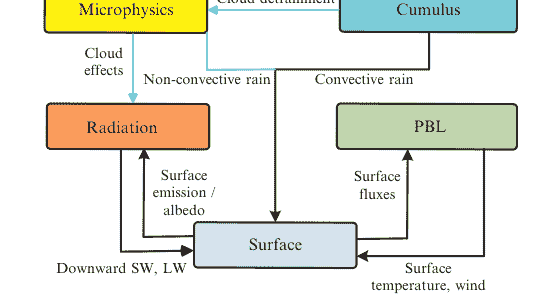

### 图 3.1

WRF 物理组件包括微物理、积云参数化、行星边界层（PBL）、陆面/近地面层模式、短波（SW）和长波（LW）辐射。

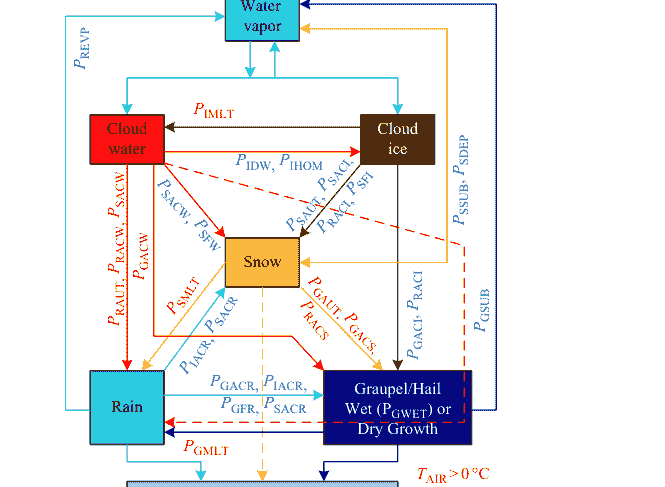

### 图 3.2

模式中模拟的云物理过程，包含雪场。符号说明见图 3.3。

对美国本土进行的 12 km 分辨率 48 小时预报，捕捉了一个强斜压气旋和一条从北到南贯穿美国本土 48 州的锋面边界的发展过程。戈达德微物理计算被组织成一个三维网格，其中每一列（k 维）中的微物理过程计算是独立处理的。因此，存在两个并行维度（i 维和 j 维）可供利用。水平网格点的总数为 133,364。一个 Intel Xeon Phi 7120P 处理器核心可以使用其 SIMD 单元并行处理 16 个网格点。因此，当每个处理器核心使用四个线程时，至少需要 3840（16*60*4）个网格点（i,j）才能充分利用协处理器中 60 个核心的所有资源。因此，测试数据将在大部分时间内使我们的测试协处理器保持满载。然而，在处理结束时存在尾部效应，即某些核心未被充分利用。对于测试数据，这种情况只会在处理了 34 整批 240×16 网格点之后发生。因此，对于该数据来说这不是问题。对于小得多的数据量，这可能会成为问题。例如，如果有 250 个网格点，其中 240 个将被并行处理，而处理剩余 10 个点时，大部分处理器资源将处于空闲状态。因此，控制每个处理单元处理的数据量，或者使数据量足够大以使尾部效应非常小或不存在，这一点非常重要。

我们使用 Intel Fortran 编译器 ifort 版本 15.0.0 为 Intel Xeon E5-2670 CPU 和 Intel Xeon Phi 7120P 协处理器编译戈达德源代码。对于 CPU 编译，使用了以下 WRF 默认的 ifort 编译器选项：

```
-O3 -openmp -w -ftz -fno-alias -auto -fp-model fast=1
-no-prec-div -no-prec-sqrt -auto -align array64byte
```

对于协处理器，使用了 WRF v3.6 发行版中的以下编译器选项：

```
-mmic -auto -ftz -fno-alias -fimf-precision=low
-fimf-domain-exclusion=15 -opt-assume-safe-padding
-opt-streaming-stores always -opt-streaming-cache-evict=0
-mP20PT_hlo_pref_use_outer_strategy=F -fp-model fast=1
-no-prec-div -no-prec-sqrt -auto-align array64byte
```

在 do 循环中的 OpenMP 工作共享结构使用了动态调度。

从图 3.5 可以看出，微物理是 WRF 中最耗时的物理组件。戈达德微物理方案有 2355 行代码，而 ARW 动力代码超过 60,000 行。总的来说，WRF 由超过 50 万行代码组成。因此，首先优化戈达德微物理方案是合理的，因为这个相对较小的模块仍然可以为整个 WRF 带来整体加速。处理时间是 10 次执行运行的平均值。这些处理时间是通过对戈达德方案运行独立驱动程序来测量的。WRF 在区域上使用二维网格分解。WRF 计算区域被分解成称为瓦片（tile）的矩形块。每个瓦片被分配给一个线程进行并发处理。戈达德代码的第一版使用了默认的 4 个东西方向和 61 个南北方向的瓦片区域分解。我们描述的以下优化是累积的，因此每个优化步骤始终包含之前的所有优化步骤。

| $P_{IDW}$ | 云冰以消耗云水为代价的凝华增长 |
| $P_{IHOM}$ | 云水均质冻结形成云冰 |
| $P_{IACR}$ | 云冰碰并雨水；根据雨量产生雪或霰 |
| $P_{RACI}$ | 雨水碰并云冰；根据雨量产生雪或霰 |
| $P_{RAUT}$ | 云水自动转化形成雨水 |
| $P_{RACW}$ | 雨水碰并云水 |
| $P_{REVP}$ | 雨水蒸发 |
| $P_{RACS}$ | 雨水碰并雪；如果雨或雪超过阈值则产生霰 |
| $P_{SACW}$ | 雪碰并云水。同时也增强雪的融化 |
| $P_{SACR}$ | 雪碰并雨水。如果雨或雪超过阈值则产生霰；否则产生雪。此外，碰并的水会增强雪的融化 |
| $P_{SACI}$ | 雪碰并云冰 |
| $P_{SAUT}$ | 云冰自动转化（聚合）形成雪 |
| $P_{SFW}$ | 贝吉龙过程（凝华和凇附）——云水转化形成雪 |
| $P_{SFI}$ | 通过贝吉龙过程胚胎的增长，云冰向雪的转化率 |
| $P_{SDEP}$ | 雪的凝华增长 |
| $P_{SSUB}$ | 雪的升华 |
| $P_{SMLT}$ | 雪融化形成雨水 |
| $P_{GAUT}$ | 雪自动转化（聚合）形成霰 |
| $P_{GFR}$ | 雨水概率冻结形成霰 |
| $P_{GACW}$ | 霰碰并云水 |
| $P_{GACI}$ | 霰碰并云冰 |
| $P_{GACR}$ | 霰碰并雨水 |
| $P_{GACS}$ | 霰碰并雪 |
| $P_{GSUB}$ | 霰的升华 |
| $P_{GMLT}$ | 霰融化形成雨水 |
| $P_{GWET}$ | 霰的湿增长 |

图 3.3
微物理过程。

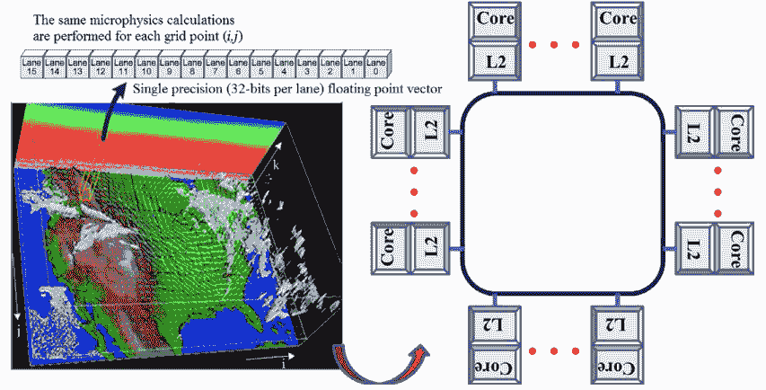

### 图 3.4

CONUS 12 km 区域到 Intel Xeon Phi 处理器线程域的映射，其中 CONUS 区域的大小为 433×308 个水平网格点，35 个垂直层。

### 代码优化

代码验证通过检查所有代码版本在 CPU 上产生相同的输出值来完成。在代码验证期间，使用了精确数学编译器选项，以强制编译器在实现浮点计算时严格遵守值安全优化。这会禁用可能改变浮点计算结果的优化，而这正是严格 ANSI 一致性所要求的。这些语义确保了浮点计算的可重现性，包括编译器向量化或自动并行化的代码。然而，这种编译器选项会显著降低性能。因此，WRF 默认不使用此编译器选项。

这与使用 WRF 默认编译器选项的情况形成鲜明对比，后者告诉编译器对浮点计算采用更激进的优化。这些优化提高了速度，但可能影响浮点计算的精度或可重现性。

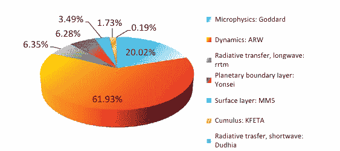

### 图 3.5

Intel Xeon Phi 协处理器上原始 WRF 代码的处理时间，由 Intel 的剖析工具 VTune 测量。


```
16_X = (ite-its+1)/NUM_TILES_X+1
16_Y = (jte-jts+1)/NUM_TILES_Y+1

!$OMP PARALLEL DO &
!$OMP PRIVATE ( i, j, i_start, i_end, j_start, j_end) collapse(2)
    DO j = jts, jte, 16_Y
        DO i = its, ite, 16_X
            i_start = i
            i_end = min(i_start+(16_X-1),ite)
            j_start = j
            j_end = min(j_start+(16_Y-1),jte)

            CALL gsfcgce(
            ! ...     &
            )
        end do
    end do
!$OMP END PARALLEL DO
```

## FIGURE 3.6

代码清单—调用 Goddard 子程序的 OpenMP 代码。变量 its 和 ite 是域东西方向的下限和上限。类似地，变量 jts 和 jte 定义南北域限制。线程私有变量 i_start、i_end、j_start 和 j_end 定义瓦片边界。此代码来自文件 module_mp_gsfcgce.F，位于 WRF 源代码中 WRFV3/phys 目录。

我们首先对图 3.6 中调用主子程序的 OpenMP 代码尝试了不同的域分解。我们在域分解为 4×60 瓦片时获得了最佳结果，分别在东西方向和南北方向。

## REMOVAL OF THE VERTICAL DIMENSION FROM TEMPORARY VARIABLES FOR A REDUCED MEMORY FOOTPRINT

第一次优化步骤是修改某些中间变量的维度，使该变量的 k 维度被移除。此过程可以对仅需要在一次使用一个 k 维度值时使用的变量执行。此优化的效果是重用缓存数据以提高计算强度。此过程的示例显示在图 3.7 和 3.8 中，分别显示优化前后的相同代码。总共六个变量被制成

```
do k = kts, kte
    qrz(k)=qr(i,k,j)
    dzw(k)=dz8w(i,k,j)
 enddo
! ...
fluxin=0.0
do k=max_q,min_q,-1
    fluxout=rhoz(k)*vtr(k)*qrz(k)
    flux=(fluxin-fluxout)/rhoz(k)/dzw(k)
    qrz(k)=qrz(k)+del_tv*flux
    qrz(k)=amax1(0.,qrz(k))
    qr(i,k,j)=qrz(k)
    fluxin=fluxout
 enddo
 if (min_q .eq. 1) then
    pptrain=pptrain+fluxin*del_tv
 else
    qrz(min_q-1)=qrz(min_q-1)+del_tv*  &
    fluxin/rhoz(min_q-1)/dzw(min_q-1)
    qr(i,min_q-1,j)=qrz(min_q-1)
 endif
```

## FIGURE 3.7

代码清单—原始代码，中间临时变量的 k 维度保持完整。受优化影响的两个变量以粗体显示。此代码来自文件 module_mp_gsfcgce.F，位于 WRF 源代码中 WRFV3/phys 目录。

标量。注意优化版本中标量变量 dzw 和 qrz 需要额外的赋值语句。因此，处理时间从 Intel Xeon Phi 协处理器上的 164.7 毫秒减少到 144.3 毫秒，从 Intel Xeon 处理器上的 334.5 毫秒减少到 299.9 毫秒。

## COLLAPSE I- AND J-LOOPS INTO SMALLER CELLS FOR SMALLER FOOTPRINT PER THREAD

对主子程序 satice1_s 进行向量化是在为下一步主要优化做准备。向量化是指将一次对一对操作数执行操作的标量实现转换为向量过程，其中单个指令可以引用

```
```fortran
subroutine saticel_s()
    do j = jts,jte
    do k = kts,kce
    do i = its, ite
        !...

            rp0(i)=3.799052e3/p0(i,k)

! ...

            if(qr(i).gt.0.0) then
                tair(i)=(pt(i)+tb0)*pi0(i)
                rtair(i)=1./(tair(i)-c358)
                qsw(i)=rp0(i)*exp(c172-c409*rtair(i))
! ...

                if (alf+rn17c*tairc(i) .eq. 0.) then
                    write(91,*) itimestep, i,j,k, alf, rn17c, tairc(i)
                endif
!...
            end do
        end do
    end do
end subroutine saticel_s
```
```

## FIGURE 3.9

代码清单—原始非向量化代码。此代码来自文件 module_mp_gsfcgce.F，位于 WRF 源代码中 WRFV3/phys 目录。

在图 3.9 和 3.10 中。循环包含 979 行代码。我们尝试了不同的循环分裂选项，最终得到九个单独的最内层 i 循环。另一种解决方案是在 i 循环前放置一个 SIMD 向量化指令 (!DIR$ SIMD)，该指令由于怀疑但不存在的向量依赖而未被编译器自动向量化。在 CPU 上，SIMD 指令解决方案比多个循环解决方案慢 11%。

原始线程是在驱动例程中完成的，每个线程处理总计 4×60 网格中的一个数据瓦片。为了更好地将数据分块到缓存内存中，采用了新的线程方案。这意味着修改调用例程，使新的瓦片大小为 16×1。就像以前一样，瓦片并发处理。然而，与原始分块方案不同，新方案必须将输入数据复制到 16 个元素的向量大小数组中。将数据从一个数组复制到另一个数组似乎是不必要的开销。然而，这提供了一些优点和一个缺点。首先，新分块方案访问新数组中的数据需要比原始方案少一个索引。更重要的是，新数组的第一维，对应于东西方向，是静态大小的。这允许编译器执行一些优化，从而克服在数据被多次访问时复制数据之间的缺点。此外，此策略将数据与内存中的缓存行对齐。该对齐优势将

```
```fortran
subroutine satice1_s ()
    do j = jts,jte
    do k = kts,kte
    do i = its, ite
        !...
    end do
    do i = its, ite
        !...
    end do
    do i = its, ite
        !...
    end do
    do i = its, ite
        !...
    end do
    do i = its, ite
        !...
    end do
    do i = its, ite
        !...
    end do
    do i = its, ite
        !...
    end do
    do i = its, ite
        !...
    end do
    do l = lts, lte
        !...
    end do
    end do
    end do
end subroutine satice1_s
```
```


代码清单—循环拆分后，代码可向量化。此代码来自文件 `module_mp_gsfccge.F`，位于 `WRFV3/phys` 目录中。

再次在章节讨论中使用数据对齐指令。由于每个线程只处理 16 个数据元素，更好的数据局部性得以实现，因为更多的数据可以从缓存内存中访问。在图 3.11 中，显示了此技术的 Goddard 多线程代码。处理时间从 Intel Xeon Phi 协处理器上的 144.3 毫秒减少到 52.3 毫秒，从 Intel Xeon CPU 上的 299.9 毫秒减少到 138.3 毫秒。

## ADDITION OF VECTOR ALIGNMENT DIRECTIVES

接下来，我们在每个 i 循环前添加了向量对齐指令，以便编译器可以使用单个对齐加载指令而不是两条指令的未对齐加载序列。已知数据在内存中是对齐的，因为输入数据被复制到宽度为 16 个元素、每个 4 字节的单元中。输出数据和本地数据使用类似的单元，也是对齐的。因此，

```
!$OMP PARALLEL DO &
!$OMP PRIVATE ( ic, j, ii, i, k ) &
!$OMP PRIVATE ( th1d, qv1d, ql1d, qr1d, qi1d, qs1d, &
!OMP qg1d, rho1d, pii1d, p1d & )
!$OMP SCHEDULE(dynamic,1)
DO ip = 1,((1+(ite-its+1)/16)*16)*(jte-jts+1),16
    j = jts+((ip-1)/((1+(ite-its+1)/16)*16))
    IF ( j .ge. jts .and. j .le. jte ) THEN
        ii = its+mod((ip-1),((1+(ite-its+1)/16)*16))
        do k = kts, kte ! input variables
            DO ic=1,min(16,ite-ii+1)
                i = ii+ic -1
                th1d(ic,k) = th(i,k,j)
                qv1d(ic,k) = qv(i,k,j)
                ql1d(ic,k) = ql(i,k,j)
                qr1d(ic,k) = qr(i,k,j)
                qi1d(ic,k) = qi(i,k,j)
                qs1d(ic,k) = qs(i,k,j)
                qg1d(ic,k) = qg(i,k,j)
                rho1d(ic,k) = rho(i,k,j)
                pii1d(ic,k) = pii(i,k,j)
                p1d(ic,k) = p(i,k,j)
            ENDDO
        enddo
        IF ( min(16,ite-ii+1) .gt. 0 ) THEN
            ! If a row contains unprocessed cells
            call SATICEL_S(dt_in, ihail, itaobraun, &
                ice2, istatmin, new_ice_sat, id, &
                th1d, qv1d, ql1d, qr1d, qi1d, qs1d, &
                qg1d, rho1d, pii1d, p1d, itimestep, &
                kts,kte,kms,kme,min(16,ite-ii+1) )
        ENDIF
        do k = kts, kte ! output variables
            DO ic=1,min(16,ite-ii+1)
                i = ii+ic -1
                th(i,k,j) = th1d(ic,k)
                qv(i,k,j) = qv1d(ic,k)
                ql(i,k,j) = ql1d(ic,k)
                qr(i,k,j) = qr1d(ic,k)
                qi(i,k,j) = qi1d(ic,k)
                qs(i,k,j) = qs1d(ic,k)
                qg(i,k,j) = qg1d(ic,k)
            ENDDO
        enddo
        ENDIF
    ENDDO
```

## FIGURE 3.11

代码清单—使用 OpenMP 进行多线程的 Fortran 代码。输入数据被复制到 16 个元素的向量大小数组中。计算后，输出数据被复制回原始数组以供 WRF 的其他部分进一步处理。此代码来自文件 module_mp_gsfcgce.F，位于 WRF 源代码中 WRFV3/phys 目录。


数据对齐指令可以在源代码中的每个循环之前添加。然而，原始数组中的数据未必保证对齐，因此我们没有将对齐指令添加到前面描述的数据复制循环中。这对代码在处理器上的运行效果比在协处理器上的影响更大。处理时间从 52.3 ms 减少到 46.9 ms，在 Intel Xeon Phi 协处理器上，以及从 138.3 ms 减少到 120.4 ms，在 Intel Xeon 处理器上。

### 代码优化总结

图 3.12 显示了不同优化阶段的处理时间，其汇总见图 3.13。在 Intel Xeon E5-2670 处理器上，代码优化带来的整体加速为 2.8×，而在 Intel Xeon Phi 7120P 协处理器上为 3.5×。相同的代码优化也改善了 CPU 性能这一事实表明，使用单一源代码同时用于处理器和协处理器是一个良好的策略。这降低了开发成本，因为为协处理器现代化 WRF 所做的任何编程工作也可能在无需多个代码库的情况下改善旧版处理器的性能。

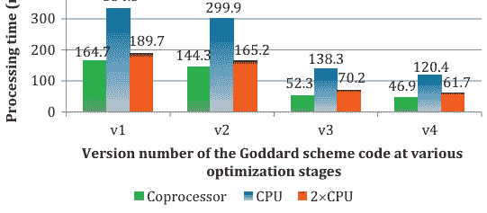

### 图 3.12

Goddard 微物理方案的 Intel Xeon Phi 7120P 协处理器和 Intel Xeon E5-2670 CPU 的处理时间。

| 代码版本 | 优化描述 |
|---|---|
| V1 | 原始代码 |
| V2 | 某些临时变量的大小被减小 |
| V3 | 每线程的内存占用被减小 |
| V4 | 在循环前添加了向量对齐指令 |

### 图 3.13

优化的简要描述。

| 性能指标 | 原始 Goddard 代码 | 优化后的 Goddard 代码 |
|---|---|---|
| 向量化强度 | 3.89 | 7.88 |
| L1 计算与数据访问比率 | 5.83 | 8.62 |
| 估计延迟影响 | 222.28 | 98.18 |

### 图 3.15

原始和优化后的 Goddard 代码在 Intel Xeon Phi 协处理器上的性能指标，由 Intel 的分析工具 VTune 测量。

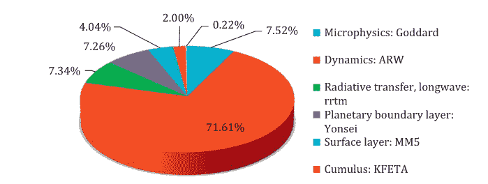

### 图 3.16

代码优化后 WRF 的 MIC 处理时间，由 Intel 的分析工具 VTune 测量。

### WRF 中 Goddard 微物理方案优化的性能影响

优化后的 Goddard 微物理代码已重新整合到 WRF 中。图 3.16 中 Intel VTune 的分析测量显示，代码优化后，Goddard 方案仅占总处理时间的 7.6%，而动力学部分占比更高，达到总处理时间的 71.5%。因此，它是进一步优化 WRF 的自然候选对象。此外，辐射传输和 PBL 也是值得进一步优化的两个物理类别，因为它们各自占总处理时间的 7% 以上。

### 总结

本章已证明 Intel Xeon Phi 协处理器可以比双插槽 Intel Xeon 处理器系统更快。然而，要实现这一点，必须同时利用多线程和向量化。此外，代码已针对缓存数据的频繁重用进行了优化，以提高计算强度。遵循这些指导原则，本章描述了 WRF Goddard 微物理方案的优化。

结果显示，优化使 Intel Xeon Phi 7120P 协处理器的性能提高了 4.7×。这使整个 WRF 加速了 1.15×。此外，优化使 Intel Xeon E5-2670 处理器的性能提高了 3.3 倍。所执行的优化在性质上相当通用。这些优化包括对代码进行向量化，以更好地利用每个 CPU 核心内的向量单元。此外，通过优化对某些中间数据数组的访问来改善内存访问。

所执行优化的通用性意味着可以预期优化后的代码将在未来的 Intel 多核处理器和多核 CPU 上高效运行。下一代 Intel Xeon Phi 产品，代号为 Knights Landing（KNL），与第一代协处理器不二进制兼容，因为 KNL 上的 AVX-512 SIMD 指令的编码方式与第一代中的初始多核指令（Intel® IMCI）不同。然而，预计我们迄今为止对代码所做的优化也将在 KNL 上运行良好。未来的 Intel Xeon 平台也将使用 AVX-512 指令编码用于向量指令。

Goddard 微物理方案的优化工作代表了全面向量化 WRF 的初始步骤。正如加速比数字所示，代码优化对于多核处理器和多核协处理器的良好性能至关重要。因此，我们还将继续开展工作并优化其他 WRF 模块。

### 致谢

本工作由 Intel Corporation 支持，资助编号为 MSN171479，以在威斯康星大学麦迪逊分校建立 Intel 并行计算中心。作者感谢 Bob Burroughs 和 Michael Greenfield 慷慨的支持。

### 了解更多信息

以下是我们推荐的与本章相关的额外阅读材料。关于 Intel® Xeon Phi™ 协处理器上 WRF 的案例研究，分析了在协处理器上运行 MPI 程序的一个或多个 rank 的可扩展性权衡：

- Meadows, L., 2012. Experiments with WRF on Intel® Many integrated core (Intel@ MIC) architecture, OpenMP in a Heterogeneous World, 130-139.

要了解更多关于 WSM5 优化的信息，请参阅 Michalakes 的演示：

- Michalakes, J., 2013. Optimizing weather models for Intel Xeon Phi, Intel Theater Presentation SC ’13, November 20.

要了解更多关于 WRF 的信息，我们鼓励您阅读：

- Skamarock, W.C., Klemp, J.B., Dudhia, J., Gill, D.O., Barker, D.M., Duda, M.G., Huang, X., Wang, W., and Powers, J.G., 2008. A description of the Advanced Research WRF Version3, NCAR Technical Note, TN-4475+STR, Boulder, Colorado, USA.

下载 WRF 源代码，http://www2.mmm.ucar.edu/wrf/users/download.

下载本章和其他章节的代码，http://lotsof cores.com.

此页 intentionally left blank

### 成对 DNA 序列比对优化

Yongchao Liu*, Bertil Schmidt†
Georgia Institute of Technology, USA*
Johannes Gutenberg University Mainz, Germany†

作为成对 DNA 序列比对的最优方法，Smith-Waterman（SW）算法被广泛使用。该算法在处理长 DNA 序列时计算需求很高。在本章中，我们提出了一种利用 Intel® Xeon Phi™ 协处理器加速 DNA 序列成对比对的并行实现。我们描述了并行化方法，以便深入挖掘 Intel Xeon Phi 协处理器内部的固有并行性。为了实现高速，我们探索了单个协处理器内的两个并行级别以及多个协处理器之间的一个并行级别。在单个协处理器内部，我们利用 512 位单指令多数据（SIMD）指令（向量化）内的指令级并行以及多核上的线程级并行（使用 OpenMP 的多线程）。在协处理器之间，我们采用设备级并行，以便利用包含 Intel Xeon Phi 协处理器的集群的计算能力，使用 MPI。我们的代码使用 C++ 编写，包含一组 SIMD 内在函数、OpenMP 和 MPI。

### 成对序列比对

考虑两个 DNA 序列 S1=S1[1…m] 和 S2=S2[1…n]，长度分别为 m 和 n，在 DNA 字母表 Σ={A, C, G, T} 上。我们感兴趣的是根据给定的评分方案计算 S1 和 S2 的最优局部比对分数。这里考虑的评分方案由评分函数（也称为替换矩阵）sbt: Σ×Σ→Z、间隙开启惩罚 go>0 和间隙延伸惩罚 ge≥0 组成。SW 算法基于动态规划（DP）的概念计算最优比对分数，通过计算基于以下递推关系 1≤i≤m 且 1≤j≤n 的 DP 矩阵（也称为比对矩阵）：

H[i,j]=max{0,E[i,j],F[i,j],H[i−1,j−1]+sbt(S1[i],S2[j])}
E[i,j]=max{E[i−1,j],H[i−1,j]−go}−ge
F[i,j]=max{F[i,j−1],H[i,j−1]−go}−ge

值 H[i,j]、E[i,j] 和 F[i,j] 分别表示两个前缀 S1[1…i] 和 S2[1…j] 的最优局部比对分数，其中比对以字母 S1[i] 与字母 S2[j] 对齐、字母 S1[i] 与间隙对齐、以及间隙与字母 S2[j] 对齐结束。递推关系初始化为 H[i,0]=H[0,j]=E[0,j]=F[i,0]=0 对于 0≤i≤m 且 0≤j≤n。


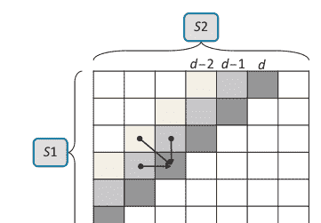

# 图 4.1

SW 算法中的数据依赖。

在 DP 矩阵计算中，每个单元依赖于其左侧、上方和左上（对角）相邻单元，如图 4.1 所示。这种依赖关系也意味着同一次对角线上的所有单元可以并行计算，并且可以按照从左上角到右下角的次对角线顺序在线性空间内进行计算。在给定评分方案下，最优局部比对得分对应于矩阵 H 中的最大值。整体计算具有 O(mn) 的二次计算复杂度；在需要和不需要检索最优比对的情况下，空间复杂度分别为 O(m+n) 和 O(min(m, n)) 的线性空间复杂度。请注意，本章我们只关心计算最优局部比对得分，而不关心获得该最优得分的实际比对。

我们假设在比对矩阵中，S1 垂直放置，S2 水平放置，且 m ≤ n（见图 4.1）。将比对矩阵视为笛卡尔平面上的二维坐标空间，我们假设原点位于左上角，水平坐标 x（对应列）从左到右递增，垂直坐标 y（对应行）从上到下递增。因此，对于对角线 d（0 ≤ d < m + n − 1）上的单元，其坐标 (y, x)（其中 x 为列索引，y 为行索引）与 d 的关系可表示为 x + y = d。可以看出，起始行索引 srow 可通过计算对角线 d 与直线 y = 0 或 x = n − 1 的交点来确定，结束行索引 erow 可通过 d 与直线 y = m − 1 或 x = 0 的交点来确定。基于上述观察，我们计算对角线 d 的 srow 和 erow 为 srow = max(0, d − n + 1) 和 erow = min(d, m − 1)。对于分块矩阵中的外部对角线也可以进行类似的计算（见图 4.2）。

### 单协处理器上的并行化

我们在单个协处理器上的并行化基于 scale-and-vectorize 方法。我们首先将 DP 矩阵划分为大小为 α × β 的分块，并使用 OpenMP 将它们分配到一组线程上。我们将这种基于分块的对角线称为外部对角线。分块 DP 矩阵的布局如图 4.2 所示。我们的分块方案在概念上将比对矩阵重新组织为大小为 R × C 的分块 DP 矩阵，其中 R = ⌈m/α⌉，C = ⌈n/β⌉。在分块比对矩阵中，外部对角线 d（0 ≤ d < R + C − 1）上的所有分块的计算可以独立进行。在每个分块内，我们可以

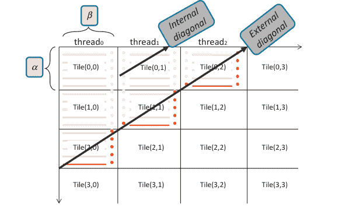

# 图 4.2

分块 DP 矩阵的布局。

因此，可以使用基于 512 位 SIMD 向量中指令级并行的向量化技术，并行计算同一次对角线上的单元。我们将分块内的次对角线称为内部对角线。

在启用多线程时，我们将分块比对矩阵配置为具有 C = T（其中 T 等于线程数）列（因此 β = ⌈n/T⌉），以便在指令级和线程级利用率之间进行权衡。对于向量化，我们将 512 位 SIMD 向量拆分为 16 个通道，每个通道占 32 位。在我们的算法中，向量通道数用 V 表示，等于 16。在我们的实现中，我们默认使用 α = V，同时允许用户通过参数指定其值（必须是 V 的倍数）。

### 使用 OpenMP 的多线程

在任意外部对角线 D 上，T 个线程并行计算外部对角线上的所有分块（见图 4.2）。在进入下一条外部对角线之前，线程需要进行同步。每个分块需要来自上方相邻分块的 H 和 E 值对、来自左方相邻分块的 H 和 F 值对，以及来自左上相邻分块的一个 H 值。线程之间必要的通信实现如下。

- 垂直方向：我们分配一个大小为 O(n) 的全局水平（GH）缓冲区，用于存储整个比对矩阵的上方 H（H_up）和上方 E（E_up）值。在此上下文中，“全局”表示这些缓冲区在我们的 OpenMP 并行区域中可见并由所有线程共享。在计算过程中，单元可以通过其在比对矩阵中的全局列索引（记为 globalCol）访问所需的 H_up 和 E_up 值。在分块内，我们从 GH 缓冲区读取 H_up 和 E_up 值对来计算第一行，然后用最后一行的所有单元新计算出的 H 和 E 值对更新该缓冲区。

```
#pragma omp parallel firstprivate(GV,GD) default(shared)
for (d=0; d < R+C-1; ++d) {
    sExtRow = max(0,d-C+1);
    eExtRow = min(d,R-1);
    load the per-thread maximum score lmaxScore;
    #pragma omp barrier
    #pragma omp for schedule(static,1) nowait

    for (r=sExtRow; r <= eExtRow; ++r)
        compute all cells in tile(r,d-r);
    save lmaxScore to a global variable;
    swap the input and output of GV and GD;
}
reduce to get the optimal local alignment score;
```

# 图 4.3

多线程计算的内核（参见 AlignCoreTiling.cpp 中的 _swKernelShared() 函数）。

- 水平方向：我们分配 C 个全局垂直（GV）缓冲区，每个缓冲区包含 α 个元素，用于存储 α 个左侧 H（H_left）和左侧 F（F_left）值对。分块比对矩阵的每一列 c（0≤c<C）恰好有一个 GV 缓冲区。所有 GV 缓冲区通过（循环）缓冲流水线进行通信，其中列 c 上的每个分块从第 c 个 GV 缓冲区读取 H_left 和 F_left 值以计算第一列，并将最后一列所有单元新计算出的 H 和 F 值写入第 (c+1) 个 GV 缓冲区。

- 对角方向：我们为分块比对矩阵的每一列 c 分配一个单元素全局对角（GD）缓冲区，用于存储相应分块所需的对角 H（H_diag）值。所有 GD 缓冲区以与 GV 缓冲区相同的方式更新。

图 4.3 展示了在外部对角线上进行计算的协处理器内核。在进入当前对角线计算的 for 循环之前，我们通过屏障（barrier）同步所有线程。我们使用 nowait 子句移除了紧随循环之后的隐式屏障。此外，通过静态调度策略（即 schedule(static, 1)），每次将一个分块分配给一个线程。我们的意图是让具有连续 ID 的线程沿对角线访问连续的向量大小元素。这种调度策略与“平衡”亲和性相结合，使每个核内驻留的四个线程具有良好的数据局部性，从而能够受益于 L1/L2 缓存层次结构。

### 使用 SIMD 内建函数的向量化

分块被分配给一个线程，然后通过 SIMD 向量化进行计算。我们将分块分割为 α/V 个条带，每个条带包含 V 行，并从上到下逐条带完成整体计算。这种条带化计算在每个线程内部进行，通过减少空闲向量通道数和指令数来提高每个线程内的向量化效率。在分块内，GH、GV 和 GD 缓冲区是复用的，因此我们

```
Compute the column index globalCol of the stripe in the
alignment matrix;
Compute the starting index startIndex of the GV buffer
for the stripe;
for (i=16; i < numTileCols; ++i, ++globalCol) {
    vHUp = _mm512_set1_epi32(GH[globalCol].h);
    vEUp = _mm512_set1_epi32(GH[globalCol].e);
    vWUp = _mm512_alignr_epi32(vF, vHUp, 15);
    vHUp = _mm512_alignr_epi32(vH, vHUp, 15);
    vE = _mm512_sub_epi32(vEUp,vGapExtend);
    vTmp = _mm512_sub_epi32(vHUp,vGapOE);
    vE = _mm512_max_epi32(vE,vTmp);
    vF = _mm512_sub_epi32(vF,vGapExtend);
    vTmp = _mm512_sub_epi32(vH,vGapOE);
    vF = _mm512_max_epi32(vF,vTmp);
    Compute the substitution score vSubScore;
    vH = _mm512_add_epi32(vHDiag, vSubScore);
    vTmp = _mm512_max_epi32(vE,vF);
    vH = _mm512_max_epi32(vH,vZero);
    vH = _mm512_max_epi32(vH,vTmp);
    lmaxScore = _mm512_max_epi32(lmaxScore,vH);
    vHDiag = vHUp;
    Save the H and E values for the cell on the last
    row of the stripe
}
Save the H and F values for the cell on the last column
of the stripe;
```

# 图 4.5

步骤 2 的向量化计算内核（参见 AlignCoreTiling.cpp 中的 _swKernelShared() 函数）。

### 使用 MPI 跨多个协处理器进行并行化

我们在协处理器集群上的分布式并行化基于 MPI 卸载模型设计，该模型仅在主机 CPU 上启动 MPI 进程，并利用进程内的卸载能力将部分工作负载卸载到相应的协处理器上。在此模型中，协处理器之间的通信必须由主机通过卸载指令显式管理。跨多个 Intel Xeon Phi 协处理器的分布式方法的核心思想基于二级分块。我们进一步将比对矩阵划分为更大的块，大小为 αₘₚᵢ × βₘₚᵢ，将矩阵重新组织为 Rₘₚᵢ = ⌈m/αₘₚᵢ⌉ 行和 Cₘₚᵢ = ⌈n/βₘₚᵢ⌉ 列（见图 4.6）。

我们将相应的对角线称为块对角线。此类对角线内的所有块分布在一个协处理器网络上，每个块分配给一个协处理器。在任何块内，在单个协处理器上采用前述分块方法的一种变体，该变体会额外处理由其他 MPI 进程计算的中间数据。与分块方法类似，


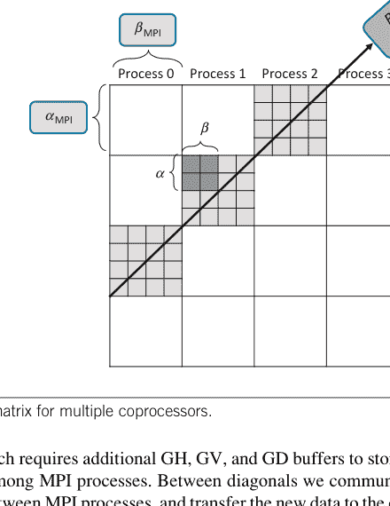

### FIGURE 4.6

Layout of tiled DP matrix for multiple coprocessors.

分布式方法需要额外的 GH、GV 和 GD 缓冲区来存储在 MPI 进程之间分布的块级中间数据。在对角线之间，我们在 MPI 进程之间通信块级的 GV 和 GD 缓冲区，并通过卸载将新数据传输到相应的协处理器。为了提高通信效率，我们使用非阻塞通信例程（MPI_Isend 和 MPI_Irecv）。这样，我们可以启动与邻居之间的通信，然后等待其完成。

图 4.7 显示了分布式计算的伪代码，其中我们使用 β_mpi = ⌈n/P⌉（P 为协处理器的数量，也等于 MPI 进程的数量，因为我们的实现要求 MPI 进程与协处理器之间有一一对应关系）和 α_mpi = 128 K。我们还采用了 MPI 卸载模型，该模型仅在主机 CPU 上启动 MPI 进程，并利用进程内的卸载功能将工作卸载到协处理器。

### PERFORMANCE RESULTS

对于性能评估，我们选择了六个基因组序列，其长度从 440 万到 5000 万个碱基对不等（见图 4.8），这些序列可在 NCBI Nucleotide 数据库公开获取。运行时间是在配备两颗 Intel E5-2670 8 核 2.60 GHz CPU 和 64 GB RAM 并运行 Linux 的计算节点上测量的。该计算节点还配备了四颗 Intel Xeon Phi 协处理器（B1PRQ-5110P/5120D）。我们使用 Intel C++ 编译器和 OpenMPI 编译并链接我们的算法。环境变量 KMP_AFFINITY 设置为“balanced”，因为在我们的评估中，“balanced”亲和性更常在协处理器上带来最佳性能。

```
Offload to transfer sequences S1 and S2;
Offload to allocate block-level GW, GV and GD buffers on the coprocessor;
for (d = 0; d < Rmpi+Cmpi-1; ++d) {
    sMpiRow = max(0,d-Cmpi+1);
    eMpiRow = min(d,Rmpi-1);
    sMpiCol = d-eMpiRow;
    eMpiCol = d-sMpiRow;
    currMpiCol = mpiRank;
    currMpiRow = d-currMpiCol;
    MPI_Barrier(MPI_COMM_WORLD);
    if (currMpiCol>=sMpiCol && currMpiCol<=eMpiCol) {
        #pragma offload target (mic: micIndex) in/out
        variable list{
            Invoke the Xeon Phi kernel;
            Calculate the local maximum score lMaxScore;
        }
    }
    Communicate intermediate data using MPI_Isend and
    MPI_Irecv;
}
MPI_Reduce over lmaxScore to get overall optimal score;
```

### FIGURE 4.7

Pseudocode of the MPI parallelization (refer to function _alignDistributed()_ in AlignCoreTiling.cpp).

| Seq. | Length | Accession No. | Genome definition |
|---|---:|---|---|
| S4.4 | 4,411,532 | NC_000962.3 | *Mycobacterium tuberculosis* H37Rv |
| S4.6 | 4,641,652 | NC_000913.3 | *Escherichia coli* K12 MG1655 |
| S23 | 23,011,544 | NT_033779.4 | *Drosophila melanogaster* chr. 2L |
| S33 | 32,799,110 | BA000046.3 | *Pan troglodytes* DNA chr. 22 |
| S42 | 42,034,648 | NC_019481.1 | *Ovis aries* breed Texel chr. 24 |
| S50 | 50,073,674 | NC_019478.1 | *Ovis aries* breed Texel chr. 21 |

### FIGURE 4.8

Information of the genome sequences used.

我们首先评估了在单颗协处理器上使用不同线程数时切片方法的可扩展性，使用 S4.4 和 S4.6 序列对，其中我们从 T = 60 个线程开始，并将 T 增加到 236（等于 omp_get_num_procs() 返回的值）。随着 T 的增长，速度逐渐提升，尽管有一些微小波动，最终在 T = 236 时达到最大值（见图 4.9）。

这意味着我们的基于 MPI 的矢量化实现（在协处理器上使用 512 位 SIMD 指令）在代码重新编译后将在 Knights Landing 上运行。

在单颗协处理器内部，我们已在 512 位 SIMD 指令中使用指令级并行（矢量化）和在众多核心上使用线程级并行（多线程）。我们的矢量化代码使用三个独立的内核实现，以剔除边界条件的冗余代码。在协处理器之间，我们使用设备级并行来利用配备协处理器的集群的强大功能（分布式计算）。我们的算法性能已使用长度从 440 万到 5000 万个核苷酸的 DNA 序列进行评估。评估结果表明，该实现可对所有测试序列实现可持续性能，并在单颗协处理器上可达到高达 30.1 GCUPS 的性能，在共享同一主机的四颗协处理器上可达到高达 111.4 GCUPS 的性能。

目前，我们的实现仅计算最优局部比对分数。工作的一个明显扩展是计算导致该最优分数的实际比对。这可以通过存储完整的 DP 矩阵并执行回溯过程来实现。不幸的是，这种方法的内存消耗是禁止性的，特别是对于非常长的 DNA 序列（例如，哺乳动物基因组可长达数十亿个碱基），因为完整 DP 矩阵的空间复杂度与序列对长度的乘积成正比。因此，需要采用更具挑战性的线性空间分治方法来计算比对。将此算法映射到 Intel Xeon Phi 协处理器架构上因此是我们未来工作的重点。

### FOR MORE INFORMATION

Here are some additional reading materials that we recommend related to this chapter.

- General information about the Smith-Waterman algorithm: http://en.wikipedia.org/wiki/Smith-Waterman_algorithm.
- General information about Intel Xeon Phi coprocessor programming: Jeffers, J., Reinders, J., 2013. Intel Xeon Phi Coprocessor High-Performance Programming. Morgan Kaufmann, San Francisco, CA, USA.
- More details of our parallelization approach: Liu, Y., Tran, T., Lauenroth, F., Schmidt, B., 2014. SWAPHI-LS: Smith-Waterman algorithm on Xeon Phi coprocessors for long DNA sequences. 2014 IEEE International Conference on Cluster Computing, pp. 257-265.
- A GPU implementation of pairwise alignment with traceback: Sandes, E., de Melo, A., 2013. Retrieving Smith-Waterman alignments with optimizations for megabase biological sequences using GPU. IEEE Trans. Parallel Distrib. Syst. 24(5), 1009-1021.
- A Cell/BE implementation of pairwise alignment: Sarje, A., Aluru, S., 2009. Parallel genomic alignments on the cell broadband engine. IEEE Trans. Parallel Distrib. Syst. 20(11), 1600-1610.
- Smith-Waterman protein database search on Xeon Phi: Liu, Y., Schmidt, B., 2014. SWAPHI: Smith-Waterman protein database search on Xeon Phi coprocessors. 25th IEEE International Conference on Application-specific Systems, Architectures and Processors, pp. 184-185.
- The SSW program optimized using SSE2 vector instructions: Zhao, M., Lee, W.P., Garrison, E.P., Marth, G.T., 2013. SSW library: an SIMD Smith-Waterman C/C++ library for use in genomic applications. PLoS One 8, e82138.
- Another program we developed for which SIMD intrinsics showed to be more efficient than auto-vectorization with pragma directives: Tran, T.T., Schindel, S., Liu, Y., Schmidt, B., 2014. Bit-Parallel approximate pattern matching on the Xeon Phi coprocessor. 26th International Symposium on Computer Architecture and High Performance Computing, pp. 81-88.
- SWAPHI-LS is open source and the latest source code, as well as the manual, is available at http://swaphi-ls.sourceforge.net.
- Download the code from this, and other chapters, http://lotsofcores.com.

### ACCELERATED STRUCTURAL BIOINFORMATICS FOR DRUG DISCOVERY

### 5

**Wei P. Feinstein, Michal Brylinski**  
*Louisiana State University, USA*

计算机辅助设计是现代药物发现的关键组成部分。药物开发通常使用计算方法来简化命中识别和先导选择，以提高生物利用度并降低毒性。在过去十年中，由于基因组测序技术的进步，积累了大量的基因组知识，为制药研究带来了巨大的机遇。然而，也出现了新的挑战，因为处理如此大量的数据需要前所未有的计算资源。另一方面，目前最先进的异构系统可提供 petaflops 的峰值性能，以加速科学发现。在本章中，我们描述了并行版本的开发和基准测试 *eFindSite*，这是一种用于识别蛋白质中药物结合位点和基于分子指纹的虚拟筛选的结构生物信息学算法。彻底的代码分析显示，*eFindSite* 中的结构比对计算消耗了大约 90% 的 wall-clock 时间。使用基于 pragma 的 OpenMP 并行化代码的这一部分可实现所需的性能改进，并能随着计算核心数量的增加而良好扩展。

与串行版本相比，并行代码在处理器上运行速度快 11.8 倍，在协处理器上运行速度快 10.1 倍；当同时使用两种资源时，加速比为 17.6。通过比较 *eFindSite* 的串行和并行版本，我们展示了面向多核设备的结构比对的 OpenMP 实现。通过最少的修改，复杂的混合 C++/Fortran77 代码成功移植到异构架构上，获得了显著的加速。这展示了如何通过配备 Intel® Xeon Phi™ 协处理器的并行系统加速现代药物发现。

在本章中，我们展示了解决将此代码迁移到并行性的挑战的解决方案，这些解决方案具有广泛的适用性。例如，我们处理了 Fortran77 代码中大量使用线程不安全的公共块的问题，使用 OpenMP 使其成为线程私有的。我们还扩大了栈大小以避免段错误（ulimit -s）。*eFindSite* 的串行和并行版本可自由获取；请参阅本章末尾的“更多信息”。


### 并行计算助力蛋白质组规模的结构生物信息学

基因组测序技术的进步促进了原始基因组数据的快速积累。当前，最大的挑战之一是如何高效注释这些海量生物序列。由于大规模实验的成本高得令人望而却步，最实用的策略是基于计算的蛋白质结构建模，随后进行功能推断，即结构生物信息学。这种方法常规性地产生功能知识，助力生物科学中的广泛研究；例如，可以通过在完整蛋白质组水平上构建复杂的分子相互作用网络来研究细胞机制。系统级研究提供了有价值的见解，以支持开发针对复杂疾病的新疗法，这些疾病通常需要同时靶向多种蛋白质。因此，基于系统生物学和药物发现的多靶点药理学在现代医学中展现出巨大前景。整合大型生物数据集已成为系统级应用的核心组成部分；然而，面对大量有待功能注释的数据，也带来了严峻挑战。为了在大型项目中达到可接受的完成时间，需要前所未有的计算能力。

在这方面，现代研究驱动的计算机技术正从传统的单线程架构转向多线程架构，以提升计算能力。并行高性能计算（HPC）已成为解决大规模计算问题的关键要素。例如，采用英特尔®集成众核（MIC）架构的英特尔®至强融核™协处理器为广泛的应用提供了大规模并行能力。其底层x86架构支持常见的并行编程模型，为移植科学代码提供了熟悉性和灵活性。为了利用这一独特架构，我们为配备英特尔至强融核协处理器的HPC系统开发了并行版本的eFindSite。eFindSite是一种基于模板的建模工具，用于结构生物信息学和药物发现，可在大型蛋白靶标数据集中准确识别配体结合位点和结合残基。在大多数情况下，目标蛋白与模板之间的序列相似性可能相当低，因此eFindSite的设计目标就是仅使用从所谓的序列相似性“模糊区”中选出的弱同源模板即可做出可靠预测。因此，其核心应用——全基因组蛋白质功能注释、药物设计和系统生物学——同样需要充足的计算吞吐量。

简而言之，eFindSite从存储在蛋白质数据库（PDB）中的进化相关模板中提取配体结合知识，这些模板通过高灵敏度的蛋白质穿线（threading）和元穿线（meta-threading）技术进行识别。随后，将结合配体的模板与目标蛋白进行结构比对，以检测推定的结合口袋和残基。eFindSite的预测具有广泛的生物学应用，如分子功能推断、生物网络和通路重建、药物对接以及虚拟筛选。在eFindSite的原始版本中，模板与目标之间的结构比对按顺序执行，因此识别目标蛋白中的配体结合位点可能需要耗费大量处理器时间。缓慢的建模过程使通常涉及大量蛋白靶标和大型模板库的全基因组应用变得复杂。在本章中，我们描述了将eFindSite移植到英特尔至强融核协处理器上的过程，并展示了并行代码在大型蛋白质数据集中检测配体结合位点方面的性能提升。我们表明，在配备协处理器的计算节点上运行eFindSite可大幅缩短模拟时间，为全基因组蛋白质功能注释、结构生物信息学和药物发现提供了一种可行途径。

### eFindSite概述

药物如何治愈疾病？这是一个复杂的问题，可以通过聚焦于蛋白质-配体结合过程来简化。通常，小分子配体，如代谢物和药物，会在特定位置（常称为结合口袋）与其靶蛋白结合。配体与蛋白质的结合会诱导生物反应，要么作为正常细胞功能，要么作为恢复稳态的治疗效果。因此，蛋白质-配体结合的研究在药物发现中至关重要。由于许多药理学相关蛋白质仅有无配体的实验结构和计算构建的模型可用，检测可能的配体结合位点通常是推断并进而调节其分子功能的第一步。目前，基于进化/结构的方法在配体结合预测方面最为准确，也因此应用最为广泛。这里，从进化上弱相关的蛋白质（称为模板）中提取的结构信息被充分利用，以识别与特定疾病状态相关的靶蛋白中的配体结合位点和结合残基。基于进化/结构方法的一个例子是eFindSite，一种配体结合位点预测工具。它采用了多种前沿算法，例如通过eThread进行元穿线以收集模板蛋白、通过亲和传播聚类提取配体信息，以及通过机器学习进一步提高口袋检测的准确性。eFindSite的一个重要特点是它对蛋白质模型中的结构缺陷具有更好的容忍度，因此非常适合注释大型蛋白质组数据集。对于给定的目标蛋白，eFindSite首先在目标蛋白与配体结合模板库中的每个模板之间进行结构比对。接下来，它将比对后的结构聚类为一组离散的组，随后对这些组进行排序，以预测推定的配体结合口袋。

### 基准数据集

本研究中的所有模拟均使用一个蛋白质-配体复合物基准数据集进行，该数据集包含不同大小的蛋白质以及数量不等的相关配体结合模板。这些蛋白质选自先前用于开发和参数化eFindSite的3659个复合物的原始集合，以模拟典型的蛋白质组数据集。如图5.1所示，我们首先

| 模板数量 | 50-100 | 100-150 | 150-200 | 200-250 |
|---|---|---|---|---|
| 目标长度（残基数） |  |  |  |  |
| 200-300 | 50 | 50 | 50 | 50 |
| 300-400 | 50 | 50 | 50 | 50 |
| 400-500 | 34 | 32 | 23 | 12 |

### 图5.1

包含501个蛋白质的基准数据集。

定义了12个区间，目标蛋白中氨基酸数量从200增至500，相关模板数量从50增至250。接下来，我们随机选择最多50个蛋白质填充每个区间。本项目使用的基准数据集包含501个蛋白质。对于每个蛋白质，我们使用其实验构象作为目标结构，并使用eThread识别出与目标序列同一性低于40%的弱同源模板。

### 代码剖析

在将eFindSite的串行版本转换为并行实现之前，我们进行了全面的代码剖析，以确定代码的哪些部分消耗了最多的CPU周期。根据帕累托原则（又称80/20法则），大多数计算机程序将80%的墙钟时间用于执行20%的代码。因此，在将eFindSite移植到英特尔至强融核协处理器之前，最关键的一步是找出占据大部分计算时间的代码块。为了进行代码剖析，我们从图5.1所示的每个区间中随机选取一个蛋白质。图5.2展示了使用gprof进行剖析的结果，gprof是一种广泛使用的性能分析工具，可根据执行时间生成函数列表。分析识别出四个最耗时的函数：tmsearch、cal_tmscore、dp和get_score，它们分别占整个执行时间的29%、27%、21%和15%。重要的是，这些函数都参与了结构比对的运算，合计使用了高达92%的计算时间。接下来，我们将eFindSite划分为三个主要步骤来测量墙钟时间：比对前计算、结构比对和比对后处理。如图5.2所示，结构比对占模拟时间的88%，这与gprof报告的时间一致。这些剖析结果清楚地表明，模板到目标的结构比对是计算开销最大的操作，因此将eFindSite代码的这一部分并行化，应能在预测配体结合位点方面带来最具成本效益的性能提升。

原则上，将串行代码移植到协处理器有三种方法：原生模式、卸载模式和对称模式。在原生模式下，整个代码先在处理器上进行交叉编译，并行区域由OpenMP pragma标记，然后直接在协处理器上执行。相比之下，卸载机制仅将部分代码移至协处理器进行并行

| 方法 | 主要函数 | 时间（%） |
|---|---|---|
| Gprof | tmsearch | 29 |
| Gprof | cal_tmscore | 27 |
| Gprof | dp | 21 |
| Gprof | get_score | 15 |
| 墙钟时间 | 比对前计算 | 11 |
| 墙钟时间 | 结构比对 | 88 |

### 图5.2

eFindSite的剖析。gprof报告的低层函数使用情况，以及针对eFindSite各个阶段测量的墙钟时间。


计算被卸载到协处理器上，而其余的串行代码继续在处理器上运行。在对称实现中，协处理器通常通过 MPI 协议被独立用作为自足的计算节点。我们仔细检查了源代码，以确定哪种并行模式最适合 eFindSite。我们仔细考虑了几个因素。eFindSite 的框架用 C++ 编写，而蛋白质结构比对用 Fortran77 实现。对于每个单独的模板-目标结构比对，都会从主函数调用子例程 frtmalgn。图5.3显示了由 Doxygen 生成的详细调用图，说明了 frtmalgn 及其子例程的嵌套函数调用。使用 Fortran 特定的 OpenMP 编译指示将结构比对计算转移到协处理器，所需的代码转换最少。此外，一些比对前和比对后的函数（例如用于对模板结合配体进行分组的亲和传播聚类）仅以针对 Linux 主机预编译的外部库形式提供。此外，根据先前执行的代码剖析，eFindSite 的总内存占用会随着目标蛋白质大小和相关模板数量的增加而增长，考虑到协处理器上可用的内存空间，这些值大到令人望而却步。因此，我们排除了原生执行模式，并决定仅将结构比对部分“卸载”到协处理器，而将其余部分

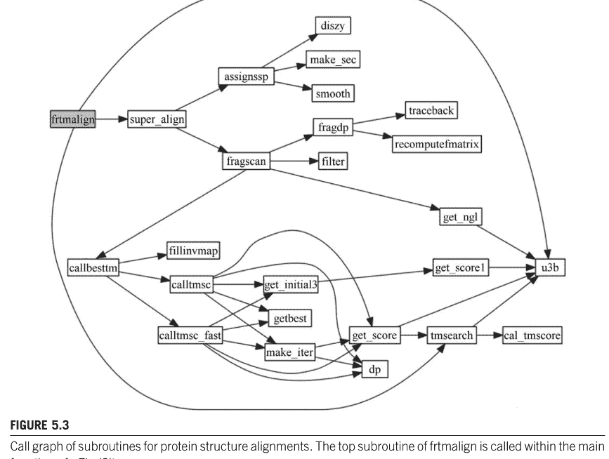

图5.3
蛋白质结构比对子例程的调用图。frtmalgn 作为顶层子例程在 eFindSite 的主函数中被调用。

代码的其余部分（包括比对前和比对后的计算）留在处理器上。在本章中，我们讨论使用卸载模式对 eFindSite 进行并行化，并针对 501 个目标蛋白质进行性能分析。

### 移植 eFindSite 以支持协处理器卸载

eFindSite 并行版本的流程图如图5.4所示。eFindSite 以目标蛋白质结构和配体结合模板库作为输入，来识别配体结合位点。结果，它产生一系列信息丰富的预测，包括推定的配体结合位点和结合残基、目标蛋白质与模板蛋白质之间的结构比对，以及用于虚拟筛选的配体分子指纹。作为结合位点预测核心的工作流程分为三个阶段。在比对前步骤中，eFindSite 从库中提取模板信息，并构建与目标的全局序列比对；这些计算在处理器上顺序执行。接下来，它将每个模板结构比对到目标上；此部分非常适合并行计算，因为各个比对彼此完全独立。代码剖析也指出这部分代码是计算最密集的。因此，我们决定对结构比对循环进行并行化，以便使用

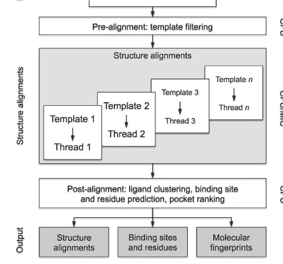

# 图5.4

eFindSite 的工作流程。比对前和比对后的计算使用单个处理器线程执行。结构比对使用处理器和/或协处理器上的多个线程并行执行。

多个处理器和/或协处理器线程。图5.4显示了每个结构比对被分配给一个唯一的硬件线程，因此不同的线程针对目标蛋白质并发地执行不同模板的计算。一旦结构比对完成，结果被发送回处理器，处理器在最终的比对后步骤中对识别出的结合口袋进行聚类和排序，并预测相应的结合残基。

在以下各节中，我们讨论将 eFindSite 移植到协处理器的一些细节。在主函数中，结构比对在一个遍历模板库的主循环内执行。结构比对的并行化是通过使用标准 OpenMP 编译指示并发执行每个比对来实现的，如图5.5所示。当主函数内调用包装函数 frtmalgn 时，结构比对开始执行，该函数调用用 Fortran77 实现的串行子例程 frtmalign 来进行实际的比对计算。我们发现这部分代码大量使用公共块，导致结构比对线程不安全。为了保证线程安全，我们使用 [!$omp threadprivate (/block_name/)] 将所有 Fortran77 公共块标记为线程私有，如图5.6所示。

eFindSite 的这种实现将部分代码卸载到协处理器上，在协处理器上执行结构比对，然后将结果传回处理器以执行最终的比对后计算。由于协处理器具有自己的内存，卸载模式需要在处理器和协处理器之间进行数据传输。eFindSite 使用 C++ 类来存储和操作与模板蛋白质相关的数据，例如原子坐标、氨基酸残基和序列。为了便于数据传输，我们额外做了工作，将原始数据结构转换为扁平的、可按位复制的数据数组，然后将其传输到协处理器，如图5.7所示。我们注意到，包含目标蛋白质和模板库的数组仅被复制到协处理器一次，因此来回移动数据的开销几乎为零。每个结构比对

```
//loop through the library of template proteins to conduct structure alignments
std::multimap< int, Template *, greater<int> >::iterator tpl1;
//parallelize the loop
#pragma omp parallel for schedule(dynamic) private(tpl1)
for (tpl1 = template_set.begin(); tpl1 != template_set.end(); tpl1++) {
    char template_seq[MAXPRO];
    int template_res[MAXPRO];
    double template_xyz[MAXPRO][3];
    //assemble protein residue, sequence and coordinate from the template library
    int template_len = ((*tpl1).second)->getProteinResiduesTotal();
    strcpy(template_seq, (((*tpl1).second)->getProteinSequence()).c_str());
    for ( int t_i =0; t_i < template_len; t_i++) {
        template_res[t_i] = t_i +1;
    }
    ((*tpl1).second)->getProteinCoordsCA(template_xyz);
    int t_score1, t_alig[MAXPRO];
    double t_score2, t_score3, t_score4, t_t[3], t_u[3][3];
    // call structure alignment subroutine
    frtmalign_(&t_score1, &t_score2, &t_score3, &t_score4, &template_len,\
    &target_len, &template_seq, &target_seq, &t_alig, &template_res,\
    &target_res, &template_xyz, &target_xyz, &t_t, &t_u, &align_len);
}
```

# 图5.5

主循环的 OpenMP 并行化，该循环执行目标蛋白质与一组配体结合模板之间的结构比对。

```
subroutine
frtmalign(tm_score1,tm_score2,tm_score3,tm_score4,target_len,template_len,
&           target_seq,template_seq,tm_align,target_res,template_res,
&           target_xyz,template_xyz,tm_tt1,tm_uu1,align_length)

parameter (maxres=1000)          ! no. of residues
parameter (maxlen=2*maxres)      ! for alignment
parameter (npr=2)                ! no. of proteins to align
double precision tm_score2,tm_score3,tm_score4,tm_xyzla(0:2,0:maxres-1),
&           template_xyz(0:2,0:maxres-1), tm_tt1(0:2),tm_uu1(0:2,0:2)
integer tm_score1,target_len,template_len, align_length,
&           tm_align(0:maxres-1),target_res(0:maxres-1),
&           template_res(0:maxres-1)
character*1 target_seq(0:maxres-1), template_seq(0:maxres-1)
character*3 resa(maxres,npr),resn(maxres,0:1)
character*1 seqa(maxres,npr),seqn(maxres,0:1)
dimension invmap0(maxres),ires(maxres,0:1)
dimension xtm1(maxres),ytm1(maxres),ztm1(maxres)
dimension xtm2(maxres),ytm2(maxres),ztm2(maxres)
dimension m1(maxres),m2(maxres)
dimension xyz(3,maxres,npr),length(npr)
common /coord/ xa(3,maxres,0:1)
common /length/ nseq1,nseq2
common /pdbinfo/ ires1(maxres,npr),resa,seqa
common /secstr/ isec(maxres),jsec(maxres)      !secondary structure
common /nln2/ n1(maxres),n2(maxres)
common /dinfo/ d8
common /stru/xt(maxres),yt(maxres),zt(maxres),xb(maxres),yb(maxres),
&               zb(maxres)
// OpenMP pragma to mark thread private
! $omp threadprivate(/coord/)
! $omp threadprivate(/length/)
! $omp threadprivate(/pdbinfo/)
! $omp threadprivate(/secstr/)
! $omp threadprivate(/nln2/)
! $omp threadprivate(/dinfo/)
! $omp threadprivate(/stru/)

cc call other routines...
end
```

# 图5.6

Fortran77 中公共块的线程安全实现。

该比对在协处理器上执行时，会通过偏移机制从传输的数据块中提取给定模板所需的数据。此外，我们使用编译器指令来标记卸载执行，如图5.8所示。具体来说，协处理器上用于结构比对计算的所有 Fortran77 子例程和全局变量分别使用卸载属性 [!dir$ attributes offload:mic:: subroutine_name] 和 [!dir$ attributes offload:mic::variable_name] 进行标记。此外，当在卸载块内调用 OpenMP 时，使用“MIC_”前缀设置协处理器的环境变量，即 [export MIC_OMP_NUM_THREADS=n]。由于 eFindSite 中单个结构比对的内存占用大于默认的 OpenMP 堆栈大小，我们通过使用 [export MIC_OMP_STACKSIZE=64M] 来增大它。

Intel Xeon Phi 协处理器型号 SE10P 具有 61 个内核，支持多达 240 个并行线程，其中第 61 个内核在使用卸载时保留给操作系统、I/O 操作等。线程在硬件内核上的物理分布由线程亲和性设置控制，


c  Fr-TM-align converted into a subroutine

!dir$ attributes offload:mic::frtmalighn
!dir$ attributes offload:mic::d8
!dir$ attributes offload:mic::xa
!dir$ attributes offload:mic::nseq1
!dir$ attributes offload:mic::nseq2
!dir$ attributes offload:mic::ires1
!dir$ attributes offload:mic::resa
!dir$ attributes offload:mic::seq_a
!dir$ attributes offload:mic::isec
!dir$ attributes offload:mic::jsec
!dir$ attributes offload:mic::n1
!dir$ attributes offload:mic::n2
!dir$ attributes offload:mic::xt
!dir$ attributes offload:mic::yt
!dir$ attributes offload:mic::zt
!dir$ attributes offload:mic::xb
!dir$ attributes offload:mic::yb
!dir$ attributes offload:mic::zb

subroutine frtmalighn(tm_score1,tm_score2,tm_score3,tm_score4,target_len,
     &     template_len,target_seq,template_seq,tm_align,target_res,
     &     template_res,target_xyz,template_xyz,tm_tt1,tm_uu1,align_length)
     .
end

## 图 5.8

Fortran77 子例程 frtmalighn 被卸载到协处理器上。

这些模式通常设置为紧凑（compact）、平衡（balanced）或散布（scatter）模式。由于亲和模式可能会影响并行性能，我们首先使用不同的 Intel KMP 亲和设置对 eFindSite 进行了基准测试，[export MIC_KMP_AFFINITY=compact/scatter/balanced]。

为了分析 eFindSite 的性能，我们首先开发了一种可靠的度量方法来量化其计算速度。如图 5.3 所示，子例程 u3b 是一个被频繁调用的低级函数，用于计算两组原子坐标之间的均方根偏差（RMSD）。我们发现，RMSD 计算的总次数与总墙钟时间和结构比对时间都有很好的相关性；相应的皮尔逊相关系数分别高达 0.963 和 0.960。因此，我们使用每秒 RMSD 计算次数来衡量 eFindSite 的性能。

在图 5.9 中，我们绘制了将代码的结构比对部分卸载到协处理器时 eFindSite 的性能。注意，比对前和比对后的步骤顺序执行于处理器上。由于基准数据集中的某些蛋白质模板少于 50 个，为了避免线程空闲，我们只考虑每个任务最多使用 24 线程的并行执行。令人鼓舞的是，增加协处理器上的线程数明显提升了 eFindSite 的性能。当线程数从 4 增加到 24 时，平均性能为每秒 4.27 × 10⁴ 到 2.30 × 10⁵ 次 RMSD 计算。仅就结构比对计算而言，几乎达到了完美的线性扩展（图 5.9 中的空心圆）。相比之下，当绘制总墙钟时间时，eFindSite 的性能达到平台期（图 5.9 中的黑色圆）。这里，每秒 RMSD 计算次数从 4 线程的 3.98 × 10⁴ 提高到 24 线程的 1.76 × 10⁵，这可以用阿姆达尔定律来解释，该定律描述了并行实现相对于串行算法的预期加速比之间的关系。这些性能测量是在平衡（balanced）和散布（scatter）线程亲和模式下进行的，这两种模式通过均匀散布

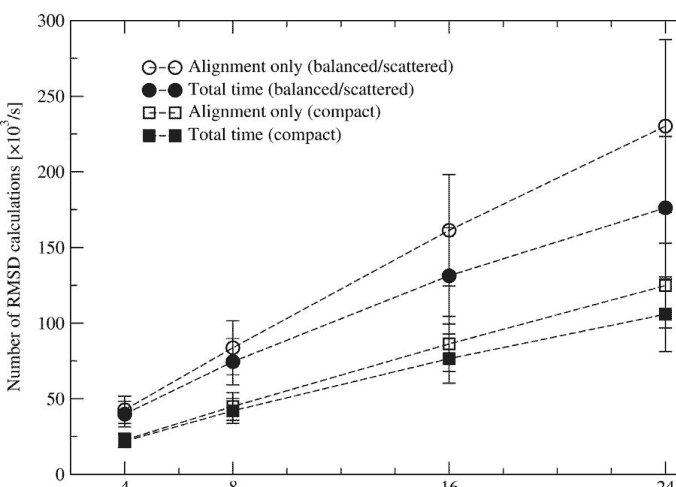

## 图 5.9

使用并行协处理器线程的 eFindSite 性能。速度以每秒 RMSD 计算次数（平均值 ± 标准差）来衡量，针对基准数据集中的 501 个蛋白质，使用 4、8、16 和 24 线程。实心和空心符号分别对应总时间和结构比对计算所花费的时间。圆形和方形分别表示使用平衡/散布和紧凑线程亲和的性能。

线程跨协处理器核心。对于紧凑亲和设置，即在移到下一个核心前将四个线程放在单个核心上，比对时间的 RMSD 计算速率从 2.27 × 10⁴ 增加到 1.25 × 10⁵（图 5.9 中的空心方形），总时间则从 2.19 × 10⁴ 增加到 1.06 × 10⁵（图 5.9 中的黑色方形）。虽然平衡/散布线程亲和相比紧凑亲和模式，每线程性能高出约 1.8 倍，但当协处理器上的线程总数超过 120 时，其优势开始减弱，当线程数达到 240 时，所有亲和模式基本趋于相同。事实上，核心到核心的性能比较显示，紧凑模式在每秒 2.44 × 10⁴ 次 RMSD 计算时的性能略高于平衡和散布模式的 2.38 × 10⁴。

### 面向多核处理器的并行版本

除了 eFindSite 的 Intel Xeon Phi 协处理器版本外，我们还实现了可在多核处理器上执行的并行代码。类似地，我们采用基于 pragma 的 OpenMP 来并行化结构比对计算，比对前和比对后的步骤均顺序执行。我们还使用 [export 将每个线程可用的内存增加到 64M

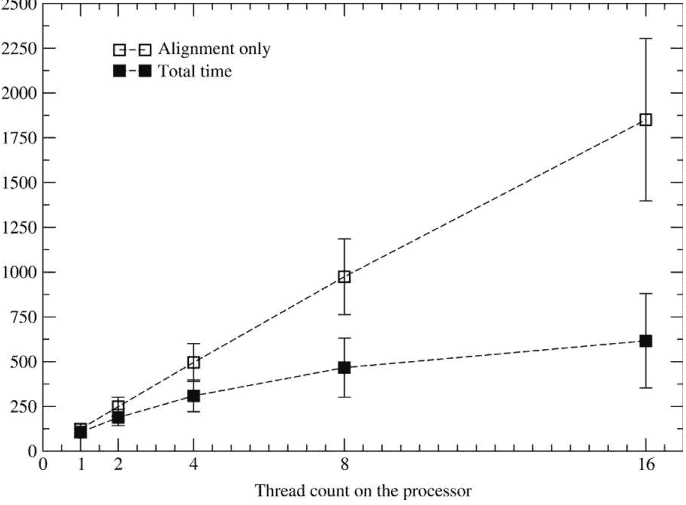

**图 5.10**
使用并行处理器线程的 *eFindSite* 性能。速度以每秒 RMSD 计算次数（平均值 ± 标准差）来衡量，针对基准数据集中的 501 个蛋白质，使用 2、4、8 和 16 线程。实心三角形和空心方形分别对应总时间和结构比对计算所花费的时间。

`OMP_STACKSIZE=64M`。在图 5.10 中，我们绘制了多线程版本 *eFindSite* 在 Intel® Xeon® E5-2680 处理器上的性能。使用总模拟时间，串行（1 线程）和并行（16 线程）版本在基准数据集上的平均性能分别为每秒 1.06 × 10⁵ 和 6.16 × 10⁵ 次 RMSD 计算。若仅考虑结构比对计算所花费的时间，平均性能则提高到每秒 1.24 × 10⁵ 和 1.85 × 10⁶ 次 RMSD 计算。当使用 16 个处理器线程时，实现了良好的线性扩展，相对于串行执行的加速比为 15。对于总墙钟时间，性能在加速比为 5.8 时达到平台期；我们注意到，根据阿姆达尔定律，使用 16 线程实现 90% 并行化的代码的理论最大加速比为 6.4。

### 处理器与协处理器的任务级调度

配备 Intel Xeon Phi 协处理器卡的计算节点通过多核处理器和众核协处理器提供大规模并行能力。因此，我们的最终目标是开发一个能够充分利用这两种资源的 *eFindSite* 生产级代码。该生产方案

利用 eFindSite 在大型蛋白质数据集上预测配体结合位点，需要同时使用处理器和协处理器。处理器执行代码的串行部分，而结构比对则以紧凑亲和模式卸载到协处理器上，以最大化 eFindSite 的性能。同时，处理器还运行一个使用相对较少线程的 eFindSite 并行版本。这样，我们就可以在两个计算单元上同时执行的多个并行任务并发处理多个蛋白质。

我们用 Perl 开发了一个作业调度器，在处理器上启动最多 4 个并行任务（每个任务 4 线程），在协处理器上启动最多 10 个并行任务（每个任务在紧凑亲和模式下使用 24 线程）。如图 5.11 所示，我们首先按残基数量与模板数量的乘积对目标蛋白质进行排序，该乘积用于估算完成计算所需的墙钟时间。因为我们

```
use Proc::Background;
my $n_mic = 10;    // 10 parallel jobs on a coprocessor
my $n_cpu = 4;     // four parallel jobs on a processor
my @lst3 = ();     // template protein list
foreach my $wlst2 ( sort { $lst2{$a} <=> $lst2{$b} } keys %lst2 ){
    push(@lst3, $wlst2);
}
while ( @lst3 ){
    # dispatching jobs to Xeon processor
    for ( my $xa = 0; $xa < $n_cpu; $xa++ ){
        # start a new process if the current is finished
        if ( @lst3 and !$j_cpu[$xa]->alive() ){
            #get an item from the top of the list (smaller template)
            my $job = shift(@lst3);
            printf("CPU%d <- %s ... %.1f%%\n", $xa, $job, \
                (++$prgl/$n1st3)*100.0, '%');
            $j_cpu[$xa]=Proc::Background->new("$ef_omp -s $job.pdb \
                -t $job.ethread-fun -i $job.ss -e $job.prf -o $job- \
                efindsite -b $foptb -x $foptx > $job.log 2>&1");
            $c_cpu[$xa]++;
            $l_cpu[$xa] += $lst2{$job};
        }
    }
    # offloading jobs to Xeon MIC jobs
    for ( my $xa = 0; $xa < $n_mic; $xa++ ){
        if ( @lst3 and !$j_mic[$xa]->alive() ){
            #get an item from the bottom of the list (larger template)
            my $job = pop(@lst3);
            my $kpt='export \
                MIC_KMP_PLACE_THREADS=6c,4t,'.int($xa*6).'O';
            printf("MIC%d <- %s ... %.1f%%\n", $xa, $job, \
                (++$prgl/$n1st3)*100.0, '%');
            $j_mic[$xa] = Proc::Background->new('$kpt ; $ef_mic -s \
                $job.pdb -t $job.ethread-fun -i $job.ss -e $job.prf -o \
                $job-efindsite -b $foptb -x $foptx > $job.log 2>&1");
            $c_mic[$xa]++;
            $l_mic[$xa] += $lst2{$job};
        }
    }
    sleep(2) if ( @lst3 );
}
```

## 图 5.11

用 Perl 实现的任务调度器的一部分，它在处理器上调度 4 个并行任务（每个任务 4 线程），并在协处理器上调度 10 个并行任务（每个任务 10 线程）。


使用协处理器每个任务 24 线程，处理器每个任务 4 线程，我们将较长的任务分派到协处理器，而较短的作业则在处理器上执行。在处理器上运行 4 个并行任务，在协处理器上运行 10 个并行任务可确保两种资源都得到充分利用。为了避免协处理器核心过载，生产代码在紧凑线程亲和性下对并行任务到硬件线程进行了显式映射。具体来说，[export MIC_KMP_PLACE_THREADS=6c,4t,(i*6).'o'] 定义了分配给每个任务的逻辑单元集合，其中 6c 请求六个核心，4t 在每个核心上启动四个线程，而 (i*6).'o' 是各个任务之间六个核心的偏移量。例如，当 i=0 时，第一个任务在 0-5 核心上运行，每个核心 4 个线程共 24 个线程，下一个任务将 i=1 设置为在 6 到 11 核心上运行，以此类推。这样，调度程序为不同的并行任务分配不同的核心，以便以加速器硬件的最大利用率进行蛋白质结构比对。图 5.12 列出了并行执行的划分细节，用于基准数据集，使用配备两个 8 核 Intel Xeon E5-2680 处理器（8 线程，超线程已禁用）和一个 61 核 Intel Xeon Phi SE10P 协处理器（240 线程，紧凑线程亲和性）的计算节点。

| 硬件 | 核心范围 | 线程数 | 计算百分比 |
|---|---|---|---|
| 处理器 | 1-4 | 4 | 12.2 |
|  | 5-6 | 4 | 12.5 |
|  | 7-11 | 4 | 12.7 |
|  | 12-16 | 4 | 11.8 |
| 协处理器 | 1-6 | 24 | 5.1 |
|  | 7-12 | 24 | 5.1 |
|  | 13-18 | 24 | 5.1 |
|  | 19-24 | 24 | 5.0 |
|  | 25-30 | 24 | 5.3 |
|  | 31-36 | 24 | 5.0 |
|  | 37-42 | 24 | 4.7 |
|  | 43-48 | 24 | 5.0 |
|  | 49-54 | 24 | 5.4 |
|  | 55-60 | 24 | 5.1 |
| 处理器 | 1-16 | 16 | 49.2 |
| 协处理器 | 1-60 | 240 | 50.8 |

## FIGURE 5.12

使用 eFindSite 同时在处理器和协处理器上处理 501 个基准蛋白质的划分细节。计算量近似为目标蛋白长度与模板结构数量的乘积。

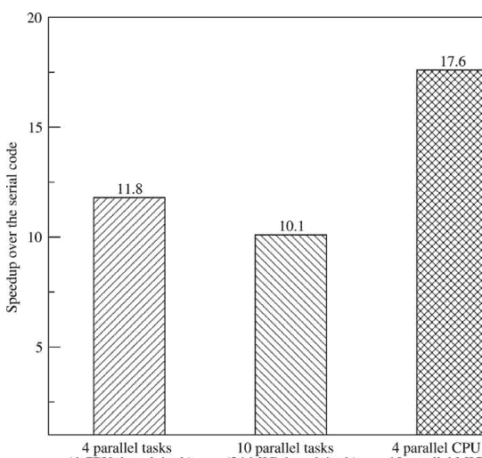

## FIGURE 5.13

eFindSite 并行版本相对于串行代码的加速比。计算使用三种并行版本执行：多个处理器线程（4 个任务，每个运行 4 个线程）、多个协处理器线程（10 个任务，每个运行 24 个线程），以及多个处理器和协处理器线程同时运行。

我们使用任务级并行处理了全部 501 个蛋白质的数据集，并测量了完成时间，定义为预测配体结合位点所需的总时间。图 5.13 比较了串行版本和三种并行处理方案的结果。相对于串行版本的加速比分别为使用处理器并行处理时的 11.8、使用协处理器时的 10.1、以及使用两种资源时的 17.6。因此，除了处理器外再使用协处理器可加速对大型蛋白质数据集的结合位点预测。我们还监控了计算资源的利用率，以证明所有硬件线程都得到利用。图 5.14 显示，在生产模拟期间，处理器和协处理器的平均使用率分别为 99.9% 和 82.2%。协处理器线程在等待处理器开始预比对（读取输入文件、执行序列比对）和完成后比对（口袋聚类和排序）任务时会周期性地变为空闲，导致协处理器的利用率相对较低。另一方面，处理器保持完全利用，不仅促进卸载到协处理器的任务，还自行执行 eFindSite 计算。最后，我们检查了结果的数值正确性。不同版本的 eFindSite 产生相同的结果，因此使用 OpenMP 并行化 eFindSite 并卸载到 Intel Xeon Phi 协处理器完全保持了原始代码的功能，同时具有模拟时间大幅缩短的巨大优势。

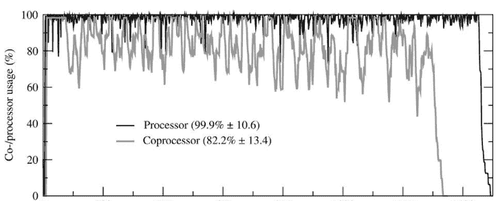

## FIGURE 5.14

异构并行版本 eFindSite 执行期间的资源利用率。处理器使用百分比的时间进程（黑色线）与协处理器（灰色线）进行比较。

### CASE STUDY

最后，我们提供一个案例研究来说明使用 eFindSite 进行结合口袋预测。从基准数据集中选定的目标蛋白是人精氨酸酶 I（PDB-ID：3gn0，链 A），一种水解 L-精氨酸的双核锰金属酶。这种蛋白的异常活性与多种疾病状态有关，包括勃起功能障碍、动脉粥样硬化和脑型疟疾。eFindSite 为该蛋白预测了总共 10 个口袋，并将置信度 91.9% 分配给排名最高的结合位点。图 5.15 显示了该蛋白的晶体结构（透明丝带），eFindSite 预测的排名最高结合口袋用实心球标记。相应的预测结合残基显示为透明灰色表面。两个额外的较小球标记了排名 2 和 3 的口袋位置。预测精度可以通过揭示实验复合物结构中结合到目标蛋白的配体 α-二氟甲基鸟氨酸的位置来评估，用实心棒表示。需要注意的是，配体位置并非预测过程的一部分，仅用于验证目的。预测的排名最高结合位点与配体几何中心之间的距离仅为 2.22 Å，证明了 eFindSite 具有很高的预测精度。作为配体结合预测的可靠工具，eFindSite 适用于从蛋白功能注释到虚拟筛选和药物发现的广泛应用。

### SUMMARY

eFindSite 是一种用于药物发现和设计的配体结合位点预测软件。为了满足蛋白质组规模应用的挑战，我们为使用配备 Intel Xeon Phi 协处理器的 HPC 系统处理大型数据集实现了 eFindSite 的并行版本。该并行版本的 eFindSite 使用处理器和协处理器相对于串行代码实现了 17.6 倍加速，这在按硬件成本归一化时被认为是很显著的。x86 协处理器架构允许在传统处理器和协处理器上进行开放标准和可移植的并行编程。特别是，使用 OpenMP 使并行化代码的某些部分相对容易。*eFindSite* 代表了典型的科学软件，主要由领域科学家编写，他们使用不同的编程语言和风格贡献了代码的不同组件。从我们的移植经验来看，即使是像 *eFindSite* 这样的混合 C++/Fortran77 源代码这样相当复杂的代码，也可以成功移植以同时利用 Intel Xeon 处理器和 Intel Xeon Phi 协处理器，在最小的编码工作下获得加速。

*eFindSite* 并行版本的发展相当直接；然而，我们想讨论在此过程中遇到的几个问题。首先，由于 Fortran77 代码中大量使用了线程不安全的公共块，我们最初尝试重写这些子程序以显式传递参数而不是访问公共块。然而，这些工作花费了很长时间，并且考虑到代码的“意大利面条式”特性以及对公共块的多个访问点，我们无法及时重现正确的结果。因此，我们决定使用 OpenMP pragma 将原始代码中的全局变量标记为线程私有。该方法在开发线程安全并行实现的过程中被证明非常实用且高效。我们遇到的另一个问题与堆栈大小有关。我们发现，某些 HPC 系统上的默认堆栈大小小于使用 `OMP_STACKSIZE` 为 *eFindSite* 设置的大小，导致段错误。因此，除了 OpenMP pragma 之外，可能还需要使用 `ulimit -s` 修改默认系统堆栈大小。

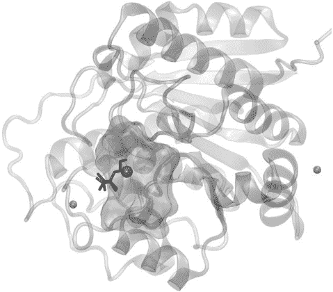

**FIGURE 5.15**

使用 *eFindSite* 对人精氨酸酶 I 进行配体结合口袋预测。目标蛋白的晶体结构和结合配体分别显示为透明灰色丝带和实心黑色棒。排名最高的预测结合位点显示为代表口袋中心的实心球和围绕结合残基的透明分子表面。两个较小的球代表排名 2 和 3 的预测结合口袋的中心。

resources, which is considered significant when normalized by the cost of the hardware. The x86 coprocessor architecture allows for open-standard and portable parallel programming on both traditional processors as well as coprocessors. In particular, using OpenMP makes it relatively easy to parallelize portions of the code. *eFindSite* represents a typical scientific software written mostly by domain scientists, who contributed different components to the code using different programming languages and styles. From our porting experience, even fairly complex codes, such as the hybrid C++/Fortran77 source code of *eFindSite*, can be successfully ported to utilize both Intel Xeon processors and Intel Xeon Phi coprocessors together yielding speedups at minimal coding efforts.

The development of the parallel version of *eFindSite* was fairly straightforward; however, we would like to discuss a couple of problems encountered throughout this process. First, due to the extensive use of thread-unsafe common blocks in the Fortran77 code, we initially attempted to rewrite those subroutines to pass parameters explicitly instead of accessing common blocks. However, these efforts took a very long time and considering the “spaghetti-like” nature of the code with multiple access points to common blocks, we could not reproduce the correct results in a timely fashion. For that reason, we decided to use OpenMP pragmas to mark the global variables as thread-private in the original code. This method turned out to be very practical and time efficient in the process of developing a thread-safe parallel implementation. Another issue we ran into was related to the stack size. We found that the default stack size on some HPC systems is smaller than that set for *eFindSite* using `OMP_STACKSIZE` causing segmentation fault errors. Consequently, in addition to OpenMP pragmas, modifying the default system stack size using `ulimit -s` may be required.


尽管实现了17倍的加速，仍有改进空间，以充分利用协处理器所具备的宽单指令多数据（SIMD）向量。例如，恰当的循环向量化对于提高整体性能至关重要。为eFindSite收集的向量化报告显示，大多数消耗最多执行时间的循环确实已被向量化。然而，报告中指出的与数据依赖和对齐相关的其他问题，需要通过重排循环、填充数据结构、提高寄存器利用率以及数据缓存等方式来解决。因此，除了将串行代码的其余部分并行化之外，本项目的未来方向还包括进行彻底的代码优化，以更好地利用Intel Xeon处理器和Intel Xeon Phi协处理器的SIMD架构。我们计划手动调优用于RMSD计算的内核中相对较小的一部分，以进一步提升eFindSite的并行性能。

### 更多信息

- *eFindSite* 的源代码可在 [www.brylinski.org/efindsite](http://www.brylinski.org/efindsite) 获取。该网站还提供编译和安装说明，以及关于使用异构计算平台处理大型数据集的详细教程。
- Feinstein, W.P., Moreno, J., Jarrell, M., Brylinski, M., 2015. 利用Intel Xeon Phi协处理器加快蛋白质功能注释的步伐。*IEEE Trans. Nanobiosci.* DOI: 10.1109/TNB.2015.2403776.
- Brylinski, M., Feinstein, W.P., 2013. *eFindSite*：使用元线程、机器学习和辅助配体改进蛋白质模型中配体结合位点的预测。*J. Comput. Aided Mol. Des.* 27, 551-567.
- Feinstein, W.P., Brylinski, M., 2014. *eFindSite*：基于增强指纹的虚拟筛选，针对蛋白质模型中的预测配体结合位点。*Mol. Inform.* 33, 135-150.
- 可从 [http://lotsofcores.com](http://lotsofcores.com) 下载本章及其他章节的代码。

### AMBER PME 分子动力学优化

Ashraf Bhuiyan*，Perri Needham†，Ross C. Walker†,‡
美国英特尔公司*，美国圣地亚哥超级计算中心†，美国加利福尼亚大学圣迭戈分校‡

在本章中，我们展示了Amber分子动力学软件（http://ambermd.org/）现在如何在集群层面使用消息传递接口（MPI），并在节点层面结合OpenMP和卸载模式，以改善Amber软件套件中PMEMD引擎的扩展性，无论节点上是否使用协处理器。观测到的性能提升包括：与最初仅使用MPI的代码相比，使用四个节点（96个MPI任务）时实现了2.83×的加速。

在生命科学研究领域，理解大型生物分子（如蛋白质、核酸和脂双层）的结构动力学，对于理解重要的生物途径和机制至关重要。揭示酶潜在功能机制的重要生物学结构变化通常发生在微秒到毫秒时间尺度。直到最近，对于大多数无法获得强大计算资源的研究者来说，这样的时间尺度通常超出了经典分子动力学（MD）的适用范围。提高MD模拟保真度的关键是提高构象空间的探索速率。这不仅使得研究更长时标上发生的事件成为可能，还改善了统计收敛性，并提供了一种更快速验证经典MD力场的机制。

近年来，协处理器（或加速器）技术已在计算科学中普及，为加速计算研究提供了一种负担得起的解决方案。Amber MD软件包就是成功使用协处理器技术的一个典型例子。Amber中的pmemd引擎是一个高度优化的MD模拟包，能够使用多个CPU和/或图形处理单元（GPU）以及Amber和CHARMM力场，模拟显式或隐式溶剂化的分子系统。更多信息请参阅Amber 14手册以及本章末尾“更多信息”一节中列出的前三个与Amber相关的论文。

市场上较新的产品是基于Intel® Many-Integrated Core（Intel® MIC）架构的Intel® Xeon Phi™协处理器。第一代Intel Xeon Phi产品（原代号Knights Corner）提供多达61个Intel x86内核，运行频率为1.238 GHz（1.333 GHz睿频），板载16 GB内存，通过PCI Express扩展卡可提供高达1.2 TFLOPS的双精度浮点性能。

本章描述了添加到Amber的pmemd MD引擎中的Intel Xeon Phi协处理器支持，旨在提高显式溶剂（粒子网格Ewald—PME）MD模拟的性能。虽然隐式溶剂的广义Born MD模拟也受支持，但本章不进行描述。先前使用协处理器优化MD的尝试依赖于大量代码修改、SIMD向量化和Intel线程构建模块（TBB）。文献中发表的先前尝试也常常集中于实现一个精简版MD算法，该算法忽略了力的长程静电贡献。更多信息请参阅“更多信息”一节中Plotnikov和Sun的论文。本研究采用的方法避免了通过使用汇编指令或内建函数进行大规模重写来实现广泛的代码向量化，因为在初步测试中仅实现了约5%的微小性能提升，而且汇编或内建函数代码需要针对每一代新的Intel MIC架构进行大规模重写。对现有pmemd代码进行广泛显式向量化所得到的性能提升有限，原因是循环内不规则的内存访问模式，而解决这一问题会牺牲代码的可维护性和可读性。向量化很重要，并且通过使用OpenMP simd指令实现。这避免了大型算法改动，而是专注于最大化灵活性，同时仍然提高性能。所采用的方法是利用现有MPI框架将直接空间求和计算的一部分卸载到协处理器，然后使用OpenMP线程进一步分解每个卸载MPI任务的工作负载，从而暴露细粒度并行性，同时最小化内存占用并优化内存重用。在本章中，我们讨论了MD理论、Amber两个计算最密集部分的性能改进、代码优化技术、所取得的结果和结论。

### MD 理论

在最广泛使用的形式中，生物系统的MD模拟利用经典力学和一组预定的分子力学力场。这些力场已通过更精确的量子力学数据和/或与实验观测的拟合进行了参数化，用于评估一组给定原子坐标的势能梯度随时间的变化。这使得牛顿运动方程能够配合合适的积分器，用于在时间上推进原子位置。MD时间步长通常在2到4飞秒（fs）之间，需要如此短的步长来捕捉最快的振动运动，但同时人们希望模拟微秒甚至更长时间。这意味着线性模拟需要约10^9个积分步骤。

在典型的MD模拟中，溶剂（水加上任何额外离子）中所有原子的相互作用与溶质一起被离散计算。图6.1正式描述了给定原子构型的势能。

涉及键和角的求和通过谐振函数计算，使用力常数 *bᵢ* 和 *aᵢ* 以及平衡键距 *rᵢ,eq* 和平衡键角 *θᵢ,eq*。图6.1中的第三项表示二面角能量，使用截断的傅里叶级数，该级数包含每个独立傅里叶项 *n* 的扭转常数 *Vᵢ,n* 和相位偏移 *γᵢ,n*。*n* 通常从1到4。这些是势能函数中的键合项，取决于所模拟结构中的共价键。非键合项（图6.1中的最后两项）描述了一个原子与系统中所有其他通过3个以上键分离的原子（用撇号表示）的相互作用。这些是范德华相互作用，由12–6 Lennard-Jones势表示。


### **图 6.1** Amber 势能方程。

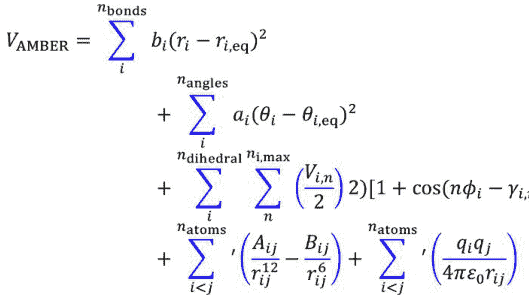

采用双原子参数 $A_{ij}$ 和 $B_{ij}$ 的势能，以及由原子点电荷 $q_i$ 和 $q_j$ 以及它们之间的距离 $r_{ij}$ 计算出的库仑相互作用。库仑相互作用使用一种称为 PME 求和的数学近似来计算。这使得库仑相互作用可以分解为三个快速收敛的部分：$V_{\mathrm{direct}}+V_{\mathrm{reciprocal}}+V_{\mathrm{self}}$。在显式溶剂模拟中通常使用周期性边界条件，因此从模拟盒子一边离开的粒子会从相对的另一边重新进入。由于 Lennard-Jones 势随距离衰减很快，该求和通常在距离大于 8–12 Å 时被截断。库仑求和通常被分成一个匹配的直接部分（与 Lennard-Jones 方程在同一距离处截断，由图 6.1 中的第 5 项表示），以及一个单独的倒易空间求和，后者通过网格插值和一系列傅里叶变换在整个周期系统上计算。上述第 4 项和第 5 项中的撇号表示求和只对相隔三个或更多键的原子进行，并且在原子恰好相隔三个键的情况下，相互作用会乘以一个依赖力场的缩放因子。关于所用完整数学模型的更详细讨论，请参阅 Salomon-Ferrer 等人和 Needham 等人的论文，见“更多信息”一节。

Amber MD 代码的程序流程如图 6.2 所示。Amber MD 模拟的时间步长可通过输入文件配置。

分析各例程所花费的时间得到图 6.3，该图显示了 MD 方程中计算量最大的部分的性能。可以看出，将加速工作的重点放在 PME 直接空间求和（图 6.1 中的第 4 和第 5 项）上是自然的选择，因为它占用了程序超过 44% 的执行时间。PME 直接空间求和的计算依赖邻居列表来识别位于指定截断距离内的原子对。PME 直接空间求和计算对邻居列表的这种依赖性促使我们决定也在协处理器上执行部分邻居列表构建。这一决定是在研究另一种方案后做出的；该方案需要在主机和协处理器之间进行昂贵的数据传输，以确保 PME 直接空间求和例程能够访问到最新的邻居列表，但事实证明这种做法对性能不利。

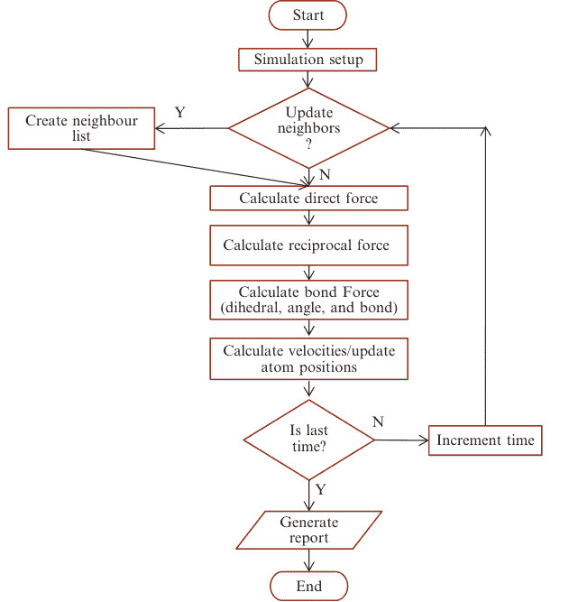

### **图 6.2** 显示 pmemd 在每个时间步上的执行路径的程序示意图。

### 使用协处理器加速邻居列表的构建

邻居列表的构建在所有 MPI 任务中执行。卸载 MPI 任务在处理器和协处理器上并发地为各自分配的原子执行邻居列表构建，对于 12 核 Intel® Xeon® 处理器，工作负载分配比例为 22:78。该比例取决于处理器上的核心数。该算法通过将模拟空间划分为若干桶（bucket）来工作。桶的宽度约为截断距离的一半。这大大减少了搜索邻近原子的计算量，因为需要查找的邻近桶更少了。加速和卸载邻居列表的步骤如下：

- (1) 卸载 MPI 任务在主机上查找各自的邻近桶。
- (2) 构建卸载原子邻居列表所需的变量被异步传输到协处理器。


- PME 邻居列表
- PME 直接力
- PME 倒易力
- DataDistrib
- PME 键合项
- 其他

### **图 6.3** Amber PMEMD 模拟中各主要组件所花费的时间占比。

- (3) 并发构建两个独立的邻居列表：(a) 主机邻居列表和 (b) 协处理器邻居列表。协处理器列表对线程是私有的，遵循两个策略：(1) 列表驻留在构建该列表的硬件上；(2) 从不合并为完整的邻居列表。这两个策略节省了大量的 PCIe 传输和内存读/写时间。
- (4) 主机所需的变量（例如记录已使用原子的变量 `img_used_lst`）从协处理器异步传输到主机。
- (5) 主机执行会先等待来自协处理器的返回信号，然后再继续。

协处理器邻居列表是静态分配的，为每个 OpenMP 线程提供固定数量的内存位置来存储邻近原子。如果一个原子的邻近原子数量增长到超出分配的内存，则重新分配邻居列表。这种静态内存分配方案将内存使用保持在最低限度（因为只存储要在协处理器上计算 PME 直接空间求和的邻近原子），并减少了内存分配次数（因为每个原子的邻居列表不一定每次构建时都会增长）。

### 使用协处理器加速直接空间求和

PME 直接空间求和在主机和协处理器上并发执行（图 6.4）。卸载 MPI 任务执行以下步骤：

- (1) 声明协处理器变量，并将全局变量复制到设备内存位置。
- (2) 每次构建邻居列表时都需要更新的变量会被复制或重新分配到协处理器，因为这比从主机内存映射数据更优。

```fortran
!dir$ offload begin mandatory signal(sig1) target (mic:0) &
in(flat_cit(0:cit_tbl_x_dim*cit_tbl_y_dim*cit_tbl_z_dim-1) : alloc_if(.false.) free_if(.false.) into(flat_cit_dev(:)))&
in(fraction(:,1:atm_cnt) : alloc_if(.false.) free_if(.false.) into(fraction_dev(:, :)))&
in(x_bkts(0 : cit_tbl_x_dim_dev * 3 - 1) : alloc_if(.false.) free_if(.false.) into(x_bkts_dev(:)))&
in(x_trans(0 : cit_tbl_x_dim_dev * 3 - 1) : alloc_if(.false.) free_if(.false.) into(x_trans_dev(:)))&
in(y_trans(0 : cit_tbl_y_dim_dev * 3 - 1) : alloc_if(.false.) free_if(.false.) into(y_trans_dev(:)))&
in(y_bkts(0 : cit_tbl_y_dim_dev * 3 - 1) : alloc_if(.false.) free_if(.false.) into(y_bkts_dev(:)))&
in(z_bkts(0 : cit_tbl_z_dim_dev * 2 - 1) : alloc_if(.false.) free_if(.false.) into(z_bkts_dev(:)))&
in(z_trans(0 : cit_tbl_z_dim_dev * 2 - 1) : alloc_if(.false.) free_if(.false.) into(z_trans_dev(:)))&
out(used_img_lst_thread_dev(1:atm_local) : alloc_if(.false.) free_if(.false.))
................................
/*Offload code to build neighbor list for Xeon Phi*/
!dir$ end offload
................................
/*Host code to build neighbor list for host*/
/*Synchronize Host and Xeon Phi*/
!dir$ offload begin mandatory target(mic:0) wait(sig1)
!dir$ end offload
```

### **图 6.4** 在主机和协处理器上并行构建邻居列表的代码片段。完整代码可在 Amber 源代码的 `nb_pairlist.F90` 文件中的 `get_nb_list_offload()` 例程中找到。

- (3) 每个时间步都需要的变量被异步传输到协处理器，从而允许主机和协处理器同时执行。
- (4) 索引代码用于在静态分配的协处理器邻居列表中识别邻居。
- (5) 力计算在协处理器上开始，使用由卸载 MPI 进程派生的 OpenMP 线程。
- (6) 控制权立即交还给主机，从而允许 PME 直接空间求和在主机和协处理器上异步计算。
- (7) 每个 OpenMP 线程都有用于存储力的数组的单独副本，否则会出现竞争条件。对使用锁来节省内存的方法进行了研究，结果表明，即使使用私有数组方法时需要对多个力数组副本进行代价高昂的初始化和归约，私有数组的性能仍比另一种锁方法快约 10–15%。


- (8) 主机上的 PME 直接空间和使用了查找表（LUT）来计算互补误差函数 erfc。然而，在协处理器上，LUT 由于 L2 缓存未命中而导致了高内存访问延迟。当协处理器尝试对访问进行向量化时，这会导致性能不佳。通过即时计算 erfc，部分延迟得以降低（但并非全部，因为其他一些数组，即力和坐标数组，由于不规则数组访问仍然存在延迟开销），从而使性能进一步提升了 5%。

- (9) 在所有 OpenMP 线程完成后，将力数组归并为一个力数组。

- (10) 主机执行在继续之前等待来自协处理器的返回信号。

- (11) 协处理器力数组被异步复制回主机，并与主机力数组合并。

### 协处理器代码中的额外优化

本节描述了应用于加速 Amber 14 中协处理器卸载实现的三种关键优化技术。

### 尽可能移除锁

在图 6.5 的原始代码片段中，数组索引 img_j 定义了当前正在计算的原子的邻近原子。当循环通过 OpenMP 循环分布到各核心上时，使用 img_j 索引的数组更新会同时发生。多个原子可能拥有相同的邻近原子；因此，多个 OpenMP 线程的 img_j 可能相同，从而导致竞争条件。

为了防止这种竞争条件，原始代码中使用了 OpenMP 临界区。由于 OpenMP 临界区代码对性能不利，我们找到了一种完全避免临界区的变通方法，如优化代码所示。used_img_map() 数组和 used_img_cnt 变量用于将值顺序存储在 used_img_lst() 数组中。由于为 Host 和 Phi 分别构建了两个独立的邻居列表，因此构建了 used_img_lst() 和 used_img_map() 的两个版本；然后，这两个版本被合并以生成两个数组的组合版本。之后，这两个数组都在其他例程中使用。所有功能都可以通过更简单且无锁的代码实现，如优化代码列所示。所有 OpenMP 线程都更新这个共享数组，并且多个线程可以更新相同的位置（置为 1）。used_img_map() 现在在 img_j 的位置（即原子索引）包含“1”。在协处理器上构建 used_img_map() 数组后，它会与主机版本的 used_img_lst() 和 used_img_map() 一起使用，以构建 used_img_lst() 和 used_img_map() 的组合版本。该优化之所以可行，是因为 used_img_map() 是单字节类型，并且 1 存储在特定的数组位置上。优化代码可以在 Amber 源代码的 nb_pairlist.F90 文件中的 get_nb_list_offload() 例程中找到。

| 原始代码 | 优化代码 |
|---|---|
| <pre>/*Xeon Phi offload code*/<br>OpenMP Do loop starts<br><br>................<br><br>!$omp critical<br>&nbsp;&nbsp;if (used_img_map(img_j) .eq. 0) then<br>&nbsp;&nbsp;&nbsp;&nbsp;used_img_map(img_j) = 1<br>&nbsp;&nbsp;&nbsp;&nbsp;used_img_cnt = used_img_cnt + 1<br>&nbsp;&nbsp;&nbsp;&nbsp;used_img_lst(used_img_cnt) = img_j<br>&nbsp;&nbsp;end if<br>!$omp end critical<br><br>................<br>OpenMP loop ends<br>................<br>/*Xeon Phi and Host version of used_img_map() are combined. Similarly two versions of used_img_lst() are combined for later use*/</pre> | <pre>/*Xeon Phi offload code*/<br>OpenMP Do loop starts<br><br>................<br><br>used_img_map(img_j) = 1<br><br>................<br>OpenMP loop ends<br>................<br>/*Xeon Phi version of used_img_map() is used with existing img_map() and used_img_lst() to get combined version of used_img_lst() and used_img_map() for later use*/</pre> |

图 6.5

代码片段展示了通过移除 omp 临界区来优化邻近原子分配的过程。

### 排除列表优化

如图 6.6 所示，在原始代码中，每个时间步都会初始化 excl_img_flags() 数组（一个用于邻居列表计算的数组），为每个 OpenMP 线程分配，然后在搜索完每个桶后再次重置。

原始代码中的所有任务都可以通过以下方式进行优化：

- 1. 分配一个大小为 *atm_cnt* × *线程数* 的更大数组，允许在系统设置期间一次性分配该数组，从而无需在每次循环迭代时重新分配
- 2. 在系统设置中对数组进行一次初始化
- 3. 在邻居列表代码中使用具有适当索引的更大数组
- 4. 仅重置更大数组中已使用过的位置。这样，该数组可以在下一个时间步中再次使用。

通过这种优化，我们可以节省在每个时间步内在 OpenMP 运行时中重置和分配数组的时间；这两项操作都很昂贵。优化代码可以在 nb_pairlist.F90 文件中的 get_nb_list_offload() 例程中找到。

### 减少卸载代码中的数据传递和计算

如图 6.7 所示，在原始的 Amber MD 代码中，每个 MPI 进程分配并使用全局原子列表和力数组。因此，在卸载实现中，全局原子列表和力数组必须在主机和协处理器之间来回传输。然而，由于每个 MPI 进程并不使用完整的原子列表，因此采用了一种优化来减少卸载代码中的数据传递和计算。原子索引的范围通过在直接空间和计算之前找出所用原子的最大和最小索引来确定。

这种优化也扩展到其他不需要完整原子范围（1 到 atm_cnt）的数组。优化代码可以在 get_nb_energy_offload.i 文件中的 get_nb_energy_offload() 例程中找到。

循环已进一步优化，如图 6.6 所示。Fortran 允许对循环访问进行索引，使得数组的所有位置在编译器看来在内存中是连续的，从而允许在更少的时钟周期内发出 memset。

```text
Original Code
/*inside neighbor list routine*/
/*Reset the array in each step*/
do i = 1, atm_cnt
  excl_img_flags(i) = 0
end do
OpenMP loop starts
............
/*allocate arrays for each OpenMP threads*/
!$omp firstprivate(excl_img_flags_dev)
..........
/*Reset excl_img_flags() back again after each bucket of atoms are searched for neighbors*/
  do i = atm_mask_idx + 1, atm_mask_idx + atm_maskdata(atm_i)%cnt
    excl_img_flags(offset_excl + atm_img_map(atm_mask(i))) = 0
  end do
............
OpenMP loop ends
```

```text
Optimized Code
/*inside an initial setup routine*/
do i = 1, atm_cnt*num_threads
    excl_img_flags_threaded(i) = 0
end do
/*inside neighbor list routine*/
OpenMP loop starts
............
do i = atm_mask_idx + 1, atm_mask_idx + atm_maskdata(atm_i)%cnt
    excl_img_flags_threaded(offset_excl + atm_img_map(atm_mask(i))) = 0
end do
..........
/*Reset excl_img_flags_threaded() back again after each bucket is searched */
do i = atm_mask_idx + 1, atm_mask_idx + atm_maskdata(atm_i)%cnt
    excl_img_flags(offset_excl + atm_img_map(atm_mask(i))) = 0
end do
................
OpenMP loop ends
```

图 6.6
代码片段展示了排除列表计算的优化。
图 6.6（续）

### 负载均衡算法的修改

计算原子所受力的工作通过 Amber 负载均衡方案分配给 MPI 任务。该算法经过修改，使协处理器获得适当的负载份额，并与处理器并发运行，如下所示：

### PME 直接空间和与邻居列表工作

所有 MPI 任务都被分配了 PME 直接空间和与邻居列表工作。负载均衡器会监控每个 MPI 任务在 50–100 个时间步内计算 PME 直接空间和的性能，并据此动态调整分配给每个 MPI 任务的 PME 直接空间和与邻居列表工作量。每个 MPI 任务的邻居列表性能不会被监控，因为它与 PME 直接空间和的性能成正比，因此会根据 PME 直接空间和的性能自动调整。在模拟开始时，卸载 MPI 的性能优于


| 原始代码 | 优化代码 |
|---|---|
| `do j = min, max`<br>`img_frc_thread(1;3,j)=0`<br>`end do` | `do j=min*3-2,max*3`<br>`img_frc_thread(j,1)=0`<br>`end do` |

### 图 6.8

展示力数组初始化优化的代码片段，以实现连续内存访问。

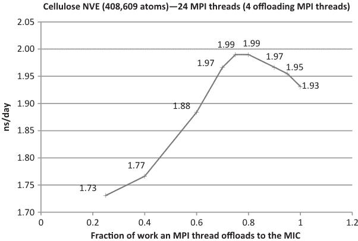

### 图 6.9

改变每个卸载 MPI 任务向协处理器卸载工作的比例时，纤维素模拟的性能。硬件：2 个 Intel Xeon E5 2697v2 处理器（2 × 12 核）+ Intel Xeon Phi 7120P 协处理器（61 核）。MPI 配置：主机上启动 24 个 MPI 任务，其中 4 个向协处理器卸载工作。

### PME 倒易空间求和任务

根据启动的 MPI 任务数量，所有或部分 MPI 任务会被分配原子，用于计算 PME 倒易空间贡献。例如，一个纤维素系统（408,609 个原子）会将 PME 倒易空间工作分配给所有 MPI 任务；较小的系统则只将工作分配给启动的部分 MPI 任务。然而，由于 PME 倒易空间求和不会卸载到协处理器，因此卸载 MPI 任务被限制为不能分配 PME 倒易空间工作。这是为了促进主机和协处理器的并发执行，因为如果卸载 MPI 任务被分配了 PME 倒易空间工作，协处理器上卸载工作的执行必须等到主机上完成 PME 倒易空间工作之后才能进行，这会使协处理器闲置。但是，在启动 10 个或更少 MPI 任务的情况下，所有任务都会被分配 PME 倒易空间工作，这是作为一种安全保障。负载均衡器在向 MPI 任务分配倒易空间工作时，会考虑总进程数、系统规模、直接空间求和分配情况以及处理核心的相对速度。我们在本就复杂的负载均衡算法中引入了一个新组件“不执行倒易空间工作的卸载 MPI”。因此，可能出现一种极端情况：只有一个 MPI 任务承担全部倒易空间工作，甚至更糟——没有任何 MPI 任务获得倒易空间工作。这种情况可能出现在 MPI 任务数量较少时（例如 6 个或更少），因此为卸载 MPI 任务的倒易空间工作分配设置了 10 个 MPI 任务的安全门槛。随后，工作负载会被均匀地分配给所分配的 MPI 任务。

### 键合力工作

启动的部分 MPI 任务会被分配键合力工作，其工作量会像 PME 直接空间求和与近邻列表工作一样，根据前几个时间步的性能进行动态分配。与 PME 倒易空间求和类似，键合力工作也仅限由非卸载 MPI 任务执行，因为键合力贡献不在协处理器上计算，因此只有在使用非卸载 MPI 进程计算键合力贡献时，才能与协处理器实现异步执行。同样，与 PME 倒易空间求和类似，如果启动的 MPI 任务为 10 个或更少，则键合力工作会分配给卸载 MPI 任务。

### 编译器优化标志

在 Amber 中，协处理器代码的额外优化标志（在原有标志之上）为：`-opt-streaming-cache-evict=0 -fimf-domain-exclusion=15 -align array64byte`。在 `get_nb_energy_offload` 例程中，一些数组只使用一次，因此使用了 `-opt-streaming-cache-evict=0`。该标志指示编译器在使用流式存储时不要使用任何缓存逐出指令。`-fimf-domain-exclusion=15` 指定在精确求值中排除无穷大、极值、NaN 和反规格数等域，这有助于数学函数运行得稍快一些。`-align array64byte` 是 Fortran 专用的编译器标志，指示编译器对齐数组数据，这有助于提高数据访问性能。

### 结果

我们使用一系列基准测试来评估 `pmemd` 协处理器卸载算法的性能，这些基准测试旨在代表实际研究项目中可能模拟的典型分子系统。基准系统包括：纤维素 NVE（408,609 原子）——一种为植物细胞壁提供结构的多糖；以及卫星烟草花叶病毒（stmv）（1,067,095 原子）——一种会加重烟草花叶病毒所致感染症状的植物病毒。基准测试在 2 个 Intel Xeon E5-2697 v2 处理器（2 × 12 核，24 线程，30 MB 缓存，2.70 GHz）以及 2 个 Intel Xeon E5-2697 v2 处理器搭配 Intel Xeon Phi 7120P 协处理器（61 核，240 线程）上执行。使用了 Intel 编译器 14 Update 1、Intel MPI 4.1、MPSS 3.2.3 和 Flash 2.1.02.0390。用于 FORTRAN 源代码的非默认优化标志为：`-align array64byte -ip -O3 -no-prec-div -xHost -openmp -opt-streaming-cache-evict=0 -fimf-domain-exclusion=15 -fp-model fast=2`；用于 C/C++ 源代码的为：`-ip -O3 -no-prec-div -xHost -openmp -opt-streaming-cache-evict=0 -fimf-domain-exclusion=15 -fp-model fast=2`。用于调优的优化标志详情可参阅编译器手册。所有基准系统均使用 24 个 MPI 任务并行化。

所有基准运行均采用 2 fs 的时间步长，并使用 SHAKE 算法约束氢键。所有基准系统均采用直接空间求和截断（纤维素（8 Å）和 stmv（9 Å）），并使用 PME 方法计算周期性边界条件下的长程静电相互作用。纤维素 NVE 模拟了 2000 个时间步，stmv 模拟了 1000 个时间步。模拟所用的输入文件在配套文档中提供。

图 6.10 比较了使用 2 个 Intel Xeon E5-2697 v2 处理器（2 × 12 核）（代号 Ivy Town，即 IVT）搭配默认/调优编译，以及 2 个 Intel Xeon E5-2697 v2 处理器（2 × 12 核）加 Intel Xeon Phi 7120P 协处理器（61 核）搭配调优编译时，纤维素和 stmv 基准测试以纳秒/天为单位的加速比性能。这里的“调优编译”指的是使用精心调优的优化标志（上文已详述），而非我们称之为默认的默认优化标志。从图中可以看出，与使用默认编译器优化相比，使用 2 个 Intel Xeon E5-2697 v2 处理器并搭配调优编译器优化标志带来了合理的性能提升。在 2 个 Intel Xeon E5-2697 v2 处理器加 Intel Xeon Phi 7120P 协处理器上运行调优卸载算法，纤维素的加速比分别为 1.43× 和 1.62×。stmv 的性能提升更大，因为其系统规模更大，每个协处理器核心的计算量更多，因此有更多机会隐藏数据传输延迟和协处理器内存访问延迟。

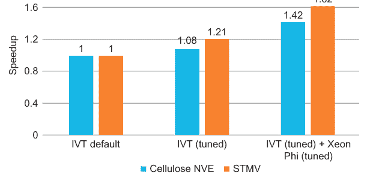

### 图 6.10

纤维素 NVE（408,609 原子）和 STMV（1,067,095 原子）的加速比，分别展示了原始代码、双处理器上的优化代码，以及双处理器加协处理器上的优化代码。

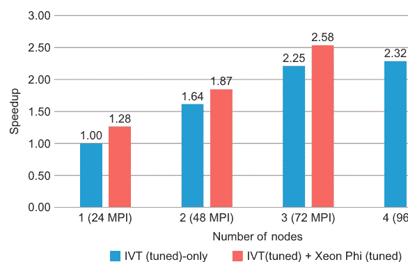

### 图 6.11

使用优化代码在两种配置下对纤维素 NVE（408,609 原子）的加速比：双处理器，以及双处理器加一个协处理器。

图 6.11 展示了与 Amber `pmemd` 引擎并行实现相比，卸载实现在多节点扩展时的加速比。运行在两种不同的平台上进行：

- 1. 仅处理器平台：节点由双插槽平台上的两个 Intel Xeon E5 2697 处理器（24 核）组成（IVT）。
- 2. 处理器加协处理器平台：节点由双插槽平台上的两个 Intel Xeon E5 2697 处理器（24 核）加一个 Intel Xeon Phi 7120P 协处理器（61 核）组成。

X 轴显示了不同节点数下的 MPI 任务总数。对于卸载运行，原子分布做了修改，使每个节点中只有中间的 4 个 MPI 进程将直接空间求和工作卸载到协处理器。每个卸载 MPI 进程使用协处理器核心的四分之一（15 核）。两个平台使用相同的网络交换机（Single-Rail FDR Mellanox IB）。原始 Amber MD 代码在超过约 96 个 MPI 进程时扩展性不佳，因为其使用全对全 MPI 通信来分配原子坐标、力数组和 FFT 数组。因此，性能结果仅显示到 4 个节点（4 × 24 MPI 进程/节点 = 96 MPI 进程）。从图中可以看出，协处理器卸载代码的性能始终优于仅处理器代码。同时，图中也显示卸载实现具有与仅处理器代码相似的扩展性。

### 结论

在本章中，Amber MD 软件包中 `pmemd` 分子动力学（MD）引擎的 14 版本被扩展为支持向 Intel Xeon Phi 协处理器卸载工作。相关工作包括实现双重分解策略，该策略使用 MPI 对系统进行空间分解…


随后在卸载的 MPI 任务中使用基于线程的分解，采用 OpenMP。所使用的方法是让 1 到 4 个 MPI 任务将 78% 的 PME 直接空间求和和邻居列表构建工作负载卸载到协处理器。每个卸载的 MPI 任务在协处理器分区中生成 OpenMP 线程，以执行工作负载的等权重部分。PME 直接空间求和的结果随后传回主机并累加到完整的力数组中。

性能测试显示，一旦算法使用编译器优化标志进行调优，在模拟纤维素 NVE（408K 个原子）和卫星烟草花叶病毒系统（stmv，1067K 个原子）时，处理器+协处理器平台的性能分别比仅处理器平台快 1.43× 和 1.62×。卸载代码的多节点版本也与仅处理器代码类似地扩展，但性能更高。4 节点处理器+协处理器卸载代码的性能是单节点仅处理器代码的 2.83×。Intel Xeon E5-2697v2 处理器的理论双精度峰值性能为 518.4 GFLOP/s。与 Intel Xeon Phi 7120P 协处理器配合使用时，理论上可实现总计 1.7184 TFLOP/s 的双精度性能，相当于理论加速 3.3×。然而，pmemd MIC 卸载在 stmv 上的实际加速为 1.62×，明显较低。我们认为，编译器由于不规则的循环结构和低效的内存使用而缺乏代码向量化可能是导致这一差距的根源。解决这些问题似乎需要进行重大的代码重构。

如前所述，此版本的 Amber 在主机上使用仅 MPI 并行，在协处理器上使用基于 OpenMP 的并行，以利用所有可用的核心和内存带宽。这也允许主机和协处理器运行同时执行。然而，由于主机仅 MPI 版本通常无法扩展到少数几个节点之外，因此正在进行一个单独的项目，其中正在实现和优化 Amber 的混合版本（MPI+OpenMP）以用于主机，以提高集群级别的扩展性。

对 pmemd 协处理器卸载的未来修改将旨在找到解决这些瓶颈的解决方案。算法的一个主要变化将是实现混合精度模型。人们认为这可以通过允许 SIMD 向量单元同时进行双倍数量的计算来提供显著的性能提升。其他未来的修订还将包括改进动态负载平衡方案并增加在 Intel Xeon Phi 协处理器上执行的计算量。

由此产生的软件修改已作为 Amber 14 软件套件的更新发布，并在安装期间自动下载和应用。代码可作为 Amber 网站上的补丁文件获得（http://ambermd.org/bugfixes/14.0/update.5; http://ambermd.org/bugfixes/14.0/update.9）。

### FOR MORE INFORMATION

- Case, D.A., Babin, V., Berryman, J.T., Betz, R.M., Cai, Q., Cerutti, D.S., Cheatham III, T.E., Darden, T.A., Duke, R.E., Gohlke, H., Goetz, A.W., Gusarov, S., Homeyer, N., Janowski, P., Kaus, J., Kolossváry, I., Kovalenko, A., Lee, T.S., LeGrand, S., Luchko, T., Luo, R., Madej, B., Merz, K.M., Paesani, F., Roe, D.R., Roitberg, A., Sagui, C., Salomon-Ferrer, R., Seabra, G., Simmerling, C.L., Smith, W., Swails, J., Walker, R.C., Wang, J., Wolf, R.M., Wu, X., Kollman, P.A., 2014. Amber 14, University of California, San Francisco.
- Salomon-Ferrer, R., Case, D.A., Walker, R.C., 2013. An overview of the Amber biomolecular simulation package. WIREs Comput. Mol. Sci. 3 198-210.
- Goetz, A.W., Williamson, M.J., Xu, D., Poole, D., Le Grand, S., Walker, R.C., 2012. Routine microsecond molecular dynamics simulations with Amber—part I: generalized born. J. Chem. Theory Comput. 8 1542-1555.
- Plotnikov, M., 2014. GROMACS for Intel® Xeon Phi™ Coprocessor [accessed 2015 February]; Available from: https://software.intel.com/en-us/articles/gromacs-for-intel-xeon-phi-coprocessor.
- Sun, X., 2013. Molecular Dynamics Optimization on Intel® Many-Integrated Core Architecture (Intel® MIC) [accessed 2015 February]; Available from: https://software.intel.com/en-us/articles/molecular-dynamics-optimization-on-intel-many-integrated-core-architecture-intel-mic?language=en.
- Needham, P., Bhuiyan, A., Walker, R. Extension of the Amber Molecular Dynamics Software to Intel’s Many-Integrated Core (MIC) Architecture. submitted and under review in J. Comput. Phys. Commun.
- User and Reference Guide for the Intel® Fortran Compiler 14.0. 2014 [accessed 2015 February]; Available from: https://software.intel.com/en-us/compiler_14.0_ug_f.
- Intel. Intel® MPI Library User’s Guide for Linux* OS. 2014 [accessed 2015 February]; Available from: Intel® MPI Library User’s Guide for Linux* OS.
- Intel. Intel® Manycore Platform Software Stack (MPSS). 2014 [accessed 2015 February]; Available from: https://software.intel.com/en-us/articles/intel-manycore-platform-software-stack-mpss.
- Download the code from this, and other chapters, http://lotsofcores.com.

### LOW-LATENCY SOLUTIONS FOR FINANCIAL SERVICES APPLICATIONS

Ravi A. Murty
Technical Computing Group (TCG), Intel, USA

### INTRODUCTION

虽然大多数高性能计算（HPC）应用程序针对持续的浮点吞吐量和内存带宽，但一些应用程序，例如金融服务行业（FSI）使用的应用程序，针对的是低延迟。本章探讨了展示 Intel® Xeon Phi™ 协处理器在延迟敏感型应用中适用性的技术。特别是，它关注用于在主机和协处理器之间传输数据的低延迟机制，其具体目的是改进金融服务应用程序使用的馈送处理程序。虽然这些技术在优化馈送处理程序方面很有用，但它们也普遍适用于其他“生产者-消费者”类型的应用程序，这些应用程序可以利用当前和未来 Intel Xeon Phi 协处理器上可用的大量核心和高内存带宽。此外，本章中描述的一些优化对于在 Linux 等通用操作系统（OS）上运行的多核架构也普遍适用。

### THE OPPORTUNITY

金融交易所通过包含股票和订单详细信息的信息馈送处理程序提供市场信息。随着馈送中符号数量的增加以及订单数量的增加，需要处理的馈送数据的速率急剧增加，以便及时做出买卖决策（见图 7.1）。此外，像 NASDAQ 和 NYSE 这样的交易所以多种格式提供市场数据，包括多播传输和通过 TCP/IP 的点对点传输。不同交易所之间的数据格式不同，同一交易所的不同馈送之间也经常不同。馈送的专有格式及其不断变化的特性导致交易公司寻求商业计算解决方案，而不是花费大量时间和精力自行开发内部馈送处理程序。

从广义上讲，计算系统可以描述为通用“现成”或定制“专用”解决方案。通用“现成”解决方案由在通用处理器（例如 Intel® Xeon® 处理器）上运行的软件应用程序和标准的 Linux 等操作系统组成。相比之下，定制“专用”解决方案的示例由现场可编程门阵列（FPGA）或专用集成电路

### FIGURE 7.1

High-frequency trading overview.

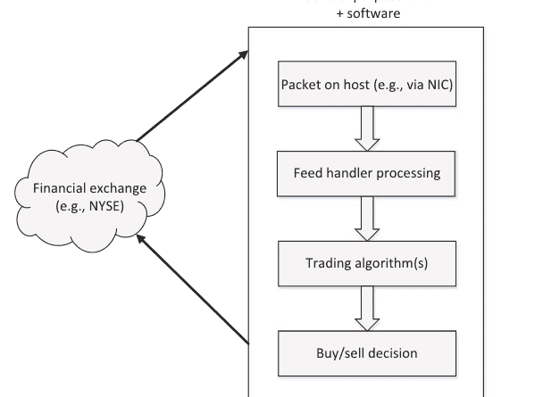

（ASIC）组成，其中来自现场处理程序的数据包以非常低的延迟提供给处理元件。处理元件能够以固定的时钟周期数（取决于数据包的类型和大小）以非常确定性的方式处理这些数据包。然而，就像任何定制解决方案一样，馈送处理算法的更改将决定需要新的 ASIC，这是一个昂贵的解决方案，或者需要对 FPGA 进行定制重新配置，需要专门的技能和工具。这使得只要能做出一定的延迟保证，通用解决方案和在处理器上运行的软件就具有吸引力。通用软件和算法使金融机构能够更快地构建和定制馈送处理程序，以处理来自不同交易所或不同格式的数据。

任何计算解决方案的一个重要方面是周转延迟以及商业馈送处理程序增加的延迟。这对于高频交易（HFT）公司尤其重要，因为如果馈送处理程序中额外延迟几微秒，市场数据可能对终端客户来说毫无价值。通常，这些馈送处理程序仅限于可用于处理数据的少量核心，因为交易应用程序本身使用了大部分核心。这导致在交易高峰时段延迟增加。具有大量线程和通用编程模型的 Intel Xeon Phi 协处理器提供了一种可行的替代方案来解决这个问题。馈送处理程序的性能在线程能够以与数据接收相同的速率处理数据时为最佳。我们将看到，提供在主机和协处理器之间传输数据的低延迟机制对于优化馈送处理程序应用程序也至关重要。这里描述的技术也可以用于优化其他“生产者-消费者”数据包处理应用程序。


### 数据包处理架构

Intel Xeon Phi 协处理器为 HFT 和上述描述的行情处理系统等大量 * embarrassingly parallel * 应用提供了一种通用解决方案。它提供了一个功能强大、通用的计算平台，包括：

- 大量缓存一致的核心和线程，可最优地处理许多独立的 *streams* 工作
- 通过 512 位宽向量而非更窄的 MMX、SSE 或 AVX2 能力实现的独特宽 SIMD 能力
- 对执行倒数、平方根和指数运算的指令提供高性能支持，为蒙特卡洛相关应用提供了理想环境。
- 大量的可用内存带宽。
- 主机与系统上所有附属协处理器之间高效的、从带宽和延迟角度来看都高效的通信管道，即 PCIe 总线。

该问题可分解为如图 7.2 所示的 *packet processing* 问题。一个或多个主机线程通过套接字连接从外部源接收数据包，例如

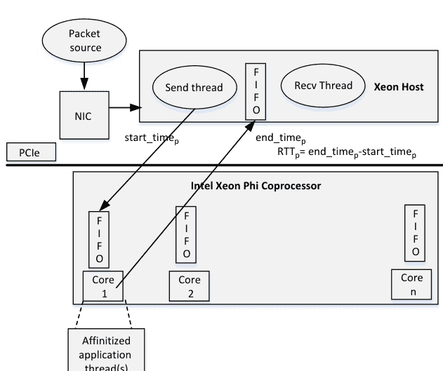

### 图 7.2

利用协处理器的通用数据包处理应用。

市场数据，通过标准网络接口（NIC）。主机线程将数据包，全部或仅相关部分，排队到单独的 FIFO 中以供进一步处理。在图中，FIFO 位于协处理器上的 GDDR 内存中，这一选择将在本章后面解释。协处理器侧的亲和线程在核心上运行，按接收顺序处理其 FIFO 上接收到的每个数据包，并将数据包通过行情处理算法。算法的结果随后被复制回 FIFO，如图 7.2 中所示位于主机上，以供进一步处理。该架构的衡量指标涉及平均和最坏情况下的延迟，以每个数据包 p 的往返时间（RTT）衡量。在行情处理器的情况下，最坏情况的延迟预计出现在交易日开始时交易所开盘时，以及交易日结束时临近收盘时。虽然预计由一连串数据包组成、背靠背且几乎没有或没有数据包间间隔的突发会导致备份从而增加 RTT，但对这种系统的期望是，最坏情况 RTT 是有良好界限的（无抖动），并且最好接近平均 RTT。本章的其余部分重点介绍几种满足该要求的优化技术。

示例代码提供了一个简单的数据包处理应用，包含客户端和服务器（packet_processing/scif_connect_rbuf.cpp 和 packet_processing/scif_accept_rbuf.cpp）。本章后面描述的优化已用于优化数据包处理示例应用。

### 对称通信接口

Intel® 多核平台软件栈（Intel® MPSS）的高级架构如图 7.3 所示，其中包括对称通信接口（SCIF）驱动程序和库，应用程序链接这些库以获得其服务。SCIF 在两个对等进程之间提供高效的节点间通信。在此定义中，节点是 Intel Xeon 处理器或 Intel Xeon Phi 协处理器。

SCIF 抽象了 PCIe 总线上通信的细节，并提供了一个与 Berkeley Sockets API 非常相似的接口。在此模型中，应用程序相互连接（对等端点）并使用 SCIF API 执行数据传输操作。SCIF 的一个重要属性，如其名称所示，是对称性；SCIF 驱动程序和库在 PCIe 总线两侧呈现相同的接口。建立连接的过程与套接字 API 非常相似，其中一侧监听（scif_listen()）并接受（scif_accept()）传入连接，而另一侧连接到（scif_connects()）远程进程。

作为入门，图 7.4 和 7.5 提供了使用 SCIF 的简单客户端/服务器应用示例，演示了连接建立过程。

最后，SCIF 提供了几类 API 用于：

- 连接管理
- 消息传递
- 内存注册
- 远程内存访问（用于批量传输和低延迟访问）

SCIF API 集相当小，大多数应用程序会使用整个集合。本章的重点是用于主机和协处理器之间低延迟数据传输的有用 API。

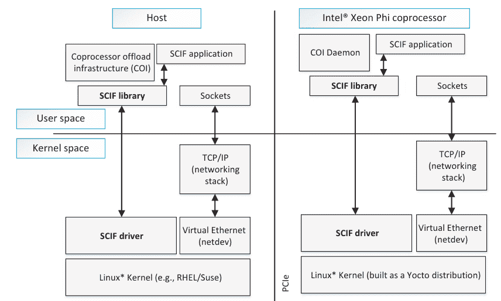

### 图 7.3

Intel® 多核平台软件栈（Intel® MPSS）显示 SCIF 驱动程序和用户模式库。

### 内存注册

每个进程都有一个虚拟地址空间（VAS）。该空间中的虚拟地址（VAs）在线程对该进程进行读或写访问时由操作系统通过物理页支持。SCIF 引入了注册地址空间（RAS）的概念。该地址空间是稀疏的，只有通过 scif_register() 由应用程序注册的特定范围，称为注册窗口或窗口，在建立连接后才能被进程的远程对等方访问。图 7.6 显示了进程的物理、虚拟和 RAS 之间的关系。一组物理页（P）支持由 RAS 中的窗口偏移（W）引用的虚拟范围（V）。值得注意的是，主机处理器和所有协处理器上的物理和 VAS 只能由本地运行的进程访问。然而，RAS 允许进程在远程进程的上下文中访问支持它的物理内存。

换句话说，使用 scif_register() 标记一段内存区域可供远程访问。它接受一个页对齐的 VA 和长度参数（以及一些标志）并返回一个表示进程 RAS 中窗口的偏移量。可选地，偏移量可以由应用程序选择并作为输入提供给 scif_register()，方法是指定 SCIF_MAP_FIXED 标志。物理页

```
/* open end point */
if ((epd = scif_open()) == SCIF_OPEN_FAILED) {
        printf("scif_open failed with error %d\n", errno);
        exit(1);
}

/* bind end point to available port, generated
 * dynamically
 */
if ((conn_port = scif_bind(epd, 0)) < 0) {
        printf("scif_bind failed with error %d\n", errno);
        exit(1);
}
printf("bind success to port %d\n", conn_port);

/* initiate a connection to remote node, when
 * successful returns the peer portID. Re-tries
 * for 20 seconds and exits with error message
 */
__retry:
    if (scif_connect(epd, &portID) < 0) {
        if ((errno == ECONNREFUSED) && (tries > 0)) {
                printf("connection to node %d failed : trial %d\n", portID.node, tries);
                tries--;
                sleep(1);
                goto __retry;
        }
        printf("scif_connect failed with error %d\n", errno);
        exit(1);
    }
    printf("connect success\n");
```

**图 7.4**  
SCIF 连接的客户端侧（在 connection/scif_connect_register.c 中）显示了连接建立的基本 SCIF API。

```
/* open end pt */
if ((epd = scif_open()) == SCIF_OPEN_FAILED) {
        printf("scif_open failed with err %d\n", errno);
        exit(1);
}

/* bind end pt to specified port */
if ((conn_port = scif_bind(epd, PORT_NO)) < 0) {
        printf("scif_bind failed with error %d\n", errno);
        exit(1);
}
printf("bind success to port %d\n", conn_port);

/* marks an end pt as listening end pt and queues
 * up a maximum of BACKLOG no: of incoming connection
 * requests
 */
if (scif_listen(epd, BACKLOG) != 0) {
        printf("scif_listen failed with error %d\n", errno);
        exit(1);
}

/* accepts a conn request by creating a new end pt
 * that connects to peer
 */
if (scif_accept(epd, &portID, &newepd,
SCIF_ACCEPT_SYNC) != 0) {
        printf("scif_accept failed with error %d\n", errno);
        exit(1);
}
printf("accept success\n");
```

### 图 7.5

SCIF 连接的服务器侧（在 connection/scif_accept_register.c 中）显示了连接建立的基本 SCIF API。


### 图 7.6

由SCIF注册API创建的已注册地址空间及其中的窗口。

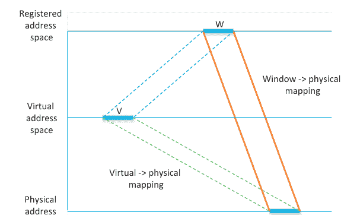

支撑窗口的页面（见图7.6）被SCIF驱动程序固定（锁定），无法被操作系统换出或用于其他用途。

本地端点的远端对等节点RAS中的窗口称为远程窗口，而进程本地RAS中的每个窗口（W）都是其对等端点的远程窗口。最后，RAS中由窗口表示的页面可供许多SCIF API使用，包括下面描述的scif_mmap()。

### 通过 scif_mmap() 映射远程内存

SCIF支持一种API，使本地进程能够将远程对等进程暴露（通过SCIF注册）的物理内存映射到其本地VAS中。Linux开发者可能认为这类似于mmap()系统调用，它会在调用进程的VAS中分配一个VA。

与mmap()类似，scif_mmap()允许调用进程（如图7.7中的进程X）在其VAS中分配一个VA。但是，支撑返回的VA的物理页面位于连接的对等端点的物理地址空间中，如图7.7中的进程Y所示。这实质上意味着，对Vx所表示的内存页面的任何加载/存储指令都将直接读/写进程Y的物理地址空间中的物理页面。必须注意，图7.7是图7.6的扩展，其中进程Y在其RAS中“打开”一个窗口，将窗口的偏移量传递给进程X，从而使进程X能够使用scif_mmap()在其本地VAS中生成映射。

注意：协处理器内存在主机上被映射为写合并（WC），对WC内存执行读写操作有一些影响需要小心处理，本章后面会加以描述。

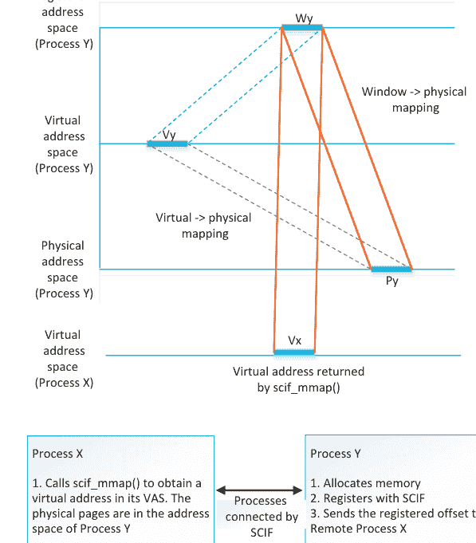

### 图 7.7

在进程上下文中调用 scif_mmap() 的效果。

### 优化协处理器上的数据包处理

基于目前提供的背景，本节重点介绍一组优化，包括在主机和协处理器之间高效传输数据的技术。作为参考，packet_processing目录中的示例代码展示了这里描述的所有优化。

### 优化 #1：选用合适的API

作为主机与所连接协处理器之间的高效通信基础设施，SCIF提供了多种在两端之间传输数据的方法。然而，系统设计者必须仔细考虑系统的需求（带宽与延迟的权衡），并为任务选用合适的API：

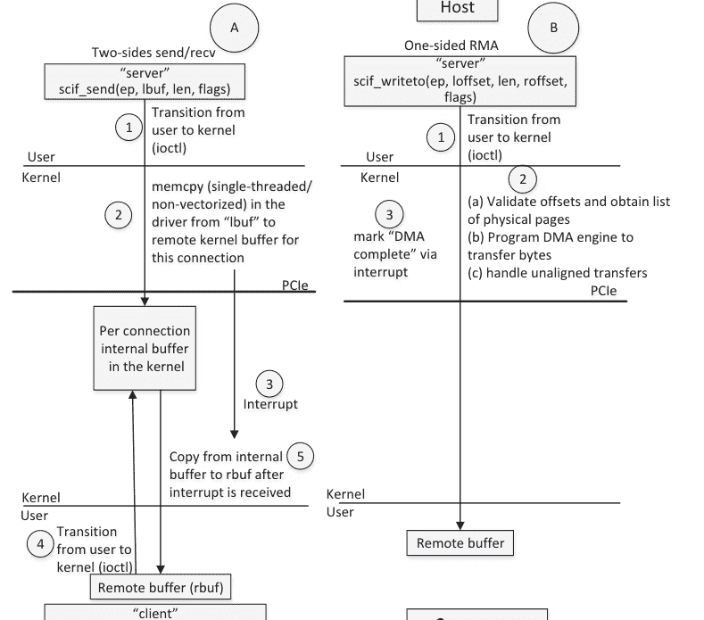

### 图 7.8

用于数据传输的发送/接收API与SCIF RMA API的比较。

- scif_send和scif_recv：这些API使用简单，但并非为高效而设计。如图7.8中“A”所示，使用这些API传输数据需要发送端和接收端进行环转换、多次内存拷贝，以及跨PCIe的中断。

- scif_(v)writeto和scif_(v)readfrom：这些API使用DMA引擎（见图7.8中的“B”）将数据从一端传输到另一端。虽然它们提供了最高带宽的路径，并同时释放CPU去做其他事情，但这种传输方式会产生编程DMA描述符（2）和处理中断（3）的开销。此外，硬件DMA块的编程在内核模式驱动中完成，这涉及环转换（1）。因此，使用DMA API并不是传输“小”缓冲区的最佳选择。

- scif_mmap：如前文及图7.7所述，使用scif_mmap()，主机应用程序可以获得一个VA，该VA将协处理器分配的缓冲区映射到自己的地址空间，如图7.9中的“C”所示。然后，应用程序可以使用Intel编译器提供的高度向量化版本的memcpy，非常高效地将数据从主机侧本地缓冲区复制到协处理器侧远程缓冲区。这种方法完全绕过内核，为应用程序中两个进程之间的“小”缓冲区传输提供最低延迟路径（图7.10和7.11提供了一个示例来演示这种用法）。

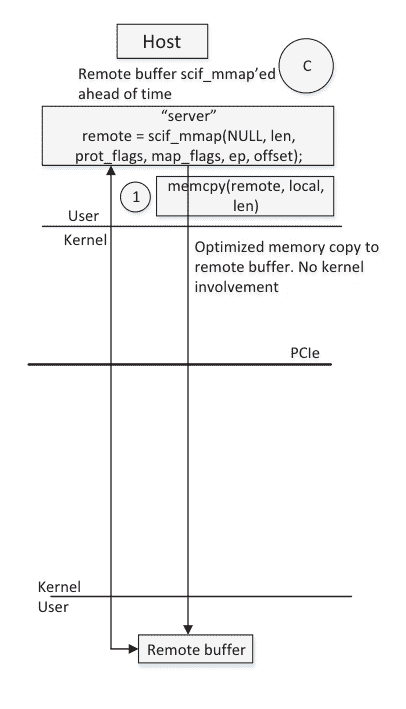

图 7.9
使用 scif_mmap() 进行数据传输。

### 图 7.11

绕过内核实现主机与所连接协处理器之间的低延迟数据传输（参见 mmap/scif_accept_rma_fence.c）。

```
/* scif_register : marks a memory region for remote
 * access
 */
if ((buffer.offset = scif_register (newepd,
						buffer.self_addr,
						msg_size,
						START_OFFSET,
						SCIF_PROT_READ |
						SCIF_PROT_WRITE,
						SCIF_MAP_FIXED)) < 0) {
	printf("scif_register failed with error : %d\n",
	get_curr_status());
	goto __end;
}
printf("Memory is registered, waiting for data now!");
...
/* Okay now we'll test the scif_mmap() capabilities
 * -- the "low latency" way of doing things
 */
/* wait for this to become "go" */
while (*(volatile unsigned int *)curr_addr != 0xC0DE);

printf("Flag transitioned to \"go\" \n");
printf("Host wrote: %s \n", (char *)buffer.self_addr);
/* card will now write something to page 1 */
strcpy((char *)buffer.self_addr + PAGE_SIZE, "I'm okay, How are you doing, Host?");
```

### 图 7.12

使用 scif_mmap() 和 memcpy() 传输数据的“生产者-消费者”模型。

另一方面，协处理器内存在主机上被映射为写合并（WC）类型。虽然从主机核读取仍然是非缓存操作，但对WC内存类型的写入（存储）并不是通常意义上的缓存（即，它们不会进入缓存层次结构）。相反，它们存储在一个称为WC缓冲区的内部缓冲区中，期望能够将WC缓冲区相邻区域的多次写入组合起来，从而产生更大、更高效的PCIe总线事务。因此，虽然对WC缓冲区的写入会稍微延迟，但软件可以通过序列化指令（如sfence、mfence或cpuid）随时“刷新”WC缓冲区。当软件写入超出缓冲区所存地址范围之外时，WC缓冲区也会被刷新（例如在执行memcpy时）。

通过在PCIe上执行完整的缓存行写入（WC缓冲区的大小），当使用memcpy将缓冲区内容从主机内存复制到协处理器内存中的缓冲区时，WC内存类型具有优势（见图7.12中的(2)）。使用WC内存类型时，需要注意一些事项：

- WC内存是弱排序的。这意味着目标位置存储数据的顺序不保证。这在“生产者-消费者”示例等顺序不重要的场景中是可以接受的，只要所有内存都被正确传输，并且可以使用memcpy操作高效地将缓冲区从主机复制到协处理器。

- 软件需要确保在设置“remote_flag”之前，对“remote_buffer”（见图7.12）的所有写入在协处理器上是全局可见的。软件可以通过sfence等序列化指令来强制执行这一点。

### 优化 #3：“推送”与“拉取”数据

在主机内存和协处理器内存之间复制数据有两种方式：

- 主机处理器上的线程可以发起复制操作（例如，memcpy）。
- 协处理器上的线程可以发起复制操作。这通常发生在应用程序的协处理器侧已处理完缓冲区，需要将缓冲区移回主机以进行进一步处理或决策时。

数据通过PCIe以读或写事务层数据包（TLP）进行传输。每个TLP包含一个头部以及作为有效载荷的数据。TLP携带的有效载荷大小取决于TLP的大小（通常大小包括64、128或256字节）。Intel Xeon Phi的PCIe配置中的*最大有效载荷大小*指定了TLP可以达到多大，该值应设置为256字节。

来自CPU（主机或协处理器）的写操作会转换为称为*已发布写*的PCIe写事务。已发布事务之所以快，是因为已发布事务的发起者（对于memcpy来说是CPU）确实会等待应答（或确认）。另一方面，读操作是*未发布操作*。每次读操作都期望得到响应。这对于我们简单的生产者-消费者示例意味着，如果复制操作由拥有目标缓冲区的一侧发起，则所有产生的PCIe事务都是未发布的读操作。另一方面，如果发起者位于memcpy操作的源侧，则所有事务都是已发布写操作——后者效率要高得多。因此，与“拉取”数据相比，“推送”数据（源在本地侧，目标在远程侧）更高效，如图7.12所示。

### 优化 #4：“影子”指针实现高效FIFO管理

几乎任何基础计算机科学教科书都会描述FIFO，它是一种实现队列的简单数据结构。放入FIFO的数据可以是固定大小的元素（例如，记录），也可以仅仅是简单的字节流。无论哪种情况，一组指针（head和tail）跟踪队列的两端，如图7.13所示。

在生产者-消费者示例中，生产者将工作*入队*到队列尾部（想象人们加入银行排队）；而消费者从队列头部将工作*出队*（想象柜员呼叫队首的下一个人）。在此上下文中，需要执行两个重要操作：

- 生产者需要确保队列中有空闲空间，然后才能向队列添加更多工作。因此，生产者会比较head和tail指针，如图7.13所示。

- 消费者需要确保队列中存在有效工作，然后才能将其出队处理。因此，消费者会比较head和tail指针，以确保队列不为空。

在数据包处理架构中，生产者位于主机上。因此，在入队工作前检查空闲空间的测试需要读取位于协处理器内存中的head和tail指针。正如我们已经看到的，跨PCIe总线读取会导致对协处理器内存的UC访问，这些访问会变成（高延迟的）读事务，效率极低；尤其是对于像“满条件”检查这样简单的事情。然而，通过更高效的实现可以轻松优化这一点。在这种实现中，生产者会维护head的影子副本


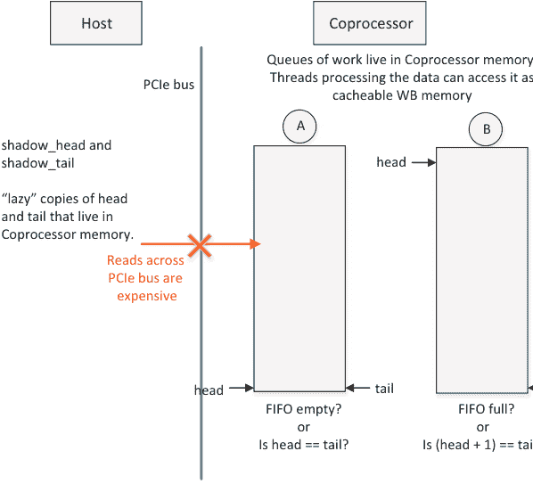

### FIGURE 7.13

使用影子指针检测满和空条件以实现更好的 FIFO 管理。

和 tail（在图 7.13 中主机侧称为“shadow_head”和“shadow_tail”）。该算法的步骤如下：

- 初始化时，`head`、`tail`、`shadow_head` 和 `shadow_tail` 都指向 FIFO 中的同一位置（例如队列的开头）。
- 生产者（在主机上）在入队（通过 PCIe 写入数据）到 FIFO 之前执行满条件检查。然而，不是读取 `head` 和 `tail`，而是使用 `shadow_head` 和 `shadow_tail` 作为代理。在主机上，`shadow_head` 和 `shadow_tail` 位于主机内存中，这些访问是对可缓存 *write back*（WB）内存的简单内存访问。如果有空间，则写入数据并在主机上本地推进 `shadow_tail`。此外，重要的是，`shadow_tail` 的副本被写入（一次 PCIe 发布事务）到 `tail`，以确保消费者“看到”FIFO 中的新数据。
- 如果/当生产者遇到满条件时，`shadow_head` 和 `shadow_tail` 中的值会通过读取 `head` 和 `tail` 的 *真实* 值来“刷新”。假设协处理器核心上的处理线程确实通过出队元素或字节来处理数据，`head` 现在已经推进。刷新操作使得 `shadow_head` 获得 `head` 的准确副本。虽然这是在总线上传输的 UC 读取，但执行频率较低，从而使代码略有优化。此外，读取是在主机侧执行的——一个单线程性能更高的核心！

### OPTIMIZATION #5: TICKLESS KERNELS

运行在 Intel Xeon Phi 协处理器上的内核（OS）是通用目的 Linux，它不是实时操作系统。因此，它不能保证线程何时被调度执行。应用程序线程可能会被其他更高优先级的线程抢占上下文切换，或被各种中断源中断。历史上，应用程序线程“中断”的一个保证来源是周期性定时器中断。除了定期中断“当前正在运行的线程”外，定时器中断的处理程序还会对花费大量时间预取数据到缓存层次结构以避免长时间内存访问的高优化应用程序造成其他副作用。副作用的示例包括：

- 缓存和 TLB 污染——内核中的中断处理程序执行许多活动，例如 RCU 数据结构更新、调度决策以及为分析更新进程用户/内核统计信息。这些代码执行会将大量内核数据结构（以及指令缓存中的内核代码！）拉入数据缓存层次结构。同样，特定于应用程序的 TLB 被驱逐并被内核及其数据结构的页面的 TLB 取代。
- 定时器中断唤醒内核线程，其执行被延迟。这些线程上下文切换到 CPU，取代当前正在运行的应用程序线程。

缓存和 TLB 污染问题对于像 Intel Xeon Phi 协处理器这样的架构尤其具有影响，其 L2 缓存大小较小（与 Intel Xeon 处理器相比），并且每个核心有四个硬件线程，每个线程在不同时间接收定时器中断（在 Linux 中中断不同步），导致每个核心每秒的定时器中断数量增加 4 倍。应用程序的净结果是不可预测的延迟和潜在的抖动。

因此，对于 HPC 和金融服务（FSI）中的应用程序而言，无滴答内核尤为重要。最近的 Linux 内核支持一种称为“full NOHZ”的模式，其中我们熟悉的周期性定时器滴答从每秒 100 或 1000 次（取决于 HZ 的配置方式）减少到每秒一次。这不应与 Linux 长期以来拥有的“空闲无滴答”功能混淆，在该功能中，当“CPU”空闲时内核会关闭周期性定时器滴答，从而通过允许 CPU 进入更深的睡眠状态来节省大量电量。

从 3.10 Linux 内核开始，“full NOHZ”启用了一种模式，其中当单个线程在 CPU 上运行时内核会降低滴答率。因此，正在运行的应用程序不会被中断得那么频繁（参见本章末尾“更多信息”部分中的“预览 Intel® Xeon Phi 协处理器上 Linux 的无滴答支持”）。虽然单个 CPU 上的单个线程在桌面上不是常见情况，但在 HPC 和 FSI 系统中，专用应用程序在整个处理器芯片上运行的情况非常常见。一个例子是当线程需要聚集在一起执行某种集体操作（例如屏障）然后进入应用程序的下一阶段时。如果一个或多个线程被不可预测地中断，其余（未中断）线程会进展到屏障但浪费时间等待（自旋）被中断的线程加入。这会降低在大型 HPC 集群上运行的应用程序的整体扩展性和性能。

此外，对于本章中讨论的类似数据包处理的应用，周期性定时器滴答会导致“尖峰”并不可预测地增加数据包处理延迟；这在生产系统上是不可接受的。

### OPTIMIZATION #6: SINGLE THREAD AFFINITY AND CPU “ISOLATION”

除了如上所述使用无滴答内核外，缓解“OS 噪声”影响的另外两种简单策略是线程亲和性和 CPU 隔离。请注意，在此讨论中，“CPU”指的是内核视为独立执行单元的硬件线程或逻辑 CPU。

简单来说，显式地为应用程序线程设置亲和性会告诉 OS 调度程序停止在它们之间移动。为什么会发生这种情况？除了执行我们熟悉的典型调度程序活动——找到最高优先级的线程来运行并抢占较低优先级的线程以“腾出空间”给刚刚变为可运行的更高优先级线程外，调度程序还试图确保整体系统性能最大化。实现此目的的一种方法是将在所有可用 CPU 之间均匀分配可运行线程的负载。这意味着在理想情况下，每个 CPU 都有相同数量的可运行线程在其运行队列中等待被调度并开始执行。线程调度程序跟踪系统中每个 CPU 的负载，将线程从负载重的 CPU 迁移到负载轻的 CPU 以平滑负载。虽然这对于通用系统来说很好（这样不会出现一个 CPU 空闲而四个线程共享另一个 CPU 的情况，在那里每个线程只能获得 25% 的 CPU 时间），但在 HPC 或 FSI 中单个应用程序专用于在 CPU 集合上运行的系统，OS 可以避免扫描 CPU 运行队列寻找负载平衡机会，如果它确切知道每个应用程序线程希望在哪里运行。这就是线程亲和性发挥作用的地方。线程亲和性为应用程序线程提供了一种方法，可以告诉 OS 调度程序其线程可以在（并且希望）在哪里运行。调度程序反过来不必花费大量时间在系统上进行负载平衡，因为应用程序线程已经在它们需要的位置。很明显，迁移线程以进行负载平衡会产生其他相关成本，包括上下文切换的成本以及缓存/TLB 未命中，因为迁移的线程总是从冷缓存和 TLB 开始！在 Linux 和 Intel 运行时（如 OMP）上，有多种机制可用于定义线程亲和性。这包括 numactl 和 KMP_AFFINITY，以及通过 sched_setaffinity() 的编程方法。

线程亲和性还有助于 Linux 新内核中提供的另一个功能，称为 CPU 隔离。这是一个功能，其中运行在处理器上的内核可以通过称为 isolcpus 的内核命令行来配置，以隔离一组 CPU，这基本上意味着内核调度程序会避免从线程调度和负载平衡的角度来看待它们，如上所述。由于这些 CPU 被忽略，唯一进入或离开这些隔离 CPU 的方式是通过显式的线程亲和性。未设置亲和性的线程——包括内核和应用程序线程——会被阻止在内核命令行中列出的 CPU 集合（隔离 CPU 集合）上运行。通过定义一组隔离 CPU 并将应用程序线程亲和到隔离 CPU 集合上——每个 CPU 一个应用程序线程，所有不需要的内核线程和各种用途的杂项用户模式应用程序，例如守护进程，都可以被排除在外，为应用程序提供安静的运行环境。

### OPTIMIZATION #7: MISCELLANEOUS OPTIMIZATIONS

除了本章中描述的一些优化之外，这里还有一些不应被遗忘的额外优化考虑：

- 使用 Intel C 编译器并使用 –O3 进行优化。这在使用的 memcpy 选择上很重要。当使用 icc –O3 编译时，应用程序中的所有 memcpy 调用都被替换


使用高度向量化并针对缓存优化过的 memcpy 版本起着巨大的作用，因为通过 PCIe 总线进行 memcpy 会产生完整的缓存行事务。

- 在 Intel Xeon 处理器主机和 Intel Xeon Phi 协处理器上都禁用电源管理选项。尽管电源管理允许处理器子系统在未积极执行指令（空闲）时进入睡眠状态（也称为 C 状态），但从正常工作模式（称为 C0 模式）进入和退出较低功耗状态都会产生相应的延迟。换言之，虽然更深的睡眠状态（如 C6）能在系统中节省更多的电力，但退出这种深层状态的延迟更高，这对对延迟非常敏感的应用程序是不利的——试想一下，如果协处理器上的线程空闲了足够长的时间，使处理器进入深度睡眠状态，此时一个数据包到达，需要线程唤醒并开始运行来处理该数据包，会发生什么情况。尽管大多数操作系统（如 Linux）默认启用电源管理，但在运行对延迟敏感的应用程序之前，建议禁用电源管理。在 Linux 上，通过名为 intel_idle.max_cstate=0 的内核命令行参数即可轻松完成。

### 结果

利用上述优化，我们对提供的示例代码进行了改造。我们使用两种不同的有效载荷大小运行了示例代码——50 字节和 1500 字节。此外，还选择了不同的“包间隔”值——0、10 和 100 μs——定义为发布频率。

当有效载荷约为 50 字节时（如图 7.14 所示），平均延迟处于预期范围（约 10 μs）内，但尾部延迟相当高（当发布频率为 10 μs 时约为 460 μs）。对于 1500 字节的有效载荷（如图 7.15 所示），平均延迟甚至处于

| 发布频率 (μs) | 平均 RTT (μs) | 50% | 70% | 90% | 99% | 99.99% | 100% |
|---|---|---|---|---|---|---|---|
| 0 | 3870.08 | 3808 | 4046 | 4083 | 4122 | 4122 | 4387 |
| 10 | 11.15 | 11 | 11 | 12 | 13 | 374 | 460 |
| 100 | 10.83 | 11 | 11 | 12 | 12 | 59 | 309 |

### 图 7.14

初始实现（未优化），50 字节有效载荷。

| 发布频率 (μs) | 平均 RTT (μs) | 50% | 70% | 90% | 99% | 99.99% | 100% |
|---|---|---|---|---|---|---|---|
| 0 | 113,531 | 114,119 | 114,233 | 114,284 | 114,499 | 115,004 | 115,114 |
| 10 | 113,427 | 114,075 | 114,193 | 114,237 | 114,315 | 114,551 | 114,561 |
| 100 | 88,196 | 106,920 | 106,999 | 106,699 | 107,131 | 107,181 | 107,224 |

### 图 7.15

初始实现（未优化），1500 字节有效载荷。

| 发布频率 (μs) | 平均 RTT (μs) | 50% | 70% | 90% | 99% | 99.99% | 100% |
|---:|---:|---:|---:|---:|---:|---:|---:|
| 0 | 2538 | 2560 | 2568 | 2580 | — | — | 2588 |
| 10 | 3.85 | 4 | 4 | 4 | 5 | 21 | 46 |
| 100 | 3.84 | 4 | 4 | 4 | 5 | 19 | 34 |

### 图 7.16

代码优化后，50 字节有效载荷的结果。

| 发布频率 (μs) | 平均 RTT (μs) | 50% | 70% | 90% | 99% | 99.99% | 100% |
|---:|---:|---:|---:|---:|---:|---:|---:|
| 0 | 8808 | 8900 | — | — | 8938 | — | 9085 |
| 10 | 16.04 | 16 | 16 | 16 | 37 | 114 | 155 |
| 100 | 15.81 | 16 | 16 | 16 | 18 | 116 | 224 |

### 图 7.17

代码优化后，1500 字节有效载荷的结果。

|  | 未优化 | 已优化 |
|---|---:|---:|
| 平均 RTT (μs) | 113,427 | 16 |
| 100% (μs) | 114,561 | 114 |

### 图 7.18

包间隔为 10 μs、有效载荷为 1500 字节时的性能对比。

毫秒范围内（11.3 ms），因此作为解决方案完全不可接受。虽然此处未显示，但其他有效载荷大小也导致了类似问题。

通过采用一种系统性方法，包括追踪“数据包的生命周期”并应用本章提到的优化（如示例代码所示），我们得到了图 7.16 和图 7.17 所示的结果。如图 7.18 所示，这些优化带来了显著的性能提升，尤其是在 1500 字节有效载荷的情况下。

### 结论

Intel Xeon Phi 协处理器为应用程序提供了一个通用编程环境，这些应用程序受益于大量独立的执行线程、用于数据处理的宽向量、大内存带宽，以及 PCIe 接口——后者提供了一种高带宽、低延迟的机制，用于在主机和系统中的协处理器之间共享内存。本章以数据包处理引擎为例，介绍了几项关键的优化技术，这些技术可以显著提高应用程序的性能，并帮助实现应用程序所需的低延迟解决方案。这些优化包括：

- 1. 确保为应用程序使用正确的 API。带宽敏感的应用程序受益于使用 DMA 引擎，即使这涉及进入内核的转换。另一方面，延迟敏感的应用程序则受益于能够避免 ring 转换的 API，而 SCIF 提供了实现此类技术的方法。
- 2. 利用协处理器内存被映射为写合并（write combining）这一特性，应用程序可以在数据被推送过 PCIe 总线之前有效地合并更大量的数据，从而提高协议效率。
- 3. 将 PCIe 读事务转换为写事务可带来显著的性能提升，因为后者具有 posted（发布式）特性。
- 4. 在实现 FIFO 的满/空检查时，通过为头指针和尾指针建立影子副本，避免通过 PCIe 总线进行昂贵且不必要的读取，可以在不损失代码正确性的前提下带来额外好处。
- 5. 无节拍（tickless）内核在降低运行于 Linux 等通用操作系统上的应用程序的整体抖动和运行间变异性方面发挥着重要作用。避免操作系统的持续中断以及相关的 TLB 和缓存污染，可以带来额外的应用程序性能提升。
- 6. 通过标准 pthreads API 或运行时提供的环境变量来实现线程亲和性，可以合理放置线程，从而避免过度订阅和负载不均衡问题。同时，它也使内核调度器不必在系统中对线程进行负载均衡，从而减少内核的参与。
- 7. 最后，使用若干简单而有效的杂项优化，例如使用编译器生成的向量化 memcpy，以及仔细考虑电源管理，可以为应用程序带来更高的性能和更低的延迟影响。

### 更多信息

- MPSS 中的对称通信接口（SCIF）用户指南：https://software.intel.com/en-us/articles/intel-manycore-platform-software-stack-mpss.
- 关于对称通信接口（SCIF）API 的讨论——https://software.intel.com/de-de/forums/topic/393771.
- 第 11.3 节，《Intel® 64 和 IA-32 架构软件开发人员手册》，综合卷 1、2A、2B、2C、3A、3B 和 3C，2015 年 1 月。
- 写合并内存实现指南 http://download.intel.com/design/pentiumii/applnots/24442201.pdf.
- 预览 Intel® Xeon Phi 协处理器上 Linux 的无节拍支持：https://software.intel.com/en-us/articles/previewing-tickless-support-for-linux-on-the-intel-xeon-phi-coprocessor.
- 处理器电源管理：https://people.cs.pitt.edu/~kirk/cs3150spring2010/ShiminChen.pptx.
- 从 http://lotsofcores.com 下载本章及其他章节的代码。

此页特意留白。

### 金融中的并行数值方法

Shuo Li
美国英特尔公司

### 概述

在科学计算领域中，许多问题都使用非线性方程来表达。量化金融问题也是如此，例如计算隐含波动率或计算固定息票债券的收益率。有几种众所周知的数值方法可以求解非线性方程。其中最简单的是二分法，最流行的是 Newton-Raphson 方法。

在本章中，我们使用一个稍复杂的例子——美式期权定价，开发一个 C/C++ 程序，该程序使用 Newton-Raphson 方法求解基于 Black-Scholes 模型的偏微分方程。我们展示了高性能并行计算的原理如何应用于一般的数值近似，特别是金融中的 Newton-Raphson 方法。

本章第一部分重点介绍该问题的量化金融和数值方法。我们首先回顾美式期权定价所面临的挑战。接下来，我们使用近似技术推导美式期权的定价方程。在最后一部分，我们开发了 Newton-Raphson 方法的 C/C++ 实现。

本章第二部分对第一部分开发的程序采用了系统性方法。我们首先对初始程序中的数值运算进行微调，以得到一个标量优化实现。接下来，我们引入 SIMD 并行性，进而得出程序的向量优化版本。然后，我们引入线程和核心并行性。我们将看到如何将 OpenMP 4.0 应用到这个程序中，以创建标量并行和向量并行程序。

最后，我们比较程序各个版本的性能，展示几种高性能技术的优势，并推测如何将同样的方法应用于其他类型的数值近似以获得卓越的性能结果。

### 引言

在先前的《Pearls》一书中，第 19 章介绍了 Black-Scholes 模型和用于欧式期权定价的 Black-Scholes 公式，并通过应用高性能计算方法，在欧式期权定价算法上实现了高性能。然而，几乎所有以各种基础金融产品（包括股票、大宗商品和外汇）为标的的期权都是美式期权，其合约中包含提前行权条款。与欧式期权定价问题不同，美式期权定价没有解析解。


问题。美国期权定价主要集中在使用 Brennan 和 Schwartz 的有限差分法、Cox、Ross Rubinstein 的二叉树法以及 Tian 的三叉树法。虽然这些数值方法能够对美国期权定价问题产生精确的解，但它们也难以使用，并且消耗至少多两个数量级的计算资源。因此，在过去 40 年里，许多才华横溢的金融数学家一直在寻找更新更好、能在计算上更高效同时仍能产生足够好结果的数值方法。在本章中，我们将介绍由 Barone-Adesi 和 Whaley 开创的一项成功尝试，创建一个程序，该程序在产生可接受的数值结果的同时，能够超出我们对高性能的期望。

### 美国期权的定价方程

考虑一种提供股息收益率等于 $b$ 的股票期权。我们将美国期权价格与欧式期权价格之差记为 $v$。由于美国期权价格和欧式期权价格都满足 Black-Scholes 微分方程，因此 $v$ 也满足。于是，

$$\frac{\partial v}{\partial t} + (r - b)S\frac{\partial v}{\partial S} + \frac{1}{2}\sigma^2 S^2 \frac{\partial^2 v}{\partial S^2} = r v$$

为方便起见，我们定义

$$\tau = T - t$$

$$h(\tau) = 1 - e^{-r\tau}$$

$$\alpha = \frac{2r}{\sigma^2}, \beta = \frac{2(r - q)}{\sigma^2}$$

我们也可以不失一般性地写成

$$v = h(\tau) g(S, h)$$

经过适当的代换和变量变化后，得到

$$S^2 \frac{\partial^2 g}{\partial S^2} + \beta S \frac{\partial g}{\partial S} - \frac{\alpha}{h} g - (1 - h)\alpha \frac{\partial g}{\partial h} = 0$$

近似涉及假设左边的最后一项为零，于是

$$S^2 \frac{\partial^2 g}{\partial S^2} + \beta S \frac{\partial g}{\partial S} - \frac{\alpha}{h} g = 0 \tag{8.1}$$

被忽略的项通常相当小。当 $\tau$ 较大时，$1 - h$ 接近于零；当 $\tau$ 很小时，$\partial g / \partial h$ 接近于零。

时间 $t$ 时的美式看涨和看跌期权价格分别记为 $C(S,t)$ 和 $P(S,t)$，其中 $S$ 为股票价格，对应的欧式看涨和看跌期权价格记为 $c(S,t)$ 和 $p(S,t)$。方程 (8.1) 可用标准技术求解。应用边界条件后，发现

$$C(S,t) = \begin{cases} c(S,t) + A_2 \left(\frac{S}{S^*}\right)^{\gamma^2} & \text{when } S < S^* \\ S - K, & \text{when } S \ge S^* \end{cases}$$

变量 S* 是期权应被执行的股票临界价格，其估计值通过求解方程迭代得到：

```
S* − K = c(S*, t) + {1 − e^{−b(T−t)} N[d1(S*)]} S* / γ2
```

对于看跌期权，估值公式为

```
P(S, t) = { p(S, t) + A1 (S / S**) ^γ1 , when S > S**
               K − S,               when S ≤ S** }
```

变量 S** 是期权应被执行的股票临界价格，其估计值通过求解方程迭代得到：

```
K − S** = p(S**, t) − {1 − e^{−b(T−t)} N[−d1(S**)] } S** / γ1
```

这里使用过的其他变量为

```
γ1 = [ −(β − 1) − sqrt((β − 1)^2 + 4α / h) ] / 2
γ2 = [ −(β − 1) + sqrt((β − 1)^2 + 4α / h) ] / 2
A1 = −(S** / γ1) {1 − e^{−b(T−t)} N[−d1(S**)] }
A2 = (S** / γ2) {1 − e^{−b(T−t)} N[d1(S**)] }
d1(S) = [ln(S/K) + (r − b + σ^2/2)(T − t)] / [σ sqrt(T − t)]
```

股票指数、货币和期货合约的期权与提供恒定股息收益率的股票期权类似。因此，二次近似方法可以很容易地应用于所有这些类型的期权。

### 初始 C/C++ 实现

为了实现上述公式，我们必须找到临界值 S* 以满足以下方程：

```
S* − X = c(S*, T) + S* / q2 (1 − e^{(b−r)(T−t)} N(d1(S*)))
```

这等价于使用 Newton-Raphson 方法求 g(S*) = 0 的根，其中：

```
g(S*) = S* − X − c(S*, T) − S* / q2 (1 − e^{(b−r)(T−t)} N(d1(S*))) = 0
```

我们可以先找到一个初始种子值 S₀。下一个 Sᵢ 的估计值可通过标准方法求得：

Sᵢ₊₁ = Sᵢ − g(x)/g′(x)

每次迭代都需要计算 g(x) 及其导数 g′(x)。

g(S) = S − X − c(S,T) − 1/q₂ S(1 − e^{(b−r)(T−t)} N(d1(S)))

g′(S) = (1 − 1/q₂)(1 − e^{(b−r)(T−t)} N(d1(S))) + 1/q₂ (e^{(b−r)(T−t)} n(d1(S))) 1/(σ√(T−t))

c(S) 是来自 Black-Scholes 公式 的欧式期权价值，N(x) 是累积正态分布函数，n(x) 是正态分布函数。

我们使用 Newton-Raphson 迭代的美式期权近似的初始 C/C++ 实现如下所示，列于图 8.1。

实现近似算法的第一步是确保分析公式在源代码中得到正确表示，并且迭代过程会如预期那样收敛到一个合理的值。

### 标量优化：你的最佳第一步

在开始向量化或并行化此程序之前，我们需要确保初始实现已达到最佳性能。我们需要在在其他 SIMD 通道或其它处理器核心中复制之前，消除任何低效率。

我们对标量优化的观察来自于我们对目标平台以及构建过程中使用的软件工具和库的理解。在我们的示例中，我们希望优化在代号为 Haswell 的 Intel® Xeon® 处理器和代号为 Knights Corner (KNC) 的 Intel Xeon Phi™ 协处理器上运行的程序，使用 Intel Composer XE 2015 中找到的 Intel 编译器。目标是优化代码，以便由所选工具构建的程序可执行文件在目标执行环境上达到峰值性能。

### 编译器调用开关

Intel 编译器可以像 GCC 一样调用。然而，目标特定的开关可能不同。微架构规范和数值运算的准确性是两个主要差异。

### 微架构规范

GCC 中的微架构开关被实现为目标规范（图 8.2）。

### 浮点数值运算控制

GCC 和 Intel Composer 都为您提供了控制浮点数值运算的高速度或高精度或两者兼有的选项（图 8.3）。最重要的是倒数和 FMA，或融合乘法和加法。

```
float N(float d){
    const float    A1 = 0.31938153;
    const float    A2 = -0.356563782;
    const float    A3 = 1.781477937;
    const float    A4 = -1.821255978;
    const float    A5 = 1.330274429;
    const float RSQRT2PI=0.39894228040143267793994605993438;
    float K = 1.0 / (1.0 + 0.2316419 * fabs(d));
    float cnd = RSQRT2PI * exp(-0.5 * d * d) *
        (K*(A1 + K * (A2 + K * (A3 + K * (A4 + K* A5)))));
    if(d > 0)
        cnd = 1.0 - cnd;
    return cnd;
}

float n(const float& z) {
    return (1.0/sqrt(2.0*PI))*exp(-0.5*z*z);
};

float bs_euro_call ( const float& S
    const float& X,
    const float& r,
    const float& q,
    const float& sigma,
    const float& time) {
    float sigma_sqr = sigma*sigma;
    float time_sqrt = sqrt(time);
    float d1 = (log(S/X) +
        (r-q + 0.5*sigma_sqr)*time)/(sigma*time_sqrt);
    float d2 = d1-(sigma*time_sqrt);
    float call_price = S * exp(-q*time) * CND(d1) -
        X * exp(-r*time) * CND(d2);
    return call_price;
}
float ameri_call_approx_baw( const float& S,
    const float& X,
    const float& r,
    const float& b,
    const float& sigma,
    const float& time)
{
    const float ACCURACY=1.0e-6;
```

# FIGURE 8.1

美式期权近似的初始 C/C++ 实现。

```
float sigma_sqr = sigma*sigma;
float time_sqrt = sqrt(time);
float nn = 2.0*b/sigma_sqr;
float m = 2.0*r/sigma_sqr;
float K = 1.0-exp(-r*time);
float q2 = (-(nn-1)+sqrt(pow((nn-1),2.0)+(4*m/K)))*0.5;
float q2_inf =0.5*(-(nn-1) + sqrt(pow((nn-1),2.0)+4.0*m));
float S_star_inf = X / (1.0 - 1.0/q2_inf);
float h2=-(b*time+2.0*sigma*time_sqrt)*(X/(S_star_inf-X));
float S_seed = X + (S_star_inf-X)*(1.0-exp(h2));
int no_iterations=0;
float Si=S_seed;
float g=1;
float gprime=1.0;
while ( no_iterations++<100)
{
    float c  = euro_call_payout(Si,X,r,b,sigma,time);
    float d1 = (log(Si/X)+(b+0.5*sigma_sqr)*time)
/(sigma*time_sqrt);
    g=(1.0-1.0/q2)*Si-X-c+(1.0/q2)*Si*exp((b-r)*time)*CND(d1);
    gprime=( 1.0-1.0/q2)*(1.0-exp((b-r)*time)*CND(d1))+
(1.0/q2)*exp((b-r)*time)*n(d1)*(1.0/(sigma*time_sqrt));
    Si=Si-(g/gprime);
};
float S_star = 0;
if (fabs(g)>ACCURACY) {
    S_star = S_seed;
}
else {
    S_star = Si;
};
float C=0;
float c  = euro_call_payout(S,X,r,b,sigma,time);
if (S>=S_star) {
    C=S-X;
}
else {
    float d1 = (log(S_star/X)+(b+0.5*sigma_sqr)*time) /
(sigma*time_sqrt);
    float A2 =  (1.0-exp((b-r)*time)*CND(d1)) * (S_star/q2);
    C=c+A2*pow((S/S_star),q2);
};
return max(C,c);
};
```


| 符号 | 常数 | 符号 | 常数 |
|---|---|---|---|
| log2(e) | M_LOG2E | E | M_E |
| log10(e) | M_LOG10E | 2/sqrt(π) | M_2_SQRTPI |
| ln(2) | M_LN2 | sqrt(2) | M_SQRT2 |
| ln(10) | M_LN10 | 1/sqrt(2) | M_SQRT1_2 |
| Π | M_PI | Pi/2 | M_PI_2 |
| 1/pi | M_1_PI |  |  |

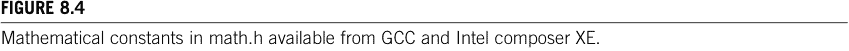

```cpp
const float rsqrtf2 = M_SQRT1_2;
float N(float d){
    return .5f + .5f * erff(rsqrtf2 * d);
}
```

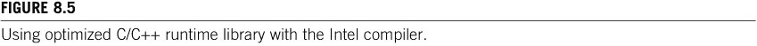

图 8.5 显示了使用 erf(x) 函数和预定义常数实现 N(x) 的方法。请注意，常量数据的转换在编译时发生，这不会影响运行时性能。接下来，我们应用一些数学背景知识，这在获得更高性能方面非常有用。

### 子表达式求值

如果 (1.0-1.0/q2) 被重复使用，你可能会想先计算 q2。这可能不是最佳选择。这是因为除法很昂贵，如果 q2 只出现在分母中，更好的选择是先计算 1.0/q2，然后将后续的除法转换为乘法，如图 8.5 所示。

另一个例子涉及分母中的平方根。事实证明，平方根的倒数是我们目标上的一个指令。如果您只需要平方根作为分母中的因子，请使用平方根的倒数和乘法（图 8.6）。

图 8.7 中优化的标量版本源代码清单与初始版本相比节省了超过 35% 的计算周期。图 8.8 中的性能图表显示了在 Intel® Xeon® Processor v3 上标量优化的性能提升。

```cpp
float time_sqrt = sqrt(time);
float d1 = (log(S/X) + (r-q + 0.5*sigma_sqr)*time)/(sigma*time_sqrt);

float time_sqrt = rsqrt(time);
float d1 = ((log(S/X) + (r-q + 0.5*sigma_sqr)*time)/sigma)*rsqrt;
```

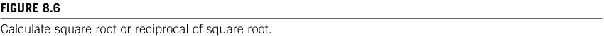

```cpp
float baw_scalaropt( const float S,
    const float X,
    const float r,
    const float b,
    const float sigma,
    const float time)
{
    float sigma_sqr = sigma*sigma;
    float time_sqrt = sqrtf(time);
    float nn_1 = 2.0f*b/sigma_sqr-1;
    float m = 2.0f*r/sigma_sqr;
    float K = 1.0f*expf(-r*time);
    float rq2 = 1/((-(nn_1)+sqrtf((nn_1)*(nn_1)+(4.f*m/K)))*0.5f);

    float rq2_inf = 1/(0.5f * ( -(nn_1) + sqrtf(nn_1*nn_1+4.0f*m)));
    float S_star_inf = X / (1.0f - rq2_inf);
    float h2 = -(b*time+2.0f*sigma*time_sqrt)*(X/(S_star_inf-X));
    float S_seed = X + (S_star_inf-X)*(1.0f-expf(h2));
    float cndd1 = 0;
    float Si=S_seed;
    float g=1.f;
    float gprime=1.0f;
    float expbr=expf((b-r)*time);
    for (int no_iterations =0; no_iterations<100; no_iterations++) {
        float c = european_call_opt(Si,X,r,b,sigma,time);
        float d1 = (logf(Si/X)+
            (b+0.5f*sigma_sqr)*time)/(sigma*time_sqrt);
        float cndd1=cnd_opt(d1);
        g=(1.0f-rq2)*Si-X+c rq2*Si*expbr*cndd1;
        gprime=(1.0f-rq2)*(1.0f-expbr*cndd1)+
            rq2*expbr*n_opt(d1)*(1.0f/(sigma*time_sqrt));
        Si=Si-(g/gprime);
    }
    float S_star = 0;
    if (fabs(g)>ACCURACY) {
        S_star = S_seed;
    }
    else {
        S_star = Si;
    }
    float C=0;
    float c = european_call_opt(S,X,r,b,sigma,time);
    if (S>=S_star) {
        C=S-X;
    }
    else {
        float d1 = (logf(S_star/X)+
            (b+0.5f*sigma_sqr)*time)/(sigma*time_sqrt);
        float A2 = (1.0f-expbr*cnd_opt(d1)) * (S_star*rq2);
        C=c+A2*powf((S/S_star),1/rq2);
    }
    return (C>c)?C:c;
};
```

## 图 8.7

美式看涨期权定价近似的标量优化实现。

### 美式期权近似

### 标量优化

（单位：K options/second，1 线程，125.9 百万期权）

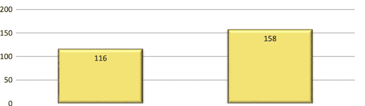

## 图 8.8

Intel Xeon 处理器上的标量优化影响。

### SIMD 并行——向量化

我们迄今为止所做的优化在本质上是标量的。一次只将一个输入值输入到操作中，并在操作后产生一个结果。然而，我们的目标 ISA（指令集架构）能够在数据打包在向量寄存器中时接收多个数据，对它们一起操作并同时产生 2、4、8 甚至 16 个结果。将标量数据打包成向量数据并使用向量指令的过程称为向量化。向量化提高了应用程序性能，因为它可以在多个数据上应用相同的操作，从而同时提供多个结果。

在本节中，我们展示了如何将标量优化的美式期权近似例程 baw_sclaroopt() 转换为向量优化例程。有两种方法可以将标量例程向量化，手动和自动。我们将在本节中介绍这两种方法。首先，我们展示如何使用 Intel C/C++ 编译器手动或显式声明和处理向量数据。编程必须遵循向量语法，以确保程序产生的结果与其标量对应物相同。其次，我们也可以对现有的标量程序进行注释，要求生成向量版本，编译器将自动生成向量化对应物。在这两种方法中，程序员都必须理解向量语法并确保最终代码等同于标量版本。区别在于，在自动方法中，编译器处理繁琐的活动，例如基于向量长度的循环迭代次数计算、剩余循环生成等。

### 定义和使用向量数据

GCC 和 Intel 编译器都支持向量内在语法。例如，它们都接受向量数据类型 __m256。GCC 将 vector_size 属性添加到基本 C 类型，而 Intel 则在向量内在数据类型上添加了薄的 C++ 包装器。通过这些扩展，程序员可以灵活地在高级 C/C++ 语法或低级内在语法或两者之间处理向量数据。图 8.9 总结了 GCC 和 Intel 编译器的向量扩展语法。

|  | GNU Compiler Collection | Intel Parallel Composer |
|---|---|---|
| Include File | include <intrin.h> | include <immintrin.h> |
| Intrinsics | m256 a; | m256 a; |
| C/C++ Single | typedef float vsf __attribute__((vector_size (16))); | F32vec8 vsf; |
| C/C++ Double | typedef double vdf __attribute__((vector_size (16))); | F64vec4 vdf; |

## 图 8.9

GCC 和 Intel composer XE 2015 中的向量内在和向量扩展。

```
F32vec8 baw_vecopt(F32vec8 S, F32vec8 X, F32vec8 r,
    F32vec8 b, F32vec8 sigma,F32vec8 time);
```

## 图 8.10

使用 Intel composer XE 2015 中的向量类进行向量例程声明。

本节其余部分在声明和处理向量数据时尽可能使用 Intel 向量类。图 8.10 显示了我们美式定价函数使用向量数据类型的概要。

### 向量算术运算

使用 C++ 类语法的好处之一是 C/C++ 运算符，例如 + − * /，可以轻松重载以在向量类上操作。语句例如：

F32vec8 sigma_sqr = sigma*sigma; 之所以有效，是因为 C++ 运算符重载。然而，向量语法不允许混合标量向量操作。你不能写 F32vec8 nn_1 = 2.0f*b/sigma_sqr − 1.0f。尽管如此，图 8.11 中的代码是完全可以的。

使用向量类的好处之一是这种语法允许您将代码与内在代码混合使用，如果您找不到想要的操作。在此示例中，我们显式使用了一个 swizzle 指令，即用于分支语句的向量混合。

使用向量类的好处，与内在函数相比，向量类依赖编译器进行指令选择，而直接使用内在函数则将该责任转移给程序员。目标相关指令例如 FMA 可以在使用向量类时自动生成，而在使用内在函数时可能需要为每个新目标显式重写。

```
F32vec8 twof = F32vec8(2.0f);
F32vec8 onef = F32vec8(1.0f);
F32vec8 nn_1 = twof*b/sigma_sqr - onef;
```

## 图 8.11

使用 Intel composer XE 2015 中的向量类进行简单算术运算。


### 向量函数调用

向量数据上的函数调用之所以有效，是因为存在着同一函数的向量版本。由于C++的多态性，不需要根据输入数据类型来区分函数。图8.12展示了Newton-Raphson迭代初始设置的向量代码。

任何你需要调用但C/C++运行时库并未提供的函数，都必须自行编写。图8.13是标的金融资产上带收益率q的通用Black-Scholes欧式期权的向量化版本。

### 分支语句

分支语句会破坏向量执行模型，因为它们需要对不同数据元素执行不同操作。到目前为止，我们的向量执行模型对每个数据元素都应用相同操作。在我们的例子中，有少数简单的双向IF语句。一般来说，我们必须评估IF语句每个分支上的状态变化，并根据IF条件将这些变化应用于向量数据。

图8.14展示了如何使用向量比较和混合指令来实现向量化的if语句。

第一条语句是向量比较。它比较两个向量输入寄存器中对应的数据元素，并设置一个记录比较结果的掩码寄存器。第二条语句在准备前两个参数时，首先对语句的两个分支都进行求值，然后

```
F32vec8 twof = F32vec8(2.0f);
F32vec8 onef = F32vec8(1.0f);
F32vec8 sigma_sqr = sigma*sigma;
F32vec8 time_sqrt = sqrt(time);
F32vec8 nn_1 = twof*b/sigma_sqr - onef;
F32vec8 m = twof*r/sigma_sqr;
F32vec8 K = onef-exp(-r*time);
F32vec8 halff = F32vec8(0.5f);
F32vec8 fourf = F32vec8(4.0f);
F32vec8 rq2 = rcp((-(nn_1)+
             sqrt((nn_1)*(nn_1)+(fourf*m/K)))*halff);
F32vec8 rq2_inf = rcp(halff * (-(nn_1) +
             sqrt(nn_1*nn_1,twof)+fourf*m)));
F32vec8 S_star_inf = X/(onef-rq2_inf);
F32vec8 h2 = -(b*time+twof*sigma*time_sqrt)*
             (X/(S_star_inf-X));
F32vec8 S_seed = X + (S_star_inf-X)*(onef-exp(h2));
int no_iterations=0;
F32vec8 Si=S_seed;
F32vec8 g=onef;
F32vec8 gprime=onef;
```

## 图 8.12

使用Intel编译器的例程的前几行代码。

### 月之暗面

月之暗面是一家专注于通用人工智能研究的科技公司。

我们致力于开发安全、有益、可靠的AI系统，让智能技术惠及每一个人。

公司成立于2023年，总部位于北京。团队成员来自全球顶尖研究机构和科技企业。

核心产品包括Kimi智能助手和Kimi开放平台，为个人和企业提供智能解决方案。

成立时间：2023年3月

总部地点：中国北京

> > 探索宇宙的暗面，点亮智能的星光。

- 使命：让AI惠及每一个人
- 愿景：打造安全可靠的人工智能
- 价值观：创新、责任、协作

| 产品名称 | 类型 | 上线时间 |
| --- | --- | --- |
| Kimi智能助手 | AI对话 | 2023年 |
| Kimi开放平台 | API服务 | 2024年 |

```
```python
from moonshot import Kimi

kimi = Kimi(api_key="your-key")
response = kimi.chat("你好，Kimi！")
print(response)
```
```

加入我们：careers@moonshot.cn

商务合作：bd@moonshot.cn


```
```cpp
if (S>=S_star) {
        C=S-X;
}
else {
        float d1 = (log(S_star/X)+
                    (b+0.5*sigma_sqr)*time)/(sigma*time_sqrt);
        float A2 = (1.0-exp((b-r)*time)*CND(d1)) * (S_star/q2);
        C=C+A2*pow((S/S_star),q2);
};

F32vec8 d1 = (log(S_star/X)+
              (b+halff*sigma_sqr)*time)/(sigma*time_sqrt);
F32vec8 A2 = (onef-exp((b-r)*time)*N(d1)) * (S_star*rq2);
C = _mm256_blendv_ps(S-X,
                     C+A2*pow((S/S_star), rcp(rq2)),
                     _mm256_cmp_ps(S, S_star, _CMP_LT_OQ));
```
```

## 图 8.15

使用向量类和Intel编译器的第二个分支语句。

```
```cpp
#include <dvec.h>
        simd_max(a, b)
        simd_min(a, b)
```
```

## 图 8.16

作为Intel Composer XE 2015中向量ISA一部分的垂直SIMD操作。

为了尽量减少分支语句的影响，向量处理单元内置了某些条件执行能力。例如，寻找最大值和最小值的垂直操作就是向量指令集的一部分。你可以在C/C++中访问它们，如图8.16所列。你可以利用它们来减少代码中的分支语句。向量源代码中的最后一行实际上利用了这一事实，从而避免了另一个分支。

综合起来，我们在图8.17中得到了一个完整的美式看涨期权近似的向量版本。

### 调用程序的向量版本和标量版本

为了了解向量化带来的性能提升有多大，我们必须将标量优化版本和向量版本放在同一个测试程序中。要调用向量版本，我们必须将输入数据准备到向量寄存器中，并从向量寄存器将结果数据取到内存位置。加载和存储向量寄存器是我们一直在回避的两个问题。然而，如果我们确实打算同时使用向量版本和标量版本并衡量性能，就无法再回避它们了。

```
```cpp
F32vec8 baw_vecopt(F32vec8 S,
                  F32vec8 X,
                  F32vec8 r,
                  F32vec8 b,
                  F32vec8 sigma,
                  F32vec8 time)
{
    F32vec8 sigma_sqr = sigma*sigma;
    F32vec8 time_sqrt = sqrt(time);
    F32vec8 nn_1 = twof*b*rcp_nr(sigma_sqr) - onef;
    F32vec8 m = twof*r*rcp_nr(sigma_sqr);
    F32vec8 K = onef-exp(-r*time);
    F32vec8 rq2 = rcp_nr((
(nn_1)*sqrt(nn_1*nn_1+fourf*m*rcp_nr(K)))*halff);
    F32vec8 rq2_inf = rcp_nr(halff * ( -(nn_1) +
sqrt(nn_1*nn_1+fourf*m)));
    F32vec8 S_star_inf = X * rcp_nr(onef -rq2_inf );
    F32vec8 h2 = -
(b*time+twof*sigma*time_sqrt)*((X*rcp_nr(S_star_inf-X));
    F32vec8 S_seed = X + (S_star_inf-X)*(onef-exp(h2));

    int no_iterations=0;
    F32vec8 Si=S_seed;
    F32vec8 g=onef;
    F32vec8 gprime=onef;
    while ( no_iterations++<100) {
        F32vec8 c = bs_call(Si,X,r,b,sigma,time);
        F32vec8 d1 =
(log(Si/X)+(b+halff*sigma_sqr)*time)/(sigma*time_sqrt);
        g=(onef-rq2)*Si-X+rq2*Si*exp((b-r)*time)*N(d1);
        gprime=( onef-rq2)*(onef-exp((b-r)*time)*N(d1))
               +rq2*exp((b-r)*time)*vn(d1)*(onef/(sigma*time_sqrt));
        Si=Si-(g/gprime);
    };
    F32vec8 S_star = F32vec8(0.0f);
    __m256 solved = _mm256_cmp_ps(abs(g), F32vec8(ACCURACY), _CMP_GT_OQ);
    S_star = _mm256_blendv_ps(Si, S_seed, solved);
    F32vec8 C = F32vec8(0.0f);
    F32vec8 c = bs_call(S,X,r,b,sigma,time);
    F32vec8 d1 =
(log(S_star*rcp_nr(X))+(b+halff*sigma_sqr)*time)*rcp_nr(sigma*time_sqrt);
    F32vec8 A2 = (onef-exp((b-r)*time)*N(d1)) * (S_star*rq2);
    C = _mm256_blendv_ps(c+A2*pow((S/S_star), onef/rq2), S-X,
                         _mm256_cmp_ps(S, S_star, _CMP_GE_OQ));
    return simd_max(C,c);
}
```
```

## 图 8.17

美式看涨期权近似的向量版本。

### 向量寄存器的加载与存储

期权数据通常存储在主内存中。对于标量版本，一次传输一个数据元素的输入值是可以的。但对于向量版本，这样太慢了。在C/C++层面，我们可以声明一个向量寄存器量并解引用一个内存地址。编译器会为你生成向量加载和存储指令。假设StockMem是存储当前股票价格的变量，ResultMem是你期望结果的内存变量。它们都按4字节或32位内存边界对齐。图8.18中的源代码将生成正确的向量加载和存储指令。

### 调用程序的向量版本

让我们进一步假设股票价格存储在一个数组中，并且在内存中一个接一个地连续排列，没有任何间隙。其他输入参数也是如此。输出参数也在内存中连续排列。无风险利率R是标量，我们可以将其广播为向量数据类型，以便在所有通道中使用。

我们期望像图8.19这样的源代码来运行美式看涨期权近似程序的向量版本。向量版本的性能与原始版本和标量优化版本在图8.20中进行比较。

### 比较向量版本和标量版本

让我们使用大小为1.259亿个元素的输入数组，标量版本运行一个线程，向量版本运行一个线程。在Intel® Xeon® E5-2697处理器上，该处理器具有两个插槽且每个插槽14个内核，主频2.6 GHz，标量版本达到157.62 K期权/秒，向量版本达到560.536 K期权/秒，如图8.20所示。

```
F32vec8 S = *(F32vec8*)&StockMem;
F32vec8 res = baw_vecopt(S,X,R,b,v,T);
*(F32vec8*)&(ResultMem) = res;
```

## 图 8.18

向量寄存器的加载与存储。

```
for (int opt = 0; opt < OptPerThread; opt += 8)
{
    F32vec8 T = *(F32vec8*)&OptionYears[opt];
    F32vec8 S = *(F32vec8*)&StockPrice[opt];
    F32vec8 X = *(F32vec8*)&OptionStrike[opt];
    F32vec8 b = *(F32vec8*)&CostofCarry[opt];
    F32vec8 v = *(F32vec8*)&Volatility[opt];
    *(F32vec8*)&(CallResult[opt]) = baw_vecopt(S,X,R,b,v,T);
}
```

## 图 8.19

将期权输入数据加载到向量寄存器，调用近似程序，然后保存结果。


使用向量扩展的美国期权近似增益
（单位：K options/second，1 线程，125.9 百万期权）

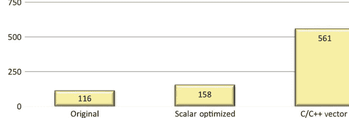

**图 8.20**

在 Intel Xeon 处理器上使用 C/C++ 向量扩展进行向量化时的美国期权近似增益。

### 通过注释源代码进行向量化：#PRAGMA SIMD

迄今为止我们所实现的代码向量化来自于对 SIMD 数据类型的显式处理。程序员可以选择使用高级语言构造的 C/C++ 向量扩展，或仅使用处理器内在函数。程序员必须使用向量语法表达底层算法，这通常会导致对原始标量程序的重写。向量代码生成是程序中使用向量构造的直接结果。

实现代码向量化的另一种方法是使用高级语言指令（如 #pragma）对原始标量程序进行注释。通过使用 #pragma SIMD 指令，程序员可以实现对要向量化的代码部分的显式向量编程。#pragma SIMD 的好处是程序不必创建同一程序的另一个向量版本。也不需要选择或关心向量程序的指令。编译器分析串行程序和向量指令，并在程序员的代表下生成向量代码。在我们的示例中，代码注释发生在标量优化例程的调用方，如图 8.21 所示。

```cpp
sTime = second();
#pragma vector nontemporal (CallResult)
#pragma simd
#pragma vector aligned
for (int opt = 0; opt < OptPerThread; opt++)
{
    float T = OptionYears[opt];
    float S = StockPrice[opt];
    float X = OptionStrike[opt];
    float b = CostofCarry[opt];
    float v = Volatility[opt];
    CallResult[opt] = baw_scalaroopt(S,X,RISKFREE,b, v, T);
}
eTime = second();
printf("Completed pricing %7.5f million options in %7.5f seconds:\n", OPT_N/1e6, eTime-sTime);
printf("Scalar %s version runs at %7.5f Thousand options per second.\n", (ThreadNum > 1)?"parallel":"serial", OPT_N/(1e3*(eTime-sTime)));
```

**图 8.21**

通过注释标量源代码进行向量化。

为了确保编译器可以向量化代码，程序必须告诉编译器在函数调用发生时该怎么做。编译器内部的向量化器有两个选择。或者内联该函数，或者找到一个接受向量参数的相同函数的版本。在我们的例子中，我们内联了对 baw_scalaroopt 的函数调用，以及它调用的我们定义的几个其他函数。运行时库函数如 expf(x)、logf(x) 和 sqrtf(x) 都有接受向量参数的对应函数。

源代码清单如图 8.22 所示，说明了在基于注释的向量编程中如何使用自定义定义函数和运行时函数。

```cpp
__forceinline
float cnd_opt(float d){
    return 0.5f +0.5f*erff(float(M_SQRT1_2)*d);
}

__forceinline
float n_opt(const float z) {
    return (1.0f/sqrtf(2.0f*PI))*expf(-0.5f*z*z);
};

__forceinline
float european_call_opt( const float S,
                        const float X,
                        const float r,
                        const float q,
                        const float sigma,
                        const float time)
{
    float sigma_sqr = sigma*sigma;
    float time_sqrt = sqrtf(time);
    float d1 = (logf(S/X) + (r-q + 0.5f*sigma_sqr)*time) /
                (sigma*time_sqrt);
    float d2 = d1-(sigma*time_sqrt);
    float call_price = S * expf(-q*time)* cnd_opt(d1) -
                        X * expf(-r*time) * cnd_opt(d2);
    return call_price;
};
__forceinline
float baw_scalaroopt( const float S,
                      const float X,
                      const float r,
                      const float b,
                      const float sigma,
                      const float time){ . . .};
```

**图 8.22**

内联自定义函数调用以实现基于编译器的向量化。

### C/C++ 向量扩展与 #PRAGMA SIMD

在本节中，我们展示了两种不同的显式向量编程风格：C/C++ 向量扩展和 #pragma SIMD。两者都会产生利用现代微处理器中向量处理单元的 SIMD 指令。但它们是截然不同的。使用 C/C++ 向量扩展时，你必须自己声明和处理向量数据。你必须使用向量语法重写现有的标量代码。而 #pragma SIMD 方法使用标量代码工作，你不必编写新代码，只需装饰现有的标量代码，告诉编译器向量化器在编译器向量化标量代码时你想要执行某些操作。因此，从生产率的角度来看，#pragma SIMD 通常能实现更高的生产率。

第二个论点是代码生成。使用 C/C++ 向量扩展时，每个数值操作最终都会定义一个内在函数，这限制了编译器优化指令选择的能力。这就解释了为什么当编译器很明显知道程序试图做什么时，#pragma SIMD 可以实现略高的性能。图 8.23 显示，在我们的例子中，使用 #pragma SIMD 进行向量编程可以实现更高的性能。

使用向量扩展与 #pragma SIMD 的美国期权近似增益
（单位：K options/second，1 线程，125.9 百万期权）

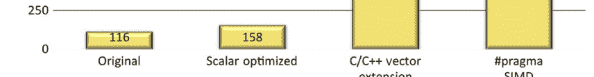

**图 8.23**

在 Intel Xeon 处理器上具有性能优势的 #pragma SIMD。

总的来说，当你尝试让代码向量化时，请很好地注释代码，以便编译器知道你试图做什么；应用 #pragma SIMD 来查看它是否正确地向量化了你的代码。对于编译器无法向量化或不可能注释程序员意图的代码，使用 C/C++ 向量扩展。

### 线程并行化

现代微处理器，从你手机中的处理器到大数据中心中的处理器，都是多核的。这意味着你必须创建线程才能充分利用处理器核心。在我们的基于 Intel® Xeon® E5-2697 处理器的系统上，有 28 个核心和 56 个线程。到目前为止，我们的向量化程序只能创建一个线程，并且只能利用不超过、通常少于整个系统总核心性能潜力中的一个核心。要利用其余核心提供的性能，我们必须创建更多线程并分割输入参数，以便多个线程可以同时工作。在我们的示例中，我们可以将总期权数据分割成 56 块，并将每块分配给一个线程，让每个线程处理不同的输入数据集。数字 56 与该系统上的硬件线程数相匹配。我们可以使用 OpenMP 来管理创建和销毁过程。然而为了确保多线程应用程序和谐工作，我们必须注意内存分配和线程绑定。

### NUMA 系统中的内存分配

在串行应用程序中，由于只有一个线程，内存分配通常发生在程序开始时。因此，应用程序通常会获得一个巨大的内存块，该内存块位于执行主程序的核心本地。在双插槽、双内存控制器平台上，这种内存分配模型使一半的线程具有快速的本地内存访问，而另一半的线程具有更昂贵的远程内存访问（即跨插槽互连，今天称为 QPI）。在多线程应用程序中，更好的内存分配模型是在进行任何内存分配之前先创建工作线程。多线程应用程序中内存分配的另一个问题是分配库的线程安全性以及接口随工作线程数量的扩展性。我们可以通过使用 Intel Threading Building Blocks（TBB）来解决这两个问题，如图 8.24 所示。

```cpp
#include <tbb/scalable_allocator.h>
#include <omp.h>
#pragma omp parallel
{
#ifdef _OPENMP
        threadID = omp_get_thread_num();
#else
        threadID = 0;
#endif
        float *Call =
            (float *)scalable_aligned_malloc(msize, ASIZE);
        float *Stock =
            (float *)scalable_aligned_malloc(msize, ASIZE);
        float *Strike =
            (float *)scalable_aligned_malloc(msize, ASIZE);
        ... ... ...

        scalable_aligned_free(Call);
        scalable_aligned_free(Stock);
        scalable_aligned_free(Strike);
}
```

**图 8.24**

使用 OpenMP 和 TBB 内存分配来创建工作线程，然后从工作线程分配内存。


### 线程绑定与亲和性接口

通过使用 OpenMP #pragma 创建的工作线程是用户级线程，它们代表程序员执行应用程序代码。在执行时，OpenMP 运行时库将与宿主操作系统配合，获取内核可调度实体（也称为线程或内核线程）。在 Intel® Xeon® 处理器上，每个核心有两个内核线程，而在 Intel® Xeon Phi™ 协处理器上，每个核心支持四个内核线程。在运行时将用户线程映射到内核线程的过程称为线程绑定。线程绑定很重要，因为来自不同核心和插槽的内核线程可能共享资源，如缓存内存带宽等。程序员可以利用这些差异，指定一种最大化应用程序性能的绑定策略。

在我们的示例中，对于双插槽处理器，我们希望使用一个核心支持的两个内核线程，并且希望以一种使系统内存带宽需求保持恒定且在程序执行过程中不会变化的方式使用它们。在图 8.25 中，我们展示了实现这一目标的代码。

图 8.26 将 28 核 56 线程的并行性能添加到之前的比较中。

为了测量真实性能，我们只需从头到尾计时。由于每个线程执行完全相同的工作量，我们可以安全地测量最繁忙线程的从上到下时间。图 8.27 中的源代码列表就是我们测量标量并行性能的方式。

### 从多核扩展到众核

作为最后一个练习，我们采用向量化和并行化的源程序，并将它们重新构建为在代号为 KNC 的 Intel® Xeon Phi™ 协处理器上原生运行。使用 Intel 编译器时，我们只需通过使用 –mmic 而不是 –xCORE-AVX2 来告知编译器目标为协处理器。对于基于 `#pragma SIMD` 的代码，由于没有直接引用任何处理器内建函数，我们甚至根本不需要对源代码做任何修改。为了证明编译器仍然为在协处理器上执行进行了积极的优化，我们可以通过查看其编译器生成的列表文件来比较向量化的 C 运行时数学函数调用。

```
icpc -c -S -xCORE_AVX2 -openmp -O3 -ipo -restrict -fimf-precision=low -fimf-domain-exclusion=31 -fno-alias -qopt-report=5 -o am_call.vp.s am_call.cpp
```

```
#ifdef _OPENMP
    kmp_set_defaults("KMP_AFFINITY=scatter, granularity=fine");
    int ThreadNum = omp_get_max_threads();
    omp_set_num_threads(ThreadNum);
#else
    int ThreadNum = 1;
#endif
```

### 图 8.25

为每个内核线程创建一个用户线程，并尽可能将相邻的用户线程放远，以使系统资源需求保持恒定。

### 美式期权近似
并行化增益
（单位：千期权/秒，1/56 线程，1.259 亿期权）

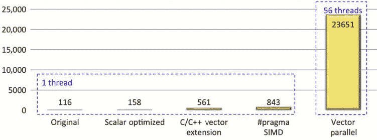

图 8.26  
Intel Xeon 处理器上美式期权近似的并行化增益。

```cpp
#include <sys/time.h>
#include <time.h>

#pragma omp parallel
{
#ifdef _OPENMP
        threadID = omp_get_thread_num();
#else
        threadID = 0;
#endif
    // allocate memory

    // Read-in the input data
#pragma omp master
        sTime = second();

#pragma vector nontemporal (CallResult)
    for (int opt = 0; opt < OptPerThread; opt++)
    {
        float T = OptionYears[opt];
        float S = StockPrice[opt];
        float X = OptionStrike[opt];
        float b = CostofCarry[opt];
        float v = Volatility[opt];
        CallResult[opt] = baw_scalaroopt(S,X,RISKFREE,b,v,T);
    }

#pragma omp master
    {
        eTime = second();
        printf(
        "Completed pricing %7.5f million options in %7.5f seconds:\n",
            OPT_N/1e6, eTime-sTime);
        printf(
        "Parallel version runs at %7.5f Thousand options per second.\n",
            OPT_N/(1e3*(eTime-sTime)));
    }
    // de-allocate memory
}
```

图 8.27  
使用 OpenMP 4.0 实现的美式期权近似核心并行化。

```
icpc -c -S -xCORE_AVX2 -openmp -O3 -ipo -restrict -fimf-precision=low -fimf-domain-exclusion=31 -fno-alias -qopt-report=5 -o am_call_knc.s am_call.cpp
```

所有向量化的运行时数学函数名称都以 `__svml_` 开头，我们可以从这些列表文件中 grep 该模式。你会看到的是，在 `-xCORE_AVX2` 目标的列表文件中，由于源代码中使用了 `expf(x)`、`logf(x)`、`erff(x)` 和 `powf(x)`，会产生四个不同的函数调用，而在 `-mmic` 目标的列表文件中，你会看到 0 个。协处理器上的向量化数学库函数调用发生了什么？事实证明，协处理器具有 `exp2(x)` 和 `log2(x)` 指令。对 `exp(x)` 和 `log(x)` 的调用可以很容易地由 `exp2(x)` 和 `log2(x)` 组合而成，`powf(x)` 也是如此。至于 `erff(x)`，Intel 编译器将其实现内联，使其代码序列直接嵌入到 `baw_scalaropt()` 的源代码中。内联数学函数背后的理由是避免函数调用开销。图 8.28 列出了 Intel Xeon 处理器最高性能方法与 Intel Xeon Phi 协处理器之间的等价关系。

你可以按照需要积极地内联尽可能多的运行时数学函数调用。然而，当你的基本块达到一定大小后，收益会下降。你可能会耗尽寄存器，使编译器无法进行其他优化，并且可能增加运行时的指令 TLB 未命中。函数内联是你必须在源代码中试验的事情。通常，如果你有一个小而紧凑的循环，你通常可以期望从函数内联中获得性能回报。在我们的案例中，它回报巨大。图 8.29 显示了在 Intel Xeon 和 Xeon Phi™ 处理器上美式期权定价算法实现的三个级别的优化增益。对于 Intel Xeon Phi 协处理器运行，超越函数和单精度小型向量数学库（svml）调用的内联使编译器能够创建几乎所有内容都向量化的代码。图 8.30 显示了 Intel Xeon Phi 协处理器上的强大性能（最右侧的条形，其他条形位于代号为 Haswell 的 Intel Xeon 处理器上）。

| 第4代 Intel® Xeon 处理器 | Intel® Xeon Phi™ 协处理器 |
|---|---|
| `__svml_expf8_ep` | 使用 `vexp223ps` 指令组合 |
| `__svml_logf8_ep` | 使用 `vlog2ps` 指令组合 |
| `__svml_erff8_ep` | 内联以避免调用开销 |
| `__svml_powf8_ep` | 由 `vlog2ps` 和 `vexp223ps` 组合 |

**图 8.28**

Intel® Xeon® 和 Intel® Xeon Phi™ 产品上的数学运行时函数实现。

| 方法论 | 处理器增益比 | 协处理器增益比 |
|---|---:|---:|
| 标量优化 | 1.357 | 4.943 |
| SIMD 并行性 | 5.350 | 15.812 |
| 核心并行性 | 28.047 | 168.287 |

**图 8.29**

美式期权近似在三种性能改进类型上的增益。

### 美式期权近似
性能总结
（单位：千期权/秒，1/56/244，1.259 亿期权）

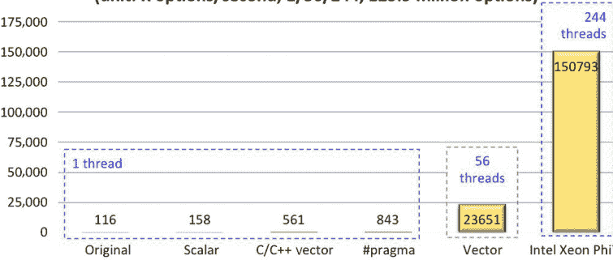

# 图 8.30

在 Xeon 处理器（28 核上最多 56 线程）上的美式期权近似结果，最终在 Intel Xeon Phi 协处理器（61 核上 244 线程）上运行。

### 小结

在本章中，我们研究了如何使用牛顿-拉夫逊方法来近似美式看涨期权。我们采用了 Barone-Adesi 和 Whaley 开创的这种算法的一个示例，应用了特定于处理器的优化，并启用了 SIMD 和多核并行编程，以在同一硬件（28 核 Intel Xeon E5-2697 处理器）上实现超过 200 倍的增益。我们还证明了同样的方法和通用工具集使我们能够轻松地从多核平台过渡到众核平台，无需更改任何源代码，并在 Intel Xeon Phi 7210 协处理器（第一代 Intel Xeon Phi 产品）上实现了更令人印象深刻的性能增益。这是可能的，因为 Intel Xeon 和 Intel 众核产品具有相似性。它们 ISA 的接近性使得一套开发工具即可支持全部产品，这也使通用源代码成为可能。

最后，诸如牛顿-拉夫逊技术之类的近似方法已被金融数学家广泛用于衍生品定价、风险管理和投资组合分析。你可以应用相同的优化框架，并在其他基于近似的算法中实现可观的增益。

### 更多信息

- Barone-Adesi, G., Whaley, R.E., 1987. Efficient analytic approximation of american option values. J. Finance 42, 301-320.


- Brennan, M.J., Schwartz, E.S., 1978. 有限差分方法和跳跃过程在或有索赔定价中的应用：一种综合。J. Finan. Quant. Anal. 13, 461-474.
- Cox, J.C., Ross, S., Rubinstein, M., 1979. 期权定价：一种简化方法。J. Finan. Econ. 7, 229-264.
- Tian, Y.S., 1993. 期权定价的改进格点方法。J. Futures Mark. 13 563-577.
- Meyerov, I., Sysoyev, A., Astafiev, N., Burylov, I. Black-Scholes 定价的性能优化 高性能并行之珠——多核和众核编程方法，第 319-340 页（第 19 章）。
- 从此和其他章节下载代码，http://lotsofcores.com。

### 来自格点 QCD 优化的威尔逊 DSLASH 内核

### 第 9 章

**Bálint Joó\*, Mikhail Smelyanskiy†, Dhiraj D. Kalamkar‡, Karthikeyan Vaidyanathan‡**

*美国能源部托马斯·杰斐逊国家加速器设施（杰斐逊实验室），美国\*

*英特尔公司并行计算实验室，美国加州† 并行计算实验室，*
*英特尔公司，印度‡*

量子色动力学（QCD）是强核力的理论，是构成粒子相互作用标准模型的四种基本力之一。QCD 负责将夸克束缚成质子和中子，进而构成原子核。格点量子色动力学，（格点 QCD 或 LQCD）是适用于计算机的 QCD 版本。它是进行 QCD 中非微扰计算的唯一模型无关方法，主要用于理论核物理和高能物理的计算。夸克和胶子的格点 QCD 模拟是高性能计算中的原始大挑战问题之一，格点 QCD 代码通常在新的高性能计算系统上早期实现。格点 QCD 计算在美国和全球使用超级计算机时间的很大比例。作为一个例子，在 2014 年，格点 QCD 计算消耗了美国能源部国家能源研究科学计算中心（NERSC）13%的计算机资源。

在本章中，我们将探讨 LQCD 计算中的一个关键内核，即威尔逊-Dslash 内核。该内核本质上是一个有限差分算子，与模板在精神上相似。我们将概述我们对英特尔 Xeon Phi 协处理器的优化方法，该方法遵循我们论文“英特尔 Xeon Phi 协处理器上的格点 QCD”中首次描述的方法（有关具体信息，请参阅本章末尾的“更多信息”部分）。我们的方法是带读者进行一次旅程，从一个已经具有线程级并行的该算子的现有生产实现开始，但在部署在英特尔 Xeon Phi 协处理器上时仍未实现非常高的性能。通过与简单性能模型进行性能比较，我们将展示如何通过改进缓存重用和内存带宽利用率以及矢量化，可以将此代码的性能提高超过 8×，超过在英特尔 Xeon Phi 协处理器上运行的原始实现。更重要的是，当我们将优化反馈到常规英特尔 Xeon 处理器时，我们在该平台上也观察到比原始代码的最佳配置高出 2.6× 的性能改进。

在整章中，我们将参考提供的代码包，其中包含我们 Wilson-Dslash 的初始实现以及优化后的实现，以及一些依赖库。虽然我们主要集中在这两个 Dslash 实现和一个代码生成器上，但代码包包含许多目录，我们设置这些目录以允许代码在不同配置下构建，利用不同的优化。在整章中，我们将始终突出

### 威尔逊-DSLASH 内核

代码包中应工作的目录，以便跟随我们的讨论。我们在此提前指出，我们在英特尔 Xeon Phi 协处理器架构上的工作完全在原生模式下进行，而不是使用异构卸载技术。对于代码包中的构建说明，我们敦促读者遵循提供的 README 文件。

在本节中，我们将描述 Wilson-Dslash 内核并考虑其一些计算特性。在深入细节之前，让我们先说几句关于 LQCD 设置的话。想法是，我们不是使用通常的连续统，而是将四维时空表示为四维超立方格点。每个格点点具有坐标 x = (n_x,n_y,n_z,n_t)，其中分量只是通常 X、Y、Z 和 T 方向上的坐标。夸克场定义在格点位点上，被称为旋量，记为 ψ(x)。对于当前目的，ψ(x) 可以被认为是一组复数，具有两个额外的指标，称为“色”和“自旋”。因此，位点 x 处的夸克场记为 ψ^a_α(x)，其中 a = {0,1,2} 为色指标，α = {0,1,2,3} 为自旋指标。一般来说，拉丁指标表示色，希腊字母指标表示自旋。除了夸克场之外，还有胶子的场，称为规范场。它们被赋予格点点之间的有向链接，因此通常被称为胶子链接或链接矩阵。通常它们记为 U_μ^{ab}(x)，其中 a 和 b 再次为色指标，但 μ 为方向指标。对于 μ = {0,1,2,3}，我们理解 U_μ^{ab}(x) 是从位点 x 发出的胶子场，在 X、Y、Z 和 T 方向的前向方向上的链接上。正如拉丁指标所暗示的那样，在每个链接上 U 是色上的 3 × 3 复矩阵，没有自旋指标。此外，U 不仅仅是一个 3 × 3 矩阵，它还是群 SU(3) 的成员，这意味着它是幺正的，因此任何给定链接矩阵的厄米共轭（矩阵的转置，每个元素取复共轭）是其逆：(U^{a,b}_μ)^† = (U^{b,a}_μ)* = U^{-1} 并且每个矩阵的行列式 det(U^{a,b}_μ(x)) = 1。

有了这些定义，我们可以写下作用于夸克旋量 ψ 的 Wilson-Dslash 算子 D：

D^{a,b}_{α,β}(x,y)ψ^b_β(y) = Σ_{μ=0}^2 U_μ^{a,b}(x)P^μ_{α,β}ψ^b_β(x+μ̂) + U^{†}_{μ}^{a,b}(x−μ̂)P^{+μ}_{α,β}ψ^b_β(x−μ̂), (9.1)

其中等式中重复的指标求和，P^{±μ} 是作用于自旋指标的投影矩阵。我们也可以看到该操作类似于模板：对于每个输出点 x，我们使用 μ 方向前向和后向邻近点的旋量：ψ(x+μ̂) 和 ψ(x−μ̂)；并且求和涉及四个方向。每个来自邻近位点的旋量都乘以连接中心位点与其的链接。因此 ψ(x+μ̂) 乘以 U_μ(x)，而 ψ(x−μ̂) 乘以 U^†(x−μ̂)，这——由于厄米共轭——应解释为从 x−μ̂ 指向 x 的链接的“逆”，即从 x 指向 x−μ̂ 的链接。

U 链接的乘法仅针对色指标进行，必须对四个自旋指标中的每一个重复一次。可能有助于将旋量视为四分量向量，其中每个分量本身是三分量复向量（也称为色向量，或色 3-向量）。同样，P^{±μ} 的乘法仅针对自旋指标进行，必须对 ψ 的三个色指标中的每一个重复一次。在这种情况下，并且在处理自旋指标时，将旋量视为具有三个元素、每个元素都是四分量向量（自旋向量）的对象可能有所帮助。

最后一个技巧要考虑的是投影算子的性质：$P^{\pm\mu}=(1\pm\gamma_\mu)$。$\gamma_\mu$ 是仅作用于自旋的 $4\times4$ 复矩阵，它们是稀疏的。我们选择它们处于特定的表示中，我们在下面显示：

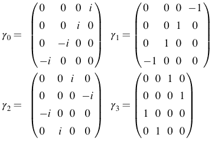

投影算子具有我们下面对 $P^{-0}$ 的情况所说明的特定性质。让我们考虑单个位点上单个色分量、例如为简单起见取 $a=0$ 的旋量 $\psi^a_\alpha$（当然这对所有色分量重复）。我们可以写出 $\psi_\alpha=(\psi_0,\psi_1,\psi_2,\psi_3)^T$。然后

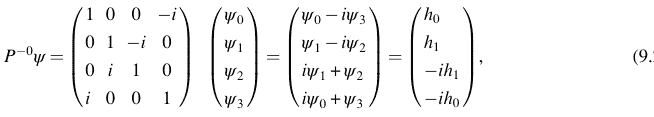

其中我们定义了 $h_0=\psi_0-i\psi_3$ 和 $h_1=\psi_1-i\psi_2$。换句话说，结果的下两个自旋分量（我们将称之为 $r_2$ 和 $r_3$）与上两个相同，但乘以 $-i$。该性质是普遍的，适用于所有投影算子，尽管细节会随所讨论的投影算子而变化。找到正确的 $h_0$ 和 $h_1$ 的操作，被称为投影，以及将结果放入下分量并乘以 $i$ 等操作，被称为重建。我们在图 9.1 所示的表中展示了如何对所有投影算子执行这些操作，使用我们特定的 $\gamma$ 矩阵选择。实际用途是，当我们将投影后的旋量乘以 $U$ 链接矩阵时，我们不需要对 ψ 的每个自旋指标重复矩阵乘法。相反，我们只需要乘以由

| $(\pm,\mu)$ | $h_0$ | $h_1$ | $r_2$ | $r_3$ |
|---|---|---|---|---|
| $(-,0)$ | $\psi_0-i\psi_3$ | $\psi_1-i\psi_2$ | $ih_1$ | $ih_0$ |
| $(-,1)$ | $\psi_0+\psi_3$ | $\psi_1+\psi_2$ | $-h_1$ | $h_0$ |
| $(-,2)$ | $\psi_0-i\psi_2$ | $\psi_1+i\psi_3$ | $ih_0$ | $-ih_1$ |
| $(-,3)$ | $\psi_0-\psi_2$ | $\psi_1-\psi_3$ | $-h_0$ | $-h_1$ |
| $(+,0)$ | $\psi_0+i\psi_3$ | $\psi_1+i\psi_2$ | $-ih_1$ | $-ih_0$ |
| $(+,1)$ | $\psi_0-\psi_3$ | $\psi_1+\psi_2$ | $h_1$ | $-h_0$ |
| $(+,2)$ | $\psi_0+i\psi_2$ | $\psi_1-i\psi_3$ | $-ih_0$ | $ih_1$ |
| $(+,3)$ | $\psi_0+\psi_2$ | $\psi_1+\psi_3$ | $h_0$ | $h_1$ |

## 图 9.1

如何计算投影算子 $P^{\pm\mu}$ 的 $h_1$ 和 $h_2$，以及如何从 $h_1$ 和 $h_2$ 重建投影结果的下自旋分量 $r_2$ 和 $r_3$。


projection of ψ with P±μ。这些构成了要累积在结果中的前两个分量。我们可以通过重建步骤从它们恢复后两个分量。

这就引出了计算 Wilson-Dslash 算子对格点旋量的作用的伪代码，如图 9.2 所示。我们假设每个数组元素都保存复数。我们对四个维度进行循环，并在每个维度内对向前和向后进行循环

```
// Pseudocode for Wilson Dslash Operator
// array elements are assumed to be complex
// Input arrays: psi[x][color][spin]
//                U[x][mu][color][color]
//
// Output array: result[x][color][spin]
// Temporary arrays: h[color][2], and uh[color][2]
//
forall sites x {

    // Zero result for this site
    for(int spin=0; spin < 4; spin++) {
      for(int color=0; color < 3; color++) {
        result[x][color][spin] = 0;
      }
    }

    for(dim=0; dir < 4; dim++) {
      for(forw_back=0; forw_back < 2; forw_back++) {
        int neighbor;
        if ( forw_back == 0 ) {
          neighbor = forward_neighbor_index(x,dim);
        }
        else {
          neighbor = back_neighbor_index(x,dim);
        }

        for(int color=0; color <3; color++) {
          h[color][0] = project_h0(dim, forw_back, psi[neighbor][color]);
          h[color][1] = project_h1(dim, forw_back, psi[neighbor][color]);
        }

        if( forw_back == 0 ) {
          // Forward links: Multiply h by U
          uh[:][0] = mat_mult(U[dim][x], h[:][0]);
          uh[:][1] = mat_mult(U[dim][x], h[:][1]);
        }
        else {
          // Back links: Multiply h by U\dagger
          uh[:][0] = mat_adj_mult(U[dim][neighbor], h[:][0]);
          uh[:][1] = mat_adj_mult(U[dim][neighbor], h[:][1]);
        }

        // Reconstruct bottom 2 indices and accumulate
        for(int color=0; color < 3; color++) {
          result[x][color][0] += uh[color][0];
          result[x][color][1] += uh[color][1];
          result[x][color][2] = reconstruct_r2(dim,forw_back,uh[color]);
          result[x][color][3] = reconstruct_r3(dim,forw_back,uh[color]);
        }
      } // forw_back loop
    } // loop over dim
  } // loop over sites
```

## FIGURE 9.2

Pseudocode for implementing the Wilson-Dslash operator.

方向。在每个方向上，我们计算邻近位点的投影 \(h_0\)、\(h_1\)。然后，根据它们是向前还是向后邻居，我们将 \(h_0\) 和 \(h_1\) 乘以 \(U\) 或 \(U^{\dagger}\) 形成 \(Uh_0\) 和 \(Uh_1\)。我们将 \(Uh_0\) 和 \(Uh_1\) 累积到结果的前两个自旋分量中，并将适当的重建累积到结果的后两个分量中。

### PERFORMANCE EXPECTATIONS

现在让我们考虑该操作的某些基本性能预期。首先，我们将计算出朴素的算术强度，以所需的浮点运算次数（FLOP-s）与最小有用数据移动量来衡量。在此讨论中，符号翻转和乘以 \(i\) 基本上只是交换复数的实部和虚部并可能翻转符号，将不被视为浮点运算。我们还将泛指 *additions* 包括加法和减法。

每个投影操作读取旋量的全部 \(4 \times 3\)（自旋 × 颜色）分量，这对应于 12 个复数或 24 个浮点数。旋量的每个投影操作为每个颜色分量进行 2 次复数加法，即 6 次复数加法或 12 次浮点加法。

我们可以将矩阵-向量乘积视为三个复数标量（点）积运算。每个点积都在矩阵的一行与与其相乘的向量之间进行。其浮点成本为三个复数乘法和两个复数加法。复数乘法由六个浮点运算组成。因此，点积为 \(3 \times 6+4=22\) FLOP-s，其中四来自两个复数加法。整个矩阵向量运算为 \(3 \times 22=66\) FLOP-s。对于每个邻居，需要重复两次（针对 \(h_0\) 和 \(h_1\)），得到：132 FLOP-s。就内存流量而言，还需要加载 \(U\) 矩阵，即 \(3 \times 3=9\) 个复数或 18 个实数。

虽然重建不需要 FLOP-s，但确实需要对所有结果求和。对八个邻居求和需要七次旋量加法。每次加法为 \(4 \times 3=12\) 次复数加法，或 24 次实数加法。最后，需要将结果写出到内存，这涉及保存 12 个复数或 24 个浮点数。

总之，每个输出格点位点的最小内存流量为

\[
d = 8 \times 24 + 8 \times 18 + 24 = 360\ \text{floating point numbers}, \tag{9.3}
\]

其中第一项为八个邻居旋量（读），第二项为八个链接矩阵（读），最后一项为结果的写入。在单精度下，这相当于 \(d_s=4d=1440\) 字节，在双精度下为 \(d_d=8d=2880\) 字节，其中 4 和 8 的因子分别是 `float` 和 `double` 的字节大小。

同一位点的算术运算为：

\[
F = 8 \times 12 + 8 \times 132 + 7 \times 24 = 1320\ \text{FLOP-s}, \tag{9.4}
\]

其中三个项可分别识别为八次投影的成本、八组矩阵乘法以及如前所述的结果累积的成本。这给出了 *naive arithmetic intensity* 为 \(I_s=F/d_s=0.92\) FLOP/byte 单精度或 \(I_d=F/d_d=0.46\) FLOP/byte 双精度。

实际上，Intel Xeon Phi 协处理器可维持约 150 GB/s 的内存带宽，60 个核心可提供约 2022 单精度 GFLOPS。Intel Xeon Phi 协处理器型号 5110P 的实际单精度 FLOP/byte 平衡点因此约为 13.5 FLOP/byte，

而双精度约为 6.74 FLOP/byte。¹ 因此，该朴素性能模型预测，对于不适合缓存的问题，Wilson-Dslash 在 Intel Xeon Phi 协处理器架构上将始终受内存限制。

### REFINEMENTS TO THE MODEL

到目前为止，我们在上述讨论中尚未考虑硬件，然而，通过考虑一些硬件特性，我们可以得出更复杂的模型。虽然有用 FLOPS 的数量保持不变，但我们可以改进计算的内存流量部分。特别是，Intel Xeon Phi 协处理器每个核心具有 32 kb 的 L1 缓存和 512 kb 的 L2 数据缓存。L2 缓存通过标签目录机制作为统一的相干缓存呈现给程序员，而 Intel Xeon 处理器具有大型的统一 L3 缓存。然后我们可以考虑一个更精细的模型，我们在下面给出：

$$F = \frac{1320}{\frac{8G}{B_r} + \frac{(8 - R)S + rS}{B_r} + \frac{S}{B_w}}, \tag{9.5}$$

其中现在 $F$ 为 GFLOPS 性能，$G$ 为规范矩阵的字节大小，$S$ 为旋量的字节大小，$B_r$ 和 $B_w$ 分别为内存与最低层缓存之间的读带宽和写带宽（GB/s），$R$ 为每个位点被缓存且可在不访问主内存的情况下重用的邻居数。因子 $r$ 用于让我们考虑写时的读。如果可以使用绕过缓存写入的流式存储，则我们可以设 $r = 0$。如果我们需要在写入前将一段内存读入缓存，则可以设 $r = 1$。该模型假设缓存比访问主内存快得多。虽然没有对缓存大小做出明确假设，但原则上可以通过调整重用因子 $R$ 来捕捉缓存大小效应。

我们注意到我们假设规范场没有重用，因为 Dslash 通常在如图 9.3 所示的棋盘格格点上操作。当处理给定颜色的一个点（例如黑色）时，需要指向它的来自相反颜色（此例中为红色）向后邻居位点的链接，以及从所讨论位点向前指向的链接。当处理原始颜色的下一个点时，我们必须记住这不是第一个点的直接邻居，因为棋盘格不允许同色位点相邻，因此在两个被考虑的点之间必须至少有一个另一颜色的位点，它是第二个位点的向后邻居。第二个位点将使用该中间位点的链接，而不是第一个位点的链接。

### Additional tricks—compression

我们的朴素性能表明该问题受内存带宽限制，单精度下的算术强度约为 0.92 FLOP/byte。一种提高算术强度的方法是考虑规范场压缩以减少内存流量（减小 $G$ 的大小），并使用

¹峰值 GDDR 带宽被引用为 320 GB/s；然而，我们从未能够达到超过约 170 GB/s 的实际值，因此引用峰值值似乎过高。我们将在本章其余部分坚持使用名义上 150 GB/s。


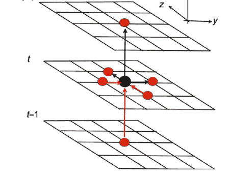

## 图 9.3

Wilson-Dslash 算子的图形化说明。格点被棋盘格化。一个给定的格点需要其最近邻（相反颜色）。我们在此图中省略了 X 维度。一种颜色的格点需要从它发出的相同颜色的连接，以及从后向邻居发出的、以它为终点的相反颜色的连接。

节点提供的几乎免费的 FLOPs，用于在使用前执行解压缩。这个想法在 QUDA 库中针对 GPU 架构进行了深入探索，我们在这里只勾勒其基本原理。

由于规范场的 SU(3) 性质，它们只有八个实自由度：即八个 SU(3) 生成元的系数。原则上，这意味着我们可以用八个实数而不是九个复数来存储规范场。然而，用这种方式重建全部九个复数需要用到一些三角函数。

一种更简单的方法是考虑 SU(3) 矩阵的两行存储。这个想法长期以来一直用于将规范场写入文件时节省空间，但后来被改编为一种即时节省带宽的（解）压缩技术（参见“更多信息”一节中关于“在 GPU 上使用混合精度求解器”的内容）。基本思想是将矩阵的行视为行向量：

\begin{pmatrix} a_0 & a_1 & a_2 \\ b_0 & b_1 & b_2 \\ c_0 & c_1 & c_2 \end{pmatrix} \mathbf{a} = (a_0,a_1,a_2), \mathbf{b} = (b_0,b_1,b_2), \mathbf{c} = (c_0,c_1,c_2). (9.6)

然后，如果拥有前两行 a 和 b（均已归一化为单位长度），就可以计算 c = (a×b)*，即取 a 和 b 的向量（叉）积，并对结果各元素取复共轭。这个技巧非常简单，可将规范连接的大小缩减为 6 个复数，即 12 个实数。

现在考虑公式 (9.5)，我们可以计算邻居旋量重用、两行压缩和流式存储的预期效果。我们做简化假设 B_w = B_r，然后可以消去带宽，得到算术强度。我们在图 9.4 所示的表格中展示了一些结果。首先，我们注意到，即使我们最初计算出的 0.92 FLOP/字节 的朴素算术强度，也依赖于写入输出旋量时没有读-写流量，也就是说，它

| $R$ | 压缩 | 流式存储 | A/I (FLOP/字节) |
|---:|---|---|---:|
| 0 | 否 | 否 | 0.86 |
| 0 | 否 | 是 | 0.92 |
| 7 | 否 | 否 | 1.53 |
| 7 | 否 | 是 | 1.72 |
| 7 | 是 | 否 | 1.96 |
| 7 | 是 | 是 | 2.29 |


需要流式存储，否则强度将降至 0.86 FLOP/字节。其次，我们看到通过重用八个邻居旋量中的七个，可以显著改善相对于初始界限的性能，得到 1.53 到 1.72 FLOP/字节 之间的强度，具体取决于是否使用流式存储。最后，我们看到还可以从规范压缩中进一步受益，当缓存重用、流式存储和压缩同时存在时，达到我们预测的最高强度 2.29 FLOP/字节。我们注意到在考虑压缩时，忽略了执行解压缩所需的额外 FLOPs，只计算了有用的 FLOPs。

### 首次实现与性能

在查看优化实现之前，让我们看一下 DSlash 的一个真实实现，它已在 Chroma 代码中生产使用多年。该包名为 `cpp_wilson_dslash`，可从 GitHub 获取（参见“更多信息”一节）。它是 Chris McClendon 先前工作的分支。它也包含在随附代码包 `Code/Original/cpp_wilson_dslash` 目录中。该包包含 Dslash 算子的单节点和多节点版本，我们这里将重点放在单节点、多线程版本上。

代码对场采用“结构数组”（AoS）方法，将旋量和规范场的内部索引保存为局部数组，如 `include/cpp_dslash_types.h` 中所定义。我们在图 9.5 中展示了这些类型的单精度版本。

`GaugeMatrix`（3×3 复矩阵）和 `FourSpinor`（4×3 复矩阵）的结构应该可以识别。`HalfSpinor` 类型是投影的结果，由于该代码最初针对流式 SIMD 扩展（SSE），我们与 `FourSpinor` 相比交换了颜色和自旋索引，这样加上两个复数分量，它们就构成一组四个浮点数用于 SSE。

```
namespace Dslash32BitTypes {
    typedef float FourSpinor[4][3][2];
    typedef float HalfSpinor[2][3][2];
    typedef float GaugeMatrix[3][3][2];
}
```

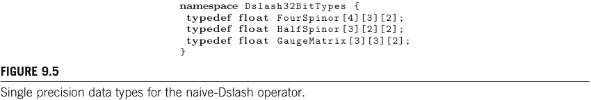

调度器尝试将总工作量（`n_sites`）分成多个块。每个块由起始（`low`）格点和结束（`high`）格点指定。我们将在查看 `DPsiPlus` 函数时看到，每个线程随后按字典序遍历自己的块。我们在图 9.8 中示意性地说明了这一点，其中包围一组组格点的方框表示属于单个线程的块，格点之间的箭头表示遍历顺序。

主要计算内核是用于 Wilson-Dslash 的 `DPsiPlus` 例程和用于其厄米共轭的 `DPsiMinus` 例程。我们在图 9.9 中展示了 `DPsiPlus` 的片段。为了适合插图，我们删除了一些细节，但一如既往，完整源代码可在代码包的 `lib/` 子目录中的 `cpp_dslash_scalar_32bit.cc` 文件中找到。其结构应该很直接。从输入 `ptr` 指针解包出参数后，我们进入从 low 到 high 索引的格点循环。我们从晶格中的当前索引计算出“格点”（`thissite`），首先通过 `ShiftTable` 对象使用 `forwardNeighbor` 和 `backwardNeighbor` 方法在方向 0 上找到前向和后向邻居。我们将输入旋量指针 `sp1` 设置为前向邻居，将规范指针 `up1` 设置为规范场，并调用 `dslash_plus_dir0_forward`，它执行投影、乘法，并重建和累加到半旋量 `r12_1` 和 `r34_1` 中。然后我们遍历所有方向，直到最后一个方向，在那里调用 `dslash_plus_dir3_backward_add_store` 并将结果存储在指针 `*sn1` 处。各种工具函数，如 `dslash_plus_dir3_backward_add_store`，可以在 `include` 目录中的 `cpp_dslash_scalar_32bit_c.h` 源文件中找到，作为内联函数。还有一个使用 SSE 内建函数在 `cpp_dslash_scalar_32bit_sse.h` 中编码功能的版本。

最后，`tests/` 子目录中有测试和计时例程。`testDslashFull.cc` 函数中的测试例程将 Dslash 算子与在 QDP++ 框架中编码的较慢变体进行测试。该测试由 `t_dslash.cc` 代码运行，而一个简单的计时工具（在循环中执行 Dslash 并计时）位于 `timeDslash.cc` 文件中，由 `time_dslash.cc` 主程序调用。对于这两个测试，可以在 `testvol.h` 文件中选择晶格体积和计时迭代次数。对于像 Intel Xeon Phi 协处理器这样的众核设备，合理的晶格大小为 32 × 32 × 32 × 64 个格点，我们将在整个过程中使用这个大小。

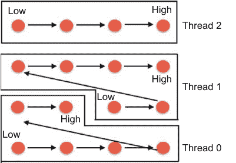

**图 9.8**

朴素代码中将晶格在三个线程之间分割的示意图。在属于各个线程的块内，遍历是字典序的。

```
void DPsiPlus(size_t lo, size_t hi, int id, const void *ptr)
{
    const ThreadWorkerArgs *a
        = (const ThreadWorkerArgs*)ptr;  /* Cast the (void *) to an (
              ThreadWorkerArgs*) */

    // Unwrapping of params deleted for space
    // please see source code...
    ...

    for (int ix1 = low; ix1 < high; ix1++)  {

        int thissite = s->siteTable( ix1 );
        int fsite = s->forwardNeighbor(ix1,0);
        int bsite = s->backwardNeighbor(ix1,0);

        /****************************** direction +0 **********************/
        /* ...(1-isigmgamma(0)) psi(x + \\hat{0}) */
        sp1 = &psi[ fsite ];
        up1 = &(gauge_field[ix1][0]);
        dslash_plus_dir0_forward_add(*sp1, *up1, r12_1, r34_1);

        sm1 = &psi[ bsite ];
        um1 = &(gauge_field[bsite][0]);
        dslash_plus_dir0_backward_add(*sm1, *um1, r12_1, r34_1);

        ... // Deleted branches in other directions for space

        // Last direction...
        sm1 = &psi[bsite];
        um1 = &(gauge_field[bsite][3]);
        sn1 = &res[ix1];  /*we always walk across the result
             lexicographically */

        dslash_plus_dir3_backward_add_store(*sm1, *um1, r12_1, r34_1, *sn1);
    } // for loop
} // function
```

## 图 9.9

每个线程执行的 DPsiPlus 函数中的格点循环。

在计时基准方面，我们通常设置迭代次数，使测试运行几秒钟，这通常可以通过大约 400-500 次迭代实现。然而，为了在 VTune 中进行性能测量，我们通常使用较少的迭代次数，例如 10 或 50。

### 在 Intel Xeon Phi 协处理器上运行朴素代码

我们在 Intel Xeon Phi 5110P 协处理器的 59 个核心上（避开具有操作系统功能的最后一个核心）使用上述晶格大小运行了正确性和计时测试，并在内核中启用了 *icache_snoop_off* 选项以获得额外的内存带宽。我们全力以赴，要求每个核心 4 个线程，即 236 个线程。为确保只使用前 59 个核心，我们使用 `KMP_AFFINITY` 环境变量设置了紧凑亲和性。在验证正确性后，我们获得了图 9.10 所示的计时测试输出，显示单精度性能为 34.8 GFLOPS，双精度约为 25.2 GFLOPS。

这个数字似乎有点低。与在 Intel Xeon 处理器上运行相比如何？作为比较，我们在双路 Intel Xeon E5-2560（代号 Sandy Bridge）处理器上运行，2.0 GHz，


```text
QDP uses OpenMP threading. We have 236 threads
Lattice initialized
  problem size = 32 32 32 64
  layout size = 32 32 32 64
  logical machine size = 1 1 1 1
  subgrid size = 32 32 32 64
  total number of nodes = 1
  total volume = 2097152
  subgrid volume = 2097152
Finished init of RNG
Finished lattice layout
Running Test: timeDslash

              Timing with 50 counts
              50 iterations in 1.988364 seconds
              39767.28 usec/iteration
              Performance is: 34805.5064364473 Mflops (sp) in Total
              Performance is: 34805.5064364473 per MPI Process

              Timing with 50 counts
              50 iterations in 2.748181 seconds
              54963.62 usec/iteration
              Performance is: 25182.4810665673 Mflops (dp) in Total
              Performance is: 25182.4810665673 per MPI Process

          OK
Summary: 1 Tests Tried
         1 Tests Succeeded
         0 Tests Failed on some nodes
of which 0 Tests Failed in Unexpected Ways on some nodes
```

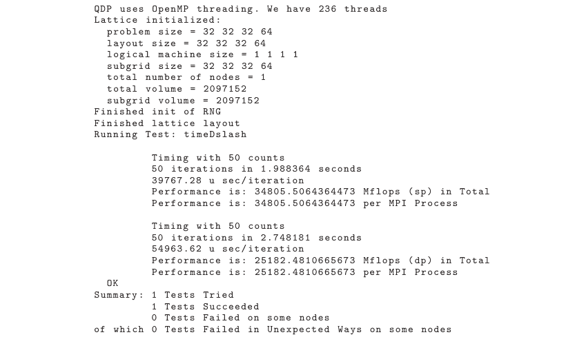

在Intel Xeon Phi协处理器5110P上使用59个核心（即236个线程）的朴素Dslash计时。我们看到单精度性能为34.8 GFLOPS，双精度为25.2 GFLOPS。

使用2×8个核心并启用超线程，我们得到32个线程。此外，由于我们知道这段代码中的内存分配并不感知NUMA，我们使用numactl工具通过`numactl --interleave=0,1`命令启动代码，在插槽之间交错分配内存。在不启用SSE优化代码分支的情况下，我们在处理器上获得的单精度结果为34.7 GFLOPS，双精度为19.3 GFLOPS。因此，单个协处理器的运行速度大致相当于（略快于）使用相同代码的双路Xeon系统。

虽然Intel Xeon处理器与Intel Xeon Phi协处理器之间的这个首次性能对比并非不合理，但就绝对性能而言，结果仍然有些令人失望。我们的模型告诉我们，代码应该受内存带宽限制，因此一个直接的问题是：我们使用了多少内存带宽？为了回答这个问题，我们使用VTune的带宽收集实验对代码进行了剖析，实验报告了在Intel Xeon Phi协处理器上单精度Wilson-Dslash持续42.3 GB/s的内存带宽。

### 朴素代码的评估

此时我们应该停下来反思。VTune报告我们在Intel Xeon Phi协处理器上的单精度内存带宽为42.3 GB/s。采用最朴素的算术强度0.86 FLOP/字节（无缓存、无压缩、无流式存储），模型预测我们的最大性能为36.4 GFLOPS。我们持续达到34.8 GFLOPS，约为模型预测的96%。然而，对于Intel Xeon Phi协处理器来说，42.3 GB/s是一个相当低的带宽。

我们有两个关键参数，作为模板提供给QPhiX的几乎每个组件。向量单元的长度，我们称为VECLEN或V；以及AoSoA结构内部数组的长度，我们在代码中称为SOA长度SOALEN或S。我们在图9.11中展示了QPhiX中旋量和规范场的基本数据类型。我们看到FourSpinorBlock的最内层数组维度为S，我们需要将ngy = V/S个这样的块收集到一个向量寄存器中。这些块将来自y坐标的ngy个连续值，如图9.12所示。

```cpp
template<typename T, int V, int S, const bool compressP>
class Geometry {
public:
    // Later change this to depend on compressP
    typedef T FourSpinorBlock[3][4][2][S];
    typedef T TwoSpinorBlock[3][2][2][V];
    typedef T SU3MatrixBlock[8][( compressP ? 2 : 3 )][3][2][V];
    ...
```

**图9.11** QPhiX中的基本数据类型。

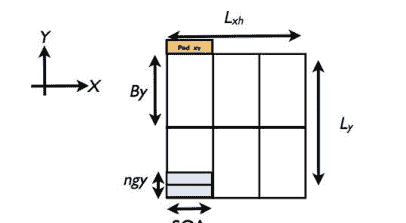

**图9.12** 数据布局的示意图。我们展示了Y方向上块长为By的分块，以及X-Y平面上的向量化，其中X方向上长度为SOA的块从Y坐标的ngy个连续值中收集。此外，可以在格点的X-Y切片之间引入填充（图中Pad_xy），也可以在XYZ体积之间引入填充（Pad_xyz——未显示）。

TwoSpinorBlock类型仅在我们的多节点实现内部使用，用于存储在格点表面上的投影结果。此时，收集已经在投影之前完成，因此对这种类型将其内部长度保留为V是合适的。

关于表示规范场的SU3MatrixBlock类型，我们有几个说明。首先，我们选择双重复制规范场，这意味着我们不仅存储每个格点的四个前向连接，还存储四个后向连接。这样做的目的是为了能够以单位步长访问这些场，因此最左边的数组维度是8，对应八个方向。其次，规范场只读不写，因此我们可以将旋量块的收集操作吸收到布局重新定义中，本质上是对规范场进行预收集。因此，它的最内层长度为V。最后，我们实现了两行压缩技术。事实证明，对于Intel Xeon处理器，即使我们在代码中没有直接引用规范场的第三行元素，硬件预取器仍然会读取第三行，因此我们最初在处理器上没有实现压缩的好处（尽管在Intel Xeon Phi协处理器上实现了）。解决这个问题的一种方法是在启用压缩时，将数据结构中的行数从3显式减少到2。然而，这是一个编译期决策，因此我们有一个额外的模板参数：`compressP`，行数在编译时根据该模板决定。最后，我们增加了填充选项，可以在格子的每个X-Y平面之后以及每个X-Y-Z子体积之后填充我们的场。

### 3.5D分块

QPhiX的基本策略是实施一种称为3.5D分块的技术。在之前针对Intel Xeon（代号Westmere）处理器讨论的形式中，“基于多核并行系统的高性能格点QCD：采用缓存友好的混合线程-MPI方法”（参见‘更多信息’一节），我们考虑了在格点的X维度上进行向量化，并在Y和Z维度上进行分块，同时沿T维度流式处理。采用平铺布局进行向量化后，这一思路仍然成立，只是Y-Z块现在必须包含整数个平铺。可以结合图9.3来理解这一思路。当沿Y-Z块扫描时，在T坐标t处，原则上只需要引入坐标为t+1的邻居。在处理上一个T切片时，共面的X-Y-Z邻居应该已经被带入缓存。然后可以将格点的Y-Z平面划分为块，得到YZT砖块，这些砖块可以分配给各个核心，如图9.13所示。

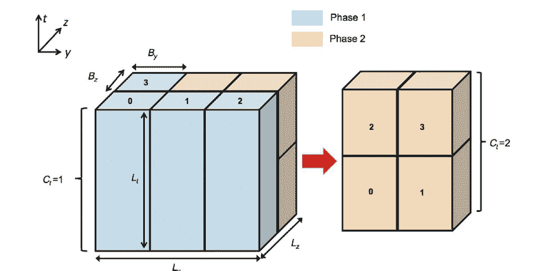

**图9.13** 我们展示了负载均衡方案，六个块调度到四个核心上。第一轮，每个核心分配一个完整的块。第二轮，剩余的两个块在时间方向上拆分，得到四个块，每个块的T范围更短。然后将这些块调度到四个核心上，使所有四个核心保持忙碌。

这些块的宽度可以表示为B_y和B_z，需要选择使得至少三个T切片的旋量能够放入缓存。位于B_y × B_z块的Y-Z边界上的数据既被该块需要，也被其邻居需要；然而，如果计算被适当地编排，并且处理相邻块的核心同步协调，这可能使两个核心都能使用彼此的L2缓存中的数据，而不是访问主内存。

### 负载均衡

取决于格点尺寸以及B_y和B_z，可能会出现相对于核心数量而言块数较少的情况。例如，在我们的测试用例32³ × 64格点中，在Intel Xeon Phi协处理器上B_y = B_z = 4时，只有64个块。这可能导致两轮块处理：一轮中多达60个核心完全参与，第二轮中只有4个块在工作，其余56个核心空闲。为了改善这种情况，我们开发了一种启发式负载均衡方案，下面将对其进行描述，并在图9.13中展示。

我们按阶段执行块的遍历。在任何给定阶段，如果块数多于核心数，我们就简单地为每个核心分配一个块，所有核心都完全占用。我们持续重复这一过程，直到处理完所有块，或者到达一个块数少于核心数的阶段。一旦块数少于核心数，我们考虑在时间方向上拆分它们，这将增加剩余块的数量。如果现在块数大于或等于核心数，我们像以前一样继续，依此类推。最终，块的时间长度可能变得很短，以至于不值得进一步拆分。此时，我们接受负载不均衡并在最后阶段完成工作。

在实现方面，我们为每个阶段维护一个块列表以及时间维度上的拆分次数`C_i`。我们可以在构造Dslash时预先计算每个阶段的块分配。在QPhiX代码中，基本阶段信息在include/qphix目录的geometry.h文件中设置，如图9.14所示。在代码中，rem存储剩余块的数量，初始化为`ly*lz`，其中`ly`和`lz`分别是Y和Z方向上的块数。在每次迭代中，计算`p.Ct`的值。根据`p.Ct`，可以找到Y-Z块可分配的核心数：`p.Cyz`。此阶段的第一个块记录在`p.startBlock`中，之后分配`p.Cyz`个块。

```cpp
int ly = Ny_ / By;
int lz = Nz_ / Bz;
int rem = ly * lz;
int stblk = 0;
n_phases = 0;
int n_cores_per_minct = num_cores / MinCt;
while(rem > 0) {
    int ctd = n_cores_per_minct / rem;
    int ctu = (n_cores_per_minct + rem - 1) / rem;
    CorePhase& p = getCorePhase(n_phases);
    p.Ct = (ctu <= 4 ? ctu : ctd)*MinCt;
    p.Cyz = num_cores / p.Ct;
    if(p.Cyz > rem) p.Cyz = rem;
    p.startBlock = stblk;
    stblk += p.Cyz;
    rem -= p.Cyz;
    n_phases++;
}
```

**图9.14** geometry.h中的负载均衡阶段设置。


blocks 从块列表中移除并处理下一阶段。此外，可以设置 C_t 的最小值（称为 minCt），例如在多插槽情况下，minCt 可以设置为插槽数。在分配内存时，会遍历各阶段，在 cc-NUMA 感知的实现中，正确的核心可以触及内存的适当区域。我们对分割的启发式终止标准是，不将 T 维度分割成超过四个 MinCt 块。

至此，核心到阶段的分配设置已完成；然而，能够查找块如何分配到阶段的信息也很重要。这是在文件 dslash_body.h 中 Dslash 的构造函数里完成的，该文件位于 include/qphix 中，我们在图 9.15 中展示。这里，对于每个线程，我们设置了它在每个阶段应处理的块。对于每个阶段，线程 ID 被拆分为核心 ID 和 SMT 线程 ID。核心 ID（cid）被拆分为 T 坐标和 Y-Z 坐标（分别为 binfo.cid_t 和 binfo.cid_yz），并且计算块原点的坐标 binfo.by、binfo.bz 和 binfo.bt 以及块的时序范围 binfo.nt。

### SMT 线程

在 Intel Xeon Phi 协处理器的每个核心上有四个 SMT 线程可用，我们可以想象多种遍历 Y-Z 块的方式。我们在图 9.16 中展示了三种可能的方式。最终，我们选择让用户通过指定 S_y 和 S_z 作为 Y-Z 网格的维度来指定 SMT 线程的“形状”。Y-Z 块中的晶格位点随后在 SMT 线程之间交错。最简单的是描述 Y 交错的情况（S_y = 4，S_z = 1）。在这种情况下，线程 0 将处理 Y 坐标为 y 的位点，线程 1 将处理 Y 坐标为 y + 1 的位点，线程 2 将

```
#pragma omp parallel shared(num_phases)
{
    int tid = omp_get_thread_num();
    int cid = tid / n_threads_per_core;
    int smtid = tid - n_threads_per_core * cid;
    int ly = Ny/By;
    for(int ph =0; ph < num_phases; ph++){
        const CorePhase& phase = s->getCorePhase(ph);
        BlockPhase& binfo = block_info[num_phases*tid+ph];
        int nActiveCores = phase.Cyz * phase.Ct;
        if( cid > nActiveCores ) continue;
        binfo.cid_t = cid / phase.Cyz
        binfo.cid_yz = cid - binfo.cid_t * phase.Cyz;
        int syz = phase.startBlock + binfo.cid_yz;
        binfo.bz = syz / ly;
        binfo.by = syz - binfo.bz * ly;
        binfo.bt = (Nt*binfo.cid_t) / phase.Ct;
        binfo.nt = (Nt*(binfo.cid_t+1)) / phase.Ct - binfo.bt;
        binfo.by *= By;
        binfo.bz *= Bz;
        int ngroup = phase.Cyz*Sy*Sz;
        binfo.group_tid = tid % ngroup;
    }
} // OMP parallel
```

### FIGURE 9.15

Load balancing block phase set-up in dslash_body.h.


### FIGURE 9.16

We show three possible ways for four SMT threads to traverse the sites in a block: lexicographic in Y interleaved (left), a 2 × 2 block in Y-Z interleaved (middle) or scanning along Y for four separate Z-coordinates interleaved (right).

处理 Y 坐标为 y + 2 的位点，线程 3 将处理 y + 3。然后线程 0 将处理 y + 4，线程 1 将处理 y + 5，依此类推，本质上以字典顺序遍历块。另一种替代方案是将子块分配给每个 SMT 线程。例如，在块 (B_y,B_z) = (4,4) 的情况下，我们可以让每个线程处理一个 2 × 2 子块。然而，我们将自己限制在交错遍历上，希望 SMT 线程在位点之间交错可以改善 L1 缓存中的共享。

### 晶格遍历

现在有了来自负载平衡的阶段知识、SMT 线程布局以及向量化的具体细节，我们可以查看晶格遍历的简化形式。我们展示了文件 dslash_body.h 中函数 DyzPlus 的一些代码，如图 9.18 所示，其中删除了大量次要细节和预取指针的计算以提高清晰度。完整代码可在源代码包中找到。需要强调的关键点如下：每个线程遍历阶段，首先确定其在该阶段的块或是否空闲。一旦找到块，T、Z 和 Y 的循环就如我们所期望的那样进行。Z 循环以 Sz 的增量进行，Y 循环以 ngy*Sy 的增量进行（代码中实际拼写错误为 nyg），其中 Sy 和 Sz 是 SMT 线程网格维度。X 循环遍历 SOAs（nvecs 是棋盘化 X 维度中 SOA 长度的数量）。

在 Z 和 T 维度访问当前 X-Y 块的邻居是直接的，一旦 Z 和 T 坐标已知，其块就可以被识别。它们由指针 tfBase（T 前向）、tbBase（T 后向）、zfBase 和 zbBase 指向。

然而，由于在 X 和 Y 上的向量化，访问这些维度的邻居很棘手，因为它可能需要来自相邻块的数据。我们在图 9.17 中展示了一个简单情况。根据 Y 坐标，给定颜色（例如红色）的第一个位点可能确实是该 Y 坐标在晶格中的第一个位点（图中 xodd=0）。在这种情况下，其前向邻居可以以直接的方式来自另一棋盘的第一个块。然而，也可能给定棋盘的第一个位点实际上是晶格中的第二个位点（xodd=1）。在这种情况下，前向邻居位点实际上来自其他颜色的两个不同块，必须将其混合在一起。此外，由于周期性边界条件，必须区分输出块是否位于 X 维度的开头或结尾（换行到另一端的块）或不位于开头或结尾的情况。必要的偏移量在构造函数中预先计算到数组 xb0ffs_x0_xodd（X 维度起始处的后向邻居）和 xf0ffs_xn_xodd（X 维度末尾的前向邻居）中，以及

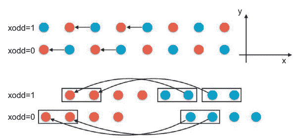

### FIGURE 9.17

Locating neighbors in the forward X-direction, in a simple case with an X-Y tile size of 2 × 1. In the top diagram, we show the sites as they appear in the lattice. We show the forward neighbors needed by the first two red-sites in each row by connecting them to their partner sites with arrows. In the lower diagram, we have separated the differently colored sites into separate arrays, which are then tiled over. For the first red tile on line xodd=0, one needs only the same corresponding blue tile. However, for the first red tile on line xodd=1, the neighboring blue sites come from two blue tiles and need to be blended.

xbOffs_xodd（后向 X 邻居偏移）和 xfOffs_xodd（前向 X 邻居偏移）用于其他情况。同样，也存在类似的偏移数组来识别 Y 方向的邻居。

图 9.18 中 X 循环的最后步骤是确定是否处于 xodd=0 或 xodd=1 的情况，并根据 x 坐标从预先计算的偏移中适当选择到 xfOffs、xbOffs（分别为后向和前向 X 偏移）以及 Y 方向的 ybOffs 和 yfOffs。指针 oBase 是输出旋量的 Y-Z 块基址的指针，gBase 是规范场的相应部分的指针。其他计算的量（在源代码中但此处未打印）主要是为该线程的工作下一迭代的预取指针。

一旦所有工作完成，代码最终调用 dslash_plus_vec 函数，该函数执行此循环中识别的指针的 Dslash 工作。这是代码生成器生成的代码，我们现在将考虑它。

### 使用 QphiX-codegen 进行代码生成

我们现在考虑如何为关键函数 dslash_plus_vec 及其变体编写内核。为此，我们决定编写一个代码生成器，可以在代码分发中 qphix-codegen 子目录下找到，也可从 GitHub 获取（参见“更多信息”部分）。

我们编写代码生成器的最初动机如下：首先，我们希望最终将预取插入代码以改善内存流量。当代码拆分为许多小的内联函数时，这很 awkward。让一个小代码生成器生成整个向量（以及后来的 X-Y 块）Dslash 内核的完全内联主体是有意义的。使用代码生成器还允许我们使用编译器内在函数并直接访问流式存储、gather、loadpack 和其他指令。代码生成器的第二个特点是，一旦我们编写了


```cpp
int num_phases = s->getNumPhases();
for(int ph=0; ph < num_phases; ph++) {
    const CorePhase& phase = s->getCorePhase(ph);
    const BlockPhase& binfo = block_info[tid*num_phases + ph];
    ...
    // Loop over timeslices
    int Nct = binfo.nt;
    for(int ct = 0; ct < Nct; ct++) {
        int t = ct + binfo.bt; // add origin to local loop variable
        ...
        // Loop over z. Start at smtid_z and work up to Ncz
        // in steps of Sz
        // (Ncz truncated for the last block so should be OK)
        for( int cz = smtid_z; cz < Bz; cz += Sz ) {
            int z = cz + binfo.bz; // Add on origin of block
            
            // Base address for XY tile for neighbors.
            const FourSpinorBlock *xyBase = &psi[t*Pxyz+z*Pxy];
            
            // Base address for neighbor tiles in Z & T
            const FourSpinorBlock *zbBase = &psi[t*Pxyz] + ... ;
            const FourSpinorBlock *zfBase = &psi[t*Pxyz] + ... ;
            const FourSpinorBlock *tbBase = &psi[z*Pxy] + ... ;
            const FourSpinorBlock *tfBase = &psi[z*Pxy] + ... ;
            
            // Base address for output
            FourSpinorBlock *oBase = &res[t*Pxyz+z*Pxy];
            ...
            // Loop over 'y' in nyg * Sy steps (should be ngy :(
            for( int cy = nyg*smtid_y; cy < By; cy += nyg*Sy ) {
                int yi = cy + binfo.by; // Offset local y-coordinate with block origin
                // work out if first x-coordinate is on boundary...
                const int xodd = (yi + z + t + cb) & 1;
                
                // cx loops over the soalen partial vectors
                for(int cx = 0; cx < nvecs; cx++) {
                    // Base address for gauge fields
                    const SU3MatrixBlock *gBase = &u[...];
                    int X=nvecs*yi+cx;
                    ...
                    // Offsets for gathering neighbors from back and forward x
                    // may be in different tiles
                    xbOffs = (cx == 0 ? xbOffs_x0_xodd[xodd] : xbOffs_xodd[xodd])
                    ,
                    xfOffs = (cx == nvecs-1 ? xfOffs_xn_xodd[xodd] : xfOffs_xodd[
                    xodd]);
                    ...
                    // Offsets for gathering neighbors from back and forward Y
                    // may be in different tiles
                    ybOffs = (yi == 0 ? ybOffs_y0 : ybOffs_yn0);
                    yfOffs = (yi == Ny - nyg ? yfOffs_yn : yfOffs_ynn);
                    ...
                    // Call kernel with appropriate pointers
                    dslash_plus_vec<FT,vecLen,soalen,compress12>(...)
                }
            } // End for over scanlines y
        } // End for over scanlines z
        if( ct % BARRIER_TSLICES == 0 ) barriers[ph][binfo.cid_t]->wait(
            binfo.group_tid);
    } // end for over t
} // phases
```

### FIGURE 9.18

QPhiX 中基本循环结构，去除了大量辅助计算以提高清晰度，例如下一站点的索引、预取计算等。完整代码可在 include/dslash_body.h 中找到，例如函数 DyzPlus。

有了 Xeon-Phi 内在函数的代码，复制这些特性以使用 AVX 内在函数针对 Intel Xeon 处理器也变得很直接。目前我们提供“标量”目标（无向量化），甚至还有使用 QPX 内在函数进行 BlueGene/Q 向量化的目标，以及 Intel AVX2，虽然这些后者的目标仍处于实验阶段。

我们应注意，使用小型领域特定代码生成器本身并不是一个新想法。在 QCD 中，已经有多个框架，包括 BAGEL 和 QA0。用于 GPU 的 QUDA 库也曾一度使用内部 Python 代码生成器。例如，BAGEL 生成器还执行架构流水线的模拟并生成汇编代码而不是内在函数。在我们的例子中，我们编写的简单生成器更多是为了方便和在尝试重新安排预取时节省输入。

### QPhiX-CODEGEN 代码结构

代码生成器称为 qphix-codegen，可以作为同名子目录在代码包中找到。在 qphix-codegen 中，我们考虑三个主要对象：指令、地址和向量寄存器。这些在 instructions.h 和 address_types.h 文件中定义。特别是，向量寄存器被称为 FVec，而指令和地址是基类 Instruction 和 Address 的派生。我们还区分了常规 Instruction 和访问内存的 Instruction（MemRefInstruction-s）。

FVec 对象包含一个“name”，它将在生成的代码中与 FVec 关联的标识符的名称。所有指令和地址都有一个名为 serialize() 的方法，它返回该指令作为 std::string 的代码。由于我们生成代码，我们需要一些辅助的高级“指令”来添加条件块、作用域分隔符或生成声明。

最终，代码生成器生成由 C++ 标准库中的标准向量保存的 Instruction-s 列表。我们将此类指令向量的类型别名为 InstVector（Instruction Vector）。反过来，指令引用 FVec 和 Address 对象。

地址和指令的剩余属性大多是为了让我们能够对生成的代码进行分析。例如，可以查找 MemRefInstructions，并提取它们引用的 Address-es 以进行自动预取生成，或统计算术与内存引用指令的平衡。

最后，在文件 instructions.h 的末尾，我们定义了一些实用函数，例如 mulFVec，它接受一个指令向量，两个 FVec-s，从中生成一个 MulFVec 对象并将其插入指令向量。Dslash 的大部分代码都是用这些实用函数编写的。

### 实现指令

指令的实际实现位于名称类似 inst_sp_vec16.cc 的各种文件中，其中特别是指生成单精度代码，使用长度为 16 的向量，即针对 Intel Xeon Phi 协处理器。首先，我们声明 FVec-s 的实际类型为 __m512。在此之后，我们基本上声明各种指令的 serialize() 方法，这就是我们生成实际内在函数的地方。我们在图 9.19 中展示了 LoadFVec 和 FMA（融合乘加）的示例，但当然整个源代码可在代码包中使用。我们注意到我们在此工作中实现了 16 位精度的使用，而 LoadFVec 显示了如何使用 *up-conversion* 在 `_mm512_mask_extload_ps` 内在函数中加载无符号短整型向量。

```cpp
string LoadFVec::serialize() const
{
    std::ostringstream buf;
    string upConv = "_MM_UPCONV_PS_NONE";
    string lmask = mask;

    if(mask.empty()) {
        lmask = fullMask;
    }

    if(a->isHalfType()) {
        upConv = "_MM_UPCONV_PS_FLOAT16";
    }

    buf << v.getName() << " = _mm512_mask_extload_ps("
        << v.getName() << "," << lmask << "," << a->serialize()
        << "," << upConv << ",_MM_BROADCAST32_NONE,_MM_HINT_NONE);" << endl
        ;

    return buf.str();
}

string FMAdd::serialize() const
{
    if(mask.empty()) {
        return ret.getName() + " = _mm512_fmadd_ps(" + a.getName() + "," + b.
               getName() + "," + c.getName() + ");";
    }
    else {
        return ret.getName() + " = _mm512_mask_mov_ps(" + ret.getName() + "," 
               + mask + ",_mm512_fmadd_ps(" + a.getName() + "," + b.getName() + ","
               + c.getName() + "));";
    }
}
```

### FIGURE 9.19

来自 `qphix-codegen` 的 `LoadFVec` 和 `FMAdd` 指令的 serialize 方法。它们可以在文件 `inst_sp_vec16.cc` 中找到。

### 生成 DSLASH

生成 Dslash 的代码在 `dslash.cc` 和 `dslash_common.cc` 文件中编码。基本 Dslash 主体在代码图 9.20 中重现，尽管我们删除了一些与为了清晰而需要模拟屏蔽相关的分支。除了处理累积时要乘入结果的额外比例因子（`beta_vec`）的一些代码，以及为多节点实现中的边界处理添加条件和屏蔽以进行累积之外，结构应与图 9.2 中的伪代码非常相似。

为了完善这个故事，我们在图 9.21 中展示了从文件 `dslash_common.cc` 中将 SU(3) 矩阵与三向量相乘的代码片段。首先，我们声明一组全局 FVec-s，用于每个自旋、颜色和复数分量，我们将使用它们。在我们的例子中，b 指的是投影的结果，ub 指的是乘法的结果。方便地将这些 FVec-s 收集到数组中，其索引镜像我们期望的索引结构，如半旋量代码所示


```cpp
void dslash_body(InstVector& ivector, bool compress12, proj_ops *ops,
                 recons_ops *rec_ops_bw, recons_ops *rec_ops_fw, FVec outspinor[4][3][2])
{
    for(int dim = 0; dim < 4; dim++) {
        for(int dir = 0; dir < 2; dir++) {
            int d = dim * 2 + dir;
            stringstream d_str;
            d_str << d;
            string mask;
            bool adjMul;
            recons_ops rec_op;

            if(dir == 0) {
                adjMul = true;
                rec_op = rec_ops_bw[dim];
            }
            else {
                adjMul = false;
                rec_op = rec_ops_fw[dim];
            }
            ifStatement(ivector,"accumulate[" + d_str.str() + "]");
            {
                declareFVecFromFVec(ivector, beta_vec);
                loadBroadcastScalar(ivector, beta_vec, beta_names[d],
                                    SpinorMap);
                if(requireAllOneCheck[dim]) {
                    mask = "accMask";
                    declareMask(ivector, mask);
                    intToMask(ivector, mask, "accumulate[" + d_str.str() + "]");
                }

                for(int s = 0; s < 2; s++) {
                    project(ivector, basenames[d], offsnames[d], ops[d],
                            false, mask, d, s);

                    if(s==0) {
                        loadGaugeDir(ivector, d, compress12);
                    }

                    matMultVec(ivector, adjMul, s);
                    recons_add(ivector, rec_op, outspinor, mask, s);
                }
            }
            endScope(ivector);
        }
    }
}
```

### 图 9.20

用于生成 Dslash 主体的基本代码（不包括用于在非 Intel Xeon Phi 协处理器平台上处理软件模拟掩码的附加代码）。

b_spinor。最后，我们使用先前为复数算术定义的便捷函数，在 `matMultVec` 函数中生成矩阵乘法。注意该函数中有一个循环。执行该函数时，这个循环本质上会将矩阵乘法中的所有操作创建为一条连续指令流。

```cpp
// File: dslash.common.cc
void project(InstVector& ivector, string base, string offset, proj_ops& ops,
    bool isFace, string mask, int dir)
{
    string tmask("");
    PrefetchL1FullSpinorDirIn(ivector, base, offset, dir);

    for(int s = 0; s < 2; s++) {
        for(int c = 0; c < 3; c++) {
            LoadSpinorElement(ivector, psi[0][RE], base, offset, ops.s[s][0],
                c, RE, isFace, mask, dir);
            LoadSpinorElement(ivector, psi[0][IM], base, offset, ops.s[s][0],
                c, IM, isFace, mask, dir);
            LoadSpinorElement(ivector, psi[1][RE], base, offset, ops.s[s][1],
                c, RE, isFace, mask, dir);
            LoadSpinorElement(ivector, psi[1][IM], base, offset, ops.s[s][1],
                c, IM, isFace, mask, dir);

            ops.CVecFunc[s](ivector, b_spinor[s][c], psi[0], psi[1], /*mask*/
                tmask); // Not using mask here
        }
    }
}
```

### 图 9.22

为投影操作生成 L1 预取。我们首先将整个旋量显式预取到 L1，然后再按元素加载。

除了需要这些缓存的那个核心之外的其他核心的缓存。因此，我们允许预取最多四个相邻旋量。对于每个旋量，我们提供一个指针和一个偏移量。基础指针是 xyBase（当前 tile）、pfBase2、pfBase3 和 pfBase4。这些指针的预取偏移量分别是 siprefdist1、siprefdist2，一直到 siprefdist4。我们还从当前的 gBase 以偏移量 gprefdist 预取规范场，并且可以以 outBase 为基础预取下一个输出旋量。其中有些在实现中被注释掉或未使用，但基本思想就是这样。

基础指针和 siprefdist 偏移量是在 QPhiX 库中的 DyzPlus 等函数的晶格遍历循环期间计算的。在图 9.18 中，为了清晰起见，我们隐藏了这些计算，但它们当然可以在随附的代码包中找到。

运行代码生成时，L2 预取会在与主代码分离的指令向量中生成，并在序列化之前与主 Dslash 代码合并，以尝试在生成的代码中均匀分布它们。此合并由源文件 dslash.cc 中的函数 `mergeVectorWithL2Prefetches` 完成。

### 生成代码

现在我们已经介绍了机制，让我们来生成代码。为此，我们需要查看两个 makefile。一个是主 Makefile。这里我们的主要工作是通过编辑第一行中的变量 mode 来选择架构。目前，它设置为 mic，这对于 Intel Xeon Phi 协处理器来说没问题。我们也可以将其设置为其他值，例如 avx 用于 AVX 代码，或 scalar 用于非向量化代码。

其次，对于每种支持的模式，都有一个名为 customMake.xxx 的文件，其中 xxx 就是模式。例如，我们可以查看 customMake.mic。在这个文件中，我们可以设置各种代码生成选项，例如是否使用流式存储，或者是否应使用 L1、L2 预取等。我们在图 9.23 中展示了 customMake.mic 的一个片段，其中我们启用了所有预取选项，并要求对类似 gather-scatter 的操作使用 *load-unpack* 和 *pack-store* 运算符。

```make
#Prefetching options
# FOR MIC SET THESE ALL TO 1
#
PREF_L1_SPINOR_IN = 1
PREF_L2_SPINOR_IN = 1
PREF_L1_SPINOR_OUT = 1
PREF_L2_SPINOR_OUT = 1
PREF_L1_GAUGE = 1
PREF_L2_GAUGE = 1
PREF_L1_CLOVER = 1
PREF_L2_CLOVER = 1

# Gather / Scatter options
USE_LDUNPK = 1          # Use loadunpack instead of gather
USE_PKST = 1            # Use packstore instead of scatter
USE_SHUFFLES = 0       # Use loads & Shuffles to transpose spinor when
    SOALEN>4
NO_GPREF_L1 = 1         # Generate bunch of normal prefetches instead of
    one gather prefetch for L1
NO_GPREF_L2 = 1         # Generate bunch of normal prefetches instead of
    one gather prefetch for L2

# Enable nontemporal streaming stores
ENABLE_STREAMING_STORES ?= 1
USE_PACKED_GAUGES ?= 1  # Use 2D xy packing for Gauges
```

### 图 9.23

因此，我们不想生成 *收集预取*，并且我们已经禁用了它们。

一旦设置了所有这些选项，就可以通过运行 `make xxx` 来执行 makefile，同样，`xxx` 是用于模式的值。代码生成器随后应该构建并运行，生成的代码作为一组文件放在 `xxx` 子目录中。我们注意到，这些文件只是函数体（甚至不包含函数原型等）。在 QPhiX 包中，这些文件被放在目录 `include/qphix/xxx/generated` 中，和往常一样，`xxx` 是模式的值。在 `include/qphix/xxx` 中存在一些文件，它们定义函数头，并使用模板和 C 预处理器宏的混合方式恰当地包含这些文件。对于 `mic` 目标，这些文件位于 `include/qphix/mic` 中，名为 `dslash_mic_complete_specialization_form.h`，它要么为 `dslash_plus_vec` 之类的函数定义基础模板，要么在定义了某些预处理器宏时定义一个特化，其中包含适当的生成文件。

这种包含由第二个文件 `dslash_mic_complete_specialization.h` 驱动，该文件遍历宏的各种可能性，定义这些宏，包含 `_form.h` 文件，然后取消定义这些宏。这种方法相当混乱，我们希望有一种更好的方法。

### QPhiX 的性能结果

在仔细研读了 QPhiX 的结构和代码生成器之后，终于到了看所有这些辛勤工作带来了多大回报的时候了。我们将考察以下几种生成的代码案例：


-   *标量*：这使用为代码生成器的`scalar`模式生成的代码。它使用全部3.5D循环，但没有预取或向量化。在Code包中的`Scalar`目录下，有一份使用这组生成文件的QPhiX版本。
-   *向量*：这使用为`mic`目标生成的代码，但除了生成向量代码外，所有预取选项都已关闭。包中相应的代码位于`Vector`目录。我们明确使用向量长度为16，SOA长度为16。
-   *向量+L2*：这是带L2预取的向量代码。代码位于`VectorPrefL2`。
-   *向量+L1*：这是带L1预取但不带L2的向量代码。代码位于`VectorPrefL1`。
-   *向量+L1+L2*：这是同时具有L1和L2预取的向量代码，代码位于`VectorPrefL1L2`。
-   *向量+L1+L2+屏障*：这是前面的代码，但每隔一段时间我们会用轻量级屏障重新同步各核心——风格类似于《高性能并行编程珠玑》第一卷第五章中讨论的准同步相位屏障。相应代码位于`VectorPrefL1L2Barrier`。
-   *向量+L1+L2+屏障，SOALEN=8*：这是前面的代码，但使用SOALEN=8而不是16。换句话说，此测试使用8×2瓦片。相应代码位于`VectorPrefL1L2BarrierS8`。

我们在Intel Xeon Phi协处理器5110P上运行了所有这些测试，启动时启用了*icache_snoop_off*特性以获得额外的内存带宽。我们使用了60个核心中的59个，亲和性设置为`KMP_AFFINITY=compact,granularity=thread`。我们还在*XY*平面的数据结构中增加了一个单位的填充，以避免关联性缺失。结果如图9.24中的表格所示。有几点值得注意：仅仅转向QPhiX格子遍历，同时保持代码未向量化，确实有一些好处，但不太大。性能仅从35 GFLOPS（Original）提升到51 GFLOPS。然而，即使没有预取，向量化也产生了很大影响。使用压缩时性能达到了184 GFLOPS。

看看*向量+L1*和*向量+L2*之间的差异，可以清楚看出，L1预取（没有L2预取）并不是很有益，因为很可能大多数L1预取不会命中

| 模式 | 无压缩性能 (GFLOPS) | 两行压缩性能 (GFLOPS) |
|---|---|---|
| 原始 | 35 | N/A |
| 标量 | 51 | 43 |
| 向量 | 172 | 184 |
| 向量+L1 | 144 | 169 |
| 向量+L2 | 176 | 212 |
| 向量+L1+L2 | 191 | 239 |
| 向量+L1+L2+屏障 | 199 | 250 |
| 向量+L1+L2+屏障，SOA=8 | 234 | 286 |

## 图9.24

在一个具有32³ × 64个格点的格子上运行性能测试，使用Intel Xeon Phi协处理器模型5110P上的59个核心（236线程），并启用了*icache_snoop_off*特性。

L2。相比之下，L2预取非常有效。结合L1和L2预取，我们使用压缩达到了239 GFLOPS。

最后，我们注意到偶尔使用轻量级屏障进行同步是有益的。让我们稍作考虑，因为人们常说，如果可能，我们应该避免同步，因为同步通常代价高昂。在这种情况下，我们使用了英特尔公司贡献的轻量级屏障，而且这些屏障不是全局的。在格子遍历的任何给定阶段，屏障仅在那些处理同一时间长度块的一组核心之间调用。这些信息是在设置块相位信息时建立的（见图9.15）——每个块中的每个线程都会计算一个group_tid。构造时，每个group_tid被分配自己的屏障。当线程逐步遍历给定块的时间坐标时，当需要同步时，具有相同group_tid的线程会在其屏障上调用等待，如图9.18末尾所示。即使在这个块内，我们也可以调整屏障的频率。在我们的例子中，我们发现每16个t切片执行一次屏障时性能最高。屏障之所以有帮助，是因为同步中的轻微漂移可能意味着本应处理相同T切片的核心最终可能处理不同的切片。在这种情况下，某个本来可以从另一个核心的缓存中访问数据核心，可能不得不访问内存。这种代价可能会超过偶尔使用轻量级屏障的代价。这与Jim Dempsey在《高性能并行编程珠玑》第一卷第五章中描述的准同步相位屏障的使用精神类似。

我们结束这一讨论时指出，通过切换到SOALEN=8而不是16的布局，我们获得了最佳性能。这一点似乎普遍成立。我们对此感到惊讶，因为加载两个8块而不是一个16块，似乎需要更高的簿记开销，并可能需要更多指令。

与原始代码中的性能相比，我们已经走了很长的路。当我们使用VTune检查最佳配置的内存带宽利用率时，内存带宽利用率现在报告为130 GB/s。对于这个带宽，我们的模型预测性能为298 GFLOPS。我们得到的286 GFLOPS是这一预测值的96%。

### 其他好处

我们可能会记得，原始代码在特定双插槽Intel Xeon处理器上的性能约为34.7 GFLOPS。我们所有在分块和代码生成器上的辛勤工作所带来的好处之一，是新代码在Intel Xeon处理器上的性能得到了改善。在Code包中，我们在FinalAVX目录中提供了一个使用AVX向量化构建QPhiX的设置。此构建不执行屏障，并且由于Intel Xeon处理器上出色的硬件预取，我们也禁用了软件预取。最后，由于这是一个双插槽cc-NUMA系统，我们运行代码时将最小时间分割数Ct设置为2，即插槽数。将KMP_AFFINITY设置为compact，并且由于数组初始化按格子遍历顺序进行，代码已经变成了NUMA感知的。得益于Intel Xeon处理器的大型共享L3缓存，我们可以选择稍大的块。选择(By,Bz) = (8,8)可以在Y-Z平面中形成16个块，在进一步按Ct的最小值分割后变为32个块，每个8核插槽分配16个块。这个工作负载可以在两个阶段内无失衡地处理。我们保持相同的填充参数，但将Y-Z平面中的SMT线程几何结构设置为1 × 2，因为我们只有两个超线程。在我们的系统上，Wilson-Dslash计时测试运行在127 GFLOPS，比没有SSE优化的原始代码加速了约3.6倍。

为了对原始代码完全公平，我们还在启用SSE优化的情况下构建了它，并像之前一样使用`numactl -interleave=0,1`命令运行它，以改善其非NUMA特性。我们发现，在单精度测试用例中，最佳性能为48-49 GFLOPS。因此，QPhiX相比这种配置也有2.6倍的提升，这是一个非常显著的提升。此外，我们应当注意，处理器在我们的测试期间可能进入了睿频加速模式，我们没有对这一方面进行非常详细的调查。

我们在图9.25中展示了QPhiX在多种系统上的性能，包括与在NVIDIA K20和K20X GPU上运行的Wilson-Dslash代码的比较。GPU性能数据是使用QUDA库生成的。

## 图9.25

单节点、单精度、两行压缩的Wilson-Dslash在多种系统上的性能。GPU性能数据是使用QUDA库生成的。

GPU性能是使用QUDA库在可比选项（单精度、两行压缩）和相同体积下运行测量的。我们还展示了在Intel Xeon Phi协处理器模型7120P上的性能，并考虑了不同的SOA长度。在此图中，Intel Xeon Phi协处理器的最终结果

型号为 5110P、SOA 长度为 8 的模型性能为 283.8 GFLOPs，比我们之前测得的数值低 2 到 3 GFLOPS。我们认为这只不过是一个波动，在这个水平上大约处于 1% 的量级。最后我们注意到，与 Intel Xeon Phi 协处理器在 SOA 长度为 8（其向量长度的一半）时表现最佳的方式类似，Xeon 的结果也在 SOA 长度为 4（其向量长度的一半）时达到最佳。

需要声明的是，要在 Intel Xeon Phi 协处理器上获得此级别的性能，必须在启动时启用 icache_snoop_off 功能。如果没有此功能，Xeon Phi 上的性能可能会比我们的数值低。例如，在 Intel Endeavor 集群中的 61 核 Xeon Phi（启用了 icache_snoop_off）上，我们在某个特定基准测试中持续达到了 320 GFLOPS。在 Stampede（类似的 61 核 Xeon Phi 部件）上运行相同规模的问题，由于未启用 icache_snoop_off 功能，性能为 271 GFLOPS。

### 路的尽头？

当然不是！不过，我们已经接近本章的尾声。为了优化 Wilson-Dslash 的单节点性能，我们付出了大量工作，并且收获颇丰。然而，仍有许多途径尚未探索，只因本章篇幅有限。

一个非常重要的方面是将 Wilson-Dslash 扩展到多个节点，无论是 Intel Xeon Phi 协处理器还是 Intel Xeon 处理器。完成此工作的代码已在 QPhiX 中提供，原始代码中也有（尽管该原始代码使用了略有不同的算法）。在当前作为 PCIe 卡的设置中，多节点扩展遇到了一些挑战，值得用单独一章来讲述。有兴趣的读者可参阅本章末尾的“更多信息”部分。

另一个重要考量是，Wilson-Dslash 算子通常是大型复合算子中计算开销最大的部分。通常需要用较大的复合算子来求解线性方程组。最近，求解这些系统的方法取得了进展，不仅包括通常的 Krylov 子空间方法，如共轭梯度法或稳定双共轭梯度法，还包括较新的算法，如广义共轭残差法或 Flexible GMRES，这些算法允许使用区域分解预条件子与紧缩技术，以及代数多重网格方法。特别是，区域分解预条件子具有非常好的性质：小区域可以被阻塞到 Intel Xeon Phi 协处理器的 L2 缓存中，从而将带宽瓶颈从主内存带宽转移到缓存带宽。关于在 Intel Xeon Phi 协处理器上使用区域分解预条件子优化求解器的详细阐述，可参见我们在 Supercomputing 2014 上的论文（见“更多信息”部分）。

当需要求解多个系统时，还可以考虑跨系统进行向量化，这可能比 QPhiX 中所考虑的向量化更简单。这在“HISQ inverter”论文（见“更多信息”部分）中针对 QCD 的不同公式化方式实现过，而 Wilson-Dslash 的相关工作正在进行中，初步结果令人鼓舞。

本章我们想强调的要点是什么呢？或许如下：

- 为了以最高效率利用系统，对性能有一些模型是很有帮助的。它是内存受限还是计算受限？预期性能能否与系统参数关联起来？
- 在我们的案例中，我们对模型进行了多次改进，例如考虑流式存储、缓存重用或压缩。
- 在我们的案例中，必须采用多种优化步骤。仅靠线程化并行并不足以获得最佳性能，还需要向量化、预取、分块以及一些同步操作。
- 要准备好迎接意外。在我们的案例中，意外来自屏障（barrier）带来的改进，以及发现 SOA 长度为向量长度一半时，其性能反而优于 SOA 长度等于向量长度时的表现。
- 特定领域的代码生成器可能很有帮助。它们不一定需要非常复杂，并且可以降低探索某些优化（例如加载、预取等策略）的痛苦。在某些情况下，例如我们这里，它们还有助于在其他架构上获得更好的性能。

### 更多信息

- Babich, R., Brannick, J., Brower, R.C., Clark, M.A., Manteuffel, T.A., et al., 2010. Adaptive multigrid algorithm for the lattice Wilson-Dirac operator. Phys. Rev. Lett. 105, 201602.
- Babich, R., Clark, M.A., Joó, B., Shi, G., Brower, R.C., Gottlieb, S., 2011. Scaling lattice QCD beyond 100 GPUS. In: Proceedings of 2011 International Conference for High Performance Computing, Networking, Storage and Analysis, SC ’11, New York, NY, USA. ACM, pp. 70:1-70:11.
- Boyle, P.A., 2009. The {BAGEL} assembler generation library. Comput. Phys. Commun. 180 (12), 2739-2748. 40 {YEARS} {OF} CPC: a celebratory issue focused on quality software for high performance, grid and novel computing architectures.
- Clark, M.A., Babich, R., Barros, K., Brower, R.C., Rebbi, C., 2010. Solving lattice QCD systems of equations using mixed precision solvers on GPUs. Comput. Phys. Commun. 181, 1517-1528.
- Edwards, R.G., Joó, B., 2005. The Chroma software system for lattice QCD. Nucl. Phys. Proc. Suppl. 140, 832.
- Frommer, A., Kahl, K., Krieg, S., Leder, B., Rottmann, M., 2014. Adaptive aggregation based domain decomposition multigrid for the lattice Wilson-Dirac operator. SIAM J. Sci. Comput. 36, A1581-A1608.
- Frommer, A., Nobile, A., Zingler, P., 2012. Deflation and flexible SAP-preconditioning of GMRES in lattice QCD simulation. ArXiv e-prints, April.
- Heybrock, S., Joó, B., Kalamkar, D.D., Smelyanskiy, M., Vaidyanathan, K., Wettig, T., Dubey, P., 2014. Lattice QCD with domain decomposition on Intel® Xeon Phi™ co-processors. In: Proceedings of the International Conference for High Performance Computing, Networking, Storage and Analysis, SC ’14, Piscataway, NJ, USA. IEEE Press, pp. 69-80.
- Hestenes, M.R., Stiefel, E., 1952. Methods of conjugate gradients for solving linear systems. J. Res. Natl Bur. Stand. 49 (6), 409-436.
- Jeffers, J., Reinders, J., 2013. Intel® Xeon Phi™ Coprocessor High-Performance Programming, first ed. Morgan-Kauffman, Elsevier, Waltham, MA, USA.
- Jeffers, J., Reinders, J., 2014. High Performance Parallelism Pearls, first ed. Morgan-Kauffman, Elsevier, Waltham, MA, USA.
- Joó, B., Kalamkar, D.D., Vaidyanathan, K., Smelyanskiy, M., Pamnany, K., Lee, V.W., Dubey, P., Watson, W., 2013. Lattice QCD on Intel Xeon Phi coprocessors. In: Kunkel, J.M., Ludwig, T., Meuer, H.W. (Eds.), Supercomputing, volume 7905 of Lecture Notes in Computer Science. Springer, Heidelberg, pp. 40-54.
- O. Kaczmarek, Schmidt, C., Steinbrecher, P., Mukherjee, S., Wagner, M., 2014. HISQ inverter on Intel Xeon Phi and NVIDIA GPUs, CoRR abs/1409.1510, http://arxiv.org/abs/1409.1510.
- Luscher, M., 2007. Local coherence and deflation of the low quark modes in lattice QCD. JHEP 0707, 081.
- McClendon, C., 2001. Optimized Lattice QCD Kernels for a Pentium 4 Cluster. Technical Report JLAB-THY-01-29, Jefferson Lab, September.
- Nguyen, A., Satish, N., Chhugani, J., Kim, C., Dubey, P., 2010. 3.5D blocking optimization for stencil computations on modern CPUs and GPUs. In: Proceedings of the 2010 ACM/IEEE International Conference for High Performance Computing, Networking, Storage and Analysis, SC ’10, Washington, DC, USA. IEEE Computer Society, pp. 1-13.
- Pochinsky, A.V. QA0 Code Generator. http://www.mit.edu/~avp/qa0.
- Jefferson Lab GitHub Projects. CPP Wilson-Dslash. https://github.com/jeffersonlab/cpp_wilson_dslash.git.
- Jefferson Lab GitHub Projects. QPhiX-Codegen Code Generator. https://github.com/jeffersonlab/qphix-codegen.git.
- Jefferson Lab GitHub Projects. QPhiX Library. https://github.com/jeffersonlab/qphix.git.
- Smelyanskiy, M., Vaidyanathan, K., Choi, J., Joo, B., Chhugani, J., Clark, M.A., Dubey, P., 2011. High-performance lattice QCD for multicores based parallel systems using a cache-friendly hybrid threaded-MPI approach. In: 2011 International Conference for High Performance Computing, Networking, Storage and Analysis (SC), November, pp. 1-10.
- van der Vorst, H.A., 1992. Bi-CGSTAB: a fast and smoothly converging variant of bi-CG for the solution of nonsymmetric linear systems. SIAM J. Sci. Stat. Comput. 13 (2), 631-644.
- Vaidyanathan, K., Pamnany, K., Kalamkar, D.D., Heinecke, A., Smelyanskiy, M., Park, J., Kim, D., Shet, G.A., Kaul, B., Joo, B., Dubey, P., 2014. Improving communication performance and scalability of native applications on Intel Xeon Phi coprocessor clusters. In: 2014 IEEE 28th International Parallel and Distributed Processing Symposium, May, pp. 1083-1092.
- 从本章及其他章节下载代码，http://lotosforces.com。


### 宇宙微波背景分析：实践中的嵌套并行

**James P. Briggs**, Simon J. Pennycook†, James R. Fergusson*, Juha Jäykkä*, Edward P. Shellard*

*英国剑桥大学* †英特尔公司（英国）*

目前对宇宙起源最好的解释是，宇宙经历了一段快速的指数膨胀时期，称为暴胀。这造就了我们今天观察到的那片广阔而近乎空旷的宇宙。支持这一理论的主要证据来自宇宙微波背景（CMB）——一种微波频段的背景辐射，被认为是大爆炸的残留，并且我们无论朝天空的哪个方向观测，它几乎都相同。多个实验都对此进行了测量，最近的一次是欧洲空间局（ESA）的普朗克卫星，其测量结果如图 10.1a 所示。CMB 来自宇宙大约 30 万岁时。那时宇宙温度极高，是不透明的，因此我们无法看到更早的时期。如今，理论物理学家用计算机进行复杂计算，以检验他们的宇宙理论模型与我们在 CMB 中观测到的情况是否一致。

在本章的剩余部分，我们将展示对 Modal 进行优化和现代化改造所采取的步骤。Modal 是由剑桥大学理论物理学家开发的一个宇宙学统计分析代码。我们将展示将该代码移植到众核架构的步骤，并发现需要嵌套并行才能实现更高的性能并减少内存占用。除优化故事外，我们还比较了 OpenMP 中可用的不同嵌套并行方法，讨论了它们各自的优缺点，以及它们对未来微架构日益重要的意义。

### 使用 Modal 分析 CMB

暴胀模型的一个关键成功之处在于，它为密度涨落的产生提供了一种自然机制，宇宙中的所有结构正是从这些密度涨落中成长起来的。这些原初种子是暴胀期间微观量子涨落被拉伸到星系尺度而形成的。CMB 辐射已对这些涨落进行了高精度测量，最近一次是普朗克卫星实验（见图 10.1a）。最简单的暴胀模型的另一个关键预测是，这些涨落应该是高斯的（即遵循简单的正态或“钟形”曲线）。这些统计量偏离高斯分布将直接证明存在有趣的新物理。

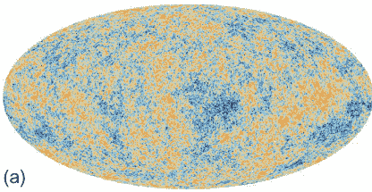

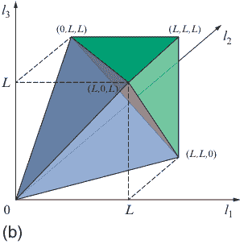

**图 10.1**  
(a) 普朗克卫星实验测得的 CMB 中的微小密度涨落。(b) 满足三角形条件下双谱有良好定义的非矩形积分区域。

我们在此讨论的 Modal 代码是目前约束 CMB 偏离高斯预测的唯一完全通用的方法。它是通过 CMB 的*双谱*（或三点相关函数）来实现的。这可以理解为在由给定三角形顶点定义的任意三个点之间搜索任何相关性（因此，我们会看到代码中经常涉及三重乘积）。为此，暴胀双谱必须随时间向前演化，然后以能够轻松与数据比较的方式投影到由 CMB 定义的球壳上。在这项工作中，我们从代码的其余部分中提取了这一部分计算，并将其变成了一个名为 *miniModal* 的迷你应用。

该代码使用两组三维基模板：一组是理论模板，从暴胀结束一直演化到观测时刻（因此涉及对 *r* 的积分，*r* 是沿视线方向的距离）；另一组定义在二维 CMB 本身上——分别是 \(\tilde{Q}_n\) 和 \(Q_n\)。选择这些基模板是因为它们的形式大大简化了代码的估计部分（否则该部分是七维的，因而难以处理）。miniModal 中的代码计算演化后的原初基到 CMB 基的分解。如果我们定义矩阵 \(\Gamma\)，使得 \(\tilde{Q}_n = \sum_r \Gamma_{nr}Q_r\)，那么 \(\Gamma\) 可以使用图 10.2a 中所示的公式计算。因此，为了优化 \(\Gamma\) 的计算，我们只需专注于优化内积的求值。大部分计算时间都在评估第二个内积上，因为 \(\tilde{Q}\) 中固有地包含径向积分，所以我们将只关注这一部分。

显式写出来，miniModal 中执行的计算如图 10.2b 所示。存在一个已知的映射 \(n \to ijk\)，而 \(\ell_1, \ell_2, \ell_3\) 的值由 Wigner-3J 符号确定，如图 10.2c 所示。Wigner-3J 符号有两个重要性质：第一，当把三个 \(\ell\) 视为长度、无法构成三角形时（三角形条件），其值为零；第二，当 \(\ell_1 + \ell_2 + \ell_3\) 为奇数时（奇偶性条件），其值也为零，否则其值为 1。这些约束是一种几何效应，源于投影到球壳上时的动量守恒。该积分区域如图 10.1b 所示。三个 \(\ell\) 值中的任何一个的最大值固定为 2000。

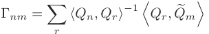

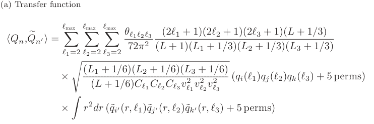


**图 10.2**

Modal 流程中的关键方程。

计算这个内积的解需要约 2.4¹³ 次运算，因此在单个 CPU 上无法处理。原始代码利用消息传递接口（MPI）通过多节点并行来加速计算。n→ijk 三元组列表均匀分配给各个 MPI 任务，从而根据列表长度限制可用并行度。对于使用原始代码的生产运行，整个计算在 512 个 Intel® Xeon® E5-4650L 处理器核心上大约需要 6 小时。此外，为了交叉验证结果，必须运行多次，这成为 Modal 流程中的一个显著瓶颈。对该计算的任何性能改进都将对 Modal 流程及其所依赖的宇宙学研究产生重大影响。

Modal 执行的计算是 Intel® Xeon Phi™ 协处理器的理想候选——内积计算在计算上非常昂贵、彼此独立，并且所需内存极少（生产运行仅使用 O(100) MB 内存，且仅向磁盘写入 O(1) MB）。然而，现有的代码没有以有利于利用现代硬件的方式表达这种计算。因此，我们对 Modal 的加速包含两个部分：调整代码以确保其高效运行（即优化）；使代码能够跨向量和众核扩展（即现代化）。如果没有并行，就不可能从当前和未来几代 Intel Xeon 处理器和 Intel Xeon Phi 协处理器中提取性能，而这里介绍的优化和现代化过程对于确保 COSMOS 保持在宇宙学研究的前沿至关重要。

### 优化与现代化

理论谱计算的核心在于一个名为 `calculate_gamma_3d` 的例程。该例程的主要循环嵌套（即图 10.2 中第二个方程的代码化版本）如图 10.3 所示。*n* 和 *m* 循环分别遍历 *ijk* 和 *i′j′k′* 三元组（terms，即 *N*terms，表示基模板集合的长度，因此也就是三元组的数量）。调用函数 `plijk` 的 *m* 循环代表该方程的第二行，而调用函数 `calculate_xint` 则代表同一方程的第三行。

最初，这个循环嵌套仅使用 MPI 在最外层循环上进行并行化。这个最外层循环遍历所使用的总特征模态数，对于生产计算，该数量通常在 100 到 2000 之间，为代码在一个小型处理器集群上运行和扩展提供了足够的并行性。然而，在每个协处理器上运行大量 MPI 进程很可能会产生显著的开销，因此不应期望现有代码在那里运行良好。正如许多其他案例研究所表明的，高效使用协处理器需要引入线程，并转向 MPI/OpenMP 混合编程模型，从而在更细粒度上实现并行，并减少与存储冗余数据相关的开销。问题不是是否引入线程，而是如何引入。

### 将循环拆分为并行任务

更仔细地检查图 10.3 中的循环，很明显那里有巨大的未开发并行潜力。整个循环嵌套的输出是结果数组 `mvec`——整个循环嵌套只是一个数组*归约*模式，并且在所有 *n*ℓ₁ℓ₂ℓ₃ 循环嵌套中都有可用的并行性。由此带来的麻烦是，Wigner-3J 符号（图 10.2 中的第三个方程）对 ℓ₁ℓ₂ℓ₃ 值的约束导致了不规则的循环结构。具体来说，ℓ₁ 和 ℓ₂ 之间的循环是上三角形的，ℓ₃ 循环相对于 ℓ₂ 也是上三角形的。此外，ℓ₃ 循环的步长为 2，其起点和终点取决于 ℓ₂。完整的迭代空间的一个简化版本（ℓ₁ = ℓ₂ = ℓ₃ = 10）如图 10.4 所示。

```
for (n=0; n<nterms; n++) {
    for (l1=0; l1<lsize; l1++) {
        for (m=0; m<terms; m++) mvec[m] = 0.0;
        for (l2=l1; l2<lsize; l2++)
            for (l3=l2-l1%2; l3<min(l1+l2,lmax)+1; l3+=2) {
                x = calculate_xint(l1,l2,l3,n,xvec,xvec,task);
                ...
                z = permsix(l1,l2,l3)*calculate_geometric(l1,l2,l3)/sqrt(s1*
                    s2*s3);
                for (m=0;m<nterms;m++) {
                    y = plijk(m,l1,l2,l3);
                    mvec[m] += x*y*z;
                }
            }
    }
    // array reduction of mvec into gamma matrix
}
```

**图 10.3**

miniModal 中热点函数的代码片段。


## FIGURE 10.4

ℓ₁ℓ₂ℓ₃ 迭代空间的结构，显示了有效和无效的迭代。

将线程添加到 ℓ₁ 循环将得到一个 MPI/OpenMP 混合代码，可以扩展到使用 O(1000) 个协处理器，每个协处理器有 2000 个并行任务。虽然这听起来像是一个很棒的想法，但这种设置的问题在于嵌套循环的三角形结构会导致 ℓ₁ 循环中的负载不均衡，这在图 10.5 中针对四个线程进行了可视化。OpenMP 中不平衡的循环通常通过使用动态调度或基于任务的并行性来处理。在我们的实验中，我们发现这些方法由于无法将特定组的并行任务绑定到同一核心而导致缓存行为不佳和数据重用水平低。此外，这种方法只是对问题进行了修补，并没有解决根本的算法问题。

理想的解决方案是将整个 ℓ₁ℓ₂ℓ₃ 循环巢展平为一维迭代空间，并尽可能均匀地在线程之间分配迭代。OpenMP 提供了 collapse pragma 来精确地执行此操作；然而，在存在循环边界之间依赖关系的情况下，如我们这种情况，则无法使用。我们选择手动重构循环，使其可以从指定的起始 ℓ₁ℓ₂ℓ₃ 三元组运行到指定的结束三元组，如图 10.6 所示。这样，分配给协处理器上给定并行任务的工作可以用六个边界整齐地表示：(lower_l1, lower_l2, lower_l3, upper_l1, upper_l2, upper_l3)。

为了确定这些边界，我们首先执行整个循环巢的“试运行”以计算总迭代次数 N。接下来，我们在 P 个并行工作者之间均匀分配迭代次数，将余数分配给前 N mod P 个工作者。最后，循环的另一次遍历会根据分配给每个工作者的迭代次数记录每个工作者的 ℓ₁ℓ₂ℓ₃ 边界。这给出了一个

Valid (ℓ₁, ℓ₂) and ℓ₃

Valid (ℓ₁, ℓ₂) but invalid ℓ₃

## FIGURE 10.5

对循环巢并行化的天真尝试。每个颜色对应一个不同的线程。

```
int start_l1 = lower_l1;
int end_l1 = upper_l1+1;
for (l1=start_l1; l1<end_l1; l1++)
{
    int start_l2 = l1 == lower_l1 ? lower_l2 : l1;
    int end_l2 = l1 == upper_l1 ? upper_l2+1 : lsize;
    for (l2=start_l2; l2<end_l2; l2++)
    {
        int start_l3 = l2+(l1/2);
        int end_l3 = min(l1+l2,lmax)+1;
        if ((l1==lower_l1) && (l2==lower_l2))
        {
            start_l3 = lower_l3;
        }
        if ((l1==upper_l1) && (l2==upper_l2))
        {
            end_l3 = upper_l3;
        }
        for (l3 = start_l3; l3 < end_l3; l3 += 2)
        {
            // loop interior...
        }
    }
}
```

## FIGURE 10.6

图 10.3 中所示循环的展平版本，可以在三角形迭代空间中的任意下限和上限点之间运行。

## FIGURE 10.7

循环巢的优化线程调度（关于迭代次数）。

在假设所有迭代花费相同时间的情况下，实现了最佳负载平衡的循环，如图 10.7 所示。我们已经在经验上观察到这种情况。

现在我们有了可用的卸载实现，我们可以开始迭代优化过程，以缩小处理器和协处理器性能之间的差距。查看协处理器上运行的代码配置文件，我们发现其执行时间的一半以上花费在图 10.3 中所示的函数 plijk 上。这是一个简单的内联函数，用于索引一些数组并计算图 10.2 中第二个方程的第二行，给定 ℓ1ℓ2ℓ3。该函数已经由编译器很好地向量化，因此仅通过微优化很难获得太多收益——然而，仔细查看图 10.3 中的代码，我们可以看到 plijk 对每个 ℓ1ℓ2ℓ3 三元组调用 Nterms² 次。这可以通过改变循环顺序减少到 Nterms 次调用，将 n 循环移入 ℓ 循环内部并将结果存储在数组 x[n] 中。循环巢的重排版本显示在图 10.8 中。

在此重排循环巢之后，很明显原始代码的 MPI 并行化是低效的；对 n 进行并行化会分配 calculate_xint 的工作，但会在所有处理器上冗余计算 plijk。正如线程的情况一样，我们现在必须找到一种方法将三角形循环巢分布到 MPI 秩上。幸运的是，之前为线程描述的方法可以很容易地扩展以在并行层次结构的多个级别之间分配工作：我们首先在 MPI 任务之间分配迭代，然后在 OpenMP 线程之间细分这些迭代。

```
for (l3 = start_l3; l3 < end_l3; l3 += 2)
{
    for (n = 0; n < terms; n++)
    {
        x[n] = calculate_xint(l1,l2,l3,n,xsize,xvec,yvec,thread_data[
            tid].task_spl);
    }
    double s1 = svec[l1]; double s2 = svec[l2]; double s3 = svec[l3];
    double z = permsix(l1,l2,l3)*calculate_geometric(l1,l2,l3)/sqrt(s1*s2*s3);
    for (m = 0; m < terms; m++)
    {
        double y = plijk(m,l1,l2,l3);
        for (n = 0; n < terms; n++)
        {
            mmat[m][n] += x[n] * y * z;
        }
    }
}
```

## FIGURE 10.8

图 10.3 中所示循环体的重新排列版本。

### INTRODUCING NESTED PARALLELISM

尽管新的循环结构减少了算法复杂性，从而减少了所需的工作总量，但考虑其内存使用情况很重要——天真的实现要求每个线程都存储 x 和 plijk 的外积在临时矩阵 mmat 中，该矩阵有 N_terms^2 个元素。对于典型的 N_terms 大小，mmat 每个线程需要 O(10MB) 的内存，远远超过 Intel Xeon Phi 协处理器上 512 kB L2 缓存的容量，并可能导致 Intel Xeon 处理器上更大的 L3 缓存的容量问题。我们希望每个核心运行两个到四个线程这一事实只会使问题更糟（见图 10.9），并且线程之间对容量的竞争甚至可能导致抖动。

理想情况下，我们应该只为每个核心保留一个 mmat 的副本，避免冗余计算，并紧密控制数据放置以最大化缓存重用并避免伪共享。只有通过重新排列循环以适应嵌套并行，才能同时实现所有这些目标，将外部 l 循环拆分到核心上，将内部 n 和 m 循环拆分到每个核心上的线程上。这种简单的线程到工作的重新映射显著减少了内存需求，并且还确保了


## FIGURE 10.9

每个线程的临时数据 mmat 大于协处理器核心上的 L2 缓存。使用每个核心四个线程时，这个问题会四倍恶化。

成本在嵌套区域经常遇到时是禁止的，例如当线程为最内层循环生成时。

然而，Intel® OpenMP 运行时（版本 15 更新 1 或更高版本）中支持一个实验性功能，称为“热团队”，它能够通过在非嵌套并行代码执行期间保持线程池存活（但处于空闲状态）来减少这些开销。热团队的使用由两个环境变量控制：KMP_HOT_TEAMS_MODE 和 KMP_HOT_TEAMS_MAX_LEVEL。为了在团队大小变化时保持未使用的团队成员存活，我们设置 KMP_HOT_TEAMS_MODE=1，并且由于我们有两级并行性，我们设置 KMP_HOT_TEAMS_MAX_LEVEL=2。

还必须注意线程亲和性设置。OpenMP 4.0 提供了新的环境变量来处理线程的物理放置，OMP_PROC_BIND 和 OMP_PLACES，并且这些变量与嵌套并行区域兼容。为了将团队领导者放置在单独的核心上，并将团队成员放置在同一核心上，我们设置 OMP_PROC_BIND=spread,close 和 OMP_PLACES=threads。

### OpenMP 4.0 TEAMS

teams 和 distribute 构造被添加到 OpenMP 4.0 中，作为其对加速器的支持的一部分，并且类似于 OpenACC 提供的“gang”和“worker”模型。图 10.11 显示了对简单循环巢的示例。

使用 teams 需要比简单嵌套更广泛的代码更改，因为对其使用有一些限制。首先，teams 构造必须包含在 target 构造内，因此不能轻易用于主机上的嵌套并行——teams 区域只有在 target 构造的“if”子句计算为 false 时才能在主机上执行！其次，它必须是该 target 构造中出现的第一个语句，因此在串行和并行代码之间切换需要单独的 target 构造（导致卸载代码的不必要的宿主-设备同步）。第三，虽然团队内的线程可以用 OpenMP barrier 同步，但不同团队中的线程不能同步（除非通过 teams 和 target 区域的关闭）。

这些限制使这种方法比简单嵌套的灵活性更差，并且还迫使开发人员为主机和设备维护相同代码的单独版本。将 OpenMP 4.0 teams 逆向移植到我们现有的预先存在的代码中很困难，因为它不是考虑到这些限制而设计的。对于已经分为并行内核的代码（例如 CUDA 或 OpenCL 代码），这种逆向移植过程将需要更少的广泛更改。

```
#pragma omp target device(0)
partition_block(lsize, omp_get_num_teams(), &start_l, &end_l);

#pragma omp target device(0)
#pragma omp teams num_teams(60) thread_limit(4)
for (l = start_l; l < end_l; l++)
{
    #pragma omp parallel for num_threads(4) schedule(static,1)
    for (n = 0; n < terms; n++)
    { ... }
}
```

## FIGURE 10.11

OpenMP teams 区域的示例。teams 构造必须在 target 构造之后立即调用。


### 手动嵌套

我们考虑的嵌套的最后一种方法是“手动”嵌套方法，在这种方法中，OpenMP 创建的线程会被划分并根据其全局线程 ID（`tid=omp_get_thread_num()`）、核心 ID（`tid / threads_per_core`）和本地线程 ID（`tid % threads_per_core`）分配工作。我们将任何本地 ID 为 0 的线程指定为团队领导者，其余线程为团队成员。图 10.12 显示了对一个简单循环嵌套的示例。

尽管以这种方式实现嵌套并行性相当简单，但在线程同步使用 OpenMP `barrier` 构造时存在一些不明显的陷阱。首先，存在性能问题。虽然我们已将线程划分为团队，但无法将这种手动划分传达给 OpenMP 运行时，因此任何屏障都会同步所有线程。这种全局屏障与团队本地屏障相比代价昂贵（因为屏障成本按 O(log₂(N)) 扩展），并且在团队之间存在轻微负载不平衡时也可能导致效率低下。其次，存在潜在的正确性问题。如果我们的团队执行的迭代次数不完全相同（这可能是由于负载不平衡造成的），并且没有命中完全相同数量的全局屏障，那么线程将被卡住，代码将死锁。为了解决这两个问题，我们引入了一个自定义屏障实现，使仅团队中的线程之间能够同步。该本地屏障的代码由英特尔公司的 Larry Meadows 提供，显示在图 10.13 中。

在其核心，实现比人们预期的要简单得多。我们使用一个 4 字节的 `int` 作为屏障变量，我们的（最多）四个线程中的每个线程拥有 1 字节。每次线程到达屏障时，它会切换其字节（即从 0 到 1 或反之亦然）并等待其他线程到达。由于屏障变量是一个单一的 `int`，我们只需将其值与预先计算的等待值（`waitval`）进行比较，即可检查所有线程是否已到达，该值取决于屏障使用次数，为 0 或 0x01010101。代码中大部分的复杂性与确保屏障在边界情况和/或提高性能时的正确操作有关。如果两个屏障连续发生，则可能一个线程会在其他线程离开第一个屏障之前到达第二个屏障。如果确实发生这种情况，并且到达的线程通过切换其字节来发出到达信号，其他线程将永远无法离开屏障——我们造成了死锁。为了避免这种边界情况行为，有必要使用两个不同的屏障变量，并在每次同步点后在它们之间切换。为了提高性能，包含我们两个屏障 int 的 `corebarrier_t` 结构体被对齐并填充到 64 字节，从而确保它恰好占用一个缓存行。此缓存行

```c
#pragma omp parallel num_threads(240)
{
    partition_block_grouped(lsize, omp_get_num_threads() / threads_per_core,
                            &start_l, &end_l);
    for (l = start_l; l < end_l; l++)
    {
        int start_n = tid % threads_per_core;
        int end_n = terms;
        for (n = start_n; n < end_n; n += threads_per_core)
        {
            ...
            userCoreBarrier();
        }
    }
}
```

将只会被同一团队中的线程访问，这防止了不同核心上线程之间的屏障变量发生伪共享。在协处理器上，此屏障使我们能够在仅 ≈ 50 个周期内同步一个核心上的线程。

### 内层循环优化

现在我们已经为协处理器的高效使用做好了充分准备，我们现在开始调整最内层循环的性能。我们再次对使用 N_terms = 601 运行的代码进行分析，发现最大的瓶颈绝对是求解图 10.2b 中方程中关于 dr 的积分的例程。该积分由 `calculate_x` 例程计算，显示在图 10.14 中。

积分是使用基于（三次）样条的数值积分方法进行求值的。最初这是使用 GNU 科学库（GSL）中的例程 `gsl_spline_eval_integ` 实现的，但我们的第一次优化步骤将其替换为等效且优化更好的例程

# FIGURE 10.13

快速、核心内屏障的示例实现。

```c
double calculate_xint(int l1, int l2, int l3, int n, int rsize, double* r,
        double* y, DFTaskPtr task) {
    find_perm(n,&a1,&a2,&a3);
    ...
    for (i=0; i < rsize; i++) {
        double p1 = beta[l1][a1][i];
        double p2 = beta[l1][a2][i];
        double p3 = beta[l1][a3][i];
        double p4 = beta[l2][a1][i];
        double p5 = beta[l2][a2][i];
        double p6 = beta[l2][a3][i];
        double p7 = beta[l3][a1][i];
        double p8 = beta[l3][a2][i];
        double p9 = beta[l3][a3][i];

        double t1 = p1*p5*p9;
        double t2 = p2*p6*p7;
        double t3 = p3*p4*p8;
        double t4 = p3*p5*p7;
        double t5 = p2*p4*p9;
        double t6 = p1*p6*p8;

        double y = r[i] * r[i] * (t1+t2+t3+t4+t5+t6) * sixth;
        if (i < 10 && fabs(-y) > 1e-18) -y = 0;
        y[i] = -y;
    }

    // integrate : r^2 y(r) dr
    status = dfdConstruct1D(task, DF_PP_SPLINE, DF_METHOD_STD);
    status = dfdIntegrate1D(task, DF_METHOD_PP, 1, 1lim, DF_NO_HINT, rlim, \\
        DF_NO_HINT, 0, 0, &result, DF_NO_HINT);

    return result;
}
```

# FIGURE 10.14

使用样条积分方法的 `calculate_xint` 代码片段。

来自英特尔® 数学核心库（Intel® MKL）（显示在图中代码的最后几行）。这种基于样条的积分方法存在两个问题：首先，它需要大量额外内存来存储每个数据点的三次多项式系数；其次，它带宽效率低下，因为它需要求解表示全局系统的方程组。最终，英特尔 MKL 例程更适合求解单个非常大的数据向量，而不是我们在 Modal 中看到的许多短数据向量。

用更简单的数值积分例程替换英特尔 MKL 例程使我们能够解决这两个问题。我们发现，使用简单的梯形法则积分器结合手工选择的采样点（以提高感兴趣区域的精度）可以提供足够的数值精度以获得物理上有意义的结果，并且这种简化方法的空间和时间需求减少带来了 O(10×) 的加速。

这在分析中留下了两个相当均衡的热点：数组归约阶段，其中 x 和 π|j,k| 值的块被归约到 m 矩阵中；以及 `calculate_xint` 函数内部未执行积分的部分计算。

数组归约代码的初始实现显示在图 10.15a 中。在这里，我们尝试使用嵌套线程执行归约，对外层循环 over n 进行向量化。该归约的性能因 L2 缓存局部性差而受损，而不是进一步调优


int start_m = workerid;
int end_m = terms;
for (m=start_m; m<end_m; m+=4)
{
    #pragma omp simd private(n,l)
    for (n=0; n<terms; n++)
    {
        double tmp = mvec[m][n];
        for (l=0; l<blocksize; l++)
        {
            tmp += x[l][n] *
                   plijkz[l][m];
        }
        mmat[m][n] = tmp;
    }
}

if (workerid == 0)
{
    cblas_dgemm(CblasRowMajor,
                CblasTrans,
                CblasNoTrans,
                terms, terms,
                blocksize,
                1.0, &plijkz[0][0],
                terms, &x[0][0],
                terms, 1.0,
                &mmat[0][0], terms);
}
userCoreBarrier(threadData[tid].bar);

(a) 我们的初始归约例程，使用多线程和外层循环向量化。

(b) 当前的归约例程，使用一个线程调用 DGEMM 而团队中的其他线程等待。

## FIGURE 10.15

数组归约阶段是内层循环中的瓶颈之一。我们对归约的尝试如 (a) 所示。这等价于一个矩阵-矩阵乘法，因此我们用如 (b) 所示的 DGEMM 替换了它，性能有了很大提升。

通过手动缓存分块，我们意识到整个操作可以表示为矩阵-矩阵乘法。Intel MKL 提供的 DGEMM 已经进行了缓存分块，解决了我们实现中遇到的所有问题。注意，我们目前仅使用团队负责人调用此函数——理论上可以让所有团队成员在此处协作，我们正在研究为何早期的尝试会导致性能下降。

calculate_xint 中剩余的瓶颈是图 10.14 中关于 i 的循环。数组 beta 通过 ℓ 和 a 变量进行间接访问，但对 i 是直接读取的，因此编译器能够开箱即用地很好地自动向量化代码。然而，我们可以通过对多维 beta 数组进行对齐和填充，使其行以 64 字节边界开始，从而改善内存行为。我们还可以通过使用 prefetch 和 loop count 指令来改善编译器生成的预取质量——以预取距离 1 预取 beta、y 和 r 可为此循环带来最佳性能。然而，这些更改并不能完全消除缓存未命中，该函数仍然是我们最终版本代码中的热点。虽然核心内部存在大量数据重用，但每个线程有 11 个内存流，这对于预取器来说太多了，无法有效隐藏 L2 访问的延迟。我们预计下一代 Intel Xeon Phi 协处理器（曾代号为 “Knights Landing”）中引入乱序执行和改进的预取硬件将改善此类情况的性能。

### RESULTS

在本节中，我们展示了来自双插槽 Intel Xeon 处理器 E5-4650L 和 Intel Xeon Phi 协处理器 5110P 的结果。这些的技术规格在图 10.16 中给出。主机处理器基于曾代号为 “Sandy Bridge” 的 Intel 微架构，协处理器基于曾代号为 “Knights Corner” 的微架构。所有实验

### Results

|  | Intel Xeon Processor E5-4650L | Intel Xeon Phi Coprocessor 5110P |
|---|---|---|
| Sockets × cores × threads | 2 × 8 × 1 | 1 × 60 × 4 |
| Clock (GHz) | 2.6 | 1.053 |
| Double Precision GFLOP/s | 332.8 | 1010.88 |
| L1/L2/L3 cache (kB) | 32 / 256 / 20,480 | 32 / 512 / — |
| DRAM (per node) | 128 GB | 8 GB GDDR5 |
| STREAM bandwidth | 52.8 GB/s | 165 GB/s |

|  |  |
|---|---|
| PCIe bandwidth | 6 GB/s |
| Compiler version | Intel® Composer XE 2015 (v15.0.0.090) |
| MPSS version | 3.2.1 |

## FIGURE 10.16

系统配置。

（除非另有说明）使用节点内所有可用的核心，并使用支持的最大线程数——协处理器上为四个线程，处理器上为一个线程（主机系统上禁用超线程）——线程亲和性使用 `KMP_AFFINITY=close,granularity=fine` 设置。协处理器以卸载模式使用，除了处理器使用的标志外，未向编译器传递任何额外标志：`-O3 -xHost -mcmodel=medium -restrict -align -fno-alias -qopenmp`。所有实验重复五次，我们给出平均值（均值），以便考虑系统噪声和线程带来的任何非确定性性能影响。

图 **10.17** 中的图表显示了相对于在双插槽处理器上运行的原始代码，每项优化带来的加速（越高越好）。版本编号到优化描述的映射在图 **10.18** 所示的表中给出以供参考，


## FIGURE 10.17

miniModal 在每个优化阶段的加速。

| Version | Processor (s) | Coprocessor (s) | Comment |
|---|---|---|---|
| 1 | 2887.0 | – | Original code |
| 2 | 2610.0 | – | Loop simplification |
| 3 | 882.0 | – | Intel MKL integration routines and function inlining |
| 4 | 865.9 | 1991.6 | Flattened loops and introduced OpenMP threads |
| 5 | 450.6 | 667.9 | Loop reordering and manual nested threading |
| 6 | 385.6 | 655.0 | Blocked version of the loop (for cache) |
| 7 | 46.9 | 49.5 | Numerical integration routine (Trapezium Rule) |
| 8 | 37.4 | 37.7 | Reduction with DGEMM |
| 9 | 35.1 | 34.5 | Data alignment (for vectorization) |
| 10 | 34.3 | 26.6 | Tuning of software prefetching distances |

## FIGURE 10.18

miniModal 在每个优化阶段的执行时间。

以及以秒为单位的执行时间。注意，由于我们以卸载模式使用协处理器，因此在引入 OpenMP 线程之前我们不提供其结果——卸载到单个线程会非常慢！

代码版本 1-3 显示，“低垂果实”带来的加速可以相当显著（处理器上为 3.2×），并且遵循最佳实践的影响不容低估。版本 4-6 使总加速进一步增长（处理器上为 7.5×，协处理器上为 3.0×），但由于 Intel MKL 的三次样条例程占用内存很大，协处理器仍然较慢。直到我们在版本 7 中对核心算法进行重大更改（切换到数值积分），随后在版本 8-10 中进行调优，协处理器才超过处理器，我们达到了应有的性能比例：具体来说，单个协处理器比两个处理器插槽快约 1.5×。在最终版本中，协处理器上每周期发出的向量指令数由 Speedometer 测得为峰值的 39.8%。这表明我们在 miniModal 中优化内层循环的工作在有效利用硬件方面相当成功，但由于每个线程的内存流数量太多，预取器无法有效隐藏缓存访问的延迟，仍然存在一些低效。

相对于原始基线代码，总加速在两个平台上都接近 100×。此外，此处所示的结果仅使用两个处理器插槽或一个协处理器——通过使用 MPI 在节点间划分完整问题空间，然后在每个节点中存在的处理器和协处理器之间进一步细分，可以进一步加速计算。因此，这些优化使得 COSMOS 完全改变了代码的使用方式；而不是在仔细选择宇宙学参数后在整个系统上运行数小时，Modal 现在可以作为更大蒙特卡洛管道的一部分，快速评估替代参数的似然。

### COMPARISON OF NESTED PARALLELISM APPROACHES

图 10.19 中的图表显示了使用前面描述的三种嵌套并行方法之一的完全优化的 miniModal 的执行时间。对于嵌套 OpenMP 并行区域，我们提供了两组结果：一组为默认行为，另一组为启用实验性 hot teams 功能时的行为。


## FIGURE 10.19

在 Intel Xeon Phi 协处理器上，不同嵌套并行方法在多种问题规模下的运行时间比较。

对于小规模问题，嵌套 OpenMP 区域与其他方法之间存在明显的性能差异。虽然使用热团队对性能有显著改善，但并不能完全消除所有线程创建/销毁开销——运行时仍必须遵守 OpenMP 语义（例如私有变量的数据移动），并且运行时必须能够处理在任何嵌套层级请求任意数量的线程。有趣的是，对于最大问题规模，不同方法之间的差距几乎缩小到零，因为开销能够被分摊到分配给每个线程的增加的工作量上。

Intel OpenMP 运行时还支持一个环境变量（KMP_BLOCKTIME），用于控制线程在 OpenMP 区域结束时在进入睡眠前自旋的时间。图 10.20 中的图表显示了热团队性能受该变量三个不同值的影响：200 ms（默认值）；0（导致线程立即睡眠并释放核心资源）；以及无限（导致线程无限自旋，确保在遇到下一个并行区域时保持唤醒）。由于我们预计会连续快速遇到多个并行区域，将阻塞时间设置为无限应产生最大效果，这在我们的结果中得到了体现。正确设置 KMP_BLOCKTIME 将嵌套并行区域与手动嵌套之间的性能差距缩小到 601 问题，速度提升 2×，但仍不足以挽救较小的问题规模。

图 10.21 中的表格从可用性和对程序员的友好性角度比较了不同的嵌套并行方法。由于这些指标并非客观，它们基于我们使用 miniModal 的经验得出的观点——读者完全可以不同意！我们认为目前最好的选择是本章介绍的手动嵌套方法，因为它达到了“最佳平衡点”，始终

在 OpenMP 规范迭代若干次之前，它才准备好用于生产代码。具体而言，无法为团队设置亲和性可能会对其他运行时的性能产生负面影响，而无法在目标区域之外使用团队则显著降低了其实用性。最后，根据我们的结果，很难推荐在没有热团队的情况下使用嵌套 OpenMP 并行区域！

### SUMMARY

在本章中，我们逐步介绍了对 miniModal 的一系列更改，miniModal 是 COSMOS 用于分析 CMB 辐射的 Modal3D 应用的代理代码。这些更改将性能提升了接近 100 倍，适用于 Intel Xeon 处理器和 Intel Xeon Phi 协处理器，并且 resulting 代码适合在由处理器、协处理器或两者组合构成的系统上运行。

本章中应用于优化代码的许多技术（例如负载平衡、缓存分块、调优预取距离）对任何高性能应用的开发者来说都应很熟悉，这进一步证明了“新异构”并行编程方法（即在异构系统上使用单一编程模型）的优势。然而，miniModal 最大的性能提升无疑来自于将 Intel MKL 中的三次样条积分例程替换为自定义数值积分例程，这凸显了分析和最终替换不合适的算法的必要性，使代码现代化并能够在宽 SIMD 向量和众多核心上扩展。

虽然高效的数值积分例程可能不直接适用于其他代码，但它完美地说明了依赖“黑盒”例程在所有情况下都表现最优的固有危险。通过使用嵌套并行性，我们的积分例程能够利用领域和硬件知识，在能够执行每个核心多个硬件线程的微架构上减少内存占用和不必要的缓存流量。此外，我们表明，与普遍看法相反，只要有足够的工作量来隐藏线程创建和销毁开销，纯基于 pragma 的实现可以与手动实现相匹配的性能。我们有信心，未来的 OpenMP 标准迭代和/或 Intel OpenMP 运行时的改进将能够进一步提高这些基于 pragma 解决方案的性能和可用性。

### FOR MORE INFORMATION

以下是我们推荐与本章相关的一些额外阅读材料：

- Fergusson, J.R., et al., 2010. General CMB and primordial bispectrum estimation: mode expansion, map making, and measures of F NL. Phys. Rev. D 82 (2), 023502.
- Fergusson, J.R., et al., 2007. Primordial non-Gaussianity and the CMB bispectrum. Phys. Rev. D 76 (8), 083523.
- Cosmic Microwave Background image. www.csa.int.
- Bispectrum integration domain image. Planck 2015 results. XVII. Constraints on primordial non-Gaussianity. http://arxiv.org/abs/1502.01592.
- OpenMP 4.0 Application Program Interface Version 4.0. http://www.openmp.org/mp-documents/OpenMP4.0.0.pdf.
- Dempsey, J., 2014. Plesiochronous phasing barriers. In: High Performance Parallelism Pearls: Multicore and Many-Core Programming Approaches. Morgan Kaufmann, Waltham, MA, pp. 87-115.
- Speedometer. https://01.org/simple-performance-tools
- The Stephen Hawking Centre for Theoretical Cosmology. http://www.ctc.cam.ac.uk/

下载本章及其他章节的代码。 http://lotsof cores.com.

### VISUAL SEARCH OPTIMIZATION 11

Prashanth Thinakaran*, Diana Guttman*, Mahmut Taylan Kandemir*, Meenakshi Arunachalam†, Rahul Khanna†, Praveen Yedlapalli*, Narayan Ranganathan†

Pennsylvania State University, USA* Intel Corporation, USA†

我们正处于数字数据呈指数级增长的时代，数据形式为文本、图像和视频，通过多个渠道产生，其中这些数据的实时分析正成为更大的挑战。由于这些基于分析的应用具有固有的数据级并行性，像 Intel® Xeon Phi™ 协处理器这样具有多个 SIMD 核心的计算加速器，通过满足这些应用的实时需求来提供帮助。

图像匹配是一个重要的应用，其中一组图像与大型图像数据库进行比较以寻找特征相似性。图像匹配有许多应用。许多多媒体系统，如互联网搜索引擎、多媒体内容分析软件和图像数据库分类工具，都将图像匹配用作中间步骤，使其成为性能和功耗优化的关键目标。

现有关于图像匹配的研究主要集中在探索算法技术和处理实时处理约束。随着新兴的架构趋势，例如多核协处理器、非易失性存储器和 3D 堆叠，研究图像匹配应用对这些计算平台的影响变得越来越重要。需要调查的关键问题包括：（1）图像映射应用表现出的不同类型的并行性；（2）这些应用映射到多核协处理器时如何扩展；（3）它们是否需要定制的代码并行化技术和/或数据布局优化以利用多核特定特性，例如多个内存通道、片上网络和宽 SIMD 单元；（4）鉴于 Intel Xeon Phi 协处理器计算核心上 GDDR 内存提供的高内存带宽，加速内核是数据并行的，它们能否利用 3D 堆叠和非易失性存储器。

本章主要关注前两个问题，并代表了理解特定图像匹配应用（面部检测和识别的机器感知）行为迈出的一步，通过研究其在基于 Intel Xeon Phi 协处理器的系统上映射时的性能。

在本章中，我们提出了一个客户端-服务器应用，用于使用快速近似最近邻库（FLANN）作为底层搜索算法对给定数据集执行图像分类。我们讨论了该应用在协处理器平台上的不同并行化技术。特别是，研究了三个重要参数（DBThreads、FLANNThreads 和 K 维（KD）树）对性能的影响。在协处理器系统上使用三个不同数据库展示实验结果。我们的结果表明，虽然树创建


该应用的一部分可良好扩展至 120 个线程，而搜索部分可扩展至 32 个线程。此外，当结合使用 FLANN 与 DBThreads 线程时，端到端应用可获得最佳性能。我们还解释了阻碍进一步扩展的因素，并量化了它们各自的作用。

据我们所知，这项工作是将此类图像匹配应用映射到多核 Intel Xeon Phi 协处理器平台的首次尝试。

### 图像匹配应用

图像搜索方法允许系统从大型数字图像数据库中浏览、搜索和检索图像。它包含获取、处理和分析图像的方法，以综合和解释与主动决策过程相关的信息。通过计算机辅助图像（或物体）识别来实现决策过程自动化的过程，往往通过感知和理解图像来复制人类视觉的能力。近年来，移动和集成图像检索系统（由智能手机支持的视觉设备）的进步，以及高度并行或专用硬件的使用，促进了视觉监控、物体建模、信息检索、人机交互、机器人视觉、智能制造、选择性广告、自动驾驶车辆、智能教室和社交互动等许多用例。在许多情况下，不仅要以快速且节能的方式检索和处理图像，还需要通过云基础设施传输和匹配图像属性，以实时检索与该图像相关的必要信息。例如，在视觉监控中，图像充当个人信息索引，可以根据检索到的信息驱动社交互动。如图 11.1 所示，如果我们用手势和音频关键词增强视觉信息，就可以更选择性地提取由基于图像的索引搜索所促进的信息属性。

在这项工作中，我们专注于常用于虚拟现实应用、监控和社交互动中的人脸检测与识别的机器感知。这些应用的强实时性促使我们开发能够在视频帧率（每秒 15-30 帧）范围内维持实时约束的图像分析算法。此外，由于人脸检测与识别算法是计算密集型操作，我们需要找到能够并行化算法操作的方法，以支持大规模实时信息交换。低成本图形处理单元（GPU）、多核架构和高速互联网连接的出现，为我们提供了足够的计算和通信资源来加速人脸检测与识别。我们使用多核 Intel Xeon Phi SE10P 协处理器，该协处理器在单个协处理器上可提供高达 1 万亿次双精度浮点运算/秒（teraFLOP/s）的峰值计算能力，可用于解决更大、更复杂的科学挑战。

### 图像采集与处理

数字图像通过图像传感器生成，产生一个或多个图像的 2D 或 3D 图像数据表示。这些数据包含空间特征，如光强度、深度和吸收率。在这项工作中，我们假设输入图像需要与大量

### 图 11.1

结合手势和语音属性，使用视觉人脸识别进行信息检索。


特征提取

特征映射

### 图 11.3

具有不同面部朝向的两幅图像之间的关键点选择与映射。

### 应用

移动电话、先进的相机和无处不在的无线连接正在彻底改变我们的社交行为，而随着我们开发和改进图像搜索技术，这种行为将不断变化和适应。我们将能够利用由手机上的本地处理和远程服务器上的高速后端处理组成的混合机制，进行自动化图像搜索。我们将能够通过在能量、延迟、精度和成本之间进行权衡，来克服实时图像搜索的限制。视觉查询通过预配置程序（如视频监控）或用户特定属性（如手势或语音）发起。需要实时响应视觉查询的特定应用可举例如下：

### 酒店与零售业

在餐馆、赌场、酒店和购物中心识别贵宾客户并弄清他们的独特需求，将有助于提高客户满意度，并使实体店体验能与在线体验相媲美。在服务提供者与客户之间的实时互动中，对视觉查询的实时响应是打造这种体验的关键。服务提供者可以记住客户的名字，并据此迎接他们。

### 社交互动

与物体或人物相关的实时信息可以通过识别互惠互利的信息来增强社交体验。例如，人脸图像可以索引到与该人属性、社会地位或兴趣相关的公开可用信息（如 Facebook 个人资料）。将人脸图像与该人的个人资料关联起来所花费的时间决定了图像识别系统的性能。

### 监控

港口、受限建筑和机场等高安全区域需要对人员流动进行持续监控。学校、公共交通和边境安全是视觉监控可能具有重要价值的其他用例。强大的搜索能力会将来自多个摄像头的相似人脸分组到一起。可以开发算法，通过追踪相似视觉信息的时空模式来跟踪和分析可疑活动。在存在大量移动对象的情况下，对视觉查询的实时响应对于避免信息处理中的空白至关重要。

### 视觉搜索应用的并行性研究

视觉搜索应用通过构建 KD 树来以指定精度搜索最近邻图像，这种方式展现出固有的并行性。该应用可以在两个维度上并行化——即在数据库级别或 FLANN 库内部——并且为每个维度选择正确的并行度以最大化底层计算系统可提取的性能至关重要。由于该应用按照如图 11.4 所示的客户端-服务器模型设计，我们在协处理器上运行服务器，在主机上运行客户端。我们的主机是 Intel® Xeon® 处理器，但也可以是任何能够连接到服务器所监听端口号的设备。服务器在协处理器上初始化图像数据库，一旦客户端连接到服务器，它就将查询图像发送给服务器。服务器遍历整个图像数据库，与查询图像进行比较，然后将前四个结果返回给客户端。除了这个处理器 + 协处理器的代码版本，我们还有一个仅处理器的版本，其中服务器和客户端都在处理器上运行。


客户端-服务器图像匹配应用。

### 数据库（DB）级并行

该应用的一种并行化策略是将数据库中的图像数量划分到机器可用的线程数上。因此，

每个线程的计算负载 = $\frac{\text{数据库中的图像总数}}{\text{机器中的线程总数}}$

相对于数据库的大小和机器中的线程数，每个线程处理数据库中的一组图像，通过调用图像匹配模块来寻找最近邻匹配，该模块使用 FLANN 库调用。从图 11.5 和图 11.6 可以看出，我们使用线程来创建线程，这些线程被分配了数据库中各自对应的图像块。还要注意，线程会动态绑定到各个核心。最后，前四个最近邻

```c
for (int t = 0; t < thread_count; t++) {
    th_data[t].threadcount = t;
    int rc = pthread_create(&threads[t], NULL,
    call_image_matching_module, (void *) &th_data[t]);

    if (rc) { printf("ERROR; return from pthread_create() is %d\n",
    rc);
        exit(-1); }
    else {  cout << "Thread " << t << " Created Successfully\n"; }
    }

    for (int t = 0; t < thread_count; t++) {
        pthread_join(threads[t], NULL);}
```

数据库线程创建代码。


```c
int BindToCpu(int cpu_num) {
    cpu_set_t cs;
    CPU_ZERO(&cs);
    CPU_SET(cpu_num, &cs);
    pthread_t current_thread = pthread_self();
    int status;

    status = pthread_setaffinity_np(current_thread,
    sizeof(cs), &cs);
    for (int i = 0; i < CPU_SETSIZE; i++) {
        if (CPU_ISSET(i, &cs)) {
        }
    }
}
```

## FIGURE 11.6

DB threads affinity.

邻居匹配结果由服务器发送给客户端。线程总数是决定每个线程平均搜索时间的主要参数。在本文中，我们将这些线程命名为 DBthreads。

### FLANN LIBRARY PARALLELISM

利用该应用固有并行性的另一种方法是利用 FLANN 库内部的并行性。这使得 FLANN 计算内核能够将每个图像分割为子图像，并与给定的输入图像并行搜索。如图 11.7 所示，该图展示了 `server.cpp` 中对 FLANN 库的函数调用，FLANN 库有一个名为 `cores` 的参数，它是 `FLANNParameters` 结构体的成员，可以设置为图像内并行搜索的线程数。该方法使用 OMP 线程，库中的 OMP 调用在运行时动态地进行线程负载均衡。我们将这些线程命名为 FLANNthreads。

`flann_build_index()` 库调用从初始点数据集中创建搜索索引，后续用于在数据集中进行快速最近邻搜索。它所接受的参数指定要构建的索引类型和索引。这些参数在决定新搜索索引的性能（最近邻搜索时间）以及构建索引值所需的内存方面起着巨大作用。最佳参数值取决于数据集特征，例如维数数量，以及数据点在数据集中的分布。对于应用程序用于比较从图像中提取的键值特征的数据集，使用随机化 KD 树是合适的，并且可以同样指定生成的随机化 KD 树的数量。该算法在树的每一层上沿数据变化较大的维度将数据一分为二。因此，应通过确定最佳分割维度仔细选择该参数。

```c
struct FLANNParameters p;
p = DEFAULT_FLANN_PARAMETERS;
p.algorithm = FLANN_INDEX_KDTREE;
p.trees = KDT;
p.checks = 32;
p.target_precision = 0.6;
p.cores = FT; //Set the Desired FLANN threads

for (int i = from; i < to; i++)
{
    result = (int*) malloc(client_packet.num_keys * NN * sizeof(int));
    dists = (float*) malloc(client_packet.num_keys * NN * sizeof(float));

    index_id = flann_build_index(&hdf5_data_files[MAX_IMAGES * i],
    keys_data[i], DIM, &speedup, &p);

    flann_find_nearest_neighbors_index(index_id,
    &hdf5_query_files[MAX_IMAGES * client_packet.img_id],
    client_packet.num_keys, result, dists, NN, &p);

    images_searched++;
}
```

## FIGURE 11.7

DB thread creation code.

最后，`flann_build_index()` 函数返回新创建的索引，该索引被传递给随后的 `flann_find_nearest_neighbors_index()` 函数。

请注意，DBthreads 和 FLANNthreads 分别代表图像间和图像内并行性，以协同方式调整它们呈现了一个有趣的优化问题。特别是，可以选择在同一应用中同时采用图像内和图像间并行性。例如，在数据库中有 400 张图像且有 4 个 DBthreads 的情况下，每个线程同时对 100 张图像执行最近邻搜索。当每个 DBthread 使用 FLANN 库调用时，FLANN 线程会被创建以将图像分割为子图像，从而在图像内部并行化搜索。因此，如果 FLANN 线程参数设置为 2，则每张图像会被进一步拆分为两部分，这意味着总共 800 个（400 × 2）FLANN 线程会被 4 个 DBthreads 分叉和合并。这样可以在搜索步骤中实现最大并行化。

图 11.8 给出了 `server.cpp` 中将卸载到协处理器的代码部分，该部分将数据库和相应的工作集结构从主机复制到协处理器内存中。此 `dispatch_to_worker_threads()` 函数在协处理器上调用 `flann_build_index()` 和 `find_flann_nearest_neighbors()` 函数，并在图 11.7 中给出。请注意，Xeon 代码版本将是图 11.8 去掉卸载 pragma 且服务器和客户端都在主机上运行的版本。由于二维数组不能直接卸载到协处理器，因为向量寄存器的 SIMD 性质，我们不得不将数组序列化为一维并传递图像键特征。

图 11.9 给出了执行客户端/服务器图像搜索应用程序的命令行。DBthreads 和 FLANNthreads 都可以在运行服务器时作为命令行参数设置。需要构建的随机化 KD 树的数量也可以作为命令行参数指定。服务器首先运行，它初始化图像数据库，然后客户端运行，它连接到服务器正在监听的同一端口。之后，客户端向服务器发送查询图像以进行最近邻搜索。服务器将前四个图像匹配结果返回给客户端。

```c
#pragma offload target(mic) inout(imageInfo) in(client_packet)
in(hdf5_data_files:length(MAX_IMAGES*MAX_IMAGES) ALLOC)
in(keys_data) in(th_data:length(MAX_CORES) ALLOC)
in(query_file){}

#pragma offload target(mic) nocopy(imageInfo)
nocopy(client_packet)
nocopy(hdf5_data_files:length(MAX_IMAGES*MAX_IMAGES))
nocopy(keys_data) nocopy(th_data:length(MAX_CORES))
nocopy(query_file)

gettimeofday(&offloadstart, NULL);

dispatch_to_worker_threads(num_data_images, thread_count,
th_data, imageInfo);

gettimeofday(&offloadend, NULL);

#pragma offload target(mic) out(imageInfo) nocopy(client_packet)
nocopy(hdf5_data_files:length(MAX_IMAGES*MAX_IMAGES) FREE)
nocopy(keys_data) nocopy(th_data:length(MAX_CORES) FREE)
nocopy(query_file){}
```

## FIGURE 11.8

Offloaded region of the FLANN library calls.

```
./server <Port #> ~/path/to/alldb.txt 0 <# of DBthreads>
~/path/to/data/ ~/path/to/input <# of FLANNthreads> <# of KD-trees>
```

```
./client localhost <Port #> ~/path/to/input
```

## FIGURE 11.9

Command line to execute our server and client image search applications.

### EXPERIMENTAL EVALUATION

本节解释了基础设施设置以及我们应用程序的可扩展性研究。图像搜索应用程序在主机上编译，并带有用于图像搜索的卸载 pragma 调用。我们使用三种不同数据库大小的 400、800 和 1200 张图像进行实验。下面展示的实验的目标是研究应用程序相对于 DBthreads 和 FLANNthreads 的可扩展性，并找出阻止在一定线程数之外可扩展性的问题。

### SETUP

可扩展性实验在以下配置上执行，其中主机架构为运行频率为 2.7 GHz 的 Intel Xeon E5-2680 处理器，配备 32 GB（8 × 4 通道）内存，主机上的协处理器为运行频率为 1.1 GHz 的 Intel Xeon Phi SE10P 协处理器，配备 8 GB GDDR5 内存。主板芯片组为 Dell C8220，Intel PQI C610 芯片组，QPI 互连速率为 8 GT/s。使用 Intel 编译器 ICC 版本 13.1.0 编译应用程序，并使用 Intel Composer XE 版本 2013.2.146 软件包用于其余工具。图 11.10 显示了我们在实验中使用的环境变量。

### DATABASE THREADS SCALING

在本节中，研究了相对于不同数据库大小的可扩展性。FLANN 线程和 KD 树大小保持恒定为 1，同时增加 DB 线程数。图 11.11 绘制了执行时间（Y 轴）与三种不同数据库大小在不同 DB 线程数（X 轴）下的关系。可以从我们 400 张图像数据库的结果中观察到该应用程序的扩展

```
export MIC_ENV_PREFIX=Phi
export Phi_KMP_AFFINITY=balanced
export Phi_KMP_PLACE_THREADS=60c,2t
export Phi_OMP_NUM_THREADS=120
```

## FIGURE 11.10

The values of the environment variables in our experiments.


## FIGURE 11.11

不同数据库规模下 DBThreads 的可扩展性分析。


在 32 个线程之前表现尚可。超出之后，我们看到搜索组件的性能出现下降。尽管如此，与单线程情况相比，使用 120 个线程在 KD-tree 创建上带来了约 18× 的加速。当我们比较更大数据库规模下的扩展结果时，可以观察到相似的扩展模式，在 800 和 1200 张图像数据库中均如此，其中树创建时间在超过 64 个线程后达到谷底，而搜索时间改进在从 32 个线程增加到 64 个线程时跃升至 6×。

我们使用 Intel VTune Amplifier 分析器通过热点分析来研究扩展开销。图 11.13a 显示了使用 120 个线程运行时应用程序的热点分析，其中 libiomp5.so 库占据了 CPU 时间的主导地位。它是一个内部 OpenMP 库，用于在执行时管理 OpenMP 线程。此库中的 kmp_fork_call 是最热的函数。进一步调查问题后得知，创建一次的 OpenMP 线程会在程序生命周期内驻留在线程池中，处于主动自旋状态，准备在代码的下一个并行区域被调度。当将 OpenMP 线程数增加到 64 或 120 时，这种由于空闲自旋导致的影响会被进一步放大。我们还分析了如图 11.13c 所示的锁和等待时间以及调用栈，发现其中很大一部分花费在 libc 的 clone 模块中，该模块是内部用于线程创建的库。这种开销归因于大量线程创建以及等待临界区锁的关联空闲自旋。

### FLANN THREADS SCALING

由于在不同工作负载下 DB 线程的可扩展性在超过 64 个线程后出现谷底，我们接下来尝试在保持 DBthreads 和 KD-trees 不变的情况下改变 FLANN 线程数。可以从图 11.12 中观察到，增加 FLANNthreads 数量会减少树创建时间，但会增加搜索时间。这是因为 FLANN 线程主要利用应用程序中 KD-tree 创建部分的并行性。我们观察到在不同数据库规模下树创建时间减少了 23-58%。需要注意的是，每个 DB 线程并行创建 FLANN 线程。例如，如果将 FLANNthreads 参数设置为 2，在 800 张图像数据库的情况下，总共会创建 1600（800 × 2）个 FLANN 线程。因此，从实际角度来看，此参数不能超过 2 或 4，并且有必要根据 FLANN 线程的数量确定最佳的 KD-tree 参数。

如图所示 11.13b，显示了 FLANN 双线程版本的 VTune 前四个热点，OpenMP 开销主导了计算时间，如同 DB 线程的情况一样。此外，可以从图 11.13d 观察到，FLANN 内核的 CPU 利用率被系统库开销所占据。从图 11.13e 可以看出，CPU 利用率由 kmpc_global_thread_num 主导，并且与单线程版本 FLANN 相比，自旋锁时间增加了 14 倍。

### KD-TREE SCALING WITH DBTHREADS

为了克服收益递减规律，我们尝试增加要搜索的随机化 KD-tree 数量，最佳 DBThread 参数为 16（即 16），并将 FLANNthreads 数量保持在 1。需要强调的是，当我们增加 KD-tree 时，我们有效地增加了线程处理的总工作量，即相当于使用更大的输入。如图 11.14 所示，对于我们的 400 张图像数据库，16 个 KD-tree 的树创建时间和搜索时间分别比单 KD-tree 情况增加了 72× 和 31×。然而，KD-tree 大小为 16 或 32 在实际设置中更为现实，因为它为每个线程提供了更合理的 workload，从而提高了其计算密度。可以观察到，随着 KD-tree 数量的增加，创建时间和搜索时间的工作量都在增加。The

| Number of Images | DB,Flann,KD-trees | Create Time (ms) | Search Time (ms) |
|---|---|---|---|
| 400 | 16,1,1 | 16 | 15 |
|  | 16,2,2 | 13 | 92 |
| 800 | 16,1,1 | 28 | 29 |
|  | 16,2,2 | 19 | 325 |
| 1200 | 16,1,1 | 57 | 47 |
|  | 16,2,2 | 39 | 642 |

FIGURE 11.12

不同数据库规模下 FLANNThread 读取扩展。第二个列下的值对应于 <DB 线程、FLANN 线程和 KD-tree 数量 >。

| Module | CPU Time |
|---|---|
| libiomp5.so | 5.52 |
| vmlinux | 0.45 |
| FLANN::searchLevel | 0.08 |
| FLANN::meanSplit | 0.06 |

(a)

| Module | CPU Time |
|---|---|
| libiomp5.so | 1.03 |
| FLANN::meanSplit | 0.66 |
| FLANN::searchLevel | 0.58 |
| FLANN::selectDivision | 0.93 |

(b)

```
flann::NNIndex<flann::L2<float>>::knnSearch          libiomp5.so
flann_find_nearest_neighbors_index                    libflann.so.1.8.4
flann_find_nearest_neighbors_index<float, float>      libflann.so.1.8.4
flann_find_nearest_neighbors_index                    libflann.so.1.8.4
call_flannC                                           server
call_image_matching_module                            server
clone                                                 libc-2.12.so
```

(c)


(d)

|  |  |  |  |
|---|---|---|---|
| ▶ kmpc_global_thread_num | 27.350s | 24.537s libiomp5.so |  |
| ▶ _kmp_fork_call | 9.109s | 9.109s libiomp5.so |  |
| ▶ flann::KDTreeIndex<flann::L2<float>>::search | 1.701s | 0s libflann.so.1.8.4 |  |
| ▶ flann::KDTreeIndex<flann::L2<float>>::mean | 0.300s | 0s libflann.so.1.8.4 |  |
| ▶ std::_adjust_heap<__gnu_cxx::__normal_iter | 0.090s | 0s libflann.so.1.8.4 |  |
| ▶ flann::KDTreeIndex<flann::L2<float>>::select | 0.040s | 0s libflann.so.1.8.4 |  |
| ▶ flann::KNNSimpleResultSet<float>::addPoint | 0.030s | 0s libflann.so.1.8.4 |  |

(e)

## FIGURE 11.13

使用 120 个 DBThreads 和 2 个 FLANN Threads 在 800 张图像数据库中进行 VTune 分析。(a) 120 DBThreads 的热点，(b) 2 FLANN Threads 的热点，(c) DBThreads 的锁和等待时间，(d) 使用 FLANN 线程时的按线程 CPU 利用率，(e) 使用 FLANN 线程时的按模块 CPU 利用率。


## FIGURE 11.14

使用 DBThread 计数配置扩展 KD-tree。X 轴上的值是 <DBThreads, KD-trees>。

使用多个 KD-tree 的内存开销也随构建的 KD-tree 数量线性增加。因此，在下一组实验中，我们将要构建的 KD-tree 数量固定为 32。

我们还研究了使用 32 个 KD-tree（图 11.15）和不同数量的 DBThreads 的可扩展性。我们发现通过构建更多随机化 KD-tree 来增加计算密度有助于提高图像搜索精度。同时，我们可以克服图 11.11 中显示的超过 32 个核心的可扩展性问题。可以看出，通过选择合适的 KD-tree 参数，与图 11.11 的扩展相比，我们在 32 到 120 之间观察到超过 6× 的可扩展性改进。我们还将相同的参数配置与处理器单独进行比较。在图 11.16 中，我们比较了处理器性能与处理器+协处理器组合在不同 KD-tree 数量下的性能。KD-tree 的创建时间在两种配置中都会增加，如果将单线程处理器性能与协处理器相比，我们观察到树创建时间和搜索时间分别提高了 34% 和 18%，后者主要是由于 KD-tree 一旦为数据库创建，就会在协处理器上多次运行时被重用。

我们还分析了协处理器代码中向量化的影响（图 11.17）。最高级别的向量化 O3 仅比没有任何优化的基线好 4%，


## 图 11.15

使用32棵KD树时的DBThread扩展。请注意，X轴上的每个点都代表<DBThreads、FLANNThread、KD-trees>的一种不同组合。

| DB,KD树 | Xeon创建时间（毫秒） | Xeon搜索时间（毫秒） | MIC创建时间（毫秒） | MIC搜索时间（毫秒） |
|---|---:|---:|---:|---:|
| 4,2 | 58 | 103 | 43 | 87 |
| 8,4 | 55 | 72 | 49 | 59 |
| 16,8 | 123 | 56 | 98 | 47 |
| 32,16 | 353 | 27 | 343 | 23 |

## 图 11.16

DBThread相对于KD树的扩展性，比较Xeon与Xeon Phi。


## 图 11.17

向量化对树创建和搜索时间的影响。

原因在于，主要的FLANN内核库在构建KD树和并行搜索树时会创建线程。树创建内核并没有充分利用宽向量寄存器长度。因此，我们没有看到向量化带来显著的性能提升。未来，我们希望在可能影响性能的热循环嵌套中添加诸如SIMD和IVDEP之类的向量内联函数。

### 总结

在本章中，我们介绍了一个能够利用新兴众核架构的图像匹配应用。我们详细描述了应用的功能模块和相关库，以及能够利用图像间和图像内并行性的不同并行化策略。我们结合可扩展性研究了决定应用性能的两个主要指标——树创建时间和搜索时间。我们阐述了在众核架构上获得应用可扩展性所面临的挑战。基于分析器的分析所获得的重要见解帮助我们识别了DB线程可扩展性方面的挑战。这促使我们进一步研究问题，通过相对于DB线程增加KD树的数量，找出相对于DB线程性能最佳的KD树数量。然后，当与单线程协处理器性能相比时，在120线程的情况下，使用最佳KD树数量增加DBThreads所展现的可扩展性使创建时间提升了5.8倍，搜索时间提升了2.8倍。

总体而言，尽管图像搜索应用没有表现出理想的可扩展性，但它仍有潜力进一步利用众核架构所提供的优势。FLANN线程扩展性不佳的一个主要原因是图像中提取的特征数量有限，这限制了众核和多线程利用图像内并行性的能力。亲和性参数在决定应用可扩展性方面也起着关键作用，因为紧凑型亲和性和分散型亲和性没有利用构建KD树时固有的重用性。由于与图像搜索步骤相比，我们在KD树创建方面取得了非常好的可扩展性，那么探索仅将KD树构建模块选择性卸载到协处理器，并在主机上执行搜索，以兼得两者之长的方案也将很有意思。还可以尝试增加输入数据库的规模，看看这是否有助于通过提高代码的并行计算密度来减轻libiom.so的开销。

我们还比较了处理器与协处理器的性能，发现该代码在协处理器上的树创建时间和搜索时间分别提高了34%和18%。总体而言，我们可以从分析中得出结论：在Intel Xeon Phi协处理器等众核架构上扩展此应用性能时，必须仔细调整DBThreads、FLANNThreads和KD-trees等各个参数。

### 更多信息

这里是我们推荐的一些与本章相关的补充阅读材料。

- FLANN库，http://www.cs.ubc.ca/research/flann/。
- FLANN库使用手册，http://www.cs.ubc.ca/research/flann/uploads/FLANN/flann_manual-1.8.4.pdf。
- 尺度不变特征变换（SIFT），http://robwhess.github.io/opensift/。
- Muja, M., David, G.L., 2009. Fast approximate nearest neighbors with automatic algorithm configuration. VISAPP (1) 2.
- Lowe, D.G., 2004. Distinctive image features from scale-invariant keypoints. Int. J. Comput. Vis. 60(2) 91-110.
- Muja, M., Lowe, D.G., 2009. Fast approximate nearest neighbors with automatic algorithm configuration. In: International Conference on Computer Vision Theory and Applications.
- Andoni, A., Piotr, I., 2006. Near-optimal hashing algorithms for approximate nearest neighbor in high dimensions. FOCS'06. 47th Annual IEEE Symposium on Foundations of Computer Science. IEEE.
- Arya, S., et al., 1994. An optimal algorithm for approximate nearest neighbor searching in fixed dimensions. In: Proceedings of the 5th ACM-SIAM Symposium on Discrete Algorithms.
- Mikolajczyk, K., Matas, J., Improving descriptors for fast tree matching by optimal linear projection.
- Huang, F.-C., Shi-Yu, H., Ji-Wei, K., Yung-Chang, C., 2012. High-performance SIFT hardware accelerator for real-time image feature extraction. IEEE Trans. Circ. Syst. Video Technol. 22(3) 340-351.
- 下载本章及其他章节的代码，http://lotsofcores.com。

此页有意留白

### 射频射线追踪

### 12

**Christiaan Gribble, Jefferson Amstutz**  
*美国SURVICE工程公司*

理解射频（RF）能量在复杂室外地形特征（如城市环境）中的传播，对于规划、优化和分析无线通信与数据网络至关重要。不幸的是，模拟和可视化RF能量传播可能是一项困难且耗时的任务，因为RF能量通过直射、反射和衍射的组合在这些环境中传播，所有这些都必须精确建模才能获得高保真结果。此外，环境中的特征——如树木、建筑物等——对于所测量的能量通常表现出不同的介电常数和吸收特性，这也会影响模拟保真度。最后，来自单个发射器的能量可能经由多种路径到达空间中的某个给定点，每条路径的长度不同，因此具有不同的时间延迟特性。

现有的RF模拟模型难以完成许多这样的规划、优化和分析任务。对于中等数量到大量的发射器/接收器对，这些模型运行缓慢，部分原因是它们并非为利用现代多核计算机架构而设计。此外，这些模型没有考虑多径散射引起的噪声，而是对其影响使用了无法接受的大估计值。

在本章中，我们讨论StingRay，一个基于射线追踪的交互式RF模拟与可视化综合环境（图12.1）。StingRay明确设计用于通过利用现代多核计算机架构，特别是Intel® Xeon®处理器和Intel® Xeon Phi™协处理器，来支持复杂城市环境中RF能量传播的高性能、高保真模拟和可视化。我们的基于射线的方法提供了高性能：使用现代多核平台，涉及1亿条或更多射线的模拟可在几秒或几分钟内完成，从而使分析师能够快速识别感兴趣的传播现象，最终缩短获得见解的时间。重要的是，我们的基于射线的模拟方法还提供高保真结果，包括重要的物理效应——例如更准确的多径散射——用于RF预测。最后，我们现代的、显式并行的模拟和可视化代码可优雅地扩展：对于拥有更多核心的机器，要么在更短时间内计算出类似质量的结果，要么在相似时间内计算出更高保真的结果。

StingRay包含一个高性能的基于射线的RF模拟引擎，以及一组通过可扩展GUI集成的可视化组件。高性能RF模拟是通过Intel开源的Embree射线追踪内核实现的，而扩展Intel开源OSPRay渲染引擎的自定义模块则提供了结果数据的高保真可视化。你可以在本章末尾的“更多信息”部分找到这些库的链接。在本章中，


## 图 12.1

使用 StingRay 进行高性能射频光线追踪。一个高性能的基于光线的射频仿真引擎与一组可视化组件通过可扩展的图形用户界面集成，以支持对射频能量传播的视觉分析。此处，StingRay 在城市环境中交互式地模拟并可视化射频能量传播。

我们概述了射频光线追踪（RFRT）以及 StingRay 系统架构。然后，我们探讨了在 StingRay 中利用并行性的两种策略，并在现代工作站级系统上评估其性能。在我们被证明为最优化的版本中，我们利用 OpenMP 表达的任务级并行进行扩展，并利用 ISPC 进行向量化。

### 背景

基于光线的方法已被用于近似求解无耗散介质中电磁场波动方程的解，至少已有四十年历史。通常，这些方法分两步进行。首先，找到连接源与接收器的光线路径；在复杂环境中，此步骤通常最为耗时。其次，应用波动方程沿已识别的光线路径计算场传输。这些经典的基于光线的方法通常需要数小时的运行时间来模拟至一公里或更大的区域。

相比之下，我们的射频建模方法使用了计算机图形学中的光线追踪技术，即*光学光线追踪*。光学光线追踪模拟了可见光在复杂 3D 环境中的传播，并优雅地处理了反射、折射和阴影等主导视觉现象。我们注意到，射频能量也是一种电磁能量形式，尽管其频率与可见光截然不同；因此，光学光线追踪中的方法为模拟射频领域的物理现象提供了一种可能的途径。

RFRT 相比传统射频仿真方法具有若干优势。首先，为捕获衍射和干涉等重要物理现象所需的修改相当直接。其次，RFRT 生成完整的信号轨迹，从而能够计算和可视化其他方法极为昂贵甚至无法实现的信号特征。最后，RFRT 在几何复杂度和处理器数量上都能有效扩展。这些特性，加上近 35 年来在高性能技术方面的研究，使光学光线追踪成为构建交互式射频仿真与可视化工具以理解射频传播现象的理想基础。

```
1: function TRACERAY(ray, depth)
2:   event ← OBJECTS.INTERACT(ray)
3:   if event then
4:     ray ← GENERATERAY(newDirection, newEField)
5:     TRACERAY(ray, depth + 1)
6:   end if
7: end function
```

## 图 12.2

使用蒙特卡洛路径追踪进行射频仿真。

特别是，蒙特卡洛路径追踪利用几何光学近似为电磁场波动方程构造了一个解，该近似模拟了有趣的视觉现象。路径追踪在每次光线/物体交互时，概率性地只选择（可能分支的）树中的一条路径。这种方法大幅减少了必须计算的光线/物体交互数量，从而提高了计算效率。我们将路径追踪算法应用于计算射频领域中的能量传播特性，包括由波现象产生的特性（图 12.2）。

我们与犹他大学的合作者共同开发了 Manta-RF RFRT 系统。与经典的基于光线的技术一样，Manta-RF 利用了光线概念；然而，传输特性是直接通过发射大量光线——约为 10⁸ 到 10¹¹ 甚至更多——并利用光线分布和密度的统计特性来表示接收功率。经典光线由其与环境特征交互的顺序和位置定义，而 Manta-RF 中的光线更恰当地被描述为射频光子——光谱射频部分的离散电磁能量包。与多个实测数据集的验证表明，采用蒙特卡洛方法的基于光线的射频仿真所提供的保真度结果可与经典基于光线的方法相媲美（图 12.3）。此外，基于蒙特卡洛光线追踪的仿真在现代多核平台上通常只需数秒或数分钟即可完成，而基于经典方法的仿真则需要数小时或更长时间。

这些特性——高保真度和高性能——相结合，为现代多核平台提供了可扩展的射频仿真与可视化环境。StingRay 建立在为 Manta-RF 开发的基于光线的射频仿真技术之上，但利用了高性能光线追踪和可视化 API 的最新进展，提供了完全交互式的组合式射频仿真与可视化环境。

### STINGRAY 系统架构

射频能量传播的仿真与可视化相结合有助于更深入地理解这些现象，从而缩短关键分析任务的洞察时间。然而，典型射频分析场景的复杂性，包括底层物理环境和大量的光线/物体交互，可能导致规模和视觉混乱问题。这些问题要求一个灵活、交互式的环境，使分析人员能够在运行时控制输入和结果。


## 图 12.3

通过蒙特卡洛路径追踪实现高保真射频仿真。使用 RFRT 和 VPL（顶部）预测的信号损耗与弗吉尼亚州罗斯林实测数据（底部）的比较，VPL 是一种经典的基于光线的射频仿真方法。这些数据表明，采用蒙特卡洛路径追踪方法的射频建模提供了与经典基于光线方法相当的高保真结果。

来源：数据和图片由犹他大学 Konstantin Shkurko 提供。

StingRay 通过可扩展、松散耦合的插件架构满足这些约束。仿真和可视化组件通过用户可控特性提升了灵活性，而可扩展的图形用户界面通过支持实时地更轻松地导航和探索数据，增强了用户执行调试和分析任务的能力。

StingRay 系统架构的关键组件（图 12.4）组合在一起构成了一个功能性强、灵活且可扩展的分析流程。StingRay 的设计利用了以下概念：

- ***插件架构。*** StingRay 围绕一组可配置组件构建，这些组件遵循特定设计模式，创建了灵活的基础设施，用于实现射频仿真与可视化。我们提供了一组核心组件来执行常见任务，但插件架构使程序员能够创建新组件并扩展核心设施，添加任意功能。
- ***流水线渲染。*** StingRay 使用流水线模型进行渲染，并对必要的值进行惰性求值，以避免在后续阶段重新计算。该流水线模型形成了分层可视化方法，其中各个组件的结果在用户控制下于运行时组合，以实现所需结果。


**图 12.4**

StingRay 系统架构。交互式仿真与可视化，结合光线状态记录与处理 API 以及松散耦合的插件架构，创建了一个功能性强、灵活且可扩展的视觉分析系统。一组核心组件实现了射频仿真与可视化，但插件架构使程序员能够扩展核心设施，添加任意功能。这些组件通过交互式图形用户界面集成，该界面支持对整个分析过程进行全面控制。


+   - *可扩展 GUI。* 仿真和可视化组件通过可扩展 GUI 集成，以实现对整个分析过程的全面控制。这些组件可以定制其用户界面，以与它们提供的功能一致的方式展示输入参数。这些功能提供了对整个分析过程的精细控制，使 StingRay 非常适合各种分析任务。

这种设计通过将来自多个组件的可视化元素进行合成来生成最终图像，从而在计算的空间域内实现分层可视化（图 12.5）。

StingRay RF 仿真引擎使用一组 C++ 对象实现关键的 RF 传播现象，包括场景几何、衍射边缘代理几何和射线路径记录器。仿真功能通过提供简洁 API 的多线程控制器对象向客户端应用程序公开。我们将在本章后面探讨 RF 仿真中的并行化问题，使用 OpenMP。

如前所述，我们采用分层可视化方法，其中来自不同可视化组件的元素被合成以生成最终图像。StingRay 目前支持多种 RF 可视化元素，包括底层场景几何、衍射边缘代理几何和射线字形。StingRay 还支持从仿真结果生成的标量体数据的可视化：客户端应用程序可以配置引擎以捕获为每个发射机样本生成的完整路径的详细信息。这些数据允许计算和可视化信号特性，而这些特性对于其他 RF 仿真方法来说是极其昂贵的，甚至是不可能的。例如，可以通过在仿真期间收集射线路径，将数据转换为标量体积表示，并使用传统的体积渲染技术或作为参与介质进行渲染，来可视化环境中任意位置的 RF 能量特性（图 12.6）。我们将在本章后面探讨通过 ispc 并行化将标量体积数据作为参与介质进行渲染的问题。

有关 StingRay RFRT 方法的更多详细信息，可在本章末尾列出的资源中找到。


## 图 12.5

分层可视化。StingRay 采用的管道渲染模型通过分层多个组件的结果来生成最终图像，从而实现复杂的视觉效果。在此，描绘射线路径的字形被合成在仿真域的渲染之上，为本场景中的主导能量传输路径提供了洞察。


## 图 12.6

由 RF 仿真结果生成的标量体积数据。通过捕获为每个发射机样本生成的完整路径的详细信息，StingRay 能够计算和可视化信号特性，而这些特性对于其他 RF 仿真方法来说是极其昂贵的，甚至是不可能的。在此，使用传统体积渲染（上）和作为参与介质（下）来可视化 RF 能量特性。

### 优化示例

光线追踪应用程序通常通过利用光线之间的任务级并行性来实现并行化。例如，在基于光线的渲染中，像素颜色计算是 embarrassingly parallel：每条光线上的计算都与其他每条光线所需的计算无关。同样，RFRT 中从发射机追踪的每条路径都与其他每条路径独立。

同样，某些光线追踪操作可通过利用单指令多数据（SIMD）指令集的实现来实现向量化受益。有效的向量化需要仔细注意光线相干性，即在空间上相邻且沿相似方向传播的光线在渲染过程中执行相似操作的倾向——例如，遍历加速结构中的相同节点，或测试相同的基元进行相交。

在本节中，我们研究了三种利用任务级并行性的策略，并探讨了在 RF 仿真和可视化中实现有效向量化的方法。我们在 Intel Xeon 处理器和 Intel Xeon Phi 协处理器上评估了每种策略的性能结果。

### 使用 OpenMP 进行并行 RF 仿真

现代光线追踪引擎，包括 Intel 的 Embree 光线追踪内核，利用光线相干性来实现高性能。在典型的基于光线的渲染器中，尤其是初级光线，表现出高度的相干性，最近在高性能光线追踪方面的大量工作研究了识别和利用其他类型光线的相干性的技术，包括阴影光线、反射光线、折射光线等。

在这种情况下，向量处理——例如通过使用现代 SIMD 指令集实现——可以加速低级遍历、相交和着色操作，从而提高光线追踪性能。然而，RF 仿真引擎追踪的路径在路径深度和计算需求方面各不相同。随着路径长度的增加，即使最初相干的路径也倾向于在空间上和路径长度本身方面发散。这种行为在 RF 仿真中往往被放大，这是由于路径生成的性质——在这种情况下，即使是初级光线也倾向于不表现出相干性。

在这种情况下向量化尤其困难，仅仅依赖高性能光线追踪引擎来加速 RFRT 并不足以实现我们的性能目标。必须识别并仔细表达其他利用并行的机会——例如上面提到的任务级并行性——以最大化仿真性能。

例如，并行化基本 RF 路径传播循环的一种方法（图 12.7）是简单地将活动路径段分配给线程池中的每个线程。这种方法试图通过为每个线程分配相同类型的任务来平衡工作负载：线程只需在核心仿真循环中追踪分配路径的下一个段。

这种路径级并行性通过使用 omp parallel for 构造在核心循环上分配一组活动路径给线程来在 OpenMP 中表达（图 12.8）。如果任何路径完成，则会创建一个新路径，并在 for 循环的下一次迭代中开始传播。omp parallel for 构造嵌入在 while 循环中，该循环仅在模拟器离开运行状态后才停止。

为了了解使用 OpenMP parallel for 构造进行并行化的影响，我们在现代多核工作站上使用不同数量的线程测量 RF 模拟器的性能。测试机器配备了两颗 Intel Xeon E5-2699 处理器，共 36 个核心，运行频率为 2.30 GHz，内存为 64 GB。该机器还配备了 Intel Xeon Phi 7120X 协处理器，拥有 61 个核心，运行频率为 1.24 GHz，内存为 16 GB。我们首先在单线程中执行 naive RF 路径传播循环（图 12.7）5 秒，以建立基线性能。Naive 实现在测试机器上实现了约每秒 374 万条光线。

接下来，我们使用 omp parallel for 并行化策略执行模拟器，并将线程数从 1 扩展到 64。每个配置运行 5 秒，我们再次以每秒百万条光线为单位测量 resulting 性能（图 12.9）。

```
while (running)
{
    // Generate path originating from current transceiver
    Transceiver *tr = transceivers[txrx\n\ttrx];
    Path path(tr->samplePrimaryRay(), tr->getPower());

    // Trace next segment in path to completion
    while (!path.traceNextRay(scene))
    ;

    // Record state, advance to next transceiver
    ...
} // End while
```

## 图 12.7

单线程 RF 仿真循环。在外部 while 循环的每次迭代中，此实现简单地追踪当前收发器的下一条路径直至完成。重要的是，此版本没有利用 RF 路径传播固有的路径级并行性机会；然而，它是表达路径级并行性的起点，也是理解本节中描述的并行化策略影响的基线。（代码片段来自 StingRay/Simulation.cpp:408-422。）

```
while (running)
{
    #pragma omp parallel for num_threads(nthreads)
    for (auto i = 0; i < npaths; ++i)
    {
        Path& path = livePaths[i];

        // Trace next segment in path... if current path completes,
        //   create a new one
        if (path.traceNextRay(scene))
        {
            // Create a new path
            ...
        }
    } // End for
} // End while

// Simulation has been stopped, finish in-flight paths and
// terminate
#pragma omp parallel for num_threads(nthreads)
for (auto i = 0; i < npaths; ++i)
{
    // Finish tracing path
}
```

## 图 12.8

使用 OpenMP parallel for 表达路径级并行性。并行 RF 路径传播的第一种方法简单地将活动路径段分配给线程池中的每个线程，使用 OpenMP 中的 omp parallel for 构造表达。然而，这种方法会在线程之间引入不必要的同步并阻碍并行性能。（代码片段来自 StingRay/Simulation.cpp:451-476。）


## 图12.9

使用OpenMP进行并行RF仿真。追踪RF传播路径是一种易并行操作；然而，在此上下文中需要仔细注意任务级并行的表达，以最大化性能。这些结果描述了在我们探索的三种OpenMP并行化策略下，在两个Intel Xeon E5-2699处理器上以每秒百万条射线为单位的标量仿真性能。

可以看到，以这种方式实现时，仿真器性能不能随线程数很好地扩展。事实上，此版本至少需要16个线程才能显现出哪怕适度的性能提升。这一有些令人惊讶的行为是`parallel for`构造在循环末尾强加的隐含屏障的结果。由于射线/物体交互的复杂性或当前路径的终止，每个路径段的计算成本很可能不同。不幸的是，如果任何一段的追踪开销很大，或者任何一条线程必须创建新路径，该屏障会阻止其他线程继续推进。这种并行化策略虽然直观，却引入了不必要的同步。

我们研究了两种消除这种不必要同步的方法。一种是指定“nowait”，表示我们不希望在for循环末尾出现隐含屏障。另一种是使用OpenMP非常灵活的“task”功能。

首先，我们发现通过包含“nowait”子句来更细致地使用OpenMP指令，可以缓解这一问题（图12.10）。与之前一样，此实现使用`omp parallel`构造生成若干线程，但它在`while`循环级别（而不是嵌套的`for`循环）这样做，以便

```
#pragma omp parallel num_threads(nthreads)
{
    while (running)
    {
        #pragma omp for nowait
        for (auto i = 0; i < npaths; ++i)
        {
            Path& path = livePaths[i];

            // Trace next segment in path... if current path completes,
            //     create a new one
            if (path.traceNextRay(scene))
            {
                // Create a new path
                ...
            }
        } // End for
    } // End while
} // End omp parallel

// Simulation has been stopped, finish in-flight paths and
//     terminate
for (auto i = 0; i < npaths; ++i)
{
    // Finish tracing path
}
```

## 图12.10

使用OpenMP `parallel`和`for nowait`表达路径级并行。并行RF路径传播的第一种方法在线程之间引入了不必要的同步，并妨碍了并行性能。此版本通过组合使用`omp parallel`和`omp for`以及`nowait`子句，更细致地表达了可用并行性，从而最大化性能。（代码片段来自StingRay/Simulation.cpp:498–537。）

现在每个线程都执行整个循环。注意，在`omp parallel`构造末尾存在一个隐含屏障。

在`while`循环内，`omp for`构造表示当前线程组协同执行相应`for`循环的迭代。但是，`omp for`构造末尾的`nowait`子句表示执行`for`循环的线程无需等待其他线程即可继续前进。该子句消除了第一种OpenMP并行化策略中由`omp parallel for`构造隐含的不必要同步点。与之前一样，线程一直运行到仿真器停止，此时线程完成当前路径，仿真器终止。

与单线程RF路径传播相比，此方法性能最高可提升6.9倍，相对于第一种OpenMP并行化策略平均恢复3.07倍的性能（图12.9）。在这种情况下，每个线程实际上独立于其他每个线程执行——无需同步——并且性能随线程数很好地扩展，正如预期那样。

表达路径级并行的另一种替代方式——使用OpenMP任务——也可用于避免不必要的同步（图12.11）。在这里，实现使用`omp parallel`构造生成线程，但会为每条活动路径创建`npaths`个任务，由线程池中的一个线程生成：

```
#pragma omp parallel num_threads(nthreads)
{
    #pragma omp single
    {
        for (auto i = 0; i < npaths; ++i)
        {
            #pragma omp task
            {
                Path& path = livePaths[i];

                while (running)
                {
                    // Trace next segment in path... if current path completes,
                    // create a new one
                    if (path.traceNextRay(scene))
                    {
                        // Create a new path
                        ...
                    }
                } // end while

                // Simulation has been stopped, trace each path to
                // completion
                while (!path.traceNextRay(scene))
                    ;
            } // End omp task
        } // End for
    } // End omp single
} // End omp parallel
```

## 图12.11

使用OpenMP任务表达路径级并行。并行RF路径传播的第三种方法使用单个线程生成任务，该方式由OpenMP `omp single`构造表达，并将同步推迟到周围`omp parallel`构造的末尾。与第二种OpenMP并行化策略一样，每个路径追踪任务实际上独立于其他任务执行，并且性能扩展良好。但是，任务生成循环在RF路径传播循环中引入了不必要的串行化，因此绝对性能通常不如第二种方法。（代码片段来自`StingRay/Simulation.cpp:549–593.`）

该方法相对于单线程RF路径传播，性能最高可提升6.5倍，相对于第一种OpenMP并行化策略平均恢复3.47倍的性能（图12.9）。与第二种OpenMP并行化策略一样，每个任务实际上独立于其他每个任务执行——无需同步——并且性能随线程数很好地扩展。然而，任务生成循环在RF路径传播循环中引入了不必要的串行化，因此绝对性能通常不及第二种方法。


## 图12.12

在Intel Xeon Phi 7120X协处理器上进行并行RF仿真。这些结果展示了在Intel Xeon Phi 7120X协处理器上使用1-128线程的任务级并行时，以每秒数千条射线为单位的标量仿真性能。这些代码的行为与对应的CPU版本相似；然而，由于标量代码路径和内存带宽瓶颈，绝对性能受到影响。RF路径传播的矢量化是未来工作的重要领域，但超出了本章范围。

任务级并行也提升了Intel Xeon Phi协处理器上RF路径传播的性能（图12.12）。这些代码在Intel Xeon Phi协处理器上的行为与在Intel Xeon处理器上对应代码的行为相似：第二种和第三种OpenMP并行化策略最好地表达了可用并行性，并且通常在我们探索的策略中实现最佳性能。然而，由于标量代码路径和内存带宽瓶颈，绝对性能受到影响。如上所述，由于缺乏相干性，即使是主射线，RF路径传播的矢量化也特别困难。在此上下文中进行矢量化是未来工作的重要领域，但超出了本章范围。


相反，我们强调了 StingRay 标量体可视化组件中向量处理的作用，如下所述。特别是，我们探讨了使用 Intel 的 SPMD 程序编译器（ispc）来向量化一个可视化组件，该组件将从 RF 仿真结果生成的标量体数据作为参与介质进行渲染。

### 使用 ispc 进行并行 RF 可视化

在 StingRay 中可视化 RF 仿真结果是一个经典的渲染问题：给定一组 3D 对象和一个查看规范，生成虚拟摄像机所看到的这些对象的 2D 图像。用于 Intel Xeon 处理器和 Intel Xeon Phi 协处理器的并行渲染器有多种实现方式，并且已有大量工作探索了这些方法；感兴趣的读者可以在本章末尾列出的资源中找到更多详细信息。

StingRay 的插件架构和分层可视化方法通过允许各个可视化组件以最适合其目标的方式摄取和渲染数据，为分析人员查看 RF 仿真结果提供了灵活性。在此示例中，我们重点介绍了使用 ispc 来向量化一个将标量体数据作为参与介质（图 12.6，中间右侧和最右侧）进行渲染的可视化组件。

我们使用概率方法将体数据作为参与介质进行渲染：在光线上的每个采样点，查询体数据并将相应值转换为密度。如果随机值小于累积密度，则发生光线/体交互；否则，光线行进继续到下一个采样点。在光线/体交互的情况下，累积密度被转换为颜色，应用光照计算，并终止光线行进。

与 RF 路径传播（其中路径几乎立即发散）不同，将标量体数据作为参与介质进行渲染时使用的光线往往具有更高的相干性：空间上相邻的光线以近似同步的方式穿过体，因此访问几乎相同的单元。因此，数据级并行性可以在 SIMD 实现中得到更有效的利用，而在 RF 仿真引擎中则无法如此。

干净向量化的渲染代码的 ispc 实现（图 12.13）易于阅读，并且几乎与相应的多线程标量代码相同——将此功能从标准 C++ 移植到 ispc 很简单。¹ 更重要的是，ispc 代码是 ISA 可移植的：ispc 编译器可以在无需源代码级更改的情况下自动将代码映射到不同的向量宽度。这些特性使实现占用空间保持较小，并使代码可在各种 SIMD 指令集上移植。

重要的是，ispc 能够以低维护开销实现高性能：此处重点介绍的 ispc 参与介质实现相对于 AVX2 自动向量化标量实现的性能提升高达 1.61×（图 12.14）。这些改进仅通过为不同向量宽度重新定位 ispc 编译器来实现即可获得；无需对 ispc 渲染代码进行源代码级更改。

> ¹ispc 语言提供语法来指定对应于向量类型（varying）和单个标量类型（uniform）的变量。（请注意，未明确标记为 uniform 或 varying 的变量将被 ispc 假定为 varying。）在我们的经验中，正确使用这些类型限定符是将 SIMD 友好的例程（例如参与介质渲染代码）移植到 ispc 时最棘手的部分。

```cpp
/* March ray through volume and probabilistically shade sample point */
inline Vec3f marchRay(...)
{
    if (!intersect(volume->bounds, ray))
    {
        color[0] += 1.f;
        color[1] += 1.f;
        color[2] += 1.f;
    }
    else
    {
        const float texit = min(ray.tfar, image->dbuffer[pid]);
        const float offset = frandom(&rngs)*tstep;
        const float random = frandom(&rngs);

        float t = ray.tnear + offset;
        float d = 0.0f;
        while (t < texit)
        {
            const float<3> point = ray.org + t*ray.dir;
            const float value = sampleVolume(volume, point)*volume->imax;

            d += value;

            if (random < d*iscale)
            {
                float<3> toLight = l - point;
                Normalize(toLight);

                const RGB scolor = { 0.f, d, d };

                RGB result = Ka*acolor*scolor;

                float<3> N =
                {
                    camera->eye[0] - point[0],
                    camera->eye[1] - point[1],
                    camera->eye[2] - point[2],
                };

                Normalize(N);

                color += (Ka*acolor + Kd*max(0.f, Dot(N, toLight))*color)*scolor;

                break;
            }

            t += tstep;
        }

        if (t > texit)
        {
            color[0] += image->fbuffer[pid][0];
            color[1] += image->fbuffer[pid][1];
            color[2] += image->fbuffer[pid][2];
        }
    }

    return color;
}
```

## 图 12.13

使用 ispc 渲染体数据作为参与介质。此干净向量化的 ispc 代码实现了将体数据作为参与介质进行渲染的概率方法。重要的是，该代码易于阅读、易于维护、ISA 可移植且性能高。（为简洁起见省略了函数接口。代码片段改编自 visbench/traceVolume.ispc:258–310。）


## 图 12.14

使用 ispc 进行并行 RF 可视化。在将标量体数据作为参与介质进行可视化时，ispc 能够以低维护开销实现可读的、ISA 可移植的和高性能的 SIMD 实现。这些结果描绘了在 Intel Xeon E5-2699 处理器和 Intel Xeon Phi 7210X 协处理器上测量的渲染性能，以每帧秒数计。相对于 Intel Xeon 处理器的 AVX2 自动向量化标量实现，性能最多可提高 1.61×。

### 摘要

RF 仿真和可视化对于规划、分析和优化无线通信网络至关重要。支持在复杂环境中对 RF 传播特性进行视觉分析的交互式工具将使分析人员更好地理解 RF 传播现象。

StingRay 提供了一个交互式的组合 RF 仿真和可视化环境，满足这些约束。源自第一性原理，StingRay 的基于光线的 RF 仿真引擎为复杂环境中的 RF 预测提供了一种高保真方法。StingRay 专为 Intel Xeon 处理器和 Intel Xeon Phi 协处理器设计，这些处理器为基于物理的仿真提供了高性能计算能力。此外，Embree 光线追踪引擎为光学和非光学领域的问题提供高性能光线追踪，而 OSPRay 高保真可视化框架则为理解 RF 传播现象提供了可扩展的可视化能力。

通过这种方式，StingRay 将高性能光线追踪和高质量可视化的最佳已知方法与针对 Intel Xeon 处理器和 Intel Xeon Phi 协处理器的低级架构特定优化相结合，为在复杂环境中对 RF 能量传播进行预测性仿真和可视化提供了一个交互式环境。

### 致谢

我们衷心感谢 Intel 并行可视化工程团队的贡献，包括 Jim Jeffers、Ingo Wald、Carsten Benthin、Greg P. Johnson、Greg S. Johnson、Brad Rathke 和 Sven Woop。我们还要感谢 Erik Brunvand、Thiago Ize 和 Konstantin Shkurko（犹他大学）、Lee Butler（美国陆军研究实验室）和 Henry Bertoni（纽约大学理工学院）对早期研究、开发和报告工作的贡献，这些工作导致了 StingRay 所基于的 RF 仿真方法。

### 更多信息

以下资源提供了本章所涵盖主题的更多详细信息：

- Embree—High Performance Ray Tracing Kernels: http://embree.github.io.
- Intel SPMD Program Compiler (ispc): http://ispc.github.io.
- OpenMP: http://www.openmp.org.
- OSPRay—A Ray Tracing Based Rendering Engine for High-Fidelity Visualization: http://ospray.github.io.
- StingRay—Combined RF Simulation/Visualization Environment: http://code.survice.com/survice/stingray.
- Gribble, C., Amstutz, J., 2015. StingRay: high-performance RF energy propagation modeling in complex environments. DSIAC J. 2(2), 16-24 (Spring).

从本章和其他章节下载所有代码，http://lotsofcores.com.


### 探索保留核心的使用

John Holmen, Alan Humphrey, Martin Berzins

SCI Institute and School of Computing, University of Utah, USA

在本章中，我们通过集中式调度器模型以及 MPI 与 PThreads 的互操作性，说明了以线程管理技术为思路进行思考的好处。这通过对一种模拟辐射热传递的算法的线程放置策略的探索得以实现，特别关注第 61 个核心。该算法在 Uintah 计算框架 UCF 中发挥关键作用，也是犹他大学正在进行的下一代大规模洁净煤锅炉建模工作中的一部分。在此类模拟中，该算法模拟了主要的热传递形式并消耗了大量计算时间。以真实世界示例为例，本章介绍了我们将可扩展性为中心的代码库的关键部分移植到 Intel® Xeon Phi™ 协处理器上的早期工作。具体而言，本章介绍了我们对单协处理器上基于反向蒙特卡洛光线追踪 RMCRT 的辐射模型原生执行情况的分析实验结果。这些结果表明，我们最快的运行配置使用了第 61 个核心，并且在显式超额订阅协处理器操作系统线程时性能并未受到显著影响。此外，本章还介绍了辐射模型源代码的一部分、MIC 为中心的 UCF 交叉编译示例，以及针对使用 PThreads 线程模型的开发人员的较不常规的线程管理技术。

### UINTAH 计算框架

UCF 作为开源软件定期维护 MIT 许可证，由一套模拟组件和库组成，便于复杂化学和物理反应的模拟和分析。这些反应通过在结构化自适应网格细化网格上求解偏微分方程来建模。该框架最初于 1997 年作为犹他大学事故火灾和爆炸模拟中心 C-SAFE 计划的一部分开发。此后，它已被广泛移植并用于开发理解大型池涡流火灾的新技术以及模拟流固相互作用的新方法。

2015 年 1 月发布的 UCF 1.6.0 版本包含四个主要模拟组件：

- ARCHES：该组件针对具有参与介质辐射的湍流反应流的模拟。
- ICE：该组件针对低速和高压缩性流动的模拟。

```
RMCRTCommon::updateSumI ( Vector& ray_direction,
Vector& ray_location,
const IntVector& origin,
const Vector& Dx,
constCCVariable< T >& sigmaT40verPi,
constCCVariable< T >& abskg,
constCCVariable<int>& celltype,
unsigned long int& nRaySteps,
double& sumI,
MTRand& mTwister) {

IntVector cur = origin;
IntVector prevCell = cur;

// Step and sign used for ray marching
int step[3]; // Gives +1 or -1 based on sign
bool sign[3];

// Update step and sign to determine whether dimensions are incremented
// or decremented as cell boundaries are crossed
Vector inv_ray_direction = Vector( 1.0 ) / ray_direction;
findStepSize( step, sign, inv_ray_direction );
Vector D_DxRatio( 1, Dx.y() / Dx.x(), Dx.z() / Dx.x() );

// Compute the distance from the ray origin to the nearest cell boundary
// for a given dimension
Vector tMax;
tMax.x( (origin[0] + sign[0] - ray_location[0]) *
inv_ray_direction[0] );
tMax.y( (origin[1] + sign[1] * D_DxRatio[1] - ray_location[1]) *
inv_ray_direction[1] );
tMax.z( (origin[2] + sign[2] * D_DxRatio[2] - ray_location[2]) *
inv_ray_direction[2] );

// Compute the distance required to traverse a single cell
Vector tDelta = Abs( inv_ray_direction ) * D_DxRatio;

// Intialize per-ray variables
bool in_domain = true;
double tMax_prev = 0;
double intensity = 1.0;
double fs = 1.0;
double optical_thickness = 0;
double expOpticalThick_prev = 1.0;

// Traverse a given ray until the incoming intensity that would arrive
// at the origin falls below a user-defined threshold
while ( intensity > d_threshold ) {

DIR face = NONE;

// Traverse a given ray until it leaves the simulation mesh
while ( in_domain ) {

prevCell = cur;
double disMin = -9; // Represents ray segment length

T abskg_prev = abskg[prevCell];
T sigmaT40verPi_prev = sigmaT40verPi[prevCell];
```

## 图 13.1

基于 RMCRT 的辐射建模热点。

```
// Determine which cell the ray will enter next
if ( tMax[0] < tMax[1] ) {    // X < Y
  if ( tMax[0] < tMax[2] ) {  // X < Z
    face = X;
  } else {
    face = Z;
  }
} else {
  if ( tMax[1] < tMax[2] ) {  // Y < Z
    face = Y;
  } else {
    face = Z;
  }
}

// Update ray marching variables
cur[face] = cur[face] + step[face];
disMin      = ( tMax[face] - tMax_prev );
tMax_prev   = tMax[face];
tMax[face]  = tMax[face] + tDelta[face];

// Update ray location
ray_location[0] = ray_location[0] + ( disMin * ray_direction[0] );
ray_location[1] = ray_location[1] + ( disMin * ray_direction[1] );
ray_location[2] = ray_location[2] + ( disMin * ray_direction[2] );

// Check if the cell is in the simulation mesh
in_domain = ( cell[ cur ] == d_flowCell );

optical_thickness += Dx.x() * abskg_prev * disMin;

nRaySteps++;

double expOpticalThick = exp(-optical_thickness );

sumI += sigmaT4overPi_prev *
        ( expOpticalThick_prev - expOpticalThick ) *
        fs;

expOpticalThick_prev = expOpticalThick;

} // End of in_domain while loop

T wallEmissivity = abskg[cur];

// Ensure that wall emissivity does not exceed one
if ( wallEmissivity > 1.0 ) {
  wallEmissivity = 1.0;
}

intensity = exp( -optical_thickness );

sumI += wallEmissivity * sigmaT4overPi[cur] * intensity;

intensity = intensity * fs;

// Terminate a ray upon reaching mesh boundaries
if(!d_allowReflect) intensity = 0;

} // End of intensity while loop
} // End of updateSumI function
```

## 图 13.2

基于 RMCRT 的辐射建模热点 续。

在准备构建 UCF 时，开发人员必须首先交叉编译在协处理器上不可用或在架构之间存在冲突版本的任何必需库。对于这项工作，UCF 需要交叉编译 libxml2 和 zlib，如图 13.3 和 13.4 所示。
解决依赖关系后，开发人员随后构建一个配置行来指定如何构建 UCF 可执行文件。图 13.5 演示了如何仅使用实用程序交叉编译 UCF。
交叉编译完成后，开发人员必须将协处理器可执行文件、UCF 问题规范和动态链接库传输到协处理器。

```
wget http://xmlsoft.org/sources/libxml2-2.7.8.tar.gz
tar xvf libxml2-2.7.8.tar.gz
cd libxml2-2.7.8
./configure \
--prefix=$HOME/installs/mic/libxml2-2.7.8 \
--host=x86_64-klom-linux \
--enable-static \
--without-python \
CC=icc \
CXX=icpc \
CFLAGS="-mmic" \
CXXFLAGS="-mmic" \
LDFLAGS="-mmic"
make -j32 all
make install
```

## 图 13.3

为协处理器交叉编译 libxml2-2.7.8。

```
wget http://zlib.net/zlib-1.2.8.tar.gz
tar xvf zlib-1.2.8.tar.gz
cd zlib-1.2.8
CC=icc CXX=icpc CFLAGS="-mmic" CXXFLAGS="-mmic" LDFLAGS="-mmic" \
./configure \
--prefix=$HOME/installs/mic/zlib-1.2.8 \
--static
make -j32 all
make install
```

## 图 13.4

为协处理器交叉编译 zlib-1.2.8。

```
../src/configure \
--host=x86_64-klom-linux \
--enable-64bit \
--enable-optimize="-O2 -mkl=parallel -mmic -mt_mpi" \
--enable-assertion-level=0 \
--enable-static \
--with-libxml2=$HOME/installs/mic/libxml2-2.7.8 \
--with-mpi=/opt/intel/impi/5.0.1.035/mic \
--with-zlib=$HOME/installs/mic/zlib-1.2.8 \
CC=mpiicc \
CXX=mpiicpc \
F77=mpiifort
```

## 图 13.5

MIC 特定 UCF 构建的配置行。

要了解有关获取、安装和使用 UCF 的更多信息，请参阅“更多信息”部分。

### 迈向揭开保留核心的神秘面纱

在 61 核协处理器上，最后一个物理核心包含逻辑核心 241、242、243 和 0。尽管在 /proc/cpuinfo 中 core id 为 60，但该物理核心通常被称为第 61 个核心。第 61 个核心的独特性在于逻辑核心 0 被 Xeon Phi 操作系统保留。此外，第 61 个核心也为卸载守护进程保留。据报道，原生执行时使用全部 244 个线程是安全的，这就引出了一个问题——在原生执行时，如何有效地管理第 61 个核心？

为探索这个问题，我们尝试了多种线程放置策略，具有不同的亲和性模式和线程数。有关所探索参数的详细信息可在后续章节和“模拟配置”部分找到。这些参数被选用来检查处理第 61 个核心的多种策略。在核心数少于 61 的协处理器上，我们认为使用最后一个核心时结果会相似。

### 探索线程亲和性模式

围绕基于任务的 MPI + PThreads 并行模型构建，UCF 具有任务调度器组件。该组件负责计算任务依赖关系、确定任务执行顺序并确保进程间通信的正确性。

截至 UCF 1.6.0 版本，默认的多线程调度器是 Threaded MPI Scheduler。该动态调度器在运行时具有非确定性、乱序任务执行。这是通过使用一个控制线程和 nThreads-1 个任务执行线程来实现的，其中 nThreads 等于运行时启动的线程数。

鉴于这种集中式模型，我们尝试了下面描述的亲和性模式。参考本章使用的 Uintah 版本，这些亲和性模式的实现可在 ThreadedMPIScheduler.cc 中找到。请注意 nt 对应每个物理核心的线程数 TPPC。

- *Compact*：该模式按顺序将任务执行线程绑定到给定物理核心中逻辑核心 1 到 nt，然后在物理核心 1 到 61 中。该模式模拟了 OpenMP 的 KMP_AFFINITY = compact，KMP_PLACE_THREADS 环境变量的值为 61c,2t、61c,3t 和 61c,4t。
- *None*：该模式允许控制线程和任务执行线程在全部 244 个逻辑核心中任意运行。
- *Scatter*：该模式按顺序将任务执行线程绑定到物理核心 1 到 60，然后在给定物理核心中逻辑核心 1 到 nt。该模式模拟了 OpenMP 的 KMP_AFFINITY = scatter，KMP_PLACE_THREADS 环境变量的值为 60c,2t、60c,3t 和 60c,4t。请注意，线程仅分布在物理核心 1 到 60 中，以支持我们对第 61 个核心的探索。


- *选择性：* 这种亲和模式根据 *n*t 和 *nThreads* 的值，将控制线程绑定到逻辑核心 240、241、242、243 或 0 之一。任务执行线程可以在控制线程之前的任意逻辑核心上运行。

为了便于使用 *紧凑型*、*分散型* 和 *选择性* 亲和模式探索第 61 个核心，使用多个 *nThreads* 值来递增第 61 个核心上使用的逻辑核心数量，从 0 到 *n*t。例如，*nThreads* = 180 和 *n*t = 3 的运行配置在第 61 个核心上使用 0 个逻辑核心。考虑到这一点，控制线程会被绑定到给定模式使用的最后一个逻辑核心。例如，*nThreads* = 180 和 *n*t = 3 的运行配置将控制线程绑定到逻辑核心 240。

### 使用 PTHREADS 的线程放置

上一节提到，OpenMP 用户可以使用环境变量来指定线程放置。这些环境变量包括 **KMP_PLACE_THREADS** 和 **KMP_AFFINITY**。要了解更多关于这些环境变量的信息，请参阅 Intel 相应编译器的 *用户与参考指南* 中的 **OpenMP 支持** 部分。

与 OpenMP 不同，PThreads 要求开发者手动实现亲和模式。这可以使用 **sched.h** 头文件中的 **CPU_ZERO()**、**CPU_SET()** 和 **sched_setaffinity()** 函数来实现。有了这些函数，**sched_setaffinity()** 中的 *mask* 参数是关键。这个位掩码决定线程有资格在哪些逻辑核心上运行。图 13.6 演示了如何将线程（由 *pid* 标识）绑定到单个逻辑核心（由 *logCore* 标识）。对于本章使用的 Uintah 版本，我们在图 13.6 中的代码使用可以在 **Thread_pthreads.cc** 的 **set_affinity()** 中找到。

然而，请注意，图 13.6 不足以允许线程在逻辑核心子集之间运行。要实现这一点，可以重复使用 **CPU_SET()** 来向位掩码添加额外的逻辑核心。图 13.7 演示了如何允许线程在逻辑核心子集之间运行

```
cpu_set_t mask;
unsigned int len = sizeof( mask );
CPU_ZERO( &mask );
CPU_SET( logCore, &mask );
sched_setaffinity( pid, len, &mask );
```

### 图 13.6

指定一对一的线程绑定。

```
cpu_set_t mask;
unsigned int len = sizeof( mask );
CPU_ZERO( &mask );
for ( int logCore = 1; logCore < nThreads; logCore++ ) {
    CPU_SET( logCore, &mask );
}
sched_setaffinity( pid, len, &mask );
```

### 图 13.7

指定一对多的线程绑定。

（具体来说，即逻辑核心 1 到 nThreads-1 之间的任意位置）。对于本章使用的 Uintah 版本，我们在图 13.7 中的代码使用可以在 Thread_pthreads.cc 的 set_affinityMICMainOnly() 中找到。

### 注意

如果没有显式更改，用户定义的掩码将持续适用于随后启动的线程。在实现选择性线程绑定的亲和模式时，注意这一细节至关重要。这种情况需要结合图 13.6 和图 13.7 中描述的方法。

### 使用 PTHREADS 实现分散型亲和模式

分散型亲和模式比其他已讨论的模式需要更多的实现工作。因此，图 13.8 演示了如何使用 PThreads 实现分散型亲和模式。此示例假设每个线程由 threadID 唯一标识，并调用 scatterAffinity() 来表示它有资格在哪个逻辑核心上运行。注意，图 13.8 支持 threadID 从 0 到 243 的值，其中 threadID = 0 映射到逻辑核心 0。

对于本章使用的 Uintah 版本，我们在图 13.8 中的代码使用可以在 ThreadedMPIScheduler.cc 的 run() 中找到。注意，我们的实现与图 13.8 略有不同。具体来说，我们的实现将第 61 个核心作为特例处理，仅将线程分布在物理核心 1 到 60 上。这样做是为了支持我们对第 61 个核心的探索。

```
void scatterAffinity( int threadID ) {
    int scatterPhysCores = 61;
    int logCoresPerPhysCore = 4;
    int logCoreIndex = 0;
    int physCoreIndex = 0;
    int overallIndex = 0;

    // Determine whether the thread will be bound to the 1st, 2nd,
    // 3rd, or 4th logical core in a given physical core
    logCoreIndex = floor(( threadID-1 ) / scatterPhysCores ) + 1;

    // Determine which physical core the thread will be bound to
    physCoreIndex = ( threadID - (( logCoreIndex-1 ) * scatterPhysCores ));

    // Determine the specific logical core the thread will be bound to
    overallIndex = logCoreIndex + ( physCoreIndex-1 ) * logCoresPerPhysCore;

    // Bind the thread to its corresponding logical core
    cpu_set_t mask;
    unsigned int len = sizeof( mask );
    CPU_ZERO( &mask );
    CPU_SET( overallIndex, &mask );
    sched_setaffinity( 0, len, &mask );
}
```

### 图 13.8

基于 PThreads 的分散型亲和模式实现。

### 实验讨论

本节描述我们的实验设置，最后讨论实验结果。

### 机器配置

这些实验在单节点机器上执行，使用一个 MPI 进程和双精度浮点数。

主机端模拟使用 32 个线程分布在 16 个物理核心上启动。这通过双插槽配置中的两个 Intel Xeon E5-2680 处理器实现。

协处理器端模拟使用多达 244 个线程分布在 61 个物理核心上启动。这通过一个 16 GB Intel Xeon Phi 7110P 协处理器实现。

### 模拟配置

以下是协处理器端探索的关键参数：

- 三种物理核心使用级别（2、3 和 4 个硬件 TPPC）：
  - 对于 2 个硬件 TPPC，使用 3 个线程数来为第 61 个核心分配 0-2 个线程（120-122 个线程）。
  - 对于 3 个硬件 TPPC，使用 4 个线程数来为第 61 个核心分配 0-3 个线程（180-183 个线程）。
  - 对于 4 个硬件 TPPC，使用 5 个线程数来为第 61 个核心分配 0-4 个线程（240-244 个线程）。
- 四种亲和模式（*紧凑型*、*无*、*分散型* 和 *选择性*亲和）。
- 四种网格补丁数量（支持每线程 1、2、4 和 8 个补丁 [PPT] 的比率）。

关于模拟配置的说明如下：

- 模拟网格被分解为由单个单元组成的网格补丁。
- 任务由绑定到逻辑核心的线程执行。
- 任务驻留在网格补丁上，并使用单个线程串行计算。
- 可以使用不同的线程来计算特定网格补丁上的任务。
- 任务被分配给空闲线程，而不考虑它们访问的网格补丁数据的空间局部性。
- 模拟使用单级 128³ 模拟网格执行，因为这是协处理器支持的最大网格。
- 辐射建模计算在连续 10 个时间步上执行。
- 在每个计算时间步，模拟网格使用每单元 100 条射线进行采样。
- 主机端模拟探索了使用 32 个线程以及上述亲和模式和网格补丁数量的情况。

### 协处理器端结果

图 13.9 至 13.12 可视化了在协处理器端执行的 192 次模拟的结果。以下是关于协处理器端结果的说明：

- 标记对应每个计算时间步的平均执行时间（秒）。
- TPPC 对应每个物理核心使用的硬件线程数。
- 保留核心使用率（RCU）对应保留核心上使用的硬件线程数。为清晰起见，每个 RCU 值列举如下：
  - RCU = 0 对应使用 120、180 和 240 个线程，分别支持 2、3 和 4 个硬件 TPPC。
  - RCU = 1 对应使用 121、181 和 241 个线程，分别支持 2、3 和 4 个硬件 TPPC。
  - RCU = 2 对应使用 122、182 和 242 个线程，分别支持 2、3 和 4 个硬件 TPPC。
  - RCU = 3 对应使用 183 和 243 个线程，分别支持 3 和 4 个硬件 TPPC。
  - RCU = 4 对应使用 244 个线程，支持 4 个硬件 TPPC。
- PPT 对应网格补丁与线程的比率。注意，不能保证每个线程都计算这个数量的网格补丁。
- 在 10 次相同的协处理器端模拟中，两次相同运行之间的性能差异不超过 4.29%。
- 在 2、3 和 4 个硬件 TPPC 下，最快和最慢运行配置之间的性能差异分别为 30.14%、42.60% 和 149.33%。


### 图 13.9

紧凑型亲和模式的协处理器端结果。


**图 13.10**

*None* 亲和模式的协处理器端结果。


**图 13.11**

*Scatter* 亲和模式的协处理器端结果。

### 第13章 探究保留核心的使用


**图 13.12**

*Selective* 亲和模式的协处理器端结果。

### 主机端结果

图 13.13 可视化了在主机端进行的 16 次模拟的结果。以下是关于主机端结果的说明：


**图 13.13**

主机端结果。

- 标记对应于每个计算时间步长的平均已用执行时间（秒）。
- PPT 对应网格块与线程的比率。请注意，每个线程并不保证计算这个数量的网格块。
- 在 10 次相同的主机端模拟中，两次相同运行之间的性能差异不超过 3.35%。
- 最快和最慢的运行配置之间存在 10.14% 的性能差异。

### 进一步分析

首先从架构间的比较来看，两颗 Xeon 处理器胜过单个 Xeon Phi 协处理器。具体而言，每种架构的最快运行配置之间存在 39.43% 的性能差异。在准确性方面，每种架构计算出的模拟结果彼此一致，相对容差达 1E-15 位。

考虑到这是我们基于 CPU 的算法的一次朴素移植，这些结果令人鼓舞，因为它们留下了充足的机会来将性能优势转向协处理器。由于尚未充分开展此类优化，有效的内存管理和矢量化被认为是造成这些差异的因素。支持这一结论的是，15.0 版编译器优化报告以及使用更简单矢量化方法（例如 SIMD 指令）的实验表明，即使实现了矢量化，效果也微乎其微。此外，计算时间步长期间主要是 100% 的核心使用率，这表明线程级并行性已足够。

转向观察结果，基于协处理器的结果之间的性能差异值得关注。随着使用更多硬件 TPPC，最快与最慢运行配置之间的性能差异增大。这可能归因于每个核心 512 kB 的 L2 缓存由四个硬件线程共享。虽然它提供了更好的运行时间，但使用更多硬件 TPPC 进一步分割了给定线程可用的 L2 缓存数量。这导致了对模拟网格分解的敏感性增加。

展望未来，这些基于本地执行的实验的总体启示是：没有任何一种线程放置策略能够主导性能。对于类似的算法，这表明时间最好首先花在更有利的优化领域上。

回到激发这项工作的问题上，我们最快的运行配置使用了第 61 个核心。此外，当明确过度订阅协处理器操作系统线程时，性能并未受到深远影响。对于类似的算法，这表明使用第 61 个核心既宽容，也可能带来适度的性能提升。

### 总结

这些实验帮助我们为未来在单节点性能和可扩展性方面的工作建立了宝贵的基线。也许更重要的是，它们还为我们努力在使用 Intel Xeon Phi 产品时实现性能提供了关于潜在挑战和待解决问题领域的宝贵见解。在考虑这些结果时，务必记住我们只研究了本地执行。在卸载模式下操作时，Intel 的指导是避免使用保留核心，因为它积极支持卸载。

### 致谢

这些研究工作得到了美国国家核安全管理局的 PSAAP II 项目的支持。这项工作利用了捐赠给犹他大学 SCI 研究所的 Intel 并行计算中心（IPCC）的设备。我们还要感谢 IPCC 首席研究员 Aaron Knoll 一路上提供的帮助。

### 更多信息

- 要了解有关 UCF 的更多信息，请参考以下链接：
  http://www.uintah.utah.edu/

- 要探索 Uintah 和 C-SAFE 相关的出版物，请参考以下链接：
  http://www.uintah.utah.edu/pubs/pubs.html

- 要了解有关辐射传热和基于离散坐标法的辐射模型的更多信息，请参考下面引用的出版物：
  Spinti, J.P., Thornock, J.N., Eddings, E.G., Smith, P.J., Sarofim, A.F., 2008. Heat transfer to objects in pool fires. In: Transport Phenomena in Fires. WIT Press, Southampton, UK.

- 要了解有关基于 RMCRT 的辐射模型的更多信息，请参考下面引用的出版物：
  Humphrey, A., Meng, Q., Berzins, M., Harman, T., 2012. Radiation modeling using the Uintah heterogeneous CPU/GPU runtime system. In: Proceedings of the 1st Conference of the Extreme Science and Engineering Discovery Environment (XSEDE12). ACM.

- 要下载本章使用的 Uintah 版本，请参考以下链接：
  http://lotsofcores.com/downloads

- 要了解有关安装和使用 UCF 的更多信息，请参考以下链接：
  http://uintah-build.sci.utah.edu/trac/wiki

### 第14章 高性能 Python 卸载

Jussi Enkovaara*, Michael Klemm†, Freddie Witherden‡

芬兰 CSC*  
德国英特尔公司†  
英国伦敦帝国理工学院‡

在主机处理器上运行的 Python 应用程序可以使用 pyMIC 模块在 Intel® Xeon Phi™ 协处理器上加载和执行代码。本章演示了 pyMIC 在两个高性能计算（HPC）应用程序 GPAW 和 PyFR 中的使用，并回顾了 pyMIC 的设计、实现和性能。

值得注意的是，Python 代码可以直接使用 PyPhi 在协处理器上运行。这不在本章讨论范围内，但本章末尾提供了 PyPhi 的参考资料。

pyMIC 卸载模型支持在不同控制级别管理数据传输和卸载。程序员可以从朴素、简单的解决方案开始，逐步提高控制级别以获得额外性能或扩展卸载代码区域。当前版本的 pyMIC 要求程序员使用 C、C++ 或 Fortran 编写卸载内核，并将其编译为本地协处理器执行。与 Intel® Manycore Platform Software Stack (MPSS) 附带的 Python 原生版本相比，Python 代码在主机上运行，而卸载代码则依赖本地执行和多线程来获得最佳性能。在本章末尾，“更多信息”一节包含 pyMIC（从 Python 卸载到协处理器）和 PyPhi（在协处理器上运行 Python）的链接。

### 背景

Python 是计算行业中最常用的编程语言之一。在其整个发展历程中，Python 已被证明是一种易于使用、优雅的脚本语言，支持快速原型开发和高度灵活的软件构建。Python 在 HPC 社区中获得了广泛的流行。Numpy 和 SciPy 等附加包提供了高效实现，用于存储批量浮点数据的容器和典型数值计算算法。这类扩展通常使用 C 或 Fortran 等编译语言来保证性能。因此，Python 可以提供广泛 HPC 使用所需的性能。

GPAW 是 Python HPC 应用程序的一个突出例子。它是一个多功能开源软件包，用于纳米结构和材料科学研究问题的各种电子结构模拟。GPAW 基于密度泛函理论（DFT）和含时密度泛函理论，并提供了多种离散化底层方程的方法，例如均匀实空间网格、平面波和局域原子轨道基组。GPAW 可以在各种 HPC 系统上运行，根据输入数据的不同，模拟可以扩展到数万个传统 CPU


cores. GPGPUs 已被证明对加速 GPAW 有益，而 Intel Xeon Phi 协处理器作为基于 GPU 的加速器的替代方案显得很有吸引力。GPAW 以 Python 和 C 的组合实现，因此能够从高级 Python 代码操作协处理器被认为非常有益。

PyFR 是在 HPC 领域使用 Python 的另一个例子。它是一个开源 Python 框架，用于求解复杂几何构型附近的不稳定可压缩 Navier-Stokes 方程。这是通过采用 Huynh 的通量重构方法实现的。这些格式具有多种理想的计算特性，包括：空间高阶精度、支持混合非结构化网格以及良好的局部性。因此，它们是加速的理想候选者。作为一个相对较新的代码，PyFR 从一开始就设计为支持多种硬件平台。这是通过使用可插拔的“后端”实现的。内核以类 C 的领域特定语言编写一次，然后在运行时被翻译成后端的原生语言。然后在启动时编译、链接并加载。PyFR 将所有计算卸载到后端。已显示可扩展到数百个 GPU，并且 PyFR 在 CPU 和 GPU 架构上对于实际模拟能够达到约 50% 的峰值 FLOPS。

### THE pyMIC OFFLOAD MODULE

pyMIC 模块遵循 Python 易于使用且广泛适用的哲学。它支持多个抽象级别，从高级内核调用到对内存分配和数据复制的每个方面的细粒度控制。我们明确设计该模块以与广泛使用的 Numpy 包无缝融合，用于存储批量浮点数据。该模块使用 LIBXSTREAM 库提供具有异步卸载的流接口。

LIBXSTREAM 是一个用于使用流、事件编程并将用户定义函数入队以进行异步执行同时保持流中前驱/后继关系的库。该库作为开源提供，适用于 Intel 架构（x86），并支持卸载工作到 Intel Xeon Phi 协处理器。该库的优势之一是其简洁易用的 API 和高性能卸载能力。提供的流编程模型增强了 I/O 函数（copy-in、copy-out），用于（异步）向协处理器传输数据/从协处理器传输数据。

### DESIGN OF pyMIC

如前所述，pyMIC 模块旨在成为一个易于使用、精简的接口，用于从 Python 级别卸载到 Intel Xeon Phi 协处理器。主要重点是首先提供一个相对简单的卸载解决方案，然后通过添加更多对缓冲区管理、数据传输和卸载本身的细粒度控制来逐步完善。指导原则是允许在应用程序中进行第一次快速工作的实现，然后提供机制以逐步增加复杂性来改进第一个卸载解决方案。由于 Numpy 是处理（多维）数组数据的知名包，pyMIC 被设计为与 Numpy 的 ndarray 类及其相应的数组操作很好地融合。正如我们稍后将看到的，Numpy 的 ndarray 数据结构的实例用于在高层进行缓冲区管理和主机与协处理器之间的数据传输。

最后，我们要求 pyMIC 能很好地与其他 Intel Xeon Phi 协处理器的卸载编程模型集成，尤其是 Intel 卸载语言扩展（LEO）和 OpenMP 4.0 的目标扩展。许多 HPC 应用程序不仅使用 Python 代码，还在 C/C++ 和/或 Fortran 中实现其应用程序逻辑的一部分。pyMIC 模块具有灵活性，因此高级程序员可以自由地在 Python 扩展模块中混合 Python 卸载与 C/C++ 或 Fortran 卸载。例如，可以在 ndarray 中分配数据，通过 pyMIC 接口将其传输到协处理器，然后从 Python C/C++ 扩展模块中的卸载 C/C++ 代码区域使用该数据。

### THE HIGH-LEVEL INTERFACE

pyMIC 接口由几个关键类组成，提供不同级别的卸载抽象：OffloadDevice、OffloadStream、OffloadArray 和 OffloadLibrary。OffloadDevice 类提供与卸载设备交互的接口，以流导向的方式通过 OffloadStream 类的方法进行。大多数操作实现为异步操作，使得主机线程可以在特定请求被协处理器处理时继续执行 Python 代码。OffloadArray 类提供对数组缓冲区管理、数组数据传输和协处理器驻留数组数据原语操作的简便、高级访问。

图 14.1 和 14.2 构成了如何调用一个不带参数且在返回前休眠几秒的内核的第一个简单示例。代码首先导入 pyMIC 模块并获取与协处理器设备 0 关联的流对象。所有可用的协处理器都通过模块变量 devices 枚举，并可通过其数字 ID 选择。pyMIC 模块提供了一个模块作用域函数（number_of_devices）来查询应用程序可用的设备数量。如果请求的设备 ID 与可用的卸载目标不匹配，则会引发异常。

```
1  import pymic
2
3  # acquire an offload target and a stream
4  device = pymic.devices[0]
5  stream = device.get_default_stream()
6
7  # load library w/ kernel
8  library = device.load_library("libsimple.so")
9
10 # invoke kernel and wait for completion
11 stream.invoke(library.sleepy)
12 stream.sync()
```

FIGURE 14.1

simple.py: 简化的卸载示例，用于获取卸载设备并调用内核。

```
```c
/* compile with:
   icc -mmic -fPIC -shared -o libsimple.so simple.c
*/

#include <pymic_kernel.h>
#include <unistd.h>

PYMIC_KERNEL
void sleepy(void) {
    /* sleep 5 seconds */
    sleep(5);
}
```
```

# FIGURE 14.2

simple.c: 实现图 14.1 中 `sleepy` 内核的空内核。

图 14.1 中代码的下一步是加载包含要调用的内核代码的库。应用程序可以加载（几乎）任意数量的不同库，这些库可能包含多个内核，并且也可能链接到其他外部库，例如 Intel 数学内核库。成功加载库后，其所有内核符号（由函数属性 `PYMIC_KERNEL` 标识）将作为库的方法可用，并可作为 `invoke` 函数的参数使用。

内核函数可能接收任意数量的形式参数，但其签名需要在 Python 级别与 `invoke` 的实际参数匹配。内核函数形式参数的类型是指向 Python 标量类型的 C 等价物的指针（`int64_t`、`long int`、`double` 或 `double complex`）；卸载引擎始终将内核调用的实际参数作为指针传递。pyMIC 基础设施会自动编组和解组标量和批量数据参数，以便内核函数可以简单地访问参数而无需调用运行时函数。访问传递的指针以避免在访问标量或数组数据时数据损坏是内核的责任。

图 14.3 和 14.4 显示了一个更复杂的 `dgemm` 内核示例，该内核使用三个 Numpy 数组加上标量数据（矩阵的维度以及 α 和 β）来调用内核。代码首先创建并初始化三个 Numpy 数组以存储矩阵 a、b 和 c。输入矩阵 a 和 b 用随机值初始化，结果矩阵 c 用零初始化。

代码调用已加载库的 `mydgemm` 内核，传入三个矩阵加上执行 `dgemm` 操作所需的额外标量参数。底层的 pyMIC 卸载基础设施检测参数的类型并自动为所有参数发出数据传输；这为程序员提供了非常方便的调用语义，类似于众所周知的远程过程调用概念。对于每个 Numpy `ndarray` 和每个标量参数，pyMIC 会在将内核调用入队到流之前自动入队一次数据传输（copy-in）。它还为数组参数插入一次将数据传输回主机的请求（copy-out）。标量在 copy-out 时被忽略，因为它们在 Python 中是不可变对象。


### THE pyMIC OFFLOAD MODULE

```python
import pyMIC
import numpy

# size of the matrices
m, n, k = 4096, 4096, 4096

# create some input data
alpha = 1.0
beta = 0.0
a = numpy.random.random(m*k).reshape((m, k))
b = numpy.random.random(k*n).reshape((k, n))
c = numpy.zeros((m, n))

# load kernel library
device = pymic.devices[0]
stream = device.get_default_stream()
library = device.load_library("libdgemm.so")

# perform the offload and wait for completion
stream.invoke_kernel(library.mydgemm,
                     a, b, c, m, n, k, alpha, beta)
stream.sync()
```

**FIGURE 14.3**  
dgemm.py: Using pyMIC to perform a dgemm operation on the coprocessor.

```c
#include <pymic_kernel.h>
#include <mkl.h>

PYMIC_KERNEL
void mydgemm(const double *A, const double *B, double *C,
             const int64_t *m, const int64_t *n,
             const int64_t *k,
             const double *alpha, const double *beta) {
    /* invoke dgemm of the cblas wrapper of MKL */
    cblas_dgemm(CblasRowMajor, CblasNoTrans, CblasNoTrans,
                *m, *n, *k, *alpha, A, *k, B, *n, *beta, C, *n);
}
```

**FIGURE 14.4**  
dgemm.c: Kernel in C implementing the offload part of Figure 14.3.

The table shown in Figure 14.5 summarizes the operations that are offered by the OffloadArray class. In addition, the OffloadArray implements the full set of array operations for element-wise addition, multiplication, etc. The operations are all performed on the target device and only require a data transfer if the input data of the second operand is not yet present on the target.

### THE LOW-LEVEL INTERFACE

In addition to the high-level interface of the OffloadArray class, pyMIC exposes the internal low-level interface for buffer management for additional flexibility and optimization opportunities (see Figure 14.6). The low-level interface consists of a memcpy-like interface that supports allocation and deallocation of device memory, data transfers to and from host and coprocessor as well between buffers on the coprocessor. These operations are also part of the streaming API of OffloadStream and thus interact with the high-level API in a natural way. By using this low-level API, programmers gain full control of the memory management and can control every aspect of it. It even becomes possible to perform pointer arithmetic on both host and device data. While this low-level programming may lead to improved performance, it is generally advised to stay with the high-level interfaces to avoid hard-to-find errors that arise from using Python in a nonstandard way.

| Operation | Semantics |
|---|---|
| update_host() | Transfer the buffer from the device |
| update_device() | Transfer the buffer to the device |
| fill(value) | Fill the buffer with the parameter |
| fillfrom(array) | Copy the content array to into the offload buffer |
| zero() | Fill the buffer with 0 (equivalent to fill(0.0)) |
| reverse() | Reverse the contents of the buffer |
| reshape() | Modify the dimensions of the buffer; creates a new view |

FIGURE 14.5
Operations of the OffloadArray class.


FIGURE 14.6
Architecture of the pyMIC module.

Underneath the low-level API module, a Python extension module (`_pyMICImpl`) bridges the gap between the Python level and the low-level offload interfaces and libraries. This layer is written in C/C++ and performs the mapping between the Python data types and APIs into the world of C/C++ data types and low-level functions. The lowest level, the offload library, is based on LIBXSTREAM that implements asynchronous data transfers and offloads. In addition, pyMIC ships with a library that contains kernels for offloading the operations of the `OffloadArray` class to implement the typical array operations on the coprocessor.

### EXAMPLE: SINGULAR VALUE DECOMPOSITION

The following, more extensive, example of an image compression/decompression program that uses the singular-value decomposition (SVD) shows how pyMIC allows programmers to choose offload abstractions at different levels.

Figure 14.7 shows six images that have been processed with SVD for different quality and thus different rates of compression. The upper left image shows the original image in JPEG format (original resolution 1920 × 2560). The compression starts with the image as a gray-scale image of n × m pixels;


# FIGURE 14.7

SVD algorithm applied to a gray-scale picture.

each pixel of the image is stored as a matrix $M$ of floating-point values that correspond to the gray-scale value of each pixel. The compression then performs the SVD to calculate three matrices $U$, $\Sigma$, and $V$ such that $M = U\Sigma V^T$. If $M$ is a matrix with real numbers, then $U$ is a unitary $m \times m$ matrix, $\Sigma$ is an $n \times m$ diagonal matrix, and $V^T$ is a transposed $n \times n$ unitary matrix. To compress the image, the algorithm creates a new diagonal matrix $\Sigma'$ that only contains some values of the $\Sigma$ matrix, for example, by restricting it to a submatrix or by dropping values that are close to zero or below a threshold value. Correspondingly, rows and columns of $U$ and $V$ may be removed to match the dimensionality of $\Sigma'$, leading to $U'$ and $V'$.

To reconstruct the image, the decompression algorithm computes $M' = U'\Sigma'V'^T$ and uses the resulting matrix $M'$ as the output image. One particularly interesting property of this algorithm is that even with very low dimensionality of $\Sigma'$, the most important features of the compressed image become visible as shown by Figure 14.7. The images in the upper row of Figure 14.7 are the result of retaining only one and two values in the $\Sigma$ matrix, whereas the lower row contains the outcome of keeping 10, 25, and 100 values in $\Sigma'$. This corresponds to a data reduction of 99.9% and 99.8% for the images in the top row, and 99.0%, 97.7%, and 90.7% for the lower row.

The corresponding compression code for the construction of the SVD is shown in Figure 14.8. The `read_image` function takes a file name as the argument, reads the image from disk, and converts it to gray-scale data. Another function, `compute_svd`, converts the image data into Numpy’s matrix data type and then applies the SVD algorithm to compute and pass back the three matrices. For the sake of brevity, we rely on Numpy’s implementation of the SVD algorithm.

The functions `read_image` and `compute_svd` are called from the `compress_image` function, which then restricts each of the matrices according to the compression factor. The factor determines how many rows and columns of the matrices will be preserved; the lower the factor, the higher the compression. The function `decompress_image` implements the inverse operation by calculating $M'$ by applying two matrix-matrix multiplications.

Using the offloaded `dgemm` kernel of Figure 14.4 and pyMIC’s high-level offloading, one can easily replace the matrix multiplications with invocations of `dgemm` (see Figure 14.9). The Numpy array `tmp` is supposed to store the result of multiplying $U$ and $\Sigma$, `M_prime` will store the result of the second `dgemm` operation. After preparing all needed arguments, the code performs two offloads to compute the two matrix multiplications. In this example, it is easy to see that pyMIC’s copy-in/copy-out semantics leads to superfluous data transfers; `tmp` and `M_prime` are copied to the coprocessor, although they will be overwritten there. In addition, the matrix `tmp` is transferred from the coprocessor to the host and is then immediately copied back.

For applications that have more complex algorithms, it will be more difficult to see when and in which part of the code data transfers are happening. To help optimize data transfers and/or offloads, pyMIC comes with some basic debugging and performance analysis features. Setting the environment variable `PYMIC_TRACE` to a value greater than 1 enables the tracing feature of pyMIC. After the application finishes, pyMIC outputs a postmortem list of all call sites of its API and the respective stack traces of these call sites. The pyMIC module also supports on-the-fly debugging output of key API calls. The environment variable `PYMIC_DEBUG` enables the additional output to visualize all requests for both implicit and explicit data transfers as well as invocations of offloaded kernels. Please see the documentation of pyMIC for further information.

Figure 14.10 shows how to avoid the aforementioned unnecessary data transfers for the SVD reconstruction. Instead of working on the Numpy data structures, the optimized version of


```python
import numpy
from PIL import Image

def read_image(file):
    # open the image and convert it to gray scale
    img = Image.open(file)
    img = img.convert("LA")
    return img

def compute_svd(image):
    # convert the gray-scale image into numpy.matrix
    mtx = numpy.asarray(image.getdata(), dtype=float)
    mtx.shape = (image.size[1], image.size[0])
    mtx = numpy.matrix(mtx)
    U, sigma, V = numpy.linalg.svd(mtx)
    return U, sigma, V

def compress_image(file, factor):
    # read image and decompose it
    image = read_image(file)
    U, sigma, V = compute_svd(image)

    # compress
    c = numpy.matrix(U[:, :factor])
    Sc = numpy.diag(sigma[:factor])
    Vc = numpy.matrix(V[:factor, :])

def decompress_image(U, sigma, V):
    # reconstruct the image data
    M_prime = U * sigma * V
    image = Image.fromarray(M_prime)
    return image
```

svd.py：为以 JPEG 数据存储的图像构造 SVD。

reconstruct_image 创建 OffloadArrays 来存储矩阵和临时数据。对于矩阵 U、Σ 和 V，它使用 bind 操作创建一个与现有 Numpy 数组关联的 offload 缓冲区。对于 tmp 和 M_prime，它在协处理器上分配空缓冲区来存储数据。将 update_host 参数设为 False，指示 pyMIC 只分配缓冲区，而不要将数据传输到主机内存。随后代码像之前一样调用内核，但现在传递的是 offload 数组而非 Numpy 数组。pyMIC 模块据此识别，不对这些数组发出 copy-in/copy-out 请求。最后，使用 OffloadArray 的 update_host 方法来更新并获取 M_prime 数组的主机副本。

```python
def reconstruct_image(U, sigma, V):
    alpha, beta = 1.0, 0.0
    tmp = numpy.empty((U.shape[0], U.shape[1]), dtype=float)
    m_prime = numpy.empty((U.shape[0], V.shape[1]), dtype=float)

    # tmp = U * sigma
    m, k, n = U.shape[0], U.shape[1], sigma.shape[1]
    stream.invoke(library.mydgemm,
                  U, sigma, tmp, m, n, k, alpha, beta)

    # m_prime = tmp * V
    m, k, n = tmp.shape[0], tmp.shape[1], V.shape[1]
    stream.invoke(library.mydgemm,
                  tmp, V, m_prime, m, n, k, alpha, beta)

    stream.sync()

    # reconstruct the image from the matrix
    image = Image.fromarray(m_prime)
    return image
```

**图 14.9** svd_decompress_simple.py：将解压缩例程卸载到协处理器。

### GPAW

### 概述

GPAW 是一个开源软件包，用于与材料和纳米科学相关的各种研究问题中的电子结构计算。GPAW 基于 DFT，并实现了多种 post-DFT 方法，如含时 DFT、GW 近似和 Bethe-Salpeter 方程。GPAW 利用投影缀加波（PAW）方法处理原子核附近的区域，并使用不同的基组（即均匀实空间网格、平面波、数值原子轨道）对方程进行离散化。本工作中，我们专注于使用均匀实空间网格的基本 DFT 计算。

传统上，HPC 应用使用 Fortran 和 C 等编译型语言。相反，GPAW 使用 Python 和 C 的组合。高层算法用 Python 实现，使应用开发者能够受益于 Python 的高层特性，而关键数值内核则用 C 实现或利用如 Intel 数学核心函数库等库。这种方法既提供了高程序员生产率，又保持了高性能。

```python
def reconstruct_image(U, sigma, V):
    alpha, beta = 1.0, 0.0

    # create offload buffers
    offl_U = stream.bind(U)
    offl_sigma = stream.bind(sigma)
    offl_V = stream.bind(V)
    offl_tmp = stream.empty((U.shape[0], U.shape[1]),
                            dtype=float, update_host=False)
    offl_M_prime = stream.empty((U.shape[0], V.shape[1]),
                            dtype=float, update_host=False)

    # tmp = U * sigma
    m, k, n = U.shape[0], U.shape[1], sigma.shape[1]
    stream.invoke(library.mydgemm, offl_U, offl_sigma, offl_tmp,
                  m, n, k, alpha, beta)

    # M_prime = tmp * V
    m, k, n = offl_tmp.shape[0], offl_tmp.shape[1], V.shape[1]
    stream.invoke(library.mydgemm,
                  offl_tmp, offl_V, offl_M_prime,
                  m, n, k, alpha, beta)
    M_prime = offl_M_prime.update_host().array
    stream.sync()

    image = Image.fromarray(M_prime)
    return image
```

**图 14.10** svd_decompress_opt.py：带卸载到协处理器的解压缩例程。

即使在标准 CPU 上 Python 开销通常很小（5-10%），Python 部分仍是串行的，无法在 Intel Xeon Phi 协处理器上原生执行。然而，pyMIC 接口允许从 GPAW 的高层 Python 代码启动内核并控制数据传输，这使得卸载方法成为可行的选择。

### DFT 算法

下面我们使用原子单位（ℏ = m = e = 4π/ε₀ = 1）。基态 DFT 的所谓 Kohn-Sham 方程可以写成

$$H\psi_n(r) = \epsilon_n \psi_n(r), \tag{14.1}$$

$$H = -\frac{1}{2}\nabla^2 + v_{\mathrm{eff}}(r) = -\frac{1}{2}\nabla^2 + v_H(r) + v_{\mathrm{ext}}(r) + v_{\mathrm{xc}}(r), \tag{14.2}$$

$$\nabla^2 v_H(r) = -4\pi\rho(r), \tag{14.3}$$

$$\rho(r) = \sum_i |\psi_i(r)|^2, \tag{14.4}$$

网格点 $G^a$ 定义在原子 $a$ 的缀加球内。最后，波函数乘以对角化矩阵 $H_{nn'}^D$，

$$\psi'_{nG}=\sum_{n'}H_{nn'}^D\psi_{n'G}.\tag{14.10}$$

3. 波函数的迭代细化需要将 Hamiltonian 作用于波函数，以及多重网格预处理，后者使用与 Poisson 问题类似的限制和插值操作。
4. 波函数的正交归一化需要构造重叠矩阵

$$S_{nn'}=\sum_G\psi_{nG}\sum_{G'}S_{GG'}\psi_{n'G'},\tag{14.11}$$

其中重叠算符涉及与子空间对角化相同的投影函数操作。重叠矩阵经过 Cholesky 分解并求逆，得到矩阵 $S_{nn'}^D$，之后正交归一的波函数通过下式获得

$$\psi'_{nG}=\sum_{n'}S_{nn'}^D\psi_{n'G}.\tag{14.12}$$

表征计算量的两个主要参数是网格点数 $N_G$ 和电子能带数 $N_b$，两者都与系统中的原子数 $N_a$ 成正比。关键操作的计算复杂度总结于图 14.11 所示的表格中。

### 卸载

上一节对 DFT 算法的描述表明，在大规模计算中，子空间对角化和正交归一化中的 $\mathcal{O}(N_a^3)$ 操作将主导计算时间（见图 14.11）。为进一步量化计算瓶颈，图 14.12 展示了一个相对较大的生产级基准测试用例的执行剖析。该基准由 Pb 表面上的两个富勒烯分子组成，系统中总共有 232 个原子。基准系统如图 14.13 所示。

| 操作 | 复杂度 |
|---|---|
| Poisson 方程 | $\mathcal{O}(N_a)$ |
| 子空间对角化 | $\mathcal{O}(N_a^3)$ |
| 波函数细化 | $\mathcal{O}(N_a^2)$ |
| 正交归一化 | $\mathcal{O}(N_a^3)$ |

**图 14.11** DFT 算法各部分的计算复杂度，其中 $N_a$ 为计算中的原子数。

**图 14.12** 在 Intel VTune Amplifier XE 中 GPAW 基准测试（无卸载）的热点剖析。


**图 14.13** 由 Pb 表面上两个富勒烯分子组成的基准系统。


图 14.12 中的性能分析显示，计算时间的主要部分花费在复杂的矩阵-矩阵乘法（zgemm）上，这对应于式 (14.7)、(14.10)、(14.11) 和 (14.12) 中的运算。分析中第二个突出的热点是对称秩 2 更新 zher2k，它也在子空间对角化和正交化期间发生。因此，这些 BLAS 函数是卸载的自然目标。

Intel Math Kernel Library 提供的自动卸载是一种将最耗时的矩阵运算卸载到 Intel Xeon Phi 协处理器的选项。然而，由于算法允许在主机执行期间将一些大型数组保留在协处理器上，对卸载执行和数据传输进行更明确的控制可以大幅节省数据传输时间。此外，部分数据传输可以与主机执行异步进行，以进一步重叠计算和通信。

由于 GPAW 中的高级算法是用 Python 实现的，pyMIC 接口提供了一种非常方便的方式来控制数据传输和卸载执行。图 14.14 显示了一个初始化实网格上数组的例程片段，并且只需做最小的修改即可使数组也在协处理器上分配。稍后，如果输入数组的类型为 OffloadArray，则矩阵乘法将按图 14.15 所示进行卸载。图 14.16 显示了如何异步传输数据并与主机执行重叠。

尽管 GPAW 存在混合 MPI/OpenMP 版本，但在大多数实际情况下，纯 MPI 实现目前更快。因此，每个主机处理器核心一个 MPI 任务的执行模型是最合适的。由于典型的硬件配置每个节点包含一个或两个协处理器，因此 MPI 任务的数量会多于协处理器的数量。因此，协处理器被划分为更小的部分，使得每个 MPI 任务仅利用协处理器的部分。由于 MKL 在协处理器上使用 Intel OpenMP 运行时，因此可以通过 KMP_PLACE_THREADS 环境变量以直接的方式实现这一点。根据协处理器的数量和每个节点的主机核心数，包装脚本可以为每个 MPI 任务生成适当的 KMP_PLACE_THREADS 值，如图 14.17 所示。该包装脚本的灵感来自于《High Performance Parallelism Pearls, volume 1》第 17 章中展示的协处理器分区。

```
1  from gpaw.mic import stream
2  # ...
3
4  def zeros(self, n=(), dtype=float, global_array=False,
5      pad=False, usemic=False):
6      array = self._new_array(n, dtype, True, global_array, pad)
7      if usemic:
8          oa = stream.bind(array)
9          stream.sync()
10         return oa
11     else:
12         return array
```

**图 14.14**  
gd_zeros.py: 在 GPAW 的数组初始化方法中使用 OffloadArrays。

```python
def integrate(self, a_xg, b_yg=None,
             global_integral=True, hermitian=False,
             _transposed_result=None):
    # ...
    if isinstance(a_xg, mic.OffloadArray):
        result_yx_mic = stream.bind(result_yx)
        stream.sync()

    # ...
    if isinstance(a_xg, mic.OffloadArray):
        mic_gemm(self.dv, a_xg, a_yg, 0.0, result_yx_mic, 'c')
    else:
        gemm(self.dv, a_xg, a_yg, 0.0, result_yx, 'c')

    if isinstance(a_xg, mic.OffloadArray):
        result_yx_mic.update_host()
        stream.sync()

    # ...
    return result_yx
```

**图 14.15**  
gd_integrate.py: GPAW 中使用卸载数组的矩阵乘法。

```python
if use_mic:
    psit_xG.update_device()
    wfs.apply_pseudo_hamiltonian(kpt, hamiltonian,
                                 psit_xG.array,
                                 result_xG.array)
    result_xG.update_device()
    stream.sync()
else:
    wfs.apply_pseudo_hamiltonian(kpt, hamiltonian, psit_xG,
                                 result_xG)
```

**图 14.16**  
gpaw_async.py: GPAW 中的异步数据传输。

```
1 #!/bin/bash
2
3 # cores per node is given as input variable
4 ppn=$1
5 shift
6 rank=$PMI_RANK
7
8 # number of devices in the system
9 ndev=2
10
11 # number of cores per device
12 nphcores=61
13 nphcores=$((nphcores - 1))
14
15 # number of threads per physical core
16 tpc=4
17
18 # ranks per device
19 rpd=$((ppn / ndev))
20 if [ "$rpd" == "0" ]; then
21     rpd=1
22 fi
23
24 # physical cores per device
25 ncores=$((nphcores / rpd))
26
27 # partition number of the current rank on its device
28 partition=$((rank % rpd))
29
30 # offset for the current rank
31 offset=$((ncores * partition))
32
33 # build core selection string
34 places="${ncores}c,${tpc}t,${offset}o"
35
36 # fire up the actual run
37 MIC_KMP_AFFINITY=compact,verbose MIC_KMP_PLACE_THREADS=$places $@
```

**图 14.17**  
affinity_wrapper.sh: 用于为多个 MPI 任务分区协处理器的脚本。

### PyFR

PyFR 框架是我们将在本章中探索的另一个完整应用。它以不同的方式使用 pyMIC，将协处理器集成到使用 PyFR 框架的应用中。

### 概述

PyFR 是一个开源 Python 框架，用于求解形式为

∂u/∂t + ∇·f(u,∇u) = S(x,t) (14.13)

的对流-扩散问题，其中 u(x,t) 是表示解的状态向量，f 是通量函数，S 是源项。对流-扩散类型问题的典型例子是流体动力学的可压缩 Navier-Stokes 方程。PyFR 基于 Huynh 的通量重构 (FR) 方法。在 FR 中，首先将感兴趣的计算域离散化为符合网格的元素。在每个元素内部，定义了两组点：一组在元素内部，通常称为解点，另一组在元素边界上，称为通量点。

FR 的目标是获得 ∇·f 的近似值，该近似值位于与解相同的多项式空间中，可用于向前推进时间。实现这一点需要两种不同类型的运算 (i) 在通量/解点之间移动量，以及 (ii) 在单个解点或一对通量点处求取值（例如 f）。在移动量时，例如从解点到通量点，每个通量点的值被给出为该量在每个解点处的加权和

q_{e,i}^{(f)} = Σ_j α_{e,i j} q_{e,j}^{(u)} (14.14)

其中 q 表示量，e 为元素编号，i 为通量点编号，α_{e,i j} 是编码数值方法的系数矩阵。这可以识别为矩阵-向量乘积；或者在 N 个元素的模拟中，为 N 个矩阵-向量乘积。如果量首先从物理空间映射到参考空间，则 α_{e,i j} 系数对给定类型的每个元素都相同。因此，上述运算可以简化为单个矩阵-矩阵乘积。根据精度阶数，PyFR 在 ~50% 到 ~85% 的墙钟时间内花费在执行此类乘法上。剩余时间花费在逐点运算上。这些核是 f(in1[i], in2[i], ..., &out1[i]) 形式的推广。由于迭代之间没有数据依赖，逐点核既易于并行化，又高度受可用内存带宽限制。

### 运行时代码生成

PyFR 旨在支持各种现代硬件平台。虽然矩阵乘法可以卸载到厂商提供的 BLAS 库，但逐点运算必须为每个关键平台单独编写代码。这在将新物理添加到代码方面构成了进入壁垒，并进一步代表了重大的维护负担。为避免这种情况，PyFR 中的逐点核以基于 Mako 模板引擎的类 C 领域特定语言指定。该语言利用了至少对于逐点运算而言——主要并行编程语言


C/OpenMP、CUDA 和 OpenCL 仅在内核的原型声明方式以及元素迭代方式上有所不同。因此，PyFR 能够使用 Mako 将公共函数体替换到各种平台特定的模板中，以生成合适的内核。所有内核生成均在运行时完成。

除了跨多个平台的可移植性之外，上述安排还带来了若干其他优势。

- Mako 模板语言使得 Python 能够用于帮助生成内核的源代码。这比 C 预处理器灵活得多，也比 C++ 模板简单得多。
- 由于源代码最终成为 Python 字符串，因此可以在编译前对其进行后处理。该功能的一个良好用例是确保在单精度运行时，所有浮点常量都以“f.”为前缀。这样做有助于消除内核体内的繁琐类型转换，并防止表达式发生不必要的自动提升。
- 通过在运行时编译代码，可以避免显式的构建/安装阶段。打包和分发也随之简化。
- 此外，允许将用户定义的函数和表达式插入内核也变得十分容易。例如，PyFR 允许在命令行上指定源项 S(x,t) 的形式。如果没有运行时代码生成，这将需要一个表达式求值库，并且不太可能与优化 C 编译器生成的代码相竞争。

为了说明模板化的实用性，考虑编写 BLAS 函数 AXPBY 的通用形式，其标准形式为

$$\mathbf{y} \leftarrow \alpha\mathbf{x} + \beta\mathbf{y},$$

(14.15)

而该通用形式改为计算

$$x_0 \leftarrow \sum_{i=1}^{N} \alpha_i x_i,$$

(14.16)

其中数组数量 N 在代码生成时已知。用于为这个函数生成 pyMIC 内核的 Mako 模板（称为 AXNPBY）见图 14.18。在清单中，参数数量和数据类型都被模板化。模板本身内部可以使用 Python 表达式。第 12 行的点积就是一个很好的例子。图 14.19 展示了如何使用 Mako 渲染该模板。虽然可以将渲染结果写入磁盘并静态编译，但在运行时动态进行更为优雅。图 14.20 展示了一个用于编译、链接和加载生成代码的简单 Python 类。

### 卸载

PyFR 中的每个后端都提供以下方法：分配/释放内存、向设备或从设备复制这些内存块的切片、为模板编译内核以及调用这些内核。前两个需求由 `OffloadStream` 提供的低级接口满足。内核编译可以由类似于上述草图的类来处理，最后，可以使用 `OffloadStream.invoke()` 来调用这些内核。

PyFR 中的域分解与 GPAW 略有不同。要在多个节点上运行 PyFR，首先使用图划分库（如 METIS 或 SCOTCH）将网格分解成与包数量相同的片段。一个包可以是 CPU、协处理器或 GPU。然后为每个 MPI 秩分配一个网格片段以供其操作。因此，不需要对 MIC 本身的核进行划分；单个 MPI 秩将独占使用该设备。尽管如此，线程放置和数量对于良好的 sgemm 和 dgemm 性能至关重要。为了获得最佳性能，我们再次保留协处理器的一个核用于通信，并选择每个物理核使用四个线程的紧凑线程放置。

### 性能

在性能评估中，我们使用了芬兰 CSC 的 Taito 集群。节点配备了两颗 Intel Xeon E5-2620v2 处理器，主频 2.1 GHz（关闭睿频模式，启用 Intel 超线程），总共有 32 GB 的 DDR3 1600 MHz 内存。节点还配备了两块 Intel Xeon Phi 7120P 协处理器，每块拥有 61 个核心，主频 1238 MHz（最大睿频上限 1333 MHz）和 16 GB 的 GDDR5 内存。主机运行 Red Hat Enterprise Linux (RHEL) 6.5（内核版本 2.6.32-358.6.2）和 MPSS 3.3.30726（协处理器内核 2.6.38.8+mpSS3.3）。我们使用 Intel Composer XE 2013 中的 C/C++ 版本 14.0.3.174 来编译 Python 扩展模块和协处理器内核。Python 解释器是 RHEL 自带的 CPython 解释器（版本 2.6.6）。Numpy 版本为 1.8.2，并已配置为使用 Intel Composer XE 附带的线程化 Intel Math Kernel Library。

### pyMIC 的性能

我们通过一系列微基准测试来测试 pyMIC 模块的性能，这些基准测试在最低层级上评估模块的原始操作。由于我们关心模块与协处理器通信时的性能，这些基准测试在单个处理器包上运行，并与一个协处理器进行比较。处理器与协处理器 1:1 的比例改善了局部性，并产生最佳的卸载性能，因为每个处理器包被分配一个协处理器，并且只与该被分配的协处理器通信。在所有测量中，我们让协处理器的一个核心保持空闲，以处理操作系统负载和卸载数据传输。

图 14.21 中的表格展示了 pyMIC 的数据传输和内核调用方法的平均延迟。每个基准测试运行 1,000,000 次以避免抖动。将主机上包含一个元素（8 字节）的 Numpy 数组与协处理器上的缓冲区关联起来大约需要 0.16 毫秒。这包括协处理器在设备上分配物理页以及传输 8 字节（可忽略不计）所需的时间。当然，这个时间还包括 pyMIC 模块的 Python 代码和扩展模块的胶水代码的所有开销。在向协处理器传输数据和从协处理器接收数据时，也可以观察到类似的数值。由于这些情况不执行分配/释放操作，因此它们表现出低得多的延迟。

图 14.22 展示了从 8 字节到 2.1 GiB 不同数据大小的数据传输可达带宽。对于小数据，操作延迟占主导地位，因此可达带宽保持较低。当数据量约为 32 MiB 时，带宽增加，延迟影响对性能的影响减小。对于大数据量，传输带宽达到 PCIe 总线（第二代）所能达到的峰值带宽。同样，update_device 和 update_host 操作的表现略好一些，因为它们与 bind 不同，不需要在协处理器上分配物理页。

| 操作 | 延迟 |
|---|---|
| bind (8 bytes) | 0.16 |
| update_device (8 bytes) | 0.03 |
| update_host (8 bytes) | 0.03 |
| invoke (empty kernel) | 0.07 |

图 14.21
卸载操作的延迟（毫秒）。

```
1 void
2 axnpby(const int64_t *n,
3     ${', '.join(' {0} '*x[1]'.format(dtype, i)
4         for i in range(nv))},
5     ${', '.join('const double *a{0}'.format(i)
6         for i in range(nv))}
7 )
8 {
9 #pragma omp parallel for
10     for (int64_t i = 0; i < *n; i++)
11         x0[i] = ${' + '.join('*a{j}*x{j}[i]'.format(j=j)
12             for j in range(nv))};
13 }
```

# 图 14.18

axnpby.mako：用于执行 x₀ = Σᵢ₌₀ᴺᵛ αᵢxᵢ 的通用内核的 Mako 模板示例。这里 nv 和 dtype 是用于生成内核的模板参数。

```
1 from mako.template import Template
2
3 # Load the Mako source into a string
4 tpl = ...
5
6 # Render the kernel
7 print Template(tpl).render(dtype='double', nv=4)
```

# 图 14.19

render_tpl.py：用于渲染 AXNPBY 模板的 Python 代码片段。

```
```python
import itertools as it
import os
import shutil
import subprocess
import tempfile

class MICSourceModule(object):
    _dir_seq = it.count()

    def __init__(self, src, dev):
        # Create a scratch directory
        tmpidx = next(self._dir_seq)
        tmpdir = tempfile.mkdtemp(prefix='pymic-{0}-'.format(tmpidx))

        try:
            # Write the source code out
            with open(os.path.join(tmpdir, 'tmp.c'), 'w') as f:
                f.write(src)

            # Compile and link
            cmd = (
                'icc -shared -std=c99 -O3 -mmic -fopenmp ',
                '-fPIC -o libtmp.so tmp.c'
            )
            subprocess.check_call(cmd.split(), cwd=tmpdir)

            # Load
            self._mod = \
                dev.load_library(os.path.join(tmpdir,
                                              'libtmp.so'))
        finally:
            shutil.rmtree(tmpdir)

    def function(self, name):
        return getattr(self._mod, name)
```
```

**图 14.20**  
runtime.py：用于在运行时编译和链接 pyMIC 内核的 Python 类。


## FIGURE 14.22

使用 pyMIC OffloadArray 类传输函数实现的带宽。

### GPAW

卸载带来的可能收益取决于数据传输的开销以及主机与协处理器之间性能差异。可以对协处理器可获得的加速进行一个简单的性能模型：假设主机和协处理器 P_h 和 P_c（GFLOPS）以及主机与协处理器之间的带宽 B（MB/s）的性能不依赖于矩阵的大小，主机 T_h 和协处理器 T_c 中矩阵-矩阵运算所需的时间为

```
T_h = a N_G N_b^2 / P_h   (14.17)
```

```
T_c = a N_G N_b^2 / P_c + b N_G N_b / B,   (14.18)
```

其中 a 和 b 为常数预因子。因此，卸载变得有利的交叉点，即 T_c < T_h，与电子带数 N_b 直接成正比：

```
N_b > b P_h P_c / [a B (P_c - P_h)] .   (14.19)
```

实际上，所有性能参数 P_c、P_h 和 B 也取决于矩阵的大小，如图 14.22 所示，以及 dgemm 和 zgemm 操作的性能。然而，式 (14.19) 显示，卸载在小系统中必然无益（原子数少、电子带数少），但随着原子数/带数的增加，应达到最大可用加速。作为示例，图 14.23 显示了子空间对角化 Eq. (14.10) 的性能随 N_b 的变化，N_g 固定。可以看出，在 Taito 集群上卸载可以使 DFT 算法这一部分加速高达 4-5 倍。

## FIGURE 14.23

主机和卸载模式下子空间对角化的性能。网格点数固定为 $N_G=64^3$。 (a) 实值数据。 (b) 复值数据。

## FIGURE 14.24

完整 GPAW 计算的性能。 (a) 墙钟时间。 (b) 卸载带来的加速。

完整计算的加速自然取决于卸载操作占总计算时间的比例。在图 14.24 中，我们展示了图 14.13 基准案例在集群中不同节点数下的性能。仅主机版本的并行扩展略好（这是自然的，因为计算与通信比更高）。然而，卸载计算仍显示出良好的并行扩展，例如从 20 节点到 40 节点的加速为 1.7×。总体而言，在当前基准中，卸载可获得的加速从 1.9× 到 1.7× 不等。

### PyFR

作为基准问题，我们考虑马赫数 0.2、雷诺数 3900 的圆柱绕流情况。域用 46610 个六面体网格划分，并使用四阶解多项式运行。模拟的可视化描绘见图 14.25。使用双精度运行时，工作集约为 ~3.1 GiB。使用四阶 Runge-Kutta 格式，一个完整的时间步需要约 ~4.6 × 10¹¹ 次浮点运算，大型模拟需要约五十万步。PyFR 在此问题上 Intel Xeon Phi 3120A 协处理器（57 核，1.1 GHz）上的持续 GFLOPS 性能见图 14.26。还包括使用 OpenMP 后端的 12 核 Intel Xeon E5-2697 v2 CPU 的结果。使用 pyMIC 可观察到约 1.85× 的加速。此外，过程中有 11 个 CPU 内核被释放出来运行替代工作负载或使用两个 MPI 秩的异构 PyFR 模拟，以同时利用 CPU 内核和协处理器。


**FIGURE 14.25**

圆柱基准问题的密度等值面，按速度大小着色。


**FIGURE 14.26**

PyFR 在圆柱流动问题上的持续性能，使用 12 核 Xeon E5-2697 CPU 上的 C/OpenMP 后端和使用主动冷却 Xeon Phi 上的 pyMIC 后端。

### SUMMARY

本章展示了如何从 Python HPC 应用中利用 Intel Xeon Phi 协处理器的计算能力。pyMIC 模块提供了一种易于使用、灵活的方式将应用内核卸载到协处理器。它支持异步数据传输和内核执行的流式接口。通过各种抽象层和调用语义，pyMIC 允许在 Python 代码中逐步启用卸载执行。

两个示例应用 GPAW 和 PyFR 显示了 pyMIC 如何在不同应用场景和不同需求下使用。GPAW 卸载手动选择的构成应用热点计算内核，而 PyFR 使用运行时代码生成动态创建和编译内核以供卸载。两个应用都表明，Intel Xeon Phi 协处理器提供了一种在不牺牲 Python 语言太多生产力的情况下减少求解时间的方法。

截至目前，pyMIC 要求程序员使用用 C/C++ 或 Fortran 编写的编译内核进行卸载。pyMIC 的路线图包含计划支持将 Python 代码卸载到协处理器，以便程序员获得额外的卸载内核灵活性。还计划 pyMIC 将支持主机回退，即以可在系统未安装协处理器设备时在主机上执行的方式编译和调用内核。

pyMIC 模块可从 https://github.com/01org/pyMIC 下载。下载内容还包含图 14.1–14.10 的代码片段，如 examples 目录中的示例。请访问 GPAW 的网站 https://wiki.fysik.dtu.dk/gpaw/。PyFR 位于 http://www.pyfr.org/。本章其余代码示例可在这些位置找到。

### ACKNOWLEDGMENTS

GPAW 的工作由 Intel® Parallel Computing Center Grant 支持。

### FOR MORE INFORMATION

- The PyMIC project. http://github.com/01org/pyMIC.
- Python for Scientific Computing on Intel’s Xeon Phi MIC Platform. https://github.com/bpartridge/pyphi.
- LIBXSTREAM. http://github.com/hfp/libxstream.
- GPAW. https://wiki.fysik.dtu.dk/gpaw/.
- Enkovaara, J., Rostgaard, C., Mortensen, J.J., Chen, J., Dulak, M., Ferrighi, L., Gavnholt, J., Glinsvad, C., Haikola, V., Hansen, H.A., Kristoffersen, H.H., Kuisma, M., Larsen, A.H., Lehtovaara, L., Ljungberg, M., Lopez-Acevedo, O., Moses, P.G., Ojanen, J., Olsen, T., Petzold, V., Romero, N.A., Stausholm-Møller, J., Strange, M., Tritsaris, G.A., Vanin, M., Walter, M., Hammer, B., Häkkinen, H., Madsen, G.K.H., Nieminen, R.M., Nørskov, J.K., Puska, M., Rantala, T.T., Schiøtz, J., Thygesen, K.S., Jacobsen, K.W., 2010. Electronic structure calculations with GPAW: a real-space implementation of the projector augmented-wave method. J. Phys. Cond. Matter. 22 (25), 253202.
- Hakala, S., Havu, V., Enkovaara, J., Nieminen, R., 2013. Parallel electronic structure calculations using multiple graphics processing units (GPUs). In: Manninen, P., Öster, P. (Eds.), Applied Parallel and Scientific Computing, volume 7782 of Lecture Notes in Computer Science. Springer, Berlin, Heidelberg, p. 63.
- Romero, N.A., Glinsvad, C., Larsen, A.H., Enkovaara, J., Shende, S., Morozov, V.A., Mortensen, J.J., 2013. Design and performance characterization of electronic structure calculations on massively parallel supercomputers: a case study of GPAW on the Blue Gene/P architecture. Concurr. Comput. Pract. Exper. 27, 69–93, http://dx.doi.org/10.1002/cpe.3199.
- Mako Templates for Python. http://www.makotemplates.org/.
- NumPy. http://www.numpy.org/.
- pyFR. http://www.pyfr.org/.
- Witherden, F.D., Farrington, A.M., Vincent, P.E., 2014. PyFR: an open source framework for solving advection-diffusion type problems on streaming architectures using the flux reconstruction approach. Comput. Phys. Commun. 185 (11), 3028–3040.
- SciPy. http://www.scipy.org/.
- Download the code from this, and other chapters. http://lotsofcores.com.


### 异构流上的快速矩阵计算

**Gaurav Bansal、Chris J. Newburn、Paul Besl**

*美国英特尔公司*

异构系统提供不同的计算能力，这些能力需要被分配工作、供给数据并进行同步。Intel® hStreams 库提供了一种抽象，通过由计算、数据传输和同步构成的“动作流”来控制系统的这些能力。这种简单的先进先出（FIFO）流抽象非常强大、灵活，既能带来高性能，又能实现性能可移植性。本章展示了该库在 Intel® Xeon® 处理器和 Intel® Xeon Phi™ 协处理器上的用法和性能。性能结果突出了使用 hStreams 的四个关键好处：（1）跨节点和节点内的计算并发性；（2）数据传输之间以及数据传输与计算之间的流水线并发性；（3）易于探索优化空间；（4）关注点分离——在科学家与调优者之间，在希望保持极简的人与希望拥有可见性并对性能施加完全控制的人之间。

### 异构计算的挑战

你面临一个挑战。你有一个异构平台，有一个需要解决的科学问题。你运行应用程序的平台支持大量并行性。幸运的是，你可以分解问题，在任务之间创建并发性。但是，有些任务之间存在依赖关系，有些则没有。你可以改变问题分解的程度以及平台资源的划分方式，但你还未找到明确的启发式方法来确定这些参数应该是什么。毕竟，你是科学家，而不是计算机科学家。你也许有一位擅长调优的朋友，但他对科学了解不多。他非常忙，时间不多。他想要一个能够轻松探索性能优化空间的系统。而作为一个喜欢主动做事的人，你可能想自己去探索性能优化空间，但又没有时间学习复杂的技术和新语言。它必须快速且简单，这样你才能回到真正的科学工作上来。哦，还有，你的代码需要是可移植的，即使很久以后你和你的领域专长都已不在。它将被移植到各种异构平台上，其中一些平台甚至尚未被发明出来。你该如何做到这一切？

读完本章后，你可能会：

- 意识到你对代码可以在哪里以及如何运行的看法，例如本机执行或卸载执行，可能过于局限，因为带有*计算域*的异构系统平台正日益普遍，例如作为根节点的 Intel Xeon 处理器、一组 Intel Xeon Phi 协处理器、远程 Intel Xeon 处理器，以及（随着代号为 Knights Landing 的众核处理器推出）可自主引导的众核处理器。世界就是你的平台。

- 你可能会对任何不能在科学家视角与调优者视角之间提供清晰关注点分离的系统感到不满：科学家希望表达算法并暴露并行性，调优者则希望针对不同平台映射和优化这种并行性。你可能会渴望这样的框架：它能带来可移植的代码，能提供灵活的并行表达方式，从而让你快速轻松地探索调优空间。
- 你可能会为能够在多个方面获取并发性而感到兴奋：在计算域之间、在计算域内计算资源子集上运行的任务之间、在计算与通信之间。
- 你可能会发现，付出可控的努力就能获得卓越的性能。
- 你将知道如何通过一个名为 hStreams 的异构流新库来实现上述所有目标。

在本章中，我们以线性代数领域的问题为例，沿着并行之路前行。线性代数中最基本的情形——矩阵乘法——将服务于我们的目的。我们描述该算法，展示如何通过分块矩阵来分解问题以提高并发性，并用 hStreams 表达它。然后，我们将用一些性能结果来突出 hStreams 的四个关键好处：（1）跨节点和节点内的计算并发性；（2）数据传输之间以及数据传输与计算之间的流水线并发性；（3）易于探索优化空间；（4）关注点分离——在科学家与调优者之间，在希望保持极简的人与希望拥有可见性并对性能施加完全控制的人之间。

在阐明这些之后，我们将揭示更多关于 hStreams 是什么、有哪些特性、如何工作，以及它与其他方法比较的细节。然后，我们在矩阵乘法的基础上进一步展开，介绍如何使用 hStreams 并行化 Cholesky 分解。最后，我们回顾本章的贡献并展望未来的工作。

简而言之，hStreams 是一个通过简单的 FIFO 流抽象实现易用性的库。它可用于在异构平台上映射任务并行性。任务计算、数据传输和同步操作被排入遵循 FIFO 语义的流中，这些流的端点绑定到计算资源的子集。跨绑定到不同计算域的流可以获得并发性，例如多核 Intel Xeon 处理器与众核 Intel Xeon Phi 协处理器之间，以及在众核计算域的核子集之间。通过流水线化以及计算与通信的重叠，还可以在流内部或跨流获得并发性。

### 矩阵乘法

矩阵乘法可以说是线性代数最基本的构件。并发性随问题规模呈非线性增长，而且矩阵乘法适合在分解后的任务之间进行并行化、在任务内部进行线程并行化，以及在线程内部进行向量化。我们专注于任务并行性，即在计算资源的不重叠子集上执行任务，这些子集在线程数和计算能力上有所不同。我们不专注于优化每个任务内部的工作，因为对于矩阵乘法以及本章后面讨论的其他应用，这些任务执行的内核由 Intel® 数学核心函数库（MKL）函数实现，而这些函数已经高度并行化了。

```
1: for i = 1, m do
2:     for j = 1, n do
3:         C_{i,j} = 0
4:         for s = 1, k do
5:             C_{i,j} = C_{i,j} + A_{i,s} * B_{s,j}
6:         end for
7:     end for
8: end for
```

### 图 15.1

逐元素矩阵乘法算法。

### 基本矩阵乘法

两个输入矩阵相乘的基本形式为：**A**（*m* 行 *k* 列）乘以 **B**（*k* 行 *n* 列），得到 *m* 行 *n* 列的矩阵乘积 **C**，如图 15.1 所示。下标 *i* 和 *j* 分别表示第 *i* 行和第 *j* 列。每边有 *N* 个元素的矩阵相乘的计算成本为 *N*³ 量级：每个元素有 *k* 次乘法和 *k* 次加法，即 2*k* 次浮点运算（flops），总计 2*m*n*k* 次浮点运算。很好：并发度很高。现在，我们需要通过分块来获得任务粒度的并发性。

### 通过分块实现任务并发

矩阵可以分解为分块。图 15.2 中的顶行显示了被划分为 3 × 3 分块的矩阵。图 15.3 显示了一种分块算法，它使用 MKL 的双精度（DP）矩阵乘法函数（`cblas_dgemm`），尽管并未显示 `cblas_dgemm` 的所有输入参数。把每次 `cblas_dgemm` 调用定义为一个计算任务，任务并发度很高，因为计算 C 矩阵不同分块的 `cblas_dgemm` 调用之间没有依赖关系。计算同一个 C 分块（即最内层循环）的 `cblas_dgemm` 调用的结果必须累加，这可以通过将 `cblas_dgemm` 调用中的 *beta* 参数设置为 1 来实现。

为了简化说明，我们假设矩阵 **A** 和 **B** 是方阵，并且两个矩阵在每个方向上的分块数相等（=*T*）。请注意，分块矩阵乘法的总计算量与逐元素矩阵乘法相同。在这种情况下，平均


### 图 15.2

输入矩阵 **A**、**B** 和输出矩阵 **C** 的分块分解及分块编号。顶行：对应分块矩阵乘法算法；底行：对应分块 hStreams 矩阵乘法算法。


```
1: for i = 1, T do
2:     for j = 1, T do
3:         Set C_i,j to 0.
4:         for s = 1, T do
5:             cblas_dgemm(A_i,s, B_s,j, C_i,j);
6:         end for
7:     end for
8: end for
```

## FIGURE 15.3

Tiled matrix multiplication algorithm.

并发度由 T² 给出。这是因为 C 矩阵的每个分块都可以独立于彼此计算。任务总数由 T³ 给出，因为计算 C 矩阵的每个分块需要 T 次对 cblas_dgemm 的调用。

虽然将矩阵乘法分解为更小的任务可以用少数且简单的任务间依赖关系来完成，但对于其他算法，任务图可能更复杂。依赖关系越多，任务图中的平均并发度往往越低。并发度倾向于随着分块程度的增加而增加。图 15.4 显示了随着分块程度增加，平均并发度和总任务数的增加，以及从 Cholesky 到 LU 再到矩阵乘法的并发度增加，后者具有越来越少的依赖关系。性能也相应增加，部分原因就是并发度的增加。本章后面描述了 Cholesky 的算法和任务图（有关 Cholesky 任务图的参考见图 15.20）。对于并发度的此图，我们仅考虑计算并发度，即有多少计算任务可以并行执行。更广义的并发概念还考虑数据传输。此外


## FIGURE 15.4

Concurrency of computes. Cholesky, LU, and matrix multiply have an increasing amount of total tasks and average concurrency, which correlates to performance, shown in parentheses. GFlops/sec (GFl/s) numbers are given for input matrix size of 16,000.

计算的并发度。Cholesky、LU 和矩阵乘法具有不断增加的总任务数和平均并发度，这与性能相关，性能以括号显示。GFlops/sec（GFl/s）数值对应于输入矩阵大小为 16,000。

计算。此外，这种类型的并发度也随着分块数量的增加而增加，因为我们可以将对矩阵 A 和 B 的某些输入分块的数据传输与对矩阵 C 的某些输出分块的计算重叠。下面，我们介绍流的概念，该概念使我们能够利用各种并发形式来提高性能。

我们接下来描述 hStreams 的一些关键特性，通过这些特性可以利用科学问题中可用的各种并发形式，仍然以矩阵乘法示例为例。我们将在介绍过程中介绍 hStreams 的各个方面，而 hStreams 部分后面将详细描述 hStreams 的特性。

### HETEROGENEOUS STREAMING: CONCURRENCY AMONG COMPUTING DOMAINS

一旦对矩阵乘法应用分块，我们就有了任务并发。如果存在不同的计算域，例如通过网络连接的多核处理器或更新的 Intel Xeon 处理器，或通过 PCIe 连接的多核协处理器，其能力更强，但将数据移入移出会产生成本呢？我们已经看到，对于边长为 N 的方阵，计算负载为 O(N³)。但由于元素数量仅为 O(N²)，一旦计算能力的优势超过分配远程空间和来回移动数据的成本，将计算转移到另一个计算域执行是值得的，这发生在 N 足够大时。关于 N 的值何时变得如此有利的详细分析，作为数据传输速率和相对计算效率的函数，可以在本书网站上的 hStreams 资源中找到（http://lotsof cores.com/hStreams）。我们将用于管理特定计算资源子集上发生的工作的、数据传输、计算和同步操作的机制称为流。hStreams 和 Intel 编译器的 Offload Streams 功能都支持这种流式传输。两者之间的差异在相关工作部分中描述。

将工作从一个计算域转移到另一个计算域可能会提高效率。通过在源计算域和卸载端点同时执行任务来实现并发。hStreams 允许使用单一统一的流抽象来在任何一组资源上传输、完成和同步工作，而不必使使用的抽象取决于工作发生的位置。图 15.7 显示了当卸载到协处理器上的元素边长超过约 1200 时性能更好。图 15.20 对 Cholesky 显示了类似的结果。这些结果将在后面详细讨论。我们在本章中呈现的所有性能测试所使用的机器配置在图 15.5 中给出。

### PIPELINING WITHIN A STREAM

如果我们将要在另一个计算域中执行的任务孤立处理，我们必须传输数据、执行工作，然后在处理下一个任务之前传输数据回来。这是一个串行、同步的序列。如果我们有多个这样的任务，并且不孤立处理它们，我们可以在流内使用流水线来重叠甚至隐藏大部分通信在计算之后。那就创造了计算与通信（数据传输）之间的并发。我们将在下面展示流水线和流并发的影响。

| Specification | Intel Xeon Processor E5-2697v2 | Intel Xeon Phi Coprocessor 7120A |
|---|---|---|
| Sockets × cores × SMT | 2 × 12 × 2 | 1 × 61 × 4 |
| Clock (GHz) | 2.7 | 1.33 (turbo-on) |
| RAM | 64 GB DDR3-1600 MHz | 16 GB GDDR5 |
| L1 data cache (kB) | 32 | 32 |
| L1 instruction cache (kB) | 32 | 32 |
| L2 cache (kB) | 256 | 512 |
| L3 cache (kB) | 30,000 (shared, per socket) | – |
| OS | RHEL 6.4 | Linux |
| Compiler | Intel 15.0.1 | Intel 15.0.1 |
| MPSS | MPSS 3.5 | MPSS 3.5 |

## FIGURE 15.5

Machine configuration.

机器配置。

### STREAM CONCURRENCY WITHIN A COMPUTING DOMAIN

使用 hStreams，异构流不限于每个计算域一个。任何给定的计算域都可以细分，其中流与资源子集相关联。如图 15.6 所示，使用多个流，每个流具有较少数量的核心，可提高协处理器上独立 dgemm 任务的整体原生（非卸载）吞吐量。对于此图，执行的独立并发 dgemm 的数量为 60/核心数。例如，如果每个 dgemm 仅使用 2 个核心，则执行 30 个并发 dgemm 任务。虽然这些数据与原生


## FIGURE 15.6

Native compute efficiency versus concurrency. As the number of cores per dgemm task decreases, the number of concurrent dgemms increases, bringing increasing throughput performance for independent native dgemms up to a small number of cores per task. The benefits are greater for smaller matrices, though the overall performance is lower for smaller sizes. Performance is measured relative to peak efficiency. Performance can fall off at the right, where the number of independent dgemms is very large.

原生计算效率与并发度。随着每个 dgemm 任务的核心数减少，并发 dgemm 的数量增加，从而使独立原生 dgemm 的吞吐量性能不断提高，直到每个任务的核心数很小。收益对于较小的矩阵更大，尽管较小尺寸的整体性能较低。性能相对于峰值效率进行测量。性能可能在右侧下降，在那里独立 dgemm 的数量非常大。

执行有关，但同样的原理也适用于卸载使用。如果将传输、计算和同步操作流式传输到并发地传输到异构平台中不同计算域中分布的多个资源子集，您可能能够提高整体性能。

### TRADE-OFFS IN PIPELINING, TILING, AND OFFLOAD

hStreams 的一个关键价值在于它使探索优化空间变得更容易，在该空间中存在许多权衡需要做出。首先，我们强调流水线、分块和卸载中的权衡；接下来，我们将研究分块程度和流数量的权衡。让我们看看矩阵乘法性能，以 GFlops/s 为单位，作为矩阵大小的函数，使用 MKL cblas_dgemm 函数，如图 15.7a 所示。在此图中，我们显示了主机与协处理器、协处理器仅计算与卸载、2 × 2 分块与未分块、流水线与非流水线、一个流与四个流的影响。图 15.7b 显示了矩阵大小小于 2000 的放大图。协处理器仅计算是指使用编译器卸载 dgemm 但仅测量协处理器上的计算时间，而忽略向/从协处理器传输数据的传输时间。编译器卸载是指使用编译器卸载 dgemm 并测量向/从协处理器传输数据的时间以及协处理器上的计算时间。两者都是未分块、未流水线且无并发。分块 hStreams 卸载是指我们在图 15.11 中描述的程序，该程序默认分块、流水线并在流之间具有并发。对于 2 × 2 矩阵分块，评估了具有一个流和四个流的两种情况。对于一个流，报告了流水线以及非流水线（顺序）情况下的结果。最后，还报告了具有一个流的未分块 hStreams 卸载情况。

所有卸载情况下的性能都低于协处理器仅计算，因为它们包括额外的传输开销。唯一的例外是具有一个流的未分块 hStreams 卸载情况，对于最小的矩阵大小 400 和 600，其性能优于协处理器仅计算情况。具有一个流的未分块 hStreams 卸载与矩阵大小大于约 3000 的未分块编译器卸载相匹配，并且性能与共享通用基础设施的编译器 Offload Streams 相似。对于较小的矩阵大小，具有一个流的未分块 hStreams 卸载在卸载程序中性能最佳。流水线的影响显示为一个流和 2 × 2 分块的非流水线和流水线 hStreams 线之间的差异。在非并发一个流的情况下，2 × 2 分块的性能低于未分块编译器卸载情况，直到矩阵边长接近 12,000。最后，具有四个流水线流和 2 × 2 分块的分块 hStreams 优于编译器卸载的未分块矩阵，除非是一些非常小的尺寸。卸载在除非常小的尺寸外的所有情况下都优于主机性能，因为协处理器提供更高的性能。对于具有单个流的未分块情况，流水线没有任何区别，因为传输和计算任务之间存在依赖关系，因此未显示。

### Small matrix performance

为了了解分块 hStreams 在何处以及为何具有性能优势和劣势，我们更仔细地查看图 15.8 中小尺寸发生的情况。小尺寸时的关键性能因素是（1）异步传输的固定开销，（2）接收端的分块效率，以及（3）覆盖传输时间的机会。实线显示了与未分块编译器卸载相比，2 × 2 分块 hStreams 具有四个流水线流的相对性能。该线几乎始终保持在 0 以上，唯一例外是矩阵大小为 800，并且在此范围内通常高出 25% 或更多。它跟踪了


# 图 15.7


(a) 使用 MKL cblas_dgemm 的矩阵乘法程序的性能。(b) (a) 中矩阵尺寸小于 2000 的放大图。图例适用于两幅图。计算可以在主机上进行、仅协处理器计算（无传输）、使用编译器卸载、使用编译器 Offload Streams 卸载，或使用 hStreams 卸载。矩阵可以是完整大小或 2 × 2 分块。hStreams 情况下的流可以是流水线化或非流水线化的。使用四个流水线流和 2 × 2 分块的分块 hStreams 卸载，性能最高可达主机（执行）的 2.1 倍、非分块编译器卸载的 2.2 倍（目前如此，直到一个已知问题被修复），以及非分块仅协处理器计算的 0.96 倍。从将一个流水线流的 2 × 2 分块与非分块编译器卸载进行比较可以看出，在单流情况下，2 × 2 分块在边长元素数达到 12,000 之前都会损害性能。强制流串行化的影响可以从单流 2 × 2 分块情况下流水线化与非流水线化两条线的差异中看出。编译器 Offload Streams 的性能与 hStreams 相似。


# 图 15.8

对小矩阵尺寸的相对性能提升分析。所有线条均为相对比率，单位为百分比。实线显示了使用四个流的 2 × 2 分块 hStreams 卸载相对于使用编译器卸载完整大小（非分块）矩阵所获得的百分比增益。该实线的总体下降趋势与简单虚线一致，后者显示出随着固定成本被分摊到越来越多的工作上，收益逐渐减少。本例中的固定成本源于早期版本的卸载编译器暂时缺少一项优化，无法避免不必要的主机端同步。1.8 倍（对于 2 × 2 分块）或 2.2 倍（对于非分块）的性能影响表明了优化小尺寸异步卸载性能的重要性。实线与虚线有两个关键区别。完整矩阵大小为 800 处的凹陷是因为原生 MKL 在边长元素数为 400 时存在负性能异常，导致 2 × 2 分块在那里表现更差；这相应地将实线拉低。点线显示传输时间与总时间的比率，它在所示范围内上升，并在右侧托起实线。

底部的点划线显示了在边长大小为 N/2 元素的矩阵上运行 4 个并发 dgemm，与在大小为 N 的矩阵上运行 1 个 dgemm 的相对性能，两者均在原生（非卸载）环境中。因此，对于 2 × 2 个 400 元素的块，总矩阵大小为 800 时，实线降得最低，此时 MKL 存在负性能异常，这也显示在图 15.10 中。该形状主要由异步操作的固定同步开销效应主导，而旧版本的卸载编译器并未消除这种开销：将 hStreams 与该旧版卸载编译器在非分块卸载上进行对比的虚线，随着矩阵尺寸增大而抛物线式下降。请注意，Offload Streams 实现已修复此问题：在图 15.7 中，非分块 hStreams 卸载和编译器 Offload Streams 在单流情况下的线条几乎相同。最后，总时间中用于传输的时间比例（如点线所示）越大，分块能产生的影响就越大。协处理器数据传入/传出时间与总时间的比率可高达 45%，该开销在 1200 之后逐渐下降。对于足够大的尺寸（未显示），该图遵循 1/N 依赖关系，其中 N 是矩阵尺寸。这是因为计算复杂度为 O(N³)，而数据传输为 O(N²)。在分块 hStreams 的情况下，通信开销可以通过减少计算开始前的等待时间来部分掩盖——在仅发送小数据块后就开始计算，而不是等待完整的 A 和 B 矩阵到达协处理器。该图让我们大致了解使用 hStreams 框架并发调用数据传输和计算所能期望恢复的上限。

在本节中，我们考察了二元问题：分块还是不分块，流水线化还是不流水线化，卸载还是不卸载。我们在上面看到，**分块通常有帮助，流水线化在除异常情况外都是有益的，而一旦矩阵尺寸足够大，使用更高效的计算域往往比将所有计算保持在本地更好。**

### 分块程度和流数量之间的权衡

分块程度和流数量之间的权衡更为微妙。据我们所知，还没有可靠的启发式规则来确定最优的分块分解程度，或每个计算域的最优流数量。我们首先说明其中存在权衡，然后解释一些影响性能的潜在效应，接着展示如何构造矩阵乘法算法，以便轻松探索优化空间。

图 15.9 展示了分块 hStreams 矩阵乘法程序在不同每边分块数 (T) 和流数 (nstreams) 下的性能。请注意性能的巨大变化。当每边分块数为 4 且流数为 8 或 16 时，性能显著下降。无论是四个流还是每边四个分块，都不总是最佳选择。在


**图 15.9**

分块 hStreams matmult 程序在不同每边分块数 (T) 和流数 (nstreams) 下的性能。性能对这些参数的选择非常敏感。先验地预测什么是最优选择很困难，但 hStreams 使探索优化空间变得非常容易。

Cholesky（本章后面介绍，见图 15.20）的情况下，在矩阵尺寸范围内，更没有一个明确的胜者。因此，可能需要通过实验来确定参数的最优选择。

通过分块分解增加任务数量可能有所帮助，因为并发性更高且负载均衡更好；但也可能有害，因为计算效率降低、开销增加，以及对有限资源的突发需求更强烈。缓存效应可能向任一方向发展。我们现在更详细地解释这些，并使用图 15.10 中的数据来说明其中一些权衡。配置沿 x 轴显示，例如 4 × 15 表示协处理器上有 4 个流，每个流有 15 个核。随着连续配置的变化，分块程度增加，因此总分块数变为原来的四倍（或每边分块数变为原来的两倍）。计算效率在 y 轴上；越高越好。对于几种矩阵尺寸（以每边元素数衡量），各有一条线。每个流中执行独立的 dgemm。

首先，让我们考虑分块与利用率之间的关系。查看图 15.10 中边长元素数为 512 的矩阵对应的线。在 4 × 15c 的情况下，分块边长为 512/2 = 256 个元素，每个分块在 15 个核上执行；256 不能被 15 整除，因此每个任务内部存在一定的负载不均衡。在 15 × 4c 的情况下，分块边长为 512/4 = 128 个元素，128 能被 4 整除，因此每个任务负载均衡。这就是为什么 512 对应的线从 4 × 15c 到 15 × 4c 向上弯曲。任务间的负载均衡在任务数多于流数时是相关的。如果任务数量没有那么多的


# 图 15.10

计算效率与分块分解程度的关系。配置为（流数）×（每个流的核数）。将较大矩阵拆分为分块的权衡是复杂的。对于矩阵乘法，趋势是并发任务越多，计算效率越低。但当负载均衡更好时，这一趋势会被取代，例如，512（每边元素数）可被 4 整除但不能被 15 整除，因此 15 × 4 的性能优于 4 × 15；1920 可被 60 整除，因此性能从 60 核到 15 核平滑下降。注意，800 对应的线是一个异常：它在 1 × 60c 时的值高于 1024，但在 4 × 15c 时却降至 512 以下。这与前面讨论的 800 情况下分块性能的下降相对应。


将任务作为流来处理时，通过分块进行分解有助于充分利用整个机器。例如，如果将40个独立的未分块 dgemm 任务放到60个流上，利用率40/60将小于1。但如果采用6×6分块，则利用不足和负载均衡问题都能得到解决。分块后矩阵乘法的平均并发度（而非总任务数）提升了T²倍，如图15.4所示。因此，我们有40 × 6 × 6 / 60 = 4 × 6 × 60 / 60 个任务每流，这是一个整数24。因此，改变分块程度和改变流的数量都可能有助于负载均衡。

但过度分解也有弊端。图15.10所示的一般趋势是，随着更多任务同时执行，效率会下降。当任务尺寸减小而固定开销（线程和向量并行、数据移动、调用等）保持不变时，效率下降。突发效应也可能起作用。MKL矩阵乘法会进行内部复制以重新布局数据，从而实现最优处理。对于大型矩阵，重新格式化后的数据无法放入缓存，每次矩阵乘法实例都会产生DRAM带宽需求。如果实例数量更多，就可能出现接近或超过机器带宽容量的DRAM带宽需求突发，我们发现这一瓶颈在某些情况下会对性能产生负面影响。具体来说，对于边长为1920个元素的情况，Intel® VTune™显示的峰值DRAM带宽需求从15×4c的78 GB/s跃升至60×1c的128 GB/s。我们发现调用的执行开销可以忽略不计，但对于极大数量的流，当前COI（hStreams所依赖的协处理器卸载基础设施）的实现可能会遇到一些扩展性问题，带来显著的性能影响，这些问题在撰写本文时尚未解决。

由于分块数量、流数量、并发度的增加和计算效率的降低之间存在复杂影响，很难先验地预测最优的分块分解程度。

### 分块 hStreams 算法

hStreams提供了一种相对轻松地探索这个多维优化空间的机制。可以在对相应应用程序几乎没有改动的情况下改变这些参数。当然，在为这些程序设计算法时必须小心，以便它们能够保持灵活。下面详细描述我们的矩阵乘法示例的算法。这将帮助我们理解如何使用hStreams框架设计算法，同时兼顾灵活性和性能考虑。

为此，我们将矩阵A和B划分为分块，使得A包含mtiles × ktiles个块，B包含ktiles × ntiles个块。因此，A的每个块包含m/mtiles × k/ktiles个元素，B的每个块包含k/ktiles × n/ntiles个元素。

图15.2底部一行显示了将方阵划分为3×3块的示例。注意，这里我们按列主序排列A的块，按行主序排列B和C的块。通过这种排序，我们得到了一些有用的泛化结论，这是使算法在探索优化空间时保持灵活的关键。展开C_i的项：

```
C₀ = A₀ × B₀ + A₃ × B₃ + A₆ × B₆
C₁ = A₀ × B₁ + A₃ × B₄ + A₆ × B₇
C₂ = A₀ × B₂ + A₃ × B₅ + A₆ × B₈
C₃ = A₁ × B₀ + A₄ × B₃ + A₇ × B₆
⋮
C₈ = A₂ × B₂ + A₅ × B₅ + A₈ × B₈
```

我们得到的第一个泛化结论涉及时块**A**和**B**相乘的有效性。只有当块**A**ᵢ和**B**ⱼ之间的乘法满足式(15.1)时才是有效的，否则该乘法不会对结果矩阵**C**的任何分块有所贡献。

$$\left\lfloor \frac{i}{ntiles} \right\rfloor = \left\lfloor \frac{j}{ntiles} \right\rfloor$$  (15.1)

其中$\lfloor x \rfloor$表示小于或等于$x$的最大整数。

另一个有用的泛化结论是关于**C**的分块索引$k$，即**C**ₖ，它是有效**A**ᵢ和**B**ⱼ对相乘的结果。式(15.2)给出：

$$k = (i \% ntiles) * ntiles + j \% ntiles.$$  (15.2)

利用这两个泛化结论，我们可以编写一个适用于通用分块大小的矩阵乘法算法。算法的关键步骤如图15.11所示。算法中使用的与设备分区、创建流、主机和设备之间的数据传输、设备上的计算等相关的各种函数，均可通过hStreams API获得。这些在算法中用绿色（*hS）标记。这些步骤可以描述如下。首先，将设备划分为少量物理分区，并为每个分区创建并关联一个流。假设创建的流总数为$nstreams$。开始将矩阵A和矩阵B的分块从主机传输到设备的各个流中。用于传输块的流由块下标对$nstreams$取模确定。这会将传输以循环方式映射到各个流上。接下来，在协处理器上排队执行乘法。为此，当设备收到一个新的A块时，遍历设备上已有的所有B块，如果新A块与现有B块的乘法有效，则将乘法排队。类似地，当收到新的B块时，也将相应的乘法排队。计算被排队到由C块下标对$nstreams$取模确定的流中。最后，将所有计算出的C块从设备传输到主机。注意，使用该算法，我们能够以“贪婪”方式在设备上排队计算，即一旦计算所需的两个输入矩阵在设备上可用，就立即将计算排队。这最大化了计算和数据传输的交叠。此外，为了尽量减少流同步的需要，输出矩阵C的每个单独块都在固定的流中计算。这样，我们可以依靠流的FIFO特性来获得正确结果，而无需额外的同步。这种将数据传输到设备、在设备上计算以及并发运行不同分块大小计算的过程流水线化，使得分块hStreams代码相对于直接卸载整个矩阵计算的代码具有性能优势。注意，我们还可以将结果矩阵C的块从设备到主机的数据传输与其余计算和传输交叠（尽管当前代码中未实现）。这可能会带来进一步的性能优势。由于所有数据传输和计算都在由块下标对$nstreams$取模确定的流中排队，我们可以轻松地将$nstreams$作为输入参数变化，以探索优化空间，而无需对程序进行任何更改。

```text
1: Partition the card into nstreams places, and create 1 logical stream per place (*hS)
2: // Let the total streams created be nstreams
3: define totalTilesA = ntiles × ntiles, totalTilesB = ntiles × ntiles.
4: set countA = −1, countB = −1
5: //
6: // Send the tiles from host to card ============
7: while ((countA < totalTilesA − 1) OR (countB < totalTilesB − 1)) do
8:     if (countA <= countB) then
9:         increment countA
10:        transfer A_countA to card in stream id: countA % nstreams (*hS)
11:    elseif (countB < countA)
12:        increment countB
13:        transfer B_countB to card in stream id: countB % nstreams (*hS)
14:    end if
15: //
16: // new A tile received ============
17:    if (countA > countB) then // A new A_countA is received
18:        for (j = 0; j <= countB; j++) do // loop over all B_j's on card
19:            if (⌊countA / mtiles⌋ == ⌊j / ntiles⌋) then // Check validity per Eq. 1
20:                define countC = (countA % mtiles) × ntiles + j % ntiles
21:                Call cblas_dgemm in stream id: countC % nstreams (*hS)
22:                ⟹ C_countC = C_countC + A_countA × B_j
23:            end if
24:        end for
25:    else
26:        // new B tile received ============  // A new B_countB is received
27:        for (i = 0; i <= countA; i++) do // loop over all A_i's on card
28:            if (⌊i / mtiles⌋ == ⌊countB / ntiles⌋) then // Check validity per Eq. 1
29:                define countC = (i % mtiles) × ntiles + countB % ntiles
30:                Call cblas_dgemm in stream id: countC % nstreams (*hS)
31:                ⟹ C_countC = C_countC + A_i × B_countB
32:            end if
33:        end for
34:    end if
35: end while
36: // retrieve C tiles (output data) from the card ============
37: Transfer computed tiles of C from card to host (*hS)
```

**图 15.11**

分块hStreams矩阵乘法。可编译的C++源代码完整版本收录在论文中“更多信息”一节之后的最后一部分。这份长达两页半的代码清单包含了对MKL cblas_dgemm的主机调用，用于检查分块hStreams矩阵乘法器的结果。

如前所述，应用程序中的给定内核通常可以选择在特定的计算域上运行。这一点稍后将在Cholesky应用中展示，其中一个特定内核在主机CPU上运行可获得更好的性能。hStreams能够轻松切换内核的运行位置，加上程序背后灵活的算法，再次促成了这一点。

到目前为止，矩阵乘法示例及相关讨论让读者对hStreams是什么以及通过它能够实现什么有了宏观认识。在讨论Cholesky程序的细节之前，让我们先在下一节更详细地描述hStreams库及其相关框架。

### hStreams 库和框架

Intel® hStreams库为异构平台上的内存、数据传输、调用和同步提供了可移植的抽象。这种抽象有助于关注点分离：科学家可以自由地专注于以算法形式指定“做什么”，而性能调优人员则……


语言，例如 C++，hStreams 提供了一个仅限 C 的接口，在此之上可以为 Fortran、Python 等构建接口。

hStreams 旨在成为一个可互操作的管道层，而不仅仅是一个顶层语言接口。例如，它已被用作 OmpSs 中的管道层，以实现对 Intel Xeon Phi 协处理器的高效卸载。它已与 Intel® Language Extensions for Offload (LEO) 在大型制造应用中混合使用。一些制造 ISV 为内部开发人员创建专有接口，提供平台无关的流接口。hStreams 是该目标无关流接口的多个实现选择之一，与 NVidia 的 CUDA® Streams 和 OpenCL 并列。这使得已经为流接口编写的代码能够轻松移植到 Intel Xeon Phi 产品上，并具有具有竞争力的性能。hStreams 任务可以自由使用开发人员希望的任何编程模型，包括 MKL、OpenMP 线程和向量化、Threading Building Blocks 和 SIMD 向量化。

### FEATURES

hStreams 的基本组件构建块是域、流和内存缓冲区。每一个都提供了抽象，既增强了程序员的生产力，又实现了透明性和控制性。本节将依次介绍这些内容。

物理域是一组共享相干内存的计算和存储资源。物理域的示例包括集群中的节点、协处理器或 GPU。物理域可被用户发现和枚举。每个物理域都有一组属性，包括硬件线程的数量、种类和速度，以及每种内存类型的数量。逻辑域是物理域的抽象。逻辑域可能对物理域具有多对一映射，但它们不能跨越物理域。逻辑域具有 CPU 掩码属性，指定与逻辑域关联的物理域计算资源的子集。用户可能会为两个逻辑域编写代码，一个绑定到具有非常大内存的 Intel Xeon 处理器，一个绑定到用于加速高度并行代码的 Intel Xeon Phi 协处理器。当该代码被重新定位到后一代自引导多核处理器（例如代号为 Knights Landing 处理器）时，该处理器包含一个更有限大小的高带宽内存和一个大 DRAM 后备存储，代码可以通过更改与绑定相关的两行代码轻松移植：将两个逻辑域映射到新目标的单个物理域上的不相交资源，并更改驻留在高带宽内存中的缓冲区的内存类型。

流抽象实现了 FIFO 管道语义。流具有源端点，从中发出操作，以及汇端点，在该处操作发生。计算、数据传输和同步等操作按顺序排入流中。它们可以乱序执行和完成，只要此类优化的效果在语义级别不可见，即它们不违反流的顺序 FIFO 语义。计算在汇处进行，在由流的逻辑域和 CPU 掩码指示的一组资源上进行。所有操作都与用户提供的标识符关联的特定流相关联。流标识符与一组计算资源之间可以存在多对一映射，使用户可以根据需要为其操作的每个 tile 使用不同的流标识符。用户指定流中要完成的工作，但这不需要用户显式地将工作绑定到特定资源集。假设一个任务在其内部使用 OpenMP 线程并行性。任务内的 OpenMP 并行指令

隐式地使用流分配给它的任何数量和亲和性的线程。因此，相同的任务可以在整个 240 线程协处理器上无缝执行，也可以在仅一个子集上执行，或在单个线程上执行。

计算、数据传输和同步操作可以指定 **内存操作数**。这些内存操作数是数据依赖分析的基础。如果流中给定的一系列操作具有不重叠的内存操作数，则运行时可以自由地乱序执行和完成这些操作。流中操作之间的实际依赖关系由它们的 FIFO 顺序和内存操作数隐式指定，并且会被忠实地强制执行。不同流中的操作之间，或流中的操作与源处所做的事情之间没有隐式依赖关系；这些必须使用同步操作显式指定。hStreams 的使用如 Figure 15.12 所示。

**内存缓冲区** 可以在一個或多個逻辑域上实例化。这允许它们仅在需要时才被实现。内存位置通过其 **源代理地址** 引用。在物理域之间传输的数据通常在源处实现，例如在主机 CPU 上。但某些内存只需要实例化在其他域中。因此，内存始终在源处虚拟分配，提供源代理地址，但它仅在需要时在需要的地方物理分配。物理地址在每个域中可能不同，因此地址


## FIGURE 15.12

任务 A、B 和 C 在每次迭代中的依赖关系在左上角示意。任务隐式绑定到流的资源并扩展以填充流的资源，例如硬件线程 T4-T7 的 OpenMP 团队。不需要显式的任务图；用于移动数据、调用任务和同步操作的 API 按顺序发出到流 Str1 和 Str2，如伪代码所示。域 0 和域 1 可能是集群中的不同节点，其中域 1 有两个流。每个流内的依赖关系是隐式的，但 Str1 中任务 A 的完成与 Str2 中任务 C 的开始之间的依赖关系必须由程序员显式指出。程序员负责在域之间显式移动数据。

### HOW IT WORKS

hStreams 使用分层设计，如 Figure 15.13 所示。hStreams 目前支持从 Intel Xeon 主机处理器卸载到协处理器。抽象到协处理器的 PCIe 连接的最低级接口是 Symmetric Communication Interface，SCIF。下一层是 Coprocessor Offload Interface，COI。COI 的即将发布的版本将支持通过 fabric（即高速集群互连）卸载到自引导计算资源，而不仅仅是通过 PCIe 到从属卡。hStreams 目前有两个应用程序编程接口（API）：*core API* 层和 *app API* 层。core API 层封装了 COI，以便它可以自由地重新定位到其他管道基础设施。core API 提供了一组丰富且功能强大的函数。app API 是所选 core API 的简化、更高级别的抽象，更易于使用，并且涵盖了常见情况。app API 提供了初始化和终结、缓冲区创建、数据传输、调用以及多种同步风格。它们还包括一些远程执行的便捷函数，例如选定的 Intel MKL API、`memset` 和 `memcpy`。

用户通常希望为远程调用编写自己的函数。hStreams 使此成为可能。用户为其函数创建自己的源侧和汇侧接口。从源侧调用的用户定义函数必须编组操作数并调用 hStreams API 进行远程调用。编组是必需的，因为 hStreams 是一个库，而不是能够解析参数数量、类型和顺序的编译器。用户提供的汇侧接口负责


**FIGURE 15.13**  
hStreams API 在较低管道接口之上的分层。


用户提供自己的源端和 sink 端应用程序代码，并且可以自由链接到动态库。

从 hStreams 远程调用接口反序列化操作数，并实现用户定义的功能。未来产品版本中预计会提供使编组更容易的辅助函数。hStreams 运行时管理依赖关系、远程信号传递、参数传递以及内存操作数地址转换。

hStreams 可执行文件包含多个部分：源端的<|message|> 可执行文件，例如 Xeon 主机，以及 sink 端的动态库，例如协处理器，如图 15.14 所示。每一侧分别编译，并且像往常一样各自引用动态加载的库。如果用户遵循 sink 端动态库名称与源端可执行文件名称相同，但带有 _mic 扩展名的约定，则无需指定 sink 端动态库名称。

### RELATED WORK

hStreams 与 NVidia 的 CUDA Streams 最为相似。虽然 CUDA Streams 在每个流内使用 FIFO 语义，但 hStreams 的操作能够乱序执行和完成，从而创造了更大的性能机会。hStreams 的事件接口设计得更易于使用，并允许更大的并发性。首先，每个操作都有一个关联的事件；事件无需在操作入队后单独创建。事件无需显式创建、注册和销毁。可以等待一组事件，例如在流内。

hStreams 接口不需要 OpenCL 所需的样板代码。与 SyCL、MPI、OmpSs、Qualcomm MARE、CnC 等中的任务不同，任务依赖关系无需显式指定。与 SyCL、Phalanx、CnC、UPC++、CHARM++ 和 Chapel 不同，目前不依赖于 C++ 或其他语言机制。作为一个库，hStreams 不依赖用户跟上编译器的最新版本，而这正是 Intel 编译器的 Offload Streams 功能的情况（截至本文撰写时正在开发中）。当前的 hStreams 接口的级别低于 Trilinos 和 Legion 等相关系统。其他处理分布式环境的框架，如 Global Arrays 和 TIDA，或简单的卸载，如 OpenMP TR3，并未提供 FIFO 流

## FIGURE 15.16

矩阵的 4 × 4 分块用于分块 Cholesky 分解。图块根据图 15.17 算法外层循环第一次遍历中应用于它们的 BLAS 操作按颜色着色。

两个操作。对于最内层循环，这需要：2 * (i − (k + 1) + 1) 或 2 * (i − k) 操作。因此总复杂度写为：

```
∑_{k=1}^m ∑_{i=k+1}^m 2(i − k) = 2∑_{k=1}^m (m − k + 1)(m − k)/2 ≈ ∑_{k=1}^m k² ≈ m³/3. (15.4)
```

为了利用 MKL 库的高性能 BLAS level-3 函数，我们接下来展示 Cholesky 分解算法的分块版本。为此，矩阵被划分为如图 15.16 所示的正方形图块。算法在图 15.17 中给出。矩阵被划分为每边 T 个图块。

在图 15.16 中，每个图块颜色对应一个 MKL BLAS 操作，即 dpotrf、dtrsm、dsyrk 和 dgemm。这些函数的 C 接口的实际 MKL 函数名称分别为 LAPACKE_dpotrf、cblas_dtrsm、cblas_dsyrk 和 cblas_dgemm。有关这些 MKL 函数的详细信息，请参阅 MKL 参考手册。图中着色的图块是在算法外层 k 循环第一次迭代中处理的图块。在右看算法中，这些颜色（和相应的 BLAS 操作）在每次外层循环迭代时向右移动。图
```
1: for k = 1, T do
2:   A_{k,k} ← LAPACKE_dpotrf(A_{k,k})
3:   for m = k + 1, T do
4:     A_{m,k} ← cblas_dtrsm(A_{k,k}, A_{m,k})
5:   end for
6:   for n = k + 1, T do
7:     A_{n,n} ← cblas_dsyrk(A_{n,k}, A_{n,n})
8:     for m = n + 1, T do
9:       A_{m,n} ← cblas_dgemm(A_{m,k}, A_{n,k}, A_{m,n})
10:    end for
11:  end for
12: end for
```

## FIGURE 15.17

分块 Cholesky 分解算法。

每个列中的图块在我们遍历外层循环时被最终确定（包含分解后的数据）。请注意，仅对矩阵的下三角半部分（包括对角线图块）进行操作。白色图块未被操作。整体计算主要由最内层循环中执行的 `cblas_dgemm` 操作主导，该操作在大小为 `tile_size` 的矩阵图块上执行。该 dgemm 在图块上的成本为 `2 * (tile_size)^3`。分块算法的总计算成本也为 `m^3/3`（未推导），与元素算法相同，其中 `m` 为矩阵大小，`m = T * tile_size`。

以此分块算法为基准，我们接下来描述分块 Cholesky 分解的卸载算法。卸载算法使用主机 CPU 和协处理器使用 `Streams` 框架。在描述算法之前，了解上述分块 Cholesky 程序中的数据和计算依赖关系非常重要。为此，我们为分块 Cholesky 程序构建任务图。图 15.18 显示了 4 × 4 分块的任务图。对于每次外层循环迭代，计算依赖关系如下：dpotrf 首先在“热”对角图块上计算（热图块是指在外层循环当前迭代后包含最终分解数据的图块），然后在热列的图块上进行 dtrsm 操作，最后在热列右侧的所有剩余图块上进行 dgemm 和 dsyrk 操作，但仅限于矩阵的下三角部分。请注意，dpotrf 只需要其自身图块的数据，dtrsm 需要两个输入图块——其自身图块和在其上执行 dpotrf 的直接位于其上方对角图块。dsyrk 也需要两个输入图块——其自身图块和在其同一块行中在同一迭代中执行 dtrsm 的热图块。最后，dgemm 需要三个输入参数——其自身图块，以及在其上执行 dtrsm 的两个热图块，一个对应其自身图块的行索引，另一个对应其自身图块的列索引。还请注意，dgemm 和 dsyrk 操作彼此不依赖，可以并发执行。因此，对于 4×4 分块矩阵，并发度（即可以并行执行的 BLAS 操作数）在同一外层循环迭代内动态变化：首先是 1 个 dpotrf 操作，然后是 3 个 dtrsm 操作，最后对于 k = 1，同时有 3 个 dgemm 和 3 个 dsyrk 操作。因此，最大并发度 6 来自 dsyrk 和 dgemm 操作的并发执行。可以随着我们进入外层循环的下一迭代而跟随依赖图。一般来说，并发度可以写为 (T − k) + ½(T − k − 1) * (T − k)，对于第 kth 外层循环迭代有 T 个图块。理解并发度对于最优调度计算和数据传输到流非常重要。流的数量应小于最大并发度，以便我们不对协处理器造成欠订阅，至少在最初几个外层循环迭代中如此。如果并发度是流数量的整数倍，则负载平衡会更好，并且外层循环迭代次数尽可能多。

对于使用 hStreams 库的分块 Cholesky 卸载算法（此后称为“分块 hStreams Cholesky”），我们首先定义一个重要概念，称为“函数特定定位”，这意味着在最适合它们的架构上执行函数。例如，在具有良好串行性能的主处理器上执行内在并行性不高的函数，以及在协处理器上执行具有大量固有并行性的函数。对于此算法，我们在处理器上对对角热图块执行 dpotrf，因为 dpotrf 由于任务依赖关系而没有太多并行性。所有其他函数（即 dtrsm、dsyrk 和 dgemm）都在协处理器上执行。在撰写本章时，使用主机处理器作为 sink 运行流在 hStreams 库中尚未实现，因此我们使用主机线程和 MKL 库执行 dpotrf，MKL 库负责生成多个主机线程以并行化 dpotrf。正在进行的工作将扩展 hStreams 能力，以便可以在主机处理器和协处理器上并发运行流。有了该能力，应用程序内核的无缝函数特定定位将成为可能。

**NOTE**
使用函数特定定位根据内核特征（如固有并行性）将应用程序的内核执行在主机或协处理器上。

分块 hStreams Cholesky 的算法在图 15.19 中给出。输入矩阵 A 的条目随着算法的进行被覆盖为 Cholesky 分解矩阵的条目。算法详细说明了外层循环（k = 1）第一次迭代的步骤，简洁起见。对于其他外层循环迭代，还需要在每次外层循环迭代之间添加额外的同步步骤，遵循图 15.18 中的任务图。请注意，协处理器所需输入矩阵的所有数据传输都将在外层循环第一次迭代结束时完成。算法开始于


## FIGURE 15.18

4 × 4 分块 Cholesky 分解的任务依赖图。实线连接表示图 15.17 算法中同一外层循环迭代内的依赖关系，而虚线连接表示当前和后续外层循环迭代之间的依赖关系。矩形表示计算操作，平行四边形表示输入矩阵数据。


```
1: **Partition** card into *nstreams* partitions and **create** one stream per partition  (*hS)
2: **Define** integers *q.potrf*, *q.trsm*, and *q.syrk_gemm* and **set** them all to zero.
3: **Call** LAPACKE_dpotrf on the host CPU for the diagonal hot tile (A[1][1]).
4: **Transfer** the diagonal hot tile (A[1][1]) to the card in stream id: *q.potrf%nstreams* (*hS). Associate an hStreams event, *eventCpyTo*[1][1] with this transfer (*hS). Increment *q.potrf* by 1.
5: **for** *m* = 2, *T* **do**
6:   **Transfer** tile A[*m*][1] to card in stream id: *q.trsm%nstreams*  (*hS)
7:   **Wait** for event *eventCpyTo*[1][1] to finish  (*hS)
8:   **Call** cblas_dtrsm on card in stream id: *q.trsm%nstreams*  (*hS). Associate an event, *eventTrsm*[*m*][1] with this compute (*hS).
9:   **Transfer** tile A[*m*][1] to host in stream id: *q.trsm%nstreams*. Increment *q.trsm* by 1 (*hS)
10: **end for**
11: **for** *n* = 2, *T* **do**
12:  **Transfer** tile A[*n*][*n*] to card in stream id: *q.syrk_gemm%nstreams*  (*hS).
13:  **Wait** for event *eventTrsm*[*n*][1] to finish  (*hS).
14:  **Call** cblas_dsyrk for tile A[*n*][*n*] on card in stream id: *q.syrk_gemm%nstreams* (*hS). Increment *q.syrk_gemm* by 1.
15:  **for** *m* = *n* + 1, *T* **do**
16:    **Transfer** tile A[*m*][*n*] to card in stream id: *q.syrk_gemm%nstreams*  (*hS).
17:    **Wait** for event *eventTrsm*[*m*][1] to finish  (*hS).
18:    **Wait** for event *eventTrsm*[*n*][1] to finish  (*hS).
19:    **Call** cblas_dgemm for tile A[*m*][*n*] on card in stream id: *q.syrk_gemm%nstreams* (*hS). Increment *q.syrk_gemm* by 1.
20:  **end for**
21: **end for**
```

### 图 15.19

将协处理器划分为多个物理分区，并为每个分区关联一个流。同样地，在图中，属于 hStreams API 的所有操作在算法中都标注了 (*hS)。我们定义了三个队列，一个用于 dpotrf，一个用于 dtrsm，一个同时用于 dsyrk 和 dgemm。在对协处理器排队的每次计算之后，这些队列都会递增，并在可用的最大流数处回绕，从而提供良好的负载均衡。如前所述，dpotrf 在主机上对对角线热点分片执行。dpotrf 执行完成后，对角线热点分片被传输到协处理器以供后续使用。算法的其余部分遵循图 15.17 中给出的主机原生分片 Cholesky 算法，并插入了数据传输和同步事件。

### 性能

现在我们来看 Cholesky 分解的性能。为此，我们将考察分片 hStreams 卸载程序的两个版本。

第一个程序遵循图 15.19 中的算法，我们使用主机 CPU 计算对角线分片上的 dpotrf，其余计算（即 dtrsm、dsyrk 和 dgemm）在协处理器上完成。为了与之对比，我们考察 MKL 的自动卸载（AO）特性对 dpotrf 函数的性能。图 15.20 显示了这些性能结果。对于分片 hStreams 版本，图中显示了三条不同的曲线，分别对应于不同的分片数 T 和流数（等于协处理器分区数）nstreams 取值。首先，我们注意到分片 hStreams 程序的性能对 T 和 nstreams 的选择很敏感。可以观察到，对于小矩阵，T = 6、nstreams = 5 的情况表现最佳；对于大矩阵，T = 10、nstreams = 3 的情况表现最佳。T = 8、nstreams = 5 的情况在整个矩阵尺寸范围内都表现出良好的性能。很难先验地预测对于给定的矩阵尺寸，这些参数的哪种组合是最佳的。这是因为存在与以下因素相关的复杂性：(a) 协处理器上的计算效率随矩阵尺寸变化而变化，且不同函数（即 dtrsm、dsyrk 和 dgemm）的敏感度不同；(b) 传输与计算的并发；(c) 总计算并发度的动态水平，它影响流或分区上计算的负载均衡。一般来说，较大的分片数应有利于隐藏数据传输延迟，如果计算任务的并发度是流数的整数倍，我们应能获得良好的负载均衡。然而，应该记住，总计算并发度是外层循环迭代索引的函数，如前所述。因此，最好对这些参数的一系列取值进行试验，以获得给定矩阵尺寸下的最佳值。我们还在图 15.20 中注意到，分片 hStreams 程序的性能低于 MKL AO 的性能。这是意料之中的，因为分片 hStreams 程序除了计算对角线分片上的 dpotrf（仅占总计算的一小部分）之外，并没有充分利用主机处理器，而 MKL AO 则很好地利用了主机处理器和协处理器卡。即便如此，有趣的是，在矩阵尺寸为 5000 到 10,000 之间时，分片 hStreams 的性能与 MKL AO 的性能相当接近。在不久的将来，当 hStreams API 增加了在主机处理器上运行流的能力时，我们应该能够同时充分利用处理器和协处理器，从而提升分片 hStreams 程序的性能。

# Cholesky  
分片 hStreams 在 Xeon 上的 dpotrf  


### 图 15.20


### 图 15.21

分片 hStreams 程序在分片数（T）和流数（nstreams）取不同值时的纯卸载性能，以及编译器卸载程序的纯卸载性能。同时还显示了仅协处理器计算的 dpotrf 性能。

为了更深入地了解分片以及并发调用传输和计算的好处，我们接下来展示另一组性能结果。在这些运行中，分片 hStreams 程序被修改为所有计算都在协处理器上进行，甚至包括对角线分片上的 dpotrf。为此，算法被稍作修改，并按照图 15.18 所示的任务图添加了一些不同的同步事件。我们将这种方法称为“纯卸载”（pure offload），因为主机完全不参与计算。图 15.21 显示了纯卸载模式下分片 hStreams 程序和 dpotrf 编译器卸载程序的性能。它还显示了 dpotrf（在完整的未分片矩阵上）的仅协处理器计算性能，该性能不包括传输时间，只包括协处理器上的时间。纯卸载分片 hStreams 程序和 dpotrf 编译器卸载程序的整体性能低于图 15.20 中所示分片 hStreams 程序和 dpotrf-MKL 自动卸载的相应数值，因为在纯卸载情况下主机不参与计算。我们再次注意到分片 hStreams 程序对参数 T 和 nstreams 的敏感性。只要参数选择得当，分片 hStreams 程序就能进一步隐藏数据传输延迟，其性能优于 dpotrf 编译器卸载版本。有趣的是，在最大的矩阵尺寸下，T = 10、nstreams = 3 的情况甚至优于仅协处理器计算的 dpotrf 情况。这表明分片算法相对于在未分片矩阵上调用 dpotrf 函数具有优势。

### LU 分解

我们希望到目前为止的示例已经充分说明了 hStreams 的用法，使您对这种异构机器编程方法产生兴趣。出于篇幅考虑，我们没有在书中介绍 hStreams 的一个重要的相关使用示例——LU 分解。对于 LU 分解，与 LAPACKE_mkl_dgetrfnpi 的主机原生运行相比，分片 hStreams 实现了 1.95 倍的性能，在


large matrix sizes. It is available freely online along with some examples from mechanical engineering problems where LU factorization is a key step in obtaining numerical solutions. These can be found in the hStreams resources on the book’s website (http://lots-ofcores.com/hsStreams). The online treatment of LU factorization using hStreams builds on the discussion in the prior section on Cholesky factorization, so please read that first.

### CONTINUING WORK ON hStreams

We are working on several enhancements to the hStreams library to extend the functionality as well as improve the performance. Some of the key areas of focus are the following.

- Full heterogeneity: Enable running hStreams on multiple kinds of processors, including the host processor, which is especially relevant for the upcoming Intel Xeon Phi processor, codenamed Knights Landing. This enables seamless and concurrent data transfers and computation for heterogeneous platforms consisting of any kind of processor and interconnect that our underlying plumbing supports, whether that is over fabric or PCIe.
- Support for concurrent sets of partially overlapping streams: Creating overlapping sets of streams that partition of resources that we can dynamically switch back and forth among, for example, five streams each using one-fifth of the compute resources, and a partition with a single stream using the entire compute resources. This will enable dynamic load balancing for cases where the compute concurrency is variable, such as in Cholesky and LU factorizations.
- Indicators for load balancing: The ability to obtain details on stream load which would enable the scheduling of tasks on the most-available resources, thus facilitating dynamic load balancing.
- We may explore opportunities and performance for matrix factorizations with pivoting, but such formulations tend to have less concurrency, and tuning for these may involve multidimensional data movement, which is not yet fully supported in hStreams.

### ACKNOWLEDGMENTS

We would like to thank those who reviewed this document, and especially Efe Guney and Konstantin Arturov, for their contributions to MKL data collection and analysis, and Dmitry Prohorov, for his help in extending and applying Intel® VTune™ Amplifier.

### RECAP

The hStreams library offers the ability to:

- Flexibly bind computation to target **heterogeneous architectures** that excel at either serial or highly parallel computation, and remotely invoke it there. For example, dpotrf runs better on Xeon, while other MKL functions are run on the Xeon Phi coprocessor, as shown in differences between Figures 15.20 and 15.21.
- Concurrently execute tasks that individually **lack adequate data parallelism** within a multicore target: Figures 15.6 and 15.10 show the trade-offs between task concurrency and compute resources allocated per task.
- **Move data** among domains only when necessary: Even though several streams are mapped to a given domain, they share the same address space and need not move data between them; they only need to synchronize across streams when necessary, as shown in Figure 15.12.
- Enable remote invocation, data movement, and synchronization to be **asynchronous**, to maximize concurrency, for example, via pipelining: the benefits of pipelining are exhibited in Figure 15.7, and the impact of steps taken to minimize latency are revealed in Figure 15.8.
- Manage dependences between tasks, while minimizing the effort involved in specifying those dependences and necessary synchronization, using a simple streaming abstraction that allows users to **think sequentially** about what happens within each stream, and where dependence enforcement is only an issue across streams: compute and data movement actions are invoked in order, but may proceed out of order, as shown in Figure 15.12. As an example, in the tiled hStreams matrix multiply program (shown in Figure 15.11), we do not need to synchronize computes (dgemm calls) which contribute to the same resultant matrix tile since they are all enqueued in a fixed stream for a given result matrix tile.
- Users can either use convenience functions from hStreams, or write their own remotely invoked functions.

We expose and manage **concurrency** is several ways. Tiling is a key optimization technique, but it is not unique to hStreams. Several features of hStreams make it easier to gain performance from tiling. Tiling decomposes tasks to create the opportunity to start one subtask while transferring data to the next. Simply queuing a sequence of data transfers and remote invocations into a stream makes harvesting pipeline parallelism between computation and communication possible; these benefits are highlighted in Figure 15.7. The concurrency within a multicore target supported by hStreams can either enable more efficient execution or degrade it; both cases are shown in Figure 15.10. Users can expose parallelism in tasks at a logical level, and can explore the optimal binding of tasks, which can each have their own logical stream if desired, to different numbers of physical streams, in a separate tuning step that specifies the number of physical streams. This helps manage complexity, and lets resource decisions be managed by a savvy performance tuner versus needing to be hardcoded by the scientifically minded user. Figures 15.9, 15.20, and 15.21 show that there are trade-offs between the number of tiles and streams used, as a function of matrix size. We have further insights that can prune the search space for the best trade-offs, but space limitations do not allow inclusion of that detail in this chapter.

We presented **algorithms** for some of the most common matrix operations in mechanical engineering as well as other physical simulation fields: matrix multiplication and Cholesky factorization. The discussions for each of these operations builds up from an elemental version of the algorithm, to a tiled algorithm for running natively on a given platform, and then finally to a tiled algorithm that employs the hStreams library to run on heterogeneous platforms such as a host processor and a connected Intel Xeon Phi coprocessor.

### SUMMARY

The hStreams library makes it relatively easy to expose task parallelism, to pipeline computation and communication, and to achieve task concurrency within and across heterogeneous targets such as an Intel Xeon processor and one or more Intel Xeon Phi coprocessors. This chapter contains examples of how coding in hStreams allows programming by simply specifying a number of streams, and tasks can

be modulo-mapped to those streams, without rewriting code, configuring OpenMP, fiddling with affinization, etc. Thus, use of hStreams facilitates design exploration of systems where there are complex trade-offs to be made that are not statically predicted with ease.

Overall, hStreams performance fared well. We demonstrated a performance gain over using just the Intel Xeon processors and over simple compiler offloading to the Intel Xeon Phi coprocessor, in Figures 15.7, 15.20, and 15.21. hStreams achieved these gains by exploiting concurrency of data transfers and computes to hide the communication latency using multiple asynchronous streams, using pipelining benefits within a stream to overlap data transfers with computes when possible, and enabling function-specific targeting. For matrix multiplication, we explored the trade-offs for small matrices, and correlated performance differences between tiled hStreams offload and untiled compiler-offload with fraction of time spent on communication and the impact of smaller tiles on compute efficiency (see Figure 15.8).

For matrix multiply, tiled hStreams offload achieved up to 2.1× host, 2.2× (for now, until a known issue is fixed) untiled compiler offload, and 0.96× of untiled coprocessor-compute-only performance. For Cholesky factorization, tiled hStreams offload (with dpotrf conducted on host) achieved 0.80× of MKL automatic offload performance for large matrix sizes, even though the hStreams implementation used the host only for dpotrf computation on the diagonal tile, and tiled hStreams for pure offload case achieved 1.11× of coprocessor-compute-only performance for large matrix sizes.

For both matrix multiply and Cholesky, we noted that the performance of tiled hStreams programs is sensitive to the choice of parameters namely number of tiles and number of streams (or number of many-core coprocessor partitions). With a careful choice of these parameters, very good overall performance can be obtained for the entire range of matrix sizes. The same observation holds for LU factorization (an analysis of LU is available online along with other material which did not fit in this chapter, see http://lotsofcores.com/hStreams).

The reference codes for each of matrix multiply, Cholesky and LU are installed automatically with the Intel MPSS 3.5 release, and we also have them on the book’s website. Please just build and run them to give them a try!

### FOR MORE INFORMATION

- COI: Coprocesor offload interface. Available from: https://software.intel.com/en-us/articles/intel-manycore-platform-software-stack-mpss.
- hStreams resources (details) as companion to this book. Available from: http://lotsofcores.com/hStreams.
- Intel compilers. Available from: https://software.intel.com/en-us/compiler_15.0_ug_c.
- Intel Math Kernel Library, MKL. Available from: https://software.intel.com/en-us/mkl_11.1_ref.
- libxstream: library to program with streams, events, and queue functions into a stream. Available from: https://github.com/hfp/libxstream.
- MPI (Message Passing Interface). Available from: http://www.mpi-forum.org/docs/.
- NVidia CUDA. Available from: http://docs.nvidia.com/cuda/pdf/CUDA_C_Programming_Guide.pdf.
- OpenCL. Available from: https://www.khronos.org/registry/cl.
- OpenCL BLAS. Available from: https://github.com/clMathLibraries/clBLAS.


- OpenCL SYCL，跨平台抽象层。获取自：https://www.khronos.org/opencl/sycl。
- 并行计算（MARE）。获取自：https://developer.qualcomm.com/mobile-development/maximize-hardware/parallel-computing-mare。
- PCIe。获取自：https://www.pcisig.com/specifications/pciexpress。
- Duran, A., 2011. OmpSs: a proposal for programming heterogeneous multicore architectures. Parallel Process. Lett. 21 (2), 173-193.
- Unat, D., Chan, C., Zhang, W., Bell, J., Shalf, J., 2013. Tiling as a durable abstraction for parallelism and data locality. In: Workshop on Domain-Specific Languages and High-Level Frameworks for High Performance Computing.
- Bauer, M., Treichler, S., Slaughter, E., Aiken, A., 2012. Legion: expressing locality and independence with logical regions. In: Proceedings of the International Conference on High Performance Computing, Networking, Storage and Analysis, SC '12, Los Alamitos, CA, USA. IEEE Computer Society Press, pp. 66:1-66:11.
- Bianchi, L., Dorigo, M., Gambardella, L.M., Gutjahr, W.J., 2009. A survey on metaheuristics for stochastic combinatorial optimization. Nat. Comput. 8 (2), 239-287. 获取自：http://dx.doi.org/10.1007/s11047-008-9098-4。
- Borges, L., 2012. Experiences in developing seismic imaging code for Intel Xeon Phi Coprocessor. http://software.intel.com/en-us/blogs/2012/10/26/experiences-in-developing-seismic-imaging-code-for-intel-xeon-phi-coprocessor。
- Chamberlain, B.L., Callahan, D., Zima, H.P., 2007. Parallel programmability and the Chapel language. Int. J. High Performance Comput. Appl. 21 (3), 291-312.
- Garland, M., Kudlur, M., Zheng, Y., 2012. Designing a unified programming model for heterogeneous machines. In: Proceedings of the International Conference on High Performance Computing, Networking, Storage and Analysis, SC '12, Los Alamitos, CA, USA. IEEE Computer Society Press, pp. 11.
- Heroux, M.A., Bartlett, R.A., Howle, V.E., Hoekstra, R.J., Hu, J.J., Kolda, T.G., Lehoucq, R.B., Long, K.R., Pawlowski, R.P., Phipps, E.T., Salinger, A.G., Thornquist, H.K., Tuminaro, R.S., Willenbring, J.M., Williams, A., Stanley, K.S., 2005. An overview of the Trilinos Project. ACM Trans. Math. Softw. 31 (3), 397-423.
- Jeannot, E., 2012. Performance analysis and optimization of the tiled Cholesky factorization on NUMA machines. In: PAAP 2012-IEEE International Symposium on Parallel Architectures, Algorithms and Programming.
- Kale, L.V., Krishnan, S., 1993. Charm++: a portable concurrent object oriented system based on C++. In: Proceedings of the Eighth Annual Conference on Object-Oriented Programming Systems, Languages, and Applications, OOPSLA '93, New York, NY, USA, ACM. pp. 91-108.
- Kim, W., Voss, M., 2011. Multicore desktop programming with Intel threading building blocks. IEEE Softw. 28 (1), 23-31.
- Nieplocha, J., Palmer, B., Tipparaju, V., Krishnan, M., Trease, H., Apra, E., 2006. Advances, applications and performance of the global arrays shared memory programming toolkit. Int. J. High Performance Comput. Appl. 20 (2), 203-231.
- OpenMP Language Working Group. OpenMP Technical Report 3 on OpenMP 4.0 enhancements, 2014. 获取自：http://openmp.org/TR3.pdf。
- Trefethen, L.N., Bau III, D., 1997. Numerical Linear Algebra. SIAM.
- Zheng, Y., Kamil, A., Driscoll, M.B., Shan, H., Yelick, K., 2014. UPC++: a PGAS extension for C++. In: 2014 IEEE 28th International Parallel and Distributed Processing Symposium, May, pp. 1105-1114.

从此以及其他章节下载代码，http://lotsofcores.com。

### TILED hStreams MATRIX MULTIPLIER EXAMPLE SOURCE

```cpp
#include <stdio.h>
#include <math.h>
#include <mkl.h>
#include <hStreams_source.h> // <---hStreams Core API
#include <hStreams_app_api.h> // <---hStreams App API
typedef double MATRIX_TYPE;
void randomInit(MATRIX_TYPE *data,int size) { for(int i=0;i<size;++i) {
    data[i]=rand() / (MATRIX_TYPE)RAND_MAX;
} }
int main() { // compile and link with $ icpc app1ls.cpp -lhstreams_source -mkl
    HSTREAMS_options hstreams_options; // <---hStreams
    int partitions = 4; // computing partitions per card
    int max_log_str = 4; // number of logical hstreams: can be bigger
    int nIter=3, blocksize = 128; // run 3 times, 1st run is slow owing to MKL init
    int numRowsA=512,numColsA=1024,numColsC=5120;
    int numRowsB=numColsA,numColsB=numColsC,numRowsC=numRowsA;
    int Aindex, Bindex, Cindex;
    const MATRIX_TYPE alpha = 1.0; const MATRIX_TYPE beta = 1.0;
    hStreams_GetCurrentOptions(&hstreams_options, sizeof(hstreams_options));
    hstreams_options.verbose = 0;
    hstreams_options.domains_limit = 256; // Limit to 256 domains
    hStreams_options(&hstreams_options); // <---hStreams
    int mblocks = (int)numRowsA/blocksize;
    int kblocks = (int)numColsA/blocksize;
    int nblocks = (int)numColsC/blocksize;
    int totalblocks_A = mblocks * kblocks;
    int totalblocks_B = kblocks * nblocks;
    int totalblocks_C = mblocks * nblocks;
    unsigned int size_A = numColsA * numRowsA;
    unsigned int size_B = numColsB * numRowsB;
    unsigned int size_C = numColsC * numRowsC;
    // allocate host memory for matrices A and B and C
    MATRIX_TYPE *h_A = new MATRIX_TYPE[size_A];
    MATRIX_TYPE *h_B = new MATRIX_TYPE[size_B];
    MATRIX_TYPE *h_C = new MATRIX_TYPE[size_C];
    MATRIX_TYPE *reference = new MATRIX_TYPE[size_C];
    MATRIX_TYPE** h_Ablock = new MATRIX_TYPE*[totalblocks_A];
    MATRIX_TYPE** h_Bblock = new MATRIX_TYPE*[totalblocks_B];
    MATRIX_TYPE** h_Cblock = new MATRIX_TYPE*[totalblocks_C];
    unsigned int mem_size_Ablock = sizeof(MATRIX_TYPE) * size_A/totalblocks_A;
    unsigned int mem_size_Bblock = sizeof(MATRIX_TYPE) * size_B/totalblocks_B;
    unsigned int mem_size_Cblock = sizeof(MATRIX_TYPE) * size_C/totalblocks_C;
    //the second arg is logStrPerPartition! not perCard
    int iret = hStreams_app_init(partitions, 1); // <---- hStreams
    if( iret != 0 ) { printf("hstreams_app_init failed!\r\n"); exit(-1); }
    //malloc & initialize blocks of A/B/C on host and device
    for (int i = 0; i < totalblocks_A; ++i) {
        h_Ablock[i] = new MATRIX_TYPE[size_A/totalblocks_A];
        hStreams_app_create_buf((void*)h_Ablock[i], mem_size_Ablock); // <---- hStreams
        randomInit(h_Ablock[i], size_A/totalblocks_A);
    }
    for (int i = 0; i < totalblocks_B; ++i) {
        h_Bblock[i] = new MATRIX_TYPE[size_B/totalblocks_B];
        hStreams_app_create_buf((void*)h_Bblock[i], mem_size_Bblock); // <---- hStreams
        randomInit(h_Bblock[i], size_B/totalblocks_B);
    }
    // Create buffers on the card
    for (int i = 0; i < totalblocks_C; ++i) {
        h_Cblock[i] = new MATRIX_TYPE[size_C/totalblocks_C];
        hStreams_app_create_buf((void*)h_Cblock[i], mem_size_Cblock); // <---- hStreams
    }
    // Assemble full size matrices A & B for host compute check for comparison purposes
    for (int i = 0; i < kblocks; i++) {
        for (int k = 0; k < numRowsB/kblocks; k++) {
            for (int j = i*nblocks; j < (i+1)*nblocks; j++) {
                for (int l = 0; l < numColsB/nblocks; l++) {
                    Bindex = numColsB*(i*numRowsB/kblocks+k)+((j-i*nblocks)*numColsB/nblocks+l);
                    h_B[Bindex] = h_Bblock[j][l + k*numColsB/nblocks];
                }
            }
        }
    }
    for (int i = 0; i < mblocks; i++) {
        for (int k = 0; k < numRowsA/mblocks; k++) {
            for (int j = i; j <= i + (mblocks)*(kblocks-1); j = j + mblocks) {
                for (int l = 0; l < numColsA/kblocks; l++) {
                    Aindex = numColsA*(i*numRowsA/mblocks+k)+(((j-i)/mblocks)*numColsA/kblocks+l);
                    h_A[Aindex] = h_Ablock[j][l + k*numColsA/kblocks];
                }
            }
        }
    }
    HSTR_EVENT *eventAcpy = new HSTR_EVENT[totalblocks_A]; // <---- hStreams
    HSTR_EVENT *eventBcpy = new HSTR_EVENT[totalblocks_B]; // <---- hStreams
    HSTR_EVENT *eventCcpy = new HSTR_EVENT[totalblocks_C]; // <---- hStreams
    HSTR_EVENT *eventCset = new HSTR_EVENT[totalblocks_C]; // <---- hStreams
    for (int iter = 0; iter < nIter; iter++) { // do multiple runs on device & 1st use MKL slow
        int qindex; int cblock_index = 0; int countA = -1, countB = -1;
        div_t divresult1, divresult2;
        // Memset h_Cblock to zero initially
        for (int i = 0; i < totalblocks_C; ++i) {
            hStreams_app_memset(h_Cblock[i], 0, mem_size_Cblock, (i%max_log_str), &eventCset[i]); // <---- hStreams
        }
        while (countA < totalblocks_A-1 || countB < totalblocks_B-1) {
            if ((countA <= countB || countB == totalblocks_B-1) && (countA < totalblocks_A-1)) {
                countA++;
```


```c
hStreams_app_xfer_memory(h_Ablock[countA], h_Ablock[countA], // <---- hStreams
mem_size_Ablock,(int)countA%max_log_str, HSTR_SRC_TO_SINK, &eventAcpy[countA]);
}
else if((countB<countA || countA==totalblocks_A-1) && (countB<totalblocks_B-1)){
    countB++;
    hStreams_app_xfer_memory(h_Bblock[countB], h_Bblock[countB], //<----- hStreams
    mem_size_Bblock,(int)countB%max_log_str, HSTR_SRC_TO_SINK, &eventBcpy[countB]);
}
// start multiplications
if((countA + countB) >= 0){
    if(countA > countB){ // received a new A block: issue a DGEMM call on the card
        for(int j = 0; j <= countB; j++){
            divresult1 = div(countA, mblocks);
            divresult2 = div(j, nblocks);
            if (divresult1.quot == divresult2.quot){ //validity checking
                cblock_index = divresult1.rem*nblocks + divresult2.rem;
                hStreams_app_event_wait(1, &eventBcpy[j]); // <--------- hStreams
                hStreams_app_event_wait(1, &eventAcpy[countA]); // <--------- hStreams
                hStreams_app_event_wait(1, &eventCset[cblock_index]); // <--- hStreams
                // Async compute using MKL DGEMM on the device
                qindex = (int)cblock_index % max_log_str;
                hStreams_app_dgemm(CblasColMajor, CblasNoTrans, CblasNoTrans, //<-- hStreams
                    numColsB/nblocks, numRowsA/mblocks, numRowsB/kblocks,
                    alpha, h_Bblock[j], numColsB/nblocks, h_Ablock[countA], numColsA/kblocks,
                    beta, h_Cblock[cblock_index], numColsC/nblocks,
                    qindex, &eventCcpy[cblock_index]);
            }
        }
    } else { // received a new B block: issue a DGEMM call
        for(int j = 0; j <= countA; j++){
            divresult1 = div(j, mblocks);
            divresult2 = div(countB, nblocks);
            if (divresult1.quot == divresult2.quot){ // validity checking
                cblock_index = divresult1.rem*nblocks + divresult2.rem;
                hStreams_app_event_wait(1, &eventBcpy[countB]); // <--------- hStreams
                hStreams_app_event_wait(1, &eventAcpy[j]); // <--------- hStreams
                hStreams_app_event_wait(1, &eventCset[cblock_index]); // <--- hStreams
                // Async compute using MKL DGEMM on the device
                qindex = (int)cblock_index % max_log_str;
                hStreams_app_dgemm(CblasColMajor, CblasNoTrans, CblasNoTrans, //<-- hStreams
                    numColsB/nblocks, numRowsA/mblocks, numRowsB/kblocks,
                    alpha, h_Bblock[countB], numColsB/nblocks, h_Ablock[j], numColsA/kblocks,
                    beta, h_Cblock[cblock_index], numColsC/nblocks,
                    qindex, &eventCcpy[cblock_index]);
            }
        }
    }
}
// copy result from device back to host
for (int i = 0; i < totalblocks_C; i++){
    // Synchronize before transferring the result back
    hStreams_app_stream_sync(i%max_log_str); //<---- hStreams
    hStreams_app_xfer_memory(h_Cblock[i], h_Cblock[i], mem_size_Cblock, //<---- hStreams
        (int)i%max_log_str, HSTR_SINK_TO_SRC, &eventCcpy[i]);
}
// assemble fullsize C matrix from the blocks for comparison purposes
```

### MPI-3 共享内存编程简介

### 动机

消息传递接口 Message Passing Interface，MPI 是分布式内存系统最流行的并行编程模型之一。随着每个节点上的核心数量增加，程序员越来越多地将 MPI 与共享内存并行编程接口相结合，例如 OpenMP 编程模型。这种分布式内存与共享内存并行编程范式的混合，帮助程序员在进行高效的节点间通信的同时，有效利用节点级架构的进步，包括多核和众核处理器架构，例如 Intel® Xeon® 处理器和 Intel® Xeon Phi™ 协处理器。

MPI 标准 3.0 版新增了新的 MPI 进程间共享内存扩展 MPI SHM。该扩展现在得到许多 MPI 发行版的支持，包括 Intel® MPI Library 5.0.2 及更高版本。MPI SHM 扩展使程序员能够创建可由同一共享内存域内的 MPI 进程直接访问的共享内存区域。与混合方法相比，MPI SHM 提供了一种管理节点内内存资源的增量方法，其中数据结构可以单独移入共享段，以减少内存占用并提高 MPI 程序的通信效率。

我们向应用开发者介绍 MPI SHM 并提供在配备 Intel Xeon 处理器和 Intel Xeon Phi 协处理器的系统上开始使用 MPI SHM 的教程。我们讨论了 MPI SHM 所解决的两个核心优化挑战：通信效率和内存容量压力。我们进一步通过来自 MPPTEST 测试套件的 halo 交换示例展示了这些新功能带来的性能提升潜力，我们已将其扩展以包含 MPI SHM。Halo 交换是一种典型的邻域交换通信模式。在此类模式中，通信伙伴的邻接性通常导致与同一节点中的进程通信，使其成为通过 MPI SHM 加速的良好候选对象。通过将 MPI SHM 应用于这种常见的通信模式，我们证明可以直接数据共享代替通信，从而带来显著的性能提升。

### MPI 的进程间共享内存扩展

MPI SHM 在 MPI 规范 3.0 版中作为对远程内存访问 Remote Memory Access，RMA 接口的扩展而加入。MPI RMA 接口在 MPI 规范 2.0 版中加入。MPI RMA API 提供了一组可用于通过单边通信在不同 MPI 进程的内存中远程访问数据的操作。与传统的双边通信相比，双边通信中两个进程通过匹配的发送和接收操作参与，而单边通信由发起方执行，目标端无需对应操作。因此，MPI 将发起单边通信操作的进程称为源进程，将包含被访问内存的进程称为目标进程。

在 MPI RMA 模型中，进程通过设置操作打开其地址空间中的窗口，从而得到一个窗口对象。窗口对象的创建是集体进行的，即由所有进程在现有的父 MPI 通信器上执行，例如 MPI_COMM_WORLD。 resulting 窗口对象的句柄返回给所有参与进程；该句柄随后可用于后续通信操作，以访问参与该窗口对象的所有其他进程的窗口。

虽然进程中的内存默认是私有的，但打开窗口允许其他进程直接使用单边 put 和 get 复制操作以及原子更新操作，包括比较并交换、累加和获取累加来访问窗口内存中的数据。MPI 还定义了多种同步方法，用于协调远程访问、确保数据一致性并提供远程访问操作之间的排序。

MPI SHM 通过一组新的操作扩展了 MPI RMA 接口，可用于：

- 识别位于同一共享内存域中的进程，
- 分配进程间共享内存，以及
- 协调对共享内存分配的访问。

与传统的 MPI 窗口不同，共享内存窗口可以查询窗口内存的直接指针，并且可以通过指针直接访问窗口内存。在接下来的章节中，我们将详细介绍 MPI SHM 接口并演示其用法。虽然我们的讨论集中在 MPI 的进程间共享内存扩展上，但相同的概念和技术也可以应用于其他通信库提供的进程间共享内存机制，例如 OpenSHMEM。

### 何时使用 MPI 进程间共享内存

MPI 的进程间共享内存扩展解决了现代 HPC 系统程序员面临的两个关键挑战：通信效率和内存容量压力。随着每个节点上的核心数量不断增长，节点内的数据交换潜力增加，这可以通过直接的共享内存访问比传统的消息传递更高效地执行。同时，内存是节点中核心共享的资源。在传统的 MPI 程序中，每个进程的内存是私有的，当每个 MPI 进程都需要相同数据时，数据会被复制。因此，相同的数据可能在节点的内存中存储多次。


为解决这些挑战，许多程序员利用混合 MPI 和 OpenMP 编程，其中 MPI 进程是多线程的，并使用 OpenMP 设施分配多个核心。OpenMP 模型提供了表达共享内存计算的多种有吸引力的原语，包括并行循环和任务并行，而 MPI SHM 并不提供这些原语。然而，与 MPI SHM 相比，使用混合 MPI+OpenMP 编程模型需要管理两个并行编程系统以及两个级别的并行分解。OpenMP simd 构造也支持向量化。MPI SHM 也可以作为 OpenMP 方法的替代方案，用于采用 OpenMP 的 MPI 风格域分解的应用中，从而将 OpenMP 用于其最有效的地方，例如在循环级别。此外，MPI SHM 支持一种结构化方法，其中数据在显式共享之前是私有的，并通过可用于按需将数据增量移入共享段的接口来增强现有的 MPI 模型。

| 使用模型 | 每节点内存占用 |
| --- | --- |
| 单线程 MPI | $M_P*C_N$ |
| 多线程 MPI | $M_P*C_N/C_P$ |
| 单线程 MPI SHM | $(M_P-M_S)*C_N+M_S$ |
| 多线程 MPI SHM | $(M_P-M_S)*C_N/C_P+M_S$ |

上表显示了几种使用模型的每节点总内存占用。在单线程 MPI 程序中，其中每个进程需要 $M_P$ 内存且每节点有 $C_N$ 个核心，总内存需求为 $M_P*C_N$。相比之下，当每个进程使用 $C_P$ 个核心时，每节点使用 $C_N/C_P$ 个进程，有效地将每节点内存占用缩小了 $C_P$ 倍。当使用 MPI SHM 扩展并且在每个核心上运行一个 MPI 进程时，通过将大小为 $M_S$ 的共享数据移入共享内存窗口，可以实现类似的内存减少，从而导致内存需求为 $(M_P-M_S)*C_N+M_S$。

虽然混合 MPI+OpenMP 和 MPI SHM 都通过共享内存扩展了传统的 MPI 编程，但在某些情况下它们的使用可以互补。根据应用程序的行为，MPI 进程内的 OpenMP 并行区域可能无法有效地扩展到大量核心，或者串行部分可能占执行时间的很大比例。在这种情况下，在同一节点内运行多个混合 MPI+OpenMP 进程。在这种使用模型中，通过使用 MPI SHM，仍然可以优化混合 MPI 进程之间的通信和内存消耗，从而使每节点内存占用为 $(M_P-M_S)*C_N/C_P+M_S$。

### 1-D RING: FROM MPI MESSAGING TO SHARED MEMORY

我们通过一个简单的单维通信环示例来说明 MPI SHM API 的语义。在此示例中，每个 MPI 进程使用非阻塞发送和接收操作与左右邻居交换数据。为说明目的，我们用直接内存拷贝替换发送和接收操作，后续我们将证明即使这种简单的更改也能带来性能改进。通过进一步的代码转换用对共享数据的直接访问替换内存拷贝，还可以获得额外的好处。从此代码开始，我们将展示如何使用 MPI SHM 将这些通信操作替换为进程间共享内存（图 16.1）。


```c
MPI_Irecv (&buf[0],..., prev,..., MPI_COMM_WORLD, &reqs[0]);
MPI_Irecv (&buf[1],..., next,..., MPI_COMM_WORLD, &reqs[1]);
MPI_Isend (&rank,..., prev,..., MPI_COMM_WORLD, &reqs[2]);
MPI_Isend (&rank,..., next,..., MPI_COMM_WORLD, &reqs[3]);
    {do some work}
MPI_Waitall (4, reqs, stats);
```

**FIGURE 16.1** — 1-D 环拓扑中的最近邻交换及对应的 MPI 代码。

在具有多核节点的系统上，通过消除同一节点内 MPI 进程之间的通信，可以使上述代码更高效。函数 MPI_Comm_split_type 使程序员能够确定允许此类内存共享的最大 MPI 秩组。注意，MPI 通信子包含一组有序的进程。组中的每个进程都与一个唯一的整数秩相关联。秩值从零开始到 N−1。因此，秩只是进程在特定通信子上下文中的唯一编号，即“名称”。MPI 进程与秩的比较与线程与线程 ID 的比较 somewhat 相似。函数 MPI_Comm_split_type 具有强大的能力，可以将通信子分解为输出通信子 shmcomm 中的共享内存“岛”：

```c
MPI_Comm shmcomm;
MPI_Comm_split_type(MPI_COMM_WORLD, MPI_COMM_TYPE_SHARED, 0, MPI_INFO_NULL, &shmcomm);
```

使用给定进程的共享内存通信子，现在可以创建一个共享内存窗口。此函数在 shmcomm 上集体执行，并指示 MPI 库分配进程间共享内存并在 RMA 窗口中公开。每個进程贡献 alloc_length 到分配的总空间量，并返回一个窗口对象的句柄以及该进程内存起始位置的本地指针。默认情况下，此函数在内存中连续分配共享窗口缓冲区，使得可以将 resulting 共享内存视为单个连续缓冲区，即使各个块在逻辑上与不同进程相关联。也可以使用替代的非连续模型来优化非均匀内存访问（NUMA）延迟，我们将在后面介绍。

```c
MPI_Win_allocate_shared (alloc_length, 1, info, shmcomm, &mem, &win);
```


**FIGURE 16.2** — 全局秩到 shmcomm 秩的映射。如果某些邻居的秩驻留在不同节点上，则在 resulting 数组 partners_map 中的映射将为预定义常量 MPI_UNDEFINED。

为了在节点之间执行点对点 MPI 发送和接收操作（如原始示例中所示）以及在每个节点内执行 MPI SHM 函数，我们需要一种机制来区分属于同一节点的秩与属于不同节点的秩。为此，我们首先从全局通信子和共享内存通信子 shmcomm 查询 MPI 组。

```c
MPI_Comm_group (MPI_COMM_WORLD, &world_group);
MPI_Comm_group (shmcomm, &shared_group);
```

接下来，我们将全局秩号映射到 shmcomm 秩号，并将此映射存储到数组 partners_map 中，如图 16.2 所示。

```c
MPI_Group_translate_ranks (world_group, n_partners, partners, shared_group, partners_map);
```

MPI_Win_shared_query 例程可用于查询属于对等进程的共享内存地址。每当对等进程 j 可通过共享内存访问时，即 partners_map[j]!=MPI_UNDEFINED，partners_map[j] 条目包含对等进程在 shmcomm 中的秩。为了避免重复调用 MPI_Win_shared_query，我们在 partners_ptrs 数组中缓存指针。这些指针可用于执行简单的加载和存储操作，而不是使用发送和接收操作在进程之间复制数据。一个需要注意的问题是，由于大多数操作系统提供进程间共享内存的方式；这些指针在每个进程中可能不同，不应直接在进程之间交换（图 16.3）。

```c
for (j=0; j<n_partners; j++) {
    if (partners_map[j] != MPI_UNDEFINED)
        MPI_Win_shared_query (win, partners_map[j],...,
&partners_ptrs[j]);
}
```

**FIGURE 16.3** — MPI_Win_shared_query 可以为不同进程上的同一物理内存返回不同的进程本地地址。


**FIGURE 16.4** — MPI_Win_allocate_shared 暗示的不同分配策略：（a）连续内存分配：可以根据基本段地址和对等块大小计算对等地址和（b）非连续内存分配：无法计算对等地址，应使用 MPI_Win_shared_query API。

MPI_Win_allocate_shared 的默认行为是分配内存，其中每个进程的贡献形成一个连续段。在此模型中，整个段可以视为一个连续数组。MPI 标准还提供了 info 提示 alloc_shared_noncontig，可供高级用户用于优化内存访问延迟。一旦提供给 MPI_Win_allocate_shared 调用，它允许 MPI 实现为每个进程单独分配内存，从而可以将其放置在可优化拥有进程访问的位置。在这种情况下，段可能不连续，并且需要 MPI_Win_shared_query 函数来获取远程进程内存地址。在我们的示例中，我们不使用 alloc_shared_noncontig info 提示，但 MPI_Win_shared_query 仍可提供一种方便的方式来检索指向对等内存地址的指针。

图 16.4 显示进程本地地址可能不同，即使它们指向同一物理内存位置。它还显示了连续和非连续内存分配策略的示例。

与点对点消息传递模型不同，MPI SHM 接口需要显式使用同步以确保内存一致性并使内存中的更改对其他进程可见。在某些情况下，它可以以更复杂的代码为代价实现更高性能，每个开发人员都需要理解和维护。因此在本章中，我们重点关注这些新同步的语义及其对性能的影响。

我们选择使用 MPI_Win_lock_all 和 MPI_Win_unlock_all 函数来标记允许远程内存操作发生的时间间隔，称为 RMA 访问 epoch。这里的 lock 名称不具有与共享内存程序员熟悉的互斥锁等相同的含义。在此 epoch 期间，使用 MPI_Win_sync 函数确保内存更新完成而不关闭 RMA epoch，并使用 MPI_Barrier 同步节点上的进程（图 16.5）：


``` 
//Start passive RMA epoch
MPI_Win_lock_all (MPI_MODE_NOCHECK, win);

// write into mem array hello_world info
mem[0] = rank;
mem[1] = numtasks;
memcpy(mem+2, name, namelen);

MPI_Win_sync (win); // memory fence - sync node exchanges
MPI_Barrier (shmcomm); //time barrier
```

## FIGURE 16.5

被动 RMA 同步对于 MPI SHM 更新是必需的。性能断言 MPI_MODE_NOCHECK 提示 epoch 可以在目标处立即开始。

Note: 在某些平台上，在调用 MPI_Barrier 之后可能需要额外的 MPI_Win_sync 以确保对共享内存的更新对读取者可见。因此，强烈建议使用第二个 MPI_Win_sync 以在各种平台上保持代码的可移植性。

MPI RMA 除了 lock-all 方法之外还提供多种同步方法。可以使用 MPI_Win_lock 方法，该方法涉及在对指定 rank 的共享内存进行访问前后执行 lock 和 unlock 操作。这些操作还可以进一步在独占模式下使用，该模式为目标进程的窗口数据提供互斥访问。由于 lock 和 unlock 调用确保了数据一致性，因此在此模型中通常不需要 MPI_Win_sync。在我们的源代码示例中，为了获得更好的性能，我们没有在 MPI_Win_lock 中使用互斥。我们将在下一节中描述使用 MPI_Win_lock 的实现具体细节。

第二种替代方案是基于一对 MPI_Win_fence 操作包围内存更新的集体主动目标 MPI RMA 同步模型。与 lock/unlock epoch 相比，MPI_Win_fence 方法的冗长程度较低，因为它已经包含了 barrier 同步，但这种同步模型的集体性质可能导致更高的开销。

在正确同步到位的情况下，所有进程都可以检索其邻居的数据，要么通过共享内存，要么使用标准点对点通信，当邻居进程位于不同节点上时使用（图 16.6）。

完成 MPI SHM 通信后，我们可以使用 MPI_Win_unlock_all 关闭访问 epoch，并在同一位置使用 MPI_Waitall 按通常方式同步 internode 通信。生成的代码可供下载（参见本章末尾的“更多信息”）。

### MODIFYING MPPTTEST HALO EXCHANGE TO INCLUDE MPI SHM

我们接下来评估由 Intel MPI 库 5.0.2 提供的 MPI SHM 实现的性能，使用基于 Intel Xeon 处理器和 Intel Xeon Phi 协处理器的集群。我们使用与 MPPTTEST 中的 1-D 环相同的方法修改了 MPPTTEST 基准测试中的 halo 交换算法。在 MPPTTEST 中，每个进程为每个合作伙伴都有一个单独的内存块，模拟不同消息 intended for each neighbor。我们在代码中遵循了相同的方法，并分配了适合所有邻居数据的内存块：

```
MPI_Win_allocate_shared(n_partners * msg_size, 1, MPI_INFO_NULL, shmcomm, &exch_buf, &win);
```

这种方法使我们能够直接用内存拷贝替换发送和接收操作，并衡量消除 MPI 调用相关的基线性能收益。通过进一步用对共享数据的直接访问替换内存拷贝，可以进一步提高性能并减少每个节点的内存占用。

生成的代码与 1-D 环示例类似，只是通信阶段重复预定义次数的迭代。MPI_Win_lock_all、MPI_Win_lock、MPI_Win_unlock_all 和 MPI_Win_unlock 调用在每次测试中仅打开和关闭一次 RMA 访问 epoch，而不是在每次迭代步骤中。因此，随着迭代次数的增加，其成本降低。同步次数在实现性能收益方面也起着重要作用；我们通过在所有这些交换之后执行一次基于 MPI_Barrier 和 MPI_Win_sync 的同步来降低此开销，如图 16.7 代码列表所示。MPI_Win_sync 用于内存同步。其成本取决于目标平台，通常较低，因为它是一个本地操作。最耗时的同步是 MPI_Barrier，它是对节点中所有进程的集体操作，而不是点对点。因此，当每个节点的进程数远大于正在通信的进程集时，MPI_Barrier 调用可能会产生过多的开销。

我们还以类似于 MPI_Win_lock_all 的方式使用了 MPI_Win_lock 和 MPI_Win_unlock 调用，通过在任何数据交换之前对每个合作伙伴打开一个访问 epoch（-mpi3shm_lock 选项）。使用每个合作伙伴的个人锁可能会为我们节省一些时间，尤其是在邻居数量明显少于节点上进程数量时，因为 MPI_Win_lock_all 函数假定对窗口中的所有进程打开访问 epoch，在我们的例子中即节点上的所有进程。

为了研究 halo 交换中的不同进程拓扑，我们在 MPPTTEST halo 基准测试中引入了一个新的配置参数：-dimension。该参数指示 MPPTTEST 使用两种可用的进程分解之一，1-D 或 2-D，后者为默认值。基于九个进程和四个合作伙伴的示例显示在图 16.8 中。在 1-D 分解的情况下，rank 4 进程的合作伙伴是 ranks 2、3、5 和 6，而在 2-D 情况下，其邻居将是 ranks 1、3、5 和 7。

最后，我们通过将其调整为执行时间最大的进程的时间来修改报告的时间。当前的 MPPTTEST 方法将总体时间报告为 rank 0 的时间，这可能不具代表性，尤其是在非周期性情况下，rank 0 通常比其他进程具有更少的邻居。

### EVALUATION ENVIRONMENT AND RESULTS

在我们的性能研究中，我们使用了 Intel 的 Endeavour 集群，每个节点配备双 Intel Xeon E5-2697 处理器、一个 Intel Xeon Phi 7120P 协处理器和一个连接到同一插槽的 Mellanox Connectx-3 InfiniBand 适配器。集群运行 Red Hat Enterprise Linux 6.5 操作系统、Intel MPSS 3.3.30726 和 OFED 1.5.4.1。我们使用了 Intel MPI 库 v5.0.2、Intel® C++ 编译器 v15.0.1 以及上述修改的 MPPTTEST 基准测试。

```c
MPI_Win_lock_all(MPI_MODE_NOCHECK, win);
for (i=0;i<reps;i++) {
    for (j=0; j<n_partners; j++) {
        if (partners_map[j] == MPI_UNDEFINED) {
            MPI_Irecv (my_buf +offset, len, MPI_BYTE,
                       partner, i, MPI_COMM_WORLD, rq++);
            MPI_Isend (exch_buf + offset, len, MPI_BYTE,
                       partner, i, MPI_COMM_WORLD, rq++);
        } else {
            memcpy (my_buf + offset, partners_ptrs[j]+offset,
                    len);
        }
        offset += len;
    }
    if (n_node_partners > 0) {
        MPI_Win_sync(win);
        MPI_Barrier( shmcomm );
        MPI_Win_sync(win);
    }
    if (n_inter_partners > 0) {
        MPI_Waitall(2*n_inter_partners, reqs,
                    MPI_STATUS_IGNORE);
    }
}
MPI_Win_unlock_all(win);
```

## FIGURE 16.7

基于 `MPI_Win_lock_all` 和 `MPI_Win_unlock_all` 的通信方案，它们在每次测试中仅调用一次。

## FIGURE 16.8

进程分解：（a）1-D 四个邻居和（b）2-D 四个邻居。

使用了以下命令行来获得性能数据：

```
mpirun -n 64 -machinefile hostfile ./mpptest -halo -waitall -logscale -n_avg 1000 -npartner 8 -dimension 2
```

其中 -halo 之后的参数指定幽灵单元交换的特定通信模式，例如 -waitall 用于点对点消息的情况；-logscale 表示我们希望运行从 4 字节到 128 kB 的 2 的幂消息大小测试；-n_avg 指定要使用的迭代次数，最后 -npartner 确定每个进程的邻居数。如上所述，我们引入了三个对应于我们新基准测试的新参数：-mpi3shm_lock、-mpi3shm_lockall 和 -mpi3shm_fence，可用于代替 -waitall。-dimension 参数是可选的（默认维度为 2），这也已在前面描述过。

图 16.9 显示了在一个协处理器上使用 32 个进程和 8 个合作伙伴获得的结果。在这种情况下，无论同步类型如何，MPI SHM 功能都明显优于常规点对点模式（请注意两个轴的对数刻度）。然而，我们应该注意，使用相对较少的更新（即 MPPTTEST 中的迭代）时，同步

### Halo performance on one coprocessor


## FIGURE 16.9

一个协处理器上 32 个进程和 8 个合作伙伴的不同 halo 模式。


**图 16.10**  
与基于点对点的 MPI SHM 方法相比的加速比（在 1 个协处理器上使用 32 个进程测量）。

基于锁的开销可能会变得至关重要。这是因为我们每个测试只加锁一次，因此其对总时间的贡献与迭代次数成反比。另一个观察是，使用单独的锁比锁定所有进程的性能更好。当需要交换数据的节点邻居数量明显少于绑定到感兴趣窗口的进程数量时，这可能变得尤其重要（因此调用 `MPI_Win_lock_all` 和 `MPI_Win_unlock_all` 可能会导致与所有进程进行不必要的通信，而不是仅与邻居通信）。我们还看到，使用 `MPI_Win_fence` 在本次比较中选用的同步原语中给出了最差的结果。

我们分析了晕层交换中邻居数量如何影响整体性能。图 16.10 显示了使用锁同步的 MPI SHM 与常见的 `MPI_Isend/MPI_Irecv` 方法相比的加速比。我们看到，我们的方法的性能优势随着进程合作伙伴数量的增加而增长。这是可以预期的，因为 MPI SHM 同步的相对成本无论合作伙伴数量如何都保持不变，而简单内存拷贝相比点对点操作的性能优势随着每次交换而增长。随着每个进程有 12 个合作伙伴，我们在小消息大小下获得了高达 2.6× 的改进，在相对较大的消息大小下则高达 4.9×。

我们在连接到不同节点的两个 Intel Xeon Phi 协处理器上重复了测量。我们使用了 64 个进程，每个协处理器 32 个。图 16.11 所示的结果显示的加速比低于我们在单节点上观察到的结果。这是因为部分交换是通过网络完成的，而节点内通信的成本只是总体成本的一部分。我们看到，基于个人锁的共享内存方法对于几乎所有消息大小都是最好的，除了非常小的消息，在这种情况下标准点对点方案性能更好。迄今为止描述的实验都是使用默认的 2-D 邻居拓扑进行的。使用 1-D 进程拓扑，基于个人锁的 MPI SHM 方法在小消息大小下也优于所有其他方法。此外，从 4 kB 消息开始，所有基于共享内存的模式都优于基于点对点的模式。

与参考点对点方法相比，基于锁的方法在不同邻居数量下的加速比如图 16.12 所示。我们看到，使用四个合作伙伴，我们的方法是

### 八节点对称模式下的晕层加速


**图 16.13**  
与基于点对点的 MPI SHM 方法相比的加速比，使用八个邻居和不同的进程分解（1-D 和 2-D）在 8 个节点上以对称模式测量，共 480 个进程。每个节点包含一个处理器和一个协处理器。

被放置在同一节点上，在 1-D 情况下形成非常紧凑的邻居分配，而对于 2-D 分解和相对较大的进程数量，大多数合作伙伴是非本地进程。正如我们在上一章所述，本地节点合作伙伴的数量对整体性能有直接影响。图 16.13 显示了在八个 Intel Xeon 处理器和八个 Intel Xeon Phi 协处理器上以对称模式获得的加速比。当完整程序在主机和协处理器上作为对等体运行（不使用显式卸载编程）时，程序执行被称为对称。这种模式在逻辑上是对称的，尽管主机和协处理器的计算和通信性能可能不同。在纯 MPI 应用程序中，开发人员可以选择每个节点的进程数。我们使用 480 个进程进行测试，每个处理器 28 个，每个协处理器 32 个，以及对应于图 16.8 的不同进程拓扑。

这些实验证实，MPI SHM 模式的整体性能取决于本地邻居的数量，而非总进程数。因此，在适当的合作伙伴分配下，所提出的方法具有良好的扩展潜力。

### 摘要

在 MPI 3.0 中添加了进程间共享内存扩展。我们描述了该扩展，以及如何使用它来提高通信效率和内存占用优化。我们演示了如何在简单的 1-D 环“hello world”示例中应用这一新特性，并将其扩展到多个节点运行。使用修改后的 MPPTTEST 基准测试，我们在单个 Intel Xeon Phi 协处理器上实现了最高 4.9× 的改进，优于标准的点对点通信方法。此外，我们还表明，所提出的方法即使在多节点情况下也能使晕层交换受益，并且我们使用两个 Intel Xeon Phi 协处理器获得了最高 1.8× 的改进。最后，我们表明，随着晕层交换的节点内邻居数量增加，MPI SHM 的优势也在增长。

### 了解更多信息

- Hoefler, T., et al., 2012. Leveraging MPI’s one-sided communication interface for shared-memory programming. Recent Advances in the Message Passing Interface—19th European MPI Users’ Group Meeting, EuroMPI 2012, Vienna, Austria, vol. 7490, September 23-26, 2012.
- Brinskiy, M., et al. Mastering Performance Challenges with the new MPI-3 Standard, PUM issue 18: http://goparallel.sourceforge.net/wp-content/uploads/2014/07/PUM18_Mastering_Performance_with_MPI3.pdf.
- Hoefler, T. et al., 2013. MPI+MPI: a new hybrid approach to parallel programming with MPI plus shared memory, Computing 95 (12) 1121.
- Gropp, W.D., Thakur, R., Revealing the performance of MPI RMA implementations, PVM/MPI'07 Proceedings of the 14th European Conference on Recent Advances in Parallel Virtual Machine and Message Passing Interface, pp. 272-280.
- Message Passing Interface (MPI) Tutorial, https://computing.llnl.gov/tutorials/mpi/#Non-Blocking_Message_Passing_Routines.
- Gropp, W.D., et al., 2014. Using Advanced MPI. Modern features of the Message-Passing Interface. MIT Press, November 2014.
- A Message-Passing Interface Standard 3.0, http://www.mpi-forum.org/docs/mpi-3.0/mpi30-report.pdf.
- Download the code from this and other chapters at http://lotsofcores.com.

此页 intentionally left blank

### 用于可扩展混合并行的粗粒度 OpenMP

Enda O'Brien  
爱尔兰高端计算中心（ICHEC），爱尔兰

本章说明了以更“粗粒度”方式使用 OpenMP 并行性的好处。这需要在源代码中尽可能高的层级插入指令，并使用与消息传递接口（MPI）密切类似的域分解概念，以便多个线程本地数组的副本不会导致过度的内存消耗。在大规模并行、异构硬件系统上，将这种粗粒度 OpenMP 有效地嵌套在分布式内存 MPI 并行性中可能是从大量应用程序中获得最佳性能的最佳方法。

### 粗粒度与细粒度并行

自 2004 年以来至少已经很清楚（当时 Herb Sutter  famously 宣称“免费午餐结束了”），单个处理器核心不再变得更强大，获得数值应用更好性能的主要方式是通过增加并行性。

自二十世纪最后几年以来一直可供开发人员使用的两个主要并行编程“标准”是 OpenMP 和 MPI。这两个标准对并行性的处理方式截然不同。

OpenMP 本质上是“细粒度”的，这意味着在每个可执行作业运行期间，并行区域被多次创建和销毁，并与顺序区域交错，无论多短。任何单个并行处理元素（或在 OpenMP 情况下的“线程”）在生命周期内完成的工作量相对较小。OpenMP 通常（但并非总是）实现在源代码的相对较低的“循环级”，因为这是利用并行性的最简单、最不具破坏性的方式。这样，可以在几乎不了解代码试图解决的更大问题的情况下将 OpenMP 指令引入源代码：开发人员只需寻找计算密集型循环，检查循环迭代是否可以按任意顺序执行（它们不包含依赖关系），并添加简单的 OpenMP 指令，将每个循环的迭代在可用线程数之间进行分配。OpenMP 的一个主要限制是它仅限于共享内存系统，无法利用跨多节点集群的并行性。


相比之下，MPI 本质上是“粗粒度”的，因为其并行性内建在尽可能高的层级——整个可执行程序。整个作业可以被视为一个从始至终存在的大型并行区域。每个单独处理单元（即每个 MPI 进程）完成的工作量很大——理想情况下是相应串行作业工作量的 1/N，其中 N 是 MPI 进程数，但考虑到与并行作业中其他 MPI 进程协作的开销，通常实际工作量会比这个大一些。MPI 并行性总是内建在尽可能高的“领域级”。使用 MPI 并行化程序要求开发人员“物理地”思考，并对代码试图解决的总体问题有很好的把握。与 OpenMP 相比，MPI 的吸引力之一在于它可以在分布式内存系统的多个节点之间协调并行进程。

那么，哪种“更好”——“粗粒度”还是“细粒度”并行：OpenMP 还是 MPI？当然，正如你可能预料的那样，答案是“视情况而定”。这两种范式各自天然适用于不同的情况，各有优缺点。然而，本章的目的之一是解决这个问题：如果可以选择使用 OpenMP 线程或 MPI 进程来利用主机节点或协处理器设备的计算资源，哪种效果更好，或者它们之间最佳的“组合”是什么，为什么？在某种程度上，答案还取决于 OpenMP 多线程的“质量”。正如我们将看到的，多线程越粗粒度，或者说 OpenMP 指令在调用树上的位置越高，性能似乎就越好。

当然，这并不新鲜，也不令人惊讶：粗粒度并行比细粒度并行开销更少，因此性能应该更好。许多应用程序没有以更粗粒度方式使用 OpenMP 的唯一原因是，使 OpenMP 程序达到最佳粗粒度非常困难——几乎和编写使用 MPI 的代码一样困难。直到最近，任何费这么大劲的人还不如把精力投入到 MPI 版本（利用其分布式内存能力）而不是 OpenMP 上。

然而，从现在起，很可能一直持续到遥远的未来，运行真正大规模数值应用（如天气预报模型或湍流模拟）的标准方式将是在使用异构架构的大规模并行系统上进行。要从这类系统中获得良好且可扩展的性能，几乎肯定需要使用嵌套并行：MPI 用于节点间并行，OpenMP（或与之非常相似的东西）用于节点内并行。MPI 部分需要避免“全对全”类型的全局通信，因为随着所需的 MPI 进程数增加到数千个，它们将无法扩展（如果 N 是 MPI 进程数，则全对全消息的数量随 N² 增长）。同样，多线程部分需要尽可能做到最大程度的粗粒度；既要避免线程创建开销，也要避免随着线程数增加而产生的其他负面副作用，如内存膨胀。

应该指出，“向量化”提供了第三层“并行性”，即指令级并行，它位于 OpenMP 和 MPI 之下，并且很大程度上与两者无关。随着向量长度增加（例如，通过 Intel® Xeon® 处理器上的 AVX 或“高级向量扩展”），应用程序代码的高效向量化变得越来越重要，并提供相应比例的性能提升。

尽管如此，本章的重点实际上是粗粒度多线程及其相对于细粒度多线程的价值。将细粒度 OpenMP 程序转换为粗粒度程序所需的努力正变得越来越值得，并且在未来的某个时候甚至可能是必要的。

在本章中，我们使用一个非常简单的 FORTRAN 程序，为我们刚刚引入的概念骨架添加数值血肉。该程序对任意大小的三维数组执行重复平滑或“滤波”，代表了广泛应用于许多不同应用中的那种“模板”（stencil）操作。“模板测试”程序分别用 MPI 和 OpenMP 进行并行化，并且在不同的版本中，OpenMP 指令以细粒度或粗粒度的方式插入。关键特征通过具体代码示例加以说明，并展示了来自标准 Intel® Xeon® 处理器节点和 Intel® Xeon Phi™ 协处理器上的结果。

### 骨架上的血肉：一个 FORTRAN“模板测试”示例

上面提到的许多想法可以用一个简单的 FORTRAN 应用来说明。该应用从一个位于任意大小域上的三维网格场开始，通过将每个点的场值替换为三维空间中周围点的加权平均值，反复对其进行“平滑”或“滤波”。因此，该代码相当代表了一大类“模板”操作。该应用本身主要是为了测试（实际上也是学习！）不同的并行方法而人为设计的。除此之外，它产生的结果本身几乎没有价值——除了用于检查无论代码如何并行化，结果都保持不变。

考虑一个“输入数组”arr_in，其维度在 x、y、z 方向上分别为 NX、NY 和 NZ 个点。可以将其理解为诸如温度或示踪剂浓度之类的物理场。基本计算是：将每个网格点的值替换为该点本身及其北、南、东、西、上、下六个点的加权平均值。结果存储在单独的“输出数组”arr_out 中。或者，如果内存确实稀缺，也可以直接用平滑后的值覆盖 arr_in。然而，我更倾向于保存到单独的 arr_out，因为首先这更代表真实世界中的代码；其次，任何覆盖操作都需要引入额外的临时变量和额外的代码行来处理由此引入的数据依赖性。此外，这些依赖性会严重复杂化 OpenMP 指令的引入，因此改用 arr_out 确实简化了多线程。

如果 (NX,NY,NZ) 域表示具有刚性边界的物理空间，那么墙壁、边缘和角落处的模板操作都需要特殊处理，因为例如，东边界点不能用更东边的相邻点来平滑。通常，这种“特殊处理”只是意味着额外的一组较小的循环来处理这些位置的平滑。然而，在计算上，方便的做法是定义一个“扩展”域，大小为 (NX+2,NY+2,NZ+2)，在物理边界之外有一层额外的“影子”点（有时称为“晕”层），可以用所需的值（例如，与边界上的值相同）填充。这意味着中央的一组嵌套循环可以跨越整个物理域。这也消除了处理边界条件所需的一组杂乱的小循环，简化了并行化，并使整个代码更高效，而且（可以说）更优雅。

### 细粒度 OpenMP 代码

图 17.1 显示了代码的核心部分，即一组嵌套循环，用于在整个物理域（即扩展域的内部）上执行平滑操作。数组名使用 ext_in 和 ext_out 而不是 arr_in 和 arr_out，以表示它们跨越扩展域，而不仅仅是物理域。

ext_in 以及三个方向（南北、东西、上下）上的“晕交换”例程中的 OpenMP 并行区域也是如此。以典型的“细粒度”方式，一组并行线程被多次创建和销毁，每组线程的数量由 OMP_NUM_THREADS 的值决定。

现在一个关键问题是：将所有那些不同的 OpenMP 并行循环合并成一个大的（即粗粒度的）OpenMP 并行区域有多容易、有多值得？

对于这个简单的模板测试，该问题第一部分的答案是：这样做相当容易。策略（相当通用，也适用于其他应用）是让任何大型数组（即模板案例中的 ext_in 和 ext_out）保持“共享”（在 OpenMP 意义上）。这意味着对于每个 MPI 进程，每个数组只存在一个副本，并且所有 OpenMP 线程都可以访问。当然，在实践中，每个线程应该只访问每个“共享”数组中自己定义良好的部分，并注意不要踩到访问同一数组的其他线程的脚！如果可能，只有标量和小的工作数组应该声明为“私有”（在 OpenMP 意义上），这样每个线程都有自己的独立副本（通常每个副本中的值不同）。图 17.2 以示意图形式展示了模板案例的这种方法。

虽然图 17.2 只是示意图，但这里有一些要点需要注意：

-   只有一个 OpenMP 并行部分，它包围了几乎整个其余代码，包括任何 I/O、任何子程序调用和任何 MPI 消息传递。
-   在图 17.1 中用“!$OMP PARALLEL DO”并行化的循环，在图 17.2 中只需要指令“!$OMP DO”。
-   通常明智的做法是只使用单个线程进行任何 I/O，因此图 17.2 中的 I/O 部分被包含在“OMP SINGLE”部分中。
-   通常（但并非总是）明智的做法也是只使用单个线程进行任何消息传递，因此“halo_exchange”子程序中的 MPI 调用也被包含在“OMP SINGLE”部分中（图 17.2 中未显示）。

从某种意义上说，“细粒度”OpenMP 实现（如图 17.1 所示）是一个穿插了多线程并行区域的单线程程序，在每个并行区域中，一组多个线程被创建并随后销毁。图 17.2 中示意性显示的更“粗粒度”的实现，更像是一个穿插了单线程区域（用于 I/O 或消息传递等操作）的多线程程序。这组多个线程只在开始时创建一次，并在接近结束时销毁。

“细粒度”和“粗粒度”版本之间在“halo_exchange”上的差异基本上与上面列出的相同。任何“!$OMP PARALLEL DO”指令都被替换为更简单的“!$OMP DO”，并且所有对 MPI 函数的调用都在“粗粒度”版本中新的“!$OMP SINGLE”区域内完成。

### 完全粗粒度的 OpenMP 代码

图 17.2 中示意性显示的代码在某种意义上已经是粗粒度的，因为它只包含一个大的 OpenMP 并行部分，该部分从调用树的顶部开始，并包围了整个工作代码。然而，它可能需要进一步修改，以使其达到真正应该具有的完全粗粒度。关于所需的额外更改的提示来自传入的变量 nx_loc 的粗体字体。


```fortran
! This section is as close as possible to top of program.
! May need a long list of “private” variables here:
!$OMP PARALLEL PRIVATE(i,j,k,n_loc,j_loc,k_loc, &
!$OMP& icount,xdist,ydist,zdist,...)
...
!$OMP SINGLE
            ! Only 1 thread does any I/O needed...
            ...
!$OMP END SINGLE
...
! Main loop over smoothing iterations:
        do icount=1,ncount
            call halo_exchange(ext_in,myrank,nx_loc,...)
            ...
!$OMP DO
!   Central smoothing nested loops as in Figure 1.1:
            do k=2,nz_loc+1
                ...
            end do
!$OMP END DO

            call halo_exchange(ext_out,myrank,nx_loc,...)

!$OMP DO
!   2nd smoothing pass, but from ext_out to ext_in:
            do k=2,nz_loc+1
                ...
            end do
!$OMP END DO
        end do    ! End of main outer loop over icount
!$OMP END PARALLEL
```

## FIGURE 17.2

Partial coarse-grained: schematic code for coarse-grained OpenMP implementation of the stencil application. Note that the parallel section now encloses the main outer loop, I/O, and message-passing in the halo_exchanges.

argument list of halo_exchange in Figure 17.2. (Similar variables ny_loc and nz_loc are not shown for brevity, but the points made here about nx_loc apply equally well to them too).

If NX is the number of (x-dimension) points in the “global” domain, nx_loc is the number of such points in each MPI subdomain. Any arrays of size nx_loc then span the entire subdomain. If any such arrays are declared inside an OpenMP parallel region (e.g., in the “halo_exchange” subroutine of the coarse-grained code in Figure 17.2), then a separate copy of those arrays will be created for each thread. This may not be a problem if OMP_NUM_THREADS is set to just 2 or 4 (e.g., to soak up hyper-threads on an Intel Xeon processor host node), but can be a major problem on an Intel Xeon Phi coprocessor, where OMP_NUM_THREADS could plausibly have a value as large as 244, but where memory is typically only a fraction of that available on the host node. If each OpenMP thread is allowed to allocate arrays that span the full MPI subdomain, then total memory consumption could increase almost in proportion to the number of threads used, and quickly exceed the memory available—especially on coprocessors, where the number of threads used is typically large, while memory is typically smaller than on a host node.

In order to avoid this problem, a second level of domain decomposition may need to be done. In that case, each thread then works with arrays of “thread-local” size, say nx_tloc instead of nx_loc. In other words, just as NX is decomposed into subdomains of size nx_loc for each MPI process, so nx_loc is decomposed into subdomains of size nx_tloc for each thread. The grand total of memory allocated does not then increase dramatically as more MPI processes or more threads are added to speed up the overall solution. Each MPI process and each OpenMP thread works on progressively smaller parts of the problem as more processes and more threads are added.

In principle, introducing a second level of domain decomposition for multiple threads presents many of the same coding difficulties and subtleties that occur when implementing a top-level decomposition for MPI. Just as each MPI process needs to know where to start and stop working in the global domain, so now each thread needs to know where to start and stop within each MPI subdomain. The bookkeeping calculations required in each case can be tricky, and in practice, any extra decomposition performed for multi-threading is likely to be much harder than simply merging and expanding OpenMP parallel regions!

Once nx_loc is decomposed into a separate nx_tloc for each thread, with thread-local arrays now of size nx_tloc instead of nx_loc, one important consequence is that each individual thread may now need to send and receive its own MPI messages. In that case, many smaller messages are exchanged between MPI processes (one for each thread), instead of a single large message. This raises several issues:

- First, this is regressive, since it is generally more efficient to exchange a few large messages between MPI processes rather than many small ones.
- Second, it requires that the MPI library be thread-safe and able to support multiple threads exchanging messages like this. Recent versions of Intel MPI are certainly thread-safe in this way, although other MPI implementations may not be.
- Finally, such thread-wise message passing requires that each thread have a counterpart thread on other MPI processes. This may not always be the case, especially when running a job in “symmetric mode” over both standard host nodes (where OMP_NUM_THREADS is typically small) and coprocessors (where OMP_NUM_THREADS is typically large).

Alternatively, each thread could “pack” its part of a larger work-array spanning a full MPI subdomain before a single thread sends a single large message. Similarly, each thread could “unpack” its part of a larger work-array from a single received message. Packing and unpacking like this is not ideal either, since it amounts to extra communication overhead. Nevertheless, such a trade-off may be necessary for the sake of avoiding memory blow-up as the thread count increases.

In our stencil code, the large working arrays are “shared” among all threads, so memory blow-up due to excessively large thread-local arrays is not a practical issue in this case. However, some thread-local arrays are still unnecessarily large, so the procedure for reducing their size and making the code fully coarse-grained is outlined here for illustrative purposes and should still apply quite generally.

Almost all the stencil code modifications required to implement the fully coarse-grained OpenMP (i.e., for each thread to have its own unique subdomain) were made in the “halo_exchange” subroutine as called in Figure 17.2. The representative key changes required are shown in Figure 17.3.

```fortran
!!!real shado_E(ny_loc,nz_loc)  ! data moving eastwards
real shado_E(ny_loc,nz_tloc)  ! data moving eastwards
integer itag_E                ! tag for messages east
integer idestE                ! MPI proc. to East.
!
    itag_E = 100 + mythread
    kmin = mythread*nz_tloc  ! For thread-local point range
...
! Extract the "shadow-zone" part of main array:
!!!!$OMP DO
!!!    do k=2,nz_loc +1    ! Send east, receive from east
    do k=2,nz_tloc+1    ! Send east, receive from east
        do j=2,ny_loc+1
!!!            shado_E(j-1,k-1) = ext_in(nx_loc+1,j,      k)
            shado_E(j-1,k-1) = ext_in(nx_loc+1,j,kmin+k)
        enddo
    enddo
!!!!$OMP END DO
!==================================================
!  Now to exchange some MPI messages...
!  Note: only messages from "even" to "odd" processes
!  shown here; data from "odd" processes sent already.
!==================================================
!!!!$OMP SINGLE
!Use if MPI not thread-safe: !$OMP ORDERED
!!! call MPI_Recv(shado_W(1,1),ny_loc*nz_loc ,MPI_REAL, &
    call MPI_Recv(shado_W(1,1),ny_loc*nz_tloc,MPI_REAL, &
&        idest_e,itag_w,MPI_COMM_WORLD,istatus,ierror)
!
!!! call MPI_Send(shado_E(1,1),ny_loc*nz_loc, MPI_REAL, &
    call MPI_Send(shado_E(1,1),ny_loc*nz_tloc,MPI_REAL, &
&        idest_e,itag_e,MPI_COMM_WORLD,ierror)
!Use this if MPI not thread-safe:  !$OMP END ORDERED
!!!!$OMP END SINGLE
```

## FIGURE 17.3

Full coarse-grained: part of the “halo_exchange” subroutine, showing some key changes made for the fully coarse-grained version. Lines from the partially coarse-grained version commented out with “!!!”

As with Figure 17.2, this is intended to be schematic rather than literal—e.g., only one half of the full set of MPI messages is shown. Lines commented out with “!!!” correspond to code from the “partially” coarse-grained version. Some key points to note from Figure 17.3 are:

- Thread-wise decomposition is done along one dimension only (i.e., in Figure 17.3, nz_loc is replaced with the thread-local nz_tloc, but ny_loc is retained). A two-dimensional decomposition is probably possible, but introduces further complications and was not necessary here.


- 为每个消息定义了线程特定的“标签”。
- 引入了一个新的变量 `kmin` 来标识 `nz_loc` 范围内各点的起始位置。
- “`!$OMP DO`” 指令被注释掉了，因为每个线程现在都知道应处理主 `ext_in` 数组的哪一部分，这是基于（线程本地）索引 `kmin` 的。
- “`!$OMP SINGLE`” 指令被注释掉了，因为每个线程现在发送和接收自己的消息。
- “`!$OMP ORDERED`” 指令在 Intel MPI 的后期版本中不再需要。

### 使用模板代码的性能结果

为了评估本章讨论的各种多线程方式（即细粒度、部分粗粒度和完全粗粒度），对模板代码进行了基准配置。全局域的网格点尺寸选择为 (NX,NY,NZ) = (800, 800, 1000)，这与主数组 `ext_in` 和 `ext_out` 的尺寸非常接近，且需要大约 10 GB 的总内存分配。平滑传递对数 NCOUNT（即外层循环的迭代次数）选择为 40，这足以获得合理且具有代表性的运行时间（10-40 s）。

代码使用 Intel 集群工作室 V15.0（2015）中的 FORTRAN 编译器和 MPI 构建。编译器选项仅为“-O3 -openmp”或“-O3 -openmp -xAVX”用于主机节点可执行文件，以及“-O3 -openmp -mmic”用于协处理器可执行文件。根据编译器的“向量报告”，应用程序的所有关键内部循环均可向量化且未报告任何问题。尽管如此，向量化在运行时仍被三维模板的特性所抑制，该模板访问分散在内存各处的数组元素，从而阻止了统一的向量步长（即使在物理空间表示中所有点都是“局部”的）。其后果是，该代码的性能对是否使用 -xAVX 选项相对不敏感。

测试在由双 10 核 2.2 GHz Intel E5-v2（代号 IvyBridge）处理器和 64 GB 内存的主机节点，以及一个具有 61 核（244 线程）和 16 GB 内存的 Intel Xeon Phi 7000 系列协处理器组成的系统上运行。作业要么仅在主机节点上运行，要么完全在 Intel Xeon Phi 协处理器上以“原生模式”运行。

除此之外，所有运行均尽可能配置为与“真实”情况相对应，即并行性扩展以利用所有可用资源。虽然该基准案例在协处理器上显示出良好的“强扩展性”，但我们更感兴趣的是 MPI 和 OpenMP 并行的相对性能。鉴于主机节点有 20 个物理核心（或 40 个逻辑核心），是使用 20 个（或 40 个）单线程 MPI 进程更好，还是只使用一个 MPI 进程配合 20 个（或 40 个）OpenMP 线程——或两者的某种组合更好？

此外，代码的两种“粗粒度”OpenMP 版本（“部分”或“完全”）的性能是否足以优于“细粒度”版本，从而证明开发它们所付出的额外工作是合理的？

这些问题的一些答案在图 17.4–17.6 所示的性能结果中给出。

图 17.4 显示了在主机节点上使用 20 个物理核心（即不使用超线程）的运行时间，使得 MPI 进程数与 OpenMP 线程数的乘积在


**图 17.4**

标准主机节点上模板测试的运行时间，作为 OpenMP 线程数（OMP_NUM_THREADS）和 MPI 处理器数的函数，使得所有情况下均使用了全部 20 个物理核心。结果显示了细粒度、部分粗粒度和完全粗粒度 OpenMP 代码版本的每种情况。


**图 17.5**

标准主机节点上模板测试的运行时间，如 *图 17.4* 所示，但这次使用全部 40 个逻辑核心（使用超线程）。


# 图 17.6

模板测试的运行时间，如图 17.4 和 17.5 所示，但是在 Intel Xeon Phi 协处理器上，且所有情况下总共使用 200 个线程。

所有情况下均相等。当使用细粒度 OpenMP 版本时，性能从 1 个线程到 2 个线程有所改善，但之后对 MPI/OpenMP“混合”不敏感。相比之下，两种粗粒度版本在 OpenMP 更多、MPI 更少时性能更好，并且明显优于细粒度 OpenMP 版本。这至少对于较大的线程数来说并不令人意外，尽管对于单线程情况可能更令人惊讶。原则上，单线程根本没有任何“粒度”，既不粗也不细，但图 17.4 表明，细粒度情况下调用的额外指令即使在单线程情况下也会带来一定的开销。

图 17.5 与图 17.4 类似，但适用于使用超线程的情况，因此图 17.5 中显示的所有结果的 MPI 进程数与 OpenMP 线程数的乘积均为 40。或许，首先要指出的是，超线程在这里非常有效：使用它使运行时间减少了近 2 倍。图 17.4 中最快的运行时间为 16.6 s（部分粗粒度运行，20 个线程），图 17.5 中为 8.6 s（同样为部分粗粒度运行，20 个线程——当然这次有第二个 MPI 进程的好处）。

否则，图 17.5 的主要结果与图 17.4 相同，即粗粒度多线程的性能优于细粒度——对于大多数线程数来说明显更好，甚至对于 1 个线程也更好，尽管幅度很小。图 17.4 和 17.5 中所有运行中，完全粗粒度情况下额外的 MPI 消息带来的性能成本可以忽略不计——但如果在多节点网络之间运行，可能会变得更明显。

图 17.6 与图 17.4 和 17.5 类似，但显示了 Intel Xeon Phi 协处理器 200 个线程的结果。尽管有 240 个线程可用，但将 800 × 800 × 1000 域在 200 个线程之间划分比在 240 个线程之间划分更容易。在任何情况下，在 Intel Xeon Phi 协处理器上使用全部 240 个线程运行仅比 200 线程的结果有微小的改进。总体而言，协处理器上的运行时间（图 17.6）与使用超线程的主机节点上的运行时间（图 17.5）非常接近可比。当问题规模尽可能大以仍能放入协处理器内存时，协处理器的性能相对于主机而言最佳。对于较小的规模，很难有效利用协处理器的海量并行性，在这种情况下，主机上的性能往往更好。

同样，图 17.6 显示部分粗粒度 OpenMP 版本始终比细粒度版本更快。在协处理器上，完全粗粒度版本中的额外小 MPI 消息可能会带来更显著的性能损失，因为所有这些消息的延迟会累积。协处理器内的 MPI 延迟比主机节点内大得多（约 2.5 vs. 0.5 µs）。

协处理器上的结果表明，OpenMP 线程和 MPI 进程的平衡“混合”通常优于将大部分或全部并行性投入 OpenMP 或 MPI。主机节点上的结果（图 17.4 和 17.5）表明，高效的粗粒度 OpenMP 更倾向于使用主要为 OpenMP 并行而非 MPI（至少在每个节点内）。然而，只要图 17.4 至 17.6 的结果偏向 OpenMP 而非 MPI，这很可能高度依赖于应用程序，并且仅仅反映了模板代码中简单的占主导地位的循环使其特别适合多线程并行这一事实。

### 数值天气预报模型中的并行性

目前使用的主要数值天气预报（NWP）和气候模型都非常高效地使用 MPI 并行。然而，许多此类模型的设计要求它们使用 MPI“全到全”类型的通信，其增长与 MPI 进程数 N 的平方成正比。随着 MPI 进程数增加，这些“全到全”消息开始主导运行时间分布，并最终限制性能可扩展性。推迟这种可扩展性限制的一种方法是限制 MPI 进程数至所使用的节点数，并使用 OpenMP 多线程进行所有节点内并行。

要使该策略有效工作，OpenMP 实现必须非常高效。这对于某些模型确实如此，但对于仍非常细粒度的多线程的其他模型则不然。在另一些模型中，OpenMP 指令插入在调用树中非常高的（真正粗粒度）级别，但随着线程数增加而严重遭受内存膨胀，因为线程数（OMP_NUM_THREADS）被显式用作工作数组的额外维度，如下所示：

```
REAL*8 :: ARRAY(NPROMA,NLEV,OMP_NUM_THREADS)
```

这里，NPROMA 是水平“块大小”，通常为最佳缓存使用而选择，而 NLEV 是垂直层数。在仅 MPI 情况下，第三维中的 OMP_NUM_THREADS 变量恢复为 1。与此同时，子域网格中物理网格点的总数（NGPTOT）根本未在任何数组声明中使用，而是用作循环限制，遍历完成整个域工作所需的尽可能多的 NPROMA 块，如图 17.7 所示示意。

子程序 CPG_GP（以及下面的许多其他子程序）中的数组随后只是二维，大小为 (NPROMA,NLEV)。而不是循环索引 j 顺序遍历每个 NPROMA 大小的块，OpenMP 并行意味着每个线程可以独立工作于


```fortran
!$OMP PARALLEL DO PRIVATE(J,K,...)
      DO J = 1, NGPTOT, NPROMA
         !(calculate offsets, start & end pts. etc.)
         ...
         K = OML_MY_THREAD   ! Includes 1 for MPI-only
         CALL CPG_GP(J, K, ARRAY(1,1,K),...)
         ...
      ENDDO
```

**图 17.7**

天气模型中一个非常高层的 OpenMP 循环示意图，该循环在并行性方面高度并行（在粗粒度部分意义上），但内存使用极其浪费（即并非完全粗粒度），因为工作数组大小与线程数成比例。

同时块。此在并行意义上非常高效，但在内存方面要求极高，因为内存分配几乎与线程数成比例增加。

任何像这样编码的“工业级”应用，在高度并行但内存受限的平台（如 Intel Xeon Phi 协处理器）上，必然会在用完线程之前先耗尽内存。理想情况下，这类代码应重写为完全粗粒度（按本章通篇使用的意义），以便在固定内存量下充分利用多线程并行。

重构上述工作数组的一个选择是完全去掉第三个维度（即 OMP_NUM_THREADS 维度，它使内存消耗与线程数直接成比例），并重新排列前两个维度，使声明看起来像：

```
REAL*8 :: ARRAY(NLEV,NPROMA2)
```

这里，NPROMA2 可以选择比 NPROMA 大得多，因为 OpenMP 并行将应用于此维度。关键点在于一旦选定，NPROMA2 是固定的，且不随线程数变化。然后 OpenMP 多线程就可以沿此维度进行“分解”，就像 MPI 可以将沿子午线的全部网格点分解为 N 个大小为 NGPTOT 的子域一样。

交换 NLEV 和 NPROMA 维度顺序的主要原因是，通常更容易对水平 NPROMA（或更大的 NPROMA2）点进行并行化，而不是对垂直 NLEV 点进行并行化。辐射和对流等物理过程，在垂直方向的任一给定层级，通常涉及与上下相邻层级变量的相互作用。这些相互作用引入了依赖关系，阻碍了沿垂直维度的并行化。

顺便说一下，以上声明的工作数组的最终内容最终会保存到一个跨越全部 NGPTOT 点的大型指针式状态结构中——但从多线程的角度来看，这不是问题。

### 摘要

本章借助一个执行重复模板型操作的简单程序，说明了如何通过将 OpenMP 并行区域合并并扩展为一个跨越尽可能多代码的单一大型“粗粒度”并行区域，从而显著改善简单循环级或“细粒度”OpenMP 指令的性能。该技术并不特别新颖，也不特别困难，但随着高性能计算平台日益演变为具有大规模并行硬件组件的异构系统，在高层分布式内存并行（如 MPI）中嵌套高效多线程并行的需求变得越来越紧迫。

随着 OpenMP 指令向上移动到调用树中变得更加粗粒度，会出现一个重要考虑因素（尤其在内存受限的设备如 Intel Xeon Phi 协处理器上），即避免因每个线程拥有大型私有数组的自己的副本而导致的内存过度膨胀。这种内存膨胀可以通过引入第二级域分解来防止，即每个 MPI 子域进一步分解为一组“线程本地”区段。虽然这有效地节省了内存，但代价是编码复杂度增加，并且可能导致效率低下，例如每个线程（在 MPI 进程内）发送自己的 MPI 消息。

在标准主机节点和协处理器上对模板代码进行的性能测试证明了粗粒度 OpenMP 相对于细粒度 OpenMP 的价值，并显示了使多线程完全粗粒度并引入第二级域分解所付出的代价（通常可以忽略不计，但有时可能很显著）。这种影响因应用而异，但开发人员（尤其是针对内存受限设备如协处理器）应意识到 OpenMP 浪费内存的倾向，并应了解管理此问题所涉及的权衡。

我们可以有理由相信，按线程数比例使用内存的做法很快就必须结束，即使未来的协处理器世代无疑将拥有大量内存（事实上，与主机节点上可容纳的内存一样多）。更自然、更明智的方法是选择一个适合可用内存的问题规模，然后独立地在任意数量的线程之间进行分解。换句话说，未来的天气预报模型使用真正粗粒度的 OpenMP 将是值得的。

### 了解更多信息

以下是我们推荐的与本章相关的一些额外阅读材料。

- Herb Sutter 2004 年文章“免费午餐结束了：软件向并发的根本性转变”，http://www.gotw.ca/publications/concurrency-ddj.htm。
- 对于一个小型粗粒度 OpenMP 程序的良好示例，仅无 MPI，参见：http://faculty.washington.edu/rjl/classes/am583s2014/notes/jacobi1d_omp2.html。该页面上也有指向 MPI 版本的链接，但没有“混合”（混合 MPI/OpenMP）版本。
- 模板代码，http://wikipedia.org/wiki/Stencil_code。
- 在最先进的多核架构上对模板计算进行优化和自动调优，http://dl.acm.org/citation.cfm?id=1413375
- 下载本章及其他章节的代码，http://lotsofcores.com

### 在量子模拟中利用多级并行

Jeongnim Kim, Lawrence Meadows
Intel Corporation, USA

如何表达和使用嵌套并行的适当考虑会对性能产生深远影响。本章将这一挑战分为两部分：OpenMP 在消息传递接口（MPI）程序中的嵌套，以及 OpenMP 本身内部的嵌套。一旦在讨论实际示例的过程中解释了概念，这种对程序的逻辑分解就很容易理解。

在 MPI 程序中使用 OpenMP 已变得很常见。当节点级的并行度变得非常高时尤其重要。节点上存在 Intel® Xeon Phi™ 协处理器（s）绝对属于非常高的并行度级别。协处理器可以用少数几个 MPI 秩来利用，每个秩由协处理器的若干个核心组成，每个核心在秩内使用 OpenMP。

在 MPI 秩内，我们可以利用 OpenMP 包括其嵌套能力。OpenMP 嵌套默认由大多数实现关闭，并且通常被典型用户认为不安全，因为担心过度订阅和由此导致的应用程序性能不佳。本章展示了如何通过正确使用嵌套并行来提升性能。

OpenMP 定义的嵌套并行与类似的解决方案（如 Intel Threading Building Blocks，TBB）之间的一个区别是，OpenMP 真正创建了嵌套的线程团队。TBB（和 OpenMP 任务）可以有嵌套任务，但任务本身由单一线程团队执行。使用嵌套 OpenMP 线程团队对于具有分层（例如多级缓存）内存系统的现代 SMP 机器特别有价值。外部团队可以在层次结构的高层（例如核心）创建，内部团队可以在层次结构的低层（例如硬件线程上下文）创建。本章展示了如何利用嵌套并行也能更好地利用分层机器组织。

### 科学：更好的近似解

> “对于很大一部分物理学和全部化学所必需的底层物理定律是完全已知的，困难仅在于这些定律的精确应用导致方程过于复杂而无法求解。”——Dirac, P., 1929. Proc. R. Soc. Lond. 123 (792)。


理论物理和化学的很大一部分都致力于寻找描述物质在量子层面行为的方程的越来越精确的近似解。几十年来，先进方法的结合与计算能力的指数增长相结合，使得从基于经验确定参数的定性正确模型发展到真正从头算方法，即从第一性原理计算。

对于一个具有 N 个电子的系统，获得精确解的计算复杂度随 O(e^N) 增长。密度泛函理论（DFT）方法的计算成本是电子结构（ES）方法中最广泛使用且最便宜的一种，其增长为 O(N^3)。内存使用量随 N 的相似幂次增加。通过增加更多的计算处理单元或使用更强大的计算单元来提高计算能力，是在不增加求解时间的情况下实现对更大量子系统更精确模拟的唯一途径，从而维持科学家的生产力（以给定时间内发现的数量来衡量）。

由于分布式计算机已成为并行计算的主流平台，ES 代码开发者已采用 MPI 作为其主要的并行编程模型。众多并行 ES 代码可供社区使用，并已成为从 1992 年的 Si 表面重构开始探测分子和晶体系统的 ES 特性的宝贵工具。量子模拟是材料基因组计划的使能工具，为关键材料（例如微处理器和电池中的介电材料）提供定量见解，补充我们通过实验和理论对材料的理解。对更大、更高保真度量子模拟的更快解决方案的需求比以往任何时候都更大。

HPC 系统的主要趋势之一是单个 SMP 节点可用的并行度不断增加。大集群的平均节点数近年来并未增加，但节点的计算能力通过多核、每个核心多个硬件线程以及更宽的单指令多数据（SIMD）单元稳步增加。众核架构极大地扩展了节点上的并行性。例如，当前一代的 Intel Xeon Phi 协处理器最多有 61 个核心、244 个线程和 8 的双精度 SIMD 宽度。虽然可以用 MPI 任务划分节点（例如在单个协处理器上使用 61 个甚至 244 个 MPI 任务）是可能的，但很快就会意识到这种方法的局限性：每个 MPI 任务可用的内存有限；由于 MPI 数据交换更多，MPI 通信开销更高；集体操作，如 MPI_Allreduce 和 MPI_Alltoall，最多按 O(N_MPI log N_MPI) 扩展；并且在 MPI 层面的细粒度数据划分会导致受延迟限制的通信模式。

纯 MPI 实现的局限性对于 ES 应用来说更为严重。这些方法的性能限制通信模式是“集体”的，需要通过归约操作或全到全数据交换进行全局通信。采用更少的 MPI 任务可以通过增加每个任务的计算密度，同时降低通信与计算之比来使这些应用受益。通过消除通常用于减轻通信影响的数据复制，运行中使用的内存量可以显著减少。数据交换可以利用高度优化的异步批量 DMA 引擎，实现计算与通信的完全重叠。

那么，这些应用如何有效地利用基于众核处理器的 SMP 节点的并行性呢？在本章中，我们使用一个模型应用和计算核来捕捉此类应用的特征。我们将揭示这些应用的并行机会，并探索用 OpenMP 表达并行算法的多种方式。我们分析代表性的计算核，以设计一个性能可移植的并行应用，该应用可以适应问题和硬件。

### NOTE

OpenMP 被选为本章的共享内存编程模型。然而，其他线程方法，例如 TBB，也可以采用以实现可比的性能。

### ABOUT THE REFERENCE APPLICATION

DFT 方法使用单粒子轨道（带）{Ψ} 将 3N 维问题映射到一组耦合的 N 个三维问题。DFT 方法的本质可表示为

```
E = min_{ {Ψ} } Σ_k w_k Σ_i Σ_j^N (S^k)^{-1}_{i,j} (Ψ^k_i)† Ĥ_k Ψ^k_i , (18.1)
```

其中 S^k_{i,j} = (Ψ^k_i)† · Ψ^k_j。该理论完全由哈密顿算符 Ĥ^k 捕获，实际模拟中使用了对精确哈密顿量的各种近似形式。对于我们的读者来说，该算符的唯一重要信息是：（i）它依赖于 {Ψ}，在重叠矩阵 Ŝ 的逆存在约束下，（ii）我们可以计算 Ĥ_k Ψ。自洽解的性质导致迭代方法更新 {Ψ}，直到解，即最小能量，被达到。下标 k 表示为处理晶体系统的周期性边界条件而引入的 k 点。为了降低计算成本，k 点的选择利用了计算单元胞的对称性，其中权重 w_k 包含了布里渊区中模拟单元中所有等效 k 点的贡献（参见图 18.1 的示例）。


**FIGURE 18.1** (a) 金刚石结构中晶体硅的球棍渲染图。方框显示了 8 原子单元胞的边界。(b) 2 原子金刚石结构的布里渊区。

在每次自洽场方法（SCF）步骤中，每个 k 的计算是独立的，自洽场循环的次数根据所选算法和材料特性从几次到数百次不等。为了加速收敛到解，采用了额外的带，N_band^tot 表示 SCF 计算中使用的总带数。

Ψ 的表示是任意的，任何非奇异基组都可以使用，例如规则空间 3D 网格上的 δ 函数或以离子为中心的高斯轨道。Ĥ_k Ψ 的计算细节取决于 Ψ。为了讨论的具体性，我们将使用平面波基组来表示每个 Ψ 为

```
Ψ_i^k(r) = Σ_G C_{i,k}^G exp(i r · G). (18.2)
```

其中 G 表示平面波基组。对于 L_x × L_y × L_z 的正交胞，G = (n_x 2π/L_x, n_y 2π/L_y, n_z 2π/L_z)，其中 n_x、n_y 和 n_z 为整数。系数 C_{i,k}^G 是在 SCF 循环期间需要更新的变量。在平面波基组中，Ĥ_k Ψ 的一部分在谱空间中执行，而一些项在 r 上的空间网格上计算，因此在 SCF 循环期间需要对带进行 3D 快速傅里叶变换（FFT）。

ES 模拟存在一些重要特征，这将影响我们如何使用 OpenMP 以及 MPI 并行化这些应用。

- 电子数 N 从几个到 10^4 不等。
- k 点数 N_k 根据所需精度和这些带的使用目的从 1 到 10^6 不等。
- 更大的 N 使用更少的 N_k。对于大规模模拟或分子系统，N_k = 1。
- 平面波基组的大小 N_G 随着 Ω（单元胞的体积）和解的目标精度而增加。通常，N_G > 10^3。

### PARALLELISM IN ES APPLICATIONS

方程 (18.1) 体现了 DFT 方法中固有的并行机会。每个 k 点的松散耦合计算独立进行，k 点之间的归约在计算完成后执行。MPI 支持进程分组功能以形成由 MPI 任务子集组成的虚拟通信器（MPI Group）。使用这些 MPI Group 例程，应用程序可以将每个 k 点或一组 k 点映射到由 N_MPI 个任务组成的 MPI 组，并在任务之间分配 N_band^tot 个带。MPI 组内的任务是紧密耦合的，因为双循环 Σ_i Σ_j 所暗示的。图 18.2 中的阴影块表示一个 MPI 任务拥有的<|message|>。这种数据划分通常由 ES 应用使用，并将成为我们实验的基线。

每个带可以进一步分解为多个任务，需要分布式内存（集群）FFT 与全到全转置。最优数据分布将取决于许多因素。对于大问题 N_G ≫ 1，任务可能无法拥有完整的带。此外，还有一些算法可以从在任务之间分布带中受益。这些是真实应用的实现细节，需要开发者在设计阶段解决以优化 MPI 的使用，在此不再进一步讨论。然而，本章关于 OpenMP 在 SMP 节点内优势的主要发现适用于 MPI 层面的任何数据划分方案。


## FIGURE 18.2

ES 代码中的模拟参数和原型数据分布。


假设采用图 18.2 的数据划分方案，每个 MPI 任务的计算可以简化为图 18.3 所示。我们通过选择每个 MPI 任务的 N_band 相同来进行进一步简化。这不是一个要求，但应用程序为了在任务之间实现负载均衡而采用的常见做法。do_mpi 中涉及的细节对于性能和可扩展性至关重要。我们假设应用程序在其实现中已采用最佳解决方案。

```
1 void main()
2 {
3     int nband_tot=480;
4     int nband=nband_tot/mpi_tasks;
5     PWBands psi(nband);
6     PWBands* psi_remote=&psi;
7
8     for(int ip=0; ip<mpi_tasks; ++ip)
9     {
10        for(int i=0; i<nband; ++i)
11        {
12            fft(psi[i]);
13            compute_g(psi[i],psi_remote);
14            ifft(psi[i]);
15            compute_r(psi[i],psi_remote);
16        }
17        do_mpi(...); //visit all the remote bands
18    }
19 }
20
21 void compute_g(PWBand& me, PWBand* others)
22 {
23     const int i= me.id;
24     const int mband=others->size();
25     Matrix overlap(nband,mband);
26     for(int j=0; j<mband; ++j)
27         overlap(i,j)=dot(me,others[j]);
28     for(int x=0; x<nions; ++x)
29         do_more(me,x,others);//gemm,gemv,
30 }
```

## FIGURE 18.3

伪平面波 ES 代码。

### MULTICORE AND MANY-CORE ARCHITECTURES FOR QUANTUM SIMULATIONS

量子模拟的多核和众核架构

多核和众核处理器都相似。它们由多个核心组成。每个核心通常有自己的 L1 缓存，并且可能有自己的 L2 缓存或与另一个核心共享该缓存。多核处理器通常有一个额外的共享 L3 缓存，而众核处理器则没有。

核心通过某种形式的网络连接。内存也连接到该网络。这通常会导致非统一内存架构 NUMA，其中某些内存离给定核心更近，而其他内存更远。多插槽系统始终具有 NUMA 特性。

由于访问缓存的速度比访问主内存快很多倍，因此优化算法以尽可能多地重用缓存中的数据非常重要。许多 ES 应用程序已经完成了这种优化。这也有助于减轻 NUMA 架构引起的问题。

每个核心有两个或多个硬件线程，它们共享核心的资源，但具有自己的寄存器状态和其他内部状态。使用硬件线程是隐藏内存延迟的好方法；一个线程可以在另一个线程等待内存操作完成时进行计算。当内存结果可用时，硬件将执行等待的线程。

核心还具有 SIMD（也称为向量）单元，使其能够同时对多个整数或浮点数进行操作。编译器通常会自动向量化最内层的循环（例如，遍历 N_G）。用户可以通过指令并确保数据正确对齐和填充以适应 SIMD 宽度来协助此过程。

Intel 提供了针对多核和众核架构优化的 FFT 和 BLAS 库，因此在许多情况下，应用程序编写者会发现大部分工作已经完成。

### OpenMP 4.0 AFFINITY AND HOT TEAMS OF INTEL OpenMP RUNTIME

Intel OpenMP 运行时的 OpenMP 4.0 亲和性和热团队

节点包含多个并行单元——多个核心、多个插槽、多个硬件线程，以及可选的协处理器。将 OpenMP 线程绑定到物理处理单元的能力变得越来越重要，以在这些现代 CPU 上实现高性能。OpenMP 4.0 亲和性功能提供了控制线程亲和性的标准方法，可以产生显著的性能影响。这种影响在当前一代 Intel Xeon Phi 处理器上尤其明显：四个硬件线程共享一个乱序核心的 L1/L2 缓存。我们使用 OpenMP 运行时环境来最优地绑定 MPI 任务和 OpenMP 线程。例如，在使用 5 个 MPI 和 12 个 OpenMP 线程用于带循环以及 4 个 OpenMP 线程用于计算时，它们被设置为

```
export OMP_NESTED=true
export OMP_NUM_THREADS=12,4
export OMP_PLACES=threads
export OMP_PROC_BIND=spread,close
mpirun -np 5 ./myapp
```

默认情况下，Intel MPI 运行时会将 5 个 MPI 秩分发到 60 个核心上，以便每个 MPI 任务分配 12 个核心。OpenMP 4.0 亲和性环境变量 OMP_PLACES 和 OMP_PROC_BIND 被设置为将一个顶层线程绑定到每个核心，并将四个第二层线程（包括单个顶层线程）绑定到核心上的硬件线程。

嵌套 OpenMP 是 OpenMP 标准的可选功能。其支持取决于编译器和运行时库。默认情况下，忽略正在运行的并行区域内的 OpenMP 并行区域；在 OpenMP 术语中，嵌套区域是串行的。这可以通过设置 OMP_NESTED=true 来覆盖。自发布 Intel Composer XE 15.1 以来的所谓 HOT_TEAMS，Intel OpenMP 运行时对嵌套 OpenMP 的性能有了很大改进。它们在我们的实验中通过设置以下环境变量启用：

```
export KMP_HOT_TEAMS_MODE=1
export KMP_HOT_TEAMS_MAX_LEVEL=2
export MKL_DYNAMIC=false
```

请注意，我们设置 MKL_DYNAMIC=false，以便 MKL 库不会在 OpenMP 并行区域内使用 DGEMM 或 FFT 时覆盖线程数。

### HOT TEAMS MOTIVATION

“热团队”动机

“热团队”是 Intel 运行时支持的 OpenMP 扩展，可以大幅降低 OpenMP 并行化的开销。它使用标准 OpenMP 代码，但增强了性能。它是一个逻辑扩展，可能激发其他实现中的类似功能。

要理解“热团队”，重要的是要知道任何现代 OpenMP 实现为了避免创建和销毁 pthreads 的成本，会让 OpenMP 运行时维护一个已经创建的 OS 线程池（Linux 上的 pthreads）。这是 OpenMP 运行时中的标准做法，因为 OS 线程创建通常非常昂贵。

然而，OpenMP 还有线程团队的概念，它是一组将执行给定并行区域的 pthreads。线程团队是一组内部数据结构，决定使用哪些 pthreads、枚举是什么（omp_get_thread_num() 的值）、OpenMP“内部控制变量”的值，以及运行时在执行屏障或 fork/join 时如何使用团队进行通信。由于 OpenMP 程序几乎总是会以相同的参数集（线程数）执行许多并行区域，并且线程本身保持存活，我们会让团队结构保持存活。团队结构已经存在的团队是“热”的，因为我们期望它们会被重用，并且我们已经创建了数据结构，因此避免了在并行区域结束时将其拆除然后在下一次重新创建的成本。

传统上，运行时只有一个热团队，即顶层并行区域。用于嵌套并行区域的团队在需要时每次创建，并在并行区域结束时再次销毁。

由于嵌套并行变得越来越重要（例如，人们在外部层使用 60 个线程用于协处理器，然后在内部使用 60 个四线程团队），Intel 实现了“嵌套热团队”的支持。

这些热团队由 KMP_HOT_TEAMS 环境变量控制。设置的值将是热团队将被维护的最大深度。默认值为 1，这复制了之前的行为，以便只有最外层的并行区域被视为热团队。

通过设置 KMP_HOT_TEAMS=2，团队结构将为两个并行级别维护。为此有意义，你还必须具有 OMP_NESTED=true。

其效果是代码如下

```
```c
#pragma omp parallel num_threads(60)
{
    for (int i=0; i<1000000; i++)
    {
#pragma omp parallel num_threads(4)
        ...
    }
}
```
```

应该运行得更快，因为使用 `KMP_HOT_TEAMS=2` 运行时会一次性创建 60 个内部团队并且不会销毁它们。有了这个，运行时会在一百万次中创建和销毁它们。

该扩展是 Intel 特定的，`KMP_` 前缀告诉我们这一点。OpenMP 标准中定义的所有内容都有 `OMP_` 前缀。

此功能适用于处理器和协处理器。`KMP_HOT_TEAMS_MAX_LEVEL` 和 `KMP_HOT_TEAMS_MODE` 从 Intel OpenMP 文档的 15.1 编译器（2015 年 1 月）开始记录。

### SETTING UP EXPERIMENTS

设置实验

使用并行计算机和开发并行应用程序的主要动机是为了更快地解决问题、解决更大更长的问题以及解决更复杂的问题。一些用户会为更快地解决问题而支付更多资源，而一些用户会选择每个模拟使用更少的资源以最大化总模拟次数。在所有情况下，目标都是通过最优利用可用资源来最大化生产力。任何应用程序并行化尝试都应提供持续的吞吐量，同时减少求解时间。在以下各节中，我们将证明使用混合 MPI 和 OpenMP 编程的多级并行应用程序可以在现代 CPU 架构上提供高性能，尤其是在 Intel Xeon Phi 协处理器上。我们将展示开发人员如何设计其应用程序以利用微架构并使其面向未来，以及用户如何使用这些高性能应用程序和资源来最大化其科学成果。

对真实 DFT 模拟的分析显示，这些应用程序的顶级热点大多是 MKL 例程、FFT、xGEMM（DGEMM 或 ZGEMM）、xGEMV 和其他 BLAS 函数。使现有 MPI 应用程序启用 OpenMP 的一种可能解决方案是使用线程化数值库，事实上，开发人员一直采用这种做法。这种解决方案的有效性因问题规模和这些库例程在用户代码中的使用方式而有很大差异。一般来说，BLAS 操作的矩阵尺寸很小（10-1000）。众所周知，与大型矩阵相比，BLAS 在小矩阵上的性能较低，无论架构如何。通过使用 OpenMP 并行化本地带，这些计算并发执行，这些例程的性能或可扩展性不足变得无关紧要。这种所谓的“批处理”方法被证明是一种简单但非常有效的方法，可以在不依赖问题规模和资源的情况下获得这些应用程序的高性能。


我们模型应用的起点是使用 MPI 在整个能带集合上进行并行化。利用 MPI 通信之间计算的并发性，我们使用 OpenMP 对本地能带上的循环进行并行化，如图 18.4 所示。每个能带的计算可以抽象为一系列计算内核，例如 FFT。计算内核之间可能存在依赖关系。例如，`compute_g` 需要每个能带的前向 FFT 结果。无论一个能带的操作多么复杂，都可以使用任意数量的 OpenMP 线程 $N_{OMP}$ 并行执行。我们使用 $N_{band} = nN_{OMP}$，其中 $n$ 是整数。这一选择对 $N_{tot}$ 施加了约束，但不会影响结果的保真度或整体性能。

图 18.5 展示了测试代码如何衡量一个 `compute` 内核的性能。该测试设置为使用任意数量的 MPI 任务和 OpenMP 线程，并改变问题规模以模拟真实应用。为简洁起见，省略了初始化和结束步骤。定时器的放置排除了任何 MPI 开销，并使用计算时间的最大值来衡量每个内核的吞吐量和每次操作的墙上时钟时间。请注意，对于 MPI 和 OpenMP 的任何组合，总计算次数（`nband_tot*niter`）是固定的。

下载文件包含用于生成以下各节数据的迷你应用程序（`dgemm.cpp`、`fft3d.cpp` 和 `diffusion.c`）。文件中还包含在 Intel Xeon Phi 协处理器 7120P（61 核）和 Intel® Xeon® 处理器 E5-2697（双插槽，每插槽 14 核）上运行的 Makefile 和运行脚本。我们分别使用 MPI、OMP、MKL 表示 MPI 任务数、能带级别的 OpenMP 线程数以及嵌套并行区域中的 OpenMP 线程数。请注意，文中代码示例并非与真实代码字面一致，而是用于突出关键概念。

### MPI 与 OpenMP

首先，我们解决一个重要问题：“额外使用 OpenMP 是否有利可图？”尽管我们假设使用 OpenMP 对本地能带进行并行化就像放置一个 `pragma omp parallel for` 一样简单，但现实要复杂得多。真实应用具有更复杂的数据和逻辑依赖关系，正确并行化此循环并非像我们

```cpp
void dft_kernel(int nband_tot, int niters)
{
    int nband=nband_tot/mpi_task;
    PWB and psi[nband];
    double start_time();
#pragma omp parallel
    {
        for(int t=0; t<niters; ++t)
#pragma omp for
            for(int i=0; i<nband; ++i)
                compute(psi[i]);
    }
    double dt=time()-start;
    mpi_allreduce(dt,MPI_MAX);
}
```

在模型应用和迷你应用中所假定的那样简单。实现高性能可能需要从根本上改变应用。

在并行化关于能带的主循环时，MPI 和 OpenMP 之间的主要区别在于数据的分配和初始化方式。MPI 强制数据局部性：每个任务拥有自己的数据，在读写或缓存干扰方面没有冲突。在 OpenMP 程序中，许多线程共享同一地址空间，因此可能会受到诸如伪共享（两个不同线程访问同一缓存行的不同部分）等因素的影响。NUMA 也可能干扰性能，因为数据可能被分配在“远端”内存中。现代操作系统中的首触（first-touch）等策略缓解了这一问题；特别是，并行初始化数据结构是有帮助的，这样初始化某段数据的线程也就是将处理该数据的线程。迷你应用 `dgemm.cpp` 和 `fft3d.cpp` 采用了这种按线程分配并初始化的方法，以最大化数据局部性。

由于这些复杂的存储策略以及其他开销（例如首次启动 OpenMP 线程），实验忽略了初始化和首次调用任何 MKL 例程的时间。

图 18.6a 展示了在 Intel Xeon Phi 协处理器 7120P 上，对于使用 240 个 MPI 任务可行的问题规模，一批 240 个 DGEMM 的性能。这些结果（也可以在任意 Intel Xeon 处理器上复现，如图 18.6b 所示）应使开发人员确信，与 MPI 相比，OpenMP 本身不会损害性能。由于应用可用内存扩大而带来的性能提升是显而易见的：不再需要因为内存需求高而浪费核心，使用更少的每节点 MPI 任务。在实际模拟中，这种以同等效率混合 MPI 和 OpenMP 的灵活性允许用户对节点进行分区以满足内存需求、最小化 NUMA 影响，并优化节点内和节点间通信。


### 图 18.6

Intel® Xeon Phi™ 协处理器 7120P @1.24 GHz 和 Intel® Xeon® 处理器 E5-2697 @2.60 GHz 上并发 DGEMM C=A(N,N)*B(N,N) 的总 GFlop/s，每个规模 N 分别使用纯 MPI、纯 OpenMP 以及 MPI 内混合 OpenMP/MKL 进行测试。

现在，我们将练习几种并行方式：对能带的 MPI 和 OpenMP 并行化，以及在 `compute` 内核内的嵌套 OpenMP 并行化。

### DGEMM 实验

图 18.7a 和 18.8a 给出了各种方阵的 60 个 DGEMM 的总吞吐量（GFlop/s）。整体性能对能带主并行化级别上 MPI 和 OpenMP 的选择不敏感。在 Intel Xeon Phi 协处理器上，使用五个 MPI 任务和 12 个 OpenMP 线程将优化此 N 范围内的吞吐量。嵌套 OpenMP 的开销随着使用更多 OpenMP 线程并行化能带而增加，并且当问题规模较小时变得更加明显，因为计算时间相对于同步时间变得很小。在 Intel Xeon 处理器 E5-2697 上也观察到了相同的趋势，如图 18.7b 所示。

MKL 库提供的额外并行化使性能提升高达 1.8 倍（对于 N = 128）：455 GFlop/s，而图 18.6 中使用 240 个 MPI 任务（或 OpenMP 线程）为 250 GFlop/s。我们将 `MKL_NUM_THREADS=4` 带来的性能改善归因于更高的缓存命中率和更低的 TLB 压力。通过使用嵌套 OpenMP，这直接转化为相同因子的问题解决时间缩短，而开发人员无需额外投入。

传统上，HPC 应用（每个核心最多两个超线程）并没有在 Xeon 上充分利用超线程。事实上，许多 Xeon 机器在启动时禁用了超线程。原因之一是 Xeon 核的无序特性提供了许多好处，例如延迟容忍，而这些好处在 Intel Xeon Phi 协处理器上是由额外线程提供的。另一个原因是，简单的线程调度常常会意外地将两个线程放在同一核心上，导致性能下降（因为只有一组缓存和计算单元）。然而，使用这里描述的技术，超线程可以比使用单个线程提高性能。


**图 18.7**
DGEMM 的总吞吐量（GFlop/s），(a) 在 7120P 上，(b) 在 E5-2697 节点上。并发 DGEMM 的数量等于每个节点的核心数：(a) 60 和 (b) 28。每个规模 N 均使用不同数量的 MPI 进程进行测试，当进程数小于核心数时使用 OpenMP。

# 吞吐量（GFlops/s）


# 加速比与 MKL_NUM_THREADS


(a)

(b)

### 图 18.8

7120P 上的 DGEMM：(a) DGEMM 的总吞吐量（GFlops/s）；(b) 相对于 MPI_NUM_THREADS=4 的加速比（T_MKL=4/T_MKL）。MPI 任务数固定为 5。

### FFT 实验

如图 18.10 和 18.11 所示，FFT 内核的性能特征与 DGEMM 类似。对于 N ~ 100-1000 的典型问题规模，FFT 在广泛的 MKL_NUM_THREADS 范围内具有出色的可扩展性。生产运行仅有的限制因素是表示完整能带所需的内存量以及他们每次模拟能承担的资源（核心小时和人力时间）。

### 用户代码实验

我们使用一批 DGEMM 和 FFT 进行的实验表明，应用可以通过利用 MPI 和 OpenMP 标准以及优化的数值库，获得节点并行容量的好处。应用中存在的并行机会被映射到 MPI 任务和 OpenMP 线程上，以在弱扩展和强扩展中减少内存使用并最大化吞吐量。


# ES-2697 上的加速效果


# 图 18.9

Intel® Xeon® 处理器 E5-2697 上 DGEMM 的加速比（$T_{MKL=1}/T_{MKL}$）。MPI 任务数固定为 2，即每个插槽一个任务。

# 归一化吞吐量，MKL=4


(a)

# 加速比，MPI=5


(b)

# 图 18.10

在 7120P 上：（a）使用 MKL_NUM_THREADS = 4 时，以 60 个 MPI 任务和 1 个 OpenMP 线程下的吞吐量为基准归一化后的吞吐量（每秒 FFT 变换次数）。（b）$N_{FFT}=N^3$ 的 FFT 相对于 MKL_NUM_THREADS 的强扩展。MPI 任务数固定为 5。


(a)                                 (b)

**图 18.11**
在 E5-2697 上，（a）使用 `MKL_NUM_THREADS=1` 时，以 2 个 MPI 任务和 14 个 OpenMP 线程下的吞吐量为基准归一化后的吞吐量（每秒 FFT 变换次数）。（b）$N_{FFT}=N^3$ 的 FFT 相对于 `MKL_NUM_THREADS` 的强扩展。MPI 任务数固定为 2。

使用模式。现在，我们将注意力转向用户代码，讨论如何应用类似的技术来提升其性能。

我们使用 3D 扩散代码（如下所述）作为原型。扩散代码在规则 3D 网格上的模板操作代表了 ES 代码中 `compute_r` 所执行的那类计算。我们将跳过对用户内核在能带级别上的混合 MPI/OpenMP 性能的讨论，因为这些内核没有特殊的属性会妨碍在 MPI 和 OpenMP 之间任意分布能带时获得相同的并行性能。当该内核在能带循环内被调用时，嵌套 OpenMP 的性能是可预测的。

我们要考虑的一个更有趣的场景是，该用户代码在如图 18.12 所示的能带循环的同一层级上使用。这是实际的使用场景。例如，ES 代码中电子与离子之间库仑相互作用的计算使用了电荷密度，$\rho(\mathbf{r})=\sum_k w_k\sum_i|\psi_i^k(\mathbf{r})|^2$，该密度是在前面遍历能带的循环中计算的。

Amdahl 加速定律指出，并行计算的速度提升受限于程序的串行部分，我们需要确保用户代码（例如 `diffusion`）不会限制应用程序的性能。

我们实验中使用的扩散代码已经通过 OpenMP 并行化，并进行了多项优化，以便在 Intel Xeon Phi 协处理器上获得高性能，如《高性能并行编程秘籍（HPPP）》（©2015，James Reinders 和 Jim Jeffers，Morgan Kaufmann 出版社）第 5 章所述。我们使用 HPPP 中图 5.3（第 91 页）的平铺版扩散代码作为参考。我们建议读者回顾 Dempsey 详细介绍的通过填充（padding）、缓存分块（cache blocking）和剥离（peeling）对扩散代码进行的逐步改进。最后，在分块后使用 `collapse(2)` 来提取足够的并行性，并使用 `pragma vector nontemporal` 来提高流式存储带宽。所有这些使得相比 `diffusion.c` 中包含的基础 OpenMP 代码获得了 10 倍的加速。

```
1  void main()
2  {
3      int nband_tot=480;
4      int nband=nband_tot/mpi_tasks;
5      PWBands psi(nband);
6      PWBands* psi_remote=&psi;
7  
8      for(int ip=0; ip<mpi_tasks; ++ip)
9      {
10     #pragma omp parallel for
11     for(int i=0; i<nband; ++i)
12     {
13         //do_band
14     }
15     do_mpi(...); //visit all the remote bands
16     }
17  
18     diffusion();
19  }
```

# 图 18.12

一段伪代码，显示扩散计算位于能带计算之后。下载文件中的迷你应用程序 diffusion.c 仅测量扩散内核的性能。

当嵌套 OpenMP 在运行时被禁用时，参考实现将使用与应用程序其余部分相同的 OpenMP 线程池。当嵌套 OpenMP 启用时，只有一部分活动线程将用于计算。如果其他部分获得的收益很大，这种资源利用率上的损失可以忽略不计。但是，让我们假设扩散是一个重要的热点，一旦其他所有部分都被完全并行化和优化，它可能成为瓶颈。

一种解决方案是重构循环以暴露两级并行性。使用 `collapse(2)` 暗示扩散代码可以表示为一个双重循环：外层循环遍历 z，内层循环遍历 y。回想一下，这优化了超线程方阵效应（HPPP），因此我们表达嵌套并行性以保留这种数据访问模式。图 18.13 显示了参考实现 diffusion_tiled 的主要部分以及使用嵌套 OpenMP 的修改版本 diffusion_nested。我们使用简单的分块方法引入了一个预先计算的范围数组 majorIndex。主线程之间的负载差异最多为 1，如果 nz%OMP=0 则负载完美均衡。在初始化阶段使用相同方法显式划分 y 循环，并在计算中使用预先计算的范围而不是图 18.13b 第 11 行的 parallel for，这是很直接的。图中还显示了 diffusion_twoyz。这种显式的“2D”方法不使用嵌套 OpenMP。相反，它划分数据和线程，使用 minorIndex 实现与平铺版和嵌套 OpenMP 方法相同的数据访问模式。np_minor 等同于 diffusion_nested 中嵌套 OMP 区域的线程数。

图 18.14 展示了各种扩散实现相对于使用 60 个线程（核心）的 Tiled(60) 的加速比，通过设置

```
export OMP_PLACES=cores
export OMP_PROC_BIND=close
```

或者，也可以设置 KMP_AFFINITY 来实现相同的线程放置。除了 Tiled(240) 和嵌套 OpenMP 之外，图 18.14 还展示了其他替代实现的加速比：（i）PC 和 PCO，使用

(a)
```
1 void diffusion_tiled(REAL *f1, REAL *f2, ...) {
2 #pragma omp parallel
3     for (int i = 0; i < count; ++i)
4     {
5         REAL *f1_t = (i&1)?f2:f1;
6         REAL *f2_t = (i&1)?f1:f2;
7 #define YBF 14
8 #pragma omp for collapse(2)
9         for (int yy = 0; yy < ny; yy += YBF) {
10            for (int z = 0; z < nz; z++) {
11                int ymax = yy + YBF;
12                if (ymax >= ny) ymax = ny;
13                for (int y = yy; y < ymax; y++) {
14                    //computation on x-axis at[z][y][x]
15                }
16            }
17        }
18 #pragma omp barrier
19    }}
```

(b)
```
1 void diffusion_nested(REAL *f1, REAL *f2, ... {
2 #pragma omp parallel
3     for (int i = 0; i < count; ++i)
4     {
5         REAL *f1_t = (i&1)?f2:f1;
6         REAL *f2_t = (i&1)?f1:f2;
7         const int ip=omp_get_thread_num();
8         const int z0=majorIndex[ip];
9         const int z1=majorIndex[ip+1];
10
11 #pragma omp parallel for firstprivate(z0,z1)
12         for(int y=0; y<ny; y++){
13             for (int z = z0; z < z1; z++) {
14                 //computation on x-axis at[z][y][x]
15             }
16         }
17 #pragma omp barrier
18    }}
```

(c)
```
1 void diffusion_twoyz(REAL *f1, REAL *f2, ...) {
2 #pragma omp parallel
3     for (int i = 0; i < count; ++i)
4     {
5         REAL *f1_t = (i&1)?f2:f1;
6         REAL *f2_t = (i&1)?f1:f2;
7         const int ipz=omp_get_thread_num()/np_minor;
8         const int ipy=omp_get_thread_num()%np_minor;
9         const int z0=majorIndex[ipz];
10        const int z1=majorIndex[ipz+1];
11        const int y0=minorIndex[ipy];
12        const int y1=minorIndex[ipy+1];
13
14        for (int z = z0; z < z1; z++) {
15            for(int y=y0; y<y1; y++){
16                //computation on x-axis at[z][y][x]
17            }
18        }
19 #pragma omp barrier
20    }}
```

# 图 18.13

（a）diffusion_tiled（参考扩散实现）、（b）diffusion_nested 和（c）diffusion_twoyz 的代码片段。完整实现在 diffusion.c 中。


# 相对于分块的加速（28）


# 图 18.15

使用 28 个线程在 Intel® Xeon® 处理器 E5-2697 上，diffusion_twoyz（2D）和 diffusion_nested（嵌套） 的替代 OpenMP 并行实现相对于 diffusion_tiled 的加速比。

起点是确定数据分布以最小化内存使用和 MPI 任务之间的数据移动，并最大化数据交换之间的并发计算。数据划分必须满足良好的高性能并行编程的要求。

+   - *负载均衡：* 在并行计算中，最慢的并行单元决定了模拟的时间尺度，确保所有并行层级的负载均衡对高性能至关重要。
+   - *计算粒度：* 计算单元被结构化以延长隐式/显式同步之间的计算时间并隐藏数据移动。
+   - *数据局部性：* 在基于缓存的架构上，如 Intel Xeon 处理器和 Intel Xeon Phi 协处理器，增加时间局部性和空间局部性至关重要。

一旦做出最佳设计决策，将 OpenMP 应用于并行化任务就可以像在我们的模型应用中一样简单，只需放置 pragma omp parallel。

### 更多信息

我们感谢 Jim Dempsey 有用的讨论并分享他的扩散代码。

+   - Brommer, K.D., Needels, M., Larson, B., Joannopoulos, J.D., 1992. *Ab initio* theory of the Si(111)-(7×7) surface reconstruction: a challenge for massively parallel computation. Phys. Rev. Lett. 68, 1355-1358.
+   - Dempsey, J., 2014. Plesiochronous phasing barriers. In: High Performance Parallelism Pearls: Multicore and Many-Core Programming Approaches. Morgan Kaufmann, Waltham, MA, pp. 87-115.

+   - Hohenberg, P., Kohn, W., 1964. Inhomogeneous electron gas. Phys. Rev. 136, B864-B871.
+   - Mills, B., 2007. Ball-and-Stick Model of the Unit Cell of Silicon. http://commons.wikimedia.org/wiki/File:Silicon-unit-cell-3D-balls.png
+   - Wikipedia, 2008. A diagram of the first Brillouin zone of a face-centred cubic (FCC) lattice. http://commons.wikimedia.org/wiki/File:Brillouin_Zone_(1st,_FCC).svg

从本章和其他章节下载所有代码：http://lotsofcores.com。

### OpenCL：去而复返

### 第 19 章

**Matthias Noack***, **Florian Wende***, **Klaus-Dieter Oertel**†  
*Zuse Institute Berlin, Germany*¥ *Intel Corporation, Germany*†

本章介绍了一个案例研究，关于为多核和众核处理器优化 GPU-HEOM 代码的 Hexciton 内核。我们从一个朴素的参考实现开始，通过分析不同的优化技术开发出完全优化的 OpenCL 内核。例如，我们比较自动和手动向量化，为连续向量加载和局部性优化内存布局，并利用 OpenCL 的运行时内核编译。我们通过将调优后的内核与 GPGPU 优化实现进行比较，对可移植性能问题进行了一些探讨。在第二部分中，我们通过使用一种可推广的方法将 OpenCL 内核移植回原生 C++，用 OpenMP 4.0 结构替换 OpenCL 运行时。对于手动向量化，我们用封装 SIMD 内在函数的 C++ 等价物替换 OpenCL 的向量类型。这些由不同的第三方库提供，我们将它们与编译器辅助的向量化进行比较。总的来说，我们在 Intel® Xeon Phi™ 协处理器上实现了 OpenCL 5.9× 的整体性能提升，以及使用 OpenMP 的 C++ 6.4× 的性能提升。

### GPU-HEOM 应用

GPU-HEOM 是层次化运动方程（HEOM）方法的实现。它通过模拟分子光捕获复合体，将生物学、材料科学和量子物理学联系起来。自然光捕获复合体对生物有机体的光合作用至关重要。人工复合体与未来有机材料太阳能电池相关。这些模拟的目标是理解从光子吸收引起的初始激发到系统反应中心或电极的能量传输。HEOM 方法是计算开放量子系统密度算符时间演化的通用方法。因此，该代码的结果也与其它领域相关。

从计算角度来看，HEOM 方法处理的是相对较小、稠密的复矩阵的层次网络。对于这些矩阵中的每一个，都存在一个需要求解的时间相关微分方程。这些方程根据层次结构的边相互耦合。矩阵的大小取决于模拟的分子复合体的位点数量。层次结构的深度对模拟的准确性至关重要，并受其每增加一层呈指数增长以及可用的计算和内存资源限制。目前，只有小型系统，例如具有七个位点的绿色硫细菌是可行的。一个目标是将能力扩展到更大的复合体，例如在菠菜等高等植物中发现的具有 42 个位点的光系统 II。改进的

用 OpenCL 编写的代码可在任何地方运行，包括传统 CPU、Intel Xeon Phi 协处理器、GPGPU、一些 FPGA，甚至移动设备。

OpenCL 程序分为主机和内核代码。只有后者在计算设备上执行。在主机程序中，内核和内存移动被排入与设备关联的命令队列。内核语言提供诸如向量类型和额外的内存限定符等特性。计算必须映射到可在计算设备计算单元（CUs）和处理元素（PEs）上并行执行的 work-groups 的 work-items。work-item 是内核函数的单个实例。对于每次内核调用，NDRange（n 维范围）指定 work-groups 的维度、数量和形状。内核执行期间没有全局同步。work-group 内的 work-items 可以同步。OpenCL 提供了一个具有松弛一致性的复杂内存模型。有关 OpenCL 的更多信息，请参阅本章末尾的“更多信息”部分。

### HEXCITON 内核 OpenCL 实现

GPU-HEOM 代码附带了两种 OpenCL 实现，即算法的直接实现和 GPGPU 优化变体。GPGPU 优化的 OpenCL 代码通常大量使用架构复杂的内存层次结构，其每个 CU 都有快速的本地内存。这些也是 OpenCL 内存模型的一部分，但在多核和众核处理器上没有物理等价物。因此，使用它们将导致某种软件仿真，最多不会降低运行时性能。因此，在 Intel Xeon 处理器和 Intel Xeon Phi 协处理器上，Hexcitron 内核现有 GPU-HEOM 内核变体中，简单实现获得了最佳的初始性能。我们将在本节后面讨论性能可移植性。

我们的 Hexcitron 基准代码类似于 GPU-HEOM 原始 Hexcitron 内核的结构。我们将此内核重构为多个变体，以探索可能的优化空间。在这些内核中，每个 work-item 计算一个 σ 矩阵的对易子项。对于那些有 GPGPU 编程经验的人来说，这可能听起来很多，在 GPGPU 编程中，自然的做法是将结果矩阵的单个元素计算映射到一个 work-item。这是要记住的第一件事：Intel Xeon 处理器和 Intel Xeon Phi 协处理器具有更少且更复杂的核心来处理 work-items。因此，work-item 过于细粒度会导致每个 work-group 的工作负载非常小，从而产生大量运行时开销。

原始内核使用 double2 作为复数的替代。这是不推荐的，因为它会干扰向量化，导致不必要的加载操作，并意味着实部和虚部存储在一起的内存布局。我们修改了代码，通过索引和不同的标量变量访问实部和虚部。

我们还在初始化期间用 −Δt i /ℏ 预缩放哈密顿量，因为否则此计算将由每个 work-item 相同地执行。有趣的是，这在运行时几乎无法测量，因为无论如何，内核都是内存受限的，而避免的计算将作用于已加载的数据。尽管如此，作为一般规则，将相同的计算移出内核并将结果作为参数或编译时常量传递是一个好主意。

为评估不同的内存布局，我们通过使用类似函数的宏将索引计算与对易子算术分离。使用实际函数可能会阻止编译器


优化或引入运行时开销。将复杂的索引计算拆分为依赖于不同循环变量的项并将其移至外部循环也会对性能产生负面影响。即使在理论上它可以防止在最内层循环中不必要地重复索引计算，但它会阻止编译器识别内存访问模式。

图 19.1 显示了使用预缩放哈密顿量并直接存储到 sigma_out 的内核的重构变体。其他变体在临时变量中累积结果，或置换 j 和 k 循环以将 [k,j] 访问缓存到临时变量中。

```
__kernel
void commutator_ocl_refactored_direct(__global real_t const* restrict sigma_in,
    __global real_t* restrict sigma_out,
    __global real_t const* restrict hamiltonian,
    const uint num, const uint dim,
    const real_t hbar, const real_t dt)
{
    // number of package to process == get_global_id(0)
    #define sig_real(i, j) (sigma_id + 2 * ((i) * dim + (j)))
    #define sig_imag(i, j) (sigma_id + 2 * ((i) * dim + (j)) + 1)

    #define ham_real(i, j) (2 * ((i) * dim + (j)))
    #define ham_imag(i, j) (2 * ((i) * dim + (j)) + 1)

    uint sigma_id = get_global_id(0) * dim * dim * 2;

    // compute commutator: (hamiltonian * sigma_in[sigma_id] - sigma_in[sigma_id] * hamiltonian)
    uint i, j, k;
    for (i = 0; i < dim; ++i)
    {
        for (j = 0; j < dim; ++j)
        {
            for (k = 0; k < dim; ++k)
            {
                sigma_out[sigma_real(i, j)] -= hamiltonian[ham_real(i, k)] * sigma_in[
                    sigma_real(k, j)];
                sigma_out[sigma_imag(i, j)] += sigma_in[sigma_real(i, k)] * hamiltonian[
                    ham_real(k, j)];
                sigma_out[sigma_imag(i, j)] += hamiltonian[ham_imag(i, k)] * sigma_in[
                    sigma_imag(k, j)];
                sigma_out[sigma_imag(i, j)] -= sigma_in[sigma_imag(i, k)] * hamiltonian[
                    ham_imag(k, j)];
                sigma_out[sigma_real(i, j)] += hamiltonian[ham_real(i, k)] * sigma_in[
                    sigma_imag(k, j)];
                sigma_out[sigma_imag(i, j)] -= sigma_in[sigma_real(i, k)] * hamiltonian[
                    ham_imag(k, j)];
                sigma_out[sigma_real(i, j)] += hamiltonian[ham_imag(i, k)] * sigma_in[
                    sigma_real(k, j)];
                sigma_out[sigma_real(i, j)] -= sigma_in[sigma_imag(i, k)] * hamiltonian[
                    ham_real(k, j)];
            }
        }
    }
```

## FIGURE 19.1

重构后的初始 Hexciton OpenCL 内核。循环内部的算术运算映射为八条融合乘加指令（FMA）。重构前的内核以及所有其他内核都包含在可下载示例中。请参阅 Readme 以获取图表与源文件的映射。

### VECTORIZATION IN OpenCL

为了在多核和众核处理器上实现性能，OpenCL 编译器生成的代码必须高效利用 SIMD 硬件。实现这一目标有两种方法：（a）交给编译器，（b）使用 OpenCL 提供的适当向量类型手动向量化代码。在这两种情况下，了解向量化策略对于优化内存布局以实现连续的向量加载和存储至关重要。

Intel OpenCL SDK 的自动向量化器将 work-item 映射到 SIMD 通道。这意味着内核内部的循环不会被向量化。如果将 OpenCL 运行时视为对 work-item 的循环，那么这基本上就是外部循环向量化。内核可以被视为一个 SIMD 函数，它在 n 个 SIMD 通道上并行处理 n 个 work-item，其中 n 为目标硬件的 SIMD 宽度。

手动向量化允许使用相同的，也允许使用不同的向量化方案。我们对手动向量化的内核采用了相同的外部循环向量化方案，因为它允许通过将标量类型替换为向量类型，并在主机代码中创建 n 倍少的 work-item，在自动向量化和手动向量化之间实现平凡的转换。然后每个内核处理 n 倍的工作。在 HEOM 的情况下，即为 n 个 σ 矩阵的 n 个对易子项。

对于手动向量化，必须通过以下方式停用自动向量化器声明内核：

```
__kernel __attribute__((vec_type_hint(double8))) commutator(...)
```

传递给 vec_type_hint 属性的任何向量类型都会禁用自动向量化。这是 Intel OpenCL SDK 的一种有文档记录的实现特定行为。

对于 Hexciton 内核，跨 work-item 的外部循环向量化以及跨 σ 矩阵数量的向量化也解决了当某些问题特定大小不能被 SIMD 宽度整除时出现的多数余数问题。使用内部循环向量化，我们必须将每个矩阵填充到适合 SIMD 宽度的维度，或冒着运行标量代码的风险。相反，我们只需要在缓冲区末尾添加几个 sigma 矩阵，或在 NDRange 中有一个次优的工作组即可。

### MEMORY LAYOUT OPTIMIZATION

现在我们知道了 OpenCL 如何使用 SIMD 硬件，我们就可以利用这一知识来优化内存布局。在原始布局中，所有 σ 矩阵都以行优先格式一个接一个存储。每个元素都是一个复数；即，两个连续的浮点数编码实部和虚部。这种布局类似于通常所说的结构数组（AoS），其中元素矩阵是结构，所有 σ 矩阵的集合是数组。随着 n 个 work-item 在 n 个 SIMD 通道上并行处理 n 个 σ 矩阵中的 n 个，对矩阵元素的每次访问都会并行作用于 n 个对应的矩阵元素。这些元素必须加载到或从向量寄存器存储，但彼此之间相隔一个矩阵大小的步长。这意味着每次访问都会生成昂贵的 gather 或 scatter 指令。

另一个极端是结构数组（SoA）布局，其中所有 σ 矩阵的对应元素都存储在连续的数组中。这将允许连续的向量加载和存储，但 i th 和 (i + 1) th 矩阵元素之间所需的步长会非常大，这对于后续的算术运算是必要的。

解决方案是混合 SoA 或 AoSoA 布局。图 19.2 通过声明方式展示了这三种布局。内部数组的大小设置为 SIMD 宽度或其少量倍数。混合 SoA 布局长期以来就以在访问不同结构元素时结合局部性以及在多个结构的对应元素上连续迭代而闻名。事实上，它已在 1999 年的 IA-32 Intel® Architecture Optimization Reference Manual 中提及，但很少在野外发现。它是一个概括，如果外部数组大小为一，则坍缩为 SoA，如果内部大小为一，则坍缩为 AoS。随着当今和未来绝大多数处理器的 FLOPS 来自宽度不断增长的 SIMD 硬件，混合 SoA 比以往任何时候都更相关，以实现连续的向量加载/存储。

Hexciton 基准代码不使用显式数据结构。相反，布局是通过在浮点元素的大缓冲区上工作的索引计算集合应用的。原始和优化的内存布局如图 19.3 所示。这允许通过交换索引计算在不修改应用程序算术代码的情况下进行内存布局交换。图 19.4 和 19.5 显示了主机和内核代码的相关部分，用于自动和手动向量化。

```
// AoS
struct data_t {
  type_t elem;
  // ...
};
data_t data[N];

// SoA
struct data_t {
  type_t elem[N];
  // ...
};
data_t data;

// AoSoA or hybrid SoA
struct data_t {
  type_t elem[VEC_LEN];
  // ...
};
data_t data[N/VEC_LEN];
```

## FIGURE 19.2

以其名称所暗示的方式声明的不同内存布局的缓冲区 data。


## FIGURE 19.3

OpenCL 的 Hexciton 内核的外部循环向量化方案所产生的对矩阵元素的内存访问（对于 SIMD 宽度为八）。原始 SoA 内存布局导致非连续的 gather/scatter 操作。改进的交错 AoSoA 布局导致完全连续的内存访问。未显示：复数的实部和虚部分别存储在八个元素的两个相邻块中。


自动向量化内核的代码更为复杂，因为必须满足一系列约束条件才能使编译器生成预期的代码。首先，无论如何 VEC_LENGTH 都必须设为 16，其次，部分索引计算必须移出内核到特殊的 NDRange 形状中。否则，编译器无法识别连续的访问模式。

在原生 C 或 C++ 内核中，我们可以通过 Intel® Composer 包含的编译器优化报告来验证编译器是否按预期执行，或者是否仍发出 gather 和 scatter 指令。由于 Intel OpenCL 编译器不提供详细的优化报告，唯一了解编译器实际执行情况的方法就是查看汇编代码。在此过程中，我们还发现了一个影响自动向量化内核性能的对齐问题。

```
/* in the host program */
#define VEC_LENGTH 16 // for the MIC: regardless of float or double!
size_t work_dim = 2;
size_t global_work_size[] = {VEC_LENGTH, num_sigma / VEC_LENGTH};
size_t local_work_size[] = {VEC_LENGTH, 1};
clEnqueueNDRangeKernel(queue, kernel, work_dim, 0, global_work_size,
    local_work_size, 0, 0, 0);

/* in the kernel code */
#define package_id ((get_group_id(1)) * (VEC_LENGTH * 2 * DIM * DIM)) // the
    package of matrices processed by this work-group
#define sigma_id get_local_id(0) // the sigma matrix processed by this work-item

#define sigma_real(i, j) (package_id + 2 * VEC_LENGTH * (DIM * (i) + (j)) +
    sigma_id)
#define sigma_imag(i, j) (package_id + 2 * VEC_LENGTH * (DIM * (i) + (j)) +
    VEC_LENGTH + sigma_id)

#define ham_real(i, j) ((i) * DIM + (j))
#define ham_imag(i, j) (DIM * DIM + (i) * DIM + (j))
```

# FIGURE 19.4

自动向量化内核的混合 SoA 内存布局的内核调用和索引方案。编译器需要 VEC_LENGTH 为 16。需要二维 NDRange 来直接将 sigma_id 映射到 work-group 维度 0 的 local id。否则，连续的访问模式无法被识别。

```
/* in the host program */
size_t work_dim = 1;
size_t global_work_size[] = {num_sigma / VEC_LENGTH};
clEnqueueNDRangeKernel(queue, kernel, work_dim, 0, global_work_size, 0, 0, 0, 0);
/* in the kernel code */
// number of package to process == get_global_id(0)
#define package_id (get_global_id(0) * DIM * DIM * 2)

#define sigma_real(i, j) (package_id + 2 * (DIM * (i) + (j)))
#define sigma_imag(i, j) (package_id + 2 * (DIM * (i) + (j)) + 1)

#define ham_real(i, j) ((i) * DIM + (j))
#define ham_imag(i, j) (DIM * DIM + (i) * DIM + (j))
```

# FIGURE 19.5

手动向量化内核的混合 SoA 内存布局的内核调用和索引方案。我们将 work-group 形状留给 OpenCL 实现，并为每个 VEC_LENGTH 个矩阵的包创建一个 work-item。

就 OpenCL 标准而言，对齐与缓冲区类型相匹配——即标量。无法向编译器传达其他对齐方式，而且 Intel OpenCL 实现本身也不会强制执行正确的对齐。因此，向量加载是连续的但未对齐。这是已知问题，希望在未来版本中得到修复。在此之前，手动向量化会带来明显更好的性能，正如本节后面将展示的那样。

### COMPILE-TIME CONSTANTS

OpenCL 独有的优化策略是利用其运行时内核编译。OpenCL 应用程序的内核代码通过主机代码中的一组 OpenCL 库调用进行编译。这使得它能够采用仅在运行时才知道的输入值，例如 σ 矩阵的矩阵维度，并将其作为“编译时”常量传递给内核。

在 Hexciton 基准代码的情况下，这使得循环展开成为可能，并允许编译器解决更大的索引计算部分。通过在汇编代码中统计 FMA 指令（每个内部循环迭代 4 条 vfmadd 和 4 条 vfnmadd），可以轻松验证所应用的循环展开。然而，对于具有 gather 和 scatter 的内核变体，循环展开并无益处。这意味着决定是否应用循环展开的编译器某些度量在这些情况下似乎失效了。

我们还使用编译时常量将 SIMD 宽度作为 VEC_LENGTH 传递给内核。这用于索引计算以及将 real_vec_t 映射到正确的 OpenCL 向量类型，例如 Intel Xeon 处理器上的 double4 和 Intel Xeon Phi 协处理器上的 double8。

### PREFETCHING

预取是指在数据实际使用之前将其带入缓存的活动。其设计目的是掩盖从内存获取数据所需的大延迟。许多处理器会基于启发式方法自动或隐式地执行预取。也有显式预取的编程方法，可以利用程序员的专业知识及其对特定算法的了解。

OpenCL 提供了显式预取的内置函数。对于没有临时变量的手动向量化内核变体，添加如图 19.6 所示的手动预取可显著改善内核运行时间。对于所有其他变体，则无效。

影响软件预取的另一种可能性是 Intel 特定的 OpenCL 编译器选项 -auto-prefetch-level=n，其中 n 的值在 0 到 3 之间。值为 0 禁用自动预取，其他值会随后增加自动预取量。

```
for (i = 0; i < DIM; ++i) {
    // prefetch result memory for the inner loops
    j = 0;
    prefetch(&sigma_out[sigma_real(i, j)], 2 * DIM);
    for (j = 0; j < DIM; ++j) {
        for (k = 0; k < DIM; ++k) {
            /* commutator arithmetic */
        }
    }
}
```

# FIGURE 19.6

一个对手动向量化内核确实有益的显式预取示例。

根据文档，默认值 2 在大多数情况下表现最佳。较低的级别建议用于计算受限的内核。在 Intel Xeon 处理器上，我们几乎无法从此设置中测量到 Hexciton 内核的任何影响。在 Intel Xeon Phi 协处理器上，所有内核变体的级别 1-3 性能相同。

正如预期的那样，禁用自动预取会降低某些内核变体的性能。对于其他变体则没有影响。然而，对于某些变体，可以观察到超过 2× 的显著性能提升，尽管内核明显受内存限制。因此，我们建议至少在 Intel Xeon Phi 协处理器上比较值为 0 和默认值 2。有关自动软件预取的更多信息，可在“更多信息”部分末尾引用的 Intel OpenCL 优化指南中找到。

### OPENCL PERFORMANCE RESULTS

我们使用 Intel OpenCL 1.2 SDK（4.6.0.92）在 Intel Xeon 处理器（Sandy Bridge 和 Haswell）以及 Intel Xeon Phi 协处理器上评估了一大批内核变体。使用的指标是每次迭代的平均内核运行时间，测量了 50 次运行，每次 100 次迭代，外加每次 5 次预热迭代。图中误差条显示最小值和最大值。运行时间反映了 Hexciton 内核一次迭代的执行时间，用于计算 2¹⁹ 个复数 7×7 矩阵的交换子，不包括 OpenCL 缓冲区传输和主机代码执行。测量内核周围的环境会使量化生成代码的效率变得更困难。图 19.7


# FIGURE 19.7

应用于 Hexciton 基准内核的不同优化策略的效果。我们在 Sandy Bridge 和 Haswell Intel Xeon 处理器上分别实现了 2.0× 和 1.2× 的加速，在 Intel Xeon Phi 协处理器上实现了 5.9× 的加速，相对于初始版本。

显示了不同优化策略的影响，依次应用于初始内核。我们选择此顺序，因为它在每一步都显示出改进——至少对于 Intel Xeon Phi 协处理器而言。当我们试验代码时，即使对于这样一个小内核，也必须探索一个很大的组合空间，才能最终得到这些教学变体。可下载的 Hexciton 基准代码包含比此处所示更多的内核变体。

在我们对代码的工作中，总是会出现一种优化在一种内核中实际产生负面影响，但在另一种内核中会提高性能的情况。例如，编译时常量只有在内存访问连续后才变得有益。如果更早应用，结果的循环展开会显著降低性能。不幸的后果是，优化方法，即搜索最优解的空间中的维度，不能仅仅因为在一种上下文中不成功就被放弃。然而，最重要的优化，即最不可能导致性能下降的优化，是过渡到允许连续向量加载和存储的内存布局。这需要对所应用的向量化策略有精确的了解，无论它是手动实现还是由编译器生成。虽然 Intel OpenCL 向量化器的策略有很好的文档记录，但原生 C/C++ 内核的自动向量化则要不那么明显。但对于 OpenCL 代码而言，即使不是针对特定设备，也不能对在主机程序运行时可能用于编译内核的设备特定编译器的向量化策略做出一般性假设。事实上，我们甚至不能假设目标硬件具有某种 SIMD 硬件。在 GPU-HEOM 中，OpenCL 被用作在同一编程模型、语言和工具集中为不同平台创建高效内核的手段——而不是编写单个内核并希望可移植性能的奇迹发生（尽管这个想法很有吸引力）。

图 19.8 比较了在 Intel Xeon 处理器和 Intel Xeon Phi 协处理器上，其他条件相同的情况下手动向量化和自动向量化的差异。Intel Xeon Phi 协处理器上最快的手动向量化和自动向量化代码之间的差距为 40%。原因是我们之前描述的对齐问题。它导致自动向量化代码中出现未对齐的向量加载和存储。目前，在 Intel Xeon Phi 协处理器上，OpenCL 中的手动向量化是生成高效代码的强制要求。对于 Intel Xeon 处理器，两种方法性能相似，Sandy Bridge 上只有很小的差异。在 Haswell 上，基本上没有（<1%）差异——无论是手动和自动向量化之间，还是不同内核之间。事实上，除了新的内存布局与正确的 NDRange 组合之外，任何额外的内核优化对 Haswell 架构上测量的性能都没有影响。

### PERFORMANCE PORTABILITY IN OpenCL

尽管 OpenCL 在各种同构和异构平台上提供代码可移植性，但性能可移植性则是另一回事。虽然针对不同 OpenCL 平台优化内核的总体思路可能相似，但要获得最高可实现性能需要使用平台特定的优化策略。这通常会导致优化在一种平台上提高性能，但在另一种平台上显著降低性能的情况。

有两个选择，(a) 完全放弃设备特定的优化，旨在获得单一实现，具有可移植但次优的性能，或 (b) 维护多个经过优化但设备特定的实现。是否值得付出 (b) 的努力显然取决于次优程度有多大


### OpenCL 向量化方法（2x Xeon E5-2670）

### OpenCL 向量化方法（2x Xeon E5-2697v3）

### OpenCL 向量化方法（Xeon Phi 7120P）

## 图 19.8

在 Sandy Bridge 和 Haswell Intel Xeon 处理器以及 Intel Xeon Phi 协处理器上，OpenCL Hexcitron 内核的手动和自动向量化变体每次迭代的运行时间。

(a) 的性能是。对于 Hexcitron 内核，我们选择 (b)，因为它是内存受限的，因此必须利用多核和众核处理器以及 GPGPU 的高度特定于设备的内存层次结构才能获得良好性能。在第一本《高性能编程珠玑》中，章节“使用 OpenCL 实现可移植性能”专注于 (a) 用于计算密集型应用。

在本节中，我们分析了不同 Hexcitron 内核实现跨平台的性能。首先，我们将我们在 GPGPU 上使用的优化技术与针对多核和众核处理器展示的技术进行比较。然后，我们分析了不同实现跨平台的基准测试结果。我们建议阅读本章末尾引用的不同 OpenCL 实现的最佳实践和优化指南，以了解每种架构上的重要事项。

### NVIDIA GPGPU 特定优化

我们针对 Nvidia Tesla K40m（Kepler）GPGPU（以下简称 GPGPU）优化了 Hexcitron 内核。虽然已经有一个 GPGPU 优化版本，但我们在实现上投入了更多精力，以使结果更具可比性。

### 将工作项映射到硬件线程

我们最快的协处理器版 Hexcitron 内核使用 OpenCL 的内置向量数据类型 `double8` 在内核代码中手动处理 SIMD。在 GPGPU 上，SIMD 执行是隐式的，即工作项直接映射到硬件线程，然后以“单指令多线程”（SIMT）模式在 GPGPU 的 PE 上执行——从 0 开始的 32 个连续工作项形成一个“SIMT 组”。由于 PE 上没有 SIMD 单元，使用长度为 n 的向量数据类型会使每个工作项的工作量比使用标量时增加 n 倍。

在 GPGPU 上实现矩阵乘法 C = A · B 的通常方式是让每个工作项仅计算一个矩阵元素 c_ij，并在 A、B 和 C 的维度为 N² 时实例化 N² 个工作项。与我们针对 Intel Xeon Phi 协处理器的内核相比，GPGPU 上的工作项数量将增加 8 · N² 倍，其中因子 8 源于在协处理器上使用 `double8` 数据类型一次处理八个矩阵的批次。根据特定的工作负载，增加每个工作项的工作量在 GPGPU 上也可能有利于获得指令级并行。在我们的 Hexcitron 内核实现中，每个工作项一次处理 n = 2 个矩阵元素 c_ij。因此，实部和虚部分别使用本地内存和内置的 `double2` 数据类型进行存储和处理。

Intel Xeon Phi 协处理器版本的 Hexcitron 内核与其 GPGPU 版本在处理 σ 矩阵方面的差异如图 19.9 所示。

### 工作组

在 GPGPU 上，最多 1024 个工作项可以组成一个工作组，每个工作组至少需要 128 个工作项才能实现 100% 的设备占用率——每个 CU 上最多调度 16 个并发工作组。我们的实现使用二维工作组 {d_x,d_y}，其中第一维 d_x 对应矩阵元素的数量，第二维则适当选择，以使每个工作组至少包含 128 个工作项。当 d_y > 1 时，单个工作组内会处理多个矩阵。此外，我们对第一维进行填充，使 d_x 成为原生执行宽度的倍数——在 Tesla K40m 上该宽度为 32。即：

d_x = ceil(N²,32), ceil(a,b) = ⌊(a+b−1)/b⌋b,

64 位字……[i]，分别……[i+16]。后者会导致两路存储体冲突，并降低有效的本地内存带宽。

对于 Hexcitron 内核，我们将哈密顿量和输入 σ 矩阵都加载到本地内存中。所有矩阵元素 c_ij ∈ ℂ 因此被拆分为 64 位的实部和虚部，并存储在本地内存中单独的字段 . . . real[N*N] 和 . . . imag[N*N] 中。如果将 c_ij 的实部和虚部依次放入本地内存，会导致四路存储体冲突。通过 64 位拆分，我们因此选择了较小的弊端——两路存储体冲突。

我们最终的本地内存布局，例如对于 d_y = 2，结合了每个工作项使用内置 `double2` 向量数据类型一次处理两个矩阵的特点，如图 19.10 所示。

该内核消耗的本地内存量为每个工作组 M = (2 + 4 · d_y) · 8 · N² 字节。在 N = 7 且工作组大小为 {64,2} 的情况下，它占用 M = 3920 字节的本地内存。那么，GPGPU 每个 CU 上最大并发工作组数为 ⌊(48 · 1024 字节)/(3920 字节)⌋ = 12，这对应于每个 CU 1536 个工作项，因此最大设备占用率为 75%。我们最终的 GPGPU 内核每个工作项消耗 40 个寄存器（32 位），即每个 CU 总共最多 61,440 个寄存器。因此不会超过每个 CU 65,536 个寄存器的总数，所声明的最大设备占用率也因此保持不变。如果不在内部计算中使用内置的 `double2` 向量数据类型，我们可以实现 100% 的设备占用率。然而，使用 `double2` 处理时每个工作项指令级并行的增加，超过了占用率降低的影响。

```
__local double h_real[N*N];
__local double h_imag[N*N];
__local double sin_real[2][DY][N*N]; // input sigma
__local double sin_imag[2][DY][N*N]; // matrices

// load Hamiltonian -> h_real, h_imag
// load input sigma matrices -> sin_real, sin_imag
int dy=get_local_id(1);

double2 sout1_ij=0.0; // Output sigma
double2 sout2_ij=0.0; // matrices: element (i,j)
for (int k=0; k<N; ++k)
{
  // compute commutator sout<x>=[h, sin<x>] (x=1,2)
  // *** h_ik*sin_kj ***
  double2 s_kj_real=(double2)(sin_real[0][dy][k*N+j],
                              sin_real[1][dy][k*N+j]);
  double2 s_kj_imag=(double2)(sin_imag[0][dy][k*N+j],
                              sin_imag[1][dy][k*N+j]);

  sout1_ij+=h_real[i*N+k]*s_kj_real;
  sout2_ij+=h_imag[i*N+k]*s_kj_imag;
  sout1_ij+=.
  // *** sin_ik*h_kj ***
  double2 s_ik_real=(double2)(sin_real[0][dy][i*N+k],
                              sin_real[1][dy][i*N+k]);
  // ...
```

## 图 19.10

Nvidia K40m 优化的 OpenCL Hexcitron 内核的一部分。完整内核可在可下载示例中找到。有关图和源文件的映射，请参阅 Readme。

### 内存布局

由于我们的 GPGPU 版 Hexcitron 内核使用本地内存来加速工作组内对哈密顿量和输入 sigma 矩阵的访问，因此在将数据从全局内存加载到本地内存时会应用内存布局转换。对于每个矩阵元素 cᵢⱼ，其实部和虚部都使用 `double2` 数据类型加载和存储。在内核内部，这两个 64 位分量被分离并分别组合成一个包含所有实部的矩阵和另一个包含所有虚部的矩阵（见图 19.10）。

本节的简短信息是：即使 OpenCL 内核代码可以在任何地方运行，但在比较 GPGPU 与多核和众核处理器时，关于代码优化的考虑是截然不同的。

### OpenCL 性能可移植性结果

为了量化性能可移植性，我们对 GPGPU 优化内核以及最快的 Intel Xeon 处理器和 Intel Xeon Phi 协处理器变体在所有三个平台上进行了基准测试。结果如图 19.11 所示。显然，对于 Hexcitron 内核来说，并不存在所谓的可移植性能。由于架构相似，同一内核可以在 Intel Xeon 处理器和 Intel Xeon Phi 协处理器上表现良好。GPGPU 无法很好地处理 Intel Xeon 处理器和 Intel Xeon Phi 协处理器优化代码的重负载，而 GPGPU 优化内核在 Intel Xeon 处理器上却实现了令人惊讶的良好设备利用率。我们总共对 20 种不同的 Hexcitron 内核变体运行了此基准测试，没有一种能够在所有三种设备上实现高度的设备利用率。然而，Haswell Intel Xeon 处理器表现出某种类似反向性能可移植性的特性，即同一内核的多种实现变体都能获得良好性能。


## 图 19.11

左图描绘了所有平台上最快内核变体每次迭代的运行时间。右图显示了所达到的设备理论峰值性能的百分比。Haswell 的低峰值百分比源于其较高的理论峰值，但相对较低的内存带宽。


### 将 OpenCL 内核移植到 OpenMP 4.0

如前所述，本案例研究的目的是比较编程模型和方法在为多核和众核处理器生成代码效率方面的差异。我们从 OpenCL 开始，因为原始的 GPU-HEOM 应用就是用它编写的。下一步是评估使用 OpenMP 4.0 的原生 C++ 实现，看看结果如何比较。基本思路是取优化后的 OpenCL 内核并应用相同的向量化策略，我们已经为此优化了内存布局。因此，我们必须为某些 OpenCL 构造找到替代品，即运行时和向量类型。

关于向量化术语的一些建议：严格来说，自动向量化指的是编译器可以自行完成的一切，可能还包括 ivdep 之类的提示。当你在 Intel 文档中读到显式向量化时，这通常是指添加强制编译器对代码进行向量化的指令，如 simd。我们在这里使用自动向量化这一术语指代两者，因为区分并不重要。通过手动向量化，我们指的是编写程序员直接处理实际向量类型和操作的 SIMD 硬件代码。

### OpenMP 4.0 VS. OpenCL

基于指令的方法如 OpenMP 修改了底层语言的语义，并允许向编译器传递额外的信息，这对于并行化和优化是必要的。这可以用最小的努力实现演进式变更。相比之下，OpenCL 运行时模型和内核语言更像是一场革命，从一开始就是为并行而设计的。OpenCL 源于将计算卸载到异构系统中的加速器设备如 GPGPU，而 OpenMP 的根源在于同构多核处理器上的线程并行。实际上，两者有很大重叠。OpenCL 也可以用于在同构系统的多核和众核处理器上运行内核，而 OpenMP 4.0 开始为异构系统提供卸载指令。与 GPGPU 不同，Intel Xeon Phi 协处理器允许卸载和原生执行。原生意味着，完全独立于主机，仅在协处理器上运行应用程序。我们选择原生执行进行本研究，因为其范围是生成代码的效率，而不是 OpenMP 或 OpenCL 运行时的卸载性能。在撰写本文时，Intel Xeon Phi 协处理器上 OpenCL 的未来支持尚不明朗，而 OpenMP 的持续支持则毋庸置疑。

### 替代 OpenCL 运行时

如图 19.12 所示，OpenCL 工作组使用线程并行执行，而工作组内的 work-item 映射到 SIMD  lane。这使我们可以用包含两个嵌套循环的 OpenMP parallel 区域替换 OpenCL 运行时。一个外层的 parallel for 循环遍历工作组，一个内层的 simd 循环用于 work-item。在这些循环内部，我们基本上可以复制粘贴 OpenCL 内核代码。必要的全局和本地工作组以及 work-item ID 可以从循环索引推导出来。在手动向量化的情况下，其中单个 work-item 通过使用 OpenCL 的向量类型（如 double8）将工作放在所有 SIMD lane 上，只需要外层循环即可。此外，我们还需要向量类型的替代品，这将在下一节中讨论。图 19.13 显示了相应的代码。

| OpenCL runtime | OpenCL platform | Multicore and many-core | OpenMP |
|---|---|---|---|
| NDRange work-groups work-items | Device Compute unit Processing element | Processor Core SIMD lane | Parallel section Parallel for simd |

### 图 19.12

OpenCL 实体到实际硬件以及相应 OpenMP 构造的映射。

```
/* OpenMP replacement for the OpenCL runtime, auto. vectorization */
#pragma omp parallel for
for(int group_id = 0; group_id < N / VEC_LEN; ++group_id)
#pragma omp simd
for(int local_id= 0; local_id < VEC_LEN; ++local_id)
/* kernel code */
```

```
/* OpenMP replacement for the OpenCL runtime, manual vectorization */
#pragma omp parallel for
for(int group_id = 0; group_id < N / VEC_LEN; ++group_id)
/* kernel code with library vector types */
```

### 图 19.13

OpenMP 对 OpenCL 运行时的替换。

### C++ SIMD 库

在 C/C++ 中手动向量化的直接方法是内在函数。它们允许在非常低的抽象级别上编程，与编写汇编代码仅一步之遥。内在函数特定于某种 SIMD 指令集（SSE、AVX、AVX2 等），生成的代码也是如此。更好的方法是把内在函数封装到重载算术运算符的 C++ 向量类型类中。已经有许多库实现了这种模式。本节中，我们介绍其中三个，并用它们替换移植的 OpenCL 内核代码中的 OpenCL 向量类型。

总体而言，使用向量类型进行手动向量化相比自动和基于指令的向量化有一些优势。如果你已经知道想要实现的向量化策略和内存布局，向量类型使你能够以直接的方式编写相应代码并得到想要的结果。使用自动和基于指令的方法，要实现同样的效果可能要困难得多。它们更适合于以最小代码改动为最高优先级的遗留代码情况。自动向量化的另一个问题是调试不正确的结果，因为向量化代码不容易被检测。同样，使用手动向量化代码时，不会出现因下一次编译器更新而导致向量化行为变化的意外。事实上，使用 SIMD 库类型使代码同时独立于编译器和硬件。性能与手动编写的内在函数代码处于同一水平，但编程发生在更高的抽象级别上。然而，使用内在函数，直接或间接地，在某些情况下会损害编译器优化。对于 Hexciton 基准测试，我们比较了手动向量化 OpenMP 内核的以下 SIMD 实现：

- *Intel header*: Intel 提供了两个仅头文件的库，包含针对 Intel Xeon Phi 协处理器（micvec.h）和 Intel Xeon 处理器（dvec.h）的非常基础的 C++ SIMD 类型。它们作为 Intel Composer 的一部分提供。
- *VCL / VCLKNC*: 类似的实现是 Agner Fog 的 Vector Class Library（VCL）。Intel Xeon Phi 协处理器支持由 CERN 的 Przemysław Karpiski 开发的扩展 VCLKNC 提供。
- *Vc*: Vc 项目提供了一个更先进的 C++ 库。与其他实现不同，其 API 提供了一种抽象 SIMD 宽度的通用向量类型。Vc 还提供针对没有实际 SIMD 硬件的架构的标量回退实现、内存管理的实用函数以及向量数学函数。Vc 由法兰克福歌德大学开发。

图 19.14 显示了 OpenCL 和 SIMD 库对应类型的映射。在我们的 OpenCL 和 OpenMP 代码中，我们使用抽象的 `real_t` 和 `real_vec_t`。这，结合实际 SIMD 宽度的编译时常量，以及在单精度和双精度之间切换的另一个常量，确保代码保持可移植性。Hexcitron 基准测试代码可以使用编译时开关使用三种 SIMD 库中的任何一种构建。

### 进一步优化 OpenMP 4.0 内核

在用所述模式移植完全优化的 OpenCL 内核后，我们应用了在 OpenCL 中不可能或无益的进一步优化。对于自动向量化内核，我们手动置换了 `simd` 循环。将其从第二级移到第三级对性能影响最大。我们还注意到，用 `restrict` 关键字声明缓冲区指针对于生成内存访问的效率非常重要，而在 OpenCL 内核中却没有区别。在此背景下，我们还了解到，使用显式向量化，如 `simd` 指令，与仅通过 `ivdep` 向编译器提示向量化潜力相比，可能导致完全不同的编译结果，即性能。它通常是指令的特定组合，

| OpenCL | micvec.h | VCLKNC | Vc | HEOM |
|---|---|---|---|---|
| double4 | F64vec4 | Vec4d | Vc::double_v | real_vec_t |
| double8 | F64vec8 | Vec8d | Vc::double_v | real_vec_t |
| float8 | F32vec16 | Vec16f | Vc::float_v | real_vec_t |
| float16 | F32vec8 | Vec8f | Vc::float_v | real_vec_t |
| ... | ... | ... | ... | ... |

### 图 19.14

OpenCL 和不同 C++ SIMD 库的向量类型。只有 Vc 提供具有抽象大小的类型，这直接允许编写可移植代码，可在不同的 SIMD 扩展上工作。在 HEOM 代码中，我们定义了单一向量类型，该类型在编译时映射到其他类型之一。


属性（attributes）和关键字（keywords）可能会带来意想不到的显著差异。对于手动向量化的代码，最后一点性能提升可以通过在内层循环中添加 `unroll` 和 `nounroll` 指令来实现。

在 Intel Xeon Phi 协处理器上，Intel 编译器提供了命令行选项 `-opt-prefetch-distance=n1,n2`，允许将预取距离定义为循环迭代次数。第一个值 n1 影响从内存到 L2 缓存的预取，而 n2 值对从 L2 到 L1 缓存的预取起到相同作用。可以通过将值设置为 0 来禁用预取。我们通过实验确定，对于已经优化的 Hexcitron 内核变体，6,1 的值最为有利。

另一个值得注意的观察结果是，我们遇到了许多代码改动，这些改动在小规模基准测试（例如在单个内核上仅使用两个线程）时会产生显著差异，但在整个系统上运行时却无法测量到差异。将 j 和 k 循环交换以将加载索引为 `(i,k)` 的元素上移一个循环就是这样的例子。因此，定期在现实规模上进行基准测试是一个好主意。

图 19.15 展示了最快的 OpenMP 内核的完整源代码。

### OpenMP 基准测试结果

为了对 OpenMP 内核进行基准测试，我们使用了与 OpenCL 基准测试相同的硬件。我们使用了 Intel C/C++ 编译器，版本 15.0.1。由于本研究的主题是生成代码的效率，我们在 Intel Xeon Phi 协处理器上原生执行了内核，而不是通过卸载（offloading）方式。运行时间反映了与 OpenCL 内核相同输入下每次迭代的纯粹执行时间。图 19.16 展示了一组内核的每次迭代运行时间，这些内核分别通过自动或手动方式向量化。这里令人惊讶的结果是，实际上有一个单一内核（图 19.15 中所示）在所有三种架构上都提供了最佳结果。在 Intel Xeon Phi 协处理器上，自动和手动向量化技术都达到了约 8.1 ms 的相同最终性能。另一个有趣的结果（我们在 OpenCL 中已经看到过）是，Haswell 系统除了改进的内存布局之外，对任何优化都不敏感。平均值偏差不超过 6%。对于 Sandy Bridge，偏差为 23%，对于 Intel Xeon Phi 协处理器则为 84%。

通过将我们使用 OpenCL 获得的最佳结果与 OpenMP 的结果进行比较，我们可以量化两者之间的性能差距：在 Sandy Bridge 和 Haswell Intel Xeon 处理器上分别为 42% 和 82%，在 Intel Xeon Phi 协处理器上为 8%，所有这些差距都偏向 OpenMP。

我们还使用所有三个 SIMD 库测量了所有内核的运行时间。VCLKNC 存在一个性能错误，我们已在可下载的基准测试代码中修复了它。在 Sandy Bridge 系统上，对于所有直接将结果累加到输出缓冲区中的内核，Vc 的速度慢 2-44%。除此之外，库之间没有差异。在 Haswell 系统上，完全没有显著差异。对于 Intel Xeon Phi 协处理器，我们观察到使用不同 SIMD 库编译相同内核时差异高达 23%。然而，没有明显的规律性，也就是说，对于每个库，都存在一个内核使其最快，而另一个内核使其最慢。Intel Xeon Phi 协处理器总体上似乎是方差最大的架构。这种情况在其未来几代中是否仍然成立，将值得关注。

## 图 19.16

两个直接从其 OpenCL 对应版本移植的内核，以及经过进一步优化的性能最佳的自动和手动向量化 OpenMP 内核的运行时间结果。Constants 表示矩阵大小在编译时已知，而 direct 表示没有使用临时变量进行累加。

### 注

本章的可下载示例代码包含所有内核变体以及我们使用的基准测试。有关如何构建和运行代码的进一步说明，以及图形和源文件的完整映射，请参阅 Readme。

### 总结

OpenCL 和 OpenMP 都适用于为 Intel Xeon 处理器和 Intel Xeon Phi 协处理器生成高效向量化的代码。OpenCL 内核可以在任何地方运行，但性能可移植性（如果有的话）很难实现。即便如此，在同一编程模型、语言和工具集内维护多个内核变体，仍然比为每个目标架构维护一个完全不同的应用程序分支要好。Intel 在支持和优化 OpenMP 方面拥有近二十年的经验，这体现在 Intel Xeon Phi 协处理器上性能最多提高 8%，在 Sandy Bridge 和 Haswell Intel Xeon 处理器上分别最多提高 42% 和 84%。我们提出了一种将 OpenCL 内核移植到 OpenMP 的简单方法。我们未来的目标是自动化这种方法，以维护一个可用于两种模型的单一代码库。

通过优化实现，Hexcitron 内核可以在多核和众核处理器以及 GPGPU 上高效计算。它在所有三个平台上都受内存带宽限制，并达到了最高 36% 的峰值性能百分比。总体加速比为 Intel Xeon 处理器上的 2.9 倍和 Intel Xeon Phi 协处理器上的 6.4 倍。与双路 Sandy Bridge 和双路 Haswell Intel Xeon 处理器相比，Intel Xeon Phi 协处理器的性能提升分别为 2.1 倍和 1.5 倍。

许多优化技术具有交互效应，这意味着在成功应用一项优化后，之前失败的方法可能会重新变得有益，需要重新尝试。这个过程，尤其是基于指令的向量化，可能会非常令人不满。使用向量类型进行手动向量化提供了一种直接且抽象的方式来实现 SIMD 架构的高效代码，并具有多种优势，如编译器独立性和更高程度的控制。为了保持代码的可移植性，以抽象的 SIMD 宽度编写此类代码非常重要。在编写新代码或重写大部分旧代码时，至少应考虑使用手动向量化。

这里学到的最重要的一课是，不仅仅向量化本身，而是向量化与针对所生成的访问模式的优化内存布局相结合，才是当今和未来多核及众核处理器性能的基础。此外，使用编译时常量来针对特定输入实例专业化内核，可以通过更好的编译器优化显著提升性能。

我们将继续使用其余内核开展 GPU-HEOM 代码方面的工作。目前，我们正在研究 OpenCL 到 OpenMP 转换的泛化和自动化，并希望找到一种与 OpenCL 运行时内核编译等效的优雅方案。要么将多个预编译内核包含在二进制文件中，要么在运行时实际构建并链接内核。

### 致谢

这项工作得到了德国研究基金会（DFG 项目 RE 1389/8、KR 2889/7）和 ZIB 的 Intel 并行计算中心的支持。我们要感谢 GPU-HEOM 代码的作者 Tobias Kramer 和 Christoph Kreisbeck，以及我们在 Intel 的同事们，感谢他们的富有成效的合作，特别感谢 Chris J. Newburn、Georg Zitzlsberger 和 Serguei Preis。

### 更多信息

C++ SIMD 库可以在以下网址下载：

- VCL: http://www.agner.org/optimize/#vectorclass
- VCLKNC: https://bitbucket.org/vec libknc/vclknc
- Vc: http://code.compeng.uni-frankfurt.de/projects/vc

以下论文和技术文档对本章讨论的主题提供了更详细的见解。

- Advanced Micro Devices, Inc.，AMD Accelerated Parallel Processing OpenCL Programming Guide: Revision: 2.7。
- Intel Corporation.，Intel™ SDK for OpenCL Applications XE 2013 R2，优化指南。


- Kreisbeck, C., Kramer, T., Aspuru-Guzik, A., 2014. Scalable high-performance algorithm for the simulation of exciton dynamics. Application to the light-harvesting complex II in the presence of resonant vibrational modes. J. Chem. Theory Comput. 10 (9), 4045-4054.
- McIntosh-Smith, S., Mattson, T., Portable performance with OpenCL. Chapter 22 of High Performance Parallelism Pearls: Multicore and Many-Core Programming Approaches, pp. 359-376, Morgan Kaufmann, Waltham, MA, 2015.
- NVIDIA Corporation., NVIDIA OpenCL Best Practises Guide.
- Opencl, K., Munshi, A., The OpenCL Specification Version: 1.2 Document Revision: 15.
- OpenMP Architecture Review Board., OpenMP application program interface version 4.0.

从本章以及其他章节下载所有代码：http://lotsof cores.com.

### OpenMP 与 OpenCL：性能差异？

Julia Fedorova, Sergei Vinogradov, Dmitry Prohorov
Intel Corporation，俄罗斯

OpenMP 和 OpenCL 的比较很有趣，因为它们提供了不同的结构来描述数据并行性，因此很自然地会想知道在性能上是否一个比另一个更有优势。在本章中，我们通过研究一组基准测试来探讨这个问题，这些基准测试最初似乎表明，在使用 OpenMP 和 OpenCL 编程模型将计算卸载到 Intel® Xeon Phi™ 协处理器时，OpenCL 具有优势。我们表明，这些性能优势来自于仅存在于 OpenCL 代码版本中的优化工作。将这两种优化应用于这两个版本的代码后，OpenMP 实现在这些基准测试中的性能与 OpenCL 实现相当甚至超过了它们。

### 五个基准测试

本章使用 Rodinia 套件中的五个基准测试作为案例研究，比较它们的 OpenMP 实现与 OpenCL 实现的性能。我们选择 Rodinia 套件是因为它正在被开发用于对异构系统进行基准测试，可免费获取，并且其大多数基准测试同时拥有 OpenCL 和 OpenMP 实现。我们还对某些基准测试的 OpenMP 实现与 OpenCL 实现相比所报告的性能较低感到好奇。正如你将看到的，我们发现 OpenMP 实现并没有得到同等的优化，我们在本章中展示了如何快速改进它们。

图20.1 展示了 OpenCL 实现和初始（基线）OpenMP 实现的计时情况。本章提到的所有实现均指将计算卸载到 Intel Xeon Phi 协处理器上的基准测试。

在本案例研究过程中，我们调查了基准测试的 OpenMP 和 OpenCL 实现，确保 OpenMP 版本实现了与 OpenCL 相同的算法，然后对 OpenMP 代码进行了多处改进。我们发现 LUD 基准测试的 OpenMP 版本实现了一种不同的“朴素”算法，而非 OpenCL 所使用的算法。其他 OpenCL 基准测试通过算法差异和 OpenCL 特有的语言特性展现了一些优化。为了寻求公平的比较，我们也需要对 OpenMP 实现进行类似的转换。

| 基准测试 | 基准测试参数 | 优化后的OpenCL时间（秒） | 原始OpenMP时间（秒） | 优化后的OpenMP时间（秒） |
|---|---|---|---|---|
| HotSpot | 网格大小：2048 X 2048，迭代次数：4800 | 22.2 | 65.9 | 8.11 |
| LUD | 预定义良态矩阵，大小：8000 X 8000 | 3.32 | 368 | 3.24 |
| NW | 序列长度：16384，罚分值：10 | 5.52 | 11.3 | 3.63 |
| CFD | 包含193K个元素的预生成文件 | 9.36 | 28.3 | 9.03 |
| BFS | 包含16M个节点和100M条边的预生成文件 | 1.59 | 1.03 | 0.71 |

## 图 20.1

案例研究中使用的基准测试、基准测试参数，以及 OpenCL 和基线 OpenMP 实现的计时。所有基准测试均以卸载模式从 Intel® Xeon® 处理器主机运行至 Intel Xeon Phi 协处理器。

首先，我们使用 target 编译指令扩展了 OpenMP 代码，使代码能够利用 Intel Xeon Phi 协处理器。OpenCL 代码开箱即用，可直接在 Intel Xeon Phi 协处理器上运行。然后，我们逐步修改 OpenMP 代码，并使用 Intel® VTune™ Amplifier XE，该工具帮助我们探索低效之处并确定优化工作的方向。

在本章中，我们深入探讨 HotSpot 基准测试的优化；解释所使用的优化技术并呈现结果。我们回顾了应用类似优化技术的其他基准测试并展示其结果。最后，我们总结结果并讨论 OpenMP 与 OpenCL 标准之间对性能特别敏感的差异。

### 实验设置与时间测量

我们的案例研究使用以下系统：

- Intel® Xeon® E5 处理器 @ 3.10 GHz：两个插座，每个插座八个核心，每个核心两个硬件线程，32 GB RAM 作为主机，通过 PCI-E 连接。
- Intel Xeon Phi 7120P 协处理器（前代号 Knights Corner），拥有 61 个核心，每个核心运行 4 个硬件线程，总共（61 × 4 =）244 个线程。OpenMP 和 OpenCL 运行时会保留一个核心用于卸载运行时服务（即“COI 守护进程”），为用户应用程序提供最多 240 个线程。
- Red Hat Enterprise Linux Server 6.5 作为主机操作系统。
- Intel® Manycore Platform Software Stack（Intel® MPSS）版本 3.4.2。

我们使用 Intel® C++ 编译器 15.0 版本构建这些基准测试，并使用 Intel® OpenCL™ Runtime 14.2（用于 Intel® CPU 和 Intel® Xeon Phi™ 协处理器的 Linux 版本）。

我们采用与 Rodinia 相同的方法和实现来进行时间测量。所报告并用于比较的基准测试及其版本的时间包括：数据传入和传出协处理器的传输时间、协处理器上的执行时间，以及运行时分派代码片段到协处理器所需的主机时间。从文件读取的数据初始化和 OpenCL 内核编译不包含在测量时间内。时间戳使用 gettimeofday() 函数捕获。

### HotSpot 基准测试的优化

HotSpot 是一个二维瞬态热建模内核，它根据给定的一组初始条件（每个单元的温度和功耗）计算单元网格的最终状态。该应用并行迭代更新所有单元的温度值，并在固定迭代次数后停止模拟。该工作负载的 OpenMP 版本位于 openmp/hotspot/hotspot_openmp.cpp 源文件中。编译命令为：

```
icc -g -fopenmp -O2 hotspot_openmp.cpp -o hotspot_offload
```

OpenCL 程序位于 opencl/hotspot/ 目录中。在那里你可以找到 hotspot.c，它是向设备提交工作的程序源代码，以及 hotspot_kernel.cl，即 OpenCL 设备内核。OpenCL 内核使用编译器默认选项编译，只有工作组大小通过 OpenCL 编译命令中的定义给出：-DBLOCK_SIZE=16。

该基准测试接受七个输入参数：
- 1. 网格大小（两个参数），
- 2. 迭代次数，
- 3. 要使用的 OpenMP 线程数，
- 4. 包含初始温度和功耗值的文件，以及
- 5. 用于存储结果温度值的输出文件。

在我们的案例研究中，我们使用 2048 × 2048 的网格、4800 次迭代和 240 个线程。

在 OpenMP 代码中，计算在 compute_tran_temp() 函数内完成，该函数在迭代循环中调用 single_iteration() 函数。

第一步，我们使用 OpenMP target 编译指令扩展了基准测试代码，以便在 Intel Xeon Phi 协处理器上运行计算。我们修改了 compute_tran_temp() 函数，如图20.2所示，并在迭代循环之前放置了 OpenMP target 编译指令。此版本的运行时间为 65.9 秒（如图20.1所示）。

为了了解 HotSpot 的性能特征，我们针对 OpenCL 和基线 OpenMP 版本的代码运行了 VTune Amplifier 的 General Exploration 分析，并比较了它们的结果，如图20.3所示。图20.3中用数字 1、2 和 3 标出了关键差异：


### 第20章 OpenMP 与 OpenCL：性能差异？

```
void compute_tran_temp(FLOAT * result, int num_iterations,
                      FLOAT *temp, FLOAT *power, int row, int col)
{
    FLOAT grid_height = chip_height / row;
    FLOAT grid_width = chip_width / col;

    FLOAT Cap = FACTOR_CHIP * SPEC_HEAT_SI*
                t_chip * grid_width * grid_height;
    FLOAT Rx = grid_width /
               (2.0 * K_SI * t_chip * grid_height);
    FLOAT Ry = grid_height /
               (2.0 * K_SI * t_chip * grid_width);
    FLOAT Rz = t_chip /
               (K_SI * grid_height * grid_width);

    FLOAT max_slope = MAX_PD /
                      (FACTOR_CHIP * t_chip * SPEC_HEAT_SI);
    FLOAT step = PRECISION / max_slope / 1000.0;

    int array_size = row*col;
    #pragma omp target \
        map(temp[0:array_size]) \
        map(to: power[0:array_size]) \
        map(to: row, col, Cap, Rx, Ry, Rz) \
        map(to: step, num_iterations) \
        map(result[0:array_size])
    {
        for (int i = 0; i < num_iterations ; i++)
        {
            single_iteration(result, temp, power, row,
            col, Cap, Rx, Ry, Rz, step);
        }
    }
}
```

> **图 20.2**
> 
> HotSpot `compute_tran_temp()` 是 OpenMP 代码的主要计算函数。

```
void single_iteration (FLOAT *result, FLOAT *temp,
    FLOAT *power, int row, int col,
    FLOAT Cap, FLOAT Rx, FLOAT Ry,
    FLOAT Rz, FLOAT step)
{
    FLOAT delta;
    #pragma omp parallel for schedule(static) \
        shared(power, temp, result) \
        private(r, c, delta) firstprivate(row, col)
    for (int r = 0; r < row; r++) {
        for (int c = 0; c < col; c++) {
            /* Boundaries */
            if ( (r == 0) || (c == 0) ||
                (r == row-1) || (c == col-1) ) {...}
            /* Internal Area */
            else {
                delta = (step / Cap) * (power[r*col+c] +
                    (temp[(r+1)*col+c] + temp[(r-1)*col+c]-
                    2.0*temp[r*col+c]) / Ry +
                    (temp[r*col+c+1] + temp[r*col+c-1] -
                    2.0*temp[r*col+c]) / Rx +
                    (amb_temp - temp[r*col+c]) / Rz);
            }
            result[r*col+c] =temp[r*col+c]+ delta;
        }
    }
    #pragma omp parallel for shared(result, temp) \
        private(r, c) schedule(static)
    for (r = 0; r < row; r++) {
        for (c = 0; c < col; c++) {
            temp[r*col+c]=result[r*col+c];
        }
    }
}
```

# 图 20.4

single_iteration() 函数的基线代码，包含两个 OpenMP 区域。第二个区域执行数组拷贝。

### 应用分块并减少指令数

正如 single_iteration() 函数代码审查所建议的（见图 20.4），一个 OpenMP 线程处理来自多个网格行的网格元素（图 20.6b）。然而，如果我们考虑元素访问模板（图 20.6a 所示），该模板使用 temp 数组的元素 temp[i][j]、temp[i-1][j]、temp[i+1][j]、temp[i][j-1]、temp[i][j+1] 来计算 result[i][j]，我们发现最好情况下，当线程在行上移动时，一个网格元素仅被重用三次。

```
int array_size = row*col;
#pragma omp target \
    map(temp[0:array_size]) \
    map(to: power[0:array_size]) \
    map(to: row, col, Cap, Rx, Ry, Rz) \
    map(to: step, num_iterations) \
    map( result[0:array_size])
{
    FLOAT* r = result;
    FLOAT* t = temp;
    for (int i = 0; i < num_iterations ; i++)
    {
        single_iteration( r, t, power, row, col, Cap,
                          Rx, Ry, Rz, step);
        FLOAT* tmp = t;
        t = r;
        r = tmp;
    }
}
```

# 图 20.5

修改后的 compute_tran_temp() 函数代码，用于消除 single_iteration() 函数中的第二个 OpenMP 区域。


# 图 20.6

(a) HotSpot 内核数据访问模板。 (b) 基线行优先工作分配模式。 (c) 分块工作分配模式。

更好的工作分配方式是让线程处理图 20.6c 所建议的网格块中的元素。在这样的块内，temp 数组元素在计算相邻 result 元素时可被重用多达五次。

OpenCL 代码已使用类似的方法，通过将网格分解为方形块并将方形块作为工作组传递给计算内核来实现。这是 OpenCL 编程模型指定的数据分解方式，因此我们将此优化应用于 OpenMP 版本。

```
```c
#define BLOCK_SIZE_R    16
#define BLOCK_SIZE_C    16

void single_iteration(FLOAT *result, FLOAT *temp,
                      FLOAT *power,
                      int row, int col, FLOAT Cap,
                      FLOAT Rx, FLOAT Ry, FLOAT Rz,
                      FLOAT step)
{
    FLOAT delta;
    int num_chunk = row*col/(BLOCK_SIZE_R*BLOCK_SIZE_C);
    int chunks_in_row = col/BLOCK_SIZE_C;
    int chunks_in_col = row/BLOCK_SIZE_R;

    #pragma omp parallel for schedule(static) \
            shared(power, temp, result) \
            private(chunk, r, c, delta) \
            firstprivate(row, col, num_chunk, \
                         chunks_in_row)
    for ( int chunk = 0; chunk < num_chunk; ++chunk ) {
        int r_start = BLOCK_SIZE_R*(chunk/chunks_in_col);
        int c_start = BLOCK_SIZE_C*(chunk%chunks_in_row);
        int r_end = (r_start + BLOCK_SIZE_R) > row ?
                    row : (r_start + BLOCK_SIZE_R);
        int c_end = (c_start + BLOCK_SIZE_C) > col ?
                    col : (c_start + BLOCK_SIZE_C);
        /* Boundaries */
        if ( r_start == 0 || c_start == 0 ||
             r_end == row || c_end == col ) {
            for ( r = r_start; r < r_end; ++r ) {
                for ( c = c_start; c < c_end; ++c ) {
                    ...
                    /* Update Temperatures */
                    result[r*col+c] = temp[r*col+c] +
                                       delta;
                }
            }
            continue;
        }
        /* Internal area */
        for ( int r = r_start; r < r_end; ++r ) {
            for ( int c = c_start; c < c_end; ++c ) {
                /* Update Temperatures */
                result[r*col+c] = temp[r*col+c] +
                    (step / Cap * power[r*col+c] +
                    (temp[(r+1)*col+c] +
                     temp[(r-1)*col+c] -
                     2.*temp[r*col+c]) / Ry +
                    (temp[r*col+c+1] + temp[r*col+c-1] -
                     2.*temp[r*col+c]) / Rx +
                    (amb_temp - temp[r*col+c]) / Rz);
            }
        }
    }
}
```
```

**图 20.7**  
应用分块后的 single_iteration() 函数代码列表。


**图 20.8**

VTune Amplifier 源代码视图，显示应用分块后的 OpenMP 实现的 single_iteration() 函数。右侧的时间注释表明内部块处理代码是热点。

```
*MIC* Begin optimization report for:
single_iteration(FLOAT *, FLOAT *, FLOAT *, int,
int, FLOAT, FLOAT, F
LOAT, FLOAT, FLOAT)

Report from: Vector optimizations [vec]

LOOP BEGIN at hotspot_openmp.cpp(337,9)
    remark #15541: outer loop was not auto-vectorized: consider using SIMD directive
    LOOP BEGIN at hotspot_openmp.cpp(338,13)
        remark #15344: loop was not vectorized:
vector dependence prevents vectorization
        remark #15346: vector dependence: assumed
FLOW dependence between result line 340 and temp
line 340
        remark #15346: vector dependence: assumed ANTI
dependence between temp line 340 and result line
340
    LOOP END
LOOP END
```

# 图 20.9

single_iteration() 函数的向量化报告。

图 20.9 指出第 338 行的循环（也被识别为热点）未被向量化，原因是 temp 和 result 数组之间存在假设的依赖关系。

然而，基于代码访问模式，我们知道 temp 和 result 数组在循环迭代之间不存在依赖关系。因此，该循环可以安全地进行向量化且无副作用。所以，我们在两个循环中对块元素的内层循环添加 #pragma omp simd，以告知编译器忽略依赖关系并使用向量指令。

结果使向量化强度指标值跃升至 10，如 VTune 报告所示，计算时间减少至 13 s！这一结果与分块后 45.4 s 以及基线代码 65.9 s 相比非常有利。

通过显式设置循环迭代次数以使编译器成功展开内层循环，还可以进一步提高性能。因此，我们重写了如图 20.10 所示的内部块处理循环，指定其具有等于块大小的恒定迭代次数。


void single_iteration(FLOAT *result, FLOAT *temp,
    FLOAT *power,
    int row, int col, FLOAT Cap_1,
    FLOAT Rx_1, FLOAT Ry_1,
    FLOAT Rz_1,
    FLOAT step)
{
    FLOAT delta;
    int num_chunk = row*col /
        (BLOCK_SIZE_R * BLOCK_SIZE_C);
    int chunks_in_row = col/BLOCK_SIZE_C;
    int chunks_in_col = row/BLOCK_SIZE_R;

    #pragma omp parallel for schedule(static) \
        shared(power, temp, result) \
        private(chunk, r, c, delta) \
        firstprivate(row, col, num_chunk, chunks_in_row)
    for( int chunk = 0; chunk < num_chunk; ++chunk ) {
        int r_start = BLOCK_SIZE_R*(chunk/chunks_in_col);
        int c_start = BLOCK_SIZE_C*(chunk%chunks_in_row);
        int r_end = (r_start + BLOCK_SIZE_R) > row ? row : (r_start + BLOCK_SIZE_R);
        int c_end = (c_start + BLOCK_SIZE_C) > col ? col : (c_start + BLOCK_SIZE_C);
        /* Boundaries */
        if ( r_start == 0 || c_start == 0 || r_end == row || c_end == col ) {
            for ( r = r_start; r < r_end; ++r )
                for ( c = c_start; c < c_end; ++c ) {
                    ...
                    result[r*col+c] = temp[r*col+c] + delta;
                }
            continue;
        }
        /* Internal area */
        for(int r = r_start; r < r_start + BLOCK_SIZE_R;
++r)
{
#pragma omp simd
for(int c = c_start;
    c < c_start + BLOCK_SIZE_C; ++c)
{
/* Update Temperatures */
result[r*col+c] =temp[r*col+c]+
(Cap_1 * (power[r*col+c] +
(temp[(r+1)*col+c] +
temp[(r-1)*col+c] -
2.f*temp[r*col+c]) * Ry_1
+
(temp[r*col+c+1] +
temp[r*col+c-1] -
2.f*temp[r*col+c]) * Rx_1
+
(amb_temp - temp[r*col+c])
* Rz_1));
}
}
}
}

## FIGURE 20.10, Cont'd.

检查汇编指令可知，循环现已被展开。这又带来了性能提升，使仿真时间降至 10.8 s。

经过此次最后的转换，VTune Amplifier 报告的退休指令数降至 1710 亿。向量化强度指标跃升至 17（图 20.11a）。该值 17 并非确定值，因为 VTune Amplifier 无法精确测量它，而是根据硬件事件进行近似。然而，它表明有大量向量指令一次处理全部 16 个 SIMD 通道。

VTune Amplifier 报告 OpenCL 代码的退休指令为 7060 亿，向量化强度等于 9。检查 VTune Amplifier Source View 中的 OpenCL 二进制代码可知

- 1. OpenCL 内核的指令数大于 OpenMP single_iteration() 函数的指令数。
- 2. OpenCL 计算内核的最热基本块的向量化强度约为 ~17。然而，其他基本块的向量化强度值较低。因此当该指标针对整个内核计算时，其平均值会更低。

该分析表明，基于 halo 元素的 OpenCL 实现的效率低于优化后的 OpenMP 代码，并且可能可以优化以在计算内核中减少指令数，从而降低仿真时间。

### FINAL TOUCH: LARGE PAGES AND AFFINITY

为改善时空缓存重用，我们设置环境变量 MIC_KMP_AFFINITY=compact，使 OpenMP 运行时将 OpenMP 线程 <n+1> 放置在尽可能靠近 OpenMP 线程 <n> 所放置的线程上下文的空闲线程上下文上。使用默认 OpenMP 调度程序运行时，每次迭代都会进行相同的放置，因此加载到 L1 和 L2 中的数组数据可在迭代间重用。

图 20.11a 中的分析数据表明，Estimated Latency Impact 指标仍然过高。关键贡献因素似乎是 L1 TLB 缺失（其比例也很高）。转换后备缓冲器（TLB）是负责将虚拟地址转换为物理地址的硬件单元。应对 TLB 缺失的优化技术是使用大 2 MB 页面而非标准的 4 kB 页面。如果设置环境变量 MIC_USE_2MB_BUFFERS=<...>，offload 运行时会将缓冲区分配在大 2 MB 页面上。例如，MIC_USE_2MB_BUFFERS=64K 指示运行时将大于 64 kB 的缓冲区分配到大页面中。

请注意，OpenCL 运行时在 Intel Xeon Phi 协处理器上默认使用大页面。可以在 Intel Xeon Phi 协处理器上运行 OpenCL 程序时通过转储 /proc/meminfo 来检查。

这些修改进一步提升了性能：仿真时间降至 8.1 s。

### HotSpot OPTIMIZATION CONCLUSIONS

图 20.12 中的表格总结了优化步骤、性能指标以及每个步骤所实现的仿真时间。在优化过程中，性能提升了 8 倍。


FIGURE 20.11
Intel VTune Amplifier XE General Exploration Summary 说明了亲和性和大页面如何降低 Estimated Latency Impact 指标和 L1 TLB 缺失次数。（a）应用大页面和亲和性之前的分析数据。（b）启用大页面和 MIC_KMP_AFFINITY=compact 的优化版本的分析数据。

值得注意的是，仅关注 CPI 指标（每指令周期数）对于算法和指令混合在优化步骤中发生变化的情况可能具有高度误导性。我们的目标是通过动态工作缩减和向量化使用来获得更好的性能，两者都旨在减少退休指令数，退休指令数与性能的相关性更好。因此，当我们优化代码时，向量化强度和 Instruction Retired 是更值得关注和比较的指标。图 20.12 显示我们 CPI 与仿真耗时不相关。这也说明了为什么 OpenCL 代码的运行时间比优化后的 OpenMP 代码更长，鉴于 OpenCL 的实现方式需要运行更多指令（7060 亿）。

### OPTIMIZATION STEPS FOR THE OTHER FOUR BENCHMARKS

在另外四个基准测试中，优化工作和结果与我们对第一个基准测试的详细检查所见相呼应。我们专注于应用在 HotSpot 基准测试工作中学到的相同技术。然而，还有一些其他有趣的技术被使用。它们在以下章节中突出显示。

### LUD BENCHMARK

LUD 基准测试对预定义的良态矩阵执行 LU 分解。OpenCL 版本（分块 LU）的性能与基线 OpenMP 版本（朴素 LU）之间存在巨大差异：3.3 s 与 368 s（见图 20.1）。这种差异是由于使用了朴素算法，尤其是在代码遍历数据的方式上。OpenCL 代码中使用的分块算法在数据局部性方面要好得多。

在 OpenMP 代码中实现分块 LU 分解带来了巨大的性能提升：计算时间从 368 s 降至 48.5 s。

分块算法由三个函数组成，它们“原地”计算输入矩阵的不同子矩阵（块）。这是通过执行一个循环将输入矩阵转换为包含最终 L 和 U 矩阵的矩阵来实现的，该矩阵的低对角线和上对角线部分分别存放 L 和 U 矩阵。

在分块代码中，热点是图 20.13 中标记为“I”的内部子矩阵的更新，因此大多数优化都针对此代码区域进行。

对 LUD OpenMP 代码应用了以下转换/步骤：

- 实现分块 LU 分解算法，显著改善数据局部性。实验确定最佳块大小为 16。
- 在热点区域的内部循环上应用 `#pragma omp simd`。
- 在热点中添加局部数组。它们以紧凑方式存储块数据（从输入矩阵复制），从而实现高效的非跨步内存访问和内部循环的完全向量化。
- 设置环境 `MIC_USE_2MB_BUFFERS=64K` 以使 offload 运行时分配 2 MB 页面以更好地使用 TLB。

通过这些更改，LUD OpenMP 基准测试实现了 3.1 s 的计算时间，与 OpenCL 代码时间相当。


### 分块 LU 分解算法中的子矩阵及该算法的两次迭代


**图 20.13** 分块 LU 分解的数据分解。输入矩阵被看作一组子矩阵（块），这些子矩阵被逐一更新。根据其在输入矩阵中的位置，子矩阵分为三类：对角块（D）、周边块（P）和内部块（I）。在每次迭代中，输入矩阵不断缩小，因为对角块和周边块中的元素得到了最终结果值，这些子矩阵不再“参与”下一次迭代（以灰色显示）。

### CFD 基准测试

CFD 基准测试是一个用于求解三维可压缩流动欧拉方程的非结构化网格有限体积求解器。该 CFD 求解器迭代地计算通量，并更新一个包含密度、压力和动量的结构体数组（AoS）。该基准测试包含三个计算内核；每个内核包含一个 OpenMP 并行循环。

在我们将目标 pragma 添加到 OpenMP 代码后，其运行速度比 OpenCL 代码慢了约三倍。在这种情况下，编译器不会对带有 `#pragma omp parallel for` 指令的循环进行向量化。

为了启用编译器向量化，我们额外添加了一个块循环，如图 20.14 所示。这样，OpenMP 调度器在更粗的块级别上工作，同时每个块在线程内被向量化。这种转换带来了一些性能提升，但还不足以达到 OpenCL 代码的性能。

设置环境变量 `MIC_USE_2MB_BUFFERS=64K` 以使 offload 运行时为 OpenMP 版本分配大页，并未改善性能。与此同时，VTune Amplifier 显示 OpenMP 代码仍然存在一些潜在的向量化改进空间（见图 20.15a）。

在这里，我们注意到 OpenCL 和 OpenMP 实现之间存在一个重大差异。OpenCL 版本将密度、压力和动量数据存储为结构体数组（SoA），而 OpenMP 版本将相同的数据存储为数组结构体（AoS）。

虽然 AoS 使代码易于理解和维护，但它不利于数据局部性和 SIMD 执行。相比之下，OpenCL 实现中的 SoA 带来了更好的局部性和向量化效果，从而提升了性能。将 OpenMP 代码切换为使用 SoA 有助于实现更好的向量化强度、缓存利用率（见图 20.15b），并达到与 OpenCL 代码相同的性能。

```cpp
// nelr - number of elements
#pragma omp parallel for default(shared) schedule(static)
for(int blk = 0; blk < nelr/block_length; ++blk)
{
    int b_start = blk*block_length;
    int b_end = (blk+1)*block_length > nelr ?
                nelr : (blk+1)*block_length;
    #pragma omp simd
    for(int i = b_start; i < b_end; ++i)
    {
        ...
    }
}
```

**图 20.14** 代码片段，展示了手动分块并启用内层循环向量化的方法。


**图 20.15** 针对 CFD 的 OpenMP 版本的 Intel VTune Amplifier XE General Exploration Summary：原始代码使用 AoS（a），修改后使用 SoA（b）。

在 CFD 求解器的 OpenMP 版本中进行了以下修改：

- 实现了分块算法以启用编译器向量化
- 设置环境变量 `MIC_USE_2MB_BUFFERS=64K`，使 offload 运行时分配 2 MB 页面，以更好地利用 TLB
- 将内存布局从 AoS 改为 SoA。

### NW 基准测试

NW（Needleman-Wunsch）是一种动态规划算法，用于生物信息学中的蛋白质或核苷酸序列比对。它由三个步骤组成：初始化得分矩阵、计算得分、以及从得分矩阵推导比对结果。第二步分别使用 OpenMP 和 OpenCL 进行了并行化。

最初，OpenMP 版本的运行速度比 OpenCL 版本慢约两倍。同样，OpenCL 代码使用分块算法遍历数据，并在处理前将数据块复制到本地内存。OpenMP 版本中的以下修改帮助其实现了优于 OpenCL 实现的性能：

- 在 OpenMP 代码中实现相同的分块算法，并在计算前将数据块放入本地数组
- 对并行区域的内层循环应用 `#pragma omp simd`
- 设置环境变量 `MIC_USE_2MB_BUFFERS=64K`，使 offload 运行时分配 2 MB 页面，以更好地利用 TLB
- 设置环境变量 `MIC_KMP_AFFINITY=compact`，以获得更好的数据局部性。

经过这些优化，OpenMP 版本的性能比 OpenCL 版本提高了约 1.5 倍（3.63 秒对 5.52 秒）。比较性能分析结果表明，OpenCL 运行时调度器比 OpenMP 默认静态调度器引入了更多开销。对于该基准测试，OpenCL 调度器的开销变得显著，因为单个计算任务的大小在迭代空间内是变化的。我们认为，紧凑亲和性与静态 OpenMP 调度器的结合有助于 OpenMP 代码运行得更快。这个案例也表明 OpenCL 运行时仍有改进空间。

### BFS 基准测试

BFS 是并行实现的广度优先搜索算法。该算法包含两个内核：

- 第一个内核访问当前层上的所有节点，以找到它们未访问的子节点，并更新相应的代价。
- 第二个内核标记已访问的节点，并为应在下一层访问的节点设置掩码。

在原始 OpenMP 版本中，第二个内核并未并行运行。我们只需为第二个内核添加 `#pragma omp parallel for` 声明，并让 offload 运行时分配 2 MB 页面的内存。

优化后的 OpenMP 版本以两倍的性能提升击败了 OpenCL 版本（0.71 秒对 1.59 秒）。我们将这一差异归因于与 NW 基准测试中描述的类似的 OpenCL 调度器问题。

### 总结

在本章中，我们描述了应用于 Rodinia 套件中五个基准测试的优化技术。大多数优化已经存在于 OpenCL 版本中，并且很容易在代码的 OpenMP 版本中复现。这些技术使 OpenMP 代码能够将计算卸载到 Intel Xeon Phi 协处理器上，并实现与 OpenCL 版本相同或更好的性能。图 20.16 和图 20.17 显示了相对和绝对性能数据。


**图 20.16** 性能结果。

基线性能差距在很大程度上是由 OpenCL 和 OpenMP 代码中实现的算法或数据访问模式差异造成的。在将 OpenCL 代码中实现的优化扩展到 OpenMP 版本后，达到了相似或更好的性能。性能更优的 OpenMP 版本可能为 OpenCL 版本的进一步优化提供了方向。

我们还观察到，OpenCL 编程模型约束用户编写开箱即用即可向量化的内核代码。OpenCL 模型隐含的工作组数据分解，激发了对利用数据局部性的算法的实现。

虽然 OpenMP 编程模型没有施加此类约束，但在拥有合适算法的情况下，实现一个具备向量化和局部性特性的 OpenMP 代码并不困难。对已知无依赖关系的内层循环应用 OpenMP `#pragma omp simd` 有助于实现 OpenMP 代码的向量化。数据局部性的利用取决于算法（这与编程模型无关）和数据访问模式。

在比较编程模型时，并行工作调度是另一个需要考虑的因素。我们观察到了 OpenCL 和 OpenMP 调度器导致的性能差异。然而，要做出明确的结论，所研究的基准测试还不够——需要更多具有不均衡任务的基准测试。

通过这项案例研究，我们了解到使用任一编程模型（OpenMP 或 OpenCL）都可以用相似的工作量达到相似的性能。反复影响性能的最重要因素是：（1）算法选择，（2）内存布局，（3）数据访问模式。


| 基准测试 | 优化后OpenCL时间（秒） | 原始OpenMP时间（秒） | 优化后OpenMP时间（秒） |
|---|---:|---:|---:|
| HotSpot | 22.2 | 65.9 | 8.11 |
| LUD | 3.32 | 368 | 3.24 |
| NW | 5.52 | 11.3 | 3.63 |
| CFD | 9.36 | 28.3 | 9.03 |
| BFS | 1.59 | 1.03 | 0.71 |

**图20.17**
性能结果。

### 更多信息

以下是我们推荐的相关章节补充阅读材料：

- OpenCL：
  - https://www.khronos.org/opencl/
  - Intel® OpenCL™ SDK 和运行时：https://software.intel.com/en-us/articles/intel-code-builder-for-opencl-sdk
- OpenMP：http://openmp.org/wp/openmp-specifications/
- Rodinia基准测试套件：
  - http://www.cs.virginia.edu/~skadron/wiki/rodinia/index.php/Rodinia:Accelerating_Compute-Intensive_Applications_with_Accelerators
  - Che, S., Sheaffer, J.W., Boyer, M., Szafaryn, L.G., Wang, L., Skadron, K., 2010. Rodinia基准测试套件的特性分析及其与当代CMP工作负载的比较。载于：IEEE国际工作负载表征研讨会论文集，2010年12月
  - http://www.mcs.anl.gov/events/workshops/p2s2/2012/slides/JieShen_P2S22012_presentation.pdf
- Intel® Xeon Phi™ 协处理器的性能分析与优化：https://software.intel.com/en-us/articles/optimization-and-performance-tuning-for-intel-xeon-phi-coprocessors-part-2-understanding
- 从本章及其他章节下载代码：http://lotsofcores.com

### 预取调优优化

Diana Guttman*、Meenakshi Arunachalam†、Vlad Calina‡、Mahmut Taylan Kandemir*
美国宾夕法尼亚州立大学* 美国英特尔公司† 罗马尼亚英特尔公司‡

在本章中，我们探讨了在吞吐量类应用中调优预取的各种技术，并展示了在协处理器上进行此类预取优化最高可获得3倍加速。虽然我们以特定应用作为示例，但这些应用具有足够的多样性，需要不同的优化策略。我们表明，调优预取既能优化处理器性能，也能优化协处理器性能；在采用顺序执行的Intel® Xeon Phi™ 协处理器核心上，调优预取的效果比在采用乱序执行的Intel® Xeon® 处理器核心上更为显著。我们希望其他应用的性能调优读者可以尝试这些策略中的部分或全部，以从其自身代码中获得最佳性能。

### 预取对性能的重要性

现代处理器架构通常在其内存层次结构中通过硬件、软件（编译器引导）以及面向应用程序开发者的内建函数的组合，提供一定程度的预取支持。预取旨在应用程序实际需要数据之前发出数据访问，从而降低观察到的内存延迟，并减少缓存未命中的次数。通过在处理器执行其他有用工作的同时有效隐藏内存访问延迟，这可以显著提升应用程序性能。图21.1展示了预取如何将内存延迟与计算重叠。复杂的预取器会检测工作负载访问流中的模式，调整其激进程度，并动态地相互调节。预取器的目标是提高覆盖率，以尽可能减少按需缓存未命中，同时通过只针对那些确实能提升性能的预取候选来提升效率。需要谨慎地选择目标，因为预取会推测性地利用内存带宽等处理资源。设计者在实现最优方案时需要考虑众多因素，包括限流，以避免激进的预取导致有用的数据被挤出缓存、过早地调入数据，甚至只是白白浪费的无用预取。这是一项平衡之举：在根据访问模式和工作负载需求有效利用微架构资源的同时最大化收益。

其中大部分决策由硬件或编译器完成。然而，应用程序编写者也拥有足够的控制权，因为他们最了解自己的工作负载。挑战在于通过透彻理解预取器的能力并对其进行调优，使预取器适配你的应用程序，以获得最大的性能效率。在本章中，我们讨论Intel Xeon Phi协处理器上可用的预取器支持。该协处理器最多可运行244个线程，因此这种延迟隐藏技术不太可行，其他技术变得更加重要。协处理器有两种预取类型：软件预取和硬件预取。

### 软件预取

编译器可能会发出针对循环未来迭代的预取指令。这一优化有助于提升具有规则内存访问模式的应用程序的性能。对于循环内的每次内存访问，编译器可能会发出两条预取指令：

- VPREFETCH1——将数据从内存预取到L2
- VPREFETCH0——将数据从L2预取到L1。这些指令的预取距离通常比VPREFETCH1短

理想情况下，软件预取应先将数据从主内存调入L2缓存，再从L2缓存预取到L1缓存，如图21.2所示。预取指令在《Intel Xeon Phi协处理器指令集架构参考手册》中有更详细的描述。

### VPREFETCH指令的编译器内建函数

`_mm_prefetch(char const* p, int i)` 内建函数以及协处理器的其他内建函数在《Intel内建函数指南》中有描述。当程序员希望强制编译器为某个特定内存地址插入VPREFETCH0或VPREFETCH1指令时，会使用此函数。第一个参数是要获取的内存地址（1字节），第二个参数是向编译器提示将数据调入哪一级缓存（L2或L1）。当使用手动插入的内建预取时，可以通过命令行（使用`-no-opt-prefetch`）或对单个循环嵌套使用`#pragma noprefetch`来关闭自动编译器预取。

### 硬件预取

最后一级（L2）缓存包含硬件流预取器，它们基于未命中流和软件预取进行训练。如果硬件预取器在其看到的未命中中检测到模式，它就会开始按该模式预取未来的地址。硬件预取默认开启，并且在大多数情况下有助于提升性能。硬件预取器可以根据软件预取进行自我调节，因此即使硬件预取对某个应用程序无效，也无需将其禁用，因为它会基本保持不活跃状态。


**图21.2**
内存访问的理想预取流程。预取先将数据调入L2缓存，然后从L2调入L1缓存。当处理器请求数据时，它会在L1缓存中找到该数据。

### 吞吐量应用

该协处理器专为运行吞吐量应用而设计，非常适合此类应用。我们将重点介绍三个多线程应用，它们各自受益于不同的预取策略。这三个应用都使用大量数据，并以吞吐量或带宽（如每秒千兆字节，GB/s）来衡量性能。

我们为这三个应用提供的代码是为Intel Xeon Phi协处理器编写的，不过它们也可能在其他架构上运行。

### STREAM TRIAD

Stream是一个由John McCalpin开发的合成基准测试，它测量四个向量内核的可持续内存带宽：Copy、Scale、Add和Triad。这四个内核的源代码如图21.3所示，也可在源代码的stream.c中找到。在接下来的研究中，我们

```c
void tuned_STREAM_Copy()
{
    ssize_t j;
#pragma omp parallel for
    for (j=0; j<STREAM_ARRAY_SIZE; j++)
        c[j] = a[j];
}

void tuned_STREAM_Scale(STREAM_TYPE scalar)
{
    ssize_t j;
#pragma omp parallel for
    for (j=0; j<STREAM_ARRAY_SIZE; j++)
        b[j] = scalar*c[j];
}

void tuned_STREAM_Add()
{
    ssize_t j;
#pragma omp parallel for
    for (j=0; j<STREAM_ARRAY_SIZE; j++)
        c[j] = a[j]+b[j];
}

void tuned_STREAM_Triad(STREAM_TYPE scalar)
{
    ssize_t j;
#pragma omp parallel for
    for (j=0; j<STREAM_ARRAY_SIZE; j++)
        a[j] = b[j]+scalar*c[j];
}
```

**图21.3**
Stream基准测试内核的代码清单，见STREAM源代码中的stream.c。主要性能指标基于最后一个内核，即Stream Triad。


分析此基准测试中的 Triad 内核性能，该内核执行了 Copy、Scale 和 Add 内核操作的组合。

### SMITH-WATERMAN

Smith-Waterman 算法执行局部序列比对，用于确定两个字符串之间的相似区域，并在基因组应用中用于找出核苷酸或氨基酸序列之间的结构或功能相似性。

在本研究中，我们使用了一段高度优化的代码，该代码使用内在函数充分利用协处理器的向量单元。这些内在函数特定于首次出现在 Intel Xeon Phi 协处理器上的 512 位宽向量；我们的内在函数应可轻松适配支持 AVX-512 的 Intel Xeon Phi 处理器（Knights Landing）和支持 AVX-512 的 Intel Xeon 处理器（Skylake）。该应用的两个热点循环位于 `SmithWatermanMIC()` 中 `SmithWaterman.cpp` 的 Smith-Waterman 源代码中大约第 134 行和第 148 行。

### SHOC MD

SHOC 基准测试套件中的 MD 基准测试是一个基于 Lennard-Jones 势的分子动力学内核。它通过迭代更新系统中的所有力来模拟附近原子或分子之间的相互作用。

该应用的内核为 `compute_lj_force()`，位于 MD.cpp 中。该函数的精简版本显示在图 21.4 中。

注意该函数中的三个嵌套循环。最外层的循环（k）运行模拟参数所需的迭代次数。下一个内层循环（i）遍历原子，最内层的循环（j）遍历每个原子的邻居。在此循环的主体中，基于原子与其邻居之间的距离计算每个原子上的力。

请注意，邻居位置的值（`jposx`、`jposy`、`jposz`）来自 *间接数组访问*，即使用第二个“索引数组”（`neighList[]`）的值作为 `position[]` 数组的索引。这意味着 `position[]` 的元素不一定按顺序访问；访问顺序取决于 `neighList[]` 中的值。因此，编译器很难预测预取的内存访问模式。

在每次迭代中，都会访问 `position[neighList[j + i * maxNeighbors]]` 处的值。这需要两次内存访问，首先获取本次迭代的 `neighList[]` 值，然后使用该值作为索引进行第二次对数组 `position[]` 的内存访问。如果对该数组的访问遵循顺序或步长模式，则很容易预测。然而，由于此代码使用索引数组，访问模式由 `neighList[]` 中的值决定。索引数组问题的示意图显示在图 21.5 中。手动预取这些位置可以帮助将内存访问的延迟与之前迭代的计算重叠。

### TUNING PREFETCHING

在以下各节中，我们演示了使用三个示例应用调优预取的策略。调优应用的第一步应是确定占用大部分运行时间的热点函数或循环。此分析可使用 Intel® VTune™ Amplifier 等工具为处理器和协处理器提供。


## FIGURE 21.5

使用索引数组对数据数组进行间接访问可能导致不可预测的访问模式。

### PREFETCH DISTANCE TUNING ON THE COPROCESSOR

一个关键的成功参数是预取“距离”，即在数据使用之前我们提前多少次迭代发出预取指令。要检查编译器自动使用的预取距离，我们可以使用编译器优化报告。循环优化是使用 -qopt-report-phase=loop 编译器选项生成的（Intel C Compiler 2015）。要生成最高级别的详细信息，我们使用选项 -qopt-report=5。

有时手动调优预取距离比依赖编译器确定它更有用。这是通过使用 -qopt-prefetch-distance=n1,n2 编译器选项完成的。n1 表示从内存预取到 L2 的距离，而 n2 表示从 L2 预取到 L1 的距离。要为单个循环调优距离，可以使用编译器指令 #pragma prefetch var: hint:distance。

### RESULTS—PREFETCH TUNING EXAMPLES ON A COPROCESSOR

使用 Stream Triad、Smith-Waterman 和 MD 作为示例，我们将展示如何调优软件预取以提高协处理器上的性能。

### PREFETCHING METRICS FOR STREAM TRIAD

为了说明预取如何影响性能，我们可以查看硬件性能计数器，这些计数器可以使用 Intel VTune Amplifier 收集。我们使用这些计数器的值来开发预取有效性的两个低级指标：覆盖率和效率。有用的预取是在程序的关键路径上消除未命中，通过在数据使用之前将其带入缓存。

覆盖率衡量预取在执行中替换需求未命中的程度，这应带来更高的性能。换句话说，完美的覆盖率意味着所有使用的数据都被预取到缓存中，程序没有经历未命中（除预取外）。覆盖率计算如下：

Coverage = (MissesNoPrefetching − MissesWithPrefetching) / MissesNoPrefetching = SavedMisses / TotalMisses

效率衡量预取的成本。如果发出大量无用的预取，预取的成本可能会超过收益。效率也会影响性能，因为大量无用的预取可能会污染缓存并浪费内存带宽。我们按如下方式计算实际有益的预取百分比：

$$\text{Efficiency} = \frac{\text{Misses}_{\text{NoPrefetching}} - \text{Misses}_{\text{WithPrefetching}}}{\text{TotalPrefetches}} = \frac{\text{Good Prefetches}}{\text{TotalPrefetches}}$$

有关如何使用硬件事件计数器计算这些指标的更多详细信息，请参阅有用协处理器硬件事件计数器部分。

我们在 Intel Xeon Phi 协处理器上测量了 Stream 的性能，并使用 VTune 收集了硬件事件计数器。为了比较预取的性能，我们多次运行应用程序，并启用或禁用不同的预取器。请注意，软件预取只能通过重新编译源代码来禁用。三种预取设置组合下的总未命中数和 resulting 性能显示在图 21.6 中。请注意，“无预取”不是现实的设置，因为很难禁用硬件预取，并且禁用所有预取会导致大多数工作负载性能不佳。在这里，我们将其用于比较以显示预取的好处。在大多数系统中，应保持硬件预取开启。

与无预取相比，硬件预取将性能提高了 6.8×，而硬件和软件预取的组合将性能提高了近 9×。在硬件预取始终启用的更现实的设置中，硬件和软件预取的组合比单独使用软件预取提高了 1.3×。

两种启用预取的配置下每种类型的预取次数显示在图 21.7 中。仅硬件情况下的少量软件预取来自相关代码（如库）中已存在的预取，而不是来自编译器。请注意，在组合情况下，即使硬件预取器已启用，已发出的硬件预取也少得多。这是因为硬件预取器不会对其训练在已被软件预取过滤掉的未命中流上。


## FIGURE 21.6

在协处理器上使用三种预取配置实现的总未命中数和性能。每个配置的结果都是通过多次运行应用程序并启用或禁用每种类型的预取获得的。


| 配置 | 硬件预取次数 | 软件预取次数 |
|---|---:|---:|
| 仅硬件 | 276,920,142 | 1232 |
| 硬件与软件结合 | 401,853 | 323,021,840 |

### 图 21.7

禁用和启用软件预取时，Stream Triad 的每种类型的预取次数。


### 图 21.8

以无预取和仅硬件预取为基线时，Stream Triad 的覆盖率和效率值。

为了解释这些观察结果，我们考虑预取的指标：覆盖率和效率。对于这两个指标，最佳值为 1.0（或 100%），最差为 0。图 21.8 分别以无预取和仅硬件预取作为基线，显示了覆盖率和效率。在两种情况下，我们都可以看到添加软件预取提高了覆盖率，从而带来更高的性能。然而，我们并没有实现完美的覆盖率，这表明某些需求未命中并未被预取覆盖。

两种配置的效率值相近，但软件预取的准确性略高。这在意料之中，因为软件预取受益于对程序中循环的复杂编译时分析，而硬件预取器则必须在运行时预测未命中流。

### 用于更深入分析的有用协处理器硬件事件计数器

希望自行评估这些指标或开发其他预取底层指标的读者，可以使用通过 VTune 访问的硬件事件计数器。在 Intel Xeon Phi 协处理器上，可以使用以下命令收集计数器数据：

```
amplxe-cl -collect-with runsa-
knc-knob event-config=<EVENT>
```

请注意，通常在同一次运行中只能收集一两个事件计数器。使用 VTune 收集计数器的更详细说明见 VTune Amplifier XE 手册。

与预取相关的一些事件计数器列于图 21.9。在图 21.10 中，我们展示了用于计算预取指标的公式。计算这些指标需要在启用和禁用预取的情况下多次运行程序。

### 为 Stream Triad 进行编译器预取距离调优

Stream Triad 是一个在默认编译器预取距离设置下无法获得最佳性能的应用程序。为了调优该应用程序，我们首先使用默认的预取编译器选项编译它，获得了 129.3 GB/s 的基线性能。

我们在图 21.11 中展示了 Triad 内核主循环的循环优化报告的一种解释。编译器为代码中第 344 行的循环发出了四条预取指令。L2 预取距离为 8（备注 #25019 中 dist = 8），而 L1 距离设置为 4（备注 #25139 和 #25139 中的第二级距离）。

为了找出最佳预取距离配置，我们将 L1 距离固定为 4，并将 L2 预取距离从 4 扩展到 128。注意，当 L2 距离 = 8 时，我们获得了与默认选项相似的性能。在 L2 距离 = 64（175.4 GB/s）时达到最佳性能。

| 计数器 | 描述 |
|---|---|
| L2_READ_HIT_E | L2 读命中 E 状态 |
| L2_READ_HIT_M | L2 读命中 M 状态 |
| L2_READ_HIT_S | L2 读命中 S 状态 |
| L2_READ_MISS | L2 读未命中 |
| L1_DATA_PF2 | L1 观察到的 V PREFETCH1 请求 |
| L2_DATA_PF2 | L2 观察到的 V PREFETCH1 请求 |
| L2_DATA_PF1_MISS | 在 L2 中未命中的 V PREFETCH0 请求 |
| L2_DATA_PF2_MISS | 在 L2 中未命中的 V PREFETCH1 请求 |
| HWP_L2HIT | 在 L2 中命中的硬件预取 |
| HWP_L2MISS | 在 L2 中未命中的硬件预取 |

### 图 21.9

与预取相关的 Intel Xeon Phi 协处理器硬件事件计数器。

| 指标 | 公式 |
|---|---|
| 总需求未命中（L2M） | L2_READ_MISS - L2_DATA_PF2_MISS |
| 总预取次数（L2P） | L1_DATA_PF2 + HWP_L2HIT + HWP_L2MISS |
| 总数据请求（L2D） | L2_READ_HIT_M + L2_READ_HIT_E + L2_READ_HIT_S + L2_READ_MISS |
| 覆盖率 | (L2M[Pf off] - L2M[Pf on]) / L2M[Pf off] |
| 效率 | (L2M[Pf off] - L2M[Pf on]) / (L2P[Pf on] - L2P[Pf off]) |

### 图 21.10

预取指标的公式。

```
LOOP BEGIN at stream.c(344,2)
remark #25018: Total number of lines prefetched=4
remark #25019: Number of spatial prefetches=4, dist=8
remark #25021: Number of initial-value prefetches=6
remark #25139: Using second-level distance 4 for prefetching
spatial memory reference [ stream.c(345,13) ]
remark #25139: Using second-level distance 4 for prefetching
spatial memory reference [ stream.c(345,25) ]
remark #25015: Estimate of max trip count of loop=8000000
LOOP END
```

### 图 21.11

Stream Triad 的循环优化报告，显示了编译器自动确定的预取距离。

L1 预取距离 = 4

| L2 预取距离 | 性能 GB/s |
|---|---:|
| 4 | 102.4 |
| 8 | 129.6 |
| 16 | 147.3 |
| 32 | 168.1 |
| 64 | 175.2 |
| 128 | 174.8 |

L1 预取距离 = 8

| L2 预取距离 | 性能 GB/s |
|---|---:|
| 8 | 114.0 |
| 16 | 142.6 |
| 32 | 165.6 |
| 64 | 175.4 |
| 128 | 175.3 |
| 256 | 174.3 |

### 图 21.12

当 L1 预取距离固定且 L2 预取距离变化时，Stream Triad 的性能。

我们通过将 L1 距离固定为 8 重复了实验，在相同的 L2 距离 64 时获得了最佳性能（175.4 GB/s）。这些实验的结果显示在图 21.12 中。这使我们得出结论：对于该基准测试，L2 预取距离的最优值为 64。

接下来，我们在将 L2 距离固定为 64 的同时改变 L1 距离，L1 距离为 8 时获得最佳性能。该实验的结果显示在图 21.13 中。仅通过将 L2 距离固定为 64、L1 距离固定为 8，我们就将性能从默认设置下的 129.3 GB/s 提升到最优设置下的 175.4 GB/s。这表示仅通过使用适当的编译器选项重新编译代码，性能就提升了 35%。

### 为 Smith-Waterman 进行编译器预取距离调优

Smith-Waterman 是我们的第二个从预取距离调优中受益的应用程序示例。使用默认预取选项编译该应用程序后，其性能为 46.17 GCUPS（每秒十亿次单元更新）。在检查编译器为程序热循环（SmithWaterman.cpp 中的第 134 行和第 148 行）生成的循环优化报告时，我们发现没有发出 L1 预取指令（没有报告第二级距离）。该报告显示在图 21.14 中。L2 预取的预取距离设置为 2（备注 #25035 和 #25019 中 dist=2）。

L2 预取距离 = 64

| L1 预取距离 | 性能 GB/s |
|---|---:|
| 4 | 175.2 |
| 8 | 175.4 |
| 16 | 168.2 |
| 32 | 172.8 |
| 64 | 115.4 |

### 图 21.13

具有最优 L2 预取距离的 Stream Triad 性能。

```
LOOP BEGIN at SmithWaterman.cpp(134,5)
    remark #25018: Total number of lines prefetched=1
    remark #25021: Number of initial-value prefetches=1
    remark #25035: Number of pointer data prefetches=1, dist=2

    LOOP BEGIN at SmithWaterman.cpp(148,9)
    remark #25018: Total number of lines prefetched=4
    remark #25019: Number of spatial prefetches=4, dist=2
    remark #25021: Number of initial-value prefetches=4
    LOOP END

    LOOP BEGIN at SmithWaterman.cpp(203,9)
    remark #25460: No loop optimizations reported
    LOOP END
LOOP END
```

### 图 21.14

Smith-Waterman 的循环优化报告，显示了编译器确定的预取距离。

为了调优预取距离，我们分析了从 0（表示完全关闭 L1 预取）到 32 的各种 L1 预取距离。对于每个 L1 距离，我们测试了从 1 到 256 的所有有效 L2 距离。L2 距离有效的条件是大于或等于 L1 距离。这些结果显示在图 21.15 中。我们观察到，在 L2 距离 = 16 且不进行 L1 预取时获得了最佳分数（74.22 GCUPS）。考虑到使用默认预取选项编译时应用程序的性能，这意味着通过调优预取距离获得了 60% 的性能提升。

### 在 SHOC MD 中使用内在预取处理难以预测的访问模式

当应用程序由于不规则访问模式而无法充分利用自动预取时，应用程序开发人员可以考虑使用预取内在函数。如前所述，MD 的访问模式在编译时很难确定，因为它依赖于索引数组的值。我们仍然可以通过在运行时预计算这些访问并使用内在函数指示编译器为这些地址插入预取来进行预取。SHOC MD 作者添加了内在函数的代码显示在图 21.16 中。这些调用计算了所需的 neighList[] 值，用于……


position 16 iterations ahead (hence the +16 term in the first argument). Depending on the size of data used, more bytes will be prefetched. In this code, the second argument (1) indicates the compiler hint _MM_HINT_T0 to prefetch into the L1 cache, and the value 2 indicates _MM_HINT_T1, which tells the compiler to prefetch into the L2 cache.

For SHOC MD, the effects of intrinsic prefetches are dramatic. As shown in Figure 21.17, the performance improves by approximately 300% when intrinsic prefetches are included in the code.

|  | L2 Distance |  |  |  |  |  |  |  |  |
|---|---|---|---|---|---|---|---|---|---|
| L1 dist. | 1 | 2 | 4 | 8 | 16 | 32 | 64 | 128 | 256 |
| 0 | 46.09 | 46.14 | 71.40 | 74.16 | 74.22 | 74.17 | 74.13 | 73.97 | 65.67 |
| 1 | 61.58 | 62.28 | 69.30 | 74.00 | 74.00 | 74.00 | 73.83 | 73.70 | 65.32 |
| 2 |  | 66.02 | 71.32 | 74.16 | 74.17 | 74.15 | 74.09 | 74.05 | 65.68 |
| 4 |  |  | 66.23 | 74.02 | 74.11 | 74.12 | 74.05 | 74.00 | 65.89 |
| 8 |  |  |  | 66.14 | 74.09 | 74.09 | 74.06 | 74.01 | 65.90 |
| 16 |  |  |  |  | 65.89 | 72.67 | 72.69 | 72.59 | 65.04 |
| 32 |  |  |  |  |  | 59.93 | 59.51 | 59.50 | 55.35 |

## FIGURE 21.15

Smith-Waterman performance with every tested combination of L1 and L2 prefetch distance. The optimal configuration is with L1 prefetching off (L1 distance = 0) and an L2 distance of 16.

```
#pragma noprefetch
#pragma simd reduction(+:fx,fy,fz) vectorlengthfor(float)
for (int j = 0; j < maxNeighbors; j++)
{
    _mm_prefetch((char*)&position[neighList[i * maxNeighbors + j + 0 + 16]], 1);
    _mm_prefetch((char*)&position[neighList[i * maxNeighbors + j + 1 + 16]], 1);
    _mm_prefetch((char*)&position[neighList[i * maxNeighbors + j + 2 + 16]], 1);
    _mm_prefetch((char*)&position[neighList[i * maxNeighbors + j + 3 + 16]], 1);
    _mm_prefetch((char*)&position[neighList[i * maxNeighbors + j + 4 + 16]], 1);
    _mm_prefetch((char*)&position[neighList[i * maxNeighbors + j + 5 + 16]], 1);
```

## FIGURE 21.16

Code listing for the SHOC MD kernel with intrinsic prefetch methods. This kernel is found in compute_lj_force() in md/MD.cpp in the SHOC source code.

```
_mm_prefetch((char*)&position[neighList[i * maxNeighbors + j + 6 + 16]], 1);

_mm_prefetch((char*)&position[neighList[i * maxNeighbors + j + 7 + 16]], 1);

if(sizeof(T) == sizeof(float))
{
    _mm_prefetch((char*)&position[neighList[i * maxNeighbors + j + 8 + 16]], 1);
    _mm_prefetch((char*)&position[neighList[i * maxNeighbors + j + 9 + 16]], 1);
    _mm_prefetch((char*)&position[neighList[i * maxNeighbors + j + 10 + 16]], 1);
    _mm_prefetch((char*)&position[neighList[i * maxNeighbors + j + 11 + 16]], 1);
    _mm_prefetch((char*)&position[neighList[i * maxNeighbors + j + 12 + 16]], 1);
    _mm_prefetch((char*)&position[neighList[i * maxNeighbors + j + 13 + 16]], 1);
    _mm_prefetch((char*)&position[neighList[i * maxNeighbors + j + 14 + 16]], 1);
    _mm_prefetch((char*)&position[neighList[i * maxNeighbors + j + 15 + 16]], 1);
}

// This conditional improves GFLOPS for S1, S2, S3 but
// lowers GFLOPS for S4 with ~5%
if ((inum > PF2_THRESHOLD) || (sizeof(T) == sizeof(double)))
{
    _mm_prefetch((char*)&position[neighList[i * maxNeighbors + j + 0 + 32]], 2);
    _mm_prefetch((char*)&position[neighList[i * maxNeighbors + j + 1 + 32]], 2);
    _mm_prefetch((char*)&position[neighList[i * maxNeighbors + j + 2 + 32]], 2);
    _mm_prefetch((char*)&position[neighList[i * maxNeighbors + j + 3 + 32]], 2);
    _mm_prefetch((char*)&position[neighList[i * maxNeighbors + j + 4 + 32]], 2);
}
```

FIGURE 21.16—Cont’d

```
_mm_prefetch((char*)&position[neighList[i * maxNeighbors + j + 5 + 32]], 2);
_mm_prefetch((char*)&position[neighList[i * maxNeighbors + j + 6 + 32]], 2);
_mm_prefetch((char*)&position[neighList[i * maxNeighbors + j + 7 + 32]], 2);
_mm_prefetch((char*)&position[neighList[i * maxNeighbors + j + 8 + 32]], 2);
_mm_prefetch((char*)&position[neighList[i * maxNeighbors + j + 9 + 32]], 2);
_mm_prefetch((char*)&position[neighList[i * maxNeighbors + j + 10 + 32]], 2);
_mm_prefetch((char*)&position[neighList[i * maxNeighbors + j + 11 + 32]], 2);
_mm_prefetch((char*)&position[neighList[i * maxNeighbors + j + 12 + 32]], 2);
_mm_prefetch((char*)&position[neighList[i * maxNeighbors + j + 13 + 32]], 2);
_mm_prefetch((char*)&position[neighList[i * maxNeighbors + j + 14 + 32]], 2);
_mm_prefetch((char*)&position[neighList[i * maxNeighbors + j + 15 + 32]], 2);
}

//[...]
// calculation using position[neighList[j + i *
// maxNeighbors]]
}
```

## FIGURE 21.16—Cont’d

| Code Version | Prefetching Configuration | Performance (GB/s) | Improvement due to Compiler Prefetching | Improvement due to Intrinsic Prefetches |
|---|---|---|---|---|
| SP, no intrinsics | HW only | 29.2928 | – | – |
|  | HW+SW | 32.1697 | 9.8% | – |
| DP, no intrinsics | HW only | 21.8806 | – | – |
|  | HW+SW | 23.3263 | 6.6% | – |
| SP, with intrinsics | HW only | 95.97505 | – | 3.3× |
|  | HW+SW | 96.42325 | 0.47% | 3.0× |
| DP, with intrinsics | HW only | 67.8325 | – | 3.1× |
|  | HW+SW | 67.8827 | 0.074% | 2.9× |

## FIGURE 21.17

Comparison of different SHOC MD code versions under different prefetching configurations. The improvement due to intrinsics compares two versions with the same precision and automatic prefetching configuration.

The improvements of software prefetching over hardware-only prefetching are more modest (and disappear when intrinsics are used) because the access pattern is hard for the compiler to predict.

### CHAPTER 21 PREFETCH TUNING OPTIMIZATIONS

### RESULTS—TUNING HARDWARE PREFETCHING ON A PROCESSOR

While prefetching is essential on the coprocessor, it brings comparatively modest performance gains on the processor. Intel Xeon processors use out-of-order processing cores, so executing other instructions during memory stalls already hides much of the memory latency. An Intel Xeon Phi coprocessor has in-order processing cores, which means that any instruction that stalls for memory will delay the instructions following it.

In this section, we show results for different hardware-prefetching configurations on the processor. However, the compiler optimizes code differently for these architectures. While the user has the ability to tune software prefetching on the coprocessor, on the processor, one can only turn on or off the hardware prefetchers. The processor also has several different hardware prefetchers available.

### TUNING HARDWARE PREFETCHING FOR STREAM ON A PROCESSOR

In Figure 21.18, we present the impact of the processor hardware prefetchers on Steam Triad. By analyzing the results, we observe a gain of only 6.6% on the processor due to prefetching compared to the coprocessor where we had a gain of 35%. Of the four hardware prefetchers available on the Intel Xeon processor, the MLC Streamer Prefetcher helps the most with a performance improvement of 6.5%. This lower impact of prefetching on the processor is expected considering the out-of-order nature of the Xeon core, which can better hide latency caused by cache misses.

### TUNING HARDWARE PREFETCHING FOR SMITH-WATERMAN ON A PROCESSOR

Using a processor version of Smith-Waterman, we compared the performance on a processor with different hardware-prefetching settings. The results are shown in Figure 21.19. Prefetching on the processor improves performance 30% improvement with all prefetchers enabled, which compares to the gain of 60% on the coprocessor.

| Prefetch Configuration | Performance (GB/s) | Gain % |
|---|---|---:|---:|
| NO prefetcher—baseline | 97.42 | 0.0 |
| MLC streamer prefetcher | 103.73 | 6.5 |
| MLC spatial prefetcher | 97.83 | 0.4 |
| DCU streamer prefetcher | 97.84 | 0.4 |
| DCU IP prefetcher | 97.59 | 0.2 |
| ALL prefetchers—default setting | 103.86 | 6.6 |

**FIGURE 21.18**

Stream Triad performance with various hardware-prefetching settings on an Intel Xeon processor.

| Prefetch Configuration | Performance (GCUPS) | Gain % |
|---|---|---|
| NO prefetcher—baseline | 145 | 0.0 |
| MLC streamer prefetcher | 175 | 20.9 |
| MLC spatial prefetcher | 154 | 6.7 |
| DCU streamer prefetcher | 159 | 9.7 |
| DCU IP prefetcher | 181 | 25.3 |
| ALL prefetchers—default setting | 188 | 30.0 |

FIGURE 21.19

Smith-Waterman performance with different hardware prefetchers on an Intel Xeon processor.

### TUNING HARDWARE PREFETCHING FOR SHOC MD ON A PROCESSOR

Although the main benefit to SHOC MD comes from intrinsic prefetches, we can also look at the performance benefits of hardware prefetching on the processor. The results for the processor version of SHOC MD with intrinsics are shown in Figure 21.20. The performance improvement is minimal, with a maximum of 6.4% improvement for DP with all prefetchers enabled.

We also performed the same analysis after deactivating intrinsics, shown in Figure 21.21. The DCU IP Prefetcher is the best configuration for both SP and DP, but the gains are still small.

Even on the coprocessor, where prefetching is more important, automatic methods could not prefetch effectively, so it is not surprising to see such comparatively small gains on the processor. Notice that the performance improvement due to intrinsics on Xeon is only about 13-20%, compared to approximately 3× improvement due to intrinsics on Intel Xeon Phi coprocessors. While inserting prefetching intrinsics is necessary to hide latency on the coprocessor, the processor already has other latency-hiding techniques and it may not be worth the effort to use prefetching intrinsics for relatively modest gains.

| Configuration | Performance SP (GFLOPS) | Performance DP (GFLOPS) | Gain SP % | Gain DP % |
|---|---|---|---|---|
| NO prefetcher—baseline | 110.4 | 92.1 | 0.0 | 0.0 |
| MLC streamer prefetcher | 112.1 | 95.1 | 1.6 | 3.2 |
| MLC spatial prefetcher | 110.5 | 92.3 | 0.1 | 0.1 |
| DCU streamer prefetcher | 111.4 | 93.6 | 0.9 | 1.6 |
| DCU IP prefetcher | 112.5 | 96.2 | 2.0 | 4.4 |
| ALL prefetchers—default setting | 112.4 | 98.0 | 1.8 | 6.4 |

FIGURE 21.20

Performance of SHOC MD with intrinsics with different hardware prefetchers on an Intel Xeon processor.


| 配置 | 性能 SP（GFLOPS） | 性能 DP（GFLOPS） | SP 提升 % | DP 提升 % |
|---|---|---|---|---|
| 无预取器 — 基线 | 92.3 | 71.5 | 0.0 | 0.0 |
| MLC 流式预取器 | 93.7 | 72.6 | 1.6 | 1.6 |
| MLC 空间预取器 | 92.1 | 71.6 | -0.2 | 0.1 |
| DCU 流式预取器 | 89.4 | 69.6 | -3.1 | -2.6 |
| DCU IP 预取器 | 102.8 | 78.7 | 11.4 | 10.2 |
| 所有预取器 — 默认设置 | 99.2 | 76.4 | 7.6 | 6.9 |

## 图 21.21

在 Intel Xeon 处理器上，使用不同硬件预取器时，不带内建函数（intrinsics）的 SHOC MD 的性能表现。

### 总结

在配备 Intel Xeon Phi 协处理器的高性能系统上运行的吞吐量应用需要大量数据来保持核心忙碌。对于在当前 Intel Xeon Phi 协处理器这类顺序执行处理器上运行的应用，预取是获得最佳性能尤为关键的优化手段。而在 Intel Xeon 处理器这类乱序执行处理器上，预取的重要性较低，因为复杂的乱序流水线已经能有效隐藏内存延迟。

在本章中，我们探讨了几种调整应用预取设置以提取更多性能的方法。第一种策略是比较应用在不同编译器预取距离下的性能。编译器自动计算的距离可能并非对每个应用或应用中的每个循环都是最优的。例如，在协处理器上运行时，调整编译器预取距离相较于使用编译器自动设置距离的版本，STREAM 的性能提升了 35%，Smith-Waterman 提升了 60%。而 Intel Xeon 处理器上的乱序核心将我们通过调整预取获得的最佳加速限制在较为温和的 6.5% 和 30%。

当自动硬件和编译器预取难以预测应用的访问模式时，我们可以使用第二种策略：内建函数预取。这种方法需要仔细分析程序中的内存访问，手动将预取插入到特定的内存位置。然而，这份努力最终可能带来巨大的回报。在我们的示例应用 SHOC MD 中，我们看到了性能提升达 3 倍，这是仅靠自动预取无法实现的。

### 致谢

本工作部分由 NSF 基金 1213052、1439021、1409095、0963839 和 1017882 以及 Intel 的一项资助支持。

### 更多信息

- Krishnaiyer, R. Compiler Prefetching for the Intel Xeon Phi coprocessor. https://software.intel.com/sites/default/files/managed/54/77/5.3-prefetching-on-mic-update.pdf.
- Jeffers, J., Reinders, J., 2013. Intel Xeon Phi coprocessor high-performance programming. In: Streaming Through Caches: Data Layout, Alignment, Prefetching, and so on. Morgan Kaufmann.
- Guttman, D., Kandemir, M., Arunachalam, M., Calina, V., 2015. Performance and Energy Evaluation of Data Prefetching on Intel Xeon Phi. ISPASS 2015.
- Krishnaiyer, R., Kultursay, E., Chawla, P., Preis, S., Zvezdin, A., Saito, H., 2013. Compiler-Based Data Prefetching and Streaming Non-temporal Store Generation for the Intel® Xeon Phi™ Coprocessor. IPDPSW 2013.
- Lee, J., Kim, J., Vuduc, R., 2012. When prefetching works, when it doesn’t, and why. ACM Trans. Archit. Code Optim. 9(March).
- Baer, J.-L., Chen, T.-F., 1991. An effective on-chip preloading scheme to reduce data access penalty. In: ACM/IEEE Conference on Supercomputing, November 1991.
- Intel® Xeon Phi™ Coprocessor (codename: Knights Corner) Performance Monitoring Units. Intel Corporation, 2012.
- Intel® C++ Compiler XE 13.1 User and Reference Guides.
- Intel® VTune™ Amplifier User’s Guide.
- Intel® Xeon Phi™ Coprocessor Instruction Set Reference Manual. Intel Corporation, 2012, https://software.intel.com/en-us/mic-developer/programming.
- Danalis, A., Marin, G., McCurdy, C., Meredith, J., Roth, P., Spafford, K., Tipparaju, V., Vetter, J., 2010. The scalable heterogeneous computing (SHOC) benchmark suite. Proceedings of the Third Workshop on General-Purpose Computation on Graphics Processors (GPGPU 2010), March 2010.
- McCalpin, J.D., 1995. Memory bandwidth and machine balance in current high performance computers. IEEE Computer Society Technical Committee on Computer Architecture (TCCA) Newsletter, December 1995. [STREAM Benchmark]
- Farrar, M.S., 2007. Striped Smith–Waterman speeds database searches six times over other SIMD implementations. Bioinformatics 23(2): 156-161.
- 本章及其他章节的源代码可在 http://www.lotsof cores.com 上找到。

### 通过 OpenMP 使用 SIMD 函数 22

George M. Raskulinec, Evgeny Fiksman
美国英特尔公司

在本章中，我们探讨一颗“珍珠”——通过使用 OpenMP 编译指示，促进为多种处理器架构生成 SIMD（单指令多数据）向量循环，从而在 Intel® Xeon Phi™ 协处理器和 Intel® Xeon® 处理器上大幅提升应用性能。这颗珍珠重点关注：(1) 使用 OpenMP pragma SIMD 指令，明确告诉编译器将循环转换为 SIMD 向量循环；(2) 使用 OpenMP SIMD processor(...) 子句，告诉编译器为一个或多个 CPU 架构类型生成向量循环。结合 SIMD 指令及相关子句，程序员能够创建包含针对多种 CPU 架构的高效向量循环的可移植库和可执行文件。适当的向量循环会在运行时自动选择——无需重新编译——这对于希望支持多种处理器架构的开发人员来说是一个显著优势。

只有当使用适当的处理器特定向量指令来访问向量单元时，才能实现 Intel Xeon 处理器和 Intel Xeon Phi 协处理器上的高浮点性能。×86 处理器的悠久历史意味着库和应用可能需要支持许多不同的向量指令集，无论是 SSE2、SSE3、SSSE3、SSE4、AVX、AVX-2 还是 AVX-512。将向量指令集与处理器架构错误配对意味着库或应用可能表现出次优性能，甚至因错误消息而失败。

为确保一致的向量化，OpenMP SIMD 指令明确告诉编译器对循环进行向量化，而不是依赖编译器推断循环的 SIMD 性质。编译器经过精心设计，无论人类编写的源代码多么怪异，都要避免生成不正确的代码。因此，它们必须——必然地——非常保守，并在做出向量化决策时考虑一些有时并不明显的边界情况。结果，我们可能会看到编译器声称循环存在未解决的依赖关系或其他问题，而该循环显然可以向量化。SIMD 指令使我们能够告诉编译器直接继续并向量化该循环。当然，告诉编译器对确实包含依赖的循环进行向量化很可能会导致程序错误。

即使循环已向量化，编译器仍可能需要其他信息，例如要针对哪个向量指令集。通过使用 processor() 子句，可以针对特定的处理器架构，更重要的是，可以针对多种处理器架构。这使程序员能够创建可移植的库和应用，它们可以在许多不同的 CPU 架构上无缝地提供高向量浮点性能。无需用户或程序员干预，因为使用哪个向量循环的选择是在运行时自动进行的。

本章首先介绍向量化的概述以及启用 SIMD 的应用的性能优势。接下来，我们使用取自真实应用的代码示例，重点介绍使用启用 SIMD 的函数，这些示例突出用户可能遇到的典型陷阱。我们呈现原始代码，讨论影响最佳向量化的问题，展示修改后的代码，并展示性能结果。对于感兴趣的人，我们在“更多信息”部分提供了额外的参考资料，这些资源对 OpenMP SIMD 语法和 pragma 功能进行了更全面的讨论。

### SIMD 向量化概述

向量化是将对单个数据元素进行的标量操作（单指令单数据——SISD）转换为单条指令并发操作多个数据元素（SIMD）的过程。现代 Intel 处理器核心具有专用的向量单元，支持 SIMD 并行数据处理。图 22.1 显示了启用 SIMD 的运算示例。

支持 Intel® 高级矢量扩展（Intel® AVX）的 Intel 处理器每个核心有一个 256 位向量单元。因此，每个核心可以使用单条指令处理八个单精度（例如 32 位）浮点运算或四个双精度（例如 64 位）浮点运算。Intel® 高级矢量扩展 512（Intel® AVX-512）将寄存器数量和向量单元大小加倍至 512 位，因此每个核心向量单元每条指令可以执行 16 个单精度或 8 个双精度运算。一些较新的 Xeon 处理器也支持 AVX-512 向量指令，就像 Intel Xeon Phi 处理器一样，并且与原始协处理器中的 512 位 SIMD 几乎相同。

更大的向量单元和增强的功能转化为许多真实应用的显著加速。图 22.2 显示了使用三叉树对期权进行定价的金融应用的性能结果。每对中的第一个（较短、较低的性能条）仅使用线程，而第二个（较高、更高的性能条）结合了并行线程和向量单元。向量单元带来的额外加速，尤其是近年来，非常显著。

- 标量模式
  - 一条指令产生一个结果（SISD）
- SIMD 处理
  - 一条指令可以产生多个结果（SIMD）
  - 使用 AVX VADDPS 指令

```
for (i=0; i<=MAX; i++)
    c[i] = a[i] + b[i];
```


图 22.1

Intel® AVX 向量运算（SIMD）示例。


### 双精度三叉树模型加速
归一化到单线程非向量化的 x5472(2007) 代码


## 图 22.2

线程化代码与线程化+向量化代码之间的加速对比。

### 指令引导的向量化

对于希望利用支持SIMD的指令来提高性能的程序员，有多种方法可用。编译器内建函数（intrinsic operations）是一种选择，但它们与特定架构相关，而且往往难以使用。更简单的方法是使用编译器指令或pragma来注释C、C++或Fortran代码，并让编译器生成SIMD指令。

OpenMP 4.0 标准中提供的 SIMD 指令使程序员能够引导编译器决定何时使用以及使用哪些 SIMD 指令。在本节中，我们将通过示例演示 OpenMP 4.0 扩展的基本用法，并解释 SIMD 使能函数的使用。

### 循环向量化

图22.3展示了用C语言在Interpolate()函数中实现的线性样条插值方法。

大多数现代编译器都能应用自动向量化算法，判断循环是否可以被向量化，并在适当的时候执行向量化。

下面的向量化报告显示，图22.3中的关键循环未被向量化，因为编译器无法确定对Interpolate()函数的调用是否安全。编译器开关

```c
static const int steps = 512;
static const int ARRAY_SIZE = 4096;

int main(int argc, const char* argv[]) {
    point vals[steps+1];
    double src[ARRAY_SIZE];
    double dst[ARRAY_SIZE];

    /* Set interpolation array */
    double delta = 1.0 / steps;
    double delta_inv = 1./delta;

    vals[0].c0 = 0.;
    vals[0].c1 = erfc(0.);

    double prev_val = vals[0].c1;
    // Fill interpolation array
    for(int ind=1; ind <= steps; ++ind) {
        double x = ind * delta;
        double val = erfc(x);
        double c0 = (val - prev_val)*delta_inv;
        double c1 = val - c0*x;
        vals[ind].c0 = c0;
        vals[ind].c1 = c1;
        prev_val = val;
    }

    /* Initialize input array */
    ...
```

## **图 22.3**

线性样条的未优化 C 源代码。

```
/*Critical loop requires vectorization */
for(int i=0; i<ARRAY_SIZE;++i) {
    dst[i] = Interpolate(src[i],vals);
}

/* Print results */
/* . . . full code on lotsof cores.com . . . */
return 0;
}
```

```
//Implementation of Interpolate() and FindPosition()
double Interpolate(double x, point* vals){
    int ind = FindPosition(x);
    const point* pnt = &vals[ind];
    double res = pnt->c0*x+pnt->c1;
    return res;
}
```

```
/* . . . full code on lotsof cores.com . . . */int FindPosition(double x) {
    return (int)(x*steps);
}
```

## 图 22.3（续）

要获取这些报告，在 Linux 上使用 –qopt-report=5 –qopt-report-phase=vec，在 Windows 上使用 /Qopt-report=5 /Qopt-report-phase=vec。

```
remark #15382: vectorization support: call to function Interpolate(double, const point *) cannot be vectorized
[ main.c(56,18) ]
remark #15344: loop was not vectorized: vector dependence prevents vectorization
```

虽然报告中以粗体突出显示的消息对于不熟悉编译器的开发者来说有些晦涩，但它确实告诉我们，编译器无法解析与 Interpolate() 函数相关的所有依赖关系。在这种特定情况下，编译器的自动向量化算法需要依赖代码内联来解析循环次数以及潜在的数据、指针和循环依赖。由于 Interpolate() 函数不是内联函数，编译器采取了保守策略，决定不对循环进行向量化。

如图 22.4 所示，可以通过使用 OpenMP 4.0 C/C++ 的 #pragma omp simd 指令来强制进行向量化，该指令告诉编译器忽略内建的向量化启发式规则并对循环进行向量化。

应用 simd 指令并重新编译后，向量化报告包含如图 22.5 所示的消息。

编译器现在报告循环已被向量化，但无法找到合适的 Interpolate() 函数向量版本。因此，编译器使用了串行版本。为了提供帮助，编译器建议程序员添加一条 “declare simd” 指令，将 Interpolate() 标识为支持向量的函数。

```
//Critical loop
#pragma omp simd
for(int i=0; i<ARRAY_SIZE;++i) {
    dst[i] = Interpolate(src[i],vals);
}
```

## 图 22.4

应用 #pragma omp simd 以强制向量化。

```
LOOP BEGIN at main.c(55,9)
...
remark #15525: call to function 'Interpolate' is serialized
    [ main.c(56,18) ]
remark #15301: OpenMP SIMD LOOP WAS VECTORIZED
...
remark #15489: --- begin vector function matching report ---
remark #15490: Function call: Interpolate(double, const point *)
    with simdlen=2, actual parameter types:
    (vector,uniform)[ main.c(56,18) ]
remark #15545: SIMD annotation was not seen, consider adding
    'declare simd' directives at function declaration
remark #15493: --- end vector function matching report ---
LOOP END
```

## 图 22.5

对关键循环应用 #pragma omp simd 后的报告。

### SIMD 使能函数

在向量循环中调用 SIMD 使能函数意味着该函数的多个连续实例并行执行。用 OpenMP 的术语来说，这些向量函数对 simdlen() 数据块进行操作，就好像它们被编译为向量循环体的一部分一样。

能够创建可链接的独立向量函数（而不是作为内联函数编译）意味着，程序员现在可以创建独立的向量库，这些库可以作为二进制文件分发，而不是包含完整源代码的头文件。这对商业软件开发的优势显而易见，利用模块化编程技术的能力也同样如此。

OpenMP 4.0 中 SIMD 使能函数的语法为 omp declare simd [clauses]，在 C/C++ 中前面加上 #pragma，在 Fortran 中前面加上 !$omp。该 pragma 接受若干子句，这些将在后续章节中讨论。每个子句都提供额外的信息和细节，使编译器能够针对合适的处理器架构生成高效、有针对性的向量代码。

默认情况下，SIMD 操作的宽度由函数返回类型决定。此外，编译器默认还会生成针对 SSE2 CPU 架构的代码，该架构使用 128 位向量寄存器。

以下向量化报告是使用默认值生成的。它显示编译器找不到函数 `FindPosition` 的合适向量版本。

```
remark #15397: Suitable vector variant of function 'FindPosition' was not found [ interpolate.c(16,15) ]
```

不兼容的原因在于 Interpolate() 的返回类型是 double，这意味着 SIMD 元素计数（也称为 simdlen）默认设置为 2（因为编译器当前默认是 SSE）。FindPosition() 的返回类型是 int，这意味着它的 simdlen 为 4（同样是由于编译器默认 SSE）。因此，依赖默认值会导致两个向量函数之间的调用约定不兼容（例如 simdlen 为 2 对 4），因此编译器告诉我们，它找不到函数 FindPosition() 的“合适变体”。

OpenMP 4 标准提供了 simdlen() 子句，可在函数调用期间修改默认的 SIMD 元素数量。如图 22.6 所示，我们使用 simdlen() 子句来修改 FindPosition() 函数的 SIMD 元素数量。

重新编译后，我们发现向量化警告（图 22.7）已从向量化报告中消失。我们还看到，报告确认关键循环已被向量化。

```
#pragma omp declare simd
double Interpolate(double x, point* vals);
/* . . . full code on lotsof cores.com . . . */
#pragma omp declare simd simdlen(2)
int FindPosition(double x);
/* . . . full code on lotsof cores.com . . . */
```

## 图 22.6

在函数声明中将 Interpolate() 和 FindPosition() 标识为 SIMD 使能函数。


```
LOOP BEGIN at main.c(55,9)
        remark #15388: vectorization support: reference src has aligned
                      access   [ main.c(56,18) ]
        remark #15388: vectorization support: reference dst has aligned
                      access   [ main.c(56,9) ]
        remark #15399: vectorization support: unroll factor set to 4
        remark #15301: OpenMP SIMD LOOP WAS VECTORIZED
        remark #15448: unmasked aligned unit stride loads: 1
        remark #15449: unmasked aligned unit stride stores: 1
      remark #15475: --- begin vector loop cost summary ---
      remark #15476: scalar loop cost: 107
      remark #15477: vector loop cost: 216.000
      remark #15478: estimated potential speedup: 1.980
      remark #15479: lightweight vector operations: 7
      remark #15480: medium-overhead vector operations: 1
      remark #15484: vector function calls: 1
      remark #15488: --- end vector loop cost summary ---
      remark #15489: --- begin vector function matching report ---
      remark #15490: Function call: Interpolate(double, const point *)
                    with simdlen=2, actual parameter types:
                    (vector,uniform)   [ main.c(56,18) ]
      remark #15492: A suitable vector variant was found (out of 2) with
                    xmm, simdlen=2, unmasked, formal parameter types:
                    (vector,vector)
      remark #15493: --- end vector function matching report ---
LOOP END
```

## FIGURE 22.7

Report after applying #pragma omp declare simd to Interpolate().

Unfortunately, closer inspection of the vector report shows that the parameter lists are not consistent. We see that the Interpolate() function call passes parameter types of (vector, uniform), but the only vector variant match is (vector, vector).

This report tells us that the second parameter, point* vals, is not a vector parameter type and treating it as such would generate inefficient code. The OpenMP uniform() clause is used to tell the compiler that the pointer address, point* vals, should be treated as invariant, which means it can safely be broadcast to all loop iterations (and in effect all SIMD lanes). The compiler can then generate more efficient

```
#pragma omp declare simd uniform(vals)
double Interpolate(double x, point* vals);
```

## FIGURE 22.8

Applying uniform clause.

```
remark #15301: OpenMP SIMD LOOP WAS VECTORIZED
...
...
remark #15489: --- begin vector function matching report ---
remark #15490: Function call: Interpolate(double, const point *) with simdlen=2, actual parameter types: (vector,uniform)
remark #15492: A suitable vector variant was found (out of 2) with xmm, simdlen=2, unmasked, formal parameter types: (vector,uniform)
remark #15493: --- end vector function matching report ---
...
```

## FIGURE 22.9

Vector report after adding uniform clause.

vector memory load/store instructions, which will result in better performance. The uniform() clause is highlighted in boldface in Figure 22.8.

Recompiling with the uniform() clause results in the vector report shown in Figure 22.9 that contains only positive messages.

### TARGETING SPECIFIC ARCHITECTURES

In the previous sections, we discussed the OpenMP directives that help developers ensure both loop vectorization and the efficient use of vector instructions. Now we examine how to generate efficient code for multiple architectures including Intel’s latest architectures like the Intel® Xeon® E5 v3 family and Intel® Xeon Phi™ product family.

### OPTIMIZING FOR AN ARCHITECTURE WITH COMPILER OPTIONS AND THE PROCESSOR(...) CLAUSE

Compilers options (−x on Linux, and /Qx on Microsoft Windows) control which instructions the compiler uses within a function, while the processor(...) clause controls creation of non-standard functions using wider registers (YMM or ZMM) for passing SIMD data for parameters and results.

On Intel AVX-enabled architectures, the YMM registers (256-bits wide) can be used for parameter passing and results as they have twice the bit width of the XMM registers (which are 128-bits wide). As this uses a nonstandard calling convention, it needs to be carefully specified for the function to affect the function compilation and calls to the function so that parameters and results are placed in YMM registers. To enable usage of YMM registers, the processor(...) clause needs to be added to the declaration directive as shown in Figure 22.12. In this case, the parameter-passing interface is changed to that of a core_4th_gen_avx architecture for this function. Note: this clause needs to be added separately to each function.

As can be seen in Figure 22.14, targeting the core_4th_gen_avx architecture increases the vector length to simdlen = 4 due to the use of the YMM registers to pass parameters. Setting simdlen to anything other than a multiple of what fits in a YMM register does not make sense for efficiency. This means the programmer also needs to update the simdlen(...) clause of the FindPosition() function. The vector report after recompiling the modified sources is shown in Figure 22.13. Note that the correct simdlen = 4 is highlighted in boldface.

```
#pragma omp declare simd uniform (vals)
    processor(core_4th_gen_avx)
double Interpolate(double x, const point* vals);

#pragma omp declare simd simdlen(4) \
    processor(core_4th_gen_avx)
int FindPosition(double x);
...
```

## FIGURE 22.12

Declaration of specific processor in a vector function.

```
...
remark #15489: --- begin vector function matching report ---
remark #15490: Function call: Interpolate(double, const point *)
    with simdlen=8, actual parameter types:
    (vector,uniform)   [ main.c(56,18) ]
remark #15492: A suitable vector variant was found (out of 2)
    with ymm2, simdlen=4, unmasked, formal parameter
    types: (vector,uniform)
remark #15493: --- end vector function matching report ---
...
```

## FIGURE 22.13

Extending method declarations for uniform calls.

| Target Processor | ISA Extension | ISA Class |
|---|---|---|
| pentium_4 | SSE2 | xmm |
| pentium_4_sse3 | SSE3 | xmm |
| core_2_duo_ssse3 | SSSE3 | xmm |
| core_2_duo_sse4_1 | SSE4_1 | xmm |
| core_i7_sse4_2 | SSE4_2 | xmm |
| core_2nd_gen_avx | AVX | ymm1 |
| core_3rd_gen_avx | AVX | ymm1 |
| core_4th_gen_avx | AVX2 | ymm2 |
| mic | Intel® Xeon Phi™ coprocessor (Knights Corner) | mic |

## FIGURE 22.14

processor() clause supported target processor types.

Figure 22.14 shows the processor architectures currently supported by the Intel 15.0 compiler. Newer versions of the compiler will support AVX-512 for future Intel Xeon processors and Intel Xeon Phi processors. Use of AVX-512 will enable the use of ZMM registers (512-bits wide) for parameters and results.

In addition to select the vector ABI, the processor() clause also specifies the vector instruction set used to generate the binary code for the relevant function thereby overriding the compiler architecture settings. For example, if we compile the file with the default architecture (SSE2), but use processor (core_4th_gen_avx) clause in the function declaration, then the compiler will only generate an Intel AVX2 version of the vector function.

If the architecture specified by the compiler command-line switch is a more recent generation than one specified by the processor() clause, then the command line switch will be used to generate the instructions for the binary code but not the vector ABI. In this case, a compiler warning will be generated. Example:

```
warning #13395: Command line flag overrides the target processor to `core_4th_gen_avx` for the vector function `...` where processor clause is `core_2nd_gen_avx`
```

### SUPPORTING MULTIPLE PROCESSOR TYPES

The Intel compiler is designed to support multiple processor architecture types in the same binary file. No user input is required as the runtime transparently decides which architecture version to use based on the current hardware platform. Care must be taken as the Intel documentation points out that the default behavior is to run a sequential loop if no matching hardware version has been defined for the software.

The additional architecture is specified by -ax (on Linux) or /Qax (on Windows) compiler flags. For example, in addition to the default SSE2 instruction set, the /QaxCORE-AVX2 will generate Intel AVX2 binary path. It is possible to combine -x(/Qx) flags with multiple -ax(/Qax) combinations,


```c
#pragma omp declare simd simdlen(2) \
    processor(core_i7_sse4_2)
#pragma omp declare simd simdlen(4) \
    processor(core_4th_gen_avx)
int FindPosition(double x);

#pragma omp declare simd uniform(vals) \
    processor(core_i7_sse4_2)
#pragma omp declare simd uniform(vals) \
    processor(core_4th_gen_avx)
double Interpolate(double x, const point* vals);
```

### 图 22.15：声明对多种架构的支持。

其中，使用 -x/(Qx) 指定的架构是最早的架构。例如，-xSSE4.2 -axAVX -axCORE-AVX2。

当指定多个架构时，编译器将为每个架构生成一个向量函数，在我们的示例中，即针对 SSE4.2、Intel AVX 和 Intel AVX2。图 22.15 列出了修改后的源代码。

下面来自 Intel 编译器的向量报告示例告诉我们，在使用 -xSSE4.2 和 -axCORE-AVX2 标志为两种架构编译时，它包含了一些函数（如 `main`）的自动派发代码。

```text
main.c(17): (col. 1) remark: main has been targeted for automatic
cpu dispatch
```

自动派发器是管理单个可执行文件中多个架构相关二进制的软件组件。它能够识别运行可执行文件的处理器架构，并适当地初始化内部变量（如派发表），以通过最高性能的执行路径来路由执行。

图 22.16 中的向量化报告显示，Intel 编译器为所有目标架构包含了详细信息。

### C++ 中的向量函数

在本节中，我们讨论在 C++ 中使用指令引导的向量化。C++ 类方法的向量化机制类似。然而，有几点需要特别关注。在本节中，我们通过声明一个 `Interpolator` 类来扩展 C 代码示例，如图 22.17 所示。

不幸的是，C++ 虚方法无法被向量化，因为它们以函数指针的形式实现，驻留在虚表中。无法保证虚表中的所有指针都指向相同类类型的对象，这使得虚函数无法向量化。

```text
...
remark #15489: --- begin vector function matching report ---
remark #15490: Function call: Interpolate(double, const point *)
    with simdlen=8, actual parameter types:
    (vector,uniform)  [ main.c(56,18) ]
remark #15492: A suitable vector variant was found (out of 4)
    with ymm2, simdlen=4, unmasked, formal parameter
    types: (uniform,vector)
remark #15493: --- end vector function matching report ---
...
remark #15489: --- begin vector function matching report ---
remark #15490: Function call: Interpolate(double, const point *)
    with simdlen=8, actual parameter types:
    (vector,uniform)  [ main.c(56,18) ]
remark #15492: A suitable vector variant was found (out of 4)
    with xmm, simdlen=2, unmasked, formal parameter
    types: (uniform,vector)
remark #15493: --- end vector function matching report ---
...
```

### 图 22.16：多种架构的向量化报告。

图 22.18 显示了 C++ 实现的向量报告。

请注意，关键循环已被向量化，但存在一些向量函数匹配问题，这些问题在图 22.18 中以粗体突出显示。

对 `Interpolator::Interpolate` 方法的调用有两个参数。第一个参数是指向 `Interpolator` 类实例的指针（`this`），第二个参数是输入值。由于插值对象是均匀的（uniform），而数据参数在向量化循环内是线性的（linear），编译器正在寻找 `Interpolator::Interpolate()` 方法的 (uniform,vector) 版本。然而，编译器只能找到该方法的 (vector,vector) 版本。如前所述，这会导致生成低效的机器代码。

### UNIFORM(THIS) 子句

与图 22.8 中所示的 C 代码示例类似，这种函数参数传递歧义可以通过向向量函数的声明应用 `uniform(this)` 子句来解决，如图 22.19 所示。对于多目标架构的情况，该子句必须应用于所有“declare simd”编译指示。

这些更改反映在图 22.20 列出的编译器向量化报告中，该报告显示调用了适当的函数版本。

```cpp
class Interpolator {
public:
    /* . . . full code on lotsof cores.com . . . */
    #pragma omp declare simd simdlen(2) \
        processor(core_i7_sse4_2)
    #pragma omp declare simd simdlen(4) \
        processor(core_4th_gen_avx)
    int FindPosition(double x) const {
        return (int)(x*delta_inv);
    }

    #pragma omp declare simd processor(core_i7_sse4_2)
    #pragma omp declare simd processor(core_4th_gen_avx)
    double Interpolate(double x) const {
        int ind = FindPosition(x);
        const point& pnt = val_ptr[ind];
        double res = pnt.c0*x+pnt.c1;
        return res;
    }
private:
    double delta;
    double delta_inv;
}
/* . . . full code on lotsof cores.com . . . */
int main(int argc, char* argv[])
{
    Interpolator interpolator(512);
    /* . . . full code on lotsof cores.com . . . */
    #pragma omp simd
    for(int i=0; i<ARRAY_SIZE; ++i) {
        dst_ptr[i] = interpolator.Interpolate(src_ptr[i]);
    }
    /* . . . full code on lotsof cores.com . . . */
    return 0;
}
```

### 图 22.17：启用了 SIMD 方法的 C++ 类声明。

```text
...
LOOP BEGIN at main.cpp(111,14)
    remark #15388: vectorization support: reference src_ptr
                         has aligned access  [ main.cpp(106,35) ]
    remark #15388: vectorization support: reference dst_ptr
                         has aligned access  [ main.cpp(106,9) ]
    remark #15399: vectorization support: unroll factor set to 4
    remark #15301: OpenMP SIMD LOOP WAS VECTORIZED
    remark #15442: entire loop may be executed in remainder
    remark #15448: unmasked aligned unit stride loads: 1
    remark #15449: unmasked aligned unit stride stores: 1
    remark #15475: --- begin vector loop cost summary ---
    remark #15476: scalar loop cost: 112
    remark #15477: vector loop cost: 29.000
    remark #15478: estimated potential speedup: 7.720
    remark #15479: lightweight vector operations: 8
    remark #15480: medium-overhead vector operations: 1
    remark #15484: vector function calls: 1
    remark #15488: --- end vector loop cost summary ---
    remark #15489: --- begin vector function matching report ---
    remark #15490: Function call: Interpolator::Interpolate(const
                         Interpolator *, double) const with simdlen=8,
                         actual parameter types: (uniform,vector)
                         [ main.cpp(106,35) ]
    remark #15492: A suitable vector variant was found (out of 4)
                         with ymm2, simdlen=4, unmasked, formal parameter
                         types: (vector,vector)
    remark #15493: --- end vector function matching report ---
                         LOOP END
. . .
```

### 图 22.18：C++ 代码向量化报告。

```cpp
class Interpolator {
    /* . . . full code on lotsof cores.com . . . */
#pragma omp declare simd \
    processor(core_i7_sse4_2)
#pragma omp declare simd uniform(this) \
    processor(core_i7_sse4_2)
#pragma omp declare simd \
    processor(core_4th_gen_avx)
#pragma omp declare simd uniform(this) \
    processor(core_4th_gen_avx)

double Interpolate(double x) const {
    int ind = FindPosition(x);
    const point& pnt = val_ptr[ind];
    double res = pnt.c0*x+pnt.c1;
    return res;
}
    /* . . . full code on lotsof cores.com . . . */
}
```

### 图 22.19：为均匀调用扩展方法声明。

```text
...
remark #15489: --- begin vector function matching report ---
remark #15490: Function call: Interpolator::Interpolate(const Interpolator *, double) const with simdlen=2,
    actual parameter types: (uniform,vector)
    [ main.cpp(106,35) ]
remark #15492: A suitable vector variant was found (out of 8)
    with ymm2, simdlen=4, unmasked, formal parameter types: (uniform,vector)
remark #15493: --- end vector function matching report ---
...
```

### 图 22.20：为均匀调用扩展方法声明。


*uniform(this)* 子句必须适当地使用。在某些场景中可能会调用不同的对象实例；例如处理插值器数组。在这种情况下，使用该函数的非一致变体。

### FORTRAN 中的向量函数

图 22.21 显示了 Fortran 中 Interpolate() 函数中线性样条插值方法的实现

### 性能结果

向量加速的汇总如 22.22 图所示，测试配置如下：

- OS = Linux RedHat Enterprise 6.5
- Intel Composer XE 2015，版本 15.0.2，×64
- 基于双插槽系统的 Intel Xeon E5-2697 v3 系列处理器
- Intel Xeon Phi 7120A 协处理器
- 所有测试均使用单线程运行。

性能测试显示，单个测试的加速增益范围从使用 SSE2 时的 2.03× 到使用 AVX2 时的 4.54×，与标量代码相比。AVX2 版本相比 SSE2 版本超过 2× 的加速部分是由于 AVX2 SIMD 指令的 256 位宽度（与 SSE2 的 128 位宽度相比）以及包含 FMA（融合乘加）指令所致。尽管由于在 SSE 和 AVX 之间切换的架构限制而预期会看到一些开销，但多架构（SSE4.2 和 Intel AVX2）二进制支持与单架构二进制（Intel AVX2）相比没有可观察到的开销。

### 摘要

更大的向量单元和日益强大的向量指令集都促进了硬件性能和效率的提升。我们预计这种硬件趋势在可预见的未来会继续。同样，编译器在识别可向量化循环的能力方面变得越来越智能。即使如此，OpenMP SIMD 声明的添加以及相关子句使程序员能够确保向量化并创建多架构库和应用程序，这些库和应用程序可以在旧版和最先进的处理器上高效运行，包括 Intel Xeon Phi 处理器和协处理器。

建议您从 lotsofcores.com 下载代码，并尝试编译它并查看性能和优化报告。虽然向量化的优化支持在 Intel 编译器中可能最好，但代码也可以与 GCC 编译器一起使用。提供此代码使其除了 Intel 编译器之外，还可用于在多个编译器上探索这种 SIMD 向量功能。

```
! . . . full code available on lotsofcores.com . . .
! . . . the interface declarations for SIMD function . . .
interface
double precision function Interpolate(a,vals)
!$omp declare simd(Interpolate) uniform(vals)
use points
double precision, intent(in) :: a
type(point), intent(in), dimension(:) :: vals
end function Interpolate
end interface

! . . . full code available on lotsofcores.com . . .
! . . . the call call site within the main program . . .
start_time = get_current_time()
do iter=1, ITER_COUNT, 1
    !$omp simd
    do i=1, ARRAY_SIZE, 1
        dst(i) = Interpolate(src(i),vals)
    end do
end do
end_time = get_current_time()

! . . . full code available on lotsofcores.com . . .
! . . . the SIMD functions themselves . . .
double precision function Interpolate(x, vals)
!$omp declare simd(Interpolate) uniform(vals) simdlen(8)
use points
double precision, intent(in) :: x
type(point), intent(in) :: vals(:)
integer FindPosition
integer :: ind
ind = FindPosition(x)
Interpolate = dlog(dexp( vals(ind)%c0 * x + vals(ind)%c1 ) )
end function Interpolate
```

## 图 22.21

使用“simd”指令优化：线性样条的 Fortran 源代码。

| 测试 # | 语言 | SIMD 宽度 | 平台 | 标量时间 (ms) | 向量时间 (ms) | 向量加速 |
|---:|---|---|---:|---:|---:|
| 1 | C | 128 | Intel Xeon v3 | 148.0 | 71.7 | 2.1X |
| 2 | C | 512 | Intel Xeon Phi 协处理器 (Knights Corner) | 565.1 | 142.6 | 4.0X |
| 3 | C | 256 | Intel Xeon v3 | 148.0 | 33.1 | 4.5X |
| 4 | C | 128 & 256 | Intel Xeon v3 | 149.2 | 33.2 | 4.5X |
| 5 | C++ | 128 & 256 | Intel Xeon v3 | 147.9 | 32.6 | 4.5X |
| 6 | Fortran | 128 & 256 | Intel Xeon v3 | 151.4 | 36.0 | 4.2X |
| 7 | Fortran | 512 | Intel Xeon Phi 协处理器 (Knights Corner) | 583.7 | 145.1 | 4.0X |

**图 22.22**

向量化加速汇总。

### 了解更多信息

以下是一些推荐的阅读材料。

- Intel Compiler User Guide version 15, https://software.intel.com/en-us/compiler_15.0_ug_c.
- Explicit Vector Programming with OpenMP 4.0 SIMD Extensions, http://primeurmagazine.com/repository/PrimeurMagazine-AE-PR-12-14-32.pdf.
- Vector Function Application Binary Interface, https://www.cilkplus.org/sites/default/files/open_specifications/Intel-ABI-Vector-Function-2012-v0.9.5.pdf.
- A Guide to Vectorization with Intel® C++ Compilers, https://software.intel.com/en-us/articles/a-guide-to-auto-vectorization-with-intel-c-compilers.
- Download the code from this, and other chapters, http://lotsofcores.com.

### 向量化建议

Michael Seaton*, Luke Mason*, Zakhar A. Matveev†, Stephen Blair-Chappell‡
STFC Daresbury Laboratory, UK* Intel, Russia† Intel, UK‡

本书的许多章节展示了如何以向量化为关键优化来实现性能。本章重点介绍了一个工具，用于帮助分析向量化的机会并提供解决建议。

使用新的 Intel® Vectorization Advisor 优化代码就像有一个专家与您一起帮助您使代码向量化一样。本章讨论了在利用 Vectorization Advisor 分析程序并指导您获得更高性能的背景下，向量化的考虑因素。

本章展示了 Vectorization Advisor 如何支持帮助我们向量化代码的三步方法：（1）分析并诊断；（2）分析和建议（循环次数、依赖关系、内存访问模式、快照比较）；以及（3）进行代码更改、重新编译并重复。

在本章中，我们将研究如何分析一些代码，识别问题，然后修复它。在某些情况下，我们分析代码并讨论需要进行何种类型的更改的建议。在我们的示例中，我们使用了 Daresbury Labs 的 DL_MESO Lattice Boltzmann equation (LBE) 代码。

本章仅关注向量化，并不试图涵盖线程或跨核心的并行性。为简单起见，在我们所有的示例中，我们关闭线程并仅在一个线程上运行。尽管如此，请不要误解我们，线程非常重要，Intel® Advisor 工具为线程应用程序提供支持和专门的分析，但这不是本章的重点。

### 向量化的重要性

线程提供的并行性比向量化更多并不难理解；考虑硬件线程数可能在 Intel® Xeon Phi™ 协处理器上为 244，而 SIMD 可能“仅”为单精度浮点计算的 16 路。然而，必须理解当将向量化添加到线程程序时产生的乘法效应！最新的处理器设计在线程和向量化同时使用时可以使程序性能显著提升。图 23.1 显示了这可能有多么显著；图 23.1 显示了仅使用线程或向量化时相对受限的并行性能，但在两者一起使用时具有更显著的优势。该图还显示，随着新处理器世代的出现，这种增加的能力正在迅速增长。

当为多核 Intel® Xeon® 处理器或多核 Intel Xeon Phi 平台编写代码时，如果代码既是并行的又是高效向量化的，代码才能达到良好的性能。您可以以多种方式向代码添加向量化，包括：


## 图 23.2

3D_PhaseSeparation 基准的可视化。

DL_MESO_LBE 使用右手笛卡尔坐标系，x 轴在水平方向从左到右，y 轴在垂直方向从低到高，z 轴从后到前。已包含 D2Q9、D3Q15、D3Q19 和 D3Q27 格子模型。速度向量和权重因子排列为允许使用交换算法进行传播。每个格子（D3Q27 除外）都存在 MRT 方案，与更简单的 BGK 碰撞相比可以提高数值稳定性。流体物种之间的相互作用力可以使用上述介观相互作用方案中的任一种来计算，以提供不可混溶性和界面张力，同时扩散和传热过程可以与流体流动并发建模。

图 23.2 显示了 3D_PhaseSeparation 基准中两个初始混合流体在特定时间点的横截面图。

### Intel 向量化顾问及其底层技术

Vectorization Advisor 是 Intel® Advisor XE 2016 产品中的两个主要功能之一。Intel Advisor XE 包括 Vectorization Advisor 和 Threading Advisor。

Vectorization Advisor 是一个分析工具，可让您识别：

- 您的代码中的循环是否使用现代 SIMD 指令。
- 阻止您的代码被向量化的原因。
- 您的代码的性能效率以及如何提高它。


Advisor 以用户友好的视图显示编译器生成的优化信息，并在此基础上扩展了其他指标，包括循环 **trip counts**、CPU 时间、**memory access patterns**，以及针对优化的 **recommendations**。Vectorization Advisor 在应用于使用 Intel 编译器编译的用户应用程序时效率最高。然而，对于使用其他编译器构建的二进制文件，也可获得一部分指标。

Intel C++ 和 Fortran 编译器使用复杂的代码转换技术和静态架构分析来生成优化代码。优化引擎所做的决策通常不会考虑你正在开发的应用程序的运行时行为。这种缺乏运行时知识的一个后果是，生成的二进制文件可能运行不佳，除非你使用配置文件引导反馈机制。有了 Vectorization Advisor，我们无需使用配置文件引导反馈，并且可以获得交互式建议和丰富的动态二进制配置文件（甚至可以在多节点集群环境中获得）的优势。

Intel Vectorization Advisor Survey 功能通过结合静态和动态分析，以及嵌入编译器生成二进制文件中的优化信息，弥合了编译时决策与运行时行为之间的差距。

为了了解 SIMD 和线程并行潜力，通常需要了解循环“call counts”和“trip counts”（循环被调用的次数和循环体执行的次数）等知识。Advisor 技术使得能够使用“Trip Counts”功能获得这些信息。该功能依赖于对正在运行的应用程序进行动态检测；这种分析的一个副作用是，应用程序的运行速度会慢 2× 到 3×。

Advisor 技术平台的最后一个（但并非最不重要的）组成部分是一组 *memory profiling* 工具，使用条件内存访问 load 和 store 指令跟踪实现，提供了一种独特的 (a) 识别 Vectorized 和 Scalar 代码中使用的内存访问模式（MAP 功能）和 (b) 动态表征标量循环中的真实循环携带依赖关系（Loop Dependencies 功能）的能力。

### A LIFE CYCLE FOR EXPERIMENTATION

在尝试提高代码性能时，你几乎肯定会想尝试不同的“实验”。也许你会先在代码中添加一两个 pragma，然后也许会编辑代码以在已取得的成功基础上继续改进。经过一系列编辑和实验后，你甚至可能会决定回到原始代码并重新开始！

在进行此类实验时，我们建议你采用图 23.3 所示的生命周期。图中括号中显示的步骤是可选的。

- Profile & Diagnose
  - 首先，构建应用程序的 **optimized version**（即 Release Mode），同时记得使用 -g（Linux）或 /Zi（Windows）标志生成调试信息。构建应用程序后，后续步骤中通常应使用相同的二进制文件。
  - 运行 **Survey** 分析以查找热点。结果将包括每个循环运行所需的时间、任何编译器优化消息、使用的矢量化类型，以及在适当的情况下， advice 面板中的一个或多个建议。
- Analyze and Advise


## FIGURE 23.3

A life cycle for experimentation.

- 可选地运行 **Trip Count** 分析以查看特定循环运行了多少次。
- 可选地运行 **Dependencies** 分析以查看是否存在任何循环携带依赖关系。
- 可选地运行 **Memory Access Patterns (MAP)** 分析以查看你的代码如何遍历内存。
- 对结果进行 **Snapshot**

Dependencies 分析和 MAP 分析用于对特定循环的工作原理进行“深入研究”。在运行分析之前，你必须首先选择感兴趣的循环——这可以很容易地从 Survey 结果窗口中完成。你还应尝试减少应用程序的工作量，因为这些步骤会显著增加运行时开销和内存使用量。最后，snapshot 会存储：

- Survey Report（包括 Trip Count）
- Refinement Reports（包括 Dependencies 和 MAP）
- 用户源代码的选择性快照
- 各种日志信息

这种生命周期的一个好处不仅在于你的分析结果保存在 snapshot 中，而且更重要的是，你所做的代码更改也被保存了。

### ANALYZING THE LATTICE BOLTZMANN CODE

图 23.4 显示了使用 Intel Advisor XE 的 vectorization advisor survey 功能对 DL_MESO 代码进行的初始分析。根据输入数据集的特征，例如流体数量或碰撞方案类型，热点的分布会显著变化。

热点的分布呈现“flat profile”模式，这对于物理模拟代码来说相当常见，并且包含大量热点，每个热点仅占时间的 3-5%。优化这种“平坦配置文件”的程序可能耗时，因为你必须单独分析并开发许多热点。

通常，当你开始任何优化工作时，你应该处理对运行时贡献最大的代码部分。那就是最大的热点，但在我们的例子中，我们选择按相反顺序进行，因为我们希望在章节中逐步引入 Vectorization Advisor 的不同功能。事实上，我们甚至跳过了 fGetSpeedSite 中的第三个热点，因为第四个热点更符合我们的目的。

在本章中，我们查看四个最热循环中的三个：

- lbpSUB:744 in fGetEquilibriumF 计算可压缩流体的平衡
- lbpGET:42 in fGetOneMassSite 计算质量密度
- lbpSUB:1247 in fPropogationSwap 将粒子移动到相邻网格点

### OPTIMIZING THE COMPUTE EQUILIBRIUM LOOP (lbpSUB:744)

在本节中，我们使用 Advisor Survey Analysis 查看 fGetEquilibriumF 中循环的构成部分，然后通过填充一些数据结构来修复矢量化效率低下的问题。


FIGURE 23.4

The results of an initial analysis.

## FIGURE 23.6

Analysis results of the loop at line 744 of lbpSUB.cpp: body – peel – remainder break-down.

### Trip count analysis

分析循环时有用的另一条额外信息是循环体被迭代的确切次数以及循环被调用的次数。你可以使用 Vectorization Advisor 中的 Trip Count 分析来查找这些值。运行 Trip Count 分析时，应预期程序的运行速度比 Advisor Survey 慢两到三倍。

在我们给定的例子中，由于我们对代码有所了解，我们已经知道此循环的 Trip Count 为 19，但最好通过运行分析来检查 Trip Counts 和 Call Counts 数据。

### Fixing the problem

Scalar Remainder 是矢量化引入的不必要的开销，在我们的例子中，它约占循环总时间的 25%。这种剩余循环的存在对并行效率有不利影响——即可能实现的最高加速比。

### Note

你应该始终调查任何在标量、剩余或剥离循环中花费了循环运行时很大比例的代码——这表明矢量并行效率不是最优的，并且可能存在优化机会。

函数 fGetEquilibriumF 中较大的剩余“开销”实际上是由循环（trip）计数不是 Vector Length（VL）的倍数引起的。当编译器矢量化循环时，它会生成矢量化体，在我们的例子中，该体执行迭代 0–15。剩余的三个迭代，16–18，由标量剩余代码执行。

由于总循环计数相当小，因此剩余的三个迭代成为循环经过时间的重要部分。在理想优化的循环中，尤其是那些 trip count 较低的循环，不应存在剩余代码。


我们可以对该代码应用的一种技术是增加循环迭代次数，使其成为 VL 的倍数，在我们的例子中是 20——见图 23.7。这种技术称为“数据填充”，正是 Advisor 在“Recommendations”窗口中对该循环明确建议的内容（如图 23.9 所示）。为了“填充”数据，我们需要增加数组 `feq[]`、`lbv[]` 和 `lbw[]` 的大小，以便访问（未使用的）第 20 个位置不会导致分段错误或类似问题。

图 23.8 给出了所需修改的示例。`nq_full_width` 的值将填充值硬编码为 `lbsy.nq + 1`，但更优雅且可移植的方式是用 VL - (`lbsy.nq` mod VL) 替换 1。

你还会看到我们添加了 `#pragma loop count (20)` 指令。通过告诉编译器循环计数，编译器会看到计数是向量长度的倍数，并针对特定的行程计数值优化代码生成，从而在运行时省去标量余量调用代码。

在 DL_MESO 代码中，有许多类似的平衡分布代码结构可以用相同方式修改。在我们的示例中，我们修改了同一个源文件中的另外三个循环，每个循环获得了 15% 的加速。

```cpp
int nq_full_width = lbsy.nq;
    if(lbsy.nq != 0)
        nq_full_width = lbsy.nq + 1;

    if(lbsy.nq != 0) {
        lbw = new double[nq_full_width];  // was [lbsy.nq]
    }
```

**图 23.7** 代码清单——内存分配代码修改示例，修改处以粗体显示。

```cpp
#pragma loop count (20)
for(int i=0; i<lbsy.nq + 1; i++)
{
    uv = lbv[i*3] * v[0]
        + lbv[i*3+1] * v[1]
        + lbv[i*3+2] * v[2];

    feq[i] = rho * lbw[i]
        * (1 + 3.0 * uv + 4.5 * uv * uv - 1.5 * modv);
}
```

**图 23.8** 代码清单——优化后的循环，修改处以粗体显示。


**图 23.9** Vectorization Advisor 针对数据填充的建议。

### 计算质量密度循环分析 (lbgPET.cpp:42)

在本节中，我们使用 Advisor 来帮助发现 `fGetOneMassSite` 中循环的对齐问题，然后通过向源代码添加 pragma 指令来修复该问题。

### fGetOneMassSite 函数

图 23.10 展示了质量密度计算的代码。网格中的起始位置通过参数 `startpos` 传入函数 `fGetOneMassSite`。计算得到的质量返回给调用函数。

```cpp
double fGetOneMassSite(double* startpos)
{
    double mass=0.0;
    double *pt1;
    pt1= startpos;
    for(int i=0; i<lbsy.nq; i++) {
        mass += *pt1;
        pt1 ++;
    }
    pt1 = NULL;
    return mass;
}
```

**图 23.10** 代码清单——计算质量密度。

### Advisor 调查

尽管代码很简单，但在我们的测试中，这个函数是第二热点，即使在其他测试用例中，它也常常落在调查分析（Survey Analysis）的前五个热点之内——如图 23.11 所示。在分析结果中，你可以看到该循环有四个实例，这四个版本是由编译器执行的代码内联所创建的。每个版本包含：

- 一个向量化主体——使用打包的 AVX 指令。
- 一个余量循环——用于补偿行程计数不是向量长度倍数的情况。
- 一个剥离循环——这是因为 `startpos` 引用的数组未正确对齐以适应 AVX。

总共有十二个循环。在我们的案例中，剥离循环几乎占总循环运行时间的 60%，向量化主体占略高于 30%，其余量循环占 10%。因此，超过 40% 的时间花在向量化主体之外——这一点需要仿照我们在上一节中所做的调查进行探究。


**图 23.11** fGetOneMassSite 中循环的分析结果。Advisor Recommendations 给出的对齐和填充建议。

在 Recommendation 部分（图 23.11 的下部），`fGetOneMassSite` 函数中有两个问题需要修复：

- `startpos` 指向的数组的对齐。
- 行程计数和数据填充。

### 修复问题

在我们的代码中，真正的问题是编译器不确定 `startpos` 指向的数组是否对齐，因此假定它是未对齐的。要解决这个问题，我们只需使用一个 pragma 指令告诉编译器数据是对齐的：

```cpp
#pragma vector aligned
```

在你处理的任何代码中，使用此 pragma 之前，你必须确保数组确实是对齐的，否则程序可能会失败。如果你在数据对齐方面需要更多帮助，可以参考“For more information”一节中的 URL。你也可以使用 Advisor 的内存访问模式（MAP）工具在运行时确认数据的对齐情况，但本主题超出本章范围。

处理完对齐问题后，我们还需要修复循环计数（以及余量带来的开销）问题。为此，我们重复上一个循环中执行的填充步骤，并通过 `#pragma loop count` 告诉编译器行程计数为 20。图 23.12 中的代码展示了修改后的循环。

```cpp
double fGetOneMassSite(double* startpos)
{
    double mass=0.0;
    double *pt1;
    pt1= startpos;

    #pragma loop count (20)
    #pragma vector aligned
    for(int i=0; i< lbsy.nq + 1; i++) {
        mass += *pt1;
        pt1 ++;
    }
    pt1--;
    mass -= *pt1;
    pt1 = NULL;
    return mass;
}
```

**图 23.12** 代码清单——计算质量密度。

### 平衡开销与优化取舍

我们对前两个循环使用的填充技术同时带来了性能和代码维护方面的成本。

- 从**性能**角度看，通过填充，我们避免了标量部分的开销，但引入了向量部分的额外计算。
- 从**代码维护**角度看，我们必须重新设计数据结构分配，并可能引入依赖于工作负载的 pragma 定义。

幸运的是，在我们的案例中，性能收益超过了任何性能损失，代码维护负担也很轻。

在我们的示例中，循环行程计数值由速度数量决定，在我们可用的数据集中，速度数量限于 15、19 和 27（根据 DnQm 晶格分类法）。这意味着在 AVX/AVX2 平台上，循环余量所需的额外“填充”迭代次数始终为 +1。

对于未来的 AVX-512 和当前的 IMCI 平台，D3Q15 数据集应受益于英特尔至强融核协处理器上向量长度的加倍，但 D3Q19 和 D3Q27（由于更宽的 VL）将不太理想。

从代码维护的角度来看，前面建议的用 *trip count + VL − (trip count mod VL)* 替换 `nq_full_width`，可以避免硬编码填充迭代次数和循环计数。对于 pragma 的硬编码（图 23.8 和图 23.12），可以使用更灵活的 pragma loop count *min, max, avg* 子句，或者使用代码参数化技术，如 C 预处理器的条件编译、C++ 模板特化，或使用 C++11 函数对象来解决。

### 优化将粒子移动到相邻网格的循环 (lbpSUB.cpp:1247)

在本节中，我们处理 `fPropagationSwap` 函数中的循环，该循环也是我们的头号热点。在执行依赖分析以确认不存在依赖之后，我们对原始的标量循环进行向量化，然后运行内存访问模式分析，以找出循环性能如此之差的原因。接着，我们通过在不同的循环嵌套层级应用 OpenMP 4.0 标准的 `#pragma simd` 指令来提升性能。

### fPropagationSwap 函数中的循环

该循环使用交换算法将粒子移动到相邻网格点。这是我们在本章中要考察的最后一个循环。代码由 `fPropagationSwap` 函数中的一个五层嵌套循环组成。在最深层，粒子通过 `fSwapPair` 函数与相邻粒子交换——见图 23.13。

我们已从“分析格子玻尔兹曼代码”一节中得知，位于 `lbpSUB.cpp:1247` 的循环通常比其他任何循环花费的时间都多。此外（图 23.14），我们可以看到该循环：


```cpp
#pragma omp for collapse(3)
for(int i=0; i<Xmax; i++)
  for(int j=0; j<Ymax; j++)
    for(int k=0; k<Zmax; k++) {
      il = (i * Ymax + j) * Zmax + k;
      for (int l=0; l<qdim; l++) {
        for (int m=1; m<=half; m++) {
          nextx = fCppMod(i + lbv[3*m],   Xmax);
          nexty = fCppMod(j + lbv[3*m+1], Ymax);
          nextz = fCppMod(k + lbv[3*m+2], Zmax);
          ilnext = (nextx * Ymax + nexty) * Zmax + nextz;
          fSwapPair(
            lbf[il*lbsitelength + l*lbsy.nq + m + half],
            lbf[ilnext*lbsitelength + l*lbsy.nq + m]);
        }
      }
    }
```


**图 23.13**  
代码清单——`fPropagationSwap` 中的五层嵌套循环。

**图 23.14**  
Advisor Survey 中的“为什么没有向量化？”

- 运行时间超过 12 秒。
- 具有标量代码。
- 由于循环依赖而无法向量化。

当遇到向量依赖时，程序员的任务是确认代码中是否真的存在依赖。这可能相当困难，但幸运的是，借助 Advisor XE 的“检查依赖”（Check Dependencies）功能，这项工作要容易得多。

### 依赖分析

要运行依赖检查，只需：

- 在 Survey 窗口的第 2 列中选择感兴趣的循环。
- 按下“检查依赖”（Check Dependencies）按钮。
- 等待结果。由于运行此分析的开销很大，请一次只选择一个循环。


# 图 23.15

依赖分析表明不存在循环携带依赖。

运行分析后显示没有依赖——参见图 23.15。

现在，我们确定没有依赖关系，因此可以安全地对给定循环强制进行向量化。

### 引入依赖

可以通过人为修改 fSwapPair 函数调用，使被交换的地址范围发生重叠，来看到一个真实的依赖——参见图 23.16。

对修改后的代码重新运行依赖分析，将产生“写后读”（Write After Read）诊断，如图 23.17 所示。

### 探索可能的向量化策略

“粒子移动”计算内核的结构比之前考虑的内核稍微复杂一些。特别是，它有五个可能的层级，我们可以考虑应用 SIMD 或线程型并行。

对于这种嵌套循环结构，嵌入诊断信息和动态数据的 Advisor 源代码视图非常有用（图 23.18）。

请注意，五个循环只嵌入了三条信息片段。循环 j 和循环 k 没有任何相关信息。这实际上与程序员在指定 #pragma omp for collapse(3) 时所要求的一致——意思是：“请将迭代空间合并到 3 层嵌套循环的深度。”因此，这三个循环已被“折叠”为单个物理循环（从控制流图的角度来看），而这正是工具所报告的内容。

两个内层循环的嵌入片段告诉我们它们尚未被向量化：

```
fSwapPair(
    lbf[il*lbsitelength + l*lbsy.nq + m],
    lbf[il*lbsitelength + l*lbsy.nq + m + 1]);
```

# 图 23.16

代码清单——用粗体显示的更改将产生循环依赖。


**图 23.17**

在正确性报告中报告了一个依赖。

- m 循环由于编译器对依赖关系的保守假设而未被向量化（Advisor Correctness 已经证明对于给定工作负载并非如此）。
- l 循环默认未被向量化，只是因为它是外层循环（相对于 m 循环）。消息建议我们可以使用 simd pragma 强制编译器向量化“外层循环”。

因此，这里第一步自然是通过“强制”编译器向量化代码来启用最内层 m 循环的 SIMD 化，可以使用 OpenMP4.0 标准的 SIMD pragma，也可以使用编译器专用的 #pragma ivdep（“Ignore Vector DEPendence”的缩写）。令人惊讶的是，以这种方式向量化循环并重新运行 Advisor Survey 分析后，我们完全没有看到任何性能加速，即使 Advisor 现在报告 lbpSUB:1242 处的循环已向量化。

### 预计加速与效率

为了理解性能问题的根本原因，我们首先应该检查 Advisor 提供的“Gain”和“Efficiency”数据。

通过将“Estimated Gain”与“Vector Length”进行比较，你可以了解 Advisor 认为向量代码的效率如何。在完美效率下，这两个值将是相同的。“Estimated Gain”不是测量得到的，而是由 Advisor 中的启发式算法计算出来的。在我们的例子中，我们看到：


**图 23.18**  
嵌入在代码中的诊断信息。

- 潜在加速比为 1.22X。
- 向量长度为 4，这是基于 AVX 向量寄存器可以容纳 4 个 double 的事实计算得出的（对于 Intel Compiler 16.X 及更高版本，Advisor 还可以直接从编译器向量化引擎获取此数据）。
- 4X 的加速比将是最优的。

也许 1.22 的加速比已经足够好，可以不投入更多精力，但我们仍会进行更深入的探索。

还有一条线索应该提醒你注意潜在问题。在“Performance Traits”列中写着“Shuffles”一词。存在此类内存重组指令表明可能存在低效的内存访问。

### 内存访问模式分析

我们可以使用 MAP 分析来查看是否存在低效的内存访问模式。为此：

- 在 Survey 窗口中选择第 1242 行的循环（使用与依赖分析相同的选择方法，参见图 23.19）。


# **图 23.19**

选择第 1284 行的循环。

- 运行内存访问模式收集。
- 等待结果。此分析开销相对较大。通常运行 30 秒的分析可能会运行长达 10 分钟。

> **注意**
>
> 通过跟踪 Advisor GUI 中的内存访问模式日志，可以更快地获得 MAP 结果。一旦注意到你感兴趣的循环的“site end”诊断——请考虑在 Advisor 工作流面板上手动按下“停止”；“停止”分析后，将得到至少一个给定循环“实例”的访问模式配置文件。你可以对标量循环或向量循环应用内存访问模式分析，但研究原始的标量循环可能会稍微容易一些。

[图 23.20](#) 显示了 MAP 分析的结果。你可以看到：

- Strides Distribution 列显示存在不良访问模式。
- 屏幕上使用颜色标识，如图中的注释和箭头所示，条形图右侧的三分之二被标记为红色——表示访问模式较差。


# **图 23.20**

`fPropagationSwap` 中最内层循环的内存访问模式分析。

# 图 23.21

内存访问模式源代码视图。

查看图 23.20 和图 23.21 底部的模式报告，你可以看到不良内存访问来自：

- 问题 P1、P2 和 P3（黄色标记）。三个同时进行的打包加载，分别针对 3*m、3*m+1、3*m+2 位置的三个相互关联的引用——每个后续标量迭代还会额外偏移 3（这就是为什么它被归类为 stride-3）。
- 问题 P12 具有“不可预测”或随机的步长访问，来自交换例程。在这里发现随机访问并不奇怪，因为要交换的地址由 ilnext 的值定义（该值是 lbv 数组值和 m 的复杂函数）——导致一种纯粹的间接引用形式。

由于如此糟糕的动态内存访问模式，在运行时我们无法达到静态估计的 1.22 加速；事实上，我们根本没有获得任何性能提升。

### 最后的 MAP 分析

现在让我们尝试研究“外层循环”的向量化——希望它在内存使用方面能表现得更好。首先，我们对外层循环（l 循环）重新运行 MAP 分析。令人惊讶的是，MAP 结果更有希望（参见图 23.22）；随机间接引用似乎已经


# 图 23.22

fPropagationSwap 中外层循环的内存访问模式分析。


gone away! It was not obvious that the l-access pattern is so different from the m-access pattern without running the MAP analysis. But now, since the data claims an advantage for the l-loop—we can take a look at the code again and notice that, in fact, ilnext indices are not a function of the value of l so, as a result lbf[ilnext*lbsitelength+l*lbsy.nq+m] is not accessed randomly anymore, but instead exposes an induction of l*lbsy.nq, which should lead to a constant stride of lbsy.nq. A constant stride is again confirmed by tool output, where we see a stride of 19 which corresponds to the value of .nq for D3Q19 lattice model.

### Fixing the problem

Figure 23.23 shows four different experiments we carried out. The pragma simd simply gives hints to the compiler on what the Vector Length is. (In versions of the Intel compiler before v16.0, use `#pragma simd vectorlength(n)`)

Please note that we didn’t use more elegant ways of parameterizing simdlen pragma, just for experimental simplicity. Production code will have to use more elegant and portable vector length parameterization.

Figure 23.24 shows the effect of adding the pragma to the inner and then the outer loop. As you can see, the best performance improvement happens when the outer loop is vectorized.

```
// different experiments - uncomment just one of these
// #pragma omp simd
for (int l=0; l<qdim; l++) {
// #pragma omp simd
// #pragma omp simd simdlen(2) //for default dataset with trip count
// of 2 and “avoid scalar remainder” advice from Advisor Recommendations
// #pragma omp simd simdlen(4) //for 7-fluids and other bigger
                                      //input datasets
    for (int m=1; m<=half; m++) {
        nextx = fCppMod(i + lbv[3*m], Xmax);
        nexty = fCppMod(j + lbv[3*m+1], Ymax);
        nextz = fCppMod(k + lbv[3*m+2], Zmax);
        ilnext = (nextx * Ymax + nexty) * Zmax + nextz;
        fSwapPair(
            lbf[il*lbsitelength + l*lbsy.nq + m + half],
            lbf[ilnext*lbsitelength + l*lbsy.nq + m]);
    }
}
```

**FIGURE 23.23**

Code listing—experiments on the inner loops in `fPropagationSwap`.

| Pragma Statement Inner Loop | Time Takes (s) | Speedup Estimate (Upper Bound) | Ratio of Nonunit-Stride Memory Access Instructions |
|---|---|---|---|
|  | Body | Remainder | Total |  |  |
| None | 11.929 | N/A | 11.929 | N/A | N/A |
| #pragma simd simdlen(2) | 11.747 | 1.270 | 13.017 | 1.15 | Tbd |
| #pragma simd simdlen(4) | 8.149 | 1.400 | 9.549 | 1.28 | 76% |
| Outer Loop |  |  |  |  |  |
| #pragma simd | 6.879 | N/A | 6.879 | 1.99 | 19% |

## FIGURE 23.24

Table—The results of using pragma on loop lbpSUB:1242.

### THE RESULTS

The table in Figure 23.25 shows the speedups we obtained. These values are comparing the code running on a 2-socket Intel Xeon E5-v2 processor, running the whole application single threaded.

### SUMMARY

We showed that Vectorization Advisor supports a three-step approach to helping us vectorize code: (1) profile and diagnose; (2) analyze and advise (trip counts, dependencies, memory access patterns, snapshot comparisons); and (3) make code changes, recompile, and repeat.

To demonstrate this we used the Vectorization Advisor to analyze DL_MESO and, by adding some pragmas to the code, we were able to shave off between 10% and 19% of the time of three hotspots. We then applied similar techniques to several other less significant hotspots and gained additional speedups. As a total result the speedup of the application, using our data set, was about 18%.

The optimizations we did can be best described as “low-hanging fruit” in that we made no changes to the algorithm or data structures. It is clear from a Vector Advisor code analysis that further speedups should be possible by applying:

| Code | Auto vectorized | Optimized | Speedup | Data Set (D3Q19) |
|---|---|---|---|---|
| Whole application | 60.28s | 51.27s | 1.18 | Number_of_solute = 7 |
| fPropagationSwap | 17.3s | 14.5s | 1.19 | Number_of_solute = 7 |
| GetEquilibriumC | 7.8s | 7.1s | 1.10 | fluids-4 only |
| GetEquilibriumF | 1.47s | 1.29s | 1.14 | Number_of_solute = 7 |

## FIGURE 23.25

Sample speedup from the vectorization work.

- Simple SoA (or AoSoA) transformation for some data structures, especially for “lbv” arrays.
- Providing “natural” padding.
- Using Intel Xeon E5-v3 processors with support for AVX2.
- Further migration to many-core Intel Xeon Phi products with support for IMCI/AVX-512.

By using the Vectorization Advisor, the time taken to discover and apply these optimizations was much shorter than would have been otherwise. What a pearl!

### FOR MORE INFORMATION

Here are some additional reading materials we recommend related to this chapter.

- Motivational webinar and overview Vectorize or Die—unlock performance secrets with data driven software design, Kevin O’Leary, Intel, http://tinyurl.com/vectorize-or-die.
- A Case for Improved C++ Compiler Support to Enable Performance Portability in Large Physics Simulation Codes. LLNL. Hornung, R.D., Keasler, J.A..
- Seaton, M.A., Anderson, R.L., Metz, S., Smith, W., 2013. DL_MESO: highly scalable mesoscale simulations. Mol. Sim. 39(10), 796-821. doi:10.1080/08927022.2013.772297.
- Seaton, M.A., 2012. The DL_MESO Mesoscale Simulation Package, STFC Scientific Computing Department, www.ccp5.ac.uk/DL_MESO.
- A Guide to Vectorization with Intel® C++ Compilers, https://software.intel.com/en-us/articles/a-guide-to-auto-vectorization-with-intel-c-compilers.
- Download the code from this, and other chapters, http://lotsofcores.com.

### PORTABLE EXPLICIT VECTORIZATION INTRINSICS

**Paulo Souza**, **Leonardo Borges**, **Cedric Andreolli**, **Philippe Thierry**
*Petrobras, Brazil; Intel, USA*

For more than a decade now, processor designs have shifted away from relying on higher frequencies to improve performance because of the so-called *power wall*. Increasing processor frequency would have led to prohibitive power consumption levels. Design innovations have found more power efficient solutions by relying on the growing number of transistors available at each new semiconductor fabrication technology for ways other than frequency increases to increase performance. From a programmer’s perspective, this translates into two clear trends: more cores per processor and more operations per core. The first trend (more cores) implies that applications must be developed to exploit thread and/or process parallelism available on current processors with high core count. The second trend (more operations per core) is exemplified by vector units implementing SIMD (single instruction multiple data).

Popular ways to leverage the growing number of cores include open standards approaches such as MPI, OpenMP, TBB, and OpenCL. However, portable open standards to explicitly exploit processor vector units are not as prevalent or mature. For instance, the relatively recent OpenMP 4.0 finally introduced some vector processing focused features. Although some compilers do a remarkable job with auto-vectorization, array notation present in languages such as Fortran 90 (F90) or in language extensions like Cilk™ Plus can help users to express vectorization opportunities to the compilers; the reality is that these language extensions are either not portable or often they do not map directly into the typical hardware vector instructions present in current processors. F90 array notation is portable and standard but only gives a hint for vectorization opportunities. SIMD vector support in OpenMP 4.0 provides a standard-based method of writing vector code explicitly. We expect OpenMP standard-based vector programming to have wide acceptance among the programming community as a high-level approach to improve vectorization; in the same way, OpenMP has become a programmer’s favorite way to write threaded code. In the following, we present a tool for critical sections of code that require explicit vectorization coding that matches intrinsic/assembly code performance, while maintaining the look and feel of high-level coding.

Today, the widest vector units found on a mass production processor are in the Intel® Xeon Phi™ coprocessor with its 512-bit vector registers. Each register has the capacity to store 16 single-precision floats per vector unit. Similarly, AVX-512 registers have the same capacity. These vector units have a single-precision peak performance gain of 16× for single flop operations (like ADD, e.g.), and a theoretical gain of 32× for compounded flop operations (like FMA, or fused-multiply-add). In practice, due to limiting factors like memory access latency, I/O demand, serial code sections, and global synchronization, the real performance improvement number is typically below the theoretical peak. Efficient use of SIMD units is mandatory to maximize performance on the Intel Xeon Phi products.


在本工作中，我们提出了一种便携的方式，通过单一、可移植的源代码，利用各种处理器 SIMD 架构的向量单元。这是通过在兼容 gcc 和通用商业编译器的头文件中，为 C/C++ 语言添加向量类型和硬件内在函数支持来实现的。我们在统一的可移植编程语法下隐藏了不同的硬件/编译器功能集。此外，该实现还支持标量后端替代方案，以针对未知架构。此实现已在多个 SIMD 架构上成功演示，包括 Intel SSE/AVX/AVX-512/IMCI、ARM NEON 和 IBM Power VSX，仅使用一个通用头文件即可使编译器为给定的底层架构生成适当的 SIMD 指令。

通过提供单一的内在函数集，该方法为软件开发人员提供了一种替代方案，可在代码中以可跨不同架构移植的方式进行显式向量化。代码应具有未来证明性，因为新的 SIMD 架构可以轻松添加。最后，我们在三个生产代码上展示了性能结果，使用我们可移植的方法在源代码上与架构相关的手工调优实现相比，我们实现了相似的性能。与紧密绑定特定指令集的内在函数不同，这些内在函数强调可移植的概念，可以通过头文件轻松映射到许多 SIMD 指令集。

### RELATED WORK

显式手动向量化并不是新事物。处理器厂商提供厂商特定的方式为其架构创建 SIMD 代码。一些厂商提供的广泛使用的内在函数示例有 ARM Neon、IBM VSX、IBM SPU（cell 处理器）和 Intel SSE/SSE2/AVX/AVX2/AVX512/IMCI。虽然手动向量化可以提供出色的性能，但代码变得特定于厂商和架构，即使同一厂商添加了新的向量架构特性时也是如此，例如从 Intel SSE 指令到更宽向量 Intel AVX 指令集。其他可移植方法如 Apple Accelerate 锁定在向量大小上，即数据类型宽度是固定的，当 SIMD 宽度变化时你的代码需要更改。

用于 SIMD 向量化的提议 C++ 库如 Boost SIMD、libsimdpp 和 Vc，可能导致模板化开销，并且也将 C 和 FORTRAN 排除在外。Intel 的 C++ SIMD 向量类是对 SIMD 向量内在函数的 C++ 类抽象。你可以通过查看本章末尾的“了解更多信息”来了解这些实现的更多信息。重载运算符、类成员函数和友元函数使程序更易于编写和维护（即具有普通 C/C++ 代码的外观和感觉）。然而，类定义本身与底层硬件绑定，因此程序员在架构之间迁移时仍需重新编码。

除了可移植性之外，我们的两个主要目标是（1）在直接将我们的实现映射到厂商专有内在函数时，尽可能少地添加预处理宏，以及（2）专注于 C 标准（而非 C++）的实现，以同时满足 C/FORTRAN 开发者。

### WHY VECTORIZATION?

SIMD 并行性增强了计算密集型应用的性能，这些应用对数据集中的不同元素执行相同的操作。SIMD 并行性通常通过向量化来实现，其中标量操作的连续实例，该操作在单个操作数对上运行，

```
//scalar: 40 iterations
for (int i=0; i<40; i++)
z[i] = x[i] + y[i];
```

```
//vector: 10 iterations
for (int i=0; i<40; i+=4)
z[i:i+3] = x[i:i+3] + y[i:i+3];
```

# FIGURE 24.1

Scalar loop with 40 iterations vectorized to 10 iterations, assuming a processor with vector register that can hold 4 scalar elements.

被转换为同时对多个操作数对进行操作的向量指令，如图 24.1 所示。

今天，大多数商品处理器都基于具有 SIMD 向量指令的硬件架构。Intel MMX/SSE/VX/AVX-512、IBM Power AltiVec 和 Cell SPU，以及 ARM NEON 是使循环向量化成为可能的指令集示例。

这种广泛的硬件实现使得在多个架构和厂商之间维护显式手动向量化几乎不可能。差异可归因于多个因素，如：

SIMD 宽度：Intel 的流式 SIMD 扩展（SSE）支持四个单精度浮点数或两个双精度浮点数的向量化。最近，先进向量扩展（AVX）引入了 256 位寄存器，使 SSE 向量化长度翻倍，可为八个打包单精度浮点值或四个打包双精度浮点值。Intel 的初始多核指令（IMCI）在 Intel® Xeon Phi™ 协处理器上的向量指令具有 512 位向量寄存器（16 个打包单精度，或 8 个打包双精度值），这些指令存在于 AVX-512 指令集中。AltiVec 也是用于整数和浮点向量计算的 SIMD 指令集。它具有 128 位寄存器，允许使用四个打包 32 位整数或单精度浮点值（IBM Power6 或更高版本）和两个打包 64 位双精度浮点值（IBM Power7 或更高版本）进行计算。值得注意的是，尽管 SSE 和 AltiVec 之间寄存器宽度和感兴趣的 HPC 功能（ADD、MUL 等）基本上相似，但相关内在函数之间的转换可能很麻烦。NEON（或高级 SIMD）是为 ARM 架构设计 SIMD 指令集的对应物。根据版本，它可以支持从 8 位到 64 位的整数和 32 位单精度浮点数。其最新版本可以在同一执行周期内处理 128 位（四个单精度浮点值）（对于每个架构，请参阅本章末尾的“了解更多信息”）。

扩展指令：AVX2 添加了融合乘加支持和非破坏性三操作数指令，可保留源操作数的值。连同 IMCI，它还引入了对 scatter/gather 向量操作的全面支持。

寄存器掩码：AVX 还大大扩展了寄存器掩码功能。这可用于向量化发散的代码路径并实现条件归约原语。

一个良好的显式向量化编程模式必须允许开发人员使用上述所有功能，使用单一源代码编写，而不考虑底层硬件架构。

一些编译器具有自动向量化器，可以很好地识别循环中常见的模式并发出适当的向量指令。但自动向量化通常由于复杂循环结构、数据依赖信息缺乏、不当的数据对齐、流水线同步等因素而产生非最优的向量代码。因此，编译器通常为开发人员提供许多方式来驱动编译器的向量化方式。支持的改进向量指令代码生成的方式可以从数组表示的高级语言扩展、SIMD 启用函数、SIMD pragma/指令以及 OpenMP 4.0 等标准；更低级的编码方法则是 SIMD 向量内在函数和内联汇编代码。

在某些情况下，应用程序可能包含非常特定且有限的代码区域，在这些区域花费了大部分计算时间，并且挤出每一比特性能至关重要。在这种情况下，向量 SIMD 内在函数可能提供接近架构理论可达性能的性能增益。硬件厂商通过提供 API 极大地改进了向量内在函数，允许在源代码中插入内在“函数”。然而，目前可用的大多数 API 实现远非跨平台兼容。

### PORTABLE VECTORIZATION WITH OpenVec

我们开发了一个名为 OpenVec 的工具，使不同架构上的可移植显式向量化成为可能。为了获得可移植性，所提供的 SIMD 类型不绑定到固定大小；即，float 向量将包含的浮点数数量取决于目标架构 SIMD 宽度。所有架构共用一个 float 向量类型。图 24.2 显示了标量 saxpy 和 OpenVec saxpy。

在像 ARM 和 Power 这样的四路 SIMD（每个指令四个元素）CPU 上，第一轮迭代（i==0）将执行以下操作：

```
y0 = a*x0 + y0; y1 = a*x1 + y1; y2 = a*x2 + y2; y3 = a*x3 + y3;
```

而在像 AVX 这样的八路 CPU 上，第一轮迭代（i==0）将执行以下操作：

```
y0 = a*x0 + y0; y1 = a*x1 + y1; y2 = a*x2 + y2; y3 = a*x3 + y3;
y4 = a*x4 + y4; y5 = a*x5 + y5; y6 = a*x6 + y6; y7 = a*x7 + y7;
```

所有这些操作都在 CPU 上同时执行，说明了 SIMD 的性能增益潜力。请注意，在 AVX 中，每个向量有八个元素，而在 ARM 中只有四个，因此使用 ARM 架构时循环迭代次数将是 AVX 的两倍。

OpenVec 大部分使用 C/C++ 宏实现。它将一组通用的可移植内在函数映射到给定底层硬件架构的专有内在函数。一些 OpenVec 内在函数由一个以上的专有内在函数组成。目标之一是将一组通用的专有内在函数映射到可移植内在函数。另一个目标是定义一种语法，使 C 和 Fortran 开发者也能访问。通过使用宏，C 中的额外性能开销为零，在某些 C++ 编译器中也可以为零，因为在 C++ 中我们需要覆盖专有向量类型以定义所有运算符。

当前 OpenVec 实现支持 32 位单精度浮点数和 64 位双精度浮点数。ov_double 用于双精度，所有函数都以后缀


```
/* SCALAR SAXPY */
void saxpy(int n, float a, float* x, float* y)
{
    // n is the number of float elements
    for (int i=0; i<n; i++)    y[i] = a*x[i] + y[i];
}

/* OpenVec SIMD SAXPY */
void vsaxpy(int n, float a, ov_float* x, ov_float* y)
{
    // nv is the number of SIMD elements
    int const nv = (n-1)/OV_FLOAT_WIDTH + 1;
    for (int i=0; i<nv; i++) y[i] = a*x[i] + y[i];
}

## 图24.2

标量SAXPY与OpenVec SIMD SAXPY。

“d，”例如 ov_alld。在Intel SSE、ARM Neon和IBM Altivec上，由于没有支持双精度浮点的向量指令，双精度运算通过标量后端实现。在这些平台上，OV_DOUBLE_WIDTH 将为1。切勿假设 OV_DOUBLE_WIDTH 与 OV_FLOAT_WIDTH 具有相同的值。

### 向量类型

为了避免开销，所有实现都包含在OpenVec头文件中。要启用OpenVec，开发者必须包含“openvec.h”。该头文件将OpenVec可移植内建函数映射到厂商专有的向量内建函数。如果语言是C++，它还会创建适当的算术运算符定义。

OpenVec向量类型 ov_float 创建 OV_FLOAT_WIDTH 个浮点数的实例，你可以像声明普通浮点数一样声明它。例如，在ARM Neon、IBM Altivec和Intel SSE中，OV_FLOAT_WIDTH=4，每个 ov_float 变量包含四个浮点数；在Intel IMCI和AVX-512中，OV_FLOAT_WIDTH=16；因此，ov_float 变量包含多个浮点元素，所有操作都会作用于所有元素。

编译时常量 OV_FLOAT_WIDTH 表示浮点数的SIMD宽度，并为每种架构定义为每个 ov_float 类型的浮点数数量。在标量后端，OV_FLOAT_WIDTH=1，ov_float 被定义为 float 类型。

ov_free 释放由 ov_malloc/ov_calloc 分配的内存。由 ov_malloc/ov_calloc 分配的内存必须由 ov_free 释放。

我们目前的实现使用 posix_memalign 在 ov_malloc 函数内部。提供了编译时常量 OV_ALIGN，它包含以字节为单位的对齐大小，同时 ov_malloc 分配 size+OV_ALIGN，从而无需处理向量尾部，这将在后面讨论。

当分配对齐内存时，首元素的地址是对齐的（即与 array[0] 的地址对齐），所有索引为 OV_FLOAT_WIDTH 的倍数的元素将位于对齐地址（即如果 index 模 OV_FLOAT_WIDTH = 0，则 array[index] 对齐）。有不同内建函数用于访问对齐和非对齐地址；通常，访问非对齐地址会产生性能损失。接下来，我们将介绍这些内建函数。

### 内建函数

OpenVec 提供了一些基本的内建函数；其中大多数直接映射到SIMD硬件指令。所有内建函数都已在所有支持的架构上测试过。这些函数将其行为应用于向量类型的所有元素。例如：ov_sqrtf(x) 将计算 x 的所有浮点元素的平方根。图24.4显示了提供的可移植内建函数。

ov_stream_stf 和 ov_nt_storef 流式存储内建函数在一些支持它们的架构上会带来性能提升。在不支持的架构上，它们将映射为常规的对齐存储 ov_stf。

例如，ov_maddf 内建函数在 AVX-512 上映射为 _mm512_fmadd_ps，在 ARM NEON 上映射为 vmla q_f32，在 SSE 上映射为 _mm_mul_ps 和 _mm_add_ps 的组合。

这些内建函数非常容易理解，除了加载/存储（LD/ST）内建函数。在C/C++代码中，这些操作通常是隐式的。借助OpenVec，我们可以使用隐式或显式的LD/ST。图24.5使用BLAS saxpy来演示隐式和显式的LD/ST。

该示例假设数据是对齐的，因为循环从索引0开始，每一步跳转 OV_FLOAT_WIDTH，所以所有索引都将对齐，因为对于所有步骤：

```
i MOD OV_FLOAT_WIDTH = 0
```

但如果无法安全假设对齐，则应使用加载和存储的非对齐版本，添加前缀“u”，如 ov_udf 和 ov_ustf。如果数据未对齐，不要使用隐式表示法。

像 + 和 - 这样的数学运算符符号在C++中已定义，但在纯C中，开发者必须使用内建函数进行基本数学运算，例如，c = a + b 在C中应写成 c = ov_addf(a,b)。

```
ov_float a,b,c;
// C++ code with implicit call to ov_addf intrinsic
c = a + b;
/* equivalent C code with explicit call */
c = ov_addf(a,b);
```

考虑到C代码的这一限制，C++代码比纯C代码更易读、更易维护。值得注意的是，我们观察到使用纯C带来了一些性能提升，性能数据将在本章后面给出。OpenVec的C实现真正实现了零开销，因为它仅通过预处理器宏映射内建函数。

通过将OpenVec内建函数映射到新架构，并基于先前架构创建新的头文件，可以轻松添加新架构。例如，ARM NEON 的 ov_float

## 470 第24章 可移植显式向量化内建函数

| 内建函数 | 操作/描述 |
|---|---|
| `ov_addf(x, y)` | `x + y` |
| `ov_subf(x, y)` | `x - y` |
| `ov_mulf(x, y)` | `x * y` |
| `ov_divf(x, y)` | `x / y` |
| `ov_ldf(address)` | 从对齐地址加载向量 |
| `ov_uldf(address)` | 从非对齐地址加载向量 |
| `ov_stf(address, x)` | 将向量 x 存储到对齐地址 |
| `ov_storeu(address, x)` | 将向量 x 存储到非对齐地址 |
| `ov_stream_stf(address, x)` | 流式存储向量 x 到对齐地址 |
| `ov_nt_storef(address, x)` | 非时态存储向量 x 到对齐地址 |
| `ov_setzerof(x)` | 将 x 的所有值设为0 |
| `ov_getzerof()` | 返回一个零值向量 |
| `ov_setf(scalar)` | 创建一个所有元素都等于标量的向量 |
| `ov_maxf(x, y)` | 返回逐元素最大值 |
| `ov_minf(x, y)` | 返回逐元素最小值 |
| `ov_rsqrtf(x)` | 倒数平方根；`1/sqrt(x)` |
| `ov_sqrtf(x)` | 平方根 |
| `ov_sqrf(x)` | `x * x` |
| `ov_rcpf(x)` | 倒数 `1/x` |
| `ov_floorf(x)` | 向下取整 |
| `ov_ceilf(x)` | 向上取整 |
| `ov_maddf(x, y, z)` | `(x*y) + z` |
| `ov_msubf(x, y, z)` | `(x*y) - z` |
| `ov_absf(x)` | 绝对值 |

**图24.4**  
OpenVec 可移植内建函数。存在后缀为 d 的等效双精度版本，例如 `ov_maddd`。

```
void vsaxpy(int n, float a, ov_float* x, ov_float* y)
{
    int const nv = (n-1)/OV_FLOAT_WIDTH + 1;
    for (int i=0; i<nv; i++)
        y[i] = a*x[i] + y[i]; // Implicit LD/ST
}
```

```
void vsaxpy(int n, float a, float* x, float* y)
{
    // Where n is the number of floats
    // Jump to next vector address: +OV_FLOAT_WIDTH
    for (int i=0; i<n; i+=OV_FLOAT_WIDTH)
    {
        ov_float vy = ov_ldf(&y[i]); // Explicit LOAD
        ov_float vx = ov_ldf(&x[i]); // Explicit LOAD
        vy = a*vx + vy;
        ov_stf(&y[i], vy); // Explicit store
    }
}
```

## 图24.5

隐式和显式的加载/存储。

向量类型将被定义为 `float32x4_t`，而在 Intel AVX 上，该类型将为 `__m256`。为了让你了解实现的简洁性，AVX头文件只需不到一百行代码即可定义单精度实现。该项目的目标之一是轻松添加新架构和自定义。

高级用户可以根据自己的应用和精度需求修改或创建新平台，同时保持代码的可移植性。例如，ARM NEON没有原生的SIMD除法，因此可以将除法定义为：

```
#define ov_div(x,y) ov_mulf(x, ov_rcpf(y)) // x * (1/y)
```

这比ARM NEON提供的版本可能更快，但精度稍低。请注意，正如该示例所示，用户可以根据不同精度需求自定义OpenVec。

### IF/ELSE 向量化

SIMD架构的主要概念是在向量的所有元素上执行同一条指令，但如果出现由if/else语句导致的分支路径，会发生什么？不幸的是，同一条指令必须应用于向量类型的所有元素。对发散代码进行向量化的方法是同时执行if和else块，然后根据每个元素的代码路径合并两次执行结果。以下是对if/else进行向量化的常用技巧：

- 获取一个比特掩码，对评估为真的元素置1，这些元素应进入if代码块；
- 将掩码应用于if代码块的结果，通常是按位与；
- 将反向掩码应用于else代码块的结果；
- 合并两个掩码结果，通常是按位或；

下面是一个简单的if/else代码：

```
for (int i =0; i <n; i++){
    if (x[i] >y[i]) scalar_result[i] =x[i]-y[i];
    else scalar_result[i] =y[i] +x[i];
```

图24.6显示了OpenVec掩码SIMD版本：

从图24.6的代码中可以看到，ov_conditionalf 函数隐藏了掩码合并的几个复杂步骤：图24.7显示了Intel SSE的等效代码。

图24.6中的示例使用C++的“>”运算符进行大于比较；在C中，必须使用 ov_gtf(x,y) 函数，它表示浮点数大于。它返回一个掩码，在 x > y 的位置位设置为1。以下是此功能的所有变体：

```
for (int i=0; i<n; i+=OV_FLOAT_WIDTH)
{
    ov_float const vx=ov_ldf(&x[i]); // Load x and y
    ov_float const vy=ov_ldf(&y[i]);
    /* Merge two vectors depending on
       a comparison expression */
    ov_float result;
    result = ov_conditionalf(vx > vy, vx-vy, vy+vx);
    ov_stf(&simd_result[i], result); // Store the results
}
```

## 图24.6

IF/ELSE 向量化。


这些函数返回一个 `ov_maskf` 类型，该类型与架构相关；不要假设 `ov_maskf` 的大小等于 `ov_floatf` 的大小。下一节将介绍一种优化，用于在某些情况下避免执行掩码代码。

### 掩码还是不掩码？

如果只有少数元素会进入 `else` 路径会怎样？设想一个循环必须处理数据边缘的点，这在数值模拟中非常常见，因为模拟模型的边界往往有特殊条件。在这些情况下，异常处理代码通常是 `else` 块，而且只会在边界上的少数点执行。如果我们像上一节那样做简单的掩码向量化，就会浪费大量计算周期来计算 `else` 块并应用、合并掩码，尤其是当 `else` 代码块的计算量比 `if` 块更大时。

OpenVec 提供了一种简单而强大的方式来优化 SIMD 向量内部的分支发散路径：比较归约函数。例如，我们可以使用比较归约函数 `ov_allf` 来检测是否所有比较结果都为 TRUE。`f` 后缀表示 float，这个函数接受来自比较表达式（如 `vector_a < vector_b`）或比较函数（如 `ov_ltf`）的浮点掩码。如果 SIMD 向量内的所有元素都判定为 TRUE，则它们走同一条代码路径，无需对两条代码路径进行代价高昂的掩码合并。我们只在少数边缘情况下使用较慢的掩码代码。图 24.9 展示了使用比较归约函数对图 24.7 中的代码进行优化后的版本：

与获取掩码的函数不同，比较归约函数会为整个 SIMD 向量返回一个单一答案，即一个可与 `if` 语句结合使用的 TRUE 或 FALSE。如示例中比较归约函数 `ov_allf` 所示：

```
for (int i=0; i<n; i+=OV_FLOAT_WIDTH)
{
    ov_float const vx=ov_ld f(&x[i]); // load x and y
    ov_float const vy=ov_ld f(&y[i]);
    ov_float result;
    /* no apply MASK involved, no compute of else block */
    if (ov_allf(vx>vy)) result = vx-vy;
    /* If not all elements, then use slow masked version*/
    else result = ov_conditionalf(vx>vy, vx-vy, vy+vx);
    ov_stf(&simd_result[i], result); // Store the results
}
```

### 图 24.9

IF/ELSE 向量化优化。

不要假设 TRUE 就是整数 1、FALSE 就是整数 0；出于优化原因，我们保留与架构相关的类型，唯一有效的假设是它们能与 `if/else` 语句配合使用。以下是归约比较函数：

```
ov_allf(mask) TRUE if all mask elements are true
ov_anyf(mask) TRUE if at least one mask element is true
```

我们还提供了与零值比较的变体，因为在某些架构上这种比较更快，只需使用专用指令（如 SSE 的 `_mm_movemask_ps`）检查符号位即可完成。这些函数接收一个 `ov_float` 向量并返回单个结果。以下是与零值比较的归约函数列表：

```
ov_any_lt_0f(x) TRUE if at least one element <0.0f
ov_any_ge_0f(x) TRUE if at least one element >= 0.0f
ov_all_lt_0f(x) TRUE if all elements are <0.0f
ov_all_ge_0f(x) TRUE if all elements are >= 0.0f
```

### 处理向量尾部

到目前为止，所有循环示例都是从 0 到 n-1，每一步跨过 `OV_FLOAT_WIDTH` 个元素。但如果 n 不是 `OV_FLOAT_WIDTH` 的倍数会发生什么？会多处理一些元素，从而超出上限 n-1；更准确地说，是多出 n 对 `OV_FLOAT_WIDTH` 取模所得的那么多元素。

如果你使用 `ov_malloc` 分配内存，它会额外分配一个长度为 `OV_FLOAT_WIDTH` 的尾部；如果 n 是数组的总大小，那么你按照前面示例的方式编写循环即可正常工作，多余的元素会被写入额外分配的内存中。

但如果你在循环中没有更新整个数组，或者你需要在恰好达到数组元素个数时退出循环，那么你必须把循环写两遍：第一个循环处理 SIMD 大小的倍数上限，第二个循环是标量代码循环，用于处理剩余的尾部。尾部循环的迭代次数将始终小于 `OV_FLOAT_WIDTH`。

你可以尽量避免将网格的第一个维度（在内存中运行更快的维度）设为 `OV_FLOAT_WIDTH` 的倍数；如果这样做了，还会保持适当的对齐约束，从而获得优化代码。

如果你无法避免处理向量尾部，图 24.10 展示了一个处理向量尾部的数组复制示例。

第一个循环从上限中减去 `OV_FLOAT_TAIL`，这样下一个要处理的元素位置就是 `OV_FLOAT_WIDTH` 的倍数，并且处在上限之内。第二个循环处理剩余元素（向量尾部）。

提供的常量 `OV_FLOAT_TAIL` 等于 `OV_FLOAT_WIDTH` 减 1。

使用宏 `#if` 仅在 SIMD 宽度大于 1 时生成第一个循环，这种编译期优化并不是必须的。

### 数学归约

有时你需要对向量类型内部的元素执行操作，例如将所有元素相加。OpenVec 提供了一些归约函数，如 `ov_all_sumf`，它接收一个 `ov_float` 向量并返回一个 float 作为总和。图 24.11 展示了对一个数组的所有元素求和的代码：

```
void memcpy_f(float *dst, float*src, int upperLimit)
{
    // upperLimit is not always multiple of OV_FLOAT_WIDTH
    int i=0; /* first element */

    /* First loop: multiple of OV_FLOAT_WIDTH elements */
#if OV_FLOAT_WIDTH > 1
    /* Loop below won't be compiled in the scalar backend */
    for (; i<upperLimit -OV_FLOAT_TAIL ; i+=OV_FLOAT_WIDTH)
    {
        ov_float vx = ov_ldf(&src[i]);
        ov_stf(&dst[i], vx);
    }
#endif

    /* Second loop goes up to upper limit
        it's regular scalar code */
    for (; i<upperLimit; i++) dst[i]=src[i];
}
```

### 图 24.10

处理向量尾部。

与标量求和相比，结果可能会不同，因为浮点数相加的顺序会影响最终结果。例如，将一个很大的值加到一个很小的值上，很小的值不会对总和产生贡献。

在当前实现中，数学归约函数没有针对每种架构进行优化；我们仅为所有架构提供标量代码。不过，由于这些函数通常只对少于向量宽度的尾部元素调用一次，因此对于大型数组而言，性能影响应该很小。以下是数学归约函数：

```
/* n is not always multiple of OV_FLOAT_WIDTH */
float vsum=0.0f; /* Total sum = 0 scalar */
i=0; /* first loop element */
#if OV_FLOAT_WIDTH > 1
/* In the scalar backend this LOOP won't be compiled */
ov_float tmp=ov_zero; // Vector temp sum = {0,0,...,0}
for (; i<n-OV_FLOAT_TAIL; i+=OV_FLOAT_WIDTH)
{
    ov_float vx = ov_ldf(&x[i]);
    tmp = ov_addf(tmp, vx); // Add SIMD elements per step
}
vsum = ov_all_sumf(tmp); /* Reduction function */
#endif

/* Second loop handles the tail going up to n
   it's regular scalar code */
for (; i<n; i++) vsum += x[i];
```

**图 24.11**

数学归约。

- `ov_all_sumf(x)` 对 SIMD 所有元素求和
- `ov_all_prodf(x)` 将所有 SIMD 元素相乘
- `ov_all_maxf(x)` 返回最大元素
- `ov_all_minf(x)` 返回最小元素

### 编译 OpenVec 代码

要使用 OpenVec，开发者必须包含 “openvec.h” 头文件；不需要链接库。它会根据编译器标志自动检测目标架构。如果你想覆盖自动检测，可使用 `-D_OV_NOAUTO` 再加上所需的架构宏。图 24.12 显示了编译器标志及对应的覆盖宏标志。

| 覆盖宏标志 | 架构 | 编译器 | 目标标志 |
|---|---|---|---|
| `-D_OV_NOAUTO -D_OV_MIC` | Intel KNC KNF | Intel C++ | `-m mic` |
| `-D_OV_NOAUTO -D_OV_AVX` | Intel AVX | Intel C++ | `-xAVX` |
| `-D_OV_NOAUTO -D_OV_AVX2` | Intel AVX 2 | Intel C++ | `-xCORE-AVX2` |
| `-D_OV_NOAUTO -D_OV_AVX512` | Intel AVX 512 | Intel C++ | `-xCORE-AVX512` |
| `-D_OV_NOAUTO -D_OV_AVX` | Intel AVX | g++/llvm | `-mavx` |
| `-D_OV_NOAUTO -D_OV_AVX2` | Intel AVX 2 | g++/llvm | `-mavx2` |
| `-D_OV_NOAUTO -D_OV_SSE` | Intel SSE | g++/llvm | `-msse` |
| `-D_OV_NOAUTO -D_OV_SSE4` | Intel SSE4 | g++/llvm | `-msse4` |
| `-D_OV_NOAUTO -D_OV_SSE` | Intel SSE | Intel C++ | `-xSSE` |
| `-D_OV_NOAUTO -D_OV_SSE4` | Intel SSE4 | Intel C++ | `-xSSE4.1` |
| `-D_OV_NOAUTO -D_OV_NEON` | ARM Neon | g++/llvm | `-mfpu=neon` |
| `-D_OV_NOAUTO -D_OV_NEON` | ARM Neon 64 位 | g++/llvm | — |
| `-D_OV_NOAUTO -D_OV_ALTIVEC` | IBM Altivec | g++ | `-mvsx -maltivec` |
| `-D_OV_NOAUTO` | 任意（标量） | 任意 | 任意 |

### 图 24.12

编译器标志。

在我们所有的测试中，自动检测都工作正常，因此我们认为没有必要使用覆盖宏标志。对于 Intel Parallel Studio Compiler 套件，你可以使用 `-xHOST`，为编译代码的机器获取最高架构级别的优化。

OpenVec 符合 C89 标准，但提供的一些 C 示例使用了循环初始声明，这需要 `-std=c99` 标志。宏 `ov_restrict` 已定义，可以充当 C99 的 restrict 修饰符，因此它既可用于 C 代码，也可用于 C++ 代码。

### 实际应用示例

现代地震声波成像技术，如逆时偏移（RTM）和全波形反演，都基于有限差分（FD）计算来对地质体进行建模并生成图像，而地质体图像又用于寻找新的油气储量。因此，优化这类计算可以提升地震成像处理的性能。


```cpp
for (int t=0; t<Time_Steps; t++) // time steps
{
    for (int iz=0; iz<nz; iz++) // third (slow) dimension
        for(int iy=0; iy<ny; iy++) // second dimension
            for(int ix=0; ix<nx; ix++)// first (fast) dimension
            {
                U_0 = W[0]* U0(ix,iy,iz);
                for(int k=1; k<=HL; k++)//Stencil Half-Length HL
                    u_0 += W[k]*(
                        U0(ix+k,iy  ,iz  ) + U0(ix-k,iy  ,iz  ) +
                        U0(ix  ,iy+k,iz  ) + U0(ix  ,iy-k,iz  ) +
                        U0(ix  ,iy  ,iz+k) + U0(ix  ,iy  ,iz-k));
                    U1(ix,iy,iz) = P(ix,iy,iz)*u_0 +
                                   2*U0(ix,iy,iz) - U1(ix,iy,iz);
            }
    swap U0 <--> U1
}
```

## FIGURE 24.13

Pseudo-code for finite differences stencil computational kernel.

FD stencils typically arise in iterative finite-difference techniques employed to solve partial differential equations. For a given point in a regular grid, the stencil computation is a well-defined weighted contribution from a subset of neighbor points in both time and space. Computationally, the FD method can be schematically described as an outer-loop representing time steps of the iterative method where the values U0(ix, iy, iz) of the previous time step are used to compute the new values U1(ix, iy, iz). In the simplest case of isotropic acoustic constant density wave equation, at each time step, triply nested loops in ix, iy, and iz update array U1 based on the values in array U0 and coefficients in array W, followed by its corresponding integration in time, as shown by the pseudocode in Figure 24.13. The order of the three-dimensional stencil is defined by its half-length (HL) value: as stencil of 8th-order has half-length HL = 8/2 = 4, for example.

Graphically, a three-dimensional stencil of 8th order (25 points) can be represented as shown in Figure 24.14a. Recalling that elements in dimension X are contiguous in memory, suggests that they can be stored in SIMD registers. For example, in Figure 24.14b we have a graphical representation of 19


**FIGURE 24.14**  
(a) Twenty-five-point stencil—a new value for the center cell (lighter cell) is obtained by weighted sum of the values in all the neighbor cells (dark cells). (b) Four stencils can be computed simultaneously with register blocking in SSE.

hypothetical SSE registers being used to compute four stencils simultaneously by storing four single-precision floating-point elements on each SIMD register. This informal observation suggests that the algorithm in Figure 24.13 is a good candidate for vectorization.

Following we have a weight k derivative pseudocode:

```
u_0 += W[k]*(U0(i x + k, i y, i z) + U0(i x - k, i y, i z) +
             U0(i x, i y + k, i z) + U0(i x, i y - k, i z) +
             U0(i x, i y, i z + k) + U0(i x, i y, i z - k));
```

Figure 24.15 shows the same code but with AVX2 intrinsics:  
And with C++ OpenVec:

```
u_0 += W[k] * (
    ov_ldf(&U0[i + k]) + ov_ldf(&U0[i - k]) +
    ov_ldf(&U0[i + k*nxy]) + ov_ldf(&U0[i - k*nxy]) +
    ov_ldf(&U0[i + k*nzny]) + ov_ldf(&U0[i - k*nzny]));
```

In this work, we will not address boundary reflection, which is an important problem for RTM processing in bounded domains. Briefly, the idea to deal with the reflections is to construct an artificial boundary that absorbs incoming waves. Applying absorbing boundary conditions is a commonly used technique but it requires constant checking that the domain point being processed belongs to the absorbing area. Such conditional processing can potentially inhibit vectorization. Although this case is outside the scope of our example, one potential way to address this conditional processing is to take advantage of the if/else construct for masked vectorization with conditional reduction functions like ov_allf as proposed on this work.

### PERFORMANCE RESULTS

We measure the OpenVec performance with saxpy kernel and finite-difference kernel. We benchmarked the same code on following platforms scalar, SSE, AVX, AVX2, Intel Xeon Phi coprocessor (MIC), AVX512, Power7, ARM NEON and with following compilers, Intel C/C++, gcc, IBM XL, and

```
// u_0 += W[k]*(<summations>)
u_0 = _mm256_fmadd_ps(
    _mm256_set1_ps(W[k]),
    _mm256_add_ps(
        _mm256_add_ps(
            // U0(ix+k,...) + U0(ix-k,...)
            _mm256_add_ps(
                _mm256_loadu_ps(&U0[i+k ]),
                _mm256_loadu_ps(&U0[i-k ])),
            // U0(...,iy+k,...) + U0(...,iy-k,...)
            _mm256_add_ps(
                _mm256_load_ps(&U0[i+k*nx ]),
                _mm256_load_ps(&U0[i-k*nx ]))),
        // U0(...,iz+k) + U0(...,iz-k)
        _mm256_add_ps(
            _mm256_load_ps(&U0[i+k*nxny]),
            _mm256_load_ps(&U0[i-k*nxny]))),
    u_0);
```

## FIGURE 24.15

AVX2 intrinsics version of the pseudocode for finite differences stencil computational kernel.

| Float Elements | icc | icpc | Apple LLVM C | Apple LLVM C++ |
|---|---|---|---|---|
| 512 | 27,38 | 27,42 | 16,15 | 16,24 |
| 16384 | 15,05 | 14,92 | 7,49 | 7,54 |
| 524288 | 7,44 | 7,36 | 3,75 | 3,76 |

## FIGURE 24.16

OpenVec with multiple compilers C and C++. Numbers in Gflops/s.

Apple LLVM. For AVX-512, we show it was validated through Software Development Emulator (SDE) (software) emulation.

We compare saxpy performance on multiple compilers. Figure 24.16 shows saxpy results in Gflops/s. The test was run on a Mac Mini (late 2012) with core i5 @ 2.5 GHz with AVX, compiled with Intel compiler, Apple LLVM with C and C++ languages.

The sizes (number of float elements) in Figure 24.16 were chosen to be equal the sizes from Boost SIMD paper (see “For more information” at the end of this chapter). The best BOOST result was 794

OpenVec Aligned 249,7 OpenVec Unaligned 280,7 Intel Vector Class 280,9

## FIGURE 24.17

Performance in MSamples per second.

Gflops with Intel AVX processor, the comparison against BOOST SIMD is valid only to give an idea on performance since processors are different and probably the compilers.

In another test, we compare the finite-difference kernel using OpenVec and Intel C++ Vector class for AVX. Intel Vector Class for AVX (dvec.h) comes with Intel C++ compiler (icpc) and it provides only unaligned load and stores with loadu and storeu intrinsics. We note that this version of Intel Mac OS compiler was doing a better job if there’s no use of aligned version of load/store intrinsics for aligned data. Figure 24.17 shows the comparison on a Mac Mini using both cores with OpenMP.

In this test, we got zero performance overhead in C++ compared to Intel Vector Class for AVX, using only unaligned LD/ST versions of OpenVec.

Now we compare OpenVec finite-difference kernel with hand-coded AVX2 using nonportable intrinsics and based on the code presented in Chapter 23 of the first edition of this book series (see “For more information”). Both codes use OpenMP for multicore parallelism. The iterative method is a finite-difference scheme for propagation in 16th order in space and 2nd order in time. Coefficients are symmetric and constant. The domain size is defined by nx = 704, ny = 670, and nz = 714.

Figure 24.18 shows results in Msamples per second per socket, comparing OpenVec C/C++ with hand-coded C with AVX2 intrinsics and auto-tuning from Pearls first edition’s Chapter 23.

Tests were run on a single Intel Xeon CPU E5-2697 v3 @ 2.60 GHz with 14 cores using Intel Compiler Version 15.0.1.133 and gcc 4.4.7. All code samples are cache blocked and we also tested manual 4X unrolling of the finite-difference computation. All runs were NUMA locked to use cores and memory from one single socket (numactl --cpunodebind=0 --membind=0 <executable>, for example). Note that this version of gcc does not support AVX2.

### DEVELOPING TOWARD THE FUTURE

Portable intrinsics can also provide a fast and effective way to develop and experiment with new or proposed hardware architectures. Instead of waiting for hardware availability and fully matured auto-vectorizers for an architecture, developers can use portable intrinsics to generate efficient vector code and take advantage of hardware emulators.

Here, we experiment with Intel’s SDE to vary the quality of the assembler code generated for the codenamed Knights Landing (KNL) version of the Intel® Many Integrated Core (MIC) architecture. The SDE is available so that developers can experiment with new instruction sets or extensions to present sets before having the new hardware. The tool can help software to be ready for new instructions.

The C/C++ compiler supports code generation for the AVX-512 instruction set for KNL (-xMIC-AVX512), and the OpenVec header files implement AVX-512 using the compiler intrinsics; we can build the unrolled stencil sample code targeting the AVX-512 instruction set for KNL. To simplify our discussion here, we rebuild our stencil_unroll.c example to run single threaded (-openmp-stubs) and to perform a reasonable number of iterations of time steps (niter = 10, for example). The first is to not take


### OpenVec

| 编译器 | Msamples/s |
|---|---|
| gcc | 2217.1 |
| gcc unroll | 2413.3 |
| g++ unroll | 2147.7 |
| g++ | 2081.9 |
| icpc | 2389.8 |
| icpc unroll | 2321.0 |
| icc | 2506.1 |
| icc unroll | 2483.7 |

### Pearls C AVX-2 Intrinsics

| 编译器 | Msamples/s |
|---|---|
| icc | 2681.6 |

## FIGURE 24.18

OpenVec C 和 C++ 与 Pearls 第1版第23章 C AVX-2 Intrinsics 的对比。数字以每秒百万样本计。

考虑到 OMP 并行运行时的分析，后者是为了在我们感兴趣的实际有限差分循环的统计中摊销初始化步骤和终止步骤的影响。我们构建：

```
icc -std = c99 -ftz -O3 -xMIC-AVX512 -D_OV_AUTO -openmp stencil_unroll.c -o stencil-AVX512.exe
```

显然，stencil-AVX512.exe 是一个 AVX-512 可执行文件，在没有 AVX-512 支持的旧机器上无法运行；SDE 可用于验证输出结果并检查在旧机器上生成的代码质量。在这里，我们将举例说明第二种情况：向量化的质量。首先，我们在 SDE 下运行可执行文件以收集 KNL 架构的指令混合：

```
<SDE install path>/sde -knl -mix -omix knl-mix.txt --./stencil-AVX512.exe
```

上述命令行运行 SDE，模拟 KNL 架构的指令集（--knl），收集指令混合（--mix）到文本输出文件 knl-mix.txt（--omix）中，用于可执行文件 stencil-AVX512.exe。有关安装 SDE 和所有可用选项的详细信息，可在工具网页中找到（参见本章末尾的“更多信息”）。图 24.19 显示了报告的摘录，其中包含整个仿真运行的总浮点标量和向量指令数（knl-mix.txt 末尾）以及整个仿真期间发出的总指令数：

```
*isa-set-AVX                                      99
*isa-set-AVX512ER_SCALAR                           1
*isa-set-AVX512F_512                         36618257964
*isa-set-AVX512F_SCALAR                            13
*isa-set-FMA                                       2
*isa-set-FXSAVE                                    1
*isa-set-SSE                                       8
*isa-set-SSE2                                    772
*isa-set-SSEMXCSR                                  4
*isa-set-X87                                       1

*isa=ext-BASE                            12558923982
*total                                    49177183652
```

## FIGURE 24.19

OpenVec C 和 C++ 与 C AVX-2 Intrinsics 的对比。数字以每秒百万样本计。

也就是说，基本上所有 FP 指令都是 AVX-512 向量指令（isa-set-AVX512F_512 = 36618257964），正如我们所期望的那样。此外，从执行期间发出的总指令数（total = 49,177,183,652）来看，AVX-512 向量指令占发出的指令的 36,618,257,964/49,177,183,652 = 75%。这些都是良好向量化的迹象，并且整数计算开销不显著，主要用于控制循环执行（isa-ext-BASE = 12558923982）。

更详细的分析将考虑 SDE 统计数据中占用大部分计算周期的执行块，如 SDE 输出所示。然而，这超出了本示例的范围。值得注意的是，基于 MPI 的程序也可以被仿真。一种方法是使用标志 -i 在每个 MPI 进程上运行 SDE，该标志将进程 ID 添加到每个输出文件名，产生每个 MPI 进程的独立输出文件：

```
mpirun -n <#processes> <SDE install path>/sde -knl
    -mix -omix mix-knl.out -i - <exec name>
```

### SUMMARY

标量性能与向量性能之间的差距随着时间的推移越来越大；今天，使用 512 位宽向量时最大差距为 16 倍。未来架构可能会增加向量宽度，使潜在差距变得更大。鉴于差距如此之大，适当的向量化对于 HPC 代码变得强制性。

通过这项工作，我们提供了一种强大而简单的方式，以接近汇编级别但以可移植方式表达向量化，支持从 15 多年前的 SIMD 架构到包括 AVX-512 在内的最新架构。添加新架构的工作量很低，通常单精度实现只需 100 行代码。

用户代码以架构无关的方式表达；我们的数据类型不绑定到固定的向量大小，为未来架构增加 SIMD 宽度提供了自由。

向量化是性能优化的一个方面；在高性能代码中还有更多需要考虑的事情，例如 NUMA 局部性、缓存阻塞/关联、线程等。如果开发人员将所有这些方面与自动调优加上 OpenVec 结合起来，可移植的高性能编码应该是可实现的。

C++ 实现提供了强大的编码生产力；对于有限差分内核，将 C++ 标量转换为 OpenVec 只需不到一个小时，同时保持良好的可读性。

### FOR MORE INFORMATION

您可以从以下位置下载 OpenVec：

https://github.com/OpenVec/OpenVec.git

以下是我们推荐的与本章相关的一些额外阅读材料。

- Program Optimization through Loop Vectorization. [Online] http://software.intel.com/en-us/articles/program-optimization-through-loop-vectorization.
- Intel Intrinsics Guide. [Online] http://software.intel.com/sites/landingpage/IntrinsicsGuide/
- Intel SSE to PowerPC AltiVec migration. [Online] https://www.ibm.com/developerworks/community/wikis/home?lang=en#!/wiki/W51a7ffcf4dfd_4b40_9d82_446ebc23c550/page/Intel%20SSE%20to%20PowerPC%20AltiVec%20migration
- ARM NEON Intrinsics Reference. [Online] http://infocenter.arm.com/help/topic/com.arm.doc.ih0073a/IH0073A_arm_neon_intrinsics_ref.pdf
- BOOST.SIMD https://www.lri.fr/~falcou/pub/pact-2012.pdf
- Vc. [Online] http://code.compeng.uni-frankfurt.de/projects/v
- libsimdpp. [Online] https://github.com/p12tic/libsimdpp
- Intel® Software Development Emulator. [Online] https://software.intel.com/en-us/articles/intel-software-development-emulator
- Andreolli, C., Thierry, P., Borges, L., Skinner, G., Yount, C. High Performance Parallelism Pearls. Edited by Reinders, J., Jeffers, J. (Eds.) (Chapter 23).

此页 intentionally left blank

### POWER ANALYSIS FOR APPLICATIONS AND DATA CENTERS

Taylor Kidd*, Rob Farber†, Belinda Liviero*, Evan Felix‡
Intel Corporation, USA* TechEnablement Corporation, USA†
Pacific Northwest National Laboratory, USA‡

### INTRODUCTION TO MEASURING AND SAVING POWER

在本章中，我们将介绍两个可能在领先系统上节省兆瓦级电力并在长期内为小型集群提供显著降低功耗的技巧。这些技巧是：（1）如何测量运行应用程序的每瓦性能，分析此类测量结果并对应用程序进行更改以提高其能源效率；以及（2）如何通过瀑布图获取和理解集群环境中的功耗。

基于此，我们将本章分为三个部分撰写：章节“Introduction to measuring and saving power”、“Application: Power measurement and analysis” 和 “Data center: Interpretation via waterfall power data charts”。本节包括一些电源管理和线程背景，并为后续章节提供整体背景。章节“Application: Power measurement and analysis” 讨论了如何测量和分析特定应用程序的每瓦性能的基础知识。章节“Data center: Interpretation via waterfall power data charts” 介绍了可用于分析数据中心电力性能的技术。

### MOTIVATION TO ACT: IMPORTANCE OF POWER OPTIMIZATION

大型数据中心安装的运营指标重点已从单纯的最大性能转向每瓦性能。今天的大多数（和未来的）采购都规定了系统要求，包括系统在运行其设计目标应用程序时运行的最大和平均功耗包络。因此，每瓦性能是系统设计的关键驱动因素，更近期的则是应用程序开发的驱动因素。“不计成本的性能”已不再可行，因为超级计算机集群的运营成本现在与硬件和软件采购成本相当。据估计，使用 2014 年可用的技术构建的 Exascale 机器将消耗数吉瓦的电力（与当代消耗 5-20 mW 的 PetaScale 系统相比）。需要开发新技术使 Exascale 计算成为现实。此外，大型系统的环境影响是巨大的，导致数据中心选址考虑因素包括成本更低和/或更环保的能源来源，例如


水电发电。正如杰夫·古德尔所戏称的，“煤炭本应是工业革命的引擎，而不是互联网革命的引擎。” 无论动机如何——实用性、利他主义还是利润——采购团队、系统设计师和应用开发人员都希望学习如何衡量和降低功耗。

### 处理器特性：现代电源管理特性

Intel® 处理器以及 Intel® Xeon Phi™ 协处理器具有许多先进的电源管理特性，其中最值得注意的是空闲状态（C-states）和性能状态（P-states）。C-states 用于在处理器可以空闲时最小化功耗；P-states 防止处理器在执行工作时消耗过多。对于降低能耗而言，主要机制是通过使用 C-states。处理器在未主动执行指令时会进入空闲状态。C-states 消耗的能量比任何执行状态都低得多，同时对性能的影响可以忽略不计，是节省能源和降低平均功耗的最佳方式。C-states 不会影响瞬时功耗，这是在集群环境中另一个重要的考虑因素。对于降低瞬时功耗，主要机制是通过使用 P-states。P-states 是指令执行（或时钟）速率的自动降低。P-state 既是频率又是电压的工作点，因为两者都会随着达到更高编号的 P-state 而缩放。P-state 管理在执行给定计算量时保持总能耗受限，但在需要降低当前功耗时（例如，瞬时功耗超过监控阈值）可能会将其分散到更长的时间段。

### 线程映射很重要：OpenMP 亲和性

OpenMP 环境变量 KMP_AFFINITY 指定软件线程如何在可用的硬件线程和核心之间分布。这适用于处理器和 Intel Xeon Phi 协处理器。最重要的亲和类型是“type = none”、“type = compact”和“type = scatter”。默认值为“none”，指定软件线程和硬件线程之间没有明确的亲和性。在这种情况下，操作系统的策略独立于 OpenMP，可能会强制执行某种类型的隐式亲和性。使用“compact”会使 OpenMP 将线程尽可能靠近放置，以便它们可以潜在地共享公共资源。使用“scatter”会尽可能将线程分布在单独的核心上，最大化每个单独线程可用的资源。

使用“compact”亲和的一个原因是利用同时启动的线程之间的数据局部性。这种亲和类型允许潜在的公共数据共享，例如在 Intel® Xeon Phi™ 协处理器上在同一核心上执行四个线程时共享缓存中的数据。在这种情况下，如果有八个线程，编号为 0 到 7，“type = compact”会尽可能使线程彼此靠近，例如 core0 持有线程 0、1、2 和 3，core1 持有线程 4、5、6 和 7。

使用“type = scatter”会使线程分布尽可能在单独的核心上。一个示例场景是每个不同线程几乎没有共同的共享数据，最好由每个线程利用核心的所有资源，例如缓存行。使用“type = scatter”会将应用程序线程分布到不同的核心。例如，thread0 在 core0 上，thread 1 在 core1 上，thread 2 在 core 2 上，以此类推。只有在 OpenMP 利用所有核心之后，它才会为每个核心分配多于一个线程。

正如我们将看到的，线程映射不仅会影响应用程序的性能，还会影响其功耗利用。

### 应用：功率测量和分析

在本节中，我们探讨可以提高每瓦应用性能的功率测量选项。一些看似无害且简单的应用程序更改可能会对每瓦性能产生重大影响。我们提供了一种衡量功率性能的基本方法，并展示如何进行一阶分析。

本节的灵感来自劳森、索松金娜和申的一篇论文，该论文探讨了亲和性如何影响 Intel Xeon Phi 协处理器上多个 NAS 并行基准（NPB）应用程序的工作负载功率性能。

### 基本技术

下载并编译 NPB EP 工作负载。按照图 25.1 中的说明进行操作。此应用程序使用 OpenMP，其特性突出了线程分布（即亲和性）对应用程序功率性能的影响，并展示了工作负载能量行为的测量和分析技术。正如我们将看到的，相当简单的运行时操作更改可能会导致应用程序功率性能产生相当大的影响。

NPB 是一组针对高度并行超级计算机性能评估的基准测试。它们由 NASA 高级超级计算（NAS）部门开发和维护。EP（ embarrassingly parallel，尴尬并行）基准是一个计算密集型的“CPU 绑定”工作负载。EP 基准突出了现代 CPU 电源管理影响，同时改变运行时应用程序行为。非 CPU 绑定的应用程序将具有来自内存访问和 I/O 模式的额外功耗影响。

我们将在基于 Intel Xeon E5 v2（Ivy Bridge）的服务器和 Intel Xeon Phi 7120A 协处理器上说明测量功率性能的效果和重要性。我们的 Intel Xeon 系统是双处理器，每个处理器有八个核心，每个核心可以有两个硬件线程（即支持超线程）。结果是我们的测试系统有 32 个逻辑 CPU。Intel Xeon Phi 协处理器托管在基于 Intel Xeon E5 v2（Ivy Bridge）的服务器上。协处理器有 61 个核心，每个核心 4 个线程，共 244 个硬件线程。Intel Xeon Phi 协处理器的巨大并行性特别适合说明亲和性对功率性能的影响。

协处理器功率测量是通过使用 /sys 下的性能和状态虚拟文件系统进行的，具体为 /sys/class/micras/power。处理器功率测量是通过基于 Vince Weaver 的 RAPL 项目页面获得的程序读取 /dev/cpu/0/msr 来进行的。参见“更多信息”部分。

（有各种其他工具可用于测量功率和能量。例如，Intel Energy Checker SDK，以及随 Intel® Xeon Phi™ 协处理器的 Intel 多核平台软件堆栈（Intel MPSS）发行版提供的“micmcs”主机应用程序。）

### 方法

下面，我们详细说明在由 61 个核心和 244 个逻辑处理器组成的 Intel® Xeon Phi™ 协处理器上的方法。我们还展示了来自 Intel Xeon 处理器实验的数据。处理器数据收集遵循相同的方法——得益于紧密的关系和

- (1) 下载 NAS 并行基准（见本章末尾的参考）。我发现这些说明有点晦涩且具有误导性。
  - a. 点击“NAS 软件下载站点”链接。你会在“源代码发布摘要”表下方找到它。
  - b. 点击“软件请求表单”。虽然暗示你需要提交表单并可能在几天内收到某个官方机构的回复，但实际上这是一个点击式下载向导。
  - c. 选择“NPB- NAS Parallel Benchmarks”然后点击“Next”。
  - d. 其余流程官僚且过度，但最终你将能够下载你想要的版本。我们假设你下载了 NPB3.3.1.tar 用于我们的说明。

- (2) 解包。注意，你可能会发现尽管文件标记为 tar.gz，但实际上它只是一个 tar 文件

```bash
tar xfv NPB3.3.1.tar
```

- (3) 使用 OpenMP 版本

```bash
cd NPB3.3.1/NPB3.3-OMP/
```

- (4) 使用 config/NAS.samples 下的 make.def_intel 模板

```bash
cd config
cp NAS.samples/make.def_intel ./make.def
```

### 为 Intel® Xeon® 处理器构建

- (5) 为 Intel Xeon 处理器构建 EP 基准。二进制文件在 NPB3.3.1/NPB3.3-OMP/bin 中，名为 ep.C。将其重命名为 ep.C.x 以区别于协处理器版本。

```bash
# From the directory NPB3.3.1/NPB3.3-OMP/
make EP CLASS=C VERSION=VEC
mv bin/ep.C bin/ep.C.x
```

### 为 Intel Xeon Phi 协处理器构建

- (6) 修改 make.def 以交叉编译为 Intel Xeon Phi 协处理器，通过修改 make.def 中的以下行

```bash
FFLAGS = -O3 -openmp -mmic
FLINKFLAGS = -O3 -openmp -mmic
CFLAGS = -O3 -openmp -mmic
CLINKFLAGS = -O3 -openmp -mmic
```

- (7) 为 Intel Xeon Phi 协处理器构建 EP 基准。二进制文件在 NPB3.3.1/NPB3.3-OMP/bin 中，名为 ep.C。将其重命名为 ep.C.knc 以区别于处理器版本。

```bash
# From the directory NPB3.3.1/NPB3.3-OMP/
make EP CLASS=C VERSION=VEC
mv bin/ep.C bin/ep.C.knc
```

**FIGURE 25.1**

为 Class C 问题规模同时构建 NAS Parallel Benchmark EP 用于 Intel Xeon 处理器和 Intel Xeon Phi 协处理器。


兼容 Intel Xeon Phi 加速器与 Intel 处理器之间的兼容性。我们在 RHEL（Red Hat Enterprise Linux）发行版上使用 3.10.0 Linux 内核，对 Intel Xeon 处理器进行了实验和分析。我们的内核没有用于测量 RAPL（Runtime Average Power Limit）性能事件的适当 PAPI（Performance Application Programming Interface）内核修改，需要进行补丁。

我们测量不同类型的 OpenMP 亲和性的每瓦计算性能，具体为 compact 和 scatter。如上所述，“compact”亲和性按顺序将连续线程打包到同一核心上，然后继续在相邻核心上打包，以最好地允许资源共享（如缓存）。相比之下，“scatter”亲和性将连续线程分散到不同核心上，在线程之间共享或同步很少的环境中有用。

保持粒度为“fine”。有三种粒度类型，“core”、“fine”和“thread”。使用“core”粒度将 OpenMP 线程绑定到特定核心，意味着只有一个特定核心，例如 core25，将执行给定的 OpenMP 线程；尽管该线程可以移动到在该核心上执行的四个不同线程上下文中的任何一个。使用“fine”或“thread”粒度是相同的，导致 OpenMP 线程仅绑定到该核心内的一个线程上下文。默认 OpenMP 粒度为“core”。你可以使用 KMP_AFFINITY 环境变量在运行时设置粒度，

```
export KMP_AFFINITY='scatter,granularity=fine'
```

使用 Class C 问题规模。这样每个数据采集的运行时间在合理时间内完成。每次采集 244 次运行大约需要 45 分钟，需要大约 3 小时才能收集全部四组数据。根据处理器的速度和实验可用时间，你可能希望将问题规模设置为更小（CLASS = B）或更大（CLASS = D）。你通过“make”中的 CLASS 操作数设置问题的规模。

将线程从一个变化到加速器可以同时执行的线程的最大数量，即 244。你可以通过几种不同的方式做到这一点。我们选择使用 OpenMP 运行时环境变量 OMP_NUM_THREADS。由于亲和性会影响线程在核心间的分布，其影响与应用程序线程数相关联。

为减少收集的数据量，每次采样使用的线程数增加四个线程，例如，样本 1 使用一个线程，样本 2 使用五个线程，样本 3 使用九个线程，依此类推。在加速器的情况下，由于每个核心可以同时执行四个线程，因此这是一个自然的数字。请参见图 25.2。只要我们在采样，当每个核心执行的线程数相同时，样本之间的功率相对差异得以保持，我们拥有相似的数据。如果我们相反比较以每个核心三个线程结束的样本与以每个核心一个线程结束的样本，我们将比较不相似的数据，因为三个线程的核心功耗将大于一个线程的核心功耗。虽然这在使用“scattered”亲和性时不重要，但对于 compact，我们希望使用可以执行在核心上的线程数的倍数。对于 Intel® Xeon 处理器，这是每个核心两个线程。对于 Intel® Xeon Phi™ 加速器，这是每个核心四个线程。使用此增量不应影响收集的数据或分析。

对每个线程数和每种亲和性类型重复整个数据采集四次并平均结果。更多采集运行可以实现更具统计严谨性的数据，但就本次采集而言，四次运行足以说明技术。

### DATA COLLECTION

对于每次数据采集，请参见图 25.3，记录 NPB EP 的默认输出，然后转储 /sys/class/micras/power 中包含的功率信息。你可能希望以更常规的形式表达此脚本，如图 25.4 所示，使用带参数的脚本文件。在 Pearls 网站，http://lotsof cores.com，你会找到这些相同的脚本，但采用更传统的多行形式。图 25.5 中的形式很方便，因为它允许在无需每次编辑和验证的情况下进行非常快速的实验和

```
#script to collect the data
export KMP_AFFINITY='scatter,granularity=fine' ; for j in 1 2 3 4 ; do >&2 echo ; >&2 echo EXPT $j; for i in {1..244..4}; do export OMP_NUM_THREADS=$i; echo OMP_NUM_THREADS\($OMP_NUM_THREADS\); >&2 echo -n $OMP_NUM_THREADS; ./ep.C.knc ; echo PWR******; cat /sys/class/micras/power ; done > epC_1_244_4_scatter_$j.log ; done
```

FIGURE 25.3
Script to collect power and performance data from an Intel Xeon Phi coprocessor.

```
#script to collect the data
export KMP_AFFINITY='scatter,granularity=fine' ; \
for j in 1 2 3 4 ; do \
    >&2 echo ; \
    >&2 echo EXPT $j; \
    for i in {1..244..4}; do \
        export OMP_NUM_THREADS=$i; \
        echo OMP_NUM_THREADS\($OMP_NUM_THREADS\); \
        >&2 echo -n $OMP_NUM_THREADS; \
        ./ep.C.knc ; \
        echo PWR******; \
        cat /sys/class/micras/power ; \
    done \
    > epC_1_244_4_scatter_$j.log ; \
done
```

FIGURE 25.4
A more conventional view of the script to collect power and performance data from an Intel Xeon Phi coprocessor.

```
#Script to reduce the data
$ sed -n '/^OMP/ p; /Completed/{N;N;N;N;N; p;}; /Mop/ p; /^PWR/{N;N;p}' epC_1_244_4_scatter_1.log > epC_1_244_4_scatter_reducedA.log
#strip out unused lines
$ sed -n '/Time/{s/[^0-9.]*\/n/; p}; /threads/{s/[^0-9.]*//g; p}; /Mop/{s/[^0-9.]*//g; p}; /^PWR/{N;N;s/^PWR[*]*\n//;p}' epC_1_244_4_scatter_reducedA.log > epC_1_244_4_scatter_reducedB.csv
#strip out unwanted text
$ sed -n '/^$/{N;N;N;N;N;N; s/\n/,/g; p}' epC_1_244_4_scatter_reducedB.csv > epC_1_244_4_scatter_reducedC.csv
#put in csv format using ",".
```

# FIGURE 25.5

Script to extract desired performance power data and delete unneeded data.

定制。图 25.6 和 25.7 是两种输出的示例。对以下两种情况执行此数据采集

```
KMP_AFFINITY = 'scatter,granularity=fine' and
KMP_AFFINITY = 'compact,granularity=fine'.
```

使用另一个脚本，如图 25.7 所示来提取数据。图 25.7 中的 sed（Stream EDitor）脚本提取可用线程数、CPU 时间、Mop/s 总计、Mop/s/线程、win 0 的总功率和 win 1 的总功率。然后将其结果以 CSV 数据格式放置。

（对于加速器，/sys/class/micras/power 的数据输出格式在源代码之外几乎没有文档记录，即使那样也很少定义“win 0”和“win 1”具体是什么，除了它们是某个间隔的功率平均值。请参阅文章，https://software.intel.com/en-us/articles/measuring-power-on-intel-xeon-phi-product-family-devices。尝试使用其中一个与另一个进行比较，看看是否有显著差异。）

使用你喜欢的工具绘制结果。我们使用 Microsoft Excel 导入、减少和绘制数据。

为此数据获取两个图，Performance/Power 和 Power/Thread Number。两者都提供了有关亲和性如何影响应用程序功耗的见解。你的图应与图 25.8 和 25.9 非常相似。图 25.8 显示性能每瓦特（Mops/s/W）作为 OpenMP 线程数函数的。图 25.9 显示功率（瓦特）本身作为线程数的函数。

### ANALYSIS

我们将首先查看 Intel Xeon Phi 加速器的功率和性能，然后查看 Intel Xeon 处理器。我们可以指出图的某些关键特征并推断其来源。你应该将这些图与你自己的进行比较，看看是否能识别出相似的特征。图 25.8 显示性能（Mega operations/sec）每消耗功率或 Mops/s/W。此每瓦性能图或许是最有力的证据，证明 OpenMP 亲和性对应用程序消耗的功率的影响。

散布亲和性结果与紧凑亲和性之间最大的差异是什么？图 25.8 显示在某些点，散布亲和性的每瓦性能比使用紧凑亲和性时高出超过两个 Mop/s。作为健全性检查，验证两个图是否收敛


NAS 并行基准测试 (NPB3.3-OMP) - EP 基准测试

生成的随机数个数：       8589934592
可用线程数：                       1

EP 基准测试结果：

CPU 时间 = 1096.0997
N = 2^   32
高斯对数 =    3373275903.
和 =    4.764367927994402D+04   -8.084072988036997D+04
计数：
    0    1572172634.
    1    1501108549.
    2       281805648.
    3        17761221.
    4          424017.
    5            3821.
    6              13.
    7               0.
    8               0.
    9               0.

EP 基准测试完成。
类别              =                         C
大小               =                  8589934592
迭代次数         =                           0
秒内时间    =                     1096.10
总线程数      =                           1
可用线程数      =                           1
Mop/s 总计        =                        7.84
Mop/s/线程       =                        7.84
操作类型     = 生成随机数
验证       =                  成功
版本            =                       3.3.1
编译日期       =                  2015 年 3 月 10 日

编译选项：
    F77              = ifort

## FIGURE 25.6

Intel Xeon Phi 协处理器上 NPB EP 运行的输出。

FLINK      = $(F77)
F_LIB      = (none)
F_INC      = (none)
FFLAGS     = -O3 -openmp -mmic
FLINKFLAGS = -O3 -openmp -mmic
RAND       = randi8

请将所有错误/反馈发送至：

NPB 开发团队
npb@nas.nasa.gov

## FIGURE 25.6, Cont'd

```
119000000  #Total power for running average Window 0
118000000  #Total power for running average Window 1
121000000  #power for current 5 msec sample (Instantaneous power)
189000000  #Max Instantaneous power over some sampling period
34000000   #PCI-E connector power
33000000   #power delivered by 2x3 power connector
54000000   #power delivered by 2x4 power connector
38000000 0 869000    #Core rail (Power, Current, Voltage)
32000000 0 1000000   #Non-core rail (Power, Current, Voltage)
33000000 0 1501000   #Memory subsystem rail (Power, Current, Voltage)
```

## FIGURE 25.7

Intel Xeon Phi 协处理器上 /sys/class/micras/power 采样输出。

在 1 和 244 线程时。这些是平凡的情况，无论亲和性如何，线程在核心上的分布都应该是相同的。 （您可能会看到轻微差异，这是由于操作系统在最后一个核心上执行，并且取决于 OpenMP 实现，线程策略避免在该核心上分配线程。）

更仔细地查看图表。 可注意到的特征和线程在核心上的分布之间是否存在相关性？ 从此图可以获得大量信息。 请注意，“散点”图上的某些特征对应于所有核心都用相同数量的执行线程填充的情况，例如 2 核心/线程，并且您的样本开始填充下一个线程数，例如 3 核心/线程。 例如，在图 25.8 中，在 61 个线程时，每瓦性能显著下降。 此外，其含义是，对于 CPU 限制的应用（或应用的一部分），使用 affinity = “scatter” 可能提供更好的性能。

查看 61 个线程时的性能下降。 每个添加的线程都会通过增加并行量来提高应用程序的性能，直到每个核心都填满给定等级，在本例中，每个核心一个线程。 在每个核心执行一个线程后，下一个线程等级开始时，随着最初几个核心填充额外的线程并经历

## FIGURE 25.8

Intel Xeon Phi 协处理器上每瓦性能 (Mop/s/W) 的比较。


## FIGURE 25.9

Intel Xeon Phi 协处理器上 NPB EP 的散点和紧凑亲和性功率性能比较。


## FIGURE 25.11

Intel Xeon 处理器上 NPB EP 的散点和紧凑亲和性功率性能比较。

*功率缩放：* 瓦特使用量之间存在尺度差异。 Intel Xeon 处理器使用 35 到 90 W，而协处理器则在 110 到 190 W 之间。 这可能是硬件测量功率和能量方式不同的结果。 协处理器和处理器设计截然不同，且来自不同的硅代——例如，协处理器是独特的 22 nm 架构，而处理器是 32 nm Sandy Bridge 架构的 22 nm 缩小版。 即便如此，请注意最小功率和最大功率之间的变化相似，协处理器为 80 W，处理器为 55 W。 如果处理器上进行某种类型的功率限制，从而限制最大瓦数，则这种差异甚至更小。

*波动性：* 图表的波动性也存在明显差异。 这更难以量化，因为因素太多：架构的差异和成熟度、测量功率的不同方式，以及不同的软件和硬件运行环境等等。

### DATA CENTER: INTERPRETATION VIA WATERFALL POWER DATA CHARTS

在本节中，我们将研究系统资源利用率，以及用于有效集群随时间管理的数据收集和可视化工具。 可以收集并观察到大量关于系统性能和功率利用的信息； 数据以及在集群级别查看数据的手段，使用户和管理员能够检测导致非预期功耗的低效率。


今天的许多集群设置都会收集系统数据以检测可靠性问题，并在一定程度上有效利用系统。 我们在此提出的是收集功耗数据以及性能指标，并使用可视化工具观察整个集群的消耗。 前提是计算容量的有效利用应产生可实现的最有效功耗（功耗数据通常应与性能数据一致）； 可视化工具允许您快速一目了然地了解整个集群中正在发生的事情。

收集功率统计数据变得越来越重要，因为集群管理员负责评估其数据中心的电源使用效率，以用于政府报告目的。 看似不相关的事件或有关运行作业的信息的相关性使您能够确定性能下降的根本原因，观察和调整软件的性能和功耗效率，并确定未来集群硬件（和软件）需求。 为此，需要采用一种数据收集机制，其对整体系统使用的影响最小，能够收集足够有用的细节，并且能够可靠地将数据存储在集中位置以供以后使用。 今天有几种收集和分析软件选项可用。 为了本珍珠的目的，我们将使用并讨论 NWPerf 数据收集和分析机制，因为它满足了上述要求。

除了数据收集机制之外，我们还需要采用可视化软件以有意义且可操作的方式显示数据； 我们将选择 CView 来满足这些需求。 NWPerf 和 CView 软件包目前都用于太平洋西北国家实验室（PNNL）的基于 Linux 的集群环境中：在本节中，我们描述了一个参考环境，该环境与 PNNL 使用的环境相匹配，为您提供数据收集和可视化如何配置的实际示例。

### NWPerf

NWPerf 是免费提供的软件，可为超级计算机或计算集群上运行的每个作业收集性能数据。 该软件设计（并且可以配置）为在收集所需性能数据的同时对应用程序性能的影响最小。 NWPerf 创建的历史记录对于软件供应商、科学家、程序员和分析师评估未来采购的平衡指标来说已被证明是无价的。 简而言之，任何运行或一组运行的性能行为都可以通过 Web 界面访问，这意味着即使在软件更改投入生产数月后，也能识别出来自供应商和程序员更新的静默性能回归。 工作负载评估和平衡指标可以从 NWPerf 数据库查询中构建。

NWPerf 使用 Intel Xeon 处理器系统的智能平台管理接口（IPMI）以及 Intel Xeon Phi 协处理器的 libmicmgmt API 来收集性能和功耗。 libmicmgmt API 随 Intel® 多核平台软件堆栈（Intel® MPSS）提供。

一旦客户端、收集器和对象存储配置完毕，数据收集就可以以 1 分钟（或更长）间隔开始。 从这里，我们可以采用数据提取机制，例如监控和可视化脚本。 请注意，在某些情况下，您可能需要使用采样率更频繁的不同监控系统，以更频繁地进行采样：Intel 使用 500 ms 采样率来观察 Linpack 的 DGEMM VPU 阶段在不同点发生的功率尖峰


benchmark while micro-tuning for a Green500 submission; to do this, Intel employed a specific process (not discussed at length here) that used power meters for node measurement and calibration, the `micsmc` utility for coprocessor power measurement, and IPMI for automated node measurement.

### WATERFALL CHARTS GENERATED WITH CVIEW FROM NWPerf DATA

NWPerf collects performance utilization data (processor and I/O subsystems) as well as power consumption data, and stores it in a centralized database. Two user interactive systems are available to display the data:

- 1. `NWPerf` provides a user web service for displaying their jobs, allowing display and comparison with 2D graph views. This provides cluster users a personalized view of where and how their jobs are running. NWPerf is built and designed to work on Linux.
- 2. The other tool is `CView`; it provides the 3D waterfall charts shown in this chapter. Waterfall charts allow for a more extensive representation of in-progress work across multiple dimensions (e.g., time, power consumption, resource consumption, and systems to name a few). CView is developed primarily on Ubuntu Linux systems, but Redhat, Microsoft Windows, and OS X build environments work as well.

The waterfall charts generated shown in this chapter are created using the `CView` tool.

Overall, at a high level, the following ingredients are used for data collection, integration and viewing; these are described in greater detail below:

- 1. A data collection mechanism (`collectd` or `ganglia`) is installed on all compute nodes.
- 2. A cluster-`collectd` node receives the data from compute nodes and funnels it into a NWPerf “service.”
- 3. An `NWPerf` instance subscribes to this data service and stores the data in a ceph object store (storage).
- 4. The `gen_cview` tool runs every minute to collect 2 hours of ceph data; creating data-sets for `CView`.
- 5. `CView` is run on endpoint (client) systems.

The aforementioned functions 2-4 could technically all reside on the same server in a small cluster environment. For larger clusters, we recommend separating where cluster-collectd, NWPerf, and gen_cview are run.

### INSTALLING AND CONFIGURING NWPerf AND CView

In order to deploy a full `NWPerf` to `CView` visualization system, you need to start by deploying a data collection tool in the cluster itself. For this example, we will use the `collectd` tool, though similar steps can be taken when using ganglia for data collection.

- 1. Install `collectd` on all cluster compute nodes. Direct all nodes to channel data to a centralized `collectd` node, setting the hostname as appropriate, and configuring the Intel MIC plugin to collect additional data for the coprocessors; changes to `collectd.conf` are shown in Figure 25.12.
- 2. Install `collectd` and `NWPerf` on the central “cluster-collectd” node. The configuration allows for data to be accepted from the network, and then published as an nwperf service. The `nwcollected`

```
LoadPlugin network
LoadPlugin mic

<Plugin network>
Server "cluster-collectd" "25826"
ReportStats false
</Plugin>
<Plugin mic>
    ShowCPU true
    ShowCPUCores false
    ShowMemory true
    ShowTemperatures true
    ShowPower true
</Plugin>
```

### FIGURE 25.12

collectd.conf snippet showing network data send and a plugin for the coprocessor.

```
<LoadPlugin python>
Globals true
</LoadPlugin>
LoadPlugin Network
<Plugin network>
Listen "cluster-collectd" "25826"
ReportStats false
</Plugin>

<Plugin python>
ModulePath "/usr/lib/python2.6/site-packages/nwperf"
Import nwcollectd
    <Module nwcollectd>
        NameServer "tcp://nwperf-ns:6967"
        ClusterName "cascade"
        IP "192.168.1.1"
    </Module>
</Plugin>
```

### FIGURE 25.13

collectd.conf snippet showing network data send.

python plugin will register with the nwperf nameservice defined in the config file. In Figure 25.13, we show that a cluster name and an IP address for external connection need to be specified. We will use the cluster name “cascade” throughout this example.

3. Configure long-term storage. In order for NWPerf to gather and collect the data in long-term storage, in this example, we use a ceph object store pool. This assumes you have ceph running and can create a new pool according to the instructions on the NWPerf Website. Once nwperf is installed on the server that will be processing data, we run a few configuration commands to modify some of the defaults in the /etc/nwperf.conf file (see Figure 25.14).

The default assumes the hostname “nwperf-ns” is setup in /etc/hosts or DNS, so that all services can talk to the NWPerf nameservice. Once you have started the nwperf services and have

```
#Specify a cluster name
nwperfconfig -a cluster -v <cluster name>
#Setup a periodic data set dump.
nwperfconfig -a gen_cview.command -v "gen_cview -c %(cluster) -o /dev/shm/%(cluster) -r 60 "
#Specify which nwperf workers to start
nwperfconfig -a services -v gen_cview,nwperf=ceph+store,nwperf=ns
#start Services
restart nwperf
```

### FIGURE 25.14

nwperf configuration commands to setup services based on the installed defaults.

collectd running a nameservice query is possible: as an example “nwperf-nsq.py tcp://nwperf ns:6967 listServices,” should return “cascade.allpoints.” The ceph processing program subscribes to this service to store data in the ceph pool.

- 4. **Install CView.** Download the CView source, compile and install it according to the README instructions, using cmake.
- 5. **Create a CView configuration file.**

First, create a basic CView file by running the cviewall tool:

```
cviewall -url http://lotsofcores.com/power/cview1/ -metrics ‘(mic-0/cpu-user,mic-1/cpu-user)’
```

This is one sample data set we provided. Please visit http://lotsofcores.com/power for more tips, and information on several different collections of data and how to view them using cviewall. You are encouraged to take cviewall for a spin!

To interact with CView, use the keys w, a, s, d, arrow keys, pgup, pgdown, and mouse buttons to move the graphics around and view them. If you have the AntTweakBar library installed, you can press “t” to get access to various control windows. Once you have a configuration that meets your needs, you can press “z” for a screenshot, or “~” to dump the configuration to a file. This config text file, defaults to the name “cviewall.cview,” uses the Apple plist format, and can be modified to suit your specific needs. Once you have a configuration file, you can run “cview -c <configfile>” to start up CView using the saved configuration. Many modifications can be done to this file to split the window into multiple areas, or to do data calculations. A sample config file showing multiple clusters, with calculations, is available on the http://lotsofcores.com site as part of the downloads for this chapter.

The gen_cview tool is run regularly to dump the most recent 2 h CView to /dev/shm/<cluster name>, using the data in ceph as configured and described above. This same tool can be used to generate data sets using historical data using the selection and summation options on the command line.

The data in /dev/shm/<cluster name> data can be provided to a Web server, or directly accessed by the CView program. A wsgi python module for the Web server can also pull this data as needed and is included in the NWPerf codebase. Once a Web server is configured to serve these files, we can then access this data with CView from any client (Figure 25.15).

In a production environment, you can set up and configure kiosks to support the interactive consumption of this pre-configured data for administrators and users. These kiosks can display a waterfall graph of time series performance metrics. They can also support the inclusion of text, images, bar


### FIGURE 25.15

Cluster usage data visualization on multiple screens.

graphs, InfiniBand cable maps, etc. Data for the waterfall chart can be input from a defined CView data set, or from streaming command line data. CView supports continuous reloads so that waterfall graphs can offer up-to-the-minute data for real-time analysis. The 3D views represented through waterfall charts in CView can be manipulated and navigated using mouse and keyboard commands, as previously described.

Multiple waterfall charts can be displayed on a single screen using a grid-like layout system, for example, one can put different data on each screen of a multiple-monitor system to correlate various aspects of a cluster’s resource consumption as seen in Figure 25.15.

### INTERPRETING THE WATERFALL CHARTS

Each waterfall plot can display multiple dimensions of data. A typical use case is to plot data for each node in a cluster, over a period of time, with the third dimension representing resource consumption such as power or memory use. The consumption can be represented like a heat map, so the eye can easily decipher where problem spots exist. Thus, as seen in Figure 25.16, the X axis in a waterfall plot may be cluster nodes; the Y axis is time; and the Z axis is power consumption (in watts). Color-coding the resource consumption (in this case, power) where the color blue represents a “cooler” temperature, and yellow to red represents continuously “hotter” temperatures allows fast interpretation of cluster node power consumption. In gray scale, the waterfall charts represent the highest resource consumption in lighter shades (toward white) plus greater height across the Y axis. The color versions of these waterfall charts are available on http://lotsofcores.com as part of download of figures from this book. Correlating power data with separate graphs showing jobs run by different users, and with charts representing CPU and I/O consumption, we can determine which jobs make inefficient resource use and/or which jobs may have changed in behavior over time. A change in behavior might be an indication of modifications resulting in worse power consumption and performance compared to historical measurements.


## 图 25.16

CView 瀑布图坐标轴。

作为 NWChem 示例运行中瀑布图可能呈现样子的示例，图 25.17 展示了多个瀑布图，描绘了两块 Intel Xeon Phi 处理器和一块 Intel Xeon 处理器的 CPU 利用率。

左侧的两个图表示系统中安装的两个处理器的 CPU 使用情况。每个图的左侧有一条色带线，显示刻度的图例。此图中使用的是 jiffies 计数。在 Linux 术语中，jiffy 是一个 tick 中的时间量；在大多数 Linux 系统中，每秒有 100 个 tick，每个被计数的 jiffy 归属于众多分类桶之一，例如系统时间、用户时间、空闲时间等。

右下角的图表示宿主机上由 IPMI 报告的功耗。红色表示服务器达到 1500 W 功耗的时刻。

右上角的图表示基于 Intel Xeon 处理器的宿主机的 CPU 消耗，以 jiffies 为单位度量。

后续可视化图表中表示的数据由太平洋西北国家实验室（PNNL）收集并提供。

以下是一些附加的数据表示，展示了按照前述步骤将 NWPerf 与 CView 结合后可以实现的效果。图 25.18 展示了一组节点因内存带宽问题导致的 CPU 利用率低下（在彩色图表中显示为较冷的颜色，在灰度图表中显示为较暗的色调）。

类似地，你可以表示功耗、CPU 和内存消耗，直至每个单独节点的协处理器级别，如下面的两个图（图 25.19 和图 25.20）所示。

这些瀑布图可以快速创建，以便同时比较不同指标。

根据我们的经验，仅仅向用户展示瀑布图这一做法已被证明非常有益，因为用户现在可以看到他们的作业何时运行、在做什么，并且能够主动解决其软件中的低效问题。管理员也可以通过监控这些瀑布图来发现行为变化：在一个实例中，我们发现一些作业由于全局同步问题，整体上没有充分利用系统；在另一个案例中，我们发现重复出现的作业完成时间比平时更长，并将问题根源定位到编译期问题。

瀑布图


## 图 25.17

两块 Intel Xeon Phi 协处理器、一台基于 Intel Xeon 处理器的宿主机以及 IPMI 功耗的 CPU 消耗情况。


## 图 25.18

整个集群的 CPU、内存和 InfiniBand 使用情况。


## 图 25.20

单个协处理器随时间变化的 CPU、内存和温度读数。

提供了一种强大的手段，可以“一目了然”地评估集群利用率——这比原始数据或单独的系统告警更容易让眼睛解读。

那么，集群的“理想”性能和功耗是什么样子的？理论上，协处理器的宿主机 CPU 将以 80% 或更高的利用率运行，并且整个集群的总体消耗将是均衡的。这意味着作业分布在集群各处，并尽可能高效地运行，这本身就最大限度地缩短了运行时间并降低了功耗。在 Intel Xeon Phi 协处理器上，理想状态要么是所有核心都完全参与计算，仅执行最少量 I/O 工作；要么是一部分核心被充分利用，其余核心处于空闲状态（节能模式）。在可视化消耗数据时，重要的是同时查看系统资源消耗和功耗，以了解全貌——只看其中一项很可能无法提供关于可以做出哪些改进的见解。

处理器制造商将继续突破极限，提高未来处理器的性能并降低功耗。在集群的整个生命周期内收集历史数据，在评估未来系统平台时将非常有用：借助所捕获的历史数据，研究人员和管理员可以快速确定在这些新平台上运行其应用相对于现有安装基数所能获得的性能和功耗收益，并就能否投资将现有安装基数升级或扩充为新平台进行投资回报分析。

### 摘要

在“测量与节省功耗简介”一节中，我们讨论了功耗效率日益增长的重要性，以及采用整体方法的必要性，即采用最节能的硬件，并努力确保应用程序的功耗效率。通过研究应用程序如何在集群（节点）和单个系统（核心）两个尺度上有效利用硬件，我们可以提高硬件利用率，并减少其应用程序的功耗足迹。

在“应用：功耗测量与分析”一节中，我们考察了应用程序的设计方式，特别是应用程序线程分布如何对其每瓦性能产生显著影响。通过观察对高核心数 Intel Xeon 处理器和 Intel® Xeon Phi™ 协处理器的影响，我们展示了此类测量与分析的重要性，以及随着核心数持续增加，其重要性将日益凸显。在 NPB EP 示例中，通过设置运行时环境变量 KMP_AFFINITY 和 OMP_NUM_THREADS 来改变 OpenMP 线程运行时分布，导致每瓦性能差异高达 2 Mops/s/W。这种节省在数据中心中的影响可能是巨大的。虽然我们只考察了 OpenMP，但无论使用哪种线程模型，都会出现同样的结果。此外，功率和每线程数性能的图表可以揭示显著的应用程序设计和执行特征。这些特征反过来提供对应用程序内部的洞察，使开发人员能够更改应用程序的设计以提高每瓦性能。

最后，在“数据中心：通过瀑布功耗数据图进行解读”一节中，我们探讨了在建设和维护大型数据中心时，空间、功耗、冷却和基础设施都是重要的考虑因素。因此，收集系统性能和功耗利用数据对于大型集群的用户和管理员都很重要。同样重要的是，监控

### 作者索引

- **A**
  
- Amstutz, J., 211–227  
- Andreolli, C., 464–484  
- Arunachalam, M., 191–208, 401–417
  
- **B**
  
- Bansal, G., 271–299  
- Barone-Adesi, G., 113–114, 136  
- Berzins, M., 229–241  
- Besl, P., 271–299  
- Bhuiyan, A., 73–88  
- Blair-Chappell, S., 441–461  
- Borges, L., 464–484  
- Brennan, M.J., 113–114  
- Briggs, J.P., 171–189  
- Brinskiy, M., 305–318  
- Brylinksi, M., 55–72
  
- **C**
  
- Calina, V., 401–417  
- Cox, J.C., 113–114
  
- **D**
  
- Dempsey, J., 179, 349–352  
- Dinan, J., 305–318
  
- **E**
  
- Enkovaara, J., 243–268
  
- **F**
  
- Farber, R., 487–509  
- Fedorova, J., 379–397  
- Feinstein, W.P., 55–72  
- Felix, E., 487–509  
- Fergusson, J.R., 171–189  
- Fiksman, E., 422–438
  
- **G**
  
- Gokhale, I., 7–22  
- Goodell, J., 487–488  
- Gribble, C., 211–227  
- Guttman, D., 191–208, 401–417
  
- **H**
  
- Harman, T., 229–241  
- Henderson, T., 7–22  
- Holmen, J., 229–241  
- Huang, A.H.-L., 25–40

- Huang, B., 25–40  
- Humphrey, A., 229–241
  
- **J**
  
- Jäykkä, J., 171–189  
- Jeffers, J., 1–5  
- Jha, A., 7–22  
- Joo, B., 139–169
  
- **K**
  
- Kalamkar, D.D., 139–169  
- Kandemir, M.T., 191–208, 401–417  
- Khanna, R., 191–208  
- Kidd, T., 487–509  
- Kim, J., 335–353  
- Klemm, M., 243–268
  
- **L**
  
- Lawson, G., 489  
- Li, S., 113–136  
- Liu, Y., 43–53  
- Liviero, B., 487–509  
- Lubin, M., 305–318
  
- **M**
  
- Mason, L., 441–461  
- Matveev, Z.A., 441–461  
- McCalpin, J.D., 404–405  
- McClendon, C., 146  
- Meadows, L., 335–353  
- Meng, Q., 229–241  
- Michalakes, J., 7–22  
- Mielikainen, J., 25–40  
- Murty, R.A., 91–111
  
- **N**
  
- Needham, P., 73–88  
- Newburn, C.J., 271–299  
- Noack, M., 355–376
  
- **O**
  
- O’Brien, E., 321–334  
- Oertel, K.-D., 355–376
  
- **P**
  
- Pennycook, S.J., 171–189  
- Plotnikov, M., 73–74  
- Prohorov, D., 379–397


### R

+   - Ranganathan, N., 191–208
+   - Raskulinec, G.M., 422–438
+   - Reinders, J., 1–5
+   - Ross, S., 113–114
+   - Rubinstein, M., 113–114

### S

+   - Schmidt, B., 43–53
+   - Schwartz, E.S., 113–114
+   - Seaton, M., 441–461
+   - Shellard, E.P., 171–189
+   - Smelyanskiy, M., 139–169
+   - Sosonkina, M., 489
+   - Souza, P., 464–484
+   - Sun, X., 73–74

### T

+   - Thierry, P., 464–484
+   - Thinakaran, P., 191–208
+   - Tian, Y.S., 113–114

### V

+   - Vaidyanathan, K., 139–169
+   - Vinogradov, S., 379–397

### W

+   - Walker, R.C., 73–88
+   - Wende, F., 355–376
+   - Whaley, R.E., 113–114, 136
+   - Witherden, F., 243–268

# Y

+   - Yedlapalli, P., 191–208
+   - Yuzhong, S., 489

### 主题索引

注：页码后带 f 表示图表。

# A

+   - 高级研究 WRF 核心, 26
+   - Advisor 的内存访问模式 (MAP) 工具, 452
+   - Amber PME 分子动力学优化
     - 纤维素 NVE, 86, 86–87f
     - 代码片段, 79, 80f
     - 组件, 77f
     - 库仑相互作用, 74–75
     - 直接空间求和计算, 75, 77–79, 82–83
     - 排除列表优化, 79–80, 81f
     - 负载平衡算法, 82–85
     - 分子动力学, 73–75
     - 邻居列表构建, 76–77, 78f, 82–83
     - 卸载实现, 81, 83f
     - OpenMP 代码的关键区, 79
     - pmemd 引擎, 73–74, 76f, 85–86
     - 势能方程, 75f
     - 倒空间求和工作, 84–85
+   - 美式期权
     - 呼叫近似，矢量版本, 126, 127f
     - 初始 C/C++ 实现, 115–116, 117f
     - Intel Xeon Phi 协处理器, 135, 135–136f
     - Intel Xeon 处理器, 134–135f
     - OpenMP4.0, 134f
     - 性能提升, 135f
     - 定价方程, 114–115
     - 标量优化, 116–121
+   - 应用程序编程接口 (APIs)
     - hStreams, 288, 288f
     - 低延迟数据传输, 103f
     - 数据包处理优化, 99–101
     - SCIF, 94, 96–97f
     - 使用 API 传输数据, 100, 100f
     - 使用 DMA 引擎, 100
+   - 应用专用集成电路 (ASIC), 91–92
+   - 近似最近邻 (ANN)，视觉搜索优化, 195
+   - ARCHES, 229
+   - 数组对齐，Intel Xeon Phi 协处理器, 12–13, 13f
+   - 数组边界，编译时常量, 13–19
+   - 结构数组 (AoS), 146, 360–361, 395
+   - 结构数组的数组 (AoSoA), 151–152, 361, 361f, 364f, 366f, 376f
+   - AVX2 自动向量化标量, 224, 226f
+   - AVX-512, 26, 38, 40, 405, 422, 430, 432, 463, 465, 482–484

# B

+   - 512 位 SIMD, 1–2. 另见 AVX-512
+   - Black-Scholes 模型, 113–114
+   - 阻塞优化。另见 缓存阻塞
+   - 分支语句，SIMD 并行, 124–126, 126f
+   - 广度优先搜索 (BFS) 基准测试, 397

# C

+   - 缓存阻塞, 152f, 153–154, 183–184, 349, 384–391, 387–389f, 393f, 395, 396f
+   - CFD 基准测试, 395–396, 396f
+   - Cholesky 分解
     - 算法, 290, 291f
     - 函数特定定位概念, 293
     - MKL AO 性能, 294–296, 295f
     - 右-looking, 290, 290f
     - 任务依赖图, 292f
     - 分块算法, 291–293, 294f
+   - C, Interpolate() 函数
     - 线性样条插值方法, 383f, 423
     - #pragma omp simd 指令, 384–385f, 426
+   - 集群，功耗分析, 4
+   - 粗粒度 OpenMP, 2, 321–334
     - 域分解, 327
     - 与细粒度并行对比, 321–323
     - Fortran “stencil-test” 示例, 323–332
     - 完全粗粒度代码, 325–329, 328f
     - 嵌套并行, 322
+   - NLEV, 332–333
+   - NPOMA, 332–333
+   - 部分粗粒度代码, 324–325, 326f
+   - 可扩展性, 329, 332
+   - 代码分析与 eFindSite, 58–60, 58–59f
+   - 紧凑亲和模式, 238f
+   - 比较归约函数, 474–475
+   - 编译时常量
     - 通过构建自动化, 18f
     - 声明, 17f
     - 循环和数组边界, 13–19
     - 使用模块, 15f
     - OpenCL, 363
     - 在子程序中, 16f
     - 向量掩码, 19f
     - WSM6 计算, 18f
+   - 连续美国大陆 (CONUS) 基准测试, 26–29, 29f

# D

协处理器卸载，eFindSite 的移植, 60–65, 60f
协处理器端仿真
  紧凑亲和模式, 238f
  无亲和模式, 239f
  散射亲和模式, 239f
  选择性亲和模式, 240f
核心 API 层，hStreams, 288
宇宙微波背景 (CMB), 171. 另见 嵌套并行
  miniModal, 172, 174f
  Modal 代码, 171–173
  普朗克卫星实验, 172f
  将循环拆分为并行任务, 174–177
C++ SIMD 库, 372–373
CUDA Streams, 289
C++，向量化
  Interpolate::interpolate() 方法, 434
  uniform(this) 子句, 434–438, 437f
  向量报告, 434, 436f
CView, 500
  安装和配置, 502
  使用键交互, 502

数据库线程 (DBThreads)
  亲和性, 198–199, 199f
  代码创建, 198–199, 198f, 200f
  KD-tree 与 DBThreads 的扩展, 204–208, 206–207f
  扩展, 202–204
  VTune 分析, 205f
数据布局，用于向量化, 151–153
数据填充技术, 449
数据类型
  naive-Dslash 算子, 146, 146f
  在 QPhiX 中, 152, 152f
密度泛函理论 (DFT), 243–244, 253–255, 336–338
  计算复杂度, 255f
  卸载, 255–259
DGEMM 实验, 346–347
高斯差分 (DoG) 图像, 194–195
DNA 序列的成对比对。另见 成对 DNA 序列比对
药物发现，eFindSite
  基准数据集, 57–58, 57f, 68f
  案例研究, 70
  代码分析, 58–60, 58–59f
  协处理器卸载, 60–65, 60f
  多核处理器, 65–66
  结构生物信息学与并行, 56
  任务级调度, 66–69, 67f

动态规划 (DP) 矩阵
  外部对角线, 44–45, 45f
  内部对角线, 44–45, 45f
  用于多个协处理器, 48, 49f
  序列比对, 43–44
  用于单个协处理器, 44–45, 45f

# E

eFindSite
  基准数据集, 57–58, 57f, 68f
  案例研究, 70
  C++ 类实现, 61–62, 63f
  代码分析, 58–60, 58–59f
  公共块, 61
  计算, 69, 69f
  协处理器卸载, 60–65, 60f
  用于 HPC 系统, 56
  移植到 Intel Xeon Phi 协处理器, 58
  配体结合口袋预测, 70, 71f
  多核处理器, 65–66
  OpenMP 实现, 55
  并行处理, 69
  蛋白质数据库, 56
  蛋白质-配体结合, 57
  蛋白质结构比对, 59f
  资源利用率, 70f
  结构生物信息学与并行, 56
  任务级调度, 66–69, 67f
  使用 OMP_STACKSIZE, , 61
  使用并行协处理器线程, 65f
Embree 光线追踪, 3, 211–212, 218
集合预报, 25
EP (易于并行) 基准测试, 489
平衡循环计算，LBE, 446–449
  advisor 分析, 447, 448f
  fGetEquilibriumF 函数, 447
  修复问题, 448–449
  Trip Count 分析, 448
  ext_in, 324
  ext_out, 324–325

# F

快速傅里叶变换 (FFT) 实验, 347
近似最近邻快速库 (FLANN), 191–192
  关键点匹配, 195
  库并行, 199–201
  线程扩展, 204
现场可编程门阵列 (FPGA), 91–92
FIFO 管理，阴影指针, 105–106, 106f

金融服务行业 (FSI)，低延迟解决方案
"专用" 解决方案, 91–92
高频交易, 92, 92f
内存注册, 95–98
"现成" 解决方案, 91–92
数据包处理架构, 93–94, 93f
协处理器上的数据包处理优化, 99–109
通过 scif_mmap() 远程内存映射, 98
对称通信接口, 94–98
细粒度 OpenMP, 13
与粗粒度对比, 321–323
stencil 代码, 323–324
FMadd 指令，QphiX-CODEGEN, 159–160, 160f
For 循环, 220–221, 221f
Fortran, 438, 439f
编译时常量, 13–19
stencil-test 程序, 323–332
Fortran77
Fortran77 中的公共块, 62f, 71
协处理器卸载, 61–62, 62f, 64f
函数调用
识别特殊情况以避免不必要的调用, 119
在向量数据上, 124
函数特定定位概念, 293
G
GCUPS, 51–52, 51f
全球/区域综合建模系统 (GRIMS), 7
GNU 编译器集合 (GCC)
浮点数值运算控制, 116–118, 119f
微架构规范, 116, 119f
向量内在和扩展, 122, 123f
GPAW, 243–244
GPAW 的数组初始化方法, 257f
GPAW 中的异步数据传输, 258f
DFT 算法, 253–255
用于电子结构计算, 252–253
高层算法, 257
矩阵乘法, 258f
卸载, 255–259
为多个 MPI 任务分区协处理器, 259f
性能, 265–266
GPU-HEOM 代码
应用, 355–356
hexciton 内核 OpenCL 实现, 358
H
Halo 交换算法，使用 MPI SHM, 311–313, 312f
哈密顿矩阵, 254
硬件事件计数器, 409–410, 410f
异构计算, 379
异构流 (hStreams), 272
操作, 286–287
应用程序编程接口, 288, 288f
优点, 272
构建块, 286–288
Cholesky 分解, 290–296
计算挑战, 271–272
定义, 272
FIFO 流抽象, 289–290
框架, 284–290
异构架构, 297
独立软件供应商, 285–286
缺乏足够的数据并行, 297–298
库, 284–290, 297–298
LU 分解, 296–297
矩阵乘法, 272–284, 301–304
卸载程序, 277–280, 294, 295f
源和 sink 端应用代码, 289f
从同步到异步, 298
任务相关并行, 285
工作, 297
Hexciton 内核
构建期望, 356–357
GPU-HEOM 算法, 356
OpenCL, 359f, 357–365. (另见 OpenCL)
层次化运动方程 (HEOM) 方法, 355–356
高频交易 (HFT) 公司, 92, 92f
高性能计算 (HPC)，eFindSite 用于, 56
酒店业，视觉搜索应用, 197
HotSpot 基准测试, 380, 392–394
数组复制, 383, 384f
基线行主工作分配模式, 384, 385f
分块工作分配模式, 385, 385f
编译命令, 381
compute_tran_temp() 函数, 381, 382f, 383, 385f
CPI 指标, 393f, 394
除法运算, 386
估计延迟影响指标, 383, 392
输入参数, 381
内核数据访问 stencil, 384, 385f
大页和亲和性, 392
性能特征, 381–383
single_iteration() 函数, 383–384, 385f
向量化强度指标, 383. (另见 HotSpot 的向量化强度指标)
Hot teams
定义, 180, 342
性能, 187, 188f
OpenMP 4.0 亲和性, 341–342
使用, 180, 187, 342–343
hStreams, 271–299


混合并行，粗粒度 OpenMP 用于域分解，327
与细粒度并行对比，321–323
Fortran "stencil-test" 示例，323–332
完全粗粒度代码，325–329，328f
嵌套并行，322
NLEV，332–333
NPROMA，332–333
部分粗粒度代码，324–325，326f
可扩展性，329，332

I
ICE，229
图像采集，192–195
图像匹配，191
图像处理，192–195
图像识别，195
独立软件供应商（ISVs），285–286
顺序执行，401–403，416
Intel® Advisor XE，443
Intel 编译器
构建日志报告，32–33
使用向量类的第一个分支语句，125f
浮点数值运算控制，116–118，119f
微架构规范，116，119f
Offload Streams 功能，289–290
使用向量类的用户定义向量函数，125f
Intel Composer XE 2015
浮点数值运算控制，116–118，119f
微架构规范，116，119f
向量类，123f
向量指令集，126，126f
向量内在函数和扩展，122，123f
Intel Fortran 编译器，29
Intel 头文件，C++ SIMD 类型，373
Intel Inspector，10
Intel 用于卸载的语言扩展（LEO），245
Intel® 多核平台软件栈（Intel® MPSS），94，95f
Intel® 众核集成核心（MIC）架构，56
Intel® 多核平台软件栈（MPSS），243
Intel® 数学核心库（Intel® MKL），182–184，186
Intel 的 Endeavour 集群，313
Intel 软件开发模拟器，38，38f
Intel 的 SPMD 程序编译器（ispc）
AVX2 自动向量化标量，224，226f
分层可视化方法，224
插件架构，224
概率方法，224
渲染体积数据，224，225f
Intel Threading Building Blocks（TBB），132，132f，335
Intel® Thread Inspector，7
Intel Xeon E5-2670 处理器
代码优化，37–38，37f
Goddard 源代码，29
Intel Xeon E5-2680 处理器，65–66
Intel Xeon E5-2699 处理器，220f
Intel Xeon Phi 协处理器，1–2，43
Amber MD 软件包（参见 Amber PME 分子动力学优化）
美式期权，135，135–136f
数组对齐，12–13，13f
代码生成选项，164f
CONUS 基准测试，26–29，29f
协处理器卸载，62–64
C++ SIMD 库，372–373
eFindSite，56，58
馈送处理器的性能，92
Goddard 代码，38
指令执行，38，38f
内核运行，107
在延迟敏感应用中，91
LQCD，139
数学运行时函数实现，135f
NPB 应用，489
与 Nvidia GPGPU 特定优化对比，368f
数据包处理架构，93–94，93f
性能改进，19–20
每瓦性能，496f
电源管理，109，488
处理时间，30f，31–32
在朴素代码上运行，149–150
共享内存编程在 MPI-3 共享内存编程中）
SHOC MD，401–402，405
Smith-Waterman 算法，401–402，405
Stream Triad，401–402，404–405，404f
任务级调度，66–69，67f
线程，51–52
调优预取，402–404
Intel Xeon Phi 7120P 协处理器
代码优化，37–38，37f
Goddard 源代码，29
网格点，26–29
Intel Xeon Phi 7120X 协处理器，223，223f
Intel Xeon 处理器
美式期权，134–135f
异构系统平台，271
数学运行时函数实现，135f
用于 NWP 单源要求的，7–8
性能改进，19–22
电源管理，109
#pragma SIMD，131f

### K
- 处理时间，31–32，35–37
- 标量优化影响，120，122f
- 共享内存编程（参见 MPI-3 共享内存编程）
- 线程，51–52
- K 维（KD）树
  - 创建，195，204
  - 使用 DBThreads 的扩展，204–208，206–207f
- 关键点描述符，SIFT，195
- 关键点定位，SIFT，195
- 关键点匹配，图像识别，195
- KMP_AFFINITY，350–352
- KMP_HOT_TEAMS，180，342–343
- KMP_HOT_TEAMS_MAX_LEVEL，180，343
- KMP_HOT_TEAMS_MODE，180，343
- KMP_PLACE_THREADS，257
- Knights Corner（KNC），402–404
- Knights Landing（KNL），40

### L
- 延迟优化，3
- 格子玻尔兹曼代码，向量化，446–461
  - 平衡环计算，446–449
  - 质量密度环计算，450–452
  - 相邻网格点，453–455，455f
- 格子玻尔兹曼方程（LBE），441
- 格子量子色动力学（LQCD）描述，139
  - Wilson-Dslash 内核，140–146
- 格子遍历，QPhiX，156–157
- libxm2-2.7.8 用于协处理器，233，233f
- LIBXSTREAM，244
- 负载平衡算法
  - 键合力工作，85
  - 编译器优化标志，85
  - 直接空间求和和邻居列表工作，82–83
  - 倒空间求和工作，84–85
- 负载平衡，QPhiX，153–154f，154–155
- LoadFVec 指令，QphiX-CODEGEN，159–160，160f
- 本地内存，Nvidia GPGPU 特定优化，368–369
- 逻辑域，hStreams，286
- 循环边界，编译时常量，13–19
- 循环重构，13，14f
- LUD 基准测试，379，394，395f
- LU 分解，296–297

### M
- 手动嵌套方法，嵌套并行，181–182
- 多核处理器，4–5，133–135，275，336，341–343
- 众核集成核心（MIC）架构，56
- 质量密度环计算，LBE
  - advisor 分析，451–452
  - fGetOneMassSite 函数，450
  - 修复问题，452
  - 算法，273–274f
  - 基本形式，273
  - 计算域之间的并发，275
  - 瓦片度和流数量，280–282
  - 机器配置，276f
  - 小尺寸时的性能因子，277–280，278–279f
  - 流内流水线，275
  - 瓦片化 hStreams 算法，282–284，301–304
  - 用于任务并发的瓦片化，273–275
- 内存访问模式（MAP）分析，457–460，458–459f
- 内存缓冲区，hStreams，287–288
- 内存布局
  - Nvidia GPGPU 特定优化，370
  - OpenCL 优化，360–363
- 内存映射，通过 scif_mmap()，98，99f
- 内存操作数，287
- 内存注册，95–98
- 消息传递接口（MPI），1，173–175
  - 键合力工作，85
  - 列复制方法，10–11
  - 直接空间求和，82–83
  - 邻居列表构建，76–77，78f
  - 在多个协处理器上并行化，48–49，50f
  - PME 倒空间，84–85
  - 共享内存，4
- MiniModal
  - 计算，172
  - 热点代码片段，174f
  - 定义，172
  - 执行时间，186f
  - 内层循环优化，186
  - 加速，185f
- 跨尺度预测模型（MPAS），7
- 分子动力学（MD）模拟，73–75
- 蒙特卡洛路径追踪，213，213–214f
- MPI_Barrier，313
- MPI_Comm_split_type 函数，308
- MPI_Isend/MPI_Irecv，316
- MPI_MODE_NOCHECK 函数，311f
- MPI-3 共享内存编程
  - alloc_length，308
  - 通信效率，305–307
  - 1-D 环，307–311，308f
  - 评估环境和结果，313–318
  - 扩展到远程内存访问，306
  - 混合编程，307
  - 基于锁的方法，316–317，317f
- 替换运行时，371
- 向量化，360，361f
- OpenMP
  - 美式期权近似，134f
  - 方法，220
  - 基准结果，374–376
  - 协处理器卸载，61，61f
  - 代码的关键区，79
  - 域分解，31
  - 热团队动机，342–343
  - hStreams，286–287
  - 混合编程，307
  - 不平衡循环，175
  - Intel Xeon Phi 7120X 协处理器，223，223f
  - 内核，375f
  - 手动嵌套，181，181f
  - 内存分配，132f
  - MPI 与对比，344–346
  - 使用多线程，45–46
  - 与嵌套并行，2–3
  - 嵌套并行区域，179–180，179f
  - nowait，46，220–221，221f，340f
  - parallel for 构造，218，219f，220
  - 并行 RF 模拟，218，220f
  - 运行时环境，341–342
  - SIMD 指令，73–74，129，130–131f，133，184f，218，371，372f，373，375f，389，391f，394，396f，398，406f，413f，422–439，453，456，460，460–461f
  - 栈大小，55，61–62，71
  - tasks 子句，221–222，222f
  - 朴素代码中的线程分派，147–148，147f
  - 线程私有副本，55，71
  - 向量化，218
  - while 循环，218，219f，220–221，221f
- OpenMP 4.0
  - 用于美式期权，134f
  - 进一步优化内核，373–374
  - 与 OpenCL 对比，371，372f
  - teams，180，342
- OpenMP 4.0 亲和性，341–342
- OpenMP 与 OpenCL 对比，4，379–398
  - 基准测试，380f，379–380。（另见 Rodinia 基准测试）
  - 实验设置，380–381
  - 并行工作调度，398
  - 时间测量，381
- OpenVec，向量化
  - ARM Neon 和 IBM Altivec，466–467
  - 内置函数，469–471，470f
  - 代码编译，477–478
  - 编译器标志，477，478f
  - Intel SSE，466–467
  - 内存分配和对齐，468–469
  - 标量 saxpy 和 OpenVec saxpy，466，467f
  - 向量类型，467–468，468f
- 光线追踪，212
- 方向分配，SIFT，195
- OSPRay，3，211–212，226

### P
- 太平洋西北国家实验室（PNNL），504
- 数据包处理架构，93–94
  - FIFOs，93–94，93f
  - 往返时间，93–94
- 数据包处理优化
  - API，99–101
  - FIFO 管理，影子指针，105–106，106f
  - Intel C 编译器带 -O3，108
  - 电源管理，109
  - 推数据与拉数据，105
  - 单线程亲和性和 CPU 隔离，108
  - 无滴答内核，107
  - WC 内存，102–104
- 配对 DNA 序列比对
  - 分布式并行化，48–49
  - DP 矩阵计算，44
  - 使用 OpenMP 多线程，45–46
  - 在多个协处理器上并行化，48–49，50f
  - 在单个协处理器上并行化，44–47
  - 性能评估，49–52，50f
  - SW 算法，43，44f
  - 使用 SIMD 内在函数向量化，46–47
- 并行处理
  - 在多个协处理器上，48–49，50f
  - 在单个协处理器上，44–47
- 每瓦性能，487–510，496f
- 物理域，hStreams，286
- 功率分析图
  - 持续退化，495–497
  - 图表特征，497
  - 功率限制，497
  - 功率缩放，498
  - 波动性，498
- pmemd（在 Amber 中），73–74，76–77f，85–88
- 泊松方程，254
- 可移植向量化
  - AVX-512 寄存器，463，465
  - 扩展指令，465
  - 有限差分模板，478–480，479f
  - 未来发展，482–484
  - if else 向量化，472–474，472f
  - 掩码向量化，472f，474–475
  - 数学归约函数，475–477
  - 使用 OpenVec（参见 OpenVec，向量化）
  - 寄存器掩码，466

Portable vectorization（续）
  SIMD 向量化，464
  SIMD 宽度，465
  向量尾部，475
Power analysis
  NWPerf，499–500
  OpenMP 亲和性，488
  性能度量与使用，487
  绘图（参见 Plots, power analysis）
  电源管理特性，488
  功率测量选项，489–493
  功率优化，487
  功耗节省，4，487–488
  瀑布图，500
Power management features
  空闲状态（C-states），488
  性能状态（P-states），488
Power measurement options
  数据采集，492–493
  方法论，489–492
  NPB EP 基准测试，489
Power wall，463
pragma omp parallel，353
#pragma SIMD，129–130
Prefetching
  编译器设置，410
  配置，410–411
  覆盖率，407，409f
  效率，407–408，409f
  事件计数器，410，410f
  制定，410，410f
  硬件预取，403–404，408
  重要性，401–402
  循环优化报告，410，411f
  OpenCL，363–364，363f
  乱序处理器，402–403，416
  性能测量，408
  预取启用配置，408，409f
  QphiX-CODEGEN，162–163
  软件预取，403，403f，409
  调优预取，3，405–407
Prefetch tuning，3
Protein Data Bank（PDB），56
PThreads 线程模型，235–236，235f
PyFR，244
  对流-扩散问题，260
  卸载，3，261–262
  性能，267
  运行时代码生成，260–261，263f
PYMIC_DEBUG，250
pyMIC offload 模块，245
  架构，248f
decompression，252f
设计，244–245
DFT 算法，252–253
dgemm 操作，246，247f
GPAW，252–259
高级接口，245–248
kernel 函数，246
低级接口，248–249
性能，264
奇异值分解，249–251
PYMIC_TRACE，250
Python，3，243–268
  附加包，243
  GPAW，243–244，252–259
  PyFR，244，260–262
  pyMIC offload 模块，244–249
Q
QPhiX
  优势，166–168
  分块，153–154
  向量化的数据布局，151–153，152f
  数据类型，152，152f
  定义，151
  负载均衡，153–154f，154–155
  循环结构，157，158f
  性能结果，164–168
  SMT 线程，155–156，156f
QphiX-CODEGEN，157
  BAGEL 生成器，159
  代码生成，163–164，164f
  Dslash 生成，160–161，161–162f
  指令实现，159–160
  对象，159
  预取，162–163
  代码结构，159
Quantum chromodynamics（QCD），139
Quantum simulations, multilevel parallelism in
  精确近似解，335–337
  计算粒度，353
  数据局部性，353
  DGEMM 实验，346–347
  扩散，350，351–352f，352
  ES 应用，338–340，339f
  FFT 实验，347
  负载平衡，353
  多核和众核架构，341–343
  参考应用，337–338
  实验设置，343–347
  用户代码实验，347–352

### R
- Radio frequency ray tracing（RFRT）
  - 优势，212
  - 经典基于光线的法，213，214f
  - ispc，224–225
  - Monte Carlo 路径追踪，213，213–214f
  - OpenMP，218–224
  - 光学光线追踪，212
  - 优化，217–225
  - 找到连接源和接收器的光线路径，212
  - StingRay，211–216，212f
  - 波方程，212
- Ray tracing，3，211–212，218
- Registered address space（RAS），95，98f
- Registered windows，95
- Remote memory access（RMA）
  - 通过 scif_mmap() 映射，98，99f
  - MPI 的进程间共享内存扩展，306
- Reserved core，4
  - 协处理器模拟（参见 Coprocessor-side simulation）
  - 主机端模拟，240，241f
  - 机器配置，237
  - PThreads，235–236，235f
  - 散射亲和模式，236，236f
  - 模拟配置，237
  - 线程亲和模式，234–235
- Retail industry, visual search application，197
- Reverse Monte-Carlo ray tracing（RMCRT），230，231–232f
- Right-looking Cholesky factorization，290，290f
- Rodinia benchmarks
  - BFS 基准测试，397
  - CFD，395–396，396f
  - HotSpot（参见 HotSpot benchmark）
  - LUD，379，394，395f
  - NW，397
- Root-mean-square deviation（RMSD），64–66，65–66f

### S
- Same instruction, multiple-thread（SIMT）
  - 内存布局优化，360–361
  - Nvidia GPGPU 特定优化，367
  - OpenCL 中的向量化，360
- Scalable heterogeneous computing molecular dynamics（SHOC MD）benchmark，401–402
  - 硬件预取，417，417–418f
  - 内在预取，412–416，413f，415f
- Scalar optimization
  - 美式看涨期权定价，121f
  - 编译器调用开关，116–118
  - Intel Xeon 处理器影响，120，122f
  - 重用与再造，119–120
  - 子表达式求值，120–121
  - 超越函数，119
- Scale-and-vectorize approach，44–45
- Scale-Invariant Feature Transform（SIFT）
  - 关键点描述符，195
  - 关键点定位，195
  - 方向分配，195
  - 尺度空间极值检测，194–195
  - 使用的视觉模式匹配，192–194，194f
- Scale-space extrema detection，194–195
- Scatter affinity pattern，236，236f，239f
- scif_mmap()
  - 协处理器上的缓冲区，102f
  - 使用的数据传输，101f
  - memcpy，101
  - 生产者-消费者模型，104f
  - 通过的远程内存映射，98，99f
  - 写合并内存，98，102–104
- scif_register()，95–98
- SciPy，243
- Selective affinity pattern，240f
- Self-consistent field method（SCF），337–338
- SHAKE algorithm，86
- Shared-memory parallelism，10–11. See also OpenMP
- simdlen，426–439，460
- SIMD parallelism
  - 算术运算，123
  - 分支语句，124–126
  - 调用向量和标量版本，126–128
  - C/C++ 向量扩展，129–130
  - 定义，122
  - 扩展语法，122，123f
  - 函数调用，124
  - 内在语法，122，123f
  - #pragma SIMD，129–130
  - 源代码注释，129，130f
- Single instruction multiple data（SIMD）. See also OpenMP
  - 编译器选项，423，429–430
  - 指令级并行，43
  - 指令集，218
  - Intel AVX-512 向量指令集，430，430f
  - 多处理器架构支持，432–433，433f
  - 性能优势，422，423f
  - processor(...) 子句，429–430，432
  - 向量化，422，422f
  - 与向量化，2
  - 使用的向量化，46–47，47f
  - YMM 寄存器，431，431f
- Singular-value decomposition（SVD），249–251

## 522 Subject Index

Smith-Waterman（SW）算法，43，44f，53，401–418，412–413f，417f
硬件预取，416，417f
预取距离调优，411–412，412f
SMT 线程，QPhiX，155–156，156f
Social interactions, visual search application，197
StingRay，211–212，212f
组件，215–216，215f
可扩展 GUI，216
流水线渲染，215，216f
插件架构，215
模拟与可视化，213
传统体绘制技术，216，217f
视觉元素，216
Streams，3，272
操作，286–287
应用程序编程接口，288，288f
优势，272
构建块，286–288
Cholesky 分解，290–296
计算挑战，271–272
定义，272
FIFO 流抽象，289–290
框架，284–290
异构架构，297
独立软件供应商，285–286
缺乏足够的数据并行，297–298
库，284–290，297–298
LU 分解，296–297
矩阵乘法，272–284，301–304
卸载程序，277–280，294，295f
源和汇端应用程序代码，289f
同步到异步，298
任务相关并行，285
工作，297
Stream Triad，357，401–416，404f，409f，411–412f
硬件预取，416，416f
预取距离，410–411，411f
预取指标，407–410，409–410f
Structural bioinformatics, parallelism and，56
Structure of Arrays（SoA），360–361，362f，395
Surveillance, visual search application，197
Symmetric Communication Interface（SCIF），94–98
API，94，96f
客户端，96f
注册地址空间，98f
服务器端，97f
与用户模式库，95f

### T
Threading，441，442f
Threading Building Blocks（TBB）内存分配，73–74，132，132f
Threads
数据库级并行，198–199，198–199f
FLANN 线程扩展，204
在朴素代码中，147–148，148f
最优调度，循环嵌套，175–177，177f
并行化，130–133
Thread-safe timers，2，19
Transcendental functions，119
Translation Lookaside Buffer（TLB），392
Tuning prefetching，401–402
间接数组访问，405，407f
在 Intel Xeon Phi 协处理器上，402–404
预取距离，407
SHOC MD，405
Smith-Waterman 算法，405
策略，405
Stream Triad，404–405，404f

### U
Uintah computational framework（UCF）
ARCHES，229
交叉编译，230，233–234，233f
ICE，229
MPM，230
MPM-ICE，230
辐射建模，230

### V
VCLKNC，374–376
Vc project，373
Vector Class Library（VCL），373
Vectorization，422，422f
算术运算，123
平衡开销，453
分支语句，124–126，126f
在 C++ 中，434–438，436–437f
调用向量和标量版本，126–128
C/C++ 向量扩展，129–130
在 C 中，Interpolate() 函数，383–385f，423，426
向量化的数据布局，151–153
定义，122
DL_MESO_LBE
笛卡尔坐标系，443
3D_PhaseSeparation 基准测试，443，443f
属性和特性，442–443
实验生命周期，444–445，445f
实验，460，460–461f
显式向量化，421，449
扩展语法，122，123f
在 Fortran 中，438，439f
函数调用，124
增益和效率，456–457


固有语法，122，123f
计算内核，48f
格子玻尔兹曼代码，446–461
循环向量化，423–426
MAP 分析，457–460，458–459f
m-循环和 l-循环，455–456
在 OpenCL 中，360，361f
优化报告，438
优化权衡，453
性能测试，438
#pragma SIMD，129–130
SIMD 和，2
SIMD 启用指令，427–429
源代码注释，129，130f
线程顾问，441–443，442f
使用 SIMD 内在函数，46–47，47f
向量化顾问，443–444
向量加速，438，440f
向量化顾问，443–444
CPU 时间，444
Intel 编译器，444
内存访问模式，444
配置文件引导反馈，444
建议，444
循环次数功能，444
向量化强度指标，HotSpot，383
代码访问模式，389
内部块处理循环，389，390f
向量化不足，386–389
已退役指令，391
向量化报告，386–389，389f
VTune Amplifier 源视图，386，388f
虚拟地址空间 (VAS)，95

### Visual search optimization
应用，196–197
近似最近邻，195
数据库级并行，198–199
DBThreads 扩展，202–203
描述，191
实验评估，202
FLANN 库并行，199–201
FLANN 线程扩展，204
图像采集和处理，192–195
图像匹配应用，192
KD-tree 随 DBThreads 的扩展，204–208
关键点匹配，195
VTune 分析，DBThreads，205f
VTune 性能指标，38，39f

### W

### Waterfall charts
CPU 利用率，504，505f
CView，500，504f
解释，503–509
NWPerf，500

Weather Research and Forecasting (WRF) 模型，25–26
计算性能，25
集合预报，25
Goddard 微物理方案（参见 WRF Goddard 微物理方案）
使用微物理，7

### Wilson-Dslash kernel
定义，139
描述，140–143
首次实现和性能，146–151
图形说明，145f
在 NVIDIA K20 上，167–168，167f
性能预期，143–144
计算伪代码，142–143，142f
模型改进，144–146

### WRF Goddard microphysics scheme
Advanced Research WRF 核心，26
云物理过程，27f
代码优化，30–31，37–38，37f
CONUS 基准，26–30
微物理过程，25–26，27–28f，30
多线程，36f
非静力中尺度模型核心，26
非向量化代码，34f
优化的性能影响，39
临时变量，垂直维度移除，31–32，33f
向量对齐指令添加，35–37
向量化，32–35，35f
VTune 性能指标，38，39f

WRF 单矩 6 类微物理 (WSM6)，7
基线运行时间，19–20，20f
执行时间，21f，21–22
循环重构，13，14f
在 NIM 中，8–10
性能改进，19–22
单列循环，17
线程安全计时器，19

写合并 (WC) 内存，98，102–104

### Z
zlib-1.2.8 for coprocessor，233，233f
