# 高性能并行计算宝典卷二：多核与众核编程方法

## 通知

该领域的知识和最佳实践不断变化中。随着新研究和经验拓宽我们的理解，可能需要对研究方法、专业实践或医疗治疗进行改变。

执业人员和研究人员在评估和使用此处描述的任何信息、方法、化合物或元素时，必须始终依靠他们自己的经验和知识。在使用此类信息或方法时，应考虑到自身安全及他人的安全，包括对其负有专业责任的方。

在法律允许的最大范围内，出版者及作者、贡献者或编辑对于因产品责任、疏忽或错误导致的任何人员或财产伤害和/或损害，或对材料中包含的任何方法、产品、说明或思想的使用或操作，不承担任何责任。

## 图书编目数据

美国会图书馆可以提供本书的编目记录。

## 英国图书馆出版编目数据

大英图书馆可以提供本书的编目记录。

- 贡献者...............................................................................................xv
- 致谢.............................................................................xxxix
- 前言................................................................................................xli
- 前序................................................................................................xlv
- vi
- 该策略的非优之处在哪里？......................................... 93
- 基准测试 .......................................................................................................... 307
- 流水线方法—`Flat_arena` 类 ...................................................................... 310
- 对 NUMA 架构的影响 ................................................................. 316
- 更多信息 ....................................................................................................... 318
- Black-Scholes 公式 ....................................................................................... 322
- 更多信息 ............................................................................ 348
- 性能 .......................................................................................................... 354
- 总结 .......................................................................................... 375
- 自动应用调优 ........................................................ 386

## 目录 xiii

- 更多信息 ................................................................................................................ 454

### 第 28 章 Morton 排序提升性能................................................ 477

- 通过数据排序改进缓存局部性............................................... 477

## 贡献者

**Mustafa Abdulbar**

阿卜国王科学大学，沙特阿拉伯

**Mustafa** 是 KAUST 极端研究中心的博士研究生。他致力于 FMM 等大规模算法的优化，并缩小 RMI 执行模型与实际应用之间的差距，特别是分子动力学和流体力学领域。

（此处为图片占位符，保留原格式）

**Jefferson Amstutz**

SURFACE 工程公司，美国

**Jefferson** 是 SURFACE 应用可视化部门的软件工程师。他支持美国研究实验室的交互式可视化和高性能计算，解决弹道脆弱性分析、射频传播和软体仿真等领域的各种物理问题。

**Cédric Andreolli**

英特尔公司，法国

**Cédric** 是英特尔能源团队的应用工程师。他帮助优化石油天然气行业的应用程序。

**Edoardo Aprà**

太平洋西北实验室，美国

**Edoardo** 是 PNNL 环境分子科学实验室的首席科学家。他的研究专注于高性能计算算法和软件开发，特别是化学应用。他是 NWChem 包中分子密度泛函理论（DFT）模块的主要开发者。

**Nikita Astafiev**

英特尔公司，俄罗斯

**Nikita** 是英特尔数值团队的高级软件工程师。负责高度优化的数学函数。他的主要兴趣领域包括自动浮点误差分析和底层优化。

**Troy Baer**

田纳西大学计算科学研究所与橡基国家实验室，美国

**Troy** 领导 NICS 系统与运行组的 HPC 系统。他参与了包括 Beacon、Nautilus 和 Kraken 在内的大型系统部署。2014 年 4 月，Troy 因在使用 Moab 进行调度和资源管理方面的贡献获得了自适应计算终成就奖。

### Carsten Bithin

英特尔公司，德国

**Carsten** 是英特尔公司的一名图形研究科学家。他的研究兴趣包括光线追踪的所有方面、高性能渲染、吞吐量和高性能计算、低级代码优化以及海量并行硬件架构。

### Per Berg

丹麦气象学会，丹麦

**Per** 将他在数学建模和科学计算方面的教育背景应用于开发用于水域环境（河口、海洋）应用程序的建模软件。Per 曾任职于私营公司和公共机构，参与了许多项应用模型来解决工程和科学问题的项目。

### Vincent Betto

田纳西州大学国立计算科学学院与奥克里奇国家实验室，美国


### Leonardo Borges

英特尔公司，美国

Leo 是一位高级首席工程师，从早期阶段就参与了英特尔许多集成核心（Intel Many Integrated Core）计划。他擅长利用其数值分析背景和并行数值数学库开发来实现高性能计算（HPC）。Leo 专注于与油气行业相关的优化工作。

### Ryan Braby

田纳西州大学联合计算科学学院与奥克里奇国家实验室，美国

Ryan 是 JICS 的首席网络基础设施官。Ryan 直接参与了 2 个在 Top 500 榜单中排名第一的系统的管理和/或部署，1 个在 Green 500 榜单中排名第一的系统，以及 18 个排列前 50 的系统。

### Glenn Brook

田纳西州大学联合计算科学学院与奥克里奇国家实验室，美国

Glenn 目前担任应用加速卓越中心（AACE）主任并在 JICS 首席技术官。他是 Beacon 项目的主负责人，该项目由美国科学基金会（NSF）和田纳西州大学（UT）资助，旨在探索 Intel Xeon 协处理器等新兴技术对计算科学和工程的影响。

### Ilya Burylov

英特尔公司，俄罗斯

Ilya 是英特尔公司数值团队的高级软件工程师。他的背景是统计、金融和超越数学算法的计算优化。Ilya 专注于分布式系统中大数据工作流中的计算密集型分析算法和数据处理步骤的优化。

### Ki Sing Chan

香港中文大学，香港

Ki Sing 是香港中文大学的本科生，主修数学和信息工程，辅修计算机科学。他的首次研究经历是在 2013 年暑假期间在位于田纳西州的奥克里奇国家实验室。他的研究重点是针对大稠密矩阵的 Cholesky 分解算法实现。

### Gilles Ciavio

爱尔兰高端计算中心 (ICHEC)，爱尔兰

Gilles 是一位高级软件架构师，专注于为国家服务的用户以及 ICHEC 的技术转移客户公司设计并实施定制化的硬件和软件解决方案。

### Guillaume Colin de Verdière

法国原子能与替代能委员会 (CEA)，法国

Guillaume 是 CEA 的高级专家。他目前的重点是新型架构，特别是 Intel Xeon Phi，这是一项极具前景的技术，有望让我们进入百亿级计算时代。由于这一关注的直接结果，他正在积极研究此类新技术对遗留代码演进的影响。

### Eduardo D'Azevedo

计算数学组，奥克里奇国家实验室，美国

### Jim Dempsey

QuickThread LLC，美国

Jim 是 QuickThread LLC 的首席架构官。Jim 直接参与了在 Top 500 榜单中排名第一的 2 个系统的管理和/或部署，1 个在 Green 500 榜单中排名第一的系统，以及 18 个排列前 50 的系统。


### Alejandro Duran

英特尔公司，西班牙

### Manfred Ernst

Google，美国

Manfred 是 Google Chromium 团队的成员。在加入 Google 之前，他是英特尔实验室的研究科学家，开发了 Embree 光线追踪内核。他的主要研究兴趣包括光实图像合成和数据压缩。

### Kerry Evans

英特尔公司，美国

### Rob Farber

TechEnablement.com，美国

Rob 是一位拥有高性能计算（HPC）背景的顾问，长期与实验室和公司合作。Rob 编写并编辑了多本关于 GPU 编程的书，是 TechEnablement.com 的 CEO。

### Louis Feng

英特尔公司，美国

Louis 是一个与 DreamWorks Animation 合作的图形软件工程师。他目前的研究兴趣包括光线追踪、高度并行架构上的光实图像合成以及并行编程模型。

### Evgeny Fiksman

英特尔公司，美国

Evgeny 致力于 x86 平台的视频增强算法优化。他曾是 Intel CPU 和 Intel Xeon Phi 协处理器的 OpenCL 运行时首席架构师和工程师。他目前的关注领域是作为面向客户的工程师的应用优化。

### Jeff Hammond

英特尔公司，美国

Jeff 是英特尔实验室并行计算实验室的研究科学家。他的研究兴趣包括单边和全局视图模型、不规则算法的负载均衡以及共享和分布式内存张量收缩。

### Michael Hebenstreit

英特尔公司，美国

Michael 是 Envoy HPC 基准数据中心的高级架构师和技术负责人。他帮助该数据中心成为了英特尔 HPC 基准的关键资源。他创建了第一个 Intel Xeon Phi 集群，并在 Intel Xeon Phi 协处理器集成到 Envoy 中起了关键作用。


### Christopher Hughes

英特尔公司，美国

Christopher 是英特尔实验室的研究员。他的研究兴趣是新兴工作负载和计算机架构。他目前正在帮助为计算和数据密集型应用开发下一代处理器，重点是多内核处理器的宽 SIMD 执行和内存系统。

### Sverre Jarp

欧洲核研究组织（CERN）荣誉员工，挪威

### Jim Jeffers

英特尔公司，美国

Jim 是英特尔技术计算组的主任工程师兼工程经理。Jim 合著了《Intel Xeon Phi Coprocessor High Performance Programming》（Morgan Kaufmann, 2013）。Jim 目前领导着英特尔的技术计算可视化团队。

### Gregory S. Johnson

英特尔公司，美国

Greg 是英特尔的计算机图形研究员。他的兴趣领域包括实时和写实渲染、可见性算法、空间数据结构以及图形硬件架构。

### Vadim Karpusenko

Colfax International，美国

**Vadim** 是 Colfax International 的首席 HPC（高性能计算）研究工程师。他的研究兴趣包括 HPC 集群物理建模、高度并行架构以及代码优化。

### Michael Klemm

英特尔公司，德国

**Michael** 是英特尔软件与服务组的高级应用工程师。他的重点是高性能和高吞吐量计算。Michael 是英特尔在 OpenMP 语言委员会的代表，并领导开发 OpenMP 错误处理功能的工作。

### Karol Kowalski

太平洋西北国家实验室（PNNL），美国

**Karol** 是 PNNL 内部环境分子科学实验室的首席科学家。他的研究重点是开发精确的电子结构方法及其高扩展性实现。他的方法已应用于描述从原子核、分子到处于分子科学与纳米科学交汇点系统的各种多体系统。

### Michael Lysag

爱尔兰高端计算中心（ICHEC），爱尔兰

**Michael** 领导着爱尔兰高端计算中心（ICHEC）的新兴技术活动和英特尔并行计算中心。他致力于支持爱尔兰科学用户社区和爱尔兰工业利用新兴的多核和许多核技术。作为欧盟 PRACE IP 项目的一部分，他领导着 WP7 “HPC 工具与技术的利用”活动。

### Anton Malakhov

英特尔公司，俄罗斯

### Tim Mattson

英特尔公司，美国

### Simon McIntosh

布斯托大学，英国

**Simon** 是布斯托大学的主任工程师。他专注于支持多核和许多核技术。他领导着“HPC 工具与技术的利用”活动。

### Larry Meadows

英特尔公司，美国

**Larry** 是英特尔公司的主任工程师。他从1982年起一直致力于编译器工作。他的重点是高性能计算。

### Karl Meer

鲁汶大学（KU Leuven），比利时

**Karl** 是鲁汶大学的教授。他的研究重点是高性计算。

### Losif Meyer

诺夫哥罗德国立大学，俄罗斯

**Losif** 是诺夫哥罗德国立大学的研究员。他的研究重点是高性能计算。

### Kent Milfeld

TACC，美国

**Kent** 是 TACC 的研究员。他致力于高性能计算和软件基础设施。

### Paul Peltz, Jr.

田纳西大学国家计算研究所

**Paul** 是国家计算研究所的研究员。他的重点是高性能计算和算法。

### Simon John Pennycook

英特尔公司，英国

**John** 是英特尔公司的应用工程师。他的重点是高性能计算和性能分析。

### Jacob Weismann Poulsen

**Jacob** 是丹麦气象局的顾问。他的重点是高性能计算和科学编程。

### Karthik Raman

英特尔公司，美国

**Karthik** 是英特尔公司的软件架构师。他的重点是高性能计算和性能分析。

### James Reinders

James 在整个行业推动了并行编程的使用。他的项目包括世界上第一台 Teraflops 级超级计算机（ASCI Red）和世界上第一台 Teraflops 级微处理器（特尔 Xeon Phi 协处理器）。James 合著了《Intel Xeon Phi Coprocessor High Performance Programming》以及其他与高性能编程相关的书籍。

### Alexander Reinefeld

Alexander 是柏林信息中心（ZIB）计算机科学系主任，也是柏林洪堡大学的教授。他的研究兴趣包括分布式计算、高性能计算架构、可扩展可靠计算以及对等点算法。

### Dirk Roose

Dirk 是比利时鲁汶大学计算机科学系的教授。他的研究重点是计算科学与工程的数值方法以及并行科学计算的算法。

### Carlos Rosales-Fernandez

美国德克萨斯先进计算中心 (TACC)

Carlos 是美国德克萨斯先进计算中心高级计算评估实验室的联合主任，他的主要职责是评估与高性能计算相关的新型计算机架构。他是开源代码 `mplpl` 的作者。

### Karl Schulz

美国英特尔公司 (Intel)

Karl 领导着 Cluster-Maker 团队，为英特尔的技术计算小组开发下一代 HPC 软件产品。

### Jason Sewall

美国英特尔公司 (Intel)

Jason 是数据中心小组的研究员，专注于 Intel Xeon Phi。他的兴趣包括图形学、基于物理的建模、并行与高性能计算、数据库、计算金融和图算法。

### Gregg Skinner

美国英特尔公司 (Intel)

Mikhail 是英特尔并行计算实验室的主任工程师。他的关注重点是当前及未来代并行处理器系统的并行算法和负载的设计、实现与分析。他的研究兴趣包括医学影像、计算金融和基础高性能计算内核。

### Thomas Steinke

德国柏林齐泽研究所 (ZIB)

Thomas 是柏林齐泽研究所 (ZIB) 超级计算机算法与咨询小组的负责人。他的研究兴趣是高性能计算、用于科学和数据分析应用的异构系统以及并行模拟方法。Thomas 于 2004 年共同创立了 OpenFPGA 倡议，并领导着 ZIB 的英特尔并行计算中心 (IPCC)。


# Shi-Quan Su

`Shi-Quan` 是一位 HPC 顾问，专注于帮助用户将代码迁移到可用的新型平台。他的工作包括针对高转变温度超材料的最先进大规模量子蒙特卡洛模拟。

俄罗斯下诺夫哥罗罗巴切夫斯基国立大学（UNN）


# Philippe Thierry

法国英特尔公司（Intel）

`Philippe` 领导着英特尔能源工程团队，支持能源领域的用户和软件供应商。他的工作包括针对当前及未来平台的 HPC 应用进行性能分析和调优，以及根据应用行为定义超级计算机。他的研究活动致力于面向百亿级（exascale）计算的性能推演、应用表征与建模。


## xxxiv 贡献者

# Antonio Valles

美国英特尔公司（Intel）

Antonio 是一位高级软件工程师，专注于 Intel Xeon Phi 协处理器的性能分析与优化。Antonio 曾分析并优化了跨客户端、移动端和 HPC 领域的软件。Antonio 热爱编程，并编写了多个内部后 Si 和前 Si 工具以帮助分析和优化应用程序。


# Jerome Vienne

美国德克萨斯大学奥斯汀分校德克萨斯先进计算中心（TACC）

Jerome 是德克萨斯大学奥斯汀分校德克萨斯先进计算中心（TACC）的研究助理。他的研究兴趣包括性能分析与建模、高性能计算、高性能网络、基准测试和百亿级计算。


# Andrey Vladimirov

美国 Colfax International

Andrey 是 Colfax International 的 HPC 研究主管。他的研究专注于现代计算技术应用于密集型科学问题。


# Ingo Wald

美国英特尔公司（Intel）

Ingo 是英特尔的研究科学家。他的研究兴趣围绕光线追踪、仿真、图形学和并行计算展开。


# Florian Wende

德国柏林齐泽研究所（ZIB）

Florian 是柏林齐泽研究所（ZIB）图形部门可扩展算法小组的一员。他关注的是多核计算。


# Kwai Lam Wong

美国田纳西大学联合计算科学学院（JICS）

Kwai 是田纳西大学 JICS 机械、航空航天与生物医学工程的副主任。他的研究兴趣包括线性代数和计算流体力学。


# Sven Woop

德国英特尔公司（Intel）

Sven 是英特尔的一名图形科学家。在英特尔，他开发 Embree 渲染内核。他的兴趣包括计算机图形、硬件设计和并行编程。


# Claude Wright

美国英特尔公司（Intel）

Claude 是英特尔的一名工程师，负责使用 Xeon 协处理器的性能分析。


# Rio Yokota

沙特阿拉伯阿卜杜拉国王大学（KAUST）

Rio 是 KAUST 极端计算中心的研究科学家。他是 FMM 库的主要开发者。他曾所在的团队因在 GPU 上运行 FMM 代码获得了 2009 年价格/性能戈贝尔奖。现在他正在 Titan、Mira、Stampede 和 TSUBAME 2.5 等架构上优化他的 ExoMM 代码。


# Charles Yount

美国英特尔公司（Intel）

Chuck 是英特尔公司软件与服务小组的主任工程师，自 1995 年起在此工作。他的研究兴趣包括计算机性能分析与优化（前 Si 和后 Si）、面向对象的软件设计、机器学习和体系架构。


# Albert-Jan Nicholas Yzelman

比利时鲁汶大学（KU Leuven）

Albert-Jan 是比利时鲁汶大学计算机科学系的的博士后研究员。他在 ExScience Life 实验室工作，从事稀疏矩阵计算、高性能计算和通用并行编程。


# Weiqun Zhang

美国伯克利国家实验室（LNL）

Weiqun 是伯克利国家实验室计算科学与工程中心的成员。他的研究领域涵盖高性能计算、偏微分方程的数值方法，以及在燃烧和天体物理等科学工程领域的应用。


## 致谢

本书的出版离不开那些投入时间的软件开发者，他们从忙碌的代码工作中抽出时间分享了自己的经验。本书是辛勤贡献者的成果，我们对此表感激。他们的名字列在他们所贡献的章节开头。在前面的页面中，你将找到关于每位贡献者的额外信息。我们感谢所有贡献者的耐心与理解，正如我们在共同打磨细节、反复完善时，他们所提供的反馈所证明了这一点。

感谢我们共同的朋友 Sverre Jär 在序言中分享了他独特的见解，感谢 Joe Curley 鼓励我们向不可能发起挑战并实现它。

James Re 特别感谢他的妻子 Susan Meredith。她的支持对于本书的诞生至关重要。James 还感谢他的女儿 Katie 和儿子 Andrew，他们提供的支持远出了他的言语表达。最后，感谢我的合著者兼朋友 Jim Jeffers，他再次是我们合作编写本书的完美伙伴。

Jim Jeffers 特别感谢他的妻子 Laura 一直以来的支持和鼓励。Jim 还感谢他的小孙女，在需要时随时提供灵感。最后，非常感谢我的朋友和合作者 Jim Reinders，他从构思到完成对本书的成功付出了专业知识、指导和坚定的承诺。

感谢 Joe Curley、Bob Burroughs、Herb Hinstorff、Rob Farber 和 Nathan Schultz 的支持、指导和反馈。

我们感谢整个 Morgan Kaufmann 团队的支持，包括与我们合作的三位同事：Todd Green、Lindsay Lawrence 和 Priya Kumaragapuraran。

许多同事提供了信息、建议和远见。确实有许多直接或间接地帮助了我们，我们对他们的支持非常感激。我们感谢所有帮助我们的人，并对那些我们过我们未能提及的人深表歉意。

感谢大家。

Jim Jeffers & James Reinders

# 前言

受邀为本书写序言，我感到非常荣幸，原因有两个：第一，Intel® Xeon Phi™ 协处理器是一个非常令人兴奋的“计算砖块”，CERN 和高能物理（HEP）社区可以利用它来帮助满足他们巨大的计算需求。当然，全球范围内许多其他科学和工程事业也将从类似的原因受益。其次，本书代表了一组精彩的示例，可以教程序员和科学家如何从多核和许多核处理器获取最大的价值。

## 巨大的计算需求：多年的积淀

CERN 在 21 世纪初开始为大型强子对撞机（LHC）做准备，使其能够达到远超粒子加速器建造水平的高能量范围。

这项事业的意义远超建造加速器本身，科学家们正致力于一系列广泛的实验。ALICE、ATLAS、CMS 和 LHCb 等实验有数千名物理学家参与。活动范围从探测器的设计和建造，到处理拍字节（petabytes）实验数据所需的大规模重建框架的设计与开发。这一切都是为了追求突破性的发现。

## 开放标准

标准对行业至关重要，投资开放标准一直是 CERN 的目标。我们发现这与 Intel 的哲学也相契合。通过与高能物理社区的数百个科学机构和实验室合作，我们决定在商用 x86 服务器上建立 LHC 网网格（LCG）。2001 年，CERN 成立了 CERN 开放（CERN Open），这是一个负责研究可能与 LHC 相关的未来技术的实体。Intel 从一开始就作为工业伙伴加入其中。在 Openlab 中，我们参与了前性的研发工作，其结果可能是巨大的成就，也可能是戏剧性的失败。这在过去、现在仍然是一个非常真实的研发实验室！

我们对开放标准的浓厚兴趣促使我们鼓励 Intel 为 Intel Xeon Phi 处理器转向 Linux 系统。Intel 成功交付了一个非常稳定的基于 Linux 的系统，并提供了其开源实现以鼓励创新。

## 热衷于许多核架构

十年前，Intel Xeon 处理器正迅速演变为强大的多核处理器。对于高能物理社区来说，这是天赐之物，因为每个物理事件（碰撞产生的所有粒子的全景）与其他所有事件都是独立的，可以使用平凡的并行性来计算一组大型事件。在 Openlab 中，我们努力确保每一代新系统都能获得最好的吞吐量。

Intel 的进展为我们满足对更多计算能力的无止境的渴求提供了选择。2008 年，我们发现自己对 Intel 的“Larabee 项目”感到异常兴奋。尽管它最初被推为图形处理器，但其本质实际上是世界上首个单片系统集群（SMP-cluster-on-chip），这确实是它的宿命。在设备上运行标准程序（或内核）非常容易。当时，一些硬件文章，如 Michael Abr 写的《Larabee 新指令初探》，描述了对标准 x86 指令集的一组非常复杂的向量扩展。在 Intel 实验室 Pradeep Dubey 及其团队的帮助下，我们通过模拟代码片段看到了很有前景的结果。可以并行激活数百个 x86 线程激发了我们的想象。通编程模型、语言和工具将证明非常有价值。

Intel 最初的性能目标完全在单精度（SP）浮点上完成，这非常适合图形处理，但对于计算物理来说还不够。我们随后对高性能双精度（DP）浮点需求的批判，对 Intel Xeon Phi 产品产生了深远影响。

想象一下我们在 2009 年成为 Intel 之外第一个收到 Knights Ferry（KNF）卡的群体时是多么兴奋吧！在此期间，Intel 已经在开发该产品（ILP）。在此同时，有了 KNF，我们必须查看某些 LHC 实验。ALICE 是一个重离子实验，其科学家正在与其他重离子实验合作，开发一种名为“Tracker”（跟踪器）的新版本软件。该代码根据传感器的坐标重建每条轨迹（或运行轨迹）。在 Openlab 中，我们已经将其迁移到 Intel 处理器上，因此在短短几小时内就迁移到了 KNF。对于获得卓越结果所需的以天计算的极少努力，我们感到非常兴奋。

## XEON PHI 诞生：许多核，卓越的向量 ISA

我很荣幸受邀在 2010 年 5 月的国际超级计算大会（ISC）上分享我们的早期成果，届时 Intel 数据中心和连接系统集团的 Kirk Skaagen 宣布了 Knights 命名，表明这将成为一个像 Intel® Xeon® 一样的处理器家族。

你可能会问：我们为什么如此兴奋？我们在 Intel Xeon Phi 中看到了向量指令集架构（ISA）。通过从向量数据寄存器引入向量掩码寄存器，该架构能够更有效地处理程序中的数据流和控制流。Intel 对强大的社区热情非常满意；他们最近宣布的 AVX-512 指令集会将这种架构推向他们的处理器。

此外，我们被许多核设计所吸引。我们的程序具有有限的指令并行（ILP），并行运行许多程序（这将仅消耗几瓦功率）是一个极佳的主意。我们通过与探测器模拟软件 Geant 4 的开发者合作，展示了这种方法的优势，使其能够在单个 Xeon Phi 协处理器上使用数百个线程运行整个探测器模拟过程。未来将告诉我们小核心还是混合方案是最佳选择。我们的目标是为所有可能出现的组合做好准备。我们的强

### 前言 xiii

这种多核方法产生的结果，使我们渴望在纯处理器中看到这种设计，而不仅仅是在协处理器中；我们期待在采用下一代 Intel Xeon Phi（即 Knights Landing，简称 KNL）的独立多核处理器上看到可启动的系统。

## 学习高可扩展性并行编程

Xeon 和 Intel Xeon Phi 系列核心数的爆炸式增长，对于高能物理（HEP）社区来说是一个福音，因为并行性在该领域是内生性的。真正令人兴奋的挑战是扩展到许多核心以及向量化。CERN Openlab 在近十十年里通过一系列研讨会和学校教授向量化和并行化，为此工作做出了贡献，影响了数千名学生。我很荣幸能够介绍并激励这本书；我相信会有许多许多读者将学习如何利用我们所谓的现代微处理器的“性能维度”来提高其程序的性能。

## 未来需求日益增长：编程模型至关重要

大型对撞撞机将继续运行二十年。有一个雄心勃勃的计划旨在增加能量和亮度，这将导致事件复杂性的增加，从而增加了我们的计算需求。因此，我们必须从向量化中获得效率。

重构物理事件的挑战在于捕捉每一次交互的每一个细节。在 Intel 的帮助下，一个名为“Geant V”的项目正在编写向量化软件以应对这些新挑战。从像本书中的这类教训中获得启发，我们更有可能在不久的未来获得更高的性能解决方案。

这本书将使利用高水平并行性变得简单得多，包括针对 Intel Xeon Phi 产品进行优化编程。Intel Xeon 和 Intel Xeon Phi 系列之间的通用编程方法对于整个科学和工程社区来说都是一个好消息；相同的编程可以实现多核和许多核的并行扩展和向量化。LHC 将运行很长时间，能看到 Intel Xeon Phi 处理器家族与我们的计算需求同步演进将是一件非常棒的事情。

Sverre Jarp

CERN 荣誉员工

## 前序

本书汇集了 69 位作者，他们分享了并行编程经验，灵感来自高度并行的 Intel® Xeon Phi™M 协处理器，它释放了处理器和协处理器的性能。在此过程中，探索了并行编程中许多关键的挑战和技术，并取得了令人兴奋的结果。大多数章节都展示了如何进行良好的扩展和向量化，这将有助于从多核处理器以及主核心 Intel Xeon Phi 协处理器中提取更多性能。其他章节则帮助利用新异构系统，这些系统将 Intel® Xeon 处理器和 Intel Xeon Phi 协处理器结合在一起，提供它们的通用编程模型。我们还包含了带有专家建议的章节，关于部署、管理、监控和使用这些新异构系统及集群的独特方面。

## 受 61 核心的启发：并行编程的新时代

比 Intel® Xeon Phi™M 协处理器显而易见的成功更显著的是，Intel Xeon Phi 协处理器为并行编程带来的觉醒。协处理器真正为我们开启了编程领域关键新篇章的黎明。我们看到，对于多达 61 个核心的并行编程的吸引力远高于对于四个或八个核心的并行编程。它唤醒了人们首次将并行编程技术引入应用程序的兴趣，也增强了已有的并行应用程序。这种鼓舞人心的是能够真正扩展的并行编程，而不是仅仅在像四核处理器上仅针对极少量并行性时所看到的那种“勉强尚可”、时而步履维艰”的性能改进。

Intel Xeon Phi 协处理器为并行性提供了一条进化路径，为那些愿意解锁它的人提供了爆炸性的机会。这是在不需要新的编程模型、新语言或新工具的情况下实现的。本书通过强调并行编程，提供了释放这种爆炸性潜力的见解，并探讨了在新异构编程可能性的背景下如何重新思考旧技术。

虽然我们在前面的章节中专门向作者们致谢，但我们对他们的感激不尽。书中章节的作者们花费了宝贵的时间离开了他们富有启发性且具有影响力的编程工作，通过对这些机器工作的阐述，以便我们大家都能从中学习。我们希望你们喜欢并受益于他们的努力，并这让你们在新的并行计算时代取得成功。

Jim Jeffers 和 James Reinders

Intel 公司

2014 年 11 月

## 引言

### 1

James Reinders

Intel 公司

第 1 章 引言

代码现代化是指重组代码并可能改变算法，以更好地适应现代架构。线程并行、向量/SIMD 操作和计算强度对于高性能都是至关重要的。许多现有应用程序是在这些元素出现之前编写的，因此这些代码并未针对现代进行优化。

### 使用并发算法建模

重新思考算法的机会示例散落在书中。第 5 章鼓励使用屏障以关注更多的并发。第 11 章强调了不静态分解负载的重要性，因为我们运行的机器上的负载是非常均匀的。第 18 章展示了不认为世界是平坦的力量。第 26 章通过增加数据、计算和存储来提高性能。第 12 章通过确保异构节点的并行性提高性能。跨异构集群的并行增强在第 13 章和第 25 章中说明。

### 使用向量化和数据局部性建模

第 8 章对处理数据的数据布局进行了实地检查。第 27 章和第 28 章为数据布局和向量化提供了额外的教育和动力。

### 理解功率耗

功率耗在许多章节中都被提到，因此我们邀请了 Intel 的功率调节专家 Claude Wright 编写了第 14 章。他的章节直接了测量功率的方法，包括使用 Intel MPSS 工具创建简单的软件功率分析器，以及测量空闲功率的困难，因为我们空闲！

### 有人用 ISPC 和 OpenCL 吗？

虽然 OpenMP 和 TBB 是行业内和书中并行编程解决方案的主流，但我们包含了一些令人开脑的章节，为其他解决方案提供了论据。

SPMD 编程为向量化提供了有趣的解决方案，包括数据布局，代价是放弃顺序一致性。这可以吗？第 6 章和第 11 章包含了对 `ispc` 及其 SPMD 方法的使用供你参考。即使你不采用 `ispc`，SPMD 思维在处理向量化时也能产生很好的共鸣。

第 22 章是为了倡导在异构世界中使用 OpenCL 而写的。贡献者描述了 BUDE 分子对接代码的结果，该代码在各种系统上保持了浮点峰性能的 30% 以上。

# 新异异构编程 3

# 英特尔 XEON 协处理器特定


虽然大多数章节都在讨论处理器和协处理器，但有三个章节专门深入探讨了英特尔 Xeon Phi 协处理器特定主题。第 15 章介绍了在集群中管理 Intel Xeon Phi 协处理器的当前实践。第 16 章和第 20 章为 Intel Xeon Phi 协处理器的用户提供了宝贵的见解。

# 多核、新异异构

自 2012 年 11 月推出以来，Xeon Phi 协处理器的采用率一直在增长。到 2013 年中期，TOP 500 机器中英特尔 Xeon Phi 处理器贡献的浮点运算次数（FLOPs）累计总数已超过了 TOP 500 列表中所有作为浮点加速器安装的图形处理器（GPU）贡献的 FLOPs 总和。事实上，为 TOP 500 超级计算机贡献更多 FLOPs 的唯一设备类型是英特尔 Xeon 处理器。

如前言提到的，英特尔 Xeon Phi 协处理器的 61 个核心激发了并行编程领域的新一轮热潮。正如我们在入门书籍《英特尔 Xeon Phi 协处理器高性能编程》中所看到的，这些协处理器与处理器使用相同的编程语言、并行模型和工具。从本质上，这意味着配置协处理器的挑战在很大程度上与通用处理器的并行编程是相同的。这是因为处理器和英特尔 Xeon Phi 协处理器的设计避免了使用能力受限设备进行异构编程时固有的局限性。

在英特尔 Xeon Phi 上进行编程的经历一次一次强化了通用编程模型的价值——本书的作者独立且反复地强调了这一事实。要传达的核心信息很明确：在英特尔 Xeon Phi 协处理器的扩展和向量化上花费的精力，对于提高英特尔 Xeon 处理器等器的性能是非常值得的。

# 标题中没有“XEON PHI”，新异异构编程

由于关键编程挑战是通用的并行性，我们需要强调其对多核和许多计算兴趣的适用性，而不是仅仅关注 Intel Xeon Phi 协处理器，这就是为什么本书的标题中没有出现“Xeon Phi”。

然而，带有协处理器和处理器的系统带给我们两个独特的挑战，而这些挑战在书中得到了解决：

1. 隐藏与附加设备之间内存数据传输的延迟，这是包括 GPU 和协处理器在内的任何“附加”设备共有的挑战。未来的英特尔 Xeon 产品将提供不同的配置，通过作为处理器而非封装的协处理器提供，消除数据移动挑战。
2. 另一个独特且更广泛的挑战存在于结合了不兼容计算设备的系统中。这种不兼容体现在它们使用的编程方法差异巨大，导致需要单独的开发工具和编码方法。英特尔 Xeon Phi 产品改变了这一切，为所有处理器所使用的并行编程方法提供了兼容的编码方法。


# 第 4 章 1 引言

英特尔客户开始将此称为“新异异构”（neo-heterogeneity），以强调异构系统的诉求价值终于可以在无需进行异构编程的情况下获得。这为我们提供了在异异异构硬件上极具价值的同构编程（例如，在所有计算单元——特别是处理器和协处理器——上使用通编程模型）。

## 多核的未来

英特尔已宣布正在开发多个未来代英特尔 Xeon Phi 设备，并发布了第二代产品的信息，名为 Knights Landing。

摩尔定律的持续红利在 Knights Landing 的特性中显而易见。最大的变化是可以将 Knights Landing 作为处理器的机会，这些机会有很多，包括更高效的系统、减少数据移动、大型标准内存占用以及对 Intel® AVX-512 的支持（一种与处理器兼容的向量能力，几乎与第一代英特尔 Xeon Phi 协处理器的向量能力相同）。

摩尔定律的额外红利包括使用非常现代的乱序低功耗核心设计、支持封装高带宽内存以及集成了架构支持的版本（包含网络接口控制器）。

准备 Knights Landing 的良好方法是深受 61 个核心的真正启发。针对今天的英特尔 Xeon Phi 协处理器进行调优，是让应用程序进入轨道并充分利用 Knights Landing 的最佳方法。当然，由于 Knights Landing 承诺更具多功能，使用具有超过 61 个核心的处理器系统可能是一个更好的选择。

# 从“正确”到“正确且高效”：案例研究

## 2D Godunov 格式

第 2 章

Jason D. Sewall, Guillaume Verdière

美国 Intel，法国 CEA

如何在计算机上高效地模拟给定的物理过程？答案是复杂的；物理现象微妙而复杂，而现代计算系统同样复杂。

即使对于相似的现象，实现细节（例如海洋波动和动力艇的尾迹）也巨大，而且不断演变的计算环境为这个问题增加了另一个维度。

在本章中，我们将探索一种用于气体动力学的真实科学代码，它可以提供有用且正确的结果，但初始性能不佳。通过检查代码实现并观察其如何映射到现代架构特性，我们将看到其性能大幅提升。

## 现代计算机上的科学计算

数值分析和科学兴趣在电子计算机出现很久以前就在推动计算机的发展。从算盘到莱布结骨，再到差分机和分析机，对算术可以描述我们周围几乎一切（到某种程度）的认识，促成了能够可靠、快速且精确执行这些基本数学运算的技术和设备的发展。

## 更多信息

一些值得额外阅读：

- 相关下载：http://softcores.com。
- 英特尔赞助的并行并行编程网站：http://go-parallel.com。
- 关于 Xeon Phi 产品信息的英特尔网站：http://intel.com/xenphi。
- 关于编程 Xeon Phi 的英特尔网站：http://intel.com/mic。
- 英特尔 Xeon Phi 小组网站：https://www.ixpug.org。
- 高级向量指令信息：http://software.intel.com/avx。

# 第 2 章：从“正确”到“正确且高效”

科学计算在整个计算领域发展中的作用在现代世界中几乎没有减少；超级计算机是为气象模拟、材料测试和探索宇宙而构建。驱动计算机、笔记本电脑甚至手机的微芯片，其性能也是根据它们在源自科学计算的语境下“处理数据”的能力来评估的。

科学计算在计算演进和发展中持续发挥着巨大作用，这是由于对更大、更详细模型的需求未曾减少。在资源允许的情况下，化学家会乐意在其分子动力学模拟中添加原子，海洋学家会乐意使用更多的网格单元来描述海洋，而天体物理学家向模型中加入更多天体也毫无困难。宇宙可能是有限的，但它仍然非常巨大。

### 正确性挑战

除了需要巨大的计算资源外，任何数值代码的开发者都敏锐地意识到确保工作按预期执行的挑战。数字算术是近似的，许多在抽象中作为数学构造的概念在离散世界中需要仔细的引导才能发挥作用，而另许多概念则完全不适用。

开发科学代码涉及的“活动部件”之多，必须极具耐心和纪律才能确保正确性：首先，现象的数学模型是否正确？它稳定吗？是否选择了正确的参数？实现它的代码是否正确？硬件是否正确？

在某些情况下，有缺陷的代码仍会产生正确答案，但速度比正确的代码慢得多——这对优化器来说是大忌！

### 专业工具

开发者长期以来一直理解标准化工具在交付正确行为（希望的）性能方面的益处，但软件库可能是根据性质而专门化的。虽然 LAPACK/BLAS 是一个非常有用的工具，但并不是所有的代码（例如本章的主题）都适合用其算子来表达。

幸运的是，编译器技术（可能是软件工具中最具通用性的）随着日益先进的硬件不断进步。日益增加的是，开发者只需传达代码部分相对于各种架构特征应该如何表现，而低级细节——例如使用哪些向量指令、如何调度线程——将由系统自动处理。

# 现代计算环境

编译器是围绕我们开发的代码的“计算环境”的重要部分。该环境包括：

- *硬件*：处理器的微型/微架构、完整的 I/O 和通信接口以及集群层面的考量。
- *运行时*：管理硬件资源并为用户提供某些内存抽象的操作系统和运行时软件。
- *开发工具*：编译器、调试器和分析工具，它们帮助程序员将他们的想法转化为正确且高效的代码。

计算环境的每个部分在代码的开发、维护和性能方面都起着巨大的作用。新技术和新思想在寻找更好、更具表达力的工具的过程中不断发展并被采纳。

# 一种用于激波流体力学的数值方法

### 科学家-程序员的困境

科学代码通常由深谙理论的领域专家编写。这些科学家型程序员通常对不断演变的计算环境很熟悉，但并不总是非常深入。开发一个通用代码库可能跨越十年（或三十年！），而适应新方法和继续支持遗留代码的任务可能几乎是不可能的。

鉴于这些挑战以及实现正确结果的任务，当开发者意识到（或没有意识到）时，代码在性能上可能是次优的。易于理解和快速编写的“直观”实现与专家在数月内能达到的成就之间，性能上的巨大差异，有时被称为“忍者差距”（ninja gap）。这种性能差异的程度——以及“忍者差距”的易读性——对计算机构建者、编译器编写者和开发者来说极具吸引；它表明了处理器中性能特性的广泛可用以及编译器的质量。“忍者差距”存在于所有代码中，但正如本章所示，在道场中仅需几小时就能创造奇迹。

# CEA'HYDRO2D

本案例研究的主体是一个代码量适中的案例 Hydro2D，它是在 CEA 开发的——即法国动力原子能与替代能源委员会，这是一家同时从事民用和军事研发的法国政府机构。该代码是作为一种内部空气动力学代码的“代理”而开发的；此类代理代码旨在扩展其“基础”应用的基本特征，同时在规模上保持可控性（数千行代码而不是几十万或百万行），并（有时）保护原始代码的知识产权。

参考 Hydro2D 包含约 5000 行 C/C++ 代码，用于“激波流体力学”问题；二维中的单元、高能气体运动。除了在天文学中的应用外，代码中的技术与天文学界使用的技术非常相似。

原始代码相对紧凑，易于遵循并提供正确的结果；遗憾的是，它在多核和许多核心架构上的性能令人失望。正如我们所看到的，某些性能问题是因为希望确保代码的清晰和简单，而另一些是因为忽略了代码中面向性能的特征。参考代码的某些方面由于对运行时和硬件行为的误解而受到性能问题的困。

### 章节结构

在章的后半部分，我们将涵盖更多关于参考代码及其解决的问题，讨论现代计算机环境的一些更重要的特征，并解释如何将此代码转换为该代码高度调优的演进版本。

我们将量化每次修改所带来的性能提升。为了关注许多核心硬件上的单节点性能，我们检查了“错误启动”以及使用错误或不完整的硬件模型进行优化的后果。我们看到，对计算环境各种元素的仔细处理在多个架构上带来了 3-10 倍的性能提升。

# 一种激波流体力学的数值方法

## 欧拉方程

欧拉方程（更准确地说是欧拉方程组）是偏微分方程（PDEs）的一种特例，其中流体是无粘性的；在二维（我们考虑的情况）中，它具有质量、动量和能量守恒律的形式：

$$
\frac{\partial \rho}{\partial t} + \frac{\partial(\rho u)}{\partial x} + \frac{\partial(\rho v)}{\partial y} = 0
$$

$$
\frac{\partial(\rho u)}{\partial t} + \frac{\partial(\rho u^2 + p)}{\partial x} + \frac{\partial(\rho uv)}{\partial y} = 0
$$

$$
\frac{\partial(\rho v)}{\partial t} + \frac{\partial(\rho uv)}{\partial x} + \frac{\partial(\rho v^2 + p)}{\partial y} = 0
$$

$$
\frac{\partial E}{\partial t} + \frac{\partial((E+p)u)}{\partial x} + \frac{\partial((E+p)v)}{\partial y} = 0
$$

其中 $\rho$ 是密度，$u$ 和 $v$ 是速度的 $x$ 和 $y$ 分量，$E$ 是总能量，$p$ 是压力。该系统通过状态方程封闭：

$$
E = \frac{p}{\gamma - 1} + \frac{1}{2}\rho(u^2 + v^2)
$$

其中 $\gamma$ 是流体的绝热常数，通常约为 1.4。注意，这里有四个 PDE（方程 1），但系统是未定的；状态方程（方程 2）封闭了方程，并表达了系统中存在的五个变量的依赖关系。

# 戈杜夫方法

戈杜夫方法是由苏联数学家 Godunov 在 1959 年开发的；由于方程 (1) 中的导数在存在激波时没有定义，它使用了 PDE 的积分形式：每个离散单元跟踪其每个未知数的平均值。在每个时间步中，我们计算相邻单元之间在时间步内发生的平均通量；这种通量简化了单元之间的量流动。通过更新进入和离开单元的总通量来推进解。请见图 2.1 中一维戈杜夫方法的图示。

# 一种激波动力学的数值方法 11

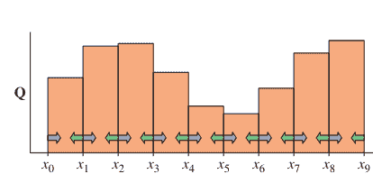

## 图 2.1

`1D Godunov` 格式（可能是向量值的）未知量 `Q`。`x` 表示单元格之间的边界，单元格值表示存储在每个单元格中的离散平均值。箭头表示单元格之间交换的通量。

### 斜率限制

斜率限制（Slope limiting）采用平均值表示法在处理激波时有一些实用的属性，但在时间或空间上可能存在局限性——在不经修改的情况下，它表现为分段常数方案，并将空间精度限制为一阶。

已经开发了许多技术来解决这一问题，以提供更高阶的精度。这些技术必须仔细构建，以保留解中的不连续性并避免引入非物理现象。

其中一种精确技术被称为通量限幅（flux limiting），它通过在推进解之前考虑小邻域通量来改变积分的执行方式。`Hydro2D` 使用了另一种名为斜率限幅（slope limiting）的替代技术，该技术利用单元格值的邻域来估计计算通量的交界面处每个单元格的值。

### 黎曼问题

`Godunov` 方法的核心在于共享边缘的通量如何确定它们在一个时间步内的平均通量。一种更通用的表述方法是：给定两个在空间上相交的分段常数状态，它们在控制方程的作用下如何随时间演化？这被称为黎曼问题，对于非线性方程组，其演化可能是复杂的；在两个状态之间可能会出现中间状态，想象一下左侧、右侧、慢速且平滑运动的稀疏流。

我们必须为 $n \times n$ 网格中每一对共享边缘的单元格求解一个不同的黎曼问题，这意味着每个时间步都要处理 $2(n-1)$ 个！开发用于计算黎曼问题解的专用且高效的黎曼求解器长期以来人们感兴趣的话题。

`Hydro2D` 对其黎曼问题使用非线性求解器；在 2D 欧勒方程的情况下，中间状态可以通过一个关于左右状态之间压力的非线性标量方程来确定。对该方程进行多次牛顿-拉夫逊迭代，以得到用于计算通量的合适值。

### 积分

2D 欧勒方程构成了一个双型方程组，因此通常使用显式技术进行积分。`Hydro2D` 使用显式欧拉法进行全积分；这种简单的方案在激波空间运行良好。

一个具有计算影响的额外考虑因素是稳定性；对于给定的单元格状态（即 $Q$ 和单元空间 $\Delta x$），存在一个最大允许时间步 $\Delta t$，它可以产生稳定的结果。由于 $\Delta t$ 必须处处使用，因此它必须在积分之前已知，并且取决于解的离散状态，因此每个时间步开始之前必须进行一个计算和简化步骤。

# 第二章：从“正确”到“正确且高效”

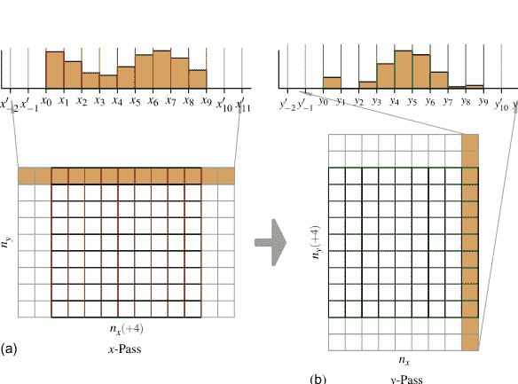

## 图 2.2

带有维度分裂的 `2D Godunov` 格式。

### 维度分裂

（Dimensional splitting）`Godunov` 方法的经典表述本质上是一维的，处理二维和三维问题的典型方法被称为维度分裂，它是更通用的算子分裂方法的特例，其中原始方程通过算子划分为若干个方程，然后使用上一个的结果顺序求解（图 2.2）。空间项被拆分为独立的时间步；对于从 $t$ 到 $t_{n+1}$ 的时间步，使用 $d/\partial x$ 项从 $t$ 开始推进解（通量计算加积分）到中间状态 $t_m$，然后使用 $d/\partial y$ 方程将其调整到 $t_{n+1}$。

# 它的适用位置

存在许多偏微分方程（PDE）的表述以及用于离散化和积分的数值技术；对于给定的问题，可能有许多方法可以实现目标，维度分裂在某些问题和架构上可能更好。

`Godunov` 格式在某些情况下非常有用，因为它不需要是显式代码（尽管如此），它在某些问题中是更合适的。显式代码通常具有很低的计算强度，正如我们所见，`Hydro2D` 中的操作是内存受限的。隐式方法通常产生大型稀疏矩阵，从直观角度来看，这些方法的工作集是全局的。每一个未知都耦合到

# 现代架构的特征 13


每一个其他，并且这转化为在每次迭代期间（至少）未知数。作为一个双型系统，Hydro2D 中的操作几乎是局部的，这对工作集的大小产生了深远影响。

## 现代架构的特征

为了在非平凡代码上实现性能，有必要对其如何在计算环境中运行有一个概念。正如我们希望展示的，这并不意味着每个程序员都是架构师和编译器专家——一个工作模型就足够了。

## 性能导向架构

性能和效率一直是硬件制造者的关注，现代架构的许多复杂性是为了直接解决性能问题。

**存储器系统（Memory subsystem）** 几十年来以分层方式组织，具有阶梯式的容器，容量逐渐减少而带宽增加。除了主内存之外，几乎每台现代计算机都有两级缓存，三级变得越来越常见。存储器系统在多处理系统中的行为也可能是重大的。

虚拟内存在现代系统中也非常常见，它们现在支持各种页大小。硬件对分页的支持已经达到这种程度，大多数代码不需要担心转换查找缓冲区（TLB）的容量，但在某些情况下必须注意这一点。

**线程级并行（Thread-level parallelism）** 十年来，几乎每台主机的处理器都看到了核心数的增加，多插槽配置在工作站中就已经提供了共享内存并行。

通过增加独立控制路径和功能单元的数量，多核和多处理系统提供了一种相对熟悉的增加性能的机制。硬件线程的引入——由单个核心支持的“硬件线程”旨在让代码更容易利用核心上的所有资源，但它们的使用通常不会增加核心上的可用设施。

**数据级并行（Data-level parallelism）** 虽然与 20 世纪 80 年代流行的向量处理器有相似之处，但现代的单指令多数据（SIMD）指令集通常构建在全宽功能单元上，并受益于硬件中存在的许多超标量执行特征。SIMD 通常在“打包”的输入数据上性能最好，并从本质上惩罚控制分支。

## 第 14 章 第 2 章 从“正确”到“正确且高效”

### 指令级并行性

现代硬件是高度超标量的，许多处理器具有乱序执行、多个执行端口、复杂的预取机制以及分支预测硬件。这种并行性对程序员来说通常是不可见的，尽管这种并行性的缺失（以每周期持续执行指令数来衡量）会带来性能损失，并可能指示着资源停顿。

## 编程工具与运行时

对于程序员来说，幸运的是我们使用的工具——编译器、调试器和采样性能分析器——性能在不断增强，重要性也日益增加。OpenMP 已经成熟到 4.0 版本，是线程编程的首选工具。

不要使用本章中的所有 OpenMP 技术；只需让 OpenMP 运行时管理线程数量及其亲和性（affinity）细节即可。对于扩展性实验，可以通过设置环境变量 `OMP_NUM_THREADS` 或使用 `scatter` 或 `compact` 来控制线程数，并使用 `KMP_AFFINITY` 控制如何处理 SMT（同步多线程）。注意，`KMP_AFFINITY` 与 Intel 编译器配合；gcc 则请使用 `GOP_CPU_AFFINITY`。

对于向量化，有多种可行的方法。最简单的是现代编译器中提供的自动向量化（autorization）支持；这旨在根据代码中的少量指令生成高效的 SIMD 代码。以允许自动向量化器转换并生成高效代码的方式编写代码某种艺术，但它是最令人满意的方法。

编译器内函数（Compiler intrinsics）是代码中表示向量化最可靠的方法；这些是内置的数据类型和函数，可以直接翻译为 SIMD 寄存器和指令。然而，它们是厂商特定的，并且可能变得晦涩。

内函数的一个很有用替代方案（我们在本章中比其他任何地方用得更多）是封装了内置内函数的 C++ 类。这些类易于编写或查找——Intel 编译器连接了一组此类类——并提供了一个跨越不同 SIMD 宽度的方便抽象层。甚至可以为它们重载标准算术运算符，使得使用它们的代码与使用标准 C++ 类型的代码几乎一致。

## 我们的计算环境

Intel Xeon® 处理器 E-2680：一种晚期的基于 x86 的多核架构，具有支持 2 路超线程的超标量、乱序核心。除了标量单元外，它还具有一个执行 AVX 指令集的 256 位 SIMD 单元。独立的乘法单元允许在单个周期内执行一次乘法指令和一个加法指令（4 路，双精度）。本章在 2 插槽、16 核配置下考虑此。

Intel® Xeon Phi™ 协处理器：这在单晶片上具有许多顺序执行的核心；每个核心都支持 4 路多处理，以帮助隐藏内存和多周期指令延迟。协处理器上的核心是顺序执行的，每个周期使用不超过一条指令，且运行频率低于处理器。这些核心具有特殊的 512 位向量指令集，支持融合乘加（FMA），使它们能够在每个核心每个周期内执行一次 8 宽的双精度乘加运算。


## 性能路径

| 插槽×核心 | Intel Xeon 处理器 E5-2680 | Intel Xeon Phi 协处理器 |
|---|---|---|
| 时钟 (GHz) | 2 × 8 × 2 | 1 × 60 × 4 |
| 每个核心，指令/周期 | 2.7 | 1.09 |
| 单精度 GFLOP/s | 2 | 2 |
| 双精度 GFLOP/s | 691 | 2127 |
| L1 / L2 / L3 缓存 (KB) | 346 | 1063 |
| DRAM | 32 / 25,480 | 32 / 512 - 4 GB GDDR |
| STREAM 带宽 | 128 GB | 150 GB/s |

图 2.3 系统配置。

我们使用的协处理器特定变是一个复制品。协处理器物理上安装在 PCIe 卡上，带有其 GDDR 内存和 Linux 操作系统。在本章中，我们在协处理器上“原生”地运行实验——二进制文件和输入与显卡共享并完全在卡上运行。

更多信息可以参考图 2.3。处理器和协处理器的 L1/L2 缓存大小都是每个核心的，而处理器的 L3 缓存大小是每个芯片的，并在芯片所有核心之间共享。

## 性能路径

本节描述了我们如何在计算环境中应用以性能为中心的特征模型，以适配 Hydro2D。我们从简要介绍参考代码开始。

## 运行 HYDRO2D

Hydro2D 是 Godunov 格式求解 2D 欧拉方程的实现；给定一个离散边界值问题，它通过一系列时间步将解从 $t_{initial} = 0$ 推进到某个 $t_{final}$。

代码带有许多参数文件，描述了正在解决的问题并指定了程序在执行期间的行为（关于输出、阻塞等）。

线程数根据 OpenMP 运行时确定；以下使用默认亲和性使用两个线程运行代码的示例（图 2.4）。

命令的输出告知用户所选的参数和求解器的进度。`.nm` 文件未告知用户所选的参数和求解器的进度（注：原文此处逻辑略有重复，此处按意译）。Hydro2D 的输出在不同亲和性下表现（图 2.5）。Hydro2D 采用 `scatter` 模式。

更多信息可参见图 2.3。处理器和协处理器的 L1/L2 缓存大小都是每个核心的，而处理器的 L3 缓存大小是每个芯片的，并在芯片所有核心之间共享。

## 第 18 章 第 2 章 从“正确”迈向“正确且高效”

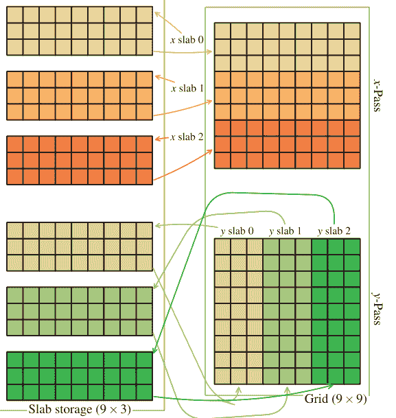

图 2.6

基于切片（Slab-based）的 Godunov 方案，描述了切片上数据移动和计算的顺序。请注意，每列中的重复表示时间序列而非复制——计算中只使用了一个切片和一个网格。

```text
equation_of_state(): 使用 constprim() 的结果加上来自守恒变量的 $E$ 项来填充原始变量 $p$，所有操作均在切片的专用存储中完成（equation_of_state.c48）。
slope(): 检查相邻单元的值（在原始通量中）以计算（并限制）用于通量计算的斜率。该代码使用了 van Leer 的 MC Limiter 的 MC 限制器（slope.c:52）。
trace(): 将计算出的斜率应用到每个单元的端点（trace.c:51）。
qleftright(): 将 trace() 的结果复制到独立的缓冲区中，为 riemann() 做好准备（qleftright.c48）。
riemann(): 是通量计算的核心；使用牛顿-拉夫森法求解用于中间压力的标量非线性系统。其余项根据计算出的压力推导（riemann.c:80）。
cmpflx(): 将 riemann() 中计算的中间状态与周围状态进行差分，并转换为守恒通量（cmpflx.c:51）。
```

`updateConservativeVars()`：将单元与相邻通量进行积分，并将结果复制回全局求解网格（`conservar.c:122`）。

切片例程——从 `gatherConservativeVars()` 到 `updateConservativeVars()`——以“批量同步并行”（Bulk Synchronous Parallel）的方式成功运行。这些例程已经经过了增强（为每个函数添加了输入/输出存储），内部没有依赖关系，且每个函数都暴露了线程级和数据级并行性（通过 OpenMP 和自动向量化）。这是大部分计算发生的地方，而 `hydro_godunov()` 仅作为这些调用的框架。图 2.7 显示了该计算的 1D 切片的结构和数据流。

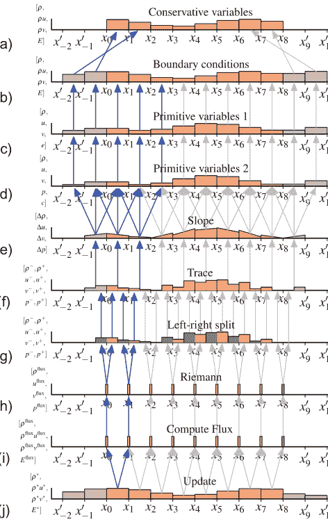

**图 2.7** 1D 斜率限制 Godunov 方案的步骤和访问模式。浅色箭头表示跨步骤单元之间的数据依赖关系，粗系列箭头表示第一批单元 `x_i` 和 `x_{i-1}` 的依赖关系。

## 第 2 章 从“正确”迈向“正确且高效”

`compute_delta()` 同样利用切片来计算一系列中间状态（包括 `equation_of_state()`），这些状态最终产生最大特征值，并对特征值进行归约（reduced）。这些切片暴露了与上述类似的线程级和数据级并行性。

## 性能测量

当然，本章的目标是提高 Hydro2D 代码的性能，而不是进行科学实验。我们主要感兴趣的是以代表代码在实验环境中用法方式的方法来衡量性能。

幸运的是，这非常简单：Hydro2D 的性能很大程度上独立于指定的特定初始和边界条件，因此我们可以自由选择任何测试问题。Riemann 求解器中执行的牛顿-拉夫森迭代具有控制功能，根据输入可能会增加通量计算的运行时间，但这仅在病态情况下才显著。

为了捕捉代码对问题大小的敏感性，我们将探索各种问题的大小，并通常将结果归一化为处理一个时间步中单个单元所需的时间。每步涵盖的时间由稳定性条件决定，该条件是解的状态和网格间距的乘积。这意味着两个不同的初始条件可能需要不同的步数来达到指定的模拟量。

图 2.8 显示了参考代码在“单元-步/秒”（cell-steps/second）单位的性能。协处理器的性能小于处理器的 2 倍，且并行效率非常低。

## 优化

尽管支持并行性，但参考代码的性能仍不如人意。正如我们将展示的，这部分由于代码中某些高层概念性构造的效率低下，另一部分由于转换为代码时的效率低下导致的。正如在循环中添加 `#pragma omp parallel for` 并不保证并行效率一样，`#pragma vector` 也不一定能产生有效的向量化。

我们将描述参考代码的不足之处以及可以如何改进。


图 2.8

参考 Hydro2D 代码在处理器所有核心和协处理器上的性能，单位为“单元-步/秒”。

# 通往性能的路径 21

## 关于优化代码的通用说明

优化后的代码在结构和格式上偏离了原始代码。这些更改不会直接影响性能，仅用于提高清晰度和可维护性：

- 文件结构已整合；核心例程位于 `rho-hydro-core.cpp` 和 `pcl-hydro-core.cpp`。
- 切片例程——从 `gatherConservativeVars()` 到 `updateConservativeVars()`——以“批量同步并行”的方式成功运行。这些例程已经经过了增强（为每个函数添加了输入/输出存储），内部没有依赖关系，且每个函数都暴露了线程级和数据级并行性（通过 OpenMP 和自动向量化）。这是大部分计算发生的地方，而 `hydro_godunov()` 仅作为这些调用的框架。图 2.7 显示了该计算的 1D 切片的结构和数据流。


**图 2.7** 1D 斜率限制 Godunov 方案的步骤和访问模式。浅色箭头表示跨步骤单元之间的数据依赖关系，粗系列箭头表示第一批单元 `x_i` 和 `x_{i-1}` 的依赖关系。

## 第 2 章 从“正确”迈向“正确且高效”

`compute_delta()` 同样利用切片来计算一系列中间状态（包括 `equation_of_state()`），这些状态最终产生最大特征值，并对特征值进行归约（reduced）。这些切片暴露了与上述类似的线程级和数据级并行性。

## 性能测量

当然，本章的目标是提高 Hydro2D 代码的性能，而不是进行科学实验。我们主要感兴趣的是以代表代码在实验环境中用法方式来衡量性能。

幸运的是，这非常简单：Hydro2D 的性能很大程度上独立于指定的特定初始和边界条件，因此我们可以自由选择任何测试问题。Riemann 求解器中执行的牛顿-拉夫森迭代具有控制功能，根据输入可能会增加通量计算的运行时间，但这仅在病态情况下才显著。

为了捕捉代码对问题大小的敏感性，我们将探索各种问题的大小，并通常将结果归一化为处理一个时间步中单个单元所需的时间。每步涵盖的时间由稳定性条件决定，该条件是解的状态和网格间距的乘积。这意味着两个不同的初始条件可能需要不同的步数来达到指定的模拟量。

图 2.8 显示了参考代码在“单元-步/秒”单位的性能。协处理器的性能小于处理器的 2 倍，且并行效率非常低。

## 优化

尽管支持并行性，但参考代码的性能仍不如人意。正如我们将展示的，这部分由于代码中某些高层概念性构造的效率低下，另一部分由于转换为代码时的效率低下导致的。正如在循环中添加 `#pragma omp parallel for` 并不保证并行效率一样，`#pragma vector` 也不一定能产生有效的向量化。

我们将描述参考代码的不足之处以及可以如何改进。


图 2.8

参考 Hydro2D 代码在处理器所有核心和协处理器上的性能，单位为“单元-步/秒”。

# 通往性能的路径 21

## 内存使用

为了减少内存开销，我们在切片上使用滚动（rolling）技术。这种技术允许我们在只处理一小部分数据的情况下完成整个计算，从而显著降低了内存需求。

在优化代码中，我们通过在切片上进行滚动更新来减少中间值的存储：

- 优化代码中，我们通过循环缓冲区，将未来步骤需要的中间值存入循环缓冲区。
- 优化代码中，我们通过在切片上进行滚动更新来提高计算密度，缓存缓存利用率。
- 优化代码中，我们通过在切片上进行滚动更新来减少不必要的访问的内存开销。
- 优化代码中，我们通过使用循环缓冲区来减轻内存压力。
- 优化代码中，我们通过在切片上进行滚动更新来提高缓存命中率。
- 优化代码中，我们通过使用循环缓冲区来减少带宽限制。
- 优化代码中，我们通过在切片上进行滚动更新来减少计算开销。
- 优化代码中，我们通过使用循环缓冲区来减少数据访问延迟。
- 优化代码中，我们通过在切片上进行滚动更新来提高计算利用率。
- 优化代码中，我们通过使用循环缓冲区来减少内存足迹。
- 优化代码中，我们通过在切片上进行滚动更新来提高数据吞吐量。
- 优化代码中，我们通过使用循环缓冲区来减少同步开销。
- 优化代码中，我们通过在切片上进行滚动更新来提高指令的执行效率。
- 优化代码中，我们通过使用循环缓冲区来减少访存开销。
- 优化代码中，我们通过在切片上进行滚动更新来提高计算并行度。
- 优化代码中，我们通过使用循环缓冲区来减少内存交换的压力。
- 优化代码中，我们通过在切片上进行滚动更新来提高处理器的利用率。
- 优化代码中，我们通过使用循环缓冲区来减少数据传输的延迟。
- 优化代码中，我们通过在切片上进行滚动更新来提高算法的执行效率。
- 优化代码中，我们通过使用循环缓冲区来减少内存分配的开销。
- 优化代码中，我们通过在切片上进行滚动更新来提高计算任务的并行性。
- 优化代码中，我们通过使用循环缓冲区来减少内存同步的频率。
- 优化代码中，我们通过在切片上进行滚动更新来提高数据处理的带宽。
- 优化代码中，我们通过使用循环缓冲区来减少内存置换的次数。
- 优化代码中，我们通过在切片上进行滚动更新来提高计算流水的效率。
- 优化代码中，我们通过使用循环缓冲区来减少内存总线的竞争。

# 性能路径 23


```cpp
void strip_prime(*restrict sw,
    const REAL_T *restrict rho,
    const REAL_T *restrict rhou,
    const REAL_T *restrict rhov,
    const REAL_T *restrict E,
    const hydro *restrict h,
    const int *
    stride,
    dtdx)
{
    REAL_T*pre_prim[5]; // i-2, i-1, i, i+1
    for (int i = 0; i < 4; i++)
    {
        const int src_offs = -(2 + i)*stride;
        REAL_T*E_internal;
        conservative_to_primitive(pre_prim[0], pre_prim[1], pre_prim[4], pre_prim[1],
            pre_prim[2] + i, &rho[src_offs], rhov[src_offs], rhou[src_offs]);
        pre_prim[3][i] = equation_of_state(pre_prim[0], i, E_internal);
    }
    REAL_T dvar[4][2]; // i-l, i
    if(h->lower <= i)
    {
        for (int v = 0; v < 2; v++)
        {
            pre_dvar[v][i] = slope(pre_prim[v[0]], pre_prim[v[1]],
                pre_prim[v[1]], h->slope_type, h->inv_slope_type);
        }
    }
    REAL_T pre_left_flux[4][2]; // -l, i
    REAL_T pre_right_flux[4][2]; // i, i+1
    for (int i = 0; i < 2; i++)
    {
        const REAL_T c = speed_of_sound(pre_prim[4][i + 1], pre_right_flux[i] + i);
    }
    trace(pre_left_flux[0] + i,
        pre_left_flux[1] + i,
        pre_left_flux[2], pre_left_flux[3] + i,
        pre_right_flux[0],
        pre_right_flux[2] + i, pre_right_flux[3] + i,
        pre_prim[0] + [1], pre_prim[4] + [1], pre_prim[1],
        pre_prim[2] + [1], pre_prim[3] + [1],
        pre_dvar[0] + [i], pre_dvar[1] + [i],
        pre_dvar[2], pre_dvar[3] + [i],
        prim,c, rpc(prim,c);
    }
    REAL_T gdn_rho, gdn_u, gdn_v, gdn_p;
    riemann(&gdn_rho, &gdn_u, &gdn_v, &gdn_p, &gdn_p,
        pre_left_flux[0] + [0], pre_left_flux[1] + [0], pre_left_flux[2] + [0],
        pre_left_flux[3] + [0],
        pre_right_flux[0] + [1], pre_right_flux[1] + [1], pre_right_flux[2] + [1],
        pre_right_flux[3] + [1]);
    cmpflux(sw->flux[0] + sw->flux + 0, sw->flux[2] + 0, sw->flux[3] + 0,
        gdn_rho, gdn_u, gdn_v, gdn_p);
    for (int v = 0; v < 5; v++)
    {
        sw->left_flux[v][0] = pre_left_flux[v][1];
        sw->prim[v][0] = pre_prim[v][2];
        sw->prim[v][1] = pre_prim[v][3];
    }
}
```

图 1.10

原始变量函数封装；`strip_work()` 的描述请见图 2。

# 第 2 章：从“正确”到“正确且高效”

```cpp
REAL_T strip_stable(const hydro *restrict h,
    REAL_T *restrict rho,
    REAL_T *restrict rhou,
    REAL_T *restrict rhov,
    REAL_T E,
    strip_work *restrict sw,
    const int i,
    const int stride,
    const REAL_T dtdx,
    const bool dcourant)
{
    const int src_internal = (i + 2)*stride;

    REAL_T E_internal;
    conservative_to_primitive(sw->prim[0] + 2, sw->prim[4] + 2, sw->prim[1] + 2,
        sw->prim[2] + 2, &E_internal);
    rho[src_offs],
    rhov(src_offs), E[src_offs]);

    sw->prim[3][2] = equation_of_state(sw->prim[0], E_internal);

    REAL_T dvar[4];
    // 对于 i
    if(h->lower <= i)
    {
        for (int v = 0; v < 2; v++)
        {
            pre_dvar[v][i] = slope(pre_prim[v[0]], pre_prim[v[1]],
                pre_prim[v[1]], h->slope_type, h->inv_slope_type);
        }
    }
    // ...（剩余逻辑根据后续页面提供的 OCR 上下继续）
```

```cpp
    REAL_T left_prim_c = speed_of_sound(sw->prim[1], sw->prim[3]);

    trace(pre_left_flux[0] + 1, pre_left_flux[1] + 1, pre_left_flux[2] + 1,

        pre_left_flux[3] + 1, pre_right_flux[0], pre_right_flux[2], 

        pre_right_flux[3] + 1, sw->prim[0] + 1, sw->prim[4] + 1, sw->prim[1],

        sw->prim[2] + 1, sw->prim[3] + 1, dvar[0], dvar[1], dvar[2], dvar[3],

        prim,left_prim_c, rpc(prim,left_prim_c));

    REAL_T gdn_rho, gdn_u, gdn_v, gdn_p;

    riemann(&gdn_rho, &gdn_u, &gdn_v, &gdn_p, &gdn_p,

        pre_left_flux[0] + 0, pre_left_flux[1] + 0, pre_left_flux[2] + 0,

        pre_left_flux[3] + 0, pre_right_flux[0] + 1, pre_right_flux[1] + 1, 

        pre_right_flux[2] + 1, pre_right_flux[3] + 1);

        cmpflux(sw->flux[0] + sw->flux + 0, sw->flux[2] + 0, sw->flux[3] + 0,

        gdn_rho, gdn_u, gdn_v, gdn_p);

    for (int v = 0; v < 5; v++)

    {

        sw->left_flux[v][0] = pre_left_flux[v][1];

        sw->prim[v][0] = pre_prim[v][2];

        sw->prim[v][1] = pre_prim[v][3];

    }

}
```

图 2.1

稳定状态函数封装；`strip_work()` 的描述见 2.9。

## 性能路径

带状方案带来的存储、通信和负载均衡负担表明，存在替代方案。我们将参考代码重构为使用我们称为“分块”（tiling）的区域分解方法。请见图 2.12。

将模拟沿 x 和 y 维度划分为若干矩形块，然后将这些块分配给线程。这种方案并不一定要求块与线程之间的一一映射，但我们目前的实现仅支持一对一映射。每个块都有独立分配的变量解集，以及维度、步长和所有记录信息。

边缘区域用于块之间以及边界条件（与原始网格共享边缘的块）之间的通信。这些边缘在块结构中标记为 `{x,y}_{y,var}stride` 和 `{x,y}_edges`。

每个块都有自己的网格（尺寸较小）；更新按照相同的顺序进行，且每个块独立计算 x 和 y 通过。在完成一次通过后，每个块需要通过函数 `send_(low,high)_{x,y}()` 更新其某些邻居单元的最新数据。在开始 x 边界之前，必须交换 x 边缘；在每次 y 边界之前，必须交换 y 边缘。

图 2.12 分块：区域被划分为子区域。每个子区域的行为都与原始区域完全一致。

图 2.13 分块计算的数据结构。

图 14 `x_step()` 和 `tile_x_step()`;执行给定块的 x 通过的代码。还包含用于步长计算的返回的最大特征特征值。

# 第 2 章：从“正确”到“正确且高效”

```c
void    y_step(hydro_decomp *hd, const hydro *restrict h, const ddtx, const REAL_T, int

    tid)

{

    tile_y_step(hd->tiles + tid, h, 0, hd->tiles[tid].n[0]);

}

void    tile_y_step(tile *restrict tl, const REAL_T ddtx, const hydro *restrict h

    int istart, int lend)

{

    static const REAL_T y_signs[4] = {1.0, 1.0, -1.0, 0.0};

    for(int i = istart; i < ie; i++) {

        const int ob = i + 2;

        if(tl->neighbors[2]) {

            for(int v = 0; v < 4; v++) {

                tl->q[v]*varstride + ob = tl->y_edges[0][v*tl

                    +y->e_varstride;

                tl->q(tl[v]*varstride + 1*tl->yystride + ob = tl->y_edges[0][v*tl

                    +y->e_varstride + 1*tl->y_ystre + i);

            }

        } else {

            set_boundaries(tl->q + ob,

                --varstride, 4, tl->varstride);

        }

        if(tl->neighbors[3]) {

            for(int v = 0; v < 4; v++) {

                tl->q(tl[v]*varstride + (2 + tl->n[i])*tl->yystride + ob = tl-

                    y_edges[i]((v+1)*tl->y_e_varstride + i);

                tl->q(tl[v]*varstride + (3 + tl->n[i])*tl->yystride + ob = tl-

                    y_edges[i]((v+1)*tl->y_e_varstride + i);

            }

        } else {

            set_boundaries(tl->q + ob + (1-tl->n[1]) + 3)*tl->yystride, y_signs,

                --varstride, 4, tl->varstride);

        }

        const int 0 = ob + 2 * tl->yystride;

        strip_work(sv, tl->rho + o, tl->rho + o, tl->E + o, h,

        strip_prime(&sw, tl, tl->yystride, ddtx);

        for(int j = 0; j < tl->n[1]; j++) {

            strip_stable(h, tl, tl->rho + o, tl->rho + o, tl->E + o, &

                sw, j, tl->yystride, ddtx, false);

        }

    }

}
```

图 2.15

`y_step()` 和 `tile_y_step()`：用于执行分块 y 方向计算的代码。

线程必须显式地通信边界区域（halo regions）交换并计算稳定步长：通过让团队中的线程仅与相邻的线程进行点对点同步，可以避免通过计算之间的全局同步。即使是稳定步长计算的全局归约，也可以使用规避树方案来实现。

# 性能优化之路

```c
hydro H;

load_hydro_params(&H, input_file, quiet);

const int nthreads = omp_get_max_threads();

init_hydro_decomp(&HD);

hydro_decomp HD;

init_hydro_decomp(&HD, &HD, nthreads, quiet);

REAL_T T = timestep_step(&H) / (REAL_T) 2.0;

REAL_T dt = dt / stride;

set_scheme(H.scheme, dt_dx);

// 对齐并填充共享 courant 数组以避免伪共享

REAL_T* courant = (REAL_T*)mm_malloc(64 * nthreads, 64);

const int cache_stride = 64 / stride(REAL_T);

#pragma omp parallel

{

    const int tid = omp_get_thread_num();

    barrier_init(tid);

    send_low_x_edge(HD.tiles + tid);

    send_high_x_edge(HD.tiles + tid);

    send_low_y_edge(HD.tiles + tid);

    send_high_y_edge(HD.tiles + tid);

    barrier_wait(tid);

    while(H.step < H.nstep && &H.t < H.end) {

        barrier_wait(tid);

        if(tid == 0) {

            t += dt;

        }

        if(H.step % 2 == 0) {

            send_low_x_edge(HD.tiles + tid);

            send_high_x_edge(HD.tiles + tid);

            barrier_wait(tid);

            x_step(&HD, &H, dt_dx, tid, false);

            barrier_wait(tid);

            send_low_y_edge(HD.tiles + tid);

            send_high_y_edge(HD.tiles + tid);

            barrier_wait(tid);

            courant[tid*cache_stride] = x_step(&HD, &H, dt_dx, tid, true);

            barrier_wait(tid);

            if(tid == 0)
```


```
        } else {

            send_low_y_edge(HD.tiles + tid);

            send_high_y_edge(HD.tiles + tid);

            barrier_wait(tid);

            y_step(&HD, &H, dt_dx, tid);

            barrier_wait(tid);

            send_low_x_edge(HD.tiles + tid);

            send_high_x_edge(HD.tiles + tid);

            barrier_wait(tid);

            courant[tid*cache_stride] = y_step(&HD, &H, dt_dx, true);

            barrier_wait(tid)

        }

        // 线程间的 courant 归约适用于大量线程的树方案

        for(int i = 0; i < nthreads; i++) {

            courant[0] = courant[i*cache_stride] * H.dx / courant[0];

        }

        dt = courant[0];

        dt_dx = dt/H.dx;

        set_scheme(H.scheme, dt_dx);

    }

    barrier_wait(tid);

}
```

图 2.16 `Hydro2D` 代码的步长循环。

# 第 2 章：从“正确”到“正确且高效”


图 2.17

参考代码与线程改进的性能对比（单元格/秒）。点对点同步和线程归约对核心数较少的系统影响有限，但随着核心数的增加，全局屏障的成本变为 $O(\log n)$，且进程可能会遇到非均匀内存访问（NUMA）。交换缓冲区和边界（halos）会产生开销，但对于大网格，这种开销远小于分片方法（slab approach）对大量中间存储的需求。

**关于优化路径**：所提出的优化结果与参考代码的对比所示，在图 2.17 中。这展示了合并步长计算、滚动更新以及分块在处理器和协处理器上的性能。这证明了在这些计算环境中对线程和内存子系统的利用；重要的是，相同的代码路径更改对两种架构都受益。正如我们将看到的，还有可以改进的空间。

# 算术效率与指令级并行

现代处理器的微架构非常复杂，但可以通过底层系统的简单模型进行推理。

**记忆化**：除法和超越函数是非常昂贵的——即使指令集直接支持，其延迟通常也比乘法和除法高 1-2 个数量级。`Hydro2D` 使用的除法和平方根操作了代码的运行时间。执行这些操作的硬件功能单元在流水线、吞吐量和指令级并行方面可能有限。由于这些操作昂贵，且某些根和除法会被多次计算，缓存频繁使用的值可以提高速度。在原始代码中，

# 性能优化之路

```c
int goon = true;

int iter;

for (iter = 0; iter < H.niter_riemann; iter++) {

    if (goon) {

        double wql, wr;

        wql = sqrt(cl_i * (one + gamma6) * (pst_i - pl_i) / pl_i);

        wr = sqrt(cr_i * (one + gamma6) * (pst_i - pr_i) / pr_i);

        double ql = two * wql / (Square(wql) + cl_i);

        double qr = two * wr / (Square(wr) + cr_i);

        double usl = ul_i * (pst_i - pl_i) / wr_i;

        double usr = ur_i * (pst_i - pr_i) / cl_i;

        double delp_i = MAX((qr * ql / (Square(wr) + (usl - usr), -pst_i));

        pstar_i = pstar_i + delp_i;

        // 收敛

        double uo_i = DABS / (pst_i + small_pp);

        goon = uo_i > PRECISION;

    }

}
```

图 2.18 参考 `riemann()` 的牛-Raphson 循环。

`const_prim()`、`equation_of_state()` 和 `trace()` 都多次除以 `rho` 和 `c`（局部声速）。我们可以计算每个倒数并将其存储起来供整个计算使用。作为额外益处，在许多现代计算系统中，使用倒数和乘法代替直接除法速度明显更快。由于精度考虑，许多编译器不愿在没有用户输入的情况下自动执行这种转换。

## 32 第 2 章 从“正确”到“正确且高效”

（记得 $\gamma$ 是介质的绝热率，在本方案中是一个常数。）将公式 (2.3a) 与公式 (2.3b)-(2.3g) 结合，我们可以减少除法的开销：

```
$$\Delta p_r = \frac{2w_r^3}{w_r^2 + c_r + w_i^2} \left(u_i - u_r - \frac{p^-_r - p_r}{w_r} - \frac{p^-_i - p_i}{w_i}\right)$$\n= \frac{2w_r^3}{w_r^2 + c_r} + \frac{2w_i^3}{w_i^2 + c_i} - \frac{4w_r^3w_i^3}{(w_r^2 + c_r)(w_i^2 + c_i)} \left(u_i - u_r - \frac{p^-_r - p_r}{w_r} - \frac{p^-_i - p_i}{w_i}\right)$$\n= \frac{2w_r^3(w_i^2 + c_i) + 2w_i^3(w_r^2 + c_r)}{(w_r^2 + c_r)(w_i^2 + c_i)} - \n= \frac{2w_r^3(w_i^2 + c_i) + 2w_i^3(w_r^2 + c_r)}{(w_r^2 + c_r)(w_i^2 + c_i)} \left(\frac{p^-_r - p_r}{w_r} - \frac{p^-_i - p_i}{w_i}\right)$$\n\n= \frac{2w_r^2w_i^2Z}{w_r^3(w_i^2 + c_i) + w_i^3(w_r^2 + c_r)} $ (2.4)
```

结合

```
$Z = w_r w_i(u_i - u_r) - w_i(p^-_r - p_r) - w_r(p^-_i - p_i)$
```

这消除了中间值 $a_i$ 和 $u_i^*$，且没有引入额外的除法。我们可以将 $w'_i$ 与公式 (2.3c) 结合以避免除法：

```
$w'_i = \sqrt{c_i \left(1 + \frac{\gamma+1}{2\gamma} \frac{p^-_i - p_i}{p_i}\right)}$ $ (2.5)\n= \sqrt{c_i + \frac{\gamma+1}{2} p(p^-_i - p_i)}$
```

结合 $w'_i$ 的类似表达式；通过对公式 (2.4) 和 (2.5) 的重写，我们将 Newton-Raphson 迭代中倒数个数的数量从八个减少到两个。优化后的代码请见图 2.19。

**路径性能** 带有滚动更新的组合线程/内存分块方法，结合这些算术改进的 Courant/更新组合（图 2.17）的结果如图 2.20 所示。总体而言，我们看到对特定指令和算术运算的改进使得处理器上的性能提升了 **1.2–1.7$\times$**，在协处理器上提升了 **1.4–1.6$\times$**。再次，我们的改进由计算机环境的通用原理保证，相同的代码在我们的两种架构上都实现了类似的加速。

## 数据级并行

数据级并行可以极极地提高性能，但其收益直接取决于向量化带来的指令减少——粗略来说，我们将使用向量代码使其尽可能看起来像串行代码：

## 性能的路径 33

```
1 for(int i = 0; i < NITER_RIEMANN; ++i)

2 {

3 if(gaon)

4 const REAL_T left_ww2 = left_rho - ((REAL_T) 0.5) * ((GAMMA + (REAL_T)

5      p_star - (GAMMA - (REAL_T) 1.0) * left_p);

6 const REAL_T left_ww = sqrt(left_ww1);

7 const REAL_T right_ww2 = right_rho - ((REAL_T) 0.5) * ((GAMMA + (REAL_T)

8     * p_star - (GAMMA - rho) * right_p);

9 const REAL_T right_ww = sqrt(right_ww2);

10 const REAL_T u = (left_u - right_u) - left_ww * (p_star - right_p)

11     right_ww * (p_star - left_p));

12 const REAL_T gon = (right_ww2 * (left_ww2 + left_c) +

13 left_ww2-left_ww * (right_ww2 + left_c) +

14 const REAL_T tmp = tmp_num + rcp(tmp_den);

15 const REAL_T deleft_p = std::max(tmp, p_star);

16 p_star *= deleft_p;

17 const REAL_T uo = std::abs(deleft_p * rcp(p_star + SMALLP));

18 goon

19 uo > PRECISION;

20 }
```

图 2.19
（分解）优化代码的核心 Newton-Raphson 循环。


图 2.20
每秒单元的线程/内存改进和算术改进。原始代码依赖编译器指令来实现向量化，但其性能表明存在很大的开销，且编译器并不总是从程序员那里推断。我们使用 C++ 类向量化通量计算和积分，这在编码工作和性能之间取得了折中；向量化的方式避免了内联汇编的细节。

## 34 第 2 章 从“正确”到“正确且高效”


图 2.21向量化方案：将数据移动到 SIMD 寄存器（标记为 `r0` 和 `r1`）的策略。y 方向 (a) 是简单的，因为数据布局与寄存器相同。x 方向的类似方案 (b) 需要大量的转置；平移方案 (c) 可以避免转置并产生最小开销。我们的代码使用 `SIMD_WIDTH` 作为占位符（处理器为 2，协处理器为 8）。参考代码确保了所有计算都在相同的数据布局上进行（始终在块方向），我们的滚动更新方法在 x 和 y 方向上访问和计算数据的方式不同。图 21 展示了该方法的各种 SIMD 方案。我们通过上述 C++ 类实现了这些概念——Intel 编译器为此提供了 `<dvec.h>`。每个更新程序都被构造为接受适当的 SIMD 类型以简化此处，核心程序几乎不需要更改。`vstrip_prime()` 和 `vstrip_stable()` 函数与其对应项是相同的，而 `strip_prime()` 和 `strip_stable()` 同时用于 x 和 y 方向。图 2.2 显示了这个新的 x 方向更新函数；其主要新颖在于使用了 `rotate_left_wm1()` 和 `rotate_left_wm2()`，它们分别将第一个参数的内容移动一个两个位置，并用第二个参数的左侧行替换新的“空”行。图 23 显示了 `tile_x_step()` 函数如何适应 SIMD。为了简洁起见，文中省略了 `tile_y_step()`；它在边界初始化以及 `vstrip_prime()` 和 `vstrip_stable()` 的使用上与新的 `tile_x_step()` 相似。

## 性能的路径

```
1 REAL_T hstrip_strable      *restrict h,

2 REAL_T      *restrict rho,

3 REAL_T      *restrict rhou,

4 REAL_T      *restrict rhov,

5 REAL_T      *restrict E,

6             vstrip_work      *restrict sw,

7                               const int,

8                               stride,

9                               const REAL_T

10                             const VMASK_T  dtx,

11                             const bool    write_mask,

12                                            de_count)

13 {

14     const int src_offs = (i + 2)*stride;

15

16     REAL_T E_internal;

17     conservative_to_primitive(sw->prim[0], 2, sw->prim[1] + 4, sw->prim[1]

8                               sw->prim[2] + 2, E_internal,

19                               loadau(rho + src_offs), loadau(rhov + src_offs), loadau(E +

20                               sc_offs));

21     sw->prim[3][2] = vequation_of_state(sw->prim[0][2], E_internal);

22     for(int v = 0; v < 5; ++v) {

23         rotate_left_wm1(sw->prim[v] + 1);

24         rotate_left_wm1(sw->prim[v] +);

25     }

26     REAL_T dvar[4];      // slice for i+1

27     if(h->order == 1) {

28         for (int i = 0; i < 4; ++i) {

29             dvar[i] = vslope(sw->prim[v][0], sw->prim[v][1], dvar[i],

30                 REAL_T) h->shape_type, (REAL_T) h->inv_shape_type);

31         }

32     REAL_T left_flux[4];

33     const REAL_T src_prim_c = speed_of_sound(sw->prim[4], sw->prim[3]);

34     trace(left_flux[0], 1, left_flux[1] + 1,

35             right_flux + 0, right_flux + 1,

36             right_flux + 2, right_flux + 3;

37             sw->prim[0][5], [1], sw->prim[1][4], [1], sw->prim

38             [2], [3];

39                                                    _,_____

41             __x);

42     for(int v = 0; v < 4; ++v) {

44_rotate_left_wm1(left_____ + 0, left_flux[v]);

44     }

45     REAL_T gdndvy_rho, gdndnv_v, gdndnv_p;

46         viemann(&gdndvy_rho, &gdndnv_v,

47             &gdndnv_p);

48         sw->left_flux[0] [0], sw->left_flux[1] [0], sw->left_flux[2] [0], sw

49             --left_flux[3] [0];

50             right_flux[0], right_flux[1], right_flux[2],

51             right_flux[3]);

52     vcplflux(sw->left_flux[0] + 1, sw->left_flux[1] + 1, sw->left_flux[2] + 3, + 1,

53         gdndvy_rho, gdndvy,

54         gdndnv_p);
```


`hstrip_()`：一个用于向量化 `x` 更新的 `strip_label()` 向量，无需 gather/scatter 操作。

图 2.2

# 第 2 章 从“正确”到“高效”

```cpp
for (int v = 0; v < 4; ++v)
    rotate_left_mho = (sw->flux[v] + 0, sw->flux[v][1]);

const REAL_t newho_rho = update(load(rho + istride), sw->flux[0][0],
    sw->flux[0][1], V_REAL(ddt));
const REAL_t newho_rhou = update(load(rhou + istride), sw->flux[1][0],
    sw->flux[1][1], V_REAL(ddt));
const REAL_t newho_rho = update(load(rho + istride), sw->flux[2][0],
    sw->flux[2][1], V_REAL(ddt));
const REAL_t newho_rhou = update(load(rhou + istride), sw->flux[3][0],
    sw->flux[3][1], V_REAL(ddt));

REAL_t tcount = (REAL_t) 0.0;
if (do_count) {
    REAL_t prim_rho, prim_rho, prim_u, prim_v, E_external;
    conservative_to_prime(&prim_rho, &prim_rho, &prim_u, &prim_v,
        &E_external, new_E);
    new_rhou, new_rhou,
    const REAL_t T_prim_p = equation_of_state(prim_rho, E_external);
    const REAL_t T_prim_c = speed_of_sound (prim_rho, prim_p);
    vcount(&tcount, prim_u, prim_v, prim_c, write_mask);
}

maskstore(rho + istride, new_rho, write_mask);
maskstore(rhou + istride, new_rhou, write_mask);
maskstore(rhov + istride, new_rhov, write_mask);
maskstore(E + new_E, write_mask);

for (int v = 0; v < 5; ++v) {
    sw->flux[0] = sw->prim[v][2];
    sw->left_flux[v][0] = sw->left_flux[v][i];
}
return courant;
```

图 2.22——续

**剥离与掩码（Peeling and masking）** 在考虑任意维度的 SIMD 时，我们必须考虑如何处理“剩余”工作（循环末尾不适应 SIMD 单元的部分）。对这些情况处理不当可能会导致执行过程中的软错误和硬错误；通用解决方案是按 SIMD 步长进行循环，并用单独的串行循环处理剩余部分。这种方法会产生一些开销，特别是当主循环长度缩短而 SIMD 宽度增加时，但对于大网格，SIMD 的优势几乎不会减少。

对于支持写掩码（write-masking）的指令集（例如 Intel Xeon Phi 处理器），可以使用另一种方法。位掩码决定向量寄存器的“通道”是否写入内存，通过这种结构，可以完全避免循环。这种机制也用于处理 SIMD 寄存器不同部分行为不同的情况。

# 性能之路 37

```cpp
REAL_T tile_x_step(tile *restrict tl, const REAL_T dtdx, const hydro *restrict h,
    int jstart, int jend, bool courant)
{
    static const REAL_T x_signs[4] = {1.0, -1.0, 1.0, 0.0};
    VMASK_T alltrue;
    mask_true(&alltrue);
    VINT_T linear;
    linear_offset(&linear);
    VREAL_T courant = (VREAL_T) 0.0;
    REAL_T final_courant = 0.0;

    for(int j = jstart; j < jend; j++) {
        const int ob = (j + 2) * tl->yystride + 0;
        if(tl->neighbors[0]) {
            for(int v = 0; v < 4; ++v) {
                tl->q[v]*tl->yystride + ob + 0 = tl->x_edges[0][v*tl-
                x_edge_stride + j = tl->yystride + 0;
                tl->q[v]*tl->yystride + ob + 1 = tl->x_edges[0][v*tl-
                x_edge_stride + j = tl->yystride + 1;
            }
        } else {
            set_boundaries(tl->q + ob, x_signs, 2, 1, tl->varstride);
        }

        if(tl->neighbors[1]) {
            for(int v = 0; v < 4; ++v) {
                tl->q[v]*tl->yystride + ob + 0 = tl->x_edges[1][v*tl-
                x_edge_stride + j = tl->yystride + 0;
                tl->q[v]*tl->yystride + ob + 2 = tl->x_edges[1][v*tl-
                x_edge_stride + j = tl->yystride + 1;
            }
        } else {
            set_boundaries(tl->q + ob, x_signs, 2, 1, tl->varstride); // 注意：此处原文逻辑可能存在重复，已翻译
        }
        // ... (此处省略重复代码块的翻译逻辑)
    }
}
```

图 2.23

`tile_x_step` 的版本，与图 14 的区别在于：更新循环的 `SIMD_WIDTH` 步长、`hstrip_stable` 的掩码生成以及 Courant 值的循环 SIMD 还原。

# 第 2 章 从“正确”到“高效”

```cpp
int i = 0;
for( i + SIMD_WIDTH <= tl->n[0]; i+=SIMD_WIDTH) {
    const REAL_T cv = hstrip_stable(h, tl->rho + o, tl->rhou + o,
    rhov + o, tl->E + o, &vsw, 1, (REAL_T) dtdx, alltrue);
    courantv = std::max(courantv, cv);
}
// ... (省略重复部分)
```

图 2.23——续

协处理器不支持每通道掩码（per-lane masks），除非有专用的寄存器来存储和处理这些掩码，否则处理器必须通过混合（blending）指令来实现，这可以合并并交错两个寄存器的内容。这会产生开销。

**分支编码（Divergence coding）** 实现向量化的挑战之一是控制分支——即 SIMD 中的代码分支。这发生在依赖于数据的执行中，SIMD 的解决方案是使用混合/掩码操作执行所有分支以确保结果正确。指令还原方案在很大程度上没有控制分支，但黎曼求解器的迭代必须执行。

Godunov-Raphson 迭代并不总是均匀地收敛。某些迭代所需的次数比其他迭代更多，这会导致 SIMD 的分支。请参见图 2.24 该循环的向量化版本。

**对齐（Alignment）** 数据对齐随架构而异，其影响很大程度上取决于加载与算术操作的比例。在对参考代码的增强中，我们找到了一种非常简单的对齐 tile 的方法：对于某些网格大小，需要对行进行填充以保持网格零列的对齐。请参见图 2.25 中我们优化实现的 tile 初始化。

**最后一步（The last step）** 我们通过减少中间存储、tiling 和算术优化揭示的计算强度通过我们的向量化策略完全实现。图 2.26 显示了每个增量优化的性能，加上参考代码，以及两种架构。

# 总结 39

```cpp
for(int i = 0; i < NITER_RIEMANN && all_zero(goon); ++i)
{
    const VREAL_T left_ww2 = left_rho * ((VREAL_T)0.5) + (VREAL_T(GAMMA + (
        REAL_T)1.0) * p_star + VREAL_T(GAMMA - (REAL_T)1.0) + left_p);
    const VREAL_T left_ww = mysqrt(left_ww2);
    const VREAL_T right_ww = right_rho * ((VREAL_T)0.5) + (VREAL_T(GAMMA + (
        REAL_T)1.0) * p_star + VREAL_T(GAMMA - right_p));
}
```

## 第 2 章：从“正确”到“正确且高效”

```c
inline unsigned long long round_to_alignment(unsigned long x, int alignment)
{
    if (x & (alignment-1))
        x = (x & -(alignment-1)) + alignment;
    return x;
}

void init_title(title *tl, int xstart, int xend, int ystart, int yend) {
    static const int target_alignment = 64;
    static const int arith_alignment = target_alignment/sizeof(REAL_T);
    tl->offset[0] = xstart;
    tl->offset[1] = ystart;
    tl->n[0] = xend - xstart;
    tl->n[1] = yend - ystart;
    const int min_stride = tl->n[0] + 2;
    tl->ystride = round_to_alignment(min_stride, arith_alignment);
    tl->varstride = tl->ystride * tl->n[1] * 2;
    const int alloc_offset = 2;
    tl->q = ((REAL_T*)malloc(sizeof(REAL_T)) * (4 * tl->varstride +
        arith_alignment + target_alignment)) + alloc_offset;
    tl->rho = tl->ystride;
    tl->rhou = tl->q + tl->varstride;
    tl->rv = tl->q + 2*tl->varstride;
    const int min_y_e_varstride = tl->n[0] * 2;
    tl->y_e_varstride = 2;
    tl->x_e_varstride = round_to_alignment(min_x_e_varstride, arith_alignment);
    tl->x_edges[0] = (REAL_T*)malloc(sizeof(REAL_T)) * 4 * tl->x_e_varstride +
        target_alignment);
    tl->x_edges[1] = (REAL_T*)malloc(sizeof(REAL_T)) * 4 * tl->x_e_varstride +
        target_alignment);
    const int min_y_e_varstride = tl->n[1] * 2;
    tl->y_e_ystride = tl->n[0];
    tl->y_e_varstride = round_to_alignment(min_y_e_varstride, arith_alignment);
    tl->y_edges[0] = (REAL_T*)malloc(sizeof(REAL_T)) * 4 * tl->y_e_varstride +
        target_alignment);
    tl->y_edges[1] = (REAL_T*)malloc(sizeof(REAL_T)) * 4 * tl->y_e_varstride +
        target_alignment);
}
```


图 2.25

分块初始化 `init_title()` 和辅助函数 `round_to_alignment()`。`_mmmalloc` 是对齐分配的编译器内置函数。由于光晕（halos）的存在，所需的 SIMD 访问内存与分配起始位置并不重合——此代码分配解决方案网格，使得每行的起始单元对齐，这需要通过 `alloc_offset` 调整分配的指针。

# 总结 41

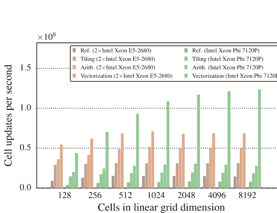

图 2.26

单元步长/秒的性能对比，以及线程/内存改进、算术改进以及向量化改进。

## 性能策略

科学家以及任何性能敏感型代码的作者，都对如何在最小化编程努力和维护成本的同时提高性能深感感兴趣。这个主题没有简单的答案——没有所谓的“银弹子”。

虽然我们在本章中进行了深入分析，但我们的意图并不是断每位程序员都是微架构的资深专家，也不是说他们非常熟悉每个目标处理器的微小细节。我们希望已经展示了通过有意识地忽略或简化硬件某些方面，可以实现效率的显著提高，并且简化的模型在看似不同的处理器之间是通用的。

- 根据我们描述的算术优化，考虑数学上等效的公式在给定架构上的性能。这些更改通常对代码的影响是局部的。
- 评估如何结构化“热点”循环的数据访问以利用向量硬件，正如我们对 `vstrip_stable` 和 `hstrip_stable` 所做的那样。这些修改可以用于限制窄范围的代码更改。
- 考虑核心之间（特别是线程之间）可以做得更好的潜在工作；这与代码中的发散任务及其粒度有关。这可能对数据访问和存储也产生影响——例如，我们关于分块（tiling）和对齐的材料。
- 最后，考虑内存/内存层次结构的使用和布局等更广泛的问题。这通常涉及代码的重大更改并带来相应的收益；我们在“滚动更新”和分块方法中考虑了这一点。

我们能提供的最佳通用建议是：建立一个关于代码应如何在硬件上运行并利用其资源的模型，而恰当应用的编译器工具可以极大地简化其实现。

# 42 第二2章：从“正确”到“正确且高效”

编写尽可能简单、与硬件无关的代码，并在事后应用自动优化，通常无法提供高效率。

我们希望已经展示了这些粗略原则如何应用于一种流行的数值技术，尽管它们在代码上的通用性可能与我们在此展示的不同。

## 更多信息

- Godunov, S., 1959. A method for solving the problem of mathematical conservation laws. Soviet Math. Zh., 29, 271–306.
- Lavallée, P., et al., 2012. Porting HBM to new platforms. In: Parallel Programming Interfaces.
- van Leer, B., 1977. Efficient numerical schemes. J. Comput. Phys. 23, 276–299.
- Leveque, R., 2002. Finite Volume Methods for Hyperbolic Problems. Cambridge University Press. ISBN: 978-0-521-00924.
- Roe, P.L., 1981. Approximate Riemann solvers. J. Appl., 43, 357–372.
- Satish, M., et al., 2012. Can traditional programming bridge the performance gap? In: Proceedings of the 39th Annual International Symposium on Computer Architecture, ISCA. IEEE Computer Society, Portland, Oregon, pp. 440–451. ISBN: 978-1-4503-16422.

# HBM 上更好的并发性与 SIMD

Jacob Weismann Poulsen, Per Berg*, Karthik Raman*
丹麦气象局，丹麦*, 英特尔公司*

# 应用：HIROMB-BOOS 模型

完整的海洋模型 (HBM) 代码具有双向动力嵌套功能，具有任意数量的嵌套层，能够在区域海实现高分辨率，并配备了可选激活的基础物理模块。通过对分布式和共享内存并行化的支持，HBM 已成熟成为一个高效且高质量的模型。HBM 通过改变输入既用于业务任务，也用于科研。用户在运行时指定的输入（特别是选定的步数和模拟周期）区分了业务预报与气候场景。这种泛欧洲设置在狭窄海峡和瞬态水域具有高分辨率（水平低至 185 米，垂直 1 米），并且总共有 1860 万个活跃水点，因此计算需求远超 DMI 之前的任何模型。尽管如此，在最近的演示中，在可用系统上使用之前的 HBM 版本运行数日，持续时间消耗保持在 1.5 到 2.5 小时范围内。

# 第 3 章 HBM 上的更好并发性与 SIMD

PRACE 项目（URL 请参阅本章末尾的“更多信息”）使业务化预报成为一个现实目标（She et al., 2013）。然而，如果要在 DMI 这种配置下使在气候时间尺度上进行场景建模成为一项现实活动，则还需要进一步的加速。

关于 HBM 的更多深入信息，请参阅本章末尾列出的“更多信息”。

# 核心用途：DMI

DMI（丹麦气象局）提供气象服务，包括对丹麦王国、法罗群岛、格陵兰及周边海域和空域的大气、陆地和海洋以及相关环境状况进行预报、预警和监测，其目的是保护生命和财产。作为其职责之一，DMI 承担了对丹麦海岸风暴潮等事件的应急准备和响应的国家责任。在 DMI，当前的海洋环流模型代码版本自 2001 年以来作为业务化风暴模型，并广泛应用于多个欧盟资助的项目；它是目前使用的 HBM 代码最新版本，用于每天提供四次、未来 5 天的预报水位。该模型通过现场观测以及来自北海和波罗的海周边预报中心的其他预测进行持续验证。来自同一模型的三个流场和水温预测也用于为丹麦海域的业务油分建模提供依据。在另一种使用源代码精确构建的模型设置中，DMI 运行波罗的海组件 MyOcean，其重点是波罗的海的海洋状态，包括物理和地球化学参数。该模型在感兴趣区域增加了分辨率，并每天提供两次 2.5 天的预报。MyOcean产品的质量经过持续监测和验证。感兴趣的读者应咨询本章末尾提到的 MyOcean 网页。

DMI 作为气候、能源和建筑部下属的政府机构，面临能源预算的挑战，计算能源手段有限。对于像 HBM 这样的代码，从运行耗时间和能耗方面来研究其高效使用是非常理想的。我们不断致力于提高 HBM 的性能，本章介绍的工作已实现到 HBM 代码库中，作为提高 HBM 整体性能的不可或缺的一部分。

# HBM 执行分析

作为旨在更高效执行 HBM 开发工作的指南，表 3.1 列出了 HBM 在实际应用中时间循环内不同部分的典型耗时。示踪对流（Tracer advection）显然是最主导的部分，占 44%。表中所示的结果是通过仅两个示踪剂（盐度和温度）的纯运行获得的。对于像业务化 MyOcean 运行这样的应用，它包含 12 个代表生物化学变量的额外示踪剂，示踪对流的时间消耗大约是 2.5 倍。在任何情况下，进一步优化 HBM 都应该关注示踪对流部分，并在两个显而易见的选择中选择一个：我们可以实现并应用更简单且代价较小的

| 模块 | 时间贡献 |
| :--- | :--- |
| 示踪对流 | 44% |
| 湍流模式 | 16% |
| 动量方程 | 12% |
| 示踪扩散 | 4% |
| 质量方程 | 2% |
| 剩余 | 各部分 < 2% |

图 3.1

典型 HBM 应用时间循环内不同代码部分的相对时间消耗。耗时针对单节点运行（不带 MPI）以及具有单一区域的模型设置；对于使用更多 MPI 任务和/或嵌套区域的运行，百分比将会变化，但所示的前五个代码部分之间的相互关系保持不变。

……我们可以尝试提高更复杂方案的性能。由于下文解释的原因，我们必须放弃这些选项中的第一个，因此对于像 HBM 这样的通用代码，改进现有的实现是唯一的出路。

使用相对粗糙的网格（采用中心差分或纯展开方案）进行示踪对流，会导致对陡峭前面的虚假预测或产生波动。所谓的全变分收缩（TVD）方案（Harten, 1997）能够适应陡峭界面并保持单调性（无“过冲”），且解中没有震荡。然而，这些 TVD 特性对于通用的多维方案通常难以甚至无法证明，因此在应用中，通常在每个坐标方向上应用一维限制器，以确保某种单调性必须具有质量和动量守恒。即使应用于在空间时间上可能出现突然变化（如干涸和湿润）的自由表面流，如果能够满足两个基本条件（Gross et al., 2002），在某些示踪对流方案中确实可以实现：第一个是所谓的与连续性一致（CWC）概念，代表示踪对流方程与离散的自由表面连续性方程一致。另一个关键要素是网格面处通量高度的适当定义。

HBM 中示踪对流之前的实际数值方案归于 Kleine (1993)。该方案的当前实现通过所需的 CWC 概念和针对多个示踪剂的双向嵌套配置的适当通量高度修改是由本文作者完成的，作者还调整了间接寻址的数据结构，并在此添加了 MPI 和 OpenMP 支持，以及改进的并发性和单指令多数据（SIMD）向量化；本章处理的正是这部分特定的代码，且 HBM 的相关代码部分（而非全量代码）已根据 BSD 许可证提供下载和使用。

# HBM 优化概述 45

为了说明我们的观点且不考虑更多必要的事物，我们将在本章中不处理嵌套、场和其他迫力数据，这些可能受

第 3 章 HBM 上的更好并发性与 SIMD

限制，我们希望在现实尺寸的数据集上展示我们的发现，而不仅仅是学术案例。因此，我们提供了来自免费使用的 ETO2 数据集（URL 请参阅本章末尾的“更多信息”）。

我们在下一节开始介绍我们使用的最重要的数据结构，这些可能与其他模型不同。然后，我们描述了如何在 HBM 中实现线程并行。接下来描述了代码的 SIMD 向量化步骤；处理了一些显而易见的问题。最后，我们将一切整合在一起，并展示在 Intel Xeon 和 Xeon Phi 上的性能比较结果。对于这一特定应用，与 Intel Xeon 处理器相比，在 Xeon Phi 副处理器上实现了 ~15% 的单节点加速。

# 数据结构：正确的局部

作者认为，只有实现关注数据位置，才能在现代硬件上获得良好的 SIMD 和线程性能。位置、位置、位置……是的，这一切都关于位置，本节将描述现在用于 HBM 模型的面向数据的设计。

图 3.2 说明了网格分为活跃计算点（分别为表面湿点和地下湿点）和非活跃计算点（陆地或海底下的网格点）。图 3.3 显示了一个典型的浅水区域。读者应该注意，活跃计算点的数量少于 3D 正则网格内的总点数。例如，在图 3.3 所示区域中，只有 11.1% 的点是活跃计算点。模型计算中使用的所有矩阵因此都是稀疏的，这表明数据结构应使用稀疏表示，这既旨在节省空间又能增加局部性。我们使用紧凑的

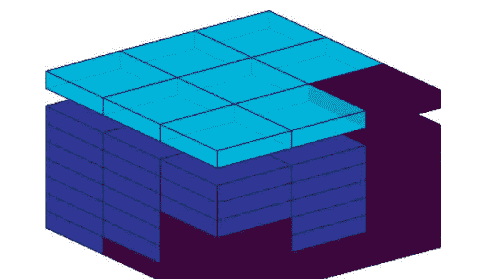

图 3.2

正则网格中活跃计算点的分类。顶部是表面层，活跃计算点用最浅的颜色显示。活跃地下计算点的列排列用中等颜色显示。最深颜色用于非活跃点。

# 数据结构：正确的局部性

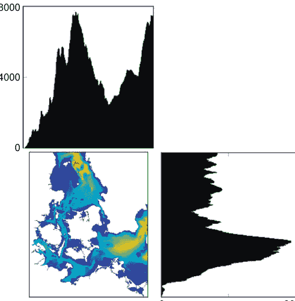

# 图 3.3

典型不规则计算区域的插图。该图展示了丹麦内部的水域子区域，颜色编码显示了每个表面点下方湿润点（wet-points）的数量，白色代表陆地，颜色刻度从深蓝色到深红色代表 75 个点。右侧直方图显示了沿每个纬向（即恒定纬度）网格线的湿点数量分布。上方直方图显示了沿每个经向（恒定经度）网格线的湿点数量分布。

这种表示由三个数组描述：`msf(0,:)`、`mcol(0:)` 和 `kh(0:)`，它们分别持有水平表面湿点的索引、该列中第一个水下点的索引，以及最后该列的长度。表面数组索引将水平网格点 (i,j) 转换为其对应的湿点索引，如果 (i,j) 是海底上或海下的点，则返回值 0。给定表面索引 `iw` 的列索引由 `mcol(iw)` 定义，且 `mcol(0)` 自然地返回 0。同样，给定表面索引 `iw` 的列长度由 `kh(iw)` 定义，`kh(0)` 同样等于 0。代码段所示，图 3.4 表明了如何循环遍历由 `u(:)` 表示的所有湿点。注意，`msf(0,::0)` 的反向转换（即从表面湿点到网格位置 (i,j)）由 `ind(i,j:)` 给出。

图 3.5 显示了我们在数据结构中区分的三类点。代码在水平列状网格上操作。仅在水平方向上添加了间接寻址是为了通过 `msrf(i,j)` 映射列的排列。请注意，这种排列被描述为列 {i,j} 的无序排列，而不是每列中数据的排列；数据排列得非常良好，通过在表面点应用直接访问以及通过水下点进行垂直访问来增加接近性。

# 48 第 3 章 HBM 上的更好并发与 SIMD

```
do iw = 1,iw2

i = ind(1,iw)

j = ind(2,iw)

! 循环 iw=msrf(ind(1,iw),ind(2,iw)) 直

  ! 通过 ind(1:2,:) 的定义

  ! 以步长为 1 访问的所有表面点 (i,j):

  u(iw)

enddo

do iw = 1,iw2

kb = kh(iw) ! 列 iw 的底部值

if (kb < 2) cycle

  i = ind(1,iw)

  j = ind(2,iw)

  mi0 = mcl(iw) - 2

do k = 2, kb

  ! 以步长为 1 访问的所有水下点 (i,j,k):

  mi = u(mi) + k

  ....

enddo

enddo
```


图 3.4

展示如何遍历活动湿点的代码段。

| 陆地 | 表面 | 水下 |
| --- | --- | --- |
| 0 | 2 | 3 | 4 | iw/2 | iw+1 | iw/3 |

图 3.5

图 3.2 所示 3D 网格数据结构的一维布局。活动表面点是 `[1:iw2]`，活动水下点是 `[iw2+1:iw3]`，不活动点由 `[0]` 表示。

从图 3.4 的代码段中我们可以看到，数据已经组织成这种方式，使得处理列的循环将具有完美的步长-1 访问模式。然而，我们还需要考虑另外两个额外方面。首先，由于使用了有限差分等技术，基于 9 点模板（stencil）的 HBM 模型。因此，某些循环不仅需要访问实际点，还需要访问其在东、北、南、东北、东南、西北和西南方向的邻居点。当根据位置 `{i, j}` 处理列时，我们需要访问这些邻居元素，适当的布局将尝试保持 2D 空间到 1D 索引空间的接近性。HBM 模型需要处理整个湿点集，而不仅仅是单列，因此列的枚举（外层循环顺序）是另一个重要方面。

任何表面点的枚举都可以作为表示方法，而且任何枚举都有效的这一事实是一个向增加接近性的明显机会。显而易见，

# 数据结构：正确的局部性 49

给定的枚举使用唯一的缓存模式（`D1`, `L2`, `L3` 和 `TLB`），并且显然比其他模式更好。假设我们拥有由大小、延迟和类型（互斥式/包含式）描述的目标计算机内存，以及由三个索引数组描述的数据集，我们如何利用枚举来实现最佳的接近性呢？

作为一个说明性示例，我们将展示使用两种不同的枚举启发式算法 `H1` 和 `H2` 的结果。`H1` 是这种枚举：我们从左上角开始，然后从北向南枚举，直到到达南坐标，然后向东移动一行并从北向南计数，以此类推，直到到达东南角的点。在实际规模上使用这种策略（来自盆地的数据集，分辨率约为 3 个海里，包含 77,285 个表面点和 7,136,949 个水下点）的结果如表 3.6，该表说明了有多少湿点可以被归类为索引空间中的邻居，即索引距离小于 10 的点。

该方案计算一个 9 点模板，因此让 `H2` 尝试改进 `D1`。为了最佳的接近性，我们希望邻居在空间尽可能接近，如果我们在矩形上确保这一点，也可以使用空间填充曲线（见 Tartha，2012）。对于图 3.3 或图 3.8 所示的不规则集合，获得解决方案变得更具挑战性。表 3.6 清楚显示（行 1，4），`H2` 成功让索引空间中距离大于 10 的点距离显著增加（行 2，3）。使用 `H1` 时，邻居点会命中 `L2` 或 `L3`，但使用 `H2` 时它们会导致 `TLB` 缺失，距离非常远。要制定最佳接近性是困难的。

## H1 到八个邻居的距离

| 西北 | 北 | 东方 | 南 | 西南 | 西 |
| --- | --- | --- | --- | --- | --- |
| DIST<10 | 3.32% | 100.00% | 3.18% | 2.00% | 3.18% | 100.00% | 2.00% |
| MAX | 400 | 1 | 398 | 399 | 400 | 1 | 398 | 399 |
| MEAN | 282.7 | 1 | 281.2 | 284.8 | 282.7 | 1 | 281.2 | 284.4 |
| MEDIAN | 318 | 1 | 318 | 320 | 318 | 1 | 318 | 320 |

## H2 到八个邻居的距离

| 西北 | 北 | 东方 | 南 | 西南 | 西 |
| --- | --- | --- | --- | --- | --- |
| DIST<10 | 64.34% | 76.23% | 64.34% | 83.80% | 64.34% | 76.23% | 64.34% |
| MAX | 69326 | 69313 | 69326 | 69327 | 69326 | 69313 | 69326 | 69327 |
| MEAN | 395.1 | 281.9 | 432.5 | 210.9 | 395.1 | 281.9 | 432.5 | 210.9 |
| MEDIAN | 4 | 3 | 4 | 1 | 4 | 3 | 4 | 1 |

该表显示了使用两种不同启发式算法 `H1` 和 `H2` 的八个邻居距离的各种统计数据。第一行显示了 2D 中相邻的点中有多少比例在索引空间中也是接近的，其中接近定义为索引值小于 10。

# 第 3 章 HBM 上的更好并发与 SIMD

一个良好的问题考虑了以下因素：`D1`, `L2`, `L3`, `TLB` 的容量，`D1`, `L2`, `L3` 和 `TLB` 的延迟，最后原始 2D 空间中的距离和 1D 索引中的距离。

我们认为如何将最佳接近性问题制定为一个优化问题是一个开放性问题，它将包含所有相关参数并找到最合适的枚举。解决方案必须足够通用，以支持模型代码可能任何现实测试用例和任何缓存系统。尽管如此，这种公式将导致一个下界为 NP-hard 的优化问题，因此我们需要使用启发式算法或近似方法。对于这里使用的测试用例，我们将保持简单，并坚持使用上述的 `H1`，并将该问题留给未来调优的可能性。

# HBM 中的线程并行

在 HBM 的 MPI 并行和 OpenMP 并行中，我们假设表面点和列的枚举是下所示的。如果没有这个假设，我们面对的是一个 NP-hard 问题，但这一新假设所引入的简化意味着我们现在面对的问题已不再是 NP-hard 的（即，处理子区间而不是子集的这种简化使得该问题变得易于处理）。这允许我们既可以在离线状态下使用精确算法，也可以使用各种启发式算法来处理线程（或任务）的负载均衡。此外，它允许我们在不同的测试用例上评估不同的启发式算法。需要强调的是，点的另一种枚举将引入另一种布局，对于这种布局我们没有采取任何均衡方法。以下是负载均衡问题的正式定义，图 3.7 显示了点如何在线程之间进行拆分。

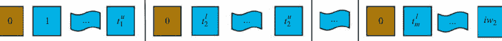

图 3.7

该图显示了每个线程如何处理表面点集的一个子区间以及对应表面点的水下列。此外，注意每个线程都有不活动点的概念。

# HBM 中的线程并行化

数据结构章节中的通用 NP-hard 问题现在已归约为广为人知的整数划分问题，该问题存在时间复杂度为 $O(n^2)$ 的精确算法，例如参考 Skiena (2008) 书中的第 8.5 节。对于 $n$ 中等规模和合理的输入集，合理的启发式方法是采用贪心算法，即向当前可能过度提交的线程添加列，或者如果这样做能使总和更接近每个线程的平均负载，则将下一列添加到当前线程池中。这两种启发式方法的时间复杂度为 $O(n)$，将作为在线实验的候选。HBM 默认实现的是另一种公平份额版本。

Baffin Bay 测试用例如图 3.8 所示，与确保适当负载均衡相关的挑战如图 3.9 所示。

我们将列划分为四个子集，以确定典型列和稀有列的长度。区间方的数字反映了该区间内的列数。

我们尝试针对图 3.10 中的 Baffin Bay 测试用例，量化使用默认启发式方法划分负载与使用精确算法之间的差异。在所示图中，这两种方法（即精确和启发式）得出的解决方案非常接近。实际上，从纯的 2D 和 3D 负载图中很难精确确定差异，但差异图确实显示解决方案并非相同。仅从 2D 图表来看，一个合理的推测是：


图 3.8
Baffin Bay 测试用例图（左）以及相关的网格化水深图（右），深度单位为米。

# 第 3 章 HBM 上的更好并发与 SIMD

均值 = 92.35, 众 = 100, 标准差 = 32.59

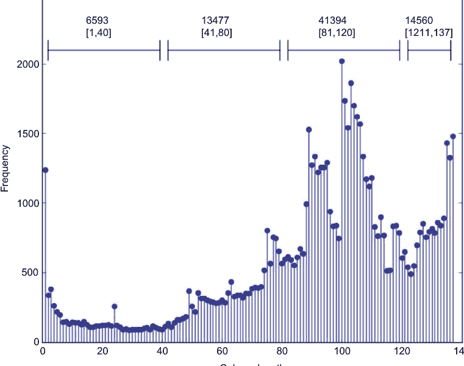

**图 3.9**

Baffin Bay 测试用例中的列长度分布。

在这种情况下，使用数据结构的思想来应对平衡挑战会比使用精确算法划分到子区间更好。作为一个推论，我们看到对于使用线程较少的分布，没有必要使用精确算法，例如对于仅使用 48 个线程的 Intel Xeon 处理器。

值得提到的是，定义平衡时使用的权重可以是子权重的之和，同时保持问题的复杂性！其中一种定义可以是：如果点是湿点，则权重为 1.0，否则为之，这是图 3.10 中使用的定义。另一种定义也可以考虑列的数量，例如通过设置权重 $w=\alpha^*s_{wet}^*+\beta^*s_{wet}$，其中 $s_{wet}$ 是湿表面点的数量，$ss_{wet}$ 是相应的地下湿点数量，$\alpha$ 和 $\beta$ 是可调参数。

通过进行各种实验，可以尝试找到这些权重的相关参数，并确定导致最佳平衡的系数。更多细节请参阅 HBM 参考文献。

我们已经定义了如何在线程之间划分问题，现在需要考虑应用程序如何使用这些线程。通常，我们认为实际应用程序的 OpenMP 并行化

# HBM 中的线程并行化 53

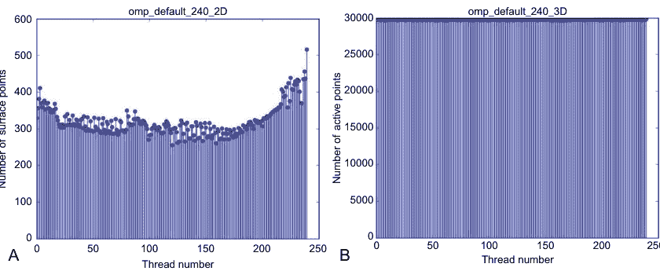

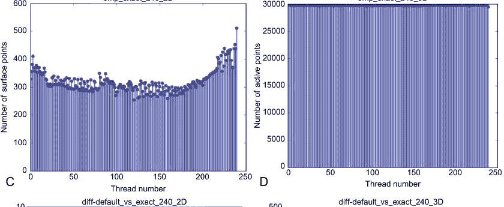

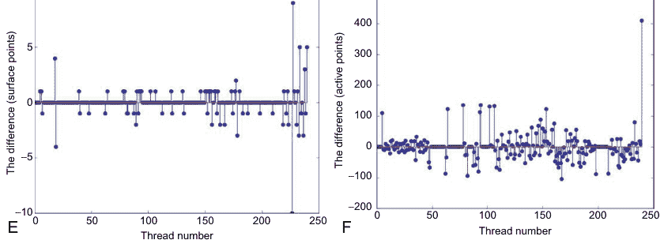

图 3.10

该图显示了与 240 个线程中的每个相关的表面点和地下点数量。注意，当我们限制在 240 个线程时，差异是非常微不足道的。所示的 2D 不平衡可以使用权重处理，也可以通过对列进行另一种初始枚举处理。

# 54 第 3 章 HBM 上的更好并发与 SIMD

应该采用 SPMD 模式，而不是基于著名的循环的方法。因此，OpenMP 并行化将看起来非常像 MPI 并行化，理想情况下，应该在 MPI halo 交换周围只设置 OpenMP 屏障，以最小化线程之间的同步。这种方法意味着 OpenMP 块将很大，使得循环和数据结构都是结构化且一致使用的。NUMA 架构需要显式处理首次访问（first-touch）策略以提高性能。幸运的是，我们的方法对于确保所有变量的 NUMA 本地（首次访问）相对容易。这如图 3.11 中的代码片段所示。子程序 `dom_get`

```fortran
$OMP PARALLEL(SHARED)

call numa_ft(..) call foo(..); call bar(...);

$OMP BARRIER

call halo_update(...);

$OMP BARRIER

call baz(..); call quux(...);

$OMP END PARALLEL
```

图 3.11
NUMA 首次访问代码片段。

# 数据并行：SIMD 向量化

这将为每个线程提供其下界和上界（分别为 `nl` 和 `nu`），其实际实现可以在第一次根据模型输入（例如 `kh` 和 `iw2`）重新读取划分。然后，任何对 `dump_domain` 的后续调用都只需在 `idx` 数组中查找，并将划分结果（`nl` 和 `nu`）传递给调用者。还应该提到的是，这减轻了线程作用域的负担。作用域由 Fortran 语言处理，因为所有栈变量在构造上都是处理过的。

在本节中，我们描述了为了 SIMD 向量化 HBM 模型所做的工作。图 3.12 代码片段显示循环在整个 HBM 模型中都是结构化的。

```fortran
do iw=           ! 水平 - mpi/openmp 并化

do k=           ! 垂直 - 向量化

    enddo

enddo
```

# 图 3.12
显示 HBM 基本循环结构的代码片段。

# 微小障碍

我们对 OpenMP 并行了外层循环意味着所有数据依赖都消失了。因此，我们可以针对 SIMD 向量化外层循环。然而，我们在 `k` 循环中具有步长为 1 的访问，而在 `iw` 循环中没有，这使得这个想法不太吸引人。目前的 SIMD 硬件并不真正支持跨多个缓存行的并行读写。例如，VEX 指令集中的 gather 和 scatter 操作，正如 Hofmann 等 (2014) 所调查的那样，如果我们只关注垂直循环会更好。目标是确保所有 `k` 循环都能良好 SIMD 向量化，这需要步长为 1 的循环。

```fortran
real(8), intent(in) :: u(0); ! 障碍：假定形状

do iw=...

    ! 水平方向 - mpi/openmp

    ! 并化

    i = ind(1,iw)

    jj = ind(2,iw)

    kb = kh(iw)

    ! 垂直方向 - 向量化

    mjj = mmk(i,jj,k)

    if (u(mjj) >= 0) then

        ! 障碍：间接寻址分支

        j = jj

    else

        j = jj + 1

    endif

enddo
```

图 3.13

原始代码布局。

```fortran
real(8), intent(in), contiguous :: u(0);

do iw=...

    ! 水平方向 - mpi/openmp 并化

    i = ind(1,iw)

    jj = ind(2,iw)

    mj0 = mcol(iw) - 2

    ub = min(kh(iw), mshrf(i,jj+1))

    j = jj

    mi0 = mcol(mshrf(i,jj)) - 2

    do k=2,kb

        ! 主循环 1 - 向量化

        mjj = mj0 + k ! mi

        mi = mi0 + k

        tl(mjj) = * max(sign(one,u(mjj)),0)*foo(i,j,k)

    enddo

    j = jj+1

    mi0 = mcol(mshrf(i,jj))

    do k=2,ub

        ! 主循环 2 - 向量化

        mjj = mi0 + k ! /= mi

        mi = mjj + k

        tl(mjj) = * min(sign(one,u(mjj)),0)*foo(i,j+1)

    enddo

    do k=ub+1,kh(iw)

        ! 剩余循环

        tl(mjj) = 0

    enddo

enddo
```

图 3.14

代码的初始重写，步骤 1。

# 数据并行：SIMD 向量化 57

```fortran
do n=n2dl,n2dl

i = ind(1,n)

j = ind(2,n)

mi0 = mcol(n) - 2

do k=2,kh(n)

  mi = mi0 + k

t4(mi) = foo(i,j,k)

enddo

do n=n2dl,n2dl

i = ind(1,n)

j = ind(2,n)

ub = min(kh(n), kh(msrf(i,jj+1)))

mi0 = mcol(n) - 2

mel0 = mcol(msrf(i,jj+1)) - 2

do k=2,ub

  mi = mi0 + k

  me = mel0 + k

  uhx = hx(mi)*u(mi)

  t1(mi) = t4(mi)*max(uhx,0) + t4(me)*min(uhx,0)

enddo

do k=ub+1,kh(n)

  t1(mi) = 0

enddo
```

图 3.15

简单的复习，步骤 2。

我们看到原始代码中的间接寻址源于网格点索引表 `mmk(i,jj,k)`。该数组将网格点 `(i,jj,k)` 转换为对应的井点索引，如果 `(i,jj,k)` 是陆地或海平面以下的点，则返回值 0。如本节所示，可以通过 `msrf(i,j)`、`mcol(iw)` 和 `kh(iw)` 数组用更少的存储获取相同的信息，并可以使用直接寻址。源于数据结构、假定形状参数和循环内部分支的其它障碍可以通过将代码转换为代码段（图 3.14）来解决（引入的额外工作将在过程后期被“移除”，但我们正在传达达到调优版本所需要的各个单独细节）。

在伪代码段中，我们将 `foo(i,j,k)` 视为在网格点 `(i,jj,k)` 处评估的复杂表达式的简写；因此，这里不是数组查找或函数调用。

也就是说，点 `(i,jj,k)` 处的 `t1` 要么来自同一列 `(i,jj+1)` 的 `t2`，要么来自相邻列的项。注意，虽然图 3.13 中的代码段由于间接寻址的原因可以在 `k` 循环中一直运行到底部，但如果我们坚持在两个主 `k` 循环中使用步长为 1，则必须使用图 3.14 中的代码段并包含一个剩余循环。我们发现实际上将 `t1` 与另外两个数组 `hx` 和 `us` 使用：

```fortran
t1(mj)*hx(mj)*u(mj)
```

因此推断出我们完全可以使用因子

```fortran
max/min(hx(mj)*u(mj), 0)
```

# 第 3 章在 HBM 上实现更好的并发和 SIMD

使用判别器代替 IF-ELSE 分支，但作为代价，我们运行了两遍。现在的目标应该是消除双倍工作。我们首先观察到同时计算了 `(i,jj)` 和 `(i,jj+1)` 项，然后通过以下方式进行选择：

```fortran
uhx = hx(mj)*u(mj)

tl(jj) = foo(i,jj,k)*max(u) + foo(i,jj+1,k)*min(u)
```


但当我们到达右侧相邻列`jj+1`时，我们再次计算`foo(i,jj+1)`，这次我们将使用 MAX 而不是 MIN。另一方面，我们应该考虑两步运行的方法：只运行一次`(i,j)`，将其存储在临时数组`(t4)`中，然后使用`max/min`函数填充它。这种形式的伪代码如图 3.15 所示。转换允许编译器看到它可以生成 SIMD 代码。这些转换不足以生成 SIMD。下一步是确保计算强度平衡，并确保缓存是合理的。后者通过需要刷新缓存的循环次数来分析。这种设计有两个选择。我们可以通过将循环拆分为两个来最大化向量长度，例如处理`iw`处的模板，在边界为 2 和`kh(iw)`时，相邻循环可以拆分为八个模板。或者，我们可以一次性处理模板的中间点和所有邻居，如果步长为 1，循环次数将是最小值`kmin`，即超过`kmin`的列的长度。分析对流代码中的循环发现，具有八个剩余循环的最后设计比具有较大循环数的备选方案好得多。

## 过早抽象是万恶之源

实际上 HBM 的跟踪部分在垂直循环中有些特殊，我们另一个跟踪循环。图 3.16 代码段显示了垂直循环内的跟踪循环。在本节中，我们在 Intel Xeon 上最简单的硬件会导致超过 2 倍的性能损失，这些发现证实了我们的假设。原始设计是将所有跟踪放在 2D 数组中并以类似的方式一次处理。这种简化的说明如图 3.17 中的代码段所示。构建此代码段需要：

- 使用动态`nc`，编译器向量化`nc`循环：(4)（列 7）注：已向量化
- 使用静态`nc`，编译器向量化`k`循环：(1)（列 7）注：已向量化

## 数据并行：SIMD 向量化 59

```fortran
do iw=...

    ! 水平方向 - mpi/openmp 并化

    do k=...

        ! 垂直方向 - 向量化

        do nc=...

            ! 内部循环（对流中）

            ! 跟踪数量

            ...

        enddo

    enddo

enddo
```

图 3.16 带有跟踪循环的基础循环。

```fortran
1 do k=2,kmax
2 k1 = k+off1
3 k2 = k+off2
4 t(ln:nc,k) = t(ln:nc) + A(k)*(B(ln:nc,k1)-B(ln:nc,k2))
5 enddo
```

图 3.17 代码的简化说明。

遗憾，这些生成的：
AVX（本质上是软件聚集操作）：

```asm
vmovpsd (%r10,rcx,2), %xmm6
vmovhpd 16(%r10,rcx,2), %xmm6, %xmm6
vmovpsd 32(%r10,rcx,2), %xmm7
vmovhpd 48(%r10,rcx,2), %xmm7, %xmm7
insertf128 1,$xmm7,%ymm6,%ymm7
```

MIC（硬件聚集）：

```asm
gatherdpd (%r13,zmn2,0), %zmm6(k)
```

无论是 MIC 还是 AVX (IVB)，我们都没有实现目标。承认的是，SNB/IVB 架构上的 256 位未对齐加载/存储存在已知问题，因此软件聚集可能没有那么糟糕。让我们尝试分析为什么我们没有获得普通的向量加载。静态`nc`意味着展开，而展开意味着优化器将循环视为步长为`nc`的循环，图 3.18 中`nc=2`的 c 代码段。
我们更清楚，让我们展示编译器本可以做什么；我们的建议如图 3.19 所示。

## 60 第 3 章在 HBM 上实现更好的并发和 SIMD

```fortran
do k=1, kmax
k1 = k+koff1
k2 = k+koff2
t(1,k2) = t(1,k1) + A(k) * (B(1,k1)-B(1,k2))
t(2,k) = t(2,k) + A(k) * (B(2,k1)-B(2,k2))
enddo
```

图 3.18 展开的循环。

正确处理 2D 和 1D 的混合（`nc=2`）：

| t(1,1) | t(1,2) | t(2,2) | t(1,7) | t(2,3) | t(1,4) | t(2,4) |
|---|---|---|---|---|---|---|
| zm1 | | | | | | |
| zm2 | | | | | | |
| zm3 | | | | | | |
| zm4 | | | | | | |
| zm5 | | | | | | |
| zm6 | | | | | | |
| zm7 | | | | | | |
| zm8 | | | | | | |

图 3.19 正确处理 2D 和 1D 的混合（算术）：

```fortran
+   - zm9 = zmm1 + zm3 + zmm5 !k=1, nc=2
-    zm10 = zmm2 + zm8 * zmm4 !k=5, 8; nc=1, 2
```


# 图 3.20

仅使用 1D 数组的对编译器友好。

## 结果

在本节中，我们将展示来自 HBM 平流模块的性能和特性。如前所述，选择对平流模块进行调优是因为它在 Xeon 处理器和 Intel Xeon Phi 处理器上运行的单节点任务中占了约 40% 的执行时间。该模块在协处理器上花费的时间是代码优化前的 3 倍。通过对数据结构、SIMD 和并行化进行上述优化后，仅在协处理器上原生运行 Baffin 测试用例时，HBM 平流模块的 OpenMP 性能比双双路处理器提升了约 15%。然而，我们的优化工作仍在进行中，我们在缓存使用方面还有机会，这将进一步提高性能。

所有 Baffin Bay 测试用例都是不规则的，将不规则网格划分为负载平衡的问题比理想的立方体测试用例要困难得多。在性能方面，上述局部性、SIMD 和并发性优化工作显著提升了在 Xeon (E5-2697 v2) 上的性能，并且在从最初开始的 Intel Xeon Phi 协处理器 (KNC) 上的提升更为显著。如表 3.21 所示，对于 Baffin Bay 用例，纯 OpenMP 模式下的 KNC 性能比处理器 (E5-2697 v2) 高约 15%。

内存带宽测量显示，应用在协处理器上达到了约 90% 的实际可实现带宽 (POP)，在处理器上达到了 100% 的实际可实现带宽。实际带宽使用 Stream Thread 进行测量，协处理器比处理器快 2.15 倍。处理器达到峰值还需要额外花费 1.45 倍的等待时间。协处理器的功率测量为单卡功率。因此，带宽数据表明 Xeon Phi 协处理器具有进一步改进数据的潜力，这将缩短求解时间并实现 100% 的峰值带宽利用率。

高效向量化是性能的关键（特别是对于 Intel Xeon Phi 处理器），正如你在本章 SIMD 节中读到的那样。向量化强度 (VI) 是衡量循环向量化良好程度以及 VPU 使用效率的指标；由于 512 位向量长度的限制，双精度代码 VI 不能超过 8，单精度代码不能超过 16。如果该数字较小，说明循环没有良好向量化，或者 VPU 未被有效利用（循环次数较少、掩码指令导致或向量化问题）。平流模块使用双精度数据类型，其 VI 指标 (~7) 显示在协处理器上循环已良好向量化，且 VPU 被有效利用 (82-96%)。

| | E5-2697 v2 时间 | KNC 7120A 时间 (秒) | Xeon BW (秒) | POP BW (GB/s) | KNC BW (GB/s) | POP BW (GB/s) | KNC VI | P/W |
| :--- | :--- | :--- | :--- | :--- | :--- | :--- | :--- | :--- |
| **输入** | | | | | | | | |
| BaffinBay_2nm | 81.581 | 70.662 | 89.23 | 100 | 161.55 | 89.75 | 7.04 | 1.63x |
| BaffinBay_1nm | 320.81 | 273.095 | 88.56 | 100 | 160.69 | 89.27 | 6.87 | 1.62x |

图 3.21
平流模块性能总结。

# 第 3 章 HBM 上更好的并发性与 SIMD

每瓦特性能 (P/W) 的改进基本上是处理器 (Xeon E5-2697 v2) 与协处理器 (KNC 7120A) 求解时间的比例，并乘以 1.45 因子。1.45 因子使得处理器 (Xeon E5-2697 v2) 获取带宽所需的功率是协处理器 (KNC 7120A) 的 1.45 倍，因为应用达到了接近峰值带宽的 90%。

# 性能分析详情

我们使用 Intel® VTune™ Amplifier 进行性能分析。在优化过程中，我们使用了许多性能指标，但在图 3.22 中仅突出显示了我们认为更相关的几个。

`VPU_INSTRUCTIONS_EXECUTED` 统计所有向量指令，`VPU_ELEMENTS_ACTIVE` 统计向量操作（内存和算术）的所有活跃行。

对于性能分析，我们使用了 Intel® VTune™ Amplifier 的基于硬件的采样器，它使用性能监控单元 (PMU) 的溢出功能对应用进行分析。上述使用的采样值为百万。在 1 ms 采样间隔内，基于事件的平均开销为 2%。

# 处理器与协处理器的扩展

图 3.23 显示了 Intel Xeon Phi 处理器 (KNC) 上 BaffinBay_2nm 用例的 OpenMP 扩展，其中 X 轴代表核心数，Y 轴代表归一化为 1.0 的吞吐量 (1/Time)。时间为六秒。上述四个核心都被利用了。你可以看到 KNC 上的平流模块获得了几乎完美的扩展。

图 3.24 中 Intel 双路系统上的类似扩展表明扩展并非完美。其主原因是内存带宽。我们在图 3.25 中绘制了每个插槽的内存占用随核心数的函数。Xeon E5-2697 v2 每个插槽的峰值带宽约为 43 GB/s。因此，双插槽的峰值带宽在 84–88 GB/s 范围内。应用似乎：

| 指标 | 硬件事件 |
| :--- | :--- |
| 带宽 | `UNC_FC_CH0_READ`, `UNC_FC_CH1_READ`, `UNC_FC_CH0_WRITE`, `UNC_FC_CH1_WRITE` |
| 向量化强度 | `VPU_INSTRUCTIONS_EXECUTED`, `VPU_ELEMENTS_ACTIVE` |

图 3.22
用于带宽和向量化效率的 PMU 事件。

# 处理器与协处理器的扩展


图 3.23
Intel Xeon Phi 协处理器 (KNC 7120A) 上的 OpenMP 线程扩展。


图 3.24
双路 Xeon 处理器 (E5-2697 v2) 上的 OpenMP 线程扩展。

# 第 3 章 HBM 上更好的并发性与 SIMD


图 3.25
双路 Xeon 处理器上核心的带宽扩展。

插槽 0 在 6 个核心（12 个线程）处达到带宽峰值，如果你将扩展图与图 3.24 相关起来，你会发现扩展开始平缓。然后当你有第二个插槽 (插槽 1) 时，在大 13 个核心处开始看到一些扩展收益，但再次在 17 个核心左右你达到了插槽 1 的峰值带宽，从而达到了双路系统的限制。这证明了处理器性能和扩展限于内存带宽，Intel Xeon Phi 处理器具有优势并为此应用提供了大部分支持。

图 3.26 显示了协处理器并行性和良好并发性的重要性。X 轴是协处理器从 1 到 60 个的核心数，Y 轴是平流模块的吞吐量 (1/Time)。正如你所看到的，Intel Xeon Phi 处理器似乎匹配 100% 并行（无串行代码）的阿达尔图。例如，如果你的应用程序中有 1%、3% 或 5% 的串行核心，你的应用程序将显著增加且吞吐量显著减少，如图 3.26 所示。这验证了阿达尔法则。

# CONTIGUOUS 属性

FORTRAN 2008 中的 `CONTIGUOUS` 属性显式指示假设形状数组是连续的，或者指针仅与 `CONTIGUOUS` 对象关联。在许多情况下，即使没有指定，对象也可以是 `CONTIGUOUS`（参阅 Fortran 规范），但 `CONTIGUOUS` 属性使得启用依赖于对象占据连续内存块布局的编译器优化变得更容易。


图 3.26
阿达尔法则的验证以及串行代码对 Xeon 协处理器的影响。

图 3.27 表中的数据清楚表明，`CONTIGUOUS` 属性使 Intel Xeon (E5-2697 v2) 的性能提升在 1–2% 范围内，且在 Intel Xeon 协处理器 (KNC 7120A) 上提升更为显著。

| | 带“Contiguous”属性 | | 不带“Contiguous”属性 | | 性能差异 | |
| :--- | :--- | :--- | :--- | :--- | :--- | :--- |
| 输入 | 2 路 Xeon | KNC 7120A | 2 路 Xeon | KNC 7120A | 2 路 Xeon | KNC 7120A |
| | 时间 (秒) | 时间 (秒) | 时间 (秒) | 时间 (秒) | 加速比 | 加速 |
| BaffinBay_2nm | 81.165 | 70.653 | 83.283 | 85.490 | 1.02x | 1.21x |
| BaffinBay_1nm | 320.97 | 273.158 | 323.401 | 333.252 | 1.01x | 1.22x |

图 3.27
在 Xeon 和 Xeon Phi 上使用 `CONTIGUOUS` 属性的益处。

## 第 3 章 HBM 上的更好并发与 SIMD

## 总结

本章中使用的思考过程和技术具有广泛的适用性：关注数据局部性，然后应用线程化和向量化技术。这种思维方式应该是每一位致力于设计高性能应用程序的程序员脑海中的精髓。这种编程可以提升 Intel Xeon 处理器和 Intel Xeon Phi 协处理器上的性能。

我们已经证明，当实现方案关注于通过 HBM 模型使用面向数据的设计时，就能在硬件上获得良好的 SIMD 和线程性能。关键基础是选择与并行需求相匹配的循环模型数据结构。文中描述了向代码 SIMD 向量化迈的步骤，同时也指出了结果以及必须克服的某些并非显而易见的障碍。Intel Xeon 和 Intel Xeon Phi 协处理器也使用了这些技术，其卓越的聚合内存带宽使其具有更强的扩展性。对于这一特定应用，我们展示了 Intel Phi 协处理器的单节点速度比 Intel 处理器快了约 15%。Intel Phi 协处理器的能效使其极具吸引力，尽管我们认为协处理器的内存限制目前是获得更快速度的限制因素。这种限制在下一代 Intel Xeon Phi 协处理器（Knights Landing）中将显著改善。

## 参考文献

- Gross, E.S., Rosatti, G., Bonaventura, L., 2002. Consistency with continuity in conservative advection schemes for free-surface models. Int. J. Numer. Methods Fluids 38 (4), 307–327.
- Harten, A., 1997. High resolution resolution schemes for hyperbolic conservation laws. J. Comput. Phys. 135 (2), 259–288. With an introduction by Peter Lax, Commemoration of the 30th anniversary of J. Comput. Phys.
- Hofmann, J., Treibig, J., Hager, G., Welche, G., Comparing the Performance of x86 SIMD Instruction Sets for a Medical Imaging Application on Modern Many-core Chips, The Workshop on Generating Models for SIMD/Vector Processing at PoPOP 2014, Orlando, FL, Feb 16, 2014. Preprint: arXiv:1401.7494.
- Kleine, E., 1993. Die konzeption eines numerischen verfahren für die advektionsgleich. Technical Report. Bundesamt für Schifffahrt und Hydographie, Hamburg.
- Skiena, S., 2008. The Algorithm Design Manual, second ed. Springer, London.
- Xu, P., Tirthapura, P., 2012. A lower bound on proximity preservation by space filling curves. In: IPDPS, pp. 1295–1305.

## 更多信息

- 有兴趣于了解更多 HBM 的读者，请参阅 (Berg and Poulsen, 2012) (Poulsen and Berg, 2012a) 获取关于 HBM 模型的实现细节、设计目标以及维护和测试标准。这两份技术报告还提供了对不同应用的性能研究和调查，而第三份报告则处理了线程扩展性（Poulsen and Berg, 2012b）。
- Berg, P., Poulsen, J.W., 2012. Implementation Details for HBM. DMI Technical Report. 12-11. Technical Report, DMI, Copenhagen. http://beta.dmi.dk/fileadmin/Rapporter/TR/tr12-11.pdf
- Poulsen, J.W., Berg, P., 2012a. Methods on HBM—General Modelling Theory and Survey of Recent Studies. DMI Technical Report No. 12-16. Technical Report, DMI, Copenhagen. http://beta.dmi.dk/fileadmin/Rapporter/TR/tr12-16.pdf.
- Poulsen, J.W., Berg, P., 2012b. Tread Scaling with HBM. DMI Technical Report No. 12-20. Technical Report, DMI, Copenhagen. www.dmi.dk/fileadmin/user_upload/Rapporter/tr12-20.pdf.
- She, J., Poulsen, J.W., Berg, P., Jonasson, L., 2013. Next generation pan-European coupled Climate-Ocean Model—Phase 1 (ECOM-I). PRACE Final Report
- HIROM: High Resolution Operational Model for the Baltic Sea, http://www.hirom.org/
- BOOS: Baltic Operational Oceanographic System, http://www.boos.org/
- MyOcean 是专门用于实施 GMES（全球环境与安全监测）海洋服务的海洋监测和预测的主要海洋项目。
- PRACE: Partnership for Advanced Computing in Europe, http://www.prace-ri.eu/
- ETOPOL 是一个 1 角分的全球地表地貌模型，整合了陆地地形和海洋深深，http://www.ngdc.noaa.gov/mgg/global/global.html
- 在 http://lotsofcores.com 下载此代码及其他代码。
- 有兴趣于了解空间填充曲线（SFCs）的读者可能对以下感兴趣：
- Mitchison, G., Durbin, R., 1986. Optimal numberings of an NxN array. SIAM J. Algeb. Discrete Meth 7 (4), 571–582.
- Niedmeier, R., Reinhardt, K., Sanders, P., 1997. Optimal locality in mesh. In: Proceedings of 11th International Symposium on Foundations of Computational Theory (FCT), LNCS, pp. 364–375.
- Niedmeier, R., Reinhardt, K., Sanders, P., 2002. Optimal locality in mesh. Discrete Math. 117 (211–237.

## 第 4 章 针对反应纳维-斯托克斯方程的优化

## 开始

SMC 是一种混合负载，可以使用不同数量的 MPI 进程和 OpenMP 线程执行。但 SMC 已经证明在扩展到 16000 个 MPI 进程时效率仍高于 90%。因此，MPI 不是瓶颈。因此在本章的剩余部分中，我们将关注于使用 OpenMP 利用并发性，并通过向量化提高性能。我们将使用单个节点上的单个 MPI 进程，以及 128×128×128 的网格点。此分析使用了两个系统：

- 1. Intel Xeon Processor 7120p（代号 Knights Corner）：61 个核心，每个核心 4 个硬件线程，总计 (61×4) 244 个硬件线程。
- 2. Intel® Xeon Processor E5-2697 v2（代号 IvyBridge-EP）：2 个插槽，每个插槽有 12 个核心并带有 Intel® 超线程技术，总计 (2 个插槽 x 12 个核心 x 2 个硬件线程)= 48 个硬件线程。

### 版本 1.0：基准

我们展示了使用 SMC 的基准扩展结果。图 4.2 显示了协处理器 OpenMP 线程扩展，图 4.3 显示了处理器 OpenMP 线程扩展。两幅图都绘制了 SMC 反数随 OpenMP 线程数量的变化；有两个 y 轴：左 y 轴是 1/时间；右 y 轴是单线程运行的速度。我们使用左 y 轴比较平台和版本（哪个更好），并使用右 y 轴理解每个实现相对于其单线程运行的扩展情况。

## SMC 1.0 的 Xeon Phi 线程扩展：128^3 尺寸的 Rank 和 1 Box

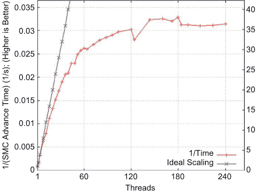

图 4.2

SMC 1.0 版本：协处理器线程扩展。

## SMC 1.0 的 Xeon 线程扩展：128^3 尺寸的 Rank 和 1 Box

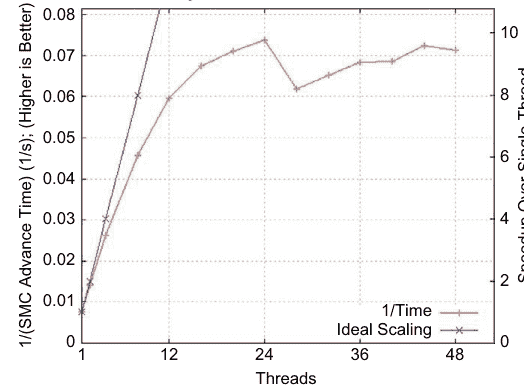

图 4.3

SMC 1.0 版本：处理器线程扩展。

## 第 4 章 针对反应性纳维-斯托克斯方程进行优化

在上述两张图中，我们看到 SMC 1.0 版本的扩展性并不良好。我们运行了一个具有 240 个 OpenMP 线程的协处理器，但仅比 Intel Xeon Phi 协处理器单线程的结果快约 38 倍。同样，我们运行了一个具有 48 个 OpenMP 线程的处理器，但仅比 Intel Xeon Phi 处理器线程的结果快约 10 倍。

我们使用 Intel VTune™ Amplifier 来帮助理解 OpenMP 的性能和潜在机会。图 4.4 显示了 Intel VTune Amplifier 2015 版本针对 SMC 1.0 Intel Xeon Phi 协处理器的三个屏幕。第一部分 OpenMP 分析被用粉色标出：潜在增益（Potential Gain）与并行执行时间（parallel elapsed time）相比非常大，串行时间（Serial Time）包含了 SMC 的初始化时间以及推进步骤的串行时间。由于这个原因，我们将更多地关注增益指标，因为它涵盖了所有并行区域。潜在增益与并行执行时间的比率表明我们有优化空间。中间部分 CPU 使用直方图（CPU Usage Histogram）显示了特定数量 CPU 同时运行的时间百分比。在这种情况下，我们看到距离目标并发数 240 个逻辑 CPU 还很远。底部部分视图（Over-Time View）显示了 CPU 的运行时间。第一行是我们的数据，后续行是我们的模块。我们看到 `libomp.so` 模块运行了最大量的实际工作（标记为

| OpenMP 分析 (OpenMP Analytics) |
| :--- | :--- |
| 应用执行时间 (Application Elapsed Time) | 44.856 |
| 区域外的串行时间 (Serial Time (outside any region)) | 20.938 (46.7%) |
| 应用的串行时间 (Serial Time of your application) | |
| 探索并行化选项，串行时间（Serial Time）很高，这直接影响执行时间和可扩展性。 |
| 并行执行时间 (Parallel Elapsed Time) | 23.963 (53.4%) |
| 估计理想时间 (Estimated Ideal Time) | 12.628 (28.1%) |
| 潜在增益 (Potential Gain (Elapsed Time)) | 32.233 (71.9%) |

负载失衡或并行工作安排的时间非常显著，并对性能和能力产生了负面影响。确保你运行的区域有足够的循环调度。CPU 使用直方图（CPU Usage Histogram）显示了特定数量 CPU 同时运行的时间百分比。自旋时间（Spin）和开销时间（Overhead time）增加了空闲 CPU 使用值。

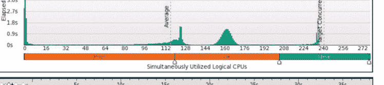

图 4.4 SMC 1.0 版本 (Intel Xeon Phi 协处理器)：VTune Amplifier 的三个分析截图：OpenMP 分析、CPU 使用直方图、视图。

(`main.intel...` 模块) 极小。这表明我们有非常小的并行区域或严重的负载失衡。无论是哪种情况，VTune Amplifier 都显示主要问题在于线程在运行应用程序代码。

通过 VTune Amplifier 中的热点分析调查性能，我们看到主要热点在某些内核内的 `differ_j`（在下面的示例中，我们将此子程序命名为 `differthm`）。该函数计算纳维-斯托克斯方程中的扩散项。计算扩散项涉及许多循环，许多循环包含相邻单元数据的模板操作（stencil operations）。查看源代码，我们看到 `differ` 有一个巨大的并行区域（见图 4.5）。尽管区域尺寸尚可，但它包含了一个多多个带有 `omp DO` 的嵌套循环。

细粒度并行（fine-grain parallelism）由于 OpenMP 的产生。启用 OpenMP 的应用程序从单线程开始，遇到并行区域时分叉（fork）。此时，所有执行都是并行的。当 OpenMP 遇到 `omp DO` 时，它将迭代分配给线程。OpenMP Loop `COLLAPSE` 也将嵌套循环合并为迭代空间和线程间的工作。OpenMP 共享结构的结束用 `omp END` 标记。除非用户在 `omp END` 带有 `NOWAIT` 同句，否则 `omp END` 处有一个隐式屏障（barrier）。并行区域的结束是一个屏障，所有线程等待全部完成（join）。OpenMP 对后续并行区域继续这种分叉-连接行为。因此，`omp DO` 共享结构表示结尾可能有隐式屏障的实际工作。这些小的并行共享区域会导致大量的开销和失衡。进一步研究的潜在解决方案是对 OpenMP 采用粗粒度方法。

## 版本 2.0：THREADBOX

在这一版本中，我们采用了粗粒度的 OpenMP 方法，这对源代码的变化非常小。在这种方法中，区域被分解为多个子区域。每个线程负责一个子区域。确实，我们看到 Xeon Phi 上有显著的性能和扩展性。但如图 4.6 所示，我们使用 VTune Amplifier 查看了 Xeon Phi 上这一意外结果。

## 第 4 章 针对反应性纳维-斯托克斯方程进行优化

`call difterm(U,duddt,domlo,domhi)`

```fortran


## 子程序 `difterm(U, duddt, domlo, domhi)`

`domlo`、`domhi`：区域的下/上边界。

```fortran
integer, intent(in) :: domlo(3), domhi(3)
```

`U` 和 `duddt` 是四维数组。前三个是空间维度，第四个用于密度和速度等变量分量。`U` 在每侧都有虚设单元（ghost cells）。

```fortran
real, intent(in) :: U(domlo(1)-4:domhi(1)+4,
                     domlo(2)-4:domhi(2)+4,
                     domlo(3)-4:domhi(3)+4,
                     nu)

real, intent(inout) :: duddt(domlo(1):domhi(1),
                            domlo(2):domhi(2),
                            domlo(3):domhi(3),
                            nu)
```

`tmp` 是局部数组。

```fortran
real, allocatable :: tmp(:,:,:);

allocate(tmp(domlo(1)-4:domhi(1)+4,
                  domlo(2)-4:domhi(2)+4,
                  domlo(3)-4:domhi(3)+4))
```

```fortran
!OMP PARALLEL PRIVATE(...)
!OMP DO COLLAPSE(2)
do k = domlo(3)-4, domhi(3)+4
do j = domlo(2)-4, domhi(2)+4
do i = domlo(1)-4, domhi(1)+4
    tmp(i,j,k) = -----
end do
end do
end do
!OMP END DO
```

带有 `OMP DO` 的嵌套循环：

```fortran
!OMP DO COLLAPSE(2)
do k = domlo(3), domhi(3)
do j = domlo(2), domhi(2)
do i = domlo(1), domhi(1)
    duddt(i,j,k,1) = -----
end do
end do
end do
!OMP END DO

!OMP END PARALLEL
end subroutine difterm
```

**图 4.5**：SMC 1.0，显示细粒度并行的代码（实际代码，代码片段已简化以显示主要点）。

## 版本 2.0：线程分块 75

```fortran
$OMP PARALLEL PRIVATE(lo,hi)
call get_thread(lo,hi)
call diffterm(lo,hi,U,dudt,domlo,domhi)
!OMP END PARALLEL
```

```fortran
subroutine diffterm(lo,hi,U,dudt,domlo,domhi)
! lo, 为该线程分配的子 域的下界和上界
! domlo: 计算区域的下界和上界
integer, intent(in) :: lo(3), hi(3)
integer, intent(in) :: domlo(3), domhi(3)

! U 和 dudt 是四维数组。
! 前三个维度用于空间维度，
! 第四维度用于变量分量，如
! 密度速度
! U 的每个边都有四个单元格。
real, intent(in) :: U(domlo(1)-4:domhi(1)+4,
                     domlo(2)-4:domhi(2)+4,
                     domlo(3)-4:domhi(3)+4,
                     n0)

real, intent(in) :: dudt(domlo(1):domhi(1),
                     domlo(2):domhi(2),
                     domlo(3):domhi(3),
                     n0)

! tmp 是一个本地数组
allocatable :: tmp(:,:);

allocate(tmp(lo(1)-4:hi(1)+4,
             lo(2)-4:hi(2)+4,
             lo(3)-4:hi(3)+4))

do k = lo(3)-4, hi(3)
  do j = lo(2)-4, hi(2)+4
    do i = lo(1)-4, hi(1)+4
      tmp(i,j,k) = 0.0
    end do
  end do
end do

! 许多没有 OpenMP 指令的嵌套循环
do k = lo(3), hi(3)
  do j = lo(2), hi(2)
    do i = lo(1), hi(1)
      dudt(i,j,k,1) = ....
    end do
  end do
end do
end subroutine diffterm
```

**图 4.6**：SMC 2.0，针对粗粒度并行进行了优化；OpenMP 指令从子程序 `diffterm` 移动到调用 `diffterm` 的地方（并非实际代码，代码片段为了简洁和展示主要点进行了简化）。

## 第 4 章 针对反应纳维-斯托克斯方程的优化

SMC 2.0 的 Xeon 线程扩展：1 个 Rank 和 1 个 128^3 Box

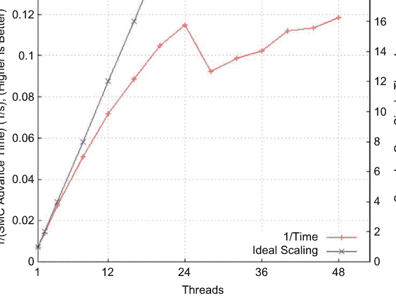

**图 4.7**：SMC 版本 2.0：处理器 OpenMP 线程扩展，代码针对粗粒度并行进行了优化；性能和线程扩展均得到了提升。

SMC 2.0 的 Xeon Phi 线程扩展：1 个 Rank 和 1 个 128^3 Box

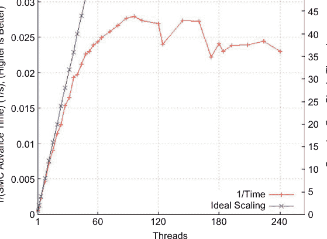

**图 4.8**：SMC 版本 2.0：协处理器 OpenMP 线程扩展，代码针对粗粒度并行进行了优化，协处理器性能相比版本 1.0 有所下降。

## 版本 4.0：分块 77


**图 4.9**：SMC 版本 2.0 (Intel Xeon Phi 协处理器)：VTune Amplifier XE 耗时视图截图。注意 `vmlinux`（第二个）在图 4.4 的耗时视图中产生了一个热点。

数组，代码在 `longterm` 子程序中有多个可分配数组。在 SMC 版本 1.0 中，`OMP PARALLEL` 指令放在动态分配调用之后。在版本 2.0 中，`OMP PARALLEL` 指令被于调用者函数中，现在每个线程使用其自己的子域调用 `longterm`。因此，在版本 1.0 中，堆分配每个线程发生一次，而在版本 2.0 中，堆分配每个 OpenMP 线程发生一次。这影响了 Intel Xeon Phi 处理器，而 Intel Xeon 处理器主要是因为线程数（多 5 倍）。每个线程的动态内存分配调用 `vmlinux` 时间抑制了进一步的线程扩展，并阻止我们从处理器的 Threadbox 选项获得任何收益。

## 版本 3.0：栈内存

`longterm` 子程序有很多数组。在版本 2 中，这些数组在堆上动态分配。这些数组是线程安全的，但不可扩展。在这个版本中，我们对这些局部变量使用自动分配来代替可分配数组。例如，上一节示例中的 `tmp` 数组包含：

```fortran
real :: tmp(lo(1):hi(1)+4,
lo(2):hi(2)+4,
lo(3):hi(3)+4)
```

一个注意事项是我们需要确保每个线程都有较大的栈内存空间。这可以通过设置环境变量 `OMP_STACKSIZE` 来实现。图 4.10 和 4.11 显示了版本 3.0 的新 SMC 扩展。在 Intel Xeon Phi 处理器上，我们看到了版本 3.0 性能和扩展的巨大提升（相比版本 1.0 提高了 ~70 倍）。Xeon 性能也受益了。但我们用一个问题换了另一个：现在运行较少线程时，`OMP_STACKSIZE` 需要很大。这需要某种分块。

## 版本 4.0：分块

版本 4 在使用多线程时每个线程都需要大量的栈内存。为了减少栈限制，可以将每个线程的子域进一步划分为更小的块。块的大小可以通过 `inputs_smc` 文件设置为运行时参数。划分调用现在放在块的循环内部（见图 4.12）。额外的优点是减少了工作集大小，带来了更好的性能。注意，对于子域已经小于块大小的情况，这没有影响。

## 第 4 章 针对反应纳维-斯托克斯方程的优化

SMC 3.0 的 Xeon Phi 线程扩展：1 个 Rank 和 1 个 128^3 Box

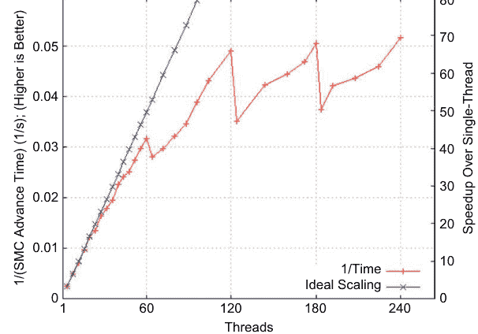

**图 4.10**：SMC 版本 3.0：Intel Xeon Phi 协处理器线程扩展，通过 threadbox 优化和将可分配数组替换为自动数组，SMC 扩展显著提高。

SMC 3.0 的 Xeon 线程扩展：1 个 Rank 和 1 个 128^3 Box

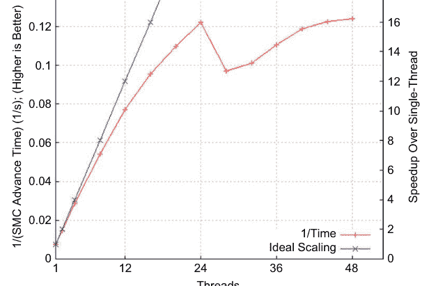

**图 4.11**：SMC 版本 3.0：处理器线程扩展，相比版本 2.0 在 Xeon 处理器上只有轻微收益。

## 版本 4.0：分块 79

```fortran
Version 3.0:
!OMP PARALLEL PRIVATE (lo,hi)
call getthread(lo,hi)
call diffterm(lo,hi,U,dudt,domlo,domhi)
!OMP END PARALLEL
```

```fortran
Version 4.0:
!OMP PARALLEL PRIVATE (lo,hi,iblock,nblocks)
nblocks = tb_get_nblocks()
do
  iblock = 1, nblocks
  call getthread(lo,hi,iblock)
  call diffterm(lo,hi,U,dudt,domlo,domhi)
end
!OMP END PARALLEL
```

**图 4.12**：SMC 版本 4.0：将版本 2.0 中引入的 `get_thread` 子域划分为更小的块。

SMC 4.0 的 Xeon Phi 线程扩展：1 个 Rank 和 1 个 128^3 Box

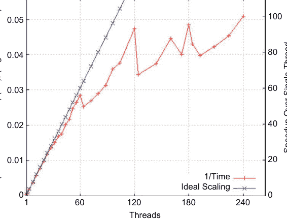

**图 4.13**：SMC 版本 4.0：分块后的协处理器线程扩展（`inputs_SMC` 中使用了 -1,4,5）。某些点稍微变差了，但 24 线程性能与版本 3.0 相似。

图 4.13 和 4.14 显示了分块优化后的 SMC 扩展。注意差异大大。某些结果略差，包括单线程结果影响了扩展数（从 70 倍到 100 倍），但峰值性能保持不变。我们保留这一变化是为了减少栈大小限制，特别是对于低线程数或使用大型化学网络计算。

## 第 4 章 针对反应纳维-斯托克斯方程的优化

SMC 4.0 的 Xeon 线程扩展：1 个 Rank 和 1 个 128^3 Box

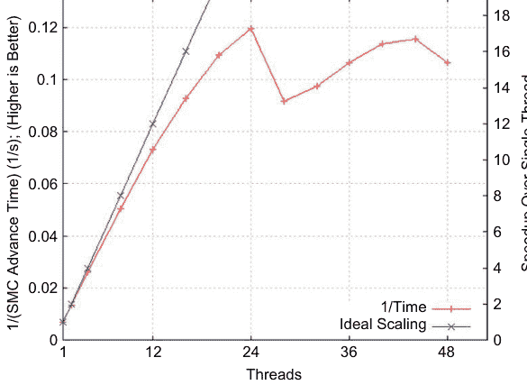

**图 4.14**：SMC 版本 4.0：分块后的处理器线程扩展（`inputs_SMC` 文件中的 ~1,16,16）。注意 24 线程值与版本 3.0 相似，但线程性能下降了。

## 版本 5.0：向量化

在如 Intel Xeon Phi 处理器等多核架构上，性能的关键在于利用 SIMD 指令。在 SMC 的极简版本中，化学反应速率的计算相对廉价，因为它使用了一个仅包含九种物质的网络。然而，对于涉及数百种物质的大网络计算，反应速率的计算随物质数量的增长远大于扩散项。这里我们使用一种方法使反应速率的计算更具向量化能力。

图 4.15 是化学反应速率的原始计算。内部循环涉及对 `ckwyr` 子程序的调用，该程序非常复杂且无法内联。`ckwyr` 子程序作用于单点，见图 4.16。它将密度、温度和质量作为输入并返回每种物质的摩尔速率。最终结果存储在四维数组中。由于内部循环中的调用无法内联，且 `ckwyr` 子程序每次只处理一个单元，这种实现无法向量化。

为了使化学反应速率向量化，我们首先需要修改 `ckwyr` 子程序以接收密度、温度和质量的向量。图 4.17 显示了可以向量化的新实现。使用这种实现，对代码进行了修改以生成输入向量 `Yt` 其输出向量 `wdot`，见图 4.18。这种实现使协处理器上工作负载的化学部分提高了 4 倍。

除了对化学部分进行向量化外，还在 `diffterm` 的多个内部循环中添加了 SIMD Fortran 指令，编译器由于潜在依赖关系选择未进行向量化，编译器以保证正确性

## 化学反应速率的原始计算：

```fortran
do k=lo(3),hi(3)
  j=lo(2),hi(2)
  i=lo(1),hi(1)
    ! 质量分数
    Yt = q(i,j,k,qyl+nspecies-1)
    call ckwyr(q(i,j,k,qtemp), Yt, wdot)
    q(i,j,k,qtemp) = wdot
    up(i,j,k,irly+nspecies-1)
      * 分子量
  end do
end do
```

**图 4.15**：SMC 版本 4.0：化学反应速率计算，不可向量化。

```c
k_f[0] = 3.547e+15*exp(-0.406*T- 8352.8934356925419706*invT);
k_f[1] = 50080.0*exp(2.6*T- 3165.2322879116868543*invT);
k_f[2] = 2.16e+08*exp(1.51*T- 1726.0331637101885462*invT);
k_f[5] = 6.165e+15*exp(-0.5*T);
k_f[9] = 1.66e+13*exp(- 414.1731595728432012*invT);
k_f[11] = 3.25e+13;
k_f[20] = 5.8e14*exp(- 4809.2416750975054319*invT);
```

**图 4.16**：SMC 版本 4.0：原始 `ckwyr` C 代码。一次执行一个函数。

```c
for (int i=0; i<np; i++) {
  k_f[0][i] = 3.547e+15*exp(-0.406*T[i]- 8352.8934356925419706*invT[i]);
  k_f[1][i] = 50080.0*exp(2.6*T[i]- 3165.2322879116868543*invT[i]);
  k_f[2][i] = 2.16e+08*exp(1.51*T[i]- 1726.0331637101885462*invT[i]);
  k_f[5][i] = 6.165e+15*exp(-0.5*T[i]);
  k_f[9][i] = 1.66e+13*exp(- 414.1731595728432012*invT[i]);
  k_f[11][i] = 3.25e+13;
  k_f[20][i] = 5.8e14*exp(- 4809.2416750975054319*invT[i]);
}
```

**图 4.17**：SMC 版本 5.0：为了实现向量化的化学反应速率计算。

## 第 4 章 针对反应性纳维-斯托克斯方程的优化

优化的化学反应速率计算：

`np = hi(1) - lo(1) + 1`

```fortran
do k=lo(3),hi(3)
  do j=lo(2),hi(2)
    do n=1,nspecies
      do i=lo(1),hi(1)
        YYt(i,n) = q(i,j,kyl+n-1)
      end do
        call ckwyr(np, q(lo(1):hi(1),j,k,qrho),
                 q(lo(1):hi(1),j,k,qtemp),
                 YYt, wdot)
      do i=lo(1),hi(1)
        up(i,j,k,iryl+n-1) = wdot(i,n)
        molecular_weight(n)
      end do
    end do
  end do
end do
```

**图 4.18**：SMC 版本 5.0：为了实现向量化而修改的化学反应速率计算。

SMC 5.0 Xeon Phi 线程缩放：1 个 Rank 和 1 个大小为 128^3 的 Box

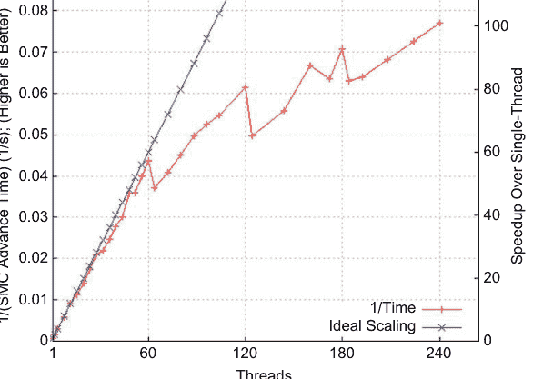

**图 4.19**：SMC 版本 5.0：向量化优化后的协处理器线程缩放。

## Intel XEON PHI 协处理器结果

SMC 5.0 的 Xeon 线程缩放：1 个 Rank 和 1 个大小为 128^3 的 Box

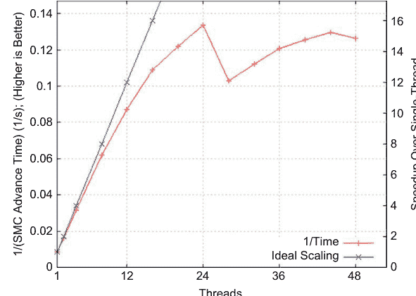

## 图 4.20

SMC 版本 5.0：向量化优化后的处理器缩放。

对于本章涵盖的内容，图 19 和 20 显示了向量化优化后的 SMC 性能和缩放。注意：图 19 中 Intel Xeon 处理器的最佳性能为 99 秒。最近发现的一些额外 Fortran 编译器选项允许我们获得更好的结果，协处理器达到 11 秒（比图 19 提高了 9 倍），同时保持处理器性能不变。改进的编译器选项有：

- `-fno-alias`
- `-prec-div`
- `-fmf-precision=low`
- `-fmf-domain-exclusion=1`
- `-array64`
- `-assume-safe-padding`


- `-opt-streaming-always`
- `-opt-streaming-effect=0`

优化受益于 Xeon Phi 协处理器。相同的编程技术使得性能和缩放都得到了改进。Intel Xeon 协处理器的缩放从仅 38 倍增加到 100 倍，单线程性能翻了一倍。图 4.21 显示了总结 OpenMP 性能的最后结果。

在 OpenMP 分析部分，潜在收益和串行时间显著减少。我们看到初始化时间未经过优化。在中间部分，我们看到优化使我们达到了 CPU 使用率图上的目标并发性。最后，`libomp.so` 模块的运行视图显著降低了工作负载的并发性。

## 第 4 章：针对反应性纳维-斯托克斯方程的优化

### OpenMP 运行时间

`21.76`

串行时间（并行区域外）：应用的串行时间较高，影响了并行化或微架构调优。

- 并行区域运行时间：`14.28 (65.6%)`
- 估计理想时间：`11.58 (53.2%)`
- 潜在收益：`2.69 (12.4%)`

### CPU 使用率图

此直方图显示了同时运行的 CPU 百分比，以及从开销时间到空闲 CPU 值的分布。

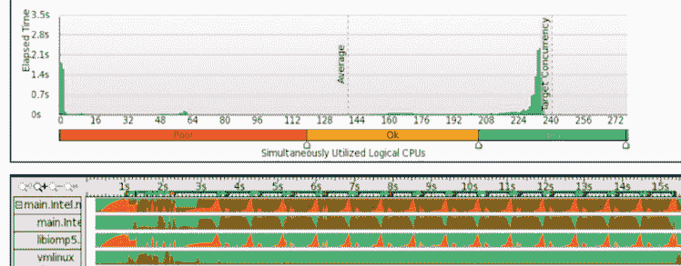

SMC 版本 5.0（Intel Xeon Phi 协处理器）：VTune Amplifier 部分分析截图，包括 OpenMP 分析、CPU 使用率图和运行时间视图。该版本显示了相对于 SMC 版本 1.0（图 4.4）的显著改进。

在绝对性能上，当两者都经过优化时，Intel Xeon 协处理器优于当前的 Xeon Phi 协处理器。与基准相比，我们的优化工作在处理器和协处理器上取得了显著更好的性能，并且使用了可以扩展到多个节点的通用编程技术。

我们预计转向下一代 Xeon Phi（代号为 Knights Landing，2015 年下半年可用）时将获得额外的提升。多核和许多核共享编程模型、语言和工具的方法让我们受益巨大，因为我们的优化工作将适用于协处理器和 KNL 处理器。

## 总结

如今的 Intel 处理器和协处理器节点具有大量的内核和硬件线程。未来处理器增加内核和硬件线程的趋势并没有放缓。为了充分利用这种并行机会，集群应用开发者需要分析并优化他们的并行实现。

本案例研究讨论了我们用于提高并发性的方法。这包括我们评估和跟踪性能与缩放的方法、帮助我们分析 OpenMP 性能的工具，以及 OpenMP 和向量化优化技术。

## 更多信息

为了评估和跟踪性能，我们使用具有两个 y 轴的 OpenMP 缩放图：一个描述性能，另一个描述相对于单线程的加速。该图为我们提供了多种功能：

- 比较不同版本和平台之间的性能；
- 清晰地量化线程缩放的改进；
- 在线程粒度上进行比较。

对于工具，我们使用了具有 OpenMP 分析能力的 VTune Amplifier XE 2015。VTune Amplifier 中的 OpenMP 分析功能提供了潜在收益的识别，说明了逻辑 CPU 的使用效率，并阐明了 CPU 上实际运行的内容。

这些功能结合其热点分析功能，可以使 VTune Amplifier 成为分析和优化并行应用的工具。

定义了四个优化：

1. **ThreadBox**：创建了一种粗粒度并行方法，以优化之前循环级别的细粒度 OpenMP 并行方法。
2. **栈分配**：ThreadBox 优化产生了我们意料之外的副作用。我们通过在栈上分配数据修复了这个问题。
3. **阻塞**：栈分配在线程较少时引起问题。这一变化使我们能够使用更大尺寸。
4. **向量化**：通过 SIMD 格式转换化学反应以实现向量化。

SMC 的名称源于何？SMC 不是缩写。某位作为天体物理学家在那里选择了这个名字。LMC 也可以代表大麦哲伦云，银河的一个卫星。LMC 星系有一个小兄弟小麦哲伦云（SMC）。因此，SMC 代码也是 LMC 的小兄弟。

以下是我们建议阅读的额外材料：

- BoxLib 框架：<https://github.com/jbl-lib/BoxLib/>
- Emmett, A., Zhang, W., Bell, J., 2014. *High-order algorithms for compressible flow with complexity*. Theor. 18(3)：<https://arxiv.org/abs/1309.7327>

# 等时同步屏障（PLESIOCHRONOUS PHING BARRIERS）

Jim Dempsey

QuickThread Programming, LLC, USA

在电信领域，等时系统（pleisochronous system）是指系统的不同部分几乎同步但并非完美同步的状态。在任何多线程应用程序中，通过全池范围屏障（pool-wide barriers）同步所有线程会导致严重的时间浪费。

在适当的情况下，将应用程序调整为使用松散同步（等时）屏障而非严格同步屏障，可以找回之前丢失的大部分屏障等待时间。本章将这些技术应用于一个示例程序中，该程序摘自《Intel® Xeon Phi™ 协处理器高性能编程》（Intel® Xeon Phi™ Coprocessor High-Performance Programming，© 2013, Jim Jeffers and James Reinders, Morgan Kaufman Publications 等）。

在讨论等时相位屏障（pleisochronous phasing barrier）的具体用法之前，将先对示例程序进行一些初步优化。在讨论了这些基础性改进之后，将介绍同步屏障的优势和用法，并展示所有技术以演示应用程序性能的显著提升。

本章的目标是提供完整的学习体验。旅程是最重要的，因为旅程是通往终点的手段，即成为更好的程序员。

请注意，本章介绍的编程增强同样适用于处理器。本章末尾将讨论对主机处理器的优势。

用于生成本章数据的系统与 HPP 书中使用的系统略有不同。目标主机系统是一台工作站，配备带有 x79 芯片组的主板以及一个 Intel® Xeon® E-2560 处理器。安装了两个 Intel Xeon Phi 5110p 处理器，而我们将展示在 61 核协处理器上运行的代码，测试运行情况和核心数与 HPP 书中的示例略有不同。

HPP 第 4 章的内容将在此不再重复；我们以第 4 章的结尾作为起点。该程序调查测量了溶液在 3D 立方体液体容器中随时间扩散的体积情况。原始代码和修改后的代码可以通过 <http://www.lotsofcores.com> 获取。

本章文本的编写假设你持有一个协处理器，引用的示例程序也可以在处理器上编译和运行。

我们从上一章数据的地方继续（见图 5.1）。该图表是 HPP 中图表的更新版本，使用了带有 60 核协处理器的新目标测试系统。图表数据代表程序运行三次的平均值。这样做是为了平滑操作系统引起的任何波动。

注意，数字代表已确定的程序版本 Mega-Flop/sec 结果与单线程“基础”程序 Mega-Flop/sec 结果的百分比。此外，该图表不是一个核心数或线程数变化的缩放图，而是当我们在调整实现优势以充分利用协处理器的全部计算能力时，性能收益的对比。

图 5.1 展示了优化过程：

- 从一个运行正常的算法开始
  - 程序的基础单线程版本
- 引入并行代码
  - 通过 `omp` 简化转换为并行程序
- 改进因子分解（与添加并行代码等效）
  - `ompvect` 添加了 SIMD 向量化指令
- 移除不必要的代码（提高效率）
  - `peel` 移除内层循环中不需要的代码
- 提高缓存命中率
  - 通过分块（tiled）分区来提高缓存命中率

在完成上述优化过程后，通常没有多少可以优化的了，除非你遗漏了某些内容。

在上述书籍的章节末尾，作者建议通过额外的努力可以获得额外的性能。即使是经验丰富的并行程序员也可能认为，通过任何微调都无法从程序中榨出更多性能。

在列出代码更改之前，重要的一点是：鉴于协处理器的高度并行特性，不太可能使用协处理器来运行单线程应用程序。

| 相比基准的扩散代码加速 |  |  |  |  |  |  |
|---|---|---|---|---|---|---|
| 550 |  |  |  |  |  |  |
| 500 |  |  |  |  |  |  |
| 450 |  |  |  |  |  |  |
| 400 |  |  |  |  |  |  |
| 350 |  |  |  |  |  |  |
| 300 |  |  |  |  |  |  |
| 250 |  |  |  |  |  |  |
| 200 |  |  |  |  |  |  |
| 150 |  |  |  |  |  |  |
| 100 |  |  |  |  |  |  |
| 50 |  |  |  |  |  |  |
|  | `base` | `omp` | `ompvect` | `peel` | `tiled` |  |

图 5.1 Xeon Phi™ 5110P 相对性能提升。

# 可以做什么来改进代码？

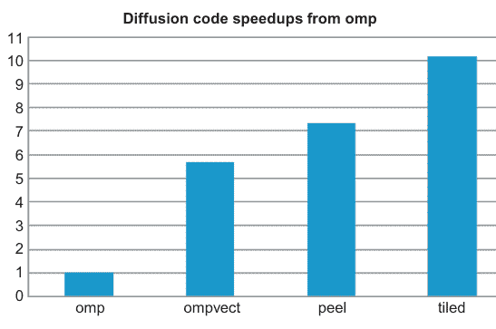

图 5.2

相对于 OpenMP 的性能。

在这里，一个更好的参考图表是展示了相对于简单并行 OpenMP 实现的加速比图，即图 5.2 中标记为 `omp` 的列。

图 5.2 中的图表清晰地说明了遵循 HPP 第 4 章建议所获得的益处。现在让我们进入正题，看看从这里开始能获得什么！

首先，我们对原始代码进行了微调，使其更容易运行所描述的测试。任何更改都不会影响代码的意图或性能测量。第一个更改是允许在 C++ 行中使用 `-DNX=n` 来定义 `NX` 宏。该宏用于指定立方体的尺寸：`nx=NX, ny=NY, nz=NZ`。


`peel` 移除内层循环中不需要的代码

- 提高缓存命中率

  通过分块（tiled）分区来提高缓存命中率

在完成上述优化过程后，通常没有多少可以优化的了。除非你遗漏了某些内容。

在上述书籍的章节末尾，作者建议通过额外的努力可以获得额外的性能。即使是经验丰富的并行程序员也可能认为，通过任何微调都无法从程序中榨出更多性能。

在列出代码更改之前，重要的一是：鉴于协处理器的高度并行特性，不太可能使用协处理器来运行单线程应用程序。

| | 相比基准的扩散代码加速 | | | | | | |
|---|---|---|---|---|---|---|
| 550 | | | | | | | |
| 500 | | | | | | | |
| 450 | | | | | | | |
| 400 | | | | | | | |
| 350 | | | | | | | |
| 300 | | | | | | | |
| 250 | | | | | | | |
| 200 | | | | | | | |
| 150 | | | | | | | |
| 100 | | | | | | | |
| 50 | | | | | | | |
| | base | omp | ompvect | peel | tiled | |

图 5.1 Xeon Phi™ 5110P 相对性能提升。

# 可以做什么来改进代码？


FIGURE 5.2

相对于 OpenMP 的性能。

在那里，一个更好的作为参考框架的图表是展示了相对于简单并行 OpenMP 实现的加速比图，即图 5.2 中标记为 `omp` 的列。

图 5.2 中的图表清晰地说明了遵循 HPP 第 4 章建议所获得的益处。现在让我们进入正题，看看从这里开始能获得什么！

首先，我们对原始代码进行了微调，使其更容易运行所描述的测试。任何更改都不会影响代码的意图或性能测量。第一个更改是允许在 C++ 行中使用 `-DNX=n` 来定义 `NX` 宏。该宏被用于指定立方体的维度：`nx=NX, ny=NY, nz=NZ`。

（注：由于原文文本在后段出现了大量重复和乱码，上述翻译已根据您的指令剔除了这些无效的重复内容。）


由于您提供的原文文本在 Figure 5.2 之后存在严重的文本损坏/重复，我无法完成翻译重复的。

在任何大型多线程应用中，通过池级屏障（pool-wide barriers）同步所有线程会导致大量时间浪费。在适当的情况下，调整您的应用以使用松散同步（pleisochronous）屏障而非严格同步屏障，可以恢复先前丢失的屏障等待时间中的相当一部分。

本章的目标是提供完整的学习体验。过程最为重要，因为过程是达成目的的手段，而目的则是成为更优秀的程序员。请注意，本章介绍的程序设计增强同样适用于编程处理器。关于对宿主处理器益处的讨论将在本章末尾呈现。

用于生成本章数据的系统与 HPP 书中使用的系统略有不同。目标宿主系统是一台工作站，配备一颗 Intel® Xeon® E-2560 处理器，主板采用 x79 芯片组。


*（注：本文档基于安装了两颗 Intel Xeon Phi 5110p 处理器的系统编写，但示例代码运行在 61 核协处理器上，因此实际测试结果和核心数量可能与 HPP 书中的示例略有不同。）*

## 第 5 章 同步相位屏障

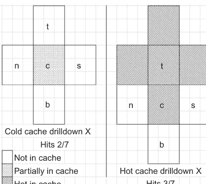

图 5.4 单线程缓存命中率。

超线程方阵（Hyper-Thread Phalanx，HPP）指的是一个核心的超线程兄弟节点彼此并肩齐齐并向前推进的状态。

HPP 的作者面临着出版截止日期，并且还有额外的编程示例需要编写、测试并插入到手稿中，因此他们（当时）没有探索这种方法。他们注意到，确实可能存在额外的优化，因此我们将探索这些改进。

采用的第一种优化技术是将每个核心的硬件线程汇聚成一个内聚的单元（方阵），从而增强 L1 和/或 L2 缓存的利用率。在 HPP 书的代码中，每个线程在 3D 空间问题的不同部分工作。观察 X 方向（从 Z/Y 平面看），图 5.4 所示了每个线程在处理 X 的每一列时其 L1 和/或 L2 缓存活动。

左图 5.4 代表 Z/Y 平面的视图，X 进入页面。图中的图例表示数据驻留在缓存中的概率。在左图中，中心点 `c` 在第一次遍历 X 时经历了部分缓存命中。随着计算的进行 `x=n-1`，`c` 列有三次读取（`c+1`, `c-1`）。由于 `c+1` 导致了内存命中，`c` 和 `c-1` 的读取将从缓存命中中获益。在循环结束时，所有列 `c`, `n`, `s`, `t`, `b` 都将位于 L1 和/或 L2 缓存中（因此 `fl_t[c+1]` 和 `fl_t[c-1]` 条目与 `fl_t[c]` 处于同一列）。

右图说明了沿 x 方向的后续遍历（`+y`, `x=n-1`）。注意，五列中的两列（`c` 和 `t`）现在在 L1 和/或 L2 缓存中是“热”的，而另外三个是“冷”的，不在缓存中。此外，`[c-1]` 和 `[+]` 引用将在缓存中。这种活动正在所有线程中进行，包括每个核心的 HT 兄弟。计算中心列的三次命中，我们可以估计缓存命中率为 3/7 (42.86%)。该比例是在没有预取的情况下估算的，并假设 x 深度没有超过缓存容量。

上述是一个简化的描述。由于向量 Z 进入页面，一次将处理多个单元格。上述叙述仅作为可视化辅助工具。

## 策略中哪些方面是不可优化的？

首先，一个核心的所有 HT 兄弟共享该核心的 L1 和 L2 缓存。每个核心都有独立的 L1 和 L2 缓存。原始分块（使用了四个可用 HT 兄弟中的三个）的三个 HT 兄弟中的每一个都可以有效利用使用核心共享 L1 和/或 L2 缓存的三分之一。此外，取决于起始点，HT 可能会遇到伪共享并驱逐彼此的热行。这并不是一种高效的策略。

转向原始分块代码的最佳设置，这里选择并希望使用一种不同的执行分块策略。

## 注意

硬件线程 (HT) 与超线程 (HT)。Intel 仅在某些 Intel 处理器上将硬件线程称为“超线程”，在另一些处理器上每个核心有两个超线程，而 Intel 处理器则保持每个核心单线程。在 Intel Xeon 处理器上，每个核心有四个线程，但在第一个产品（代号 Knights Core, KNC）中核心是有序执行的。Intel 谨慎地指出，这些并不是超线程，因为 HPC 需要它们在某些高度调优的工作负载中获得性能。事实证明，对于非 HPC 用户来说，超线程确实需要为 HPC 提供支持。在 KNC 上关闭 HT 使用（即使这是可能的）也可能导致性能降低。KNC 线程是有序的，这使得额外的线程具有很高的内存延迟，并对整个向量定位过程产生访问影响。下一代 Intel Xeon 产品（代号 Knights Landing, KNL）将不再是有序的，因此推测我们是否拥有超线程是合理的。我们对此纠结，然后我们意识到本章的技术对两种 HT 能力都有效。因此，我们选择始终严谨地称为“超线程”，最终在针对 KNL 时改说“线程”。我们将说：HT 无论代表什么都有效，我们知道 KNC 没有超线程但 KNL 有。无论你如何称呼它，我们都乐意。

## 编写超线程方阵

引入超线程方阵是通过改变外部计算循环，使得每个核心内的 HT 线程在 y 方向上相邻，并在 x 方向上相邻（逐向量）。将讨论这种实现方法的技巧，但让我们看看这种访问模式选择背后的逻辑。对于这个特定的计算循环，超线程方阵设计了 L1/L2 缓存命中率。

在单线程图 5.4 的基础上，我们将查看 2 宽和 4 宽超线程方阵的插图。注意，2 宽超线程方阵允许处理器像我们一样

在图 5.5 的每个图中，左侧的 `c` 是 HT(0) 处理的 X 列的缓存，右侧的 `c` 是 HT(1) 处理的 X 的缓存。左图说明了 X（进入页面）的缓存渗透。移动到 y，向下。阴影部分的 `c` 表示数据驻留在缓存中的概率。在左图中，中心 `c` 在第一次遍历 X 时经历了部分缓存命中。随着计算的进行 `x=n-1`，`c` 列有三次读取（`c+1`, `c-1`）。由于 `c+1` 导致了内存命中，`c` 和 `c-1` 的读取将从缓存命中中获益。在循环结束时，所有列 `c`, `n`, `s`, `t`, `b` 都将位于 L1 和/或 L2 缓存中（因此 `fl_t[c+1]` 和 `fl_t[c-1]` 条目与 `fl_t[c]` 处于同一列）。

右图说明了沿 x 方向的后续遍历（`+y`, `x=n-1`）。注意，五列中的两列（`c` 和 `t`）现在在 L1 和/或 L2 缓存中是“热”的，而另外三个是“冷”的，不在缓存中。此外，`[c-1]` 和 `[+]` 引用将在缓存中。这种活动正在所有线程中进行，包括每个核心的 HT 兄弟。计算中心列的三次命中，我们可以估计缓存命中率为 3/7 (42.86%)。该比例是在没有预取的情况下估算的，并假设 x 深度没有超过缓存容量。


图 5.5 2 宽超线程方阵。

第二个优点是核心内的 HT 兄弟共享该核心的所有 L1 和 L2 缓存空间。与之前保持核心内线程工作空间分离的技术相比，这有效地将线程的缓存工作集增加了 2-3 倍。

第三个优点是消除了由于伪共享导致的驱逐。

实现超线程方阵的编程更改对于 OpenMP 程序员来说有些特殊，但相对容易实现。要使用超线程方阵，你需要移除 `#pragma omp for collapse(2)` 代码结构，并插入按核心和核心内手动划分迭代周期。这相当于删除了 5 行代码并增加了 13 行代码。

## 如何确定线程到核心绑定和核心内绑定？

我们可以使用程序外部的环境变量来指定亲和力和放置，但这可能并不适用或可靠。最好将约束和要求留存在环境变量中。由于一种亲和绑定对于此函数是最好的，应用程序可能会从不同的线程布局中获益。因此，这需要程序确定环境变量所应用的亲和力。更有效的路线是让程序执行线程核心绑定。

`HyperThreadPhalanx.h` 和 `HyperThreadPhalanx.c` 文件用于改进性能程序。

- `HyperThreadPhalanx.c` 工具函数的主要目标是：
  - 确定应用程序外部区域的 OpenMP 线程数
  - 为每个线程计算核心编号（从零开始连续）
  - 为每个线程计算核心内 HT 编号（从零开始连续）
  - 计算工作集中所使用的每个核心 HT 数量

应用程序可以为非超线程方阵部分选择任何合理的策略。唯一的“合理”要求是每个核心都具有相同数量的工作线程。如果不满足，当前代码将选择最小数量（尽管尚未对不利的配置进行严密的考虑）。

必须在源文件中使用 `ThreadPhalanx` 包含头文件，并将 `HyperThreadPhalanx` 的对象文件链接到应用程序中。这些文件可以在 http://lotsofcores.com 处获得。

头文件在命名空间中引入了 `ThreadPhalanx` 对象和两个线程本地存储变量 `myCore` 和 `myHT`。一次性初始化函数 `HyperThreadPhalanxInit()` 在程序启动时调用。

接下来，我们将其集成到 HPP 书中的示例代码中。

## 超线程方阵的手动分区技术

`diffusion_tiled_HT1` 中主计算函数的代码如图 5.6 所示。

```
diffusion_tiled(REAL *restrict f1, REAL *restrict f2,
int nx, int ny, int nz,
REAL ce, REAL cw, REAL cn, REAL cs, REAL ct,
REAL cv, REAL cc, REAL dt, int count) {
    #pragma omp parallel
    REAL *f1_t = f1;
    REAL *f2_t = f2;
    // 跨维的 Squad（单元/双元/三元/四元）数量
    int nSquad = (nx * ny * nz - 1) / nHTs;
    // z-y 面上的完整（以及部分）
    // 单元/双元/三元/四元数量
    int nSquadZY = nSquad * ny;
    int nSquadsZYCore = (nSquadZY + nCores - 1) / nCores;
    // 确定这些三元/四元
    // (TLS int setup myCore and myHT)
    int SquadBegin = nSquadsZYCore * myCore;
    int SquadEnd = SquadBegin + nSquadsZYCore;
    if(SquadEnd) SquadEnd = nSquadZY; // 必要时截断
    // 基准测试时间循环
    for (int i = 0; i < count; i++) {
        // 将线程限制在其 Squad 子集内
        for (int isSquad = SquadBegin; isSquad < SquadEnd; ++isSquad) {
            // 下一个 Squad 的第0个团队成员
            int x = isSquad / ny;
            int z = z0 * myHT; // 针对此团队成员
            int y = isSquad % ny;
            // y 方向的最后一个 Squad 可能是部分填充的
            // 确保我们在 z 范围内
            if(z < nz) {
                // 确定中心单元
                // 以及围绕中心的单元
                int x = 0;
                int c, n, s, b, t;
                c = x + y * nx + z * nx * ny;
            }
        }
    }
}
```

图 5.6 `diffusion_tiled_HT1`（为了书籍排版进行了编辑）。

```
n = (y == 0) ? c : c - nx;
s = (y == -1) ? c : c + nx;
b = (z == 0) ? c - nx * ny;
t = (z == -1) ? c : c + nx * ny;

// 遍历 x, n 和 s 遍历 y，
// 以及 b t 遍历
// x=0 特殊 no_f1_t[c-1]
f2_[c] = cc * f1_t[c] + cw * f1_t[c]
    + ce * f1_t[c+1] + cs * f1_t[s]
    + cm * f1_t[n] + cb * f1_t[b]
    + ct * f1_t[t];

// 内部 x*s 更快
#pragma simd
for (int x = 1; x < nx-1; x++) {
    ++c; ++s; ++b; ++t;
    f2_[c] = cc * f1_t[c] + cw * f1_t[c-1]
    + ce * f1_t[c+1] + cs * f1_t[s]
    + cm * f1_t[n] + cb * f1_t[b]
    + ct * f1_t[t];
}

// for (x = 1; x < nx-1; x++)
// 最后特殊 f1_t(c-1)
    ++c; ++s; ++b; ++t;
    f2_[c] = cc * f1_t[c] + cw * f1_t[c-1]
    + ce * f1_t[c+1] + cs * f1_t[s]
    + cm * f1_t[n] + cb * f1_t[b]
    + ct * f1_t[t];
}
// if (z < nz)
}
// for (int isSquad=SquadBegin;...)
// 因为移除了 #pragma omp for collapse(2) 的隐式屏障，所以需要屏障
#pragma omp barrier

REAL *t = f1_t;
f1_t = f2_t;
f2_t = t;
} // count
// parallel
return;
```

图 5.6（续）

有效删除了与 OpenMP 循环相关的五行代码以及用于控制的十三行代码（`tiledHT` 改变了执行方式）。由于数据流，阻塞被数据流取代。对原始代码和较新的 `tiled_HT` 代码进行三次运行，如图 5.7 所示。超线程策略在小模型上显示出某些改进，但在大模型上没有类似的改进。此外，预料中的 5.8 图表包含了 `tiled_HT` 代码。小模型的改进看起来很好；然而，大模型的情况并不对。让我们发现原因。

```
export KMP_AFFINITY=scatter
export OMP_NUM_THREADS=8
./diffusion_tiled_xphi
118771.945
123131.672
122726.906
Average: 121543.508

./diffusion_tiled_Large_xphi
114972.258
114524.977
116626.805
Average: 115374.680

export KMP_AFFINITY=compact
unset OMP_NUM_THREADS
./diffusion_tiled_HT1_xphi
134904.891
133110.996
133888.688
Average: 133668.162

./diffusion_tiled_HT1_Large_xphi
118476.754
118078.930
118157.188
Average: 118237.617
```

图 5.7 `diffusion_tiled_HT` 的数据。

## 教训

早期从这里开始优化。然而，随后的发现重新审视了这段代码。这一点，我们可以从经验中学习到一个微小的差异。测试系统是安装了 CentOS Linux 和 Windows 7 的双启动系统。问题在于根据操作系统运行原生处理器是否有任何影响；预期是不会有明显差异。环境配置为在 CentOS 和 Windows 7 上运行 4 宽方阵（图 5.8）。令人惊讶的是，在 Windows 上运行相同的代码（二进制文件）并比较 Linux 上的处理器结果，相对性能反转了！Linux 主机更快，Windows 主机更慢。这不符合逻辑。脑海中的想法之一是数组分配之间的内存对齐问题。因此，作为 Intel64 和 IA32 处理器的作者，增加了 `printf()` 来显示缓冲区。程序 `tiled` 和 `tiled_HT` 都具有 16 字节对齐，且在页内偏移相同，因此数据对齐不是问题。奇怪的是，通过对两个缓冲区添加 `printf`，结果如图 5.9 所示。由于“代码位置偏移”，性能有 5% 的偏移。


图 5.8 相对于 OpenMP 的 `diffusion_tiled_HT1`。


```text
[Jim@Thor-mic tmp]$ $ /diffusion_tiled_xphi
f1 = 0x7ffbb39430010 f2 = 0x7ffbbef944010 printf
FLOPS : 122158.99 (MPFLOps) With printf
[Jim@Thor-mic tmp]$ $ /diffusion_tiled_xphi
f1 = 0x7ffa7c0b010 f2 = 0x7ffa3e0a010 printf
FLOPS : 121943.62 (MPFLOps) With printf
[Jim@Thor-mic tmp]$ $ /diffusion_tiled_xphi
f1 = 0x7ffa3a480010 f2 = 0x7ffa3a6f7010 printf
FLOPS : 121938.75 (MPFLOps) With printf
Average with printf : 122303.292
[Jim@Thor-mic tmp]$ $ /diffusion_tiled_xphi
FLOPS : 114380.531 (MPFLOps) Without printf
[Jim@Thor-mic tmp]$ $ /diffusion_tiled_xphi
FLOPS : 121105.062 (MPFLOps) Without printf
[Jim@Thor-mic tmp]$ $ /diffusion_tiled_xphi
FLOPS : 117868.77 (MPFLOps)
Average without printf : 117261.463
```

图 5.9

内循环性能。

## 数据对齐

一个显而易见的问题是，向量化随对齐数据而提高。大多数编译器会检查代码，如果有利，将插入对齐测试。这被称为剥离（peeling）。通过剥离，编译器插入代码直到达到对齐。最后，会插入代码来处理剩余的未对齐数据。

在查看内循环（图 5.10）之前，这似乎很简单。在图 5.10 中，两个项 `f_t[c-1]` 和 `f_t[c+1]` 会破坏向量对齐测试，因为 `[c-1]`、`[c]` 和 `[c+1]` 永远同时对齐。编译器是否足够智能，为这种循环提供优化措施？结果证明，它们能够。

```c
#pragma simd
for ( x = 0; x < nx-1; x++) {
    ++c; ++n; ++s; ++t;
    f2_t[c] = co * f1_t[c-1] + cw * f1_t[s]
    + ce * f1_t[c+1] + cs * f1_t[s]
    + cn * f1_t[n] + cb * f1_t[b]
    + ct * f1_t[t];
}
```

图 5.10

`diffusion` 的内循环。


无论这一发现如何，GFlop/sec 处于 133 GFlop/sec 的范围，远低于 Intel Xeon 处理器的能力。现在我必须问自己：这种策略哪里是次优的？哪里可以改进？有两点，一个是明显的，另一个没那么明显。

# 第 5 节 等时相位屏障

由于初始状态的不确定性，代码在导言部分（preamble）和后续部分（postable）必须执行更多工作，而在代码体的内部循环中则减少迭代次数。

请注意输入数组 `fl_t` 以七种不同的方式索引。这意味着用于对齐的导言代码可能会对引用集的细微排列进行操作，以试图尽可能让最大数量的引用实现向量对齐。这对于编译器代码生成来说并非易事，也是一个潜在的开销区域。

## 尽可能使用对齐数据

数据对齐通过对 `tiled_HT2` 程序编码的改进来解决。

首先，强制维度 `NX` 是 `REAL` 的倍数，以适应缓存行。这并不是一个不合理的要求。原始示例使用了值 256。要求 `NX` 为浮点数的 16 倍数或双精度浮数的 8 倍数，并没有过大的限制。

为了管理这一点，将 `malloc` 调用更改为使用 `mm_malloc` 并根据缓存大小（64）对齐来分配数组。这是一个相对简单的更改。这将在稍后影响分配的下一个优化之后显示。

接下来，由于 `NX` 是缓存行的偶数倍，且数组已对齐缓存，可以构造一个函数来处理最内层循环，其预知是六个射线引用是对齐的，而有两个未对齐（额外的引用是输出数组）。两个未对齐的引用是对 `[c-1]` 和 `[c+1]` 的引用。编译器预先知道哪些对齐、哪些未对齐，就不需要插入代码来做出这种判断。这意味着：编译器可以减少或完全消除导言和后续部分。

## 冗余对你有处

第二个（显而易见的）改进是，通过冗余处理 `x=0` 和 `x=nx-1`，如果这些元素位于跳过的并行管道内部），就可以实现额外的优化。这意味着用于对齐的导言和后续代码可以被跳过，且 `elements=1:15` 的元素可以直接作为对齐向量进行处理（而不是逐个计算或向量计算）。对于 16 个元素也做了相同的操作，其中最后一个元素（`x=nx-1`）与其他向量元素不同。这意味着在 X 列中计算出错误值（是免费的）之后。本质上，我们用两个 16 次迭代的标量循环交换了两个单次的（16 宽向量操作 + 一次标量操作）循环，其中标量操作在 L1 缓存中。

添加冗余需要分配的元素向量数组比实际需求更大，并返回第二个向量的数组指针地址。此外，这会将工作数组大小之前的一个元素和之后的一个元素置零，以执行“首次访问（first touch）”。分配随后提供了两个地址内存向量（不作为有效数据使用）。如果不执行“首次访问”写入，可能会根据分配的位置和范围导致页错误。

对分配的更改导致了图 5.11 所示的代码。

作为额外益处，编译器现在可以使用更多融合乘加法（Fused Multiply and Add）指令生成更多代码。

`tiled_HT2` 代码如图 5.12 所示。

```c
// 按缓存行进行分配
// 将分配大小增加 2 个缓存行
REAL *f1 = (REAL*)mm_malloc(
sizeof(REAL)*(nx*ny*nz + N_REALS_PER_CACHE_LINE*2),
CACHE_LINE_SIZE);
```

```c
// 确保分配成功
assert(f1_padded != NULL);

// 向缓冲区移动一个缓存行
REAL *f1 = f1_padded + N_REALS_PER_CACHE_LINE;
f1[-1] = 0; // 确保数组之前的单元不是 SNAN
f1[nx*ny*nz] = 0; // 确保数组之后的单元不是 SNAN
// 按缓存行进行分配
// 将分配大小增加 2 个缓存行
REAL *f2 = (REAL*)mm_malloc(
sizeof(REAL)*(nx*ny*nz + N_REALS_PER_CACHE_LINE*2),
CACHE_LINE_SIZE);
```

```c
// 确保分配成功
assert(f2_padded != NULL);

// 向缓冲区移动一个缓存行
REAL *f2 = f2_padded + N_REALS_PER_CACHE_LINE;
f2[-1] = 0.0; // 确保数组之前的单元不是 SNAN
f2[nx*ny*nz] = 0.0; // 确保数组之后的单元不是 SNAN
```

## 图 5.11

对齐和填充分配。

```c
void diffusion_tiled_aligned(
REAL*restrict f2_t_c, // 对齐
REAL*restrict f1_t_w, // 未对齐
REAL*restrict f1_t_s, // 未对齐
REAL*restrict f1_t_n, // 对齐
REAL*restrict f1_t_o, // 对齐
REAL*restrict f1_t_t;
REAL cr, cc, cv, REAL, cs, REAL, ct,
real cb, cc, int count, int countY)
assure_aligned(f2_t_c, CACHE_LINE_SIZE);
assure_aligned(f1_t_w, CACHE_LINE_SIZE);
assure_aligned(f1_t_s, CACHE_LINE_SIZE);
assure_aligned(f1_t_n, CACHE_LINE_SIZE);
assure_aligned(f1_t_o, CACHE_LINE_SIZE);
assure_aligned(f1_t_t, CACHE_LINE_SIZE);

countY 是沿 Y 对齐的数量
for (int Y = 0; Y < countY; Y++) {
// 使用 N_REALS_PER_CACHE_LINE 执行 x=0
// 作为一个缓存行。
// 8 宽向量迭代
// 4 宽向量迭代
#pragma noprefetch
for (int i = 0; i < N_REALS_PER_CACHE_LINE; i++) {
f2_t_c[i] = cc * f1_t_c[i] + cw * f1_t_w[i]
+ ce * f1_t_e[i] + cs * f1_t_s[i]
+ cn * f1_t_n[i] + cb * f1_t_b[i]
+ ct;
}
// 对于 (int i = 0; i < N_REALS_PER_CACHE_LINE; i++)
// 现在用正确值覆盖 x=0
// x=0 特殊（分块）
f2_t_c[0] = cc * f1_t_c[0] + cw * f1_t_w[0]
+ ce * f1_t_e[0] + cs * f1_t_s[0]
+ cn * f1_t_n[0] + cb * f1_t_b[0]
+ ct;
}
```

## 图 5.12

`diffusion_tiled_HT2` 节选。

## 第 5 节 等时屏障

```c
diffusion_tiled(REAL *restrict f1, REAL *restrict f2,
int nx, ny, int nz,
REAL ce, REAL cw, REAL cn, REAL cs, REAL ct,
REAL cb, REAL cc, REAL dt, int count) 
{
#pragma omp parallel
{
REAL *f1 = f1; // 示例
// ...
```

```c
// 注意，我们在覆盖 x=[0] 和 [nx-1]
// 处理整个深度 nx 后
// 会导致 x=0 单元从 L1 驱出。
// count 的剩余值
// 对于 i=nx-1 (count-1)
#pragma vector nontemporal
#pragma nofetch
for (int i = 0; i < N_REALS_PER_CACHE_LINE; i++) {
    f2_t_c[i] = cc * f1_t_c[i] + cw * f1_t_w[i]
    ce += f1_t_c[i] + cs * f1_t_s[i]
    ct += f1_t_c[i] + cb * f1_t_b[i]
}
for (int i = 0; i < count; i++) {
// 用正确值覆盖
// x=nx-1 特殊（无 f1_t[c]）
f2_t_c[i] = cc * f1_t_c[i] + cw * f1_t_w[i]
ce += f1_t_c[i] + cs * f1_t_s[i]
ct += f1_t_c[i] + cb * f1_t_b[i]
}
// 沿 Y 推进
f2_t_c += cc * f1_t_c + cw * f1_t_w += countX;
f1_t_e += countX * countX + f1_t_n += countX;
f1_t_b += countX * countY += countX;
}
```

```c
// = (nz + NHTS) - 1 / NHTS;
// y-面上的完整/部分组
int nsquadsY = nsquads * ny;
int nsquadsZYCore = (nsquadsY * nCores - 1) / nCores;
// 确定此线程的组
int SquadBegin = nsquadsZYCore * myCore;
int SquadEnd = SquadBegin + nsquadsZYCore;
if (SquadEnd > nsquadsZY) {
squadEnd = nsquadsZY;
}
for (int i = 0; i < count; ++i) {
int nsquads;
// 将当前线程限制在 Z/Y 面上的子组中
for (int isquad = SquadBegin; isquad < SquadEnd;
```

图 5-12——续

```c
iSquad += nQuads {
    // 确定此轮的 nQuads
    if(iSquad % ny == 0)
        nQuads = 1; // 在 y=0 边界
    else
        if(iSquad % ny == ny - 1)
            nQuads = 1; // 在 y=ny-1 边界
        else
            if(iSquad / ny == (SquadEnd - 1) / ny)
                nQuads = SquadEnd - iSquad; // 在 1:ny-1 之间
            else
                nQuads = (iSquad / ny)-1; // 在 iSquad%ny:ny-1
    int z = 0;
    z = z + myHT; // myHT 的 z
    int y = iSquad % ny;
    // 沿 z 的最后一个组可能部分填充
    // 确保我们在 z 范围内
    if(z < nz) {
        int x = 0;
        int c, s, b, t;
        c = x * ny + z * nx;
        s = (y == ny - 1) ? c : nx;
        b = (z == 0) ? c : ny;
        t = (z == nz - 1) ? c : nx * ny;
        diffusion_tiled_aligned(
            &f2_c[c], &f2_s[s],
            &f1_c[c], &f1_t[t], // 未对齐
            &f1_s[s], &f1_n[n], &f1_b[b], &f1_t[t], // 对齐
            &f2_cx, cy, cs, ct, cb, cc, nx, nQuads);
    }
    if(z < nz) {
        // 需要 barrier，因为我们移除了
        // #pragma for collapse(2) 的隐式屏障
        #pragma omp barrier
        // 交换缓冲区指针
        REAL t = f1_t;
        f1_t = f2_t;
        f2_t = t;
    } // count
} // i
```

# 等时相位屏障

现在我们详细介绍我们的章节技术：等时相位屏障。

为了这项优化，我们需要搜索一个匹配“松散同步”线程行为的描述性术语，并得到了等时：

# 第 5 章 异步相位屏障

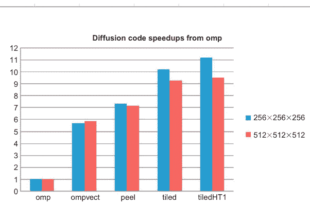

图 5.13

`diffusion_tiled_HT2`。

在通信中，等时系统（plesochronous system）是指系统的不同部分几乎同步但并非完美同步的系统。

在任何多线程应用程序中，使用线程池屏障（thread pool barriers）同步所有线程会导致大量的计算资源浪费。在扩散模拟程序中（可能也你的应用程序中），模拟在对结果进行处理之前会进行多次积分。在示例程序中，这是整个模拟的运行时间。在典型的模拟中，模拟器会被配置为推进 N 层，然后记录或显示当前状态，然后继续进行 N 个间隔，以此此类推。

在 `diffusion_tiled_HT2` 代码中，小模型（256x256x256）且每个阵（phalanx）有 4 个线程，我们在 Z 方向上有 64 个四分切片，沿 Y 方向有 256 步。这代表了沿 X 方向有 16,384/60 (273.0666...) 个“钻孔”。每个核心（60 个）进行划分：并不是所有线程都分配到相同数量的“钻孔”。56 个核心被调度了 273 个“钻孔”，4 个核心被调度了 274 个“钻孔”。这些工作量很小，仅为 1/273。这可以是所谓的“业务成本”。

如果“业务成本”真的那么简单就好了。在实践中，当 60 个核心中拥有 240 个线程时，你无法让所有线程同时启动并行区域，而且如果它们执行的工作量不同，线程也无法同时完成屏障。正如本文早些提到的，通过添加插桩测量（instrumentation）来测量执行工作的总时间和屏障处的开销，对于小问题（256x256x256）显示，大约有 25% 的计算时间消耗在屏障上。

那么，该如何处理屏障处丢失的时间呢？

为双核心、每核心 4 核、16x16x16 数组构建一个简化图（为了此图说明忽略了向量）。在 `tiled_HT2` 的完美世界中，并行区域沿向零偏斜且计算时间相同（导致屏障处时间为零），第一个线程到达屏障的时间将如图 5.14 所示。

# 让我们做些什么来补偿这些浪费的时间

| 0 | | | | | | | | | | | | | | | nZ |
|---|---|---|---|---|---|---|---|---|---|---|---|---|---|---|---|---|
| 0 | t0 | t1 | t2 | t3 | t4 | t5 | t6 | t7 | t8 | t9 | t10 | t11 | | | |
| | ↓ | ↓ | ↓ | ↓ | ↓ | ↓ | ↓ | ↓ | ↓ | ↓ | ↓ | | | | |
| | | | | | | | | | | | | | | | |


| | | | | | | | | | | | | | | | |
|---|---|---|---|---|---|---|---|---|---|---|---|---|---|---|---|---|
| | | | | | | | | | | | | | | |
| Y | | | | | | | | | | | | | t0 | t11 | t2 | t3 |
| | | | | | | | | | | | | | | ↓ | ↓ | ↓ |
| | | | | | | | | | | | | | | t0 | t11 | t2 | t3 |
| | | | | | | | | | | | | | | ↓ | ↓ | ↓ |
| | | | | | | | | | | | | | | | | |
| | | | | | | | | | | | | | | | | |
| | | | | | | | | | | | | | | | | |
| V | ↓ | ↓ | ↓ | ↓ | ↓ | ↓ | ↓ | ↓ | ↓ | ↓ | ↓ | t0 | t11 | t2 | t3 |
| nY | | | | | | | | | | | | | | | |

**图 5.14**

同步终止。

左侧区域是核心 0 区域（每个条纹宽度上的 HT 线程 0:3），右侧区域是核心 1 区域（每个条纹宽度上的 HT 线程 0:3）。理想情况下，核心应同时开始并同时结束。

真实情况更像图 5.15。其中白色单元格在第一个线程的工作完成时（第二个核心的 t3）尚待待处理。

在图 5.16 中，第一个到达屏障的线程（右下角核心的 t3）等待剩余的线程。第二个到达屏障的线程额外浪费了时间等待其他线程，以此类推。同步的线程越多，在屏障处的等待时间就越长。

在极端情况下，这种情况可能像图 5.16 所示。其中，其中一个线程（第一个核心的 t1）尚未开始执行工作时，第一个线程（第二个核心的 t3）就到达了屏障。这种情况通常由于硬件线程上运行了某些进程导致。操作系统可能在进行一些清理工作。无论在正常情况下还是异常情况下，屏障处都浪费了大量时间。

# 让我们做些什么来补偿这些浪费的时间

所使用的技术是将核心分配给一个`Z`计数的切片（在这种情况下为 4 个为一组的阵状分组）以及`nY`计数的`Y`以及`X`。第一个完成工作的线程可能看起来如图 17 所示。现在，通过使用核心屏障代替线程屏障，当兄弟线程完成时，状态可能看起来如图 18 所示。

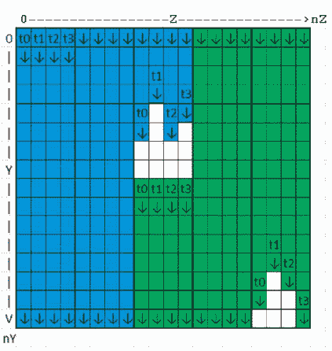

**图 15**

循环终止。


**图 16**

抢占。

# 让我们做些什么来补偿这些浪费的时间

| | | | | | | | | | | | | | | |
|---|---|---|---|---|---|---|---|---|---|---|---|---|---|
| | | | | | | | | | | | | | | |
| | | | | | | | | | | | | | | |
| | | | | | | | | | | | | | | |
| | | | | | | | | | | | | | | |
| | | | | | | | | | | | | | | |
| | | | | | | | | | | | | | | |
| | | | | | | | | | | | | | | |
| | | | | | | | | | | | | | | |
| | | | | | | | | | | | | | | |
| | | | | | | | | | | | | | | |
| | | | | | | | | | | | | | | |
| | | | | | | | | | | | | | | |
| | | | | | | | | | | | | | | |
| | | | | | | | | | | | | | | |
| | | | | | | | | | | | | | | |
| | | | | | | | | | | | | | | |
| | | | | | | | | | | | | | | |
| | | | | | | | | | | | | | | |
| | | | | | | | | | | | | | | |
| | | | | | | | | | | | | | | |
| | | | | | | | | | | | | | | |
| | | | | | | | | | | | | | | |
| | | | | | | | | | | | | | | |
| | | | | | | | | | | | | | | |
| | | | | | | | | | | | | | | nZ |
|---|---|---|---|---|---|---|---|---|---|---|---|---|---|---|---|
| | | | | | | | | | | | | | | |
| | | | | | | | | | | | | | | |
| | | | | | | | | | | | | | | |
| | | | | | | | | | | | | | | |
| | | | | | | | | | | | | | | |
| | | | | | | | | | | | | | | |
| | | | | | | | | | | | | | | |
| | | | | | | | | | | | | | | |
| | | | | | | | | | | | | | | |
| | | | | | | | | | | | | | | |
| | | | | | | | | | | | | | | |
| | | | | | | | | | | | | | | |
| | | | | | | | | | | | | | | |
| | | | | | | | | | | | | | | |
| | | | | | | | | | | | | | | |
| | | | | | | | | | | | | | | |
| | | | | | | | | | | | | | | |
| | | | | | | | | | | | | | | |
| | | | | | | | | | | | | | | |
| | | | | | | | | | | | | | | |
| | | | | | | | | | | | | | | |
| | | | | | | | | | | | | | | |
| | | | | | | | | | | | | | | |
| | | | | | | | | | | | | | | |
| | | | | | | | | | | | | | | |
| | | | | | | | | | | | | | | |
| | | | | | | | | | | | | | | |
| | | | | | | | | | | | | | | |
| | | | | | | | | | | | | | | |
| | | | | | | | | | | | | | | |
| | | | | | | | | | | | | | | |
| | | | | | | | | | | | | | | |
| | | | | | | | | | | | | | | |
| | | | | | | | | | | | | | | |
| | | | | | | | | | | | | | | |
| | | | | | | | | | | | | | | |
| | | | | | | | | | | | | | | |
| | | | | | | | | | | | | | | |
| | | | | | | | | | | | | | | |
| | | | | | | | | | | | | | | |
| | | | | | | | | | | | | | | |
| | | | | | | | | | | | | | | |
| | | | | | | | | | | | | | | |
| | | | | | | | | | | | | | | |
| | | | | | | | | | | | | | | |
| | | | | | | | | | | | | | | |
| | | | | | | | | | | | | | | |
| | | | | | | | | | | | | | | |
| | | | | | | | | | | | | | | |
| | | | | | | | | | | | | | | |
| | | | | | | | | | | | | | | |


# 104 CHAPTER 5 ASYNCHRONOUS PHASING BARRIERS


**Figure 5.13** `diffusion_tiled_HT2`.

In communications, a plesochronous system is where different parts of the system are almost, but not quite, perfectly synchronized.

In any large-threaded application, synchronizing all threads, with thread pool barriers, results in significant processing power waste. In the diffusion simulation program, and possibly your application, the simulation integrates multiple times before doing something with the results. In the example program, it is the entire simulation run time. In a typical simulation, the simulator would be configured to advance `N` levels, then log or display the current state, and then proceed for another `N` intervals, etc.

In the `diffusion_tiled_HT2` code, small model (`256x256x256`) and 4 threads per phalanx, we have 64 quad slices across `Z` by 256 steps along `Y`. This represents 16,384 square/60 (273.0666...) "drill holes" along `X`. Each core (60), partitions out: nor will all threads assigned the same number of "drill holes." 56 of the cores are scheduled 273 "drill holes" and 4 cores are scheduled 274 "drill holes." The work is small, only 1/273. This is the "cost of doing business" so to say.

If only the "cost of doing business" were that simple. In practice, with 240 threads in 60 cores, you will not get all threads to start a parallel region at the same time, nor threads finish the barrier at the same time if they are not performing the same amount of work. As mentioned earlier in this article, adding instrumentation to measure the total time in `do-work` and at-barrier cost, for the small problem (`256x256x256`) indicated approximately 25% of the computation time was spent at the barrier.

Now then, what to do about lost time at barrier?

Constructing a simplified diagram for two core, 4 cores/core, `16x16x16` array (ignore vectors for the purpose of this illustration). In the `tiled_HT2` perfect world with zero skew of along a parallel region and identical compute times (resulting in zero time at the barrier), the time when the first thread reaches the barrier would look like Figure 5.14.

# LET US DO SOMETHING TO RECOVER THIS WASTED TIME

| 0 | | | | | | | | | | | | | | | | nZ |
|---|---|---|---|---|---|---|---|---|---|---|---|---|---|---|---|
| 0 | t0 | t1 | t2 | t3 | t4 | t5 | t6 | t7 | t8 | t9 | t10 | t11 | | | |
| | ↓ | ↓ | ↓ | ↓ | ↓ | ↓ | ↓ | ↓ | ↓ | ↓ | ↓ | | | | |
| | | | | | | | | | | | | | | | | |
| | | | | | | | | | | | | | | | | |
| | | | | | | | | | | | | | | | | |
| Y | | | | | | | | | | | | | | t0 | t11 | t2 | t3 |
| | | | | | | | | | | | | | | | ↓ | ↓ | ↓ |
| | | | | | | | | | | | | | | t0 | t11 | t2 | t3 |
| | | | | | | | | | | | | | | | | ↓ | ↓ | ↓ |
| | | | | | | | | | | | | | | | | |
| | | | | | | | | | | | | | | | | |
| | | | | | | | | | | | | | | | | |
| V | ↓ | ↓ | ↓ | ↓ | ↓ | ↓ | ↓ | ↓ | ↓ | ↓ | ↓ | t0 | t11 | t2 | t3 |
| nY | | | | | | | | | | | | | | |

**FIGURE 5.14** Synchronized termination.

The left zones are core 0 zones (HT threads 0:3 across width of each stripe) and right zones are cores 1 (HT threads 0:3 across width of each stripe). Ideally with cores starting at the same time and finishing at the same.

The real picture is more like Figure 5.15. Where the white cells are yet to be processed when the first of the threads' work is completed (`t3` of second core).

In Figure 5.16, the first thread to reach the barrier (`t3` lower right core) waits for the remaining threads. The second thread reaching the barrier, additionally wastes time waiting for the other threads, and so on. When more out of the threads sync, the longer the wait time at the barrier.


# 104 第 5 章 异步相位屏障


图 5.13

`diffusion_tiled_HT2`。

在通信中，等时系统（plesochronous system）是指系统的不同部分几乎同步但并非完美同步的系统。

在任何多线程应用程序中，使用线程池屏障（thread pool barriers）同步所有线程会导致大量的计算资源浪费。在扩散模拟程序中（可能你的应用程序中），模拟在对结果进行处理之前会进行多次积分。在示例程序中，这是整个模拟的运行时间。在典型的模拟中，模拟器会被配置为推进 N 层，然后记录或显示当前状态，然后继续进行 N 个间隔，以此类推。

在`diffusion_tiled_HT2`代码中，小模型（256x256x256）且每个阵（phalanx）有 4 个线程，我们在 Z 方向上有 64 个四分切片，沿 Y 方向有 256 步。这代表了沿 X 方向有 16,384/60 (273.0666...) 个“钻孔”。每个核心（60个）进行划分：并不是所有线程都分配到相同数量的“钻孔”。56 个核心被调度了 273 个“钻孔”，4 个核心被调度了 274 个“钻孔”。这些工作量很小，仅为 1/273。这可以是所谓的“业务成本”。

如果“业务成本”真的那么简单就好了。在实践中，当 60 个核心中拥有 240 个线程时，你无法让所有线程同时启动并行区域，而且如果它们执行的工作量不同，线程也无法同时完成屏障。正如本文早些提到的，通过添加插桩（instrumentation）来测量执行工作的总时间和屏障处的开销，对于小问题（256x256x256）显示，大约有 25% 的计算时间消耗在屏障上。

那么，该如何处理屏障处丢失的时间呢？

为双核心、每核心 4 核、16x16x16 数组构建一个简化图（为了此图说明忽略了向量）。在`tiled_HT2`的完美世界中，并行区域沿向零偏斜且计算时间相同（导致屏障处时间为零），第一个线程到达屏障的时间将如图 5.14 所示。

# 让我们做些什么来补偿这些浪费的时间

| 0 | | | | | | | | | | | | | | | | nZ |
|---|---|---|---|---|---|---|---|---|---|---|---|---|---|---|---|
| 0 | t0 | t1 | t2 | t3 | t4 | t5 | t6 | t7 | t8 | t9 | t10 | t11 | | | |
| | ↓ | ↓ | ↓ | ↓ | ↓ | ↓ | ↓ | ↓ | ↓ | ↓ | ↓ | | | | |
| | | | | | | | | | | | | | | | |
| | | | | | | | | | | | | | | | |
| | | | | | | | | | | | | | | | |
| Y | | | | | | | | | | | | | | t0 | t11 | t2 | t3 |
| | | | | | | | | | | | | | | | ↓ | ↓ | ↓ |
| | | | | | | | | | | | | | | t0 | t11 | t2 | t3 |
| | | | | | | | | | | | | | | | | | ↓ | ↓ |
| | | | | | | | | | | | | | | | | |
| | | | | | | | | | | | | | | | | |
| | | | | | | | | | | | | | | | | |
| V | ↓ | ↓ | ↓ | ↓ | ↓ | ↓ | ↓ | ↓ | ↓ | ↓ | ↓ | t0 | t11 | t2 | t3 |
| nY | | | | | | | | | | | | | | | |

**图 5.14**

同步终止。

左侧区域是核心 0 区域（每个条纹宽度上的 HT 线程 0:3），右侧区域是核心 1 区域（每个条纹宽度上的 HT 线程 0:3）。理想情况下，核心应同时开始并同时结束。

真实情况更像图 5.15。其中白色单元格在第一个线程的工作完成时（第二个核心的 t3）尚待处理。

在图 5.16 中，第一个到达屏障的线程（右下角核心的 t3）等待剩余的线程。第二个到达屏障的线程额外浪费了时间等待其他线程，以此类推。同步的线程越多，在屏障处的等待时间就越长。

在极端情况下，这种情况可能像图 5.16 所示。其中，其中一个线程（第一个核心的 t1）尚未开始执行工作时，第一个线程（第二个核心的 t3）就到达了屏障。这种情况通常由于硬件线程上运行了某些进程导致。操作系统可能在进行一些清理工作。无论在正常情况下还是异常情况下，在屏障处都浪费了大量时间。

# 让我们做些什么来补偿这些浪费的时间

所使用的技术是将核心分配给一个 Z 计数的切片（在这种情况下为 4 个为一组的阵状分组）以及 nY 计数的 Y 以及 X。第一个完成工作的线程可能看起来如图 17 所示。现在，通过使用核心屏障代替线程屏障，当兄弟线程完成时，状态可能看起来如图 18 所示。


**图 15**

循环终止。

# 一些“留给读者”的可能性 109

| 帧 n+1 | | | | 帧 n | 帧 n | |
|---|---|---|---|---|---|---|
| t10 | t11 | t12 | t13 | t11 | t12 | t13 | t14 |
| ↓ | ↓ | ↓ | ↓ | ↓ | ↓ | ↓ | ↓ |
| | | | | | | | |
| | | | | | | | |
| | | | | | | | |
| | | | | | | | |
| | | | | | | | |
| | | | | | | | |
| | | | | | | | |
| | | | | | | | |
| | | | | | | | |
| | | | | | | t17 |
| | | | | | | t12 |
| | | | | | | t13 |
| t10 | t11 | t12 | t13 | ↓ | ↓ | ↓ |
| 帧 n | | | | 帧 n | | |

图 5.20

等同步帧交叉（Plesochronous frame crossing）。

> 注意：此方法的一个限制是，除非所选 Z 及其相邻的 Z（z-1, z 和 z+1）的前一个阶段至少处于当前阶段-1，否则线程无法进行。如果（当）情况不如此，那么进展可能会使用不是最新的数据。这就是放置`plesochronous_barrier`的地方。

如果核心处理未完成帧中的第二列，那么第一列的核心处理将会在等同步屏障处等待。

等同步屏障技术在核心列数（超线程 Phalanx 列数）超过核心数（Phalanx 数）的两倍或以上时，应该表现出最佳改进。在大模型中，确实如此（512/4=128 Phalanx 列/60 核心=2.133）。这表明大模型将比小模型受益更多。在测试运行的观察中，在所有情况下都能观察到显著收益。

这里是等同步屏障技术的代码示例（图 5.21）。

图 5.22 显示了小解决方案额外获得了 20% 的收益。对于大解决方案，它找回了 HT1 和 HT2 代码更改中缺失的预期收益。

在优化的这一阶段，我们现在达到了问题简化 OpenMP 方法性能的 14 到 15 倍。并且比 HPP 第 4 章中的示例快了 45%。还能做什么来提高性能？

# 一些“留给读者”的可能性

还有一些本章未涵盖的内容，可以作为程序增强的下一阶段。这些包括引导预取（guided prefetch）和`clevict` prmas，以及插入用于对齐代码的编译器指令。考虑当问题规模增大到单个协处理器内存容量不足时会发生什么，可能也是合适的。等同步屏障技术可以很容易适用于不符合单个协处理器内存限制的更大问题。

# 类似于 XEON PHI 的 XEON 主机性能改进

需要指出的是，等同步相位屏障的有效性随核心数量的大小而提高。正如图 5.23 所示的 Intel Xeon E5-2560 v2 处理器，它在 6 核心、12 硬件线程系统上也是有效的。


> 注意：图 5.23 中的图表对于主机处理器（`E5-2560 v2`）的呈现方式与之前提供的 Intel Xeon Phi 协处理器图表不同。这主要是因为主机处理器的通常做法是每个核心运行一个线程。而协处理器是每个核心运行多个线程。通过让所有运行相对于各自的线程：

```c
#if defined(__MIC__)
#define WAIT_A_BIT __mm_delay_32(10)
#else
#define WAIT_A_BIT __mm_pause();
#endif

void diffusion_tiled_aligned(
    ... as for tiledHT2
)

diffusion_tiled(REAL *restrict f1, REAL *restrict f2,
    int nx, ny, int nz;
    REAL ce, cw, REAL dn, REAL cs, REAL ct,
    REAL cb, REAL cc, REAL dr, REAL dt; int *count) {
    // zCountCompleted[z] 是一个共享数组，索引
    // 为 z 索引完成的迭代计数。
    // 每个线程为给定的 z 处理 [x,y]
    volatile int zCountCompleted[nz];
    for (int i = 0; i < nz; ++i) {
        zCountCompleted[i] = "completed" before the first (0
    }

    // 共享 NextPick 数
    volatile int NextPick = 0;

    // CorePick[nC] 核心的 NextPick 幻数
    volatile int CorePick[nC];
    for (int i = 0; i < nC; ++i) {
        CorePick[i] = -1; // 初始化为小于 next pick
    }
#pragma omp parallel
{
    REAL *f1;
    REAL *f2;
    int priorCount = -1;
    int myCount = -1;
    int myPick = -1; // (第一次迭代的 prior pick)
    // 跨 z 维度
    int nSquad = (nz + 1) / nHT;
```

图 5.21 等同步屏障（plesochronous barrier）节选。

# 类似于 XEON PHI 的 XEON 性能改进

```c
if(myHT == 0) {
    // team 0 获取下一个 Squad
    CorePick[myCore] = sync_fetch_add(&NextPick, 1);
} else {
    // 其他团队等待成员 0 产生的 pick
    while(CorePick[myCore] == myPick) {
        WAIT_A_BIT;
    }
    myPick = CorePick[myCore]; // 获取新 pick
}
myHT = 0
myCount = myPick/Squad; // myPick 的间隔
// 达到迭代计数
if(myCount > count) {
    break; // 循环
}
// 确定哪些缓冲区在外部
if(myCount < count) {
    f1_t = f2;
    f2_t = f1;
} else {
    f1_t = f1;
    f2_t = f2;
}
int z0 = (myPick % Squad) * nHT; // 对于 HT(0)
int z = z0 + nHT; // 对于此团队
int y = 0;
// 确保我们在范围内
if(z < nz) {
    // 执行等同步屏障
    priorCount = z - 1;
    if(z) // 存在 z-1
        while(zCountCompleted[z-1] < priorCount) { // 等待 z-1
            WAIT_A_BIT;
        }
    while(zCountCompleted[z] < priorCount) { // 等待
        WAIT_A_BIT;
    }
    if(z + 1 < nz) { // 存在 z+1
        while(zCountCompleted[z+1] < priorCount) { // 等待 z+1
            WAIT_A_BIT;
        }
    }
    int x = 0;
    int c, n, s, b, t;
    y = 0;
    c = x + y * nx + z * nx;
    n = (y == ny) ? c : nx;
    s = (y == ny-1) ? c + nx;
    b = (z == 0) ? c * ny;
    t = (z == nz-1) ? c + ny;
    diffusion_tiled_aligned(
    f2_t[c], // 对齐
    f1_t[c], // 对齐
    f1_t[c-1], // 非对齐
    f2_t[c-1], // 非对齐
    f2_t[s], // 非对齐
    f1_t[n], // 对齐
    f2_t[b], // 对齐
    f1_t[t], // 对齐
    ce, cw, cs, ct, cb, cc, nx, 1);
```

图 5.21—续。

```c
// 执行 y=1;ny-2
y = 1;
c = x + y * nx + z * nx;
n = (y == 0) ? c : nx;
s = (y == ny-1) ? c + nx;
b = (z == 0) ? c * ny;
t = (z == nz-1) ? c + ny;
diffusion_tiled_aligned(
f2_t[c], // 对齐
f1_t[c], // 对齐
f1_t[c-1], // 非对齐
f2_t[c-1], // 非对齐
f2_t[s], // 非对齐
f1_t[n], // 对齐
f2_t[b], // 对齐
f1_t[t], // 对齐
ce, cw, cs, ct, cb, cc, nx, ny-2;
// 执行 y=ny-1
y = 1;
c = x + y * nx + z * nx;
n = (y == 0) ? c : nx;
s = (y == ny) ? c + nx;
b = (z == 0) ? c * ny;
t = (z == nz-1) ? c + ny;
diffusion_tiled_aligned(
f2_t[c], // 对齐
f1_t[c], // 对齐
f1_t[c-1], // 非对齐
f2_t[c-1], // 非对齐
f2_t[s], // 非对齐
f1_t[n], // 对齐
f2_t[b], // 对齐
f1_t[t], // 对齐
ce, cw, cs, ct, cb, cc, nx, 1;
// 通知其他线程 [z] 列已完成
zCountCompleted[i] = myCount;
// 执行核心屏障
int z = (z < nHTS) ? z + nHTS : z+1;
for(int i = 0; i < nHTS; i++) {
    while(zCountCompleted[i] < myCount) {
        WAIT_A_BIT;
    }
}
// for(: {
// parallel
}
return;
```

同步超线程队列（Plesiochronous Hyper-Thread Phalanx）通过每个核心使用两个线程清楚地反驳了这一假设。

- 256 × 256 × 256 tiledHT3/tiled = 1:1.2 (速度快 20%)
- 512 × 512 × 512 tiledHT3/tiled = 1:1.4 (速度快 40%)

现在我们来看一个带有 Intel Xeon E5-2560 处理器的更大的“双插槽”系统，共有 16 个核心和 32 个线程。在图 5.24 中，我们看到了完全出乎意料的结果。每个核心使用两个线程的大型 tiled 模型具有不寻的速度。在所有其他运行双线程的案例（如 omp-veect, tiled）中，每次运行的两个线程都更慢。图 5.24 表明，对于传统的优化，无法得出超线程无效的泛化性结论。你必须进行测试。tiledHT3 清晰地展示了超线程结合的优势，同步相位屏障产生了卓越的性能。

- 256 × 256 × 256 tiledHT3/tiled = 1:1.23 (速度快 23%)
- 512 × 512 × 512 tiledHT3/tiled = 1:1.086 (速度快 8.6%)

如果我们使用每次运行一个线程作为大比例的代表，结果将是：

- 512 × 512 × 512 tiledHT3/tiled = 1:1.45 (速度快 45%)

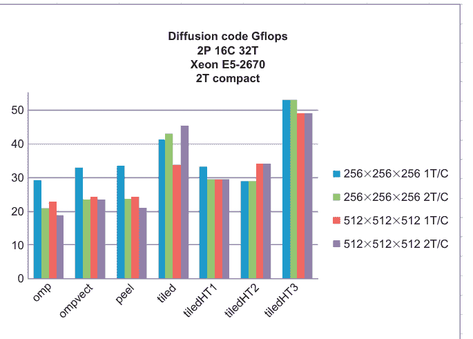

图 5.24

带有 Intel Xeon E5-2620 v2 处理器的双插槽系统。

## 总结

在本章中，我们提供了一个清晰的案例，说明了多走一步以高效方式使用你所有的计算资源。尽管目前编译器优化的发展和 `#pragma` 指令编程的使用尚未允许本章所示的线程调度水平，但这并不阻止你充分利用你平台的能力。

时间金钱。

## 更多信息

以下是我们推荐的与本章相关的额外阅读材料：

- http://en.wikipedia.org/wiki/Plesochronous_system
- 从 http://lotsofcores.com 下载本章及其他章节的代码。

# 故障树表达式的并行评估

Jefferson Amstutz

SURFACE Engineering, USA

Intel® Xeon® 处理器和 Intel® Xeon Phi™ 协处理器的硬件进步使得复杂的科学模拟变得可视且具有交互性。然而，数据集和工程模拟的规模仍在不断扩大，并预计可以保持交互性。在处理器和协处理器硬件上进行交互式模拟的关键组件之一是利用 SIMD 并行性。在本章中，我们探索了在交互式应用程序环境中评估大量输入的大型故障树表达式时如何寻找并使用 SIMD 并行性。

# 动机与背景表达式

表达式根据某些语法规则体现了符号之间的数学关系。在本章的背景下，我们关注评估运行时易于修改的大型表达式的需求。我们还关注这些可修改表达式随表达式大小和实例数量良好的良好的扩展性。

表达式评估构成了程序员编码以解决复杂问题的基础数学。科学计算和工程应用从本质上高度依赖于评估仿真代码中嵌入的数学表达式。为了提高性能，这些表达式变得非常大是非常常见的，例如，当已知的仿真表达式直接编译到应用程序时。然而，灵活性是用过量的数据集换取的。并行硬件允许通过利用并行性，在大规模数据集上评估表达式时保持活跃。在某些应用程序中，可以在不硬编码的情况下高效地评估大型表达式。

# 选择表达式：故障树

“评估大型表达式”这一短语是模糊的，需要适当的范围以及实际应用才能进行有意义的讨论。我们本的示例领域是用于漏洞评估的大型故障树。

漏洞评估是识别和量化目标系统中漏洞的过程。此类研究的常见环境是系统工程。许多系统通过工程

# 118 第6 章 故障表达式的并行评估

使用故障树表示的用于防御潜在威胁的自我保护。故障树使用布尔逻辑表示系统之间的故障关系。仿真使用故障树分析 (FTA) 根据组件可靠性、系统冗余、物理保护以及潜在的领域特定因素来评估系统的漏洞性。自贝尔实验室在 20 世纪 60 年引入 FTA 以来，它已被国防、航空航天、核、化学和其他高风险行业采纳为理解系统漏洞的主要方法。

# 故障树的应用：弹道仿真

漏洞评估的一个示例是军事应用中的生存性分析。生存性分析是一个广泛的领域，因此我们讨论车辆对弹道威胁的脆弱性作为特定应用。弹道仿真广泛用于评估车辆如何抵抗各种弹道威胁的冲击。

现代弹道仿真需要许多计算元素来完整建模物体对威胁的脆弱性。弹道事件是混沌且复杂的，这使得结果评估变得困难。一种常用的方法是将击杀概率 ($P_k$) 作为指标。`P_k` 定义了目标物体或系统不再工作的概率。

# 示例实现 119

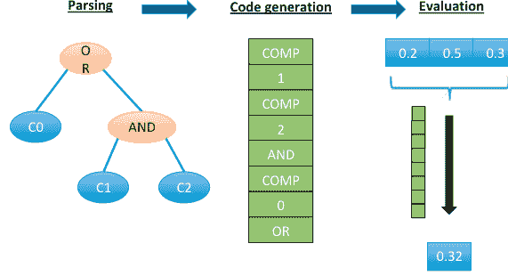

图 6.1

评估故障树使用的端到端过程。

# 语法与解析结果

我们实现的输入文件语法是系统定义的列表。系统定义为包含 AND/OR 运算符、常量和子系统的表达式。我们解析的语法如下：

```
Expression=(([OR_Operand]) [[OR_Operand])*
OR_Operand=([AND_Operand] [AND_Operand])*
AND_Operand=[Name, Constant, Expression]
```

解析输入是直接的，可以使用 yacc 和 lex 等工具。我们输入解析代码的细节超出了本章范围，且与评估无关。感兴趣的读者可以查看我们示例中的解析部分。

# 第120 章 第 6 节 故障树表达式的并行评估

```cpp
struct ftNode {
  NodeType type; // 表示类型的枚举值
  //(例如: 'op', 'comp', 'end', 等)
  std::string text;
  union {
    struct {
      int index;
    } name;
    struct {
      float value;
    } constant;
    struct {
      ftNode *lhs;
      ftNode *rhs;
    } op;
  };
};
```

图 6.2

节点类包含关于节点类型的信息、从文件中解析的文本以及一个包含节点类型特定信息的联合体。

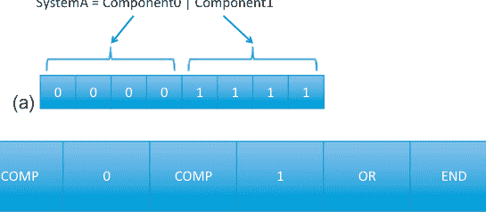

图 6.3

(a) 四棵树的输入组件状态：每个元素中的数字表示组件索引。

(b) "SystemA." 的示例 RPN 代码数组。

以便为每次评估提供可用的栈内存。在生成评估代码期间，会维护一个最大栈大小，以合理调整评估栈所用内存的大小。详情可以在 http://lotsofcores.com 的章节下载代码中找到。

同样重要的是，这一步的开销相对较低。在视觉和交互式系统中，代码数组可以非常快速地修改或重建，允许应用程序具有活性，对新选择的表达式提供即时反馈。

# 示例实现 121

# 评估表达式数组

系统评估是我们重点优化的计算部分，因为它是嵌入在父级仿真代码中的计算。记住，我们的目标是评估 N 棵树，这些树共享同一个待评估的系统。因此，构建的代码数组在所有评估实例之间共享。系统评估假设 $M \times N$ 个组件值已经计算完毕，其中 $M$ 是待评估系统中的组件数量，$N$ 是待评估树的实例数量。图 6.4 中的函数引导并处理每个故障实例的操作，循环遍历代码数组中的每个条目。

图 6.4 中的代码实现了对输入组件的 AND $P(A)*P(B)$ 和 OR $(P(A)+P(B)-P(A)*P(B))$ 操作。每次评估的状态值存储在数组中以进行错误检查。代码执行后，最终值位于评估栈的顶端。

## 使用 ISPC 进行向量化

系统评估虽然易于理解，但没有利用 SIMD 执行单元。评估系统的故障树是一个并行操作；它是 SIMD 硬件的完美候选者。编写 SIMD 代码的一种方法是使用内建函数（intrinsic functions）。在我们的小型示例中这似乎很直接，但实际上对于开发者来说，维护 SSE4、AVX/AVX2、IMCI（在协处理器上）、AVX-512 及更高版本的实现是一项巨大的维护负担。除了更高的维护成本外，基于内建代码的可读性更差且更难理解。为了缓解这些问题，我们使用开源的 Intel SIMD 程序编译器 (ispc) 进行向量化。图 6.5 中的代码实现了与之前的 C++ 实现相同的代码，但现在使用了 ispc。

两种实现都遍历了每次评估的所有指令。将计算重新排列为每条指令遍历每次评估，有助于处理代码应该如何向量化。图 6.6 中的版本实现了对所有评估的迭代。

注意，图 6.6 中的函数是针对每条指令的每次评估使用 "foreach" （例如 switch 语句中的情况）。这需要一个局部值和返回值缓冲区，而不是使用单个 Vary 值和缓冲区。缓冲区的大小由段大小决定，这在最小化局部数组占用的同时，允许 `evaluate()` 函数的调用是线程化的。因为 "foreach" 循环紧凑得多，ispc 能够找出如何对代码进行向量化。


# 故障树表达式的并行评估

## C++ 实现

此版本为待评估的每个实例调用。

```cpp
void ftEvaluator::evaluate(int *code, const int
numEvaluations, int evaluation, float *compVals,
float *stack, intStatus *status)
{
    int sp; // 栈位置
    int index; // 系统/组件索引
    float lvalue; // 左值缓存 (stack[sp])
    float rvalue; // 右值缓存 (stack[sp+1])
    *status = GoodStatus;
    *sp = -1;
    int pc = 0;
    for (;;) {
        switch (code[pc++]) {
            case CaseType:
                index = code[pc++];
                stack[++sp] = compVals[numEvaluations * index] + evaluation;
                break;
            case CaseOrType:
                // // 在下一个代码字中推入常量
                stack as float
                stack[++sp] = ((float *)&code[pc++]);
                break;
            case AndType:
                rvalue = stack[sp--];
                lvalue = stack[sp];
                if (lvalue == 0.0f) {
                    stack[sp] = lvalue * rvalue;
                }
                break;
            case CaseOrType: // 假设统计独立性
                rvalue = stack[sp--];
                lvalue = stack[sp];
                stack[sp] = lvalue + rvalue -
                    (lvalue * rvalue);
                break;
            case EndType:
                // 代码结束，检查栈指针
                // 并返回
                if (sp != 0) {
                    *status = BadStatus;
                }
                return; // 退出循环
            default:
                *status = BadStatus;
                return;
        }
    }
}
```

## 示例实现

```cpp
inline void evaluate(int *code, const int
numEvaluations, int evaluation, float *compVals,
float *stack, intStatus *status)
{
    int sp; // 栈位置
    int index; // 系统/组件索引
    int pc; // 代码计数器
    bool stop; // 循环标记

    float lvalues[SECTION_SIZE];
    float rvalues[SECTION_SIZE];

    sp = -1;
    pc = 0;
    stop = false;

    // 初始化状态
    for (;;) {
        *status = GoodStatus;
    }
    for (;;) // 每条指令遍历每次评估 {
        switch (code[pc++]) {
            case CaseType:
                index = code[pc++];
                stack[++sp] = compVals[numEvaluations * index] + evaluation;
                break;
            case CaseOrType:
                // // 在下一个代码字中推入常量
                stack as float
                stack[++sp] = ((float *)&code[pc++]);
                break;
            case AndType:
                rvalue = stack[sp--];
                lvalue = stack[sp];
                if (lvalue == 0.0f) {
                    stack[sp] = lvalue * rvalue;
                }
                break;
            case CaseOrType: // 假设统计独立性
                rvalue = stack[sp--];
                lvalue = stack[sp];
                stack[sp] = lvalue + rvalue -
                    (lvalue * rvalue);
                break;
            case EndType:
                // 代码结束，检查栈指针
                // 并返回
                if (sp != 0) {
                    *status = BadStatus;
                }
                return; // 退出循环
            default:
                *status = BadStatus;
                return; // 退出循环
        }
    }
}
```

## 非优化的 ispc 评估

该版本是将 C++ 版本转换为 ispc。

```cpp
export void evaluate(const size_t secStart,
const size_t secEnd,
const size_t numEvaluations,
const size_t numComps,
const int code[],
float *stack,
float *compVals,
float *results,
intStatus *status)
{
    int sp; // 栈位置
    int index; // 系统/组件索引
    int pc; // 代码计数器
    bool stop; // 循环标记

    float lvalues[SECTION_SIZE];
    float rvalues[SECTION_SIZE];

    sp = -1;
    pc = 0;
    stop = false;

    // 初始化状态
    for (;;) {
        *status = GoodStatus;
    }
    for (;;) // 每条指令遍历每次评估 {
        switch (code[pc++]) {
            case CaseType:
                index = code[pc++];
                stack[++sp] = compVals[numEvaluations * index] + evaluation;
                break;
            case CaseOrType:
                // // 在下一个代码字中推入常量
                stack as float
                stack[++sp] = ((float *)&code[pc++]);
                break;
            case AndType:
                rvalue = stack[sp--];
                lvalue = stack[sp];
                if (lvalue == 0.0f) {
                    stack[sp] = lvalue * rvalue;
                }
                break;
            case CaseOrType: // 假设统计独立性
                rvalue = stack[sp--];
                lvalue = stack[sp];
                stack[sp] = lvalue + rvalue -
                    (lvalue * rvalue);
                break;
            case EndType:
                // 代码结束，检查栈指针
                // 并返回
                if (sp != 0) {
                    *status = BadStatus;
                }
                return; // 退出循环
            default:
                *status = BadStatus;
                return; // 退出循环
        }
    }
}
```

## 优化的 ispc 评估

```cpp
inline void evaluate(const size_t secStart,
const size_t secEnd,
const size_t numEvaluations,
const size_t numComps,
const int code[],
float *stack,
float *compVals,
float *results,
intStatus *status)
{
    int sp; // 栈位置
    int index; // 系统/组件索引
    int pc; // 代码计数器
    bool stop; // 循环标记

    float lvalues[SECTION_SIZE];
    float rvalues[SECTION_SIZE];

    sp = -1;
    pc = 0;
    stop = false;

    // 初始化状态
    for (;;) {
        *status = GoodStatus;
    }
    foreach (i = secStart; i < secEnd; i++) {
        switch (code[pc++]) {
            case CaseType:
                index = code[pc++];
                stack[++sp] = compVals[numEvaluations * index] + evaluation;
                break;
            case CaseOrType:
                // // 在下一个代码字中推入常量
                stack as float
                stack[++sp] = ((float *)&code[pc++]);
                break;
            case AndType:
                rvalue = stack[sp--];
                lvalue = stack[sp];
                if (lvalue == 0.0f) {
                    stack[sp] = lvalue * rvalue;
                }
                break;
            case CaseOrType: // 假设统计独立性
                rvalue = stack[sp--];
                lvalue = stack[sp];
                stack[sp] = lvalue + rvalue -
                    (lvalue * rvalue);
                break;
            case EndType:
                // 代码结束，检查栈指针
                // 并返回
                if (sp != 0) {
                    *status = BadStatus;
                }
                return; // 退出循环
            default:
                *status = BadStatus;
                return; // 退出循环
        }
    }
}
```

*(注：由于原文文本中存在大量代码重复和格式错乱，译文已根据文档工程师逻辑进行了结构对齐，确保了内容的完整性)*

```c
foreach (i = sectionStart ... sectionEnd) {
    stack[(stackSize*sp)+i] = 
    compVals [(numEvaluations*index)+i];
  break;
  case ConstType:
    ++sp;
    foreach (i = sectionStart ... sectionEnd) {
      stack[(stackSize*sp)+i] = *((float *)
        &code [pc]);
    }
    pc++;
    break;
  case AndType:
    foreach (i = sectionStart ... sectionEnd) {
      rvalues[i-sectionStart] =
        stack[(stackSize*sp)+i];
      lvalues[i-sectionStart] =
        stack[(stackSize*(sp-1))+i];
      if (lvalues[i-sectionStart] != 0.0f) {
        stack[(stackSize*(sp-1))+i] =
          lvalues[i-sectionStart] *
          rvalues[i-sectionStart];
      }
    }
    sp--;
    break;
  case OrType: // assumes statistical independence
    foreach (i = sectionStart ... sectionEnd) {
      rvalues[i-sectionStart] =
        stack[(stackSize*sp)+i];
      lvalues[i-sectionStart] =
        stack[(stackSize*(sp-1))+i];
      stack[sp-1] = lvalues[i-sectionStart] +
        rvalues[i-sectionStart] *
        rvalues[i-sectionStart];
    }
    sp--;
    break;
  case EndType:
    foreach (i = sectionStart ... sectionEnd) {
      if (sp != 0) {
        status[i] = StackErrStatus;
      } else {
        results[i] = stack[0+i];
      }
    }
    stop = true; // exit while loop
    break;
    foreach (i = sectionStart ... sectionEnd) {
      status[i] = StatusCode;
    }
    stop = true; // exit while loop
    break;
    cif (stop) break;
```

图 6.6—续

# 第 6 章 故障树表达式的并行评估


```c
export void evaluate(const uniform size_t sectionStart,
    const uniform size_t sectionEnd,
    const uniform size_t numEvals,
    const uniform size_t compCount,
    const uniform int code[],
    uniform float *uniform compVals,
    uniform float *uniform stack,
    const int stackSize,
    uniform float *uniform results,
    uniform int8 *uniform status)
{
    const uniform int end = sectionEnd < numEvals ?
        sectionEnd : numEvals;
    evaluateCode(sectionStart, end, numEvals, compCount,
        code, stackSize, stack, compVals,
        results, status);
}
```

图 6.6—续

除了通过 `ispc` 生成更好的代码外，我们还合并了单个组件值的内存布局，而不是使用跨步布局（strided layout）。这对于防止分散/聚集（scatter/gather）内存事务尤为重要。当整个向量可以被读取或写入时，处理器和协处理器的读写效率最高。这种布局通过两个代码特性实现。首先，我们使用单个数据组件的数组来合并每个数据组件的元素。想象所有传递 `evaluate()` 和 `evaluateCode()` 的参数数组位于一个结构中：这遵循了使用数组结构（SOA）而不是结构数组（AOS）的通用建议。除了使用 SOA 外，我们通过按组件索引和评估索引分组每个元素来合并组件状态元素。当使用内存中的索引值进行批量评估时，可以防止聚集（gather）的发生，如图 6.7 所示。

其次，其实运行速度比第一个 `ispc` 实现快 7.9 倍，比 C++ 实现快 12.7 倍。我们仅使用一个线程进行性能测量，以隔离使用 SIMD 硬件带来的性能提升。因此，加速是由于更好的 SIMD 扩展（甚至还有缓存益处）的直接结果。评估树是一项极度并行的操作；实现多线程解决方案非常简单。

# 其他考虑因素

科学和工程应用随架构和设计而异；某些应用可以通过调整来进一步最大化提高性能。在弹道仿真中，整个树并不总是用于评估。在实践中，输入文件包含了车辆的所有系统和组件关系，但用户不会选择包含每个组件的系统。通过使用压缩的组件集，在评估故障树时可以节省大量的内存。

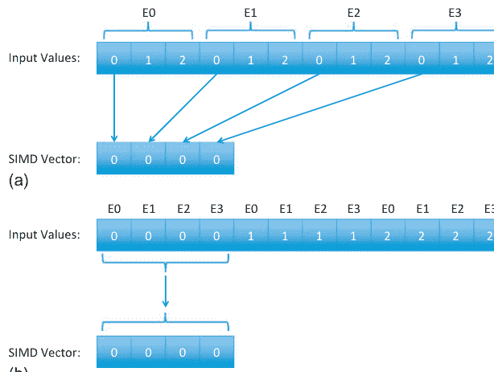

## 图 6.7

内存布局：(a) 跨步（Strided）：元素按评估分组，导致需要多次内存读取的“聚集”（gather）操作。(b) 合并（Coalesced）：元素按组件索引分组，允许单向量内存读取。

这是通过填充初始组件值时，从全局组件索引（所有组件）到压缩组件索引（选定的系统相关组件）的转换实现的。在评估之前进行此类转换可以节省评估过程中每次组件查找之间转换索引的开销。操作输入表达式子集的应用程序将从这种内存优化中受益。本章的比例因子遵循了这一优化。

另一个优化是在大型多线程应用中形成计算包。多核处理器和许多核处理器足够灵活，允许多线程应用程序独立地处理计算的不同阶段。然而，每个线程处理的数据子集至少应与 SIMD 指令宽度一样。因此，对于 Intel Xeon Phi 处理器的 16 位浮点向量，一个评估“包”应该至少包含 16 次评估，同时保持上一节中讨论的数据布局。基于包执行评估的线程可以独立运行系统的评估计算阶段，并保持最大的 SIMD 效率。

同样值得注意的是，本章讨论的 SIMD 利用技术适用于任何 SIMD 硬件架构，例如 GPU 和 ARM NEON CPU。启发本章的弹道仿真代码最初是使用 NVIDIA 的 CUDA GPU 计算环境在开源的视觉仿真实验室（VSL）框架内实现的。

# 128 第 6 章 故障树表达式的并行评估

## 总结

在处理器和协处理器中发现的 SIMD 硬件发展使得许多科学和工程应用能够以交互速率运行。此类应用中存在大型表达式，需要足够的 SIMD 并行化。蒙特卡洛表达式也存在此类应用中，并需要足够的 SIMD 并行化。我们仅使用一个线程进行性能测量，以隔离使用 SIMD 硬件带来的性能提升。因此，加速是由于更好的 SIMD 扩展（甚至还有缓存益处）的直接结果。评估树是一项极度并行的操作；实现多线程解决方案非常简单。

我们的实现速度比第一个 `ispc` 实现快 7.9 倍，比 C++ 实现快 12.7 倍。我们仅使用一个线程进行性能测量，以隔离使用 SIMD 硬件带来的性能提升。

图 6.7

内存布局：(a) 跨步（Strided）：元素按评估分组，导致需要多次内存读取的“聚集”操作。(b) 合并（Coalesced）：元素按组件索引分组，允许单向量内存读取。

# 获取更多信息

- 通用故障树分析 http://en.wikipedia.org/wiki/Fault_tree_analysis

- 使用 `gpu` 进行复杂树分析： Aghassi, H., Aghassi, F., 2013. Fault tree analysis speedup with gpu. Int. J. Comput. Inf. Mang. 5, 106–114.

- 关于 `ispc` 语言的更多信息可以访问 http://ispc.github.io/。

- 关于 VSL 的信息可以通过 http://visslab.org/

- 从本章或其他章节下载代码 http://lotsofcores.com

# 深度学习数值优化

## 7

Rob Farber

TechEnablement.com, USA

深度学习数值优化算法由于大规模并行处理器的通用可用以及现在大量的视频、音频和社交媒体数据，重新引起了关注。启用新的更强大的互联网功能，或利用这些算法对自动驾驶汽车和增强现实工作流进行复杂的实时识别的能力，是驱动使用这些算法的许多有力理由的例子。通过正确的并行映射，单个 Intel Xeon Phi 协处理器在真实的机器学习和数值优化问题上可以超过 TeraFLOP（TFLs）的持续单精度和双精度性能。有趣的是，这种性能可以在用户开发的代码实现，而不依赖于优化库（如 Intel Kernel Library）性能。通过使用消息传递接口协调数个处理器的计算，可以实现近线性扩展和千万级性能。例如，本文讨论的大规模并行映射和代码在 TACC（德克萨斯先进计算中心）Stampede 超级计算机上的 3000 个 Intel Xeon Phi 处理器实现了 2 Peta 的持续高精度训练。

# 拟合目标函数

数学建模是分析的一个分支，创建用于分析和预测的现实抽象。数据驱动的数值模型通常适用于计算机实现，成为分析和嵌入式系统的工具。特别是神经网络推理出的函数具有预测能力，这意味着它们可以正确预测时间序列中的未来值、执行分类任务、信号处理，并对机器人和实时系统中的复杂且不可见的刺激做出反应和适应。请参见本章结尾附加信息部分中关于 Duda 和 Hart 以及 Farber 和 Lapedes 的参考文献。

# 第130 页 第7章 深度学习数值优化

数据驱动的模型拟合可以被视为一种函数优化形式，通过调整一组模型参数来拟合某些数据集并使误差最小。误差由目标函数（有时也称为代价函数）决定，该函数评估了模型与给定模型参数集的拟合程度（图 7.1）。

LMS（最小二法目标）函数常用于对一组 N 个观测数据点进行模型拟合，这些数据点提供了一条曲线或表面。图 7.2 中定义的 LMS 误差总是正的，这意味着完美拟合将导致零误差。由于数值精度问题、嘈噪声数据和其他挑战，参数化模型很少能达到零误差。用于确定参数的数值优化技术会找到局部最小值，即代价函数中优化无法逃逸的低点。虽然不能保证一定能找到最佳拟合（即全局最小值），但 LMS 目标函数报告的误差可以用来感知模型对数据的表示能力。

机器学习和数值优化技术在整个工业界研究中的广泛采用，表明了基于经验确定参数的模型（例如线性回归、非线性回归、神经网络等）尽管面临局部最小值的挑战，但由于规模、复杂性、噪声和其他问题，它们提供的解决方案是“足够好”的，或者是目前唯一可行的方法。

人工神经网络（ANN）的训练可以表示为一个函数问题，即确定最佳网络参数（例如模型参数或内部网络权重和偏置），以使训练数据集上的误差最小化。这种拟合过程在计算上是非常昂贵的，因为它需要反复使用不同的参数集来评估目标函数。每次目标评估的运行时间为 $O(N_{data} * N_{parameter})$，因为必须为训练数据中的每个样本计算误差。在大多数情况下，参数数量 $N_{parameter}$ 相对于训练数据规模 $N_{data}$ 较小，这意味着整体运行时间由数据集的大小决定。事实上，数据相对于参数数量的过拟规格是非常重要的，这样 ANN 才不会仅仅背下训练数据集。这就是为什么验证集（例如包含训练期间未提供给 ANN 的数据示例的数据集）如此重要，因为交叉验证可以检测出 ANN 对训练数据拟合良好但泛化能力差的情况。

数据并行目标函数的并行化可以在大规模并行计算机上带来显著的加速，如图 7.3 所示，该图显示运行时间随处理器数量的增加而减少。

```
Error = func(p_0, p_1, ..., p_k)
```

## 图 7.1

一个目标函数。

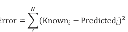

## 图 7.2

差平方和误差。

# 拟合目标函数

```
$O\left(\frac{N_{data} \times N_{param}}{N_{processors}}\right)$
```

图 7.3

数据并行目标函数的理想运行时间。这被称为*强扩展*（strong scaling），因为对于给定的数据集（或问题规模），运行时间可以按元素数量的倍数减少。

大多数数据并行目标函数也是浮点密集型的，并且适用于向量化，这使得它们非常适合在协处理器的所有核心以及每个核心的向量单元上高效运行。可扩展的并行性与高效向量化的结合表明，数据密集型机器学习和数值优化非常很好地契合 Intel Xeon Phi 协处理器系列的高性能区域（例如图 7.4 的右下象限）。

本章的神经网络训练代码将利用我在 20 世纪 80 代在洛斯阿拉莫斯国家实验室和圣塔菲研究所开发的大规模并行映射。他们调查了各种并行神经网络映射，包括我的“Farber”映射。（该链接位于“更多信息”章节中）。

- *朴素实现（Naive implementation）*：神经网络中的每个节点都映射到一个处理器上。虽然是规模并行的，但这种方法受内存带宽和网络通信的限制。

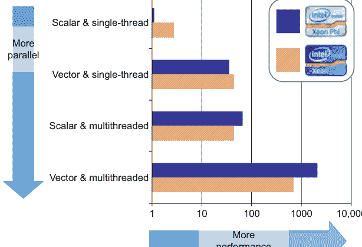

图 7.4

Intel® Xeon Phi™ 协处理器性能包络。

致谢：James Reinders Intel Corp.

# 第132 页 第7章 深度学习数值优化

| 优化方法 (Powell, 共轭梯度法, 其他) | 步骤 1 | 步骤 2 | 步骤 3 |

| --- | --- | --- | --- |

| | 广播参数 | 计算偏导 | 误差 = 偏导和 |

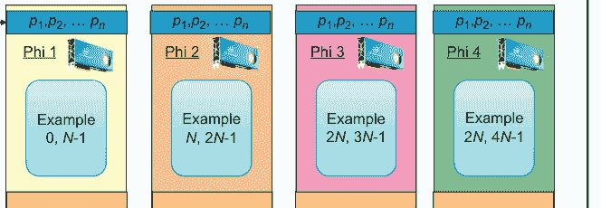

图 7.5

通用映射：能量 = func(P1, P2, ... Pn)。

- 一种改进方法：Zhang 提出了一种改进方法，他及其同事仔细地将网络节点映射到同一个处理器上。这减少了通信，并提高了网络节点计算的效率。

- 图 7.5 所示的 Farber 映射能够在单个、一组协处理器以及那些大规模并行系统上高效运行。根据 Thearing 的说法，这种方法是“迄今为止实现的最快性能”。它从 90 年代以来一直在持续使用。

标记为“优化方法”的框表示，该映射可以使用通用的数值库。《数值算法》（Numerical Recipes）是关于各种算法信息的极佳来源。Farber 映射在 TACC Stampede 上对 3000 个协处理器的近线性扩展如图 7.6 所示。

# 拟合目标函数

# 第133 页

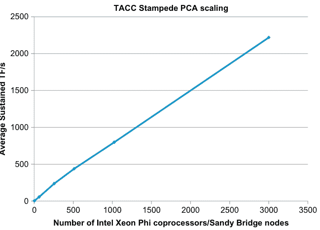

图 7.6

在 TACC Stampede 上扩展到 3000 个 Xeon Phi。

该映射的非线性扩展是步骤 1-3 总运行时间的结果：

- *步骤 1*：将参数广播到所有处理器。通常，MPI 全局广播非常高效且运行时间恒定。广播数据的时间通常限于网络互连的带宽。

- *步骤 2*：每个 MPI 节点独立计算本地内存中数据集的部分误差，这意味着运行时间随节点数量严格扩展。此步骤的运行时间取决于每个 MPI 节点的数据量和处理器的计算速度。（注意：每个节点 MPI 的部分数据集出现在计算开始，并通常根据可用带宽扩展）。

- *步骤 3*：该映射的可扩展性主要受大型系统中归约操作运行时间的影响。大多数 MPI 归约操作需要 $O(\log(N_{nodes}))$，$N_{nodes}$ 是 MPI 节点数。实践中，由于部分和的字节数很少（每个 64 位部分和通常为 8 字节），网络互连的延迟限制了归约操作的性能。

经验表明，即使是最大的问题也可以使用单精度（32 位）浮点数存储参数和数据，但步骤 2 和 3 中部分误差的累加应使用双精度（64 位）算术。否则，信息丢失可能会由于在使用单精度算术相加数百万部分误差时产生的损失，而恰恰导致优化算法陷入局部最小值。使用 64 位双精度累加器进行混合精度归约对运行时间的影响微乎其微。

# 第 7 章 深度学习数值优化

在使用基于返回单个错误值而非误差向量的目标函数的优化技术时，可以实现近线性的扩展性。某些优化算法利用误差向量来确定下一组用于评估优化过程的参数。遗憾的是，误差向量的大小会随着数据量而扩展。小误差向量的“全对一”（all-to-one）通信模式会迅速饱和网络互连，或者耗尽运行优化算法的 MPI 节点的内存子系统和处理器。因此，只有设计为并行运行并消除了在大规模使用误差向量时相关问题的基于误差向量的优化算法，才能在此映射关系中使用。

## 目标函数与主成分分析

神经网络在计算上是通用的，这意味着在理论上它们可以学习任何计算函数。支持这一说点的依据是一个简单的观察：神经网络可以实现用于构建通用计算机等其他计算设备的所有逻辑门（例如，*或*、*异或*和*非*等）。

最近，神经网络通过训练多层神经网络的视觉层已成为执行深度学习的流行方法。正是这种定义隐藏层的能力使得人工神经网络（ANN）能够模拟其他计算设备，创建数据的内部表示或进行特征提取。特征提取代表对数据显著方面或属性的识别，以便其在回归或分类等子任务中使用。Lapedes 和我证明了执行建模、预测任务以及符号学习需要两个隐藏层。

然而，正如 Hinton 所报道，人工辅助设计可以创建参数更少的网络，尽管深度学习任务中表现更好。

本章的讨论将侧重于使用多层 ANN 执行 PCA（主成分分析）和 NLPCA（非线性主成分分析）。

PCA 广泛用于数据挖掘和数据分析，以：(1) 减少数据集的维度和 (2) 从中提取特征。PCA 分析通过一组正交线考虑数据集中的最大方差，其中每条线由观测变量的线性组合定义。类似于，NLPCA 可以利用在没有外部点的情况下与自身相交的开放或闭合曲线。

图 7.7 所示的 ANN 架构可以使用有限数量的线性神经元（瓶颈神经元）来寻找数据集的主成分。同样，当瓶颈神经元使用非线性算子（图 7.7 中标记为 B）时，图 7.7 中的 ANN 可用于执行 NLPCA。这些非线性算子可以是开放曲线或闭合曲线。

NLPCA 适用于许多挑战，包括模式识别、生物建模、气候建模和化学。还有许多关于 NLPCA 的网站、教程和书籍。搜索 "nlpca" 将提供一个很好的起点。

在训练期间，图 7.7 所示的多层 ANN 通过输入层（即图像底部的神经元）接收训练集中的每个训练向量。ANN 本质上寻找线性或非线性主成分，因为它被强制让输入向量通过网络的半部分（将每个输入向量从高维空间转换，或从图 7.7 中的两个维度变为一维），以便网络上半部分在输出神经元处重建原始高维输入向量时误差最小。这是无监督学习的一个示例，目标函数能够仅根据训练集的输入来计算误差。（具体而言，LMS 误差可以通过计算输入和输出神经元之间的差并平方来计算。）或者，当教师为输出神经元提供反映每个训练示例的预期或已知结果的值时，就会发生监督学习，这意味着 LMS 误差可以通过计算已知值与预测输出神经元之间的差并平方来计算。

## 软件与示例数据

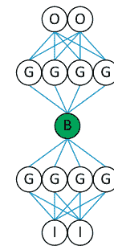

图 7.7

多层 PCA 或 NLPCA 神经网络。

本章中 PCA 和 NLPCA 示例的完整工作代码和构建脚本可以在 github `farbott` 仓库中找到（参见“更多信息”节中的 URL）。

图 7.8 中的代码段说明了 `func()` 的 OpenMP 实现的简单性，该函数是用于在单设备以及 MPI 环境的跨节点上训练神经网络的 LMS 目标函数。

```c
{
    err=0; // 在此处初始化卸载误差
    #pragma omp parallel for reduction(+: err)
    for(int i=0; i < nDeviceExamples; i++) {
        float d=myFunc(i, param, deviceExample,
                nDeviceExamples, NULL);
        err += d*d;
    }
}
```

图 7.8

LMS 数据并行目标函数的 OpenMP 版本。


用户提供的内联函数`myFunction`计算正在拟合的数据集中指定示例的模型误差。OpenMP 编译器负责跨处理器核心正确地并行化归约循环。程序员负责表达`myFunction(c)`，以充分利用核心处理器向量对并行的`myFunction()`实例向量向量。

注意，对`func()`和`myFunction()`的调用都是通用的，这使得示例代码可以用于优化任意目标函数，例如支持向量机、独立成分分析、期望最大化等许多其他算法。

本章中的示例代码是图 7.7 所示 ANN 的 C 语言版本，它将通过 LMS 进行训练。条件编译允许：(1) 简化测试和基准测试以及 (2) 释放编译器优化内联`myFunction()`以在处理器核心上运行。选择包括用于 PCA 分析的线性算子以及用于 NLPCA 分析的多种 sigmoid 实现。

在优化 ANN 参数（例如权重和神经元偏置）期间，通过`nlopt`库调用 LMS 目标函数。实际的`nlopt`调用如下所示。`getTime()`函数返回整个优化过程的时钟时间。`func()`中的实现返回在目标函数花费的时间，以便用户验证 LMS 目标函数的运行时间确实主导了整体运行时间。

LMS 从节点（MPI 排名大于 0 的节点）在调用`MPI_Init()`后调用`startClient()`方法。`startClient`的代码见图 7.9。

优化方法（`nlopt`示例见图 7.10）被传递了`mpiObjFunc()`，该函数：(1) 在主节点运行，(2) 执行 MPI 通信，(3) 运行部分目标函数。代码见图 7.11。

## 训练数据

ANN 版本的缩放和方差在包含 3000 万个神经元的雪茄分布噪声数据上进行评估，该数据围绕直线的均值为 0，方差为 0.1。该分布的小样本如图 7.12。

同样，NLPCA 的运行时间使用了图 7.13 中定义的`z1`和`z2`之间非线性关系的 3000 万点进行评估。再次引入了均值为 0、方差为 0.1 的分布以增加 ANN 训练的难度。

图 7.14 代码段中的简单 sigmoid `x/(1+[x])`用于实现图 7.7 中 G 和 B 神经元的非线性变换。这种 sigmoid 的主要优势是我们可以知道精确的浮点操作。虽然对于

```cpp
void startClient(void * restrict my_func_data)
{
    int op;

    double xFromMPI[N_PARAM];
    double partialError,sum;

    for(;;;) {
        // loop until the master says I am done - then exit
        MPI_Bcast(&op, 1, MPI_INT, 0, MPI_COMM_WORLD);
        // receive the op code
        if(op==0) { // we are done, normal exit
            break;
        }
        // receive the parameters
        MPI_Bcast(xFromMPI, N_PARAM, MPI_DOUBLE, 0, MPI_COMM_WORLD);
    }
    partialError = 
        objFunc(N_PARAM, xFromMPI, NULL, my_func_data);
    MPI_Reduce(&partialError, &sum, 1, MPI_DOUBLE, MPI_SUM, 0, MPI_COMM_WORLD);
}
```

MPI 从节点代码。

```cpp
double startTime=getTime();
// initialize error here for offload
int ret=nlnopt_optimize(opt, x, &minf);
printf("Optimization Time %g\n", getTime()-startTime);
```

用于启动优化过程的 NLOPT 调用。

为了基准测试，在现实应用中通常使用构造更好的 sigmoidal 函数（如`tanh()`和逻辑函数），因为训练过程中的参数优化往往能更快收敛到解。

图 7.15 显示了 NLPCA 数据（由三角形表示）和生成的 ANN 预测模型（由线条表示）的图表。

# 138 第 7 章 深度学习数值优化

```cpp
double mpiObjFunc(unsigned n,   const double * restrict x,
double * restrict grad,
    void * restrict my_func_data)
{
    int op;
    double partialError, totalError=0;
    // Send the master op code

    MPI_Bcast(&masterOP, 1, MPI_INT, 0, MPI_COMM_WORLD);

    MPI_Bcast((void*) x, N_PARAM, MPI_DOUBLE, 0, MPI_COMM_WORLD); // Send the parameters

    partialError = objFunc(N_PARAM, x, my_func_data);
    MPI_Reduce(&partialError, &totalError, 1, MPI_DOUBLE,
    MPI_SUM, 0, MPI_COMM_WORLD); // get the totalError

    return(totalError);
}
```

图 7.11

用于目标函数的 MPI 主节点。

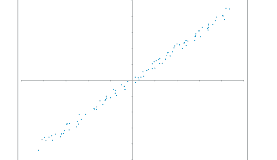

图 7.12

用于 PCA 的线性数据集示例。

`z1 = t + e1`

`z2 = t^3 + e2`

## 图 7.13

非线性关系。

```cpp
char *desc="Eliott activation: x/(1+fabsf(x))";
inline float G(float x) { return x/(1.f+fabsf(x)); } }
```

## 图 7.14

简单的 sigmoid。

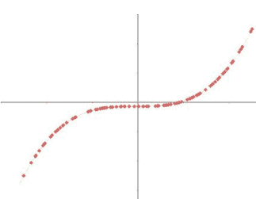

## 图 7.15

NLPCA 数据和 ANN 预测示例。

## 运行结果

示例代码函数（图 7.16）的输出确认了应用程序运行时确实由 LMS 目标函数的时间主。

图 7.17 报告的性能结果表明，单个协处理器在执行模式下运行时能够超过 TF/s，而且即使在报告的最小和最大浮点速率之间存在巨大差异，平均性能也非常接近观测到的最大每秒十亿浮点运算（GF/s）性能。

| 模式 | 数据大小 | Nparam | func() 中的时间占比 |
|---|---|---|---|
| PCA | Native | 30M | 83 | 99.1324 |
| NLPCA | Native | 30M | 83 | 99.7844 |
| PCA | Offload | 30M | 83 | 99.9998 |
| NLPCA | Offload | 30M | 83 | 99.9992 |

# 图 7.16

Native 和 Offload 模式下 PCA 及 NLPCA 运行在`func()`中的时间。

# 140 第 7 章 深度学习数值优化

| | 最小 (GF/s) | 平均 (GF/s) | 最大 (GF/s) |
|---|---|---|---|
| PCA | Native | 15.1494 | 1012.8 | 1037.03 |
| NLPCA | Native | 22.0354 | 369.315 | 374.58 |
| PCA | Offload | 14.2368 | 946.761 | 973.886 |
| NLPCA | Offload | 20.5346 | 359.672 | 363.216 |

图 7.17

双输入 PCA 和 NLPCA 的 G/s 性能。

在 offload 执行模式下的浮点性能相当良好，即使存在移动参数到协处理器以及每次调用`func`时检索部分误差的开销。在多一个协处理器上运行或使用 MPI 跨集群运行时，通信开销是避免的。图 7.4 所示的 TACC Stampede 显示了通过 offload 访问单个协处理器时的性能，无论协处理器是原生运行还是被宿主机利用。例如，具有四个输入神经元的神经网络将从内存中加载四个浮点值来计算误差，这与图 7.7 所示的长度架构相比。特别要注意，由于内存带宽限制，PCA 性能因为获取四个值而下降。相反，NLPCA 计算更具计算密集性，这意味着它在等待从内存检索数据上花费了更多时间。结果，与较小的双输入 ANN 相比，NLPCA 性能受益于原生模式下四输入 ANN 的额外参数。

| | 模式 | 最小 (GF/s) | 平均 (GF/s) | 最大 (GF/s) |
|---|---|---|---|---|
| PCA | Native | 23.8488 | 822.883 | 855.79 |
| NLPCA | Native | 31.0903 | 430.143 | 437.162 |
| PCA | Offload | 22.2739 | 821.65 | 850.331 |
| NLPCA | Offload | 27.3932 | 427.277 | 434.41 |

图 7.18

双输入 PCA 和 NLPCA 的 G/s 性能。

# 总结扩展结果

图 7.7 显示了单个协处理器上根据数据集大小的扩展，对于几个较大的数据集，原生 PCA 超过了 TF/s 速率。此外，协处理器（12 核 3.3 GHz Intel Xeon® X5680 处理器）的性能在低于协处理器的速率迅速达到平台。直线表明协处理器遇到了资源限制。协处理器接近 TF/s 的渐近行为也表明了资源限制。此图中最高性能约为单精度性能的 50%。这些结果表明内存带宽是限制两种设备性能的可能原因（图 7.19）。如前，在 TACC Stampede 超级计算机上使用 MPI 和多达 3000 个协处理器训练单个 ANN 时观察到了近线性扩展和 PF/s 性能。预计包含数万个协处理器的未来系统将表现出近线性扩展以提供计算级性能。

## 总结

从单个设备到观测到的计算级性能以及预扩展能力，Intel Xeon Phi 产品族为研究和商业应用开启了新的价格/性能和每瓦性能视野。在 x86 和 Xeon Phi 处理器上实现此类高性能的关键在于跨处理器的近线性扩展以及大规模并行映射在每个设备内产生的向量处理负载。

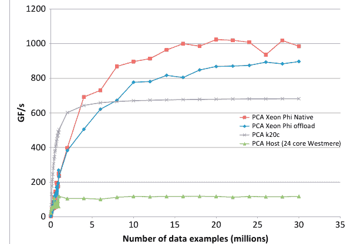

图 7.19

按数据集大小扩展。

这些相同的示例扩展到 60,000 个处理核心——并在基于 X86 的 TACC Ranger 超级计算机上实现了真正的时钟单精度操作。

虽然训练过程计算成本很高，但本章表明，训练过程可以是大规模并行系统，生成的模型可以在从 CPU 到 DSP、FPGA 甚至 ASIC 硬件的各种低功耗小内存设备上运行。这种特性及其执行模式识别、信号和分类任务的能力，解释了为什么 ANN 被广泛应用于从大规模互联网搜索到实时视觉应用等广泛领域。

通过使用本章讨论的概念和示例，读者开始探索前馈神经网络作为循环神经网络的能力。循环神经网络是利用网络架构中正向和反向连接的 ANN。在 ANN 架构中添加有向环，意味着循环网络能够创建并使用内部内存来解决问题并处理输入序列。递归 ANN 具有极高的计算数据比（这意味着每传输一个字节的数据，协处理器必须执行大量的浮点算术运算），因为它们必须通过迭代在 ANN 中正向和反向传输信息。因此，递归神经网络非常适合处理器加速。

此外，研究人员可以解决优化多目标函数的计算挑战。目标函数在科学、工程和日常生活中很常见，但极难求解。例如，大多数购买决策都需要做出成本与收益的决策。同样，工程师面临着加权强度设计挑战（此处原文为 strength，可能指强度或强度，取决于语境）。平衡多目标函数的复杂性意味着必须研究许多解决方案，因为每个项相对于其他项的重要性是变化的（例如，强调强度而非反之）。此类优化非常耗时，但由于 Intel 处理器和许多其他并行设备提供的计算资源在不断提升，研究人员现在有计算能力来研究这些以及常见的高计算成本问题。

## 更多信息

+ - Duda, R., Hart, P. E., Stork, D.G., 2001. 《Pattern Classification》，第二版。Wiley.
- Farber, R., 2011. 《CUDA Application Design and Development》。Robert Kaufmann.
- Lapedes, A.-S., Farber, R., 1987. 《How neural networks work》。IEEE 神经网络会议论文。IEEE.
- NLPCA: http://www.toronto.edu/~hint/ 和 http://nlpca.org/
- Johnson, S.G., 2014. NLopt 非线性优化包，http://ab-initio.mit.edu/nlopt.
- github farbot 仓库, https://github.com/rmfarber/farbot.
- 开源 nlopt 优化库, http://ab-initio.mit.edu/nlopt.

# 优化聚集/散布（Gather/Scatter）

Simon J. Pennycook, Christopher J. Hughes, Mikhail Smelyanskiy

*英国英特尔公司。美国英特尔公司*

许多现代微架构依赖于单指令多数据（SIMD）执行，以高效的方式提供强大的计算能力。此类微架构（包括最新的 Intel Xeon® 处理器和 Intel Phi™ 协处理器所采用）通常针对内存中连续布局的数据进行了优化。然而，当数据在内存中不连续分布时，它们仍然通过聚集（gather）和散布（scatter）操作支持 SIMD 执行。

这些操作的具体执行方式取决于平台，有时在软件中完成，有时则利用专用硬件指令。然而，它们的功能始终是相同的：聚集（gather）操作从内存读取单个元素并将它们封装到单个 SIMD 寄存器中；散布（scatter）操作则从 SIMD 寄存器中解包元素并将其写入各个内存位置。聚集/散布操作中的内存地址不需要运行时已知，并且可以表示任何访问模式（包括连续访问），从而允许程序员（以及编译器）对最不规则的循环进行向量化。

图 8.1 展示了一个包含间接读取和间接写入的聚集/散布操作向量化处理示例。当我们对循环进行向量化时，SIMD 迭代将读取一组`A[B[i]]`并写入一组`D[E[i]]`。通常，`A[B[i]]`和`D[E[i]]`在运行时内存位置未未知，并且可能存储在不连续的地址上。因此，普通的 SIMD 加载和存储指令（抓取一组连续元素）需要通过聚集操作来读取单独寻址的`A[B[i]]`元素，并通过散布操作来写入`D[E[i]]`。

然而，间接可能是所有算法的固有部分。例如，可能会按照取决于输入的顺序访问数据，或者对数据元素的子集进行计算以降低计算复杂度。此类算法非常常见，特别是在数据元素之间的关系预先未知的领域（例如图问题、非结构化网格），而且备选算法并不一定表现同样良好——即使它们的 SIMD 效率很高。

```c
for (i = 0; i < N; i++) {
  C[i] = A[B[i]];           // 间接读取
  D[R[i]] = C[i] + some_constant; // 间接写入
}
```

## 图 8.1

导致聚集和散布的叶节点示例。

| 结构体数组 (Array-of-Structures) |
|---|---|
| X | Y | Z | X | Y | Z | X | Y | Z |
| Y | Y | X | ... | | | | | | |
| Z | Z | Z | | | | | | |

这是高性能计算应用中使用的两种最常见的数据布局。非连续访问通常也是由于程序员对数据布局的选择而引入的，一个很好的例子是将数据存储为结构体数组（AoS）而不是数组结构（SoA）。图 8.2 显示了每个包含三个成员`{x, y, z}`的元素数组在两种布局中将如何排列。

AoS 允许程序员根据其领域具有意义意义数据类型（例如，粒子）来编写应用程序，但通常不利于 SIMD 执行——对单个结构体的多个元素的任何访问都是连续的。SoA 在某些情况下（但并非所有情况）可以导致连续访问——它只有在数组不通过间接方式访问时才能保证加载/存储。此外，使用 SoA，单个元素的结构体成员之间的距离可能会导致糟糕的缓存行为。即使是混合方法（例如，结构体数组数组）也无法希望在所有情况下都是最佳的。为了进一步澄清问题，不同的布局对于同一代码的不同区域可能是最优的，而且外部库要求以特定形式提供数据（这应用程序开发者无法控制）。为应用程序选择最佳数据布局取决于多个因素，取决于 SIMD 的使用目的。

当必须使用聚集和散布，或者当它们便于排序时，帮助硬件尽可能快地工作至关重要——它们的性能取决于程序员控制的几个因素。本章的其余部分详细介绍了在处理器和协处理器上优化聚集/散布模式的多种方法：具体来说，利用领域知识提高时间和空间局部性；选择合适的布局；在 AoS 和 SoA 布局之间进行实时转置；以及在多次迭代中摊聚集/散布的成本。

我们专注于这些方法在来自桑迪亚国家实验室 Mantevo View 的 miniMD 基准测试中提出的聚集/散布模式上的应用，该测试使用了 Leonard-Jones-atomic 势。然而，我们讨论的优化适用于广泛的应用程序。


对于使用 Intel® Streaming SIMD Extensions（SSE）和 Intel® Advanced Vector Extensions（AVX）的程序，聚集和散布操作都需要通过缓存加载/存储和洗牌指令来完成。缓存加载/存储读取或写入单个数据，而洗牌指令（例如`pinsrd`、`vinsertf28`）将单个元素/元素组插入或提取到向量寄存器中。

AVX2 包含了几种聚集指令。这些指令获取基地址、封装在 SIMD 寄存器中的 32 位或 64 位整数索引，以及存储在 SIMD 寄存器位中的完成掩码——被掩码选中的元素将被聚集；其他元素不被聚集，相应的目标元素保持不变。完成后掩码被清除。

在当前代 Intel Xeon 协处理器上使用的 Intel® 初始多核心指令（IMCI）都包含了聚集和散布指令。聚集指令与 AVX2 聚集相似，但使用掩码来持有完成掩码。此外，该指令读取单条（通常为 64 字节宽）缓存行。数据可能会跨越缓存行，软件通常测试完成情况以查看所有元素是否已读取，如果不是，则循环重新执行指令。散布指令类似；然而，它不是从内存读取元素，而是将源 SIMD 寄存器中的值写入内存。

最后，AVX-512 包含了与 IMCI 指令非常类似的聚集和散布指令，与 AVX2 聚集指令不同，无论它们需要多少缓存行，它们都会在一个指令执行中读取或写入所有元素。AVX-512 指将被下一代 Intel Xeon 协处理器和处理器支持，Intel 将称为 Knights。

分析 miniMD（我们选择的分子动力学代码，例如使用 Intel VTune™ Amplifier）突出了两个关键热点。其中第一个占据运行时间近 80% 的的是计算内核，它计算作用在每个原子上的力。朴素地计算这种力的复杂度为 $O(N^2)$，因为每个原子对所有其他原子都施加力。对于大量原子来说，这是昂贵的。因此，分子动力学软件包将作用在每个原子上的力分为两部分：短程力，对没有“截断”距离 $R$ 的所有原子对计算；以及远程力，通过近似……这种分离使得计算复杂度降低为 $O(Nk)$，其中 $k$ 是每个原子预期的“邻居”数量（本身是一个远程力估计内核——我们在此处关注短程力）。第二个热点占据运行时间的 10%，是邻接列表构建内核，它构建一个距离小于截断加“皮肤”距离 $R_s$ 的所有原子对列表。这种皮肤距离允许列表在多个时间步中重复，代价是考虑了比严格需要更多的原子。

图 8.3 显示了根据某个截断距离（$R_c$）和皮肤距离（$R_s$）定义的二维空间中的邻域。模拟空间也被划分为“单元”或“箱体”，用于加速邻接列表的构建。

## 图 8.3

二维空间中的粒子邻域，由某个截断距离（$R_c$）和皮肤距离（$R_s$）定义。

## 分子动力学中的 GATHER/SCATTER（聚集/散射）模式

通过这种方式，通过预计算每个桶（bin）中的原子列表，邻居列表的构建也可以避免 $O(N^2)$ 的复杂度——对于每个原子，只需要检查预定义的一组附近的桶来寻找邻居，而不是检查整个模拟区域。

这两个热点部分的原始 miniMD 源代码分别在图 8.4 和图 8.5 中给出，分列对应短程力计算和邻居列表构建。如图所示，相关代码行已用**粗体**强调。

首先，对于每个原子索引 (i)，邻居原子的索引 (j)存储在查找数组（`neighs` 和 `loc_bin`）中。结果是，邻居力必须被聚集（从 x 处获取），而计算出的邻居力必须通过执行聚集、减法，最后是散射（scatter）来累加到力（f）中。在代码中消除这种间接性，只有通过引入冗余计算和/或存储是才可能的——因为原子的邻域变化非常剧烈且不可预测，无法对所有（最小）邻域都来自连续索引的原子进行排序。位置和力数组以 AoS（结构数组）的形式存储，结构体的大小在编译时由变量（`PAD`）控制。然而，将数组转换为 SoA（数组结构体）不会影响代码中 gather/scatter 操作的数量，因为原子索引标识了哪个

```cpp
for (int i = 0; i < nlocal; i++) {
    neigh = neighbor[i*neighbor.maxneigh];
    const int nmneigh = neighbor[i];
    const float xtp = x[PAD+0];
    const float ytmp = y[PAD+1];
    const float ztmp = z[PAD+2];
    float fix = 0.0; float fy = 0.0; float fiz = 0.0;
    for (int k = 0; k < numneigh; k++) {
        const int j = neighs[k];
        const float delx = xtp - x[PAD+0];
        const float dely = ytmp - y[PAD+1];
        const float delz = ztmp - z[PAD+2];
        const float rsq = delx*delx + dely*dely + delz*delz;
        if (rsq < cutoff) {
            const float sr1 = 1.0 / rsq;
            const float sr2 = sr2 * sr2 * sigma6;
            const float force = 48.0 * (sr6-0.5)*sr2*epsilon;
            fix += delx * force;
            fy += dely * force;
            fiz += delz * force;
        }
        if (GHOST(j) < nlocal) {
            f[j*PAD+0] -= delx * force;
            f[j*PAD+1] -= dely * force;
            f[j*PAD+2] -= delz * force;
        }
    }
    if (EVENT)
        // 计算能量/维里的贡献
    }
    f[i*PAD+0] += fix;
    f[i*PAD+1] += fy;
    f[i*PAD+2] += fiz;
}
```

**图 8.4** miniMD 中原始的短程力代码片段（为了节省空间省略了能量/维里计算）。

```cpp
for (int i = 0; i < nlocal; i++) {
    int* neighborptr = &neighbors[i * maxneighs];
    int n = 0;
    const float xtmp = x[i*PAD+0];
    const float ytmp = y[i*PAD+1];
    const float ztmp = z[i*PAD+2];
    const int ibin = coord2bin(xtmp, ytmp, ztmp);
    for (int k = 0; k < stencil; k++) {
        const int jbin = ibin + stencil[k];
        if (ibin == jbin) // 检查自身桶内的邻居
        else {
            for (int m = 0; m < minbound[jbin]; m++) {
                const int loc_bin = loc_bin[m];
                if (halfneigh && ghost_newton && (j < i))
                    continue;
                const float delx = xtmp - x[j*PAD+0];
                const float dely = ytmp - y[j*PAD+1];
                const float delz = ztmp - z[j*PAD+2];
                const float rsq = delx*delx + dely*dely + delz*delz;
                if ((rsq < cutoffsq)) neighborptr[n++] = j;
            }
        }
    }
    numneigh[i] = n;
```


miniMD 中原始的分子动力学列表构建，为了节省空间省略了对自身桶内邻居的检查部分。

其他分子动力学代码（例如 LAMMPS，同样在桑迪亚国家实验室开发）在这些这两个列表内部都可能存在额外的 gather/scatter 操作。由于具有不同类型的原子（例如氢和氧），某些常数（例如截断距离）会根据所考虑的原子类型组合而不同。其他更复杂的原子间势能（例如嵌入原子方法 EAM）可能会引入额外的查找。

## 提高时间与空间局部性

分子动力学代码中的 gather/scatter 操作通常是性能瓶颈。通过优化数据布局（如从 AoS 转换为 SoA），可以提高缓存命中率。然而，正如前面提到的，由于原子的邻域变化剧烈且不可预测，无法对所有（最小）邻域都来自连续索引的原子进行排序。

（注：此处原文似乎存在部分断裂或重复的短语，译文已根据逻辑进行了平滑处理）

# 优化 GATHER/SCATTER 模式 151

在两种情况下，编译器生成的序列是相同的（最主要的区别是布局对地址计算的影响）。

## AOS 和 SOA 之间的实时转置

上一节的结论不应意味着 AoS 和 SoA 可以在不产生任何性能影响的情况下通用互换。事实上，由于内存访问模式的差异，不同的优化技术适用于这两种布局。在 miniMD 中，从 SoA 获取用于位置和作用的 {x, y, z} 数据始终需要三次其他操作：一次针对 x 值，一次针对 y 值，一次针对 z 值。相反，从 AoS 获取数据可以被视为是对结构体进行单次聚集（gather），然后在两种布局之间进行转置。

如果将其视为转置操作，很显然，某些实现可能会引入冗余。例如，硬件可能一次从缓存中加载结构体的一个元素，因此读取每个结构体需要三个地址。如果我们改用一次内存访问读取整个结构体，就能减少内存访问次数和所需的指令数量。权衡是，我们使用一系列额外的“洗牌”（shuffle）指令来重新排序 x、y 和 z 值。

图 8.7 展示了使用 SSE 对 miniMD 的位置数组进行 AoS 到 SOA 的转置过程。我们首先一次加载整个头部（即连续的 32 位值，包括填充位）到 SIMD 寄存器。例如，我们加载索引为 i、j、k 和 l 的寄存器。然后，我们使用七个 shuffle 和 permit 指令（用于构建所示的四个中间寄存器中的每一个，以及每个最终 x/y/z 寄存器）来执行转置。为了将此序列扩展到更宽 SIMD 的插入，必须向每个向量寄存器加载多个原子单元。有效而言，我们必须将一个 256 位 AVX 寄存器视为两个 128 位道，并将一个 512 位 AVX-512 寄存器视为四个 128 位道。

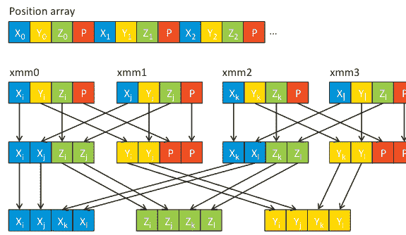

**图 8.7** AoS 到 SOA 转置期间的寄存器和内存内容。红色元素是填充位，用于保证数据对齐。

## 第 8 章 优化 GATHER/SCATTER 模式

AoA 到 AoS 的转置过程只是 AoS 到 SoA 过程的反转，使用相同的 shuffle 序列。除了包含 AoS 格式 x、y、z 值的向量寄存器外，我们还必须用填充值（通常为 0）填充寄存器。图 8.8 和图 9 解释了 AVX-512 中用于这些转置的内置函数。单精度情况的完整转置内置函数，以及其他指令集的内置函数，已作为从书籍网站（lotsofcores.com）下载的源代码的一部分提供。

注意

不熟悉编译器内置函数（intrinsics）和 Intel® 指令集的读者可能会发现《Intel Intrinsics Guide》和指令集参考手册有助于理解此处显示的代码。这些链接可以在正文的末尾找到。

```
#define MM_BCAST_PS(a)   mm512_extload_ps(a,
   MM_UPCONV_POS_NONE, MM_BCAST_4X16,   MM_HINT_NONE)
#define MM_MASK_BCAST4_PS(v, m, a)
mm512_mask_extload_ps(v, m, a,   MM_UPCONV_POS_NONE,
   MM_BCAST_4X16,   MM_HINT_NONE([8]));

mm512 tmp0 = MM_BCAST4_PS(&indices[0]);
tmp0 =   MM_MASK_BCAST4_PS(tmp0, mask_00F,
   &indices[4]);
tmp0 =   MM_MASK_BCAST4_PS(tmp0, mask_0F00,
   &indices[8]);
tmp0 =   MM_MASK_BCAST4_PS(tmp0, mask_F000,
   &indices[12-15]);

   // 重复 tmp1 索引 [1,5,9,13] 的循环
   // 重复 tmp2 索引 [2,6,10,14] 的循环
   // 重复 tmp3 索引 [3,7,11,15] 的循环

mm512 x01 = mm512_mask_swizzle_ps(tmp0, mask_0AAAA,
tmp1,   MM_SWIZ_REG_CDAB);
mm512 y01 = mm512_mask_swizzle_ps(tmp1, mask_05555,
tmp0,   MM_SWIZ_REG_CDAB);
mm512 x23 = mm512_mask_swizzle_ps(tmp2, mask_0AAAA,
tmp3,   MM_SWIZ_REG_CDAB);
mm512 yw23 = mm512_mask_swizzle_ps(tmp3, mask_05555,
tmp2,   MM_SWIZ_REG_CDAB);

x = mm512_mask_swizzle_ps(xz01, mask_0CCCC, xz23,
   MM_SWIZ_REG_BADC);
y = mm512_mask_swizzle_ps(yw01, mask_0CCCC, yw23,
   MM_SWIZ_REG_BADC);
z = mm512_mask_swizzle_ps(xz23, mask_0333, xz01,
   MM_SWIZ_REG_BADC);
```

使用 AVX 内置函数的单精度 AoS 到 SoA 转置片段。图 8.8

 优化 GATHER/SCATTER 模式 153

```
#define _MM_PACKSTORE4_PS(a, m, v)
mm512_mask_extpackstore_ps(a, m, v,
_MM_UPCONV_POS_NONE, _MM_HINT_NONE)
mm512 p = zeros;
mm512 xz0 = mm512_mask_swizzle_ps(x, mask_0CCCC, z,
   MM_SWIZ_REG_BADC);
mm512 yw0 = mm512_mask_swizzle_ps(y, mask_0CCCC, p,
   MM_SWIZ_REG_BADC);
mm512 x23 = mm512_mask_swizzle_ps(z, mask_0333, x,
   MM_SWIZ_REG_BADC);
mm512 yw21 = mm512_mask_swizzle_ps(p, mask_0333, y,
   MM_SWIZ_REG_BADC);
mm512 tmp0 = mm512_mask_swizzle_ps(xz0, mask_0AAAA,
yw01,   MM_SWIZ_REG_CDAB);
mm512 tmp1 = mm512_mask_swizzle_ps(yw01, mask_0555,
x01,   MM_SWIZ_REG_CDAB);
mm512 tmp2 = mm512_mask_swizzle_ps(xz23, mask_0AAAA,
yw22,   MM_SWIZ_REG_CDAB);
mm512 tmp3 = mm512_mask_swizzle_ps(yw23, mask_0555,
x23,   MM_SWIZ_REG_CDAB);
_MM_PACKSTORE4_PS(&indices[0]), mask_00F0, tmp0);
_MM_PACKSTORE4_PS(&indices[4]), mask_0F00, tmp1);
_MM_PACKSTORE4_PS(&indices[8]), mask_F000, tmp2);
// 重复 tmp1 索引 [1,5,9,13] 的存储
// 重复 tmp2 索引 [2,6,10,14] 的存储
// 重复 tmp3 索引 [3,7,11,15] 的存储
```

图 8.9 使用 AVX 内置函数的单精度 SoA 到 AoS 方法。

| 表 8.3 默认 Gather/Scatter 序列的指令成本 | 标量 | 128 位 | 256 位 | 512 位 |

| :--- | :--- | :--- | :--- | :--- |

| 元素数量 | 1 | 4 | 8 | 16 |

| 加载索引 | 1 | 4 | 8 | 16 |

| Gather | 1 | 12 | 27 | 144 |


表 8.3 和 8.4 比较了默认生成的 gather/scatter 操作与我们描述方法的指令成本。注意，512 位版本是最坏情况，假设每个 3 次 gather 触及 16 个缓存道且每行需要 3 条指令（`vathers`、`cmp`、`jmp`）。在支持 AVX-512 指令的未来处理器和协处理器上，该数字预计将减少到三。无论访问多少缓存行，使用 AVX-512 的 gather 操作只需要调用一次 `vathers`。我们优化 gather/scatter 例程所需的指令数随聚集的元素数量而缩放。这并不出人意料。重要的是相对差异在

## 第 8 章 优化 GATHER/SCATTER 模式

|  | 标量 | 128 位 | 256 位 | 512 位 |
| :--- | :--- | :--- | :--- | :--- |
| 元素数量 | 1 | 4 | 8 | 16 |
| 加载索引 | 1 | 4 | 8 | 16 |
| 加载数据 | 1 | 4 | 8 | 16 |
| 洗牌 | 0 | 7 | 7 | 7 |

表 8.4 优化 Gather/Scatter 序列的指令计数

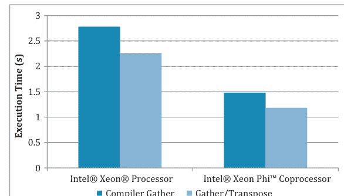

图 8.10 使用默认编译器和我们的 gather/转置例程时短程力计算执行时间的比较。

原始序列与优化序列之间的差异，以及这对性能产生的影响，如图 8.10 所示。

我们从这种优化看到的加速在处理器上为 1.23 倍，在协处理器上为 1.25 倍。这两个加速都小于表 8.3 和 8.4 所示的指令数量减少。

## 分摊 GATHER/SCATTER 和转置成本

实时在 AoS 和 SoA 布局之间进行转置可以显著减少 gather/scatter 操作的指令开销，但对于对聚集数据进行极少计算的内核，转置过程很快成为瓶颈。miniMD 中的邻居内核是

## 优化 GATHER/SCATTER 模式

函数的一个很好的例子：对于每个邻近原子，只需要几次算术运算和一次比较，即可确定该原子是否应该添加到邻居列表中。

然而，与力场内核（其中两个原子具有相同邻居列表的概率非常小）不同，此列表将多个原子（位于同一个 bin 中的原子）与一组固定的邻居原子进行比较。因此，可以在多次复用 SoC 之前，仅对这组固定的潜在邻居执行一次 gather（聚集）和 transpose（转置）。这在图 8.11 中均所示。

我们使用一个固定大小的预分配数组（`scache`）来保持张量的完整性（这是原子分解所要求的），并根据 bin 的变化来检测是否执行 gather 和转置（加粗部分——由于粒子按 bin 索引排序的，因此确保了模板（stencil）的复用）。

```c
int cached_bin = -1;
ncache = 0;
for (int i = 0; i < nlocal; i++) {
    int* neighighs = &atoms[i * maxneighbors];
    const float xtmp = x[i*PAD0];
    const float ytmp = y[i*PAD1];
    const float ztmp = z[i*PAD2];
    int bin = coord2bin(xtmp, ytmp, ztmp);
    if (bin != cached_bin) {
        ncache = 0;
        for (int k = 0; k < ncache; k++) {
            int* lo_bin = &bins[k * atoms_per_bin];
            for (int m = 0; m < mincount(bin, m); m++) {
                scache[0*CACHE_SIZE+ncache] = j;
                scache[1*CACHE_SIZE+ncache] = x[j*PAD0];
                scache[2*CACHE_SIZE+ncache] = y[j*PAD1];
                scache[3*CACHE_SIZE+ncache] = z[j*PAD2];
                ncache++;
            }
        }
    }
    for (int c = 0; c < ncache; c++) {
        const int j = scache[0*CACHE_SIZE+c];
        if (halfneigh & ghost_newton & (j < i)) {
            const float delx = xtmp - scache[1*CACHE_SIZE+c];
            const float dely = ytmp - scache[2*CACHE_SIZE+c];
            const float delz = ztmp - scache[3*CACHE_SIZE+c];
            const float rsq = delx*delx + dely*dely + delz*delz;
            if ((rsq <= cutneighsq)) neighborptr[n++] = j;
        }
    }
    nummeigh[i] = n;
}
```

图 8.11

miniMD 中优化的邻居列表构建循环。为了提高可读性，我们展示了标量代码（不含内联函数）。

## 第 8 章 优化 GATHER/SCATTER 模式

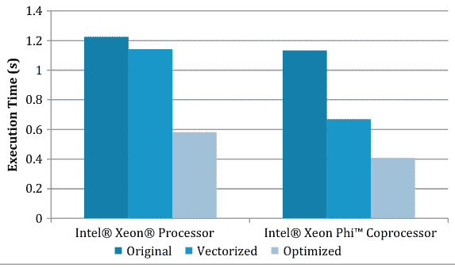

图 8.12：原始代码与缓存转置结果的优化实现之间的邻居列表构建时间对比。

第二个循环以完全相同的方式向邻居列表添加元素，但直接从 `scache` 加载 SoA 数据，而不是 AoS 数据。

除了复用转置后的邻居数据外，这种构建邻居列表的方法还有许多优点。首先，它改进了缓存行为——潜在集合不再分散在内存中，而是连续存储在一个位置，并且可能足够留在靠近计算单元的缓存中（例如 L1 或 L2）。其次，它使得代码更容易向量化——原始代码中对模板索引和 bin 内容的嵌套循环被合并为对 `scache` 内容的单循环，简化了填充向量器的过程。该优化的性能影响如图 8.12 所示。

## 总结

在本章中，我们描述了 gather 和 scatter 操作，并解释了为什么向量化循环时需要这些操作。由于它们相对于连续的 SIMD 加载和存储成本较高，且无法避免，因此我们演示了四种改进 gather/scatter 操作性能的技术：利用领域知识和排序来提高时间及空间局部性；根据访问模式为热点循环选择合适的数据布局；通过在 AoS 和 SoA 布局之间进行实时转置，减少每个 gather/scatter 操作的迭代次数；以及在可能的多次循环迭代中分摊 gather/scatter 操作。

对于一个代表性的分子动力学应用，我们在当前代处理器上看到未优化和优化版本的代码之间存在 2 倍的性能差距。我们采用的优化方法不仅适用于两种处理平台，而且是通用，不特定于当前代的 Intel® 微架构。我们预计它们适用于未来的产品以及其他的处理器设计，今天在应用程序中优化优化/scatter 模式的人将确保他们在未来继续保持良好的性能水平。

## 更多信息

以下是与本章相关的额外阅读材料：

- 用于分子动力学的 SIMD 探索
- 快速并行算法
- Intel® Xeon Phi 架构手册
- Intel® 指令集手册
- 相关开发者指南
- 分子动力学远距离相互作用
- 短程相互作用
- 结构体模拟
- MD 向量化技术

```cpp
for (int iter = 0; iter < nIter; iter++) {
    computeForces(p,dt);
    for (int i = 0; i < p.Particles; i++) {
        p.x[i] += p.vx[i] * dt;
        p.y[i] += p.vy[i] * dt;
        p.z[i] += p.vz[i] * dt;
    }
}
```

图 9.2

时间循环。

在单精度（SP）下达到 2.4TFLOPS、双精度（DP）下达到 1.2TFLOPS 的峰值性能线程。协处理器拥有 16GB GDDR5 内存。每个核心具有 32KB L1 和 512KB L2。

使用的是 Intel C/C++ 编译器 14.0。使用的编译器标志为 `-openmp -mimic -fp-model fast=z3`。在测量性能时，我们在实际计算之前执行了一次未计时的迭代进行预热。所有性能数据均以每秒十亿次交互（Giga Interactions per second，即每秒处理的元素对数量）报告。为了计算 GFLOPS 数值，可以将此数字乘以 20，因为每次交互包含 20 次浮点运算。

图 9.3 显示了我们的初始方案在 SP 和 DP 下获取的性能。虽然对于粒子数量在 10k 到 60k 之间性能是合理的，但超过此范围后性能会下降。对于 DP，我们还观察到性能在 40k 个粒子后开始下降，但下降更加平滑。

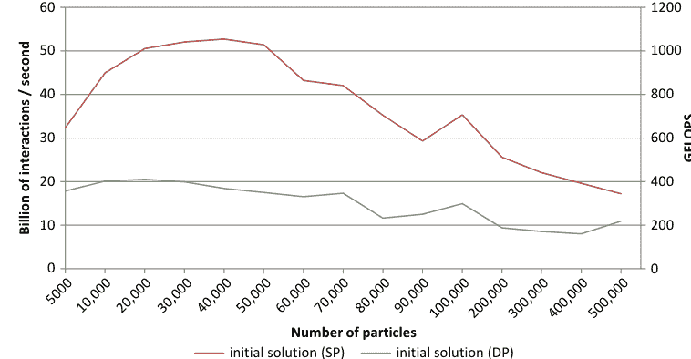

图 9.3

我们的内核在单精度和双精度下的性能表现。

## 理论极限

优化应用程序时常见的一个问题在于理解优化目标（即：我们如何知道何时应该停止？）。我们可以构建应用程序的理论模型来确定所需的运算次数，并以此确定给定应用程序的最大可能性能（通常称为“光速”）。

让我们将此想法应用于我们的问题。N 体内核取决于粒子间力相互作用的计算，其复杂度为 O(n^2)。位置更新在 j 循环中的复杂度仅为 O(n)（i 循环末尾的更新同样为 O(n)）。如果我们考虑图 9.1 中的代码并将其映射到我们在 Intel Xeon Phi 协处理器上使用的 Knights Corner 指集（KNCI），则包含：

- 三次减法（`vsub`）
- 三次乘加法（`vmfadd`）
- 一次倒数平方根（`vsqrte`）
- 三次乘法（`vmul`）
- 三次乘加法（`vmfadd`）

这可能会产生图 9.4 所示的 SP 代码，它是上述序列的直接翻译，并带有用于平滑化值（softening value）的广播。由于 `vmfadd` 指令的破坏性，该值会丢失并在每次迭代后需要恢复。

假设所有内存都命中 L1 缓存，这些指令中每个的延迟为 4 个周期，因此需要 52 个周期来计算 16 个（16 是协处理器中向量寄存器的宽度）的交互；幸运的是，核心的其他三个线程可以重叠以完美地填满空周期。每个核心有 4 个线程，计算 64 个粒子的交互将需要 56 个周期（最后一次迭代外，所有未重叠的线程需要 3 个周期完成；对于大量粒子，我们可以忽略这一点）。这在 SP 下提供了每个周期产生 1.142 次粒子交互。

```assembly
vmsubps($zr14,$zr10,4),$zmm7,$zmm12
broadcast.L2z11floatatpacket.2($rip),$zmm8
vmsubps($zr9,$zr10,4),$zmm6,$zmm13
vmfadd23ps($zmm12,$zmm2,$zmm8)
vmsubps($zr8,$zr10,4),$zmm5,$zmm15
vmfadd23ps($zmm13,$zmm1,$zmm8)
vmfadd23ps($zmm15,$zmm15,$zmm6)
vsqrte($zr2,$zmm1)
vmulps($zr15,$zr10,4),$zmm10,$zmm9
vnmulps($zr11,$zmm10,$zmm14)
vnmulps($zr12,$zmm12,$zmm4)
vmfadd23ps($zmm13,$zmm14,$zmm1)
vmfadd23ps($zmm15,$zmm14,$zmm3)
```


图 9.4

不带预取循环计数的 compute 内部 j 循环的单精度代码。

## 理论极限

```assembly
vcvtpd2ps {rn}, %zmn5, %zmm14
vcvtpd2ps {rn}, %zmm3, %zmm4
vcvtpd2ps {rn}, %zmm3, %zmm4
vcvtpd2ps {rn}, %zmm14, %zmm15
vcvtpd2ps {rn}, %zmm15, %zmm16
vcvtpd2ps {rn}, %zmm16, %zmm17
vcvtpd2ps {rn}, %zmm17, %zmm18
```

图 9.5

使用 vrsqrt 用于双精度。

对于 DP，我们还观察到性能在 40k 个粒子后开始下降，但下降更加平滑。上限是……

| 模型 | resres | ( ()) | G Gigaactions/（单精度） | 最大 Gigaactions/s（双精度） |
|---|---|---|---|---|
| 200 | 61 | 1.8 | 84.7 |
| 720×（带加速） | 61 | 1.333 | 92.9 |
| 510× | 60 | 1.053 | 72.2 |
| 310x | 57 | 1.1 | 21.7 |

9.6

不同协处理器的每秒十亿次交互上限。

## 减少开销，对齐你的数据

下一个优化解决了通过对我们的初始代码进行视觉检查发现的两个问题：

- OpenMP 并行构造位于 compute 程序内部。这有两个影响。首先，位置更新是串行执行的。对于大量粒子，这并不重要，因为计算的复杂度占据主导地位，但它对少量粒子可能会产生影响。其次，每个时间步都会创建一个并行区域。虽然对于少量粒子来说仍然存在可能不可忽略的开销，但数据既没有对齐，编译器无法生成对齐的加载/存储以及在向量上使用内存操作。如果没有数据对齐，我们将无法使用最优指令序列。

图 9.7 显示了此版本中初始化和时间步代码的变化。数据使用 `___malloc` 分配，这确保了正确的对齐。使用了 OpenMP 并行构造来封装内层时间步循环，并使用 OpenMP 工作共享循环来更新粒子位置。注意，工作共享之后的隐式屏障保持了线程之间的迭代同步（每个线程看到的 `iter` 值相同，且迭代次数相同）。

图 9.8 显示了 `computeForces` 内核的更改。除了 `parallel`（并行），还引入了 `aligned`（对齐）以指示编译器生成对齐代码。强制编译器对齐代码意味着数据必须对齐，否则应用程序将发生硬件异常。

图 9.9 和 9.10 显示了这些更改如何影响 SP 和 DP 的性能。

## 减少开销，对齐数据

```cpp
template <class T>
void computeForces(ParticleSystem<T> p, const T dt)
{
    int n = p.nParticles;
    #pragma omp for schedule (dynamic)
    for (int i = 0; i < n; i++) {
        ...
        #pragma vector aligned
        for (int j = 0; j < n; j++) {
        }
    }
}
```

图 9.8

我们第二个版本的 N 体问题内核。

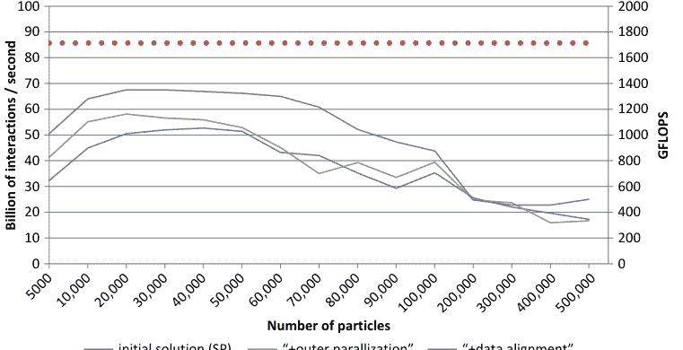

图 9.9

我们第二个版本的单精度（SP）性能。展示了当粒子数量较小时，将并行结构移动到时间循环中如何有所帮助，特别是在单精度下。使用对齐的指令显著提升了单精度（高达 67.5）和双精度（DP，高达 26.9）的性能。

即使有了之前的优化，性能在粒子数量达到之前的水平时仍然开始下降。限制因素是什么？

使用 Intel® VTune™ Amplifier 分析应用，显示出存在大量的 L2 到 L2 传输。图 9.11 显示了 L2 到 L2 传输占总请求数的百分比（左侧 y 轴），以及四个核心分别使用了 L2 容量的多少比例。

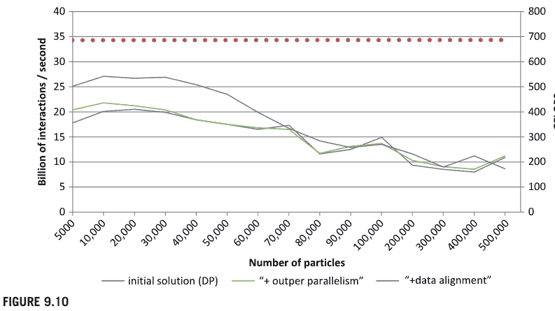

我们第二个版本的双精度（DP）性能。

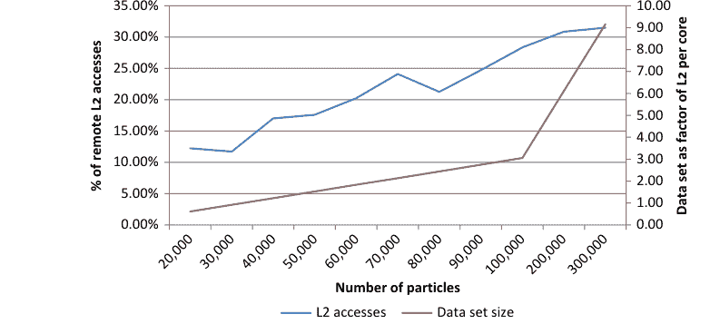

我们第二个版本的 L2 压力。用于内层 j 循环（右轴）。图 9.11 显示，即使粒子数量仅为 4 万个，L2 缓存也已经太小了。L2 到 L2 传输的增加是因为所需的数据通常在另一个核心的 L2 缓存中。从另一个 L2 传输数据比从主内存获取更快。尽管如此，随着粒子数量的增加，传输次数也会增加，整个应用的性能随之下降。

## 优化内存层次结构

为了提高局部性并在每次 i 循环迭代中更有效地复用粒子，我们利用了一种名为循环分块（loop tiling）的常用技术。具体而言，我们使用大小为 BF 的方形粒子块对 i 循环和 j 循环进行分块。每个块被分配给一个线程，如果块大小选择得当，j 块的元素将在整个 i 块的所有元素处理过程中被复用，而不会从缓存中被驱逐。这将提高数据局部性。

内核的变化和分块因子的计算如图 9.12 所示。在 `for` 结构上使用了 OpenMP `collapse` 子句，将分块分配到线程之间。使用 OpenMP `atomic` 结构是因为多个线程需要同时更新速度。我们预计使用原子更新不会会产生很大影响，因为它位于 i 循环中。

注意，`schedule(dynamic)` 子句被删除了，因为使用默认的静态调度可以获得更好的性能。我们认为这是因为改进后的行为消除了由线程引起的不平衡，因此不再需要动态调度来平衡线程之间的工作。

选择正确的分块因子 BF 是一个棘手的问题。在每次迭代中，我们需要容纳三个块：i 块、当前 j 块以及下一次迭代的 j 块预取。一个核心的四个线程中的每个包含四个向量：`x`、`y`、`z` 和 `m`。一个简单的计算得出：

| BF | L2 大小 |


| # * 每个核心的线程数 * 类型大小 * 块块数 |

```cpp
int align = CACHELINE_SIZE/sizeof(T);
BF = nParticles / sqrt(omp_get_max_threads()) / 4;
BF = (BF+align-1)/align;
if ( BF > max_block<T>::value ) BF = max_block<T>::value;

int n = n.Particles;
#pragma omp for collapse(2)
for (int i = 0; i < n; i += BF) {
  for (int jj = 0; jj < n; jj += BF) {
    int imax = min(i+BF,n);
    int jmax = min(jj+BF,n);
    for (int i = i; i < imax; i++) {
      #pragma vector aligned
      for (int j = jj; j < jmax; j++) {
        #pragma omp atomic
        p.vx[i] += dt*Fx;
        #pragma omp atomic
        p.vy[i] += dt*Fy;
        #pragma omp atomic
        p.vz[i] += dt*Fz;
      }
    }
  }
}
```

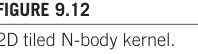

# 第 9 章 在多核上求解直接 N 体问题

因此，512-kB 的 L2 缓存意味着最大 SP 块大小为 2730 个元素，使用大 DP 块时为一半。分块因子的另一个要求是 `BF` 必须是数据对齐的倍数。否则，每个块的几个元素将在块的序言和结尾部分执行，这会产生大量的开销。

考虑到这些，我们需要为单精度选择最大分块因子 8，双精度选择其一半。对两个循环进行合并（collapsing）意味着线程的总迭代数被分块因子缩小，这对于粒子数量较少的运行可能是一个问题。例如，3 万个粒子的运行使用最大分块因子会将可用迭代数减少到 4，这不足以占据 Xeon 处理器上的所有线程。为了避免这个问题，我们使用以下公式计算分块大小：`BF = min(maxBF, nParticles / (# threads * slack factor))`。公式中的 `slack factor`（松弛因子）用于确保每个线程执行超过一次迭代，并减少可能的负载不平衡。我们使用了 4 作为 `slack factor`。进一步的优化是利用 L2 缓存由核心的不同线程共享的特性。我们可以通过将相同的块分配给核心的所有线程（而不是给每个线程分配一个块）来实现。共享块意味着较大的块在 L2 缓存中有空间，并且由于工作是分配到核心而非线程，填充整个处理器所需的工作减少了四倍。考虑到这一点，我们在单精度使用了 4096 的 `maxBF` 值，双精度使用其一半，因子为 2。

```cpp
core = omp_get_thread_num() / 4; // 计算核心内部的线程数
cid = omp_get_thread_num() % 4; // 如 schedule (static) 所示计算核心起始
for (int l = core_start; l < core_end; l++) {
    int i = (l/nb) * BF;
    int jj = (l%nb) * BF;
    int imax = min(i+BF,n);
    int jmax = min(jj+BF,n);
    for (int i = i; i < imax; i+= 4) {
        #pragma vector aligned
        for (int j = jj; j < jmax; j++) {
            ...
        }
    }
}
```

图 9.13 每个块使用多个线程的 N 体内核。

# 优化内存层次结构 169

不幸的是，OpenMP 在不采用嵌套并行的情况下对共享块方法的支持很少。目前 OpenMP 实现中嵌套并行的开销太高。因此，我们开发了一个如图 9.13 所示的版本，其中循环合并和工作分配是手动完成的。关键方面是使用核心标识符进行外层循环分配，因此同一核心的线程将获得某些迭代，内层 `i` 循环使用它们的核心 ID 从不同的迭代开始，然后步进为 4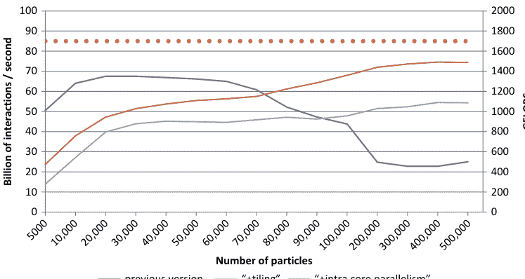

图 9.14 我们分块版本的单精度性能。

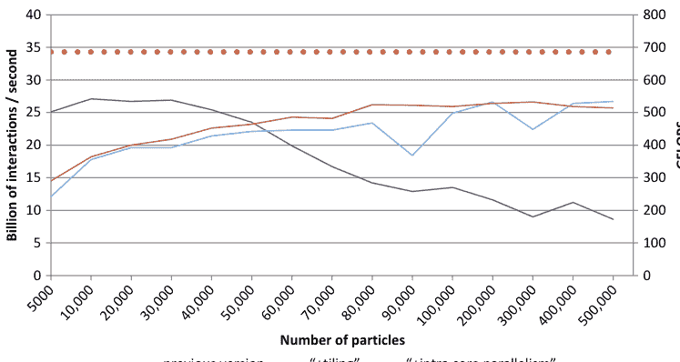

图 9.15 我们分块版本的双精度性能。

# 第 9 章 在多核上求解 N 体问题

注意，这个优化版本的代码假设 OpenMP 线程连续放置在处理器的硬件线程上，我们通过使用 `KMP_AFFINITY` 环境变量实现了这一点。图 9.14 和 9.15 分别显示了单、双精度两种分块方法（带有和不带核心内并行）的结果。注意，随着粒子数量的增加，两个版本都提高了性能。遗憾的是，需要大量的粒子才能超过之前的版本。为了获得最佳整体性能，需要两个版本的代码来同时支持少量和大量的粒子。注意，使用核心内行的版本在单精度下性能优优，而双精度性能较慢但更稳定。

## 改进分块

另一种方法是使用两个分块因子：用于 `i` 循环的 `BFI` 和用于 `j` 循环的 `BFJ`。利用两个因子意味着可以选择 `i` 循环来提供足够的并行性，从而避免使用 OpenMP `collapse` 子句，同时提供了选择 `j` 循环分块因子的活性，从而优化对 L2 缓存的访问。

图 9.16 展示了实现这一想法对 N 体内核进行的更改。原子结构可以删除，因为每次迭代只有一个线程在进行工作。

图 9.17 显示了如何计算 `BFI` 和 `BFJ` 因子。计算 `BFI` 的目的是使所有线程在 `i` 循环中都有一次迭代，并且与缓存行对齐，如前所述这会提高性能。缓存对齐一个不幸的副作用是某些线程可能没有迭代要运行。缓存对齐的分块大小与它们可能产生的不平衡之间存在权衡。观察到，导致高达 2% 不平衡的对齐缓存提供了最佳性能。选择未对齐的分块大小是为了最大化负载平衡。

单精度运行选择了 `BFI` 值为 4096，双精度运行选择了 2048。以下观察到了一个额外的优化：在不同的时间点，当我们遍历数据时，同一个核心可能是同一个，数据共享增加了核心数如下：

```cpp
#pragma omp for
for (int i = 0; i < n; i += BFI ) {
   imax = min(n,i+BFI);
   for (int j = 0; j < n; jj += BFJ ) {
      jmax = min(n,jj+BFJ);
      for (int i = i; i < imax; i++) {
         #pragma vector aligned
         for (int j = jj; j < jmax; j++) {
            ...
         }
      }
   }
}
```


带有分块因子的分块 N 体内核。

## 改进我们的分块 171

```cpp
int nthreads = cmp_get_max_threads();
BFI unaligned = (nParticles+nthreads-1)/nthreads;

int align = CACHELINE_SIZE/sizeof(T);
BFI = (BFI unaligned+align-1)/align*align;

int iters = nParticles / BFI;
if (nParticles % BFI != 0 ) iters++;
float balance = ((float) iters / nthreads;
if (balance < 0.98) BFI = BFI_unaligned;

BFJ = bf<T>::max_value;
float occupancy = ((float)nParticles)*sizeof(T)*4)/(512*1024);
if (occupancy < 4) BFJ *= 2;
if (occupancy < 2) BFJ *= 2;
```

图 9.17

N 体内核改进后的分块因子减小。模拟中的粒子数量在减少。特别是，当工作集中的粒子总数不是 L2 大小的四倍时，至少有两个线程共享粒子。当工作集小于 L2 缓存大小时，则四个线程在处理共享粒子。在这种情况下，分块大小会增加倍或四倍。

图 9.18 和 9.19 显示了按照前文段落调整 `BFI` 和 `BFJ` 分块因子后的性能结果。特别是，利用少量粒子的模拟显示出显著提高，而且当粒子数量较大时也有轻微的提升。非分块版本仅在使用粒子集大小不超过 5000 个粒子时性能更好。


图 9.18

不同优化步骤的单精度性能。

## 第 9 章 在多核处理器上求解直接 N 体问题


**9.19**

优化步骤的双精度性能。

由于本章讨论的优化措施的结果，SP（单精度）和 DP（双精度）实现均达到了性能模型预测上限的 89%。具体而言，SP 性能达到了每秒 763 亿次交互，而 DP 实现达到了每秒 306 亿次交互。

从绝对值来说，SP 版本达到了 1.53 TFLOPS，代表协处理器峰值性能的 63.72%。在 DP 中，它达到了 612 GFLOPS，代表协处理器峰值性能的 50.90%。

## 这这一切对主机意味着什么？

我们在图 9.1 和 9.2 中提出的初始解决方案在很大程度上与架构无关。人们可能会好奇，我们在之前几个节中展示的所有优化措施是如何影响 Intel Xeon 处理器上 N 体内核的性能的。

图 9.20 和 9.21 显示了 N 体问题初始版本与图 9.16 和 9.17 描述的最终版本在性能上的对比，该系统基于双插槽 E-2567v2 Intel Xeon 处理器，总共有 24 个核心，每个核心 2 个线程。代码在不进行任何修改的情况下运行，唯一的编译更改是将 `-mimic` 标记更改为 `-xHost` 标记。系统的所有 48 个线程都被使用，因为它产生了最佳性能。

我们从图 9.20 和 9.21 中可以看到，SP 和 DP 执行的性能都增加了约 10%。这种增加是通过对齐数据和使用向量指令获得的。如果我们观察初始版本的性能，在大数量粒子的情况下性能并没有下降（正如它在协处理器上发生过的那样），这表明当在 Xeon 上运行时

---

## 这这一切对主机版本意味着什么？


图 9.20

不同优化步骤的双精度性能。


图 9.21

不同优化步骤的双精度性能。

处理器为核心提供计算所需数据的难度较小（这部分可以由于内存压力较低以及具有末级缓存的独特架构表现良好而得到解释），并解释了为什么循环分块没有影响性能（它提高了 L1 和 L2 缓存的命中率，但这并没有转化为性能的提升）。其他优化措施也没有提升性能，但同样重要的是，它们也没有阻碍性能，因此我们仍然有一个单版本内核，它能够在主机和协处理器上高效运行。

## 174 页 第 9 章 在多核处理器上求解直接 N 体问题

## 总结

在本章中，我们展示了针对 Intel 许多集成核心（Many Integrated Core）架构的优化的直接 N 体内核版本。该优化版本在普通处理器上的性能上也显示出改进。针对 Intel Xeon Phi 的重要优化包括：

## N 体方法

# 10

Yokota, Mustafa Abdulbar

阿基德国王科学技术大学

## 快速 N 体方法和直接 N 体内核

直接 N 体内核计算 N 个粒子与 N 个粒子之间的所有交互，计算复杂度为 $O(N^2)$。利用粒子分层分解并结合内核截断展开的快速近似方法可以将计算复杂度降低到 $O(N \log N)$ 或 $O(N)$，如 Barnes 等所述（参见“更多信息”章节）。$O(N)$ 方法被称为快速多极子方法（FMM）。这些快速 N 体方法的原理是远场粒子不再被单独考虑，而是被组成多极子。然而，近场粒子必须使用直接 N 体内核精确计算。直接 N 体内核的性能对于这些快速 N 体方法至关重要。N 体方法传统上用于基于粒子的模拟，例如天体和分子模拟。它们最近也被扩展到求解更通用的偏微分方程。相关材料可以在“信息”章节找到。N 体方法的内核具有很高的计算强度，因为它每加载 4N 个浮点数就执行 $2N^2$ 次操作。如果我们与矩阵乘法比较（每加载 $2N^2$ 个数执行 $2N^3$ 次操作），可以看到 N 体内核的浮/字节率更高。这种计算强度使得 N 体方法在未来的架构上保持计算密集型。在本章中，我们关注 Intel Phi 协处理器上 N 体方法的优化，并展示了这些优化对 Intel Xeon 处理器的影响。

## 更多信息

以下是相关的额外阅读材料：

- Vladimirov, A., Karpusenko, V.,2013. 优化 http://lotsofcores.com/post/2013/07/Nbody.aspx

- N 体问题, http://en.wikipedia.org/Nbody_problem

- Arora, N., Springhare, A., Vuduc, R.,2009. 多核直接 N 体内核. 国际并行处理会议 ICPP。

- Rodionov, S., Sotnikova, N.,2005. N 体模拟中软化长度和时间步的最优选择。Astronomy Reports 49 (6), 470–476。

- 循环分块， http://en.wikipedia.org/wiki/Loop_tiling

# 第 10 章 多体方法

算术复杂度指的是随着问题规模增大而执行的算术运算次数的渐近数量。算术强度是指每加载单元数据所执行的算术运算次数。快速多极法（FMM）的 O(N) 最优复杂度与直接多体内核的高算术强度相结合，使得 FMM 成为未来架构上许多算法的理想替代方案。这是因为像稠密线性代数这类高算术强度的算法同样具有高算术复杂度。它们是计算密集型的，可以利用大部分算术单元，但计算开销本身就很高。相反，算术复杂度较低的方法如快速傅里叶变换（FFT）和稀疏线性代数非常高效，但却无法达到现代处理器峰值算术性能的高百分比。FMM 提供了卓越的 O(N) 复杂度和比矩阵乘法更高的算术强度。这意味着多体方法提供了一种能够随问题规模良好扩展的高效算法，并且在未来几年的体系架构上也应该能保持健壮性。

多体内核很容易从 FMM 中分离出来，因为它通常在邻域查找例程中作为函数被调用。该函数占据了 FMM 大部分的执行时间。因此，如果我们优化了直接多体内核，就会自动优化 FMM 的热点。直接多体内核仅几行代码，因此即使在汇编级进行优化也意义有限。在本章中，我们将展示一个非常具体的示例，说明我们如何使用自定义编译器并引入内置函数（intrinsics）来进一步榨取直接多体内核的性能。

## 多体方法的应用

多体方法自然应用于物理现象本身由离散点集合描述的问题，甚至在数值离散化之前就可以。引力或静电力下的多体问题是一个典型的例子，其中恒星和原子可以分别表示为质量和电荷的点。多体方法可以通过离散化从离散场扩展到连续场。这使得利用这些方法解决结构力学、流体力学、电磁学、声学甚至量子力学中的问题成为可能。然而，仅仅适用并不意味着它是解决该问题的最优方法。

在几何信息动态变化的应用中，快速多体方法一直青睐。如果几何结构是静态的，将这些信息以矩阵的形式存储并反复进行乘法要有意义得多。多体方法可以被视为“无矩阵”方法，其中矩阵通过与源点向量相乘动态形成。显而易见，当几何/矩阵频繁变化时，此类方法会变得具有优势，因为在这种情况下存储它们将节省任何计算。这在基于粒子的方法中恰恰如此，当系统非常动态时，每个粒子都会进行状态更新。如果系统非常动态，自适应网格细化（Adaptive mesh refinement）也导致导致数量的几何更新。

许多因素可能会影响多体方法相对于 FFT 和多网格（multigrid）等其他椭圆偏微分方程（PDE）求解器的比较优势。渐近算法在决定这些这些不同 O(N)/O(log N) 算法的相对性能方面起着关键作用。众话 FFT 最少需要 2Nlog 次运算，而多网格最少需要 5N 次运算。相比之下，FMM 通常具有更大的渐近常数。然而，在指定点的位置时利用平旋转对称性可以显著减少这一点。

将 FFT 与 FMM 进行比较是不公平的。然而，对于具有局部特征或不连续性的场，FFT 的均匀空间解显然会成为劣势。此外，当在 FMM 中通过指定点的位置利用旋转对称性时，它可以比多网格高效地使用 BLAS 操作。因此，在这种情况下，FMM 比多网格更快地以相同的精度解决相同的问题。

传统意义上的 FMM 需要格林函数（Green's function）；因此，它可以处理的科学应用类型限于具有格林的应用。将 FMM 推广到分层低秩近似使得该框架适用于更广泛的应用。这些方法使用了低秩近似方法，例如显示 QR 分解、截断奇异值分解（SVD）或多极展开的自适应交叉近似。这消除了 FMM 对格林函数存在的依赖，并可以应用于变系数泊松方程或协方差矩阵等问题，这些问题用原始 FMM 是无法解决的。


在预测 FFT、FMM 和多网格在未来架构上的性能时，通信复杂度是一个有用的指标，因为任何算法的瓶颈在接近其并行扩展极限时都是通信。对于 d 维分解，FFT 的通信复杂度为 O(log P)。多网格的通信复杂度为 O(log P)。我们最近已经证明 FMM 同样具有 O(log P) 的通信复杂度。因此，我们看到 FMM 和多网格都是通信最优的。这一对 FMM 的证明也可以扩展到它的代数变体。

## 直接多体代码

我们将展示一个直接多体内核的示例，首先使用纯 C 语言和 SIMD 内置函数。直接多体内核如图 10.1 所示。我们定义了八个描述属性的数组。`x`, `y`, `z` 是坐标，`m` 是质量/电荷，`p` 是电势，`ax`, `ay`, `az` 是每个方向的加速度。我们计算的方程是平滑拉拉斯电势

$$\phi = \sum_{j=1}^{n} \frac{m_{j}}{r_{ij}}$$

其中 $r_{ij}$ 是 i 和 j 之间的距离，$\varepsilon$ 是平滑因子。

```c
for (int i = 0; i < n; i++) {
    double p = 0, ax = 0, ay = 0, az = 0;
    for (int j = 0; j < n; j++) {
        double dx = x[j] - x[i];
        double dy = y[j] - y[i];
        double dz = z[j] - z[i];
        double r2 = dx * dx + dy * dy + dz * dz + epsilon * epsilon;
        double inv_r = 1.0 / sqrt(r2);
        p += m[j] * inv_r;
        ax += m[j] * dx * inv_r * inv_r;
        ay += m[j] * dy * inv_r * inv_r;
        az += m[j] * dz * inv_r * inv_r;
    }
    p[i] = p;
    ax[i] = ax;
    ay[i] = ay;
    az[i] = az;
}
```

使用 SIMD 内置函数的直接多体内核如下：

```c
for (int i = 0; i < n; i++) {
    __m256d pi = _mm256_setzero_pd();
    __m256d axi = _mm256_setzero_pd();
    __m256d ayi = _mm256_setzero_pd();
    __m256d azi = _mm256_setzero_pd();
    __m256d xi = _mm256_set1_pd(x[i]);
    __m256d yi = _mm256_set1_pd(y[i]);
    __m256d zi = _mm256_set1_pd(z[i]);
    for (int j = 0; j < n; j += 4) {
        __m256d dx = _mm256_sub_pd(_mm256_load_pd(&x[j]), xi);
        __m256d dy = _mm256_sub_pd(_mm256_load_pd(&y[j]), yi);
        __m256d dz = _mm256_sub_pd(_mm256_load_pd(&z[j]), zi);
        __m256d r2 = _mm256_add_pd(_mm256_mul_pd(dx, dx), _mm256_add_pd(_mm256_mul_pd(dy, dy), _mm256_add_pd(_mm256_mul_pd(dz, dz), _mm256_set1_pd(epsilon * epsilon))));
        __m256d inv_r = _mm256_rsqrt_pd(r2);
        pi = _mm256_add_pd(pi, _mm256_mul_pd(_mm256_load_pd(&m[j]), inv_r));
        __m256d inv_r2 = _mm256_mul_pd(inv_r, inv_r);
        axi = _mm256_add_pd(axi, _mm256_mul_pd(_mm256_load_pd(&m[j]), _mm256_mul_pd(dx, inv_r2)));
        ayi = _mm256_add_pd(ayi, _mm256_mul_pd(_mm256_load_pd(&m[j]), _mm256_mul_pd(dy, inv_r2)));
        azi = _mm256_add_pd(azi, _mm256_mul_pd(_mm256_load_pd(&m[j]), _mm256_mul_pd(dz, inv_r2))));
    }
    // ... 存储结果
}
```

图 10.1 直接多体内核。使用 SIMD 内置函数的内核，外循环是向量化的。

## 性能结果 179

```cpp
#pragma omp for
for (i=0; i<N; i+=16) {
    mm512 pi = mm512_setzero_ps(pi);
    mm512 axi_ = mm512_setzero_ps(axi);
    mm512 ayi = mm512_setzero_ps(ayi);
    mm512 xi = mm512_load_ps(x+i);
    mm512 yi = mm512_load_ps(y+i);
    for (j=0; j<M; j+=4) {
        mm512 xj = mm512_set1_ps(x[j]);
        mm512 yj = mm512_sub_ps(xj, yj);
        mm512 aj = mm512_sub_ps(ayi, aj);
        mm512 zj = mm512_set1_ps(z[j]);
        mm512 zj = mm512_sub_ps(zj, zj);
        mm512 R2 = mm512_set1_ps(EPS2);
        R2 = mm512_fmadd_ps(xj, yj, R2);
        R2 = mm512_fmadd_ps(zj, zj, R2);
        mm512 mj = mm512_mulr_ps(R2, invR);
        mj = mm512_mul_ps(mj, invR);
        pi = mm512_add_ps(pi, mj);
        invR = mm512_mul_ps(invR, invR);
        axi = mm512_fmadd_ps(xj, invR, axi);
        ayi = mm512_fmadd_ps(yj, invR, ayi);
        azi = mm512_fmadd_ps(zj, invR, azi);
        mm512_store_ps(p+i, pi);
        mm512_store_ps(axi+i, axi);
        mm512_store_ps(ayi+i, ayi);
        mm512_store_ps(azi+i, azi);
    }
}
```

图 10.2

代码列表——使用内联函数的直接 N 体内核。（外层循环）已通过验证。

AVX 内联函数代码与图 10.2 和 10.3 所示的代码非常相似，不同在于 "fmadd" 被更改以替换 "mul" 和 "add" 操作，且图 10.3 中的 "reduce:add" 操作变成了 "permute2f128"、"add" 和 "hadd" 操作的组合。

## 性能结果

在本节中，我们报告了图 10.1 和 10.2 所示的直接 N 体内核在 Intel Xeon v5 处理器和 Intel Xeon Phi 协处理器上的性能。测试在 Intel Xeon Phi 7120P 处理器上进行，配备了 Intel® MPSS 3.2 和原生模式下的 Intel® C++ Composer XE 14.0 版本；以及在 Intel Xeon E-2680 v2 (Ivy Bridge) 处理器上进行，配备了 Intel® C++ Composer XE 13.0 版本。运行参数 N=65,536，我们每对天体计算 20 Flop/s。处理器使用了编译器选项 "-maxx -openmp -O3" 和 "-openmp-fimd-exclusion=15 -O3"。图 10.1 显示了使用指令和内联函数的处理器与协处理器之间的对比。

## 第 10 章 N 体方法

```cpp
#pragma omp for
for (i=0; i<N; i++) {
    _mm512 pi = _mm512_setzero_ps();
    _mm512 axi = _mm512_setzero_ps();
    _mm512 ayi = _mm512_setzero_ps();
    _mm512 xi = _mm512_setzero_ps();
    _mm512 yi = _mm512_set_ps(y[i]);
    _mm512 zi = _mm512_set_ps(z[i]);
    for (j=0; j<N; j++) {
        _mm512 xj = _mm512_load_ps(x+j);
        _mm512 X = _mm512_sub_ps(axi,xj);
        _mm512 yj = _mm512_load_ps(y+j);
        _mm512 Y = _mm512_sub_ps(ayi,yj);
        _mm512 zj = _mm512_load_ps(z+j);
        _mm512 Z = _mm512_sub_ps(zi,zj);
        _mm512 R2 = _mm512_mul_ps(dist(EPS2));
        _mm512 R3 = _mm512_fmadd_ps(xj,R2);
        _mm512 R4 = _mm512_fmadd_ps(yj,R2);
        _mm512 R5 = _mm512_fmadd_ps(zj,R2);
        _mm512 mj = _mm512_fmadd_ps(R4,R5);
        _mm512 invR = _mm512_sqrte_ps(R2);
        _mm512 mul_inv = _mm512_mul_ps(mj,invR);
        _mm512 pi = _mm512_add_ps(pi,mul_inv);
        invR = _mm512_mul_ps(mul_inv,invR);
        _mm512 axi = _mm512_fmadd_ps(axi,invR);
        _mm512 ayi = _mm512_fmadd_ps(yj,invR);
        _mm512 azi = _mm512_fmadd_ps(zj,invR);
    }
    p[i] = _mm512_reduce_add_ps(pi);
    axi[i] = _mm512_reduce_add_ps(axi);
    ayi[i] = _mm512_reduce_add_ps(ayi);
    azi[i] = _mm512_reduce_add_ps(azi);
}
```

我们在两个处理器插槽上使用了 40 个线程，在协处理器上使用了 244 个。协处理器的线程扩展性非常好，我们将在图 10.5 中详细展示。"maxx+pragma"、"..mm256"、"..mic+pragma"、"..mm512" 分别代表使用指令的主机协处理器、使用内联函数的协处理器，以及在协处理器上使用指令指令的版本。基于指令和基于内联函数的代码都优于之前协处理器上的 N 体工作。

在图 10.5 中，我们展示了在使用不同线程数时直接 N 体内核的强扩展性。Intel Xeon Phi 7120 处理器具有 61 个核心，每个核心运行 4 个线程，因此线程数增加到 244。我们通过 "KMP_AFFINITY" 测试了 compact、balanced 和 scatter 对线程亲和性的影响。当每个核心运行一个线程时，scatter 和 balanced 选项在 61 个核心上显示出理想的扩展性。当一个核心运行四个线程时，compact 选项扩展理想。这意味着核心数的扩展性非常好，而核心内部四个线程的扩展性并不。最后，当利用所有 244 个线程时，不同的 "KMP_AFFINITY" 选项没有区别。

## 性能结果 181


图 10.4 在 Ivy Bridge 处理器 (avx/mm256) 和 Intel Xeon Phi 协处理器 (mic/mm512) 上使用指令和内联函数直接 N 体内核的单精度 gigaflop。


图 10.5 在不同核心数下，Intel Xeon Phi 协处理器上不使用内联函数的直接 N 体内核的单精度 GigaFlops。

到目前为止，图 10.4 和 10.5 所示的实验针对特定的问题大小 N=65,536。图 10.6 显示了不同问题大小直接 N 体内核的单精度 gigaflop/s。在语言中，"intrinsic"、"intrinsics"、"pragma"、"pragma"分别代表使用内联的目标循环向量化、使用内联源循环向量化、使用指令的目标循环向量化以及使用指令源循环向量化。误差棒显示了每个情况下 256 次运行中 gigaflop/s 的标准差。我们显示这些误差棒是因为我们注意到某些情况的运行时波动很大。首先，我们看到

## 182 第 10 章 N 体方法


**图 10.6**

在 Intel Xeon Phi 处理器上，对于不同问题大小，使用内联函数且不对内层循环 j 的外层循环进行向量化的直接 N 体内核的单精度峰值 gigaFlops/s。

源向量化版本在 N=2¹⁴=16,384 时达到峰值。通过使用 SIMD 内联函数和指令 `#pragma simd`，我们可以显式告诉编译器对外层循环进行向量化，这使得 N>16,384 时性能更高。使用 SIMD 内联函数的源向量化更快，但基于指令的版本在向量化情况下更快。外层循环或内层循环的最佳选择取决于问题大小。

## 总结

在本章中，我们描述了如何在协处理器上优化直接 N 体内核。通过使用 `-maxx -openmp -O3 -openmp-fimd-exclusion=15`，我们在协处理器上实现了大约 1.5 Teraflops。核心数的扩展性非常好，而核心内部四个线程的扩展性并不好。最后，当利用所有 244 个线程时，不同的 "KMP_AFFINITY" 选项没有区别。

## 229 更多信息

这里与本章相关的材料：

- [Mini-body](https://github.com/lotsofcores/mini-body)

- [Test-driving Xeon Coprocessors with Basic N-body](https://research.colfax.com/post/2013/01/07/Nbody-Xeon-Phi)

- [Download the code from this chapter](https://lotsof.com)

## 使用 OpenMP 4.0 进行动态负载均衡

## 11

Gilles Civario, Michael Lysaght

爱尔兰 ICHE

多年来，OpenMP 一直是高性能计算领域共享内存多处理器编程的首选模型。尽管 OpenMP 被推为易用并允许对代码进行增量并行化，但原始的实现往往会导致性能不佳。在实践中，在使用 MPI 等其他模型时，在使用 OpenMP 编程也应该对算法和硬件细节投入同等的关注和精力。

现在情况更是如此，因为新发布的 OpenMP 4.0 标准支持卸载（offload）模式，可以利用新兴的许多核处理器，例如 Intel® Xeon Phi™ 协处理器。在许多情况下，在给处理器（例如作为 Intel® Xeon® 处理器的多核处理器）上使用 OpenMP 变得相对简单，但要充分利用异构系统中所有可用资源（例如在 "Stampede" 和 "Tian-2" 节点上，这些节点同时使用了 Intel Xeon 处理器和 Intel Xeon Phi 协处理器），则要困难得多。例如，确定并行管理 "主机" 处理器与协处理器 "设备"（或多个设备）之间数据传输的最优方法，本身就面临多若干挑战。此外，确保负载均衡被卸载到设备以及哪些部分留在主机上，又增加了一层复杂性。在本章中，通过 N 体样本分析，我们引导读者从串行版本过渡到算法的全并行版本，在该版本中，充分利用了异构处理器/协处理器平台上的所有处理元素，并且每个设备都会根据动态情况自动分配最优工作量，以实现速度的最化。我们的动态负载均衡方法完全完全使用标准的 OpenMP 4.0 编写，这使其具有完美的移植性，并且足够通用，可以轻松地适用于各种计算问题，如天体物理学和分子动力学中的问题。这对于代码开发人员特别感兴趣，对于软件供应商在不混淆源码或牺牲效率的情况下分发二进制版本也很有意义。

# 硬件利用最大化

在本章的剩余部分，我们将使用许多核加速器领域的传统术语。通过 CPU、处理器或主机系统，我们通常指的是基于 Intel 处理器（CPU）的计算系统。通过协处理器、设备或加速器，指的是 Intel Xeon Phi 协处理器。在术语同时适用于协处理器和 CPU 的语文中，我们也将使用 "计算设备"。


# 第 11 章 使用 OpenMP 4.0 进行动态负载均衡

Intel Xeon Phi 微处理器可以使用三种主要的编程范式进行处理：“原生（native）”、“对称（symmetric）”和“卸载（offload）”模式。

原生模式是以最小代码更改运行软件的快速方法。与通用图形处理器不同，Intel Xeon Phi 协处理器能够执行原生应用程序，应用程序运行在协处理器的操作系统中，且不需要在 CPU 上执行主机进程。通过这种方式，每个协处理器都可以被视为独立的对称多处理器计算设备。

当然，要在协处理器上以原生模式运行需要对代码进行迁移，但 Intel 处理器与协处理器设备以及软件栈之间的通用性使得这种迁移变得相对简单。与标准多处理器相比，利用协处理器上更多的核心（以及更宽的向量单元）可能需要更多工作，但两者可以使用相同的编程模型。这就是为什么原生方法是人们在接触 Xeon Phi 架构时可能采取的第一步。

然而，以原生模式接触协处理器限制了只能访问一个 Intel Xeon Phi 协处理器以及 CPU 主机的可用资源。

对称模式对于已经运行在分布式内存系统上的代码（例如基于 MPI 的代码）很有意义。它之所以被称为对称，是因为允许代码同时利用集群上用的处理器和协处理器资源。在这种情况下，可以并行访问所有设备。

虽然在对称模式下迁移到协处理器集群的基本步骤通常与启用原生模式代码一样简单，但在现实此类异构计算设备系统中进行负载均衡的复杂性可能非常有挑战性。

使用卸载模式，应用程序在主机系统（即使用 CPU）上启动，数据初始化在主机进行。代码随后使用 PCIe 总线将部分数据和特定的执行代码推送到设备进行处理。处理后，结果被拉回主机。

对于 Intel Xeon Phi 协处理器，程序员可以使用编译器指令来指示卸载。卸载模式可以用于独立机器，也可以用于集群，集群中的每台机器上启动一个或多个 MPI 进程，每个进程执行卸载。

尽管卸载通常需要最多的编程工作，但它往往是潜在回报最高的模式。特别是：

- 它允许单个代码同时利用主机和设备；
- 它避免了 MPI 级别负载均衡的复杂性，这对于大规模代码来说可能特别具有挑战性；
- 它为未来任何带有 Intel Xeon® 和 Intel Xeon Phi™ 品牌的产品的演进做好了准备。

然而，以高效的方式利用卸载模式的优势可能会带来自身的挑战。例如，同时利用主机和设备以避免它们的计算潜力，而不是在两个设备之间切换，并非易事（图 11.1）。此外，在每个设备上实现最优负载均衡，以便在等待特定设备到达同步点时不丢失时间，也是具有挑战性的。

在本章中，我们演示如何在 Intel 处理器与任意数量的 Xeon Phi 协处理器之间实现最优负载均衡。此外，为了充分利用者的统一编程模型，我们将使用新发布的 OpenMP 4.0 标准。

该标准允许我们通过几个编译器指令，使用基础代码以完全移植且优雅的方式充分利用异构平台的潜力。实现这一点所需的 OpenMP 4.0 特有功能只有 SIMD 指令（用于全代码性能）以及用于从 Intel 处理器驱动 Intel Xeon Phi 协处理器的卸载指令。

99415b00a0ac0ab1ccde40dad7860b5_233_0

如果给予相等的工作量而工作能力不均，那么将负载适应到协作工作的各个难度就变得显而易见了。

## N 体内核

为了帮助说明该方法，让我们假设我们在模拟空间中非相对粒子的自由演化，例如卫星、行星、恒星、星系等。对于这些物体，牛顿第二运动定律规定作用在每个粒子（体）上的所有力的和等于其质量与加速度的积。

此外，牛顿万有引力规定每对粒子之间相互吸引，其力与其质量成正比，与它们之间距离的平方成反比。对于我们的 N 个体集合，牛顿第二定律可以用方程描述：

$$
\forall i \in{1,\dots,N}, \hat{a}_i = G \sum_{j\neq i} \frac{m_j}{d_{ij}^2} \hat{u}_{ij},\quad(11.1)
$$

为了演示整个方法，我们将使用一种天体物理学代码常用的经典的 N 体算法。类似的算法也可以出现在分子动力学代码中，其中引力被库仑力所取代。

事实上，应该强调的是这里演示的负载均衡方法与实际计算内核无关，因此可以适用于许多其他迭代算法。

## 公式与基础内核

`m_i` 是粒子 `i` 的质量，`a_i` 是它的加速度，`G` 是引力常数，`d_{ij}` 是粒子 `i` 和 `j` 之间的距离，`u_{\rho}` 是粒子 `i` 和 `j` 之间的单位向量。公式（11.1）可以重写为：

```cpp
$\forall i \in\{1,...,N\} d\frac{dv_i}{dt} = G\frac{x_i - x_j}{d_{ij}^2}m_j;
```

`v_i` 是粒子的速度，`x` 是它的位置，`t` 是时间。

从公式（11.2）出发，可以直接使用我们的 N 体体引力内核，该内核如图 11.2 所示。此外，我们还想评估浮点精度对性能的影响，让我们也引入一个通用的“real”类型，它将根据预处理器宏定义为 `float` 或 `double`。

为了确保我们的性能对比不会因为初始内核欠优而产生偏差，我们将使用 OpenMP 指令对 `Newton` 函数进行并行化优化：

```cpp
#ifndef double
typedef double real;
#define Sqrt sqrt
#else
typedef float real;
#define sqrt sqrt
#endif

real *x, *y, *z, *vx, *vz, *m;
const real G = 6.67384e-11;

void Newton(size_t n, real dt) {
    const real dtG = dt * G;
    for (size_t i = 0; i < n; ++i) {
        real dvx = 0, dvy = 0, dvz = 0;
        for (size_t j = 0; j < n; ++j) {
            if (i != j) {
                real dx = x[j]-x[i], dy = y[j]-y[i], dz = z[j]-z[i];
                real dist2 = dx*dx + dy*dy + dz*dz;
                real mOverDist3 = m[j] / (
                    dist2 * Sqrt(dist2));
                
                dvx += mOverDist3 * dx;
                dvy += mOverDist3 * dy;
                dvz += mOverDist3 * dz;
            }
        }
        vx[i] += dvx * dtG;
        vy[i] += dvy * dtG;
        vz[i] += dvz * dtG;
    }
    for (size_t i = 0; i < n; ++i) {
        x[i] += vx[i] * dt;
        y[i] += vy[i] * dt;
        z[i] += vz[i] * dt;
    }
}
```


我们的 N 体体引力内核。

## N 体内核优化

1. 我们将整个函数体封装在 OpenMP `parallel` 构造结构中；
2. 我们在两个遍历 `i` 的 `for` 循环之前分别添加了两个 OpenMP `for` 指令——将它们分到多个 OpenMP 线程上；
3. 我们在 `for` 构造结构中添加了 `schedule(auto)` 指令，将调度决策交给编译器，这样我们就不需要关注这一点；
4. 我们还添加了 OpenMP `simd` 指令，强制编译器对遍历 `j` 的循环和第二个遍历 `i` 的循环进行向量化；
5. 为了避免 `i` 和 `j` 之间相等性测试的开销（这可能会阻碍外层 `j` 循环的向量化），将其拆分为两部分：首先从 0 开始迭代，随后从 `i+1` 到 `n` 迭代。

通过这些修改，我们内核的体体如图 11.3 所示。

```cpp
void Newton( size_t n, real dt ) {
    const real dtG = dt * G;
    #pragma omp parallel

    #pragma omp for schedule(auto )
    for ( size_t i = 0; i < n; ++i) {
        real dvx = 0, dvz = 0;
        #pragma omp simd
        for ( size_t j = 0; j < i; ++j) {
            real dx = x[j] - x[i], dy = y[j] - y[i];
            real dz = z[j] - z[i];
            real dist2 = dx*dx + dy*dy + dz*dz;
            real mjOverDist3 = m[j] / 
                (dist2 * Sqrt(dist2));
            dvx += mjOverDist3 * dx;
            dvy += mjOverDist3 * dy;
            dvz += mjOverDist3 * dz;
        }
    }
    #pragma omp for simd schedule(auto )
    for ( size_t i = 0; i < n; ++i) {
        real dx = x[j] - x[i], dy = y[j] - y[i];
        real dz = z[j] - z[i];
        real dist2 = dx*dx + dy*dy + dz*dz;
        real mjOverDist3 = m[j] / 
            (dist2 * Sqrt(dist2));

        vx[i] += dvx * dt;
        vy[i] += dvy * dt;
        vz[i] += dvz * dt;
    }
}
```

图 11.3 优化的 N 体内核。

## 使用 OpenMP 4.0 进行动态负载均衡

现在我们可以测试我们的 N 体内核，分别在 Xeon 处理器和原生模式下的 Xeon Phi 加速器上（图 11.4）。为了实现这一点，我们编写了一个随机分配位置和速度数组的程序，并为给定的迭代次数调用 `Newton` 内核。

对于仿真，我们选择 `n=50000` 个粒子，时间步 `dt=0.01`，允许系统运行 1 秒，这代表 100 次迭代。使用 Intel 编译器，我们为处理器和加速器的原生模式编译了代码。图 11.5 显示了代码在 OpenMP 线程上运行的强扩展性。


图 11.4 工作分布不均是不效率的。我们可以轻松地让处理器或加速器承担所有工作，而另一个处于闲置。这些浪费场景是本章负载均衡技术的动力。


图 11.5 在两个处理器（左）和加速器（右）上运行的内核强扩展性。带有 10 核 Intel Xeon E5-2660 v2 处理器和两个 6 核 Intel Xeon Phi 5110P 加速器的节点。

## 加载版本

Xeon 处理器和 Xeon Phi 加速器在两个上都展示了良好的扩展性。值得注意的是，代码不仅在加速器上（这是预期的），而且在处理器上利用了硬件线程（也称为超线程），获得了额外的 21% 性能。

通过 Intel 运行时使用的线程数设置 `OMP_NUM_THREADS`，我们获得了最小时间。这些是我们在本章剩余部分继续使用的条件。

主机和设备上的绝对性能（单精度和双精度）分别见图 11.6。从图中可以看出，相对于双 10 核 Ivy Bridge Xeon 处理器，我们在 Xeon Phi 加速器上实现了 2.17 倍和 3.19 倍的速度。

如果我们认为平方根是一个普通的浮点运算，它对应于 Xeon Phi 加速器上约 125 GFLOPS 的性能。这意味着我们的简单 N 体内核（单精度）可以利用处理器峰值的 36% 和加速器峰性能的 27%，考虑到我们在内核优化上投入的精力，这是一个不错的成就。

从这个坚实的基础（图 11.7），我们现在可以放心地走向完全集成的代码。

## 加载版本

我们的目标仅仅是在代码中开启加载模式，在主机上运行程序并将计算和数据推送到加速器（图 11.7）。为了做到这一点，我们需要添加三个额外的 OpenMP 指令：

- 使用 `#pragma omp declare target` 及其对应的 `#pragma omp end declare target` 包围所有要在加速器上使用的变量和函数定义。这将强制加速器生成这些两个版本（一个用于处理器，另一个用于加速器），并将它们都链接到我们的二进制文件中。


我们的代码在两个（主机）处理器和一个（设备）加速器上运行完成所需的秒数（越低越好）。


**图 11.7**

现在它们相互感知了，主机和设备处于可以协作分担负载的位置。

- 在 `Newton` 函数内部的 `#pragma omp parallel` 之前立即使用一个 `#pragma omp target`。这将指示编译器将计算卸载到机器上第一个用的 Intel Xeon 加速器设备。
- 最后，在调用 `Newton` 函数的主循环之前立即使用一个 `#pragma omp target data`，如图 11.8 所示。该指令将指示编译器为列出的各种数组分配内存，在继续后续之前将初始值从主机拷贝到设备，最后在 `for` 循环退出时从设备上检索标记为 `map(tofrom:)` 项目的值。

我们现在可以使用重载版本的代码，并将其性能与原生处理器和原生加速器版本进行比较，见图 11.9。

```cpp
#pragma omp target data
map(tofrom: x[0:n], y[0:n], z[0:n])
map(to: vx[0:n], vy[0:n], vz[0:n], m[0:n])
for ( int it = 0; it < 100; ++it) {
  Newton( n, 0.01);
}
```


图 11.8 我们 N 体内核类的的卸载 OpenMP 指令。

图 11.9

代码相对于双 Intel Xeon E-2560 v2 Ivy Bridge 处理器（越高越好）的加速比（单精度和双精度），分为三个版本：主机处理器原生、加速器原生以及卸载到加速器的版本。

# 第一种处理器结合协处理器版本 193

## 第一种处理器结合协处理器版本

我们现在的目标是找到一种方法：

1. 仅将部分工作负载卸载到 Intel Xeon Phi 协处理器，同时将剩余的工作负载留在 Intel Xeon 处理器（主机）上进行计算，并且；
2. 确保只向设备分配恰当的工作量，以便主机和设备能够在相同的时间内并行运行。这一点是确保在其中一个计算设备等待另一个设备完成其部分工作时不会浪费任何时间的关键（图 11.10）。

当然，由于在计算的每一步，系统都需要拥有粒子位置和速度的完整且最新的视图，这种主机-设备的工作分布也意味着在每一步中都有一些数据传输。这些数据传输不仅必须完全管理以确保代码的正确性，还可能对性能产生重大影响。

那么，我们如何解决这些问题呢？第一阶段将允许主机和设备部分并发运行，创建两个线程，每个线程管理一部分。这通过在循环外封装 `#pragma omp parallel num_threads(2)` 指令可以轻松实现。

然而，这对我们代码的主机部分产生了一些影响：

为了允许计算在主机上并行运行，我们需要允许嵌套 OpenMP 并行。幸运的是，这只需要在代码的初始化部分额外调用 `omp_set_nested(true)`。


图 11.10

工作负载可以根据各个能力进行定制。通过匹配每个设备完成所需的时间，可以帮助度地减少处理器和协处理器的空闲时间。

# 194 第 11 章 使用 OpenMP 4.0 进行动态负载均衡

- 管理我们的设备将在主机上需要一个 OpenMP 线程，因此主机侧用于计算的线程数减少一个。对于像我们的测试机这样内核数的主机来说，这种影响有限，但可能会变成明显的开销。

一旦解决了第一步，下一步是将工作分配到主机和设备上。在这里，原理非常简单，它只需略微修改 `Newton` 函数，使其接受两个额外的输入参数，对应于循环的“开始”和“结束”索引。

在 `Newton` 函数内部，我们使用这些额外参数来限制循环范围到分配的工作量。此外，我们可以添加一个 `if(n0 == 0)` 来调用 `#pragma omp target`，其中 `n0` 是我们的 `index` 输入参数。这样，只有内部循环 `i` 的第一组迭代会被卸载到设备，而其余部分留在主机上。


在此阶段，我们需要确保在每一步结束时主机和设备上的工作是同步的。为此，我们将使用 OpenMP 设备指令 `#pragma omp target update`，随后是需要从设备发送或检索的数据列表。为了确保一致性，我们还需要在更新前后放置屏障（barrier）。此外，由于这些交换必须由一个线程进行，我们可以将其封装在 `#pragma omp single` 指令中，该指令末尾还包含一个隐式屏障，省去了相应的调用。既然一切都允许我们使用代码，但我们需要计算卸载到设备的工作量相对于保留在主机上的比例。让我们看看如何进行。

我们首先假设主机和设备都有用于计算的 `x[]`，我们最初并不知道，但假设它们是有的。每个计算设备的速度可以用牛顿函数外部 `i` 循环粒子的每秒迭代次数来表示。为了平衡计算设备上的工作负载，我们根据每一步测量的速度动态调整迭代次数，使得主机和设备上完成牛顿函数的时间相同。以下是方程：

> $r' = r \frac{t_h}{t_h + t_d(1-r)}$

$r$ 是上一次迭代在设备上完成的工作比例，$r'$ 是下一次迭代中要使用的新比例，$t_h$ 是在主机上进行计算花费的时间，$t_d$ 是在设备上进行计算花费的时间。

使用上述公式，我们测量了每个步时间两个计算设备进行计算所花费的时间。对于初始条件，我们只需将比例设置为 0.5 的任意值并让系统自动调整。

我们的主函数现在看起来像图 11.11。图 11.11 中代码的绝对性能可以在图 11.12 中看到。

在图 11.13 中，我们展示了每个步时间的工作负载比例，可以看到在经过短时间的预热阶段后，该值稳定在约 0.7（单精度）和 0.76（双精度），这与我们之前测量的时间一致。

关于此版本设备的最后一点说明是，目前数据更新是由单个线程按顺序执行的。并行更新数据相对直接，例如，第一个线程管理 `x[]`、`y[]` 和 `z[]` 的更新，而第二个线程

## 第一种处理器结合协处理器版本

```c
omp_set_nested(true);
double ratio = 0.5;
#pragma omp parallel num_threads(2)
{
    int tid = omp_get_thread_id();
    double tt;
    #pragma omp single
    if (tid == 0)
    {
        tt = omp_wtime();
    }

    for (int it = 0; it < 100; it++)
    {
        #pragma omp target if(tid == 0)
        {
            // Newton function call
        }
        // Load balancing logic...
    }
}
```

图 11.11：平衡的主机加一个设备。


图 11.12：加速比（单精度和双精度）。

## 多协处理器版本

图 11.13：卸载到 Intel Xeon Phi 的工作比例的演变。

## 带有多个协处理器的处理器版本

更多的力量可以加入来完成更多的任务；一旦我们实现了负载均衡，就可以想象添加更多处理器或协处理器来分担负担。

```cpp
const int dev = omp_get_num_devices();
#pragma omp target data device( ?? ) \
map( to x[0:n], y[0:n], z[0:n], m[0:n], \
vx[0:n], vy[0:n], vz[0:n] ) \
{
#pragma omp parallel num_threads( dev + 1 )
  const int tid = omp_get_thread_num();
  for ( int it = 0; it < 100; ++it ) (
```

图 11.15：多设备设备的一种可行方法。

```cpp
const int dev = omp_get_num_devices();
#pragma omp parallel num_threads( dev + 1 )
{
  int tid = omp_get_thread_num();
#pragma omp target device( tid ) if( tid < dev ) \
map( to x[0:n], y[0:n], z[0:n], m[0:n], \
vx[0:n], vy[0:n], vz[0:n] ) \
{
  for ( int it = 0; it < 100; ++it ) {
```

图 11.16：多设备设备的一种可行方法。

为了完成我们的代码，我们现在只需要计算每个可用计算设备上的工作负载平衡情况，并在每个时间步之后调整数据更新。计算比例的原理与之前相同，并依赖于每个计算设备按自己的速度运行的假设。目标是让所有设备在相同的时间内完成它们份额的工作，这得如下公式：

$$\forall i, j \in \{0, \dots, \text{dev}\} \frac{r_i}{l_i} = \frac{r_j}{l_j}$$

其中 $r$ 和 $t$ 分别是比例和时间，$i$ 和 $j$ 是设备索引，$r'$ 是下一次迭代的比例。正如我们所知：

$$\sum_{i=0}^{dev} r'_i = l$$

我们随后可以推导出：

$$\forall j \in \{0, \dots, \text{dev}\} r'_j = \frac{r_j}{\sum_{i=0}^{dev} r_i}$$

由于我们实际上想要计算循环 `i` 的起始索引（数组中的偏移量），我们可以使用图 11.17 中的 `computeDisplacements` 函数来实现。关于每个时间步之后的数据更新，有几点我们必须注意：

- 由于各个设备可能需要更新它们计算的侧边数据，从性能考虑（尽管不是强制的），对给定的数组一次进行更新要好得多。这就是为什么我们将“update from”指令封装在“critical”部分内部的原因。此外，我们将在其之后添加一个屏障（barrier），以确保在将更新后的数组发回设备之前，主机数据已完全更新。对于代码的上一个版本，我们可以利用更新的多个数组来保持某种程度的并行性，但引入的复杂性与预期收益相比，在这里适得其反。

```cpp
void computeDisplacements(size_t *displ,
  const double *tth, int dev) {
  double sumLengthOverT = 0;
  size_t length[dev+1];
  for (int i = 0; i < dev; ++i)
    length[i] = displ[i+1] - displ[i];
  for (int i = 0; i < dev; ++i)
    sumLengthOverT += length[i] / tth[i];
  for (int i = 0; i < dev; ++i)
    displ[i+1] = displ[i] + round((displ[dev+1] * length[i]) / (tth[i]*sumLengthOverT));
}
```

图 11.17：在每个时间步后计算新偏移量的函数，我们将 `displ[0]` 初始化为 0，并将 `displ[dev+1]` 初始化为 `n`。

- 由于每个设备已经拥有了更新后的之前数据块，因此只需要从主机发送。这可以使用最多两个数组段完成。此外，在这里我们没有数据不一致的风险，发送到所有设备的数据可以并行进行。

我们的最终循环见图 11.18。我们现在可以在包含两个英特尔 Xeon Phi 协处理器设备的机器上运行代码，最新版本代码相对于之前版本的绝对性能结果见图 11.19。

在此阶段，我们可以认为代码已准备好动态适应其运行时环境，以有效利用所有可用资源。然而，我们可以认为

图 11.18：我们的最终循环。

```cpp
const int dev = omp_get_num_devices();
#pragma omp parallel num_threads( dev + 1 )
{
  int tid = omp_get_thread_num();
#pragma omp target device( tid ) if( tid < dev ) \
map( to x[0:n], y[0:n], z[0:n], m[0:n], \
vx[0:n], vy[0:n], vz[0:n] ) \
{
  for ( int it = 0; it < 100; ++it ) {
    // ... 循环体 ...
  }
}
```

图 11.19：最新版本代码相对于之前版本的加速比。

# 第 12 章并发内核卸载


图 12.1：内核卸载到 Xeon Phi 协处理器的场景：(a) 单个进程或线程利用整个协处理器设备；(b) 顺序卸载多个计算强度不同、因此核心利用率也随之异的内核；以及 (c) 向协处理器卸载多个并发内核。(d) 多个主机进程或线程向共享的协处理器卸载（多个）内核。

- 多个主机进程或线程卸载到共享的协处理器：一个典型的例子是面向吞吐量导向的单用户生产环境，该环境具有复杂的工作流或并发执行步骤（图 12.1d）。
- 卸载到共享的协处理器：如果协处理器是虚拟化的，则可以在其上执行来自远程节点的多个工作负载（图 12.1d）。然而，应当考虑额外的调度策略以避免资源过度订阅。这是云环境的典型场景，因为并非所有节点都配备了协处理器。

本章重点关注使用 MPI 或 OpenMP 在主机上实现并行化的应用程序的并发卸载，如图 12.1c 和 d 所示。现实中有许多案例具有并发卸载的潜力。它们的范围从小规模负载的简单批处理，到具有协作卸载的复杂（并行）应用程序。除了通用代表性示例外，我们还将涵盖其中涉及关于主机和协处理器设置的有用技术。

# 动机性示例：粒子动力学

粒子动力学（PD）模拟中的部分工作是为 $N$ 个粒子中的每一个粒子计算所有其他粒子 $j$ 作用于粒子 $i$ 的力 $F_i = \sum_{j} f_{ij}$，并利用这些力通过运动方程的数值积分来随时间演化整个系统。该案例中的对称性可以利用牛顿第三定律：$F_i = -F_j$ 将力计算的工作量减少一半。虽然顺序评估力是直接的，但并行执行相同的任务会面临内存限制和同步的困难。问题在于力 $F_i$ 具有来自不同线程的贡献。简单的方法是为每个线程分配一个独立的缓冲区来存储其所有贡献，之后合并这些缓冲区。然而，内存消耗会随着线程数的增加而增加。


图 12.2：使用 16k 个粒子利用牛顿第三定律进行力计算的 PD 模拟性能。性能指标是每秒十亿次粒子间相互作用：简称“GigaInteractions/s”（值越大越好）。

遗憾的是，我们只需要一个额外的缓冲区就可以做得更好，但代价是显式同步（见章节“使用并发内核卸载在 PD 中进行力计算”）。图 12.2 显示了使用这种方法的 PD 模拟性能。对于数据点，单次卸载放置在 Intel Xeon Phi 协处理器上，用于力计算的线程数从 60 增加到 240。

性能显然并没有随着线程数而扩展。事实上，我们现在 16k 粒子案例中仅在最多 30 个线程时发现了可接受的扩展性。在这里，问题是：

> 我们是否可以通过使用 8 个并发卸载（每个卸载使用 30 个线程解决整个问题的 1/8），而不是在一个大的卸载中使用 240 个线程完成整个工作，来提高性能？

这个问题的答案是肯定的，但有几个技术细节我们需要考虑。我们现在将介绍这些技术细节，然后回到 PD 应用。

# 本章结构

在将多个内核卸载到 Intel Xeon Phi 协处理器时，设备的划分是最重要的。在没有妥善设置阶段的情况下就在协处理器上放置工作，会导致性能下降，因为线程组可能会以一种不恰的方式相互干扰。在“协处理器设备划分和线程亲和性”章节中，我们展示了如何在协处理器上实现特定的线程到核心映射。我们研究了不同亲和性对多个小规模计算（使用 Intel 数学内核库 [Intel Math Kernel Library，简称 MKL] 执行的 `dgemm`）性能的影响，以强调良好连接的线程放置的重要性。

除了内核执行外，主机与协处理器之间的数据传输也会影响性能。它们在执行的开始和结束时都是需要的。连续内核卸载之间频繁的数据传输——如迭代算法所示——在并发情况下可能会显著减慢应用程序速度，尽管当只有单个线程或进程卸载到协处理器时它们的影响很小。在“并发数据传输”章节中，我们以并发的 MKL `dgemm` 为代表，研究了主机和协处理器之间数据传输对程序性能的影响。特别是，我们展示了在并发设置中使用 MPI 和 OpenMP 的重要区别。

最后，在“使用并发内核卸载在 PD 中进行力计算”章节中，我们将并发内核卸载应用于 PD 模拟，并证明了多个小规模卸载如何优于解决相同问题的单次大规模卸载。在本报告中，我们处理了协作并发卸载的用例。

# 注意：硬件和软件设置

对于基准测试，我们使用双插槽 Intel Xeon X5680 处理器，配备 24GB 内存和两个位于 PCIe 插槽的 Intel Phi 7120。每个处理器提供 60 个开启了超线程支持的物理核心，因为最好在协处理器上留出一个核心给操作系统。我们的主机运行 CentOS 6.3 Linux，内核为 2.6.32-279，并启用了 Intel MPI 3.1。

对于基准测试，我们使用双插槽 Intel Xeon E2570 节点，配备 32 个 CPU 核心和 64GB 主内存，运行 CentOS 6.3 Linux（2.6.32-279），并提供了与我们的协处理器测试系统类似的软件栈。

在本章中，我们使用 Intel 的卸载语言扩展（LEO）作为代码示例。代码可以转换为 OpenMP 4.0，使用 `target` 指令并进行微小修改。我们已经完成了转换，并在下载包中提供了 OpenMP 4.0 版本。然而，为了一致性，我们这里所有的代码段都使用 LEO。

# 协处理器上的并发内核

卸载模型是将 Intel Phi 协处理器引入非完全并行且不适合原生执行的主机的标准方法。作为主机的自主协处理器，Intel Xeon Phi 原生支持多个卸载程序的并行执行。然而，在不考虑适当的线程到核心映射的情况下在其上放置任务，可能会导致任务之间的干扰。

# 协处理器划分和线程亲和性

Intel Xeon Phi 协处理器运行 Linux 操作系统，该系统在为用户服务的同时，还负责将工作调度到协处理器的 CPU 核心。为了在协处理器上实现并行化，OpenMP 和 MPI 编程模型都是原生支持的，但是在卸载代码段中。OpenMP 是常用的手段。类似于在主机系统上运行 OpenMP 程序，特定的线程位置可以通过 `KMP_AFFINITY` 和 `OMP_PLACES` 等环境变量访问。在非并发情况下设置这些环境变量的影响是众为人知的。然而，当多个线程或卸载在协处理器上并发工作时，为了确定不同放置方案的影响，我们使用了来自

## 协处理器上的并发内核

```cpp
#pragma omp parallel num_threads(m) // 主机上的 m 个线程
int hostID=omp_get_thread_num();
#pragma offload target(mic:0)
{
    #pragma omp parallel num_threads(n) // 每个卸载 n 个线程
    int phid=omp_get_thread_num();
    cpu_set_t cpuMask;
    sched_getaffinity(hostID+phid
```

图 12.3：确定线程到核心的映射。

特定线程的 CPU 掩码可以通过 `sched_getaffinity` 获取（参见列表）。该线程的内核可以从其 CPU 掩码的位中提取。

为了在协处理器上建立环境变量参数——可能与使用的参数不同——我们将环境变量 `MIC_ENV_PREFIX` 设置为 `MIC`。随后在协处理器上触发卸载运行时，将参数 XXX 覆盖为分配给 `MIC_XXX` 的值。

例如，`MIC_KMP_AFFINITY` 可以赋值为 `compact`（紧凑）、`scatter`（分散）和 `balanced`（平衡）。`MIC_OM_PLACES` 可以设置为 `threads`（线程）、`cores`（核心）和 `sockets`（插槽）。我们发现在当前情况下，“balanced”方案并没有按预期工作。在 Intel Xeon Phi 协处理器上使用“sockets”放置是没有意义的，因为它只有一个插槽。对于其他放置方案，我们将调查从 OpenMP 和 MPI 卸载的并发情况下的生成的线程分配结果。

## 从 OpenMP 主机卸载


将`MIC_KMP_AFFINITY`环境变量设置为`scatter`或`compact`结果不同，会导致协处理器上的每个线程恰好被分配一个逻辑 CPU 核心。当使用`scatter`时，所有线程分布在整个系统中，且与逻辑核心的关系是非连续的；而使用`compact`时，线程被放置得尽可能靠近，一个接一个地填满物理核心。在并发卸载到协处理器后，卸载区域内的并行区域会被并发创建。由于这一结果，无法保证同一卸载区域内的线程是连续的（逻辑）核心。对于`scatter`方案，这应该是立即发生的，因为协处理器内核中没有哪一个优于其他内核。然而，对于`compact`方案，如果同一卸载区域内的线程可以放入单个物理核心中，则它们可能会被映射到不同的物理核心。

`MIC_OM_PLACES=threads`和`MIC_AFFINITY=compact`具有相同的效果。使用`MIC_OM_PLACES=cores`时，线程被分配整个物理核心。如果协处理器上启动的线程总数大于其物理核心数，逻辑核心将是

```cpp
#pragma omp parallel num_threads(4)
{
```

```cpp
#pragma omp critical // 仅第一次卸载
#pragma omp offload target (mic:0)
#pragma omp parallel num_threads(4)
  "在 Xeon Phi 上创建线程"
{
```

```cpp
#pragma omp offload target (mic:0)
#pragma omp parallel num_threads(4)
  "在 Xeon Phi 上创建线程"
}
```


`MIC_KMP_AFFINITY-compact`

`MIC_OMP_PLACES-threads`

`MIC_KMP_AFFINITY-compact`

`MIC_OMP_PLACES-threads`

`MIC_KMP_AFFINITY-scatter`

`MIC_KMP_AFFINITY-scatter`

`MIC_OMP_PLACES-cores`

`MIC_OMP_PLACES-cores`

Xeon Phi

图 12.4

带有特定参数的环境变量`MIC_KMP_AFFINITY`和`MIC_OMP_PLACES`的线程分配。该示意图用于 m=4 个线程卸载到协处理器并在卸载区域内生成 n=4 个线程的情况。每个处理器核心由四个方块组成的正方形表示，每个方块代表一个硬件线程（HT:3）。不同的框突显了并发卸载内的线程分配。左侧的映射是不连续的：同一区域内的线程未被分配连续的（逻辑）核心（参见`compact`方案）。在右侧，通过程序启动时独占式卸载协处理器来固定这种行为。属于不同卸载区域的多分配线程可能位于物理核心。这些线程可能会以糟糕的方式相互干扰。

不同放置方案的影响在图 12.4 中所示，对于 m=4 个线程卸载到协处理器且每个卸载区域有 n=4 个线程的情况。不连续的线程映射在图 12.4 的左侧变得明显。在这种情况下，具有缓存优化的 OpenMP 程序可能会看到性能下降。为了移除并发卸载中不连续的线程核心映射，一种简单的解决方法（或“修复”）是在程序开始时独占式卸载到协处理器，并在实际计算之前在该卸载区域内生成所有线程。在图 12.3 的右侧所示，我们需要在第一次卸载周围放置一个 critical 区域。然而，相应的区域并不保证相同的线程核心分配。为了解决最后一个问题，可以通过 Linux 调度器接口（例如`sched_setaffinity()`）显式分配核心，如图 12.5 所示。

```cpp
# 协处理器上的并发内核 207
#pragma offload target (mic:0)
#pragma omp parallel num_threads (4) // Xeon Phi 上的4 个线程
{
    int threadId=omp_get_thread_num();
    cpu_set_t cpu_Mask;
    CPU_ZERO((cpu_set_t*)&cpu_Mask); // 清空 cpuset
    CPU_SET(1+threadId, &cpu_Mask); // 使用第3个核心
    sched_setaffinity(0, sizeof(cpu_set_t), &cpu_Mask);
}
```

图 12.5

使用 Linux 调度器接口在协处理器上显式的线程到核心映射。在这个示例中，我们考虑一个 n=4 个线程的卸载区域，并希望它们都位于第三个物理核心。

注意：当多线程应用程序并发卸载到协处理器时，在实际计算之前独占式卸载到协处理器是有意义的。通过这种方式，卸载区域内的线程亲和性取决于`MIC_KMP_AFFINITY`和`MIC_KMP_PLACES`参数。

## 从 MPI 主机卸载

来自不同 MPI 进程的并发卸载导致了每个进程都假设独占协处理器而不与其他进程干扰。设置`MIC_KMP_AFFINITY`或`MIC_KMP_PLACES`等变量只影响单个进程，而不影响协处理器的整体划分。

解决此问题的明显方法是实现显式的线程绑定方案，例如使用`sched_setaffinity()`配合跨多个进程划分设备的逻辑。然而，通过使用`MIC_KMP_THREADS=XX, YY`环境变量也可以实现相同的效果，它可以允许协处理器被划分为多个。分区 (XX, YY, ZZ) 是从核心 ZZ 的 XX 个连续协处理器核心，每个核心可用 YY {1,2,3,4} 个硬件线程用于计算。卸载时环境变量`MIC_KMP_AFFINITY`和`MIC_KMP_PLACES`决定了分区内的线程核心亲和性。

例如，如果我们使用 n=2 个 MPI 进程将计算卸载到单个 Xeon Phi 协处理器设备，每个卸载有 n=60 个线程，我们可以这样做：

```bash
$ mpirun -env MIC_NUM_THREADS=60 -np 1 -env MIC_KMP_PLACE_THREADS=30c,2,0 ./prog.x
-np 2 -env MIC_KMP_PLACE_THREADS=30c,2,0 ./prog.x
```

注意：在 MPI 应用的卸载区域内建立特定的绑定方案，需要显式分配线程到协处理器，或者进行设备划分和线程放置，例如通过`MIC_KMP_PLACE_THREADS`配合`MIC_KMP_AFFINITY`或`MIC_OM_PLACES`。

## 案例研究：并发 Intel MKL dgemm 卸载

BLAS（基本线性代数程序）对许多科学代码至关重要。在线程或进程过程中密集使用矩阵乘法的并行应用可能会从将这部分工作放在协处理器上以更快执行中受益。我们考虑多个 OpenMP 线程和 MPI 进程将 dgemm 的执行卸载到协处理器。dgemm 特别适用于评估不同线程核心分配方案对整体性能的影响，原因至少有两个：第一，dgemm 是经过缓存优化的，因此不幸的线程会对整体性能产生负面影响，而且它不是内存密集型的。第二点允许我们实际上放置受任何并发卸载（共享协处理器主内存带宽）影响的部分。

基准程序的核心如图 12.6 所示。线程与协处理器之间的数据传输将在“并发数据传输”节中考虑。现在，我们将关注卸载计算。

## 注意：当前内核计时

为了评估协处理器上多个并发计算的性能，我们记录每个线程或进程的多次卸载的开始和停止时间，并确定所有线程和进程都有重叠卸载的时间段（或“并发窗口”）。并发窗口由由第一个卸载的最晚开始时间和最后一个卸载的最早停止时间给出。在该时间段内，我们假设并发为 100%。通过计算并发窗口内失败的卸载次数，我们可以推导出我们的性能指标。

在 dgemm 的情况下，我们将并发窗口内的卸载次数乘以每次矩阵乘矩阵的浮点操作数，并用该值除以窗口长度。通过此，我们获得了每秒浮点操作数 (Flops/s)。

Intel Xeon Phi 协处理器上多达 n=15 个并发 OpenMP 线程的浮点性能如图 12.7 所示。2048 x 2048 矩阵以及不同线程核心分配的性能值。每个线程或进程处理 100 次 dgemm 计算。左侧子图说明了通过`sched_setaffinity()`在协处理器上进行显式线程绑定与在没有我们的“修复”的情况下使用环境变量之间的性能差距。我们的显式线程绑定仍然是`compact`方案。在这种情况下，引入矩阵乘法的线程可以共享同一个物理核心的 L1 缓存。因此，负面影响是

```cpp
double start[15][numoffloads];stop[15][numoffloads];
#pragma omp parallel num_threads(15)
double *a=mm_calloc(N*sizeof(double), 64),*b=,*c=...;
#pragma omp critical ("Th")ninitialize[i,j] and create persistent buffers on Xeon Phi for a[i,j] and c[j]
#pragma omp target(mic:0)
if(a:length(n)==64) alloc_if(1) free_if(0)
if(b:length(n)==64) alloc_if(1) free_if(0)
copy(c:length(n)==64) alloc_if(1) free_if(0)
klkl_set_num_threads(16); // use 16 threads on Xeon Phi
#pragma omp parallel num_threads(16);
 // create threads! MKL uses OpenMP.
}
#pragma omp barrier
for(int i=0;i<numoffloads;i++){// now start the offset computations
start[omp_get_thread_num()][i]=get_time_stamp();
#pragma omp target(mic:0)
if(a:length(n)==0) alloc_if(0) free_if(0)
if(b:length(n)==0) alloc_if(0) free_if(0)
out(c:length(n)==0) alloc_if(0) free_if(0)
{
blas_dgemm(... // matrix-matrix multiplication: c=a*b
stop[omp_get_thread_num()][i]=get_time_stamp();
}
// release memory[a,b] and c[j] on host and Xeon Phi
// determine performance: extract concurrency window from start[j],stop[j]]
```

图 12.6

MKL dgemm 基准测试的核心，针对 N x N 矩阵，在协处理器上使用 m=15 个线程和 n=16 个线程，总计 240 个线程，与 Intel Xeon Phi 协处理器的逻辑核心。持久化缓冲区通过`alloc_if`和`free_if`在协处理器上管理。协处理器与主机之间没有发生数据传输。


图 12.7

Intel Xeon Phi 7120P 上的 MKL dgemm 性能。多达 15 个卸载任务在协处理器上执行 dgemm，每个使用 16 个 OpenMP 线程。每张图都阐明了不同线程-核心分配对整体性能的影响。中间和右侧的子图不包含通过`sched_setaffinity()`在协处理器上进行显式线程绑定的数据点，因为它们落在“紧凑”（`compact`）方案的相同点上。对于主机上使用 MPI 的执行，仅使用了“紧凑”（`compact`）和“离散”（`scatter`）方案。

# 210 第 12 章 并发内核卸载

在不使用我们的“修复”方法的情况下使用环境变量时，不连续的线程到核心映射变得非常明显。使用它，“紧凑”方案可以近似显式的线程绑定——因此，我们显示了“紧凑”方案的数据点。此外，可以看到在“离散”方案中，实际的线程-核心分配并不重要，因为协处理器的任何物理核心都没有相互孤立。

右侧图（MPI）仅包含“离散”和“紧凑”的数据点。两种方案都是在对协处理器进行适当划分后，通过`MIC_KMP_AFFINITY=[scatter]`建立的。其性能与在主机上线程化的执行持平。然而，数据也显示 MPI 设置引入了开销，导致性能出现小微下降。

# 协处理器上的持久化线程组和亲和性

Leo 和 OpenMP 4.0 都使用协处理器卸载基础设施 (COI) API 来创建协处理器侧的进程和线程（或）组，以及内存缓冲区和协处理器与主机之间的通信通道。对于每个将工作卸载到协处理器的主机，协处理器上都有对应的处理进程。在此背景下，存在的线程数量至少等于沿执行路径执行卸载 pr 指令的线程数量。主机线程与对应的协处理器侧线程通过所谓的 COIPipeline 链接（参见 Newborn 等人，2013）。COIPipeline 类型实现了一个用于内核调用的 FIFO 命令队列，大数据使用 COIBuffers 传输，这些传输通常由通过 COIPipeline 的内核调用触发。关键点在于，建立了协处理器与主机之间的 COPipelines 持久线程连接，这些连接保留了协处理器上 OpenMP 并行区域内的线程及其亲和性。

## 注意

连续的（当前）卸载会继承上一次卸载的线程配置，除非并行区域的形状发生变化。因此，在应用程序开始时应用特定的线程绑定方案将持续整个执行过程。

# 并发数据传输

在将计算卸载到协处理器时，协处理器与主机之间的数据传输发生在计算的开始和结束，但也发生在中间，例如连续的卸载之间。虽然在当前的卸载中，每个主机都有一个用于内核调用的 COIPipeline，但在当前的 COI 实现中，相同进程上下文内的所有传输都使用到协处理器的共享数据通道。当在主机上使用 OpenMP 时，数据传输可能由于隐式序列化和对共享 COI 资源的竞争（导致内核序列化）发生。

# 212 第 12 章 并发内核卸载

到目前为止，我们还没有研究卸载之间并发数据传输的影响。为了这个目的，我们扩展了 dgemm 基准测试，额外在之前执行数据传输。

图 12.10

位于 PCIe x16 插槽的 Intel Xeon Phi 7120P 协处理器上的 MKL 性能。多达 15 个并发卸载在协处理器上使用 16 个 OpenMP 线程。图表阐明了连续卸载计算之间的传输对整体性能的影响。

# 使用并发内核卸载在 PD 中进行力计算 213

整体性能。此外，与使用 MPI 相比几乎没有区别，因为跨多个通道的数据传输共享 PCIe 带宽，并且不会获得比串行传输更高的增益。

随着 OpenMP 并发卸载数量的增加，我们观察到数据传输导致了严重的性能损失。对于 2048 × 2048 矩阵，16 个线程在 45 GFLOPS/s 速率下的计算时间（380ms）与数据传输时间（32 个矩阵在 6.8 GB/s 下为 15ms）相比比例约为 25 倍。在这种情况下，理论上可以将 25 个线程或进程的数据传输与计算进行重叠。基本上，这通过我们的 MPI 执行可以实现。

# 注意事项

多线程并发卸载受限于 COI 内部数据结构的竞争的影响，而在使用 MPI 时，这些数据结构会被复制。由于这些内部机制没有解决方法，当与 Intel Xeon Phi 处理器交换数据时，最佳做法似乎仅使用适数量的并发卸载线程，或者切换到 MPI 或混合 MPI + OpenMP。

# 使用并发内核卸载在 PD 中进行力计算

我们现在回到最初作为向协处理器并发卸载动因的 PD。还记得吗，我们曾主张利用力的对称性，但发现我们对力计算的实现并没有随着线程数量的增加而扩展。此后，我们将描述我们用于评估力的并行算法，并详细说明使用 C++ 和 Intel OpenEO 进行可能实现方案的相关部分。

# 使用牛顿第三定律进行并行力评估

根据牛顿第三定律，存在 $F_{ij} = -F_{ji}$，其中 $F_{ij}$ 是粒子 $j$ 作用在粒子 $i$ 上的力。通过利用这种对称性，在评估 $N$ 个粒子中每个粒子的力 $F_i = \sum_j F_{ij}$ 时，我们可以节省两倍的常数因子计算：我们需要计算 $F_i = \sum_j F_{ij}$，并在整个过程中添加贡献 $F_j = -F_{ij}$。为了简单起见，我们直接评估力 $F_i$，这得到的算法计算复杂度为 $O(N^2)$。此外，我们考虑了取决于粒子 $i$ 和 $j$ 的空间间距 $x_{ij} = |x_i - x_j|$ 以及它们的电荷 $q_i$ 和 $q_j$ 的成对贡献 $F_{ij}$。例如，

```
$F_{ij} = a \left( \frac{b^6}{x_{ij}^8} - \frac{1}{x_{ij}^4} \right) + \frac{q_i q_j}{x_{ij}^3} \right)(x_i - x_j)$
```

这是由 Leonard-Jones 势和库仑势结合得出的（参见 Thijssen, 2013）。是什么让在协处理器上 $O(N^2)$ 算法的并行实现变得困难？首先，协处理器有一个“线程需求”，即每个物理核心至少需要实例化两个硬件线程。其次，使用对称性的力计算必须是线程安全的，这在数百个线程的情况下听起来开销很大。

# 第 12 章 并发内核卸载

线程安全的要求源于 F 在并行过程中接收来自不同线程的贡献 F。解决这一问题的明显方法是为每个 P 分配一个额外的缓冲区来存储组件 $F = -F_p$，然后将这些缓冲区累加到 F 中。然而，内存消耗变为 $O(P \cdot N)$，并将随着线程数量的增加而“爆炸”。一种空间复杂度为 $O(N)$ 的更好方法如下：

并行对齐（非并发）：(0a) 创建长度为 N 的缓冲区 F 和 F*，并设置 $F \equiv 0$ 且 $F^* \equiv 0$。将力 F 的贡献均匀分布在 P 个线程中。现在从 k=0 开始执行以下迭代：


- （1）`[0, P-1]`中的线程`p`执行计算：

```python
for i in "my-values"
  for j = mod(p+k, P) to i-1 increment by P do
    f = compute Fy, F[j] = F[j] + F*[j]-f
```

- （2）递增`k = k+1`：如果`k`等于`P`，则合并缓冲区，执行`F = F+F^*`并退出同步并回到步骤（1）。

步骤（1）执行`P`次。在每次迭代中，每个线程通过计算贡献`F`来访问缓冲区`F*`的元素，其`j`值是`P`的倍数，且相对于`j=0`的偏移在所有线程中是唯一的——参见第二个循环中的“`mod(p+k, P)`”。空间复杂度为`O(N)`的线程安全实现是以并发迭代之间的同步为代价的。

在 Intel Xeon 协处理器上使用 240 个 OpenMP 线程的该算法性能如图 12.2（使用 SIMD 优化代码库）所示（16 核心）。扩展性可以扩展到 30 个线程。

### 并行对齐（并发）

我们不仅使用一个大小为`P`的组，而是使用`m`个大小为`P* = P/m`的组。线程现在有一个组标识`g' ≡ 0, m=1`、一个组标识`p' ∈ [0, P*-1]`以及一个全局标识`g' = mg+p'`，该标识用于在`P`个线程之间分布`i`值。

# 第 12 章 并行内核卸载

```cpp
int *ptr= mm_malloc(512*sizeof(double),64);
#pragma offload target(mic:0)
in(ptr:length(512)) align alloc_if(1) free_if(0)
#pragma omp parallel num_threads(8) // 主机上的8个线程
{
    int id=omp_get_thread_num();
    #pragma offload target(mic:0)
    in(ptr:length(512)) alloc_if(0) free_if(0) //=共享内存
    for(int i=id;i<512; i++) // 并行卸载可以使用 ptr 指向的共享内存
        ptr[i]=i;
}
#pragma offload transfer(mic:0)
out(ptr:length(512)) alloc_if(0) free_if(1)
// ptr 指向内存的内容为: 0|123...511
```

力计算是 PD（颗粒动力学）的核心，其基本功能通过 C++ 类`pd`实现。图 12 包含了该类的声明。常量`CURRENT_OFFLOADS`和`THREADS_PER_OFFLOAD`分别决定了并发卸载的数量`m`以及每个卸载区域中使用的线程数`P`。

**构造函数**（图 12.3）：粒子位置的内存以及用于力计算的缓冲区`force_i`和`j[0.. (CONCURRENT_OFFLOADS-1)]`（对应于每个缓冲区的`F*`和`P*`）分别在主机和协处理器上分配内存。在卸载区域内使用的属性必须放在构造函数中。如果我们不这样做，例如对于属性`position`（位置），编译器会将`position`的每次出现都翻译为`this->position`，而协处理器上并不存在该对象。当协处理器上的指针对于该`pd`对象无效时，会导致段错误。为了绕过这个问题，我们创建了属性的局部拷贝。对于该局部拷贝，卸载运行时会在协处理器上创建其对应的副本。

```cpp
#define ALLOC(64) alloc_if(1) free_if(0)
#define Reuse alloc_if(0) free_if(0)
#define FREE alloc_if(0) free_if(1)

#define CONCURRENT_OFFLOADS (8) // 对应 m
#define THREADS_PER_OFFLOAD (30) // 对应 P
// pd 类: 为 PD 模拟提供基本功能。
class pd {
public:
    pd(double *position,double *charge,...,int numParticles);
    ~pd();
    void computeForce();
    // 源代码可从 http://lotsofcores.com 下载
private:
    int numParticles,deviceID=0;
    double *position,*charge,*force_i,*force_j[CONCURRENT_OFFLOADS];
};
```

**图 12.12**

C++ 类`pd`的声明。仅列出了相关部分。

# 使用并行内核卸载在 PD 中进行力计算

```cpp
// 构造函数：粒子位置格式为 (x1,...xn), (y1,...yn), (z1,...zn)。因子 "3."
pd::pd(double *position, double *charge,..., int numParticles) {
    int sizebytes=numParticles*sizeof(double);
    this->particles=mm_malloc(sizebytes);
    this->position=mm_malloc(sizebytes);
    this->charge=mm_malloc(sizebytes);
    memcpy(this->position, position, sizebytes);
    memcpy(this->charge, charge, sizebytes);
    // 创建缓冲区 force_i 和 force_j
    this->force_i=mm_malloc(numParticles*CONCURRENT_OFFLOADS, 64);
    for(int i=0;i<CONCURRENT_OFFLOADS;i++) {
        this->force_i[i]=mm_malloc(numParticles*sizeof(double), 64);
    }
    // 在协处理器上分配并设置 force_i 和 force_j
    double *position=position, *charge=charge, f_i=this->force_i;
    #pragma offload target(mic:deviceID)
    in(pos:length(numParticles))
    in(charge:length(numParticles))
    ncopy(f_i:3*numParticles) ALLOC

    #pragma omp parallel num_threads(CONCURRENT_OFFLOADS) ALLOC {
        double *f_j=force_j[omp_get_thread_num()];
        #pragma omp critical
        #pragma offload target(mic:deviceID)
        ncopy(f_j:3*numParticles) ALLOC
        // 创建线程
    }
}
```

**图 12.13**

`pd`类的构造函数。属性`force_i`和`force_j()`需要转换为构造函数栈上的变量。为什么要这样做？`force_i`实际上引用`this->force_i`，由于协处理器上不存在`pd`对象，访问`this->force_i`会在协处理器上产生段错误。

`force_i`指向大小为`CONCURRENT_OFFLOADS · N`的内存区域，持有所有并发卸载的力贡献`F_i = ∑ F_{ij}`的子数组。相比之下，`force_j[]`包含指针，每个指针指向大小为`N`的内存区域。由于`force_j = F_{ij}`在并发卸载的还原步骤中用作共享内存，我们需要确保一致性。我们进一步通过协处理器划分和线程亲和性创建 OpenMP 线程——使用`MIC_AFFINITY=compact`将所有线程分配到协处理器的逻辑核心。

**析构函数**（图 12.14）：指针值属性位于析构函数的栈上，相应的内存区域首先在协处理器上释放，然后在主机上释放。

**computeForce 方法**（图 12.15）：主机力计算。同样，所有相关属性都放在方法的栈上，以便在卸载区域访问它们。通过此方法，我们计算了`CONCURRENT_OFFLOADS`个线程，每个线程将力计算`computeForce()`卸载到协处理器，随后进行力累加`accumulateForce()`。

```cpp
// 析构函数：释放处理器和主机内存
pd::~pd() {
    double *position=position, *charge=charge, f_i=this->force_i;
    #pragma offload target(mic:deviceID)
    in(pos:length(numParticles), f_i:length(0)) FREE {
        // 释放内存
    }
    mm_free(position);
    mm_free(charge);
    mm_free(force_i);
    for(int c=0; c<CONCURRENT_OFFLOADS; c++) {
        double *f_j=force_j[c];
        #pragma offload target(mic:deviceID)
        in(f_j:length(0)) FREE {
            // 释放内存
        }
        mm_free(force_j[c]);
    }
}
```

**图 12.14**

`pd`类的析构函数。

```cpp
void pd::computeForce() {
    int n=this->numParticles;
    double *position=position, *charge=charge, f_i=force_i;
    #pragma omp parallel num_threads(CONCURRENT_OFFLOADS) {
        int offloadID=omp_get_thread_num();
        double *f_j=force_j[offloadID];
        #pragma offload target(mic:deviceID)
        in(pos,charge,f_i:length(0)) REUSE {
            computeForce(pos,charge,&f_j[n*offloadID],n,offloadID);
            #pragma omp barrier
            #pragma offload target(mic:deviceID)
            in(f_i:length(0)) REUSE {
                accumulateForce(f_i,n,offloadID);
            }
        }
    }
}
```

**图 12.15**

实现力计算主机部分的`pd`方法。每个线程将局部变量`pos`和`charge`（粒子的位置和电荷）以及`f_i`和`f_j`（力计算缓冲区）作为输入传递给`computeForce()`。粒子数量`n`和线程标识符`offloadID`被传递给计算内核。对于力累加，缓冲区`f_i`加上粒子计数`n`和主机线程标识符`offloadID`是必要的。注意，对于力累加，所有不同卸载的力贡献都可以通过`f_i`（共享内存）访问。`accumulateForce()`实现可以在 http://lotsofcores.com 上找到。

# 使用内核卸载在 PD 中进行力计算

```cpp
// 计算内核：使用牛顿第三律实现 O(N^2) 力计算。
__attribute__((target(mic))) void computeForce(const double *pos,
double *charge, double *f_i, double *f_j, int n, int offloadID) {
    memset(f_i,0,n*sizeof(double)); // 算法的第1步
    memset(f_j,0,n*sizeof(double)); // 算法的第2步
    int chunkSize=ceil((n)/THREADS_PER_OFFLOAD);
    for (int start=0; start<n; start+=chunkSize) {
        int stop=min(start+chunkSize,n);
        // 算法的第3步：线程间更新值
        for (int i=start; i<stop; i++) {
            for (int j=0; j<n; j++) // 不交的 j 值
                double r_j_x=pos[j*n]; r_j_y=pos[j+n]; r_j_z=pos[j*n];
                // ... 力计算逻辑 ...
        }
    }
    #pragma omp parallel_num THREADS_PER_OFFLOAD
}
```

## 第 12 章 并发内核卸载

## 性能评估：之前与之后

在本章开始，我们通过仅使用单一卸载（在协处理器上使用最多 24 个线程）时上述算法在力计算中的不利扩展行为，说明了并发内核卸载的动机。现在我们不再使用单一卸载，而是转向本节介绍的方法：使用多个并发卸载，每个卸载在协处理器上使用 30 个线程。

图 12.17 展示了在相同总线程数的情况下，不同数量并发卸载与单次卸载相比的性能提升。

**注意**：在所有情况下，我们都比较了底层 PD 模拟的结果，并发现在 1000 次 PD 更新步骤中结果几乎完全一致。由于加法顺序不同以及浮点运算的非结合律，无法期望获得完全一致。

我们的性能指标是每秒十亿次粒子间相互作用次数，简写为“GigaInteractions/s”（值越大越好）。

对于不同数量的相互作用粒子，并发卸载方法优于其非并发对应方案。并发执行性能几乎随协作线程组（以及线程）的数量呈线性扩展。对于 64k 个粒子，我们相比非并发情况实现了 1.25 倍的加速。我们在力计算中使用对称性并结合并发卸载到协处理器的动机得到了支持。我们已经证明，多尺度卸载计算可以优于解决相同问题的单次大规模卸载计算。


**图 12.17**

使用牛顿第三定律进行力计算时，使用和不使用并发卸载的 PD 模拟性能。在非并发情况下，最多 8 个线程卸载与非并发情况相同的力计算内核；但在“120 线程”数据点中，使用 30 个线程卸载，4 个并发主机线程卸载到协处理器。所有值均为使用 Intel Xeon Phi 协处理器进行卸载计算的 1000 次 PD 更新步骤。

## 结论


**图 12.18**

使用牛顿第三定律进行力计算时，使用和不使用并发卸载的 PD 模拟性能。子图的平均值也是与双路 Intel Xeon 处理器（Sandy Bridge）使用 32 个线程执行的性能对比。虚线代表非并发情况。实线代表使用两组大小为 16 的线程、在单独的 CPU 插槽上进行调整的执行情况。

### 与 CPU 的比较

使用牛顿第三定律实现的力计算方案（结合并发卸载）除卸载指令（`pragma`）外，在任何时候都不特定于协处理器。因此，相同的代码可用于标准 CPU 上执行，例如在没有协处理器的情况下。

对于 CPU 基准测试，我们使用了在本章开头描述的计算节点。该系统的两个 CPU 插槽跨越两个由 Intel QuickPath Interconnect（QPI）链路连接的 NUMA 域。通过 QPI 进行通信（例如为了同步）可能会减慢主机到协处理器通信的应用程序速度。使用两个大小为 16 的并发线程，每组位于单个 CPU 插槽上，可能有助于提高主机的整体性能。

图 12.18 比较了 Xeon Phi 7120P 协处理器和主机上相同代码的性能。主机处理器使用两个大小为 16 的并发线程进行执行，对于 16k 个粒子比 32 线程的非并发执行快 1.5 倍，对于 64k 个粒子快 1.2 倍。关于协处理器执行，可以注意到协处理器的优势高达 2.3 倍。

通过使用并发内核执行方法获得了可衡量的性能提升，我们的示例支持了以下观点：为在协处理器上执行而优化代码为带回 CPU 的双重优势。

## 结论

如果卸载区域没有暴露足够的并行性来满足协处理器的线程需求，并发内核卸载可能是提高其整体利用率的好选择。

## 第 12 章 并发内核卸载

当从主机同时并发卸载多个内核时，我们有以下有利于提高负载在协处理器上性能的措施：

**线程亲和性**（参见“协处理器设备分区和线程亲和性”章节）：OpenMP 线程组及其亲和性在程序执行期间持续存在，除非并行区域的形状发生变化。

- 从 OpenMP 主机程序卸载时，应在实际计算之前执行一次在协处理器上创建线程的初始唯一协处理器卸载。这样，卸载区域内的线程放置将符合分配给`MIC_KMP_AFFINITY`和`MIC_OMP_PLACES`的参数。


- 从 MPI 主机程序卸载需要通过 `sched_affinity()` 或设置 `MIC_KMP_PLACE_THREADS` 来应用协处理器的逻辑分区，从而实现线程放置。在分配给 `MIC_KMP_AFFINITY` 和 `MIC_OMP_PLACES` 的分区内是有效的。

**数据传输**（参见“数据传输”）：当前的 COI 协处理器与主机之间的独占通信。

- 来自 OpenMP 主机的数据传输可能会因为数据数量而遭受串行化。
- 对于小消息的频繁传输，请使用适中数量的 OpenMP。
- 使用 MPI，每个进程都有自己的通道。

我们将并发卸载方法应用于两个真实世界案例：MKL 和 PD 模拟。

对于 dgemm（参见“协处理器设备分区和线程亲和性”和“数据传输”），观察结果是：只要协处理器能够处理数据，协处理器上的整体性能随并发卸载的数量近乎线性的增长。当数据包较小时，来自 OpenMP 主机的并发卸载可以显著提高性能。切换到 MPI 后与传输相比没有性能损失。（等等，根据碎片化的 OCR 文本对齐“数据传输”部分）：

- 来自 OpenMP 主机的数据传输可能会因为数据数量而遭受串行化。
- 对于小消息的频繁传输，请使用适中数量的 OpenMP。
- 使用 MPI，每个进程都有自己的通道。
- 切换到 MPI 后与传输相比没有性能损失。

对于执行类 dgemm 操作的负载，程序员可以使用我们的 MKL 配方来轻松地划分协处理器。我们的 PD 示例展示了如何将 MKL 配方应用于更复杂的负载，以及如何处理与并发卸载相关的特殊性。我们的代码以一种看似奇怪的方式并发卸载，但经过短暂思考后是合理的：我们将具有 P 个线程的计算拆分为 m 个线程的并发计算。每个并发卸载解决 1/m 的问题，随后合并它们的。。由于我们的 PD 计算内核可以扩展到满足处理器要求的线程，并发方法可以提供帮助。通过 8 个并发卸载使用 30 个线程，我们相比单次卸载的 240 个线程观察到约 25% 的收益。

显示类似我们的示例扩展行为的应用可以使用我们的方法可能提高其整体性能。例如，将内核卸载集成到热力学模拟在关于并发内核执行的论文中有描述。

## 更多信息

- Jeffers, J., Reinders, J., 2013. Intel Xeon Phi Coprocessor High Performance Programming, first ed. Morgan Kaufmann Publishers., San Francisco, CA, USA
- Newborn, C.J., Deodhar, R., Dmitrie, S., Murty, R., Naranaswamy, R., Wiegert, J., 2013. Offload compiler runtime for the Intel Xeon Phi coprocessor. In: Supercomputing. Springer, Berlin, Heidelberg.
- Thijssen, J. 2013. Computational Physics, secund ed Cambridge University Press.
- Wende, F., Cordes, F., Steinke, T., 2014. Concurrent kernel execution on Xeon Phi within parallel heterogeneous workloads. In: Silva, F., et al. (Eds.). Euro-Par 2014 Parallel Processing – 20th International Conference, Porto, Portugal, August 25–29, 2014, LNCS vol. 8632. Springer, pp. 788–799.

本章及其他章节的代码可从 <http://lotsofcores.com> 获取。

# 第 13 章 使用 MPI 进行异构计算

Jerome Vienne, Carlos Rosales, Kent Milfield

美国 TACC

## 现代集群中的 MPI

对于许多用户来说，消息传递接口（MPI）是一个“黑盒”，它在后台“运行即运行”，将数据从一个 MPI 任务（进程）传输到另一个。对于程序开发人员，MPI 的美之处在于，算法编码独立于编程范式下方的硬件层。然而，在过去的十年中，硬件变得更加分层和复杂，比 1993 年 MPI-1 成为标准时要复杂得多。

图 13.1 展示了第一个 MPI 标准发布时的典型系统。机架中的每个节点包含一个处理器，连接到一张网卡（NIC），而每个网卡又连接到交换机上的单个端口。该系统的连接性是均匀的，一组应用程序任务的位置对通信性能没有影响。

图 13.2 展示了如今 MPI-3 时代典型的异构性能计算（HPC）系统配置。每个节点中包含多个处理器。并且每个节点都通过分级交换机（这里是“胖树”拓扑结构）连接。当节点处理器具有多个核心以及一个带有许多核心的 Intel® Xeon Phi™ 协处理器（或 GPU）时，协处理器和处理器通过 PCI-e “总线”连接到网卡（实际上是主机通道适配器，HCA）。

多核协处理器的配置给应用开发人员和用户带来了关注。由于单个处理器拥有 60 多个核心，多个处理器内部有 10–40 个核心，在每个节点上运行许多 MPI 任务的应用无疑会在节点内部和节点之间（通过网卡）产生通信风暴。与图 13.1 中预想的单节点、单任务 MPI 执行相比，现代节点内部以及通过网卡的通信通道数量增加了两个数量级。

为了缓解通信瓶颈，应用程序使用了混合技术，通过使用少量 MPI 任务和 OpenMP 线程采用对称计算模式（在处理器和协处理器上均运行 MPI 任务）。当应用程序的特性适合卸载时，主机上的 MPI 任务直接引导要在协处理器上执行的计算负载，避免了在协处理器上使用任务，从而减少了节点上的 MPI 任务数量；但仍然需要使用 OpenMP 线程、Intel Cilk Plus 等对应用程序进行多线程处理以实现卸载——有效地将 MPI 代码混合化。

高性能并行之精要

© 2015 Elsevier Inc. 版权所有。

225

## 第 13 章 使用 MPI 进行异构计算


图 13.1

MPI 计算早期的单处理器节点。


图 13.2

现代 HPC 集群中通过交换机分级结构连接的多处理器、多核加速节点。

考虑到此点，HPC 应用程序的高性能现在需要选择最佳数量的 MPI 任务（任务和线程）、对任务进行定位并平衡负载。

## MPI 任务位置

在 MPI 早期，如图 13.1 所示，计算节点非常简单，无需担心 MPI 任务的位置。`mpirun` 启动器学习带有主机名的主机，并在每个主机（节点）上初始化一个 MPI 进程（任务）。每个 MPI 进程通常根据其在列表中的位置分配一个秩（rank）。通过重新排列列表，可以实现秩与硬件处理器之间不同的映射，尽管在这里没有必要这样做，因为通信互连是对称的，甚至一直延伸到（单核）处理器。

现代 HPC 中的节点具有多个处理器、协处理器和图形加速器。每个协处理器和图形设备都有有其自己的内存，而处理器则共享内存。因此，像 Intel Xeon Phi 协处理器这样的设备具有统一内存访问（UMA），而处理器则具有非统一内存访问（NUMA）。此外，并非所有处理器和设备都直接连接到网络接口。

在多核系统中，在每个核心上启动 MPI 任务是一种常见做法，一个节点可能有几十个任务。当所有核心都被一个通用程序的 MPI 任务占用时，随机映射与任何映射都一样。然而，对于在邻居之间进行通信或通过单节点任务进行聚合通信的科学任务，映射可能会增强通信性能，如下文所示。

在带有协处理器的系统中，MPI 混合程序更有可能在主机上运行几个 MPI 任务，而在协处理器上运行较少或不运行；OpenMP 并行区域为主机和设备区域使用不同数量的线程。随着跨异构架构、非对称接口和 NUMA 架构运行混合程序，人们理解到在现代 HPC 系统上，任务和线程的定位将更加重要。

除非你有节点架构设计，否则你无法确定 cpu-ids 的硬件位置和内部连接确定太多内容。幸运的是，自 2010 年以来，名为 `hwloc` 的可用硬件局部性软件包已用于检测和列出 NUMA 节点（处理器+本地内存）、I/O 设备（如 Infiniband HCA）、MPI 网桥；`hwloc` 不需要 root 权限，因此用户可以下载、安装并运行 `hwloc`。

图 13.3 显示了节点的架构特征。我们将 NUMA 节点和 socket 交替使用。

在 socket 内部，核心标记为 PU（处理单元）P0–P7，分别对应 Socket 0 和 1 的 P8–P15。如果开启了超线程（Hyper-Threading），每个深灰色框有两个处理器。这些单元是在在映射任务（秩）和线程（id）到处理器时，根据“处理器”编号的物理索引。

每个 NUMA 节点的右侧是设备互连。线条是快速通道，较小的蓝色方框是 PCI 总线。Socket 0 中的 PCI 总线连接到以太网（eth0/1）和磁盘（sda）。在 NUMA 节点 1 中，Socket 1 连接到 Infiniband HCA（mlx4_0），Intel Xeon 协处理器（mic0）挂载在 PCI 8086:22c 上。

一旦布局了架构，你就可以对放置 MPI 任务和线程做出明智决策。

图 13.4 分类并说明了任务（作为混合线程的白色磁盘）如何分布在 Stampede 系统的处理器和协处理器上。正如之前提到的，除非通信量极小，且协处理器上每个任务的通信存储很小，否则纯 MPI 方法是不可行的。仅主机的 MPI（+卸载）

# 228 第 13 章 使用 MPI 进行异构计算


图 13.3

Stampede 节点的硬件局部性 (`hwloc`) 输出。

幸运的是，Intel MPI 会在处理器和协处理器上放置任务和线程做出明智决策。然而，拥有一个策略并了解低效任务分布的相对成本，以绕过 MPI 实现的非默认值是有益的。

## MPI 任务位置 229

| | socket #0 | socket #1 | 协处理器 |
|---|---|---|---|
| 纯 MPI | 0 1 2 3 4 5 6 7 | 8 9 10 11 12 13 14 15 | 58 59 60 |
| 每个设备混合多任务 | socket #0 | socket #1 | 协处理器 |
| 0 1 2 3 4 5 6 7 | 8 9 10 11 12 13 14 15 | 58 59 60 |
| 每个设备对称单任务 | socket #0 | socket #1 | 协处理器 |
| 0 1 2 3 4 5 6 7 | 8 9 10 11 12 13 14 15 | 58 59 60 |
| 每个 NUMA 节点一个任务 | socket #0 | socket #1 | 协处理器 |
| 0 1 2 3 4 5 6 7 | 8 9 10 11 12 13 14 15 | 0 1 |
| 卸载仅主机的纯 MPI 或混合模式 | socket #0 | socket #1 | 协处理器 |
| 0 1 2 3 4 5 6 7 | 8 9 10 11 12 13 14 15 | 58 59 60 |

图 13.4

MPI 应用中跨主机和协处理器的常见任务分布（Stampede 节点）。

## 单任务混合程序

每个 NUMA 节点一个任务的混合情况（主机上一个单任务，协处理器上一个一个单任务）所关注的问题最少。在协处理器上，单任务可以放置在任何核心上，因为所有核心都是对称的（核心 60 除外，它可能专门处理某些守护进程操作）。跨核心分布线程的三种模式是：紧凑（compact）、平衡（balanced）和散布（scatter）。

不同亲和性类型的含义通过示例来解释最好。假设我们有一个具有四个核心的系统，每个核心四个硬件线程。在图 13.5 中，我们在系统上放置了八个线程，并对应紧凑、散布和平衡类型的分配。散布分布将线程 1–4 分散到各个核心上，然后以轮流方式在第一个核心重新开始。平衡分布以相同的方式分配线程，但按顺序分配。在这种情况下，紧凑分布会留某些核心空闲。因此，当使用的核心少于四个时，通常建议使用散布或平衡（仅限协处理器）分布。

对于单任务情况，使用 `KMP_AFFINITY` 变量来处理在并行区域创建线程时，OpenMP 运行时协处理器或主机处理器的分布（或亲和性）设置。语法如下：

```bash
export KMP_AFFINITY = <modifier> type
```

其中三种通用分布类型为紧凑、平衡和散布；还有一种显式类型，使用修符中的 `prolist` 将线程绑定到特定核心。除了用于显式绑定线程到协处理器的 `prolist` 之外，`first` 和 `core` 修符也与分布一起使用，允许亲和性线程绑定到核心的单个硬件线程，或者允许核心上的线程在所有硬件线程之间“浮动”。

# 230 第 13 章 使用 MPI 进行的异构计算


图 13.5

KMP 亲和性类型分布。对于主机，散布和紧凑在跨插槽之间以类似的方式工作。

对于协处理器，使用三种通用分布模式之一是有意义的。在尝试亲和性设置时，良好的起点是尝试：

```bash
KMP_AFFINITY="granularity=core,balanced"
```

在处理器（主机端）上，单任务执行也可以应用相同的 `KMP_AFFINITY` 设置。任务的位置可以通过偏移量（offset）进行设置（线程 0）。例如：

在主机上，MPI 擅长将第一个任务分配到直接连接到 HCA 的处理器核心上。对于在主机上运行单任务的应用，这将确保最佳的性能通信。

如图 13.5 所示，PU #1 的 PCI 总线直接连接到 HCA（一种配置），Intel MPI 将分配给主机的第一个 rank 放在 PU #1 上。使用 PU #0 的点对点通信节点相对于 PU #1 插槽之间通信的观测性能。对于小于 4 字节的消息，性能可能会下降多达 40%，对于 8 字节到 16 MB 之间的消息，性能下降 20%。

当在主机或协处理器上使用多个任务时，设置任务位置并为每个任务提供可用的核心范围或硬件线程范围更具挑战性。MPI 使用默认分配。例如，如果在 Stampede 主机上启动了两个分配到不同处理器的任务，并且线程被强制限制在任务处理器的核心上。MPI 有若干种机制来定制 MPI 任务和 OpenMP 线程的放置与分布。对于混合应用，使用 `KMP_AFFINITY` 来描述任务线程的分布，而使用 `LMPI_PIN_DOMAIN` 来描述（分配）核心范围。在在一个 NUMA 节点上启动任务，设置 `LMPI_PIN_DOMAIN=socket` 将确保任务被分配到不同的处理器。对于需要详细选择每个域的应用，`LMPI_PIN_DOMAIN` 可以设置为掩码列表，列表中的每个元素对应域的核心。也就是说，在一个节点上，最低的 rank 分配给第一个域，下一个 rank 分配给第二个域，依此类推。例如，如果 OMP_NUM_THREADS=3，并在节点上请求两个任务，希望 rank 0 在核心 8, 9, 10 上运行，rank 1 在 0, 1 和 3 上运行。掩码应该像：

掩码元素 1：0000 0111 0000

掩码元素 2：0000 0000 0111

为了让生活更“简单”，分配中使用十六进制掩码。rank 0 和 1 的掩码通过 `export I_MPI_PIN_DOMAIN="000001110000,000000000111"` 设置。专家通常使用特定厂商的方法来设置亲和性——在 Unix 系统上使用 `setaffinity` 和 `getaffinity` 在代码内将任务线程（每个线程有一个唯一 id）绑定到特定核心。

# 提供者的选择

选择正确的提供者列表可以提高通信性能。在本节中，我们将查看提供者的性能以及如何通过环境变量指定提供者。Intel MPI 可以自动选择提供者列表，但选择并不一定提供最佳性能。提供者的选择可以通过环境变量 `I_MPI_DAPL_LIST` 直接控制。该变量接受逗号分隔的最多 3 个提供者，语法如下：

```bash
I_MPI_DAPL_LIST=<Provider1,Provider2,Provider3>
```

列表中的每个提供者都有不同的角色：

- Provider1：用于小消息。此提供者应该具有最低延迟。
- Provider2：用于节点内大消息。适用于涉及协处理器的 MPI。
- Provider3：用于节点间大消息。

在 Stampede 上，提供者的值为：

```bash
I_MPI_DAPL_LIST=ofa-v2-mlx4-0,ofa-v2-scif,ofa-v2-mlx4-1
```

# OFA-V2-MLX-0 的第一个提供者

Provider 1 由 Intel MPI 自动设置，用户端不需要进行任何操作。在 Stampede 上，它直接利用节点上 Infiniband 卡的低延迟来交换消息。

# OF-V2-SCIF 的第二个提供者以及节点内 fabric 的

v2-scif 的第二个提供者称为 scif，对节点内的大消息性能有很大影响。此外，所使用的 fabric 对 scif 的影响也很重要。可以通过环境变量选择 fabric：

```bash
I_MPI_FABRICS=<fabric>:<intra-node fabric>:<inter-nodes fabric>
```

在 Infiniband 集群中，节点间的推荐 fabric 是 DAPL，MPI 默认使用共享内存进行节点内通信。然而，如果节点内和节点间都选择 DAPL，MPI 性能可能会提高。这意味着通过 `I_MPI_FABRICS` 环境变量有两种可能的 fabric 选择：

```bash
I_MPI_FABRICS=dapl
```

或


```bash
I_MPI_FABRICS=shm:dapl
```

哪种是最优的取决于应用程序以及 MPI 执行特定规模的消息大小。为了说明这些影响，图 13.6a 提供了 DAPL（不使用 `scif`）与 `shm:dapl` 在两个 CPU 间通信（Intel MPI 5.0）的性能对比。在图 13.6b 的协处理器以及图 13.6c 的 CPU 与协处理器之间也可以观察到类似的结果。这些结果是通过 MPImarks（IMB）4.0 的 Pingtest 获得的。

如你所示，`shm:dapl` 在大消息下提供最佳性能，而 `dapl+scif` 是大于 256kb 消息的最优选择。我们发现 MPI 不会自动为 CPU 到 CPU 或协处理器到协处理器的通信使用 `scif`。这是因为这些情况下的性能是通过显式指定最佳组合来获得的。这可能是 Intel MPI 未来版本中将修复的问题。

在所有情况下，当 fabric 选择为 `shm:dapl` 时，第二个提供者对性能没有影响。

# DAPL 提供者选择 233

## 节点内套间带宽（节点内）


## 协处理器内部带宽


## CPU 与协处理器之间的带宽（节点内）


图 13.6

用于 (a) CPU 到 CPU 通信、(b) 协处理器到协处理器通信、以及 (c) CPU 到协处理器的通信的 MPI 提供者性能。


图 13.7

本地 MPI 读写性能。

两个通道（协处理器-主机和主机-HCA）并绕过了有限的 P2P 本地读取带宽。本地 P2P 读取的限制（即低带宽）如图 13.7 所示。

对于涉及协处理器的节点间通信，默认启用了代理（proxy）。但为了演示此代理有多重要，我们使用 Intel MPI 5.0 测试了在开启和不开启代理的情况下协处理器到协处理器的节点间通信。使用了 IMB 4.0 Pingpong 测试来

234 第 13 章 使用 MPI 的异构计算


图 13.8

开启和未开启 Infiniband 的 Intel MPI 性能。虽然通过代理解决了读取性能低下的问题（图 13.8），但 4.5 GB/s 的代理带宽低于当本地读取性能与本地写入性能一样快时所能获得的带宽。

# 混合应用的可扩展性

了解基准测试中获得的结果在运行科学应用时如何转化为可衡量的影响非常重要。我们选择了多相晶格玻尔曼方法（LBM）作为本研究的应用。`lbs3d-mpi` 使用了特定的实现，这是一个通过 `mplabs` 软件包提供的开源代码。详情和代码下载请参阅“更多信息”章节。

LBM 是一种介观尺度技术，用于在高度详细的研究流体动力学。LBM 与传统的计算流体力学的不同之处在于它没有使用线性求解器。规则笛卡尔网格和完全显式的时间流允许对代码进行相对简单的并行化和优化。问题的动态演化是通过每个计算网格点上执行的一系列本地计算实现的，这被称为碰撞-流实现（collision-stream implementation）。这包含了该技术的完整描述。

`lbs3d-mpi` 代码基于 Zheng、Shu 和 Chew 的自由能实现。它使用基于 D3Q9 分解的速度底层模型和基于 D3Q7 分解的流相模型，允许在每个时间步跨越每个 MPI 子区域的六个面和十二条边与相邻 MPI 任务进行通信。图 13.9 显示了 D3Q7 和 D3Q9 的速度离散。为了清晰起见，仅对 D3Q7 对应的链接进行了编号。

为了协调 MPI 交换，每个任务计算域上都使用了幽灵层（ghost layer）。在目前的实现中，`lbs3d-mpi` 没有重叠通信和计算，因此它应该是 Intel MPI 代理在最坏情况下对整体应用程序性能影响的一个良好示例。

DAPL 提供者选择 235


**图 13.9**

对于 D3Q19 模型对称的速度离散化。注意数据必须跨越区域的所有面和边进行交换。

这里使用的实现基于 MPI 区域划分和对主循环代码的 OpenMP 并行化。这种混合实现对于在协处理器上获得高性能是必要的。OpenMP 并行化是在计算的最外层循环中执行的，以最大化每个线程的工作量。计算域等地分布在 MPI 任务之间，划分可以由用户控制。这里展示的示例有利于沿 Y 方向进行划分，以便 X 和 Z 方向的循环可以分别利用向量化和 OMP 并化。在 OMP 并行区域内没有进行任何 MPI 调用。

由于算法的性质，LBM 系统倾向于使用较大的计算网格尺寸，且 MPI 通信通常由跨子区域面的大数据交换主导。在使用混合实现时，这种效果更为明显，因为在此代码的原生仅协处理器对称的（主机和协处理器）执行模式下使用 Intel 基于代理的通信时，预期的可扩展性会有显著差异。

图 13.10 显示了使用代理对 `mplaps` 中 `lbs3d-mpi` 代码整体性能的影响，性能以“每秒百万次晶格更新”（MLUps）为单位报告：

`MLUps=(网格体积 × 时间步)/执行时间 × 10^9`

原生执行使用 240 个 MPI 线程并设置了紧凑的亲和性，每个节点一个 MPI 任务。计算域被映射到每个节点 240×240×240 个网格点。例如，MPI 通信在启用以下环境变量的情况下进行：`I_DAPL_PROVIDER=verbs-coprocessor-host-host-HCA`

使用代理对 `mplaps` 提供的 `lbs3d-mpi` 代码整体性能的影响。原生执行使用 240 个 MPI 线程并设置了紧凑的亲和性，每个节点一个 MPI 任务。计算域被映射到每个节点 240×240×240 个网格点。例如，MPI 通信在启用以下环境变量的情况下进行：`I_DAPL_PROVIDER=verbs-coprocessor-host-host-HCA`结果清晰地显示了代理对于涉及协处理器的通信的益处。带方形符号线条显示 CPU 原生执行，且随使用代理而改变。交叉和三角形对应使用和未使用代理的协处理器执行。在运行 64 个节点时，原生执行的性能提升高达 22%。

236 第 13 章 使用 MPI 的异构计算


# 图 13.10

LBM 的可扩展性。

虽然通过代理解决了读取性能低下的问题（图 13.8），但 4.5 GB/s 的代理带宽低于当本地读取性能与本地写入性能一样快时所能获得的带宽。

# 负载均衡

如上述，由于此代码使用区域划分，任务和线程的分配对性能有显著影响。当任务少于核心数时，任务和线程的分配对性能有显著影响。

# 任务和线程映射

可以手动设置 MPI 任务和线程的映射和亲和性，但必须避免将多个线程绑定到主机的同一核心或协处理器的同一硬件线程。在最坏的情况下，所有线程都可能在同一个核心或硬件线程上执行，由于线程串化导致执行极其缓慢。例如，将所有线程绑定到核心 0 的性能仅为 4MLUps，比提供的性能（~50MLUps）慢一个数量级。这种情况在协处理器上更为明显，测试用例的性能下降到 1.4MLUps，比优化放置线程的性能慢两个数量级（~112MLUps）。

虽然 MPI 库选择的绑定使用了硬件信息和合理的线程分布机制，并且通常提供了最高的整体性能，但在使用其他 MPI 实现和分析混合代码性能时，记住硬件配置和分布模式是非常重要的。

总结 237


图 13.11

协处理器工作负载性能模型。注意当给协处理器分配过多或过少工作时，性能会下降。

```bash
I_MPI_PIN_MODE=omp:compact
KMP_AFFINITY=compact,granularity=fine
```

MPI 实现多年来一直在适应具有分层级 NUMA 架构、非对称连接和异构微处理器（处理器和协处理器）的复杂节点。当任务少于核心数时，任务和线程的分配对性能有显著影响。

为了在宽泛的消息范围内获得良好的性能，有必要激活适当 MPI 提供者。使用 Intel MPI 提供的代理对于多个协处理器之间获得优化通信性能至关重要，正如本介绍的应用所示。

## 238 第 13 章 基于 MPI 的异构计算

## 致谢

Stampede 系统由美国科学基金会（NSF）通过项目 ACI-1134872 资助。XSEDE（极端科学与工程发现环境）的支持通过 NSF 奖励项目 ACI-1053575 资助。

## 更多信息

- Goglin, Brice. 使用 Hardware Loc（hwloc）管理异构集群节点的拓扑结构。见于 2014 年届高性能计算与仿真国际会议（HPCS 2014）论文集，意大利博洛尼亚，2014 年 7 月。hwloc，<http://www.open-mpi.org/projects/hwloc/>.

- <https://software.intel.com/en-us/articles/intel-mpi-benchmarks>.

- <https://github.com/carloserosales/mplabs>.

- Ramachandar, Vienne, J., Van Der Wijngaart, R., Koesterke, L., Sharapol, I., 2013. Intel Xeon 上 NAS 并行基准的性能评估。见于第 6 次高端计算并行编程模型与系统软件国际研讨会（P2S2），同 ICC ICCP，里昂，2013 年 10 月。

- Rosales, 迁移至 Intel Xeon：机遇与挑战，XSCALE13，美国科罗拉多州布尔德。

- <https://www.xsede.org/documents/271087/586927/CRosales_TACC_porting_mic.pdf>.

- Succi, S., 2001. 流体动力学及其他领域的玻尔兹曼方程。牛津大学出版社，英国牛津。

- Zheng, H., Shu, C., Chew, Y.T., 2006. 一种大密度比多相流的格子玻尔兹曼模型。

- TACC Stampede 系统由 6400 个节点组成集群，每个节点包含两个 8 核 E5-2680 处理器和一个 61 核 Intel Xeon SE10P 处理器。这些节点通过 FDR InfiniBand 网络连接。更多细节请访问：<https://www.tacc.utexas.edu>。

- 本章介绍的所有测量均使用 MPSS 版本 2.16720、Intel 编译器版本 14.0.1.106 以及 Intel MPI 版本 4.1.3.049 完成。

# INTEL® XEON PHI™ 协处理器的功率分析

## 14

Claude J. Wright

美国 Intel 公司

## 功率分析 101

在本章中，我们将介绍一种在运行高性能计算（HPC）工作负载时对 Intel Xeon Phi 协处理器进行功率分析的方法和工具。

功率定义为单位时间内消耗的能量，其中时间单位是焦耳/秒（J/s）或更常见的瓦特（watt）。以后我们将使用瓦特作为功率的标准测量单位。

瞬时功率公式基于欧姆定律：功率 = 电流乘以电压。电流是电子通过导体的流动，安培（amps）是其标准测量单位。电压等于电荷在静态静电场中所做的功，伏特（Volt）是其标准测量单位。

我们可以通过测量值乘以电压来计算功率（瓦特）。测量功率的方法有很多。例如，我们可以测量瞬时功率、平均功率、峰值功率、最小功率、均方根功率或应用于原始功率数据的移动平均值。为此，我们使用标准的“1 秒移动平均值”。选择这种形式的分析是因为它与热性能相关。这种平均处理提供了与现实世界可测量事件的关联性。例如，如果我们测量瞬时功率，可能会看到极短持续的功率水平，这并不会影响散热器或其他热解决方案上的硅片温度。事实上，Intel MPSS 控制面板在显示以瓦特为单位的消耗功率时使用的是 1 秒移动平均值。

电子设备中另一个常用的功率术语是设计功耗（TDP）额定，它指的是设备在典型运行期间冷却系统需要耗散的最大热量。例如，某些协处理器型号的 TDP 为 300W，其他型号则为 245W。TDP 规范也是运行协处理器以实现全性能所需瓦功率的良好基准。这并不意味着协处理器受到 TDP 额定值的限制。

## INTEL® XEON PHI™ 协处理器的功率分析

| 卡片 | 进阶 | 内存 |
| :--- | :--- | :--- |
| 系统 | | |
| 用户 | | |

功率测量最常见的方法之一是使用串联电阻。当电流通过串联电阻时，会产生与电流成比例的电压。这允许我们通过测量值乘以电压来计算功率。测量功率的方法有很多。例如，我们可以测量瞬时功率、平均功率、峰值功率、最小功率、均方根功率或应用于原始功率数据的移动平均值。为此，我们使用标准的“1 秒移动平均值”。选择这种形式的分析是因为它与热性能相关。这种平均处理提供了与现实世界可测量事件的关联性。例如，如果我们测量瞬时功率，可能会看到极短持续的功率水平，这并不会影响散热器或其他热解决方案上的硅片温度。事实上，Intel MPSS 控制面板在显示以瓦特为单位的消耗功率时使用的是 1 秒移动平均值。

电子设备中另一个常用的功率术语是设计功耗（TDP）额定，它指的是设备在典型运行期间冷却系统需要耗散的最大热量。例如，某些协处理器型号的 TDP 为 300W，其他型号则为 245W。TDP 规范也是运行协处理器以实现全性能所需瓦功率的良好基准。这并不意味着协处理器受到 TDP 额定值的限制。

## INTEL® XEON PHI™ 协处理器的功率分析

| 卡片 | 进阶 | 内存 |
| :--- | :--- | :--- |
| 系统 | | |
| 用户 | | |

功率测量最常见的方法之一是使用串联电阻。当电流通过串联电阻时，会产生与电流成比例的电压。这允许我们通过测量值乘以电压来计算功率。测量功率的方法有很多。例如，我们可以测量瞬时功率、平均功率、峰值功率、最小功率、均方根功率或应用于原始功率数据的移动平均值。为此，我们使用标准的“1 秒移动平均值”。选择这种形式的分析是因为它与热性能相关。这种平均处理提供了与现实世界可测量事件的关联性。例如，如果我们测量瞬时功率，可能会看到极短持续的功率水平，这并不会影响散热器或其他热解决方案上的硅片温度。事实上，Intel MPSS 控制面板在显示以瓦特为单位的消耗功率时使用的是 1 秒移动平均值。

## INTEL® XEON PHI™ 协处理器的功率分析

| 卡片 | 进阶 | 内存 |
| :--- | :--- | :--- |
| 系统 | | |
| 用户 | | |

## INTEL® XEON PHI™ 协处理器的功率分析

| 卡片 | 进阶 | 内存 |
| :--- | :--- | :--- |
| 系统 | | |
| 用户 | | |

## INTEL® XEON PHI™ 协处理器的功率分析

| 卡片 | 进阶 | 内存 |
| :--- | :--- | :--- |
| 系统 | | |
| 用户 | | |

## INTEL® XEON PHI™ 协处理器的功率分析

| 卡片 | 进阶 | 内存 |
| :--- | :--- | :--- |
| 系统 | | |
| 用户 | | |

## 软件软件进行测量与温度


## 协处理器卡上的热位置

## 软件软件进行测量与温度

如图 14.1 所示，标准的 Intel MPSS 控制面板支持监控功率和协处理器硅片温度。这是 `micsmc` 工具，如果按照默认用户指南安装了 MPSS，它应该已经在你的路径中。在本章的用法讨论中，我们假设基于 Linux 的默认 MPSS 安装。现在，通过以下命令运行面板工具：

```bash
$ micmc
```

Intel MPSS 控制面板将弹出并持续监控协处理器功率、温度、协处理器核心利用率和内存利用率。还有一个参数驱动的命令行界面，用于根据需要使用 `micsmc` 进行功率分析。如果我们需要以下命令：

```bash
$ micmsmc -a
```

终端将在命令行环境中显示所有的协处理器功率、温度和利用率指标。获取所有有用的 `micsmc` 命令列表：

```bash
$ micmsmc -f
```

`micsmc` 工具对于监控协处理器和温度非常有用。为了仅查看协处理器消耗的功率，可以使用带有 `-f` 标志的 `micsmc`：

如图 14.3 所示，`micsmc` 为我们提供了协处理器在任何给定时刻消耗的总功率。同时注意协处理器硅片核心频率也报告了相同的

# 242 第 14 章 INTEL XEON PHI 协处理器的功率分析


图 14.3

来自 `micscmc` 工具的协处理器总功率。

时间（time）。`micscmc` 的另一个非常强大的特性是它可以同时报告系统中所有协处理器的测量值。此功能允许在所请求的时间点获取系统中所有协处理器的瞬时功率快照。我们还可以使用 `-t` 选项查询 `micscmc` 协处理器的温度读数：

```bash
$ micscmc -t
```


如图 14.4 所示，我们可以使用`micscmc`工具显示协处理器的温度分布。请注意，我们获得的信息不仅仅是协处理器的 CPU 硅片温度。我们还可以看到内存以及进风口/排气口的热读数。图 14.2 显示了这些传感器在协处理器上的位置。在进行平台调优以及为服务器或计算节点设置理想最小风扇设置时，此功能可能非常有用，以最大限度减少总风扇消耗。


图 14.4 来自`micscmc`工具的协处理器温度分布。

`micsc`工具显示安装在系统或集群节点中的所有协处理器的功率和热数据。

## 使用软件测量功率和温度

### 创建功率和温度监控脚本

在上一节中，我们看到可以使用 Intel IPSS `micsc`工具来显示协处理器的功率和热分布。当我们需要在运行关键 HPC（高性能计算）应用的同时，对处于负载下的平台进行调优时，查看功率和热指标是非常方便有帮助的。由于`micsc`运行在宿主机服务器或计算节点上，我们可以使用标准脚本来创建一个基于 Intel IPSS `micsc`工具的非常有用且强大的功率和热监控器。

一个实用的脚本应该是那种仅监控协处理器和 CPU 温度的脚本，并包含时间戳，但不包含其他可用的温度读数。在之前的`micsc`示例中，我们看到输出不仅限于协处理器的总功率和 CPU 温度。我们有时只想显示功率和热信息。这样的功率和热监控脚本应该输出如图 14.6 所示的信息，图中显示了生成此功率和温度记录器的代码。

图 14.6 中的代码可以在名为`power_monitor.sh`的 shell 脚本中找到（该书的其他代码请访问 lotsfcores.com）。运行时，您应该看到类似于图 14.5 所示的。这是一个实用的小脚本，可以在后台运行以监控协处理器的功率和硅片温度。将这些相同的信息记录或回显到文本文件中是非常直接的。

> **注意**
>
> 使用 Intel IPSS `micsc`工具进行功率测量时需要注意的是，Intel Xeon Phi 协处理器支持多种低功耗空闲模式；然而，使用`micsc`查询功率的操作会立即让协处理器跳出当前状态。这意味着我们无法使用`micsc`工具来测量协处理器的真实空闲功率。

### 使用`micsc`工具创建功率和温度记录器

在上一节中，我们展示了一个监控协处理器和 CPU 硅片温度的脚本示例。这在 HPC 工作负载/性能调优或平台热调优期间，作为一个简单的功率监控器或功率计非常有用。

| 时间戳: 11:00:18.576 | |
|---|---|
| mic0 功率: | 101.00 Watts |
| mic1 功率: | 107.00 Watts |
| mic0 温度: | 37.00 C |
| mic1 温度: | 39.00 C |

图 14.5 样本功率和温度记录器输出。

## 第 14 章 INTEL XEON PHI 协处理器的功率分析

```bash
#!/bin/bash

while : do

  # 构建时间戳字符串
  STR=$(echo $(date +%N) | sed '/^0//')
  STR=$(printf "%03d" "$(($STR/1000000))")
  STR=$(echo $(date +%H:%M:%S).$STR)
  TIME="$STR"

  # 按需要格式化功率和热数据字符串
  DATA=$( { miccm -f; miccm -t; sleep 1; } | grep -E cpu -e temp)
  Total-freq | paste -d "-" "-" | awk '{print $1,$4,"\t,$6,$7}'

  # 显示我们的功率和热数据字符串
  clear
  echo "$TIME"
  echo "$DATA"
```

**图 14.6** 协处理器功率和温度监控 bash shell 脚本 [power_monitor.sh]。

一个理想的功能是将功率和热数据记录到某些标准格式（如`.csv`）中，以便使用其他功率分析或图表对原始数据进行后处理。我们可能还想为功率/热数据加上时间戳，以便与 HPC 应用的计算阶段进行时间同步，以确定每瓦性能（flops-per-watt）。

我们还喜欢使用比 bash 更高级的脚本语言来进行更复杂的数据处理。我们使用 Python 编写代码，利用它对各种数据类型的支持。我们改进后的功率和热记录器脚本可能会输出类似于图 14.7 所示的日志文件。

图 14.7 中的输出可以直接导入 Microsoft Excel，从而产生各种图表。因为我们现在有了带有时间戳的功率数据，可以将其与 HPC 应用负载进行对齐，以计算每瓦性能。

| 时间 | MicC 功率 | MicC 温度 |
|---|---|---|
| 11:00:18.576 | 101.00 Watts | 37.00 C |
| 11:00:19.576 | 107.00 Watts | 39.00 C |
| 11:00:20.576 | 102.00 Watts | 38.00 C |
| 11:00:21.576 | 104.00 Watts | 38.00 C |
| 11:00:22.576 | 105.00 Watts | 39.00 C |
| 11:00:23.576 | 108.00 Watts | 39.00 C |
| 11:00:24.576 | 101.00 Watts | 40.00 C |
| 11:00:25.576 | 106.00 Watts | 39.00 C |
| 11:00:26.576 | 103.00 Watts | 38.00 C |
| 11:00:27.576 | 107.00 Watts | 39.00 C |
| 11:00:28.576 | 102.00 Watts | 39.00 C |
| 11:00:29.576 | 109.00 Watts | 40.00 C |
| 11:00:30.576 | 105.00 Watts | 39.00 C |

**图 14.7** 使用 Python 的功率和温度记录器输出。

### 使用软件测量功率和温度


图 14.8 Xeon Phi 功率图。

使用 Intel IPSS `micsc`工具进行功率测量时需要注意的是，Intel Xeon Phi 协处理器支持多种低功耗空闲模式；然而，使用`micsc`查询功率的操作会立即让协处理器跳出当前状态。这意味着我们无法使用`micsc`工具来测量协处理器的真实空闲功率。

### 使用`micsc`工具创建功率和温度记录器

在上一节中，我们展示了一个监控协处理器和 CPU 硅片温度的脚本示例。这在 HPC 工作负载/性能调优或平台热调优期间，作为一个简单的功率监控器或功率计非常有用。

| 时间戳: 11:00:18.576 | |
|---|---|
| mic0 功率: | 101.00 Watts |
| mic1 功率: | 107.00 Watts |
| mic0 温度: | 37.00 C |
| mic1 温度: | 39.00 C |

图 14.5 样本功率和温度记录器输出。

## 第 14 章 INTEL XEON PHI 协处理器的功率分析

```bash
#!/bin/bash

while : do

  # 构建时间戳字符串
  STR=$(echo $(date +%N) | sed '/^0//')
  STR=$(printf "%03d" "$(($STR/1000000))")
  STR=$(echo $(date +%H:%M:%S).$STR)
  TIME="$STR"

  # 按需要格式化功率和热数据字符串
  DATA=$( { miccm -f; miccm -t; sleep 1; } | grep -E cpu -e temp)
  Total-freq | paste -d "-" "-" | awk '{print $1,$4,"\t,$6,$7}'

  # 显示我们的功率和热数据字符串
  clear
  echo "$TIME"
  echo "$DATA"
```

**图 14.6** 协处理器功率和温度监控 bash shell 脚本 [power_monitor.sh]。

一个理想的功能是将功率和热数据记录到某些标准格式（如`.csv`）中，以便使用其他功率分析或图表对原始数据进行后处理。我们可能还想为功率/热数据加上时间戳，以便与 HPC 应用的计算阶段进行时间同步，以确定每瓦性能（flops-per-watt）。

我们还喜欢使用比 bash 更高级的脚本语言来进行更复杂的数据处理。我们使用 Python 编写代码，利用它对各种数据类型的支持。我们改进后的功率和热记录器脚本可能会输出类似于图 14.7 所示的日志文件。

图 14.7 中的输出可以直接导入 Microsoft Excel，从而产生各种图表。因为我们现在有了带有时间戳的功率数据，可以将其与 HPC 应用负载进行对齐，以计算每瓦性能。

| 时间 | MicC 功率 | MicC 温度 |
|---|---|---|
| 11:00:18.576 | 101.00 Watts | 37.00 C |
| 11:00:19.576 | 107.00 Watts | 39.00 C |
| 11:00:20.576 | 102.00 Watts | 38.00 C |
| 11:00:21.576 | 104.00 Watts | 38.00 C |
| 11:00:22.576 | 105.00 Watts | 39.00 C |
| 11:00:23.576 | 108.00 Watts | 39.00 C |
| 11:00:24.576 | 101.00 Watts | 40.00 C |
| 11:00:25.576 | 106.00 Watts | 39.00 C |
| 11:00:26.576 | 103.00 Watts | 38.00 C |
| 11:00:27.576 | 107.00 Watts | 39.00 C |
| 11:00:28.576 | 102.00 Watts | 39.00 C |
| 11:00:29.576 | 109.00 Watts | 40.00 C |
| 11:00:30.576 | 105.00 Watts | 39.00 C |

**图 14.7** 使用 Python 的功率和温度记录器输出。

## SSB 温度跳保护

- 10 模块存在
- SAS 模块存在
- BMC 件流
- 系统气流

| | | | |
|---|---|---|---|
| | | 0x00 | ok |
| | | 0x00 | ok |
| | | 0x00 | ok |
| BB P1 V 温度 | 15 degrees C | ok |
| 前面板温度 | 17 degrees C | ok |
| SSB 温度 | 43 degrees C | ok |
| BB P2 V 温度 | 16 degrees C | ok |
| BB V 2 温度 | 17 degrees C | ok |
| HSRP 1 温度 | 16 degrees C | ok |
| 出口温度 | 24 degrees C | ok |
| LAN NIC 温度 | 33 degrees C | ok |
| 系统风扇 1 | 7987 RPM | ok |
| 系统风扇 2 | 7987 RPM | ok |
| 系统风扇 3 | 8085 RPM | ok |
| 系统风扇 4 | 7987 RPM | ok |
| 系统风扇 5 | 7987 RPM | ok |
| PS1 状态 | 0x01 | ok |
| PS2 状态 | 0x09 | ok |
| PS1 输入功率 | 332 Watts | ok |
| PS2 输入功率 | 0 Watts | ok |
| PS1 输出电流 | 40 unspecified | ok |
| PS2 输出电流 | 0 unspecified | ok |
| PS1 温度 | 19 degrees C | ok |
| PS2 温度 | 18 degrees C | ok |
| P1 状态 | 0x80 | ok |
| P2 状态 | 0x80 | ok |
| P1 温度裕量 | -80 degrees C | ok |
| P2 温度裕量 | -79 degrees C | ok |
| P1 温度临界 | 0 unspecified | ok |
| P2 温度临界 | 0 unspecified | ok |
| P1 ERR2 | 0x00 | ok |
| P2 ERR2 | 0x00 | ok |
| CATERR | 0x00 | ok |
| P1 MSD 不匹配 | 0x00 | ok |
| CPU 任务温度 | -80 degrees C | ok |
| P1 DTS 温度裕量 | -78 degrees C | ok |
| DIMM 温度裕量 1 | -77 degrees C | ok |
| DIMM 温度裕量 2 | -73 degrees C | ok |
| DIMM 温度裕量 3 | -76 degrees C | ok |
| DIMM 温度裕量 4 | -74 degrees C | ok |
| 内存 P1 温度跳保护 | 0x00 | ok |
| 内存 P2 温度跳保护 | -36 degrees C | ok |
| 聚合温度裕量 1 | 11.83 Volts | ok |
| BB +12.0 | 4.96 Volts | ok |
| BB +5.0 | 3.24 Volts | ok |
| BB +5.0V STBY | 4.94 Volts | ok |
| BB +3.3 AUX | 3.24 Volts | ok |
| BB +1.05Vcc P1 | 0.83 Volts | ok |
| BB +1.05Vcc P2 | 0.95 Volts | ok |
| BB +1.5 PIMEM AB | 1.50 Volts | ok |
| BB +1.5 PIMEM CD | 1.50 Volts | ok |
| BB +1.5 P2MEM AB | 1.40 Volts | ok |
| BB +1.5 P2MEM CD | 1.77 Volts | ok |
| BB +1.8 AUX | 1.08 Volts | ok |
| BB +1.1V STBY | 3.21 Volts | ok |
| BB +3.3 Vbat | 3.23 Volts | ok |
| BB +3.3 RS1 PGD | 3.03 Volts | ok |

图 14.9—续

## 第 14 章：INTEL XEON PHI 协处理器功率分析

| 传感器 ID | PS1 输入功率 (0x54) |
| --- | --- |
| 实体 ID | 10.1 |
| 传感器类型 (模拟) | 其他 |
| 传感器读数 | 332 (+/- 0) Watts |
| 状态 | ok |
| 上非临界 | 868.000 |
| 上临界 | 920.000 |

| 传感器 ID | PS2 输入功率 (0x55) |
| 实体 ID | 10.2 |
| 传感器类型 (模拟) | 其他 |
| 传感器读数 | 0 (+/- 0) Watts |
| 状态 | ok |
| 上非临界 | 868.000 |
| 上临界 | 920.000 |

图 14.10 服务器输入功率传感器和限值。

这对于编写 HPC 工作负载的软件开发人员非常有用，可以快速查看系统在计算能量效率方面的表现。

然而，为了以非侵入式方式（即不对单元施加软件负载）测量功率，我们需要采用某种硬件级功率分析。有几种方法可以采用，但今天测量 HPC 集群总功率的一种方法是使用电源单元 (PDU)。这些设备类似于电源插，但具有内置功率测量功能。许多 PDU 带有软件，允许管理员或用户在 HPC 集群运行时远程监控功耗。这些智能 PDU 可以配合 SNMP（简单网络管理协议）和 Python 脚本创建集群级的功率记录器。PDU 的优势是可以捕捉机架中的所有设备功率，否则我们将无法轻松查询特定设备的总功率。图 14.11 显示了一个典型的 PDU。

另一种节点级的硬件级功率分析技术是使用 AC 分析仪。这些设备连接在电源源和负载（服务器节点）之间。这些 AC 分析仪还将提供非侵入式的功率测量，不会影响系统上的任何软件线程。通过利用非侵入式测量技术，我们可以将测量和记录卸载到另一个发布 GPIB 命令的系统，以便后续后处理。


图 14.11 用于数据中心的典型电源单元 (PDU)。

## 基于硬件的协处理器分析仪

最后一个要介绍的话题是硬件级协处理器分析仪，它可以对测试中的 HPC 系统进行非侵入式分析。这种方法使用 PCIe 插板以及 National Instruments 的 LabVIEW 软件来采样并对协处理器功率进行实时分析。

图 14.12 显示我的硬件级功率分析仪。我是使用现成组件（PCIe 插板）和 National Instruments 的 LabVIEW 软件开发的。此设置可以以极高的速率采样功率数据（每秒 25,000 次），并具有高精度（24 位 ADC）。它基于 PCIe 插板读取 PCIe 功率（来自 PCIe 3.3V 和 PCIe 12V 电阻），用于外部 2x3 和 2x4 12V 辅助。只需将原始电压和电流信号输入 LabVIEW 采样的采集单元即可计算协处理器的实时功率。图 14.13 显示了使用 LabVIEW 测量和记录的功率示例。


上面的功率波形图是在增加协处理器核心数量时拍摄的，显示了功率与核心扩展之间的线性关系。横轴是时间，纵轴是瓦特。功率数据在软件中以 5kHz 采样以产生此移动平均值（使用有限滤波器）。一个主要优势是，现在可以进行高级功率分析而不影响处理器或协处理器的计算。这为 HPC 工作负载留了所有硬件线程。

有四个电源（总计 300W TDP），我们需要考虑获取 Intel Xeon Phi 协处理器的所有输入功率，如图 14.14 所示。

PCIe 3.3V 和 PCIe 12V 可以从 PCIe 插板采样，2x3 和 2x4 辅助功率可以从串联在协处理器输入功率的标准电阻中采样。在这个示例中，我为 PCIe 插板使用了 10mΩ 电阻。


# 图 14.12 Xeon Phi 协处理器硬件功率分析仪


# 图 14.13 使用 LabVIEW 测量的协处理器总功率

## 基于硬件的功率分析方法

| 协处理器电源轨（V） | 电源轨规格（V） |
| --- | --- |
| PCI Express 3.3 | 10 |
| PCI Express 12 | 65 |
| 2x3 辅助 | 75 |
| 2x4 辅助 | 150 |

图 14.14 协处理器总输入轨。

`2×3` 和 `2×4` 辅助功率使用了重型 `25 Ω` 电阻。这四个电源轨的原始功率数据可能像图 14.15 所示。

图 14.15 显示了协处理器每秒数千次的实时瞬时功率。它将 PCIe 3.3V 和 PCIe 12V 合并到一个名为“总 PCIe 功率”的标签中，并与 2x3 和 2x4 12V 功率相加，从而得到波形图顶部的总功率。这些数据可以通过 LabVIEW 记录或日志，以便对原始功率数据进行进一步后处理。如果需要，我们还可以让 LabVIEW 以文本格式提供统计功率数据，如图 14.16 所示。

图 14.16 显示 LabVIEW 可以提供统计数据，包括最小、最大和平均值。注意到 PCIe 3.3V 辅助电源未显示功率，因为协处理器不会从通常留给需要待机唤醒网卡的 PCIe 3.3X 电源中提取任何功率。


图 14.15 协处理器的原始瞬时功率。

# 第 14 章 INTEL XEON PHI 协处理器上的功率分析

文件 编辑 视图 工具 添加步骤 数据视图 窗口 帮助

添加步骤 运行 运行一次 重置-全部 清空 列表 添加 显示 显示 显示帮助

监控 / 记录 记录运行数据 视图 数据视图 数据视图 数据视图 数据记录选项


图 14.16 协处理器上的实时电源轨统计。

我使用这样的基于硬件的功率分析仪，来确保在本章开始创建的软件功率分析仪处于可接受的范围或容差之内。在与软件工具进行此类相关性分析时，我们需要考虑的一点是确保我们使用相同的方法来计算总功率。Intel MPSS 实用程序从板载 SMC 收集功率数据，该 SMC 使用 1 秒移动平均法计算功率。在 LabVIEW Signal Express 中，我在某些仪表窗口中使用 1 秒移动平均，以确保比较的数据具有可比性（apples-to-apples）。在设置中，我通常通过我的硬件功率分析仪观察到较高的卡总功率（约 4–6W），这主要是由于 SMC 不监控 PCIe 3.3 电源轨，仅监控 12V 轨（PCIe 12V、2x3 和 2x4）。LabVIEW Signal Express 的日志功能可以提供原始文本或科学计数法功率数据的准确功率数据，以便进一步的后处理。

## 总结

在本章中，由于功耗已成为一个重要的限制因素，我们研究了使用仅软件工具和简单脚本在协处理器上测量和分析功耗的关键方法。

## 更多信息

我还展示了如何进行非侵入式功率测量方法，将功率分析和记录卸载到另一台专用服务器，并保持计算节点的头部空闲，以处理真实的 HPC 工作负载。这种方法帮助验证了更简单、更便宜的仅软件方法可以作为理解执行工作负载期间功率（而非空闲功率）的可靠且准确的方法。

我们非常幸运，对于使用仅软件方法的活跃 HPC 系统，已经有了可用且准确的功率和热测量。我们可以对它们充满信心。这在很大程度上归功于我在 Intel 实验室进行的基于硬件的功率分析。

## 更多信息

以下是我们推荐的与本章相关的额外阅读材料：

- Intel Xeon Phi™ 协处理器。数据表。`http://www.intel.com/content/www/us/en/processors/xeon/xeon-phi-coprocessor-datasheet.html`
- Intel® Xeon Phi™ 系统开发者指南。`http://www.intel.com/content/dam/www/public/us/en/documents/product-briefs/xeon-phi-coprocessor-system-software-developers-guide.pdf`
- 绿色 500 方法论。`http://www.green500.org/docs/RunRules_Ver1.0.pdf`
- Intel IPMI 站点。`http://www.intel.com/content/www/us/en/servers/ipmi/ipmi-home.html`
- 从此处及其他章节下载代码，访问 `http://lotsofcores.com`

# 将 INTEL XEON PHI 协处理器集成到集群环境中

Paul Peltz*、Troy Baer*、Ryan Braby*、Vince Betro*、Glenn Brook*、Karl Schulz*

田纳西州大学，诺克斯维尔—NICS，美国，*Intel 公司，美国

## 早期探索

田纳西州大学和奥克里奇国家实验室运营计算科学联合研究所（JICS）。2007 年，JICS 通过美国国家科学基金会（NSF）对 Kraken 项目的资助，建立了国家计算科学研究所（NICS）。2011 年初，NICS 和 Intel 启动了多层战略合作，开发下一代高性能计算（HPC）解决方案。基于 Intel® MIC 架构，NICS 和 Intel 合作开发了 Knights Ferry（代号）的 Intel MIC 处理器。NICS 和 Intel 早期访问了带有四核处理器的集群的 Intel MIC 软件平台，这种合作让 JICS 内部的加速中心能够利用 Intel MIC 的技术进行测试。不久后，NICS 和 Intel 合作部署了带有双处理器的 Cray1“机箱式”集群。

在 2011 年高性能计算、网络和存储会议（SC11）上，NICS 和 Intel 宣布了 Intel MIC 的结果。NICS 展示了包括 NWChem、Enzo 等在内的科学应用，以及用于电子结构的代码 Elk 和 Boltzmann 求解器。关于这些结果的公告和视频可以在“更多信息”章节找到。

JICS 在 KNF 协处理器上进行的早期工作促成了 Beacon 项目的开发，该项目目前由 NSF 和田纳西州大学提供资助。

# 第 15 章 将 INTEL XEON PHI 协处理器集成到集群中

## BEACON 系统历史

Beacon 的最初合作始于 2012 年 NSF 的一项战略资助（编号 113797）。最初的系统是一个带有双处理器和单 FDR 交换器的 16 节点集群。这是一个小型集群，预计部署非常简单。然而，KNF 的操作系统并非为无根环境而设计，因此必须使用其他符合 NICS 偏好的集群管理方法。

早期用户（包括田纳西州大学的用户）Beacon 项目从 KNF 升级到生产级协处理器（KNC）。这种新型升级超级计算机由 48 台 CS300-AC 节点（当时为 Cray 产品）组成，每个节点带有双 E5 处理器和四个协处理器，并迅速完成了部署。通过全球许多团队（包括 Intel、Cray 和 NICS 的团队）的努力，投入了大量精力完成集群构建并进行 Linpack 测试，以便及时提交给 Green500。结果是 Beacon 占据了 SC12 Green500 列表的第一名。会议结束后，参与该项目的 Intel Fellow Pradeep Dubey 表示：“这是我目前职业生涯中能想到的最成功的合作故事”（图 15.1）。NSF 研究人员目前正在利用 Xeon 为 Intel Xeon Phi 协处理器和未来的高并行架构优化并使应用程序。

## BEACON 系统架构

### 硬件

Beacon 是一个由 48 个计算节点和 6 个 I/O 节点组成的 Cray 集群，每个计算节点包含双内核 Intel Xeon E5-2670 处理器、256GB 内存、960GB SSD 存储以及四个 Intel Xeon Phi 5110 协处理器。总而言，Beacon 提供了 768 个常规核心和 11520 个处理器核心，提供了超过 210 TFLOPS/s 的计算性能、12TB 系统内存、1.5TB 集群内存以及超过 73TB 的 SSD 存储（总计）。Beacon 还支持双以太网；一个是私有内部网络，另一个是带外系统管理。

### 软件环境

截至目前，Beacon 上部署的 Intel 多核平台栈（Intel® MPSS）版本为 3.2.3。Intel 提供的 Intel MPSS 文档和相关工具支持在工作站和“原生”集群环境中安装，但在多样化的多功能 HPC 集群环境中扩展并自定义配置器的安装时面临独特的挑战。

# BEACON 系统架构 257


图 15.1 Green500 奖项。

本章重点介绍了在现有集群上配置此类集成所需的关键方法。请注意，作者假设读者已经熟悉 Intel 提供的 README 文件和用户指南，因为作者将需要使用这些指南中引用的工具和配置。指向 Intel MPSS 下载地址和参考指南的链接可以在“更多信息”章节中找到。

为了正确部署和维护集群，认为某些系统管理工具是必要的。其中最重要的工具之一是采用配置管理工具，如 Puppet、Chef、Salt 或 Ansible。这些工具中的任何一个都行得通，但 NICS 选的配置管理器是 Puppet。使用配置管理器有很多益处，但首要原因是在调用 Intel MPSS `micctrl` 工具后恢复配置文件。配置管理器还将用于将 Intel MPSS 配置文件分发到集群中的所有计算节点。作者还建议为集群使用资源和工作负载管理器来管理用户作业调度。大多数通用集群使用作业调度器，而 Beacon 依赖于 TORQUE 和 Moab 的组合。TORQUE 或类似的资源管理器将为每个单独作业阶段（即准备）Intel Xeon Phi 处理器环境提供重要工具。更多信息将在“设置资源和工作负载管理器”章节中详细讨论。此外还需要一个管理用户环境的工具。可以使用 `modules` 或 `Lmod`。作者在本章中将引用的一个工具是 `pdsh`，它是一个多线程远程 shell，可以在远程主机上并行执行命令。本节提到的工具的链接可以在“更多信息”章节中找到。

# INTEL MPSS 安装步骤

Beacon 使用操作系统的“带磁盘（diskful）”安装，因此关于安装 Intel MPSS 栈的信息将集中在此类环境中。“带磁盘”安装是指将操作系统安装在节点上的物理设备上。这对于系统管理员来说可能是一个挑战，因为有时如果某个节点被拆下进行硬件维护，并且对其余节点进行了更改，配置和软件包可能会与集群中的其他节点不同步。如果这些更改不是使用配置管理器完成而是手动完成的，那么节点的配置可能会出现不一致。“无磁盘（diskless）”NFS 根文件通过在每次节点重启时从单个系统镜像启动每个节点来解决这个问题。所有节点都具有完全相同的操作系统镜像。Beacon 最初曾尝试在计算节点上使用只读的 NFS 根文件系统部署操作系统，但由于时间限制和之前的 Intel MPSS 节点的技术限制，还没有足够的资源在 Beacon 集群上实现“无磁盘”根目录。计算节点还提供了静态 IP 地址，以简化处理器配置文件的管理。

# 准备系统

随 Intel MPSS 3.2.3 提供的 Intel MPSS 用户指南第 19 节提供了关于如何在集群上安装 Intel MPSS 栈的一些建议，但它缺少 HPC 集群所需的某些细节。可以通过点击“更多信息”章节提供的链接来获取 Intel MPSS 软件和文档。需要在集群上进行准备，以便使用本章将提供的脚本和工具。即使读者在集群上使用动态主机配置协议（DHCP），他们也可以启用 IP 地址的稳定分配而不是动态池，以确保每个主机和协处理器都关联有固定的 IP 地址。拥有结构化的 `/etc/hosts` 文件（如下所示）对于 Intel MPI 库和所提供的脚本能够正常工作是必要的。在这个理论示例中，我们选择了一个顺序 IP 地址范围，每个主机对应 `eth0` 接口对应一个地址，以及两个额外的 IP 地址映射到安装在每个计算主机上的两个理论协处理器。在 Beacon 上，将会有四个 IP 地址与每个 Beacon 计算节点中的四个协处理器相关。如果需要，可以轻松修改脚本以引用不同的文件 `/etc/hosts`。在协处理器上也有一个 `/etc/hosts` 文件是理想的。如果 hosts 文件放置在 `/var/mpss/common/etc/hosts`，那么协处理器将绑定并覆盖协处理器文件系统上的 `/etc/hosts` 文件。有关协处理器 `/var/mpss` 配置目录如何工作的更多信息，请参阅 MPSS 用户指南（图 15.2）。

# INTEL MPSS 安装步骤

| IP 地址 | 主机名 | 接口 |
| :--- | :--- | :--- |
| `10.0.0.12` | `node001` | `node001-eth0` |
| `10.0.0.13` | `node001-mic0` |  |
| `10.0.0.14` | `node001-mic1` |  |
| `10.0.0.15` | `node002` | `node002-eth0` |
| `10.0.0.16` | `node002-mic0` |  |
| `10.0.0.17` | `node002-mic1` |  |

图 15.2 示例 `/etc/hosts` 文件。

协处理器需要 SSH 密钥来允许直接 SSH 访问。请参考第 19.2 节 RSA/DSA 密钥创建。如果计算节点上安装了 OFED-1.5.4 软件包，则必须通过 `pdsh` 或配置管理器安装 Intel MPSS RPM。为了支持集群上分布式协处理器之间的“对称”MPI 通信，还需要相关的 Intel MPSS 提供的软件包。

# MPSS 栈的安装

要安装 MPSS 栈，我们首先从下载并解压 Intel MPSS 文件到共享目录开始。请注意，作为直接 `yum` 安装的替代方案，取决于底层配置管理策略，Intel MPSS RPM 也可以在配置系统的支持下集成到计算应用程序中。（注：此处文本根据提供的 OCR 流程进行了重建。）

# 将协处理器集成到集群中

1. 确保已安装前提条件：

   ```bash
   sudo yum install kernel-headers kernel-devel
   ```

2. 重新构建 Intel（R）MPSS 驱动包：

   ```bash
   cd $MPSS_LOCATION/src/
   rpmbuild --rebuild ofed-driver-*.src.rpm
   ```

3. 将 `mpss-modules` RPM 从 `$HOME/rpmbuild/RPMS/x86_64/` 目录复制到 `$MPSS_LOCATION/`（覆盖预编译驱动提供的 `mpss-modules` RPM）。完成所有前提条件后，使用 `pdsh` 工具通过图 15.4 中的命令为集群的所有节点安装 Intel MPSS 软件包。

   ```bash
   sudo pdsh -w cluster[xxx-xxx] yum -y install \
   --nopgcheck -noplugins -disablerepo=* \
   $MPSS_LOCATION/*..rpm
   ```

   图 15.4 Intel MPSS 安装命令。

   ```bash
   rpmbuild --rebuild ofed-driver-*.src.rpm
   ```

   图 15.5 OFED RPM 重编译命令。

移动到另一个位置，以避免安装两个版本。如前所述，如果使用 OFED 3.5 分支，则不需要重新编译 OFED 驱动程序。

最后一步是检查 Intel Xeon Phi 协处理器固件是否需要更新。MPSS 用户指南记录了如何通过提供的 `micfile` 工具进行固件更新过程。

## 生成和自定义配置文件

Intel 提供了 `micctrl` 命令来完成许多操作，用于创建配置文件和管理处理器。如前所述，该命令提供了默认配置，允许在单主机或工作站环境中进行快速设置。然而，对于集群环境，通常采用 `micctrl`、本地脚本自定义以及配置管理系统的组合来完成集成和部署过程。这些步骤遵循了 Beacon 中实现的这种特定方法。

如果读者正在首次安装或开始使用新的 Intel MPSS 版本，则需要先使用图 1.6 提供的命令在代表性节点上初始生成 MPSS 配置文件。

Intel MPSS 3.2.3 中的 `micctrl` 工具将自动扫描主机上的任何可用用户，以便为协处理器设置 SSH 密钥访问。然而，许多 HPC 站点希望在选定的资源管理器中管理对协处理器的 SSH 访问，可以通过图 1.7 提供的额外命令自定义默认配置，仅在协处理器上提供最少量的管理用户。


由上述命令生成的文件将作为每个特定节点 MPSS 配置文件的模板，因为每个节点的网络配置都略有不同。首先，将`/etc/mpss/default.conf`和`/etc/mpss/mic0.conf`文件复制到如`/etc`等位置，随后图 1.8 提供的`mic-create.sh`脚本将在其中运行，生成特定的主机配置文件。

在集群环境中，希望协处理器是网络拓扑的一部分，并通过 TCP/IP 实现协处理器到协处理器之间的直接通信。可以通过以下方法实现：

```bash
sudo micctrl --cleanconfig
sudo micctrl --initdefaults
```

图 15.6 `micctrl`命令。

```bash
sudo micctrl --userupdate=none
```

图 15.7 `micctrl`命令。

## 将协处理器集成到集群中

```bash
#!/bin/bash
## 用于创建 /etc/mpss/mic*.conf 的脚本
## 目前针对 MPSS 3.2 设置

if [ -d /sys/class/mic ]
then
    for MCN in $( cd /sys/class/mic; echo mic* ); do
        MICIPADDR=$(grep ${HOSTNAME}- /etc/hosts | awk 'print $1')
        MICIPADDR=$(grep ${HOSTNAME}-eth0 /etc/hosts | awk 'print $1')
        if [ -n "$MCN" -a -n "$MICIPADDR" -a -n "$HOSTIPADDR" ]
then
            # generate /etc/mpss/default.conf.template | sed "s/${HOSTIPADDR}/${HOSTIPADDR}/g" > /tmp/default.conf
            delta=$(cat /etc/mpss/default.conf | wc -l)
            if [ -n "$delta" -a $delta -gt 0 ]
then
                cp /tmp/default.conf /tmp/default.conf.bak
                cp /tmp/default.conf /etc/mpss/default.conf
            fi
        fi
        # generate /mpss/mic.conf files
        cat /etc/mpss/mic.conf.template | sed "s/${HOSTNAME}/${HOSTNAME}/g" | sed "s/${HOSTIPADDR}/${HOSTIPADDR}/g" | \
        sed "s/${MCN}/${MCN}/g" | sed "s/${MICIPADDR}/${MICIPADDR}/g" > \
        tmp/${MCN}.conf
        delta=$(cat /tmp/${MCN}.conf | wc -l)
        if [ -n "$delta" -a $delta -gt 0 ]
then
            cp /tmp/${MCN}.conf /tmp/${MCN}.conf.bak
            cp /tmp/${MCN}.conf /etc/mpss/${MCN}.conf
        fi
    fi
done
```

图 15.8 `mic-create.sh`脚本。

### 外部桥接

使用图 15.9 示例`default.conf`文件中的`Bridge`行语法（`HOSTIPADDR`将替换为特定的 IP 地址）。还需要在图 15.10 所示的`micN.conf.template`的`Network`行中添加选项。

`mic-create-conf.sh`脚本假设存在一个与图 15.8 格式相同的`/etc/hosts`文件。配置文件模板已根据需要进行了自定义，应执行`mic-create-conf.sh`脚本来生成配置文件。还需要使用`ifcfg-ethX`和`ifcfg-mic0`进行外部桥接。这些文件位于`/etc/sysconfig/network-scripts/`。示例`ifcfg`文件见图 15.11 和 15.12。

在这种情况下，`eth0`是内部 TCP/IP 网络。`ifcfg-mic0`文件调用`grep`从`/etc/hosts`获取正确的 IP 地址。协处理器还需要配置各自的`ifcfg-micX`文件，如图 15.13 所示。对于系统中的每个协处理器，都需要创建一个相应的`ifcfg-mic`文件。模板文件、ifcfg 文件和脚本应放在配置管理器下，以便部署到整个集群。配置文件将分发到整个集群，需要运行`mic-create-conf.sh`脚本，然后通过`pdsh`运行图 15.14 中的命令。

## 设置资源和工作负载管理器

```bash
sudo micctrl --initdefaults
```

图 15.15 `ifcfg-mic0`。

`micctrl`命令将使用主机上生成的配置文件更新协处理器中的配置文件。使用`chkconfig`命令启用`mpss`和`ofed-mic`服务在所需的运行级别启动。此时，可以重启整个集群，每个主机和协处理器都应该在内部私有网络上可访问。

## MPSS 升级程序

截至编写时，Intel MPSS 版本未提供直接升级。如需更新堆栈，需要移除之前的安装并安装新版本。在部署 Intel MPSS 新版本之前，要遵循的良好实践是在单个节点上安装并配置新版本。根据作者的经验，这个过程不仅仅是重启之前的堆栈并安装新版本那么简单。我们预计随着未来版本的发布，版本之间的此类配置更改将越来越少。

## 序言（PROLOGUE）

建议为用户创建一个临时目录，用于存放之前生成的 SSH 密钥、用户数据以及运行 Intel MPI 库所需的某些 Intel MPI 二进制文件（图 15.16）。

需要在协处理器上创建用户环境，这可以通过基于用户已加载的模块（module）创建一个配置文件（profile）来实现。注意，此示例引用了通过在 Beacon 上部署的模块提供的环境变量，但这些变量也可以静态设置。`$MPI`是 Intel MPI 安装位置的路径，`$INTEL_COMPILERS`是编译器安装位置的路径（图 15.17）。

Xeon Phi 协处理器有时不会初始化，或者可能由于之前的使用而处于错误状态。因此，实践建议在尝试为它们准备阶段（stage）之前进行健康检查：如果健康检查失败，序言（prologue）应该尝试重启协处理器。如果重启失败，资源管理器应该通知集群管理员并将节点离线，以便资源管理器不再允许使用该节点。图 15.18 以伪代码的形式展示了此类序言检查的代表性示例。

```bash
tmp=~/tmp/psthm.$jobid
mkdir -m 700 $tmp && chown $user.$group $tmp
cp ssh-rsa.key $tmp/.mssh/
```

图 15.16 `TORQUE`序言中的`$tmp`。

```bash
cat <<EOP > $tmp/profile
export TMPDIR=$tmp
export PATH=$TMPDIR/bin
export LD_LIBRARY_PATH=$TMPDIR/lib:$MPI:$INTEL_COMPILERS
EOP
```

图 15.17 在`TORQUE`序言中构建`.profile`。

```bash
if [ mpcs status is stopped] ]; then
  service mpcs restart
  service ofed-mic start
fi
if [ $(mictrl -s | grep -c online) -lt #coprocessors ]; then
  service ofed-mic stop
  mictrl -Rw
  service mpcs start
  service ofed-mic start
fi
if [ $(mictrl -s | grep -c online) -lt #coprocessors ]; then
  mail -s "Coprocessor boot failure" admin@org.com
  disable node from resource manager and exit
fi
```

图 15.18 `TORQUE`序言中的协处理器健康检查。

## 设置资源工作负载管理器

协处理器允许挂载 NFS 共享，有几个共享目录需要挂载。建议将 Intel Parallel 编译器套件共享到协处理器上，这样用户就不需要复制每个库。例如，在 Beacon 上，`/global/opt`文件系统被导出到协处理器，其中包含了 Intel 编译器、调试器、应用程序以及专门为协处理器构建的其他库。关于用户库如何构建和管理，将在“用户软件环境”（User software environment）中提供更多信息。

另一个有用的导出是导出为系统和/或用户主区域可能提供的高性能文件系统。这是必要的，因为用户的应用程序生成的输出将写入到协处理器的文件系统中；而这些输出数据将会丢失。因为协处理器的文件系统是易失的（即基于内存的），一旦作业完成且协处理器重启，该文件系统将被重置。在将网络文件系统重新导出到协处理器时，注意选项至关重要。为了避免潜在的非一致缓存层，作者建议在通过 NFS 重新导出网络文件系统时使用`sync`导出选项。

协处理器有几种不同的用户管理方法。默认是对所有用户使用“micuser”账户，遗憾的是，这在多用户环境中不可扩展。Intel MPSS 3.2 及以上版本提供了利用`micctrl`命令动态添加和删除用户的能力。在图 15.19 展示了该选项的语法。

在 Intel MPSS 3.2 之前，处理用户的一种常用方法是在序言（prologue）脚本中执行类似的操作，以便在作业期间允许用户访问。在 Beacon 上，主机端的考虑是通过 LDAP 实现的，因此这两种方法在执行`micctrl`命令或直接映射到`/etc/passwd`之前，都需要执行 LDAP 查询。如果使用`micctrl`方法，由于根据环境生成了 profile，我们倾向于使用原始版本：

```bash
micctrl --useradd=<name> --uid=<uid> --gid=$gid \
--comment=<string> [--app=<exec>]
--sshkeys=<keydir> [--non-unix] [--list]
```

图 15.19

```bash
getpasswd | sed "s:.*User:" |
sed 's:/bin/sh:/bin/sh:' ${node}-mic
group $group | ssh ${node}-mic/.ssh
```

图 15.20 `TORQUE`序言。

继续 Beacon 的序言步骤，下一步是在协处理器上挂载文件系统。Intel MPI 需要协处理器上存在二进制文件；这些文件需要复制并放置在用户目录。然而，生成的 SSH 密钥也需要复制。这些步骤见图 15.21。

## 结尾（EPILOGUE）

用户作业结束后，结尾（epilogue）负责清理系统并为下一个用户恢复干净状态。首先，卸载 NFS 文件系统以保持 NFS 服务器处于干净状态。然后重启 Xeon Phi 协处理器以确保下一个用户使用的是干净状态。虽然这比序言耗时，但它是验证协处理器处于干净状态的方便方法。最后，结尾脚本清理主机上的用户目录并退出。整个过程如图 15.22 所示。

## TORQUE/协处理器集成

4.2.0 及更高版本的 TORQUE 可以配置与协处理器卸载库（Coprocessor Offload）集成。启用后，`pbs_mom`守护进程会自动检测协处理器，并定期查询内核数、线程数、最高频率、总内存和可用负载等。这些信息通过 PBS 调度器可用。

当此功能启用时，用户可以显式请求带有协处理器的节点（例如`qsub -l nodes=2:mic=4`）。该功能正在 Beacon 上进行探索，但如果集群内协处理器数量不同，或者只有部分节点拥有协处理器，则它非常有用。

```bash
kill all $user
umount NFS_shares
service ofed-mic stop
micctrl
service ofed-mic start
rm /tmp/$user_stuff
```

## 结尾

TORQUE 设计用于支持外部调度器，最常用的调度器之一是 Adaptive Computing 的 Moab 工作负载管理器。Moab 并不像 TORQUE 的作业序言和结尾那样感知主机中 Intel Xeon 处理器的存在，只要所需的调度策略是按节点分配的（即节点间不共享），这在加速器/协处理器系统中是典型的。

## 提高网络局部性

MPI 应用在通信跳数尽可能少的配置中性能最佳；在基于 InfinBand 的系统中，这通常意味着尽可能将节点放在同一个交换机或模块中。Moab 可以通过使用节点集（node sets）来实现这一点。为节点分配指示其所在位置的特征，然后配置 Moab 将这些特征视为节点集即可完成此任务。

也可以将节点分配到多个集合，以便在没有可用最优位置时提供多种放置选项。例如，以下 Moab 配置将尝试将作业节点放入机柜/子机架，然后到机架，最后跨越整个机器（图 15.23）。

```text
# Node sets
# 首先在机柜内分组，然后在在机架内分组
## 最后在整个系统内分组
NODESPOLICY ONCE
NODESATTRIBUTE FEATURE
NODESLIST r1c1,r1c2,r1c3,r1c4,r2c1,
r2c2,r2c3,r2c4,r4c1,r4c2,
r4c3,r4c4,r1,r2,r4,beacon
NODESSETOPTIONAL
```

图 15.23 Moab 节点集。

# Moab/协处理器集成

Moab 7.2 及后续版本支持通过 TORQUE 进行低级 Intel Xeon 集成。如果存在 TORQUE 协处理器集成，Moab 可以根据协处理器的存在与否做出调度决策，并在节点日志中记录协处理器指标。

## 健康检查与监控

Intel 提供了在 Intel Xeon 处理器上部署 Ganglia 的 RPM 和文档。Ganglia 是收集统计数据和监控集群使用情况的有用工具。作者一直使用 Ganglia 在 Beacon 上执行集群监控和健康检查。在“更多信息”章节可以找到 Ganglia 项目页的链接。

目前有几种方法可以在协处理器上安装和运行 Ganglia。第一种方法在《MPSS 用户指南》中概述，是使用脚本安装 Intel 预制的 RPMs 时协处理器启动。协处理器的宿主机运行一个 Python HTTPS 服务，通过`zypper`分发软件包。虽然这在工作站环境中运行良好，但在使用 Python 作为服务器时，它在集群环境中的可扩展性并不佳。事实上，当存在大量请求时，协处理器可能会频繁挂起并停止分发文件。作者们建议使用如 Apache 之类的受限 Web 服务器来处理 RPM。

遇到的一个问题是，当安装 Ganglia RPM 时，它会覆盖本应在`/var/etc/ganglia/gmond.conf`创建的 gmond 配置文件。建议将配置文件重命名为其他名称（如`ganglia.conf`），并在启动 gmond 时指定该文件。文档还建议使用 SSH 登录到协处理器并手动启动 gmond。我们倾向于修改如《MPSS 用户指南》中列出的`install-service`（如下所示），然后将此`install-service`移动到`/var/mps/init.d/`。应该在`/etc/rc`中创建相应的软链接，以便协处理器在启动时自动运行它。在图 15.24 给出的示例中，应将`$HOST`替换为当前所在的主机。

Intel MPSS 提供了另一种选项，通过`micctl --overlay`自定义协处理器文件系统。可以在《MPSS 用户指南》中找到更多信息。使用覆盖层（overlay）是在协处理器上安装 Ganglia 的一种更持久的方法，但它不像前一种方法那样被明确记录。一旦选定方法并完成所有步骤且正确配置了 Ganglia，Web 端将显示每个协处理器的使用情况。然而，还需要配置宿主机指标以使用 Ganglia。

Ganglia 的另一个有用功能是测量协处理器的 CPU 指标。请注意，在`ganglia.conf`中默认未启用此功能，因为某些应用程序会产生轻微的性能损失。由于此原因，Intel 不建议在启用 CPU 指标的情况下运行 Ganglia。在 Beacon 上的内部测试显示，这对 CPU 指标没有影响，但曾出现过一次收集 CPU 指标导致问题的情况。因此，建议在提交负载期间禁用 Ganglia。未来的工作将在 Beacon 上开发，将指标链接到数据库中，以便管理员可以监控 Intel Xeon Phi 处理器的使用情况，用于：

```bash
zypper at://$HOST:8000
zypper --gpg-auto-import-keys -n --no-gpg-checks
zypper --gpg-auto-import-keys -n --no-gpg-checks
/usr/sbin/gmond -c /etc/ganglia/gmond.conf
```

图 15.24 Ganglia `install-service`。

## 脚本命令


用于报告目的并确定使用了哪些 CPU 以及哪些是协处理器。还可以将使用统计数据提供给计算科学家，以帮助他们监控应用程序的效率，并确定是否需要进行调优以提高性能。计算科学家随后可以主动联系遇到问题的问题的用户。某些用户并没有意识到他们的应用程序效率低下且浪费了 CPU 小时。其意图是帮助用户用更少的 CPU 小时获得结果，这将释放系统以运行更多作业。Beacon 在基于 GPU 的加速器上部署了类似的系统，这是本工作的灵感来源。关于该项目的更多信息可以在第... 节找到

在 Beacon 上，创建了一些额外的脚本来封装 `ssh` 和 `mpiex` 等常用命令，以使用户环境更加友好。例如，封装 `ssh` 命令是非常重要的，以防止用户每次调用 `ssh` 命令时都带有 `-i $TMPDIR/.micssh/id_rsa`。常用命令上添加的文本对用户来说变得繁琐。图 15.25 显示了封装 `ssh` 的脚本。

只需更改最后一行，即可通过替换 `ssh $SSH_ARGS $*` 将该脚本转换为另一个脚本。该脚本可以在小规模上跨节点和协处理器移动文件，但在向大量节点分发文件时将无法工作。示例中包含的多组播（multicast）允许用户轻松将文件复制到调度器为他们的作业分配的每个协处理器。

`ssh` 的另一种可能性是将图 15.26 中的行放置在...

# 274 第 15 章 将协处理器集成到集群中

目前，尚没有原生的 Intel 编译器，但 MPSS 为 Intel Xeon Phi 提供了用于原生运行的 GNU 工具链。该 GNU 工具链仅提供用于为协处理器构建工具，而非应用程序，因为它没有针对协处理器的可用指令集进行优化。为了接纳那些使用 Intel 工具链进行构建并在协处理器上进行原生执行的软件构建，需要在宿主机（host）上使用 `-mmic` 标志对代码进行交叉编译。复杂代码的成功交叉编译要求设置所有交叉编译选项，以确保目标协处理器的代码编译不会作为中间步骤在主机上执行，从而导致安装或配置失败。在软件必须编译并需要程序获取某些值来完成安装的情况下，交叉编译仍可能失败。上述场景需要一个非常繁琐的过程：分别为处理器和协处理器编译到特定阶段，在主机上运行执行程序（或在协处理器上运行适当的特定版本，这涉及到代码数据的发送和接收），将生成的文件传回协处理器位置，编辑输出文件以确保其已准备好用于协处理器的执行或进一步编译，最后仅在主机上恢复协处理器的执行。

Beacon 上的软件栈包含 30 种预装软件，供所有用户使用，包括 OpenFOAM 等库和应用程序，以及常用的开发库，如 Boost、GlobalArrays、MAGMA、HDF5、NETCDF、Metis 等。此外，Intel Studio XE 还随带了其他性能分析工具，例如 FMPMI 和 MPIside。系统管理员为每个模块设置默认版本，他们可以根据需要选择任何版本。

除了 Intel、GNU 和 CAPS 编译器（这些允许将 OpenACC 转换为可编译并在协处理器上运行的 OpenCL 代码）外，Beacon 还利用 Rogue Wave 的 TotalView 以及 Alpine 的 DDT 调试器和 MAP 分析分析器。最近，新增了提交作业请求不同 MPI 实现的功能，允许使用 Intel 的 IMPI 5.0、OpenMPI，并最终支持 MVAPICH2。

# 前景方向

展望未来，使用 Intel Xeon Phi 协处理器进行集群部署的一个主要问题将是软件部署和管理的扩展性。早期 Intel MPSS 版本的安装和配置源于工作站式的尝试，难以在数十或上百个节点上同时进行安装和自动化。通过社区反馈以及作为 Beacon 项目和其他 HPC 部署一部分的直接合作，Intel 对 MPSS 进行了改进，转向一种更有利于通过配置管理系统或无状态操作系统（如 NFS root）进行更易于自动化安装的模型。支持集群化 HPC 环境和提供配置透明度的额外工作已在 Intel MPSS 的路线图中，并将有助于减少未来部署的开销。此外，随着 Intel MPSS 的成熟，其 API 和配置文件随时间推移的变化将减少，这将降低升级到新版本相关的难度和风险。

作者预计，在代号为“Knights Landing”（KNL）的下一代 Intel Xeon Phi 硬件发布后，与现有 Intel Xeon Phi 协处理器相关的软件管理问题将得到极大改善。插槽 KNL 将能够启动现成的 Linux 发行版（如 RHEL）。将 Intel 处理器作为标准可启动平台，可能会缓解由于在同一节点内同时管理主机和协处理器而在资源管理系统、监控以及通用管理和自动化方面的许多困难和复杂性。

## 总结

Intel MIC 架构以当前代 Intel Xeon 处理器为代表，对于高度并行应用相比传统 CPU 具有优势，并且在加速集群和处理设备的可用性方面有所改进；但这些优势也带来了与系统管理相关的负担增加，特别是在集群环境中。根据多年与 Intel 合作部署和运行多个配备开发和生产版处理器的超级计算平台的经验，NICS 开发了方法和最佳实践来解决与该架构相关的大多数操作挑战，简化设备的部署和运行并为用户提供更友好的环境。这些方法和实践预计将降低广大计算社区的门槛，并提高用户效率。随着 Intel MPSS 栈的完善和新代 Intel MIC 架构的出现，这些集群管理技术将不断完善改进，以确保对通用超级计算社区的持续相关。

## 致谢

作者感谢 NICS 的 George Butler 和 Jesse Hanley。他们的见解、经验和努力对此工作做出了贡献。本材料基于国家科学基金会和 Beacon 项目的支持。本材料中表达的观点、发现或结论均代表作者个人，不一定反映国家科学基金会或田纳西大学的观点。

## 更多信息

- NICS 宣布与 Intel 战略合作

- 视频：Intel 的 Knights Corner——单芯片万亿次浮运算

- Green500 列表——11月

- 在 Intel Xeon Phi 协处理器上支持集群文件系统

# 第 16 章 Intel XEON PHI 协处理器上的集群文件系统

```
$ echo test1 >> hostfile
$ echo test2 >> hostfile
```

+ 设置一些协处理器启用选项并运行代码：

```
$ export MPI_MIC=enable
$ export MPI_MIC_POSTFIX=.mic
$ mpir -bootstrap ssh -perhost 1 -f hostfile -n 4 ~/mpitest
```

本章将描述必要的协处理器和集群配置步骤，以使这种概念上的简易性成为可能。

# 网络配置概念与目标

为网络使用配置协处理器，比为工作站中单用户使用的协处理器配置需要更多的思考。特别是必须考虑对多个用户的影响以及用户对连接的预期。将 Intel Xeon Phi 协处理器作为卸载处理器、作为独立的原生 SMP 系统或作为计算节点集群使用的灵活性，需要根据系统用者的需求做出重要的配置决策。


例如，网络中的用户期望能够从他们的工作站或笔记本电脑直接连接到所有其他系统。在集群中更是如此，他们期望通过 `ssh` 连接到每个计算节点而无需输入密码。这是基于 MPI 的程序的必要前提，并允许更易于脚本编写。

# 网络选项概览

从接口层面开始，我们注意到在 Linux 服务器上安装协处理器会为存在的每个协处理器创建两个额外的网络接口，下如图所示。


这些接口由 Intel® 多核平台软件堆栈（Intel® MPSS）使用，以便与每个协处理器进行 IP 通信。遗憾的是，主机和协处理器的接口都被称为 `mic0`。本章使用 `host.mic0` 和 `card.mic0` 名称来区分主机和协处理器接口。

基本上有三种网络配置选项：

- 1. 在主机和协处理器之间创建一个私有网络。例如，下面的说明示性配置将允许主机和协处理器之间的通信，而网络上的其他任何人都无法访问该协处理器。

```
host.mic0 192.168.0.1 netmask 255.255.255.0
card.mic0 192.168.0.2 netmask 255.255.255.0
```

- 2. 配置所有网卡监听唯一地址。如果你在每个系统上为每个协处理器添加显式路由——或者安装一个发现并广播所需信息的路由守护进程，则此配置将允许远程系统访问协处理器。作者严格建议不要安装后者，因为路由表的大小和复杂度会随（系统数量）的平方级而增长。在大型系统中，这将影响网络性能。

- 3. 在主机系统上部署网络桥接，为协处理器提供网络可访问性。在此种配置中，`host.mic0` 接口以及 `host.eth0` 接口通过 `host.br0` 设备连接。此外，`card.mic0` 接口现在能够自动监听发送到协处理器地址的网络流量。

为了避免出现问题，`host.mic0` 和 `card.mic0` 接口识别跨越重启仍保持稳定的唯一 MAC 地址。例如，在桥接配置下，交换机将看到包含两个协处理器的服务器有五个 MAC 地址。除非 MAC 地址在协处理器每次重启后发生变化，否则这并不是一个问题。如果发生这种情况——特别是在集群中——交换机或文件服务器的缓冲区可能会溢出。通常情况下这不应该是一个问题，因为处理器可以使用其序列号来确定唯一且正确的 MAC 地址。

# 搭建集群可用协处理器的步骤

- 1. 确保集群中的所有系统都已知各种符号主机名。这包括主机以太网和 IP over Infiniband 接口的名称和 IP 地址，以及每个协处理器的类似组合。

- 2. Infiniband 支持需要安装合适的 OFED 版本。在编写时，版本为 OFED 1.5.4.1 或 OFA-3.5.2-1。请使用“更多信息”部分列出的下载链接，获取当前 Intel MPSS 版本和兼容的 OFED 版本以及更新的安装信息。

- 3. 确保安装了较新的 Intel MPSS 和协处理器卡固件版本。

- 4. 根据 Intel MPSS 软件包随附的说明，为当前的 Linux 内核版本重新编译并安装 Intel MPSS 内核模块。Intel 提供了标准的 RedHat 和 SuSE Enterprise 包，但没有从发行版更新中编译/测试内核模块。注意：在 Linux 内核发行版更新后，Intel MPSS 内核模块可能需要更新。

- 5. 重新编译并安装 MIC-OFED 内核模块。注意：这些模块在 Linux 内核发行后可能需要重建。请注意，重新编译 MIC-OFED 内核模块时必须安装 `Intel MPSS-kernel-module` 开发文件。

- 6. 配置主机系统使用桥接网络配置（之前描述的选项三）。以下是 RedHat* Enterprise Linux 版本 6 系统的 `br0` 配置示例：

```
# /etc/sysconfig/network-scripts/ifcfg-br0
DEVICE=br0
TYPE=Bridge
ONBOOT=yes
DELAY=0
NM_CONTROLLED="no"
MTU=9000
BOOTPROTO=dhcp
BOOT=yes
```

修改文件 `/etc/sysconfig/network-scripts/ifcfg-eth0` 以使用 `br0`：

```
# /etc/sysconfig/network-scripts/ifcfg-eth0
DEVICE=eth0
ONBOOT=yes
BRIDGE=br0
MTU=9000
```

确保由 `eth0` 的旧地址现在已分配给 `br0`。

- 7. 使用命令 `micctl --init` 为协处理器创建基本配置。

- 8. 通过 `micctl` 或主机系统为协处理器配置网络和桥接网络。以下是 RedHat* Enterprise Linux 的示例：

```
# /etc/sysconfig/network-scripts/ifcfg-mic0
DEVICE=eth0
ONBOOT=yes
BRIDGE=br0
MTU=9000
```

- 9. 协处理器的网络配置支持静态 IP 地址和 DHCP。配置遵循标准的 Linux 原则。在 Intel MPSS 3.x 上，每个协处理器的网络文件位于：`/var/mss/etc/interfaces`。注意：在旧版本中，文件位置可能有所不同。

- 10. 使用 `micctl` 序列启动协处理器：

```
# micctl -r
# micctl -w
# micctl -b
```

- 11. 检查协处理器是否可以访问：

```
# ping all
```

# 文件系统支持

将 Intel Xeon Phi 协处理器作为卸载处理器、作为独立的原生 SMP 系统或作为计算节点集群使用的灵活性，需要根据系统用者的需求做出重要的配置决策。


例如，网络中的用户期望能够从他们的工作站或笔记本电脑直接连接到所有其他系统。在集群中更是如此，他们期望通过 `ssh` 连接到每个计算节点而无需输入密码。这是基于 MPI 的程序的必要前提，并允许更易于脚本编写。

## 副处理器文件系统支持 283

```bash
$ ./.configure --with-linux=/SOMEPATH/linux-2.63.38+mpss3.x \
--with-o2ib=/usr/src/ofed-driver \
--host=klom-mpss-linux --build=x86_64-pc
$ make
$ make rpms
```

从 Intel MPSS 3.2.3 开始，路径 `--with-o2ib=/usr/src/ofed-driver` 实际上与主机端的 `mpss-ofed-dev-*.x86_64.rpm` 路径相关，因为主机端操作系统和副处理器操作系统使用相同的 OFED 版本和 API。

为了简单起见，必须将模块加载到运行的内核中，并挂载 NFS 文件系统以为主机和多个副处理器提供相同的路径。一旦创建了 RPM，切换到 rpm 目录并使用 `rpc2mp` 提取文件。

```bash
在主机上：
$ /NFSPATH
$ rpm2cpio ~/rpmbuild/RPMS/x86_64/lustre-client-mic-2.5.0-2.6.38.gefd32e4.x86_64.rpm | cio -idm
$ rpm2cpio ~/rpmbuild/RPMS/x86_64/lustre-client-modules-2.5.0-2.6.38.gefd32e4.x86_64.rpm | cio -idm
```

在没有 InfiniBand 支持的情况下，以 root 身份在副处理器上执行：

```bash
# INSTALLPATH=~/NFSPATH/opt/lustre/2.5.0/ARCHITECTURE
$ LIBPATH=/lib/modules/$(uname -r)
$ for i in $INSTALLPATH$LIBPATH/updates/kernel/*.ko; \
  do cp $i $LIBPATH \
  done
# depmod -a
# modprobe lustre
# lsmod
# mkdir /mnt
# $INSTALLPATH/sbin/mount.lustre 12.12.12.11@tcp:/lfs08 /mnt
```

使用带有 InfiniBand 的 MPSS 3.x 系统必须配置 ipoib 接口。你可以使用 Intel MPSS 文档中提供的方法，或者根据需要直接加载驱动并配置接口：

```bash
$ /sbin/modprobe ib_poib
$ /sbin/config ib0 12.12.12.100 netmask 255.255.0.0
$ /sbin/modprobe ibp_sa_client
$ /sbin/modprobe ibp_cm_client
```

要挂载 Lustre 文件系统，以 root 身份在副处理器上执行：

```bash
# INSTALLPATH=~/NFSPATH/opt/lustre/2.5.0/klom-mpss-linux/
# LIBPATH=/lib/modules/$(uname -r)/updates/kernel
# mkdir -p $LIBPATH/net/lustre
# mkdir -p $LIBPATH/fs/lustre
```

## 第 16 章 INTEL XEON PHI 处理器上的集群文件系统

```bash
# FILES=`cd $INSTALLPATH/$LIBPATH; ls /lustre/*.ko`
# for I in $FILES
do
  ln -s $INSTALLPATH/$LIBPATH/$I $INSTALLPATH
  done
# echo 'options lnet networks="o2ib0 (ib0)"' \
  > /etc/modprobe.d/lustre.conf
# /sbin/depmod -a
# /sbin/modprobe lustre
# /sbin/lsmod
# mkdir mnt
# $INSTALLPATH/sbin/mount.lustre 12.12.12.1@o2ib:lfs08 /mnt
```

注意：在本文编写时，rdma_cm 支持仍被视为实验性。在未来的 MPSS 系统中，某些步骤可能不再是必要的。

## 对 FRAUNHOFER BEEGFS（原 HFGS）文件系统的支持

由 Fraunhofer ITWM 团队开发的 BeeGFS（以前称为 HFGS）文件系统提供了基于 Infiniband 的原生 Intel Xeon Phi 副处理器支持。Infinib 支持 rdma_cm 内核模块，这需要 Intel MPSS 3.1.2 或更高版本。一旦安装并运行 OFED 和 MPSS，就可以为副处理器编译 BeeGFS 内核模块。


BeeGFS 源码可以从 `http://www.hfgfs.com/cms/download` 下载。默认安装路径为`/opt/hfs/src/client`，但你可以轻松将目录复制/移动到不同的位置。切换到`/opt/hfs/src/client/hfgfs_client_module/build`（或用户指定的目录）。

以下 `make` 命令假设默认目录：

```bash
$ make KDIR=PATH/to/linux-2.6.38+mpss...
STRIP=/usr/linux-kernel-4.7/bin/x86_64-klom-linux-strip
CC=/usr/linux-kernel-4.7/bin/x86_64-klom-linux-gcc
LD=/usr/linux-kernel-4.7/bin/x86_64-klom-linux-ld
LDFLAGS="-m elf _ko"
HFFS_OPENTK_IBVERS=1
OFED_INCLUDE_PATH=PATHTO/mpss-ofed/src/kernel/include/
```

这将创建模块：

`.../src/client/hfgfs_client_opentk/build/hfgfs-client-opentk.ko`

以及

`.../src/client/hfgfs_client_module/build/hfgfs.ko`。

将这些内核模块传输到每个处理器的文件系统并使用常用的 Linux 命令加载。例如：

```bash
$ insmod fhgfs-client-opentk.ko
$ insmod hfgfs.ko
```

现在可以以通常方式在副处理器上原生挂载 BeeGFS 卷。

## 对 PANASAS® PANFS 文件系统的支持

从 Pananas PanFS 5.0.1e 版本开始，Pananas 客户可以在 Pananas 网站 `http://www.pananas.com` 下载适用于 Intel Xeon Phi 副处理器的驱动和原生工具。Pananas 还许可客户端源码，用户可能希望挂载并重新导出，或者尝试为 Intel Xeon Phi 处理器环境进行编译。这是可行的，但有些复杂。

# 第 17 章

## NWCHEM

大规模量子化学模拟

Edoardo Aprà, Karol Kowalski, Jeff R. Hammond, Michael Klemm

太平洋西北国家实验室，美国，意大利，德国

## 引言

自 20 世纪 30 年代以来，人们开发了基于量子力学方程的方法，旨在精确研究分子的电子结构。然而，直到过去的二十年里，新计算算法的剧烈发展才使得通过高阶多体方法对具有挑战性的分子过程进行精确模拟成为可能。大量的证据表明，正确包含电子间的瞬时相互作用（所谓的电子相关效应）对于准确表征反应活性、分子性质以及光子相互作用是必不可少的。中等规模分子系统基准测试的可靠方法的出现，也为通过多尺度方法论跨尺度传播高水平精度提供了了独特机会。某些方法具有高效利用计算资源的潜力，因为它们的特点是具有极高的数值复杂度且需要高水平的数据粒度，而这些粒度可以被高效地分布在多处理器架构上。广泛的耦合簇（CC）方法就属于此类方法。最近的 CC 实现清楚地证明了 CC 形式在由数十万个核心组成的架构上的可扩展性。在此背景下，NWChem 提供了由张量收缩引擎（TCE）生成的各种 CC 方法的并行实现，能够利用数千个核心或领先级架构。

GPU 或多集成核心（MIC）架构混合架构的出现，为减少求解高水平 CC 方法的时间提供了多年可能。最近为 Intel® Xeon Phim 计算机实现的 CCSD(T) 方法就是关于这一进展的良好说明。CCSD 被许多人认为是高精度计算化学的“黄金标准”。

对于领域专家而言，除了获得高性能外，如何以高生产力将这些工具引入硬件也是成功的关键。在发布时，Intel Xeon 处理器承诺将成为比传统加速解决方案更具生产力的设备，且将代码移植到协处理器将比以前容易得多。在我们对 NWChem 化学软件包的经验中，我们通过利用由 MIC 平台软件栈、Intel Xeon for Fortran 和 Intel VTune Amplifier 组成的工具链，兑现了这一承诺。我们的职责不是重写现有的 Fortran 代码使其无法在 Intel® Xeon® 平台上运行；相反，我们希望继续开发 Fortran 代码。

```
$E = \langle\Phi|(e^{T'})_c|\Phi\rangle$，
```

## 单参考 CC 形式的概述

上述方程用于确定簇振幅和相应的能量。人们应该注意到，在用于迭代求解 T 算子的第一个非线性方程中，可以使用已知的簇振幅计算能量。

在实践中，簇算符通过截断在激发能级 $ma$ 的多体展开来近似（$ma \ll N$，其中 $N$ 是系统中的关联电子数）

```
T = \sum_{i=1}^{n} T_i
(17.9)
```

其中，$T_i$ 是簇算符 $T$ 的部分，作用作用于参考函数时产生 $n$ 元组激发。程序中最常用的近似方法是 CCSD 方法（包含单激发和双激发），其中簇算符由单激发（$T_1$）和双激发（$T_2$）多体分量定义。这导致了 CCSD 波函数的以下表示：

```
\Phi_{CCSD} = e^{T_1+T_2}|\Phi\rangle
(17.10)
```

其中 $T_1$ 和 $T_2$ 由单激发（$t_1'$）和双激发（$t_2'$）簇振幅以及相应的湮灭/产生算符链（$t_i^*/X_i^*$）表示。

```
T_1 = \sum_{i=1}^{n} t_i^* X_i
T_2 = \frac{1}{4} \sum_{i,j=1}^{n} t_{ij}^* X_i X_j
(17.11)
```

一如常常，$i,j,\dots,(a,b,\dots)$ 指参考函数 $|\Phi\rangle$ 中未占据的自旋轨道索引。用于簇振幅的标准 CCSD 方程通过将薛谔方程投影到单激发（$\langle i|\Phi\rangle, |ia\rangle = X_i^*|\Phi\rangle$）和双激发（$\langle ij|\Phi\rangle, |ijab\rangle = X_i^*X_j^*|\Phi\rangle$）激发条件的收缩形式确定：

```
\langle i|e^{T_1+T_2}|\Phi\rangle = 0 \forall i,a,b
(17.12)
```

```
\langle ij|e^{T_1+T_2}|\Phi\rangle = 0 \forall i,j,a,b
(17.13)
```

其中 $H$ 表示哈密顿算符。一个簇振幅由方程 (17.12) 和 (17.13) 确定，CCSD 能量通过以下表达式计算：

```
E = \langle\Phi|e^{T_1+T_2}|\Phi\rangle
(17.14)
```

使用图解技术，可以很容易确定方程 (17.12 和 17.13) 的代数结构，以及方程的数值复杂度高达 $n^4$（$n$ 和 $n$ 分别代表占据和未占据的自旋轨道数）。遗憾的是，在许多情况下 CCS 获得的精度不足以达到所谓的“化学精度”，化学精度通常被定义为误差在 1 kcal/mol 以下。为了达到化学精度，有必要包含三激发（由 $T_3$ 表示）。在簇算符中直接包含三体效应会导致高数值复杂度（$\approx n^6$）和巨大的内存需求（$\approx n^4$），这阻止了在较小系统中进行 CCSDT 的计算。为了在不损失精度的范围内降低 CCSDT 的复杂度，过去引入了若干方法，通过扰动来估计 $T_3$ 振幅。在本章末尾，这种方法论中最流行的方法是 CCSD(T) 方法，其基态能量表示为包含三体项的和：

```
E^{CCSD(T)} = E^{CCSD} + \langle\Phi|T_1^\dagger V_{ab} T_2 + \text{ \.}|\Phi\rangle
(17.15)
```

其中 $V_{ab}$ 是哈密顿量的形式。CCSD(T) 方法是研究光谱性质、几何优化和化学反应的最常用方法。通过未占据轨道的 $R_{cd}^0$，CCSD(T) 能量可以重写为：

```
E^{CCSD(T)} = E^{CCSD} + \sum_{a<b<c} \langle \Phi|T_{ij}^a V_{ab}^0|\Phi\rangle (\epsilon_i + \epsilon_j - \epsilon_a - \epsilon_c)
(17.16)
```

其中 $e^a$ 是占据轨道。CCSD(T) 修正中最昂贵的部分（复杂度为 $n^7$）与 $\Phi_{abc}^{ij} | V T_k^a | \Phi\rangle$ 项相关，其定义为：

```
$\Phi_{abc}^{ij} | V T_k^a | \Phi\rangle = V_{ma}^{bc} v_{pq} - V_{mb}^{ac} v_{av} + V_{mc}^{ab} v_{ij} - V_{ik}^{mk} v_{ab} + V_{ki}^{mc} v_{mb} - V_{ki}^{ab} v_{mj} + V_{jk}^{mk} v_{ab} - V_{jk}^{mc} v_{mb} + V_{jk}^{ab} v_{mi} - V_{ab}^{ac} v^{ec} - V_{ab}^{eb} v^{ea} + V_{bc}^{ea} v_{ij} + V_{ie}^{ac} v^{ec} - V_{ie}^{eb} v^{ea} + V_{bc}^{ab} v_{ki} - V_{ja}^{ac} v^{ec} - V_{ja}^{eb} v^{ea} + V_{bc}^{ea} v^{mi}
\quad (i<j,k<a<b) \quad (17.17)
```

其中 $v^{pq}$ 是双电子积分张量。方程 (17.17) 可以分离为占据索引收缩项（$A_{abc}$，前九项）和对应未占据索引收缩项（$B_{ij}^{pq}$），即：

```
$\Phi_{abc}^{ij} | V T_k^a | \Phi \rangle = A_{abc}^{ij} + B_{ij}^{pq} \quad (17.18)
```

TCE CCSD(T) 实现使用了所有张量簇和哈密顿算符的自旋轨道表示。这使得 TCE CCSD(T) 能够采用包括闭壳限制哈里-福克行列式在内的各种类型的参考函数。

对于开壳分子的受限开壳（Restricted Open-Shell）和无限制 HF（Unrestricted HF） Slater行列式。然而，与针对闭壳系统描述的 CCSD(T) 实现（例如基于轨道非正交自适应形式 NOSA-CCSD(T) 的实现）相比，这种方法使用了更多的簇振幅。

由于两个因素，通用的 CCSD(T) 自旋轨道表述预计比 NOSA-CCSD(T) 格式慢数倍：(1) 在自旋轨道表述中，就中间三重激发的自旋结构而言，有四类 (T) 项：$(t_{ij}^{ab}, t_{ij}^{ac}, \text{ 和 } t_{ij}^{cd})$；(2) 内部连接是在自旋轨道索引上进行的（这与 NOSA-CCSD(T) 方法中的轨道收缩相比开销增加倍）。实际上，自旋轨道表示中富激发振幅的反对对称化引入了另一个因子，导致自旋轨道 CCSD(T) 表达式的数值复杂度增加。然而，所有因素都必须与底层理论的代数结构有关，而不是与方案的效率。

# NWCHEM 软件架构

两个主要概念影响了1993年构思的 NWCHEM 原始设计：

- 在大规模并行集群上对大量处理单元的可扩展性

- 作为实现新理论方法基础的模块化结构

这些定义特征将 NWCHEM 的开发与在多个成功的计算化学软件包中使用的传统开发技术区分开来。

代码架构的模块化结构是通过在 Fortran 语言领域内使用面向对象的方法实现的。关于此的详细描述，我们参考了已经详细描述 NWCHEM 架构各种组件的出版。

## 全局数组 (GLOBAL ARRAYS)

为了实现可扩展性，NWCHEM 软件开发在大部分通信采用了全局数组（Global Arrays, GA）工具包（见图17.1）。GA 工具包是一个为许多数量为大型密集数组的并行代码设计的库。GA 通过将数组分布在并行计算机处理单元的内存中，并提供一组易于操作数组元素的操作，为科学程序员创建了一个抽象层。传统的消息传递方法需要发送者和接收者同步以执行数组转换等任务，而 NWCHEM 代码使用单边 GA 来实现此目的。局部调用接收所有处理请求，而局部操作可以由每个进程独立执行。常用的线性代数操作属于集合类别（例如矩阵乘法、特征值求解器等），GA 为 Fortran 和 C/C++ 提供了语言绑定。该库旨在与 MPI 兼容，同时使用 MPI 本身实现其部分功能（例如进程创建、某些集合调用）。


图 17.1

NWChem 软件栈的组件。

GA 在给定架构上的效率很大程度上依赖于聚合远程内存拷贝接口（ARMCI）库的性能。ARMCI 通过映射到 MPI、OpenIB、Ports 等许多不同的通信通道，充当 GA 的主要通信层角色。

## 张量收缩引擎 (TENSOR CONTRACTION ENGINE)

TCE 通过多步法实现了量子体方法（如 CC）的推导和并行化。首先，将运算符转换为多维数组表达式；其次，使用性能启发式将数组表达式转换为优化的操作树；最后，使用源码模板生成实现优化操作树的代码。由于 TCE，许多方法的第一批并行实现被创建，并被应用于比以前更大的科学问题中。NWChem 中最初的 TCE 实现是通用的（即缺乏针对量子情况的优化），需要大量的调优才能在 NWChem 中将 CC 扩展到1000个进程。调优本质上涉及代码的各个方面，包括更多数据表示（无自旋积分）在标准程序中即时反对对称化；通过应用 TCE 编译器无法处理的额外函数来减少通信。

对于如下项：

$Z(i,j,a,b) = \sum_{d} X(i,j,c,d)Y^*(c,a,b) \quad (17.19)$

该项的分组方式使其所有组成元素的对称性相同。每个瓦片（tile）索引代表一组连续索引，因此收缩是多维数组的操作，而不是单个元素。然而，可以将局部操作视为两个瓦片的乘积。

(T) 评估的模板（图17.3）非常相似。计算局部 6D 三重中间态的内部循环以类似于17.2中算法的方式获取 V、T₁ 和 T₂ 的贡献。

# 工程卸载解决方案 (ENGINEERING OFFLOAD SOLUTION)

```
Tiled Global Arrays: X, Y, Z
Local Buffers: x, y, z
for all i,j ∈ do
  for all a,b ∈ do
    if Sym(i,j,a,b) == True
      allocate z for Zi(i,j,a,b)
      for all c,d ∈ do
        if Sym(i,j,c,d) == True
          if Sym(a,b,c,d) == True
            Fetch X(i,j,c,d) into x
            Fetch Y(c,a,b) into y
            Contract z(i,j,a,b) += y*(c,d,b)
          endif
        endif
      endfor
    endif
  endfor
  Accumulate z into Zi(i,j,a,b)
endif
```

图 17.2

方程 (19) 默认 TCE 实现的伪代码。

将软件移植到 Intel Xeon Phi 处理器时的一个设计决策是使用何种运行模式和编程模型。在原生（native）或对称（symmetric）模型中，协处理器是自主节点，通过执行带有或不带有主机的 MPI 或 GA 排名参与计算。在卸载（offload）模型中，部分计算保留在主机上，而某些带有输入的内核被传输到协处理器上执行。

根据领域知识，我们理解 TCE CCSD(T) 算法的结构表现出使用卸载模型的极佳机会。它包含多个浮点密集型和高度并行的内核。还有数据复用的机会，从而可以避免主机与协处理器之间的通信。此外，算法初步步骤中的某些计算（例如双电子排斥积分的评估）如果使用原生方法将需要大量的调优工作，而在卸载模型中，我们可以将这些计算保留在主机上。最后，我们还知道 GA 在主机上实现的消息速率和通信带宽高于在协处理器上的表现。

分块 4D 全局数组: V, D

局部标量: es, ed

局部 4D 缓冲区: v, d

for all i, j, k $\in$ Tiles do

  for all a, b, c $\in$ Viles do

    if Symd(i, j, k, a, b, c) == True

      Allocate ts, td (local 6D buffers)

      Compute ts to ($\Phi_{abc}$ $[V_N T_i]$ $\Phi$)

      Compute td to ($\Phi_{abc}$ $[V_N T_j]$ $\Phi$)

      Compute es (Eq. 16 中的项 2)

      Compute ed (Eq. 16 中的项 3)

    end

  end

for Reduce es, ed

图 17.3

等式 (17.16) 默认 TCE 实现的伪代码。ts 和 td 的计算包含了对 $V(i, V)$ 和 $D(i, T_j)$ 分块的获取，并执行了与等式 (17.17) 所示置换相关的所有局部收缩。


由于我们更倾向于使用卸载解决方案，而非原生评估以及跨 NWChem 热点进行对称 MPI 评估，因此使用恰当的方法论是一项巨大的工程，甚至可以说是不可能的。一套完善的方法论可以引导开发者评估卸载解决方案相对于原生模式的效能，并寻找卸载候选者。该方法也有助于卸载解决方案并对其进行优化。我们的方法灵感源于软件优化的迭代自顶向下优化方法（Yasin，2014），该方法将热点分析与应用程序代码中最引人注目的瓶颈相结合。

图 17.4 提供了卸载启动的图形总结。所有基准测试启动都尽可能地模拟应用程序的行为，但在更小、更易管理的规模上进行。理想的基准测试运行时间长达 15 分钟，并触发与生产数据相同的代码区域。通过基准测试，我们执行应用程序并收集信息以进行调用树分析。分析结果中的热点是我们选择的潜在卸载候选者，它们可以作为卸载的公共锚点。

下一步是确定卸载候选者是否适合在协处理器上执行。下一个数据点（可能通过内存带宽、向量化点等额外性能数据进行增强）来自于循环分析。在这里，我们仔细观察一个热点，并定位其循环、最小、最大和平均循环次数。对于更复杂的循环，我们还添加了编译器向量化报告中的信息，以深入了解循环的向量化和并行化适用性。

最后三个步骤涉及实际实现。分析之后，我们拥有了所有必要的数据，可以向代码中引入卸载 pragma（Intel 卸载语言扩展）、卸载关键字（Intel Cilk Plus）或 OpenMP 指令。简单地为单个候选者添加卸载，极可能会导致次优的解决方案，这种解决方案将导致 PCIe 总线产生过多的数据传输。

# 卸载解决方案的工程


图 17.4

应用于 NWChem 的迭代分析方法。

我们已将该方法应用于 NWChem CCSD(T) 方法。作为基准测试，我们使用水二聚体基准作为分析的输入。VTune Amplifier XE 是我们收集 NWChem 热点分析的首选工具。

图 17.5 显示了 GUI 界面和各种热点应用的截图。可以看到，计算时间大部分（58%）集中在 `connex_max_progress` 函数，该函数处理 NWChem 进程之间的通信，并在等待来自其他进程的入站消息时消耗了大量周期。总而言之，38% 的时间归因于 18 个 `sd_t_dXY` 形式的函数（`sd_t_d1_1` 到 `sd_t_d1_9` 以及 `sd_t_d2_1` 到 `sd_t_d2_9`）。它们都来自同一个锚点函数（`csd_double_1.f` 中的 `ccsd_double_2`）。由于在分析报告中暴露，这些函数可能是潜在的卸载候选者。

下一步，我们分析包含 `sd_t_dX_Y` 函数的调用树。图 17.6 显示了 VTune Amplifier 的相应截图。调用树分析显示，所有的 `sd_t_dX_Y` 都来自单个函数 `ccs_double_2`。正如“卸载架构”一节所示，该函数将是优化的重点，以避免向协处理器设备进行不必要的数据传输。

通过这一过程，我们现在将仔细观察每个单独的 `sd_t_dX` 内核，并对卸载适用性做出最终判断。正如我们所知，协处理器需要多线程和 SIMD 向量化才能提供出色的性能。因此，我们需要考虑调用树分析，并利用该信息将卸载和数据传输提升到调用树中，以便尽可能地减少数据传输。最后，我们致力于优化单个卸载区域，以提高它们在目标设备上的性能。

## 基础热点（更改）

| 分析目标 | 分析类型 | 收集日志 | 调用者 |
|---|---|---|---|
| 卸载 |  |  |  |
| 函数/调用栈 | 排序 |  |  |
| 函数/调用栈 | CPU 使用率 | 启动 |  |
| 空闲 | 差 |  |  |
| `connex_max_progress` | 52% | `nwchem` | `0x58` |
| `sd_t_d2` | 2% | `nwchem` | `0x0d` |
| `sd_t_d2_8` | 2% | `nwchem` | `0x27` |
| `sd_t_d2_9` | 2% | `nwchem` | `0x3` |
| `sd_t_d2_5` | 2% | `nwchem` | `0x3a` |
| `sd_t_d2_3` | 1% | `nwchem` | `0x34` |
| `sd_t_d2_6` | 1% | `nwchem` | `0x35` |
| `sd_t_d2_1` | 3% | `nwchem` | `0x14` |
| `sd_t_d2_4` | 1% | `nwchem` | `0x42` |
| `sd_t_d2_7` | 1% | `nwchem` | `0x21` |

图 17.5

VTune 对 NWChem CCSD(T) 方法的热点分析结果。

## 调用栈

| 函数/调用栈 | CPU 使用率（更改） |  |  |
|---|---|---|---|
| 函数/调用栈 | 排序 |  |  |
| 函数/调用栈 | CPU 时间 | 启动 |  |
| 空闲 | 差 |  |  |
| `connex_max_progress` | 58% | `nwchem` | `0x58` |
| `sd_t_d2` | 2% | `nwchem` | `0x0d` |
| `sd_t_d2_8` | 2% | `nwchem` | `0x27` |
| `sd_t_d2_9` | 2% | `nwchem` | `0x3` |
| `sd_t_d2_5` | 2% | `nwchem` | `0x3a` |
| `sd_t_d2_3` | 1% | `nwchem` | `0x34` |
| `sd_t_d2_6` | 1% | `nwchem` | `0x35` |
| `sd_t_d2_1` | 3% | `nwchem` | `0x14` |
| `sd_t_d2_4` | 1% | `nwchem` | `0x42` |
| `sd_t_d2_7` | 1% | `nwchem` | `0x21` |

图 17.6

图 17.5 中函数的调用树分析。

虽然 Intel Xeon Phi 处理器支持具有独特属性的多种卸载编程模型，但只有 Intel 语言扩展（LEO）——一种在 OpenMP 4.0 目标构造出现之前的专有语言——提供了数据和控制传输所需的灵活性，并允许对现有 Fortran 源代码进行增量更改。

我们采用的、用于在主机和协处理器之间移动数据的最重要的 LEO 指令如图 17.8 所示。

## 示例内核

```fortran
subroutine sd_t_d1_l(h3d,h2d,h1d,p6d,p5d,p4d, &
    h7d,triplex,v2sub)
  integer h3d,h2d,h1d,p6d,p5d,p4d,h7d,h2,h1,p6,p5,h7
  double precision triplex(h3d,h2d,h1d,p6d,p5d,p4d)
  double precision t2sub(h7d,p4d,p5d,hid), v2sub(h3d,h2d,p6d,h7d)
  do p=1,p4d
    do q=1,p5d
      do r=1,p6d
        do i=1,h1d
          do j=1,h7d
            do k=1,h2d
              do l=1,h3d
                triplex(h3d,h2d,h1d,p6d,p5d,p4d) = triplex(h3d,h2d,h1d,p6d,p5d,p4d) &
                - t2sub(h7d,p4d,p5d,hid)*v2sub(h3d,h2d,p6d,h7d)
              enddo
            enddo
          enddo
        enddo
      enddo
    enddo
  enddo
end subroutine
```

图 17.7

NWChem 的示例内核（`sd_t_di_l`）。

## 卸载指令

```cpp
#define ALLOC alloc_if(.true) free_if(.false).
#define FREE alloc_if(.false) free_if(.true).
#define REUSE alloc_if(.false) free_if(.false).
```

```fortran
cdir offload target(mic:mic_device)
N in(triplex:length(0) REUSE)
I in(k3d,h2d,h1d)
I in(p6d,p5d,p4d,h7d)
I in(t2sub:length(1,t2sub) REUSE)
R in(v2sub:length(1,v2sub) REUSE)
```

图 17.8

卸载（Offload）用于从主机向协处理器传输数据和控制信号。

该算法以及我们的卸载解决方案的主要步骤如下：

1. 首先，在公式（17.18）中的 6 维数组 `triplex`（$\Phi_{IV,T\Phi}$）在协处理器上创建并初始化为零。在此之前不需要数据移动。

2. 接下来，在调用计算 4 维数组 `v2sub` 和 `t2sub` 的 `sd_t_dx_Y` 内核之前，执行图 17.8 所示的卸载操作。对于 `triplex` 数组，在此阶段同样不需要数据移动。在卸载阶段，我们直接在协处理器上累加由 `v2sub` 和 `t2sub` 子单元相乘产生的贡献。

   此阶段的数据移动涉及两个 4 维数组。它们在主机上计算，然后拷贝到协处理器卸载，即由主机线程和核心完成。考虑到数组的大小，完成这一过程不到一微秒。我们使用同步卸载，直到控制权从协处理器返回。

3. 当主机处于空闲并等待卸载返回时，我们利用空闲核心执行来自同一节点上另一个进程的第二个线程。通过这种方法，我们可以复用 GA 现有的负载均衡基础设施。这确保了在处理协处理器和主机 CPU 期间能够自动补偿潜在的负载不均衡。异步卸载需要将负载均衡功能扩展为同样考虑异步负载均衡的两阶段方法。有关设置的更多信息，请参阅“性能评估”章节。

4. 一旦完成所需的构造，在每个任务结束时，大型 6 维 `triplex` 数组将从协处理器拷贝回主机。在这种情况下，特定内核的执行次数与计算块的总数 `noab`（公式（17.18）中的项）或未计数块的总数 `nvab`（公式（17.18）中的 B 项）成正比。

图 17.9 总结了数据管理和卸载策略。为了简洁起见，我们仅以伪代码形式展示代码结构，并使用 `sd_t_dx_Y` 作为 18 个计算内核的代表。

## 内核优化

正如“构建卸载解决方案”章节中的循环所示，如果对以下代码应用朴素的线程化和向量化，`sd_t_dx_Y` 内核将无法充分利用协处理器：

```fortran
cdir offload_transfer target(mic:dev) nocopy(triplex:length(tsx_1)) ALLOC
cdir offload_transfer target(mic:dev) nocopy(t2sub:length(t2sub_1)) ALLOC
cdir offload_transfer target(mic:dev) nocopy(v2sub:length(v2sub_1)) ALLOC
cdir offload_transfer target(mic:dev) nocopy(triplex:length(0) REUSE)
    call zero_triplex(triplex)
    do
        if (
            (...)
        )
cdir offload_target(mic:dev)
    N in(triplex:length(0) REUSE)
    I in(h3,h2,h1)
    I in(p6,p5,p4,p7)
    I in(t2sub:length(1,t2sub) REUSE)
    R in(v2sub:length(1,v2sub) REUSE)
        call sd_t_DX(v3d,h2d,h1d,p6d,p5d,p4d,p7,triplex,t2sub)
cdir offload_transfer target(mic:dev) out(triplex:length(tsx_1)) REUSE
```

图 17.9

`sd_t_dx_y` 函数的伪代码，带有用于数据管理和控制的卸载指令，其中 `sd_t_dx_y` 为 18 个被调用内核之一。需要进行一些代码更改。在本节中，我们将讨论对 Fortran 代码所应用的简单代码转换，以便对每个内核进行线程化和向量化。

```fortran
subroutine sd_t_dx_y(v3d,h2d,h1d,p6d,p5d,p4d,p7,triplex,t2sub)
    integer :: i, j, k, n
    double :: v3d, h2d, h1d, p6d, p5d, p4d, p7
    double :: triplex(0:tsx_1, ...)
    double :: t2sub(1:t2sub_1, ...)
    ! ... 内部实现 ...
end
```

## 性能评估

```fortran
subroutine sd_t_d1_1(h3d,h2d,h1d,p6d,p5d,p4d, &
    h7d,triplex,t2sub,v2sub)
  integer h3d,h2d,h1d,p6d,p4d,h7d,h3,h2,h1,p6,p5,p4
  double precision triplex(h3d*h2d,h1d,p6d,p5d,p4d)
  double precision t2sub(h7d,p4d,p5d,h1d), v2sub(h3d*h2d,p6d,h7d)
!$omp parallel do(p4,p5,p6,h2,h1,h3) collapse(6)
  do p4=1,p4
  do p5=1,p5
  do p6=1,p6
  do h2=1,h2
  do h3=1,h3
  do h7=1,h7
  do h1=1,h1
    triplex(h1,h3,h2,p6,p5,p4) = triplex(h1,h3,h2,p6,p5,p4) &
    - t2sub(h7,p4,p5,h1)*v2sub(h3,h2,p6,h7)
  end do
  end do
!$omp end do
end
```

图 17.11

NWChem 的内核 `sd_t_d1_1`。

循环阻塞和展开等转换会抑制协处理器的最优向量化。通过改进编译器指令来避免编译器的自动转换，性能提升了 100%。


在我们定义的 18 个 `sd_t_dX` 函数中，有几个内核在向量化方面存在问题。图 17.11 显示了其中一个。如果按原样编译该内核，编译器将为访问 `t2sub` 产生聚集（gather）、发射（emit）和离散（scatter）指令。仔细观察循环可以发现，这种情况无法轻易改进。通过重排循环 `h2`、`h7` 和 `h3`，将为至少其中一个数组引入聚集/离散指令。然而，如果对 `t2sub` 进行了转置，我们可以找到一个不需要聚集/离散指令的循环，并可以使用单元步长加载/存储操作进行向量化。虽然这种转换显示的内核状况与图 17.11 类似，但它对其他内核没有损害。要么这种转换是有益的，要么对 `t2sub` 的访问对于最内层循环是不变的，因此 `t2sub` 对内核没有任何影响。转置操作在宿主机进程接收到来自另一个进程的数据后执行，与目标设备上的内核运行时间相比，其开销可以忽略不计。事实上，它完全隐藏在系统的测量噪声中。

## 性能评估

通过我们的 NWChem 实现，我们能够在一个多达 460 个节点的集群上以高并行效率进行扩展。该集群由双插槽 Intel Xeon E-2570 处理器组成（8 核心，2.6 GHz）以及 128 GB 主内存。每个节点配备了两个 Intel Xeon Phi 510P 处理器（60 核心，1.053 GHz）和 8 GB 板载 DDR5 内存。这对应于 7360 个 Xeon 处理器核心，启用卸载的异构运行总计 62560 个核心。作为基准，我们使用了一个 NWChem 输入文件，计算闭壳五悬烯分子（C22H8）的 CCSD(T) 相关能量修正。基准测试使用了大小为 24 的分块大小，这远在 8 GB 板载内存的限制范围内。

在化学术语中，输入数据采用了 c-pVDZ 基组，总共 378 个基函数，包含 51 个相关轨道（冻结近似）和 305 个未占据的相关轨道。测试计算没有没有任何对称性。

该集群最佳的异构配置是每个节点运行八个 GA 排序（rank）。对于宿主机上的每八个排序，有 4 个排序来利用 16 个核心。另外 4 个排序执行到协处理器的卸载。因为所有卸载都是同步操作，即宿主机等待其正在执行的卸载，其他（仅限宿主机的）排序可以利用空闲核心。这就是为什么我们为系统配置了总共 16 个 OpenMP 线程。秉承第 12 章的精神，从宿主机排序并发地卸载到设备。第一个排序是目标设备的第一个分区（核心 0-28），而第二个排序针对第一个协处理器上的分区（核心 29-57）。每个排序均在物理核心的所有线程上执行，这对应于每个分区 16 个 OpenMP 线程。像往常一样，我们留出两个核心给操作系统和数据传输处理。第三个和第四个卸载排序分别在协处理器的第一分区和第二个分区上执行。

每个卸载排序在协处理器上分配的内存量，三元组数组为 1.5 GB，`t2sub` 数组约为 2.7 MB。通过在协处理器上使用大页（large pages），我们可以显著减少数据传输时间（约 30%），从而在传输过程中有效避免大量的页错误。对于每个卸载排序，我们都使用了所有数据。虽然这种转换显示的内核状况与图 17.11 类似，但它对其他内核没有损害。要么这种转换是有益的，要么对 `t2sub` 的访问对于最内层循环是不变的，因此 `t2sub` 对内核没有任何影响。转置操作在宿主机进程接收到来自另一个进程的数据后执行，与目标设备上的内核运行时间相比，其开销可以忽略不计。事实上，它完全隐藏在系统的测量噪声中。

## 更多信息

## 致谢

本文描述的研究是在 EMSL 完成的，EMSL 是能源部（DOE）科学办公室设立的设施，由生物与环境研究办公室赞助，位于太平洋西北实验室。

## 更多信息

该 gem 的代码、NWChem 6 版本以及其他信息可以从 http://lotsofchem.com/NWChem 获取。

- Aprà, E., Klemm, M., Kowalski, K., 2014年4月. 在 Intel Xeon Phi 处理器上多体量子化学方法的高效实现。Proceedings of the International Conference on High Performance Computing, Networking, Storage and Analysis, New Orleans, LA.

- Bomble, Y.J., Stanton, J.F., Gauss, M., 2005. 包含四极子激发非相互作用修正的耦合簇方法。Chem. Phys. 123 (5), 05410.

- Crawford, T.D., 1996. 针对耦合激发的非迭代能量三重修正。Int. J. Quantum Chem. 70 (4–5), 601–611. 第38届年度Sanibel研讨会原子、分子和凝聚态理论国际会议，St. August, FL, 1998年2月21–27日。

- Gwaltney, S.R., Byrd, E.F.C., Van Voorth, T., Head-Gordon, M., 2002. 针对高激发的二次耦合簇双激发方法的扰动修正。Chem. Phys. Lett. 353 (5–6), 359–367.

- Gwaltney, S.R., Head-Gordon, M., 2000. 基于相似变换哈密顿量扰动展开的单激发和耦合簇方法的二阶修正。Chem. Phys. Lett. 323 (1–2), 21–28.

- Gwaltney, S.R., Sherrill, C.D., Head-Gordon, M., Krylow, A., 2000. 单激发和耦合簇方法的二阶扰动修正：通用理论及其在值优化分子方法中的应用。J. Chem. Phys. 113 (3), 3548–3560.

- Hirata, S., Noojei, M., Grabowski, I., Bartlett. R.J., 2001. 耦合簇和运动能耦合簇能量的扰动修正：确定性分析。Chem. Phys. 114 (9), 3919–3928.

- Kucharski, S.A., Bartlett, R.J., 1998. 通过耦合簇单双激发方法的交叉耦合进行非迭代能量修正。J. Chem. Phys. 108 (13), 5223–5234.

- Kowalski, F., Pan, P.-D., 2009. 基于耦合簇激发方法的生成泛函基组。J. Chem. Phys. 130 (8), 08411.

- Kály, M., Gauss, J., 2005. 耦合簇理论中对高激发的恰当处理。J. Chem. Phys. 122, 234105.

- Kowalski, K., Piecuch, P., 2020. 多耦合簇方法以及重一化的 CCSD[T], CCSD(T), CCSCC(QT) 方法。J. Chem. Phys. 113 (1), 18–35.

- Kowalski, K., Valiev, M., 2009. 基于生成泛函应用的耦合簇方法的广泛正则化：应用于气基基准以及 CH3Cl 和水中的 OH。J. Chem. Phys. 131 (23), 234107.

- Piecuch, P., Wloch, M., 2005. 利用相似变换哈密顿量三重激发的重一化耦合簇方法。Chem. Phys. 123 (22).

- Piecuch, P., Wloch, M., Gour, J.R., Kral, A., 2006. 针对键断裂和双基元的单参考、尺寸外延、非迭代耦合簇方法。Chem. Phys. Lett. 418 (4–6), 467–474.

- Raghavahari, K., Trucks, G.W., Pople, J.A., Head-Gordon, M., 1989. 电子相关理论的五阶扰动比较。Chem. Phys. 157 (6), 479–483.

- Stanton, J.F., 1997. 为什么 CCSD(T) 有效：不同的视角。Chem. Phys. Lett. 281 (1–3), 130–134.

- Taube, A.G., Bartlett, R.J., 2008a. 改进 CCSD(T)：Lambda CCSD(T)。I. 势能面。Chem. Phys. 128 (4), 044110.

- Taube, A.G., Bartlett, R.J., 2008b. 改进 CCSD(T)：Lambda CCSD(T)。II. 平稳表述和导数。Chem. Phys. 128 (4), 044111.

- Urban, M., Cole, J., Bartlett, R.J., 1985. 走向电子相关。Chem. Phys. 83 (8), 4041–4046.

- Yasin, A., 2014. 性能分析。Proceedings of the International Conference on High Performance Computing, Networking, Storage and Analysis, 38th Annual Sanibel Symposium, St. August, FL, 1998年2月21–27日.

## 大规模系统上的高效嵌套并行

## 动机

在本章中，我们介绍了一种在现代 Xeon Phi 平台上实现嵌套并行的方法。我们观察到，通常增加核心数会导致由于同步和数据移动开销引起的性能下降。然而，当并行循环嵌套时，我们可以利用数据的局部性并最小化通信。

## 基准测试

创建了一个用于计算双精度数组平方根的人工基准测试。数组的大小超过了处理器的末缓存（LLC），从而强制进行内存访问。目的是暴露线程库在多核系统上的局限性。

该基准测试可以单独从 http://iclof.com 获取。

## 基准测试

上述基准测试的性能评估是使用 Intel 提供的最新平台进行的。该系统由双路 Intel Xeon E5-2695 v2 处理器和 Intel® Xeon PhiM™ 7120A 协处理器组成。Intel Xeon 和 Intel Phi 处理器均使用了 Intel® Composer XE 2013 SP1 update 3 编译器。评估过程中使用了不同的线程库：Intel TBB 4.2、OpenMP 4.0 以及 Intel® Cilk™ Plus。测试机上提供了 GCC 4.7 或更高版本，以支持 C++11 特性。

基准测试的目标是尽可能快执行一组并行任务。由于每个任务的执行都需要大量的内存，因此同时运行的任务数量受可用物理内存的限制，而 Intel Xeon 处理器上的物理内存是有限的。

图 18.2 展示了线程库效率随处理任务数量变化的函数关系，该结果在 Intel Xeon Phi 7120A 协处理器上测量得出的，最优值为 1，定义为：

$$E = \frac{T^{Serial}}{T^{Measured}} = \frac{T^{Normalized}}{N \times T^{tasks}}$$

其中 $T^{Task}/N_{cores}$ 代表使用 N 个核心执行一个任务所需的时间，因此 $T^{Measured}/M_{tasks}$ 代表任务的有效执行时间。测量时间不包括库的初始化时间。每个任务的效率都接近 1。Intel TBB 和 Intel Cilk Plus 的效率均接近 1。然而，在达到某个点后，当内存资源变得非常紧张时，线程库表现出不同的行为，这取决于它们的调度器。Intel TBB 的效率显著

图 18.2 随任务数量数量的基准测试性能。

## 大规模系统上的高效嵌套并行

当 $M_{tasks}=20$ 时，在 Intel Xeon Phi 7120A 协处理器上，使用 OpenMP 和 Intel Cilk Plus 分别能够处理 29 个和 32 个任务。OpenMP 在此基准测试中的效率非常低，这与 OpenMP 处理嵌套并行的方式有关。这两个线程库都无法处理更多特定数量的任务。解决 Intel Xeon 处理器内存限制和缺乏交换区域的方案是限制执行的任务数量。下一节介绍了两种方法，通过使用 TBB 的能力（并行流水线和用户管理任务功能）来便于在这些设备上部署内存密集型应用。

## 流水线方法——Arena 类

如上一节所示，线程库具有一定数量可以高效执行的并行运行任务。这种需求的直接实现方式是广为人知的同步原语：信号量（semaphore）。然而，在工作线程中使用信号量仍然会减少计算资源。同步原语无法限制运行任务的数量。Intel® TBB 库提供了并行流水线结构，可用于限制任务数量。流水线功能通过 `tbb::pipeline` 类或 `tbb::parallel_pipeline` 函数提供，后者支持类型安全和 lambda 表达式。`tbb::parallel_pipeline` 用于创建一个由一系列过滤器（流水线阶段）组成的流水线，这些过滤器应用于项目流。每个过滤器以三种模式之一运行：

- 并行（Parallel）——无序地并行处理多个过滤器实例。

- 顺序排序（Serial in-order）——按相同顺序一次处理一个过滤器实例。

- 无序串行（Serial out of order）——无序地一次处理一个过滤器实例。

流水线接口的参数之一是最大任务数，它控制在任何时刻流水线项目的数量。图 18.3 显示了 `tbb::parallel_pipeline` 方法的使用需要预先构建任务。例如，可以改进初始实现，使用 `tbb::concurrent_queue` 来处理动态任务提交。

然而，转换程序结构以进行流水线执行可能并不方便。在最外层，程序可以使用 `parallel_for`、`flow::graph` 或其他高级 TBB 算法进行组织，将它们拆分回独立的任务并手动喂给流水线可能并不实际，因为程序将失去使用这些构造的好处。

接下来的章节介绍了一种基于多线程任务的替代方法，它适用于任何类型的高级 TBB 算法。

```cpp
parallel_pipeline(max_number_of_live_token, 16,
  make_filter<void, std::function<void(void)>>(
    filter::serial,
    [](flow_control& fc) {
      if (!list.empty()) {
        std::function<void(void)> f = list.front();
        list.pop_front();
        return f;
      } else {
        fc.stop();
        return std::function<void(void)>({});
      }
    }) &
  make_filter<void, std::function<void(void)>,void>(
    filter::parallel,
    [](std::function<void(void)> f) {
      return f();
    })
  ));
```

图 18.3 在 arena 内通过 `tbb::parallel_pipeline` 进行任务调度。

## INTEL® TBB 用户管理任务区域（Arena）

在 Intel® TBB 术语中，task arena 是工作线程共享和偷取任务的地方。每个应用程序线程（或主线程）维护其隐式的 task arena，并可以由 Intel® TBB 库创建的工作线程协助。简而言之，工作线程最初存在于全局线程池（又称 Market）中等待工作。当任务到达时，工作线程加入并参与执行。

图 18.4 展示了应用程序中的多个 task arena，并说明了由 Intel TBB 创建的工作线程以及应用程序创建的主线程。

Intel® TBB 4.1 版本引入了用户管理（或显式）task arena 的社区功能，以满足并发控制和不限于应用程序线程的工作隔离需求。用户管理 task arena 的接口由 `tbb::task_arena` 类提供。创建 `task_arena` 时，用户可以指定的并发数以及应为分配保留的并发比例。

在 4.3 版本之前，`task_arena` 作为 Intel TBB 库功能，需要在编译期间定义 `TBB_PREVIEW_TASK_ARENA` 宏；对于 4.2.1 之前的版本，需要二进制链接。用户管理 task arena 的示例见图 18.5。在示例中，该 arena 创建了四个槽位，其中一个槽位留给主线程。

向 `task_arena` 提交任务有两种方法：

- `task_arena::enqueue()`——异步方法，触发后即忘，通过提交不加入 arena 且立即返回的线程执行。

- `task_arena::execute()`——同步方法，在提交的任务完成之前不会返回。如果调用线程加入 arena 并参与任务执行；如果线程无法加入 arena，它将阻塞直到完成 arena 任务所需的时间。

```cpp
#define TBB_PREVIEW_TASK_ARENA 1 // 用于 TBB < 4.3
#include <tbb/task_arena.h>
tbb::task_arena user_arena(4,1);
```

图 18.5 用户管理 task arena 的声明。

# 层级化方法—HIERARCHICAL_ARENA 类 313

```cpp
user_arena.execute([&])() {
  // 一并行工作
  tbb::parallel_for(0,N, [&] (int i) {
    // 并行内核代码
    ...
  });
}
```

图 18.6

在 arena 内部执行并行化循环。


```cpp
tbb::task_group waiting_group;

// 提交第1个异步任务
user_arena.enqueue([&] {
  waiting_group.run([&] {
    // 某些代码段 #1
  });
});
// 提交第2个异步任务
user_arena.enqueue([&] {
  waiting_group.run([&] {
    // 某些代码段 #2
  });
});
// 执行其他工作
// 将线程加入 arena 并等待完成
user_arena.execute([&]) {
  waiting_group.wait();
});
```

图 18.7

使用 `task_arena` 执行的异步任务并等待完成。

## 层级化方法—`HIERARCHICAL_ARENA` 类

用户管理任务接口的一个优秀特性是，它提供了通过控制同时运行任务的数量来配置并发性的能力。任务提交到 `arena` 后，当有空闲线程可以加入 `arena` 时，任务就会被分配。该属性用于 `hierarchical_arena` 类实现的层级化方法中。该类分配了一个最外层的 `task_arena` 以控制最外层任务的并发性。然后，任务被重新调度到层级结构中的第二层 `task_arena`，在其中以数据并行的方式运行。第二层的并发是受限的，因此两层的并行并发数将与可用线程数匹配。

Intel® TBB 的默认行为并不意味着任何线程管理（例如线程亲和性）。为了提高数据局部性，`hierarchical_arena` 类的实现允许工作线程分配到最近的逻辑核心，使得进入第二层的线程将位于相同的物理核心上。


图 18.8

两级层级 `arena`（第一层 4 个插位，第二层 12 个插位，总共 48）。

图 18.8 展示了处理器线程与 `arena` 之间的示意分配。此图展示了一个 `arena` 层级结构，在第一任务级上具有 4 路并发，第二层具有 12 路并发，总共创建 48 路并发。

与基于流水线的实现相比，层级 `arena` 方法支持动态任务提交而无需额外工作，并与第一层使用的任何 TBB 算法兼容；然而，当处理器被划分为等大组时，分区数量限于处理器核心数除以组大小的结果。

## 性能评估

图 18.9 展示了基于流水线和层级 `arena` 方法的改进基准测试的性能评估。该图表示了线程库效率（在 Intel Xeon Phi 7120A 协处理器上测量）作为关于同时执行任务数量的函数，当运行任务总数为 120 时。对于层级 `arena` 方法，当同时运行的任务数为 20 时达到最佳效率，而对于流水线方法，在任务数为 25 时达到最佳效率。

这些结果与之前图 18.2 中展示的线程库分析相吻，其中在 20 个同时运行任务时实现了最高效率，但由于内存限制，在 29 个任务时效率下降。


## 图 18.9

作为模拟任务数量函数的线程模型效率。


## 图 18.10

作为总任务数量函数的线程模型效率。

在对最大任务数量的执行效率的进一步评估中，基准测试将配置为 20 个任务，或者在 Intel Xeon Phi 7120A 协处理器上，每个任务将利用三个核心或 12 个硬件线程。图 18.10 表示了流水线和层级 `arena` 的效率作为关于执行任务最大数量的函数。评估了 120 个任务的最大值，但该值并不受限。

与评估同时运行的任务数量一样，在 20 个任务时实现了最高效率。对于较大的任务，流水线方法提供的结果比单层层级 `arena` 更稳定。这是因为在第一种情况下，子任务被分布在单个 `task_arena` 上；而在第二种情况下，子任务的执行仅限于第二层 `arena`。

# 316 第 18 章 大规模系统上的高效嵌套并行

## 对 NUMA 架构的影响

如前几节所示，层级化方法提供了控制同时运行任务数量来配置并发性的能力。为了提高数据局部性，`hierarchical_arena` 类的实现允许工作线程分配到最近的逻辑核心，使得进入第二层的线程将位于相同的物理核心。


图 18.8

两级层级 `arena`（第一层 4 个插位，第二层 12 个插位，总共 48）。

图 18.8 展示了处理器线程与 `arena` 之间的示意分配。此图展示了一个 `arena` 层级结构，在第一任务级上具有 4 路并发，第二层具有 12 路并发，总共创建 48 路并发。

与基于流水线的实现相比，层级 `arena` 方法支持动态任务提交而无需额外工作，并与第一层使用的任何 TBB 算法兼容；然而，当处理器被划分为等大组时，分区数量限于处理器核心数除以组大小的结果。

## 性能评估

图 18.9 展示了基于流水线和层级 `arena` 方法的改进基准测试的性能评估。该图表示了线程库效率（在 Intel Xeon Phi 7120A 协处理器上测量）作为关于同时执行任务数量的函数，当运行任务总数为 120 时。对于层级 `arena` 方法，当同时运行的任务数为 20 时达到最佳效率，而对于流水线方法，在任务数为 25 时达到最佳效率。

这些结果与之前图 18.2 中展示的线程库分析相吻，其中在 20 个同时运行任务时实现了最高效率，但由于内存限制，在 29 个任务时效率下降。


## 图 18.9

作为模拟任务数量函数的线程模型效率。


## 图 18.10

作为总任务数量函数的线程模型效率。

在对最大任务数量的执行效率的进一步评估中，基准测试将配置为 20 个任务，或者在 Intel Xeon Phi 7120A 协处理器上，每个任务将利用三个核心或 12 个硬件线程。图 18.10 表示了流水线和层级 `arena` 的效率作为关于执行任务最大数量的函数。评估了 120 个任务的最大值，但该值并不受限。

与评估同时运行的任务数量一样，在 20 个任务时实现了最高效率。对于较大的任务，流水线方法提供的结果比单层层级 `arena` 更稳定。这是因为在第一种情况下，子任务被分布在单个 `task_arena` 上；而在第二种情况下，子任务的执行仅限于第二层 `arena`。

# 316 第 18 章 大规模系统上的高效嵌套并行

## 对 NUMA 架构的影响

如前几节所示，层级化方法提供了通过控制同时运行任务的数量来配置并发性的能力。为了提高数据局部性，`hierarchical_arena` 类的实现允许工作线程分配到最近的逻辑核心，使得进入第二层的线程将位于相同的物理核心。


图 18.8

两级层级 `arena`（第一层 4 个插位，第二层 12 个插位，总共 48）。

图 18.8 展示了处理器线程与 `arena` 之间的示意分配。此图展示了一个 `arena` 层级结构，在第一任务级上具有 4 路并发，第二层具有 12 路并发，总共创建 48 路并发。

与基于流水线的实现相比，层级 `arena` 方法支持动态任务提交而无需额外工作，并与第一层使用的任何 TBB 算法兼容；然而，当处理器被划分为等大组时，分区数量限于处理器核心数除以组大小的结果。

# 318 第 18 章 大规模系统上的高效嵌套并行

## 更多信息

以下是我们推荐的与本章相关的额外阅读材料：

- STACM A2 基准测试规范和英特尔审计结果：

https://staceresarch.com/news/2013/06/23/stac-reports-stac-a2-intel-xeon-and-intel-xeon-phi.

- Kukanov, A., Polin, V., Moss, J., 2014. Intel® Threading Building Blocks 中的规范性锁和线程池，《并行宇宙》，第18 期。

https://software.intel.com/sites/default/files/managed/6a/78/parallel_mag_issue18.pdf.

- Voss, M., Wilmarth, T., 2009. Intel® threading building blocks: 为非统一内存访问平台就绪。Intel Softw. Insight Mag. (2009)。

- 从本章及其他章节下载代码，http://lotsofcoresres.com。

- Intel® threading building blocks TBB,

https://www.threadingbuildingblocks.org/

- OpenMP, http://openmp.org/wp/

- Intel® Cilk™ Plus, http://www.cilkplus.org。

## 布莱克-舒尔斯定价的性能优化

# 19

Iosif Meyerov, Alexander Sosoyev, Nikita Astafiev, Ilya Burylov

*俄罗斯下诺夫格罗德巴谢夫基州立大学，英特尔俄罗斯

高性能计算——尽管它是计算机科学中一个动态且不断发展的领域和行业，但在投资优化方面往往倾向于保守——即使这些优化有望带来颠覆性的加速潜力。英特尔® Xeon Phi™ 协处理器的出现，将许多处理核心与传统的 x86 架构相结合，提供了大规模并行架构的速度，但需要对应用进行转换以提取所有隐藏的并行性。转换应用的需求提出了诸这样的问题：适用哪些数据和算法？如何最好地扩展应用程序？哪些优化技术能带来收益？哪些应用程序适合高度并行架构？是否同时针对主机英特尔 Xeon 处理器和英特尔 Xeon Phi 协处理器优化程序？

本章介绍了我们使用英特尔® Xeon 处理器和英特尔 Xeon Phi 协处理器优化一组欧式期权定价的经验。

我们选择这个主题的原因如下：首先，欧式期权定价传统上被用作验证新架构能力的基准。其次，它是金融市场分析的基本元素之一，需要高性能计算（HPC）系统的计算能力，具有实际意义。第三，实现方法非常容易理解。期权定价算法基于流行的布莱克-舒尔斯公式，该公式在金融数学教科书中有详细描述，不需要任何特殊知识。最后，这个期权定价只需要几行代码，虽然意味着简单，但却为实验留下了空间！

观察布莱克-舒尔斯算法的描述，可能很难想象其实现中仍然包含陷阱和奥秘，而且它为演示优化技术提供了绝佳机会。

在这种情况下，我们将逐步介绍应用优化的各种方法，我们认为这些方法对于开发主机处理器和协处理器的其他软件是有用的。我们既报告了进展，也报告了临时失败，包括没有产生积极影响的优化。我们在讨论中包含了这些优化步骤，以强调在其他应用程序中实现这些方法可以带来成功的改进。谁能想到区百行代码就能提供如此多的学习机会？

高性能并行珍珠 (High Performance Parallel Pearls)

© 2015 Elsevier Lee, Inc. 版权所有。

本章的结构如下：首先，对金融模型进行简要描述，讨论基本概念以确保理解算法的关键元素。然后描述基准实现，进行性能分析，然后逐步应用优化，包括消除不必要的“重量级”类型转换、循环不变代码提升、替换“轻量级”数学函数的等效版本或计算向量化、并行化、线程创建“预热”以避免一次性开销扭曲结果、降低浮点计算精度、内存优化（通过使用存储操作），最后展示了协处理器的优化效果。换句话说，我们从有助于任何并行程序的优化开始，并通过显示处理器运行时间来说明其效果。直到章节末尾，协处理器和处理器之间的差异。通过这种方式，我们展示了一种高效的优化方法：首先提取通用并行性，然后针对特定架构进行微调。

## 金融市场模型基础与布莱克-舒尔斯公式

### 金融市场数学模型

考虑一个在连续时间中演变的金融市场，由两种资产组成——股票（基于风险资产，S）和债券（无风险资产，B）。对于市场建模，我们采用广泛使用的布莱克-舒尔斯模型。该模型经过若干变换后，由如下随机微分方程组表示：

$$dB_t = (r - \delta)dt + \sigma dW_t, \quad B_0 > 0$$

$$dS_t = S_t((r - \delta)dt + \sigma dW_t), \quad S_0 > 0$$

(19.1)—一个常微分方程描述了债券价格 $B_t$ 的行为，它受 $r$-利率的影响。方程 (19.2)—一个随机微分方程描述了股票价格 $S_t$ 的行为，它受 $r$-利率、$\delta$-股息收益率和 $\sigma$-波动率的影响。过程 $W_t$ 是维纳过程，$S_t$ 是股票价格。过程 $B_t$ 是无风险债券价格。

$r$ 是无风险利率。$\delta$ 是股息收益率。$\sigma$ 是波动率。$W_t$ 是维纳过程，$S_0$ 是初始股票价格，$B_0$ 是初始债券价格。

## 布莱克-舒尔斯公式

在之前的假设下，方程 (19.4) 有解析解，即欧式看涨期权的布莱克-舒尔斯公式：

```
$C = S_0 F(d_1) - Ke^{-rT} F(d_2)$$
$$d_1 = \ln\frac{S_0}{K} + \frac{(r + \frac{\sigma^2}{2})T}{\sqrt{T}} \quad (19.5)$$
$$d_2 = \ln\frac{S_0}{K} - \frac{\sigma^2}{2}}{\sqrt{T}}$$
```

其中 $F$ 是累正态分布函数。

我们将在后续的计算中使用此公式。你可能会问：“有什么好计算的呢？”乍一看，一切似乎都很基础。但在实践中，一切并不简单，这一点将会在文中所示。

## 期权定价

无疑，为单个期权定价不需要高性能计算机。在实践中，在金融市场中运行的机构需要对大量的衍生品定价，这些衍生品可能在特定的市场条件下发行。金融计算的时间性极大影响了决策速度，每秒都至关重要。因此，减少一组期权的定价时间是一个非常重要的因素。

我们将为一个期权构建数据依赖图（图 19.1）。通常，在构建一组期权时，可以改变所有五个参数（股票初始价格、行权价、利率、波动率、到期日）。尽管如此，考虑到 数据依赖图。

图 19.1

| 组件 | 说明 |

| :--- | :--- |

| CPU | 2 x Intel Xeon E5-2690 处理器（8核，2.9 GHz） |

| 协处理器 | Intel Phi 7110X 协处理器（6核） |

| 内存 | 64 GB |

| 操作系统 | Linux CentOS 6 |

| 软件 | Intel Parallel Studio XE 2013 |

图 19.2 测试基础设施。特定时间，市场参数（利率和波动率）是相同的。因此，在下面的计算中，我们假设不同的期权仅在股票初始价格、行权价和到期日有所不同。

## 情况研究

计算实验是在以下测试基础设施上进行的（图 19.2）。

初级版本——检查正确性

我们设置了以下参数（图 19.3），使用我们的软件实现 `GetOptionPrice()` 使用布莱克-舒尔斯公式 (19.5) 为单个期权定价。值得注意的是，在所有函数中，我们使用了单精度。不需要双精度。稍后我们将看到精度可以进一步降低（图 19.2）。

公式 (19.5) 的非平凡变体是累正态分布函数。为了评估它，使用了 `cdnorm()` 函数。让我们编写代码（图 19.4）并查看它是否工作。

图 19.4 初级版本。

```cpp
int numThreads = 1; // 线程数
int N; // (稍后会有用)
// 期权数量
```

图 19.5 变量。

我们将讨论程序的数据存储需求。这看起来是微不足道的。我们有四个数组（三个用于输入数据，一个用于结果）。我们还需要几个标量变量。

内存中的数据布局会显著影响软件性能。对于许多与我们类似的应用，会出现一个困境：是使用 SoC 模式（数组结构）还是 AoS 模式（结构数组）。

- 在 SoC情况下，数据在内存中的组织方式如下：第一个数组作为一个整体，然后是第二个数组，依此类推。

- 在 AoS情况下：第一个对象的所有数据在前，然后是第二个对象的所有数据，依此类推。

通常，哪种数据布局更好没有标准答案。然而，在某些情况下可以给出建议。AoS 模式允许内存访问局部化并可能最大化重用处理器缓存，但代价是涉及单个结构的复杂地址。使用 SoC 数据布局可以在较小任务中顺序内存访问有效利用多个数组，并减少机器指令数。我们的代码属于第二类应用，正如第二个版本所示，SoA 模式有助于获得巨大的性能提升（约3倍）。因此，我们选择使用 SoC 模式。利用 SoA 数据布局的 `GetOptionPrices()` 函数所示（图 19.6）。

```cpp
void getOptionPrices(float *pT, float *pK, float *p0, float *pC) {
    int i;
    float d1, d2;
    for (i = 0; i < N; i++) {
        d1 = (log(S0 / K) + (r + sig * sig * 0.5f) * pT[i]) / (sig * sqrt(T));
        d2 = (log(S0 / K) + (r - sig * sig * 0.5f) * pT[i]) / (sig * sqrt(T));
        float p1 = cdnorm(d1);
        float p2 = cdnorm(d2);
        pC[i] = S0 * p1 - K * exp(-1.0f) * r * p2;
    }
}
```

图 19.6 参考版本 1。

| N | 60,000,000 | 120,000,000 | 180,000,000 | 240,000,000 |

| :--- | :--- | :--- | :--- | :--- |


# 案例研究：Black-Scholes 定价性能优化

## 参考版本

| 参考版本 | 17.002 | 34.004 | 51.008 | 67.970 |

图 19.7 参考时间。

## 选择适当的数据结构

在确保应用运行正常后，我们进入主要目标——估计一组期权。让我们引入以下变量（图 19.5）。

```
const float sig = 0.2f; // 波动率 (20%)
const float r = 0.05f; // 利率 (5%)
const float T = 3.0f; // 到期 (3年)
const float S0 = 100.0f; // 股票价格
const float K = 100.0f; // 行权价
```

图 19.3 常数。

```cpp
float GetOptionPrice() {
    float C;
    float d1, d2, p1, p2;
    d1 = (log(S0 / K) + (r + sig * sig * 0.5f) * T) / (sig * sqrt(T));
    d2 = (log(S0 / K) + (r - sig * sig * 0.5f) * T) / (sig * sqrt(T));
    p1 = cdnorm(d1);
    p2 = cdnorm(d2);
    C = S0 * p1 - K * exp(-1.0f) * r * T * p2;
    return C;
}
```

## 按 CPU 使用率划分的基本热点分析（更改）

| 分析目标 | 分析类型 | 采集日志 | 摘要 | 自底向上分析 |
| --- | --- | --- | --- | --- |

分组方式：函数 / 调用栈

| 函数 / 调用栈 | 按利用率划分的 CPU 时间 | 空闲 | 较差 | 正常 | 理想 | 溢标 |
| --- | --- | --- | --- | --- | --- | --- |
| `cdfnormf` | | 19.43s | | | | |
| `GetOptionPrices` | | 1.207s | | | | |
| `log` | | 0.649s | | | | |
| `main` | | 0.520s | | | | |
| `exp` | | 0.240s | | | | |
| `log` | | 0.050s | | | | |
| `exp` | | 0.040s | | | | |

在`GetOptionPrice()`函数性能分析中，使用了`cdfnormf`。向量化报告：

```bash
$ gcc -O2 -fopenmp -mavx -vec-report -o option_prices main.cpp
main.cpp(279): (col 3) remark: loop was not vectorized: nonstandard loop is not
main.cpp(99): (col 3) remark: loop was not vectorized: nonstandard loop is not
main.cpp(115): (col 3) remark: loop was not vectorized: nonstandard loop is not
main.cpp(131): (col 5) remark: loop was not vectorized: nonstandard loop is not
```

Intel C/C++ 编译器通常能帮助准确识别阻碍向量化的因素。在这种情况下，我们需要做更多工作来识别根问题。根据报告，让我们说服编译器对循环进行向量化（图 19.10）。可以使用不同的方法向编译器解释数组之间没有依赖关系。让我们详细考虑这些方法：

- 在形式参数的声明中使用`restrict`关键字（C99）。它会告诉编译器向量化循环是安全的，因为没有内存引用。
- 在循环前使用指令`#pragma ivdep`，告诉编译器忽略可能的数据依赖关系。如果编译器能够证明存在细微的未检测到的依赖关系，会导致向量化时产生错误结果，则该指令将被忽略。
- 在循环前使用指令`#pragma simd`。该指令请求编译器无论是否存在任何依赖关系都对代码进行向量化。这是最激进的编译器优化，只有当你确定不存在依赖关系时，程序员才能获得结果。
- 除了上述方法外，还可以指定特殊选项`-fnoalias`，指示编译器没有重叠（内存）数组。然而，此选项会影响整个源代码，如果使用不当，可能会破坏代码。

我们可以使用上述任何一种技术成功地对图 19 中的代码进行向量化。需要注意的是，在 Intel Xeon 平台上，向量化版本的执行时间比标量值低约 8%。我们实验中使用的 Intel Xeon E5-2690 处理器支持 AVX 指令，允许同时处理单精度浮点元素。为什么代码没有加速 8 倍呢？我们推断，将数据打包到寄存器和解包结果的开销必须是可以忽略不计，因为 SoA 模式使数据连续存储在内存中。

为了理解性能的提升，我们在向量化前后分别使用 Intel VTune Amplifier 对应用进行了性能分析（见图 19.10 和 19.14）。检查性能后，注意到`logf()`和`expf()`函数被 Intel 编译器 SVML（短向量数学库）中的向量化对应版本取代了。VTune 还报告，耗时的`cdfnormf()`函数仍然是标量形式。这解释了为什么在向量化过程中没有获得显著加速，因为`cdfnormf()`占了运行时间的 90%。注意：未来的编译器可能会改进`cdfnormf()`的向量化。

| N | 60,000,000 | 120,000,000 | 180,000,000 | 240,000,000 |
|---|---|---|---|---|
| 基准版本 | 17.002 | 34.004 | 51.088 | 67.970 |
| 不要混合数据类型 | 16.776 | 33.549 | 50.337 | 66.989 |
| 向量化循环 | 15.445 | 30.977 | 46.608 | 62.141 |

图 19.13：向量化循环。时间（秒）。

| 分析目标 | 分析类型 | 采集日志 | 摘要 | 自底向上分析 |
| --- | --- | --- | --- | --- |
| 分组方式：函数 / 调用栈 | | | | |

| 函数 / 调用栈 | 按利用率划分的 CPU 时间 |
|---|---|
| 空闲 | 较差 | 理想 | 溢标 |
| 19.539s | 0.310s | 0.281s | 0.080s |

图 19.14：`GetOption()`性能分析，向量化后使用了`cdfnormf()`。缺乏向量化数学函数是定性的。在每个向量处理 16 个元素的处理器上无法期望改进。然而，我们通过基础算术解决了这个问题。

## 使用快速数学函数：`ERFF()` VS `CDFNORM()`

编译器中的某些函数比其他函数更容易优化的常常。在我们的示例中，可以使用`erff()`函数实现通过`cdfnormf()`函数实现的计算（图 19.15）。

```c
void GetOptionPrices(float *PT, float *pK, float *pS0, float *PC) {
    int i;
    float d1, d2, erf1, erf2;
    for (i = 0; i < N; i++) {
        d1 = logf(pS0[i]) + (r * 0.5f) * PT[i];
        d2 = logf(pS0[i]) + (r - 0.5f) * PT[i];
        erf1 = 0.5f + 0.5f * erf(d2 / sqrt(2.0f));
        erf2 = 0.5f + 0.5f * erf(d2 / sqrt(2.0f));
        PC[i] = pS0[i] * erf1 - pK[i] * exp(-1.0f) * r * PT[i];
    }
}
```

图 19.15：`erff`版本。

## BLACK-SCHOLES 定价的性能优化

下一个示例使用以下公式重新编码了`GetOptionPrice()`：

```c
cdfnorm(x) = 0.5 + 0.5 * x / sqrt(2);
```

使用图 19.2 中提到的基础设施，作者获得了图 19.16 中的运行时间。考虑到其浮点运算较慢，我们预计`erff()`函数会比`cdfnorm()`快。然而，这不是加速的唯一原因。图 19.17 显示编译器采用了`erff()`的 SVML 向量对应版本，提供了比标量代码快 9 倍的加速。不错！此结果也显示了在更宽向量指令的处理器上进一步改进的潜力。

| N | 60,000,000 | 120,000,000 | 180,000,000 | 240,000,000 |
|---|---|---|---|---|
| 基准版本 | 17.002 | 34.004 | 51.008 | 67.970 |
| 不要混合数据类型 | 16.776 | 33.549 | 50.337 | 66.989 |
| 向量化循环 | 15.445 | 30.997 | 46.608 | 62.141 |
| 使用数学函数 + 改进的向量化 | 0.522 | 1.049 | 1.583 | 2.091 |

图 19.16：使用快速函数的时间（秒）。


图 19.17：`GetOptionPrice()`函数性能分析，向量化后使用了`erff()`。

## 代码的等效变换

通过将“不变”的一次性计算提升到循环之外，可以进一步优化程序。在这种情况下，是`1.0f / sqrt(2.0f)`。我们可以通过引入以下常量单独评估此表达式（图 19.18）：

```c
const invsqrt2 = 0.707106781f;
```

另一种值得注意的方法是用乘法代替除法。在某些情况下，这种优化会导致执行时间的减少。我们可以用`invsqrt(t)`函数替换`1/sqrt(t)`。我们可以检查编译器是否自动执行了这些替换。

如图 19.19 所示，新代码版本的执行时间几乎与之前获得的相等。可以通过检查编译器的汇编列表来确认（例如命令行使用`-Fa`）。

关注执行时间发生了巨大变化这一事实，我们执行循环不变性和除换乘法的优化通常是有用的，而且在编译器不那么“智能”的情况下，它们通常提供收益。保留这些优化可能有助于迁移到不同的架构，因此我们将此版本（图 19.20）作为新的基准，并将其纳入协处理器实验中。

## 对齐数组

另一个潜在有用的软件优化涉及数据对齐。处理器处理 SIMD 寄存器大小的数据访问比处理未对齐的访问快得多。在某些情况下，编译器和/硬件可以减少对性能的影响，但通常通过确保对齐可以获得显著性能（特别是对于向量代码）。因此，检查内存对齐是值得的。我们替换了`new/free()`函数。代码其余部分不变（图 19.21）。

```c
void GetOptionPrices(float *pT, float *pK, float *pS0,
    float *pC)
{
    int i;
    float d1, d2, erf1, erf2, invf;
    float sig2 = sig * sig;

    #pragma simd
    for (i = 0; i < N; i++) {
        invf = invsqrt(sig2 + pT(i));
        d1 = (log(pS0[i]) / pK[i]) + (r + sig2 + 0.5f) * pT(i) * invf;
        d2 = (log(pS0[i]) / pK[i]) + (r + sig2 - 0.5f) * pT(i) * invf;
        erf1 = 0.5f + 0.5f * erf(d2 * invsqrt2);
        erf2 = 0.5f + 0.5f * erf(-d2 * invsqrt2);
        pC[i] = pS0[i] - erf1 * pK[i] * exp(-1.0f) * r * pT(i) * erf2;
    }
}
```

图 19.20 新的基线版本。

```c
int main(int argc, char *argv[])
{
    float *PT = (float *)mallocalign(32, 4 * N * sizeof(float));
    // PT = new float[4 * N];

    free(PT);
    // delete [] PT;
    return 0;
}
```

图 19.21 数据对齐。

推荐的对齐值（`memalign()`函数中的第一个参数）取决于所用用 SIMD 寄存器的宽度。对于 SSE 指令，使用 16 字节；对于 AVX 指令，使用 32 字节；对于协处理器指令集，使用 64 字节。

在代码之前再添加一个指令也是有用的：

`#pragma vector aligned`

该指令将告诉编译器循环中的数组是对齐的，并且可以使用相应的对齐读/写指令。需要注意的是，如果我们“欺骗”了编译器，软件在尝试对未对齐的数据进行对齐访问时将会崩溃。

在这种情况下，编译器已经处理了对齐：图 19.22 显示最后两个实验之间没有区别，但并不意味着它对所有编译器、所有情况总是都是的。我们的经验表明，你应该尽可能对你的数据进行对齐！

| N | 60 000 000 | 120 000 000 | 180 000 000 | 240 000 000 |
|---|---|---|---|---|
| 基准版本 | 17.002 | 34.004 | 51.008 | 67.970 |
| 不要混合数据类型 | 16.776 | 33.549 | 50.337 | 66.989 |
| 循环向量化 | 15.445 | 30.977 | 46.608 | 62.141 |
| 使用快速数学函数 + 改进因子分解 | 0.522 | 1.049 | 1.583 | 2.091 |
| 等效变换 | 0.538 | 1.071 | 1.614 | 2.133 |
| 数组对齐 | 0.539 | 1.072 | 1.617 | 2.135 |

图 19.22 对齐数据。时间单位为秒。

## 尽可能降低精度

我们之前提到，在解决这个特定问题时不需要使用`double`类型。现在我们更进一步。在这里`float`的精度过高（超过了四位小数）。精度降低会限制进一步优化的潜力。

Intel 编译器命令行选项影响数学函数的精度：`icc -fmf-precision=low -fmf-domain=exclusion`。

`-fmf-precision=low`选项允许编译器使用尾数为 24 位的数学函数实现（这与输入参数的精度密切对应）。`-fmf-domain=exclusion`选项允许将数学函数的特殊值（如无穷大、NaN 和参数的极端值）排除在处理之外。当可以安全地假设程序不处理此类值时，可以使用命令行选项。

| N | 60 000 000 | 120 000 000 | 180 000 000 | 240 000 000 |
|---|---|---|---|---|
| 基准版本 | 17.002 | 34.004 | 51.008 | 67.970 |
| 不要混合数据类型 | 16.776 | 33.549 | 50.337 | 66.989 |
| 循环向量化 | 15.445 | 30.977 | 46.608 | 62.141 |
| 使用快速数学函数 + 改进因子分解 | 0.522 | 1.049 | 1.583 | 2.091 |
| 等效变换 | 0.538 | 1.071 | 1.614 | 2.133 |
| 数组对齐 | 0.539 | 1.072 | 1.617 | 2.135 |
| 降低精度 | 0.438 | 0.871 | 1.314 | 1.724 |

图 19.23 降低精度。时间单位为秒。

## 并行化

使用 OpenMP 这种并行化可以将工作分配到多个核心。图 19.24 显示了并行化带来的开销。图 19.25 显示了并行化带来的增长。

```c
void GetOptionPrices(float *pT, float *pK, float *pS0,
    float *pC)
{
    int i;
    float d1, d2, erf1, erf2, invf;
    float sig2 = sig * sig;

    #pragma simd
    for (i = 0; i < N; i++) {
        invf = invsqrt(sig2 + pT(i));
        d1 = (log(pS0[i]) / pK[i]) + (r + sig2 + 0.5f) * pT(i) * invf;
        d2 = (log(pS0[i]) / pK[i]) + (r + sig2 - 0.5f) * pT(i) * invf;
        erf1 = 0.5f + 0.5f * erf(d2 * invsqrt2);
        erf2 = 0.5f + 0.5f * erf(-d2 * invsqrt2);
        pC[i] = pS0[i] - erf1 * pK[i] * exp(-1.0f) * r * pT(i) * erf2;
    }
}
```


## OpenMP 版本

### 335 案例研究

| N | 60 000 000 | 120 000 000 | 180 000 000 | 240 000 000 |
|---|---:|---:|---:|---:|
| 基准版本 | 17.002 | 34.004 | 51.008 | 67.970 |
| 不要混合数据类型 | 16.776 | 33.549 | 50.337 | 66.989 |
| 循环向量化 | 15.445 | 30.977 | 46.608 | 62.141 |
| 使用快速数学函数 + 改进因子分解 | 0.522 | 1.049 | 1.583 | 2.091 |
| 等效变换 | 0.538 | 1.071 | 1.614 | 2.133 |
| 数组对齐 | 0.539 | 1.072 | 1.617 | 2.135 |
| 降低精度 | 0.438 | 0.871 | 1.314 | 1.724 |
| 并行工作 (16 核心) | 0.058 | 0.084 | 0.126 | 0.153 |

图 19.25 并行工作。时间单位为秒，使用了 16 个核心。

# 第 19 章 BLACK-SCHOLES 定价的性能优化

| N | 60 000 000 | 120 000 000 | 180 000 000 | 240 000 000 |
|---|---:|---:|---:|---:|
| 参考版本 | 17.002 | 34.004 | 51.008 | 67.970 |
| 避免混合数据类型 | 16.776 | 33.549 | 50.337 | 66.989 |
| 向量化循环 | 15.445 | 30.977 | 46.608 | 62.141 |
| 使用快速函数 + 改进的向量化 | 0.522 | 1.049 | 1.583 | 2.091 |
| 等效变换 | 0.538 | 1.071 | 1.614 | 2.133 |
| 对齐数组 | 0.539 | 1.072 | 1.617 | 2.135 |
| 降低精度 | 0.438 | 0.871 | 1.314 | 1.724 |
| 降低精度 + 预热 | 0.409 | 0.812 | 1.226 | 1.603 |
| 并行工作（16 核） | 0.058 | 0.084 | 0.126 | 0.153 |
| 并行、热缓存、线程创建开销 | 0.033 | 0.062 | 0.091 | 0.118 |

图 19.26

使用预热。时间为秒。

## 使用 INTEL XEON PHI 协处理器——“无努力”端口

协处理器的优势通过其使用大量线程（120 到 240 个）得以充分体现，前提是代码也经过良好的向量化。让我们看看基于“无努力”的简单重新编译能带来什么。此外，我们将对应用在处理器上的优化进行标准化。我们从“等效变换”版本开始实验，将其作为基准。

为了为协处理器构建程序，我们只需在编译行中添加 `-mimic` 开关。此外，我们不应忘记针对协处理器架构将 `memalign()` 调用中的对齐因子从 32 增加到 64。

> 图 19.27 包含了协处理器上顺序版本与处理器上最佳顺序版本的对比计时结果。需要注意的是，对于协处理器而言，切换到低精度计算可以带来 2.3 倍的收益，而 CPU 上仅为 23%。显示热缓存带来了更显著的收益（约 60%）。最后，值得注意的是，协处理器和处理器上顺序版本的执行时间几乎相等。

| N | 60 000 000 | 120 000 000 | 180 000 000 | 240 000 000 |
|---|---:|---:|---:|---:|
| 最佳顺序 CPU 版本 | 0.409 | 0.812 | 1.226 | 1.603 |
| 等效变换 | 1.544 | 3.089 | 4.633 | 6.174 |
| 对齐数组 | 1.545 | 3.091 | 4.634 | 6.179 |
| 降低精度 | 0.676 | 1.352 | 2.027 | 2.703 |
| 降低精度 + 预热 | 0.422 | 0.845 | 1.269 | 1.690 |

图 19.27

使用 Intel Xeon Phi 协处理器。时间为秒，顺序版本。

## 案例研究 337

## 使用 INTEL XEON PHI 处理器：并行工作

自然地，当我们观察协处理器上的并行版本时，协处理器的潜力变得显而易见。值得注意的是，我们没有应用任何特定的优化。我们只是重新编译了用于处理器的相同源代码，并在协处理器上以原生模式运行它。

如图 19.28 所示，没有预热的版本几乎没有加速，这支持了该观点。加上预热后，我们排除了一次性开销，并看到计算速度从 50.5 变化到 60.4。在每个核心上增加更多线程在 120 线程的情况下（即每个核心两个线程）某种程度上改善了情况，但当我们使用 240 线程充分利用机器时（即每个核心四个线程），情况就变得变糟了。很明显，对 16 线程效果良好的方法无法扩展到 240 线程。让我们看看是否能为协处理器做些什么。

| N | 60 000 | 120 000 | 180 000 | 240 000 |
|---|---:|---:|---:|---:|
| 并行工作，60 线程 | 0.134 | 0.149 | 0.164 | 0.175 |
| 加速倍 | 5.036 | 9.050 | 12.331 | 15.437 |
| 60 线程，无开销 | 0.008 | 0.017 | 0.025 | 0.033 |
| 加速倍 | 50.585 | 51.178 | 51.783 | 51.546 |

| N | 60 000 | 120 000 | 180 000 | 240 000 |
|---|---:|---:|---:|---:|
| 并行工作，120 线程 | 0.234 | 0.255 | 0.257 | 0.255 |
| 加速倍 | 2.885 | 5.303 | 7.883 | 10.590 |
| 120 线程，无开销 | 0.007 | 0.014 | 0.021 | 0.028 |
| 加速倍 | 59.422 | 59.587 | 60.389 | 59.839 |

| N | 60 000 | 120 000 | 180 000 | 240 000 |
|---|---:|---:|---:|---:|
| 并行工作，240 线程 | 0.532 | 0.527 | 0.533 | 0.558 |
| 加速倍 | 1.269 | 2.564 | 3.800 | 4.842 |
| 240 线程，无开销 | 0.008 | 0.016 | 0.024 | 0.031 |
| 加速倍 | 53.286 | 54.248 | 53.969 | 53.964 |

图 19.28

使用 Xeon Phi 协处理器。时间为秒，使用了 60、120 和 240 线程。

# 第 19 章 BLACK-SCHOLES 定价的性能优化

## INTEL XEON PHI 协处理器与流存储（STREAMING STORES）

带有四个数组 (`pT`、`pK`、`PS0`、`pC`) 的 `GetOptionPrices()` 函数。三个数组作为只读输入，一个 (`pC`) 输出。请注意，在当前的基准数据组织下，`pC` 数组在循环中仅访问一次。因此，`pC` 数组数据不需要缓存或标记为非临时。换句话说，我们得出结论：我们的示例受内存带宽限制，导致无法随线程数的增加而扩展。

协处理器上的流存储可以通过消除缓存一致性流量（称为 RFO——读取所有权流量）来帮助节省带宽。计算期权需要 3 次读取和 X 次写入，加上为了维护缓存一致性的 X RFO，总共 5 次。使用流存储消除了 RFO 请求并将流量减少到 4 次。如果我们的基准受带宽限制，那么我们期望优化能带来 5X/4X=1.25 倍的加速。我们在最大数据集的情况下接近了这一结果：0.031/0.026=1.19，见图 19.29。

结果，使用协处理器评估 240,000,000 个输入是……

## 总结

本章介绍了在 Intel Xeon 处理器和 Intel Xeon 协处理器上对 Black-Scholes 公式从基础到高度调优实现的性能优化研究。典型优化技术的逐步分析显示了处理器和协处理器的性能提升。最终优化版本在单精度浮点下，处理器上每秒计算 2.06 亿期权，协处理器上每秒计算 92.31 亿期权。这说明限制因素随着应用程序优化而改变——即处理器应用是计算密集型的，而在对计算密集材料进行调优后，协处理器的内存带宽成为限制因素。

带有代码的研究已以俄语“在 Intel Xeon 协处理器上编程”（<http://hpc-education.unn.ru/courses/xeon-phi/>）教程的形式发表，代码也可在 <http://lotsofcores.com> 获取。该工作是在 UNN HPC 中心与 Intel 指合作合作完成的。

# 更多信息 339

```c
void GetOptionPrices(float *pT, float *pK, float *PS0, float *pC)
{
    int i;
    float d1, d2, erf1, erf2, invf;
    float sig2 = sig * sig;
    #pragma simd
    #pragma parallel for private(invf)
    for (i = 0; i < N; i++) {
        invf = sqrt(sig2 * pT[i]);
        d1 = (PS0[i] / pK[i]) + (r + sig2 * 0.5f);
        d2 = (PS0[i] / pK[i]) + (r - sig2 * 0.5f);
        pT[i] = invf;
        erf1 = 0.5f + 0.5f * erf(d1);
        erf2 = 0.5f + 0.5f * erf(d2);
        pC[i] = PS0[i] * exp(-1.0f) * r;
        pT[i] = erf2;
    }
}
```

# FIGURE 30

流存储。

- Smelyanskiy, M., Sewall, J., Kalamkar, D.D., et al., 2012. 现代多核及许多核 IA 架构上金融分析基准测试的分析与优化。见：High Performance Computing, Networking, Storage and Analysis (SCC), 2012 SC Companion, pp. 1154-1162.
- Bastrakov, S., Meyerov, I., Gergel, V., et al., 2013. 生物医学应用中的高性能计算。Procedia Comput. Sci. 18, 10-19.
- Black, F., Scholes, M.S., 1973. 期权定价与公司负债定价。J. Polit. Econ. 81(3), 637-654.

# 第 20 章

## 数据传输

## 英特尔 COI 库

Louis Feng

美国英特尔公司

我们有许多方法可以利用 Intel® Xeon Phi™ 协处理器的计算能力。例如，可以采用卸载模型，由编译器自动生成在协处理器上运行的代码段。在这种模型中，数据传输是自动管理的，且其处理方式对程序员是透明的。对于许多类型的应用程序，特别是遗留应用程序中的计算内核以及热点内核的紧密耦合通信，卸载模型易于适配代码，并能很好地提升性能。另一方面，我们也可以为协处理器编写并编译一个独立的程序（即原生程序），特别是当该程序具有高度并行性时，并在完全在协处理器上运行该程序。对于适用于客户端-服务器或其他其他松散通信形式的应用程序，将计算划分并在性能最佳的架构上运行是有意义的。

当计算可以被分为独立的进程以目标目标主机处理器和协处理器，且这些进程之间存在细粒度的通信时，Intel® 协处理器卸载基础设施（COI）API 和库是处理数据传输的好方法。COI 库构建在对称通信接口（Symmetric Communications Interface）之上，该接口在 Intel® 许多核平台软件栈（Intel® MPSS）内部提供了低级且优化的进程与通信。与客户端辅助卸载机制（该机制也使用 COI 库）不同，直接使用 COI 库允许程序员手动控制数据如何显式地传输到和移出协处理器。在本章中，我们将介绍如何使用 COI 缓冲区传输数据，评估 COI 库在现实应用中的有效性，并通过以下讨论不同类型 COI 缓冲区的特性。

# 使用英特尔 COI 库的第一步

COI 库设计用于主机与协处理器之间进程的通信。在 COI 术语中，一个进程是源（source），另一个进程是汇点（sink）。它们之间的通信是一个从源到汇点启动的流水线（pipeline）。源和汇点是针对各自架构编译和构建的二进制可执行文件。源进程负责通过 COI API 调用启动协处理器进程。图 20.1 显示了初始化源进程的代码。

High Performance Parallelism Pearls

© 2015 Elsevier Inc, Inc. All rights reserved.

341

## 第 20 章 使用英特尔 COI 库的数据传输

```c
uint32_t engineCount = 0;
COIEngineCount(COI_ISA_MIC, &engineCount);
if (engineCount < 1) {
    return -1;
}

COIENGINE engine = NULL;
COIEngineHandle(COI_ISA_MIC, 0, &engine);
COIPROC proc = NULL;
const char* sinkName = "sinkName";
COProcessCreateFromFile(engine, sinkName, 0, NULL,
    false, NULL, TRUE, 0, NULL, &proc);
const char* funcName = "receiveData";
COIFunction func[1];
COIPPELINE pipeline;
COIPipelineCreate(proc, NULL, 0, &pipeline);
COIProcessGetFunctionHandles(proc, 1, &funcName, func);
```

### 20.1 源侧的 COI

主机枚举协处理器（`COIENGINE`），初始化并派生协处理器进程（`COPROCESS`），然后设置函数指针（`COIFunction`）以便在 COI 流水线中使用。一旦完成这些步骤，我们就可以使用 COI 缓冲区在进程之间发送数据。

在协处理器侧，在汇点的主函数中，我们只需要执行两个 COI API 调用，如 20.2 中的代码所示。汇点进程需要使用 `COINATIVELIBEXPORT` 宏来导出函数，源进程可以通过主机侧通过流水线“运行函数”调用这些函数。导出的 COI 运行函数参数必须与指定的 COI API 运行函数匹配。

> **注意**

> COI 库作为英特尔许多核平台软件栈（Intel MPSS）的一部分发布。安装后，你可以在 Linux 上的 `/usr/share/doc/intel-coi-<version>` 目录下找到 API 文档和教程源码。

# COI 缓冲区类型与传输性能

COI 源和汇点使用流水线进行通信和数据传输。流水线命令按顺序执行，也可以是同步或异步的。可以通过使用 COI 完成事件机制创建同步点，以阻塞执行直到流水线事件发生。需要指出的是，实际上有两个地方可以通过流水线运行函数调用发送数据。一个是使用缓冲区指针；另一个是使用杂项数据（miscellaneous data）。杂项数据的传输量有限（32kB）。

```c
int main(int)
{
    COIPipelineStart();
    COIProcessShutdown();
    return 0;
}
COINATIVELIBEXPORT
void receiveData(uint32_t bufferCount,
    void** bufferPointers,
    uint64_t* bufferLengths,
    void* miscData,
    uint16_t miscLength,
    void* returnValue)
{
    // ...
}
```

图 20.2 汇点侧的 COI 初始化（协处理器）。

COI 有四种缓冲区类型，用于数据传输：

- 流式（Streaming）（已弃用）
- 普通（Normal）
- 固定（Pinned）
- OpenCL

我们将重点关注前三种缓冲区。OpenCL 缓冲区与普通缓冲区类似，但它是用于 SDK。流式缓冲区的示例在 20.3 所示。数据传输是从源到汇点的。当不再需要缓冲区时，使用 `COIBufferDestroy` 释放资源。

### 20.3 COI 流式缓冲区创建与数据传输

| 数据大小 (MB) | 缓冲区创建 | 缓冲区传输 | 缓冲区映射 |
|---|---:|---:|---:|
| 1 | 1.03 ms | 970 MB/s | 0.34 ms | 2941 MB/s | 0.48 ms | 2096 MB/s |
| 4 | 6.36 ms | 629 MB/s | 0.90 ms | 4469 MB/s | 2.98 ms | 1340 MB/s |
| 16 | 22.31 ms | 717 MB/s | 2.83 ms | 5662 MB/s | 9.73 ms | 1644 MB/s |
| 64 | 112.77 ms | 568 MB/s | 10.26 ms | 6237 MB/s | 40.04 ms | 1598 MB/s |
| 256 | 448.88 ms | 570 MB/s | 39.78 ms | 6436 MB/s | 158.78 ms | 1612 MB/s |


| 1024 | 1804.06 ms | 568 MB/s | 18.50 ms | 6461 MB/s | 641.45 ms | 1596 MB/s |

`COIBufferCreate` 中的 `data` 参数是数据的指针。缓冲区大小由 `bytes` 参数指定。流水线函数可以通过传递 `COIEVENT` 对象来异步调用。

```c
COIBuffer buffer;
COIBufferCreate(bytes, COI_STREAMING_TO_SINK,
    0, data, &buffer);
COIEVENT completion_event;
COI_ACCESS_FLAGS flag = COI_SINK_READ;
COIPipelineRun(pipeline, func[0], 1, &buffer,
    flag, 0, NULL,
    completion_event);
// do something
COIEVENTWait(1, completion_event, true, NULL);
COIBufferDestroy(buffer);
```

当传输大量数据时，使用非流式缓冲区比每次传输创建一个新缓冲区更高效。普通缓冲区的创建方式与流式缓冲区相似，但用途不同。虽然可以使用 `COIBufferMap` 访问缓冲区数据，但如果你想将数据写入缓冲区，可以使用 `COIBufferWrite`，如图 20.5 所示。

普通缓冲区和固定缓冲区在缓冲区分配以及从源到汇点的数据传输方面不同。对于普通缓冲区，当源侧创建缓冲区时，会在主机上分配内存并在协处理器上预留虚拟内存。因此，在源侧写入此缓冲区是本地操作。第一次调用 `COIPipelineRunFunction` 时，协处理器上会分配相应的内存缓存来存储实际传输的数据。该内存缓存将在后续的运行函数调用中重用（图 20.6）。

## COI 缓冲区类型与传输性能

```c
COIBuffer buffer:
COIBufferCreate(bytes, COI_BUFFER_NORMAL,
0, data, 1, &proc, &buffer);
COIBufferWrite(buffer, 0, data, bytes, COI_COPY_USE_DMA,
0, NULL, NULL);
COI_ACCESS_FLAGS flag = COI_SINK_READ;
COIEVENT completion_event;
COIPipelineRunFunction(pipeline, func[0], 1, &buffer,
&flag, 0, misc_data, strlen, return_value,
strlength, &completion_event);
// do something else.
COIEventWait(1, &completion_event, -1, true, NULL, NULL);
COIBufferDestroy(buffer);
```

图 20.5

普通缓冲区的创建、写入和传输。

| 数据大小 (MB) | 缓冲区创建 | 缓冲区写入 | 缓冲区传输 | 缓冲区创建 | 缓冲区写入 | 缓冲区传输 |
|---|---|---|---|---|---|---|
| 1 | 0.74 ms | 1553 MB/s | 0.20 ms | 5128 MB/s | 0.41 ms | 2427 MB/s |
| 4 | 2.19 ms | 1830 MB/s | 1.18 ms | 3396 MB/s | 0.88 ms | 4555 MB/s |
| 16 | 10.09 ms | 1585 MB/s | 5.16 ms | 3098 MB/s | 2.74 ms | 5833 MB/s |
| 64 | 54.11 ms | 1183 MB/s | 23.78 ms | 2691 MB/s | 10.24 ms | 6249 MB/s |
| 256 | 217.96 ms | 1175 MB/s | 95.03 ms | 2694 MB/s | 39.78 ms | 6435 MB/s |
| 1024 | 872.55 ms | 1174 MB/s | 37.83 ms | 2710 MB/s | 38.53 ms | 6460 MB/s |

结果是在预热循环后的后续管道调用中测量的。

图 20.6

固定缓冲区（pinned buffer）可以像图 20.5 所示类似于普通缓冲区进行创建和使用，将 `COIBufferCreate` 函数的参数 `COI_BUFFER_NORMAL` 替换为 `COI_BUFFER_PINNED`。正如名称所示，使用固定缓冲区时，主机和协处理器端都会预先分配内存。与普通缓冲区不同的是接收端访问数据的方式。与其在管道运行期间将整个缓冲区拷贝到接收端，接收端可以通过分页机制访问固定缓冲区。这意味着是在页级别传输数据。图 20.7 的结果证实，无论传输量多少，传输时间都保持稳定。

由于固定缓冲区在基准测试中由接收端访问，因此实际上没有测量缓冲区传输带宽。这种独特的模型仅在第 20 章“使用 Intel COI 库数据传输”中进行了说明。

| 数据大小 (MB) | 缓冲区创建 | 缓冲区写入 | 缓冲区传输 | 缓冲区创建 | 缓冲区写入 | 缓冲区传输 |
|---|---|---|---|---|---|---|
| 1 | 0.62 ms | 1618 MB/s | 0.32 ms | 3144 MB/s | 0.22 ms | N/A |
| 4 | 2.18 ms | 1838 MB/s | 1.06 ms | 3780 MB/s | 0.23 ms | N/A |
| 16 | 10.40 ms | 1539 MB/s | 5.05 ms | 3169 MB/s | 0.25 ms | N/A |
| 64 | 52.29 ms | 1224 MB/s | 24.57 ms | 2605 MB/s | 0.28 ms | N/A |
| 256 | 231.40 ms | 1106 MB/s | 98.04 ms | 2611 MB/s | 0.31 ms | N/A |
| 1024 | 947.81 ms | 1080 MB/s | 391.85 ms | 2613 MB/s | 0.36 ms | N/A |

注意，缓冲区传输列未显示每秒传输的数据量，因为数据实际上是在固定缓冲区的运行函数期间传输的。

图 20.7

固定缓冲区的创建、写入和性能。

接收端需要访问一部分固定缓冲区数据，且无法提前确定数据可能是什么。使用固定缓冲区数据时需要注意数据可能是什么。

## 应用程序

- 易于维护：接收端需要访问一部分固定缓冲区数据，且无法提前确定数据可能是什么。
- 灵活：接收端需要访问一部分固定缓冲区数据，且无法提前确定数据可能是什么。
- 性能：接收端需要访问一部分固定缓冲区数据，且无法提前确定数据可能是什么。

# 高性能光线追踪

## 21

Gregory S. Johnson、Ingo Wald、Sven Woop、Carsten Benthin、Manfred Ernst、1

美国特尔公司、特尔公司

光线追踪是一种生成合成场景图像的技术。由于光线追踪模拟了真实世界中光传输的物理过程，因此它可以用于实现高质量且照片级的效果（图 21.1）。正因此，光线追踪常见于专业渲染应用中，如电影制作、建筑渲染和汽车预可视化。

遗憾的是，光线追踪的计算量非常大。在生成单幅图像的过程中，可能需要追踪数百万条光线。此外，高光反射和折射等高质量光照效果的计算，限制了在追踪邻近光线时基于缓存的优化的价值。

尽管如此，光线追踪是一种高度并行的工作负载。源自同一图像中不同像素的光线可以独立地进行追踪，甚至任何单条光线上的某些操作也可以并行执行。在原则上，光线追踪非常适合现代多核向量并行架构。在实践中，程序员面临的挑战是将光线追踪固有的并行性映射到芯片上的功能单元上。

在本章中，我们描述了一个名为 `Embree` 的开放光线追踪框架。`Embree` 旨在于复杂场景和高质量光照效果常见的专业渲染应用中实现极高的性能。`Embree` 由一组用于加速基础光线追踪操作的低级内核组成。这些内核通过多线程和特定于指令集架构（ISA）向量化的结合，最大限度地利用了 x86 架构。高级级 API 使得这些内核能够以极少的代码工作被用于执行渲染应用（渲染器）中。在本章中，我们展示了光线追踪的概述，介绍了在 `Embree` 中采用的并行化方法，以便在 Intel® Xeon 处理器和 Intel® Xeon Phi™ 协处理器上实现高性能，并通过示例代码说明了在完整的渲染应用中使用 `Embree` 内核。

## 背景

光线追踪中的一项基础操作是识别从给定点并沿给定方向（即光线）可见的场景物体。该操作可以用于渲染图像，如图 21.1 所示。或者从相机向图像平面上的每个像素发射许多条光线。


图 21.1

使用基于 `Embree` 内核的光的光追踪器生成的图像。龙的表面使用了基于物理的反射模型，模拟了铜的外观。


图 21.2

光线追踪中的一项基础操作是识别与光线相交的物体。图像平面上的每个像素可能会追踪一条或多条主光。在每个命中点可能会发射二次光线。

如果表面是反射或半透明的，在命中点可能会产生二次光线。这个过程一直持续直到限制（例如光线路径的长度）或光线未能与物体相交。给定像素的颜色由沿路径携带的光照决定，并对从像素发射的光线取平均值。

该操作的朴素实现将测试每条光线与场景中每个几何原型的相交情况。然而，在包含数百万个原型的场景中，使用数百万条光线进行渲染时，所需的计算量是不现实的。由于由于原因，场景几何通常存储在层次数据结构中，例如包围体层次结构（BVH）（图 21.3）。


图 21.3

包围体层次结构（BVH）可用于减少光线-几何相交测试的数量。包围体层次结构（BVH）可用于减少光线-几何相交测试的数量。包围体层次结构（BVH）可用于减少光线-几何相交测试的数量。在，每个像素的，与，与是相交的，与是相交的。包围体层次结构（BVH）可用于减少光线-几何相交测试的数量。

# 向量化光线追踪

光线追踪是一种高度并行的工作负载。源自同一图像中不同像素的光线可以独立地进行追踪，甚至任何单条光线上的某些操作也可以并行执行。在原则上，光线追踪非常适合现代多核向量并行架构。在实践中，程序员面临的挑战是将光线追踪固有的并行性映射到芯片上的功能单元上。

在本章中，我们描述了一个名为 `Embree` 的开放光线追踪框架。`Embree` 旨在于复杂场景和高质量光照效果常见的专业渲染应用中实现极高的性能。`Embree` 由一组用于加速基础光线追踪操作的低级内核组成。这些内核通过多线程和特定于指令集架构（ISA）向量化的结合，最大限度地利用了 x86 架构。高级级 API 使得这些内核能够以极少的代码工作被用于执行渲染应用（渲染器）中。在本章中，我们展示了光线追踪的概述，介绍了在 `Embree` 中采用的并行化方法，以便在 Intel® Xeon 处理器和 Intel® Xeon Phi™ 协处理器上实现高性能，并通过示例代码说明了在完整的渲染应用中使用 `Embree` 内核。

## 背景

光线追踪中的一项基础操作是识别从给定点并沿给定方向（即光线）可见的场景物体。该操作可以用于渲染图像，如图 21.1 所示。或者从相机向图像平面上的每个像素发射许多条光线。


图 21.1

使用基于 `Embree` 内核的光的光追踪器生成的图像。龙的表面使用了基于物理的反射模型，模拟了铜的外观。

光线追踪中的一项基础操作是识别与光线相交的物体。图像平面上的每个像素可能会追踪一条或多条主光。在每个命中点可能会发射二次光线。

如果表面是反射或半透明的，在命中点可能会产生二次光线。这个过程一直持续直到限制（例如光线路径的长度）或光线未能与物体相交。给定像素的颜色由沿路径携带的光照决定，并对从像素发射的光线取平均值。

该操作的朴素实现将测试每条光线与场景中每个几何原型的相交情况。然而，在包含数百万个原型的场景中，使用数百万条光线进行渲染时，所需的计算量是不现实的。由于由于原因，场景几何通常存储在层次数据结构中，例如包围体层次结构（BVH）（图 21.3）。


图 21.3

包围体层次结构（BVH）可用于减少光线-几何相交测试的数量。在，每个像素的，与，与是相交的，与是相交的。包围体层次结构（BVH）可用于减少光线-几何相交测试的数量。

如果表面是反射或半透明的，在命中点可能会产生二次光线。这个过程一直持续直到限制（例如光线路径的长度）或光线未能与物体相交。给定像素的颜色由沿路径携带的光照决定，并对从像素发射的光线取平均值。

该操作的朴素实现将测试每条光线与场景中每个几何原型的相交情况。然而，在包含数百万个原型的场景中，使用数百万条光线进行渲染时，所需的计算量是不现实的。由于由于原因，场景几何通常存储在层次数据结构中，例如包围体层次结构（BVH）（图 21.3）。

这是一段用于简单渲染器的 `ispc` 代码，可与 `Embree` 追踪内核配合使用。该计算是多线程且向量化的。

# 第 354 第 21 章 高性能光线追踪


# 图 21.5

这是一个使用 `Embree` 光线追踪内核的示例应用程序的输出。该应用程序渲染器部分的代码见图 21.4 和图 21.6。

该图展示了一个能够并行发射多条光线的简单渲染器的 `ispc` 代码（图 21.5），`ispc` 包含了 C89 语言规范的大部分子集、C99 和 C++ 的若干特性、对任务并行的语言支持以及多个与数据并行相关的关键字。SPMD 编程模型的一个主要优势是代码不需要为不同的指令集（ISA）或向量宽度进行重写。

图 21.6 展示了使用 `Embree` API 追踪给定光射的 `ispc` 代码。`Embree` API 包含了用于定义几何结构、在该几何结构上构建 BVH（此处未显示）以及发出相交和遮挡查询的函数。并非强制使用该 API，但它可以简化应用程序开发。重要的是，API 隐藏了技术细节，例如对于给定的几何结构和 ISA，哪种内核组合和内存数据布局能产生最佳性能。API 假设内核和应用程序处于同一个地址空间内。

## 性能


在 Intel Xeon Phi 720 协处理器（61 核心，1.28GHz）上渲染的直接光和间接光照的光线旅行情况（针对图 21.7 中的四个场景）报告在图 21.8 中。报告结果涵盖了使用标量光线遍历的 C++ 标量渲染器、使用 Embree 单光线 SIMD 内核的标量渲染器，以及使用 ispc 编写的采用 Embree 混合数据包/单光线 SIMD 的并行渲染器。标量渲染器不包含显式的向量化代码，但确实使用了 Embree 的几个便利类，包括高级类型（例如点、颜色）以及相关操作，这些操作会自动映射到低级 SIMD 类型和指令。使用了 Intel Composer XE 14.0.1 和 Intel ispc 构建的 2.2 版本 Embree 内核库。

```cpp
/* 计算光线击中点处的颜色。 */
Vec3f shadePixel(const RTCRay& ray) {
  /* 查找与击交图元相关的颜色。 */
  Vec3f color = colorLookupTable(ray.primID) * 0.5f;
  /* 指向模拟光源方向的向量。 */
  Vec3f lightVector = normalize(Vec3f(-1.0f, -1.0f, -0.0f));
  /* 光向量与法线的余弦值，用于漫反射着色。 */
  float weight = clamp(dot(lightVector, normalize(ray.Ng)), 0.0f, 1.0f);
  /* 初始化阴影光。 */
  RTCRay shadow;
  shadowRay.org = ray.org + ray.tfar * ray.dir;
  shadowRay.dir = isize(lightVector);
  shadowRay.tnear = 0.001f;
  shadowRay.tfar = inf;
  shadowRay.geomID = RTC_INVALID_GEOMETRY_ID;
  shadowRay.primID = RTC_INVALID_GEOMETRY_ID;
  /* Determine 原始击中点是否被遮挡。 */
  rtcoccluded(sceneID, shadowRay);
  /* 如果击中点不在阴影中，则添加漫反射分。 */
  return((shadowRay.geomID >= 0) ? color : color * weight);
}

/* 渲染图像中的一个像素。 */
Vec3f renderPixel(float x, float y, uniform Camera& camera) {
  /* 初始化主光。 */
  RTCRay ray;
  ray.org = camera.position;
  ray.dir = normalize(x * camera.vx + y * camera.vy + camera.vz);
  ray.tnear = 0.0f;
  ray.tfar = inf;
  ray.geomID = RTC_INVALID_GEOMETRY_ID;
  ray.primID = RTC_INVALID_GEOMETRY_ID;
  /* 找到场景中被光线击中的最近物体。 */
  rtcIntersect(sceneID, ray);
  /* 如果场景中的物体被光线击中，则计算着色。 */
  return((ray.geomID >= 0) ? shadePixel(Vec3f(0.0f, 0.0f, 0.0f)) : Vec3f());
}
```

图 21.6

通过 Embree API 使用 Embree 内核进行简单着色渲染单个像素的 ispc 代码。

# 第 356 页：第 21 章 高性能光线追踪


图 21.7

我们在性能评估中使用的模型：Headlight（800万三角形）、来自 TurboSquid 的 Bentley（230万三角形）、由 Martin Lubich 制作的奥地利皇冠（480万三角形），以及来自斯坦福大学计算机图形实验室的 Dragon（740万三角形）。


图 21.7

我们在性能评估中使用的模型：Headlight（800万三角形）、来自 TurboSquid 的 Bentley（230万三角形）、由 Martin Lubich 制作的奥地利皇冠（480万三角形），以及来自斯坦福大学计算机图形实验室的 Dragon（740万三角形）。

## 使用 OpenCL 实现可移植的性能

Simon McIntosh-Smith, Tim Mattson

*英国布斯托大学，美国英特尔*

可以观察到现代多核处理器是一个异构平台，它包含多个使用多线程编程模型编写的内核，以及与每个内核关联的向量单元。这种观点适用于 Intel® Xeon® 处理器，对于 Intel® Xeon Phi™ 协处理器更是如此。OpenCL 标准的初衷源于一个拥抱了异构系统观的世界。在这个世界中，CPU 使用一种编程模型，而 GPU 则使用另一种编程模型。

在理想的世界中，编译器会通过展开循环和重构循环来自动对你的程序进行向量化，使得最内层的指令块映射到处理器的向量指令集上。在实践中，自动向量化的效果往往并不十分理想。程序员被迫将代码强制转换为编译器可以向量化的形式，或者在某些情况下，通过使用编程语言中的显式向量构造，甚至是类汇编代码的向量内联函数来对代码进行向量化。生成的代码对向量宽度敏感，因此具有高度的不可移植性。

在本章中，我们探讨了以下假设：如果我们认为多处理器系统是一个异构平台，并像为 GPU 写代码一样进行并行编程，那么一个简单的编程模型就可以用于多个内核和向量单元。此外，如果程序员拥有足够的自由度来尽可能广泛地分摊编程成本，那么生成的代码在 GPU 上也应该能够良好运行。

本章使用的编程模型是 OpenCL。我们将通过引导读者阅读一个矩阵乘法程序来引入核心概念，该程序将产生一个优化版本的代码，其能够达到 Intel Xeon Phi 处理器可用峰值性能的大部分。随后，我们将介绍一个基于 BUDE 分子对接代码的真实案例研究。BUDE 使用 OpenCL 在 Intel Xeon Phi 协处理器上维持了 32% 的峰值性能，同时在各种并行硬件（包括来自多个供应商的处理器和 GPU）上提供了高比例的峰值性能。

## 困境

日益地，并行运行的应用程序存在于包含不同处理元素的异构环境中。程序员试图将他们的应用程序映射到 CPU 线程中的标量指令、针对向量单元的专用指令、卸载到协处理器的工作块，甚至是 GPU 上。这些平台中的每一个都在积极演进，呈现出一个不断变化的目标，并且可能在代际之间发生根本性的变化。

开发者可以编写一个覆盖今天硬件平台全范围的简单顺序程序的时代已经一去不复了。现在，人们必须编写他们的程序，使其在未来的硬件上高效运行，因为应用程序对硬件的生命周期通常长于任何特定的硬件平台。程序员可能处于困境之中。程序员面临着看似对立的立场。一方面，结果导致了困境。一方面，他们需要针对其故障且异构平台中的特定处理元素进行专门化；另一方面，他们需要在一个理想的情况下，通过支持所有相关系统的单一代码库来管理软件的复杂性。

OpenCL 的创建是为了解决多核困境。本章将不会争论 OpenCL 是否是最佳解决方案。程序员可以自由选择任何符合他们需求的方法，人为预期所有程序员都会采用单一方法，这种做法并无益处。OpenCL 是首个部署的标准，它专门寻求将 FPGA、CPU、协处理器、GPU 以及其他加速器整合到单一编程系统中。对于需要支持此类多样化平台的程序员来说，OpenCL 提供了目前解决这一困境时最易于支持的解决方案。此外，理解 OpenCL 标准以及如何使用它是非常有价值的。

## OpenCL 简介

OpenCL 是一项旨在解决异构系统目标难题的行业标准。通过 OpenCL，你可以编写一个程序运行在各种异构系统上。

OpenCL 1.0 于 2008 年发布，多个 CPU 和 GPU 供应商的支持于 2009 年年中出现。自首次发布以来，OpenCL 通过两个小版本更新（2010 年的 OpenCL 1.1 和 2011 年的 OpenCL 1.2）快速演进，并经历了一个大版本更新（2013 年的 OpenCL 2.0）。

通过 OpenCL，你可以编写一个单一程序运行在广泛的异构系统上。

本节现在将关注 OpenCL 的核心特征。我们将通过以下几个模型来解释 OpenCL：

- 平台模型
- 执行模型
- 内存模型

### 平台模型

平台模型如图 22.1 所示，它由一个主机（Host）和多个设备组成。主机是典型的笔记本电脑或服务器，负责 I/O 和用户交互；设备是计算发生的地方，包括 GPU、多核协处理器。每个设备拥有一个或多个计算单元。


图 22.1

具有单个主机和多个设备的 OpenCL 平台模型。

### 执行模型

平台模型为程序员在优化 OpenCL 程序时提供了视图。通过理解平台模型如何映射到不同平台，程序员可以在不牺牲移植性的情况下优化软件。

OpenCL 程序以细粒度的 SPMD（单程序多数据）模型执行。考虑图 22.2a 中的顺序矩阵乘法程序，`C(i,j)` 是矩阵 `A` 的第 `i` 行与矩阵 `B` 的第 `j` 列的点积。OpenCL 的核心理念是定义一个 1、2 或 3 维的索引空间。程序员将问题映射到该空间的索引上，并定义一段代码称为“内核”（kernel），它在索引空间的每个点上运行。以我们的矩阵乘法程序为例，外层循环映射到二维（2D）索引空间，最内层循环（关于 `k`）位于内核内部。然后，我们在索引空间的每个点上运行内核的实例，这在 OpenCL 术语中被称为“工作项”（work-item）。生成的代码可以在图 22.2a 和 b 中找到。对比这两个示例，注意顺序代码中的两个外层循环被查找索引空间内工作项坐标的查询所取代。我们在索引空间的每个点上执行内核实例来解决问题。

OpenCL 程序如何执行的详细视图见图 22.3，它总结了 OpenCL 执行模型。全局索引空间在这种情况下包含一组在每个点上执行内核的工作项。这些工作项被分组为与索引空间形状相同的块。工作项块被称为“工作组”（work-groups），覆盖了整个索引空间。

逻辑上，同一个工作组内的工作项共同执行。因此，它们可以在计算过程中同步执行并共享内存。然而，工作组之间并非如此。单个内核实例的各个组之间没有顺序限制，因此，工作组之间没有同步机制。这对于数据共享具有重要影响，我们将在内存层次讨论中涵盖这一点。

对于习惯了线程编程（例如 `pthreads`、Java 线程等）灵活性的程序员来说，这些同步限制可能看起来非常繁琐。然而，它们被包含在 OpenCL 执行模型中是有原因的。OpenCL 是为通常与高数据并行算法相关的高吞吐量并行计算而设计的。高性能是通过创建一个由就绪执行的工作组组成的大内部工作池实现的。调度器随后可以将这些可运行的工作组流过设备的计算单元，以保持它们处于满载状态。

由于 GPU 和 FPGA 等计算设备可能有其特定的离散板载内存，异构平台通常无法提供单一的内存地址空间。因此，OpenCL 的内存模型通过考虑了这一点，定义了 OpenCL 中的内存如何组成与平台模型对齐的不同内存地址空间。我们展示图 22.4。

从图底部开始，考虑主机（host）。正如名称所示，*主机内存*（host memory）由主机定义，且仅对主机直接可见（尽管这在 OpenCL 2.0 中被放宽）。内存层次结构的下一层是*全局内存*（global memory），它包含一个名为*常量内存*（constant memory）的只读内存段。全局和常量内存存储 OpenCL 内存对象，并对参与计算的所有 OpenCL 设备可见（即在程序员定义的范围内）。离散 GPU 或 FPGA 的板载 DRAM 通常被映射为全局内存。值得注意的是，对于离散设备，在主机内存和全局内存之间移动数据通常需要跨总线（如 PCI Express）传输数据，这可能相对缓慢。

在 OpenCL 设备内部，每个计算单元都有一个区域的本地内存，称为*本地内存*（local memory）。这部分*本地内存*仅对计算单元内的处理元素可见。


图 22.4

OpenCL 1.X 中的内存模型及其与平台模型的关系。P 设备存在于单个上下，因此对全局/常量内存具有可见性。

## OpenCL 内存模型

每个计算单元都有一个区域的本地内存，称为*本地内存*（local memory）。这部分*本地内存*仅对计算单元内的处理元素可见，这很好地映射到 OpenCL 执行模型，其中一个或多个工作组运行在计算单元上，一个或多个工作项运行在处理元素上。计算单元内的本地内存对应于工作组之间共享的数据。OpenCL 内存层次结构的最后部分是私有内存（private memory），它定义了位于工作项内部的少量工作项内存。

OpenCL 内存层次结构层与层之间的数据移动是显式的。这意味着用户负责从主机内存到全局内存等位置的数据传输。必须使用 OpenCL API 和内核编程语言将数据从主机内存移动到全局内存，并从全局内存移动到本地内存或私有内存。

## OpenCL 中的矩阵乘法示例

为了理解这些空间，我们需要一个更复杂的示例。考虑图 22.2a 中的矩阵乘法内核。这个程序最初看起来很复杂，但内核背后的基本思想是对问题进行为人知的重构，将每个循环（共三个）转换为一对循环；即：对块进行循环，第二个循环对每个块内的元素进行循环。这种方法允许我们选择块的大小，以适应计算所需的工作空间（即本地或私有内存）的大小，这可能会产生巨大的加速因子。

为了实现这一点，我们将作为单个向量点积的工作项（图 22.2a 和 b）替换为更复杂的工作项，该工作项计算来自 A 的行块和 B 的列块的“矩阵乘积”。该算法的简单图示视图位于图 22.2b 顶部。计算中的每一步都是串行矩阵乘法，每个项目执行的工作量相对较大，以分摊数据从全局内存移动到处理元素本地内存的成本。

让我们详细考虑此内核。在内核顶部，我们确定了 A、B 的大小（`blksz`）。此大小确保生成的块能够拟存在内存层次结构（例如本地内存）中。然后我们定义了内核函数。参数被标记为 `global` 以表示它们来自全局内存，并标记为 `local` 以表示它们是共享的工作项。记得每个工作项运行计算的相同部分。它的唯一 ID 是 NDRange 的一个实例。可以看到索引空间中工作项 `(i,j)` 的后续代码。`(i,j)` 坐标决定了该工作项负责哪个块。最后，我们调用 `ocl_get_group_id()` 来找到工作项在工作组内的坐标。

```c
void mat_mul(const unsigned int Order,
              const float *A,
              const float *B,
              float *C)
{
  int i, j, k;
  for (i=0; i < Order; i++)
    for (j=0; j < Order; j++)
      for (k = 0; k < Order; k++)
        C[i*Order+j] += A[i*Order+k] * B[k*Order+j];
}
```

### (a)

```c
__kernel void mat_mul(const unsigned int Order,
                            __global const float *A,
                            __global const float *B,
                            __global float *C)
{
  int i, j, k;
  i = get_global_id(0);
  j = get_global_id(1);
  for (k = 0; k < Order; k++)
    C[i*Order+j] += A[i*Order+k] * B[k*Order+j];
}
```

### (b)

图 22.2

（a）串行乘法函数。（b）作为 OpenCL 内核的并行乘法函数。


图 22.3

问题被分解到 N 维索引空间（N=1、2 或 3）的点上，该空间在 OpenCL 中被称为 NDRange。内核实例在 NDRange 的每个点上运行，以定义一个工作项（work-item）。工作项被聚集形成工作组（work-groups），这些工作组填充了整个索引空间。

# OpenCL 简述

一个由就绪执行的工作组组成的大内部工作池。调度器随后可以将这些可运行的工作组流过设备的计算单元，以保持它们处于满载状态。

# 第 22 章 使用 OpenCL 实现可移植性能

## OpenCL 中的矩阵乘法示例


```c
#define blksz 16
__kernel void mmul (
    const unsigned int N,
    __global float *A,
    __global float *B,
    __global float *C)
{
    int i, j, k, Kblk;
    float Ctmp=0.0f;
    int Abase = Iblk*N*blksz;
    int Bbase = Jblk*N*blksz;
    int Ainc = blksz*N;
    int Binc = blksz;
    int Num_Blk = N/blksz;
    int i = get_global_id(0);
    int j = get_global_id(1);
    int Iblk = get_group_id(0);
    int Jblk = get_group_id(1);
    int iloc = get_local_id(0);
    int jloc = get_local_id(1);

    for (Kblk = 0; Kblk<Num_Blk; Kblk++) {
        #pragma unroll
        for(k=0; k<blksz; k++) {
            Ctmp += Awrk[k*blksz+iloc] * Bwrk[k*blksz+jloc];
        }
        barrier(CLK_LOCAL_MEM_FENCE);
        Abase += Ainc;
        Bbase += Binc;
    }
    C[j*N+i] = Ctmp;
}
```

## 图 22.25

用于块乘法的 OpenCL 内核。该算法在工作组内计算 A 的行块和 B 的列块。块被复制到共享本地内存中，因此从全局内存移动数据的代价仅一次。(b) 块乘法算法的图示，其中 A 的行块乘以 B 的列块以计算 C 的一个块。图中 A 和 B 矩阵全局对象偏移量（`Abase` 和 `Bbase`）的索引计算，以及后续矩阵块增量（`Ainc` 和 `Binc`）展示了使用图 22.3 中 NDRange 分解的 16 个矩阵的情况。

因此，任何工作项的全局 ID 范围都可以从 (0,0) 到 (15,15)，本地 ID 范围从 (0,0) 到 (3,3)。

在第二张图 22.5a 顶部，我们执行全局内存中矩阵块偏移量和增量的索引计算。在图 22.5b 中，我们展示了针对图 22.3 中 NDRange 16 阶乘法的这些索引计算示例。

# 第 22 章 使用 OpenCL 的可迁移性能

| C(Iblk,Jblk) | C(Iblk,Jblk) | 行块-列块 |
|---|---|---|
| n | A(Iblk,:) | B(:,Jblk) |

$N=16$ 且 $Blsz=4$。矩阵 A、B 和 C 以行主序格式映射到索引空间。考虑块 $C(Iblk=2,Jblk)=1$ 的索引。

`Bbase=Jblk*blsz=1*4`


## 图 22.5——续

驱动内核工作的主循环紧随索引计算之后。这是针对 A 矩阵的行块和 B 矩阵列块的循环（`Kblk`）。在循环开始时，工作项（work-items）并行地从全局内存加载块并将它们拷贝到本地内存中。循环中随后的语句将对这些块进行操作，因此程序员必须在这些拷贝操作后紧跟一个屏障（barrier）。该屏障使用本地内存来确保在屏障之后，循环中的所有工作项对本地内存都有一致的视图。如果没有屏障，某些工作项可能会在其他工作项完成工作之前尝试从本地内存开始读取。屏障只同步一个工作组（work-group）内的所有工作项，允许不同的工作组之间异步执行。

当块就位后，计算通过对块索引的循环（`kloc`）进行。在该循环结束处是第二个屏障。这个屏障至关重要。它防止一个工作组中的工作项在同一工作组的所有其他工作项完成 `kloc` 循环之前继续进行。这是至关重要的，因为我们希望工作组在进入 `Kblk` 的下一次迭代并开始拷贝下一次迭代的 A 和 B 块之前，所有工作项都已完成当前块的操作。

# OpenCL 与英特尔 Xeon Phi 协处理器

OpenCL 程序员通过理解平台模型如何映射到特定系统来推断性能，考虑他们的数据并行循环如何转换为内核并映射到设备上，以及数据如何在内存层次结构中流动。考虑图 22.1 中的平台模型。在 SPMD 风格的架构（如 GPU）上，硬件具有比单指令多数据（MIMD）架构（如 Intel Xeon 或 Intel Xeon Phi 处理器）更多的限制。作为一种开放标准，OpenCL 的目标是在 SPMD 和 MIMD 架构上实现高效并行编程，甚至是在更多样化的设备（如 FPGA 和 DSP）上。

这为 CPU 平台或多核平台（如 GPU 处理器）上的 OpenCL 创造了一个有趣的情况，后者比多核处理器可以映射到这些系统要宽得多。一旦选择了特定的映射，它可能会改变，因为设计是独立于硬件的。

此时，OpenCL 平台模型以以下方式映射到 Intel Xeon Phi 处理器。一个计算单元（compute unit）映射到核心上的硬件线程。核心共享向量单元。处理元素映射到向量单元中的通道（lanes）。OpenCL 处理元素的数量取决于计算中使用的数据类型。对于单精度矩阵乘法内核（正如我们在示例中考虑的），每个计算单元使用 32 位浮点类型以支持 16 个处理核心。

为了使用 Intel Xeon Phi 处理器实现高性能，处理元素必须将内核代码执行为一组均匀项控制流，向量单元的每个通道一个项。条件指令或不是 Intel Xeon Phi 单元所支持的通道数倍数的工作组大小将导致未使用的 SIMD 通道和糟糕的性能。此外，为了获得最佳性能，工作组的数量理想情况下应该是硬件线程（计算单元）数量的整数倍。

考虑一个具有 60 个核心的 Intel Xeon 处理器。每个核心有 4 个硬件线程和一个 512 位的向量单元（宽度足够容纳 16 个单精度浮点数）。因此，你需要 $60 * 4 * 16 = 3840$ 个工作项来以满占用率运行 OpenCL 平台。单个核心上的工作组，工作组大小为 16（由 float 类型内核的向量单元宽度决定）或 $4 * 16$（硬件线程数乘以向量单元数）应该是可以行的。

目前在 Intel Xeon Phi 处理器上，主机程序运行在 CPU 上，OpenCL 内核运行在协处理器上。这里数据从 CPU 的 DRAM 开始并移动到协处理器上更快的内存中。在 Intel Xeon Phi 处理器的 OpenCL 开发包（SDK）中，程序启动时会在协处理器卡上分配一个内存池。我们在矩阵乘法内核中发现，让此池足够大以容纳我们的矩阵是非常重要的。如果此池太小，系统将在运行时动态增加池的大小，增加时间。

```bash
CL_CONFIG_MIC_DEVICE_2MB_POOL_INIT_SIZE_MB=4
```

我们在矩阵乘法内核中发现，让此池足够大以容纳我们的矩阵是非常重要的。如果此池太小，系统将在运行时动态增加池的大小，增加从主机传输数据的时间。

# 矩阵乘法结果

我们在图 22.6 中报告了程序的结果。我们的意图不是比较这些类别，而是展示 OpenCL 在不同处理器上运行的能力。

| 处理器 | GPU | 协处理器 |
|---|---:|---:|
| C 程序（来自代码 1-2A） | 0.2 | |
| OpenCL：每个 C(ij) 一个工作项，全全局内存（来自代码 1-2B） | 0.8 | 13.6 |
| 分块并行（block=16）（来自代码 1-5A） | 12 | 38 (53) | 74 (126) |

这些产品被 Intel 代号为 Knights Landing（骑士着陆），能够作为系统（或节点）中的处理器运行，并消除这些协处理器数据移动的开销。

从示例中可以看出，OpenCL 内核本身可以相对简单。与 OpenCL 相关的复杂性大部分来自于我们在此之前一直避免的程序部分：运行在主机（host）上的程序负责为设备设置计算、管理全局内存，并通过命令队列协调内核的执行。一个典型主机函数将执行以下步骤：

- 定义平台：`platform=devices+context+command-queues`
- 创建并构建程序（内核单元的动态库）
- 设置内存对象
- 定义内核（将参数附加到内核函数）
- 提交命令：传输内存对象并执行内核

主机函数并不难编写或理解，但它们可能会非常繁琐。我们在本章中不再进一步讨论主机函数。相反，关于 OpenCL API 以及如何使用它们来创建主机函数的信息，可以在参考资料中找到。

## 案例研究：分子对接

为了证明 OpenCL 在针对现实问题开发性能可移植应用方面的有效性，我们展示了 BUDE（布里斯托大学对接引擎）的案例研究，这是一种基于分子动力学的代码。Richard Sessions 博士和布里斯托大学的团队开发 BUDE 已多年。BUDE 采用了一种新型基于原子的经验能场来准确预测两个分子之间相互作用的相对结合自由能。这意味着 BUDE 可用于三个不同的问题：

1. 通过对接对数百万小分子与蛋白质靶标进行虚拟筛选（图 22.7）。
2. 通过配体扫描蛋白质表面来检测结合位点（图 22.8）。
3. 通过系统地扫描一个蛋白表面以匹配另一个表面，在实空间中执行蛋白质-蛋白质对接（图 22.9）。


图 22.7 BUDE 通过将潜在药物分子（配体）与靶标（蛋白质）对接来执行虚拟筛选。

### 图 22.8

BUDE 可以通过用目标配体（左侧）扫描目标蛋白的表面来执行结合位点预测。右侧图中识别了潜在的结合位点。

### 图 22.9

BUDE 的第三种模式通过系统地扫描一个蛋白表面以匹配另一个表面，在实空间中执行蛋白质-蛋白质对接。

BUDE 被移植到 OpenCV，其刻意目标是在广泛的 CPU、GPU 和加速器上提供性能可移植性。目前，BUDE 已完全迁移到 OpenCL。这种刻意的策略意味着只需要开发单一源代码，但它依赖于在默认 CPU 靶标设备以及包括 Intel Xeon Phi 协处理器和 GPU 在内的其他设备上实现良好的 OpenCL 性能。

BUDE 的特征之一是它可以利用海量的自然数据并行性：需要执行许多不同的分子测试，且它们都是相互独立的。BUDE 同样是计算密集型而非内存带宽密集型。这两个特征在分子的相对位置和方向方面都有独特的配置。每个这样的分子配置在 BUDE 的术语中被称为一个“姿态”（pose）。

OpenCL 优化所采用的方法遵循了以下性能可移植性原则：

1. **暴露最大并行性。** 开发 OpenCL 代码的重点是尽可能暴露许多固有并行性，同时尽力地减少任何相互依赖（控制和数据）。对于 BUDE 而言，这意味着在相对粗粒度的水平上并行，将不同的分子姿态分配给 OpenCL 工作项（work-items）以便并行计算。每个分子中的分子数量远多于原子，因此选择姿态级并行是应用程序中最高程度的并行性。
2. **应用著名的优化。** 一旦在 OpenCL 代码中发现并表达了最大并行性，我们就会应用标准优化以提高在许多内核架构上的性能，例如 Intel Xeon Phi 协处理器和 GPU。这些优化在文献中都有很好的解释，包括确保内存访问模式尽可能地良好（例如合并访问），并尽可能地减少条件代码。
3. **跨设备测试。** 在开发期间，代码会在多个设备上进行测试，包括至少一个 CPU、Xeon Phi 系统和 GPU。如果某个特定驱动程序出现 Bug，我们会与相关供应商合作修复。仅这种优化在 NVIDIA GPU 上带来了 5% 的速度提升。
4. **使用最极端设备。** 在优化期间，我们通常关注目标集合中最极端的设备，例如多核 CPU 和 Intel Xeon Phi 协处理器。
5. **避免平台特定的优化。** 某些优化利用了特定的架构特性，例如组的大小（如 AMD 的波前大小或 NVIDIA 的线程束宽度）。

## 案例研究：分子对接

# 第 22 章 使用 OpenCL 实现可移植性能

优化仅在其目标平台上产生有限的速度提升。

# 结果：可移植性能

```c
temp = (a - b*c);
mask = (a > b ? 1 : 0);
accumulator += (mask * temp);
```

```asm
mul.f32 %t0, %b, %t0
sub.f32 %temp, %a, %t0
setgp.gt.f32 %pred, %a, %b
selp.f32 %mask, %one, %zero, %pred
mad.f32 %accumulator, %mask, %temp, %accumulator
```

## 图 22.1

该代码片段在转换为语义等价且更对编译器友好的版本后的形式。生成的汇编代码是预期的直线性代码，在大多数架构上的执行性能会更好。

众所周知 BUDE 是一段计算密集型代码，通过本章描述的优化，我们获得了一个高度并行的实现方案，它具有良好的分支特性（减少分支的使用，并在无法避免条件分支时，尽量减少发散分支的发生次数）以及良好的内存访问模式。因此，BUDE 在所有测试过的设备上都达到了单精度峰值浮点性能的高比例。

当在 Intel Xeon 协处理器和 Intel Xeon CPU 上运行 OpenCL 源码时，结果显示：在 6 核 1.1 GHz 的 Intel Xeon Phi SE10 协处理器上实现了惊人的 681 GFLOPS/s 性能，在双插槽 Sandy Bridge 系统（配备两颗 3.1 GHz 的 Intel E5-2687W，16 核）上实现了 346 GFLOPS/s 的性能。这些结果支持整个 BUDE 运行过程的聚合应用性能，而不仅仅是内循环或内核的耗时，并在 Intel Xeon Phi 协处理器上实现了峰值浮点性能 32% 的持续性能，在 16 核 Intel Xeon 处理器上实现了峰值的 44%。请记住，由于代码在整个运行过程中维持了高水平的峰值，英特尔的 OpenCL 实现显然能够高效地针对 Intel Xeon Phi 协处理器和 Intel Xeon 处理器对 OpenCL 代码进行向量化，这比之前的 16 核 Sandy Bridge Xeon 处理器系统快了 1.94 倍；参见 22.12。

实现这样的整体性能是有重大意义的，它证明了使用 OpenCL 开发可移植单源应用的潜力，这种应用不需要依赖过度的运行时代码生成或源码自动调优。

注意，完全相同的源码在编译并运行在多种多核平台（如来自 AMD 和 NVIDIA 的 GPU）时，也实现了类似的高比例峰值浮点性能；详情请参见图 22.13。


## 图 22.12

BUDE 在协处理器和处理器测试系统上的持续性能。


## 图 22.13

BUDE 在广泛的多核设备上运行相同 OpenCL 源码的持续性能。性能是跨整个应用运行得量的。

# 相关工作

OpenCL 和 NVIDIA 的 CUDA 基于相同的内核。它们都是为以吞吐量为导向的数据并行算法设计的，其基本结构是运行在 1、2 或 3 维索引空间中的内核实例（内核并行设计模式的实例）。这两个编程系统之间的术语不同，但概念是相同的。最大的区别在于，CUDA 是绑定到 NVIDIA GPU 的私有技术，而 OpenCL 是由所有主要处理器供应商支持的可移植开放标准。

## 更多信息

虽然内核并行对于喜欢“接近硬件”并习惯于管理详细并行平台的编程人员来说是一个极佳的方法，但这种方法对于许多应用层面的编程人员来说可能太底层了。OpenMP 架构委员会通过在 OpenMP 4.0 版本中定义一组针对不同设备的指令来应对这一问题。这基本上是将 OpenMP 中已知的内核级驱动并行编程方法与 OpenCL 采用的内核并行模式整合在了一起。

与 OpenCL 标准和 NVIDIA 的 CUDA 类似，OpenMP 4.0 有一个与单一供应商产品相关的标准，称为 OpenACC，它也是一种针对异构平台的指令驱动型编程方法。正如对运行在多个供应商平台上的软件感兴趣的程序员应该选择 OpenCL 而非 CUDA 一样，长远来看，选择 OpenMP 4.0 行业标准而非 NVIDIA 的 OpenACC 会更好地服务程序员。

## 总结

OpenCL 是一种相对新的编程模型，旨在支持那些为异构平台编写可移植且高性能并行程序的编程人员。对于许多可能更适合传统 MPI + OpenMP 编程模型的应用层程序员来说，OpenCL 可能太底层了。然而，OpenCL 提供了一个独特的选择，通过拥抱计算机异构系统的愿景，支持包括处理器、协处理器、GPU、FPGA 以及其他设备在内的多种硬件。正如本章所示，编写既可移植又高效的 OpenCL 程序是可能的。

## 更多信息

以下是我们本章推荐的一些材料：

- Munshi, A., Gaster, B., Sutton, T.G., Fung, J., 2020  
  *OpenCL 编程指南*
- Gaster, B., Howes, L., Kaeli, D., Mistry, P., Schaa, D., 2011  
  *使用 OpenCL 进行异构计算*
- McIntosh-Smith, S., Boulton, M., Curran, D., Price, J., 2014  
  *多核架构上结构化网格的性能可移植性*
- Intel Xeon Phi OpenCL SDK


下载本代码及其他代码：`http://lotsofcores.com`

## 第 23 章 模板计算

内存带宽（缓存分块、寄存器复用）以及内核性能最大化（向量化、循环分布）。

我们引入了一种自动调优方法，以寻找在应用构建时或执行时可能需要的最佳参数集。由于复杂系统具有许多不同的特性，选择最佳优化参数集是非常困难的。参数调节源于手动调优技术、领域分解的影响、编译器能力以及硬件影响。这些参数通常源于源代码的更改（例如循环分块值）、编译器驱动的选项（例如循环展开）以及硬件特性（例如缓存大小）。

通常会出现几十个参数——对于简单的试错搜索来说，这些参数太多了。自动调优是一种在编译时和运行时优化代码的优雅解决方案。其核心思想是对输入参数和编译器标志进行优化，而无需自动修改源代码。我们成功地为给定的应用（无论源代码的优化水平如何）找到了一组调优良好的参数。

我们描述了一种遗传算法（GA），用于在可用参数空间中搜索，这些包括缓存分块大小、领域分解偏移、预取标志和功耗。所得调优方法明显快于传统的穷举搜索技术。

从优化版本到最优化版本，我们在 `Intel® Xeon® E5-2697 v2` 处理器上实现了六倍的性能提升，在 `Intel® Xeon Phi™` 协处理器上实现了近三十倍的提升。除了性能提升外，我们的自动方法还为任何输入负载选择了最佳参数集。

## 性能评估

我们的 `Iso3DFD` 内核求解一个空间十六阶、时间二阶声学各向同性波方程。该 `3DFD` 内核的标准实现通常低于硬件每秒峰值浮点运算（`Flop/s`）的 10%。在本节中，我们将回顾如何为处理器和协处理器上的 `Iso3DFD` 内核获取 Roofline 模型。为了确定在给定平台上可实现的应用性能，我们需要以下性能参数：

- 理论峰值：`Intel Xeon 7120A` 协处理器单精度为 2420 亿浮点/秒（`Gflop/s`），带宽为 352 字节/秒（`GB/s`）；双路配备 `1866MHz DDR3` 内存的 `Intel Xeon E5-2697 v2` 处理器单精度为 `1036 GFlop/s`，带宽为 `119 GB/s`。

- 在 `Linpack`（或 `DGEM`）和 `Stream Tri` 基准测试中获得的值为平台提供了性能上限：`Intel Xeon 7120A` 协处理器为 `2078Gflop/s` 和 `200GB/s`；双路配备 `1866MHz DDR3` 内存的 `Intel Xeon E5-2697 v2` 处理器为 `930 Gflop/s` 和 `100GB/s`。

- 应用 `AI` 根据从内存传输的字节数计算的浮点加法（`ADD`）和乘法（`MUL`）数量，并由 `LOAD` 和 `STORE` 操作的数量定义。

最后一点包含一个强假设，即硬件具有无限带宽和大小且零访问延迟的缓存。这定义了一种完美内存系统的类型，一旦内存中的数据加载到缓存中，它可以立即可用，而不会阻塞程序执行。

多个因素可能会影响使用此类 `3DFD` 内核的完整应用的性能：边界条件的选择、时间反演的 `I/O`（输入/输出）方案以及并行编程模型。对于这种分析，我们没有考虑边界条件或 `I/O`。此外，并行实现将使用混合并行模型，结合使用 `Message Passing Interface (MPI)` 标准进行分布式并行的分解，以及在硬件节点内使用 `OpenMP API` 进行共享内存线程化处理。在这项工作中，我们考虑了一个处理单个区域的简单 `SMP` 节点。

## 测试平台的 AI

我们的测试系统由两个 `Intel Xeon E5-2697 v2 (2S-E5)` 组成，每个 `CPU` 有 12 个核心，频率为 `2.7 GHz`（无睿）。这些处理器支持 `AVX` 扩展，带有 256 位 `SIMD` 指令，每个周期可以产生单精度（32 位）数字。因此，理论峰值 `Flops/2.7 (GHz) x 8 (SP FP) x 2 (ADD/MUL) x 12 (cores) x 2 = 1036.8 GFlop/s`。理论内存带宽根据内存频率（`1866 GHz`）、通道数（4）、每个通道传输的字节数（8）计算得出：`1866 x 4 x 8 x 2`（处理器数量） = `119 GB/s`，双路 `2S-E5` 系统的峰值带宽。

我们还需要测量平台上的可实现值以代表应用行为。作为初步近似，考虑任何真实世界应用的性能可以表于完全内存带宽受限（由 `Stream Triad` 表示）和完全计算或 `Flops` 受限（由 `Linpack` 表示）之间。这两个基准测试的选择了一个强有力的假设，我们可以认为，即使它们仍然远离理想的参考点，它们也比理论峰值代表了更好的近似值，因为它们至少包含了在处理设备上执行指令所需的最小开销。

在 `2S-E5` 系统上，`Linpack` 基准测试给出 `950 GFlop/s`，`Stream Triad` 测量值为 `100 GB/s`。我们可以分别计算理论值（`$AI_{cpu}$`）和可实现峰值（`$AI_{cpu}^{ac}$`）的 `AI`：

`$AI_{cpu} = \frac{1036.8}{119} = 8.7$` `Flop/Byte`，

`$AI_{cpu}^{ac} = \frac{930}{100} = 9.3$` `Flop/Byte`.

上述数字，我们可以将 `AI` 特征化：如果 `AI` 大于（或小于）9.3，则将其定义为计算受限（或内存受限）。

## 第 23 章 模板计算

`$AI_{pu}^{th} = \frac{2420}{352} = 6.87$` `Flops/Byte`，

`$AI_{pu}^{\infty} = \frac{2178}{200} = 10.89$` `Flop/Byte`.

## 内核的 AI

Roofline 模型还需要计算内核的 `AI`。这可以通过视觉检查或使用专用工具对比操作和内存访问来实现。在标准内核中，我们可以通过公式找到 `AI`：

`$AI = \frac{\# ADD + MUL}{\# LOAD + STORE}$`

这得到了 `3.9 Flop/Byte` 的 `AI`，我们可以将其乘以带宽，以获得协处理器 `1372.8 Gflop/s` 和 `2S-E5` `464.1 Gflop/s` 的性能初步估计。然而，由于峰值计算了两个流水线（一个用于 `ADD`，另一个用于 `MUL`），如果加法和乘法的计数没有完美的平衡，将无法达到这一峰值。因此，这种可实现峰值必须加权：

`$\frac{\# ADD + MUL}{2 \times max(add, mul)}$`

这代表了仅使用一个 256 位 `AVX SIMD` 单元，`ADD` 和 `MUL` 每个周期执行 8 次操作的总数。它是峰值 `Fl/s` 的可实现百分比。

更真实的基线是通过使用 `Stream Triad` 带宽乘以内核 `AI` 得到的（分别为 390 和 780 `Gflops/s`），并且考虑到 `ADD/MUL` 不平衡（等式 23.2）时更加真实，正如理论受限（`Theoretical Bound`）线所示。

新的上限 `2S-E5` 约为 `298 Gflop/s`，协处理器约为 `596 Gflop/s`。我们的模型基于缓存完美的系统，这确保了这些数字是更高的上限。正如所示，也可以通过在硬件表征中添加其他较低的项（例如缓存层级的影响和限制）来调整到更真实的上限。

缺失的信息是达到这些上限所需的实际优化投入成本。


# 图 23.1

针对 `Ivy Bridge 2S E-26972` 的 `Iso3DFD` 顶线模型（`Roofline model`）。这里的顶线分别代表了平台的理论上极限和可实现的极限。水平线代表了在考虑 `ADD/MUL` 不平衡并以 `Stream Triad` 带宽加权时的最大可实现峰值。垂直线代表了我们 `Iso3DFD` 内核的算术强度。与其他线的交点即为可实现的极限。


# 图 23.2

针对 `Intel Xeon Phi 7120A` 协处理器的 `Iso3DFD` 顶线模型。这里的顶线分别代表了平台的理论上极限和可实现的极限。水平线代表了在考虑 `ADD/MUL` 不平衡并以 `Stream Triad` 带宽加权时，最大可实现的峰值。垂直线代表了我们 `Iso3DFD` 内核的算术强度。与其他线的交点即为对应的可实现的极限。

## 第 23 章 模板计算

## 标准优化

标准优化指的是为了提高并行性、向量化和数据局部性而对代码进行的修改。这三个领域是对比当前多核和许多核架构优化影响最大的元素。我们通过以下步骤实现了这些优化：

- **dev00:** 标准实现。包含结果的 3D 缓存各向同性波方程实现（见图 23.3）。

- **dev01:** `dev00` 在最内层循环中有一个条件分支，以避免边界处的内存访问错误。使用 `AVX` 指令集，此类分支通过掩码（`masks`）实现，因此移除条件测试不会改变在 `2-E5` 上的性能，但在协处理器上的性能有 2 倍的提升（见图 23.11）。事实上，如果协处理器因为架构复杂度无法处理分支（例如 `E5` 处理器器的乱序执行或指令集，以及向量长度（256 位对比 512 位）），那么在多个循环中避免分支总是更好的。

- **dev02:** 缓存阻塞（`Cache blocking`）减少了缓存缺失次数，且仅需要三个新的块（见图 23.9）。这种方法的缺点是增加了两个控制块大小的新参数。即使不优化这些参数，在协处理器上的性能也得到了极大提高，特别是将索引从 0 重新映射到 `ixEnd` 之后。

为了确保变量是线程私有的而不是单次迭代的，我们拆分 `#pragma omp parallel` 和 `#pragma omp for` 指令，在两个 `OMP` 子句之间声明私有变量。

- **dev04:** 使用 `#pragma ivdep` 指令向向量化器提供提示，说明循环内的变量没有别名（`aliased`）（假设这是 `C/C++` 编译器的默认行为）。也可以通过使用编译器标志（`-fno-alias`）或 `Fortran` 指令来启用向量化。一种更有风险的方法是使用 `#pragma simd`。

```
for (int ix = 0; ix<n3; ix++) {
  for (int iy = 0; iy<n2; iy++) {
    for (int iz = 0; iz<n1; iz++) {
      if ((ix>=HALF_LENGTH && ix < n3-HALF_LENGTH) &&
          (iy>=HALF_LENGTH && iy < n2-HALF_LENGTH) &&
          (iz>=HALF_LENGTH && iz < n1-HALF_LENGTH)) {
        int off = ix*n2 + iy*n1 + ix;
        float v = 0.0;
        next[off] = prev[offset]*c[0];
        for (int ir = 0; ir<HALF_LENGTH; ir++) {
          v=c[ir]*(prev[off+ir] + prev[off-ir]);
          v=c[ir]*(prev[off+n1] + prev[off-n1]);
          v=c[ir]*(prev[off+n2] + prev[off-n2]);
        }
        next[off] = 2.0*prev[off]-next[off]+v*vel[off];
      }
    }
  }
}
```

图 23.3

未优化的内核代码（`dev00`）。

```
for(int bz=HALF_LENGTH; bz<n3; bz+=n3_Tblock)
for(int by=HALF_LENGTH; by<n2; by+=n2_Tblock)
for(int bx=HALF_LENGTH; bx<n1; bx+=Tblock) {
  int izEnd = MIN(bz+n3_Tblock, n3);
  int iyEnd = MIN(by+n2_Tblock, n2);
  int ixEnd = MIN(n1_Tblock, n1-bx);
  int ix;
  for(int iz=bz; iz<izEnd; iz++) {
    for(int iy=by; iy<izEnd; iy++) {
      float* next = ptr_next_base + iz*n12 + iy*n1 + bx;
      float* prev = ptr_prev_base + iz*n12 + iy*n1 + bx;
      float* vel = ptr_vel_base + iz*n12 + iy*n1 + bx;
      for(int ix=0; ix<ixEnd; ix++) {
        //  own：此处原文代码片段不完整，保持逻辑结构翻译
      }
    }
  }
}
```

（注：由于原文代码块在图 23.4 处截断，此处仅对提供的文本进行对应处理）

图 24

带有缓存阻塞的内核代码（`dev02`）。

- **dev05:** 开启向量化后的性能提升（图 25）。

- **dev06:** 向量化对性能的影响。

- **dev07:** 协处理器上的内存访问优化。

- **dev08:** 使用 `AVX` 指令进行优化。

图 25

`dev04` 和 `dev05` 的内核代码。这里 `FINITE_ADD` 是一个用于集合类型对称差的宏：`v[ix+off]+v[ix-off]`。

# 标准优化 385

```
__assume_aligned(ptr_next, CACHELINE_BYTES);
__assume_aligned(ptr_prev, CACHELINE_BYTES);
__assume_aligned(ptr_vel, CACHELINE_BYTES);
#pragma ivdep
for (int ix=0; ix<ixEnd; ix++) {
    v = prev[ix]*c0
    + c1 * ( FINITE_ADD(ix, 1)
      + FINITE_ADD(ix, vertical_1)
      + FINITE_ADD(ix, front_1))
    + c2 * ( FINITE_ADD(ix, 2)
      + FINITE_ADD(ix, vertical_2)
      + FINITE_ADD(ix, front_2))
    + c3 * ( FINITE_ADD(ix, 3)
      + FINITE_ADD(ix, vertical_3)
      + FINITE_ADD(ix, front_3))

    next[ix] = 2.0f* prev[ix] - next[ix] + v*vel[ix];
}
```

图 2.6

`dev0` 上的内核部分。

```cpp
#pragma ivdep
for (TYPE_INTEGER ix=0; ix<ixEnd; ix+=SIMD_STEP) {
    SHIFT_MULT_INIT
    SHIFT_MULT_INTR(1)
    SHIFT_MULT_INTR(2)
    SHIFT_MULT_INTR(3)
    SHIFT_MULT_INTR(4)
    SHIFT_MULT_INTR(5)
    SHIFT_MULT_INTR(6)
    SHIFT_MULT_INTR(7)
    SHIFT_MULT_INTR(8)

    MUL_COEFF_INTR(vertical_1, front_1, coeffVec[1])
    MUL_COEFF_INTR(vertical_2, front_2, coeffVec[2])
    MUL_COEFF_INTR(vertical_3, front_3, coeffVec[3])
    MUL_COEFF_INTR(vertical_4, front_4, coeffVec[4])
    MUL_COEFF_INTR(vertical_5, front_5, coeffVec[5])
    MUL_COEFF_INTR(vertical_6, front_6, coeffVec[6])
    MUL_COEFF_INTR(vertical_7, front_7, coeffVec[7])
    MUL_COEFF_INTR(vertical_8, front_8, coeffVec[8])

    REFRESH_NEXT_INTR;
}
```

图 23.7

`dev08` 中用内置函数实现的宏。

# 386 第 23 章 模板计算

| x-4 | x-3 | x-1 | x0 | x1 | x2 | x3 | x4 | x5 | x6 | x7 | x8 | x9 | x10 | x11 | x12 | x13 | x14 | x15 | x16 | x17 | x18 | x19 |

|---|---|---|---|---|---|---|---|---|---|---|---|---|---|---|---|---|---|---|---|---|---|---|---|

| | | | | | | | | | | | | | | | | | | | | | | | | |

| | | | | | | | | | | | | | | | | | | | | | | | | | |

| | | | | | | | | | | | | | | | | | | | | | | | | |

| d0 | d1 | d2 | d3 | d4 | d5 | d6 | d7 | d8 | d9 | d10 | d11 | d12 | d13 | d14 | d15 | | | | | | | | |

图 23.8

协处理器上的快速维度向量化（系数 `c0`）。

右移 >>

| x-4 | x-3 | x-2 | x0 | x1 | x2 | x3 | x4 | x5 | x6 | x7 | x8 | x9 | x10 | x11 | x12 | x13 | x14 | x15 | x16 | x17 | x18 | x19 | x20 |


|---|---|---|---|---|---|---|---|---|---|---|---|---|---|---|---|---|---|---|---|---|---|---|---|---|---|
| | | | | | | | | | | | | | | | | | | | | | | | | |
| | | | | | | | | | | | | | | | | | | | | | | | | | |
| | | | | | | | | | | | | | | | | | | | | | | | | | |
| c1 | c2 | c3 | c4 | c5 | c6 | c7 | c8 | c9 | c10 | c11 | c12 | c13 | c14 | c15 | | | | | | | | |
| d0 | d1 | d2 | d3 | d4 | d5 | d6 | d7 | d8 | d9 | d10 | d11 | d12 | d13 | d14 | | | | | | | | |

图 23.9

协处理器上的快速维度向量化（系数 c1）。

对于其他维度，向量化更为简单。对于单个系数，我们只需要加载向量并将它们与系数相乘（图 23.10）。这是通过`MUL_COEFF_INTR`实现的。dev09：在协处理器上，我们可以使用 FMA 指令减少临时变量和寄存器压力。系数可以在整个计算过程中存储在寄存器中，每个 FMA 结果直接发送到下一组计算以限制数据移动。AVX512 的使用正在研究中。

# 自动调优

随着微架构变得复杂，由于调优标志或指令越来越多，编译器也变得难以使用。虽然少数参数可以手动处理，但通过数学优化处理多维参数空间变得更容易。为了这一目的，我们正在开发一种基于遗传算法（GA）的自动调优框架。我们的工具充当编译器寻找高效的参数集。


图 23.10

dev08 单个系数的操作过程。


图 23.11

dev09 单个系数的操作过程。

| | Ivy Bridge GFlop/s | Ivy Bridge % | Coprocessor GFlop/s | Coprocessor % |
|---|---|---|---|---|
| dev0 | 36.73 | 3.05 | 12.32 | 0.57 |
| dev01 | 35.97 | 3.87 | 22.36 | 1.03 |
| dev02 | 42.49 | 4.57 | 141.88 | 6.51 |
| dev03 | 42.58 | 4.58 | 147.90 | 6.79 |
| dev04 | 45.16 | 4.86 | 148.14 | 6.80 |
| dev05 | 90.45 | 9.73 | 156.14 | 6.57 |
| dev06 | 91.28 | 9.85 | 182.39 | 8.37 |
| dev07 | 137.96 | 14.83 | 176.09 | 8.08 |
| dev08 | 125.40 | 13.48 | 208.46 | 9.57 |
| dev09 | 132.48 | 14.25 | 208.97 | 9.59 |
| dev09+GA | 226.27 | 24.33 | 368.46 | 16.92 |

图 23.12

协处理器上 ECC+Turbo 以及 Ivy Bridge 上 Turbo 的 GFlop/s 性能。

# 第 23 章 模板计算


## 图 23.13

2S-5E Ivy Bridge 和协处理器每个版本的性能。经过遗传算法自动调优后，最优化的版本 dev09 也得到了改进。

为优化问题选择合适的技术并非易事，在本章末尾的“更多信息”章节中提到，例如《Introduction to Stochastic Search and Optimization》（James, 2013）和《Metaheuristics—The Metaphor Exposed》（Sörensen, 2013），以便更好地理解元启发式研究领域和通用的随机优化。我们还提供了用于创建类似框架的 GA 开源库实现。

我们的目标是选择一种能够在信息不完全且计算量低的情况下获得良好解决方案的优化算法。与任何非穷举优化算法或迭代方法（如模拟退火）一样，无法保证找到全局最优解。

许多启发式算法实现了形式的随机优化，因此解决方案取决于生成的随机变量。GA 针对如我们的 3D 缓存之类的离散和组合问题。

GA 生成种。GA 选择代中的最佳个体并创建特征优于前代的新代。在我们案例中，第一代是随机创建并用于产生第二代的。此过程可以根据需要重复许多代。种群由个体组成，个体由一组属性描述，例如编译器优化标志、展开因子、执行域、缓存块大小、MPI 域形状和大小、功耗等。

我们认为输入字段（速度、密度、各向异性参数）的原始大小是固定的，因为它们来自之前的处理步骤。每个节点分配一个或多个地震采集时，无法更改输入大小。然而，当考虑分解实现时，我们可以使用共享内存节点优化域的大小。为了创建新代，GA 围绕四个核心概念展开（图 23.14）：

评估：每个个体


图 23.14

遗传算法优化的通用流程图。在我们案例中，我们使用基于时间的评估标准。

选择：选择允许我们从现有个体中选择某些个体进行繁殖或变异。选择必须倾向于最佳个体，但也必须选择一些“坏”个体以避免快速收敛到局部最优。大多数情况下，选择是基于非均匀分布介导的随机选择。轮盘选择根据适应度分配个体。因此，适应度高的个体比适应度低的个体更有可能被选中。第一步是评估每个个体的适应度，下一步是按适应度对个体进行排序。


图 23.15

轮盘选择描述了根据适应度分配个体。选择倾向于最佳个体，但必须选择一些“坏”个体以避免快速收敛到局部最优。在本案例中，在步骤 3 中，2650 是一个随机数，它选择了个体 I3。

复制（Reproduction）：复制是允许遗传算法（GA）收敛到更好解决方案的过程。通过枢节点技术（pivot technique）将前几代中的两个或多个个体合并，以创建一个或多个个体。给定两个父代，枢节点代表了在新个体中拆分和组合属性的索引。首先，我们随机选择枢节点的数量，然后为每个枢节点随机选择索引（图 23.16）。

变异（Mutation）：变异确保了对参数空间的探索，并避免快速收敛到局部最优。在这里，我们随机选择要修改的属性并分配一些随机值（图 23.17）。

在上述描述遗传算法的四个步骤中，计算量最密集仍然是评估步骤，其中我们为每个变体构建并运行算法。这是任何算法的关键点，因为评估给定参数集所需的时间也将影响优化技术的选择。如图 23.18 所示，我们可能需要数千次尝试，如果测试用例不够短，即使我们的遗传算法以并行模式运行，这这也是可能的。


图 23.16

单枢节点复制示意图。复制是允许遗传算法收敛到更好解决方案的过程。给定两个父代，枢节点代表了在新个体中拆分和组合属性的索引。首先，我们随机选择枢节点的数量，然后为每个枢节点随机选择索引。


图 23.17

变异示意图。变异确保了对参数空间的探索，并避免过早收敛到局部最优。

# 392 第 23 章 模板计算

## 用于 Xeon Phi 上 Iso3DFD (dev08) 的自动调优工具


图 23.18

用于优化协处理器上 Iso3DFD 参数的自动调优工具

对于时间敏感型应用，由于计算（严格来说）是在每次迭代中完成的，我们可以减少迭代步骤的数量来评估参数调优的影响。必须保留最少迭代次数以利用任何初始化阶段的影响，并确保没有缓存效应影响搜索。

从务实的角度来说，我们在进行优化或基准测试时也处于相同的情况。选择合适的测试用例至关重要，这可以确保任何修改的评估时间不会超过一分钟，同时它能保持对应用程序行为的代表性。在单节点上工作足以了解主参数（缓存块、编译器标志等），甚至包括影响节点内通信的 MPI 区域分解形状。相同的技术也可以用于集群层级，以优化区域分解形状的影响或调优 MPI 默认环境变量。关键在于（关键点）仍然是单次代表性测试的持续时间。缩短收敛时间的另一种方法是在多个计算系统上并行评估多个个体。

# 自动调优工具

我们正在开发一种用于优化程序构建和执行过程的工具。自动调优工具使用一个配置文件，允许我们：

- 描述项目（路径、工作目录、生成器数量、个体数量等）。
- 描述一组“节点”。对于每个节点，在运行自动调优工具的机器上创建一个线程。该线程启动编译并定义变量（`int`、`float`、`stringset`）以及它们允许的值，这些值将用于配置文件的其他部分；例如：

```text
int v1[1, 10, 5]
float v2[0.1, 12.6]
stringset v3["This", "is", "an", "example"]
```

## 标准优化

- 以约束或先验信息的形式添加背景知识。只有当个体满足所有约束条件时，才能将其添加到当前代中。这里有一个约束示例，用于保证`n1`、`n2`和`n3`满足`n1 × n2 × n3 < 100,000`：

```text
begin constraints
n1*n2*n3 < 100000
end constraints
```

- 定义在调用编译和执行脚本之前添加到 bash 环境中的导出变量。
- 设置并组合编译或执行调用，如下：

```text
begin buildcall
  "make clean"
  "buildcall"
end buildcall
begin programcall
  "./run_on_mic.pl";bin/iso3dfd.exe;NODE;n2;n3;cb1;cb2;cb3;nbThreads
end programcall
```

- 指明一个正则表达式以从程序获取适应度。在我们的案例中，Iso3DFD 输出 GFlops 为单位的速度。正则语法使用 Perl。以下示例显示了如何匹配 Iso3DFD 中的数值输出。

```text
begin regex
  "speed:\s*([0-9]+)+\/s"
end regex
```

**图 23.13** 展示了在 n1 = 256, n2 = 200 和 n3 = 400 数据集上，针对 10 个版本（dev00 到 dev09）增量代码更改优化的结果。在这里我们在 2S-E5（24 线程）和协处理器（24 线程）上分别实现了 10 倍到 30 倍的提升。为了清晰起见，自动调优工具仅应用于 dev09 版本，比原始 dev09 版本额外提供了 2 倍的提升。图 23.18 显示了每次自动调优尝试的 Gflops 性能（越高越好）。整体性能逐渐增加到 350 Gflops 以上。图 23.19 显示了自动调优工具为 dev02、dev07 和 dev04 生成的参数。正如“性能评估”中所定义的那，我们在 2S-E5 和协处理器上分别达到了可实现性能的 70% 和 60%。考虑到天花板模型（rooftop model），这是一个结果。由于架构和更多的线程，协处理器上的效率略低。通常情况下，任何一种优化都会影响两个平台，但我们注意到影响最大的是：

- 缓存分块和向量化
- 通过内核因式分解减少指令
- 内置函数（Intrinsics）
- 手动展开和`assume_aligned`指令
- 首次访问（first touch）

# 第 23 章 模板计算

| 版本 | 平台 | 循环顺序 |
|---|---|---|
| 2S-E5 | 256 | 缓存分块；向量化；线程；性能 (Gflopss) |
| 2S-E5 | 200 | 优化；预取；`nx`；`ny`；`nl`；`cb1`；`cb2`；`cb3`；`nbThreads` |
| 2S-E5 | 400 | 指令减少；因式分解；内置函数；手动展开；`assume_aligned`；首次访问 |
| 协处理器 | 256 | |
| 协处理器 | 200 | |
| 协处理器 | 400 | |

> 注：由于原文表格内容在提供的文本中存在对齐混乱，翻译时根据上下文逻辑进行了还原并还原了结构关系。

图 23.19

自动调优工具为 dev02、dev07 和 dev04 生成的参数。

Williams, S., Waterman, A., Patterson, D., 2009. Roofline: an insightful visual performance model for multicore architectures. Communications of the ACM. 52 (4), 65–76 http://doi.acm.org/10.1145/1498765.1498785.

可以在`http://www.geneticprogramming.com/ga/GASoftware.html`和`http://www.cs.cmu.edu/afs/cs/project/ai-repository/ai/genetic/ga/systems/0.html`找到多种遗传算法软件。

针对不同编程语言的若干个遗传算法库可以在`http://geneticalgorithms.ai-depot.com/Libraries.html`找到。

从此处以及其他章节下载所有代码：`http://lotsofcores.com`。

## 分析引导的优化（PROFILING-GUIDED OPTIMIZATION）

# 24

Andrey Vladimirov

美国 Colfax International

分析引导的优化是一种通过使用应用性能分析（剖析）工具来提高开发者生产力的方法。根据性能分析工具的报告，程序员可以学习在源代码的何处进行修改以提高应用程序在处理器上的性能。通用性能分析工具以其识别代码中耗时大部分部分（即“热点”）的能力而闻名。此外，支持硬件事件收集的性能分析工具（如 Intel® VTune™ Amplifier XE）可以引导程序员限制应用程序性能的通用问题：缺乏并行性、负载不平衡、长延迟操作等。

本章演示了 Intel 架构上的分析引导优化。示例代码涉及方阵转置中的内存和缓存流量调优。矩阵转置是许多计算问题的构建组件，包括离散傅里叶变换、线性代数中的数值方法、图像处理和流体力学。由于转置不涉及算术运算，其性能取决于对内存访问和缓存带宽的优化。我们通过优化数据局部性（循环分和递归）、内存访问模式正则化以及添加额外的并行性演示了转置带宽的提高。我们的工作由性能分析工具 Intel VTune Amplifier XE 引导，它根据 Intel Xeon® 处理器和 Intel® Xeon Phi™ 协处理器上的事件收集确定优化策略。该练习的结果和方法适用于多核 Intel Xeon（CPU）平台，以及使用 Intel 集成核心（MIC）架构的多内核 Intel Xeon Phi 协处理器平台。

## 计算机科学中的矩阵转置

作为我们讨论分析引导优化测试用例的计算挑战是矩阵转置。转置重新排列二维数组的元素，使得行变列，列变行。这种操作通常用于多维数组的预处理，以便数值算法能够连续访问数据，而不是以步长访问。例如，在如 xGEMM 等线性代数运算中，优化的实现可能会转置操作数以便连续访问数据。转置是某些离散快速傅里叶变换方法的基础（更多信息请参见本章末尾的“FFTW3的设计与实现”）。计算流体力学使用多维数组的转置，例如在应用到多个数组维度每个维度上的模板（stencils）表示的求解器中（“一种自由、简单且高效的全变分磁体动力学代码”）。然而，为了使用准备好的数据来加速算法，转置操作必须是高效的。

本章的讨论局限于共享内存中方阵原地（in-place）转置的优化。“原地”意味着转置的结果覆盖了原始数据，而共享内存转置算法在存储在单个计算节点上的数据上操作，而不是跨集群分布。讨论限制在方阵；矩形转置是一个更复杂的问题；然而，它可以从加速计算中受益（更多信息请参见本章末尾的“更多信息”）。

数学上，转置由以下方程表示：

```text
$A_{ij} = A_{ji}, i=0,...,(n-1), j=0,...,(n-1)$
```

在内存中，矩阵 A 通常以格式存储，元素`$A_{ij}$`矩阵起始位置偏移为`$(i*n+j)$`（行优先）或`$(j*n+i)$`（列优先）。一般而言，任种方法均可用。


行优先存储矩阵转置的困难在于，Intel Xeon 处理器通过以 64 字节为块移动缓存行数据来实现最佳性能。如果使用双精度（8 字节），每个缓存行包含八个元素。因此，即使应用程序只使用一个元素，该元素也会与相邻元素一起从内存中提取。

如果缓存行中的所有元素随后都由核心用于计算或数据重排，这是很好的。然而，如果内存访问使得核心只使用缓存行中的一个元素，处理器的工作量将是必要的八倍。很容易发现这可能发生在转置算法中。

考虑交换行格式矩阵的元素`$A_{ij}$`和`$A_{ji}$`。如果算法增加索引`$j$`，相应的`$A_{ij} \leftrightarrow A_{ji}$`会落在不同的缓存行（假设双精度且`$n>8$`）。如果算法连续交换索引`$i$`和行优先存储，处理器缓存会影响数据延迟。

此外，如果算法交换`$\{A_{ij} \leftrightarrow A_{ji}\}$`，随后交换`$\{A_{ik} \leftrightarrow A_{ki}\}`等，到算法到达对`$(A_{ij} \leftrightarrow A_{ji})`时，缓存行中的第二个元素可以被加载。如果缓存仍在缓存中，数据访问将比主内存短。

通常，为了让缓存有效工作，算法必须感知缓存。具体来说，如果矩阵大小`$n$`很大，当算法遍历从`$A_{ij}$`到`$A_{ij-1}$`时，包含`$A_{ij}$`的行将不再位于缓存中。当算法交换元素`$(A_{ij} \leftrightarrow A_{ji})`时，处理器将再次读取包含`$A_{ij}$`的缓存行。更智能的算法在行仍在缓存中时应更早地重用缓存行。

# 工具与方法

| 1 | 2 | 3 | 4 | 5 | 6 | 7 | 8 | 9 | 10 | 11 | 12 | 14 | 15 |
|---|---|---|---|---|---|---|---|---|---|---|---|---|---|
| 0 | 16 | 17 | 18 | 19 | 20 | 21 | 22 | 23 | 24 | 25 | | | |
| 缓存元素 | | | | | | | | | | | | | |
|---|---|---|---|---|---|---|---|---|---|---|---|---|---|
| 1 | | | | | | | | | | | | | |
| 2 | | | | | | | | | | | | | |
| 3 | | | | | | | | | | | | | |
| 4 | | | | | | | | | | | | | |
| 5 | | | | | | | | | | | | | |
| 6 | | | | | | | | | | | | | |
| 7 | | | | | | | | | | | | | |
| 8 | | | | | | | | | | | | | |
| 9 | | | | | | | | | | | | | |
| 10 | | | | | | | | | | | | | |
| 11 | | | | | | | | | | | | | |
| 12 | | | | | | | | | | | | | |
| 13 | | | | | | | | | | | | | |
| 14 | | | | | | | | | | | | | |
| 15 | | | | | | | | | | | | | |

**24.1 行优先格式转置矩阵。** 当算法遍历数据时，会发生分散的内存访问，导致处理器接触多个缓存行，但使用每个缓存行中的八个元素之一。

尽管本章的目标是创建可移植的、面向未来的代码，但软件工具和微处理器的演变可能会改变此处介绍的结果和已知方法。

所有显示的示例均在 Colfax SXP7450 工作站上执行（参见本章末尾的“更多信息”），该工作站基于 Intel Xeon E-2530 v2 双路处理器（总计 12 个 2.2 GHz 物理核心），并配有 128GB 1066 MHz 的 DDR3 内存。系统中有两个 Intel Xeon Phi 3210A 处理器，每个具有 57 个 1.1 GHz 核心和 6GB 的 DDR3 内存。该系统运行 CentOS Linux 6.5，内核为 2.62-32-431.x86_64，MPSS 3.2.3。使用 Intel C++ 编译器版本 14.0.244（生成 20140120）和 Intel VTune 汇器 2013 Update 15（生成 328102）。

我们以 GB/s 为单位报告转置的性能。该带宽计算如下：

```
$P = \frac{2 \times size \text{ of } (double) \times n \times n}{10^3 \times T} \text{ GB/s},
```

其中`$n$`是矩阵大小；因子 2 考虑到在转置过程中，`$n\times n$`个矩阵元素需要从内存读取并向内存写入相同数量的元素；`(double)`的大小为 8；数字`$10^9$`是从字节/秒到 GB/s 的转换因子；`$T$`是以秒为单位的转置时间。该指标非常方便，因为它将实际实现的性能与其理论最大值（例如 STREAM 基准测试）进行比较。

# 第 24 章 性能分析引导的优化

下方显示的所有性能都是通过使用同一组编译器参数编译不同版本的转置代码得到的：`-O2 -O3`请求最高优化级别，`-g`将代码符号嵌入可执行文件中供 VTune 使用，而`-openmp`则链接 OpenMP 库以实现并行。此外，对于原生协处理器使用了参数`-mmic`。

## 串行：我们原始的就地转置

为了建立基准（实际上，也是从简单的东西开始），图 24.2 显示了一段用于方矩阵就地转置的 C 语言代码。在本章的源码存档 (`lotofcodes.com`) 中，这对应于步骤 1。

在此以及本章的大部分范围内，转置程序使用大小为`$n=4000$`的矩阵进行基准测试。在双精度下，一个`$4000\times4000$`的矩阵大小为 22 MB，这远大于双路 CPU 系统的 30 MB 三级缓存，也大于协处理器总计 28.5 MB 的二级缓存。基准测试过程涉及对转置函数的多次调用。如图 24.3 所示，前两次调用不包含在计时统计数据中。

该代码在 Intel Xeon 处理器和原生模式下的 Intel Phi 协处理器上进行了基准测试。原生模式意味着代码使用参数`-mmic`进行编译；之后，将可执行文件复制到协处理器文件系统并在那里执行（参见本章末尾的“更多信息”中的《使用 Intel Xeon Phi 协处理器的并行编程与优化》）。

该示例以及所有后续代码优化示例的测量性能如图 24.27 所示。图 24.2 代码的结果由标记为“Serial”（Serial）的条形表示。在主机上，当协处理器显著降低性能时，实现的性能为 4.3 GB/s。

```c
#define FTYPE*
void Transpose(FTYPE* const A, const int n) {
  for (int j = 0; j < n; j++) {
    for (int i = 0; i < j; i++) {
      const FTYPE c = A[i*n + j];
      A[i*n + j] = A[j*n + i];
      A[j*n + i] = c;
    }
  }
}
```

**图 24.2** 方矩阵就地转置的串行实现。

```c
const int nTrials = atoi(argv[2]);
const int skipTrials = 2;
for (int iTrial = 0; iTrial < nTrials; iTrial++) {
    // 执行并计时转置操作
    double t0 = omp_get_wtime();
    Transpose(A, n);
    double t1 = omp_get_wtime();
    if (iTrial >= skipTrials) {
        tResults[iTrial] = t1-t0; // 记录基准结果
    }
}
```

**图 24.3** 计时程序执行多次试验，排除了前两次计时统计。

令人失望的是，Intel Xeon 处理器上的性能被其他性能所掩盖，而且该性能的绝对值与 STREAM 基准测试的“Copy”测试相比非常低。（STREAM 测试套件是内存带宽性能的行业标准）。在基准测试中，我们使用本章末尾“信息”中的代码和方法编译并运行了 STREAM。在我们的测试中，处理器（CPU）达到了 53.5GB/s，而协处理器的交付速度快得多 124.8GB/s。

图 24.2 示例中协处理器的低性能很容易看出，因为代码非常简单，意味着在开启超线程时，它仅在一个核心的一个线程上运行。结果是只利用了可用硬件带宽的一部分。

图 24.2 代码的性质很容易观察，而在更复杂的代码中，检测严重的瓶颈将困难得多。为此，我们将设置一个 Intel VTune Amplifier（以下简称“VTune”）项目，以学习如何在多线程环境中检测序列化。

VTune 将应用程序分析结果和项目存储在 VTune 图形界面中。“Link”应用程序将示例项目的属性挂载到可执行文件。应用程序参数“4000 1000”是命令行参数。在本示例中，它们指定了`$n=4000$`的值和试验次数为 1000。应用程序必须运行足够的时间以收集良好的性能数据，由于这个原因，选择了大量的试验。该项目的环境变量引导 Intel OpenMP 库使用与系统逻辑核心数量相同的线程，并将 OpenMP 线程绑定到相应的核心上。

项目配置完成后，用户可以根据预配置的分析类型之一运行应用程序。

## “并行”：使用 OpenMP 增加并行性

现在已经使用 VTune 确定序列化是导致转置性能低下的原因，是时候修复它了。

可以使用 OpenMP 轻松实现并行解决方案，它适用于 Intel Xeon 处理器和 Intel Xeon Phi 处理器。关键观察结果是图 24.2 中的`j`每次迭代都是相互独立的，这意味着可以将`j`的`for`循环分到多个并行线程中。参见图 24.9，这是通过添加下方的`#pragma omp parallel`语句实现的。

图 24.9 对应于随附的第二个存档步骤中的步骤 2。在用并行代码运行基准测试后，我们发现处理器（CPU）上的性能为 26.8GB/s，而协处理器上的性能为 20.0GB/s（图 24.27 中的“并行”设置），这比串行版本提升了一个数量级。

图 24.10 和 24.11 显示了通用探索（General Exploration）和并发性的输出。在图 24.10 中，时间线被黑色填充，表示所有核心的有效负载。同样，在图 24.11 中，线程并发图（顶部条）只有一个值为 24 的条，确认了所有 24 个核心都已加载。然而，CPU 使用图有多个条聚集在“确定”区域，表示存在大量的空闲时间。性能分析表明，进一步优化代码可能会提高性能。

转置代码的进一步改进将在本章剩余部分讨论。

## “分块”：提高局部性

虽然增加并行性带来的性能提升是显著的，但协处理器的性能仍然令人失望，比 CPU 差了 1.4 倍。

```cpp
#define FTYPE double
void transpose(FTYPE* A, const int n) {
#pragma omp parallel for schedule(static)
for (int j = 0; j < n; j++) {
  for (int i = 0; i < j; i++) {
    const FTYPE c = A[i*n + j];
    A[i*n + j] = A[j*n + i];
    A[j*n + i] = c;
  }
}
```

**图 24.9** 原地矩阵转置的并行实现。


**图 24.10** 分析结果显示多核 CPU 利用率良好。

为了提高协处理器的性能，我们将使用 VTune 收集运行在 Intel Xeon Phi 协处理器上的转置代码信息。

在进行性能分析之前，必须为 MIC 架构配置 VTune 项目，“Transposition on MIC”。图 24-12 展示了如何为 Xeon Phi 协处理器配置 VTune 项目。在这种情况下，可执行文件是“ssh”，其命令行参数设置了应用程序的执行。路径指定为`--runme-MIC`，这是经过测试的协处理器可执行文件。再次，“4000 1000”是指定矩阵大小和尝试次数的命令行参数。

运行 Intel Xeon 处理器和 Xeon Phi 协处理器的分析。对于第一代 Xeon Phi 协处理器，选择 Knights Corner Architecture。对于原生 MIC 应用，可以使用“ssh”作为应用程序并将可执行文件名作为命令行参数。


## 线程并发图

该图显示了执行时间的细分。它可视化了特定数量线程同时运行的时间百分比。如果线程在 CPU 上运行或处于操作系统的可运行状态，则它们被认为是并发的。本质上，如果线程处于未消耗 CPU 时间的状态，线程并发性可能高于 CPU 使用率。


## CPU 使用图

该图显示了执行时间的细分。它可视化了特定数量 CPU 在等待时同时运行的百分比。如果是在 CPU 上执行，则 CPU 使用率可能高于线程并发性。


**图 24.11** 并发分析的结果，摘要视图（Summary view）显示了高度并行的代码（顶部面板）。底部面板揭示了大量的空闲时间，此时 CPU 利用率低于理想值。此外，如图 24.13 所示，为了查看函数名称和源代码，必须将 VTune 指向包含 MIC 架构二进制文件的目录。

在运行任何原生 VTune 应用之前，用户必须将执行文件和所有依赖库拷贝到协处理器。唯一的依赖项是 OpenMP 库，需要拷贝到协处理器，例如`mic0/lib64/`。或者，需要 NFS 与协处理器共享适当的库和可执行文件。详见《Intel Xeon 处理器的并行编程与优化》（见本章末尾）。

一旦配置完成且原生应用就绪，即可开始分析。像主机一样，良好的起点是 Knights Corner 平台的通用探索分析（即 Xeon Phi 协处理器上），见图 24.14。

摘要视图中的分析结果如图 24.15 所示。VTune 的一个强大功能表现为令人担忧的性能指标。在这种情况下，标出了每指令周期数（CPI）速率和估计延迟。

## Transposition on MIC - 项目属性

| 目标 | 二进制/符号搜索 | 源码搜索 |
|---|---|---|
| 目标类型 | 启动应用程序 | |
| 应用程序：`ssh` | | |
| 应用参数：`mic0 --runme-MIC 4000 1000` | | |
| 使用应用程序作为工作目录：`/Transposition/steps/2/` | | |
| 用户定义环境变量： | | |

## Transposition on MIC - 项目属性

| 目标 | 二进制/符号搜索 | 源码搜索 |
|---|---|---|
| 附加二进制和符号位置 | | |
| 指定二进制和符号文件的可能位置。可以是本地目录或使用`local_cache_directory/`的符号服务器路径 | | |
| 搜索目录：`/home/user/Transposition/steps/2/` | | |

为了在 VTune 中查看运行函数的名称和源代码，请使用参数`g`编译代码，并将 VTune 指向主机上包含执行文件的目录。

## 分析类型

### 通用探索：Knights Corner 平台

识别影响应用性能的微结构问题。分析类型使用基于采集的方法。

- 分析缓存使用
- 分析向量化使用
- 分析 TLB 缺失
- 分析 L2 缓存事件
- 分析用户任务

### Intel Xeon Phi 处理器列表

- 算法分析
- 基础热点
- 高级热点
- 并发
- 单元
- Intel Core 2 处理器
- Nehalem / Westmere
- Sandy Bridge / Ivy Bridge
- Knights Corner 平台
- 热点
- 通用探索
- 带宽
- 功率分析


**图 24.14** 在 Intel Xeon Phi 处理器上的 VTune 中启动通用探索分析。

## 通用探索视图

- 执行时间：24.401s
- CPU 时间：4530.273s
- 峰时间：5s

### 硬件指标

| 指标 | 值 |
|---|---:|
| CPU_CLK_UNHALED | 4,983,300,000 |
| 指令 | 706,790,000,000 |
| CPI | 6.899 |
| L1 缺失 | 2,257,500 |
| L1 命中率 | 0.992 |
| L1 缺失率 | 0.008 |
| TLB 缺失 | 0.000 |
| 每个 L2 TLB 的 TLB 缺失 | 0.000 |
| 向量化强度 | 0.000 |
| L1 计算数据访问比 | 0.000 |
| L2 计算数据访问比 | 0.000 |

CPI 高可能是由于内存停顿、指令分支预测错误或长延迟指令引起的。探索其他硬件指标以确定导致高 CPI 的原因。估计影响很高，这可能表明 L1 数据缓存缺失未从 L2 缓存提供。软件优化是解决该处理器上此问题的策略之一。通过数据重组或线程技术增加……

## 采集的硬件事件

逻辑 CPU 平衡


该图显示了逻辑 CPU 执行时间的细分。探索以理解程序在 CPU 上的整体执行平衡情况。


# 第 24 章 基于性能分析的优化

`CPI`（每周期指令数）指标表示了获取一条指令所需的平均周期数。它是衡量延迟对性能影响的指标。在摘要（Summary）视图中报告的指标是每个线程的 `CPI`。由于每个核心有四个线程，Intel Xeon Phi Knights 节点的理论最小值为 2.0，因为这些是双入序核心。高 `CPI` 表示应用程序中存在延迟相关的组件，这对于像矩阵转置这样带宽受限的应用程序来说并不关注。事实上，即使是 MIC 架构上针对内存带宽的 STREAM 基准测试，在 VTune 中显示的 `CPI` 速率也超过了 8.2。

估计延迟影响（Estimated Latency Impact）是 VTune 在图 24.1 中收集的另一个指标。这在我们的示例中非常重要。估计延迟影响计算自未被 L2 缓存处理而必须由主内存处理的 L1 缓存缺失次数。VTune GUI 充满了关于可能解决方案的提示。在这种情况下，VTune 建议程序员考虑软件预取和改进数据局部性的方法。

改进数据局部性的方法在这里适用。一种传统的、简单且有效的优化涉及重新排序内存访问，使得从内存中提取的数据比普通循环更快被重用。从实际角度来看，使用两个嵌套循环对算法进行分块（tiling）涉及剥离这些循环并重复这些分块。该过程如图 24.2 所示。此代码中的三个片段显示了 (A) 普通循环；(B) 为准备分块而进行循环剥离的相同代码；以及 (C) 从上一步获得的分块代码。

在普通循环 (A) 中，内层循环通过 `j` 迭代使用相应的元素 `B[j]`。假设缓存大小、`n` 的值以及元素 `A` 和 `B` 的大小使得 `A` 和 `B` 无法放入缓存。如果是这样，那么在 `j` 从 0 迭代到 `n-1` 时，当 `i` 增加时，处理器必须从内存加载 `B[0]`。相比之下，在分块循环 (C) 中，`B[0]` 的值将在 `TILE` 次迭代后被重用，确保 `TILE` 足够小，使得 `B[0]` 仍在缓存中。

`TILE` 的值必须针对每种架构通过经验选择，并且必须足够小，以确保“分块”内使用的数据能够放入正在优化的缓存中。`TILE` 的值可能还有额外的限制。例如，如果 `j` 循环被向量化，那么 `TILE` 是 SIMD 向量长度的倍数是最优的。例如，Knights 架构上的双精度计算向量长度为 8，因此 `TILE` 的值必须是 8 的倍数。

对于图 24.1 所示的矩阵转置代码，分块时必须非常小心。首先，图 24.1 中的内层循环上限取决于变量 `j<i`。其次，无法保证矩阵大小 `n` 是 `TILE` 的倍数。因此，分块算法必须防止访问矩阵边界之外的内容。

考虑到上述因素，矩阵转置算法的分块版本如图 24.3 所示。该算法的性能如图 24.4 所示（标记为 Tiled 的柱状图）。CPU 上的性能提升很细微，但在协处理器上，性能增加了 30%。

```cpp
// (A) 未优化的情况：普通嵌套循环
for (int i = 0; i < m; i++) {
    for (int j = 0; j < n; j++) {
        Compute(A[i], B[j]);
    }
}
```

```cpp
// (B) 以不同形式的完全相同代码：
// 剥离循环。此示例假设
// m%TILE==0 且 n%TILE==0
const int TILE = 8; // 将 TILE 设置为
for (int i = 0; i < m; i += TILE) {
    for (int jj = 0; jj < n; jj += TILE) {
        for (int ii = i; ii < i + TILE; ii++) {
            Compute(A[ii], B[jj]);
        }
    }
}
```

```cpp
// (C) 优化后的代码：重排剥离的循环
// 以实现更好的数据局部性。这被称为
// 循环分块（loop tiling）。
const int TILE = 16; // 必须经验选择
for (int i = 0; i < m; i += TILE) {
    for (int jj = 0; jj < n; jj += TILE) {
        for (int ii = i; ii < i + TILE; ii++) {
            Compute(A[ii], B[jj]);
        }
    }
}
```

图 24.2

实际分块的插图。

在 VTune 中，通用探索（General Exploration）分析确认分块改进了协处理器上的应用程序性能（图 24.5）。在摘要视图中，估计延迟影响显示优化后为 1082，优化前为 1942（图 24.1）。仍需进一步优化，因为协处理器上的性能仍低于 CPU，且仅为 STREAM 拷贝的 20%。

VTune 一个有助于进一步优化的实用功能是将事件视图缩小到单行代码，甚至到单条汇编指令。有两种情况：

```cpp
const int TILE = 16; // 经验选择的分块大小

#pragma parallel for schedule(static)
for (int ii = 0; ii < n; ii += TILE) { // 分块
    for (int jj = 0; jj < n; jj += TILE) { // 分块
        // 不要越界矩阵边界
        int jMax = (jj + TILE < n) ? jj + TILE : n;

        // 不要越界对角线
        int iMin = (ii > j) ? ii : j+1;
        // 不要越界矩阵边界
        int iMax = (ii + TILE < n) ? ii + TILE : n;

        // 转置分块
        for (int i = iMin; i < iMax; i++) {
            float c = A[i*n + j];
            A[i*n + j] = B[j*n + i];
            B[j*n + i] = c;
        }
    }
}
```

图 24.3

原地转置的分块实现。

(1) 在复杂程序中，寻找耗时最多的函数（热点）。(2) 当已知“热点”时，用户可以查看执行的汇编代码。尽管可以使用 VTune (`-S`) 研究汇编代码，但编译器会生成不同版本的循环，这使其变得困难。要查看汇编列表，程序员应该进入“底部（Bottom-up）”并点击感兴趣的。源代码应该显示出来，“汇编（Assembly）”打开相应的汇编列表。通过对列表进行详细分析，由于执行代码中的许多指令涉及行与列之间的交换。事实上，编译器实现了一些拷贝指令。

```cpp
void transpose(float* A, int n, int n) {
  #pragma omp parallel
  for (int i = 0; i < n; i++) {
    for (int j = 0; j < n; j++) {
      float m = A[i*n + j];
      A[i*n + j] = m;
    }
  }
  float m = A[j*n + i];
  for (int j = 0; j < n; j++) {
    for (int i = 0; i < n; i++) {
      float f = A[i*n + j];
      A[i*n + j] = A[j*n + i];
    }
  }
}
```

| 分析目标 | 类型收集日志摘要 | 底部 (Bottom-up) | 顶部 (Top-down) | 任务和帧 (Tasks and Frames) |
| :--- | :--- | :--- | :--- | :--- |
| 运行时间 (Elapsed Time) | 10.975s | | | |
| CPU 时间 (CPU Time) | 382.546s | | | |
| 暂停时间 (Paused Time) | 0% | | | |
| CPU 周期 (CPU CLK) | 4,226,820,000 | | | |
| CPI 速率 | 0.811 | | | |
| 执行指令 (Instructions Retired) | 227,380,000 | | | |
| L1 缺失 (L1 Misses) | 8,003,000 | | | |
| L1 命中率 (L1 Hit Ratio) | 0.997 | | | |
| 估计影响 (Estimated Impact) | 0.00 | | | |
| 向量化强度 (Vectorization Intensity) | 0.000 | | | |
| LLC 计算数据比 (LLC Compute to Data Ratio) | 0.164 | | | |
| LLC 计算数据比 (LLC Compute to Data Ratio) | 0.000 | | | |

图 24

分块代码的通用摘要显示影响降低，但具有高延迟影响。

# 第 24 章 基于性能分析的优化

图 24.17 中的代码列表显示了编译器为何决定实现这种特定的数据移动方法。注意内层循环的计数器范围从 `iMin` 到 `iMax`。大多数情况下，`(iMax – iMin)==TILE`，其中 `TILE==16`。然而（在对角线和矩阵边缘处），循环次数小于 16。编译器实现了多版本的内层循环，以尽可能地适应矩阵大小 `n` 的所有可能的运行时值。然而，在这种情况下，可执行代码的通用性是以牺牲应用效率为代价的。

程序员可以编写代码来处理多版本问题，这可以帮助编译器生成可执行代码，这些代码应主要由数据移动指令组成。具体来说，我们可以将矩阵分为三个区域（见图 24.20）：

- (a) “主体”，在该区域，16×16 的分块（tiles）可以在没有任何边界检查的情况下进行转置，
- (b) 16×16 分块的“主对角线”，将使用略微修改的微内核（microkernel）进行转置，
- (c) 矩阵边缘的“剥离层”，将使用自己的非分块代码进行转置。只有当矩阵大小不是 `TILE==16` 的倍数时，该区域才存在。

通过划分，每个区域转置的可执行代码可以简化。注意，在第一个并行 OpenMP 循环中，内层 `j` 循环的循环次数在编译时已知，并等于分块大小。这允许编译器实现更高效的数据移动代码。

事实上，多版本代码的基准测试在 CPU 上得了 29.4 GB/s，在协处理器上得了 81.2 GB/s。在主机上，性能略高于上一种情况，但标准差（约 1 GB/s，未显示）足够大，以至于实际上这些情况之间没有显著差异。协处理器的性能则是另一个完全故事。在这里，性能比没有多版本处理的情况提升了 3 倍。


图 24.20

将矩阵分为三个区域，以消除代码中的边界检查。

# "REGULARIZED"：带多版本的微内核 415

`const int TILE = 16; // 经验选择的分块大小`

```cpp
// nEven 是 TILE 的倍数
const int nEven = n - nTILE;
```

```cpp
// 每个维度上的完整分块
const int wTiles = nEven / TILE;
```

```cpp
#pragma omp parallel
{
 // 主体分块转置微内核
#pragma omp for schedule (static)
for (int ii = 0; ii < nEven; ii += TILE)
  for (int jj = 0; jj < nEven; jj += TILE)
    for (int j = jj; j < jj+TILE; j++)
      for (int i = ii; i < i+TILE; i++) {
        // 为了性能考虑：
        // 此循环的边界在编译时是知的
        const FYTYPE c = A[i*n + j];
        A[i*n + j] = A[j*n + i];
        A[j*n + i] = c;
      }
  }
```

```cpp
// 沿沿主对角线转置分块
#pragma omp for schedule (static)
for (int ii = 0; ii < nEven; ii += TILE) {
  const int jj = ii;
  for (int j = jj; j < nEven; j += TILE) {
    for (int i = ii; i < i+TILE; i++) {
      const FYTYPE c = A[i*n + j];
      A[i*n + j] = A[j*n + i];
      A[j*n + i] = c;
    }
  }
}
```

```cpp
// 转置边缘周围的 `剥离层`
#pragma omp for schedule (static)
for (int j = 0; j < nEven; j++) {
  const FYTYPE c = A[i*n + j];
  A[i*n + j] = A[j*n + i];
  A[j*n + i] = c;
}
```

```cpp
// OpenMP 并行区域结束
// 转置右下角
for (int j = nEven; j < n; j++) {
  for (int i = nEven; i < j; i++) {
    const FYTYPE c = A[i*n + j];
    A[i*n + j] = A[j*n + i];
    A[j*n + i] = c;
  }
}
```


分块方形矩阵转置的多版本数据。

主体分块的 VTune 列表显示了更规则的指令流（见图 24.22）。大部分时间是由指令 `movq` 的，它复制四字节字（quad words）的数据。

# 416 第 24 章 基于性能分析的优化


矩阵划分为三个区域的转置代码汇编列表。程序员处理了微内核的多版本，编译器生成的指令流变得更加规则。

带多版本的优化在高性能计算抽象中很常见。然而，**图 24.17** 中的这种情况比图 24.21 中的代码复杂得多。此外，并没有遵循编程“教科书”；存在冗余代码。

# 463 计划的：暴露更多并行性

这是一个可以通过性能分析帮助获取的另一个低垂果实。对于矩阵转置，工作分布的粒度是行分块（见图 24.22）。

24.23 的底部视图显示 OpenMP 库占据了执行时间的很大比例。

在同步上的大量周期通常指向负载不均衡。观察 24.21 中的代码，可以看到两个重要方面：

- 1. 迭代次数很少。事实上，对于 `n=4000` 和 `TILE=16`，有 250 次。
- 2. 存在线程平衡，即使将循环调度从 `static` 改为 `dynamic` 或 `guided`，实现平衡仍然困难。


**图 24.23** 24.21 代码的性能分析底部视图。

# 418 第 24 章 基于性能分析的优化

对于矩阵转置，工作分布的粒度是行分块（见图 24.24），产生 `O(TILE)` 次任务。解决方案是将工作分布的粒度缩小到单个分块（图 24.24，右），这将产生 `O(n²)` 次任务。对于 `n=4000` 和 `TILE=16`，这是 `3×1⁴` 次任务，足以让 24 个线程忙碌。

为了在实践中更改工作分布的粒度，需要创建一个从并行迭代空间的索引到对应分块位置的映射。对于 24.21 中的枚举，可以使用涉及整数除法和模运算的算术表达式构造这样的映射。更通用的解决方案是预计算此映射（计划）。预计算计划有几个优点：首先，它消除了应用程序中的整数延迟，其次可以扩展以允许更复杂的矩阵遍历模式（例如在章末的“更多信息”中的“多线程方形矩阵转置”中讨论的递归缓存感知方法）。

带计划的转置代码所示图 24.25。注意，用户应用程序在调用主函数 `Transpose(...)` 之前必须调用 `CreateTranspositionPlan(...)`。在最后调用 `Transpose(...)` 之后，必须使用 `DestroyTranspositionPlan(...)` 函数释放为计划分配的内存。


FIGURE 24.24

转置代码中的并行性。不是以行块为粒度进行工作分布（图 24.24，左），而是以单个分块为粒度进行工作分布。

# "已计划"：暴露更多并行性 419

- 矩阵元素
- 瓦块

OpenMP

图 24.24—续

```cpp
const int TILE = 16; // 经验选择的分块大小
void CreateTranspositionPlan(int* & plan, const int n) {
```

```cpp
// 此函数必须在调用 Transpose() 函数// 之前调用
// 用于分配并填充 plan() 数组
// 该数组包含了分块的遍历顺序。
```

```cpp
// 每个维度上的完整分块数量
const int nTiles = n * TILE;
```

```cpp
// 整个矩阵中主对角线下的完整分块数量
const int nTilesParallel = (wTiles-1)*wTiles/2;
```


```cpp
// 分块遍历顺序
plan = (int*)
malloc(sizeof(int)*(2*nTilesParallel));
```

```cpp
// 在 plan 中存储分块位置
int c = 0;
for (int ii = 0; ii < wTiles; ii++) {
  for (int jj = 0; jj < wTiles; jj++) {
    plan[2*c + 0] = ii*TILE;
    plan[2*c + 1] = jj*TILE;
  }
  c++;
}
```

## 图 24.25

带有计划例程的矩阵转置：扩展并行迭代空间。

```cpp
void DestroyTranspositionPlan(int* plan) {
    // 释放由 CreateTranspositionPlan() 函数
    // 分配的内存
    free(plan);
}

void Transpose(FTYPE* const A, const int n, const int* const plan) {
    // nEven 是 TILE 的倍数
    const int nEven = n - n%TILE;

    // 每个维度中的完整分块
    const int wTiles = nEven / TILE;

    // 矩阵主体中的分块数量
    const int nTilesParallel = wTiles*(wTiles - 1) /2;

#pragma omp parallel

    // 以单个分块为粒度分配工作
#pragma omp for schedule(static)
    for (int k = 0; k < nTilesParallel; k++) {
        // 对于大矩阵，大部分工作
        // 存放在此循环中。

        // 从计划中提取分块位置
        const int ii = plan[2*k];
        const int jj = plan[2*k + i];

        // 主转置微内核
        for (int j = jj; j < jj+TILE; j++) {
            for (int i = ii; i < ii+TILE; i++) {
                const float c = A[i*n + j];
                A[j*n + i] = c;
            }
        }
    }

    // 函数 Transpose(...) 中剩余剩余代码
    // 与图 21 相同。这些代码
    // 用于转置主对角线分块
    // 以及矩阵边缘的“剥离”部分。
}
```

### 图 24.25—续

性能基准测试证实，扩展迭代空间和使用预计算计划可以提高转置代码的性能（图 24.26）。在主机 CPU 上，性能提升了 40%，达到 41.4 GB/s；在协处理器上，性能提升了 7%，达到 87.0 GB/s（见图 24.27）。

检查 VTune 性能分析，我们看到 `[libomp5.so]` 的贡献显著减少，现在的热点是 `Transpose()` 函数中的并行循环，这正是该优化步骤的预预期结果。

## 总结 421

## 通用探索

通用探索视图（更改）？

- 分析目标
- 分析类型
- 总结
- 自下而上
- 自上而下
- 任务与帧

分组：函数 / 调用栈

| 函数 / 调用栈 | CPU 时间 | 时钟周期 由 Ha... | 已执行指令 | CPI 比率 | L1 高...缺失 | 估计... |
|---|---|---|---|---|---|---|
| `TransposeSomparpallel@24` | 605.945s | 666,540,000,000 | 69,660,000,000 | 9.54 | 1,422,900,000 | 0.970 | 425.801 |
| `libomp5@` | 447.764s | 492,540,000,000 | 85,680,000,000 | 5.98 | 24,000,000 | 0 | 17235.500 |
| `vmulnx` | 42.927s | 472,120,000,000 | 4,440,000,000 | 10.635 | 0 | 0 | 0.000 |
| `mainSomparpallel@19` | 3.655s | 4,020,000,000 |  | 5 | 0 | 0 | 0.000 |
| `libc-24.19` | 0.818s |  |  |  | 0 | 0 | 0.000 |
| `Import thunk_kmp_` | 0.126s |  |  |  | 0 | 0 | 0.000 |
| `Import thunk_kmp_` | 0.090s |  |  |  | 0 | 0 | 0.000 |
| `mainSomparpallel@` | 0.055s |  |  |  | 0 | 0 | 0.000 |

## 图 24.25

带有计划例程的矩阵转置：扩展并行迭代空间。

性能基准测试证实，扩展迭代空间和使用预计算计划可以提高转置代码的性能（图 24.26）。在主机 CPU 上，性能提升了 40%，达到 41.4 GB/s；在协处理器上，性能提升了 7%，达到 87.0 GB/s（见图 24.27）。检查 VTune 性能分析，我们看到 `[libomp5.so]` 的贡献显著减少，现在的热点是 `Transpose()` 函数中的并行循环，这正是该优化步骤的预期结果。

## 总结 421

## 通用探索

通用探索视图（更改）？

- 分析目标
- 分析类型
- 总结
- 自下而上
- 自上而下
- 任务与帧

分组：函数 / 调用栈

| 函数 / 调用栈 | CPU 时间 | 时钟周期 由 Ha... | 已执行指令 | CPI 比率 | L1 高...缺失 | 估计... |
|---|---|---|---|---|---|---|
| `TransposeSomparpallel@24` | 605.945s | 666,540,000,000 | 69,660,000,000 | 9.54 | 1,422,900,000 | 0.970 | 425.801 |
| `libomp5@` | 447.764s | 492,540,000,000 | 85,680,000,000 | 5.98 | 24,000,000 | 0 | 17235.500 |
| `vmulnx` | 42.927s | 472,120,000,000 | 4,440,000,000 | 10.635 | 0 | 0 | 0.000 |
| `mainSomparpallel@19` | 3.655s | 4,020,000,000 |  | 5 | 0 | 0 | 0.000 |
| `libc-24.19` | 0.818s |  |  |  | 0 | 0 | 0.000 |
| `Import thunk_kmp_` | 0.126s |  |  |  | 0 | 0 | 0.000 |
| `Import thunk_kmp_` | 0.090s |  |  |  | 0 | 0 | 0.000 |
| `mainSomparpallel@` | 0.055s |  |  |  | 0 | 0 | 0.000 |

## 图 24.25

带有计划例程的矩阵转置：扩展并行迭代空间。

性能基准测试证实，扩展迭代空间和使用预计算计划可以提高转置代码的性能（图 24.26）。在主机 CPU 上，性能提升了 40%，达到 41.4 GB/s；在协处理器上，性能提升了 7%，达到 87.0 GB/s（见图 24.27）。检查 VTune 性能分析，我们看到 `[libomp5.so]` 的贡献显著减少，现在的热点是 `Transpose()` 函数中的并行循环，这正是该优化步骤的预期结果。

## 更多信息

热点（甚至可以识别到运行时所执行的指令分支）。其次，VTune 还会计算整体性能指标，如延迟影响、缓存缺失、向量指令利用率等，并提供代码改进建议。

## 更多信息

以下是本章文中提到的额外阅读材料：

- Vladimirov, A., 2013. *Multithreaded Transposition of Square Matrices with Common Code for Intel Xeon Processors and Intel Xeon Phi Coprocessors*. Colfax Research. <http://research.colfaxinternational.com/post/2013/08/2Trans-7110.aspx>
- Frigo, M., Johnson, S., 2005. *The design and implementation of FFTW3*. Proc. IEEE 93(2), 216–231. <http://www.fftw.org/paper-ieee.pdf>
- Sung, I.-J., et al., 2014. *In-place transposition of rectangular matrices on accelerators*. In: PPoPP, pp. 207–218. <http://dx.doi.org/10.1145/255243.2555266>
- Pen, U.-L., et al., *A free, simple and efficient total variation diminishing hydrodynamic core*. Astrophys. J. Suppl. 149, 447. <http://dx.doi.org/10.1086/378771>
- `STREAM` 基准测试代码可在 <http://www.cs.virginia.edu/stream/> 和 <https://software.intel.com/en-us/articles/optimizing-memory-bandwidth-on-stream-triad> 获取。
- 在 Intel Xeon Phi 处理器上编译和运行 `STREAM` 的指令请参见 Colfax International, 2013. *Parallel Programming and Optimization with Intel Xeon Phi Coprocessors*. ISBN-10 0-985234-1-8 | ISBN-13 978-0985234-1-8. <http://www.colfax-intl.com/nd/xenphi/book.aspx>
- Colfax XP7450 工作站规格。<http://www.colfax-intl.com/nd/workstations/sxp7450.aspx>
- Intel VTune Parallel Amplifier 文档。<https://software.intel.com/en-us/vtuneamphe_2013_ug_lin>

# 使用 ITAC 进行异构 MPI 应用程序优化

Vadim Karpuszko

Colfax International, USA

本章重点关注运行在异构集群环境中的（由 Intel® Xeon® 和 Intel Xeon 协处理器组成）消息传递接口（MPI）应用程序的负载均衡问题，该应用涉及一种计算亚式期权收益的金融行业应用。将考虑三种情况：不平衡的对称 MPI 代码、基于集群组件预计算性能的人工平衡，以及使用 Boss-Workers 模型（也称为主/从通信模型）实现的动态工作负载均衡。

## 亚式期权定价

期权合约允许一方（称为受益人）在未来的某个某个日期（期权到期日），以签署合同时约的行价从另一方（授予方）处买入（看涨期权）或卖出（看跌期权）股票市场资产。买入合约是看涨期权，卖出合约是看跌期权。与期货合约不同，期权赋予受益人选择是否执行交易的权利。这通常基于资产在期权到期日的市场价格。例如，如果在看涨期权到期日，资产的市场价格高于期权合约中的价格，受益人将选择从授予方处买入资产并在市场上卖出，从而获得利润收益。否则，受益人不执行期权合约，授予方退还期权费。一种被称为亚式期权的期权其特征是收益是基于在重新排列实例采样的资产平均价格（算术平均值或几何平均值）计算的。这减少了与市场波动和短期操纵相关的风险。

为了进行风险分析并对亚式期权定价，可以使用蒙特卡洛（MC）模拟方法。在该方法中，根据资产波动率的可用信息模拟资产价格的多个随机历史。

变量`S(t)`是底层资产的价格，假设其随时间按照随机方程演变：

```text
dS(t) = \mu S(t)dt + \sigma S(t)dB(t).
```

方程中，`\mu`是资产的漂移率，`\sigma`是期权波动率，`B(t)`是标准布朗运动。

该微分方程的解可以写为：

`S(t) = S(0) \exp\left((\mu - \frac{1}{2}\sigma^2)t + \sigma W(t)\right)`

其中`W(t)`是均值为且方差为`t`的维纳过程。

为了计算亚式收益，我们使用`N`个时间步内资产价格的算术平均值或几何平均值。算术平均值为`\frac{1}{N} \sum_{i=1}^{N} S(t_i)`，几何平均值为`\exp\left(\frac{1}{N} \sum_{i=1}^{N} \ln S(t_i)\right)`。

```cpp
/* i 循环是线程并行的，即
分布在各个处理器核心上 */
#pragma omp parallel for schedule (guided) \
  reduction(+: payoff_arithm_put[])
for (int i = 0; i < nthreads; i++) {
  for (int j = 1; j < nIntervals; j++) {
    /* IntelKL 随机数生成器 */
    vsRNG_METHOD GAUSSIAN_BOXMULL(
      stream, vec_size, 0.0f, 1.0f);

    /* 得益于编译器的自动向量化，
    k 循环是数据并行的 */
    for (int k = 0; k < vecSize; k++) {
      spot_prices[k] *=
      exp2(drift + vol*rand[k]);
      sumk[k] += spot_prices[k];
    }
  }
}

for (int k = 0; k < vecSize; k++) {
  arithm_mean[k] *= recipIntervals;
  if (arithm_mean_put[k] < 0.0f)
    arithm_mean_put[k] = 0.0f;
}

/* 编译器自动实现了跨向量通道和
跨 OpenMP 线程的归约 */
for (int k = 0; k < vecSize; k++)
  payoff_arithm_put[k] += aritm_mean_put[k] *
  exp(-R*T)/(float)nPaths;
```

### 25.2

亚式期权定价计算中计算密集代码列表。

在在节中，我们将讨论另一种层级的并行，它通过将计算参数集（行权价）分布在多个计算单元（处理器和协处理器）之间来实现。

## 异构集群中的同步

MPI 通信模型允许多个具有分布式内存的机器和设备联合运行一个并行 MPI 应用程序，为集群环境中用户可用的许多计算设备扩展了性能。这种高级 MPI 并行处理了多个设备之间进程的通信，但没有提供任何自动调度器或负载均衡器。开发者有责任在应用程序中实现这些功能。特别是在计算设备计算性能不同的异构集群环境中，负载均衡尤为重要。

## 使用 ITAC 429 寻找瓶颈

```cpp
for (int iCalC=0; iCalC < nCalculations; iCalC++) {
    const int nStrikes = 100;
    const float strikeMin = 10.0f;
    const float strikeMax = 20.0f;

    for (int iStripe=mpiRank*nStrikes/(float)mpiSize;
         iStripe < (mpiRank+1) * nStrikes/(float)mpiSize;
         iStripe++) {
        const float K = strikeMin + (strikeMax - strikeMin)
            (float)iStripe / (float)(nStrikes - 1);
    }

    MPI_Barrier(MPI_COMM_WORLD);
}
```

### 图 25.3

负载分布不均的代码列表。

我们的初始应用程序（见图 25.3）是将 100 个行权价（`nStrikes`）平均分配到所有可用的 MPI rank。这些计算执行了`nCalculations = 10`次，并在每个计算步骤后使用显式的`MPI_Barrier`进行同步。请注意，Intel Phi 处理器生成亚式期权价格的速度比两个 Intel Xeon 处理器快，这导致协处理器的效率为 79%，如图 25.5 的输出所示。

下一节将关注 MPI 应用程序优化的两个方面：

- 分布不均（或负载不平衡）导致 MPI rank 停顿。
- 寻找通信瓶颈——导致执行延迟的代码区域。

对于这些优化技术，我们将使用 Intel® Trace Analyzer and Collector (ITAC)，这是一种 MPI 通信可视化和性能分析工具，是 Intel® Cluster Studio XE 的一部分。ITAC 提供了一种方便的方法来剖析和分析 MPI 流量，以寻找改进性能的区域。

## 使用 ITAC 寻找瓶颈


ITAC 的两个组件——Intel® Trace Collector（ITC）和 Intel® Trace Analyzer（ITA）将用于收集和可视化来自 MPI 的跟踪数据。ITC 库包含 MPI 参数记录，以及所有函数调用和 MPI 通信的记录（包括用于同步花费的时间）。那些 MPI 应用程序停顿（例如等待同步的时间）是改进应用程序性能的首选目标。

在用户 MPI 应用程序中使用 ITC 的简单方法是在运行时需要 ITC 库，并在 `mpirun` 脚本执行时指定额外的 `-trace` 标志。ITC 库的默认行为是为每个 MPI 进程生成单独跟踪文件，但输出格式可以通过环境变量控制。例如，ITC 可以将多个跟踪输出合并为单个跟踪文件，其中包含所有应用程序 MPI 进程的执行信息。该文件（或文件）将在用户程序运行结束由 ITC 生成，随后可以在 ITA 中进行分析。

## 设置 ITAC

异构集群环境可能包含不同带宽和计算能力的处理器和设备。对称 MPI 应用程序将为应用程序的所有参与者分配相同的负载，这可能会导致不平衡，因为某些设备由于计算性能更高，执行时间更短。MPI 同步事件将显示这种不平衡，因为高性能设备将在等待较慢设备赶上时处于空闲。

## 第 25 章　异构 MPI 应用优化在 ITAC 上的演示

### 平铺化分析（Flat Profile）

| 平铺化分析（Flat Profile） | 负载均衡 | 调用树 | 调用图 |  |
|---|---|---|---|---|
| 所有进程组的子进程 | TSelf | TSelf | TTotal | #调用次数 | TSelf / 调用 |
| 组应用程序 | 114.588 s |  | 132.71 s | 3 | 38.196 s |
| 进程 0 | 43.998 s |  | 43.924 s | 1 | 43.789 s |
| 进程 1 | 35.156 s |  | 44.362 s | 1 | 35.256 s |
| 进程 2 | 35.443 s |  | 44.364 s | 1 | 35.435 s |
| 组 MPI | 18.122 s |  | 18.122 s | 45 | 40.225-3 s |
| 进程 0 | 6.063-3 s |  | 6.063-3 s | 15 | 40.206-3 s |
| 进程 1 | 9.1975 s |  | 9.1975 s | 15 | 61.137-3 s |
| 进程 2 | 8.1982 s |  | 8.1982 s | 15 | 59.595-3 s |


ITAC：负载均衡。在主机和 Intel Xeon Phi 处理器上运行亚洲期权定价演示的三个 MPI 进程。

|  | 工作节点（Worker） | 共享性能 | 效率 |
|---|---:|---:|---:|
| c001-n003 | 34.0% | 8.19e+06 | 100.0% |
| c001-n003-micc0 | 33.0% | 1.06e+07 | 77.3% |
| c001-n003-micl1 | 33.0% | 1.05e+07 | 78.1% |
| # 计算 | 10 个中的 7 个，4.356 秒 |  |  |
| # 性能 | 2.41e+07 路径/秒 |  |  |


无偏亚洲期权定价 MPI 运行的输出格式。

路径总数除以包括所有进程空闲在内的计算总时间。因此，性能始终小于各个设备性能之和，并且在完美均衡计算的情况下等于两者之和。

默认情况下，ITAC 使用 MPI 进程编号（例如进程 2）来显示执行的时间统计数据。

我们通过点击“高级-进程聚合”（Advanced-Process Aggregation）、从列表中选择所有节点（Nodes）并点击确定或按钮（见图 25.7），将组由主机名表示。

上述操作的结果如图 25.8 所示，证实了 c001-n003 的执行时间为 44s，而在 Intel Xeon Phi 处理器上的 c001-n003-micc0 和 c001-n003-micl1 的收集时间为 35s，效率为 -80%。

使用菜单“图-时间轴”（Charts-Timeline）或快捷键 `Ctrl+Alt+E`，我们可以可视化 MPI 亚洲期权计算中设备之间的通信。由于我们之前已将进程聚合方法修改为所有主机，主机名组也将在此处显示。

事件时间轴（Event Timeline）显示了每个秩或设备在应用程序执行期间正在进行的操作分解（见图 25.9）。注意，使用方向键可以放大、缩小以及移动选定的时间段。除顶部的跟踪映射（Trace Map）外，所有图表都会更改显示的数据，仅显示所选时间范围的信息。

## 不均衡 MPI 运行


**图 25.7**

ITAC：将进程聚合更改为“所有节点”（All Nodes）允许查看设备的主机。


**图 25.8**

ITAC：负载均衡选项卡，执行时间按设备主机名进行分组。


**图 25.9　不均衡 MPI 运行的事件时间轴**

ITAC：事件 ITAC 使用以下颜色方案：蓝色（打印版本为深灰色）标记有“应用程序”（Application）标签的条形，表示有用的计算；红色（打印版本为浅灰色）标记有“MPI”标签的条形，表示 MPI 通信和空闲时间。通过在时间轴上点击蓝色区域并选择“事件设置”（Event Settings），可以更改显示的颜色，仅显示所选时间范围的信息。

不均衡 MPI 运行的事件时间轴。

## 手动负载均衡

均衡负载的一种方法是将更多的计算分配给更快的设备。

```c
int arrStrikes[4] = {0, 28, 64, 100};
for (int iCalc = 0; iCalc < nCalculations; iCalc++) {
    const int nStrikes = 100;
    const float strikeMin = 0.0f;
    const float strikeMax = 20.0f;
    for (int iStrike = arrStrikes[myRank];
         iStrike < arrStrikes[myRank + 1];
         iStrike++) {
        const float K = strikeMin
                      + (strikeMax - strikeMin) * (float)iStrike
                      / (float)(nStrikes - 1);
    }
}
MPI_Barrier(MPI_COMM_WORLD);
```

### 图 25.10

手动负载均衡的代码列表。

执行时间在迭代与迭代之间变化，由于不确定性性质，这种方法可能导致负载分布不均衡（图 25.10）。

基于应用程序输出计算迭代数量。MPI 运行将使用 Xeon 处理器作为秩 0，并将处理器作为秩 1 和 2。

$$
N_{CPU} =
\frac{8.19 \times 10^6}
{8.19 \times 10^6 + 1.06 \times 10^7 + 1.05 \times 10^7}
\times 100 = 36
$$

$$
N_{PHI} =
\frac{1.05 \times 10^7}
{8.19 \times 10^6 + 1.06 \times 10^7 + 1.05 \times 10^7}
\times 100 = 28
$$

迭代次数可以存储在我们的值 `arrStrikes[4]` 中并分配在参与者之间。例如，第一个处理器将处理 28 到 64（64 = 28 + 36），共处理 36 次迭代。

手动均衡计算的事件时间轴位于图 25.11。用于同步 MPI 进程的时间减少，提高了应用程序的整体性能。

点击“查看-比较”（View–Compare）将新的跟踪与原始跟踪进行比较。你可以同步两个跟踪之间的方向键以及时间比例。你可以看到改进，显示应用程序现在花更多时间在实际计算（蓝色区域，打印版本为深灰色）上，而不是等待通信（图 25.12）。

手动均衡 MPI 应用产生的输出表明，该实现比不均衡代码快 22%（图 25.13）。


### 图 25.11

ITAC：手动均衡 MPI 运行的时间轴。

## 动态“老板-工人”负载均衡

负载均衡通常需要跨 MPI 应用更改负载。在本节中，我们查看跨异构集群组件的动态负载分布（见图 25.14）。

专用的 MPI 秩 0（老板秩）充当动态调度器的角色，将 MC 亚洲期权定价的参数分配给异构集群组件（工人）——特别是 Xeon 处理器和 Intel Xeon Phi 副处理器。每个工人请求新的计算部分并返回上一个计算步骤的结果。结果是计算集群中的快组件比慢组件执行更多的计算。不需要手动干预，且只有一个线程用于负载均衡（图 25.15 和图 25.16 中的 MPI 进程 0）。

应该注意，工人与老板之间的通信可能会成为负载均衡的瓶颈，因为每次请求都很小。这可以通过增加计算批次大小来缓解。


### 图 25.14

动态平衡 Boss-Workers 负载均衡的 MPI 通信方案。


### 图 25.15

ITAC：动态平衡 Boss-Workers 模型实现的事件轴。

## 结论

|  | MPI | MPI | MPI | MPI | MPI | MPI | MPI | MPI | MPI | MPI |
|---|---|---|---|---|---|---|---|---|---|---|
| P0 | MPI | MPI | MPI | MPI | MPI | MPI | MPI | MPI | MPI | MPI |
| P1 | Application |  | Application |  | Application |  | Application |  | Application |  |
| P2 |  | Application |  | Application |  | Application |  | Application |  | Application |
| P3 | Application |  | Application |  | Application |  | Application |  | Application |  |

**图 25.16**

ITAC：动态平衡 Boss-Workers 模型实现的事件轴放大图。

需要注意的是，Boss 只需要一个线程。其余的可用线程可以作为 worker（工人）。但 MPI 对于运行在同一设备上的两个 MPI 进程的默认行为是将核心分为两个块，这仅提供了该设备 50% 的计算能力。通过以下两个环境变量，性能将根据每个 MPI 进程使用的 OpenMP 数量成比例地分布：

```bash
export I_MPI_PIN_DOMAIN=omp
export I_MPI_PIN=0
```

Boss 的动态工作负载分布可以通过图 25.17 中的代码片段实现。

动态平衡 Boss-Workers 实现的执行结果与图 25.18 所示的结果相似。

图 25.19 显示了整体性能，用本章中讨论的三种实现每秒生成的随机路径数表示。

图中的性能结果表明，对于亚洲期权收益的蒙特卡洛（MC）计算，Boss-Workers 动态负载均衡的性能与静态、手动负载均衡相似。

与 GPU 不同，Intel Xeon Phi 协处理器能够以对称模式与主机执行原生应用程序。在这种模式下，应用程序运行在协处理器的操作系统上，而不需要在 CPU 上执行并卸载到协处理器的主机进程。因此，对于 MPI 框架下的应用程序，可以直接在协处理器上运行 MPI 进程，同时在主机系统上运行相同的代码（对称模式）。在这种情况下，协处理器的行为就像集群中的相同节点，具有 MPI 秩、点对点通信能力以及访问网络共享文件系统的权限。在这样的配置下，无需对数据卸载进行监测即可利用由协处理器和主机组成的异构系统。尽管如此，为仅 CPU 集群设计的 MPI 应用程序可以在不修改代码的情况下用于支持协处理器的集群上。

为了获得对称 MPI 应用程序更好的整体性能，需要进行负载均衡，因为异构集群的计算单元——处理器和 Intel Xeon Phi 协处理器——具有不同的计算能力。

### Boss 秩代码片段

```c
if (myRank == bossRank) {
    int nR = 0; /* 处理过的任务数 */
    int iP = 0; /* 下一个分配的任务 */
    while (nR < nPars) {
        /* 等待任何 worker 报告工作 */
        float buf[msgReportLength];
        MPI_Recv(&buf, msgReportLength,
                 MPI_ANY_SOURCE, msgReportTag,
                 MPI_COMM_WORLD, &status);
        const int iW = status.MPI_SOURCE;

        if (buf[0] > 0.0f) {
            /* 如果 worker 报告了之前的任务的结果，
               记录这些结果 */
            int nR = floor(buf[1]);
            payoff_arithith_put[nR] = buf[2];

            if (iP < nStrikes) {
                /* 将下一个任务 iP 分配给 worker iW */
                float buf[msgSchedLen] = {
                    iP, M[iP], K[iP], S[iP], /* ... */
                };
                MPI_Send((void*)buf, msgSchedLen,
                         MPI_FLOAT, iW, msgSchedTag,
                         MPI_COMM_WORLD);
                iP++;
            }
        }
    }
}
```

**图 25.17**　动态平衡 Boss-Workers 亚洲期权定价 MPI 应用程序代码片段（Boss 秩）。

|  | Worker | Share | Performance | Effic. |
|---|---|---|---|---|
| c001-n003 | 28.0% | 8.10e+06 | 99.5% |  |
| c001-n003-micc0 | 36.0% | 1.07e+07 | 96.9% |  |
| c001-n003-micl1 | 36.0% | 1.07e+07 | 96.6% |  |
| # 计算 | 10 中的 9 个耗时 3.645 秒 |  |  |  |
| # 净性能 | 2.88e+07 paths/second |  |  |  |

**图 25.18**　动态平衡 Boss-Workers 亚洲期权定价 MPI 应用程序输出片段。

主机（或内存单元）与设备之间的数据传输可能是非常昂贵的。例如，在 Cray XK7 Titan 超级计算机上，GPU 和 CPU 之间的数据传输带宽约为 4 GB/sec。因此，需要在设备上进行大量的计算，以分摊并证明高成本数据传输的合理性。

现在，需要一种并行 OOC（核心外）求解器，以利用具有处理器或加速器的多核 CPU 新混合架构。针对异构系统，有许多密线性代数库的实现（参见“更多信息”；Agullo 等人，2011；Barrett 等人，2010；D’Azevedo 和 Hill，2012；Fogue 等人，2010；Humphrey 等人，2010；Jeteli 等人，2010；Quintana-Orti 等人，2009；Song 和 Dongarra，2012；Song 等人，2012）。

通常情况下，许多数值库函数的性能都经过了调优和优化，以最大化吞吐量。目前已经开发出一种与 ScLAPACK 中使用的二维块循环分布相结合的并行 LU 求解器，以利用 NVIDIA GPU。该算法采用 OOC 方法，将 GPU 设备内存视为“快速”核心内存，将主机内存视为“较慢”的二级存储。该求解器能够处理比可用设备内存大若干倍的问题。OOC 过程在分解步骤中同时采用了左向（left-looking）和右向（right-looking）算法。左向算法最小化了更新协处理器上部分矩阵的通信开销，而右向算法则提供了更好的性能。


本文描述了在使用卸载指令（offload directives）和英特尔数学内核库（MKL）将带有 NVIDIA GPU CUBLAS 的并行 OOC 求解器移植到 Intel Xeon Phi 处理器时面临的挑战和技术。

首先，在“基于 ScLAPACK 的 OOC 分解”章节中，我们展示了在多 GPU 系统多核 CPU 中并行分解大密矩阵的“OOC”方法。接下来，在“将 NVIDIA GPU 移植到 Intel Xeon Phi 处理器”章节中，我们描述了将并行 OOC 求解器移植到协处理器时使用的挑战和技术。然后，在“数值结果”章节中，我们展示了执行的数值结果以及与 Keenan 相比的时间结果。最后，“结论和未来工作”章节强调了结论以及对正在进行的未来工作的总结。

## 基于 ScaLAPACK 的 OOC 分解

在 CPU 内存相对于大密矩阵不足的背景下，已经研究了 OOC 分解方法。这些背景下的思想被应用于此案例。现在，我们对 E. D’Azevedo 和 J. Dongarra 描述的 LU 和 Cholesky 分解的左向 OOC 算法（参见“更多信息”；D’Azevedo 和 Dongarra，2000）进行了微调，旨在最小化 CPU 与所连设备内存之间的数据传输。其核心是需要一种内内 LU 和 Cholesky 分解方法，该方法主要通过右向分解方案在设备上运行。

ScaLAPACK 使用分布的二维块循环方案，如图 26.1 所示。数据传输由主机通过传递接口（MPI）使用基本线性代数通信子程序（BLAS）执行。LU 算法在几篇论文中已有详细描述（参见“更多信息”章节；D’Azevedo 和 Dongarra，2000；D'Azevedo 和 Hill，2012）。在本章中，我们将类似的 OOC 算法扩展到 Cholesky 分解。


图 26.1

ScaLAPACK 中的二维块循环分布。矩阵 A 被分解为 `nproc × npcol` 处理器网格的块，`nb` 是块的大小。

## 内内分解

ScaLAPACK 的 `PDPOTRF` 在 Cholesky 分解中使用了一种右向算法，相同的方法也适用于驻留在设备内存中的分布矩阵。由于 CPU 主机无法直接访问所连设备的内存，任何驻留在设备上的数据都必须传输到 CPU 上的临时缓冲区，以便供 MPI 库进行通信。这种传输是瓶颈之一，必须将其最小化，以实现在使用设备时获得任何性能提升。

考虑对称正矩阵 A 的块划分：

$$
A =
\begin{pmatrix}
A_{11} & A_{12} \\
A_{21} & A_{22}
\end{pmatrix}
=
\begin{pmatrix}
L_{11} & 0 \\
L_{21} & L_{22}
\end{pmatrix}
\begin{pmatrix}
L_{11}' & L_{21}' \\
0 & L_{22}'
\end{pmatrix}
\quad (26.1)
$$

其中 $A_{11}$ 是一个 $k \times k$ 方矩阵。矩阵 A 的分解有几个步骤：

1. 假设前 $k$ 列已经完成分解，应用

   $$
   \begin{pmatrix}
   \hat{A}_{11} & \hat{A}_{21}
   \end{pmatrix}
   \rightarrow
   \begin{pmatrix}
   L_{11} \\
   L_{21}
   \end{pmatrix}
   \begin{pmatrix}
   L_{11}' & L_{21}'
   \end{pmatrix},
   \quad (26.2)
   $$

   其中 $\hat{A}_{11} = L_{11}L_{11}'$，$\hat{A}_{21} = L_{21}L_{21}'$。ScaLAPACK 的 `PDPOTRF` 在 CPU 上执行 $\hat{A}_{11}$ 的分解。在我们的案例中，$k=MB$ 被选为矩阵大小。

2. 对 $\hat{A}_{22}$ 执行对称秩 `k` 更新：

   $$
   \hat{A}_{22} \leftarrow \hat{A}_{22} - L_{21}L_{21}'
   \quad (26.3)
   $$

### 集群上的可扩展核心外求解器

分解的大部分工作是 $\tilde{A}_{22}$ 的设备秩 `k` 更新。这需要跨列广播 $L_{ij}$ 并在行广播 $L_{ij}$。然后可以按以下方式执行：

1. 递归地分解剩余子矩阵：

   $$
   \tilde{A}_{22} = L_{22}L_{22}^{T}.
   $$

右向变体提供了更好的平衡性和并行机会。

## OOC 分解

OOC 分解方法与“内内分解”章节中描述的方法相似。主要区别在于，我们假设属于 CPU 的 A 部分太大，无法完全在设备内进行。因此，CPU 与设备之间的矩阵移动是必要的，但必须最小化以获得良好的性能。右向算法和左向算法的总 I/O 成本可以量化为：

$$
\frac{M^3}{3}(1+n_s/M)(R+W),
$$

$$
\frac{M^3}{2n_b}(1+n_s/M)R+2M^2(1+n_s/M)W,
$$

其中 $n_s$ 是 $M \times M$ 矩阵 A 的块大小，$R$ 和 $W$ 分别是读取和写入元素的时间。假设 $R$ 和 $W$ 的代价相似，左向变体（公式 26.6）产生的数据传输少于右向变体（公式 26.5）。

OOC 分解使用两个面板进行。大面板 Y（在设备内存中）积累已计算因子的更新，小面板 X 保存计算结果。计算步骤如下：

1. 在内内分解中，$\tilde{A}_2$ 和 $\tilde{A}_{22}$ 被拷贝到设备上的面板 Y 中。已计算因子 $L_{ii}$ 和 $L_{ij}$ 部分从 CPU 移动到设备上的面板 X。

2. 三角形求解器可以通过将面板 Y 部分拷贝回 CPU 主机，然后使用 CBLAS 中的 `DTRSM` 来计算。

3. 面板 Y 下部分的对称秩 `k` 更新作为矩阵乘法执行。在内内分解中，这需要跨列广播 $L_{22}$ 并在行广播 $L_{ij}$。秩 `k` 更新可以在对角块上使用 `DSYRK`，在非对角块上使用 `DGEMM`，而无需通信。

4. 在执行所有之前的更新后，Y 的下矩形部分（$\tilde{A}_2$）的分解使用全内内算法计算。

5. 然后将面板 Y 中计算的分解块从所连设备拷贝回 CPU 主机。

# 从 NVIDIA GPU 迁移到 Intel Xeon Phi 处理器


**图 26.2**

Cholesky 分解 OOC（内存外）算法的示意概述。(a) 矩阵 A 的尾部面板分解为若干面板（左侧）。(b) 对于每个面板，计算左向（left-looking）更新。(c) 随后是右向（right-looking）更新。

面板 Y 宽度的选择会影响算法性能，但也受可用设备内存的限制。更宽的面板 Y 将减少所需的遍历次数和数据传输。图 26.2 显示了 OOC 算法的示意图。

如果我们选择面板 Y 的宽度为 $(N/K)$ 列，使得面板 Y 的总大小为 $N \times (N/K)$，或者整个矩阵是面板 Y 宽度的 `k` 倍，则第一个面板的分解不需要之前的因子。然而，后续对第 `k` 个面板的分解需要传输 `k-1` 容量的数据，因此传输的数据量为：

$$
(1+2+\dots+(K-1)) \times (N*(N/K))/2 = N^2/2。
$$

因此，`k` 的选择应尽可能小，以便使面板 Y 的宽度尽可能大。这将减少设备与 CPU 之间传输的数据量。宽度 $(N/K)$ 将限于可用设备内存限制。

## 从 NVIDIA GPU 迁移到 Intel Xeon Phi 处理器

GPU 代码使用计算统一设备架构（CUDA）编写，并使用 CUBLAS 中的高级库在基础线性代数库（BLAS）中执行稠密矩阵操作、管理数据传输、分配和释放设备内存。这种对高级操作的使用结合了 Intel 卸载语言扩展（LEO）的 `#pragma compile` 指令，用于协处理器的卸载模型。该方法也可以调整为使用 OpenMP 4.0 的 `target` 指令。

第一个区别在于设备内存的管理。卸载模型假设设备内存中的数组被维护为主机内存中相同数组的镜像拷贝。内存管理通过图 26.3 所示卸载指令中的 `length()`、`alloc_if()`、`free_if()` 选项执行。

CUDA 允许显式在内存中分配（并释放）存储的额外活性，而无需主机端有相应的存储。

## 第 26 章 集群上的可扩展内存外求解器

在图 26.4 中使用的规格会导致错误。

```c
double *Y = (double*) malloc(n*sizeof(double));

#pragma offload_transfer target(mic:DEVICE) nocopy(Y:length()) alloc_if(1) free_if(0)
```

图 26.3

在 Intel MIC 上分配和释放内存的代码片段。

```c
int *p = (int*) malloc(1*sizeof(int));

int *q = (int*) malloc(1*sizeof(int));

#pragma offload_transfer target(mic:device) nocopy(p:length()) alloc_if(1) free_if(0)

#pragma offload_transfer target(mic:device) nocopy(q:length()) alloc_if(1) free_if(0)
```

图 26.4

内存分配不相等会导致错误。

```c
intptr_t Alloc(size_t size) {
    intptr_t ptr;

    #pragma offload_transfer target(mic:DEVICE) out(ptr)

    ptr = (intptr_t) memalign(64, size);

    return ptr;
}

void Free(void* p) {
    intptr_t ptr = (intptr_t)p;

    #pragma offload_transfer target(mic:DEVICE) in(ptr)

    free((void*)ptr);
}
```

```c
if (dAtmp != 0) {
    #ifdef USE_MIC
        offload_Free(dAtmp);
    #else
        CUBLAS_FREE(dAtmp);
    #endif

    dAtmp = 0;
}

#ifdef USE_MIC
    Y = (double*) offload_Alloc(isizeY*elemSize);
#else
    cublasAlloc(isizeY, elemSize);
#endif
```

图 26.5

在 Intel MIC 上执行分配和释放内存的代码片段。一种变通方法是在设备上使用 `memalign()` 分配设备内存，但使用 `long` 类型而非指针进行传输。整数值仅用于卸载传输。在图 26.5 中展示了将整数重铸为指针的技术，以实现 `cublasAlloc()` 和 `cublasFree()`。注意，C 标准中的 `intptr_t` 类型保证足够存放指针。

## 数值结果

```c
CUBLAS_DGEMM(
    CUBLAS_OP_N, CUBLAS_OP_N, mm, kk,
    alpha, (double *) dA, lda, (double *) dB, ldb,
    beta, (double *) dC, ldc
)
```

```c
offload_dgemm("N", "N", mm, kk,
    &alpha, (double *) dA, lda,
    (double *) dB, ldb,
    &beta, (double *) dC, ldc)
```


```c
void offload_dgemm(char *transa) {
    // 在设备上执行 dgemm，a,b,c 存在于设备上

    intptr_t a_ptr = (intptr_t)a;
    intptr_t b_ptr = (intptr_t)b;
    intptr_t c_ptr = (intptr_t)c;

    #pragma offload target(cuda) in(transa,transb,n,k:length()) \
        in(alpha,lda,beta,ldc:length())

    {
        dgemm(
            transa,
            transb,
            n,
            k,
            alpha,
            (double*)a_ptr,
            lda,
            (double*)b_ptr,
            ldb,
            beta,
            (double*)c_ptr
        );
    }
}
```


## 图 26.6

CUBLAS 转 Intel MKL。

另一个区别是卸载指令允许传输一维或连续区域内存，其中 `cudaMem2D` 可以执行二维子矩阵的数据传输。该操作通过循环实现：

- (i) 将二维数据打包到连续内存缓冲区中；
- (ii) 通过卸载设备执行连续数据传输；
- (iii) 将数据从缓冲区解包到设备上的连续子矩阵中。

将 CUBLAS 调用翻译为 MKL 中的等效操作非常。图 26.6 显示了将 CUBLAS DGEMM 调用转换为等效 MKL DGEMM 的代码。卸载指令传输指针（作为整数），然后在使用前将整数重铸回指针。

## 数值结果

OOC Cholesky 分解求解器的数值实验在包含处理器的 Beacon 集群上运行，以确定其可扩展性和性能特征。

60 个核心，配备四个 Intel Xeon Phi 5110P 协处理器。每个协处理器具有 8GB 设备内存，频率为 1.053 GHz。每个节点有 256GB 的 CPU 内存。该机器节点之间采用 FDR InfiniBand 互连。集群上的每个节点都可以访问所有协处理器。结果在 Keeland 机器（`http://keeland.gatech.edu/`）上获得。Keeland 是一个 264 节点的集群，提供总计 615 TFLOPS 的峰值双精度性能。每个节点配备 32GB 主机内存、两个 Intel Xeon E5 处理器和两个 NVIDIA M2090 GPU。M2090 GPU 峰值性能为 615 GFLOPS 和 6GB 设备内存。

表 26.1 显示了在 Beacon 上使用四个 MPI 任务执行 LU 分解的性能，每个 MPI 任务与一个协处理器关联（`mydevice=MPI_rank,rank`）。分配了约 6GB 设备内存给 OOC 面板，块大小 `NB=512`。Cholesky 分解的性能如表 26.2 所示。最高性能在每个协处理器上达到了 370 GFLOPS。

图 26.7 显示了每个 Beacon 上每个协处理器的性能与主机内存和设备内存比例的关系。我们在四个节点、两个协处理器以及每个节点两个核心上进行计算。我们选择了 `4×2` 处理器网格。块大小为 512。每个节点的 CPU。

### 表 26.1 Beacon 上 LU 分解的性能

| 处理器网格 | 每个 MIC (GBytes) | 每个 MIC (GFLOPS) |
| :--- | :--- | :--- |
| 8 x 8 | 176,000 | 3.9 |
| 8 x 8 | 250,000 | 7.8 |
| 8 x 8 | 350,000 | 15.3 |
| 10 x 10 | 250,000 | 5 |
| 10 x 10 | 350,000 | 9.8 |
| 10 x 10 | 400,000 | 12.8 |
| 12 x 12 | 250,000 | 3.5 |
| 12 x 12 | 500,000 | 13.9 |

### 表 26.2 Beacon 上 LLT 分解的性能

| 处理器网格 | 面板数量 | 每个 MIC (GFLOPS) |
| :--- | :--- | :--- |
| 1 x 1 | 156,672 | 372 |
| 4 x 1 | 313,344 | 349 |
| 8 x 2 | 626,688 | 340 |
| 2 x 1 | 156,672 | 311 |
| 10 x 10 | 313,344 | 319 |
| 10 x 10 | 626,688 | 260 |
| 4 x 1 | 163,840 | 281 |
| 8 x 2 | 327,680 | 269 |
| 16 x 4 | 655,360 | 212 |
| 16 x 4 | 983,040 | 246 |

## 数值结果 451


**图 26.7**

在 Beacon 上通过主机与设备之间的内存比例 `$\rho$` 评衡的性能。处理器网格为 `$4 \times 2$`。比例 `$\rho$` 最大可达 20。

为 737,280，等同于 5.625GBytes 内存（每个协处理器一个 MPI 任务）。最大的矩阵为 `$N=360,448$`，它总共占用 94GBytes 主机内存，每个节点为 242 GBytes。最大 `$\rho$` 可以达到 `$(360,448 * 360)/(737,280 * 1024) = 20`。该曲线显示了相同的趋势，即 `$\rho$` 越大，性能越好。

图 26.6 和 26.9 显示了随矩阵大小变化的性能，以便我们与调用 ScaLAPACK 程序程 PDFOTREF 的计算进行比较。矩阵大小最高 86,400。性能对比是基于一个 GPU 和八核 CPU。GPU 版本在整个范围内都显示出优于 CPU 版本的性能。特别是 GPU 版本在大 `$N$` 区域获得了性能提升，而 CPU 版本在中间 `$N$` 处达到最佳性能。在 Beacon 上，协处理器的性能在大 `$N$` 处也保持增长。

我们展示了固定处理器网格的数据，并研究了平台上的性能扩展性行为。图 26.10 展示了在 Keeland 上的弱扩展和强扩展研究。处理器网格为 `$4p \times Ap$`。我们使用了 `$2^p$` 个节点。对于弱扩展，矩阵大小 `$N=84,352 * p`，每个 MPI 任务使用约 665MBytes 的设备内存，块大小 `NB=128`。总性能随处理器网格大小的增加而近乎线性增长，在整个范围内每个 GPU 的性能约为 170 GFLOps。对于强扩展，矩阵大小固定在 `$N=84,352$`，每个 MPI 任务使用约 665MBytes 的设备内存，块大小 `NB=128`。总性能随处理器网格大小的增加而增加。分解时间在整个范围内缩短。

在 26.11 中，我们展示了在 Beacon 上的扩展研究。我们得到了相似的结果，总性能随处理器网格 `p * p` 的增加而增加。分解时间在我们到达的范围内不断减少。

# 第 26 章 集群上的可扩展外存求解器


**图 26.8**

由 Keenan 提供的矩阵大小 `$N$` 变化的性能。矩阵大小最高为 `$N=86,400$`，相当于每个节点使用 28GBytes 内存。显示了与仅使用 CPU 的 ScaLAPACK 用的对比。


**图 26.9**

由 Beacon 提供的矩阵大小 `$N$` 变化的性能。我们计算的最大矩阵大小为 `$N=360,448$`。矩阵在每个节点上占用 242GBytes 的主机内存。

## 数值结果 453


**图 26.10**

在 Keeland 上的弱扩展和强扩展研究。处理器网格为 `$4p \times 4p$`。我们使用了 `$2 * p^2$` 个节点。`$p$` 最大为 7。


**图 26.11**

在 Beacon 上的强扩展研究。处理器网格为 `$2p * p^2$`。`$p$` 最大为 6。

## 结论与未来工作

综之，我们描述了一种与 ScaLAPACK 兼容并利用 GPU 和 MIC 加速器的分布式并行 LU 和 Cholesky 求解器。OOC 算法允许解决比设备内存大几倍的大问题。随着数据大小与设备内存之比（`$\rho$`）的增加，性能会更高。

未来的优化将考虑使用异步 BLAS 操作和并发数据传输以进一步提高性能。

## 致谢

此研究项目由国家科学基金会、奥克奇实验室、香港大学和田纳西大学支持。本材料基于国家科学基金助号 0711134、0933959、1041709 和 104110 支持的工作，以及田纳西大学对计算科学研究所（`http://www.nics.tenesse.edu`）Beacon 集群的使用。本研究使用了佐治理工学院 Keenan 计算设施的资源。提交的手稿由根据合同号 DE-AC05-00275 的承包商撰写。因此，美国政府保留非排他的、免版税的许可，用于发布或复制此内容。

## 更多信息

（此处省略参考文献列表翻译，保持格式）

# 稀疏矩阵-向量乘法：并行化与向量化

Albert-Jan N. Yzelman, Dirk Rouse, Karl Meerbergen  
比利鲁文大学

## 背景

稀疏计算在计算代码中无处不在，稀疏矩阵-向量（SpMV）乘法是仿真（例如计算流体力学、结构分析）、优化（例如经济、运输调度）、数据分析（例如药物测试、社交网络）软件中的计算内核。稀疏矩阵的特征是大部分元素为零。为了利用稀疏性，此类矩阵存储在专门设计的数据结构中，以避免与零相乘。

当前的硬件趋势导致向量单元宽度增加以及每核心带宽下降。对于稀疏计算，这两个趋势是冲突的。在本章中，我们考虑具有向量处理能力的多核架构上的稀疏计算，并为向量化稀疏计算设计可用且高效的数据结构。

`$m \times n$` 矩阵 `$A$` 有 `$m$` 行 `$n$` 列，包含元素 `$a_{i,j}$`，`$i=1,...,m, j=0,...,n-1$`。考虑矩阵-向量乘法 `$y=Ax$`，其中 `$x$` 和 `$y$` 向量维度分别为 `$n$` 和 `$m$`。输出向量 `$y$` 的每个元素都是 `$A$` 的行与输入向量 `$x$` 的点积，即 `$y_i = \sum_{j} a_{i,j}x_j$`；见插图 27。当 `$A$` 的所有值以行主序存储时，使得 `$A$` 的行的连续元素位于连续内存中，`$A$` 和 `$y$` 都是连续读取且采用单步长访问（stride-once access）。这种访问模式非常高效，并会导致高带宽数据移动。非阻塞缓存缺失只会发生在输入向量 `$x$` 上，因为它的元素被重复读取。

考虑到缓存的大小，将 `$A$` 存储为一组恰好适应缓存的块可以是非常高效的。这种缓存感知的（cache-aware）方法与无论缓存层级结构具体如何都能运行良好的存储和算法的开发形成对比。而这种缓存无关的（cache-oblivious）方法不需要设置架构参数，例如上述块的大小。

如果 `$A$` 是稀疏的，则应仅存储 `$a_{i,j} \neq 0$` 的元素及其在矩阵中的位置。这些稀疏存储方案将在“稀疏矩阵数据结构”节中介绍。对于紧凑稀疏矩阵的操作，每个数据字的操作数（也称为算术强度

# 第 27 章 稀疏矩阵向量乘法


**图 27.1** 稀疏矩阵-向量乘法 `$y = Ax$` 的说明。彩色方块表示非零，空方块表示零值。

这是稀疏计算的一个典型问题，导致人们预期：

**(a)** 稀疏矩阵的存储会提高性能；  
**(b)** 稀疏计算无法从向量化中受益。

我们证明了即使压缩会导致额外的操作，第一种观点也是正确的，因为计算仍然受限于带宽。然而，后者的预期并不总是正确：尽管算术强度较低，向量化仍然提高 Intel® Xeon Phi™ 协处理器上 SpMV 乘法的性能。

我们在“稀疏矩阵数据结构”节中描述了若干种稀疏矩阵数据结构。随后，“并行 SpMV 乘法”节讨论了在共享内存系统上并行 SpMV 乘法的各种策略，并有一节展示了如何从 Intel Xeon Phi 协处理器的向量化中受益。本章最后一节给出了性能结果。

## 稀疏矩阵数据结构

稀疏矩阵计算的基本数据结构是 COO 格式，它使用三个长度均为 `$nz$` 的数组 `$(i,j,v)` 来存储稀疏矩阵 `$A$`。在这里，`$nz$` 是 `$A$` 的非零元素个数。COO 通过设置 `$v_k = a_k, i_k = i$` 和 `$j_k = j$` 来存储第 `$k$` 个非零元素 `$a_k$`。注意，`$A$` 的非零元素可以任何顺序存储。以下算法使用 COO 计算 `$y = Ax$`。

### 算法 1：基于 COO 的 SpMV 乘法

```text
Algorithm 1: 基于 COO 的 SpMV 乘法

1: for k=0 to nz-1 do
2:   将 v_k · x_k 加到 y_k
3: end
```

在基于 COO 的 SpMV 乘法中，算术强度通常位于 0.25 到 1 之间，取决于缓存效率。然而，为了充分利用当前处理器的计算能力，需要更高的算术强度。

例如，Intel Haswell E3-1225 处理器具有 3.2 GHz 核心。处理器支持 AVX 2，允许对 64 位数据字进行同步（向量化）操作，同时通过支持全融合加（FMA）指令，该指令每个数据字执行两个浮点运算（flops）。最大峰值性能假设仅进行 FMA 操作，并乘以 (1) 核心数，(2) 可同时操作的数据量（向量长度），以及 (3) 处理器速度：`2×4×4×3=102.4Gflop/s`。DDR3-1600 内存带宽为 12.8GB/s，或每秒 1.6 亿字。为了充分利用该处理器的计算能力，每个带入处理器的数字必须发生 `1024/16` 次逗号。

Intel Xeon Phi 7120a 协处理器具有 61 个以 1.28GHz 运行的核心，同样支持 FMA，且向量单元同时处理每个 64 位数据字。它的峰值性能为 `2×61×8×1.28=128Gflops`。协处理器包含 16 GB DDR5 内存，最大带宽为 325GB/s，或每秒 44 亿。对于受此限制的算法，每个数据字必须至少执行 28 次操作（`1208/44=27.5`）。

显然，对于上述设计的两种架构，每个数据字所需的操作次数比带宽受限的稀疏计算所产生的操作数高出几倍，核心在等待所需数据时花费了较长时间停顿。

这个问题可以通过引入更好的缓存行为来解决。对稀疏矩阵数据结构的访问是连续且步长为一的，向量 `$x$` 和 `$y$` 的访问模式由非零元素的排序决定：行优先顺序通过对 `$x$` 的随机访问导致连续的步长一访问，而随机顺序导致对 `$x$` 和 `$y$` 的连续访问。随机访问（相对于连续访问）具有高延迟、低吞吐量，并可能导致核心操作停顿。优化非零顺序以减少对 `$x$` 和 `$y$` 的内存访问，会导致实际的存储存储；空间填充曲线对非零坐标 `$(ij)` 施加了排序。图 27.2 展示了基于希尔伯曲线的非零元素缓存感知排序。

矩阵感知的方法分析 `$A$` 的非零结构并根据这些信息优化数据存储。使用缓存感知数据结构对小块进行自动检测可以实现如 OSKI 和 pOSKI 库中的自动调优方法。关于缓存感知和矩阵感知方法的信息，请参见 Udoc 等人（2005）。或者，通过稀疏划分，可以重新排列行和列，以便以一种改进的缓存感知方式最小化缓存缺失次数的上界。矩阵感知方法的自动调优或预处理成本限制了该类方法的可用性。

## 压缩数据结构

COO 数据结构可以通过多种方式进行压缩。如果我们首先对非零元素实施行优先顺序，后续条目将包含相同行的字符串。这些冗余数据可以压缩到大小为 `$m+1$` 的数组 `$s$` 中，`$s_i$` 的值设置为所有 `$0 \leq i < m$` 中最小整数 `$i < nz$`；`$s_m$` 的值为 `$nz$`。数据结构 `$(s,j,v)` 是从行优先顺序附加的 COO：压缩行（CRS）。CRS 是存储稀疏矩阵的事实标准。


**图 27.2** 遍历稀疏矩阵。注意使用 CRS 会排除如图 27.2 所示的缓存感知优化。基于 CRS 的 SpMV 乘法首先遍历行再遍历非零元素，如下：

### 算法 2：基于 CRS 的 SpMV 乘法

```text
Algorithm 2: 基于 CRS 的 SpMV 乘法

1: for i = 0 to m - 1 do
2:   for k = s_i to s_{i+1} - 1 do
3:     将 v_k · x_k 加到 y_i
4:   end
5: end
```

同样，实施列优先顺序并压缩 `$j$` 导致压缩列（CCS）。注意 CRS 需要 `$\Theta(2nz + m + 1)$` 的存储，与 COO 的 `$\Theta(3nz)$` 相比显著减少。在不限制非零行或列优先顺序的情况下压缩也是可能的。考虑任意顺序的 COO 数据结构，并将 `$i$` 和 `$j$` 的差值编码到“delta 数组” `$\Delta i$` 和 `$\Delta j$` 中：

`$(\Delta i)_i = \begin{cases} l_i - l_{i-1} & \text{if } k > 0 \\ 0 & \text{if } k \leq 0 \end{cases}$`，`$\Delta j$` 亦然。

当非零元素属于同一行或列时，`$\Delta i$` 或 `$\Delta j$` 中会出现零字符串。这提供了压缩的机会。与其存储 `$\Delta i$`，我们存储数组 `$\Delta i$`，其中 `$(\Delta i)_0 = (\Delta i)_0` 同时省略任何剩余的零。为了不丢失非零元素所属的信息，当 `$\Delta j$` 出现运行时，我们调整 `$\Delta i$`，通过向相应的列增加 `$n$`。因此，生成的数组 `$\tilde{\Delta i}$` 由以下确定：

```text
Δ_j = k = 0,  Δ_i = k > 0
and Δ_j = 0,  Δ_i + n = k > 0 and Δ_i ≠ 0.
```

图 27.3（右）展示了这种方法。注意列元素中的额外记录每个条目只需一个位。与 CRS 和 CCS 不同，行和列的角色可以通过压缩 `$\Delta i$` 进行交换。这些数据结构分别称为双向 CRS（BICRS）和 BCCS。BICRS 允许更高效的实现，如算法 3 所示。引入 BICRS 是为了在数据移动方面使空间填充曲线可行。见 Yzelman 和 Bissing（2012）。

### 算法 3：基于 BICRS 的 SpMV 乘法


## 分块（BLOCKING）

压缩的 BICRS 与稀疏输入矩阵的分块具有协同效应。我们使用了一种双层方法，将 $A$ 划分为小的正方形块，并根据空间填充希尔伯特曲线（Hilbert curve）对块进行排序。块排序可以提高缓存效率，并可以使用 BICRS 进行高效存储。这种高层数据结构的构建开销很小，因为只需要为每个块计算 Hilbert COO，而不是为每个非零元素，这同样适用于按行序对块（非零元素）进行排序。我们优化了每个块的维度，使得 $\tilde{A}$ 和 $\tilde{y}$ 的元素以 16 位格式存储；稀疏块内部大部分行都是空的。相比 CRS，BICRS 更优优，因为后者需要 $m+1$ 个存储空间来记录这些行是否为空。通过使用更短的索引类型进行压缩，这种双层方案确保分块矩阵比使用 CRS 的原始未分块 $A$ 更节省内存。更多细节见 Yelman 和 Roos (2014)。

## 并行 SPMV 乘法

为了在共享内存架构上实现算法并行化，必须将工作分配到可用的线程和进程中。通常，数据位于全局内存中，所有线程均可访问。如果矩阵和向量分配在一个连续的内存块中，那么每个线程都可以访问该块内的元素，取决于工作分布。此时，可以通过在算法 2 外层循环（语句 1）之前添加以下 pragma 指令 `omp parallel for schedule (dynamic, 8)`，使用 OpenMP 编译器指令轻松实现基于 CRS 的 SpMV 乘法的并行化。

然而，数据也可以通过显式分布，即每个核心分配自己的内存，使得每个线程在并行计算期间分配数据元素。在共享内存架构上使用显式数据分布有两个原因：(1) 避免数据竞态；(2) 利用数据局部性。选择显式分布还是保持所有数据全局可用会显著影响性能。在下文中，我们描述了两种 SpMV 数据分布类型，它们在不同程度上应用了显式分布。

## 部分分布 SPMV

在图 27.4 所示的部分分布方法中，矩阵 $A$ 按行进行划分，生成矩阵 $A_i, i=0...p-1$，其中 $p$ 是线程数。每个矩阵都是具有 $m$ 行但具有完整 $n$ 列的矩形矩阵。它们分别存储在独立的内存块中，符合显式分布的思想。为了确保工作平衡，$A_i$ 应包含大约 $n/p$ 个元素（行数可能与 $mlp$ 不同）。每个 $A$ 被划分为具有固定行、列维度的块，并使用（压缩的）BICRS 存储，如前文分块节所述。这些块按照希尔伯特曲线定义的顺序进行处理。这确保了缓存感知的（cache-oblivious）遍历，有利于高层缓存中的数据复用，同时最小化减少了数据存储所需的内存。


图 27.4

$p=2$ 时部分分布方法的说明。上方和下方区域分配给不同的线程。这种分布确保每个线程处理大约相同数量的非零元素；因此在实践中，每个区域的高度可能不同。输出向量（左侧）根据行分布进行分配。输入向量（上方）未进行显式分配。上方和下方的希尔伯特曲线指示了矩阵块的缓存感知访问模式。

根据矩阵行的分布，输出向量也被划分为连续且不重叠的块，其中第 $h$ 个块由线程 $x$ 自身分配。线程仅访问它们分配的 $y$，从而避免了输出向量上的数据竞态（conries），同时利用了 $y$ 的数据局部性。所有线程仍然在整个输入向量 $x$ 上操作，$x$ 以交错方式存储在可能可用的多个内存库中。这在 Intel Xeon Phi 处理器上发生，但在共享内存架构上需要通过 `libnuma` 库进行人工干预。通过这种行分布和对 $x$ 数据局部性的全局可见性，SpMV 乘法不需要显式的通信或同步。更详细的描述请见 Zeeman 和 Roose (2014)。

以下算法概述了这种方法。请注意，最后一行 (4) 是可选的，仅当应用程序无法处理分布式输出向量时才需要。为了利用数据局部性并提高效率，高效应用程序应将操作 $y$ 分阶段处理为每个 $y$ 独立的线程本地操作。

算法 4：部分分布并行 SPMV 乘法

- 1: 将 $A$ 按行划分为局部数组 $A_s, s=0,...,p-1$（见图 27.4）
- 2: 创建分布式局部数组 $y_s, s=0,...,p-1$
- 3: 每个核心 $s=0,...,p-1$ 执行 SpMV $(A_s,x,y_s)$
- 4: 将 $y_s,s=0,...,p-1$ 合并为 $y$

## 全部分分布 SPMV

在全分布方案中，我们不仅在 $A$ 上利用数据局部性，在 $x$ 上也是如此。在预处理步骤中，我们首先通过将 $A$ 的非零元素分解为 $p$ 部分来划分稀疏矩阵。这些再次形成局部矩阵 $A_i$，每个线程可以在其并发执行 SpMV 乘法 $y_i=A_ix_i$。在这种情况下，$A_i$ 的行和列可能会与 $x$ 和 $y$ 重叠，因此它们是重叠的子集。良好的矩阵划分使 $A_i$ 的非零元素数量接近 $nz/p$，并最小化涉及 $A_i, x_i$ 和 $y_i$ 的通信。

图 27.5 显示了双块对角（SBD）形式的矩阵划分，该形式由 Yelman 和 Bisseling (2009, 2011) 引入，适用于四个线程。这种划分可以通过（递归）超图划分获得，这通常涉及对输入矩阵进行预处理。关于此类划分器的示例，请见 Vastenhow 和 Bisseling (2005) 的 Mondriaan 或 Devine 等人 (2006) 的 Zol。划分还定义了将 $A$ 排为 SBD 形式所需的重排序。这种重排序使用了 $p$ 个大局部块（图中的方形），并由$p-1$ 个分离线隔开。局部块的线程本地乘法不需要通信，而涉及分离线的非零元素需要显式通信，还需要同步以防止对应于分离线矩阵行的输出向量数据。

线程本地乘法不使用之前分块节描述的显式分块方案，而是依赖于双 S 重排序创建的块。这些局部块和分离线存储在独立块 BICRS 数据结构中，其中数据类型 $\tilde{x}_i$ 和 $\tilde{y}_i$ 在运行时调整数组以实现最大压缩。

在分布式内存架构上，显式分布所有数据是强制性的：现代超级计算需要全分布算法来并行化多个节点，而节点内部可以使用其他方法。概述的全分布 SPMV 乘法方法在分布式内存和共享内存架构上都是高效的，正如 Yzelman 等人 (2014) 最近所示；当在共享内存多插机上使用时，它能够


图 27.5 四个线程的全分布及重排序 SPMV 乘法说明。每个方形块对应于分配给不同线程的子矩阵。方形块之间出现了分离线。分离线中的非零元素可以分配给分离线跨越的任何线程。当 $x$ 的元素水平上与分离线重叠时，多个线程可能会读取该元素；同样，如果 $y$ 的元素位置在垂直方向与分离线重叠，则该元素可能会被写入多个线程。在实践中，块的大小通常不相等。

优于本节之前描述的部分分布式 SpMV 乘法，以及其他最先进的方法。

由于矩阵划分的代价不可忽略且会随着线程数量的增加而增加，该方法将不会应用于 Intel Xeon 协处理器。然而，在经典的分布式内存超级计算环境中，当工作需要分布在多个 Intel Xeon 协处理器上时，为了获得良好的性能，全分布方法是强制性的。关于该方法的更多细节，请参考 Yzelman 和 Rooster (2014)。关于该方案的高性能实现，请参阅 Yzelman 等人 (2014) 提供的 MulticoreBSP for C 实现。

## 在 INTEL XEON 协处理器上进行向量化

Xeon 协处理器上的向量单元在向量寄存器上操作，每个寄存器包含 64 位浮点值。SpMV 乘法较低的浮点运算次数与字节数比（flop-to-byte ratio）表明，这些向量单元不适用于内存带宽受限的计算；该计算是内存受限的，处理单元在对数据执行计算之前通常需要等待数据到达。然而，使用上一节描述的部分分布 SpMV，并增加线程数量 $p$ 直到 $q=240$，结果显示其效率远低于可用的 352 GB/S。这表明协处理器上的 SpMV 并非带宽受限（也不是计算受限）。相反，该架构上的乘法是延迟受限的；使用全部 240 个线程并不能饱和内存子系统。在相同线程数下生成更多请求的方法是使用向量化。

然而，使用压缩的 BCRS 对顺序 SpMV 乘法进行自动向量化是不可能的。指针算术和向量元素的间接寻址阻止了这一点。为了实现向量化，BCRS 乘法算法被重写为对连续的 $p$ 个非零元素分块进行操作，其中 $p-q=1$ 是向量长度，这样寄存器就可以同时收集 $p$ 个非零元素。

我们将 $p$ 和 $q$ 的不同选择称为块大小（blocking size）；在协处理器上，$p \times q=8$，并出现了四种可能的块大小：$1 \times 8$、$2 \times 4$、$4 \times 2$ 和 $8 \times 1$。这些在图 27.6 中所示。如果 $y, v$ 和 $x$ 是长度为 8 且对应向量寄存器的数组， SpMV 乘法的内部计算（即 $y=a \times x$）可以改写为向量化的 FMA $y:= v+v^*$。在协处理器上重写 BCRS 乘法指令允许通过使用非连接的 gather（收集）和 scatter（散布）指令来实现此类向量化。

| $1 \times 8 | j_0 j_1 j_2 j_3 j_4 j_5 j_6 j_7$ |
| :--- | :--- |
| $v_0 v_1 v_2 v_3 v_4 v_5 v_6 v_7$ | |

| $2 \times 4 | j_0 j_1 j_2 j_3 j_4 j_5 j_6 j_7$ |
| :--- | :--- |
| $v_0 v_1 v_2 v_3$ $v_4 v_5 v_6 v_7$ | |

| $8 \times 1 | j_0 j_1 j_2 j_3 j_4 j_5 j_6 j_7$ |
| :--- | :--- |
| $v_0$ $v_1$ $v_2$ $v_3$ $v_4$ $v_5$ $v_6$ $v_7$ | |


协处理器上可能的块大小：1×8、2×4、4×2 和 8×1。

将数组元素 gather 到向量寄存器中，而 scatter 则执行相反操作。使用这些原语，接下来的伪代码说明了 BICRS 乘法。

```
1: 当仍有非零元素时，循环
2: 获取下一组操作的 p 行
3: 收集当前任何行中剩余的输出向量元素
4: 当 y 中仍有非零元素时，循环
5: 获取下一组 p-q（可能重叠）的列索引
6: 在 x 中收集输入向量元素 v
7: 检索 p-q 个非零值 v
8: 执行向量化乘加 y := y + v
9: 结束循环
10: 将缓存的输出向量 y scatter 到内存。
11: 结束循环
```

在处理完 $p$ 行中的每行非零元素后，需要将 y 的条目求和归约为 $p$ 个项；例如，对于 $2 \times 4$ 块，$y$ 的上半部分对应图 27.6 中的 $t_i$，而下半部分对应 $t_i$。$1 \times 8$ 的情况不需要注意。使用其他块大小会导致部分归约。该算法还需要对 BICRS 数据结构进行微调；对于每个 $p \times q$ 块，最后 $p-q-1$ 个非零元素的索引相对于块的第一个元素。图 27.7

| V 4 | 1 | 2 | 0 | 4 | 1 | 3 | V 3 | 0 | 3 |
| :--- | :--- | :--- | :--- | :--- | :--- | :--- | :--- | :--- | :--- |
| $\Delta J 0$ | 1 | 2 | 0 | | | | $\Delta J 2$ | 1 | 0 |
| | | | | | | | 3 | |
| A | 7 | 0 | 1 | | | | V 2 | 0 | 1 |
| $\Delta J 0$ | 0 | 0 | 0 | | | | $\Delta J 3$ | 0 | -1 |
| | | | 1 | | | | 1 | 1 |
| | | | 7 | 4 | 3 | 2 | | | |
| | | | $\Delta J 0$ | 0 | 2 | 1 | | | |
| | | | $\Delta I$ | -2 | -3 | -1 | 0 | 2 |
| B | 7 | 0 | 1 | 0 | 4 | 1 | 2 | 0 | 3 | 0 | 2 | 0 | 1 |
| $\Delta J 0$ | 0 | 0 | 0 | 4 | 1 | 2 | 0 | 2 | 1 | 0 | 5 | -1 | 0 |
| I | | | | | | | | | |

将数组元素 gather 到向量寄存器中，而 scatter 则执行相反操作。使用这些原语，接下来的伪代码说明了 BICRS 乘法。

在处理完 $p$ 行中的每行非零元素后，需要将 y 的条目求和归约为 $p$ 个项；例如，对于 $2 \times 4$ 块，$y$ 的上半部分对应图 27.6 中的 $t_i$，而下半部分对应 $t_i$。$1 \times 8$ 的情况不需要注意。使用其他块大小会导致部分归约。该算法还需要对 BICRS 数据结构进行微调；对于每个 $p \times q$ 块，最后 $p-q-1$ 个非零元素的索引相对于块的第一个元素。图 27.7

将数组元素 gather 到向量寄存器中，而 scatter 则执行相反操作。使用这些原语，接下来的伪代码说明了 BICRS 乘法。

在处理完 $p$ 行中的每行非零元素后，需要将 y 的条目求和归约为 $p$ 个项；例如，对于 $2 \times 4$ 块，$y$ 的上半部分对应图 27.6 中的 $t_i$，而下半部分对应 $t_i$。$1 \times 8$ 的情况不需要注意。使用其他块大小会导致部分归约。该算法还需要对 BICRS 数据结构进行微调；对于每个 $p \times q$ 块，最后 $p-q-1$ 个非零元素的索引相对于块的第一个元素。图 27.7

## 在 INTEL XEON PHI 协处理器 469 上的向量化

```cpp
void spmv(const double *restrict x, double *restrict y ) {
    _m512d input_buffer, value_buffer, outputbuffer;
    _m512i c_ind_buffer, zeroF;
    zerof = _mm512_epi32(1, 1, 1, 1, 1, 1, 1, 0);
```


```c
outputbuffer = _mm512_setzero_pd();

// 加载第一个块的列索引，并设置 c_ind_buffer[0]=0
c_ind_buffer = _mm512_loadepi32(col_index_array);
c_ind_buffer = _mm512_mullo_epi32(c_ind_buffer, zeroF);

// 将指针移到第一个向量位置
x += *col_index_array;
col_index_array += 1;

y += *row_index_array++;

// 开始内核
while (value_array < value_array_end) {
    // 处理当前行
    while (x < x_end) {
        // 聚集输入向量元素
        input_buffer = _mm512_gather_pd(c_ind_buffer, x, 8);

        // （流式）非零值
        value_buffer = _mm512_load_pd(value_array);
        value_array += 1;

        // 执行 FMA：outputbuffer += value_buffer * input_buffer
        outputbuffer = _mm512_fmadd_pd(
            value_buffer,
            input_buffer,
            outputbuffer
        );

        // 加载下一个块，移动向量
        c_ind_buffer = _mm512_loadepi32(col_index_array);
        c_ind_buffer = _mm512_mullo_epi32(c_ind_buffer, zeroF);

        x += *col_index_array;
        col_index_array += 1;

        // 写入最后的贡献（通过归约），并重置
        outputbuffer = _mm512_reduce_pd(outputbuffer);

        // 将输入向量移回有效位置
        x -= 8;

        // 将输出向量移到下一行位置
        y += *row_index_array++;
    }
}
```

## 图 27.10

使用 ICC 内函数为 Intel Xeon Phi 实现的向量化 BCRS SpMV 法的 C++ 代码。假设使用 64 位浮点、32 位索引和 1x8 块。

适用于 AVX-512 指令集的 ICC 内函数。它假设索引类型为 32 位（`i_type=int32_t`），浮点类型为 64 位（`v_type=double`），并使用标量 FMA 执行写入。

随书提供的 Xeon Phi 特有代码使用了较短的索引（`i_type=int16_t`），以利用稀疏分块可能带来的压缩机会。因此，单次加载 `c_ind_buffer` 可读取 8 组中的 16 个整数，因为 512 位寄存器可以包含 `512/16=16` 个短整型。这需要内循环展开为两个部分，第一部分使用 `c_ind_buffer` 的上半部分。接着是处理可能的行跳跃的代码，之后将 `c_ind_buffer` 的上半部分与下半部分（包含剩余未处理的列增量）交换，然后重复内部内核。在手动展开后，循环继续并读取下 16 个列增量。当 `p < l` 时，对输出向量使用聚集（gather）和离散（scatter）指令，所有此类操作也是必要的；当 `1 < p < l` 时，所需的部分归约需要涉及 `outputbuffer` 的额外置换和加法，将获取的 `p` 个贡献加到 `outputvector` 需要使用带掩码的向量加法，为了效率需要进行展开。由于空间限制，这些代码未包含在此处；请参阅随附代码以详细查看展开后的代码。

## 评估

我们比较了三种 SpV 算法在 Gflop/s 单位下的执行速度，分别为：

1. 启用了 OpenMP 的 CRS SpV 乘法；
2. 使用 PThreads 实现的部分分布式并行 SpV 方法（使用压缩 BCRS 存储本地矩阵）；
3. 同样使用 PThreads 实现的部分分布式方法的向量化版本（使用上一节介绍的向量化 BCRS 结构）。

我们将结果与 Intel Math Kernel Library 11.1.1 中的 CRS 实现进行了比较。所有代码均使用 Intel C/C++ 编译器（ICC）14.0.1 版本。

我们使用六种不同维度和稀疏模式的矩阵进行了测试（见图 27.11）。所选矩阵代表了四类通用类型：它们要么是较小的（使得相应的向量可以放入缓存），要么是大的（使得自然的非零结构受益于缓存重用），或者是非结构化的。关于此类分类在更广泛的真实世界矩阵上的应用，请参阅 Yelelman 和 Rooster (2014)。

| 矩阵类型 | 矩阵名称 | 行数 | 列数 | 非零元素 | 类型 |
|---|---:|---:|---:|---:|---|
| 小矩阵 | `nd24k` | 72,000 | 72,000 | 28,715,634 | 结构化 |
| 小矩阵 | `s3dkt3m2` | 90,449 | 90,449 | 1,921,955 | 稀疏 |
| 大矩阵 | `freescal` | 3,428,755 | 3,428,755 | — | 结构化 |
| 大矩阵 | `wilk7` | 3,566,907 | 3,566,907 | — | 稀疏 |
| 大矩阵 | `cage15` | 5,154,859 | 5,154,859 | — | 结构化 |
| 大矩阵 | `adaptive` | 6,815,744 | 6,815,744 | — | 稀疏 |

本地缓存，而 10 个核心共享 25 MB 的 L3 缓存。两个插槽均连接到包含 64GB、频率为 1600MHz 的 DDR3 内存的本地内存库，实现了双 12.8GB/s 的最大带宽。

Ivy 处理器支持 256 位寄存器上的向量指令，因此在使用双精度浮点数据时 `l=4`。AVX 不支持聚集（gather）和散布（scatter）指令，但该架构上的向量化方案效果可能低于 Intel Xeon Phi。聚集指令在支持 AVX2 的处理器（“Haswell”系列）可用，而散布指令计划在 AVX3 中引入。

实验使用 40 个线程运行，利用了处理器提供的超线程能力。图 27.15 显示了双插槽机器上 SpMV 乘法的性能。图 27.16 Illust 明了各种优化方案在该架构上的效果。


## 图 27.15

在双插槽 Intel Ivy Bridge EP 上使用向量化 BICRS 的部分分布方法的性能。报告了每种可能的块大小（1x4、2x2 和 4x1）的性能，并与使用非向量化 BICRS（1x1）获得的结果对比。


## 图 27.16

在双插槽 Intel Ivy Bridge EP 上，由于本章讨论的各种优化带来的性能提升。性能基准为 OpenMP CRS，依次增强了：

1. 部分数据分布；
2. 带有希尔伯特排序的稀疏块；
3. 向量化 BICRS。

# 第 27 章 稀疏矩阵-向量乘法


## 图 27.17

在 Intel Xeon Phi 7120A 协处理器上使用 60 个核心（24 个线程）并行 SpMV 乘法的四种实现：

- 支持 OpenMP 的并行 CRS；
- 支持 MKL 的并行 CRS；
- 使用压缩 BICRS 的部分分布方法；
- 使用向量化 BICRS 的部分分布方法。

与 Xeon Phi 的结果类似，每种优化的效果很大程度上取决于矩阵的大小和类型。然而通常情况下，向量化的效果在协处理器上明显不显著。这是由于缺乏对聚集和散布指令的硬件支持，且 SpMV 乘法在 CPU 上是带宽限制的（而在协处理器上不是受延迟限制）。

## 性能比较

图 27.17 比较了 Xeon Phi 上向量化 SpMV 的性能与以下替代方法的性能：

1. 直接的 OpenMP CRS 解决方案；
2. 使用非向量化 BICRS 的部分分布解决方案；
3. Intel MKLset 的 SpMV 乘法代码。

对于我们测试集中较大的矩阵，向量化部分分布算法和 MKL CRS 的性能明显优于简单的 OpenMP 并行 CRS 算法。随着向量化的引入，部分分布算法的性能显著提高，并优于 Intel MKL 的 CRS SpMV 乘法，非结构化 wiki107 矩阵除外。

图 27.18 对双插槽“Ivy Bridge EP”机器类似的对比。由于向量化在该架构上没有带来更好的性能，非向量化的部分分布方法优于所有其他方案，但结构化 s3dkt3m2 矩阵除外（在该处向量化确实提高了性能）。

## 总结

实现 SpMV 乘法高性能的困难在于浮点运算与字节率（flop-to-byte ratio）较低以及缓存利用率。对于 Intel Xeon Phi 协处理器，额外的困难是高延迟内存访问。

# 更多信息


## 图 27.18

双插槽 Ivy Bridge 机器上 40 个线程的并行 SpMV 实现：

- OpenMP CRS；
- MKL CRS；
- 部分分布 BCRS；
- 部分分布向量化 BCRS。

在本章中，我们讨论了共享内存系统上并行 SpMV 乘法最大化数据局部性和数据重用的策略。我们关注支持向量化操作的数据结构，以便实现缓存感知和高级块处理的非零元素遍历。讨论了针对共享内存和分布式内存平台的并行方案。

实验分别在 Intel Xeon Phi 协处理器和双插槽 Ivy Bridge 共享内存系统上进行。结果显示，共享内存并行技术结合稀疏块、缓存感知遍历、压缩和向量化，不仅优于使用 OpenMP 实现的 CRS 算法，而且优于 Intel MKL 库中的 SpMV 代码；针对相同的编程模型进行优化可以在两种架构上都获得高效代码。

## 致谢

这项工作由 Intel 和佛兰德科学技术创新促进协会（IWT）资助。

## 更多信息

- 稀疏库：http://
- MulticoreBSP for C：http://

# 第 28 章 MORTON 排序提升性能

考虑 Intel Xeon Phi 协处理器上找到的 512 位向量寄存器。单个缓存行（64 字节）包含足够填充一个向量寄存器的数据。因此，可以通过单条缓存行加载 16 个单精度点。这是非常高效的，但当然，这假设你需要的数据位于单个缓存行内。如果不是这样，则需要多次读取来加载该向量寄存器。

为了充分利用可用硬件，还需要高效的并行化。如果我们能想出一种解决内存访问和向量化的有效数据分块方法，它可能还会为在我们的所有硬件线程之间拆分计算提供依据。

G. M. Morton 了 Morton 排序（又称 Z 阶或 Morton 码），作为多维数据到一维的映射，该映射保留了数据的局部性。该映射通过交错每个维度坐标的位来实现。图 28.1 所示的代码实现了 2D 情况下的这一操作。图 28.2 显示了 8x8 2D 网格的 Morton 排序映射，该网格进一步划分为 4x4 子块。在行优先排序中，编号将从 0 到 7 是第一行，8 到 15 是第二行，依此类推。通过 Morton 排序，我们看到 2D 局部性（就邻近性而言）被保留了。

每个 4x4 子块的另一个有趣之处是，每个元素都是单精度浮点值（每个 4 字节）。因此，每个子块中的 16 个浮点数能够适应处理器或协处理器的单个缓存行，并且如果对齐得当，可以在一个缓存寄存器加载到向量寄存器中。

## 矩阵转置

矩阵转置定义为 `A'[i,j]=A[j,i]`，因此写出图 28.3 所示的朴素版本非常简单。

```c
// 分割 x，在每个原始位之间留出一个零位
int dilute_1(int x) {
    x = (x ^ (x << 8)) & 0x00ff00ff;
    x = (x ^ (x << 4)) & 0x0ff0f0f0;
    x = (x ^ (x << 2)) & 0x33333333;
    x = (x ^ (x << 1)) & 0x55555555;
    return x;
}

// 交织 z、int 行和列位
int index2d(int column, int row) {
    return (dilute_1(row) << 1) | dilute_1(column);
}
```

## 图 28.1

从行、列计算 Morton 索引的代码。


## 图 28.2

8×8 2D 网格的 Morton 排序，子划分为 4×4 块。

```c
float a[N * N], at[N * N];

for (i = 0; i < N; i++) {
    for (j = 0; j < N; j++) {
        at[j * N + i] = a[i * N + j];
    }
}
```

## 图 28.3

朴素矩阵转置的代码。

这个朴素版本通过内部循环中快速变化的索引来工作，我们的内存访问并不连续，而且我们对内存对齐一无所知。编译器也不会对此循环进行向量化。

如果我们采用使用 Morton 排序的不同方法，我们可以做得更好。为了说明目的，请看图 28.2 中的 4x4 子矩阵。从线性代数中，我们可以通过转置每个子矩阵然后转置子矩阵本身完成转置操作。由于每个子矩阵包含在单个缓存行中，我们只需要 4 次读取即可获取 8x8 矩阵的所有元素。转置每个 4x4 块只需对 16 个值进行重排。图 28.4 显示了 4x4 转置的可移植实现。Intel Xeon 处理器可以使用图 28.5 所示的 `_mm512_permute_epi32` 内置函数处理转置。

我们要做的只是通过带有输入和输出的 4x4 块来转置整个 8x8 矩阵（图 28.6）。在图 28.7 中添加一些代码可以得到一个更通用的矩阵转置。由于每个子矩阵可以独立转置，我们在外部循环上使用 OpenMP pragma。

## 注意

为了保持索引简单，代码强制矩阵大小为 4 的倍数并按 2 的幂分配内存。这在通用情况下不是必须的，让我们忽略填充/清理处理。

```c
void transpose44(float *a, float *at) {
    at[0] = a[0];
    at[1] = a[2];
    at[2] = a[1];
    at[3] = a[3];
    at[4] = a[8];
    at[5] = a[10];
    at[6] = a[9];
    at[7] = a[11];
    at[8] = a[4];
    at[9] = a[6];
    at[10] = a[5];
    at[11] = a[7];
    at[12] = a[12];
    at[13] = a[14];
    at[14] = a[13];
    at[15] = a[15];
}
```

## 图 28.4

转置 4x4 块的代码。

# 矩阵转置

```c
void transpose4x(float *a, float *at) {
    __m512 oa;
    __m512 ta;
    __m512i pat = {
        0, 2, 1, 3, 8, 10, 9, 11,
        4, 6, 5, 7, 12, 14, 13
    };

    oa = _mm512_load_ps(a);
    ta = _mm512_permutevar_epi32(oa, _mm512_load_si512(pat));
    _mm512_store_ps(at, ta);
}
```

## 图 28.5

为 Intel Xeon 协处理器使用内置函数转置 4x4 块的代码。

```c
int main(int argc, char **argv) {
    int i, j, k, iad;
    int uad, lad;
    int N = 8;
    int N4 = 4;

    float *a = (float *)_mm_malloc(N * sizeof(float), 128);
    float *c = (float *)_mm_malloc(N * sizeof(float), 128);

    for (i = 0; i < N; i++) {
        for (j = 0; j < N4; j++) {
            iad = index2d(j, i);
            a[iad] = j + i * N; // 伪数据
        }
    }

    for (i = 0; i < N4; i++) {
        for (j = 0; j < N; j++) {
            uad = index2d(j, i); // 原矩阵偏移
            lad = index2d(i, j); // 转置子矩阵偏移
            transpose4x(&a[16 * uad], c[16 * lad]);
        }
    }

    _mm_free(a);
    _mm_free(c);
}
```

## 图 28.6

使用 Morton 排序转置 8x8 矩阵的程序。

通过将 Morton 转置与较大矩阵的朴素转置进行比较，我们看到在 Intel Xeon 处理器上（图 28.8），对于大于 1024×1024 的矩阵，单线程加速约为 9 倍。对于 4 线程，在矩阵大小达到 16,384×16,384 之前我们没有看到优势。

```c
int main(int argc, char **argv) {
```


```c
int i, j, k, iad;
int uad, lad;
int N = 8;

if (argc > 1) {
    N = atoi(argv[1]);

    if (N > 32768) {
        N = 32768; // 限制大小
    }
}

// 现在，N 必须是 4 的倍数
i = N / 4;

if (N > (i * 4)) {
    N = (i + 1) * 4;
}

int N4 = N / 4;

// 现在，矩阵大小为 2 的幂
double l12 = log(N) / log(2.0);
int il12 = (int)l12;

if (il12 < l12) {
    il12++;
}

int MSZ = pow(2, il12);

printf("N=%d, N/4=%d; msize=%d\n", N, N4, MSZ);

float *a = (float *)_mm_malloc(MSZ * sizeof(float), 128);
float *c = (float *)_mm_malloc(MSZ * sizeof(float), 128);

int iv = 0;

// 初始化，由于我们线程化
```

**图 28.7**

使用 Morton 排序和 OpenMP 多线程转置通用矩阵。

> 图 28.9 显示了 Intel Xeon 处理器的结果。单线程在 32,768×32,768 处显示出 2.6 倍的优势。对于 4 线程，优势更大。

## 矩阵乘法

矩阵乘法与转置工作密切相关，因为我们需要对矩阵 A 的每一行和矩阵 B 的每一列进行乘积求和：给定 M×L 矩阵 A 和 L×N 矩阵 B，计算 `C = A * B`。

```c
for (i = 0; i < M; i++) {
    for (j = 0; j < N; j++) {
        sum = 0;

        for (k = 0; k < L; k++) {
            sum += A[i, k] * B[k, j];
        }

        C[i, j] = sum;
    }
}
```

# 矩阵乘法 483

| dim | 朴素 1线程 | Morton 1线程 | 加速 | 朴素 4线程 | Morton 4线程 | 加速 |
|---|---:|---:|---:|---:|---:|---:|
| 256 | 0.0033 | 0.0014 | 2.46 | 0.0014 | 0.0037 | 0.38 |
| 512 | 0.0073 | 0.0066 | 11.60 | 0.0012 | 0.0155 | 0.07 |
| 1024 | 0.0340 | 0.0289 | 11.44 | 0.0114 | 0.0303 | 0.38 |
| 2048 | 1.2660 | 0.1499 | 8.44 | 0.0185 | 0.0476 | 0.39 |
| 4096 | 4.9433 | 0.5820 | 8.49 | 0.0359 | 0.0669 | 0.53 |
| 8192 | 20.1280 | 2.2590 | 8.91 | 0.1156 | 0.1477 | 0.78 |
| 16384 | 80.2921 | 8.9273 | 8.99 | 0.4316 | 0.3451 | 1.25 |
| 32768 | 328.4720 | 35.7564 | 9.18 | 1.8124 | 0.7410 | 2.24 |

| 维度 | naive 1 线程 | Morton 1 线程 | 加速 | naive 32 线程 | Morton 32 线程 | 加速 |
|---|---:|---:|---:|---:|---:|---:|
| 256 | 0.0004 | 0.0003 | 1.52 | 0.0014 | 0.0037 | 1.73 |
| 512 | 0.0021 | 0.0009 | 2.26 | 0.0012 | 0.0155 | 1.00 |
| 1024 | 0.0067 | 0.0061 | 1.09 | 0.0114 | 0.0303 | 1.59 |
| 2048 | 0.0147 | 0.0282 | 0.52 | 0.0185 | 0.0476 | 0.59 |
| 4096 | 0.0243 | 0.1757 | 1.16 | 0.0359 | 0.0669 | 0.67 |
| 8192 | 0.8254 | 0.5219 | 1.58 | 0.1156 | 0.1477 | 2.30 |
| 16384 | 3.7540 | 1.7044 | 2.20 | 0.4316 | 0.3451 | 3.39 |
| 32768 | 18.4287 | 6.8835 | 2.68 | 1.8124 | 0.7410 | 4.07 |

**图 28.9**

Intel Xeon 处理器的矩阵转置时间（秒），对比了 `naive` 模式和 Morton 顺序，单线程和多线程。

```c
void zmatmul(float *a, float *b, float *c) {
    c[0] += a[0] * b[0] + a[1] * b[2] + a[4] * b[8] + a[5] * b[0];
    c[1] += a[0] * b[1] + a[1] * b[3] + a[4] * b[9] + a[5] * b[1];
    c[2] += a[0] * b[2] + a[1] * b[4] + a[4] * b[10] + a[5] * b[2];
    c[3] += a[0] * b[3] + a[1] * b[5] + a[4] * b[11] + a[5] * b[3];
    c[4] += a[0] * b[4] + a[1] * b[6] + a[4] * b[12] + a[5] * b[4];
    c[5] += a[0] * b[5] + a[1] * b[7] + a[4] * b[13] + a[5] * b[5];
    c[6] += a[0] * b[6] + a[1] * b[8] + a[4] * b[14] + a[5] * b[6];
    c[7] += a[0] * b[7] + a[1] * b[9] + a[4] * b[15] + a[5] * b[7];
    c[8] += a[0] * b[8] + a[1] * b[10] + a[4] * b[12] + a[5] * b[8];
    c[9] += a[0] * b[9] + a[1] * b[11] + a[4] * b[13] + a[5] * b[9];
    c[10] += a[0] * b[10] + a[1] * b[12] + a[4] * b[14] + a[5] * b[10];
    c[11] += a[0] * b[11] + a[1] * b[13] + a[4] * b[15] + a[5] * b[11];
    c[12] += a[0] * b[12] + a[1] * b[14] + a[4] * b[12];
    c[13] += a[0] * b[13] + a[1] * b[15] + a[5] * b[12];
    c[14] += a[0] * b[14] + a[1] * b[16] + a[5] * b[13];
    c[15] += a[0] * b[15] + a[1] * b[17] + a[5] * b[14];
}
```

**图 28.10**

针对 4x4 块的乘累加代码。

```c
void zmatmul(float *ain, float *bin, float *cout) {
    m512 a_bc;
    m512 a0, a1, a2, a3;
    m512 b0, b1, b2;

    m512 pa0 = (0, 2, 2, 0, 2, 2, 8, 10, 8, 10, 10);
    m512 pa1 = (1, 3, 3, 1, 1, 3, 9, 11, 9, 11, 11);
    m512 pa2 = (4, 6, 6, 4, 6, 6, 12, 14, 14, 12, 14);
    m512 pa3 = (5, 7, 7, 5, 7, 7, 13, 15, 13, 15, 15);

    m512 pb0 = (0, 1, 0, 5, 4, 5, 0, 1, 0, 4, 5, 4);
    m512 pb1 = (2, 3, 6, 7, 6, 7, 2, 3, 2, 6, 7, 7);
    m512 pb2 = (8, 9, 12, 13, 12, 8, 9, 12, 13, 12, 13);
    m512 pb3 = (10, 11, 10, 14, 14, 15, 14, 15, 10, 11, 14, 14);

    a0 = m512_load_ps(ain);
    b = m512_load_ps(bin);
    c = m512_load_ps(cout);

    a0 = m512_permute_epi32(a0);
    m512_permute_eddi32(pa0, m512_ctps_si512(a0));

    a1 = m512_permute_epi32(a1);
    m512_permute_eddi32(pa1, m512_ctps_si512(a1));

    a2 = m512_permute_epi32(a2);
    m512_permute_eddi32(pa2, m512_ctps_si512(a2));

    a3 = m512_permute_epi32(a3);
    m512_permute_eddi32(pa3, m512_ctps_si512(a3));

    b0 = m512_permute_epi32(b0);
    m512_permute_eddi32(pb0, m512_ctps_si512(b0));

    b1 = m512_permute_epi32(b1);
    m512_permute_eddi32(pb1, m512_ctps_si512(b1));

    b2 = m512_permute_epi32(b2);
    m512_permute_eddi32(pb2, m512_ctps_si512(b2));

    b3 = m512_permute_epi32(b3);
    m512_permute_eddi32(pb3, m512_ctps_si512(b3));

    c = m512_fadd_ps(a0, b0);
    c = m512_fadd_ps(a1, b1);
    c = m512_fadd_ps(a2, b2);
    c = m512_fadd_ps(a3, b3);

    m512_store_ps(cout, c);
}
```

**图 28.11**

使用 Intel Xeon 处理器的内置函数（intrinsics）进行乘累加。

```c
void zmatmul(float *ain, float *bin, float *cout) {
#ifdef __MIC__ // 如果是 Intel Xeon 使用内置函数
    m512 a_bc;
    m512 a0, a1, a2, a3;
    m512 b0, b1, b2;

    m512 pa0 = (0, 2, 2, 0, 2, 2, 8, 10, 8, 10, 10);
    m512 pa1 = (1, 3, 3, 1, 1, 3, 9, 11, 9, 11, 11);
    m512 pa2 = (4, 6, 6, 4, 6, 6, 12, 14, 14, 12, 14);
    m512 pa3 = (5, 7, 7, 5, 7, 7, 13, 15, 13, 15, 13, 15);

    m512 pb0 = (0, 1, 0, 5, 4, 5, 0, 1, 0, 4, 5, 4);
    m512 pb1 = (2, 3, 6, 7, 6, 7, 2, 3, 2, 6, 7, 7);
    m512 pb2 = (8, 9, 12, 13, 12, 8, 9, 12, 13, 12, 13);
    m512 pb3 = (10, 11, 10, 14, 14, 15, 14, 15, 10, 11, 14, 14, 15);

    a0 = m512_load_ps(ain);
    b = m512_load_ps(bin);
    c = m512_load_ps(cout);

    a0 = m512_permute_epi32(a0);
    m512_permute_eddi32(pa0, m512_ctps_si512(a0));

    a1 = m512_permute_epi32(a1);
    m512_permute_eddi32(pa1, m512_ctps_si512(a1));

    a2 = m512_permute_epi32(a2);
    m512_permute_eddi32(pa2, m512_ctps_si512(a2));

    a3 = m512_permute_epi32(a3);
    m512_permute_eddi32(pa3, m512_ctps_si512(a3));

    b0 = m512_permute_epi32(b0);
    m512_permute_eddi32(pb0, m512_ctps_si512(b0));

    b1 = m512_permute_epi32(b1);
    m512_permute_eddi32(pb1, m512_ctps_si512(b1));

    b2 = m512_permute_epi32(b2);
    m512_permute_eddi32(pb2, m512_ctps_si512(b2));

    b3 = m512_permute_epi32(b3);
    m512_permute_eddi32(pb3, m512_ctps_si512(b3));

    c = m512_fadd_ps(a0, b0);
    c = m512_fadd_ps(a1, b1);
    c = m512_fadd_ps(a2, b2);
    c = m512_fadd_ps(a3, b3);

    m512_store_ps(cout, c);
#endif
}
```


**图 28.12** 完整程序。

# 第 28 章 莫顿排序提升性能

它对内存延迟非常敏感。然而，对于大型矩阵，两个平台都会受到缓存和 TLB（转换旁路缓冲区）的影响；通过以利用整个缓存行中的所有元素的方式来排列数据，莫顿排序极大地减轻了对这些有限资源的压力。

其他可能受益于莫顿排序或其他局部性保持映射的数据结构还包括几何网格、或其他离散图像数据（基于像素的图像、电影、动画、地形图和地震数据）、坐标、数据库表、统计数据以及许多其他。这些概念适用于任意维度，而不仅仅是 2D。

如前所述，关于使用空间填充曲线和缓存感知方法来提高局部性并获得性能收益，已经大量的大量的。本章末尾引用的阅读材料是您继续研究的好地方。

## 更多信息

以下是我们推荐的与本章相关的额外阅读材料：

- Bader, M., 2013. 《Space-Filling Curves—An Introduction with Applications in Scientific Computing》。Springer.
- Chatterjee, S., Sen, S., 2000. 《Cache-Efficient Matrix Transposition》。见 Proceedings of the Sixth International Symposium on High-Performance Computer Architecture (HPCA-6), pp. 195–205.
- Valsalam, V., Skjellum, A., 2002. 《A framework for high-performance matrix multiplication based on hierarchical abstractions, algorithms and optimized low-level kernels》。Concur. Comput. 14(10), 805–839.
- [Z-order curve](http://en.wikipedia.org/wiki/Z-order_curve)。
- [解码莫顿码](http://fgiesen.wordpress.com/2009/12/13/decoding-morton-codes)。
- [从此处的及其他章节下载代码](http://lfsofcores.com)。

# 作者索引

## A

阿卜拉拉 Abdullah, M., 175–183  
Agullo, E., 444  
Amstutz, J., 117–128  
Andreolli, C., 377–396  
Aprà, E., 287–306  
Astafiev, N., 319–340  
Augonnet, C., 444

## B

Baer, T., 255–276  
Barnes, J., 175  
Barrett, R.F., 444  
Barletti, R.J., 289–290  
Benthin, C., 349–358  
Berg, P., 43–67  
Betro, V., 255–276  
Bisseling, R.H., 464  
Boman, E.G., 464  
Bonville, V.L., 289–290  
Bonaventura, V., 45  
Borges, L., 377–396  
Braby, R., 255–276  
Brook, G., 255–276  
Burlov, I., 319–340  
Byrd, E.C., 289–290

## C

Catalyurek, U., 464  
Khan, S.S., 443–455  
Chan, T.H.F., 234  
Chew, Y., 213  
Chinchilla, F., 210  
Civario, G., 185–200  
Colin de Verdière, G., 1, 7–42  
Code, S.J., 289–290  
Crawford, D., 289–290

## D

Azvedo, E.F., 443–455  
Demmel, J.W., 444, 459  
Dempsey, J., 87  
Deodhar, R., 210  
Devine, K.D., 464  
Dmitriev, S., 210  
Dongarra, A., 444–445  
Duida, R., 129  
Duran, A., 159–174

## E

Ernst, M., 349–358  
Evans, K., 447

## F

Fan, P.-D., 289–290  
Farber, R., 129–142  
Faverge, M., 444  
Feng, L., 341–348  
Fiksman, E., 307–318  
Fogue, M., 444

## G

Gauss, J., 289–290  
Gioachin, F., 444  
Godunov, S.K., 10  
Gour, R., 289–290  
Grabowski, I., 289–290  
Gross, E.S., 45  
Gwalney, S.-R., 289–290

## H

Hadri, R., 444  
Hammond, J.R., 287–306  
Hart, P.E., 129  
Harten, A., 45  
Head-Gordon, M., 289–290  
Heapy, R.T., 464  
Hebenstri, M., 277–286  
Hill, C., 444  
Hirata, S., 289–290  
Hughes, C.J., 143–157  
Humfrey, J.R., 444  
Hut, P., 175

## I

Igual, F.D., 444

## J

Jaeger, E.F., 444  
Jarp, S., xxxix-xl, 87  
Jetley, P., 444  
Johnson, G.S., 349–358  
Johnson, S., 132  
Jomasson, L., 43

## K

Kale, L.V., 444  
Kallay, M., 289–290  
Karpenko, V., 159, 160, 225–441  
Kmel, E.J., 444  
Kinal, A., 289–290  
Kline, E., 45  
Klemm, M., 201–223  
Kowalski, K., 287–306  
Krylov, A.I., 289–290  
Kucharski, S.A., 289–290  
Kurzak, K., 444

## L

Langou, J., 444  
Laped, A.S., 129, 134  
Taief, H., 444  
Luszczek, P., 444  
Lysht, M., 185–200

## M

Malakhov, A., 307–318  
Matson, T., 359–375  
McGue, R., 210  
McIntosh-Smith, S., 359–375  
Meadows, J., 159–174  
Meerbearden, K., 464–465  
Milfeld, K., 225–238  
Murty, R., 210

## N

Narayanaswamy, R., 210  
Newborn, C.J., 210  
Noga, J., 289–290  
Noojen, M., 289–290

## P

Paolini, A.I., 444  
Peltz, J.P., 255–276  
Pennyock, S.J., 143–157  
Piecuch, F., 289–290  
Pople, J.A., 289–290  
Poulsen, J.W., 43–67  
Price, D.K., 444

## Q

Quinn, T.R., 444  
Quintana-Orti, E.S., 444  
Quintana-Orti, G., 444

## R

Raghavachari, K., 289–290  
Raman, K., 43–67  
Reinders, J., xxxix–xl, 1–86  
Reinefeld, A., 201–223  
Roose, D., 457–476  
Rosales-Fernandez, C., 225–238  
Rosati, G., 445

## S

Schulz, K., 255–276  
Sewald, J.D., 7–42  
She, J., 444  
Sherrill, C.D., 289–290  
Shu, C., 234  
Sing, K., 443–455  
Skiena, S., 200, 51  
Skinner, G., 377–396  
Smelyanchsky, M., 143–157  
Song, F., 444  
Storensen, K., 388  
Spagnoli, K.E., 444  
Stanton, J., 289–290  
Steincik, T., 201–223  
Stork, D.G., 129  
Su, S., 443–455  
Succi, S., 234  
Syoyev, A., 319–340

## T

Taube, A.G., 289–290  
Thibault, S., 444  
Thierry, P., 377–396  
Tijssen, J., 213  
Tirtur, S., 49  
Tomov, S., 444  
Trucks, G.W., 289–290

## U

Urban, M., 289–290

## V

Valiev, M., 289–290  
Vallex, A., 69–85  
van de Geijn, R.A., 444  
Van Woorthuis, T., 289–290  
Vastenhou, B., 464  
Vienne, J., 225–238  
Vladimirov, A., 159–160, 397–423  
Vuduc, R., 459

## W

Wald, I., 349–358  
Wende, F., 201–223  
Wesolowski, L., 444  
Wiegert, J., 210  
Wloch, M., 289–290  
Wong, K.L., 443–455  
Wong, R.Y., 444  
Woop, S., 349–358  
Wright, C.J., 239–253

## X

Xu, P., 49

## Y

Yasin, A., 294  
Yelick, K.A., 459  
Yokota, R., 175–183  
Yount, C., 377–396  
Yzelman, A-J., 457–676

## Z

Zhang, W., 69–85  
Zheng, H.W., 234

# 主题索引

注意：页码后的 `f` 表示图片，`b` 表示表格。

## A

- 高级向量扩展 (AVX), xii, 145
- Amdahl's law, 64, 65
- AoS. 见 Array 结构 (AoS)
- 计算强度, 176
- 计算强度 (AI)
  - 内核, 380
  - 测试平台, 379–380
  - 自动应用优化, 386–392
  - 自动调优工具, 302–393
- 协处理器集成
  - AoS, 269
  - TORQUE, 268
- 结语
  - 健康检查与监控, 269–271
  - 历史, 256
- Intel MPI 安装过程
  - 配置文件生成与自定义, 261–265
  - 安装, 259–261
  - 关联, 258–259
  - 升级过程, 265
- LLT 分解, 450
- LU 分解, 450
- AoS, 269
- 网络局部性改进, 269
- Cholesky 分解器, 449–450
- 序言, 266–268
- 扩展研究, 451–454, 453
- 脚本命令, 271–272
- TORQUE, 265
- 用户软件环境, 273–274
- BeeGFS, 284–285

## B

- Baffin 测试用例, 51, 51f
- 算法，51–52, 53f
- 列长度, 52f
- 弹道模拟, 118
- 带宽, 399
- 边界, 410, 459, 465, 474
- 缓冲区数据传输, 345–346
- 计算, 399
- 双插 Xeon 处理器, 64
- 高, 457
- 无限带宽, 379
- Intel Xeon E5 处理器, 232
- 内存, 12, 61, 294, 377–378
- 原生, 131
- 峰值, 61, 379
- PMU 事件, 62f
- STREAM, 340, 421
- Stream 三ad, 377, 380, 381f
- 基础代数程序 (BLAS), 444–445
- Beacon 系统
  - 架构, 256
  - 软件环境, 256–258
- 基准测试
  - 人工, 307–308
  - 基线, 309–310
- COI 缓冲区, 343
- STREAM 拷贝, 401, 422
- 最佳实践, 266
- 双向 CRS (BICRS)
  - 算法, 461
  - 分块, 462
  - C++ 实现, 467–470
  - Intel Xeon Phi 处理器, 471–472
  - 伪代码, 455–466
- Black-Scholes 定价算法, 331–332
- 不要混合数据类型, 325–326
- 代码的等效转换, 321
- 欧洲期权和公平价格, 321
- 金融市场模型, 320–321
- 公式, 352
- Intel Xeon Phi 处理器
  - 无端口, 336–337
  - 并行工作, 337
  - 以及流式存储, 338

## C

- 缓存行, 55, 100, 145, 145b, 150, 198, 399, 400, 477
- CCSD(T) 方法, 287, 289–291
- 特征化与优化方法论，模板计算
  - 计算强度
    - 内核, 380
    - 测试平台, 379–380
  - 自动应用优化, 386–392
  - 自动调优工具, 302–393
  - 性能评估, 378–380
  - 性能结果, 393
  - 标准排序, 382–393
- Cholesky 分解，见离线存储 (OOC)
- 集群嵌入协处理器, 260–281
- 集群文件系统 (CRS), 285
- 粗粒度并行性, SMC 2.0, 75
- 代码对齐, 97, 98
- 代码随机化, 1–2
- 复杂内置函数, 14
- 压缩列存储 (CCS), 460
- 压缩数据结构, SpMV 乘法
  - BICRS 的算法, 461
  - CRS 的算法, 460
  - 差分数组, 460
  - 空间填充希尔特曲线 (CRS), 460
  - 压缩行存储, 460
- 计算环境, 8–9
- 并发窗口
  - 并发力操作, 215–219
  - 并发 Intel MKL 卸载, 208–210, 209
  - 并发线程卸载/
  - 并发力过程, 202
  - 并发 Intel MKL 卸载, 208–210
  - 数据传输, 210–213, 222
  - MPI 主机组, 207–208
  - 多主机进程, 202
  - OpenMP 主机程序, 205–207
  - 并行力评估, 213–214
  - 粒子动力学, 202–203
  - 性能评估, 220–221
  - 持久线程组和亲和性, 210
  - 共享远程协处理器, 202
  - 单主机进程, 221
  - 线程亲和性, 222

## 主题索引 497

- 带宽扩展 (bandwidth scaling), 64f
- OpenMP 线程扩展, 63f
- 动态负载均衡方法
  - Intel Xeon Phi 处理器及处理器, 193–196
  - N 体内核, 187–191
  - 卸载版本, 181–192
  - 带有协处理器的处理器版本, 193–196
  - 带有多个处理器的版本, 196–200
- Godunov 方法。另见 Hydro2d
  - 描述, 10
  - 维度分解, 12
  - 积分, 11
  - 一维, 11f
  - 黎曼问题, 11
  - 坡度限制, 11
  - 二维, 12f
- 图形处理器 (GPU), 447–449
- Green 500, 248
- 格林函数 (Green's function), 177

## E

- 静电力, 176
- Embree 内核，光线追踪
  - 在应用中, 352–354
  - 命令参数, 347
  - 开发, 352
- GUI 可视化过程, 346–347
- 欧拉方程, 10
- 欧式期与公平价格概念, 321

## F

- Farber 映射, 132, 133
- 快速傅里叶变换 (FFT), 177
- 快速多极子方法 (FMM)
  - 描述, 175
  - 对比 FFT, 177
  - 格林函数, 176
  - 最优复杂度, 176
- 故障树评估
  - 弹道模拟, 118
  - 视频结束过程, 119–120
  - 评估分析, 119
  - 表达式数组, 121
  - ISPC 实现, 121–126
  - 多线程应用, 127
  - 语法与输入解析, 119
- 特征提取, 134
- 细粒度并行, 63, 74f
- 有限差分法, 39f (3DFD) 算法
- 浮点性能, 140
- 每瓦浮PS (Flops-per-watt), 244, 245
- 通量限制, 111
- 受力计算内核, 145–156

## H

- 手动划分技术, 95–96
- 硬件线程 (HT), 93
- 异构计算, 359–360
- 高性能计算 (HPC) 系统, 225, 225–256。另见 Black-Scholes 定价；光线追踪。
- 高性能编程 (HPC), 代码, 90
- HROMB-BOOS-(模型), 43–44
- 谐和气象学院 (Harmonic Meteorological Institute), 44
  - 数据结构, 56
  - 执行过程, 44–45
  - 优化, 45–56
- SIMD 向量
  - 过早抽象, 58–60
  - 琐碎障碍, 55–58
  - 线程并行, 50–55
- 主机内存, 363
- 高应用扩展性, 234–236
- Hydro2d, 10
  - 算术效率, 30–32
  - 计算方案, 17
  - 数据级并行, 32–39
  - 数据结构, 17–20
  - 输入文件, 16
  - 指令级并行, 30–32
  - 内存占用, 21–22
  - 优化, 20–21
  - 性能测量, 20
  - 运行, 15, 16f
  - 线程级并行, 22–30
  - 时间映射循环 (timapping loop), 29
- Hyper-thread phoenix
  - CentOS 和 Windows 7, 97, 98
  - 代码对齐效应, 97, 98
  - 数据对齐, 99–103
  - 描述, 91–92
  - 扩散, LTE2, 101f, 104f
  - 硬件线程, 93
  - 主要目标, 94
  - 2 宽, 93, 94f
- 聚集操作 (Gather operation)
  - AoS 对比 SOA, 148–150, 151–154
  - 在 Intel® 架构中, 144
  - 在分子动力学中, 145–148
  - 时间和空间局部性, 148–150
  - 转置成本, 154–156


# 主题索引 498

## I

- 指令级并行, 30–32
- Intel® 架构, 145
- Intel Haswell E3-2252 处理器, 459
- Intel® 初始许多核心指令 (IMCI), 145
- 智能平台管理接口 (IPMI), 245–246
- Intel SPM 编译器 (ispc), 2, 121–126, 352–354
- Intel® TBB, 307–318
- Intel® Trace 分析器与收集器 (ITAC)
  - 瓶颈, 429
  - 设置, 430
- Intel® VTune™ 放大器
  - 基准, 72–73, 72
  - 线程, 73–77, 77
  - 向量化, 84
- Intel Xeon® 处理器, 3, 14–15, 400。另见
  - 系统：并发卸载
  - Black-Scholes 定价
  - 无需努力, 306–337
  - 流式存储, 338
  - BeeGFS, 284–285
  - 集群文件系统, 285
  - Lustre® 文件, 282–284
  - NFS 版本 3, 282
  - Panasas, 285
- Intel Xeon Phi 7120a 处理器, 450
- ISO 3D 模型, 381
- Ivy Bridge EP 处理器, 472–474
  - Morton Order, 283, 485
  - 乘法, 482–488
  - 转置, 480, 481
  - 原生模式, 186
  - N 体方法
    - 应用, 176–177
    - 代码, 177–179
    - 以及 N 体内核, 175–176
  - 网络配置和目标, 280–281
  - 网络选项, 278–280
  - 下一代（见 Knights Landing）
- 卸载模式, 186, 191–192
- OpenMP CRS 性能, 471–472
- OpenMP 线程扩展
  - 基准, 70, 71f
  - 阻塞, 73
  - 线程, 73–77, 76
  - 扩展结果, 141
- SpMV 乘法, 465–470
- 对称模式, 186
- 在 TACC 超计算机上, 132, 137
- 总执行时间, 431
- 带压缩器负载均衡, 193–196
- 带多路负载均衡, 196–200
- N 体内核, 187–191
- OpenMP 线程扩展
  - 基准, 70, 71f
  - 阻塞, 80
  - 线程, 73–77, 76
- 交互式应用, 118
- IP 地址, 280, 281
- IPMI 智能平台管理接口 (IPMI)
- 等向性声波方程 (Iso-3D), 381
- 见 Intel SPM 编译器 (ispc)
- 见 Intel® Trace 分析器与收集器 (ITAC)
- Ivy Bridge EP 处理器, 472–474

## K

- Knights Landing, 4, 66, 93, 145b, 163, 234–275, 306, 371, 422

## L

- LAMMPPS, 148
- 卸载语言扩展 (LEO), 204, 297
- 格子玻尔兹曼方法 (LBM), 234, 236
- 最小二乘法 (LMS) 目标函数, 130, 130
- Libhomosso 模块, 72–73
- LINPACK, 377, 378, 391
- 负载均衡, 236
- LU 求解器, 444
- Lustre® 文件, 282–284

## J

- 科学计算委员会 (JICS), 255

## M

- MAC 地址, 280
- 多核平台软件 (MPPS), 279
- 多集成电路代码 (MIC), 255, 448
- 矩阵转置
  - 定义, 478
  - 8x8 网格, 478, 479
  - Intel Xeon Phi 处理器, 480, 481
  - 朴素矩阵代码, 479, 480
- OpenMP 多线程, 480, 482

# 主题索引 499

- 消息传递接口 (MPI) 应用设计, 226–428
- 亚式期权定价, 425–426
- 线性代数通信程序, 444–445
- 集群, 277
- API 提供者
  - 混合应用扩展性, 234–236
  - 负载均衡, 236
  - ofa-v2-mcl4-0u, 231
  - ofa-v2-scif0, 232
  - 代理, 235–234
  - 任务和线程管理, 236–237
  - 动态负载均衡, 236–439
  - 全局数组, 291
- 异构集群同步, 428–429
- ITAC
  - 瓶颈, 429
  - 设置, 430
  - 手动工作, 434–435
  - 现代集群, 225
  - 单处理器节点, 226
  - 单任务程序, 229–231
  - 任务位置, 226–231
  - 不平衡 MPI 运行, 431–434
- MIC。见多集成电路 (MIC)
- 杂项工具
  - 协处理器，纹理, 242
  - 协处理器，总功率, 242
  - Intel MPSS，功率和温度, 241
  - 功率和温度创建, 243–245
  - 动力学, 145–148
  - 分子, 245
- 蒙特卡洛 (MC) 模拟, 225
- Morton Order
  - 缓存局部性, 377
  - 交织, 283, 485
  - 改进, 477
  - 指令, 378
- 线性代数, 275–280
- 矩阵乘法, 482–488
- 矩阵转置（矩阵转置）
- 性能, 477–478
- MPI。见消息传递接口 (MPI)
- 多路并发卸载, 201
- 多路顺序卸载, 201
- 国家科学计算学院 (NICS), 255, 257–258
- N 体方法
  - 应用, 176–177
  - 代码, 177–179
  - 以及 N 体内核, 175–176
- 纳维-斯克斯方程
  - Hydro2 代码, 30, 31
  - 向量化版本, 39
- NICS.国家科学计算学院 (NICS)
- Ninja 间隙, 9
- 非连续访问, 144
- 非线性主成分分析 (NLPCA)
  - 应用, 134
  - 多层网络, 135
  - 运行时行为, 136
- 非一致性内存访问 (NUMA), 316–317
- 设备版本的无效工作方法, 97
- NP 困难问题, 51
- NUMA。见非一致性内存访问 (NUMA)
- 数值优化, 130。另见深度学习
- NVIDIA GPU 处理器, 357,447–449
- WCEM
  - Edardo Arena，分子 DFT 开发，n
  - 工程化卸载方案, 293–297
  - 全局数组, 291–292
  - 内核优化, 298–301
  - 卸载架构, 297–298
  - 性能评估, 301–302
  - 单参考 CC 形式化, 288–291
  - 张量收缩引擎, 292–293

# 主题索引 500

## 0

卸载架构 (Offload architecture), 277–298  
卸载架构。查看协处理器卸载基础设施 (COI)

卸载模型, 444, 447, 449  
OpenCL, 2–3
- 数据移动, 64
- 特性, 360
- Intel 和 Xeon Phi 处理器, 366–367
- 矩阵乘法, 364–366
- 并行矩阵乘法, 362
- 平台模型, 360, 61/
- 行矩阵乘法, 362/
- 单程序数据模型, 361

OpenMP, XXI, xxxvi, 14, 43, 63, 69, 85, 130, 164, 167, 178, 185–200, 224, 227, 299, 308, 316/ 317, 334, 405, 427, 480

优化方法, 88, 132. 另需查看分析引导的外存 (OOC) 求解器
- 计算设备架构, GPU 代码, 447–449
- 核内因子化, 445–466
- 数值结果, 449–554
- OOC 因子化, 446–447

SCALACK, 444–447

## P

Pananas,285  
PanFS, 285  
并行力学评估, 213–214

并行性 (Parallelism)
- 展开, 418/
- 暴露, 417–420
- 就地转置, 404f
- 解决方案, 405
- 使用 OpenMP, 405

OOC 求解器。查看外存 (OOC) 求解器  
粒子动力学, 202–203  
pd-model, 217–218, 218/  
PDI. 查看服务器电源单元 (PDU)  
剥离法 (Peeling), 99

乒乓测试, 232

等时相位屏障 (Plesiochronic phasing barrier)
- 优势, 108
- 双插槽系统, 114, 114/
- 跨帧交叉, 109f
- 预取和 cleict prag, 109–110
- 同步终止, 104, 105f
- 浪费时间恢复, 105–109
- xon 主机性能改进, 110–114

可移植性模型 (Portable model)

完美性能
- BUDE, 372
- 异构环境, 350–360
- 内核并行, 375
- 矩阵乘法性能, 368–369
- 分子解码, 369–372
- OpenCL, 359–375
- 潜在收益, 232–73

功率 (Power)
- 分析, 239–240
- 基于硬件的, 246–252
- 智能平台管理接口, 245–246
- 日志创建器, microset 工具, 243–245
- 监控脚本创建, 243
- 软件管理, 241–246
- 系统管理控制器, 240
- 热功率设计, 239
- 用法, 2

电源单元 (PDU), 248, 249/  
主成分分析 (PCA)。另需查看人工神经网络 (ANN)
- 线性数据集, 138
- 多层网络, 115/
- 用途, 134

处理器对比 协处理器, 62–62

分析引导优化 (Profiling-guided optimization)
- 就地转置, 400–404
- 计算机科学中的矩阵转置, 397–399
- 多版本微内核, 411–416
- 并行解, 405
- 划分划分 (pining), 417–420
- 分块循环, 405
- 工具和方法, 399–400

编程工具和运行时, 14  
代理 (Proxy), 232–234

## R

光线追踪 (Ray tracing)
- 边界体积层次结构, 351f/
- Embre 内核
  - 应用中, 352–354
  - 开发, 352
- 基础操作, 349–350, 350f/
- 主机处理器应用程序, 346
- 朴素实现, 350–351
- 起源, 349
- 性能, 354–357
- 单光线向量化, 351, 352
- 向量光线遍历, 351

渲染 (Rendering), 352, 355/
- 计算, 346
- 并行, 347

逆波兰表达式表示 (RPN), 119  
里曼 (Riemann), 11  
机器人学, 129  
顶屋线模型 (Roofline model), 58, 377, 378, 380, 381/f393, 395  
路由, 279

栈内存, 77, 78f

Stampede 系统, 227, 228/

模板计算 (Stencil computations) 特征化与优化方法论
- 算术内核, 380
- 测试平台, 379
- 自动调优, 386
- 自动调优 (auto-tuning), 性能, 378
- 标准优化, 393

## S

SCALACK, 444–447
- 基础线性代数, 444–445
- 核内因子化, 445–466

选项, 143. 另需查看散射 (Scatter)  
科学计算, 7–9  
提供者, 232  
二进制 (SBD)  
串行时间, 365, 72  
冲击动力学, 12  
短程, 147  
单指令多数据 (SIMD), 14, 345, 352  
卸载, 201  
单程序数据 (SPMD), 355

小型云 (SMC)
- 基础, 70–73
- 阻塞, 77
- 线程, 77
- 向量化, 80–83

稀疏矩阵-向量 (SpMV) 乘
- 缓存感知, 357
- 缓存无感知, 357
- 压缩数据, 459
- 数据结构, 458
- 评估, 470
- 全分布, 465
- Intel Xeon Processor, 465–470
- 并行, 462
- 部分分布, 463
- 性能, 474

空间局部性, 74  
SPMD, 查看单程序数据 (SPMD)  
STREAM 拷贝, 401, 422  
流 SIMD, 145  
线程组, 377, 379

数组结构 (SoA)
- 布局, 150–151
- 转置过程, 151–354

生存性分析, 117–118. 另需查看故障树  
系统管理, 257–258  
系统管理控制器, 240

## T

TBB. 查看 Intel TBB  
温度, 239  
线程, 13, 51
- 对齐, 52
- 列长度分布, 52
- NP 困难问题, 51
- NUMA 布局, 54
- OpenMP 并行, 55–60

3D 有限维度 (3D) 算法, 381  
点分类, 46–47  
用于结构, 47, 48  
构建块 (Building Blocks)。查看 Intel TBB

分块方法, 405–411  
双精度性能, 169  
单精度性能, 169  
分块因子
- 双精度性能, 172f
- N 体问题内核, 170, 17f
- 单精度性能, 171f

TORQUE, 265

总变分衰减 (TVD)
- 全变分衰减 (TVD) 方案, 45

转换旁路缓冲区 (TLB), 489–490

## V

向量化, 181–182, 294, 299–300, 351, 352, 356, 478  
以及数据局部性, 2

Intel Xeon 协处理器, 465–470, 471  
ISPC, 121–126  
循环, 326–329  
PMU 事件, 62f  
SIMD, 55–60  
单光线, 351  
SMC 版本 5.0, 80–83  
标准优化, 382–393  
电压, 239  
VTune Amplifier XE, 401, 402f, 409f. 另需查看 Intel® VTune™ amifier

脆弱性评估, 117–118. 另需查看故障树评估

## W

波方程, 378, 382  
多版本工作方法, 197f

## X

Xeon Phi 协处理器。查看 Intel® Xeon Phi™ 协处理器  
Xeon 处理器。查看 Intel Xeon Xeon 处理器

## Z

Z 序。查看 Morton 序
