# 如何几乎不花钱构建自己的网站：商业与个人用途完全指南

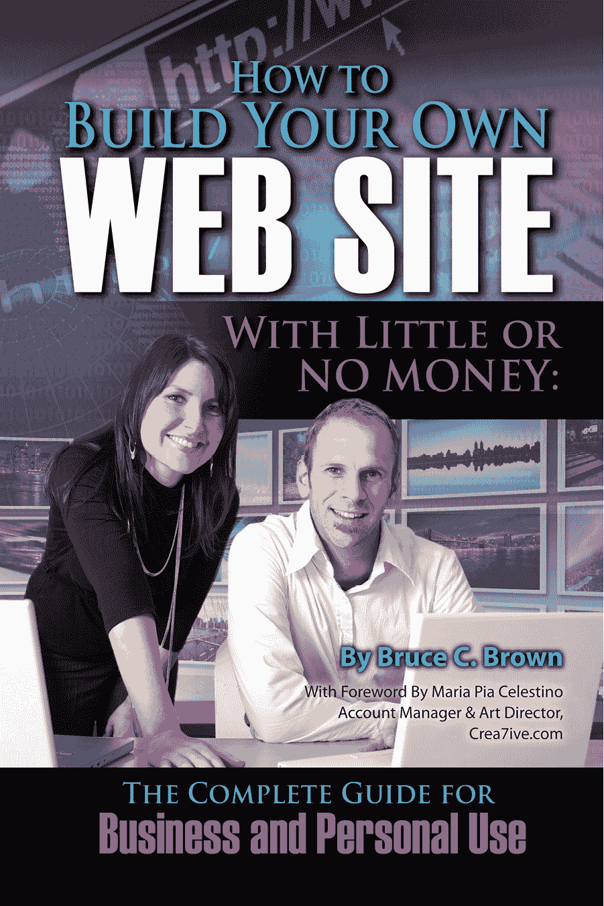

_fmt.jpeg)

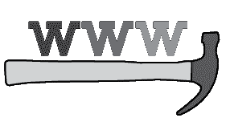

## 如何花少量或不花钱建立你自己的网站：商业与个人使用的完整指南

版权 © 2010 Atlantic Publishing Group, Inc.

1210 SW 23rd Place • Ocala, Florida 34471 • 电话 800-814-1132 • 传真 352-622-1875

网站：[www.atlantic-pub.com](http://www.atlantic-pub.com) • 电子邮件：sales@atlantic-pub.com

SAN 号：268-1250

未经出版者事先书面许可，本书物的任何部分不得复制、存储在检索系统中，或以任何形式或通过任何电子、机械、复印、录制、扫描或其他方式进行传输，但根据《1976 年美国版权法》第 107 条或第 108 条允许的除除外。向出版者申请许可请发送至 Atlantic Publishing Group, Inc., 1210 SW 23rd Place, Ocala, Florida 34471。

### 美国国会图书馆编书出版数据

Brown, Bruce C. (Bruce Cameron), 1965-

如何花少量或不花钱建立你自己的网站：商业与个人使用的完整指南 / Bruce C. Brown 著。

页 厘米。

包含参考文献和索引。

ISBN-13: 978-1-60138-304-4 (碱性纸)

ISBN-10: 1-60138-304-5 (碱性纸)

1\. 网站开发--爱好者手册。I. 标题。

TK5105.888.B768 2009

006.7’6--dc22

2009040371

### 责任限制/免责声明

出版者和作者对本作品内容的准确性或完整性不作任何陈述或保证，并特别否认所有保证，包括但不限于对特定用途的适用性的保证。销售或促销材料均不得创建或扩大任何保证。本书中包含的建议和策略可能不适用于所有情况。本书的销售是基于以下理解的：即出版者并未从事法律、会计或其他专业服务。如果需要专业帮助，应寻求胜任专业人士的服务。出版者和作者对由此产生的任何损害均不承担责任。书中提到的某个机构或网站作为引用和/或潜在的进一步信息来源，并不意味着作者或出版者认可该机构或网站可能提供的信息或可能做出的建议。此外，读者应当注意，本书列出的互联网网站在本书编写与阅读之间可能已经发生了变化或消失。

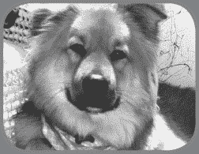

几年前，我们失去了心爱的宠物狗 Bear，它不仅是我们最好、最亲的朋友，还是 Atlantic Publishing 这里的“阳光副总裁”。它没有薪水，但每天 24 小时不懈工作，为了让它的父母开心。

Bear 是一只救助犬，它转过身对我、我的妻子 Sherri、它的祖父母 Jean、Bob 和 Nancy 以及以及它遇到的每一个人和每一个动物（嗯，可能不是兔子）投去友谊和爱。它每天都让很多人微笑。

我们希望您知道，本书的部分利润将以 Bear 的名义捐给当地的动物收容所、公园、保护组织以及需要帮助的个人和非营组织。

– Douglas and Sherri Brown

备注：从那以后我们又收养了两只救助狗：先是 Scout，第二年是 Ginger。它们都是需要家的金毛回黄金混血犬。

#### 想要帮助动物和世界吗？这里有几个你和家人今天就可以实施的简单建议：

- 从当地收容所领养并救助宠物。
- 支持当地的不杀生动物收容所。
- 种一棵树来纪念你爱的人。
- 成为一名开发者——挂一些鸟箱。
- 购买活的盆圣诞树并重新种植。
- 确保你每天都花时间陪伴你的动物。
- 通过回收和购买再生产品来节省自然资源。
- 喝自来水，或在家里过滤水。
- 尽可能限制使用或不使用农药。
- 如果你吃海鲜，请做出可持续的选择。
- 支持你当地的农产品市场。
- 多去户外。去公园、做志愿者、遛狗或骑自行车。

五年前，出版者和作者对本作品内容的准确性或完整性不作任何陈述或保证，并特别否认所有保证，包括但不限于对特定用途的适用性的保证。销售或促销材料均不得创建或扩大任何保证。本的。本书的销售是基于以下理解的：即出版者并未从事法律、会计或其他专业服务。如果需要专业帮助，应寻求胜任专业人士的服务。出版者和作者对由此产生的任何损害均不承担责任。书中提到的某个机构或网站作为引用和/或潜在的进一步信息来源，并不意味着作者或出版者认可该机构或网站可能提供的信息或可能做出的建议。此外，读者应当注意，本书列出的互联网网站在本书编写与阅读之间可能已经发生了变化或消失。

出版者和作者不作任何陈述或保证或不领取薪水但每天 24 小时不懈工作，为了让它的父母开心。

## 献献

版权 © 2010 Atlantic Publishing Group, Inc.

1210 SW 23rd Place • Ocala, Florida 34471 • 电话 800-814-1132 • 传真 352-622-1875

网站：[www.atlantic-pub.com](http://www.atlantic-pub.com) • 电子邮件：sales@atlantic-pub.com

## 目录

- 前言
- 引言
- 第 1 章：我如何成为网页设计师？需要什么才能成功？
- 第 2 章：制定成功的商业计划并寻找你的利基
- 第 3 章：网站设计 101 与 `HTML` 基础
- 第 4 章：网站设计应用——实现你目标的工具
- 第 5 章：网站组织与导航基础
- 第 6 章：网页内容
- 第 7 章：网站图形
- 第 8 章：网页格式、`JavaScript` 和层样式表
- 第 9 章：电子商务和购物车
- 第 10 章：针对搜索引擎优化你的网站
- 第 11 章：产生网站流量
- 第 12 章：点击付费广告简介
- 第 13 章：通过 Google AdSense 增加利润并产生收入
- 第 14 章：通过联盟营销产生收入
- 第 15 章：利用博客的力量
- 第 16 章：社交网络
- 第 17 章：网页设计专家访谈
- 第 18 章：网页设计成功案例
- 第 19 章：总结
- 第 20 章：推荐参考书

# 在当今经济环境下启动或管理企业

在当今经济环境下，启动或管理企业可能是一项巨大的挑战。随着市场竞争比任何时候都要激烈，商务人士被迫降低成本，并制定创新的策略以继续营销并维持销售。

最近，Web 已演变成增长最快的市场，那些没有网络形象的企业或个人正在失去巨大的市场份额。

你可能之所以拿起这本书，是因为你正寻求在预算范围内为你的业务建立网站，或者你可能在使用寻找创意方法来改进你现有的网站。无论你的业务规模或领域如何，《如何花少钱甚至免费建立自己的网站：商业与个人使用的完全指南》对于希望在不投资昂贵的网站设计公司的情况下建立外观专业且功能完备网站的企业主来说，是一部必不可少的工具。

关于构建高度专业且精美的网站，我最好的建议是聘请一位专业的网站设计师。除了经验、远见以及对工具和美学的掌握外，经验丰富的网站设计师将通过为你节省时间并让你的业务领先于竞争对手来达到物超所值。然而，如果你选择在没有专业人士帮助的情况下自己设计网站，那么除了书中包含的无价信息外，以下是一些建议。

作为 `www.crea7ive.com` 的创始人（该公司被评为国内最佳网站设计公司之一），我拥有 10 年的网站设计经验。我熟悉网站设计师可以使用的工具、流程，甚至是捷径。这本书的完整性给我留下了深刻印象，我强烈向想要自己设计网站的企业主推荐它，因为它以直观、组织良好、循序渐进的方法汇集了见解性的，让几乎或完全没有网站设计知识的普通人也能创建一个外观专业的网站。

无论你是处于严格的预算限制还是完全没有预算，构建成功网站的过程都始于组织。在动手操作图像和 `HTML` 编辑器之前，请投入需要的时间规划网站的所有细节——从注册域名、规划每个页面的标题和内容，到托管和营销。要记住，时间就是金钱，随着每一天的流逝，如果你没有在线形象，你可能正在失去潜在的业务。因此，在做决策时，要做到务实、合理，最重要的是要积极。

凭借我在网站设计行业多年来从事项目管理的经验，我处理过数百家企业，以下是一些可以帮助你起手的明确建议。

## 选择域名

创建网站的第一步是选择域名（每个在线网站都必须有的 `www.yourname.com`）。在为你的新网站选择域名时，易于记忆和易于拼写非常重要，如果可能，最好包含有关你服务的关键词。这对于搜索引擎优化（SEO）非常重要，正如你将在后续章节中读到的那样。例如：如果你的意大利餐厅叫 Mario’s，你可能想购买域名 `www.MariosItalianFood.com`。

一旦你决定了域名，请立即购买。尽快做到这一点至关重要，因为随着时间的推移，它可能会失去可用性。我见过这种情况发生，所以动作要快，在别人之前从任何主要的域名注册提供商处购买。你只需大约每年 10 美元即可注册域名。

## 规划内容和结构

下一步是确定你网站的目的以及它将包含的内容。请记住，一个设计良好的网站必须是你未来可能想要进行的更改的基础结构。你必须设计一个网站地图，它要足够灵活以进行这些更改，并且在你想要添加或删除页面时，不需要你完全重构网站。

## 设计元素

在为网站选择了域名和内容之后，你必须决定网站的设计元素，从 Logo 开始。如果你没有专业设计的 Logo，请找专业人士来创建一个。除非你是经验丰富的设计师，否则不要尝试设计自己的 Logo，因为这将是你所做一切的基础以及你业务未来的形象。你可以在网上通过 Logo 竞赛网站或聘佣自由职业者找到价格实惠的 Logo 设计师。另一方面，如果你已经有一个专业的 Logo，就可以继续选择网站的颜色和风格。当然，颜色和风格应该与你的 Logo 匹配。查看其他网站以找到你喜欢的网站设计。查看你的竞争对手和行业领导者。他们的网站看起来是什么样的？这将让你对自己喜欢和不喜欢的什么有一个想法，这样你就可以开始创建自己的。

不要忘记提前研究在线营销技术；你会对即使在网站发布之前你就能为扩展网站所做出的这么多事情感到惊讶。

希望这些建议能让你充满动力地开始；你可以访问 `www.Crea7ive.com` 获取更多建议和获奖网站设计的示例。

享受这段旅程。

Maria Pia Celestino

客户经理兼艺术总监

Crea7ive

`www.crea7ive.com`


Maria Pia Celestino 是 `Crea7ive.com` 的创始人兼总裁，这是一家屡获殊的设计广告公司，被评为国内最佳公司之一。Crea7ive 与来自全球多个国家的数百位企业家和高管合作过，并服务过世界许多大公司和知名人物。Maria Pia 在设计、Web 开发、电子商务和营销方面拥有深厚的背景，这些背景通过多年的经验和持续培训得到了强化。

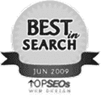 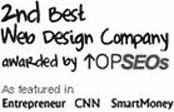

目录


# 引言

什么使一个人成为“网站设计师？”答案取决于你问谁。我从 1997 年开始设计网站，使用基础 `HTML` 编写页面。多年来，我增加了技能，并开始使用 Web 开发应用程序来提高网站的质量、与数据库交互以及自动化流程。诸如 `Microsoft Office FrontPage®`、`NetObjects Fusion™` 和 `Adobe Dreamweaver®` 早期版本的网站设计应用程序对于网站设计师来说是巨大的技术进步。

这让我们回到了我最初的问题。如果你是一个处理基础 `HTML` 代码的初学者，或者在使用如 Microsoft Expression® Web 等最新产品，你就是一个 Web 设计师，尽管你的水平会随着时间的推移而提高。如果你接受过高级培训并是成熟的行业专家，你和那些尝试开发第一个网站的初学者一样，同样是一名 Web 设计师。本书完全关于免费或低成本的网站设计，正因如此，我们将专注于帮助你起步的最佳技术和产品。你可以为 Web 设计投入巨额资金，在某些情况下，如果你有一个真正复杂的网站，你可能确实需要这样做。然而，花很少或不花钱就设计出一个高效的网站是完全可能的。

网站的可能很昂贵，但它们的构建并不非得极其困难或具有挑战性。我在没有任何经验的情况下构建了我的第一个网站，虽然按今天的标准来看，它可能不是我开发过的最好的一个网站，但它很好地完成了任务。你可能会发现，某些时候你需要经验丰富的网站设计师和 Web 开发人员的服务；然而，本书将为你提供必要的知识、技能和信心，让你以极低或免费构建你的第一个网站。你还将了解到一些构建网站的免费替代方案，这些方案将仍然帮助你建立网络形象。

任何人都有能力构建自己的网站。你不需要成为经过培训的 Web 设计师就可以构建你的第一个网站并实现目标。在我的书中《如何免费或免费利用互联网进行广告、推广和营销你的业务或网站》中，我揭示了各种设计技术和营销工具，你可以投入很少或不投入即可实施这些工具，以获得最好的搜索引擎排名，并提高所有主要搜索引擎中网站的可见性。本书将帮助你独立设计、开发和制作你的第一个网站。书中还包含了一个专业 Web 设计师的索引，如果你有电子商务、购物车、数据库集成等高级需求，他们可以为你提供帮助。任何人都可以设计和开发网站，而本书将帮助你实现这一目标。

## 本书适用对象

本书是为任何考虑设计和开发网站的人编写的，无论他们是小企业、大企业还是个体户。它旨在为任何对赚钱、增加网站流量、提高收入、改善组织财务状况以及以极低或免费成本建立网络形象感兴趣的人提供指南。虽然本书将为你提供 Web 设计的基础知识，但它不是一本高强度的 Web 开发指南。它将帮助你理解网站设计、搜索引擎优化以及网站和整体营销活动的其他基本组成部分。这将确保你的网站是高效的、在搜索引擎中可见的，并最终实现你的目标。

## 本书的结构

本书的结构旨在帮助你构建一个非常成功的网站。以下是你将在书中找到的章节摘要：

- **我如何成为一名 Web 设计师，我需要什么才能成功？**：虽然专门培训无疑会帮助你精炼和磨练 Web 设计技能，并可能开启高级 Web 设计技术的大门，但现实情况是 Web 设计并不非常困难。有很多工具可以帮助你设计出高效的网站，本章将给你开始所需的的信和灵感。它还将涵盖基础术语、域名、Web 托管和设备要求。
- **制定成功的业务和营销计划及寻找你的利基市场**：企业必须制定营销计划，确定可实现的目标并建立总体目标。这些对营销、市场研究和分析的简要介绍将确保你的网站设计努力支持你的总体目标和任务，并让你在竞争激烈的市场中取得成功。
- **网站设计 101 与 `HTML` 基础**：你必须理解 Web 设计的基本概念，以及超文本标记语言（更广为人知的 `HTML` 编码）以及有效网站设计的其他基本原则。在本章中，你将学习网站设计的基础知识，获得 `HTML` 的全面介绍，并快速查看 `XHTML™`（即可扩展超文本标记语言）。通过本章，你将在构建第一个网页的道路上迈出良好一步。
- **网站设计应用——实现你目标的工具**：构建自己的网站的一个便利好处是，你再也不需要手动编写代码了。现在有大量的工具允许你在图形用户界面 (GUI) 中构建网站，这些应用程序会为你生成 `HTML` 代码。虽然你确实需要理解 `HTML` 编码的基础，但这些应用程序（如 `Adobe® Creative Suite 3` 和 `Microsoft Expression Web`）会为你完成繁重的工作，让你专注于构建出色的网站。本章将讨论并预览各种 Web 设计应用程序。
- **网站组织和导航基础**：Web 设计师面临的最大挑战之一是网站的组织和导航。在开始编写网页之前，你需要进行一些思考和设计工作。理想情况下，你应该已经规划好了你的网站将如何组织以及你想要如何整合网站导航。一个易导航的网站对于在 Web 上取得成功至关重要。
- **网站内容与设计**：内容和设计是有效 Web 设计的两个关键元素。你的材料如何组织以及网站包含什么内容将决定你网站的成败。你必须设计一个具有吸引力、功能性并符合你目标的网站。同样，你必须拥有有效的网站内容来吸引他人的注意，提供他们寻找的信息，并让他们对你的网站保持兴趣。如果你的目标是销售产品，你必须确保你的设计和内容定义清晰并支持你的电子商务目标。通常，一个网站由于组织混乱导致内容过时、包含无效链接，或者根本无法找到你想找的东西。
- **网站图形**：本章将为你破解可以在 Web 上使用的图像和图形格式之谜，以及哪些是最好的以及为什么。本章还解释了如何使用图像创建一个吸引人且高效并针对下载速度优化的网站。
- **网页格式、JavaScript® 与样式表**：有多种网页格式。本章将探索每种格式，并定义你为什么可能选择或需要某种网页类型而非另一种。它还包含了对样式表 (`CSS`) 的深入探讨以及你为什么应该使用它们，以及关于如何创建自己的 `CSS` 的详细介绍。书中还提供了 `JavaScript` 和 `XHTML` 的介绍。
- **电子商务与购物车**：个人和企业最常见的目标之一是在线销售产品。你可以在网上找到几乎任何东西，而且竞争非常激烈。在线销售产品需要特殊的应用程序，即购物车。电子商务开启了销售产品、接受信用卡、使用 `PayPal®` 支付系统和其他货币交换方法的大门。然而，这需要更高级的 Web 设计技能和要求。本章将涵盖电子商务的基础，并向你介绍 `PayPal`、购物车和安全套层证书。

# 为搜索引擎优化您的网站

为了充分发挥您网站的价值，您需要确保它已针对搜索引擎进行了优化。本章将引导你了解如何设计网站以实现最大搜索引擎优化（SEO）的原则。这是 Web 设计中最关键的阶段之一，但往往最被忽视。如果人们无法在搜索引擎中快速找到你，本章将帮助你克服这一主要障碍。

# 产生网站流量

本章将为你提供如何产生网站流量的技巧和窍门，以及如何提高你在搜索引擎中的整体排名。创建一个网站是第一步，但要取得成功，你需要确保人们能够轻松地找到并浏览你的网站。

# 按点击付费广告导论


本章将向你介绍按点击付费（PPC）广告的概况，包括其工作原理、与其它营销技术的对比，以及如何有效设计高成效的 PPC 活动以获得最大程度的成功。它还将讨论当网站访问者点击广告时会发生什么、如何进行跟踪，以及这如何产生网站流量并增加收入。你将获得关于 Google PPC 应用所有组件的全面介绍，包括详细的设置、活动设计以及 Google 广告的管理。本章将深入探讨 Google 广告活动，并揭示许多关于利用 Google 最大化 PPC 活动效果的技巧、窍门和秘密。

# 通过 Google AdSense™ 增加利润

本章介绍了 Google AdSense 计划，这是你获取收入的另一个机会，允许其他广告主的 PPC 广告放置在你的网站上。这项免费计划是产生零成本收入的绝佳工具。当你完成本章后，可以在五分钟内开始赚取 Google AdSense 收入。

# 通过联盟营销获取收入

本章解释了你如何将联盟营销整合到你的网站中、它的工作原理以及涉及的众多变量。你将学习联盟计划、联盟网络和联盟营销技术之间的本质区别，以便选择最适合你公司或网站的方法，并最大化你的收入潜力。你还将发现如何启动一个联盟计划，直接改善你业务或网站的整体营销策略，并增加你的底线。本章涵盖了联盟计划的基本选项，是帮助你决定是想成为联盟者（affiliate）还是联盟主（host）的关键步骤。这两种选择在复杂程度、责任和收入流方面各不相同，本章将讨论所有内容，以便你做出最明智的决定。

# 利用博客的力量

本章完全关于博客。博客非常简单，并且可以成为你网站的强大伙伴。为了充分理解博客如何为你的业务或事业带来利益，你需要了解博客本身。本章将提供你了解博客所需的所有信息，包括博客的历史、其工作原理，以及你如何启动能够直接提高你的业务、网站或其他其他公益事业营销策略的博客。博客既强大又非常简单。本章将为你提供一门基础知识的速课程及更多内容。你甚至会发现博客真的是你需求的理想解决方案。你可以创建免费博客，事实上它们可以提供网站相同的服务——在几分钟内零成本地带你进入网络。

# 社交网络

随着 MySpace™ 和 Facebook™ 等网站的发展，社交网络越来越流行。这些网站真正展示了社交网络的力量。社交网站还会直接影响你的 Web 设计和搜索引擎可见性工作。本章专门向你介绍社交网络，并展示如何将社交网络整合到你的整体在线营销计划中，为你的网站产生流量。社交营销是你可以使用的最强大——且免费的营销工具之一。它不仅仅适用于青少年。

# Web 设计专家访谈

本章包含了对许多 Web 设计专家、专业人士（以及少数新手）的访谈，这将帮助你进行自己的网站设计工作。在你学习如何开发网站时，这些专家会提供实用的建议。向那些以建立网站为生或经历过创建自己网站的酸甜苦的人学习。由于这些专家提供的宝贵建议，这是书中最重要的章节之一。

# 网站设计成功案例

本章汇集了设计并构建了自己的网站并取得成功的企业或个人的成功故事。你可以阅读他们的故事，这将在设计和开发自己的网站时给你更多启发。在本章中，你将看到创建网站如何影响了所介绍人物的生活。

# 总结

本章包含了一些最后的鼓励和建议。建立一个伟大的网站是每个人都可以做的。虽然一些高级网站可能需要网站专业人士的帮助，但大多数网站都可以自己构建，花费很少或完全免费。

# 推荐参考书库

Atlantic Publishing Company 拥有丰富的阅读资源。本章包含了每个 Web 设计师和在线业务主应该拥有的参考。

# 术语表

术语表将帮助你理解在建立自己的网站之前需要了解术语。

互联网是终极营销工具，让你立即访问全球数十亿用户，通过建立自己的网站，你可以以极小的投资让自己声广远播。在阅读本书并应用其中的原则和技术后，你可以让你的网站获得成功。

这本书专为没有信息技术或 Web 设计人员、且在技术预算和知识方面有限的小企业或个人设计。如果你是传统实体或在线业务的所有者、业主或经理，或者仅仅是一个希望建立自己网站的个人，你可以节省数千美元的网站设计服务费用。

在本书的帮助下，新手和专家都可以发现最简单、最便宜的方法来构建个人或业务使用的网站。你将制定一个详细描述你对网站的目标计划、你试图接触的人群，以及你计划提供什么来使网站独具特色。其他领域将包括一些需要避免的陷阱，以及最适合你个人或专业需求的设计方案。

文中的许多讨论将集中在商业 Web 设计程序的使用，例如 Adobe Dreamweaver、Microsoft Office FrontPage、Microsoft Expression Web、`Serif® WebPlus™ X2` 以及其他类似但提供开源软件版本的程序。你将学会在哪里找到这些免费软件平台，并在专家的帮助下确定哪些平台更好。当你开始实施网站计划和设计时，你将接触各种可用的不同类型的开源软件，例如 `WordPress™` 和 `Joomla!™`。这些软件程序将帮助你创建一个平台，让你能够构建出几乎任何你想要的内容。本书还将评估免费的 HTML 编辑器，例如 `Nvu` 和一种基于互联网的免费服务 `Microsoft Live™`。你将探索多种途径来构建一个既易于使用又引人注目的网站。

本书将帮助你创建一个吸引目标受众的网站，无论该网站的设计目标是为了提供当地新闻和活动信息、销售产品或服务，还是仅仅为了让家人朋友了解你的生活动态。你将学习从其他来源借用文本的注意事项和禁忌、应使用的字体大小和类型、如何创建自己的文本，以及在设计计划的这部分寻求帮助的联系资源。

本书将为你提供将设计转变为现实并利用互联网力量的所有工具。如果你遵循书中所包含的指导原则，你将发现构建自己的网站是多么有成就感，并证明你可以成为一名成功的 Web 设计师。由于主题非常广泛，本书的每一章都可以独立成一本书。虽然不可能将所有内容都放入书中，但你入门所需的必备要素已列在这些页面中。不过，你可能需要通过其他资源扩展你的知识，例如关于 PPC 营销、`HTML`、`JavaScript`、`XML`、`XHTML` 以及其他高级主题的书。

目录


# 第一章：我如何才能成为 Web 设计师？我成功需要什么？

成为一名 Web 设计师并没有你想象的那么困难。你不需要多年的培训和经验。事实上，当你完成这一章时，你已经踏上了成为 Web 设计师和开发者的道路。不过，公平地说，你需要设定现实的预期。一些网站和网站技术是复杂的，可能需要高级技能才能有效地实现你的最终目标。然而，本书的设计旨在帮助你花很少或完全不花钱就建立你自己的基础网站，并确保你能够建立一个可行的、功能完全且符合 SEO 的网站。

要完全理解构建网站的概念，你必须首先理解术语。本章将讨论 Web 构建者使用的一些术语，例如域名、磁盘空间、`e-mail` 账户、论坛、`Web hosting`、`virtual` 服务器、`dedicated` 服务器以及 `FrontPage` 。对于某些人来说，这些可能是常用术语，但在深入研究网站设计基础之前，仍有必要讨论每一个概念以建立稳实的理解基础。

## Web 设计师与 Web 开发者

Web 设计师是创建网站及其包含的所有页面整体设计、外观和感受的个人。网站的设计必须实现网站所有者的目标，支持业务品牌名称，并结合各种字体、颜色、导航、布局、图像和页面内容，呈现给网站访问者。Web 设计师通常会将他的设计计划转换为 `HTML`（或其他格式）模板，引入层叠样式表（`CSS`）来控制网站的整体外观和感受，并整合所有图像、内容和文件以生成网站。

`CSS` 是一种格式语言。你使用的模板可能是静态的 `HTML` 模板，也可能是通过使用 `CSS`、图像和其他页面元素创建的，以便创建一个在整个网站中可以反复使用的网页。你可以添加新内容，但整体格式、样式和布局由 `CSS` 控制。使用 `CSS` 允许你拥有一个单一的 `CSS` 文档，它将决定所有页面元素的格式，让你能够更改整个网站的字体颜色、边框、内边距、外边距和其他格式选项；然而，`CSS` 并不是你真实的网页模板。通常，一旦网站建成，它就会被发布到网上并对搜索引擎可见，随后网站访问者就可以浏览你的网站。

另一方面，Web 开发者负责网站的所有编程需求。通常，这包括实现 `e-commerce` 能力或添加高级功能、数据库连接或搜索工具。对于大多数小型企业和个人来说，你将兼任 Web 设计师和 Web 开发者的职责。这些术语经常被互换使用，但在功能上有明显的区别。在大多数情况下，在设计和构建你自己的网站时，你兼任了这两种角色。

## 互联网的总体结构

要理解 Web 设计，理解互联网的总体结构非常重要。了解互联网的运作方式让 Web 设计师能够正确地为其客户提供服务。关于互联网出现的背景信息有助于制定网站运行的有效策略。特别是，设计师需要查看互联网的总体结构，包括万维网（World Wide Web）的一些最广为人知的特征，如互联网协议（`IP`）路由和超链接。

万维网与互联网是不同的实体，它是一个由互联的信息形式、文档、图像以及你可以想象的任何其他形式的数据组成型数据库。所有这些信息都通过超链接和 `URL` 连接在一起，这些链接将服务器（存储原始数据的计算机）与其他计算机连接起来。

当互联网用户输入 `HTTP` 地址时，他们是使用分配的代码来调用特定的数据块。以 `Amazon.com®` 为例。在世界上某处，构成 `Amazon.com` 的文档、图像和声音文件存储在服务器计算机上。当你，即互联网用户输入 `HTTP` 地址 `[www.amazon.com](http://www.amazon.com)` 时，你的计算机与 `Amazon.com` 服务器计算机进行通信。数据传输开始：你的计算机向 `Amazon.com` 服务器请求信息，服务器将原始文件的副本传输到你的计算机。

一个网站实际上只有两个基本组成部分。它们是你的 Web 页面（即你设计的 HTML 页面合集）以及显示在这些页面上的图像、内容和其他信息。你的每一个 Web 页面共同构成了你的网站。你的网站可以小到只有一个页面，也可以有数千个页面。所有网站都有首页。首页是访问者在浏览器中输入你的网站域名时跳转到的页面。从首页，访问者可以导航你的网站并访问网站上的其他 Web 页面。随着新内容和其他 Web 页面的添加，所有网站都会不断发生变化；因此，尽管你可能完成了初始设计并发布了网页，但通常情况下，你的网站还需要进一步的维护、更新和修订。创建网站最具挑战性的部分是制定一个蓝图，规划你希望如何组织网站、它将包含哪些页面、内容如何组织，以及在设计导航和页面关系时，你的页面与其他页面之间如何布局。先单独设计你的页面，构思每个页面应该包含的内容，然后再充实实际的内容和网站设计。你可以在纸上进行这项工作，甚至可以在墙上贴便利签，因为这将帮助你视觉化布局。

在构建网站时，首先要认识的方面之一是，你需要某种软件程序——或者你必须学习 HTML 编码并从头开始构建网站。对于那些决心学习构建和维护网站所需的所有编码的人，我们将在书的后半部分（从第 3 章开始）探索这些选项，并查看各种帮助你实现设计目标的软件选项。本书所访谈的大多数网站站管理员都表示，从具备为网站添加交互内容和项目的能力开始是最佳路线，因为即使你最初没有计划使用它们，日后你很可能也会用到它们。在随后的章节中，我们将查看一些 Web 开发应用，例如 Microsoft Expression Web、Adobe Dreamweaver、Serif WebPlus X2 和 Microsoft Office FrontPage。在进行网站设计时，最好将颜色和字体保持在基础水平。

### 网站的四个主要组成部分

1. **域名**：该名称经过注册，对应于你的网站在 Web 上的上的物理位置，它也用于你的电子邮件账户。

2. **Web 托管**：这是你的 Web 页面在连接到互联网的服务器上的物理“存储”。这台机器在 Web 浏览器请求时“提供”你的 Web 页面，并且该机器有一个 IP 地址。域名系统（`DNS`）将你的域名转换为你的 Web 账户 IP 地址，并根据请求提供相应的 Web 页面。你的域名注册商将存储 `DNS` 的 IP 地址。这个概念听起来可能很难理解；但实际上非常简单。

你的网站由一系列 Web 页面组成。这些 Web 页面是文件，存储在 Web 服务器上，连同服务器上的图像和其他内容。这台 Web 服务器有一个 IP 地址，它是该服务器的唯一机器名称。`DNS` 服务器将你的域名（例如 `www.myWebsite.com`）转换为你网站实际托管的 IP 地址，然后你的 Web 服务器将你的页面提供给网站访问者的浏览器。因此，确保你的 `DNR` 账户（你购买域名的公司）更新了 `DNS` 的物理 IP 地址（由你的托管公司提供）至关重要。这确保了任何在浏览器窗口中搜索或输入你的域名的人都会被引导到 `DNS`，然后 `DNS` 将其转换为你网站的 IP 地址，从而确保你的 Web 页面始终正常显示。

3. **Web 页面**：这些是你创建并发布到 Web 服务器上的 Web 页面。你可以使用 Microsoft Office FrontPage、Microsoft Expression Web、Adobe Dreamweaver CS4 以及许多其他应用程序（包括免费设计应用）来创建 Web 页面。

4. **可选项目**：这些可能包括购物车、表单或数据库。虽然网站并不是这些需要的，但你可能会发现你的需求随着时间的推移而变化，因此在规划过程中记住这一点。

### 网站设计硬件要求

你不需要投入大量资金就能创建自己的网站；你只需要一台可靠的电脑。网站可以在你的个人或公司电脑上进行设计和测试，你不需要自己的 Web 服务器——事实上，你应该避免这项费用。许多网站设计师完全通过他们的笔记本电脑工作，这是获得移动性的绝佳方法，让你无论在何处都能继续处理网页。我对笔记本电脑的最低建议是 Intel® Core™2 Duo 处理器，尽管你不需要市场上最快的型号。事实上，任何中端处理器都能很好地满足你的长期需求。在桌面机上，强烈建议使用 Intel Core 2 Quad 型号，因为它具有轻松处理多任务的能力。

你还需要快速、可靠的互联网连接。选择哪种其实并不重要——只要是可靠且具有效益的高速宽带即可。不要在互联网速度上偷省费用，也不要使用拨号上网，因为太慢了，你很快就会对其局限性感到沮丧。你可能想使用外部 1GB 硬盘进行定期备份，而像 `Carbonite™` 这样的程序对网站的全备份非常有用。你可以在 [www.carbonite.com](http://www.carbonite.com) 获取 `Carbonite` 的免费试用。

对于图形编辑，流行的选项包括 Corel® Paint Shop Pro® X2 和 Adobe Photoshop® CS4。一些著名的网站设计软件包括 Microsoft Office FrontPage、Microsoft Expression Web 和 Adobe Dreamweaver CS4。其他如 Serif WebPlus X2 等设计应用为新手提供了很很好的工具。尽管如此，你不需要在高级网站设计应用上投入大量资金。网站设计和图形编辑需求也有许多免费软件（freeware）可用，我们将在第 4 章进行讨论。此外，重要的是，大多数网站托管公司也会作为托管包的一部分提供易用的网站模板，让你能够快速、轻松地创建一个精美的网站。然而，我的建议是投资 Microsoft Expression Web 和 Corel Paint Shop X2，因为它们都是非常好的程序，且价格合理，能满足绝大多数 Web 开发的需求。不过，其他设计应用（如 `WebPlusX2`）为新手提供了很棒的工具——而且有大量的免费网站设计和图形编辑应用可用。

在网站设计和开发社区中，你会看到两个不同的群体：微软组和 Adobe 组。Adobe 组使用 Adobe Dreamweaver CS4。大多数网站开发者认为 Dreamweaver 是专业 Web 开发者的选择。相比之下，许多人曾认为 Microsoft Office FrontPage 是入门工具。微软通过发布 Microsoft Expression Web 改变了这一点，它与 Dreamweaver 旗相当。FrontPage 不再由微软官方支持，但仍然可以购买。它是一个很好的入门工具，为你提供所见即所得的环境，你在设计模式下创建，软件会为你编写 HTML 代码。WebPlus X2 对于没有任何 HTML 经验的人来说也是一个很棒的设计应用。

## 网站 托管

Web 托管比简单的购买存储空间要复杂一点，尽管这本质上是你正在做的事情。你正在支付给提供商以便在他们的 Web 服务器上“托管”你的网站。Web 服务器具有特殊的软件，允许服务器作为 Web 服务器运行，当用户请求你网站的页面时，它就会将这些页面“提供”给网站访问者。一台 Web 服务器可以同时托管数百个网站，这就是为什么你可以以相对廉的价格购买 Web 托管服务。Web 服务器有一个唯一的 IP 地址，用于识别托管你网站的机器。DNS 服务器将你的域名翻译成该 IP 地址，这就是你的 Web 页面提供给网站访问者的方式。如果你在浏览器中输入 [`www.atlantic-pub.com`](http://www.atlantic-pub.com)（大西洋出版公司），你域名注册中指定的 DNS 服务器将会将此 URL 翻译为该网站相应的 IP 地址，并向网站访问者提供该网站。

在大多数情况下，你会从商业服务提供商处购买托管，尽管你可以在自己的服务器上托管自己的网站。但是，托管是廉价且可靠的，购买托管服务可以将支持设备、租赁高速互联网连接、备份服务以及应用补丁和升级的负担交给服务提供商。让你的托管提供商处理与保持你的网站可用相关的所有成本和挑战吧；不值得投资在你自己的 Web 服务器设备上。

Web 托管是你构建网站所需的基础；没有它，你就无法开始实施你的设计计划。Web 托管为你提供磁盘空间、电子邮件账户和购物功能等。尽管这是关于寻找最廉价或免费的构建网站方法，但有时选择免费路线从长远来看可能会让你花费更多的钱并带来更多的头疼。使用免费 Web 托管的一个关键因素可能包括限制你创建交互式页面的能力，或者没有足够的足够的空间来构建你在规划阶段设计的网站，而且在大多数情况下，它们一个都不支持电子商务或其他高级的 Web 开发需求。


虽然有可用的“免费” Web 托管服务，但大多数服务会将广告推送到你的网站上，并通过强制你从有限的网站模板中选择来限制你的创造力。如果你想建立一个包含 25 个页面的网站，许多免费 Web 托管将不支持这么多页面，或者无法随着你网站需求的增长提供增加到该数量的能力。你最不希望的是建立了一个网站后不得不移动它，因为你选择的托管主机没有提供维护它所需的支持或工具。移动网站不仅耗资，而且耗时。

你可以使用 Google 或任何其他搜索引擎来寻找信誉良好的托管服务提供商，包括免费和付费的：[www.doteasy.com](http://www.doteasy.com)、[www.mister.net](http://www.mister.net) 和 [www.Webs.com](http://www.Webs.com) 只是几十个免费托管提供商中的几个。这些网站都有特定的局限性，因此在决定免费还是付费选项之前，你应该仔细审查它们。你会发现，每年不到 100 美元即可获得功能丰富的 Web 托管包。本书的末尾提供了一个 Web 托管公司的索引。Applied Innovations（[www.appliedi.net](http://www.appliedi.net)）就是这样的公司之一。他们的 ValuePlus™ 托管解决方案具有多域名支持，因此你实际上可以在同一个账户上托管两个独立的域名。虽然你可能永远不会使用该计划中包含的许多功能，但 ValuePlus 计划确实包含了你应该寻找的最重要功能：2,000 MB 的磁盘空间、50,000 MB 的每月数据传输、高级统计报告和无限量电子邮件账户。当你拥有并托管自己的域名时，例如 [www.brucecbrown.com](http://www.brucecbrown.com)，你的托管账户将附带电子邮件账户。

另一个考虑因素是你的计划如何使用网站，除非你需要一个拥有数千访问者的巨大的、支持电子商务的网站，否则不需要专用服务器。虚拟专用服务器在 99% 的情况下都是合适的。两者之间的价格有巨大差异，除非你需要一个拥有大量访问者的电子商务支持型网站，否则不需要专用服务器。

当使用免费托管服务器时，搜索引擎爬虫似乎会发现页面上的广告，但通常找不到你的网站内容，这就是许多人说免费托管没有商业托管好的原因之一。免费托管和软件听起来是很棒的概念，但使用它们是 Web 构建者建议避免的首要陷阱之一，因为正如古语所说，一分钱一分货。免费服务可能不值得你在开始构建网站时面临的头疼。

如果你选择建立个人网站而不是业务网站，Lisa Irby（[www.2createa.com](http://www.2createa.com) 的创始人和网站管理员）建议不要使用免费主机，因为个人网站曾经非常流行。在网站上，Irby 有力地写道：“在经历了免费 Web 主机的噩梦体验后，我发誓再也不走免费路线，因为投入少量的钱绝对更值得。”以下来自 Irby 网站的列表说明了使用免费托管网站构建你新网站的缺点。

## 免费 Web 主机的缺点

- 你拥有的页面空间有限。
- 你无法添加交互式功能，如聊天室、留言板、游戏和在线订购。
- 搜索引擎通常忽略它们，因为它们没有积极帮助你进行搜索引擎寻找的关键词，总的来说，这是一个巨大的缺点。
- 你的访问者可能会怀疑你的信誉。

## 免费网络托管的缺点

使用免费托管和软件会有几个显著的缺点：

- 你的首页（或所有页面）可能会出现横幅和/或弹出窗口广告——这会增加你的客户或访问者的负担，因为大多数用户都会阻止弹出窗口，如果他们不得不处理这些广告，就会离开你的页面。
- 你通常会被分配一个长且难以记忆的网络地址，这意味着你无法自选择自己的短域名。例如，它可能类似于 `www.freeWebhost.com/yourdomainname`。
- 不保证网站的可用性和长期性。
- 没有品牌化的电子邮箱地址，例如 `you@yourdomain.com`。
- 帮助和支持选项匮乏，如果最初就提供服务的话。
- 这些服务可能不会永远免费；除非你阅读了细则，否则免费网络托管可能只是暂时的，最终花费的费用可能比从一开始就选择一家成本透明的公司要多得多。

使用免费托管和软件听起来可能是一条简单的路径，但在这样做时，请记住，这通常意味着你得到的完全是你付出的代价——即什么都没有。另一个需要记住的细节是，尽管这些免费网络托管网站声称提供服务，但它们的运行并不廉价，因为必须有人为向你免费提供的空间付费。这最终可能导致托管网站因损失过多而倒闭，或者你的网站充斥着广告以支付这些“免费”服务的费用。通常，横幅和弹出窗口广告是这些免费网络托管商向你提供免费网站的方式。大多数（如果不是所有）免费网络托管网站都不提供任何保证来防止你的页面在不通知的情况下被关闭，或者它们突然更改条款转换为付费托管系统。

## 搜索引擎可见性

免费网络托管的另一个缺点是，搜索引擎很难找到你的网站，在很多情况下，它们根本不会索引你的网站并将其纳入数据库中。当你建立一个网站来赚钱时，那些搜索引擎结果是至关重要的。如果没有像 `Google` 和 `Yahoo!®` 这样主要的搜索引擎找到你的网站，你永远无法获得任何动力。

以下是“免费”托管网站通常在搜索引擎中无法被搜到的主要原因：

- **太小且“不重要”**：大多数免费网站通常较小，没有显著价值，因为它们不包含核心的主题或概念，而且指向外部网站的链接通常比指向其内部页面的链接多。内容是搜索引擎寻找的特定类型信息，这意味着内容需要具有特定的焦点并拥有大量的页面。
- **网站内容更新极少**：许多人建立了一个网站，发布后就再也不更新了。搜索引擎正在变得越来越聪明，它们用于确定页面排名的公式可能无法识别免费托管网站。当一个网站显示托管在免费网络托管服务器上时，搜索引擎索引它们的难度似乎更大——或者它们直接将它们排除在外。
- **没有指向该网站的链接**：许多网站管理员或网络目录不会链接到在免费托管上建立的网站。原因是这些网站可能看起来不专业，很少有人愿意链接到一个到处都是弹出窗口和横幅的开发糟糕的网站，因为这会给他们的网站带来负面形象。另一个问题是，大多数网站管理员知道免费网站的寿命很短。如今，链接你的网站类型对于获得良好的搜索引擎排名非常重要，正如你将在本书后面发现的那样。事实是，免费网站在互联网上几乎不受尊重。

在选择托管计划时，请研究该公司并了解他们提供什么类型的客户服务；你是否可以随时更新网站；以及托管商提供什么类型的电子邮箱和支持。在网站 `www.top-10-Web-hosting.com` 上，根据对 `58,000` 位网站管理员的调查，十大网络托管网站每天都会排名和更新。

## 域名

如果你想拥有严肃的网络形象，你就必须拥有自己的域名。你的域名就是互联网上的品牌名称。它是每个网站访问者在访问你的网站时输入的地址，选择一个好的域名并由信誉良好的提供商进行托管至关重要。你可以从几十家公司购买域名。大多数公司都提供方便的控制面板，允许你更新设置，包括 `DNS` 服务器 IP 地址。如果你有自己的公司交换服务器，只要你不想使用与托管账户提供的 `POP`（邮局协议）电子邮箱账户，你也将能够更改邮件服务器的 IP 地址。这将允许你更新联系信息、姓名、地址和电子邮箱地址。

你的域名应该唯一地标识你的业务。通用的规则是，域名越短越好，并且应该与你的公司名称、服务或产品相关。如果你已经有了既定的公司名称或身份，你应该尝试基于该公司身份创建域名。这将允许客户将你的公司名称与域名联系起来。例如，大西洋出版公司（Atlantic Publishing Company）的域名是 `www.atlantic-pub.com`。我们还强烈建议你获得任何类似的域名，主原因是保护你的身份免受其他可能使用听起来非常相似或相同但不同扩展名的域名侵害。使用上面的示例，你还会想要注册 `www.atlanticpub.com`、`www.atlanticpub.net` 和 `www.atlanticpublishing.com`。你的主域名应该是被“托管”的域名，而其他域名可以免费停靠并指向主域名。这样，你只需要为一个托管域名付费，但在互联网上可以使用许多域名，所有这些都将网站访问者引导到你的托管网站。

用你的域名命名你的网站是非常重要的。其主要原因是让人们通过名字知道你的网站和业务。`CNN®` 代表电缆新闻网络（Cable News Network），但没有人那样称呼它；`CNN` 直接被称为 `CNN`，域名是 `CNN.com`。虽然解释可能很简单，但你的域名应该与你的公司名称轻松关联，这样你的品牌或公司名称就能被容易识别和记忆。

许多专业的网页设计师建议在域名中使用关键词而不是公司名称。例如，`www.strugglingteens.com` 域名通过使用关键词 `struggling teens` 专门针对私立学校和计划行业。因此，当你在 `Google`、`Yahoo!` 和 `Bing` 搜索引擎中输入关键词时，这个网站会在付费广告下第一位。你的域名在某些搜索引擎对你网站的排名中可能相关，因此将关键词嵌入域名中可能帮助你获得更好的搜索引擎成功。

你可能考虑的另一个选项是同时购买两种：标识你业务的域名和使用关键词的域名。将你的网站文件放在带有关键词的域名上，并将公司名称的域名重定向到关键词域名。这将允许你通过公司名称对域名进行营销，这有助于品牌建设，并具有将实际网站位于关键词域名下的优点。

嵌入网站内容和元标记的关键词对于在这些主流搜索引擎中获取并维持可见性至关重要。本书的后续章节将对此进行详细讨论。关键词并不是你实施一次后就可以忘记的；必须不断更新关键词，以确保在获得可见性方面即时成功，并让你的网站一直留在搜索引擎搜索结果的第一页。很少有人会看搜索结果第一页之后的内容，所以如果你位于第十页——甚至是第二页——你可能永远不会被发现。

域名名称不应该过长；这是你网站的 URL 地址，你最不需要的就是一个没人能记住的长地址。虽然有些人可能会在网络浏览器中收藏你的页面，但有同样数量（甚至更多）的人不会这样做。如果你的网站地址太长，可能会丢失宝贵的流量。如果你一定要使用长长的 URL 地址，用连字符连接单词会使其更易读。

曾有一段时间域名随处可得，但今天你会发现许多域名已经被别人注册了。通常情况下，你想要的域名会有变体可用，或者可能有其他的域名扩展名，如 `.org`、`.net` 或 `.us`。你可以访问 [who.GoDaddy.com/WhoIsCheck.aspx](http://who.GoDaddy.com/WhoIsCheck.aspx) 来检查域名的可用性。

## 拥有自己域名的优势

- 你对自己的域名拥有完全的创意控制。
- 很容易在主流搜索引擎中列表，这反过来让你的网站更容易被发现。
- 你可以拥有多个品牌化的电子邮件地址，例如 `you@yourdomain.com`。
- 托管时有大量的 Web 页面空间供网站扩展。
- 在带有虚拟域名的免费托管提供商处，无需担心网站会被意外删除。
- 它看起来比虚拟域名更专业。
- 你在设计和功能上具有更大的灵活性。

## 网站设计基础

作为一名网站设计师，你的创造力重心也应该遵循类似的路径。不要仅仅关注开发一个销售产品或服务的网站。利用大脑的右脑，你应该能够根据客户网站的具体需求，为他们脑风暴出一个创性的品牌解决方案。曾有一位网站设计师接到一个小企业主的委托，对方需要为五个网站创建一个品牌。该设计师之所以获得该项目，并不是因为他们提供的网站价格最低——尽管确实如此——而是因为他们立即想到，如果这些网站都根据一个模板进行设计，那么作为品牌的一部分运作效果会最好。对于网页设计师来说，这意味着只需要创建一个模板，就可以将其应用于客户需要的全部五个网站上。

为你的每个网站设计项目设定一系列目标。即使你设计的是一个相对较小的网站，也要为你的工作制定某种时间表。确定你的项目目标，并明确优先顺序，以及了解什么时候需要完成什么。在制作网站时，要有一个多个目标。例如，你的直接目标可能是为网站开发一个良好的首页，这样你至少可以发布这个关键页面并让它相对快速地上线。在某种层面上，网站设计是一种艺术形式。它是通过使用 `HTML` 代码对概念和想法的呈现，就像绘画是使用各种颜色的颜料和其他媒介所呈现的想法一样。要确定你的网站设计项目需要什么类型的页面，首先要确定你希望网站看起来像什么样。以下是需要考虑的某些考虑因素：

- **考虑你拥有的信息量以及如何组织它们。** 在任何情况下，网站访问者都不应该被内容淹没。一方面，你的客户可能不想开发一个只有几个页面、几张图片和零散文字的网站。另一方面，你想要确保访问者有足够的参与度来留在网站上。如果信息太多，你可能需要考虑创建一个数据库来管理所有内容。但通常情况下，你应该只考虑每页开发合理数量的信息。
- **考虑访问者可能如何使用这些信息。** 大多数网站允许用户只需坐着阅读信息。大多数人在在线上花费时间读电子邮件、关注最新新闻，或偶尔追踪金融市场。网上银行也很大。这些活动大部分介于完全被动和中度被动之间，但这并不意味着人们不喜欢互动式网站和在线活动。你帮助客户让访问者在网站上停留最长时间的方法之一，是找到某种在网站上建立互动活动的方法，无论这涉及到参与问答和调查投票，还是在留言板上发布意见供大家查看。还要考虑访问者是否需要下载内容，例如视频或音频文件。例如，你的客户想提供流媒体视频吗？
- **考虑用户的预期。** 当你在设计过程中为网站开发概念时，清楚地了解人们在访问网站时想要从网站获得什么是非常重要的。大多数设计师都养成了一种习惯，即访问在某些方面与他们要求的设计相似的网站，以了解人们期待的特性和功能。由于大多数用户在寻找特定网站时对自己的预期有非常清晰的想法，因此仔细观察与你的项目相关的网站中常见的特征是值得的。

对于你所设计的网站的布局和多媒体内容，请思考组织信息的最佳方式，以及满足访问者预期的最佳方式。大多数网站都有独特的首页布局和二三个子页面设计。统一性作为一种审美元素也很重要；人们不想被许多不同的布局所淹没，就像他们不想被过多的信息或多媒体功能所淹没一样。选择最好的元素——最好的三四种页面布局、最好的三四种颜色、单一字体——并坚持使用，在所有页面应用统一的风格。网站是一个不断进行的过程。会有不断的产品或信息需要添加；这些更新将使你的页面充满活力并吸引更多浏览量。目标是创建一个内容丰富、图片吸引人，但仍然易于加载和导航的网站。

规划你的网站的呈现方式是创建一个成功网站的另一个关键部分。无论广告做得多么内容或内容，都无法弥补缺乏吸引力、粗糙的设计和布局。许多网站拥有惊人的内容，但因为第一眼看上去并不吸引用户，因此很少有人看到它们。花些时间在纸上规划出你想做的事情。列出你想要在主页上显示的所有链接。

## 颜色与设计

颜色至关重要，应该对其进行充分考虑。深色或花纹复杂的背景配浅色文字很难阅读，并且会分散人们对你产品的注意力。每个人至少遇到过一次这个问题，并且不得不求助于高亮文本来阅读它。如果有人搜索并发现了其他具有相似内容或产品的的网站，他们会跳过你的网站，选择一个更易阅读的网站。

背景应该是白色或浅色，让深色文字在上面脱颖而出。一个没有个性的平淡网站同样无法留住常常访客，因此请使用大多数人喜爱的组合。亮色的文字应只用于突出词汇。如果你选择使用黑色以外的颜色作为正文，请确保它是深色的。如果觉得黑色太单调，可以在浅色背景上选择巧克力棕或海军蓝。颜色是你作为网站设计者必须选择良好组合的领域。如果潜在客户看到你的网站，而它采用了他们讨厌的配色方案，他们可能会找到更符合他们口味的更好选择。找到吸引眼球且易于阅读的组合至关重要。白底黑字并不是唯一的选择。例如，一些效果也良好的组合是：浅蓝色配深巧克力色文字，或者浅绿色背景配海军蓝色文字。

## 布局与结构

页面及其组件的布局将决定你网站的成败。在网站布局上你拥有无限的选择，但也有一些通用规则需要遵循，这些规则将使你的页面足够标准，即使是极端的初学者也能轻松使用和理解。避免让页面过于杂乱，以至于没有人关注你网站的某一部分。在没有图形、文字或链接的地方留出大量空间是使网站清晰易于操作的关键。如果你让访客能够毫无问题地完全探索你的网站，他们就会再次回来。

### 页面页眉

页面的顶部应留作网站或业务名称的标记。将其想象成一个小型的告示牌或名片。你可以包含客户品牌的 Logo 或另一个身份识别图像。保持简单简洁。最佳位置是页面的中间三分之一处。当主页加载时，它将处于中心位置，且无法被忽视。

访客查看的第一部分是网站顶部的中间三分区域。确保该区域整洁，但仍具有个性和神韵，为你的客户或其公司提供身份标识。确保它不是那种在网上随处可见的无聊的模板或纯文本。

### 导航

指向网站其他页面的链接称为导航按钮，通常有三种放置方式。你可以将它们放置在每个页面的顶部、左侧或右侧。如果你愿意，可以在顶部和底部放置两组链接，让访客无论是已经向下滚动到页面底部还是回到顶部，都可以点击链接。

给你的访客提供选择，以增加他们移动到你网站其他页面的概率。如果你在主页上有许多不同的链接，你可以因为链接数量多而选择将它们垂直放置在左侧或右侧。页面侧边的一系列列表比几个横跨屏幕并超出主视图的链接要整洁得多。如果你可以将自己限制在顶部的一或二行而不会产生这个问题，那是可以的。如果你有多个链接，且页面顶部看起来像一大堆聚集在一起的链接，请选择使用侧边列表。

### 链接标签

链接的标签也应该是短的。它们应该传达其所连接内容的信息，而不需要太啰嗦。例如，与其使用“关于我们以及我们作为公司的历史”，不如使用“公司简介”或简单的“关于我们”。每当你添加一个极长的链接时，整个页面都会偏离其精简的外观。保持简洁明了。人们不断玩着“词语联想”的游戏，特别是在浏览网站时。如果他们正在寻找特定的东西，他们脑中可能会有几个正在搜索的词。如果有人在寻找关于你公司历史的信息，他们可能会扫描页面以寻找“简介”、“关于我们”或“历史”。查看其他网站，看看哪些词组会跳出来。顺应习惯是一个好主意。如果你想与独特，可以想出自己的链接词，但要确保人们能够建立你意图中的联系。

## 兼容性与工具


每台计算机查看网页的方式也可能不同。你的网站设计应该是：无论任何计算机上的分辨率或页面视图设置如何配置，看起来都是良好的。在你的网站上使用百分比设置可以使其在各种屏幕上看起来都很好，而不仅仅是你的屏幕。通过 80 到 90% 的设置，你的页面将占据每台计算机屏幕宽度的 80% 到 90%。记住，今天销售的大多数显示器都是高分辨率的宽屏 LCD。你添加的一些图像如果太大而无法适应百分比视图，可能会成为问题。每当你第一次上线或在添加新页面后，你仍应该在所有可能的分辨率下检查你的页面。

使用 `Dreamweaver` 或 `Expression Web` 等程序的巨大优势之一是，它们配备了一系列强大的工具，可以轻松创建令人印象深刻的网站。通过这些程序，还可以轻松创建高级效果，如滚动按钮、表单、导航菜单和数据库集成。在 `Expression Web` 中点击鼠标，你可以创建 `HTML` 页面、`ASPX`、`PHP`、`CSS`、主页、`Web 模板`、`JavaScript`、`XML` 和 `.ASP` 页面。

本章为网站设计者、网站托管服务提供商以及推荐的产品、供应商和软件提供了大量信息。但此外，你可能会发现自己需要使用自由设计师、平面设计师或 SEO 专家的服务。一个很好的来源是 [www.guru.com](http://www.guru.com)。个人可以在 Guru.com™ 上发布一个无义务性质的项目，并在几小时内开始收到来自自由职业专家的竞争性报价。或者，你也可以通过按技能分类搜索 Guru.com，以找到排名最高的自由职业者并邀请他或她参与项目。如果你不确定如何自己定义你的项目需求，或者你只需要找到一个具有特定技能组合的最优专家，这种策略将特别有帮助。

本章为你提供了网站设计基础的性知识，并解释了在互联网上托管和发布网站所需的要求；第 `2` 章将向你展示在深入研究网站设计基础之前如何制定营销计划。

## 网站设计建议、提示与技巧 — Vickie Acklin（Vickie Acklin）

你可以花费很少的钱设计自己的网站。在线网站编辑器是构建自己网站最具成本效益的方法。你通常可以在一个地方购买域名、设置网站托管并使用在线编辑器构建你的网站。要确保的一点是你为网站选择一家知名公司。了解他们经营了多久。看看如果你需要帮助时他们是否会提供支持。

使用如 `GoDaddy’s WebSite Tonight` 等在线编辑器将为你节省时间和金钱。在线编辑器的开发并不是为了让你设计非常复杂的网站，但如果你愿意花时间，你就能设计出一个很好的网站。尽管它被称为“WebSite Tonight”，但不要试图在一个晚上让你的网站上线。花些时间设计一个高质量的网站。

大多数在线编辑器都非常易用，但你仍然需要花时间查看程序提供的所有选项并熟悉它们。使用在线编辑器，你通常会选择一种颜色和设计主题。一旦你做出了决定，只需添加你的文本和图像即可。如果你想在网站上放置图像，在线编辑器提供了一个基础的图库供你选择。

如果你愿意多花一点钱，并且有时间学习软件程序，你可以在许多商店购买网站编辑器。`Dreamweaver` 很好，但学习起来可能很复杂。`CoffeeCup®` 软件要用得多但创建的网站也简单得多。`CoffeeCup` 仍然有学习曲线。你需要使用购买的任何编辑器随带的帮助文件并熟悉该程序。大多数程序提供教程。

当你设计自己的网站时，始终记住你是在为公众设计，而不是为你自己设计。你设计网站时要像它是你的商店一样。让访问者轻松地在你的网站上找到路。逻辑化地设置你的链接。

你的第一个新网站从简单开始。让基础内容上线并经常预览。当你开始对正在使用的网站程序建立起信心时，你可以添加更多的颜色和设计。这里最好的建议是不要匆忙。专业设计师需要花真实的时间来开发你在互联网上看到的那些优秀网站；你也同样需要一些时间。

保持你网站的色彩低调。使用一些颜色是可以的，但你不希望颜色是“刺眼”的。在你的网站上仅使用网络安全字体（Web-safe fonts）。网络安全字体是大多数计算机上预装的字体，例如 `Arial®`、`Tahoma®`、`Verdana®` 和 `Times New Roman®`。如果你使用特殊的、华丽的字体，而访问者其电脑上没有安装该字体，浏览器将替换字体，这在你的特定网站上看起来可能很糟糕。如果你坚持使用网络安全字体，访问者看到的网站将和你看到的一样。注意：如果你在图像中使用特殊字体，每个人都能看到——即使他们的电脑没有安装该字体。

Vickie Acklin 是一位独立的网站设计师和开发者，自 1999 年以来一直经营自己的业务。她为中小型企业提供设计，并在提供设计包方面有一个专长。你可以访问 [www.Websitedesigntexas.com](http://www.Websitedesigntexas.com) 查看 Vickie 的网站，并通过 `vickie@Websitedesigntexas.com` 联系她。

## 初学者网站托管建议 — Vickie Acklin（Vickie Acklin）

选择网站托管公司时，不要寻找免费托管。这是许多新所有者犯的错误。免费托管非常基础，功能有限。免费托管公司之所以免费是因为他们在你的网站上放置了广告横幅。这些广告横幅是免费托管公司获取足够资金以提供免费托管的方式。如果你将业务网站上线，每个网页顶部都有一个广告横幅将将不好看。此外，免费托管公司通常也会在你的网站上放置其免费托管的广告。

你应该设置低成本的网站托管。基础、廉价计划提供的功能通常对于基础网站已经足够。如果你决定为你的网站添加交互功能，基础托管通常是足够的。如果你需要更多的托管空间或功能，升级通常是简单的，无需移动你的网站或从头开始。

无论你选择哪家公司，请确保选择一家经营了一段时间的公司。你选择的公司应该有良好的支持和设计师。这样，如果你需要帮助，可以请他们的支持提供帮助。

Vickie Acklin 是一位独立的网站设计师和开发者，自 1999 年以来一直经营自己的业务。她为中小型企业提供设计，并在提供设计包方面有一个专长。你可以访问 `www.Websitedesigntexas.com` 查看她的网站，并通过 `vickie@Websitedesigntexas.com` 联系她。

## 将网站从“创建”变为“完成”的小技巧 — Paul Pennel（Paul Pennel）

### 1. 测试浏览器兼容性

你的网站在所有浏览器中都能正常工作吗？例如 `Internet Explorer™` 或 `Safari™`？遗憾的是，仅仅你的网站在某个浏览器中看起来很好，并不意味着它在所有浏览器中都很好。如果这个问题得解决，你的网站对每个访问者来说可能没有你预期的那样专业。你的网站在 `Mac®` 和 `PC`（个人电脑）上都能运行吗？如果你没有 `Mac` 和 `PC`，请确保找一个朋友在他们拥有的任何设备上查看你的网站。

### 2. 联系信息

你的网站上是否有易于找到联系信息？你需要电话号码、电子邮件地址，最好还有一个电子邮件表单。你希望客户以他们舒服的方式与你联系。如果你有实体位置，请务必包含你的商店地址。这些信息应该位于易于找到的位置，例如你的页眉（即网站首页的顶部）。

### 3. 营销

为了营销你的网站，应该将其提交给所有大型搜索引擎，例如 `Google` 和 `Yahoo!`。如果你没有在搜索引擎中列出，将能找到你的网站。

## 你是否在通过其他方式推广你的网站？

如果你是一个“个体创业者”，你可能没有太多的营销预算。然而，这并不意味着你应该完全忽略营销。如果你的预算紧张，最好的方法是投入大量的时间，但好消息是这种方法是免费的。从根本上说，你应该在其他网站上推销自己。作为经营自己业务的一部分，你可能已经在阅读与你专业领域相关的文章和论坛了。在做这些时，你应该对文章发表评论，并在论坛上发帖。在某些论坛中，指南甚至允许你发布指向网站的链接。注意不要明然推销自己；相反，要在这些论坛上提供有用的反馈。指向你网站的链接越多，人们发现你网站的机会就越多。这也会影响你的网站在搜索引擎中的可见性。虽然涉及其他因素，但这是你可以帮助控制的因素之一。

你可能想在你的网站上放置广告。如果你有大量的流量，且广告不会干扰你的核心信息，这可能是赚钱的好方法。但是，如果你的流量不大，从长远来看，避免广告并专注于你的信息可能对你更具成本效益。

## 4. 重复访问

你已经投入了大量的时间和/或费用吸引人们访问你的网站；现在，你如何确保他们持续回来？他们访问你网站的频率越高，你的名字在他们脑中留得越深，他们从你这里购买的可能性就越大。像在线论坛或提供有用信息的博客会让人们为了获取最新信息而不断回来。考虑设置一个注册选项，吸引人们接收你在专业领域发布的时事通讯。你的通讯频率应该足够定期，让你留在人们的记忆中，但又不要频繁到让他们感到反感并要求从你的邮件列表中删除。

## 5. 建立信任

作为一名“个体创业者”，你不会像 `Amazon.com` 这样的知名在线公司对客户所拥有的那种内置信任。因此，你必须以某种方式设计网站，让访问网站的人信任它——并信任你。来自满意客户的证言是做到这一点的绝佳方法。此外，你的照片会给网站带来更多个性，并营造出你不是一个可能随时消失的无脸网站的感觉。如果你有实体，请附上它的照片以及地址。

你在网站上预先提供的信息越多，人们就越信任你。创建一个详细的“常见问题（FAQ）”页面非常有价值。“关于我们”页面也很好。如果你允许从网站直接进行销售，请确保在安全连接上进行，并向你的客户明确说明这一点。给你的客户提供某种形式的保证。例如，如果他们对你的产品不是绝对满意，可以提供退款保证。

## 6. 让你的网站接受评审

关于你网站的专业意见是理想的，但这些意见很难获得。相反，让你个人认识的人为你评审。如果你针对某个特定市场，请让该市场的朋友帮忙看看。如果你的评审者担心得犯到你，那么他们的反馈将毫无价值。因此，务必告诉他们对自己的意见要保持极度诚实。你也应该多次检查你的网站，以确保内容和设计在各个页面之间保持一致且易于阅读。还请记得检查你的拼写和语法。

## 7. 收藏图标（Favicon）

当客户访问你的网站时，网址位于网络浏览器的地址栏中。收藏图标是显示在地址旁边的小图像。如果客户在浏览器中书签了你的网站，也能看到它。收藏图标是你的网站品牌化并增加其在书签菜单中突出性的好方法。它设置简单，对于这样一个小图标，它绝对有助于让你的网站脱颖而出。如果你已经有一个 Logo 或某些与你网站关联的图像，请访问 `http://tools.dynamicdrive.com/favicon` 并按照说明操作。它会自动将你的图像转换为正确的尺寸和文件名；你只需要将文件复制到你的主机即可。

## 8. 统计

查看网站的实时统计数据是理想的。`Google Analytics™` 是一种轻松查看客户如何找到你的网站、每天有多少客户访问以及这些客户对哪些页面最感兴趣的方法。它还为你提供了客户流量的图形化整体视图。它是一个免费工具且易于实施。访问 `www.google.com/analytics` 并按照指示操作。你应该能够在 15 到 30 分钟内设置好它。互联网上还有其他类似的统计工具；只需确保使用适用于你网站的工具即可。

## 9. 我做完了，对吧？

“好了，我已经为我的网站做了所有这些。我做完了，对吧？”不——你的网站永远没有完工的时候。如果你在 1 月发布了一个很棒的网站但从不更新它，那么到 7 月，它看起来就会很过时。确保你在网站上保留一些关于你行业或公司的最新信息，让访问者看到你是一个活跃且蓬勃发展的机构。仅仅因为你的网站今天很棒，并不意味着它不应该每隔几年完全重新设计以保持其新鲜感。如果你的网站看起来专业且现代，人们将以同样的方式看待你的业务。

Minnow Web Design 为有大想法的小型企业或机构提供解决方案。老板兼设计师 Paul Pennel 将 12 年的信息技术经验与让优秀网站变得负担得起的愿望结合在一起。可以通过电子邮件 `paul@minnowWebdesign.com` 或访问网站 `www.minnowWebdesign.com` 联系 Paul。

请务必在纸上写下你构建网站的主要原因；一个书面的目标比困在脑海中的目标要强大得多。写下网站的目标将简化你的项目流程，汇聚你的能量和热情，并帮助你在前进过程中做出明智的选择。

然后，每当你需要对你的网站做出决定时，只需停下来问问自己：“这有助于我实现我的网站目标吗？”

例如，假设你已经决定你的网站的首要目的是为了收集现有客户的反馈和评论。在项目进行到一半时，你偶然发现一个提供动画幻灯片的网站，该幻灯片可以轻松集成到你正在构建的网站中。这个幻灯片非常精美、专业且令人印象深刻；更好的是，它只需要 9 美元。

你是否应该将这个幻灯片集成到你的网站中呢？它看起来很漂亮——但它能起到什么具体作用呢？如果你回想起收集客户反馈的主要目标，你可以很快判断出动画幻灯并不能帮助你朝着目标迈进；相反，它可能只会增加杂乱，并降低你网站的有效性以及收集客户反馈的能力。

如果没有可以努力的目标，构建自己网站的过程可能会感觉像是一项可怕、混乱的差事，而不是一种令人兴奋、有趣的体验。没有目标，热情就会枯竭，能量被浪费在无意义的任务上，时间几乎总是花在走死胡同上。这就是为什么没有明确定义目标的网站往往看起来和感觉像补丁毯。照片、文字和组件在没有特定原因的情况下被堆在一起。这些网站的内容往往显得支离破碎或不完整。网站访问者通常会有挫败的体验，并对他们应该该做什么感到困惑。

如果没有明确定义的目标，你的网站将只会呆在那里。你将无法判断它是否成功或有效，它是否值得你付出所有的时间和精力，或者有哪些（如果有的话）可以改进的地方。相反，一个明确的目标可以帮助你判断你的网站是否成功。你的网站真的在执行你想让它做的事情吗？它是否在收集客户反馈、每月带来额外收入，或者在鼓励新客户向你预约咨询？如果没有，你就知道还需要做更多工作。

在开始网站项目之前，请确保你已经为成功做好了准备。确定你为什么要建立网站，并让这个目的成为你规划、设计和开发网站的指南。

Erin Pheil 是 Timeforcake Creative Media, Inc. 的创始人，这是一家精品 Web 和图形设计公司，专注于创意、有效的网站和图形设计项目。你可以在 [www.timeforcake.com](http://www.timeforcake.com) 了解更多关于 Erin 和 Timeforcake 的信息。

## 目录


# 第 2 章：制定成功的商业和营销计划并寻找你的定位

如果你正在构建一个商业网站，在开始设计和开发网站之前，关键一步是为你的业务制定一份经过彻底考虑的营销计划。良好的营销计划对于你规划未来目标并取得成功至关重要。编写营销计划是一个相当直接的过程，要求设定明确的目标并确定如何实现它们。这一章对于 Web 设计工作来说完全是可选的，但许多网站在没有营销计划的情况下构建并发布，这是一个致命错误。尽管主意良好，有时一个构思良好的网站最终会因为营销很少或没有营销而失败。

营销计划必须是可行的、现实的、具有成本效益的、可衡量的且灵活。制定营销计划的主要目标之一是建立你的预算。你的营销计划可能包括：

- 市场分析
- 业务目标
- 营销策略
- 实现业务目标的步骤
- 现实的预算
- 现实的时间表

## 执行市场分析

你需要根据你的预算、市场竞争、业务目标以及内部和外部影响保持灵活性。市场分析帮助你判断你的供应或服务是否具有需求。了解市场、对你产品的需求以及你的竞争对手，将帮助你更好地理解如何在竞争激环境中建立成功的业务。如果你的产品没有需求，你可能会失败——除非你在市场中建立了自己的存在感。同样，如果竞争激烈，你必须制定一个能够让你在产品、质量、可用性或价格上进行竞争的营销计划。了解市场需求以及目前是如何提供这些服务的对于制定你的营销计划至关重要；你不能现实地构建好网站后只指望客户能找到你。第 11 章专注于搜索引擎优化，这对于所有网站在 `Google` 以及所有其他主要搜索引擎中获得搜索排名和索引是至关重要的。但即使你获得了良好的搜索引擎排名结果，如果对你的产品或服务没有需求或欲望，你也会失败。市场分析必须提前进行，以确保你的产品或服务从初就有可行的市场。

以下问题将帮助你进行基础市场分析：

- 我正试图进入什么市场？
- 我现在的竞争对手是什么或是谁？
- 我的竞争对手有多成功？
- 我的竞争对手的市场份额是多少？
- 市场是饱和的还是开放的？
- 市场规模有多？是否有增长空间？
- 市场是否有稳定性，还是波动？
- 我的竞争对手是如何营销他们的商品或服务的？
- 客户对我的产品寻求什么？
- 什么对我的客户来说最有价值？
- 客户愿意为我的产品或服务支付多少钱？
- 我提供了什么竞争对手没有的东西？
- 当前经济会对我的业务目标产生什么影响？

你应该分析当前或之前的营销策略，以及竞争对手的（无论成功还是失败）。理解失败与理解成功因素同样重要。这些问题可能帮助你分析自己在竞争市场中的成功潜力：

- 我是否提供新的产品线、新服务或独特的产品？
- 我成功使用了哪些营销策略？哪些是失败的？我过去用过在线营销吗？成功率或投资回报率是多少？
- 我是否评估过之前营销计划的结果？对销售产生了什么影响？
- 我们目前是否在使用任何策略？
- 我的竞争对手正在使用哪些策略？
- 我目前的预算分配了多少钱？我目前花了多少钱？我过去的营销预算是多少？
- 为什么有人会选择我们的产品而不是竞争对手？
- 我们通过什么来区分竞争对手？
- 为什么有人会比竞争对手更信任我们？
- 我们的客户是谁？
- 我们的客户来自哪里？

你必须执行所谓的初级和二级研究。一级研究包括电话采访、问卷、基于 Web 的调查卷和焦点小组。一级研究是最新的信息。二级研究是已经为其他目的收集的数据，但可能帮助你的市场研究。二级研究的示例可以是图书馆、博客或其他在线资源。

## 建立业务目标

近 50% 的新企业将在四年内失败。在线企业也是如此；然而，它们与传统的实体店相比确实有一些独特的优势，同时也面临着一些共同的挑战。通过在线业务，你可能拥有更少的员工、更小的建筑空间和更低的开支。然而，由于没有传统的店面，你也没有了实体存在。相反，你在网上拥有一个虚拟存在。你需要制定一份长期业务计划，来规划你通往成功的道路，这通常被称为战略计划或战略目标。要制定战略计划，只需将你的目标、任务和时间表以书面形式组织起来。这份文件应该是“活的”，并且可以根据当前的运营环境进行灵活的调整。你需要完成市场分析，以便更好地准备你的长期业务目标。


你可能会问：“当我不知道未来会取得多成功，也不知道公司在未来几年会发生什么时，我该如何知道自己的目标和时间表呢？”确定业务目标的目的不是预测未来，而是在设定战略目标的同时，建立理想的行动方案。你的目标应该是可以实现的，并且是可衡量的，这样你就可以评估自己是否达成或未能达成这些目标。在运营的初期，确保你至少每年更新一次业务目标——甚至可能每半年更新一次。

如果你是现有企业，你应该首先对目前的业务状况进行全面评估。你成就了什么，又没有做什么？你是盈利的还是亏损运营？你的竞争对手是什么、是谁？与你的产品或相关的行业趋势是什么？利用资源帮助你研究并建立业务目标，例如小型企业管理局（Small Business Administration），你可以在`[www.sba.gov/library/pubs.html](http://www.sba.gov/library/pubs.html)`在线找到，或者咨询当地的商会、行业协会和图书馆。新的在线业务也必须完成类似的研究和市场分析。

记录你的初步发现和业务目标。与员工一起回顾目标，因为他们可能会提供你没有考虑过的意见或想法。确保你的计划涵盖了组织的各个方面，如销售、营销、人力资源、广告、客户服务和信息技术。

还要为你的公司制定一份使命宣言。使命宣言捕捉了你组织的宗旨、客户导向和经营哲学。向员工和客户分享你的使命宣言，并将其张贴在显著位置。

## 建立营销策略

你必须为你的在线业务建立一个清晰定义的书面战略和营销计划。考虑所有的营销策略，并实施那些与你的业务运营最相关且对增加客户群和投资回报率提供最大潜力的策略。至少，你的营销策略应包括：

*   目标消费者画像
*   竞争市场分析
*   产品分销计划
*   产品价格策略
*   广告预算
*   广告和营销策略分析以评估潜在方法
*   公司愿景和业务目标
*   产品的独特性或形象
*   对你的产品和服务的评估
*   公司和/或产品与竞争对手的区别

根据实现公司业务目标的相关性，来实施并评估你的营销策略。某些营销计划可能需要大量的时间和投入；要长远考虑，不要因为没有在指定的时间范围内达到目标就急于改变目标。要保持灵活，但要给你的营销策略留出成长和成熟的时间。

你的在线营销计划不需要过于复杂，也不应该是一个耗时的过程，但规划你的目标、预算和关键成功因素是重要的，这样你才能衡量并评估你实现这些目标的成功情况。一份平均营销计划长度可能不足几页，它是你公司在互联网上取得成功的地图。

媒体曝光是开发成功的营销形象和策略的关键组成部分。你的客户将根据他们在印刷品、电视、广播或网络上听到的和看到的来形成正面或负面的意见。意识到媒体曝光的重要性并投入资源推广你的在线业务，可以提高你产品或服务的销售。那种积极的媒体曝光也是在在线市场中保持信誉以及为你的网站引入更多流量的一大步。

开发媒体曝光的战术方法应该是你整体业务目标和营销计划的一部分。你可以采取几种行动来提升你的线下媒体曝光。这些可能包括：

*   联系当地的商会，请求他们为你写一篇关于你和你的业务的短文。即使你是纯在线业务，本地曝光也是重要的。然后你可以将那篇文章发布在你的网站上，作为另一个促销工具，或在在线电子杂志活动中使用它。
*   提议在研讨会上担任演讲者，或者在你专长的领域工作坊担任领导。这是获得极其积极且面向社区的媒体曝光的绝佳方式，从而在潜在客户中赢得信誉和信任。在研讨会上传发你的`URL`和业务信息。在你分发的所有材料（传单、促销品、名片和信头）上印上你的网站`URL`。
*   通过信或电话跟进媒体的任何来信或通话。确保在他们的语音箱中留下你的网站`URL`。这种策略将使你在媒体中赢得一个尽职、礼貌的企业家的声誉。

通过为在线出版物编写文章和专业观点来分享你的知识，并将它们上传到自动电子杂志分发网站。这些分发网站非常适合指向你网站和其他特定落地页的即时热链接。记得在署名中包含你的`e-mail`或照片，以及关于你和你的业务的简要介绍。你产生的曝光越多，你的业务就会越成功。允许作者在他们的书籍、杂志或其他出版物中使用你的文章，并确保要求他们作为交换包含公司简介和联系方式。

媒体曝光（无论是线上还是线下）通过利用隐含的第三方信誉，开启了与客户建立潜在长期关系的大门，从而确立了你在该领域的专家地位。一旦你吸引了潜在客户，你仍然需要交付产品和/或服务，并确保客户完全满意。例如，使用`Google`营销工具的主要优势之一是，`Google`这个名字已经等同于信任。`Google`的声誉非常卓越，你可以在你的营销活动中利用这种声誉和信任。

## 提升你的公众形象

你的公众形象越积极，你在在线和线下的成就就越大。这与获得公众以及你的客户的信誉密切相关。你的公众形象是你成功和利润的标志，而你的在线简介和业务评级对客户如何看待你至关重要。当地和州级的商业改进局（Better Business Bureaus）是加入并获得好评的优秀机构。其他值得考虑的在线业务简介评分服务包括`[www.resellerratings.com](http://www.resellerratings.com)`、`[www.epinions.com](http://www.epinions.com)`和`[www.consumerreports.org](http://www.consumerreports.org)`。不要低估对你的业务和/或产品及服务的评价的影响。你必须在服务和产品质量上确保100%的客户满意度，以确保你和你的公司只获得好评。

将自己定位并成为市场专家需要时间、耐心和个人自信。仅仅了解有效营销的优势就已经成功了一半。媒体与营销的结合，传达了你业务的优势和独特之处，从而驱动客户访问你的网站。当你确立了自己市场专家的身份时，其他人会被吸引来寻求建议、赞助、专业意见和品牌建设——所有这些都将对你的在线业务产生巨大的、积极的影响。

在分享你的专业知识时，你的目标应该是免费发布，从而允许许多其他机构、新闻服务和其他出版物分发你的文章，以换取指向你网站的链接，以及对数万个潜在新客户的直接产品推广。你有方法可以在不花一分钱的情况下发布推广你自己和你业务的整页广告。联系出版物的编辑，向他们提供你的新闻稿，以将其内容添加到他们的下次出版物中。许多编辑都在寻找有用且相关的内容以满足截止日期。利用这个机会为出版创作创建一个完美的文章。始终确保你在发布文章时要求包含公司简介和完整的联系信息。目标报纸、杂志、时通讯、网站和电子杂志（e-zines）；同时具有线下和在线形象的杂志是增加曝光的绝佳。

## 创意与规划

开展网站设计项目的第一步是规划阶段。对于你遇到的每一个网站设计项目，都要明确具体需要什么才能满意地完成项目，定义精确的项目范围，并建立一个在规定时间内完成项目的计划。

定义网站的受众是第二也是最关键的一步。你网站的受众之一将一直是你的客户作为其主要市场目标的人群。这些外部访问者完全可以通过广告计划进行定位，例如`PPC`或`Google ads`。该目标市场群体的人口统计数据为你提供了主要外部访问者受众的基础，并作为你的第一个受众参考点。

作为网站开发人员，你应该根据通用研究为你的目标受众创建一个画像。你目标受众的平均成员是谁？确定他们长什么样、多大、住在哪里、做什么工作、有多少钱，以及他们的爱好是什么。这些信息将帮助你在开发网站时，融入对他们特定需求和偏好的理解。

## 网页设计师的两个侧面

要成为成功的网页设计师，你需要两种特质。第一个与网页设计的编程和通用计算方面有关。成功完成这项工作需要一定的“电脑极客”性格。你需要了解一般的计算机，即使不是非常详细。在出现问题时，你必须能够排除故障。你还应该擅长创造酷、新、创新的网站设计，以让你的客户开心。确保你设计的网站的每个方面在网上都运行得完美，并且所有潜在客户都能无问题地访问该网站。

你还需要在性格中具有艺术细胞。网站设计师通常是具有艺术细胞、有创意的人。许多平面设计师和普通艺术家已经确定网站设计是一项利润丰厚的副业，甚至是一项丰厚的主业。你需要对艺术设计和网页布局设计具有某种眼光，以便吸引你的客户。

## 建立你的业务

创建一个有效的业务计划是一个两个阶段的过程。首先，你需要牢牢掌握你即将从事的业务类型。正如你可能所说的，“事实调查”将花费一些时间，所以请做好准备。你需要分析你计划进入的市场、你寻求获得的工作类型涉及什么，以及潜在客户在寻找什么。

你的业务计划应该包括你希望你的业务采取的方法摘要——你的公司使命和目标。包括对市场的回顾以及对你在该市场中地位的分析。描述你将向客户提供的产品和服务，以及你将如何接触客户。你的业务计划将描述你的营销策略和销售策略。它还将描述并分析你决定组建的员工的有效性。并不是人都想要员工来支持他们的业务，但这是另一个需要考虑的方面。

一旦你有了业务计划的草稿，你就有充足的时间来考虑你在实施计划时最可能面临的各种情况（无论好坏坏）。如果你需要更多帮助来分析你业务的整体环境，这里是一些可以考虑的资源：

- 美国小企业局：`[www.sbaonline.sba.gov/starting_business](http://www.sbaonline.sba.gov/starting_business)`
- Nolo：`[www.nolo.com](http://www.nolo.com)`
- Palo Alto Software, Inc.：`[www.paloalto.com/ps/bp](http://www.paloalto.com/ps/bp)`
- Inc 杂志：`[www.inc.com](http://www.inc.com)`
- 小企业发展中心：`[www.sbdcnet.utsa.edu](http://www.sbdcnet.utsa.edu)`
- Bplans：`[www.bplans.com](http://www.bplans.com)`

这些大多数在线资源为创建业务计划提供了良好的参考点，特别是针对为创业项目寻求融资的考虑。`Nolo`在处理与业务初创相关的法律问题方面特别有用。

良好的业务计划是经常更新和修改的，以反映公司及其运营市场变化的模式和目标。如果你使用得当，你的业务计划应该帮助你规划收入和支出、管理营销活动并监控销售情况。

通常情况下，业务计划应包含以下章节：

- 执行摘要
- 使命声明
- 公司目标
- 业务所有者的个人评估
- 产品和服务描述

## 业务概览

- 公司概述（对地点、人员和资源的回顾）
- 市场分析（对业务利基市场和竞争者的回顾）
- 广告与营销总结
- 财务预测

如果您正在创办业务，您必须完成必要的步骤，例如获得执照、许可证和注册。请仔细考虑您决定建立的业务的确切性质。有几种不同的业务结构供您考虑：个体户户、合伙企业、公司和有限责任公司（LLC）。您应该在律师和会计师的建议下，考虑这些各种业务结构的优缺点。在大多数情况下，个体户户或`LLC`对于大多数小型业务需求来说绰绰有余了。以下是您的每一个选项：

- **个体户户 (Sole Proprietorship)**：个体户户是最容易理解的实体之一。这种状态顾名其义；意味着你作为业务所有者，对你的业务负全部责任。这种状态的建立简单，合规性也容易维持。你为个体户户使用的会计系统非常直接。你所有的收入和支出都被视为业务收入和业务支出。这里不涉及特定的业务结构。这种特定状态的主要缺点是未能为你或你的业务提供任何保护。你接受业务的全部责任和风险，因为没有独立的法律结构来保护你。任何人都可以起诉你，并且可以因与你业务相关的任何事情起诉你。

- **合伙企业 (Partnership)**：合伙企业与个体户户状态非常，，涉及不止一个人。取决于你如何决定与合伙人分配责任，你可能对业务负主要责任。当你决定成立合伙企业时，在所有细节上处理合伙关系的性质是至关重要的。考虑利润将如何分配，以及支出（包括启动成本）将如何管理。业务中的合伙关系就像生活中的婚姻；如果没有坚实的基础和开放的沟通，你将会陷入麻烦。你应该提前为合伙关系的最终破裂做好计划，以确定一切将如何分配。

- **LLC（有限责任公司）**：`LLC`通常是网站设计业务的最佳选择。`LLC`像公司一样保护你的资产，但没有公司维护的负担。这种状态已成为最流行的创业方式，因为它为其所有者提供了有限责任保护。`LLC`是一种兼具公司和合伙企业特征的业务实体。通过`LLC`，你可以选择按照公司征税，或者通过选择成为“穿透型”（即非纳税）实体来避免双重征税。对于开发业务过程中的任何法律协助，请考虑使用`[www.legalzoom.com](http://www.legalzoom.com)`提供的具有效益的解决方案。

- **公司 (Corporations)**：公司将你更进了一步，为你提供免受潜在业务问题的保护。如果你成立了一家公司，你证明了你并不拥有这家业务；也就是说，你的资产与业务没有挂钩，你不对业务的债务负责。当你注册公司时，从法律意义上说你并不拥有业务。你可能拥有所有股份，但从技术上说，你实际上是由公司的股东雇佣来管理业务利益的，即使唯一的股东是你自己。这听起来可能很奇怪，但这种结构的主要优势是，在发生法律问题时你拥有相当大的保护，并且你可以将股份出售给他人，为业务扩张产生一些流动资金。

- **S 章 S 公司 (Subchapter S Corporation)**：S 章 S 公司是标准公司的极大简化版本。文书工作相当，但该结构提供了与公司结构相同的保护，并配有简化的申报系统。

## 雇主识别号码与业务执照

您应该完成的第一步是获取雇主识别号码（`EIN`），也称为联邦税务识别号码，用于识别业务实体。这通常是您在所在的州和县获得业务执照所要求的。`EIN`是您的永久性号码，可以立即用于大多数业务需求，包括开设银行账户、申请业务执照以及通过邮寄提交税务申报。然而，无论您通过何种方式申请——电话、传真、邮件或在线——都需要最多两周时间您的`EIN`才会进入美国税务局（IRS）的永久记录。你必须等到这种情况发生后，才能提交电子报表、进行电子支付或通过IRS纳税人识别号码匹配计划。IRS网站将在`[www.irs.gov/businesses/small/article/0,,id=97860,00.html](http://www.irs.gov/businesses/small/article/0,,id=97860,00.html)`引导您完成获取`EIN`的过程。IRS提供了关于税收优惠和您的业务形式的丰富信息。在`[www.irs.gov/businesses/small/article/0,,id=154770,00.html](http://www.irs.gov/businesses/small/article/0,,id=154770,00.html)`可以获得更多信息和对比图表。

请研究并确定您所在的州、县和市关于获取业务执照、许可证和税务收据的要求。这些信息通常可以在互联网上找到。如果您是业务的个体户，您很可能还需要在所在的州注册一个虚构业务名称、假定名称或“经营名称”（`DBA`）名称。网站`[www.business.gov/guides/business-law/business-name/dba.html](http://www.business.gov/guides/business-law/business-name/dba.html)`列出了所有要求，并为每个州提供了链接。您还必须向您所在的县和市查询。大多数地方要求县或市级业务执照或税务收据，他们可能还对个人财产税和其他重要的当地法律合规有额外要求，您必须遵守这些规定。`[www.business.gov](http://www.business.gov)`是创业启动业务的极佳综合资源。

## 寻找您的利基市场

在确定了您的网站是用于个人还是业务用途后，是时候决定您想在网站上包含哪些内容、导航和功能了。这里是一些帮助您开始的基础问题：

1. 您的网站寻求什么样的特定利基市场或领域？
2. 寻找该利基市场有什么建议？
3. 您的目标受众是谁？
4. 为了接触该特定受众，应该采取哪些步骤？
5. 为业务或为娱乐建立网站有什么主要区别？
6. 在决定网站名称时，需要考虑哪些关键领域？

这并不是说你不能通过你的网站赚钱钱——这仅意味着，例如，从简单的东西开始通常比尝试重现`MySpace`或`Facebook`的成功要好。这些网站允许你创建自己的个人化、简单的网页，尽管在这些网站上操作时看起来很容易，但你看不见的是他们雇了专业的 Web 站管理员和程序员来创建、维护并不断更新这些页面。这正是为什么`MySpace`或`Facebook`的个人页面可能比尝试创建你自己的独立网站更合适、更廉价且更容易。像`YouTube®`、`Facebook`和`MySpace`这样的网站是复杂的交互式网站，需要具有深厚编程背景的人来开发。如果你决定构建一个高度交互的网站，你要么需要学习所有的编程代码，要么雇人来为你完成。建议从简单的设计和小型网站开始，随着时间的推移演变为更复杂、更具互动性的东西。

无论你决定建立什么类型的网站或主题，监控你的网站都是关重要的。如果这是一个商业网站，你还希望提供额外的安全措施，保护访问者免受某些试图劫持你的网站以获取客户信息，或在你的不知情的情况下欺骗客户的人的影响。当你处理客户和委托时，安全性是至关重要的。你拥有这个网站，你的客户或顾客信任你在他们访问你的网站期间保护他们的能力。如果有人因为访问你的网站导致信息被劫持并被非法使用，你可能会面临严重的法律问题。

无论你的主题或想法是什么，它必须是你喜欢或充满热情的领域，因为网站需要不断更新和维护才能保持发展。

### 准确定你的受众

你如何接触特定的受众？准确找出谁会从你的网站中受益，并将其加入你的初始设计计划中。例如，假设你想出版某种杂志，并确定你的目标受众是 15 到 25 岁的年龄段。下一步是决定什么类型的内容能触达你的目标受众；这非常关键，特别是对于青少年市场，确保你的网页符合年龄层是关键的。也许你想制作一个提供为 13 到 16 岁青少年提供建议的网站；如果是这样，你需要确定哪些类型的建议适合与目标年龄范围内的青少年分享。还要记住，尽管有家长控制功能，但某些父母可能没有考虑到孩子可能会无意中访问不符合其年龄的网站。

### 11 个小企业网站禁忌 —— 作者 Paul Pennel

1. **让你的表亲创建你的网站。** 你的表亲可能是一个很好的人，但除非他或她是专业的 Web 设计师，否则他们可能会创建一个对于首次访问者来说几乎无法使用的网站。
2. **遗留“建设中”页面。** 在 1996 年，网站上有“建设中”页面很常见，但今天这会让网站看起来不专业。在完成建设之前，不要将未完成的页面链接到网站。
3. **强制访问者在进入你的真实网站之前查看启动屏。** 客户寻找的是信息，而不是印象深刻的图形。如果他们必须等待 30 秒才能通过介绍界面实际看到你的内容，他们就会离开。
4. **创建混乱的导航。** 内容非常重要，但如果客户找不到它，世界上最好的内容也是没用处。将你的导航或链接列表放在顶部或左侧，这是人们在大多数网站上习惯于寻找它的地方。


5. **让访问者猜你的业务能为他们做什么**

如果客户来到你的网站，在 20 秒内无法弄清楚你能为他们提供什么，他们就会离开。在你的主页上，用几句话突出地显示你业务的目的。

6. **隐藏你的联系信息**

你希望客户能够与你轻松沟通。如果他们在尝试寻找联系你的时感到沮丧，他们可能会离开你的网站并访问竞争对手。

7. **用你能想到的每一条信息填满你的网站**

给客户过载的信息是一个非常常见的错误。但并不是越多越好。一个整洁、易读的网站比一个充斥着不必要内容的网站更受欢迎。

8. **使用免费的 Web 托管**

免费托管带有不同的成本。免费托管商会添加横幅和弹出广告，这会让你的网站看起来杂乱且不专业。

9. **拥有过时的内容**

没有什么比过时的信息让网站看起来更毫无关联了。经常访问你的网站以保持其更新。

10. **忽略将你的网站提交给搜索引擎**

即使是设计最好的网站，如果人们无法找到它，对你的业务来说也是没用的。将你的网站提交到所有主要的搜索引擎，如 `Google`、`Yahoo!` 和 `Bing`。

11. **仅在一个浏览器中测试你的网站**

遗憾的是，每个浏览器解释网站的方式都不同。你的网站在 Mac 的 `Safari` 上可能看起来很棒，但在 PC 的 `Internet Explorer` 上可能看起来非常糟糕。

Minnow Web Design 为有远大想法的小企业或组织提供解决方案。所有者兼设计师 Paul Pennel 将 12 年的信息技术经验与让优秀的网站变得价格负担得起的愿望相结合。可以通过电子邮件 `paul@minnowWebdesign.com` 或访问网页 `www.minnowWebdesign.com` 与 Paul 取得。

## 目录


# 第 3 章：网站设计 101 与 HTML 基础知识

在构建网站时，你需要迎合具有各种连接速度、显示器尺寸和分辨率的大规模全球观众。考虑可用性问题并根据万维网联盟——`WC3®` 的 Web 标准进行设计。本章将深入讨论网站设计，并为你提供一门 `HTML` 快速课程。

用纸和铅笔开始你的 Web 设计项目。规划出你认为想要的页面，查看其他网站以获取灵感，并构建你网站布局的骨架模型。这是你网站导航的基础构建模块。设计布局，然后填充富关键词的内容。

随着你构建网站，你将添加 Web 表单、导航、与数据库的交互、搜索和其他交互功能来让你的页面生起来。你的网站内容是你网站最关键的组件。它必须能够快速传达意图，捕获读者的兴趣并保持他们的注意力。网站导航对于允许访问者在你的网站的各个页面之间快速移动至关重要；糟糕的导航会迅速流失访问者。音频和视频内容嵌入到网页中非常流行。然而，建议永远不要使用音频内容，因为它可能会把用户赶走。如果你坚持要包含音频，请在网页上提供关闭选项，并让你的网站访问者能够轻松找到它。视频是可以接受的，但要让用户具有启动和停止视频的能力。循环视频也可能会导致访问者离开。

保持颜色的组织化和标准化——`CSS` 非常适合这些——并且不要使用几十种不同大小和颜色的字体。你网站的外观和流程与内容同样重要。

网页是使用 `HTML` 编写的电子文档，每个页面都有其唯一的地址，或称为 `URL`，用于标识其在互联网上的位置。网站至少包含一个，但通常有许多相互链接或相关的网页。这些页面通过超链接连接在一起。这使得访问你网站的游客可以点击并在不同页面之间进行导航，而无需离开你的网站。如果你在网站上放置了指向其他网站的链接，可以设置这些链接使其在新的浏览器窗口中打开，这再次确保了你的访问者永远不会离开你的网站。

IP 地址用于访问网站。访问者在 Web 浏览器的地址栏中输入通用域名，`DNS` 服务器就会将其翻译成与该网站相对应的实际 IP 地址。这里有一个例子可以更好地说明这一点：在你的浏览器地址栏栏中输入 `http://69.147.114.224` 并加载。你将看到雅虎的首页。通常情况下，我们只需输入 `www.yahoo.com`。记住那些数字并不是必须的，因为这些服务器会自动将任何网站的域名翻译成 IP 地址。

我们在 Web 浏览器中看到的网页是 `HTML` 格式。`HTML` 具有特定数量的元素，用于控制我们在网页上看到的文本或其他对象，访问者使用称为浏览器的不同应用程序查看网站内容。万维网（World Wide Web）是所有公开访问网站的集合。

## 理解 URL

另一个重要术语是 `URL`，它可以与地址相比，但实际上它不仅仅是地址。`URL` 有三个部分：协议、域名和路径。这里有一个例子。查看以下 URL：`http://www.washingtonpost.com/wpdyn/content/article/2009/07/10/AR2009071003506.html`。

- `URL` 的第一部分（`http://`）是协议。它告诉浏览器正在连接的服务器类型。协议 `HTTP` 意味着超文本传输协议。
- 第二部分是显示在 Web 浏览器中的网站域名。在这里，域名是 `www.washingtonpost.com`。如果你在地址栏中输入此地址，你将看到该新闻网站的首页。
- 第三部分是路径。在上面的 URL 中，这是最长的部分：`/wp-dyn/content/article/2009/07/10/AR2009071003506.html`。此路径引导你进入新闻网站上的特定新闻文章。

## 网页设计实践

在研究和查看其他网站时，你可能注意到许多设计与杂志布局相似，顶部有网站的标志或名称。在页头的侧边或下方通常是该网站上可用文章或主题的列表。某些网站可能提供文章描述，而另一些网站可能只有指向全文或网站上其他页面的文本链接式标题。文本链接在 `HTML` 中创建，且颜色通常与其余文本不同。这些链接可能会带你进入其他网站或你起始所在网站的其它页面，并且当你将鼠标悬停在它们上方时，鼠标光标会变成一只手，提示你这是一个指向另一个页面或网站的活动链接。你只需要点击该链接，新页面就会在单独窗口或同一窗口中打开，取决于网站管理员如何创建链接。

在你的网页上放置过多的链接可能会让访问者感到困惑。用你的标题做出**大胆的陈述**，让你的访问者想要继续阅读。乏味的标题将吸引他们的注意力。内容应该微妙地引导他们去下一个地方，无论是为了获取更多信息还是购买东西。通过使用标题、内容和行动号召（call to action）保持简单；不要让你的网站过于拥挤，并仅在适当的地方使用图形。每个网页都应该有自己的主题和重点。找到一个与你的领域相关的关键词以此为核心构建每个新页面，并为该主题设计页面。研究与你正在构建的网站类似的网站，看看它们是如何布局的以获取更多灵感。

“站点地图”（sitemap）允许网站访问者从一个中心页面找到网站的特定信息和不同部分，这对搜索引擎优化至关重要。对于拥有许多信息、产品或链接页面的大型网站，站点地图是必不可少的。有些网站可以自动为你生成站点地图并添加到你的网站中，但在深入研究如何构建网页之前，消除一些关于网站建设的迷思是非常重要的。

## 关于网站建设的迷话

1. **网页设计仅供“极客”之用。** 这种说法完全不是事实。基础网页设计很容易，特别是当你使用良好的 `HTML` 编辑器时，如 `CoffeeCup`、`Adobe Dreamweaver CS4` 或 `Microsoft Expression Web 3`。这些程序还带有预构建的模板，允许你向网站插入并上传文本，或者如果你的托管站点支持你所选择的软件，则直接将其保存到 Web 上。
2. **Flash 会增强你的网站。** Flash 是许多初网页构建者想要立即使用的动画功能，但 `www.2createaWebsite.com` 的创始人兼网站管理员 Lisa Irby 建议节制使用。Flash 是一个很有有趣的工具，但如果你的网站上有太多它，它会非常分心。而且 Flash 会让你的页面加载变慢，即使在使用高速互联网连接时也是如此，因为它允许构建者包含音频和视频等内容。如果你坚持在网站上使用 Flash，请在广泛的受众中进行测试并获取反馈。请确保在页面加载时包含一个“跳过介绍”按钮，让访问者有机会无需等待即可进入网站。
3. **颜色越多越好。** 虽然颜色在报纸或杂志的实体打印中看起来很棒，但网页是不同的；颜色并不总是个好主意。Irby 指出，如果访问者阅读你的页面时眼睛感到痛苦，他们就不会再回来了。如果你想使用颜色，请限制数量并组合，这意味着你不应该使用超过三种颜色。选择较浅的颜色，不要用深色。
4. **图片越多越好。** 理想情况下，网页（包括图像和 HTML）不大于 `30 KB`，并且在所有图像上包含 `height` 和 `width` `HTML` 属性，这样你的文本就会先加载。
5. **你的网站总是被平等查看。** 仅仅因为你的网站在你的电脑上看起来很好，并不意味着它在别人的显示器上看起来一样。显示器和屏幕的大小、形状和分辨率会让网页看起来与你看到的非常不同。这对访问者来说可能是一种痛苦的体验，因为如果他们看不到页面的一部分，他们就会感到沮丧并不再返回你的网站。没有什么比阅读超出页面且无法向右滚动以查看剩余单词的文本更令人恼恼了。不同的 Web 浏览器查看网页的方式不同，因此你应该在不同的显示器、不同分辨率设置的 Web 浏览器上检查你的网页。如果你在使用表格，请使用百分比而不是像素值设置宽度，因为如果你将宽度设置为 `80%`，那么无论访问者的屏幕分辨率设置如何，它都会占据屏幕的 80%。

这就是固定布局或灵活布局大显身手的地方。固定布局允许你构建一个专门为访问者可能使用的任何屏幕分辨率设计的页面。你的内容不会流失在屏幕两侧，也不需要访问者来回滚动。这种布局的缺点是，在大屏幕上，页面可能会出现一些未使用的部分，这可能导致布局看起来不专业。

根据 [www.Webstyleguide.com/wsg3/index.html](http://www.Webstyleguide.com/wsg3/index.html) 上的 Lynch and Horton Web 样式指南（Web style guide），当使用固定宽度的表格时，你必须用绝对值定义单元格宽度，以防止表格扩展并填充窗口。该网站提到，下一步是在每个表格单元格中包含一个与单元格宽度相同的不可见图像，以确保表格不会塌陷。这两步将强制表格单元格无论浏览器窗口大小如何都保持其尺寸。

创建你自己的灵活布局需要对 `HTML` 有更深入的了解，例如它如何在不同平台和浏览器中使用，以及它如何要求用户放弃对页面设计的一些控制权。然而，许多 Web 开发者认为这是最佳选择，因为它提供了固定布局不具备的灵活性。例如，固定布局不允许你日后将页面更改为灵活布局。但缺点是，你需要学习构建表格和创建布局模板所需的 `HTML` 编码。决定你是否愿意花费时间、金钱来学习如何自己制作这类布局，还是购买包含模板的预构建模板或软件软件包。请记住，利用层叠样式表（CSS），通过正确格式化 `CSS` 定位和 `DIV` 区域作为主要的页面结构元素，可以创建灵活和固定的 Web 网站。

## 网站导航

你设计计划的下一步应该是网站导航。许多 Web 网站在主页的某个地方使用按钮链接引导你进入网站的不同部分，但实现此点有许多方法，这取决于你想使用的方法。构建网站导航没有唯一的方法；它取决于你的需求和网站的大小。网站越大，查找信息通常就越困难。

许多初次构建 Web 的者犯的错误是尝试用不寻常的标题为导航栏命名。建议在导航栏或按钮上列出不同页面时，使用清晰简洁的标题名称。如果人们因为你没有创建易于理解的标签而迷路或困惑，他们将不会回到你的网站。你网站导航栏的设计应该是流畅且易于更新的，并随着页面的增长而变化。

有三种基本的 Web 网站导航类型：

1. **层级 (Hierarchical)**：第一种最适用于在各种主题上有大量信息的网站，允许用户在浏览页面时越挖越深。这种设置通常由 `Google` 和 `Yahoo!` 搜索引擎等大型网站使用。这种导航系统的缺点之一是，如果你想查看之前看到的其他链接，或者只是想回到主页，就必须点击“后退”按钮返回之前的页面。例如，想象你在进行 `Google` 搜索，并从一个 Web 网站的链接到到另一个以寻找额外信息。这对于单程旅行很棒，但当你必须回溯步骤寻找一个与你研究的主题提供不同视角的特定页面时，可能会非常麻烦。
2. **全局 (Global)**：下一种导航是全局导航，最适合在页面之间轻松跳转，信息可能位于整个 Web 网站更广泛的类别中。
3. **本地 (Local)**：最后一种导航用于在网站更特定或本地化区域具有深度信息的网站。正如第 2 章所讨论的，许多设计师会在文章中包含嵌入式链接链。这些链接的颜色与其余文本不同，如果你点击它们，它们会打开一个新窗口或通过相同窗口带你进入新网站。不要将这些作为良好导航栏的替代品。

最常见的导航栏位于页面的左侧或主页的顶部。虽然你可能倾向于将其放在其他地方，但大多数人会首先查看这些区域。归根结底，这取决于选择，并没有真正的规则来规定你放置导航的位置。首先，决定你想使用工具栏、标签页（tabs）还是按钮。一旦你确定了这一点，下一步就是回到你的设计计划，并列出你想链接到导航栏的不同部分或页面。

使用你在 Web 设计应用程序中拥有的工具。它们将为你完成大部分工作：创建表格、链接、图像映射、书签和导航按钮，以及连接到数据库和购物车。虽然了解事物是如何运作的通常很重要，但你不需要知道如何创建 `HTML` 来让它们正常工作。

## 如何着手 Web 设计

你必须根据你的总体目标来处理 Web 设计。你的网站在功能上必须健全，以吸引你的目标受众。另一个重要特性是易用性。易用性是指你的网站访问者导航和使用你网站的便利程度。网站的首要任务是向网站访问者传达你的目标信息。你的网站必须组织良好，以便所有相关信息都能被快速地找到。如果访问者必须努力才能从你的网站获取所需数据，他们就会分心并通常很快离开。在很多情况下，Web 设计师把网站很漂亮，但忽视了功能性和易用性。在设计 Web 网站时，设计师还必须像访问者一样思考。组织所有的页面，以便能够轻松找到信息、导航网站并传达你的目标或目的。

## 网站功能性

功能性指的是浏览器中的页面加载速度，以及对断链和网站错误的管理。在你的网站上线之前，你需要经常测试以确保一切运行正常。作为管理员，你控制 Web 页面的视觉效果，但你永远无法控制客户端的问题，例如访问者使用的是宽带还是慢速拨号连接。让你的 Web 网站对所有用户友好，并确保跨平台兼容性。你还可以为你的 Web 网站提供高速和低速版本以适应两种群体。

另一个重要的事实是浏览器兼容性。旧浏览器可能无法以你预期或希望的方式显示网站信息。应该考虑设计因素，以确保与旧版本的浏览器以及各种浏览器（如 `Internet Explorer` 和 `Mozilla® Firefox®`）向后兼容。在所有情况下，考虑用户受众，并尝试考虑到所有的技术差异。

## 网站品牌化

无论你提供的是产品还是服务，品牌化始终非常重要。品牌名称不仅仅是一个词，它还是产品的商标。当你创建 Web 网站时，要仔细选择 Logo 和标语（tagline）。两者都将印有你的产品名称，将来可能很难更改。Logo 应该在主页和其他所有页面上清晰可见。Logo 代表产品的市场价值。你可以对你的 Logo 发挥创意并增加乐趣。

根据你提供访问者的信息类型，网站的格式可能有所不同。网站可以分为以下几类：

### 信息型网站

信息型网站提供关于不同主题的信息。它可以是全球新闻事件的报告，也可以是与流行文化相关的国家新闻。例如 [www.CNN.com](http://www.CNN.com)、[www.Greenpeace.org](http://www.Greenpeace.org) 以及 [www.FOXNews.com](http://www.FOXNews.com)™。

### 倡性网站

倡性网站由某个机构或一组组织赞助，试图操纵舆论以认同他们的观点。环保高会（Sierra Club）、`Democratic Party`民主党）和`Republican Party`共和党）都是倡性网站的例子。

### 商业/营销网站

商业或营销网站由商业企业赞助。这些网站通常拥有包含文本、照片和视频信息的页面，所有内容都是为了推广或销售为特定目的制造的产品。你可以通过其域名后缀 `.com` 轻松识别它们。在数百万个业务或商业网站中，[www.Sony.com](http://www.Sony.com) 和 [www.Amazon.com](http://www.Amazon.com) 是最著名的几个。

### 个人网站

个人通常建立此类网站是为了分享个人信息，或展示在特定爱好或职业方面的专业知识。

博客是这种方法的一个例子，个人可以在此向数百万人免费分享想法。它是从人们的个人观点中获得见解的有用来源。如果你正在考虑建立个人网站，可能想要建立一个免费博客，或者使用社交网络来节省构建自己网站的成本。

### 社交网络网站

社交网络网站已非常流行。世界各地的人通过这些网站分享信息、照片、歌曲和想法来建立联系。`Facebook`、`MySpace` 和 `hi5` 是最流行的社交网络网站。`YouTube` 也被认为是社交网络网站，尽管它主要通过视频进行，例如在巴拉克·奥巴马的总统竞选期间，它被有效使用。

### 静态网站

静态网站的网页存储在服务器上，当用户在 Web 浏览器中输入 `URL` 时，页面就会出现在浏览器中。这类网站主要使用 `HTML` 编写，并使用 `CSS` 用于信息的展示。需要时，可以使用 `JavaScript` 进行客户端脚本编写。这种类型的网站向所有访问者显示相同的信息。静态网站的主要目标是在较长时间内呈现并提供一致、标准的信息。要更新新信息，所有必须手动编辑信息，包括修改文本以及添加或删除照片。通过使用 `Dreamweaver`、`FrontPage` 或 `Expression Web` 等软件，加上一些基本的 Web 设计知识，网站所有者可以轻松创建和修改静态网站。

### 动态网站

动态网站根据某些标准自动且频繁地更改和自定义网页内容。假设一个来自纽约的人和一个来自澳大利亚悉尼的人各有一个 `Yahoo!` 账户。他们的个人信息（如联系人或电子邮件）是不同的，但他们共享同一个 `Yahoo!` 平台。当他们登录账户时，根据登录信息，系统会显示针对他们特定账户和地区定制的数据。这就是动态网站的一个例子。


动态网站的主要目的是通过控制几个模板页面和一个数据库，使网站更容易维护。否则，网站所有者或开发者必须为不同的目的构建和更新成百上千个不同的网页和链接。

动态网站从用户获取信息，并与该数据匹配，从数据库中导入所有必要信息，然后显示给用户。动态网站以多种方式与用户交互，包括读取`cookies`；识别用户的之前的历史、`session variables`和服务器端变量；或者通过直接交互。

## 网站的共同点

几乎所有网站都遵循通用的网页骨架，但它们在提供的服务和外观上有所不同。几乎所有网站都通过提供文本和照片来共享信息。另一个共同特征是类似的页面，例如联系页面；网页格式在所有页面中应保持一致。如果你的网站有大量文本信息，你可以包含一个搜索选项，访问者可以在其中搜索术语并快速获得结果。另一个好选择是设置常见问题（`FAQ`）部分。

什么让一个网站具有最普遍的吸引力？虽然外观可能是显而易见的答案，但内容仍然是王道。你可能为网站运行一个精彩的广告活动并包含一些炫目的图像，但除非你的网站内容丰富，否则你不会对结果满意。有用、有价值、信息丰富且教育性的内容将比任何事物都能吸引正确的观众。内容是网站最重要的部分，但网站所有者往往会被网站的设计和功能分心，导致核心信息被忽视。在开发内容时，你需要记住你网站的。要创建一个内容丰富的网站，有一些需要遵循的关键指南：

- 以符合你预期目标或目的的方式构建内容。
- 使内容在形式、语气和长度上具有吸引力。
- 使用相关来源组织内容。
- 提供多一种触达内容的途径。
- 对你的网站进行质量审查。

当你定义目标时，你必须记住你呈现的内容应该：

- 具有信息量、有用且完美无缺的。
- 准确传达你的信息。
- 避免产生混淆。

HTML 可以与 CSS 和 JavaScript 结合以提高效率。HTML 由网站作者在文本文件中键入的一系列短代码组成；这些代码被称为标签（tag）。然后将该文本保存为 HTML 文件，并通过浏览器进行查看。浏览器会读取该文件并将文本翻译为可见的形式，按照作者的意图渲染页面。如需查看标签和元素的完整列表，请访问[www.w3.org](http://www.w3.org)。

HTML 有多个版本，从 HTML 2.0 到最新的 XHTML 2.0。XHTML 是一种单独的语言，最初是使用 XML 1.0 对 HTML 4.01 进行的重构。你会发现，如今大多数现代 Web 网页都是使用 XHTML 创建的，它是 XML 和 HTML 的结合体。

# HTML 网页设计基础

本书的这一部分将为你提供 HTML 的概述，以及如何使用 HTML 代码创建基础 Web 网页。

## 什么是 HTML？

HTML 是一种用于描述网页的语言。HTML 并不是编程语言；正如其名所示，它是一种由各种标记标签组成的标记语言。通过使用这些标记标签，就可以创建网页。

### 标记标签

标记标签也称为 HTML 标签。通过在关键词周围使用角括号`<`和`>`，我们可以创建一个标签，例如`<html>`。这些标签总是成对出现，通过使用正斜线`/`组成，例如`<html>`与`</html>`配对。成对标签中的第一个标签是起始标签，另一个被称为结束标签。

### HTML 网页

HTML 网页是包含带有纯文本的包含 HTML 标签的 HTML 文档。Internet Explorer 或 Firefox 等 Web 浏览器会读取 HTML 文档并将其作为网页显示在浏览器窗口中。

### 制作 HTML 网页的要求

HTML 简单且高效的特性是，你不需要昂贵的工具或软件来制作网页。你只需要一个文本编辑器，例如`Microsoft Notepad®`。

在记事本中编写你的 HTML 标签，以你选择的任何名称通过`.html`或`.htm`扩展名保存文件，你就创建了自己的 own HTML 网页。请确保使用`.html`或`.htm`作为文件扩展名，以便浏览器能够读取并将其显示为网页。

## 示例 HTML 文档

这些说明将帮助你通过三个简单的步骤创建一个 HTML 文档；这是所有使用 HTML 创建的网页的基本布局。本节还将向你如何在页面上放置更多内容，以及将所有文本放在何处以便其正确显示。

下面的图片将逐步向你展示如何创建一个 HTML 文档、保存它并在 Internet Explorer 中查看它。

### 步骤 1：打开记事本并输入如下所示的 HTML 标签

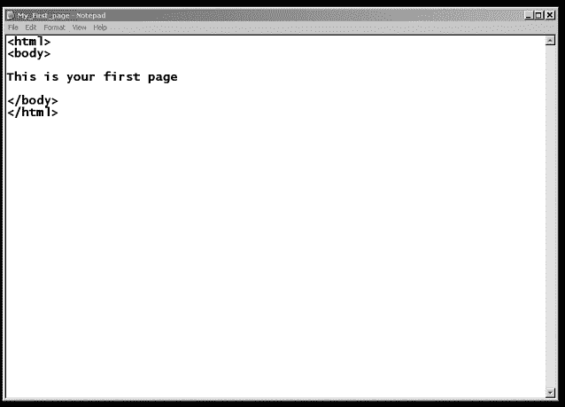

### 步骤 2：如下所示使用`.html`扩展名保存文件

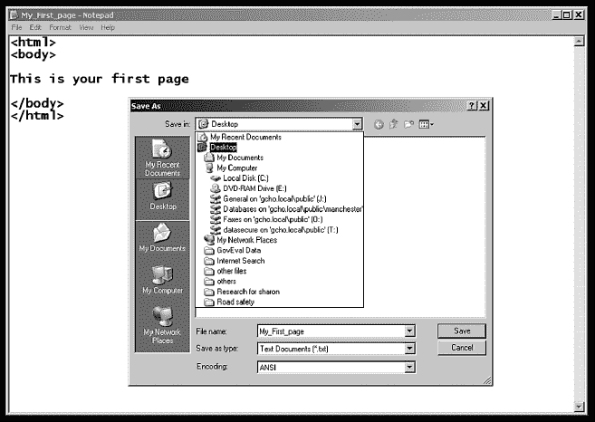

如上图所示，文件已命名为“My_First_page”，扩展名为`.html`。你可以将文件保存到任何想要的地方。在这个示例中，它被保存在桌面上。

### 步骤 3：打开并查看网页

保存文件后，双击新创建的 HTML 文件图标以打开并查看你的网页。如下所示，你刚刚创建一个基础网页，上面写着“这是你的第一个页面。”

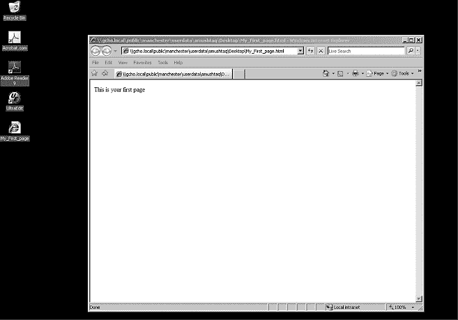

### 示例文档（My_First_page.html）解释

从示例中可以看出，有两个主要的成对标签：`<html>`...`</html>`和`<<body>`...</</body>`。还有纯文本“This is your first page.”

第一组成对标签告诉浏览器这是一个 HTML 文档，并从`<html>`开始到`</html>`结束。第二组成对标签（例如`<body>`）是你在你网站上放置所需内容的主要区域。结束 body 标签（例如`</body>`）告诉浏览器这是 body 结束的地方。在 body 区域的文本还可以进行许多其他操作。你可以使用相似的标签按照你的意愿格式化 Web 文档。

## 格式化标签列表

以下列表包含了你可以用于格式化 Web 文档的基础标签、它们的用途以及它们的编写代码和输出：

| 标签 | 说明 |
| --- | --- |
| `<br>` | 用于插入换行符 |
| `<p>...</p>` | 用于形成段落 |
| `<b>...</b>` | 使文本变为加粗 |
| `<i>...</i>` | 使文本变为斜体 |
| `<u>...</u>` | 使文本带有下划线 |
| `<h1>...</h1>`、`<h2>...</h2>`、`<h3>...</h3>`，直到`<h6>...</h6>` | 用于标题 1、标题 2、标题 3，直到标题 6 |
| `<center>...</center>` | 将文本或图像放在页面中心 |

注意，你可以在标签之间放置标签，例如`<b><i><u>你的文本</u></i></b>`，但在此这样做时，请确保不要忘记关闭标签。

下面的图片显示了所编写的 HTML 文档中使用的上述标签：

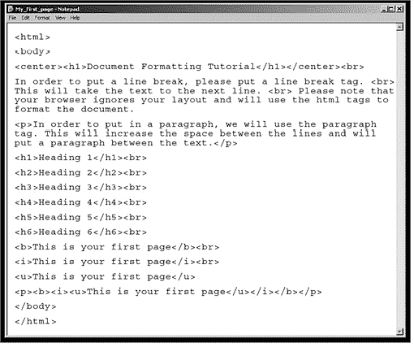

下面的图片显示了所编写 HTML 标签的网页输出：

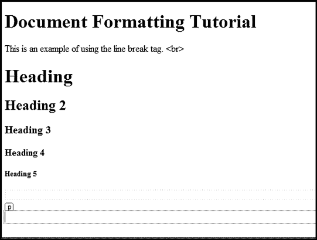

通过使用这些格式化标签，你可以按照想要的方式格式化文档：布局由 CSS 处理。

## HTML 属性

HTML 标签也称为元素。通过属性，你可以让网页更有吸引力。

### 为网页添加背景颜色

在`<body bgcolor="seagreen">`标签中，`bgcolor`是属性名，颜色`seagreen`是值。

### 为网页添加背景图像

在`<body background="img.jpg">`标签中，`background`是属性名，图像`img.jpg`必须加载到服务器上。

### 修改网页中的文字颜色

在`<body text="white">`标签中，`text`是属性名，颜色`white`是值。

注意可以使用背景颜色或背景图像，但不能同时使用。这里是上述标签和属性的截图：

此图像使用`bgcolor`属性显示背景颜色。

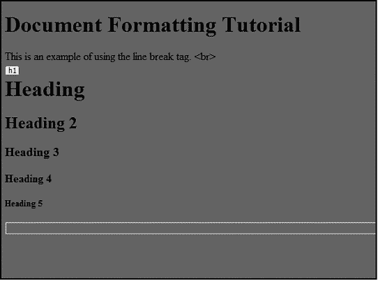

此网页使用`background`属性显示背景图像。

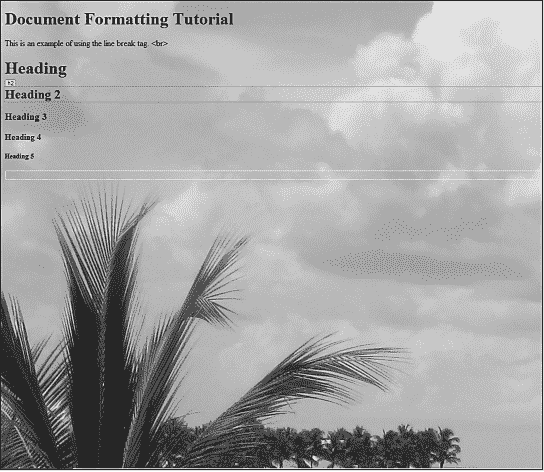

此网页使用`text`属性显示文字颜色。


## HTML 标签

你可以网页添加更多功能，例如在页面上显示图像、添加到不同页面的链接、创建表格、制作表单以及制作列表。

### HTML 图像

为了在网页上放置图像，你需要使用以下 HTML 标签：``。例如，在标签``中，这里`img`是一个 HTML 标签，属性名为`src`，值为`Sunset.jpg`，这是一个必须加载到 Web 服务器的图像文件。你还可以通过使用`width`和`height`属性定义图像的大小。要为图像应用边框，使用`border`属性。

带有宽度、高度和边框的完整 HTML 标签如下：

```html

```

你可以随心更改`width`、`height`和`border`的值。你通常还会使用`<alt>`标签为图像提供描述；这将在第 11 章中讨论。

下面的截图显示了如何在 HTML 文档中嵌入图像：

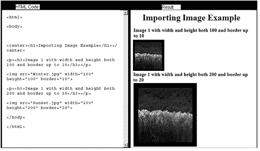

### HTML 超链接

如前文所述，网站是托管在相同域名下的 Web 服务器上的不同 Web 页面的组合。Web 页面之间只能通过使用超链接 HTML 标签相互“链接”，如下：

```html
<a href="page name.extension">在 Web 页面上显示的页面名称</a>
```

这是一个示例：`<a href="page2.html">链接 1</a>`。该标签包含一个锚点标签`<a>`，带有属性`href`，然后是要链接到的 Web 页面名称`page2.html`，以及要在 Web 页面上显示的链接标题`链接 1`。

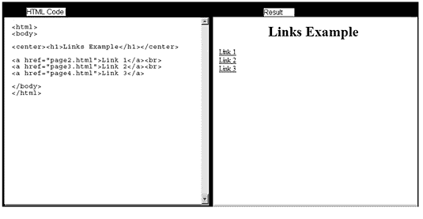

# HTML 表格

表格在网页设计中非常有用。它们可以帮助你保持网页的整洁并正确对齐。`<table>`标签的格式如下：

```html
<table width="100%" border="1">
<tr>
<td>.... </td>
</tr>
</table> 修正：为 </table>
```

起始标签是`<table>`，它告诉浏览器显示表格。`<tr>`用于显示行数，而`<td>`用于显示这些行中的数据，如下例所示：

```html
<table width="100%" border="1">
<tr>
<td>名称</td>
<td>年龄</td>
</tr>
</table>
```

为了显示更多行，你只需要添加更多的`<tr>`标签，如此例所示：

```html
<table width="100%" border="1">
<tr>
<td>名称</td>
<td>年龄</td>
</tr>
<tr>
<td>Simon</td>
<td>25</td>
</tr>
<tr>
<td>Andrew</td>
<td>23</td>
</tr>
</table>
```

在浏览器中显示时，表格看起来可能像这样：

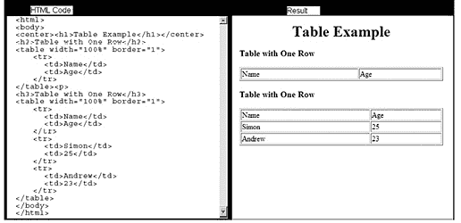

你可以在一个网页中放置任意数量的表格，每个表格也可以包含任意数量的行。为了创建无边框的表格，你只需将属性更改为`border="0"`。然后浏览器将显示数据而不带任何边框。

# HTML 表单

表单用于从网站访问者获取信息并将其存储在服务器数据库中，或通过电子邮件发送指定的电子邮件账户。在数据库中存储数据和通过表单发送电子邮件是高级操作，但接下来的示例将演示如何创建基础表单并从中获取数据。

## 表单 HTML 标签格式

```html
<form>
名字 <input type="text" name="firstname">
</form>
```

上面的示例显示了如何通过从`<form>`标签开始在网页上创建表单，这是一个起始标签，告诉浏览器网页中有一个表单。`<input>`标签显示了需要用户提供什么种类型的输入。在上面的情况下，它是一个简单的文本字段，用于获取用户的姓名。

### 其他表单输入标签

| 名称 | 描述 |
| --- | --- |
| `<input type="radio" name="sex">`男性 | 用于插入换行符。 |
| `<input type="radio" name="sex">`女性 | 单选框输入标签用于“是”或“否”类型的响应，例如男性或女性。 |
| `<input type="checkbox" name="vehicle">` | 复选框标签用于显示复选框以选择多个选项。这方面的示例可以是钓鱼或骑自行车等爱好。 |
| `<input type="submit" value="submit">` | 此标签用于在表单末尾放置提交按钮，以便所有输入信息都能被存储或通过电子邮件发送，取决于表单中指定的 action。 |
| `<select><option>选项 1</option> <option>选项 2</option> <option>选项 3</option> <option>选项 4</option></select>` | `<option>`标签定义选择列表中的选项。 |
| `<textarea rows="2" cols="20"> </textarea>` | `<textarea>`标签定义多行文本输入控件。你必须指定在浏览器中显示的行和列。 |

每使用`<input type="submit" value="submit">`时，你必须指定点击提交按钮后应该发生什么操作。要做到这一点，必须在起始`<form>`标签中使用带有`method`的`action`属性。插入操作和方法后，表单标签将像这样：

```html
<form action="form_submit.asp" method="get">
```

下面的图片使用了上面讨论的所有表单标签：

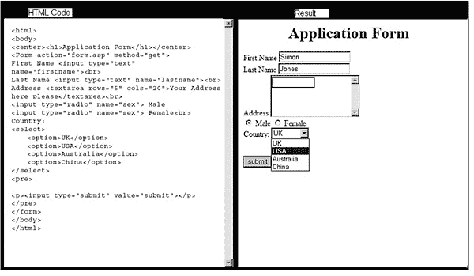

如果网站访问者填写表单并点击“提交”按钮，浏览器会将你的输入发送到名为`form_submit.asp`的页面。该页面将显示接收到的输入。

# HTML 列表

HTML 列表类似于 Microsoft Word® 中使用的项目符号。HTML 列表有两种类型：有序列表和无序列表。

## 有序列表

有序列表用于按数字顺序显示列表。下面是 HTML 有序列表标签的示例：

```html
<ol>
<li>项目 1</li>
<li>项目 2</li>
</ol>
```

上面的标签将按顺序显示列表。`<ol>`标签告诉浏览器这是一个有序列表，`<li>`标签用于显示列表中的项目。

## 无序列表

为了显示无序列表，只需将`<ol>`标签更改为`<ul>`标签：

```html
<ul>
<li>项目 1</li>
<li>项目 2</li>
</ul>
```

下面的截图显示了有序列表和无序列表：

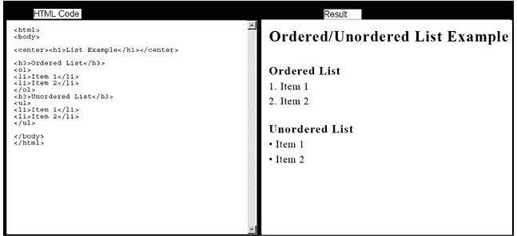

# 更多 HTML 标签

上面所有的 HTML 标签都是标准标签。但还有许多 HTML 标签用于更详细地格式化网页，例如提供元数据、在编写 HTML 时包含注释以及使用引用块。我们还将讨论其他标签。

## Head 标签

`<head>`标签指定在起始`<html>`标签和起始`<body>`标签之间。`<head>`标签用于指定网页的头部部分。`<head>`标签的格式如下：

```html
<html>
<head>
<title>你的第一个页面</title>
</head>
<body>

</body>
</html>
```

## 元标签

元数据是用于 HTML 文档的信息。元数据通常用于指定页面描述、关键词和文档作者。元数据不会显示在浏览器窗口中。元标签将在第 11 章中详细讨论。元标签的格式如下：

```html
<head>
<meta name="description" content="你的第一个页面"/>
<meta name="author" content="你的名字"/>
</head>
```

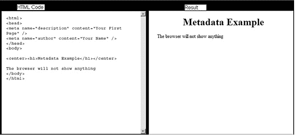

## 注释标签

此标签在编写 HTML 或任何编程语言时非常有用。注释标签内的备注将被浏览器忽略，用于解释你的代码，这可以在你日后编辑源代码时提供帮助。注释标签的格式如下：

```html
<!--这是一个注释。注释不会在浏览器中显示-->
```

注释标签可以指定在 HTML 源文档的任何地方，不会显示在浏览器窗口中。

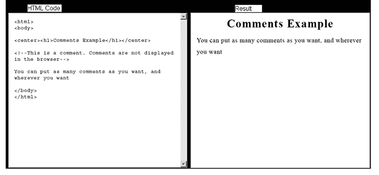

## 字体标签

字体标签非常用于指定文本的字体、字体大小和字体颜色。字体标签的格式如下：

```html
<font size="3" color="red" face="verdana">这是你的第一个页面</font>
```

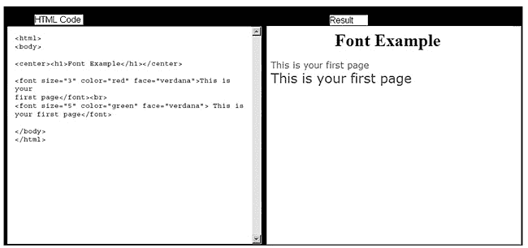


建议在你的“我的文档”文件夹中创建一个新文件夹，将所有的内容、图像和其他网站文件都保存在这里。这可以保持网站的整洁和高效。当所有文件都存储在根文件夹时，管理网站将非常困难。

正如你已经看到的，需要记忆的 HTML 代码实在太多了。有些代码用起来很简单，例如起始标签`<b>`，它是在网页上加粗文本的 HTML 代码，以及结束标签`</b>`，表示加粗的结束。如果你想使用斜体，甚至是两者的结合，情况也是如此，如此示例所示：`<b>my text<i>additional text</i></b>`。在例例情况下，文本的第二部分将既加粗又斜体，而第一部分将仅加粗。

请记住让文本与标签紧挨，这意味着标签与文本的第一个或最后一个单词之间没有空格。对于普通内容，你将使用起始标签`<p>`和结束标签`</p>`。同样，你也可以通过使用`<p>text<b>additional text</b>more text</p>`来混合使用，在同一个句子或段落中结合普通文本和加粗文本。

每个 HTML 文档都应该包含四种类型的标签。这些标签定义了你正在构建的文档类型以及文档中的主要部分。这些标签是`<html>`、`<head>`、`<title>`和`<body>`。在一个基础的 HTML 文档中，你可能会看到类似下面示例的内容：

```html
<html>
<head>
<title>多吃蔬菜</title>
</head>
<body>
多吃蔬菜对你有好处。
</body>
</html>
```

虽然这些标签应该在所有 HTML 文档中使用，但也有一些例外。一些网站管理员认为使用`<html>`和`<head>`标签是重要的，而另一些人认为它们在 HTML 文档中几乎或完全没有用，因为它们似乎对网页或其在浏览器中的显示方式没有可见的影响。

然而，通常共识是，这些标签将你的网页分为若干部分，使其更容易理解和编辑。这些标签帮助你创建美观且易用的页面，包含各个部分以帮助你的访问者找到他们想要的内容。

如前所述，嵌套 HTML 标签具有起始标签和结束标签。例如，如果你想通过加粗来设置字体颜色和大小，将使用以下代码：

```html
<font color="blue" size="3"><b>Physical fitness is a great way to stay healthy!</b></font>
```

必须记住，如果你以`<font>`开始标签并包含加粗，它也必须在最后用`</b></font>`关闭，而不是`</font></b>`。请按照相反的顺序来关闭标签。

## 锚点标签（Anchor Tag）

锚点标签帮助你使用 HTML 在文档文本中插入链接，将你带到另一个页面或新网站。要使用锚点标签，请决定你想链接到哪个网站或页面，然后使用以下 HTML 代码进行设置：

```html
<a href ="www.ruralnorthwest.com">RuralNorthwest</a> own
```

`<a>`标签是锚点标签，而`href`是指定这是一个指向另一个页面或网站的超链接或 URL 的 HTML 代码。

## 书签（Bookmarks）

同一个锚点标签将提供到你网站上其他页面的方便链接，但不要将其作为导航栏的替代。在大多数情况下，这些类型的内部链接用于帮助读者探索你提供的主题的更多信息，但它不是网站导航的替代。

在提供指向同一网页其他部分的链接时，你可以使用所谓的“书签”。你必须使用 HTML`<a>`标签来创建页面书签。HTML 书签标签链接到相应的锚点标签，因此当有人点击书签时，他们会被导航到你的锚点位置。

例如，如果你想提供一个位于网页底部的个人简介链接，你可以在你的简介文本之前创建一个带有`name="bio"`的锚点标签，如下所示：

```html
<a name="bio">Biography of Bruce C. Brown</a>
```

上述 HTML 链接作为书签链接工作。你可以通过在另一个 HTML`<a>`标签链接中使用`href="#bio"`来导航到此书签：`<a href="#bio">Read Bruce’s Bio</a>`。此 HTML 书签在当前所在的同一页面内有效，它也可以被修改为跳转到你网站内另一个页面的书签。

```html
<a href="sales.htm#bio">Read Bruce’s Bio</a>
```

HTML 书签链接标签对于长长的页面（如常见问题解答 FAQ）最有益。你可以使用锚点标签来创建指向其他页面或网站的链接，或者你可以创建一个在新窗口中打开的链接，防止你的访问者离开你的网站。这被称为目标控制（target control）。

目标代码包含四个预定义值：`blank`将页面加载到新的浏览器窗口；`self`将页面加载到当前窗口；`parent`将页面加载到超链接所在框架的父级框架；而`top`取消所有框架并在全浏览器窗口中加载。在用预定义的 target 时，使用下划线和小写字母是很重要的。这里有一个锚点和目标代码格式的示例：

```html
<a href="http://www.ruralnorthwest.com" target="_ blank">
```

下一个主题涉及如何使用`name`锚点，以便你的访问者可以点击文档顶部或侧面的子标题。这允许读者跳过他们感兴趣的信息。这种锚点与超链接的区别在于，它不会带你进入另一个页面或网站，除非你指定了文档中的某些颜色。

例如，假设你的内容是关于会计的，你的读者正在寻找关于账单方案的信息。你可以创建一个锚点直接引导他们到达该信息。你会使用以下代码：

```html
<h2><a name="billing schemes">Billing Schemes</a></h2>
```

虽然这些标签没有链接到外部任何地方，但你可以通过在 HTML 中使用以下额外的`href`超链接代码来创建命名锚点的链接：

```html
<h2><a href="forexample.html#billing schemes">Billing Schemes</a></h2>
```

如果你想在同一页面创建指向锚点的链接，将使用以下代码：

```html
<a href="#billing schemes">Billing Schemes</a>
```

必须记住使用井号（`#`）。

## DocType

虽然它技术上不是一个标签，但大多数网站管理员用于确保其页面在所有网络浏览器中可见的代码之一是文档类型声明，使用`<!DOCTYPE>`标签，它告诉浏览器你正在使用哪个版本的 HTML 代码。

例如，如果你正在使用 3.2 版本的 HTML，代码看起来如下：

```html
<!DOCTYPE HTML Public "-//w3c//DTD HTML 3.2 Final//EN">
```

对于 HTML 4.0 版本，它变得有点复杂：

```html
<!DOCTYPE HTML Public "-//w3c//DTD HTML 4.0//EN" "http://www.strugglingteens.com/TR/REC-html40/strict.dtd">
```

根据 www.w3.org 的说明，DTD 代表“文档类型定义”，它允许浏览器确定你正在使用的哪个版本的 HTML。使用“strict”告诉浏览器你正在遵循适用于此类代码的严格规则。

对于 XHTML，DOCTYPE 看起来可能如下：

```xml
<?xml version="1.0" encoding="utf-8"?>
<!DOCTYPE html PUBLIC "-//W3C//DTD XHTML 1.0 Transitional//EN"
"http://www.w3.org/TR/xhtml1/DTD/xhtml1-transitional.dtd">
<html>
```

带有 HTML 和 XHTML 代码的基础网页示例如下：

```html
<!DOCTYPE html PUBLIC "-//w3c//DTD XHTML 1.0 Strict//EN" "http://www.strugglingteens.com/TR/xhtml1/DTD/xhtml1-strict.dtd">
<html xmlns="http://www.crystalriverhouse/server/xhtml">
<head>
<title>Crystal River 度假屋</title>
<meta http-equiv="Content-Type" content="text/html; charset=utf-8" />
</head>
<body>
<h1>此章节的标题</h1>
<p>在此处编写你的内容。</p>
</body>
</html>
```

上上一个示例展示了起始标签和结束标签，而属性元素是`<html xmlns="http://www.crystalriverhouse.com/server/xhtml">`。此代码示例中的下一个元素是`<title>Crystal River 度假屋</title>`，它告诉网页浏览器在页面顶部标题栏中显示什么，并且对于主要搜索引擎的索引至关重要。

示例中使用的另一个元素是`meta`元素，`<meta http-equiv="Content-type" content="text/html; charset=utf-8" />`，它在屏幕上不可见，但可以为网页浏览器和搜索引擎提供额外信息。元元素也被描述为“自闭的”，如`/>`所示。在示例中，`meta`元素仅仅是告诉浏览器使用哪种字符集，具体为 UTF-8。

根据 SitePoint Pty. Ltd. 于 2006 年出版的 *Build Your Own Web Site the Right Way Using HTML & CSS* 作者 Ian Lloyd 的说法，UTF-8 字符集是一个关键的使用组件，因为它确保了所有访问者看到的页面都与你看到的一样。

他解释说，如果不使用 UTF-8，来自其他国家的访问你网站的人可能无法看到你网站上的内容，因为他们正在用不同的语言进行阅读，这就是为什么 UTF-8 元素如此重要的原因。它允许世界各地的访问者无论使用何种语言查看，都能以你所呈现的方式看到你的网页。

## 标题

标题标签也可以也可以这样使用：

```html
<h1>一级标题</h1>
<h2>二级标题或子标题</h2>
```

以及以此类推的`<h3>`、`<h4>`、`<h5>`和`<h6>`子标题，这些子标题由不同的字体大小定义，大多数比页面的文本部分大。使用`<h6>`时有一个例外，因为它通常看起来比你的内容小大约两个或三个字号。

你应该按顺序使用所有的标题标签，以免误导读者。如果你在整个页面都使用`<h1>`头部，将很难判断这是一个持续的主题，还是有完全不同的主题。换说说，从你的主标题开始，然后使用之前列出的标签来实现一个或多个子标题，以便使你的内容对读者来说是清晰的。

示例的最后一个元素是`<body>`。这是你所有内容方面的努力工作汇聚的地方，创建你网站的主体部分。

在编写放入代码中`<body>`...`</body>`部分的文本时，建议使用像记事本（Notepad）这样易于使用的文本编辑器进行。如果你犯了错误或想重写某些内容，在记事本中进行所有必要的更改比在`<body>`编码区域内尝试重写内容要容易得多。

再次，大多数网页设计应用程序都会允许你在设计界面中输入内容，并会自动为你创建 HTML 代码。

## 段落标签

HTML 中另一个需要记住的标签是段落标签，它看起来像这样：

```html
<p>插入的文本</p>
```

此标签允许你将正文文本分成段落。

## 有序和无序列表

如果你想在页面正文中创建包含有序和无序要点的项目符号列表的内容，你会使用以下代码：

```html
<!DOCTYPE html PUBLIC "-//w3cs//DTD XHTML 1.0 Strict//EN" "http://www.strugglingteens.com/TR/xhtml1/DTD/xhtml1-strict.dtd">
<html xmlns="http://www.strulingteens.com/2006/xhtml">
<head>
<title>查看下方观点</title>
<meta http-equiv="Content-Type" content="text/html; charset=utf-8" />
</head>
<h1>关键身体健身点简介</h1>
<body>
<h2>此章节的标题</h2>
<p>在此处编写你的内容。</p>
<ul>
<li>这是项目符号列表的代码</li>
<li>额外的项目符号列表项</li>
</ul>
<p>以下是另一个列表，但这次是有序的：</p>
<ol>
<li>有序列表是数字形式，而不是项目符号</li>
<li>再加一个以作参考</li>
</ol>
</body>
</html>
```

在这个示例中，无序列表具有起始标签`<ul>`配合`<li>`标签来表示无序项目符号列表，并用`</ul>`作为结束标签。有序列表——可以是数字、罗马数字或字母顺序——使用起始标签`<ol>`配合`<li>`标签并用`</ol>`关闭列表。

## 表格

表格是任何网页设计的重要部分。在 HTML 网站中，它们允许网站构建者创建更具吸引力的设计。（此处省略了重复的句子部分）

## 列宽

下一个示例展示了如何通过百分比或像素宽度设置表格数据单元格`<td>`的值来调整列宽。以下代码中的列宽显示，两行的第一列均被设置为 70%，而另外两列没有设置值。

表格宽度设置为 300 像素，第一列占据这 300 像素的 70%，大约为 210 像素。剩余的两个列将表格现有的 30% 均平分，每列大约 45 像素：

```html
<table width="300" border="2">
<tr>
<td width="70%">A</td>
<td>B</td>
<td>C</td>
</tr>
<tr>
<td width="70%">X</td>
<td>Y</td>
<td>Z</td>
</tr>
</table>
```

如果你决定使用像素（pixels）而不是百分比，那么你的表格代码将看起来像这样：

```html
<table width="300" border="2">
<tr>
<td width="210">A</td>
<td width="45">B</td>
<td width="45">C</td>
</tr>
<tr>
<td width="210">A</td>
<td width="45">B</td>
<td width="45">C</td>
</tr>
</table>
```

使用百分比可以确保无论用户的屏幕分辨率设置得多大或多小，表格都会占据相同的空间。例如，如果你使用 21 英寸显示器查看你的网站，并且将表格宽度设置为 300 像素，表格在屏幕上显示将非常非常小。

如果你将表格宽度设置为 70%，无论显示器尺寸多大，它都会占据屏幕的 70%。如果你创建一个宽度为 760 像素的表格，并在分辨率为 640 x 480 的 15 英寸显示器上查看，用户将必须左右滚动才能看到整个表格。如果你的表格设置为 100%，它将适应任何屏幕，无论分辨率设置如何。

## 对齐与高度

这些示例说明了如何设置表格高度、表格内内容的水平对齐、垂直对齐，以及使用表格创建左侧导航栏布局。

### 表格高度

第一个示例是添加高度代码：

```html
<table height="250" width="300" border="2">
<tr>
<td width="210">A</td>
<td width="45">B</td>
<td width="45">C</td>
</tr>
<tr>
<td width="210">A</td>
<td width="45">B</td>
<td width="45">C</td>
</tr>
</table>
```

### 水平对齐

下一个示例展示了如何使用水平对齐，例如在单元格内对内容进行左对齐。你只需要通过`align`属性将“left”（左）、“right”（右）或“center”（居中）标签来更改对齐方式：

```html
<table width="300" border="2">
<tr>
<td width="210" align="center">A</td>
<td width="45">B</td>
<td width="45">C</td>
</tr>
<tr>
<td width="210" align="center">A</td>
<td width="45">B</td>
<td width="45">C</td>
</tr>
</table>
```

### 垂直对齐

在这个示例中，我们演示了如何通过使用`valign`（或 vertical align）标签并将对齐方式更改为 top（顶部）、bottom（底部）或 middle（中间），来实现表格单元格内内容的垂直对齐，通过这些标签来指示内容在表格单元格中出现的位置：

```html
<table height="250" width="300" border="2">
<tr>
<td valign="top" width="210">A</td>
<td width="45">B</td>
<td width="45">C</td>
</tr>
<tr>
<td valign="top" width="210">A</td>
<td width="45">B</td>
<td width="45">C</td>
</tr>
</table>
```

## HTML 练习

任何 Web 应用程序都会自动为你创建表格，网上也有免费的表格生成器。表格和列表是最两个令人困惑的 HTML 主题，也是最快让你遇到麻烦的话。通常不值得尝试用 HTML 手动编写表格。让 Web 设计应用程序为你工作，并为你提供无误的 HTML 代码。

### 任务

在你的电脑上打开记事本并执行以下任务，以确保你已经掌握了基础 HTML 概念：

- 创建一个 Web 页面讨论一个话题，包含细节和图片。
- 创建一个包含指向其他 Web 页面链接的 Web 页面。


- 创建一个表格显示朋友的名字、出生地和生日。
- 创建一个 Web 表单来收集姓名、出生地和出生日期。
- 创建一个包含有序列表和无序列表的 Web 页面，显示家中的物品。

下方的截图是一个位于佛罗里达州克里斯蒂尔河（Crystal River）的豪华租赁物业的 Web 页面。这是一个非常……

这里是此表单的 HTML 代码，以便我们理解它的工作原理以及是如何创建的。由于创建一个表单所需的 HTML 代码非常多，此示例将仅涉及整个表单的几个部分。此表单使用 `FrontPage` 扩展来处理数据，因此它使用了 `POST` 方法，并且 `action` 调用了 `FrontPage WebBOT`。当网站访问者提交表单时，它会发送一封包含访问者填写的表单字段数据的电子邮件。这些代码的大大部分由 `FrontPage` 生成：

```html
<form method="POST" action="--WebBOT-SELF--" onSubmit="return FrontPage_Form1_Validator(this)" language="JavaScript" name="FrontPage_ Form1">

<!--Webbot bot="SaveResults" s-email-format="HTML/UL" s-email-address="sales@crystalriverhouse.com" b-email-label-fields="TRUE" b-email-replyto-from-field="TRUE" s-email-replyto="info@crystalriverhouse.com" b-email-subject-from-field="FALSE" s-email-subject="Crystal River Reservation/Info Request" s-date-format="%A,%B %d, %Y" s-time-format="%I:%M:%S %p" s-builtin-fields="Date Time" u-confirmation-url="confirmation.htm" startspan --><input TYPE="hidden"zNAME="VTI-GROUP" VALUE="0"><!--Webbot bot="SaveResults" endspan i-checksum="43374" -->

“办理入住”和“退房”的实际表单字段显示如下。表单字段的宽度已指定：

<input name="Checkin" value size="35" tabindex="3"></font></td>

</tr>

<tr>

<td align="left" width="119"><font size="2">Check Out</font></td>

<td width="531"><font color="#000080" size="2" face="Verdana">

<input name="Checkout" value size="35" tabindex="4"></font></td>
```

表单还包括一个标记为“获取预订”的提交按钮。下面的 HTML 代码显示此按钮是如何创建的。除了提交按钮外，还有一个用于清除表单数据的重置按钮。当点击提交按钮时，`FrontPage` 扩展表单处理器会将数据提交到收件邮箱地址。你还会注意到结束标记 `</form>` 标签，它完成了表单代码：

```html
<input type="submit" value="Get Reservations" name="Reservations"></font><font face="Verdana"><input type="reset" value="Reset" name="B2"></font></p>

</form>
```

`HTML 5` 于 2008 年 6 月 10 日由 `W3C`（世界维网联盟，[www.w3.org](http://www.w3.org)）发布，最新版本于 2009 年 4 月 23 日发布。在这个版本中，引入了新功能以帮助 Web 应用程序作者，根据对主流编写实践的研究引入了新元素，并特别关注为用户代理定义清晰的合性标准，以提高互操作性。有关技术报告状态以及稍后发布的其他替代文档的更多信息，请访问 `W3C` 网站 [www.w3.org/TR](http://www.w3.org/TR)。

虽然这只是 HTML 的简要概述，但你现在已经知道了识别和处理 HTML 的基本知识。许多网站都提供有关 HTML 编码的进一步帮助和建议，例如 [www.htmlcode tutorial.com](http://www.htmlcode%20tutorial.com) 和 [www.w3schools.com/html](http://www.w3schools.com/html)。

# XHTML 简介

本节是对 XHTML 的简要介绍。网络上有许多致力于 XHTML 的绝佳书籍。你应该意识到，`Expression Web 3` 和 `Dreamweaver CS4` 均支持 XHTML，事实上，XHMTL 是大多数现代网站站的标准。

`XHTML` 是一种用于重新表述由 HTML 提供的现代技术的语言。它被用于使网站更容易被发现、构建和使用。`XHTML` 的创建是为了解决由 HTML 元素未标准化导致的碎片化问题。`XHTML` 强制设计人员按照特定的严格代码标准编程，并确保最大的浏览器兼容性，以便你的 Web 页面完全按照你的想要显示。

- 正如名称所示，`XHTML` 是一种作为 HTML 扩展而形成的语言。
- `XHTML` 是一种通过结合 HTML 和 `XML` 形成的语言。
- `XHTML` 由 `W3C` 同意。这确保了结构化数据的统一。
- 你可以在你的 Web 页面中使用 `XHTML`，因为它是向后兼容的。
- 有许多创建 Web 页面的语言。`XHTML` 与所有这些语言配合。
- 所有 `XHTML` 代码都必须有结束标记，这与 HTML 有区别。

## 为什么要使用 XHTML？

- **可扩展性**：`XHTML` 本质上是 HTML 的“最新”版本，确保了与未来标准的兼容。浏览器和设计应用程序将基于 `XHTML` 标准构建。
- **可移植性**：随着 Apple® iPhone™ 和类似的用于访问的设备日益流行，`XHTML` 确保了跨平台部署的兼容性，这意味着你的 Web 数据将在便携设备上正常显示。
- `XHTML` 由 `W3C` 认可。这确保了结构化数据的统一性。
- `XHTML` 可用于多种设备以增加兼容性。

## HTML 与 XHTML

`XHTML` 是 HTML 的增强版本，但两者之间存在一些明显的区别。

尽管它们相似，但在语法上有所不同。

HTML 语法：

```html

```

XHTML 语法：

```html

```

HTML 比 XHTML 更容易出现错误，因为 XHTML 有更严格的规则，因此错误很容易发现。注意结束标记。此外，XHTML 全小写。HTML 需要 doctype，而在 XHTML 中不需要。

## XHTML 的优点

使用 `XHTML` 有许多优点。它能够适应所有类型的浏览器，包括移动浏览器。使用 `XHTML` 确保了未来的兼容性。`XHML` 最令人惊讶的特性是其对 iPhone、口袋电脑和个人数字助理（PDA）的适应性。这使得它们能够以紧凑的方式在各自的窗口中显示文本。

好消息是，`Dreamweaver` 和 `Expression Web` 等程序默认会为你完成工作，创建符合标准的代码。

`XML` 是一种用于包含结构化信息的文档的标记语言。结构化信息可以是文字或图片。`XML` 语言定义为文档添加标记的标准方法，以便它们可以跨平台。

这里是 `XML` 的示例：

```xml
<?xml version="1.0"?>
<note>
<to>Obama</to>
<from>Sarkozi</from>
<heading>Congratulations</heading>
<body>在反恐主义战争中，我们将站在你这一边。</body>
</note>
```

## JavaScript

`JavaScript` 是一种轻量级编程语言，可与 HTML 和 CSS 配合使用使网站具有交互性。它是一种客户端编程语言，运行在浏览器中，而不是 Web 服务器上。当页面加载时，浏览器会运行页面上的任何 `JavaScript` 代码。`JavaScript` 易于学习、易于使用，并可用于自动更改网页上的信息、启用弹出窗口、在鼠标悬停时引起文本变化，以及许多其他增加网页交互性和功能的用途。有成百上千的网站提供 `JavaScript` 教程，数千个脚本可供免费下载并在您的网站上使用，涵盖了广泛用途用途功能。我最喜欢的网站之一是 [www.javascript.com](http://www.javascript.com)，它拥有数千可以嵌入到您网页中的免费 `JavaScript` 脚本。对于任何编写过面向对象语言的人来说，`JavaScript` 语法都很容易学会。`JavaScript`、`CSS` 和 `XHTML` 构成了一种名为动态 HTML 或 `DHTML` 的新格式。

# 级联样式表 (CSS)

`CSS` 是一种用于描述数据呈现方式的样式表语言。`CSS` 最常用于格式化和样式化用 `HTML` 和 `XHTML` 编写的网页。它也可以与 `XML` 集成。为了让网站更具交互性，请使用 `CSS`。

`CSS` 代码插入在 `HTML` 标签的 head 部分。`CSS` 帮助网页保持特定的设计风格。您的网站在不同的浏览器中看起来可能不同，但 `CSS` 通过强制标准外观来控制这一点。

# 活动服务器页面 (ASP)

活动服务器页面（`ASP`）编程是一种能够向网站访问者交付动态、数据库驱动内容的代码。`ASP` 代码放置在 `HTML` 页面内并用特殊标签包围，文件扩展名为 `.asp`。`ASP` 允许网站通过在客户端浏览器中运行代码来与数据库进行交互，但又为网站提供了数据库交互的功能。这对于数据验证或从数据库向用户展示数据（例如产品信息、定价或库存水平）非常有用。

# PHP®：预处理器超文本

`PHP` 是一种用于创建动态 Web 页的脚本语言。它被广泛用于网站开发，并嵌入到 `HTML` 中。`PHP` 页面代码存储在 Web 服务器上，并配置为在 Web 浏览器调用页面时动态生成。由于 `PHP` 是免费且跨平台的，它可以在大多数 Web 服务器上运行，并被广泛用于动态页面生成。

# 结构化查询语言 (SQL)

`SQL` 是一种数据库计算机语言，用于管理关系数据库管理系统（`RDBMS`）中的数据。您应该使用 `SQL` 进行数据查询和更新、模式创建以及数据访问控制。大多数 Web 托管公司都支持 `SQL`，这将允许您操作数据库中的数据。某些购物车还需要您运行 `SQL` 来管理购物车应用程序中的数据。

## 目录


# 第 4 章：网站设计应用程序 — 实现您目标的工具

市场上有几十种软件应用程序可以帮助您快速、方便地创建网站。如果您想在 `HTML` 环境中工作，其中一些程序可以帮助自动创建 `HTML`，而另一些程序则让您在设计环境中创建网页，由系统自动为您编写 `HTML`。本章将为您详细回顾市场上的几种最流行的 Web 设计应用程序，例如 `Dreamweaver CS4` 或 `Expression Web 3`。通常，这取决于个人喜好以及您最习惯使用的工具。

另一种可用途径是使用内容管理系统（`CMS`），例如 `Joomla!` 或 `Mambo`。这些程序提供了创建、修改和组织网站信息的工具。然而，它们在安装和设置时需要一些技术技巧，因此除非您真的需要一个 `CMS`，否则通常不建议新手选择此选项。

关于简单网站开发的其他建议可能是通过您的 Web 托管提供商。许多公司提供自定义模板和简单应用程序来加速 Web 开发，让您在几小时内创建并托管一个网站。像 `PowWeb`（[www.powWeb.com](http://www.powWeb.com)）和 `Applied Innovations` 这样的托管提供商提供了免费的页面构建工具、大量的空间供您的网站使用，并涵盖了您可能需要的各种。此类免费应用程序的缺点是，您在设计网站时的创造力可能受限，并且在未来可能需要将网站迁移到其他平台。

本章还将概述一些免费的 `HTML` 编辑器，如 `nvu` 和 `WYSIWYG Web Builder`（所见即所得），以及在您构建网站后是否需要这些编辑器。其他主题将包括了解像 `WordPress` 和 `Joomla!` 这样的开源软件、它们如何工作以及您如何使用它们为网站创建一个平台。

## Joomla!

`Joomla!` 是一种帮助用户构建网站的 `CMS`。该软件不仅免费使用，而且 [www.joomla.org](http://www.joomla.org) 的 `Joomla!` 网站还提供了一个论坛，用户可以在那里找到支持和答案。`Joomla!` 允许用户下载易安装软件包，为网站构建者提供添加、编辑和更新图像的能力。它还允许用户创建订阅功能，这有助于了解访问网站的用户。

该软件提供了多种应用程序，允许网站构建者创建插件。网站上的一些示例包括表单生成器、商业或组织目录、文档管理、图像和多媒体画廊、电子商务和购物车引擎、日历、论坛和聊天软件、博客软件、目录服务、电子邮件新闻、数据收集和报告工具以及横幅广告系统。要找到更多选项，请访问 [www.extensions.joomla.org](http://www.extensions.joomla.org)。对于一个强大且灵活的 `CMS`，`Joomla!` 是一个非常好的免费开源应用程序。

## WordPress

`WordPress` 位于 [http://wordpress.com]，是另一个构建博客的免费开源选项。博客可以且经常被用作网站。这对某些人来说很有吸引力，因为博客是免费且易用的。许多企业已经放弃了同时维护博客和网站的想法，转而只使用博客。这也是个人网站的一个好选择。博客将在第 15 章中深入讨论。

Homestead 的一个独特之处是，它允许你直接在网页上编辑文本，或者通过在页面上粘贴你自己的内容来完全替换它。你可以从计算机硬盘上传图像，或者使用为你提供的超过 250,000 张的免费图片之一。Homestead 还会提供迁移你当前域名的支持，甚至可以帮助你创建一个链接，将流量重定向到新网站。你可以添加表单来收集访问者的信息，以便向他们发送电子邮件推广和时事通讯，或者你可以获取一个留言板并允许访问者发表评论。该网站包含一个 `PayPal` 购物车，你可以设置它让你的客户无需使用信用卡即可购买商品或服务；如果你想建立一个规模较大的商业网站，它还提供了电子商务选项。如果你不想学习 Web 设计应用程序，并希望快速创建一个有吸引力的网站，Homestead 是一个极佳的选择。

# Nvu

`Nvu` 的发音为“en-view”，是一个专为 Linux 计算机操作系统设计的开源软件。如果你是 Linux 用户并需要一个易于使用的 Web 编写系统，`Nvu` 可能是你的解决方案。`Nvu` 是免费的，源自 Mozilla Composer 代码库。根据 `www.nvudev.com` 上的 Nvu 网站，它采用了 Composer 提供的基本功能并添加了新层次，允许“集成化的网站管理、更好的表单和表格支持以及更好的浏览器兼容性”。使用 `Nvu` 的优势之一是它提供了一个易于使用的 Web 文件管理系统和所见即所得（`WYSIWYG`）Web 页面编辑，这使得该软件成为几乎或没有 HTML 代码经验的人的良好选择。

尽管 `Nvu` 主要为初级 Web 构建者设计，但网站解释说，它对于高级网站管理员也是一个非常好的工具，因为它减少了构建专业外观网站所需的时间。`Nvu` 并不是 `FrontPage` 和 `Dreamweaver` 的完全克隆（后者使用 Windows 操作系统），但与它们相似，因为它整合了这些产品的许多相同易用功能。

## Microsoft Office Live

另一个提供免费建站软件的 Web 托管服务是 Microsoft Office Live Small Business。该托管商提供免费托管、域名注册、电子邮件以及吸引流量访问你网站的技巧。当你登录 `http://smallbusiness.officelive.com` 网站并点击“设计网站”选项卡时，会弹出一个设计窗口，允许你使用预设的表格格式来构建你的网站。你只需输入想要包含在网站上的信息即可。它左侧设置了一个导航栏，带有预标记的“首页”、“关于我们”、“联系我们”和“网站地图”选项卡。在设计页面的顶部，有字体、颜色、字体大小、网站主题、样式、导航选项、插入 Logo、页眉和页脚等选项。还有图像、文档和模板库，你可以从中进行浏览和选择以构建你的页面。

这种托管和构建 Web 网站的选项是不言自明的，构建个人和小型业务网站所需的一切都一应俱全。你需要使用 Windows Live™ ID 登录，或注册一个免费的 `Windows Live ID` 以访问网站并开始构建自己的 Web 页面。该选项有明确的限制：你不能使用自己的域名，因为 Live 会分配一个给你，而且你对网站内容的控制是有限的。

还有许多其他免费的 Web 设计应用程序和解决方案你可以使用。你可以在你喜欢的搜索引擎上用关键词“开源 HTML 编辑器”或“开源 Web 建站软件”进行搜索。这将列出数千计的网站供你选择。然而，请谨慎使用并阅读所有细则，以确保你没有下载并在一个仅有 30 天用期的免费试用版软件上构建你的网站。许多试用或演示软件并不提供完整的软件功能，它们会在免费试用结束时关闭你的全部使用权限，留给你一个已完全构建但你再无法访问的网站——除非你支付软件的完整版费用。


现在你已经对免费选项有了概览，接下来的部分将为你对市面上一些最受欢迎的商业化 Web 设计应用程序进行深度评审，并比较这些应用程序之间的功能。你必须决定愿意走哪条路径来构建自己的网站。如果你想要一个快速、方便的网站且不想花钱，基础 Web 网站或博客有许多选项供选择。如果你想创建高度定制或高级的网站并避免使用模板，你需要使用更高级的 Web 设计应用程序，例如 `Dreamweaver`、`Expression Web` 或 `WebPlus X2`。

# The SeaMonkey® Project

`SeaMonkey` 项目是 `Mozilla` 的一个开源项目，`Mozilla` 是管理和发布流行的 `Firefox` 浏览器的公司。`SeaMonkey` 项目（`www.seamonkey-project.org`）包含一个 Web 浏览器、电子邮件和新闻组客户端、`HTML` 编辑器、网络中继聊天（`IRC`）和 Web 开发工具。`SeaMonkey` 网上套件是完全免费的，是学习 `HTML` 的极佳方式。`SeaMonkey` 网上套件适用于 Windows、Mac 和基于 Linux 的系统。它还支持 `CSS` 等高级语言。`HTML` 编辑器产生符合 `HTML 4.01` 代码，但不产生 `XHTML` 或 `XML`。`HTML` 编辑器不支持所有元素，但允许从其他 `HTML` 文档中粘贴元素。

`SeaMonkey Composer` 是其所见即所得 Web 设计程序和 `HTML` 编辑器，其用户界面中具有四种不同的视图：普通（`WYSIWYG`）（“所见即所得”）、`HTML` 标签、`HTML` 代码和浏览器预览。由于该程序是开源的，因此有一个庞大的支持社区和大量的文档来帮助使用 `SeaMonkey` 的人员。

# Microsoft Expression Web 3

`Microsoft Expression Web` 是 `Expression Studio` 套件的一部分，与 `SharePoint® Designer` 配合，取代此前包含在 `Microsoft Office` 套件中的 `Microsoft Office FrontPage` 产品。`Microsoft Expression Web` 程序是一个所见即所得的 Web 编写程序，旨在帮助人们设计使用 `ASP.NET` 或 `PHP` 的网站和 Web。`Microsoft Expression Web` 第二版本还对 `Microsoft Silverlight™` 有完全支持。

`Microsoft Expression Web` 目前处于第三版本。`Expression Studio` 套件包括：`Expression Web`、`Expression Blend™`、`Expression Design`、`Expression Encoder` 和 `SketchFlow`。所有这些程序协同工作，类似于 `Adobe CS4` 设计套件中的程序。

与它的主要竞争对手 `Adobe Dreamweaver` 相比，许多人认为 `Expression Web` 是设计师更好的程序，而 `Dreamweaver` 是代码编写人员更好的程序。

## Microsoft Expression Web 3 的优势

`Microsoft Expression Web` 对许多 Web 设计师来说是一个具有成本效益的解决方案，因为它通常比 `Dreamweaver` 便宜 100 美元。对于预算有限但仍需要顶级开发程序的人来说，这使得 `Microsoft Expression Web` 成为一个可行的解决方案。

对于习惯了 `FrontPage` 或 `Microsoft Office` 套件的人来说，该程序很容易学习。它共享共同的用户界面，这一事实使其比其他程序更容易上手。`Microsoft Expression Web` 支持多种不同的开发语言，包括 `XML`、`CSS`、`PHP` 和 `ASP.NET`。然而，重要的是，该程序的第一版本并不支持 `PHP`。对多种编码语言的支持使其成为那些处理多种不同语言的人士的一个很好的程序选择。

在用这些各种语言进行编码时，Web 开发人员可以放心，他们正在使用目前提供的最符合标准的 `WYSIWYG`（所见即所得）程序。这意味着使用该程序设计网站的人将能够通过研究 `Expression Web` 为他们生成的代码，来学习正确的编码实践。当设计师使用“不佳”的编码实践时，`Microsoft Expression Web` 会提醒用户该代码不符合标准，并告诉用户应该对其进行更改。

`Microsoft Expression Web` 还提供了对 `CSS` 的支持，这在许多其他 Web 设计和开发程序中并不常见。它比比今天市场上的其他几种 `CSS` 编辑器更容易使用。该程序支持“插件”或第三方应用程序，以根据 Web 设计师的特定需求增强程序。正如 `FrontPage` 有几种不同的“插件”选项一样，`Microsoft Expression Web` 也是如此。

## Microsoft Expression Web 3 的缺点

`Microsoft Expression Web` 的功能比 `Adobe Dreamweaver` 少。对于某些设计师来说，这可能是件好事，例如那些刚开始且不希望被太多信息淹的人。然而，对于更有经验的设计师来说，与 `Dreamweaver` 相比，这可能是该程序的一个主要缺陷。

它没有 `CSS` 验证器。正如 `HTML` 需要验证以确保它符合所有 `W3C` 标准一样，`CSS` 代码也应该经过验证。该程序在 `CSS` 方面有如此深的基础并拥有如此多的 `CSS` 功能，缺乏自己的 `CSS` 验证器这一事实是一个缺点。然而，由于网络上有许多 `CSS` 验证器可用，这并不是一个主要问题——除了必须使用另一个服务来验证 `CSS` 代码带来的不便之外。

`FrontPage` 的几个向导和功能已不再可用，这意味着 Web 设计师需要花时间寻找第三方插件，或者手动开发那些曾经通过向导就能轻松完成的项目。此外，对于任何非基础任务，可能存在陡峭的学习曲线。虽然可以使用 `Expression Web` 执行更复杂的任务（如开发 `AJAX` 应用程序）是一个优点，但初学者在学习如何在 `Expression Web` 中执行此类任务时没有太大帮助，这降低了这一优势。

## Microsoft Expression Web 3 的功能

- **专业的设计环境**：专业的设计环境允许设计师在更短时间内完成更多工作，因为你需要的菜单和工具的位置可以很容易找到。这意味着你可以花费更多精力放在实际设计上，而不是担心如何找到你需要的工具和功能。你还可以导入 `Photoshop` 文件作为你的图形设计。
- **基于标准的网站设计**：此工具将确保你所有的编码都符合 `W3C` 规定的标准。良好的编码实践有助于服务器正确显示你的网站的能力。这也有助于搜索引擎的索引，意味着你有更好的机会为你的网站带来稳定的流量。
- **CSS 布局**：此功能可以让你轻松地将网站设计与网站内容分离。通过拖放式外边距控制、编码的视觉层次结构和颜色编码代码等功能，你将能够轻松设计和开发 `CSS` 布局。
- **CSS 网站模板**：使用 `CSS` 网站模板快速为你的网站设置设计。对颜色、字体和样式进行调整，使其成为你自己的。
- **CSS 样式应用**：你可以选择自动生成的 `CSS` 样式，或自己创建它们，以对你的网站设计进行最终控制。
- **CSS 管理**：这使得管理复杂的基于 `CSS` 的网站变得简单，因为规则已为你提供。
- **属性任务窗格**：这些窗格让你看到你在编码属性和样式方面可以拥有的一切。
- **ASP.NET 3.5**：无需任何编码知识即可渲染各种 `ASP.NET` 模块。
- **编辑 PHP 页面**：`Microsoft Expression Web` 的第二和第三版本提供了对 `PHP` 编辑的支持。

## Microsoft Office FrontPage

`Microsoft Office FrontPage` 是微软制作的一种 `WYSIWYG` Web 设计和网站管理程序。该程序的最新版本是 `FrontPage 2003`。该程序是为那些不熟悉 `HTML` 和 Web 设计技术的人设计的。`FrontPage` 与 `Microsoft Office` 界面集成，以便该程序能够与许多人已经熟悉的 `Microsoft Office` 套件中的其他程序无缝衔接。

它是为 Windows 系统设计的，尽管在 1998 年发布了 Mac 版本。Mac 版本的功能少于 Windows 版本，正因为如此，该程序从未收到过任何更新。

## Microsoft Office FrontPage 的优点

`Microsoft FrontPage` 有几个优点，包括共享的 `Office` 界面、`WYSIWYG` 编辑器、帮助新手设计师学习 `HTML` 代码以及低成本的可用性。

- **共享的 Office 用户界面**：因为 `FrontPage` 看起来像 `Microsoft Office` 套件中的其他程序，所以非常容易学习使用。对于已经熟悉 `Microsoft Word` 和 `Microsoft PowerPoint®` 等程序的人来说，掌握程序的结构并不需要太多精力。
- **WYSIWYG 编辑器**：对于不熟悉 `HTML` 的人来说，这是该程序最大的优点。它允许用户将设计元素拖放到页面，由程序生成必要的 `HTML`。它让用户看到自己的设计，而不是仅仅盯着代码。
- **帮助新手设计师学习 HTML 代码**：随着设计师对 `HTML` 和 Web 设计变得越来越熟悉，他们可以选择查看设计区域的 `HTML` 代码，从而让他们学习更多 `HTML` 并让程序随他们成长。对于教室以及任何想把爱好变成职业的人来说，都是非常有价值的教学工具。
- **低成本**：与 `Adobe` 的 `Dreamweaver` 竞争对手相比，`Microsoft Office FrontPage` 的价格更低。

## Microsoft Office FrontPage 的缺点

与每个程序一样，使用 `FrontPage` 也有缺点，包括程序使用率下降、`HTML` 不标准以及对于 Internet 之外的任何浏览器难以优化。

该程序不再被广泛使用，因为它已被 `Microsoft Expression Web` 和 `SharePoint Designer` 取代。尽管微软不再支持它，但其他用户对该程序的支持并不缺少，因此那些想要省钱仍然想要基于微软的产品的人可能对 `FrontPage` 满意。如果你有需要，可以在将来升级到 `Expression Web`。自动生成的 `HTML` 不符合 `W3C` 规定的 `HTML` 标准。代码难以进行合规性编辑，并且是微软专有的。

## Microsoft Office FrontPage 的功能

- **分屏视图**：在 `FrontPage 2003` 中，用户能够同时看到代码和设计视图，节省了在两种视图之间切换的时间和烦恼。
- **动态 Web 模板**：`FrontPage 2003` 同样引入了动态 Web 模板，允许用户为网页或整个网站指定模板。这些模板极大地缩短了设计时间，并且看起来非常专业。

## 功能

- **交互式按钮**：无需 `Adobe Photoshop` 等程序即可创建图形和交互式按钮，从而节省时间并降低成本。
- **IntelliSense® 智能感知**：在代码视图中使用这种自动完成形式来节省时间。在代码视图模式下，`IntelliSense` 将建议标签和其他代码，让用户无需输入完整的命令。
- **可访问性检查器**：使用可访问性检查器确保网站对所有用户都完全可用。它将确保页面针对残障 Web 用户进行了优化，并帮助符合 `HTML` 代码规范。它甚至包含一个 `HTML optimizer`（HTML 优化器），确保您的网站对所有人都完全可用。
- **代码片段**：使用代码片段库避免自己编写代码并节省时间，该库包含各种代码片段，可帮助您的设计。
- **ASP.NET 支持**：`FrontPage 2003` 包含了对 `ASP.NET` 语言的支持。该程序的之前的版本不支持该语言。
- **自动 Web 内容**：轻松为您的网站创建内容，因为您可以将 `MSNBC®` 头条新闻、天气预报、搜索和其他工具直接插入您的网站。这些内容将自动更新，因此您无需不断更新网站即可获得新鲜内容。
- **相库**：快速为个人或业务使用创建相库。模板可以编辑，因此您可以更改布局以适应您的需求，并可以快速为每张照片添加说明。与手动创建相库相比，这是一个非常节省时间的方法。
- **类似 PowerPoint 的绘图工具**：使用 `PowerPoint` 中找到的工具轻松绘制图形。
- **使用分析报告**：查看您的网站上被谁使用了哪些内容。您可以每天、每周或每月获取这些报告。这些报告可以导出到 `Microsoft Excel®`，以便您稍后进行详细查看，以确保您充分利用了网站设计。
- **中央业务管理器插件**：使用此插件让您网站的电子商务变得更简单。轻松跟踪您的产品目录和购买情况。
- **讨论与订阅**：讨论和订阅可配合 `SharePoint Team Services` 使用，在互联网上的任何网站发布并回复评论，并通过电子邮件跟进。此功能对于互联网营销非常有用。
- **文档库**：您将能够将整个 Web 设计团队所有人员的文档存储在一个地方，让整个团队更容易知道内容在哪里以及如何获取。它将简化所有相关人员的制作流程。

## Adobe Dreamweaver CS4

`Adobe Dreamweaver` 是一种 `WYSIWYG` Web 设计程序（所见即所得）与文本编辑器的结合，允许同时进行视觉设计和逐行手动编码。该程序最初属于 `Macromedia®`，于 1997 年 12 月首次亮相。`Macromedia` 在 2005 年被 `Adobe` 收购，自收购以来，`Dreamweaver` 已更新到 10.0 版本，即更广为人知的 `CS4`。`Dreamweaver` 被认为是 Web 设计的行业标准，因为它在许多机构被广泛使用。`Adobe` 从 `Macromedia` 手中收购 `Dreamweaver` 时，选择停止了其竞争产品 `GoLive®`。

### Adobe Dreamweaver CS4 的益处

如果您是 Web 设计初学者，使用 `Adobe Dreamweaver` 有许多不同的益处。只需指向并点击，而无需记忆和输入大量的无关代码，就能节省时间。在学习生成的代码时，用户可以根据他们正在进行的设计自学 `HTML` 和 `CSS`。

使用这种 `WYSIWYG` 程序允许设计师更加关注设计本身的样子，而不是关注代码的样子。`Dreamweaver` 对页面的实际脚本进行格式化和颜色标记，使设计师更容易学习和编辑代码。

完全没有 `HTML` 或编码知识的人也可以轻松使用此产品，并且可以找到大量的支持。`Dreamweaver` 也适用于使用 `Adobe` 套件中其他程序的 Web 设计师，包括 `Flash`、`Fireworks®`。

### Adobe Dreamweaver CS4 的缺点

`Dreamweaver` 的学习曲线较陡，且价格比竞争对手贵，这对于需要创建网站的企业来说是可行的，但对于许多小企业来说可能并不可行。

### Adobe Dreamweaver CS4 的功能

- **新用户界面**：`Dreamweaver` 最新版本的用户界面设计旨在匹配所有程序，让用户在创建网站时工作得更快、更智能。
- **跨产品集成**：这允许使用多个 `Adobe` 产品的人同时在程序之间轻松移动文件。
- **相关文件和 CSS 导航器**：随着 `CSS` 的使用越来越多，越来越多的程序支持这种语言。`CS4` 版本的属性面板允许调整 `CSS` 样式。
- **集成编码**：设计师可以使用集成编码功能来确保他们的代码整洁且符合规范。
- **高级语言支持**：`Dreamweaver` 支持许多不同的编程语言，对于那些使用 `HTML` 和 `CSS` 之外的人非常有帮助。除了这两种常用语言外，`Dreamweaver` 还将帮助设计师编码 `XHTML`、`XML`、`JavaScript`、`AJAX`、`PHP`、`Adobe ColdFusion®` 软件和 `ASP`。使用相同的编辑器处理这些语言保持简单。
- **跨平台支持**：许多 Web 设计师在 PC 和 Mac 系统上工作。虽然需要两个版本的程序——每个系统一个——但跨平台使用相同程序的灵活性为设计师提供了优势，确保他们设计的网站无论在什么系统中查看都一样。
- **Flash Video 支持**：许多网站使用 `Flash`，因为 `Flash` 播放器是目前大多数计算机系统的配置，且 `Flash` 无法像其他视频格式那样保存到查看器的硬盘上。支持 `Flash` 意味着设计师能够。
- **实时视图**：在 `Dreamweaver` 的最新版本中，设计师可以在放弃直接访问代码的情况下在多种浏览器中预览他们的设计。这与之前的预览功能相比没有太大区别，但从长远来看可以节省时间。
- **HTML 数据集**：此功能允许无需学习额外的编码语言和信息，对于需要排序的表格非常有用；将这些添加到网站只需点击几次。
- **Photoshop 智能对象**：您只需将 `Photoshop` 文档（`PSD`）拖入 `Dreamweaver`，对 `PSD` 文件进行的任何更改将反映在 `Dreamweaver` 文件中。它将提供照片和来源的紧密链接，并辅助提高效率。
- **高级 JavaScript 功能**：`Dreamweaver` 支持 `jQuery`、`Prototype` 和 `Spry` 框架。设计师只需要在外部链接正确的 `JavaScript` 文件，`Dreamweaver` 就会通过显示正确的编码提示来提供帮助。

## AJAX 和 JavaScript 框架的代码提示

随着 `JavaScript` 的使用成为 Web 设计和开发中日益增长的趋势，越来越多的设计师开始重点学习它。通过此功能，可以提供工具提示和其他提示，帮助设计师确保他们的代码整洁并经过了调试。

### 相关文件和代码导航器

这些工具通过在一个窗口中方便地访问与项目相关的所有文件，提高了效率。设计师可以根据需要浏览任何他们需要的文件，无论文件类型如何。

### CSS 最佳实践

现在，设计师可以确保他们的 `CSS` 代码正确且符合规范，而无需实际输入任何代码。通过工具提示，设计师可以获得所有属性的简单解释，并了解如何确保它们正确，以确保 `CSS` 准备就绪。

### Adobe InContext 编辑


这个简单、易用的功能允许内容作者在无需实际访问`Dreamweaver`程序的情况下更改网站内容，这意味着设计师可以更多地关注设计，而更少地担心内容。

## CoffeeCup

CoffeeCup Software 是一家总部位于佐治亚州亚特兰大的美国软件开发公司。自 1996 年以来，他们一直致力于创建帮助 Web 设计和开发的程序。

CoffeeCup Software 的产品线包括：

- The `HTML Editor 2008`：这是一个`HTML`和`CSS`编辑器，帮助你设计网站。
- `Visual Site Designer 6.0`：这是一个所见即所得（WYSIWYG）Web 设计程序。
- `Shopping Cart Creator 3.1`：为你的网站创建购物车。
- `Web Form Builder 8.0`：轻松构建交互式 Web 表单。
- `Direct FTP 6.6`：将文件上传到你的域名和服务器，使其在上线。
- `Photo Gallery 5.9`：轻松创建相库。
- `Website Access Manager 2.0`：对你的网站部分进行密码保护。
- `Google SiteMapper 4.7.1`：创建`Google Sitemap`（谷歌站点地图）并允许用户搜索你的网站。
- `Web JukeBox 4.5`：为你的网站添加音乐播放器。
- `Web Video Player 5.2`：将你的视频转换为`Flash`并发布到网上。
- `Flash Firestarter 7.2`：制作`Flash`效果。
- `LockBox 3.1`：存储你的用户名和密码。
- `Website Font 4.1`：为你的网站使用任何字体。
- `Flash Menu Builder 3.4`：构建`Flash`菜单。
- `Flash Website Search 5.0`：构建自定义的`Flash`搜索功能。
- `Live Chat 6.0`：为你的网站创建在线聊天室。
- `Ad Producer 3.0`：创建广告来推广你的网站。
- `RSS News Flash 4.5`：使用此程序通过`Really Simple Syndication`（`RSS`）添加其他网站的内容。
- `Web Video Recorder 3.0`：使用你的`Web cam`（摄像头）录制视频、编辑并创建文本以添加到`YouTube`或`MySpace`。
- `Web Calendar 4.2`：为你的网站添加`Flash`日历。
- `Flash Blogger 4.5`：创建并维护博客。
- `PixConverter 4.0`：将照片转换为不同格式以用于`Flickr®`和其他照片网站。
- `Website Color Schemer 4.0`：为网站创建配色方案。
- `Image Mapper 4.2`：创建图像映射。
- `StyleSheet Maker 5.0`：轻松创建`CSS`。
- `WebCam 4.1`：将实时的`Web cam`画面上传到你的网站。
- `GIF Animator 7.6`：快速方便地创建动画界面格式（`GIF`）文件，用于你的网站。

有许多不同的程序可以结合使用来创建看起来专业的网站。这些程序比`Microsoft Expression Web`或`Adobe Dreamweaver`等大型程序要便宜得多。这些程序非常适合新手 Web 设计师，并且可以无缝协作工作。一旦你购买并下载了程序，你将获得终身的免费更新和支持。

## WebSite X5 Evolution

`WebSite X5`是由`Incomedia, Inc.`开发的 Web 设计产品，这是一家在欧洲有业务的私有公司。该程序声称你仅需五个简单的步骤即可创建网站。它是一个所见即所得（WYSIWYG）程序，允许你轻松地发布个人或商业网站，并包含了电子商务支持。`Website X5 Evolution`版本`8`提供英语、德语、西班牙语、意大利语和法语版本。

使用`Website X5 Evolution`有许多好处。你只需要将设计元素拖放到模板中，你的网站就完成了。不需要学习代码。

该程序在创建过程结束时将网站上传到网上，因此不需要外部`FTP`程序。该程序遵循`W3C`规定的所有编程语言标准，这意味着网站将更容易在搜索引擎中被索引，并在各种 Web 浏览器中正确显示。该程序提供了许多与`Microsoft Expression Web`和`Adobe Dreamweaver`等软件巨头相同的功能。

## Namo WebEditor

`Namo WebEditor`是一个基于`HTML`的所见即所得编辑器，用于设计网站和其他 Web 应用程序。当前版本提供英语和德语。

`Namo WebEditor`的价格比`Adobe Dreamweaver`或`Microsoft Expression Web`便宜得多。这个程序适合初学者学习如何使用`HTML`和其他 Web 设计技能，但对于熟练的 Web 设计师来说也适用。该程序可以为想要学习更高级编程语言的 Web 设计师编辑多种其他语言。

## AceHTML Pro

`AceHTML Pro`是由`Visicom Media, Inc.`创建并分发的 Web 开发程序。这不是一个所见即所得编辑器。

该程序提供了许多与软件巨头（如`Adobe Dreamweaver`和`Microsoft Expression Web`）相同的功能。

## HomeSite®

`HomeSite`最初属于`Macromedia, Inc.`，后被`Adobe`收购。`Adobe`于 2009 年 5 月 26 日正式停止了该程序的开发。它是一个轻量级的纯代码编辑器，仅适用于 Windows。`HomeSite+`是`MX 2004`之后`Dreamweaver`版本中包含的功能。

每个网站都有一个首页。通常，这是网站访问者看到的第一个页面，因此它是你网站的锚点。你的设计精力应该集中在首页上，它应该充当通往你网站其他部分的启动板。有些网站在进入首页之前可能会使用启动页（splash page）或进入页（entry page）；通常情况下，这些页面是用`Flash`作为“介绍”页制作的，它们通常可以快速跳过，让访问者进入网站的主体内容。如果你输入`www.crystalriverhouse.com`，你会被导航到该网站的首页`www.crystalriverhouse.com/index.htm`。你可以在 Web 服务器软件中指定首页：`Index.htm`、`home.htm`或`index.asp`是非常常见的首页。

这是你网站上最重要的页面。这是每位访问者都会首先看到的页面，因此你必须快速传达你的信息，提供简单的网站导航，并吸引网站访问者的兴趣。此页面必须有定义的导航，且要易于查找和使用。你应该拥有导航链接或导航按钮，以及包含丰富关键词且易于访问者阅读和理解的优质 Web 内容。导航结构中的其他常见页面包括“联系我们”（Contact）、“关于我们”（About Us）、“照片”（Photographs）、“产品信息”（Product Information）、“公司信息”（Company Information）、“条款与条件”（Terms and Conditions）以及“反馈”（Feedback）。理想情况下，你应该能够从网站的任何页面通过不超过两次点击链接到网站的所有页面。将页面隐藏太深会导致它们永远不会被访问。

强烈建议你设计一个全站使用的网站模板以保持统一和一致。标准化的网站更容易导航和管理。你可以在 Expression Web 中完成，或者使用`CSS`或表格布局。由于首页是网站访问者看到的第一个页面，这是你留下最佳印象的唯一机会。一个组织良好、易于阅读且文本与视觉内容达到完美平衡的首页，对你网站的成功至关重要。你需要确保网站访问者知道你是谁，所以你应该突出显示你的 Logo。确保你已经显示了联系信息和电子邮件地址，并确保你的信息以一致、易于阅读的格式传递。

## 第 7 章：图像

第 7 章是一个专门介绍网站图片的章节。图片真正描绘了仅凭文字无法传达的画面，并能让你的网站成为艺术和灵感的源。使用保存为 Web 友好格式的高质量图像可以加快浏览器中页面的加载速度。仔细选择图像的大小和位置以增强你的网站，而不仅仅是图片图像覆盖它。

## 网站导航

网站导航的重要性不言而喻。FrontPage 的伟大功能之一是能够创建网站的导航视图，如下所示：

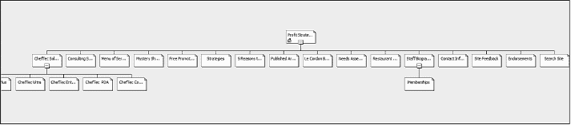

网站的导航可能会很复杂。当你将电子商务集成到网站中时，请确保导航简便、产品易于查找，并且结账和支付过程毫不费力。太多的网站会让查找和购买产品变得困难，从而失去没有耐心的潜在客户。你还必须提供卓越的客户服务，并对查询和支持问题做出及时响应。提供静态 Web 页面来回答一些常见的问题将帮助你避免许多问题，但你必须准备好及时响应客户查询。

每个网站必须使用某些形式的高级应用程序，例如表单处理器、数据库交互或`JavaScript`集成。如果你使用 FrontPage 扩展，其中某些功能是相当简单的；但在许多情况下，你必须对脚本、`ASP`或通用网关接口（`CGI`）有某些工作知识才能配置这些服务。`JavaScript`只是一种由浏览器解释并在加载到网站时运行的脚本。这些脚本可以提供广泛的高级特性和功能，是任何网站不可或缺的组成。通常，你不需要知道如何编写`JavaScript`就可以使用现有脚本并将其嵌入你的网页，但你确实需要理解它是如何工作的。

`Flash`是一种编程语言，可以为你的网站添加高级动画和图形。许多网站完全基于`Flash`技术构建。如上一章提到的，随着网站的增长，网站的组织将带来丰厚的回报。将你的图像放在`images`文件夹中，将文档放在`documents`文件夹中，如果你有购物车应用程序软件，不要将其安装在网站的根目录下，以免它与你的实际网页混杂。

考虑多种导航系统，以确保在整个网站中有多个导航选项。常见的导航功能是列出网站各种页面或区域的左侧菜单，以及顶部的标签（tabs），用以快速导航到网站的特定内容部分，并强调网站最重要的区域。每个页面上的`JavaScript`下拉菜单提供了冗余，以确保每个页面都能链接到网站上的任何其他页面，自定义的内容和颜色可以帮助网站访问者意识到他们正处于网站的哪个部分或特定内容区域。

下方来自 Atlantic Publishing Company 网站的网页说明了这些导航功能之一：

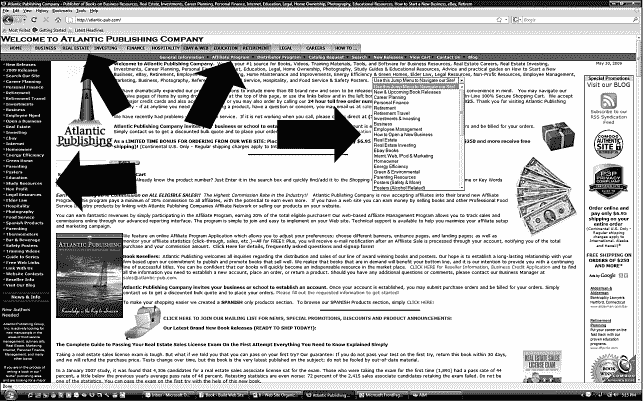

网站导航是一个相当简单的概念：为网站访问者提供一种在你网站上游行的简单方法。你可以通过多种方式实现，但请记住，搜索引擎处理导航的方式不同，取决于导航是基于实际按钮图像、`HTML`文本或其他方法。搜索引擎优化将在本书的第 8 章中讨论，你在设计网站的所有部分时应考虑 SEO。许多导航系统现在使用或使用`JavaScript`、`Java`程序或`Flash`技术设计。`JavaScript`通常没有问题，因为它通常使用带有`alt`标签的图像或文本导航（如下拉菜单）。

### 常见的导航样式

常见的导航样式有：

- `HTML`链接：简单、高效且对搜索引擎友好，但不如按钮或其他方法吸引。
- 面包屑（Bread-crumb trail）：这种系统使用单行文本显示页面在网站层次结构中的位置。这应该仅作为辅助导航系统，但对于显示网站访问者处于网站层次结构的什么位置非常有帮助。这种导航技术对用户日益有益。
- 导航栏或按钮：最常见的导航类型。通常位于网页的左侧或顶部。
- 标签导航（Tab navigation）：最早由 Amazon.com 发扬，这种导航也可以被视为辅助导航系统，但它提供了到网站特定部分的直接链接。
- 站点地图（Sitemap）：显示网站完整导航结构的单页网页。这对 SEO 也至关重要。
- 下拉菜单：通常位于网页顶部或左侧的菜单，当鼠标悬停在其上方时会下拉或展开子菜单。这允许你将许多链接放入导航中，但这些菜单仅在使用时才会折叠。这些菜单通常由`JavaScript`、`DHTML`或`CSS`制作。

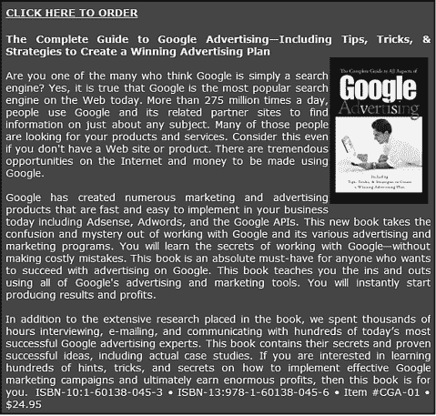

## 带有 HTML 链接的示例网页

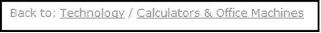

## 示例面包屑导航轨迹

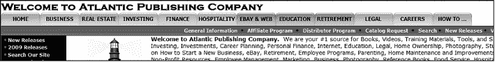

## 示例标签导航系统

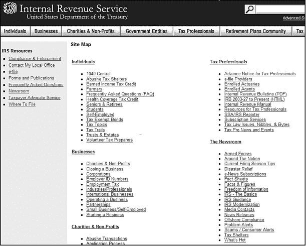

## `www.irs.gov`示例站点地图

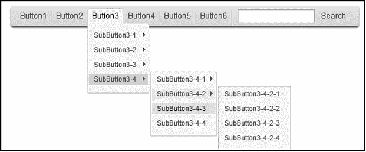

## 示例下拉菜单

底线是，简单、有效且易于用户操作的导航是 Web 设计中最重要的元素之一。建议你花时间访问其他网站，看看它们是如何使用不同的导航方法的。这不仅能为你自己的网站提供绝佳的灵感，还能帮助你确定哪些是不应该做的。坚持那些有效的方法——我们从左到右阅读，并习惯于在 Web 页面的左侧或顶部寻找导航。不要将你的导航埋在页面底部，或将其固定在页面的右侧。

你的导航在整个网站中应该是一致的。如果你使用按钮和下拉菜单，它们应该出现在每个页面，且位置相同。你应该将超链接嵌入到 Web 页面中，作为导航的替代方法。虽然它们不应该是主要的导航系统，但网站访问者熟悉超链接，并在嵌入 Web 页面时可以轻松识别它们。

以下是网站导航的一些基本原则：

- 保持网站导航简单、易用且易于找到。
- 位置至关重要；将导航系统放在每个页面的左侧和/或顶部。
- 确保你的 Web 网站上部署了多个导航系统。
- 保持导航的可管理性；不要用提供过多选择的复杂菜单让网站访问者负担不堪。
- 在导航菜单中使用简单易懂的词汇，例如“首页”、“关于我们”和“联系我们”。链接应该清晰、简洁且准确。
- 确保你的导航系统位于“折线上（above the fold）”。这是一个源自报纸业的术语，意味着重要报道放在报纸“折痕”上方，而不太重要的报道放在折痕下方，它们在最初查看首页时是看不到的。这个概念非常适用于 Web 页面。显示器上的空间有限，你并不能总是将整个页面放入浏览器窗口，迫使用户向下滚动阅读更多内容。确保你的导航系统位于 Web 页面的“折线上”——用户永远不需要滚动寻找你的导航系统。这同样适用于 Web 页面内容；如果你想让网站访问者看到重要信息，请将其放在折线上。
- 确保每个页面都有“首页”导航链接。为你的网站访问者提供返回首页的方便方法。
- 确保你的网站布局和导航菜单在整个网站中保持一致。每个页面都应该有相同的布局和位置。
- 大型网站由于页面数量而具有挑战性。通过类别、板块和产品组织你的网站以简化导航。用户应该能够在不超过两次鼠标点击的情况下到达任何页面。不要通过需要多次鼠标点击才能找到页面来埋藏页面——它们可能永远不会被访问。
- 通过图形、图像和高级功能（例如在鼠标悬停时改变颜色的悬停按钮）让你的导航系统具有吸引力。Microsoft Expression Web 有一个很棒的功能，可以让你即时创建交互按钮。

网站导航有许多免费选择，`Dreamweaver`和 Expression Web 都提供了相当强大的集成解决方案，用于创建可访问且功能性的网站导航选项。

## 搜索选项

你必须在你的网站中集成某种形式的搜索功能。可以通过站点地图，也可以通过 Google 等其他公司的额外 applet 实现，这些程序会索引你的 Web 页面并提供免费的搜索功能。

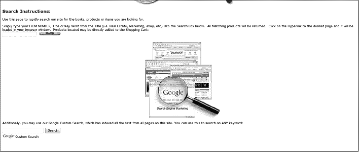

一种选项是使用 Google 自定义搜索，可以在[`www.google.com/searchcode.html`](http://www.google.com/searchcode.html)获取。你可以通过快速 Web 搜索找到许多其他示例。

## 框架（Frames）

框架在 20 世纪 90 年代非常流行，是将多个 Web 页面并列在浏览器窗口中显示每一个的方法。标题通常在一个框架中，导航在页面左侧的另一个框架中，主页面内容在第三个框架中。每个框架通常独立于其他框架滚动。这种方法之所以流行是因为你可以维护一个用于导航的 Web 页面，并让它在所有 Web 页面上显示。现在有了其他更好的方法，通过使用表格、`CSS`、包含页面（Include Pages）和服务器端包含（SSI）。不要使用框架；它们无法提供任何无法通过其他方法获得的价值，而且存在的问题比价值多得多。

## 网站模板

在开发网站时，有数千个网站模板可供使用。其中许多质量非常高，并专门为`Dreamweaver`、FrontPage 或 Expression Web 设计。这些应用程序甚至自带了模板，WebPlus X2 也是如此。“模板”不是一个坏词，你应该考虑将商业模板作为你 Web 设计工作的起点。虽然 FrontPage 包含的模板并不好，但`Dreamweaver`和 Expression Web 包含了更专业的模板，这些模板利用 CSS 并通常符合访问性标准。此外，WebPlus X2 提供了吸引人的、专业设计的模板，随软件免费提供。几十个网站也出售定制模板，例如可以在[`www.pixelmill.com`](http://www.pixelmill.com)获取的 PixelMill™。

大多数模板利用了前面提到的包含页面。这些允许你通过`include` `call`其他页的数据，并将数据显示在该页面上。对于网站访问者来说，这是无缝的，而对你来说，它简化了维护和更改。如果你整个网站导航都是一个包含项且你有 300 个页面，你只需要编辑那个导航页面，它就会立即更新 300 个页面。替代方案是逐个更新 300 个页面。

你还应该在 Web 设计工作中使用`CSS`。通过`CSS`，你可以从一个主 CSS 文件控制网站的整体外观、字体大小和颜色。你的页面读取 CSS 文件并将适当的标准应用于你的 Web 页面，以便正确显示。这从单一文件中规范了网站的每个页面。Expression Web 和`Dreamweaver`应用程序都内置了大量的`CSS`支持。

目录


# 第 6 章：Web 页面内容


# Web 内容的重要性

本章将讨论内容的重要性，包括无论你提供什么类型的业务或服务，拥有可靠的内容是多么重要。即使你的 Web 网站或博客是个人用途，内容也会驱动搜索引擎可见性，并对于在 Web 上取得成功至关重要。内容不仅对于吸引访问者进入你的网站，对于让他们反复返回也至关重要。

搜索引擎会寻找撰写良好、有趣且独特，并不断更新且具有相关的内容。内容的编写应当易于快速扫描，因为网站访问者可能没有时间阅读长篇文本。在正文中包含`粗体标题`，可以帮助访问者更容易地找到他们想要的内容——而无需阅读所有内容。编写良好的 Web 内容的四个基本建议是：

- 包含关键词；
- 使用清晰的标题；
- 保持简洁明了；
- 放弃推销技巧，让你的访问者直接获取网站的核心内容。

你的第一句和第一段将决定访问者是否会阅读整个网页。新闻专业学生学到的首要课程之一就是如何撰写“导语”（lede），即你在大多数新闻报道中读到的第一句话。它必须是一个具有选择性的介绍，能够吸引读者的注意力；最好用一个强有力的动词来描述文章的主题。确保你的内容不仅具有时效性，而且与你的读者相关联。

记住对所有内容进行拼写检查。在写作时检查一遍，完成后再次检查。此外，务必仔细检查你的语法。使用花哨的字体无法帮助你留住访问者，因为那些字体太难以阅读，而且通常不符合 Web 端的习惯，也无法在所有地方显示。

撰写你熟悉并过大量研究的内容至关重要。仅仅在页面上堆砌文字并不是编写内容的方法。你必须清晰地专注于你试图向客户销售或提供什么。如果你不理解你正尝试编写的主题，你的听众同样也不会理解。不要太啰嗦；使用清晰、简洁的描述。这并不意味着在需要时不能写更长的文案——它意味着你不希望写的内容超过解释你的产品或服务所需的内容量。在使用 Web 时，潜在客户希望信息能够快速轻松地被吸收，因此你的目标是这样描述你的产品或服务，以使他们拿起电话或使用购物车模式购买你所销售的产品。

只有指向其他页面或网站的超链接应该使用下划线。还有许多其他方法可以强调内容的特定区域，例如通过对子标题进行加粗或斜体处理，将内容划分为预设的区域。你还可以使用项目符号列表或数字列表。在正文和子标题中，你可以创建指向网站不同区域、网站内单个页面、同一页面内文档不同章节或其他网站的链接。然而，在这样做时，请记住使用你选择的关键词来通过搜索引擎推广你的网站。

另一个需要记住的因素是在内容与图形或图像之间留出足够的空间。不要让内容流到这些项目的下方或上方。如果你的内容被埋没或无法阅读，你将激怒读者，甚至可能失去现有和未来的客户，因为网站看起来不专业。

关于任何类型的 Web 写作，还有一个最终的细节，那就是仔细选择你的词汇和写作方式。例如，如今大多数人都能认识并理解基础的 Web 通信，这意味着如果你在电子邮件和聊天中使用全大写单词，你的客户或顾客可能会觉得你在对他们大吼。在 Web 上，你可以通过使用全大写字母来表达观点而得罪他人。因此，除非这是你的本意，否则在与访问者的所有交流中，请谨慎且少量地使用大写。你可以采用许多方法来吸引访问者进入内容的特定区域，而无需诉诸过度大写。

## 内容关键词

网站流量是指网站接收到的访问者数量和访问次数。实施 SEO 技术并将关键词嵌入到你的网页内容中是非常重要的，这可以提高你的网站在搜索引擎中的可见度和排名。其中一个主要步骤是确定潜在客户在寻找你的公司、产品或服务时可能会使用哪些关键词或关键短语。关键词是人们为了查找他们所寻找的产品、服务或主题的信息而会使用的单词或短语。

## 如何开发关键词

建立网站时最大的挑战之一是开发初始的关键词和关键短语列表。关键短语简单来说就是组合在一起的关键词。它们精炼搜索并将泛化的搜索缩小为非常特定的结果集。人们在创建关键词列表时往往会忽略这些短语，但它们对你网站的 SEO 同样至关重要。在制作内容之前，你必须开发出一份潜在关键词或关键短语列表。以下是一些指导建议：

- 对你的员工、朋友和客户群体进行筛选，列出你认为他们可能用来寻找你网站的所有可能的关键词或关键短语。
- 筛选竞争对手的网站，列出他们网站上所有可能的关键词或关键短语。
- 头脑风列一份你想到的任何相关关键词或关键短语列表。离开列表一段时间；然后在大约的一周时间里，不断向列表中添加更多潜在的关键词和关键短语。
- 确保将公司名称、口号、标语或其他可识别的营销材料融入关键词。
- 为你的关键词添加单数和复数拼写。
- 查看竞争对手网站上的元标签，特别是`keywords`标签。审阅此列表并将其添加到你自己的关键词列表中。
- 避免商标问题和纠纷。虽然在商标方面有一定的回旋地，但建议避免使用其他公司的商标，除非你是他们产品的授权分销商或转售商。

设计你的网站，使其提供人们寻找的信息，并具有简单的导航和易用性以浏览你的网站。将你的关键词或关键短语嵌入到网站内容中。利用你的 Web 服务器日志来研究人们使用哪些关键词或关键短语寻找你的网站；这可能帮助你精炼关键词和关键短语列表。关键词密度在网站设计中同样重要。

## 用户如何阅读 Web 页面

人们很少逐字阅读 Web 页面；相反，他们扫描页面，选择各种单词和句子。在研究人们如何阅读 Web 网站时，发现只有 16% 的人是逐字的。因此，Web 页面必须使用易于分析的文本并采用关键词。

您的网站是您的专业名片、主入口，也是给网站访问者留下的第一印象。一个撰写良好的网页可以解释您的网站的主题、您是谁，以及您提供哪些产品或服务。它必须引人入胜且易于阅读。人们往往会根据他们看到的内容做出瞬时决定，网站内容也不例外。以下是创建网页内容的一些通用指南：

## 为网站访问者创建内容

在制定网站内容开发策略时，最具挑战性的部分是确定哪些内容对读者来说是重要的，这可能与对业务重要的内容相相反。您的目标通常是一致的，但有时，它们之间可能会发生冲突。确保您是为网站访问者创建内容至关重要，以便以满足他们的需求、吸引他们的注意力，并将访问者转化为客户。

## 传达优势

内容必须清晰地传达访问您的网站或使用您的产品或服务的优势和益处。直接向访问者提供信息。人们不断寻找能够帮助他们工作更高效、提高工作和生活质量，并帮助他们实现目标的信息。说服网站访问者，您可以实现这些目标。

## 为了触达您的访问者而写作

用口语化的语气编写您的内容。这可以确保更清晰的写作模式。

## 便于扫描的网页格式

网页通常充满了长长的、不中断的段落，几乎无法阅读。您的访问者通常只是扫过这些页面。在您的文档中捕捉主要思想、概念和关键点，让读者可以在不丢失主要目的和意义的情况下快速浏览内容。

## 为 SEO 关键词优化内容

关键词是一个简单的表达式，反映博客条目、文章或其他网站其他内容的主题或核心思想。诸如`Google`等搜索引擎将关键词作为其网站索引系统的基础。当每个新的条目、文章、网页或博客被搜索引擎索引时，搜索引擎的算法会检测关键词的表达式，以确定网站内容的目的，并相应地将页面划分到其网页数据库中。当个人在浏览器的搜索框中输入一系列单词时，搜索引擎会根据搜索中使用的关键词提取相应的结果，并按排序将结果返回给浏览器。

良好的关键词或关键短语能够准确反映人们在搜索引擎中会输入的内容，并返回与他们所需内容最匹配的结果。关键词必须是具体的且相关的。如果关键词太宽泛，它们将变得毫无用处。关键词的最佳密度在 5% 到 10% 之间。关键词密度超过 10% 的网站可能会被搜索引擎惩罚。

## 在网页内容中使用图像

使用图像和视觉冲击对于吸引网站访问者的注意力是必要的。您必须立即获得他们的注意力，创造性地使用图像是实现这一点的最佳方法之一。一旦这样做，您的内容应该为他们提供他们寻找的信息。记住，内容是最重要的。与逛街不同，网站的视觉吸引力并不能获得关注；人们必须搜索关键词来找到您的网站。但您使用的图像将补充您的内容，并为您的网站提供平衡的呈现。

图像是使网站与其他处理相同主题的网站区分开来的主要细节之一。它们可以使 Web 体验比纯文本材料更有吸引力。图像一眼就能定义网站的特征。过度使用图像会将页面定性为爱好页或娱乐页面，而节制使用图像通常与信息和新闻类网站相关。图像可以用于图表和图表等形式的数据表示，而无需编写必要的代码来解析和动态显示此类信息。它们可以通过图片和照片来设定文章的基调，还可以通过模拟三维外观或创建反射效果的高级图形技术来增强网站的风格。网页上图形和图像的重要性是不可否认的。

为了学习如何将图像融入您的网站，对图形和图像的几个基本方面有坚定的理解至关重要。本章将涵盖使用免费图形和编辑程序创建图像的基础，深入介绍两个商业照片编辑应用程序，并探索不同图像格式之间的相似之处与差异。

图像和图形是网站设计的关键组件。您必须平衡文本、图形和留白；您不希望用太多的图片、图形或剪贴画淹没您的文字内容。大多数网站管理员认为，经验法是在任何给定页面上使用不超过三张图片或图形，并将其尺寸调整为不大于`72 DPI`（每英寸点数），以确保它们加载快速。平衡并留出图像空间，使文字内容在页面上清晰可见，让您的访问者有机会在图片加载时开始阅读您的内容。对字体的大小要小心——字体过大是不专业的，且会分散注意力；字体太小则无法阅读。

## 目录


# 第 7 章：网站图形

“一画胜于千言”这句话在数字时代仍然适用。当使用得当时，图片和图像能够以文字无法表达的方式传达思想和概念。但它们很容易变成一种干扰——以及眼物。在网站正确的位置使用图像可以增强用户体验，并通过口碑广告以及搜索引擎为您的网站带来更多流量。但您必须确保您的图像不会损害富含关键词的网页内容。

图像是使网站与其他处理相同主题的网站区分开来的主要细节之一。它们可以使 Web 体验比纯文本材料更有吸引力。图像一眼就能定义网站的特征。过度使用图像会将页面定性为爱好页或娱乐页面，而节制使用图像通常与信息和新闻类网站相关。图像可以用于图表和图表等形式的数据表示，而无需编写必要的代码来解析和动态显示此类信息。它们可以通过图片和照片来设定文章的基调，还可以通过模拟三维外观或创建反射效果的高级图形技术来增强网站的风格。网页上图形和图像的重要性是不可否认的。

为了学习如何将图像融入您的网站，对图形和图像的几个基本方面有坚定的理解至关重要。本章将涵盖使用免费图形和编辑程序创建图像的基础，深入介绍两个商业照片编辑应用程序，并探索不同图像格式之间的相似之处与差异。

图像和图形是网站设计的关键组件。您必须平衡文本、图形和留白；您不希望用太多的图片、图形或剪贴画淹没您的文字内容。大多数网站管理员认为，经验法是在任何给定页面上使用不超过三张图片或图形，并将其尺寸调整为不大于`72 DPI`（每英寸点数），以确保它们加载快速。平衡并留出图像空间，使文字内容在页面上清晰可见，让您的访问者有机会在图片加载时开始阅读您的内容。对字体的大小要小心——字体过大是不专业的，且会分散注意力；字体太小则无法阅读。

图像、图形和图片为您的网站提供了额外价值，但如果太多，它们也会损害您的网站并使其不专业。剪贴画应极谨慎使用，因为它往往会让您的网站看起来很业余。大多数免费下载的剪贴画和图形质量很低。您可以做的最好的投资之一是获取免版税的图库。这些可以为您的网页增添高级感，而且完全免费。它们为单调的网页提供了视觉中心，并可以增加色彩和趣味。

尽可能使用`CSS`来控制字体大小、颜色和布局。通常使用外部样式表，因为它们控制整个网站。样式表实际上是您的 Web 服务器上的一个文件，存储了您所有的`CSS`偏好。您在每个网页中嵌入`HTML`代码，并在页面加载时应用样式表。您也可以使用内部样式表，它们只控制其所在的页面；如果您需要某个页面与其他页面具有不同的功能或外观，这将非常有用。

## 图像格式

网络上三种主要的图像格式是`JPEG`、`PNG`和`GIF`。`TIFF`和`BMP`是其他常见的格式。尽管它们乍看起来一样，但每种格式都有自己的优缺点。

`JPEG`代表联合图像专家小组（Joint Photographic Experts Group），它是创建该标准的委员会。最常用的文件扩展名是`.JPG`或`.JPEG`。这是 Web 上最流行的图形格式之一，因为它们通常是大多数相机和其他成像设备的默认输出格式。然而，默认和流行并不总是意味着最好。某些版本的`JPEG`使用交错渐进式加载样式，会先显示图像的大致轮廓，然后细节才开始缓慢填充。对于较小的图像，这种区别几乎不可察觉，但在通过慢连接查看较大的`JPEG`图像时，你可以看到图像随着加载逐渐形成。这种方式的优势是，用户可以在高质量图像加载之前，查看一个低质量但完整的图像版本。这与`PNG`等其他格式使用的线性加载方式不同，后者是按行、逐像素地以全画质加载图像。

`JPEG`的一个缺点是它们不支持 Alpha 通道（透明度通道），因此这种格式仅能用于没有任何透明度的全尺寸图像。这是`JPEG`不经常用于菜单和导航栏等功能的主要原因，因为这些功能通常使用圆角或透明背景的不规则形状。`JPEG`可以根据你的带宽需求进行压缩，但这是以质量为代价的。质量也会根据系统而异，因为某些浏览器会采取快捷方式来加速解压缩文件。有损压缩是`JPEG`的主要问题之一，它因留下伪影而闻名。你可以通过比较文件的原始版本和压缩版本，寻找色块和细微细节的丢失来发现`JPEG`伪影。

便携网络图形（Portable Network Graphics，简称`PNG`）是一种较新的文件类型，支持许多功能。它们与`JPG`的不同之处在于它们拥有 Alpha 通道，允许`PNG`图像具有透明度。它们还支持索引选项，允许通过减少图像调色板中颜色数量来减小图像文件的大小。`PNG`与`JPEG`的区别在于它们支持无损压缩，这可以保持图像的原始质量。该格式用于压缩文件的高级预处理技术是以速度略微下降为代价的。它还带有一个伽马通道来调整图像的亮度。该格式的主要亮点是其极其高效的压缩。因此，如果你正在寻找一种既占用带宽小又不丢失任何质量的小文件，那么`PNG`就是你的理想格式。

标记图像文件格式（`TIFF`）是一种全球通用的图像文件格式，兼容大多数 Windows、Mac 和 UNIX™ 操作系统。`TIFF`图像采用了无损压缩，让你在不丢失任何质量的情况下获得较小的文件大小。在存储任何质量敏感型图像时，这是一个需要考虑的重要因素。打开和保存文件的压缩总是以速度为代价的。虽然现代处理器的差异微乎其微，但对于需要反复打开或保存的图像和文件，速度可能是一个需要考虑的因素。`TIFF`文件主要用于打印和存档。

位图（Bitmap 或`BMP`）是另一种常见的文件格式。位图通常是未压缩的，导致其文件大小远大于同等的`PNG`或`JPEG`文件。有多个版本的`BMP`可用，包括一个支持透明 Alpha 通道的 32 位版本。可以使用如`7-Zip`等免费压缩程序将`BMP`文件手动压缩到原始大小的一小部分。

`GIF`图像是 Web 的原始图像格式之一，通常用于动画。它们的使用受到限制，因为`GIF`图像将你的调色板限制在 256 色以内。因此，在`GIF`的限制内通常很难实现渐变和其他色调，除非它用于小型图像（如 Logo）。如`GIMP`（GNU 图像处理程序）等程序允许你用全彩色绘制图形，然后将调色板减少到核心的 256 色。这通常会导致颗粒感。`GIF`的主要优势是它们为带宽密集型视频提供了一个简单的替代方案。`GIF`文件还支持类似于`JPEG`的交错选项，允许在下载完整细节图像之前下载粗略图像。这对于互联网连接较慢的用户特别有用。该格式还使用无损压缩技术将图像压缩为更小的文件大小。

`SVG`是缩放矢量图形（Scalable Vector Graphics）文件。与`JPEG`或`PNG`文件不同，`SVG`文件以向量形式存储信息。这允许你无限缩放图像而不丢失任何质量。这使其成为 Logo 和其他反复调整大小图像的理想文件类型，因为对于大多数其他文件类型，调整大小通常会导致块状像素化。`SVG`在更高级的增强功能方面有限，因此可以考虑将图像的基本轮廓保存为`SVG`，然后对其进行最后的修饰并将其保存为高分辨率的`JPG`或`PNG`。

## 图像与 HTML

图像融入网页的方式对于 SEO、易用性和可访问性至关重要。以下是将图像嵌入 HTML 文档的示例。打开记事本或其他 HTML 编辑器并创建以下 Web 页面：

```html
<head>
<body>
</img>
</body>
</head>
```

将其保存到桌面或本地文件夹。在相同位置，创建一个“Images”文件夹，并从你的系统中取一个示例图像放入文件夹中。你可以编辑图像的`src`属性指向你的特定图像。也可以使用这种格式在不带结束标签`</img>`的添加图像：

```html
<head>
<body>

</body>
</head>
```

在 Web 浏览器中运行示例 Web 页面文件以查看输出。代码显示了来自本地目录`Images`文件夹的`SampleImage.png`图像。图像的默认位置位于顶角。你可以通过以下操作在屏幕上移动图像：

```html
<head>
<body>
<div style="position:absolute;left:40px;top:20px;">
</img>
</div>
</body>
</head>
```

为图片正确命名有助于针对搜索引擎进行优化，使用户能够轻松找到该图片。图片的鼠标悬停文本描述（或工具提示）是另一个需要考虑的 SEO（搜索引擎优化）因素。正确标记图片可以为你的网站带来来自搜索引擎的流量。正确的标记还能帮助禁用了图像的用户无障碍地浏览网站。请尝试在本地目录中没有`SampleImage.png`的情况下运行以下代码：

```html

```

网页将显示一个带有“未找到图像”符号的空白正方形，并带有来自`alt`标签的文本。无论图片是否存在，`alt`标签都会显示。这为你的网页添加了额外的保护，因为即使在没有图片的情况下，它仍然可用。`alt`标签还会让你的网站对残障用户更具可访问性，因为它兼容大多数辅助软件，如微软讲述读器（Microsoft Narrator）。通过使用“D”链接和`longdesc`，你可以在优化`Google`和`Yahoo!`等搜索引擎的同时，进一步提高可访问性。


```html
<a href="sampleImageDescription.htm" title="Sample Image">D</a>
```

`longdesc` 指向的页面可以包含对图片的进一步描述，允许你更详细地描述图片，同时挤入几个与图片相关的关键词。一个示例描述可能如下所示：

“这张图片显示了一张常用于演示示例的示例图片。该示例图片本质上具有模糊性。空白背景与空白前景融合得很好。它还使用了 PNG 格式，引用了文章的其他部分。该图片展示了如何对简单标签进行装饰以提高其可访问性，同时针对搜索引擎进行优化。”

`alt` 标签可以包含带有少量关键词的图片基础描述，而 `longdesc` 应该是一个较长的句子或者链接到图片的更好的描述。`alt` 和 `longdesc` 之间的主要区别之一是，`alt` 标签中的描述在鼠标悬停在图片上是可见的，而 `longdesc` 中的描述则可见。然而，不要在任何一个描述中堆砌关键词。现代搜索引擎使用垃圾邮件过滤器，寻找那些在没有任何实际内容的情况下过度使用口号的行为。`alt` 和 `longdesc` 应该是图片的文本替换，而不是简单的标签列表。

另外请注意，装饰性的视觉点缀通常不会被标记。这有助于保持 HTML 页面的简单整洁，不包含任何不需要的信息。问问自己速度和带宽成本是否值得增加额外的标签。

搜索引擎考虑的另一个因素是文件类型。JPG 通常与照片相关，而 GIF 则被认为是网站图形。请确保选择正确的文件类型，以便你的图片能被正确分类。仅使用图片的一个副本并在整个网站中一致地引用它，有助于其在 Google 等搜索引擎中的页面排名。

PageRank 是 Google 的一种技术，根据入链和出链的数量来确定页面或文件的相对价值。它通常被称为用户随机点击链接到达特定网页的概率。PageRank 与大多数现代搜索算法一样，基于链接的质量和数量。这就是为什么你应该始终正确地为你的图片授权，以防止它们被其他网站抓取。然而，外部网站可以链接到它们。这在保护你的网站资产的同时，提升了你的页面排名。

## 版权与许可

在使用来自其他网站的内容时，请务必提供适当引用。一个带有摄影师署名的简单链接和关于许可的简短说明通常足够了，但请向原作者确认他们是否有任何特殊偏好。在现代语言协会（MLA）等认可的格式中进行正确引用是搜索引擎考虑的因素之一。这也是为什么维基百科页面通常获得高页面排名的原因之一。

你应该始终将重要的图片文件托管在你自己的服务器上。托管在免费托管服务器上的文件对于网站中较大、更消耗带宽的元素很方便，但不应用于网站的主要部分（如导航和标志），因为许多此类网站容易出现宕机和文件丢失。

在 Web 开发领域，抓取图片（Image leaching）被认为是不礼貌。在没有网站所有明确书面许可的情况下，永远不要使用另一个网站的图片，以确保你没有违反任何版权法。曾出现过原所有者将图片替换为“不要抓取（Don't Leech）”标志的情况。这些标志可能会在抓取者不知情的情况下出现在他们的网站上，因为文件链接仍然相同。这可能会导致相关网站声誉受损，因为在网站开发者注意到之前，可能有数百名用户发现了这些标志。

在自己的服务器上托管图片可以消除对你网站至关重要的所有内容中的风险和意外。你可以在网上找到许多在免费和开放许可下发布的免费图片。寻找标记为“版权共享（copyleft）”或在创意知识产权许可（Creative Commons License）下发布的图片。务必仔细阅读许可，以确保在使用网站网站图片前符合列出的要求。

如果你找不到你需要的内容，可以考虑使用以下程序之一为你的网站创建新的原创的图形。

## 免费图形编辑软件

### GIMP

GIMP（GNU 图像处理程序）是一种广泛使用的图形编辑程序。它是一个根据 GNU 通用公共许可证（GPL）发布的免费开源图形程序。它的功能与 Photoshop 相似，之处在于它的主要重点是编辑和增强照片和其他图片。

它支持所有基本功能，如裁剪、色彩滤镜、亮度对比度、色调和饱和度以及色彩模式。它还带有许多用于更高级编辑需求的过滤器和插件。这些包括模糊、锐化、油画、边缘检测、光晕、分形渲染、固体噪声、等离子、波纹和波。可以从 GIMP 官方网站创建或下载额外的插件。GIMP 允许你以各种格式打开和保存文件。

注意，你可以在 GIMP 中处理 Photoshop 文件，因为它支持 `.PSD`（Photoshop 文件格式）。一个缺点是，像 Photoshop 一样，GIMP 有时会非常消耗资源。如果你计划添加更多插件和外部功能进行更高级的编辑，请确保你的系统支持 GIMP 的内存和处理需求。

对画刷、图案和加载项的支持，结合许多内置功能，使 GIMP 成为 Adobe Photoshop 的一个有力替代品。你可以免费从 [www.gimp.org](http://www.gimp.org) 下载最新版本的 GIMP。如果当前版本不符合你的需求，也可以下载 GIMP 的旧版本。如果你是程序员，在该网站还可以获取源代码。

### Microsoft Paint

Microsoft Paint（画画），也称为 MS® Paint，是 Windows® 内置的图形程序。尽管它的功能非常基础，但它是处理简单任务的一个易于使用且随手可用的选项。

Paint 的核心是基于像素的绘图。在 Paint 中实现 Photoshop 或 GIMP 的效果需要花费多得精力，因为 GIMP 中过滤器完成几乎所有工作都必须在 Paint 中手动完成。

Paint 允许你在三种绘图模式之间切换：铅笔、画笔和喷漆刷。你可以放大并对图片的各个区域进行详细处理，然后缩小以获得更高质量的成品。它有各种工具可以创建圆形、矩形、多边形、直线和曲线。

如果你运行的是 Windows 系统，MS Paint 应该存在于你的系统中了。进入 `Start > Run >` 并输入“MS Paint”，它就会启动画图程序。

### Inkscape

Inkscape® 是一款矢量图形编辑器。它用于创建 `SVG` 文件。它是快速创建按钮、Logo 和其他简单图形的完美工具。你还可以在 Inkscape 中创建自定义字符集作为你网站的字体。书法工具（Calligraphy Tool）非常适合此类任务。

如果你的鼠标操作不太理想，可以在 Inkscape 中画出粗轮廓，然后使用节点工具（Node Tool）按喜好进行编辑。由于 `SVG` 文件实际上就是 `XML` 文件，因此实际上可以使用任何文本编辑器编辑 `SVG` 文件。然而，那可能非常枯燥。

Inkscape 是一个易于使用的程序，允许你使用简单的形状和工具创建惊人的艺术。你可以从 `inkscape.org` 免费下载 Inkscape。你可以查看网站上的截图和文档，以了解更多关于程序所有小细节的信息。

### Paint.NET

Paint.NET 是另一个图形程序，提供了与 GIMP 和 Inkscape 类似的功能。它兼了 MS Paint 的简单性、Inkscape 的易用性以及 GIMP 的一些高级功能。

和 GIMP 一样，它的主要用途是照片处理，并支持所有流行的文件格式。这两个程序在许多方面几乎完全相同，但 Paint.NET 的界面与 GIMP 不同，不同之处在于它只显示基础工具和功能。

它提供了类似于但又优于普通 MS Paint 的功能，但没有 GIMP 的那些高科技功能。你可以在 `www.getpaint.net` 下载 Paint.NET。

### 软件选择

在这四个免费程序中选择下载并使用哪一个，这取决于时间、地点、场合和个人口味。每个程序都提供了独特的功能和能力，结合在一起可以让你无需花费像 Photoshop 这样昂贵臃肿的软件就能创建吸引人的图形。

所有这些程序都在相应的网站上积极开发，因此可以期待未来这些程序包会添加更多、更好的功能。

## 商业图形编辑软件

### Adobe Photoshop

Adobe Photoshop 是市面上最流行的图形编辑软件。它面向专业人士，极其复杂且非常昂贵。然而，它凭借惊人的功能深度、实用性和强大在竞争中脱颖而出。它是市面上最好的图形编辑软件。

关于 Adobe Photoshop CS4 的精彩评论可以在此处查看：`www.pcworld.com/reviews/product/35706/review/photoshop_cs4.html`。

### Corel Paint Shop Pro Photo X2

Corel Paint Shop Pro Photo X2 是 Adobe Photoshop 的一个便宜得多但仍然功能丰富的替代品。归根结底，它是一个非常出色的程序，能够满足大多数图形挑战的需求，而且学习起来并不复杂。

Corel Paint Shop Pro Photo X2 在合理的成本下平衡了易于用户的设计和强大的功能。关于 Corel Paint Shop Pro Photo X2 的精彩评论可以在此处查看：`www.pcworld.com/reviews/product/30516/review/paint_shop_pro_photo_x2.html`。

## Logo 和横幅

Logo 和横幅是 Web 设计中另一个与图形和动画交织的方面。创建 Logo 需要大量的耐心和心。Logo 往往是公司的“脸”。它们设定了网站的基调。你的 Logo 应该脱而出并易于识别。

将公司名称整合到 Logo 本身通常是一个很好的做法，就像 Google 和可口可乐®的 Logo 一样。Logo 的配色通常会成为整个网站的配色。这种一致性对于保持网站的流畅性是必要的。

在设计时，你还应该考虑 Logo 可能出现的其他地方——电子邮件、名片和页面页眉。从思考如何向陌生人解释你的网站开始进行头脑风暴。关于它写几句话或一个段落。然后尝试通过勾勒几张图在纸上表达同样的想法。

虽然这没有真正的“正确方法”，但在设计 Logo 时，请听取他人的意见。Logo 往往是在广告和其他横幅中在整个网络上代表网站的东西。

### Logo 设计工具

创建一个出色的 Logo 有很多选择。你可以自己创建，也可以外包给图形设计专业人士。还有许多旨在帮助自己创建 Logo 的软件包，例如 AAA Logo。

位于 `www.aaa-logo.com` 的 AAA Logo 公司允许你下载软件的最新试用版本。虽然这不是免费软件，但 AAA Logo 价格合理，并为用户提供 8000 多个独特的 Logo 对象和模板，可以帮助你构建自己的 Logo、名片、横幅和网站图标。

该软件允许你创建业务或或个人用途所需的几乎任何图形。AAA Logo 在其预建模板中提供了特定行业的 Logo，包括技术、金融、医疗保健、通用商业和零售、教育与培训、旅游、组织、体育与健身，以及食品饮料。

你可能考虑的另一个收入来源是为他人构建 Logo 并收取合理的费用。如果你购买了 AAA Logos 2008，你就可以构建并设计 Logo 卖给其他客户，而且对出售或创建的数量没有限制。

该网站主页上还有链接解释了如何打印和导出高分辨率的（300 到 600 DPI）Logo 以便进行高质量打印。网络上还有许多其他此类程序——只需在 Google 上搜索关键词“free Web logos”或“logo design companies”，搜索结果中就会出现几十个其他网站。在决定使用哪一个之前，花时间研究至少三个或四个。

### 网站横幅和广告

网站横幅和广告通常是网站给潜在访问者的第一印象。横幅两种最常见的尺寸是 728 x 90 像素和 468 x 60 像素。

横幅和广告必须足够吸引人以捕捉观众的注意力。一种很好的策略是通过标题或引人的主题标题提出问题，或提供网站可用完整内容的预览。这足以引起观众的兴趣，但不能满足其好奇心。

花哨、分散注意力的广告通常与诈骗和间谍软件有关，因此它们的有效性已经大大降低。通过内容而非操纵来吸引新用户更好，因为这确保了他们会回来。

## 颜色与主题

在选择配色方案时，请记住你想要为网站营造的氛围。红色、橙色和黄色等暖色可以代表激情和能量，而蓝色、绿色和紫色等冷色则被用于营造和平与宁静的感觉。灰色和棕色等中性色同样也是中性的。

颜色就像文字和图像一样，带有特定的含义和情感。寻找相互互补的颜色，为你的网站带来良好的视觉流。

颜色的选择通常是个人的主，因为每个人对颜色都有自己的独特偏好。然而，也有一些似乎是通用的基本规则。红色、黄色和蓝色等原色倾向于强调简单性和速度感。间色是由两种原色混合而成的，包括绿色、橙色和紫色。三级色可以通过间色和原色的混合产生。

在选择颜色时，首先决定你希望网站的哪些部分脱颖而出，哪些部分应该保持流畅。使用相邻的颜色为你的网站营造一致感。使用色轮中对立的颜色来使内容突出，使其显示。

对所有内容进行过度对比可能会变得非常刺眼，因此在选择要强调的内容时要挑。

当红、绿、蓝值完全相同时（例如：`127, 127, 127`），就会产生灰色。当一个值远高于另外两个值时，就会产生亮的霓虹色（例如荧光绿：`0, 255, 0`）。过度使用霓虹色通常被认为刺眼。

当颜色彼此接近时，会产生更柔和的颜色（例如：`255, 200, 150`）。这些颜色应主要用于背景和其他较大的纯色区域。页面前景的颜色应该位于色轮的对端，以便它们在背景上清晰可见。

红色背景上的红色文字是不可读的，而绿色或蓝色文字在同一页面上可以轻松阅读。观察其他网站以寻找互补的图像和颜色。

在选择配色方案时，视障用户的无障碍是另一个需要考虑的方面。虽然绿色背景上的红色文字（或反之）很容易突出，但有时会因为对比过度而难以阅读。要解决这个问题，只需调整颜色的亮度，使前景较暗而背景较亮。如果你的网站是面向老年群体的，易读性是一个特别关注的问题。

## 排版

排版是设计网页时需要考虑的另一个因素。网上有很多许多免费字体。你可以在 `Inkscape` 或 `GIMP` 中为个人使用设计一套字符集。

选择正确的字体并在正确的位置使用它们确实可以增加页面的风格。在标题上要发挥创意，但务必为页面的正文选择一种简单易读的字体。文字和图像一样，也是网站的一部分，应该受到同等的关注。

排版的使用可以帮助轻松点缀网站。它可以像图像和颜色一样，增加网站的风格，并使其从其他网站中脱颖而出。根据你所关注的内容选择字体。一些常见字体遵循手写、书法、涂鸦和机械书写的主题。字体的选择可以为内容奠定情绪和基调。

字体大小的选择是排版的另一个重要方面。`24` 号字通常被接受为标题的良好尺寸，而 `12` 号常用于正文。在选择字号时要考虑你的观众。

字号应该是相对的。如果你的正文使用较大的字体，那么标题也必须大得多。正文和标题文字之间的标准比例是两到三倍。过大的标题会吸引注意力，但在本质上会显得不专业。

这类似于小报标题和报纸标题之间的区别。如果你希望你的内容被严肃对待，就必须以严肃的方式呈现。最后，始终遵循语法以及句子和页面结构的基本规则。不要全大写写作，因为这会让你的写作看起来像是在激进地大喊信息。

## 图像技巧与窍门

在决定图像的大小和比例时，使用“黄金比例”，也称为 `phi`。`Phi` 是一个无理数，通常四舍五入为 `1.618`。它出现在自然的许多地方，被认为是美的秘密公式。

斐波那契数列中的连续两个数字大约产生这种比例。斐波那契数列是一个数字序列，下一个数字是前两个数字之和。该序列的前几行是 `1, 1, 2, 3, 5, 8, 13, 21, 34, 55 ...`

访问者的眼睛往往倾向于移动到四个距离页面边缘三分之一处的关键点。在这些区域放置广告或其他重要内容，以获得最大的可见度。这一规则也适用于图像的构图。将图像的重要主体放在这些点上，使它们在第一眼就能被注意到。

标题和图像在网站首次加载时很容易被用户注意到。快速看一眼就能解释页面的基本内容，同时让访问者思考几个问题。

网站上的图像和图形应该与文字互补，而不是压盖它。用一张图像传达的信息比用段文字要多得多。清晰的图像为读者提供了主题的预览。它们应该说服读者花时间阅读整个页面。

一个满是文字的页面看起来像一堵不可逾越的信息墙。在文章或博客中添加一些图像将柔化显示效果。一个良好的做法是使用与主题相关的大标题图，然后添加与每个子主题对应的小图。

对于网站来说，简单而易用永远比风格复杂好。看看 Google 首页。整洁的用户界面让即使是初级用户也能轻松导航网站并访问其功能。

简单也有助于加载时间和带宽，因为发送和接收的数据更少。它减轻了用户以及网站开发人员或托管商的压力。简单即销量。

始终为你的网站准备一个备份副本，以便在紧急情况下恢复。根据网站更改的频率，每月、每周甚至每天制作备份。你可以购买外部硬盘或在网上存储文件以增加安全性。

图像往往占用大量空间，因此在存储时务必将图像压缩为 `Zip` 文件。根据内容或备份日期命名文件。如果手动备份太麻烦，你可以选择配置服务器根据计划自动备份。

作为一个一般原则，图像应尽可能越小，以加快网页的加载速度。图像应以 `72 DPI` 的分辨率保存，图像文件大小不应超过 `20KB`。

像素用于测量图像文件的高度和宽度，其单位为千字节（`KB`）或兆字节（`MB`）。如果你的网站上有大型图像文件，你正在流失访客。请使用 `<alt>` 标签以提高访问性和 SEO（搜索引擎优化）。

# 色板如何帮助你 —— 作者 Erin Pheil

每隔一段时间，你可能会遇到一个“感觉”不对劲的网站。有些地方不对。该网站看起来并不精细、专业或经过深思熟虑，但无法立刻看出原因。

通常，这些网站只是遭受了我们亲切地称之为“调色板故障”。毫无疑问，颜色的使用不当是业余人士设计网站的主要迹象之一。专业的 Web 设计师在设计网站之前，几乎都会脑海中先有一个调色板，因此不太可能使用冲突或不恰的颜色。

正如人们在工作之前应该先为网站确定一个明确的目标一样，他们在开始设计网站之前，也应该确定网站的调色板。幸运的是，大量的在线工具使得选择调色板变得轻而易举。Adobe 的 `Kuler™` 就是这样一种色板工具。

在使用像 `Kuler` 这样的在线工具之前，首先考虑适合你网站的通用颜色方向。如果你经营一家水疗中心，使用柔和、暗淡的颜色可以帮助你的网站达到冷静的效果。

如果你经营一家森林或树木服务公司，使用绿色和/或大地色会让访客迅速知道他们来对了地方，而使用例如柠檬绿和荧光粉则可能会让你的访客感到困惑，并让他们怀疑你的严肃性和专业性。

一旦你对网站的潜在颜色构思了一些想法，就前往 `http://kuler.adobe.com`。在搜索框中输入你想法中的关键词，开始浏览潜在的颜色组合。

尝试词汇的同义词和替代变体，例如“earth（大地）”、“earthy（大地的）”、“browns（棕色）”或“natural（自然的）”。


探索网站，查看其他在线色板工具，继续寻找直到你找到一个适合你网站的色板。一旦你选择了色板，你会发现设计网站时遇到的颜色决策——例如选择链接颜色或确定使用哪种色调作为网站背景——不再看起来令人令畏或沮丧。

如果你坚持使用你的色板，并忽略在设计中引入无关颜色的诱惑，你的最终网站设计将看起来比那些随着设计演变而随意添加颜色的网站更精细、更协调、也更专业。

Erin Pheil 是 `Timeforcake Creative Media, Inc.` 的创始人，这是一家精品的 Web 和图形设计公司，专门从事创意性、有效的网站和图形设计项目。你可以在 [`www.timeforcake.com`](http://www.timeforcake.com) 了解更多关于 Erin 和 Timeforcake 的信息。

## 目录


# 第 8 章：网页格式、JavaScript 和级联样式表

Web 已经演进，Web 设计也随之演进。虽然 `.HTM` 或 `.HTML` 是最常见的网页类型，但还有其他类型。所有的 `.HTML` 页面在本质上都是静态的，这意味着页面上显示的内容只有在网站所有者更新它时才会改变，它不会与数据库交互或执行任何其他功能。这并不是说 `.HTML` 页面不能做很多事情；标准的 `.HTML` 页面可以用于电子商务和大多数 Web 在线功能。`.SHTML` 页面是利用 `SSI` 的类型，因此这些页面不是静态的。`SSI` 是一种用于创建具有动态生成内容的语言。`ASP` 类似，基于微软技术，包含了 `Visual Basic (VB)` 代码，Web 服务器在页面加载时执行这些代码。这意味着网页与数据库交互，然后让你从 Web 浏览器查看并操作数据。Java 页面（Java Server Pages，或 `.JSP`）的工作方式类似，但使用的是 Java 代码而不是 VB。

另一种用于创建动态生成网页的网页格式是 `.PHP`。如果你需要将动态文本嵌入静态的 `HTML` 文本中，这种格式非常有用，并且主要用于将你的网站与数据库集成。`PHP` 是一种类似于 `JavaScript`、`Java` 和 `Perl™` 的脚本语言，但它是一种服务端脚本语言。主要的区别在于“工作”或计算是在服务器上完成的，并在浏览器中的网页中动态生成。`JavaScript` 和 `Java` 运行在客户端，这意味着当网页加载时，你的计算机在执行工作。服务端处理通常比客户端处理更快、更强大。`PHP` 通常运行在 `Linux` Web 服务器上。`Perl`（或 `.PL`）是另一种脚本语言，它具有大多数其他脚本语言相同的能力，但更容易学习和使用。`Perl` 也可以运行在 Windows 服务器以及 Linux 服务器上。然而，它运行在客户端，因此当 Perl 脚本在浏览器中加载时，它必须即时运行，可能会稍微减慢网站体验。`.CGI` 扩展是外部应用程序与 Web 服务器接口的标准，是另一种动态生成网页和与数据库交互的方法。还有许多其他格式，但出于本书的目的，本章将集中在带有 `JavaScript` 和 `CSS` 的 `HTML` 代码上。

## JavaScript

`JavaScript` 是 Web 上最常用的脚本语言。`JavaScript` 容易学习，并为表单添加功能。`JavaScript` 的用处在于网上可以找到任何所需的预写 JavaScript 代码。一些优秀的 JavaScript 资源包括 [`javascript.Internet.com`](http://javascript.Internet.com)、[`www.javascriptkit.com`](http://www.javascriptkit.com) 和 [`www.codelifter.com/javascript/index.html`](http://www.codelifter.com/javascript/index.html)。

- `JavaScript` 是一种面向对象的脚本语言。它允许创建的网页与用户交互。网页总是对用户的操作做出响应。
- `JavaScript` 是一种编程语言，可以赋予你的网页动态能力。
- `JavaScript` 是一种客户端编程语言，意味着它基于浏览器并在网页加载时运行。
- `JavaScript` 是一种解释语言。一旦用户的 Web 浏览器下载了网页内容，就可以创建动态、交互式的网页。

### 什么是 JavaScript？

- `JavaScript` 是一种编程语言。它会让你的网站更具交互性和动态。
- `JavaScript` 也是一种脚本语言。
- `JavaScript` 是一种添加到 `HTML` 代码中的语言；它不是一种独立的语言。
- 执行 `JavaScript` 不需要基础编译。
- 在 `JavaScript` 中，每个 `HTML` 命令都补充了 `<script>` 标签。

你不需要安装任何额外的软件就可以创建和编写 JavaScript。Windows 自带的各种文本编辑器（如 `Notepad`）已经足够了。

### 为什么要使用 JavaScript？

如果你想添加特效或高级表单控件，JavaScript 是实现这一点的最佳方法。JavaScript 免费、易于使用，并且在浏览器中加载迅速。HTML 很容易学习，但 HTML 与 JavaScript 不同。HTML 本质上是静态的，而 JavaScript 可以让你的页面活跃起来。还有许多其他语言可以让你的 Web 页面具有交互性，例如 `Java`，但 JavaScript 是设计社区的最爱。你的网站应该能够处理信息并且是动态的。将 JavaScript 和 `CSS` 结合，你就成功创建了 `DHTML`。这与 `HTML` 类似，但通过 `DHTML`，你可以让 Web 页面的某些部分在页面移动。JavaScript 也是验证和检查 Web 表单内容的强大工具。

许多站长使用 JavaScript 是因为它与所有主要的互联网浏览器都有良好的交互。在大多数情况下，今天构建网站的人并不是程序员。他们是像你一样一样的普通人，可能尝试将 JavaScript 作为为他们的页面添加动态和交互功能的方法。你可以用 JavaScript 做很多事情，例如改进页面设计、在加载到服务器之前验证表单、检测各种浏览器以及创建 Cookie。互联网意义上的 Cookie 允许你从客户端计算机中存储和检索信息，这反过来又允许客户端下次访问你的网站时具有更快的速度。有几种不同的 Cookie。一个示例是名称 Cookie，它要求客户端使用姓名登录，然后当他们返回你的网站时该名称可见。另一个示例是密码 Cookie，当客户端返回并输入密码进入你的网站或网站特定部分（如安全购物区域）时，就会检索它。大多数人使用安全软件扫描并删除计算机中潜在危险的 Cookie，但如果威胁较低或不存在，软件通常会在扫描期间建议忽略它。

### 在 HTML 中使用 JavaScript

使用 JavaScript 的关键元素之一是在页面的 HTML 编码中插入 `<script>` 标签。例如，如果你想创建一个嵌入 HTML 代码中 JavaScript 的页面，它看起来像这样：

```html
<html>
<body>
<script type="text/javascript">
document.write("How to Build a Web Site!");
</script>
</body>
</html>
```

在这个示例中，JavaScript 开始于 `<html>` 和 `<body>` 标签之后；脚本标签 `<script type="text/javascript">` 告诉 HTML 页面后续部分是 JavaScript。脚本的下一部分是 `document.write("How To Build A Web Site!")`；这是一个命令，告诉脚本在实际 Web 页面上显示什么。闭合标签 `</script>` 表示该页面部分 JavaScript 的结束。在你的 Web 页面上，你将看到的只有文本“How to Build a Web Site!”。这并没有向你展示 JavaScript 的威力，但你至少可以理解它是如何运行的。通常，JavaScript 必须放在 Web 页面的 `<head>` 中，以便它在 `<body>` 页面内容之前之前加载。

如果你恰好有一个支持 JavaScript 的浏览器，或者如果你想为可能没有 JavaScript 能力的网站访问者做好准备，建议在 JavaScript 语句之前使用 HTML 标签 `<!--` 来隐藏它，然后在最后一个 JavaScript 语句之后使用 `-->` 表示结束。如果你不使用这些代码，JavaScript 将作为内容显示在页面上。大多数主流浏览器完全支持 JavaScript，但它可以被禁用。你还可以通过以下方式将 JavaScript 放置在页面的 `<head>` 和 `<body>` 部分：

```html
<html>
<head>
<script type="text/javascript">
document.write("How to Build a Web Site!");
</script>
</head>
<body>
<script type="text/javascript">
document.write("A guide for both personal and business use.");
</script>
</body>
</html>
```

使用 JavaScript 的另一个示例可能包括在网站的多个页面上运行相同的脚本，这可以通过将脚本写在外部文件中并将其保存为 `.JS` 文件扩展名来实现。有关如何使用外部文件的详细说明和教程，以及关于使用 JavaScript 的更多深度指令，请访问 W3C 网站并逐步完成每一步以感受它的工作原理。该网站为你提供了在执行步骤骤时尝试每段代码的机会。

在 JavaScript 中，`navigator` 对象包含了有关访问者浏览器的信息，例如浏览器版本，这样你的脚本就能被正确执行。你可以去 W3C 网站查看如何使用 `navigator` 对象的教程，或者访问 `www.javascript.com`，你可以在那里找到更多选项。Webweaver（`www.Webweaver.nu/scripts.shtml`）提供了你可以在网站上使用的免费和付费脚本及小程序，以及设计工具、主机托管、网站推广和剪贴图。

### JavaScript 示例

这里是更多 JavaScript 的示例。虽然以下代码看起来像 HTML，但它们并不是。

鼠标悬停效果（Mouseover effects）是一种代码，用于在鼠标移动到超链接上在 Web 浏览器的状态栏显示消息：

```html
<a href="mypage.html"
  onMouseOver="window.status='The message'; return true"
  onMouseOut="window.status=''; return true">
the text of the link
</a>
```

这段代码用于检测用户的浏览器及其版本：

```javascript
<script type="text/javascript">
var browser=navigator.appName;
var b_version=navigator.appVersion;
var version=parseFloat(b_version);
document.write("Browser name: "+ browser);
document.write("<br />");
document.write("Browser version: "+ version);
</script>
```

此代码的输出如下：

`Browser name: Internet Explorer`

`Browser version: 8`

此代码用于 Web 页面表单内的弹出菜单进行导航：

```html
<html>
<head>
<title>Pop-up Menu</title>
</head>
<body bcolor=white>
<p>Where do you want to go?</p>
<form>
<select onChange="if (this.selectedIndex> 0)
window.location.href=this.options[this.selectedIndex].value">
<option>Pick an area</option>
<option value="products.html">Products</option>
<option value="pricing.html">Pricing</option>
<option value="press.html">Press</option>
</select>
</form>
</body>
</html>
```

## 级联样式表

多年来，维护 Web 页面的格式和外观一直是一个挑战。通过 `CSS`，你现在可以控制整个网站的外观和组织。样式表定义了 HTML 元素在浏览器中的显示方式，`CSS` 现在被网站开发者广泛使用。`CSS` 有三个部分：样式、位置和级联效果。样式通常保存在位于 Web 服务器上的外部 `.CSS` 文件中。然而，你也可以将 `.CSS` 直接嵌入到单个 Web 页面中。

CSS 允许你通过一份字体、颜色、间距、边距和字体大小的主列表，对单个页面或整个网站进行更改。这些样式可以嵌入你的网页中，也可以来自外部页面。通过更高级的 CSS 技术，你可以在不使用表格或其他 HTML 代码的情况下控制页面的布局。CSS 允许对网站进行更快速、更简单的更新，因为减少了代码，从而创建出更高效、所需带宽更少的页面。这为所有者节省了成本。一条 CSS 规则包含三个主要元素，包括选择器、声明（由两部分组成）和属性，确保命令行语法正确以防止错误至关重要。

### CSS 规则结构

选择器决定了你正在使用的 HTML 标签，例如 `<body>`、`<h1>` 或 `<p>`。声明告诉浏览器对所选元素执行什么操作，即标识字体类型、大小和颜色的 `property` 元素。`value` 会导致对 `property` 发出的请求执行更改字体类型、大小或颜色的操作。声明始终包含括号；`property` 必须有一个冒号并以分号结束。编写 CSS 规则的正确方法如下：`selector {property:value}`。设置字体类型和颜色的示例为：`h1 {color:blue; font-family:Arial,sans-serif;}`。这与 HTML 的做法类似，但 CSS 和 HTML 之间的主要区别在于，在 HTML 中你需要为每个页面编码。在 CSS 中，如之前所示，一个简单的代码更改就会更改你的整个网站，或者在你不喜欢外观时将其改回来。CSS 允许你快速、高效地进行更改，同时让你获得实验的自由，而不会为了更改每个页面而陷入极其麻烦和浪费时间。

正如我们之前关于 HTML 编码的讨论一样，务必使用 `Doctype` 告诉浏览器你的布局符合 W3C 标准，并且你正在使用过渡或宽松的页面布局，它看起来如下：

```html
<!DOCTYPE html PUBLIC "-//w3c//DTD HTML 4.01 Transitional//EN">
<html
<head>
```

### 样式类型

如前，CSS 也可以用于嵌入式样式表，这意味着样式表位于 `<head>...</head>` 标签之间，声明设置在 `<style>...</style>` 标签之间。嵌入式样式表仅连接到你正在操作的页面；它们不能像外部样式表那样被另一个文件使用。在 CSS 命令列表的第二层使用嵌入式样式表时，网站构建者应该记住，这些命令将覆盖外部样式表中使用的任何命令。下一种 CSS 样式称为内联样式，它允许你从网站的一个位置或网页的一个区域来控制网站的设计。它还让你能够通过以下代码自由控制 `<h1>` 标签的字体、字体大小和颜色：

```html
<font style="font-family:Arial,Helvetica,sans-serif; font-size:22px; color:red; text-decoration:underline;">
```

下一个示例说明了如何使用类样式（class styles），它允许创建一个适用于任何 HTML 标签的独立样式，其写法如下：

```css
.headerfont {font-size:15px; font-family:Arial; color:red;}
```

这种样式在选择器之前需要一个点，在此例中为 `headerfont`。接下来，在 HTML 的主体中，你需要添加以下代码：

```html
<p class="headerfont">这是标题内容</p>
```

类名中没有空格或下划线，并且它们必须以字母开头。

接下来的示例将说明 CSS 样式中的 ID 样式，它们与类样式相似，都创建了独立于 HTML 标签的唯一样式。ID 样式配合 `JavaScript` 使用来识别屏幕上的唯一对象。重要的一点是，每个页面只能使用一次 ID 样式；它们最好用于赋予元素或属性一个唯一的名称或身份。下面的示例展示了代码中 ID 样式样式：

```css
#subheaderfont {font-size:15px; font-family:Arial; color:red;}
```

当使用 ID 样式时，你还会将以下代码放入 HTML 主体中：

```html
<p class="headerfont">这是标题内容</p>
```

将网站的主要结构性元素放在样式表的顶部是一个好主意。例如，`<body>` 元素将在第一个，然后是 `<p>` 样式，其余样式按逻辑顺序（例如按字母顺序或样式类型）排列；你还会将 ID 选择器放在类选择器之前。建议在外部样式表中添加注释，因为这是搜索和快速引用你正在使用的长样式列表的极佳方法。注释行由此代码识别：

```html
<!--添加注释并这样关闭它 -->
```

## 网站模板


网站模板经常被专业设计师争论并否之。然而，如果你是一个初学者，没有时间、才华和经验来创建自定义网站，那么模板是一个可行的选择。它们出现在几乎所有的 `Web` 设计应用程序中，包括免费的设计应用。如今，模板都是由专业设计师创建的，可以消除创建网站的大部分工作。它们可以被购买，甚至可以在网格上免费找到。只需点击几次鼠标，你就可以在`Expression Web`中从模板创建一个网站：

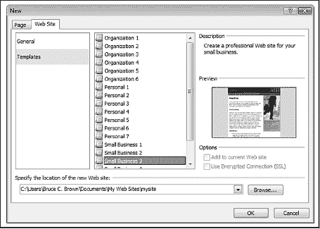

下方的网站使用`Expression Web`在大约 10 秒内创建完成，并已准备好进行自定义。`Expression Web`创建一个主模板，保护每个页面的公共区域不被编辑。这让你能够在一个主模板中创建导航、标题和标志，并通过鼠标点击将它们复制到所有页面中。你只需要创建实际的页面内容和图像。

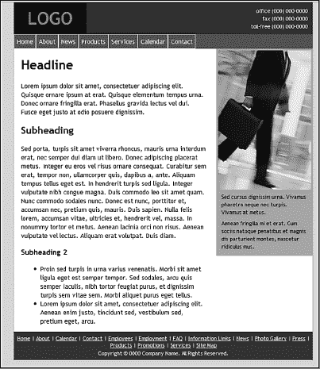

下面的示例说明了该网页的 `HTML` 代码。高亮区域受你的主模板保护，其余部分是可以编辑和修改的区域：

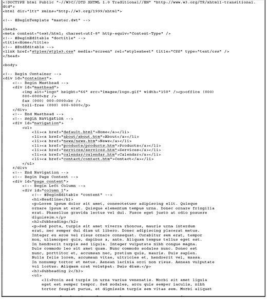

## 层级样式表指南

这份全面的指南应该为你提供知识、工具和理解，以便在你的网站中成功实现 `CSS`。此部分作为一个方便的参考提供，但 `CSS` 是一个难以理解的概念。`CSS` 使用字体、背景和颜色等样式来操纵网页的格式或呈现。学习如何在你的 `Web` 设计应用程序中管理 `CSS`，比尝试手动创建自定义 `CSS` 要好得多。

样式表类型中最常见的是外部样式表，它赋予你节省大量工作的能力并让你的样式更加灵活。`CSS` 和 `HTML` 之间的区别是什么？

*   `HTML` 被设计为通用语言和 `Web` 的基础。通过使用超链接，你可以连接几个或多个页面组成网站。`HTML` 用于结构化文本和多媒体文档，并在文档之间建立超链接。

*   `CSS` 包含额外的代码来指定或格式化字体、图像、位置和颜色等样式元素。

## 样式表在网页中的

`CSS` 仅仅是一种使用样式控制页面格式的简单编码程序；你可以使用 `CSS` 为你的网站创建、格式化和设计提供许多选择。`CSS` 可用于：

*   **着色**：例如字体颜色和背景颜色。高质量的 `CSS` 编辑器为你提供许多颜色选择。

*   **定位**：例如根据你的喜好定位图像、文本和 `HTML` 标签。`CSS` 定位元素是网页格式化的强大工具，因为你可以在任何地方放置任何内容。

*   **尺寸**：例如字体和图像尺寸，具有维度、宽度和高度等属性。

## 样式表的优缺点

`Web` 设计领域正在迅速发生巨大的变化，`Web` 开发者也面临着许多期望和需求。`CSS` 的流行对 `Web` 开发和设计行业产生了巨大影响。以下是 `CSS` 的优势列表。

### 优势

- **可访问性**：`CSS` 能够针对不同的目标设备（如手机）定制网页或网站。如果设备无法识别样式，它仍然会显示内容。

- **带宽/速度**：样式表通常会存储在浏览器缓存中，因此当你加载包含多个页面的网站时（例如），它们不会被重复加载。这减少了网络上的数据传输并加快了下载速度。

- **一致性**：由于样式可以从另一个样式“级联”，并可以被另一个样式访问或继承，这允许根据设计者和用户的声明来保持样式的一致性和等性。例如，如果你创建了一个结构良好的基于 `CSS` 的网站，但需要更改其结构和格式，那么你不需要编辑每个页面，只需要编辑你创建的全局样式表，它将更新你网站的每一个页面。

- **等效性**：当你处理多个 `Web` 页面并希望它们具有相同的样式和格式时，可以为这些页面创建一个样式表。

- **灵活性**：`CSS` 赋予了你对网站整体外观和感受的巨大控制力。你可以轻松地更改 `CSS` 模板并快速更改你的网站。

尽管使用 `CSS` 有许多优势，但它也有一些缺点。

### 缺点

- **浏览器兼容性**：由于浏览器类型的多样化，可能会出现许多浏览器 `Bug`。由于不兼容问题，网站所有者被迫使用 `CSS` “黑魔法”（hacks）来为他们的网页实现正确的布局。常用的浏览器对像素的识别也存在差异。

- **列声明的局限性**：使用当前的 `CSS` 处理多列布局可能会复杂。浮动元素在不同的浏览器以及不同的屏幕形状或分辨率下的渲染效果往往不同。

- **控制形状元素**：`CSS` 目前仅支持矩形。但圆角或圆弧形呢？这些形状需要非语义化标记来满足形状要求。

- **具有多个背景的元素**：开发者目前必须在文档元素周围放置冗余的包装器或直接放弃视觉效果之间做出选择，因为图形设计每个元素都需要多个背景图像。`CSS` 只能支持一个。

- **不灵活的布局**：`CSS` 是一种样式工具，而不是布局工具语言。

- **垂直控制的局限性**：在 `CSS` 中控制水平元素的位置通常很容易，但垂直元素的位置情况并非如此。例如，将元素垂直居中或将页脚放置在低于视图底部的位置并不是一项简单的任务。这需要复杂且不直观的样式规则，或者是低要求但大量未经证实的规则。

- **缺少变量**：`CSS` 缺少变量使得在想要更改常量（如尺寸和颜色方案）时，进行“全部替换”变得至关重要。

## 级联样式表的语法

语法是在创建 `CSS` 标签或任何其他编程语言时遵循的结构规则。`CSS` 语法由三个元素组成：

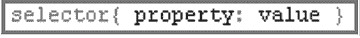

- **选择器（Selector）**：选择 `HTML` 标签内你想要样化的标签或元素。

- **属性（Property）**：你想在选择器中更改的元素。

- **值（Value）**：定义属性的更改。

**注意**：属性和值之间用分号隔开，表示属性有一个值。属性和值用大括号（或花括号）括起来。

**多个声明**：在一个属性内声明多个值可以如下所示：

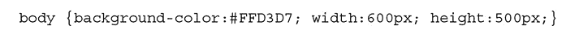

**注意**：每个声明的值之间都用分号隔开，表示你在一个属性中声明了多个值。

还有一种方法可以让你的代码更易于理解，特别是在创建多个声明时。以下是代码：

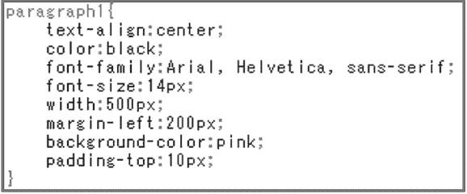

**分组选择器**：你可以使用分组选择器在一个声明中对一组选择器进行样式化。以下是代码：

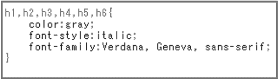

一旦应用了分组选择器，它将影响组内声明的所有选择器。在上面的示例中，`h1`、`h2`、`h3`、`h4`、`h5` 和 `h6` 选择器将影响所有属性。文本颜色将变为灰色，字体样式将变为斜体，字体族将是`Verdana, Geneva™, and sans-serif`。逗号用于在一个声明中声明一组选择器。

## 在网页中调用级联样式表

你可能在想如何在网页中实现 `CSS`。在 `HTML` 页面中调用 `CSS` 有多种方法，包括内联、内部或外部。

### 内联 CSS

内联 `CSS` 使用在 `HTML` 标签选择器行内；例如，如果你想为句子中的颜色设置样式，可以使用内联。以下是代码结构：

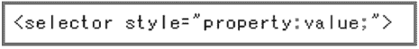

这是一个示例代码：

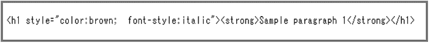

**注意**：内联 `CSS` 只会影响你应用选择器的那行。

### 嵌入式类型

样式表放置在 `<head>` 中。以下是代码结构：

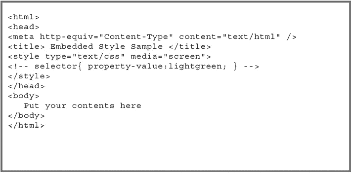

这是一个真实的示例代码：

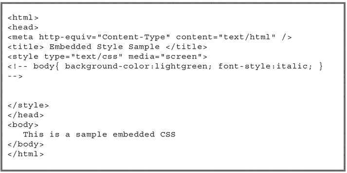

### 外部类型

这种类型的 `CSS` 调用是通过创建一个文件并在 `HTML` 中调用它来实现的。以下是输出：


不要忘记在调用它之前需要先创建一个 `CSS` 文件。

## 如何创建级联样式表

本节将说明使用文本编辑器创建 `CSS` 的逐步过程。文本编辑器是一种用于编辑纯文本的程序。

使用软件编辑器：安装你想要使用的软件编辑器。以下示例使用了 `Dreamweaver CS3`。

1. 点击电脑左下角的“开始”按钮。

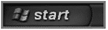

2. 点击“程序”并选择 `Adobe Dreamweaver CS3`。见下插图：

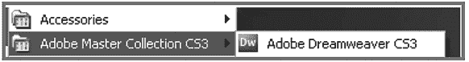

**注意**：你也可以在桌面上创建一个快捷方式，以便更方便地启动应用程序。

3. 打开 `Dreamweaver CS3`。它如下所示：

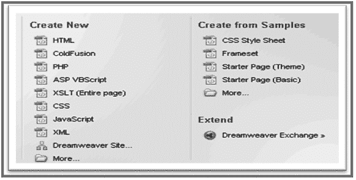

4. 选择 `CSS` 创建新的 `CSS` 文件，或者你可以通过进入“文件”并点击“新建”来创建新的 `CSS`。见插图：

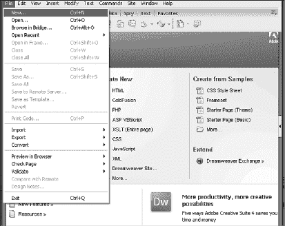

当你打开文件时，它看起来将如插图所示。现在可以开始编写标记代码了：

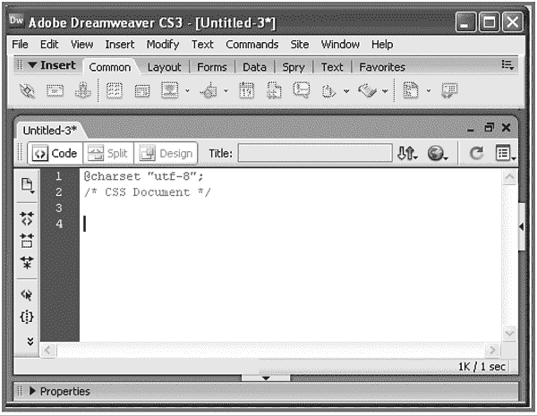

浏览器通过 `HTML` 文件中指定的 `CSS` 来决定格式化 `Web` 页面设计时使用什么样式。有三种方法调用 `CSS` 用于 `Web` 页面。

## 内联样式类型（Inline Style）

内联样式添加到特定的 `HTML` 标签上。其格式为 `<tag style="…">` 。这种样式处理与使用的标签相关的任何 `CSS` 属性。它被添加到每一个你想要样式的标签上。使用内联样式时，你需要在你使用的默认样式表语言的 `<head>…</head>` 标签内添加以下标签：

`<META HTTP-EQUIV="Content-Style-Type" CONTENT="text/css">`

此标签决定了你为页面使用的样式类型。

语法：`<tag style="property:value; ">`

### 内联 CSS 的优点

- 内联 `CSS` 易于根据需要添加到 `HTML` 元素中。它最大限度地减少了在其他声明的 `CSS` 上添加另一种样式的情况。你可以快速将其添加到 `HTML` 标签中。

- 当元素只有少数属性时，内联样式表非常有用，例如你想让段落中的某个单词的颜色与其余部分不同。

### 内联 CSS 的缺点

- 一旦在标签上声明，内联样式将覆盖其他 `CSS`。

- 因为内联样式被添加到每个标签上，所以当你想要更改样式时，你需要遍历整个文档并手动更改所需的属性。

- 如果你想为一个元素提供更多样式，你的样式代码将变得非常长，可能会让你感到困惑。

- 如果页面使用许多样式，可能会由于过度读取样式导致加载缓慢。对于编码人员来说，维护或修改样式也是耗时的。

- 你需要为拥有的每一个链接设置样式。

查看下面的示例可以更好地了解内联 `CSS` 的样子：

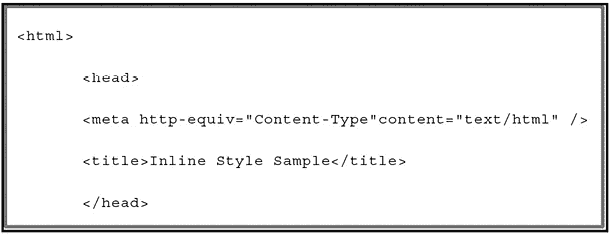

## 嵌入式样式类型（Embedded Style）

嵌入式样式也称为内部标签样式。这种类型的 `CSS` 设置在 `HTML` 的 `<head>…</head>` 标签中。这种样式存在于它使用的每个页面。嵌入式样式表仅覆盖该文档链接的 `CSS` 中声明的样式。

语法：

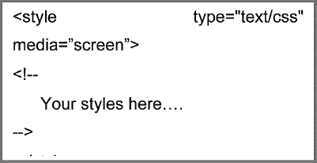

- `TYPE`：决定内容样式语言。

- `MEDIA`：决定哪些媒体将使用此 `CSS`。

这是一个示例：

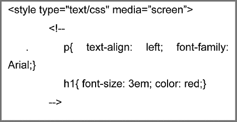

你可以看到在标签`<!-- … -->`内部声明了样式的属性和值。这里是第一行示例的分解：

```css
p { text-align: left; font-family: Arial;}
```

- `p` 是选择器。

- `text-align` 是样式的属性。

- `left` 是决定使用什么样式的值。

注意，大括号`{}`保存了样式的属性和值。这些括号将特定选择器或标签中声明的样式分组。

注意：嵌入式样式写在 `HTML` 注释`<!-- … -->`标签内部。这是为了防止当某些浏览器不支持样式时显示内容。

### 嵌入式 CSS 的优点

- 嵌入式样式允许你只修改文档的一个部分，因为样式堆积在 `<head>…</head>` 标签中。

- 你可以声明哪些媒体将使用特定的 `CSS`。

### 嵌入式 CSS 的缺点

- 与内联 `CSS` 类似，如果过度使用样式，会导致 `HTML` 加载变慢，且页面文件很大。

- 使用嵌入式样式可能会让你的代码源变成一个长文档。

- 它最小化了 `SEO`。`Google` 或 `Yahoo!` 等搜索引擎可以轻松访问文件大小较小的网站。

- 想要整洁 `HTML` 源代码的编码人员维护这样的 `Web` 页面将很困难，因为确定元素正在使用哪种样式需要时间。

这里是使用嵌入式 `CSS` 的示例：

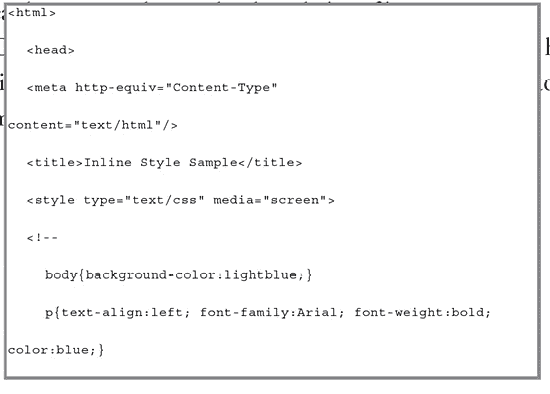

这是输出：

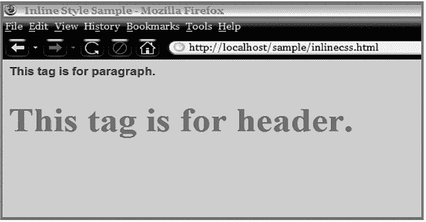

注意：当你在 `CSS` 中未指定`font-family`属性时，浏览器将使用其默认字体设置。

## 外部样式类型（External Style）

外部或链接类型的 `CSS` 在扩展名为`.CSS`的独立文档中完成。这种类型的 `CSS` 在 `HTML` 文件中链接，以确定页面将使用哪个 `CSS` 文件。要在 `HTML` 代码中调用此外部 `CSS`，你需要在 `<head>…</head>` 标签内使用 `<link>` 标签而不是 `<style>` 标签。这引用了位于独立文件中的 `CSS`。

这种类型的 `CSS` 是开发网站最常用且最推荐的类型。

- 使用外部 `CSS` 允许 `Web` 开发者将 `HTML` 代码与 `CSS` 样式分离。这便于文件管理。

- 外部 `CSS` 中的样式可以通过链接文件被不同的 `Web` 页面使用。你可以通过自定义一个文件来控制设计相似的页面样式。

- 将 `CSS` 与 `HTML` 代码分离有助于浏览器更快显示 `Web` 页面。浏览器下载几个小文件，而不是一个大文件。

- 搜索引擎更容易定位你的网站，因为 `HTML` 文件中的内容较少。

- 外部 `CSS` 使用更有组织且更整洁的 `CSS` 声明。

语法：这是如何调用外部 `CSS`：

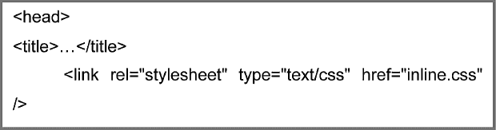

- `<link>` 用于嵌入或调用你的 `CSS` 文件。

- `rel` 告诉浏览器 `CSS` 已链接。

- `type` 告诉浏览器将使用什么类型的文件。

- `href` 定位你的 `CSS` 文件存储位置。

查看此使用外部 `CSS` 的示例：


正如你在图中看到的，`HTML` 调用`.css`作为其它将使用的样式表。下面的图片显示了外部 `CSS` 的：


使用外部 `CSS` 并不困难，因为编码与嵌入式样式相似；只是保存在不同的文件中。这种类型的文件没有使用标签。你可以在文件夹中组织 `HTML` 和 `CSS`。


注意：当你在外部 `CSS` 中进行更改，链接到文件的页面都会受到影响。如果你想其他页面有不同的设计，可以添加更多外部 `CSS` 代码。仅编码选择器、属性值。

## 导入样式类型（Import Style）

导入 `CSS` 与外部和嵌入式样式有些相似，在这种情况下，你将外部 `CSS` 引入 `HTML` 文件并添加一些规则。

如果你导入两个或多个 `CSS` 文件，浏览器遵循的样式顺序将根据 `@import` 规则声明的顺序。这里是导入 `CSS` 的示例：


注意：`@import` 规则必须在声明任何其他 `CSS` 属性之前。你也可以为想要包含的媒体类型导入样式表。只需在`url("…")`之后添加浏览器支持的有效媒体，如示例所示：


## 级联样式表选择器（CSS Selectors）

此语法的主要组件之一是选择器。它用于确定要对 `Web` 页面的哪个部分进行样式处理。通常 `HTML` 标签是选择器。后续章节将提供 `CSS` 中选择器类型的概述。

### 类选择器（Class Selector）

假设你正在处理不同的 `Web` 页面，并希望你的标题具有类似的格式。例如，你可能希望标题比普通文本大，并且是加粗格式。你不想在每个 `Web` 页面的每个标题标签中重复属性和值。

类选择器可以帮助你为不同页面上的相似元素定义样式。你所做的就是在每当需要为元素使用时，调用特定的类名，无论它位于文档的哪个部分。

声明类是通过使用点（`.`）加上类名来实现的。你可以为特定元素赋予任何想要的类名。


### 语法


这里是使用类的简单插图：


当你想在 `HTML` 元素上调用此类时，操作方法如下：

```html
<h1 class="mystyle"> 这个标题使用了类选择器。 </h1>
```

这会调用你在 `CSS` 中声明的类名。

如果你想在一个元素中添加另一个类名，可以像这样操作：


以下是在 `HTML` 中调用多个类的示例：


**注意**：如果你有多个类，在`class="…"`属性中定义的类名之间必须用空格隔开，以告诉浏览器该元素使用了多个样式。

### 后代选择器

在某些情况下，类的使用会被过度，例如在处理 `<div>` 元素时。这里有一个示例来说明这种不必要的代码：


观察这个结构，你可以立即看出每个元素都有它们自己的类名。但如果你像上面那样在同一个结构中添加更多元素，在代码中反复寻找并重复这些行将会非常困惑。

网页遵循层级结构。这从 `HTML` 开始，然后移动到包含 `body` 内部其他元素的结构。下面的图片说明了一个层级结构的示例：


此插图中的 `div` 容器包含或处理两个元素：`h1` 和 `p`。在这个示例中，`body` 包含一个 `div` 容器，该容器拥有 `h1` 和 `p` 作为后代。


后代选择器定义了某个主元素的后代，其中其他子元素被考虑在内。这种选择器有助于减少元素中类的使用。它被大多数现代浏览器支持。为了让你了解此选择器的工作原理，这里有一个示例说明它与上一个样本的区别：

 

以下是样式表的示例代码：

 

代码简单得多。现在没有必要为每个元素分配类名。你可以为`<div class="maincontainer">`标签下的所有内容设置公共属性，并为标签未指定的其他内容定义唯一样式。

## ID 选择器

ID 选择器也用于`HTML`元素中。这种选择器是页面上的唯一标识符。与类不同，ID 选择器仅应用于你代码中的一个元素。这被用于单独格式化少数不应在任何其他内容重复的元素。使用此标签，你的代码中将不会有两个属性具有相同的样式名称。

要在元素上指示此选择器，你将使用`id="id_name"`作为属性。在你的样式表中，它用井号（`#`）表示。这种选择器用于特定的元素，例如表单上的文本框。与类选择器一样，你将 ID 名称分配给选择器。

### 语法

 

这里是使用 ID 选择器的之前的示例：

 

这里是 CSS 代码：

 

如代码所示，`maincontainer`属性在 CSS 中通过`#`标识为 ID 选择器。此 ID 在文档中是唯一的；它不能被其他`div`元素再次调用。

看看这个示例：

 

这是该代码的 CSS 属性：

 

## 类选择器与 ID 选择器之间的区别

在继续下一个选择器之前，你应该意识到类选择器和 ID 选择器之间的区别，因为这两者在元素中经常被使用。如果你知道这些差异，你就不会在使用样式时感到困惑：

- 语法不同。对于类，你使用点（`.`），而 ID 使用井号（`#`）符号。
- 当你希望样式在页面内重复多次时，使用类。ID 用于调用一种在页面任何元素上均不重复的唯一样式。ID 在页面上仅应用一次。
- 在元素中使用多个类是可能的，例如在你的`h1`元素上使用`.style1` `.style2` `.style3`。但 ID 不能声明多个 ID；只能声明一个 ID 名称。
- ID 可以被特殊选择器调用。

## 类选择器与 ID 选择器的相似之处

尽管有上述差异，ID 和类具有一些相似之处：

- 类和 ID 都是大小敏感的。
- 类和 ID 对于设计页面都至关重要。
- 两者都有属性和值。

## 通用选择器

通用选择器可以用于页面的任何地方，任何元素都可以调用它们。它由星号（`*`）表示。这里是此选择器如何工作的示例：

 

这定义了所有页面的字体和颜色。

## 分组选择器

在某些情况下，你可能想要一组选择器设置相同的属性。你可以通过在每个定义的选择器之间添加逗号（`,`）来实现。

 

这定义了声明的选择器或元素的外边距为 0，内边距为 0。

## 层叠样式表注释

CSS 注释有助于找到特定元素样式的位置。通过使用 CSS 注释，你可以解释你的代码，以便其他 Web 开发人员在需要修改页面设计时轻松找到你的样式。

## 属性

### 背景颜色

`[background-color: value;]`

描述：此属性允许你设置所需的背景颜色。有多种方式可以表示你的颜色。它们可以是十六进制、RGB 或单词值。互联网上也有很多好用的颜色混合器。

- **十六进制颜色**：这些是根据 RGB 颜色模型中的混合比例定义的颜色。这些值范围从 0 到 F。

  示例：`#ffffff`、`#000000`、`#fafad2`

- **RGB**：红、绿、蓝。这是计算机用于采集图像并在显示器上显示的原生色彩空间。值范围从 0 到 255。

  示例：`234, 192, 255`

- **单词值**：这些是用单词表述的颜色。某些浏览器会将此值视为错误。然而，对于初学者来说，使用这些值来尝试不同的样式并发现浏览器接受哪些单词值是有帮助的。

查看这些示例：

```html
<h1 style="background-color: #fafad2; ">应用背景颜色</h1>
<h1 style="background-color: rgb(255,255,255); ">应用背景颜色</h1>
<h1 style="background-color: green; ">应用背景颜色</h1>
```

### 背景图像

`[background-image: url('location of image');]`

描述：这允许你使用图像作为布局的背景。如果你有一个想要作为背景的渐变图像，你可以自由地设计中对其进行样式处理。也可以添加静态固定的背景图像，或者随页面向下滚动而滚动的背景。

以下是代码：


以下是输出结果：


### 背景重复

`[background-repeat: value;]`

描述：这将使背景在屏幕上重复。

以下是你可以赋值执行此操作的值：

- `repeat-x`：水平方向上重复背景。
- `repeat-y`：在垂直方向上重复背景。
- `repeat`：在水平和垂直方向上均重复背景。
- `no-repeat`：不重复背景。


以下是输出结果：


注意：你的背景将垂直重复，直到你的高度达到其跨度。

### 背景位置

`[background-position: value;]`

描述：这设置你希望背景出现的位置。默认情况下，背景位于屏幕的左上角。你可以使用百分比（`%`）、单位（例如`cm`和`px`）以及单词`top`、`bottom`、`right`和`left`。

以下是代码：


以下是输出结果：


### 背景

`[background: url('location') other property values;]`

描述：与其他元素一样，你也可以使用简写属性来声明背景。这可以在单行内编译多个属性，从而缩短你的 CSS 代码。例如：

```css
div#container{
  width: 500px;
  background: url('image1.jpg') no-repeat fixed left top;
}
```

## 自定义字体

`<font>`

描述：`<font>`属性是一个用于更改文本外观的元素。它还允许你选择想要使用的对应字体。

这些是`<list-style>`下的潜在值，我们将在本章稍后讨论：

- `font-family`：此属性用于更改字体字体。
- `font-style`：此属性用于使字体变为斜体或倾斜。
- `font-variant`：此属性用于创建小型大写字母效果。
- `font-weight`：此属性用于增加或减少字体的粗细或细细。
- `font-size`：此属性用于增加或减小字体的大小。
- `font`：此属性用作简写指定多个其他字体属性。

为了更好地理解`<font>`属性，请查看以下示例：

## 属性

### 字体族

`[font-family: value;]`

描述：这将设置元素的字体族。可能的值是任何字体族名称。

以下是代码：


以下是输出结果：


### 字体样式

`[font-style: value;]`

描述：这设置元素的字体样式。可能的值有`<normal>`、`<italic>`和`<oblique>`。

以下是代码：


以下是输出结果：


### 字体变体

`[font-variant: value;]`

描述：这将设置元素的字体变体。可能的值有`<normal>`和`<small-caps>`。

以下是代码：


### 字体粗细

`[font-weight: value;]`

描述：此属性设置字体的粗细。可能的值有`normal`、`lighter`。

### 字体大小

`[font-size: value;]`

描述：此属性设置字体的大小。可能的值有像素、百分比（`%`）、`small`、`medium`、`large`。

以下是代码：


以下是输出结果：


## 文本格式与样式

有很多方法可以设置文本。

### 文本缩进

`[text-indent: value;]`

描述：这允许对段落、句子或单词进行缩进。你也可以分配负值。文本的第一行将缩进。

使用此内容的示例：


### 文本对齐

`[text-align: value;]`

描述：这设置文本的对齐方式。以下是`<text-align>`的潜在值：

- `left`：这是浏览器的默认值。将你的文本左对齐。
- `right`：将你的文本右对齐。
- `center`：将你的文本居中。
- `justify`：使你的文本行对齐，使左右边距变直。

以下是代码：


这是其工作的插图：


### 文本装饰

`[text-decoration: value;]`

描述：此属性允许你为文本添加装饰或效果。以下是`<text-decoration>`的潜在值：

- `none`：文本将保持正常。如果包含在元素上，它不会遵循装饰。
- `underline`：在文本下方添加实线。
- `overline`：在文本上方添加实线。
- `line-through`：在文本中间穿过实线。这类似于 Word 文档中的删除线。
- `blink`：使文本闪烁。此值在 IE 中不起作用。

这是一个示例代码：


显示文本装饰样式的插图：


### 文本间距

`[letter-spacing: value;]`

描述：此值定义了字母或文本字符之间的间距。

以下是代码：


浏览器的输出：


## 边框与轮廓

### 边框

边框属性定义元素边框的厚度、颜色和样式。边框通常用于表格和容器。你可以为上、右、下、左设置边框属性。

## 属性

### 边框颜色

`[border-color: value;]`

描述：允许你设置所需的边框颜色。

以下是`<border-color>`下的值：

- 红、黄、绿等单词
- RGB
- 十六进制；这种颜色代码是最建议的格式，因为大多数浏览器都可以解析十六进制

 

 

这里是这两个示例的输出：

 

### 边框宽度 (Border width)

描述：用于设置边框的宽度。你可以定义边框的厚薄。你可以使用`px`、`pt`、`cm`、`thin`、`medium`和`thick`来赋值。

以下是代码：

 

以下是输出：

 

### 边框样式 (Border style)

描述：你有八种不同的边框样式可以选择，可以在容器周围添加简单的设计。

#### 可能的值

- 实线边框 (SOLID BORDER): `border-style: solid;`

 

- 点线边框 (DOTTED BORDER): `border-style: dotted;`

 

- 虚线边框 (DASHED BORDER): `border-style: dashed;`

 

- 双线边框 (DOUBLE BORDER): `border-style: double;`

 

- 凹槽边框 (GROOVE BORDER): `border-style: groove;`

 

- 凸脊边框 (RIDGE BORDER): `border-style: ridge;`

 

- 内嵌边框 (IN BORDER): `border-style: inset;`

 

- 凸出边框 (OUTSET BORDER): `border-style: outset;`

 

### 边框属性 (Border property)

描述：这是一个简写属性，帮助你用更简洁的方式定义边框值。该属性在单行内编译了上面讨论的三个属性。

以下是代码：

 

### 轮廓 (Outlines)

`outline`属性与`border`属性不同的属性。它用于在元素周围绘制线条以突出显示。这些线条绘制在边框边缘之外。`outline`也有一个简写属性。轮廓通常用于按钮、激活表单字段和图像映射等视觉对象。它们也经常用于突出搜索词。以下是轮廓和边框之间的区别：

- 轮廓不占用空间。轮廓不影响元素的大小和位置。
- 轮廓不一定要是矩形的。当元素分成几行时，边框会留出边缘，而轮廓会关闭行的末尾，然后在下一行重新打开。
- 轮廓属性在所有侧设置都是相同的，这意味着宽度、样式和颜色的值在所有侧应该是相同的。

#### 属性 (PROPERTIES)

- 轮廓颜色 (OUTLINE COLOR): `outline-color: value;`

描述：这定义了轮廓的颜色。一个元素的轮廓颜色设置为一个值。

- 轮廓宽度 (OUTLINE WIDTH): `outline-width: value;`

描述：这定义了轮廓的宽度。轮廓宽度在所有侧都是相同的；即使你在不同侧声明了不同的宽度，浏览器仍然解释为轮廓宽度在所有侧都是相同的。

- 轮廓样式 (OUTLINE STYLE): `outline-style: value;`

描述：轮廓样式与`border`属性相同。

  - `none`: 将轮廓设置为 0，或完全没有轮廓。
  - `hidden`: 隐藏轮廓。这与`none`值相似。
  - `solid`: 设置单条实线。
  - `dotted`: 设置点状轮廓。
  - `dashed`: 设置虚线轮廓。
  - `double`: 设置两条实线的轮廓。
  - `groove`: 设置一个看起来像在页面上刻出来的轮廓。
  - `ridge`: 这种轮廓看起来像是页面上的反向刻痕。
  - `inset`: 这种轮廓看起来像是嵌入页面的。
  - `outset`: 这种轮廓看起来是从元素中出来的。

这里是一个使用`outline`属性的示例：

 

此代码产生下面的输出：

 

## 控制外边距和内边距 (Controlling Margins and Paddings)

外边距（Margins）和内边距（Paddings）用于定义元素的空白区域，无论是另一个元素顶部、底部、左侧或右侧的空白。外边距和内边距是具有不同空间功能的 CSS 属性。

随着课程的进行，你将学习外边距和内边距是如何工作的以及它们之间的区别。

### 外边距 (Margins)

外边距在元素边框周围设置空白。这些是边框之外，或者具有`margin`属性的元素与其附近元素之间的空白。你也可以为此属性设置负值以重叠内容。

#### 属性 (PROPERTIES)

```
selector{ margin: value; }
```

描述：这在元素边框周围设置空白。这些是边框之外，或者具有`margin`属性的元素与其附近元素之间的空白。 

```
selector{ margin: value; }
```

描述：这在四个侧设置外边距。

```
selector{ margin: value; }
```

描述：这在四个侧设置外边距。

以下是代码：

 


```css
selector{ margin-top: value; }
```

描述：设置元素顶部的外边距。

以下是代码：


```css
selector{ margin-bottom: value; }
```

描述：设置元素底部的外边距。

以下是代码：


```css
selector{ margin-left: value; }
```

描述：设置元素左侧的外边距。

以下是代码：


```css
selector{ margin-right: value; }
```

描述：设置元素右侧的外边距。

## 内边距（Paddings）

内边距和外边距一样，用于定义元素之间的空白。内边距与外边距的区别在于，它们在元素边框和内容之间插入空白。这被称为“填充”。内边距可以位于元素的顶部、右侧、底部和左侧。外边距影响元素之间的距离，而内边距影响元素边界与其内容之间的距离。

### 属性（PROPERTIES）

```css
selector{ padding: value; }
```

描述：在顶部、底部、左侧和右设置内边距。所有侧的内边距将相等。

以下是代码：


```css
selector{ padding: t r b l; }
```

描述：以更简单的方式设置每个侧的内边距。这也是内边距简写属性。侧的顺序从顶部顺时针开始。

```css
selector{ padding-top: value; }
```

描述：设置元素顶部的内边距。

```css
selector{ padding-bottom: value; }
```

描述：设置元素底部的内边距。

```css
selector{ padding-left: value; }
```

描述：设置元素左侧的内边距。

```css
selector{ padding-right: value; }
```

描述：设置元素右侧的内边距。

## 说明

`list-style` 属性是一个简写属性，用于设置列表标记的位置和类型；它也可以用于将图像作为标记。

以下是 `list-style` 下的可能值：

- `list-style-type`
- `list-style-position`
- `list-style-image`

为了让你更好地理解 `list-style` 属性，这里有几个示例：


### 列表图像（List Image）

说明：`list-style-image` 属性定义了一个指向图像资源的指针，该资源将作为列表项的标记。

以下是 `list-style-image` 下的可能值：

- `URI`：统一资源标识符作为图像资源的指针。如果无法解析 `URL`，则该属性被处理为值 `none`。
- `none`：不使用图像作为元素的标记。

以下是一些示例：

代码如下：

```markdown

```

输出如下：


注意，在这个示例中，使用了无序列表 `<ul>`，它并将图像 `arrow.gif` 作为列表指示符。下面你可以看到它在有序列表 `<ol>` 中的效果。

代码如下：

```markdown

```

输出如下：


### 列表位置（List Position）

说明：`list-style-position` 属性影响标记相对于列表项内容的放置位置。

以下是 `list-style-position` 下的可能值：

- `inside`：将标记变为列表项内容第一行开头的内联元素。
- `outside`：将标记放置在包含列表项内容的框之外。

以下示例使用了 `circle` 和 `square` 类型的无序列表，并使用了 `<list-style-position: outside>` 和 `<list-style-position: inside>`。

代码如下：

```markdown

```

输出如下：


## 表格样式（Table Styling）

### 边框合并（Border Collapse）

说明：`border-collapse` 属性决定了渲染表格时使用的边框模型。

以下是 `border-collapse` 下的可能值：

- `collapse`：边框合并为单个边框。两个相邻单元格将共享一个边框。
- `separate`：边框分离。每个单元格都有自己的边框，这些边框都没有与表格中的其他单元格共享。

查看以下 `border-collapse` 属性的示例。

代码如下：

```markdown

```

输出如下：


### 表格布局（Table Layout）

说明：`table-layout` 属性决定了渲染表格时使用的布局方法。

以下是 `table-layout` 下的可能值：

- `auto`：表格应该根据某些自动布局算法进行布局。浏览器会自动执行。
- `fixed`：表格应该根据提供的固定表格布局方法进行布局。

示例代码如下：

```markdown

```

输出如下：


## 级联样式表（Cascading Style Sheets）

### 验证（Validation）

验证可以被视为针对代码错误的标记版本的拼写检查。你的标记代码应该符合特定的 Web 标准。验证是防止错误的一种防御机制。如果你对你的网站代码进行验证，你就可以始终确定网站上可能出现的任何问题或错误不是因为你忘记了闭合标签（例如）。这使得定位错误和执行测试变得更加，从而为你留出更多时间处理实际设计。验证最重要的原因是确保你的 Web 页面能够正常显示并针对搜索引擎进行优化。

你可以通过以下三个简单的步骤进行验证：

- 访问 `http://jigsaw.w3.org/css-validator`。
- 将你的 Web 地址或 `URI` 放入白色空白框中。
- 点击“Check”按钮；你将看到你的标记代码中是否存在某些错误。

以下是网站的插图：

```markdown

```

以下是输出的示例：


目录：


# 第 9 章：电子商务与购物篮

随着你的网站或公司的增长，你可能会发现自己正在寻找简化业务活动的方法。在某些时刻，业务的扩张将取决于你对各种流程的自动化程度。第一步之一就是你对各种流程的自动化程度如何。电子商务是电子业务的一个子集，通过它处理交易。

电子商务的三大类是：

- 企业对企业（B2B）：例如制造商向分销商销售产品，分销商再销售给零售商。
- 企业对消费者（B2C）：通过目录向普通大众销售产品的企业。
- 消费者对消费者（C2C）：个人通过 `PayPal` 和 `eBay®` 等系统在线进行买卖。

开设商户账户相对容易，但这并不总是适用于你的业务需求。你必须确定商户账户是否适合你的网站业务。根据你业务的规模和类型，设置和运行 `SSL` 证书可能过于昂贵且不符合成本效益。你应该权衡拥有商户账户与通过 `PayPal` 等第三方支付处理程序进行交易的优缺点，`PayPal` 拥有它自己的商户账户和支付网关。

第三方支付处理程序允许个人和公司在无需注册自己的商户账户的情况下处理交易，而且几乎任何人都可以注册使用这些处理器。这些是第三方流程的明确优势。主要的缺点是，第三方处理公司通过从你公司处理的每笔交易中抽成，侵占了你的利润。随着销售额的增加，商户账户可能会变得更具成本效益。

## 真正的商户账户

拥有真正的商户账户要求必须是一个业务实体；你无法以个人身份获得真正的商户账户。作为所有者，你仅需个人负责监控账户。直接与 `Visa®` 和 `MasterCard®` 等处理商建立自己的商户账户的一个主要优势是，你可以完全控制销售额的处理方式。你可以处理大量的销售，并通过应用程序接口（`API`）在在线结账页面添加自己的个人特色。你还可以在客户的购买账单上建立专业且个性化的外观和形象。如果操作得当，拥有商户账户是营销业务的良好方式。商户账户允许你在与购买网站设计服务以及你决定向客户提供的任何其他产品或服务相关的多数文件和页面上放置你的公司名称——通常只放你的名字。

当一家公司拥有真正的商户账户时，他们还可以使用独立的处理网关。你可以控制谈判自己的购买费率，并为每笔销售建立独特的协议。获得自己的商户账户的一个主要缺点（特别是对于个人和许多小企业主来说）是信用检查。所有真正的商户账户都要求申请人接受信用检查。由于信用检查很可能会针对业务实体进行，任何业务量较小或信用记录不良的业务（这在小企业中更为常见）都可能无法获得账户。真正的商户账户不供个人使用。高风险业务（通常由信用检查识别为此类）会被收取更高的率。

根据业务的背景和财务状况，有些业务在账户获得批准之前还需要签署多年合同。由于合同元素的存在，如果你决定尝试，真正的商户账户是你必须接受的业务决策之一。虽然许多企业从拥有商户账户中获益，且许多企业需要真正的商户账户来充分利用在线销售的价值，但在获取之前，请确保它适合你的情况。许多业务起初使用第三方处理器，这是非常合适的。然而，当销售额达到一定程度时，转为商户账户将是有意义的。

## 成本与自动化

真正的商户账户非常适合需要处理大量交易的大销售量业务。与第三方提供商相比，真正的商户账户确实有一些额外费用。但总而言之，大交易商户使用真正的商户账户支付的费用更少。由于有大量交易处理，商户在维护自己的账户时可以获得良好的折扣率。第三方提供者的折扣率可能高达每笔交易的 `6%`，并且在大多数情况下还会额外收取 `$1` 的交易手续费。真正的商户账户提供的费率低于大多数第三方提供者价格的一半。随着商户交易量的增加，他们通过拥有自己的真正的商户账户所节省的资金也会随之增加。

当你考虑业务流程自动化时，请重点关注定义流程、协调所需的活动以及促进必要的交易。如果你能妥善地整合业务的各个方面，那么你的业务中哪些部分可以自动化、哪些部分必须由自己处理将变得清晰。所有的在线支付都将商户账户和支付网关作为核心元素。使用 `PayPal` 这样的第三方提供者还是使用商户设施并不重要；必须使用网关来接受互联网支付。这些组件将始终以某种方式存在。

## PayPal 集成

`PayPal` 是一种特殊的账户，可以从中扣款以支付商品和服务费用。要使用 `PayPal` 进行支付，个人必须已经拥有 `PayPal` 账户。出于安全考虑，`PayPal` 对个人在不验证账户详情（银行账户所有权、信用卡所有权，或美国公民和居民的社会安全号码）的情况下在线消费金额设有限制。但在大多数情况下，个人在购买之前已向其账户存入了资金。这意味着他们可以使用 `PayPal` 账户支付商品和服务。当卖家允许 `PayPal` 支付时，收款人只需披露其 `PayPal` 信息即可完成支付。在大多数情况下，这仅仅是登录信息的电子邮件地址和密码。`PayPal` 既是拥有 `PayPal` 账户客户的支付方式，也是一种第三方支付处理程序。它可以接受使用信用卡、借记卡、`eChecks` 和 `PayPal` 客户账户进行的支付。尽管许多人倾向于拥有个性化的支付网关（提供公司特定界面的网关），但 `PayPal` 是一个极其通用且合适的选择。

`PayPal` 的历史在决定其使用方式方面起着作用。`eBay` 用户使该系统作为支付媒介流行起来。买家可以存入资金然后消费。很长期以来，`PayPal` 是没有信用卡的人的唯一选择，它目前已作为一种独立的支付方式并获得广泛支持。这是该计划成功的衡量。即使是初级网站设计师也能轻松地将 `PayPal` 集成到他们的网站以接受信用卡支付。通过 `PayPal`，你不需要购买软件，不需要购买 `SSL` 证书，也不需要特殊的虚拟托管账户来支持电子商务。其他第三方支付处理程序包括 `2CheckOut (2CO)` 和 `Google Checkout`。这些是日益流行的支付处理方法。

## 安全考虑

为你的客户提供安全的购物或购买服务的方法至关重要。在线购物通常是人们在互联网上最感到害怕的部分，因为他们必须分享信用卡号或银行信息。根据联邦贸易委员会（FTC）网站 `www.ftc.gov/infosecurity`，你需要“盘点业务计算机或网站上的个人信息和文件、缩减存储的信息量、妥善处理不再需要的信息、保护你拥有的信息，并设计一个应对任何安全泄露的计划”。

任何良好的安全计划都必须从识别公司内部谁有权访问客户数据，并清晰了解这些信息是如何传输到你的公司或网站的开始。联邦贸易委员会（FTC）建议对所有计算机、笔记本电脑、闪盘、磁盘、家用电脑和档案柜进行盘点，以了解公司所有敏感数据存储在何处。在运营电子商务网站的情况下，你还需要确保你的主机服务器是安全的，因为当通过互联网连接进行交易时，你的数据实际上存储在那里。不仅是你的网站必须安全，你网站的每一个方面（包括主机服务器）都是如此。这也是阅读所有细则条款的原因，确保你的服务器能够为你的客户提供你所优质安全保护。

调查你计划用于托管电子商务网站的任何服务器的历史。弄清楚该系统是否发生过任何数据泄露，如果发生过，他们采取了哪些额外的安全措施来保护你的网站。FTC 还建议，根据你的内部运营情况，你可能希望让网站技术人员运行“现成安全软件，或聘请独立专业人士进行全面的安全审计”。

使用互联网销售产品或服务时，另一个重要因素是在向第三方发送客户个人信息、在你的计算机网络上存储任何信息、甚至在发送包含任何个人身份信息（PII）的电子邮件时使用加密。设置你的防病毒和反间谍软件每天在公司内部计算机上运行，并确保这些软件也运行在你的主机服务器上，同时配备良好的防火墙。当你访问电子商务网站并决定购买东西时，你可能会看到 `VeriSign Secured®` 认证或类似的标志，通常位于页面底部。


当你点击“选择”或“购买”按钮购买产品或服务后，会弹出一个对话框，显示你正在进入网站的安全区域。有时它会显示你正在同时进入安全和不安全的区域，你必须点击“确定”按钮以确认你已知这一点，然后进入你将提供信用卡号或银行信息的区域。你应该在浏览器中寻找“锁定”图标来验证你已进入安全会话，且 `URL` 应该从 `http://` 变为 `https://`。


FTC 表示，“特别关注你的 Web 应用程序的安全”极其重要，这意味着你用于向网站访问者提供信息和请求信息的软件。他们补充道：“Web 应用程序特别容易受到各种黑客攻击，其中一种变体被称为注入攻击，黑客将恶意命令插入看似合法的信息请求中。一旦进入你的系统，黑客就会敏感数据传输到他或她的计算机上，然后可以使用其进行身份盗用或欺诈交易。”

信息安全的另一个方面是还要知道资金或信用卡信息的来源，因为在某些情况下，这些信息可能是被盗的财产。根据 FTC 的说法，有相关的法律法规，如《格姆-莱奇-布莱利法案》、《公平信用报告法》和《FTC 法》，这些法律“可能要求你对所有敏感信息提供合理的安全措施”。你不应该向客户索取绝对必要以上的信息，并尽快销毁它们；一旦购买完成且客户获得了产品或服务，你就不再需要它们了。

防火墙的设计是为了防止黑客在计算机连接到互联网时连接你的网络或计算机。在许多情况下，企业和个人会让计算机系统和网络 `24/7` 全天运行。一旦你的系统被攻破，FTC 表示，拥有一个系统来立即捕获该违入行为至关重要，因为如果持续任何时间，你系统上的每个敏感文件都可能被访问。设计一种系统，当外部尝试进入你的网络时你会收到警报，并确保其定期更新，以应对新类型的黑客攻击。FTC 的另一个建议是监控所有入站流量，你可以通过访问数据日志来实现。访问 `www.onguardonline.gov` 的 FTC OnGuard Online 网站获取有关你的网站及你服务的客户安全的额外提示和信息。

微软网站 `www.microsoft.com/protect/yourself/phishing/spoof.mspx` 讨论了某些网站所有者和构建者可能如何利用钓鱼诈骗来创建合法网站的镜像。他们试图欺骗你认为你正在访问真实网站，以便你提交个人信息和/或信用卡号。在过去的几年里，人们收到过电子邮件，告诉他们的 `eBay` 账户因各种原因被封禁，这些邮件看起来像真实的 `eBay` 邮件，带有标志和看起来很正式的信息。对于那些没有 `eBay` 账户的人来说，这些邮件立即被识别为欺诈，但有些人确实遵循了指示，点击邮件中的链接并进入看似是恢复账户的登录页面。但这些邮件并非来自 `eBay`；它们来自外部来源，试图获取 `eBay` 客户的账户信息，包括信用卡号。微软将这些网站称为“欺骗网站”，因为根据微软的说法，这些网站通常“与钓鱼诈骗结合使用，且网站设计得看起来像合法网站”。

验证你是否不在欺骗网站上的最佳方法是使用之前讨论过的 `SSL` 证书。如果你进入使用 `SSL` 连接的网站的安全部分，可以双击锁图标以显示证明该网站真实身份的安全证书。证书上的名称应与你认为正在访问的网站相匹配。微软解释说，如果名称与你认为应该具有的名称不符，你可能处于欺骗网站上，因此不要留下任何个人信息。微软在 `Windows Internet Explorer 7` 和 `Windows Internet Explorer 8` 中安装了钓鱼过滤器。

## 什么是购物车？


购物车是一种运行在托管你网站的服务器上的软件应用程序，允许客户浏览你商店中的产品并在互联网上进行购买。通常，购物车的功能与零售购物类似：你在线浏览商店，将物品放入你的购物车或篮中，然后结账，使用信用卡或其他电子支付系统（如 `PayPal`）支付。购物车集成在你的网站中，这样客户从任何页面都可以轻松找到产品、查看购物车并进入商店的结账部分。购物车用多种编程语言编写，运行在多种 `Web` 服务器平台上，功能可以是基础的也可以是高级的。许多是免费的，但有些不是。在任何情况下，你都需要 `SSL` 证书来加密你的网站并保护客户数据，以及一个商户账户来处理信用卡支付——除非你使用其他支付处理方法，如 `PayPal` 或 `Yahoo! Store®`。

# 购物车概览

购物车通常包含产品详情、定价和客户数据，所有信息都存储在托管于 `Web` 服务器安全位置的数据库中。购物车由两个部分组成：店面和管理模块。店面是你的客户看到的内容，而管理模块是你用于添加新产品或更改价格、运费和库存的部分。购物车具有多种功能，包括运费和税费计算、处理安全交易以及提供电子邮件订单确认。有些购物车甚至可以在您再次访问时识别出您，并根据先前的购买记录为您提供推荐。通常，它们被配置用于软商品下载，例如购买软件并在 `Web` 商店结账后立即下载。你可以使用购物车来促进销售、折扣和优惠券。

如今市场上有很多种购物车。如果你正在支付 `Web` 托管费用，你的服务商很可能会在不额外付费的情况下包含一个购物车应用程序。使用提供的且支持的购物车是一个很好的选择，因为它们通常是免费的，而且你拥有所需的专业知识来帮助安装和设置。然而，如果你必须购买购物车，建议你阅读评论并缩小候选列表。查看你可以获得的客户和技术支持选项，并确认使用该购物车软件是否有任何经常性费用。

去其他商店查看你感兴趣的购物车 —— 大多数购物车网站都有链接可以看到它们的购物车运行情况。花时间在网上进行审查、测试和比较。一些值得访问的购物车评论优秀网站包括 [`shopping-cart-review.toptenreviews.com`](http://shopping-cart-review.toptenreviews.com)、[`www.seoshoppingcarts.com`](http://www.seoshoppingcarts.com) 以及 [`www.bestshoppingcartreviews.com`](http://www.bestshoppingcartreviews.com)。你可能想与其他设计师交流获取建议。本书的第 17 章也包含了建议。在大多数情况下，你可以获得免费尝试来测试购物车软件。最重要的是，确保预留时间以便你获得符合你当前和未来增长需求的购物车。从一个购物车切换到另一个是非常耗时的，在很多情况下甚至是不可能的。

## PayPal 购物车

`PayPal` 是最推荐的购物车之一。`PayPal` 实现简单：无需安装，不需要脚本，并且和其他购物车一样，它会保留所有交易的详细记录并生成电子邮件通知。`PayPal` 提供了 `Website Payments Standard`（标准版）和 `Website Payments Pro`（专业版），让你可以在现有的购物车中使用 `PayPal`。关于 `PayPal` 购物车的详情可以在此处找到：[`www.paypal.com/cgi-bin/Webscr?cmd=p/xcl/rec/sc-intro-outside`](http://www.paypal.com/cgi-bin/Webscr?cmd=p/xcl/rec/sc-intro-outside)。`Website Payments Standard` 除每笔销售的交易费外是免费的，而 `Website Payments Pro` 则包含月费以及交易费。无需购买 `SSL` 证书，因为这是通过 `PayPal` 提供的。

## 安全套接层证书

`SSL` 技术在安全会话期间保护你 `Web` 网站上的数据。它保护客户数据、隐私信息、信用卡信息和其他数据。你必须在你的 `Web` 服务器上安装运行的 `SSL` 证书来加密你的数据会话。`SSL` 证书加密敏感数据，并包含识别证书所有者的唯一信息。如果你有在线商店、处理信用卡、接受付款和接受私有数据，就需要 `SSL` 证书。加密是关键，因为如果没有加密，你的数据将以明文包的形式发送，很容易被拦截和窃取。`SSL` 证书有一个公钥和一个私钥：公钥加密你的数据，而私钥则“解锁”加密数据以便读取。你最简单的选项是从你的 `Web` 托管公司购买此证书，因为他们反正将被安装它。然而，你应该比较价格选项，因为它们的差异很大。

目录


# 第 10 章：为搜索引擎优化你的网站

要在主流搜索引擎中取得成功，你必须在搜索结果中获得高排名。通常，网站开发中最容易被忽视的因素是针对搜索引擎优化你的网站。在设计和实施成功的网站和营销活动时，最关键步骤之一是为你的网站投资 `SEO` 计划，以确保其设计能够与所有主流搜索引擎有效协作。`SEO` 应该是一个持续的过程，你需要定期对其进行重新评估。互联网上有超过 20 亿个 `Web` 页面，这意味着许多网站正在与你直接竞争潜在客户。你需要采取现实的、经过时间验证的措施，以确保你的在线业务获得关注，并获得能够交付你所需结果的搜索引擎排名。

`SEO` 由各种经过验证的技术组成，你可以通过使用与你网站上销售的产品或服务相关且适当的关键词，来提高你的网站在互联网目标市场中的排名。你在设计网站时应该考虑到 `SEO` —— 从一开始就建好要比建错后再进行改造以符合 `W3C` 合规性和 `SEO` 优化标准容易得多且有效得多。

`W3C` 产生 `Web` 页面创建、构建和维护的指南和标准。本质上这些是行业公认的标准。符合 `W3C` 标准的网站可以确保其具有可访问性和导航性；跨多个浏览器平台运行；可以被阅读、个人数字助理 (`PDA`) 和移动设备读取；并且无论显示器大小、浏览器类型、分辨率或显示器类型如何都能正常显示。

你会听到的另一个术语是“Web 2.0”。Web 2.0 不是一种应用程序或物理标准。相反，它是一个通用术语，用于描述 `Web` “运动”，或使用技术和网站设计改进通信共享、协作和数据交换的最新趋势方向。Web 2.0 代表 `YouTube`、`Orkut™`、`Facebook`、`MySpace` 以及其他社交网站的广泛流行。

当你正确使用 `SEO` 并根据良好的网站设计原则优化网站时，你会知道网站已准备好提交给搜索引擎，并且这将显著提高它在搜索引擎中的可见度和排名。关注每个 `Web` 页面的内容，并努力在网站页面上包含至少 200 个内容相关的单词。将你的关键词整合到放置在每个页面的内容中，但要对“关键词堆砌”保持警惕，即页面关键词过多。这样做可能会导致你的网站被主流搜索引擎列黑。

`Google` 使用 `PageRank`，它根据该页面的入链和出链来衡量 `Web` 页面的质量。这导致人们在增加 `PageRank` 分数的努力中，对网站之间链接的关注程度大幅增加。`Google` 随后更改了算法，以消除它认为质量低、缺乏 `Web` 内容或主题上不相关的链接。`PageRank` 不仅基于入链的总数；它还认为某些链接比其他链接重要。因此，并非所有链接都是同等的。`Google` 的排名算法非常复杂，但通常情况下，较高的 `PageRank` 分数等于在 `Google` 搜索引擎中获得更好的排名 —— 因此，高质量的入链至关重要。

你可以在 [`www.prchecker.info/check_page_rank.php`](http://www.prchecker.info/check_page_rank.php) 查看任何网站、页面或域名的排名。

# 成功的搜索引擎优化

当你开始使用 `SEO` 技术时，成功实施 `SEO` 所需的概念和行动有时会令人困惑且难以理解。为了让 `SEO` 效益化，需要遵循以下几个步骤：

*   确保您的网站设计正确，并针对最佳 `SEO` 进行了设置。
*   选择正确的关键词，以为您的网站带来最大的点击量。
*   使用正确的标题标签（`title tags`）以便在搜索引擎中识别您的身份。
*   确保您的网站内容经过适当的写作。
*   在您的网站上使用格式正确的元标签（`meta tags`）。
*   选择合适的搜索引擎提交您的网站，并了解可用的免费和付费列表服务选项。
*   确保您的网站拥有高质量的入站链接（`inbound links`）。
*   确保网站上的每张图像都有 `<alt>` 标签。

一旦你明确了应该关注的哪些领域，你在搜索引擎中的排名将大幅提升。`SEO` 的主要问题，也是大多数网站建设者未能正确确保网站优化的首要原因，在于在搜索引擎中获得高排名需要投入大量的时间和耐心。`SEO` 不会让你在搜索引擎中立即获得可见性。你需要对预期保持现实——预计可能需要几个月才能看到实质性的结果。

## 元标签的定义与实现

元标签是任何整体 `SEO` 计划的关键部分。关于元标签的使用以及在网站中包含它们是否真的影响搜索引擎排名，仍然存在争议；然而，它们仍然被广泛认为是良好 `SEO` 计划不可或缺的一部分，而且某些搜索引擎确实在索引过程中使用这些标签。你需要意识到，你正在与可能成数以千计的其他网站竞争——其中许多网站正在推广类似的产品、使用相似的关键词并采用其他的 `SEO` 技术——以获得搜索引擎的顶级排名。元标签从未保证能在基于爬的搜索引擎中获得顶级排名，但它们可以提供某种程度的控制，并让你能够影响网页在搜索引擎中被索引的方式。

在 `meta-keywords` 标签中使用关键词和关键短语时，请仅使用你已经在每个网页 `Web` 内容中所包含的关键词和短语。使用关键词的复数形式也很重要，这样当人们在搜索引擎中使用特定的关键词和短语进行搜索时，单数和复数形式最终都会出现在结果中。你应该在 `meta-keyword` 标签中包含的其他关键词还你关键词和短语的任何拼写错误，因为许多人经常拼错某些单词，而你希望确保搜索引擎仍然找到你。

不要在 `meta-keyword` 标签中重复你最重要的关键词和关键短语超过四到五次。如果你的产品或服务针对特定的地理位置，你应该在 `meta-keyword` 标签中提到该位置。

元标签由格式化信息组成，这些信息插入到你网站每个页面的“head”部分。要查看网页的头部，你必须在 `HTML` 模式下查看，而不是在浏览器视图中。在 `Internet Explorer` 中，你可以点击“查看（`View`）”菜单上的工具栏，然后点击“源代码（`Source`）”来查看单个网页的源代码。如果你使用 `Adobe Dreamweaver CS3`、`Microsoft SharePoint® Designer 2007` 或 `Microsoft Expression Web` 等设计工具，你需要使用 `HTML` 视图来编辑网页的源代码。你也可以使用记事本（`Notepad`）编辑你的 `HTML` 源代码。

这是一个标准 `HTML` 网页的简单布局：

```html
<!DOCTYPE HTML PUBLIC "-//W3C//DTD HTML 4.01//EN"
<html>
<head>
<title>This is the Title of My Web Page</title>
</head>
<body>
<p>This is my Web page!</p>
</body>
</html>
```

每个网页都符合这个基本的页面布局，并且包含起始的 `<head>` 和结束的 `</head>` 标签。元标签将插入在起始和结束 `head` 标签之间。除了上面显示的页面标题标签外，网页 `head` 部分中的其他任何信息都不会在网站访问者浏览你的网页时看到。标题标签显示在浏览器窗口顶部，用于提供所显示网页内容的描述。我们将深入讨论可能在 `head` 标签中包含的每个元标签。

## 标题标签 (The Title Tag)

这是搜索引擎爬虫读取的第一个标签，因此，你在标题标签中放置的内容准确地代表相应网页的内容至关重要。无论你在标题标签中（即 `<title>` 和 `</title>` 标签之间）放置什么文本，当人们查看你的网页时，它都会出现在个人浏览器的标签栏中。在上面的示例中，页面访问者看到的网页标题将是“This is the Title of My Web Page”。标题应该准确描述该特定页面的重点，并可能包含你的网站或业务名称。

标题标签还用作当人在 `Internet Explorer` 或 `Firefox` 等流行浏览器将页面添加到其“收藏（`Favorites`）”或“书签（`Bookmarks`）”列表时描述该页面的词汇。标题标签是关于搜索引擎排名中最重要的标签。标题标签在起始和结束 `HTML` 标签之间的文本应限制在 40 到 60 个字符之间。所有主要的 `Web` 爬虫都会使用你的标题标签文本作为它们在结果列表中页面标题文本。由于标题和描述标签通常在 `Web` 浏览器中完成关键词搜索后出现在搜索结果页上，因此将它们写得清晰简洁至关重要，以吸引网站访问者的注意力。

## 描述标签 (The Description Tag)

描述标签允许你在搜索引擎爬虫索引和抓取站点时，控制你对单个网页的描述。描述标签不应超过 250 个字符。这是一个重要的元标签，因为所有主要的搜索引擎都在索引的某种程度上使用它。页面的描述元标签为 `Google` 和其他搜索引擎提供了该页面内容的摘要。`Google` 网站工具（`Webmaster Tools`）为你提供内容分析部分，如果你的元标签太短、太长或重复次数过多，它会通知你。

了解搜索引擎并非都是相同的，以及它们对同一个网站的索引、抓取和显示不同的搜索结果是重要的。例如，`Google` 会忽略描述标签，并根据网页的内容生成自己的描述。尽管一些主要的引擎可能会忽略你的描述标签，但强烈建议你在每个网页包含该标签，因为某些搜索引擎确实依靠该标签来索引你的站点。

## 关键词标签 (The Keywords Tag)

关键词只是用户在互联网上搜索信息时使用的词。但它也是开发按点击付费（`PPC`）活动的关键组件，我们将在第 12 章中详细讨论。关键词标签现在不再被频繁使用，因为它在过去曾被严重滥用。今天，页面内容是至关重要的，而索引你站点的爬虫对关键词标签有限或完全不使用。然而，建议你至少适度地使用关键词标签。使用最佳关键词来描述你的网站有助于互联网用户在搜索引擎中找到你的网站。关键词标签允许你为基于爬的搜索引擎提供相关的文本词或词组。

`keywords` 标签仅受少数 `Web` 爬虫支持。由于大多数 `Web` 爬虫是基于内容的（这意味着它们根据实际页面内容而非元标签来索引您的网站），您需要将尽可能多的关键词整合到 `Web` 页面的实际内容中。对于支持 `description` 标签的引擎，在 `description` 标签中重复出现在实际 `Web` 页面上的关键词是有益的——这会增加每个关键词与您网站页面内容相关性的价值。

您想在 `<meta name="keywords" content="..">` 标签中使用的关键词应该放在标签中 `"content="` 部分后的引号之间。建议包含最多 25 个单词或短语，每个单词或短语之间用逗号隔开。

要确定哪些关键词最适合用于您的网站，请访问 [`www.wordtracker.com`](http://www.wordtracker.com)，这是一项付费服务，它可以引导您完成这一过程。`Wordtracker` 的建议是基于人们在过去 130 天内使用的 3 亿多个关键词和短语。确定哪些关键词最好的免费替代方案是 `Google Rankings`，您可以在 [`googlerankings.com/dbkindex.php`](http://googlerankings.com/dbkindex.php) 找到。

### Robots 标签

`robots` 标签允许您指定网站中的特定页面是否应该或不应该被搜索引擎索引，或者搜索引擎爬虫应该或不应该跟踪链接。为了防止搜索引擎爬虫索引某个页面，请在您的标签之间添加以下文本：

```html
<meta name="robots" content="noindex">
```

为了防止搜索引擎爬虫跟踪您页面上的链接，请在您的标签之间添加以下文本：

```html
<meta name="robots" content="nofollow">
```

您不需要使用 `robots` 标签的变体来让您的页面被索引，因为您的页面默认会被爬虫抓取并索引；然而，一些 `Web` 设计师会在所有 `Web` 页面上包含以下 `robots` 标签：

```html
<meta name="robots" content="all">
```

### 其他元标签

还有许多其他元标签，但大多数仅提供关于网站及其所有者的额外信息，对搜索引擎排名没有任何影响。其中一些标签可能被公司内部职部门使用。以下是来自第 3 章房地产网站示例的更多元标签示例：

```html
<meta name="language" content="en-us">
<meta name="rating" content="SAFE FOR KIDS">
<meta name="distribution" content="GLOBAL">
<meta name="contentright" content="(c) 2009 APC Group, Inc">
<meta name="author" content="Gizmo Graphics Web Design">
<meta name="revisit-after" content="30 Days">
<meta http-equiv="reply-to" content="info@crystalriverhouse.com">
<meta name="createdate" content="4/8/2009">
```

您还可以使用注释标签，它主要由 `Web` 设计师用作列出与整个网站设计相关的注释的地方，主要是为了帮助未来可能在该网站工作的其他 `Web` 开发人员。注释标签看起来如下：

```html
<!--begin body section for Gizmo Graphics Web Design-->
```

### ALT 标签

`<alt>` 标签是一种 `HTML` 标签，当非文本元素（通常是图像）无法显示时提供备性文本。`<alt>` 标签不是 `Web` 页面头部（`head`）的一部分，但正确使用此标签对 `SEO` 至关重要。`Web` 页面上经常遗漏 `<alt>` 标签，但由于各种原因，它们极其有用：

-   它们为图像或超链接图像的目标提供了细节或文本描述。
-   它们为残障人士开启并改进了访问性。
-   它们为在上网时关闭图形显示的个人提供了信息。


- 当在慢连接上查看带有图片的网站时，它们可以改进导航，让访问者在浏览器完全渲染图像之前做出导航选择。

基于文本的 Web 内容并不是提高您在搜索引擎中排名的唯一因素；图像同样重要，因为这些图像也可以包含与您的业务相关的关键词和短语。如果您网站的任何访问者关闭了图像选项，他们仍然可以看到与图像相关的文本。`<alt>` 标签应该放置在网站上任何有图像的地方。在描述图像时，避免过于冗长是关键，但在标签内要包含的关键词。您在`<alt>` 标签中使用的关键词和短语应该与您在元描述标签、元关键词标签、标题标签以及 Web 页面 Web 内容中使用的关键词和短语相同。对图像进行简短描述，加上一两个准确的关键词和短语，就是您为搜索引擎优化 Web 页面图像所需的所有内容。

大多数主要的 Web 设计应用程序都包含简化创建`<alt>` 标签过程的工具。例如，在 Microsoft Expression Web 中，右键点击图像并选择“属性”和“常规”选项卡；然后您可以输入`<alt>` 标签文本信息。大多数网站开发应用程序在您添加图像时实际上会提示您输入`<alt>` 标签。要直接在 Web 页面中输入`<alt>` 标签信息，请进入 HTML 视图并按照以下格式在`` 标签之后输入：

```html
</b></font></p>
```

### Web 页面内容的优化

到目前为止，Web 页面内容是影响和决定您的最终网站排名最重要的因素。在您的 Web 页面上拥有相关内容以提高您网站在搜索引擎中的排名是至关重要的。当访问者找到您的网站并开始浏览您的页面时，他们将阅读页面上的内容，无论他们是直接进入页面还是通过搜索引擎进入。您需要在每个 Web 页面的内容中使用所有正确的关键词来优化您的网站，以便在搜索引擎中获得最大排名。您可以使用软件工具找出人们在互联网上搜索某些产品和服务时在使用哪些关键词。

不仅您网站的访问者在阅读这些页面上的内容，搜索引擎爬虫和 Web 爬虫也在阅读相同的内容，并将其用于在竞争对手中索引您的网站。这就是为什么拥有正确的内容非常重要：搜索引擎应该能够找到您，并将您排在相似产品列表的前端。文本内容在 Web 页面中的位置可以对您的最终搜索引擎排名产生重大影响。某些搜索引擎只会分析每个页面上有限数量的文本字符而不读取页面的其余部分，无论长度如何；因此，您可能加载到页面中的关键词和短语可能完全不会被读取。某些搜索引擎确实索引 Web 页面的完整内容，但它们通常会对更靠近 Web 页面顶部的内容赋予更大的价值或“权重”。

所有搜索引擎都使用“蜘蛛”或“爬虫”来索引您的网站。它们发现页面后，顺着指向您网页的链接，继续追踪指向其他页面的链接，并“爬取”网络以寻找所有网页，在此过程中对每一个页面进行索引。这就是 Google 发现您网站的方式。您也可以通过访问`[www.google.com/addurl.html](http://www.google.com/addurl.html)`直接向 Google 提交您的 URL，或者注册 Google AdWords，触发对您网站的索引。因为较高的 PageRank 等同于在 Google 搜索引擎中获得更好的排名，因此高质量的反入链接至关重要。

# 优化您的网站

为了从搜索引擎中获得最佳效果，这里是一些优化您网站的提示：

- 确保每个页面至少有 200 字的内容。虽然某些页面可能难以达到或接近 200 字，但您应该尝试尽可能接近，因为搜索引擎会给内容较多的页面提供更好的结果。
- 确保您网页上的文本内容包含您研究过的那些重要关键词和短语，您知道这些词汇能为您带来竞争性的排名，并且是潜在客户搜索您的产品或服务时最常用的短语。
- 在加入关键词和短语后，确保您的内容仍然可以用通俗易懂的语言进行理解和阅读。一个常见的错误是在网站中充斥大量的关键词和短语，导致页面访问者不再能够理解或阅读——这是快速流失潜在客户的必然方法。
- 您在网站内容中关键词和短语也应该包含在网站的标签中，例如元标签（meta tags）、`<alt>` 标签、头部标签（head tags）和标题标签（title tags）。
- 为您的网站添加额外的页面，即使它们最初看起来可能并不相关。您的网页越多，搜索引擎能够找到并链接到您的页面就越多。额外页面可以包括技巧、教程、产品信息、资源信息以及任何其他与您所销售的产品或服务相关的信息或数据。

优化您的网页内容和网页是确保您网站成功的最重要的事情之一。如果您无法自己优化网站，就应该聘佣专家，以充分利用您网页内容的价值。

# 网站优化技巧、提示与秘密

探索并实施本书书中提供的广泛建议至关重要，这可以为您的网站带来最大的竞争优势，并在搜索引擎中获得尽可能高的排名。以下页面包含了各种最佳实践、技巧和秘密：

- 在网页上大量使用关键词非常重要。多次使用关键短语，并将它们放置在页面顶部。将关键短语放在页面前两个段的头部标签（head tags）之间，并在每个页面上至少使用一次粗体。经常重复关键词和短语以增加页面上的关键词密度。
- 设计页面，以便搜索引擎蜘蛛和网络爬虫易于导航。搜索引擎倾向于文本而非图形，倾向于 HTML 而非其他页面格式。
- 永远不要使用框架（frames）。搜索引擎难以追踪它们，您的网站访问者也是。
- 限制 Flash 及其他高级设计应用的使用，因为大多数搜索引擎在读取和追踪它们方面存在困难，这会损害搜索引擎的列表。
- 考虑为网站内的所有页面创建一个站点地图（sitemap）。虽然对于网站访问者来说不一定是最有工具，但它能极大提高搜索引擎正确索引您所有网页的能力。
- 许多网站使用左侧导航栏。这是许多网站的标准配置，但许多蜘蛛和网络爬虫使用的算法会在读取您网站主体内容之前读取这部分。确保在导航中使用关键词，如果使用图像作为导航按钮，请使用加载了适当关键词的`<alt>` 标签。
- 确保所有网页都有返回主页的链接。
- 使用“版权”（Copyright）和“关于我们”页面。
- 不要尝试用隐藏或不可见的文本或其他技术来欺骗搜索引擎。如果您这样做，搜索引擎可能会对此进行惩罚。
- 不要在网页内容中按顺序列出关键词。将关键词整合到内容中是可以的，但不要简单地将元标签中的关键词复制粘贴到网页内容。这将被搜索引擎视为垃圾信息，您将受到惩罚。
- 不要将网页上的文本作为页面背景颜色。这是另一种关键词“填充”手段，所有搜索引擎都会检测到并对此进行惩罚。
- 不要重复元标签。换句话说，每种类型的标签应该只有一个元标签。使用多个标签（例如多个标题标签）会导致搜索引擎对您进行惩罚。
- 不要提交内容相同但网页文件名不同的相同页面。
- 确保每个网页都能至少通过一个静态文本链接访问。
- 确保您的标题和`<alt>` 标签描述性且准确。
- 检查断开链接并修正 HTML。
- 尝试使用文本浏览器（如`Lynx`）来检查您的网站。`JavaScript`、cookies、session ID、框架、`DHTML` 或 `Flash` 等功能会阻止搜索引擎蜘蛛正确爬取您的整个网站。
- 在您的 Web 服务器上实现`robots.txt` 文件。该文件告诉爬虫哪些目录可以或不可以爬取。您可以通过访问`[www.robotstxt.org/wc/faq.html](http://www.robotstxt.org/wc/faq.html)`获取有关该文件的更多信息。
- 让其他相关网站链接到您。这通常被忽视，但它是提高搜索引擎排名的极其重要的方法，特别是对于 Google 引擎。这被称为反链（back-linking），对于获得搜索引擎可见性至关重要。

# 如何建立互惠链接计划（反链）

通过开发一个标题或主题作为链接请求邀请的一部分，来开始你的链接交换计划。这应该与你网站的内容直接相关。由于大多数网站会在指向你网站的链接中使用你提供的标题或主题，因此请务必包含相关的关键词，以提高你网站的搜索引擎优化水平和搜索排名。请跟踪你的入站和出站链接请求。

通过搜索`Google`等热门搜索引擎并输入短语，例如“link with us”（与我们链接）、“add site”（添加网站）、“suggest a site”（建议网站）或“add your link”（添加你的链接），开始寻找链接交换伙伴。如果这些网站相关，它们是你互链计划的理想选择，因为它们也在积极寻找链接伙伴。确保其他网站的管理员确实回链到了你的网站，因为互链未完成的情况非常常见。如果他们没有在合理的时间范围内回链到你，请删除你指向他们的链接，因为你只是在帮助他们的搜索引擎排名。

你可能想使用`[www.linkpopularity.com](http://www.linkpopularity.com)`作为免费的网络资源，来评估链接到你网站的网站总量。

## 建立网站隐私政策

互联网用户对隐私的关注日益增加。你应该建立一个“隐私”网页，让你的访问者确切知道你将如何使用从他们那里收集的信息。

你可能还希望开发 P3P 隐私政策。这对于解决网站 Cookie 被拦截的常见问题以及购物车和联盟营销计划可能是必要的。详情可以在`[www.w3.org/P3P/usep3p.html](http://www.w3.org/P3P/usep3p.html)`找到。

此页面应为你的潜在客户包含以下信息：

- 你计划出于什么目的使用他们的信息？
- 他们的信息会被出售或与第三方共享吗？
- 你为什么要收集他们的电子邮件地址？
- 你是否跟踪他们的 IP 地址？
- 通知网站访问者，你不对你可能链接的任何网站的隐私问题负责。
- 通知网站访问者，你已采取安全措施来防止他们的私人或个人信息被误用。
- 如果网站访问者对你的隐私声明有任何疑问，为他们提供联系方式。

## 建立“关于我们”页面

出于各种原因，“关于我们”页面是专业网站不可或缺的一部分。你的潜在客户可能想确切知道你到底是谁，而这是一个创建一个充满文本的页面以提高搜索引擎可见性的绝佳机会。“关于我们”页面应该包含：

- 个人或职业简介。
- 你个人或你业务的照片。
- 对你或你公司的描述。
- 公司目标或使命宣言。
- 联系方式，包括你的电子邮件地址。

## 建立“客户评价”页面

在潜在客户中建立信誉和的另一种方法是包含以前客户的证言。你需要确保你的证言是有据可查的，因此包含客户的名字以及可能可能的他们的工作单位或其他联系信息，以进行验证。

## 建立退款保证

根据你所运营的网站类型，你可能希望考虑实施退款保证，以完全消除客户在购买你的产品时的任何潜在风险。通过为他们提供可靠、无风险的保证，你可以赢得潜在客户对你公司和产品的信任。

## 建立“反馈”页面

将反馈页面整合到你的网站中有许多原因。潜在客户有时会对你的产品和服务有疑问，或者在使用你的网站时遇到问题，反馈页面是他们联系你的的一种简单方式。此外，它还允许你从网站访问者那里收集数据，如姓名、电子邮件地址或电话号码。对反馈做出及时响应对于确保客户知道网站另一端有一个真实的人至关重要，这种个性化服务有助于增加他们继续与你做交易的可能性。

## 建立“版权”页面

你应该在每个页面的底部显示你的版权信息。你应该同时包含“Copyright”一词和 © 符号。你的版权看起来应该类似于：

`Copyright © 2009 Bruce C. Brown, LLC.`

## 搜索引擎如何工作

有几种不同类型的搜索引擎：基于爬虫的、人工驱动的和混合型的。我们将讨论每种搜索引擎的工作原理，以便你优化网站，为你的按点击付费（PPC）广告活动做好准备。

### 基于爬虫的搜索引擎

基于爬虫的搜索引擎（例如`Google`搜索引擎）会自动创建其列表。它们“抓取”或“蜘蛛化”网页并索引数据，然后就可以通过`Google`进行搜索。基于爬虫的搜索引擎最终会再次访问你的网站；因此，随着你内容的更改，你的搜索引擎排名可能会发生变化。当搜索引擎蜘蛛或爬虫访问网页、读取它并顺着指向该站内其他页面的链接时，该网站会被添加到搜索引擎数据库中。蜘蛛会定期返回该网站（通常是每月一次）以寻找变化。通常，一个被蜘蛛过的页面可能需要几个月才能被索引。在网站被索引之前，蜘蛛的结果无法通过搜索引擎获取。然后，搜索引擎会筛选数百万已索引的页面，寻找与特定搜索匹配的内容，并根据它用于寻找最相关结果的公式进行排序。

### 人工驱动的搜索目录

人工驱动的目录（如`Open Directory`）依靠人工生成列表。你必须为你的整个网站向目录提交一份简短描述。然后搜索目录将查看页面内容与你提交的描述之间的匹配。

### 混合搜索引擎

几年前，搜索引擎要么是基于爬虫的，要么是人工驱动的。今天，两种类型的混合在搜索结果非常常见。

## 使用搜索引擎优化（SEO）公司

如果你不擅长应对网站 SEO 需求的挑战，聘请 SEO 公司可能对你有利，这样你所使用的优化技术就能得到正确的实施和监控。互联网上有许多 SEO 公司可以确保在你聘用他们后，你的排名将会提高。然而，对于任何声称可以“保证”你在所有主要搜索引擎中进入前十名的人要保持警惕。如果你有预算聘用 SEO 公司，这可能是非常有益的，因为你知道 SEO 专家正在处理你的问题，你可以将精力放在业务的其他重要方面。要找到优秀的 SEO 公司，请遵循以下基本规则：

- 查看你正在考虑的 SEO 公司的业务声誉。要求公司提供你可以自行检查的客户参考。你也可以联系公司所在城市或州的美国商业改进（BBB）来确认其声誉。要做到这一点，请访问`[www.bbb.org](http://www.bbb.org)`。
- 对每家公司进行搜索引擎检查，查看它们在`Yahoo!`、`Bing`和`Google`等主要搜索引擎中的排名情况。如果你考虑的公司本身在这些搜索引擎中的排名并不高，你就不能指望它能将你的业务推向顶端。
- 选择一家由人工运营、而非仅仅依靠计算机的 SEO 公司。虽然计算机在生成搜索引擎程序所需的算法方面表现出色，但在进行市场研究时，它们无法取代人类，而这正是确保公司为你的业务选择正确的关键词和短语。
- 确保 SEO 公司使用符合伦道德的排名程序。有些排名程序被认为是不合道德的，如果搜索引擎发现你——或你雇佣的 SEO 公司——在使用这些方法，它们可能会从搜索引擎中封禁或惩罚你的企业网站。这些不合道德的排名程序包括门户页、斗篷技术（cloaking）或隐藏文本。
- 你决定雇佣 SEO 公司应该随时通过电话或电子邮件为你提供服务。当你遇到疑问或问题时，你需要能够联系到某人。

一旦你决定雇佣 SEO 公司，与公司合作而非仅仅将所有责任交给他们是非常重要的。关于你应该允许 SEO 公司对你的网站有多大的控制权存在争议，但由于你将控制自己的 PPC 广告活动，你必须对自己的 SEO 工作拥有控制权。使用这些技巧与你的 SEO 服务商高效合作：

- 仔细听取 SEO 客户经理的建议。他或她应该具备专业知识，并能够提供事实性的、有根据的建议。SEO 公司被认为应该如何提高你在搜索引擎中的排名；如果你选择的公司未能交付成果，你需要寻找另一家公司。
- 如果你打算对网站设计进行任何更改，请告知你的 SEO 客户经理，因为你所做的任何更改都可能对已经优化的网页产生影响。除非你与 SEO 客户经理合作，对你认为必要的网站设计更改进行优化，否则你的搜索引擎排名可能会开始暴跌。
- 记住，SEO 公司只能根据你网页上有的数据和信息进行工作。这意味着如果你的网站信息很少，任何 SEO 公司都很难在搜索引擎排名中提升你的业务。SEO 依赖于包含在尽可能丰富的网页内容页面中的关键词和关键短语。这可能意味着要添加两三页包含技巧、资源或其他与你的产品或服务相关的有用信息的网页内容。
- 在没有 SEO 客户经理知情或建议的情况下，永远不要更改已经优化的元数据标签（meta tags）。在确保元数据标签使用提高提高搜索引擎排名所需的正确关键词和短语进行优化方面，SEO 公司是专业人士。你不会希望更改已经证明成功的元数据标签。
- 在看到 SEO 结果时要有耐心。可能需要 30 到 60 天的时间，你才会看到你的网站被推向搜索引擎的高端排名。
- 密切关注你在搜索引擎中的排名，即使在你达到顶端排名之后。互联网上的信息瞬息万变，这包括你在搜索引擎目标市场中的位置。

## 搜索引擎注册

你可以免费将你的网站提交给包括`Google`在内的主要搜索引擎。当你使用付费的搜索引擎提交程序时，你会发现列入过程会快快，但结果往往不可接受，因为许多搜索引擎会拒绝自动的网页提交。除了 PPC 和类似的广告程序（如`Google AdWords`）之外，如果你遵循书中包含的优化和设计提示，并在搜索引擎网络爬取和索引过程中保持耐心，就没有必要为搜索引擎排名付费。本章末尾提供了丰富的工具和方法，可以让你免费将网站提交到搜索引擎。如果你确实决定雇佣第三方公司来帮助你注册搜索引擎，我们提供了一些基础指导，以确保你获得投资的最最大价值。

### 提交到人工驱动的搜索目录

如果你的广告预算有限，你将希望确保至少有足够的资金支付到`Yahoo!`目录的费用。这被称为“目录”搜索引擎，因为它使用一个编译的目录；它是由人工组装的，而不是计算机。通过一次性的年费，你将确保爬虫搜索引擎能够在`Yahoo!`目录中找到你的网站。爬虫经常使用目录搜索引擎来将其添加到它们的搜索列表中。如果你留了大量预算用于搜索引擎提交，你可能希望同时在目录搜索引擎和爬虫搜索引擎中列出网站。当你首次启动网站时，你可能希望它立即出现在搜索引擎中，而不是等待分配的时间让你的列表出现。如果是这样的话，你可能想考虑使用所谓的“付费投放”计划。你的 PPC 广告活动将根据你的关键词竞价出现在搜索引擎的顶端排名。

### 提交到爬虫搜索引擎

提交到爬虫搜索引擎意味着你可能会在搜索引擎中列出多个网页。最顶尖的互联网爬虫搜索引擎之一当然是`Google`。`Google`非常受欢迎，因为它不仅是一个搜索引擎；它还是许多其他搜索引擎（如`AOL`）背后的力量和信息的主要来源。在`Google`上建立网站时你可以做的最好的事情是确保你的网站内部有链接。当你的网站上有准确的链接时，你就确保了爬虫搜索引擎能够找到你、深入挖掘你的网站并相应地索引你的页面。

### 使用搜索引擎提交软件


有几十种应用程序可以自动将你的网站提交到搜索引擎，首选程序是`Dynamic Submission™`。你可以在[www.dynamicsubmission.com](http://www.dynamicsubmission.com)找到试用版。像`Dynamic Submission`这样的软件程序是为了让网站主能够向互联网上不断增加的搜索引擎推广网站，而没有任何烦恼或复杂性。这类软件帮助你只需几次“点击”将网站提交到数百个主要搜索引擎，并为你的网站带来流量。

由于近 85% 的互联网流量是由搜索引擎产生的，将你的网站提交给所有主要搜索引擎并让它们出现在搜索引擎列表中极其重要，特别是与你的 PPC 广告活动配合时。定期向这些网页目录和引擎提交网站详情至关重要。有些搜索引擎会随着时间推移将其移除，而另一些则会自动重新爬取你的网站。然而，你应该意识到这些提交应用的成功率随着时间推移而降低，因为搜索引擎已开始拒绝这些“机器人”提交，转而倾向人工提交或付费提交。`Google` 和大多数其他搜索引擎不推荐使用如`WebPosition Gold`或`Dynamic Submission`等产品，这些产品向`Google`发送自动或程序化的查询。这违反了它们的使用条款和质量指南。

### DMOZ

务必手动将你的网站提交到[www.dmoz.org](http://www.dmoz.org)的开放目录，这是免费的。

为了确保 SEO 发挥作用，你还需要考虑许多方面。虽然本章已经涵盖了这些主题中的每一个，但以下检检清单可以作为一个有用的提醒，确保你没有在此过程中遗漏任何重要的细节。

- **标题标签（Title tag）**：确保你的标题标签包含了包含了与你的产品或服务相关的关键词和关键短语。
- **元标签（Meta tags）**：确保你的标签已过优化，以确保在搜索引擎结果列表中获得高排名。这包括元描述标签和元关键词标签。你的`meta description`标签应该有一段准确的描述，以便浏览互联网的人有足够的兴趣访问你的网站。不要忘记在元标签中使用单词的拼写错误形式和复数形式。
- **Alt 标签（Alt tag）**：在你网页上使用的所有图像中添加`<alt>`标签。
- **网页内容（Web content）**：在你的所有网页内容贯中使用准确、丰富的关键词和关键短语。
- **关键词密度（Density of keywords）**：在你的所有网页中使用高比例的关键词和关键短语。
- **链接与联盟营销（Links and affiliates）**：确保你为你的网站有效地使用了链接——如果你使用了联盟营销（话。
- **网页设计（Web design）**：确保你的网站加载速度快，且访问者易于导航。你想通过确保网站整洁且美观来鼓励人们留下来阅读你的网站。
- **避免垃圾信息（Avoid spamming）**：双重检查以确保你没有在网站上使用任何垃圾信息行为。这包括欺骗（cloaking）、隐藏文本、门页页、明显的重复关键词和关键短语、链接农场或镜像页面。

随时准备好更新和更改网页的外观、感受和设计，以确保你在可能的任何地方、任何时候使用 SEO 技术。

### 免费网站搜索引擎提交网站

- [dmoz.org](http://dmoz.org)
- [www.trellian.com](http://www.trellian.com)
- [www.quickregister.net](http://www.quickregister.net)
- [www.scrubtheweb.com](http://www.scrubtheweb.com)
- [www.submitawebsite.com/free_submission_top_engines.htm](http://www.submitawebsite.com/free_submission_top_engines.htm)
- [www.nexcomp.com/weblaunch/urlsubmission.html](http://www.nexcomp.com/weblaunch/urlsubmission.html)
- [www.submitshop.com/freesubmit/freesubmit.html](http://www.submitshop.com/freesubmit/freesubmit.html)
- [www.buildtraffic.com/submit_url.shtml](http://www.buildtraffic.com/submit_url.shtml)
- [www.addpro.com/submit30.htm](http://www.addpro.com/submit30.htm)
- [www.website-submission.com/select.htm](http://www.website-submission.com/select.htm)

互联网上还有许多其他免费服务，且无法保证这些这些免费服务的质量。建议你创建一个并专门用于搜索引擎提交的新电子邮件帐户，例如`search@yourwebsite.com`，以避免垃圾邮件，垃圾邮件在批量提交时非常常见。

### 免费网站优化工具

- [www.websiteoptimization.com/services/analyze](http://www.websiteoptimization.com/services/analyze)：包含一个免费的网站速度测试，以提高你网站的性能。该网站将计算页面大小、组成和下载时间。脚本计算单个元素的大小并汇总每种类型网页组件的总和。基于这些页面特征，该网站随后提供如何改进页面加载时间的建议。加载缓慢是潜在客户不访问某些网站的首要原因。
- [www.sitesolutions.com/analysis.asp?F=Form](http://www.sitesolutions.com/analysis.asp?F=Form)：一个免费网站，可以分析你的页面内容，以确定你是否有效地使用了元标签。
- [www.mikes-marketing-tools.com/ranking-reports](http://www.mikes-marketing-tools.com/ranking-reports)：免费提供七大主流搜索引擎和三大网站目录的网站排名实时在线报告。
- [www.keyworddensity.com](http://www.keyworddensity.com)：免费、快速且准确的关键词密度分析器。
- [www.wordtracker.com](http://www.wordtracker.com)：领先的关键词研究工具。它不是免费的，但有有限的免费试用。
- [adwords.google.co.uk/select/KeywordToolExternal](https://adwords.google.co.uk/select/KeywordToolExternal)：提供与你的目标短语相关的关键词创意，但没有指示相关性，也不包含搜索次数或频率的详情。

### 网站设计与优化工具

- [www.webmastertoolscentral.com](http://www.webmastertoolscentral.com)：为网页设计和优化提供各种工具、指南和其他服务。
- [www.htmlbasix.com/meta.shtml](http://www.htmlbasix.com/meta.shtml)：免费网站，可自动创建格式正确的 HTML 元标签以插入到你的网页中。

### Google 站长工具（Webmaster Tools）

Google 自己的站长工具包含了强大的应用程序，可以帮助你在 Google 搜索引擎中获得更好、更高的排名。这些工具为你提供了一种免费、简单的方法，让你的网站更符合 Google 的喜好。这些工具向你展示了让网站更对 Google 友好的方法。工具从 Google 的视角展示你的网站，并让你发现问题、增加可见性并优化你的网站。你可以访问[www.google.com/Webmasters/tools](http://www.google.com/Webmasters/tools)了解这一切。

你可以查看 Google 上次抓取和索引你网站的时间，查看 Google 在抓取时遇到问题的 URL，然后采取纠正措施确保所有页面都被索引。你还可以查看哪些关键词为你的网站带来了流量，以及哪些网站链接了你的网站。你可以查看你的网站如何被索引，以及你是否有任何被 Google 处罚的违规行为。

花时间研究 Google 站长工具（Google Webmaster Tools）。在分析网站时，这些工具都足够易于使用和理解。你可以可以 Google 站长工具从桌面监控你的网站，为你提供有关你的网站在 Google 搜索引擎中表现的持续信息。以下是用于分析网站的众多工具的部分截图：


Google 截图 © Google Inc. 经许可使用。

还记得 Google 报告的 14 个无法跟踪的 URL 吗？通常，此错误是由页面的 HTML 编码问题或指向不存在的页面链接引起的，本例就是这种情况。解决这个问题只需修复 URL 即可：


Google 截图 © Google Inc. 经许可使用。

# 站点地图与 Google

向 Google 提交站点地图（Sitemap）是在 Google 搜索引擎中获得顶名的关键步骤。如果你没有对 Google 站长工具做其他任何事情，请提交站点地图。要这样做，你首先必须重新登录 Google 站长工具，选择你已经验证过的想要操作的 URL，并点击“站点地图”链接。站点地图是一个列出你网站所有页面的 HTML 页面——它通常旨在帮助用户导航你的网站，如果你的网站很大，它特别有益。对于 Google 来说，你应该创建一个 XML 站点地图，它为 Google 提供有关你网站的信息并提高你在 Google 上的排名。

本质上，站点地图是你网站每个页面的组织列表。它帮助 Google 了解你的网站上有哪些页面，并确保你的所有页面都被发现和索引。根据 Google 的说法，站点地图在以下情况下特别有用：

- 你的网站具有动态内容。
- 你的网站某些页面在爬取过程中不容易被 Google 爬虫 Googlebot 发现。
- 你的网站是新的，且外部链接较少。
- 你的网站拥有大量的内容页面，但这些页面之间没有良好的链接，或者完全没有链接。

你的站点地图可以包含有关网站的额外信息，例如更新频率、每个页面的最后修改时间以及每个页面的相对重要性。你必须创建站点地图并将或站点地图的 URL 提交给 Google。你可以通过以下三种方式创建站点地图：

1. 根据站点地图协议手动创建。
2. 使用 Google 站长工具站点地图生成器。如果你有权访问 Web 服务器并且安装了 Python®，你可以使用 Google 提供的脚本创建一个使用站点地图协议的站点地图。
3. 使用第三方工具。

创建 XML 站点地图最简单的方法是使用[www.xml-sitemaps.com](http://www.xml-sitemaps.com)上的免费工具。这个网站非常易用；只需输入 URL，它就会为你完成其余工作。你将 XML 文件上传到你的网站，并在 Google 站点地图工具中添加你放置在 Web 服务器上的新文件的 URL。只需将你的站点地图 URL 添加到表单中（如下一张截图中的 Google 站长工具所示），并点击“添加通用网站站点地图”按钮。


Google 截图 © Google Inc. 经许可使用。

Google 确认你的站点地图已添加，并在几小时内更新。重要的是返回检查以确保你的站点地图已完成处理且没有错误。该网站上的工具可以创建一个你可以放置在你网站上的 HTML 站点地图。它还创建了提交给 Yahoo! 的 feed 格式，以及用于其他主要搜索引擎的通用 XML 格式。


Google 截图 © Google Inc. 经许可使用。

对于每个网站来说，为 Google 创建站点地图是必须的，这是你提高 Google 排名所能采取的最重要的行动之一。你找不到比 Google 站长工具更实用的应用程序集，它可以确保你的网站经过优化、无错误并被 Google 搜索引擎正确索引。


Google 截图 © Google Inc. 经许可使用。

你可以随时查看你的站点地图结果。在之前的图片中，你可以看到站点地图中的 204 个 URL 已被正确索引，且没有错误或警告。通过 Google 站长工具，你可以查看各种分析和统计数据。

## 摘要（Snippets）

摘要（Snippet）简单来说出现在 Google 搜索结果中页面标题下方的文本摘要，用于描述页面内容。当摘要中的词汇出现在查询结果中时，它们会被**加粗**。前提是这些摘要将让用户了解页面内容是否符合他们可能寻找的内容。描述摘要直接取自描述 meta 标签。如果没有提供描述 meta 标签，Google 可能会从页面内容中提取描述。Google 用于摘要的一个来源是开放目录项目项目（ODP）。你可以使用一段 meta 标签代码告诉 Google 不要使用 ODP 生成摘要。要这样做，请在任何希望应用此规则的 Web 页面使用以下代码：

```html
<meta name="googlebot" content="noodp">
```

# 导航栏与爬虫的问题

你已经知道你需要在网站上拥有优秀的导航菜单，以确保客户可以轻松找到你的产品和服务。关于 SEO，你可能面临的一个问题是，你的网站导航菜单（通常位于每个页面的顶部或左侧）会被搜索引擎索引，当它索引的是菜单中的单词而不是页面内容中的单词时，会损害你的搜索引擎排名。你需要让搜索引擎索引你的内容，而不是你的导航菜单。一个建议是将导航菜单放在每个页面的右侧，这可能是有效的，尽管这是非标准的导航，并且可能会让网站访问者反感。如果你想保留传统的导航菜单，可以使用几种选项来克服这一挑战。一种方法是使用 CSS 将你的导航菜单放在代码的后部分，或者你可以使用 Web 可访问性设置让搜索引擎跳过导航菜单直接进入你的 Web 内容。

# 面包屑（Breadcrumbs）

面包屑导航对于用户友好的网站导航和 SEO 有好处。本质上，面包屑是一种基于文本的导航形式，显示你当前查看的 Web 页面位于网站层次结构中的位置。它包含指向网站下一层的快捷方式，并允许你一次跳转多个层。屑屑导航的示例可以是：“首页 > 房地产 > 房屋检查 > 书籍”。Microsoft Expression Blend 具有面包屑轨迹工具，允许设计师快速地创建面包屑轨迹。

# 入站链接与出站链接

由于 Google 重视高质量 Web 链接，Google 站长工具包含了搜索相关网站的功能。你也可以通过在 Google 搜索引擎中输入`yourdomainname.com`来。为了获得链接，你通常必须提供链接。互链是可以的，只要你链接的是高质量、相关的网站。创建出站链接时使用文本链接并在文本中使用关键词。也就是说，不要只链接到[www.gizWebs.com](http://www.gizWebs.com)；而是为“网页设计与搜索引擎优化”文本使用嵌入超链接。

# Google 信任排名（TrustRank）

Google 使用一种名为信任排名（TrustRank）的概念，给予受信任的网站更高的搜索引擎排名，并给予不受信任的网站较低的排名。关于其具体运作方式仍然是一个谜团，因此在你努力为 Google 优化你的网站时，请参考这里提供的建议。

以下是可能影响你信任排名的某些因素：

- 对网站进行路由更新：添加内容可以显示您的网站正在维护中并保持最新状态。
- 入站链接：确保您的网站堆积了来自与您网站内容相关的网站的优质链接。
- 域名年龄：拥有多年的成熟域名显示了信誉，并且应该让您比新建立的域名更具优势。
- 使用站点地图：使用`XML`站点地图确保搜索引擎爬虫可以轻松地索引您的网站。
- 避免垃圾信息：这包括垃圾邮件以及其他旨在欺骗搜索引擎赋予您更高排名的技术，例如门页页、着陆页、隐藏文本和关键词堆砌。

# 将您的网站提交给其他搜索引擎

大多数网站都拥有一种机制，让您将自己的网站添加到它们的索引中——而且是免费的。例如，访问`www.google.com`并输入“Submit URL”（提交 URL），然后开始查看链接列表。您将发现数百个优秀的链接，可以将您的网站添加到各种搜索引擎中。以下是几个供您开始使用的链接：

- `http://ww.dmoz.org/add.html`
- `http://www.scrubtheWeb.com/addurl.html`
- `http://siteexplorer.search.yahoo.com/submit`
- `http://addurl.altavista.com/addurl/default`

# 404 页面与搜索引擎优化

即使是最好的 Web 设计师也可能在某个时刻留下指向已不存在的页面的链接。这被称为`404`错误。确保您有一个自定义的`404`页面，将用户重定向回可以从那里导航您网站的页面。通常，`404`页面会将您重定向到主页。您可能还希望指向您最热门页面的链接。自动重定向将为访问者提供几秒钟来点击链接，如果他们没有采取行动，会将他们带到网站主页。


## 404 错误页面示例

Google 通过在`Google Webmaster Tools`中提供`Google 404 Widget`简化了创建`404`页面的处理过程。您还可以使用该组件来识别哪些页面指向了不存在的页面，以便采取纠正措施。

# 生成网站流量和入站链接的其他方法


成为您专业领域的专家。在博客、论坛和讨论组中发布文章。通过向网络上的数十个免费文章分发网站编写并提交文章，确立您作为行业专家的身份。您可以从`www.articlealley.net`开始。包含您的姓名、`URL`和联系信息，您会对这些免版税文章在整个网络上的病毒式传播而感到惊讶。新闻稿是发布有关您公司信息的另一种方式，同时包含链接和其他联系信息来为您的网站引流。力求从`.edu`或`.org`域名或其他公共非营利组织网站获取优质的入站链接。在 Google 中，这些优质链接的权重通常比商业性链接更高。

# 第 508 节与网站无障碍性

1998 年，国会修订了《康复法案》，要求联邦机构使其电子和信息技术对于残障人士可可用。不可障碍的技术会干扰个人快速方便地获取和使用信息。`第 508 节`的制定是为了消除信息技术中的障碍，为残障人士提供新机会，并促进有助于实现这些目标的技术的发展。该法律适用于所有联邦机构在开发、采购、维护或使用电子和信息技术时。根据`第 508 节`（`29 U.S.C. 794d`），机构必须确保残障员工和公众获得与他人同等的信息访问权限。您在设计网页时应考虑到无障碍性，因为这对所有人都有益。虽然`第 508 节`的规则非常复杂且适用范围远超网页，但以下是网站设计的基本要求：

## § 1194.22 基于 Web 的内网和互联网信息及应用程序

- 每个非文本元素都应提供等效文本。
- 任何多媒体演示的等效替代应与演示同步。
- 网页的设计应确保通过颜色传递的所有信息在没有颜色的情况下也可用；例如，通过上下文或标记。
- 文档应进行组织，使其在不需要关联样式表的情况下即可阅读。
- 每个服务器端图像地图的活动区域都应提供冗余文本链接。
- 应提供客户端图像地图而非服务器端图像地图，除非无法用可用的几何形状定义区域。
- 数据表应识别行头和列头。
- 对于具有两个或多个逻辑级行或列头的数据表，应使用标记将数据单元和表头单元关联。
- 框架（Frames）应以便于识别和导航框架的文本命名。
- 页面设计应避免导致频率高于`2 Hz`且低于`55 Hz`的闪烁。
- 当无法通过任何其他方式实现合一时，应提供一个具有等效信息或功能的纯文本页面，以使网站符合本部分的规定；当主页面发生变化时，纯文本页的内容应同步更新。
- 当页面使用脚本语言显示内容或创建界面元素时，脚本提供的信息应用功能性文本进行标识。
- 当页面要求客户端系统存在小组件、插件或其他应用程序以解释页面内容时，页面必须提供指向符合`1194.21(a)`至`(l)`版本的链接。
- 设计为在线完成的电子表单应允许使用辅助技术访问完成和提交表单所需的信息、字段和功能。
- 应提供一种允许用户跳过重复导航链接的方法。
- 当需要定时响应时，应提醒用户并给予足够的时间指示需要更多时间。

要检查您的网站是否符合 508 节，请访问`www.contentquality.com`。

# Google 质量指南

Google 质量指南涵盖了大多数用于规避和欺骗搜索引擎以获得更高排名的常用技术。此列表并非详尽。请投入您的时间和精力实施验证过的网站设计技术和 SEO 标准，以提高您在 Google 中的排名。如果您认为其他网站滥用了 Google 的质量指南，可以在`www.google.com/Webmasters/tools/spamreport`向其报告。

- 如果你的网站参与了联盟营销计划，请确保你的网站增加了价值，并拥有人们会根据内容主动来访问的内容，无论该网站是否拥有联盟营销计划。

# 适用于自然搜索引擎索引与排名的搜索引擎优化技巧与技术——作者：Vickie Acklin

SEO（搜索引擎优化）非常重要，但你并不需要了解一切；你只需要掌握基础知识。如果你对学习比基础更多的内容感兴趣，网上有数百篇文章供你参考。只需访问`Google`并输入“我如何优化我的网站？”即可。

你需要添加`meta tags`（元标记标签）和`keywords`（关键词）来帮助你的网站被搜索引擎索引，然后将你的网站提交给搜索引擎进行索引。索引意味着搜索引擎已将你的网站存入它们的数据库中。索引过程可能需要三到六周不等。互联网上有数百万个网站，当你第一次将网站提交给搜索引擎时，它必须在所有先于你提交的网站之后排队等待。网站会被放入一个队列中，等待被索引。

你可能会想：“我的网站会出现在搜索引擎结果的第一页吗？”可能不会，除非你愿意学习网站排名并将学到的知识应用到你的网站中。让你的网站出现在搜索引擎结果的第一页需要时间和精力。这被称为网站排名。网站排名比简单地在你的网站页面上放置`meta tags`并将网站提交给搜索引擎要高级得多。网站排名意味着尝试让你的网站出现在特定`keywords`（关键词）搜索结果的第一页。你可以通过遵循`http://searchenginewatch.com`上专家的建议，学习让你的网站获得高排名所需的所有知识。

## 基础元标记

以下基础`meta tags`对于你的网站来说至关重要。这些标签被添加到你网站页面的源代码中。源代码就是你网站页面的`HTML`。标签放置在页面的顶部。以下是基础`meta tags`的示例及其使用位置。

**提示**：你的`title tag`（标题标签）是最重要的标签。请确保只使用几个描述你网站的重点`keywords`（关键词）。不要使用诸如“欢迎来到我的网站！”之类的内容来浪费这个重要的标签。

下面的标签是文档类型标签。它告诉浏览器正在加载的是什么类型的文档。有多种文档类型；下面的标签通常是使用的那个。该标签放置在`HTML` Web 页面的最顶部，位于任何其他代码之前。

```html
<!DOCTYPE HTML PUBLIC "-//W3C//DTD HTML 4.01 Transitional//EN" "http://www.w3.org/TR/html4/loose.dtd">
```

下面的`title tag`是一个示例。请将文本更改为你自己的。此标签告诉搜索引擎你网站的“标题”，或者你的网站是关于什么的。

```html
<title>Modern Furniture in Your City Name (这只是一个示例 - 请将其替换为你自己的标题)</title>
```

`description tag`（描述标签）通常是出现在搜索结果中的描述。许多人会完全使用你在此处写的内容。让这个标签保持简短且具有描述性。在描述你网站的句子中使用几个重要的`keywords`（关键词）。

```html
<meta name="description" content="这是搜索引擎在搜索结果中向显示的内容，因此这段描述应该让人们想要访问你的网站（将所有这些文本替换为你自己的描述）">
```

`meta tags`中的`Keywords`（关键词）如今仅被一些较小的搜索引擎使用，但它们仍然非常重要。使用五到十个与你的网站直接相关的`keywords`。尽量确保其中一些`keywords`用在`title`和`description tags`中。

```html
<meta name="keywords" content="在这里使用大约五到十个关键词，每个后面跟一个逗号。关键词必须与你的网站页面以及这些页面上的文本直接相关">
```

### 以下是在你的源代码中放置标签的位置

```html
<!DOCTYPE HTML PUBLIC "-//W3C//DTD HTML 4.01 Transitional//EN" "http://www.w3.org/TR/html4/loose.dtd">
<html>
<head>
<title>Modern Furniture in Your City Name (这只是一个示例 - 请将其替换为你自己的标题)</title>
<meta name="description" content="这是搜索引擎在搜索结果中向显示的内容，因此这段描述应该让人们想要访问你的网站（将所有这些文本替换为你自己的描述）">
<meta name="keywords" content="在这里使用大约五到十个关键词，每个后面跟一个逗号。关键词必须与你的网站页面以及这些页面上的文本直接相关">
</head>
```

Vickie Acklin 是一位独立的网站设计师和开发者，自 1999 年以来就开始经营自己的业务。你可以访问 Vickie 的网站 [www.sitedesigntexas.com](http://www.sitedesigntexas.com) 或通过`vickie@sitedesigntexas.com`与她联系。

目录


# 第 11 章：产生网站流量

你的主要目标之一是获得最高的排名。网站流量由访问人数和访问的页面数量决定。网站会监控入站流量，以查看哪些页面受欢迎，以及是否存在某些趋势，例如某个页面主要由某个国家的人访问。网站流量的衡量是为了查看网站及其页面的受欢迎程度。

## 使用新闻稿产生网站流量

在线新闻稿是在线传播媒介的一部分，而在线传播的关键在于时机。你的新闻稿无论是打印、传真还是在线，都是你与客户和行业交流的一种方式。这取决于你如何利用新闻稿，以产生尽可能的影响。

大多数公司使用新闻稿向公众介绍他们的新产品或服务。这些新闻稿虽然提供了信息，但往往显得很枯燥，消费者通常只是扫扫一眼，可能会错过要点。

作为书面新闻稿的替代方案，你可以尝试多媒体方法。如果你正在举行现场新闻发布会，可以将音频或视频文件整合到你的网站上，用以补充书面新闻稿，也可以完全取代它。强烈建议在你的网站上设立一个媒体板块，为记者、专栏作家、制片人和编辑提供你最新的新闻稿信息。许多人发现，听音频片段——或者更好，是看视频片段——比阅读书面新闻稿更受欢迎。互联网上的文字已经非常多了，尝试用另一种媒介来传达你的信息可能正是你公司所需的助力。你还应该将其他网站所有者视为另一种形式的媒体渠道，因为每个人都在寻找新鲜内容和专家建议。

考虑使用在线新闻稿服务，例如 [www.PRWeb.com](http://www.PRWeb.com)，为你的在线业务带来成功的媒体曝光。这项免费服务是你可以使用的另一个工具，可以将你的新闻稿信息分发给成千上万潜在的新客户或客户。

记住在你的在线新闻稿内容中经常使用高度相关的关键词，以利用 SEO（搜索引擎优化）的优势。在在线新闻稿中包含实时链接是增加媒体覆盖的另一种方法。链接到相关的网站可以增加你在线业务的可信力和功能性。

确保给客户一个理由来访问你的网站、花时间浏览、与之互动并——最重要的是——再次返回。通过展示特色产品或促销活动来提供激励，并使用创新的互联网工具（如视频和音频）创建互动体验。你还可以从促销产品、CD/DVD 中导入视频片段，或者创建自己的视频片段并将其添加到你的网站。

## 在你的网站上发布证言

使用客户证言是推广网站质量和可靠性的良好方法，更重要的是，推广你的产品或服务。这是一种极其有效的策略。你获得的媒体报道是对你的一种微妙的第三方推荐。然而，最强大、最有效的销售支持来自直接的客户证言。强烈建议你在你的网站上使用音频、视频证言以及打印引言。在每份非自愿证言中，你应该包含客户的姓名、电子邮件地址和网站地址，以增加可信度。无论你的网站看起来多么华丽或令人印象，是客户服务、满意度和可靠性留住了回头的客户。

## 生成网站流量的证明技术

可以使用以下技术来增加网站流量。这些经过证明的方法将增加你的网站流量：

- 创建一个“新动态”或“新产品”页面。访问者喜欢看到新的、潮流的或刚发布的内容。让他们找得方便些。
- 建立一个促销计划。你可以提供免费产品、试用样品或折扣券。每个人都喜欢便宜，所以送给他们吧。
- 建立一个竞赛。创建一个在线竞赛来推广任何事物。发挥创意；你不一定非要在竞赛中推销你的产品。Atlantic Publishing Company 的“前 50 餐厅网站竞赛”吸引了数万网站访问者，对其网站访问者提交的顶级餐厅网站进行了排名。获胜者获得一张免费的“奖得者”图片放置在他们的网站上，该图片也会链接回 Atlantic Publishing Company 的网站。类似的竞赛创建时不需要费用，管理简单，并且能吸引访问者。
- 每天添加与内容相关的专业文章、新闻事件、新闻稿或其他感兴趣的话题，以吸引访问者回到你的网站。
- 建立病毒式营销活动，或将病毒式营销技术嵌入你目前的广告计划或电子杂志中。病毒式营销是在广告中加入诸如“转发给朋友”的链接等技术。理论上，如果很多人转发给更多的朋友，它就会像病毒一样传播，最终到达许多潜在客户手中。
- 在所有电子邮件账户中使用签名文件。签名文件基本上是电子邮件版的名片，所以将你的名片发送给所有的邮件接收者。签名文件包含在你发送的每封邮件中，可以包含所有联系信息，包括公司名称和网站 URL。所有电子邮件应用程序中都可以创建签名文件。
- 启动并营销联盟营销计划。在电子邮件、时事通讯、电子杂志和网站上包含你的联盟营销信息以推广你的计划。一个成功的联盟营销计划将产生网站流量的显著增加。有关一个高效的联盟营销活动的示例，请访问 [www.atlantic-pub.com/affiliate.htm](http://www.atlantic-pub.com/affiliate.htm)。
- 在所有物品上印你的网站 URL，例如名片、信头纸、促销品和电子邮件。
- 为你的网站赢得一些奖励。有很多奖励网站只不过是链接交换工厂，但也有一些声誉良好的颁奖网站，例如 [www.Webbyawards.com](http://www.Webbyawards.com) 和 [www.100hot.com](http://www.100hot.com)。
- 每个人都喜欢搜索引擎，所以直接在你的网站上放置 Google。只需访问 Google 即可为你的网站添加一个免费的搜索功能。这是一个网站访问者会喜爱的工具。
- 在你的网站上实施`Google AdSense`以增加收入和流量。
- 实施`Google AdWords`以增加网站流量并产生销售收入。
- 将你的 URL 放入你的电子邮件签名中，这样你就能不断地宣传你的网站。
- 在与你的内容相关的在线目录中注册你的站点。
- 编写免费文章并将其提交给其他时事通讯。
- 在内容相关的论坛和留言板上频繁发布，并在每个条目中附上你的网站 URL。
- 经常向内容相关的邮件讨论组提交内容，并在每个条目中附上你的网站 URL。
- 建立从其他网站的链接。在你的网站上创建一个“链接”页面或目录，并在为他们添加链接时提供你网站的反向链接。
- 开发组织良好且引人入胜的网站内容。
- 在所有线下广告和印刷材料（如文具和印刷广告）上列出你的 URL。

## 链接交换与网站流量

链接交换是指两个或多个网站交换链接并指向对方。在这里要加小心——不要加入链接农，它们只是与成千上万个网站交换链接。链接交换在具有选择性、相关的且适度使用时是有效的。网站经常会建立一个“与我们链接”页面，例如 [www.atlantic-pub.com/links.htm](http://www.atlantic-pub.com/links.htm) 页面。

# 生成网站流量——作者 Paul Pennel

在互联网上简单搜索一下，你会发现许多可以用于付费链接交换计划的公司，但建议你远离所有它们。是的，手动链接需要花费一些人力来创建，而且你每周可能只能添加一两个链接。这可能还需要你主动向你想要交换链接的相关公司发起链接请求，但其回报非常值得你投入的时间。

当你发起链接请求时，请使用自然风格的电子邮件来征求交换；不要使用固定的模板，因为那听起来像是一个机器人在请求交换。你会发现这种方式的回应寥寥无。链接必须指向相关主题的网站，且必须是高质量的网站。

## 发布文章以生成网站流量

写文章对于产生网站流量和提高你在搜索引擎中的排名异常地有效，因为你可以在文章中嵌入指向你网站的链接，而这些文章可能会在多个网站上发布和重新发布。这种病毒式效应会产生高质量的反向链接，提高人们对你网站的认知度，并增加你作为专业领域专家的声誉，因为你正在发布该主题的文章。

在你的文章中嵌入关键词以及指向你网站的链接。保持文章较短——通常不要超过 750 字。如果你需要写更长的内容，请将内容分成系列文章。通过提供足够的信息，至少培养他们访问你网站的兴趣，从而将读者引向你的网站。

对于所有文章，确保你包含一份简介，其中包括联系方式以及关于你的经验、教育、公司和产品的信息，以及指向你网站的链接。将自己定位为行业专家，你的同行就会认可你是其中之一。以下是你可以提交的最流行的免费文章列表网站。当你提交文章时，请发送到以下每一个站点：

- [www.articlealley.com](http://www.articlealley.com)
- [www.ezinearticles.com](http://www.ezinearticles.com)
- [www.articlecity.com](http://www.articlecity.com)
- [www.earticlesonline.com](http://www.earticlesonline.com)
- [www.articlecache.com](http://www.articlecache.com)
- [www.goarticles.com](http://www.goarticles.com)

你必须先访问这些网站并注册成为作者，这将为你提供账户登录权限和发布文章的简单说明。这没有比这更简单或更有效的了。注意，这些网站大部分都有审核流程，以确保你的文章符合他们的内容标准。

## 使用网站目录生成网站流量


网站目录简单来说是按主题对网站进行组织的分类目录。最好的例子是 [www.dmoz.org](http://www.dmoz.org) 和 [`dir.yahoo.com`](http://dir.yahoo.com)，后者也是最大的人工维护的网站目录。你应该将你的网站提交到网站目录。大多数目录提供一个简单的“添加 URL”链接，例如 [www.dmoz.org/add.html](http://www.dmoz.org/add.html) 和 [`ecom.yahoo.com/dir/submit/intro`](https://ecom.yahoo.com/dir/submit/intro)。

尽管网站目录通常是免费的，但有些（如 `Yahoo!`）会收取列出费用。以下网站提供了指向所有排名靠前网站目录的链接，还提供了成本信息和 `Google PageRank` 信息。这应该是你将自己添加到网站目录的指南：[www.seocompany.ca/directory/top-Web-directories.html](http://www.seocompany.ca/directory/top-Web-directories.html)。在将你的网站添加到目录时，在标题和描述中嵌入关键词或短语。有些程序可以为你自动完成这个过程，例如`SubmitEaze`，位于 [www.submiteaze.com](http://www.submiteaze.com)。

## 按点击付费广告

拥有成功网站最重要的关键之一就是产生流量。你的网站可以设计得很精美，你的行动号召可以易于找到，用户体验可以完美无缺，但如果没人访问你的网站，这一切都毫无意义。本文将涵盖你可以为你的网站产生流量的一些关键步骤。某些选项（如按点击付费广告）可能很昂贵，而其他选项——如反向链接、文章提交和留言板帖子——则不需要费用，只需时间。

PPC 广告是一种广告形式，只有当有人点击你的广告时你才付钱。其他形式会收取固定费用，在特定时间的特定位置显示你的广告。有很多供应商，但我建议你使用最大的三个之一：`Google AdWords`、`Yahoo! Search Engine Marketing` 和 `Microsoft adCenter®`。通过这些每一个，你都可以设置愿意为关键词支付的价格并设置每月预算。

例如，你可以针对“Individual Taxes”（个人税）出价每次点击 30 美分，并声明你愿意每月花费 25 美元。你的广告将出现在与你的关键词相关的搜索和网站上。如果其他人对相同的关键词出价更高，则他们的网站可能会显示出来，而不是你的，直到他们达到该月的支出限制。一旦你的账户获得足够的点击以扣除 25 美元的费用，你的广告在当月的剩余时间内将不再显示。

PPC 可以是一种非常有效的针对性且具有成本效益的广告手段。所有主要的供应商在具有相关内容的页面上显示你的广告方面做得很好。因此，大多数点击你广告的人已经在寻找像你这样的产品了。

## 文章写作

你能做的最好的事情之一就是写文章。除了时间之外，不需要任何费用，并且可以产生巨大的收益。你可以将文章发布在你的网站上以提供相关内容，并帮助建立自己成为该领域的专家。这样做最简单的方法是使用博客。写作时就像你在写你想在报纸上发表的文章。如果你决定创建一个博客，确保它是易于订阅的，这样你的访问者就可以不断回来。内容良好的博客经常会被其他网站链接。

你可以使用的另一种方法是在其他网站上发布你的文章，并附上简短介绍和指向你网站的链接。如果你足够幸运，认识针对你专业领域且吸引大量流量的网站所有者，将你的文章发送给那个人并请他或她发布。如果与他们的网站相关，大多数人会乐意这么做。

如果你没有幸运认识合适的人，仍然有一种很好的方法可以让你的文章被发表并获得流量。有几家公司被称为“文章库”，它们会在他们的网站上发布你的文章，并允许其他人也这样做。因此，如果有人在寻找关于针灸治疗不孕的文章但不具备相关知识，他们可以去这些文章库之一的地方，获取一篇好的文章并将其放在自己的网站上。你的简介和网站列在文章底部，阅读了你的文章并想了解更多的人很可能会访问你的网站或联系你。

## 留言板帖子

另一种成为你所在领域专家并产生更多流量的非常有效的方法是访问相关的留言板并回答帖子。请确保你提供的是价值，而不仅仅是推销你的网站。人们会开始认识并信任你，因此当你通过引导人们访问你网站的某个部分来回答问题时，他们不会怀疑你的动机。这些回答的受众可能远少于其他形式的广告，但人们对你专业领域的平均兴趣要高得多。

## 新闻稿

发布新闻稿是产生流量的另一种极佳方法。这种方法的费用从免费到几百美元不等。这取决于你想要的发布稿类型以及你所进行的发布类型。最便宜的是提交到网站使用的版本。随着稿件发布到更多的网站、报纸和其他媒体渠道，成本就会增加。开始时，你可以尝试自己操作，或者使用低成本的提供商。在操作几次、看到结果并了解你需要提供什么内容后，你可能想要升级到更昂贵的提供商。两个知名的免费或低成本替代方案是`www.pressexposure.com`和`www.pitchengine.com`。三个较贵但更完善的替代方案是`www.prnewswire.com`、`www.prweb.com`和`www.marketwire.com`。

## 帮助记者（HARO™）

`Peter Shankman`的心血`Help a Reporter Out`（HARO）是一种产生流量的独特方式。如果你注册了他的服务，每个工作日都会收到三封邮件，其中列出了记者需要的各种信息主题。如果这些记者喜欢你所说的话，他们会在文章中列出一些关于你的信息。如果你使用这个工具，请耐心等待，直到你找到一个非常符合你胃口的请求。不要通过回答你并不真正擅长且只是想以此打出名声的话题来浪费记者的时间。

## 社交网络

`Twitter®`、`Facebook®`和`LinkedIn®`等网站都可以帮助为你的网站引流。在`Facebook`上，你可以创建一个群组并邀请朋友加入。然后，当你发布新产品或举办大型活动时，你可以通过`Facebook`告诉他们。人们去`Facebook`是为了社交，所以如果你每隔一周左右发布一些他们可能会阅读的内容，他们不会觉得被骚扰。

`LinkedIn`与其他网站相比更侧重于职业社交。它为你提供了列出公司和发布你网站的选项。`LinkedIn`在搜索引擎中非常受欢迎，因此一旦你列在那里，搜索你的名字或业务时，`LinkedIn`很有可能是顶部的结果之一。你的更新会发布到你的`LinkedIn`网络中，这是另一种让人们随时了解你动态的好方法。它让你处于他们脑海中的前沿。

## 技巧提示单（Tip sheet）

技巧提示单是一页包含针对性信息的页面。一个有效技巧提示单的例子是温室提供一份关于如何照顾常见植物的技巧提示单。技巧提示单应该由 8 到 12 个项目符号形式提示组成。每个提示都应该有一个简短的粗体描述，以及一两句对该点的详细说明。不要使用技巧提示单来推销你的服务；相反，要用它来推销你是该领域的专家。你唯一的广告应该是技巧提示单底部的一两句话，给出你的公司名称和网站。如果提示单包含足够的相关信息，潜在客户将保留它，并比名片频繁地参考它。这会让你的业务留在他们的脑海中。

## 流量狂热

你可以看到把所有时间花在为你的网站建立流量是多么容易。这些活动大部分涉及关于你热爱的主题进行写作，因此它们可以是趣味性的。然而，不要把所有的精力都花在这些上面，因为你经营业务并不是为了拥有一个流量网站。相反，每周花三到五次、每次 20 分钟来营销你的业务，时间一到就停止。你一次可能做不了什么，但随着时间的推移，所有那些文章和留言板回答累积起来，使你在网络上拥有大量优质内容，引导潜在客户访问你的网站。

确保你有一种可靠的方法来衡量流量。`Google Analytics`是免费的、易于设置的，并为你提供大量的相关信息。

`Minnow Web Design`为有大想法的小型企业或组织提供解决方案。老板兼设计师`Paul Pennel`将 12 年的信息技术经验与让优秀的网站变得负担得起的愿望结合在一起。可以通过`paul@minnowwebdesign.com`或通过网站`www.minnowwebdesign.com`与`Paul`联系。

## 目录


## 第 12 章：点击付费广告简介

与其他通过支付活动费用以期望产生客户和收入的付费广告活动不同，在点击付费 (PPC) 营销中，你并不是为任何关于销售、网站流量或收入增加的保证或承诺付钱；你不再通过印刷广告或其他在线营销技术投入资金，以希望获得巨额投资的回报。`Google`通过`Google AdWords`让 PPC 广告变得简单、有效且有利可图，但还有其他几种 PPC 产品，包括`Yahoo!`和`Microsoft`。

横幅广告是互联网上最大的广告类型，目前仍然占据着很小的市场份额，但横幅广告的主要缺点是广告嵌入在页面中。你必须依靠网页设计师将你的横幅广告放在具有相似或补充内容的页面上，而且，如果没有人点击，它就是毫无用处的。在点击付费广告中，你不需要为让广告加载到网页上或为让广告列在搜索引擎顶部而付费；你只为结果付费。换句话说，即使你的广告被数百万访问网站的人看到，PPC 广告也是完全免费（不包括潜在的设置费用）。只有在点击广告时你才付费。

当有人点击你的`AdWords`广告时，`Google`会根据公式价格向你的账户收费。记住，`点击`并不保证销售；它仅仅意味着有人点击了你的广告，并在浏览器中定向到你在创建广告时指定的预定网页。不要低估拥有易于使用、信息丰富的网站的重要性，这能捕捉网站访问者的注意力并达成交易。并非所有的 PPC 活动都必须产生购买行为——许多广告主使用 PPC 广告来销售产品——但更多的人使用它们来销售服务、促销材料和新闻稿，这一切是为了建立业务或传播信息。

PPC 广告始于 1998 年。最初的概念是，任何拥有实体店或在线业务的人都可以根据预选关键词以及他们愿意为随后的广告`点击`支付的金额，来管理并决定自己的搜索引擎排名。PPC 广告是目前增长最快的在线营销形式。

你可能会对 PPC（按点击付费）广告的简单性和功能性赞叹不已，它让你对自己的营销活动拥有巨大的控制权。在开始实施`Google AdWords` PPC 营销计划之前，至关重要的是理解 PPC 广告，并制定策略以设计有效的活动、优化并监控整体广告性能，并在营销活动的整体管理和财务投资中采用明智的业务原则。为了确保`Google AdWords` PPC 活动的成功，你必须选择最有效的关键词，设计有效且具有吸引力的广告，并拥有一个设计良好、信息丰富且导航简便的网站。

## 按点击付费广告详解

对于每一位从搜索引擎网站点击进入你网站的访客，你都需要支付一个指定的费用。每个关键词都有一个“出价”价格，取决于该关键词在搜索引擎中的流行程度。你可以设置自己的预算和财务限制，然后就完成了。以下是分步骤说明：

* 加入`Google AdWords`，并使用信用卡向账户充值以开始。
* 按照你希望呈现的方式创建广告，并选择你想要定位的关键词。
* 根据关键词的价值，设置你愿意为每个关键词花费的金额。热门关键词的单点击成本比其他关键词更高。
* 完成后，你的广告将准备好在`Google`搜索引擎中显示。
* 当有人使用你的其中一个关键词在`Google`上搜索时，广告将与关键词查询匹配并显示在`Google`搜索结果中。
* 如果这些人点击了你的广告，他们将被引导到你的网站，你会被收取点击费用。

搜索引擎将返回一个与你的搜索标准相匹配的最流行网站的排序列表，如果你的广告也符合搜索标准和关键词，它可能会显示你的广告。`Google AdWords` PPC 广告的益处之一是，你的广告将与你搜索类别中排名靠前的网站并列。

大多数 PPC 搜索引擎应用程序都基于相同的原理：出价最高的广告主在搜索引擎的返回结果中获得首位展示。这是经验、市场知识以及某些试错的结合，让你能够平衡关键词和短语以获得最佳结果，而`Google AdWords`提供的工具帮助你实现这一目标。

## Google AdWords 按点击付费优势

* 易于实施。
* 结果可以清晰衡量。
* 与其他类型的传统和在线广告计划相比，它具有成本效益。
* 适用于大型和小型企业。
* 是测试市场对新产品或服务的反应的理想选择。
* 它让你对预算有完全控制权；你可以设置系统的预算限制以最大限度地减少整体财务风险和投资。
* 它比横幅广告更有效。
* 它提供的点击率比横幅广告更高。
* 广告理想地放置在最热门搜索引擎的顶部搜索结果中。
* 仅当你的潜在客户搜索与你 PPC 广告中包含的产品或服务相关的关键词时，广告才会投放给他们。
* 广告根据关键词搜索投放并即时交付——这意味着将其中一个潜在客户转化为实际客户的机会大大增加。
* 它允许你设计广告，并将其策略性地放置在网站的显目位置。
* 广告可以在搜索引擎搜索结果中投放，也可以在网页内容中投放。

这是一个在`Google`搜索结果页上的`Google AdWords` PPC 广告示例。广告位于搜索结果顶部（被称为“赞助链接”），以及页面右侧的列目中：


Google 截图 © Google Inc. 许可使用。

在页面右上角的“赞助链接”部分，你将看到基于我查询词“笔记本电脑（laptop computer）”的 PPC 结果。如你所示，`Sony®`居于首，`Toshiba®`居于第二。这些广告主在你的搜索引擎结果中显示其赞助链接无需支付任何费用。如果你点击了这些链接之一，你将被带到他们的网站，他们将为该次点击收取预定金额。


Google 截图 © Google Inc. 许可使用。

`Google AdWords` PPC 活动的另一个主要优势是，你的工具箱中拥有完全可自定义的广告解决方案。你可以在单一广告活动中创建几十个具有不同文字和基于不同关键词的独立 PPC 广告。这让你在定位广泛的潜在客户群体方面具有极大的灵活性。提供多种广告是`Google AdWords`的关键组成部分，系统根据各种关键词向你投放 PPC 广告。

## Google AdWords 常用语

* **关键词 (Keyword)**：你选择的用于投放广告的关键词。
* **活动 (Campaign)**：一个活动由一个或多个广告组组成。活动共享相同的每日预算、语言定位、结束日期和投放选项。
* **广告组 (Ad group)**：一个广告组包含一组特定关键词的多个广告。你设置为广告组或单个关键词支付的最高价格。
* **展示 (Impression)**：展示次数是指广告在`Google`或`Google`网络中显示的次数。
* **关键词匹配选项 (Keyword matching options)**：有四种匹配类型：广泛匹配、精确匹配、词组匹配和否定关键词。
* **最高单次点击费用 (Maximum cost-per-click, CPC)**：在针对关键词投放的活动中，你选择愿意支付的最高点击费用。`AdWords`调度器会自动调整此金额，使实际收取的 CPC 比保持位置所需的最低费用多一分钱。
* **最高千次展示费用 (Maximum cost-per-impression, CPM)**：在针对网站投放的活动中，你选择愿意支付的最高千次展示费用。与 CPC 类似，调度器会自动调整此金额，使实际收取的 CPM 为保持位置所需的最低费用。

## Google AdWords 按点击付费的费用

`Google AdWords` PPC 广告无疑受限于你的广告预算大小。你可以预先知道每次点击要支付的费用。大多数出价从最低点击价格开始（例如 10 美分），并根据关键词迅速飙升到更多金额，甚至高达每次点击 100 美元。基本上，你与竞争对手根据你愿意为每次点击的金额进行“出价”。成为最高出价者可能成本高昂，因为你的广告预算消耗速度会比第 2 或第 3 名快得多，但在某些情况下，无论财务影响如何，成为第一更为关键。

## 什么是 Google AdWords？

`Google AdWords`是一种用户友好、快速且简单的购买高针对性 CPC 或 CPM 广告的方法。`AdWords`广告将与`Google`的搜索结果一起显示，也可以在不断发展的`Google`网络中的搜索和内容网站上，包括`AOL®`、`EarthLink®`、`Ask.com`和`Blogger™`。

当您创建`AdWords`网站定位广告时，您可以选择投放广告的特定`Google`内容网络网站，并指定您愿意为该网站每千次页面访问支付的最高金额。无论查看者是否点击，只要有人查看您的广告，您就需要支付费用。建议您先从`Google AdWords`关键词定位广告开始，并且不要允许内容匹配。`Google AdWords`没有最低月费，但您的账户需要缴纳一笔一次性的激活费。虽然您的广告活动可以在几分钟内启动，但强烈建议您投入时间来确定尽可能最好的关键词。您甚至可以为广告使用文本、图像和视频格式。成千上万的高质量网站、新闻页面和博客与`Google`合作展示`AdWords`广告。`Google`内容网络遍布整个网络。

通过您在创建广告时指定的关键词，`Google`的上下文定位技术会自动将您的广告与内容上与您的业务最相关的网站进行匹配——这意味着您的广告仅显示在相关内容搜索的相关内容网站上。例如，笔记本电脑硬盘的广告可能会出现在一篇评测最新笔记本电脑的文章旁边。

通过使用`Google Placement Performance report`，您可以监控广告的出现位置以及基于展示、点击、成本和转化数据的表现。您可以使用此深度分析工具来调整广告活动、更改内容并从广告活动中移除表现不佳的广告。没有最低消费门槛，您可以为每个广告设置最高每月预算。`Google`为您提供了丰富的工具和信息，帮助您选择关键词并将您的预算发挥到最大潜力。

`Google`允许您在创建广告时指定国家、州、城市或地区，以便广告仅在您选择的市场中投放。这将节省您的预算，避免在您没有业务的市场产生点击。您的业务位置将与联系信息一起显示在`Google Maps™`上。

## Google AdWords 如何排名

广告根据其`Ad Rank`（广告排名）位于搜索页面和内容页面；`Ad Rank`最高的广告出现在第一位，依此类推直到页面底部。如果您的广告获得了第四高的`Ad Rank`，则你的广告将排在搜索引擎结果页的第 4 位。


这里开始变得复杂了。虽然`Ad Rank`决定了广告投放的位置，但 Google 确定`Ad Rank`的标准对于关键词定位广告有所不同，取决于它们是出现在 Google 及其搜索网络上，还是仅出现在内容网络上。

## 在 Google 和搜索网络上如何确定 Ad Rank

基于关键词的广告根据匹配关键词的`CPC bid`（单次点击竞价）和`Quality Score`（质量得分）在相应的搜索引擎结果页上排名：

```
Ad Rank = CPC bid × Quality Score
```

Google 和搜索网络上`Ad Rank`的`Quality Score`由多个因素决定，包括：

- Google 上关键词和匹配广告的历史点击率 (`CTR`)
- 账户历史记录，通过您 Google AdWords 账户中所有广告和关键词的`CTR`来衡量
- 广告组中广告中显示 URL 的历史`CTR`
- 关键词与其广告组中广告的相关性
- 关键词及匹配广告与搜索查询的相关性
- 您的账户在广告将展示的地理区域的性能

Google 允许最多有三个 AdWords 广告出现在搜索结果的上方，而不是侧边。需要注意的是，只有超过特定`Quality Score`和`CPC bid`阈值的广告才能出现在这些位置。如果排名前三的广告都超过了这些阈值，它们将按顺序出现在搜索结果上方。

`CPC bid`阈值由匹配关键词的`Quality Score`决定；`Quality Score`越高，`CPC`阈值越低。

## 在内容网络上如何确定 Ad Rank

您的基于关键词的广告根据广告组的`content bid`（内容竞价）和`Quality Score`位于内容页面：

```
Ad Rank = content bid × Quality Score
```

与`Ad Rank`相关的`Quality Score`由以下决定：

- 广告在该网站及其他类似网站上的过去表现
- 广告和关键词与网站的相关性
- 落地页质量

## 在内容网络上如何为定位广告确定 Ad Rank

如果定位广告在内容页面上获得位置，它将占用所有的广告空间，因此该页面上无法显示其他广告。为了确定您的定位广告是否会显示，Google 会考虑您为该广告组或单个投放位置出的价，以及广告组的`Quality Score`：

```
Ad Rank = bid × Quality Score
```

Google 表示，决定定位广告是否会在特定网站上显示的`Quality Score`取决于广告活动的竞价选项。如果广告活动使用`CPM`竞价，`Quality Score`基于：

- 您的落地页质量

如果广告活动使用`CPC`竞价，`Quality Score`基于：

- 广告在此网站及类似网站上的历史`CTR`
- 您的落地页质量

# 如何提高您的排名

底线是，相关的关键词、广告内相关的文本、Google 上良好的`CTR`以及高关键词`CPC bid`都能让您的广告获得更高的排名。理论上，这套系统——它并不完全基于您愿意为每次点击支付的金额——使用了目标准准且相关的广告，以确保广告质量被纳入投放考量，并帮助确保即使您不是关键词最高竞价者，您的广告也能投放。`AdWords Discounter`会监控其他广告并自动降低您的广告的`CPC`，以便您为搜索引擎结果页上的广告位置支付最低价格。该系统的主要优势之一是，您不会根据价格（正如在排名系统中那样）被排除在领先位置之外。

完成账户设置过程后，您需要通过一封发送到指定的电子邮件来激活账户。一旦确认，您的账户将变为激活，您可以登录 Google AdWords 账户。此时，您需要输入账单信息。完成账单信息后，您的广告通常会在几分钟内出现。Google AdWords 设计为分三个层运行：账户、广告活动和广告组。总结如下：

- 账户关联唯一的电子邮件地址、密码和账单信息。
- 在广告活动级别，您选择每日预算、地理和语言定位、投放偏好和结束日期。
- 在广告组级别，您创建广告并选择关键词。您还可以为广告组或单个关键词选择最高`CPC`。
- 在每个广告组内，您创建一个或多个广告并选择一组触发这些广告的关键词。每个广告组运行一组关键词。如果您在广告组中创建了多个广告，这些广告将轮换。
- 当您登录账户时，可以在每个广告下方查看`CTR`。如果某个特定广告表现不如其他广告，您可以删除或优化它，以提高广告组的整体性能。

Google AdWords 有两个版本：入门版（Starter Edition）和标准版（Standard Edition）。入门版适用于那些想要推广单个产品或服务的群体，以及互联网广告的新手。你可以随时从入门版升级到标准版。你可能需要支付一笔小额设置费用来建立你的 Google AdWords 账户。每个关键词都有最低出价，该出价基于你账户特定的关键词质量；如果你的关键词或广告组的最高 CPC 达到最低出价，你的广告就会针对搜索查询进行展示。以下是需要记住的一些关键成本因素：

- 广告的位置基于最高 CPC 和质量。
- 质量得分（Quality Score）越高，触发广告所需的 CPC 就越低，反之亦然。
- 没有最低消费要求。
- 你可以设置自己愿意花费的每日限额。
- 你可以设置愿意为每次点击或每次展示支付的金额。
- 你仅需为针对关键词定位的广告所产生的点击付费。

`Google Keyword Tool`会为你的 PPC 活动生成潜在关键词，并告知它们的统计数据，包括搜索性能和季节性趋势。

你的`CPC`将决定你的 AdWords 总成本，因此了解一个关键词“成本”多少对于估算每月总成本至关重要。Google 提供了各种工具帮助你建立账户、选择关键词并管理你的预算和账户。

## 建立和管理你的 Google 账户

本节将使用入门版概述 AdWords 的流程。你必须完成的第一步是创建一个新的 Google AdWords 活动。执行此操作，请点击 Google AdWords 活动管理屏幕上的`Create a New Campaign`链接。

回答问题并按照步骤操作，即可完成创建账户和第一条广告的过程。注意，如果你没有网站，Google 将帮助你创建一个。请确保你选择了目前是否拥有网站。下面的示例展示了一个已经拥有网站的用户：


Google 截图 © Google Inc. 经许可使用。

在 Google AdWords 入门版中，你可以选择客户群、语言以及广告引导用户所在的网站。


Google 截图 © Google Inc. 经许可使用。

接下来，你将创建要在搜索结果页面中显示的实际广告。你只需按照你想要的样子输入广告内容，Google AdWords 会会在你输入时为你进行格式化。


Google 截图 © Google Inc. 经许可使用。

下一步是选择关键词。使用`Google Keyword Tool`执行此操作，以确保你的关键词对于广告活动是最优的。逐输入关键词，然后点击`Check My Keywords`查看 Google 对你选择的看法。Google 还会根据其在你网页上扫描的关键词或短语提供其他建议方案。


Google 截图 © Google Inc. 经许可使用。


Google 截图 © Google Inc. 经许可使用。

接下来，选择你的货币，设置每月预算，并订阅 Google 的提示和时事以改进你的 AdWords 活动。设置任何你想要的预算，你的广告将一直投放，直到达到该金额，或者直到下个月或账单周期重置。


Google 截图 © Google Inc. 经许可使用。

按照屏幕提示创建你的实际账户并登录新创建的 Google AdWords 账户。你的广告尚未运行，只有在你输入账单信息并激活广告后才会运行。此时，你就准备就绪了。你可以激活广告；通过展示次数、点击或总成本监控性能；删除、编辑或添加关键词或短语；以及管理你的账户。


Google 截图 © Google Inc. 经许可使用。

## 如何升级到标准版 Google AdWords

你可以轻松地从入门版移动到标准版。升级不需要费用，你的账户设置和广告将迁移过来。

以下是入门版和标准版的并排对比：


Google 截图 © Google Inc. 经许可使用。

标准版比入门版提供了多得多的功能，包括：

- 多个广告活动
- 高级位置定位
- 访问完整的 Google 内容网络，并能够选择你的广告投放的网站
- 强大的活动规划和报告工具

## 创建标准版 Google AdWords 账户

创建标准版账户的过程与使用入门版的过程非常相似，不同之处在于你不需要在创建账户时创建单个广告。相反，你先建立账户，所有的工具和资源都供你创建广告和管理活动使用。


Google 截图 © Google Inc. 经许可使用。

在`Campaign Management`模块中，你可以创建、编辑和监控你的活动和广告，还可以运行报告、进行分析、使用工具和转化跟踪模块并优化你的网站。这是你的 Google AdWords 控制中心。上面的截图是一个真实的活跃 Google AdWords 账户，将用于修改和改进每个表现不佳广告。

## Google 出价策略

Google 现在提供了多种出价策略，帮助你最大化预算并保持广告投放的灵活性。你可以的选择有：

- 手动出价：此选项设置你愿意为每次点击支付的最高价格。如果你需要控制每次出价，请使用此选项。
- 转化优化：此选项设置你愿意为每次转化支付的最高价格。Google 将优化你的性能以追求最佳投资回报。要使用此功能，你必须使用`转化跟踪`。
- 预算优化：无需出价；你设置一个 30 天的预算，Google 将管理你的出价，尝试在该预算内为你赢得最多点击。这是简化出价的最佳选项，也是新用户的最佳选择。
- 优选成本出价：此选项设置你希望为每次点击支付的平均价格，并让 Google 管理你的出价以提供预测的`CPC`。

## Google AdWords 工具

Google 提供了多种工具来管理和优化你的活动。包括：

- 活动优化器：自动为你的活动创建一个建议。
- 关键词工具：为你的广告组构建关键词列表，并查看详细的关键词统计数据，如广告商竞争和搜索量。
- 编辑活动否定关键词：管理你的否定关键词并减少无效点击。
- 网站类别排除：防止特定的网站或网页类别展示你的广告。
- IP 排除：防止特定的 IP 地址查看广告。
- 流量估计器：估计关键词可能表现。
- 广告创建市场：寻找帮助你创建多媒体广告的专家。
- 广告诊断工具：显示你的广告如何以及是否作为搜索结果。
- 广告预览工具：允许你在不产生展示的情况下查看你的广告。
- 被拒绝的广告：让你查看被拒绝的广告。
- 转化跟踪：显示哪些广告表现最好。
- 网站优化器：帮助你发现有助于业务增长的最佳内容。
- 下载 AdWords 编辑器：允许你离线进行修改，然后上传修改后的广告系列。

# 在 Google AdWords 中创建新广告系列

此时，你已经创建了标准的 Google AdWords 账户，现在将创建一个新的广告系列。在“系列摘要”屏幕上，点击`New Online Campaign`新建在线广告），然后选择`Start with Keywords`从关键词开始）。


Google 截图 © Google Inc。经许可使用。为你的广告系列和广告组命名，选择目标语言和目标位置；然后创建实际广告。这与入门 AdWords 应用程序的格式相同。


Google 截图 © Google Inc。经许可使用。一旦你完成广告并点击`Continue`（继续）按钮，Google 将对你的广告进行验证和检查。


Google 截图 © Google Inc。经许可使用。输入你的关键词并使用关键词检查器来验证它们。它会建议移除表现不佳或性质过于宽泛的关键词。Google 还会扫描你的网站并对添加额外的关键词提供建议。


Google 截图 © Google Inc。经许可使用。现在你必须设置每日预算和竞价策略。


Google 截图 © Google Inc。经许可使用。

Google 在每一步都会为你提供帮助。始终有建议、详细信息和改进广告系列的指南可用。一个非常的工具是流量估算器（Traffic Estimator），你可以用它输入`CPC`并查看关键词的预计排名、流量和成本。


Google 截图 © Google Inc。经许可使用。Google 提供了多种广告选项，包括以下示例：

### 文本广告


Google 截图 © Google Inc。经许可使用。

### 图片广告


Google 截图 © Google Inc。经许可使用。

### 本地商家广告

本地商家广告是与特定的 Google Maps 商家列表关联的 AdWords 广告。它们带有增强的定位标记显示在 Google Maps 上。它们还会以纯文本格式显示在 Google 以及搜索网络中的其他网站上。

### 移动商家文本广告

当有人在移动设备上使用 Google Mobile Search™ 时，你的广告将会出现。


Google 截图 © Google Inc。经许可使用。

### 视频广告

视频广告是一种显示在 Google 内容网络上的广告格式。你的视频广告将以静态图像形式显示，直到用户点击它并播放你的视频。


Google 截图 © Google Inc。经许可使用。

### 展示广告构建器

此新功能允许你像创建文本广告一样轻松创建展示广告。一旦你创建了新广告，它将根据你选择的目标设置在 Google 合作伙伴网站上运行。


Google 截图 © Google Inc。经许可使用。

你应该从文本广告开始你的广告系列。Google AdWords 提供了一个简单的表单来创建文本广告。当你向表单输入数据时，示例会根据你的数据进行更新。在本节末尾的截图中，注意每行的每个关键词都大写了，并且提供了显示 URL 和实际目标 URL，因为根据你的广告系列不同，它们可能是不同的。

你可能对广告的措辞投入一些额外的时间和精力。由于广告每行提供的空间有限，加上 Google 施加的限制，措辞可能会非常棘手。

在标题（或广告的第一行）中加载关键词是至关重要的。你的目标是吸引潜在客户的注意和兴趣。如果你能做到这一点，你的广告将获得成功。测试多个版本的广告以查看哪种效果最好，并更改关键词以帮助你分析哪种方式最有效。查看竞争对手的广告；你可能会发现他们的表现比你好，仅仅是因为他们的广告写得更好、更有吸引力或更具客户吸引力。使用“免费（free）”、“折扣（rebate）”、“奖金（bonus）”和“现金（cash）”等词汇对于吸引网站浏览者的注意力非常完美。只要你的广告信息简洁清晰，就可以使用可能鼓励网站访问者点击你广告的单词。

你还应该考虑广告中列出的域名，因为它可能会影响你吸引潜在客户的能力。你的域名应该与你的产品或服务直接相关，并且在本质上是专业的。你会发现许多提供搜索引擎文案服务的公司，如果你在开发成功的广告系列方面遇到困难，这是一个很好的选择。

一些推荐的文案来源包括：

- [www.searchenginewriting.com](http://www.searchenginewriting.com)
- [www.grantasticdesigns.com/copywriting.html](http://www.grantasticdesigns.com/copywriting.html)
- [www.roncastle.com/Web_copywriting.htm](http://www.roncastle.com/Web_copywriting.htm)
- [www.futurenettechnologies.com/creative-copywriting.htm](http://www.futurenettechnologies.com/creative-copywriting.htm)
- [www.tinawrites.com](http://www.tinawrites.com)
- [www.brandidentityguru.com/optimized-copywriting.html](http://www.brandidentityguru.com/optimized-copywriting.html)

搜索引擎文案对于成功的 PPC 广告系列至关重要。虽然为这项任务提供了专业建议，但如果你应用一些基本规则，自己完成也并不困难。虽然已经强调了要在广告中插入关键词，但简单地堆砌关键词可能会适得其反。成功的 SEO 文案需要计划、规范、分析和尝试。以下是 SEO 文案的一些指南：

- 每个广告使用最多四个关键词。四个关键词提供了丰富的关键词变化，而不会让广告被关键词饱和。
- 在广告每行中使用所有允许字符。空格没有奖励。


使用自然语言编写。“自然语言”是文案领域广泛使用的术语。它简单意味着读者不应该——几乎无法察觉——广告的目标关键词是什么。最好的广告是为个人阅读和理解编写的，嵌入了微妙的关键词并传递了清晰的信息；因此它们读起来“自然”。相反，一个堆砌关键词的广告仅仅是关键词的集合，因此读起来“不自然”。

在标题（`Title`）和描述（`Description`）行中使用关键词，但要运用常识不要让它们过载。

测试你的广告并分析你的报告和结果。你的广告可能需要调整或改进，或者可能完全无效并需要更换。

 

Google 截图 © Google Inc。经许可使用。

“系列摘要”（`Campaign Summary`）屏幕是您控制所有 Google AdWords 活动的地方。在该屏幕上，您将看到每个系列的概览，包括系列名称、状态、预算、点击次数、展示次数、点击率、平均每次点击费用（`CPC`）和总费用。

若要深入了解每个系列，只需点击系列名称即可查看基于关键词和广告变体数据的详细状态。此模块将帮助您确定每个关键词的有效性，并添加/删除关键词。如果您的关键词质量得分（`Quality Score`）和`max CPC`不够高，在`Status`列中可能会被标记为“搜索未激活”（`inactive for search`），并停止在搜索结果中显示。换句话说，您的关键词或广告组的`max CPC`未达到在 Google 或其搜索网络合作伙伴上触发广告所需的最低出价。这通常发生在关键词定位不够，或者其投放的广告与用户的搜索内容不够相关时——这最终意味着您需要精炼关键词或广告。

标记为“搜索未激活”的关键词仅对搜索无效。如果您为该系列启用了 Google 内容网络，它们可能继续为内容网站触发广告。因此，被标记为搜索未激活的关键词可能继续在内容网络上产生点击和费用。如果您的关键词处于未激活状态，您可以通过优化相关性来提高关键词的质量得分。

优化是一种提高关键词、广告和系列质量的技术，旨在增加关键词性能——且不增加成本。尝试将您的关键词与二到三个其他词组合，创建一个更具体的关键词短语。这将带来更好的定位，并可能带来更好的性能。您也可以将关键词的`max CPC`提高到建议的最低出价。关键词的最低出价是在 Google 上触发广告所需的金额，由您的关键词质量得分决定。当您的`max CPC`低于最低出价时，您的关键词将处于未激活状态。因此，您可以只需将`max CPC`增加到最低出价即可重新激活关键词。您也可以删除所有搜索未激活的关键词。

`Ad Variations`（广告变体）链接允许您查看所选系列内每个广告的性能。在同一个系列中，针对相同或不同的关键词组合创建多个广告是常见现象。在接下来的截图，通过列出的百分比可以清楚看出，第一个广告的展示次数远高于第二个广告，而后者很少被展示。原因可能有所不同，取决于所选的关键词或系列设置。

如果您点击`Actions`列下的`Edit`（编辑）链接，可以调整您的系列广告以改进统计数据。

 

Google 截图 © Google Inc.。经许可使用。

对于您创建的每个广告组，最多可以创建 50 种广告变体。变体可以是 AdWords 提供的任何格式，包括文本、图像和视频。当您首次注册账户时，在创建第一个广告后，将获得创建额外广告变体的机会。您也可以在账户运行后以后创建广告变体。登录账户并选择您想要操作的广告组。点击`Ad Variations`选项卡，找到显示“创建新广告”的行，选择您想要创建的广告类型。单个广告组中的所有广告变体都由同一组关键词触发。您可以选择“优化”（这将更频繁地显示性能更好的广告）或“轮换”（这将平均展示所有广告）。如果您希望针对不同的关键词显示不同的广告，可以创建多个广告组或系列。

## 编辑您的系列设置

在`Edit Campaign Settings`（编辑系列设置）菜单中，您有权修改系列设置，包括系列名称、预算选项、广告投放时间、关键词出价、网络和出价以及计划和投放。

 

Google 截图 © Google Inc.。经许可使用。

如果您在编辑系列设置屏幕上点击`View Recommended Budget`（查看推荐预算）链接，Google AdWords 将为您的系列提供建议的预算金额，如下截图所示：

 

Google 截图 © Google Inc.。经许可使用。

### 广告投放时间

广告投放时间让您控制 AdWords 活动出现的日期和时间。您的 AdWords 广告通常每天可以运行 24 小时。广告投放时间允许您设置系列仅在每周的某些小时或日期出现。例如，您可能设置广告仅在周二运行，或每天下午 3 点到 6 点运行。通过广告投放时间，系列可以每天全天运行，也可以每周运行 15 分钟。

 

Google 截图 © Google Inc.。经许可使用。

为了确定您希望在何时显示广告，您可能想要运行一份小时报告。广告投放时间可同时用于针对关键词和针对网站的 AdWords 系列。如果您选择了高级设置，出价乘倍数将同时应用于`CPC`和千次展示费用（`CPM`）出价。广告投放时间不会增加或减少您的预算。AdWords 系统将尝试在您的广告每天运行的任何小时数内达到您通常的日预算。

### 位置偏好

位置偏好让您可以告诉 Google，在给定页面的所有 AdWords 广告中，您倾向于让广告显示在什么位置。每当您运行针对关键词的广告时，您的广告将根据您的`CPC`出价、关键词质量得分以及其他相关因素分配位置。对于特定的关键词，可能有几十个位置可用，分布在多个搜索结果页上。如果您发现您的广告在所有广告中排名第三或第四时获得的效果最好，则可以为这些位置设置位置偏好。此时，AdWords 将尝试在排名第三或第四时显示您的广告，并在排名更高或更低时避免显示。

您可以请求仅在以下情况下显示广告：

- 高于给定位置
- 低于给定位置
- 在某个位置范围内
- 在单个精确位置

位置偏好并不意味着您的广告将始终出现在指定的位置；通常的 AdWords 排名和相关性规则仍然适用。如果您的广告不具备第一名的资格，将位置偏好设置为第一也不会将其移动到那里。位置偏好仅意味着 AdWords 在排名处于您的偏好位置时尝试显示您的广告，在不在时避免显示。位置偏好也不会影响广告单元在页面左侧、右侧、顶部或底部的整体布局——它只影响相对于这些单元的其他广告的排名。

### 人口统计学出价

人口统计出价允许你根据年龄和性别选择受众。由于 Google 内容网络上的某些发布者了解其用户的详细信息——例如他们参与的社交网络网站——他们可以根据年龄和性别投放广告。Google AdSense 可以将你的 AdWords 广告展示给你选择的人口群体，或将其屏蔽在你不希望触达的群体之外。

# Google AdWords 报告

Google 为 Google AdWords 程序提供全面的统计、转化和财务报告。你可以 24 小时在线查看所有账户报告，还可以设置让报告按计划通过电子邮件发送给你。

AdWords 报告中心（`AdWords Report Center`）允许你轻松创建自定义的性能报告，以帮助你跟踪和管理 AdWords 活动的多个方面。有几十种高度定制的选项供你选择，所有选项都简单且易于生成。

### 主要功能包括：

- 在网站/关键词性能、URL 性能、系列性能、广告组性能和账户性能等类别中快速生成报告
- 能够为报告选择单个系列（`campaigns`）和/或广告组
- 可自定义的报告列，仅关注你需要的数据
- 性能过滤器可以筛选成本、展示次数、点击次数和 CTR 等类别中最相关的信息
- 自动报告生成和交付的调度
- 针对多个收件者的电子邮件选项
- 用于复用报告的保存模板


Google 截图 © Google Inc. 经许可使用。


Google 截图 © Google Inc. 经许可使用。

# Google AdWords 广告诊断工具

Google AdWords 的功能之一是广告诊断工具（`Ads Diagnostic Tool`），它可以帮助你发现为什么你的广告可能没有出现在特定关键词的搜索结果第一页。


Google 截图 © Google Inc. 经许可使用。

# Google AdWords 点击付费广告的提示、技巧与秘密

以下是一些可以帮助你开发和管理高效 Google AdWords 活动的提示，从而产生更高的 CTR、降低你的`CPC`并获得转化：

- 设计 Google AdWords 广告，使其针对已经准备好购买的潜在客户。横幅广告或 PPC 广告很少能吸引好奇的网站浏览者并产生销售。
- 确保你的 Google AdWords 广告本质上是具体的。
- 如果可能，每个 Google AdWords 广告针对一种产品，而不是使用针对大市场细分的通用广告。
- 让你的广告链接直接指向产品页面，并在该页面附有购买产品的链接，而不是指向通用页面或网站首页。
- 如果你的 Google AdWords 广告针对特定产品，你可能会看到点击次数减少，因为你的广告细分很窄。然而，这些点击最可能是非常有利的，因为你只获得了寻求你特定产品信息的个人点击——这意味着你的广告成本实际上可能会降低，而销售额将增加。
- 愿意为良好的位置出价。如果你不想花太多钱，或者愿意接受出价的底部，那么没有人会看到你的广告。
- 出足够的价以获得你所需的曝光，但要平衡曝光以节省你的广告预算。获得第一名的出价成本通常是不划算的。
- 在搜索引擎上排名第一可能并不像人们想象的那么好。排名第一的是点击次数最多的，但将其点击转化为实际销售的百分比也是最低的。许多“点击成瘾”的人点击排名第一列表但从未转化过销售。这些点击会迅速消耗你的广告预算。排在第一名之下可能会有好运，因为你有潜力获得质量更好的点击。
- 使用提供的跟踪工具监控性能，并根据需要调整关键词/出价。
- 通过选择多个高针对性的词或短语而不是通用术语，在降低总成本的同时增加潜在转化率。
- 在你的 PPC 广告的“标题”（`Title`）和“描述”（`Description`）字段中每个单词使用大写字母。
- 在你的 Google AdWords 广告中使用人口统计和地理定位。
- 使用 Google 关键词建议（`Google Keyword Suggestion Tool`）帮助确定哪些关键词对你的活动最有效。
- 警惕欺诈。尽管 Google 具有欺诈检测和预防措施，但如果你怀疑竞争对手正在点击你的广告，你可能需要投入额外的保护。一个例子是`[www.whosclickingwho.com](http://www.whosclickingwho.com)`。
- 检查 Google AdWords 广告中的拼写以确保其正确。
- 在你的实际 Google AdWords PPC 广告中嵌入关键词。
- 定义你的目标受众并将广告范围缩小到潜在客户。
- 为每个系列开发多个广告并同时运行它们。你将很快判断哪些是有效的，哪些是无效的。不要害怕调整广告或替换表现不佳的广告。
- 通过跟踪每个广告的成本、回报率和点击率来监控和使用 Google 报告。
- 在广告的“大标题”（`Headline`）和“描述”（`Description`）行中包含目标关键词。关键词在搜索引擎结果中脱颖而出，有助于吸引潜在客户的注意力并提高你的整体广告效力。在关键词中要非常具体。
- 包含脱颖而出并吸引潜在客户注意的词汇，例如“新品”（`New`）和“限量优惠”（`Limited Offer`）。
- 不要仅仅链接到网站的首页。直接链接到你特定产品或服务的相关落地页。这将帮助你将访问转化为销售。
- “免费”可能对你不利。如果你的广告写着“免费”，那么你可以预期来自那些只想免费产品而不会购买的人的大量流量，这将增加你的成本。考虑限制“免费”的使用，以减少不会产生销售的流量。

目录


# 第十三章：使用 Google AdSense 增加利润并产生收入

Google AdSense 允许你在网页上投放广告，通过访问者的每次点击获利。你不需要为 Google AdSense 付费；相反，你提供网站的一些空间来“托管” Google 投放的与网站相关的广告。你不是按点击付费，而是通过托管广告获得点击收入。底线是，AdSense 使用简单、免费，并且可以为你产生大量的月度剩余收入。

Google AdSense 的概念很简单：通过在你的网站上展示 Google 广告来获取收入潜力。

你可以使用的三种基础 AdSense 产品类型：

1. 内容 AdSense（`AdSense for content`）：抓取你的网页内容并投放与你的受众和网站内容相关的文本和图像广告。
2. 搜索 AdSense（`AdSense for search`）：允许网站所有者为其访问者提供 Google 网页和站点搜索，并通过点击搜索结果页面上的 Google 广告获利。
3. 移动设备内容 AdSense：通过适用于移动设备兼容网站的简单集成解决方案从您的内容中盈利。

成为 AdSense 发布者非常简单。您必须在[www.google.com/AdSense](http://www.google.com/AdSense)在线填写一份简短的申请表，这要求在申请获得批准之前对您的网站进行审核。一旦通过审核，Google 将通过电子邮件向您发送`HTML`代码，供您放置在网页上。当`HTML`代码保存到您的网页上时，它将立即激活，并在您的网站上显示有针对性的广告。

您必须选择一个广告类别，以确保您的网站上只显示相关且有针对性的广告。Google 拥有所有业务类别和几乎所有类型内容的广告，无论其范围多么广泛或专业。AdSense 程序涵盖了从全球性大品牌到小型本地公司的各类广告主。广告还根据地理位置进行定位，因此全球性业务无需额外努力即可展示本地广告。Google AdSense 支持多种语言。

您还可以通过在网站上放置 Google 搜索框为您的业务赚收入——字面意思是通过搜索结果付费。这项服务可能帮助访客在您的网站上停留更久，因为访问者可以直接从您的网站进行搜索；它也是免费提供的且实施简单。

Google 表示，他们的“广告审核流程确保您投放的广告不仅适合家庭友好，而且符合我们严格的编辑指南。”他们“结合敏感语言过滤器、您的输入以及一个具有良好常识的语言学家团队，自动过滤掉可能与您的内容不匹配的广告。”此外，您可以自定义广告的外观，从多种颜色和模板中进行选择。Google 的搜索结果页也是如此。Google 还为您提供了一系列工具，用于跟踪您的广告活动和收入。

## 如何设置您的 Google AdSense 活动

第一步是完成简单的申请表，该表单位于网站[www.google.com/AdSense/g-app-single-1](http://www.google.com/AdSense/g-app-single-1)。仔细查看服务条款至关重要。特别是，您必须同意：

- 不点击您通过 AdSense 投放的 Google 广告
- 不在包含点击广告激励的网站上放置广告


Google 截图 © Google Inc。经许可使用。

您不能点击自己的广告，不能让他人点击您的广告，也不能在网站上放置文字要求任何人点击您的广告。原因很简单：您不能通过点击（或让他人点击）自己的广告来产生收入。


Google 截图 © Google Inc。经许可使用。

当您的网站通过审核且您的账户获得批准时（通常需要一或两天），您将收到一封指示已批准的电子邮件，其中将提供设置 AdSense 的详细说明。

## Google AdSense 计划政策

参与 AdSense 程序的发布者必须遵守以下政策。如果您未能遵守这些政策，Google 可能会禁用您的网站的广告投放和/或禁用 AdSense 账户。程序政策被严格执行，并在 Google AdSense 网站上供审核。

## 在您的网站上设置 Google AdSense

要设置初始 AdSense 账户，请点击“我的账户”选项卡。因为 Google 将向您付款，您需要在账户激活之前完成几个步骤，例如提供`W-9`税务数据并选择您的支付方式。


Google 截图 © Google Inc。经许可使用。

点击“账户设置”开始设置您的广告。将显示以下屏幕：


Google 截图 © Google Inc。经许可使用。

选择您想要添加到网站的产品。您可以选择内容 AdSense、搜索 AdSense 或推荐引接广告（`referrals`）。按照示例，在您的网站上设置 Google AdSense 内容广告。现在您将选择您的广告类型：广告单元或链接单元。如需选择广告单元，请使用下拉菜单选择文本和图像广告、仅文本广告或仅图像广告。带有文本和图像的广告单元是默认且推荐的设置。链接单元将显示与您的网页相关的题目的列表。点击“广告单元”继续。


Google 截图 © Google Inc。经许可使用。

您将看到多个选项可以选择，包括单元格式和颜色。使用下拉菜单选择您所需的选项。这并非将在您的网站上显示的实际广告；它只是广告可能外观的示例。AdSense 允许您自定义广告外观，以匹配您网站的视觉感受。您还可以自定义 AdSense 搜索框和搜索结果页的样式。

您可以使用“更多选项”来启用自定义频道或选择备选广告或颜色，包括在网站上没有准备好投放的广告时显示公共服务广告的选项。在做出选择后，您将获得`HTML`代码，只需将其放置在网站的`HTML`代码中。


Google 截图 © Google Inc。经许可使用。


当您将 `HTML` 代码插入您的网站时，您的活动将被激活，广告将立即投放到您的网站。Google 的 AdWords 技术会将最相关、性能最高的广告与您的网站匹配。您可以按每次点击或每次展示对广告进行竞价。根据出现在您网站上的广告类型，您将获得有效点击和展示的回报。您还可以选择通过支票或电子资金转账（`EFT`）每月付款。您的收入取决于许多因素，包括广告主在您的网站上的出价金额，但您将获得广告主支付金额的一部分。以下广告是在我们的网站上不到五分钟内创建和设置的：


Google 截图 © Google Inc。经许可使用。

您可以将 AdSense 账户扩展到传统网页之外。它们可以成功实现在博客和馈送中。2008 年，Google 推出了“馈送 AdSense”，允许您将广告放置在 RSS 馈送中，让您在增加收入的同时扩大内容的范围。

## 如何设置您的 Google 推荐引接

Google AdSense 计划政策允许您在任何页面上每个产品放置一个推荐广告，总共最多四个推荐广告。您只需点击推荐链接来选择您的推荐广告。


Google 截图 © Google Inc。经许可使用。

Google AdSense 将为网站生成 `HTML` 代码。一旦代码放置在网页上，您的推荐广告将被激活并显示在您的网站上，如下截图所示。您有多种尺寸、颜色和措辞可供选择，并可以随时更改您的推荐广告。


Google 截图 © Google Inc。经许可使用。

## 在您的网站上最大化 Google AdSense 的提示与技巧

Google AdSense 实施简单、对您的网站没有侵入性，并允许您为业务开启潜在收入的渠道。

Google AdSense 是产生网站流量、吸引广告商以及为您的业务创建收入流的一种卓越方式。使用这些提示和技巧可以最大化您的获利潜力：

- 始终遵循 Google AdSense 规范。
- 不要修改或更改您放置在网站上的 Google AdSense `HTML` 代码。
- 不要在 Google AdSense 广告使用彩色背景。如果您的网站具有彩色背景，请修改广告以匹配您的背景。
- 合理放置广告以确保其可见。如果有人需要向下滚动页面才能看到您的广告，您可能无法获得任何点击。通过尝试不同的放置位置来最大化曝光率。
- 不要在弹出窗口中放置广告。
- 不要购买“AdSense 模板网站”，这在 eBay 和其他在线市场上可以轻松买到。这类旨在暴富的“点击”营销活动违反了 Google 的政策，并且无法赚到钱。
- 文字广告的效果往往比图片广告更好。如果您坚持使用图片广告，请保持其在合理的尺寸。
- 您可以通过 Google AdSense 账户面板修改广告中的 URL 链接颜色，使其在广告中脱颖而出并吸引网站访问者的注意力。
- 如果您有一个博客，可以请别人在那里投放广告。Google 需要审核您的博客。
- 如果您的网站上有您希望在其中嵌入广告的文章，请遵循这些指南：
  - 对于短文，将广告放在文章上方。
  - 对于长文，将广告嵌入到文章内容中。
- 宽格式的广告更成功。付费的广告格式是“大矩形”。
- 在每个网页上分发广告。将广告与推荐链接和搜索框相结合，这样您的网站看起来就不像一个巨大的广告牌。
- 将 Google 搜索框放在网页的右上角附近。
- 如果您的广告是基于内容的，那么网页的前几行将决定用于广告投放的网站内容。
- 设置 Google AdSense 搜索框结果窗口，使其在新窗口中打开，这样可以保持您的浏览器开启状态，用户不会离开您的网站。
- Google AdSense 允许站长自定义其 Google AdSense 广告。正如此，您实际上可以自定义广告的链接、边框和颜色主题。无边框的 AdSense Web 横幅往往产生更多点击。

目录


# 第 14 章：通过联盟营销产生收入

联盟营销简单定义为一种基于 Web 的营销实践——通常使用自动化系统或专门软件——在这种实践中，企业会根据联盟营销人员所带来的每个访问者、客户或销售额，向其营销伙伴提供奖励。在大多数情况下，奖励是货币形式，以每月佣金支票的形式发放。大多数设计良好的联盟计划都易于实施，很少或不需要设置，是免费的，并且可以立即为您创造新的收入来源。如果您有产品要出售，建立自己的联盟营销计划将让您极大地扩大市场范围。与其在自己的网站上销售产品，不如让成百上千的其他人通过他们的网站销售您的产品，从而为您带来销售额大幅增长的潜力。

您可以轻松加入一个联盟营销计划或网络，并在您的网站上销售产品，通过您的联盟链接转化销售并在网站上赚取收入。如果您在网站上销售自己的产品，您甚至可以考虑启动自己的联盟营销计划，让别人在他们的网站上销售您的产品，从而在全球范围内大幅增加产品销售的渠道数量。虽然在您建立网站并对其外观和搜索引擎中的表现表示满意之前，联盟营销可能不是您想要考虑的事情，但它无疑是您最终应该作为业务额外收入流而去研究的方法。

## 联盟营销选项

本质上，您有两个联盟营销选项：

- 在您的网站上托管联盟计划，以便其他人可以加入您的联盟网络并在他们的网站上销售您的产品——他们将为每笔销售获得佣金，而您将通过他们销售更多产品。对于有产品要卖的人来说，这是最终解决方案；想象一下您的产品在全球成千上万个网站上免费广告。
- 加入联盟网络并在您的网站上销售其他产品；通过这样做，您将为每笔销售获得佣金。您无需做任何事情，无需支付任何费用。设置非常简单，您只需不断更新您想在网站上推广的内容，并兑取每月佣金支票。

思考联盟营销计划的基本哲学和原则：您可以在您的网站上免费销售他人的产品，他们支付给您佣金来这样做。您永远接触产品，也不需要对销售、包装、运输、客户服务、客户投诉、问题解决、退货或烦恼负责——仅仅由于允许他们的产品在您的网站上销售，您就会收到一份每月佣金支票。

或者，如果您为自己的产品建立了自己的联盟营销活动，您就是在实施一种允许他人为您销售产品的计划，同时您向他们支付佣金费用。您的产品不再仅在您的网站上销售，而可以在几十、上百或数千其他高流量网站上销售。销售额和利润的增加超过了您将支付的佣金费用，而且您对联盟拥有完全控制权；可以批准谁允许参与您的计划；并保留对产品、定价、库存、销售和记录保存的行政控制权。联盟营销可以是强大、丰厚且有利的。尽管如此，正如 Web 上的许多方面一样，如果真的那么简单，为什么不是每个人都通过联盟营销赚百万呢？事实是，联盟营销仍然需要经验、知识、理解、决心和努力。另一个关键因素是，您必须销售人们想要的产品，或者您必须加入提供人们想要产品的联盟网络。

## 联盟营销入门

联盟营销通过根据佣金公式（基于销售或销售线索）支付其联盟伙伴推广其产品，使商户极大地扩大其市场。联盟营销并不总是关于销售产品；它也可以仅仅用于展示量，或“按操作付费”。例如，从您的网站引导流量到联盟所有者的网站可能会获得联盟支付。在大多数情况下，创建联盟网络是为了销售产品和扩大市场。在所有情况下，概念都是将流量引回商户网站。即使您是别人的联盟伙伴并在您的网站上展示他们的产品，当有人点击链接订单或查看产品信息时，他们会被引回商户网站完成销售或交易。

通常情况下，在销售完成后，你将获得佣金。简单来说，如果访问你网站的访客点击了“联盟”商品并前往商户网站购买该商品，那么当访客在商户网站完成交易时，你就会获得推荐费或佣金。某些联盟计划是基于按点击付费（`CPC`）的，而另一些则是严格基于销售的。在 `CPC` 项目中，联盟伙伴根据其网站上广告或横幅的点击次数获得回报；而在按行为付费（`CPA`）计划中，只有当网站访问者在联盟商户网站完成购买或其他交易时，联盟伙伴才能获得回报。

## 联盟营销原理

联盟营销在过去十年中不断增长，在人气和盈利能力上经历了爆发式增长。它已扩展到网络的各个方面，潜力成为产生销售和收入最丰厚的方式之一。联盟营销的基本原理是合理的，并经受了时间的考验。简单来说，“你在你的网站上推广我的产品，我会为每笔销售支付你佣金”，或者“我会在我的网站上推广你的产品，你为我的每笔销售支付佣金”。通常，任何网站上的任何商业链接都以某种形式与联盟或按点击付费营销相关联。

以下是书中涵盖的两种主要联盟营销方法的更深入总结：

- **加入联盟计划或网络**：这意味着你拥有自己的网站，并加入了一个销售其他产品的联盟计划或网络。比如你有一个关于跑步的网站或博客。为了增加收入，你加入了一个大型跑步鞋商户的联盟网络。这对你来说是免费的，加入后，他们会提供将他们的产品添加到你网站所需的信息。请记住，他们将为你提供特殊的 `URLs`，用于唯一标识该销售源自你的网站。你可以通过在网站上放置的图片和其他信息来鼓励你的网站访客购买跑步鞋，当他们点击广告时，他们会被带到商户网站并随后下单。一旦订单被处理并完成，你通常会收到销售和佣金金额的通知。通常，你可以访问一个在线账户来监控你的统计数据、收入和其他关键信息。你可以随心地更换产品，以保持你的网站不断变化和有趣。你不需要处理销售、处理货物、发货货物或提供客户服务。一旦交易完成，你就赚得了佣金。剩下的工作必须由商户完成。
- **创建或管理你自己的内部联盟计划**：这意味着你拥有自己的网站并有产品要出售。你希望将市场扩展到网站之外，并利用成千上万其他网站的力量推广和销售你的产品。那些在他们的网站上为你推广这些产品的人就是你的联盟伙伴，他们属于上述类别。他们将你的产品和材料放在他们的网站上；如果有人访问他们的网站并点击你的产品，他们唯一的联盟链接会将访客带到你的网站，由你在那里完成交易。你现在可以奢侈地在全世界的网站上展示和推广你的产品，而无需支付任何费用，并触及你以前无法触到的数百万用户。每完成一笔销售，他们就能获得佣金。

在每个月底，你必须向联盟伙伴支付销售佣金。虽然这意味着你必须将部分利润分给联盟伙伴，但从理论上讲，你销售的产品比以前多得多。你必须维护联盟账户状态、生成月度支票并管理你的联盟伙伴，因此你方面会有一些开销和工作；然而，这些工作通常是极少量的。当你向库存中添加新产品时，你可以将它们添加到联盟计划中，以便你的联盟伙伴能够立即开始推广它们。在这里，由你处理销售、处理货物、发货货物、提供客户服务并处理交易。

如果你希望建立自己的联盟网络或在你的网站上安装联盟计划，有多种联盟营销软件供你选择。以下是你拥有的通用选项：

- **联盟网络**：在这种情况下，软件由联盟网络供应商提供并托管。你只需要加入现有网络，并向联盟网络的其他成员提供你的产品进行销售。他们负责计划管理、报告和佣金支付。
- **托管联盟网络软件**：软件不提供给你或安装在你的 Web 服务器上；而是由软件供应商将其托管在他们的服务器上，你支付费用（通常是按月支付）用于支持和维护。你的网站上通常只需要一小段跟踪代码，因此你的工作极少。由于他们拥有并托管该软件，你可以立即从软件升级、补丁和增强中受益。他们还负责服务器、备份和可靠性。软件包包含了技术支持。
- **联盟网络软件（独立版）**：你直接购买软件包，并拥有按你意愿使用的许可。这是一次性费用，可能比较昂贵。你将其安装在自己的 Web 服务器上——通常这是免费提供的或收取少量费用——并将其与你的购物车或库存管理系统集成。这种软件通常非常健壮且功能完备，除非你想注册升级，否则通常没有经常性费用。

然而，联盟流量的世界充斥着误解。以下是联盟营销的一些现实情况：

- 建立一个有效的联盟流量计划并不一定容易，并将需要时间和金钱的投入，但它可以带来巨大的回报。
- 联盟营销并不自动意味着网站流量的大幅增加。仅仅建立或加入联盟计划或网络并不一定能给你带来任何明显的流量增长。你仍然需要通过其他手段推广你的计划以使其有效。
- 你必须避免过度宣传。在你的网站和你的产品上建立信誉。
- 一些网络冲浪不愿点击联盟链接或横幅。好的一处是，许多联盟计划内置了方法来应对这一点。这都归结于信誉；如果他们信任你，这就不是问题。
- 没有捷径。联盟流量是可用技术中最劳动密集型的方法之一，但也可能是最有效的方法之一。

同样重要的是意识到，联盟营销可能是你拥有的产生流量和销售的最有效的工具之一，但再次强调，只有在与其他流量生成方法结合使用时才有效。

## 联盟链接与如何处理它们

在处理联盟链接时，你面临的一个主要问题是人们不愿意点击链接的心理。无论你是想在自己的网站上启动联盟营销计划，还是加入其他的联盟计划或网络，你都需要意识到人们对点击联盟链接和横幅广告存在抵触情绪。为了解决这个问题，来自 `TrackingSoft` 的 `ROIAdvantage`（`ROIA`）（位于 [www.trackingsoft.net](http://www.trackingsoft.net)）使用了干净链接，这意味着联盟链接中不包含“aff”代码。

在传统的跟踪解决方案中，提供给联盟计划的链接包含代码，在访问者被重定向到你的域名之前，代码会捕获必要的跟踪数据。访问者会被立即重定向到你的网站，但链接可能会指向联盟宿主机。对于联盟营销计划来说，这是一个功能性解决方案，也是标准做法。在这种情况下，你应该坦诚面对并承认所展示的链接是联盟类型的。如果你的访问者熟悉什么是联盟营销并且对此可以接受，那么这个选项没有问题——尽管这在 SEO 方面需要付出代价。

对于那些想要强化品牌识别度并提高 SEO 的人来说，直接链接（direct linking）提供了一个具有成本效益的解决方案。在直接链接模型中，流量通过一个在末尾附加跟踪信息的链接，从合作伙伴的网站无缝地流向你的域名。一旦访问者到达，一种特殊的不可见代码会捕获跟踪信息并将其转发到联盟宿主机，而访问者在期间一直留在你的网站上。这消除了人们因为链接将他们导向一个不熟悉的第三方网站而不想点击链接的问题。

Google 和其他主流搜索引擎使用复杂的算法来决定搜索特定术语时网站的出现顺序。该算法的主要因素之一是有多少其他网站链接了你的网站。在传统跟踪中，这些链接指向联盟营销服务器，虽然非常有效，但对你的搜索引擎排名没有帮助。在直接链接中，你的联盟链接指向你的域名，这会计入搜索引擎的流行度评分。链接中仍然存在跟踪参数，这可能仍然阻止你获得入站链接的全部信誉。

## 推广你的联盟计划

建立一个新网站就像在撒哈拉沙漠中心开一家商店。土地丰富且廉价，但沙漠中心没有人购物。你可以建立它，但不要指望立即获得网站流量。对于任何新网站都是如此的——不仅仅是联盟网站。这意味着你对流量的追求永远不会结束。你还应该采用多样化的流量收集技术。

## 联盟计划支付方式

联盟计划使用不同的方式来确定支付方法。每种方式都可以以自己的方式成功，但它们之间存在细微差异。三种常见的支付方式如下：

- **按点击付费（Pay-per-click）**：如果你采用这种方法，你支付给联盟伙伴的总价格将根据点击联盟网页上的链接进入你业务网站的访问者数量决定。这些网站访问者不需要购买任何东西；他们只需要通过联盟链接访问你的网站即可。
- **按潜在线索付费（Pay-per-lead）**：如果你使用这种方法，你支付给联盟伙伴的金额取决于在你的网站上留下信息的访问者数量。网站访问者只需要在你的网站上填写表单，然后你就可以将其作为线索，与潜在客户进行进一步的销售和沟通。你的目标是实现销售并让访问者成为回头客，以便你增加客户数据库并提高整体销售业绩。
- **按销售付费（Pay-per-sale）**：如果你与联盟伙伴之间使用这种方法，你支付的总额取决于点击联盟链接并购买的网站访问者所产生的销售额。你支付的金额基于每笔订单预先设定的固定金额（称为费率）或每笔销售额的百分比。

本质上，通过使用联盟计划，你正在全球成百上千的其他网站上推广你的网站以及产品或服务，极大地增加了你的曝光率和潜在销售额——而这一切的成本极低甚至零成本。

## 管理联盟营销面临的挑战

如果你决定开发自己的内部联盟计划，你的首要任务是决定使用什么软件。虽然推荐使用 `ROIA`，但本节将介绍整个过程，以便你做出自己的选择。从零开始建立计划本身就是一项具有挑战性的任务；它需要大量的努力和推广。但它也有一些管理自己计划所特有的重要益处——即对运营的所有方面拥有完全控制权。

你将遇到的第一个障碍是联盟平台的开发。在这里，你有几种选择：

- **自己开发软件程序**：这需要良好的软件开发技能和大量的时间。不建议你选择此选项。
- **外包开发过程**：如果你确实在商业市场上找不到软件解决方案并希望开发自己的，但缺乏所需的时间或技能，你可以将这项工作外包。然而，由于你需要测试开发工作、修复漏洞以及部署和管理整个过程，这将是昂贵且耗时的。不建议你选择此选项。
- **使用免费/开源联盟软件**：可以在网上随处找到免费的联盟脚本。问题是，它们通常是不完整的、没有支持、充满漏洞，并且通常需要定制。优点是它们是免费使用的。寻找免费/开源脚本的最佳地点是 `Hot Scripts`，位于 [www.hotscripts.com](http://hotscripts.com)。那里有数百个免费的 `PHP` 脚本可用。
- **购买联盟软件**：虽然这是最贵的选项，但它也是可靠的，因为它包含了支持和经过测试的应用。这些应用程序还带有升级，且通常是免费的。大多数软件提供免费安装和设置，你可以内部托管也可以在联盟公司的网站上托管（如 `ROIA`）；这意味着除了放在你网站上的代码外，你的网站几乎不需要定制。

## 分级联盟营销

虽然直接的、非分级的联盟营销简单有效，但你可能会选择分级联盟营销计划。如果你选择使用多级体系，请不要超过两级。基础联盟结构属于以下两种类型之一：

- **单级联盟结构**：两种方法中最简单的一种，这意味着你为联盟伙伴产生的每笔销售或线索支付佣金。你的联盟伙伴只会推广和销售你的产品。
- **两级联盟结构**：一种更复杂的模型，这种结构将你的联盟伙伴分为两类：吸引其他联盟伙伴的人和进行销售的人。第一级赚取其下属联盟伙伴销售额的百分比，而第二级则由执行基础性工作和销售的人组成。这可以扩展到多个级别。

上述介绍的每种方法同样有效。如果你可以接触大量的潜在联盟营销人员并希望保持操作简单，第一种方法效果最好；如果你只能接触少数几个非常活跃的联盟营销人员，且你不介意额外的复杂性，那么第二种方法效果最好。这将在本章稍后进行详细介绍，但建议你先从单级营销开始，以保持简单。

## 交叉销售与向上销售（Cross-Selling and Up-Selling）


更高的佣金比例意味着你将拥有更多的联盟人员，尽管较小规模带来的单笔销售利润更高。正如你将会发现的，这是提供最高佣金与确保支付佣金时保持盈利之间的一种的一种精细的平衡。

你需要实施创意策略来增加总销售额。实现此点的绝佳方法是通过向上销售（up-selling）和交叉销售（cross-selling）。向上销售简单是指在转化销售时获取客户的详细信息（例如电子邮件地址），以便将其用于你的电子邮件营销活动。交叉销售则意味着在购买时获取客户的各种细节（例如过去的购买记录），以便向他们提供相似或相关的产品。亚马逊在这方面做得非常好，它根据你过去的购买记录推荐产品，并在购买时提供你可能感兴趣的额外物品。可在[`www.pdgsoft.com`](http://www.pdgsoft.com)获取的 PDG 购物车具有一项吸引的功能，帮助你在客户购买时管理交叉销售。

## 如何吸引联盟人员

一旦你拥有了功能完善的联盟计划并准备好向网络中添加联盟人员，下一步的挑战就是如何说服在线企业家加入你的网络、成为你的联盟人员，并推广和销售你的产品。以下章节将引导你了解这些选项。

### 聘用联盟经理

最简单也最昂贵的选择是聘用联盟经理。联盟经理是拥有丰富经验、能够将你的计划推向最大潜力的人。这里的一个主要注意事项是，这个选项并不便宜。在大多数情况下，由于成本高昂，你不会聘用联盟经理。然而，如果资金不是问题，联盟经理是一个极佳的选择。联盟经理拥有专业知识和人脉，可以让你你的联盟计划在比你自己实现的短得多的时间内盈利。

### 自行推广你的联盟计划

无论如何，你必须以某种方式推广你的联盟计划，你完全可以自己这样做。首先你需要了解市场。识别潜在联盟人员可能聚集的地方——例如论坛和在线小组。这在你传播联盟计划信息时至关重要。不要轻视博客的使用；它们是非常强大的工具，而且由于它们在每次发布新帖子后都会通知搜索引擎，因此它们非常有利于 SEO。

你的联盟计划必须对潜在联盟人员具有吸引力。它需要易于理解、易于注册且易于管理。注册过程应该是快速的，你的营销材料应该是多样且有效的。使用此清单来确保你满足了有效推广的最低要求：

- 加入计划的联盟链接应该非常显眼。
- 注册过程应该是快速且无痛的，通过稳固的联盟协议和电子邮件确认获取最少所需的信息。
- 你使用的营销材料应该是广泛的，从横幅广告到文章和销售文案等等。大西洋出版公司在允许书作者注册联盟人员方面取得了成功，他们在推广自己的书时可以获得高达 40% 的佣金。在这种情况下，书封面和文案可供他们直接在联盟计划中使用。联盟人员将你的内容整合到其网站上越容易，`CTR`（点击率）就会越稳定。由于你大幅减少了他们加入和管理计划所需的工作，你还将吸引更多联盟人员。

以下是一些帮助推广你联盟计划的主意：

- 请你的朋友和在线邻居在论坛帖子发起话题并提问，以便你可以将你的联盟计划切入讨论中。这读起来绝对像是一场自然的对话，而不是专门为了推广你联盟计划的刻板推销——尽管本质上确实是这样。
- 为新联盟人员提供促销激励，例如广告你的前 50 名联盟人员在前六个月将获得 50% 的佣金。
- 在博客、论坛和网站上购买背书或列表来推广你的联盟计划。当然，你也可以免费在联盟目录中列出你的联盟计划。这将在第 14 章详细讨论。

任何推广计划的目标都是确保它的增长和繁荣。

## 如何让你的联盟人员更有效

不要指于你的联盟人员精通网络、熟悉联盟营销概念或在技术上很强。预计他们会寻求帮助，并准备好提供帮助。即使对你来说非常简单的应用程序，对其他人也可能具有挑战性。在许多情况下，你的联盟人员可能需要帮助将你的产品整合到他们的网站中。如果这对他们来说太有挑战性，他们可能会成为联盟人员但从未完成整合。

为你的联盟人员配备他们成功所需的信息。为他们提供联盟营销文章或资源中心是激发灵感的极佳方法。给他们提供这本书或其他营销指南可能会获得数倍的回。通过电子邮件与你的联盟人员频繁交流，以促进双向沟通。

## 增加你的联盟人数

推广联盟计划从未停止。它应该是一个持续的过程，你通过它扩展联盟网络、吸引新的联盟人员并促进销售转化。通过论坛、博客和网站赢得信誉并获得曝光至关重要。

一旦你建立了联盟计划，就要时刻关注新产品。对于大西洋出版公司来说，这很容易，因为他们每年生产 75 本或更多新书；但对于其他人，这可能并不简单。如果你不增加产品，你可能会对某个产品在市场上过时的时间如此短感到惊讶。一旦建立了稳固、声誉良好的联盟计划，如果你想在新网站上启动另一个联盟计划，你就拥有了以前不具备的优势。以下是其中一些优势：

- 你已经有一份信任你并可能加入你计划的潜在联盟人员列表。
- 你已经有一份对你的新产品感兴趣的潜在客户列表。

## Cookies 与联盟人员

理解 Cookie 的概念以及它们如何影响你的联盟营销佣金非常重要。Cookie 是网站放在你计算机上的文本文件，用于在预设的时间（例如 `90` 天）内记住关于你的信息。对于联盟营销人员人员来说，这非常重要，因为 Cookie 在这段预设时间内会“记住”你的联盟营销 ID。换句话说，如果客户访问你的网站，你的 Cookie 就会“发送”给他们。这个 Cookie 包含了你的联盟营销 ID 信息，确保你能够获得未来销售转化的报酬。如果客户浏览你的网站，点击进入联盟营销网站并购买物品，你就能获得该笔转化和佣金。然而，如果他们没有立即购买任何东西，只是在比较购物，但决定以后回来购买，他们很可能会跳过你的网站直接进入联盟营销主机的网站。在这种情况下，由于他们的电脑里有你的 Cookie，你的联盟营销 ID 会被识别，尽管他们此次购买时没有点击过你的网站，你也会因为这个 Cookie 而获得转化认可。一旦 Cookie 过期，你联盟营销信息的记忆也会随之失效，因此如果 Cookie 设置为 `30` 天，而他们在第 `35` 天进行购买，你将无法获得该转化认可。在加入联盟计划时，检查 Cookie 的有效期是非常重要的；一个通用的标准是至少 `60` 天。

ROIA（[`www.trackingsoft.net`](http://www.trackingsoft.net)）的另一个功能是其“无 Cookie”（cookieless）技术。无 Cookie 跟踪让你无需在访问者的浏览器中放置 Cookie 即可跟踪销售和线索。随着人们越来越关注自己的上网习惯并定期删除 Cookie，无 Cookie 跟踪为成功追踪流量提供了另一种解决方案。

## 多级营销与佣金

理解多级营销的基本原理非常重要。与传统的联盟营销概念一样，你招募一名发布者注册，他/她将为每一笔推荐并转化的销售获得百分比佣金。如果他/她招募了其他联盟营销人员，新的“二级”联盟营销人员也将获得佣金的比例，一级联盟营销人员也是如此。这种概念类似于金字塔营销计划：如果你在你下方有足够的二级联盟营销人员，他们都会为你创造收入，而你无需付出任何努力。对于联盟计划的所有者来说，多级系统更难管理，且佣金成本更高。它们通常无效，事实上还会阻碍许多潜在的联盟营销人员加入。建议你不要参与多级营销。

## 联盟网络

联盟网络被定义为由商家和联盟营销人员组成的网络。商家会加入这个网络，以便联盟营销人员加入并推广他们的产品。商家的优势在于，他们的产品通过整个联盟营销人员网络以及各种手段（可能包括网站广告、富媒体和电子邮件营销）进行广告。这最终降低了他们的整体广告预算。与传统的联盟营销计划一样，联盟营销人员根据其所介绍的商家提供的佣金获得报。通常，佣金不是基于每个联盟营销人员对单个商家的表现，而是基于该联盟营销网络所属商家的总和。换句话说，如果你作为联盟营销人员加入网络并注册了 `10` 家商家，你的整体表现和佣金通常是基于所有商家的整体表现，而不是基于单个商家的。

作为商家，你将获得一个管理控制面板、报告工具、追踪和支付处理功能。当然，最大的益处是你可以接触庞大的潜在联盟营销人员池。作为联盟营销人员，你获得一个控制面板、集成报告、简化的集成和一站式购物。而且作为联盟营销人员，加入网络是免费的。作为商家，你必须支付费用——通常是按月支付。大多数情况下，有注册或设置费用，随后是每月的循环维护或支持费用，以维持作为联盟网络商家的活跃身份。在许多情况下，不是固定费用，你的月成本是基于你联盟销售额的特定百分比；因此，如果你的联盟营销非常成功，你的成本可能会增加。这是你在设置联盟营销分成百分比时需要考虑的因素。

如果你愿意在你的网站上投放广告，联盟网络为为你的网站增加收入提供了一种简单方便的方法。联盟网络充当商家和联盟营销人员之间的“经纪人”。在这个模型中，你可以成为商家也可以成为联盟营销人员。如果你有产品要卖，但不想投入资金、时间和开销在自己的网站上启动联盟联盟计划，那么加入联盟网络是一个很棒的选择。然而，请记住这并不是免费的。如果你希望作为联盟营销人员提供多家公司的产品，那么联盟网络可能也是你的最佳选择。如果你认识拥有你想要的公司，并且对他们的质量、服务声誉有信心，你可能会发现，直接加入他们的联盟计划比通过联盟网络可以获得更高的佣金比例。通常，拥有自己联盟计划的公司不属于更大的联盟网络，所以如果你想成为特定公司的联盟营销人员，你可能在加入联盟网络之前先研究一下。

作为商家，建议你考虑在你的网站上建立自己的联盟计划。虽然建立一个计划的成本通常为几百美元，并可能产生每月的循环维护费用，但你对该计划拥有完全的控制权。如果你不想致力于联盟计划的支持和管理，联盟网络是一个很棒的选择。有很多出色的联盟计划可以安装在你的网站上。鉴鉴于当今市面上现有的各种优秀计划，从头设计并开发一个计划是非常没有成本效益的。

以下是一些你可能想要考虑的现有联盟网络：

- 15 Days Cash：[`www.15dayscash.com`](http://www.15dayscash.com)
- Ad Communal.com：[`www.adcommunal.net`](http://www.adcommunal.net)
- Google AdSense：[`www.google.com/adsense`](http://www.google.com/adsense)
- Affiliate Window：[`www.affiliatewindow.com`](http://www.affiliatewindow.com)
- TradeDoubler®：[`www.tradedoubler.com`](http://www.tradedoubler.com)
- Commission Junction：[`www.cj.com`](http://www.cj.com)
- Clash-Media®：[`www.clash-media.com`](http://www.clash-media.com)
- ClickBank®：[`www.clickbank.com`](http://www.clickbank.com)
- Clickbooth®：[`www.clickbooth.com`](http://www.clickbooth.com)
- Copeac®：[`www.copeac.com`](http://www.copeac.com)
- adperio：[`www.adperio.com`](http://www.adperio.com)
- clixGalore®：[`www.clixgalore.com`](http://www.clixgalore.com)
- Profitistic：[`www.profitistic.co.uk`](http://www.profitistic.co.uk)
- CX Digital Media（原 IncentaClick）：[`www.cxdigitalmedia.com`](http://www.cxdigitalmedia.com)
- IncentReward：[`www.incentreward.com`](http://www.incentreward.com)
- Motive Interactive：[`www.motiveinteractive.com`](http://www.motiveinteractive.com)
- Pepperjam Network：[`www.pepperjamnetwork.com`](http://www.pepperjamnetwork.com)

还有许多其他供选择，这些示例仅提供了一个起点。

## 成为别人的联盟营销人员

如果你没有产品可以出售，仅通过你的网站提供服务，或者认为你的产品通过联盟营销计划无法盈利，你可能想要考虑成为他人的联盟客。这个选项是免费的、易于实现的，对你的网站仅需要极少的 Web HTML 代码，而且一旦建立，就可以自动运行。你只需要监控自己的表现，然后等待邮寄的支票即可。

到此时，你有两个基本选择：加入联盟营销网络，或者加入某个特定公司的联盟营销计划（通常通过他们的网站）。联盟营销网络具有一些优势，因为通常没有费用，而且你可以选择多个供应商成为其联盟客。你将使用一个控制面板来监控表现和结果，而如果你加入个人公司并加入多个联盟营销计划，你将为每个计划拥有一个独立的控制面板。联盟营销网络的另一个优势是你可以每月只收到一张支票。

虽然联盟营销网络易于使用，并能够轻松地向网站添加各种联盟营销产品，但请不要沉迷其中。在网站上添加产品并不等同于销售或利润；不要让你的网站充斥着一页页的链接和广告。找到你的利基市场，专注于它，并保持其与你的网站相关。例如，如果你的网站是关于幼犬的，那么添加电脑和汽车用品成功的可能很小，因为它们与内容不相关；但洗发水可能对你非常有利。

## 建立你的联盟营销计划

如果你有利基产品要出售，或者那些广受期待的产品，你可能考虑在你的网站上启动自己的联盟营销计划。这可以为你提供最大的灵活性以及对联盟客和产品的控制权。不要尝试设计和开发自己的软件；这不值得花费精力和时间。想想启动联盟计划的优势：你对每个方面都有完全控制权，你可以节省营销成本，并可以通过博客和电子邮件营销来推广你的计划。一旦建立，企业和个人就会主动寻找你。

以下是建立联盟营销计划的一些基本好处：

- 其他企业、网站和博客会为你你的你的产品。
- 你的产品、横幅广告、文本和其他促销材料出现在全球各个网站上，为你的网站带来流量。
- 你可以轻松地在互联网上建立影响力，获得品牌认可度、吸引力和客户满意度。
- 它能大幅增加销售额。

在选择加入的联盟时，遵循以下通用准则：

- 选择一家至少运营了两年的可靠公司。
- 佣金应准时支付。
- 他们的计划应该是完善的。
- 他们应该使用功能丰富的软件。
- 如果你认识某个推荐他们计划的人，将很有帮助。
- 他们的退货或纠纷应尽可能少。
- 他们应该提供客户和技术支持。

每个联盟客的条款都不同，但过程几乎完全相同。你可以监控自己的进度，跟踪欠你多少钱，并跟踪支票发放的时间。如果你有产品可以出售，你可以考虑在你的网站上实施联盟营销计划。这可以快速、轻松地完成，且对你几乎没有成本。作为替代方案，作为联盟客在你的网站上销售产品也是免费的，并具有巨大的潜力。

目录


# 第 15 章：利用博客的力量

博客是网站的理想替代方案。你可以在几分钟内免费建立一个博客。博客提供了各种预设计的模板、根据你的需求进行定制的能力，并且对于搜索引擎可见性非常有益。当然，你需要了解并理解什么是博客、它是如何运作的、它能做什么和不能做什么，以及它如何帮助你实现个人或业务目标。

## 什么是博客？

`blog` 这个词是 `Web` 和 `log` 的组合。博客是一个网站，在其中以简写格式发布短文章或帖子（`postings`），并按倒序排列显示。博客可以由许多项目组成，从个人角度到讨论特定主题、产品或服务的业务协作不等。博客也可以用作新闻风格的出版物；许多记者已开始利用这种方式来发布他们对各种问题的想法和观点，或者立即发布有关当地社区关注的突发新闻信息。

博客可以是任何主题的，包括政治、新闻、世界事件、公共舆论和烹饪。例如，还有许多来自名人、世界领袖和有抱负的政治候选人的个人博客。如果你能想出一个主题，很可能有一个与之相关的博客。个人博客通常被视为日记或日志的在线版本。虽然这个比比很恰，但它们与纸质日记或日志大不相同，因为它们提供了这些传统形式无法提供的交互性，甚至是基于 HTML 的静态网页博客日记或日志也无法提供的。

博客结合了文本、图形、图像以及指向其他博客、网站、网页和多媒体内容（如电影或音频剪）的超链接。博客相关的特征之一是访问者可以在博客上发表评论，从而在你与潜在客户、捐赠者或其他你希望互动的人之间创建协作对话。博客开启了你与互联网上数百万人进行双向通信的大门。博客可以被当作网站，也可以替代网站。

博客上的所有内容，特别是如果是以新闻为导的项目，必须持续且不断地更新，包括对访问者评论和问题的回答。与网站不同（访问者可以在新闻文章上发表评论，你可以根据选择进行回复），博客需要更深层次的投入，因为你的访问者期望你回答他们的评论和问题，如果你试图每天更新几次网站以保持活跃，这可能会非常耗时。

如果你打算建立博客，还必须记住博客的过时速度比普通网站快得多。更新的需求是持续的，因为如果不更新，访问者消失的速度会比你托管普通网站快得多。访问网站的人期望它定期更新，但即使你错过了一天，也不一定会丢失所有访问者。相比之下，如果你错过一两天更新你的博客，你的访问者可能会转向另一个更新博客更规律的新人。

博客是一份持续记录事件、新闻或意见的日志，供他人互动和回应，从而在博主与读者之间创建持续的对话。网页与博客之间的主要区别在于，网页是静态内容——你可以阅读页面，但无法与之交互——而博客是交互性的。静态网页与博客的另一个主要区别是，博客可以使用 `RSS` 或 `Atom` 馈送进行分发。分发博客允许订阅者“加入”博客并自动接收更新。

如果你写博客，你就是一名博主。世界上有数百万个博客，因此有数百万名博主，随着博客的持续流行，这个数字每天都在增长。大多数博客是个人博客，但企业和组织正日益倾向于为自己的公司、产品和服务产出博客。这种趋势在新闻媒体和政治领域尤为明显，在这些领域，写博客是文化的一部分，也是一种被接受的沟通的重要形式。

博客的核心在于链接。与网站一样，链接可以帮助提高在搜索引擎中的可见度。博客与其他博客及网站之间的入出链接直接影响博客的流行程度、整体可见度和排名。博客是邀请客户了解贵公司的窗口，并让你能够建立信任、进行双向沟通，并最终增加销售。

## 博客的构建

许多工具可以帮助你编写和发布博客。其中许多是零售软件，但也有大量的免费产品可以简化过程。然而，在深入讨论写博客之前，你首先需要了解博客是如何构建的。


每个博客本质上由以下部分：

- **标题（Title）**：博客的标题。它让读者对博客的主题有一个整体概念。
- **日期（Date）**：博客最近更新或发布的日期。博客按时间倒序显示，因此最近发布的文章位于博客的最顶部。
- **文章标题（Post title）**：每篇博客文章的标题。
- **博客正文（Blog text）**：这是每篇博客文章的实际文本。
- **博客文章信息（Blog post information）**：关于实际编写博客的个人或企业的信息。有时这也包含联系方式。
- **博主评论（Blogger comments）**：这是读者对博客文章发表评论、回应、意见或反应的区域。然而，这不是强制性字段；如果你意图仅是通过博客发布信息，则不必接受评论。
- **历史文章（Previous blog posts）**：这是按从最近到最老的顺序排列的之前的博客文章列表。
- **归档文章（Archived posts）**：即使最好的博客也会变得难以管理；在预设时间后对旧文章归档并不罕见。
- **博客列表（Blogroll）**：指向其他相关网站的链接列表。
- **广告（Advertising）**：这是博客世界的常见景象。许多广告被显目地展示，通常出现在免费博客应用中。在某些情况下，你可以通过广告产生收益，但通常这些是允许你使用博客软件的第三方广告。
- **馈送（Feeds）**：以 `RSS` 或 `Atom` 形式将博客文章自动推送给订阅者的馈送。

## 我创建自己的博客需要什么？

创建你自己的博客需要两个关键元素。它们是：

- 博客软件
- Web 托管

## 博客软件与博客托管选项

在决定如何发布博客时，你基本上有四种选择：

- **带有免费博客托管的免费博客软件**：此选项对你没有费用。然而，你通常必须允许在你的博客或博客页面上放置付费广告。这些付费广告通常具有侵入性，并且不会像 `Google AdSense` 那样为你产生任何剩余收入。此外，免费博客软件与付费软件相比，功能通常有所减少。

  但有两个出色的、无广告的选择供你选择。`Blogger`（`www.blogger.com`）和 `WordPress`（`www.wordpress.com`）都能生成专业的博客，并且功能强大、可以通过模板自定义且易于使用。`Blogger` 甚至允许你在托管式应用程序与通过 `FTP` 直接发布到你的 Web 服务器之间切换。

- **带有付费博客托管的免费博客软件**：你向托管公司支付域名和/或托管空间费用，而博客软件则免费提供给你。这在许多 Web 托管公司中非常常见；作为托管包的一部分，你会获得“免费”的博客软件。

  虽然你的博客上没有广告，但该软件与商业软件相比功能可能有所减少。在大多数情况下，这是一个吸引人的选择，因为你的博客通常托管在你自己的域名下；然而，某些提供商会为博客服务收取额外的月费。如果是这样，你可能免费使用 `Blogger` 或 `WordPress` 更好。

  但是，如果你想使用自己的域名并想使用托管公司提供的博客软件，这可能是一个值得考虑的选项。因为是你的托管公司提供博客软件，你将受限于他们使用的品牌。他们负责安装和维护，这是一个很大的优点。

- **带有付费博客托管的付费博客软件**：这意味着你购买了全功能软件，并通过服务提供商支付托管服务费用。如果你需要非常强大的博客或 `CMS` 软件，以及在自己的域名下拥有非常大的托管账户，这是一个极佳的选择。

- **托管在你自己 Web 服务器上的付费博客软件**：这意味着你购买了全功能软件，并将其安装和托管在你自己的服务器上——你必须物理上拥有或租赁这些服务器；这不仅仅是一个共享托管空间。如果你不想使用开源或免费软件，但已经有了 Web 服务器（意味着你不需要为商业托管支付费用），这是一个很好的选择。

免费选项可能无法提供你想要的所有功能，但 `Blogger` 和 `WordPress` 都能满足大多数小企业和个人的需求，使其成为小预算的完美选择。

拥有自己的网站的主要优势之一是你可以拥有域名，因此你可以选择一个与你的公司或企业形象直接相关的域名。使用免费托管，你对自己的域名没有控制权。事实上，你很可能被托管在另一个域名下，并使用子域名。子域名是另一个域名的组成，例如 `www.yourfreeblog.brucecbrown.com`。

如果你的博客托管在你的公司网站上，这可能并不是坏事；但是，如果它托管在另一个免费托管提供商处，你的博客域名可能会非常长，而且与你的公司名称或形象毫无关系。

这种方案的主要优势是不涉及任何费用。这是开始写博客的一种极佳方式，因为你可以尝试一下看看这是否是你真正喜欢的事情。如果你发现这不是你的爱好，你也没有浪费任何钱。如果你成为了一名热衷的博主，可以在将来根据需要选择转向更好的方案。

## 带有付费博客托管的免费博客软件

如果你已经拥有一个网站，并将其托管在一个在其服务器上为你免费提供博客软件的提供商处，那么这种方案可能是理想的解决方案。主要的优势是你可以确保你的博客没有广告，并且托管在你的域名下。缺点是，你受限于他们提供的任何博客软件，这些软件可能很平庸，而且你通常需要支付额外费用才能使用博客功能。

与第一种方案一样，免费软件可能具有减少的功能或特性，这将限制你对博客外观和感觉的控制，并且可能不具备你寻找的所有功能。除了免费软件外，还有许多“共享软件”版本的博客软件，它们既可靠又被广泛使用。

这种类型软件的主要缺点是，许多托管服务不允许其安装在他们的服务器上。Web 托管服务商的一个共同特点是在他们的网站上排除第三方软件，以保护自己免受安全漏洞，并防止由于允许你在他们的服务器上运行高带宽消耗软件而导致性能影响。

如果你目前的 Web 托管提供商允许你在他们的服务器上安装第三方博客软件，这也是一个可能的选择，特别是如果你已经有了网站和域名。请务必咨询你目前的 Web 托管提供商；他们可能已经作为托管包的一部分为你提供了免费博客软件。

## 带有付费博客托管的付费博客软件

如果你想获得功能丰富、功能完善的软件，不想为托管或软件设置烦恼，并且需要针对硬件和软件的可靠技术支持，这是一个很好的选择。权衡之处显而易见，你必须为此付费。

在这种情况下，托管由博客软件的转销商提供，有时在他们的域名下，但通常托管在你的域名下。通常没有安装费，不需要设置，只需每月支付一次；然而，取决于你购买的是哪种软件软件包，有时你分别支付软件和托管费用。

这被认为是一种全方位的解决方案，提供了功能最丰富的博客软件，以及专门支持 Web 和博客服务器的托管服务。软件安装不是问题，因为服务提供商通常会安装并配置软件和托管。

这也是最贵的选项之一。你可能还会根据博客流量的大小收取费用，因此随着你的博客受欢迎程度的增加，成本也会之增加。

这种方案的主要优势之一是你对博客的外观有完全的控制，并且可以模仿你的主网站品牌形象，除非托管提供商限制了你的选项。通常情况下，你拥有完全的设计控制权。

专用博客托管账户的一个优势是费率通常是固定的，这意味着它们不会根据博客流量的大小而改变。从技术支持的角度来看，多个账户和多个托管提供商在涉及支持和故障排除时通常意味着多个头疼的问题。虽然软件和托管由商业提供商支持，但并不意味着如果服务不可靠，你就不会会有某种程度的技术支持和故障排除的烦恼。

## 托管在你自己的 Web 服务器上的付费博客软件

如果你想获得功能丰富、功能完善的软件，并且你已经拥有或租赁了专用 Web 服务器，那么这是一个理想的解决方案。如果你拥有或租赁了它们，只要你可以安装博客软件并配置其在你的域名下运行于你的 Web 服务器，你大可以使用它们。

这种方案的主要优势之一是你对博客的外观有完全的控制，并且模仿你的主网站品牌形象，而且由于你拥有服务器，托管成本是不存在的。此外，你对硬件和服务器维护有完全的控制。

对于租赁的服务器，虽然你租赁的是专用机器，但你仍然依赖提供商进行安装和硬件维护，因此你需要检查你的提供商将支持博客软件安装和其他要求。

## 谁在博客？

显然，任何博客成功的关键要素之一是谁参与博客。如果没有订阅者、读者、客户和潜在客户的参与，博客毫无意义。你是一个企业、组织还是事业将决定你的目标博客受众。

博主来自各行各业，包括专业人士、高管、蓝领工人、家庭妇女和技术极客。博客人气呈爆炸式增长，被认为是未来的通信方式。

博客远不仅仅是一个日记（正如它最初被发明时那样）。博客是一种营销工具，允许你直接与你的博主进行交流和互动。博客的美妙之处在于它非常简单。不仅建立一个博客网站很容易，成为一个活跃的博主也很容易。你不需要任何技术知识、特殊技能或培训就可以建立一个高效的博客网站或成为一名专家博主。

与其发布静态信息，不如说你在与访问者进行在线对话。你希望博主能够与你以及相互交流，讨论你的公司和产品或服务。

### 博客与内容管理系统

博客和内容管理系统（`CMS`）软件有本质区别，尽管它们相互相关。博客软件简单地为你提供创建、维护和管理博客的功能和特性。`CMS` 通常内置博客模块，但在内容管理的所有方面，它提供的比博客发布软件多多的功能和特性。

### 理解 Ping 回和追回

博客最独特的特征是评论。评论创造了你与你的博客读者之间的双向通信。博主阅读你的博客并发布评论、问题、意见和疑虑。这种对话让博客变得独特。

你的读者还可以直接链接到你的博客文章并向其他人推荐你的博客。这被称为追回（trackbacks）和点回（pingbacks）。

回链（Trackbacks）仅仅是博客之间的一种通知方法。它允许博客读者向其他人发送通知，告知该博客可能是他们感兴趣阅读的内容。这是一个示例：

1. 你在自己的博客中发布了内容。
2. 你的其中一个博客读者看到了这篇文章并决定留留评论。除了让其他博客读者看到他们发布的内容外，评论者还希望允许任何同道读者在他的博客上发表评论。
3. 该博客读者在自己的博客上发布了内容，并向你的博客发送了一个回链。
4. 你收到了回链，并以评论的形式显示在你的博客上，同时附带指向该读者博文的链接。
5. 任何阅读此博客的人都可以通过回链链接到你的博客，反之亦然。

这说明了博客与网站和讨论论坛有何不同之处。其理论是，来自你的博客和评论者博客的读者都可以阅读这些博客文章，最终会有更多的人加入博客讨论。

这种想法是鼓励博客读者点击回链链接并访问另一个博客。正如你所看到的，博客文章和回链链接的数量可能会呈指数级增长。回链的问题在于它们很容易受到垃圾邮件攻击，而且没有真实的身份验证过程来确保回链是有效的。

回 ping（Pingbacks）是 Web 作者用于在有人链接到他们的文档之一时请求通知的方法。通常，Web 发布软件会代表用户自动通知相关方，从而实现自动创建指向引用文档链接。

关于回 ping 的详细描述可以在 [`www.hixie.ch/specs/pingback/pingback`](http://www.hixie.ch/specs/pingback/pingback) 中找到。这是一个示例：

1. 你在自己的博客中发布了内容。
2. 你的其中一个博客读者看到了这篇文章并决定留留评论。除了让其他博客读者看到他们发布的内容外，评论者还希望允许任何同道读者在他的博客上发表评论。
3. 该博客读者在自己的博客上发布了内容，并链接回你的博客。
4. 该博客读者的博客软件会自动发送一条通知，告诉你的博客已被建立链接，并自动在你的博客中包含关于该链接的这些信息。

虽然尽管它们非常相似，但仍存在差异：

- 它们使用不同的技术进行通信。
- 回 ping 是自动的，而回链是手动的；回 ping 会自动找到博客文章中的超链接并尝试与那些 `URL` 通信，而回链则要求你手动输入回链需要发送的 `URL`。
- 回链会发送评论内容，而回 ping 不会。回链通常只发送你评论的一部分，以吸引读者点击实际链接以阅读整个博客或博客条目。
- 回 ping 只以链接的形式出现。回链以带有内容或评论链接的形式出现。
- 回链可以被伪造、欺骗和进行垃圾邮件攻击。回 ping 则不易被伪造。
- 回链为读者提供了博客内容的预览，而回 ping 则没有。

## 博客与垃圾信息

正如垃圾邮件是电子邮件的一个巨大问题一样，它对博客来说也是日益增长的问题。博客垃圾信息分为两大类。它们是：

- 虚假博客，或垃圾博客。这些博客的设计初衷纯是为了发送垃圾邮件，通过病毒式传播的方法发布垃圾邮件攻击。
- 评论垃圾信息，即在垃圾评论插入到合法的博客中。

垃圾博客也被称为“splogs”（这两个词的结合）。根据 Blogger 的帮助页面，垃圾博客“会引起各种问题，而不仅仅是你偶然遇到时浪费几秒钟时间。它们可能会阻塞搜索引擎，使得你难以找到你感兴趣的话题的真实内容。它们可能会从 Web 上的其他网站抓取内容，利用他人的写作看起来像是他们有自己的有用信息。如果一个自动化系统以极高的速率创建垃圾邮件帖子，它可能会影响其他合法用户的服务速度和质量。”尽管人们通过 IP 封锁和词验证字段来阻止它，但垃圾博客问题仍在持续增长。

评论垃圾信息包含指向一个或多个 Web 网站的链接，这些网站通常不相关的、不恰当或纯粹以垃圾信息为中心的网站。对抗垃圾博客条目是一项耗时、令人沮丧且日益增长的问题。

虽然大多数博客软件都内置了对抗评论垃圾信息的工具，但它们并非万无一失。垃圾邮件发送者使用自动化软件应用程序、机器人、自动回复器和其他技术在整个博客圈传播垃圾信息。

击败——或至少减少——你博客中垃圾信息的秘密在于充分利用你的博客软件和主机提供的工具。就像电子邮件一样，你可能无法停止所有的内容垃圾信息，但你可以将其减少到最低。垃圾信息不是放弃博客的理由；它只是你必须处理的烦恼。

## 博客软件比较与评价

你需要博客软件来建立你的博客。为了帮助你做出决策，以下章节包含了目前流行的博客软件应用程序的评论。

### 全方位博客提供商

- `TypePad®`（[`www.typepad.com`](http://www.typepad.com)）：可能是最广为人知的全方位博客提供商。`TypePad` 功能齐全、易于使用，是行业领导者。如果你想尝试这种方式，`TypePad` 提供免费的 14 天试用。对于大多数用户来说，基础或加强级服务绰绰有余。

  `TypePad` 提供了各种功能：

  - 使用专业设计的博客模板或构建你自己的。
  - 使用拖放工具自定义你的博客布局。
  - `TypePad` 生成符合 `XHTML` 的页面并使用 `CSS` 进行布局和设计，这使得自定义博客变得简单。
  - 享受 `WYSIWYG`（所见即所得）编辑环境。
  - 编辑文章的 `HTML`。
  - 对你的文章进行分类并创建归档。
  - 通过自动缩放和缩略图快速在文章中插入照片。
  - 调度未来的文章自动发布，这样你就不需要每次发布时都坐在电脑前。
  - 邀请多个作者协作。
  - 通过电子邮件发送文章和照片，`TypePad` 会自动将其发布到你的博客。
  - `TypePad Mobile` 为智能手机用户提供了强大的发布和编辑功能。
  - `Plus` 和 `Pro` 级可以将你的域名指向 `TypePad` 博客。
  - 通过 `TypePad Widgets` 为博客添加来自 Google、CafePress、ProStores、Skype、Sitemeter、Technorati、Pandora、Sphere 等数十第三方网站的内容和功能。
  - Google、Technorati 和其他博客搜索引擎会立即收到新内容的。
  - 当你更新网站时，向 `blo.gs` 和 `Weblogs.com`（[`http://blo.gs`](http://blo.gs) 和 [`http://Weblogs.com`](http://Weblogs.com)）发送 ping 通知。
  - 当你描写某些网站时发送回链。
  - 使用 `TypePad` 的统计功能跟踪博客访问。

- `Blogware`（[`home.blogware.com`](http://home.blogware.com)）：`Blogware` 是一种非常流行的在线应用程序，通过零售商的服务器销售和托管。这种明显的优势是你可以选择你的博客托管提供商是谁。使用 `Blogware`，不需要学习 `HTML`，也不需要下载和安装新软件。`Blogware` 是一个易于使用、功能丰富且安全的博客工具。

  `Blogware` 的创建是为了满足想要销售博客服务的零售商以及你这个博主的需求。`Blogware` 的功能包括相册、访问互动、隐私、富文本编辑器（`RTE`）、统计以及分发功能。

  以下是 `Blogware` 的主要功能：

  - 界面让博客变得简单。文章在富文本编辑器（`RTE`）和所见即所得（`WYSIWYG`）环境中创建。你可以在发布之前预览并编辑你的文章和照片。
  - 通过 `Blogware` 的安全模型，你可以控制谁可以看到什么内容。
  - 你可以从手机或电子邮件应用程序发布内容。
  - 你可以为博客创建自定义模板或组件。

  `Blogware` 让你选择从哪家零售商处购买；大多数商家提供免费试用。如果你需要提供 `Blogware` 的可靠托管服务，可以考虑 [`www.blogging.com`](http://www.blogging.com) 或 [`www.blogharbor.com`](http://www.blogharbor.com)。

- `Squarespace®`（[`www.squarespace.com`](http://www.squarespace.com)）：`Squarespace` 是一个用于管理网站和博客的全功能软件包。`Squarespace` 帮助你构建时尚且先进的博客。`Squarespace Journal` 既可以代表你网站的一部分，也可以代表你的整个网站，是创建专业博客的理想方式。

  `Squarespace` 的专业级博客工具具有拼写检查、`Atom` 和 `RSS` 馈送自动发现、`XML-RPC get`、评论管理、成员注册以及定时发布日期功能。

  `Squarespace` 提供免费 14 天试用，且非常易用。网站设计和博客设计都集成了发布软件，因此无需购买其他东西。你所需的所有工具都包含在软件包中。

### 独立博客软件

有许多优秀的博客软件产品可以购买，你可以在自己的 Web 服务器上对其进行安装和自定义。以下是我评审过的一些优秀产品。

- `Movable Type®`（[`www.movabletype.com`](http://www.movabletype.com)）：`Movable Type` 个人使用免费。`Movable Type` 拥有一忠实的粉丝，并且是一款功能强大且易用的博客软件。`Movable Type 4` 的功能包括：


- 重新设计的用户界面。
- 易于安装且快速上手。
- 在新的仪表板上一目了然地总结从内容到贡献者的博客活动。
- 通过所见即所得编辑轻松插入文本、照片和文件。
- 内置的资产、照片和文件管理。
- 支持创建自动继承你博客设计的独立页面。
- 内置的成员注册系统，用于读者和评论身份验证。
- 将多个博客的文章聚合到单个博客中。
- 存档和显示内容的扩展选项。

使用 Movable Type，你可以通过一次安装发布无限数量的博客，并使用自定义的用户组和角色管理数百个用户。

- **ExpressionEngine®**（[`expressionengine.com`](http://expressionengine.com)）— 这可以说是市场上最强大的 CMS 应用，它不仅是博客软件，功能远不止于此。ExpressionEngine 众多功能的摘要可以在 [`expressionengine.com/overview/features`](http://expressionengine.com/overview/features) 查看。ExpressionEngine 提供了 Web 发布、博客发布、内置模板、邮件列表管理器、内置搜索以及小组/成员管理。虽然有 30 天的免费试用期，但软件许可费用昂贵，安装将额外花费 `$50`。但在 [`expressionengine.com/sales/testimonials`](http://expressionengine.com/sales/testimonials) 有很长的用户证言。

- **MiniWeb 2.0 Blog Writer**（[`www.miniWeb2.com`](http://www.miniWeb2.com)）— MiniWeb 2.0 实际上是一套可以下载并安装在你的 Web 服务器上的产品。该套 10 款产品包含一个名为 `Blog Writer` 的博客软件应用程序。MiniWeb 2.0 的一个巨大优势是在你的 Web 服务器上进行安装是免费的。Intesync 技术人员可以在几分钟内将应用程序直接安装到你的 Web 服务器上，然后你的博客就可以运行了。你可以在 [`www.miniWeb2.com/moduledemo/blogwriter`](http://www.miniWeb2.com/moduledemo/blogwriter) 查看产品的运行演示。

## 免费博客软件

有两个提供免费博客软件的主要平台。他们是 Blogger 和 WordPress。以下是对两者的详细介绍：

- **Blogger**（[`www.blogger.com`](http://www.blogger.com)）：Blogger 完全免费。它是开始写博客的一种非常基础但有效的方法。Blogger 简单易用，对于基础博客效果良好。Blogger 起于 1999 年，最近被 Google 收购，因此你可以相信它将继续获得支持和改进。

Blogger 使用标准模板让你无需学习 `HTML` 即可立即开始创建一个吸引人的站点。它还允许你随时编辑博客的 `HTML` 代码，并可以使用自定义颜色和字体来修改博客的外观。简单的拖拽系统让你轻松决定你的文章、个人资料、存档以及博客的其他部分应该位于页面的什么位置。Blogger 还允许你上传照片并将其嵌入博客中。

Blogger Mobile 让你在外出时直接将照片和文本发送到你的博客。你只需要从手机向 `go@blogger.com` 发送消息即可。你甚至不需要 Blogger 账户。消息本身就足以创建一个全新的博客并发布你发送的任何照片和文本。

本章后面将包含如何使用 Blogger 创建自己博客的示例。你找不到比 Blogger 更简单的创建博客免费选项了。它非常适合业余博主或个人博客；然而，如果你想将博客用于业务，你可能希望选择 WordPress。

- **WordPress**（[`www.wordpress.org`](http://www.wordpress.org)）：WordPress 是一个免费的开源博客应用程序。它功能齐全且安装非常简单。如果你愿意，可以免费托管。WordPress 拥有用户管理、动态页面生成、RSS 和 Atom 馈、自定义模板和主题、密码保护、增强功能的插件、定时发布、多页面文章、文件和图片上传以及分类功能。

你之后需要定义目标受众是谁，然后根据符合目标受众需求的内容进行设计，进行有效的沟通并触达你的读者。给他们他们想要的，他们就会回来。对你的目标受众进行少许研究大有裨益。寻求反馈并根据情况对博客进行更改。你的读者知道他们想要什么，所以把它们提供给他们。在使用 `Blogger` 等免费博客软件时，你的挑战之一将是建立独特的博客，因为它不如一些高端商业产品那样可定制。

# 博客写作指南

你的博客需要具有相关性并专注于主题。保持博客主题对于防止你偏离可能导致失去核心受众的方向至关重要。保持你的观点完整，并确保它生动有趣。

博客是观点的汇集。最初吸引观众的是主题。保持主题不偏，尽可能鼓励他人分享观点、想法和对立观点，以保持博客的吸引力和趣味。可以在适当的情况下穿插幽默和机智。

以下是一些帮助你建立博客的指南：

- **告知你的读者**：你必须传达关于你所发布内容的知识。要事实、准确且专业。确保你的博客写作清晰，没有明显的拼写或语法错误。
- **区分事实与观点**：如果你的帖子基于事实，那么请清晰地呈现事实。如果是你的观点，务必明确这仅仅是你的观点，而不是完全基于事实或公司政策。
- **保持及时性**：写博客可能很耗时，但你需要提供及时的信息使其具有价值。过时的信息将表明你的博客不及时，最终将变得无关紧要。
- **准时非常重要**：你需要定期更新博客，并需要遵守该时间表。随着你博客读者的增长，你的观众将期待你预定的博客文章。不要因为没有遵守时间表而让他们失望。对时间表要现实；如果你无法坚持，就不要宣布每日更新。不要因为缺乏沟通而失去你的读者。
- **在博客条目中保持直率和简单**：保持它们清晰、易读且易于理解。
- **关键词驱动搜索引擎排名**：所以，如果你想让你的博客具有可见性，你需要在博客博文中插入关键词。在博客条目的标题和内容中包含相关关键词。不要过度使用关键词，以至于你的博客文章变成一串不可读的关键词。在自然的句子中使用它们。
- **为了增加你的可见性**：你需要开发详尽的内容，内容富含关键词并捕捉读者和搜索引擎。
- **博客文章的发布频率也会影响搜索引擎排名和可见性**：定期、频繁地更新你的博客。这不仅可以培养和增加你的观众，还有助于你的搜索引擎排名。
- **拼写至关重要**：它反映了专业精神和细节的关注。在发布之前确保你读过你发布的内容。
- **RSS 像蜘蛛网一样扩展你的博客**，在你发布条目时将你的博客推送到你的订阅者。
- **保持耐心**：你可能认为你的博客很精彩，但人们需要时间来发现它，需要更多时间来培养你的观众。
- **博客一切关乎观点**：虽然你确实需要在发布博客观点时要小心，但你的观众想要你的个性、想法和感受——所以表达出来吧。
- **链接至关重要**：尽可能链接到与你的博客文章相关的其他网页。链接到网站、其他博客、书籍、文章和新闻。
- **保持简洁，但不要过于简短**：用最少的文字快速传达你的观点。长文章可能会失去读者并偏离主题。短博客文章可能不包含足够的价值信息。学习你博客的黄金长度并尝试坚持下去。通过保持博客文章更短并将其拆分成多篇文章，通过你的 `RSS` 馈和搜索引擎获取更多读者，可能会更成功。
- **标题吸引注意力**：让它们捕捉你博客文章的本质。良好的标题也会提高你的总读者人数。大多数人会扫描网页，只有当某些抓住他们的眼睛时才会停下来。如果你的标题不能吸引人们，你将失去潜在的博客读者。
- **组织文章以保持清晰的可读性**：保持句子简短，使用间距或符号来组织思想。使用符号和留白来保持易读性。
- **一致性非常重要**，特别是当你通过在博客文章中加入独特的个性或插话来赢得观众时。保持文章的一致性对于维持观众很重要。
- **博客不是一种艺术形式**：它不需要研究生水平的教育。尝试不要过度思考；保持幽默感，不要俯视你的读者。
- **写一些你实际上想读的内容**：如果你的博客很无聊且不包含任何有用或有趣的信息，就不要写。反正没有人会读它。
- **你不是在写期论文**：不要纠结于语法规则。是的，拼写要正确。除此之外，保持简单清晰，但不要花费几个小时担心完美的语法。你不会收到它的分数的。
- **项目符号列表对组织非常有帮助**：在你的博客中使用它们来帮助可读性并呈现关键主题/想法。
- **粗体和斜体**：有助于强调关键词、短语和观点。
- **术语和缩写是糟糕的**：不要使用它们。你可能理解它们，但其他人可能不理解。
- **以清晰、迷人且具描述性的语调写作**：在遵循长度规则的同时，在描述性词汇中提供足够的口头信号，在读者脑海中“画出画面”。

关键在于提供有用且真实的信息，这样随着时间的推移，你发布博客的博客读者就会清楚你对所讨论的内容了如指。通常情况下，保持文章简短且切中主题是一个好主意。

## 博客评论指南

- 保持评论简洁明了。
- 保持评论相关、专业且切合主题。博客管理员将清除具有攻击性的内容、人身攻击和其他不当内容。在使用他人的材料时，请给予适当的归属说明。
- 为你的评论签名。包含你的电子邮件地址、网站 URL 和博客 URL。
- 提供具有实质内容和意义的高质量评论。空话或泛泛而谈的两个词回复没有任何价值。
- 在博客文章中通过提供 URL 和简短描述来推广你的博客、业务和网站，或者将其自然地嵌入博客评论中，以便读者在希望访问你的网站时可以选择点击你的链接，以获取更多关于你博客评论的相关信息。
- 如果你对博客没有可以添加的内容，请不要添加任何内容。

## Blogger

Blogger 起于 20 世纪 90 年代后期，是一家小型独立公司。2002 年，Blogger 被 Google 收购。当你访问 Blogger 创建博客时，你将使用你的 Google 账户登录信息来访问博客。

下面的示例将向你展示如何使用 Blogger 创建博客。如下所示，在浏览器中访问 `www.blogger.com`：


Google 截图 © Google Inc.经许可使用。

点击“立即创建你的博客”（Create Your Blog Now）箭头继续。如果你已经有一个 Blogger 博客，只需登录访问你的账户。


Google 截图 © Google Inc.经许可使用。

由于 Blogger 由 Google 所有，你必须拥有 Google 账户才能访问你的博客或创建新博客。按照指令创建博客，或者如果你已有账户，请登录。


Google 截图 © Google Inc.经许可使用。

在登录或创建账户后，你将看到“注册 Blogger”（Sign up for Blogger）屏幕。你必须指定显示名称（即你签署博客文章时使用的名称），并且必须勾选你接受服务条款。点击“继续”（Continue）按钮。


Google 截图 © Google Inc.经许可使用。

输入你想要的博客标题。此示例将为这本书创建一个博客。你可以选择你想要使用的博客地址（即 URL）。请注意，你选择的标题可能已被占用，因此你必须点击“检查可用性”（Check Availability）以确保其可用；它会告诉你该博客地址是否可用，或者在已占用时推荐替代方案。第一个示例将使用基础设置；高级设置将在稍后的示例中显示。


Google 截图 © Google Inc.经许可使用。

为你的博客选择多种模板格式之一。通过 Blogger，你确实失去了对博客外观和感官的某些控制权。Blogger 通过提供许多吸引人的模板供选择来弥补了这一点。在选择好模板后，点击“继续”（Continue）按钮。


Google 截图 © Google Inc.经许可使用。

你现在已经完成了；你的博客已准备好让你开始发布。点击“开始发布”（Start Posting）按钮导航到你的博客。


Google 截图 © Google Inc.经许可使用。

在此屏幕上，你可以创建并发布新的博客文章、编辑文章、管理评论以及编写和保存博客草稿。你还可以编辑你的设置和模板设计。

在每个页面的右上角，你会看到一个指向“控制面板”（Dashboard）的链接。这是你博客的中央控制面板。你在这里编辑设置和个人资料、管理博客，并阅读 Blogger 的新闻和功能。


Google 截图 © Google Inc.经许可使用。

现在你将编辑博客的设置。点击“设置”（Settings）链接并浏览每个部分以自定义你的偏好：


Google 截图 © Google Inc.经许可使用。

大多数设置功能都是一而自明的的，并基于你的个人偏好。“博客发送地址”（BlogSend Address）是一个在博客发布时发送博客的电子邮件地址，“发送到 Blogger 的地址”（Mail-to-Blogger Address）是一个你可以直接通过电子邮件发送文章到博客而无需访问它的地址。


Google 截图 © Google Inc.经许可使用。

权限页面允许你指定博客作者以及谁可以阅读你的博客。


Google 截图 © Google Inc.经许可使用。

“模板”（Template）链接允许你编辑和格式化你的模板。虽然你对模板的控制有限，但你确实拥有选项。


Google 截图 © Google Inc.经许可使用。

你可以自定义许多元素并添加页面元素、图像、链接和文本。Blogger 配置为点击“添加页面元素”（Add a Page Element）链接来自动添加页面元素。页面元素如 Google AdSense 账户、标签、图片和文本，以及你的个人简介，这些都可以轻松插入到你的博客中。


Google 截图 © Google Inc.经许可使用。

你也可以通过点击按钮更改你的模板。


Google 截图 © Google Inc.经许可使用。

你现在已经完成了博客并对其进行了自定义。你准备好发布你的第一篇文章了。


Google 截图 © Google Inc.经许可使用。

回到你 Blogger 站点“发布”（Posting）选项卡来创建你的第一篇文章。只需输入标题和内容，你就准备好发布了。


Google 截图 © Google Inc.经许可使用。

点击“发布文章”（Publish Post）按钮发布你的新文章，或者如果你想稍后保存，点击“立即保存”（Save Now）按钮。一旦发布了文章，你将收到 Blogger 的确认。


Google 截图 © Google Inc.经许可使用。

你现在可以查看你的博客了。由于 Blogger 为你自动处理 `ping` 过程，每次发布博客时，通知服务都会启动。


Google 截图 © Google Inc.经许可使用。

由于你在“设置”部分启用了每篇文章的电子邮件通知，因此在每篇博客发布后你都会收到一封电子邮件。


Google 截图 © Google Inc.经许可使用。

你也可以将博客文章通过电子邮件发送 Blogger。为你提供了电子邮件地址。只需创建电子邮件并发送即可；你的文章会自动发布到你的博客。

电子邮件博客在收到 Blogger 后几秒钟内即可创建，你将收到已发布博客的电子邮件确认。


Google 截图 © Google Inc.经许可使用。

到此，你已经创建了博客，发布了几篇文章，并对博客进行了自定义。Blogger 完全免费、易于使用，并且在你的博客页面上不包含任何广告。你有几十种模板可供选择，尽管你对博客没有完全控制权，但它是一个非常好的开始。确保将博客链接到你的网站，并将 URL 放在你的名片、电子邮件签名、公司资料和电子邮件简报中。

Blogger 支持为您的网站提供分发布（syndication feeds）。分发意味着当您发布博客时，Blogger 会自动生成博客的机器可读表示，该表示可以被其他网站和信息聚合工具抓取并显示。Blogger 内部设置非常简单；您应该点击 `Site Feed` 链接来指定您的馈参数。您可以指定 `full` 或 `short` 来分发完整的博客文本，或者截断前 255 个字符。

Blogger 支持 `Atom`，这是您博客的一种分发格式或 `feed`。当像博客这样经常更新的站点拥有馈时，人们可以使用名为 `newsreader`（新闻阅读器）的软件来订阅它。人们喜欢使用阅读器查看博客，是因为它可以让他们一次性获取所有喜爱的内容，而无需导航到多个网站，而且交付的内容没有垃圾信息。许多支持 `Atom` 的新闻阅读器包括 News Monster、`NewzCrawler`、`NewsGator™`、`NetNewsWire™`、`Shrook`、`RSSOwl` 和 `BottomFeeder`。

花时间通过设置控制面板自定义您的博客。您可能想要开启并自定义的一些功能位于 `Comments` 选项卡下，它允许您指定开启或关闭反链（backlinks）和词验证。允许词验证是防止垃圾信息通过自动博客系统攻击您的博客的关键步骤。

点击任何页面右上角的 `Help` 链接即可随时获得帮助。


Google 截图 © Google Inc.经许可使用。

## 在自己的 Web 服务器上托管 Blogger 博客

下一个示例将向您展示如何使用高级设置配置 Blogger，将博客托管在您自己的 Web 服务器或托管 Web 账户上。

如果您在 Blogger 上已有一个博客，您可以随时从托管的博客网站切换到您自己的网站。要执行此操作，请点击 `Publishing` 链接并切换到自定义域名链接。


Google 截图 © Google Inc.经许可使用。

只需输入博客的 URL，博客阅读器将被重定向到您的托管 URL。`missing files host` 允许 Blogger 在无法在托管站点找到文件时重定向到您的原始博客 URL。


Google 截图 © Google Inc.经许可使用。

要从头设置博客并托管在您自己的网站上，请在浏览器中导航到 `www.blogger.com` 并创建账户，或使用现有账户登录。

这次不要选择基本设置选项，而是点击 `Advanced Blog Setup` 链接进入高级设置屏幕。在此屏幕上，您将输入博客标题、列表选项和详细的服务器信息。您还需要输入 FTP 服务器信息、博客文件名和 FTP 访问信息。


Google 截图 © Google Inc.经许可使用。

完成后完成后，您就可以自定义任何其他设置并发布您的博客。


Google 截图 © Google Inc.经许可使用。

如果您的 FTP 发布更新成功，您将收到一个确认，并且可以点击 `View Blog` 链接查看您的博客。所有其他功能都对您可用，让您对模板、样式和设置拥有控制权，并可以通过电子邮件向您自己的 Web 服务器发布文章。最好的部分是，您不需要为博客准备新的网站或域名；您可以将其托管在您的主网站旁边。


Google 截图 © Google Inc.经许可使用。

在下面的图像中，您将看到示例博客是通过 FTP 发布功能创建的，并托管在主域名 URL 上。对于希望维护专业网站的企业或组织，最好将博客托管在公司的 URL 上，而不是 Blogger 或其他免费托管服务。因为您拥有域名和 Web 服务器/托管，您对数据访问拥有最终控制权。您可以使用 Blogger 拥有多个博客；有些可能托管在 Blogger 上，有些可能由您自己托管，但所有博客都在主面板内管理。


## WordPress

WordPress 在博客社区中非常受欢迎。它是迄今为止最强大且可自定义的应用程序，拥有许多可用插件。与 Blogger 一样，WordPress 设置非常简单。

### WordPress 的功能

WordPress 拥有多种内置功能。这包括预设计的博客模板，让您可以使用数十种专业设计的主题更改博客的外观。就像 Blogger 一样，只需点击按钮即可在主题之间立即切换。WordPress 还允许您使用 `CSS` 自定义博客代码，并包含一个允许您在编写文章时对其进行分类和标记的系统——这是另一个与 Blogger 共享的功能。

WordPress 还包括拼写检查、预览、自动保存、照片和视频。您可以上传自己的照片，或轻松包含来自其他服务（如 `Flickr®` 或 `Photobucket®`）的图像。您还可以嵌入来自 `YouTube` 或 `Google` 等地的视频。内联拼写检查使校文章变得简单。与 Blogger 一样，您可以在发布之前预览您的博客文章，并且在写作时，您的草稿文章会自动备份。

与 Blogger 一样，WordPress 允许您拥有完全公开的博客；不包含搜索引擎的公开博客；或只有成员可以访问的私有博客。WordPress 还为您提供集成统计系统，提供关于有多少人访问您的博客、他们来自哪里、哪些文章受欢迎以及哪些搜索引擎词将人们引导至您的博客的数据。这是 Blogger 中没有的功能。您会发现自动垃圾信息防护是 WordPress 最优秀的功能之一。WordPress 使用最好的评论和回链垃圾信息技术 `Akismet™` 来阻止垃圾邮件者在您的博客上留下垃圾信息。

如果您厌倦了使用 Blogger 或准备好使用更多功能，实际上可以从 Blogger、`TypePad` 和 `LiveJournal™` 等站点导入整个博客。您还可以轻松跟踪评论的回复——WordPress 创建了一个特殊页面通知您以便您可以跟踪这些回复，即使它们在其他博客上。所有 WordPress 博客都支持 `RSS`，而 Blogger 支持 Atom。WordPress 创建 `RSS` 格式的馈，允许人们使用 `My Yahoo!` 或 `Bloglines™` 等服务订阅您的博客更新。

## 建立 WordPress

下面的示例将引导您设置 WordPress 博客的过程。此示例将使用 Atlantic Publishing Company，该公司希望通过博客推广其新书并发布相关新闻和信息。开始之前，导航到 [www.wordpress.com](http://www.wordpress.com) 并点击 `Start Your Free WordPress Blog`。


WordPress 将使用您的用户名作为域名的一部分；在示例中，这将会是 `atlanticpub.worldpress.com`。输入您的博客标题和语言；然后点击“隐私（Privacy）”框，以允许您的博客向 Google 和 Technorati™ 等搜索引擎公开。您将被重定向到确认屏幕，屏幕会提示已向您发送了一封电子邮件以确认您的账户。


一旦您通过电子邮件激活过程确认了登录，您就可以提供的密码和用户名登录博客站点。您的基础博客现在已经完成并发布。


您将收到一封确认电子邮件，其中包含您的账户信息以及实用的链接、常见问题以及其他帮助您访问、更新和发布博客的信息。

首先，点击“我的账户（My Account）”链接和“编辑个人资料（Edit Profile）”选项开始自定义您的账户。更新基本信息，如姓名、个人资料和密码。


您现在准备好开始自定义您的博客了。虽然创建博客实际上只需要几分钟，但它可能还没有您喜欢的外观和感觉。

## 自定义您的 WordPress 博客

首先，点击 WordPress 账户中的“选项（Options）”链接开始自定义您的博客。这允许您更新常规设置并自定义大多数其他发布选项。


在“隐私（Privacy）”链接下，您可能需要确保已选择了相关选项，让您的博客出现在搜索引擎和 WordPress 的公共列表中，以确保最大程度的可见性。


点击“演示（Presentation）”标签页，开始选择站点模板并为您的博客添加小部件（widgets）和额外功能。


浏览每个标签页以根据您所需的设置自定义您的博客。在选择博客的最终外观方面，您具有极大的灵活性。只需将所需的小部件拖放到博客的侧边栏中即可。对于需要自定义的小部件，点击侧边栏中部件内的蓝色自定义标签页以修改设置和偏好。


“写（Write）”链接是您发布博客文章的地方。“管理（Manage）”链接允许您管理您的博客、上传、导入和导出，并删除单独的文章。“评论（Comments）”标签页允许您搜索、查看、编辑和删除博客的评论。


博客列表（blogroll）是您可以添加喜爱的博客或包含您的观众可能感兴趣的内容的相关博客的地方。维护您的博客列表是增加观众的好极方法。如下方所示，这个过程非常简单。


您还可以在添加新博客列表时通过选择它来创建并指定每个列表项应该列在特定类别下。如果您以后需要更改任何内容，只需点击“编辑（Edit）”链接更改您的任何信息、链接或类别选择。


“写（Write）”功能是您用于发布博客文章的功能。这在功能上比 Blogger 强大得多。您可以使用预编辑的 HTML 格式文本，或在输入表单中实时格式化。您可以附加图片、包含远程引用并上传文件、幻灯片或视频。WordPress 每 60 秒保存一次，您还可以保存草稿稍后发布到博客。


“仪表盘（Dashboard）”是您博客的主面板。您可以发布文章、查看评论、编辑网站、更改偏好，并编辑您的模板、布局、小部件和额外功能。


您应该始终开启 RSS 聚合功能。然后，您可能需要在您的博客和网页上清晰地公布链接，让读者订阅您的源。要这样做，获取 RSS 图标并将其保存到您的 Web 服务器或 Web 主机。将文本小部件拖到侧边栏，并点击蓝色线条打开它。输入以下代码：

```html
<a href="http://atlanticpub.wordpress.com/feed"> 
```

保存更改，您的 RSS 订阅源将出现在您的博客上。您可以在网站上使用相同的 HTML 代码。RSS 源将在本章稍后的部分详细介绍。


建议您花些时间查看 WordPad 的讨论论坛、帮助文件以及其他可用资源。那里有丰富的信息，还有许多您可以使用来自定义和增强博客的小部件。此时，您的博客已经发布，并且已经发布了几篇文章。现在只需要将博客与网站连接起来并开始推广它。


## Office 2007 与博客文章

如果您使用 Office 2007，您会发现 Word 2007 内置了对博客的支持，并支持市场上大多数主要的博客产品。要使用此功能，只需打开 Word 2007，点击“新建（New）”，然后点击“博客文章（Blog Post）”。


点击标记为“新建博客文章（New Blog Post）”的图标。您将获得一个下拉菜单，用于配置您首次在 Word 2007 中使用此功能：


如您所示，Word 支持 Blogger、Windows Live、TypePad、WordPress 等。您需要设置您的账户信息、用户名和密码；然后就可以直接从 Word 发布到您的博客：


## 其他免费博客应用程序

还有许多其他免费博客应用程序作为 Blogger 和 WordPad 的替代品。您可以在 `http://asymptomatic.net/blogbreakdown.htm` 查看详细列表。以下列表包含了博客界一些优秀的工具：

- Movable Type：Movable Type 是一种强大的博客软件，可以免费下载并安装在自己的 Web 服务器上。Movable Type 的优势是您对博客的设计具有完全控制权；但是，由于是自行托管，您需要提供支持。那里有大量的文档，也有大量的社区支持。
- LiveJournal：您可以使用多种方式使用 LiveJournal：作为私密日志、博客、讨论论坛和社交网络。不建议用于业务、组织或事业。
- [ClearBlogs](http://clearblogs.com)：免费，但您的博客上会有广告。
- SoulCast：在 SoulCast，您可以编写任何内容，而不受社会、朋友或家人的限制。非常适合个人使用，但不适合业务使用。
- [Blog.com](http://blog.com)：同样免费，该平台由广告支持。
- [ExpressionEngine](http://expressionengine.com)：您稍将在下方的“商业”部分看到它。ExpressionEngine 是一款非常出色且强大的产品，提供仅供个人使用的功能免费版。
- TeamPage5：Traction® TeamPage5™ 是 Traction TeamPage™ 软件的免费版本。TeamPage5 支持五个项目五个具名用户账户。您的个人账户将允许您下载软件更新、阅读客户和产品常见问题，并参与客户论坛。免费下载请访问 `https://tractionserver.com/traction/post?type=newprofile`。

`TeamPage5` 于下载、安装和管理。所有 `TeamPage` 产品都是纯 Java 独立服务器应用程序。完整的配置要求和广泛的功能列表列于 [www.tractionsoftware.com](http://www.tractionsoftware.com)。TeamPage 功能完备，免费下载是一个极具划算的选择。此外，还有更强大的版本可供购买。要使用此产品，您必须拥有自己的 Web 服务器来托管它。

# RSS 馈送、Atom 与分发简介

`RSS` 和 `Atom` 是基于 XML 的文件格式，它们为您提供了一种简便将博客分发给读者的方法。这些馈源为您的读者提供了您博客上发布的所有最新内容，并附有指向每个内容面的链接。通过订阅馈源，当有新内容发布时，您的客户会自动收到通知。他们还可以使用新闻阅读器阅读您的更新内容，以及他们可能订阅的其他任何馈源，且在一个地方完成。

由 `RSS` 和 `Atom` 驱动的博客是与观众和网站访问者保持沟通的最有效方式。它们将支持您所有的目标，例如客户互动、获取新客户、改善客户关系、销售产品以及推广您的商品、服务或业务/组织理念。

由于垃圾邮件拦截器和过滤器可能会防止合法的订阅邮件到达预期目标，因此电子邮件可能是耗时、低效且具有挑战性的。分发通过直接向您的订阅者进行有效营销来帮助产生新业务。它是免费且易使用的。本书介绍的两个免费博客应用程序 `Blogger` 和 `WordPad` 都自动包含了创建 `RSS` 或 `Atom` 馈源的能力。

这个概念非常简单。您定期发布博客文章，而人们想阅读您的博客文章。对于个人来说，逐个地访问博客来阅读最新文章可能非常耗时。为了简化读者的操作，您可以将博客文章分发给每个已订阅的人。当您发布博客文章时，它们会出现在您的博客上，并以 XML 格式的文件——`RSS` 或 `ATOM`——发送到您的订阅者或分发列表，并自动递送给您订阅者的“阅读器”。

通常情况下，阅读器是一个电子邮件应用程序，或者内置在 Web 浏览器中。要查找免费的下载阅读器，请浏览 [`blogspace.com/rss/readers`](http://blog%20space.com/rss/readers) 上的列表。当您发布新文章时，它们会自动发送给订阅者。订阅者然后在他们的阅读器中打开您的馈源并浏览您的新博客文章。他们甚至不需要在线即可完成操作。一个完美的例子是经常因工作或享乐而旅行的人士。他们订阅了各种博客 `RSS` 或 `Atom` 馈源，信息一旦发布就会递送给他们。他们可以在离线状态下浏览、阅读和回复这些新的博客文章，并在没有互联网连接时（例如在飞机上）最大化地利用他们的时间。

Web 馈源消除了所有对基于电子邮件订阅递送的顾虑。通过 `RSS` 或 `Atom`，没有垃圾邮件、没有病毒、没有钓鱼、没有身份盗窃，也没有退出流程。它们安全且易于建立、发送和接收。

您必须有一个阅读器才能订阅馈源。位于 [www.bloglines.com](http://www.bloglines.com) 的 `Bloglines` 是博客、馈源和播客的极佳免费来源，它包含一个阅读器。`Internet Explorer` 和 `Firefox` 都包含接受馈源的能力。位于 [`blogsearch.google.com`](http://blogsearch.google.com) 的 `Google Blog Search` 是搜索博客的极佳工具，由于它是 Google 的，它是广为人知的。

有很多免费的 `RSS` 或 `Atom` 馈源可以订阅。想一个主题，它就有一个 `RSS` 或 `Atom` 馈源。由于您的博客软件为您创建馈源，没有理由不拥有自己的 `RSS` 馈源。尽管有几十种阅读器和分发服务供选择，但您可以坚持使用熟悉的工具，使用您的电子邮件客户端或浏览器作为您的阅读器。

当您订阅馈源时，通常会被要求希望以何种方式递送，例如下面的示例所示，您可以从 Mozilla Firefox 的“活动书签”、`Outlook`、`Yahoo!` 和 `Bloglines` 中选择。在此示例中选择了“活动书签”。


系统会问您希望如何存储来自订阅的数据：


您对馈源的订阅立即生效，并会将您已订阅的所有最新文章带给您进行审核。您只需挑选哪些是感兴趣的，就可以查看它们。在此示例中，有对 [www.FOXNews.com](http://www.FOXNews.com) 头条新闻的订阅。您可以点击此“活动书签”以获取该网站的最新头条新闻。


您可以在目录、搜索列表以及搜索引擎中找到 `RSS` 或 `Atom` 馈源。您甚至可以在订阅中指定参数，仅递送与您的搜索参数相关的内容。

# 在 WordPress 中创建 RSS 馈源

在 WordPress 中建立 `RSS` 馈源非常简单。导航到仪表面板，点击“外观”（Presentation）链接，然后点击“小小”（Widgets）选项卡。将一个“文本”（Text）小拖到侧边栏，并双击文本框中的蓝色线条以打开参数功能。


在参数中，按照下面的格式输入您的标题和`RSS`链接。将`yourblog.wordpress.com`替换为您的实际博客地址，例如`atlanticpub.wordpress.com`，并将`imagocation.com`替换为您的 RSS 图像的位置：

```html
<a href="http://yourblog.wordpress.com/feed">
```


保存后，您的`RSS`分发馈源将显示在您的博客上，如下图所示：


当访问者点击此链接时，他们将看到订阅表单、订阅馈源的选项以及近期文章列表。在示例中使用了`Outlook`。


当您在 Microsoft `Outlook`的`RSS 馈源`下查找时，您现在可以看到对 Atlantic Publishing 的订阅，包括九个条目。


您可以在`Outlook`的预览窗中查看每个项目，或者通过双击打开它，就像打开电子邮件一样。


# 在 Blogger 中创建 Atom 馈源

在 Blogger 中建立`Atom`馈源非常简单。登录您的 Blogger 仪表面板。点击“设置”（Settings），然后点击“站点反馈”（Site Feed）。在这里，您可以将站点馈源设置设置为“关闭”、“短”或“完整”。对于新的 Blogger 账户和模板，除非您将其关闭，否则馈源会自动显示在您的博客上。如果您已开启但在博客上未看到显示，请按照位于 [`help.blogger.com/bin/answer.py?answer=42663`](http://help.blogger.com/bin/answer.py?answer=42663) 的手动过程操作。


微软提供了一份在 Outlook 中设置 RSS 馈的优秀指南，可以访问：[`office.microsoft.com/en-us/outlook/HA101595391033.asp`](http://office.microsoft.com/en-us/outlook/HA101595391033.asp)。此外，如果你正在使用 Microsoft Internet Explorer 7 或 8，或者 Firefox 2.0，浏览器将自动检测并通知你正在浏览的网页上有任何可用的馈送。如果你想通过各种免费阅读器提供你的 RSS 馈，请访问 [www.toprankblog.com/tools/rss-buttons](http://www.toprankblog.com/tools/rss-buttons)，它会自动为你创建按钮，供你放置在自己的网站上。


## Feedburner™

当你阅读本书末尾的专家建议时，你会发现 Feedburner 经常被推荐。Feedburner 是 Google 的一项服务，是博客和 RSS 馈分发服务的领先提供商。Feedburner 有免费版和必须付费的专业版。

要使用 Feedburner，你只需输入你的博客 URL 并按照屏幕提示操作即可。你设置好馈后，它会为你提供 Feedburner URL，并可以开启馈的跟踪和统计选项。它还提供了分步操作指南，教你如何在你的 Blogger 博客上插入代码，你也可以将代码作为文本小部件添加到 WordPress 中。如果你升级到 WordPress 的全自托管版本，可以使用插件来简化这一过程。

Feedburner 的优良功能之一是它提供的统计数据。它还为订阅者提供了关于选择何种阅读器的多种选项。


没有任何理由不创建 RSS 或 Atom 馈；它将帮助你扩大受众群体，并允许你持续地向订阅者发送所有博客文章。最棒的是，整个过程是完全自动化、无缝且免费的。

目录


# 第 16 章：社交网络

社交网络侧重于建立具有相似兴趣和/或活动的人的在线社区。大多数社交网络服务都是基于 Web 的，并为用户提供了多种互动方式。社交网络已变得极其流行，其成员数量每天以指数级增长。利用社交网络来推广你的业务和产品所具有的潜在营销和网络力量是不容忽视的，在许多情况下，它是个人 Web 页面或博客的完美替代。

以下是使用社交网络服务的某些优势：

*   **结识新朋友**：只需点击几次，你就可以遇到来自世界各地的新朋友，或者专注于结交特定类型的的朋友。

*   **寻找老朋友**：你可以找到已经失去联系的朋友。这些可能是高中同学或曾经一起工作过的同事。

*   **加入兴趣小组**：许多社交网络服务提供名为“社区”的特定小组。这些小组可以基于任何主题。如果你没有喜欢的组，你可以创建自己的小组并邀请他人加入和分享。

*   **创建相册并分享照片**：你可以创建相册与朋友和亲戚分享。

*   **添加视频**：某些社交网站允许你将自己的视频添加到网络中，而另一些只允许你将视频上传到个人资料中。

*   **获取建议并帮助他人**：无论是在论坛、兴趣小组还是社区中，你始终可以找到并提供建议。

*   **免费**：这些服务是完全免费的。

社交网络在过去几年中变得极其流行，是一种极其强大的营销和网络工具。不要假设社交网络只是给青少年的。社交网络网站不仅有助于与亲友朋友保持联系，还能帮助寻找新朋友并建立新的社交机会。这些服务让人们即使远隔大洲也能保持亲近，而社交网络的病毒式效应意味着你可以轻松快速地建立大型网络。

随着经常使用互联网的人数不断增加，这些社交网站已成为必不可，因为这些是人们相互联系和保持联系最好、最简单的方法之一。

### 社交网站

*   **Orkut** ([www.orkut.com](http://www.orkut.com)) 是由 Google 拥有的流行社交网站。该网站拥有数百万用户：63% 的 Orkut 流量来自巴西，其次是印度 19.2%。像 Facebook 等网站一样，Orkut 允许根据指定主题创建名为“社区”的小组，并允许他人加入社区。Orkut 是一个旨在让你的社交生活更活跃、更有趣味味的在线社区。与其他防止用户在不在你的“朋友”列表中查看你的资料的社交网站不同，Orkut 没有这种限制。任何人都可以查看任何人的资料。然而，还有一个“忽略列表”，成员可以在列表中列出他们想要限制查看其资料或向其发送消息的人。

*   **Facebook** ([www.facebook.com](http://www.facebook.com)) 是领先的社交网站，在出版时拥有超过 3 亿活跃用户。最初，Facebook 的开发是为了连接大学生，但随着时间的推移，该网站向公众开放，其人气呈爆炸式增长。Facebook 的大多数用户曾是大学生和高中生，但这一趋势正在迅速向所有年龄和背景的人转变。在 Facebook 上，添加朋友、发送消息以及创建社区或活动邀请非常容易。要发现 Facebook，你必须创建一个免费账户。一旦你创建了账户并回答了关于你在哪里工作、在哪里上学以及住在哪里的问题，Facebook 就会为你生成一个简介。Facebook 是分享信息以及与朋友、家人和同事保持联系的好地方。

*   **MySpace** ([www.myspace.com](http://www.myspace.com)) 是一个为所有用户提供互动平台的社交网站。它允许分享文件、图片甚至音乐视频。你可以查看朋友、亲戚以及任何其他用户的资料；你还可以相互创建和分享博客。用户经常将 Facebook 与 MySpace 进行比较，但这两个网站之间的一个主要区别是定制化程度。MySpace 是一个大型社交网站，允许用户使用`HTML`和`CSS`装饰他们的资料，而 Facebook 仅允许纯文本。让 MySpace 在其他网站中脱颖而出的最显著特征是其联盟营销计划。如果你销售的联盟营销产品具有广泛的吸引力，你可能希望使用 MySpace 来营销你的产品，因为你能够快速触及大量观众。

*   **YouTube** ([www.youtube.com](http://www.youtube.com)) 是另一个由 Google 拥有的社交网站。要成为 YouTube 成员，请访问`Signup`页面，选择用户名和密码，输入你的信息并点击`Signup`按钮。YouTube 是全球最大的视频共享网站，它是进行病毒式营销的好地方。

## 社交网络平台

- `Digg™` ([www.digg.com](http://www.digg.com)) 是一个发现和分享全球范围内内容的地方，从最小的博客到主要的新闻媒体都有。与其他社交网络网站相比，Digg 的独特之处在于它允许你与人建立联系并直接销售产品。一旦提交帖子，它就会出现在所选类别的列表中。从那里开始，根据人们的投票情况，排名可能会下降或上升。Digg 实际上是所谓的“社交书签”网站。你将你的内容提交到 Digg，其他 Digg 用户（被称为`Diggers`）会对其进行评审和评分。一旦评分足够高，你的内容可能会被发布在 Digg 的首页，该首页每天有数千计的访问客，可能会为你的网站或博客带来大量流量。

- `Twitter` ([www.twitter.com](http://www.twitter.com)) 与其他社交网络网站不同，Twitter 的人气以惊人的速度增长。你不需要像使用 MySpace 那样坐在电脑前更新状态，通过 Twitter，你可以在全天范围内直接通过手机让朋友知道你在做什么，尽管你也可以通过 Web 端更新。当你注册 Twitter 时，你可以使用你的 Twitter 账户发布和接收消息，该服务会将消息分发给你的“关注者”，他们是你的订阅者。反之，你会收到来自你想要关注的人发送的所有消息，包括朋友、家人甚至名人。本质上，Twitter 是一个基于手机短信的社交网络，它被称为“微博客”工具。

- `Flickr` ([www.flickr.com](http://www.flickr.com)) 是一个照片和视频共享网站，允许你在线组织和存储照片。你可以从桌面设备上传、通过电子邮件发送，或使用你的手机相机。它具有消除红眼、裁剪照片或使用字体和效果进行创意性处理的功能。`Google Picasa™` 是另一个很棒的照片共享和存储应用程序。

- `Friendster` 在出版时全球范围内有 1.1 亿成员，是一个你可以用来安排约会、建立新友谊或业务联系的地方。然而，随着其他社交网络网站普及度的提高，该网站流失了大量用户。

## 使用社交网络扩大你的网络影响力

社交网络的主要目标是让具有相同兴趣的成员进行互动和信息交换。社交网络网站的成员众多，这为个人在无需支付广告费用扩展和推广业务提供了极佳的机会。通过社交网络，你可以建立形象并开发客户群。为了增加网站流量，许多网站主正迅速意识到社交网络网站在吸引新客户方面的价值。以下是一些关于如何利用社交网络网站产生网站流量的建议：

- 从你的网站链接到你的社交网络个人资料。

- 使用社交书签增加你的网站在社交网络上的曝光率。

- 在`Flickr`和`YouTube`上创建并分享描述你的业务、产品和服务的视频与照片。

- 使用社交网络论坛推广你的业务、网站和博客。

- 通过你的个人资料推广你的业务，并附上指向主页的链接。

你可以通过发送消息、留言和创建社区，利用社交网络网站的力量来推广你的网站。你可以将自己定位为行业专家，并通过已建立的网络推广你的业务服务或产品。一旦你获得了信誉，你就获得了人气；一旦获得了这些，你就可以增加网站流量。

社交网络网站对于个人使用可能很有趣，但对你的网站也有益处。你可能会惊讶于访问你网站的人中有多少人会花时间看一眼你的`Facebook`页面并请求加你好友，以便他们查看你的`Facebook`内容并分享信息。随着你的网络的增长，你会很快发现自己已经建立了一个强大的业务网络，它将帮助你维护关系并大幅增加你的网站流量。花些时间研究和使用社交书签网站；它们可以为你产生大量的网站流量。你社交活动的重点应该是增加你的网站或博客的普及度，因此要针对那些有共同兴趣的社区。

目录


# 第 17 章：Web 设计专家访谈

本章包含了对数十位行业认可的 Web 设计和 Web 开发专家的访谈，以及几位通过建立自己的网站并实现目标而成功的新手。访谈的目标是为你（读者）提供可以立即应用到你的 Web 设计工作中的切实信息，并帮助你从行业专家那里学习。他们的睿智指导和见解是本书无价的补充；你一定会会发现这些访谈深受启发，并且充满了实用的、有用的建议。

### 对 Stephane Grenier 的访谈

1. 一个人如何开始确定应该在网站上放什么、应该具有哪些设计元素、导航应该如何运行以及整体外观应该是什么样的？从一个空白的`HTML`文档开始时，你建议哪些步骤或技术来获得最终产品？

第一步是明确定义你的目标。是为了销售产品吗？是为了销售许多不同的产品吗？是为了为你的公司获取客户（leads）吗？是为了传播你的观点吗？是为了获得尽可能多的读者吗？是为了为你的咨询业务创造兴趣吗？是为了你的职业发展吗？还是仅仅为了好玩？有很多有不同目标的网站，每个网站都必须根据其特定目标进行设计。

例如，一个销售产品的网站与一个为了职业发展而网站的设计截然不同。单品 Web 商店会将重点放在为什么该产品很棒上。主页的设计是为了让访问者购买产品。它应该清晰地说明产品的益处。很可能，你会在主页看到一张产品照片。不仅如此，几乎所有的关键信息都将设计在折叠线上——即不需要滚动页面即可。

同样，我强烈建议你看看类似的网站，如果你有的话，甚至可以看看你的竞争对手。不必一定要看你觉得漂亮、精美的内容；要看那些能吸引你并执行所需操作的元素。例如，假设你是一名律师，你想为你的律师事务所建立一个网站；假装你正在为自己寻找一名律师。你为什么会联系某位律师而不是另一位？看看那些吸引你的元素。不要尝试复制他们的网站，因为如果你真的这样做，很可能行不通；每个网站都必须符合其所有者的需求。相反，要看看具体是什么让你想要联系并雇佣他们。模仿那些号召你采取行动的部分：联系律师、购买产品或雇佣该人员。

作为一个额外的小贴士，请根据人们**如何自然与你的网站互动**来设计你的网站，而不是根据你认为他们应该如何与网站互动来设计。

## 2. 现在有很多种 Web 设计产品可以使用，例如`Microsoft FrontPage`、`Microsoft Expression Web`和`Adobe Creative Suite`。对于一个想要拥有专业网站但又想使用相当易用的 Web 设计产品的初学者来说，你会推荐什么？为什么？

坦率地说，我通常会推荐学习`HTML`本身。一旦你掌握了，它其实并不复杂，而且学习它意味着你不再依赖于工具。这意味着你将能够完成某些工具无法实现的惊不起的事情。而且它能让你更好地理解，未来专业的 Web 设计师为你的网站建站应该收多少费用。

但如果你打算使用工具，我会建议选择尽可能简单的。我推荐`Nvu`（`[www.net2.com/nvu](http://www.net2.com/nvu)`）。它是一个完全免费的工具，非常容易学习和使用。

之后，出乎意料的是，我会建议使用`Microsoft Word`。这是因为大多数人都熟悉使用`Word`，所以学习曲线较低。缺点是，管理一个超过几页的网站会很快变得相当复杂。而且从`Word`生成的`HTML`代码并不十分理想。

在`Word`之后，你很可能会接触 Adobe 的`Fireworks®`。虽然它实际上是设计用于 Web 网站原型设计的软件，但对于快速制作美观的网站非常有用。它也很好，因为它不需要太多的知识。

如果你真的想制作出一个专业的网站，并且想使用工具，那么下一步是升级到 Adobe（此前为`Macromedia`）的`Dreamweaver`。然而，`Dreamweaver`的问题在于，对于超出基础范围的内容，学习和使用它花费的时间几乎和学习`HTML`一样。

## 3. 你建议在网站上使用哪种类型的图像格式？有几种不同的格式，如`GIF`、`JPEG`和`PNG` —— 它们之间有区别吗？哪一个比另一个好？

如果可以的话，请使用`GIF`，因为它的文件大小通常很小。唯一的缺点是它们在色彩数量上受到限制，因此图像效果会受影响。`GIF`非常适合简单的图像或按钮。

如果你要包含图像，那么你通常会选择`JPEGs`，因为它们不受色彩数量限制，并且可以很好地压缩图像。`JPEGs`的缺点是它是有损压缩。有损压缩意味着每次保存/压缩数据时都会丢失一些数据。对于照片来说，普通人在几次之后不会察觉到差异，但在经过编辑后，`JPEG`可能会变得非常糟糕。

我通常不推荐`PNG`，因为大多数人并不使用它。它是一个保存图像的绝佳格式；它是无损的（每次保存的数据都是完美的）；它压缩得非常好；它提供全色范围等等。唯一的问题是，我听说某些浏览器对`PNG`文件格式并不完全兼容——不要忘记，还有移动/手机浏览器。当然，这种情况正在发生变化，但归根结底是你选择被完全支持的，还是选择保证会被支持的。我听过的每一个浏览器都支持`GIF`和`JPEG`，但并不是所有人都支持`PNG`。这种情况变化很快，但它还不是一种主流的图像文件格式，尽管它本应该是。

## 4. 人应该在网站托管上花费多少钱？是否有我们应该特别关注的网站托管平台或其他功能？如果你要推荐一个网站托管提供商，你会推荐哪一个？

这取决于你的网站的内容。网站一直在线对你有多重要？宕机几小时真的重要吗？网站有时加载缓慢真的重要吗？安全性重要吗？例如，如果你的网站只包含展示你职业知识的文章，那么与处理信用卡的网站相比，安全性就没那么重要。


如果你能接受一些停机时间和较慢的网站，而且如果安全性不是大问题，那么你现在每月支付不到 10 美元就可以解决。唯一的问题是，在这个价格下，不要指望得到任何手把手的指导来建立你的网站。技术支持可能多其只是差强人意。现实是，当你每月只付 5 到 10 美元时，你负担不起任何合格的人来接听和响应电话。他们仍然需要支付计算机和带宽。

如果你预计会有大量的流量，并且想要保证资源（即你可以拥有多少计算能力），那么你应该考虑`VPS 托管`。`VPS 托管`全称是虚拟专用服务器（Virtual Private Server）。通过`VPS 托管`，每个账户都获得一个服务器的实例。在`VPS 托管`中，他们将一台计算机分配给每个人固定的切分，并将空闲资源传递给需要的人。关键在于你保证了最低程度的计算能力。对于这些，你可以预计每月支付 20 美元到数百美元不等。有些`VPS`方案提供多于普通计算机的性能。对于每月 20 美元，不要期待太多；你面对的仍然是底层产品。所以支持多其只是敷衍。在高端，情况通常会好很多。

如果这些还不能满足你，那么我会推荐`专用服务器`（你自己的计算机）。在这里，你对计算机拥有完全控制权；它是完全属于你的。如果你直接在计算机上处理信用卡——而不是通过第三方服务——或者如果你管理敏感/重要数据，这非常好。不仅如此，你对机器拥有完全控制权，这意味着你可以在机器上安装或执行任何操作。`专用服务器`很少每月低于 100 美元，并可能升至每月 1000 美元。专用服务器通常还需要支付设置费，金额相当于半个月到两个月的服务费。

此外，研究个人托管公司的一个优秀资源是 WebHostingTalk® ([www.Webhostingtalk.com](http://www.Webhostingtalk.com))。这是一个讨论论坛，许多人会在那里对不同的托管公司进行评论。除非该公司非常小，否则我很少在那个网站上找不到被讨论过的托管公司。

## 5. 对于在网站上销售产品，你会推荐哪些低成本或无成本的方案，例如 PayPal 集成或其他购物车？所有的购物车软件本质上都是相同的吗？对于一个拥有数百种产品的网站，你会推荐哪种购物车软件？对于 SSL 你有什么建议？

如果你想将成本降到最低，我建议将`PayPal`结合`E-junkie™`使用——使用`PayPal`作为支付处理器，并将`E-junkie`作为购物车。对于不熟悉`E-junkie`的人，它是一个第三方服务，可以为你设置一个连接到`PayPal`账户的购物车（尽管他们也支持`PayPal`以上的其他支付处理器）。每月仅 5 美元，`E-junkie`就能让设置购物车变得极其简单。我甚至无法用语言来形容它有多方便。考虑到你节省的时间和精力，这绝对物有所值。我通过`E-junkie/PayPal`销售我自己的电子书。

如果你自己处理信用卡，或者如果你必须传输任何敏感数据（如用户账户），我强烈建议使用`SSL`。这是至关重要的。如果你不使用`SSL`，你就是在自找麻烦。`SSL`是对从浏览器到你网站的数据进行加密的。没有它，任何人都可能拦截并查看数据，包括信用卡号、用户名和密码。

`SSL`的成本很低；你只需 100 美元即可获得一个`SSL`证书。它是值得的，因为许多人（包括我在内）拒绝从没有有效`SSL`证书的网站购买东西。不仅如此，如果你没有有效的`SSL`证书，你看到过`Mozilla Firefox`、`Internet Explorer`和`Google Chrome`发出的那些警告信息了吗？来谈谈如何让人们放弃购物车并转向另一个网站吧。

## 6. 你可以从几十家公司购买域名。是否有特定的某家公司比其他公司更好，为什么呢？为我的域名购买几种类型的域名（如 .com, .biz, .us 和 .net）是否有什么优势？

对于任何每个域名收费超过 20 美元的公司，我都会表示怀疑。在过去，这曾仅限于三家公司，而且收费很高。正因如此，现在仍然存在一些旧有的观念和品牌影响。例如，一些上网时间较长的人仍然认为`Network Solutions®`是更“安全”的解决方案，但事实并不一定如此了。他们只是拥有过垄断地位，人们之所以还记得这个品牌是因为他们 10 年前是从他们那里购买域名的。

我强烈建议的其中一点是：**避免在你托管网站的同一个购买域名**。是的，这样更方便，因为所有东西都在一个地方，但确实出现过网站扣留域名赎金（domain ransom）的情况。例如，他们不会让你在不付出巨大精力的情况下转移托管服务或域名。为什么？因为如果你无法转移，你就必须继续在他们那里托管。通过在两个不同的地方购买和托管，你可以保证这永远不会成为问题。

我看到过的另一个报道的情况是，某些域名注册商会在你在他们的网站上搜索域名后临时锁定该域名。例如，你访问了`Bob's Domains`——你并不知道他是一个信誉不佳的域名注册商——并检查域名`MyFavoriteDomain.com`是否被占用。“太好了，”你想想，“它没被占用。”但由于某种原因，你决定今天不买了，就让它置之不理。然后一天后，你去了另一个域名注册商——也许他们的价格更便宜，但由于某种原因，该域名不再可用。然而，如果你回到`Bob's Domains`，它仍然是用的。这怎么可能呢？发生的是`Bob`锁定了域名几天。如果`Bob`还是那种信誉更差的类型，他可能会放一个停靠页面（一个全是广告的页面），看看直接输入流量（人们直接在浏览器中输入域名带来的流量）的效果如何。如果它产生的收益超过了域名的成本，他可能就据为己。如果你不认为这会发生，请再想想：它确实会。而且不仅仅是信誉不佳的域名注册商——一些大玩家也被抓到这样做。

购买域名时，要小心检查域名实际注册在谁的名下。一些信誉不佳的域名会将所有权保留在他们名下而不是你的。我在那些试图让你从他们那里托管并注册域名的公司身上看到更多这种情况——并非所有公司都是坏的，但如果没必要，为什么要冒这个险呢？如果他们拥有该域名，你就被困住了。

需要意识到，域名是一项低利润业务。当你以每年 10 美元的价格出售域名时，你不会获得巨大的利润。利润通常来自销售附加服务，如私密注册等。所以，要准备好会被多次推销。除非你提前知道自己需要它，否则在购买时很可能并不需要。如果你真的认为自己需要，在购买任何域名附加插件之前，请双检、三检。

## 7. 在设计网站时，我们希望确保与主要的 Web 浏览器（如 Microsoft Internet Explorer、Mozilla Firefox、Google Chrome 等）兼容。对于如何设计网站以确保最大的兼容性和用户功能，你有什么推荐的建议吗？

我真的不想说这种话，但你的`CSS`越前卫，你在跨浏览器支持方面遇到的问题就越多。浏览器支持还不够成熟，尽管它本该是这样的。

如果你打算使用`JavaScript/Ajax`，请使用像`ExtJS`、`Dojo`或`Prototype`这样的库。这将为你节省惊人的时间；它们会替你处理许多跨浏览器问题。

在开发过许多网站后，我通常先在`Firefox`中开发网站，然后针对其他浏览器进行调整。这是因为`Firefox`拥有许多很棒的开发工具，可以显著简化你的开发工作。我无法想象在没有`Firefox`的`Firebug`和`Web Developer`插件的情况下开发网站，不仅是为了`JavaScript`，还为了`CSS`或隔离网站的某些部分。它们是很棒的小工具。

## 8. 有什么你经常使用的 CSS 技巧？你在设计 Web 页面时最常用的字体是什么？关于网站导航你有什么什么建议？

仔细定义你的`body`。如果你做得好，会让后续工作变得简单很多。此外，如果你在处理`CSS`时遇到任何问题，请立即分解。并且一定要使用像`Firebug`或`Web Developer`这样的工具来确定具体是哪个`CSS`定义被应用到了哪个元素上。有时继承关系会让你惊讶。

对于字体，始终假设最基础的字体。我知道这并不利于优秀设计，但现实是大多数人并没有在电脑上安装字体。如果你想完全控制视觉效果，那么就做好只默认字体的准备。

如果你在标题或 Logo 中需要复杂的字体，请将文本转换为图像。这是你能够绝对保证 Web 浏览器中字体质量的唯一方法。

话虽如此，现在有了一个新的 JavaScript 引擎（[typeface.neocracy.org](http://typeface.neocracy.org)），它应该可以为你实时渲染字体，而不需要用户的浏览器电脑安装该字体。我不知道它的跨浏览器支持如何，或者支持多少字体，但它确实是一个选项。此外，请记住，在客户的电脑上渲染字体意味着你必须向他们发送额外的 JavaScript 代码（如何渲染字体），并让他们的电脑处理这些字体。并不是每个人都拥有快速电脑；许多人仍在使用多年前的电脑。

## 网站导航

关于网站导航，我能提供的最大建议是：尝试尽量让所有页面都能在三次点击内完成访问。这并不意味着你不能拥有某些嵌入了深度 10 层链接的页面；它只是意味着在三次点击内至少有一条路径。理想情况下，所有页面都应该在三次点击之内，但这并不总是能实现的。

“三次点击规则”有两个原因：

1. 首先，大多数人只会向深点击三次来寻找东西。之所以 90% 以上的人只会点击像 Google 等搜索引擎第一页的搜索结果，是有其原因的。到了第三页，你基本上就不复存在了。

2. 其次——这同样重要——它是为了 SEO（搜索引擎优化）考虑。大多数搜索引擎不会抓取深度超过三个链接的网站。所以，如果你真的想增加你的页面被 Google 等搜索引擎抓取的几率，请将你的导航保持在三个链接深度以内。

这同时也引出了我的下一点——除非有非常有说服力的理由，否则避免通过`JavaScript`或其他华丽且动态的菜单生成库来实现导航。是的，它可能没有那么花哨（鼠标悬停时弹出的多级菜单），但它们看起来仍然可以非常棒。但更重要的是，你会出现在搜索引擎的结果中。

## 搜索引擎排名

**9. 任何新网站面临的挑战之一都是获取搜索引擎排名。对于一个拥有新网站的人，你可以提供什么实用的建议让他们在主要搜索引擎中获得可见性？**

我卖自自己的电子书《如何为你的网站获取流量》（*How to Generate Traffic to Your Website*）；书中包含了如何获得搜索引擎排名的建议，可以在这里找到：[www.followsteph.com/how-to-generate-traffic-to-your-Website.html](http://www.followsteph.com/how-to-generate-traffic-to-your-Website.html)。

**10. 如果你只能给出三条建议，对于尝试构建和/或建立可行在线形象的商业或个人，你会告诉他们什么？**

1. **首要任务是明确定义你的目标。**

2. **保持简单。** 并不是所有的网站都需要 Web 2.0。当然，拥有`Ajax`插件和能与访客交互的精美菜单固然很好，但这是必要的吗？特别是当你试图提高在`Google`上的搜索引擎排名时，因为在很多情况下，这只会降低你的 SEO 效能。

3. **优秀的设计不等同于一个网站。** 很多公司认为只要他们建立了一个看起来很漂亮的网站，任务就完成了。事实并非如此。正如俗话所，如果一棵树在森林里倒下，但没有人在现场听，它会发出声音吗？网站也是如此。设计你的网站只是努力的一部分；你需要让人们知道你的存在。我无法告诉你这句话有多么真切，特别是在我为自己的书《博客先锋》（*Blog Blazers*）采访了 40 位知名博主之后。

*Stephane Grenier 是国内知名的`LandlordMax Software Inc.`创始人兼首席执行官，众多博客（包括他自己的[www.followsteph.com](http://www.followsteph.com)）的长期构建者推广者，“网站推广与流量生成”研讨会演讲师，广受好评电子书《如何为你的网站获取流量》（*How to Generate Traffic to Your Website*）的作者。他帮助业务人士将其博客和网站力量的热情是《博客先锋》背后的动力，汇总了世界上最成功博主的最佳实证实践。你可以与他联系。*

## 与 Robert Worstell 博士的采访

**1. 一个人如何开始决定在网站上放什么、应该具备哪些设计元素、导航应该如何运作以及整体外观应该是什么样的？从一个空白的`HTML`文档开始，你会推荐哪些步骤或技术来获得成品？**

你必须观察你想要什么以及你喜欢在别人的网站上看到什么。你想要决定了为了得到它你需要付出多大的努力。如果你想成为一名高端视频评论博主，你的外观和功能将与那些只想发布家庭照片供亲戚方便查看的人大不相同。

当你在浏览网页时，你会发现许多你喜欢的不同方面，以及更多你不喜欢的方面。如果你收藏你喜欢的，那么你就可以回来查看它们对你个人有何吸引力。当你构建自己的网站时，你可以提取这些网站的精良元素并将其应用到自己的网站上。这遵循了“投入即所得”的想法，意味着如果你建立了一个你喜欢的网站，你就会吸引具有相似品味和兴趣的人。这些是潜在的客户和潜在的回头访客。

但你真的必须建立一个足够有趣的网站，让你能够坚持下去。不断更新的内容是搜索引擎正在寻找的。所以，无论你构建了什么，从现在起你真的、非常想要继续做下去。否则，就建好它，获取流量，然后把它卖掉。

页面构建顺序：

1. 页面的构建顺序始于想法。通常你对某件事研究了一段时间，然后产生了一个可以放在网站上的好主意。

2. 你选择了设计平台，这会告诉你很多首先需要要做的工作。你将拥有网站模板——或者区域的模板——这决定了视觉效果和感受。

3. 通常，从关键词开始，并将其放在标题中。

4. 充实文本。添加一张或更多图片，例如来自`Flickr`的`Creative Commons`图片。

5. 然后回到标题，让它引人注目。

6. 最后，完成所有的 SEO 工作，包括创建页面标题、分配标签和分类，以及编写引人注目的描述或摘要。

7. 然后在上传之前进行预览并调整任何需要的地方——特别是纠正拼写错误。

**2. 现在有很多网页设计产品，如`Microsoft FrontPage`、`Microsoft Expression Web`和`Adobe Creative Suite`。对于想要拥有专业网站但又使用简单易用网页设计产品的初学者，你会推荐什么？为什么？**

`WordPress`。这真的是初学者的天堂，而且在你成为专业人士后，它仍然是一种乐趣。一切都已布局好了。你可以根据需要多次更换模板，因为有成千上万的免费模板。而且你可以快速学会构建网页的精要，并即时看到结果。

`WordPress`现在被一些搜索引擎优化专家推崇为在`Google`上获得排名的最佳方法。

我用过几乎所有的这些网站构建器程序，可以说它们都有优处，也有缺点。主要的缺点是你必须在本地构建，然后上传。

这就是 WordPress 大放异彩的地方，因为它可能对于任何博客或网站构建软件来说，都拥有最大的社区。而且它在处处受到支持，因为它非常流行且对 Web 主机非常友好。很棒的一点是，大多数优秀的 Web 主机带有`cPanel®`，这是一个包含各种免费脚本的控制面板。因此你可以自己安装 WordPress，并学习任何托管所需的所有后端操作。没有`cPanel`的 Web 主机通常也会提供安装 WordPress 的选项，这仅仅是因为它的流行程度。

但与其有利的一面，你必须知道如果你购买的是廉价的托管，它就是一个资源消耗户。你每微调某些设置，它都会从你的主机上调用大量资源。我曾被一个主机踢出去过（至少针对那个域名），仅仅是因为我在那里创建了太多页面，而他们无法处理这些流量。

现在，另一个非常好的解决方案是，WordPress 允许你将博客导出到任何地方。所以你可以使用 WordPress、`Blogery`、`Blogsome`或任何免费的 WordPress 托管来建立博客，并按照你想要的方式进行设置。然后获取你想要的域名并购买自己的主机，只需将其转移到那里即可。你也可以免费下载 WordPress 并进行本地安装以测试事物，然后像其他方式一样上传。我更倾向于使用免费托管，因为你可以看到它在网站面临正常带宽压力时的表现。

### 3. 你建议在网站上使用什么类型的图像格式？有几种不同的格式，例如`GIF`、`JPEG`和`PNG`——它们之间有区别吗？哪一个比另一个好？

我尽可能尝试使用`PNG`。原因是它现在被广泛支持，并且具有无损压缩，这意味着当你想要编辑时，不会出现那些细微的锯齿。`JPEG`格式在每次压缩时都会丢失一些质量，所以当你想要更改内容时，必须保留原始文件。但如果你的原始文件是`JPEG`，那么在进行任何更改之前，你必须先通过`Photoshop`或或其他编辑器运行一些过滤器，让它看起来好看。`PNG`仅就能给你提供最佳质量，同时保持较小的文件大小。此外，它还支持透明度，这是`GIF`被使用的主要原因——让背景显示出来。

现在，`GIF`是按钮的理想选择，因为你可以通过限制其中的颜色来使其变得非常小。但坦率地说，现在的按钮变得越来越常见了，因为页面上的图像越多，越容易出现某些图像缺失。很多以前用按钮完成的工作现在可以通过`CSS`完成，它在不同浏览器上的视觉效果几乎一模一样。

我会在不得不时才使用`JPEGs`，但通常会尝试抓住每一个机会将它们替换为`PNGs`。

### 4. 人应该在网站托管上花费多少钱？是否有某些我们应该专门寻找的 Web 托管平台或其他功能？如果你推荐一个 Web 托管提供商，你会推荐哪一个？

“一分钱一分货”是事实。我已经使用了廉价托管多年，只有当我想想要扩大规模而他们无法处理带宽时，才遇到过问题。此外，他们的客户服务也不够靠谱。好在他们的服务器无论如何运行。

`HostGator`受我接触过的专业人士高度推荐。`GoDaddy`的反对者和支持者一样多。但市面上有这么多选择，关键点始终是对你的所有数据进行本地备份，并且当你发现一个实际上更好的提供商时，能够切换到另一个。

由于现在的 Web 托管相当廉便宜——而且如果你被要求每月花费超过`$10`，你真的应该仔细考虑一下——你实际上可以尝试各种主机几个月，看看它们的表现。但始终要通过先查看论坛来做好功课。论坛能给你提供最好的评价，因为他们一直在使用它，并具体地告诉他们喜欢和不喜欢什么——而不仅仅是一句“这些家伙伙太烂了”。

花大量时间做功课，但要知道如果你的主机不适合你的需求，你并没有被困住。那里真的是一个买方市场。


### 5. 对于在网站上销售产品，你推荐哪些低成本或无成本的选项，例如 `PayPal` 集成或其他购物车？所有的购物车软件本质上都是一样的吗？对于一个拥有数百种产品的网站，你推荐使用哪种购物车软件？对于 `SSL` 你有什么推荐吗？

现在，我向任何刚开始电子商务的人推荐 `WordPress`。现在可能有十几个很好的插件，可以让你在几小时的工作内将网站转换为电子商务商店，而其中大部分工作是上传产品和描述。

如果你在经营专业的业务，实际上最好的方法是雇佣专业人士来设置这些网站。我最近偶然接触了`www.visible.net`，他们会卖给你一个不错的方案，甚至还会给你回电话。他们还启动了一项免费的 `WordPress` 托管服务，让人们可以博客并为他们的电子商务引流：`www.storeblogs.com`。

我工作过的电子商务引擎有 `osCommerce` 和 `Zen Cart`。两者都是专业级的引擎并且是可以自定义的。它们的扩展性很好，而且也接受多种支付选项。而且两者在任何使用 `cPanel` 界面的 Web 托管上都是免费的，所以你可以尝试两者。它们对于实物产品效果最好，但据报道也可以用于数字下载。

但如果你在出版书籍，请通过按需打印出版社 `Lulu.com` 托管你的书籍——这样你的电子商务后端就搞好了。你只需要专注于推广书籍即可。威尔·惠顿（曾是《星际迷航》中的青少年童星）就通过这种方式出版了几本畅销书。`Lulu®` 也可以免费上传和托管你的书籍。

### 6. 你可以从几十家公司购买域名。是否有特定的某家公司比其他公司更好，为什么？为我的域名购买几种类型的域名（如 `.com`、`.biz`、`.us` 和 `.net`）有什么优势吗？

品牌和商标是这里的关键。`.com` 是最流行的，大多数人最容易找到，所以如果可以就抓住它。如果你真的想设定你的商标，也抓下 `.net` 和 `.info`。否则，你可以跳过它。有些人尝试用不同的后缀进入，然后以侵犯商标为由起诉先前的域名，但这通常行不通。

选择域名是你原始业务计划工作和研究的一部分。你可以给公司起任何名字，但技巧在于要获得一个人们能记住的名字。`Yahoo!`、`AOL` 和 `Google` 名字本身对大多数人来说仍然没有意义；是他们提供的内容和服务实际上发展了他们的品牌。

### 7. 在设计网站时，我们希望确保与主流浏览器的兼容性，例如 `Microsoft Internet Explorer`、`Mozilla Firefox`、`Google Chrome` 等。对于如何设计网站以确保最大的兼容性和用户功能，你有什么建议吗？

不要使用目前流行的花哨淫巧。坚持提供使用简单 `CSS` 样式的优良内容。当你拥有某些只有 `Internet Explorer` 真正支持的功能时，某些网站会完全错乱。虽然有更多人使用那个浏览器上网，但仅为那个平台设计是不明智的。

再次，我告诉人们使用 `WordPress` 来设计网站，因为它在所有浏览器中的渲染都是一致的。远离 `Flash` 页面和插件，视频除外——要使用视频托管商提供的代码——并使用他们的带宽。这能保持简单。

在我过去使用纯 `HTML` 设计静态页面时，我曾担心过这个问题，但如果你仅对标题和正文文本使用 `CSS` 标准，那么大多数浏览器都能正常渲染。如果你开始指定奇特的间距和字体，你迟早会破坏你的视觉呈现效果。

当有疑问时，在你的机器上加载几个浏览器，并在所有浏览器中查看同一个页面。

### 8. 有什么你经常使用的实用 `CSS` 技巧？在设计网页时，你最常用的字体是什么？关于网站导航，你可以提供什么建议？

常见的用法是标题使用无衬线字体（sans-serif），正文使用衬线字体（serif），或者反之亦然。如果你坚持使用浏览器的默认设置，对浏览器来说会更容易轻松。`Helvetica®`、`Arial`、`Verdana` 和 `Tahoma` 都是很好的无衬线字体。`Georgia®` 是一种专门为方便在线阅读而设计的衬线字体。

一个技巧是寻找操作系统自带的默认字体并使用它们。例如，`Palatino®` 曾经是 Mac 上的默认衬线字体。因此，在设计时，请确保在你的 `CSS` 中列出这些默认字体作为选项，这样它们在大多数地方都是可读的。

目前的趋势是全处都使用无衬线字体，因为它们缩放后会比衬线字体更小。但这取决于你想展示什么，以及你在设计时它看起来的可读性如何。再次，在多个浏览器中检查你的结果，以确保它在大多数情况下符合你的意图。你使用的字体名称并不如它的外观重要。

### 9. 任何新网站面临的挑战都是获取搜索引擎排名。对于拥有新网站的人，你可以提供什么实用的建议以便在主要搜索引擎中获得可见性？

有一些基本的搜索引擎优化（`SEO`）技术仅适用于网页设计本身：

- 页面标题中的关键词
- 标题（`H1` 和 `H2`，以及粗体和斜体文本）中的关键词
- 图像 `ALT` 标签中的关键词
- 页面描述中的关键词
- 内容正文应使用与关键词相关的同义词和材料

其他的 `SEO` 技术主要涉及外链链接，这超出了本文的讨论范围。

另一个由于早期的滥用而已过时的技巧是，让你的元标签（meta tags）也包含关键词。虽然许多搜索引擎忽略了这些，但你也会看到更多不忽略它们的搜索引擎。因此，包含这些是值得的。

但不要堆砌关键词。该领域的许多专家会在页面标题、头部以及正文中使用一次或两次关键词，但使用该段正文来定义你关键词的含义。Google 只能通过页面上的文本区分“Tiger Woods（老虎·伍德斯）”和“Bengal Tiger（孟加虎）”。将“Tiger”一词出现的频率超过你总文本的 3% 对你的情况没有帮助。

提供优质、具有描述性的内容，它在更多层面上对你的帮助比任何东西都大。

### 10. 如果你只能提供三条建议，对于尝试构建和/或建立可行网络形象的商业或个人，你会告诉他们什么？

1. **彻底做好功课。** 确保你了解你的客户群体以及他们的习惯、他们真正需要和想要。在设计任何内容之前，在社交媒体上花些时间，找出他们在谈论什么，哪些网站对他们很流行。
2. **计划工作并执行计划。** 准确规划出你想要呈现的样子，然后执行该计划。确保你的设计中包含了网站的所有法律页面（例如隐私政策、商标和版权声明）。在纸上列出所有页面以及它们看起来应该是什么样。然后就按照那个样子进行设计。在有几百人看过之前，不要对其进行微调。那时，你就能从服务器日志中看到人们在看什么、使用什么浏览器、哪些搜索引擎为你带来了流量，以及人们使用什么搜索词找到你的网站。
3. **测试、测试、测试、测试。** 这也包括在免费博客主机上测试各种模板，以便你可以尝试哪种看起来更好，并为你的潜在客户提供更好的服务。但不要一尝试某东西就立即更改。设置好某东西并让几百个观察者测试几个月，看看什么为你带来了流量，哪些页面没有。然后研究这些内容以改进它们。始终将你的网站视为一个进行中的工作，但“不要修理没坏的东西”。在很多情况下，你可能获取另一个域名并建立一个完全全新的站点来测试某些内容，而不是进行剧烈变化并意外地“洗澡倒倒孩子”。

Robert Worstell 博士自 20 世纪 90 年代后期以来一直从事专业的网站设计，并使用过那时以后生产的几乎每种操作系统和设计软件。目前，他担任独立研究员/顾问，并兼职设计工作。虽然 Worstell 博士发表了多篇关于无线计算机网络的论文，但他的名字因其丰富的写作产而出现得更频繁：在 `Lulu.com` 上出版了四十多本书，并维护了涵盖许多主题的二十多个博客。他对比电子商务和社交媒体的兴趣源于推广这些书籍时需要进行的研究。Worstell 博士可以通过他的任何一个博客与他联系：`http://robertworstell.com`、`http://stop-telemarketers.midwestjournalpress.com` 以及 `http://gothunkyourself.com`。

## 与 Richard Villasana 的访谈

### 1. 一个人如何开始确定在网站上放置什么内容、应该具备哪些设计元素、导航应该如何运行，以及整体外观应该是怎样的？从空白文档开始时，你会推荐哪些步骤或技术来获得成品？

这在很大程度上取决于网站的目的。有几种类型的网页。最便宜的网站是你可以通过 `blogger.com` 和 Google 创建的。你可以注册一个 Google 账号并获得免费网页。根据你的技能水平，你可以在几分钟内让你的网页上线运行。然而，以下是人们在互联网上经常看到的网站类型。

第一类是品牌站点（branding site）。这是互联网上最常见的网站类型。例如 `http://themicoguru.com`。该网站有指向产品服务的链接，并提供有关公司的信息。然而，这并不是一个旨在为产品和服务产生高销量的站点。对于访问者来说，选择太多。他们可以选择阅读信息、购买产品或订阅更新和新闻邮件。

这种类型的网站也是最贵的。人们会花费几个月甚至几年在他们的品牌站点上工作。像电台、汽车经销商和互联网公司这样的公司会在他们的网站上花费巨资。当你想要创建一个网站时，你绝对不想尝试复制像 `http://att.com` 这样的网站。我们大多数人负担不起维护费用。

当你的目标是产生销售时，你可能想要一个只有一个销售页面的网站。这类网站目标单一，即销售某种产品或服务。例如是 `http://iamnotpoodle.com`。

最后，还有“挤压页”（squeeze page），也称为选择加入页（opt-in page）。这种网站通常只有几个页面，而且很少或没有链接。访问者只有一个选择——注册获取信息，或者离开；仅此而已。当他们注册时，可能会被重定向到提供产品和服务的其他页面，或者是品牌网站。

一个拥有挤压页或销售页的网站可以是一种极低成本创建网站的方式，并且可以带来大量收入。尽管这个概念很简单，但如果你不在营销知识上投入一点精力，要建立一个能盈利的网站并没有那么容易。廉价创建网站的一个绝佳策略是购买模板。这样，你就可以跳过请人设计横幅、进行网站布局以及添加许多你不需要——而且对你销售真的没有帮助的额外内容所花费的昂贵费用。

有些网站提供模板包，让你可以获得三个具有相同横幅、配色方案和设计的页面。一套包含许多变体和配色方案的模板价格可能低于 100 美元；你所做的就是输入 `HTML` 代码即可。这非常有帮助，因为通过一些培训，你可以学会如何添加文本或更改标题的大小。

你对那些声称使用模板提供快速制作网站的公司要留心。一家公司对其模板和服务收取 750 美元，而这家公司的网页是我见过最糟糕的之一。在看到他们自己网站使用的模板后，我敦促所有的客户对这类公司要非常小心。另一个局限是，某些公司提供的模板在你可以添加的内容或网页外观格式化方面具有限制性。一位同事为了一个模板网站花费了超过 1000 美元。对于她的目的来说，该模板严重不足。她最终不得不放弃模板并从头开始。

不要误会我的意思：市面上确实有一些公司正在努力为人们提供一种简单易用的方法，让他们无需花费数百美元就能上线。你只需要在投入时间、精力和金钱之前，花时间研究一下公司即可。

为了快速上手运行，请远离提供最新技术的图形设计师。一旦你开始接触 `JavaScript`、`CSS` 文件、`Flash` 以及任何定制化内容，你就在为自己埋下了大量的维护成本，并可能对你对网站能做的事情造成严重的限制，特别是当你的 IT 人员离职时。我们的一位技术人员非常有天赋，他在空闲时间建立互联网广播电台。他使用了大量的 `Flash`，网站看起来不可思议。但他透露，过了一段时间后网站开始出现维护问题，所以现在他减少了对 `Flash` 的使用。他总是跟进最新的图形趋势，但这并不意味着这些趋势对于大多数网站是必要的甚至是理想的。

你建立的网站类型实际上取决于网站的目的。除非你计划创建一个像微软或雅虎那样的在线形象，否则你可以通过模板、一些 `HTML` 代码或简单的博客以廉价的价格完成很多事情。你可以在大约 30 分钟内建立一个博客站点。当你计划为了业务目的建立网站时，我的建议是在质量建议上投入一点资金，以便你正确设置网站，朝着你的目标迈进。

### 2. 你建议在网站上使用什么类型的图像格式？有很多不同的格式，如 `GIF`、`JPEG` 和 `PNG` ——它们之间有区别吗？是否一种比另一种好？

我的公司在网站图像上主要使用 `JPEGs`。我们没有注意到 `GIF` 和 `JPEG` 之间有太大区别。

### 3. 人应该在网站托管上花费多少钱？是否有我们应该特别寻找的网站托管平台或其他功能？如果你推荐一个网站托管提供商，会是谁？

你应该从哪里获取网站托管取决于你计划对你的网站做什么。当你想要一个仅提供基础功能并允许你发布信息的网站时，可以使用如 `GoDaddy` 这样的服务。它们相当便宜，每月费用低于 8 美元。一家优秀的托管公司是 `www.1and1.com` 的 `1&1®`，服务费用也在 8 美元以下。这家公司提供 24/7 技术支持，并面向希望在其网站中添加电子商务组件的人群。

如果你计划使用 `FrontPage`，那么你可能需要一个 Windows 平台。在开始服务之前确定这一点是好的。否则，你可能会注册一个廉价的 Linux 或 Unix 平台，然后发现你必须将网站迁移到微软平台。另一个最近的考虑是，某些网站托管公司不支持 `FrontPage`。请咨询你的网站托管公司以确保他们能满足你的需求。

### 4. 对于在网站上销售产品，你推荐哪些低成本或无成本的方案，例如 `PayPal` 集成或其他购物车？所有的购物车软件本质上都是相同的吗？对于拥有数百种产品的网站，你会推荐哪种购物车软件？对于 `SSL` 你推荐什么？

当涉及在线销售产品时，你需要决定自己的需求。如果你想快速上线并在今天下午开始销售，`PayPal` 是一个很棒的办法。它不需要预先投资，而且设置相对简单。如果你将收集资金，你可能需要通过一些验证。虽然不建议，但你甚至可以使用个人账户开始。如果你计划在线经营业务，你需要设置一个商业账户。

然而，你仍然需要购物车程序，即使在使用 `PayPal` 时也是如此。一个很好的是 `www.1shoppingcart.com`。一旦你有了购物车程序，你就可以设置 `PayPal` 账户并连接。`PayPal` 每次处理费用时都会收取费用，因此没有月费或其他额外费用。

并不是所有的购物车都是相同的。我的一个互联网公司使用的是 Daisy 购物车。你问那是什么？这是一个非常老的购物车系统。我们没有更换它，因为更换需要花费大量的精力和成本。这种购物车的缺点之一是无法集成自动回复器。这意味着我们无法自动化构建买家数据库并在以后向他们发送有关新产品的信息。这种购物车的优点是它是通过 `www.myhosting.com` 托管服务的一部分。你可能会发现其他具有购物车功能的网站托管公司。你想选择一家可靠的公司。选择购物车的好方法是询问在线处理大量订单的人，例如你通过 `eBay` 认识的人。

市面上有很多很棒购物车，但有些每月费用超过 250 美元。大多数人永远不需要这种功能，所以 `www.1shoppingcart.com`（每月约 30 美元）和类似的程序运行良好。

### 5. 有几十家公司可以购买域名。是否有哪家特定的公司比其他公司好，以及为什么？为我的域名购买几种类型的域名（如 `.com`、`.biz`、`.us` 和 `.net`）是否有优势？

许多互联网营销人员喜欢并使用 `GoDaddy` 购买域名，原因很简单，它们很便宜。在获取域名时，你想要一家能由真人接听电话的公司。不要笑：我曾用过一家永远没人接电话的公司。他们在线上看起来很棒，但是一个骗子公司，所有电话都转接到了语音留言机。`GoDaddy` 的人员非常有礼貌，并且 24/7 全天候服务。

你需要的另一个品质是找一家能够自动续订域名的公司。这对于经营业务的人至关重要。你最不想看到的情况是开发了一个伟大的网站和品牌，结果却因为让域名注册过期而失去了它。有些公司专门猎取已经有流量的网站；他们只是在等待你的注册过期，以便夺取你的域名。

我曾与一些收费 25 美元或更高的公司合作过。老实说，与 `GoDaddy` 或 `www.1and1.com`（另一个注册域名的绝佳场所）相比，我从 `www.register.com` 这类公司那里获得的益处微乎其微。选择哪家公司都不会错。

`1&1` 的优势在于他们拥有出色的 Web 托管服务，非常适合想要扩展到在线销售——即我们所谓的电子商务——的人群。

最近有人提醒我，他们收到了一封来自中国的邮件，警告说有人想要获取他们后缀为 `.cn` 类型的域名。我也收到过类似关于我网站的邮件。这听起来很严重，但 `.com` 仍然是域名的金标准。我的中文几乎为零，所以如果有人想要一个类似的 `.cn` 域名，我并不太担心。大多数营销专家都认为，你真的想要一个 `.com`。如果你想不出一个尚未被占用的绝佳域名，那么 `.biz` 也可以。不要认为所有的好名字都被占用了。我的一个合作伙伴刚刚获得了域名 `www.thewinningentrepreneur.com`。对于一个业务来说，这是一个非常棒的域名。


我没有投资所有的变体。更重要的是获得`.com`的变体。例如，我的一个网站之一是[`www.themexicoguru.com`](http://www.themexicoguru.com)。我不得不使用那个域名，因为别人已经拥有[`www.mexicoguru.com`](http://www.mexicoguru.com)。作为一种策略，我注册了[`www.themexicanguru.com`](http://www.themexicanguru.com)和[`www.mexicanguru.com`](http://www.mexicanguru.com)。许多人会通过[`www.mexicanguru.com`](http://www.mexicanguru.com)与我联系，尽管这个网站会将他们重定向到我的主站[`www.themexicoguru.com`](http://www.themexicoguru.com)。“Mexico”和“Mexican”之间有很大的相似之处，拥有这些域名可以让我尽可能地保护我的品牌。你确实需要注意你所获得的域名。如果你有一个像[`www.borntoshop.org`](http://www.borntoshop.org)这样的网站，你可能想要获得[`www.born2shop.org`](http://www.born2shop.org)，因为有些人——尤其是那些发短信速度快得像没有明天的人——习惯了缩写，并可能会用“2”代替“to”。如果你不做好保护，别人可能会获得一个比你的网站更出色的域名变体。

## 6. 你经常使用的实用 CSS 技术是什么？在设计网页时，你最常用的字体是什么？关于网站导航，你可以提供什么建议？

我最常用的字体是`Arial`、`Verdana`和`Times New Roman`。

我对网站导航的建议是不要太花哨。有一公司将导航放在左侧边栏，但问题是链接是垂直的，这使得链接文本更难以阅读。网页设计中遵循的一个简单规则就是保持简单。简单并不意味着无聊或丑陋；它意味着你去掉了旋转的足球和闪烁的灯光。

虽然我像大多数人一样喜欢花哨的网站，但你希望访问者能够轻松移动。如果他们必须费费力，大多数人会在几秒钟内离开。记住，从统计上看，大多数新访问者会在七秒内离开你的网站，所以你不希望你的导航成为障碍。

## 7. 任何新网站面临的挑战都是获得搜索引擎排名。对于拥有新网站的人，你可以提供什么实际建议帮助他们在主要搜索引擎中获得可见性？

每个人都希望自己的网站具有可见性；否则，没人会看到你的信息或了解你的产品或服务。一种策略是思考描述你所业务的术语。有一公司想推广他们的服务，帮助美国人在墨西哥寻找亲属。许多人会使用如“亲属”或“墨西哥”之类的词汇。这些词太常见了，几乎不可能让任何人通过搜索找到这家公司。

相反，他们使用了一种更好的策略，专注于更好、更具体的术语。他们在网站的元标签（meta tags）和标题部分使用了“在墨西哥寻找亲属”、“在墨西哥寻找父亲”等短语。这些是具限制性和针对性的词汇，但这里有你必须问自己的问题：你是想吸引全世界的每个人，还是有某个特定的群体你想进入你的网站？对于这家公司来说，他们想要的是那些在墨西哥寻找亲属的人，而不是想去墨西哥度假的人。如果你去`Google`输入搜索词“find father in Mexico”（在墨西哥寻找父亲），他们的网站在自然排名中实际上是第一。这意味着他们不需要付费在`Google`上投放广告，却让该搜索词排在首位。

你需要的下一步是将这些短语放在你网站的正文中。当你想要人们在墨西哥寻找亲属时，就使用该术语，例如……这样，引擎就能看到你的元标签内容与页面内容之间的相关性。

然而，你不希望在页面上“堆砌”这些术语，或尝试将所有短语都放在一个页面上。你想在特定的页面使用特定的术语。这有助于每个页面获得高排名。例如，我公司的一些页面之所以排名很高，是因为它们专注于一个术语，如`social security identity theft`而不仅仅是`identity theft`。注意，我使用引号是为了识别关键词短语。

## 8. 如果只能给出三条建议，在尝试建立有效的网络形象时，你会对企业或个人建议什么？

- 保持你的网站简单。视觉上应该好看，但在网站启动阶段请忘记 Flash，除非你的公司是平面设计公司。
- 清楚你想从网站中得到什么。明确你是想建立列表（使用捕客页）、销售产品（使用销售页）还是仅仅分享信息（一个博客或免费的 Google 网站就可以）。
- 找一个不仅懂网站技术端，还能提供营销建议的人。你需要的是一家了解电子商务本质、使用这些功能并在你增长时指导你的公司——而不是卖给你昂贵且不需要的设计，让你钱包空空且网站无法产生销售利润。

Richard Villasana 是`All Media Marketing Solutions`的首席执行官兼总裁，该公司为希望通过营销和电子商务增长业务提供咨询。他为律师、医生、房地产经纪人和互联网营销人员等服务提供提供咨询。他的公司提供专家帮助和互联网营销服务。Richard 曾接受`NBC`采访并出现在`ABC`节目中。他曾被《BusinessWeek》、《圣地亚商业杂志》以及《CRM Magazine》等行业杂志报道和采访。他是畅销书《Insider Secrets for Doing Business in Mexico》的作者，也是一名国际讲师。可以通过[`rvillasana@AllMediaMarketingSolutions.com`]与他联系。

# 与 Paul Pennel 的访谈

## 1. 人如何开始确定网站上应该放什么内容、包含哪些设计元素、导航应该如何运行，以及整体外观应该是怎样的？从一个空白的 HTML 文档开始，你会推荐哪些步骤或技术来完成最终产品？

首先，去浏览你喜欢的网站。花些时间记录下你对每个网站的喜欢和不习惯的地方。如果你是第一次创建网站，应该坚持基础。只使用`HTML`和`CSS`两种编程语言来创建你的网站。虽然有很多其他实用的工具，但在你学习更复杂的方面（如`SEO`、浏览器兼容性和其他 Web 设计选项）之前，最好保持简单。将你的导航栏放在页面的顶部或左侧。在页面的最顶端列出你的公司名称和联系信息。确保网站每个页面的视觉风格一致。

如果你正盯着一个空白的`HTML`文档看，我会做的第一件事就是搜索一个模板来帮助你入门。网上有很多免费模板。根据你想要控制的程度，你可以寻找一个提供基础结构的模板，也可以寻找一个提供提供特定视觉效果的模板。基础结构模板会处理好页面的布局，允许你填充样式和内容。基础结构模板几乎总是包含页眉和页脚，中间有一、二或三列。

## 2. 市面上有许多 Web 设计产品，如 Microsoft FrontPage、Microsoft Expression Web 和 Adobe Creative Suite。对于一个想要拥有专业网站但又想使用相当易用的 Web 设计产品的初学者，你会推荐什么？为什么？

我使用`Adobe Creative Suite`，它是 Web 设计师的一套非常出色的工具。如果你正尝试构建一个廉价的网站，那么`Adobe Creative Suite`并不是首选，因为它的价格相当贵。如果你愿意花几百美元，`Adobe's Dreamweaver`用起来非常好。`Dreamweaver`为初学者提供了两个非常棒的工具：有一个`WYSIWYG`编辑器，允许你在类似 Word 文档的视图中进行更新，而不是使用`HTML`。它还让从计算机传输文件到你正在构建的网站变得非常简单。

## 3. 你建议在网站上哪什么图像格式？有几种不同的格式，如 GIF、JPEG 和 PNG ——它们之间有区别吗？哪种比另一种种更好？

我不认为存在一种万能的图像格式。我建议的通用规则是：使用能够实现你理想视觉效果并将尺寸保持尽可能小的格式。尺寸比格式更重要，因为较大的图像会让页面加载时间变长，即使对于高速连接的人来说也是如此。如果一个页面有几张大图，加载速度会慢到让大多数人在加载完成之前就离开了网站。

## 4. 人应该在网站托管上花费多少钱？是否有我们应该特别寻找的 Web 托管平台或其他功能？如果你推荐一个 Web 托管供应商，你会推荐谁？

这个答案取决于你计划为网站带来流量。如果你是为小企业或个人使用创建网站，你每天的访问量可能不超过几百人，那么一个便宜的托管就足够满足你的需求了。我建议你选择的主机带有`cPanel`，这是一个易于使用的界面，允许你点击按钮即可安装日历、博客或相册等内容。它还可以处理你可能需要对 Web 服务器进行的基础更改，而无需了解脚本语言。我还会寻找一家运营多年且提供良好服务的公司。如果你计划创建另一个网站，请确保获得一个允许你以相同价格托管多个网站的供应商。我个人为大多数网站托管主机了`HostMonster`，因为他们符合上述所有要求，而且他们所有的支持电话都由美国的人处理，消除了任何语言障碍。

## 5. 对于在网站上销售产品，你推荐哪些低成本或无成本选项，例如 PayPal 集成或其他购物车？所有的购物车软件本质上都是一样的吗？对于拥有数百种产品的网站，你会推荐哪种购物车软件？对于 SSL 你又推荐什么？

如果你追求低成本，那么`PayPal`可能是最佳选择。`PayPal`会收取小部分百分比费用，但它运行有效，且广受信赖。并不是所有的购物车都是一样的，但有几个免费的开源版本应该足够你的需求。我个人发现`Zen Cart`最容易使用。至于`SSL`，最简单的方法是通过你的托管公司。他们经常处理这种事情，可以搞定，无需你了解太多他们是如何做的。

## 6. 你可以从几十家公司购买域名。是否有哪家公司特别比其他公司好？为什么？为我的域名购买几种类型的域名（如 .com、.biz、.us 和 .net）有什么优势吗？

我没有发现购买域名的公司之间有任何显著差异。唯一可能产生区别的时候是你需要将域名转移到另一个托管公司时。好的公司会使这个过程变得简单，而一些较便宜的公司似乎在隐藏这种能力，以防失去现有客户。不过，只要坚持，你甚至可以完成转移。

## 7. 在设计网站时，我们希望确保与主流 Web 浏览器（如 Microsoft Internet Explorer、Mozilla Firefox、Google Chrome 等）的兼容。对于如何设计网站以确保兼容性和用户功能，你有什么建议吗？

这可能是 Web 设计中最困难的部分。所有主流浏览器都遵循相同的标准，因此你会认为一切在每个浏览器上看起来都一样。遗憾的是，事实并非如此。我曾花费许多小时试图修复一个在 Firefox 和 Safari 中看起来很棒，但在 Internet Explorer 6 中无法使用的网站。

这里有两个我用来处理浏览器不兼容问题且无法离开的技巧。我之前提到过从模板开始；大多数公开的模板都经过了每个主流浏览器的测试，但在你开始使用之前，请在所有浏览器中进行测试。这样，你就从一个坚实的基础上开始。这一点我再强调一遍——在 Firefox 中编写，然后回来针对 Internet Explorer 进行修复。这是因为 Firefox 拥有一些每个 Web 开发人员需要的优秀工具。其中最重要的两个是`Firebug`和`Web Developer Toolbar`。它们都是 Firefox 的免费插件。通过`Firebug`，你可以在`Firebug`内部更改页面并实时看到更改。这在当你尝试实现像素级完美时是无价之宝。`Web Developer Toolbar`有许多实用的快捷键，比如将浏览器窗口大小更改为任何尺寸，以模拟不同计算机屏幕上看到的不同分辨率。

另一个大妙招是添加一个仅供 Internet Explorer 使用样式表（`CSS`）。要这样做，请在`</head>`标签之前添加以下内容：

```html
<!--[if IE]>

<link rel="stylesheet" type="text/css" href="includes/myiehacks.css" />

<![endif]-->
```

然后创建一个`myiehacks.css`样式表，并仅添加你希望 IE 进行差异化处理的样式。这非常有用，因为有很多样式在除 IE 之外的所有浏览器中都能生效。在这种方法中，你可以在主样式表中以正确的方式编写，而在 hack 样式表中以 IE 的方式编写。这使得你更容易在所有浏览器中实现你所追求的视觉效果。

添加当前浏览器支持但旧版浏览器不支持的功能是可以接受的——只要你为使用旧浏览器的用户留下了实现相同目标的方法。这可以简单到在较新的浏览器中应用圆角，而在旧版浏览器中显示为直角；也可以是更复杂的——例如一个同样可以使用旧的 HTTP 请求/响应方式运行的 Ajax 应用程序。这个重要的理念被称为**渐进式增强**。

最后，有一点非常重要：不要尝试让所有浏览器看起来完全一样。确保你的 Web 网站在所有浏览器中看起来良好且易于使用是重要的，但不需要做到像素级的完全匹配。如果你试图达到这个期望，你会让自己发疯的。

### 8. 你经常使用的实用 CSS 技术是什么？在设计 Web 页面时最常用的字体是什么？关于 Web 网站导航你可以提供什么建议？

我之前提到的 IE hack 可能是我使用的最实用的 CSS 技术。我读过几篇关于 Web 端哪些字体最利于阅读的文章。虽然双方存在一些争论，但大多数人认为`sans-serif`（无衬线字体）最易读。因此，我经常在导航栏中使用`serif`（衬线字体），在大部分内容中使用`sans-serif`字体。这是另一个在浏览器之间甚至在电脑之间都会让人头疼的领域。只有少数字体是可以安全地假设在所有用户的电脑上都能正常显示的。正如此，我通常在主内容中使用`Verdana`。需要注意的是，如果你在 Web 网站上使用一种以上的字体，请确保使用的字体与另一种字体有明显的区别，从而产生对比而不是不协调。如果一个页面上使用了两种字体，且它们看起来非常相似但并不完全相同，这会让用户对他们看到的内容感到不安。如果很看出这两种字体是为了展示页面的不同部分而刻意不同的，那么视觉上会愉悦得多。

Web 网站导航非常重要。基本的准则是页面深度不要超过三层，这样到达任何单个 Web 页面所需的点击次数不要超过三次。我觉得对于大多数 Web 网站来说这太深了。我认为在页面顶部使用显示所有页面（或至少所有重要页面）的下拉菜单对于 Web 网站的导航至关重要。

另一个重要的想法是预先知道你想让大多数用户在第一次访问你的网站时去哪里，并引导他们到达那里。例如，在[`www.getfirebug.com`](http://www.getfirebug.com)上，当你第一次进入页面时，你的线会被一个巨大的下载按钮吸引。大多数去那里的人都想下载这个 Firefox 插件，并对发现如此方便的导航感到非常开心。对于不想下载的用户，还有其他内容和导航选项，它们位于 Web 页面的背景位置。

### 9. 任何新 Web 网站的挑战都是获取搜索引擎排名。对于拥有新 Web 网站的人，你可以提供什么实用建议让他们在主要搜索引擎中获得可见性？

首先，远离任何承诺能让你获得`Google`前 10 排名的公司。想想世界上已经存在了多少 Web 网站，其中大多数都在尽力获得高搜索引擎排名。如果有一个魔术公式能让你一直获得高排名，那么它的发明者早就就富了。然而，有一些你可以遵循的基本构思，它们会对你的排名有所帮助。

一旦你的网站上线并运行，立即将其提交给所有主要的搜索引擎。如果`Google`不知道你的存在，那么其他一切都不重要了。

内容为王。你必须拥有良好的、对搜索引擎有效的内容才能获得良好的排名。此外，挑选几个你真正想要捕捉的关键词，并确保在你的网站上显著位置列出它们。如果你是一名律师并希望当有人在`Google`中搜索“attorney”（律师）时排名前十，那么你可能没戏。但如果你是想在搜索“divorce attorney Kansas City Missouri”（堪萨斯州密苏里堪城市离婚律师）时排在顶部，你可以结构化你的内容，使其获得良好的排名。确保在网站的多个地方列出你的位置。如果你靠近一个大城市，确保也提到它。诸如“……位于 Creve Coeur, Mo.，距离圣路易斯中心 20 分钟”这样的描述就能起作用。这让搜索引擎在搜索“Creve Coeur”和“St. Louis”时都能找到你。

在所有页面的标题中列出你最重要的关键词。此外，在网站上使用头部（`H1`、`H2`）标签并将关键词也放入其中。搜索引擎会识别出标题和你的头部可能包含关于你网站最相关的信息。

反向链接（Back-links）也非常重要。反向链接是从其他网站指向你网站的链接。其他网站的排名越高，指向你网站的反向链接相关性越高。你的网站存在的时间越长，情况就越好。搜索引擎更有可能将一个存在超过一年的网站排在仅仅一个月的网站更高的位置。虽然你无法控制这个特定因素，但意识到这一点有助于你保持耐心。

### 10. 如果你只能提供三条建议，你会对尝试建立和/或形象的企业或个人说什么？

- 每周花几次时间，每次 10 到 15 分来营销你的网站。这可以简单到研究获取反向链接，或者去你领域相关的论坛对别人的帖子发表评论。在你的回复中，你可以引导人们访问你的网站以获取更多相关主题的信息。
- 保持你的网站更新。如果客户在 5 月份访问你的网站看到的是圣诞促销信息，他们会认为该网站已不再活跃并离开。
- 保持耐心。建立稳固的 Web 形象需要大量的努力和时间，但它是可以实现的，而且回报值得。随着越来越多的人访问你的网站，你的业务也会随之增长。

最重要的事情是决定你想要呈现什么样的形象。你自己以及你所做的一切，就是你希望世界看到的内容——直到永远吗？你应该让你的网站在视觉上尽可能保持平衡，并坚持一种你希望成为你“标签”一部分的配色方案。导航应该尽可能清晰易用。此外，请记住，世界上大部分地区（包括我的牧场）仍然在使用极慢的互联网拨号上网，加载速度非常慢，因此请减小照片文件大小，以便它们即使在 28k 拨号下也能快速加载。提前做好草图，以确定你想要实现的效果。在电脑上创建一个文件，将所有照片裁剪并减小文件大小以便加载。此外，在 Word 中编写你的文本并进行编辑。

### 2. 目前有许多 Web 设计产品可用，例如 Microsoft FrontPage、Microsoft Expression Web 和 Adobe Creative Suite。对于一个想要拥有专业网站但又想使用相当易用的 Web 设计产品的初学者，你会推荐什么？为什么？


我唯一用过的只有`Dreamweaver`（太复杂了）——和`Trellix®`——对于我们这些没有技术技能的人来说，它非常好。

### 3. 你建议在网站上使用哪种图像格式？有几种不同的格式，如`GIF`、`JPEG`和`PNG`——它们之间有区别吗？

坚持使用`JPEG`。大多数填空网站都需要它。此外，将你的照片文件命名为`Joegoes.jpg`而不是`Joe Goes to Town`（这是一个连续的单词）；这样所有计算机和设计模板都可以读取它。

### 4. 人应该在网站托管上花费多少钱？是否有我们应该特别关注的`Web`托管平台或其他功能？如果你推荐一个`Web`托管提供商，你会推荐谁？

越少越好。记住，你的网站只是许多广告和推广工具之一。我喜欢`EarthLink®`，因为他们免费提供网站和`Trellix`，而且他们有良好的`Web`支持。

### 5. 对于在网站上销售产品，你会推荐哪些低成本或无成本选项，例如`PayPal`集成或其他购物车？所有的购物车软件本质上都是那样的吗？对于一个拥有数百种产品的网站，你会推荐哪种购物车软件？对于`SSL`你有什么建议？

`PayPal`似乎是最通用的。当然，所有供应商都会根据你的财力多少向你推销相应的“帮助”。不要过度。只要能让你从客户那里拿到钱并进入账户，并为你和客户提供足够的在线安全，这就是最重要的。

### 6. 你可以从几十家公司购买域名。是否有特定的某家公司比其他公司更好？为什么？为我的域名购买几种类型的域名（如`.com`、`.biz`、`.us`和`.net`）有什么优势吗？

都大差不多。只购买其他域名是为了防止别人获得类似的网站名称。例如，如果你注册了`Art.com`，别人就可能会获得`Art.net`，这可能会引起混惑。

### 7. 在设计网站时，我们希望确保与主要的`Web`浏览器兼容，例如`Microsoft Internet Explorer`、`Mozilla Firefox`、`Google Chrome`等。对于如何设计网站以确保最大的兼容性和用户功能，你有什么建议吗？

这就是我为什么使用`Trellix`的原因——所有这些工作都由软件提供商来完成。

### 8. 你经常使用的实用`CSS`技术是什么？在设计`Web`页面时你最常用的字体是什么？关于网站导航，你可以提供什么建议？

`Verdana`很好，`Times New Roman`也是；取决于你的喜好。不要使用任何看起来像手写体的字体，因为英语读不好的人读起来很困难。

### 9. 任何新网站的挑战之一都是获得搜索引擎排名。对于拥有新网站的人，你可以提供什么实用的建议来让他们在主要搜索引擎中获得可见性？

不要被那些承诺能让你处于列表顶端的各种公司欺骗了。做到这一点的唯一方法是给`Google`或或其他搜索引擎付巨款。否则，请使用良好的关键词，并希望有很多人访问你的网站。排名要么取决于贿赂，要么取决于点击量。

### 10. 如果你只能给出三条建议，对于尝试构建和/或建立可靠的`Web`形象的企业或个人，你会告诉他们什么？

* 良好规划你的形象。

* 记住，你发布的内容在网络空间中永远存在。

* 我给上我人物素描班学生的同样的建议：一把好的橡擦比 50 支好的铅笔更有价值。

`Pablo Solomon`是一位国际知名艺术家，主要以舞者的素描和雕塑闻名。他的作品曾出现在书籍、杂志、报纸、广播、电视和电影中。目前，他与妻子`Beverly`住在德克萨斯州奥斯汀北部一个具有历史意义的 1856 年牧场内生活并工作。你可以在 [www.pablosolomon.com](http://www.pablosolomon.com) 查看他的作品。

# 与 Mikel Bruce 的采访

### 1. 一个人如何开始决定应该在网站上放什么、应该具备哪些设计元素、导航应该如何运行以及整体外观应该是什么样的？从一个空白`HTML`文档开始，你会推荐哪些步骤或技术来获得成品？

从在`Web`上寻找你喜欢的设计开始，并将它们作为参考。在选择设计元素时，获得专业意见总是最好的。我建议要么购买一个专业的模板，要么从空白`HTML`开始并让设计师来构建模板。

### 2. 目前有许多`Web`设计产品可用，例如`Microsoft FrontPage`、`Microsoft Expression Web`和`Adobe Creative Suite`。对于一个想要拥有专业网站但又想使用相当易用的`Web`设计产品的初学者，你会推荐什么？为什么？

如果有人想要专业的设计，他们应该找设计师。不一定是非定制的，可以使用模板。我会避免像`Yahoo! SiteBuilder`这种廉价/免费的自建模板。网站就像一把双刃剑——它可以非常强大，也可能害大于利。它是人们看到你业务的第一印象，它必须以最好的方式代表你。如果有人没有`Web`设计技能，但想要高质量的网站，他们就不应该自己构建。

### 3. 你建议在网站上使用哪种图像格式？有几种不同的格式，如`GIF`、`JPEG`和`PNG`——它们之间有区别吗？其中一个比另一个好吗？

这并不重要。如果需要透明图像，`PNG`是重要的。`JPEG`通常是标准，在大多数情况下都可以的。

### 4. 人应该在网站托管上花费多少钱？是否有我们应该特别关注的`Web`托管平台或其他功能？如果你推荐一个`Web`托管提供商，你会推荐谁？

托管费用每月大约 10 到 30 美元。某些内置`CMS`的高价系统值得多花几钱。

### 5. 对于在网站上销售产品，你会推荐哪些低成本或无成本选项，例如`PayPal`集成或其他购物车？所有的购物车软件本质上都是那样的吗？对于一个拥有数百种产品的网站，你会推荐哪种购物车软件？对于`SSL`你有什么建议？

`PayPal`对于几个产品来说很棒，但真正的内联购物车对于多个产品更好。没有值得推荐的免费选项，但有几家购物车公司提供了不错的选择。我建议聘佣设计师将像 [www.litecommerce.com](http://www.litecommerce.com) 这样的自管理购物车集成到网站中。这可能花费数百美元的实施费用以及一些托管费，但如果购物便利性和质量很重要，这是最好的长期低成本方案。

## 6. 有几十家公司可以购买到域名。是否有哪家特定的公司比其他公司更好？为什么？为我的域名购买几种类型的域名（如`.com`、`.biz`、`.us`和`.net`）有什么好处吗？

`GoDaddy`是很不错的，因为他们的价格实廉且服务非常好，而且如果你要购买多个域名，他们有专门的计划。

## 7. 在设计网站时，我们希望确保与主要的`Web`浏览器兼容，例如`Microsoft Internet Explorer`、`Mozilla Firefox`、`Google Chrome`等。对于如何设计网站以确保最大的兼容性和用户功能，你有什么建议吗？

这就是为什么设计师至关重要的原因之一。大多数自建的软件或基于`Web`的程序都很难实现兼容性，而随着越来越多的人使用许多不同的浏览器，这一点非常重要。

## 8. 你经常使用的实用`CSS`技术是什么？在设计`Web`页面时，你最常用的字体是什么？关于网站导航，你可以提供什么建议？

普通用户可能无法自己实现`CSS`。`Verdana`可能是最好的`Web`字体。将所有链接集中在一个导航栏中进行集中式导航至关重要。普通网站访问者一旦迷失了方向，就不会花时间到处乱撞。

## 9. 任何新网站的挑战之一都是获取搜索引擎排名。对于拥有新网站的人，你可以提供什么实用的建议让他们在主要搜索引擎中获得可见性吗？

花时间进行良好的关键词分析并正确实现元标记（`meta tags`）。如果一个词的竞争性并不激烈，可能只需少量努力就能获得结果。

## 10. 如果只能给出三条建议，对于企业或个人在尝试建立和/或建立行的`Web`展示时，你会告诉他们什么？

- 在实施设计时，至少要在某个阶段使用设计师。在保持质量的同时，最便宜的方法是购买模板并让设计师来实现模板。

- 要耐心——建立网站和在搜索引擎中取得成功总是比预期的要长。制定一个三部分的`Web`营销计划。

- 一定要使用电子邮件营销，因为它可能是长期以来成本效益最高的营销形式。

`Mikel Bruce`是`WebFlexor Technologies`的创始人，自 1991 年以来一直从事营销。`WebFlexor`是一家位于圣地亚哥的私有`Web`设计和托管公司，自 2002 年起运营。他们的网站在行业内以拥有最易用的`CMS`程序之一`Flex-Edit`系统而闻名。`WebFlexor`通过允许客户担任自己的`Web`管理员，对自己的网站拥有控制权。`WebFlexor`还具有绿色托管状态，他们提供的每个`Web`网站都由可再生能源驱动。这种承诺通过了`Green Mountain Energy®`的认证。可以通过`mikel@Webflexor.com`联系`Mikel`。

# 与 Michael Silverman 的采访

### 1. 人如何开始确定他们在网站上放什么、网站应该包含哪些设计元素、导航如何运行以及整体外观应该是怎样的？从一个空白的`HTML`文档开始，你会推荐哪些步骤或技术来获得成品？

他们应该问自己的第一个问题是：他们建立的网站目的是什么？他们是试图提高品牌知名度（更主动）、仅仅是创建一个在线展示（更被动）、与客户对话，还是扩大他们产品线的市场？关键在于确切地知道你想在网站上放什么以及你为什么要放它。这将引导你在内容方面的大部分选择。在设计方面，如果你保持简单，你的客户会感激不尽。例如，在我情况下，作为一名学生，我的目标是推广我目前的工作、说明我过去的项目、宣传我的个人信息并作为一个品牌推销自己，而且可能最重要的是——创建一个积极的且我可以控制的在线展示。

在导航方面，页面顶部一组四或五个关键项目是一个可以建立的坚实基础。我开始时有一个首页、一个“关于我”页面、一个博客页面、一个专门的项目页面和一个专门的摄影页面。然后你可以设置下拉菜单，在顶部展示这四或五个类别中的不同方面或项目。

在整体外观方面，你的品牌可能决定了配色方案应该是什么，但在我情况下，我是在从零开始建立品牌。由于我的项目和兴趣涉及环境和可持续发展，而且我选择将自己品牌化为“可持续发展的学生”，我决定想要一个某种生态主题的配色方案。确定配色方案最好的方法是利用网络上的许多配色方案选择器之一。`Adobe Kuler`是一个极佳的资源，我通过它得到了绿色、米色和深灰色的配色方案。利用这些工具之一可以确保你的颜色是匹配的，而看起来不像你只是随机挑选了颜色。如果你只能做对一件事，那应该是配色方案。在这一步多花点时间。这可能需要你尝试很多次（我尝试了 20 次）才能获得恰当的感觉。

### 2. 现在有许多`Web`设计产品，例如`Microsoft FrontPage`、`Microsoft Expression Web`和`Adobe Creative Suite`。对于一个想要拥有专业网站但又想使用相当易于使用的`Web`设计产品的初学者，你会推荐什么，为什么？

我的建议是完全跳过它们。互联网已经发生了巨大变化，虽然以前拥有`Web`设计软件来创建看起来专业的`Web`页面是一项要求，但现在已经不是这样了。现在有基于`Web`的托管/发布平台，它们会为你完成大部分工作，并让你同时拥有专业的网站。对于一个极其忙碌的人来说，学习`HTML`以及在安全软件、高质量网站托管和`CSS`设计方面的必要背景知识是不可能的——也是低效的。

我创建在线展示的时间非常有限，因此没有足够的时间来学习创建我想要的内容所需要的全部`HTML`。所以我首先转向了`Weebly™`，这是目前最好的免费`Web`网站创建`Web`端工具。它是开始`Web`设计的完美方式，因为它设计良好，不需要`HTML`知识，并且完全免费。这就是我开始构建我的在线展示的地方。

然而，尽管`Weebly`对于入门来说很好，但它还不够复杂，无法处理你最可能想要的定制化。这导致我寻找另一个具有更大复杂性的平台。这引导我发现了`Squarespace`，你可以访问`www.squarespace.com/?associateTag=michaelsilverman`。`Squarespace`会根据你的需要提供多或少的自由。他们有惊人的预设模板，你可以根据自己的心意对其进行定制，一直精确到颜色、字体和链接悬停效果。他们有一个无风险、不需要信用卡的试用期，我诚诚地推荐。如果你确实决定在他们那里托管，价格从每月 14 美元起。如果你需要帮助启动网站，我可以作为独立的`Squarespace`顾问提供服务。

### 3. 你建议在`Web`网站上使用哪种图像格式？有几种不同的格式，例如`GIF`、`JPEG`和`PNG`——它们之间有区别吗？一个是否比另一个好？

在成像方面，我建议使用`JPEG`图像，原因仅仅是因为我从未遇到过`JPEG`图像显示异常的问题。请务必使用压缩程序（如`Photoshop`）来缩小图像尺寸。否则，你将浪费宝贵且通常昂贵的带宽。

顺便提一下，如果你需要在你的网站上展示大量摄影作品，或者摄影是你的主要爱好之一（就像我一样），我建议建立一个备用的照片网站，因为这将从你的主网站账户中分去最大的带宽消耗。我使用 [www.zenfolio.com](http://www.zenfolio.com)，它每年 40 美元即可提供无限带宽和无限照片。这比将所有照片都放在主网站托管账户上便宜得多（使用优惠码`EV7-ZAC-5HZ`）。

## 4. 人应该在网站托管上花费多少钱？是否有我们应该特别关注的网站托管平台或其他功能？如果你推荐一个网站托管提供商，你会推荐哪一个？

高质量的托管每年大约花费你 100 到 200 美元。这包括购买域名的费用，这是你绝对需要的。再次，在这种情况下，我强烈推荐`Squarespace`。他们的支持非常出色；他们会在收到你邮件咨询后的 15 分钟内直接联系你；我的网站和他们的网站托管在相同的服务器上。如果我的网站宕机了，他们的也会宕机。在`Squarespace`或`Zenfolio`，我从未遇到过任何停机。它们都是极佳的选择。

## 5. 有几十家公司可以购买域名。是否有哪家公司比其他公司更好，为什么？为我的域名购买多种类型的域名（如`.com`、`.biz`、`.us`和`.net`）是否有任何优势？

我再次强烈推荐 [www.1and1.com](http://www.1and1.com)。他们是网络上最大的注册商之一。他们已经存在很久，并且在所有注册商中拥有最优惠的价格之一。他们拥有极佳的客户服务，并且不会参与其他域名公司可能/会做的某些花招。你可以使用这个链接：[www.1and1.com/?k_id=17078631](http://www.1and1.com/?k_id=17078631)。

关于购买不同类型的域名，如果你的公司名称有可用后缀，我建议购买最常见的前三个。例如，对于我的网站，我拥有 [www.michaelwsilverman.com](http://www.michaelwsilverman.com) 和用于摄影网站的 [www.michaelsilverman.net](http://www.michaelsilverman.net)。我没有买`.org`，因为我觉得对于我自己的需求来说那是浪费钱。然而，如果你的名字是`Best Baked Goods`，如果这些后缀可用，我建议购买该`.com`、`.net`和`.org`变体域名，以防万一。

需要注意的一个重要事项是，随着搜索引擎成为寻找业务的主要途径，域名的重要性正在减弱。虽然一个好的域名很重要，但内容应该是你的主要关注。

## 6. 在设计网站时，我们希望确保与主要的浏览器（如`Microsoft Internet Explorer`、`Mozilla Firefox`、`Google Chrome`等）具有兼容性。对于如何设计网站以确保最大的兼容性和用户功能，你有什么建议吗？

是的的，使用`Squarespace`。他们的所有页面都已针对搜索引擎进行了优化，并且兼容所有浏览器，无需你付出的任何精力。使用`Squarespace`的优势在于，你不需要担心大多数技术问题，可以简单地通过高质量内容建立你的品牌。

## 7. 你经常使用的实用`CSS`技术是什么？在设计网页时，你最常用的字体是什么？关于网站导航，你可以提供什么建议？

其中一个建议是保持简单。在网站设计方面，少往往往往是多。

## 8. 任何新网站的挑战之一都是获取搜索引擎排名。对于拥有新网站的人，你可以提供什么实用的建议，以便他们在主要搜索引擎中获得可见性吗？

虽然我的建议可能与市上的许多`SEO`书籍背道而驰，但我正要告诉你的是真正有效的：建立高质量内容并频繁更新它；仅此而已。写一个博客。即使你不认为它在搜索引擎可见性方面非常重要，它也是无价之宝。你的内容更新得越频繁，你的最终排名就越高。不要尝试任何技巧，例如外链建设。从长远来看，这些会损害你的排名，而且，你的目标是长期的、高质量的存在——而不是在`Google`上转瞬即逝的第一。

## 9. 如果你只能给出三条建议，你会对尝试建立和/或建立可行网络形象的企业或个人说什么？

- 建立高质量的在线形象需要时间。你不仅需要时间确定你想在形象中展示什么，还需要时间让搜索引擎发现你的内容有多好以及你为什么值得被索引。如果你在前三个月甚至更晚没有排在`Google`第一，不要担心。这些需要时间。

- 不要尝试在托管上走廉价路线。我听过一些欺骗客户和盗取数据的临时托管运营恐怖故事。花钱购买高质量的网站托管；否则，不值得你每月节省的 5 美元。

- `Google`是你的朋友。如果你不知道如何做某事，查一下。互联网是学习网页设计的惊人资源。最后一条规则：享受你的网站。如果你喜欢发布和更新你的网站，你的客户很可能喜欢阅读它。


Michael Silverman 研究可持续发展已近十年时间，并在斯坦福大学继续研究。Michael 为环境所做的工作不仅在《Arizona Republic》和《Paradise Valley Independent》上被介绍，还因其在大菲尼克斯大区社区的环保领导力而荣获美国太阳能阳光社区蓝钻奖。他在网络上发布自己的作品已近五年，并不断通过他的网站[`www.michaelwsilverman.com`](http://www.michaelwsilverman.com)扩展他在网站设计和虚拟协作方面的知识。Michael 也是一名出版过的摄影师，他的作品已在`PC Magazine`、`Physics Today`以及 Paradise Valley 市长的宣传资料上发表。他探索摄影近十年，继续在[`www.michaelsilverman.net`](http://www.michaelsilverman.net)上发布他的作品。你可以通过`mws@michaelverman.com`联系 Michael。

## 与 Susan Whitehead 的采访

### 1. 人如何开始确定他们在网站上应该放什么、应该有哪些设计元素、导航应该如何运作以及整体外观应该是怎样的？

从空白 HTML 文档开始，你会推荐什么步骤或技术来获得完成的产品？

在开始创建网站的过程中，我实际上倾向于使用其他标准的 HTML 网站。我选择的内容管理系统是`WordPress`。它允许简单的内容更新，而无需处理 HTML 模板的烦恼。`WordPress`让你可以从成千上万不同的主题中进行选择，只需少量即可安装，而且更换主题不会影响现有内容。这在我看来是一个巨大的加分项。

### 2. 有许多网页设计产品，例如`Microsoft FrontPage`、`Microsoft Expression Web`和`Adobe Creative Suite`。对于想要拥有专业网站但又想使用相当简单的网页设计产品的初学者，你会推荐哪一个，为什么？

`WordPress`是我的首选产品。它让初学者无需了解任何`HTML`或`PHP`就能创建一个看起来非常专业的网站。

### 3. 你建议在网站上使用什么样的图像格式？

有几种不同的格式，如`GIF`、`JPEG`和`PNG`——之间有区别吗？哪种比另一种好？

我使用`JPEG`，但并没有特定的理由。

### 4. 人应该在网站托管上花费多少钱？

是否有什么我们应该特别寻找的网站托管平台或其他功能？如果你让你推荐一个网站托管提供商，你会推荐谁？

网站托管费用应该在每年 100 美元左右。在任何托管公司中寻找的最重要特性是托管是否附带`cPanel`。避开不包含`cPanel`的托管服务。如果你最终与网页设计师合作，拥有`cPanel`将会让他或她的工作变得容易得多。我偏好的网站托管商是[`www.mediaserve.com`](http://www.mediaserve.com)。我已经使用他们超过五年了，对他们的支持和运行时间非常满意。

### 5. 对于在网站上销售产品，你推荐哪些低成本或无成本选项，例如`PayPal`集成或其他购物车？

所有的购物车软件本质上都是相同的吗？对于一个拥有数百种产品的网站，你会推荐使用哪种购物车软件？对于`SSL`你有什么建议？

我个人倾向于使用`PayPal`，因为它方便。

### 6. 有几十家公司可以购买域名。是否有一个某家特定的公司比其他公司更好，为什么？

为我的域名购买几种类型的域名（如`.com`、`.biz`、`.us`和`.net`）有什么优势吗？

我通过`MEDIASERVE™`购买域名，但在[`www.godaddy.com`](http://www.godaddy.com)有促销时也会从那里购买。我没有看到过为自己或我的任何客户购买不同类型域名的需求。我们总是尝试获取的是“dot-com”，而不考虑其他的。如果我们想要的`.com`不可用，我们将使用关键词来尝试获取一个可用的。

### 7. 在设计网站时，我们希望确保与主要的网络浏览器（如 Microsoft Internet Explorer、Mozilla Firefox、Google Chrome 等）兼容。对于如何设计网站以确保最大的兼容性和用户功能，你有什么建议吗？

我只是用其他浏览器检查网站即可。

### 8. 你经常使用的实用 CSS 技术是什么？

你在设计网页时最常用的字体是什么？关于网站导航，你能够提供什么建议？

我最常用的字体是`Arial`。至于导航，我认为大多数用户习惯于左侧导航，但对于博客来说，许多人习惯于顶部或右侧导航。这取决于网站的风格。

### 9. 任何新网站的挑战都是获取搜索引擎排名。对于拥有新网站的人，你可以提供什么实用的建议来实现在主要搜索引擎中获得可见性？

搜索引擎定位既是艺术也是科学，不是一个简短的段落就能描述的。最需要考虑的因素是你的网站的设计方式。如果网站是用`Flash`或另一种搜索引擎无法读取的语言设计的，那么要在搜索引擎中显示你将面临一场苦战。`WordPress`可以很容易被所有搜索引擎读取。它还包含插件，允许你调整内容以最大化你的搜索引擎营销努力。

在“站内”搜索引擎优化之外，你还需要定期让其他网站链接到你的网站以提高你的排名。再次，这不是一个瞬时完成的过程；需要时间来建立。

### 10. 如果你只能给出三条建议，对于企业或个人尝试构建和/或建立可行的在线业务，你会告诉他们什么？

在建立网站之前的关键是考虑你对网站的目标。你只是想为了信誉建立网站吗？还是你希望你的网站为你赚钱或为你的业务带来流量？取决于你的目标，你对待网站的方法应该是不同的。

不要迷信“只要你建立，他们就会来”的想法，因为那不会发生——除非你非常幸运。做你的研究，选择富关键词的域名，并使用视频、社交媒体和文章营销你的网站。在建立网站后想出一个营销你网站的计划，这样你的努力才会获得回报。

Susan Whitehead 从事在线营销已 10 多年。她的专长是使用`eBay`进行客户开发，以及通过视频和电子邮件营销为客户的网站引导高针对性的流量。她目前与她的丈夫 Michael 一起，为中小企业提供定制的互联网营销解决方案。Susan 和她的丈夫住在北卡罗来州东部的农村，她喜欢向他们的五个孩子教授创业技能。可以通过`susan@marketingwake.com`和[`www.marketingwake.com`](http://www.marketingwake.com)联系 Susan。

## 与 Jason Corgiat 的访谈

### 1. 人如何开始确定他们应该在网站上放什么、应该具有哪些设计元素、导航应该如何运行以及整体外观应该是什么样的？

从一个空白的`HTML`文档开始，你会推荐哪些步骤或技术来获得最终产品？

设计你自己的网站可能是极其困难的——也可以是一个有趣、兴奋的过程。这完全取决于你如何开始。在投入设计之前，你需要视觉化你的项目流程。为了变得更容易，让我们像总承包商考虑建筑一样考虑。首先，你正在建造什么？一个舒适的单户住宅，还是一个多层商业建筑？接下来，考虑达到结果所需的步骤。

对于大多数人来说，有趣的部分是挑选油漆和地毯——但不要从那里开始。如果你这样做，你将会得到一个建立在不稳基础上的、建造糟糕的房屋。

当你已经构思了一些概念后，让我们在电脑上创建一个蓝图。现在，你可以启动你最喜爱的建站软件了，但我倾向于去[`www.jumpchart.com`](http://www.jumpchart.com)。这是一个基于 Web 的软件——提供免费账户选项——它可以让你开始网站的视觉化。它易于使用，在几分钟内你就能构建好在线蓝图。然后，你可以轻松地进行修改或与他人分享你的想法。这至少让你可以尝试各种布局，而无需花费几个小时来重新设计页面。`Jumpchart`还有其他提供的选项，你可以自己去发现。

### 2. 市面上有很多 Web 设计产品，例如`Microsoft FrontPage`、`Microsoft Expression Web`和`Adobe Creative Suite`。对于一个想要拥有专业网站但又想使用相当简单易用的 Web 设计产品的初学者，你会推荐什么？为什么？

老实说，我不是任何桌面出版软件的粉丝。首先，是因为它们要钱。其次，是因为它们要更多的钱。似乎每次我们更新 Web 设计公司的工作站时，就会出一个新版本，而且我们只需支付少量的费用即可进行升级。

如果你不打算进入设计行业，我建议寻找一个允许你从托管账户中轻松安装 Web 软件的 Web 主机。特别是，我是`WordPress`和`Joomla!`的忠实粉丝。`WordPress`是一种博客软件，人们可以轻松从中构建网站；而`Joomla!`是一种内容管理软件，虽然有一定的学习曲线，但拥有无限可能。

如果你更倾向于桌面软件，那么我推荐像`CoffeeCup Visual Site Designer`这样的软件。只需 50 美元，你就能拥有一个帮助你在没有`HTML`知识的情况下制作 Web 页面的软件。大多数声称可以在没有`HTML`知识的情况下构建网站的软件都不值得尝试，但`CoffeeCup`已经存在了很久，并且提供了大量易用且值得尝试的产品。

### 3. 你推荐在网站上使用什么类型的图像格式？

有几种不同的格式，如`GIF`、`JPEG`和`PNG`——它们之间有区别吗？哪一个比另一个好吗？

在为 Web 保存图像时，有几种格式，它们都有优缺点。简而言之，`GIF`图像可以设置为透明（非常适合彩色背景），可以制作动画，而且通常文件大小较小。为了实现这种较小的文件大小，`GIF`仅由 256 颜色组成，因此你不想将带有软边缘或渐变的图像保存为`GIF`。

对于照片或具有大量色彩和对比度的图像，你会想要将它们保存为`JPEG`。`JPEG`虽然文件大小大一点，但它比`GIF`好地保留颜色、渐变和纹理。

`PNG`是 Web 最新的图像格式，它具有`GIF`的所有优点（动画除外）以及`JPEG`的所有优点。一些旧版浏览器在妥善渲染`PNG`文件时可能会出现问题，因此在保存`PNG`文件时请考虑你的受众。要了解更多关于这些文件的信息，请查看[`www.sitepoint.com/article/GIF-JPEG-PNG-whats-difference`](http://www.sitepoint.com/article/GIF-JPEG-PNG-whats-difference)上的精彩文章。

### 4. 人应该在网站托管上花费多少钱？

是否有我们特别关注的 Web 托管平台或其他功能？如果你要推荐一个 Web 托管提供商，会是哪？

Web 托管可能是开始建立自己的网站时最困惑的主题之一。每月 7.99 美元的主机和每月 89.99 美元的主机之间有什么区别？什么是专用服务器？我需要静态`IP`吗？仅仅这一个主题就可以写很多书了——我确定已经写过很多了。

然而，为了简单起见，我将推荐我最喜爱的之一。他们有极佳的定价、8800 支持热电话和很高的可靠性。他们还允许你直接从控制面板轻松地安装许多不同的软件。访问[`www.HostGator.com`](http://www.HostGator.com)，使用`HostGator`以每月 7.95 美元的价格托管无限站点。

### 5. 对于在网站上销售产品，你会推荐哪些低成本或无成本的选项，例如`PayPal`集成或其他购物车？

所有的购物车软件本质上都是一样的吗？对于一个拥有数百种产品的网站，你会推荐哪种购物车软件？对于`SSL`，你推荐什么？

关于在 Web 上进行支付，我推荐`PayPal`和`Google Checkout`。这两者都没有月费，每笔交易的费用也是合理的。

如果你想自己处理信用卡，我推荐`North American Bancard`——[`www.nabmerchantaccounts.com`](http://www.nabmerchantaccounts.com)或`First Data`——[`www.firstdata.com`](http://www.firstdata.com)。

如果你确实决定自己处理信用卡，你会想要获得一个`SSL`证书以确保你的交易安全。`SSL`证书的价格可能差异很大，即使作为 Web 专业人士，弄清楚谁需要什么有时也很棘手。最好的方法是自己研究，尽量不要为你的`SSL`证书支付过高费用。根据经验，你应该能够从可靠的公司那里获得一个每年低于 100 美元的不错的`SSL`证书。

购物车软件是另一个选项无限且比较难以比较的主题。因此，以下是我熟悉的几个：`X-Cart`——花费几百美元，你就能拥有那里最强大的购物车之一。学习管理区域需要一些时间，但一旦学会了，你的选择是无限的。无论是销售 10 个还是 10,000 个产品，我还没有发现任何一个`X-Cart`无法满足的电子商务需求。

我的另一个喜爱是`ASPDotNetStorefront`。它有点贵，但我听过很多关于它的好评。当然，如果你已经决定在`Joomla!`上构建网站，请确保查看一下`VirtueMart`。它是一个可以让你的`Joomla!`网站做好电子商务准备的插件。虽然我个人没有太多的它的经验，但我听过很多关于它的好评。最棒的是它和`Joomla!`一样免费。

说到免费，市面上最流行的免费购物车可能是`osCommerce`。我听过有些人说他们取得了巨大的成功，也有人说它非常麻烦。风险自担。

一个提示：在建立起商店后更换电子商务软件将是一场噩梦。在做决定之前，花时间分析和尝试在线演示。这是一个重要的决定。

### 6. 你可以从几十家公司购买域名。是否有特定的某家公司比其他公司好？为什么？

为我的域名购买几种不同的域名类型（如`.com`、`.biz`、`.us`和`.net`）有什么优势吗？

正如我父亲常说的那样，“域名就是域名，域名还是域名。”好吧，他从没这么说过，但如果他今天还活着，可能会这么说。

为什么有些公司收`$9.95`，而另一些公司收`$35`呢？这完全取决于他们的营销策略。如果你去过 GoDaddy 网站查看他们不可置信的域名定价，你可能知道，在不购买任何其他东西的情况下通过结账流程，就像试图用一把黄油刀在茂密的丛林中穿行一样。也许你想要那些额外服务，但如果你不需要，只需继续寻找“不需要”按钮并留意好你的总额即可。

无论你做什么，请确保你交易的对象是像`GoDaddy`、`Network Solutions`、`eNom®`或`Register.com`这样的大公司。不要试图通过在“Bob's Discount Domain Warehouse”注册来省几块钱。你最终可能会在他们不回你电话时，才发现自己的选择有多么有限。

噢，不要让任何人——比如网页设计公司——为你注册域名。我无法说我们遇到过多少次想要离开上一家公司的新客户，而当我们想要迁移域名时，域名恰好是在他们前公司名下的，而不是客户本人。这简直是一场噩梦，尤其是当与前一家公司关系紧张时。花时间自己设置账户并注册域名。相信我，这非常值得投入。

### 7. 在设计网站时，我们希望确保它与主流浏览器（如 Internet Explorer、Mozilla Firefox、Google Chrome 等）兼容。

在设计网站时，我们要确保功能性。在设计网站时，请使用[`browshots.org`](http://browshots.org)和[`validator.w3.org`](http://validator.w3.org)进行检查。

### 8. 设计网页时，有哪些实用的 CSS 技术？在设计网页时通常使用哪些字体？对于网站，你还可以提供哪些建议？

CSS 已经非常流行了。在设计网页时，通常使用字体：`Arial`、`Verdana`、`Tahoma`和`Times New Roman`。不要让网站看起来太乱。在设计网页时，请确保字体的一致性。在使用字体时，请确保网站加载速度快。

### 9. 如果你只能提供三条建议，你会告诉别人什么？

内容为王。在设计网站时，要确保网站是易于使用的。在设计网站时，要确保网站是美的。

### 10. 如果你为网站提供建议，你会建议什么？

`WordPress`起始只是一个博客平台，但它的功能远不止于此。我曾用它构建了整个网站。而且它是开源的，这比“免费”更好。开源意味着它由一个充满热情的用户组成的广泛社区支持，他们不断改进它，并提供用于扩展功能的免费插件，以及用于自定义网站外观的免费主题。也有人出售插件和主题，这些产品通常会包含用户支持；至少，它们的产品质量通常比免费的要好。

而且一画胜过千言，对吧？在网上可以找到许多专业级水准的免费图片，来自像`Flickr`和`StockXCHNG®`（[`sxc.hu`](http://sxc.hu)）这样的网站。当你特别使用`Flickr`时，请进入“高级搜索选项”并选择`Creative Commons License`（知识产权许可）选项。

### 推荐的免费主题网站

- [`wordpress.org/extend/themes`](http://wordpress.org/extend/themes)

### 推荐的付费主题网站

- [`www.studiopress.com`](http://www.studiopress.com)
- [`www.woothemes.com`](http://www.woothemes.com)

### 推荐的设计理论相关网站

- [`creativecurio.com`](http://creativecurio.com)
- [`inspirationbit.com`](http://inspirationbit.com)
- [`graphicdesign.about.com`](http://graphicdesign.about.com)
- [`Webdesign.about.com`](http://Webdesign.about.com)

### 推荐的免费素材照片网站

- [`flickr.com`](http://flickr.com)
- [`sxc.hu`](http://sxc.hu)


## 2. 目前有许多 Web 设计产品可用，例如 `Microsoft FrontPage`、`Microsoft Expression Web` 和 `Adobe Creative Suite`。对于一个想要拥有专业网站但又想使用简单的 Web 设计产品的初学者，你会推荐什么？为什么？

实际上，你可以用 `Notepad` 来编辑 `HTML` 或 `PHP`；你真的不需要复杂的 Web 设计或开发程序。尽管如此，我更倾向于使用 `Adobe Dreamweaver`，你可以从 `Creative Suite` 捆包中单独购买它，价格大约 400 美元（或者购买之前的版本，价格约为一半）。

## 3. 你建议在网站上使用什么类型的图像格式？有几种不同的格式，如 `GIF`、`JPEG` 和 `PNG`——之间有区别吗？哪一个比另一个好？

是的，Web 图形格式之间确实存在差异。通用指南如下：

- `GIF` 用于 logo 等纯色图形；支持透明度，但仅当像素是“开启”或“关闭”时有效——也就是说，没有 50% 的透明度。
- `JPEG` 用于照片或具有渐变的图像（颜色从一种到另一种颜色平滑过渡）。不支持透明度，并且可能会导致严重的像素化。
- `PNG` 是一种“无损”格式，这意味着没有像 `JPEG` 那样的压缩伪影。`PNG` 格式的问题是文件可能会变得非常大。这种格式还支持 Alpha 透明度，即可以让物体呈现半透明。

如果你想了解更多信息，我在这里写过关于此的文章：[`creativecurio.com/2007/10/file-formats-for-images`](http://creativecurio.com/2007/10/file-formats-for-images)。

如果你真的想为网站编辑自己的图形，我建议使用 `Adobe Photoshop Elements`（约 100 美元）。或者，作为一些优秀的开源（免费）替代方案，有 `GIMP`（开源 Photoshop 替代品）或 `Inkscape`（开源 Illustrator 替代品），它们都可以分别在 [`www.gimp.org`](http://www.gimp.org) 和 [`inkscape.org`](http://inkscape.org) 在线下载。

## 4. 人应该在网站托管上花费多少钱？是否有我们应该特别寻找的 Web 托管平台或其他功能？如果你让你推荐一个 Web 托管商，你会推荐谁？

如果你不打算拥有每天产生数千次访问的网站，可以使用共享主机方案而不是专用服务器或云服务器。共享主机方案每月约为 4.95 美元到 6.95 美元，你通常需要预付一年或更长时间。

特别是如果你想运行 `WordPress`，你需要确保服务器至少支持一个 `MySQL` 数据库，并且运行在 `Linux` 平台上而不是 `Windows`——如果功能说明它具有 `PHP` 能力，那么它就是一个 `Linux` 主机。你还想确保它拥有最新版本的 `MySQL` 和 `PHP`。你可以就你考虑的主机向销售团队询问——将他们的答案与 [`dev.mysql.com/downloads 和 www.php.net/downloads.php`](http://dev.mysql.com/downloads%20and%20www.php.net/downloads.php) 进行对比；只需查看页面上最新的稳定版本号，不用担心其他事情。

我个人使用 [`www.BlueHost.com`](http://www.BlueHost.com)，对他们的服务一直非常满意。他们的客户服务中心也位于美国。能够与真人交流实际上正成为托管服务的一项付费附加功能。`BlueHost` 则不是；它包含在他们合理的月费中。我听过关于 `DreamHost` 和 `HostGator` 的不错评价，`BlueHost` 甚至提供了 `WordPress` 的一键安装。

## 5. 对于在网站销售产品，你会推荐哪些低成本或免费选项，例如 PayPal 集成或其他购物车？所有的购物车软件本质上都是一样的吗？对于拥有产品的网站，你会推荐什么购物车软件？对于 `SSL`，你会推荐什么？

在线商店和电子商务非常复杂，因为你涉及到信用卡或其他敏感信息。我建议你使用第三方开发和托管的解决方案，如 `PayPal` 或 `CartManager`，这样这些信息就存储在另一个安全服务器上，而不是你自己。

## 6. 有许多可以购买域名的公司。是否有哪家公司比其他公司更好？为什么？购买多种域名类型（如 `.com`、`.biz`、`.us` 和 `.net`）有什么优势吗？

`GoDaddy` 是我注册域名的首选。他们的价格合理，服务易用，而且以防万一他们也有良好的客户服务；他们历史悠久，所以你可以确保域名是安全的。David Airy 是我的好朋友也是一名设计师，他的域名被盗了，`GoDaddy` 尽力帮他找了回来；这服务如何？

这正是为什么企业主聘请专业 Web 设计师非常有益处的原因之一：你把他们最擅长的工作（构建网站）交给他们，而你专注于自己最擅长的事情，即经营你的业务。考虑一下长期收益：通过专业设计和构建的网站，你将获得所有新客户和顾客。

## 8. 你经常使用的实用 CSS 技术是什么？在设计 Web 页面时最常用的字体是什么？关于网站导航，你可以提供什么建议？

`Floats`（浮动）可能是使用 `CSS` 构建网站结构时最常用的元素。这是一个较难理解的概念，我建议访问这个网站以获取最佳解释：[`http://css.maxdesign.com.au/floatutorial`](http://css.maxdesign.com.au/floatutorial)。

网络上使用的字体数量有限，因为为了让别人看到它们，他们的电脑上必须安装该字体——你无法将字体托管在 Web 服务器上。对于无衬线字体（我建议用于正文文本），请坚持使用 `Arial`、`Verdana`、`Trebuchet®` 和 `Century Gothic™`。对于衬线字体（我建议用于标题，可能用于导航），`Times New Roman`、`Georgia`、`Palatino®` 和 `Book Antiqua™` 是稳妥的选择。

网站导航应该是清晰简洁的。尽可能少用单词，并尽量不要使用任何花哨的 `JavaScript` 菜单。

### 推荐的 CSS

- [`http://css-tricks.com`](http://css-tricks.com)
- [`http://cssplay.co.uk`](http://cssplay.co.uk)

## 9. 任何新网站的挑战都是获取搜索引擎排名。对于拥有新网站并希望在主要搜索引擎中获得可见度的人，你可以提供什么实用的建议？

在 `Google Local Business Center` 注册你的业务。博客因为更新频繁，可以是获取长尾关键词流量的绝佳方法，长尾关键词是人们输入的详细搜索词，例如“DIY 绿色婚礼邀请函”，而不是像“婚礼邀请函”这样竞争更激烈的词（后者你很难获得良好的排名）。在写作时，确保在页面上多次重复你期望的搜索词，并使用 `Google` 的 `Keyword Tool`（免费）查看人们过去搜索过哪些替代方案。还要考虑你的页面标题，因为那是搜索算法判断页面内容的重要部分。`Google` 现在也非常喜欢视频更新，所以如果你能让老板为网站/公司做一个介绍，那将是很大的加分项。

如果你非常担心搜索结果页的排名，可以尝试使用如 `Google AdWords` 这样的按点击付费营销策略。但要注意——对于热门关键词，成本可能是极高的。

使用 `Google Analytics`（免费且设置快速）跟踪人们在你的网站上的行为以及他们是如何找到你网站的。

如果你没有太多时间写文案，或者想将其委托给廉价的人，可以尝试当地的学院和大学。提供每篇文章一小笔费用，并告诉职业服务部门你想聘佣一名新闻系学生为你编写文案。

### 推荐的 Web 文案写作网站

- [`http://copyblogger.com`](http://copyblogger.com)
- [`www.michelfortin.com`](http://www.michelfortin.com)
- [`www.remarkable-communication.com`](http://www.remarkable-communication.com)
- [`http://menwithpens.ca`](http://menwithpens.ca)

### 推荐的 SEO 和 SEM 网站

- [`http://seomoz.com`](http://seomoz.com)
- [`www.seobook.com/blog`](http://www.seobook.com/blog)

## 10. 如果你只能提供三条建议，对于尝试构建和/或建立可行 Web 存在的企业或个人，你会告诉他们什么？

- 围绕组织的目标（推动销售、获取电子邮件以及销售产品或服务）构建网站，并确保你的联系信息从网站的任何地方都能轻松获取。
- 准备好这是一个耗时的过程，并且需要专门的时间来维护和保持更新。
- 如果你的网站设计得当，它可以成为你公司巨大的收入来源和新客户来源；在评估你的目标后，聘请专业设计师可能是值得的。将新潜在客户/客户/顾客的价值与专业网站的一次性成本进行比较。

Lauren Krause 是一位创意顾问和图形/Web 设计师，她的热情是帮助企业在视觉上更好地讲述自己的故事，更重要的是将故事传递给正确的人。她也是一个流行的图形设计网站 [`http://creativecurio.com`](http://creativecurio.com) 的作者，在该网站上她发布关于什么是优秀设计的见解，并乐于与访问者分享行业经验。Lauren 通过广泛的工作为国际性公司、本地小企业和非营利组织的所有主带来了价值，工作涵盖大型展会图表、横幅、折页、直邮营销活动、识别系统和网站。她的作品曾发表在《绿色设计大书》（*The Big Book of Green Design*）中，这是一部展示环保设计卓越水平的汇编。可以通过 [`http://creativecurio.com`](http://creativecurio.com) 或 [`lauren@creativecurio.com`](mailto:lauren@creativecurio.com) 联系 Lauren。

## 与 Kent Lewis 的采访

### 1. 人应该如何开始确定应该在网站上放什么、应该具备哪些设计元素、导航应该如何运行以及整体外观应该是什么样的？从一个空白的 `HTML` 文档开始时，你会推荐哪些步骤或技术来获得成品？

我们总是建议通过设定带有相关指标的目标开始 Web 开发流程。第二步是研究目标受众的需求和欲望，理想情况下通过焦点小组、调查调查和卡片分类（card sorts）。下一步是创建网站线框——网站将如何运行、内容将放在哪里以及导航将如何运作。在这个阶段，我们通常会评估当前的网站（如果可用）以及顶级竞争对手，以确定新网站在导航、内容和功能方面需要做什么。设计应该基于品牌风格指南和搜索引擎优化最佳实践。通常，设计师会制作网站模板，然后需要将其转换为 `HTML`，而程序员则开发任何后端功能，如电子商务、数据库或 `CMS` 功能。一旦网站进入发布前阶段（功能性的 `HTML`、最终模板设计和文案），每个页面都应该针对搜索结果进行优化（包括标题和元标签），并经过彻底的质量保证测试以消除任何小问题。

### 2. 现在有许多 Web 设计产品，如 `Microsoft FrontPage`、`Microsoft Expression Web` 和 `Adobe Creative Suite`。对于一个想要拥有专业 Web 网站但又想使用相当易用的 Web 设计产品的初学者，你会推荐什么，为什么？

虽然我本身不是 Web 开发人员，但我的团队在使用 `Dreamweaver`（`Creative Suite`）和 `WordPress` 方面取得了最大的成功。它们相对直观、灵活且强大。`WordPress` 作为一种 `CMS` 特别对搜索引擎友好。

### 3. 你建议在网站上使用什么类型的图像格式？有几种不同的格式，如 `GIF`、`JPEG` 和 `PNG`——它们之间有区别吗？哪一个比另一个好？

作为一名搜索引擎营销人员，我总是建议使用尽可能的代码（符合 W3C 标准），例如 `HTML` 元素如 `CSS`，并策略性地少使用图像、`Flash` 和 `JavaScript`，因为这些元素无法被 `Google` 和其他搜索引擎轻松索引或赋予权重。

### 4. 一个人在网站托管上应该花费多少钱？是否有特定的网站托管平台或其他功能是我们应该特别关注的？如果你要推荐一个网站托管提供商，你会推荐谁？

通常情况下，托管是一种大宗商品。确保 `ISP` 拥有带宽、安全性和冗余，以最大限地提高可用性和可访问性。同时，确保服务器位于安全、可靠的位置，不要托管与垃圾邮件相关的网站，否则这会损害你在搜索引擎和企业防火墙中的信誉。我推荐 `EasyStreet®`，因为他们符合上述列出的标准。

### 5. 对于在网站上销售产品，你会推荐哪些低成本或无成本的方案，例如 PayPal 集成或其他购物车？所有的购物车软件本质上都是一样的吗？对于一个拥有数百种产品的网站，你会推荐哪种购物车软件？对于 SSL，你有什么建议？

低成本的电子商务解决方案包括 `Yahoo! Stores`、`Google Checkout` 和 `PayPal`。`SSL` 加密选项非常标准化，在设置购物车时可以很容易获得。对于 `WordPress`，我推荐使用 `Instinct` 开发的 `WP e-Commerce`。

### 6. 你可以从几十家公司购买域名。是否有特定的某家公司比其他公司更好，为什么？为我的域名购买几种类型的域名（如 `.com`、`.biz`、`.us` 和 `.net`）是否有优势？

与托管一样，域名注册也是一门大宗商品业务。我推荐 `GoDaddy`、`Dotster®` 和 `NameBoy`，因为它们口碑良好且可靠。在购买域名时，`.com` 是最理想的，我只建议购买备用 TLD（例如 `.biz` 或 `.net`）来保护商标和品牌名称。

### 7. 在设计网站时，我们希望确保它与主流 Web 浏览器兼容，例如 Microsoft Internet Explorer、Mozilla Firefox、Google Chrome 等。对于如何设计网站以确保最大的兼容性和用户功能，你有什么建议吗？

通过针对最低公倍数（即符合 `W3C` 标准的 `HTML` 代码）进行设计，你可以确保跨浏览器的最佳兼容性。选择 `CSS` 而不是更高级的语言和脚本是理想的；否则，你会在 QA（质量保证）阶段花费更长时间，而且网站在日常维护中会更加困难。

### 8. 你经常使用的实用的 CSS 技术是什么？在设计网页时，你最常用的字体是什么？关于网站导航，你可以提供什么建议？

我们推荐使用 `HTML` 以获得搜索引擎更好的可读性，并始终包含“首页”、“联系我们”和“网站地图”等基础元素。

### 9. 任何新网站面临的挑战都是获得搜索引擎排名。对于拥有新网站的人，你可以提供什么实用的建议来使其在主要搜索引擎中获得可见性？

在目标词汇的搜索结果中获得可见性的简单答案是遵循 `SEO` 的 3C 原则：内容、代码和信誉。首先将关键词整合到独特且有价值的内容中；使用符合 `W3C` 标准的代码（如 `CSS`）设计网站；通过鼓励入站链接、引用（提及）来最大限地提高信誉；并创建一个能够最大化搜索引擎索引能力的内部链接结构。确保你的网站托管在友好的 IP 段（`ISP`）上，并且你注册的域名有效期至少在 5 到 10 年之后。

### 10. 如果你只能提供三条建议，对于试图构建和/或建立可行网络形象的业务或个人，你会告诉他们什么？

我对构建网络形象的业务或个人的建议是：

- 根据研究和客户洞察，为最终用户（目标群体）设计网站。
- 遵循 `SEO` 的 3C 原则，设计对搜索引擎友好的网站。
- 维护并营销网站。保持内容新鲜，并通过点击付费广告和社交媒体营销来增加自然搜索的可见性。

作为 `Anvil Media, Inc.` 的总裁，`Kent Lewis` 负责运营、营销管理。他是波特兰州大学的兼职教授，曾获得《波特兰商业杂志》“40 强人”奖。他是 `Formic Media` 的创始人兼总裁，在 2001 年创立了 `pdxMindShare`。可以通过 `kent@anvilmedia.com` 或 `www.anvilmedia.com` 联系他。

## 与 Joy Brazelle 的采访

### 1. 人如何开始确定他们在网站上应该放什么、应该有哪些设计元素、导航如何运行以及整体外观应该是怎样的？从空白的 `HTML` 文档开始，你会推荐哪些步骤或技术？

在开始编写 `HTML` 文档之前，思考网站的目标是什么。进行竞争扫描，看看那里有什么。创建一个你认为网站上线时创建的页面列表，以及长期增长计划。从那开始，将页面按逻辑分组并创建网站地图。你可以在纸上绘制网站地图，也可以使用 `Word` 或 `Visio` 创建电子版本。

### 2. 有许多 Web 设计产品，例如 Microsoft FrontPage、Microsoft Expression Web 和 Adobe Creative Suite。对于想要拥有专业网站但又使用简单易用 Web 设计产品的初学者，你会推荐哪一个，为什么？

`Dreamweaver` 似乎具有构建专业外观网站最强大的功能。然而，无论你选择哪种工具，你都需要一些基础（到高级）的 `HTML` 技能，或者至少需要 `HTML` 资源。所有的 WYSIWYG 工具都有缺点。表格会乱，格式会损坏。修复这些问题的唯一方法是查看 `HTML` 代码，找到问题并修复糟糕的 `HTML`。一个历史良好的资源是 [`http://htmlgoodies.earthWeb.com`](http://htmlgoodies.earthWeb.com)。

### 3. 你建议在网站上使用什么类型的图像格式？有几种不同的格式，例如 `GIF`、`JPEG` 和 `PNG`——它们之间有区别吗？哪一个比另一个更好？

我建议对大多数图像使用 `JPEG`。`PNG` 和 `GIF` 格式适用于需要更高分辨率图像的情况。通常，人们会下载的文件（例如属性地图或公司标志）是高分辨率格式的。

除非你拥有大量的流量、需要几乎 100% 的可用性，或者有超出普通电子商务网站范围的安全顾虑，否则没有必要在托管服务上花费大量资金。话虽如此，一分钱一分货。每月不到 10 美元（通常不到 5 美元），你就可以通过 `GoDaddy.com` 等公司获得不错的托管服务。我个人对免费托管网站持警惕态度，根据我的经验，其中总会有猫腻。一家公司被 `Google` 列入黑名单，是因为他们的“免费”托管公司从事黑帽 SEO，黑帽 SEO 指旨在欺骗搜索引擎使其网站排名高于其应有水平的技巧。


## 5. 对于在网站上销售产品，你会推荐哪些低成本或无成本的方案，例如 PayPal 集成或其他购物车？所有的购物车软件本质上都是同样的吗？对于一个拥有数百种产品的网站，你会推荐哪种购物车软件？对于 SSL 你有什么建议？

如果一家公司正在投入资金进行在线营销，并希望为客户提供极好的结账体验（单页结算），我会推荐`Volusion®`公司。他们的解决方案价格从每月 30 美元到 200 美元不等，取决于你的产品数量和带宽。首月有折扣，并会收取一次性的设置费用。还有其他更便宜（甚至可能是免费的，如`osCommerce`）的选择，但用户——或购物者——的体验并没有那么好；大多数软件可能非常笨拙，有些不提供技术支持，而且它们的跟踪能力通常很匮。

对于 SSL，我建议通过`GoDaddy.com`购买。关于获取 SSL 证书有一点说明——初始过程的工作量总是比人们预想的要多。你需要非常具体的业务文件。请确保至少留出几天时间收集所有必要的文件和信息；不要等在网站上线前一天才想起来获取 SSL 证书。

## 6. 你可以从几十家公司购买域名。是否有哪特定的某家公司比其他公司更好，为什么呢？为我的域名购买几种类型的域名（如 .com、.biz、.us 和 .net）有任何优势吗？

`GoDaddy.com`是我过去几年购买域名的地方。我非常推荐它。他们的域名管理工具非常易用。当域名过期时，你会收到提醒，或者可以将它们设置为自动续费。他们的技术支持服务是无与伦比的。与他们的支持人员交流实际上是一种享受，这评价已经很有分量了。我唯一的抱怨——其实这并不是什么问题——是他们在停靠的域名上投放点击付费广告，但不给域名所有者这些网站的任何利润。

如果你能获得`.com`或`.net`版本的 URL，那对于用户和 SEO 目的来说通常是最好的。如果未来能看到任何一个顶级域的灵活性（例如`www.yoursite.yourcompany`）是否真的能实现，将会有趣的。

## 7. 在设计网站时，我们希望确保与主流 Web 浏览器（如 Microsoft Internet Explorer、Mozilla Firefox、Google Chrome 等）的兼容性。对于如何设计网站以确保最大的兼容性和用户功能，你有什么建议吗？

确保最大跨浏览器兼容性的关键是确保你的`HTML`代码编写得当且格式正确。糟糕的、不规范的`HTML`几乎总会在其他浏览器中崩溃。从历史上看，`IE`对代码编写糟糕的网站包容度最高，但现在它的包容度降低了——或者也许只是有很多代码有很多糟糕的网站。此外，值得注意的是，并非所有访客都像你预想（或希望）的那样专业。对于可用性而言，花哨并不如良好的设计重要。另外，不要假设每个人都拥有最高分辨率的屏幕。做做功看看哪些分辨率最流行：[`www.w3schools.com/browsers/browsers_display.asp`](http://www.w3schools.com/browsers/browsers_display.asp)

## 8. 你经常使用的实用 CSS 技术是什么？在设计网页时你最常用的字体是什么？关于网站导航你可以提供什么建议？

虽然我没有丰富的`CSS`经验，但我建议保持字体定义大、简单且无衬线字体，例如`Arial`或`Helvetica`。不要假设人们能读懂小字——让字体至少达到 11 号。导航应该是显而易见的，链接使用蓝色并带有下划线。网站导航应该在折屏以上（above the fold）、保持一致且易于使用。`Flash`和`DHTML`导航某些访客可能难以使用。页面不应该链接回自身——除了首页外，每个页面的 Logo 都应该链接到首页。

## 9. 任何新网站的挑战都是获取搜索引擎排名。对于新网站用户，你可以提供什么实用的建议以便在主要搜索引擎中获得可见？

我听过的关于 SEO 最好的建议是：“对人类体验好的，对搜索引擎蜘蛛也是好的。”让你的网站易于非技术、不精通技术的访客进行导航，你就会从搜索引擎中获得回报。在每个页面上都有有意义的内容。每个页面应该有有限数量的关键词，它们在内容中出现的频率足够能产生相关性，但又不至于让内容变得混乱或难以阅读。对于新网站来说，最大的帮助之一是注册站长工具（`Google`和`Bing™`）并利用它们提供的工具和建议。

## 10. 如果你只能给出三条建议，对于尝试建立网络形象的企业或个人，你会说什么？

- 不要假设你的访客像你预想（或希望）的那样精通网络。让你的网站易于导航、加载快速、趣味十足。
- 注意网络分析。`Google Analytics`提供了丰富的免费知识。利用报告来掌握情况。
- 网站始终是一个进行中的过程。一旦发布了网站，工作并没有结束。你需要更新内容、推广网站，并根据你的分析结果不断进行改进。

Joy Brazelle 目前是广告软件公司 ClearSale 的营销与客户服务总监。因此，她每天都在处理她的两个专业热情——分析以及帮助客户通过明智决策更明智地花钱。自 2006 年 5 月成立以来，她一直将分析视为重点，帮助客户建立和改进在线形象。可以通过`jbrazelle@gmail.com`联系 Joy。

### 与 Joe DiDomenico 的采访

#### 1. 人如何开始确定在网站上放什么内容、应该具有哪些设计元素、导航应该如何运作以及整体外观应该是怎样的？从空白的 `HTML` 文档开始，你会推荐哪些步骤或技术来获得最终产品？

你首先要做的是形成目标。你希望你的网站做什么？整体外观取决于目标。例如，如果你是一个艺术家，你的网站应该反映你特定的流派和风格，并有很多酷的图像。或者，如果你提供的是研究信息，那么你可能应该避免废话，直奔主题。

为了开始页面布局，我建议你使用`HTML`表格和单元格内填充纯文本来创建一个简单的页面。我们大多数 Web 设计师现在都是针对 1024 x 768 的屏幕分辨率设计的。这是目前最流行的屏幕分辨率。这意味着你的`HTML`文档宽度不应超过 975 像素，以适应滚动条并留出一些边距。千万不要让你的观众左右滚动页面。

保持你的页面简单且熟悉。我的意思是，将导航栏放在大家熟悉的区域。如果他们不需要思考如何操作，他们会更倾向于点击浏览。不要将导航放在难以找到的地方。我建议使用页眉和/或页面的左侧作为导航。你应该将你的 Web 页面分为四个部分：页眉、导航、正文和页脚。保持简单，你的观众会感激的。

我强烈推荐学习`Adobe Creative Suite`，特别是`Photoshop`。你会对仅用`Photoshop`就能做到的事情感到惊讶。它甚至可以为你编写`HTML`，然后你可以手动进行编辑。请确保将图像文件大小保持到最小，以实现快速加载。你不希望让访客等待图片下载。记住，仍然有许多人在使用拨号连接。

#### 2. 现在有许多 Web 设计产品可用，如 `Microsoft FrontPage`、`Microsoft Expression Web` 和 `Adobe Creative Suite`。对于一个想要拥有专业网站但又想使用相当易于使用的 Web 设计产品的初学者，你会推荐什么？为什么？

你可以使用今天大多数计算机上已经安装的程序来创建网站。任何文本处理程序（如`Notepad`）都能胜任。然而，这种方法要求你了解如何从头编写`HTML`。我强烈建议学习`HTML`的基础知识，并具备从头编写的能力。然后，进阶使用带有颜色显示和代码验证功能的`HTML`编辑器。颜色显示可以让你轻松找到代码中的不同元素。代码验证可以确保你的`HTML`是合法的，这是创建 SEO 友好型 Web 页面的良好开始。

再次，我强烈推荐在 Web 网站设计的大部分（不是全部）阶段都使用`Photoshop`。它几乎可以完成你想要的任何事情，而且并不难学习。你可以将设计切成切片并将其导出为网页。它编写的是整洁的`HTML`，而且你有各种图像压缩的选择。缺点是它有点贵。我专门用它来处理图像。我导出`HTML`然后手动进行编辑，以便在所有浏览器上正确显示，当然，还会使用适当的 SEO 技术和`CSS`。

我使用一个非常好的`HTML`编辑器叫`HomeSite`，现在它是`Adobe`的产品。它曾是`Macromedia`的产品，我仍在在使用版本。我喜欢它的颜色显示、自动标签洞察和卓越的代码验证。它甚至具有`FTP`功能，所以你可以直接在服务器上处理你的网站。它还附带了`TopStyle Lite`，这是一个很好的`CSS`工具。

永远不要使用`Microsoft Word`来创建网页。这是创建网页最糟糕的方法。它生成的`HTML`糟糕透了，而且你的`HTML`文件大小会增加十倍，导致你的网站加载速度非常慢。

让我们快速谈谈`Flash`。这是一个非常棒且功能强大的程序。然而，我从未建议完全用`Flash`构建网站。除非你是一个`Flash`大师，否则这会让编辑你的网站变得困难得多。而且，搜索引擎对`Flash`的索引能力仍然不是很好。我建议在网站的战略位置使用`Flash`动画。确保动画是微妙的并为你的设计增色。不要让动画分散注意力，并确保文件大小很小，这样你的观众就不需要等待。永远不要创建一个“Intro（介绍）”页面。这不仅让我极其厌烦，而且被证明是无效的，会把人们赶走你的网站。

#### 3. 你建议在网站上使用哪种类型的图像格式？有几种不同的格式，如 `GIF`、`JPEG` 和 `PNG` ——它们之间有区别吗？是否一种比另一种更好？

要确定为你想显示的每个图像选择哪种文件格式其实很容易。你基本上有图像格式，这里是一些可以遵循的简单指南。我始终主张简单：

1. `GIF`应该用于仅包含纯色的图像。这种格式可以处理透明度，但效果并不好。使用这种格式时，请坚持纯色图像。
2. `JPEG`应该用于非纯色且使用大量颜色的图像，例如照片。可以使用不同级别的压缩来确保文件大小合理。每个图形程序都有自己的压缩设置。在决定哪种压缩率与文件大小的看起来最好之前，测试几张图像。大多数`JPEG`格式的图像可以保持在 100k 以下。理想情况下，你应该将每张图像保持在 50k 以下。如果你有超过 100k 的图像，你应该重新考虑保存文件的方式。确保你使用了良好的压缩水平——使用`72 DPI`和`RGB`格式（而不是`CMYK`）。
3. 在我看来，只有当你显示的图像由于某种原因需要透明度时，才使用`PNG`文件。`PNG`文件处理透明度非常好，但如果你不小心，文件可能会很大。

#### 4. 人应该在网站托管上花费多少钱？是否有我们特别关注的 Web 托管平台或其他功能？如果你推荐一个 Web 托管供应商，会是谁？

这实际上取决于你的目标，但根据这本书的语境，我建议使用任何一个 Web 主机（如`GoDaddy`、`Yahoo!`、`Lunarpages`或`HostGator`）上的共享服务器。大多数情况下，它们提供相同的基础服务：磁盘空间、带宽、电子邮件地址、域名注册和`SSL`。

如果你正在建立电子商务网站，我建议选择包含`Linux`、`MySQL`和`PHP`的方案，因为它们最经济，而且有很多为这种配置编写的优秀开源产品。大多数 Web 主机都会在该平台上免费提供购物车功能。我不我不使用微软微软服务器，原因有几点：

1. Web 托管方案更贵。
2. 购物车软件很贵。
3. 黑客喜欢黑入微软服务器。

#### 5. 对于在网站上销售产品，你会推荐哪些低成本或免费选项，例如 `PayPal` 集成或其他购物车？所有的购物车软件本质上都是样的吗？对于拥有数百种产品的网站，你会推荐哪种购物车软件？对于 `SSL` 你有什么建议？

这里有一个开始电子商务的绝佳方法：

1. 从`GoDaddy`购买包含`Linux`、`MySQL`、`PHP`和`SSL`的 Web 托管方案。（不，我不是`GoDaddy`的代理。在过去的几年里，我从他们那里获得了良好的结果和支持，我的客户似乎也喜欢他们。）如果你想要更好的服务和更快的服务器速度，他们有很好的业务虚拟服务器方案，每月大约 150 美元起。
2. 安装名为`Zen Cart`的免费购物车软件并学习如何使用它。安装一个模板并进行自定义。填充你的产品。你可以轻松地添加和编辑无限数量的产品（包括产品图像）、分类和子分类。

#### 6. 支付方法

为你的客户提供两种支付方式：`PayPal`和标准的信用卡支付方式。你需要购买一种支付网关服务，它来处理信用卡交易并将资金汇入你的企业银行账户。我推荐使用`Authorize.Net`。它们最受欢迎，而且支持非常非常好。`PayPal`正在迅速成为许多客户的首选支付方式。如果你不提供这种方式，你将会失去大量的销售。`Zen Cart`可以轻松集成上述所有以及更多功能。在网站上线之前，请使用真实信用卡进行测试、测试、再测试，并熟悉整个流程。

#### 7. 插件

浏览`Zen Cart`网站的“免费软件插件”部分，寻找任何你想要添加的特殊功能。我相信你会有很多想要添加的贡献功能。请确保你添加的功能符合你的目标。不要添加过多的冗余功能，因为这只会给你带来麻烦。我喜欢`Zen Cart`是因为随着网站的增长，你可以随时为网站添加更多功能，而且他们的论坛上有大量的资源，还有很多愿意帮助你的优秀程序员。

#### 8. 域名名称

你可以从几十家公司购买域名。是否有哪家特定的公司比其他公司更好，为什么呢？为我的域名购买几种域名类型（如`.com`、`.biz`、`.us`和`.net`）是否有优势？

我总是建议通过你选择的托管网站的公司来购买域名；这会让生活变得简单得多。但要确保不要落入某些知名度不高的 Web 商的陷阱。有些公司实际上会以自己的名义购买域名，你从未真正拥有过它。请坚持选择知名品牌，比如我提到的那些公司。它们价格便宜得离谱，所以为了每年节省区区的 50 美元而冒风险完全是不值得的。让我们以`GoDaddy`为例。他们域名的费用每年低于 10 美元，Web 托管费用每月低于 10 美元。这意味着你的网站每年费用不到 100 美元。如果你的费用每年仅需 100 美元，你为什么要冒风险选择一个未知的供应商呢？

至于购买其他顶级域名（例如`.biz`或`.tv`），我认为只有当你认为你的网站会变得非常流行，以至于别人会购买带有这些 TLD 的域名时，才有必要。在我看来，如果你是一家小型本地企业，没有必要购买这些。我总是尝试坚持使用`.com`地址，因为这是最流行的，而且大多数人在输入网站 URL 时会自动使用`.com`。

#### 9. 浏览器兼容性

在设计网站时，我们希望确保与主流浏览器的兼容性，例如`Microsoft Internet Explorer`、`Mozilla Firefox`、`Google Chrome`等。对于如何设计网站以确保最大的兼容性和用户功能，你有什么建议吗？

如果你使用带有代码验证功能和恰当`CSS`的高质量`HTML`编辑器，你的网站在这些浏览器上的显示效果应该基本相同。每个浏览器都有其自身的细微差别，我强烈建议在所有这些浏览器上安装并测试你的网站。浏览器在渲染内容的一致性正变得越来越好，但你可能会对你的某些页面看起来可能完全不同而感到惊讶，特别是如果你在页面中使用了花哨的`CSS`的话。如果你安装了像`Zen Cart`这样的购物车系统，你真的不需要太担心浏览器以不同方式渲染你的页面，因为大多数模板在提供之前已经在每个浏览器中经过测试。

如果你是自己编写的`HTML`，我强烈建议使用`CSS`，因为它让处理字体变得容易得多。如果你开始尝试花哨的`CSS`，那么你就需要更注意在不同浏览器中的测试。某些浏览器可能无法正确渲染某些元素，你可能需要向`CSS`代码中添加额外的行或“技巧”（hacks）。

#### 10. CSS 与导航

你经常使用的实用`CSS`技术是什么？在设计网页时你最常用的字体是什么？关于网站导航，你可以提供什么建议？

首先，让我回答关于字体类型的问题：使用`Verdana`和/或`Arial`，此结束。永远不要使用任何看起来花哨的字体。`HTML`页面使用的字体是从查看者的机器调取的。所以，他们可能没有和你一样的花哨字体，他们的电脑会自动选择另一种字体。你绝不希望那样。`Verdana`和`Arial`安装在每台个人电脑上，并且被证明在电脑显示器上阅读时最清晰、最护眼。我从不建议使用像`Times`这样的衬线字体；这种字体更适合打印。

`CSS`是管理字体的完美工具，对于创建导航也非常棒，因为它消除了为悬停效果创建图像的需求。而且，它让添加和/编辑导航变得容易得多，因为你是在编辑文本而不是图像。我喜欢使用`CSS`来创建使用`HTML` `<ul>`和`<li>`标签的下拉菜单。你真的可以让它们在所有浏览器中看起来都非常棒。对此做一些研究，并享受制作你自己的乐趣吧。

#### 11. 搜索引擎优化（SEO）

任何新网站面临的挑战之一都是获取搜索引擎排名。对于拥有新网站的人，你可以提供什么实用的建议来帮助他们在主流搜索引擎中获得获得可见度呢？

啊，搜索引擎。有灵丹妙药吗？没有。我总是从告诉我的客户开始：`Google`在 2008 年更新了超过 400 多次其搜索算法。这意味着平均每天更新一次，所以不要被那些所谓`SEO`公司的虚假保证所骗。如果你使用恰当的`HTML`构建网站，并且不使用任何技巧来尝试获得更好的搜索引擎排名，你就有一个良好的开头了。

“内容为王”这句老话仍然适用。你的网站上的高质量内容和页面越多，你的`SEO`就越好。确保你拥有高质量的内容，而不是为了填充内容而向页面中填满文字。如果你不是一个好的作家，我建议使用像`Amazon Mechanical Turk`这样的服务。你可以以非常廉的价格获得一些写得很好的内容。

这里是编写自己的`HTML`以进行良好`SEO`的一些简单技巧：在每个页面上始终使用编写良好的`<title>`和紧密匹配的`<h1>`标签。下面是一个示例。注意它们并不完全相同，但非常接近。

示例标题标签：

```html
<title> Hardwood floor repair & restoration, Orlando, FL</title>
```

示例 H1 标签：

```html
<H1> ABC Hardwood - hardwood floor repair & restoration</H1>
```


不要太啰嗦，并确保使用观众会用来搜索你的关键词。尝试在这些标签中使用最多 50 到 60 个字符。其余文本内容应该被封装在 `<p>` 标签中。

再次，确保在文案中使用良好的关键词。尝试在首页上至少有一段（最好是两段）编写良好且富含关键词的文本。这是一个很好的起点。

改进`SEO`的其他简单方法包括：

- 为所有图像添加带有良好描述的`<alt>`标签。
- 尝试在导航链接中使用关键词。
- 尽可能使用项目列表突出重要区域；搜索引擎喜欢使用恰当`HTML`编写的项目列表。
- 在文案和项目列表中，将适当的关键词链接到网站上的其他页面。

我看到很多网站的首页上有大量可以滚动很久的文本内容。它们可能会获得良好的`SEO`排名，但我认为如果一个页面上有太多信息，会让很多人产生反感。

我认为你应该策略性地创建尽可能多的页面来承载内容，并确保所有页面都从首页某处链接过去。这样可以确保搜索引擎索引你所有的页面。

当然，不要忘记将网站提交给搜索引擎。大多数搜索引擎都允许你免费提交网站。别担心：如果你只将网站提交给`Google`，大多数其他搜索引擎迟早也会发现你。

这里有一个小建议。大多数情况下，你的业务将集中在某个通用的人口统计区域，例如你居住或居住附近的大城市，也可能是整个州或三州交界地区。你明白我的意思。

请确保在页面上使用这些关键词。大多数寻找本地业务的人会在搜索时使用当地的城镇、城市或州名。这也会让你的`SEO`工作变得稍微简单一些，因为你现在实质性地减少了与搜索引擎竞争的范围。

## 10. 如果你只能提供三条建议，对于正尝试构建和/或建立可靠的 Web 形象的业务或个人，你会告诉他们什么？

- 确保选择信誉良好的 Web 主机。
- 确保你的`HTML`编写得正确。
- 确保你的网站易于导航。

从这个基础开始。随着经验的增加，你可以添加更复杂的方法，包括内容写作、联盟营销或搜索引擎广告。

并且始终坚持你的目标。

Joe DiDomenico 从 1997 年开始为一家名为`Internet Products International`的初创公司设计网站。2002 年，他成为母公司`AH&LA`的网站管理员。

Joe 在 1997 年创立了`Embryo Design`，最初作为一个兼职爱好赚点外快。他决定在 2007 年开始创业，并且再也没有回头。

Joe 最近与`Pet Nutrition Products`（`www.petnutritionproducts.com`）合作。自从他成为他们的网站管理员，他们的收入在约 18 个月内增长了 300%，并继续以稳定的速度增长。

Joe 的专长是帮助小型初创公司设计专业、易用且 SEO 友好的网站。你可以在线`www.embryodesign.com`查看他的作品集，并可以通过`joed@embryodesign.com`与他联系。

## 与 Jeff Davis 的采访

### 1. 如何确定网站内容、设计元素、导航和整体外观？

在考虑任何外观和感受之前，设计网站的第一步是问自己：“我为什么想要一个网站？”

是为了让产品或服务接触更广泛的受众吗？还是为了让新客户或现有客户更好地了解你？答案可能包含多个原因，但无论是什么，它都应该引导你识别目标受众。你的网站必须为吸引该受众而设计。

诀窍在于从“网站是为你自己”的想法中抽离出来；为了产生效果，它必须为你想要吸引的受众进行设计。

询问现有客户，或你认为可能符合所选人口统计特征的人，他们期待什么，什么能为他们带来良好的 Web 体验。你很可能会反复听到以下内容：易于理解的导航、不要太杂乱，并遵循惯例——如果有下划线，它就应该是一个链接。无论你发现了什么，在编写网站时都要记住这些要点。

网站上的内容才是最重要的，所以要写好网站——每一个页面，每一个单词。然后设计网站来适应并突出内容。

很多时候，人们脑中有一个特定的视觉效果，并试图将必要的内容挤进那种格式中。把它们写在纸上。在笔记本上勾掉某些内容或撕掉页面，比尝试凭空写出一个页面要少些挫败感。

一旦有了计划，就是时候设计它了。一致性是关键，每个页面看起来都应该属于网站的其他部分。首页是你的正门，在数百万其他正门中的一个，所以知道你的受众想要和期待什么，对于让他们选择你的大门至关重要。

一些可以考虑的基本想法是：

- 红色代表行动、激情、兴奋——但太多会令人恐惧。
- 浅色有助于冷静和抚慰——非常适合吸引人们阅读或从大量物品中进行选择。
- 暖色非常适合食品和葡萄酒等产品。
- 冷色调非常适合临床或专业服务。
- 你的 Logo 对品牌身份很重要，但没有比看它的人重要。
- 如果你想让人们查看目录，请确保指向它的链接写着“目录（Catalog）”。人们很忙，不会花时间研究复杂的描述。

### 2. Web 设计产品应该如何选择？

对于许多习惯使用文字处理器或办公套件工具的人来说，`Microsoft FrontPage`是一个很好的入门 Web 工具。它的运行方式就像你习惯使用的工具，并在你学习时引导你。像大多数`MS`产品一样，它试图提供过度帮助，并在你的`HTML`代码中添加许多不必要的元素。

`Adobe Dreamweaver`是最终目标。它丰富且强大，拥有一套全面的工具和支持程序，`Dreamweaver`将给你机会找到王国之钥，而不会让你的代码膨胀。

### 3. 网站图像格式如何选择？

图像格式可能会让人困惑。只需记住每种格式都有其用途。

`GIF`格式图像用于显示平坦的色彩区域，如卡通和插画。`JPEG`格式图像允许颜色在每个像素之间混合，产生更平滑的颜色过渡，非常适合照片和人脸，只要质量设置不太低。

`PNG`图像最酷的地方在于它们带有 Alpha 通道，允许图像内部出现透明效果。这将消除页面上图像的矩形限制，并允许背景透过透明区域显示。

### 4. Web 托管应该如何选择？

托管包的价格范围从`GoDaddy`等网站的免费方案，到企业级解决方案的每年数百美元不等。

在这里，研究是你的朋友。确定你在服务器存储空间方面的需求——`HTML`很小，但视频和图像可以很快变大——以及功能需求。

大多数托管公司提供一系列价格计划，大多数公司提供的工具远比你永远需要的要多。隐藏成本是停机时间。如果服务器宕机，你的网站就无法工作——这将让你损失资金。寻找那些自豪展示其运行时间的托管公司。

### 5. 网站销售产品时应使用什么购物车和 SSL 方案？

当你刚开始创业时，PayPal、Yahoo! Shopping 和 Amazon Z-Shop 都可以作为购物车需求的良好解决方案。它们负责处理安全和处理问题，并在提供你将需要的工具方面表现得非常好。

你需要为每笔交易支付一定比例的费用，但这几乎适用于你使用的任何服务。你可以通过代码在网站中编写一个购物车小部件并对其进行密码保护，但说真的，你真的这么做吗？

## 6. 域名应该如何购买？

你选择的托管公司很可能会在套餐中向你提供一个域名。它们本质上只是经纪人。域名受 InterNIC 监管，这是一个控制域名主列表的国际联合财团。无论你在哪里购买，你都是在从那里购买该域名。

你应该能够作为托管套餐的一部分，免费或近乎免费地获得一个域名。

如果你的名字或服务确实非常独特，你可能想要抢下其他扩展名以避免混淆，但目前`.com`仍然是王。

## 7. 如何确保网站兼容主要 Web 浏览器？

测试、再测试、再测试。在构建网站时，请在尽可能多的平台上测试每个页面。

大多数 Web 浏览器都能运行在所有流行的操作系统上，因此请下载并运行所有浏览器。在每种浏览器中测试你的颜色选择、表格结构和图像，并识别出那些在所有平台上都能良好运行的特征。

在所有主流浏览器中，`IE`在与其他浏览器兼容和良好运行方面遇到的问题最多，但全球有约 40% 的用户在使用`Microsoft Internet Explorer`查看你的网站，所以请忍耐，并确保你的网站在使用它查看时能够正常工作。

## 8. CSS、字体和网站导航应该如何设计？

`CSS`允许你针对多个页面使用一套通用的字体、间距和颜色规则。当你刚开始时，这可能很复杂，但它的实用性不容忽视，特别是在具有许多通用元素的大型网站上。

网络上有大量的用户论坛和代码示例网站（Google 搜索“CSS help”有超过 9500 万条结果），里面充满了对这些内容了如指掌的人，他们通常非常乐意帮助解决问题或疑问。通过微调，他们的代码就可以变成你的代码。

在选择字体时，有两点需要考虑：可读性和可用性。

对于人类来说，最易读的文本是白色背景上的黑色衬线字体（500 年的书籍印刷历史证明了这一点），而标题和页眉则使用无衬线字体。

你通过添加背景颜色或奇特的字体而偏离这一点越远，阅读起来就越困难，直到你变成完全反转的文本（黑底上的白字）。乍看起来似乎很容易，但读者的眼睛在读到文本末尾之前就会感到疲劳。

需要记住的第二点是可用性。当网页从托管服务器提供服务时，观众使用浏览器来构建网页。这意味着他们的计算机会一个元素一个元素地重建页面。

如果你使用的字体在他们的电脑上不存在，用户的计算机将使用它自己的默认字体。在大多数 Windows 系统上，这是`Courier™`，这是最丑的字体。你精心设计的网站将听命于一个字号过大、间距糟糕且会破坏表格结构的字母集，这会让你的网站看起来像……算了，我就不直说了。

坚持基础吧：`Times New Roman`、`Georgia`、`Verdana`或`Arial`。这些字体在大多数计算机上都有对应字体，并将保留你页面的外观和感受。

## 9. 如何获得搜索引擎排名？

`SEO`是一项围绕这样理念而兴起的业务：如果你的网站没有出现在搜索引擎结果的第一页，你就无法触及客户。

这种想法有其道理，但不要灰心：还有其他方法可以实现你的目标。你可以聘请公司或使用生成`AdWords`和`meta tags`的服务来帮助你的排名，但这可能不是你的业务所需的方法。

如果你的公司提供本地服务（对客户有地理限制的服务），他们仍然会搜索你的名字或公司名称并找到你。例如，如果我需要树木护理服务，他们在 Google 搜索中的排名远不如他们在本地目录中的排名重要。

联系所在地区的许多本地和区域目录，并将链接放在那里。与你所在领域或互补业务的人建立联系，并同意链接到对方的网站。网站拥有的互惠链接越多，流量流就越好。

## 10. 如果你只能给出三条建议，对于企业或个人在尝试构建和/或建立可行的网络形象，你会告诉他们什么？

- 理解客户的需求。
- 为他们构建网站，而不是为你自己。
- 三点击直达目标。如果网站销售产品或以任何方式引导客户购买，让他们在三次点击或更少点击内进入支付页面。

作为 IBM 位于康涅狄格州 Southbury 的互联网/多媒体中心的艺术总监，Jeff 有幸在互联网和万维网被世界知名公司采用之际，与最聪明的人合作。

2002 年，Jeff 开始了作为网站设计师和多媒体制作人的自由职业生涯。今天，JD Savage Productions 在网站开发、新媒体、广播和视频内容领域拥有许多客户。你可以通过`jd@jdsavage.com`联系 Jeff。

## 与 Deborah Gallant 的采访

### 1. 如何确定网站内容、设计元素、导航和整体外观？

我对这个问题持有保留意见。如果你对自己的业务内容以及网站的目标没有非常明确的了解，就无法建立网站。

### 2. Web 设计产品应该如何选择？

我在这一点上是有偏见的。我的公司销售一种网站构建器，它是为没有技术能力来构建和维护自己网站的初学者设计的。

该公司目前正在进行品牌重塑，但目前为止被称为`Web Power Tools`。如果你拥有在 Word 中编写文档或发送电子邮件的技术能力，就拥有了创建自己的专业网站所需的所有能力和知识。

### 3. 网站图像格式应该如何选择？

我们的系统使用`JPEGs`。

### 4. 网站托管应该如何选择？

网站托管应该包含在你的方案中。我们的系统每年费用 99 美元，用于托管、维护和支持。

### 5. 网站销售产品时应使用什么购物车和 SSL 方案？

对于纯初学者来说，将`PayPal`同时用作商户账户（这样你可以接受信用卡）和购物车可能可以。

我与一家名为`Practice Pay Solutions`的公司（[`www.practicepaysolutions.com`](http://www.practicepaysolutions.com)）紧密合作，他们为独立专业人士设立商户账户，并是`1ShoppingCart`的分销商，我会向客户推荐它。

我喜欢它的原因之一是它可以扩展，并且随着业务复杂性的增加，你可以获得更多功能。

### 6. 域名应该如何购买？

我喜欢`GoDaddy`，并且是他们的授权分销商。如果可能，我建议获取一个`.com`地址；它仍然是金标准。

如果你想保护品牌名称，可以购买其他变体来尝试保护自己，但这并不总是必要的。

### 7. 如何确保网站兼容主要 Web 浏览器？

测试，测试，再测试。问问提供商他们是否与这些浏览器兼容。

### 8. CSS、字体和网站导航应该如何设计？

不要使用`CSS`；它是直接内置在系统中的。`Tahoma`是我的个人喜好，但有些人更倾向于像`Times New Roman`这样的传统衬线字体。

关于网站导航：像网站访问者一样思考，并按照对他们有意义的、有序且合乎逻辑的命名法放置内容。

### 9. 如何获得搜索引擎排名？

耐心。如果你做了所有正确的事情——坚实且不断更新的内容；人们正在搜索的关键词；进入和离开网站的链接，以及提交的站点地图——你只需要让互联网发挥魔法即可。

在支付任何费用进行搜索活动之前，你应该深思熟虑，并确保你可以在金钱上证明其合理性。

### 10. 如果你只能提供三条建议，对于企业或个人在尝试建立和/或建立可行的网络形象时，你会告诉他们什么？

- 明确业务是什么，以及为什么要建立网站。所有其他决定都源于此。
- 如果可能，保持对网站的控制权，这样你就不会被网站设计师“劫持”，网络营销也可以跟上业务的变化和演变。
- 获得一个足够好的网站。在大多数情况下，小微企业主仍然将从传统业务领域获得大部分收入，因此花费数千美元购买一个无法产生付费客户的过于华丽的网站是没有意义的。


Bold Business Works 于 2009 年初成立，当时 Deborah Gallant 将她的许多业务活动整合在一个强大的品牌下。通过将她的教练实践（被称为 `Lifework Catalyst`）与她的自助网站生成器（`Web Power Tools`）相结合，创业者现在可以在一个地方找到成功的所有培训、支持和工具。

Deborah 是早期的互联网先驱，曾创办 `Journal Square Interactive`（`JSQ`）（这是 `Advance Publications` 的一个部门），随后在一家初创公司（`FamilyPoint`）工作，该公司后来被女性网站 `iVillage` 收购。2001 年，`Berkley Books` 出版 Deborah 的书籍《Internet Jobs For the Rest of Us》，这是一本关于如何使工作技能和知识适应互联网行业的书。Deborah 在 2005 年获得了国家女性企业主协会颁发的“年度教育倡导者”奖。你可以通过 `info@boldbusinessworks.com` 或 [`www.Webpowertools.com`](http://www.Webpowertools.com) 联系 Deborah。

## 与 David Gadarian 的采访

### 1. 一个人如何开始确定他们在网站上应该放什么、网站应该具有哪些设计元素、导航应该如何运行以及整体外观应该是怎样的？当从一个空白的 `HTML` 文档开始时，你建议采取哪些步骤或技术来完成产品？

开始的起点应该是热情或需求——要么是你真的对某事非常感兴趣，要么是你已经有一个需要网络形象的现有业务。这涉及大量工作，而且有时会非常令人沮丧。如果没有热情，我很难将 [`www.MostMost.net`](http://www.MostMost.net) 进展到我现在的阶段。

从一系列图开始——先画出网站，然后花时间思考导航如何运作、你想让他们去哪里，以及他们到达那里后你想让他们做什么；然后再次画图。有一本非常好的书是 Steve Krug 写的《Don't Make Me Think!》这本书很好地引导了我的思维去关注当前任务——以用户为中心来构建网站。尽管如此，在深入之前，请确保你有一个良好的线框可以操作。

此外，在我的情况下，我不熟悉 `HTML`，所以我有一个必须克服的学习曲线。但在在此之前，我最终发现的另一本好书是 Matthew MacDonald 写的《Creating a Website》，它解释了什么是 `FTP` 以及如何让让 `FTP` 正常工作——我使用 `FileZilla`，它是开源且免费的。

在设计方面，我建议花时间查看其他网站以了解人们感兴趣的内容，但许多看起来像 Web 2.0 的网站如果没有外包很难实现，我不认为我会为了设计牺牲功能。此外，确保你的网站加载时间不要太长，否则他们会在到达你的网站之前离开。

`WordPress` 是另一个很好的资源，除了有助于通过强大的 `CMS` 维护对内容的控制外，`WordPress` 还有大量的免费模板和插件来增强你的网站。`WordPress` 也是免费的，但你可以雇其他开发者帮助构建 `WordPress` 网站。最重要的是，`WordPress` 周围有一个巨大的社区，他们非常活跃地互相帮助。

### 2. 现在有很多 Web 设计产品可用，如 `Microsoft FrontPage`、`Microsoft Expression Web` 和 `Adobe Creative Suite`。对于一个想要拥有专业网站但又想使用相当简单的 Web 设计产品的初学者，你会推荐哪一个？为什么？

我使用的是 `KompoZer`。与你提到的那个不同——据我所知——`KompoZer` 拥有上述的大大部分甚至全部功能，而且它还是开源的、免费的，并有一个相当活跃的社区帮助维护。

这个工具的一个非常棒的特性，你可以下载现有的网站，而不仅仅是简单的“查看网页源代码”，从而真正感受你喜欢的地方的设计风格——在学习如何做某些事情方面，这非常有帮助。另一个免费工具是 `GIMP`，它是一个类似于 Photoshop 的开源照片编辑工具。

### 3. 一个人应该在网站托管上花费多少钱？是否有特定的 Web 托管平台或其他我们应该特别关注的特性？如果你要推荐一个网站托管提供商，你会推荐哪一个？

我使用 `GoDaddy`，老实说，我从来没有理由去其他地方。随着我的网站流量的增加，我们将看看现有的托管方案是否仍然足够，但我用的是一个每月 7 美元的共享主机计划。

此外，每当我给他们打电话时，他们都提供了非常有力的帮助。我知道一些精通 Web 的人对 `GoDaddy` 的评价并不高，但到目前为止，我的体验非常好。考虑到我对这些事情了解得这么少，我因为自己的理解力不足，结果有很多机会给他们打电话。

### 4. 有几十家公司可以购买域名。是否有哪某家公司特别比其他公司更好，为什么？为我的域名购买几种类型的域名（如 .com、.biz、.us 和 .net）是否有什么优势？

从理论上说，购买多个域名的原因是，如果你获得了巨大的成功，你是在保护你的初始投资。我前段时间尝试买过 `MostMost.net`，但这并不是一个现实的会话过程。在公司方面，我只通过 `GoDaddy` 买过域名，并且对这种体验非常满意。我相信我花了大约 12 美元买到了 `MostMost`，然后每年 7 美元——我记得以我的名义注册该网站未来 10 年的总费用是 84 美元。

### 5. 在设计网站时，我们希望确保与主要的 Web 浏览器兼容，例如 Microsoft Internet Explorer、Mozilla Firefox、Google Chrome 等。对于如何设计网站以确保最大的兼容性和用户功能，你有什么建议吗？

我的做法是下载这些浏览器并使用它们访问我的网站。我确定有更好的方法来做到这一点。如果你外包设计，你应该确保最终交付内容的一部分包含跨浏览器兼容性，这是非常标准的做法。此外，如果你外包，你可能考虑将移动端兼容性加入最终交付物列表中——可能会产生额外费用，但移动端似乎正越来越流行。

### 6. 你经常使用的实用 CSS 技术是什么？你在设计 Web 页面时最常用的字体是什么？关于网站导航，你可以提供什么建议？

`http://matthewjamestaylor.com/blog/equal-height-columns-cross-browser-css-no-hacks`

Matthew James Taylor 有一些我发现过的最好且最实用的教程，关于如何使用 `CSS` 来确保你的网站格式正确。

### 7. 任何新网站的挑战之一都是获得搜索引擎排名。对于拥有新网站的人，你可以提供什么实用的建议来让他们在主要搜索引擎中获得可见性？

现在说这些还时过早，但这一切都是具有挑战性的。`WordPress` 提供了许多免费插件来帮助 `SEO`，但根据我收集的信息，关键元素是入站链接和相关内容。

最实用的建议是，初期不要过度关注 `SEO`，而是专注于构建网站并汇集特别相关的内容。

### 8. 如果你只能提供三条建议，对于尝试构建和/或建立可行的 Web 形象的企业或个人，你会告诉他们什么？

我读过的最好的建议是来自 Jason Calacanis 的，他引用了别人的话，大意为：“早发布并经常更新，而不是专注于在刚开始时就做到绝对完美。”一旦我内化了这一点，我觉得让我的网站上线要从容得多。花大量时间阅读，特别是如果你是自己设计的话——那里有大量的博客文章以及社交网络中的用户组，他们会针对你的问题提供非常具体的信息和答案。

创建自己网站的缺点是有——现在仍然有——太多东西要学，但好处之一是它花费了我时间而不是金钱。更重要的是，我了解我网站的“秘密”在哪里，这让我对后端感到更加舒适，随着网站的不断演进，我将能够更好地应对新挑战并相应地调整网站。

David Gadarian 创立并运营 `MostMost`，该网站致力于从各种来源提供每天的数字快照。`MostMost` 代表了 David 作为 Web 创业者的首次尝试。David 自 2003 年 8 月成立到 2008 年一直担任 Parkchester Pictures 的电视剧部门主管。在 Parkchester 工作期间，David 为买家开发了 20 多个剧本项目，包括 `CBS`、`NBC`、`The CW`、`TBS`、`Showtime` 和 `FX`。从 2008 年 2 月到 2008 年 5 月，在担任 Parkchester Pictures 的同时，David 还担任 `www.LiquidGeneration.com` 的业务发展总监。`LiquidGeneration.com` 是一个面向年轻人的领先幽默网站，业务涵盖了 `Yahoo!` 和 `MySpace`。你可以通过 `davidarian@mostmost.net` 联系 David；此外，你可以通过 `www.mostmost.net` 查看 `MostMost`。

## 与 Maria Pia Celestino 的采访

### 1. 一个人如何开始确定在网站上放什么内容、应该有哪些设计元素、导航如何运作以及整体外观应该是怎样的？从空白的 `HTML` 文档开始时，你会推荐哪些步骤或技术？

收集信息对某些人是建立网站的第一步，但实际上第一步是找出你的客户和潜在客户想在你的网站上找到的信息。一旦确定了这些信息，收集工作就可以开始了。

为了定义他们网站的外观和感觉，公司必须有一个专业的 Logo 和企业形象。如果没有，那么这将是第一步。如果你自己不是设计师，可能最好聘请专业人士；你这个 Logo 使用很长时间，所以你需要确保它看起来既相关又重要。无论业务规模如何，当我为客户构建和设计网站时，我建议他们查看行业内的巨头，例如他们使用什么样的颜色、风格和图片类型，他们的内容是什么。他们的方法是什么？

### 2. 目前有许多 Web 设计产品可供选择，例如 `Microsoft FrontPage`、`Microsoft Expression Web` 和 `Adobe Creative Suite`。对于想要拥有专业网站，但又希望使用相当易于使用的 Web 设计产品的初学者，你会推荐哪一个？为什么？

`Adobe` 是专业人士使用的行业标准。尽管听起来可能令人生畏，但我发现它对普通用户来说其实更有条理，也更容易使用。

### 3. 你建议在网站上使用什么类型的图像格式？有几种不同的格式，例如 `GIF`、`JPEG` 和 `PNG` —— 它们之间有区别吗？哪种比另一种更好？

这取决于情况。`JPEGs` 使用最广泛，因为它们的压缩率非常好，而且即使在高压缩率下通常也能保持非常高的质量。`JPEGs` 不支持透明背景。

当你需要动画或透明背景时，可以使用 `GIFs`。`GIFs` 兼容所有的网络浏览器，压缩率也很大，但有时质量会有颗粒感，不能用于更高质量的图像。

当你需要高质量图像和透明背景时，使用 `PNGs`。`PNGs` 在 `Internet Explorer 7` 上存在一个问题，透明区域会显示为青色，因此需要在 `CSS` 中进行修复才能正确显示。可以在网上找到修复方法，但这增加了额外的复杂性。

### 4. 人们应该在网站托管上花费多少钱？是否有我们应该特别关注的 Web 托管平台或其他功能？如果你推荐一个 Web 托管供应商，你会推荐哪一个？

Web 托管费用从 5 美元、10 美元、25 美元不等；同样，这取决于网站的类型。大多数个人和小企业网站使用 5 到 10 美元的托管就可以了。

我推荐使用 `Linux cPanel` 进行托管，仅因为它的管理非常用户友好，用户可以添加电子邮件账户、检查统计数据、安装 `SSL` 证书等。

### 5. 对于在网站上销售产品，你会推荐哪些低成本或无成本方案，例如 `PayPal` 集成或其他购物车？所有的购物车软件本质上都是那样的吗？对于拥有数百种产品的网站，你会推荐哪种购物车软件？对于 `SSL` 你有什么建议？

最具成本效益的方案是在你自己的网站上建立一个产品产品的页面，并放置一个指向 `PayPal` 的链接。网上有很多网站可以为你生成并定制 `PayPal` 按钮。

相反，如果你需要一个带有客户和订单数据库的商店，那么你必须知道并不是所有的购物车都是同等的。你可以想象到有无限多的选择，但要点是：你的购物车应该是搜索引擎友好的、用户友好的、多功能的、具有某种营销工具的、多变的，并且有一套良好的系统来控制你的订单和客户。许多购物车缺乏良好的订单管理，当你的业务增长并需要每天处理几十、上百或数千个订单时，它们就会过时。

最好选择一个会让你访问文件的购物车提供商；你很快就会发现没有完美的系统，并且你会想要对其进行更改。最便宜的购物车（如来自 `GoDaddy` 或 `Yahoo!` 的）就像租租赁；你无法访问并修改文件。对于这一点，你需要购买自己的购物车。

在做出最终选择之前，先测试一下购物车总是好的。

### 6. 你可以从几十家公司购买域名。是否有哪某特定公司比其他公司更好，为什么？为我的域名购买多种类型的域名（如 `.com`、`.biz`、`.us` 和 `.net`）有什么优势吗？

`GoDaddy` 是我的首选；所有公司的价格和服务大大相同，但 `GoDaddy` 在域名注册方面的客户支持非常出色（尽管在托管方面并不如此）。你可以在任何时候拨打 `GoDaddy`，他们会有合格的人员帮助并引导你。大多数时候，他们会为你完成工作，比如更改名称服务器或更新你的信息。

### 7. 在设计网站时，我们希望确保与主流 Web 浏览器兼容，例如 `Microsoft Internet Explorer`、`Mozilla Firefox`、`Google Chrome` 等。对于如何设计网站以确保最大的兼容性和用户功能，你有什么建议吗？

始终为 `Firefox` 设计，因为它是最尊重标准的浏览器。然后，在按照标准构建网站后，你需要逐个浏览器进行检查，并调整你可能需要做的任何修复。希望如果你一切都做对了，并且设计了一个简单的网站，你可能不需要修复太多。

### 8. 你经常使用的实用 `CSS` 技术是什么？在设计 Web 页面时你最常用的字体是什么？关于网站导航，你可以提供什么建议？

我们使用 `CSS` 构建网站；我们通常使用的几种技术包括：`DIVs` 和 `CSS`、纯 `CSS` 菜单（非常有利于 `SEO`）、表单自定义、`CSS` 柱状图和 `CSS` 列表。

我们最常用的字体是 `Arial`，但最近我们一直在使用 `Tahoma` 或 `Verdana`。

网站导航必须直观你将找到的内容，并且必须始终可见。当访问者不知道如何返回之前的页面时，他们会很烦恼。

### 9. 任何新网站的挑战都是获取搜索引擎排名。对于拥有新网站的人，你可以提供什么实用的建议以便在主要搜索引擎中获得可见性？

搜索引擎优化取决于两点：相关性和人气。如果你正在构建一个网站，确保你对你的关键词具有相关性；要重复、冗余。处处你的关键词。当你的网站完成后，它将具有相关性，因此你只需要担心营销你的网站以使其具有人气。

### 10. 如果你只能给出三条建议，你会给尝试建立网络形象的业务或个人什么样的建议？

- 在做任何事情之前，请确保你的企业形象是专业的。这是他人对你业务的基础。除了企业形象之外，什么地方都可以省钱；你会感激自己请了专业人士。

- 如果你无法请专业人士构建网站并决定自己构建，请查看你所在地区的大公司做什么。这将帮助你设计自己的网站并保持其专业性。

- 在空空时间，发布带有你网站链接的免费广告。这将帮助人们在线找到你，并创建回链以增强你的搜索引擎优化。如果你的网站在 `Google` 中还没有第一，你的广告可能会出现并带来流量。

Maria Pia Celestino 在 2006 年 6 月创立了 [`www.Crea7ive.com`](http://www.Crea7ive.com)。凭借近 10 年的网站设计经验和丰富的作品，她目前是公司的首席项目经理和设计师。`Crea7ive.com` 因其工作的高质量、原创性和多功能性获得了国际认可，并在 2009 年 4 月和 5 月被顶级独立搜索引擎优化机构 [`www.topseos.com`](http://www.topseos.com) 评为第二。`Crea7ive.com` 为企业品牌、高端 Web 设计、3D、动态图形和有机 SEO 提供定制解决方案。Maria 可以通过 `info@crea7ive.com` 联系上。

## 与 Aaron Guldberg 的访谈

在我们与客户合作之初，首要任务是弄清楚他们为什么要建立网站、建立网站背后的目的是什么，以及他们认为拥有网站可以帮助实现什么目标。我们还会尝试让他们定义网站在六个月后和几年后的“成功”应该是什么样的。我们之所以这样做，是因为网站并不是一个可以在清单上勾选掉的项目——它会随着你业务的发展而演进。

这样做可以帮助你专注于今天网站中需要包含的内容，并思考以后可能在网站中添加的内容，这样当你在实施网站的第一版本时，你对未来有一个计划，并可以在你准备就绪时，以支持该计划的方式来构建你的网站和导航结构。

一旦你了解了这些，就要考虑以一种易于人们查找且符合逻辑的方式来组织内容。实现这一点的最佳方法之一是使用“孤岛法”（silo approach）。“孤岛化”一词源于将相关信息分组到网站不同部分的方法。这就像书的章节一样，一个孤岛代表了网站上一组主题性或特定特定主题的内容。这种方法非常有效，因为通过这种方式将内容分组，可以在搜索引擎眼中产生相关性，并且让人们更容易在你的网站上导航并找到他们正在寻找的信息。

当涉及到导航布局和网站本身的外观时，保持简单。访问者期望在网站的顶部或左侧找到导航——这是你不希望改变的，否则你的潜在客户可能无法在你的网站上找到路。大多数大多数开始建立新网站的人都会使用某种模板设计来创建网站，只要你根据自己的目的对其进行个性化定制，这样做并没有错。目标是选择一种能够加固你正在开始建立的品牌的设计，并且不会让你的潜在客户分心去了解更多关于你所提供的信息，并采取所需的后续步骤，无论是下载白皮书、通过联系页面与你联系，还是从你的网站上购买产品。

### 网站设计产品推荐

有很多网站设计产品可用，例如 `Microsoft FrontPage`、`Microsoft Expression Web` 和 `Adobe Creative Suite`。对于一个想要拥有专业网站但又想使用相当简单易用的网站设计产品的初学者，你会推荐哪一个？为什么？


这实际上取决于一个人为建立网站投入了什么类型的预算和时间。`FrontPage`、`Expression Web` 和 `Adobe Dreamweaver` 这三款产品都带有 WYSIWYG（所见即所得）编辑器，如果你提前规划好网站，它们可以有效地构建网站。我不认为 `FrontPage` 已经不再提供了，因为它最近被 `Expression Web` 取代了，后者只是对现有的 `FrontPage` 产品进行了改进。在我看来，`Dreamweaver` 也是一个很好的产品，但它更偏向于开发者，而不是刚开始构建第一个网站的人。如果考虑资金的话，`Dreamweaver` 也是一个更贵的产品，所以你需要记住这一点。此外，已经熟悉 `Microsoft Office` 的个人在使用 `Expression Web` 时学习曲线会短一些。因此，对于初学者来说，我认为 `Expression Web` 会是一个更好的选择。

## 图像格式推荐

你建议在网站上使用什么类型的图像格式？有几种不同的格式，如 `GIF`、`JPEG` 和 `PNG` ——它们之间有区别吗？是否一个比另一个好？

我在设计网站时主要使用的两种图像格式是 `GIF` 和 `JPEG` 文件。

`GIF` 格式是互联网上最流行的格式之一。它不仅在压缩具有大面积相同颜色图像区域方面非常出色，而且还是在线动画的唯一选择——除非你想使用 `Flash` 或其他基于矢量的动画格式，这些格式通常成本更高。

`GIF` 文件支持最多 256 色，这使得它们对于几乎所有的图形（包括标志、线条画和图标）来说都是实用的。避免将其用于照片图像和具有长距离连续色调的图形。

`JPEG` 格式支持 1670 万色，主要用于照片图像。根据原则，`JPEG` 格式应该用于照片以及在仅用 256 色显示时看起来不那么好的图像。

`PNG` 格式本旨在弥补这另外两种格式之间的鸿沟，但据我所知，目前还没有得到完全支持——因此我们不会在客户项目中使用它。

## 网站托管相关考量

人们应该在网站托管上花费多少钱？是否有我们应该特别寻找的网站托管平台或其他功能？如果你要推荐一个网站托管提供商，会是哪一个？

你应该在网站上花费多少钱实际上取决于你实现网站所需的功能。如果你正在建立一个个人网站，你可能会考虑尝试寻找市场上最便宜的托管，因为即使有一点停机，也不是世界末日。然而，如果你正在运营一个业务网站，特别是提供电子商务服务的网站，它需要 24/7 小时运行，而且我希望获得出色的客户支持，我可以随时联系他们解决我的问题。

你会发现提供 `Windows` 计划和 `Linux` 计划的托管。如果你只是使用 `HTML`、`JavaScript` 和 `CSS` 文件，你实际上可以使用任何类型。`Linux` 的运行费用通常比 `Windows` 托管计划便宜一点。

然而，如果你有任何编程内容，例如一个可以向你发送信息的联系表单，你需要更仔细地查看执行功能的文件的扩展名，因为 `.php` 文件只在 `Linux` 计划上运行，而 `.aspx` 文件只在 `Windows` 计划上运行。此外，如果你使用任何需要 `FrontPage` 扩展的程序，你需要使用 `Windows` 计划。

在选择托管商时，其他考虑的因素是你的未来需求，以及如果你以后决定想添加数据库、增加带宽或为网站添加购物车功能，你的托管商是否能为你提供支持。从一个托管商切换到另一个是非常痛苦的，必须按照非常特定的顺序进行，以避免在此过程中你的网站出现长时间停机。因此，你只想在绝对必要时才这样做。

至于我们推荐谁，我们大多数客户的托管都与 `HostMySite` (`www.hostmysite.com`) 合作，因为他们不仅适用于初创者；他们还有能够让你随着业务的增长而不断成长的计划和解决方案，拥有出色的客户支持，能够根据需要提供出色的建议，并在多年来帮助我们解决了许多问题。

## 电子商务与安全

对于在网站上销售产品，你推荐哪些低成本或免费的选项，例如 `PayPal` 集成或其他购物车？所有的购物车软件本质上都是样的吗？对于拥有数百种产品的网站，你会推荐哪种购物车软件？对于 SSL，你有什么建议？

如果我打算通过网站销售产品且才刚刚起步，我绝对建议利用 `PayPal` 作为他们的网站支付标准解决方案。通常情况下，当你你的网站上建立电子商务功能时，你需要一个商户账户（基本上就是一个银行账户）、一个处理信用卡的支付处理器、一个在收到款项后将资金发送到你银行账户的网关，以及一个 `SSL` 证书来确保整个交易过程的安全。为了设置这些内容，你通常需要与许多不同的公司打交道，而所有这些公司都有年费或每月最低消费额以及交易费，这导致在你甚至不知道产品是否能卖出去之前就已经处于亏损状态了。

`PayPal` 是一个支付处理器，通过在他们那里创建账户并通过多项检查验证你的身份，它可以让你免费关联一个现有的银行账户，从而满足了商户账户和网关的需求。收到的任何资金将留在你的 `PayPal` 账户中，你可以无需任何额外费用将其转到你的普通银行账户。通过他们的网站支付标准解决方案，每有人将商品添加到购物车、立即购买或查看购物车时，他们都会使用 `PayPal` 的 `SSL` 证书从你的网站重定向到 `PayPal`；因此，你不需要在自己的网站上安装证书，这是另一项成本节省。你唯一需要支付的是在完成订单时大约 3 到 4% 的交易费，但你的网站上拥有这项功能并没有月度固定开支。

这种做法的缺点是，它显然没有将一切都放在自己的网站上那么顺畅，虽然他们确实提供了一点定制，使其看起来与你的网站品牌更贴合，但很明显看出你已经离开了自己的网站并进入了 `PayPal` 的网站。好消息是 `PayPal` 在全球范围内都受认可和信任，所以它不会损害那些完成订单的用户的信心。

如果你选择走这条路，你需要创建一个商业账户，这是免费的。个人账户将不会具备你所需的所有功能。

`PayPal` 确实提供一个网站支付 Pro 版本，除了略便宜的交易费外，它还需要缴纳月费。这个版本的主要区别在于，它允许你从用户的角度在你的网站上托管整个购物体验，一旦你证明了你的产品有市场，并且通过你的网站获得了可预测的流量和销售，使得这项投资变得值得，这是一个很好的努力目标。

至于其他购物车，它们有不同的形状和大小，这实际上取决于你需要它为你的网站做什么。有些更侧重于交付电子产品，而另一些则更擅长处理实体产品以及后端库存和报告。我听过不错的一家叫 `1ShoppingCart` ([www.1shoppingcart.com](http://www.1shoppingcart.com))，但我知道这个领域有很多参与者，包括一些开源选项，所以你将需要做一些研究。在将你的业务投入到特定的购物车解决方案之前，尝试获取演示或免费试用以确保它们符合你的特定需求，这是一个好主意。

如果你打算在你的网站上直接处理信用卡，你绝对需要在你的网站上安装 `SSL` 证书。某些托管公司会提供通过他们达成协议的对象来购买 `SSL` 证书的选项。你需要权衡对于你的需求来说，这是否是一个可行的替代方案，还是通过像 `VeriSign` 这样每个人认识并信任的公司购买。

## 域名注册与品牌保护

你可以从几十家公司购买域名。是否有某家特定的公司比其他公司更好，为什么？为我的域名购买几种类型的域名后缀（如 `.com`、`.biz`、`.us` 和 `.net`）有优势吗？

你确实可以从多个来源获取域名。你可以从 `Register.com` 或 `GoDaddy` 获取，许多托管公司也允许你在获取托管服务的同时注册域名。根据我的经验，`Register.com` 比其他可以获取相同域名的地方要贵。在 `GoDaddy`，你必须在通过他们的注册流程时小心，否则你可能会无意中在本应只是简单的域名注册的购物车中添加一些额外费用。如果你决定通过你的托管公司注册域名，只需确保你的信息是在域名本身上而不是托管公司上，这样如果你在托管商那里遇到问题，将域名转移到另一个地方时就不会有问题。你最不想看到的是让托管公司把你的域名当作人质。最佳实践是将域名与托管服务放在不同的公司。缺点是你那时不仅要跟踪托管账单，还要跟踪你的域名，而且如果你将它们分开，就必须更改以将域名指向你的托管公司。因此，这并不是某一个一定比另一个更好——更多是关于你的舒适程度。

关于购买多少种类型的域名，我们建议一旦你发现一个适合你公司的域名，至少注册 `.com`、`.net`、`.org` 和 `.biz` 版本的域名。这更多是关于通过主流扩展保护你的潜在品牌。你最不想看到的是六个月后发现有人正在使用你的 `yourcompany.net` 域名推广竞争产品，而这本是你只需要多花 10 美元就能防止的这种情况。

## 浏览器兼容性

在设计网站时，我们希望确保与主流 Web 浏览器兼容，例如 `Microsoft Internet Explorer`、`Mozilla Firefox`、`Google Chrome` 等。对于如何设计网站以确保最大的兼容性和功能性，你有什么建议吗？

最简单的方法就是遵循 `HTML` 和 `CSS` 标准。`Expression Web` 实际上包含了一些此类合规性检查。此外，你可以下载最新的 `Firefox` 和 `Google Chrome` 来确保一切看起来大致相同。它们在旧版本的 `Internet Explorer` 中查看时确实会有细微不同。有一些免费在线地方可以查看各种浏览器的页面快照，这样你就不需要准备一堆安装了不同浏览器的机器。

## CSS 技术与网站导航

有什么你经常使用的实用 CSS 技术？你在设计网页时最常用的字体是什么？关于网站导航，你有什么建议吗？

关于 `CSS` 我提供的最好的技巧是 `Firefox` 有一个名为 `Firebug` 的插件，它可以让你在页面上实时检查并更改 `CSS`，这在排错对齐或显示问题时非常有用。

字体实际上是客户端特定的——我尽量将它们设置为 `Arial`、`Times New Roman` 或 `Verdana`，因为所有机器（包括 Mac 和 PC）都作为操作系统的一部分安装了这些字体。还有其他跨平台的字体，但在 Mac 和 PC 标准配置的约八种字体中，这三种的可读性最好。

虽然我想我在上一个问题中提到过，但我对导航最好的建议是保持简单。

## 核心建议

如果你只能提供三条建议，对于尝试构建和/或建立可靠 Web 形象的企业或个人，你会告诉他们什么？

- 网站不是一项你完成并勾选掉清单上的任务。要做好它，它是一项投资，而且它将随着业务的发展而不断演进。

- 一旦你的网站上线，请在网站上安装 `Google Analytics`——它是免费的——这样你就可以收集网站流量数据，并就如何改进网站做出明智决策。访问者将通过他们与网站互动的方式告诉你的网站存在什么问题。

- 对于企业网站，要关注于建立流量和转化，而不是排名。我还没有遇到过任何一个拥有信用卡的搜索引擎，所以请关注如何让人们进入你的网站，并不断改进你的销售漏斗，通过你的网站产生更多潜在客户和销售。

在过去的 10 年里，Aaron Guldberg 对设计高效的网站产生了热情。在此期间，他为个人网站、企业内网、企业对企业（B2B）应用以及消费者电子商务目标积累了大量令人印象深刻的解决方案。多年来，由于有机会为许多艺术家网站、初创公司和小企业工作，Aaron 意识到并没有人真正专注于帮助这些客户在网上取得成功。`Critical Exposure` 的成立是为了满足这一市场需求，并专门与此类客户合作以实现他们的目标，不仅通过构建和改进他们的网站，还为他们提供如何在在线上更好地营销其产品和服务的可靠建议。可以通过 `info@criticalexposure.com` 和 `www.criticalexposure.com` 联系 Aaron。

## 与 Frank Moten 的采访

### 网站规划与设计

一个人如何开始确定他们应该在网站上放什么、网站应该具备哪些设计元素、导航应该如何运作，以及整体外观应该是什么样的？从一个空白的 `HTML` 文档开始，你会推荐哪些步骤或技术来获得最终产品？

你的起点应该是考虑你是在进行展示、推销还是炫耀。

1. 少即是多，尤其是当你是新手时。

2. 直接关注目标——想象自己正在为面试准备衣服或或为客人打扫房屋。

3. 看看一些你钦佩的人或公司的其他网站。

如果你发现自己的技能、软件或时间不足，只需欣赏他们的导航以及内容引导用户去何处即可。

### Web 设计工具选择

市面上有很多 Web 设计产品，例如 `Microsoft FrontPage`、`Microsoft Expression Web` 和 `Adobe Creative Suite`。对于一个想要拥有专业网站但又想使用相当易用的 Web 设计产品的新手，你会推荐什么，为什么？

在今天的主要产品中，`Expression Web 3` 绝对是最好的。`Adobe` 的设计产品一直比它们应该有的更复杂且更难发布。唯一担心的问题可能是成本；如果是那样，实际上任何编辑器（如 `CoffeeCup`）都能让你起步并度过你的头几年。

### 图像格式建议

你建议在网站上使用什么类型的图像格式？有几种不同的格式，如 `GIF`、`JPEG` 和 `PNG`——它们之间有区别吗？哪种比另一种好？

这个问题需要仔细对待。如果你有像 `Photoshop` 或更实惠的 `Photoshop Elements` 这样的高质量图像编辑器，请遵循这些规则：照片应该是 `72 DPI` 的 `JPEGs`，并使用 `Photoshop` 的“存储为 Web”选项，以图像在你自己眼中看起来依然完美的最低百分比进行保存。像素化的图像在任何行业中都是失败的。图形和 Logo 应该以约 `100 DPI` 开始的 `GIFs`。如果你是为了数码相机使用软件，只需保持它们整洁并小于 `150k`。

### 网站托管建议

人在网站托管上应该花多少钱？是否有我们应该专门寻找的 Web 托管平台或其他功能？如果你要推荐一个 Web 托管提供商，会是哪一个？

嗯，如果我不经营一家 Web 托管公司，作为一个个人或新企业，我希望花费 `$7` 到 `$10`。最好的 `OS` 是 `Unix`；变体真的只会来自像 `e-mail` 这样的应用程序。服务器非常可靠，大多数公司在 `24/7/365` 都能做得很好。但当出现问题时，他们会在意你吗？有些公司会想：“为什么要每年花 `$90` 呢？”确保你有一个可以在白天任何时候打通的托管商，因为当你有业务客户正在查看你的网站时，一个需要等待 12 小时的故障工单是不可行的。世界上最好的托管商是 `www.ourgig.com`。

### 电子商务与 SSL

对于在网站上销售产品，你会推荐哪些低成本或免费的选项，例如 `PayPal` 集成或其他购物车？所有的购物车软件本质上都是那样的吗？对于一个拥有数百种产品的网站，你会推荐哪种购物车软件？对于 `SSL` 你推荐什么？

如果我们谈论的是新手和低成本，你寻找的是一种托管式解决方案。我一直建议 `mals-e.com`，因为随着你的增长，你可以获得所需的所有功能并安装相应的软件。如果不谈论很少钱或没钱，我建议的廉价 `SSL` 证书来自 `www.thawte.com`。

### 域名注册

你可以从几十家公司购买域名。是否有某家特定的公司比其他公司更好，为什么？为我的域名购买几种类型的域名（如 `.com`、`.biz`、`.us` 和 `.net`）是否有优势？

真的，`Register.com` 或 `GoDaddy` 是完美的注册商。对于个人来说，真的没有替代品，关键因素是可访问性、保护和控制。

### 浏览器兼容性

在设计网站时，我们希望确保与主要浏览器如 `Microsoft Internet Explorer`、`Mozilla Firefox`、`Google Chrome` 等保持兼容。对于如何设计网站以确保最大的兼容性和用户功能，你有什么建议？

相同的标准：少即是多，使用类似 `Microsoft Expression Web` 的工具，当然，在构建时尝试其他浏览器。

### CSS 与导航

你经常使用的 CSS 技术是什么？在设计网页时你最常用的字体是什么？关于网站导航你有什么建议？

我认为 99% 的浏览者喜欢 `Verdana`。对于导航，保持六到七个顶级项目，不要有太多子级。尝试将非收入产生的信息放在页脚。

### 搜索引擎优化

任何新网站的挑战之一都是获得搜索引擎排名。对于拥有新网站的人，关于提高搜索引擎可见性你有什么实用建议？

确保你的首页文本描述了你正在做什么——顶级引擎会检查。为关键页面提供文本链接，并确保如果你编写了关键词，它们确实出现在你的网站内容中。在相关的目录和其他网站列出你的网站。如果可能，利用多种在线工具——大多数工具都是不同的，并以各种方式帮助你。搜索诸如“检查我的网站”、“检查我的 HTML”和“测试我的网站速度”等术语。你会学到比安装东西多得多。

Frank Moten 出于纽约市，在新泽西州的恩格利斯伍德长大。Frank 最亲的邻居是伟大的爵士大师迪齐·吉尔斯（Dizzy Gillespie），在接后的十年里，在迪齐的支持和指导下，Frank 追求了他的音乐事业，曾出现在卡内基音乐厅、阿波罗剧院和灯塔剧院等场所。Frank 决定将对音乐和业务的热爱与他的技术专长相结合。看到互联网对娱乐业产生的影响，并意识到它也可以成为新兴艺人的有利工具。由于对当时独立人士拥有的设计糟糕、价格过高的网站感到沮丧，Frank 创立了 [www.OurGig.com](http://www.OurGig.com)。通过将其专业经验与对娱乐行业的广泛知识相结合，Frank 现在能够为新艺术家和艺人提供一个高可见度、专业的网络形象。您可以通过 `services@ourgig.net` 或访问网站 [www.ourgig.com](http://www.ourgig.com) 与 Frank 联系。

# 与 Navin Ganeshan 的采访

### 网站规划与设计

一个人应该如何开始确定网站上应该放什么内容、应该包含哪些设计元素、导航应该如何运行以及整体外观应该是什么样的？从一个空白的 `HTML` 文档开始，你会推荐哪些步骤或技术来完成产品？

你可以通过 10 个简单步骤创建一个吸引且有价值的网站：

1. **从受众开始**：你对自己的业务了如指掌，但你的受众并不。确保你的网站清晰地传达你的业务是什么以及你提供什么。

2. **规划你的在线形象**：一定要考虑你希望网站传达的形象。外观和感觉应该与你的线下业务及其使命相匹配。


### 3. 使配色方案悦目且合适

使用过多的不同颜色会分散对设计的注意力。在你的色板中选择最多四种主颜色，并在整个网站保持一致。确保你的颜色与你的 Logo 匹配或互补，并适合你的业务。例如，对于金融业务来说，红色可能是一种不吸引人的颜色。

### 4. 不要切换字体

保持一种或两种字体的一致性。想想你访问的网站。不同的字体、大小、样式和间距会分散受众对你想表达内容的注意力。

提示：不要使用全大写和斜体或切换字体颜色。为你的标题选择一种字体/样式/颜色，为正选择另一种，并应用于所有页面。

### 5. 考虑可读性

在电脑屏幕上阅读文本与在纸上阅读文本不同。避免长段落或文本块。保持写作简洁并切合主题。

### 6. 在每个页面上发布联系信息

客户服务是客户忠诚度的首要原因。确保受众无论在网站的哪个位置都知道如何联系你。

### 7. 规划你的导航

使你的网站结构逻辑清晰易于导航。不要因为断链或过多的弹出窗口而失去信誉。你应该从每个子页面提供指向主页的链接，以免客户迷路。搜索功能可以帮助客户快速方便地获取所需信息。

### 8. 加载快的网站转化率最高

限制图形的数量和大小。用户不会永远等待图形加载，他们会离开你的网站。考虑通过拨号连接或移动设备访问的人们，并确保页面加载快速。

### 9. 帮助客户找到你的网站

确定并使用适当的关键词和元标记，以确保你的网站出现在热门搜索引擎中。思考受众会在搜索框中输入的词。列一个清单并频繁使用这些词。

### 10. 保持内容的新鲜感

许多企业建立了很棒的网站，但连续几个月遗忘了它。如果内容不定期更新，搜索引擎（以及客户）会认为你的网站已经失效。

此外，在你的网站上维护博客页面是表达自己的很好的方式，也能吸引对你业务的关注。

## 2. 现在有很多网站设计产品可用，如 Microsoft FrontPage、Microsoft Expression Web 和 Adobe Creative Suite。对于一个想要拥有专业网站但又使用相当易用网站设计产品的初学者，你会推荐什么，为什么？

如果你没有时间，Network Solutions 拥有一个图形设计师团队，他们接受过 Web 2.0 设计标准的培训，理解成功网站的基本设计规则，并知道如何增加创意冲击力使你的网站脱颖而出。

## 3. 你建议在网站上使用什么图像格式？

有几种不同的格式，如 `GIF`、`JPEG` 和 `PNG` ——之间有区别吗？是否一种比另一种更好？

不同的标准允许图像具有不同质量的特征。但对于基础图像和图形，这些任何一种格式都可以正常工作。

## 4. 一个人在网站托管上应该花费多少钱？

是否有特定的网站托管平台或我们应该特别寻找的功能？如果你推荐一个网站托管提供商，会是谁？

你每月在网站托管花费不应超过 30 美元。对于网站托管，我推荐 Network Solutions。我们 99.99% 的 `Unix` 运行时间率是最高的。而且我们的安全服务器会持续监控潜在的黑客活动以及性能，因此你可以放心地确保你的网站始终运行。

## 5. 对于在网站上销售产品，你推荐哪些低成本或无成本选项？

例如 `PayPal` 集成或其他购物车？所有的购物车软件本质上都是一样的吗？对于一个拥有数百种产品的网站，你会推荐哪种购物车软件？对于 `SSL` 你推荐什么？

购物车绝对都不相同。像 `Yahoo! Small Business`、`eBay ProStores®` 和 `WebStore by Amazon` 等公司会对你的每笔交易收取额外费用，而其他公司只支持特定的支付方式或网关。

Network Solutions 的电子商务解决方案不按交易收费，并与许多支付网关配合，为你提供最大的灵活性。安全交易将带来安心——Network Solutions 也是 `SSL` 证书的领先提供商。

## 6. 你可以从数十公司购买域名

是否有某个特定公司比其他公司更好，为什么？为我的域名购买几种类型的域名（如 `.com`、`.biz`、`.us` 和 `.net`）是否有优势？

Network Solutions 是域名注册的先驱。我们从 1993 年开始开发自己的系统，目前提供任何域名注册商中最广泛的通用后缀（`gTLDs`）和国家特定后缀（`ccTLDs`）列表。

## 7. 在设计网站时，我们希望确保与主流网络浏览器兼容

例如 `Microsoft Internet Explorer`、`Mozilla Firefox`、`Google Chrome` 等。对于如何设计网站以确保最大的兼容性和用户功能，你有什么建议吗？

就设计而言，它应该是整洁清晰的，确保每个页面都易于阅读，并且对于人类眼睛和搜索引擎爬虫都遵循逻辑阅读路径。

## 8. 任何新网站的挑战之一都是获取搜索引擎排名

对于拥有新网站的人，你可以提供什么实用建议以便在主要搜索引擎中获得可见度？

### 搜索引擎优化策略

你的搜索引擎优化计划的第一步是确定一个目标关键词。这个关键词短语应该具有高流量、低竞争和市场可行性。`Google Keyword Tool` 是寻找符合这些标准的关键词的绝佳工具。

第二步是围绕该短语构建网页，并将短语（或其细微变体）包含在每个关键的页面元素中：标题标签、元描述、元关键词、头部标签和正文内容。

阻碍搜索引擎排名的最常见网站特征之一，是你网站每个页面的标题标签都是相同的（例如都是你的公司名称）。

你网站上的每个页面都应该有一个唯一的标题标签，用来代表该页的内容。例如，不要使用像“John Doe Communications, Inc.”这样的页面标题，而是要创建一个能准确代表页面内容的标题。诸如“折扣电话系统 — John Doe Communications”之类的。

## 关于网络形象的建议

### 9. 如果你只能提供三条建议，当企业或个人尝试构建和/或建立可行的网络形象时，你会告诉他们什么？

至关重要的是，你要记住你只有一个机会窗口让你的网站具有足够的吸引力，以让人们关注它。让人们能够尽可能容易找到并阅读你想要传达的信息。

一个人需要点击网站次数越多来找到他们想要的内容，他们留下并成为客户的概率就越小。

### 关于 Navin Ganeshan

作为网络形象产品线的高级总，Navin Ganeshan 负责 Network Solutions 的网站、托管、电子商务和安全产品，并寻找新方法来帮助小企业上线。

Navin 之前在 Network Solutions 的职位包括管理开发公司网站产品的工程团队，以及后担任企业数据服务总监管理数据战略和商业智能。

在加入 Network Solutions 之前，Navin 曾为 AMS 的子公司 Tower Street 管理在线保险评级产品的开发工作。在整个职业生涯中，Navin 曾在许多行业会议上发表过演讲，参与了 ACORD 等标准机构，最近在 Dreamforce 2008 大会上发表了关于客户关系管理和活动建模的演讲。

## 与 Tammy Schultz 的采访

### 1. 某人如何开始确定他们的网站上放什么内容、应该具备哪些设计元素、导航应该如何运作以及整体外观应该是什么样的？

从一个空白的 HTML 文档开始，你会推荐哪些步骤或技术来完成最终产品？

在开始设计网站之前，你必须确定网站的功能、确定你的目标市场是谁、确定你希望网站在哪些搜索词下出现，并决定访问者如何导航网站。

#### 网站功能

网站基本上有三个功能：吸引新客户、支持现有客户或进行在线销售。一个网站可以兼顾这三者，但每项功能都需要特定的项目出现。

- **新客户**会想知道你能为他们做什么、你位于哪里、如何联系你，以及你的公司与众不同的何何之处。这是第一印象。
- **现有客户**知道你是谁，但需要被提醒你提供的服务或产品。他或她还需要被告知新服务或产品以及你正在开展的任何特别活动。
- **对于在线销售**，网站需要在每个页面都进行销售。就像杂货店在牛奶冷柜旁边放置巧克力碎饼干一样，你需要为你的网站营造一种“现在就想要它”或“冲动购买”的感觉。

#### 目标市场

你应该知道你的目标市场是谁。如果你不知道谁在购买你的产品或服务，你如何向他们营销呢？

你可能可以卖给任何人，但哪些人口统计特征的人最可能从你这里购买？你关注的是年龄、性别、收入水平、位置和业务类型等因素。你网站的设计需要迎合你的目标市场。

假设你卖视频游戏。你的目标市场是 16 到 30 岁之间的男性。他们想要什么？他们会想要获取新游戏、演示版游戏，也许还有玩游戏的秘诀。有没有一种让他们与其他玩家联系起来的方法呢？他们想要娱乐。

然而，如果你在卖助听器，你的市场就完全不同。现在，你是在卖给 50 岁、60 岁和 70 岁的人。这些人并不是伴随着电脑长大的；他们不习惯电脑，也不在寻求娱乐。他们想要关于他们听力问题的信息和答案。他们想要一个易于阅读和导航的网站；同时，他们还在寻找客户服务。

#### 搜索词

你应该对人们在搜索引擎上寻找与你类似的网站时会使用的搜索词有良好的理解。网站内容是决定网站在搜索引擎中出现位置最重要的元素。如果没有相关内容，网站排名将不会理想。

这些内容需要包含你的搜索词。请记住，这些搜索词应该是潜在客户使用的，而不是你使用的。这些词往往非常不同。

不确定他们会用什么吗？做一些研究。询问现有客户，如果他们现在要找你的公司，会搜索什么。询问你的销售团队，人们向他们询问什么产品或服务。

如果你是本地业务，你的位置应该是搜索词的一部分。另一个需要考虑的是将你的文本缩小到更具体的物品。例如，如果你卖布谷鸟钟，你应该使用 `cuckoo clocks` 而不仅仅是 `clocks`。

#### 导航

规划你的网站。我们大多数人在不知道要去向何处的情况下是不会进行为期一周的旅行的。你的网站也应该是这样的。创建一个你想要在网站上的所有页面的大纲。

我建议对这个大纲工作几天。如果时间和金钱不是问题，这个列表就是你的愿望清单。几天后，你可以面对现实说：“好吧，我只有这么多钱花。”

一旦你确定了网站上有什么，就考虑他们如何导航。请记住，网站会增长，你希望确保导航也能随之增长。

人们在顶部或左侧寻找导航。因为你的网站是一个营销工具，且其目的是销售你的产品或服务，不要让人们导航变得困难。保持简单易用——网站导航系统不是用来“耍花招”的地方。

### 2. 你建议在网站上使用哪种图像格式？

有很多不同的格式，如 `GIF`、`JPEG` 和 `PNG` ——它们之间有区别吗？哪个比另一个好？

这完全取决于图片是什么以及用途。每种图像类型都有其优缺点。

`JPEG` 非常适合照片，因为你可以以相对较小的文件大小获得高质量图像。然而，如果图像需要任何透明度，`JPEG` 将不起作用，因为它们不支持透明。

如果图像需要透明度，`PNG` 或 `GIF` 都可以。`PNG` 对于透明度效果非常好；但它们通常文件大小较大，导致页面加载时间变长。`GIF` 支持透明度且加载速度较快，但质量没有好得多。

### 3. 某人应该在网站托管上花费多少钱？

是否有我们应该特别寻找的网站托管平台或其他功能？如果你要推荐一个网站托管提供商，会是谁？

有成千上万个可以托管你网站的地方。最重要的是找到一家提供你所需服务的托管公司。考虑你的网站随着增长将需要什么。

在开始阶段，你可能不需要购物车，但如果这在你的计划中，请选择一家拥有实用购物车且能让你随业务增长而扩展的托管公司。

如果你是 Web 设计的新手，我建议选择本地公司。你与他们建立工作关系会更容易，而且你可能会发现能获得更好的支持。如果他们还提供 Web 设计服务，那就好了。随着你网站的增长，你可能会发现自己不再能或不想维护自己的网站了。

价格是一个考虑因素，但支持和服务器可用性也是如此。不要被低廉的月费所误导。就他们的支持、服务器可用性、允许的空间以及你可以拥有多少个邮箱地址进行提问。索要他们的介绍并给他们打电话。询问他们是否会续签合同。

请记住，托管公司并不是为了帮助你设计网站而经营的——那是聘请设计师的工作。他们的支持将仅限于确保你的网站运行，而不是在你自己设计时指导你完成整个设计过程。

在中西部，静态网站的平均每月托管费用大约为 15 到 20 美元。如果你有一个在线商店，成本大约为每月 45 元。我推荐位于威斯康星州格林林的 Green Bay Net（[`www.greenbaynet.com`](http://www.greenbaynet.com)）。

## 4. 对于在网站上销售产品，你会推荐哪些低成本或免费的选项？

例如 `PayPal` 集成或其他购物车？所有的购物车软件本质上都是一样的吗？对于一个拥有数百种产品的网站，你会推荐哪种购物车软件？对于 `SSL` 你有什么建议？

和托管公司一样，有数千个购物车软件包供选择。有些带有模板，易于使用，但看起来和其他用相同程序创建的网站一模一样。有些允许自定义，但这些需要花费额外的时间来学习如何使用。

最好的建议是提问，并确保购物车不仅能完成你今天想要做的事，还能完成你明年或五年后需要它完成的功能。初期费用可能更贵，但从长远来看，在业务增长时不需要更换购物车会更好。

在购买购物车、商家账户提供商或 `SSL` 证书之前，先选择你的托管提供商。你的提供商很可能会有购物车选项，并可能提供 `SSL` 证书。这将为你节省费用，而且你能够从一个地方获得支持。

如果你使用 `Amazon`、`ProStores` 或 `Yahoo!` 等程序，请记住这些商店只能运行在自己的系统上，无法移动到其他提供商。如果你业务规模超过这些商店，可能会成为一个问题，因为这意味着要重建你的整个商店。

你需要一种处理信用卡的方法。同样，有很多选择：`PayPal`、`Google Checkout` 或你银行的商家账户。在知道谁将托管你的网站以及你将使用什么商店之前不要不要任何商家账户，因为不同的公司支持不同的网关。如果你现在有商家账户，请确保你能用它进行非刷卡交易。

## 5. 有几十家你可以购买域名的公司

是否有特定的某家公司比其他公司更好，为什么？为我的域名购买多种类型的域名（如 `.com`、`.biz`、`.us` 和 `.net`）有什么优势？

长期以来，`Network Solutions` 是购买域名的唯一地方，但在 1999 年，这向 `GoDaddy` 等其他公司开放。今天有数百个可以购买域名的地方，价格各不相同。平均而言，你每年需要为域名支付大约 10 美元。

在选择域名时请记住以下几点：

- **选择 `.com`**：`.com` 域名非常像 800 电话。如果你看到 `800-123-4567`，你就知道它是免费的。在很多情况下，人们会说：“用我的 800 号，877-123-4567。”如果人们不知道你的域名，`.com` 是他们会尝试的第一个后缀。如果 `.com` 是你的竞争对手，千万不要选择 `.net` 或 `.org`。你只是在把生意送给他们。
- **使用你的业务名称**：如果你是一家新公司，且你想使用的名称已被占用了，请选择另一个业务名称。如果你无法更改业务名称，请在你的域名上发挥创意。使用你的标语或其他另一口号怎么样？
- **不要在域名中进行缩写，或使用“非字母”字符**：现如今的人打字非常多，他们不在意域名中多几个字母。更重要的是域名要易记、易口播且易于拼写。

例如，我的一个客户拥有域名 [`www.the-business-news.com`](http://www.the-business-news.com)。看它看起来并不坏，但对自己大声读一遍：“the dash business dash news dot com。”这听起来很绕口，人们第一次听并理解不住。我们将域名更改为 [`www.thebusinessnewsonline.com`](http://www.thebusinessnewsonline.com)。稍微长了一点，但更容易说了。

- **使用易记域名**：许多域名与公司名相同，这很好，但通常公司名很难拼写且没有说明他们是做什么的。这就是易记域名的用武之地。

你的易记域名应该说明你做什么、简短且易记。如果你计划利用广播、电视或广告牌来宣传你的网站，那么这一点很重要。例如，哪一个更容易记：`BernatzCosDentistry.com` 还是 `BeautifulTeeth.com`？

这里是一些帮助你构思易记域名的点：

- **你为客户解决了什么问题？** 当人们为了你的产品或服务找你时，你为他们做什么？按摩师可能会使用 `NoMoreStressToday.com`，或者刹车店可能会使用 `WeStopAnything.com`。
- **你的客户获得了什么好处或结果？** 客户与你合作会有什么好处，或者他们会看到什么结果？你为他们时间了吗？他们会赚更多钱吗？他们的生活会更健康吗？如果你是网站设计师，可能会使用 `GetResultsFromYourWebsite.com`。会计师可能会使用 `MoreMoneyForYou.com`。
- **描述你的业务。** 你的业务名称没有说明业务吗？你可以使用易记域名来实现。例如，你的公司名称是 `Myers International`，并没有说明业务。你的主域名可能是 `Myers.com`，但你的易记域名可以是 `ElectricHoists.com`。现在你知道他们是做电动升降机的了。

要注册域名，你可以访问 [`www.domainsbyvirtualtech.com`](http://www.domainsbyvirtualtech.com)。上面的域名是本文虚构的，目前可能可用也可能不可用。

## 6. 在设计网站时，我们希望确保与主流 Web 浏览器兼容

例如 `Microsoft Internet Explorer`、`Mozilla Firefox`、`Google Chrome` 等。对于如何设计网站以确保最大的兼容性和用户功能，你有什么建议吗？

当你启动项目时，请打开所有主流浏览器并持续检查每一个浏览器。你无法让网站在所有主流浏览器中的显示效果完全一致。然而，它们应该尽可能接近并保持功能正常。

对于旧版浏览器，一些新功能可能无法以相同方式运行或者根本无法运行，但网站仍然需要保持功能完整。通过在整个设计过程中打开所有主流浏览器，你将能够在问题出现时捕捉到它们，而不必在以后回去修改。回过修改可能会导致网站的其他部分无法工作。

## 7. 有什么你经常使用的实用 CSS 技术？

在设计网页时你最常用的字体是什么？关于网站导航你有什么建议？

所有设计内容都应该完全由 `CSS` 驱动，不使用内联样式，也不使用废弃的字体标签。如果一切都是由 `CSS` 驱动，它将与所有新浏览器具有更好的兼容性。

这种理念使得更新和更改网站变得更加简单快捷。我喜欢将页脚信息和导航系统放入包含文件（includes）中。


我开发时最常用的字体是`Arial`。它是一种整洁、清晰、易读的字体，大多数人对其都很熟悉。因为它安装在几乎每台电脑上，所以可用性上没有大问题。如果网站风格更优雅，我喜欢使用像`Georgia`这样的字体。`Georgia`也相当整洁易读，但仍然保留了衬线字优雅感。其他良好的字体包括`Verdana`、`Trebuchet`和`Comic Sans®`。

你网站的导航对于访问者和搜索引擎来说都应该是易用且易找的。记住你的网站是一个营销工具，目的是销售你的产品或服务，你希望人们能够四处浏览。不要在导航上花小胡哨。如果它是指向你产品的链接，就叫它“产品”。不要创建一个看起来很酷但迫使网站访问者去四处搜寻的导航。人们现在就想要信息——他们不想费力去寻找。你的导航应该包含指向首页和联系页的链接。你总是想给人们重新开始的机会，而且永远不想让他们去寻找你的联系方式。即使你的电话号码出现在每个页面上，你仍然应该有一个联系页面。当人们想联系你时，他们习惯了寻找“联系我们”。保持全站导航的一致性。人们在移动得越方便，他们停留的时间就越长。

## 8. 任何新网站的挑战之一都是获取搜索引擎排名。对于想要在主要搜索引擎中获得可见度的新网站用户，你可以提供什么实用的建议？

搜索引擎是一个挑战，但如果你愿意花时间创建一个对搜索引擎友好的网站，你就能取得巨大的成功。需要记住的一点是，网站出现在“自然”或“有机”列表中需要时间。平均而言，一个新网站出现在 Google 第一页需要九个月的时间。如果你想让网站立即出现，你将参加诸如 Google AdWords 这样的按点击付费广告活动。

搜索引擎对于完全用 Adobe Flash 构建的网站很难进行索引。Flash 对于某些元素（如幻灯片）来说是一个很棒的程序，但并不适用于整个整个网站。因为没有可见的文本内容，搜索引擎无物可索引。

搜索引擎在决定你的网站是否以及何时会出现在自然搜索列表中时，会考虑多种因素。以下是应该重点关注的几个：

- **网站内容**：搜索引擎喜爱内容。它们希望索引一个能为访问者提供有用信息的网站。你网站上的内容需要是文本格式。如果你无法高亮文本、复制并将其粘贴到另一个程序中，那么搜索引擎就无法“读取”它；它们不会索引“空白”页面。你的内容应该对网站访问者有用，而不仅仅是推销。当然，你想销售你的产品或服务，但你也需要为网站访问者提供有用信息。让他们了解你的行业，以及他们在购买时应该注意什么。添加文章和新闻稿来丰富内容。

如果你有四个以上的目标搜索词短语，请创建特定的搜索词页面。这些页面专门提供有关特定产品或服务的信息。Bodacious Basketry（`www.bodaciousbasketry.com`）制作手工定制篮子。他们希望他们的鸽子释放篮获得关注，因此我们专门创建了一个鸽子和蝴蝶释放篮页面：`www.bodaciousbasketry.com/dove-release-baskets.htm`。元标签和页面内容全部关于鸽子和蝴蝶释放篮。如果你在 Google 上搜索“dove release baskets”或“release baskets”，它们排名第一。在这两种情况下，你都会直接跳转到鸽子释放篮页面，而不是他们的首页。

在编写网站内容时，记住你是在为搜索引擎写作，而不是为你的九年级英语老师写作。你需要良好的拼写和语法，但你也可以打破规则，例如在一段话中反复使用同一个词。在网站文本中尽可能频繁使用你的搜索词。如果你是一个会计师，不要说“我们的服务；”，而要说“我们的会计服务”。在网站文本中多加几个词就会产生巨大的差异。

Tile Roof Specialists（`www.tileroofspecialists.com`）安装瓦片屋顶。以下是他们网站可能的两个首段示例。

### 示例 1

Tile Roof Specialists, LLC 是一家安装和维修屋顶的屋顶承包商。Tile Roof Specialists 已成功安装许多屋顶获得认证，通过其五位所有者和专业安装人员，拥有超过 129 年的累计安装经验。

### 示例 2

Tile Roof Specialists, LLC 是一家位于威斯康星州的瓦瓦承包商，专门从事粘土瓦、天然石板和混凝土瓦屋顶的安装。我们在整个威斯康星州（马迪逊、密尔沃基）、密歇根州、明尼苏达州、爱荷华州、伊利诺伊州、印第安纳州、俄亥俄州和密苏里州安装和维修瓦片及石板屋顶。Tile Roof Specialists 已成功安装数百个瓦片和石板屋顶获得认证，通过其五位所有者和专业安装人员，拥有超过 129 年的累计安装经验。

任何一种都是正确的；然而，示例 2 为搜索引擎提供了更有用的信息。

### 页面命名和内部文本链接

当你开始创建网页时，考虑一下你如何命名这些页面。为网页提供描述性的名称不仅有助于你管理网站，还将帮助搜索引擎知道每个页面上有什么。Arcways（`www.arcways.com`）制作定制螺旋楼梯和曲形楼梯。当我们创建他们的网站时，我们将曲形楼梯页面命名为`curvedstairs.asp`。我们本可以使用`cs.asp`或`curved.asp`，但`curvedstairs.asp`更具描述性。

“点击此处”和“了解更多”是引导人们点击链接的行动号召。然而，从搜索引擎的角度来看，让你的文本链接包含搜索词更为有效。在 Arcways 的情况下，与其让链接显示为“点击此处更多信息”并链接到`curvedstairs.asp`，不如让文本显示为“了解更多关于曲形楼梯的信息”并链接到`curvedstairs.asp`，这样更符合搜索引擎友好。

链接流行度是指指向你网站的链接数量。搜索引擎假设，指向你网站的链接越多，你的网站就越优秀、信息越丰富。然而，你需要的是与你网站相关的链接，而不仅仅是链接。例如，如果你是一家动物园，那么来自“贝蒂美发店（Betty's Salon）”的链接就是无关，过多的此类链接会损害你的网站。但是，来自国家动物园网站或《国家地理》的链接则可以提升你的链接流行度。

为了建立链接流行度，你需要主动请求链接。向你所属的协会、供应商、供应商以及互补业务请求指向你网站的链接。你还可以通过将你的网站列入搜索引擎和互联网目录，以及通过向在线资源提交新闻稿、视频和文章来建立你的链接流行度。

要了解有多少网站链接了你以及哪些网站链接了你，请前往 Google 或 Yahoo!，在搜索框中输入`“links:www.yourdomainame.com.”`。

## 站点地图 (Sitemap)

站点地图是你网站的大纲，链接到你网站的每一个页面。它为搜索引擎提供了一种快速、方便索引你整个网站的方法，而且这些地图可以很容易地添加到任何网站。只需创建一个名为`Sitemap`（带有适当的扩展名）的页面并创建一个大纲即可。你也可以使用 XML 站点地图（`www.xml-sitemaps.com`）。

## 元标签 (Meta tags)

关于元标签以及你是否需要它们，一直有很多讨论。我是肯定的，你仍然需要它们，并且你需要花时间来创建它们。元标签位于你网站的代码中，可能由许多标签组成。我认为你为搜索引擎所需要的元标签是`Title`（标题）和`Description`（描述）。

### 标题 (Title)

你的元标题标签不应超过 10 个单词，并包含你最重要的搜索关键词。你不应该使用公司名称，除非它是你的首要搜索关键词之一。尽量避免使用如`“and（和）”`、`“if（如果）”`和`“or（或者）”`等虚词。如果你的服务区域有限，请将你业务所在的区域作为标题的一部分。

### 描述 (Description)

你的描述基本上是该网页的一则分类广告。将其保持在 30 个单词以内，并重复标题中使用过的某些术语。此外，在这里加上你的公司名称。因为描述是人们进行搜索时显示的内容，要让它看起来很精彩，给搜索者一个点击你网站链接的理由，同时保留你的搜索关键词。

要查看你当前网站是否有元标签，或查看竞争对手的元标签，请打开浏览器并进入你想查看元标签的网站。点击`“View（查看）”`。会出现一个下拉菜单；点击`“Page（页面）”`或`“Page Source（源代码）”`。这将打开一个新窗口。元标签位于`<head></head>`标签之间。

以下是元标签真实运行示例：

```html
<head>
<title>Sheet Metal Fabrication - Sheet Metal Fabricator - Wisconsin</title>
<meta name="description" content="Muza Sheet Metal of Oshkosh, Wisconsin is a sheet metal fabricator providing Architectural Sheet Metal, Industrial Ventilation, Dust Collection, Composite Panels, or HVAC/Dust Collection Service. />
</head>
```

元标签应该针对你网站的每一个页面进行定制。理想情况下，标题和描述都应该是唯一的，或者至少标题是唯一的。根据该页面包含的内容进行定制。考虑搜索者以及你希望他们如何找到那个页面。

## ALT 标签 (ALT tags)

ALT 标签是另一种为搜索引擎为网站添加搜索关键词的方法。ALT 标签附加在图片上，如果有人关闭了图片或网站正在向访问者朗读，它们就会显示。这些标签是当前 Web 标准的要求，并为你增加搜索关键词密度提供了绝佳机会。

## 在线游击营销技术 (Online guerrilla marketing techniques)

游击营销是一个你可能熟悉的概念。这个术语是由 Jay Conrad 所写的书籍《游击营销进攻（Guerrilla Marketing Attack）》推广而流行起来的。这本书讨论了小企业可以做什么来与拥有无限营销预算的大公司竞争。书中书中讨论的大多数营销技术都是免费或低成本且易于操作的。本文将把游击营销概念应用于互联网上找到的营销方案。

- **签名文件 (Signature files)**：这些“文件”位于你发出的每封电子邮件的底部，应该包含你的姓名、公司名称、网站地址、电话号码和标语。通过使用签名文件，你是在不断地免费为你的业务。设置签名文件的工具可以在你的电子邮件程序中找到。尽量避免使用花哨字体或图像作为签名文件的一部分。保持简洁明了。

- **上传视频到 YouTube**：在 YouTube 上上传视频是免费的，它们会链接回你的网站，从而建立你的链接流行度。网民正通过 YouTube 研究产品和服务。你还可以跟踪视频被查看的次数，以及人们是否订阅了在你发布另一个视频时接收通知。

- **讨论组 (Discussion groups)**：也称为`“online forums（在线论坛）”`，这些是“聚集在一起”讨论共同兴趣的人群。你可以通过寻找吸引你目标市场的小组并积极参与讨论来推广你的业务。你的参与必须对小组有益，而不是推销。用免费建议回答问题，并提出你自己的问题。这些往复对话将开始将你定位为该领域的专家以及人们会向你寻求答案的人。要找到讨论组，请在你喜欢的搜索引擎上搜索`“discussion group（讨论组）”`。

- **新闻稿 (Press releases)**：我确定你正在使用新闻稿让当地媒体了解你的动态。在线新闻稿服务会将你的新闻稿发布到在线资源。你应该使用在线新闻稿发布新产品或公司获得的奖项。要找到提交新闻稿的地方，请在你喜欢的搜索引擎上搜索`“press releases（新闻稿）”`。

- **撰写并提交电子杂志文章 (Writing and submitting e-zine articles)**：通过为电子杂志（在线期刊）写文章，你可以迅速将自己定位为专家并为你的业务获得免费曝光。大多数电子杂志编辑都在寻找免费文章。作为交换，他们允许你提供几行简介和联系方式。写文章的缺点是你需要写出一篇好的文章。如果你在这方面没有天赋，可能需要请一位编辑进行审核。一个很好的开始地点在你喜欢的搜索引擎上搜索`“submitting e-zine articles（提交电子杂志文章）”`。

- **创建电子杂志 (Creating an e-zine)**：拥有公司电子杂志是与客户和潜在客户保持联系的好方法。电子杂志是让客户了解新产品服务的免费方式，并帮助他们了解行业变化。然而，你需要能够定期撰写并构思文章。许多人正在寻找文章的平台。

## 9. 如果你只能提供三条建议，你会对一个试图建立和/或建立可行 Web 存在的企业或个人说什么？

花点时间做些研究。创建一个网站与在主街上开一家店没有区别。你需要对你网站的内容、外观以及它托管在何处有一个计划。

如果你是自己设计网站，请花时间研究专业 Web 设计师的作品集。哪些元素构成了良好的设计？使用这些元素。你的网站将成为你业务和营销的重要部分，你需要尽快拥有一个。

如果自己动手会让网站发布推迟超过一个月，那么就雇人帮你完成吧。这会花费你更多费用，但会让它运行得更快；此外，你会有时间专注于业务的其他部分。

Tammy Schultz 是 Virtualtech Web Site Design and Promotion, Inc. 的总裁兼共同所有。Tammy 在 1997 年创立了 Virtualtech，当时她发现小企业需要帮助来利用网络进行营销。今天，Virtualtech 在 26 个州拥有 300 多个客户，专注于网站设计、网站维护和互联网营销。由于对客户的承诺，Virtualtech 仍然留着它的它的第一位客户。可以通过`tammy@virtualtech.com`联系到 Tammy。

## 与 Dale DeHart 的采访

### 1. 某人如何开始确定他们的网站上应该放什么内容、网站应该包含哪些设计元素、导航应该如何工作，以及整体外观应该是怎样的？当从空白的`HTML`文档开始时，你会推荐哪些步骤或技术来获得最终产品？

我们总是建议从目标观众的观点和偏好开始。你试图传达的信息是什么（你的产品或服务的益处、与网站内容相关的积极结果）？这个信息如何最好地向你的特定目标群体展示？

一旦你写下了信息，务必尝试用积极的以利益为导向的图像来讲述故事。`iStockphoto`是一个极佳且便宜的地方，可以获取与你的信息匹配的图片。

导航？保持简单。始终尝试让观众距离他们最想要的结果不超过一次点击。

### 2. 目前有许多 Web 设计产品可用，例如`Microsoft FrontPage`、`Microsoft Expression Web`和`Adobe Creative Suite`。对于一个想要拥有专业网站但又想使用相当易用的网站设计产品的初学者，你会推荐什么，为什么？

以上皆不是；我们会从一个基于开源内容管理系统的模板开始——我们最喜欢的是`Joomla!`！这些模板价格低廉，有时甚至是免费的，并且为任何愿意花一点时间实验的人提供了极佳的设计灵活性。此外，它会让你立即进入一个数据库驱动的解决方案，该方案易于维护（不需要`HTML`）。任何知道`MS Word`的人都可以维护`Joomla!`网站。

### 3. 你建议在网站上使用什么类型的图像格式？有几种不同的格式，例如`GIF`、`JPEG`和`PNG`——它们之间有区别吗？哪一个比另一个好？

这些每种格式都有优缺点；例如，`GIF`格式支持动画，而其他不支持。`JPEG`支持更多的颜色变化，使其更适合对色彩渲染至关照片和图像。`PNG`格式旨在具有`GIF`的优点（动画除外），同时具有更好的色彩密度和更少的专利限制。所以，是的，请阅读相关资料并根据应用选择格式。

### 4. 某人应该在网站托管上花费多少钱？是否有我们应该特别寻找的网站托管平台或其他功能？如果你要推荐一个网站托管提供商，会是谁？

我们认为每月 15 到 20 美元是一个合理的托管费用，这为提供商留了足够的利润，让他们能够实时提供优质的服务。我们推荐`CartikaHosting`——针对那些没有在我们处托管的公司而言。市场上有很多廉价的托管公司，他们把你扔进服务器农场，并在你需要帮助时提供很少的支持。

### 5. 对于在网站上销售产品，你会推荐哪些低成本或无成本的选项，例如`PayPal`集成或其他购物车？所有的购物车软件本质上都是样的吗？对于一个拥有数百种产品的网站，你会推荐哪种购物车软件？对于`SSL`你推荐什么？

再次，`Joomla!`有一个名为`VirtueMart`的扩展，它只需插入网站即可，并拥有世界级购物车程序的所有功能——而且它是开源的，以防需要定制。尽管如此，我们鼓励人们在涉及购物车时列出他们的需求。如果某人对购物车有某些非常特定的操作需求，那么任何给解决方案都可能不支持那个特定功能。对于`SSL`，我们使用`Comodo®`——它从不让我们失望，而且价格合理。

### 6. 你可以从几十家公司购买域名。是否有哪特定的某家公司比其他公司更好，为什么？为我的域名购买几种不同类型的域名（如`.com`、`.biz`、`.us`和`.net`）有优势吗？

我们一直推荐`Network Solutions`，直到他们开始自己预留域名并以更高的成本转售给客户。我们甚至不再再在`NS`上搜索了，担心他们会在我们之前收集信息并预留域名。现在我们使用`NameCheap™`——讨厌这个名字，但喜欢这家公司——价格合理且服务出色。

### 7. 在设计网站时，我们希望确保与主要的 Web 浏览器兼容，例如`Microsoft Internet Explorer`、`Mozilla Firefox`、`Google Chrome`等。对于如何设计网站以确保最大的兼容性和用户功能，你有什么建议吗？

对于初级设计师，如果可能的话，我们会从一个已经过验证且 100% 无表格`CSS`的模板开始。这样你就有了一个领先优势，并且不太可能陷入浏览器陷阱。

### 8. 你经常使用的实用`CSS`技术是什么？你在设计 Web 页面时最常用的字体是什么？关于网站导航你有什么什么建议？


我们经常使用一种 `CSS` 技术，将页面主要内容尽可能靠近顶部——搜索引擎不喜欢穿过大量代码来获取核心信息。

关于字体，几乎总是使用无衬线字体，如 `Verdana`、`Arial` 或 `Trebuchet`。

### 9. 任何新网站的一个挑战都是获得搜索引擎排名。对于拥有新网站的人，你可以提供哪些实际建议以便在主流搜索引擎中获得可见性？

在开始为网站编写内容之前（是的，内容是获得高排名的关键），思考用户可能搜索哪些关键词来找到你提供的信息。然后在内容中多次使用这些关键词，确保搜索引擎知道你的网站是关于这些主题的。

将你的主题尽可能紧地聚焦；记住，你正试图说服 `Google` 你是那个特定主题的绝对专家，如果你偏离太远，这很难做到。

最后，不要浪费你的标题元标签（`title meta tag`）——在其中加入关键词非常重要。

### 10. 如果你只能给出三条建议，对于试图构建和/或建立可行网络业务的企业或个人，你会告诉他们？

- 进行竞争研究，并仔细了解你是否能与 `Net` 上处于同一市场的其他人有效地将自己区分开来。
- 如果你想吸引搜索流量，请远离 `Flash` —— 我无法告诉你我们有多少人不得不从一个 `Flash` 网站中救出来。
- 打电 `1-866-644-SOHO`。

`Dale DeHart` 是 `SOHO Prospecting` 的总裁兼创始人。这是一家位于加利福尼亚州卡马里约（`Camarillo`）的专业营销服务公司，为中小独立企业提供营销服务和策略。`Dale` 的技术和商业背景使其能够在多家领先的高科技公司担任高级管理职位，包括 `Hewlett Packard`、`TRW` 和 `Motorola`。1997 年，`Dale` 建立了自己的管理咨询公司 `DeHart Consulting, LLC`，为 `California Amplifier`、`Harmonic`、`Fujitsu` 和 `Xilinx` 在内的公司提供业务战略和开发支持。`Dale` 在 2001 年将 `SOHO Prospecting` 作为 `DeHart Consulting, LLC` 的一个部门推出，为各个业务领域的公司提供全面的营销解决方案。你可以通过电话 `1-866-644-SOHO` 或 [www.sohoprospecting.com](http://www.sohoprospecting.com) 联系 `Dale`。

# 与 Stephanie Fredrickson 的采访

## 1. 人应该如何开始确定在网站上放置什么内容、应该包含哪些设计元素、导航应如何运作以及整体外观应该是怎样的？当从空白的 HTML 文档开始时，你会推荐哪些步骤或技术来获得最终产品？

确定网站上应该放置的内容取决于你所拥有的网站类型。如果你在销售产品，你就希望突出该产品。你还希望根据你尝试接触的受众来定制网站元素和图形。例如，如果你在销售婴儿用品，你可能希望你的网站看起来像一家精品店或具有婴儿主题。你需要对颜色和设计理论有基本的了解，以决定在网站上放置哪种类型的图形或设计元素。颜色传达着不同的感受。

从空白的 `HTML` 文档开始以获得最终产品，我建议的步骤是研究基础样式表（`CSS`）是如何组合的，并使用图形编辑器（`Adobe Photoshop` 或 `Illustrator`）创建你的图形。如果你无法做到这一点，那么你应该从一个包含预制图形的网站模板开始。

## 2. 市面上有很多许多 Web 设计产品，如 `Microsoft FrontPage`、`Microsoft Expression Web` 和 `Adobe Creative Suite`。对于一个想要拥有专业网站但又想使用相当易用的 Web 设计产品的初学者，你会推荐什么？为什么？

我会推荐 `Dreamweaver`，仅仅是因为它简单易用，而且如果你必须自己构建网站，它拥有所有正确完成此任务的工具。如果你是初学者且不想花钱——`Dreamweaver` 的价格档级较高——有许多像 `Dreamweaver` 这样的 `WYSIWYG` 编辑器，价格要便宜得多。你可以通过 `Google` 搜索来找到适合你需求的，你还需要考虑它是用于 `PC` 还是 `Macintosh` 系统的。

## 3. 你推荐在网站上使用什么类型的图像格式？有几种不同的格式，如 `GIF`、`JPEG` 和 `PNG` ——它们之间有区别吗？是哪一个比另一个更好？

这取决于你打算向网站添加什么种类型的图形。如果你使用的是照片，它需要经过优化并保存为 `JPEG`。任何其他类型的图形可以是 `GIF` 或 `PNG`。在网站上真正使用 `PNG` 的唯一情况是你有一张具有透明背景的图像。

## 4. 人应该在网站托管上花费多少钱？是否有我们应该特意寻找的 Web 托管平台或其他功能？如果你要推荐一个 Web 托管提供商，会是谁？

我推荐使用 `LAMP` 服务器（`Linux`、`Apache`、`MySQL`、`Perl`），仅仅是因为我偏好 `PHP` 代码，而且我使用的大多数 `CMS` 和购物车只在 `LAMP` 服务器上运行。像我这样的大多数开发者使用 `MySQL` 创建数据库，并使用 `PHP` 从这些数据库中提取数据。基本上，这完全取决于选择以及你想开发的网站类型。有些人深信于 `Windows` 托管和服务器，因为他们从未用过 `LAMP` 服务器并使用 `FrontPage` 进行设计。另一些则像我一样无法离开 `Linux` 托管，并使用 `Dreamweaver`、`MySQL` 和 `PHP` 来开发网站。

成本取决于你寻找什么样的托管。例如，如果你想要一个在其数据库中已经包含了特殊购物车或 `CMS` 的托管提供商，那么你可能需要支付更多费用。如果你计划在网站上放置视频，那么你可能需要支付更多费用获得更高的带宽方案来适应需求。一个基础网站的年度计划应该相当便宜，并且能够容纳大多数销售数百种产品的网站。我个人使用并推荐 `HostGator`。

## 5. 对于在网站上销售产品，你会推荐哪些低成本或免费的选项，例如 `PayPal` 集成或其他购物车？所有的购物车软件本质上都是相同的吗？对于拥有数百种产品的网站，你会推荐哪种购物车软件？对于 `SSL` 你推荐什么？

我会推荐两种不同的方法。第一种是使用 `WordPress` 并从 [www.wordpress.org](http://www.wordpress.org) 安装免费的购物车插件。有许多用于 `WordPress` 的购物车插件可以与 `PayPal` 集成，你只需要支付那些与 `PayPal` 相关的费用。

另一种在网站上轻松销售产品的低成本方法是 `OptionCart`。它是一个由 `MySQL` 数据库驱动的目录系统，与 `Mals-E` 购物车系统配合工作，用于销售产品并展示功能。

获取 `SSL` 证书的最佳地点是直接通过你的托管公司（如果他们提供），或者通过 `GoDaddy`。除非你非常专业，否则你应该聘请人士为你设置。

## 6. 有几十家可以购买域名的公司。是否有特定的公司比其他公司好？为什么？购买多种域名类型（如我的域名 `.com`、`.biz`）是否有任何优势？

我个人不知道哪个地方更好。`GoDaddy` 一直是我购买域名的地方。我认为购买你域名的 `.biz` 或 `.net` 确实有优势。这样别人就无法使用该域名建立与你相同的业务。这样做可以防止域名注册者抢夺你网站的业务或流量。

## 7. 在设计网站时，我们希望确保与主流浏览器的兼容性，如 `Microsoft Internet Explorer`、`Mozilla Firefox`、`Google Chrome` 等。对于如何设计网站以确保最大的兼容性和用户功能，你有什么建议？

用最新的 `CSS` 标准设计并编写网站；不要使用表格，你的网站在所有浏览器中看起来都会是一样的。

## 8. 有什么你经常使用的实用 CSS 技术？你在设计网页时最常用的字体是什么？关于网站导航，你可以提供什么建议？

所有的 `CSS` 技术在设计网站时都是非常重要的。我最常用且贯穿整个代码的 `CSS` 技术是我的重置样式表，它设置了列的边距和内边距。

我在设计时最常用的字体是无衬线字体（`Arial`、`Veranda` 和 `Helvetica`），这种字体没有称为“衬线”的小特征。无衬线字体在屏幕上阅读起来比衬线字体（如 `Times New Roman` 和 `Georgia`）要容易得多。

关于网站导航，我能提供的最好建议是明确知道你希望受众访问哪些页面。这将帮助你决定使用垂直还是水平导航、标签页还是切片图像。

# 9. 任何新网站的挑战之一都是获取搜索引擎排名。对于拥有新网站的人，你可以提供什么实用的建议让他们在主要搜索引擎中获得可见性？

使用 [www.google.com/sktool/#](http://www.google.com/sktool/#) 对你的网站进行关键词研究。这将帮助你确定在元标签和元描述中使用的最佳关键词。此外，如果你正在销售产品，请在每个产品的标题中使用关键词，并编写原创的产品描述。千万不要盗取其他网站的内容，那可能会导致你受到搜索引擎的惩罚。`Google` 有一个版块专门提供了大量关于 `SEO` 的建议，这是所有网站的标准：[www.google.com/support/Webmasters](http://www.google.com/support/Webmasters)。

# 10. 如果你只能给出三条建议，对于企业或个人在尝试建立和/或建立可行的网络形象时，你会告诉他们什么？

## 1. 在 Web 设计世界中，知识就是力量。Web 标准和 CSS 样式在不断变化，你需要跟上新技术。

## 2. 仅仅因为你有一个网站并不意味着你的网站会有百万访问者。确保你有一个深思熟虑的业务计划和营销你网站的预算。对于个人或私人网站，这并不是一个问题，因为你不需要像推广在线零售业务那样推广个人博客。

## 3. 如果你遇到了超出你专业范围的技术挑战，请聘请一位受过专业和个人网站及图形开发培训的专业 Web 设计师。

`Sweet Boutique Design, LLC` 自 2007 年以来一直为精品店和博客所有者提供时尚设计。`SBD` 是一家位于密歇根州的小型设计工作室，客户遍布全美国、加拿大和欧洲。`Stephanie` 是一位经验丰富的 Web 和图形设计师，也是 `AIGA`（美国平面设计协会）的成员。尽管 `Stephanie` 对幽默和奇幻的精品店插画和网站很有天赋，但她也服务于其他类型的客户，例如学校和小企业主。提供的服务包括电子商务、信息性网站设计与开发、定制化 `WordPress` 主题设计、独一无二的图形和趣味插画。你可以通过电话 `1-810-599-3542` 与她联系，访问网站 [www.sweetboutiquedesign.com](http://www.sweetboutiquedesign.com)，或者通过电子邮件 [admin@sweeetboutiquedesign.com](mailto:admin%40sweeetboutiquedesign.com) 联系她。

## 与 Howard Sherman 的访谈

## 1. 人如何开始决定在网站上放什么内容、应该包含哪些设计元素、导航应该如何运行以及整体外观应该是什么样的？从空白的 HTML 文档开始，你会推荐哪些步骤或技术来获得最终产品？

从概念上说，网站应该是业务的自然、无缝延伸。你的网站是你在互联网上的门面，从第一页起就应该这样设计。

导航考量主要是个人选择的问题——顶部的导航按钮？左侧的？按钮是否不应该是按钮，而是通往其他页面的文本链接？这些细节并不重要；让你的网站访问者易于导航才是真正重要的。

从零开始时，对你计划拥有的 Web 页面有一个大致的想法（例如“关于我们”、“在线商店”和“常见问题”），并首先通过创建在所有页面之间运行的导航链接或按钮来设计该网站的骨架。完成后，通过编写每个页面的内容为骨架填充血肉。

## 2. 现在有许多 Web 设计产品，例如 `Microsoft FrontPage`、`Microsoft Expression Web` 和 `Adobe Creative Suite`。对于一个想要拥有专业网站但又想使用相当易用的 Web 设计产品的初学者，你会推荐什么，为什么？

`Microsoft Expression Web` 是初学者入门的优秀产品，因为它与使用 `Microsoft Word` 差别不大。如果你想制作一个基础的、体面的网站，那么它几乎没有学习曲线。因为地球上的大多数人都知道如何使用 `Word`，这些人也可以坐下来直接开始使用 `Expression Web` 工作。

## 3. 你建议在网站上使用什么类型的图像格式？有几种不同的格式，例如 `GIF`、`JPEG` 和 `PNG` —— 它们有差异吗？哪种比另一种好？

`GIFs` 是棒的，因为它们非常小，因此加载非常快。`JPEGs` 在整体图像质量方面具有很高的深度，而且通常比 `TIFFs` 或 `PNG` 文件小。网站访问者非常不耐烦。常识认为，在决定你的网站是否是他们想去的地方时，你有 10 到 15 秒的全部注意力时间。不要用加载缓慢的图像浪费这段宝贵的时间。那里有几十种图形文件格式，但应尽可能使用 `GIF` 和 `JPEG`。很少有理由使用其他任何格式。

## 4. 人应该在网站托管上花费多少钱？是否有我们应该专门寻找的 Web 托管平台或其他功能？如果你要推荐一个 Web 托管提供商，会是谁？

一个良好的托管计划大约每月 10 美元，将为初创网站提供足够的存储空间和带宽。如果你的网站有很多文件——电影片段、多媒体演示或大量内容——或者吸引了大量的网站流量，升级到 25 美元的计划应该可以解决。

选择 `Linux` 或 `Windows` 很大程度上取决于你计划用网站做什么。有些购物车如 `VP-ASP` 只运行 `Windows`，而其他（如 `Zen Cart`）可以运行任何平台。通常，`Linux` 被认为更可靠、更安全。

我可以自信地推荐我个人接触过的两个网站托管公司。我发现它们在处理支持请求时非常迅速，而且对新用户非常友好。对于 `Windows` 托管，我强烈建议密歇根州的 `Eric Lammer` 的 `Krack Media`，对于 `Linux` 托管，`Darrel Carpenter` 的 `Las Vegas Web Hosting` 是最好的选择。我自己的网站在 `Darrel` 的服务器上，但许多需要 `Windows` 服务器的客户在 `Eric` 那里托管网站。

## 5. 对于在网站上销售产品，你会推荐哪些低成本或免费的选项，例如 `PayPal` 集成或其他购物车？所有的购物车软件本质是一样的吗？对于拥有数百种产品的网站，你会推荐什么购物车软件？你对 `SSL` 推荐什么？

我总是推荐 `PayPal`，有三个非常重要的原因：设置 `PayPal` 支付非常简单、直接，而且更重要的是——`PayPal` 在消费者纠纷中非常中立。传统的信用卡公司在客户提出投诉或拒付时就会从你的账户中提取资金，而 `PayPal` 有一套系统化的案件方法，在听取双方意见并提交所有证据和文档之前，不会对购买纠纷做出最终决定。`PayPal` 的费用可能稍高，但我认为这些费用被易用性和处理纠纷的公平方式所抵消了。而且最好的部分是——60 天后，纠纷将不再被视为有效。信用卡银行可以在交易发生几个月后才“攻击”你的账户；`PayPal` 将纠纷期限限制在两个月内。

对于购物车方面，我曾为多个客户使用过 `VP-ASP`，发现它是目前最灵活、最强大的工具，而且一旦运行起来，无论有多少个项目，管理起来都非常简单。

## 6. 域名选择

你可以从几十家公司购买域名。是否有特别的某家公司比其他公司更好？为什么？为我的域名购买几种不同类型的域名（例如 `.com`、`.biz`、`.us` 和 `.net`）有什么优势吗？

你的 Web 托管公司是购买域名的最佳场所，因为他们可以毫不费力地将域名注册集成到你的 Web 网站托管设置中。在某处购买域名，然后在另一个地方设置托管是完全没必要的麻烦。网站所有者应该尽可能多地购买与其名称相关的变体域名。你不希望别人在你拥有 `MyWebsitename.com` 的时候购买了 `MyWebsitename.net` 或 `MyWebsitename.biz`，因为那可能是竞争对手想要渗透你的网站品牌，并导致品牌混淆，从而引导人们去他们的网站而不是你的网站。

## 7. 兼容性设计

在设计 Web 网站时，我们希望确保与主流 Web 浏览器兼容，例如 `Microsoft Internet Explorer`、`Mozilla Firefox`、`Google Chrome` 等。对于如何设计网站以确保最大的兼容性和用户功能，你有什么建议吗？

我是一个纯粹主义者，所以我告诉每个人用原生的 `HTML` 编写他们的网站。`HTML` 在任何现有的 Web 浏览器都能完美加载，而且搜索引擎对 `HTML` 网页就像吃糖果一样喜欢。在其他条件相同的情况下，纯 `HTML` 网站在搜索引擎列表中的排名会远高于任何其他类型的网站。

## 8. CSS 与导航

你经常使用的实用 `CSS` 技术是什么？在设计 Web 页面时，你最常用的字体是什么？关于网站导航，你可以提供什么建议？

我不涉足 `CSS`，但我手下的一些网站设计师确实会涉足。`CSS` 在增加一些美感方面很棒，但我的建议是不要过度使用。

## 9. 获得搜索引擎排名

任何新网站面临的挑战之一都是获得搜索引擎的排名。对于拥有新网站的人，你可以提供什么实用的建议让他们在主要搜索引擎中获得可见性？

链接营销（`Link marketing`）。链接营销是让搜索引擎抓取并置于高位的“秘密配方”。`Google` 自身衡量网站在搜索结果中位置的算法，非常看重指向该网站的链接数量。

`SEO` 确实至关重要，但链接营销是缺失的环节。将 `SEO` 视为让你在搜索引擎中被定位的引擎，然后将链接营销视为该引擎的燃料。

## 10. 三条建议

如果你只能提供三条建议，对于企业或个人尝试构建和/或建立可行的 Web 形象，你会告诉他们什么？

### 始终添加新鲜内容

更新频率不高的陈旧 Web 网站会让访问者望而却步，因为人们认为你的网站对所提供的内容并不认真。搜索引擎也喜欢内容，因为你网站上与网站主题相关的内容越多，会增加对潜在访问者的引力，从而获得更高的搜索引擎排名。


如果你在销售产品，必须提供尽可能慷慨的退款政策。如果你听取我的建议并使用`PayPal`，你可以在 60 天内退还客户的钱，并且你的`PayPal`手续费也会退还给你。60 天退款保证告诉客户你相信你所销售的产品，同时也让客户放心，他们不会做出错误的购买决定，因为他们知道自己可以在相当长的时间内退货。悖论的是，你的退货政策越长，退货率越低。人会拖延，就像我们以前写期末论文一样。几天甚至几周，他们一直认为自己有充足的时间。然后截止日期到了，已经太晚了。

### 精通文案写作

文案写作是在线销售的方法。购买相关主题的书并遵循所有示例。加入一个优秀的博客，如`John Carlton's`博客来获取大量的文案见解，或者更好，购买他的一门培训课程。`Dan Kennedy's`的材料也是如此。你可以以最低的价格和终身退货政策提供最好的产品，但如果你网站的文案很弱，那么你的销售将会受到影响。

Royal Geeks 创始人`Howard Sherman`领导着一个涵盖技术各个领域的顶尖专业人士团队——`Linux 大师`、`Apple Macintosh 专家`、`网站设计师`、`客户服务专家`以及`IT 顾问`——为全球消费者和企业提供世界级的服务和支持，涵盖了技术宇宙的所有领域。他还通过母公司`Malinche Entertainment`在`www.malinche.net`发布交互式小说。可以通过电子邮件`howard@royalgeeks.com`或访问网站`www.royalgeeks.com`联系`Howard`。

## 与 Michael Dubendris 的访谈

### 1. 项目规划

人们如何开始确定在网站上放什么内容、应该具有哪些设计元素、导航应该如何运行以及整体外观应该是什么样的？从一个空白的`HTML`文档开始，你会推荐哪些步骤或技术来获得最终产品？

这个问题的答案取决于许多因素。首先，参考“空白`HTML`”文档是有误导性的，因为`HTML`本身作为 Web 设计和开发支柱的时代早已一去不返。比以往任何时候，开发网站都涉及大量的后台编程，简单的网站创建与全功能开发之间的界限已经变得模糊。如果你需要大规模的`LAMP`（Linux, Apache, MySQL, PHP）部署，自行网站可能不是最佳路径。除非你使用捆绑的预配置软件包，例如`CMS`。

对于网站导航而言，最大的关键是确保你的导航结构在整个网站中保持一致。首页应该作为网站其他部分的模板，因为你的用户会有这种预期。导航应该分组在一起，以方便用户操作，而且作为一个一般原则，你应该考虑避免将重要链接放在页面顶部。这是因为当我们浏览互联网时，通常会无意识地训练自己去避开那些我们不认识或认为是广告的内容——而这些内容通常位于页面顶部。在一个拥有大量内容和页面的大型网站中，搜索功能几乎是必须的。规划站点地图（sitemap）时最需要考虑的一点是让用户对格式感到舒适。其他规则只是指南，但最重要的是你想要对网站进行测试并获取反馈。如果用户不享受这种体验，无论你遵循了什么规则都是不可比的。

有时，在纸上勾画你的布局是最好的。我的流程通常包括编写一个带有项目符号的实际大纲，用以定义网站的不同部分，然后用几句话或一段话简要描述这些部分将包含什么样的内容。完成这些后，就可以很容易规划出网站，并意识到你想要使用什么样的导航结构。从那里开始，我会在纸上画出我理想的布局草图，以便直观了解每个页面上每个元素的位置。这能让你对网站的流向有一个相当清晰的想法，我发现这种方法非常有效。

### 2. 现在有很多网页设计产品，例如`Microsoft FrontPage`、`Microsoft Expression Web`和`Adobe Creative Suite`。对于一个想要拥有专业网站但又想使用简单易用网页设计产品的初学者，你会推荐哪一个？为什么？

我想这完全取决于个人偏好以及你手头现有的资源。在大多数情况下，它们对没有经验的用户来说实现了类似的效果。不过，不要过于沉迷于这些应用程序的拖放和点击式操作非常重要。在创建一个成功的网站时，理解驱动你创作的源代码至关重要。这些 WYSIWYG（所见即所得）软件应用在开始阶段有帮助，但依赖它们会阻碍严肃的开发。这些应用程序最大的功能是能够分屏显示源代码和网站预览，这让你能够实时看到你的修改。

### 3. 你建议在网站上使用什么种类型的图像格式？有几种不同的格式，如`GIF`、`JPEG`和`PNG`——它们之间有区别吗？是否哪一个比另一个更好？

每种图像格式都有特定的用途。`GIF`和`PNG`文件都支持透明。`GIF`还支持动画，但质量通常低于`PNG`或`JPEG`。`JPEG`最适合不包含透明度的大图像文件（如照片）。所以回答这个问题——是的，它们有区别，但不是，并不是哪一个比另一个更好。

### 4. 人应该在网站托管上花费多少钱？是否有我们应该特别寻找的网站托管平台或其他功能？如果让你推荐一个网站托管提供商，你会推荐哪一个？

对于托管，通常是一分钱一分货。有几种免费的网站托管来源，但其中许多都充斥着强制广告和其他限制。整体而言，对于大多数低级套餐，网站托管的价格每月低于 5 美元，非常负担得起。不过，这些以及任何网站托管套餐都有限制，从带宽不足到对允许运行的脚本类型限制不等。几乎任何托管套餐对于非常基础的`HTML`页面的托管都是足够的，而不需要太担心带宽利用率。付费网站托管的另一个益处是，几乎任何托管计划都会为你提供专属`IP`地址，如果你计划购买自己的域名并将其指向正确的服务器，这是至关重要的。

大多数现代网站都可以愉快地运行在名为`LAMP`的软件堆系统上。`LAMP`代表“`Linux`、`Apache`、`MySQL`和`PHP`”。寻找 Web 主机时，我会专门寻找这些。`Linux`是底层操作系统，但任何基于 Windows 的平台对于大多数网站来说都是很好的替代；这主要取决于个人偏好。虽然我更倾向于使用基于`Linux`的系统，但我并没有这个缩写。`Apache`是 Web 服务器软件的名字。互联网大部分由`Apache` Web 服务器驱动，要在网站上托管任何类型的内容，你需要一个 Web 服务器来提供这些内容。不过，最后两个最重要的。`MySQL`是一个`SQL`数据库，许多大型网站和 Web 依赖它在表中存储和检索数据。最后，`PHP`是一种非常流行的脚本语言。你可能还会遇到其他几种。对于大多数人来说，除非你明确知道需要哪些资源和语言（例如，你知道你计划从事`Ruby on Rails®`开发），否则寻找提供这种`LAMP`功能的 Web 主机是一个很好的起点。

如果你精通技术，我推荐的 Web 主机是`Linode`（`www.linode.com`）。虽然从技术上讲不是 Web 主机，但`Linode`是一个`Virtual Private Server`（虚拟专用服务器），它让你完全访问整个系统，你可以按照自己的喜好进行配置。它（相对）便宜，方案每月 20 美元起，无论你有什么需求，都可以自己添加到系统中。这种环境对于任何严肃的开发来说几乎是必不可少的，但对于更随意的网站，这可能过过了。这取决于你喜欢拥有多少控制权。

### 5. 对于在网站销售产品，你会推荐哪些低成本或免费选项，例如 PayPal 集成或其他购物车？所有的购物车软件本质上都是相同的吗？对于拥有数百种产品的网站，你会推荐哪种购物车软件？对于 SSL 你推荐什么？

`PayPal`本身提供了相当有效的集成方法，对于低成本或免费来说，它是无可比拟的。`SSL`得到了，客户看到的是`PayPal`公司的信誉名称。

### 6. 你可以从几十家公司购买域名。是否有特定的公司比其他公司更好？为什么？为我的域名购买多种域名类型（如`.com`、`.biz`、`.us`和`.net`）是否有优势？

毫无疑问，最重要的域名类型是`.com`。显然，如果你是一个机构，你可能想要`.org`域名，但“dot-com”这个词定义了互联网时代。如果你网站的潜在客户或观众知道你网站的名字但不知道地址，他们他们第一件事可能会输入`www.yourcompany.com`。`.com`确实比其他任何都好，但拥有多种不同域名类型的吸引力仍然存在。这防止其他无关实体启动类似或具有相似地址的无关网站。

### 7. 任何新网站的挑战之一都是获得搜索引擎排名。对于拥有新网站的人，你可以提供什么实用的建议以便在主要搜索引擎中获得可见性？

使用元标记（meta tags）。`SEO`仍然非常重要，但随着`Google`等搜索引擎变得越来越先进，出现在搜索列表中变得越来越容易。在博客和其他相关媒介中（不是垃圾信息）发布你的`URL`有助于排名。

### 8. 如果你只能给出三条建议，对于企业或个人在尝试构建和/或建立可行的网络形象，你会告诉他们什么？

获取一个好的域名，要易于记忆且不会与其他内容混淆。域名与你的品牌名称一样重要；它是人们认识你的方式，也是你获得曝光的方式。

建立良好的布局。这意味着使用合适的字体、使用有效的导航和搜索功能，总而言之，要让网站的使用过程成为一种享受——至少不要让它变成一项苦差。

建立跨浏览器兼容性。没有什么比开发者忘记在某个平台上进行测试并疏远了整个受众更糟糕的事情了。

Michael Dubendris 是`Rummex, LLC`的创始人。除了管理一个才华的开发者和设计师团队外，他还担任`Cisco Systems`的测试工程师。可以通过`mdubendris@rummex.com`与他联系。

## 与 Greg Richards 的采访

### 1. 人应该如何开始确定在网站上放置什么内容、应该包含哪些设计元素、导航应该如何运作以及整体外观应该是怎样的？当从一个空白的`HTML`文档开始时，你会哪些步骤或技术来获得最终产品？

将网站的结构画在纸上是第一步。如果没有结构良好的内容，漂亮的设计一无用处，因为毕竟，用户访问你的网站是为了获取信息。

在设计外观之前，先决定网站中要放入哪些内容。一旦完成了内容清单，你就可以进行线框图设计（wireframe），确定用户流，然后设计元素就会各就各位。请记住，在获得你满意的最终设计之前，你可能会多次迭代这些步骤。

### 2. 目前市上有许多 Web 设计产品，如`Microsoft FrontPage`、`Microsoft Expression Web`和`Adobe Creative Suite`。对于一个想要拥有专业网站但又想使用简单易用的 Web 设计产品的初学者，你会推荐什么？为什么？

对于`www.MatrixWebs.com`，Adobe 产品——特别是`Photoshop`、`Illustrator`和`Dreamweaver`——是不之选择。它们是任何设计师都应该熟悉的顶级图形设计工具，而且许多工作都要求你掌握它们。随着博客的兴起，你应该很容易地找到教程，帮助你掌握这些优秀程序从入门到专家级技巧的所有内容。

### 3. 你建议在网站上使用哪种图像格式？有几种不同的格式，如`GIF`、`JPEG`和`PNG`——它们之间有区别吗？是否一个比另一个好？

这取决于情况。但我们的通用原则是：带有渐变的图片或图像使用`JPEG`；任何其他具有实色的图像使用`GIF`；对于具有 Alpha 透明阴影效果的元素使用`PNG`。

### 4. 人应该在网站托管上花费多少钱？是否有我们应该专门寻找的 Web 托管平台或其他功能？如果你推荐一个 Web 托管提供商，你会推荐谁？

如今，网站托管是一项很小的开销成本。至于平台，这取决于你的编码环境选择。开源`Linux`平台的运行通常比基于`Windows`的服务器便宜。始终搜索不同 Web 托管服务的评论，并花时间比较。如果一个价格看起来好得不可置信，那么它可能确实如此。记住：一分钱钱。

### 5. 对于在网站上销售产品，你会推荐哪些低成本或无成本的选择，例如`PayPal`集成或其他购物车？所有的购物车软件本质上都是一样的吗？对于一个拥有数百种产品的网站，你会推荐哪种购物车软件？对于 SSL，你推荐什么？

我听过的三个最大的购物车系统是`Magento™ Commerce`、`Joomla!`和`Zen Cart`。它们都是开源的，基于`PHP`，并且需要`Linux`。

如果你不想接入那些购物车系统，可以轻松地通过`PayPal`连接支付系统。`PayPal`会收取少小费用为你处理那些复杂的选项。

### 6. 你可以从几十家公司购买域名。是否有特定的某家公司比其他公司更好？为什么？为我的域名购买几种类型的域名（如`.com`、`.biz`、`.us`和`.net`）有什么优势？

我们从不同的公司购买过，我的个人经验是每一家都很好。`GoDaddy`、`Aplus.net`和`Network Solutions`都是不错的选择，我更倾向于`Network Solutions`。购买不同的扩展应该更多地保护你的域名，而不是为特定站点创建多个指针。不过，你必须在某处划界；`.com`和`.net`扩展是最重要的。

### 7. 在设计网站时，我们希望确保与主流 Web 浏览器兼容，例如`Microsoft Internet Explorer`、`Mozilla Firefox`、`Google Chrome`等。对于如何设计网站以确保最大的兼容性和用户功能，你有什么建议吗？

按照`W3C`标准进行开发。让你的网站对残障用户可用；确保它在旧版和移动浏览器上有良好的降级效果；并进行测试、测试、测试。只需安装所有主流浏览器并在它们中打开你的网站。在一个浏览器中，它可能看起来稳如磐山且像素完美，但在另一个浏览器中可能看起来完全崩溃。不幸的是，兼容性是 Web 开发中最困难的方面之一，需要经验。

对于那些说“微软不允许我安装多个版本的`Internet Explorer`，所以我从不测试旧版本”的人，不要以此为借口。只需下载免费的`Microsoft Virtual PC`并获取微软提供的`IE7`、`IE8`的免费`VPC`镜像。

### 8. 有什么你经常使用的有用 CSS 技术？设计 Web 页面时你最常用的字体是什么？关于网站导航，你可以提供什么建议？

我们喜欢使用雪精灵（image sprites）。它可以加快整个网站使用的常用图像元素的加载速度。我们喜爱的技术列表可以一直列下去。我们只想说，通常`CSS`是 Web 设计师和开发人员的必修课。我们在设计中最常用的字体是`Arial`和`Verdana`；无衬线字体本质上更易读。

谈到导航时，我通常尝试将客户的主菜单选项限制在六项，最多八项。在此之后，在我看来，选项开始看起来目不应交——除非，当然，你正在设计一个以主产品类别作为主菜单的电子商务网站，那样你就有例外。

另一件需要记住的事情是，用户的注意力持续通常很短。考虑到我们现在的工作方式，打开了多个网站的多个标签页，后台运行着许多其他程序，因此在页面上具有标识元素是非常重要的，这可以帮助用户在浏览时找到方向。例如，对于具有深层链接结构的站点，提供面包屑导航（breadcrumbs），让他们知道自己从哪里来以及正在查看哪里。

### 9. 任何新网站的挑战之一都是获得搜索引擎排名。对于拥有新网站的人，关于在主要搜索引擎中获得可见性，你可以提供什么实用建议？

在搜索引擎中获得可见性并不容易，也不快。除非你投入大量的资金进行重大的营销活动和/或宣传活动来提高你的知名度，否则这需要时间。我们会说最重要的事情是开始一个讨论与你的业务相关主题的博客，在社交网络中保持公司活跃，并发送有用且信息丰富的电子邮件营销活动。

# 10. 如果你只能提供三条建议，对于企业或个人在尝试构建和/或建立可行的 Web 形象时，你会告诉他们什么？

提前计划，思考是什么让你与众众不同之处，并让你的客户保持满意，因为口碑传播是最有的推荐形式。

Greg Richards 是[`www.matrixWebs.com`](http://www.matrixWebs.com)的所有者兼总裁。凭借在 IT 行业 13 年的经验，Greg 于 1999 年创立了 MatrixWebs。Greg 的主要职责是技术销售、软件设计和项目管理。可以通过电子邮件`grichards@matrixWebs.com`与他联系。

## 与 Scott Buresh 的访谈

### 1. 一个人应该如何开始确定在网站上放置什么内容、网站应该具备哪些设计元素、导航应该如何运作，以及整体外观应该是什么样的？从一个空白的`HTML`文档开始，你会推荐哪些步骤或技术来获得最终产品？

确定网站上显示内容的过程完全取决于你的业务、目标和目的。很多时候，新站所有者想要复制或模仿行业内的其他网站，而没有真正为自己的网站定位以满足业务目标。首先，你应该明确网站的目的是什么。是为了销售产品？提供信息？还是广告？

一旦获取了这些信息，网站的设计和开发过程就有了真正的指导。你需要进行竞争分析，剖析竞争对手在哪些方面做得好不好。通常，你会在`Internet Retailer`等出版物上找到网站调查数据，这些数据提供了特定行业中的顶级网站。这些信息对于驱动你的设计和开发过程极其有用，因为它们提供了访问者如何评价顶尖网站的真实数据。这些网站根据设计、易用性、导航和其他重要的网站评估元素进行评分。

无论如何，你的网站都需要突出且有效地定位最重要的网站元素。如果你在为某个研讨会驱动注册量，那么那个行动号召（call to action）需要显著地出现在页面上，位于页面折叠线上方，并方便访问者提供信息。关键是尽可能消除所有障碍以实现网站操作。如果过程中的某些部分不符合逻辑，就把它们删掉。关注结果——你真正需要的东西，以及访问者真正想看到的东西。

我做的第一件事之一就是构思我将要生产的内容：最终产品。然后我开始编写粗略的“版本”——也就是说，我从非常基础的几何形状开始，并将网站细化为越来越复杂的细节；你可以将这个过程比作艺术家创作艺术品。他们从基础形状开始，不断完善，直到获得最终产品。此外，我通常总是尝试坚持使用`div`元素，因为它们比`table`标签灵活得多，因为如果我需要移动位置，`div`元素调整起来要容易得多。

我使用的另一种技术是将 Web 页面拆分为若干部分；基本部分的示例包括头部（header）、内容区域、导航区域和页脚（footer）。这些部分之间都是相互独立的，除非其中一个需要位于另一个内部。


## 2. 市上有许多 Web 设计产品，例如 `Microsoft FrontPage`、`Microsoft Expression Web` 和 `Adobe Creative Suite`。对于一个想要拥有专业 Web 网站但又想使用相当简单用的 Web 设计产品的初学者，你会推荐什么，为什么？

`Adobe` 套件到目前为止是最强大的，因为它包含了 `Dreamweaver` 和 `Photoshop`，以及许多其他工具：`InDesign®`、`Bridge`、`Version Cue®` 和 `Illustrator`。唯一的缺点是整个套件的预付成本；然而，有很多免费的替代方案。`GIMP` 是一个免费开源的 `Photoshop` 替代品，在我开始学习 Web 页面和 `HTML` 的时候，我是用 `Notepad` 编码的。

我使用 `Dreamweaver` 仅仅是为了它的 `HTML` 高亮显示。我很少甚至从不使用 `Dreamweaver` 的 `WYSIWYG` 编辑器，因为它几乎总是会产生不可维护的代码。此外，如果我使用 `Photoshop` 创建网站原型图，我只会切出原型图中的重要部分，而绝不会切出整个，因为 `Photoshop` 在使用其切片导出命令时也会产生不可维护的代码。

## 3. 你建议在网站上使用什么类型的图像格式？有几种不同的格式，如 `GIF`、`JPEG` 和 `PNG`——它们之间有区别吗？是否一种比另一种更好？

不同的图像格式都有其用之地。我将 `GIF` 用于任何设计或布局图像，如背景图像和边框，因为它们的大小通常较小。我将 `JPEGs` 用于其他图像，例如人物照片或插图——想象一下网站上婚礼相中的照片。在我看来，`JPEGs` 的尺寸通常比 `GIFs` 大，但那是因为它们的质量可以更好。然而，可以说，市场上最新的格式是 `PNG` 格式。`PNGs` 的不同之处在于它们可以具有真实的透明背景；另外两种格式必须伪造——`JPEGs` 比 `GIFs` 伪造得得多。你更经常会发现 `PNGs` 作为浮动图像层，让某些东西“脱颖而出”。

## 4. 一个人应该在网站托管上花费多少钱？是否有我们应该专门寻找的 Web 托管平台或其他功能？如果你推荐一个 Web 托管提供商，会是哪一个？

通常有两种不同类型的托管：共享托管和独立托管。共享托管通常非常便宜（每月几美元）；唯一的缺点是你与许多其他网站共享一个服务器，这意味着当该服务器上的其他网站流量激增时，你可能会受到影响。独立托管是你付费让你的网站运行在自己的服务器上——如果需要，可以是多台服务器。优点是你拥有整台服务器的权力——如果你有大量流量，这是一件好事——但唯一的缺点是它比共享托管贵得多。

通常你的托管平台（或操作系统）取决于你的网站可能运行的什么后端代码（`PHP`、`ASP/ASP.NET`、`Perl` 或 `Ruby on Rails`）。通常来说，我更喜欢 `Linux` 环境；我发现它更容易处理。尽管 `Windows` 有良好的用户界面，但我发现 `Linux` 为服务器管理员提供了更多控制服务器运作的力量。

我通常不推荐 Web 托管提供商，因为有太多了。在签约之前，询问任何托管提供商（特别是共享托管）的大问题之一是通过托管提供商的控制面板获得多少控制权。你不想陷入对网站控制权极小的境地。

## 5. 对于在网站上销售产品，你会推荐哪些低成本或无成本的方案，例如 `PayPal` 集成或其他购物车？所有的购物车本质上是一样的吗？对于拥有数百种产品的网站，你会推荐哪种购物车软件？你对 `SSL` 推荐什么？

这里有成百上千的免费开源电子商务软件软件包，同样还有许多你需要付钱的。通常情况下，当你为购物车软件付费时，你必须托管在购物车所有者的处，而在这种情况下，如果你想修改底层代码以不同的方式运行，将是不被允许的。通常这样做是为了维护像 `PCI` 合规性这样的认证，这是一种非常难以获得的认证，维护也同样困难。

一直以来我认为所有的购物车软件大同小异。它们的功能完全相同，即展示产品并允许客户购买。购物车之间的巨大差异在于你需要通过后台或管理区域对其进行管理时。有些版本非常简单，而另一些则非常强大。通过 Google 快速搜索，可以找到许多不同购物车供应商的评测。从那里，你通常可以访问高评分供应商的网站并找到他们软件的演示版本。我强烈建议任何寻找购物车供应商的人，都花时间仔细检查管理部分，以确保它在你开始寻找供应商之前就符合你可能已经设定的所有标准。你最不希望看到的情况是付了钱（如果你走那条路的话），却发现自己能实现的功能遭了极大的限制。

无论你拥有 10 个产品还是 10,000 个产品，所有最流行的软件扩展性都非常好，即使在潜在的负载增加面前也游不从心。至于任何特定品牌的软件，我从未找到过一个让我 100% 满意的；我通常会根据客户的标准来寻找。

### SSL 证书

对于 SSL，通常 `CA`（证书颁发机构）的知名度越高，你需要支付的费用就越高。诚然，我通常只会从显示有最常用 `CAs` SSL 证书的网站购买——例如 VeriSign。但实际上，所有的 SSL 证书都是相同的，它们的作用也完全一致：确保你访问的网站确实是你正在访问的那个网站，并对往返已验证网站的流量进行加密。

### 域名选择

6. 有几十家公司可以从那里购买域名。是否有某家特定的公司比其他公司更好？为什么？为一个域名购买多种类型的域名（如 `.com`、`.biz`、`.us` 和 `.net`）是否有优势？

从严格的 SEO 角度来看，我们看到的唯一似乎获得优对待的域名是 `.edu` 域名，这主要是因为并不是所有人都能拥有它们。

然而，从品牌的角度来看，我们仍然推荐使用 `.com` 域名。如果你考虑 `.net` 或 `.biz` 仅仅是因为其他某些公司已经有了那个名字，那么你已经在为品牌混乱埋下了伏笔。从访问者的角度来看，`.net` 远居其后。

话虽如此，我们拥有公司的大多数域名扩展名，并将它们 `301-redirect`（重定向）回我们的 dot-com 域名。这主要是为了防止他人利用我们的品牌；与其说这是一种营销策略，不如说这是一种防御机制。

### 浏览器兼容性

7. 在设计网站时，我们希望与主要的 Web 浏览器兼容，例如 Microsoft Internet Explorer、Mozilla Firefox、Google Chrome 等。关于如何设计网站以确保最大的兼容性和用户功能性，你有什么建议的建议吗？

正如我上面提到的，我通常通过一个修订过程来构建网站。在每次修订结束时，我会检查网页与所有浏览器的兼容性，并在问题出现时进行修复。至于最大兼容性，我总是尝试倾向于“轻量化”————也就是说，我喜欢保持简单简单。“简单”意味着更少的 `HTML` 代码，在我看来，`HTML` 代码越少，你遇到元素错位或比例失调的机会就越小。

### CSS 技术与导航

8. 你经常使用的实用 CSS 技术是什么？在设计网页时你最常用的字体是什么？关于网站导航，你能提供什么建议？

我总是建议的首要技术之一是使用 `CSS reset`（CSS 重置），这些是是简单的 `CSS` 声明，通过“规范化”行高、边距、内边距、字体大小等内容来减少浏览器之间的差异。此外，我不喜欢为基本功能完全相同的元素编写成千上万不同的声明——我以前见过这种情况；再次，“简单通常更好”的格言总在我的脑海中回响。虽然有时是不可避免的，但我不喜欢使用大量的 `CSS hacks`（CSS 技巧）来让程序在不同浏览器中运行；我总是发现自己为了方便跨浏览器使用而编写代码。当然，这通常会让维护这些网站变得非常简单。最常用的字体通常是 10 到 12 点大小的 `Arial` 或 `Times New Roman`。网站导航应该组织整洁，与业务目标对齐，并尽可能精简。

### 搜索引擎排名

9. 任何新网站面临的挑战都是获得搜索引擎排名。对于拥有新网站的人，你能提供什么实用的建议让他们在主要搜索引擎中获得可见性？

这是一个遗憾的事实——全新网站在竞争性词汇上获得搜索引擎成功的难度比其老牌对手困难得多，特别是在 `Google` 上。然而，新网站所有者可能做的坏事就是假设他们“入场太晚了”，并决定完全不追求这一营销渠道。一个良好的搜索引擎优化公司应该能够与新网站有效合作，为卓越成功的故事奠定基础，同时实现稳步增长的短期收益。

#### 问题

有许多原因导致新网站——以及经常与其合作的搜索引擎优化公司——面临着艰难的战斗。以下只是几个主要的障碍。

#### Google 沙箱

关于 `Google sandbox`（Google 沙箱）到底是什么，存在着许多争论，甚至对于它是否真实存在也有争议。多家具搜索引擎优化公司注意到，新网站似乎遭到了某种“惩罚”，特别是那些似乎过快获得过多入站链接的网站。这些都只是推测，但它是合情合理的。入站链接在很大程度上影响了 `Google` 的排名，因此许多在 `Google` 上已经流行的网站开始根据其热度出售自己网站的链接——这种做法违反了 `Google` 的服务条款。然而，文本链接的购买很难监管。在这种情况下，沙箱是合理的，因为 `Google` 似乎在说：“我们无法阻止人们购买文本链接，但在我们由于它们提供任何排名提升之前，他们必须为此支付一笔巨款。”这当然更多是推测，但它是众多搜索引擎论坛中一种流行的理论。

#### 缺乏链接

不幸的是，这里新网站面临着相反的问题。指向新网站的链接受到质疑，但如果没有入站链接，新网站在 `Google` 上的表现机会微乎其微。这种“捕获性循环”的境地显然是许多新网站所有者的痛点。

#### 可信度

多年来，一种常见的搜索引擎优化策略是为一家公司建立多个网站，每个网站针对一个不同的搜索词。这在很大程度上是因为搜索引擎过去对网站首页的重视程度远高于内部页面。随着时间的推移，搜索引擎识破了这种小花招，结果现在新域名受到了更多怀疑的眼光。目前的观点似乎是，虽然建立一个针对特定词的新网站相对容易且廉价，但一个存在时间长得多且内容丰富的网站损失的更多，也不太可能尝试“操纵系统”。

#### 解决方案

这是否意味着你不应该聘佣搜索引擎优化公司来为你的新网站服务？完全不是。事实上，在网站规划的最开始阶段，就应该启动一项长期策略，这种策略在短期内仍然提供积极的结果。

在构建新网站之前，尽早让你的搜索引擎优化（SEO）公司参与进来至关重要。在开始设计之前，你不仅需要注意许多技术问题（例如链接架构、使用的文本类型，以及 SEO 努力与品牌建设之间的平衡），而且从一开始就可以制定一些策略，以应对上述列出的障碍。如果你在构建好新网站后才让你的 SEO 公司加入，那么你所做的大部分工作可能需要考虑到长期战略而重做。

## 针对目标词汇

优秀的搜索引擎优化公司会告诉你，对于一个全新的网站来说，针对竞争激烈的词汇可能是徒劳无功。然而，这并不意味着你不能在搜索引擎上获得初步成功。诀窍在于从一开始针对竞争性较小的词汇，稍后再开始应对竞争激烈的词汇。例如，假设你的公司生产定制小部件，而“custom widgets”（定制小部件）是一个竞争激烈的搜索词。负责你新站的 SEO 公司可能会建议你针对竞争性较小的术变体，例如“custom-made widgets”（定制小部件）或“custom widget manufacturing”（定制小部件制造）。由于这些术语竞争性较小，你的新网站更容易获得高排名。因此，你可以在营销活动的初期获得高度针对性的流量，并随着网站获得关注、高质量入站链接和实用性声誉，最终针对更具竞争力和更热门的词汇。

## 让你的网站成为资源

优质的搜索引擎优化公司会鼓励你将新网站变成行业资源。你可以通过提供文章、白皮书和其他形式的非偏见内容关于你行业的教育内容来实现。这种方法有许多优点，其中首要优点之一是此类内容无需你费力即可吸引入站链接。此外，此类资源区域还能建立你在潜在客户心中的信誉，并在购买周期的所有阶段教育他们，这样当他们准备好购买时，你可能会是他们的首选。

## 构建链接

虽然让新网站成为实用的资源是吸引入站链接的好方法，但这并不意味着你不应该主动寻找它们。你的 SEO 公司应该让你的网站被纳入许多通用目录（如 Yahoo! 目录和 Business.com），但更重要的是，进入你特定行业的目录。这些链接不仅有助于随着时间的推移提高你的搜索引擎排名，而且还是目标流量流量来源。

## 保持内容新鲜度

如果你的内容持续增加并频繁更新，搜索引擎爬虫会频繁访问你的网站。一个优化了三年但内容没有任何任何更改的网站，其表现通常不如一个不断更新内容的网站。这就像搜索引擎在说：“嗯，这些老东西看起来还不错，但它们绝对不是关于这个主题的最新内容了。”这种所谓的“新鲜度因素”对排名有很大影响，特别是对于新网站而言。

尽管通过新网站实现搜索引擎上的成功似乎是一项艰巨的任务，但只要方法得当，不必如此。聘请一家熟练的搜索引擎优化公司是良好的第一步。在开始之前为困难感到遗憾，或者觉得自己已经落后太远而无法开始是毫无意义的。正如一句中国老谚所提醒我们的：“种一棵树最好的时间是 20 年前，其次是是今天。”

## 构建可行网络形象的建议

如果你只能提供三条建议，对于企业或个人在尝试构建和/或建立可行的网络形象时，你会告诉他们什么？

1. **有一个商业计划。** 是的，互联网确实改变了我们许多人经营业务的方式，但互联网并不是可行想法和周全战略的替代品。我经常看到人们采取“准备好了、开火、再瞄准”的方法——他们认为会先建立网站，然后再考虑如何开展业务。我想不出这些例子中哪一个长远来看是成功的。

2. **意识到你的网站是你业务的反映，并采取相应的行动。** 一个由你 10 岁的侄子建立的网站，无论有多少流量都无法产生巨大影响。我不是说你应该出去花 50,000 美元去做一个网站，而是要找一个你感到舒服的设计师，并确保如果你不喜欢原型，可以离开。这是不带偏见的建议——我的公司不提供网站设计。我们经常拒绝那些网站显得极其业余且转化率极低的公司的搜索引擎营销业务，除非该该公司愿意聘请外部设计师。

3. **为你的访问者提供有价值的东西。** 互联网充斥着许多“宣传册式”网站，其唯一功能是赞美业务的优点。然而，研究表明，当人们上线时，他们主要在寻找信息。通过在你的网站上提供有用的非偏见信息——帮助人们解决特定问题或应对特定困难的信息——你可以在购买周期的更早阶段接触访问者（此时他们仍处于研究模式）。这是一种长期方法，但如果你只关注触手可及的果实，那么你的产品或服务很有可能在买家脑中被商品化，因为他们已经确切知道自己想要什么，正在对比几个供应商。在购买周期的所有阶段提供有价值的信息，你将通过赢得最后的“独角戏”来获得回报。

Scott Buresh 是一位国际认可的 SEO 专家。他因卓越的在线营销才华和管理风格出现在 `Entrepreneur`、`Success`、`DMNews`、`Business to Business` 和 `Atlanta Business Chronicle` 等受尊敬的出版物上。关于搜索引擎营销 (`SEM`) 行业的文章已被翻译成八种语言并出现在许多行业出版物中。Scott 还是《The Complete Guide to Google Advertising》（`Atlantic`, 2008）和《Building Your Business with Google for Dummies》（`Wiley`, 2004）的贡献者，并在许多国家出版物中被引用为该领域的领先专家。2001 年，Scott 利用其作为 SEO 专家经验共同创立了 `Search Engine Consortium of Atlanta` (`SECA`)，这是一个领先的 SEM 专家组织，致力于在亚特兰大市及其他地区推广搜索引擎营销学科。你可以通过 `sburesh@mediumblue.com` 联系 Scott。

## 与 Stefan Mischook 的访谈

- 一个人如何开始确定应该在网站上放什么、应该有哪些设计元素、导航应该如何运作，以及整体外观应该是怎样的？从一个空白的 HTML 文档开始，你会推荐哪些步骤或技术来获得成品？

# Web 设计策略建议

整个过程应该从纸上开始，列出你想要推广的内容列表，或者你认为网站访问者应该看到的重点列表——这些项目将成为你的主菜单项。一旦你将这些内容精简到例如前 5-10 个，你就可以开始草拟基础页面结构了。这时，利用 Web 模板就会非常有用了；预制的模板集合可以让你快速地浏览大量的设计可能性，这比你从零开始设计要快得多。一旦你确定了想要的基本样式/外观，就可以购买一个与你需求最相似的模板并进行修改。或者，你也可以根据选定的模板，从零开始编写第一个 HTML 页面。

## Web 设计工具

目前有许多 Web 设计产品，例如 `Microsoft FrontPage`、`Microsoft Expression Web` 和 `Adobe Creative Suite`。对于一个想要拥有专业网站但又想使用简单易用 Web 设计产品的初学者，你会推荐什么？为什么？

我不会推荐使用 `FrontPage`，因为它生成的代码非常糟糕，可能会在现代 Web 浏览器中引起问题。此外，`FrontPage` 几年前已经被 `Expression Web` 取代了。除此之外，选择哪种 Web 设计软件取决于你自己的决定。它们都有优缺点，而且很多时候这取决于品味。尽管如此，你并不一定要使用 Web 设计套件。许多 Web 设计师实际上倾向于使用简单的文本编辑器手动设计 Web 页面。但在那种情况下，你需要学习 `HTML` 和 `CSS`。

## 图像格式

你建议在网站上使用什么类型的图像格式？有几种不同的格式，如 `GIF`、`JPEG` 和 `PNG`——它们之间有区别吗？哪种比另一种好？

`JPEG` 用于照片，因为它可以用最小的文件尺寸产生最佳效果。在 Web 上，文件尺寸越小越好。`GIF` 和 `PNG` 更适合像典型 Logo 这种颜色纯实且线条锐利的图像。想一下微软或 Adobe 的 Logo，你就应该明白意思了。在 `PNG` 和 `GIF` 之间，`PNG` 是更好的选择，因为它功能强大——最显著的是 `PNG` 可以具有渐变（分级）透明度，这允许你在网页中通过叠加图像创建酷炫的效果。`GIF` 虽然允许透明背景，但它是简单的“开/关”透明，因此你无法像使用 `PNG` 那样创建许多酷炫的效果。

## Web 托管

人们应该在网站托管上花费多少钱？是否有特定的 Web 托管平台或其他特征是我们应该特别关注的？如果你推荐一个 Web 托管提供商，是哪一个？


对于基础网站（大多数网站），普通的基于`PHP`的托管包每月大约花费 3-4 美元。我建议你购买`PHP`托管，因为许多流行的 Web 工具都是用`PHP`编写的比如博客、`CMS`和论坛。

## 电子商务与 SSL

对于在网站上销售产品，你会推荐哪些低成本或免费的选项，例如`PayPal`集成或其他购物车？所有的购物车软件本质上都是一样的吗？对于一个拥有数百产品的网站，你会推荐哪种购物车软件？对于`SSL`你有什么建议？

并不是所有的购物车都是一样的。有些非常简单易于部署，而另一些在配置方面要灵活得多，但这是以复杂为代价的。我建议大多数新网站直接使用`PayPal`处理信用卡，如果以后业务量真的增加了，你可能再考虑其他提供商。`PayPal`安全且知名；他们处理信用卡和电子支票，当然也处理`PayPal`账户。如果你使用`PayPal`，你不需要获取`SSL`证书，因为`PayPal`会为你处理。我们有自己的与`PayPal`集成的购物车软件：`www.killerphp.com/tutorials/shopping-cart-tutorial`。它带系列视频教程，是一个功能齐全且易于配置的购物车。是的，这是一个不诚意的推销；它是我们自己页面上使用的购物车。

## 域名

有几十家公司可以购买域名。是否有特定的某家公司比其他公司更好？为什么？为一个域名购买多种类型的域名（如`.com`、`.biz`、`.us`和`.net`）有什么优势吗？

域名注册现在是一种大宗商品——大多数情况下公司之间没有太大区别。只需确保域名是在你的名下而不是注册商的。`.com`、`.net`和其他域名类型之间的区别已经没有以前那么重要了。如果可以的话，我个人仍然会选择`.com`，但我这有点老派。

## 浏览器兼容性

在设计网站时，我们希望确保与主流 Web 浏览器兼容，如`Microsoft Internet Explorer`、`Mozilla Firefox`、`Google Chrome`等。对于如何设计网站以确保最大的兼容性和用户功能，你有什么建议吗？

只需坚持 Web 标准代码即可。良好的 Web 设计软件会为你处理这些。

## CSS 与导航

你经常使用的实用`CSS`技术是什么？你在设计 Web 页面时最常用的字体是什么？关于网站导航你有什么什么建议？

最实用的`CSS`技术：`IE Conditional Comments`。这允许你处理让页面在`IE`和其他浏览器上都能运行的常见问题。

`IE`有时并不遵守规则。我创建了一个免费视频，向你展示如何使用`Conditional Comments`：`http://www.killersites.com/blog/2006/ie-conditional-comments-video`。常用字体：取决于你的网站类型和主题。例如，如果你的网站是关于古典钢琴的，那么我会在标题处倾向于脚本字体。另一方面，如果你正在建立一个关于小丑的网站，那么我会为标题选择更有趣的字体。千万不要在段落中使用过于花哨、难以阅读的字体。

使用如`Arial`、`Helvetica`等简单字体。导航：保持简单，并位于每个页面的相同位置。

## SEO

任何新网站面临的挑战都是获取搜索引擎排名。对于拥有新网站的人，你可以提供什么实用的建议以便在主要搜索引擎中获得可见性？

内容为王。建立一个好的网站，搜索引擎自然会来。

## 最终建议

如果你只能给出三条建议，你会对尝试构建和或建立可行 Web 形象的企业或个人说什么？

从简单开始，并请一位优秀的设计师来建立坚实的基础。一旦奠定了基础，从那里构建就会更容易了。记住，一个漂亮的网站会留下良好的第一印象。一个看起来很糟糕的业余网站则不会。你会穿着满是漆渍的旧短裤去见你的第一个客户吗？

Stefan Mischook 从 1994 年开始设计网站，并使用 8-9 种编程语言编写过 Web 软件。他现在运营一组流行的教育类网站，包括`www.killersites.com`、`www.killerphp.com`、`www.csstutorial.net`以及其他。你每月可以在全球发行的杂志上找到他的文章和教程。你可以通过`stefan@killerphp.com`联系 Stefan。

## 与 Brian Combs 的采访

人们如何开始确定在网站上应该放什么、它应该具备哪些设计元素、导航应该如何运作以及整体外观应该是怎样的？当从空白的`HTML`文档开始时，你会推荐哪些步骤或技术来获得成品？

在考虑设计元素之前，你首先需要决定让网站实现什么目标，并定义衡量成功或失败的指标。这描勒出了成品的蓝图，这样你才有合理的机会实现它。

接下来，需要定义网站的交互元素。这基本上是指除默认`HTML`页面支持的纯文本或图形之外的所有内容。这些其他元素可能需要技术编程/集成才能与你的网站协同工作。你需要确定哪些是你自己可以实现的，哪些是你不能实现的。

然后就是决定使用什么技术平台的问题。我非常喜欢`WordPress`，它最广为人知的是一个博客平台。它也可以被定制用作常规网站（无论是否集成了博客）。这让你能够访问自定义主题（`WordPress`网站的外观和感受）以及数百个`WordPress`插件，这些插件允许你扩展网站的功能。

## 2. Web 设计产品

目前有许多 Web 设计产品可以使用，例如`Microsoft FrontPage`、`Microsoft Expression Web`和`Adobe Creative Suite`。对于一个想要拥有专业网站，但又想使用相当易用的 Web 设计产品的初学者，你会推荐什么？为什么呢？

我不喜欢任何初级应用，因为它们往往会产生糟糕的代码和看起来不专业的网站。如果你在设计方面有一点背景，请花时间学习`Dreamweaver`，它功能极其强大。

不要害怕从模板开始然后自己进行定制。如果你懂一点`HTML`并且对设计有不错的眼光，但没有能力自己创建高质量的设计，那么模板可以是一个极佳的捷径。

有许多`WordPress`主题供选择，既有免费的，也有收费的（25-50 美元）。这些可以根据你的需求进行定制。

即使你不能自己进行定制，找人来定制现有的`WordPress`主题通常也比从头创建一个设计要便宜。

## 3. 图像格式

你建议在网站上使用哪种图像格式？有几种不同的格式，如`GIF`、`JPEG`和`PNG`——它们有区别吗？哪一个比另一个好吗？

除了`GIF`和`JPEG`，我并不真的使用其他东西。`GIF`最适合像 Logo 这样的线条。`JPEG`最适合照片和具有照片复杂度的图像，因为它的色调比`GIF`大。

## 4. Web 托管

人们在网站托管上应该花多少钱？是否有我们应该特别关注的 Web 托管平台或其他功能？如果你推荐一个 Web 托管提供商，你会推荐谁？

我倾向于开源解决方案，并偏好带有`PHP`的`Linux`（或类似）机器。我认为它提供的工具比`Microsoft`平台上的服务器工具范围更广。几乎任何托管提供商都应该能提供这些。

在与他们注册之前，务必对托管提供商进行一些研究。你并不总能物有所所值。任何老牌托管提供商的评论都应该很容易找到。

如果可以，我喜欢与本地公司合作。你可能需要付一点钱，但能够真正联系到某人，并且当你遇到问题时他们真正关心，这是非常有价值的。在德克萨斯州的奥斯汀，我我很喜欢`Midas Networks`，但每个大城市都会有很多优质托管提供商供选择。

在某种程度上程度上，你支付的金额取决于你的流量和计算需求。期望每月开始支付 20 美元左右并不是合理的。你可以找到更便宜的，但可能一分钱一分货。

## 5. 电子商务与支付

对于在网站上销售产品，你会推荐哪些低成本或无成本方案，例如`PayPal`集成或其他购物车？所有的购物车软件本质上都是一样的吗？对于一个拥有数百种产品的网站，你会推荐哪种购物车软件？对于`SSL`你又推荐什么？

对于简单且廉价的支付系统，`PayPal`和/或`Google Checkout`是不错的选择。你可能仍然希望将它们集成到你的网站中。取决于你使用的技术，这可能很容易，也可能很难。

两者都收取交易费（所有的支付解决方案都是如此），因此这些需要计入你的商品成本。

并不是所有的购物车软件都是一样的。结账流程的质量会极大影响你的购物车放弃率，从而影响你的盈利能力。

如果你只是刚起步并需要精打细算，你可能想看看一些开箱即用的购物车服务，例如`Shopify`。等公司业务运转起来后，再看看一些更强大的解决方案，如`Volusion`。

无论如何，在做决定之前，查看示例列出的某些网站的结账流程，看看你是否喜欢它们。有些系统只允许一种结账流程，而另一些则允许大幅的定制。

## 6. 域名

有几十家公司可以购买域名。是否有哪特定的某家公司比其他公司好？为什么？为一个域名购买几种类型的域名（如`.com`、`.biz`、`.us`和`.net`）有什么优势？

我不认为你使用的域名公司会有太大区别，只要你托管在信誉良好且可靠的地方即可。我喜欢`GoDaddy`，因为它们很便宜，尽管它们的结账流程非常令人恼火。

在我看来，获取你域名的各种`TLD`版本并不重要。你应该选择一个版本并使其具有权威性。

另一方面，这些域名并不贵，而且购买它们可以减少未来的混淆。

## 7. 浏览器兼容性

在设计网站时，我们希望与主流 Web 浏览器兼容，例如`Microsoft Internet Explorer`、`Mozilla Firefox`、`Google Chrome`等。对于如何设计网站以确保最大的兼容性和用户功能，你有什么建议吗？

最重要的事情是远离`Microsoft`的托管平台。它的新功能在交叉兼容性方面比任何东西都有问题。

其次，你的`HTML`和`CSS`越符合行业标准，你遇到问题就越少。但无论如何，始终要在许多浏览器上进行测试。我喜欢在测试区域设置网站，并让我的朋友和业务同事看看——称之为内部预览。这通常能让你获得广泛的样本。

## 8. 技术

有什么你经常使用的实用`CSS`技术？在设计 Web 页面时，你最常用的字体是什么？关于网站导航，你有什么建议？

我在很多网站中都使用`Arial`。我倾向于在正文中使用无衬线字体。

网站导航最重要的事情是保持简单直观。尽量将最重要的数据保持在首页点击几次的范围内。

在任何特定的页面上，选择过多通常比选择不够要。

## 9. SEO

任何新网站的挑战之一都是获取搜索引擎排名。对于拥有新网站的人，如何在主要搜索引擎中获得可见性有什么实用的建议？

不要设定过高的期望。搜索引擎对新网站有明显的偏见，在一段时间内你不可能获得任何竞争性关键词的排名。

但如果你针对的是特定地理区域的用户，`Google`、`Yahoo`和`Bing`的“本地列表”可能是更好的选择。那里的反新偏见并没有这里那么强。

我见过的在`Google`上加速进程的最佳方法是通过公关（PR）。我曾有一个客户建立了一个新网站，并获得了来自《华尔街日报》等信誉良好的网站的报道。他们甚至给了他链接。这让他在短短几周内就为中等竞争程度的词汇排了排名。然而，我们大多数人并无法获得这类链接。

另一个办法是设置一个占位页面。一旦你确定了域名，即使在构建网站之前，先在该域名上放一个“即将上线”（Coming Soon）页面。将其设置为该网站的默认页面。然后从网络上的其他地方放置指向域名的链接（任何被搜索引擎索引的页面都可以）。此链接将引导搜索引擎访问该页面，一旦它们发现了它，该网站在搜索引擎的计算中就会开始“老化”，而不是等到你发布完成的网站时才开始。

## 构建网络存在的建议

### 10. 三条建议

如果你只能给出三条建议，对于企业或个人在尝试构建和/或建立有效的网络存在时，你会告诉他们什么？

1. **提前定义你的目标。**如果没有成功标准，你就不知道自己的表现有多好。并安装一个分析系统，让你了解网站上发生了什么。即使只是使用`Google Analytics`，获取数据和信息也是至关重要的。
2. **不要害怕在一切完美之前就发布。**虽然你不希望网站在任何方面显得不专业，但你也不希望一辆没有轮子的 BMW 停在你的车库里。让它上路，并在那里修复问题。一旦它公开，你会惊讶于自己改进网站的灵感会是如此迸发。
3. **考虑使用 WordPress**（或类似的工具）来实现你的网站。这不仅可以让你获得丰富的现有设计和技术解决方案，还会让你和你的员工随着时间的推移更容易地管理网站。

## 关于 Brian Combs

作为一名在线营销专家和互联网先驱，Brian Combs 专长为营销带来可衡量性。2009 年 5 月，Brian 创立了`Ionadas Local`，帮助关注地理区域的公司在互联网上被被发现。

在此之前，他是`Apogee Search`的创始人、高级副总裁和首席未来学家，该公司是西南部最大的搜索引擎营销公司，在那里他被赋予为公司在波诡云且不断变化的在线营销之海中开辟道路。在创立`Apogee Search`之前，Brian 担任`Journyx`的营销和业务发展总监，该公司是领先的基于 Web 的时间和费用管理解决方案的提供者。在`Journyx`，他监督所有的营销和战略合作伙伴关系活动。在此之前，他是`Globeset`战略规划小组的高级市场分析师，这是一家由花旗银行、美国通、大大银行和 Compa Computer 支持的奥斯汀软件开发商。在`Globeset`，Brian 负责检测趋势和预测金融服务行业的变化。

他对 Web 和互联网营销未来的观点已被包含在《华尔街日报》、《休斯顿纪事报》以及 Jerri Ledford 编写的《SEO 圣经》中。他是行业会议和活动的常驻讲师。可以通过`combs@ionadas.com`联系 Brian。

## 与 Johnny Truant 的采访

### 1. 网站内容与设计

一个人如何开始决定他们在网站上放什么内容、应该具备哪些设计元素、导航应该如何工作，以及整体外观应该是什么样的？从一个空白的`HTML`文档开始时，你会推荐哪些步骤或技术来获得成品？

现在我实际上不再从零开始进行设计了。我主要在`WordPress`博客软件中工作（因为我主要在博客领域运营），那里有大量免费的`WordPress`主题。非常多。即使是像`Thesis`和`Woothemes`这样的付费主题，价格也比任何定制的要便宜得多，而且其中一些本身是可以自定义的（特别是`Thesis`）。因此，由于我的大多数客户预算非常有限，我发现寻找并使用免费或廉价的现有`WordPress`主题，或者自定义现有的主题，要比从零开始要容易得多。除非你的需求确实需要完全定制的品牌设计，否则不要重复发明轮子。

### 2. Web 设计产品

现在有许多 Web 设计产品可供，例如`Microsoft FrontPage`、`Microsoft Expression Web`和`Adobe Creative Suite`。对于一个想要拥有专业网站但又想使用相当易于使用的 Web 设计产品的初学者，你会推荐什么以及为什么？

我只用过`Macromedia`（现为`Adobe`）`Dreamweaver`。我以前用过`FrontPage`，现在找不到足够的槽点来批评它了。`Dreamweaver`符合标准，不会像其他一些认为自己比你聪明的程序那样重写你的代码。

然而，在处理`CSS`时，我倾向于手动编码。这对于初学者来说并不容易也不直观，所以我会坚持使用`HTML`。是的，我仍然建议使用`Dreamweaver`。它是合理的，而且不会嘲笑你的代码。

### 3. 图像格式

你建议在网站上使用哪种类型的图像格式？有几种不同的格式，如`GIF`、`JPEG`和`PNG`——它们有区别吗？是否一种比另一种好？

我几乎对任何东西都使用`JPEGs`。我口头上认同应该对连续调图像（如照片）使用`JPEGs`，对颜色较少的图形使用`GIFs`的这种想法，但我并不严格，老实说，如果你一直一直使用`JPEGs`，我觉得其实并不重要。我不使用`PNGs`。它们往往是空间大户，大得没必要。除非你需要透明背景（这需要`GIFs`），否则永远不要将`GIFs`用于连续调图像（如照片）。`GIFs`允许的 256 色颜色无法很好地还原连续调图像。

我会说使用所有的`JPEGs`可能是绝大多数人的默认选择。

### 4. Web 托管

人应该在网站托管上花费多少钱？我们应该寻找什么样的 Web 托管平台或其他功能？如果你推荐一个 Web 托管供应商，会哪一个？

我在托管上浪费了多年钱，现在决定绝大多数 Web 用户（尤其是初学者）不应每月托管支付超过 10 美元。这根本没有理由。除了我所有网站（包括自己的和客户的）使用的两个方案之外，除了超级专家，没人会需要任何其他功能。

我推荐`HostGator`的“Baby”计划和`GoDaddy`的“Deluxe”计划。两者每月都低于 10 美元，且都允许在上面放置无限个网站，并对用户上传完全没有限制。带宽也没有限制。为什么要买更贵的呢？

### 5. 电子商务与支付

对于在网站上销售产品，你会推荐哪些低成本或免费选项，例如`PayPal`集成或其他购物车？所有的购物车本质上是一样的吗？对于拥有数百种产品的网站，你会推荐哪种购物车软件？你推荐什么`SSL`？

我认为大多数初级卖家可以很好地使用`e-junkie.com`作为他们的产品管理软件，并集成`PayPal`、`Google Checkout`或两者。这种设置涵盖了大多数人。

如果你想要高级的联盟营销管理和特定产品的联盟营销材料，或者想要针对特定产品的购买者进行自定义的、特定产品的自动回复——那就买一个完整的购物车。在这些情况发生之前，我不会转向购物车；对于大多数人来说，成本超过了收益。在这些中，我喜欢`1shoppingcart.com`。

如果你在特定类别下有许多产品，并且有许多不同的颜色、尺寸、品种或任何其他，你应该使用商店软件，而不是购物车软件。我一直使用`www.shopsite.com`，它会为你处理好商店的创建工作。

## 6. 域名

你可以从几十家公司购买域名。是否有哪特定的某家公司比其他公司更好？为什么？为某个域名购买多个类型的域名（如`.com`、`.biz`、`.us`和`.net`）有什么优势吗？


我喜欢`GoDaddy`，因为它易于使用且便宜，但总的来说，我觉得注册商都大同小异。我不会挑剔。至于多个域名，我看到的唯一真实理由是为了为特定词汇获取更多的搜索引擎权重（`URL` 中的词汇），或者你认为人们不够聪明，无法推断出要在后面加上`.com`。

## 7. 浏览器兼容性

在设计网站时，我们希望确保与主流浏览器的兼容性，例如`Microsoft Internet Explorer`、`Mozilla Firefox`、`Google Chrome`等。关于如何设计网站以确保最大的兼容性和用户功能，你有什么建议吗？

`CSS`似乎终于解决了许多浏览器兼容性问题，但实际上唯一发现的方法是在整个过程中进行测试。我发现`Firefox`是整体上最好的判断标准，特别是当你在`Mac`上进行设计且无法方便访问`Explorer`的时候。

## 8. CSS 技术与导航

你经常使用的实用`CSS`技术是什么？你在设计网页时最常用的字体是什么？关于网站导航，你有什么提供什么建议？

我使用`CSS`主要是为了给文本设置样式以及对页面元素进行定位。我是一个老派的人，仍然（可能是不明智地）使用表格来完成我的大部分设计。我使用`divs`来定位“奇数元素”，或者当我担心表格在不同浏览器中的表现不同时。当你想要绝对定位时，`divs`也是很棒的。

对于字体，我坚持使用常用字体，因为每个人电脑里都有。大多数文本我喜欢使用`Arial`，博客中则经常使用`Verdana`。我不喜欢在正文中使用像`Times`这样的衬线字体，但这完全取决于偏好。出于某些原因，衬线字体在打印中的效果比在屏幕上好。

导航：保持显而易见，我的意思是极其显而易见。然后去读蒂夫·克鲁（Steve Krug）的可用性手册《别让我思考》（Don't Make Me Think！）并密切关注每一个细节。

## 9. 搜索引擎排名

任何新网站的挑战都是获取搜索引擎排名。对于拥有新网站的人，你可以提供什么实用的建议以便在主要搜索引擎中获得可见性？

1. 不要花哨。要显而易见。人们讨厌在网上思考，在他们发现“Fine purchasings”是你的商店所在地之前，就会离开你的网站了。
2. 你的网站确实很重要。尽管这很难描述，但你网站的外观必须与你的品牌个性和行业匹配。
3. 有成本意识，但不要廉价。这是一项主要的业务资产，所以要像对待资产一样对待它。不要计小便宜。

## 关于 Johnny B. Truant

Johnny B. Truant 以“让技术变得异常简单的人”的身份开辟了一片天地。Johnny 在 20 世纪 90 年代末开始专业构建网站并为纸质杂志撰稿。他又花了十年时间才开启了他的互联网职业生涯，并在 2008 年以一名幽默博主的身份入行。Johnny 开始写一个关于他尝试在线建立业务的周栏。当 Johnny 写下他的第一份报告——一本免费的电子书《如何在不到一小时内极廉价地启动博客，即使你是个完全的傻瓜》时，这一切都汇合了。Johnny 意识到他火了，因为在几天内，本免费电子书下载量就超过了 400 次。从那时起，John 为`Problogger`和`Copyblogger`写过客座文章，并继续了他的周刊`IttyBiz`专栏，还出现在许多其他热门博客上。他与儿子女儿住在一起，并继续在[www.LearnToBeYourOwnVA.com](http://www.LearnToBeYourOwnVA.com)和[www.TheEconomyIsntHappening.com](http://www.TheEconomyIsntHappening.com)写写自己的博客。可以通过`Johnny@theeconomyisnthappening.com`联系 Johnny。

## 目录


# 第 18 章：网站设计成功案例

## 案例研究：Stephen Antisdel

### Stephen Antisdel

[WorkingPerson.com](http://www.WorkingPerson.com)

[FurnitureFind.com](http://www.FurnitureFind.com)

[WorkingPerson.com](http://www.WorkingPerson.com)的成功故事可以追溯到我们 1996 年推出的早期在线家具业务：[FurnitureFind.com](http://www.FurnitureFind.com)。我们在实体店行业拥有 20 年后，通过内部设计并构建了这个网站，并在过程中不断学习。一个关键点是，我们为`SEO`和网站设计开发了专有的最佳实践。我们在 2000 年到 2001 年的互联网泡沫中幸存了下来，并在 2002 年成为该领域的领导者。我们在 2003 年出售了公司，并开始从事电子商务咨询。

基于我们为网站带来精准流量并将其转化为客户的成功，我们在 2005 年签署了多年不竞争协议，以退出家具业务，但保留了专有知识。

2005 年，我们与[WorkingPerson.com](http://www.WorkingPerson.com)会合——最初是作为顾问——并留下了深刻印象；我们看到了该业务的巨大潜力。CEO Eric Deniger 在一个人口仅 400 的小镇上建立了一个真正的商店。他对该领域有深入的理解，并专注于提供更广泛、深入的产品、强大的服务理念和价格优势。他已经建立了网站，但一直在支付多个外部顾问来尝试构建和营销网站，结果参差不齐。

看到潜力，我们在 2005 年与 Eric 合作，进入内部重建网站并管理营销。以 2004 年的在线销售为基准，到 2005 年底，我们的规模增长了三倍。2006 年，在线收入比 2005 年增长了近四倍。在 2007 年到 2008 年之间，在线销售再次翻了一番。随着我们改进`WorkingPerson.com`网站，加入了关键设计功能：

- 详细的定制产品描述
- 数千件产品的多张高质量图片
- 客户评价
- 客户评分
- 整个网站的客户评论
- 改进的多路径导航
- 改进的搜索
- 新的、更快、更简单的购物车设计（只需页面输入购买信息）
- 聊天
- 工单系统
- 更简单的退货系统
- 升级网站服务能力以处理每月数百万页面访问
- 以及其他数千项改进——永不停歇。

然后是营销：使用我们的专有方法进行`SEO`（`WorkingPerson.com`网站在数千个词上位于`Google`首页）；`SEM`测试 50,000 个关键词和短语；数据馈优化；以及电子邮件活动管理。

其他 AVID Commerce 客户现在包括各多样化的公司，如 Veada.com（船用座椅制造商）、[ArtPassion.com](http://www.ArtPassion.com)（定制装框艺术品）、[GreenfishSports.com](http://www.GreenfishSports.com)（高质量自行车和装备）、[BathtubStore.com](http://www.BathtubStore.com)（复古浴缸等产品的直采）以及[JLPowellUSA.com](http://www.JLPowellUSA.com)（独特的高质量男士运动服装）等。

`WorkingPerson.com`曾在 2007 年、2008 年和 2009 年入选互联网零售商 500 强（最大的电子商务零售商）。其母公司 Working Person's Store 于 2008 年入选 Inc. 500 强（美国增长最快的私有公司）并获得了许多其他奖项。

1996 年，我主导了可能可能是世界上首家在线家具店的建设：[www.furniturefind.com](http://www.furniturefind.com)。这是一个 DIY 项目：我们自学了`HTML`，测试并完善了各种设计和导航元素以优化转化率，对早期搜索引擎进行了逆向工程（本质上发明了`SEO`最佳实践），并在此过程中不断边学边做。我们学到的方法非常有效：该网站一直位居搜索引擎结果的前列。

凭借强大的有机搜索可见性以及良好的转化指标，我们能够成功地与 90 年代末互联网泡沫热潮期间涌现的许多获得风险投资支持的竞争对手（其中许多竞争者拥有数千万美元的启动资金）相竞争。随后，当互联网破灭来袭，当我们的竞争对手纷纷倒闭时，我们从废墟中脱颖而出，成为领先的网站。（我们曾是全球流量最大的 100 个网站之一，到 2001 年，我们排名第一）。

### 后记

我们在 2003 年将 FurnitureFind.com 卖给一个风险资本集团（但保留了我们的`SEO`和转化设计知识产权），并创立了如今的 AVID Commerce，帮助其他公司进行高性能网站设计、`SEO`技术和战略。我还开始担任兼职教授，在印第安纳科技学院教授多门商业课程；并不意外，电子商务是我最喜欢的学科。

Stephen Antisdel 是 AVID Commerce 的电子商务分析师兼首席执行官。Stephen 担任印第安纳理工学院专业研究学院的兼职教授。他是 FurnitureFIND 公司的联合创始人兼前首席执行官。在将公司出售给风险资本集团后，他成为了 AVID Commerce 的联合创始人兼首席执行官。他的电子商务创新曾被《商业周》、《华尔街日报》、《投资者商业日报》、《Business 2.0》、《新闻周》、《家具世界》、《今日家具》和国家公共广播电台报道过。他曾作为演讲者，在惠尔尔-普罗德（Hewlett Packard）；国际商业商会协会会议；消费电子产品制造商协会；以及在伦敦、亚特兰大、拉斯维加斯、密歇根大学、印第安纳大学以及圣何塞的互联网零售商会议上分享过他的商业观点。可以通过`stephen@avidcommerce.com`和[www.avidcommerce.com.](http://www.avidcommerce.com.)与他联系。

## 案例研究：Nancy Strong

### [LightenYourWorkLoad.com](http://www.LightenYourWorkLoad.com)

建立自己的网站是一项我不确定是否想要承担的挑战。然而，当时我的替代方案是我无法负担的。我当时正在参加一门由 Kathy Goughenour 提供的“专家 VA 培训”课程（[www.expertvatraining.com](http://www.expertvatraining.com)）。我这门课程的主要目标是启动我新的房地产虚拟助理业务，其中包括建立一个网站。

### 发现一个好的域名

我的第一个挑战是想出一个好的域名。这不仅是我的域名，也是我的公司名称。它必须反映出我想向房地产社区提供的内容。在经过大量研究并听家人、朋友和同事的建议后，我选择了 Lighten Your WorkLoad（[www.lightenyourworkload.com](http://www.lightenyourworkload.com)）。

### 分析关键词

下一步是为我的网站找到正确的关键词。这涉及到思考我新业务中将要做的事情，并发现我在内容和标题中需要使用的关键词和关键词短语。对于许多从未考虑过将网站放在万维网的人来说，这可能看起来是一项艰巨的任务，但它是极其重要的一步。这被称为`SEO`（搜索引擎优化），对于普通人来说可能看起来无关；然而，如果你想让你的网站出现在搜索结果的前几页，这至关重要。大多数人在搜索某些内容时不会翻过前几页；我知道我就是这样。如果我在前几页没有找到我想找的东西，我会尝试用不同的词进行搜索。

一段时间后，探索关键词变成了一种游戏，几乎成了一种成瘾。有几次，我会坐上几个小时来寻找可能匹配的关键词和短语。我可以说什么或写了什么，或者一个短语如何融入我的写作中？我制作了一张`Excel`表格，列出了我过的所有关键词，并为我考虑包含在网站上的每个类别创建了几个工作表。

### 编写内容

接下来是有趣的部分：学习如何为我的网站编写内容，以及将我发现的这些关键词放在哪里。关键词必须策略性地放置在网站内容。这使得搜索引擎能够扫描内容找到与网站相关的关键词。我学习了关键词的理想放置位置，以便搜索引擎识别该网站。

编写内容的关键不仅在于确保关键词放置得当（这很重要），还在于确保内容是在与阅读网站的人“交谈”。让内容面向他们。使用“你”这个词。使用他们的语言。

我一直认为让某人或几人阅读我写的内容给出意见是非常佳的主意。我不仅咨询了家人，我的教练和导师 Kathy Goughenour 也给了我巨大的帮助。她在担任虚拟助理期间为房地产经纪人编写过许多网页，因此她知道如何为互联网写作，并就我朝着正确的方向提出建议。互联网以及学习网站设计等新知识的奇妙之处在于，有这么多信息供你使用。人们总是愿意帮助你解决问题。大部分信息可以免费获得。

### 添加照片

### 建立页面

为了`SEO`、写作以及构建我的网页，我还有很多需要学习的东西。我觉得自己如果不是每天，至少每周也能学到一些新东西。我的网站需要几个页面：当然，有一个首页，它是我业务的介绍；`FAQ`是不言自明的。我想让人们知道我提供什么服务以及收费多少，所以我有了一个“服务与费率”页面。对于任何有兴趣联系你的人，必须有一个“联系我们”页面，我还包含了一个“作品集”页面。网站需要不断地更新和修订，否则你的网站将对搜索引擎失去吸引力。网站中可以包含的一个非常棒的板块是博客。但请注意，你需要持续更新你的博客才能使其生效（`http://featherinyourhat.com`）。

## 构建你的网站

因此，我的下一个问题是怎样让我的网站完成设计并发布到万维网。资金很紧张，对于找人设计我的网站来说，最好的解决方案是通过 Kathy Goughenour 推荐的一位网页设计师。他们非常优秀，价格也很合理。但这并不是我真的能负担得起的。他们想要使用他们一个现有的模板进行网站设计收取 599 美元，每月还需要支付 30 美元的托管费。一年下来总共是 960 美元。我真的没有这 960 美元。另一种选择是自己设计网站，但我确定该用什么工具。

我的搜索从自己设计网站的两个替代方案开始：要么用`iWeb®`——一个苹果应用程序——或者用`WordPress.org`。我研究了两者，并决定使用`iWeb`，因为我对苹果软件非常熟悉。我从 1989 年起就是 Mac 用户，我从未后悔过那个选择。然后我必须考虑托管。我知道`GoDaddy`有托管服务，并开始了调查。当我登录`GoDaddy`时，出现的第一项就是他们的`Website Tonight`网页设计。这引起了我的兴趣。可以说，我可以在一个屋檐下完成所有事情。他们有使用过`Website Tonight`的人的视频和证言。这些人从未自己建立过网站，却对易用性赞不绝口。`Website Tonight`拥有大量的模板，每个人都说计算机软件知识并非必须。最好的部分是价格实惠。对于`Website Tonight`和一年的托管费，费用将是 170 美元。

`GoDaddy`并没有像视频和证言中说的那样简单。你有两种方法可以使用`Website Tonight`输入你的内容。一种是他们所谓的`Design`，基本上就是文字处理。当然，这是我的选择。另一个选择是`HTML`，如果你知道如何写`HTML`的话。我完全不知道`HTML`是怎么写的，也不想学。`GoDaddy`允许你输入内容，他们会自动为你格式化`HTML`。如果没有犯错误，或者需要与他们提供的略有不同的东西，这就太棒了。我意识到需要一点`HTML`知识来让网站按照我想要的方式运行。但总的来说，`GoDaddy`基本上非常直观。他们的支持非常有帮助，这在我的情况下是关键。如果我不在他们的帮助区域找到答案，我可以提交一个带有我问题的工单，他们通常会在 24 小时内回复。有时我不得不给他们打电话和支持技术人员交流。他们总是非常友好并乐于帮助解决问题和困难。

使用`GoDaddy`有点笨拙，特别是因为我在`Mac`上工作。我确实遇到了一个也使用`Mac`的技术人员，他告诉我`GoDaddy`与`Sunrise`浏览器配合得很好。于是我下载了`Sunrise`，在编写和设计网页时运气好了一点。

很多时候，当我需要编辑一个页面时，设计就会变成灰色；我什么也做不了。因此我必须关闭窗口并重新启动设计。如果我在没有保存的情况下就在那个特定页面上做了很多工作，这就会是一个问题。我学会了，如果我要编辑照片或对链接进行处理，我需要先保存工作，然后回到页面进行编辑。这让过程变得有点慢，因此是一个缺点，但不是致命伤。

我每天还会从 Search Engine Workshop（`www.searchengineworkshops.com`）接收每日`SEO`技巧。这是你在互联网上能找到的惊人的免费服务之一。我发现这些每日`SEO`技巧非常有帮助。他们高度推荐的一点是在你的网站上设置一个`sitemap`（站点地图），并让每一个页面都链接到那个`sitemap`。这样做的原因是搜索引擎机器人就可以访问你网站内的任何页面，而不会迷路或卡住。机器人喜欢自由地漫游网站。所以这是我需要添加到网站的另一个页面。我去了 Search Engine Workshop 看看他们的`sitemap`看起来什么样，他们是怎么做的，基本上在模仿他们的格式化了我的`sitemap`。这对我来说很有逻辑——看看专业人士做什么，并遵循他们的指令。

## 博客

我也想要一个博客，因为我的导师说过，保持博客更新是很好的曝光，并有助于搜索引擎机器人。我对博客的第一个想法是`WordPress`，因为我女儿有一个`WordPress`博客。但我发现如果要有一个连接到我`GoDaddy`网站的`WordPress`博客，我还需要托管博客。尽管`WordPress`是免费的，但托管不是。托管`WordPress`博客和`GoDaddy`的 Quick Blog 之间的成本差异微乎其微。如果我选择`GoDaddy`的 Quick Blog，可以说一切都可以在一个屋檐下完成。托管`WordPress`博客一年的额外费用低于 230 美元。


在`GoDaddy`上使用`Website Tonight`设计网站并添加博客大约花费一个月。我不认为这太糟糕。我正开始获得一些助理客户，所以我有时间。

## 发布 LightenLoad.com

2009年3月13日是`LightenLoad.com`的发布日期。我非常兴奋。我从2008年以来一直努力的事情终于有了成果。当我点击“发布”按钮时，我感受到的喜悦难以置信。我在短时间内学到了这么多，一些我以前从未想过自己会做的事情现在变成了现实。发布后（在点击“发布”按钮后大约24小时），我知道会有更改和修订。我通知了我的家人、朋友和同事，让他们都查看我的网站并告诉他们发现了哪些错误。有一些。主要的错误出现在`Internet Explorer`浏览器上。不出，因为我在Mac上工作。

## 学习 HTML

在`GoDaddy`上编写网站的过程中，我从未接触过页面的`HTML`端。这即将发生改变。发现了一些奇怪的字体和需要更改`HTML`的错误。我想，到这种地步，管它，我已经发布了一个网站了，所以`HTML`能有多难？令我惊讶的是，它并没有我想象中那么困难。这产生了另一个我正在全心投入的挑战。仿佛我的事情还不够多，我开始阅读`Andy Harris`写的`HTML, XHTML and CSS for Dummies`。

# 分析网站的成功之处

我的网站已经发布了三个月。到目前为止，我不能说我已经通过这个网站成功获取了客户。然而，确实有人访问了网站并浏览了我的页面。GoDaddy提供的一项服务是“访客统计”。这些统计数据让我看到当人们搜索我使用的关键词或短语时发生了什么，以及他们进入我的网站后做了什么。自从我的网站发布以来，已经有了超过4,500次成功的服务器请求，而且这个数字还在增加。根据GoDaddy的统计数据，过去七天内有近1,500次成功请求。我平均每天有50次博客访问。这算不上巨大的成功，但对于三个月来说，这是一个良好的开始。

# 帮助他人建立网站

我的女儿在今年1月被裁员了。她在考古学领域以及整个职场中都没有找到工作。她在网上发现了一个关于网络营销的有趣视频，并进行了大量的研究。她想建立自己的网站。

起初，她尝试使用`WordPress.org`来建立网站，但她遇到的限制让她决定像我一样使用GoDaddy。我帮助她处理了网站的一些方面。与此同时，她获得了一份工作邀请，在大峡的北缘（North Rim）为国家森林管理局从事考古调查工作。她在离开之前确实发布了她的网站，但由于她所在的地方网络服务非常有限，她有许多页面无法完成和保持更新。我在上周末帮她写好并发布了站点地图（sitemap），或者她称之为“坐标”（Coordinates）页面。我希望书中也能有一章专门介绍她的经历。

这段经历对我的业务活动很有帮助。目前，我正与一组为房地产代理服务的虚拟助理合作。我们每个人都有自己的专长，并协助她更新网站、联系人管理系统以及添加视频。因为在使用GoDaddy时遇到的一些挑战，以及学习了一些`HTML`，我能够将她的联系人管理系统与她的网站整合起来。

我正在与一位家庭成员讨论，为他正在从事的一个新企业开发一个网站。这将面临挑战，因为每个人对自己的网站需要和想要的东西各不相同。但凭借开发自己网站的经验，我觉得自己能够胜任这项任务。

Nancy Strong自1989年起就和丈夫Dan一起担任小企业主。创业小企业让他们大开眼界，让他们看到了作为小企业主获得成功所需的许多方面。Nancy一直在他们的业务内部工作，负责协助销售发展的各项工作，从与客户建立深固的关系到准备报价、预测、工资单以及季度和年底会计。正因为Nancy对细节的关注，他们的业务取得了成功。Nancy在20世纪70年代在Martin Marietta当计算机程序员时就开始使用电脑了。她对Mac和PC都有经验。Nancy帮助在[www.lightenyourworkload.com](http://www.lightenyourworkload.com)建立各项业务。你可以通过`Nancy@LightenYourWorkLoad.com`联系Nancy。

# 案例研究：Susan Marx

## Susan Marx

[SusanMarxDesign.com](http://www.SusanMarxDesign.com)

我构思了想在网站上展示的信息以及我希望如何组织这些信息的结构。然后，我在Adobe Illustrator中创建了布局。我使用`Dreamweaver`来帮助编写网站代码。

我也使用`Dreamweaver`（以及`HTML`）为我的客户设计网站。作为一名艺术总监/平面设计师，拥有一个网站是非常重要的，主要是为了向潜在客户展示我的作品。而且由于网站设计恰好是我提供的服务之一（还有印刷和展示设计），我希望我的网站在视觉上很有趣，并提供实用的内容。

几年前，当我安排会议时，必须随身携带包含所有项目纸质版的大作品集。现在我很少携带它了——我只需引导人们访问我的网站即可。因此，在与客户进行首次会议之前，他们通常已经有机会查看了我的作品。我每月发布一次电子事报，人们也可以在我的网站上注册加入邮件列表。此外，我偶尔会在大学和商会就设计和营销进行演讲。人们也可以在我的网站上注册以获取相关信息。

Susan Marx Design帮助中小型企业加强视觉形象。无论你是一个想要分享产品和服务的公司，还是一个寻找捐助者的非营利组织，还是拥有令人兴奋事业的创业者，他们都能帮助在纸质和网络上创建协调统一的演示方案。可以通过`susan@susanmarxdesign.com`或[www.susanmarxdesign.com](http://www.susanmarxdesign.com)联系Susan。

# 案例研究：Pablo Solomon

## Pablo Solomon

[PabloSolomon.com](http://www.PabloSolomon.com)

作为一名艺术家，成功需要几种要素。当然，有的是显而易见的：创意天赋。然而，同样重要的是知名度以及与收藏家、画廊和艺术评论家保持联系的能力。在过去，这非常困难。此外，画廊有一套虚拟的“种植园制度”，你要么充当他们的仆人，要么几乎完全没有成功的机会。互联网让艺术家能够“逃离种植园”，并直接联系收藏家，向全球观众展示他们的作品。当然，我们仍然必须与画廊保持业务关系，并获得评论家和博物馆的青睐。今天，人们可以作为平等者而非系统的奴隶来运作。

作为视觉艺术家。幸运的是，我的妻子也早就发现了互联网的价值。她实际上为德克萨斯州公园和野生动物系统结合州公路开发了一个概念，游客可以通过电脑查看哪些公路上旁盛放了哪些野花：[www.Bluebon.net](http://www.Bluebon.net)一大受欢迎。事实上，她的工作赢得了德克萨斯州的表彰，并在州杂志《Fiscal Notes》上有所介绍。对于一个职业生涯大部分时间担任模特，随后担任知名时尚设计师客户经理的女性来说，这很不错了。事实上，她将许多销售和推广经验带到了我的艺术事业中。因此，早在我们能在农场连上互联网的时候，大约在2000年就开始尝试建立艺术网站了。

起初这非常痛苦。我们尝试过使用`Dreamweaver`，它简直让我们疯了。随后发生了一系列幸运的连锁事件：首先，我们最初的互联网供应商破产了并被Earthlink收购。当时我们并没有意识到这将会是一件好事，因为Earthlink提供了免费的网站空间，并提供了一个名为`Trellix`的模板来制作你自己的网站。他们对这个模板进行了多次升级，现在你有很多选择，而且使用非常简单。

我的网站让我的作品接触到了全球的收藏家和艺术评论。这让我们结识了其他艺术家。事实上，由于在互联网上的相识，我们曾作为法国和荷兰艺术家的客客。当我们向摄影师发出号召，建议开展一个合作项目，让他们拍摄模特与我作品的作品时，我们完全不知道这会有多大成功。我们有世界级的摄影师来到我们的牧场。我们甚至还根据我的作品与模特Niecy Moss合作拍摄了一部跨越多年的短片，并在HBO上播放过。几位摄影师凭借他们的作品获得了奖；其中一位甚至在《纽约时报》的艺术版面上获得了专访，照片最终进入了世界上最有声誉的画廊。这也为我带来了个人展和许多杂志报道。

因此，建立自己的网站使我从一个普通的艺术家转变为当今艺术界最受认可的名字之一。这令人不可思议，考虑到这基本上只花费了我们时间和每月21美元。

Pablo Solomon是一位国际认可的艺术家，主要以创作舞者的绘画和雕塑闻名。他的作品曾出现在书籍、杂志、报纸、广播、电视和电影中。目前，他与妻子Beverly住在德克萨斯州奥斯汀北部他们1856年的历史牧场里。你可以在[www.pablosolomon.com](http://www.pablosolomon.com)查看他的作品。

# 案例研究：Koinonia 商务组织

## Koinonia 商务组织

[KBwomen.com](http://www.KBwomen.com)

Koinonia商务组织最初只是一个简单的想法，直到现在仍在增长和发展。由于这个业务/事工/组织是从当地开始但旨在分阶段扩展，因此我们需要一个具有完全相同功能的网站。我们需要建立一个中心在线枢纽，让商界的基督教女性可以在那里找到更多关于我们的信息。我们的网站是因为需要而采取“小规模起步”，尽管我们对其功能、外观和内容的愿景远超其初始规模。这没关系。起初，只要让某些东西“上线”感觉就很很好，尽管也因为不完美而感到沮丧。但另一方面，等到一切都完美对于大多数业务或项目来说是危险的。有时，某种演进比虚无要好。

由于我已经在HTML和Web设计方面有经验，我们决定自己制作网站。我们现在仍然是这样做，但最终可能会将任务交给其他人进行更新。在存在的头六个月里，网站经历了两次重大转型。自己对网站拥有完全控制权让我们在进行更改和添加时具有极大的灵活性。随着服务和产品的增加，网站页面也随之增加。某些页面需要经常更改（如“活动”页面），而有些页面的内容保持不变（如“关于我们”页面）。我们在网站上收到了良好的反馈。即使在我们当时还很默默无闻时，发现网站的人也会告诉我们，它让我们看起来很像一个大型机构。这非常令人兴奋。

今天，我们所有的在线努力都将潜在感兴趣的人引向我们的网站。我们喜欢整合Twitter馈送、音频消息和其他互动免费服务等功能，让我们的网站对访问者来说更有趣。我们的网站帮助我们自动收集免费电子杂志的电子邮件地址，这太棒了。人们还使用该网站参加我们的社交会议、注册并支付工作讨会和远程研讨会，或了解我们的其他即将进行的活动。

我们建议每位小企业主学习掌握足够的网站和Web设计知识，以便他们可以更新自己的网站，即使初始设计是由他人完成的。这仍有许多学习和实施的内容。`KBWomen.com`是一部爱之作。

Koinonia商务组织提供关于业务、目标和人生意义主题的远程研讨会，还有本地社交小组、大师小组、KBWomen广播节目、面向商界基督教女性的`BLING`电子杂志、会议、教会和事工的视频短剧、祷告墙（Wall of Prayer）以及演讲。

更多信息，请访问[www.kbwomen.com](http://www.kbwomen.com)或发送电子邮件至questions@kbwomen.com。此外，你可以访问[www.thewallofprayer.com](http://www.thewallofprayer.com)祷告墙。

# 案例研究：Kelly Canull

## Kelly Canull

[KellyCanull.com](http://www.KellyCanull.com)

1996年，22岁时，我决定开始自己名为Coaching From Within的灵魂阅读和生命教练业务。那时，我不知道什么是网站，也不知道拥有网站对我的生活会有多大益处。我曾面见客户，并在多年里根据口碑在当地建立了我的业务。每当我搬家时，我都必须从零开始业务，疯狂地社交以在新的城镇结识客户。2005年，在搬到科罗拉多州后，我在一个小型办公区建立了业务，并使用我惯用的营销策略来建立客户群。进展很缓慢，我知道必须有更好的方法。第二天，我正梦幻着让我的作品触及全球更多的人，就在那时我突然醒了：我为什么不使用万维网呢？

此时，互联网已经证明自己是我认识的其他人用来向世界展示作品的宝贵平台，所以我想也许它对我的业务也同样有效。一天之内，我与三个不同的Web设计师约了三次预约。两个通过电话进行，一个是面对面。那天，约好面对面的那个人没来，而另外两个电话的设计师给我打了电话。

作为一名直觉型者，我相信没有巧合，所以我意识到这是一个信号，让我应该自己开发我的网站。但我不知道该去哪里寻求帮助，也不知道该如何开始创建我的网站。第二天，我开始研究那些能让我轻松且以负担得起的创建自己网站的Web公司。我找到了几家，但在浏览了它们的教程后，我觉得如果没有一个像我这样的人容易遵循的格式，我无法这样做。

第二天早上，我收到了一封随机邮件。我快速查看了网站并滚动到底，看到它是由一家名为[www.citymax.com](http://www.citymax.com)的公司提供的。我不相信我所看到的——一家允许你免费尝试两周的公司，如果你决定使用，每月仅需20美元。我无法拒绝，立即注册了，通过购买六个月套餐节省了更多钱（现在每月16美元）。

我花了一周时间创建了自己的网站。我感到了一种前所未有的赋能。我的内在批判者现在沉默了，我恢复了信心，这个新的门户将为我开启以前甚至不清楚的新途径。在学习建立自己的网站之前，我想要最重要的两件事之一就是能够随时更改内容的权限，以及一个可以建立我业务的新事通讯。这家公司给了我一把金钥匙。它简单到如果我愿意，我一天可以修改一百次网站（在我最初创建时就接近过这一点），还可以随着进展轻松地添加新组件。

2007年1月，我向所有的家人、朋友和老客户发布了我的网站。我从创建一个每周通讯报开始，在其中我向他们发送一些根据我当时工作内容编写的启发性故事。我将通讯报作为一种联系方式，让他们知道自己是被爱着的，同时也建立我的客户群。单单这一工具就在短短一年内将我的通讯报分发列表从200人增加到了2,000人。第二个因素——能够在一分钟内更改内容——对于帮助我建立业务也意义重大。起初，我的网站上唯一的业务部分是我的`An Inward Journey: A Guide to Living Your Best Life`，随后我启动了一个名为`Break Free from The Money Game`的计划，这在我的网站上也需要突出显示。能够访问自己的网站并随心所欲地随时更改内容，对我以及那些接收我分享内容的人来说非常重要。我不仅拥有更改内容的自由，而且每当我觉得需要更新时，我都会瞬间更换图片，甚至是整个模板。

2007年，除了将我的工作发布到互联网上，我并不知道自己的目标是什么。我知道为了做到这一点，我需要一个能够吸引人们、且在心理和财务上都不会对我消耗太大的创意网站。发现`www.citymax.com`是一份礼物。它让我有了发挥创造力的空间，开发出一个看起来和感觉起来都很专业的网站，而每月仅需支付16美元。

### 业务影响与增长

以下是拥有网站改变我业务动态的其他几种方式：

1. 我以前接受支票，并且必须在收到付款后才能安排客户的预约。让他们在线付费让我能够更早、更频繁地预约客户。

2. 我以前有一个办公室，可以在那里面对面客户。有了这个网站，我就可以切换到远程办公，与世界各地的客户通过电话交流。

3. 在我的书出版后，我的网站成为了一个重要的门户，最初吸引人们关注我的书，但一旦他们进入那里，他们也能看到我提供的所有其他服务。

4. 能够在几秒钟内更改网站的布局、内容、图片和整体主题，是建立自己网站最大的福利之一。

今天，我继续使用我的网站作为一个门户，将人们带到我的业务中以及我想要给世界的礼物。我向那些真正想为自己的业务创建一个网站但不知道从何入手的朋友推荐了`www.citymax.com`。我的业务每天都在增长，因为我有自由向大量受众推广我正在做的事情，包括那些选择接收我通讯报的人，以及所有通过网络找到我网站的人。

为我的专业业务建立网站是我为实现触达全球观众的目标所做的最好的事情。它是简单、负担得起且赋能的。我邀请你走上这条自我赋能之路，并在本周创建自己的网站——它可能会永远改变你的生活，就像改变我的生活一样。

Kelly Canull 20年来向个人展示了如何消除那些不再适用于他们的限制、约束、恐惧、怀疑和障碍，同时向他们展示如何利用内在的引导。她引导个人回到内心，在他们那里获取灵魂的声音、感受和智慧，以便他们过上非凡的人生。要了解更多关于她的工作，请访问`www.kellycanull.com`，或发送邮件至`aninwardjourney@gmail.com`。

## 案例研究：Efrem R. Jasso

Efrem R. Jasso

`INeedAWife.com`

回到1998年，我正在指导两名刚大学毕业的年轻人进行互联网开发和营销。这两个年轻人比我小十岁，他们在一个周末邀请我去当地的一家酒吧喝酒。Chris问起我上个周末去过的几次约会。我告诉他那些女性很不错，但化学反应不太对味。他露出了一个哀伤的表情，开玩笑地说：“噢，老头子接下来还有什么节目呢？”请注意，我当时只有30岁。我假装地拍了拍他说：“你们知道吗，我要建立一个网站。这是我赖以生存的工作——我要在互联网上推销我自己。”我的朋友Jason笑起来说：“是啊，你打算叫它什么呢，I-Need-A-Wife-dot-com吗？”我们都大笑起来并继续喝着酒。

30天后，在那个晚上完全清醒过来很久之后，我收到了一封来自`InterNIC`的信，那是域名注册的管辖机构。那是一份关于我（显然）那天晚上回家后注册的域名的账单：域名是`Ineedawife.com`。

我立刻的反应是：“我要拿这个东西怎么办？我不敢相信我真的注册了它！”我盯着那封信坐了一天左右，经过思考后，我决定付钱买下名字并为它建立一个网站，这会很有趣，看看它会引起什么样的反响。我完全没有寻找妻子的打算；我只是想看看发生什么。


我有艺术史和美术的背景，而且当时我已经在互联网开发领域工作了四年，我整合了资源设计了一个简单的网站。首页设计得很有艺术感，使用了丰富的金色和棕色，并有这些像可以从页面上摘下的巧克力的小按钮。我扫描了一张`Raphael`著名的两个天使仰望天空的画，然后用`Photoshop`把自己处理到了他们中间，微笑着看着他们——当时我觉得这很可爱。

在网站中，我添加了一个`Bio`页面，列出了我对音乐、艺术、历史和美食喜喜和激情。我还包含了一个简单的联系表单，以便人们方便联系我。我编写了表单，使得从那里发出的每封邮件主题都是固定的且易于识别的。这有助于我将这些邮件直接过滤到一个专门的收件箱中（我不确定这是否真的会发生）。

我抬头一看，发现未读消息已经开始突破 3,000 条，吓得我几乎差点从椅子上掉下来。我立即开始扫描这些消息，看看发生了什么导致了如此迅速且意料之外的狂潮。当我读完 3,000 多封邮件的一半时，看到一封女士写的信，上面写道：“祝喜你在《美国今日报》上被提到！希望你能找到你梦想中的妻子。”

我抓起车钥匙冲出门门，去当地的书店买了一份《美国今日报》。我一路飞奔回到，把报纸铺在餐厅的桌子上，寻找关于我网站的这段“提及”，但失望地发现上面什么都没有看到。这时，我想起去网上看一眼`www.usatoday.com`。

在那里，我竟然出现在了`USAtoday.com`的首页上：“今日热门网站 / 本周热门网站：帮助埃弗弗雷姆（Efrem）找到他梦想中的妻子。”在看到自己的照片出现在国家级新闻来源上，最初的震惊和喜悦之后，我拨了我的 Web 托管提供商的电话，要求找我在那里的一位名叫 Rob 的朋友。我告诉他刚刚发生的事情，作为一种提醒，让他们留意我所在的本地共享托管服务器的流量将会增加。

在接下来的三个月里，我从世界各地又收到了超过 44,000 封邮件。随着新邮件涌入我创建的`Ineedawife.com`收件箱，我每天都记录总数。一位来自坦桑尼亚的女性写信说，部落长老们想讨论彩礼的问题，我应该直接去坦桑尼亚。我收到一封巴黎男士的邮件，提议要照顾我并给我奢侈的生活。一位女性写道：“我对你来说太老了，亲爱的，但我会帮你找到你梦想中的妻子！”这种支持和邀约简直让人目不暇接。有些女性（还有男性）发了自己的照片——穿着衣服的或没穿的。

就在这一切发生时，我开始接到来自当地和国家媒体的电话，他们都想采访我，询问我为什么要创建这个网站，以及我到底在寻找什么。FOX 电视台派了一支摄像小组来我家进行录制采访，该采访将在他们的新闻节目中播出。美联社来电要求采访。美联社也采访了我，此外还有不少于 14 个“早间通勤秀”电台节目，其中包括《霍华·斯特恩秀》（Howard Stern Show）。

从媒体报道的角度来看，我简直中了大运。在如今，除非你是红人或罪犯，否则无法获得那样的报道。

该网站每周获得数百万访问量，流量简直爆表。

与此同时，当这些媒体关注发生时，威斯康星州麦迪逊的一个名叫詹妮弗·史密斯（Jennifer Smith）的女性正在为老板筛选在线单身广告。老板并不了解网络单身广告是如何运作的，所以她主动帮助他，帮他避开一些疯狂的帖子。

在搜索过程中，她对自己抱怨道，每当她输入关系或约会的关键词时，我的网站就会出现在她搜索列表的最顶部。她最终决定去看看这个网站到底是怎么回事。加载网站时，她的第一个念头是：“什么样的倒霉蛋会建立这样一个网站？”

作为一个技术人员兼任编辑，她读遍了整个网站，并在心中做了一些记录，类似于：“嗯，至少他写得不错，而且没有错别字。”我在网站上装了一个 AOL 即时通讯（AOL Instant Messenger）插件，邀请任何查看网站的人通过聊天工具与我联系。由于所有的媒体报道，每当我晚上登录网站时，都会收到几十个聊天请求。

1999 年 6 月 29 日，詹妮弗是接受我邀请的人之一，通过即时通讯联系了我。当她联系我时，她像一个顶级记者一样抛来一连串问题，问得我……无言。

“嗨，我叫詹妮弗。刚从你的网站过来。你这个域名起得真聪明。真实情况是什么？你真的在找妻子吗？我看到你工作是 Web 开发人员。做这一行挣得多吗？我也做同样的工作。只是好奇薪水如何。”

她直接告诉我：“我不是在找一段关系，我刚结束了一段糟糕的关系，我老板在问我关于在线单身广告的事情，所以我开始帮他筛选一些。你知道你的网站会在这些东西的搜索列表顶端出现吗？”

我的回答是：“呃……嗨。”从任何角度来看，这个回答都很很差。不用说，我们聊了一会儿，我能够一个接一个地回答她的所有问题，但前几天进展相当缓慢。

那些最初支离破碎、不稳定的聊天变成了关于艺术、技术、生活、旅行以及许多其他话题的深度对话。自然而然地，聊天转向了调情，我问她是否愿意给我发一张她的照片，因为她有机会在网站上看到我的照片。她通过电子邮件发送了一张照片，我被她的眼睛迷住了。在线聊天变成了每周几次的电话，然后变成了每周几个晚上、每晚几个小时的通话。

在某个时刻，我提议让她飞来密歇根州（我当时住在那里）过周末。她同意了，我为她预订了两个月后的机票。她当时有一个朋友正在为某个机构做数字工作。

## 作者简介

Efrem R. Jasso 于 1994 年在密歇根州迪尔伯的一家工程公司开启了他的技术生涯，那里就在他出生地底特律郊外。基于他美术的学术背景，他最初从事平面设计和 Web 开发，几年后，他转入美国最大的电信公司之一担任 IT 项目管理工作。Efrem 目前可以提供兼职 IT 工作和咨询服务，并正寻求出售域名`www.Ineedawife.com`。您可以通过`efremj@purgatorio.com`

自 1999 年以来，我网站的布局、内容和整体设计一直由我负责。起初，出于成本考虑，我亲自承担了 Web 开发。优秀的文案撰写人员和网站设计师并不便宜。我无法负担高昂的成本，尤其是对于像我这样收入较低的初创企业来说。

多年来，我关于网站设计的知识不断增加，因此我继续参与公司网站的开发激发了我对它的热情，而不再仅仅是出于考虑。我吸收了别人的设计和内容理念，并在过去 10 年中创建的许多网站设计中，继续呈现我自己独特的版本。总的来说，我的网站可能经历了大约十次重大变化。

与之前的网站版本不同，在这次开始之前，我进行了大量的研究，并对布局、内容和功能进行了充分的思考。研究阶段让我倍感痛苦，因为我的上一个设计是一个彻底的失败品（由于各种原因，当我花费几个小时钻研专家建议、书籍和在线文章时一直在亏钱）：布局过于空旷，访客无法方便访问导航栏，内容的关键词密度也没有达到应有的水平。吃一堑长长，对吧？

最近的重新设计是最耗费时间的。我首先确定了影响网站日常访客的各种基本要素，以及有效地将潜在客户转化为客户的吸引销售元素。以下是我从预计划到“上线”所遵循的七个步骤：

1. 首先，我读了几本由品牌建设、电子商务、客户关系管理和在线客户体验知名权威编写的书。让人说“从潜在客户和客户的角度来写”很容易，但有时说说易行难。所以，我冒昧地向专家学习，以找出我在上一个设计（以及在此之前，之前的所有设计）中做错了什么。
2. 其次，我研究了`CSS`代码以及它如何有效地替代冗长的`HTML`代码。新网站确实利用了`CSS`代码和外部样式表，但我认为编码在达到理想之前还有很长的路要走。完全的`CSS`转换仍处于进行中。
3. 第三，我专注于编写能够吸引并触达现有客户和访问的潜在客户的内容。总体想法是开发一个与成千上万其他网站（包括行业内外的）脱颖而出的独特网站，我觉得我通过在写作中使用对话式的风格实现了这一点。
4. 第四，我利用`F`构型公式进行布局，将重要信息放在页眉、左列以及每个页面的上半部分。研究人员发现，网站访客在扫描网站时，眼睛倾向于在`F`字型模式内移动。对于线索和销售，这种转化效果非常好。


5. 第五，我编写了以关键词为主的标语，并重写了内容，从以公司为中心转向以“我”为中心。毕竟，我是公司的脸面——如果我继续之前使用的那种古板的公司形象，那么为业务增加个性将是不可能的。
6. 第六，我整合了在线帮助以及便捷的电话和电子邮件，让网站访客联系变得异常容易。潜在买家是稀缺资源；因此，让他们花哪怕几秒钟去寻找联系信息都是不可想象的。
7. 最后，我添加了一个个人主持人来迎接访客。意外的是成本很高，增加一个个人欢迎者也是明明的举措。考虑到我的目标群体，我选择了一位年长一点、穿着保守的女性。她成就我和我的业务，而不是掩盖它。

在初始阶段，我以为这个过程永远不会结束。那里有这么多帮助和指导真是令人惊讶。实际上，这确实让人压力倍增。但最近重新设计的痛苦和努力绝对值得——而且通过自己完成工作，我可能省下了几千美元。

### 我如何知道新网站设计是成功的？

1. 首先，我收到的线索增加了一倍。
2. 其次，我收到了来电者的极好评价。
3. 第三，我看到收入有了吸引人的增长。

## 作者简介

Teena Rose 是一位专业演讲者、职业教练、书作家、前专栏作家以及顶级推荐的简历撰写者和职业战略家。她利用求职材料（简历、求职信和执行简介），应用社交网络、个人品牌、在线作品集以及新技术工具，进一步造福她的高层客户的职业。她还是《Start Your Résumé-Writing Business: The Ultimate Resource for Building a $100,000 Résumé-Writing Business》的作者，你可以在`www.resumebiz.com`下载。你可以通过`admin@purgatorio.com`为其他企业提供咨询，帮助他们建立低成本、成功的网站。

我的业务`www.newworldgreetings.com`起每月一两个订单，现在包括书籍销售在内超过 1000 美元。我每月有超过 500 个独立访客，访问时间从 2 分钟到 30 分钟不等。但我的网站不仅仅是一个促销业务的网站；它是我分享灵感、勇气、信仰和坚定的旅程的地方——从小儿症幸存者到波士顿马拉松完赛者；从勇敢一跃离开 VA 社会工作者这份获奖的全职职业保障，到成为一名企业家以治愈我的生活、心灵、身体和精神。它也被用于我参加 2009 年波士顿马拉松为 Spaulding 康复中心筹资金的活动。我们为 Spaulding 康复中心筹集了 10,535 美元。

## 作者简介

玛丽·麦库纳斯（Mary McManus）是一位屡获殊荣的社工、脊髓幸存者以及波士顿马拉松完赛者。玛丽一直对写作充满热情，喜爱为各种场合创作定制诗歌。她的朋友和家人经常评论说她应该去一家大型问候公司工作。2006 年 12 月，玛丽在斯道尔丁康复医院（Spaulding Rehab Hospital）被诊断患有小灰毒症综合征（PPS）。玛丽于 2007 年 5 月离开了退伍军人事务（VA）的工作，创立了“新世界问候”（New World Greeting Cards），为各种场合提供定制诗歌。她获得了来自`Publish America`的出版合同，《新世界问候：新世界的励志诗与感悟》（New World Greetings: Inspirational Poetry and Musings for a New World）于 2007 年 12 月出版。她将书籍销售收益的 20% 捐给“斯道尔丁灰毒症基金”（Spaulding's Polio Fund）。你可以访问她的网站`www.newworldgreetings.com`查看她的作品样本、阅读评论并收听采访。

## 案例研究：凯特·罗斯塔克

### 凯特·罗斯塔克（Kate Rothacker）

`LocalMemories.com`

我主要设计剪贴页，而不是网页。作为一名已婚且有四个青少年到成年孩子的母亲，当我 2001 年开始剪贴业务时，加入互联网革命并不是我的动力。但在本世纪经营业务，具备任何形式的市场意识，都依赖于此。因此，在没有预算聘请网页设计师的情况下，我通过书籍和在线课程学习了基础的`HTML`，制作了一个关于我所提供的剪贴服务的简单网站。

起初我为访问宾夕法尼亚州兰卡斯特县（Lancaster County）的剪贴游客出售马车形状的剪纸，我创作了针对我家地区的设计，并希望将它们放到网上，让旅行者回家后能够将其加入他们的记忆簿中。于是，网站`www.localmemories.com`诞生了。

该网站包含了我围绕当地景点设计的元素集信息，以及代办剪贴服务、相册压制和举办的周末剪贴活动（称为“crops”）的信息。该网站并不华丽，没有使用表单，甚至没有购物车。然而，联系我寻求剪贴服务的人越来越多。网络流量来自我所提供的每种服务类型，但目前为止，流量最大的是周末剪贴活动。最终，“当地记忆”（Local Memories）为这些线下静修活动开设了一个专门的场所；一个配备了桌子、灯光和工具的私人住宅，专门为小型剪贴爱好者小组服务——并有足够的床位让他们度过周末。这家业务被命名为“舒适剪贴屋”（Cozy Crop House），显然需要它自己的网址。

早期投入使用的一项技巧是注册多种域名，但使用重定向到主站，而不是让几个不同的域名都进行托管。因此，除了`www.imprintedalbums.com`和`www.scrapperforhire.com`外，我们还注册了`www.cozycrophouse.com`。

业务持续增长，我正在考虑额外的扩张，包括“舒适剪贴屋”的特许经营。我最近安排了以交换的方式对我的网站进行专业的重新设计，以改进图形并添加一些功能。但正是我那个低成本、自制的网站版本让业务增长到了让这种交换对网页设计师具有吸引力的程度。

特别是对于“舒适剪贴屋”，我知道我有非常棒的东西可以给其他像我一样的人。网站允许我在网上发布细节和照片，让我的潜在客户了解如何亲身体验，并传播给他人。我无法想象如果没有上线，它将如何增长成这样。

## 作者简介

凯特·罗斯塔克是“舒适剪贴屋”——一家剪贴静修屋公司的创始人。她住在宾夕法尼亚州兰卡斯特县，可以通过`cozycrophouse@gmail.com`与其联系。

## 案例研究：马特·马科维克

### 马特·马科维克（Matt McCormick）

`JetCityDevices.com`

大约三年前，我辞去了`Microsoft`的工作，并创立了自己的公司，帮助小企业建立自己的网站。从那时起，我转为经营自己的在线业务。通过这些经历，我学习了很多关于网站建设和营销的知识。遗憾的是，我无法对廉价建站工具提供很好的建议，因为我是一个开发者，编写我所有的代码。然而，以下我学到的教训：

- 从你绝对需要的最少功能集开始，搞定它们，然后从那里建立。太多的人试图在网站的初始版本中包含所有功能，而他们真正需要的其实只是上线一个能带来客户的东西。
- 为你的网站编写优良且简洁的文案。如果你做不到，就找一个能做的人——找一个经常为了吃顿饭或喝杯啤酒就帮你做的朋友来省钱。
- “聘佣”专业人士设计。“聘佣”可能简单到使用像`www.templatemonster.com`这样的工具来获得一个不到 100 元的精美设计。
- 让网站上的行动号召（calls to action）易于发现且易于使用。有这么多网站让这件事变得这么难，简直是疯狂。
- 使用`Google`。这包括：使用`Google Webmaster Tools`让你的网站被收录，使用`Google AdWords`立即开启流量，以及`Google Local Business`（如果你是本地业务）获得轻松且高质量的自然排名。
- 在你的每个页面上放置简短且具描述性的标题。这是获得良好搜索结果最简单的方法之一。
- 进行`A/B 测试`。再次，`Google`通过其系统让这变得简单。

## 作者简介

马特·马科维克曾在`Microsoft`工作三年，负责`Windows Media Center`，随后负责`MSN Messenger`产品工作了两年。2007 年，他决定成立自己的公司为小企业建立网站。2009 年 1 月，他暂停了网站咨询和开发业务，专注于他的新公司，提供手机维修和配件。马特可以通过`www.jetcitydevices.com`取得联系。

- 依靠其强大的品牌影响力，并通过微妙的色彩方案强调其新面貌，以突出`BrainSpark`中的“火花”。
- 通过网站首页上简单、易于导航的元素立即捕捉访问者。
- 使用 Flash 功能吸引访问者，并引入色彩鲜艳的图像和作品集。
- 利用最新的互联网趋势和通信工具引导访问者获取新闻和信息。
- 通过丰富的网站内容留住访问者的兴趣。

### 结果

`BrainSpark`重新设计的网站具有清晰且专业的特点，为该公司及其客户在获取潜在客户方面取得了即时成功，并获得了积极的客户反馈以及两项互动式/数字广告奖。

以下信息详细说明了`BrainSpark`在 2008 年 1 月重新上线网站后的成功之处：

- Summit International Awards 颁发的 2008 年银奖峰创意奖
- 国际视觉艺术学院颁发的 2008 年金牌大奖
- 网站流量平均增长 20%
- 来自现有和前任客户的大量积极反馈
- 来自潜在客户和老客户的潜在客户开发
- 整体上增强了公司的实力和质量

`BrainSpark Media`是一家位于丹佛的屡获殊荣的互动机构，致力于帮助客户优化在线形象以取得切实成果。他们将项目经验、敏锐的分析和多化的流程相结合，为每个项目制定正确的策略。这种智能驱动了战术性且实用的设计，融合了技术知识，创造出构建品牌并提升业务表现的用户体验。可以通过`www.brainsparkmedia.com`与他们联系。


# 案例研究：Jennifer Smith

## Jennifer Smith

[ThriveHere.org](http://www.ThriveHere.org)

我们的网站——正如我们的使命一样——在经济发展领域是独一二二的，并使我们在全国和国际上脱颖而出。

我们组织的名称 `Thrive` 被专门选中，是因为它代表了一种最终利益（你、你的家人和你的业务在这里蓬勃发展），而且它是一种高度适应的营销和联合品牌工具。这种最终利益因此成为了网站名称，因为我们在研究中发现，“目的地类”或“动词类”的域名能够引起积极的响应率（其他联合营销的示例，请参阅[`www.thrivehere.org/promote`](http://www.thrivehere.org/promote)）。

作为一个初创组织（2007 年），我们的网站是我们开展的首项外部营销和传播活动，目前仍然是通威斯康星州麦迪逊地区主要的国际门户。到为止，我们沟通的大部分一直是区域性的外展，针对我们的目标行业和我们的区域合作伙伴提供信息。因此，我们依靠网站作为我们向国家和国际受众展示的基石。随着我们进一步进入社交媒体领域，我们继续将这些工具引入网站——例如 Twitter 馈送。

我们听说，网站独特的设计和内容吸引了来自一系列终端用户（选址决策者、想搬到这里的人以及想在这里扩大业务的人——对该地区以及我们组织在全国和国际范围内的关注。

选址决策者对网站的色彩方案和更“柔和”的感觉发表了评论，以及这如何强化了我们的战略目标和我们地区的生活质量供给——这对如今的地区（以及人们）具有巨大的吸引力。这种独特的设计也意味着我们的网站往往更令人记忆，这是我们经常听到的另一个评价。

那些想要搬到这里（个人或职业）的人也对内容的广度和视觉吸引力发表评论，这在许多方面都是不寻常的，而且网站上某些元素的创意性质（例如，我们的定制明信片：[`www.thrivehere.org/postcard`](http://www.thrivehere.org/postcard)）强化了该地区的创意氛围和机会。

我们用标准指标来衡量网站的有效性——流量模式、下载量和停留时间。从这些数据中，我们可以看到我们的流量稳定、粘性率高，且流量和使用模式似乎与我们的规划一致。我们还通过口碑和其他我们知道至关重要但难以衡量的无形因素来衡量其有效性。

例如，该地区的雇主可以选择独特的方式使用我们的网站来推广他们的业务和招聘劳动力。该地区最大的招聘机构之一 `The QTI Group` 在 `Thrive` 网站上使用定制页面，用于招募他们在州内和州外招聘的高级职位。这些页面充当了候选人看到该地区的第一道门槛。

`QTI` 的专业招聘经理 `Peter Gray` 表示：

> 作为 `The QTI Group` 的执行级猎头，我们的工作通常是说服人们考虑搬到麦迪逊地区获得工作机会。`Thrive` 团队在将页面定制为我们的工作机会公告页面方面非常有帮助。我们从候选人那里获得了对 `Thrive` 网站极好的、积极的反。对于我们在全国范围内接触的许多人来说，这是他们麦迪逊地区的第一印象，也是该地区极好的营销工具。
>
> 例如，我刚刚与来自堪萨斯市、西雅图和纽约的麦迪逊地区职位候选高管进行了交流。他们没有去过威斯康星州，但他们都对 `Thrive` 网站上的麦迪逊地区留下了深刻印象。

圆满结局——来自堪萨斯州的候选人搬过来了。

我们使用由本地企业 `Acumium` 开发的专利后端 `CMS`。通过 `Acumium`，我们规划了网站的导航和布局，编写了内容，填充了网站，并指导了外观/感觉/可用性标准。另一家本地设计公司根据我们的标志和品牌标准协助完成了线框设计。这种设计方案（呼应“thrive”一词）允许我们的员工进行定期更新，使网站保持新鲜和及时。这对我们来说成本很低，却强化了品牌和最终信息。

虽然启动一个与标准的经济发展网站截然不同的网站让我们有些紧张，但它强化了我们的组织愿景（经济发展与生活质量的结合）以及我们的区域品牌风（求知心和创新能量）——它确实奏效了。

### 功能

为广泛的用户群定制的导航，包括：选址决策者和企业家；想搬迁或扩大业务的人；寻求搬到该地区的人；以及寻找工作、学校、医疗、休闲和地区资产信息的随行偶（[`www.thrivehere.org/livehere`](http://www.thrivehere.org/livehere））。

- 与 `LOIS`（位置信息系统）集成，这是一个可搜索的选址和研究工具（[`www.thrivehere.org/communities`](http://www.thrivehere.org/communities））。
- 密集数据和创业资源（[`www.thrivehere.org/business`](http://www.thrivehere.org/business））。
- 文章标签系统使文章同时以流格式馈送到网站的相关区域并馈送到订阅的 RSS 馈送中。
- 将 Twitter 馈送引入页面（示例请参见：[`www.thrivehere.org/biotechnology`](http://www.thrivehere.org/biotechnology)——勾选“相关 Thrive 信息”框）。
- 数字资产，如明信片（[`www.thrivehere.org/postcard`](http://www.thrivehere.org/postcard)）、媒体库以及研究/白皮书区域。

## 自定义招聘页面示例

- 自定义招聘页面示例：[`www.thrivehere.org/portage`](http://www.thrivehere.org/portage)（Portage Divine Savior 医院的招聘）和[`www.thrivehere.org/gentel`](http://www.thrivehere.org/gentel)（Gentel Biosciences 的职业招聘）。
- Jennifer Smith 是 `Thrive` 的传播总监。`Thrive` 是威斯康星州麦迪逊八县地区的区域经济发展企业，旨在保护和提高生活质量，促进地区经济增长。您可以在[`www.thrivehere.org`](http://www.thrivehere.org)上找到，或通过电话 1-608-443-1960 或邮箱 `info@thrivehere.org` 与其联系。

## 案例研究：Tina Hill

### Tina Hill（[KidzSack.com](http://www.KidzSack.com)）

我经常听到无知是福，我不得不说，在我身上，这确实是真的。我用极廉的预算开始我的业务，只有 200 美元，这还包含了我的网站费用。我有了产品 `Kidzsack` 的点子，恨不及快点启动它。我没有商业背景，所以商业计划书的想法从未进入过我的脑海。我只知道几个事实：我有一个需要开发并投入生产的想法，而且我需要让我的产品被看到。因此，一个网站是必不可少的。

幸运的是，我读过《百万富翁妈妈》（Mommy Millionaire）一本书，作者在书中强调了几家廉价的网站制作公司。书中提到了[`www.godaddy.com`](http://www.godaddy.com)和[`www.homestead.com`](http://www.homestead.com)。我最终选择了 `Homestead`，因为我更喜欢他们提供的模板网站选择。他们提供约 2,000 个模板网站供选择，涵盖了所有不同的主题、颜色和类别。他们的众多选择中包括面向餐饮、景观设计、室内设计和通用商业服务的网站，而这正是我所走的方向。我所选的模板网站令我印象深刻的是颜色。起初我想要绿色和紫色，当我在 `Homestead` 上发现提供这种颜色的模板网站时，我知道它是非常合适的。

`Homestead` 提供了一个廉价的套餐，带有一个易用的 `SiteBuilder` 功能，用于上传你的图片和文本。我相信我的五页面套餐托管费用每月为 8.99 美元。我目前只是一个初创公司，但随着公司的发展，我可以升级到金牌套餐，那将提供更多页面和电子商务选项。目前，我很满意。我很乐意采取小步快跑的方式让我的业务缓慢增长。我和丈夫不是那种高科技人士，而这个网站导航非常容易，而且极其用户友好。

我相信每家企业都需要一个门面，如果你不是实体店，还有什么比网站更好的方式来提供这个门面呢？现在比以往任何时候，人们对购买和消费都非常敏感，因为互联网，他们能够研究产品和公司。能够展示你的产品是一个巨大的销售加分项。我无法想象为什么有人错过这样的机会。此外，通过网站，你真正有机会与人们建立联系并让他们看到产品背后的故事。在我的网站[`www.kidzsack.com`](http://www.kidzsack.com)上，我展示了产品，通过视频进行了演示，并讲述了产品背后的故事。我网站的最后一页列了我所有的在线目录和零售网。

对于一家仍处于初创模式的公司来说，我认为自己是一个巨大的成功。在业务的第一年，我实现了收支平衡，并希望在第二年获得盈利。由于我不断进行营销——向报纸、杂志、电视节目、博客和新闻频道推销我的故事（全部在线完成），我获得了知名度，这引导更多人和搜索引擎访问我的网站。

Tina Hill 是[`www.kidzsack.com`](http://www.kidzsack.com)的所有者。`Kidzsack` 成立于 2007 年秋季，目标是创建一个具有环保意识和创意的产品。`Kidzsack` 产品的设计旨在以最高标准的质量和安全性激发创造性游戏。`Kidzsack` 位于马萨诸塞州西纽伯里。可以通过 `tina@kidzsack.com` 联系 Tina。

## 案例研究：Tam Hanna

### Tam Hanna（[`tamspalm.tamoggemon.com`](http://tamspalm.tamoggemon.com)）

我进入手持计算领域（具体来说是网页出版业务）可能被认为是西方世界计划性最少的成功案例之一：我买了一台廉价的二手 `Palm IIIc™`，以便在家族企业的日常工作中提高效率。

关于这些设备的可用 Web 内容质量令我感到非常沮丧。因此，我决定在空余时间经营一个关于 `Palm OS®` 的小博客。我最初选择了 Google 的 `Blogger` 服务（[`www.blogger.com`](http://www.blogger.com)）。虽然它本身很不错，但这个决定后来让我苦恼不已。

`TamsPalm`（[`tamspalm.tamoggemon.com`](http://tamspalm.tamoggemon.com)）起始于我每隔几天发布一次长文。随着读者的增加，我最终招募了一些读者作为作者，他们创作了更多内容。

在讨论完所有技巧后，是时候看看业务方面了。抛开广告销售收入不谈，`Tamoggemon` 从其新闻服务中有两受益。首先，可见性的增加意味着销售我们软件的广告成本降低；没有人会就你自己网站上的横幅收费。

第二个——同样具有价值的——益处是获取信息。制造商对支持请求更加关注，并提供了即将发布的设备样品供评测。这让我们在竞争中获得了显著优势。最后，这是一种虚荣心的满足。相信我，你永远不会忘记在街上第一位粉丝向你走来的那一天。

Tam Hanna 是 Tamoggemon Limited 的 CEO 创始人，这是一家奥地利公司，专注于移动计算软件和出版。


目录


# 第 19 章：总结

没有什么比从初始阶段开始创建自己的网站，并目看着他人访问你的网站、与你互动、购买产品并交换信息更令人欣慰的。互联网是惊人的，以网站、博客或社交网络网站的形式建立你自己的网络存在，是一项你可以引自豪的成就。你的网站、博客或社交网络网站全球几乎任何人都可以访问。只需花费少量或不花钱，你就可以建立一个可以为你服务多年的永久网络存在。没有其他形式的营销或广告能让你立即向世界投放广告，而且你网站的投资回报率可能是惊人的。你可以立即向全球销售产品，接触新客户，扩展业务范围，并联系跨越大洲的朋友家人。

这本书不仅赋予了你花费少量或不花钱就能创建自己网站的知识，还教了你如何针对搜索引擎进行优化、建立博客、使用 `PPC` 广告以及建立联盟营销活动。这本书的目标是为你提供实用的建议、知识以及对工具、技能和应用的理解，帮助你以少量或不花钱建立网站。有许多指南可以帮助你将你的网站和设计水平提升到下一个阶段。如果你根据良好的 `SEO` 基础设计你的网站，使用来自经过证明的行业网页设计专家的实用知识和建议以及此处包含的成功案例，你就处于在网络上取得巨大成功的道路上。

依靠自己的努力获得成就是非常欣慰的。我 100% 相信，任何人可以在花费少量或不花钱、在没有高级培训或技能的情况下，创建一个吸引人、高效且盈利的网站或博客。祝愿你的网页设计之旅中获得绝对的成功，并期待听到你们的故事。如果你想与我分享你的经验和成功故事，请随时发送邮件至 `bruce@brucecbrown.com`，我会乐意与我的读者分享并将它们发布在我的博客上。你也可以在 Facebook 上找到我。

来自阳光明媚的佛罗里达的祝福，

Bruce C. Brown

目录


# 第 20 章：推荐参考书

强烈建议你建立一个高质量的参考库，以协助你的整体网页设计、在线营销、`SEO` 和整体业务规划。虽然市场上有很多优秀的书籍，但我明确建议你将以下书籍加入你的书库。所有书籍都可以通过 Atlantic Publishing Group, Inc.（[`www.atlantic-pub.com`](http://www.atlantic-pub.com)）购买。一旦你决定使用哪种网页设计应用程序——例如 `Dreamweaver`、`Expression Web` 或 `WebPlusX2`——你可能想要购买专门用于精炼你在这些应用程序中技能的书籍。

  

## 如何花费少量或不花钱利用互联网广告、推广和营销你的业务或网站

对推广你的业务和/网站感兴趣，但没有足够的预算进行传统广告？这本新书将教你如何以最低成本利用互联网构建、推广并从你的网站或实体店盈利。

这本新书提供了一个全面的、实用的、循序渐变的指南，通过使用数百种经过证明的技巧、工具和技术来增加网站流量和传统商店流量。学习如何为你的业务吸引更多客户，并从营销角度优化你的网站。你将学习如何定位你的营销活动、使用关键词、生成免费广告、应用搜索引擎策略，并学习电子邮件营销的内部秘密。

## Google 广告全方面方位指南——包括创建获胜广告计划的提示、技巧和策略


你是许多认为 Google 仅仅是一个搜索引擎的人中的之一吗？是的，Google 确实是如今网络上最流行的搜索引擎。每天有超过 27500 万次，人们使用 `Google` 及其相关的合作伙伴网站查找几乎任何主题的信息。其中许多人正在寻找你的产品和服务。即使你没有网站或产品，也考虑这一点。互联网上有巨大的机会，使用 `Google` 可以赚到钱。

`Google` 创建了许多营销和广告产品，这些产品在今天你的业务中可以快速地实施，包括 `AdSense`、`AdWords` 和 `Google APIs`。这本新书消除了在使用 `Google` 及其各种广告营销计划时的困惑和神秘感。你将学习与 `Google` 工作的秘密——而不会犯昂贵的错误。这本书对于任何想在广告方面取得成功的人来说都是必备的。

## 搜索引擎营销终极指南：点击付费广告秘密

 

你的最终目标是让更多客户来到你的网站吗？通过 `PPC` 的专业执行，你可以让流量增加 1000% 以上。通过 `PPC` 广告，你正在为网站吸引高质量访客。`PPC` 为你带来快速的结果，你可以使用今天最具成本效益的方法接触目标受众。

在几小时内掌握 `PPC` 的艺术和科学。通过投入几美元，你就可以轻松增加访问网站的人数。如果你正在寻找高质量、针对性的流量，没有比使用 `PPC` 广告更好的方法了。

## 电子邮件营销完全指南：如何创建成功的无垃圾邮件活动以触达目标受众并增加销售

 

研究人员估计，到 2008 年，电子邮件营销收入每年将超过 18 亿美元。你分到羹了吗？根据 Jupiter Research 的数据，93% 的美国用户认为电子邮件是他们的首要在线活动。电子邮件是一种快速、廉价且高效的触达和联系受众的方式。`Microsoft`、`Amazon`、`Yahoo!` 以及大多数财富 1000 公司都在使用负责任的电子邮件营销，原因很简单：它有效。它能立即并持续地产生利润。

在这本书中，你将学习如何创建顶级的电子邮件营销活动，如何建立更紧密的客户关系，产生新的优质潜在客户和销售，学习快速建立电子邮件列表的内部秘密，处理垃圾邮件过滤器，并学习发送电子邮件的最佳日期和时间。

## 如何开设和运营一家财务成功的网络业务（附带光光）


预计电子商务规模将达到 400 亿美元，且在线业务预计到 2010 年期间将增长 500%，你需要成为这一蓬勃发展的互联网销售领域的一员。如果你想学习如何创办 Web 业务、如何将你的实体业务转换为 Web 业务，或者你仅仅对在线赚钱感兴趣，那么这本书就是适合你的。

你可以在家里运营你的 Web 业务，而且启动资金非常少。其盈利潜力是无限的。这本新书将教你如何在最短的时间内开展自己的 Web 业务所需的所有知识。这本书是对互联网零售业务端的一的全面、详尽的研究。

# 博客的秘密力量：如何通过免费博客推广和营销你的业务、组织或事业


如果你有一个想要廉价地进行在线营销的产品、服务、品牌或事业，那么你应该考虑建立博客。博客是理想的营销工具。你可以利用它们来分享你的专业知识、扩大市场份额、传播你的信息，并在几乎不花费任何成本的情况下让自己成为你所在领域的专家。


在书中，你将学习如何创建顶尖的博客营销活动、如何建立更紧固的客户关系、如何产生新的潜在客户和销售，并学习快速建立你的读者列表的内部秘诀。

# 在线与线下口碑广告：如何用极少或零资金为你的业务或组织引发话题、兴奋感和免费宣传


口碑营销（`WOMM`）是最廉价的广告形式，往往也是最有效的。人们相信你的朋友、邻居和在线联系人对你、你的产品和服务的评价——而且他们会记住很很久。口碑推广受到高度重视。没有比你现有客户的背书更有有力的营销形式了。满意的客户的推荐价值比传统广告得多，因为这是来自一个熟悉你工作质量的人。

最好的部分是，启动这种广告形式几乎很少或不花钱。为了让`WOMM`增加你的业务，你需要一个活跃的计划来创造话题。如果你的业务在网路上，那么利用互联网、软件、博客、在线活动家、新闻稿、讨论论坛和公告板、联盟营销和产品抽样，启动非常成功的病毒式营销活动有无数种可能性。技术极地改变了传统的营销计划。这本最新的书籍涵盖了这一切。

# 如何开设并运营一家财务上成功的网站设计业务（附带配套 CD-ROM）


根据`Netcraft` 2007 年的一项调查，全球有超过 1.08 亿个网站。每个网站都需要设计。`Graphic Arts Guild`出版的《定价与伦理指南手册》报告说，小型公司设计网站的平均成本在 7,750 美元到 15,000 美元之间。巨大的利润潜力显而易见。

这里就是你从该行业这一高利润领域获利所需的手册。这本书是对网站设计业务端的全面和详尽的研究。任何调查开设网站设计业务机会的人都应该学习这本卓越的手册，它将为你提供所需的一切内容，包括示例业务表格、合同、工作表和清单，以及数十种其他创业者不可或缺的价值且省时的工具。

# 编写销售性 Web 广告文的完整指南：你需要了解的知识简单解释


自从互联网出现以来，随着越来越多的人在网上购物，作家们不得不适应为 Web 编写文案。与许多人的想法相反，为 Web 写作和为印刷品写作是不一样的，它们涉及非常不同的技能。文案设计人员不应该苦苦寻找合适的词汇，而应该从头到尾阅读这本书，以发现如何编写能够产生销售的文案。

这本书将教你如何让你的文案具有可读性和吸引力、如何触达你的目标群体、如何构建文案、如何对文案进行视觉格式化、如何吸引访问、如何将潜在客户转化为付费客户、如何撰写引人注目的标题以及更多。

# 揭秘互联网营销：成为互联网营销专家的完整指南


这是一本针对 Web 开发人员和营销人员至关重要的主题、经过仔细测试、制作精良且完整的教程。这本书教授了在线营销实施的基础知识，包括互联网战略规划、搜索引擎优化（`SEO`）的秘密、在`Google`和`Yahoo!`中名列首的成功技巧、垂直门户、有效的在线广告以及创新的电子商务开发。这本书将帮助你理解电子商务革命，因为它在一个亲切且易于使用的自学指南中提供了强有力的证据和实践指导。

你将发现各种教学技巧来增强你的学习，例如笔记、插图、概念指导、所学主题的清单、图表、高级提示和真实案例，以组织和优先考虑相关概念。这本书不仅适用于营销专业人士，也适用于渴望更好地理解这一新颖且非凡活动原则的 Web 开发人员和程序员，这项活动代表了现代电子商务的基石。

# 在线营销成功案例：如今在互联网上赚取数百万美元的专家内部秘诀


在当今混乱的市场市场中脱颖而出是一个巨大的挑战。关于互联网营销有很多书籍和课程；但只有这一本书能为你提供内部秘诀。我们询问了每天在互联网上赖以生活的营销专家——他们分享了。这本书将为你提供成功公司在线营销产品的真实案例。这些信息非常实用，你只需读一页就可以立即付诸行动。

预计电子商务规模将达到 400 亿美元，且在线业务预计到 2010 年期间将增长 500%，你的业务需要当今互联网营销老兵的指导。学习最有效的方法将消费者带到你的网站、让访问者购买、如何向上销售、如何避免疏忽以及如何避开多年的失望。

# 亚马逊收入：任何年龄、地点和/或背景的人如何通过亚马逊建立高利润的在线业务


互联网联盟营销行业是全球最大且增长最快的数字收入来源之一，2006 财年的总收入超过了 650 亿美元，这是因为了诸如`亚马逊的联盟营销计划`这样的计划，该计划已经存在了十多年，允许普通互联网日常用户在他们的 Web 网站上安装小部件和链接，链接到亚马逊产品。像你这样的用户可以在你的 Web 访问者访问亚马逊购买产品时，获得高达 15% 的佣金。通过全球最大的在线零售商作为潜在收入来源，你可以产生源源不断的收入流。

无论你来自何处，年龄大小，背景如何，你都可以通过亚马逊（`Amazon`）建立并运营一家高利润的业务。这本详尽的书旨在向你确切展示如何实现这一目标。你将在几周内学习到从普通网络用户到亚马逊专家完成转变所需的每一个细节，通过销售亚马逊产品、你自己的产品、开设商店、推广外部项目以及赚取佣金，获取不可思议的财富。

# 小企业主搜索引擎优化手册：仅需 15 步，让你的 Google 排名提升，网站流量翻倍……——保证有效


这本书非常适合想要学习一种高效且有效的流程，以大幅提高其网站搜索引擎排名并使月度独立访问人数增加一倍的小企业主。

企业主并不需要诸如 Web 编程等技术技能即可在搜索引擎优化方面取得成功。相反，企业主将依靠营销技巧以及像他们的客户和潜在客户一样思考的能力，而不是编写`HTML`或其他形式 Web 编程的能力。企业主将学习如何选择被证明有效的关键词、将关键词融入网站内容、提升网站人气等。这本实用且策略性的指南包含一个免费的 SEO 工具包和其他价值资源，将帮助企业主增加其网站产生的投资回报率。企业主还将获得一份详细的蓝图，带有特定的清单，供在整个 15 步流程中遵循。

# Google 收益：任何年龄、地点和/或背景的人如何通过 Google 建立一个高利润的在线业务


Google 是世界上最大的互联网公司。在 2006 财年，该公司创造了超过 60 亿美元的利润，其中 90%以上的收入是通过使用其服务产生的。通过`AdWords`程序，Google 在一年内支付了超过 90 亿美元的广告费。在 Google 上赚钱的机会是如此巨大，以至于在世界任何地方，只要操作得当，就可以利用它并产生巨大的利润。

有许多种方法可以在 Google 上赚钱，因为其数字化的本质，任何人都可以通过它来实现目标。这本书没有遗漏任何一种通过 Google 营销和展示广告来建立稳定的收入流。

## 目录


# 词汇表

**广告（Ad）**：在网络广告中，广告几乎总是横幅、图像或一组被称为“创意”的动态 GIF 文件，其大小受限。广告通常是根据尺寸限制来展示的。

**广告展示（Ad impression）**：当广告在网页上显示时，就会产生广告展示，这通常发生在浏览器访问网页时。

**广告轮播（Ad rotation）**：广告轮播是指在网站上自动轮换的广告，这是基于广告主商的广告展示。

**广告位（Ad space）**：广告位是网页上的某个区域，用于展示广告，通过浏览器缓存。

**广告流（Ad stream）**：广告流是指用户在访问网站期间所看到的一系列广告。

**广告浏览（Ad view）**：广告浏览是指网页上显示的单个广告，通常术语被称为“展示”（impression）。

**联盟营销（Affiliate）**：联盟营销关系中的发布者。

**联盟营销目录（Affiliate directory）**：联盟营销计划的分类列表。

**联盟营销论坛（Affiliate forum）**：用户可以在其中阅读和发布相关联盟营销话题的在线社区。

**联盟营销欺诈（Affiliate fraud）**：试图通过非法活动产生收入的联盟营销。

**联盟营销（Affiliate marketing）**：广告主/发布者之间的收入分成，这种基于销售、点击或注册的混合模式。`Amazon.com`创建了首个此类计划，随后有数百家公司追随其后。

**联盟商户（Affiliate merchant）**：联盟营销关系中的广告主。

**联盟网络（Affiliate network）**：为商户和联盟提供服务的增值中间商。

**联盟软件（Affiliate software）**：至少提供联盟链接行为（销售、点击）跟踪和报告的软件。

**无障碍访问（Accessibility）**：残障人士能够访问网站的程度。

**动态 GIF（Animated GIF）**：具有动画或效果的 GIF 文件。

**Apache**：一种流行的 Web 服务器。

**带宽（Bandwidth）**：计算机之间传输数据速度的衡量标准。

**横幅（Banner）**：一种横跨网页或放置在边边或其他广告留出的图像形式。横幅广告通常是 GIF 图像。除了尺寸外，许多网站会限制文件大小，以便快速显示。大多数广告是动态 GIF，因为动画已被证明可以吸引更高比例的用户点击。最常见的横幅广告是 468 像素宽 x 60 像素高。较小尺寸包括 125x125 和 120x90。

**横幅之外（Beyond the banner）**：除了横幅广告外，还有其他利用互联网传播营销信息的方法，包括赞助网站或其特定功能、在电子邮件日志中投放、与其他公司及其网站进行联合品牌、活动促销，以及寻找与目标受众互动的新方法。

**行为定向广告（Behaviorally targeted advertising）**：收集访问数据（如浏览历史、性别、年龄和个人偏好），以便向他们投放定制广告的方法。

**黑名单（Black lists）**：阻止已知垃圾邮件。

**博客（Blog）**：一种使用日期日志格式构建内容的网站类型。

**已订空间（Booked space）**：广告位已售罄的广告浏览量。

**品牌、品牌名称与品牌化（Brand, brand name, and branding）**：品牌与其他产品、服务或概念有区别的概念，便于传播和通常营销。品牌名称是独特产品、服务或概念的名称。品牌化是创建和传播品牌名称的过程。

**浏览器（Browser）**：用于在全球万网上查看和定位网站的软件。

**缓存（Caching）**：在互联网广告中，在缓存服务器或用户计算机缓存页面意味着某些广告浏览无法被计数程序识别，这是一个问题所在。有几种技术可以告诉浏览器不缓存特定页面。另一方面，指定所有页面均不缓存可能意味着用户认为你的网站比你预想的慢。

- **活动（Campaign）**：一个活动由一个或多个广告组组成。给定活动中的广告共享每日预算、语言和位置定位、结束日期以及分发选项。
- **层样式表（CSS）**：一种用于控制 Web 页面呈现和布局的技术。
- **客户端（Client side）**：由用户的浏览器下载并运行的应用程序或软件，而不是运行在 Web 服务器上。
- **点击（Click）**：当访问者与广告交互时发生的点击。
- **点击转化（Click-through）**：赞助网站根据广告点击计算的转化次数。在实践中，“点击”和“点击转化”通常互用。然而，“点击转化”似乎意味着用户实际上收到了页面。少数广告商愿意仅为转化付费而非广告展示付费。
- **点击率（Click rate）**：导致点击转化的广告查看次数占的百分比。
- **通用网关接口（CGI）**：允许 Web 浏览器与 Web 服务器上的程序通信的技术。
- **内容管理系统（CMS）**：一组工具旨在允许对 Web 网站的信息进行创建、修改、组织和删除。
- **Cookie（Cookies）**：下载到用户计算机的小文本文件，可用于跟踪用户在 Web 网站上的活动或存储访问者的用户信息。
- **域名（Domain name）**：识别一个或多个 IP 地址的唯一名称。
- **下载（Download）**：从远程机器或 Web 服务器将文件传输到用户计算机。
- **Dreamweaver**：Adobe 出出的 Web 页面编写应用程序。
- **电子商务（E-commerce）**：通过互联网进行购买、销售和资金转移的过程。
- **Expression Web**：微软出出的 Web 页面编写应用程序。
- **文件大小（File size）**：文件存储在磁盘上占的空间量；以字节（bytes）、千字节（K）、兆字节（MB）或吉字节（GB）。
- **文件传输协议（FTP）**：跨网络从一台计算机传输文件到另一台计算机常用的方式。
- **防火墙（Firewall）**：保护网络免受未经授权访问的软件。
- **Flash**：基于矢量的多媒体技术，可以嵌入 HTML 页面中，通常以动画的形式存在。整个 Web 网站都可以 Flash 开发。
- **折叠（Fold）**：“折叠以上”（Above the fold）是一个借用自印刷媒体的术语，指 Web 页面加载后即可看到的广告。你不需要向下或向侧滚动即可看到它。由于屏幕分辨率会影响立即可见的内容，因此了解网站受众倾向于将分辨率设置为 640 x 480 像素还是 800 x 600 或更高很有帮助。
- **FrontPage**：微软出出的 Web 页面编写应用程序。
- **GNU 图像处理程序（GIMP）**：一种开源图形创建和处理应用程序。
- **图形交换格式（GIF）**：一种流行的图像文件格式。
- **击（Hit）**：发送单个文件，无论是 HTML 文件、图像、音频文件或其他文件类型。
- **首页（Home page）**：用户访问 Web 网站时看到的第一个页面。
- **超文本标记语言（HTML）**：Web 语言。Web 页面使用`HTML`编写。
- **超文本传输协议（HTTP）**：用于在互联网上传输 Web 页面的协议。
- **展示（Impression）**：每当广告加载到用户屏幕上时就会发生一次展示。它是大多数 Web 广告的销售方式，费用以千次展示成本（`CPM`）为单位报价。
- **插入订单（Insertion order）**：一种运行广告活动的正式打印订单。通常，插入订单标识了活动名称、接收订单的 Web 网站、下订单的规划者或买家、要运行的单个广告及其提供者、广告尺寸、活动开始和结束日期、`CPM`、总成本、适用的折扣、报告要求以及相对于未能交付展示的可能罚金或规定。
- **互联网（Internet）**：全球连接在一起形成一个巨大网络的计算机集合。
- **互联网信息服务（IIS）**：微软创建的 Web 服务器。
- **网协议地址（IP address）**：分配给每个连接到互联网的机器的唯一数字，用于唯一标识它。
- **互联网服务供应商（ISP）**：为用户提供互联网连接的实体。
- **JavaScript**：`JavaScript`是一种用于创建动态 Web 页面的客户端脚本语言。`JavaScript`不应与全功能编程语言`Java`混淆。
- **联合照小组（JPG 或 JPEG）**：一种流行的图像文件格式。
- **关键词（Keyword）**：用户在寻找特定信息时输入到搜索引擎中的单词或短语。
- **关键词搜索（Keyword searches）**：在文档或 Web 页面内搜索特定文本，其中包含用户指定的匹配或多个匹配单词。
- **链接（Link）**：Web 页面上的对象，将用户连接到页面的其他部分、网站或互联网。链接通常为不同的颜色，以便与页面上的其他文本区分来。
- **Linux**：一种开源操作系统。
- **Macintosh（Mac）**：苹果 Macintosh 计算机。
- **标记（Markup）**：使用`HTML`标签将文本和其他数据转换为 Web 页面的过程。
- **元标记（Meta tags）**：用于 Web 浏览器或搜索引擎的隐藏`HTML`指令。它们包含了重要信息，如每个页面的标题、描述网站内容的相关关键词，以及搜索引擎返回搜索结果时显示的网站描述。
- **MP3**：`MPEG`的文件扩展名。它们可以嵌入 Web 网站以提供音频。
- **新闻组（Newsgroups）**：向感兴趣的相关开放开放特定主题讨论和信息交换论坛。
- **非许可营销（Non-permission marketing）**：发送给多个未请求的接收者的电子邮件信息（或看起来是发送给他们的信息），尽管他们可能处于正确的目标市场。
- **开源（Open-source）**：允许发布源代码的程序，从而允许程序员修改和更改原始软件。
- **Paint Shop Pro X2**：一种强大的图形应用程序。
- **Photoshop**：行业标准的图形应用程序。
- **PHP 超文本预处理器（PHP）**：一种为 Web 编程设计的服务器端编程语言。
- **PNG**：便网络图形；一种用于 Web 图像的无损、可压缩文件格式。
- **像素（Pixel）**：显示器能产生的最小光点。
- **实用提取和报告语言（Perl）**：一种常与`CGI`一起使用的服务器端解释型编程语言。
- **关系数据库管理系统（RDBMS）**：一种数据库管理系统，允许以表格形式排列的数据通过公共字段与其他表中的数据建立关联。
- **屏幕阅读器（Screen reader）**：向用户大声读取屏幕内容的软件。
- **搜索引擎营销（SEM）**：通过搜索引擎推广 Web 网站。这通常指的是通过购买相关的关键词或短语来定位潜在客户。
- **搜索引擎（Search engine）**：提供其他 Web 网站索引的特殊站点，根据原始页面中的关键词和描述进行列出。
- **搜索引擎优化（SEO）**：使 Web 网站对搜索引擎更友好，从而提高排名。
- **安全外壳（SSH）**：一种在网络上的计算机之间传输信息的安全方式。
- **服务器端（Server-side）**：位于服务器上且用户可以通过`CGI`或更直接通过 Web 服务器交互的程序。


- `垃圾邮件 (Spam)`：批量发送到数千个地址的违愿电子邮件，试图推销某些物品。
- `垃圾信息 (Spam posts)`：发布在电子邮件讨论组、聊天室或公告板上的偏离主题或具有明显促销性质的消息。
- `启动页 (Splash page)`：启动页（也称为插屏页）是 Web 网站常规首页之前的初步页面，通常推广特定的网站功能或提供广告。
- `赞助商 (Sponsor)`：根据上下文的不同，赞助商简单指赞助了广告的广告商，并因此也帮助赞助或维持了 Web 网站本身。

# 定义

- `通用资源定位符和统一资源标识符 (URL 和 URI)`：用于识别互联网上资源的字符字符串。通常称为域名。
- `Unix`：一种常用于 Web 服务器服务器的操作系统。
- `独立访客 (Unique visitor)`：独立访客是指具有唯一地址、且在当天或其他特定时间范围内首次访问某个网站的人。因此，在同一天内返回的访客不会被计算两次。独立访客数告诉你在该时间段受众中有多少个不同的人，但并不是他们在此期间使用网站的程度。
- `上传 (Upload)`：将文件从本地计算机移动到远程计算机的过程。
- `用户会话 (User session)`：当具有唯一地址的人在每天或特定时间范围内进入或重新进入网站时，就会发生用户会话。
- `视图 (View)`：指的是广告浏览或页面浏览。每个页面浏览可能对应多个广告浏览。广告视图计数应考虑到，有一小部分用户选择关闭图形，并且不在其浏览器中显示图像。
- `访问 (Visit)`：指的是一个具有唯一地址的 Web 用户在当天或在较短的时间段内首次访问网站的某个页面。访问次数大致等同于访问网站的不同人数。除非用户对其定义，否则此术语具有歧义，因为它可能指用户会话，也可能指当天的独立访客。
- `Web 可访问性倡议 (WAI)`：W3C 一项旨在提高 Web 可访问性的倡议。
- `Web 内容可访问性指南 (WCAG)`：一组使网站具有可访问性的指南。
- `Web 设计师`：设计 Web 页面的人。
- `Web 开发人员`：为网站执行编程工作的人。
- `WebPlus X2 Website Maker`：由 Serif 开发的一款网页制作应用程序。
- `Web 服务器`：托管网站的计算机（及软件）。
- `网站`：通过 Web 服务器在万维网上可用的 Web 页面集合。
- `世界维网联盟 (W3C)`：Web 规范和指南的制定者。
- `可扩展超文本标记语言 (XHTML)`：这种下一代语言使用了与 HTML 相同的表达式和基础代码，但符合 XML 标准。它有助于创建比使用 HTML 创建的网站具有更多功能、特性和灵活性的网站。

目录


# 参考文献

- Crowder, David A. *Building a Website for Dummies*. Indianapolis: Wiley Publishing, Inc., 2007. Print.
- MacDonald, Matthew. *Creating Web Sites: The Missing Manual*. Sebastopol, California: O’Reilly Media, Inc., 2006. Print.

目录


# 作者简介


Bruce C. Brown 是一位屡获殊荣的作者，拥有九本书，同时也是一名现役海岸卫队军，在各种岗位担任了近 25 年。Bruce 的妻子是 Vonda，有三个儿子：Dalton、Jordan 和 Colton。他之前的作品包括获得 2007 年独立出版商奖的《How to Use the Internet to Advertise, Promote and Market Your Business or Web Site with Little or No Money》，以及获得“美国 2007 最佳书籍”奖项计划奖项的《The Ultimate Guide to Search Engine Marketing: Pay Per Click Advertising Secrets Revealed》。他还写了《The Complete Guide to E-mail Marketing: How to Create Successful, Spam-free Campaigns to Reach Your Target Audience and Increase Sales》；《The Complete Guide to Google Advertising: Including Tips, Tricks, & Strategies to Create a Winning Advertising Plan》；《The Secret Power of Blogging: How to Promote and Market Your Business, Organization, or Cause With Free Blogs》；《Returning From the War on Terrorism: What Every Veteran Needs to Know to Receive Your Maximum Benefits》；《The Complete Guide to Affiliate Marketing on the Web: How to Use and Profit from Affiliate Marketing Programs》以及《Google Income: How ANYONE of Any Age, Location, and/or Background Can Build a Highly Profitable Online Business with Google》。拥有 Charter Oak 立学院和凤凰大学的学位。他目前居住在佛罗里达州的奥兰湖和佛罗里达州的迈阿密之间，往返。

他的书籍一直是畅销书，并获得过多项殊誉，如“最佳书籍 – USABookNews.com”、“独立书出版商奖（银奖/金奖）”、“INDIE 卓越奖”以及“年度书籍 – Foreword”。

目录
