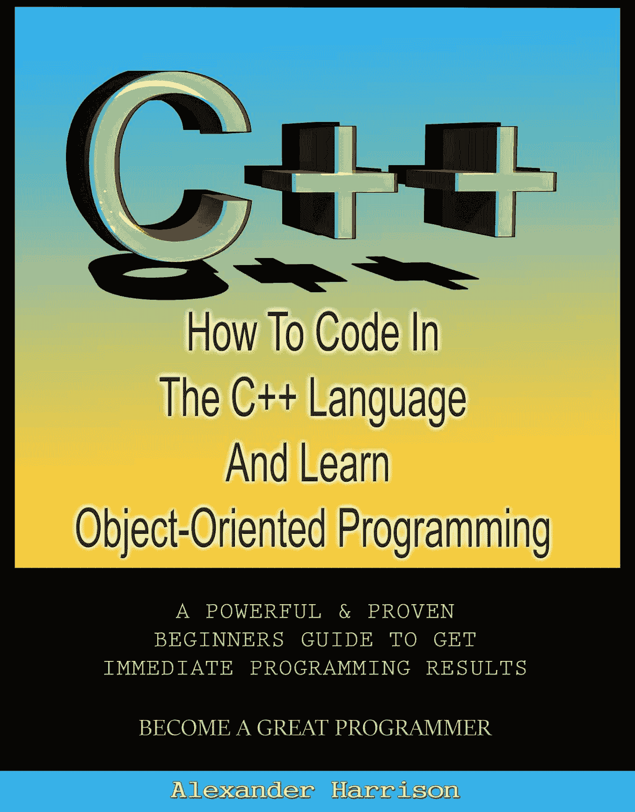
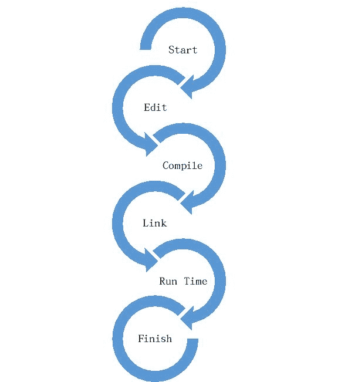

# C++ 语言编程与面向对象编程指南





# 引言

“由于没有准备，你正在失败做准备。”
（本杰明·富兰克林）

“成功不是终点，失败不是致命：继续下去的勇气才重要。”
（温斯顿·丘吉）

## 准备好学习 C++ 编程了吗？

恭喜你决定学习 `C++` 编程语言。你渴望学习这种极其强大的计算机编程语言的机制和语法，你是一个很特别的人。

我假设你已经了解计算机编程语言的基本用途。由于本书侧重于 `C++` 语言，我也假设你对编程语言所能产生的力量有一个通用的（尽管可能精确）的认知。

无论你通过何种途径从 Kindle 商店购买或借阅这本书，我保证它将会在你学习 `C++` 的道路上提供帮助。

## 你将从书中学到什么

在《初学者 C++ 编程入门教程》中，有丰富的编程知识待学习。无论你是刚开始学习 `C++`，还是对该语言已经有一定的了解，你都会发现新的东西。本书专为想要成为程序员的人编写，涵盖了基础知识并教授了构建程序所需的核心基础。书中包含的主题包括：

*   常量。
*   函数。
*   面向对象编程 (OOP)。
*   程序设计。
*   语句。
*   变量。
*   以及更多……

本书通过古老的 `C` 语言从 `C++` 的基础开始。《初学者 C++ 编程入门教程》不需要任何关于 `C`、`C++` 或任何计算机语言的先验知识。然而，你可能拥有的任何知识无疑有助于有效地理解 `C++`。不过请不要完全困惑，这本书的要求并不多，但它希望你并非技术上的完全白痴，并且理解操作计算机的基本知识，从打开文件到访问互联网。

## 本书的结构

我不会假装宣布 `C++` 是一门容易学习的语言，因为它显然并不如此。为了帮助你吸收并精通编写代码，每一章都有许多编程示例可供复制。每个示例都构建为一个 Win32 控制台应用程序，这意味着它具有基于文本的界面，在没有 `Windows API` 力量的情况下运行。对于 `C++` 初学者来说，使用 Win32 控制台是开始构建的好起点。

通过理解每一章中的信息和代码示例，下一章将看起来更容易掌握。例如，在第 03 章：数据存储、变量与常量中，你获得了使用程序变量并理解如何将它们存储在计算机内存中的知识。然后，第 04 章：基本运算符中，通过使用上一章中读到的知识，你会发现理解能够处理各种数学运算符的数据类型变得更容易了。

如果你是一个初学者，那么这本书无疑会为你提供丰富的信息。另一方面，如果你购买此书作为参考指南，它将帮助你重新发现你在记忆中遗忘的编程主题，例如变量、操作符和函数。

## 约定与实践

在书的页面中，你会发现三个关注编程技巧的粗体标题。以下说明了分布在许多页面中的标题示例。

| 编程知识：这些框内填满了必要信息，可以帮助增强你对 `C++` 语言的理解。 |
| 编程技术谈：这些框是为我们内心“极客”准备的，他们渴望学习和吸收深层 `C++` 编程概念的信息。 |
| 编程警告：这些框指出了程序员在尝试通过特定的编程概念编写代码之前应该注意的危险区域。 |

# 第 01 章

# C++ 程序设计

## 程序与设计软件

构建计算机程序时的首要属性是具备理解软件设计的能力。学习 `C++` 但对如何设计程序没有意识毫无意义。因此，软件设计构成了开发程序的基础。

## 两小时纸笔脑风暴法

完成设计（无论是软件设计还是其他形式）的最佳实践是向它从面八方提出问题。这就是我称为“两小时纸笔脑风暴法”的阶段，当你开始在空白画布上投射程序设计概念时，你需要一种积极的态度。


如果你花时间同时学习这两者，将极大提高你记忆这种语言的机会。此外，学习过程会显得更快，因为你使用这种技术可以更彻底地吸收信息。

## 质疑程序的目的

开发程序的根本目的是解决问题。因此，一个程序是为了解决一个问题而构建的。为了成为一名合格的软件开发者和设计师，必须考虑的问题之一就是需求某个特定程序的目的。

**知识点：软件开发的四个问题**
当灵感敲门并提供一个新程序的构想时，你应该对这项软件开发提出以下四个问题：

1. 程序的目的是什么？
2. 该程序解决了什么问题？
3. 如今的市场上已经有解决该问题的程序了吗？
4. 程序能准时创建吗？

软件开发公司会花费数小时的时间进行头脑风暴、考虑并讨论开发某特定软件的数百个理由。公司每年都会向软件项目投入数百万美元。因此，如果忽略了上述一个或多个因素并导致项目停滞，将是致命的。基本上，某人的脑袋会被放在在菜板上。

## 程序设计蓝图的步骤

在编写程序设计蓝图的过程中，有一系列你必须考虑的重点，特别是如果你希望在不产生太多麻烦的情况下构建一个程序。用老式的话说，在编写第一行代码之前，你需要进行一些前期的规划。为了帮助你，我将这些步骤总结成了一个易于记忆的流程。

### 步骤 1：定义你想要解决的问题

作为一名程序员和程序设计师，你需要检查你想要解决的问题，并用一两句话定义它。这里有一列问题示例，可以给你一些思路。

**知识点：问题构思**
* 我需要设计一个应用程序，将我所有的程序构思存储在一个地方，就像云系统但在我的计算机上那样。
* 我需要设计一个程序，在屏幕上显示我的家人朋友的照片，并允许我将其上传到选定的社交媒体网站。
* 我需要设计一个小型的数学游戏，帮助我的孩子完成作业。

你明白意思了吗？这是一个显而易见的步骤，但许多初级设计师会出于各种原因跳过它。这是一种计划，你永远不应该忘记计划。

### 步骤 2：定义解决问题涉及的内容

这一步侧重于你定义的初始问题，并提出“如何解决这个问题？”的问题。

检查手头问题有很多方法。通常会提出的三个最大的问题是：

**知识点：定义构思**
* 我希望我的程序如何运行？
* 我希望用户如何与程序进行交互？
* 我完成程序需要哪些工具？

这些问题初看之下可能很容易回答，但如果不花时间并真正专注于如何正确回答每个问题所需的方法，将是徒劳的。因此，从较宽泛地说，不要尝试“随性而为”。

### 步骤 3：定义问题中涉及的事件列表

你应该对将如何处理问题和设计程序有一个良好的概念。下一步是定义各种类型的事件以帮助你的程序运行。

例如，如果你要开发一个应用程序将所有的程序构思存储在一个地方，那么它可能会被设计成具有 `Save`（保存）、`Load`（加载）、`Open`（打开）和 `Edit`（编辑）包含程序数据文件的功能。因此，你可以以下事件来帮助你的程序有效运行：

**知识点：事件构思**
* 加载文件事件
* 保存文件事件
* 打开文件事件
* 编辑文件事件

在 `C++` 中，这些事件被写成函数，并填充了实现特定任务的正确代码。以 `Load File Event` 为例，如果打开该函数，它将包含帮助用户加载所需代码。

## 重用程序代码

大多数程序员共同的痛苦在于要重写他们已经在之前的项目中写过的代码。大多数程序员乐于重用旧的程序代码并将其实现在当前项目中。

例如，作为一名程序员，你可能会编写代码来相两个数字并在屏幕上显示结果。然后另一个另一个程序中，你可能想要重用这些代码。因此，与其重新编写一遍，从你之前编写的程序中复制代码并粘贴到新程序要简单得多。

**技术谈：软件重用**
“软件重用”术语是指从现有软件中复制或拷贝一段代码并将其放入新项目中的理论。

## 选择编译器

在整本书中，将需要使用编译器来帮助构建散落在各页的程序示例，以及任何你想要独立编写代码的其他程序。没有编译器，你就没有方法汇编代码和开发程序。这是因为 `C++` 是一种静态类型、多范式且编译的编程语言。

**技术谈：什么是多范式？**
编程范式是计算机语言可以理解的方法或风格。它采用这种方法来结构和使用编译程序中的元素。因此，一种多范式语言（如 `C++`）赋予了程序员使用不同形式和风格来构建程序的能力。这一个很好的例子是 `C++` 中面向对象编程的实现。

编译器检查编写好的代码并链接程序中包含的各种库，最终创建一个可执行文件（`.exe`）。在这一过程中，它会检查代码中的任何错误。如果发现某些错误，它会报告出来。如果没有错误，编译器将构建并生成程序。

现代编译器提供自己的集成开发环境（IDE），它是编程的平台。基本上，编译器的 IDE 就是你在屏幕上看到的所有。

## 没有编译器？别担心！

如果你在机器上没有安装编译器，或者你没有编译器，那么可以从网上下载一些供选择。是的，它们都是免费的。我喜欢的两个在这里：

### CodeBlocks 13.12

`CodeBlocks` 是一个带有编译器的编程应用程序。由 `CodeBlocks` 团队开发，该程序是一个开源（免费）的集成开发环境，适用于 `C` 和 `C++` 程序员。

| 下载链接 | `http://www.codeblocks.org/downloads/` |
| --- | |

`CodeBlocks` 使用非常实用。它利用 `GNU GCC` 编译器，该编译器可以运行书中的程序示例。顺便说，`CodeBlocks` 网站有自己的用于故障排除的论坛和捐赠链接。

### Dev-C++

由 `Bloodshed` 创建的 `Dev-C++` 是另一个带有编译器和集成开发环境的编程应用程序。`Dev-C++` 针对 `C` 和 `C++` 程序员。它可以在 `Windows` 中运行，现在也有在 `Linux` 中运行的选项。

| 下载链接 | `http://www.bloodshed.net/download.html` |
| --- | |

再次，如果你还没有获取编译器，`Dev-C++` 体小且易于使用。书中的程序示例在该编译器上编译和运行都没有问题。

## 程序开发周期


从程序员的角度来看，当代码编写完成后，初始阶段就结束了，但在后台会开始一个检查、编译、链接和运行代码的过程，以便能够构建并运行一个完整的程序。

下面的图展示了程序在完整创建过程中必须经历的一个自上而下的循环。



如果程序员能够创建出不带有任何编译器、链接器或运行时错误的程序，那将将是一件轰动人心的事情。这看起来就像他们生活在一个完美的世界里，而且会让让我们这些作者没话可写了。遗憾的是，世界并非完美。由于这一事实，编译器在尝试构建程序时，会在每个阶段检查程序，如上方的 C++ 程序开发周期所示。

通过使用开发过程，你可以监控程序开发周期所经历的每一步，以及程序为何是向前推进（更接近完成的程序）还是由于某种类型的错误而停滞。在程序构建过程中，如果发现了任何错误，编译器通常会提醒你并停止循环。之后，在检查错误列表并修复它们后，你可以尝试重新构建程序，如果所有过程都完全完成，程序就会运行供你查看。

尽管如此，还存在一些被称为运行时错误的错误。这些错误只有在程序运行时才会被编译器识别，并且是因为某行代码没有执行不当而被发现的。

## 你的第一个 C++ 程序

在编程教育之初，大多数程序员都从一个名为“Hello World!”的简单程序开始。然而，由于大多数编程书籍都过度使用了这个初学者程序，在本书书中将不会从这个例子开始。相反，你将发挥一点创意，开发一种不同的风格，这种风格也非常简单。

一旦你读完代码并运行了程序，请继续阅读，因为程序语法解释了每一行代码是如何运行的。

列表 1.0 – Hello Programmer.cpp

```cpp
// my first C++ program 
#include <iostream> // 包含程序的头文件
using namespace std; // 使用标准命名空间
int main() // 程序的开始
{
    cout << "Hello Programmer!" << endl; // 在屏幕上显示文本
    cout << "Welcome To The C++ Programming Language Made Simple!" << endl; // 显示更多文本
    return 0; // 结束程序
}
```

程序语法：Hello Programmer.cpp

### 注释行

程序的起始行是 C++ 注释，因为它以两个正斜杠（`//`）开头。当输入两个 `//` 时，程序向编译器信号后面将是注释。

### 预处理行

接下来，预处理器指令符号（`#`）通过包含在尖括号 `<>` 中来包含头文件 `<iostream>`。在这个示例中，选择头文件 `<iostream>` 来使程序能够使用某些声明（函数、对象等），例如 `cout` 和 `endl` 对象。

| 知识点：头文件 | 头文件中填充了函数、对象和命令的声明，这些声明可以包含在程序中。要使用头文件需要预处理器符号（`#`）。 |

### 命名空间行

`using namespace std` 这一行允许在程序中使用名为 `std`（标准）的命名空间。你可以将命名空间视为包含其他类型数据的胶囊，可以在程序中使用。

### main 函数

`main` 函数引导程序的开启。每个控制台程序都以 `int main` 或 `int main` 的变体开始。在其他书中，这可能被写为 `tmain` 或简单的 `int main`，后面跟着括号中的一组参数。这取决于用于开发程序时使用的是哪种编译器。

无论情况如何，`main` 函数始终是程序的入口。程序中的其他函数无法调用 `main`，尽管它们可以向它返回值。

在 `main` 函数之后有一个左括号 `{`，在程序结束附近有一个右括号 `}`。在这些括号之间输入程序代码。在这些括号之间输入的内容都是程序必须遵循的指令。

### cout 和 endl 对象

程序使用的对象接下来将展现它们的面目。`cout` 对象（读作 see-out）显示双引号之间的文本，文本紧跟在对象和 `<<` 符号之后。`<<` 符号是输出运算符，告诉编译器后面的文本将要显示。在文本之后，你有另一个 `<<` 带有 `endl`（读作 end-l）。此命令简单地结束当前行。下一行执行相同的操作，但显示的是不同的文本。

### return 语句

`return` 语句通过返回值 `0` 结束程序。这意味着如果一切进展顺利，程序就成功到达了这一点并结束，没有报告任何错误。

| 技术杂谈：断点 | 使用某些编译器（如 Visual C++）构建程序时，你创建的程序将在屏幕上闪烁并在几毫秒内消失。上面的程序就是其中一个例子。为了防止它立即终止，你必须在程序中使用断点。在 Visual C++ 中，找到程序的结束 return 语句并按 F5。左边框内会出现一个红点。当程序运行时，它将在接收到关闭指令之前停止。 |

## 编程错误

当你第一次编写程序时有遇到任何错误吗？我猜答案是肯定的。别担心。在编程时出现编译器错误是正常现象。当你编写的程序变成成百上几千行代码时，你会发现编译器会发现无数错误。一旦发现了这些错误——取决于所使用的编译器——它通常会告诉你哪里出了问题并建议修复方法。

| 技术杂谈：编译器单步执行 | 大多数编译器都有一个可以在菜单栏访问的功能，称为单步执行（Step-In）。此功能允许程序员一次移动一行代码，这对于程序员来说是实用的，因为它是过滤错误或不合理代码的有效方法。 |

### 编译器错误

编译器错误可能是编程时最容易修复的错误。如果你的任何程序发现了编译器错误，它们将在程序组装时被发现。这些错误表明程序内部的代码存在问题，并通知编译器在处理错误之前无法运行。在大多数情况下，这些类型的错误由于语法不正确。

### 链接错误

这些类型的错误通常由于代码中的某些内容尝试链接但失败而导致。例如，在一个使用 `<iostream>` 头文件的程序中，如果 `<iostream>` 没有输入正确，可能会导致程序发送链接器错误，因为程序正尝试从一个由于拼写错误而无法识别的头文件中使用对象。这些错误与编译器错误不同，对于初学 C++ 的程序员来说最初可能会感到困惑。

### 运行时错误


当程序员开始探索 C++ 语言（或者说任何计算机编程语言）时，运行时错误可能会成为他们的噩梦。运行时错误是最糟糕的错误，也是导致故障排除论坛充斥着修复损坏程序的请求的主要原因之一。有时，运行时错误不会导致程序崩溃，而是让它以某种特殊且异常的方式运行。

**知识：测试人员与错误**
每一家为公众生产程序的软件公司都应该有一个软件测试员部门。考虑到他们付出的工作量和时间，这些测试人员的薪水通常偏低。他们的工作是发现程序员可能漏掉的任何类型的错误。

## 编译错误程序

现在让我们创建另一个程序。然而，在这一次我们将漏掉一个分号，以便编译器返回一个错误供我们查看。

列表 1.1：`Compiler Error.cpp` 

```cpp
#include <iostream>
using namespace std;
int main(){
    cout << "Hello Programmer!" << endl;
    cout << "This line delivers a compiler error!" << endl // 没有分号
    return 0;
}
```

程序语法：`Compiler Error.cpp`

### 缺少分号

阅读代码时，你会注意到在第二个 `endl` 对象之后删除了分号。因为每个语句末尾都需要一个分号，编译器发现了一个错误并且没有运行程序。相反，它返回了一个对错误的解释。见下文。

### 编译错误

```
|| Build: debug in compiler error ===
C:\Chapter 1\Compiler Error\Compiler Error.cpp
in function 'int main()':
C:\Chapter 1\Compiler Error\Compiler Error.cpp
8
error: expected ';' before 'return'
=== Build failed: 1 error(s), 0 warning(s) (0 minute(s), 0 second(s)) ===
```

我们将进入下一章，在那里我们将讨论 `Hello Programmer.cpp` 的机制。

## 测试自学

以下四个问题关于你刚刚学习的 C++ 编程知识。在进入下一章节之前，请尝试这些问题。

**自测**
1. C++ 是哪种语言的子集？
2. `cout` 和 `endl` 对象在程序中实现了什么？
3. 程序中可能发生的三类错误是什么？
4. 你应该在程序的什么位置放置分号？

## 第 02 章

# 程序剖析

## 检查 Hello Programmer

在上一章中，你通过创建一个简单的 Hello World 风格的程序体验了编程，尽管我们称其为 Hello Programmer。这包含了几个需要记忆的不同部分。应用程序的每个部分都是对普通 C++ 程序组成部分的一个小补充。事实上，尽管 Hello Programmer 看起来并不复杂，但它展示了你构建的每个 C++ 程序所需要的中心基础知识。

在本章中，我们将检查 `Hello Programmer`，将其拆解为组成它的部分。

### 包含预处理器

当程序员完成编码并按下构建按钮时，编译器会调用预处理器指令（任何以 `#` 为前缀）开始工作。程序员在这一阶段不需要恐慌，因为编译器会自动检查预处理器，并遵守程序给它的指令。

**技术杂谈：预处理器指令**
预处理器指令是程序中以 `#` 符号开头的单独代码行。在在上一个程序中，给预处理器的指令被称为 `include`。

在执行时，编译器会搜索你的代码寻找任何 `#` 符号，并查看其后的内容。在之前的两个例子中，`include` 一词连接在 `#` 符号上，意味着它包含了写在关键字 `include` 之后的文件，在这种情况下，这就是 `<iostream>`。

**知识：# 符号**
C++ 中用于包含预处理器的 `#` 符号被称为“哈希标记（hash tag）”或“井号（pound sign）在使用社交媒体网站 Twitter 时可能听过它。

注意，包含在程序中的预处理器指令末尾不需要分号。这是因为预处理器指令不是一条语句。这里有两个包含 `<iostream>` 头文件的例子。一个代码是正确的，而另一个给编译器传递了错误。

```cpp
#include <iostream> // 这是正确的
#include <iostream>; // 这是错的
```

### 头文件

C++ 头文件的集合是海量的。当我们检查之前编写的程序时，我们只看到了头文件 `<iostream>`。书中的每个完整程序都包含了 `<iostream>` 头文件。但什么是头文件呢？

头文件是一个可以在程序中使用的声明、对象和函数的集合。通过在程序中包含头文件，实际上等同于将文件中的所有对象和函数都供程序使用，以便程序利用它们。所以，当你包含 `<iostream>` 头文件时，它允许在你的程序中使用 `cin`、`cout` 和 `endl` 命令。

### 注释

C++ 程序中的注释是人类可读的语法，用于理解某些编写的代码是如何运行的。编译器在运行时不会读取注释。相反，它们仅仅是为了帮助程序员以及任何检查程序的人理解其运行方式。

C++ 中使用了两种形式的注释。第一是标准的 C 注释，它允许程序员在多行之间划分注释。

C 注释是旧式，通过 `/*` 开始，然后编写注释，并以 `*/` 结束。

```cpp
/* 这是一个 C 注释 C 注释可以跨多行 */
```

注释的另一种形式是 C++ 风格，它是单行的。创建 C++ 注释，你需要写双斜杠 `//` 然后写注释。一旦初始化回车（换行），注释就会结束。因此，要写另一个 C++ 注释，你需要再次输入 `//`。

```cpp
// 这是一个 C++ 注释
// 这是另一个 C++ 注释
```

阅读这本书，你会注意到我在程序示例中使用 C++ 风格的注释。由于本书关注 C++ 语言，我认为使用这种语法是正确的。尽管，作为程序员，你有权使用符合自己喜好的注释类型。

**知识：练习编写注释**
编写程序员理解的注释是一项简单的工作。然而，编写外部人士阅读并理解的注释是一项艰巨的任务，需要练习。为他人编写优秀、易懂的注释本身就是一种艺术。记得在你编写每个程序中练习注释。

### 命名空间

标准 C++ 库中的元素定义在一个命名空间内。在我们之前的程序中，在主函数打开之前使用了一个名为 `std` 的命名空间。你会注意到通过 `using namespace` 命令调用了命名空间。

### 函数块

在第 6 章中，C++ 函数的主题将引起我们的注意。但现在，我将简要概述函数的作用。函数是代码块，非常适合单独分离某些数据并保持代码整洁。之前程序中的 `main` 函数是启动任何可执行程序的启动函数。


书中的每个程序都有一个 `main` 函数。它是程序的灵魂。当你构建一个程序时，它会从自上而下的视角运行代码，从 `main` 开始，在到达 `return` 语句并结束之前，处理所遇到的每一行代码。

### 空格（Whitespace）

空白格是程序中留出的空隙。这些空格、制表符和换行符是为了让你的程序看起来更整洁、清晰。空白格——类似于注释——不会影响程序，也不会被编译器读取。使用空白格来格式化程序代码的外观使其易于阅读是明智的。

## 下一阶段

尽管程序会因为包含数千行代码而变得非常庞大，但它们的运行标准与我们的“Hello Programmer”相同，都是极其简单的。在我们进入下一个阶段之前，请快速查看最后一个程序，该程序使用了称为“变量”的数据存储对象，以及头文件 `<iostream>` 内部的输入对象 `cin`。后者对象允许用户在程序运行时输入自己的数据。

### 列表 2.0 – 输入与变量

```cpp
#include <iostream>
#include <string> // 包含新的头文件
using namespace std;
int main(){
    cout << "Please enter your name, programmer: "; // 显示文本
    string yourName; // 创建字符串变量
    cin >> yourName; // 将数据输入变量
    cout << "Thank you, " << yourName << "." << endl; // 显示变量数据
    return 0;
}
```

## 测试你自己的时候

以下四个问题关于你刚刚学到的 C++ 编程知识。在继续学习下一章之前，请尝试回答这些问题。

1. C 注释和 C++ 注释有什么区别？
2. 程序代码在被编译器读取时遵循什么方向？
3. 什么是空白格？
4. 在程序中放置头文件需要哪个关键字？

## 第 03 章

# 数据存储、变量与常量

## 什么是变量（Variable）？

在当的现代世界中，有数百万台计算机每天不断处理数据。想要学习编程的人问的一个问题是计算机如何存储它接收到的数据。答案就在变量中。本质上，变量充当容器，存放着不同类型的数据，C++ 可以利用并操纵这些数据。当变量被创建时，计算机将其存储在内存库中，即随机访问存储器（RAM）。这些内存库具有地址，为变量的定位分配空间。然而，记住内存地址是一项艰巨的任务。当变量被创建时，它们拥有内存地址和名称。后者就像一个标签，供程序员使用以代替冗长的地址。

## 什么是随机访问存储器（Random Access Memory）？

随机访问存储器是存储计算机操作的主要源头，例如创建一个变量或存储一段被剪到计算机剪贴板的文本。一旦完成，计算机就可以与 RAM 协作，快速高效地访问数据。计算机内存的容量决定了它可能容纳的数据量。

### 位（Bits）与字节（Bytes）

RAM 由位和字节组成。一个字节比一个位大。因此，一个字节由 8 位组成。将内存看作是许多微小的空盒子，准备好在程序运行期间存储物品。在每个盒子的内部，程序可以存储一个字节的数据。计算机内存是随机访问的，这与 DVD 或硬盘上的数据不同。由于这一目的，数据的访问速度可以比其他媒介快得多。

> **警告：随机访问存储器不是硬盘空间**：不要将 RAM 与硬盘或 DVD 的容量混淆。为了解释这种区别，当你加载一个程序时，它是从硬盘、DVD 或其他外设访问的。当程序被加载并运行时，计算机所需的任何数据都会存储在 RAM 中，供计算机在需要时使用。

## 动态与静态类型语言（Dynamic and Static Typed Languages）

我们将检查观察变量数据类型不同的两种语言风格。它们被称为：

* 动态类型语言（Dynamic Typed Language）。
* 静态类型语言（Static Typed Language）。

### 动态类型语言

在动态类型语言中，变量类型的决定取决于其赋值的数据值。例如，如果你有一个名为 `myVar` 的变量，它的数据值是一个整数（比如 12），那么动态类型语言会将该变量识别为整数。相反，如果你将 `myVar` 的值改为类似‘A’的内容，编译器就会开始将该变量识别为字符。

### 静态类型语言

相反，静态类型语言有一条规则：变量在程序中使用之前必须声明为特定类型。因此，如果 `myVar` 等于数字 12，那么该变量可能被声明为整数，或者可能是其他数值数据类型，如 `float` 或 `short`。本质上，静态类型语言首先查看数据类型，以规定它可以存储什么类型的值。

## C++ 是一种静态类型语言

C++ 是一种静态类型语言，因为它对编译器可以读取的不同类型数据有一套固定的标准。作为程序员，你需要在变量使用之前用正确的数据分配正确的数据类型。给字符串变量分配一个整数值是毫无意义且糟糕的编程行为，因为这将导致编译器错误。

## 学习数据类型

大多数编程语言（包括 C++ 在内）都有多种用于声明变量的数据类型。数据类型的范围如表表所示，以及它们在内存中的单独大小。

| 数据类型（DATA TYPE） | 名称（NAME） | 大小（字节） |
| :--- | :--- | :--- |
| `int` | 整数 | 4 |
| `short` | 短整数 | 4 |
| `long` | 长整数 | 8 |
| `long long` | 超长整数 | 8 |
| `float` | 浮点数 | 4 |
| `double` | 双精度浮点数 | 8 |
| `char` | 字符 | 1 (每个字符) |
| `bool` | 布尔值 | 4 |
| `string` | 字符串 | 1 (每个字符) |

很显然有很多数据类型需要学习。然而，你不必担心不能脱口而出这些数据类型。随着你在本章及书中其余部分的进展，你将逐渐学习每一个。在开始之前，我想向你展示如何在 C++ 中声明和定义变量。

## 声明变量（Declare Variables）

在程序可以使用不同类型的变量之前，必须对所需的变量进行声明。这涉及用所需的数据类型和用户定义的名称来编写变量。声明变量需要以下语法。

| 数据类型 | 变量名 |
| :--- | :--- |
| `int` | `myNumber` |

在这个示例中，关键字 `int` 将 `myNumber` 声明为整数。因此，当你声明一个变量时，分配内存的过程就开始了。很多时候，程序要求变量在运行时已经初始化了初始值。这意味着在程序运行之前就已经定义了数据类型的值。

下一个程序演示了在程序运行时声明和定义变量的概念。

### 列表 3.0 – 声明与定义变量.cpp

```cpp
#include <iostream>
#include <string>
using namespace std;
int main() {
    int myNumber = 12;
    char myChar = 'A';
    cout << "Number: " << myNumber << endl;
    cout << "Character: " << myChar << endl;
    return 0;
}
```


```cpp
#include <iostream>
using namespace std;
int main(){
    int number; // declares integer variable
    number = 50; // defines integer variable
    cout << "The value " << number << " comes from an integer variable.\n" << endl;
    char letter; // declares character variable
    letter = 'C'; // defines character variable
    cout << "The value '" << letter << "' comes from a character variable.\n" << endl;
    double decimal; // declares double variable
    decimal = 22.5; // defines double variable
    cout << "The value " << decimal << " comes from a double variable.\n" << endl;
    return 0;
}
```

程序语法：`Declare and Define Variables.cpp`

### int 变量
在 `main` 函数开始后，首个变量——一个整数——被声明，然后定义为值 `50`。

### char 变量
程序中的第二个变量是 `char` 变量，它已经过声明。`char` 变量接受字符的值，在本程序中，该变量被赋值为字母 `'C'`。

### double 变量
最后一个变量是 `double`，它能够存储小数。在 `double` 声明后，它被赋值为值 `22.5`。

## 定义变量
一旦你学会了如何声明变量，定义它就是向前简单的一步。下一节将声明变量但留给用户使用 `cin` 对象进行定义。下一个程序代表了一个电话录。

列表 3.1 – `Telephone Address Book.cpp`

```cpp
#include <iostream>
#include <string> // string 变量的头文件
using namespace std;
int main(){
    cout << "Telephone Address Book.\n"; // \n 换行
    // int 和 string 的变量
    string contactName1; // 创建一个字符串变量
    int contactNumber1;
    cout << "\nEnter contact name: "; // \n 在文本前换行
    cin >> contactName1; // 输入字符串变量数据
    cout << "\nEnter contact number: ";
    cin >> contactNumber1; // 输入整数变量数据
    cout << "\nContact: " << contactName1 << "\t" << contactNumber1 << endl;
    return 0;
}
```

程序语法：`Telephone Address Book.cpp`

### string 头文件
此程序添加了一个新的头文件，命名为 `<string>`。该头文件允许在程序中使用字符串变量。需要该文件是因为字符串变量不是 C++ 的内置类型。

### string 变量
在程序中，声明的主变量是一个字符串变量，名为 `contactName1`。

### cin 对象
`cin` 对象在程序的不同点上调用了两个变量。每当它起作用时，它都会等待用户输入数据。这意味着在程序继续执行其自上而下的螺旋式流程之前，用户必须输入数据。对于字符串变量，允许用户输入他/她所希望的任何内容。而对于第二个变量——整数，程序会等待用户输入一个整数值。

> **知识：转义序列**：在之前的程序中，你看到了代码 `\n`。与 `\n` 和 `\t` 类似的序列被称为字符字面量或转义序列。

## 有符号和无符号变量
在 C++ 中，大多数变量可以分为两个类别，这决定了它们的大小和值范围。这些差异被称为有符号（signed）和无符号（unsigned）。

### 无符号
在 C++ 中，大多数变量可以分为两个类别，这决定了它们的大小和值范围。这些差异被称为有符号和无符号。在 C++ 中，大多数变量可以分为两个类别，这决定了它们的大小和值范围。这些差异被称为有符号和无符号。在 C++ 中，大多数变量可以分为两个类别，这决定了它们的大小和值范围。这些差异被称为有符号和无符号。在 C++ 中，大多数变量可以分为两个类别，这决定了它们的大小和值范围。这些差异被称为有符号和无符号。在 C++ 中，大多数变量可以分为两个类别，这决定了它们的大小和值范围。这些差异被称为有符号和无符号。在 C++ 中，大多数变量可以分为两个类别，这决定了它们的大小和值范围。这些差异被称为有符号和无符号。在 C++ 中，大多数变量可以分为两个类别，这决定了它们的大小和值范围。这些差异被称为有符号和无符号。在 C++ 中，大多数变量可以分为两个类别，这决定了它们的大小和值范围。这些差异被称为有符号和无符号。在 C++ 中，大多数变量可以分为两个类别，这决定了它们的大小和值范围。这些差异被称为有符号和无符号。在 C++ 中，大多数变量可以分为两个类别，这决定了它们的大小和值范围。这些差异被称为有符号和无符号。在 C++ 中，大多数变量可以分为两个类别，这决定了它们的大小和值范围。这些差异被称为有符号和无符号。在 C++ 中，大多数变量可以分为两个类别，这决定了它们的大小和值范围。这些差异被称为有符号和无符号。在 C++ 中，大多数变量可以分为两个类别，这决定了它们的大小和值范围。这些差异被称为有符号和无符号。在 C++ 中，大多数变量可以分为两个类别，这决定了它们的大小和值范围。这些差异被称为有符号和无符号。在 C++ 中，大多数变量可以分为两个类别，这决定了它们的大小和值范围。这些差异被称为有符号和无符号。在 C++ 中，大多数变量可以分为两个类别，这决定了它们的大小和值范围。这些差异被称为有符号和无符号。在 C++ 中，大多数变量可以分为两个类别，这决定了它们的大小和值范围。这些差异被称为有符号和无符号。在 C++ 中，大多数变量可以分为两个类别，这决定了它们的大小和值范围。这些差异被称为有符号和无符号。在 C++ 中，大多数变量可以分为两个类别，这决定了它们的大小和值范围。这些差异被称为有符号和无符号。在 C++ 中，大多数变量可以分为两个类别，这决定了它们的大小和值范围。这些差异被称为有符号和无符号。在 C++ 中，大多数变量可以分为两个类别，这决定了它们的大小和值范围。这些差异被称为有符号和无符号。在 C++ 中，大多数变量可以分为两个类别，这决定了它们的大小和值范围。这些差异被称为有符号和无符号。在 C++ 中，大多数变量可以分为两个类别，这决定了它们的大小和值范围。这些差异被称为有符号和无符号。

### C 符号
大多数变量可以可以分为类别，，类别决定了的大小的大小和的大小范围值范围差异这些差异符号有符号符号无符号。在 C++ 中，大多数变量可以分为两个类别，这决定了它们的大小和值范围。这些差异被称为有符号和无符号。在 C++ 中，大多数变量可以分为两个类别，这决定了它们的大小和值范围。这些差异被称为有符号和无符号。在 C++ 中，大多数变量可以分为两个类别，这决定了它们的大小和值范围。这些差异被称为有符号和无符号。在 C++ 中，大多数变量可以分为两个类别，这决定了它们的大小和值范围。这些差异被称为有符号和无符号。在 C++ 中，大多数变量可以分为两个类别，这决定了它们的大小和值范围。这些差异被称为有符号和无符号。在 C++ 中，大多数变量可以分为两个类别，这决定了它们的大小和值范围。这些差异被称为有符号和无符号。在 C++ 中，大多数变量可以分为两个类别，这决定了它们的大小和值范围。这些差异被称为有符号和无符号。在 C++ 中，大多数变量可以分为两个类别，这决定了它们的大小和值范围。这些差异被称为有符号和无符号。在 C++ 中，大多数变量可以分为两个类别，这决定了它们的大小和值范围。这些差异被称为有符号和无符号。在 C++ 中，大多数变量可以分为两个类别，这决定了它们的大小和值范围。这些差异被称为有符号和无符号。在 C++ 中，大多数变量可以分为两个类别，这决定了它们的大小和值范围。这些差异被称为有符号和无符号。在 C++ 中，大多数变量可以分为两个类别，这决定了它们的大小和值范围。这些差异被称为有符号和无符号。在 C++ 中，大多数变量可以分为两个类别，这决定了它们的大小和值范围。这些差异被称为有符号和无符号。在 C++ 中，大多数变量可以分为两个类别，这决定了它们的大小和值范围。这些差异被称为有符号和无符号。在 C++ 中，大多数变量可以分为两个类别，这决定了它们的大小和值范围。这些差异被称为有符号和无符号。在 C++ 中，大多数变量可以分为两个类别，这决定了它们的大小和值范围。这些差异被称为有符号和无符号。在 C++ 中，大多数变量可以分为两个类别，这决定了它们的大小和值范围。这些差异被称为有符号和无符号。在 C++ 中，大多数变量可以分为两个类别，这决定了它们的大小和值范围。这些差异被称为有符号和无符号。在 C++ 中，大多数变量可以分为两个类别，这决定了它们的大小和值范围。这些差异被称为有符号和无符号。在 C++ 中，大多数变量可以分为两个类别，这决定了它们的大小和值范围。这些差异被称为有符号和无符号。在 C++ 中，大多数变量可以分为两个类别，这决定了它们的大小和值范围。这些差异被称为有符号和无符号。在 C++ 中，大多数变量可以分为两个类别，这决定了它们的大小和值范围。这些差异被称为有符号和无符号。在 C++ 中，大多数变量可以分为两个类别，这决定了它们的大小和值范围。这些差异被称为有符号和无符号。在 C++ 中，大多数变量可以分为两个类别，这决定了它们的大小和值范围。这些差异被称为有符号和无符号。在 C++ 中，大多数变量可以分为两个类别，这决定了它们的大小和值范围。这些差异被称为有符号和无符号。在 C++ 中，大多数变量可以分为两个类别，这决定了它们的大小和值范围。这些差异被称为有符号和无符号。在 C++ 中，大多数变量可以分为两个类别，这决定了它们的大小和值范围。这些差异被称为有符号和无符号。在 C++ 中，大多数变量可以分为两个类别，这决定了它们的大小和值范围。这些差异被称为有符号和无符号。在 C++ 中，大多数变量可以分为两个类别，这决定了它们的大小和值范围。这些差异被称为有符号和无符号。在 C++ 中，大多数变量可以分为两个类别，这决定了它们的大小和值范围。这些差异被称为有符号和无符号。在 C++ 中，大多数变量可以分为两个类别，这决定了它们的大小和值范围。这些差异被称为有符号和无符号。在 C++ 中，大多数变量可以分为两个类别，这决定了它们的大小和值范围。这些差异被称为有符号和无符号。

### 符号符号
在 C++ 中，大多数变量可以分为两个类别，这决定了它们的大小和值范围。这些差异被称为有符号和无符号。在 C++ 中，大多数变量可以分为两个类别，这决定了它们的大小和值范围。这些差异被称为有符号和无符号。在 C++ 中，大多数变量可以分为两个类别，这决定了它们的大小和值范围。这些差异被称为有符号和无符号。在 C++ 中，大多数变量可以分为两个类别，这决定了它们的大小和值范围。这些差异被称为有符号和无符号。

### 有符号
在 C++ 中，大多数变量可以分为两个类别，这决定了它们的大小和值范围。这些差异被称为有符号和无符号。在 C++ 中，大多数变量可以分为两个类别，这决定了它们的大小和值范围。这些差异被称为有符号和无符号。在 C++ 中，大多数变量可以分为两个类别，这决定了它们的大小和值范围。这些差异被称为有符号和无符号。在 C++ 中，大多数变量可以分为两个类别，这决定了它们的大小和值范围。这些差异被称为有符号和无符号。在 C++ 中，大多数变量可以分为两个类别，这决定了它们的大小和值范围。这些差异被称为有符号和无符号。在 C++ 中，大多数变量可以分为两个类别，这决定了它们的大小和值范围。这些差异被称为有符号和无符号。在 C++ 中，大多数变量可以分为两个类别，这决定了它们的大小和值范围。这些差异被称为有符号和无符号。在 C++ 中，大多数变量可以分为两个类别，这决定了它们的大小和值范围。这些差异被称为有符号和无符号。在 C++ 中，大多数变量可以分为两个类别，这决定了它们的大小和值范围。这些差异被称为有符号和无符号。在 C++ 中，大多数变量可以分为两个类别，这决定了它们的大小和值范围。这些差异被称为有符号和无符号。在 C++ 中，大多数变量可以分为两个类别，这决定了它们的大小和值范围。这些差异被称为有符号和无符号。在 C++ 中，大多数变量可以分为两个类别，这决定了它们的大小和值范围。这些差异被称为有符号和无符号。在 C++ 中，大多数变量可以分为两个类别，这决定了它们的大小和值范围。这些差异被称为有符号和无符号。在 C++ 中，大多数变量可以分为两个类别，这决定了它们的大小和值范围。这些差异被称为有符号和无符号。在 C++ 中，大多数变量可以分为两个类别，这决定了它们的大小和值范围。这些差异被称为有符号和无符号。在 C++ 中，大多数变量可以分为两个类别，这决定了它们的大小和值范围。这些差异被称为有符号和无符号。在 C++ 中，大多数变量可以分为两个类别，这决定了它们的大小和值范围。这些差异被称为有符号和无符号。在 C++ 中，大多数变量可以分为两个类别，这决定了它们的大小和值范围。这些差异被称为有符号和无符号。在 C++ 中，大多数变量可以分为两个类别，这决定了它们的大小和值范围。这些差异被称为有符号和无符号。在 C++ 中，大多数变量可以分为两个类别，这决定了它们的大小和值范围。这些差异被称为有符号和无符号。在 C++ 中，大多数变量可以分为两个类别，这决定了它们的大小和值范围。这些差异被称为有符号和无符号。在 C++ 中，大多数变量可以分为两个类别，这决定了它们的大小和值范围。这些差异被称为有符号和无符号。在 C++ 中，大多数变量可以分为两个类别，这决定了它们的大小和值范围。这些差异被称为有符号和无符号。在 C++ 中，大多数变量可以分为两个类别，这决定了它们的大小和值范围。这些差异被称为有符号和无符号。在 C++ 中，大多数变量可以分为两个类别，这决定了它们的大小和值范围。这些差异被称为有符号和无符号。在 C++ 中，大多数变量可以分为两个类别，这决定了它们的大小和值范围。这些差异被称为有符号和无符号。在 C++ 中，大多数变量可以分为两个类别，这决定了它们的大小和值范围。这些差异被称为有符号和无符号。在 C++ 中，大多数变量可以分为两个类别，这决定了它们的大小和值范围。这些差异被称为有符号和无符号。在 C++ 中，大多数变量可以分为两个类别，这决定了它们的大小和值范围。这些差异被称为有符号和无符号。在 C++ 中，大多数变量可以分为两个类别，这决定了它们的大小和值范围。这些差异被称为有符号和无符号。在 C++ 中，大多数变量可以分为两个类别，这决定了它们的大小和值范围。这些差异被称为有符号和无符号。在 C++ 中，大多数变量可以分为两个类别，这决定了它们的大小和值范围。这些差异被称为有符号和无符号。在 C++ 中，大多数变量可以分为两个类别，这决定了它们的大小和值范围。这些差异被称为有符号和无符号。在 C++ 中，大多数变量可以分为两个类别，这决定了它们的大小和值范围。这些差异被称为有符号和无符号。在 C++ 中，大多数变量可以分为两个类别，这决定了它们的大小和值范围。这些差异被称为有符号和无符号。在 C++ 中，大多数变量可以分为两个类别，这决定了它们的大小和值范围。这些差异被称为有符号和无符号。在 C++ 中，大多数变量可以分为两个类别，这决定了它们的大小和值范围。这些差异被称为有符号和无符号。在 C++ 中，大多数变量可以分为两个类别，这决定了它们的大小和值范围。这些差异被称为有符号和无符号。在 C++ 中，大多数变量可以分为两个类别，这决定了它们的大小和值范围。这些差异被称为有符号和无符号。在 C++ 中，大多数变量可以分为两个类别，这决定了它们的大小和值范围。这些差异被称为有符号和无符号。在 C++ 中，大多数变量可以分为两个类别，这决定了它们的大小和值范围。这些差异被称为有符号和无符号。在 C++ 中，大多数变量可以分为两个类别，这决定了它们的大小和值范围。这些差异被称为有符号和无符号。在 C++ 中，大多数变量可以分为两个类别，这决定了它们的大小和值范围。这些差异被称为有符号和无符号。在 C++ 中，大多数变量可以分为两个类别，这决定了它们的大小和值范围。这些差异被称为有符号和无符号。在 C++ 中，大多数变量可以分为两个类别，这决定了它们的大小和值范围。这些差异被称为有符号和无符号。在 C++ 中，大多数变量可以分为两个类别，这决定了它们的大小和值范围。这些差异被称为有符号和无符号。在 C++ 中，大多数变量可以分为两个类别，这决定了它们的大小和值范围。这些差异被称为有符号和无符号。在 C++ 中，大多数变量可以分为两个类别，这决定了它们的大小和值范围。这些差异被称为有符号和无符号。在 C++ 中，大多数变量可以分为两个类别，这决定了它们的大小和值范围。这些差异被称为有符号和无符号。在 C++ 中，大多数变量可以分为两个类别，这决定了它们的大小和值范围。这些差异被称为有符号和无符号。在 C++ 中，大多数变量可以分为两个类别，这决定了它们的大小和值范围。这些差异被称为有符号和无符号。

### 有符号
变量可以分为两个类别，这决定了它们的大小和值范围。这些差异被称为有符号和无符号。

## 不同类型
在 C++ 中，大多数变量可以分为两个类别，这决定了它们的大小和值范围。这些差异被称为有符号和无符号。

### 整数
`short` 整数也称为 `int`，范围为 `-32768` 到 `32767`，由于是有符号的。然而，`short` 整数可以带有无符号前缀，行为与普通无符号完全相同。

```cpp
// 每个变量都相同，但声明方式不同
short number = -44;
short int number = -44;
signed int number = -44;
```

### 长整数
长整数在声明时有所不同，因为它们需要 `long` 前缀，除非它们带有 `unsigned` 关键字，否则它们是较大的整数。

下表揭示了无符号和有符号长整数的最大值和最小值。

有符号长整数值范围
| MIN | MAX |
| -2147483648 | 2147483647 |

无符号长整数值范围
| MIN | MAX |
| 0 | 4294967295 |

### 浮点数
`float` 变量是另一种使用数值的数据类型，尽管它不仅使用整数，还有小数点。`float` 变量不能无无符号，就像不同类型的整数一样，尽管它们可以带有 `long` 和 `long long` 类型的前缀。

float 值范围
| MIN | MAX |
| 1.175494351e-38f | 3.40282347e+38f |

接下来我们将通过将 `float` 替换为 `double` 来扩展浮点数的大小。`double` 具有更高的值范围。

### 双精度


`double` 变量也是一种小数点数据类型。它比 `float` 更大，可以容纳更高的数值范围。缺点是 `double` 变量在内存中占用的字节是 `float` 或 `integer` 的两倍，因此得命名为 `double`。

`double` 取值范围

| MIN | MAX |
| :--- | :--- |
| 2.22507385850720138e-308 | 1.79769313486231571e+308 |

### Char

`char` 变量是一种数据类型，允许你在程序中使用键盘上的字符，例如‘a’或‘b’或‘£’或'&’。不同之处在于，当数字用于 `char` 变量时，它并不会像 `integer` 或 `float` 那样作为数值值处理。其原因因为它被包含在单引号之间，单引号的作用就像一个关闭任何数值功能的开关。

```cpp
// char 变量示例
char letter = ‘L’;
char number = ‘5’;
char sign = ‘$’;
```

如所示，三个 `char` 变量都使用了单引号。这意味着‘5’的值不是数值——或者至少不完全是。我使用“不完全”这个词是因为是因为从键盘输入的所有字符都有它们自己的键值，对应于 ASCII 布局。`ASCII` 是“信息交换标准代码”（American Standard Code for Information Interchange）的缩写，是一种字符编码方案，最初基于英文字母。它将 128 个指定的字符编码为 7 位二进制整数。`ASCII` 表为键盘上的每个字符指定了一个值。因此，再次，`char` 变量有最小值和最大值。

Listing 3.2 – 不同类型的字符.cpp

```cpp
#include <iostream>
using namespace std;
int main(){
             cout << "char 变量可以存储的不同字符所示：\n" << endl;
             // 存储不同类型字符的三个 char 变量
             char letter = 'E';
             char number = '2';
             char symbol = '$';
             // 使用三种不同类型的字符显示文本
             cout << "The char variable can store individual letters like " << letter << ".\n";
             cout << "The char variable can store individual numbers as characters like " << number << ".\n";
             cout << "The char variable can store individual symbols as characters like " << symbol << "." << endl;
             return 0;
}
```

程序语法：不同类型的字符.cpp

### char 变量

程序中声明并定义了三个 `char` 变量。一旦在程序中创建了它们，它们就会使用 `cout` 对象单独显示在屏幕上。此外，你可能还会看到每个变量周围都有单引号。

## 布尔（Boolean）与字符串变量

### Bool

`bool` 变量只有两个值需要处理。这两个值是 `true` (1) 和 `false` (0)。由 George Boolean 设计，因此得名，`bool` 值用于大量的编程语言，如 `Java`、`Visual Basic`，特别是在 `C++` 中。当你在学习 `C++` 中的决策语句和返回语句时会看到这一点。书中到为止创建的所有程序，其返回语句都以布尔值结尾：`return 0`。

Listing 3.3 – True or False.cpp

```cpp
#include <iostream>
using namespace std;
int main(){
             cout << "The difference of true and false." << endl;
             bool istrue = true;
             bool isfalse = false;
             // 发现什么是 true 和 false
             cout << "The value of true: " << istrue << endl;
             cout << "The value of false: " << isfalse << endl;
             return 0;
}
```

程序语法：True or False.cpp

### bool 变量

你在程序中看到两个 `bool` 变量，这揭示了该数据类型的两种可能值。`bool` 变量决定其包含的数据是 `true` (1) 还是 `false` (0)。当你学习 `if` 和 `switch` 语句时，你会发现为什么 `bool` 变量对 `C++` 编程至关重要。

`bool` 取值范围

| MIN | MAX |
| :--- | :--- |
| False (0) | True (1) |

### String

`string` 变量不是 `C++` 的内置类型。相反，要在程序中使用字符串，你必须包含头文件 `<string>`。声明一个 `string` 变量，必须以关键字 `string` 开头，后跟用户定义的名称。字符串的基本思想是，除了包含头文件外，你可以获取多个字符并将它们连接在一起，而无需额外的代码。字符串的示例所示，以及对应的 `char` 形式。

```cpp
#include <string> // 记得包含以使用字符串
string myName = "Tom";
string myAge = "25";
char myName[3] = "Tom"; // 一个 char 数组
char myAge[2] = "25"; // 一个较小的 char 数组
```

Listing 3.4 – Full Name, Number.cpp

```cpp
#include <iostream>
#include <string>
using namespace std;
int main(){
             string fullName;
             string address;
             string number;
             cout << "Enter Your Full Name: ";
             getline(cin, fullName);
             cout << "Enter Your Address: ";
             getline(cin, address);
             cout << "Enter Your Telephone Number: ";
             getline(cin, number);
             cout << "\nHello, " << fullName << endl;
             cout << "You Live At: " << address << endl;
             cout << "Your Telephone Number Is: " << number << endl;
             return 0;
}
```

程序语法：Full Name, Number.cpp

### getline(...) 函数

`C++` 中有使用 `cin` 对象的另一种方法，它具有额外的功能，并允许 `string` 和 `char` 变量执行复杂任务。在这个程序中，`getline` 函数允许用户向字符串输入空格。而在使用 `cin` 对象时，如果你写一个全名，例如“Abigail Roberts”，那么字符串会被截断为“Abigail”，因为 `cin` 对象不允许空格。

编写 `getline` 函数的语法如下：

`getline(input_command, string/char variable)`

### cout 对象

在这个程序中，`cout` 对象分布在多行中。这是允许的，因为除了最后一行外，每一行的末尾都没有分号（ ; ）。正如之前讨论的，分号是结束一个语句的。

| 知识：空格你将在第 5 章：语句与表达式中学习更多关于空格的内容。尽管如此，只需将空格想象成注释即可，因为编译器在构建时不会读取它。 |

## 创建多个变量

现在你已经知道了 `C++` 中可以创建的基本变量类型，你将研究如何创建相同类型的多个变量。

我们将使用两种数据类型来展示它是如何工作的——整数和 `string` 变量。编写相同类型的多个变量时使用以下语法：

`data type variable name, variable name`

这是一个仅使用一次数据类型名称声明三个整数变量的示例：

```cpp
// 声明三个 int 变量
int hours, days, months;
hours = 24;
days = 7;
months = 12;
```


在声明多个变量的同时，你还可以使用相同的方法为它们赋值。下方的三个字符串变量为每个变量分配了一个字符字符串，该字符串与变量相等。如你所见，逗号运算符（（`,`）允许我们在声明列表中放置额外的变量。你可以将每个变量想象成邮局中一个有待寄送包裹的人，然后将包裹想象成变量中的数据。列表完成后，用分号结束它。

| `string hisName = "Peter",herName = "Ruby",yourName = "Tom";` |

列表 3.4 – Login Details.cpp

```cpp
#include <iostream>
#include <string>
using namespace std;
int main(){
    cout << "Welcome back to the C++ Game." << endl;
    cout << "Please enter your login details." << endl;
    string username, password; // declares two string variables
    cout << "\nUsername: ";
    cin >> username; // input first string variable data
    cout << "\nPassword: ";
    cin >> password; // input second string variable data
    cout << "\nWelcome back, " << username << endl;
    return 0;
}
```

程序语法：Login Details.cpp

### 多变量

该程序展示了如何仅使用一次数据类型名称来分配多个变量。在这种情况下，`string` 变量被用于创建两个名为 `username` 和 `password` 的变量，它们将用于一个辅助登录系统的程序。

## 将变量放入内存中

当变量被创建时，编译器会将它们分配到计算机的 RAM 中。当此发生时，它们会进入栈中，以便在程序调用单个变量时可以使用它们。这意味着你的程序将使用计算机内存的一个区域。

## 操纵数据类型名称

很快，你的程序规模就会增大。五行代码将变成二十五行；二十五行将变成五十行，然后五十行变成一百行，以此类推。

与此同时，随着程序的增长，你使用的变量和常量数量也会增加。随着数量的增加，编写如 `unsigned short int`、`double float` 或 `signed char` 这样的数据类型来初始化变量或常量会非常繁琐。

相反，你可以给数据类型的格式一个用户定义的名称，编译器将将其等同于你指定的数据类型。实现这种方法的方法是使用 `typedef` 关键字。

使用 `typedef` 的语法如下：

| `typedef` | 数据类型 | 新名称 |

以下是一个示例：

| `typedef` | `long float` | `LFT` |

| `LFT` | `myFloat` | `2364.20` |

列表 3.5 – Changing Data Types.cpp

```cpp
#include <iostream>
using namespace std;
int main(){
    typedef short int NUM; // NUM can be used in place of a short integer data type
    typedef double DBL; // DBL can be used in place of a double data type
    NUM shortInteger = 2; // assigns 2 to shortInteger using new type
    DBL largeDecimal = 3408.43; // assigns 3408.43 to largeFecimal using new type
    cout << "Two typedefs\n" << endl;
    cout << "NUM replaces short integer with the value: " << shortInteger << endl;
    cout << "DBL replaces double with the value: " << largeDecimal << endl;
    return 0;
}
```

程序语法：Changing Data Types.cpp

### typedef 变量

该程序通过使用用户定义的变量名称来代替内置名称，为你介绍了一个关于声明和定义变量的新概念。

程序使用 `typedef` 命令声明了两个变量，这允许程序员将特定的数据类型分配给用户定义的名称。

...（文本其余部分根据规则遵循相同逻辑）


当一个常量被赋值为一个带有名称的值时，例如将一个名为 `pocketMoney` 的变量赋值为 `44`，那么它就被称为**符号常量**（symbolic constant）。因为与直接接收具体值的字面常量不同，符号常量赋值的是一个值的表示形式，而是一个直接的值。

`| int pocketmoney = 44;const int thismonth = pocketMoney; |`

我将这个变量和常量放入一个程序中，向你展示它们是如何工作的。这是一个小型程序，我知道使用常量的方法有比这种简单演示更好的方法。然而，它展示了符号常量的基本概念。

### 列表 3.7 – Pocket Money.cpp

```cpp
# # include <iostream>
using namespace std;
int main(){
    int pocketMoney = 14;
    const int THISMONTH = pocketMoney; // variable is same as const  
    cout << "This month the pocket money I received was " << THISMONTH << " pounds." << endl;
    return 0;
}
```

## 程序语法：Constant Values.cpp

### const 对象
`const` 关键字创建一个整数变量的常量数据类型。例如，在上面的程序中有一个名为 `THISMONTH` 的常量整数，它被赋值为一个带有值 `14` 的变量。通过将数据类型赋值为常量，该数据类型的值在整个程序过程中不能被更改。

### 变量到常量
在程序中，通过赋值运算符将变量值放入常量，赋值运算符将在章节中介绍。实现这一方法的原因是 `C++ 从右到左读取其许多命令`。因此，右侧变量 `pocketMoney` 的值被复制到新创建的名为 `THISMONTH` 的常量中。

## 枚举 (Enumerated)
枚举常量是更多常量的基础或构建块。这听起来可能很费解，但通过下面的示例，我们可以看到它是如何工作的。

`| enum COLOURS {red, blue, green, black}; |`

在示例中，`COLOURS` 是主常量，就像父节点一样。括号中的常量就像父节点的节点。括号中的常量每个都有一个值。在像下面这样写出枚举常量时，可以设置这些值。

`| enum COLOURS {red = 100, blue = 200, green = 250, black = 500}; |`

对于值每次翻倍并没有逻辑上的解释。我只是为了示例那样写了它们。相反，你可以这样：

`| enum COLOURS {red = 100, blue = 101, green = 20, black = 50}; |`

你并不总是需要为括号中的每个常量设置值。相反，它们可以像这样：

`| enum COLOURS {red = 100, blue = 200, green, black = 500}; |`

这意味着只有三个常量被赋予了值，但编译器也会自动为 `green` 设置一个值，该值比 `blue` 的值大一，因为它在列表中位于其之后。

下面是一个使用枚举常量并显示其值的示例程序。

### 列表 3.8 – Constant Custom.cpp

```cpp
#include <iostream>
using namespace std;
int main(){
    // 创建枚举常量集合
    enum CUSTOM { MON = 22, TUES = 28, WED = 34, THURS, FRI = 22 };
    // 显示每个枚举常量的值
    cout << "Number of customers shopping each weekday" << endl;
    cout << "Monday: " << MON << endl;
    cout << "Tuesday: " << TUES << endl;
    cout << "Wednesday: " << WED << endl;
    cout << "Thursday: " << THURS << endl;
    cout << "Friday: " << FRI << endl;
    return 0;
}
```

### 程序语法：Constant Custom.cpp

### enum 常量
一组枚举常量在程序开头创建。它们代表了一周的几天，并提供了关于进入商店购买东西的人数的信息。

## 自我测试
一组枚举常量在程序开头创建。它们代表了一周的几天，并提供了关于进入商店购买东西的人数的信息。

以下问题与你学到的有关：

1. 无符号（unsigned）和有符号（signed）的区别是什么？
2. 常量可以改变吗？
3. 有多少种类型？

## 运算符 (Basic Operators)
运算符用于执行操作。`C++` 中有很多类型的运算符：

- 赋值运算符
- 数学运算符
- 增量/减运算符
- 逻辑运算符
- 关系运算符

### 数学运算符
数学运算符用于执行计算。它们包括：
- `+`（加法）
- `-`（减法）
- `*`（乘法）
- `/`（除法）
- `%`（取模）

### % 运算符
模运算符 `%` 返回除法的余数。例如，`int mod = 16 % 5;` 结果为 `1`。

### 列表 4.0 – Modulus Operator.cpp

```cpp
#include <iostream>
using namespace std;
int main(){
    cout << "Hello Programmer! Time to do some maths." << endl;
    int value1 = 11; // assigns a value
    int value2 = 2;
    int valueTotal = value1 % value2; // 运算符作用于两个变量得到答案
    cout << "The total value of the sums are: " << valueTotal << endl;
    cout << "Now let us multiply that by 100." << endl;
    valueTotal = valueTotal * 100;
    cout << "Now the value total is: " << valueTotal << " WOOHOO!!!" << endl;
    return 0;
}
```

程序语法：Modulus Operator.cpp

### 除法与整数的问题
我想引起大家注意的另一个方面是与整数使用除法运算符。当你进行数学除法时，使用整数并不总是最好的。原因如下所示。

`| int firstNumber = 30;float secondNumber = 10.2;int number = first / secondNumber; // 返回不准确的结果 |`（注：原文此处为 `first` 而非 `firstNumber`，保留原文）。

此的结果将是 `2.94`，但由于存储结果的变量是整数，它会舍去小数，因为整数无法持有小数。因此，这得到了不准确的结果。

此此的最佳方法是将变量类型改为 `float`。

`| int firstNumber = 30;float secondNumber = 10.2;float number = first / 10.2; // 返回准确的结果 |`

### 列表 4.1 – Basic Maths.cpp


```cpp
#include <iostream>
using namespace std;
int main(){
    cout << "Time for some mathematics." << endl;
    int integerValue1 = 15;
    int integerValue2 = 45;
    cout << "Sum 1: 15 + 45 = " << integerValue1 + integerValue2 << endl;
    float floatValue1 = 161.2;
    float floatValue2 = 9.23;
    cout << "Sum 2: 161.2 - 9.23 = " << floatValue1 - floatValue2 << endl;
    int integerValue3 = 2;
    int integerValue4 = 12;
    cout << "Sum 3: 2 * 12 = " << integerValue3 * integerValue4 << endl;
    float floatValue3 = 17.2;
    float floatValue4 = 22.2;
    cout << "Sum 4: 17.2 / 22.2 = " << floatValue3 / floatValue4 << endl;
    return 0;
}
```

程序语法：`Basic Maths.cpp`

### + 加法运算符

我们的第一个运算符是加法运算符。这可能是你在学校里学到的第一个运算符。它在 C++ 中的作用方式也是如此。它简单地接收两个变量并将结果赋值给另一个。

### – 减法运算符

减法运算符接收另外两个整数并将它们赋值给另一个。然后显示第三个整数的值。

### * 乘法运算符

乘法运算符同样是你在学校里用过的基础运算符之一。在这个程序中，它接收两个整数并将值赋值给另一个。

### / 除法运算符

最后一个使用的运算符是除法运算符。它使用了 `float` 变量，但如果用整数变量来代替 `float`，那么结果可能是不准确的。

这个程序的大部分内容将带你回到数学课的日子——无论你是热爱它们还是厌恶它们——而且它们其实非常简单。

## 将赋值运算符与数学运算符混合

在在上一个示例中，我展示了一个使用赋值运算符的三个变量的示例。这是在程序中存储额外值的极佳方法，但当你需要更改程序中仅有的两个变量之一时，可以让该变量等于它自身的另一个值。如下所示：

`firstNumber = firstNumber + secondNumber;`

这意味着这两个变量正在相加，然后左值（左侧的）变量在自身中存储一个新值。此外，还有一种代码的简写版本，专业程序员经常使用。

`firstNumber += secondNumber;`

这与之前的结果含义相同。尽管加法符号和赋值运算符交换了位置，但含义仍然相同。

`// this is firstNumber = firstNumber - secondNumber;
firstnumber -= secondNumber;`

## 递增与递减

两个始终使用数值的运算符是递增和递减运算符。在编程中，最常见的加减值是数字 1。`++` 有一种实现此点的方法。

要将值增加 1，使用的方法是递增运算符。

`int number++;`

另一种方法是递减，它执行完全相反的操作，从当前值中减 1。

`int number--;`

## 前置和后缀运算符

除了递增和递减运算符，另外两个与数值工作的运算符是前置和后缀运算符。

这两者的区别在于递增和递减符号放在变量上的位置，以及它们如何与变量作用。

前置运算符通过在显示变量之前先增加或减少值来运行。这就是为什么运算符符号附加在变量名称之前。

`++number;`

后缀运算符的工作方式相反，且放置在相反的位置。如果我们试图在屏幕上显示变量，然后在再次显示之前减少该值，它看起来像这样。

`cout << number << endl;
number--;
cout << number << endl;`

变量名最初位于后缀运算符之前。这意味着前置和后缀运算符是从左到右读取的。在前置示例中，它先读取运算符（`++`），然后读取变量名（`number`）。

列表 4.2 – `Pre- and Postfix.cpp`

```cpp
#include <iostream>
using namespace std;
int main(){
    int decrementValue = 10;
    int incrementValue = 0;
    int prefixValue = 5;
    int postfixValue = 5;
    cout << "When we increase the prefix value from 5 it begins at: " << ++prefixValue << endl; //prefix value
    cout << "When we increase the postfix value from 5 it begins at: " << postfixValue++ << endl; // postfix value
    cout << "When we increment the value of 0 using a postfix operator it begins at: " << incrementValue++ << endl; // incrementing value
    cout << "When we decrement the value of 10 using a prefix operator it begins at: " << --decrementValue << endl; // decrementing value
    return 0;
}
```

程序语法：`Pre- and Postfix.cpp`

### 前置运算符

前置运算符接收数值型数据（如整数），并增加或减少数据的值 一。为了实现这一点，运算符符号 `++` 或 `--` 必须置于其所作用变量名称之前。

### 递减运算符

递减运算符接收一个整数值，并将该变量的值减少一。

### 递增运算符

递增运算符接收一个整数值，并将该变量的值增加一。

### 后缀运算符

后缀运算符的工作方式相反，放置在相反的位置。如果我们试图在屏幕上显示变量，然后在再次显示之前减少该值，它看起来像这样。

## 运算符与优先级

在任何语言中，初学者挣扎的最大方面之一都是优先级的概念。这意味着行中使用的运算符有一个特定的顺序。如果我们取 `sum = 4 * 3 % 2 - 1`

C++ 查看此图表以给 sum 答案的想法是：

步骤 1：`4 * 3 = 12`
步骤 2：`12 % 2 = 6`
步骤 3：`4 + 6 = 10`
步骤 4：`10 - 1 = 9`

所以，在图表的最后，存储在变量中的答案 sum 是 9。但是，假设你想让 `4 + 4` 先计算，然后减去 1。你会在想要计算的数字周围加上括号。

`sum = ((4 + 4) * 3) % 2;`

这改变了结果，因为它现在遵循：

步骤 1：`4 + 4 = 8`
步骤 2：`8 - 1 = 7`
步骤 3：`7 * 3 = 21`
步骤 4：`21 % 2 = 10`

如果最后一步 sum 的类型是整数，它将向下取整为 10。但正如你所见，由于括号的存在，它改变了计算优先级的环境。

列表 4.3 – `Precedence.cpp`

```cpp
#include <iostream>
using namespace std;
int main(){
    cout << "In C++ operators have an order of precedence." << endl;
    int notPrecedence = 4 + 2 / 2 - 5; // 不使用优先级
    int isPrecedence = (4 + 2) * 3 / (5 - 2); // 使用优先级显示不同的结果
    cout << "没有优先级时，值是: " << notPrecedence << endl;
    cout << "有优先级时，值是: " << isPrecedence << endl;
    return 0;
}
```

程序语法：`Precedence.cpp`

## 测试自我

以下四个问题与你刚刚学习的 C++ 编程有关。在移动到下一章节之前，请尝试回答这些问题。

1. 取模运算符（modulus operator）实现了什么？


2. 如何将一个值加 1 或减 1？
3. 什么是优先级？
4. 你能解释一下如何使用前置和后置运算符吗？

# 第 5 章：语句与表达式

## 语句
CC 中的语句（Statements）是一行代码，它命令程序执行操作。每个编写的语句都以分号结束。语句告诉编译器在程序中初始化特定数量的操作。在下面的示例中，语句命令编译器显示文本然后换行。

```cpp
cout << "A statement!" << endl; // 显示并结束
```

## 复合语句
一组共同封括在括号 `{ }` 之间的语句被称为复合语句。在本章的后后部分，你将在检查 `if` 语句时在程序中看到这种用法。补充说明一下，你已经在 `main` 函数中见过复合语句的使用了。一组复合语句会根据给定的编码指令，让编译器计算一组操作。

## 表达式
表达式（Expression）是任何返回一个值的编码语句。这意味着表达式实际上也是语句。如果你看下例示例，你会看到一个返回值给变量 `Z` 的表达式。

```cpp
int Y = 2;
int X = 4;
int Z;
Z = Y + X; // 表达式返回值 6
```

这是另一个表达式示例，你在程序示例的结尾见过这种表达式。

```cpp
return 0;
```

## 在程序中做决策
到目前为止你查看了基础程序。你查看了计算机编程的自上而下的结构，并看到了基础程序如何读取编写的代码。

然而，你正准备通过引入决策的概念来让你的编程变得稍微复杂一点。你将通过引入 `if`、`if else` 和 `switch` 语句来研究决策的步骤。

### if 语句
你可能认为一个从上到下流流的程序会很乏味。没有任何计算机游戏或应用程序是建立在这个基础之上的。改变程序中无聊自上而下角色的初始方法是插入一个 `if` 语句。

`if` 语句检查一个布尔条件以判断它是真还是假。如果条件为真，`if` 语句将执行它自己的指令，这可以改变程序的动态变化。然而，如果条件为假，它将继续像以前那样无聊地运行下去。

列表 5.0 – Are Learning.cpp
```cpp
#include <iostream>
using namespace std;
int main() {
    bool isProgramming; // if 语句要求 bool 类型
    cout << "Are you learning to program? (no) or 1(yes)): " << endl;
    cin >> isProgramming;
    if (isProgramming == true) // if 语句条件
    {
        cout << "Yes. Then luck!" << endl; // 执行程序行
    }
    return 0;
}
```
程序语法：Are Learning.cpp

### if 语句
你会注意到在 `if` 语句的开头没有分号。你不应该在这里放置分号，因为当条件为真时，它是一个新复合语句的开启标志。在这种情况下，它检查一个 `bool` 变量并将其读取为真。因此，程序通过 `if` 语句，执行内部的内容。

列表 5.1 – A False Condition.cpp
```cpp
#include <iostream>
using namespace std;
int main() {
    bool isProgramming; // if 语句要求 bool 类型
    cout << "Are you learning to program? (no) or 1(yes)): " << endl;
    isProgramming = false;
    if (isProgramming == true) // if 语句条件
    {
        cout << "Yes. Then luck!" << endl; // 执行程序行
    }
    return 0;
}
```
程序语法：A False Condition.cpp

### 行未执行
这是上一个程序的复制，这个程序揭示了 `if` 语句并没有开启执行 `cout` 语句，因为条件不等于真。

## if else 语句
考虑到 `if` 语句开始在你的程序中创建决策，但这不足以创建一个具有随机性和不确定性火花的大胆且有趣的程序。当 `if` 条件为假时，你没有备选项。所以程序简单地跳过了复合 `if` 语句并继续其自上而下的旋转。

然而，你可以在 `if` 语句之后放置第二个决策者，称为 `else`。`else` 关键字允许在 `if` 条件等于假时进行另一种决策。`else` 的语法如下：

```cpp
if (condition) {
    // 语句
} else {
    // 语句
}
```

当 `if` 条件经过测试并发现为假时，它会跳转到 `else` 语句并在那里执行和读取。如果 `else` 条件为真，它会滑入其块并执行其中的语句。

列表 5.2 – Are You Programming or Not.cpp
```cpp
#include <iostream>
using namespace std;
int main() {
    bool isProgramming;
    cout << "Are you learning to program? (No) or 1(Yes)): ";
    cin >> isProgramming;
    if (isProgramming == true) {
        cout << "Yes. Then Luck!" << endl;
    } else // else 语句提供了多样性
    {
        cout << "Well, try your hand at something else." << endl;
    }
    return 0;
}
```
程序语法：Are You Programming or Not.cpp

### else 语句
`else` 语句是在 `if` 条件为假时的一种预防措施。如果这种情况发生，程序将跳转到 `else` 语句并显示“Well, try your hand at something else.”在某些情况下，如果 `if` 条件被发现为假，则内部的语句将被执行。

## 嵌套语句
在普通的 `if` 和 `else` 语句旁边，你可以附加其他的 `if` 和 `else` 语句。这被称为嵌套语句。

```cpp
if (condition) {
    // 语句
    if (condition) {
        // 更多语句
    }
} else {
    // 语句
    if (condition) {
        // 更多语句
    }
}
```

警告：语句过多
尝试创建一个带有十个 `if` 语句、十个 `else` 以及五个嵌套 `if` 和 `else` 语句的程序。在使用 `if` 语句实验时，学者可能会这样做。尽管，无论你如何尝试，都有更好的方法来编写这种代码。

### switch 语句
当程序面临许多选择时，`switch` 语句是有益的。因此，在程序你可以实现 `if` 和 `if else` 语句，可能还有嵌套的 `if` 语句，但很快随着大量的 `if` 和 `else`，你的程序可能会变成一场在连续缩进和几十个 `if` 或 `else` 之上的疯狂之旅。基本上，它读起来像是一团乱。

`switch` 语句是 `if` 语句的短版本。它的作用就像一个菜单。在高级编程中，`switch` 语句大部分时候是。例如，在开发游戏时，`switch` 语句通常用于游戏循环。因此，`switch` 语句对编程是好事，值得学习。

与 `if` 语句一样，`switch` 语句接收一个条件并确定其与哪些列表匹配。以下是 `switch` 语句的语法：

```cpp
switch(condition) // 如果条件为真，switch 开启{
    case 1: // 语句在此，带分号
    break;
    case 2: // 语句在此，带分号
    break;
    case 3: // 语句在此，带分号
    break;
    case 4: // 语句在此，带分号
    break;
    default: // 语句在此，带分号
}
```

它与 `if` 语句非常相似，事实上它接受一个条件并根据结果做出决定。区别在于 `case`，条件只对其中一个 `case` 为真，而对其他则不是。这对于只选择一个选项是一个很好的语句。


# 技术演讲：break 语句

在 `switch` 语句的每个 `case` 之间，你可能注意到一个名为 `break` 的关键字。每个 `case` 之间的 `break` 作用是告诉编译器一旦完成选择，就跳出 `switch` 语句并继续执行程序的剩余部分。如果省略 `break` 语句，它将在选定项之后继续计算每一个 `case`。

下面是一个 `switch` 语句的示例，你需要为电脑游戏选择一个角色种族。

### 列表 5.3 – Select a Character.cpp

```cpp
#include <iostream>
using namespace std;
int main(){
    cout << "Select the type of character you wish to play" << endl;
    cout << "1\. Human -- 2. Dwarf -- 3\. Dragon -- 4. Ogre -- 5. Gnome";
    int theCondition;
    cin >> theCondition;
    switch(condition) // open of switch statement
    {
        // the condition result decides what case is examined
        case 1: cout << "You wish to play as a human" << endl;
        break; // break statement stops the switch statement
        case 2: cout << " You wish to play as a dwarf" << endl;
        break;
        case 3: cout << " You wish to play as a dragon" << endl;
        break;
        case 4: cout << "You wish to play as an ogre" << endl;
        break;
        case 5: cout << "You wish to play as a gnome" << endl;
        break;
        default: cout << "Invalid input" << endl;
    }
    return 0;
}
```

## 程序语法：Select a Character.cpp

### switch 语句
`switch` 语句需要一个条件来启动决定将跳转到哪个 `case` 的过程。

### cases
`cases` 存储了程序或用户输入的条件的结果。

### break 语句
一旦做出决定并执行了代码，程序中的 `break` 语句可以让 `switch` 语句停止，程序可以退出。随后程序可以继续运行程序的其余部分。

### 技术演讲：switch 语句中的 cases
当 `switch` 语句被创建且其条件与某个值匹配时，它会跳到下方分析执行哪个 `case`。`switch` 语句内部 `cases` 是可执行代码的位置。具体取决于选择了哪个 `case`。

## 混合语句
你现在已经见过独立运行的 `switch` 和 `else` 语句。虽然 C++ 语句无处不在且协同工作，但可以将 `switch` 语句和 `if` 语句放在一起，反之亦然。

## 自我测试
以下四个问题关于你所学的 C++ 知识。在继续学习之前，请尝试回答这些问题。

### 自测
1. 什么是语句（statement），什么是表达式（expression）？
2. `if` 语句可以嵌套多少层？
3. 什么时候使用 `switch` 语句比 `if` 语句更好？
4. `break` 语句的作用是什么？

# 第 6 章 函数

## 什么是函数？
函数是程序中的一个块，充满了用于计算的语句和表达式。可以在任何其他函数处理其内部的所有内容。从本质上说，函数是子程序，是程序可能拥有的大想法的一个小部分。因此，函数就像程序中的构建块。它们有助于更合理地组织程序，并有助于分解程序的动作，使其能够完成小但重要的任务。

## 创建函数
函数可能很难理解，但只要稍加练习就能掌握。函数的困难部分在于学习如何写好一个函数。这时规则规则就非常有用，特别是对于初学者。一个编写良好的函数应该只完成任务。无论程序员想要将两个数字相加、在屏幕上显示图形，还是增加电脑游戏中玩家的血量，函数都应该负责一项工作。

```cpp
// function to increase a player’s health
int MaxHealthPotion(int playerHealth){
    playerHealth = playerHealth + 25;
    cout << “Your health is now “ << playerHealth << endl;
}
```
`MaxHealthPotion` 代码展示了一个为了完成程序中一项任务而创建的函数。

## 声明函数
在 C++ 中，必须在 `main` 之前创建一个函数原型。函数原型至少包含三个方面：首先，你需要函数的数据类型，然后是用户定义的名称，最后是括号，参数可以通过括号传递到函数中。这些参数可以由从变量到另一个函数的任何内容组成。在上例中，我传递了一个名为 `playerHealth` 的整数变量，这使得程序能够在函数中使用该变量。

```cpp
int myFunction(int theParameter);
```

## 定义函数
一旦声明了函数，就可以通过编写你想要函数完成的指令指令来定义它。

```cpp
// declaring a function
int MaxHealthPotion(int playerHealth); // function prototype
//defining a function
int MaxHealthPotion(int playerHealth){
    // statements are written here
}
```

### 列表 6.0 – The Second Function.cpp

```cpp
#include <iostream>
using namespace std;
void SecondFunction(); // a user-declared function
int main(){
    cout << "This is the main function" << endl;
    cout << "Now we are going to jump into a new function." << endl;
    SecondFunction(); // program passes into function
    return 0;
}
void SecondFunction() // other function
{
    cout << "\nNow we are in the second function of the program." << endl;
    cout << "When we leave here the program ends." << endl;
    cout << "Goodbye!" << endl;
}
```

## 程序语法：Second Function.cpp

### 用户定义函数
`SecondFunction` 是程序中构建的函数。它不像 `main` 函数。相反，它是由程序员完全构建的函数。在程序的顶部，你有函数原型，它声明了该函数但没有定义它。

由于 `SecondFunction` 已经声明，因此它可以放置在 `main` 函数下方。另一方面，如果函数没有原型，那么它的定义就必须写在 `main` 函数上方。

## 无原型的函数
下一个示例仍然是一个包含 `SecondFunction` 的程序，但这次省略了函数原型并将函数移动到了 `main` 之上。

### 列表 6.1 – The Second Function with No Prototype.cpp

```cpp
#include <iostream>
using namespace std;
void SecondFunction() // function defined and declared
{
    cout << "\nHello! This is the second function." << endl;
    cout << "This time around, the function is built with no prototype." << endl;
}
int main(){
    cout << "We are in the main function" << endl;
    cout << "Stepping over to the SecondFunction." << endl;
    SecondFunction(); // calls the other function
    return 0;
}
```

## 程序语法：The Second Function with No Prototype.cpp

### 无原型函数
因为程序中没有编写代码原型，这意味着 `SecondFunction` 必须在 `main` 函数上方声明并定义。原因在于在到达 `main` 函数之前，程序需要知道哪些函数将与程序协作——在没有原型的情况下，除非在 `main` 打开之前否则它不知道。

## 作用域
编程语言中的作用域问题很大，以至于程序员犯的错就会导致错误。在讨论函数的作用域时，有两个词需要处理：全局（Global）和局部（Local）。


在函数中使用常量或变量时，你能够考虑作用域以及两种方法之间的区别。

### 全局数据

在任何函数外部或其大括号外部（即使是 `main` 之外）编写的变量和常量被称为全局数据，可以在程序的任何地方使用。

### 局部数据

在函数内部创建的变量和常量被称为局部数据。函数内部的数据只能在创建它的函数内部使用。尽管如此，你可以将数据的结果返回给 `main`。

列表 6.2 – Global Variable.cpp

```cpp
#include <iostream>
using namespace std;
int number; //全局整数变量
void SecondFunction(){
    // 全局变量在 SecondFunction 中被使用
    number = 5;
    number += 5;
    cout << "The Number Is: " << number << endl;
}
int main(){
    // 全局变量在 main 中被使用
    number -= 5;
    cout << "The Number Is: " << number << endl;
    SecondFunction(); // 调用另一个函数
    return 0;
}
```

程序语法：Global Variable.cpp

### 全局变量

程序中唯一的全局变量位于任何函数之外，这使得它是全局的。因为它是全局的，这意味着程序中声明的任何函数都可以在其定义中使用它。

在示例中，变量在不同的函数使用了加法和减法运算符，以展示你可以实现的不同结果。

## 参数与参数

函数能够携带从调用函数（如 `main`）传递它的数据。这些信息作为参数存储在括号之间。

参数是传递到函数的数据。下部分通过一个小程序展示了示例。

列表 6.3 – Function Arguments.cpp

```cpp
#include <iostream>
using namespace std;
int Printed(int numberofsheets, int sheetsbeingprinted); // 函数原型
int main(){
    Printed(80,22); // 输入给函数 printed 的参数
}
// 接收参数的函数
int Printed(int numberofsheets, int sheetsbeingprinted){
    int plainsheets = numberofsheets;
    int printedsheets = sheetsbeingprinted;
    int sheetsremaining = plainsheets – printedsheets;
    cout << “Printer sheets remaining: “ << sheetsremaining << endl;
    return sheetsremaining;
}
```

程序语法：Function Arguments.cpp

### 带参数的函数

用户定义的函数内部带有两个整数参数。当在 `main` 函数中调用该函数时，参数列表将填充两个传递给用户定义函数的值。这些值将在函数中使用代码来解决某些算术运算，然后将最终结果返回给 `main`。

## 调用函数

C++ 和大多数其他编程语言用于告诉程序处理 `main()` 之外的其他函数工作的方法，是编写函数名称并填充好它的参数（如果有的话）。

```cpp
int main(){
    Printed(80,22); // 输入给函数 printed 的参数
}
```

然而，尽管这个示例显示 `main` 是包含调用函数 `printed` 的函数，但并不总是要求 `main` 内部包含调用函数。

```cpp
int Printed(int numberofsheets, int sheetsbeingprinted){
    int plainsheets = numberofsheets;
    int printedsheets = sheetsbeingprinted;
    int sheetsremaining = plainsheets – printedsheets;
    cout << “sheets remaining: “ << sheetsremaining << endl;
    insertmoresheets(additionsheets);
    return sheetsremaining;
}
```

如你所见，在 `printed` 函数中调用 `insertmoresheets` 函数时，不需要数据类型。

## 返回值

每个编写的函数都有一个返回值，并根据其数据类型决定该值是空（`void`）还是更高类型。当被调用函数（通常是 `main`）结束时，它会传递 `return` 关键字之后的任何值。

在处理 `main` 函数时，通常用返回值 `0` 结尾。然而，在这种情况下，无论最终从 `main` 函数返回什么值，实际值都会被转发到计算机的操作系统，以便我获得捕获程序中检测到的任何错误的能力。

技术杂谈：返回值：由函数数据类型决定。例如，类型为 `int` 的函数应返回一个整数值。

## 编写返回语句

返回语句被刻画为一个表达式。这决定了某行代码返回某种类型的值。因此，如果返回语句仅遵循需要返回一个值的规则，那么编写它的方法是相当灵活的。下面是不同返回语句的列表。

```cpp
return myNumber;
return 0;
return 5 + 2;
return 3 * (4 % 2);
return MyFunction();
```

知识：最后语句：如果最后语句（`MyFunction`）返回一个值，那么之前的每一个语句在 C++ 中都是合法的且被接受的。

只需注意，在函数中嵌入多个返回语句总是可能的。

## 多重返回值

除了声明为 `void` 类型的函数外，每个初始化函数在结束之前都要求返回一个值。

具有不同值但对应函数定义数据类型的多个返回语句（例如，一个带有整数变量的整数函数）可以共存在于代码块中。程序的终点是一个返回值——除非该函数是 `void` 类型。

下面的程序利用多个返回语句。返回给调用函数的值取决于输入的结果。

## void 函数类型

`void` 数据类型用于不需要返回值的函数。在之前的某些示例中，我们看到了函数数据类型从 `int` 到 `string`。然而，你还会发现另一种名为 `void` 的数据类型，它用于不需要返回值的函数。

列表 6.4 – What is Your Age.cpp

```cpp
#include <iostream>
using namespace std;
int FindAge();
int main(){
    FindAge();
}
int FindAge(){
    cout << "What is your age? ";
    int age;
    cin >> age;
    if (age < 18) {
        cout << "You are too young to drink." << endl;
        return age;
    }
    else if ((age >= 18) && (age <= 68)) {
        cout << "You are of working age." << endl;
        return age;
    }
    else {
        cout << "Enjoy your retirement." << endl;
        return age;
    }
    return 0;
}
```

程序语法：What is Your Age.cpp

### 返回语句

函数通过利用 `return` 关键字后跟一个值来返回结果。在之前的列表中，`return` 关键字可以在函数中出现多次。

## 重载函数

可以使用相同的名称创建第二次或第三次函数，但在括号之间夹着不同的参数组合。这被称为函数重载。

看下方的这三个 `player` 函数。每个函数的调用名称相同，但由于括号之间的差异，它们相互独立作用。

```cpp
player(string pName);
player(string weaponType, int ammoAmount);
player(int pLives, float pHealth, float pMana);
```

当你有这样的函数时，调用特定函数方法是标出所需的参数列表。


```cpp
#include <iostream>
using namespace std;
//声明重载函数
void player(string pName);
void player(string weaponType, int ammoAmount);
int main() {
    // 以下每个函数都是不同的函数
    player("Peppercorns");
    player("Steel Holster Gun", 200);
    return 0;
}
void player(string pName) {
    string playerName = pName;
    cout << playerName << endl;
}
void player(string weaponType, int ammoAmount) {
    string weapon = weaponType;
    int ammo = ammoAmount;
    cout << "Your weapon is " << weapon << " and you have " << ammo << " bullets remaining inside it." << endl;
}
```

# 程序语法：重载函数.cpp

## 被重载的函数 `player(…)`

在程序程序中，有两个具有相同名称 `player` 的重载函数。这两个函数都可以被使用且互不干扰的原因是它们的参数不同。

第一个函数有一个字符串参数，而另一个有两个参数。其中一个参数是字符串变量，另一个是整数。

## 内联函数

当你的程序调用一个函数时，它会跳出调用函数并进入函数本身。计算机随后获取函数中的指令并对其进行计算。在此过程中，它会为函数中读取到的所有内容创建一个副本，并将其设置为内存状态，以便在调用函数返回时使用。如果你有一个大函数（5-7 行或更多），这将非常棒。但是，如果你有一个小函数，并且你的程序需要多次调用该函数，那么它将减慢你的程序及其处理速度。避免这种情况的方法是在函数名名前加上关键字 `inline`。

```cpp
inline int MyInlineFunction();
```

在 C 编程语言中，你将使用 `#define` 宏来声明内联函数。尽管如此，通过 C++ 的开发，在声明你想要内联的函数时，`inline` 关键字已经取代了 `#define`。

## 计算机内存与栈

当程序调用一个函数时，其代码会初始化它从函数跳转回调用函数。函数括号之间的任何参数都会在调用时作为参数传递。当函数到达末尾时，它会寻找 `return` 语句和一个值。如果语句存在（`void` 函数没有返回语句），程序将读取它并跳回调用函数。

当程序被编译并运行时，它会创建一个栈（stack）。栈是计算机内存中为正在运行的程序分配的特定偏移位置。

从日常生活的角度来看，你可以将栈想象成当地邮局的队列或厨房橱柜里的一叠盘子。这是因为栈具有“后进先出”（last-in and first-out）的方法。

这意味着最后放在栈上的任何东西将首先被移除。看底图中这些垫子的示例。

如果你将这些多色垫子的想法看作一个栈，那么每一个垫子都会关联一个特定的值。这些数字中的一个是栈指针。栈指针是一个小的寄存器，保存程序最后一次请求的地址。该数字以下的所有内容都被认为是在栈之外的。

## 测试你自己的时间

以下四个问题关于你刚刚学到的 C++ 编程知识。在进入下一章之前，请尝试回答这些问题。

1. 你如何声明一个函数？
2. 允许哪些类型的返回语句？
3. 你能解释局部数据全局数据在程序中是如何运行的？
4. 什么是重载函数？

## 第 7 章

# 额外运算符

## 逻辑和关系运算符类型

在本章中，我们涵盖了 C++ 可以操作的另外两种运算符：逻辑和关系运算符。这两种都可以通过类似于数学运算符的方法整合到程序中。

关系运算符确定对象的大小。关系运算符判断对象是否相等、更大或更小。

### 关系运算符

关系运算符判断对象是否相等。关系运算符类型如下：

- `==` 等于
- `>=` 大于等于
- `<=` 小于等于
- `>` 大于
- `< 小 小
- `!=` 不等于

### 等于

相等运算符判断值是否相等。相等运算符语法如下：

```cpp
bool variable = value;
bool isitEqual = 4 == 4; // 相等
bool isitEqual = 8 == 4; // 不相等
```

**7.0 等于..**


程序程序展示相等运算符` `语句`语句语句。

```cpp
#include <iostream>
using namespace std;
int main() {
    int isitEqual;
    int theNumber;
    cout << "输入 4 到 8 之间的数字: ";
    cin >> isitEqual;
    cout << "输入 4 到 8 之间的另一个数字: ";
    cin >> theNumber;
    if (isitEqual == theNumber) {
        cout << "数字相等。" << endl;
    } else {
        cout << "数字不相等。" << endl;
    }
    return 0;
}
```

## 程序语法：等于.cpp

### 大于

在 `if` 语句之前，它检查值是否相等。大于运算符观察值是否大于第二个值。语法如下：

```cpp
bool variable = value > value;
bool isitGreater = 8 > 4; // 大于
```（等等，原文此处有笔误）

**7.1 大于运算符.cpp**

```cpp
#include <iostream>
using namespace std;
int main() {
    int isitGreater;
    int theNumber;
    cout << "输入 4 到 8 之间的数字: ";
    cin >> isitGreater;
    cout << "输入 4 到 8 之间的另一个数字: ";
    cin >> theNumber;
    if (isitGreater > theNumber) {
        cout << "初始数字大于另一个。" << endl;
    } else {
        cout << "初始数字不大于另一个。" << endl;
    }
    return 0;
}
```

### 小于

小于运算符与大于运算符的操作相反。虽然大于运算符检查初始值是否大于第二个值，但小于运算符通过寻找初始值更小来检查相反。

```cpp
bool variable = value < value;
bool isitLess = 4 < 8; // 小于
bool isitLess = 4 < 2; // 不小于
```

### 大于等于

大于等于运算符的操作方法与其对应的运算符（大于等于）相同，但这次初始值必须大于或等于第二个值，它才会返回真。

```cpp
bool variable = value >= value;
bool isitGreaterorEqual = 8 >= 4; // 大于等于
bool isitGreaterorEqual = 2 >= 4; // 不大于等于
```

### 小于等于

小于等于运算符的操作方法与其对应的运算符（大于等于）相同，但这次初始值必须等于或小于第二个值。

```cpp
bool variable = value <= value;
bool isitLessorEqual = 8 <= 4; // 不小于等于
bool isitLessorEqual = 2 <= 4; // 小于等于
```


| `bool variable = value <= value;bool isitlessorequal = 4 <= 8; // the two values make isitlessorequal truebool isitlessorequal = 4 <= 2; // the two values make isitlessorequal false` |

### 不等于 (Not Equal To)

不等于运算符稍微颠覆了真与假的观念，或者对于初级程序员来说，它看起来就像是这样。

通过使用此运算符，你明确地表示你正在寻找初始值不等于第二个值。因此，你不希望它们匹配为真。如果运算符发现它们相等，它将返回 `false`（假）。

## 逻辑运算符 (Logical Operators)

既然我们已经看了关系运算符，现在是时候转向逻辑运算符了。通过逻辑运算符你可以对值之间的差异提出许多问题。例如，`AND` (`&&`) 运算符允许对我们值的相进行询问。

```
if (x == y) && (y < z) {
    // 然后执行某些操作
} else {
    // 执行其他操作
}
```

### AND (&&)

你刚刚读到的是编程代码中 `AND` 运算符的片段。`AND` 运算符可以评估两个或多个表达式，如果每个都是真的，那么 `AND` 运算符就会返回一个结果。

### OR (||)

与 `AND` 运算符一样，`OR` 运算符评估两个或多个值以确定它们相互之间为真为假。如果其中一个是真的，程序将返回 `true`（真）值。对于两个表达式的 `OR` 运算符，发生的情况是检查初始表达式，如果它是真的，它就不会移动到下一个表达式，而是返回 `true`，因为至少有一个是真的。而 `AND` 运算符要求所有表达式都为真，`OR` 运算符只需要一个为真。

```
int x = 5, y = 5, z = 2;bool n = (x == y) || (y < z); // n 返回 truebool m = (x != y) || (y < z); // m 返回 false
```

### NOT (!)

逻辑运算符 `NOT` (`!`) 在实际测试的表达式实际上返回 `false`（假）时确定为 `true`（真）。这可能很难理解，但该运算符的意思是：如果表达式是假的，则返回 `true`。基本上，它与其他所有运算符反转过来了。

```
int x = 5, y = 5, z = 2;bool n = (x != y) && (y > z); // n 返回 truebool m = (x != y) && (y < z); // m 返回 true
```

第 8 章

# 循环 (Loops)

## 编程循环 (Programming Loops)

重复是编程世界中的关键因素，也是每个开发者在程序中都依赖的东西。

要在你的程序中创建重复，你需要类型的循环。如果没有循环，你的程序最终会运行完毕并停止，退出桌面。

C++ 中有类型的循环：`while`、`do while` 和 `for` 循环。每种循环都执行重复代码直到达到某个值的简单任务，但每种循环都有自己实现此的方法。

### while 循环

`while` 循环是我们将检查的三个循环中的第一个。`while` 循环的语法所示。

```
while(condition){
    // 执行某些操作
}
```

`while` 循环做的第一个方面是测试条件是真是假。如果条件为 `true`（真），则循环打开，括号之间的代码将被计算。然而，如果条件为 `false`（假），则循环被跳过，程序继续运行。

循环将一直持续，直到循环中的条件被满足，此时它将跳出循环以继续处理程序的其余部分。

### do while 循环

`do while` 循环在操作上与普通的 `while` 循环相似，因为它需要数据进行检查。然而，`do while` 循环的不同之处在于它在到达条件之前至少进行一次轮测试。`do while` 的语法如下所示。

```cpp
do{
    // 执行事情
} while (condition);
```

你可以看到，循环是用关键字 `do` 开启的，然后一直进行直到遇到 `while` 关键字，在那里它测试条件。如果不符合条件，`do while` 循环将再次循环。

这里有一个示例：

Listing 8.0 – do while Loop.cpp

```cpp
#include <iostream>
using namespace std;
int main (){
    short x = 7, y =0; // 初始化两个 short 类型变量
    do // 开始 do while 循环
    {
        cout << "Your number is: " << x-- << endl; // 在循环中显示变量
    } while (x > y); // 结束 do while 循环
    return 0;
}
```

程序语法：`do while Loop.cpp`

### do while 循环

此程序两个整数变量 `x` 和 `y`，并在 `do while` 循环中使用它们，直到它们最终匹配。一旦 `x` 的值为 `0`，它就会停止运行循环。

### for 循环

`for` 循环取一个初始值并与另一个值进行测试。如果初始值不等于第二个语句，第三个表达式就会介入并……

```cpp
for (initial; second; third) {
}
```

## 嵌套循环 (Nested Loops)

因为任何循环的内部都可以在 `if` 语句中放置循环，所以下面显示了嵌套循环的示例。`do while` 循环包含了嵌套的 `if else` 语句。

Listing 8.1 – Nested Loops.

```cpp
#include <iostream>
using namespace std;
int main (){
    int creaturehp = 100;
    int playerattwer = 32;
    do // 开始 do while 循环
    {
        cout << "Player attacks!" << endl;
        creaturehp = creaturehp – playerattwer;
        if (creaturehp <= 0) {
            cout << "You slayed the creature!" << endl;
        } else if (playerattwer == 32) {
            cout << "You slayed the creature!" << endl;
        } else {
            cout << "The creature now has " << creaturehp << " points remaining!" << endl;
        }
    } while (creaturehp > 0);
    return 0;
}
```

程序语法：`Nested Loops.cpp`

### 嵌套 if 语句

循环中的嵌套语句是另一个 `if` 语句，用于检查变量条件是否等于 `32`。如果是，用户将收到消息，“You slayed the creature!”。

### 嵌套循环和 else 语句

这可能是你迄为止写过的最大的程序，它是书里最大的。然而，我想让你习惯编写大型程序，这样你才不会自满并一直编写小程序。程序是成千上万、有时是数百万行代码，需要由一名或一组程序员来处理。


对于 C++ 初学者来说，学习指针背后的概念是他们编程教育中的噩梦。当你把“弄动计算机内存”这个想法根植在脑海中时，会有那么一个时刻你会开始变得过于谨慎。这完全可以理解。而且当你使用指针时，本质上是你允许程序代码去弄动计算机内存。然而，不要恐慌，它听起来比实际情况要糟糕得多。

### 内存地址

在第三章讨论变量时，你学习了当变量被创建时，会被分配一个内存地址。

那么，为了完全理解指针如何与内存及其地址操作，你还需要更多关于内存的知识。

创建的变量存储在计算机内存中。每个整数、浮点数、字符、字符串等都会被分配一个内存地址位置。这些位置是顺序编号的。

由于程序会对对其给定变量地址进行排序和维护，程序员不需要担心这些复杂的问题。也就是说，如果代码编写正确，程序会处理好的。

程序的下部分使用“地址操作符”（Address of Operator）演示如何获取变量地址的信息并将其显示在屏幕上。

地址操作符在程序用于发现持有变量的内存地址。

列表 9.0 – 理解内存地址和数据指向.cpp

```cpp
#include <iostream>
using namespace std;
int main(){
    int number = 5; // 整数变量
    int *pPointerToValue = NULL; // 初始化指针为 NULL
    pPointerToValue = number; // 指针指向整数变量
    cout << *pPointerToValue; // 解引用指针显示数字变量
    return 0;
}
```

程序语法：Understand Memory Address and Data Pointing.cpp

### 指针与地址

当你创建一个指针时，你需要指向某些东西，无论是一个变量还是一个 NULL 值。如果你忘记初始化指针，可能会给程序带来问题，甚至导致崩溃。这是因为会产生内存泄漏错误。因此，初始化指针是明智的，正如上一个例子所示，即使你没有其他可以赋值给它的，也可以初始化为 `NULL` (0)。再看一遍怎么做的。

```cpp
// 初始化为 NULL 的指针
int *pMyPointer = 0;
int *pMyPointer = NULL;
```

知识：指针命名规范
指针可以像普通变量一样赋予合法的名称。在初始化指针时，良好的编程习惯是在名称前加上 "p"。例如：
```cpp
int pMyPointer = NULL;
int pAnotherPointer = 0;
```

### 解引用操作符

当你对指针使用解引用操作符 `*` 时，将获取所指变量内存地址中存储的值。例如，如果一个程序有一个等于 33 的整数变量以及一个指向它的指针，可以使用 `cout` 对象和解引用操作符来显示变量的值。看看下面的代码段。

```cpp
int myAge = 33;
int *pMyPointer = myAge;
cout << *pMyPointer << endl;
```

### 动态内存

### new

`new` 操作符是分配动态内存的方法。你通过给它分配数据类型来使用 `new` 关键字。

要创建一个新类型的数组，你在数据类型后面添加一个元素数量。你将在第 11 章学习数组。

这是一个包含五个元素的数组示例。

```cpp
int *pMyPointer = new int [5];
```

### delete

当你完成指针的使用后，需要从程序中删除它，以免产生任何内存泄漏。内存泄漏可能导致你的程序崩溃，甚至导致你的内存损坏。所以，这不是好事。

要删除指针，你只需在指针名称之前使用 `delete` 关键字。

```cpp
int *pMyPointer = new int;
delete pMyPointer;
```

要删除指向新数组的指针，你需要在 `delete` 关键字后面加上括号。

```cpp
int *pMyPointer = new int [5];
delete[] pMyPointer;
```

第 10 章

# 引用

## 什么是引用？

在 C++ 中，引用被称为别名（alias）。这意味着它可以用自己的名称来引用另一个对象的数据。你会发现，在不同函数之间传递它们持有的数据对象时，这是极其实用的。

## 创建引用

C++ 中的引用是通过编写它所所属的对象类型（int, float, char 等），紧接着是引用操作符（`&`），然后是你给引用的名称来创建的。例如，下面的示例展示了如何初始化引用并为名为 `target` 的变量数据取别名。

```cpp
int target = 5;
int &targetRef = target; // 引用变量 target
```

这就是在 C++ 中编写引用的方式。因此，当你初始化引用时，使用需要引用的对象名称，在本例中对象名称是 `target`。现在，让我们看看发生了什么。一旦引用被对象初始化，它就是该目标的备用名称。因此，如果我们执行：

```cpp
targetRef++;
cout << target << endl;
cout << targetRef << endl;
```

它们都将等于 6。这意味着对引用的任何操作也会改变原始数据，即 `Target`。

让我们看一个示例，它展示了无论如何值是如何变化的。

列表 10.0 – 引用对象.cpp

```cpp
#include <iostream>
using namespace std;
int main(){
    int target = 5;
    int &targetRef = target;
    cout << "target 是: " << target << endl;
    cout << "targetRef 是: " << targetRef << endl;
    cout << "target 加 1: " << target << endl;
    cout << "targetRef 加 1: " << targetRef << endl;
    return 0;
}
```

程序语法：Reference a Object.cpp

### 对象引用

程序通过首先创建一个名为 `target` 的变量并赋值为 5，来引用该对象。然后使用地址操作符（`&`）来引用它。

技术杂谈：引用命名规范
引用可以使用任何变量或常量允许的合法名称。然而，许多程序员会在引用名称前加上字母 `r`。
```cpp
int rMyRef; // 整数引用
```

### 用于引用的地址操作符

在编写包含引用的程序时，你需要请求它的地址。之所以这样做是因为引用操作与其别名对象的方法。为了实现这一点，任何引用都需要使用地址操作符。

知识：地址操作符 (&)
在本书包括本章节中，你已经看到 `&` 符号用于不同的编程方面。对于引用，这被称为地址操作符，用于获取引用所别名对象的地址。

列表 10.1 – 引用.cpp

```cpp
#include <iostream>
using namespace std;
int main(){
    float Decimal = 25.5;
    int Number = 5;
    float &rtodecimal = decimal;
    int &rtonumber = number;
    cout << "Decimal 地址: " << &rtodecimal << endl;
    cout << "Number 地址: " << &rtonumber << endl;
    return 0;
}
```

程序语法：Reference a Object.cpp

### 地址操作符

`&` 符号在程序中用于不是显示值，而是变量在计算机 RAM 中所在的内存地址。

## 哪些对象可以被引用？

无论你在程序中创建了什么对象，它们都可以与引用配合。尽管如此，不要过度尝试引用你程序中的所有内容。你应该只在需要时使用引用，否则将是良好的编程习惯。


当然，当我说任何对象都可以被引用时，我的指的是任何对象。尽管如此，不要尝试引用类（class），因为那行不通。相反，你可以引用一个类所构建的对象。我们将在下一章详细讨论类。

## 一个对象保留一个引用

良好的编程习惯是理解这样一条规则：一旦引用已经指向某个对象的别名（aliasing），就不应该再将其重新赋值为不同的目标。如果发生这种情况，代码会变得非常混乱。相反，更好的做法是创建另一个引用并将其赋值给另一个对象。之所以这样做是因为，程序员可能会对程序的行为以及它如何处理引用感到不知所措。一旦你在某个处有了一个引用，在整个程序运行期间都保持它在那里。

```cpp
int refOne;int objectOne = 6;refOne = objectOne; // 引用一个对象是好的
int objectTwo = 12;refOne = objectTwo; // 切换对象是不好的
```

## NULL 未使用的指针

任何未初始化或未使用 `delete` 关键字删除的指针，都必须被设置为 `null`。这样做允许指针拥有一个默认值，并防止你的程序在任何时刻崩溃。

## 不要对引用进行 NULL

然而，当涉及到将引用设置为 null 时，这是一个坏主意，因为引用不能被赋予 `null` 值。当你编译程序时，一些优秀的编译器会发现这一点，但另一些则不会，这可能导致程序崩溃，甚至导致内存损坏。

> **警告：不要引用值为 0 的对象** 通过将引用设置为一个等于 0 的对象，你实际上是将其设置为了 `null`。这可能会破坏该引用所在的程序，甚至可能损坏你的计算机。

## 引用传递

在函数章节中，你学习了如何将值作为参数从其他地方到函数。在指针章节中，你发现了如何使用指针来实现这一点。现在我们将看到如何使用引用来完成。其语法如下：

```cpp
Someref(4,8);// 参数是被引用的
int SomeRef(&rFirstReference, &rSecondReference);
```

当你通过引用传递时，效果是相同的，但不再是创建副本，而是通过引用传递实际值。因此，这证明了你跳越了函数按值传递时的局限性。我们知道，当你按值传递时，实际上发生的只是创建了值的副本并将其放入调用函数中。

在 C++ 语言中，通过引用传递意味着获取原始值并将其（而不是复制）传入函数。可以通过两种方法实现——指针和引用。

### 列表 10.2 – Pass By Reference.cpp

```cpp
#include <iostream>
using namespace std;
int SomeReference(int &refOne, char &refTwo);
int main(){
  int x = 5;
  char y = 'y';
  SomeReference(x,y); // 函数调用
  cout << "\nThe new reference one: " << x << endl;
  return 0;
}
int SomeReference(int &refOne, char &refTwo){
  cout << "Reference one: " << refOne << endl;
  cout << "Reference two: " << refTwo << endl;
  refOne++; // 增 refOne
  return refOne;
}
```

**程序语法：Pass By Reference.cpp**

### 传递引用

此程序从 `main` 获取两个声明的变量，并通过引用将它们传递给名为 `SomeReference` 的函数。在函数内部，它们被显示出来，然后 `refOne` 被递增并传回 `main`。一旦回到 `main` 中，就会显示变量的新值，以展示它如何在两个函数之间往返传递而非被复制。

## 指针与引用

在 C++ 中，指针也是对象。这意味着引用可以成为它们的别名。尽管正如我们所见的，指针可以被删除然后设置为 `null`，而引用不能被设置为 `null`，也不能被重新赋值。下面是一个指针如何与引用工作的示例。

### 列表 10.3 – Pointers and References.cpp

```cpp
#include <iostream>
using namespace std;
int main(){
  // 变量、指针和引用
  int target = 10;
  int *pTargetPtr = new int;
  *pTargetPtr = target;
  Int &rTargetRef = *pTargetPtr;
  cout << "Target: " << target << endl;
  cout << "Target pointer: " << *pTargetPtr << endl;
  cout << "Target reference: " << rTargetRef << endl;
  delete ptargetptr; // 删除指针
  pTargetPtr = 0; // 指针设置为 null
  cout << "Target new reference: " << rtargetref << endl;
  return 0;
}
```

**程序语法：Pointers and References.cpp**

### 指向引用

### 删除指针

### 引用与指针

# 11 数组

## 什么是数组？

当我们声明一个数组时，按照以下方法进行：

```cpp
<data_type> variable_name[size];
```

数组是创建对象的集合，这些对象使用相同的数据类型。这些集合具有命名的存储位置，从 0 开始编号。

### 数组的元素

你赋予数组的元素可以通过引用编号来访问。下面的示例显示了：

```cpp
int myarray[X] // 将 X 替换为数字
```

### 数组从零开始

对于 C++ 或任何编程语言的初学者来说，发现计算机从 0 开始计数可能是很奇怪的。因此，如果你有一个像 `Array[5]` 这样的数组，意味着它被放置了 6 个值。阅读下文查看是如何操作的。

你可以用两种方式编写数组。这两种方法并列如下：

```cpp
int myarray[0] = 73;
int myarray[1] = 65;
int myarray[2] = 28;
int myarray[3] = 45;
int myarray[4] = 89;
int myarray[5] = 53;
int myarray[5] = {73,65,28,45,89,53};
```

无论如何编写，这两种方法创建的数组完全相同的。第一种方法用于你想访问数组的特定元素时。

```cpp
cout <<"Array number: " << myArray[3]; // 显示值 45
```

第二种方法是通过一次性创建整个数组。这对于声明和/或定义数组非常有用。

```cpp
int myArray[5] = {73,65,28,45,89,53};
```

## 越界写入数组的危险

我们现在讨论了数组的元素，并看到每个元素都可以存储不同的数据值。然而，当你拥有一个包含 9 个元素的数组，发现你实际上想向第 10 个元素写入数据时，会发生什么？


当数组中只有 9 个元素时如果你调用 `myArray[10]`，你将会将写到数组末尾之外，并可能会覆盖程序中的其他数据。

这种操作可能导致你程序中的其他数据损坏。如果你运气好，程序将简单地崩溃，编译器会指出问题所在。另一方面，程序可能会继续运行，并发现它的运行并没有按照你计划的方式进行。

## 数组初始化

声明数组的方法是编写你想要的数据类型，后面跟上名称和左括号。在闭右括号之前，必须在括号内输入一个数字。该数字表示你希望数组拥有的元素数量。

以下是一个示例：

```
| short myArray[18]; |
```

该数组示例声明了一个包含 18 个元素的数组，这些元素将用数据值填充。这意味着编译器将采取行动，请求计算机内存预留足够的空间给该数组。

## 多维数组

我们已经了解到数组是对象的集合，程序可以通过其元素访问它们。这些多维数组可以被称为“包含数组的数组”。因此，多维数组的每个数组可以拥有两组或多组元素。

```
| int myArray[5][7]; |
```

这些数组的工作方式是使用第一个元素并首先处理前 5 个元素。一旦完成，第二个元素将递加 1，而第一个元素将重新开始。

下面的程序展示了这一点，并让你了解为什么程序员可能想要使用多维数组。

## 内存是如何与数组协同工作的？

就像我们讨论过声明变量以及它们如何预留分配的内存一样，数组也是如此。因为当声明一个数组（例如有 6 个元素）时，编译器就会采取行动并创建空间（如果可用的话）来容纳该数组。即使程序用户此时没有使用所有的数组元素，它们仍然需要被放入内存中。

例如，让我们来看一个数组以及它在内存中的存储情况。

在这张图中，你可以看到一个拥有 3 个元素的数组。蓝色方框代表不同内存地址的位置。这意味着每个数组元素在内存中都有自己的位置。

第一个元素是内存中的第一个变量，它存储值为 `23`。第二个元素是下一个变量，存储值为 `24`。最后一个元素和变量存储值为 `25`。这些存储在内存不同区域的每个值都将拥有由二进制数运行的备用内存地址。

第 12 章

# 类

## 什么是类型？

对这个问题的简单回答是，类型是某物的一个类别。之所以这样做是因为在生活中，每个人都按类型来考虑和判断事物。例如，当你正在学习 `C++` 时，你可以将其视为一种编程语言类型。另一个例子是，电视机是一种数字技术类型。

在使用面向对象编程和类编写程序时，程序员可以创建程序所需的任何类型的对象。一旦创建了类型，它就会像变量一样存储在计算机的 RAM 中。（注：原文此后存在大量重复段落，译文按要求保留核心内容）


你现在已经理解了变量的概念。在类内部，变量可以声明为任何 C++ 内置类型。由于类可以构造对象，这些变量就是将对象组合在一起的组件。

以 `Car`（汽车）对象为例，类可能包含的变量为对象赋予生命使其按照正确的格式运行。对于一个 `Car` 对象，某些变量可能读取如下：

| double Fuel;double milesDriven;int steeringDirection; |

如果应用了这些类变量，那么在为程序编写类时，它看起来可能像下面所示：

```cpp
class Car { // 类变量
double Fuel;double milesDriven;int steeringDirection;
};
```

## 方法函数 (Method Functions)

与类变量只是在类中实现的简单变量一样，方法函数是编写在类内部的函数。这些方法函数通过与类变量一起进行操作，赋予类对象功能和力量。

简单来说，如果说 `Car` 对象的类变量是程序中处理的数据测量值，那么方法函数就是操作动作以为类变量提供数据的杠杆。因此，这些方法函数对于赋予任何创建的类对象可使用的能力至关重要。

```cpp
class Car { // 方法函数
void increaseFuel();
void Accelerate();
int calculateMiles(); // 类变量
double Fuel;double milesDriven;int steeringDirection;
};
```

## 创建类对象 (Create a Class Object)

普通变量是通过编写数据类型及其用户定义的名称来创建的。变量也可以定义一个值。在创建类对象时，这一过程是类似的。

我们已经讨论过在类中用于操作类变量和方法函数的 `Human`（人类）类和 `Car`（汽车）类对象。现在你可能好奇类对象究竟在做什么。

对于程序中创建的大多数类——虽然有些带有抽象数据类型的类无法拥有对象——都需要一个对象来控制和获取类的功能。

要创建一个类对象，与变量一样，需要类的类型，然后是对象的用户定义名称。当然，由于这是 C++ 中的语句，因此用分号结束该行。例如：

| Human programmer;Car fourDoor; |

在这一段代码中，`Human` 类型创建了一个名为 `programmer` 的对象，`Car` 类型创建了一个名为 `fourDoor` 的对象；一旦创建了对象，它就可以承担使用类变量和方法函数的作用来有效运行。

## 从类中访问数据 (Access Data from Classes)

你已经学会了如何构建对象，但还没有如何在 C++ 程序中使用它。类对象是在函数（如 `main`）中构建的，那里是可以使用它们的地方。如果你决定在一个名为 `KeyPresses(…)` 的函数中构建名为 `Keyboard` 的对象，那么该对象只能在该函数中运行。

在程序中使用类对象，你可以开始使用它来访问生成该对象的类数据。访问类数据所需的初始要素是了解名为作用域解析运算符（`::`）的运算符。该运算符用于使用类的类型名称从类中定义方法函数。例如，在具有方法函数 `KeyPresses(…)` 的 `Keyboard` 类的情况下，它看起来会像这样：

```cpp
#include <iostream>
using namespace std;
class Keyboard {
public:
    void Keypresses();
};
void Keyboard::Keypresses() // 类类型访问方法函数
{
    char key;
    cout << "Press A Key: ";
    cin >> key;
    cout << "The Key You Press Was: " << key << endl;
}
int main() {
    Keyboard Keys; // 创建对象
    Keys.Keypresses(); // Keys 对象访问 Keypresses 方法函数
}
```

## 私有与公共访问修符 (Private & Public Accessor’s)

涉及 C++ 中的类时，有三种类型的访问修符用于确定类内部数据的范围。在这一部分，我们将查看通常在类中使用的两种主要的修符。

### 私有 (Private)

私有访问符是任何类的默认访问符。当构建一个类而没有编写任何访问符名称（如 `private` 或 `public`）时，C++ 默认将所有数据封装在私有访问符中。这意味着它被限制在类之外任何地方，例如 `main` 函数。

```cpp
class Human { // 无访问符名称
// 访问符默认为私有
}
```

### 公共 (Public)

类中的第二个访问符是关键字 `public`。公共访问符允许在其下创建的方法函数和类变量在类作用范围内的任何地方被访问。与需要第三方来访问其数据的私有访问符不同，从公共访问符可以访问任何内容。

列表 12.1 – Public and Private.cpp

```cpp
#include <iostream>
#include <string>
using namespace std;
class Human {
public:
    void GetName(string); // 声明公共方法函数
private:
    string itsName; // 声明私有类变量
};
void Human::GetName(string name) // 定义方法函数
{
    itsName = name;
    cout << "My Name Is: " << itsName << endl;
}
int main() {
    Human programmer; // 创建 Human 对象
    string me; // 本地字符串变量
    cout << "Hello Programmer!" << endl;
    cout << "What Is Your Name: ";
    cin >> me;
    programmer.GetName(me); // 对象调用方法函数
    return 0;
}
```

程序语法：Public and Private.cpp

### 公共 (Public)

公共访问符实现了 `GetName(...)` 方法函数，它带有参数。该参数来自 `main` 中的字符串变量 `me`。

### 私有 (Private)

由于私有访问符需要方法函数，它产生了一个名为 `itsName` 的字符串变量，这在 `GetName(...))` 函数中被调用并显示。

## 构造函数与析构函数 (Constructor and Destructor)

构造函数和析构函数是类所涉及的两个端。当通过编写其类型（例如 `Human` 或 `Car`）创建类时，默认会创建两个方法函数。这些函数对程序员是隐藏的，但可以手动编写并应用于程序中以执行某些操作。

### 构造函数 (Constructor)

类构造函数是在对象创建时创建的特殊方法函数。它的名称与类类型相同，因此它在创建该类型的对象时知道如何访问。你不需要定义构造函数，程序会在创建对象时为你完成。然而，这并不总是好事，因为你可能需要使用构造函数，这意味着你必须声明一个。通常情况下是好事，即使它没有被使用。

在 `Human` 类的情况下，如果你想定义构造函数，你可以这样写它：

```cpp
Human::Human() { // 执行操作 }
```

列表 12.2 – Manual Constructor.cpp

```cpp
#include <iostream>
using namespace std;
class Human {
public:
    void GetAge();
private:
    int itsAge;
};
Human::Human() // 当创建 Human 对象时调用
{
    cout << “You Are In The Human Constructor!” << endl;
    cout << “Now, We Are Leaping Out!” << endl;
    GetAge(); // 调用方法函数
}
Human::GetAge() {
    itsAge = 21;
    cout << “What Is To Be “ << itsAge << “ again. Bliss!” << endl;
}
int main() {
    Human me; // 创建对象
    return 0;
}
```

程序语法：Manual Constructor.cpp


| 知识：构造函数没有返回值。程序拥有的任何类构造函数都没有返回值。其原因是因为它们没有像 `int`、`float` 或 `char` 那样的内置类型。 |

# 第 12 章：继承

## 什么是继承？

继承是你面向对象编程训练的下一个阶段。就像人类从父母那里继承特征和态度，或者狗学会了会叫并且听力变得灵敏一样，C++ 使用继承的概念来允许被称为“派生类”的类从“基类”继承某些特性。

让我们来看一张关注两个派生类的图，其中一个称为 `Chicken`（鸡），另一个称为 `Eagle`（鹰），它们派生自一个名为 `Bird`（鸟）的基类。

如你所见，`Bird` 类拥的大部分属性 `Eagle` 都继承了，尽管 `Chicken` 不会飞，这给了我们一个自定义的错误信息“鸡不会飞”。

C++ 这种这些链接关系的方法是让一个类从另一个类中获取数据。因此，这基本上意味着一个类可以将其功能贡献给另一个类以便单独使用。这被称为类派自基类。

## 派生与基类

为了让你了解继承是如何工作的，我们将查看派生类和基类并观察它们的示例。为了做到这一点，我们将忽略 `Bird`、`Chicken` 和 `Eagle` 类，查看一个显示公司员工工资的程序。

当你从基类派生时，必须先声明该类，否则程序将抛出编译错误。

### 公共（Public）与保护（Protected）——区别

由于我们处于面向对象编程的第二阶段，我们将查看第三个也是最后一个可以添加甚至替换类私有（private）访问饰符。`protected` 关键字位于私有和公共之间。

与其锁定数据或允许对象公开使用数据，不如在 `protected` 访问饰符标题下的任何内容都允许任何基类对象和任何派生类对象使用该数据。

因此，如果我们回到鸟、鸡和鹰的例子，我们可以将所有希望基类搜索的内容都放在 `protected` 访问饰符下。如果基类同时具有私有访问饰符和公共访问饰符，那么私下的任何内容都无法被派生类搜索。

## 构造函数与析构函数

当程序调用派生类构造函数时，它将首先调用基类构造函数，然后调用派生类构造函数。因此，在销毁对象时，必须告诉程序先销毁派生类对象，然后是基类对象。如果不这样做，你的程序可能会产生内存泄漏，我们我们在指针章节中知道，这对你的计算机是多么低效。

## 重写数据方法

重写数据方法是一种概念，即派生类如果有一个在类型、名称和参数上与基方法相同的数据方法，它可以重写该基方法。

看下方的程序。

## 调用基方法

当基方法被重写时，仍然可以从程序中调用它。这样做的方法是编写派生对象，然后加上点运算符，紧跟隐藏的基类对象以及带有该方法的两个对象。

```
Eye.HumanBody::SetSight();
```

这将允许 `HumanBody` 的 `SetSight` 方法被调用。

# 第 14 章：多态

## 什么是多态？

多态背后的概念可以通过简单的例子来解释。让我们拿一台带有免费电缆和文字电视的 15 英寸平均电视。你可以使用类和继承在一个简单的示例中使用它。

正如所有的编程书籍所告诉的那样，`poly` 意味着更多，而 `morphisms` 意味着改变。这意味着你可以通过与其他另一个变形来给对象添加更多内容。所以，让我们先为电视也为 DVD 创建一个对象。

```
Television TV;DVD Player;
```

现在，由于 `DVD` 派生自 `Television`，你可以创建一个 `DVD` 对象并使用 `Television` 数据方法 `channels`。

```
Player = new *TelevisionPlayer->OnSwitch()
```

## 虚方法

现在我们将查看虚方法如何帮助程序决定使用来自基类的对象还是派生类的对象。你通过在方法前加上 `virtual`（虚）关键字来创建一个虚方法。这样做之后，基类中设置的虚函数能够被其派生类的替代方案重写。如果你对派生类使用指针并将其指向一个虚的基类，那么派生类就可以重写方法以使用派生类方法。它是通过查找所谓的“限定名查找”（qualified name lookup）来实现的。

```
virtual bool OnSwitch();
```

## 虚方法的访问代价

世界上不再有免费午餐了，使用 C++ 编程和处理内存也是如此。当创建一个对象并使用虚方法时，计算机内存中存在一种代价——一种开销。这就是程序员应该确保为该对象创建构造函数和析构函数的地方。

在创建其对象将使用多态和虚方法的派生类时，有一个需要考虑的词。这是为了确保该类被用于正当原因，即：如果派生类非常微小，那么创建一个派生自另一个类的类是没有意义的。下面的示例是一个糟糕的派生类以及一个普通的基类的反例：

```
class Player { // 大量的方法和变量};
class HealthPotion { // 只有 1 个方法和 2 个变量};
```

或许重写 `HealthPotion` 类并转而将其放入一个填充了其他内容的 `Potion` 类中是明智的。

```
class Potion {float HealthPotion(); HealthGain(); ManaGain();};
```

## 抽象数据类型

在使用类编写程序时，你可能希望创建一个作为其他底层类层级的主类。例如，如果我们取一个名为 `Food`（食物）的主类，我们就可以从它构建出底层类，并分配给不同类型的食物。

```
class Food {public:virtual Double CalorieAmount(int amount) = 0;virtual Double FatAmount(int amount) = 0;protected:double amount;};
class Orange {public:virtual Double CalorieAmount(int amount);virtual Double FatAmount(int amount);protected:double amount;};
class Chocolate {public:virtual Double CalorieAmount(int amount);virtual Double FatAmount(int amount) ;protected:double amount;};
```

我们可以看到，在这里三个类中，有两个派生自 `Food` 类。因此，这意味着能够访问高类中的函数。然而，在这个例子中，高类拥有纯虚函数的数据方法。它们之所以是因为在函数声明的末尾，它们通过等于 `0` 变为抽象的。

这意味着底层类必须有自己的虚函数来工作。

```
警告：没有抽象对象
在创建抽象类时，你实际上是在告诉编译器你不能创建该类的对象。因此，以下代码将抛出错误。
Food pie; // 因为 Food 类是抽象的
```

然而，尽管抽象类不允许创建对象，但你仍然可以指向抽象类的程序指针和引用。这样做有什么意义呢？

嗯，通过引用或指向抽象类，它允许运行时多态。

纯虚函数


在 C++ 中，当一个虚函数被赋予值 `0` 时，就体现了纯虚函数的概念。因此，通过给虚函数赋值为 `0`，你使其变为纯虚的，而且它无法被使用。纯虚函数创建在具有函数层次结构的类中。例如，`Food` 类有一个 `CalorieAmount()` 函数，而 `Choclate` 类也拥有该函数。然而，`Food` 类中的 `CalorieAmount()` 函数仅被初始化为纯虚函数而没有使用，尽管它在 `Chocolate` 类中被用于不同的目的。

## 封装

第 15 章

# 模板

## 什么是模板？

在最初开发时，模板的概念从未出现在 `C++` 中。`C++` 发布后又过了几年，直到 `C++03` 发布时才引入了它。

泛型编程（Generic programming）是我们在讨论 `C++` 模板时使用的一个术语。之所以这样做是因为模板允许程序员创建以泛型类型操作的函数和类。这些泛型类型可以替换函数或变量的普通类型。因此，你可以按照意愿重命名一个类型——避开 C++ 关键字——并让该类型用于不同类型的数据。

首先，我们需要知道如何声明一个模板。模板声明将位于函数或类的标题上方。

| // template 的语法：template <typename identifier_name> // 使用 typename |
| | template <class identifier_name> // 使用 class |

查看下方的简单类模板示例。它展示了如何在类中使用模板以及在类内部使用函数变量。

```cpp
template<typename T>class Player{public:T CountLives(); // 使用模板中泛型类型 T 声明的数据方法 typenameprivate:T Lives; // 使用模板中泛型类型 T 声明的数据变量 typename};
```

在 `C++` 中实际上有两种主要的模板类型：函数模板和类模板。

### 模板的实例

### 函数模板

泛型模板与普通函数非常相似。它们也被称为模板函数。无论你为它们起什么名字都行，因为它们的意思相同。两者的区别在于，模板函数可以接受不同类型的参数。这意味着通过该函数，同一个参数可以用于不同的数据类型。请查看下方是如何声明模板的。

```cpp
Template<typename identifier_name> // 模板类型函数 _name(参数) {//函数语句}
```

所以，如果我们有两个类型为 `bool` 和 `int` 的函数，并且我们希望用模板中的泛型类型替换它们，我们可以这样写：

```cpp
Bool myBoolFunction();Int myIntegerFunction();Template <typename T> T myBoolFunction();Template <typename T> T myIntegerFunction()
```

上方你可以看到相同的两个函数。左侧是未通过模板泛型类型化的函数。右侧，两者都经过了泛型类型化。字母 `T` 现在充当这些函数的数据类型。在 `bool` 函数中，它充当 `bool`；在 `int` 函数中，它充当整数数据类型。

注意，在模板声明中，泛型类型是作为参数传递的：`<typename T>`。`typename` 之后的 `T` 仅被视为占位符，可以用于替换函数的数据类型。`C++` 做的技巧是检查函数，并根据其返回类型决定将占位符 `T` 更改为 `T` 实际位置的任何数据类型。在编写代码时，你可以将 `typename T` 视为数据类型的替代品。在下一章关于标准模板库（Standard Template Library）中，你会看到无论类型是什么，`C++` 中使用的大量算法都是以相同的方式执行——或编写——的。

注意：你可能看到函数名与模板定义在同一行。由于 `C++` 中空格是无效的，且模板没有行尾终止符（即分号），函数名不需要与模板在同一行。它只需要在模板声明之后出现即可。

这两个示例都是正确的：

```cpp
Template <typename T> void trialTemplate();Template <typename T>void trialTemplate();
```

在第二个示例中，需要注意的是，你在模板声明和函数之间不能放置任何内容。

```cpp
template <typename T>string myTemplate = “My Template”;void trialTemplate();
```

### 两个或多个泛型类型的模板

我们现在已经学习了模板以及它们如何帮助你为函数创建泛型类型。现在，我们将观察如何在一个模板中拥有不同的泛型类型集合。

通过使用逗号运算符 `‘`，你可以在模板内部定义两个或多个泛型类型，并在函数模板中使用。例如，查看该模板定义。

```cpp
template <typename T, typename Y>void myFunction(T temp1, Y temp2){cout << “Here are the typnames from the template: “ << temp1 << “ and “ << temp2 << “.\n”;}int main(){myFunction 50, “is the number fifty” );myFunction( true, 18.40f );return 0;}
```

### 模板背后的魔法

在创建模板时，你实际上允许编译器创建处理该函数实例所需的各种类型的函数。

### 重载泛型函数

泛型函数确实具有重载自身的能力。尽管，你可以显式地重载它，这被称为显式特化（Explicit Specialization）。当泛型函数被重载时，它将重载泛型版本。


在下面的程序中，你将之前提到的两个命名空间，并使用它们来创建两种不同价格（整数值）和不同奶酪来源（字符串值）的披萨类型。

### Listing 16.0 – Pizza Namespace.cpp

```cpp
#include <iostream>
using namespace std;
namespace PizzaExpressNY {
    class NewYorkCompany {
    public:
        void MeatFeastPrice(int);
    private:
        int price;
    };
}
namespace PizzaExpressLdn {
    class LondonCompany {
    public:
        void MeatPrice(int);
    private:
        int price;
    };
}
void PizzaExpressNY::NewYorkCompany::MeatFeastPrice(int price){
    cout << "The Price of the Meat Feast at Pizza Express New York is $" << price << endl;
}
void PizzaExpressLdn::LondonCompany::MeatPrice(int price){
    cout << "The Price of the Meat Feast at Pizza Express London is £" << price << endl;
}
int main(){
    PizzaExpressNY::NewYorkCompany NYC;
    PizzaExpressLdn::LondonCompany LC;
    NYC.MeatFeastPrice(20);
    LC.MeatPrice(14);
    return 0;
}
```

### 编程语法：Pizza Namespace.cpp

### 命名空间

如你所示，两个命名空间都包含一个类，其中包含一个同名的函数和一个变量。然而，由于它们位于不同的命名空间下，这些函数和变量作为独立的来源。

## 命名空间有助于良好的编程

在编写程序时，你可以看到为什么命名空间概念是一个很好的东西。如果你还没有尝试之前的程序，请尝试一下并看看它是如何运行的。它们允许你在不同的方法中使用变量或函数。

> **警告：命名空间外的重复**：除非使用命名空间来将它们分开，否则不要编写具有两个或多个相同名称的类/函数。

通常，良好的编程是将编写好的命名空间与类和函数一起存储在头文件中，然后将头文件包含到主 `.cpp` 文件中。稍后我们将创建一个包含命名空间的头文件，并展示它们被包含到 `.cpp` 文件中的区别。

通过将命名空间存储在不同的头文件中，你可以帮助程序保持整洁，避免一个文件中出现大量代码导致看起来杂乱。每个头文件和每个 `.cpp` 文件都应该有一个目的。

例如，你可以有一个包含 `Player` 类的头文件，它告诉关于关于游戏 `Player` 的所有信息，从生命值、血量到移动它的按键。

## 什么是头文件？

正如已经讨论过的，如果你拥有我在书开头提到的 IDE 之一，你可能已经看到 `.cpp` 文件并不是 C++ 中可以开发的唯一文件。在头文件中，你会发现在类中实现的变量和函数的声明。

## 包含头文件

你通过使用 `#` 符号配合 `include` 单词来包含头文件，后面跟着在 `<>` 括号中的头文件名称。例如：

```cpp
#include <iostream>
#include <ctime>
#include <Windows>
```

到目前为止在书中看到的头文件是 C++ 内置的文件，这意味着通过在其名称周围使用 `<>` 括号来包含。

然而，当你编写自己的具有 `.h` 扩展名的头文件时，你必须以略有不同的方式编写头文件。不是在头文件之间使用 `<>` 括号，而是将 `<>` 替换为双引号。例如：

```cpp
#include "PizzaCompany.h"
#include "Player.h"
#include "Budget.h"
```

你可以看到 `" "` 与 `<>` 之间的区别，包含自己的或用户编写的头文件的另一个方面是在结尾添加 `.h` 扩展名。

## 在头文件中创建命名空间

在创建命名空间时，良好编程语法的一个特性是将用户定义的命名空间放在头文件中，而不是主 C++ 文件 (`.cpp`) 中。这样做的一个有利原因是，你不希望主程序文件被几十行代表一个或多个命名空间的代码所困。记住，除了命名空间，类和某些函数（特别是与类关联的数据成员）也被输入到头文件中。通过在头文件中表示此类数据，程序利用这些声明唯一需要的就是 `#include` 头文件。这里是一个自定义头文件的示例。

```cpp
#include "inProgram.h"
```

## 创建多个头文件

程序通常很大，会创建多个不同的文件。无论这些文件是 `.exe`（可执行文件）、`.dll`（动态链接库）或其他类型，这些文件都是由几十个源文件头文件构建而成的。

## 测试你的时刻

以下问题涉及你在本章中学习的编程概念。在继续之前，请尝试这些问题。

1. 你能解释头文件的概念吗？
2. 你能解释命名空间的作用是什么吗？
3. 使用什么关键字来包含头文件？
4. 将命名空间包含在头文件中有什么好处？

## 结语

感谢阅读本书。请你可以在你偏好的 Amazon 网站上为这本书留留评论吗？

谢谢

Alexander Harrison


#学习数据类型

## 声明变量
## 定义变量

## 有符号与无符号变量
### 无符号
### 有符号

## 不同的数据类型
### 整数
### 短整数
### 长整数
### 浮点数
### 双精度浮点数
### 字符

## 布尔与字符串变量
### Bool
### String

## 创建变量
## 将变量放入内存
## 操作数据类型名称
### 使用 `static_cast`

## 什么是常量？
### 常量的类型
### 字面量
### 符号常量
### 举举常量

## 测试时间

## 基础运算符
### 什么是运算符？
### 数学运算符
### 除法与整数的问题
### 混合赋值运算符与数学运算符
### 自增与自减
### 前置与后置运算符
## 运算符与优先级

## 测试时间

## 语句与表达式
## 语句
## 复合语句
## 表达式

## 程序中的决策判断
### `if` 语句
### `if else` 语句
## 嵌套语句
### `switch` 语句
## 混合语句

## 测试时间

## 函数
## 什么是函数？
## 创建函数
## 声明函数
## 定义函数
### 无函数
### 在作用域中工作
### 全局数据
###局部数据
## 参数与参数
## 调用函数
## 返回值
## 编写返回语句
### 多返回值
### `void` 函数
## 重载函数
## 内联函数

## 计算机内存与栈

## 测试时间

## 其他运算符
### 逻辑与关系运算符
### 关系运算符
### 等于
### 大于
### 小于
### 大于
###等于
### 不等于
### 逻辑运算符
### 与 (`&&`)
### 或 (`||`)
### 非 (`!`)

## 循环
### `while` 循环
### `do while` 循环
### `for` 循环
### 嵌套循环与语句

## 指针
### 什么是指针？
### 理解指针
### 内存地址
### 解引用运算符

### 动态内存
### `new`
### `delete`

# 引用
## 什么是引用？
## 创建引用
### 引用的地址运算符
## 哪些对象可以被引用？
## 一个对象保留一个引用
### 未使用的空指针
### 不要让引用置空
## 引用传递

## 指针与引用
## 数组
## 什么是数组？
### 数组
## 多维数组
### 数组中写入
# 类
### 什么是类？
### 创建类
### 类中的数据
### 私有与公
## 构造函数与析构函数
### 继承


## 在头文件中创建命名空间

## 创建多个头文件

# 测试你的时候了

## 结语

## 致谢

感谢 Jason 和 Joanne，感谢在我写作期间提供的支持，并帮助我简化了某些棘手的术语。

