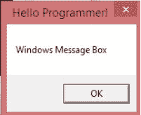

# C++ 语言 Windows 编程与应用程序接口学习指南


# 引言

## 你的第一个窗口

欢迎阅读《创建你自己的窗口》，这是一本结合 C++ 语言与 `Windows API` 的书籍。通过这本书，你将学习构建你第一个窗口所需的语法。通过部就班，你将完成创建一个可以在你 PC 屏幕上看到的、具有完全功能的窗口的各个阶段。

## 窗口示例

在本书结束时，你将能够编写构建窗口的代码并理解其含义。你创建的窗口看起来与此相同或相似：


本书向你介绍的第一个阶段是确保你具备所需的编程经验，以理解理解窗口所需的语法。要理解书中书中显示和解释的所有内容，你需要了解 C++ 的基础知识以及一些面向对象编程的知识。这包括理解等概念：

*   变量。
*   类。
*   继承。
*   函数。
*   通过引用和指针传递值。
*   循环。
*   语句。

现在，让我们从一个名为“消息框”（The Message Box）的简单窗口代码开始看。

## 规范与实践

毫无疑问，`Windows API` 很难学习，但非常有回报。我的意思是，你可以构建自己的 Windows。你可以成为比尔·盖斯（Bill Gates）——显然，不用拥有那几百万美元了。

在本书的各个页中，你将发现三个包含特殊信息的框，重点关注编程技术。以下展示了散布在众多页面中的这些框。

### 编程知识

这些框充满了必要信息，可以帮助增强你对 C++ 语言的理解。

### 编程技术探讨

这些框是为了我们内心的“极客”准备的，他们渴望学习和吸收深度 C++ 概念的信息。

### 编程警告

这些框指出了程序员在尝试通过特定的编程概念编写代码之前应该注意的危险区域。

**警告：Windows 头文件**

取决于你用于构建窗口的编译器，包含 Windows 头文件的方式也可能取决于该编译器的要求。

大多数编译器将接受 `#include <Windows>`。

然而，在某些情况下（例如 `Code::Blocks`），你需要在 Windows 之后加上 `.h`。如下所示：

```cpp
#include <Windows.h>
```

### 第 2 步：使用 `WinMain` 函数打开

如前所述，在创建 Windows 应用时，用于 Windows 控制台程序的主函数被 `WinMain` 函数取代了。与 `main` 函数一样，`WinMain` 是任何创建的 Windows 应用的起点。因此，在使用 `Windows API` 编写程序时，`WinMain` 函数内部的第一行就是程序的开始。

`WinMain` 函数还有几个在 Windows 程序中使用的参数。下面的语法展示了 `WinMain` 函数的原型。

```cpp
WINAPI int WinMain(HINSTANCE hInstance,
                   HINSTANCE hPrevInstance,
                   LPSTR cmdLine, int cmdShow);
```

**警告：WinMain 不是 main**

使用 `main` 开发控制台窗口与通过 `WinMain` 打开来构建窗口是完全不同的。它们唯一的相似之处在于像 `main` 一样，`WinMain` 是程序开始的地方。

现在，你可能已经在盯着这些参数看，疑惑 `HINSTANCE` 和 `LPSTR` 是什么意思了。用复杂的话，`HINSTANCE` 是一个实例的句柄（handle）。这意味着对于第一次尝试 Windows 编程的人来说，`HINSTANCE` 是一个使用 `typedef` 定义的类型，它寻找正在被利用的内存地址。因此，它就像任何数据类型一样，可以定义变量。稍后我们将查看 `Windows API` 在其编程中拥有并使用的不同类型。对于上面的示例，`HINSTANCE` 创建了一个名为 `hInstance` 的变量，另一个名为 `hPrevInstance` 的变量。第二个变量基本上被忽略了。所以，让我们从构建 MessageBox 程序的第一步开始。

### 第 1 步：`<Windows.h>` 文件

在创建我们的 Windows 消息框之前，所需的初始行代码是一个包含 `Windows.h` 头文件的预处理器指令。对于任何中级或高级 C++ 程序员来说，这可能简单而易。然而，我写了下面这一行：

```cpp
#include <Windows.h>
```

通过包含 Windows 头文件，允许程序利用构建在 Windows 中运行的程序所需的所有内容。

**警告：Windows 头文件**

取决于你用于构建窗口的编译器，包含 Windows 头文件的方式也可能不同。

大多数编译器将接受 `#include <Windows>`。

然而，在某些情况下（例如 `Code::Blocks`），你需要在 Windows 之后加上 `.h`。如下所示：

```cpp
#include <Windows.h>
```

### 第 2 步：使用 `WinMain` 函数打开

如前所述，在创建 Windows 应用时，用于 Windows 控制台程序的主函数被 `WinMain` 函数取代了。与 `main` 函数一样，`WinMain` 是任何创建的 Windows 应用的起点。因此，在使用 `Windows API` 编写程序时，`WinMain` 函数内部的第一行就是程序的开始。

`WinMain` 函数还有几个在 Windows 程序中使用的参数。下面的语法展示了 `WinMain` 函数的原型。

```cpp
WINAPI int WinMain(HINSTANCE hInstance,
                   HINSTANCE hPrevInstance,
                   LPSTR cmdLine, int cmdShow);
```

**警告：WinMain 不是 main**

使用 `main` 开发控制台窗口与通过 `WinMain` 打开来构建窗口是完全不同的。它们唯一的相似之处在于像 `main` 一样，`WinMain` 是程序开始的地方。

现在，你可能已经在盯着这些参数看，疑惑 `HINSTANCE` 和 `LPSTR` 是什么意思了。用复杂的话，`HINSTANCE` 是一个实例的句柄。这意味着对于第一次尝试 Windows 编程的人来说，`HINSTANCE` 是一个使用 `typedef` 定义的类型，它寻找正在被利用的内存地址。因此，它就像任何数据类型一样，可以定义变量。稍后我们将查看 `Windows API` 在其编程中拥有并使用的不同类型。对于上面的示例，`HINSTANCE` 创建了一个名为 `hInstance` 的变量，另一个名为 `hPrevInstance` 的变量。第二个变量基本上被忽略了。所以，让我们从构建 MessageBox 程序的第一步开始。

### 第 1 步：`<Windows.h>` 文件

在创建我们的 Windows 消息框之前，所需的初始行代码是一个包含 `Windows.h` 头文件的预处理器指令。对于任何中级或高级 C++ 程序员来说，这可能简单而易。然而，我写了下面这一行：

```cpp
#include <Windows.h>
```

通过包含 Windows 头文件，允许程序利用构建在 Windows 中运行的程序所需的所有内容。

**警告：Windows 头文件**

取决于你用于构建窗口的编译器，包含 Windows 头文件的方式也可能取决于要求。

大多数编译器将接受 `#include <Windows>`。

然而，在某些情况下（例如 `Code::Blocks`），你需要在 Windows 之后加上 `.h`。如下所示：

```cpp
#include <Windows.h>
```

### 第 2 步：使用 `WinMain` 函数打开

如前所述，在创建 Windows 应用时，用于 Windows 控制台程序的主函数被 `WinMain` 函数取代了。与 `main` 函数一样，`WinMain` 是任何创建的 Windows 应用的起点。因此，在使用 `Windows API` 编写程序时，`WinMain` 函数内部的第一行就是程序的开始。

`WinMain` 函数还有几个在 Windows 程序中使用的参数。下面的语法展示了 `WinMain` 函数的原型。

```cpp
WINAPI int WinMain(HINSTANCE hInstance,
                   HINSTANCE hPrevInstance,
                   LPSTR cmdLine, int cmdShow);
```

**警告：WinMain 不是 main**

使用 `main` 开发控制台窗口与通过 `WinMain` 打开来构建窗口是完全不同的。它们唯一的相似之处在于像 `main` 一样，`WinMain` 是程序开始的地方。

现在，你可能已经在盯着这些参数看，疑惑 `HINSTANCE` 和 `LPSTR` 是什么意思了。用复杂的话，`HINSTANCE` 是一个实例的句柄。这意味着对于第一次尝试 Windows 编程的人来说，`HINSTANCE` 是一个使用 `typedef` 定义的类型，它寻找正在被利用的内存地址。因此，它就像任何数据类型一样，可以定义变量。稍后我们将查看 `Windows API` 在其编程中拥有并使用的不同类型。对于上面的示例，`HINSTANCE` 创建了一个名为 `hInstance` 的变量，另一个名为 `hPrevInstance` 的变量。第二个变量基本上被忽略了。所以，让我们从构建 MessageBox 程序的第一步开始。

### 第 1 步：`<Windows.h>` 文件

在创建我们的 Windows 消息框之前，所需的初始行代码是一个包含 `Windows.h` 头文件的预处理器指令。对于任何中级或高级 C++ 程序员来说，这可能简单而易。然而，我写了下面这一行：

```cpp
#include <Windows.h>
```

通过包含 Windows 头文件，允许程序利用构建在 Windows 中运行的程序所需的所有内容。

**警告：Windows 头文件**

取决于你用于构建窗口的编译器，包含 Windows 头文件的方式也可能取决于要求。

大多数编译器将接受 `#include <Windows>`。

然而，在某些情况下（例如 `Code::Blocks`），你需要在 Windows 之后加上 `.h`。如下所示：

```cpp
#include <Windows.h>
```

### 第 2 步：使用 `WinMain` 函数打开

如前所述，在创建 Windows 应用时，用于 Windows 控制台程序的主函数被 `WinMain` 函数取代了。与 `main` 函数一样，`WinMain` 是任何创建的 Windows 应用的起点。因此，在使用 `Windows API` 编写程序时，`WinMain` 函数内部的第一行就是程序的开始。

`WinMain` 函数还有几个在 Windows 程序中使用的参数。下面的语法展示了 `WinMain` 函数的原型。

```cpp
WINAPI int WinMain(HINSTANCE hInstance,
                   HINSTANCE hPrevInstance,
                   LPSTR cmdLine, int cmdShow);
```

**警告：WinMain 不是 main**

使用 `main` 开发控制台窗口与通过 `WinMain` 打开来构建窗口是完全不同的。它们唯一的相似之处在于像 `main` 一样，`WinMain` 是程序开始的地方。

现在，你可能已经在盯着这些参数看，疑惑 `HINSTANCE` 和 `LPSTR` 是什么意思了。用复杂的话，`HINSTANCE` 是一个实例的句柄。这意味着对于第一次尝试 Windows 编程的人来说，`HINSTANCE` 是一个使用 `typedef` 定义的类型，它寻找正在被利用的内存地址。因此，它就像任何数据类型一样，可以定义变量。稍后我们将查看 `Windows API` 在其编程中拥有并使用的不同类型。对于上面的示例，`HINSTANCE` 创建了一个名为 `hInstance` 的变量，另一个名为 `hPrevInstance` 的变量。第二个变量基本上被忽略了。所以，让我们从构建 MessageBox 程序的第一步开始。

# 第 1 章：MessageBox 窗口

## 你的第一个窗口：消息框

还记得你创建的第一个程序吗？如果你读过我写的《C++ 编程简化版》第一本书，那么你的第一个程序可能是 `The Hello Programmer` 应用程序。嗯，我希望你读过了，为了开始你的 Windows 编程之旅，我们将把 `Hello Programmer` 应用程序转换为与 `Windows API` 一工作。

当然，创建一个 Windows 版本的 `Hello Programmer` 应用程序比你在这里看到的简单程序要得多。

```cpp
#include <iostream>

using namespace std;

int main()
{
    cout << "Hello Programmer!" << endl;
    return 0;
}
```

看起来挺容易的对吧？嗯，记得那些用 C++ 编程很轻松的日子吧，虽然没有你即将投入的世界那么有回报——不是字面上的意思。别担心，我不会让你在沉没的船上没有信号枪。在我们经历的每一个阶段，我都会那里手着你的手——再次不是字面上的——并慢慢向你解释每一个部分。所以，让我们从构建 MessageBox 程序的第一步开始。

### 第 1 步：`<Windows.h>` 文件

在创建我们的 Windows 消息框之前，所需的初始行代码是一个包含 `Windows.h` 头文件的预处理器指令。对于任何中级或高级 C++ 程序员来说，这可能简单而易。然而，我写了下面这一行：

```cpp
#include <Windows.h>
```

通过包含 Windows 头文件，允许程序利用构建在 Windows 中运行的程序所需的所有内容。

**警告：Windows 头文件**

取决于你用于构建窗口的编译器，包含 Windows 头文件的方式也可能取决于该编译器的要求。

大多数编译器将接受 `#include <Windows>`。

然而，在某些情况下（例如 `Code::Blocks`），你需要在 Windows 之后加上 `.h`。如下所示：

```cpp
#include <Windows.h>
```

### 第 2 步：使用 `WinMain` 函数打开

如前所述，在创建 Windows 应用时，用于 Windows 控制台程序的主函数被 `WinMain` 函数取代了。与 `main` 函数一样，`WinMain` 是任何创建的 Windows 应用的起点。因此，在使用 `Windows API` 编写程序时，`WinMain` 函数内部的第一行就是程序的开始。

`WinMain` 函数还有几个在 Windows 程序中使用的参数。下面的语法展示了 `WinMain` 函数的原型。

```cpp
WINAPI int WinMain(HINSTANCE hInstance,
                   HINSTANCE hPrevInstance,
                   LPSTR cmdLine, int cmdShow);
```

**警告：WinMain 不是 main**

使用 `main` 开发控制台窗口与通过 `WinMain` 打开来构建窗口是完全不同的。它们唯一的相似之处在于像 `main` 一样，`WinMain` 是程序开始的地方。

现在，你可能已经在盯着这些参数看，疑惑 `HINSTANCE` 和 `LPSTR` 是什么意思了。用复杂的话，`HINSTANCE` 是一个实例的句柄。这意味着对于第一次尝试 Windows 编程的人来说，`HINSTANCE` 是一个使用 `typedef` 定义的类型，它寻找正在被利用的内存地址。因此，它就像任何数据类型一样，可以定义变量。稍后我们将查看 `Windows API` 在其编程中拥有并使用的不同类型。对于上面的示例，`HINSTANCE` 创建了一个名为 `hInstance` 的变量，另一个名为 `hPrevInstance` 的变量。第二个变量基本上被忽略了。所以，让我们从构建 MessageBox 程序的第一步开始。


`MessageBox` 对象的最后一个参数是一个无符号整数类型。尽管你没有在参数中写数字，而是写了一个等于某个值的定义名称。在这种情况下，名称为 `MB_OK`。它的作用是允许消息框带有一个 OK 按钮。

**知识点：** unsigned（无符号）意味着低于 0

记住 `unsigned` 状态表示值不能低于 0。

**知识点：** 窗口

无论是按钮、滚动条还是文本框，它们统被称为窗口。这意味着示例中的 OK 按钮也是一个窗口。

一旦写完 `MessageBox` 函数，我们就可以使用返回值 `0` 并配合右括号来结束程序。



这就是 `MessageBox` 程序的最终产物。我知道它看起来没什么什么，但嘿，你刚刚创建了人生中第一个窗口。没错，即使是屏幕上这样一个小方块也是一个窗口。

# 第 2 章：创建一个窗口

## 编写主窗口

在上一个示例中，你创建了属于自己的窗口应用程序。尽管它只是一个消息对话框，但它使用了每个 Windows 应用程序都具备的基础要素。

现在，我们将创建一个全屏窗口。它是一个带有白色背景的简单空白窗口。一个基础窗口大约包含 70-80 行代码。

那么，首先，你需要初始化窗口，然后在设置循环之前创建窗口。

### 步骤 1: 窗口类

在编写了 `Windows.h` 头文件并打开 `WinMain` 函数后，创建窗口的第一步是为它分配一个名为 Windows 类的类。

#### WNDCLASSEX

创建 Windows 类需要以下语法。

```cpp
WNDCLASSEX <class name>;
WNDCLASSEX parentWindow;
```

一旦声明了窗口类，你就可以通过填充其参数的规范来开始定义它。

以下是在进入下一个阶段之前需要注意的参数列表。

| 参数 | 描述 |
| :--- | :--- |
| `cbClsExtra` | 决定 Windows 类所需的预留字节数。通常将其设置为 `NULL`。 |
| `cbSize` | 设置 Windows 类的字节大小。 |
| `cbWndExtra` | 决定窗口所需的预留字节数。通常将其设置为 `NULL`。 |
| `hbrBackground` | 设置用于绘制和着色窗口的画刷类型。它可以更改窗口的颜色。 |
| `hCursor` | 设置窗口中使用的光标类型。如果设置为 `NULL`，则使用默认光标。 |
| `hIcon` | 设置用于窗口的原始图标。这是在任务栏中看到的图标。如果设置为 `NULL`，则使用默认图标。 |
| `hIconSm` | 设置小尺寸图标（在 Windows 栏中显示）。如果设置为 `NULL`，则使用默认图标。 |
| `hInstance` | 设置窗口使用的实例句柄名称。 |
| `lpszClassName` | 在双引号之间设置 Windows 类的名称。 |
| `lpfnWndProc` | 设置在 `WinProc` 函数找到找到名称。 |
| `lpszMenuName` | 设置窗口拥有的菜单名称。如果窗口没有菜单，则设置为 `NULL`。 |
| `style` | 设置窗口的样式（形状）。 |

一旦像下面所示填充了所有内容，下一步是确保窗口已注册到内存中。

```cpp
prWnd.cbClsExtra = 0;
prWnd.cbSize = sizeof(WNDCLASSEX);
prWnd.cbWndExtra = 0;
prWnd.hbrBackground = (HBRUSH)(COLOR_WINDOW+1);
prWnd.hCursor = LoadCursor(hInst , IDC_ARROW);
prWnd.hIcon = NULL;
prWnd.hIconSm = NULL;
prWnd.hInstance = hInst;
prWnd.lpfnWndProc = (WNDPROC)WndProc;
prWnd.lpszClassName = "DirectX Project";
prWnd.lpszMenuName = NULL;
prWnd.style = CS_HREDRAW | CS_VREDRAW;
```

### 步骤 2: 注册 Windows 类

这部分非常简单，只需要一行代码。首先你编写 `RegisterClassEx`，然后在括号 `()` 中引用你刚刚创建的 Windows 类。在这种情况下，它看起来如下。

#### RegisterClassEx

```cpp
RegisterClassEx(&parentWindow);
```

搞定。简单。

### 步骤 3: 创建窗口

现在你已经将窗口注册到内存供计算机使用，你需要创建它的基础。不要将其与创建窗口类混淆，因为现在你正在形成窗口的视觉方面，而不是告诉编译器窗口边界以及窗口应该如何运行。

要开始创建窗口，你首先必须使用句柄变量（通常为 `hWnd`）并结合 `CreateWindow` 函数。

| 参数 | 描述 |
| :--- | :--- |
| `LPSTR` | 类名。 |
| `LPSTR` | 窗口标题。 |
| `DWORD` | 窗口如何显示。 |
| `int` | 窗口的 X 位置。 |
| `int` | 窗口的 Y 位置。 |
| `int` | 窗口的宽度。 |
| `int` | 窗口的高度。 |
| `HWND` | 父窗口。 |
| `HMENU` | 窗口的菜单。 |
| `HINSTANCE` | 窗口的实例。 |
| `LPVOID` | 指值的指针。 |

```cpp
hWnd = CreateWindow("First Window", "Main Window", WS_OVERAPPEDWINDOW | WS_TOPMOST | WS_VISIBLE, 400, 400, 800, 600, NULL, NULL, hInstance, NULL);
```

### 步骤 4: 显示并更新窗口

接下来，是时候告诉编译器它将如何显示窗口了。这并不是说它看起来如何，而是告诉它使用哪个句柄来显示，并在每当创建一个新事件时更新窗口。

**技术杂谈：** 什么是 Windows 事件？

窗口事件是窗口中发生的任何事情。无论是鼠标点击、菜单打开还是窗口调整大小，它们都是事件，并且编译器需要在事件发生时被通知，以便它通过 `UpdateWindow` 函数更新窗口。

#### ShowWindow(…)

首先，我们需要在显示窗口之前告诉编译器它需要更新。为了做到这一点，需要启动 `ShowWindow` 函数并带上一组参数，告诉编译器使用哪个句柄以及如何使用该句柄的概念。

```cpp
ShowWindow(hWnd, SW_SHOW);
```

我们知道 `hWnd` 是窗口的句柄。但 `SW_SHOW` 是一个对象类型，它告诉显示窗口函数在获取句柄后，利用它来显示窗口。

### 步骤 5: 翻译与更新

#### MSG


`WinMain` 函数中要求的最后一个方面是创建一个 `MSG` 变量，该变量将用于中断窗口解释的整数值。首先，需要创建一个 `MSG` 变量。`MSG` 的类型定义是一个简单的 `int` 变量。

创建 `MSG` 变量的语法与任何其他类型的变量非常相似，只不过没有写内置类型，而是用 `MSG` 代替它。

```cpp
MSG message;
```

### ZeroMemory(...)

接下来使用 `ZeroMemory` 函数来确保其参数在使用之前被分配了 `NULL` 值。这样做的原因是你不希望变量的数据被不必要地擦除。

`ZeroMemory` 函数的语法如下。

```cpp
ZeroMemory(message, &message);
```

如你所见，它使用了 `message` 变量并引用它以检查其中是否存储了数据。

### while 循环

下一个阶段是创建一个在窗口关闭之前一直为真的循环，因此它返回值为 0。

该循环使用 `while` 循环方法，你也可以将其写为 `do while` 循环。这些是编程窗口阶段最容易编写的两种循环。

```cpp
while (true) {
  // windows functions
}

do
{
  // windows functions
} while (true);
```

如果你想将此写为 `for` 循环，那么以下语法将有效。

```cpp
bool wndEvent = true;

for (wndEvent = true; wndEvent = false; ;)
{
  // windows functions
}
```

你看到在为窗口编写这段代码时，使用 `for` 循环需要写的内容多多少了吗？这看起来可能并不多，但仍然是一个笨拙的方法。

现在循环已经完成（我将使用 `while` 循环），我们现在可以进入翻译和分发消息所需的两个窗口函数。

### TranslateMessage(...)

首先，你的窗口需要获取消息并将其翻译为它可以理解的内容。因此，我们使用一个名为 `TranslateMessage` 的函数。该函数只接受一个参数，即 `message` 变量。它看起来如下：

```cpp
TranslateMessage(&message);
```

### DispatchMessage(...)

在翻译之后，消息通过引用发送给 `DispatchMessage` 函数，该函数将其发送给计算机以完成其任务。

观察 `Dispatch` 函数，可以看到它与 `TranslateMessage` 类似。

```cpp
DispatchMessage(&message);
```

然后查看完整的 `while` 循环，这是包含两个 Windows 函数时的样子。

```cpp
while (true) {
  TranslateMessage(&message);
  DispatchMessage(&message);
}
```

### 第 6 ：事件循环

#### 回调函数

窗口的最后部分是创建回调函数，它将包含事件循环。尽管它被称为事件循环，但我们要创建的是 `switch` 语句，它根据给定的值决定采取的行动。

要开始回调函数，我们创建函数头。回调函数的语法初看起来可能很奇怪，我将在本节中解释所使用的每个关键字。

让我们先看函数。

```cpp
LRESULT CALLBACK WndProc(HWND hWnd, UINT msg, WPARAM wParam, LPARAM lParam)
{
  // statements
}
```

当然，`switch` 语句位于回调函数内部。首先，在进入函数之前，我们将查看函数头中的每个关键字。

| 关键字 | 描述 |
| :--- | :--- |
| LRESULT | `LRESULT` 是回调函数的开头。 |
| CALLBACK | `CALLBACK` 是一个类型定义，类似于返回语句，并告诉编译器函数的执行需要影响整个窗口。 |
| WndProc | `WndProc` 是函数开启的标题。 |
| HWND | 我们已经见过 `HWND`。`HWND` 关键字是窗口的句柄。 |
| UINT | 我们已经见过 `UINT` 是无符号整数。它将持有传递给 `switch` 语句的消息值。 |
| WPARAM | `WPARAM` 是宽参数（Wide Parameter）。窗口需要的消息取决于使用 `WPARAM` 还是 `LPARAM`。 |
| LPARAM | `LPARAM` 是长参数（Long Parameter）。窗口需要的消息取决于使用 `WPARAM` 还是 `LPARAM`。 |

#### switch 语句

深入函数，我们首先遇到一个 `switch` 语句，其值为变量 `msg` 所持有的值。首先，我们来看 `switch` 语句。

```cpp
switch (msg)
{
  case 1: WM_Destroy
    PostQuitWindow(0);
}
```

`switch` 语句获取 `msg` 变量，并根据接收到的值从可选分类中进行选择。

在这个 `switch` 语句示例中，只有一个选项供选择。

但现在，我们来查看 `WM_DESTROY`。这种类型是窗口关闭的调用。`PostQuitWindow` 参数值为 0，这使得程序在初始化 case 时关闭。

这就是创建一个简单窗口的全部内容。窗口程序的完整代码将发布在下一页。

### 第 7 ：使用 OOP 采用基础窗口

#### 构建 BasicWindow 类

现在我们已经看到了如何创建基础窗口，是时候使用 OOP（面向对象编程）来操作它了。我们将创建一个类来存储窗口所需的数据。

首先，我们从基础开始。

```cpp
class BasicWindow {
public:
  API int WinMain(HINSTANCE, LPSTR, int);
  LRESULT WndProc(HWND, UINT, WPARAM, LPARAM);
protected:
  HWND hWnd;
  HINSTANCE hInstance;
};
```

在类中使用 `HWND` 消除了对全局 `HWND` 变量的需求。这使得代码更整洁。接下来我们有 `WinMain` 和 `WndProc` 这两个函数。使用这些对象和方法，你需要在代码中添加类名和点运算符。

### 第 章：组合窗口最终产品

这是书的最后部分。我们将所学到的内容组合在一起，这将从前几页构建窗口。这里是完整的窗口代码。

```cpp
#include <Windows.h>

class Windows {
public:
  bool LoadWindow(HINSTANCE hInst);
private:
  HWND hWnd;
  HINSTANCE hInst;
};

LRESULT CALLBACK WndProc(HWND hWnd, UINT uMsg, WPARAM wParam, LPARAM lParam) {
  switch (uMsg) {
    case WM_DESTROY:
      PostQuitMessage(0);
      break;
  }
  return DefProc(hWnd, uMsg, wParam, lParam);
}

bool Windows::LoadWindow(HINSTANCE hInst) {
  HWND CreateWin;
  WNDCLAS prWnd;
  prWnd.cbCls = 0;
  prWnd.cbSize = sizeof(WNDCLAS);
  prWnd.cbWndExtra = 0;
  prWnd.hBackground = (HBRUSH)(COLOR_WINDOW+1);
  prWnd.hCursor = LoadCursor(hInst, IDC_ARROW);
  prWnd.hIcon = NULL;
  prWnd.hIconSm = NULL;
  prWnd.hInstance = hInst;
  prWnd.lpfnWndProc = (WNDPROC)WndProc;
  prWnd.lpszClassName = "DirectX Project";
  prWnd.lpszMenu = NULL;
  prWnd.style = CS_HREDRAW | CS_VREDRAW;
  RegisterClassEx(&prWnd);
  CreateWin.hWnd = CreateWindow(
    "DirectX Project",
    "My Main Window",
    WS_OVERLAPPEDWINDOW | WS_EX_TOPMOST | WS_VISIBLE,
    400, 400,
    800, 600,
    NULL, NULL, hInst, NULL
  );
  if (!CreateWin.hWnd) {
    MessageBox(hWnd, "Window Creation Failed", "Failed To Create Window", MB_OK);
    return false;
  }
  ShowWindow(CreateWin.hWnd, SW_SHOW);
  UpdateWindow(CreateWin.hWnd);
  return true;
}
```


```cpp
int WINAPI WinMain(HINSTANCE hInst , HINSTANCE hPrevInst , LPSTR lpCmdLine , int iCmdShow)
{
    InWindows theWindow; // WINDOW CLASS OBJECT
    if(!theWindow.LoadWindow( hInst ))
    {
        // IF PARENT WINDOW FAILS TO LOAD
        MessageBox(NULL , "Error Initializing Parent Window" , "Initialize Parent Window Failed", MB_OK);
        return false; // QUIT PROGRAM
    }
    MSG message;
    ZeroMemory(&message, sizeof (message));
    while( true )
    {
        if( PeekMessage(&message, NULL , 0,0,PM_REMOVE ))
        {
            TranslateMessage(&message);
            DispatchMessage(&message);
        }
    }
}
```

## 结语

感谢你从 Kindle 商店购买或借阅本 Kindle 书。我真心希望它对你学习如何开发和编写 Windows 程序非常有帮助。如果你对本书有任何问题，请通过邮件 ltrobespierre@outlook.com 与我取得联系。

此外，如果你在读完本书后，能在亚马逊上写下评论，分享你对这本书的喜爱程度或者——老天保佑——你不喜欢，我将不胜感激。

如果你在书中发现任何错误，请邮件至上述地址并说明问题，包括章节号和小节号。谢谢。

再次表示感谢。写这本书是我的荣幸，希望你在阅读和学习 Windows API 基础知识的过程中也同样充满了动力。

再次，

感谢！

