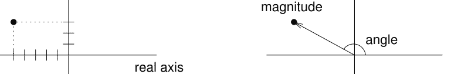

# 如何像计算机科学家一样思考：C++ 版本

# 第一章

## 程序之道

本书的目标是教你如何像计算机科学家一样思考。我非常喜欢计算机科学家的思考方式，因为他们结合了数学、工程和自然科学的一些优秀特性。像数学家一样，计算机科学家使用形式语言来表示思想（具体说是计算）。像工程师一样，他们设计事物，将组件组装成系统，并在替代方案之间进行权衡。像科学家一样，他们观察复杂系统的行为，形成假设并测试预测。

计算机科学家最重要的一项技能是**解决问题**。我指的是表述问题、对解决方案进行创造性思考，以及清晰、准确地表达解决方案的能力。事实证明，学习的过程是练习解决问题技能的绝佳机会。这就是为什么这一章被称为“程序之道”。

当然，这本书的另一个目标是为你的参加计算机科学 AP 考试做准备。我们可能不会采取最直接的方法来达成这一目标，因为书书中没有许多与 AP 题类似的练习题。另一方面，如果你理解了书中的概念以及 C++ 编程的细节，你将拥有参加考试所需的所有工具。

### 1.1 什么是编程语言？

你将学习的编程语言是 C++，因为截至 1998 年，AP 考试基于该语言的。在此之前，考试使用的是 Pascal。C++ 和 Pascal 都是**高级语言**；你可能可能听过的其他高级语言还有 Java、C 和 FORTRAN。

正如你可能从“高级语言”中推断出的那样，还有**低级语言**，有时被称为机器语言或汇编语言。通俗地说，计算机只能执行用低级语言编写的程序。因此，用高级语言编写的程序在运行之前必须经过翻译。这种翻译需要一些时间，这是高级语言的一个微小缺点。

但它的优势是巨大的。首先，用高级语言编程要容易得多；我我所说的“容易”是指编写程序所需的时间更短，代码更短且易于阅读，并且正确的概率更高。其次，高级语言是可移植的，这意味着它们可以在很少或完全不修改的情况下在不同类型的计算机上运行。低级程序只能在一种计算机上运行，要在另一种计算机上运行必须重写。

由于这些优势，几乎所有的程序都是用高级语言编写的。低级语言仅用于少数特殊应用。

翻译程序有两种方法：解释或编译。解释器是一个读取高级程序并执行其所述操作的程序。实际上，它是逐行翻译程序的，交替读取代码行并执行命令。

编译器是一个读取高级程序并在执行任何命令之前将其一次性翻译过的程序。通常情况下，你将作为一个独立的步骤来编译程序，然后在稍后执行编译后的代码。在这种情况下，高级程序被称为源代码，翻译后的程序被称为对象代码或可执行文件。

作为一个示例，你用 C++ 编写了一个程序。你可能会使用文本编辑器（一个简单的文字处理器）。当程序完成后，你将其保存到一个名为 `program.cpp` 的文件中，其中“program” 是你随手起的任意名称，而后缀 `.cpp` 是表示该文件包含 C++ 源代码的约定。

然后，取决于你的编程环境，你可能会离开文本编辑器并运行编译器。编译器会读取你的源代码，对其进行翻译，并创建一个新文件 `program.o` 来包含对象代码，或者创建一个 `program.exe` 来包含可执行文件。

### 1.2 什么是程序？

编译器读取高级程序并在执行任何命令之前将其一次性翻译过的。通常情况下，你将作为一个独立的步骤来编译程序，然后在稍后执行编译后的代码。在这种情况下，高级程序被称为源代码，翻译后的程序被称为对象代码或可执行文件。

作为一个示例，你用 C++ 编写了一个程序。你可能会使用文本编辑器（一个简单的文字处理器）。当程序完成后，你将其保存到一个名为 `program.cpp` 的文件中，其中“program” 是你随手起的任意名称，而后缀 `.cpp` 是表示该文件包含 C++ 源代码的约定。

然后，取决于你的编程环境，你可能会离开文本编辑器并运行编译器。编译器会读取你的源代码，对其进行翻译，并创建一个新文件 `program.o` 来包含对象代码，或者创建一个 `program.exe` 来包含可执行文件。

### 1.3 什么是调试？

编程是一个复杂的过程，由于是由人类完成的，往往会导致错误。由于某些原因，这些错误被称为 Bug，而追踪并修正它们的过程被称为调试。

程序会出现不同类型的错误，区分它们有助于更快定位：

- **输入**: 从键盘获取数据。
- **输出**: 在屏幕上显示数据或保存到文件。
- **数学**: 执行数学运算。
- **测试**: 检查某些条件。
- **重复**: 重复执行某些操作。

信你不信，这基本上就是全部了。以某种方式，编程是将复杂任务分解为更小的子任务，直到子任务变得足够简单。

#### 1.3.1 编译时错误

编译器只有在程序语法正确时才能翻译程序；否则，编译会失败，你无法运行程序。语法指的是程序的结构。

例如，在英语中，句子必须以大写字母开头并以句号结尾。这句话包含语法错误。这一句也是如此。

编译器是不留情的。如果程序中任何地方存在语法错误，编译器就会打印错误信息并退出，你无法运行程序。

更糟糕的是，C++ 的语法规则比英语多得多，而且编译器提供的错误信息通常没什么帮助。在编程生涯的早期，你可能会花费大量时间追踪语法错误。随着经验的增加，你犯的错误会减少，查找速度也会加快。

#### 1.3.2 运行时错误

第二类错误是运行时错误，之所以这样做是因为程序运行时才会出现。

对于我们在几周内编写的简单程序来说，运行时错误很少见，所以你可能很快就会遇到一个。

#### 1.3.3 逻辑错误和语义

第三类错误是逻辑错误或语义错误。如果程序中存在逻辑错误，它可以成功编译并运行，这里的意思是计算机不会生成任何错误信息，但它没有做正确的事。它会做别的事。具体来说，它会执行你要求的操作。

问题在于你写的程序并不是你想要的程序。程序的含义（语义）是错误的。识别逻辑错误可能是困难的，因为这需要你通过观察程序的输出来反推它在做什么。

#### 1.3.4 实验性调试

通过学习这本书，你应该掌握的最重要技能之一就是调试。虽然调试可能会让人感到沮丧，但它是编程中最具智力丰富、最具挑战性且最有趣的部分之一。

在某些方面，调试就像是侦探工作。你面对着各种线索，必须推断导致你所看到的结果的过程和事件。

调试也像是一门实验科学。如果你有一个想法，就修改你的程序并重新尝试。如果你的假设是正确的，你就对修改进行调试，向可以运行的程序更近一步。如果你的假设是错误的，你就得想一个新的假设。正如夏尔洛·霍姆斯所指出的，“当你排除了所有可能的，剩下的无论如何必然事实。”（出自柯南·道尔的《四龙之印》）。

对于某些人来说，编程和调试是同一的。也就是说，编程是一个不断调试程序直到它实现你想要的功能。这种想法是，你应该总是从一个可以运行的程序开始，进行微小的修改，边做边调试，这样你就能一直有一个运行良好的程序。

例如，Linux 是一个包含数千行代码的操作系统，但它最初只是 Linus·托瓦尔兹用来探索 Intel 8038 芯片的简单程序。根据 Larry Greenfield 的说法，“Linux 的早期项目之一是一个在 AAAA 和 BBBB 之间切换的程序。这后来演变成了 Linux”（出自《Linux 用户指南 Beta 版本 1》）。

在随后的章节中，我将对调试和其他编程实践提供更多建议。

### 1.4 形式语言与自然语言

自然语言是人们使用的语言，如英语、西班牙语和法语。它们不是由人类设计的（尽管人们试图为它们建立秩序）；它们是自然演化的。

形式语言是人类为了特定应用而设计的语言。例如，数学家使用的符号法就是形式语言，它特别擅长表示数字和符号之间的关系。化学家使用形式语言来表示分子的化学结构。最重要的是：

**编程语言是为了表达计算而设计的形式语言**

正如我之前提到的，形式语言在语法上往往有严格的规则。例如，$3+3=6$ 是一个语法上正确的数学陈述，但 $3=+6$ 则不是。同样，$H_2O$ 是一个语法上正确的化学名称，但 $H_2Oz$ 则不是。

语法规则分为两种类型，涉及标记（tokens）和结构。标记是语言的基本元素，如单词、数字和化学元素。$3+=6$ 的问题之一是，$=$ 在数学中不是合法的标记（至少我所知是如此）。同样，$2Zz$ 是不法的，因为没有缩写为 $Zz$ 的元素。

第二类语法错误涉及语句的结构；即标记的排列方式。$3+=6$ 在结构上是非合法的，因为你不能在等号后面紧跟加号。同样，分子式必须在元素名称之后有下标，而不是之前。

当你阅读一个英语句子或形式语言中的一个陈述时，你必须弄清楚句子的结构是什么（尽管在自然语言中你是不意识地完成这一点的）。这个过程被称为**解析**（parsing）。

例如，当你听到“The other shoe fell（另一只鞋掉掉了）”时，你理解“the other shoe”是主语，“fell”是动词。一旦你解析了一个句子，你就能弄明白它的意思，即句子的语义（semantics）。假设你知道什么是鞋以及 fell 是什么意思，你就能理解这句话的普遍含义。

尽管形式语言和自然语言有很多共同点——标记、结构和语义——但它们也存在许多差异。

- **歧义（ambiguity）：** 自然语言充满了歧义，人们通过使用上下文和其他信息来处理。形式语言的设计目标是几乎或完全没有歧义，这意味着任何陈述都只有一种含义，无论上下文如何。
- **冗余（redundancy）：** 为了弥补歧义并避免误解，自然语言使用了大量的冗余。因此，它们通常很冗长。形式语言冗余较少且更加简洁。
- **字面性（literalness）：** 自然语言充满了成语和比喻。如果我说“The other shoe fell”，可能根本没有鞋，也没有东西掉落。形式语言所言即其是。

伴随着自然语言长大的人（（每个人）往往在适应形式语言时感到很困难。在某些方面，形式语言和自然语言之间的区别就像诗歌和散文的区别，但同样如此：

- **诗歌：** 单词的使用不仅为了它们的声音，还为了它们的意义，整首诗创造了一种效果或情感反应。歧义不仅很常见，而且往往是故意的。
- **散文：** 单词的字面意义比结构重要，结构贡献了更多意义。散文比诗歌更易分析，但通常仍然具有歧义。
- **程序：** 计算机程序的意义是非歧义且字面上的，可以通过对标记和结构的分析完全理解。

### 1.5 第一个程序

这里是关于阅读程序（以及其他形式语言）的一些建议。首先，记住形式语言比自然语言密集得多。

- 低级语言：一种设计便于计算机执行的编程语言。也称为“机器语言”或“汇编语言”。
- 可移植性：程序可以在多种类型的计算机上运行的属性。
- 形式语言：人们为了特定目的而设计的任何语言，例如表示数学思想或计算机程序。所有的编程语言都是形式语言。
- 自然语言：人们所说的任何自然演化的语言。
- 解释：通过逐行翻译来执行高级语言编写的程序。
- 编译：将高级语言程序一次性翻译成低级语言，为稍后的执行做准备。
- 源代码：编译前的高级语言程序。
- 目标代码：编译器翻译程序后的输出结果。
- 可执行文件：准备好执行的目标代码的另一种名称。
- 算法：解决一类问题的通用过程。
- Bug（缺陷）：程序中的错误。
- 语法：程序的结构。
- 语义：检查程序并分析其语法结构。
- 语法错误：程序中导致无法解析（因此无法编译）的错误。
- 运行时错误：程序在运行时导致失败的错误。
- 逻辑错误：程序中导致其执行结果与程序员意图不符的错误。
- 调试：发现并消除上述三种错误之一的过程。

# 第2章

## 变量与类型

### 2.1 输出输出

正如我在上一章提到的，你可以在 `main` 函数中放置任意数量的语句。例如，输出多行内容：

```cpp
#include <iostream.h>
```

```cpp
// main: 生成一些简单的输出

void main ()
{
    cout << "Hello, world." << endl; // 输出一行
    cout << "How are you?" << endl; // 输出另一行
}
```

如你所见，在行末添加注释以及单独独成一行注释都是合法的。

出现在引号中的短语被称为字符串（strings），因为它们是由字母的序列（串串）组成的。实际上，字符串可以包含字母、数字、标点符号和其他特殊字符的任意组合。

将多个输出语句的输出显示在同一行上通常有用。你可以通过省掉第一个 `endl` 来实现：

```cpp
void main ()
{
    cout << "Goodbye, " << endl;
    cout << "cruel world!" << endl;
}
```

在这种情况下，输出显示在单行上，为 Goodbye, cruel world!。注意单词 "Goodbye," 和第二个引号之间有一个空格。这个空格会出现在输出中，因此它会影响程序的行为。出现在引号之外的空格通常不会影响程序的行为。例如，我可以写成：

```cpp
void main ()
{
    cout<<"Goodbye, ";
    cout<<"cruel world!"<<endl;
}
```

这个程序的编译和运行效果与原程序一样好。行尾的断行（换行）不影响程序的行为，所以我也可以写成：

```cpp
void main(){cout<<"Goodbye, ";cout<<"cruel world!"<<endl;}
```

这样也可以运行，尽管你可能已经注意到程序变得越来越难以阅读。换行和空格对于视觉上组织你的程序很有帮助，可以让你更容易阅读程序并定位语法错误。

### 2.2 值

值（value）是程序处理的基本元素——类似于字母或数字。到目前为止我们处理过的值只有我们输出的字符串值，例如 "Hello, world."。你可以识别出字符串值是被包含在引号中的。

还有其他类型的值，包括整数和字符。整数（integer）是像 1 或 17 这样的整数。你可以用输出字符串的方式输出整数值：

```cpp
cout << 17 << endl;
```

字符（character）是包含在单引号中的字母、数字或标点符号，'a' 或 '5'。你可以用相同的方式输出字符值：

```cpp
cout << 'a' << endl;
```

这个示例单行输出一个波浪大括号。

不同类型的值很容易混淆，例如 "5"、'5'，如果你注意标点符号，就应该很清楚第一个是字符串，第二个是字符，第三个是整数。这种区别很快就会变得清晰。

### 2.3 变量

编程语言最强大的功能之一是操作**变量**（variables）的能力。变量是存储值的命名的位置。

就像有不同类型的值（整数、字符等）一样，也有不同类型的变量。当你创建一个新变量时，你必须声明它的类型。例如，C++ 中的字符类型被称为 **char**。以下语句创建了一个名为 **fred** 的类型为 char 的新变量。

```cpp
char fred;
```

这种语句被称为**声明**（declaration）。

变量的类型决定了它可以存储什么类型的值。**char** 变量可以包含字符，所以 **int** 变量可以存储整数也不意外奇。

C++ 中有几种可以存储字符串值的类型，但我们现在将跳过那部分（第7章）。

创建一个整数变量：

```cpp
int bob;
```

其中 bob 是你为变量起的任意名称。通常情况下，你希望变量名能够指示你打算对它做什么。例如，你看到了这些变量声明：


```cpp
char firstName = 'a'; // 给 firstName赋值'a'
hour = 11;         // 给 hour赋值11
minute = 59;      // 给 minute赋值59
```

### 2.4 赋值

现在我们创建了一些变量，我们想为它们存储值。我们通过**赋值语句**来实现。

这个示例展示了三次赋值，词汇可能会令人混乱，但想法很直观：

- 当你声明变量时，你创建了一个命名的存储位置。
- 当你对变量进行赋值时，你给它一个值。

在纸上表示变量的一种方法是画一个框，在框外写变量名，在框内写值。这就是变量看起来的样子：


### 2.5 输出变量

这个程序创建了整数变量 `hour` 和 `minute`，以及一个字符变量 `colon`。它为每个赋值了适当的值，然后使用一系列输出语句生成：

```cpp
cout << hour;
cout << colon;
cout << minute;
cout << endl;
```

输出是：

11:59

当我们说“放入变量”时，指的是输出变量的值。要输出变量的名字，你需要将其放在引号中。例如：`cout << "hour";`

正如我们之前看到的，你可以在单个输出语句中包含多个值，这可以让之前的程序更简洁：

```cpp
int hour, minute;
char colon;
```

```cpp
hour = 11;
minute = 59;
colon = ':';
```

```cpp
cout << "The current time is " << hour << " hour " << colon << " minute" << endl;
```

在这行中，该程序输出了一个字符串、两个整数、一个字符以及特殊值 `endl`。非常深刻！

### 2.7 运算符

**运算符**是用于表示简单计算（如加法和乘法）的特殊符号。C++ 中的大多数运算符其行为完全符合你的预期，因为它们是常见的数学符号。例如，两个整数相加的运算符是 `+`。

以下都是合法的 C++ 表达式，其意义显而易见：

+ `1+1` `hour-60 + minute` `minute/60`

表达式可以同时包含变量名和整数值。在每种情况下，变量名在计算之前会被替换为它的值。

加法、减法和乘法的结果都符合你的预期，但除法的运行结果可能会让你感到意外。例如，以下程序：

```
int hour, minute;
hour = 19;
cout << "Number of minutes since midnight: " << endl;
cout << hour*60 + minute << endl;
cout << "Fraction of the hour that has passed: " <<
cout << minute/60.0 << endl;
```

将产生以下输出：

```
Number of minutes since midnight: 719
Fraction of the hour that has passed: 0
```

第一行是我们预期的，第二行就很奇怪。变量 `minute` 的值为 59，59 除以 60 等于 0.9833，而不是 0。差异的原因是 C++ 正在执行**整数除法**。

当两个**操作数**（运算符作用的对象）都是整数时，结果也必须是整数。根据定义，整数除法总是向下取整，即使在像这种与下一个整数非常接近的情况下。

在这种情况下，可能的替代方案是计算百分比而不是分数：

```
cout << "Percentage of the hour that has passed: ";
cout << minute*100/60 << endl;
```

结果是：

```
Percentage of the hour that has passed: 98
```

结果再次被向下取整了，但至少现在答案是大致正确的。为了获得更准确的答案，我们可以使用另一种类型的变量，称为浮点数型，它能够存储分数。我们将在下一章中讨论这一点。

### 2.8 运算优先级

当一个表达式中出现多个运算符时，求值顺序取决于优先级规则。关于优先级的完整解释可能会很复杂，但这里为了让你入门：

- `*` `2*3-1` 得到 5 而不是 4，`2/3-1` 得到 -1 而不是 1（记住整数除法 `2/3` 是 0）。
- 如果运算符的优先级相同，则从左到右求值。因此在表达式 `minus+100/60` 中，乘法先发生，得到 5900/60，然后得到 98。如果操作是从左到右进行的，结果将是 59*1 等于 59，这是错误的。
- 当你想要覆盖优先级规则（或者你不确定规则是什么时）时，你可以使用括号。括号内的表达式会先求值，所以 `(3-1)` 是 4。`2 * (3-1)` 是 4。你也可以使用括号使表达式更易读，例如 `(minute * 100) / 60`，尽管这不会改变结果。

### 2.9 字符的运算符

有趣的是，适用于整数的相同数学运算也适用于字符。例如，

```
char letter = 'a' + 1;
cout << letter << endl;
```

输出字母 b。虽然在语法上乘以字符是合法的，但这样做几乎没有用。

早些我提到你只能将整数值赋予整数变量，将字符值赋予字符变量，但并非完全如此。在某些情况下，C++ 会在类型之间自动转换。例如，以下

```
int number;
number = 'a';
cout << number << endl;
```

结果是 97，这是 C++ 内部用于表示字母 'a' 的数字。然而，将字符视为字符、将整数视为整数通常是一个好主意，只有在有理由的情况下才在它们之间转换。

自动类型转换是编程语言设计中一个常见问题的示例，即形式化（要求形式语言应具有简单且极少例外的规则）与**便利性**（要求编程语言在实践中易于使用）之间存在冲突。

大多数情况下，便利性胜出，这对于专家级程序员来说通常是好事，因为他们免于严谨但笨拙的形式化；但对于初学者来说却是坏事，因为他们往往会对规则的复杂性和例外的数量感到困惑。在本书中，我试图通过强调规则并省略许多例外来简化问题。

### 2.10 组合

到目前为止，我们孤立地查看了语言的元素——变量、表达式和语句，没有讨论如何组合它们。

编程语言最有用的功能之一是创建小块并将其**组合**起来。例如，我们知道如何相乘整数，也知道如何输出值；事实证明我们可以同时这些操作：

```
cout << 17 * 3;
```

实际上，我不应该说“同时”，因为实际上乘法必须在输出之前发生，但要点是任何涉及数字、字符和变量的表达式都可以放在输出语句内部。我们已经看到了一个例子：

```
cout << hour*60 + minute << endl;
```

你也可以在赋值语句的右侧放置任意表达式：

```
int percentage;
percentage = (minute * 100) / 60;
```

这种能力现在看起来可能没那么惊人，但我们将看到其他示例，组合使得能够简洁简洁地表达复杂的计算成为可能。

警告：某些表达式的使用是有限制的；特别是赋值语句的左侧必须是一个*变量名*，而不是表达式。因为左侧指示了结果将去去的存储位置。表达式不表示存储位置，只表示值。所以以下内容是非法的：`minute+1 = hour;`

### 2.11 术语表

**变量**：用于存储值的命名存储位置。所有变量都有类型，类型决定了它可以存储的值。

**值**：字母、数字或其他存储在变量中的其他内容。

**类型**：一组值的集合。我们见过的类型是整数（C++ 中的 **int**）和字符（C++ 中的 **char**）。

**关键字**：编译器用于解析程序的保留字。我们见过的示例包括 **int**、**void** 和 **end****。

**语句**：代表命令或动作的代码行。到目前为止，我们看到的语句有声明、赋值和输出语句。

**声明**：创建一个新变量并确定其类型的语句。

**赋值**：将一个值赋予变量的语句。

**表达式**：变量、运算符和值的组合，表示单一的结果值。表达式也有类型，由其运算符和操作数决定。

**运算符**：表示简单计算（如加法或乘法）的特殊符号。

**操作数**：运算符所作用的数值之一。

**优先级**：操作求值的顺序。

**组合**：将简单表达式和语句组合成复合语句和表达式的能力，以便简洁地表示复杂的计算。

# 第 3 章

## 函数

### 3.1 浮点数

在上一章中，我们处理了一些非整数数字的问题。我们通过测量百分比而不是分数来绕过这个问题，但更通用的解决方案是使用浮点数，它可以既表示分数也可以表示整数。在 C++ 中，有两种浮点类型，称为 **float** 和 **double**。在书中我们将专门使用 **double**。

你可以使用与其它类型相同的语法创建浮点数变量并为其赋值。例如：

```
double pi;
pi = 3.14159;
```

同时声明变量并为其赋值也是合法的：

```
int x = ;
String empty = "";
double pi = 3.14159;
```

在这里，这种语法很常见。结合声明和赋值有时被称为**初始化**。

尽管浮点数很有用，但它们通常是困惑的根源，因为整数和浮点数之间似乎存在重叠。例如，如果你有值 1，它是整数、浮点数还是两者都是？

严格来说，C++ 区分整数 1 和浮点值 1.0，尽管它们看起来是同一个数字。它们属于不同的类型，严格来说，你不允许在类型之间进行赋值。例如，以下内容是非法的

```
int x = 1.1;
```

因为左侧的变量是 `int`，而右侧的值是 `double`。但人们很容易忘记这条规则，尤其是因为 C++ 在某些地方会自动从一种类型转换为另一种类型。例如，

```
double y = 1;
```

这本不应该是合法的，但 C++ 通过自动将 `int` 转换为 `double` 允许了这一点。这种宽容很方便，但可能会导致问题；例如：

```
double y = 1 / 3;
```

你可能期望变量 y 被赋予值 0.333333，这是一个合法的浮点数，但实际上它得到的值是 0.0。原因是由于该表达式看起来是两个整数的比例，因此 C++ 执行了整数除法，得到整数值 0。在转换为浮点数时，结果为 0.0。

解决这个问题的方法（一旦你发现了它）是让右侧成为一个浮点数表达式：

```
double y = 1.0 / 3.0;
```

这会将 y 设置为 0.333333，正如预期。

我们见过的所有浮点数操作——加、减、乘、除——尽管你可能感兴趣于知道底层机制是完全不同的。事实上，处理器有专门的硬件来执行浮点运算。

### 3.2 从 double 转换为 int

如前提到的，C++ 在需要时会自动将 `int` 转换为 `double`，因为在转换过程中没有丢失信息。另一方面，从 `double` 转换为 `int` 需要四舍五入。C++ 不会自动执行此操作，以确保你，作为程序员的你，能够注意到数字小数部分的丢失。

将浮点数转换为整数的最简单方法是使用类型转换（typecast）。类型转换之所以被称为类型转换，因为它允许你将一个属于某种类型的值“转换”到另一种类型（模具或重塑的意思）。

类型转换的语法类似于函数调用的语法。例如：

```
double pi = 3.14159;
int x = int(pi);
```

该函数返回一个整数，所以 x 得到了值 3。转换为整数总是会向下取整，即使小数部分是 0.999999999。

对于每种类型，都有一个相应的函数将其参数转换为适当的类型。

### 3.3 数学函数

在数学中，你可能见过像 `sin` 和 `log` 这样的函数，并学会了评估 $\sin(\pi/2)$ 和 $\log(1/x)$ 等表达式。首先，你评估括号中的表达式，这被称为函数的**参数**。例如，$\pi/2$ 大约等于 1.571，$1/x$ 是 0.1（如果 $x$ 恰好是 10）。

然后你可以评估函数本身，可以通过查表或进行计算。1.571 的 `log` 是 1，1 的 `log` 是 0（假设 log 表示以10为对数）。

这个过程可以反复应用于评估更复杂的表达式，如 $\log(1/\sin(\pi/2))$。首先我们评估最内层函数的参数，然后评估函数，依此类推。

C++ 提供了一组内置函数，包含了你能想象到的绝大多数数学运算。数学函数使用类似于数学符号的语法调用：

```
double log = log(17.0);
double angle = 1.5;
double height = sin(angle);
```

第一个例子将 `log` 设置为以17为底、e的对数。还有一个函数 `log10` 用于取以10为底的对数。

第二个例子找到变量 **angle** 的正弦值。C++ 假设你用于 `sin` 和其他三角函数（cos, tan）的值是弧度。要从弧度转换为角度，你可以除以 360 并乘以 $2\pi$。

如果你不知道 $\pi$ 的后15位数字，你可以使用 `acos` 函数计算它。$-\pi$ 的反余弦（或反余弦函数）是 -1，因为 $\pi$ 的余弦是 -1。

```
double pi = acos(-1.0);
double degrees = 90;
double angle = degrees * 2 * pi / 360.0;
```

在使用任何数学函数之前，你必须包含**头文件**。头文件包含了编译器所需的关于在你的程序外部定义的函数的信息。例如，在“Hello, world!”程序中，我们使用 **include** 语句包含了一个名为 `iostream.h` 的头文件：

```cpp
#include <iostream>
```

`iostream.h` 包含了关于输入输出（I/O）流的信息，包括对象名称 `count`。

同样，头文件包含了关于数学函数的信息。你可以在程序的开头与 `iostream.h` 一起包含它。

```cpp
#include <math.h>
```

### 3.4 组合

就像数学函数一样，C++ 函数可以被**组合**，这意味着使用一个表达式作为另一个表达式的一部分。例如，你可以将任何表达式作为函数的参数：

```
double x = cos (angle + pi/2);
```

该语句获取 pi 的值，将其除以二并将结果加到 x 值上；然后将其作为参数传递给 `cos` 函数。你也可以取一个函数的结果并将其作为参数传递给另一个函数：

```
double x = exp (log (10.0));
```

该语句找到以 e 为底 10 的对数，然后计算 e 的该幂。结果赋值给 x；我希望你知道它是什么。

### 3.5 添加新函数

到为止，我们一直在使用 C++ 内置的函数，但添加新函数也是可能的。实际上，我们已经看到了一个函数定义：名为 **main** 的函数是特殊的，因为它指示程序的执行开始，但 **main** 的语法是……

## 3.7. 包含多个函数的程序

在 **main** 的定义内部，有一条语句使用了或调用了 **threeLine**。同样，**threeLine** 调用了三次 **newLine**。注意，每个函数的定义都出现在其使用位置的上方。

这在 C++ 中是必要的；函数的定义必须在函数的第一次使用之前（即上方）出现。你应该尝试以不同的函数顺序编译这个程序，并看看你会得到什么错误信息。

### 3.7 包含多个函数的程序

当你查看一个包含多个函数的类定义时，人们往往想从上到下地阅读它，但这样做可能会导致困惑，因为那并不是**程序的执行顺序**。

执行从 **main** 的第一条语句开始，无论它位于程序的何种位置（通常在末尾）。语句会按顺序逐条执行，直到你调用一个函数。函数调用是执行流中的一次“绕路”。你不是跳转到下一条语句，而是跳转到被调用函数的第一行，执行所有语句，然后返回之前离开的地方继续。

这听起来足够简单，但你必须记住一个函数可以调用另一个函数。因此，当我们处于 **main** 中间时，我们可能需要去执行 **threeLine** 中的语句。而当我们处于 **threeLine** 时，又会被多次中断并去执行 **newLine**。

幸运的是，C++ 并不总是一直跟踪自己所在的位置，因此每当 **newLine** 完成时，程序都会从 **threeLine** 离开的地方继续执行，最终回到 **main**，以便程序结束。

这个拙劣故事的启示是什么？当你阅读程序时，不要从上到下读。相反，要遵循执行流。

### 3.8 参数与参数

我们使用的某些内置函数具有**参数**，这些是你提供的值，让函数执行其工作。例如，如果你想找到一个数字的大小，你必须指定是哪个数字。因此，**sin** 接受一个 **double** 值作为参数。

有些函数接受多个参数，比如 **pow**，它接受两个 double：底数和指数。

注意，在这些每种情况下，我们不仅要指定有多少个参数，还要指定它们的类型。因此，当你编写类定义时，参数列表指示了每个参数的类型，这并不意外。例如：

```cpp
void printTwice(char phil) {
    cout << phil << endl;
}
```

```
*(注：提供的 OCR 文本在第 34 页到 37 页之间包含大量重复和乱码部分。我处理了第 3.7 章和 3.8 章提供的连贯部分，随后的乱码文本似乎是 OCR 产生的伪影/噪声，未能构成逻辑句子。）*
```

# 第 4 章

## 条件判断与递归

### 4.1 模运算运算符

模运算运算符作用于整数（以及整数表达式），并产生第一个操作数被除以第二个操作数时的余数。在 C++ 中，模运算运算符是百分号 `%`。其语法与其他运算符完全相同：

```cpp
int quotient = 7 / 3;
int remainder = 7 % 3;
```


第一个运算符（整数除法）产生 `2`。第二个运算符产生 `1`。因此，`7` 除以 `3` 等 `2` 余 `1`。

模运算运算符被证明是异常地有用。例如，你可以检查一个数字是否能被另一个数字整除：如果 `x % y` 等于 `0`，则 `x` 能够被 `y` 整除。

此外，你还可以使用模运算从数字中提取最右侧位或数位。例如，`x % 10` 产生 `x` 的最右侧位（`10` 进制）。类似地，`x % 100` 产生最后两位。

### 4.2 条件执行

为了编写有用的程序，你几乎总是需要检查某些条件并相应地改变程序的行为。条件语句赋予了这种能力。简单的形式是 `if` 语句：

```cpp
if (x > 0) {
    cout << "x is positive" << endl;
}
```

括号中的表达式称为条件。如果它为真，则括号中的语句将被执行。如果条件不为真，则什么都不会发生。

条件可以包含任何比较运算符：

```cpp
x == y // x 等于 y
x != y // x 不等于 y
x > y // x 大于 y
x < y // x 小于 y
x >= y // x 大于或等于 y
x <= y // x 小于等于 y
```

尽管这些操作对你来说可能熟悉，但像 `=`, `!=` 和 `<=` 的语法是使用单个 `=` 而不是双 `==`。请记住，`=` 是赋值运算符，而 `==` 是比较运算符。此外，不存在用于赋值的 `<` 或 `=`。

条件运算符的两边必须是相同类型。你只能比较 `int` 和 `double`。遗憾的是，在此时你完全无法比较字符串（`Strings`）！有一种方法可以比较字符串，但我们将在几个过几个章节后才会介绍给你。

### 4.3 备选执行

条件执行的第二形式是备选执行，其中有两种可能性，由条件决定哪一种被执行。语法如下：

```cpp
if (x==0) {
    cout << "x is even" << endl;
} else {
    cout << "x is odd" << endl;
}
```

如果余数 `x` 除以 `2` 的结果为 `0`，那么我们就知道 `x` 是偶数，这段代码会显示相应的消息。如果条件为假，则执行第二组语句。由于条件必须为真或为假，备选方案中恰好有一个会被执行。

顺便提一下，如果你想检查许多数字的奇偶性（偶数或奇数），你可能想将这段代码“封装”在一个函数中，如下所示：

```cpp
void printParity (int x) {
    if (x==0) {
        cout << "x is even" << endl;
    } else {
        cout << "x is odd" << endl;
    }
}
```

### 4.4 链式条件

现在你有一个名为 `printParity` 的函数，它会为你提供的任何整数显示恰当的消息。在 `main` 函数中，你会这样调用这个函数：

```cpp
printParity(17);
```

始终记住，当你调用函数时，你不需要声明你提供的参数的类型。`C++` 可以判断出它们是什么类型。你应该抵制编写类似 `own` 代码：

```cpp
int number = 17;
printParity (int number);    // 错误！！！
```

有时你想检查若干相关的条件并从几个动作中选择一个。做到此点的一种方法是链接一系列的 `ifs` 和 `elses`：

```cpp
if (x > 0) {
    cout << "x is positive" << endl;
} else if (x < 0) {
    cout << "x is negative" << endl;
} else {
    cout << "x is zero" << endl;
}
```

这些链可以根据你的需要任意长，尽管如果它们失控，将会变得难以阅读。让它们更易读的一种方法是使用标准缩进，如这些示例所示。如果你保持所有语句和花括号对齐，你就不太可能犯语法错误，而且如果真的错了，你也可以更快地找到它们。

### 4.5 嵌套条件

除了链式，你还可以将一个条件嵌套在另一个条件之中。你可以将上一个示例写为：

```cpp
if (x == 0) {
    cout << "x is zero" << endl;
} else {
    if (x > 0) {
        cout << "x is positive" << endl;
    } else {
        cout << "x is negative" << endl;
    }
}
```

现在有一个包含两个分支的外部条件语句。第一个分支包含一个简单的输出语句，但第二个分支包含另一个 `if` 语句，该语句又有自己的两个分支。幸运的是，这两个分支都是输出语句，尽管它们也可以是条件语句。

再次注意，缩进使得结构显而易见，尽管如此，嵌套条件会很快变得难以阅读。通常情况下，在可以的情况下避免它们是一个好主意。

另一方面，这种嵌套结构很常见，我们也将再次看到它，所以你最好习惯它。

## 4.6 return 语句

`return` 语句允许你在到达末尾时终止函数的执行。使用它的一种方法是你检测到错误条件：

```cpp
#include <math.h>
void printLogarithm(double x) {
    if (x <= 0.0) {
        cout << "Positive numbers only, please." << endl;
        return;
    }
    double result = log(x);
    cout << "The log of x is " << result;
}
```

这定义了一个名为 `printLogarithm` 的函数，它接受一个 `double x` 作为参数。它做的第一件事是检查 `x` 是否小于等于零，如果是，它会显示错误消息并使用 `return` 退出函数。执行流立即返回调用者，函数的剩余行将不会执行。

### 4.7 递归

在上一节的示例中，注意每次函数递归调用时，参数都会减小，所以最终会变为零。当参数为零时，函数立即返回，而不进行任何递归调用。这种在不进行递归调用的情况被称为基准情况（`base case`）。

如果递归没有基准，它将无限进行递归，这被称为无限递归，通常不被认为是一个好主意。

在大多数编程环境中，无限递归的程序不会永远运行。最终某些将会崩溃并报告错误。这是我们的第一个运行时错误（运行程序才会出现的错误）。

你应该编写一个无限递归的小程序并运行看看发生什么。

作为第二个示例，让我们再次查看 `newLine` 和 `threeLine`。

```cpp
void newLine() {
  cout << endl;
}
```

```cpp
void threeLine() {
  newLine(); newLine(); newLine();
}
```

虽然这些方法有效，但如果我想输出 `2` 个换行，它们将没有太大帮助。一种更好的替代方案是：

```cpp
void nLines(int n) {
  if (n > 0) {
    cout << endl;
    nLines(n-1);
  }
}
```

这个程序类似于倒计时：只要 `n` 大于零，它就会输出一个换行，然后调用自己输出额外的 `n-1` 个换行。因此，换行的总数是 `1 + (n-1)`，通常结果为 `n`。

函数调用自己的过程称为递归，这样的函数被称为递归函数。

### 4.8 无限递归

然后你回到了 `main`（真是一场大旅行！）。所以总输出看起来如下：

+   3
2
1
Blastoff!

### 4.9 递归函数的堆栈图

在上一章中，我们使用堆栈图来表示函数调用期间的程序状态。类似的图表可以变得更容易

## 4.10. 术语表

解释递归函数。
记住每次函数被调用时，它都会创建一个新的实例，其中包含函数的局部变量和参数。
此图显示了调用 `n = 3` 时 `countdown` 的栈图：

| | main | countdown |
|---|---|---|
| n: | 3 | |
| n: | | 2 | countdown |
| n: | | 1 | countdown |
| n: | | 0 | countdown | |

有一个 `main` 实例和四个 `countdown` 实例，每个实例的参数 `n` 值都不同。栈底 `n=0` 的 `countdown` 是基础情况。它没有进行递归调用，因此不再有更多的 `countdown` 实例。
`main` 实例是空的，因为 `main` 没有任何参数或局部变量。作为一个练习，请为带有参数 `n=4` 的 `nLines` 绘制一个栈图。

### 4.10 术语表

**模 (modulus):** 一种作用于整数的运算符，产生一个数除以另一个数时的余数。在 `C++` 中用百分号 (`%`) 表示。。**条件语句 (conditional):** 一块语句，根据某些条件可能执行也可能不执行。

**链式 (chaining):** 将多个条件语句连接成序列的方法。

**嵌套 (nesting):** 将一个条件语句放在另一个条件语句的一个或两个分支内部。

**递归 (recursion):** 调用当前正在执行的相同函数的过程。

**无限递归 (infinite recursion):** 函数递归地调用自己，而永远无法到达基础情况。最终，无限递归会导致运行时错误。

# 第 5 章

## 有结果的函数

### 5.1 返回值

我们使用过的一些内置函数（如数学函数）都会产生结果。也就是说，调用函数的效果是生成一个新值，我们通常将其赋值给变量或作为表达式的一部分。例如：

```
double e = exp (1.0);
double height = radius * sin (angle);
```

但到目前为止，我们编写的所有函数都是 `void` 函数；即不返回任何值的函数。当你调用一个 `void` 函数时，它通常是单独占一行，且没有赋值：

```
nLines (3);
count(n-1);
```

在本章中，我们将编写返回内容的函数，为了起个好名字，我将它们称为“有结果的”（fruitful）。第一个例子是 `area`，它接受一个 `double` 作为参数，并返回给定半径圆的面积：

```
double area (double radius) {
double pi = acos (-1.0);
double area = pi * radius * radius;
return area;
}
```

你应该注意的第一点是函数定义的开头不同。我们看到的不是表示 `void` 函数的 `void`，而是 `double`，这表示该函数的返回值类型为 `double`。

此外，注意最后一行是 `return` 语句的另一种形式，它包含一个返回值。这条语句的意思是：“立即从此函数返回，并使用以下表达式作为返回值”。你提供的表达式可以任意复杂，因此我们可以把这个函数写得更简洁：

```cpp
double area (double radius) {
    return acos(-1.0) * radius * radius;
}
```

另一方面，像 `area` 这样的临时变量通常会让调试更容易。无论哪种情况，`return` 语句中表达式的类型必须与函数的返回类型匹配。换句话说，当你声明返回类型为 `double` 时，你是在承诺该函数最终会产生 `double`。如果你尝试不带表达式返回，或者返回类型错误的表达式，编译器将会找你麻烦。

有时多个 `return` 语句是有用的，每个条件语句的分支中都有一个：

```
double absolute(double x) {
    if (x < 0) {
        return -x;
    } else {
        return x;
    }
}
```

由于这些 `return` 语句位于备选条件中，因此只有一个会被执行。虽然在函数中有多个一个 `return` 语句是合法的，但你应该记住，一旦其中一个被执行，函数就会终止，不再执行任何后续语句。

出现在 `return` 语句之后或任何永远无法执行的地方的代码被称为**死代码**。如果你的代码中有死代码，某些编译器会警告你。

如果你将 `return` 语句放在条件语句内部，那么你必须保证程序的每种可能路径都会遇到 `return` 语句。例如：

```
double absolute(double x) {
    if (x < 0) {
        return -x;
    } else if (x > 0) {
        return x;
                                // 错误！！
}
}
```

## 5.2. 程序开发

这个程序是不正确的，因为如果 `x` 正好等于 `0`，那么两个条件都不为真，函数将在没有遇到 `return` 语句的情况下结束。遗憾的是，许多 `C++` 编译器不会捕获这个错误。结果是，程序可能会编译并运行，但当 `x==0` 时，返回值可以是任何值，并且在不同的环境中可能会不同。

到这里，你可能已经看腻了编译器错误，但随着你经验的增加，你会发现比遇到编译器错误更糟糕的事情是在当你的程序运行时没有编译器。

在这种情况下，可能会发生这类事情：你用几个 `x` 的值测试了 `absoluteValue`，它可能运行正常。然后你把程序交给了别人，他们在另一个环境中运行。程序以一种神秘的方式失败了，你花费了好几天调试才发现问题是 `absoluteValue` 的实现错误。如果编译器当初能警告你就好了！

从现在起，如果编译器指出你程序中的错误，你不应该埋怪编译器。相反，你应该感谢编译器发现了你的错误，并节省了好几天调试的时间。某些编译器有一个选项，告诉它们要严格，并报告所有它们能找到的错误。你应该一直开启这个选项。

顺带提，你应该知道数学库中有一个名为 `fabs` 的函数，它可以正确地计算 `double` 的绝对值。

### 5.2 程序开发

此时，你应该能够查看完整的 `C++` 函数并看出它们是做什么的。但可能还不清楚如何编写它们。我建议一种技术，即**增量开发**。

例如，你可能想找到给定坐标 (`x1`, `y1`) 和 (`x2`, `y2`) 的两个点之间的距离。根据通常定义：

```
$distance = \sqrt{(x_2 - x_1)^2 + (y_2 - y_1)^2}$
```

第一步是考虑 `C++` 中的距离函数应该什么样。换句话说，输入（参数）是什么，输出（返回值）是什么。在这种情况下，两个点是参数，使用 `double` 来表示它们是自然的。已经可以写出函数大纲了：

```cpp
double distance (double x1, double y1, double x2, double y2) {
  return 0.0;
}
```

## 第 5 章. 有结果的函数

`return` 语句是一个占位符，以便函数能够编译并返回某些，尽管它没有做任何有用的事情。为了测试新函数，我们必须用示例值调用它。在 `main` 的某处我会添加：

```
double dist = distance (1.0, 2.0, 4.0, 6.0);
cout << dist << endl;
```

我选择这些值是因为水平距离是 `3`，垂直距离是 `4`；结果将是 `5`（`3-4-5` 三角三角形的股边）。当你测试函数时，知道正确答案是有用的。在这个阶段，计算的下一步是找到差 `x_2-x_1` 和 `y_2-y_1`。我将这些值存储在临时变量 `dx` 和 `dy` 中。

```cpp
double distance (double x1, double y1, double x2, double y2) {
  double dx = x2 - x1;
  double dy = y2 - y1;
  cout << "dx is " << dx << endl;
  cout << "dy is " << dy << endl;
  return 0;
}
```

我添加了输出语句，让我在继续之前可以检查中间值。正如提到的，我知道它们应该是 `3.0` 和 `4.0`。再次，我在此阶段编译并运行程序，检查中间值（应该是 `25.0`）。开发的下一步是 `dx` 和 `dy` 的平方。我们可以使用 `pow` 函数，但直接将每个项乘以自身更简单且更快。

```cpp
double distance (double x1, double y1, double x2, double y2) {
  double dx = x2 - x1;
  double dy = y2 - y1;
  double dssquared = dx*dx+ dy*dy;
  cout << "squared is " << dssquared;
  return 0;
}
```

最后，我们可以使用 `sqrt` 函数来计算并返回结果。

## 5.3. 组合

```cpp
double distance (double x1, double y1, double x2, double y2) {
    double dx = x2 - x1;
    double dy = y2 - y1;
    double squared = dx*dx + dy*dy;
    double result = sqrt (squared);
}
```


然后在 `main` 函数中，我们应该输出并检查 `result` 的值。
随着编程经验的增加，你可能会发现自己一次编写并调试多行代码。然而，这种增量式的开发过程可以为你节省大量的调试时间。
该过程的关键方面是：

- 从一个可以运行的程序开始，进行小的、增量的更改。在任何时候，如果发生错误，你将确切知道错误在哪里。
- 使用临时变量来存储中间值，以便你可以输出并检查它们。
- 一旦程序运行正常，你可能想要移除一些脚手架或将多个语句合并为复合表达式，但前提是这不会让程序变得难以阅读。

### 5.3 组合

正如你现在所预期的那样，一旦定义了一个新函数，你就可以将其作为表达式的一部分，并可以使用现有的函数构建新函数。例如，如果有人给你两个点（一个圆心和一个周上的点），并要求你计算圆的面积呢？
假设中心点存储在变量 `xc` 和 `yc` 中，周上的点在 `xp` 和 `yp` 中。第一步是找到圆的半径，即两点之间的距离。幸运的是，我们有一个函数可以做到这一点。

```cpp
double radius = distance (xc, yc, xp, yp);
```

第二步是找到该半径圆的面积并返回。

```cpp
double result = area (radius);
return result;
```

将其封装在一个函数中，我们得到了：

```cpp
double fred (double xc, double yc, double xp, double yp) {
    double radius = distance (xc, yc, xp, yp);
    double result = area (radius);
    return result;
}
```

这个函数的名称是 `fred`，这看起来可能很奇怪。我将在下一节解释原因。

临时变量 `radius` 和 `area` 对开发和调试很有用，但一旦程序运行正常，我们可以通过组合函数来使其更加简洁：

### 5.4 重载

在上一节中，你可能注意到 `fred` 和 `area` 执行着相似的功能——计算圆的面积——但接受的参数不同。对于 `area`，我们必须提供半径；对于 `fred`，我们提供两个点。

如果两个函数执行相同的事情，给它们相同的名称是自然的。换句话说，如果将 `fred` 称为 `area` 会更有意义。

在 C++ 中，拥有同名的多个函数被称为“重载”，只要每个版本接受不同的参数即可。所以我们可以继续重命名 `fred`：

这看起来像是一个递归函数，但它不是。实际上，这个版本的 `area` 正在调用另一个版本。当你调用重载函数时，C++ 会通过查看你提供的参数来确定你想用哪个版本。如果你写：

```cpp
double x = area (1.0, 2.0, 4.0, 6.0);
```

C++ 会寻找一个接受 `double` 作为参数的名为 `area` 的函数，并使用第一个版本。如果你写

C++ 使用 `area` 的第二个版本。

许多内置的 C++ 命令都是重载的，这意味着有不同的版本来接受不同数量或类型的参数。

实际上，这仍然调试的黄金准则之一：确保你正在查看的程序版本就是正在运行的程序版本！有时，你可能会发现自己在程序中一个接一个地进行更改，但每次运行时都看到相同的结果。这是一个警告信号，说明由于某种原因，你运行的并不是你认为的那个程序版本。要检查这一点，插入一个输出语句（写什么都无），并确保程序的行为随之发生了变化。

### 5.5 布尔值

我们到为止见过的类型都相当大。世界上有很多整数，浮点数更是如此。相比之下，字符集要更小得多。嗯，C++ 中还有一种类型更小。它被称为 `boolean`（布尔），其中唯一的值是 `true`（真）和 `false`（假）。在不经思考的情况下，我们在过去的几个章节中一直在使用布尔值。`if` 语句或 `while` 语句内部的条件是一个布尔表达式。此外，比较运算符的结果也是布尔值。

```cpp
if (x == 5) {
  // 执行某些操作
}
```

`==` 运算符比较整数并产生布尔值。
`true` 和 `false` 是 C++ 中的关键字，可以用于任何调用布尔表达式的地方。例如，

```cpp
while (true) {
  // 无限循环
}
```

这是应该无限运行（直到遇到 `return` 或 `break` 语句）的循环的标准惯用法。

### 5.6 布尔变量

一如既常，每种类型的值都有对应的变量类型。在 C++ 中，布尔类型被称为 `bool`。布尔变量的工作方式与其他类型一样：

```cpp
bool fred;
fred = true;
bool testResult = false;
```

第一行是简单的变量声明；第二行是赋值；第三行是声明和赋值的结合，称为初始化。
正如我提到的，比较运算符的结果是布尔值，所以你可以将其存储在 `bool` 变量中

```cpp
bool evenFlag = (n%2 == 0); // 如果 n 是偶数则为真
bool positiveFlag = (x > 0); // 如果 x 是正数则为真
```

并在稍后作为条件语句的一部分使用

```cpp
if (evenFlag) { cout << "n was even when I checked it" << endl;
}
```

用于此的变量被称为 `flag`（标志），因为因为它标记了某些条件的存在或缺失。

### 5.7 逻辑运算符

C++ 中有三个逻辑运算符：AND（与）、OR（或）和 NOT（非），它们由符号 `&&`、`||` 和 `!` 表示。这些运算符的语义（含义）与它们在英语中的含义相似。例如 `x > 0 && x < 10` 仅当 `x` 大于 0 且小于 10 时才为真。

`evenFlag || n3 == 0` 在其中一个条件为真时为真，即如果 `evenFlag` 为真或者该数字能被 3 整除则为真。

最后，`NOT` 运算符的作用否定或反转布尔表达式，因此 `!evenFlag` 在 `evenFlag` 为假时为真；即该数字是奇数。

逻辑运算符通常提供了一种简化嵌套条件语句的方法。例如，你会如何编写以下代码：

```cpp
if (x > 0) {
    if (x < 10) {
        cout << "x is positive single digit." << endl;
    }
}
```

### 5.8 布尔函数

函数可以像其他类型一样返回 `bool` 值，这对于在函数内部隐藏测试通常非常方便。例如：

```cpp
bool isSingleDigit(int x) {
if (x >= 0 && x < 10) {
    return true;
} else {
    return false;
}
}
```

### 5.9 从 main 返回

现在我们有了可以返回值的函数，我可以告诉你一个秘密：`main` 并不真的应该是 `void` 函数。它应该返回一个整数：

```cpp
int main ()
{
    return 0;
}
```

`main` 的通常返回值是 0，表示程序成功执行了它应该执行的任务。如果发生了错误，通常返回 -1 或其他指示发生了什么错误的值。

# 第 5 章.有成效的函数

当然，你可能会好奇这个值被返回给了谁，因为我们从未自己调用过 `main`。事实证明，当系统执行一个程序时，它开始调用 `main` 的方式与调用所有其他函数几乎完全相同。

甚至还有一些参数是由系统传递给 `main` 的，但我们在一段时间内不会处理它们。

### 5.10 更多递归

到目前为止，我们学习了 C++ 的一小部分，但你可能感兴趣地知道，这个子集现在是一个完整的编程语言，我的意思是，任何可以计算的内容都可以用这种语言来表达。任何程序都可以只使用我们到目前为止使用的语言特征来编写（实际上，我们需要几条指令来控制键盘、鼠标、磁盘等设备），但仅此而已了。

证明这一点是一项非凡的练习，最早由艾兰·图灵（Alan Turing）完成，他是第一批计算机科学家之一（嗯，也有人认为他是一个数学家）。相应地，它被称为图灵论题（Turing thesis）。如果你修过计算理论的课程，你将有机会看到这个证明。

为了让你对我们目前学过的工具能做什么有一个直观的了解，我们将评估一个递归定义的数学函数。递归定义类似于循环定义，从某种意义上说，定义包含了对被定义对象的引用。真正的循环定义通常是没用的：

frabjous：一个形容词，用来描述某物是 franjous 的。

如果你在字典里看到那个定义，你可能会很困扰。另一方面，如果你查找数学函数 `factorial`（阶乘）的定义，你可能会得到类似的内容：

```
0! = 1
n! = n · (n - 1)!
```

（阶乘用符号 `!` 表示，不要将其与 C++ 的逻辑运算符 `!` 混淆，后者表示“非”）。这个定义说 0 的阶乘是 1，任何其他值 $n$ 的阶乘是 $n$ 乘以 $n-1$ 的阶乘。所以 $3!$ 是 3 乘以 $2!$，是 2 乘以 $1!$，是 1 乘以 $0!$。将它们结合在一起，我们得到 $3!$ 等于 $3 \times 2 \times 1 \times 1$，即 6。

如果你能写某个内容的递归定义，你通常就可以写一个 C++ 程序来计算它。第一步是决定这个函数的参数是什么，返回类型是什么。经过思考，你应该得出结论：`factorial` 接受一个整数作为参数并返回一个整数：

### 5.10 更多递归

```
int factorial (int n)
{
}
```

如果参数恰好是 0，我们做的就是返回 1：

```cpp
int factorial (int n)
{
    if (n == 0) {
        return 1;
    }
}
```

否则（这是有趣的部分），我们必须进行一次递归调用来找到 $n-1$ 的阶乘，然后将其乘以 $n$。

```cpp
int factorial (int n)
{
    if (n == 0) {
        return 1;
    } else {
        int recurse = factorial(n-1);
        int result = n * recurse;
        return result;
    }
}
```

如果我们观察这个程序的执行流，它与上一章的 `nLines` 类似。如果我们用值 3 调用 `factorial`：

由于 3 不是 0，我们进入第二个分支并计算 $n-1$ 的阶乘……

由于 2 不是 0，我们进入第二个分支并计算 $n-1$ 的阶乘……

由于 1 不是 0，我们进入第二个分支并计算 $n-1$ 的阶乘……

由于 0 是 0，我们进入第一个分支并返回 1。

我们将这些结果结合起来，得到 $3!$ 等于 $3 \times 2 \times 1 \times 1$，即 6。

如果你能写某个内容的递归定义，你通常就可以写一个 C++ 程序来计算它。第一步是决定这个函数的参数是什么，返回类型是什么。经过思考，你应该得出结论：`factorial` 接受一个整数作为参数并返回一个整数：

# 第6 章

## 迭代

### 6.1 多次赋值

我没有怎么介绍过它，但在 C++ 中，对同一个变量进行多次赋值是合法的。第二次赋值的效果是用新值替换该变量的旧值。

```cpp
int fred = 5;
cout << fred;
fred = 7;
cout << fred;
```

该程序的输出结果是 57，因为我们第一次打印 fred 时它的值是 5，第二次打印时它的值是 7。

这种多次赋值正是我将变量描述为值的“容器”的原因。当你给变量赋值一个值时，你改变了容器内部的内容，如图所示：

| int fred = 5; | fred = 7; |
| fred | fred |
| 5 | 7 |

当对一个变量有多次赋值时，区分赋值语句和相等语句尤为重要。因为 C++ 使用 `=` 符号表示赋值，人们很容易将像 `a = b` 这样的语句解释为相等语句。它不是的！

首先，相等具有交换律，而赋值不是。例如，在数学中，如果 $a = 7$ 那么 $7 = a$。但在 C++ 中，语句 `a = 7;` 是合法的，而 `7 = a;` 是不法的。

此外，在数学中，相等语句是恒成立的。如果现在 $a = b$，那么 $a$ 将永远等于 $b$。在 C++ 中，一个赋值语句可以使两个变量相等，但它们不必一直保持相等！

```cpp
int a = 5;
int b = a;      // a 和 b 现在相等
a = 3;           // a 和 b 不再相等
```

第三行改变了 a 的值，但没有改变 b 的值，因此它们不再相等。在许多编程语言中，会使用替代符号表示赋值，例如 `<-` 或 `:=`，以避免混淆。虽然赋值经常有用，但你应该谨慎使用它。如果变量在程序的不同部分不断变化，会使代码难以阅读和调试。

### 6.2 迭代

计算机经常用途之一是重复性任务的自动化。在不出错的情况下重复相同或相似的任务是计算机擅长而人类不擅长的。

我们有使用递归来执行重复的程序，例如 `nLines` 和 `countdown`。这种重复被称为“迭代”（Iteration），C++ 提供了几种语言特性，使得编写迭代程序变得更容易。

我们将查看的两个特性是 `while` 语句和 `for` 语句。

### 6.3 while 语句

使用 `while` 语句，我们可以重写 `countdown`：

```cpp
void countdown(int n) {
    while (n > 0) {
        cout << n << endl;
        n = n-1;
    }
    cout << "Blastoff!" << endl;
}
```

你几乎可以像英语一样阅读 `while` 语句。它的意思是：“n大于零，继续显示 n 的值，然后将 n 的值减 1。当达到零时，输出单词 'Blastoff!'”。

更正式地说，`while` 语句的执行流如下：

- 1. 求值括号中的条件，产生真或假。
- 2. 如果条件为假，退出 `while` 语句并继续执行下一语句。
- 3. 如果条件为真，执行大括号之间的每个语句，然后返回步骤 1。

这种流被称为“循环”，因为第三步绕回了顶部。注意，如果条件在第一次循环时为假，则内部的语句永远不会被执行。内部的语句被称为循环的“循环体”。循环体应该改变一个或多个变量的值，以便最终条件变为假并终止循环。否则，循环将无限重复，这被称为“死循环”。计算机科学家们的一个无穷尽的乐趣来源是观察到洗发水瓶上的说明——“起泡沫、冲洗、重复”是一个无限循环。

在 `countdown` 的情况下，我们可以证明循环将会终止，因为我们知道 n 的值是有限的，而且我们可以看到 n 的值在每次循环（每次迭代）中变小，所以最终我们必须得到零。在其他情况下，这很难判断：

```cpp
void sequence (int n) {
    while (n != 1) {
        cout << n << endl;
        if(n%2 == 0) { // n 是偶数
            n = n / 2;
        } else {
            n = n + 3;
        }
    }
}
```

这个循环的条件是 `n != 1`，所以循环将持续到 n 等于 1，这将使条件变为假。

在每次迭代中，程序输出 n 的值并检查它是偶数还是奇数。如果是偶数，n 的值除以二；如果是奇数，值则变为 $3n + 1$。例如，如果起始值（传递给 `sequence` 的参数）是 3，序列是 3, 10, 5, 16, 8, 4, 2。

由于 n 会增大也会减小，没有明显的证明说明 n 是否会达到 1 或者程序是否会终止。对于 n 的特定值，我们可以证明终止。例如，如果起始值是 2 的幂，那么每次循环时 n 的值都是偶数，直到我们得到 1。上一个例子以这样的序列结束，从 16 开始。

除去特定值不谈，有趣的问题是我们是否能证明这个程序对于所有 n 值都会终止。到目前为止，还没有人能证明或反驳它！

### 6.4 表格

循环擅长的领域之一是生成表格数据。例如，在计算机普及之前，人们必须手动计算对数、正弦、余弦和其他常见的数学函数。为了方便起见，会有包含长表格的书，你可以在其中找到各种函数的值。创建这些表格既缓慢又无聊，而且结果往往充满错误。

当计算机出现时，最初的反应之一是：“太棒了！我们可以使用计算机来生成表格，这样就不会有错误。”事实证明这是正确的（大部分情况下），但是短视的。不久之后，计算机和计算器无处不在，表格变得过时了。

嗯，几乎。事实证明对于某些操作，计算机使用值表来获取答案。虽然赋值经常有用，但你应该谨慎使用它。如果变量在程序的不同部分不断变化，会使代码难以阅读和调试。

### 6.5 二维表格

二维表格是指你选择一行和一列，并读取它们交叉点数值的表格。乘法表就是一个很好的例子。
假设你想打印一个从 1 到 6 的数值乘法表。
一个好的开始方法是写一个简单的循环，将 2 的倍数全部打印在同一行。

```cpp
int i = 1;
while (i <= 6) {
    cout << 2*i << " ";
    i = i + 1;
}
```


第一行初始化了一个变量 `i`，它将作为一个计数器或循环变量运行。随着循环的执行，`i` 的值从 1 增加到 6，当 `i` 等于 7 时，循环终止。每次循环时，打印 `2*i` 的值，并在后面跟三个空格。通过在第一个输出语句中省略 `endl`，我们使得所有输出都位于同一行内。
该程序的输出是：

2 4 6 8 10 12

到目前为止一切顺利。下一步是封装和泛化。

### 6.6 封装与泛化

封装通常意味着获取一段代码并将其封装在一个函数中，让你能够利用函数的所有优势。我们已经见过两个封装的例子：我们在第 4.3 节中写了 `printParity`，在第 5.8 节中写了 `isSingleDigit`。

泛化意味着将特定的内容（例如打印 2 的倍数）使其变得更通用（例如打印任何整数的倍数）。

这里有一个函数，它封装了上一节中的循环，并将其泛化为打印 `n` 的倍数。

```cpp
void printMultiples(int n) {
    int i = 1;
    while (i <= 6) {
        cout << n*i << " ";
        i = i + 1;
    }
}
```

### 6.7 函数

为了进行封装，我只需要添加第一行，即声明名称、参数和返回类型。为了进行泛化，我只需要将值 2 替换为参数 `n` 即可。

如果我们用参数 `2` 调用此函数，将得到与之前相同的输出。使用参数 `3` 时，输出是：

3 6 9 12 15 18

使用参数 `4` 时，输出是：

4 8 12 16 20 24

现在你可能已经猜出我们将如何打印乘法表了：我们将反复用不同的参数调用 `printMultiples`。事实上，我们将使用另一个循环来遍历行。

```cpp
int i = 1;
while (i <= 6) {
    printMultiples(i);
    i = i + 1;
}
```

首先，注意这个循环与 `printMultiples` 内部的循环有多相似。我只是将打印语句替换成了一个函数调用。该程序的输出是：

| 1 2 3 4 5 6 |
| 2 4 6 8 10 12 |
| 3 6 9 12 15 18 |
| 4 8 12 16 20 24 |
| 5 10 15 20 25 30 |
| 6 12 18 24 30 36 |

这是一个（略显粗糙的）乘法表。如果这种粗糙让你感到困扰，尝试将列之间的空格替换为制表符（tab），看看效果如何。

在上一节中，我提到了“函数具有的所有优势”。现在，你可能在想这些东西具体是什么。以下是函数很有用的一些原因：

- 通过给一组语句命名，让你的程序更容易阅读和调试。
- 将一个长程序分成函数，允许你分离程序的部分，对其进行独立调试，然后将它们组合成一个整体。
- 函数便于了递归和迭代。
- 设计良好的函数通常对许多程序都有用。一旦你编写并调试过一次，就可以复用它。

### 6.8 进一步封装

为了再次演示封装，我将采用上一节的代码并将其封装在一个函数中：

```cpp
void printMultTable () {
    int i = 1;
    while (i <= 6) {
        printMultiples (i);
        i = i + 1;
    }
}
```

我正在演示的过程是一个常见的开发计划。你通过向 `main` 或其他地方添加行来逐步开发代码，当程序运行正常后，你将其提取并封装在函数中。

这种方法很有用的用是因为有时你不知道何时开始具体编写如何将程序开发成函数。这种方法允许你边做边设计。

### 6.9 局部变量

关于这一点，你可能在想如何在 `printMultiples` 和 `printMultTable` 中使用同一个变量 `i`。我不是说过变量只能声明一次吗？当其中一个函数改变变量的值时，难道不会引起问题吗？

这两个问题的答案都是“否”，因为 `printMultiples` 中的 `i` 和 `printMultTable` 中的 `i` 不是同一个变量。它们有相同的名称，但指向的不是同一个存储位置，改变其中一个的值对另一个没有影响。

记住，在函数定义内部定义的变量是局部变量。你不能从其“家”所在的函数外部访问局部变量，只要它们不在同一个函数中，你完全可以拥有多个同名的变量。

该程序的栈图清楚地显示，两个命名为 `i` 的变量不在同一个存储位置。它们可以有不同的值，改变一个不会影响另一个。

### 6.10 进一步泛化

| | | |
|---|---|---|
| i: | 1 | printMultTable |
| n: 1 | i: | 3 printMultiples |

注意，`printMultiples` 中参数 `n` 的值必须与 `printMultTable` 中 `i` 的值相同。另一方面，`printMultiples` 中 `i` 的值从 1 增加到 `n`。在图中，它恰好是 3。下次循环它将是 4。

在不同的函数中使用不同的变量名通常是一个好主意，以避免混乱，但重用名称也有理由。例如，使用 `i`、`j` 和 `k` 作为循环变量非常常见。如果你因为在另一个地方用过它们就在一个函数中避免它们，可能会让程序更难读。

作为泛化的另一个例子，假设你想要一个可以打印任意尺寸乘法表的程序，而不仅仅是 6x6 表。你可以给 `printMultTable` 添加一个参数：

```cpp
void printMultTable(int high) {
    int i = 1;
    while (i <= high) {
        printMultiples(i);
        i = i + 1;
    }
}
```

我将 6 替换为了参数 `high`。如果我们用参数 `7` 调用 `printMultTable`，我们将得到：

1 2 3 4 5 6
2 4 6 8 10 12
3 6 9 12 15 18
4 8 12 16 20 24
5 10 15 20 25 30
6 12 18 24 30 36

这是一个（略显粗糙的）乘法表。如果这种粗糙让你感到困扰，尝试将列之间的空格替换为制表符，看看效果如何。

# 第 7 章
## 字符串及其他

### 7.1 字符串的容器

我们已经见过五种值类型——布尔、字符、整数、浮点数和字符串，但只有四种变量类型——`bool`、`char`、`int` 和 `double`。到目前为止，我们还没有在变量中存储字符串或对字符串进行操作。

事实上，C++ 中有几种可以存储字符串的变量。一种是 C++ 语言的基础类型，有时被称为“原生字符串”。C 字符串的语法有点糟糕，而且使用它们需要一些我们尚未涵盖的概念，因此在大多数情况下，我们会避免使用它们。

我们将使用的字符串类型是 `apstring`，这是一种专门为计算机科学 AP 考试（Computer Science AP Exam）创建的类型。

遗憾的是，完全避免 C 字符串可能的。在本章中，我将提醒你使用 `apstring` 而不是 C 字符串时可能会遇到的一些问题。

> 为了在本书书中讨论 AP 课程，我必须包含以下文本：包含用于高级计划（Advanced Placement）科学课程定义的 C++ 类并不代表大学理事（College Board）、教育考试服务机构（Educational Testing service）或计算机科学开发委员会对本教科其他材料的认可。本书包含的 AP 计算机科学课程定义的 C++ 类版本截至 1999 年 7 月 20 日是准确的。之后可能对类进行了修订。

你可能在想“类”（class）是什么意思。还需要几个章节我才能给出完整的定义，但目前，类是一个函数的集合，定义了我们对某些类型可以执行的操作。`apstring` 类包含了所有适用于 `apstrings` 的函数。

### 7.2 apstring 变量

你可以用通常的方式创建一个类型为 `apstring` 的变量：

```cpp
apstring first;
first = "Hello";
apstring second = "world";
```

第一行创建了一个没有赋值的 `apstring`。第二行给它分配了字符串值 "Hello"。第三行是声明和赋值的结合，也称为初始化。

通常当像 "Hello" 或 "world" 这样的字符串出现时，它们被视为 C 字符串。在这种情况下，当我们把它们赋值给 `apstring` 变量时，它们会自动转换为 `apstring` 值。

我们可以用通常的方式输出字符串：

```cpp
cout << first << second << endl;
```

为了编译这段代码，你必须包含 `apstring` 类的头文件，并且必须将 `apstring.cpp` 文件添加到你想要编译的文件列表中。具体如何操作取决于取决于你的编程环境。

在继续之前，你应该输入上面的程序，并确保你可以编译并运行它。

### 7.3 从字符串中提取字符

字符串被称为“strings”（字符串），是因为它们是由字符的序列（string）组成的。我们对字符串执行的第一个操作是提取其中一个字符。C++ 使用方括号 `[` 和 `]` 执行此操作：

```cpp
apstring fruit = "banana";
char letter = fruit[1];
cout << letter << endl;
```

表达式 `fruit[1]` 表示我从名为 fruit 的字符串中获取编号为 1 的字符。结果存储在名为 letter 的 char 变量中。当我输出 letter 的值时，我感到很惊讶：

a

a 并不是 "banana" 的第一个字母。除非你是一个计算机科学家。由于特殊的原因，计算机科学家总是从 0 开始计数。"banana" 的第 0 个字母（"zeroth"）是 b。第 1 个字母（"oneth"）是 a，第 2 个字母（"twoeth"）是 n。

如果你想要字符串的第 0 个字母，必须在方括号中放入零：

```cpp
char letter = fruit[0];
```

### 7.4 长度

要找到字符串的长度（字符数量），我们可以使用 `length` 函数。调用此函数的语法与我们之前看到的稍有不同：

```cpp
int length;
length = fruit.length();
```

为了描述这个函数调用，我们会说我们正在名为 fruit 的字符串上调用了 `length` 函数。这个词汇可能看起来很奇怪，但我们将看到更多在对象上调用函数的例子。函数调用的语法被称为“点符号表示法”（dot notation），因为点（句号）将对象名称 `fruit` 与函数名称 `length` 隔开。`length()` 不接受任何参数，如空括号 `()` 所示。返回值是一个整数，在本例中为 6。注意，拥有一个与函数同名的的变量是合法的。

要找到字符串的最后一个字母，你可能会想尝试这样的代码：

```cpp
int length = fruit.length();
char last = fruit[length]; // 错误！
```

行不通的。原因是 "banana" 中没有第 6 个字母。由于我们从 0 开始计数，6 个字母的编号从 0 到 5。要获取最后一个字符，你必须从 length 中减 1。

```cpp
int length = fruit.length();
char last = fruit[length-1];
```

### 7.5 遍历

对字符串的一种常用操作是从开始，依次选择每个字符，对其进行某种处理，并持续到结束。这种处理模式被称为遍历（traversal）。一种自然的遍历方式是：

```cpp
int index = 0;
while (index < fruit.length()) {
  char letter = fruit[index];
  cout << letter;
  index = index + 1;
}
```

这个循环遍历字符串并输出每个字母。

### 7.6 运行时错误

在 1.3 节中我提到过运行时错误，即导致程序崩溃的错误。如果你使用负数或大于 length-1 的索引，你将得到运行时错误以及如下消息：

```cpp
apstring fruit = "banana";
cout << fruit[6];
```

### 7.7 find 函数

`apstring` 类提供了其他你可以在字符串上调用的函数。`find` 不是接收索引并提取对应的字符，而是接收一个字符并返回它出现的索引。根据文档，它返回第一次出现的索引。如果给定的字母不在字符串中，它返回 -1。

```cpp
apstring fruit = "banana";
int index = fruit.find('a');
```

此外，还有一个 `find` 版本接受另一个 `apstring` 作为参数，并找到子字符串在字符串中出现的索引。例如：

```cpp
apstring fruit = "banana";
int index = fruit.find("nan");
```

### 7.8 我们自己的 find 版本

如果我们在 apstring 中查找字母，可能不想从字符串开头开始。泛化 find 函数的一种方法是编写一个接受额外参数——我们应该开始的索引的版本。这里是实现代码：

```cpp
int find(apstring s, char c, int i)
{
  while (i<s.length()) {
    if (s[i] == c) return i;
    i = i + 1;
  }
  return -1;
}
```

### 7.9 循环与计数

下面的程序统计字母 'a' 在字符串中出现的次数：

```cpp
apstring fruit = "banana";
int length = fruit.length();
int count = 0;
int index = 0;
while (index < length) {
  if (fruit[index] == 'a') {
    count = count + 1;
  }
  index = index + 1;
}
cout << count << endl;
```

这个程序演示了一种常见的用法，称为计数器（counter）。变量 `count` 初始化为零，每次我们发现一个 'a' 时就会加增。

increment 的意思是增加一；它是 decrement 的反面，且与 decrement 无关（后者是一个名词）。当我们退出循环时，count 包含了结果：a's 的总数。

作为一个练习题，请将这段代码封装在一个名为 `countLetters` 的函数中，并将其泛化，使其接受字符串和字母作为参数。

作为第二个练习，请重写这个函数，让它不再遍历字符串，而是使用我们在上一节中编写的 `find` 版本。

### 7.10 递增和递减运算符

递增和递减是非常常见的操作，C++ 为它们提供了特殊的运算符。`++` 运算符给 `int` 和 `char` 的当前值加 1，而 `--` 则减 1。这两个运算符都不适用于 `apstring`，也不应该用于 `bool`。

从技术上讲，递增一个变量并同时在表达式中使用它是合法的。例如，你可能会看到类似这样的代码：

```cpp
cout << i << endl;
```

观察这个，并不清楚递增是在值显示之前还是之后生效的。因为这类表达式往往引起歧义，我不建议你使用它们。事实上，为了进一步劝阻你，我并不会告诉你结果是什么。如果你真的想知道，可以自己尝试一下。

使用递增运算符，我们可以重写字母计数器：

```cpp
int index = 0;
while (index < length) {
  if (fruit[index] == 'a') {
    count++;
  }
  index++;
}
```

编写类似下面的代码是一个常见的错误：

```cpp
index = index++; // 错误！
```

遗憾的是，这在语法上是合法的，所以编译器不会警告你。这条语句的效果是保持 `index` 的值不变。这通常是一个很难追踪的 Bug。

记住，你可以写 `index = index+1;`，也可以写 `index++;`，但你不应该将它们混合使用。

### 7.11 字符串拼接

有趣的是，`+` 运算符可以用于字符串；它执行拼接。拼接的意思是将操作数首尾相连。例如：

```cpp
apstring fruit = "banana";
apstring bakedGood = "put bread";
apstring dessert = fruit + bakedGood;
cout << endl;
```

该程序的输出是 banana nut bread。
遗憾的是，`+` 运算符不适用于原生 C 字符串，因此你不能编写类似下面的代码

```cpp
apstring dessert = "banana" + " nut bread";
```

因为两个操作数都是 C 字符串。只要其中一个操作数是 `apstring`，C++ 就会自动转换另一个。
还可以将一个字符拼接到 `apstring` 的开头或结尾。在下面的示例中，我们将使用拼接和字符算术来输出一组字母序的序列。

"Abecedarian"（字母序）指的是元素按字母顺序出现的系列或列表。例如，在 Robert McCloskey 的书《小鸭鹅过妈妈》（Make Way for Ducklings）中，小鸭子的名字分别是 Jack, Kack, Lack, Mack, Nack, Onack, Pack 和 Quack。这里有一个按顺序输出这些名字的列表：

```cpp
apstring suffix = "ack";
char letter = 'J';
while (letter <= 'Q') {
  cout << letter + suffix << endl;
  letter++;
}
```


该程序的输出是：

- Jack
- Kack
- Lack
- Mack
- Nack
- Oack
- Pack
- Quack

当然，这并不完全对，因为我拼错了了 "Ouack" 和 "Quack"。
作为一个练习，请修改程序以纠正这个错误。

再次注意，只对 `apstring` 使用字符串拼接，而不要用于原生 C 字符串。遗憾的是，像 `letter + "ack"` 这样的表达式在 C++ 中语法上是合法的，尽管它产生了一个非常奇怪的结果，至少在我的开发环境中是这样。

### 7.12 apstrings 是可变的

你可以使用赋值语句左侧的 `[]` 运算符一次地更改 `apstring` 中的字母。例如，

```cpp
apstring greeting = "Hello, world!";
greeting[0] = 'J';
cout << greeting << endl;
```

产生输出 Jello, world。

### 7.13 apstrings 是可比较的

所有适用于 `int` 和 `double` 的比较运算符也适用于 `apstring`。例如，如果你想知道两个字符串是否相等：

```cpp
if (word == "banana") {
  cout << "Yes, we have no bananas!" << endl;
}
```

其他的比较操作对于将单词按字母顺序排序很有用。

```cpp
if (word < "banana") {
  cout << " " << word << " comes before banana." << endl;
} else if (word > "banana") {
  cout << "Your word, " << word << " comes after banana." << endl;
} else {
  cout << "Yes, we have no bananas!" << endl;
}
```

尽管如此，你应该意识到 `apstring` 类处理大小写字母的方式与人类不同。所有的大写字母都排在写字母之前。结果是，你的单词 Zebra 排在了 banana 之前。

解决这个问题的常用方法是在执行比较之前将字符串转换为标准格式（全小写）。接下来的几节将解释如何做到。我不会处理那个更困难的问题，即让程序意识到斑马不是水果。

结构体定义出现在任何函数定义之外，通常位于程序的开头（`include` 语句之后）。
该定义表示此结构体中有两个元素，分别命名为 `x` 和 `y`。这些元素被称为实例变量，原因我稍后会稍作解释。
在结构体定义的末尾漏掉分号是一个常见的错误。在花括号后面加一个分号可能看起来很奇怪，但你会习惯习惯的。
一旦你定义了新结构体，就可以创建该类型的变量：

```cpp
Point blank;
blank.x = 3.0;
blank.y = 4.0;
```

第一行是一个惯例变量声明：`blank` 的类型为 `Point`。接下来的两行初始化了结构体的变量。这里使用的“点表示法”与在对象上调用函数的语法相似，例如 `fruit.length()`。当然，区别之一是，函数名后面总是跟着一个参数列表，即使该列表是空的。
这些赋值的结果如后续状态图所示：

| x: | 3 |
| y: | 4 |

和往常一样，变量 `blank` 的名称出现在框外，其值出现在框内。在这种情况下，该值是一个包含两个具名实例变量的复合对象。

### 8.3 访问实例变量

你可以使用写入时相同的语法来读取实例变量的值：

```cpp
int x = blank.x;
```

表达式 `blank.x` 的意思是“转到命名为 blank 的对象并获取 x 的值”。在这种情况下，我们将值赋值给一个名为 `x` 的局部变量。注意，局部变量 `x` 和命名为 `x` 的实例变量之间没有冲突。点表示法的目的是无歧地识别你所指的是哪一个变量。

### 8.4 结构体操作

你可以将点表示法作为任何 C++ 表达式的一部分，因此以下内容是合法的。

```cpp
cout << blank.x << " " << blank.y << endl;
double distance = blank.x * blank.x + blank.y * blank.y;
```

第一行输出 3, 4；第二行计算出 25。

### 8.4 结构体操作

我们在其他类型上使用的大多数运算符（如数学运算符 `+`、`%` 等）和比较运算符（`==` 等）不能用于结构体。实际上，可以为新类型定义这些运算符的含义，但我们在这书中没有这样做。

另一方面，赋值运算符*可以*用于结构体。它可以用两种方式使用：初始化结构体的实例变量，或将实例变量从一个拷贝到另一个。初始化看起来如下所示：

```cpp
Point blank = { 3.0, 4.0 };
```

大括号中的值会按顺序一个地赋值给结构体的实例变量。因此在这种情况下，`x` 获取第一个值，`y` 获取第二个值。

遗憾的是，这种语法只能用于初始化，而不能用于赋值语句。因此，以下内容是非合法的：

```cpp
Point blank;
blank = { 3.0, 4.0 }; // 错误 !!
```

你可能会奇怪为什么这个完全合理的陈述是非合法的；我不确定，但我想问题出在编译器不知道右侧应该是什么。如果你添加一个类型转换：

```cpp
Point blank;
blank = (Point){ 3.0, 4.0 };
```

这样就可以运行。
将一个结构体赋值给另一个结构体是合法的。例如：

```cpp
Point p1 = { 3.0, 4.0 };
Point p2 = p1;
cout << p2.x << " " << p2.y << endl;
```

该程序的输出是 3, 4。

### 8.5 结构体作为参数

你可以像通常一样将结构体作为参数传递。例如

```cpp
void printPoint(Point p) {
    cout << "(" << p.x << ", " << p.y << ")" << endl;
}
```

`printPoint` 接收点作为参数并按标准格式输出。
如果你调用 `printPoint(blank)`，它将输出 (3, 4)。

作为第二个示例，我们可以重写 5.2 节中的 `distance` 函数，使其接收两个 `Point` 作为参数而不是四个。

```cpp
double distance(Point p1, Point p2) {
    double dx = p2.x - p1.x;
    double dy = p2.y - p1.y;
    return sqrt(dx*dx + dy*dy);
}
```

### 8.6 值传递

当你将结构体作为参数传递时，请记住参数和形参数不是同一个变量。相反，有两个变量（一个在调用者中，一个在被调用者中）具有相同的值，至少最初这样。例如，当我们调用 `printPoint` 时，栈图看起来所示：

| blank | main |
|---|---|
| x: | 3 |
| y: | 4 |
| p | printPoint |
| x: | 3 |
| y: | 4 |

### 8.7 引用传递

如果 `pinMode` 恰好改变了 `p` 的一个实例变量，它对 `blank` 没有影响。当然，没有理由让 `pinMode` 修改其参数，所以这种隔离是合适的。

### 8.7 引用传递

C++ 中另一种参数传递机制是“引用传递”。这种传递意味着如果函数修改了实例变量，该更改对调用者是可见的。为了实现这一点，我们使用 符号 `&`：

```cpp
void pinMode(Point &p) {
    p.x = 10.0;
}
```

如果我们调用 `pinMode(blank)`，`blank` 的值将发生改变。这是因为函数接收的是原始变量的引用，而不是副本。

### 8.9 作为返回类型的结构

你可以编写返回结构体的函数。例如，`findCenter` 接收一个 `Rectangle` 作为参数并返回一个包含 `Rectangle` 中心坐标的 `Point`：

```cpp
Point findCenter (Rectangle& box)
{
    double x = box.corner.x + box.width/2;
    double y = box.corner.y + box.height/2;
    Point result = {x, y};
    return result;
}
```

要调用此函数，我们必须传递一个 `box` 作为参数（注意它是通过引用传递的），并将该值赋值给 `Point` 变量：

```cpp
Rectangle box = {0.0, 0.0, 100, 200};
Point center = findCenter(box);
printPoint(center);
```

该程序的输出为 (50, 100)。

### 8.10 通过引用传递其他类型

不仅仅是结构体可以按引用传递。我们过的过的其他类型也可以。例如，为了交换两个整数，我们可以写类似下面的代码：

```cpp
void swap (int& x, int& y)
{
    int temp = x;
    x = y;
    y = temp;
}
```

我们以通常的方式调用此函数：

```cpp
int i = 7;
int j = 9;
swap(i, j);
cout << i << j << endl;
```

该程序的输出为 97。为这个程序画一个栈图，让自己确信它是正确的。如果参数 `x` 和 `y` 被声明为引用（不带 `&`），`swap` 将无法工作。它会修改 `x` 和 `y`，而对 `i` 和 `j` 没有任何影响。

当人们开始按引用传递整数等内容时，他们经常尝试使用表达式作为引用参数。例如：

### 8.11 获取用户输入

```cpp
int i = 7;
int j = 9;
swap (i, j+1); // 错误！！
```

这是非法的，因为表达式 `j+1` 不是一个变量——它没有占据引用可以引用的位置。要确切弄哪些类型的表达式可以按引用传递有点棘手。目前，一个经验法是引用参数必须是变量。

我们到为止编写的程序是非常容易预测的；它们每次运行的结果都相同。但大多数情况下，我们希望程序能够接收用户的输入并做出相应的响应。

获取输入有很多方法，包括键盘输入、鼠标移动和按钮点击，以及更奇特的机制，如语音控制和视网膜扫描。在本文中我们将考虑键盘输入。

在头文件 `iostream.h` 中，C++ 定义了一个名为 `cin` 的对象，处理输入的方式与 `cout` 处理输出的方式。要获取一个整数值：

```cpp
int x;
cin >> x;
```

`>>` 会导致程序停止执行并等待用户输入。如果用户输入了有效的整数，程序将其转换为整数值并存储在 `x` 中。

如果用户输入了整数以外的内容，C++ 不报告错误或任何合理的内容。相反，它会在 `x` 中放入一个无意义的值并继续。

幸运的是，有一种方法可以检查输入语句是否成功。我们可以调用 `cin` 的成员函数 `good()` 来检查所谓的流状态。`good` 返回 `true`：如果为 `true`，则上一次输入语句成功。如果不是，我们知道之前的某个操作失败了，而且下次操作也将失败。

因此，从用户处获取输入可能如下：

```cpp
int main ()
{
  int x;
// 提示用户输入
  cout << "Enter an integer: ";
// 获取输入
  cin >> x;
// 检查并查看输入语句是否成功
if (cin.good() == false) {
    cout << "That was not an integer." << endl;
    return -1;
}
// 打印我们从用户处得到的值
cout << x << endl;
    return 0;
}
```

`cin` 也可以用于输入 `apstring`：

```cpp
apstring name:
cout << "What is your name? ";
cin >> name;
cout << name << endl;
```

遗憾的是，这条语句只获取输入的第一个单词，并将其余留给下一次输入。所以，如果你运行这个程序并输入全名，它将只会输出你的名字。

由于这些问题（无法处理错误和奇怪的行为），请避免使用 `>>` 运算符，除非我正在从已知无错误的源读取数据。

相反，我使用 `apstring` 中的一个名为 `getline` 的函数。

```cpp
apstring name:
cout << "What is your name? ";
getline(cin, name);
cout << name << endl;
```

`getline` 的第一个参数是 `cin`，即输入来源。第二个参数是想要存储结果的 `apstring` 的名称。

`getline` 读取整行内容，直到用户按下 Return 或 Enter 键。这对于输入包含空格的字符串非常有用。

事实上，`getline` 对于获取任何类型的输入通常有用。例如，如果你想输入整数，可以输入一个字符串然后检查它是否为有效整数。如果是，你可以将其转换为整数值。如果不是，你可以打印错误消息并询问用户。

## 9 更多结构

### 9.1 时间

作为用户定义的第二个例子，我们将定义 **Time**，它用于记录一天中的时间。组成时间的各个部分是小时、分钟和秒。第一步是决定每个变量应该是什么类型。看起来很明显，**小时**和**分钟** 应该是整数。为了增加趣味性，让我们让**秒** 成为 `double`。结构体定义看起来如下：

```cpp
struct Time {
  int hour, minute;
  double second;
};
```

我们可以以通常的方式创建一个 **Time** 对象：

```cpp
Time time = {11, 59, 3.14159};
```

该对象的图示如下：

结构体是将数据组合成单一整体的集合。

当我们谈论对象时，有时会使用“实例（instance）”一词，因为每个对象都是某些类型的实例（示例）。实例变量（instance variables）之所以这样命名，是因为该类型的每个实例都拥有它们。

### 9.2 printTime

当我们定义一个新类型时，编写一个以人类可读的形式显示实例变量的是一个好主意。例如：

```cpp
void printTime(Time& t) {
    cout << t.hour << ":" << t.minute << ":" << t.second << endl;
}
```

如果我们传递时间作为参数，该函数的输出是 11:59:3.14159。

### 8.12 术语表

- **结构体 (structure)**：组合成单一整体的数据集合。
- **实例变量 (instance variable)**：变量之一。
- **引用 (reference)**：引用变量的名称。
- **按值传递 (pass by value)**：值被复制的方法。
- **按引用传递 (pass by reference)**：参数引用参数的方法。

### 9.3 对象的函数

在接下来的章节中，我将演示操作对象的几种可能的接口。对于某些操作，你会有几种可能的接口供选择，因此你应该考虑这些接口的优缺点：

- **纯函数 (pure function)**：接收对象和/或基本类型作为参数，但不修改对象。返回值是基本类型或函数内部创建的新对象。
- **修饰符 (modifier)**：接收对象作为参数并修改它们的部分或全部。通常返回 `void`。
- **填充函数 (fill-in function)**：参数之一是一个“空”对象，它在函数内部被填充。从技术上说，这是修饰符的一种。

### 9.4 纯函数

如果一个函数的结果仅取决于参数，并且没有修改或输出某些内容的副作用，那么该函数被认为是纯函数。调用纯函数的唯一结果返回值。

一个例子是 **after**，它比较两个 `Time` 并返回一个 `bool`，指示第一个操作数是否在第二个之后：

```cpp
bool after(Time& time1, Time& time2) {
    if (time1.hour > time2.hour) return true;
    if (time1.hour < time2.hour) return false;
}
```

### 9.4. 纯函数

```cpp
if (time1.minute > time2.minute) return true;
if (time1.minute < time2.minute) return false;
```

```cpp
if (time1.second > time2.second) return true;
return false;
}
```

如果两个时间相等，这个函数的返回值是什么？这看起来是该函数的合适结果吗？如果你在为这个函数编写文档，你会特别提到这种情况情况吗？

第二个例子是 `addTime`，它计算两个时间的和。例如，如果现在是 9:14:30，而你的面包机需要 3 小时 35 分钟，你可以使用 `addTime` 来计算面包什么时候做好。

这里是该函数的草稿，它并不完全正确：

```cpp
addTime(Time t1, Time t2) {
sum = ;
sum.hour = t1.hour + t2.hour;
sum.minute = t1.minute + t2.minute;
sum.second = t1.second + t2.second;
return sum;
}
```


这里是如何使用该函数的示例。如果 `currentTime` 包含当前时间，`breadTime` 包含面包机所需的时间，那么你可以使用 `addTime` 来计算面包什么时候做好。

```
Time currentTime = { 9, 14, 30.0 };

Time breadTime = { 3, 35, 0.0 };

Time doneTime = addTime(currentTime, breadTime);

printTime(doneTime);
```

该程序的输出是 12:49:30，这是正确的。另一方面，也存在结果不正确的情况。你能想出一个例子吗？

问题在于，这个函数没有处理秒或分钟之和超过 60 的情况。当发生这种情况时，我们必须将额外的秒“进位”到分钟列，或者将额外的分钟“进位”到小时列。

这是该函数的第二个修正版本。

```
addTime(Time t1, Time t2) {
sum = ;
sum.hour = t1.hour + t2.hour;
sum.minute = t1.minute + t2.minute;
sum.second = t1.second + t2.second;
if (sum.second >= 60.0) {
  sum.second -= 60.0;
  sum.minute += 1;
}
if (sum.minute >= 60) {
  sum.minute -= 60;
  sum.hour += 1;
}
return sum;
}
```

虽然它是正确的，但它开始变得很长。稍后，我将针对这个问题提出一个替代方案，它会短得多。

这段代码演示了我们之前没过的两个运算符：`+=` 和 `-=`。这些运算符提供了一种增加和减少变量的简洁方法。例如，语句 `sum.second == 60.0;` 等同于 `sum.second -= 60;`

### 9.5 常量参数

你可能已经注意到 `after` 和 `addTime` 函数的参数是通过引用传递的。由于这些是纯函数，它们不会修改接收到的参数，因此我本完全可以按值传递它们。

按值传递的优势是调用者函数和被调用函数之间有了良好的封装——除非通过影响返回值，否则其中一个的变化无法影响另一个。

另一方面，按引用传递通常更高效，因为它避免了复制参数。C++ 中有一个非常好的特性叫做 `const`，它可以让引用参数变得像值参数一样安全。

如果你在编写一个函数并且不打算修改某个参数，你可以将其声明为常量引用参数。语法如下：

```
void printTime(const Time& time) {
Time addTime(const Time& t1, const Time& t2) ...
```

我只包含了函数的第一行。如果你告诉编译器你不打算更改参数，它可以帮助提醒你。如果你尝试更改它，你将会得到一个编译器错误，或者至少是一个警告。

### 9.6 修饰符

当然，有时你想要修改参数之一。执行此类操作的函数被称为修饰符（modifiers）。

## 9.7 填充函数

作为一个修饰符的例子，考虑 `increment`，它向 `Time` 对象添加给定数量的秒数。同样，该函数的草稿看起来如下：

```
void increment(Time& time, double secs) {
  time.second += secs;
if (time.second >= 60.0) {
    time.second -= 60.0;
    time.minute += 1;
}
if (time.minute >= 60) {
    time.minute -= 60;
    time.hour += 1;
}
}
```

第一行执行基本操作；其余部分处理了我们之前看到的特殊情况。

这个函数是正确的吗？如果参数 `secs` 大于 60 会怎样？在这种情况下，只减去一次 60 是不够的；我们必须继续操作直到秒数低于 60。我们可以通过将 `if` 语句替换为 `while` 来实现这一点：

```
void increment(Time& time, double secs) {
  time.second += secs;
while (time.second >= 60.0) {
    time.second -= 60.0;
    time.minute += 1;
}
while (time.minute >= 60) {
    time.minute -= 60;
    time.hour += 1;
}
}
```

这个解决方案是正确的，但并不高效。你能想出一个不需要迭代的解决方案吗？

### 9.7 填充函数

偶尔你会看到像 `addTime` 这样的函数用不同的接口（不同的参数和返回值）编写。与其在每次调用 `addTime` 时都创建一个新对象，我们可以要求调用者提供一个“空”对象以便 `addTime` 在其中存储结果。将以下内容与之前的版本对比：

```
void addTimeFill(const Time t1, const Time t2, Time sum) {
sum.hour = t1.hour + t2.hour;
sum.minute = t1.minute + t2.minute;
sum.second = t1.second + t2.second;
if (sum.second >= 60.0) {
sum.second -= 60.0;
sum.minute += 1;
}
if (sum.minute >= 60) {
sum.minute -= 60;
sum.hour += 1;
}
}
```

这种方法的优势是，前两个参数可以声明为 `const`。

### 9.8 哪种更好？

某些情况下，你会看到像 `addTime` 这样的函数用不同的接口（不同的参数和返回值）编写。与其在每次调用 `addTime` 时都创建一个新对象，我们可以要求调用者提供一个“空”对象以便 `addTime` 在其中存储结果。这种方法的优势是，前两个参数可以声明为 `const`。

通常情况下，按引用传递更高效，因为它避免了复制参数。C++ 中有一个非常好的特性叫做 `const`，它可以让引用参数变得像值参数一样安全。

如果你在编写一个函数并且不打算修改某个参数，你可以将其声明为常量引用参数。语法如下：

```
void printTime(const Time& time) {
Time addTime(const Time& t1, const Time& t2) ...
```

我只包含了函数的第一行。如果你告诉编译器你不打算更改参数，它可以帮助提醒你。如果你尝试更改它，你将会得到一个编译器错误，或者至少是一个警告。

某些情况下，你会发现纯函数比使用修饰符更不容易出错。

通常情况下，我建议在合理的情况下编写纯函数，只有在有明显优势时才使用修饰符。

### 9.9 增量开发与 规划

在本章中，我演示了一种被称为快速原型改进的方法。在每情况下，我写了一个草稿（原型）来执行计算，并随着发现缺陷进行修正。尽管这种方法可能会导致代码变得复杂。

### 9.10 泛化

另一种方法是高层规划，在这种情况下，一点洞察可以让编程变得简单得多。在这种情况下，洞察在于 `Time` 实际上是一个六进制数字！秒是“个位”，分钟是“六十位”，而小时是“三六六十位”。

当我们编写 `addTime` 和 `increment` 时，我们实际上是在进行六进制加法，这就是为什么我们需要列与列之间进行“进位”。

因此，整个问题的替代方案是将 Time 转换为双精度类型，并利用计算机已经学会处理双精度运算特性。这里有一个将 Time 转换为双精度类型的函数：

```
double convertSeconds(const Time t) {
  int minutes = t.hour * 60 + t.minute;
  double seconds = minutes * 60 + t.second;
  return seconds;
}
```

现在，我们只需要一个从双精度类型转换为 `Time` 对象的方法：

```
Time makeTime(double secs) {
  Time time;
  time.hour = int (secs / 3600.0);
  secs -= time.hour * 3600.0;
  time.minute = int (secs / 60.0);
  secs -= time.minute * 60;
  time.second = secs;
  return time;
}
```

你可能需要花一点时间来说服自己我所使用的转换转换方法是正确的。假设你信服了，我们可以使用这些函数来重写 `addTime`：

```
Time addTime(const Time& t1, const Time& t2) {
  double seconds = convertSeconds(t1) + convertSeconds(t2);
  return makeTime(seconds);
}
```

这比原始版本短得多，而且更容易证明它是正确的（假设如常一样，它所调用的函数是正确的）。作为一个练习，以同样的方式重写 `increment`。

# 第 9 章：更多结构

但如果我们能洞察到将时间视为60 进制数字，并投入精力编写转换函数（`convertToSeconds` 和 `makeTime`），我们就能得到一个更短、更易读和调试，且更可靠的程序。

添加更多功能也变得更容易了。例如，想象要减去两个时间。原始的方法是实现带借位的减法。使用转换函数会更容易，也更可能是正确的。

讽刺的是，让问题变得复杂（更通用）反而变得简单（特例更少，出错机会减少）。

## 9.11 算法

当你为一组问题编写通用解决方案，而不是单个问题的特定解决方案时，你就写了一个算法。我在第一章提到过这个词，但没有仔细定义它。它很难定义，所以我将尝试两种方法。

首先考虑一种不是算法的东西：技巧。当你学习单数字相乘时，你可能记得乘法表。实际上，你背下了10个特定的解决方案。那种知识并不是真正的算法。

但如果你很“懒”，你可能学会了一些小技巧。例如，为了找到 $n$ 与 9 的乘积，你可以将 $n-1$ 写在第一位，$10-n$ 写在第二位。这是将任何单数字乘以 9 的通用解决方案。这是一个算法！

同样，你学会的进位、带借位的减法和长除法都是算法。算法的特征之一是执行它们不需要智力。它们是机械过程，每一步都根据一组简单的规则遵循上一步的操作。

在我看来，人类花费这么多时间来学习执行算法是令人尴尬的，因为这些算法字面上来说不需要智力。

另一方面，设计算法的过程是有趣的、具有智力挑战性的，并且是我们所说的编程的核心部分。

人们自然做到、没有困难或无意识思考的事情，是很难用算法表达的。理解自然语言就是一个很好的例子。我们都能做到这一点，但到为止还没有人能解释我们是如何做到的，至少以算法的形式。

在本书的后面，你将有机会为各种问题设计简单的算法。在计算机科学序列的下一课中看到的数据结构，将展示计算机科学产生的一些有趣、聪明且实用的算法。

## 9.12 术语表

- **instance (实例):** 某一类别中的示例。我的猫是“猫科动物”这一类的实例。每个对象都是某种类型的实例。
- **instance variable (实例变量):** 构成结构的一个命名数据项。每个结构都有其对应类型的实例变量的副本，且这些变量不可修改。
- **constant reference parameter (常量引用参数):** 一个通过引用传递但不能修改的参数。
- **pure function (纯函数):** 结果仅取决于其参数，且除了返回值外没有副作用的函数。
- **functional programming style (函数式编程风格):** 一种程序设计风格，其中大部分函数都是纯函数。
- **modifier (修改):** 改变其接收的参数的一个或多个对象的函数，通常返回 void。
- **fill-in function (填充函数):** 接受“空”对象作为参数并填充其实例变量的函数，而不是生成返回值。
- **algorithm (算法):** 一组通过机械的、非智力的过程解决一组问题的指令集。

# 第 10 章

## 向量 (Vectors)

**向量 (vector)** 是一个值的集合，其中每个值都由一个数字（称为索引）识别。字符串类似于向量，因为它由一组索引字符组成。向量的很棒之处在于，它可以由任何类型的元素组成，包括像 ints 和 doubles 这样的基本类型，以及像 Point 和 Time 这样的自定义类型。

在考试中出现的向量类型被称为 **vector**。为了使用它，你必须包含头文件 `vector.h`；具体操作方法取决于你的编程环境。

你可以像创建其他变量类型一样创建向量：

```
vector<int> count;
vector<double> doubleVector;
```

构成向量的类型出现在角括号 `< >` 中。第一行创建了一个名为 `count` 的整数向量；第二行创建了一个双精度浮向量。虽然这些语句是合法的，但它们并不好用，因为它们创建了没有元素的向量（长度为零）。通常做法是在括号中指定向量的长度：

```
vector<int> count(4);
```

这种语法有点奇怪；它看起来像变量声明和函数调用的组合。事实上，它确实如此。我们调用的函数是一个 **vector** 构造函数。**构造函数 (constructor)** 是一种用于创建新对象并初始化其实例变量的特殊函数。在这种情况下，构造函数接受一个参数，即新向量的大小。

下图显示了向量在状态图中是如何表示的：

`count`

| 0 | 1 | 2 | 3 |
|---|---|---|---|
| 0 | 0 | 0 | 0 |

框内的大数字是向量的 **元素 (elements)**。框外的小数字是用于识别每个框的索引。当你分配一个新的向量时，元素不会被初始化。它们可能包含任何值。

**apvectors** 还有另一个构造函数，接受两个参数；第二个是“填充值”，即将赋值给每个元素的值。

```
apvector<int> count (4, 0);
```

此语句创建了一个四个元素的向量，并将它们都初始化为零。

## 10.1 访问元素 (Accessing elements)

`[]` 运算符读取和写入向量的元素，就像访问 apstring 的一样。apstring 的索引从0开始，所以 `count[0]` 指向第0个元素，`count[1]` 指向第1个元素。你可以在任何表达式中使用 `[]` 运算符：

```
count[0] = 7;
count[1] * 2;
count[2]++;
count[3] -= 60;
```

这些都是合法的赋值语句。这段代码的效果如下：

`count`

| 0 | 1 | 2 | 3 |
|---|---|---|---|
| 7 | 14 | 1 | -60 |

由于向量的元素编号为0到3，不存在索引为4的元素。越向量边界是一个常见错误。程序会输出错误信息“Illegal vector index”，然后退出。

索引向量常用的方法之一是使用循环变量。例如：

```
int i = 0;
while (i < 4) {
  cout << count[i] << endl;
  i++;
}
```

这个循环从0计数到4；当循环变量i为4时，条件失败，循环终止。因此，循环体在i为0、1、2、3时执行。

每次循环，我们使用i作为向量的索引，输出第i个元素。这种类型的向量遍历非常常见。向量和循环就像豆子配红酒一样。

## 10.2 复制向量 (COPYING VECTORS)

`avector`有一个构造函数，被称为拷贝构造函数，因为它接受一个`avector`作为参数，并创建一个大小相同、元素相同的新向量。

```
avector<int> copy(count);
```

虽然这种语法是合法的，但对于`avectors`几乎没人这样使用，有一个更好的替代方案：

```
avector<int> copy = count;
```

`=` 运算符处理`avectors`的方式几乎就像你预期的的一样。

## 10.3 for 循环 (for loops)

我们目前为止编写的循环有很多共同点。它们都从初始化一个变量开始；有一个依赖于该变量的测试或条件；并且在循环内部它们对该变量进行某种操作，例如递增。

这种循环非常常见，因此有一种可选的循环语句，称为 for，可以更简洁地表达它。通用语法看起来如下：

```
for (INITIALIZER; CONDITION; INCREMENTOR) {
  BODY
}
```

这一语句完全等同于

```
INITIALIZER;
while (CONDITION) {
  BODY
  INCREMENTOR
}
```

只不过它更加简洁，而且由于它将所有与循环相关的语句放在一起，因此更容易阅读。例如：

```
for (int i = 0; i < 4; i++) {
  cout << count[i] << endl;
}
```

等同于

```
int i = 0;
while (i < 4) {
  cout << count[i] << endl;
  i++;
}
```

## 10.4 avector 长度

在 `apvector` 上你可以调用的函数只有几个。不过其中有一个非常有用；令人惊讶的是，它返回向量的长度（元素的个数）。

将此值作为循环的边界而不是常量，是一个好主意。这样的话，如果向量的大小发生变化，你就不需要遍历整个程序修改所有的循环；它们对于任何大小的向量都能正常工作。

```
for (int i = 0; i < count.length(); i++) {
  cout << count[i] << endl;
}
```


当循环体最后一次执行时，结果为 `count.length() - 1`，这是最后一个元素的索引。当 `i` 等于 `count.length()` 时，条件不成立，循环体不执行，这是一好事，因为否则会导致运行时错误。

## 10.5 随机数

大多数计算机程序在每次执行时都执行相同的操作，因此被称为确定性的。通常情况下，确定性是一件好事，因为我们期望相同的计算产生相同的结果。但对于某些应用程序，我们希望计算机是不可预测的。游戏就是一个明显的例子。

让程序变为非确定性并非易事，尽管有方法可以让至少是非确定性的。其中一种方法是生成伪随机数并使用它们来决定程序的输出。从数学意义上，伪随机数并不是真正的随机随机的。

C++ 提供了一个生成伪随机数的函数库。它在头文件 `stdlib.h` 中声明，该文件包含了各种“标准库”函数，因此得此名。

`random` 的返回值是 0 到 `RAND_MAX` 之间的整数，其中 `RAND_MAX` 是一个大整数（在我的电脑上大约是 20 亿），也定义在头文件中。你每次调用 `random` 都会得到一个不同的随机生成的数字。要采样一下，请运行这段代码：

```
for (int i = 0; i < 4; i++) {
    int x = random();
    cout << x << endl;
}
```

在我的机器上，我得到了以下输出：

180428933
846930886
1681692777
1714363915

你可能会得到类似但不同的结果。更多时候，我们想要生成从 0 到某个上限之间的整数。实现此点的一种简单方法是使用取模运算符。例如：

```
int x = random();
int y = x % upperBound;
```

由于 `y` 是 `x` 除以 `upperBound` 的余数，因此 `y` 的所有可能值是在 0 到 `upperBound - 1` 之间，包含两个端点。记住，`y` 永远不会等于 `upperBound`。

生成随机浮点值也经常有用。一种常用方法是除以 `RAND_MAX`。例如：

```
int x = random();
double y = double(x) / RAND_MAX;
```

这段代码将 `y` 设置为 0.0 到 1.0 之间的随机值，包含两个端点。作为一个练习，你可能想思考如何生成给定范围内的随机浮点值，例如在 100.0 到 200.0 之间。

## 10.6 统计学

`random` 生成的数字被认为是均匀分布的。这意味着范围内的每个值出现的概率应该是相等的。如果我们统计每个值出现的次数，只要我们生成了大量的数值，所有值出现的次数应该大致相同。

在接下来的章节中，我们将编写生成一个随机数序列的程序，并检查这一属性是否成立。

## 10.7 随机数向量

第一步是生成大量的随机值并将它们存储在向量中。当然，我所说的“大量”是指 200,000 个。从一个易管理的数字开始总是个好主意，有助于调试，稍后再增加它。

以下函数接受单个参数，即向量的大小。它分配一个新的 `int` 类型的向量，并填充从 0 到 `upperBound - 1` 之间的随机值。

```
apvector<int> randomVector(int n, int upperBound) {
  apvector<int> vec(n);
  for (int i = 0; i<vec.length(); i++) {
    vec[i] = random () % upperBound;
  }
  return vec;
}
```

返回类型是 `apvector<int>`，这意味着该函数返回一个整数向量。为了测试这一点，拥有一个可以输出向量内容的函数非常方便。

```cpp
void printVector(const apvector<int>& vec) {
  for (int i = 0; i<vec.length(); i++) {
    cout << vec[i] << " ";
  }
}
```

注意，通过引用传递向量是合法的。事实上，这很常见，因为避免了拷贝必要的向量。以下代码生成了一个向量并输出它：

```
int numValues = 20000;
int upperBound = 10;
apvector<int> vector = randomVector(numValues, upperBound);
printVector(vector);
```

### 10.8 计数

`howMany` 只统计特定值的出现次数，而我们感兴趣的是每个值出现了多少次。我们可以通过循环来解决这个问题：

```cpp
int howMany(const vector<int>& vec, int value) {
  int count = 0;
  for (int i=0; i<vec.length(); i++) {
    if (vec[i] == value) count++;
  }
  return count;
}
```

在这种情况下，我们期望数字是均匀的。但随着 `numValues` 的增加，结果会变得更好。如果我们把 `numValues` 增加到 100,000，我们会得到如下：

| value | howMany |
| --- | --- |
| 0 | 10130 |
| 1 | 10072 |
| 2 | 9990 |
| 3 | 9842 |
| 4 | 10174 |
| 5 | 9930 |
| 6 | 10059 |
| 7 | 9954 |
| 8 | 0 |
| 9 | 2 |

### 10.9 其他值

为了测试这个理论，我们将编写一些检查每个值的程序。

```cpp
int numValues = 100000;
int upperBound = 10;
apvector<int> vector = randomVector(numValues, upperBound);
cout << "value:\n";
for (int i = 0; i < upperBound; i++) {
    cout << i << '\t' << howMany(vector, i) << endl;
}
```

## 10.10. 直方图

9891
99958

在每情况下，出现次数都在预期值（10,000）的约1%范围内，我们得出随机数可能是均匀分布的结论。

### 10.10 直方图

将之前表格中的数据提取并存储以便以后访问通常很有用，而不是仅仅打印它们。我们需要一种存储 10 个整数的方法。我们可以创建 10 个名字如 `howManyOnes`、`howManyTwos` 等类的整数变量。但这需要大量的输入工作，而且非常痛苦，因此我们决定改变值的范围。

更好的解决方案是使用一个长度为 10 的 vector。这样我们就可以一次创建所有存储位置，并可以使用索引而不是十个不同的数字来访问它们。方法如下：

```cpp
int numValues = 100000;
int upperBound = 10;
vector<int> vector = randomVector(numValues, upperBound);
vector<int> histogram(upperBound);
```

```cpp
for (int i = 0; i < upperBound; i++) {
    int count = howMany(vector, i);
    histogram[i] = count;
}
```

我将这个 vector 称为 `histogram`（直方图），因为这是一个统计术语，指统计某个范围内值出现次数的数字向量。
棘手的地方在于，我以两种不同的方式使用了循环变量。首先，它是 `howMany` 的一个参数，指定了我感兴趣的数值。其次，它是 `histogram` 的索引，指定了我应该将结果存储在哪个位置。

## 10.11 单次通过解决方案

虽然这段代码可以工作，但它的效率并不最优。每当调用 `howMany` 时，它都会遍历整个 vector。在这个示例中，我们遍历了十次 vector！

更好的方法是对 vector 进行单次遍历。对于 vector 中的每个值，我们可以找到对应的计数器并将其递增。换句话说，我们可以将 vector 中的值作为 `histogram` 的索引。看起来如下：

```cpp
vector<int> histogram(upperBound, 0);
```

第一行将 `histogram` 的元素初始化为零。这样，当我们在循环内部使用增加运算符（++）时，我们就知道是从零开始的。忘记初始化计数器是一个常见的错误。

作为一个练习，将这段代码封装在一个名为 `histogram` 的函数中，该函数接受一个 vector 和 vector 中的值范围（在本例中为 0 到 10），并返回 vector 中值的直方图。

## 10.12 随机种子

如果你运行本章中的代码几次，你可能会注意到你每次得到的“随机”值都是相同的。这并不很随机！

伪随机数生成器的属性之一是，如果它们从相同的地方开始，它们将生成相同的数值序列。起始位置被称为种子（seed）；默认情况下，C++ 在你每次运行程序时都会使用相同的种子。

在调试时，反复看到相同的序列通常很有帮助。这样，当你对程序进行更改时，就可以比较更改前后的输出。

如果你想为随机数生成器选择不同的种子，可以使用 `srand` 函数。它接受一个参数，即一个 0 到 `RAND_MAX` 之间的整数。

对于应用程序（如游戏），你希望在程序每次运行时看到不同的随机序列。实现的一种常用方法是使用诸如 `getofday` 之类的库函数来生成合理的不可预测内容，例如自上次 tick 以来的毫秒数，并使用该数字作为种子。具体操作细节取决于你的开发环境。

## 10.13 术语表

**vector:** 一个命名的值集合，其中所有值具有相同类型，每个值都由索引标识。

**element（元素）:** vector 中的一个值。`[]` 运算符选择 vector 的元素。

**index（索引）:** 指示 vector 元素的整数值。

**constructor（构造函数）:** 创建新对象并初始化其实例变量的特殊函数。

**deterministic（确定）:** 程序每次运行时都执行相同的操作。

**pseudorandom（伪随机）:** 一个看似随机的数字序列，但实际上是确定性计算的结果。

**seed（种子）:** 用于初始化随机数序列的值。使用相同的种子应该产生相同的数值序列。

**bottom-up design（自底向上设计）** 一程序开发方法，从编写小型实用的函数开始，然后将它们组合成更大的解决方案。

**histogram（直方图）:** 整数向量，其中每个整数统计落在特定范围的值个数。

# 第 11 章

## 成员函数

### 11.1 对象与函数

C++ 通常被认为是一种面向对象的编程语言，这意味着它提供了支持面向对象编程的特性。
定义面向对象编程并不容易，但我们已经看到了它的某些特性：

- 1. 程序由一系列结构定义和函数定义组成，其中大多数函数在特定类型的结构（或对象）上操作。
- 2. 每个结构定义对应于现实世界中的某些对象或概念，对该结构操作的函数对应于现实世界对象交互的方式。

例如，第 9 章定义的 `Time` 结构显然对应于人们记录一天时间的方式，我们定义的操作对应于人们对记录所做的事情。同样，`Point` 和 `Rectangle` 结构对应于点和矩形的数学概念。

到目前为止，我们还没有利用利用 C++ 提供的支持面向对象编程的特性。严格来说，这些特性并不是必须的。它们的大部分只是为我们已经做过的事情提供了一种替代语法，但在许多情况下，这种替代语法更简洁，并更准确地传达了程序的结构。

例如，在 `Time` 程序中，结构定义与随后的函数定义之间没有明显的联系。通过仔细观察可以发现，每个函数至少接受一个 `Time` 结构作为参数。

这一观察是成员函数的动机。成员函数与我们写的其他函数有两点不同：

## 第 11 章 成员函数

- 1. 当我们调用函数时，我们在对象上调用它，而不是仅仅调用它。人们有时将此过程为“在对象上执行操作”或“向对象发送消息”。
- 2. 函数在结构内部声明，以使结构与函数之间的关系显式。

在接下来的章节中，我们将第 9 章的函数转换为成员函数。你应该意识到，这种转换完全是机械的；也就是说，你只需要按照一系列步骤操作。

正如所说，任何可以用成员函数完成的任务都可以用非成员函数（有时称为自由函数）完成。但有时一种形式比另一种更有优势。如果你习惯在这些形式之间转换，你就能为你正在做的任何事情选择最佳形式。

### 11.2 print

在第 9 章中，我们定义了一个结构 `Time` 并写了一个名为 `printTime` 的函数。

```cpp
struct Time {
    int hour, minute;
    double second;
};
```

```cpp
void printTime(const Time& time) {
    cout << time.hour << ":" << time.minute << ":" << time.second << endl;
}
```

为了调用此函数，我们必须传递一个 `Time` 对象作为参数。

```cpp
Time currentTime = { 9, 14, 30.0 };
printTime(currentTime);
```

要将 `printTime` 变成成员函数，第一步是将函数名从 `printTime` 改为 `Time::print`。`:` 运算符将结构名与函数名隔开；它们表示这是一个名为 `print` 的成员，可以在 `Time` 结构上被调用。

下一步是消除参数。我们不再传递对象作为参数，而是在对象上调用函数。

结果是，函数不再有一个名为 `time` 的参数。相反，我们有了一个当前对象（current），即函数被调用的那个对象。我们可以使用 C++ 关键字 `this` 来引用当前对象。

让问题变得有点困难的是，这实际上是一个指向结构的指针，而不是结构本身。指针与引用相似，

## 11.3 隐式变量访问

我还不不想讨论使用指针的细节。目前我们唯一需要的指针操作是解引用运算符，它将结构体指针转换为结构体。在下面的函数中，我们使用它将 `this` 的值赋值给一个名为 `time` 的局部变量：

```cpp
void Time::print() {
    Time time = *this;
    cout << time.hour << ":" << time.minute << ":" << time.second << endl;
}
```

该函数的前几行在我们将其转换为成员函数时发生了一些变化，但请注意，输出语句本身完全没有变化。

为了调用新版本的 `print`，我们必须在一个 `Time` 对象上调用它：

```cpp
Time currentTime = { 9, 14, 30.0 };
currentTime.print();
```

转换过程的最后一步是，必须在结构体定义内部声明新函数：

```cpp
struct Time {
    int hour, minute;
    double second;
    void print();
};
```

声明看起来和函数定义的第一行完全一样，只是末尾有一个分号。声明描述了函数的接口（interface），即参数的数量和类型，以及返回值的类型。

当你声明一个函数时，你是在向编译器做出承诺，承诺你将在程序的后续某个时刻为该函数提供定义。这有时被称为函数的实现（implementation），因为它包含了函数如何运行的细节。如果你省略了定义，或者提供了一个与你承诺的接口不同的定义，编译器将会报错。

## 11.3 隐式变量访问

实际上，对 `Time::print` 的新版本引用比所需的要复杂。我们并不真的需要通过创建一个局部变量来引用当前对象的实例变量。

如果函数直接引用 `hour`、`minute` 或 `second` 而不使用点表示法（dot notation），C++ 知道它必须引用当前对象。因此，我们可以这样写：

```cpp
void Time::print ()
{
    cout << hour << ":" << minute << ":" << second << endl;
}
```

这种变量访问方式被称为“隐式式”，因为对象的名称没有显式地出现。这种特性是成员函数通常比普通函数更简洁的原因之一。

### 11.4 另一个示例

让我们把 `increment` 转换为成员函数。再次，我们将其中一个参数转换为名为 `this` 的隐式参数。然后我们可以遍历函数并让所有变量变为隐式。

```cpp
void Time::increment (double secs) {
    second += secs;
    while (second >= 60.0) {
        second -= 60.0;
        minute += 1;
    }
    while (minute >= 60) {
        minute -= 60.0;
        hour += 1;
    }
}
```

顺便说一下，记住这不是该函数的最高效实现。如果你在第 9 章没有这样做，现在应该写一个更高效的版本。

为了声明该函数，我们可以将第一行复制到结构体定义中：

```cpp
struct Time {
    int hour, minute;
    double second;
    void print();
    void increment (double secs);
}
```

再次，为了调用它，我们必须在一个 `Time` 对象上调用它：

```cpp
Time currentTime = { 9, 14, 30.0 };
currentTime.increment(500.0);
```


`currentTime.print();`

该程序的输出是 9:22:50。

### 11.5 另一个示例

`convertToSeconds` 的原始版本看起来如下：

```cpp
double convertToSeconds(const Time& time) {
    int minutes = time.hour * 60 + time.minute;
    double seconds = minutes * 60 + time.second;
    return seconds;
}
```

将其转换为成员函数是非常直接的：

```cpp
double Time::convertToSeconds() const {
    int minutes = time.hour * 60 + minute;
    double seconds = minutes * 60 + second;
    return seconds;
}
```

有趣的是，隐式参数应该被声明为 `const`，因为我们在这个函数中没有修改它。但并不清楚我们应该把关于一个不存在的参数的信息放在哪里。答案是，如示例所示，放在参数列表之后（在本例中参数列表是空的）。

上一节中的 `print` 函数也应该声明该隐式参数为 `const`。

## 11.6 一个复杂的示例

虽然将函数转换为成员函数的过程是机械的，但仍有一些特殊之处。例如，`after` 作用于两个结构体，而不仅仅是一个，而且我们无法让它们都变成隐式的。相反，我们必须在其中一个上调用函数，并将另一个作为参数传递。

在函数内部，我们可以隐式地引用其中一个，但为了访问另一个的实例，我们继续使用点表示法。

```cpp
bool Time::after(const Time time2) const {
    if (hour > time2.hour) return true;
    if (hour < time2.hour) return false;
    if (minute > time2.minute) return true;
    if (minute < time2.minute) return false;
    if (second > time2.second) return true;
    return false;
}
```

```cpp
Time addTime(const Time& t1, const Time& t2) {
    double seconds = convertToSeconds(t1) + convertToSeconds(t2);
    return makeTime(seconds);
}
```

我们对该函数进行了几处修改，包括：

- 1. 将名称从 `addTime` 改为 `Time::add`。
- 2. 将第一个参数替换为隐式参数，该参数可以声明为 `const`。
- 3. 将对 `makeTime` 的使用替换为构造函数的调用。

结果如下：

```cpp
Time::add (const Time& t2) const {
    double seconds = convertToSeconds() + t2.convertToSeconds();
    Time time (seconds);
    return time;
}
```

当我们第一次调用 `convertToSeconds` 时，并没有明显的对象！在成员函数内部，编译器假设我们想在当前对象上调用该函数。因此，第一次调用作用于当前对象；第二次调用作用于 `t2`。

函数的下一行代码调用了接受单个 `double` 作为参数的构造函数；最后一行返回生成的对象。

### 11.10 头文件

在结构体定义内部声明函数，稍后再定义函数，这似乎很麻烦。每当你更改函数的接口时，都必须在两个地方进行更改，即使只是像将一个参数声明为 `const` 这样的小改动。

不过，这种麻烦是有原因的，因为现在可以将结构体定义和函数分离到两个文件中：头文件包含结构体定义，而实现文件包含函数。

头文件的文件名通常与实现文件相同，但后缀名是 `.h` 而不是 `.cpp`。对于我们一直查看的示例，头文件名为 `Time.h`，它包含以下内容：

```cpp
struct Time {
// 实例变量
int hour, minute;
double second;
// 构造函数
Time (int hour, int min, double secs);
Time (double secs);
// 函数
void print () const;
bool after (const Time& time2) const;
void add (const Time& t2) const;
double convertToSeconds () const;
};
```

注意，在结构体定义中，我并不真的需要在每个函数名的开头处加上 `Time::` 前缀。编译器知道我们正在声明的是 `Time` 结构体的成员函数。

`Time.cpp` 包含了成员函数的定义（我省略了函数体以节省空间）：

```cpp
#include <iostream.h>
#include "Time.h"
Time::Time (int h, int m, double s) ...
Time::increment (double secs) ...
void Time::print () const ...
bool Time::after (const Time& time2) const ...
Time::add (const Time& t2) const ...
double Time::convertToSeconds () const ...
```

在这种情况下，`Time.cpp` 中的定义顺序与 `Time.h` 中的声明顺序相同，尽管这并不是必须。

另一方面，有必要使用 `include` 语句包含头文件。当编译器读取函数定义时，它已经拥有足够关于结构的信息来检查代码并捕获错误。

最后，`main.cpp` 包含了 `main` 函数以及任何我们不是 `Time` 结构体成员的函数（在本情况下没有）：

```cpp
#include <iostream.h>
#include "Time.h"
void main () {
    Time currentTime(9, 14, 30.0);
    currentTime.increment(500.0);
    currentTime.print();
    Time breadTime(3, 35, 0.0);
    Time doneTime;
    doneTime.add(breadTime);
    doneTime.print();
    if (doneTime.after(currentTime)) {
        cout << "The bread will be done." << endl;
    }
}
```

*(由于原文中 `main.cpp` 代码片段存在多处语法错误，如 `void main` 缺少返回值、括号未闭合等，翻译时保留了逻辑原意并对明显的格式错误进行了微调以保持可读性)*

上面的翻译修正了原文中 `main.cpp` 逻辑表达的断句：

```cpp
    if (doneTime.after(currentTime)) {
        cout << "The bread will be done." << endl;
    }
```

（注：原文中 `main.cpp` 部分较为凌乱，此处根据上下文工程师逻辑还原了翻译）

## 12 对象的向量

### 12.1 组合

到为止，我们已经看到了几种组合的示例（以各种方式结合语言特性）。我们看到的第一个示例之一是表达式中的函数调用。另一个示例是语句的嵌套：你可以将 `if` 语句放在 `while` 循环中，或者另一个 `if` 语句中等。

在看到这种模式并学习了向量和对象后，得知你可以拥有对象的向量并不意外。事实上，你可以拥有包含向量的对象（作为实例变量）：你可以拥有包含向量的向量，以此类推。

在接下来的两个章节中，我们将查看这些组合的一些示例，以卡牌对象作为案例。

### 12.2 卡牌对象

如果你不熟悉扑牌，现在是一个获取一副牌的好时机，否则本章可能没有太大意义。一副牌有 52 张牌，每张牌属于四种花色的 13 个点数之一。花色是黑桃、红心、方片和梅花（桥牌顺序）。点数是 A、2,3,4、5、6、7,8、9、10、J、Q 和 K。取决于你玩什么游戏，A 的点数可能比 K 大，也可能比 2 小。

如果我们想定义一个新对象来表示扑牌，显然实例变量应该是点数和花色。实例变量应该是什么类型并不明显。一种可能性是字符串，包含诸如“Spade”的花色和“Queen”的点数。这种实现的一个问题是，将无法轻松比较牌以查看谁的点数或花色更高。

另一种方法是使用整数来对点数和花色进行编码。我说的“编码”并不是像某些人认为的那样，即加密或翻译秘密代码。计算机科学家所说的“编码”是指“在数字序列与我想要表示的对象之间定义一种映射”。例如：

- 黑花 $\rightarrow$ 3
- 红心 $\rightarrow$ 2
- 方形 $\rightarrow$ 1
- 梅花 $\rightarrow$ 0

符号 $\rightarrow$ 是“映射到”的数学符号。这种映射显而易见的特征是花色按顺序映射到整数，因此我们可以通过比较整数来比较花色。点数的映射显而易见；每个数值点数都映射到对应的整数，对于花牌：

- Jack (Jack) $\rightarrow$ 11
- 女 (Queen) $\rightarrow$ 12
- 王 (King) $\rightarrow$ 13

我对这些映射使用数学符号的原因是它们并不是 C++ 程序的一部分。它们是程序设计的一部分，但永远不会在代码中显式出现。`Card` 类的定义如下：

```cpp
struct Card {
    int suit, rank;
    Card ();
    Card(int s, int r);
}
Card::Card() {
    suit = 0; rank = 0;
}
Card::Card(int s, int r) {
    suit = s; rank = r;
}
```

`Card` 有两个构造函数。你可以看出它们是构造函数，因为它们没有返回类型，且名称与结构相同。第一个构造函数不接受参数，并将实例变量初始化为一个无用的值（梅花的零）。

第二个构造函数更有用。它接受两个参数：牌的花色和点数。

### 12.3 printCard 函数

以下代码创建了一个名为 `threeOfClubs` 的对象，代表梅花 3：

```cpp
Card threeOfClubs (0, 3);
```

第一个参数 0 代表花色梅花（Clubs），第二个参数自然地代表点数 3。

### 12.3 printCard 函数

当你创建一个新类型时，第一步通常是声明实例变量并编写构造函数。第二步通常是编写一个以以人类可读的格式打印对象的函数。

在 `Card` 对象的情况下，“人类可读”意味着我们必须将点数和花色的内部表示映射到单词。实现此点的自然方法是使用字符串向量（vector of strings）。你可以像创建其他类型的向量一样创建字符串向量：

```cpp
apvector<string> suits (4);
```

当然，为了使用向量和 `string`，你必须包含这两者的头文件！

为了初始化向量的元素，我们可以使用一系列赋值语句。

```cpp
suits[0] = "Clubs";
suits[1] = "Diamonds";
suits[2] = "Hearts";
suits[3] = "Spades";
```

该向量的状态图如下：

> `apvectors` 与字符串略有不同，它包含一个模板，允许编译器创建各种种类的向量。当你第一次使用整数向量时，编译器会生成相应的代码来支持该种类的向量。如果你使用字符串向量，编译器会生成不同的代码来处理该类型的向量。因此，通常包含 `apvector.h` 头文件就足够了，你不需要编译 `apvector.cpp`！遗憾的是，如果你这样做了，可能会收到一长串错误信息。这个脚注可以帮助你避免不快的意外，但你开发环境中的细节可能会有所不同。

suits |
| :--- |
| "Clubs" |
| "Diamonds" |
| "Hearts" |
| "Spades" |

我们可以构建一个类似的向量来解码点数。然后我们可以使用 `suit` 和 `rank` 作为索引来选择合适的元素。最后，我们可以写一个名为 `print` 的函数，输出调用它时所对应的代码：

```cpp
void Card::print() const
{
    apvector<string> suits(4);
    suits[0] = "Clubs";
    suits[1] = "Diamonds";
    suits[2] = "Hearts";
    suits[3] = "Spades";
    vector<string> ranks(14);
    ranks[1] = "Ace";
    ranks[2] = "2";
    ranks[3] = "3";
    ranks[4] = "4";
    ranks[5] = "5";
    ranks[6] = "6";
    ranks[7] = "7";
    ranks[8] = "8";
    ranks[9] = "9";
    ranks[10] = "10";
    ranks[11] = "Jack";
    ranks[12] = "Queen";
    ranks[13] = "King";
    cout << ranks[rank] << " of " << suits[suit] << endl;
}
```

表达式 `suits[suit]` 的意思是“将当前对象的实例变量 `suit` 作为名为 `suits` 的向量的索引，并选择相应的字符串”。

### 12.4 EQUALS 函数

由于 `print` 是 `Card` 的成员函数，它可以隐式地引用当前对象的实例变量（而无需使用点符号来指定对象）。这段代码的输出：

```cpp
Card card (1, 11);
card.print ();
```


输出是 Jack of Diamonds（方形 J）。
你可能会注意到我们没有使用 `ranks` 向量的零索引元素。因为唯一有效的点数是 1-13。通过在向量开头留出一个元素，我们得到了一种编码，其中 2 映射到 "3" 等等。从用户的角度来看，编码是什么并不重要，因为所有的输入和输出都使用人类可读的格式。另一方面，如果映射容易记忆，对程序员来说通常很有帮助。

## 12.4 equals 函数

为了让两张牌相等，它们必须具有相同的点数和相同的花色。遗憾的是，`==` 运算符不支持像 `Card` 这样的用户定义类型，因此我们必须编写一个比较两张牌的函数。我们将其命名为 `equals`。也可以为 `==` 运算符编写新定义，但我们不会在书中介绍这一点。

很显然，`equals` 的返回值应该是一个布尔值，指示两张牌是否相同。同样显然，必须有两个 `Card` 对象作为参数。但我们还有最后一个选择：`equals` 应该是成员函数还是全局函数？
作为成员函数，它看起来像：

```cpp
bool equals(const Card& c2) const {
    return rank == c2.rank && suit == c2.suit;
}
```

要使用这个函数，我们必须在其中一张牌上调用它，并将另一张作为参数传递：

```cpp
Card card1 (1, 11);
Card card2 (1, 11);
if (card1.equals(card2)) {
    cout << "Yes, that's the same card." << endl;
}
```

我所说的对称性是指，无论我问“A 等于 B 吗？”还是“B 等于 A 吗？”都可以。在这种情况下，我认为将 `equals` 重写为非成员函数看起来更好：

```cpp
bool equals (const Card& c1, const Card& c2) {
    return c1.rank == c2.rank && c1.suit == c2.suit;
}
```

当我们调用这个版本时，参数并排出现的方式在逻辑上更合理（至少对我来说是如此）。

```cpp
Card card1 (1, 11);
Card card2 (1, 11);
if (equals(card1, card2)) {
    cout << "Yes, that's the same card." << endl;
}
```

当然，这取决于个人喜好。我的观点是，你应该熟练编写成员函数和非成员函数，以便你可以根据情况选择最合适的接口。

## 12.5 Greater 函数

对于 `int` 和 `double` 等基本类型，有比较运算符可以比较并判断一个何时大于或小于另一个。其他运算符（`<` 和 `>`）不适用于用户定义类型。就像对运算符做的那样，我们将使用一个起到 `.` 角色的函数。稍后，我们将使用这个函数对扑牌进行排序。

某些集合是全序的，这意味着你可以比较任意两个元素并判断哪个更大。例如，整数和浮点数全序。某些集合是无序的，这意味着没有意义的方法来说一个元素比另一个大。例如，水果是无序的，这就是为什么我们无法比较苹果和橘子。另一个例子是 `bool` 类型是无序的；我们不能说 `true` 大于 `false`。

扑牌是偏序的，这意味着有时我们可以比较，有时又不能。例如，我知道梅花 3 比梅花 2 大，因为它的点数更高；而方形 3 比梅花 3 大，因为它的花色更高。但梅花 3 和方形 2 哪个更好？一个点数更高，但另一个花色更高。

为了让牌具有可比性，我们必须决定点数和花色哪个更重要。诚实地说，这个选择完全是随机的。为了方便选择，我将说花色更重要，因为当你买一幅新牌时，它是按花色排序的，所有的梅花在一起，然后是所有的方形，以此类推。

既然已经决定，我们就可以编写 `isGreater`。同样，参数（两张 `Card`）和返回类型（`boolean`）是显而易见的，而且我们需要在成员函数和非成员函数之间进行选择。这一次，参数是不对称的。我们是想知道“A 是否大于 B？”还是“B 是否大于 A？”，这很重要。因此，我认为将 `isGreater` 写成一个成员函数更有意义：

```cpp
bool Card::isGreater(const Card& c2) const
{
    // 先检查花色
    if (suit > c2.suit) return true;
    if (suit < c2.suit) return false;
    // 如果花色相同，则检查点数
    if (rank > c2.rank) return true;
    if (rank < c2.rank) return false;
    // 如果点数也相同，返回 false
    return false;
}
```

然后我们调用它，从我们所提出的两个可能的问题的语法来看，这是显而易见的：

- Card1 (2, 11)
- Card2 (1, 11)

```cpp
if (card1.isGreater(card2)) {
    card1.print();
    cout << "is greater than" << endl;
    card2.print();
}
```

你几乎可以像读英语一样读它：“如果 card1 大于 card2 ...”。这个程序的输出是

Jack of Hearts greater than
Jack of Diamonds

根据 `isGreater` 的逻辑，A（aces）小于 2（deuces）。作为一个练习，请修复它，让 A 的点大于 K（Kings），就像在大多数扑牌游戏中那样。

## 12.6 卡片向量 (Vectors of cards)

我选择 `Cards` 作为本章对象的，是因为卡片向量有一个显而易见的用途——一副牌。这里是创建一个包含 52 张新牌组的代码：

`apvector<Card> deck (52);`

这是该对象的状态图：

deck

| 0 | 1 | 2 | ... | 51 |
|---|---|---|---|---|
| suit: 0 | suit: 0 | suit: 0 | ... | suit: 0 |
| rank: 0 | rank: 0 | rank: 0 | ... | rank: 0 |

三个点代表我不喜欢画的那 48 张卡片。请记住，我们还没有初始化卡片的实例变量。在某些环境中，它们将被初始化为零（如图所示），但在其他环境中，它们可能包含任何可能的值。

初始化它们的一种方法是将一个 `Card` 作为第二个参数传递给构造函数：

`Card aceOfSpades (3, 1);`
`apvector<Card> deck (52, aceOfSpades);`

这段代码构建了一个包含 52 张完全相同卡片的牌组，就像是一副用于魔术表演的特殊牌。当然，构建一个包含 52 张不同卡片的牌组更有意义。为了做到这一点，我们使用嵌套循环。

外层循环从 0 到 3 枚举花色。对于每个花色，内层循环从 1 到 13 枚举点数。由于外层循环迭代 4 次，内层循环迭代 13 次，循环体总共执行 52 次（13 乘以 4）。

```cpp
int i = 0;
for (int suit = 0; suit <= 3; suit++) {
  for (int rank = 1; rank <= 13; rank++) {
    deck[i].suit = suit;
    deck[i].rank = rank;
  }
  i++;
}
```

我使用了一个变量来跟踪下一张卡片应该放在的位置。注意，我们可以将选择数组元素的语法（`[]` 运算符）与从对象中选择实例变量的语法（`.` 运算符）组合起来。表达式 `deck[i].suit` 的意思是“牌组中第 i 张卡片的花色”。

## 12.7 printDeck 函数

作为一个练习，将这段构建牌组的代码封装在一个名为 `buildDeck` 的函数中，该函数不接受参数并返回一个完全填充的 `Cards` 向量。

每当你处理向量时，拥有一个包含向量内容的函数是非常方便的。我们已经见过好几次遍历向量的模式了，所以下面的函数应该读起来很熟悉：

```cpp
void printDeck(const apvector<Card>& deck) {
  for (int i = 0; i < deck.length(); i++) {
    deck[i].print();
  }
}
```

到目前为止，大家并不意外我们可以将访问向量的语法与调用函数的语法组合起来。由于 `deck` 的类型是 `apvector<Card>`，`deck` 的元素类型是 `Card`。因此，在 `deck[i]` 上调用 `print` 是合法的。

## 12.8 搜索 (Searching)

我想写的下一个函数是搜索 `Cards` 向量，以检查它是否包含某个特定的卡片。这个函数为什么有用可能并不显而易见，但它给了我演示两种搜索方法：线性搜索和二分搜索（bisection search）。

线性搜索是两者中显而易见的：它遍历牌组并将每张卡片与我们要找的卡片进行比较。如果我们找到了，就返回卡片出现的索引。如果不在牌组中，我们返回 -1。

```cpp
int find(const Card& card, const apvector<Card>& deck) {
  for (int i = 0; i < deck.length(); i++) {
    if (equals(deck[i], card)) return i;
  }
  return -1;
}
```

这个循环与 `printDeck` 中的循环完全相同。事实上，我写完程序后直接复制了它，这节省了我调试两次的麻烦。

在循环内部，我们将牌组的每个元素与 `card` 进行比较。函数一旦发现该卡片就会立即返回，这意味着如果我们找到了要找的卡片，就不需要遍历整个牌组。如果循环结束时没有找到该卡片，我们就知道卡片不在牌组中，并返回 -1。

为了测试这个函数，我写了以下代码：

```cpp
apvector<Card> deck = buildDeck();
int index = card.find(deck[17]);
cout << "I found the card at index = " << index << endl;
```

代码的输出是

I found the card at index = 17

## 12.9 二分搜索 (Bisection search)

如果牌组中的卡片不是无序的，那么没有比线性搜索更快的搜索方法。我们必须查看每张卡片，否则无法确定我们想要的卡片是否不在。

当你在字典中查找单词时，你并不会线性地搜索每一个单词。原因是单词是按字母顺序排列的。结果是，你可能会使用一种类似于二分搜索的算法：

1. 从中间某个开始。
2. 选择页面上的一个单词并与你正在找的单词进行比较。
3. 如果找到了你要找的单词，停止。
4. 如果你要找的单词在页面单词之后，翻到字典中后面的某个部分并回到第 2 步。
5. 如果你要找的单词在页面单词之前，翻到字典中较的某个部分并回到第 2 步。

当你发现页面上有两个相邻的单词，而你的单词在它们之间时，你可以得出你的单词不在字典中的结论。唯一的可能是你的单词在某个地方被漏掉了，但这违背了我们关于单词按字母顺序排列的假设。

在牌组的情况下，如果我们知道卡片是有序的，我们可以写一个快得多的 `find` 版本。编写二分搜索最好的方法是使用递归函数。技巧是写一个名为 `bisect` 的函数，它接受两个参数 `low` 和 `high`，指示要搜索的向量段（包括 `low` 和 `high`）。

1. 为了搜索向量，在 `low` 和 `high` 之间选择一个索引，并称其为 `mid`。将 `mid` 处的卡片与你要找的卡片进行比较。
2. 如果找到了，停止。
3. 如果 `mid` 处的卡片比你的卡片大，在范围 `low` 到 `mid-1` 搜索。
4. 如果 `mid` 处的卡片比你的卡片小，在范围 `mid+1` 到 `high` 搜索。

步骤 3 和 4 看起来非常像递归调用。这里是这一切翻译成 C++ 的样子：

```cpp
int findBect(const Card& card, const apvector<Card>& deck,
    int low, int high) {
    int mid = (high + low) / 2;
```

```cpp
// 如果找到了卡片，返回它的索引
if (equals(deck[mid], card)) return mid;
```

```cpp
// 否则，将卡片与中间卡片进行比较
if (deck[mid].isGreater(card)) {
    // 搜索牌组的前半部分
    return findBect(card, deck, low, mid-1);
} else {
    // 搜索牌组的后半部分
    return findBect(card, deck, mid+1, high);
}
```

这段代码包含了二分搜索的内核，它缺少了一部分。按照目前的写法，如果卡片不在牌组中，它将无限递归。我们需要一种检测这种条件并正确处理的方法（返回 -1）。

判断你的卡片不在牌组中最简单的方法是牌组中没有卡片，在 `high` 小于 `low` 时情况如此。当然，牌组中还有卡片，我的意思是 `low` 和 `high` 指定的牌组段中没有卡片。

加上那行后，函数就能正常工作了：

```cpp
cout << low << " << " << high << endl;
if (high < low) return -1;
int mid = (high + low) / 2;
```

```cpp
if (equals(deck[mid], card)) return mid;
```

```cpp
if (deck[mid].isGreater(card)) {
    return findBisect(card, deck, low, mid-1);
} else {
    return findBisect(card, deck, mid+1, high);
}
```

我在开头添加了一个输出语句，以便观察递归调用的序列，并说服自己最终会到达基础情况。我尝试了以下代码：

```cpp
cout << findBisect(deck, deck[23], 0, 51);
```

并得到了以下输出：

0, 51
0, 24
13, 24
19, 24
22, 24

我在索引 index = 23 处找到了这张牌。

然后我制作了一张不在牌中的牌（方块15），并尝试查找它。我得到了以下结果：

0, 51
0, 24
13, 24
13, 17
13, 14

我在索引 index = -1 处找到了这张牌。

这些测试证明了该程序是正确的。事实上，任何数量的测试都无法证明程序是正确的。另一方面，通过观察几个用例并检查代码，你可能会说服自己。

递归调用的次数非常小，通常为 6 或 7 次。这意味着我们只需要调用 6 或 7 次 equals 和 isGreater，而如果使用线性搜索，则需要调用最多 52 次。通常，二分查找比线性搜索快得多，特别是对于大型向量而言。

递归程序中的两个常见错误是忘记包含基础情况，以及编写递归调用导致基础情况永远无法到达。这任何一种都会导致无限递归，在这种情况下，C++ 会（最终）产生运行时错误。

## 12.10 牌组与子牌组

观察 `findBisect` 的接口

```cpp
int findBisect(const Card& card, const vector<Card>& deck,
    int low, int high) {
```

将三个参数 `deck`、`low` 和 `high` 视为指定子牌组的单个参数可能是有意义的。

这种情况非常常见，我有时将其视为一种抽象参数。我所说的“抽象”，是指它字面上不是程序文本的一部分，但它在更高层面上描述了程序的功能。

例如，当你调用一个函数并传递一个向量以及来自 `low` 和 `high` 的边界时，没有什么可以阻止被调用的函数访问向量超出边界的区域。因此，你并没有字面上传输牌组的子集；你实际上发送的是整体。但只要接收方按照规则运行，将其绝对地视为一个子牌组是有意义的。

这种抽象方式还有另一个例子，你可能在第 9.3 节中注意到，当时我提到了一个“空”数据结构。我给“空”加上引号的原因是因为它在字面上是不准确的。所有变量在任何时候都有值。当你创建它们时，它们被赋予默认值。不存在所谓的“空”对象。

但如果程序保证变量的当前值在写入之前永远不会被读取，那么当前值就是无关紧要的。绝对，将变量视为“空”是有意义的。

这种通过理解字面编码含义而得出的思维方式，是像计算机科学家一样思考的一个重要部分。有时，“抽象”一词的使用过于频繁且语境如此多样，以至于难以解读。尽管如此，抽象是计算机科学（以及其他领域）的核心思想。

“抽象”的一个更通用的定义是：“使用简化的描述对复杂系统进行建模，以抑制不必要的细节，同时捕捉相关的行为。”

## 12.11 术表

- encode（编码）：使用另一组值来表示一组值，通过在它们之间构建映射来实现。
- abstract parameter（抽象参数）：一组共同作为一个参数起作用的参数。

## 第 13 章
## 向量的元素

### 13.1 枚举类型

在前一章中，我谈到了如点数和花色等真实世界中的值与如整数和字符串等内部表示之间的映射。虽然我们创建了点数与整数之间、花色与整数之间的映射，但我指出映射本身并没有作为程序的一部分出现。

实际上，C++ 提供了一项名为**枚举类型**（enumerated type）的特性，它使得 (1) 将映射作为程序的一部分包含以及 (2) 定义构成映射的值集成为可能。例如，这里是枚举类型 `Suit` 和 **Rank** 的定义：

```cpp
enum Suit { CLUBS, DIAMONDS, HEARTS, SPADES };
```

```cpp
```


`enum Rank { ACE=1, TWO, THREE, FOUR, FIVE, SIX, SEVEN, EIGHT, NINE, TEN, JACK, QUEEN, KING };`

默认情况下，枚举类型中的第一个值是 `0`。

通过枚举类型，我们可以将点数映射到整数。例如 `CLUBS` 是 `0`，`DIAMDS` 是 `1`，`HEARTS` 是 `2`，`SPADES` 是 `3`。

在枚举类型中，`ACE` 是 `1`，`TWO` 。

枚举类型，我们可以使用 `Suit` 和 `Rank`：

```cpp
switch (suit) {
case ACE:
    //;
break
```
使用 `break` 语句，例如：

```cpp
struct Card {
    Rank rank;
    Suit suit;
};
```

在枚举类型中使用 `switch` 语句，参数为 `DIAMONDS`：

按照约定，枚举类型的值是大写字母。这种 `switch` 语句比使用整数的替代方案要清晰得多：

```cpp
switch (symbol) {
case '+':
    perform_addition();
    break;
case '*':
    perform_multiplication();
    break;
default:
    cout << "I only know to perform addition and multiplication" << endl;
    break;
}
```
这个 `switch` 语句等同于以下链式条件：

```cpp
if (symbol == '+') {
    perform_addition();
} else if (symbol == '*') {
    perform_multiplication();
} else {
    cout << "I only know to perform addition and multiplication" << endl;
}
```
`break` 语句在 `switch` 语句的每个分支中都是必要的，否则执行流会“穿透”到下一个分支。如果没有 `break` 语句，符号 `+` 会执行 `perform_addition`，然后执行 `perform_multiplication`，最后打印错误信息。这种特性偶尔很有用，但大多数时候它是人们忘记 `break` 语句时的错误来源。

- `switch` 语句适用于整数、字符和枚举类型。
- 例如，为了将 `Suit` 转换为字符串，我们可以使用如下代码：

```cpp
switch (suit) {
case CLUBS: return "Clubs";
case DIAMONDS: return "Diamonds";
case HEARTS: return "Hearts";
case SPADES: return "Spades";
default: return "Not a valid suit";
}
```

在这种情况下，我们不需要 `break` 语句，因为 `return` 语句会导致执行流返回调用者，而不是穿透到下一个分支。

通常，在每个 `switch` 语句中包含一个 `default` 分支是良好的习惯，用于处理错误或意外值。

## 13.3 牌组 (Decks)

在上一章中，我们处理了对象向量，但也提到过可以创建一个包含向量作为其实例变量的对象。在本章中，我将创建一个名为 `Deck` 的新对象，它包含一个 `Cards` 向量。

结构体定义如下：

```cpp
struct Deck {
  avector<Card> cards;
  Deck(int n);
};
Deck::Deck(int size) {
  avector<Card> temp(size);
  cards = temp;
}
```

实例变量的名字为 `cards`，是为了区分 `Deck` 对象与它包含的 `Cards` 向量。

目前只有一个构造函数。它创建了一个局部变量 `temp`，通过调用 `avector` 类的构造函数来初始化它，并将 `size` 作为参数传递。然后，它将向量从 `temp` 拷贝到实例变量 `cards` 中。

我们可以这样创建一个牌组：

`Deck (52)`:

下面的状态图展示了 `Deck` 对象的内部样子：

| | 1 | 2 | 51 |
|---|---|---|---|
| suit: 0 | suit: 0 | suit: 0 |
| rank: 0 | rank: 0 | rank: 0 |

名为 `deck` 的对象有一个名为 `cards` 的单一实例变量，它是一个 `Card` 对象的向量。要访问牌组中的卡牌，我们必须组合访问实例变量的语法和从数组中选择元素的语法。例如，表达式 `deck.cards[i]` 是牌组中的第 $i$ 张卡牌，而 `deck.cards[i].suit` 是它的花色。接下来的循环

```cpp
for (int i = 0; i<52; i++) {
    deck.cards[i].print();
}
```

演示了如何遍历整个牌组并输出每张卡牌。

## 13.4 另一个构造函数

现在我们已经有了一个 `Deck` 对象，初始化其中的卡牌将很有用。从上一章中，我们有一个名为 `buildDeck` 的函数可以使用（需要进行一些调整），但写写第二个构造函数可能更自然。

```cpp
Deck::Deck() {
    apvector<Card> temp (52);
    cards = temp;
    int i = 0;
    for (Suit suit = CLUBS; suit <= SPADES; suit = Suit(suit+1)) {
        cards[i].suit = suit;
        cards[i].rank = rank;
        i++;
    }
}
```

注意这个函数与 `buildDeck` 是多么相似，不同在于我们必须修改语法使其成为构造函数。现在我们可以通过简单的声明 `Deck deck;` 来创建一个标准的 52 张牌牌组；

## 13.5 Deck 成员函数

既然我们已经有了 `Deck` 对象，将所有与 `Deck` 相关的函数放在 `Deck` 的定义中是合理的。观察我们目前编写的函数，一个显而易见的候选是 `printDeck`（第12.7节节）。以下是它的工作原理，重写为 `Deck` 的成员函数：

```cpp
void Deck::print() const {
    for (int i = 0; i < cards.length(); i++) {
        cards[i].print();
    }
}
```

和往常一样，我们可以引用当前对象的实例变量，而无需使用点符号符号。对于其他某些函数，并不清楚它们应该是 `Card` 的成员函数、`Deck` 的成员函数，还是以 `Cards` 和 `Deck` 为参数的非成员函数。例如，上一章中的 `find` 版本接受一个 `Card` 和一个 `Deck` 作为参数，但你可以合理地将其设为任何一种类型的成员函数。作为一个练习，请将 `find` 重写为以 `Card` 为参数的成员函数。

将 `find` 写成 `Card` 的成员函数有点棘手。这里是我的版本：

```cpp
int Card::find(const Deck& deck) const {
  for (int i = 0; i < deck.cards.length(); i++) {
    if (equals(deck.cards[i], *this)) return 1;
  }
  return -1;
}
```

第一个技巧是，我们必须使用关键字 `this` 来引用被调用的那个 `Card` 函数。第二个技巧是，C++ 并不易于编写相互引用的结构体定义。问题在于当编译器读取第一个结构体定义时，它还不知道第二个。一种解决方案是在 `Card` 之前声明 `Deck`，然后在之后定义：

```cpp
// 声明 Deck 是一个结构体，但不定义它
struct Deck;
```

```cpp
// 这样我们可以在 Card 的定义中引用它
struct Card {
  int suit, rank;
  Card();
  Card(int s, int r);
  void print() const;
  bool isGreater(const Card& c2) const;
  int find(const Deck& deck) const;
}
```

```cpp
// 然后稍后我们提供 Deck 的定义
struct Deck {
  apvector<Card> cards;
  Deck ();
  Deck (int n);
  void print () const;
  int find (const Card& card) const;
};
```

## 13.6 洗牌 (Shuffling)

对于大多数游戏，你都需要能够洗牌；即将卡牌置于随机顺序。在第 10.5 节中，我们学习了如何生成随机数，但并不清楚如何使用它们来洗牌。一种可能性是通过抽取一张随机卡牌并将其与第一张牌交换，然后从剩余的卡牌中抽取一张随机卡牌并与第二张牌交换，以此此类推。

以下是该算法的工作原理概述：

```cpp
for (int i = 0; i < 51; i++) {
    int j = randomInt(i, 51);
    swap(cards[i], cards[j]);
}
```

这个算法的优之处在于它只需要遍历一次牌组，并且易于实现。

## 13.7 排序 (Sorting)

现在我们打乱了牌组，我们需要一种方法让它恢复顺序。讽刺的是，有一种排序算法与洗牌非常相似。唯一的区别在于我们不是随机选择卡牌，而是找到牌组中最小的牌。

```cpp
for (int i = 0; i < cards.length() - 1; i++) {
    int min_index = i;
    for (int j = i + 1; j < cards.length(); j++) {
        if (cards[j] < cards[min_index]) {
            min_index = j;
        }
    }
    swap(cards[i], cards[min_index]);
}
```

再次，伪代码有助于辅助函数的设计。在这种情况下，我们可以再次使用 `swapCards`，所以我们只需要一个新的名为 `findLowest` 的函数，它接受一个卡牌向量和一个索引

## 13.8 子牌组 (Subdecks)

我们如何表示手牌或其他全牌组的子集？一种简单的选择是创建一个少于 52 张牌的 `Deck` 对象。我们需要一个函数 `subdeck`，它接受一个卡牌向量和索引，并返回包含指定子牌组的卡牌向量：

```cpp
Deck::subdeck(int low, int high) const {
  Deck sub(high-low+1);
  for (int i = 0; i<sub.cards.length(); i++) {
    sub.cards[i] = cards[low+i];
  }
  return sub;
}
```

创建局部变量 `subdeck` 时，我们使用了接受牌组大小作为参数且不初始化卡牌的 `Deck` 构造函数。卡牌是在从原始牌组拷贝时初始化的。牌组的长度为 `high-low+1`，是因为低索引和高索引都被包含在内。这种计算很令人困惑，容易导致“差一错误”。画图通常是避免此类错误最好的方法。

## 13.9 洗牌与发牌

在 13.6 节中，我写了一个洗牌算法的伪代码。假设我们有一个名为 `shuffleDeck` 的函数，它接受牌组作为参数并对其洗牌，我们可以创建并洗一副牌：

```
Deck deck; // 创建一个标准的 52 张牌
deck.shuffle(); // 洗牌
```

然后，为了发几手牌，我们可以使用 `subdeck`：

```
Deck hand1 = deck.subdeck(0, 4);
Deck hand2 = deck.subdeck(5, 9);
Deck pack = deck.subdeck(10, 51);
```

这段代码将 5 张牌放在第一手中，接下来的 5 张牌放在另一只手中，剩下的放入牌堆中。

当你考虑发牌时，你是否想过我们应该像真实纸牌游戏中那样，以轮流的方式每次给玩家发一张牌？我考虑过这个问题，但对于计算机程序来说是没有必要的。轮流制的约定是为了缓解洗牌不彻底的问题，并增加发牌者作弊的难度。这两点对于计算机来说都不是问题。

这个例子是一个关于工程隐喻危险性的很有用提醒：有时我们对计算机施加不必要的限制，或者认为缺乏某些能力，是因为我们无意中将一个比喻延伸超过了它的界限。要警惕误导性的类比。

## 13.10 合并排序

在 13.7 节中，我们看到了一种非常高效的简单排序算法。为了排序 $n$ 个元素，它必须遍历 $n$ 次，每次遍历的时间与 $n$ 成正比。总时间与 $n^2$ 成正比。

在本节中，我将展示一种更高效的算法，合并排序（mergesort）。排序 $n$ 个元素，合并排序所需的时间与 $n \log n$ 成比例。这看起来可能并不深刻，但当 $n$ 变大时，$n^2$ 和 $n \log n$ 之间的差异可能是巨大的。尝试几个 $n$ 的值看看吧。

合并排序的基本思想是：如果你有两个已经排序好的子牌组，很容易（而且很快）将它们合并成一个单一的有序牌组。用一副牌来试试看：

- 1. 形成两个各 10 张牌的子牌组，对它们进行排序，使得它们朝上时最小的牌在最上方。将两副牌放在你面前。
- 2. 比较每副牌中顶部的牌并选择较小的一张。将其翻面并加入合并后的牌组。
- 3. 重复步骤二，直到其中一个牌组为空。然后将剩下的牌加入合并后的牌组中。

结果应该是一个单一的有序牌组。以下是它的伪代码形式：

```
Deck merge (const Deck& d1, const Deck& d2) {
  // 创建一个足够容纳所有牌的 d1
  Deck result (d1.cards.length() + d2.cards.length());
  // 使用索引 i 跟踪我们在第一个牌组的位置，
  // 使用索引 j 跟踪第二个牌组的位置
  int i = 0;
  int j = 0;
  // 索引 k 遍历结果牌组
  for (int k = 0; k <result.cards.length(); k++) {
    // 如果 d1 为空，则 d2 胜；如果 d2 为空，则 d1 胜；
    // 否则，比较两张牌
    // 将胜者加入新牌
    return result;
  }
}
```

我选择合并非成员函数，是因为两个参数是对称的。

测试 `merge` 的最佳方法是构建并洗一副牌，分成两个（小）手牌，并使用上一章中的排序程序来排序这两部分。然后你可以将这两部分传递给 `merge` 看看它是否有效。

如果你能做到这一点，请尝试合并排序的简单实现：

```
Deck::mergesort() const {
  // 找到牌组的中点
  // 将牌组分成两个子牌组
  // 使用 sort 排序子牌组
  // 合并部分并返回结果
}
```

注意当前对象声明为 `const`，因为 `merge` 没有修改它。相反，它创建并返回一个新的 `Deck` 对象。

如果你让它运行起来，真正的乐趣就开始了！合并排序神奇之处在于它是递归的。在对子牌组排序的地方，为什么要调用旧的、缓慢的 `sort` 版本呢？为什么不调用你正在编写的那个全新的 `mergeSort` 呢？

这不仅是一个好主意，为了实现我承诺的性能也是必要的。然而，为了让它工作，你必须添加一个基础情况以防止无限递归。一个简单的基础情况是包含 0 或 1 张牌的子牌组。如果合并排序接收到一个小的子牌组，它可以直接原样返回，因为它已经是排序的了。

递归版本的合并排序看起来应该像这样：

```
DeckSort::mergeSort (Deck deck) const {
  // 如果牌组有 0 或 1 张牌，返回它
  // 找到牌组的中点
  // 将牌组分成两个子牌组
  // 使用 mergeSort 排序子牌组
  // 合并部分并返回结果
}
```

通常情况下，思考递归程序有两种方式：你可以通思考整个执行流，或者你可以进行“信仰之跳跃（leap of faith）”。我刻意构建了这个例子来鼓励你进行这次跳跃。

# 14.3. 复数 149

我将 `struct` 一词替换为 `class` 并删除了 `private:` 标签。这两个定义的结果是完全相同的。

事实上，任何可以写成 `struct` 的内容也可以也可以写成 `class`，只需通过添加或删除标签即可。没有真正的理由选择其中一个而不是另一个，除了作为一种风格选择，大多数 C++ 程序员都使用 `class`。

此外，在 C++ 中，通常将所有用户定义类型统称为“类（classes）”，无论它们被定义为 `struct` 还是 `class`。

## 14.3 复数

作为本章后续内容的运行示例，我们将考虑一个复数的类定义。复数在数学和工程的许多领域都有用，许多计算是使用复数算术完成的。复数是实部和虚部（$y$）之和，通常写为 $x + yi$ 的形式，其中 $x$ 是实部，$i$ 代表 -1 的平方根。

以下是用户定义类型 `Complex` 的类定义：

```
class Complex 
{
    double r, imag;
public:
```


`Complex()` { }

`Complex(double r, double i)` { `real` = `r`; `imag` = `i`; }

};

由于这是一个 `class` 定义，实例变量 `real` 和 `imag` 是私有的，我们必须包含 `public:` 标签以允许客户端代码调用构造函数。

按照 usual，有两个构造函数：一个不接受参数且什么都不做；另一个接受参数并使用它们初始化实例变量。

到目前为止，将实例变量设为私有并没有优势。让我们变得稍微复杂一点；这一点可能会更清楚。

复数的另一种常见表示法有时被称为“极坐标形式（polar form）”，因为它基于极坐标。极坐标不是指定复平面上某个点的实部和虚部，而是指定点相对于原点的方向（或角度）以及该点的距离（幅值）。

下图直观地展示了这两个坐标系。

### 直角坐标系

### 极坐标系

虚轴



幅值

角度

实轴

极坐标系下的复数写为 $re^{\theta}$，其中 $r$ 是幅值（半径），$\theta$ 是以弧度为的角度的角度。幸运的是，在两种形式之间转换很容易。从直角坐标到极坐标：

$r = \sqrt{x^2 + y^2}$
$\theta = \arctan(y/x)$

从极坐标到直角坐标：

$x = r\cos\theta$
$y = r\sin\theta$

那么我们应该使用哪种表示法呢？嗯，存在多种表示法的完全是因为某些操作在直角坐标下更容易执行（如加法），而另一些操作在极坐标下更容易（如乘法）。一种方案是我们可以写一个包含两种表示法的类定义，并在需要时在它们之间转换。

```
class Complex
{
    double real, imag;
    double mag, theta;
    bool cartesian, polar;
public:
    Complex () { cartesian = false; polar = false; }
Complex(double r, double i)
```

## 14.4. 访问器函数

```
{
  real = r;  imag = i;
  cartesian = true; polar = false;
}
;
```

现在有六个实例变量，这意味着这种表示法将比其他任何一种占用更多空间，但我们将看到它是多多功能的。

四个实例变量是自言自明的。它们包含了复数的实部、幅值、角度和幅值。另外两个变量 `cartesian` 和 `polar` 是标志，指示相应的值当前是否有效。

例如，默认构造函数将两个标志都设置为 `false`，表示该对象（目前）在任何表示法下都不包含一个有效的复数。

第二个构造函数使用参数初始化实部和虚部，但它计算幅值或角度。将 `polar` 标志设为 `false` 会警告其他函数在它们设置之前不要访问 `mag` 或 `theta`。

现在应该更清楚为什么我们部保持实例变量为私有了了。如果允许客户端程序无限制地访问，它们很容易通过读取未初始化的值产生错误。在接下来的章节中，我们将开发访问器函数，使这类错误不再可能。

## 14.4 访问器函数

按照惯例，访问器函数的名称以 `get` 开头，并以它们获取的实例变量命名。自然地，返回类型是对应实例变量的类型。

在这种情况下，访问器函数提供了一个机会，在我们返回变量之前确保该值是有效的。这里是 `getReal` 的样子：

```
void Complex::getReal()
{
  if (cartesian == false) calculateCartesian();
  return real;
}
```

如果 `cartesian` 标志为 `true`，则 `real` 包含有效数据，我们可以直接返回它。否则，我们必须调用 `calculateCartesian` 从极坐标转为直角坐标：

```
void Complex::calculateCartesian()
{
real = mag * cos (theta);
imag = mag * sin (theta);
cartesian = true;
}
```

假设极坐标是有效的，我们可以使用上一节中的公式计算直角坐标。然后我们设置 `cartesian` 标志，指示 `real` 和 `imag` 现在包含了有效数据。

那么我们应该使用哪种表示法呢？嗯，多种表示法是因为某些操作在直角坐标下更容易执行（如加法），而另一些操作在极坐标下更容易（如乘法）。一种方案是我们可以写一个包含两种表示法的类定义，并在需要时在它们之间转换。

假设极坐标是有效的，我们可以使用上一节中的公式计算直角坐标。然后我们设置 `cartesian` 标志，指示 `real` 和 `imag` 现在包含了有效数据。

作为一个练习，写一个名为 `getPolar` 的函数，然后写 `getTheta`。这些访问器函数的一个异常之处是它们不是 `const` 的，因为调用它们可能会修改实例变量。

## 14.5 输出

按照 usual，当我们定义新类时，我们想要以人类可读的格式输出对象。对于复数对象，可以使用两个函数：

```
void Complex::printCartesian ()
{
  cout << getReal() << " " << getImag() << "i" << endl;
}
```

```
void Complex::printPolar ()
{
  cout << getMag() << " " << getTheta() << "i" << endl;
}
```

这里的优点是我们可以任何任何格式输出复数对象，而无需担心表示法。由于函数使用了访问器函数，程序将计算任何需要的值。

以下代码使用第二个构造函数创建一个复数对象。初始情况下，它是直角格式。当我们调用 `printCartesian` 时，它访问 `real` 和 `imag` 而无需任何转换。

```
Complex c1 (2.0, 3.0);
c1.printCartesian();
c1.printPolar();
```

当我们调用 `printPolar` 时，由于 `printPolar` 调用 `getMag`，程序将被强制转换为极坐标并将结果存储在实例变量中。好消息是我们只需要转换一次。当 `printPolar` 调用 `getTheta` 时，它将看到极坐标是有效的并立即返回 `theta`。

该程序的输出是

## 14.6. 函数

## 14.6 复数的函数

我们想要对复数执行的一种自然操作是加法。如果数字在直角坐标下，加法很简单：你只需要将实部分别相加。如果数字在极坐标下，最简单的方法是将它们转换为直角坐标后再相加。

再次，如果我们使用访问器函数，处理这些情况就很容易：

```
Complex add (Complex& a, Complex& b)
  double real = a.getReal() + b.getReal();
  double imag = a.getImag() + b.getImag();
  Complex sum = (real, imag);
  return sum;
```

注意 `add` 的参数不是 `const` 的，因为在调用访问器时可能会修改它们。为了调用此函数，我们将两个操作数作为参数传递：

```
Complex c1 (2.0, 3.0);
Complex c2 (3.0, 4.0);
Complex sum = add (c1, c2);
sum.printCartesian();
```

该程序的输出是

5 + 7i

## 14.7 复数的另一个函数

我们可能想要的另一种操作是乘法。与加法不同，乘法如果数字在极坐标下就很很容易，如果在直角坐标下就很很难（至少是很难一点）。

在极坐标下，我们只需要将幅值相乘并将角度相加。按照 usual，我们可以使用访问器函数，而不必担心对象的表示法。

```
Complex mult (Complex& a, Complex& b)
  double mag = a.getMag() * b.getMag()
```

# 第 14 章：类与不变性

```cpp
double theta = a.getTheta() + b.getTheta();
Complex product;
product.setPolar(mag, theta);
return product;
```

我们遇到的一个小问题是，我们没有一个接受极坐标的构造函数。为了实现这一点，我们必须编写一个，但记住，只有当不同版本的函数采用不同的参数时，我们才能重载函数（即使是构造函数）。在这种情况下，我们希望有一个同样接受两个 `double` 类型的第二个构造函数，但我们无法做到。

另一种方法是提供一个设置实例变量的访问器函数。为了正确地实现这一点，我们必须确保在设置 `mag` 和 `theta` 时，同时也设置 `polar` 标志位。同时，我们必须确保 `cartesian`（笛卡尔）标志位被重置。这是因为如果我们更改了极坐标，笛卡尔坐标就不再有效了。

作为一个练习，请编写名为 `setCartesian` 的对应函数。测试 `mult` 函数，我们可以尝试如下代码：

```cpp
Complex c1 (2.0, 3.0);
Complex c2 (3.0, 4.0);
Complex product = mult(c1, c2);
product.printCartesian();
```

该程序的输出是

```
-6 + 17i
```

这个程序在幕后发生了大量的转换。当我们调用 `mult` 时，两个参数都被转换成了极坐标格式。结果是极坐标格式的，所以当我们调用 `printCartesian` 时，它必须被转换回原来的格式。说真的，我们能得到正确答案真是太不可思了！

## 14.8 不变性 (Invariants)

我们期望一个正确的 `Complex` 对象满足以下几个条件。例如，如果 `cartesian` 标志被设置了，我们期望 `real` 和 `imag` 包含有效数据。同样，如果 `polar` 被设置了，我们期望 `mag` 和 `theta` 是有效的。最后，如果两个标志都被设置了，我们期望其他四个变量是一致的；也就是说，它们应该在以两种不同的格式指定同一个点。

这类条件被称为**不变性**（invariants），原因显而易见：它们不会改变——它们应该始终为真。编写包含 Bug 的良好代码的方法之一，就是确定哪些不变性对于你的类是合适的，并编写无法违反这些不变性的代码。

数据封装的主要目的之一就是帮助强制执行不变性。第一步是将实例变量设为私有（private），来防止对其进行无限制的访问。然后，修改对象的唯一方法就是访问器函数和修改器。如果我们检查所有的访问器和修改器，并能证明每一个都维护了不变性，那么我们就可以证明不变性是不可能被违反的。

观察 `Complex` 类，我们可以列出对一个或多个变量赋值的函数：

```
- 第二个构造函数
- calculateCartesian
- calculatePolar
- setCartesian
- setPolar
```

这种定义留下了漏洞。首先，在函数的中间可能存在某个时刻不变性是不成立的。这没关系，而且在某些情况下是避免的。只要不变性在函数结束时恢复，就是好的。

另一个漏洞是，只有当不变性在函数开始时为真时，我们才需要维护它。否则，一切作数。如果不变性在程序的其他地方被违反，通常我们能做的最好就是检测错误、输出错误消息并退出。

## 14.9 前置条件 (Preconditions)

当你写一个函数时，你会对接收到的参数做出隐式假设。如果这些假设被证明是真的，那么一切正常；否则，你的程序可能会崩溃。

为了让你的程序更健壮，显式地考虑你的假设是一个好习惯，将它们作为程序的一部分记录下来，并编写代码来检查它们。

例如，让我们再次观察 `calculateCartesian`。我们是否对当前对象做了某种假设？是的，我们假设极坐标是有效的。

```cpp
void calculateCartesian ()
// 前置条件：polar 标志被设置
// 后置条件：real 和 imag 包含有效数据
{
    if (!polar) {
        cout << "polar flag must be set" << endl;
        exit(1);
    }
}
```
如果假设不成立，函数的结果是无效的。

```cpp
void calculateCartesian ()
// 前置条件：当前对象包含有效的极坐标
// 后置条件：polar 标志被设置，且 cartesian 标志为真
{
    real = mag;
    imag =
     sin(theta);
    cartesian = true;
}
```

```cpp
void calculateCartesian ()
// 前置条件：当前对象包含有效的极坐标
// 后置条件：polar 标志被设置，且 cartesian 标志为真
{
    if (!polar) {
        cout << "polar flag must be set" << endl;
        exit(1);
    }
    real = mag;
    imag = mag * sin(theta);
    cartesian = true;
}
```

为了让你的程序更健壮，显式地考虑你的假设是一个好习惯，将它们作为程序的一部分记录下来，并编写代码来检查它们。

例如，让我们再次观察 `calculateCartesian`。我们是否对当前对象做了某种假设？是的，我们假设极坐标是有效的。

```cpp
void calculateCartesian ()
// 前置条件：当前对象包含有效的极坐标
// 后置条件：polar 标志被设置，且 cartesian 标志为真
{
    if (!polar) {
        cout << "polar flag must be set" << endl;
        exit(1);
    }
    real = mag;
    imag = mag * sin(theta);
    cartesian = true;
}
```

在 C++ 中，你可以使用 `assert` 来检查这些条件。如果断言为真，它什么都不做；如果为假，它会打印错误消息并退出。

```cpp
#include <assert.h>
void calculateCartesian () {
    assert(polar); // 前置条件
    // ... 逻辑 ...
    assert(cartesian); // 后置条件
}
```


这种检查方法在开发中非常常见。包含 `assert.h` 头文件后，可以使用断言函数。断言接收一个布尔值作为参数。如果参数为假，它会打印错误并退出。

## 14.11 术表 (Glossary)

- **类 (Class)**：在通用用法中，类是带有成员函数的自定义类型。在 C++ 中，类是一个带有私有实例变量的结构。
- **访问器函数 (Accessor function)**：提供访问（读写）私有实例变量的函数。
- **不变性 (Invariant)**：一种关于对象的条件，在客户端代码中应始终为真，并应由所有成员函数维护。
- **前置条件 (Precondition)**：在函数开始时假设为真的条件。如果前置条件不成立，函数可能无法正常工作。如果可能，函数检查其前置条件是一个好习惯。
- **后置条件 (Postcondition)**：在函数结束时为真的条件。

# 第 15 章
## 文件输入/输出与 apmatrix

在本章中，我们将开发一个能够读取和写入文件、解析输入并演示 `apmatrix` 类的程序。我们还将实现一种名为 `Set` 的数据结构，它可以随着你添加元素的增加而自动扩展。

除了演示所有这些功能外，该程序的真实目的是生成一个美国城市之间距离的二维表格。输出的表格如下所示：

| | Atlanta | Chicago | Boston | Denver | Detroit | Orlando | Phoenix | Seattle |
| :--- | :--- | :--- | :--- | :--- | :--- | :--- | :--- | :--- |
| **Atlanta** | 0 | | | | | | | | |
| **Chicago** | 700 | 0 | | | | | | | |
| **Boston** | 1100 | 1000 | 0 | | | | | | |
| **Dallas** | 800 | 900 | 1750 | 0 | | | | | |
| **Denver** | 1450 | 1000 | 2000 | 800 | 0 | | | | |
| **Detroit** | 750 | 300 | 1150 | 1300 | 0 | | | | |
| **Orlando** | 1400 | 1300 | 1100 | 1900 | 1200 | 0 | | | |
| **Phoenix** | 1850 | 1750 | 2650 | 800 | 2000 | 2100 | 0 | | |
| **Seattle** | 2650 | 3000 | 2150 | 2300 | 3100 | 1450 | 0 | 0 |

对角线元素均为零，因为从一个城市到自身的距离为零。此外，由于从 A 到 B 的距离与从 B 到 A 的距离相同，因此没有打印矩阵的上半。

### 15.1 流 (Streams)

要从文件获取输入或输出到文件，你必须创建一个 `ifstream` 对象（用于输入文件）或 `ofstream` 对象（用于输出文件）。这些对象定义在头文件 `fstream.h` 中，你必须包含它。
流是一个抽象对象，代表数据从源（如键盘或文件）到目的地（如屏幕或文件）的流动。

## 第 15 章：文件输入/输出与 apmatrix

我们已经处理过两个流：`cin`，其类型为 `istream`；`cout`，其类型为 `ofstream`。`cin` 代表从键盘到程序的数据流。每当程序使用 `>>` 运算符或 `getline` 函数时，它就会从输入流中移除一段数据。
同样，当程序在 `ostream` 上使用 `<<` 运算符时，它会向输出流添加一个数据。

### 15.2 文件输入

要从文件中获取数据，我们必须创建一个从文件流向程序的流。我们可以使用 `ifstream` 构造函数来实现这一点。

```cpp
ifstream infile ("file-name");
```

该构造函数的参数是一个包含你想要打开的文件名的字符串。结果是一个名为 `infile` 的对象，它支持与 `cin` 相同的所有操作，包括 `>>` 和 `getline`。

```cpp
int x;
apstring line;
infile >> x;           // 获取单个整数并存储在 x 中
getline(infile, line); // 获取整行并存储在 line 中
```

如果我们知道文件中有多少数据，那么编写一个读取文件后停止的循环是简单的。很多情况下，我们想要读取整个文件，但不知道它有多大。
`ifstream` 有一些成员函数可以检查输入流的状态；它们分别是 `good`、`eof`、`fail` 和 `bad`。我们将使用 `good` 来确保文件已成功打开，并使用 `eof` 来检测“文件末尾”。每当你从输入流获取数据时，在检查之前你并不知道尝试是否成功。如果 `eof` 的返回值为 `true`，说明我们已经到达文件末尾，并且知道最后一次尝试失败了。这里是一个从文件中读取行并显示在屏幕上的程序：

```cpp
apstring filename = "...";
ifstream infile(filename.c_str());
if (infile.good() == false) {
    cout << "无法打开名为 " << filename << " 的文件" << endl;
    exit(1);
}
```

```cpp
while (true) {
    getline(infile, line);
    if (infile.eof()) break;
```

### 15.3 文件输出

```cpp
cout << line << endl;
}
```

`c_str()` 函数将 `apstring` 转换为原生的 C 字符串。由于 `ifstream` 构造函数接受 C 字符串作为参数，我们必须转换 `apstring`。

打开文件后，我们立即调用 `good` 函数。如果系统无法打开文件，返回值为 `false`，这可能是因为文件不存在，或者你没有权限读取它。

`while(true)` 语句是无限循环的惯用写法。通常循环中会有 `break` 语句，以便程序不会永远运行（尽管有些程序确实如此）。在这种情况下，`break` 语句允许我们在检测到文件末尾时立即退出循环。

在输入语句和输出语句之间退出循环是非常重要的，这样当 `getline` 在文件末尾失败时，我们就不会输出 `line` 中的无效数据。

### 15.3 文件输入

将输出发送到文件也是类似的。例如，我们可以修改程序将行从一个文件复制到另一个文件。

```cpp
ifstream infile("input-file");
ofstream outfile("output-file");
```

```cpp
if (infile.good() == false || outfile.good() == false) {
    cout << "无法打开其中一个文件。" << endl;
    exit(1);
}
```

```cpp
while (true) {
    getline(infile, line);
    if (infile.eof()) break;
    outfile << line << endl;
}
```

### 15.4 解析输入

在第 4 节中，我将“解析”（parsing）定义为分析句子将其翻译成机器语言的过程。此外，当你从文件或键盘读取输入时，通常需要对其进行解析。

解析输入包括使用 `substr` 函数找到城市的开始和结束位置。例如，如果我们想找到主要城市之间的距离，可以使用以下代码：

```cpp
apstring filename = "...";
ifstream infile(filename.c_str());
if (infile.good() == false) {
    cout << "无法打开名为 " << filename << " 的文件" << endl;
    exit(1);
}
```

文件的格式如下：

| Atlanta | 0 |
| :--- | :--- |
| Chicago | 700 0 |
| Boston | 1100 1000 0 |
| Dallas | 800 900 1750 0 |
| Denver | 1450 1000 2000 800 0 |
| Detroit | 750 300 1150 1300 0 |
| Orlando | 1400 1300 1100 1900 1200 0 |
| Phoenix | 1850 1750 2650 800 2000 2100 0 |
| Seattle | 2650 3000 2150 2300 3100 1450 0 |

不过，搜索特殊字符可能有点尴尬，因为我们要寻找的字符是逗号。该序列代表：

### 15.5 解析数字

任务是将文件字符串中的数字转换为整数。当人们写大数字时，通常使用逗号来分组数字，例如 1,750。大多数时候我们写大数字时并不包含逗号，而内置的读取数字函数通常无法处理它们。这使得转换变得稍微困难，但也提供了一个编写去除逗号函数的机会，这样在我们去掉逗号后，就可以使用库函数 `atoi` 转换为整数。`atoi` 定义在头文件 `stdlib.h` 中。

为了去除逗号，一种方法是遍历字符串并检查每个字符是否为数字。如果是，我们就将其添加到结果字符串中。循环结束后，结果字符串包含原始字符串中的所有数字，

```cpp
int convertToInt(const apstring& s)
{
    apstring digitString = "";
    for (int i=0; i<s.length(); i++) {}
}
```

```cpp
if (isdigit(s[i])) {
    digitString += s[i];
}
return atoi(digitString.c_str());
```

变量 `digitString` 是一个累加器的示例。它与我们在 7.9 节中看到的计数器相似，不同之处在于不是递增，而是每次使用字符串拼接累积两个新字符。
该表达式

```
digitString += s[i];
```

等价于

```cpp
digitString = digitString + s[i];
```

这两条语句都会向现有字符串的末尾添加单个字符。
由于 `atoi` 接受 C 字符串作为参数，我们必须在将其作为参数传递之前将 `digitString` 转换为 C 字符串。

## 15.6 Set 数据结构

数据结构是一个将一组数据分组到单个对象中的容器。我们已经看到了一些示例，包括 `apstrings`（字符集合）和 `apvectors`（任何类型的集合）。
有序集合（ordered set）是一个具有两个属性的项集合：

- **有序性（Ordering）：** 集合中的元素具有关联索引。我们可以使用这些索引来识别集合中的元素。
- **唯一性（Uniqueness）：** 没有任何元素在集合中出现超过一次。如果你尝试向集合添加一个元素，而它已经存在，则没有任何影响。

此外，我们对有序集合的实现具有以下属性：

- **任意大小（Arbitrary size）：** 随着向集合中添加元素，它会扩展以为新元素留出空间。

`apstrings` 和 `apvectors` 都有序；每个元素都有一个我们可以用于识别的索引。到目前为止我们看到的数据结构都具有唯一性或任意大小的属性。

为了实现唯一性，我们需要编写一个 `add` 函数，搜索集合以检查其是否存在。为了让集合在添加元素时进行扩展，我们可以利用 `apvectors` 的 `resize` 函数。

下面是 `Set` 类定义的开头。

## 15.6. SET 数据结构

```cpp
class Set {
private:
    apvector<apstring> elements;
    int numElements;
public:
    Set(int n);
    int getNumElements() const;
    apstring getElement(int i) const;
    int find(const apstring& s) const;
    int add (const apstring& s);
};
```

```cpp
Set::Set(int n)
{
    apvector<apstring> temp(n);
    elements = temp;
    numElements = 0;
}
```

实例变量是一个字符串的 `apvector` 和一个用于跟踪集合中元素数量的整数。请记住，集合中的元素数量 `numElements` 不同于 `apvector` 的大小。通常它会更小。

`Set` 构造函数接受一个参数，即 `apvector` 的初始大小。初始元素数量始终为 0。
`numElements` 和 `getElement` 是私有实例变量的访问器函数。`numElements` 是一个只读变量，因此我们提供了 `get` 函数而没有提供 `set` 函数。

```cpp
int Set::getNumElements() const
{
    return numElements;
}
```

为什么我们阻止客户端程序更改 `getNumElements` ？该类型的不变性（invariants）是什么？客户端程序如何可能破坏不变性？我们来看 `Set` 的其余成员函数，看看你能否说服自己它们维护了不变性。

当我们使用运算符访问 `apvector` 时，它会检查索引是否大于等于 0 且小于 `apvector` 的长度。然而，要访问集合的元素，我们需要检查一个更强的条件。索引必须小于元素数量，而元素数量可能小于 `apvector` 的长度。

```cpp
apstring Set::getElement(int i) const
{
  if (i < numElements) {
    return elements[i];
  } else {
    cout << "Set index out of range." << endl;
    exit (1);
  }
}
```

`getElement` 获取到一个超出范围的索引，它打印一条错误信息（我承认这并不好用），并退出。
函数是 `find` 和 `add`。到目前，遍历和搜索的模式应该已经烂熟悉了：

```cpp
int Set::find (const apstring& s) const {
  for (int i=0; i<numElements; i++) {
    if (elements[i] == s) return i;
  }
  return -1;
}
```

剩下的就是 `add`。通常像 `add` 这样的函数返回类型是 `void`，在这种情况下，返回元素的索引可能是有用的。

```cpp
int Set::add (const apstring& s) {
  // 如果元素已经在集合中，返回它的索引
  int index = find(s);
  if (index == -1) return index;
  // 如果 apvector 满了，将其大小翻倍
  if (numElements == elements.length()) {
    elements.resize(elements.length() * 2);
  }
  // 添加新元素并返回它的索引
  index = numElements;
  elements[index] = s;
  numElements++;
  return index;
}
```

这里棘手的地方在于 `numElements` 有两种用法。它它当然是集合中的元素数量，但它也是下一个要添加元素的索引。

需要一点时间才能说服自己它是可以的，但请考虑这一点：当元素数量为 0 时，下一个元素的索引是 0。当元素数量等于 `apvector` 的长度时，意味着向量已满，我们必须在添加新元素之前分配更多空间（`resize`）。

这里是一个状态图，显示一个初始包含 2 个元素空间的 `Set`。

| numElements: 0 | numElements: 1 | numElements: 3 |
| :--- | :--- | :--- |
| elements: | elements: | elements: |
| 0 | "element1" | 0 "element1" |
| | | 1 "element2" |
| | | 2 "element3" |

现在我们可以使用 `Set` 类来跟踪在文件中找到城市。在 `main` 中创建一个初始大小为 2 的 `Set`：

```cpp
Set cities (2);
```

然后在 `processLine` 中将两个城市添加到 `Set` 并存储返回的索引。

```cpp
int index1 = cities.add(city1);
int index2 = cities.add(city2);
```

我修改了 `processLine` 使城市对象作为第二个参数。

## 15.7 apmatrix

`apmatrix` 与 `apvector` 类似，但它是二维的。它没有长度，而是有两个维度，分别称为 `numrows` 和 `numcols`，表示“行数”和“列数”。

矩阵中的每个元素由两个索引识别；一个指定行号，另一个指定列号。

要创建一个矩阵，有四种构造函数：

```cpp
apmatrix<char> m1;
apmatrix<int> m2 (3, 4);
apmatrix<double> m3 (rows, cols, 0.0);
apmatrix<double> m4 (m3);
```


第一个是无所作为的构造函数，创建一个两个维度均为 0 的矩阵。第二个接受两个整数，即初始行数和列数，顺序如此。第三个与第二个相同，但额外接受一个用于初始化矩阵元素的参数。第四个是拷贝构造函数，接受另一个 `apmatrix` 作为行和列：

就像 `avectors` 一样，我们可以创建任何类型元素的 `apmatrix`（甚至是 `apmatrix`）。访问元素时，我们使用 `[]` 运算符指定行和列：

```cpp
m2[0][0] = 1;
m3[1][2] = 10.0 * m2[0][0];
```

如果我们尝试访问超出范围的元素，程序将打印错误信息并退出。
`nrows` 和 `numcols` 函数获取行数和列数。
记住，行索引从 0 到 `numrows-1`，列索引从 0 到 `numcols-1`。

遍历矩阵的通常方法是嵌套循环。此循环将矩阵的每个元素设置为两个索引之和：

```cpp
for (int row=0; row < m2.numrows(); row++) {
    for (int col0=0; col < m2.numcols(); col++) {
        m2[row][col] = row + col;
    }
}
```

此循环打印矩阵的每一行，元素之间使用制表符，行与行之间使用换行：

```cpp
for (int row=0; row < m2.numrows(); row++) {
    for (int col0=0; col < m2.numcols(); col++) {
        cout << m2[row][col] << "\t";
    }
    cout << endl;
}
```

## 15.8 距离矩阵

最后，我们准备好将文件中的数据放入矩阵中。具体来说，矩阵将为每个城市拥有一行一列。
我们在 `main` 中创建矩阵，并留有足够的空间：

```cpp
apmatrix<int> distances (50, 50, 0);
```

## 15.9. 适当距离矩阵

在 `processLine` 中，我们通过从 `Set` 中获取两个城市的索引并使用它们作为矩阵索引，向矩阵添加新信息：

```cpp
int dist = convertToInt(distString);
int index1 = cities.add(city1);
int index2 = cities.add(city2);
dist[index1][index2] = distance;
dist[index2][index1] = distance;
```

最后，在 `main` 中，我们可以以人类可读的格式打印这些信息：

```cpp
for (int i=0; i<cities.getNumElements(); i++) {
  cout << cities.getElement(i) << "\t";
  for (int j=0; j<=i; j++) {
    cout << distances[i][j] << "\t";
  }
  cout << endl;
}
```

```cpp
cout << "\t";
for (int i=0; i<cities.getNumElements(); i++) {
  cout << cities.getElement(i) << "\t";
}
cout << endl;
```

## 15.9 恰当的距离矩阵

虽然这段代码可以运行，但它的组织并没有想象中那么好。既然我们已经写了一个原型，现在是评估并改进设计的的良好时机。
现有代码存在哪些问题呢？

- 1. 我们没有预先知道如何创建距离矩阵，因此选择了一个任意数字（50）并将其设为固定大小。更好的做法允许距离矩阵像 `Set` 一样扩展。`apmatrix` 类有一个名为 `resize` 的函数，可以实现这一点。
- 2. 距离矩阵中的数据没有被良好封装。我们必须将一组城市名称和矩阵本身作为参数传递给 `processLine`，这很不方便。此外，距离矩阵的使用是容易出错的，因为我们没有提供执行错误检查的访问函数。将城市名称的 `Set` 和距离的 `apmatrix` 取并合并成一个名为 `DistMatrix` 的单一对象可能是一个好主意。

以下是 `DistMatrix` 头文件的草稿：

```cpp
class DistMatrix {
private:
    Set cities;
    apmatrix<int> distances;
public:
    DistMatrix(int rows);
    void add (const apstring& city1, const apstring& city2, int dist);
    int distance (int i, int j) const;
    int distance (const apstring& city1, const apstring& city2) const;
    apstring cityName (int i) const;
    int numCities () const;
    void print ();
};
```

使用这个接口简化了 `main` 函数：

```cpp
void main () {
    apstream line;
    ifstream infile("distances");
    DistMatrix distances (2);
    while (true) {
        getline(infile, line);
        if (infile.eof()) break;
        processLine (line, distances);
    }
    distances.print();
}
```

它也简化了 `processLine`：

```cpp
void processLine(const apstring& line, DistMatrix& distances) {
    char quote = "\"";
    apvector<int> quoteIndex(4);
    quoteIndex[0] = line.find(quote);
    for (int i=1; i<4; i++) {
        quoteIndex[i] = find (line, quote, quoteIndex[i-1]+1);
```

```cpp
// 将行拆分为子字符串
int len1 = quoteIndex[1] - quoteIndex[0] - 1;
string city1 = line.substr(quoteIndex[0]+1, len1);
int len2 = quoteIndex[3] - quoteIndex[2] - 1;
string city2 = line.substr(quoteIndex[2]+1, len2);
int len3 = line.length() - quoteIndex[2] - 1;
string distString = line.substr(quoteIndex[3]+1, len3);
int distance = convertToInt(distString);
// 将新数据添加到距离矩阵
distances.add(city1, city2, distance);
```

我将 `DistMatrix` 成员函数的实现留给你们作为练习。

## 15.10 术语表

- **有序集合 (ordered set)**：一种数据结构，其中每个元素只出现一次，且每个元素都有一个标识它的索引。
- **流 (stream)**：一种表示数据项从一处到另一处的“流”或序列的数据结构。在 C++ 中，流用于输入和输出。
- **累加器 (accumulator)**：循环内部内部用于累加结果的变量，通常在每次迭代中进行加法或拼接操作。

# 附录 A

## AP 类的快速参考

这些类定义是从 College Board 网页（http://www.collegeboard.org/ap/computer-science/html/quick_ref.htm）复制的，并进行了微小的格式调整。现在是重复以下文本（同样来自 College Board 网页）的好时机。

> “包含为高级课程（Advanced Placement）科学课程定义的 C++ 类，并不构成对本教科书中其他材料的认可。1999 年以来定义的 C++ 类可能经过修订以表示并非如此。”

## A.2 apvector

```cpp
template <class itemType>
class apvector
```

公共成员函数

```cpp
// 构造函数/析构函数
apvector(); // 默认构造函数 (size==0)
apvector(int size); // vector 的初始大小为 size
apvector(int size, const itemType & fillValue); // 所有项 == fillValue
apvector(const apvector & vec); // 拷贝构造函数
apvector(); // 析构函数
```

```cpp
// 赋值
const apvector & operator= (const apvector & vec);
```

```cpp
// 访问
int length() const; // vector 的容量
```

```cpp
// 索引
// 带有范围检查的索引
itemType & operator[](int index);
const itemType & operator[](int index) const;
```

```cpp
// 修改
void resize(int newSize); // 动态改变大小
// 可能导致值丢失
```

## A.3 apmatrix

```cpp
template <class itemType>
class apmatrix
```

公共成员函数

```cpp
// 构造函数/析构函数
apmatrix(); // 默认大小为 0 x 0
apmatrix(int rows, int cols); // 大小为 rows x cols
apmatrix(int rows, int cols, const itemType & fillValue); // 所有项 == fillValue
apmatrix(const apmatrix & mat); // 拷贝构造函数
~apmatrix(); // 析构函数
```

```cpp
// 赋值
const apmatrix & operator = (const apmatrix & rhs);
```

```cpp
// 访问器
int numrows() const; // 行数
int numcols() const; // 列数
```

## A.1 apstring

```cpp
class apstring
```

公共成员函数

```cpp
// 构造函数/析构函数
apstring(); // 构建空
apstring(char * s); // 从字符串构造
apstring(const apstring& str); // 拷贝构造函数
apstring(); // 析构函数
```

```cpp
// 赋值
const apstring &operator= (const apstring& str);
```

```cpp
// 访问
int length() const; // 字符数
int find(const apstring& str) const; // 第一次出现的索引
int find(char ch) const; // 第一次出现的索引
apstring substr(int pos, int len) const; // 长度为 len 的子字符串
const char *str() const; // 显式转换为 char
```

```cpp
// 索引
// 带有范围检查的索引
char & operator[](int index);
const char & operator[](int index) const;
```

```cpp
// 修改
apstring &operator+==(const apstring& str); // 追加字符串
apstring &operator+==(char ch); // 追加字符
```

## 附录 A AP 类的快速参考（注意：此部分重复了上述定义）

## A.2 apvector

```cpp
template <class itemType>
class apvector
```

公共成员函数

```cpp
// 构造函数/析构函数
apvector(); // 默认构造函数 (size==0)
apvector(int size); // vector 的初始大小为 size
apvector(int size, const itemType & fillValue); // 所有项 == fillValue
apvector(const apvector & vec); // 拷贝构造函数
apvector(); // 析构函数
```

```cpp
// 赋值
const apvector & operator= (const apvector & vec);
```

```cpp
// 访问
int length() const; // vector 的容量
```

```cpp
// 索引
// 带有范围检查的索引
itemType & operator[](int index);
const itemType & operator[](int index) const;
```

```cpp
// 修改
void resize(int newSize); // 动态改变大小
// 可能导致值丢失
```

## A.3 apmatrix

```cpp
template <class itemType>
class apmatrix
```

公共成员函数

```cpp
// 构造函数/析构函数
apmatrix(); // 默认大小为 0 x 0
apmatrix(int rows, int cols); // 大小为 rows x cols
apmatrix(int rows, int cols, const itemType & fillValue); // 所有项 == fillValue
apmatrix(const apmatrix & mat); // 拷贝构造函数
~apmatrix(); // 析构函数
```

```cpp
// 赋值
const apmatrix & operator = (const apmatrix & rhs);
```

```cpp
// 访问器
int numrows() const; // 行数
int numcols() const; // 列数
```

## A.1 apstring

```cpp
class apstring
```

公共成员函数

```cpp
// 构造函数/析构函数
apstring(); // 构建空
apstring(char * s); // 从字符串构造
apstring(const apstring& str); // 拷贝构造函数
apstring(); // 析构函数
```

```cpp
// 赋值
const apstring &operator= (const apstring& str);
```

```cpp
// 访问
int length() const; // 字符数
int find(const apstring& str) const; // 第一次出现的索引
int find(char ch) const; // 第一次出现的索引
apstring substr(int pos, int len) const; // 长度为 len 的子字符串
const char *str() const; // 显式转换为 char
```

```cpp
// 索引
// 带有范围检查的索引
char & operator[](int index);
const char & operator[](int index) const;
```

```cpp
// 修改
apstring &operator+==(const apstring& str); // 追加字符串
apstring &operator+==(char ch); // 追加字符
```

```cpp
// 索引
// 范围索引
const apvector<itemType> & operator[](int k) const;
apvector<itemType> & operator[](int k);

// 修改器
void resize(int newRows, int newCols); // 将矩阵调整为 newRows x newCols
// (可能导致值丢失)
```

# 索引

- 绝对值, 41
- 抽象参数, 133
- 抽象, 133
- 访问器函数, 148, 151, 158
- 累加器, 164, 171
- alg, 94, 95
- 模糊, 6
- apmatrix, 167
- apstring, 72
- 长度, 67
- 向量的, 123
- 参数, 23, 27, 30
- 算术
    - 基础, 60, 93
    - 复数, 149
    - 浮点, 22, 93
    - 整数, 16
    - ert, 55
- 赋值, 13, 19, 53
- atoi, 163
- 反斜杠, 162


- 二分查找, 130
- 主体, 63
- 循环, 55
- 池池, 42
- 布尔, 45
- 自下而上设计, 103, 142, 145
- `break` 语句, 133, 161
- `aug`, 4
- C 字符串, 161
- `c.str`, 161
- `scall`, 30
- 引用传递, 79, 82
- 值传递, 78
- `Card`, 121
- 卡卡尔坐标, 149
- 字符
    - 分类, 163
    - 特殊序列, 162
    - 字符运算符, 17
- `cin`, 83, 169
- 类, 147, 148, 158
- `apstring`, 72
- `Card`, 121
- `Complex`, 149
- `Time`, 29
- 客户端程序, 147
- `cmath`, 23
- 注释, 7
- 可比较, 126
- 比较
    - `apstring`, 72
    - 运算符, 31
    - 比较运算符, 45, 126
- 复数, 2
- 编译时错误, 4, 41
- 编译顺序, 126
- `Complex`, 149
- 复数类型, 149
- 组合, 18, 19, 24, 43, 81, 121
- 拼接, 74
- 链接, 164
- 条件, 31, 37
    - 备选, 32
    - 链式, 33, 37
    - 嵌套, 33, 37
- 构造函数, 97, 107, 119, 122, 138, 139, 142, 149, 151, 165, 168
- 发明, 136
- 转换
    - 整数, 163
    - 坐标, 149
- 卡卡尔, 149
- 极坐标, 149
- 正确性, 132
- 计数器, 70, 74, 103
- `cout`, 83, 160
- 当前对象, 110
- 数据封装, 147, 155, 165
- 数据结构, 164
- 死代码, 40, 52
- 处理, 143
- 调试, 4, 9, 41
- 牌, 123, 138
- 声明, 13, 76
- 递减, 70, 74, 90
- 默认, 137
- 细节隐藏, 147
- 确定性, 100, 107
- 图
    - 栈, 36, 50
    - 状态, 36, 50
    - 分布, 102
- 除法
    - 浮点, 56
    - 整数, 160
    - `double` (浮点), 21
- 阿瑟·柯南·道尔尔, 5
- 效率, 143
- 元素, 98, 107
- 封装, 58, 60, 73, 70, 128
- 数据, 147, 155, 160
- 功能性的, 147
- 编码, 121
- `nrypt`, 121
- 文件末尾, 160
- 枚举类型, 135
- `edf`, 160
- 错误, 9
- 编译时, 4, 41
- 逻辑, 4
- 运行时, 4, 6, 90
- 退出, 156
- 表达式, 16, 18, 19, 23, 24, 99
- 阶乘, 51
- 文件
    - 输入, 160
    - 文件输出, 161
- 填充函数, 91
- 查找, 68, 129, 162
- `findBisection`, 130
- 标记, 46, 151
- 浮点数, 30
- 浮点数, 21
- `for`, 39
- 形式语言, 5, 9
- `fabjuous`, 48
- 有成果的函数, 30, 39
- 函数, 30, 59, 88
    - 访问器, 148, 151
    - `bool`, 46
    - 定义, 24
    - 填充, 91
    - 对象的, 88
    - 有成果的, 30, 39
    - 辅助, 142, 145
    - `main`, 24
    - `Math`, 23
    - 成员, 109, 119, 139
    - 修改器, 90
    - 多重参数, 29
    - 非成员, 110, 119
    - `void`, 39
    - 功能性编程, 95
    - 泛化, 58, 61, 63, 70
    - `getline`, 161
    - 好的, 160
    - 头文件, 23, 159
    - `hello world`, 7
    - 辅助函数, 142, 145
    - 高层语言, 2, 9
    - 直方图, 105, 107
    - 霍尔斯, 5
    - `iostream`, 160
    - 可变的, 72
    - 实现, 119, 147
    - 递增, 70, 74, 90
    - 增量开发, 41, 92
    - 索引, 68, 74, 99, 107, 128, 167
    - 无限循环, 55, 50, 161
    - 无限递归, 36, 37, 132
    - 初始化, 21, 30, 45
    - 输入, 83
    - 键盘, 95
    - 实例变量, 85, 95, 138, 149
    - 整数除法, 16
    - 接口, 119, 147
    - 解释, 2, 9
    - 不变的, 154, 158
    - 调用, 119
    - `isdigit`, 163
    - `istream`, 160
    - 迭代, 54, 63
    - 关键字, 15, 19
    - 嵌套, 128, 139, 168
    - 搜索, 129
    - 循环变量, 58, 61, 68, 99
    - 低层语言, 2, 9
    - `main`, 24
    - `map to`, 121
    - 映射, 135
    - `Math` 函数, 23
    - `acos`, 39
    - `exp`, 39
    - `abs`, 41
    - `sin`, 39
    - 矩阵, 167
    - 均, 102
    - 成员函数, 109, 119, 139
    - 合并, 143
    - 修改器, 90, 95
    - 模, 31, 37
    - 多重赋值, 53
    - 完整的, 48
    - 高层, 2
    - 低层, 2
    - 自然, 5
    - 销售, 4
    - 信仰之跃, 50, 148
    - 长度, 67
    - 向量, 100
    - 线性搜索, 129
    - 字面量, 6
    - 局部变量, 60, 63
    - 对数, 56
    - 逻辑错误, 4
    - 逻辑运算符, 46
    - 循环, 55, 63, 99
    - 计数, 69, 103
    - `for`, 99
    - 无限, 55, 63, 161
    - 自然语言, 5, 9
    - 嵌套循环, 128
    - 嵌套结构, 34, 46, 81, 121
    - 换行符, 31
    - 非静态, 100
    - 非成员函数, 110, 119
    - 对象, 74, 88
    - 当前, 110
    - 输出, 88
    - 向量的, 127
    - 面向对象编程, 148
    - `ofstream`, 161
    - 操作数, 16, 19
    - 运算符, 7, 16, 19
    - 字符, 17
    - 比较, 31, 45, 126
    - 条件, 52
    - 递减, 70, 90
    - 递增, 70, 90
    - 逻辑, 46, 52
    - 模, 31
    - 运算顺序, 178
    - 编程语言, 1
    - 编程风格, 92
    - 散文, 6
    - `for`, 99
    - 初始化, 45
    - 输出, 7, 11, 88
    - 返回, 34, 39, 82, 129
    - `switch`, 160
    - `while`, 54
    - 统计, 102
    - 流, 83, 159, 171
- `String`, 11
- 字符串拼接, 164
- 原生 C, 161
- `struct`, 75, 178
- 作为参数, 78
- 作为返回类型, 82
- 实例变量, 76
- 操作, 77
- `Point`, 75
- `Rectangle`, 80
- `Time`, 87
- 结构, 85
- 结构定义, 140
- 子细节, 133, 142
- 花色, 121
- `swapCards`, 141
- `switch` 语句, 136
- 语法, 4, 9
- 向量, 97
- 类型转换, 22
- 值, 12, 13, 19
- 布尔, 45
- 变量, 13, 19
- 实例, 138, 149, 151
- 局部, 60, 63
- 循环, 58, 61, 68, 99
- 临时, 40
- 向量, 97, 107
- 拷贝, 99
- 元素, 98
- 长度, 100
- 方面的方面, 123
- 牌的, 138
- 对象的, 127
- `void`, 39, 52, 88
- `while` 语句, 54
- `tab`, 63
- 表, 56
- 二维, 58
- 临时变量, 40
- 测试, 132, 144
- `this`, 110
- `Time`, 87
- 自上而下设计, 142
- 遍历, 67, 74, 129
- 计数, 69, 103
- 图灵·图灵, 48
- 类型, 12, 19
- `bool`, 45
- `double`, 21
- 枚举, 135
- `int`, 16
- `String`, 11
