# 如何使用 SPSS®：分析与解释的逐步指南

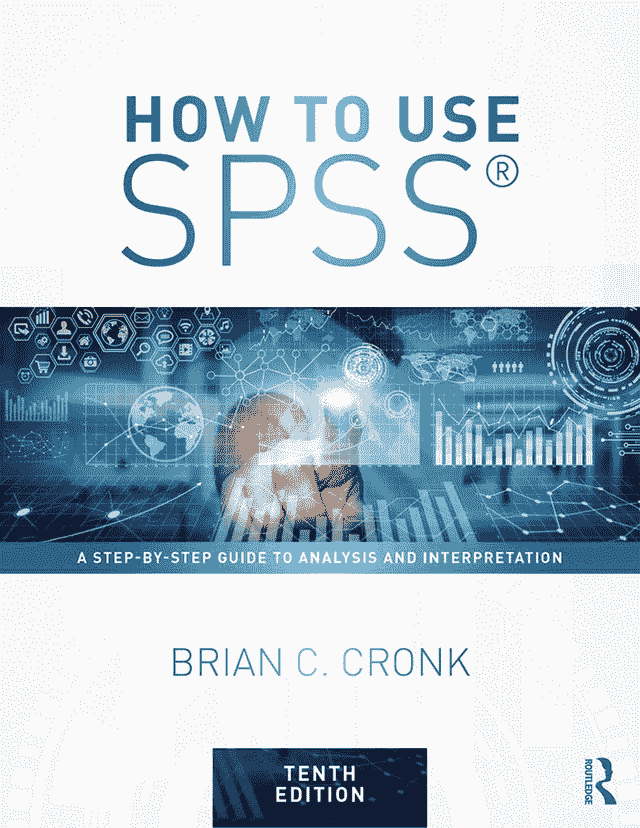

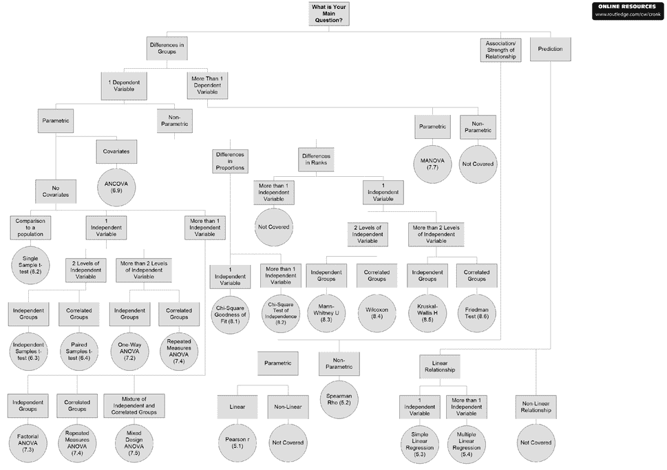

《如何使用 SPSS®》专为计算机初级用户设计，适用于此前没有使用 SPSS 经验的人士。书中每一章都分为若干个短章节，描述了所使用的统计方法、重要的底层假设，以及如何解释结果并在研究报告中表达这些结果。

本书从基础知识开始，例如启动 SPSS、定义变量以及数据的输入和保存。它涵盖了初级统计学课程中教授的所有主要统计技术，如描述性统计、数据绘图、预测与关联、参数推断统计、非参数推断统计以及用于检验构建的统计。

书中提供的 250 多张截图（包括示例输出），让学生在跟随使用 SPSS 时能清楚地看到将要面对的内容。书中包含统计学术语表和练习题。一套完整的在线资源（包括面向学生的视频教程和输出文件，以及面向讲师的 PowerPoint 幻灯片和题库问题）使得《如何使用 SPSS®》成为学习 SPSS 的权威且经过实地测试的资源。

## 本版更新

* 完全更新至 SPSS 24 和 IBM SPSS Statistics Cloud
* 新增关于方差分析（ANOVA）的章节
* 新增关于评分者信度的新材料
* 新增关于语法（Syntax）的新材料
* 增加了对数据输入和管理的涵盖

Brian C. Cronk 是美国密苏里西部州立大学心理学系教授兼系主任（1993 年毕业于威斯康星大学密尔沃分心理学博士）。

## 分析与解释的逐步指南


1. 封面
2. 标题
3. 版权
4. 目录
5. 第 10 版序言
6. 内容开始
7. 附录 A 效应量
8. 附录 B 练习数据集
9. 附录 C 文中使用的数据文件
10. 附录 D SPSS 语法基础
11. 附录 E 术语表
12. 附录 F 选择合适的推断检验
13. 索引

# 第 10 版序言

## 简介

`IBM® SPSS Statistics` 软件（`SPSS®`）是由 `IBM Inc.` 生产的统计软件包。在 2009 年之前，`SPSS` 是一家独立公司，以 `SPSS` 和 `PASW` 的名称生产统计软件。`IBM SPSS Statistics` 设计用于执行广泛的统计程序。与任何其他强大的计算机程序一样，为了高效使用该软件并获得正确的答案，必须掌握某些规范和技术。通过提供带有示例的详细分步指导，本书将帮助你达到这种精通程度。

本书不仅介绍了如何输入数据和获取结果外，还解释了如何选择合适的统计方法，并以适用于社会或行为科学研究报告的形式呈现结果。例如，关于独立 `t test` 的章节展示了如何陈述（即表述）显著和不显著检验的结果。

## 读者群体

本书是传统入门级和中统计学教材的理想补充。它也可以作为研究方法课程中的统计复习手册。最后，学生在大学毕业后可以在各种工作环境中将其案头参考指南。

`SPSS Statistics` 是一个极其强大的程序，本文并非旨在详尽的用户手册。相反，重点是入门级和中级统计及研究方法课程中涵盖的程序。

## 结构

本书分为九章加几个实用的附录。前两章涉及使用 `SPSS` 程序的基本机制。剩下的每一章都关注某一类统计方法。

每章包含几个短小节。大多数情况下，这些小节是独立的。然而，学生在尝试学习书中其他部分之前，应该先掌握第 1 章和第 2 章中的 `SPSS` 基础知识。除前两章的技能外，本书可以以非线性方式使用。因此，教师可以在课程早期安排前两章，然后根据需要安排其他章节。

`附录 A`（`Apendix1.xhtml`）包含了对效应量的讨论。`附录 B`（`Apendix2.xhtml`）包含了贯穿全书练习所需的数据集。`附录 C`（`Apendix3.xhtml`）提供了书中使用的样本数据文件。`附录 D`（`Apendix4.xhtml`）提供了关于选择合适统计检验的信息。`附录 E`（`Apendix5.xhtml`）提供了书中使用的大多数统计术语的定义。由于假设本书配合主统计教材使用，`术语表`的定义非常简练，仅起到提醒作用。`附录 F`（`Apendix6.xhtml`）提供了内封决策树的文本版本。

## SPSS 版本

本书为 `IBM SPSS Statistics for Windows Version 24.0` 编写，尽管它同样适用于之前的所有 `SPSS`（和 `PASW`）版本以及新的 `IBM SPSS Statistics Cloud`。在 `SPSS/PASW` 的 18 版本或更高版本之间，书中内容没有实质性差异（仅在标志等上有细微差异）。因此，本书适用于自 18 版本以来的所有版本。

SPSS 还提供了几个模块。本文中的截图是使用“完整版”软件截取的（所有模块均已激活并安装）。大多数机构至少安装了 `Base`（基础）、`Regression`（回归）和 `Advanced`（高级）模块。有了这三个模块，或者如果你正在使用 `SPSS Statistics GradPack` 或 `Premium Gradpacks`，你就可以完成本文提到的所有分析。如果你使用的是 `SPSS Statistics Base GradPack`，某些程序将不可用。在这种情况下，书中会明确指出需要其他产品。

如果你安装了不同的附加模块，本文插图中所示的菜单栏可能会略有不同。如果你的菜单栏看起来不同，或者你无法在书中介绍的命令中找到菜单项，可能是因为你所在的机构支持不同的模块。请向您的导师寻求额外指导。

## SPSS 的可用性

某些机构从 IBM 购买了站点许可，以便向其教职员工（有时也包括学生）免费提供软件。如果您的机构没有购买站点许可，您仍然可以在校园书店购买软件的学生版，价格对教育社区有折扣。这两种方式之一都是供您个人使用的全功能版本软件。然而，学生版限制为 `50 variables` 和 `1,500 cases`。如果你需要功能更强大的软件，可以从各种渠道购买 `SPSS Statistics GradPack`。在互联网上快速搜索“SPSS graduate pack”就会出现一些选择。请注意，如果你愿意，通常可以租用 SPSS 一个学期的期。你也可以按月购买 `IBM SPSS Statistics Cloud` 产品的许可。

## 约定

本书范围内使用了以下约定：

* **粗体**条目的定义在附录 E 的术语表中有对应。
* *斜体*条目是 SPSS 程序中的按钮或菜单，或者是一个统计符号。
* **全大写字母**的项目是缩写词，或者是 SPSS 数据文件中的变量名。

## 截图

全文广泛使用了截图，作为所描述内容的视觉化表示。在某些情况下，书中显示的截图与学生自己屏幕上的截图可能会存在细微差异。例如，在处理之前已保存到硬盘的数据集时截取的屏幕将显示文件名和数据集编号，而尚未保存的数据集将仅显示“Untitled”（未命名）和“[Data-Set0]”。由于没有两台 Windows 电脑的配置完全相同，而且不同的模块和软件版本可能会产生略有修改的截图，这些细微差异是不可避免的。

### 练习题

每介绍一种技能都包含了相应的练习题。此外，在书中获得的技能可以用于其他统计学书籍或工作手册中的练习题。在这方面，本书的一个极佳补充是`Real Data: A Statistics Workbook Based on Empirical Data.`^(1)

## 本版新旧

本书的早先版本由 Pyrczak Publishing 出版。2016 年，Pyrczak Publishing 被 Routledge/Taylor & Francis 收购，这第 10 版是第一版纯正的 Routledge 产品。因此，文本的整体和感受都得到了更新。

关于参数推断统计的内容被分为两个章节（第 6 章和第 7 章），以清晰地区分 t 检验模型和 ANOVA 模型，并使章节的大小更易于管理。

在第 9 章中增加了一个关于使用 SPSS 计算评分者信度的章节。

新增了全新的附录 D，涵盖了使用 SPSS 语法的基础知识，而不仅仅是点点式菜单。

## 谢谢

本书献给我“入门心理学统计与研究团队”课程的学生们。在教授这些课程期间，我意识到需要一本 SPSS 手册，其作用不仅仅是告诉学生如何启动程序和输入数据。我非常感谢布莱德大学的 Wendy Schweigert，她向我展示了统计学的力量、简单性和实用性。我还要感谢数百位采用本书以前版本并向我提供建设性反馈的老师们。当然，如果没有我家人的支持，这本书就不可能完成——特别是我的孩子 Jonathan 和 Katherine。自本书第一版以来，已经发生了很多变化。当我写第一版的计划书时，我的儿子刚出生。当你买到这本书时，他已经是一个像你一样的的大学学生了。

Brian C. Cronk

## Note

1. Holcomb, Z. (1997). Real data: A statistics workbook based on empirical data. Los Angeles, CA: Pyrczak Publishing.

# 第 1 章：入门

## 1.1 节 启动 SPSS

SPSS 的启动程序会略有不同，取决于安装它的机器的配置。如果你很难找到它，请查看开始菜单中的 IBM SPSS Statistics 部分。本文使用 Windows 版 SPSS 的截图。MacOS 和 Unix 版本具有相同的功能，但外观可能与此处描述的有所不同。

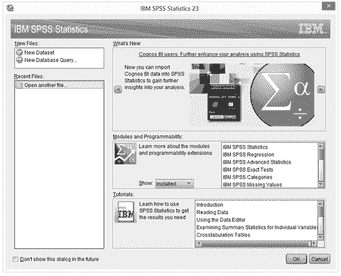

启动 SPSS 时，你可能会看到上面的对话框，这取决于你的系统管理员为你的程序版本选择的选项。如果你看到了对话框，点击数据并确定，这将显示一个空白数据窗口。(1) 如果没有看到对话框，SPSS 应该会自动打开空白数据窗口。

数据窗口和输出窗口提供了 SPSS 的基本界面。下方显示空白数据窗口。

## 1.2 节 输入数据

使用 SPSS 的关键之一是了解它是如何存储和使用数据的。为了说明数据输入的基本知识，我们将使用一份发给四个不同班级的调查表（周二/周四上午、周二/周四下午、周一/周五上午和周一/周五下午）。调查问了学生们是否是“晨型人”以及是否工作。该调查还询问了他们的最终成绩（100% 为最高）。以下是两个学生的答卷：

| 答卷 1 | | | | |
|---|---|---|---|---|
| ID | 4593 | | | |
| 上课日期 | | 周一周五 | 周二周四 |
| 上课时间 | | | 上午 | 下午 |
| 你是晨型人吗？ | | | 是 | X | 否 |
| 最终成绩 | 85% | | | |
| 你是否工作？ | | | 全职 | | 兼职 |
| | | X | 否 | |

| 答卷 2 | | | | |
|---|---|---|---|---|
| ID | 1901 | | | |
| 上课日期 | X | 周一周五 | | 周二周四 |
| 上课时间 | X | 上午 | | 下午 |
| 你是晨型人吗？ | X | 是 | | 否 | |
| 最终成绩 | 83% | | | |
| 你是否工作？ | | | 全职 | X | 兼职 |
| | | | 否 | X | |


### 示例 1.2.1

我们的目标是将两个学生的数据输入 SPSS 以供以后分析。第一步是确定需要输入的变量。任何在参与者之间变化的信息都是需要考虑的变量。示例 1.2.2 列出了我们将使用的变量。

### 示例 1.2.2

* `ID`
* 上课日期
* 上课时间
* 晨型人
* 最终成绩
* 是否工作

在 SPSS 数据窗口中，列代表变量，行代表受访者。因此，我们将创建一个包含六列（变量）和两行（学生/受访者）的数据文件。

# 第 1.3 节 定义变量

在输入任何数据之前，我们必须先在 SPSS 中输入有关每个变量的基本信息。例如，变量必须首先命名并符合以下条件：

* 以字母开头，且
* 不包含空格。

因此，变量名`Q7`是可以的，而变量名`7Q`则不行。同样，变量名`PRE_TEST`是可以的，但变量名`PRE TEST`不行。大小写并不重要，但本文中的变量名均采用大写，以便在引用变量名时清晰明了，即使截图中的变量名不一定大写。

要定义变量，点击主屏幕底部的`Variable View`（变量视图）选项卡（见右图）。这将显示`Variable View`窗口。如需返回`Data View`（数据视图）窗口，请点击`Data View`选项卡。

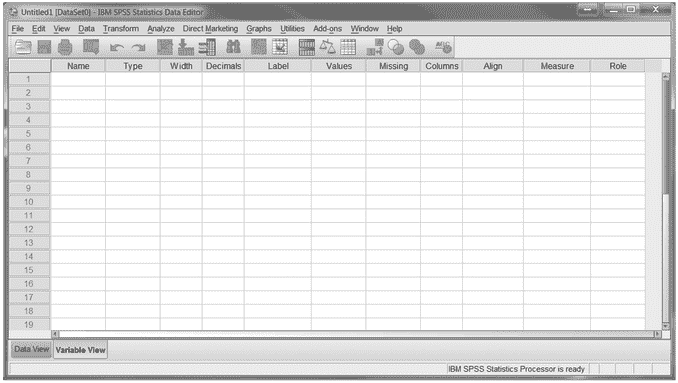

在`Variable View`界面，SPSS 允许你创建和编辑数据文件中所有的变量。每一列代表变量的某个属性，每一行代表一个变量。所有变量都必须命名。要进行命名，点击`Name`列中的第一个空单元格，并输入有效的 SPSS 变量名。程序随后将为大多数其他属性填充默认值。

SPSS 的一个有用功能是能够定义变量标签（Variable labels）和值标签（Value labels）。变量标签允许你为每个变量关联描述信息。

值标签允许你为变量的每个值关联描述。例如，对于大多数操作，SPSS 要求数值。因此，对于诸如课程日期（即周一/三/五和周二/四）的数据，我们需要先将这些值编码为数字。我们可以为`Mon/Wed/Fri`分配数字`1`，为`Tues/Thurs`分配数字`2`。为了帮助我们跟踪分配给值的数字，我们使用值标签。

分配值标签，点击`Values`列中你想要赋值的单元格（在本例中，针对`Variable 2`）。这将弹出一个小灰色按钮（如下所示）。点击该按钮打开`Value Labels`对话框。

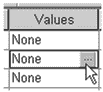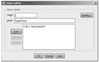

当你输入值标签时，在每个条目后必须点击`Add`。这将把值及其关联标签移动到窗口的底部。当所有标签添加完毕后，点击`OK`返回`Variable View`窗口。

除了命名和标记变量外，你还可以选择定义变量类型。要这样做，只需点击`Variable View`窗口中的`Type`（类型）、`Width`（宽度）或`Decimals`（小数）列。默认值是一个宽度为八位并显示两位小数的数值字段。如果你的数据小数点左侧超过八位，它们将以科学计数法显示（例如，数字`2,000,000,000`将显示为`2.00E+09`）。SPSS 会保持两位小数以上的精度，但除非`Decimals`列另有说明，否则所有输出将四舍五入到两位小数。

此界面还有其他可用选项，这些超出了本文的范围。在我们的示例中，我们将使用带有所有默认值的数值变量。

### 练习题

为示例 1.2.1 所示的六个变量和两个样本学生创建一个数据文件。变量命名为：`ID`、`DAY`、`TIME`、`MORNING`、`GRADE`和`WORK`。将`DAY`编码为`1 = Mon/Wed/Fri`、`2 = Tues/Thurs`。将`TIME`编码为`1 = morning`、`2 = afternoon`。将`MORNING`编码为`0 = No`、`1 = Yes`。将`WORK`编码为`0 = No`、`1 = Part-time`、`2 = Full-time`。确保为不同的变量输入值标签。注意，由于值标签对于`ID`和`GRADE`不适用（因为值本身就是标签），完成后，你的`Variable View`窗口应该像下面的截图。

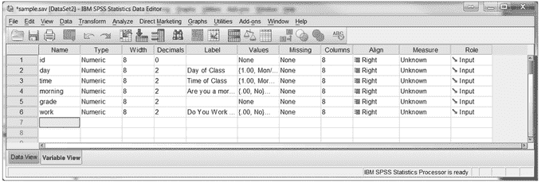

点击`Data View`选项卡打开数据输入界面。水平输入数据，从第一个学生的`ID`号开始。在相应的列中输入每个变量的代码。输入`GRADE`变量值时，输入学生的班级成绩。

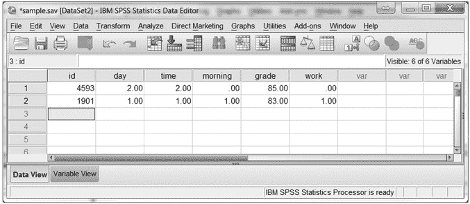

通过点击`Value Labels`图标（见下文），可以将之前的数据窗口更改为如下截图所示。在这种情况下，单元格显示的是值标签而非代码。

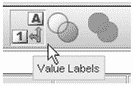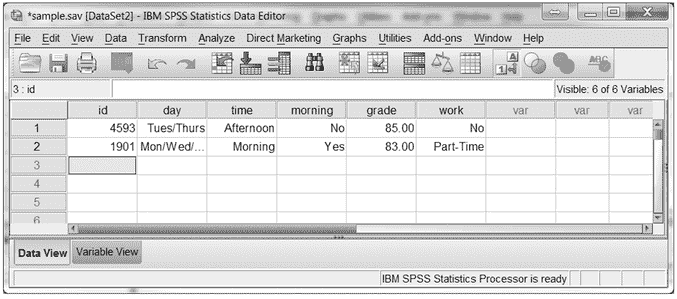

除了点击`Value Labels`图标，也可以通过`View`菜单下的`Value Labels`切换视图。

这会弹出描述统计（Descriptives）对话框。请注意，对话框的左侧包含我们数据文件中所有变量的列表。右侧是一个标记为`Variable(s)`的区域，我们可以在这里指定想要在此特定分析中使用的变量。

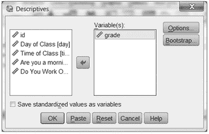

我们想要计算变量`GRADE`的平均值。因此，我们需要在左侧窗口中选择该变量名（点击它）。要将其转移到右侧窗口，点击两个窗口之间的右箭头。箭头始终指向高亮项目相反的窗口，并可用于双向传输选定的变量。请注意，双击变量名也会将变量传输到相反的窗口。也可以使用 Windows 标准惯例，通过“Shift”点击或“Ctrl”点击来选择多个变量。注意：SPSS 的某些配置显示变量名，而另一些显示变量标签（如果有的话）。这可以在`Edit`（编辑）→`Options`（选项）→`General`（常规）下进行更改。

当我们点击`OK`按钮时，分析将开始，我们就可以查看输出结果了。

## 第 1.6 节 查看和打印输出文件

分析完成后，输出将放置在输出窗口中，且输出窗口将变为活动窗口。如果这是你自启动 SPSS 以来进行的首次分析，将创建一个新的输出窗口。如果你已经运行过之前的分析并保存了它们，你的输出将添加到你之前的输出的末尾。

要在数据窗口和输出窗口之间来回，请从`Window`（窗口）菜单栏选择所需的窗口。或者，你也可以使用屏幕底部的任务栏选择窗口。

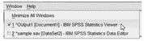

输出窗口分为两个部分。左侧部分是输出大纲（SPSS 将其称为大纲视图 outline view）。右侧部分是输出本身。

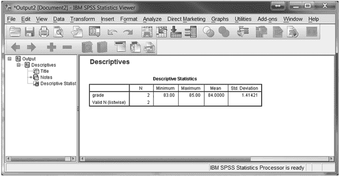

输出窗口左侧的部分提供了整个输出窗口的大纲。所有的分析都按照它们执行的顺序列出。请注意，可以使用此大纲来快速定位输出的某个部分。只需点击你想查看的部分，右侧窗口就会跳转到相应的位置。


点击统计程序也会选择该命令的所有输出。通过按`Delete`键，可以从输出窗口中删除该输出。这是确保输出窗口仅包含所需输出的快速方法。也可以通过点击`Edit`（编辑），然后`Copy`（复制）来选择输出并粘贴到文字处理器或电子表格中。然后你可以切换到文字处理器并点击`Edit`（编辑），然后`Paste`（粘贴）。

要打印输出，只需点击`File`（文件），然后`Print`（打印），或点击工具栏上的打印图标。你可以选择打印所有输出或仅打印当前选中的部分。打印时要小心！每次运行命令时，输出都会添加到你之前的输出的末尾。因此，你可能会打印出一个包含你可能不需要或不需要信息的巨大输出文件。

确保输出窗口仅包含当前命令结果的一种方法是在运行命令之前创建一个新的输出窗口。执行此操作，点击`File`（文件），然后`New`（新建），然后`Output`（输出）。你后续所有的命令都将进入你的新输出窗口。

你还可以将输出文件保存为 SPSS 格式文件（`.spv`扩展名）。注意 SPSS 会保存你打开的任何窗口。如果你处于数据窗口，它将保存数据。如果你处于输出窗口，它将保存输出。

## 练习题

加载你之前创建的样本数据文件（`SAMPLE.sav`）。对变量`GRADE`运行`Descriptives`（描述统计）命令并打印输出。接下来，选择数据窗口并打印。

## 第 1.7 节 修改数据文件

一旦创建了数据文件，添加额外的案例（行/参与者）或额外的变量（列）其实非常简单。考虑示例 1.7.1。

### 示例 1.7.1

另外两个学生为你提供了调查问卷。他们的信息如下：

| 问卷副本 3 |  |  |  |  |
| :--- | :--- | :--- | :--- | :--- |
| ID: | 8734 |  |  |  |
| 上课日期: | ___ | MWF | X | TTh |
| 上课时间: | X | 上午 |  | 下午 |
| 你是晨起者吗？ | ___ | 是 | X | 否 |
| 末成绩： | 80% |  |  |  |
| 你在外工作吗？ | ___ | 全职 | ___ | 兼职 |
|  | X | 否 |  |  |

| 问卷副本 4 |  |  |  |  |
| :--- | :--- | :--- | :--- | :--- |
| ID: | 1909 |  |  |  |
| 上课日期: | X | MWF | ___ | TTh |
| 上课时间: | X | 上午 | ___ | 下午 |
| 你是晨起者吗？ | X | 是 | ___ | 否 |
| 期末成绩： | 73% |  |  |  |
| 你在外工作吗？ | ___ | 全职 | X | 兼职 |
|  | ___ | 否 |  |  |

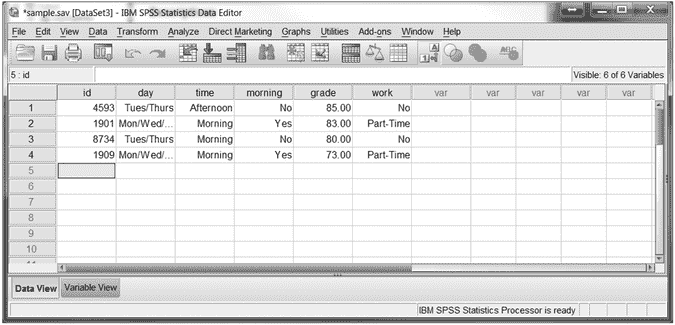

要添加这些数据，只需在`Data View`（数据视图）窗口中放置两个额外的行（在加载数据后）。当添加新的参与者时，行号会加粗。完成后，屏幕应如上所示。

也可以添加新变量。例如，如果两个参与者接受了时间管理培训，而其他没有，可以修改数据反映这一点。新变量可以命名为`TRAINING`，编码为`0`= 否，`1`= 是。要执行此操作，切换到`Variable View`（变量视图），然后在底部添加`TRAINING`。然后切换回`Data View`（数据视图）更新数据。

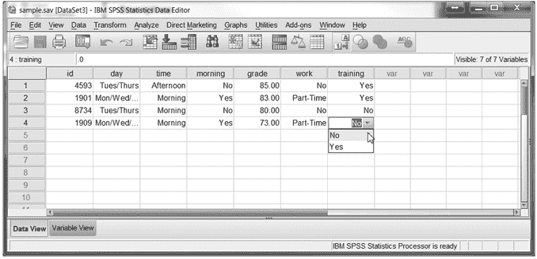

添加数据和变量是我们创建数据的程序的逻辑扩展。我们将在书中再次使用它。

### 练习题

遵循之前的示例（其中`TRAINING`为新变量）。修改并保存数据文件。

## 注意

1. 附录 E 中的项目以粗体表示。斜体用于指示菜单。

2. 根据你的 SPSS 版本，它可能会显示为 2.0E + 009。

查看我们在第 1 章中创建的`SAMPLE.sav`数据文件。我们为变量`GRADE`计算了平均值。`GRADE`是按比例尺度测量的，平均值是一个可以接受的汇总统计量（假设分布为正态）。

我们本可以让 SPSS 计算变量`TIME`的平均值而不是`GRADE`。如果我们这样做，将得到如下所示的输出。

输出显示平均`TIME`为 1.25。请记住`TIME`被编码为定序变量（1 = 上午课程，2 = 下午课程）。虽然平均值对于定序尺度来说不是合适的统计量，但 SPSS 仍然计算了它。考虑数据类型的重要性怎么强调都不为过。仅仅因为 SPSS 会为你计算统计量，并不意味着你就应该使用它。在文的后面，讨论特定的统计程序时，将介绍它们适用的条件。请注意，对于某些程序（例如图表和非参数检验），SPSS 会根据测量标度限制你的操作。然而，大多数情况下，这取决于用户如何做决定。

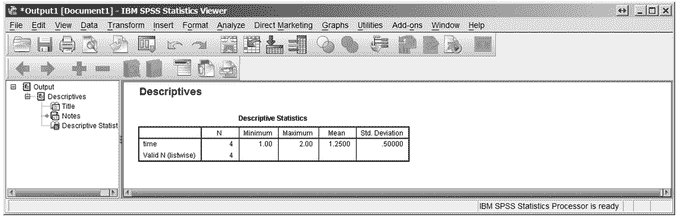

### 缺失数据

通常，参与者不会提供完整的数据。例如，对于某些学生，你可能有他们的前测分数但没有后测分数。也许某个学生在调查问中留空了一个问题，或者她没有说明年龄。缺失数据会削弱任何分析。通常，一个缺失答案就可以将受试者从所有分析中排除。

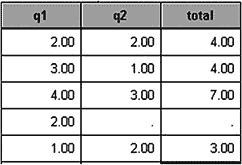

如果你在数据集中有缺失数据，请将该单元格留空。在示例中，第四个受试者没有完成问题 2（`q2`）。注意，由于问题 2 的数据缺失，总分（根据两个问题计算得出）也是空的。SPSS 在数据窗口中用点号表示缺失数据（尽管你不应该输入点号——只需留空即可）。创建一个填充值（例如“999”或“0”）来表示空白分并不是一个好做法，因为 SPSS 会将其视为一个具有意义的值，而它会将真正的空白值视为缺失。

## 第 2.2 节 数据的选择与转换

我们在数据文件中拥有的数据通常比我们想要包含在特定分析中的数据多。例如，我们的样本数据文件包含四位参与者的数据，其中两位接受过特殊培训，另外两位没有。如果我们只想对那两位没有接受过培训的参与者进行分析，我们只需要指定合适的子集。

### 选择子集

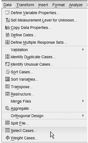

我们可以使用`Select Cases`命令来指定数据的子集。`Select Cases`命令位于`Data`菜单下。当你选择此命令时，会出现像下面的对话框。（注意变量名旁边的图标，它们表示除了`grade`（定义为比例尺度）外，所有变量都被定义为按名义尺度测量的。）

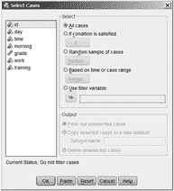

你可以通过使用`Select Cases`对话框右侧的选择标准来指定你想选择的哪些案例（参与者）。默认情况下，将选择所有案例（All cases）。选择子集最常见的方法是点击“If condition is satisfied, then”，然后点击标记为`If`的按钮。这将弹出一个新对话框，允许你指定想要使用的案例。

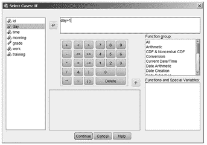

你可以在上部分输入用于选择子集的逻辑。如果逻辑语句对于某个案例为真，则该案例将被选中。如果逻辑语句为假，则该案例不会被选中。例如，你可以通过在窗口左上方输入公式`DAY = 1`来选择所有被编码为 Mon/Wed/Fri 的案例。如果`DAY`为 1，则该语句为真，SPSS 将选择该案例。如果`DAY`不是 1，则该语句为假，该案例不会被选中。一旦你输入了逻辑语句，点击`Continue`返回`Select Cases`对话框。然后，点击`OK`返回数据窗口。

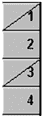

选择案例后，数据窗口会发生细微变化。未被选中的案例将在案例编号上标记有一条斜线。例如，对于我们的样本数据，第一个和第三个案例未被选中。该子集仅选择了第二个和第四个案例。

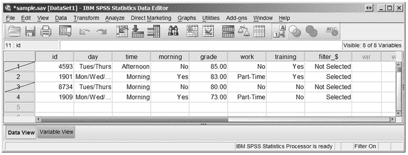

数据文件中还会创建一个额外的变量。新变量名为`FILTER_$`，它用于表示一个案例是否被选中。

如果我们使用刚刚选择的子集计算`GRADE`的平均值，我们在这里获得输出。注意，现在我们得到的平均值为 78.00，样本量（`N`）为 2 而不是 4。

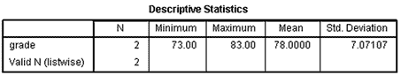

选择子集时要小心。子集将一直有效，直到你再次运行命令并选择所有案例。你可以通过数据窗口底部判断是否选择了子集，因为底部会显示过滤器已开启（filter is on）。此外，当你查看输出结果时，如果选择了子集，`N`将小于数据集中的记录总数。选择子集时，某些案例上的斜线也会显而易见。注意不要在选择了子集的情况下保存数据文件，因为这在以后会导致相当困扰。

#### 计算新变量

SPSS 还可以用于计算新变量或处理现有的变量。为了说明这一点，我们将创建一个新的数据文件。该文件将包含四位参与者和三个变量（`Q1`、`Q2`和`Q3`）。这些变量代表每个参与者在三个问题上得到的得分。现在将此数据文件保存为`QUESTIONS.sav`。我们将在后面的章节中再次使用它。

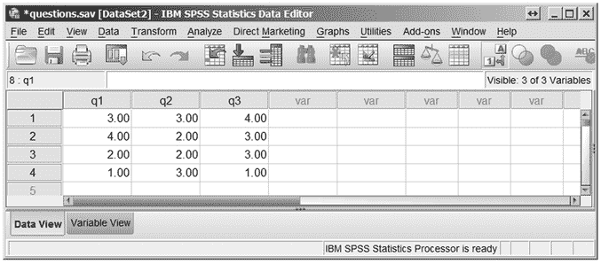fig00036.jpg

现在你将计算每个受试者的总分。我们可以手动进行，但如果数据文件很大，或者有许多问题，这将花费很长时间。让 SPSS 为你计算总分更有效（也更准确）。要做到这一点，点击`Transform`，然后点击`Compute Variable`。

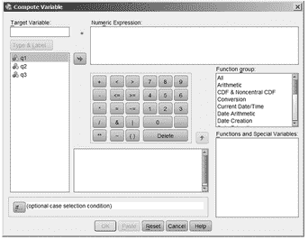

点击`Compute Variable`命令后，我们得到了上面的对话框。

标记为`Target Variable`的空白字段是输入我们要创建的新变量名称的地方。在这个示例中，我们正在创建一个名为`total`的变量，所以输入单词`total`。

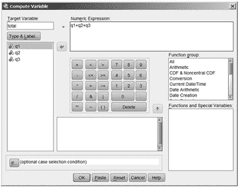

注意`Target Variable`空白处和`Numeric Expression`空白处之间有一个等号。这两个空白区域是 SPSS 将计算的方程式的两边。例如，`total = Q1 + Q2 + Q3`就是此处示例中输入的方程式（上图所示）。注意，只需使用对话框底部的数字和操作键盘即可在这里创建任何方程式。当我们点击`OK`时，SPSS 将创建一个名为`TOTAL`的新变量，并使其等于三个问题的总和。

再次保存你的数据文件，以便新变量在未来的会话中使用。

### 变量重编码——不同变量

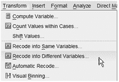

SPSS 可以根据另一个变量的数据创建一个新变量。假设我们想根据总分对参与者进行划分。我们想创建一个名为`GROUP`的变量，如果总分较低（小于或等于 8），则编码为 1；如果总分较高（9 或更大），则编码为 2。为此，我们点击`Transform`，然后点击`Recode into Different Variables`。

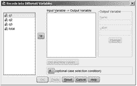

这将弹出上方所示的“变量重新编码”（Recode into Different Variables）对话框。将变量`TOTAL`移动到中间空白处。在`Output Variable（输出变量）`下的`Name（名称）`字段输入`group`。点击`Change（更改）`，中间的空白处将显示`TOTAL`变为`GROUP`，如下所示。

点击`Old and New Values（旧值和新值）`。这将弹出下方的重新编码对话框。

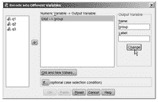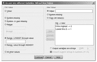

在此处显示的示例中，我们已经在`Range, value through HIGHEST（范围直到最高）`字段中输入了`9`，并在`New Value（新值）`下的`Value（值）`字段中输入了`2`。当我们点击`Add（添加）`时，右侧的空白处显示了编码公式。接下来我们在左侧的`Range, LOWEST through（范围从最低到）`空白处输入了`8`，并在`New Value`下的`Value`字段中输入了`1`。点击`Add`，然后点击`Continue（继续）`。

点击`OK（确定）`。你将被定向到下方所示的数据窗口。一个新的变量（`GROUP`）已被添加，并根据`TOTAL`被编码为`1`或`2`。

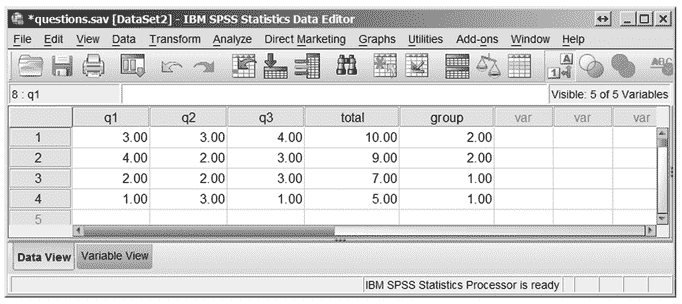

# 第 3 章：描述性统计

在第 2 章中，我们讨论了 SPSS 中处理数据的许多可用选项。现在我们将讨论汇总数据的方法。用于描述和汇总数据的程序被称为描述性统计。

## 第 3.1 节 单变量的频率分布和百分位数排名

### 描述

`Frequencies（频率）`命令为指定的变量生成频率分布。输出包括出现次数、百分比、有效百分比和累积百分比。有效百分比累积百分比仅包含未被标记为缺失的数据。

`Frequencies`命令适用于描述均值没有意义的样本（例如名义或序量表）。它作为一种熟悉数据的方法也有用。它提供的信息比简单的均值和标准差更多，并且对于确定偏态和识别离群值非常有用。该命令的一个特殊功能是能够确定百分位数排名。

### 假设

累积百分比和百分位数仅对至少按序量表测量的数据有效。由于输出中每个变量的每个值都有一行，因此该命令在值较少的变量上效果最好。

### 得出结论

`Frequencies`命令产生的输出指明样本中特定值的案例数量以及具有该值的案例百分比。因此，所得出的结论应仅与描述样本中案例的数字或百分比有关。如果数据本质上至少是序数的，则可以得出关于累积百分比和/或百分位数的结论。

### SPSS 数据格式

获取频率分布的 SPSS 数据文件只需要一个变量，且该变量可以是任何类型。

### 创建频率分布

此示例使用了随 SPSS 附的`CAR_SALES.sav`数据文件。如果你正在使用 SPSS 24 版，它将位于：

```
C:\Program Files\IBM\SPSS\Statistics\24\Samples\English\car_sales.sav
```

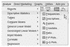

要运行`Frequencies`命令，点击`Analyze（分析）`，然后点击`Descriptive Statistics（描述统计）`，再点击`Frequencies（频率）`。这将弹出下方的主对话框。将你想要频率分布的变量移动到右侧所示的`Variable(s)(变量）`空白处（在本例中为`MANUFACTURER`）。确保勾选了`Display frequency tables（显示频率表）`选项。点击`OK`获取输出。

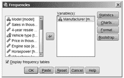

注意，SPSS 中的对话框会显示变量类型（变量名称左侧的图标）以及如果输入了变量标签则显示变量标签。因此，变量`MANUFACT`在对话框中显示为`Manufacturer`。

点击`OK`运行测试。

### 频率分布的输出

输出由两部分组成。第一部分指示每个所选变量具有有效数据的记录数。分为空的记录被列为缺失。在本示例中，数据文件包含 157 条记录。

输出的第二部分包含每个所选变量的累积频率分布。在部分的顶部，给出了变量标签。输出本身由五列组成。第一列按字母顺序列出变量的值。变量的每个值都有行，底部额外添加了用于`Total（总计）`和`Missing（缺失）`数据的行。第二列给出每个值的频率，包括缺失值。第三列给出所有记录（包括包含缺失数据的记录）每个值的百分比。第四列标记为`Valid Percent（有效百分比）`，给出每个值的记录（不包含缺失数据的记录）的百分比。如果有任何缺失值，这些值将比第三列的值大，因为总记录数减少了具有缺失值的记录数。最后一列给出累积百分比。累积百分比表示分数等于或小于当前值的记录百分比。因此，最后一个值始终是 100%。这些值等同于所列数值的百分位数排名。注意：SPSS 即使对于名义变量和其他没有意义的变量，也会提供累积百分比。例如，变量`MANUFACTURER`是名义变量。

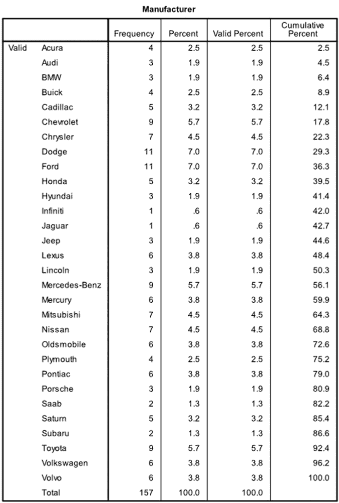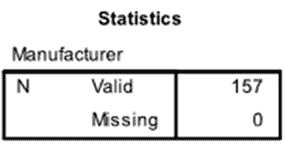

### 确定百分位数排名

`Frequencies`命令可以提供若干描述性统计，以及各种百分位数值（包括四位数、分点和对应特定百分位数的得分）。让我们查看`PRICE`的统计信息。

要获取`Frequencies`命令的描述性或百分位数功能，点击主对话框右上角的`Statistics（统计）`按钮。这将弹出下方的`Frequencies: Statistics（频率：统计）`对话框。注意，此框中的 Central Tendency（集中趋势）和 Dispersion（离散）部分用于计算`Descriptives（描述）`命令无法计算的值（例如中位数或众数）。点击任何所需的统计数据。（在示例中，让我们确定四位数、第 80 百分位数、均值和位数。）

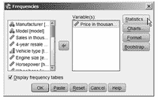

对于百分位数，在`Percentile(s）（百分位数）`标签右侧的空白处输入所需的百分位数。然后，点击`Add`将其添加到请求的百分位数列表中。一旦选择了所有统计数据，点击`Continue`返回主对话框。点击`OK`。

### 百分位数排名输出

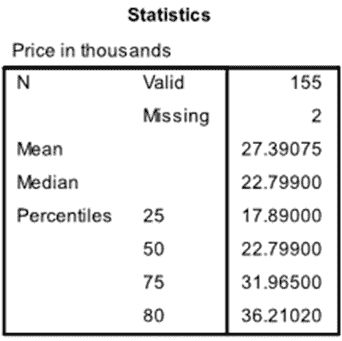

`Statistics`对话框补充了`Frequencies`命令输出的第一部分。输出为你请求的每项信息都有行。在前前的示例中，我们勾选了四位数并请求了第 80 百分位数。因此，输出包含了第 25、50、75 和 80 百分位数的行。

### 练习题

使用附录 B 中的练习数据集 1，为数学技能创建一个频率分布表。确定第 60 百分位数所在的数学技能得分。

## 第 3.2 节 多变量的频率分布和百分位数排名

### 描述

`Crosabs（交叉表）`命令为多个变量生成频率分布。输出包括每个变量每个级别组合的出现次数。可以使命令为任何或所有变量提供百分比。

### 假设

由于输出包含每个变量值对应一行或一列，因此此命令对于取值较少的变量效果最好。

### SPSS 数据格式

`Crosstabs`命令的 SPSS 数据文件需要两个或多个变量。这些变量可以是任何类型。

### 执行命令

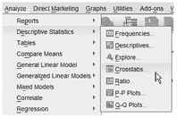

此示例使用了`SAMPLE.sav`数据文件，该文件是在第 1 章中创建的。要运行此程序，点击`Analyze`（分析），然后点击`Descriptive Statistics`（描述统计），最后点击`Crosstabs`（交叉表）。这将弹出所示的`Crosstabs`主对话框。


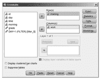

对话框最初列出所有变量，并有两个标记为`Row(s)`（行）和`Column(s)`（列）的空白框。在`Row(s)`框中输入一个变量（`TRAINING`）。在`Column(s)`框中输入第二个变量（`WORK`）。如果要分析两个以上变量，可以在未标记的区域（层指示器正下方）输入第三、第四个等变量。

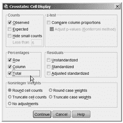

`Cells`允许你指定为每个取值组合生成百分比和其他信息。点击`Cells`，你将看到上述框，其中默认选中了`Observed`（观测）和`Round`（四舍五入）单元计数。

对于此处示例，勾选`Row`（行）、`Column`（列）和`Total`（合计）百分比。然后点击`Continue`（继续）。这将返回到`Crosstabs`对话框。点击`OK`执行分析。

### 解释交叉表输出

输出包含一个列联表。`WORK`的每个水平对应一列。`TRAINING`的每个水平对应一个行。此外，还增加了一行总计和一列总计。

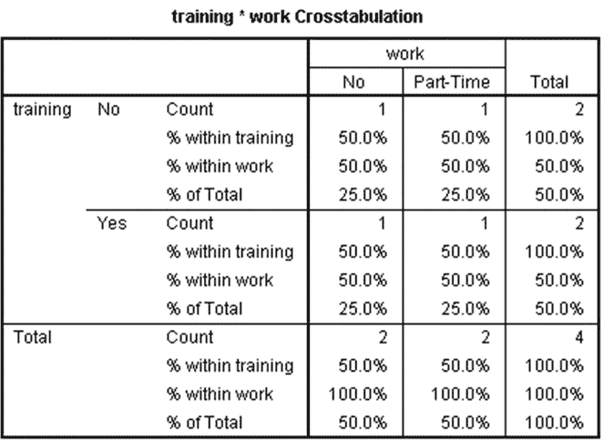

每个单元格包含参与者的数量（例如，一名参与者没有接受培训未工作；两名参与者没有接受培训，无论就业状态如何）。

还会显示每个单元格的百分比。行百分比水平方向相加为 100%。列百分比垂直方向相加为 100%。例如，在所有未接受培训的人中，50%未工作，50%兼职（使用“% within TRAINING”行）。在未工作的人中，50%未接受过培训，50%接受过培训（使用“% within WORK”行）。

### 练习题

使用附录 B 中的练习数据集 1，使用`Crosstabs`命令创建一个列联表。确定变量`SEX`（性别）和`MARITAL`（婚姻状况）每个组合的参与者人数。多少比例的参与者已婚？多少比例的参与者是男性且已婚？

## 第 3.3 节 单组集中趋势量和离散程度

### 描述

集中趋势量是代表样本或总体典型成员的值。三种主要的测量类型是`mean`（平均值）、`median`（中位数）和`mode`（众数）。离散程度告诉你分数的变异性。主要类型是`range`（极差）和`standard deviation`（标准差）。集中趋势量和离散程度结合在一起为整个数据集提供了大量信息。

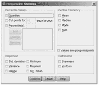

我们将在`Descriptives`命令的下讨论这些集中趋势量和离散程度。注意，这些统计数据也可以通过其他几个命令计算（例如，需要`Frequencies`或`Compare Means`命令来计算众数或中位数——在上方显示了`Frequencies`命令的`Statistics`选项）。

### 假设

每个集中趋势量和离散程度都有与其相关的假设。`mean`是最强大的集中趋势量，它的假设最多。例如，为了计算`mean`，数据必须在间隔尺度或比例尺度上进行测量。此外，分布应该是正态分布，或者至少不是高度偏态。`median`要求至少是定序数据。由于`median`仅指示中间分数（当分数按顺序排列时），因此对分布的形状没有假设。`mode`是最弱的集中趋势量。`mode`没有假设。

`standard deviation`是最强大的离散程度量，但它也有几项要求。它是`variance`（方差）的数学转换（标准差是方差的平方根）。因此，如果一个适用，另一个也适用。`standard deviation`要求数据在间隔尺度或比例尺度上进行测量。此外，分布应该是正态的。`range`是最弱的离散程度量。要计算`range`，变量必须至少是定序。对于定名尺度数据，应将整个频率分布作为离散程度的度量呈现。

### 得结论

集中趋势量应伴随离散程度量。因此，在报告`mean`时也应提供`standard deviation`。呈现`range`使用`Frequencies`命令来确定。

### SPSS 数据格式

只需要一个变量。

### 执行命令

`Descriptives`命令是你最可能用于获取集中趋势和离散程度的命令。此示例使用了我们在之前的章节中使用的文件。

要运行该命令，点击`Analyze`，然后点击`Descriptive Statistics`，最后点击`Descriptives`。这将弹出`Descriptives`主对话框。任何你想获取信息的变量都可以放在右侧。将变量`GRADE`移到右侧。

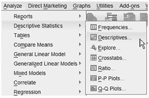

默认情况下，你将获得`N`（个数/参与者人数）、`minimum`、`maximum`、`mean`和`standard deviation`。注意，这些中的某些可能不适用于你选择的数据类型。

如果你想更改提供的统计数据，点击主对话框中的`Options`。你将看到所示的`Options`框。点击`Continue`或`Cancel`关闭`Options`框。然后点击`OK`。

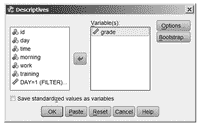

### 读取输出

`Descriptives`命令的输出非常直观。每种请求输出用列，每个变量用一行。下方显示的输出是样本文件。它显示我们有一个变量（`GRADE`），并且获得了`N`、`minimum`、`maximum`、`mean`和`standard deviation`。

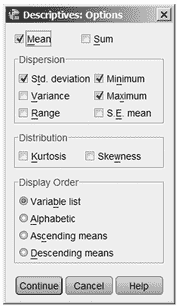

### 练习题

使用附录 B 中的练习数据集 1，获取参与者年龄的描述统计数据。`mean`是多少？`median`是多少？`mode`是多少？`standard deviation`是多少？`minimum`是多少？`maximum`是多少？`range`是多少？（有关中位数众数的请参考第 3.1 节。）

## 第 3.4 节 多组集中趋势量和离散程度

### 描述

之前讨论的集中趋势量通常不仅适用于整个数据集，也适用于几个子集。获取这些子集值的一种方法是使用第 2 章中讨论的数据选择技术，并对每个子集应用`Descriptives`命令。执行此任务的更简单的方法是使用`Means`命令。

### 假设

在单组（第 3.3 节）中讨论的假设也适用于多组。

### 得结论

集中趋势度量应当伴随离散度量。因此，在给出平均值时，你还应该报告标准差。在给出中位数时，你应该说明范围或四分位间距。

### SPSS 数据格式

SPSS 数据文件中需要两个变量。其中一个代表因变量，它是你接收描述性统计结果的变量；另一个是自变量，将用于创建子集。请注意，虽然 SPSS 将此变量称为自变量，但它可能不符合定义真正自变量的严格标准（例如，处理操纵）。因此，某些 SPSS 过程将其称为分组变量。

### 执行命令

本示例使用了你在第 1 章中创建的`SAMPLE.sav`数据文件。通过点击`Analyze`（分析）、然后`Compare Means`（比较均值）、最后`Means`（均值）来运行`Means`命令。


这将弹出`Means`命令的主对话框。将选定的变量放在标记为`Dependent List`（依赖列表）的空白框中。将分组变量放在标记为`Independent List`（独立列表）的框中。在本示例中，通过使用`SAMPLE.sav`数据文件，将为变量`MORNING`的每个水平提供变量`GRADE`的集中趋势度量和离散度量。

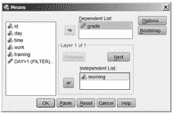

默认情况下，会给出平均值、数量和标准差。如果你需要额外的度量，点击`Options`（选项），将出现此处所示的对话框。你可以选择任意数量的度量。

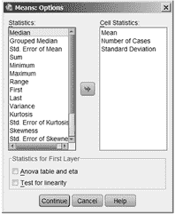

### 读取输出

`Means`命令的输出分为两个部分。第一部分称为案例处理摘要（case processing summary），提供了关于使用数据的信息。在我们的样本数据文件中，有四个学生（案例），他们都被包含在分析中。

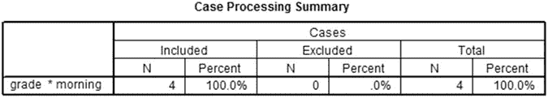

输出的第二部分是`Means`命令的报告。

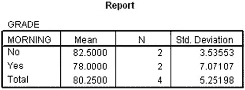

该报告顶部列出了因变量（`GRADE`）。自变量（`MORNING`）的每个水平显示在表格的一行中。在本示例中，水平为 0 和 1，分别标记为`No`和`Yes`。请注意，如果变量标记了标签，则将使用标签而不是原始值。

报告中给出的汇总统计数据对应于数据，自变量的水平等于行标题（例如，`No`、`Yes`）。因此，每行都包含两个参与者。晨型人的平均`GRADE`为 78.0，非晨型人的平均`GRADE`为 82.5。

另外添加了一行名为`Total`（总计）的行。该行包含合并的数据，其值与我们对变量`GRADE`运行`Descriptives`命令时得到的值是相同的。

### 扩展到多个自变量

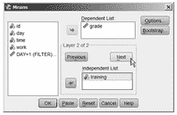

如果你有多个自变量，SPSS 可以进一步细分输出结果。与其在对话框的`Independent List`部分添加更多变量，你需要在不同的层级中添加它们。如果你点击`Next`（下一步），你将看到`Layer 2 of 2`，你可以选择第二个自变量（例如`TRAINING`）。请注意，SPSS 会指示你正在哪个层级进行工作。现在，当你运行命令（点击`OK`）时，将获得根据`MORNING`和`TRAINING`的每个水平生成的变量`GRADE`的汇总统计数据。

你的输出将类似于所示。你现在有两个主要部分（`No`和`Yes`），以及一个`Total`。但现在，每个主要部分又被细分为子部分（`No`、`Yes`和`Total`）。


你在层 1 中使用的变量（`MORNING`）是第一个列出的变量，它定义了主要部分。你在层 2 中使用的变量（`TRAINING`）列在第二个。因此，第一行代表既不是晨型人又接受了培训的参与者。第二行代表既不是晨型人又接受培训的参与者。第三行代表所有非晨型参与者的总计。

注意，并不是所有行都给了标准差。这是因为在本示例中，每个单元格只有一个参与者。使用许多子集的一个问题是它增加了获得有意义结果所需的参与者人数。更多详情请参阅研究设计教材或咨询你的导师。

### 练习题

使用附录 B 中的练习数据集 1，计算每个婚姻状况下年龄的平均值和标准差。已婚参与者的平均年龄是多少？单身参与者的平均年龄是多少？离异参与者的平均年龄是多少？

## 第 3.5 节 标准分

### 描述

标准分通过将分数转换为共同量表，允许比较不同的量表。最常见的标准分是`z-score`。`z-score`基于标准正态分布（即均值为 0，标准差为 1）。因此，`z-score`代表分数高于或低于平均值的标准差倍数（例如，–1.5 的`z-score`代表给定分数比平均值低 1½ 标准差）。

### 假设

标准正态分布是常用于`z-scores`的基础。因此，转换为`z-scores`的分布应该是正态的，且量表应为等距或比率尺度。

### 得出结论

基于`z-scores`的结论是分数高于或低于平均值的标准差倍数。例如，一个学生在数学考试中得 85 分，班级平均分为 70 分，标准差为 5 分。该学生的得分高于平均值 15 分（85–70=15）。其`z-score`为 3，因为它比平均值高 3 个标准差（15÷5=3）。如果该学生在阅读考试中得 90 分，班级平均分为 80 分，标准差为 10 分，则`z-score`将为 1.0，因为她比平均值高一个标准差。因此，尽管她的原始分更高，但在数学考试中表现更好，因为她的`z-score`更高。

### SPSS 数据格式

在 SPSS 中计算`z-scores`需要单个变量。该变量必须是数值型的。

### 执行命令


本示例使用了你在第 1 章和第 2 章中创建的样本数据文件（`SAMPLE.sav`）。计算`z-scores`是`Descriptives`命令的一个组成部分。要访问它，点击`Analyze`（分析）、`Descriptive Statistics`（描述性统计）、然后`Descriptives`（描述）。


这将弹出`Descriptives`命令的标准对话框。注意左下角标记为`Save standardized values as variables`（将标准化值保存为变量）的复选框。勾选此框并将变量`GRADE`移动到右侧框中。然后，点击`OK`完成分析。你将看到来自`Descriptives`命令的标准输出。注意 z-score 未列在输出中。它们已作为新变量插入到数据窗口。

### 读取输出

在你进行分析后，新变量已被创建。你可以对该新变量进行任意数量的后续分析。

使用附录 B 中的练习数据集 2，确定每个员工工资对应的 z 分。计算男性和女性员工工资的平均 z 分。计算总样本工资的平均 z 分。

# 第 4 章 数据图表（#contents.xhtml_bck_ht0085）

## 第 4.1 节 图表基础

除了第 3 章中讨论的频率分布、集中趋势测量和离散程度外，绘图是总结、组织和简化数据的有效方法。俗话说“一画胜千言”。对于复杂的数据集来说，事实确实如此。

使用 SPSS 可以制作出达到出版质量的图表。使用 SPSS 创建图表而不是其他软件（例如`Excel`或`SigmaPlot`）的一个重要优势是数据已经录入过了。因此，消除了重复录入，并减少了发生转录错误的概率。

## 第 4.2 节 柱状图、饼图和直方图

### 描述

柱状图、饼图和直方图通过条的高度或饼图的大小来表示每个分值出现的次数。它们是第 3 章中讨论的频率分布的图形化表示。

### 得出结论

`Frequencies`命令产生的输出指示了样本中具有特定值的案例数量以及该值所占的百分比。因此，得出的结论应仅限于描述样本的数字或百分比。如果数据性质上至少是序次的，也可以得出关于累积百分比和/或分数的结论。

### SPSS 数据格式

使用此命令只需要一个变量。

### 数据集

对于图表示例，我们将使用一组新数据。通过在“变量视图”窗口中定义三个主题变量来输入以下数据：`HEIGHT`（英寸）、`WEIGHT`（磅）和`SEX`（1 = 男性，2 = 女性）。在创建变量时，将`HEIGHT`和`WEIGHT`指定为`Scale`（标度）测量，将`SEX`指定为`Nominal`（名义）测量（在变量视图的最右侧列中）。切换到“数据视图”以输入 16 名参与者的数据值。现在使用“另存为”命令保存文件，命名为`HEIGHT.sav`。

| HEIGHT | WEIGHT | SEX |
| --- | --- | --- |
| 66 | 150 | 1 |
| 69 | 155 | 1 |
| 73 | 160 | 1 |
| 72 | 160 | 1 |
| 68 | 150 | 1 |
| 63 | 140 | 1 |
| 74 | 165 | 1 |
| 70 | 150 | 1 |
| 66 | 110 | 2 |
| 64 | 100 | 2 |
| 60 | 95 | 2 |
| 67 | 110 | 2 |
| 64 | 105 | 2 |
| 63 | 100 | 2 |
| 67 | 110 | 2 |
| 65 | 105 | 2 |

通过计算三个变量的平均值来确保你已正确输入数据（点击`Analyze`，然后点击`Descriptive Statistics`，再点击`Descriptives`）。将你的结果与下表进行比较。


### 运行命令


`Frequencies`命令将产生图形频率分布。点击`Analyze`，然后点击`Descriptive Statistics`，最后`Frequencies`。你将看到`Frequencies`命令的主对话框，在其中你可以输入想要创建图表或图表的变量（本例中为`HEIGHT`）。此命令的其他选项请参阅第 3 章。


点击频率命令右侧的`Charts`按钮以弹出`Charts`对话框。


此命令提供三种类型的图表：柱状图、饼图和直方图。对于每种类型，Y 轴可以是频率计数或百分比（通过`Chart Values`选项选择）。选择柱状图并点击`Continue`。然后，点击`OK`。

你将获得主`Frequencies`命令对话框中选定的任何变量的图表。

### 输出

柱状图由代表频率的 Y 轴和代表每个分值的 X 轴组成。注意，X 轴上表示的唯一值是具有非零频率的值（61、62 和 71 未被表示）。


如果选择了输出，饼图将显示每个值所占整体的百分比。


`Histogram`命令创建一个分组频率分布。分值范围被划分为等间距的分组。每组的中点被绘制在 X 轴上，Y 轴表示每组的分值数量。


如果选了`Show normal curve`，正态曲线将叠加在分布上。

### 练习题

使用附录 B 中的练习数据集 2，确定每个员工工资对应的 z 分。计算男性和女性员工工资的平均 z 分。计算总样本工资的平均 z 分。

## 第 4.3 节 图表生成器

### 图表生成器基础

确保你在 4.2 创建的`HEIGHT.sav`数据文件已打开。为了使用图表生成器，必须打开数据文件。


通过`Graphs`然后`Chart Builder`进入 Chart Builder。这是一个非常多功能的命令，可以制作高质量的图表。

当你首次运行 Chart Builder 时，会看到以下对话框：


此对话框要求你确保变量已正确定义。如果在定义变量时遇到困难，请参考 1.3 节和 2.1 节。点击`OK`。

在对话框中间有四个主要的标签页，用于控制你制作的图表。第一个是`Gallery`标签页。`Gallery`标签页允许你选择图表的基本格式。

例如，上面的截图显示了 Chart Builder 创建的不同类型的柱状图。

当你使用`Gallery`标签页选择了所需的图表形式后，只需从窗口右下方将图像拖到顶部的主窗口（此处显示“将 Gallery 图表拖到此处作为起点”）。

或者，你可以使用`Basic Elements`标签页将坐标系（标记为`Choose Axes`）拖到顶部，然后将变量和元素拖窗口。

其他标签页（`Groups/Point ID`和`Titles/Footnotes`）可用于为图表添加其他标准元素。

文中的示例将涵盖使用 Builder 创建的一些基本图表类型。在你自己进行一些实验并掌握本章的示例后，你很快就能完全理解图表生成器。

## 第 4.4 节 散点图

### 描述

散点图（也称为散点图或散点图）通过图表上的标记显示每个案例的两个值。X 轴代表一个变量的值。Y 轴代表第二个变量的值。

### 假设

两个变量都应该是间隔或比例标度。如果使用了名义或顺序数据，请对你散点图的解释保持谨慎。

### SPSS 数据格式

执行此命令需要两个变量。

### 运行命令

你可以点击`Graphs`，然后`Chart Builder`来产生散点图。

在“图库”（Gallery）中选择“散点/点”（Scatter/Dot）。然后，将“简单散点图”（Simple Scatter）图标（左上角）拖到主图表区域，如下截图所示。点击弹出“元素属性”（Element Properties）底部的“关闭”（Close）来忽略该窗口。


接下来，将变量`HEIGHT`（身高）拖到“X 轴”（X-Axis）区域，将变量`WEIGHT`（体重）拖到“Y 轴”（Y-Axis）区域。（记住标准的制图惯例表明因变量应为`Y`，自变量应为`X`。这意味着我们正在试图根据身高预测体重。）此时，你的屏幕应该与上方显示的示例相似。注意，并没有显示你的实际数据——只是一组虚拟值，它们看起来可能与此处显示的模式不同。

### 输出

输出将包含每个参与者在相应`X`和`Y`水平上的标记。


### 添加第三个变量

尽管散点图是二维，但它可以绘制第三个变量。要实现这一点，在“图表生成器”（Chart Builder）中选择“分组/点 ID”（Groups/Point ID）选项卡。点击“分组/堆叠”（Grouping/stacking）变量选项。再次忽略弹出的“元素属性”窗口。接下来，将变量`SEX`拖到显示“设置颜色”（Set color）的右上角。完成后，你的屏幕应该看起来像上方所示的图像。如果你无法拖动变量`SEX`，可能是因为在“变量视图”（Variable View）窗口中它未被识别为名义或序数变量。

点击“确定”（OK）让 SPSS 生成图表。

现在，我们的输出将会有两组不同的标记。一组代表男性参与者，另一组代表女性参与者。这两组标记将在你的屏幕上以两种不同的颜色显示。你可以使用“SPSS 图表编辑器”（SPSS Chart Editor）（见第 4.6 节）将它们设置为不同的形状。


### 练习题

使用附录 B 中的“练习数据集 2”（Practice Dataset 2）。构建一个散点图来检查`SALARY`工资与`EDUCATION`教育之间的关系。

## 第 4.5 节 高级条形图

### 描述

条形图可以通过“频率”（Frequencies）命令生成（见第 4.2 节）。然而，有时我们对`Y 轴`不是频率的条形图感兴趣。为了生成此类图表，我们需要使用“条形图”（Bar charts）命令。

### SPSS 数据格式

你需要至少两个变量来执行此命令。条形图有两种基本类型：用于受间设计（between-subjects designs）和重复测量设计（repeated-measures designs）。如果一个变量是自变量而另一个是因变量（代表不同组个体的单一得分），则使用受间方法。如果你为自变量的每个值都有一个因变量，则使用重复测量方法（例如，对于一个具有三个自变量值的设计，你会有三个变量）。这通常发生你对时间进行多次观察时。

此示例使用`GRADES.sav`数据文件，该文件将在第 6 章中创建。如果你想跟练习，请查看第 6.4 节的数据。

### 执行命令


点击“图表”（Graphs），然后点击“图表生成器”（Chart Builder）打开图表生成器。在“图库”（Gallery）选项卡中，选择“条形”（Bar）。如果你只有一个自变量，选择“简单条形图”（Simple Bar Chart）示例（左上角）。如果你有多个自变量（如本例所示），从第一行选择“聚集条形图”（Clustered Bar Chart）示例。


将示例拖到顶部的工作区域。一旦完成，工作区域应该像下方的截图所示。（注意，你需要打开想要绘制图表的数据文件才能运行此命令。）


如果你正在像我们这里的示例那样使用重复测量设计，使用来自第 6 章

接下来，你需要将`INSTRUCT`变量拖到右上角的“在 X 上聚集：设置颜色”（Cluster on X: set color）区域。注意：“图表生成器”会根据你要求绘制的变量类型进行注意。如果你收到错误信息或异常结果，请确保用作类别标签的变量在“变量视图”（Variable View）选项卡中已正确指定为“名义”（Nominal）（参见第 2 章

### 输出


### 练习题

使用附录 B 中的“练习数据集 1”（Practice Dataset 1）。构建一个聚集条形图，检查`MATHEMATICS SKILLS`分数（作为因变量）与`MARITAL STATUS`状况及`SEX`（作为自变量）之间的关系。确保将`SEX`和`MARITAL STATUS`都分类为名义变量。

## 第 4.6 节 编辑 SPSS 图表

无论你使用什么命令来创建图表，你可能都想进行一些编辑，使其外观完全符合你的要求。在 SPSS 中，你的操作方式与在其他软件程序（例如 Excel）中编辑图表非常相似。图表制作完成后，在输出窗口中选择你的图表（这会在整个对象周围创建句柄）并右键。然后点击“编辑内容”（Edit Content），并点击“在单独窗口中”（In a separate window）。或者，你也可以双击图表以打开编辑。

当你打开图表时，会出现“图表编辑器”（Chart Editor）窗口。


一旦打开了“图表编辑器”，你就可以轻松编辑图表的每个元素。要选择一个元素，请点击图表上的相关位置。例如，如果你为图表添加了标题（如上方所示示例中的“直方图”，它是之前在本章中创建并保存为`HEIGHT.sav`的），你可以点击标题的任何地方来选择它。

一旦选择了元素，你就可以通过其周围的句柄来判断是否选择了正确的元素。

如果你选择的项目是文本元素（例如图表的标题），将出现光标，你可以像在文字处理程序中一样编辑。如果你想更改元素的另一个属性（例如颜色或字体大小），请使用“属性”（Properties）框。


通过练习，你可以使用 SPSS 制作出色的图表。在图表达到你所需的格式后，只需选择“文件”（File），然后点击“关闭”（Close）。

# 第 5 章：预测与关联

## 第 5.1 节 皮尔逊相关系数

### 描述

皮尔逊相关系数（有时称为皮尔逊积矩相关系数或简单的皮尔逊 r）决定两个变量之间线性关系的强度。

### 假设

两个变量都应在间距或比例尺度上测量（或作为二分名义变量）。如果它们之间存在关系，该关系应该是线性的。由于皮尔逊相关系数是使用`zscores`计算的，因此两个变量都应符合正态分布。如果你的数据不符合这些假设，请考虑使用斯皮尔曼 rho 相关系数。

### SPSS 数据格式

你的 SPSS 数据文件中需要两个变量。每个受试者都必须具有两个变量的数据。

### 执行命令


要选择皮尔逊相关系数，请点击分析（Analyze），然后点击相关（Correlate），最后点击双变量（Bivariate，双变量指两个变量）。这将打开双变量相关对话框。本示例使用了第 4 章开始处输入的`HEIGHT.sav`数据文件。


使用传输箭头（或双击每个变量）从左侧框移动至少两个变量到右侧框中。确保相关系数（Correlation Coefficients）下的皮尔逊（Pearson）框中已勾选。移动两个两个变量是可以接受的。

对于我们的示例，我们将三个变量都移过去并点击确定。


### 读取输出结果

输出由一个相关矩阵组成。你在命令中输入的每个变量都以行和列的形式表示。我们在命令中输入了三个变量，因此我们有一个 3 × 3 的表格。每个单元格中还有三行——相关系数、显著性水平和 N（量）。如果相关性在小于 .05 的水平上显著，则相关系数旁边会出现单个 *。如果它在 .01 水平或更低水平显著，则相关系数旁边会出现 **。例如，上述输出中的所有相关性显著性水平均 < .01，因此它们被标记为 **，以表示它们小于 .01。


要读取相关性，请选择一行和一列。例如，身高与体重之间的相关性是通过选择`WEIGHT`行和`HEIGHT`列确定的（.806）。选择`HEIGHT`行和`WEIGHT`列得到相同的答案。变量与其自身的相关性始终为 1，因此有一组对角线上的 1。

### 得出结论

相关系数介于 –1.0 和 +1.0 之间。接近 0.0 的系数表示关系较弱。接近 1.0 或 –1.0 的系数表示关系强烈。通常，绝对值大于 0.7 的相关性被认为强相关。绝对值小于 0.3 的相关性被认为弱相关。绝对值在 0.3 到 0.7 之间的相关性被认为中等相关。正相关表示随着一个变量的变大，另一个变量也变大。负相关表示随着一个变量的变大，另一个变量变小。

显著相关性用星号标记。显著相关性表示存在可靠的关系，但不一定是强相关。只要参与者足够多，极小的相关性也可以显著的。关于相关性效应量的讨论，请参见附录 A。注意某些关系的显著性水平为 .000。这实际上是 < .001 的显著性水平。实际的 alpha 水平向下舍入为 .000，但它并不是零。

### 阐述显著的结果

在前面的示例中，我们得到`HEIGHT`和`WEIGHT`之间的相关性为 .806。.806 的相关性是强正相关，且在 .001 水平上显著。因此，我们可以在结果部分这样陈述：

对参与者身高与体重之间的关系计算了皮尔逊相关系数。发现存在强正相关（`r (14) = .806, p < .001`），表明两个变量之间存在显著的线性关系。较高的参与者往往体重重。

### 结论指出了相关性的方向（正）、强度（强）、数值（.806）、自由度（14）和显著性水平（< .001）。此外，还包含了方向性的陈述（越高越重）。

注意括号中给出的自由度是 14。输出显示 N 为 16。虽然大多数 SPSS 程序提供自由度，但`Correlation`命令只提供 N（对数）。对于相关性，自由度是`N – 2`。

### 阐述不显著的结果

使用我们之前章节中的`SAMPLE.sav`数据集，我们可以计算`ID`和`GRADE`之间的相关性。如果这样做，我们将得到此处所示的输出。相关性的显著性水平为 .783。因此，我们可以在结果部分这样写（注意自由度为 N – 2）：


通过计算皮尔逊相关系数检验了参与者 ID 编号与成绩之间的关系。发现存在不显著的弱相关（`r (2) = .217, p > .05`）。在该课程中 ID 编号与成绩无关。

### 练习题

使用附录 B 中的练习数据集 2。确定`SALARY`和`YEARS OF EDUCATION`之间关系的皮尔逊相关系数值，并阐述你的结果。

## 第 5.2 节 斯皮曼相关系数

### 描述

斯皮曼相关系数确定两个变量之间关系的强度。它是一种非参数程序。因此，它比皮尔逊相关系数弱，但它可以适用于更多情况。

### 假设

由于斯皮曼相关系数基于数据的秩运行，因此它要求两个变量都是定序数据（或间距或比例数据）。它们不需要服从正态分布。

### SPSS 数据格式

你的 SPSS 数据文件中需要两个变量。每个受者必须提供两个变量的数据。

### 执行命令


使用第 4 章创建的`HEIGHT.sav`文件，点击分析（Analyze），然后点击相关（Correlate），最后点击双变量（Bivariate）。这将打开主对话框（与皮尔逊相关相同）。在对话框下方，有一个部分用于指定要计算的相关性类型。对于我们的示例，取消皮尔逊框的勾选（点击它），并点击斯皮曼（Spearman）框。


使用变量`HEIGHT`和`WEIGHT`。这也是允许你选择单侧检验的命令之一。

### 读取输出结果

输出与皮尔逊相关性基本相同。每对变量都显示两次相关性。斯皮曼 rho 的范围可以从 –1.0 到 +1.0，就像皮尔逊 r 一样。


上述输出显示`HEIGHT`和`WEIGHT`之间的相关性为 .883。注意`Sig. (2-tailed)`行显示的显著性水平 .000。这实际上是 < .001 的显著性水平。实际的 alpha 水平向下舍入为 .000，但它并不是零。

结论了相关性的方向（正相关）、强度（强）、数值（.883）、自由度（14）以及显著性水平（< .001）。此外，还包含了方向性描述（越高越重）。注意，括号中给出的自由度为 14。输出显示`N`为 16。对于相关性，自由度为`N – 2`。

### 不显著结果的表述


使用我们之前章节中的`SAMPLE.sav`数据集，我们可以计算`ID`和`GRADE`之间的 Spearman rho（ρ）相关系数。如果我们这样做，将得到此处所示的输出。相关系数等于 .000，显著性水平为 1.000。注意，尽管该值经过了四舍五入，实际上并不等于 1.000，但我们可以在结果部分中这样描述：

对受试者 ID 号与成绩之间的关系计算了斯皮曼 rho 相关系数。发现存在一种极弱且不显著的相关（`r (2) = .000`，`p > .05`）。该课程中的 ID 号与成绩无关。

### 练习题

使用附录 B 中的练习数据集 2。通过计算 Spearman rho 相关系数，确定薪资与工作分类之间关系的强度。

## 第 5.3 节 简单线性回归

### 描述

简单线性回归允许通过一个变量预测另一个变量。

### 假设

简单线性回归假设两个变量都是间隔尺度或比例尺度。此外，因变量应围绕预测线呈正态分布。当然，这假设变量之间存在线性关系。通常，两个变量都应该呈正态分布。二分类变量（只有两个水平的变量）也可以作为自变量。

### SPSS 数据格式

SPSS 数据文件中需要两个变量。每个受试者必须为这两个值提供数据。

### 执行命令


回到`HEIGHT.sav`数据文件，点击`Analyze`（分析），然后`Regression`（回归），最后`Linear`（线性）。这将弹出所示的`Linear Regression`（线性回归）主对话框。对话框左侧是数据文件中变量列表。右侧是因变量块（我们尝试预测的变量）和自变量块（我们用于预测的变量）。


我们感兴趣的是根据身高预测某人的体重。因此，我们应该将`WEIGHT`变量放在因变量块中，将`HEIGHT`变量放在自变量块中。然后，我们可以点击`OK`运行。

### 读取输出

对于简单线性回归，我们关注输出的三个部分。第一部分称为`Model Summary`（模型摘要），它出现在`Variables Entered/Removed`（进入/移除的变量）部分之后。对于我们的示例，你应该看到此输出。`R Square`（称为判定系数）告诉你因变量（`WEIGHT`）的方差中可以由自变量（`HEIGHT`）的变化所解释的比例。因此，体重变化的 64.9% 可以由身高差异解释（越高越重）。


估计标准差（Standard error of estimate）提供了预测方程的离散程度衡量。当使用预测方程时，68% 的数据将落在一个标准误差（预测）值范围内。略高于 95% 的数据将落在两个标准误差范围内。因此，在之前的示例中，95% 的情况下，我们的估计体重会在正确值的正 32.296 磅范围内（即`2 × 16.148 = 32.296`）。


我们感兴趣的输出第二部分是上所示的`ANOVA`摘要表。这里最重要的数字是右侧列的显著性水平。如果该值小于 .05，则我们具有显著的线性回归。如果它大于 .05，则没有。关于读取 ANOVA 表的更多信息，请参考第 7 章中的 ANOVA 部分。

输出的最后部分是系数表。这是可以找到实际预测方程的地方。


在大多数教材中，你学到`Y' = a + bX`是回归方程。`Y'`（读作 Y prime）是你的因变量（撇通常表示预测值或因变量），而`X`是你的自变量。在 SPSS 输出中，`a`和`b`的值都在`B`列中。第一个值 –234.681 是`a`的值（标记为`Constant`）。第二个值 5.434 是`b`的值（标记为自变量的名称）。因此，我们上述示例的预测方程为`WEIGHT' = –234.681 + 5.434(HEIGHT)`。换句话说，比另一个受试者高一英寸的平均受试者重了 5.434 磅。身高 60 英寸的人体重应该为`-234.681 + 5.434(60) = 91.359`磅。考虑到我们之前对估计标准误差的讨论，95% 身高 60 英寸的人体重将在 91.359 负 32.296 磅之间。

### 得出结论

回归分析的结论表明：(a) 是否获得了显著的预测，(b) 关系的方向，以及 (c) 方程本身。

### 显著结果的表述

在 XX 示例中，我们得到了 .649 的`R Square`和回归方程`WEIGHT' = –234.681 + 5.434(HEIGHT)`。ANOVA 结果为`F(1,14) = 25.926`，`p < .001`。因此，我们可以在结果部分这样描述：

计算了简单线性回归根据身高预测参与者的体重。发现了一个显著的回归方程（`F (1,14) = 25.926`，`p < .001`），`R2`为 .649。身高每增加一英寸，参与者的平均体重增加 5.43 磅。

### 不显著结果的表述

如果 ANOVA 不显著（例如下所示），输出中标记为 ANOVA 的`Sig.`部分大于 .05，回归方程不显著。结果部分可能包含：

计算简单线性回归根据身高预测参与者的 ACT 分数。回归方程不显著（`F (1,14) = 4.12`，`p > .05`），`R2`为 .227。身高不是 ACT 分数的显著预测因子。

多元线性回归假设所有变量都是等距尺度或比率尺度的。此外，因变量应该围绕预测线呈正态分布。当然，这假设变量之间存在线性相关关系。所有变量都应该呈正态分布。二分类变量（例如下方示例中的`SEX`）也可以作为自变量。

### SPSS 数据格式

SPSS 数据文件中至少需要三个变量。每个受试者必须提供所有变量的数据。

### 执行命令

点击`Analyze`，然后选择`Regression`，最后选择`Linear`。这将弹出`Linear Regression`主对话框。对话框的左侧是数据文件中变量的列表（我们从本章开始一直使用`HEIGHT.sav`数据文件）。对话框的右侧是因变量（你试图预测的变量）和自变量（你用于预测的变量）的空白区域。


我们对感兴趣的是根据一个人的身高和性别来预测其体重。我们认为性别和身高与体重有关。因此，我们应该将因变量`WEIGHT`放在`Dependent`框中，并将自变量`HEIGHT`和`SEX`放在`Independent(s)`框中。


这将执行分析以确定是否可以根据`SEX`和/或`HEIGHT`预测`WEIGHT`。SPSS 有几种方法可以进行这种分析。可以通过`Method`框进行选择。最常用的是`Enter`（默认），它会将所有变量放入方程，无论它们是否显著。可以通过点击`Enter`旁边的向下箭头选择其他方法。其他方法使用各种手段仅输入那些具有显著预测能力的变量。在这种情况下，我们将使用默认值。点击`OK`运行分析。

### 读取输出


对于多元线性回归，我们感兴趣的输出包含三个部分。第一部分称为`Model Summary`（模型摘要），位于`Variables Entered/Removed`部分之后。对于我们的示例，你应该得到上面的输出结果。

`R Square`（称为判定系数）告诉你因变量（`WEIGHT`）的变异中有比例可以被自变量（在本例中为`HEIGHT`和`SEX`）的变化所解释。因此，体重 99.3% 的变异可以由身高和性别的差异解释（较高的人体重重，男性体重重）。注意，当添加第二个变量时，我们的`R Square`从`.649`增加到了`.993`。`.649`是使用第 5.3 节中的`Simple Linear Regression`示例得到的。

估计的标准误差为预测方程提供了误差范围。使用预测方程，68% 的数据将落在一个估计（预测）标准误差值范围内。超过 95% 的数据将落在两个估计标准误差范围内。因此，在上面的示例中，95% 的情况下，我们的估计体重将在`4.591`（`2.29571 × 2`）磅以内。在我们第 5.3 节的`Simple Linear Regression`示例中，这个数字是`32.296`。注意更高的准确度。

我们感兴趣的输出第二部分是`ANOVA`摘要表。关于读取`ANOVA`表的更多信息，请参阅第 7 章中的`ANOVA`章节。目前，重要的数字是最右侧列的显著性。如果该值小于`.05`，则我们具有显著的线性回归。如果它大于`.05`，则没有。


我们感兴趣的输出最后部分是系数表。在这里可以找到实际的预测方程。

在大多数文本中，你学到`Y' = a + bX`是回归方程。对于多元回归，我们的方程变为`Y' = B[0] + B[1] X[1] + B[2] X[2] + … + B[z] X[z]`（其中`z`是自变量的数量）。`Y'`是你的因变量，`Xs`是你的自变量。

在大多数文本中，你学到`Y' = a + bX`是回归方程。对于多元回归，我们的方程变为`Y' = B[0] + B[1] X[1] + B[2] X[2] + … + B[z] X[z]`（其中`z`是自变量的数量）。`Y'`是你的因变量，`Xs`是你的自变量。

参数推断统计程序允许你根据总体的样本对该总体进行推断。为了做出这些推断，你必须对总体样本分布的形状做出某些假设。

## 第 6.1 节 基础假设检验回顾

### 原假设

在假设检验中，我们创建两个相互排斥（即两者不能同时为真）且完全包容（即其中必须有一个为真）的假设。我们将这两个假设称为原假设（null hypothesis）和备择假设（alternative hypothesis）。原假设通常表示，我们观察到的任何差异都是由随机误差引起的。备择假设通常表示，我们观察到的任何差异都是组间系统性差异引起的。

### 第一类错误与第二类错误

所有的假设检验都试图根据测试结果（在这种情况下为统计学检验）对现实世界得出结论。结果有四种可能的组合。

可能的结果中有两种是正确的测试结果。另外两种结果是错误。当我们拒绝一个实际上为真的原假设时，就发生了第一类错误；而当我们未能拒绝一个实际上为假的原假设时，就发生了第二类错误。

显著性检验决定了犯第一类错误的概率（通常称为`alpha <α`、`Sig.`或`p`）。换句话说，在执行一系列计算后，我们得到了在假设原假设为真的情况下，获得与我们观测值等远值的概率。如果概率较低，例如 100 次中只有 5 次或更少（`.05`），根据惯例，我们拒绝原假设。换句话说，我们通常使用`.05`水平（或更低）作为我们愿意接受的最大第一类错误率。

当第一类错误的概率较低时（例如`.05`），我们可以说显著性检验导致我们“拒绝了原假设”。这与说差异具有“统计学显著性”是同义的。例如，在一次阅读测试中，假设你发现某学区随机抽样的女孩得分高于随机抽样的男孩。这一结果的可能仅仅是因为与随机抽样相关的机会误差产生了观察到的差异（这就是原假设所断言的）。如果随机误差是其的概率足够低（由显著性检验确定），我们可以说男女之间的差异在统计学上是显著的。


### 显著性水平与临界值

大多数统计学教科书通过使用临界值概念来介绍假设检验。通过这种方法，我们获得一个检验统计量的值，并将其与从表中查出的临界值进行比较。如果获得的值大于临界值，我们拒绝原假设，并得出我们发现了显著差异（或关系）的结论。如果获得的值小于临界值，我们无法拒绝原假设，得出没有显著差异。

临界值方法适用于手算。可以创建提供`.001`、`.01`、`.05`等`alpha`水平临界值的表格。但为每种可能的`alpha`水平创建一个表格是不切实际的。

另一方面，`SPSS`可以确定与任何检验统计量值关联的精确`alpha`水平。因此，没有必要在表中查找临界值。然而，这确实改变了确定是否拒绝原假设的基本步骤。

`SPSS`输出中标记为`Sig.`（有时为`p`或`alpha <α`）的区域表示，如果我们拒绝原假设，犯第一类错误的概率。`.05`或更小的值表示我们应该拒绝原假设（假设`alpha`水平为`.05`）。大于`.05`的值表示我们应该无法拒绝原假设。

换句话说，在使用`SPSS`时，如果`Sig.`下的输出值等于或小于`.05`，我们通常拒绝原假设；如果输出值大于`.05`，我们无法拒绝原假设。

### 单侧检验与双侧检验

`SPSS`输出通常包含一个双侧`alpha`水平（在输出中通常标记为`Sig.`）。双侧假设试图确定是否存在任何差异（无论是正还是负的）。因此，你有机会在正态分布的两个尾部中的任何一侧犯第一类错误。

单侧检验检查特定方向的差异。因此，我们只能在分布的某一侧（尾部）犯第一类错误。如果我们有一个单侧假设，但我们的`SPSS`输出给了双侧显著性结果，我们可以将输出中的显著性水平除以二。因此，如果我们的差异在正确的方向上，且我们的输出显示显著性水平为`.084`（双侧），但我们是单侧假设，我们可以报告显著性水平为`.042`（单侧）。

### 结果的表述

假设检验的结果可以用不同的方式表述，取决于你所在机构规定的惯例。以下示例说明了其中一些差异。

#### 自由度

有时自由度紧跟在代表检验的符号后的括号中，如下例所示：

`t(3) = 7.00, p < .01`

其他时候，自由度位于结果陈述中，如下例所示：

`t = 7.00, df = 3, p < .01`

#### 显著性水平

当你获得显著结果时，可以用不同的方式进行描述。例如，如果你在测试中获得了`.006`的显著性水平，可以用以下三种方式描述：

`t(3) = 7.00, p < .05`

`t(3) = 7.00, p < .01`

`t(3) = 7.00, p = .006`

注意，由于精确概率是`.006`，`.05`和`.01`也是正确的。描述不显著的结果也有方法。例如，如果你获得了`.505`的显著性水平，可以使用任何一种陈述：

`t(2) = 0.805, ns`

`t(2) = 0.805, p > .05`

`t(2) = 0.805, p = .505`

#### 结果陈述

有时结果会根据原假设陈述，如下所示：

原假设被拒绝（`t = 7.00, df = 3, p = .006`）。

其他时候，结果根据其显著性水平陈述，如下所示：

发现了统计显著差异（`t(3) = 7.00, p < .01`）。

#### 统计符号

通常，统计符号使用斜体。在计算机和桌面出版普及之前，统计符号是下划线的。下划线是打印机的信号，表示下划线文本应设置为斜体。不同机构对作业的要求不同，因此建议咨询你的导师。

## 第 6.2 节 单样本 t 检验

### 描述

单样本 t 检验比较样本均值与知的总体均值。它用于判断一组数据是否发生了变化（例如，将今年的温度与历史平均值比较，以判断全球变暖是否正在发生）。

### 假设

得分的分布应该是正态的。然而，`t`检验具有稳健性，可以处理对正态假设的违反。因变量必须在间隔尺度或比例尺度上测量。

### SPSS 数据格式

单样本 t 检验的`SPSS`数据文件在`SPSS`中需要单个变量。该变量代表与总体均值比较的样本得分。

### 执行命令


本示例使用了在第 4 章中创建的`HEIGHT.sav`数据文件。单样本 t 检验（也称为单样本）位于`Analyze`分析）菜单下的`Compare Means”（比较均值）子菜单。


单样本 t 检验的对话框要求我们将代表当前分数集的变量转移到`Test Variable(s)`（检验变量）部分。我们必须在`Test Value`（检验值）空格中输入总体平均值。此处展示的示例是对变量`HEIGHT`与`67`的总体均值进行测试。换句话说，我们正在测试样本是否来自均值为`67`的总体。点击`OK`运行分析。

### 读取输出

单样本 t 检验的输出包含两个部分。第一部分列出了样本变量和一些基础描述统计（N、平均值、标准差和标准误）。


输出的第二部分包含 t 检验的结果。上面的示例显示 t 值为`–064`，自由度为 15，显著性水平为`.95`。均值差`–0625`是样本平均值（`66.9375`）与我们在对话框中输入的用于测试总体平均值（`67`）之间的差异。

### 得出结论

进行 t 检验的假设是均值相等。因此，显著的结果表明样本均值不等于总体均值（因此称为“显著差异”）。不显著的结果意味着均值之间没有显著差异。这并不意味着它们相等。请参考统计教科书中关于“未能拒绝零假设”的章节。

### 显著结果的表述

上述示例未发现总体均值与样本均值之间存在显著差异。然而，如果我们使用`64`而不是`67`作为总体均值，我们将获得以下输出：


在这种情况下，我们可以这样陈述：

进行了单样本 t 检验，比较样本的平均身高与总体值`64`。发现显著差异（t(15) = 3.008, p = .009）。样本均值`66.9375`（sd = 3.907）显著大于总体均值。

### 不显著结果的表述

在我们的第一个示例中，显著性水平大于`.05`。因此，我们将这样陈述：

进行了单样本 t 检验，比较样本的平均身高与总体值`67`。未发现显著差异（t (15) = –.064, p = .95）。样本均值`66.9375`（sd = 3.907）并不显著大于总体均值。

### 练习题

美国的平均薪资是一个假设的平均值`$25,000`。确定附录 B 中练习数据集 2 参与者的平均薪资是否显著大于此值。注意，这是一个单侧假设。

## 章节 6.3 独立样本 t 检验

### 描述

独立样本 t 检验比较两个独立样本的均值。如果两个样本之间没有关系（通常意味着每个参与者仅为其中一个样本提供数据），则样本是独立的。

### 假设

所比较的两个组应该是相互独立的。当关于一个观测值的信息与另一个无关时，观测值是独立的。通常，这意味着一组参与者为一个样本提供数据，另一组参与者为另一个样本提供数据（且一组中的个人与另一组中的个人不进行匹配）。实现这一点的一种方法是使用随机分配来形成两个组。

分数应该符合正态分布，但 t 检验具有稳健性，可以处理违反正态分布假设的情况。然而，两个样本应该具有相同的方差。

因变量必须在间隔尺度或比例尺度上进行测量。自变量应只有两个离散的水平。

### SPSS 数据格式

独立 t 检验的 SPSS 数据文件需要两个变量。其中一个变量是分组变量，代表自变量的值。分组变量应该有两个不同的值（例如，0 代表控制组，1 代表实验组）。第二个变量代表因变量，例如测试中的分数。

### 执行独立样本 t 检验

对于我们的示例，我们将使用`SAMPLE.sav`数据文件。点击`Analyze`，然后点击`Compare Means`，最后点击`Independent-Samples T Test`。这将弹出主对话框。将因变量转移到`Test Variable(s)`空格。对于我们的示例，我们将使用变量`GRADE`。


将自变量转移到`Grouping Variable`部分。对于我们的示例，我们将使用变量`MORNING`。


接下来，点击`Define Groups`（定义组）并输入自变量两个水平的值（0 代表非早上，1 代表早上）。独立 t 检验每次只能比较两个水平。点击`Continue`，然后点击`OK`运行分析。

### 独立样本 t 检验输出

输出将包含一个名为“Group Statistics”（组统计）的部分。该部分提供了每个自变量值下因变量的描述统计。它应该如下所示。


接下来，将有一个 t 检验结果部分。它应该如下所示。


标记为`t`、`df`和`Sig. (2-tailed)`的列提供了 t 检验的标准答案。它们提供了`t`值、自由度（参与者人数减 2）以及显著性水平（通常称为 p）。通常我们使用“Equal variances assumed”（方差齐）行。这将为你提供与手动计算等等的答案。

### 得出结论

回顾上一节，t 检验假设均值相等。因此，显著的结果表明均值不相等。在对 t 检验得出结论时，你必须说明差异的方向（即哪个均值较大）。你应该应该关于`t`值、自由度、显著性水平以及两组均值和标准差的信息。

### 显著结果的表述

对于显著的 t 检验（例如下面的输出），你可以这样陈述：


比较实验组和控制组平均分的独立样本 t 检验发现两组均值之间存在显著差异（t(5) = 2.835, p < .05）。实验组均值（M = 33.333, sd = 2.08）显著低于控制组均值（M = 41.000, sd = 4.24）。

### 不显著结果的表述


在我们节开始的示例中，我们比较了晨型人的分数和非晨型人的分数。我们没有发现显著差异，因此可以这样陈述：

计算了独立样本`t`检验，比较了自认为是晨型人的参与者的平均分与未自认为是晨型人的参与者的平均分。未发现显著差异（`t(2) = 0.805, p > .05`）。晨型人的均值（`M = 78.00, sd = 7.07`）与非晨型人的均值（`M = 82.50, sd = 3.54`）之间没有显著差异。

使用附录 B 中的练习数据集 1 来解决这个问题。我们认为年轻人的数学技能低于年人。我们将通过比较 25 岁及以下的参与者（“年轻”组）与 26 岁及以上的参与者（“老年”组）来测试这一假设。提示：你可能需要创建一个代表每个年龄组的新变量。帮助请参见第 2 章。

## 6.4 节 配样本 t 检验

### 描述

配样本 t 检验（也称为依赖 t 检验）比较相关样本中两个得分的平均值。例如，比较一组参与者的前测分和后测分就需要使用配样本 t 检验。

### 假设

配样本 t 检验假设两个变量均为间距或比例水平，并且符合正态分布。两个变量还应该用相同的量表进行测量。

### SPSS 数据格式

SPSS 数据文件中需要两个变量。这些变量应代表每个参与者的两次测量值。

### 执行命令

我们将创建一个包含五个变量的新数据文件：`PRETEST`、`MIDTERM`、`FINAL`、`INSTRUCT` 和 `REQUIRED`。`INSTRUCT` 代表门课程的三位不同教师，`REQUIRED` 代表课程是必修还是选修（0 = 选修，1 = 必修）。其他三个变量代表考试分数（100 为最高分）。

| PRETEST | MIDTERM | FINAL | INSTRUCT | REQUIRED |
| --- | --- | --- | --- | --- |
| 56 | 64 | 69 | 1 | 0 |
| 79 | 91 | 89 | 1 | 0 |
| 68 | 77 | 81 | 1 | 0 |
| 59 | 69 | 71 | 1 | 1 |
| 64 | 77 | 75 | 1 | 1 |
| 74 | 88 | 86 | 1 | 1 |
| 73 | 85 | 86 | 1 | 1 |
| 47 | 64 | 69 | 2 | 0 |
| 78 | 98 | 100 | 2 | 0 |
| 61 | 77 | 85 | 2 | 0 |
| 68 | 86 | 93 | 2 | 1 |
| 64 | 77 | 87 | 2 | 1 |
| 53 | 67 | 76 | 2 | 1 |
| 71 | 85 | 95 | 2 | 1 |
| 61 | 79 | 97 | 3 | 0 |
| 57 | 77 | 89 | 3 | 0 |
| 49 | 65 | 83 | 3 | 0 |
| 71 | 93 | 100 | 3 | 1 |
| 61 | 83 | 94 | 3 | 1 |
| 58 | 75 | 92 | 3 | 1 |
| 58 | 74 | 92 | 3 | 1 |

输入数据并将其保存为`GRADES.sav`。你可以通过使用`Means`命令计算每个教师的平均值来检查数据输入情况。（更多信息请参见第 3 章。）使用`INSTRUCT`作为自变量，并将`PRETEST`、`MIDTERM`和`FINAL`作为你的因变量。


一旦输入了数据，进行配样本 t 检验以比较前测分和最终分。


点击“分析”（Analyze），然后“比较均值”（Compare Means），然后是“配样本 t 检验”（Paired-Samples T Test）。这将弹出主对话框。

Images/fig00142.jpg)

你必须选择变量对进行比较。点击`PRETEST`，然后点击  按钮。点击`FINAL`，然后点击  按钮。（或者，你可以双击或按控制键点击它们。）变量将被移动到“配对变量”区域。点击确定执行检验。

### 读取输出

配样本 t 检验的输出由三个部分组成。第一部分提供该变量对的基本描述性统计量。`PRETEST` 的平均值为 63.3，标准差为 8.93。`FINAL` 的平均值为 86.14，标准差为 9.63。

Images/fig00146.jpg)

输出的第二部分是该变量对的皮尔逊相关系数。

在输出的第三部分（标记为“配样本检验”）中，名为“配对差异”（Paired Differences）的部分包含了关于两个变量之间差异的信息。你可能在统计课上学习过，配样本 t 检验本质上是对得分差异计算的单样本 t 检验。最后三列包含`t`值、自由度。

### 得结论

配样本 t 检验的输出包含三个组件。第一部分给你该变量对的基本描述性统计量。`PRETEST` 的平均值为 63.3，标准差为 8.93。`FINAL` 的平均值为 86.14，标准差为 9.63。

Images/fig00146.jpg)

输出的第二部分是该变量对的皮尔逊相关系数。

在输出的第三部分（标记为“配样本检验”）中，名为“配对差异”的部分包含了关于两个变量之间差异的信息。你可能在统计课上学习过，配样本 t 检验本质上是对得分差异计算的单样本 t 检验。最后三列包含`t`值、自由度。

### 显著结果的表述

配样本 t 检验的输出包含三个组件。第一部分给你该变量对的基本描述性统计量。`PRETEST` 的平均值为 63.3，标准差为 8.93。`FINAL` 的平均值为 86.14，标准差为 9.63。

Images/fig00146.jpg)

输出的第二部分是该变量对的皮尔逊相关系数。

在输出的第三部分（标记为“配样本检验”）中，名为“配对差异”的部分包含了关于两个变量之间差异的信息。你可能在统计课上学习过，配样本 t 检验本质上是对得分差异计算的单样本 t 检验。最后三列包含`t`值、自由度。

### 不显著结果的表述

如果显著性水平大于 .05（如果你进行的是单侧检验，则大于 .10），结果将不显著。对于此输出，我们可以说：

Images/fig00149.jpg)Images/fig00150.jpg)

配样本 t 检验比较了期中分和最终分。`MIDTERM` 的平均值为 78.71（标准差为 9.95），`FINAL` 的平均值为 79.57（标准差为 9.96）。未发现显著差异（`t`6 = -.764, `p` > .05）。

练习题

使用相同的`GRADES.sav`数据文件，并计算配样本 t 检验以确定得分从期中到最终是否增加。

# 第 7 章 方差分析

方差分析（ANOVA）是一种确定若干成分引起变异比例的程序。它是最实用且灵活的统计技术之一。

通常，SPSS 中的 ANOVA 程序会产生一个“源表”，其中每行代表一个变异来源，列代表我们关于属于每个来源变异的信息。在最简单的情况下，总变异被分为组间差异和组内变异。

通常会有一列名为`SS`（平方和）、一列`df`（自由度）、一列`MS`（均方），然后是`F` —— 这是实际的答案。

## 7.2 节 单向 ANOVA

### 描述

单向 ANOVA 比较在单个自变量上变化的两个或多个组参与者的均值（因此被称为“单向”）。当我们有三组时，可以使用 t 检验来确定组间的差异，但我们必须进行三次 t 检验（组 1 与组 2 比较，组 1 与组 3 比较，以及组 2 与组 3 比较）。当我们进行多次 t 检验时，会膨胀 I 类错误率并增加我们得出错误结论的概率。ANOVA 补偿了这些多次比较，并提供一个单一答案，告诉我们是否任何组与其他任何其他组不同。

### 假设

单因素方差分析（one-way ANOVA）需要一个因变量和一个自变量。参与者所属的分组由自变量的值决定。各组之间应该是相互独立的。如果我们的参与者属于多个小组，则我们需要进行重复测量方差分析。如果我们有多个自变量，则应该进行析方差分析。

方差分析还假设因变量处于间距尺度或比例水平，且符合正态分布，并且自变量每个水平下的因变量方差齐相等。

### SPSS 数据格式

SPSS 数据文件中需要两个变量。一个变量作为因变量，另一个作为自变量。每个参与者对因变量应提供一个分数。

### 运行命令

在本例中，我们将使用上一节中创建的`GRADES.sav`数据文件。


要进行单因素方差分析，请点击`Analyze`（分析），选择`Compare Means`（均值比较），最后点击`One-Way ANOVA`（单因素）。这将弹出该命令的主对话框。


你应当将自变量放在`Factor`（因子）框中。在我们的示例中，`INSTRUCT` 代表三个不同的老师，它将作为我们的自变量。我们的因变量将是`FINAL`。这项测试允许我们确定老师对课程的最终成绩是否有任何影响。


点击`Options`（选项）进入上述的选项对话框。点击`Descriptive`（描述性统计）。这将为你提供因变量在自变量每个水平上的均值。勾选此框可以避免我们单独运行`Means`（均值）命令。点击`Continue`（继续）返回主对话框。


接下来，点击`Post Hoc`（事后检验）打开上述所示的事后多重比较对话框。点击`Tukey`，然后点击`Continue`。

在方差分析结果显著的情况下，事后检验是必要的。方差分析仅指示是否存在某组与其他组之间存在差异。如果结果显著，我们需要确定哪些组与哪些其他组存在差异。我们可以通过`t tests`来确定，但会遇到之前提到的会膨胀第一类错误率相同的问题。

有几种可以修正多次比较的事后比较。最广泛使用的是`Tukey’s HSD`。SPSS 将为你计算各种事后检验。请参阅高级统计学书籍以讨论这些不同检验之间的差异。

### 读取输出

将给出每个老师（即自变量的水平）以及总计的描述性统计。例如，在自己的班级中，老师 1 的最终考试平均分数为 79.57。


输出的下一部分是方差分析源表。这里列出了方差的各个组成部分及其相对大小。对于单因素方差分析，方差有两个组成部分：`Between Groups`（组间差异，代表由自变量引起的差异）和`Within Groups`（组内差异，代表自变量每个水平内部的差异）。在我们的示例中，`Between Groups` 方差代表不同老师带来的差异。`Within Groups` 方差代表学生之间的个体差异。


主要的答案是`F`。`F` 是解释方差与未解释方差的比率。有关如何确定它，请参阅统计学教科书。`F` 有两个不同的自由度，一个用于`Between Groups`（在这种情况下，`2` 是自变量的水平数 `<3–1>`），另一个用于`Within Groups`（`18` 是参与者人数减去自变量的水平数 `<21–3>`）。

输出的下部分由我们的`Tukey’s HSD`事后比较结果组成。


该表向我们展示了自变量水平的所有可能组合。第一行代表老师 1 与老师 2 的比较。接下来是老师 1 与老师 3 的比较。接着是老师 2 与老师 1 的比较（注意这与第一行是冗的）。接下来是老师 2 与老师 3 的比较，依此类推。

标记为`Sig.`的列代表该行中简单（2 水平）比较的第一类错误（`p`）率。在上面的示例中，老师 1 与老师 3 之间存在显著差异，但老师 1 与老师 2 之间没有显著差异，老师 2 与老师 3 之间也没有显著差异。

### 得出结论

为方差分析得出结论需要标明`F`值、自由度和显著性水平。显著的方差分析之后应当是事后分析的结果以及对结果的口头陈述。

### 显著结果的表述

在前面的示例中，我们可以这样描述：

我们计算了单因素方差分析，比较了从三位不同老师处课程的参与者的最终考试成绩。发现老师之间存在显著差异（`F (2,18) = 4.08, p < .05`）。使用`Tukey’s HSD`来确定老师之间差异的性质。分析显示，老师 1 的学生得分（`M = 79.57, sd = 7.96`）低于老师 3 的学生（`M = 92.43, sd = 5.50`）。选老师 2 的学生（`M = 86.43, sd = 10.92`）与另外两个组相比均无显著差异。

### 不显著结果的表述

如果我们使用`PRETEST`代替`FINAL`进行分析，我们将得到以下输出：

Images/fig00159.jpg)

方差分析不显著，因此不需要引用多重比较表。根据此结果，我们可以陈述：

三个班级学生在学期初的预测均值没有显著差异（`F (2,18) = 1.60, p > .05`）。老师 1 的学生平均分为 67.57（`sd = 8.38`）。老师 2 的学生平均分为 63.14（`sd = 10.61`）。老师 3 的学生平均分为 59.29（`sd = 6.55`）。

### 练习题

使用`附录 B`中的`练习数据集 1`，确定单身、已婚和离婚参与者的平均数学分是否存在显著差异。请写一份结果陈述。

SPSS 需要一个因变量，以及每个自变量对应一个变量。如果我们的某个自变量是由多个变量表示的（例如，`PRETEST` 和 `POSTTEST`），我们必须使用重复测量方差分析（ANOVA）。

### 执行命令


本示例使用了本节之前的`GRADES.sav`数据文件。点击`Analyze`（分析），选择`General Linear Model`（一般线性模型），然后选择`Univariate`（单变量）。


这将弹出`Univariate ANOVA`主对话框。选择因变量并将其放入`Dependent Variable`（因变量）框中（本例使用`FINAL`）。选择一个自变量（本例中为`INSTRUCT`），将其放入`Fixed Factor(s)`（固定因子）框中。将第二个自变量（`REQUIRED`）也放入`Fixed Factor(s)`框中。定义好完成后，点击`Options`（选项）。


当`Options`对话框出现时，点击`Descriptive statistics`（描述性统计）。这将为你提供每个主效应和交互项的平均值。点击`Continue`（继续）。

如果你选择`Post Hoc`（事后检验），SPSS 将对主效应进行事后分析，但不会对交互项进行。点击`OK`执行分析。

### 读取输出

在输出的底部，你会找到平均值。我们有六个平均值代表两个变量的交互作用（这是一个 3 × 2 设计）。


由`Instructor 1`（课程非必修）指导的参与者平均期考试分为`79.67`。由`Instructor 1`（课程为必修）指导的学生平均期考试分为`79.50`，依此类推。

我们刚刚运行的示例被称为双因素方差分析（two-way ANOVA）。因为我们有两个自变量。通过双因素方差分析，我们得到三个答案：`INSTRUCT` 的主效应、`REQUIRED` 的主效应以及`INSTRUCT*REQUIRED`的交互结果。

下方的源表给出了这三个答案（位于`INSTRUCT`、`REQUIRED`和`INSTRUCT * REQUIRED`行中）。


在上面的示例中，没有任何主效应或交互作用是显著。在结果陈述中，你必须指出`F`值、两个自由度（效应和残差/误差）、显著性水平，以及对每个答案的口语化描述（本例中为三个）。注意，大多数统计学书籍提供的方差分析源表版本简单得多，不包含`Corrected Model`（修正模型）、`Intercept`（截距）和`Corrected Total`（修正总计）行。

### 陈述显著的结果

如果我们在这个示例中获得了显著结果，我们可以做出如下陈述。（这些是虚构的结果。对于与上述示例对应的结果，请参阅关于不显著结果陈述的章节。）

计算了一个 3（教师）× 2（必修课程）受试间因子方差分析，比较了由三位教师之一指导且作为必修课或选修课参加课程的参与者的期考试成绩。发现教师的主效应显著（`F (2,15) = 10.112`, `p < .05`）。由`Instructor 1`指导的学生期考试成绩（`M = 79.57`, `sd = 7.96`）低于由`Instructor 3`指导的学生（`M = 92.43`, `sd = 5.50`）。由`Instructor 2`指导的学生（`M = 86.43`, `sd = 10.92`）与另外两组均无显著差异。是否必修的主效应显著（`F(1,15) = 38.44`, `p < .01`）。因为必修而修课的学生表现（`M = 91.69`, `sd = 7.68`）优于选修修课的学生（`M = 77.13`, `sd = 5.72`）。交互作用不显著（`F(2,15) = 1.15`, `p > .05`）。教师的影响不受学生是否因为必修而修课的影响。

注意，在上面的示例中，我们必须进行`Tukey’s HSD`（使用`Post Hoc`命令）来确定`INSTRUCT`的差异。这对于`REQUIRED`是没有必要的，因为它只有两个水平（其中一个必须与另一个不同）。

### 陈述不显著的结果

我们的实际结果不显著，因此我们可以陈述：


计算了一个 3（教师）× 2（必修课程）受试间因子方差分析，比较了由三位教师之一指导且作为必修课或选修课参加课程的参与者的期考试成绩。教师的主效应不显著（`F(2,15) = 3.30`, `p > .05`）。是否必修课程的主效应也不显著（`F(1,15) = .42`, `p > .05`）。最后，交互作用不显著（`F(2,15) = .136`, `p > .05`）。因此，教师和课程是否必修对期考试成绩都没有任何显著影响。

### 练习题

使用`Practice Dataset 2`，确定工资受性别、职位分类或性别与职位分类交互的影响。写结果。

## 7.4 重复测量方差分析

### 描述

重复测量方差分析将基础 ANOVA 扩展到受试内变量。当比较两个以上水平时，其功能类似于配对 t 检验。

### 假设

因变量应呈正态分布并以间隔或比例尺度测量。因变量的多次测量应来自同一（或相关的）参与者。

### SPSS 数据格式

至少需要三个变量。数据文件中的每个变量代表自变量的单一水平。因此，具有四个水平的设计需要四个变量。

如果任何变量代表受试间效应，请使用重复测量方差分析命令。

### 执行命令


本示例使用`GRADES.sav`样本。记得`GRADES.sav`包含了三组成绩`PRETEST`、`MIDTERM`和`FINAL`，代表学期的三个不同时间。这允许我们分析时间对样本表现的影响。点击`Analyze`，选择`General Linear Model`，然后选择`Repeated Measures`。

注意此程序需要可选模块。如果你没有此命令，说明你没有安装必要的模块。该程序未包含在 SPSS Statistics GradPack Base 中。


在选择命令后，将出现`Repeated Measures Define Factor(s)`对话框。在这里识别受试内因子（我们将命名为`TIME`）。在`Number of Levels`中输入 3（三次考试）并点击`Add`。

如果有多个重复测量的自变量，我们可以输入名称并点击`Add`。现在点击`Define`。


你将看到`Repeated Measures`对话框。将`PRETEST`、`MIDTERM`和`FINAL`转移`Within-Subjects Variables`部分。变量名称应根据它们发生的时间顺序排序（即它们代表自变量的值）。


通过将`TIME`移到右侧并选择`Descriptive statistics`，SPSS 将计算`TIME`效应的平均值。点击`Continue`关闭对话框并点击`OK`执行命令。

此过程使用了`GLM`命令。`GLM`代表一般线性模型（General Linear Model）。这是一个非常强大的命令，其输出的许多部分超出了本文的范围（请参见上方显示的输出大纲）。然而，对于基本的重复测量方差分析（ANOVA），我们只关注“受试效应检验”（Tests of Within-Subjects Effects）。注意，SPSS 输出将包含许多其他部分，你现在可以忽略它们。

“受试效应检验”的输出看起来与其他 ANOVA 命令的输出非常相似。在下面的示例中，`TIME`的效应`F`值为`121.90`，自由度为`2`和`40`（我们使用“假设球性”Sphericity Assumed 一行）。它在小于`.001`的水平上显著的。在描述这些结果时，我们应该说明检验类型、`F`值、自由度和显著性水平。

!(Images/fig00171.jpg)

### 显著结果的描述

由于 ANOVA 结果显著的，我们需要进行某种事后分析。SPSS 的主要局限性之一是很难对受试因子进行事后分析。在 SPSS 中，解决此问题的简单方法是结合重复测量方差分析进行保护性因变量 t 检验。虽然更强大（且更合适）的事后分析，但 SPSS 不会为我们计算它们。更多信息请咨询你的指导老师或更高级的统计学书籍。

为了进行保护性 t 检验，我们将使用`配样本 t 检验`比较`PRETEST`与`MIDTERM`、`MIDTERM`与`FINAL`以及`PRETEST`与`FINAL`。由于我们正在进行三次检验，从而会增加第一类错误率，我们将使用`.017`（即`.05/3`）的显著性水平，而不是`.05`。请注意，为了进行这项分析，我们需要使用`paired-samples t test`命令并输入所有三对数据。


三次比较的显著性水平均小于`.017`，因此我们可以得出结论：分数从前测到期中有所提高，随后从期中到期末再次提高。为了生成描述性统计量，我们必须对每个变量运行`Descriptives`命令。

由于我们的示例结果是显著的，我们可以陈述如下：

通过单向重复测量方差分析，比较了参与者在三个不同时间（前测、期中和期末）的考试成绩。发现显著效应（`F (2,40) = 121.90`, `p < .001`）。后续保护性 t 检验显示，分数从前测（`M = 63.33`, `sd = 8.93`）显著增加到期中（`M = 78.62`, `sd = 9.66`），并再次从期中增加到期末（`M = 86.14`, `sd = 9.63`）。

### 不显著结果的描述

对于不显著的结果，我们可以陈述如下（此处`F`值是为了说明而虚构的）：

通过单向重复测量方差分析，比较了参与者在三个不同时间（前测、期中和期末）的考试成绩。未发现显著效应（`F (2,40) = 1.90`, `p > .05`）。前测（`M = 63.33`, `sd = 8.93`）、期中（`M = 78.62`, `sd = 9.66`）和期末（`M = 86.14`, `sd = 9.63`）均值之间不存在显著差异。

### 练习题

使用附录 B 中的`Practice Dataset 3`。使用单向重复测量方差分析和保护性因变量 t 检验确定参与者的焦虑水平是否随时间变化（无论他们接受哪种处理）。编写一份结果说明。

## 7.5 混合设计 ANOVA

### 描述

混合设计 ANOVA（有时称为拆分设计）测试多个独立变量的效应。至少有一个独立变量必须是受试内的（重复测量）。至少有一个独立变量必须是受试间的。

### 假设

因变量应呈正态分布，并以间距或比例尺度上进行测量。

### SPSS 数据格式

对于受试内独立变量的每个水平，因变量应表示为一个变量（一列）。对于每个受试间变量，数据文件中应存在另一个变量（列）。因此，一个`2 × 2`的混合设计 ANOVA 需要三列：两列代表因变量（每个水平一个）以及一列代表受试间独立变量。

### 运行命令


`General Linear Model`命令运行`Repeated Measures ANOVA`命令。点击`Analyze`，然后`General Linear Model`，然后`Repeated Measures`。

注意，此过程需要一个可选模块。如果你没有此命令，说明你没有安装必要的模块。此过程不包含在 SPSS Statistics GradPack Base 中。

如果任何独立变量是重复测量（受试内的），应使用`Repeated Measures`命令。


此示例还使用了`GRADES.sav`数据文件。在`Within-Subjects Variables`框中输入`PRE-TEST`、`MIDTERM`和`FINAL`。（参见`Repeated Measures`命令说明）。此示例是`3 × 3`混合设计。两个独立变量（`TIME`和`INSTRUCT`），每个都有三个水平。在`Repeated Measures`对话框中之前输入了`TIME`信息。我们需要`INSTRUCT`放入`Between-Subjects Factor(s)`框。点击`Options`并选择`means for all main effects`。点击`OK`运行。

### 读取输出

与标准的`Repeated Measures`命令一样，`GLM`程序提供了许多我们不会使用的输出。对于设计 ANOVA，我们感兴趣两个部分。第一个是`Tests of Within-Subjects Effects`。


该部分提供了我们需要的两个答案（`TIME`主效应和交互作用`TIME × INSTRUCTOR`）。输出的第二个部分是`Tests of Between-Subjects Effects`（示例所示）。在这里我们得到了包含受试效应的答案。对于我们的示例，我们得到了`INSTRUCT`主效应。这两个部分必须结合起来产生完整答案。


如果我们获得显著效应，必须进行某种事后分析。再次，这是 SPSS 的局限性之一。没有简单的方法对重复测量（受试内）因子进行适当的事后检验。请向指导老师寻求帮助。

在描述结果时，你应该包括每个主效应和交互作用的`F`、自由度和显著性水平。此外，必须包含描述性统计量（给出均值或包含图表）。

### 显著结果的描述

所有混合设计 ANOVA 都有（至少）三个答案。参见 7.3 节关于因子 ANOVA 的关于如何解释和描述结果的更多细节。对于上述示例，我们可以在结果部分陈述如下（注意这假设已进行了适当的事后检验）：

计算`3 × 3`混合设计 ANOVA 以检查教师（教师 1、2 和 3）和时间（前测、期中和期末）对成绩的影响。存在显著的`time × instructor`交互作用（`F (4,36) = 58.10`, `p < .001`）。此外，时间的主效应显著（`F (2,36) = 817.95`, `p < .001`）。教师的主效应不显著（`F (2,18) = .039`, `p > .05`）。


当存在显著交互作用时，提供描述性统计量的图表通常很有帮助。通过在主对话框中选择`Plots`选项，你可以制作像下面这样的交互作用图。交互作用增加了统计结果解释的复杂性。咨询研究方法书籍或向指导老师寻求更多关于交互作用的帮助。


### 不显著结果的表述

如果我们的结果不显著，可以这样陈述（注意`F`值是虚构的）：

计算了一个`3 × 3`混合设计方差分析，以考察教师（教师 1、2 和 3）和时间（前测、中考和期末）对得分的影响。未发现显著的主效应或交互作用。时间×教师的交互作用（`F (4,36) = 1.10, p > .05`）、时间的主效应（`F (2,36) = 1.95, p > .05`）以及教师的主效应（`F (2,18) = .039, p > .05`）均不显著。考试成绩不受时间或教师的影响。

### 练习

使用附录 B 中的练习数据集 3。确定每种处理（`CONDITION`）类型的焦虑水平是否随时间而变化。时间是如何改变每种处理的焦虑水平的？写一段结果说明。

## 7.6 协差分析

### 描述

协差分析（ANCOVA）允许你消除已知协变量的影响。通过这种方式，它提供了一种统计控制方法。通过方法学控制（例如随机分配），可以获得内部效度。当无法进行方法学控制时，可以使用统计控制。

如果你有重复测量因子，可以使用`GLM`命令执行 ANCOVA。由于基础统计模块未包含`GLM`命令，因此此处未包含它。

### 假设

ANCOVA 要求协变量与因变量显著相关。因变量和协变量应该是等距或比例水平的。此外，两者都应该符合正态分布。

### SPSS 数据格式

SPSS 数据文件必须包含每个自变量一个变量、一个代表因变量的变量以及至少一个协变量。

### 执行命令


使用因子方差分析命令来运行 ANCOVA。要运行它，点击“分析”（Analyze），然后选择“通用线性模型”（General Linear Model），最后选择“单变量”（Univariate）。按照因子方差分析的说明进行操作，使用`HEIGHT.sav`样本数据文件。将变量`HEIGHT`视为因变量（Dependent Variable）。输入`SEX`作为固定因子（Fixed Factor），然后输入`WEIGHT`作为协变量（Covariate）。最后一步决定了普通因子方差分析与 ANCOVA 的区别。点击确定运行 ANCOVA。


### 读取输出

输出包含一个主源表（如下所示）。该表提供了你在普通因子方差分析中会获得的主效应和交互作用。此外，每个协变量都有一行。在我们的示例中，我们有一个主效应（`SEX`）和一个协变量（`WEIGHT`）。通常，我们只检查协变量行，以确认协变量与因变量显著相关。

### 得出结论

进行此示例分析是为了确定在考虑体重后，男女身高是否存在差异。我们知道体重与身高有关。与其匹配参与者或使用方法学控制，我们可以从统计学上消除体重的影响。

在给出 ANCOVA 结果时，必须给出所有主效应、交互作用和协变量的`F`值、自由度和显著性水平。如果主效应或交互作用显著，必须进行事后检验。还应该给出自变量每个水平的描述性统计（均值和标准差）。要获得描述性统计，请检查“选项”（Options）下的“描述统计”。


### 显著结果的表述

上一个示例获得了显著结果，因此我们可以这样陈述：

计算了一个单因素组间 ANCOVA，以考察性别对身高的影响，同时协偏体重的影响。体重与身高显著相关（`F (1,13) = 112.11, p < .001`）。性别的主效应显著（`F (1,13) = 62.02, p < .001`），其中男性显著高于女性（`M = 69.38, sd = 3.70`，女性为`M = 64.50, sd = 2.33`）。

### 不显著结果的表述

如果协变量不显著，我们需要在不包含协变量的情况下重复分析（即运行普通方差分析）。

对于不显著的 ANCOVA 结果，你可以这样陈述（注意 F 值是为此示例虚构的）：

计算了一个单因素组间 ANCOVA，以考察性别对身高的影响，同时协偏体重的影响。体重与身高显著相关（`F (1,13) = 112.11, p < .001`）。性别的主效应不显著（`F (1,13) = 62.02, p > .05`），即使在协偏体重影响后，男性并未显著高于女性（`M = 69.38, sd = 3.70`，女性为`M = 64.50, sd = 2.33`）。

### 练习

使用附录 B

### 描述

多元检验涉及多个因变量。虽然 ANOVA 每次查看一个变量，而 MANOVA 则同时查看所有变量。

此过程需要`SAT.sav`。在“因变量”（Dependent Variables）框中输入因变量（在此情况下为 SAT 和 GRE）。在“固定因子”（Fixed Factor(s)）框中输入自变量（在此情况下为 GROUP）。

```
| SAT | GRE | GROUP |
| --- | --- | --- |
| 580 | 600 | 0 |
| 520 | 520 | 0 |
| 500 | 510 | 0 |
| 410 | 400 | 0 |
| 650 | 630 | 0 |
| 480 | 480 | 0 |
| 500 | 490 | 1 |
| 640 | 650 | 1 |
| 500 | 480 | 1 |
| 500 | 510 | 1 |
| 580 | 570 | 1 |
| 490 | 500 | 1 |
| 520 | 520 | 2 |
| 620 | 630 | 2 |
| 550 | 560 | 2 |
| 500 | 510 | 2 |
| 540 | 560 | 2 |
| 600 | 600 | 2 |
```


点击“分析”（Analyze），然后选择“通用线性模型”（General Linear Model），最后选择“多元”（Multivariate）找到多元命令。


### 读取输出

我们关注两个主要的部分。第一部分提供了多元检验的结果。标记为 GROUP 的部分是我们需要的。它告诉我们 GROUP 是否对我们的任何因变量产生了影响。给出了四种不同的多元检验结果。最常用的是 Lambda（Wilks' Lambda）。因此，MANOVA 的答案是 Lambda 为 .828，自由度为 4 和 28。该值不显著。


我们想要输出的第二部分提供了每个因变量的单变量检验（方差分析 ANOVA）结果。


### 得出结论

只有当组 Wilks’ Lambda 显著时，我们才解释单变量检验的结果。我们的结果并不显著，但我们将首先考虑如何解释显著的结果。

### 显著结果的表述

如果我们收到了下面的输出，说明我们得到了一个显著的多元方差分析（MANOVA），我们可以陈述如下：

通过单因素多元方差分析，考察了训练（无、短期或长期）对 SAT 和 GRE 分数的影响。发现显著效应（Lambda (4,28) = .423, p = .014）。后续的单变量方差分析显示，训练显著提升了 SAT 分数（F (2,15) = 7.250, p = .006）。训练也显著提升了 GRE 分数（F (2,15) = 9.465, p = .002）。


### 不显著结果的表述

实际的示例（基于`SAT.sav`数据文件）是不显著的。因此，我们可以在结果部分陈述如下：


通过单因素多元方差分析，考察了训练（无、短期或长期）对 SAT 和 GRE 分数的影响。未发现显著效应（`Lambda (4,28) = .828, p > .05`）。SAT 和 GRE 分数均未受训练显著影响。

# 第 8 章：非参数推断统计

当相应的参数程序不适用时，就会使用非参数检验。通常，这是因为因变量不是间隔尺度或比例尺度。也可能是因为因变量不符合正态分布。如果感兴趣的数据是频率计数，非参数统计也可能是合适的。

SPSS 有一个强大的 `Nonparametric Tests`（非参数检验）命令，包含了增强报告，帮助用户选择合适的检验并正确解释结果。

## 第 8.1 节：卡方拟合检验

### 描述

卡方拟合检验用于确定样本比例是否与理论值匹配。例如，它可以用于判断骰子是否经过手脚或是否公平。它还可以用于比较出生缺陷儿童的比例与总体值（例如，以确定某个社区的出生缺陷率在统计上是否高于正常水平）。

### 假设

我们需要做的假设非常少。对分布的形状没有假设。每个类别的期望频率至少为 1，且期望频率小于 5 的类别比例不应超过 20%。

### SPSS 数据格式

SPSS 只需要一个变量。它可以在任何尺度上进行测量，尽管 SPSS 要求将其定义为名义（Nominal）。

### 运行命令

我们将创建以下数据集并命名为 `COINS.sav`。以下数据代表两枚硬币各投掷 20 次的结果（H 编码为正面，T 为反面）。

- Coin 1：H T H H T H H T H H H T T T H T H T T H
- Coin 2：T T H H T H T H T T H H T H H T H T H H

将两个变量命名为 `COIN1` 和 `COIN2`，并将 H 编码为 1，T 编码为 2。你创建的数据文件将有 20 行数据和两列，分别称为 `COIN1` 和 `COIN2`。将变量类型定义为：Nominal（名义）。


要运行 `Chi-Square`（卡方）命令，点击 `Analyze`（分析），然后选择 `Nonparametric Tests`（非参数检验），最后选择 `One Sample`（单样本）。这将弹出 `One-Sample Nonparametric Tests`（单样本非参数检验）命令的对话框。你会注意到这个新程序的对话框与其他 SPSS 命令的界面完全不同。它是从版本 18 开始使用 SPSS 的新建模程序完全重写的。


我们卡方拟合检验的目标是确定数据分布是否等于假设分布。因此，只需保持 `Objective`（目标）选项卡不变，点击窗口顶部的 `Fields`（字段）选项卡。


你需要点击 `Use custom field assignments`（使用自定义字段赋值），然后将变量 `COIN1` 移动到右侧的 Test Fields（检验字段）区域。


这个新程序实际上非常智能，它会检查你的数据并为你选择最合适的检验。然而，为了演示卡方独立检验，我们将强制它只运行该检验：选择顶部的 `Settings`（设置）选项卡，点击 `Choose Tests`（选择检验）下的 `Customize tests`（自定义检验），然后勾选 `Compare observed probabilities to hypothesized (Chi-Square test)`（观察概率与假设概率比较（卡方检验））选项。


公平的硬币出现正面或反面的概率相等。因此，我们不需要做更多操作。如果不同的值有不同的期望概率，我们会点击 `Options`（选项），在那里有机会 `Customize expected probability`（自定义期望概率）。点击 `Cancel`（取消）关闭 `Chi-Square Test Options`（卡方检验选项）窗口，然后点击 `Run`（运行）。

### 读取输出


与其他程序相比，这个新程序完全改变了输出的呈现方式。新输出用标准的英语说明假设，告知运行了什么检验，给出显著水平，并告诉你是否拒绝假设。示例所示，我们被 `Retain the null hypothesis`（保留假设）。新功能之一是模型查看器（Model Viewer）。双击输出即可打开模型查看器。


模型查看器通过自动呈现图表和其他解读结果所需的信息扩展了标准答案。在这里你可以找到卡方本身的标准值、自由度等。注意，反面的观测频率为 9，因此没有显示在图中，因为 Y 轴从 9 开始。


注意：为了打印完整输出，你需要在模型查看器中选择 `File`（文件），然后是 `Properties`（属性），最后选择 `Print all`（全部打印）。

### 卡方检验表明数据异于期望值

不显著的检验表明数据与期望值一致。

### 显著结果的表述

在描述结果时，你应该说明卡方值（符号为 `χ²`）、自由度、显著水平以及结果的描述。例如，对于显著的卡方（对于与我们的示例不同的样本，例如如果我们使用了加过的骰子），我们可以陈述如下（注意此示例使用的是假设值）：

通过卡方拟合检验，比较了骰子每个数值出现的频率。假设每个数值出现的次数相等。发现与假设值显著偏离（`χ²(5) = 25.48, p < .05`）。该骰子似乎是加过的。

### 不显著结果的表述

如果分析没有产生显著差异，如上一个示例所示，我们可以陈述如下（注意你需要双击输出并打开模型查看器获取这些数字）：

通过卡方拟合检验，比较了硬币正面和反面的频率。假设每个数值出现的次数相等。未发现与假设值的显著偏离（`χ²(1) = .20, p > .05`）。该硬币看起来是公平的。

### 练习题

使用附录 B 中的练习数据集 2。在抽取样本的总体中，20% 的员工是文员，50% 是技术人员，30% 是专业人员。确定抽取的样本是否符合这些值。提示：你需要自定义期望概率，并输入类别值（1、2、3）和相对百分比（20、50、30）。此外，确保你已将变量 `CLASSIFY` 设置为名义（nominal）。

## 第 8.2 节：独立卡方检验

### 描述

独立性检验用于检验两个变量是否相互独立。例如，抛硬币应该是独立事件，因此知道一次抛硬币的结果不会告诉我们关于第二次抛硬币的任何信息。独立性检验本质上是方差分析（ANOVA）中交互项的非参数版本。

### 假设

所需的假设很少。例如，我们不对分布的形状做任何假设。每个类别的期望频率至少为 1，且期望频率小于 5 的类别比例不超过 20%。（注意：为了节省空间，这些示例违反了该假设。）

### SPSS 数据格式

至少需要两个变量。

### 执行命令


独立性检验是 `Crosstabs`（交叉表）命令的一部分，而不是 `Nonparametric Statistics`（非参数统计）命令。更多详情请参见第 3 章中多变量频率分布的第 3.2 节。


此示例使用 `COINS.sav` 文件。`COIN1` 放在“行（Rows）”处，`COIN2` 放在“列（Columns）”处。


点击“统计”（Statistics），然后勾选“卡方”（Chi-square）。点击“继续”（Continue）。你可能还想点击“单元”（Cells），除观测频率之外选择期望频率。


注意，你也可以使用“单元”选项显示每个变量每个值的百分比。这当你的组大小不一时时特别有用，但在本示例中没有必要。

点击“确定”（OK）运行分析。

### 读取输出

输出由部分组成。第一部分给出计数。在本示例中，显示了实际频率和期望频率，因为通过“单元”选项选择了它们。

输出的第二部分给出卡方检验的结果。最常用的值是皮尔逊卡方，显示在第一行（值为 `.737`）。


### 得出结论

显著的卡方检验结果表明两个变量不独立。不显著的值表示变量与独立状态之间没有显著差异。

### 显著结果的表述

在描述结果时，你应该给出卡方值、自由度、显著性水平以及对结果的描述。例如，对于显著的卡方（使用与上述讨论不同的数据集），我们可以这样陈述：

通过比较男女患心脏病的频率，计算了独立卡方检验。发现显著的交互作用（`χ²(1) = 23.80, p < .05`）。男性患心脏病的概率（68%）高于女性（40%）。

注意，此总结性陈述假设已运行了测试，编码了参与者的性别以及是否患心脏病。

### 不显著结果的表述

不显著的卡方检验表明一个变量对另一个变量没有显著依赖关系。硬币示例是不显著的。因此，我们可以这样陈述：

通过比较两次抛硬币的结果，计算了独立卡方检验。未发现显著关系（`χ²(1) = .737, p > .05`）。抛硬币似乎是独立事件。

### 练习题

研究人员想知道个人在室内还是户外更容易在紧急情况下提供帮助。在 28 名户外的参与者中，19 人提供了帮助，9 人没有。在 23 名户内的参与者中，8 人提供了帮助，15 人没有。输入这些数据，并找出帮助行为是否受环境影响。问题的关键在于数据输入。提示：有多少参与者？我们关于每个人至少知道多少条信息？让 SPSS 提供单元百分比将有助于你解释这个问题。

## 第 8.3 节：Mann-Whitney U 检验

### 描述

Mann-Whitney U 检验是独立 t 检验的非参数等方法。它检验两个独立样本是否来自同一分布。Mann-Whitney U 检验比独立 t 检验弱，如果能满足其假设，则应使用 t 检验。

### 假设

Mann-Whitney U 检验使用数据的排名。因此，两个样本的数据至少必须是序数据的（ordinal）。对分布的形状没有假设。

### SPSS 数据格式

该命令需要一个代表因变量的变量以及另一个表示组身份的变量。SPSS 要求因变量是标度型（scale）变量，尽管变量本身只需要是序数据的。

### 执行命令

此示例将使用一个新的数据文件。它代表了八名参与者……（注：原文此处存在大量重复句子，翻译时已按要求处理）。

通过 Mann-Whitney U 检验，分析了具有不同经验水平的跑步者在长距离比赛中的排名。中等经验跑步者的排名（`M place = 6.50`）显著差于经验丰富的跑步者（`M place = 2.50`；`U = 0.00`，`p < .05`）。

### 非显著结果的表述

本示例使用了假设性结果：

使用 Mann-Whitney U 检验检查了中等经验跑步者和有经验跑步者在短距离赛中的表现差异。比赛结果未发现显著差异（`U = 7.50`，`p > .05`）。中等经验跑步者的平均排名为 4.63。有经验跑步者的平均排名为 4.38。

### 练习题

使用附录 B。

点击 `Analyze`（分析）、然后 `Nonparametric Tests`（非参数检验），最后 `Related Samples`（相关样本）找到该命令。此示例使用 `RACE.sav` 数据集。

首先，您将看到 `Nonparametric Tests` 对话框。


选择 `Fields`（字段）选项卡。将变量 `LONG` 和 `MEDIUM` 移动到所示的 `Test Fields`（检验字段）区域。


最后，选择 `Settings`（设置）选项卡并点击 `Customize tests`（自定义检验），选择 `Wilcoxon matched-pair signed-rank`（Wilcoxon 配对符号秩）。点击 `Run`（运行）。

### 读取输出


作为新非参数程序的一部分，输出将以纯英语通过 `Model Viewer`（模型查看器）形式呈现（见上方的截图）。双击输出将打开完整的 `Model Viewer`（如下所示）。


上面的示例显示，长距离赛和中距离赛的结果之间没有发现显著差异。

### 显著结果的表述

显著结果意味着两次测量之间发生了变化。如果发生了，我们可以得出如下结论（注意：这些结果是虚构的）：

Wilcoxon 检验检查了中距离和长距离比赛的结果。发现显著差异（`Z = 3.40`，`p < .05`）。中距离的结果优于长距离的结果。

### 非显著结果的表述

事实上，上一个示例中的结果并不显著，因此我们可以这样说明：

Wilcoxon 检验检查了中距离和长距离比赛的结果。结果未发现显著差异（`Z = .085`，`p > .05`）。中距离的结果与长距离的结果相比没有显著差异。

### 练习题

使用 `RACE.sav` 数据文件确定短距离赛的结果是否与中距离赛不同。请表述您的结果。

## 第 8.5 节：Kruskal-Wallis H 检验

### 描述

Kruskal-Wallis H 检验是单方差分析（one-way ANOVA）的非参数替代方法。它检验多个独立样本是否来自同一总体。

### 假设

由于该检验是非参数性的，因此假设非常少。然而，该检验假设因变量为序测量水平。自变量应该是名义或序量的。

### SPSS 数据格式

SPSS 需要一个变量代表因变量，另一个变量代表自变量的水平。即使因变量实际上是序量的，也必须作为比例变量（scale-type variable）输入。

### 执行命令


此示例修改了 `RACE.sav` 数据文件，包含一组额外的四名没有经验的参与者（`EXPERIENCE = 0`）。确保您的数据看起来如上方所示。


要运行命令，点击 `Analyze`（分析）、然后 `Nonparametric Tests`（非参数检验），最后 `Independent Samples`（独立样本）。这将弹出下方的主对话框。


保持 `Objective`（目标）不变，点击 `Fields`（字段）选项卡。


将 `LONG` 移动到 `Test Fields`（检验字段）区域，并将 `EXPERIENCE` 移动到 `Groups`（组）区域。


选择 `Settings`（设置）选项卡并点击 `Customize tests`（自定义检验），选择 `Kruskal-Wallis 1-way ANOVA`。同样选择 `Multiple comparisons`（多重比较）并选择 `All pairwise`（两两比较）。正如参数单方差分析需要事后检验一样，非参数版本也需要。这一步将让 SPSS 为我们计算。点击 `Run`（运行）执行分析。

### 读取输出


输出由简化的自然语言 `Model Viewer` 组成。这里告诉我们 `LONG` 的分布在所有 `EXPERIENCE` 水平上都是相同的。我们可以双击输出获取 Model Viewer。


为了获得两两比较，我们需要修改视图。在屏幕底部（上方所示面板中）是 `View`（视图）命令。点击该命令并选择 `Pairwise Comparisons`（两两比较）。

选择 `Pairwise Comparisons` 后，`Model Viewer` 的右侧将改变。底部将显示以下表格：


该表显示 `EXPERIENCE 2` 与 `EXPERIENCE 0` 有显著差异。然而，另外两个比较之间没有显著差异。

### 得出结论

与单方差分析一样，Kruskal-Wallis 检验假设组间相等。因此，显著结果表明至少有一个组与另一个组不同。`Pairwise Comparisons` 命令将允许我们确定哪些组存在差异。

### 显著结果的表述

前面的示例是显著的，因此我们可以这样说明：

通过 Kruskal-Wallis 检验比较了不同经验水平跑步者的长距离赛结果。发现显著结果（`H(2) = 9.846`，`p < .01`），表明各组之间存在差异。事后两两比较显示，经验丰富的跑步者表现显著优于没有经验的跑步者。

### 非显著结果的表述

如果我们使用短距离赛的结果进行分析，将得到以下输出，结果并不显著：


`Model Viewer` 将向我们显示：


该结果不显著，因此我们可以这样说明：

通过 Kruskal-Wallis 检验比较了不同经验水平跑步者的短距离赛结果。未发现显著差异（`H(2) = 0.299`，`p > .05`），表明各组之间没有显著差异。经验似乎并不影响短距离赛的结果。

## 第 8.6 节：Friedman 检验

Friedman 检验（Friedman test）是单因素重复测量方差分析的非参数对应。当你对相关参与者进行了两次以上的测量时，可以使用该检验。

### 假设

该检验使用了变量的排名，因此数据至少必须是定序的。没有其他假设。

### SPSS 数据格式

SPSS 要求 SPSS 数据文件中至少包含三个变量。每个变量代表自变量某一水平下的因变量。

### 执行命令


点击 `Analyze`（分析），然后 `Nonparametric Tests`（非参数检验），最后 `Related Samples`（相关样本）来找到命令。这将弹出主对话框。此示例使用了 `RACE.sav` 数据文件。


保持 `Objective`（目标）不变，选择 `Fields`（字段）选项卡。将代表比赛排名的三个变量移动到 `Test Fields`（检验字段）区域（`LONG`、`MEDIUM`、`SHORT`）。


在`Settings`（设置）选项卡下，选择`Customize tests`（自定义检验），然后选择`Friedman’s 2-way ANOVA by ranks`（基于排名的 Friedman 双因素方差分析）。选择`Multiple comparisons`（多重比较），并选择`All pairwise`（所有两对）。运行检验。


## 读取输出


简版的自然语言模型查看器（Model Viewer）将告诉我们三个变量的分布没有显著差异。

双击输出将显示完整的模型查看器。


如果结果显著，我们可以使用底部的`View`（查看）命令查看两两比较的结果。示例参见第 8.5 节。

## 得出结论

Friedman 检验假设三个变量来自同一总体。显著值表示变量之间并不等价。

## 描述显著的结果

如果我们获得了显著结果，可以表述如下内容（这些是假设性结果）：

进行了 Friedman 检验，比较了短距离、中距离和长距离比赛中跑步者的平均排名。发现显著差异（`χ²(2) = 0.057`，`p < .05`）。比赛长度显著影响了比赛结果。

## 描述不显著的结果

事实上，我们的示例并不显著，因此我们可以表述如下：

进行了 Friedman 检验，比较了短距离、中距离和长距离比赛中跑步者的平均排名。没有发现显著差异（`χ²(2) = 0.049`，`p > .05`）。比赛长度没有显著影响比赛结果。

## 练习题

使用附录 B 中`Practice Dataset 3`的数据。如果焦虑是用定序量表衡量的，确定焦虑水平是否随时间发生了变化。表述你的结果。

# 第 9 章 卷编制

## 第 9.1 节 项目-总分分析 (Item-Total Analysis)

### 描述

项目-总分分析是评估数据集内部一致性方法。因此，它是许多信度检验之一。项目-总分分析由构成量表或测试的多个项目组成，这些项目旨在测量单一构念（例如智力），并确定了所有项目在多大程度上测量了同一个构念。它并不能告诉你是否测量了正确的构念（那是效度问题）。然而，在测试有效之前，它必须首先是可靠的。

### 假设

量表中的所有项目都应在间隔或比例尺度上进行测量。此外，每个项目都应呈正态分布。如果你的项目本质上是定序的可以使用`Spearman rho correlation`（斯皮尔曼相关）代替`Pearson r correlation`（皮尔逊 r 相关）。

### SPSS 数据格式

SPSS 要求量表中的每个项目（或问题）对应一个变量。此外，你必须有一个代表量表总分的变量。

### 执行检验

项目-总分分析使用`Pearson Correlation`（皮尔逊相关）命令。要执行它，打开你在第 2 章中创建的`QUESTIONS.sav`数据文件。点击`Analyze`（分析），然后`Correlate`（相关），最后`Bivariate`（双变量）。


将所有问题和总分放在右侧窗口，并点击`OK`。（有关执行相关分析的更多帮助信息，请参见第 5 章）。总分可以使用第 2 章中讨论的技术进行计算。

### 读取输出

输出包含一个包含所有问题和总分的相关矩阵。使用标记为`TOTAL`的列，找到总分与每个问题之间的相关性。在右侧所示示例中，`QUESTION 1`与总分的相关性为`0.873`。`QUESTION 2`与总分的相关性为`0.130`。`QUESTION 3`与总分的相关性为`0.926`。


### 解释输出

项目-总分相关性始终应为正。如果你得到负相关，则应从量表中删除该问题（或者你可以考虑是否应该进行反向计分）。

通常，大于`0.7`的项目-总分相关性是理想的。小于`0.3`的被认为是弱的。通常，会删除相关性最低的项目，然后重新计算总分。当所有剩余相关性都大于`0.3`时，量表的剩余项目被认为具有内部一致性。

## 第 9.2 节 Cronbach's Alpha (Alpha 系数)

### 描述

Cronbach's alpha 是内部一致性的衡量标准。因此，它是许多信度检验之一。Cronbach's alpha 由构成测量单一构念（例如智力）量表的多个项目组成，并确定了所有项目在多大程度上测量了同一个构念。它不能告诉你是否测量了正确的构念（那是效度问题）。正如提到的，在测试有效之前，它必须首先是可靠的。

### 假设

量表所有项目都应在间隔或比例尺度上进行测量。此外，每个项目都应呈正态分布。

### SPSS 数据格式

SPSS 要求量表中的每个项目（或问题）对应一个变量。

### 执行命令

继续使用第 2 章中首次创建的`QUESTIONS.sav`数据文件。点击`Analyze`（分析），然后`Scale`（量表），最后`Reliability Analysis`（信度分析）。


这将弹出信度分析的主对话框。将量表中的问题转移到`Items`框，并点击`OK`。不要转移代表总分的变量。


注意，如果更改`Model`下的选项，可以计算额外的内部一致性测量（例如半系数）。

### 读取输出

在本示例中，信度系数为`0.407`。接近`1.00`的非常好，而接近`0.00`的表示内部一致性差。


## 第 9.3 节 重测信度 (Test-Retest Reliability)

### 描述

重测信度是时间稳定性的衡量。因此，它是信度的一种衡量。与内部一致性衡量（它告诉你构成量表的所有问题测量同一构念的程度）不同，时间稳定性衡量的是工具在时间推移或多次实施过程中是否保持一致。

### 假设

量表的总分应为间隔或比例尺度。量表分应呈正态分布。

### SPSS 数据格式

SPSS 需要在首次测试时有一个代表量表总分的变量。此外，还需要代表相同受试者在不同时间（通常是两周后）的总分的第二个变量。

### 执行命令

重测信度系数简单来说就是两次测验总分之间关系的皮尔逊相关系数。要计算该系数，请参从计算皮尔逊相关系数的说明（第 5 章，第 5.1 节）。使用代表两次测试的两个变量。

### 读取输出

两个分数之间的相关性即为重测信度系数。它应该是正数。接近 1.00 的值表示高信度，接近 0.00 的值表示低信度。

## 第 9.4 节 准则效度

### 描述

准则效度决定了你正在测试的量表与准则的相关程度。例如，ACT 分数应该与 GPA 高度相关。如果是这样，那么说明 ACT 分数具有效度。如果不是这样，则表明 ACT 分数可能不适用于预期用途。

### 假设

皮尔逊相关系数的所有假设也适用于准则效度的测量（等距或比例量表、正态分布等）。

### SPSS 数据格式

需要两个变量。一个变量代表你正在测试的量表总分；另一个变量代表你对其进行测试的准则。

### 执行命令

计算准则效度涉及确定量表与准则之间的皮尔逊相关值。完整信息请参阅 第 5 章，第 5.1 节。

### 读取输出

两个分数之间的相关性即为准则效度系数。它应该是正数。接近 1.00 的值表示高效度，接近 0.00 的值表示低效度。

## 第 9.5 节 评分者信度

### 描述

测量评分者信度的方法有很多种。如果你有等距或比例量表，可以简单地使用两个评分者分数之间的相关性（如果你有定名量表，甚至是斯皮尔曼 rho）。然而，定名量表的一种常用测量方法是 Cohen's Kappa。

### 假设

Cohen's Kappa 在类别数量有限的定名量表上效果最好。

### SPSS 数据格式

需要两个变量。一个变量代表一个人的评分，第二个变量代表另一个评分者的评分。例如，你可以使用此处显示的数据创建一个数据文件。


### 执行命令

计算评分者信度涉及`crosstabs`命令。更多信息请参阅 第 3 章，第 3.2 节。将一个评分者的分数作为列，将另一个评分者的分数作为行。


运行`crosstabs`时，选择 Statistics（统计）选项，然后选择 Kappa。


### 读取输出

评分者信度在输出底部以 Kappa 表示。在本例中，kappa 等于 .651。虽然对 Kappa 的解释存在一些争议，但 Landis 和 Koch (1977) 建议值 < .2 为轻微，.2-.4 为一般，.4-.6 为中等，.5-.8 为强，> .8 为几乎完美。[¹]](#Ch09.xhtml_fn0004)


## Note

1. Landis, J.R., & Koch, G.G. (1977). The measurement of observer agreement for categorical data. Biometrics, 33, 159–174.

# 附录 A 效应量

许多学科越来越强调报告效应量。统计假设检验提供了一种判断差异是否为真实的方法，而效应量提供了一种判断这些差异相对重要性的方法。也就是说，它们告诉我们差异或关系的大小。如果你想估计所需的样本量、进行功效效能分析或进行元萃分析，效应量也至关重要。许多专业组织（例如美国心理学会）现在要求或强烈建议在报告假设检验结果的同时也报告效应量。

由于至少有 41 种不同类型的效应量，^(1)，每种属性都各不相同，本附录的目的不是提供关于效应量的全面资源，而是向你展示如何使用 SPSS 计算一些常用的效应量测量指标。

## Cohen's d

效应量最简单且常用的测量方法之一是 Cohen's d。Cohen's d 属于标准化均值差的一类测量。本质上，`d`是两个均值之差除以总体标准差。

它不仅是一种常用的效应量测量方法，Cohen 还建议了一个简单的标准来解释获得的值。Cohen^(2) 建议效应量为 .2 为小，.5 为中等，.8 为大。

我们将讨论将 Cohen's d 作为 t 检验的首选效应量测量方法。遗憾的是，SPSS 不计算 Cohen's d。然而，本附录将涵盖如何从输出中计算它。

### 单样本 t 检验的效应量

虽然 SPSS 不计算单样本 t 检验的效应量，但我们可以从输出中计算它。

单样本 t 检验的 Cohen's d 等于均值差除以标准差。如果 SPSS 提供了如下输出，我们按照所示计算`d`。

$\mathit{d}=\frac{\overline{D}}{s_{\mathit{d}}}$

$\mathit{d}=\frac{.90}{1.1972}$

*d* = 752

在本例中使用 Cohen 准则判断效应量，结果处于中等和大之间。

## T 检验


单样本检验


组统计

### 独立样本 t 检验的效应量

从独立 t 检验计算效应量要复杂一些，因为 SPSS 没有提供合并标准差。然而，输出的上部分提供了我们计算所需的信息。第 6 章。

$S_{pooled}=,\,\sqrt{\left( n_{1} - 1 \right)S_{1}^{2} + {\left( n_{2} - 1 \right)S_{2}^{2}}}{n_{1} + n_{2} - 2}}$组统计

$S_{pooled}=,\,\sqrt{\frac{(2 - 1)3.5355^{2} + {(2 - 1)7.0711^{2}}}{2 + 2 - 2}}$

一旦计算出合并标准差（`s[pooled]`），我们就可以计算 Cohen's d。

$\mathit{d}=\frac{{\overline{\mathit{X}}}_{1} - {\overline{\mathit{X}}}_{2}}{S_{\mathit{p}\mathit{o}\mathit{l}\mathit{e}\mathit{d}}}$

$\mathit{d}=\frac{82.50 - 7800}{5.59}$

*d*=.81

因此，在本例中，根据 Cohen 准则解释 d，我们得到了较大的效应量。

### 配对样本 t 检验的效应量

你可能已经在统计学课中学过，配对样本 t 检验只是单样本 t 检验的一个特例。因此，计算 Cohen's d 的程序也是一样的。然而，SPSS 的输出看起来有些不同，你需要从不同的区域取值。


配对样本检验

$d = \frac{\overline{D}}{S_{D}}$

$\mathit{d}=\frac{- 22.8095}{8.9756}$

*d* = 2.54

请注意，在这个示例中，我们将效应量（`d`）表示为正数，尽管它是负数。效应量始终是正数。在这个示例中，使用 Cohen 对`d`的解释准则，我们发现了一个很大的效应量。

## r² (决定系数)

虽然 Cohen 的`d`是 t 检验效应量的合适衡量标准，但相关分析和回归分析的效应量应该通过相关系数的平方来确定。这个平方后的相关系数被称为决定系数。`Cohen^(3)` 建议相关系数为 `.5`、`.3` 和 `.1` 的相关性分别对应于大、中等和小比例关系。将这些值平方后，分别得到的决定系数为 `.25`、`.09` 和 `.01`。因此，Cohen 似乎在暗示，解释 25% 的变异代表大效应，9% 代表中等效应，1% 代表小效应。

### 相关的效应量

在任何地方中，样本量对统计效力（并因此对显著性）的影响都不比相关分析中更明显。在样本量足够大的情况下，任何相关性都可以变得显著。因此，效应量在相关性的解释中变得至关重要。

相关分析的标准效应量衡量是之前讨论过的决定系数（`r²`）。该系数应解释为：自变量与因变量之间的关系所解释的因变量变异比例。虽然 Cohen 提供了有用的解释准则，但每个问题都应该根据其真实的实际意义来解释。例如，如果一种治疗方法的实施非常昂贵，或者有重大的副作用，那么在关系变得重要之前，需要更大的相关性。对于非常廉价的治疗，较小的相关性就可以被认为是重要的。

要计算决定系数，只需提取 SPSS 提供的`r`值并平方即可。

### 回归的效应量

输出中的`Model Summary`（模型摘要）部分为你报告了`R²`。这里的示例输出决定系数为`.649`，这意味着因变量中几乎 65%（`.649`）的变异是由因变量与自变量之间的关系解释的。


## Eta 方 (η²)

第三种效应量衡量方法是 Eta 方（`η²`）。Eta 方用于方差分析模型。SPSS 中的`GLM`（一般线性模型）函数（运行`Analyze—General Linear Model`下过程的函数）将提供 Eta 方（`η²`）。

$\mathit{\eta}^{2}=\frac{SS_{effect}}{SS_{effect} + SS_{error}}$

Model Summary

Eta 方的解释与平方相关系数（`r²`）类似。它代表效应所解释的变异比例。与仅代表线性关系的`r²`不同，`η²`可以代表任何类型的关系。

### 方差分析的效应量

对于大多数方差分析问题，你应该选择报告 Eta 方作为你的效应量衡量标准。SPSS 在`General Linear Model (GLM)`命令中为你提供了此计算。


受间效应检验

要要获得 Eta 方，只需在你正在运行的`GLM`命令的主对话框中点击`Options`（选项）框（这适用于`Univariate`、`Multivariate`和`Repeated Measures`版本的命令，尽管这里只显示了`Univariate`选项）。


一旦选了`Options`，就会出现一个新的对话框。该框中的一个选项是`Estimates of effect size`（效应量估计）。当你选择该框时，SPSS 将提供 Eta 方值作为输出的一部分。


在上面的示例中，我们得到的组成员主效应的 Eta 方为`.761`。由于我们使用与`r²`相同的准则来解释 Eta 方，我们得出结论：这代表组成员的一个大效应量。

## Notes

1. Kirk, R.E. (1996). Practical significance: A concept whose time has come. Educational & Psychological Measurement, 56, 746–759.

2. Cohen, J. (1992). A power primer. Psychological Bulletin, 112, 155–159.

3. Cohen, J. (1988). Statistical power analysis for the behavioral sciences (2nd ed.). Hillsdale, NJ: Lawrence Erlbaum.

# 附录 B 练习数据集

文中提供的练习题使用了多种数据。一些练习题使用了示例显示的数据集。另一些使用了较长的数据集。较长的数据在这里。

## 练习数据集 1

你进行了一项研究，从 23 名参与者那里收集了数据。你要求每个受试者指示性别（`SEX`）、年龄（`AGE`）和婚姻状况（`MARITAL`）。你给每个受试者了一个测试来衡量数学技能（`SKILL`），分数越高技能水平越高。数据所示。注意，你需要对变量`SEX`和`MARITAL`进行编码，并注明它们是在分类尺度上测量。


此示例假设学生将 `SEX` 编码为 `1 = 男`，`2 = 女`，并将 `MARITAL` 编码为 `1 = 单身`，`2 = 已婚`，`3 = 离婚`。

| SEX | AGE | MARITAL | SKILL |
| --- | --- | --- | --- |
| 1 | 23 | 1 | 34 |
| 2 | 35 | 2 | 40 |
| 1 | 20 | 3 | 38 |
| 2 | 19 | 1 | 29 |
| 1 | 28 | 2 | 30 |
| 2 | 20 | 3 | 37 |
| 1 | 29 | 1 | 42 |
| 2 | 24 | 2 | 45 |
| 1 | 23 | 3 | 44 |
| 2 | 18 | 1 | 37 |
| 1 | 21 | 2 | 50 |
| 2 | 15 | 3 | 32 |
| 1 | 26 | 1 | 29 |
| 2 | 27 | 2 | 45 |
| 1 | 22 | 3 | 38 |


## 练习数据集 2

对员工进行了调查。每位员工提供：工资（`SALARY`）、工作年限（`YOS`）、性别（`SEX`）、职位分类（`CLASSIFY`）和教育水平（`EDUC`）。你需要将 `SEX` 编码为 `1 = 男`，`2 = 女`，并将 `CLASSIFY` 编码为 `1 = 文员`，`2 = 技术人员`，`3 = 专业人员`，并注明它们是在分类尺度上测量。


| SALARY | YOS | SEX | CLASSIFY | EDUC |
| --- | --- | --- | --- | --- |
| 35000 | 8 | 1 | 2 | 14 |
| 18000 | 4 | 2 | 1 | 10 |
| 20000 | 6 | 1 | 3 | 16 |
| 50000 | 20 | 2 | 1 | 20 |
| 38000 | 6 | 1 | 2 | 20 |
| 20000 | 6 | 2 | 1 | 12 |
| 75000 | 17 | 1 | 3 | 20 |
| 40000 | 4 | 2 | 2 | 12 |
| 30000 | 8 | 1 | 2 | 14 |
| 22000 | 15 | 2 | 1 | 12 |
| 23000 | 16 | 1 | 1 | 12 |
| 45000 | 2 | 2 | 3 | 16 |

## 练习数据集 3

患有恐惧症的参与者接受了三种治疗之一（`CONDITION`）。他们的焦虑水平（1 到 10）在三个时间段进行测量：治疗前（`ANXPRE`）、治疗一小时后（`ANX1HR`）以及再次治疗四小时后（`ANX4HR`）。你需要对变量 `CONDITION` 进行编码，并注明它们是在分类尺度上测量。


| ANXPRE | ANX1HR | ANX4HR | CONDITION |
| --- | --- | --- | --- |
| 8 | 7 | 7 | 安安慰剂 |
| 10 | 10 | 10 | 安安慰剂 |
| 9 | 7 | 8 | 安安慰剂 |
| 7 | 6 | 6 | 安安慰剂 |
| 7 | 7 | 7 | 安安慰剂 |
| 9 | 4 | 5 | 瑞西酞 |
| 10 | 6 | 8 | 瑞西酞 |
| 9 | 5 | 5 | 瑞西酞 |
| 8 | 3 | 5 | 瑞西酞 |
| 6 | 3 | 4 | 瑞西酞 |
| 6 | 5 | 2 | 实验药物 |
| 9 | 8 | 4 | 实验药物 |
| 10 | 9 | 4 | 实验药物 |
| 7 | 6 | 3 | 实验药物 |

# 附录 C：文中使用的示例数据文件（#contents.xhtml_bck_ht0360）

本文的示例中使用了多个数据文件。本附录包含了每个文件的列表，以及关于变量定义和输入内容的详细信息。每个修改或使用文件的章节均已标记。

## 练习数据集 1、2 和 3 位于附录 B：`COINS.sav`

创建于第 8.1 节。


也用于第 8.2 节。

## `GRADES.sav`

创建于第 6.4 节。


也用于第 4.5、7.2、7.3、7.4、7.5 节。


## `HEIGHT.sav`

创建于第 4.2 节。


也用于第 4.3 节。

也贯穿第 5 章。

也用于第 6.2 和 6.9 节。


## `QUESTIONS.sav`

创建于第 2.2 节。


修改于第 2.2 节。


也用于第 9.1 和 9.2 节。

## `RACE.sav`

创建于第 8.3 节。


也用于第 8.4 节。


修改于第 8.5 节为：


修改后的版本也用于第 8.6 节。

## `SAMPLE.sav`

创建于第 1.4 节。


贯穿第 1 章。

修改于第 1.7 节（增加了 `TRAINING`）。


也用于第 2.1 和 2.2 节。

也贯穿第 3 章。

也用于第 6.3 节。

## `SAT.sav`

创建于第 7.7 节。


# 附录 D：SPSS 语法基础（#contents.xhtml_bck_ht0368）

## 语法简介

几十年来，IBM SPSS Statistics 通过其点点式界面一直易于使用。但在此之前，SPSS 要求用户编写程序来执行分析。事实上，点点式界面所做的只是为你创建一段可以运行的语法。

如果你想保存分析并在稍后运行，使用语法将非常有用。理解语法也是理解你的输出结果的重要部分。

本文将不会涵盖如何从头创建 SPSS 语法。相反，它将介绍如何让 SPSS 为你创建语法以及如何阅读它生成的语法。

## 让 SPSS 创建语法


大多数 SPSS 对话框都有`粘贴`选项。点击`粘贴`而不是`确定`会将相关的 SPSS 语法放入`语法窗口`中。


语法窗口会被亮，帮助你理解命令正在要求 SPSS 执行什么。在上面的示例中，运行的命令是 `Frequencies` 命令。它是在变量 `TIME` 上运行的。

许多 SPSS 命令都有添加的选项，但在本文的水平上这些选项并不一定重要。例如上面的 `/ORDER=ANALYSIS` 选项。

## SPSS 语法格式与 SPSS 帮助

SPSS 语法像句子一样编写。事实上，每一句都以句号（`.`）结束。它所在的行数并不重要——因此最好使用几行来使其更容易阅读。

与其在本文提供详尽的覆盖，我建议如果你对 SPSS 语法感兴趣，可以使用 SPSS 内部提供的优秀帮助系统。


要访问该帮助系统，点击`帮助`然后选择`主题`。这将弹出一个长长的 SPSS 帮助主题列表。找到标记为`参考`的章节，然后找到`命令语法参考`以获取有关语法的帮助。


## 运行 SPSS 语法

无论是 SPSS 为你创建语法、你自己创建语法，还是你修改 SPSS 创建的语法，在某时刻你都会想要使用该语法。


从`语法窗口`中只需选择`运行`然后选择`全部`。或者，你也可以只选择部分。

## 保存与加载 SPSS 语法

语法文件扩展名为 `.sps`，可以保存。加载时选择`文件`-`打开`。

# 附录 E：术语表（#contents.xhtml_374）

**包含**：涵盖所有可能结果的集合。

**备择假设**：零假设的对立面。

**个摘要**：列出数量的输出章节。

**Cohen's d**：一种常用的效应量衡量方法，标准了差异。

**相关矩阵**：报告变量对之间相关系数的输出章节。

**协变量**：与因变量相关但不作为自变量的变量。用于 `ANCOVA` 技术。

**数据窗口**：以表格格式包含数据的 SPSS 窗口。这是大多数命令使用的。

**描述性统计**：组织和总结数据的统计程序。

**对话框**：允许你输入信息的窗口。

**二分类变量**：只有两个水平的变量（例如性别）。

**离散变量**：只有某些值的变量（即值之间没有分数，如 A、B、C）。

**效应量**：通过报告差异的大小来判断其相对重要性的衡量。

**Eta 平方（η2）**：用于方差分析模型的效应量衡量。

**分组变量**：在 SPSS 中表示组别的变量。SPSS 经常将自变量称为分组变量；SPSS 有时也将分组变量称为自变量。

**独立事件**：如果一个事件的信息不能提供第二个事件的信息，则事件是独立的（例如抛两次硬币）。

**自变量**：决定主体所属组水平（值）的变量。真正的自变量由研究者操纵。参见分组变量。

**推断统计**：旨在允许人员根据样本对总体进行推断的统计程序。

**交互作用**：当多个自变量时，当一个自变量的水平影响另一个自变量的影响时，就会发生交互。

**内部一致性**：评估仪器中所有项目测量同一构念程度的可靠性指标。

**间距尺度**：项目放在互斥类别中的测量尺度，值之间的间隔相等。适当的转换包括计数、排序和加减。

**水平**：变量具有的值。具有三个水平的变量有三个值。

**平均值**：偏差之和为零的中心趋势衡量。

**中位数**：当数据从低到高排序时代表中间位置的中心趋势衡量。百分之五十的案例位于中位数之下。

**众数**：代表具有最多主体的值（频率最高的分数）的中心趋势衡量。

**互斥（Mutually Exclusive）**：当两个事件不能同时发生时，它们是互斥的。

**定名尺度（Nominal Scale）**：一种将项目置于互斥类别中的测量刻度。它仅通过名称进行区分（例如种族、性别）。合适的类别包括“相同”或“不同”。合适的转换包括计数。

**正态分布（Normal Distribution）**：一种对称的、单峰的钟形曲线。

**零假设（Null Hypothesis）**：待测试的假设，通常认为没有真实差异。它与备择假设是互斥的。

**序数尺度（Ordinal Scale）**：一种将项目按顺序置于互斥类别中的测量刻度。合适的类别包括“相同”、“少”和“多”。合适的转换包括计数和排序。

**离群值（Outliers）**：分布中的极端得分。与平均值以及分布中其他得分非常遥远的得分。

**输出窗口（Output Window）**：包含分析结果的 SPSS 窗口。左侧以大纲形式汇总结果。右侧包含实际结果。

**分位数（Percentiles / Percentile Ranks）**：一种相对分数，给出得分相同或低于该值的受试者百分比。

**合并标准差（Pooled Standard Deviation）**：代表两组得分标准差的单一值。

**保护依赖 t 检验（Protected Dependent t Tests）**：调整了可接受的 I 类错误率以防止 I 类错误膨胀的 t 检验。

**四分位数（Quartiles）**：将分布分为四个等份的点：即第 25、50 和 75 百分数的得分。

**随机分配（Random Assignment）**：一种将受试者分配到不同条件的程序，其中每个受试者被分配到任何条件的概率相等。

**范围（Range）**：一种离散程度量，表示从最高分到最低分的点数。

**比例尺度（Ratio Scale）**：一种将项目置于互斥类别中的测量刻度，值之间的间隔相等且存在真零。合适的转换包括计数、排序、加减法和乘除法。

**可靠性（Reliability）**：量表一致性的指示。可靠的量表具有内部一致性且随时间保持稳定。

**稳健性（Robust）**：如果一个测试在违反某些假设后仍继续提供准确的结果，则称该测试是稳健的。

**显著性（Significance）**：如果犯 I 类错误的概率小于接受的限度（通常为 5%），则认为差异是显著的。如果差异显著，则拒绝零假设。

**偏度（Skew）**：分布不对称的程度。正偏表示分布的正侧（右侧）有离群值。负偏表示分布的负侧（左侧）有离群值。

**源表（Source Table）**：方差分析（`ANOVA`）的结果通常以源表的形式呈现，行代表变异来源，列代表可归因该来源的不同变异量。

**标准差（Standard Deviation）**：一种离散程度量，表示偏离平均值的特殊类型平均偏差。

**估计标准误（Standard Error of Estimate）**：回归线的标准差等价物。数据点围绕回归线呈正态分布，其标准差等于估计标准误。

**标准正态分布（Standard Normal Distribution）**：均值为 0.0、标准差为 1.0 的正态分布。

**时间稳定性（Temporal Stability）**：当可靠性测量确定得分在多次使用工具后保持稳定时，即实现了这种稳定性。

**图基 HSD（Tukey’s HSD）**：一种旨在揭示“诚实显著差异”（HSD）的事后比较方法。

**I 类错误（Type I Error）**：当研究人员错误地拒绝零假设时，发生 I 类错误。

**II 类错误（Type II Error）**：当研究人员错误地未能拒绝零假设时，发生 II 类错误。

**有效数据（Valid Data）**：SPSS 在分析中使用的数据。

**效度（Validity）**：量表准确性的指示。

**方差（Variance）**：一种离散程度量，等于标准差的平方。

# 附录 F

## 选择合适的推断检验

能够为 SPSS 运行选择合适的推断检验是你可以学习的最重要技能之一。遗憾的是，由于大多数统计学课程和教材的设置方式，每个统计程序都是孤立呈现的，很少有机会综合信息并理解何时每种检验是合适的。

本文在内封包含了一棵决策树。然而，初学者有时在使用该树时会遇到困难，因为他们不理解所使用的术语。本附录扩展了决策树，并提供了确定运行何种检验的全面方法。

为了帮助你本文的这部分，将引用决策树的“分支”。

## 分支 1

确定运行何种类型统计检验的第一步是决定你的主问题是什么。

有时你想知道一个组是否与另一组有“显著差异”。这可能涉及均值或分布的形状。然而，基本问题是相同的。你想知道你正在比较的事物是彼此相同还是不同的。例如，你想知道接受新治疗的组其住院时间是否比没有接受新治疗的组显著短。如果这是你正尝试做的，请进入分支 2。

其他时候，你更感兴趣的是知道两个变量之间是否存在关系，如果有，这种关系有多强。这些被称为相关性。在这里，你不是在寻找差异，而是在寻找稳定的关系。例如，身高与体重有关吗？经常旷课的学生学业是否更差？通常，这里的变量是连续的，具有许多水平，而不仅仅是几个。如果你对这些感兴趣，请进入分支 3。

比关联更强大的是预测。如果你能够根据拥有的某些其他信息来预测或猜测某个变量的值，那么你对回归感兴趣。例如，如果保险公司想根据你的驾驶历史预测你将给他们带来多少理赔费用，那就是回归问题。如果你对这些类型的问题感兴趣，请进入分支 6。

## 分支 2

### 目前为止的决策

- **寻找组间差异**

下一步是确定你有多少个因变量。因变量是彼此不同的变量。大多数情况下你只有一个因变量（尽管你可能有一个或多个自变量）。

如果你混淆了自变量和因变量，一种有助于澄清的好方法是将问题重述为“我正在寻找（自变量）对（因变量）的影响”。

- 如果你有一个因变量，请查看分支 9。
- 如果你有多个因变量，请查看分支 10。

## 分支 3

### 目前为止的决策

- **关联强度**

通常，相关性衡量关系或关联的强度。

本文涵盖了所谓的双变量相关——即一次仅两个变量之间的相关。此外，本文仅涵盖了线性相关——或假设所测量的关系看起来像一条直线的相关。

在决定何种相关性合适时，首先必须确定你可以进行参数相关还是非参数相关。参数检验通常要求因变量测量在间隔或比例测量尺度上，且变量近似正态分布。非参数检验不作该假设。

如果你的关系中的变量有一个是定序变量（例如，排名），你必须进行非参数相关分析。如果其中一个变量是定名变量，那么在相关性分析方面你就比较没运气了。

- 如果你可以进行 `Parametric Correlation`（参数相关），请查看 `Branch 4`。
- 如果你必须进行 `Nonparametric Correlation`（非参数相关），请查看 `Branch 5`。

## Branch 4

你目前为止的决策：

- 测量关联强度
- 你可以进行 `Parametric Correlation`（参数相关）

合适的测试方法是 `Pearson r`。该测试在本文第 5.1 节有详细介绍。在 SPSS 中，访问路径为 `Analyze → Correlate → Bivariate`。

答案范围从 `-1` 到 `+1`。接近 0 的值意味着关系较弱。越接近 `+1` 或 `-1` 越越。正值意味着随着一个变量增大，另一个变量也随之增大。负值意味着随着一个变量增大，另一个变量随之缩小。

## Branch 5

你目前为止的决策：

- 测量关联强度
- 你必须进行 `Nonparametric Correlation`（非参数相关）

合适的测试方法是 `Spearman rho`。该测试在本文第 5.2 节有详细介绍。在 SPSS 中，访问路径为 `Analyze → Correlate → Bivariate`，然后在弹出的对话框中选择 `Spearman`。

答案范围从 `-1` 到 `+1`。接近 0 的值意味着关系较弱。越接近 `+1` 或 `-1` 越越强。正值意味着随着一个变量增大，另一个变量也随之增大。负值意味着随着一个变量增大，另一个变量随之缩小。

## Branch 6

你目前为止的决策：

- 预测


预测是统计学的一种强大用途。在本文中我们只涵盖假设变量之间存在线性关系的预测模型。如果你有非线性关系，它们超出了本文的讨论范围。

本文使用了`Independent Variable`（自变量）这一术语，但实际上有时在没有真正的`Independent Variable`的情况下也会进行预测。如果你设计的设计中没有真正的`Independent Variable`，那么为了这个决策过程考虑，你用于预测的变量应该被视为`Independent Variables`。

- 如果你有一个`Independent Variable`，请查看`Branch 7`。
- 如果你有多个`Independent Variables`并想它们来预测单个`Dependent Variable`（因变量）的值（例如，根据`ACT scores`、缺课次数和学习耗时来预测`GPA`），请查看`Branch 8`。

## Branch 7

你目前为止的决策：

- 预测
- 单一自变量

合适的测试方法是`Simple Linear Regression`（简单线性回归）。该测试在本文第 5.3 节有详细介绍。在 SPSS 中，访问路径为`Analyze Regression Linear`。

输出结果将有一个提供答案的`B`列。`Constant`（常数）的`B`是你的`Y-Intercept`（Y 截距），你的`Independent Variable`名称旁边的`B`是线的斜率。

## Branch 8

你目前为止的决策：

- 预测
- 多个自变量

合适的测试方法是`Multiple Linear Regression`（多元线性回归）。该测试在本文第 5.4 节有详细介绍。在 SPSS 中，访问路径为`Analyze Regression Linear`并输入多个`Independent Variable`。

输出结果将有一个提供答案的`B`列。`Constant`的`B`是你的`Y-Intercept`，你的`Independent Variables`名称旁边的`Bs`是它们各自的权重。

## Branch 9

你目前为止的决策：

- 寻找组间差异
- 单一因变量

下一个要问的问题是你是否可以进行`Parametric Test`（参数检验）或你必须进行`Nonparametric Test`（非参数检验）。`Parametric Tests`通常要求`Dependent Variables`（因变量）是在`Interval`（间距）或`Ratio`（比例）测量尺度上测量的，并且变量近似从正态分布。使用`Nonparametric Tests`时，你不需要做该假设。

- 如果你可以进行`Parametric Test`，请查看`Branch 11`。
- 如果你必须进行`Nonparametric Test`，请查看`Branch 26`。

## Branch 10

你目前为止的决策：

- 寻找组间差异
- 多个因变量

合适的测试方法是`MANOVA`（多变量方差分析）。该测试在本文第 7.7 节有详细介绍。在 SPSS 中，访问路径为`Analyze → General Linear Model → Multivariate`。

本文未涵盖`MANOVA`的`Nonparametric`等效检验。此外，请注意运行此命令需要`IBM SPSS Statistics`的`Advanced Module`（高级模块）。

## Branch 11

你目前为止的决策：

- 寻找组间差异
- 单一因变量
- 参数检验

有时当研究人员无法实施适当程序控制（例如将参与者随机分配到各组）时，可以通过“协变掉”（covarying out）研究已知可能对`Dependent Variable`有影响的变量来改进整体分析。

例如，研究人员可能在比较两个班，但无法将学生分配到这些班级（学生是自主选择的）。研究人员知道整体`GPA`可能对课程成绩产生影响。因此，研究人员可以从两个班级的成绩中“协变掉”`cumulative GPA`的影响，以便更好地比较这两个班级在其他方面是否存在差异（例如，因为使用了新的教学方法）。

- 如果你想用`Covariate`来分析你的数据，请查看`Branch 12`。
- 如果你不打算使用`Covariate`，请查看`Branch 13`。

## Branch 12

你目前为止的决策：

- 寻找组间差异
- 单一因变量
- 参数检验
- 无协变量

合适的测试方法是`ANCOVA`（协方差分析）。该测试在本文第 7.6 节有详细介绍。在 SPSS 中的访问路径为`Analyze → General Linear Model → Univariate`并在`Covariate`空间输入变量。

## Branch 13

你目前为止的决策：

- 寻找组间差异
- 单一因变量
- 参数检验
- 无协变量

接下来，是时候对`Independent Variables`做出决策了。最简单的分析只有一个`Independent Variable`（例如处理），然而，更复杂的分析可以同时包含多个`Independent Variables`（例如处理和时间）。

- 如果你只是将单个样本与已知总体进行比较，请查看`Branch 14`。
- 如果你有一个`Independent Variable`，请查看`Branch 15`。
- 如果你有多个`Independent Variable`，请查看`Branch 22`。

## Branch 14

你目前为止的决策：

- 寻找组间差异
- 单一因变量
- 参数检验
- 无协变量
- 样本与总体的比较

合适的测试方法是`single-sample t Test`（单样本 t 检验）。该测试在本文第 6.2 节有详细介绍。在 SPSS 中的路径为`Analyze → Compare Means → One-Sample T Test`。

## Branch 15

你目前为止的决策：

- 寻找组间差异
- 单一因变量
- 参数检验
- 无协变量
- 单一自变量

`Independent Variable`的水平数量也会影响哪种测试合适。学生经常将变量的水平与变量本身混淆。变量的水平指的是它可以取的独特且离散的值。例如，`sex`变量有两个水平（男和女）。如果你在比较三个不同的老师，`instructor`变量将有三个水平。

- 如果你的`Independent Variable`有两个水平，请查看`Branch 16`。
- 如果你的`Independent Variable`有超过两个水平，请查看`Branch 17`。

## Branch 16

你目前为止的决策：

- 寻找组间差异
- 单一因变量
- 参数检验
- 无协变量
- 单一自变量
- 自变量的两个水平

接下来，你需要确定是什么种设计产生了你自变量的两个水平。

`重复测量设计`（Repeated-Measures Design）是指各种条件下的数据在某种程度上是相互相关的。例如，前测/后测设计或利用双生的设计都属于这一类。这些设计有时被称为相关组设计（Correlated Groups Designs）或配对样本设计（Paired Samples Designs）。

在`独立组设计`（Independent Groups Design）中，每组的数据是相互独立的。这是经典的实验组/控制组设计，每个参与者只在一个（且仅一个）组中

- 如果你使用的是`独立组设计`，请查看`Branch 20`。
- 如果你使用的是`重复测量设计`，请查看`Branch 21`。

## Branch 17

你目前为止的决策：

- 寻找组间差异
- 一个因变量
- 参数检验
- 无协变量
- 单一自变量
- 自变量水平多于两个

接下来，你需要确定是什么种设计产生了你自变量的水平。

`重复测量设计`是指各种条件下的数据在某种程度上是相互相关的。例如，比较同一批学生在大一、大二、大三和大四时的成绩就属于这一类。这些设计有时被称为相关组设计、受试内设计（Within-Subjects Designs）或配对样本设计。

在`独立组设计`中，每组的数据是相互独立的。这是经典的实验组/控制组设计，每个参与者只在一个（且仅一个）组中。例如，如果你在比较四个不同的`PSY101`老师，就会使用`独立组设计`。这有时被称为受试间设计（Between-Subjects Design）。

- 如果你的自变量代表`独立组`，请查看`Branch 18`。
- 如果你的自变量代表`重复测量`，请查看`Branch 19`。

## Branch 18

你目前为止的决策：

- 寻找组间差异
- 一个因变量
- 参数检验
- 无协变量
- 单一自变量
- 自变量水平多于两个
- 独立组

相应的检验是单因素方差分析（技术上是单因素受试间方差分析）。该检验在本文第 7.2 节中有详细介绍。在 SPSS 中的访问路径为`Analyze → Compare Means → One-Way ANOVA`。

## Branch 19

你目前为止的决策：

- 寻找组间差异
- 一个因变量
- 参数检验
- 无协变量
- 单一自变量
- 自变量水平多于两个
- 重复测量

相应的检验是`重复测量方差分析`（Repeated-Measures ANOVA）。该检验在本文第 7.4 节中有详细介绍。在 SPSS 中的访问路径为`Analyze General Linear Model Repeated Measures`。

注意：此操作需要 SPSS 的`Advanced Module`（高级模块模块）。

## Branch 20

你目前为止的决策：

- 寻找组间差异
- 一个因变量
- 参数检验
- 无协变量
- 单一自变量
- 自变量水平为两个
- 独立组

相应的检验是`独立样本 t 检验`（Independent-Samples t Test）。该检验在本文第 6.3 节中有详细介绍。在 SPSS 中的路径为`Analyze → Compare Means → Independent-Samples t Test`。

## Branch 21

你目前为止的决策：

- 寻找组间差异
- 一个因变量
- 参数检验
- 无协变量
- 单一自变量
- 自变量水平为两个
- 重复测量

相应的检验是`配对样本 t 检验`（Paired-Samples t test，有时被称为`依赖性 t 检验`）。该检验在本文第 6.4 节中有详细介绍。在 SPSS 中的访问路径为`Analyze → Compare Means → Paired-Samples T Test`。

## Branch 22

你目前为止的决策：

- 寻找组间差异
- 一个因变量
- 参数检验
- 无协变量
- 多个自变量

接下来，你需要确定是什么种设计产生了你多个自变量的水平。

`重复测量设计`（也称为`受试内设计` Within-Subjects）是指各种条件下的数据在某种程度上是相互相关的。例如，比较同一批学生在大一、大二、大三和大四时的成绩就属于这一类。这些设计有时被称为相关组设计或配对样本设计。

在`独立组设计`（也称为`受试间设计` Between-Subjects）中，每组的数据是相互独立的。这是经典的实验组/控制组设计，每个参与者只在一个（且仅一个）组中。例如，如果你在比较四个不同的`PSY101`老师，就会使用`独立组设计`。

由于你有多个自变量，你的自变量可以全是`重复测量`、全是`独立组`，或者是两者的混合。

- 如果你所有的自变量都代表`独立组`，请查看`Branch 23`。
- 如果你所有的自变量都代表`重复测量`，请查看`Branch 24`。
- 如果你的自变量是`独立组`和`重复测量`的混合，请查看`Branch 25`。

## Branch 23

你目前为止的决策：

- 寻找组间差异
- 一个因变量
- 参数检验
- 无协变量
- 多个自变量
- 独立测量

相应的检验是`析因素方差分析`（Factorial ANOVA）。该检验在本文第 7.3 节中有详细介绍。在 SPSS 中的访问路径为`Analyze → General Linear Model → Univariate`。

## Branch 24

你目前为止的决策：

- 寻找组间差异
- 一个因变量
- 参数检验
- 无协变量
- 多个自变量
- 重复测量

相应的检验是`重复测量方差分析`（Repeated-Measures ANOVA）。该检验在本文第 7.4 节中有详细介绍。在 SPSS 中的访问路径为`Analyze → General Linear Model → Repeated Measures`。注意：此检验需要安装`Advanced Module`。

## Branch 25

你目前为止的决策：

- 寻找组间差异
- 一个因变量
- 参数检验
- 无协变量
- 多个自变量
- 独立和重复测量并存

相应的检验是`混合设计方差分析`（Mixed-Design ANOVA）。该检验在本文第 7.4 节中有详细介绍。在 SPSS 中的访问路径为`Analyze → General Linear Model → Repeated Measures`。

注意：此检验需要安装`Advanced Module`。

## Branch 26

你目前为止的决策：

- 寻找组间差异
- 一个因变量
- 非参数检验

虽然参数检验寻找的是均值（Means）的差异，但计算非参数检验的数据通常不适用于均值的计算（例如，它们是名义或顺序数据的）。

因此，非参数检验的第一个问题是你感兴趣的是比例的差异（用于名义数据），还是秩的差异（用于顺序数据）。

- 如果你正在寻找比例差异，请查看`Branch 27`。
- 如果你正在寻找秩差异，请查看`Branch 30`。

## Branch 27

你目前为止的决策：

- 寻找组间差异
- 一个因变量
- 非参数检验
- 比例差异

与参数等效方法一样，还需要确定你用于非参数检验的自变量数量。

- 如果你有一个自变量，请查看`Branch 28`。
- 如果你有多个多个自变量，请查看`Branch 29`。

## Branch 28

你目前为止的决策：

- 寻找组间差异
- 一个因变量
- 非参数检验
- 比例差异
- 单一自变量

合适的检验是卡方拟合度检验（Chi-Square Goodness of Fit）。该检验在本文的第 8.1 节有详细介绍。在 SPSS 中的访问路径为：`Analyze → Nonparametric Tests → One Sample`。

## 分支 29

你目前为止的决策：

- 寻找组间差异
- 一个因变量
- 非参数检验
- 比例差异
- 多个自变量

合适的检验是卡方独立性检验（Chi-Square Test of Independence）。由于该检验在本文的第 8.2 节有详细介绍。在 SPSS 中的访问路径为：`Analyze → Descriptive Statistics → Crosstabs`，然后在`Statistics`选项卡中勾选`Chi-Square`。

## 分支 30

你目前为止的决策：

- 寻找组间差异
- 一个因变量
- 非参数检验
- 秩次差异
- 如果你有多个自变量，本文未涵盖适当的非参数检验。
- 然而，如果你只有一个自变量，则该变量的水平数决定了适当的检验方法。
- 如果你的自变量有两个水平，请参见分支 31。
- 如果你的自变量有两个以上的水平，请参见分支 32。

## 分支 31

你目前为止的决策：

- 寻找组间差异
- 一个因变量
- 非参数检验
- 秩次差异
- 自变量有两个水平

接下来，你需要确定是哪种设计产生了你自变量的水平。

`重复测量设计`（`Repeated-Measures Design`，也称为组内设计`Within-Subjects`）是指不同条件下的数据以某种方式相互相关。例如，比较同一批学生从高中到大学的级排名就属于此类。这些设计有时被称为相关组设计（Correlated Groups Designs）或配对样本设计（Paired Samples Designs）。

在`独立组设计`（`Independent Groups Design`，也称为组间设计`Between-Subjects`）中，每组的数据是相互独立的。这是经典的实验组/控制组设计，每个参与者只属于一个（且仅一个）组。例如，如果你在比较两个不同人在各种马拉松赛事中的表现，这就是一个独立组设计。

- 如果你有独立组，请参见分支 33。
- 如果你有重复测量，请参见分支 34。

## 分支 32

你目前为止的决策：

- 寻找组间差异
- 一个因变量
- 非参数检验
- 秩次差异
- 自变量有两个以上的水平

接下来，你需要确定是哪种设计产生了你自变量的水平。

`重复测量设计`（`Repeated-Measures Design`，也称为组内设计`Within-Subjects`）是指不同条件下的数据以某种方式相互相关。例如，比较同一批学生在大一、大二、大三和大大四时的级排名就属于此类。这些设计有时被称为相关组设计或配对样本设计。

在`独立组设计`（`Independent Groups Design`，也称为组间设计`Between-Subjects`）中，每组的数据是相互独立的。这是经典的实验组/控制组设计，每个参与者只属于一个（且仅一个）组。例如，如果你在比较三个不同人在各种马拉松赛事中的表现，这就是一个独立组设计。

- 如果你有独立组，请参见分支 35。
- 如果你有重复测量设计，请参见分支 36。

## 分支 33

你目前为止的决策：

- 寻找组间差异
- 一个因变量
- 非参数检验
- 秩次差异
- 自变量有两个水平
- 独立组


合适的检验是`曼-惠特尼 U 检验`（Mann-Whitney U）。该检验在本文的第 8.3 节有详细介绍。在 SPSS 中的访问路径为：`Analyze Nonparametric Tests Independent Samples`。

## 分支 34

你目前为止的决策：

- 寻找组间差异
- 一个因变量
- 非参数检验
- 秩次差异
- 自变量有两个水平
- 相关组

合适的检验是`威尔科克森检验`（Wilcoxon）。该检验在本文的第 8.4 节有详细介绍。在 SPSS 中的访问路径为：`Analyze → Nonparametric Tests → Related Samples`。

## 分支 35

你目前为止的决策：

- 寻找组间差异
- 一个因变量
- 非参数检验
- 秩次差异
- 自变量有两个水平
- 独立组

合适的检验是`克鲁斯卡尔-沃尔斯 H 检验`（Kruskal-Wallis H Test）。该检验在本文的第 8.5 节有详细介绍。在 SPSS 中的访问路径为：`Analyze → Nonparametric Tests → Independent Samples`。

## 分支 36

你目前为止的决策：

- 寻找组间差异
- 一个因变量
- 非参数检验
- 秩次差异
- 自变量有两个水平
- 相关组

合适的检验是`弗里德曼检验`（Friedman）。该检验在本文的第 8.6 节有详细介绍。在 SPSS 中的访问路径为：`Analyze → Nonparametric Tests → Related Samples`。

# 索引

添加变量 4, 12, 18–19

alpha 水平 65–6

备择假设 65, 147

美国协会 129

分析 8

协方差分析 92

方差分析 57, 61, 64, 78

效应量 132–2

析设计 82, 93

组间设计 78, 80

双变量相关 51, 54

个案处理摘要 31

中心趋势度量 27

图表生成 39, 41, 44

图表编辑器 44, 48

图表 35, 38, 44

图表按钮和对话框 37

卡方检验 100

卡方 (`χ²`) 99–106

判定系数 57, 61, 147

单元选项 26, 105

数据列 13

计算变量命令 17–18

重复测量 85, 90, 118

星号 (`*`) 52, 55

# 数据满足的条件 15

交叉表 26

相关性：用于 131–2 的效应量；非参数 54；正、负 52, 58；强、弱、中 52, 55

相关矩阵 51, 124, 147

协方差 147；参见 协方差分析

标准相关效度 126–7

临界值 66

Cronbach's Alpha 125–6

交叉表命令 25, 104

交叉表输出 26

`d` 值 129, 147

数据：输入 1–3；加载与保存 6–7；修改 10–12；类型 13–14

数据窗口 1, 3, 5, 7–9, 14, 16–17, 20, 33, 147

自由度 53, 55, 58, 64, 67, 72, 91, 94, 106

删除键 10

因变量列表 30

因变量 30–1, 42, 45, 58, 60, 137

描述性统计 21–34, 147

描述统计命令 27–9, 31, 33

二分类变量 56, 59, 147

离散程度，测量量 27–9, 57

编辑→选项→常规命令 9

效应量用于方差分析的 52, 129–33, 147 132–3；用于相关与回归的 131–2；用于 t 检验 130–1

元素属性窗口 44

方程 18

Eta 平 (`η²`) 132, 147

Excel 48

SPSS 文件的期望值扩展 6, 10

F 比例 81, 84

因子方差分析 82, 93

过滤器 17

频率命令 21–4, 27–8, 35, 37, 44

频率分布 21–7, 35；创建 22；输出 22–3

Friedman 检验 118–22

画廊标签 41

通用线性模型 (GLM) 命令 87, 89, 132–3

拟合度检验 99–102

图表 35, 37, 48；分组变量 30, 70, 147

组/标签 44

H 检验 113–18

直方图 35, 37, 39, 48

正态曲线 39

HSD 检验 80, 85, 149

假设检验 65–8, 129

按钮 15

变量独立性卡方检验 103–6

自变量列表 30

自变量 30–1, 42, 45, 58, 60, 137

推断统计 65, 147

变量间交互 82, 84, 91, 147

分位数位距 28–9

评分者间信度 127–8

间隔 13, 147

斜体使用 67–8

项目-总分分析 123, 147

Kappa 值 127–8

Kruskal-Wallis H 检验 113–18

Landis, J.R. 128

线性回归：多元回归 59, 64；简单回归 55, 60

# 模型查看器 102–3, 109, 112–13, 116–18, 121

# 数据文件的修改 10–12

# 多变量方差分析 95–8

# 多变量线性回归 59–64

## 名义尺度 13, 25, 148

# 非参数检验：适当使用 99; 单样本类型 100, 102; 参数等等效检验 106, 110, 113, 118

# 非参数检验命令 109

# 正态分布 27, 50, 56, 59, 68, 70, 73, 78, 99, 148; 另见 标准正态分布

# 零假设 65–6, 101–2, 148

## 单尾检验 67

# 序数尺度 13–14, 25, 148

## 异常值 21, 148

# 输出窗口 1, 9–10, 148; 9 的大纲视图

## 皮尔逊相关系数 50–3, 75, 126

# 百分位排名 21–4, 148

## 饼图 35–8

## 绘图选项 91

## 事后分析 80–1, 84, 88, 91, 94

## 检验值的实际意义 132

# 撇号 (') 标记 58

# 输出打印 10

## 保护依赖变量 t 检验 88, 148

## 分位数 23–4, 148

## R 方 (`R²`) 57–8, 61, 131

## 随机分组 70, 92, 148

## 随机误差 65

## 范围测量 27–9, 148

## 比例尺度 13, 148

## 重新编码为变量 19

# 回归效应量 131–2; 另见 线性回归

## 可信度检验 123–7, 148

## 重复测量设计 45–6, 85–90

## rho 值 127

## 统计检验的稳健性 69–70, 148

## 数据行 13

## 样本均值 69

## 样本量 129, 132

## `.sav` 扩展名 6–7

## 保存工作 7

## 散点图 41–4

## 科学计数法 4

## 选择样本命令 15

## 显著性水平 (`p`) 52, 57–8, 61–4, 66–7, 70, 76, 81–2, 84, 88, 94, 101, 106；双尾检验 76

## 显著性检验 65–7, 148

## 偏度 21, 148

## 源表 78, 80, 148

## 斯皮尔曼相关系数 50, 53–5

## 斯皮尔曼 rho 127

## 拆分设计 89

## 电子表格，输出发送至 10

## `.spv` 扩展名 10

## 标准差 27–3, 148；合并 130, 148

## 标准误 57, 61, 148

## 正态分布 32, 148

## 标准分数 32–4

## 标准差异 129

## 启动程序 1

## 目标变量 18

## 数据子集 14, 29

## t 检验效应量 131–2；对于独立样本 70–7；对于配对样本 73–7；保护依赖类型 88, 148；单样本类型 68–7

## 时间效性 126, 148

## 检验构建 123–8

## Tukey' HSD 80–1, 85, 148

## 双尾检验 66–7

## I 类错误 65–7, 78, 81, 88, 148

## II 类错误 65–7, 148

## U 检验 106–10

## Unix 版本的 SPSS 1

## USB 驱动器 7

## 有效性：准相关 126–7；数据的 149；尺度的 149；统计检验的 123, 125

# 变量值标签 4–5

# 组间和组内变异 78, 80

### 变量

4 的创建与命名，18–19；3–6 的定义，41；4 的描述；4、45 的类型；用于特定分析中的 8–9

### 方差

方差 27，149；解释比例 57、61、81、132

### 统计检验

Wilcoxon 检验 110–13

Wilks’ Lambda 96–7

### 软件及其他

Windows 版本的 SPSS 1

组内变异性 78，80

文字处理器，输出发送至 10

`z` 分数 32–3，50


