# iGeneration ICT - 算法与编程（选修 C）


## 子程序

- 4.1 子程序 106
- 4.2 调用子程序 109
- 4.3 定义子程序 112
- 4.4 变量作用域 124
- 4.5 参数传递 128
- 4.6 桩程序 (Stubs) 136

章节总结

章节练习题


# 数据结构

- 5.1 数据结构 150
- 5.2 栈 153
- 5.3 队列 166
- 5.4 链表 183

章节总结 201

章节练习题 203


# 搜索与排序

- 6.1 搜索算法 210
- 6.2 交换 230
- 6.3 排序算法 232
- 6.4 合并两个有序列表 256
- 6.5 其他快速排序算法 264
- 6.6 排序算法的效率 266

章节总结 267

章节练习题 269


# 7 文本文件的处理 274

- 7.1 从文本文件中读取内容 276
- 7.2 字符串处理 283
- 7.3 向文本文件写入内容 288
- 7.4 删除文本文件 291
- 7.5 更新文本文件中的记录 292

章节总结 296

章节练习题 298


# 8 编程在生活中的应用 304

- 8.1 创客文化 306
- 8.2 输入与输出设备 307
- 8.3 可编程微控制器 311
- 8.4 自动化 320
- 8.5 物联网 (IoT)、人工智能 (AI) 与智能生活 325

章节总结 330

章节练习题 331


综合练习 332

开放性问题 341

致谢 345

## 算法设计与 Python 程序基础

## 学习目标

- 理解算法和 IPO 循环的概念
- 使用伪代码、流程图和表格回顾算法
- 理解 Python 中的数据类型
- 应用基本构造设计解决方案
- 应用基本控制结构解决问题
- 理解二维数组的结构
- 意识到良好编程格式的重要性


## 应用与职业

## Python 之禅

Python 是现代软件工程师最喜欢的语言之一。它受欢迎的主要原因之一是其优雅的设计。设计编程语言是复杂的；它从概念思想到微小考虑。由软件工程师 Tim Peters 编写的《Python 之禅》是一系列影响了 Python 设计的格言。语句是抽象的，你在编写 Python 代码时可以很容易看到它们的实现。例如，使用缩进而不是大括号使代码更加美观且易读。如果你仔细阅读《Python 之禅》，可能会问：“Tim Peters 故意留空让 Python 的创始人 Guido Rossum 来！”


## 1.1 算法

### 活动 1.1

Christie 购买了一个包含地图和控制器的玩具车。


在控制器中，她可以使用默认指令来控制玩具车。默认选项如下：

| 指令 | 功能 |
| :--- | :--- |
| 前进 (Forward) | 玩具车向前移动 1 格 |
| 转向 (Turn) | 玩具车顺时针旋转 90° |

假设玩具车的初始位置和方向如下。画出执行以下指令后车辆的路径及其最终位置和方向。

> 如果你希望学习编程在现实中的应用，例如如何使用模块与物体交互，你可以先学习选修 C 第 8 章。

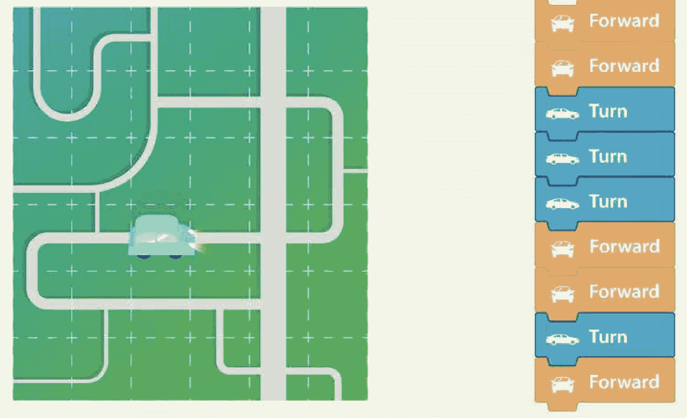

算法按指定顺序解决问题的步骤。理解算法或程序的过程被称为“干跑”（dry run），这是推导算法或程序的目的和输出的常用技术。

此选修部分是共同部分模块 D 计算思维与编程的扩展。由于基本算法和 Python 编程已经在共同部分讨论过，可以参考该部分的相关知识和技能。

## 输入-处理-输出循环

输入-处理-输出循环（IPO 循环）是分析问题的工具，也是算法或程序的重要结构。

- “输入”是程序使用的数据；
- “处理”是程序采用的方法或执行的步骤；
- “输出”是程序返回的信息。

> 类比
煮饭
以米饭为例。在电饭煲中加入水和生米后，电饭煲按照我们设置的时间煮饭，最后给我们美味的米饭！这就是电饭煲的输入-处理-输出循环。

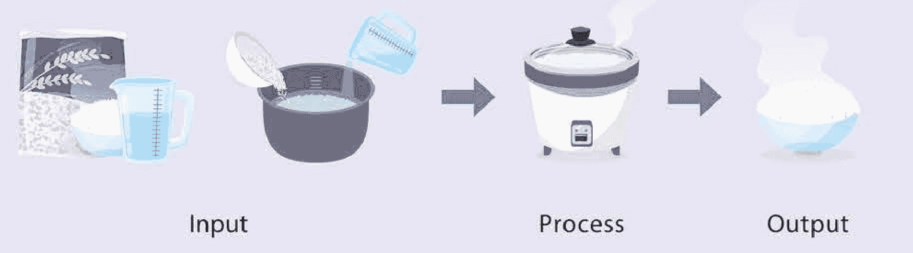

以下是一个简单的例子，关于编写一个应用程序来计算人体质量指数（BMI）以评估用户的健康状况。程序的输入、处理和输出如下：

| 输入 | 处理 | 输出 |
| :--- | :--- | :--- |
| 体重 (kg) | 计算 | 质量指数 |
| 身高 (m) | (BMI = $\frac{\text{体重}}{\text{身高}}$) | (BMI) |

### 伪代码与流程图

表达算法有三种常见方法。第一种是用日常语言表达，但很难简洁。现在，我们学习另外两种表达方式：伪代码和流程图。

- 伪代码使用简单的单词/语句（包括一些关键字）来表达算法。
- 流程图使用特定的形状和连接来表达算法。

以下是常见的伪代码和流程图：

| 结构化英语 | 伪代码 | 流程图 |
| :--- | :--- | :--- |
| 开始 / 结束算法 | 无/A | 无/A | 开始<br> 结束 |
| 处理 / 赋值 | 设置 A 为 21 将 A 的值交给 B 给 B 的值加 1 | A ← 21 <br> B ← A <br> B ← B + 1 |
| 输入 / 输出 | 输入 A, B | 输入 A, B |
| 判断 | 如果 A 等于 B，则 ... 否则 ... | 否 / A = B / 是 |
| 子程序 | 调用子程序 ProABC | ProABC | ProABC |

表 1.1常用的伪代码和流程图

### 跟踪表

跟踪表帮助我们深入理解算法，跟踪变量的变化和输入/输出的状态，并发现错误。它按行分析伪代码并跟踪变量的值：

| 伪代码 | 语句执行后 A 的值 | 语句执行后 B 的值 |
| :--- | :--- | :--- |
| A ← 2 | 2 | 无/A |
| B ← 5 | 2 | 5 |
| A ← B - A | 3 | 5 |
| A ← A * B | 15 | 5 |
| B ← A - B | 15 | 10 |

### 知识点

- 1. 研究以下算法：
 n ← 10
while n > 5
 if n > 3 then
 n ← n - 3
else
 n ← n + 1
Output n
(a) 根据上述算法，完成以下流程图。
(b) 算法的输出是什么？

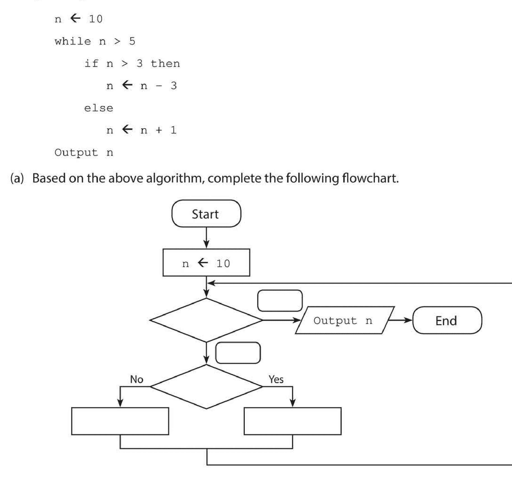


## Python 程序

### 从伪代码到编程语言

伪代码并不是计算机能够理解的语言。因此，我们需要使用编程语言（例如 Python）与计算机进行通信。以下是计算正方形面积的算法，分别用伪代码和 Python 编程语言编写：

> 提示
> 就像自然语言一样，编程语言有很多，每种语言都有其独特的特征。

| 伪代码 | 输出“这是为了找到正方形的面积！” |
| --- | --- |
| 输入长度 | 输出“请输入正方形边长：” |
| area <- length * length | |
| 输出面积 | |

```python
print("This is to find the area of a square!")
length = input("Please enter a side length for a square:")
length = float(length)
area = length * length
print(area)
```

表 1.2 伪代码与 Python 的比较

### Python 集成开发环境

我们可以使用集成开发环境（IDE）来开始编写 Python 代码。IDE 是一种通常带有具有许多编程功能的代码编辑器的应用程序。

### 安装 Thonny

在书中，我们将使用 Thonny 应用程序。访问 Thonny 网站，下载并安装为 Python 设计的 IDE（推荐使用 V3.3.10 或更高版本）。


### 你叫什么名字？

- 1 打开 Thonny。点击“File”（文件）。然后点击“Save as”（另存为）。

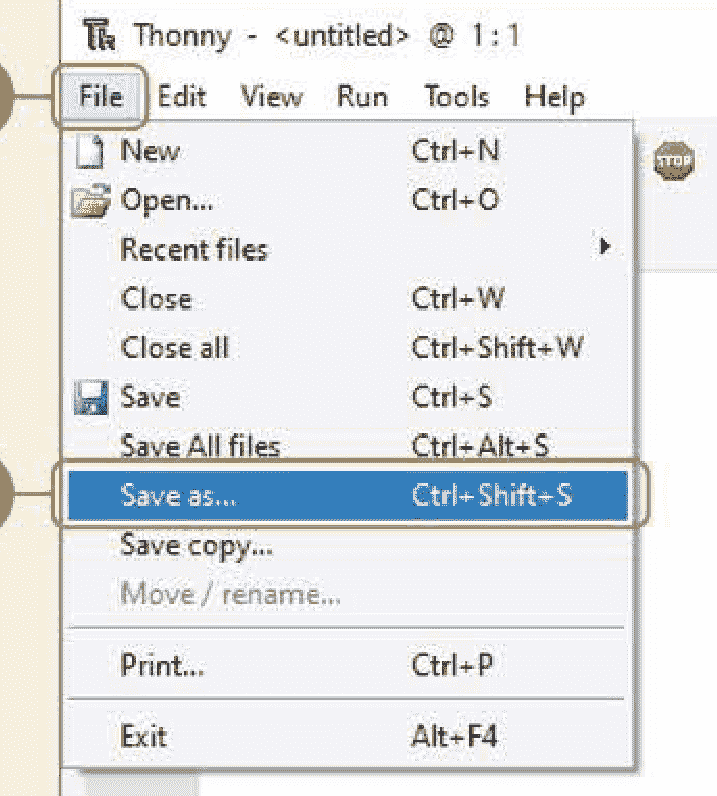

- 3 输入文件名后，再次点击“Save”（保存）保存程序。


- 4 根据下图编写程序。

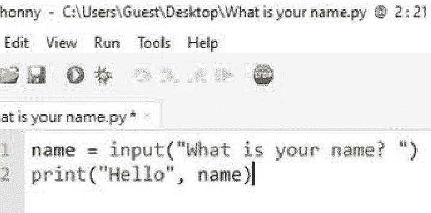

- 5 点击或按“F5”运行程序。在 Shell 中输入你的名字，并记录下图中的输出。

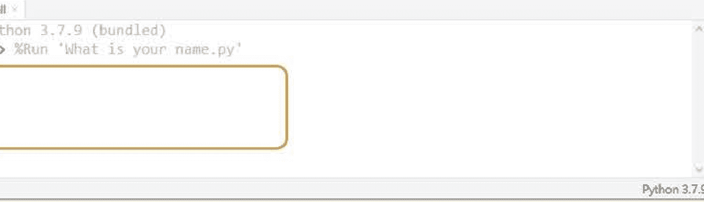

## 算法设计与 Python 程序基础

> 提示
> 注释

编程通常是一个长期的开发项目，可能是许多人之间的协作。因此，使用注释（即用简单的语言解释部分代码的用途）是一个良好且必要的习惯。注释不会影响程序的运行，因为程序编译器会忽略它们。添加注释的目的是为了提高程序的可读性，以便你或他人在阅读长程序时时能够快速理解其要点。

Python 不需要声明变量的数据类型，且变量可以在任何时候标记为不同的数据类型。因此，我们可以添加注释以避免未来的设计错误，例如，其他程序员更改了变量的用途导致了逻辑错误。在 Python 中，行中 "#" 之后的所有内容都被视为注释。Thonny 用浅灰色显示注释。

```python
# All are comments 这是注释
# This program is to calculate the area of a square
print("This is to find the area of a square:")
length = input("Enter a side length for a square:")
length = float(length) # Change the data type of length to float
area = length * length # The data type of area is float
print(area)
```

## 基础编程概念

### 输出语句

在 Python 中，`print()` 函数将括号内的输入参数打印到控制台。输入参数可以是字符串、变量或表达式：

| 输入参数 | 目的 | 示例 | 输出 |
| --- | --- | --- | --- |
| 字符串 | 显示引号内的所有字符 | print("Text") | Text |
| 变量 | 打印变量的值 | length = 10; print(length) | Text |
| 表达式 | 按顺序打印输入参数。不同类型的数据或表达式用 ", " 隔开。打印时会自动添加空格 | name = "Sam"; print("Hi", name) | Hi Sam |

表 1.3 输出语句

> 提示
> 1. `print()` 函数可以输出由逗号分隔的多个参数。
> 2. 默认情况下，`print()` 函数在输出末尾添加换行符。
> 3. 你可以使用 `end` 参数来更改输出结尾使用的字符。

### 变量与数据类型

在声明变量名后，该名称就变成了变量的标识符。此外，数据类型用于编程。

### 变量的声明

- 1. 变量名只能包含字母（A-Z, a-z）、数字（0-9）和下划线 (_)）。
- 2.它们不能以数字开头。
- 3. 变量名大小敏感（例如，“age”和“Age”是不同的变量）。
- 4. Python 关键字不能作为变量名。
- 5. 变量名应反映其实际用途，使代码更易理解。

### 简单数据类型

在声明变量名后，该名称就变成了变量的标识符。此外，数据类型定义了存储在变量中的值的类型。计算机将根据数据类型为每个变量分配合适的内存。数据类型还决定了可以在变量上执行哪些算术、关系或逻辑操作而不会引起程序错误。以下是 Python 中的四种简单数据类型：

| 简单数据类型 | 数据 |
| --- | --- |
| 整数 (int) | 整数（正负均） |
| 浮点数 (float) | 整数和小数（正负均） |
| 布尔值 (bool) | 必须为 "True" 或 "False" |
| 字符串 (str) | 字符序列，可以包含任何字母、数字和特殊符号 |

表 1.4 Python 的简单数据类型


## 输入语句

Python 要求用户通过 `input()` 函数手动输入数据。获取的输入将以字符串的形式存储在变量中。如果我们需要更改数据类型，可以使用 `int()` 或 `float()` 函数。

| 伪代码 | Python |
| --- | --- |
| 输入名称 | name = input () |
| 输入分数 | mark = int (input ()) |

**表 1.6** Python 的输入语句

在接收用户输入之前打印指令，可以让用户知道他们需要输入什么。如果我们在 `input()` 函数中添加一个字符串，程序会在键盘光标所在的同一行之前打印一条消息。例如，`"name" = input("Please input your name: *")`。

### 算术表达式

程序经常执行算术计算。我们可以算术运算符来处理与数字的数据（也称为操作数），并将算术表达式的结果存储在变量中。

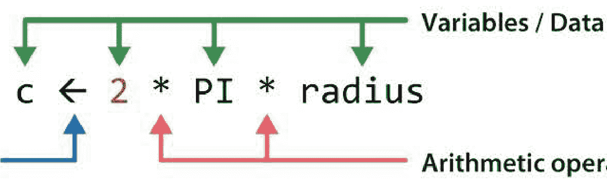

| 操作 | 算术运算符 |
| --- | --- |
| 加法 | + |
| 减法 | - |
| 乘法 | * |
| 除法 | / |
| 整数除法 | // |
| 取模 (Modulus) | % |
| 指数 (Exponent) | ** |

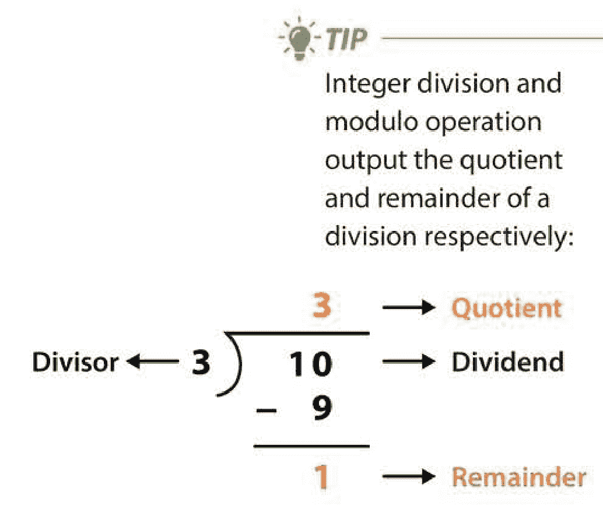

**表 1.7** Python 中的算术运算符

## 算法设计与 Python 程序基础

## 检查点 1.2

- 1. Katie 学习了一种将十进制数转换为对应二进制数的方法。

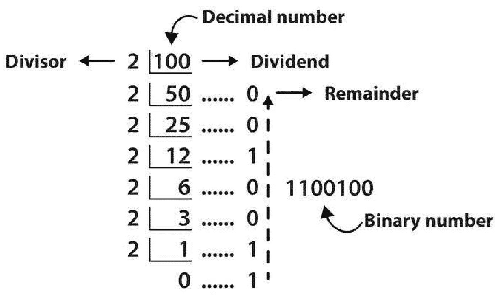

Katie 想要开发一个 Python 程序来实现上述算法。以下是该程序的输出，加粗文本表示用户输入：

| 待转换的十进制数：100 |
| 对应的二进制数是 1100100 |

帮助 Katie 完成她的程序。

```python
dividend = int(input("The decimal number to be converted: "))
binaryString = ""
while dividend > 0:
    remainder = dividend % 2
    binaryString = str(remainder) + binaryString
    dividend = dividend // 2
print(binaryString)
```

## 布尔表达式

### 关系运算符

布尔表达式只有两种可能的结果："True"（真）或 "False"（假），因此结果属于布尔数据类型。可以使用关系运算符来创建布尔表达式。

```
Relational operators
mark >= 50
```

| 关系运算符 | 含义 | 布尔表达式 | 输入 50 的逻辑结果 |
|---|---|---|---|
| == | 等于 | mark == 50 | True |
| < | 小于 | mark < 50 | False |
| <= | 小于等于 | mark <= 50 | True |
| > | 大于 | mark > 50 | False |
| >= | 大于等于 | mark >= 50 | True |
| != | 不等于 | mark != 50 | False |

表 1.8 Python 中的关系运算符与布尔表达式

> 误区
> 混淆了关系运算符 "==" 和赋值运算符 "="
> 关系运算符 "==" 用于布尔表达式，它产生 "True" 或 "False" 并作为评估条件；
> 赋值运算符 "=" 用于赋值语句，它将运算符左侧变量的原值替换为运算符右侧的值。

### 布尔运算符

布尔运算符（也称为逻辑运算符）用于确定两个条件之间的逻辑关系。真表列出了所有条件评估结果的组合以及逻辑运算符后的结果。假设 A 和 B 代表两个条件。下表总结了布尔运算符的真表。

| A | B | A and B | A | B | A or B | not A |
|---|---|---|---|---|---|
| True | True | True | True | True | False |
| True | False | False | True | True | False |
| False | True | False | True | False | True |
| False | False | False | False | False | True |

表 1.9 and 运算符真表

### 运算符的优先级与结合性

与算术运算一样，程序从括号内的表达式开始。但没有括号的表达式呢？实际上有一个类似于运算符的 PEMDAS 规则。运算顺序如下：

| 运算符 | 优先级 | 结合性 |
|---|---|---|
| ** | | 从内到外 |
| - (负值) | | 从左到右 |
| * / | | 从右到右 |
| + | | 从右到右 |
| < <= >= | | 从右到右 |
| == != | | 从右到右 |
| not | | 从右到右 |
| and | | 从右到右 |
| or | | 从右到右 |
| += /= | 最低 | 从右到左 |

表 11 not 运算符真表

表 12 优先级与结合

程序处理优先级更高的运算符。如果某些运算符的优先级相同，则应根据结合的方向进行处理。以 `-1 + 2**3` 为例：

```python
-1 + 2**3
```

运算符 `**` 的优先级更高：

```python
-1 + 2 * (3)
```

括号内的表达式应该从右到左处理：

```python
(-1 + 2) * 2
```

负号 – 的优先级更高：

```python
-(-1 + 2) * 2
```

运算符 `**` 的优先级更高：

```python
(-1 + 2) * (2**3)
```

表达式应该从左到右处理：

```
3
```

因此，上述表达式应解释为 `(-1 + 2) * (2 + (3**2))`。


- 1. 运行以下 Python 代码并写下程序的输出：

| Python | 输出 |
|---|---|
| print(-5**2) | |
| print(2**3) | |
| a = 1 | |
| a += 5 - 3 | |
| print(a) | |
| print(5 >= 3 and 5*2) | |

## 1.4 控制结构

计算机算法中有三种基本的控制结构，包括顺序、选择和循环。顺序结构允许程序按照编写顺序执行语句。选择和循环结构让程序根据指定的条件决定执行哪些语句。

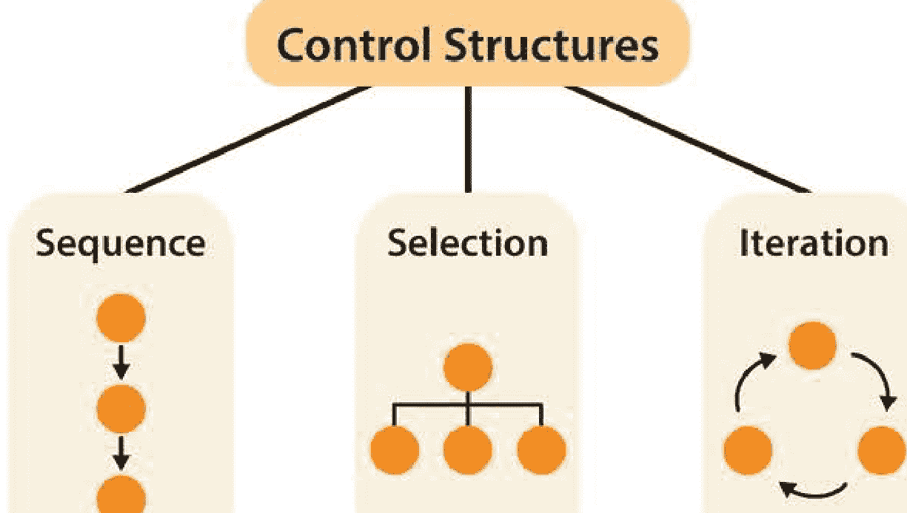

### 选择

选择控制结构使用布尔表达式作为评估条件。逻辑结果将决定程序执行哪些语句。

| Python | 流程图 |
| --- | --- |
| **if-then** 条件语句 | `if {condition}: {"then" body}` ![condition -> True: "then" body, False: ]
| **if-then-else** 条件语句 | `if {condition}: {"then" body} else: {"else" body}` ![condition -> True: "then" body, False: "else" body ]

### Python 流程图

```python
if-elif statements
if (condition 1):
    ("then" body 1)
elif (condition 2):
    ("then" body 2)
elif (condition 3):
    ("then" body 3)
else:
    ("else" body)
```

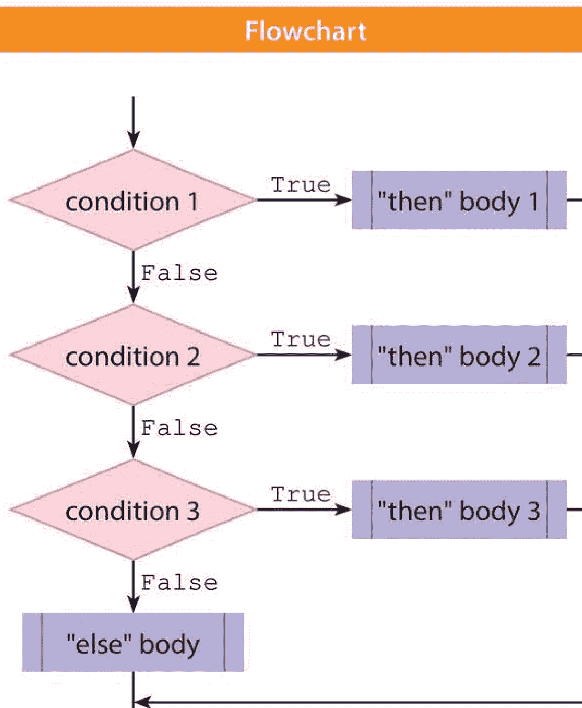

**表 1.13** Python 条件语句及其流程图

> 缩进是 Python 中非常重要的语法。它用于显示程序的逻辑结构并指示语句所属的分支。"else" 关键字必须与相应的 "if" 关键字对齐。在 Thny 中，按下 "Tab" 或 "Shift + Tab" 可以分别为选定的代码添加或删除缩进。

| Python | 流程图 |
| --- | --- |
| if mark >= 50: | False | True |
| print("Pass") | |
| print("Promoted") | |
| else: | |
| print("Fail") | print("Fail") |
| print("Repeated") | print("Repeated") | print("Promoted") |

## 示例 1.1

- 1. 研究以下算法：

```
if X > 10 then
  Z ← X + Y
else if Y > 10 then
  Z ← X + Y
else
  Z ← Z + 10
```
使用单个 "if-then-else" 条件语句简化算法。

```python
if
  Z ← X + Y
else
  Z ← Z + 10
```

### 分析

当 "X > 10" 或 "Y > 10" 为真时，将执行相同的代码 "Z ← X + Y"。因此，可以使用布尔运算符 "OR" 来组合这两个条件。

### 解答

X > 10 OR Y > 10


使用单个的 "if-then-else" 条件语句来简化算法。

```python
if condition:
    Z <- 10
else:
    Z <- 20
```

### 分析

如下流程图所示，“z <- 10” 将执行的情况共有两种场景：

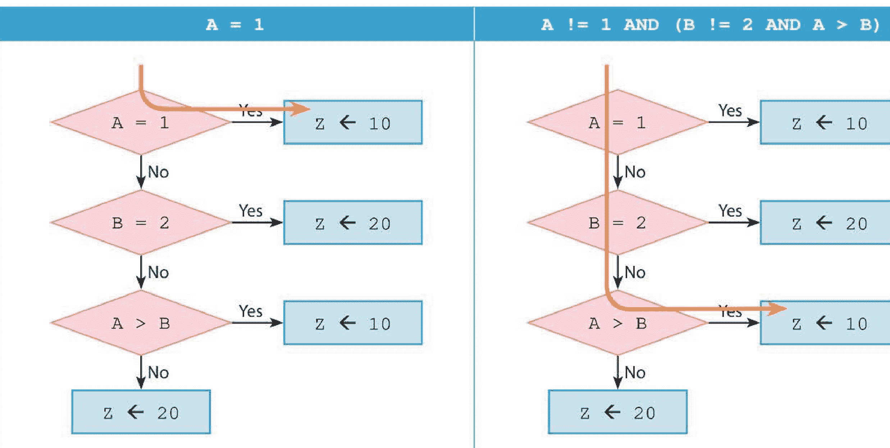

### 解决方案

A = 1 OR (B != 2 AND A > B)

### 思考

如果将条件语句重写为如下，条件应该是什么？

```python
if condition:
    Z <- 20
else:
    Z <- 10
```

## 算法设计与 Python 程序基础

## 检查点 1.3

- 1. 一家银行开发了一个用于自动取款机（ATM）的程序。客户可以通过点击屏幕上的按钮选择银行服务。


该程序使用数字代表不同的银行服务。客户可以按数字“1”到“3”进入对应服务的程序模块，或按“0”退出 ATM 服务。以下是该程序的流程图：

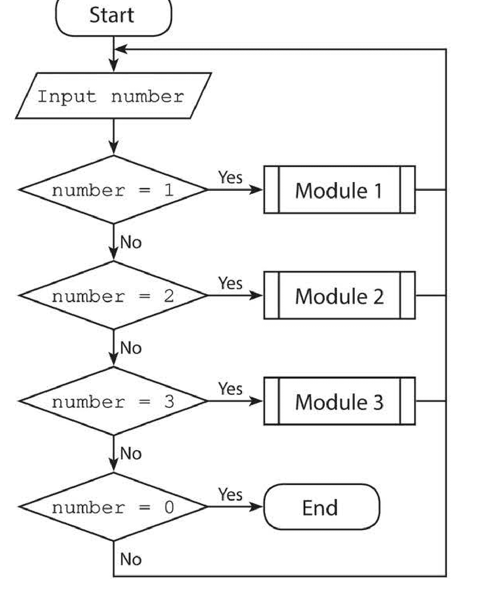

(a) (i) 如果客户按下“1”，程序将执行多少次评估？__

(ii) 如果客户按下“0”，程序将执行多少次评估？__

(b) 假设银行服务“1”、“2”和“0”的百分分别为 25%、20%、5% 和 50%。完成以下流程图以使平均评估次数最小化。

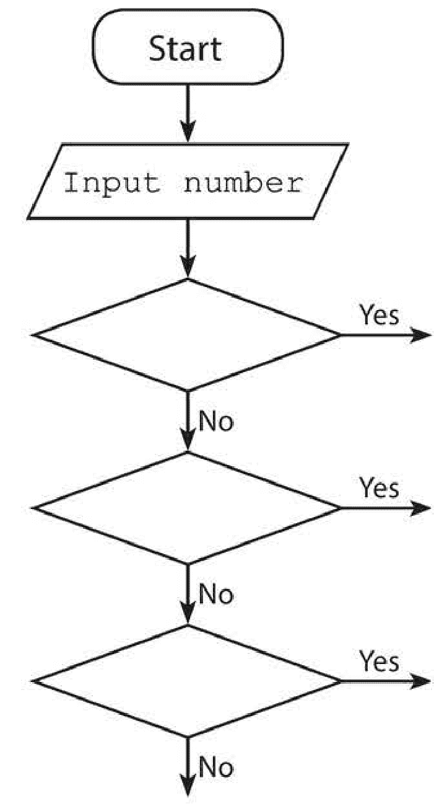

2. David 正在设计一个游戏。如果玩家的得分低于 100 分或花费时间超过 60 秒，他们就需要重新开始。只有在成功完成任务后，他们才能进入下一关。研究以下算法：

```python
if score < 100:
    Output "Replay"
else if time > 60:
    Output "Replay"
else:
    Output "Next"
```


使用单个的 "if-then-else" 条件语句来简化算法。

```python
if condition:
    Output "Next"
else:
    Output "Replay"
```

### 迭代

迭代控制结构也称为循环控制结构。这意味着重复执行某些语句，直到循环条件不再为真。需要重复的语句称为循环体。

| Python | 流程图 |
|---|---|
| for loop {variable} in range{{first value}, {last value}}<br>(循环体) |  |
| while loop {condition} :<br>(循环体) | |

**表 1.14** Python 的循环控制结构及其流程图

质数（Prime number）是任何大于 1 且能被 1 和自身整除的整数。前 10 个质数是 2, 3, 5, 7, 11, 13, 17, 19, 23, 29。以下程序判断用户输入的整数是否为质数。假设用户输入一个正整数，编写 Python 程序或：

```python
num = int(input("请输入数字："))
if num > 1:
    isPrime = True
else:
    isPrime = False

if isPrime == True:
    print(num, "是质数.")
else:
    print(num, "不是质数.")
```

Cathy 想计算两个数的最大公约数（HCF），即能够整除这两个数的最大正整数。帮助 Cathy 完成 Python 程序或算法：

质数
2, 3, 5, 7, 11, 13, 17, 19, 23, 29, 31, 37, 41, 43, 47, 53, 59, 61, 67, 71, 73, 79, 83, 89

## 算法设计与 Python 程序基础

## 1. 数据结构

数据结构有助于方便组织数据。一个例子是一维数组（1D array）。它是按顺序存储一组数据的简单结构。这些数据通常是相同类型。

> 列表就像一个柜子；柜子有几个抽屉来存储物品。在抽屉上写上标签用户可以识别抽屉内部。

### 数组与列表（一维）

虽然 Python 中没有这种数组，但用户可以使用另一种数据结构来实现目的：例如，我们可以将数据放入列表并命名为“age”。它是一组变量的序列。

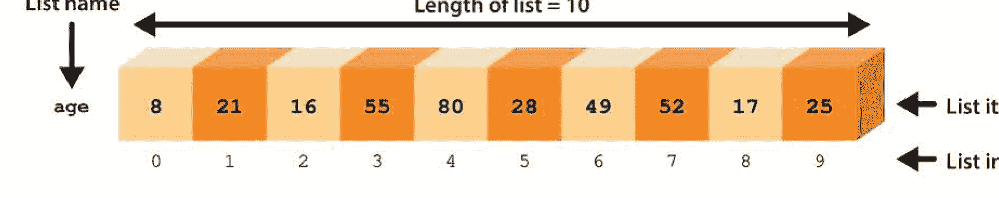

上面的图展示了列表如何呈现。age[0] 代表列表中的第一条数据，age[1] 是第二个，依此类推。这意味着 age[0] 的值是第一个，age[1] 的值是第二个。通过连接相关的数据，列表利用循环来实现不同的算法，如计数和累加。

### 求和和平均值

```python
num = [15, 10, 5, 25, 20, 30]
total = 0
for i in range(0, 6):
    total = total + num[i]
print(total)
avg = total/6
print(avg)
```
数据结构一维数组（1D array） 索引/元素 计数

### 查找列表中是否存在某条数据

| Python | 输出 |
|---|---|
| num = [15, 10, 5, 25, 20, 30] | |
| target = 25 | |
| found = False | |
| for i in range(0, 6): | |
| if target == num[i]: | |
| found = True | |
| print(found) | |

### 寻找最大值最小值

| Python | 输出 |
|---|---|
| num = [15, 10, 5, 25, 20, 30] | |
| largest = num[0] | |
| smallest = num[0] | |
| for i in range(0, 6): | |
| if num[i] > largest: | 30 |
| largest = num[i] | |
| if num[i] < smallest: | 5 |
| smallest = num[i] | |
| print(largest) | |
| print(smallest) | |

### 计数

以下程序统计大于 bound 的项目个数：

| Python | 输出 |
|---|---|
| num = [15, 10, 5, 25, 20, 30] | |
| bound = 20 | |
| count = 0 | |
| for i in range(0, 6): | |
| if num[i] > bound: | 2 |
| count = count + 1 | |
| print(count) | |

## 算法设计与 Python 程序基础


- 1. Peter 写了一个算法来处理一个大小为 n 的整数数组 B。该算法的伪代码如下：

| 行 | 代码 |
|---|---|
| 1 | finished = False |
| 2 | pos ← n |
| 3 | while finished = False do |
| 4 | if B[pos] = 0 then |
| 5 | B[pos] ← 1 |
| 6 | finished ← True |
| 7 | else |
| 8 | B[pos] ← 0 |
| 9 | pos ← pos - 1 |

- (a) 假设 n = 6 且数组 B 的初始内容是十进制数值 1 的二进制表示：

| 1 | 2 | 3 | 4 | 5 | 6 |
|---|---|---|---|---|---|
| B | 0 | 0 | 0 | 0 | 0 | 1 |

执行一次算法后数组 B 的内容是什么？

| 1 | 2 | 3 | 4 | 5 | 6 |
| 7 | 8 |
|---|---|---|---|---|---|---|---|
| B | 0 | 0 | 0 | 0 | 0 | | |

- (b) 假设 n = 8 且数组 B 的初始内容是十进制数值 11 的二进制表示：执行一次算法后数组 B 的内容是什么？

| 1 | 2 | 3 | 4 | 5 | 6 | 7 | 8 |
|---|---|---|---|---|---|---|---|
| B | | | | | | | |

- (c) 该算法的目的是？

- (d) 假设 n = 4 且数组 B 的初始内容是十进制数值 15 的二进制表示：

| 1 | 2 | 3 | 4 |
|---|---|---|---|
| B | 1 | 1 | 1 | 1 |

执行该算法会发生错误。解释原因。

### 从列表中删除元素

以下程序删除 P 处的元素。

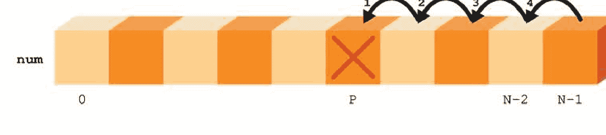

| Python | 输出 |
|---|---|
| num = [15, 10, 5, 25, 20, 30] | |
| print(num) | |
| P = 1 | |
| N = len(num) | |
| for i in range(P, N-1): | |
| num[i] = num[i+1] | [15, 10, 5, 25, 20, 30] |
| num[N-1] = 0 | [15, 5, 25, 20, 30, 0] |
| print(num) | |

### 向列表中添加元素

以下程序在列表 P 位置添加一个新元素 "35"。

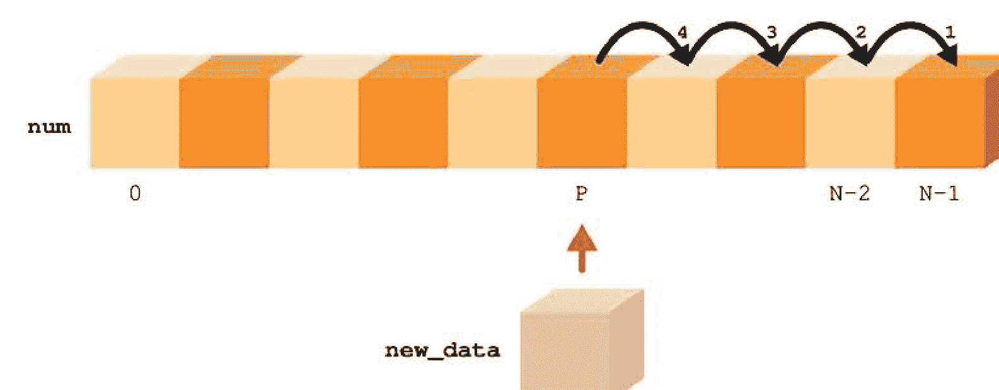

| Python | 输出 |
|---|---|
| num = [15, 10, 5, 25, 20, 30] | |
| print(num) | |
| P = 1 | |
| num = num + [0] | |
| N = len(num) | |
| for i in range(N-1, P, -1): | |
| num[i] = num[i-1] | [15, 10, 5, 25, 20, 30] |
| num[P] = 35 | [15, 35, 10, 5, 25, 20, 30] |
| print(num) | |


### 字符串

字符串是由一系列字符组成的。在下面的示例中，字符串 "Work Hard!" 中的字符被放置于一个名为 `the_string` 的列表中，即 `the_string[0]` 的值为 'W'。

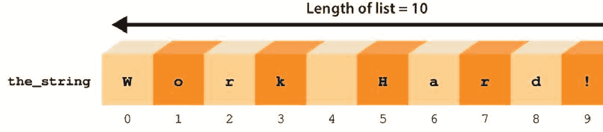

### 查找字符是否在字符串中

使用 for 循环来确定目标字符是否存在

| Python | 输出 |
| --- | --- |
| the_string = "Work Hard!" | |
| target = "a" | |
| found = False | |
| N = len(the_string) | |
| for i in range(0, N): | |
|    if target == the_string[i]: | True |
|        found = True | |
| print(found) | |

使用 while 循环查找目标字符的索引

| Python | 输出 |
| --- | --- |
| the_string = "Work Hard!" | |
| target = "a" | |
| found = False | |
| N = len(the_string) | |
| index = -1 | |
| i = 0 | |
| while i < N and found == False: | 6 |
|    if target == the_string[i]: | |
|        index = i | |
|        found = True | |
|    i = i + 1 | |
| print(index) | |

Jeremy 发现 IDE 中的编译器有各种功能来检测代码中的语法错误。其中一个功能是检查双引号是否成对出现，如下：

```
hello world.py:
print("Hello", "World")n
Shell:
Python 3.7.9 (default)
>>> hello world.py
Traceback (most recent call):
  File "world.py", line 1, in <module>
    print("Hello", "World")
SyntaxError: E while scanning string literal
>>>
```

他正在设计一个 Python 程序来检查代码。以下是该程序的输出：

| 输入的字符串 | 输出 |
|---|---|
| print("Hello World") | Valid |
| print("Hello", World") | Missing quotation mark |

- 1. Jeremy 想用以下测试数据测试程序。写下它们的预期输出。
- (i) 输入字符串 "print("Hello, World")"。
- (ii) 输入字符串 "print("The sum of", n1, "and", n2, is, sum, \.")"。
- (b) 编写 Python 程序或算法：

```python
target = ""
statement = input()
pair = 0

if: # 注意：根据 OCR，逻辑条件似乎不完整
    print("Valid")
else:
    print("Missing quotation mark")
```

> 要向字符串中添加引号，必须在引号之前添加一个反斜杠 (\)。

### 从字符串中提取所需的字符

当提取字符串中的部分字符时，就会创建一个子字符串。只要我们有子字符串的起始索引和结束索引，就可以通过将子字符串中的字符一个一个组合成另一个字符串。

| the_string | W | o | r | k | | H | a | r | d | ! | | sub_string | W | o | r | k |
|---|---|---|---|---|---|---|---|---|---|---|---|---|---|---|---||
| 0 | 1 | 2 | 3 | 4 | 5 | 6 | 7 | 8 | 9 | | 0 | 1 | 2 | 3 |

起始索引 结束索引

Python | 输出

```python
the_string = "Work Hard!"
sub_string = ""
```

```python
for i in range(0, 4):
    sub_string = sub_string + the_string[i]
```

```python
print(the_string)
print(sub_string)
```

Work Hard!
Work

示例 1.2


- 学习并学习以下 Python 程序：
    h = "cs pain"
    p = [5, 2, 0, 4, 6, 2, 3, 4, 1, 1]
    result = ""
    for i in range(0, 10):
        result = result + h[p[i]]
    print(result)
上述 Python 程序的输出是什么？

### 分析

列表 h 的内容：

| 'c' | 's' | ' ' | 'p' | 'a' | 'i' | 'n' |
|---|---|---|---|---|---|---|||
| index | 0 | 1 | 2 | 3 | 4 | 5 | 6 |

substring 子字符串

以下是 for 循环的追踪表：

| i | p[i] | h[p[i]] |
|---|---|---|
| 0 | 5 | h[5] = 'i' |
| 1 | 2 | h[2] = ' ' |
| 2 | 0 | h[0] = 'c' |
| 3 | 4 | h[4] = 'a' |
| 4 | 6 | h[6] = 'n' |
| 5 | 2 | h[2] = ' ' |
| 6 | 3 | h[3] = 'p' |
| 7 | 4 | h[4] = 'a' |
| 8 | 1 | h[1] = 's' |
| 9 | 1 | h[1] = 's' |

### 解

- 1. Ken 设计了一个程序，接收用户输入的数字并输出对应长度的密码。该程序的输出如下：

| 输入的数字 | 输出 |
|---|---|
| 8 | |
| 15 | |

## 二维数组

假设字符串的起始索引为 0。为该程序编写伪代码：

```text
c ← "abcdefghijklmnopqrstuvwxyz0123456789!"
i ← length of c
Input pw_length
for k from 1 to pw_length
  r ← random integer between 0 and i
  pw ← c[r]
Output pw
```Chan 是 3A 级的老师。他使用几个一维数组来存储不同学科学生的成绩，如下：

| chi_mark | 90 | 67 | 80 | 51 | 94 | 88 | 75 | 68 |
|---|---|---|---|---|---|---|---|
| index | 1 | 2 | 3 | 4 | 5 | 6 | 7 | 8 |
| eng_mark | 74 | 85 | 94 | 56 | 96 | 72 | 66 |
| index | 1 | 2 | 3 | 4 | 5 | 6 | 7 | 8 |
| math_mark | 85 | 45 | 90 | 83 | 85 | 64 | 75 | 64 |
| index | 1 | 2 | 3 | 4 | 5 | 6 | 7 | 8 |
| ict_mark | 94 | 73 | 87 | 83 | 92 | 69 | 78 | 70 |
| index | 1 | 2 | 3 | 4 | 5 | 6 | 7 | 8 |

数组中的成绩按班级排序，例如 `chi_mark[1]` 和 `eng_mark[1]` 是 1 级的中文和英语成绩。现在，Chan 老师需要重置 5 级所有学科的成绩。他发现使用独立的语句非常繁琐。


参考表格的设计，Chan 老师使用以下二维数组来存储成绩：

| index | 1 | 2 | 3 | 4 | 5 | 6 | 7 | 8 |
| 3A_mark | 90 | 67 | 83 | 51 | 94 | 88 | 75 | 68 |
| | 74 | 85 | 94 | 56 | 96 | 72 | 82 | 66 |
| | 85 | 45 | 90 | 83 | 85 | 64 | 75 | 64 |
| | 94 | 73 | 87 | 83 | 92 | 69 | 78 | 70 |

思考使用二维数组而不是多个一维数组来存储数据的优点。


数组并不总是列表的形式存在。它们也可以以表格或矩阵的形式呈现数据，被称为二维数组（2D arrays）。例如，在编写“井字线”或“扫地雷”游戏时，可以使用二维数组创建存储不同位置数据的形式。

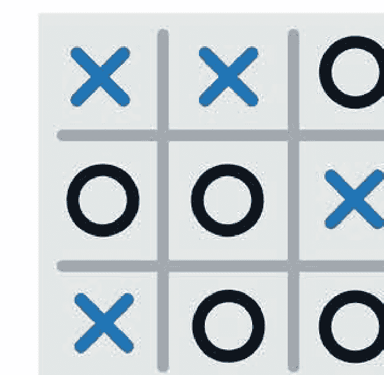

图2 井字线 (Tic-tac-toe)

| Column 0 | Column 1 | Column 2 | Column 3 |
|---|---|---|---|
| Row 0 | [0,0] | [0,1] | [0,2] | [0,3] |
| Row 1 | [1,0] | [1,1] | [1,2] | [1,3] |
| Row 2 | [2,0] | [2,1] | [2,2] | [2,3] |

图1.1 可视化二维数组项及其索引（索引从 0 开始）

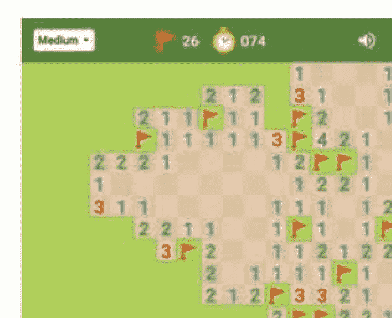

图1.3 扫地雷 (Minesweeper)

### 创建二维列表

以下是创建列表的一些示例：

| Python | 解释 / 类比 |
|---|---|
| list2d1 = [[0,1,2], [3,4,5], [6,7,8], [9,10,11]] |

### 拓展

二维数组在生活中无处不在。以下是：
- 表格存储数据的方式类似于二维数组。行用数字索引，列用字母索引。要指定表格中的单元格，我们用列字母和行数字组合来表示，例如 "A1"。


- 数学中的二维直角坐标系（卡卡尔坐标系）也类似于二维数组，该系统由 x 轴和 y 轴组成。要指定一个点，我们用坐标 (x, y) 的组合来表示，例如 (3, 6)。

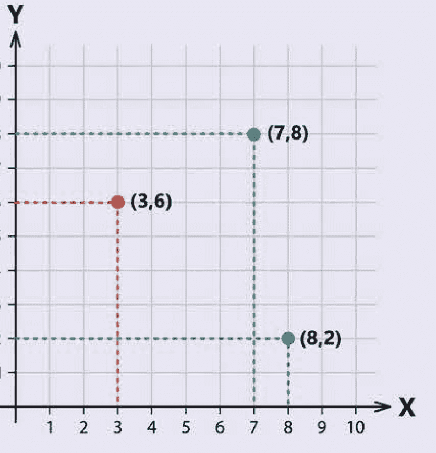

> 在几何学中，三维空间的每个位置可以用三个坐标表示。你认为程序中有三维数组吗？

### 访问列表

创建列表后，可以使用列表名和索引来访问指定的项。例如，list2d1[3][1] 的值为 10。

- 我们使用嵌套循环为项赋值或输出二维列表中的所有项。它们在选修 C 部分 3.2 中被提到。

| | Column 0 | Column 1 | Column 2 |
|---|---|---|---|
| Row 0 | 0 | 1 | 2 |
| Row 1 | 3 | 4 | 5 |
| Row 2 | 6 | 7 | 8 |
| Row 3 | 9 | 10 | 11 |

list2d1[3][1]


### 二维列表的扩展 (ENRICHMENT)

在 Python 中，二维列表可以被视为“列表的列表”。此外，Python 列表的数据结构是动态的 (dynamic) 而不是静态的 (static)。因此，列表的行和列可以随时更改。以下是在二维列表中创建和添加项的示例：

### 创建的列表

### Python

```
list2d = [[]]
```

创建一个包含一行的二维列表，并分配空列表（list）的值。

| | [0] | [1] |
|---|---|---|
| list2d[0] | 1 | 2 |

```
list2d = list2d + [[]]
list2d[1] = [3, 4]
```

| | [0] | [1] |
|---|---|---|
| list2d[0] | 1 | 2 |
| list2d[1] | 3 | 4 |

```
list2d = list2d + [[]]
list2d[2] = [5]
```

| | [0] | [1] |
|---|---|---|
| list2d[0] | 1 | 2 |
| list2d[1] | 3 | 4 |
| list2d[2] | 5 |

```
list2d[2] = list2d[2] + [6]
```

| | [0] | [1] |
|---|---|---|
| list2d[0] | 1 | 2 |
| list2d[1] | 3 | 4 |
| list2d[2] | 5 | 6 |

1. 运行以下 Python 代码，并写下二维列表的最后值：

| Python | 二维列表 |
| --- | --- |
| list2d1 = [[0,1,2], [3,4,5], [0,1,2], [3,4,5]] | |
| list2d1[0][2] = 8 | |
| list2d1[1][0] = 6 | |
| list2d2 = [[0,1,2], [0,1,2], [0,1,2]] | |
| list2d2[1] = [2,3,4] | |
| list2d3 = [[0,1,2], [0,1,2], [0,1,2]] | |
| list2d3[1][1] = list2d3[2][2] + 30 | |
| list2d4 = [[9,8,7,6], [6,7,8,9], [1,2,3,4]] | |
| list2d4[1][2] = list2d4[1][1] + list2d4[2][2] | |

## 示例 1.3

1. 下图被分为 10 × 9 个单元格。每个单元格中的数字代表该区域的人口（以十万为单位）。朱先生定义了一个二维数组 M，M[i, j] 对应单元格的人口，如下：

| | 1 | 2 | 3 | 4 | 5 | 6 | 7 | 8 | 9 |
|---|---|---|---|---|---|---|---|---|---|
| 1 | 3 | 1 | 2 | 3 | 4 | 5 | 6 | 7 | 8 |
| 2 | 1 | 4 | 2 | 3 | 3 | 2 | 1 | 1 | 2 |
| 3 | 3 | 7 | 6 | 3 | 2 | 2 | 2 | 2 | 1 |
| 4 | 3 | 4 | 4 | 5 | 6 | 7 | 3 | 2 | 2 |
| 5 | 0 | 0 | 3 | 3 | 3 | 7 | 5 | 5 | 3 |
| 6 | 6 | 0 | 0 | 1 | 3 | 4 | 4 | 4 | 4 |
| 7 | 7 | 0 | 0 | 0 | 1 | 2 | 3 | 4 | 3 |
| 8 | 0 | 0 | 0 | 0 | 0 | 0 | 2 | 2 | 3 |
| 9 | 9 | 0 | 0 | 0 | 0 | 0 | 2 | 3 | 2 |
| 10 | 0 | 0 | 0 | 0 | 0 | 0 | 1 | 2 | 1 |

(a) 朱先生使用一个 2 × 2 单元格的网格在地图上划出一个特定区域，K 值代表该区域的总人口。在上面的示例中，K = 3 + 3 + 4 + 2 = 12。

计算以下区域的 K 值。

| | 1 | 2 | 3 | 4 | 5 | 6 | 7 | 8 | 9 |
|---|---|---|---|---|---|---|---|---|---|
| 1 | 1 | 2 | 3 | 4 | 5 | 6 | 7 | 8 | 9 |
| 2 | 1 | 4 | 2 | 3 | 3 | 2 | 1 | 1 | 2 |
| 3 | 3 | 7 | 6 | 3 | 2 | 2 | 2 | 2 | 1 |
| 4 | 3 | 4 | 4 | 5 | 6 | 7 | 3 | 2 | 2 |
| 5 | 0 | 0 | 3 | 3 | 3 | 7 | 5 | 5 | 3 |
| 6 | 6 | 0 | 0 | 1 | 3 | 4 | 4 | 4 | 4 |
| 7 | 7 | 0 | 0 | 0 | 1 | 2 | 3 | 4 | 3 |
| 8 | 0 | 0 | 0 | 0 | 0 | 0 | 2 | 2 | 3 |
| 9 | 9 | 0 | 0 | 0 | 0 | 0 | 2 | 3 | 2 |
| 10 | 0 | 0 | 0 | 0 | 0 | 0 | 1 | 2 | 1 |

(b) 现在，朱先生定义了另一个二维数组 P 来存储二维数组对应的 K 值，即 P[i, j] 存储从 M[i, j] 到 M[i+1, j+1] 的和。在上面的示例中，P[1, 3] 的值为 12。

(i) P[4, 2] 的值是多少？
(ii) 如果网格超出边界，数组 P 的大小是多少？

### 分析

(b) P[i, j] = M[i, j] + M[i, j+1] + M[i+1, j] + M[i+1, j+1]
P[4, 2] = M[4, 2] + M[4, 3] + M[5, 2] + M[5, 3] = 4 + 5 + 0 + 3 = 12

(ii) 以下网格超出了地图的边界：

| | 1 | 2 | 3 | 4 | 5 | 6 | 7 | 8 | 9 |
|---|---|---|---|---|---|---|---|---|
| 1 | 4 | 2 | 3 | 3 | 3 | 2 | 1 | 1 | |
| 2 | 4 | 3 | 4 | 2 | 2 | 3 | 1 | 2 | |
| 3 | 7 | 6 | 3 | 3 | 3 | 2 | 2 | 1 | |
| 4 | 3 | 4 | 5 | 6 | 7 | 3 | 3 | 2 | 2 | （注：表格值似乎根据 OCR 上下文重建）

因此，网格覆盖的区域必须在 1 ≤ i ≤ 9 和 1 ≤ j ≤ 8 范围内。

### 答案

(a) K = 7 + 3 + 7 + 5 = 22
(b) P[4, 2] 的值为 15
(ii) 二维数组 P 的大小为 9 × 8

## 算法设计与 Python 程序基础

## 检查点 1.8

1. 如图所示，梅森定义了一个二维数组 M 来存储地雷的位置。如果单元格中的值为“T”，则表示该区域有地雷；如果单元格中的值为“F”，则表示该区域没有地雷。


| | 1 | 2 | 3 | 4 | 5 | 6 | 7 | 8 | 9 |
|---|---|---|---|---|---|---|---|---|---|
| 1 | F | F | T | F | T | F | F | F | F |
| 2 | F | T | F | F | T | F | F | F | F |
| 3 | F | T | F | F | F | F | F | F | F |
| 4 | F | F | F | F | F | F | F | F | F |
| 5 | F | F | T | F | F | F | F | F | F |
| 6 | F | F | F | F | F | T | F | F | F |
| 7 | F | F | F | T | F | F | F | T | F |
| 8 | F | F | F | F | F | F | F | F | F |
| 9 | F | F | F | F | F | F | F | F | F |

梅森接着定义了另一个二维数组 B。如果 M[i, j] 中没有地雷，B[i, j] 将存储从 M[i-1, j-1] 到 M[i+1, j+1] 区域的地雷总数。否则，B[i, j] 将存储值“T”。在下面的示例中，B[1, 1]、B[1, 2] 和 B[1, 3] 的值已经给出。完成二维数组 B 中的项。

| | 1 | 2 | 3 | 4 | 5 | 6 | 7 | 8 | 9 |
|---|---|---|---|---|---|---|---|---|
| 1 | T | T | T | | | | | | |
| 2 | | | | | | | | | |
| 3 | | | | | | | | | |
| 4 | | | | | | | | | |
| 5 | | | | | | | | | | |
| 6 | | | | | | | | | | |
| 7 | | | | | | | | | | |
| 8 | | | | | | | | | | |
| 9 | | | | | | | | | | |

2. 经典的数独是由 9 × 9 个单元格组成的数学游戏。

(a) 数独的一个规则是数字 1-9 必须出现在每行、每列和每个 3 × 3 宫内。

(i) P[4, 2] 的值是多少？
(ii) 如果网格超出边界，P[1, 3] 的值是多少？

(b) 另一个规则是数字 1-9 必须出现在每个 3 × 3 宫内。例如，

| | 1 | 2 | 3 | 4 | 5 | 6 | 7 | 8 | 9 |
|---|---|---|---|---|---|---|---|---|---|
| 1 | 4 | 9 | 7 | 1 | 3 | 2 | 6 | 8 | 5 |
| 2 | 1 | 2 | 6 | 5 | 4 | 7 | 3 | 9 | 8 |
| 3 | 3 | 5 | 8 | 9 | 8 | 6 | 1 | 2 | 7 |
| 4 | 9 | 5 | 3 | 6 | 7 | 8 | 4 | 1 | 2 |
| 5 | 2 | 3 | 4 | 4 | 1 | 5 | 7 | 6 | 9 |
| 6 | 7 | 6 | 1 | 2 | 9 | 3 | 8 | 5 | 4 |
| 7 | 8 | 1 | 2 | 3 | 5 | 4 | 9 | 7 | 6 |
| 8 | 5 | 4 | 9 | 7 | 6 | 9 | 2 | 3 | 1 |
| 9 | 6 | 7 | 5 | 8 | 2 | 1 | 5 | 4 | 3 |

3. 克里斯想给凯蒂发一条秘密消息。消息如下：

## ILoveICT

克里斯请求查尔斯帮助传递消息，但担心查尔斯或其他人阅读它。因此，他想了一种加密消息的方法，只有凯蒂能理解。这种方法是将消息中的每个字符变成以该字符开头的字符串。这是一个示例：

```
I go to school by bus
Lift out of service
over and over
very nice
e for egg
Intelligence
Cat and dog
Tomorrow is another day
```

凯蒂收到消息后，将字符串保存在二维数组 P 中，索引从 0 开始：

| | |
|---|---|
| 0 | I go to school by bus |
| 1 | Lift out of service |
| 2 | over and over |
| 3 | very nice |
| 4 | e for egg |
| 5 | Intelligence |
| 6 | Cat and dog |
| 7 | Tomorrow is another day |

解码二维数组 P 中消息的算法。

```
P <- ["I go to school by bus", "Lift out of service", "over and over",
"very nice", "e for egg", "Intelligence", "Cat and dog", "Tomorrow is another day"]
nto
for k from
message <-
```


## 章节总结

重点

在选修 C 和必修 D 中对应的部分

| 主题 | 选修 C | 必修 D |
| :--- | :--- | :--- |
| 输入-处理-输出循环 | P. 5 | 书 1 P. 7-9 |
| 伪伪代码和流程图 | P. 6 | 书 1 P. 34-35 |
| 追踪表 | P. 7 | 书 1 P. 110-121 |
| 变量和简单数据类型 | P. 11-12 | 书 1 P. 36-37, 42-44 书 2 P. 11-15 |
| Python 输出语句 | P. 10 | 书 2 P. 22-23 |
| Python 输入语句 | P. 13 | 书 2 P. 24-25 |
| 算术表达式 | P. 13 | 书 1 P. 38-41 书 2 P. 16-21 |
| 布尔表达式 | P. 15-17 | 书 1 P. 48, 60-70 书 2 P. 33, 48-51 |
| 选择控制结构 | P. 18-23 | 书 1 P. 49-52 书 2 P. 34-40 |
| 迭代控制结构（循环） | P. 24-25 | 书 1 P. 73-84 书 2 P. 52-60 |
| 数组 / 列表 | P. 26-29 | 书 1 P. 122-156 书 2 P. 76-114 |
| 字符串 | P. 30-33 | 书 2 P. 115-131 |

## 二维数组

- 二维数组以表格的形式呈现数据。
- 在 Python 中，二维列表被视为“列表的列表”。

### 创建 2D 列表
list2d1 = [[0,1,2], [3,4,5], [6,7,8], [9,10,11]]

| 列 | 列 | 列 | 列 |
| :--- | :--- | :--- | :--- |
| 0 | 1 | 2 | 3 |
| 4 | 5 | -1 | - |
| 6 | 7 | 8 | |
| 9 | 10 | 11 | |

### 修改 2D 列表中的项
list2d1[0][2] = -1

### 使用 for 循环修改 2D 列表中的项
```python
for i in range(0, 3):
    list2d1[1][i] = 0
```

### 为 2D 列表添加一列
list2d1[3] = list2d1[3] + [30]

| | |
| :--- | :--- |
| 40 | 41 |

“字符串列表”也可以以二维列表的形式呈现。

| Python | 解释 / 盒子类比 |
| :--- | :--- |
| list2d2 = ["Frank", "Joe", "Anne"] | F r a n k |
| | J o e |
| | A n e |

## 词汇表

| accumulating | 累積 | console | 控制台 |
| :--- | :--- | :--- | :--- |
| algorithm | 算法 | constant | 常數 |
| arithmetic operator | 算術運算子 | control structure | 控制結構 |
| assignment | 賦值 | counting | 計算 |
| association | 結合 | data structure | 數據結構 |
| Boolean expression | 布列算式 | data type | 數據類型 |
| Boolean operator | 布列算子 | declare | 宣告變型 |
| character | 字元 | dry run | 空行 |
| comment | 註冊 | flowchart | 流程圖 |
| condition | 條件 | identifier | 漢識別 |

## 算法设计与 Python 基础

- indentation | output statement | 輸出句
- index | 索引 | 
- input statement | 輸入句 | 
- Input-Process-Output (IPO) | 输入—输出 | 
- cycle | 週期 | relational operator | 偽碼
- Integrated Development Environment (IDE) | 整合環境 | reserved word | 保留字
- item/element | 元素 | selection | 選擇
- iteration | 替代 | sequence | 序列
- list | 列表 | statement | 語句
- logical operator | 迴圈 | string | 字串
- loop | substring | 子串
- loop body | 迴體 | trace table | 追蹤表
- one-dimensional array (1D array) | 一維陣列/單列 | truth table | 真值表
- operand | 操作算數 | two-dimensional array (2D array) | 二維陣列
- variable | 變量 |

## 章节练习

1. Steve 想要计算两个数的最小公倍数 (LCM)。 

(a) 帮助 Steve 完成以下 Python 程序或算法。（4 分）

```python
num1 = int("Input the first number: ")
num2 = int("Input the second number: ")
lcm = num1
found = False
while not found:
    if lcm % num2 == 0:
        found = True
print("The LCM of", num1, "and", num2, "is,", lcm)
```

(b) 两个数的最大约数 (HCF) 是能整除这两个数的最大整数。HCF 和 LCM 的关系如下：Least Common Multiple = $\frac{num1 \times num2}{Highest Common Factor}$

2. John 创建数组来存储 ASCII 字符。以下是数组的输出。

| ascii | 'A' | 'B' | 'C' | 'D' | 'E' | 'F' | 'G' | 'H' | 'I' | 'J' |
| :--- | :--- | :--- | :--- | :--- | :--- | :--- | :--- | :--- | :--- | :--- |
| index | 32 | 65 | 66 | 67 | 68 | 69 | 70 | 71 | 72 | 73 | 74 |
| ascii | 'M' | 'N' | 'O' | 'P' | 'Q' | 'R' | 'S' | 'T' | 'U' | 'V' | 'W' | 'Y' |
| index | 77 | 78 | 79 | 80 | 81 | 82 | 83 | 84 | 85 | 86 | 87 |

(a) 假设数组 x 的索引从 1 开始。以下算法的输出是什么？

```python
result <- ""
x <- [84, 72, 32, 73, 83, 32, 83, 65, 77]
for i from 1 to 11:
    result <- x[i]
```(b) 字符串中有多少单词？(c) 完成以下算法找到第一个单词并将其存储在字符串中。

```python
word <- ""
x <- [84, 72, 32, 73, 83, 32, 83, 65, 77]
i <- 1
found <- False
while

3. 陈同学的成绩在二维数组 SLA_score 中。每行存储不同学生的成绩，每列存储一个学生在不同科目的成绩。数组 SLA_score[i,j] 的映射所示：

| Class no: | 1 | 2 | 3 | 4 | 5 | 6 | 7 |
| :--- | :--- | :--- | :--- | :--- | :--- | :--- | :--- |
| Chinese | 82 | 65 | 77 | 81 | 49 | 71 | 69 |
| English | 78 | 75 | 76 | 71 | 90 | 53 | 72 |
| Maths | 64 | 77 | 73 | 67 | 63 | 81 | 61 |
| Music | 79 | 80 | 66 | 65 | 88 | 74 | 65 |

(a) 陈同学想找到 3 号级在所有科目的平均分。完成以下算法。（3 分）

```python
average3 ← 0
for k from to
    average3 ←
    average3 ←
Output average3
```

(b) 陈同学现在要找到音乐科的平均分。完成以下算法。（3 分）

```python
average_music ← 0
for k from to
    average_music ←
    average_music ←
Output average_music
```

4. 二维数组用于存储位图图像。每个数组项存储的数值表示颜色。0 和 1 分别代表白色和黑色。在以下示例中，draw[6,3] 存储白色。

| | 1 | 2 | 3 | 4 | 5 | 6 | 7 | 8 |
| :--- | :--- | :--- | :--- | :--- | :--- | :--- | :--- | :--- |
| 1 | 0 | 0 | 0 | 0 | 0 | 0 | 0 | 0 |
| 2 | 0 | 0 | 0 | 0 | 0 | 0 | 0 | 0 |
| 3 | 0 | 0 | 1 | 0 | 0 | 1 | 0 | 0 |
| 4 | 0 | 0 | 0 | 0 | 0 | 0 | 0 | 0 |
| 5 | 0 | 0 | 1 | 0 | 0 | 1 | 0 | 0 |
| 6 | 0 | 0 | 1 | 0 | 0 | 1 | 0 | 0 |
| 7 | 0 | 0 | 1 | 0 | 0 | 0 | 0 | 0 |
| 8 | 0 | 0 | 0 | 0 | 0 | 0 | 0 | 0 |

(a) 哪个数组存储了黑色？（2 分）

(b) 假设数组项的默认值为 0。画出执行以下算法后的位图。（3 分）

```python
for k from 2 to 3
    draw[3,k] ← 1
for k from 3 to 6
    draw[6,k] ← 1
```

假设数组项的默认值为 0。编写在数组 draw 中绘制以下位图的算法。（4 分）

| | 1 | 2 | 3 | 4 | 5 | 6 | 7 | 8 |
| :--- | :--- | :--- | :--- | :--- | :--- | :--- | :--- | :--- |
| 1 | 0 | 0 | 0 | 0 | 0 | 0 | 0 | 1 |
| 2 | 0 | 0 | 0 | 0 | 0 | 1 | 1 | 0 |
| 3 | 0 | 0 | 0 | 0 | 0 | 1 | 0 | 0 |
| 4 | 0 | 0 | 0 | 0 | 1 | 0 | 0 | 0 |
| 5 | 0 | 0 | 0 | 1 | 0 | 0 | 0 | 0 |
| 6 | 0 | 0 | 1 | 0 | 0 | 0 | 0 | 0 |
| 7 | 0 | 1 | 0 | 0 | 0 | 0 | 0 | 0 |
| 8 | 1 | 0 | 0 | 0 | 0 | 0 | 0 | 0 |

（挑战题）假设数组项的默认值为 0。编写绘制以下位图的算法。（4 分）

## 程序测试与调试 (II)

## 学习目标

- 理解溢出错误
- 理解各种类型的数值错误，包括截断错误和舍入错误
- 描述不同类型的程序错误，包括语法错误、逻辑错误和运行时错误
- 应用测试数据和标记等手动方法来调试程序
- 学习 IDE 中的调试工具，如程序追踪和断点，并将其应用于程序调试。


## 软件测试分级

软件测试分为四个主要级别，即单元测试、集成测试、系统测试和验收测试。每个层级的测试都有其独特且特定的目标。例如，程序员在单元测试中测试单个组件部分，而终端用户在验收测试中对整个系统进行测试。这四个层级的软件测试共同对软件进行全面的检查，以确保错误少到最低。执行不同层级的测试已成为业内的常规做法。例如，编程语言 Python 允许用户尝试操作系统的预发布版本。


## 程序错误类型

### 溢出错误

float 数据类型可以存储的值范围

根据上述结果，在 Python 中，float 数据类型可以存储的最大值是；float 数据类型可以存储的最小值是；打开以下程序并编写如下程序，然后点击“F5”运行程序。

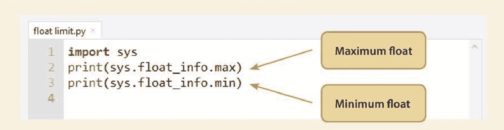

下图显示了程序在 shell 中的输出结果：

```shell
Python 3.7.9 
Traceback (most recent call last):
  File "C:\Users\Desktop\overflow.py", line 3, in <module>
    print(pow(e,1000))
OverflowError: Result too large
```

解释错误信息并说明程序停止的原因。当我们将一个数字存储在变量中，如果该数字超过了该变量数据类型可以存储的值范围，就会发生溢出错误。相反，如果数字小于该数据类型可以存储的值范围，则会发生下溢错误。例如，如果我们尝试访问数组范围之外的项，或者在计算表示范围的幂后后得到一个超出范围的结果，就会发生溢出错误。

### 数值错误

### 截断错误

当内存不足以存储一个数字时，我们需要缩短该数字，一种方法是截断额外的位数。截断误差是指真实值与实际值之间的差异：

截断误差 = | 真值 – 实际值 |

例如，如果我们想在一个可以存储三小数位的变量中保存 π 的值，存储的实际值将是 3.141，截断误差将是 0.000926535...

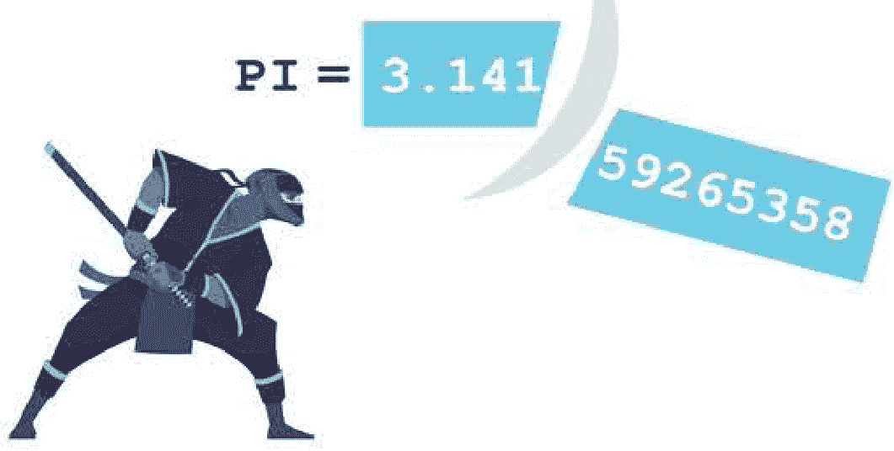

在 Python 中，我们可以使用 math 库中的 trunc() 函数来截断小数。

```python
import math
num = 1234.56789
integer_part = math.trunc(num)
print(integer_part)  #1234
```

或者，我们可以利用 int() 函数来截断浮点数的小数并将浮点数转换为整数数据类型。

```python
num = 1234.56789
integer_part = int(num)
print(integer_part)  #1234
```

### 舍入误差

除了直接截断数字外，我们还可以选择舍入数值的替代方法，包括四舍五入、向上舍入和向下舍入。

### 四舍五入

假设我们要将一个数字舍入到 $n$ 位小数，舍入规则如下：

- 如果第 $(n+1)^{th}$ 位小数上的数字小于或等于 4，我们将直接截断额外的位数。例如，将 π 舍五入到两位小数的结果是 3.14。

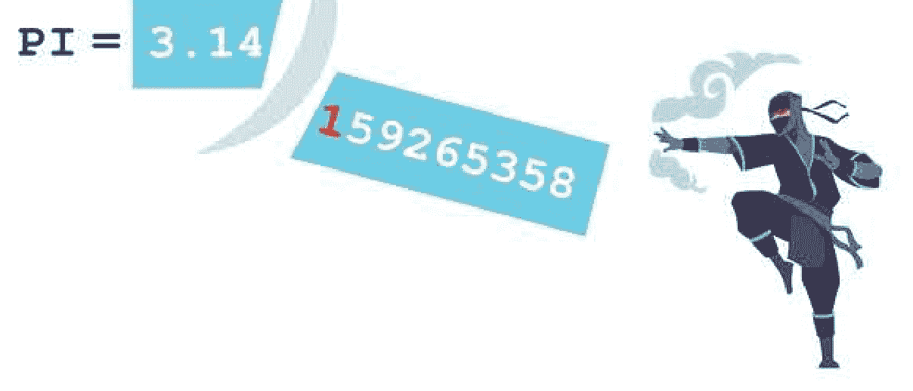

- 如果第 $(n+1)^{th}$ 位上的数字大于或等于 5，则截断额外的位数并在第 $n^{th}$ 位上的数字加 1。例如，将 π 舍五入到四位小数的结果是 3.1416。

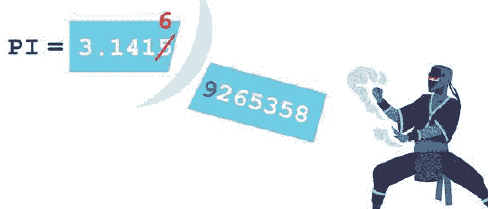

在 Python 中，我们可以使用 round() 函数将数字舍入到特定的小数位。

```python
import math
PI = math.pi
print (round(PI, 2))
print (round(PI, 4))
```

### 向上舍入

将一个数字向上舍入到某位数意味着将数字提高到指定位数上最近的值。例如，将 π 向上舍入到两位小数的结果是 3.15。

### 向下舍入

将一个数字向下舍入到某位数意味着将数字降低到指定位数上最近的值。例如，将 π 向下舍入到两位小数的结果是 3.14。


## 误区

当数字为负数时，向下舍入数字的绝对值大于真数的绝对值。例如，向下舍入 -3 的结果比真数的绝对值大（此处原文逻辑略有矛盾，通常指数值更小）。

*(注：原文后续部分存在大量占位符和重复，已按语意描述翻译)*


# 軟體除錯工具

在寫完程序後，我們應該對程序進行系統測試，並確保其符合預用途。我們使用一系列測試數據來驗證程序的正確性。將數據代入程序並運行，然後將測試結果與期望結果進行比較。如果測試結果與期望結果不符，則表示程序包含錯誤。


當發現程序包含錯誤（bugs）時，我們必須識別它們發生的位置，以便制定有效的方案並消除所有錯誤。這個過程稱為调试（debugging）。標記（Flags）和存根（stubs）是一些手動调试的方法。除了這些，許多整合開發環境（IDE）提供了一些调试功能來幫助我們測試和调试程序。

- 存根（Stubs）在選修 C 第4.6 節中有詳細解釋。

### 追踪變數值

我們使用乾執行（dry runs）和追踪表（trace tables）逐行分析程序碼，追踪程序的執行流程和所有變數的值。使用 IDE 的調試模式，我們可以逐步執行程序並監控程序中的變數，以發現任何錯誤。這種方法稱為程序追踪（program trace）。

- Thonny 的調試模式在核心 D 第6.2 節中提到。

```
debug.py
A = 1
B = 2
if A > B:
    print(B-A/2)
else:
    print(A-B/2)
```

# 斷點 (Breakpoints)

斷點是程序執行停止的位置，我們可以在 IDE 中查看其目前的狀態，例如變數的當前值，以便找出錯誤是在斷點之前還是之後。我們通常在條件語或我們想要測試的部分之前添加斷點。

# 實驗 2.2

在 Thonny 中使用斷點

- 開啟 Thonny，然後寫下以下程序：

```
breakpoints.py =
1 marks = [98, 79, 56, 68, 77, 93]
2 avg_mark = sum(marks) / len(marks)
3 if avg_mark > 80:
4 grade = "Distinction"
5 elif avg_mark > 50:
6 grade = "Pass"
7 else:
8 grade = "Fail"
9 print(avg_mark, grade)
```

- 雙擊行號右側的空格。如果你在行號旁邊看到一個紅點，意味著斷點已成功添加。你可以通過雙擊該斷點來刪除它。

```
breakpoints.py =
marks = [98, 79, 56, 68, 77, 93]
avg_mark = sum(marks) / len(marks)
if avg_mark > 80:
grade = "Distinction"
elif avg_mark > 50:
grade = "Pass"
else:
grade = "Fail"
print(avg_mark, grade)
```

- 點擊開啟調試模式並執行程序。當程序在調試模式下運行時，它將停在第一個斷點的位置。所有變數及其當前值或狀態將顯示在右側。

| 名稱 | 值 |
|---|---|
| avg_mark | 78.5 |
| marks | [98, 79, 56, 68, 77, 93] |

點擊 ▷ 繼續執行程序。程序將停在下一個斷點的位置。

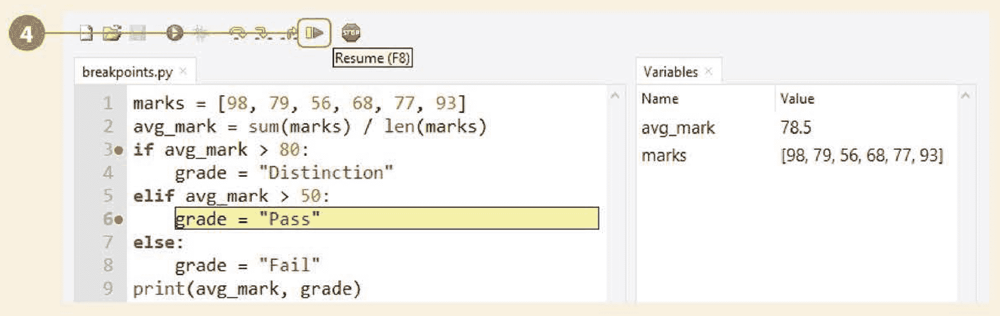

我們在條件語的分支內添加斷點。如果程序停下，意味著條件為真，且該分支中的代碼將被執行；否則，意味著條件為假，該分支中的代碼未被執行。

點擊 ▷ 繼續執行程序。當沒有更多斷點時，程序將一直執行到結束。

# 檢查點 2.1

- 1. 描述斷點如何幫助我們發現程序中的錯誤。

- 2. Kathy 在 Python IDE 中編寫了以下程序：

```python
print("This is the first line.\nprint("A new line")
print("Another new line")
print("This is line 4")
print("The end")
```

她在第三行添加了一個斷點（由點標示），並在調試模式下運行了程序。寫下程序第一次停下時的輸出。

- 3. Bosco 編寫了以下程序。他在程序的關鍵位置（第 5 行和第 7 行）輸出變數的值以幫助他查看變數的狀態。哪些變數應該在第 5 行和第 7 行輸出它們的值？

| 行 | marks |
|---|---|
| 1 | [98, 79, 56, 68, 77, 93] |
| 2 | total_mark = 0 |
| 3 | for i in range(0, len(marks)): |
| 4 | total_mark = total_mark + marks[i] |
| 5 | print ( ) |
| 6 | avg_mark = total_mark / len(marks) |
| 7 | print ( ) |
| 8 | if avg_mark >= 50: |
| 9 | print("Pass") |
| 10 | else: |
| 11 | print("Fail") |

在第 5 行和第 7 行輸出變數的值可以幫助我們查看程序的變化。使用 `print()` 函數在程序中顯示。這種方法稱為 echo。關鍵位置。

## 艾德格·迪斯特拉 (Dijkstra)


“调试是為了移除錯誤，這在程序中是必要的。當你遇到錯誤時，不要放棄，你將能夠改進。”

## 章節總結

## 焦點

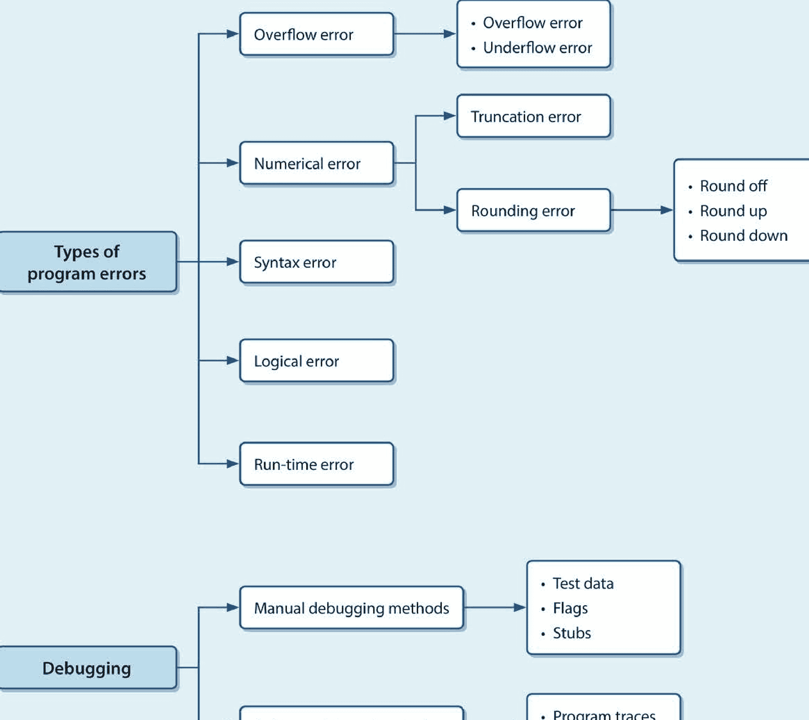

## 術語表

| | |
|---|---|
| breakpoint | 斷點 |
| debug | 調試 |
| flag | 標記 |
| Integrated Development Environment | 整合開發環境 |
| program trace | 程序追蹤

## 練習題

1. 調試模式如何幫助我們發現程序中的錯誤。請完成以下程序的追蹤表（4 分）。

```
step <- 10
total <- 0
for i from 1 to step
total <- total + i
```

| i | step | total |
|---|---|---|
| 1 | | |
| 2 | | |
| 3 | | |
| 4 | | |
| 5 | | |
| 6 | | |
| 7 | | |
| 8 | | |
| 9 | | |
| 10 | | |

2. Jeremy 使用 4 字節來存儲浮點數。他為數列 num 分配了 400 字節來存儲序列。（假設索引從 0 開始。）

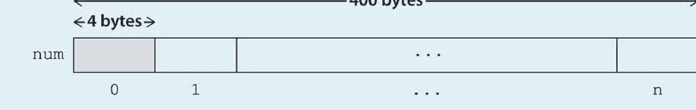

(a) num 的大小是多少？（1 分）

(b) Jeremy 嘗試訪問 num[100] 但失敗。他遇到了哪種錯誤？請解釋你的答案。（2 分）

(c) Jeremy 編寫了以下程序：

```
a <- 2
b <- 3
c <- square root of (a*a + b*b)
num[1] <- round(c, 2)
```

(i) 這個結果包含什麼錯誤？（1 分）

(ii) 找出錯誤的值（正確到十位有效數字）。（1 分）

3. Kelly 編寫了以下算法，假設 D 是非負整數且數列 B 的大小為 4：

```
Input D
i <- 0
while D > 0
B[3-i] <- D % 2
D <- D // 2
i <- i + 1
```

(a) 如果 D 為 6，執行算法後 B 的內容是什麼？（2 分）

| B | |
| index | |

(b) 此算法的目的是？（1 分）

(c) Kelly 使用以下測試數據測試算法：
- (1) 輸入 D 為 3
- (2) 輸入 D 為 15
- (3) 輸入 D 為 20

(i) 解釋這三組測試數據的用途。（3 分）

(ii) 為什麼我們需要用邊界情況測試算法？（1 分）

(d) 如果 D 為 25，此結果中有什麼錯誤？（1 分）

(e) 算法可以處理的 D 值範圍是多少而不會產生錯誤？請簡要解釋。（2 分）

## 進階控制結構

## 學習目標

- 理解如何使用嵌套控制結構
- 整合並應用各種控制結構來設計方案
- 根據效率、正確性和適用性等標準評估算法
- 根據算法的複雜性、數據結構及其權衡選擇合適的算法


## 像素点（Pixels）与图像处理

你是否曾经好奇过照片是如何编辑的？它可能比你想象的简单得多！由于照片是像素的阵格，而每个像素都是代表像素颜色的整数，我们可以使用整数数据类型的二维数组来表示图像。这也是处理图像最流行的方法之一。

通过对二维数组、控制结构和迭代的认知与理解，我们可以轻松地添加、更改和重新排列二维数组中的值。因此，我们可以构建出属于自己的版本的照片编辑器，并进行各种图像处理，如旋转、翻转、缩放等。


## 3.1 嵌套控制结构

将一个结构放在另一个结构中被称为嵌套结构。条件语句也可以被嵌套在另一个条件语句的分支中。嵌套条件语句根据上一个条件的结果来决定是否进入另一个条件语句。以下 "if-elif" 语句是嵌套条件结构的示例：

| Python | 流程图 |
| --- | --- |
| if (condition 1): | if (condition 1): | True 则执行 "then" body |
| "then" body 1 | | False |
| elif (condition 2): | if (condition 2): | True 则执行 "then" body |
| "then" body 2 | | False |
| elif (condition 3): | if (condition 3): | True 则执行 "then" body |
| "then" body 3 | | False |
| else: | else: | |
| "else" body | | "else" 主体 |

条件语句不仅可以嵌套在 "else" 分支中，还可以嵌套在其他分支中。以下是另一个嵌套条件结构的示例：

| Python | 流程图 |
| --- | --- |
| if (condition 1): | False | True |
| if (condition 2): | condition 1 | |
| "then" body 2 | | condition 3 True |
| else: | condition 2 | True |
| if (condition 3): | | False False |
| "then" body 3 | | "then" body 2 |

## 检查点 3.1

1. Henry 编写了一个程序，接收三角形的三条边长。程序将说明该三角形属于以下哪类：

- (1) 等边三角形（所有边都相等）
- (2) 等腰三角形（仅两条边相等）
- (3) 不等三角形（所有边均不相等）
- (4) 无法形成三角形（只有当任意两边长度之和大于第三边长度时，才能形成三角形）

完成以下伪代码：

```
Input a          # 第1条边长
Input b          # 第2条边长
Input c          # 第3条边长
### 检查所有输入是否为有效的正数
if                              then
    Output "Cannot form a triangle"
### 检查不同类型的三角形
else if                         then
    Output "Cannot form a triangle"
### 检查不同类型的三角形
else
    Output "This is a/an ..."
```


### 嵌套循环

### 活动 3.1

1. Kelly 买了一个舞蹈机器人。她写了一个程序，让机器人按照以下动作跳舞。帮助 Kelly 完成她的程序。

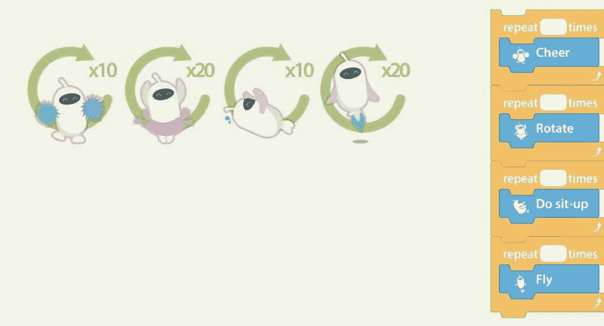

2. Kelly 希望舞蹈机器人重复上述舞蹈 10 次。帮助 Kelly 修改她的程序。

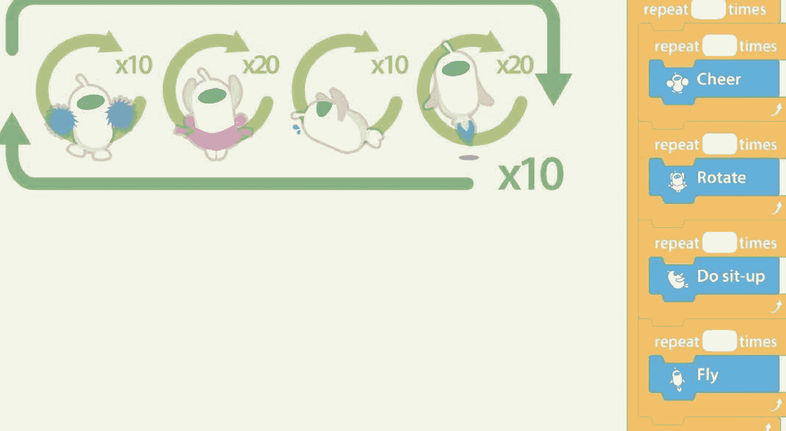

想一下：机器人连续做了多少个仰卧起？
那么，机器人总共做了多少个仰卧起？
在生活中，我们经常以类似的方式处理事情。例如，在健身锻炼时，我们会以类似的方式重复不同的动作或步骤。


以下是嵌套 for 循环的流程图：

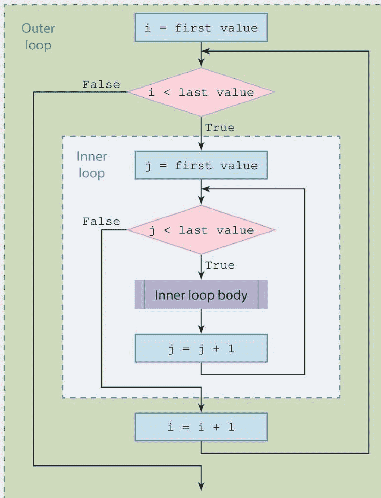

### 高级控制结构

将一个循环放在另一个循环中被称为嵌套循环。以下是嵌套 for 循环的示例：

| 行 | 伪代码 | Python |
|---|---|---|
| 1 | for i from 0 to i | for i in range(0, 2): |
| 2 | Output i | print (i) |
| 3 | for j from 0 to 2 外层循环 | for j in range(0, 3): |
| 4 | Output j 内层循环 | print (j) |

使用追踪表逐行分析嵌套循环，并追踪计数器的值：

| 行 | i | j | 输出 |
|---|---|---|---|
| 1 | for i ← 0 | | |
| 2 | Output i | | |
| 3 | for j ← 0 | | 0 |
| 4 | Output j | | 0 |
| 3 | for j ← 1 | | 1 |
| 4 | Output j | | 1 |
| 3 | for j ← 2 | | 2 |
| 4 | Output j | | 2 |
| 1 | for i ← 1 | | |
| 2 | Output i | | 1 |
| 3 | for j ← 0 | | 0 |
| 4 | Output j | | 0 |
| 3 | for j ← 1 | | 1 |
| 4 | Output j | | 1 |
| 3 | for j ← 2 | | 2 |
| 4 | Output j | | 2 |

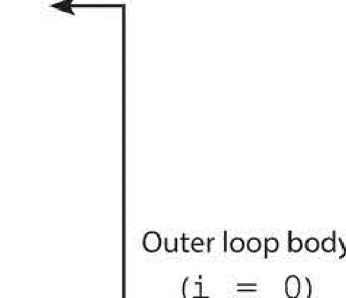
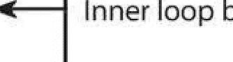
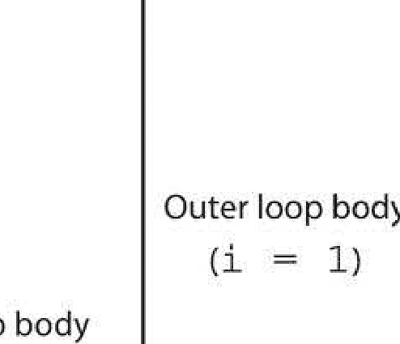


从上面的追踪表中我们可以看到，每执行一次外层循环，内层循环就会执行三次。

### 类比

时钟的工作原理就像嵌套循环，分钟针是外层循环和内层循环。当一分钟过去，分钟针移动一个刻度，而秒针已经转了一整圈（即移动了 60 个刻度）。


### 活动 3.2

- 运行以下伪代码或 Python 代码，并写下循环体的重复次数：

| 伪代码 / Python | 外层循环次数 | 内层循环次数 | 循环总次数 |
|---|---|---|---|
| for i from 0 to 1<br>Output i<br>for j from 0 to 2<br>Output j | 2 | 3 | 6 |
| for i from 1 to 5<br>for j from 1 to 6<br>Output i*j | | | |
| for i in range(0, 5):<br>for j in range(0, 10):<br>print(i, j) | | | |
| for i in range(0, 10):<br>for j in range(0, 5):<br>print(i, j) | | | |

- 因此，循环体总次数 = 外层循环次数 × 内层循环次数

3. 运行以下伪代码或 Python 代码，并写下算法的输出：

| 伪代码 / Python | 输出 |
|---|---|
| for i from 1 to 3<br>for j from 1 to 2<br>Output i, j | |
| for i from 1 to 3<br>for j from 3 down to 1<br>Output i + j | |
| for i in range(0, 3):<br>for j in range(0, 2):<br>print(i, j) | |
| for i in range(0, 2):<br>for j in range(0, 3):<br>print(i, j) | |
| for i in range(0, 2):<br>for j in range(0, 3):<br>print() | |

### 示例 3.1

1. 设计一个程序，接收用户输入的数字 L，并使用嵌套循环绘制边长为 L 的正方形。以下是该程序的输出：

| 输入 | 5 |
|---|---|
| 输出 | * * * * *<br>** * * * *<br>** * * * *<br>** * * * *<br>** * * * * |

### 分析

- (1) 在 Python 中，`print()` 函数默认在打印后添加换行，这意味着打印的内容将放在新行。如果我们在 `print()` 的参数末尾添加 `end=""`，打印的内容将显示在同一行。以下是根据伪代码重写的 Python 代码：

```python
L = int(input())
for i in range(L):
  for j in range(L):
    print("*", end="")
print()
```

## 3.3 嵌套循环与二维数组

我们使用嵌套 for 循环逐行访问二维数组中的项：

| 伪代码 | 解释 / 类比 |
|---|---|---|---|
| for i from 0 to 2 | j=0 | j=2 | j=4 |
| for j from 0 to 5 | j=1 | j=3 | j=5 |
| num[i,j] <- i * j | i=0 | 0 | 0 | 0 |
| | i=1 | 0 | 1 | 2 | 3 |
| | i=2 | 0 | 4 | 6 | 8 | 10 |

无论单独为列表赋值还是使用 for 循环连续赋值，用户必须先创建列表并赋值才能访问这些项。这一过程被称为初始化。以下是使用嵌套循环初始化一个包含 3 × 6 个元素的二维列表，并将所有项赋值为 "0" 的示例：

| Python | 解释 / 类比 |
|---|---|---|---|
| num = [] | for i in range(0, 3): | j=0 | j=2 | j=4 |
| num = num + [[]] | j=1 | j=3 | j=5 |
| for j in range(0, 6): | i=0 | 0 | 0 | 0 |
| num[i] = num[i] + [0] | i=1 | 0 | 1 | 2 | 3 |
| num[i][j] = i * j | i=2 | 0 | 4 | 6 | 8 | 10 |


### 3.2 示例

- 1. Jonathan 的书架被分为许多存储单元，每个单元包含不同数量的书籍。Jonathan 了一个了一个二维数组 $B$，其中 $B[i, j]$ 存储了对应存储单元中的书籍数量。该数组如下：

| | 0 | 1 | 2 | 3 | 4 | 5 |
|---|---|---|---|---|---|---|
| 0 | 5 | 9 | 6 | 5 | 3 | 4 |
| 1 | 2 | 3 | 8 | 2 | 6 | 5 |
| 2 | 8 | 3 | 5 | 3 | 9 | 9 |

Jonathan 正在设计一个算法来计算整个书架存储的书籍总数。请完成以下伪代码。

```
total ← 0

Output total
```

### 分析

使用嵌套的 for 循环逐个读取二维数组中的项：

- 行 0，列 0
- 行 0，列 1
- 行 0，列 2
- 行 0，列 3
- 行 0，列 4
- 行 0，列 5
- 行 1，列 0
- 行 1，列 1
- 行 1，列 2
- 行 2，列 4
- 行 2，列 5

| | 0 | 1 | 2 | 3 | 4 | 5 |
|---|---|---|---|---|---|---|
| 0 | 5 | 9 | 6 | 5 | 3 | 4 |
| 1 | 2 | 3 | 8 | 2 | 6 | 5 |
| 2 | 8 | 3 | 5 | 3 | 9 | 9 |

### 解决方案

```
for i from 0 to 2
  for j from 0 to 5
    total ← total + B[i, j]
```

### 思考

使用以下嵌套 for 循环计算出的答案正确吗？

```
for j from 0 to 5
    for i from 0 to 2
        total <- total + B[i,j]
```

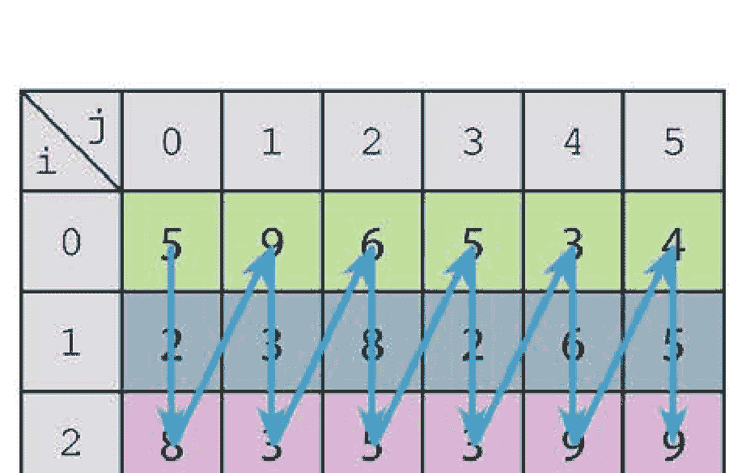

## 检查点 3.2

- 1. Marco 定义了一个二维数组 $M$ 来存储乘法表，$M[i, j]$ 存储对应数字的乘积。以下是示例：

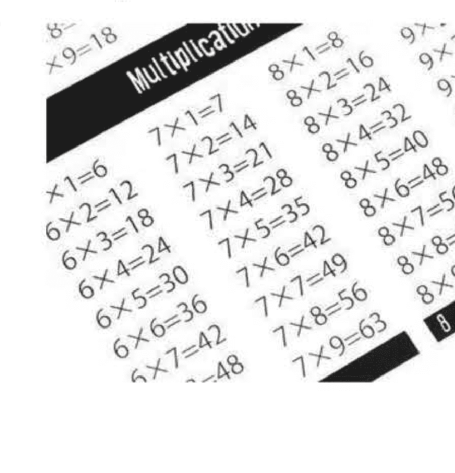

设计一个算法来填充整个乘法表。

- 2. 设计一个算法，接收用户输入的两个数字 $W$ 和 $L$，并使用嵌套循环画出一个宽度为 $W$ 长度为 $L$ 的由 "*" 组成的矩形。以下是该程序的输出：

| 输入 | W = 3, L = 5 | W = 8, L = 2 |
| --- | --- | --- |
| 输出 | * * * | * * * * * * * |
| | * * | * * * * * * * |
| | * * | * * * * * * * |
| | * * | * * * * * * * |
| | * * | * * * * * * * |

完成以下伪代码：

```
Input W, L
for i from 1 to
  for j from 1 to
    Output "*"
Output Newline character
```

- 3. 设计一个算法，接收用户输入的数字 $H$，并使用嵌套循环画出一个高度为 $H$ 的由 "*" 组成的等腰直角三角形。以下是该程序的输出：

| 输入 | H = 3 | H = 6 |
| --- | --- | --- |
| 输出 | * | * |
| | * * | * * |
| | * * * | * * * |
| | | * * * * * |
| | | * * * * * * |

编写该算法的伪代码。

- 4. Joe 正在创建一个 $5 \times 5$ 格的宾果游戏。中心单元格充当“万能牌”，可以代表任何数字。玩家从 1 到 24 中选择一个数字并将其写在“万能牌”以外的单元格中。然后主持人抽取数字，玩家可以圈出对应数字的单元格。当玩家有一行、一列或一条对角线被完全覆盖时，他们就可以获得奖励。

Joe 用二维数组记录游戏结果。带有数字的单元格 $result[i, j]$ 用 True 表示，而未抽中数字的单元格用 False 表示，如下：

| | 0 | 1 | 2 | 3 | 4 |
|---|---|---|---|---|---|
| 0 | False | False | True | False | True |
| 1 | True | False | True | False | False |
| 2 | True | True | True | True | True |
| 3 | False | True | True | False | False |
| 4 | True | False | False | False | True |

(i) 完成以下算法以检查某行是否被完全覆盖。如果是，则将 True 赋值给变量，否则为 False。

(ii) 假设二维数组的内容如所示。输出是什么？(b) Joe 请求他的朋友 Sam 帮助完成检查列是否被完全覆盖的算法。如果是，则将 True 赋值给变量，否则为 False。Sam 完成了：

```
win <- False
j <- 0
while j <= 4 and win = False
    col <- True
    i <- 0
    while i <= 4
        if result[i,j] = False then
            col <- False
        i <- i + 1
    j <- j + 1
Output win
```
ii) Joe 发现 Sam 设计的算法更快？(c) 写一个 Python 程序来检查对角线是否被完全覆盖。如果是，则将 True 赋值给变量，否则为 False。

```python
result = [[False, False, True, False, ...]
```

## 3.4 控制结构的应用

在程序中，不同的控制结构用于改变语句的执行顺序。控制结构可以大致分为三类：顺序、选择和迭代。无论程序有多复杂，都可以使用这三种结构构建。它们可以与不同的数据结构（如一维数组和二维数组）结合，形成嵌套控制结构。很好地使用控制结构可以解决问题。


示例如下：

- 1. 王工程师正在开发农业机器人。他正在编写一个特定的播种程序。农场被分为 $10 \times 10$ 个格子。他定义了一个二维数组 $F$，然后在需要播种的 $F[y, x]$ 位置处保存“1”，在其他位置保存“0”。

| y | 0 | 1 | 2 | 3 | 4 | 5 | 6 | 7 | 8 | 9 |
|---|---|---|---|---|---|---|---|---|---|---|
| 0 | 0 | 1 | 0 | 1 | 0 | 0 | 1 | 0 | 1 | 0 |
| 1 | 0 | 0 | 0 | 0 | 0 | 0 | 0 | 0 | 0 | 0 |
| 2 | 1 | 0 | 0 | 1 | 0 | 0 | 1 | 0 | 1 | 0 |
| 3 | 0 | 0 | 0 | 0 | 0 | 0 | 0 | 0 | 0 | 0 |
| 4 | 1 | 0 | 0 | 1 | 0 | 0 | 0 | 0 | 1 | 0 |
| 5 | 0 | 0 | 0 | 0 | 0 | 0 | 0 | 0 | 0 | 0 |
| 6 | 1 | 0 | 0 | 1 | 0 | 0 | 0 | 0 | 1 | 0 |
| 7 | 0 | 0 | 0 | 0 | 0 | 0 | 0 | 0 | 0 | 0 |
| 8 | 1 | 0 | 0 | 1 | 0 | 0 | 1 | 0 | 1 | 0 |
| 9 | 0 | 0 | 0 | 0 | 0 | 0 | 0 | 0 | 0 | 0 |

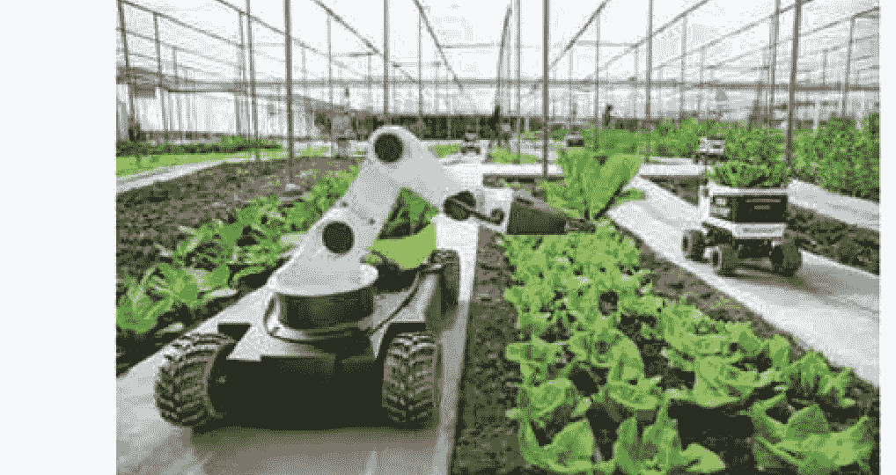

(a) 假设整个农场没有任何种子。在执行以下程序后，填充二维数组 $F$ 的项。

```
y <- 0
while y < 10 do
    x <- 0
    while x < 10 do
        for i from y to y+1
            for j from x to x+3
                F[i,j] <- 1
    x <- x + 4
y <- y + 4
```

| | 0 | 1 | 2 | 3 | 4 | 5 | 6 | 7 | 8 | 9 |
|---|---|---|---|---|---|---|---|---|---|---|
| y | | | | | | | | | | | |
| 1 | | | | | | | | | | | |
| 2 | | | | | | | | | | | |
| 3 | | | | | | | | | | | |
| 4 | | | | | | | | | | | |
| 5 | | | | | | | | | | | |
| 6 | | | | | | | | | | | |
| 7 | | | | | | | | | | | | |
| 8 | | | | | | | | | | | | |
| 9 | | | | | | | | | | | | |

(b) 王向程序添加了用户输入 $n$（正整数）来生成播种区域。每个正方形的大小为 $n \times n$，每个正方形之间的距离为 $n$。例如，如果输入 1，程序产生大小为 1 的正方形；如果输入 2，程序产生大小为 4 的正方形，正方形之间的距离为 2。完成该算法：

| 行 | 伪代码 |
|------|---|
| 1 | Input n |
| 2 | y <- 0 |
| 3 | while y < 10 do |
| 4 | x <- 0 |
| 5 | while x < 10 do |
| 6 | for i from y to y+1 |
| 7 | for j from x to x+3 |
| 8 | if then |
| 9 | F[i,j] <- 1 |
| 10 | x <- x + 4 |
| 11 | y <- y + 4 |

### 分析

(1) 数组中不存在的项无法访问，例如当数组索引超出范围时。第 8 行的条件语句应确保索引在 0 到 9 的范围内。

(2) 第 6 到 9 行的嵌套循环在位置 $(x, y)$ 处产生一个大小为 $n \times n$ 的播种区域。

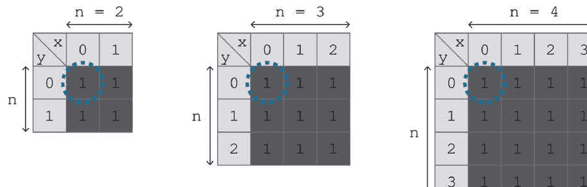

(3) 第 4 到 10 行的内部 while 循环体产生一行大小为 $n \times n$ 的播种区域，与左右正方形之间的距离为 $n$。

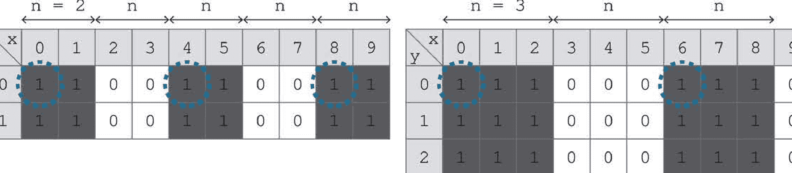

(4) 第 3 到 11 行的外部 while 循环体产生多行播种区域，与上方下方正方形之间的距离为 $n$。

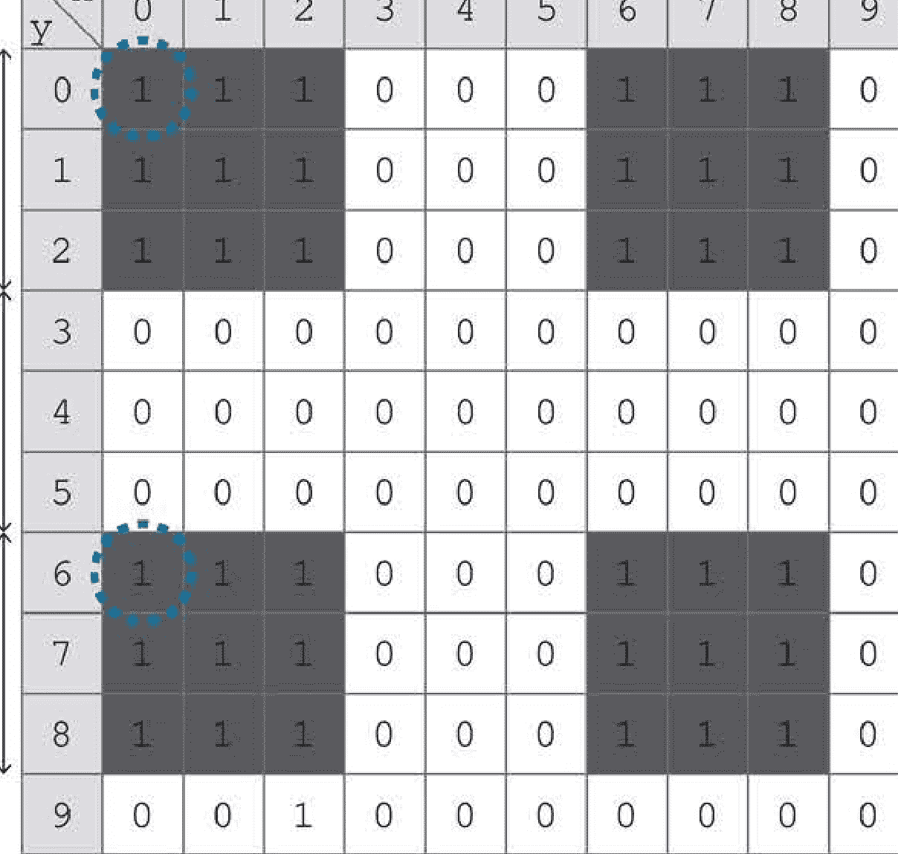


### 解决方案

(a) 二维数组 F 中的元素：

| y | 0 | 1 | 2 | 3 | 4 | 5 | 6 | 7 | 8 | 9 |
|---|---|---|---|---|---|---|---|---|---|---|
| 0 | | 0 | 0 | 1 | 0 | 0 | 0 | | 1 | |
| 1 | | 0 | 0 | 1 | 0 | 0 | 0 | | 1 | |
| 2 | 0 | 0 | 0 | 0 | 0 | 0 | 0 | 0 | | | |
| 4 | | 0 | 0 | 1 | 0 | 0 | | 1 | | | |
| 5 | | 0 | 0 | 1 | 0 | 0 | | 1 | | | |
| 6 | 0 | 0 | 0 | 0 | 0 | 0 | | 0 | | | |
| 7 | 0 | 0 | 0 | 0 | 0 | 0 | | 0 | | | |
| 8 | | 0 | 0 | 1 | 0 | 0 | | 1 | | | |
| 9 | | 0 | 0 | 1 | 0 | 0 | | 1 | | | |

(b) 输入 n

```
y <- 0
while y < 10
  x <- 0
  while x < 10
    for i from y to y+n-1
      for j from x to x+n-1
        if i <= 9 and j <= 9 then
          F[i, j] <- 1
    x <- x + (n*2)
  y <- y + (n*2)
```

### 高级控制结构

1. Peter 在设计一个算法时使用了 for 循环来检查输入的密码是否正确。假设字符串的起始索引为1。请完成以下算法。

```
password <- "iloveict"
Input input_pw
correct <- True
for j from 1 to the length of password
    if the length of password != the length of input_pw
        OR
        correct <- False
Output correct
```

2. Jonathan 在一个字符串中隐藏了一个英文单词（假设它只包含小写字母），如下：

gbjbcdcomputerskgkxvxzvlvjsfgjgvgvfbh

(a) 假设字符串的起始索引为1。请完成以下算法，使用户输入一个单词并判断该单词是否在字符串中：

| 行 | 代码 |
|---|-|
| 1 | string <- "gbjbcdcomputerskgkxvxzvlvjsfgjgvgvfbh" |
| 2 | Input word |
| 3 | found <- False |
| 4 | for i from 1 to the length of string |
| 5 | if string[i] = word[j] AND found = False then |
| 6 | found <- for j from 1 to the length of word |
| 7 | if i+j > the length of string |
| 8 | OR then found <- False |
| 9 10 | Output found |

(b) 在第 8 行的 "if" 条件语句中，条件 "i+j > the length of string" 的目的是什么？

3. David 编写了一个“单词搜索游戏”程序，该程序判断用户输入的英文单词是否隐藏在 $10 \times 10$ 的字母数组中。

(a) David 设计的这个程序接收用户输入的单词，并判断该单词是否连续存储在字母数组的一行中。如果用户输入 "INTERNET"，程序将判定该单词存在于字母数组中。

```
J J G G D A O Y D J G G D A O Y D
I D F G H S P O S A I D F G H S P O S A
F G D I O S A F S C F G D I O S A F S C
I N T E R N T S O I N T E R N T S O
F J K C O S A F S M F J K C O S A F S M
D J S G A P A H D P D J S G A P A H D P
H A U S T R F B F U H A U S T R F B F U
K D F U C N S K T K D F U C N S K K T
W S J D Y C F X D E W S J D Y C F X D E
O D V F K X J V C R O D V F K X J V C R
```

完成该 Python 程序。

```python
puzzle = ["JGJGDAOYD", "IDGFHSPOSA", "FGDIOSAFSC", "INTERNETSO", "FJKCOSAFSM", "DJSGAPAHDP", "HAUSTRFBBFU", "KDGFUCNSKT", "WSJDYCFXDE", "ODVKXJVCR"]
word = input()
found = False
for i in range ():
    for j in range ():
        if puzzle[i][j] == word[0] and found == False:
            found = True
            for k in range (0, 
                if j+k >= 10 or
                    found = False
(found)
```

(b) 编写一个 Python 程序，判断输入的单词是否连续存储在数组的一列中。如果用户输入 "COMPUTER"，程序将判定该单词存在于数组中。

```
J J G D A O Y D
I D F G H S P O S A
F G I O S A F S C
I N T E R N T S O
F J K O S A F S M
D J S G P A H D P
K D F U N S K T
```
```python
puzzle = ["GJDDAOYD", "IDGFHSPOSA", "FGDIOSAFSC", "INTERNETSO", "FJKCOSAFSM", "DJSGAPAHDP", "HAUSSTRBBFU", "KDGPUCNSKT", "WSJDYCFDE", "ODFKXJVCR"]
``` =
```

(c) 编写一个 Python 程序，判断单词是否连续存储在从左上角到右下角的对角线上。如果用户输入 "CAR"，程序将判定该单词存在。

```
J J G D A O Y D
I D F G H S P O S A
F G I O S A F S C
I N T E R N E S O
F J K O S A F S M
D J S A P A H D P
HA U S T R F B F U
K D F U N S K T
W S J D Y C D E
O D F K X J V C
```
```python
puzzle = ["JGGDDAOYD", "IDGFHSPOS", "FGDIOSAFSC", "INTERNESO", "FJKCOSAFSM", "DJSGAPAHDP", "HASTRBFU", "KDFUCNSKT", "WSJDYCFDE", "ODVKXJVCR"]
```
found)

## 算法比较

一个问题可以使用多种算法解决，但每种算法都有优缺点。我们需要比较不同的算法以选择最合适的解决方案。算法的优缺点主要从两个方面进行比较：操作步骤和资源使用。操作步骤越多，程序运行时间越长，通常意味着时间复杂度越高。算法占用的资源越多，程序的空间复杂度越高。

知识点 3.4

1. 一家物流公司为客户提供国际货运。公司给每个物品一个编号（从1开始），并将10个连续编号的物品放入一个箱中。每个箱通过第一个物品的编号进行标识，如下：

Kong 是物流公司的经理。在将一箱货物运到飞机之前，他检查箱子里是否有10件物品。他发现有一个箱子少了一个物品。他将物品编号随机放入一个整数数组。在下面的示例中，可以看到缺失物品的箱号是21，缺失物品的编号是26。

| C | 28 | 25 | 21 | 29 | 23 | 30 | 22 | 24 | 27 |
| index | 0 | 1 | 2 | 3 | 4 | 5 | 6 | 7 | 8 |

Kong 想了三种算法来找出缺失物品的编号。

(a) 研究算法 1 的伪代码，其中 A 是箱号：

| 行 | 算法 1 |
|---|---|
| 1 | weight ← 0 |
| 2 | for i from A to A+9 |
| 3 | weight ← weight + i |
| 4 | total ← 0 |
| 5 | for i from 0 to 8 |
| 6 | total ← total + C[i] |
| 7 | Output weight-total |

假设 A = 51 且数组 C 的内容如下：

| C | 54 | 59 | 51 | 58 | 55 | 56 | 53 | 57 | 52 |
| index | 0 | 1 | 2 | 3 | 4 | 5 | 6 | 7 | 8 |

(i) 算法 1 的输出是什么？
(ii) 变量 weight 的作用是什么？
(iii) 变量 total 的作用是什么？

(b) 研究算法 2 的伪代码，其中 A 是箱号：

| 行 | 算法 2 |
|---|---|
| 1 | for i from A to A+9 |
| 2 | found ← False |
| 3 | for j from 0 to 8 |
| 4 | if C[j] = i then |
| 5 | found ← True |
| 6 | if found = False then |
| 7 | Output i |

### 高级控制结构

假设 A = 51 且数组 C 的内容如下：

| C | 54 | 59 | 51 | 58 | 55 | 56 | 53 | 57 | 52 |
| index | 0 | 1 | 2 | 3 | 4 | 5 | 6 | 7 | 8 |

(i) 算法 1 的输出是什么？（这可能是指算法 2）
(ii) 第4 行执行了多少？

(c) 研究算法 3 的伪代码，其中 A 是箱号：

| 行 | 算法 3 |
|---|---|
| 1 | for i from A to A+9 |
| 2 | found[i] <- False |
| 3 | for i from 0 to 8 |
| 4 | found[C[i]] <- True |
| 5 | for i from A to A+9 |
| 6 | if found[i] = False then |
| 7 | Output i

(d) Kong 正在分析这三种算法。

(i) 简述算法 3 较于算法 2 的优点。
(ii) 简述算法 1 较于算法 3 的优点。
(iii) 在比较算法 1 和算法 2 的运行步骤和所需时间时，哪一个更高效？简述理由。
(iv) (挑战题) 说明出一个算法 2 和算法 3 可以解决但算法 1 无法解决的特殊情况。


## 章总结

## 重点 >>

## 嵌套控制结构

| 伪代码 | 流程图 |
| --- | --- |
| if (condition 1) then |  |
| "then" body 1) | |
| else | |
| if (condition 2) then | |
| "then" body 2) | |
| else | |
| if (condition 3) then | |
| "then" body 3} | |
| else: | |
| ("else" body) | |
| for i from 0 to 1 | 外层循环 |
| for j from 0 to 2 | 内层循环 |
| {Inner loop body} | |

## 嵌套的 for 循环和二维数组

我们可以使用嵌套的 for 循环逐个访问二维数组中的项。

```
for i from 0 to 2
  for j from 0 to 3
    Output num[i,j]
```

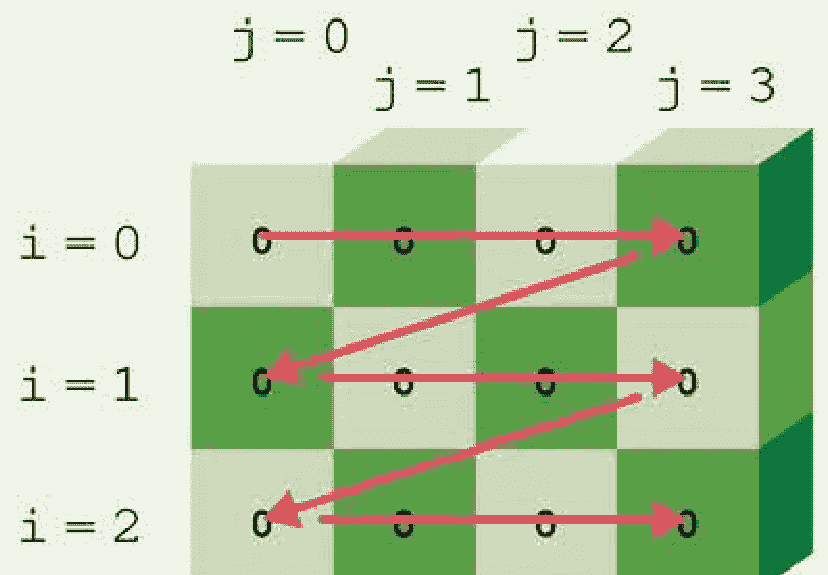

```
for j from 0 to 3
  for i from 0 to 2
    Output num[i,j]
```

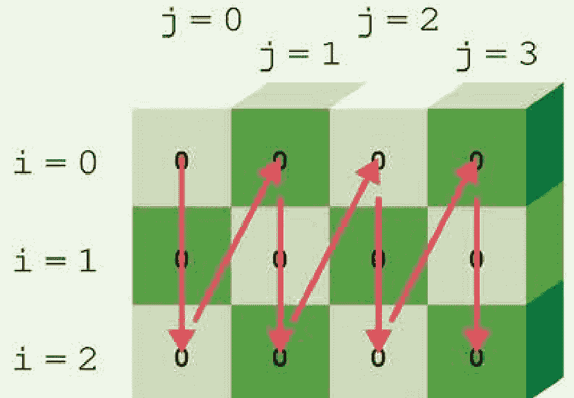

在 Python 程序中，我们可以使用嵌套的 for 循环来初始化二维列表。

```
list2d = []
for i in range(0, 3):
  list2d = list2d + [[]]
  for j in range(0, 4):
    list2d[i] = list2d[i] + [0]
```

- 1 外层循环体增加了二维列表的行数
- 2 内层循环体增加了二维列表的列数

```
+[[]]
i = 0 list2d
i = 1
i = 2
```

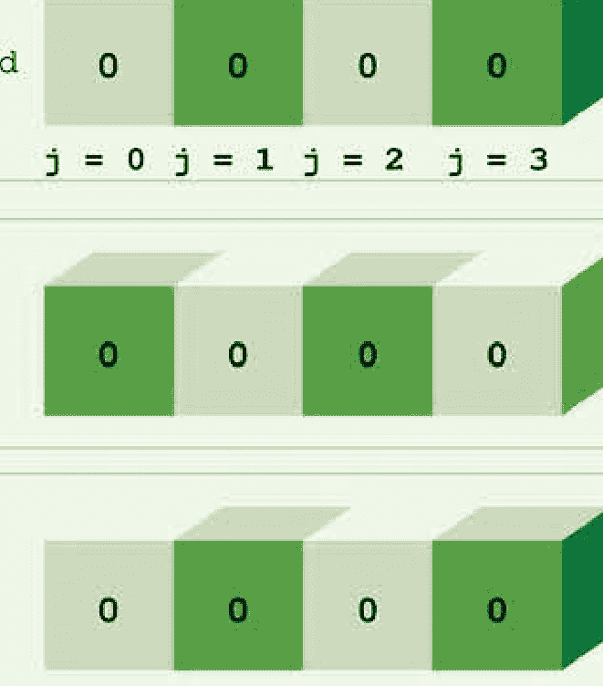

## 算法比较

在比较不同的算法时，我们可以考虑算法的适用性、操作步骤/时间、资源使用、复杂性以及算法使用的数据结构。


## 术语表

- initialisation
- nested conditional statement
- nested loop
- nested structure
- 初始化
- 嵌套條件語句
- 迴圈環境
- 嵌套結構

## 章末练习

- 1. 下图存储了某个区域的人口（以千为单位），map[i, j] 存储对应单元格的人口，如下：

| i | 1 | 2 | 3 | 4 | 5 | 6 | 7 |
|---|---|---|---|---|---|---|---|
| n | 1 | 0 | 2 | 3 | 2 | 0 | 0 | 0 |
| 2 | 1 | 3 | 5 | 4 | 4 | 2 | 0 | |
| 3 | 1 | 4 | 6 | 7 | 6 | 4 | 3 | |
| 4 | 0 | 4 | 4 | 7 | 5 | 4 | 0 | |
| 5 | 0 | 2 | 3 | 4 | 0 | 0 | 0 | |

(a) 整个区域的总人口是多少？（1分）

(b) 完成以下算法以计算整个区域的总人口。（4分）

```
population <- 0
for i from to
  for j from to
population <- population + map[i,j]
Output population
```

王老师使用二维数组 `form5_chi` 来显示所有 F5 学生在中文考试中的成绩。每行存储一个班学生的成绩，而每列存储指定姓名学生的成绩。例如，5B 类 6 班的中文考试成绩存储在 `form5_chi[1, 5]` 中，如下：

# 班号 (1 - 10)

| | 0 | 1 | 2 | 3 | 4 | 5 | 6 | 7 | 8 | 9 |
|---|---|---|---|---|---|---|---|---|---|---|
| 5A | 65 | 89 | 61 | 49 | 62 | 51 | 88 | 97 | 85 | |
| 5B | 38 | 68 | 79 | 90 | 89 | 95 | 77 | 61 | 55 | |
| 5C | 26 | 85 | 96 | 45 | 62 | 36 | 79 | 91 | 87 | |
| 5D | 69 | 88 | 76 | 55 | 83 | 71 | 47 | 68 | 94 | |

(a) 假设及格分为 50 分。王老师想找出该级中有多少学生中文不及格。完成以下算法。（4分）

```
fail <- 0
for i from to
  for j from to
if then
fail <-
```

(b) 编写一个 Python 程序找到考试中的最高分，并存储在变量 `highest_mark` 中。（5分）

3. Candice 正在设计一个识别图像对象的智能程序。她使用一个 $3 \times 3$ 二维数组表示图像中的像素。在该程序中，数字 1 和 0 分黑色和白色像素，如下：

| | 1 | 2 | 3 |
|---|---|---|---|
| 1 | 1 | 0 | 1 |
| 2 | 1 | 1 | 1 |
| 3 | 0 | 1 | |

她写了一个算法来统计 $4 \times 8$ 二维数组图像中像素的个数。例如所示：

| | 1 | 2 | 3 | 4 | 5 | 6 | 7 | 8 |
|---|---|---|---|---|---|---|---|---|
| 1 | 0 | 1 | 0 | 0 | 1 | 0 | 1 | 1 |
| 2 | 1 | 0 | 1 | 0 | 1 | 1 | 1 | 0 |
| 3 | 1 | 1 | 1 | 1 | 0 | 0 | 1 | 0 |
| 4 | 0 | 1 | 0 | 1 | 0 | 0 | 0 | 1 |

(a) 下图图像中有多少个像素？（1分）

| | 1 | 2 | 3 | 4 | 5 | 6 | 7 | 8 |
|---|---|---|---|---|---|---|---|---|
| i | 1 | 2 | 3 | 4 | 5 | 6 | 7 | 8 |
| 2 | 1 | 0 | 1 | 0 | 1 | 1 | 1 | 0 |
| 3 | 1 | 1 | 1 | 1 | 0 | 0 | 1 | 0 |
| 4 | 0 | 1 | 0 | 1 | 0 | 0 | 0 | 1 |

(b) Candice 计划写一个算法检查 `photo[i, j]` 到 `photo[i+2, j+2]` 是否匹配。如果匹配，算法输出 "True"；否则输出 "False"。

i) 假设 $i = 2$ 且 $j = 1$。算法的输出是什么？（1分）

(ii) 写出该算法的伪代码。（4分）

```
match
for p from 1 to 3
  for q from 1 to 3
    if != photo then
      match
```

4. Heidi 编写一个“井字棋”（Tic-Tac-Toe）游戏。她定义了一个 $3\times3$ 二维数组 `ttt_2d[i, j]` 来存储对应位置的符号，如下：

| | 1 | 2 | 3 |
|---|---|---|---|
| 1 | X | X | O |
| 2 | O | X | |
| 3 | X | O | |

(a) 她写了一个算法将二维数组 `ttt_2d` 中的符号从上到下逐行复制到一维数组 `ttt_1d`，如下：

| | 1 | 2 | 3 | 4 | 5 | 6 | 7 | 8 | 9 |
|---|---|---|---|---|---|---|---|---|
| ttt_1d 1 | X | X | O | O | O | X | O | O | |

(i) 完成以下将二维数组 `ttt_2d` 符号复制到一维数组 `ttt_1d` 的伪代码。（2分）

```
for i from 1 to 3
  for j from 1 to 3
    ttt_1d[] ← ttt_2d[i,j]
```

(ii) Heidi 写了另一个算法将一维数组 `ttt_1d` 转换回二维数组。完成伪代码。（1分）

```
for i from 1 to 3
  for j from 1 to 3
```

(b) 当及格分为 50 分时，Heidi 想找出该级中有多少学生中文不及格。完成以下算法。（4分）

```
fail <- 0
for i from 1 to 3
  for j from 1 to 3
    if then
      fail <-
```

(c) 编写一个 Python 程序找到考试中的最高分，并将其存储在变量 `highest_mark` 中。（5分）

(d) Heidi 想将 $3\times3$ 的页面扩大到 $4\times5$。以下显示了二维数组：

| | 1 | 2 | 3 | 4 | 5 |
|---|---|---|---|---|---|
| 1 | O | X | O | O | X |
| ttt_2d 2 | O | X | | | | |
| 3 | X | O | O | X | | | | | |

(i) 如果她将上述二维数组中的符号复制到一维数组 `ttt_1d`，`ttt_1d` 的大小和内容是什么？（2分）

(ii) 修改 (a) 中的算法，将 $m \times n$ 二维数组复制到一维数组 `ttt_1d`。（3分）

```
for i from 1 to m
  for j from 1 to n
    ttt_1d ← ttt_2d[i,j]
```

5. Daniel 正在对一些图像进行研究。他使用一个 $8 \times 8$ 二维数组来存储图像像素。当 `art[i, j]` 的值为 $T$ 时，该单元格被填充；当项值为 $F$ 时，该单元格为空。示例所示：

| | 0 | 1 | 2 | 3 | 4 | 5 | 6 | 7 |
|---|---|---|---|---|---|---|---|---|
| 0 | F | F | F | F | F | F | F | F |
| 1 | F | F | T | F | F | F | F | F |
| 2 | F | F | T | F | F | F | F | F |
| 3 | F | T | F | F | F | F | F | F |
| 4 | F | T | F | F | F | F | F | F |
| 5 | F | F | F | T | F | F | F | F |
| 6 | F | F | F | F | F | F | F | F |
| 7 | F | F | F | F | F | F | F | F |

(a) Daniel 写了以下算法。在右侧的二维数组中画出执行算法后的图像。（2分）

```
for i from 0 to 7
  for j from 0 to 7
    art[i,7-j] ← art[i,j]
```

(b) 这个算法的目的是？（1分）

(c) 给出一个提高算法效率的建议。（1分）

(d) Daniel 想设计一个算法检查图像是否对称。完成以下算法。（2分）

```
symmetry ← True
for i from \_\_\_\_\_
  for j from \_\_\_\_\_
    if \_\_\_\_\_\_ then
      symmetry ← False
```


## 子程序

学习目标

- 学习 Python 中的函数
- 解释在设计、执行和调试程序时程序模块化的益处
- 开发自定义子程序来解决特定问题

- 理解参数如何传递到子程序中
- 识别局部变量和全局变量
- 应用桩程序（stubs）的概念来调试程序


# 游戏模组化（Modding）

游戏修改，也称为游戏模（game mods），是小型程序，玩家可以通过这些程序对游戏引入自己的更改。游戏模组化展示了子程序和模块化的概念，不同的游戏模组作者各自创建一个独立的单一模，来修改游戏的一小部分。通过游戏玩家和程序员的共同努力，可以增强现有游戏。

有许多不同类型的游戏模，例如改变游戏外观的模，以及为漏洞提供非官方补丁的模。许多流行的视频游戏支持游戏模组化，用户已经编写并上传了数千个模到 Mod DB 等网站。


## 子程序

## 4.1 模块化

如前面的部分所述，当我们把一个复杂的问题分解为几个更小且易于管理的子问题（称为模块），然后系统地逐一处理它们时，问题变得更容易解决了。

> 跳转
> 模块化的益处在 Core D 的第 3.5 节提到。

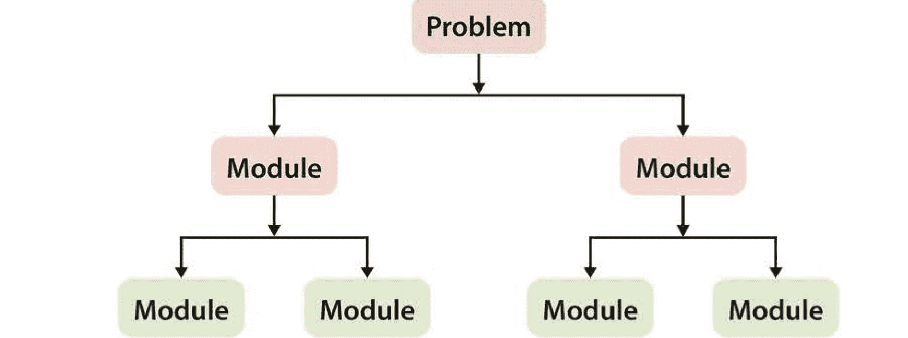

图 4.1 构建问题

同样，在设计算法或编写程序时，人们通常会刻意使用模块化设计。从较小的模块构建程序有助于提高开发和管理程序的效率。程序中的这些模块被称为子程序（在 Python 中也称为函数）。它们可以单独且重复地使用，每个子程序都代表多行代码。本章将重点介绍子程序的编写和使用。

> 跳转
> 我们在电子表格中使用过不同的函数。
> 电子表格函数在 Core A 的第 4.3 节提到。

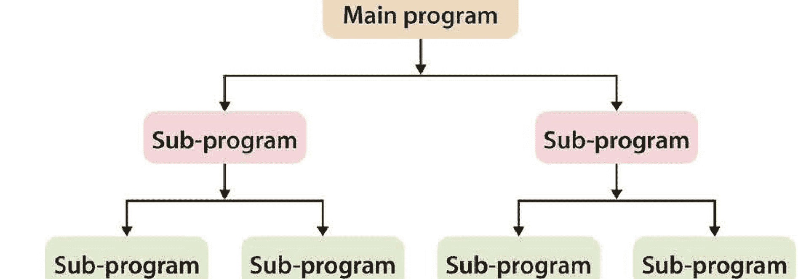

图 4.2 模块化的程序

## 数学中函数的定义

在数学中，函数用符号 $f, g, h$ 表示，通用格式为：

$y = f(x)$

其中 $x$ 是传递给函数 $f$ 的输入，$y$ 是函数 $f$ 的输出。

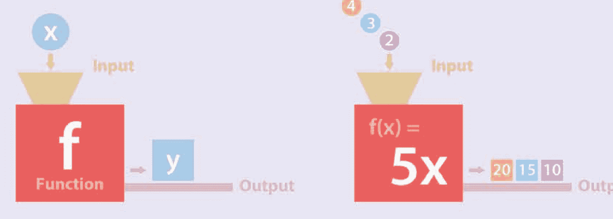

### 类比

### 黑盒

我们在编写程序时会使用许多函数。由于各种原因，例如知识的局限性以及缺乏查看库源代码权限，我们无法理解某些函数的原理。尽管如此，这并没有阻止我们使用这些函数，它们可以被比作黑盒：我们对代码和算法一无所知，但我们可以通过阅读文档（文献）和使用函数来知道函数的输入和输出值。

例如，你可能知道以下公式吗？

$e = \sum_{n=0}^{\infty} \frac{1}{n!} = 1 + \frac{1}{1} + \frac{1}{1 \cdot 2} + \frac{1}{1 \cdot 2 \cdot 3} + \dots$

上述是计算数学常数 $e$ 的公式。我们不需要理解该公式的原理，也不需要编写程序来执行计算。相反，我们只需要使用函数 `math.exp(1)` 即可得到答案。

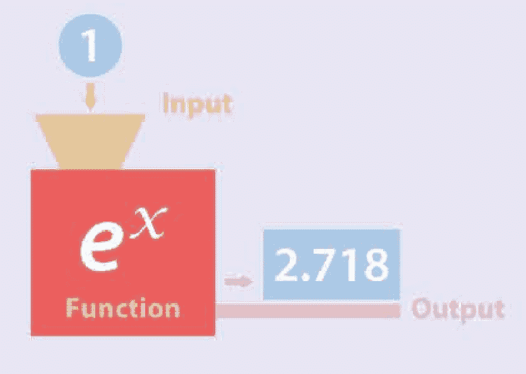

## 子程序的类型

### 无输入无输出

这种类型的子程序既没有输入参数也没有返回值。它们通常执行默认代码，主要用于在 shell 中打印某些信息。

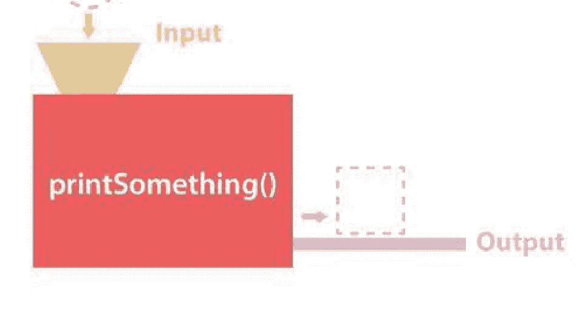

> 误解
> 打印字符串是子程序的输出。
> 打印字符串是程序的输出，而不是子程序的返回值。

### 有输入无输出

这种类型的子程序有输入参数但没有返回值。它们对参数进行操作，但不将结果作为返回值。相反，它们通过其他方式使用并显示结果，例如在 shell 中打印结果或直接将其保存到变量中。

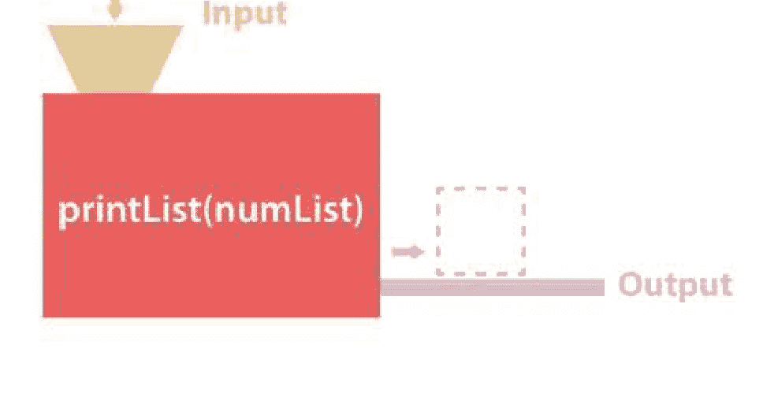

### 无输入有输出

这种类型的子程序即使没有输入也有返回值。某些子程序，例如随机数生成器。


### 有输入有输出

这种类型的子程序有输入参数和返回值。这是最常见的子程序。


## 4.2 调用子程序

在 Python 中，我们通过编写函数名和参数来调用函数。

```python
print("Hello World!")
a = input()
```

> 提示
> 参数也称为参数（arguments）。

## 内置函数

Python 有许多内置函数，`print()`、`input()`、`int()` 和 `float()` 是示例。

| 内置函数 | 描述 | 示例 | 变量值 |
|---|---|---|---|
| abs (x) | 返回 x 的绝对值 | y = abs(-10) | 10 |
| | | y = abs(20) | 20 |
| round (x, y) | 将数字 保留 y 位 | y = round(10, 2) | 3.33 |
| | | y = round(10/3, 5) | 3.33333 |

表 4.1 Python常用的内置函数

## 数学函数

为了使用内置函数之外的函数，我们需要导入库。库由许多相关函数组成。在库导入程序后可以使用它们。以下是 math 库中的一些：

| 数学函数 | 描述 | 变量值 |
|---|---|---|
| sqrt (x) | 计算 x 的平方根 | y = math.sqrt(16) | 4.0 |
| sin (x) | 计算 x 弧度的正弦 | y = math.sin(90) | 0.8939966636 |
| cos (x) | 计算 x 弧度的余弦 | y = math.cos(90) | -0.4480736161 |
| exp (x) | 计算自然指数函数 (eˣ) | y = math.exp(10) | 22026.4657948 |

## 随机函数

随机性是抽奖和游戏中常见的元素，这使得结果难以预测并给参与者带来惊喜。以下是 random 库中的一些随机函数：

| 随机函数 | 描述 | 示例 | 变量值 |
|---|---|---|---|
| random() | 返回 0 到 1 之间的随机浮点数（不包含 1）。 | import random y = random.random() | 0 <= y < 1 |
| uniform(a, b) | 返回 a 到 b 之间的随机浮点数（不包含 b）。 | import random y = random.uniform(1, 10) | 1 <= y <= 10 |
| randint(a, b) | 返回 a 到 b 之间的随机整数。 | import random y = random.randint(1, 10) | 1 <= y <= 10 |

表 4.3 Python常用的随机函数


## 检查点 4.1

- 1. 李老师设计了一个程序用于分析数学考试的成绩。他使用一个数组 `mark` 来存储 10 个学生的成绩，如下所示：

| mark | 78 | 89 | 87 | 95 | 60 | 44 | 51 | 98 | 77 | 69 |
|---|---|---|---|---|---|---|---|---|---|---|

- (a) 李老师在主程序中写写了多个子程序。其中一个子程序是 `average()`，它返回学生的平均分。调用 `average()` 的返回值是什么？

- (b) 另一个子程序 `higher(m)` 返回分数高于 `m` 的学生人数。调用 `higher(90)` 的返回值是什么？

- 2. David 和 Christie 正在讨论如何完成计算机科学的一项小组任务。他们需要为任务中的问题编写一个程序。他们计划将主程序分解为几个子程序并分别编写它们。


- (a) Davis 负责编写子程序 `functionA(a, b)`。该子程序要求用户输入两个整数 `a` 和 `b`，然后返回它们的差。例如，`functionA(6, 2)` 返回 4，而 `functionA(3, 9)` 返回 6。

因此，调用 `functionA(5, 10)` 的返回值是什么？

- (b) Christie 负责编写另一个子程序 `functionB(c, d)`。该子程序要求用户输入两个数字 `c` 和 `d`，然后返回较大的数字。例如，`functionB(6, 2)` 返回 6，而 `functionB(3, 9)` 返回 9。

因此，调用 `functionB(3, -4)` 的返回值是什么？

## 4.3 定义子程序

除了调用内置函数外，我们还可以定义自己的函数。
在编写子程序或函数之前，我们需要分析该子程序的“输入-处理-输出”（Input-Process-Output）循环，这与我们在设计算法时所做的相同。

例如，我们将设计一个子程序将三个参数相加并返回总和。以下是该子程序的输入-处理-输出循环：

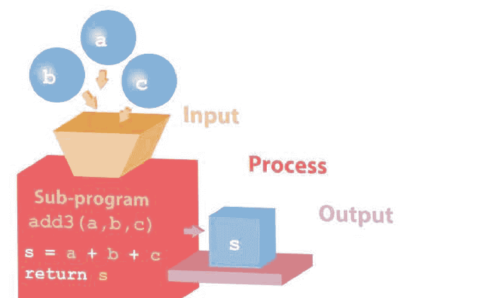

### 语法

每个子程序或函数代表多行代码，并且必须在调用之前进行定义。在 Python 中，我们使用关键字 `def` 来定义子程序。语法如下：

- 子程序名称
用于标识该子程序

- 形参参数
列出传递给子程序的参数

```
def myFunction(p1, p2, p3, ...):
  # Statement 1
  # Statement 2
  # Statement 3
  value = "return something"
  return value
```

- 缩进
指示哪些语句属于此子程序

- 子程序的主体
每当调用该子程序时，此部分中的语句就会执行一次

- 返回值
在调用结束后，子程序会将部分数据传回给程序

### 命名子程序

子程序的名称是它的标识符。变量的命名规则同样适用于子程序的命名。由于变量名和子程序名都是标识符，同一个程序中的每个标识符必须是唯一的，不允许重复。

### 形参

传递给子程序的形参列在括号中。如果有多个参数要传递，用逗号分隔。如果没有参数要传递，则留空。以下是一些示例：

```
def myFunction(a):          # 传递一个参数
def myFunctionB(a, b, c):   # 传递多个参数
def myFunctionC():          # 无参数
```

> 变量命名规则在 1.3 节中提到。

> 提示
为了让子程序更容易理解，它的名称应该反映其实际用途。

### 返回值

在子程序中，`return` 关键字结束子程序并将数据传回调用子程序的位置。如果没有数据需要返回，子程序在执行完主体中的代码后就会结束。

```
return value1             # 返回一个值
return value1, value2      # 返回多个值
```

以三个三个参数的子程序为例，以下是定义该子程序的 Python 代码：

```
def add3(a, b, c):    add3 是该子程序的名称
    a, b, c 是传递给
    子程序的形参数
    s = a + b + c           子程序的主体
                        将三个参数相加
    return s               s 是该子程序的返回值
```

### 调用子程序

定义子程序后，我们可以使用它的名称多次调用它。程序的流程图如下：

| Python | 流程图 |
|---|---|
| 行号 代码 | |
| 1 add3(a, b, c) | 4 n1 = 1 |
| 2 s = a + b + c | 5 n2 = 2 |
| 3 | 6 n3 = 3 |
| 4 n1 = 1 | 1 a ← n1 |
| 5 n2 = 2 | 2 b ← n2 |
| 6 n3 = 3 | 3 c ← n3 |
| 7 add3(n1, n2, n3) | 7 n1 = 6 |
| 8 | 2 s = a + b + c |
| 9 n4 = 4 | 3 return s |
| 10 n5 = 5 | 8 print(sum) |
| 11 add3(sum, n4, n5) | 9 n4 = 4 |
| 12 print(sum) | 10 n5 = 5 |
| | 11 a ← summ |
| | | 12 b ← n4 |
| | | 13 c ← n5 |
| | | 14 s = a + b + c |
| | | 15 return s |
| | | 16 summ = 15 |
| | | 17 print(sum) |

### 定义子程序


图 4.3 调用子程序的序列

## 活动 4.1 调试（子程序）

说明以下程序无法执行或产生错误结果的原因。

| Python 代码和错误信息 | 错误原因 |
|---|---|
| debug call.py | |
| 1 total = add3(1, 2, 3) | |
| 2 def add3(a, b, c): | |
| 3     s = a + b + c | |
| 4     return s | |
| 5 print(total) | |
| Shell | |
| Python 3.7.9 (bundled) | |
| >>> %run_file "debug call.py" | |
| Traceback (most recent call last): | |
| File "C:\Users\Guest\Desktop\debug call.py", line 1, in <module> | |
|     print(total) | |
| NameError: name 'add3' is not defined | |

## 子程序

## 活动 4.2

运行以下 Python 代码并写下程序的输出：

| Python 代码 | 输出 |
|---|---|
| # 无输入输出的子程序 | |
def printsth():
    print("One")
    print("Two")

print("Three")
printsth()
print("Four") | |
| # 有输入但无输出的子程序 | |
def sayHi(name):
    print("Hi", name) | |
| # 无输入但有输出的子程序 | |
def birthday():
    return "Jan", 1

month, day = birthday()
print(day, month) | |
| # 有输入也有输出的子程序 | |
def isOdd(num):
    if num % 2 == 0:
        return False
    else:
        return True

if isOdd(4) == True:
    print("This is an odd number")
else:
    print("This is an even number") | |

### 示例 4.1

- 1. 下面的宝藏图被分为 $6 \times 8$ 个单元格。Chris 定义了一个二维数组 `c` 来存储每个位置的金币数量。

| | 1 | 2 | 3 | 4 | 5 | 6 | 7 | 8 |
|---|---|---|---|---|---|---|---|---|
| 1 | 0 | 0 | 1 | 0 | 2 | 2 | 0 | 0 |
| 2 | 2 | 4 | 3 | 2 | 2 | 3 | 0 | 0 |
| 3 | 3 | 6 | 6 | 10 | 2 | 2 | 0 | 0 |
| 4 | 0 | 4 | 5 | 6 | 7 | 3 | 3 | 0 |
| 5 | 0 | 0 | 3 | 3 | 2 | 5 | 5 | 2 |
| 6 | 0 | 0 | 0 | 0 | 0 | 0 | 1 | 1 |


Chris 编写了一个子程序 `coins(i, j)` 来返回 `C[i-1, j-1]` 到 `C[i+1, j+1]` 的金币总数。

- (b) (i) 哪个区域的金币最多？`coins` (\_\_\_\_\_\_\_\_\_\_\_\_\_\_\_\_\_\_\_\_\_\_\_\_)
(ii) 该区域有多少个金币？\_\_\_\_\_\_\_\_\_\_\_\_\_\_\_\_\_\_\_\_\_\_\_\_\_\_\_\_\_\_\_\_\_\_\_\_

- (c) 完成以下子程序 `coins(i, j)` 的伪代码。

```
Sub-program coins(i, j)
total $\leftarrow$ 0
for x from 1 to 1
  for y from 1 to
    total $\leftarrow$ total + C[\_\_\_\_\_\_\_\_\_\_\_\_\_\_\_\_\_\_\_\_\_\_\_\_\_\_\_\_\_\_\_\_\_]
return \_\_\_\_\_\_\_\_\_\_\_\_\_\_\_\_\_\_\_\_\_\_\_\_\_\_\_\_\_\_\_\_\_\```

- (d) Chris 发现当他调用子程序 `coins(1, 7)` 时，程序无法正常运行。

- (i) 解释上述错误的原因。\_\_\_\_\_\_\_\_\_\_\_\_\_\_\_\_\_\_\_\_\_\_\_\_\_\_\_\_\_\_\_\_\_\_\_\_\_\_\_\_
(ii) 重写子程序中的嵌套循环体以解决此问题。


### 分析

(c) 二维数组的索引：


因此，读取项目 $C[i-1, j-1]$ 到 $C[i+1, j+1]$ 的嵌套循环参数为：

- (1) 使用 `for` 循环读取第 $i$ 行的项目：

```
for y from 1 to 3
total <- total + C[i, j-2+y]
```

- (2) 使用另一个 `for` 循环读取 3 行的项目：

```
for x from 1 to 3
  for y from 1 to 3
    total <- total + C[i-2+x, j-2+y]
```

(d) 数组中不存在的项目无法被访问，例如超出数组索引范围的项。如图所示，字段 $C[1, 9]$、$C[2, 9]$ 和 $C[3, 9]$ 超出了索引范围：

| | 1 | 2 | 3 | 4 | 5 | 6 | 7 | 8 |
|---|---|---|---|---|---|---|---|---|
| 1 | | | | | | | | ? |
| 2 | | | | | | | | ? |
| 3 | | | | | | | | ? |

因此，数组索引的范围被限制在 $1 \le i \le 6$ 且 $1 \le j \le 8$。

### 答案

(a) 15

(b) (i) coins(4, 4)

(ii) 46

```
(c) 子程序 coins(i, j)
total <- 0
for x from 1 to 3
for y from 1 to 3
total <- total + C[i-2+x, j-2+y]
return total
```

(d) (i) 这是因为程序读取了超出数组索引范围的项目。

```
(ii) 嵌套循环体：
if 1 <= (i-2+x) <= 6 AND j-2+y <= 8 then
total <- total + C[i-2+x, j-2+y]
```

# CHECKPOINT 4.2

- 1. Henry 正在玩一个沙盒游戏。游戏世界主要由大小为 $1 \times 1 \times 1$ 的三维区块组成。玩家拥有无限的区块可以自由自由创建和构建自己的世界。他们可以编写子程序在游戏世界内构建不同的物体。假设游戏世界是一个大小为 $10 \times 10 \times 10$ 的立方体：


以下示例展示了由子程序 square (5) 构建的单层物体：


子程序 square (n) 的伪代码为：

```
Sub-program square (n)
for X from 1 to n
  for Y from 1 to n
    Add a block at (X, Y)
```

Henry 构建了一个等边三角形形状的单层物体，如下所示：


完成构建该物体的伪代码。

```
for X from         to
  for Y from         to
    Add a block at (X, Y)
```

如果使用以下嵌套循环，应该如何修改伪代码？

```
for Y from         to
  for X from         to
    Add a block at (X, Y)
```

(b) Henry 设计了一个子程序 tri(n) 来构建一个大小为 $n \times n \times 1$ 的等边三角形物体。它的右上角 $(X, Y)$ 必须是 $(1, 10)$。以下是由 tri(4) 构建的三角形物体：


完成子程序 tri(n) 的伪代码。

```
Sub-program tri(n)
for X from to
for Y from to
Add a block at (X, Y)
```

除了添加区块，玩家还可以在游戏中移除区块。Henry 设计了一个子程序 hole(t)，在 $10 \times 10 \times 1$ 的物体中空出 $n \times n \times 1$ 的空间，以构建一个厚为 $t$ 的空心物体。以下是由 hole(4) 构建的空心物体：


(c) 画出由 hole (3) 构建的物体。

| | 1 | 2 | 3 | 4 | 5 | 6 | 7 | 8 | 9 | 10 |
|---|---|---|---|---|---|---|---|---|---|
| 10 | | | | | | | | | | |
| 9 | | | | | | | | | | |
| 8 | | | | | | | | | | |
| 7 | | | | | | | | | | |
| 6 | | | | | | | | | | |
| 5 | | | | | | | | | | |
| 4 | | | | | | | | | | |
| 3 | | | | | | | | | | |
| 2 | | | | | | | | | | |
| 1 | | | | | | | | | | | | |

(d) 编写子程序 hole (t) 的伪代码。

```
Sub-program hole (t)
square (10)
for X from to
for Y from to
Remove a block at (X, Y)
```

(e) 子程序 hole (t) 可以空出 $n \times n \times 1$ 的空间。Henry 发现游戏提供了一个子程序 UP，用于为正在构建的物体添加一层。物体必须从底层构建。构建该双层物体的伪代码为：

```
hole (4)
UP
hole (4)
```


(f) 描述以下伪代码构建的物体：

```
square (3)
UP
square (3)
UP
square (3)
```

(g) 以下是一个大小为 $10 \times 10 \times 10$ 的实心棱柱，其左下角的 $(X, Y, Z)$ 为 $(1, 1, 1)$。


编写构建该物体的伪代码。

(h) 以下是由许多三角形构建的金字字塔，其左下角的 $(X, Y, Z)$ 为 $(1, 1, 1)$。


编写构建该物体的伪代码。

## 4.4 作用域

ACTIVITY 4.3

调试（作用域）

你知道为什么以下程序无法执行吗？

| Python 代码 | 错误原因 |
| --- | --- |
| def add(a, b): | |
| result = a + b | |
| add(1, 1) | |
| print(result) | |

在 Python 程序中，每个变量都有一个可以使用的作用域。变量根据它们覆盖的区域分为局部变量和全局变量。

### 局部变量

在子程序内部定义的变量被视为局部变量。该变量仅在子程序内有效。子程序结束后，所有局部变量都会丢弃。如果用户尝试在子程序外部访问局部变量，程序将显示错误信息。

> 提示
子程序的的形式参数也是局部变量。

```
def add(a, b):
    result = a + b
    print(result)
```
子程序 add 中的局部变量 (a, b, result) 及其作用域

> 它们是不同的变量！

```
def sub(a, b):
    result = a - b
    print(result)
```
子程序 sub 中的局部变量 (a, b, result) 及其作用域

add(1, 1)
sub(10, 7)

### 全局变量

在子程序外部定义的变量被视为全局变量。它的作用域覆盖整个程序，包括所有子程序。

```
adj = "fun"

def fill():
    print("Python is " + adj)

fill()
print(adj)
```


无论 adj 在主程序还是子程序中，程序都可以读取其值。以上程序的输出是：

Python is fun

在 Python 中，子程序内部定义的变量默认是局部变量。为了修改子程序中的全局变量，我们需要在子程序中使用 `global` 关键字。

未声明的局部变量 score

```
score = 0
def add1():
    score = score + 1

add1()
print(score)
```


使用 `global` 关键字引用全局变量

```
score = 0
def add1():
    global score
    score = score + 1

add1()
print(score)
```


(a) 用 Python 编写以下子程序。

-   (i) hasDigit()


-   (ii) noSpace()


(b) 由于系统不允许重复的用户名，程序需要检查用户名是否与现有的任何名称相同。假设所有现有用户名都存储在全局列表 `user` 中，用 Python 编写子程序 `checkExist()`。如果存在重复，该子程序应返回 `True`；否则返回 `False`。


(c) 使用上述子程序，用 Python 编写另一个子程序 `checkUsername()`，该程序返回一个布尔值表示用户名是否有效。


## 4.5 参数传递

当调用需要输入参数的子程序时，实际参数将传递给形式参数。在 Python 中，程序根据实际参数的数据类型决定参数传递的方式。

形式参数

```python
def printx2(s):
    print(s)
    print(s)
sent = "Hello"
printx2(sent)
```


实际参数

### 传递不可变对象

在 Python 中，整数 (int)、浮点数 (float)、布尔值 (bool) 和字符串 (str) 是不可变对象。当调用子程序并传递不可变对象时，实际参数的值将复制到子程序的形式参数中。由于形式参数也属于局部变量，当子程序结束时，所有局部变量都会被释放。因此，在子程序内部对形式参数进行的修改不会影响实际参数中的值。

```python
def add(x):
    print("Inside, before add:", x)
    x = x + 1
    print("Inside, after add:", x)

num = 1
print("Outside, before add:", num)
add(num)
print("Outside, after add:", num)
```

| Python | 类比 |
| --- | --- |
| 内存地址 数据 | 实际参数 num |
| 0x1000 1 | 复制 |
| 0x1001 | |
| 0x1002 | |
| 0x1003 | |
| 0x1004 2 | 形式参数 x (局部变量) 修改 |
| 0x1005 | |
| 0x1006 | |
| 0x1007 | |

Outside, before add: 1
Inside, before add: 1
Inside, after add: 2
Outside, after add: 1

### 传递可变对象

列表 (list) 是 Python 中的可变对象。当调用子程序并传递可变对象时，子程序的形式参数将存储实际参数的内存地址。形式参数是实际参数的指针。当子程序运行时，形式参数将引用实际参数的内存地址。因此，在子程序内部对形式参数进行的任何修改都会反映在实际参数中。

| def add(x): | 内存地址 | 数据 |
|---|---|---|
| print("Inside, before add:", x) | 0x1000 | 实际参数 num |
| x[0] = x[0] + 1 | 0x0001 | 修改 |
| print("Inside, after add:", x) | 0x0002 | |
| | 0x0003 | 引用 |
| | 0x0004 0x1000 | 形式参数 x (局部变量) |
| | 0x0005 | |
| | 0x0006 | |
| | 0x0007 | |

num = [1]
print("Outside, before add:", num)
add(num)
print("Outside, after add:", num)

Outside, before add: [1]
Inside, before add: [1]
Inside, after add: [2]
Outside, after add: [2]

> 在 C++ 中，也有两种参数传递方式，分别称为按值调用 (call-by-value) 和按引用调用 (call-by-reference)。当按值调用子程序时，实际参数中的值会被复制并成为子程序中的形式参数，这类似于 Python 中传递不可变对象的效果。按引用调用子程序则是相反的。当子程序接收的是实际参数的计算机内存地址时，形式参数可以直接引用实际参数的值，这类似于 Python 中传递可变对象的效果。

## 扩展阅读

### 递归 (Recursion)

递归是指函数在函数内部调用自身的过程。以以下代码为例，传递的参数 `sec` 每次调用函数时减 1，当 `sec` 值为 0 时，递归停止。

```python
def countdown(sec):
    print(sec)
    if sec == 0:
        # base case
    else:
        countdown(sec-1)
```

递归函数必须有一个基情形（base case）以防止无限递归。递归函数的执行流程如下：

```python
def sum(num):
    if num == 1:
        return 1
    else:
        return num + sum(num-1)
```

递归函数的执行流程如下：

```python
def factorial(n):
    if n == 1:
        return 1
    else:
        return n * factorial(n-1)
```

他购买了一台可编程无人机，可以通过提供的平台进行控制。以下地图显示了无人机的初始位置并朝向北：


他编写了以下子程序：

| 子程序 | 描述 |
| --- | --- |
| MN | 向北移动一单位。 |
| ME | 向东移动一单位。 |
| MS | 向南移动一单位。 |
| MW | 向西移动一单位。 |

以下地图显示：

| 程序 | 地图 |
| --- | --- |
| TL | 6 |
| FW | 5 |
| FW | 4 |
| FW | 3 |
| FW | 2 |

(a) 假设无人机位于位置 (5) 且朝向北。画出执行以下程序后无人机的路径和朝向的方向。

| 程序 | 地图 |
| --- | --- |
| TL | 6 |
| FW | 5 |
| FW | 4 |
| FW | 3 |
| FW | 2 |
| TL | 1 |

(b) 完善子程序 `TL` 的伪代码。

```python
Sub-program TL
for i from _________
  TR
```

(c) 他编写了一个子程序 `SQ(N)` 来控制无人机沿长度为 N 的正方形飞行。例如，`SQ(3)` 让无人机沿路径飞行：


(d) 完善子程序 `SQ(N)` 的伪代码。

```python
Sub-program SQ (N)
for i from ________ to ________n
  for j from ________ to ________n
    FW
TR
```

他使用全局变量 `direction` 来存储无人机的当前方向，其中 1、2、3、4 分别代表北、东、南、西。子程序 `ME` 的伪代码如下：

```python
Sub-program ME
for i from 1 to (direction + 2)
TL
FW
```

(e) 完善以下子程序 `MN` 的伪代码。

```python
Sub-program MN
for i from 1 to _________
  TL
FW
```

(f) 他发现子程序 `ME` 执行的 `TL` 操作过多。请帮助他重写算法以解决这个问题。

```python
Sub-program ME
if direction > 2 then
  for i from 1 to _________
    TL
else if
  for i from 1 to _________
    TL then
FW
```

(g) 他站在位置 (1,1)，想要计算与无人机之间的距离。他使用两个全局变量 `x` 和 `y` 来存储无人机的位置，并编写了子程序 `DIS()` 返回距离。如果无人机的位置在 (5, 4)，调用子程序 `DIS()` 将返回 5。


+   (h) 完成以下子程序 DIS() 的偽代碼。

```
Sub-program DIS()

return distance
```

+   (i) Steven 寫了一個子程序 GOTO (NX, NY)，讓無人機無論當前朝向哪個方向，都能自動飛向位置 (NX, NY) 位置。請完成以下子程序 GOTO (NX, NY) 的偽代碼。

```
Sub-program GOTO (NX, NY)
for i from 1 to NX
  if
    ME  then
  else
    MW
for i from 1 to NY
  if
    MN  then
  else
    MS
```

+   (j) 最後，Steven 想要把無人機接回來，讓它自動返回 (1,1) 位置。他應該如何呼叫該子程序？

(k) **(挑戰題)** Steven 接著寫了子程序 gUP 和 gDOWN，使無人機向上或向下飛行一個單位。假設無人機處於初始位置 (1, 1, 1)，寫出以下路徑的偽代碼。


```
for i from 1 to 5
  gUP
for i from 1 to 5
  GOTO ( , )
for i from 1 to 3
  gDOWN
for i from 1 to 2
  gUP
```

## 4.6 存根 (Stubs)

由於模組化的優點，我們經常將一個複雜的程序分解成多個子程序。主程序呼叫這些子程序並整合它們的功能從而實現最終目標。


在以下算法中，「計算 BMI」、「分析 BMI」和「生成報告」被刻意設計為子程序：


當我們的主程序有許多子程序時，我們可能會遇到以下兩個問題：

+   1. 當我們尚未寫完所有子程序時，整個程序無法正常運作，甚至無法編譯。
+   2. 當程序發生錯誤時，我們很難確定是哪個子程序導致了問題。

## 子程序 (Sub-programs)

因此，我們需要使用存根（stubs）。它們用簡短、簡單且臨時代碼取代子程序的主體，使得在子程序尚未完成時，主程序也能運行。由於存根也是子程序，我們在編寫它們時只需要定義子程序的名稱或回傳值。以下是一些常見存根的範例：

+   - 沒有回傳值的存根：

```python
def stubs_with_no_return_value():
    print()
```

+   - 有回傳值的存根：

```python
def stubs_with_return_value():
    return 100 #可以根據回傳值的數據類型進行修改
```

此外，由於存根是簡單的代碼，它們可能包含語法或邏輯錯誤。在調試程序時，我們可以用存根替某些子程序。通過排除這些子程序，我們可以縮小檢查範圍並更有效地發現問題。

以上述 BMI 算法為例，我們可以用存根替換「計算 BMI」和「分析 BMI」子程序，以便測試子程序「生成報告」。


## Grady Booch

> 「軟件開發團隊的任務是工程化簡單性的幻覺。」

模組化是解決問題的關鍵策略。在開發複雜軟件體時，子程序非常有用。使用子程序有利於程序的重用，並幫助避免重複寫相同的內容。子程序還可以程序簡化為更易讀的形式，使分工變得更容易，從而提高開發效率。

## 章節總結

##焦點子程序 / 函數

模組化設計幫助我們解決複雜的問題。子程序/函數是從程序中分解出的模組，這些模組可以獨立且重複地使用。以下是一些常見的子程序類型：

| 無輸入和輸出 | 有輸入但無輸出 |
| --- | --- |
| 輸入 | 輸入 |
| printSomething() 輸出 | printList(numList) 輸出 |
| 無輸入但有輸出 | 有輸入和輸出 |
| 輸入 | 輸入 |
| luckyDraw() Peter 輸出 | sum(a, b) 3 輸出 |

## 定義子程序

每個子程序或函數代表多行代碼，在呼叫之前必須定義。

+   - 子程序名稱：用於識別子程序
-- 形式參數：列出要傳遞給子程序的參數
-- 縮進：指示哪些陳述屬於此子程序
-- 子程序主體：每當子程序被呼叫時，這部分的陳述都會執行一次
-- 回傳值：呼叫結束後，子程序會傳回這部分數據

```python
def add(n1, n2):
    return n1 + n2
```

## 呼叫子程序

+   - 我們通過其名稱呼叫子程序。
+   - 如果它有回傳值，可以用來儲存結果。

```python
result = add(2, 3)
```

## 參數傳遞 (Parameter passing)

+   - 當呼叫需要輸入的子程序時，我們傳遞實際參數。
+- 在 Python 中，根據數據類型決定傳遞方式。

| 類型 | 描述 |
| --- | --- |
| 整數 (int)、浮點數 (float)、布林值 (bool)、字串 (str) | 傳遞不可物件不會影響值 |
| 列表 (list)、可變物件 | 傳遞變物件會影響值 |

## 變數作用範圍 (Variable scopes)

+- 每個變數都有其使用的範圍。

| 局部變數 | 全域變數 |
| --- | --- |
| 在子程序內宣告的變數是局部變數。它僅在子程序內有效。 | 在子程序外部宣告的變數是全域變數。它覆蓋整個程序。 |

```python
def addAll(n1, n2, n3, n4):
    result = n1 + n2 + n3 + n4
    return result
```

## 模組化的優點

1. 易於理解
2. 促進重用
3. 提高開發效率

## 詞表

| 實際參數 | 局部變數 |
| --- | --- |
| 參數 | 模組化 |
| 內建函數 | 可變物件 |
| 呼叫子程序 | 參數數 |
| 形式參數 | 指標數 |
| 函數 | 回傳值 |
| way | 範圍

## 章節練習

1. Steven 是一個倉庫的經理。他購買了一個具有自主導航功能的物流機器人。機器人可以沿預設路線運行。製造商提供了以下子程序來控制機器人：

| 子程序 | 描述 |
| --- | --- |
| | 向前移動單位 |
| TR | 時針旋轉 90 度 |
| TL | 反時針旋轉 90 度 |

以下是倉庫的平面圖。它顯示了機器人在入口處執行 FW 後的路徑和最終位置（箭頭指示其朝向）。


(a) 畫出機器人在初始位置執行以下程序後的路徑和最終位置，並說明其朝向。（2 分）

| 程序 | 平面圖 |
| --- | --- |
| FW | |
| FW | |
| TL | |
| FW | |
| TL | |
| FW | |

(b) Steven 寫了一個子程序 讓機器人向前移動 N 個單位。請完成該子程序的偽代碼。（1 分）

```python
Sub-program MF (N)
for i from 1 to N
  FW
```

(c) 下圖顯示了機器人在入口處執行子程序 R1 後的路徑和最終位置。請根據提供的信息寫出子程序 R1 的偽代碼。（2 分）

```python
Sub-program R1
for i from 1 to 2
  FW
  TR
```


(d) 下圖顯示了機器人在入口處執行子程序 R2 後的路徑和最終位置。請根據提供的信息完成子程序 R2 的偽代碼。（4 分）

```
Sub-program R2
for i from 1 to 4
  FW
  FW
  TR
```


2. Tim 使用一个二维数组图像来存储一个位图图像。每个数组项存储的值代表一种颜色，如下所示：

| | 1 | 2 | 3 | 4 |
|---|---|---|---|---|
| 1 | 78 | 77 | 78 | 79 |
| 2 | 77 | 76 | 76 | 79 |
| 3 | 77 | 78 | 80 | 80 |
| 4 | 76 | 81 | 79 | 81 |

(a) 他开发了一个图像压缩程序，用于将二维数组图像压缩为二维数组数组 `compressed_image`。该程序使用了平均值法，这意味着二维数组 `compressed_image` 中每个 2 x 2 正方形的平均值被存储在二维数组 `compressed_image` 中。在下面的示例中，`compressed_image[1,1]` 存储了 `image[1,1]` 到 `image[2,2]` 的平均值。

| | 1 | 2 |
|---|---|---|
| 1 | 77 | 77 |
| 2 | 77 | |

compressed_image

| | 1 | 2 | 3 | 4 |
|---|---|---|---|---|
| 1 | 78 | 77 | 78 | 79 |
| 2 | 77 | 76 | 76 | 79 |
| 3 | 77 | 78 | 80 | 80 |
| 4 | 76 | 81 | 79 | 81 |

(i) 完善二维数组 `compressed_image` 中存储的值。（1分）

(ii) 述出通过上述方法压缩图像的一个优点和一个缺点。（2分）

(b) Tim 编写了一个子程序 `avg(i, j)` 来计算并返回 `image[i, j]` 到 `image[i+1, j+1]` 的平均值。完善子程序 `avg(i, j)`。（4分）

```
Sub-program avg(i, j)
average ⬅
for x from ________________
for y from ________________
average ⬅ average + image[y,x]

return
```

(c) 假设二维数组 `image` 的内容如下：

| | 1 | 2 | 3 | 4 | 5 | 6 | 7 | 8 |
|---|---|---|---|---|---|---|---|
| image | 1 | 78 | 77 | 78 | 79 | 80 | 81 | 81 |
| 2 | 77 | 76 | 76 | 79 | 78 | 79 | 80 | 82 |

(i) 调用子程序 `avg (1, 3)` 的返回值是多少？（1分）

(ii) 将二维数组图像压缩为二维数组 `compressed_image` 的大小有多大？（1分）

(iii) 完善压缩 $2 x 8$ 图像的算法。（1分）

```
j, x <- 1
while j < 8
  compressed_image[1,x] <-
  x <-
  j <-
```

3. 中国生肖代表十二十二动物中的一种。Yannis 使用一个数组按照正确的顺序存储中国生肖，如下所示：

| Z | rat | ox | tiger | rabbit | dragon | snake |
|---|---|---|---|---|---|---|
| index | 1 | 2 | 3 | 4 | 5 | 6 |
| Z | horse | goat | monkey | rooster | dog | pig |
| index | 7 | 8 | 9 | 10 | 11 | 12 |

Yannis 编写了一个子程序 `zodiac(year)` 来返回给定年份对应的生肖。例如，“rabbit”是农历新年 2023 年的生肖。
（提示：将年份减去 4 并除以 12。当余数为 0 时，生肖为“rat”；当余数为 1 时，生肖为“ox”，以此类推。）

(a) 调用子程序 `zodiac (2013)` 的返回值是多少？（1分）

(b) 完善以下子程序 `zodiac (year)` 的伪代码。（2分）

```
Sub-program zodiac (year)
remainder <-
return Z[
```

(c) 在变量作用域方面，数组 `Z` 属于哪种变量？（1分）

4. 十进制的基础为 16。数字由数字 0 到 9 和字母 A 到 F 表示（等于十进制中的 10 到 15）。我们可以根据以下步骤将十六进制数 $9B1_{(16)}$ 转换为十进制数 $2481_{(10)}$：

| 十进制数 | 9 | B (11) | 1 |
| 位 | 2 | 1 | 0 |
| 权重 (= $16^{\text{位}$) | 16² = 256 | 16¹ = 16 | 16⁰ = 1 |
| 位的值 (= 数字 $\times$ 权重) | 9 × 256 = 2304 | 11 × 16 = 176 | 1 × 1 = 1 |

(a) 编写子程序来返回 `image[i, j]` 到 `image[i+1, j+1]` 的平均值。
(b) 这里的十六进制数 $9B1_{(16)}$ 转换为十进制数 $2481_{(10)}$。
(c) 编写一个程序将十六进制数转换为十进制数。
（注：此部分文本似乎在原文中存在格式混乱或逻辑重复，已根据逻辑尽可能翻译）


## 指针

指针是一个用于存储计算机内存地址的变量，通常是另一个变量的地址。指针可以被比作箭头，因为它指向特定的变量。以下是指针的插图。

| 内存地址 | 数据 |
|---|---|
| 0x2000 | |
| 0x2001 | 879 变量 num |
| 0x2002 | |
| 0x2003 | |
| 0x2004 | 0x2001 变量 p (指针) |
| 0x2005 | |
| 0x2006 | |
| 0x2007 | |


图 5.1 计算机内存中的指针

## 扩展

取址运算符和解引用运算符
在 C++ 中，我们可以使用以下操作符来获取变量的内存地址并将变量声明为指针。

- * 取址运算符 (&s)* 可以获取变量的内存地址。
```cpp
int num = 879;
cout << num << endl; // 输出变量 num 的值: 879
cout << &num << endl; // 输出变量 num 的内存地址: 0x2001
```
- * 解引用运算符 (*)* 可以获取指针所指向变量的值。
```cpp
int *p;
p = &num; // 声明指针 p
// p 存储变量 num 的地址，
//  p 指向 num
cout << *p << endl; // 输出 p 所指向的变量的值: 879
```

数据结构具有不同的数据组织方法以及操作方式。在编写程序时，我们需要考虑各种结构的特征，并决定哪一种更高效、更适合解决我们的问题。本章将逐一解释三种常见的数据结构，并使用数组和指针来表示它们：

- 栈 (stack)
- 队列 (queue)
- 链表 (linked list)

## 扩展

Python 字典
列表通过索引 (index) 和项目 (item) 的组合来存储数据。使用索引允许我们访问对应项目的值。

| "coffee" | "tea" | "water" | item |
| --- | --- | --- | --- |
| index | 0 | 1 | 2 | index |
| price_list | 45 | 35 | 10 | |

```python
drink_list = ["coffee", "tea", "water"]
price_list = [45, 35, 10]
print(drink_list[1]) # 输出 "tea 35"
```

除了列表，Python 中还有一种名为“字典”(dictionary)的数据结构。字典通过键 (key) 和值 (value) 的组合存储数据。只需提供键即可获取字典中存储的值，这允许用户轻松地检查信息。

| menu | 40 | 35 | 10 | value |
| --- | --- | --- | --- | --- |
| "coffee" | "tea" | "water" | key |

```python
menu = {"coffee": 40
```


## 5.2 栈

### A 栈的概念与操作

想象你是一个图书管理员。你需要从一个书架上取书并将它们放在另一个书架上。当你取出书时，它们会堆叠在一起，你取出的第一本书会成为栈的底部。当你把书放回书架时，你会拿起栈顶部的书籍，即你最后取出的那本书。这种操作模式被称为后进先出 (LIFO, Last-In First-Out)。


栈是一种采用上述操作模式的数据结构。当你向栈中添加（推）数据项时，该项会被添加到栈顶；当你从栈中移除（弹出）数据项时，被移除的项将是栈顶的那个，即你最后添加的项。


# 栈在计算机系统中的应用

我们经常执行的“撤销”(undo)和“重做”(redo)操作利用了栈数据结构。假设我们正在使用绘图软件。

- 1. 当我们执行一个操作时，它会被添加到撤销栈中。


- 2. 当我们执行另一个操作时，它将位于上一个操作之上。


- 3. 如果我们按下“撤销”按钮，程序将遵循后进先出的模式，从撤销栈中取出最后一个操作并将其放入重做栈。


- 4. 如果我们按下“重做”按钮，程序将从重做栈中弹出最后一个撤销的操作并将其放回撤销栈。


- 5. 当我们执行下一个操作时，程序将清空重做栈。


此外，当程序调用子程序时，我们需要使用栈。调用栈 (Call stack) 是存储在内存中的栈，用于协调子程序。当我们调用一个子程序时，存储返回地址的栈帧会被推入调用栈。当子程序执行完毕，它的栈帧会被弹出。以下是调用栈的工作原理。

| 行 | 代码 | 调用 | 调用 |
|---|---|---|---|
| 1 | def multiply(a, b) : | | 子程序 square | 子程序 area |
| 2 | return a*b | | | 行 5 |
| 3 | | | | 行 8 |
| 4 | def area(a, b) : | | | 行 11 |
| 5 | return multiply(a, b) | | 调用栈 | 调用栈 |
| 6 | | | 结束 |
| 7 | def square(n) : | | | 结束 |
| 8 | area = area(n, n) | | 子程序 multiply | 子程序 square |
| 9 | | | | 行 5 | 行 8 |
| 10 | #main1 | | | 行 行11 | |
| 11 | print(square(5)) | | | 行 11 | 行 11 |
| | | | 调用栈 | 调用栈 |

### Python 中的栈操作

我们可以使用 Python 列表在栈中存储项并实现各种栈操作。参考以下基础栈操作：

| 栈操作 | Python 列表操作 | 描述 |
|---|---|---|
| 定义栈 | the_stack = [] | 创建一个空列表。 |
| 推 (Push) | the_stack.append(item) | 将项添加到列表末尾。 |
| 弹出 (Pop) | the_stack.pop() | 返回列表末尾的项并从列表中删除。 |

以下图解释了如何使用列表实现栈操作：

| Python 代码 | 栈操作 |
|---|---|
| the_stack = [] | 创建空列表 the_stack。 |
| the_stack.append('A') | 在 the_stack 的末尾添加 "A"。 |

| 在 the_stack 的末尾添加 "B"。 |
| the_stack.append('B') | 
| 在 the_stack 的末尾添加 "C"。 |
| the_stack.append('C') | 
| 从 the_stack 的末尾取出项并将其存储在变量 temp 中。 |
 |

### Python 代码

# 栈操作

| | 从 the_stack 的末尾取出项并将其存储在变量 temp 中。 |
|---|---|
| temp = the_stack.pop() |  |
| | 在 the_stack 的末尾添加 "D"。 |
| the_stack.append('D') |  |

在执行栈操作之前，有两点我们需要注意：

- 1. 我们不能从空栈中弹出项，否则会发生**上溢错误**(underflow error)。


- 2. 我们不能向满栈中推入项，否则会发生**溢出错误**(overflow error)。


1. 奥斯汀使用栈来管理饮料盒。下面的栈有四个盒子，分别存储了 10、15、10 和 20 毫升饮料，如下：

| |
|---|
| 20 |
| 10 |
| 15 |
| 10 |

← 栈底部

参考以下子程序进行栈操作：

| 子程序 | 描述 |
|---|---|
| push(s, c) | 向 s 推入一个含有 c 毫升饮料的盒子。 |
| pop(s) | 从栈 s 取出一个盒子并返回盒子中的饮料数量。 |
| isEmpty(s) | 如果栈 s 中没有盒子则返回 True；否则返回 False。 |

(a) (i) 假设初始有一个空栈 s1。在执行以下算法后，写下 s1 的内容。

```cpp
push(s1, 30)
push(s1, 10)
push(s1, 10)
push(s1, pop(s1)+pop(s1))
push(s1, 25)
```

| 栈 s1 |
|---|
|  |
|  |
|  |
|  |

(ii) 假设初始有一个空栈 s2。在执行以下算法后，写下 s2 的内容。

```cpp
push(s2, 20)
push(s2, 10)
pop(s2)
if isEmpty(s2) then
push(s2, 15)
else
push(s2, 25)
```

| 栈 s2 |
|---|
|  |
|  |
|  |
|  |
|  |
|  |


(b) 假设栈 s1 和栈 s2 的初始内容如下：

| 栈 S1 | 栈 S2 |
|---|---|
| 20 | |
| 20 | |
| 20 | |

执行以下算法后，写下栈 s1 和 s2 的内容。

```
temp \leftarrow 0
while not isNotEmpty(S1)
  temp \leftarrow temp + pop(S1)
  if temp > 25
    push(S2, 25)
    temp \leftarrow temp - 25
```

| 栈 S1 | 栈 S2 |
|---|---|
| | |
| | |
| | | |

(c) Austin 编写了子程序 reverse (A, B) 用于将栈 A 中的所有塑料盒移动到栈 B，其中 B 中的盒子顺序是反序的。假设有一个非空栈 s1 和一个空栈 s2，执行子程序 reverse (S1, S2) 后 s1 和 s2 的内容所示：

| 栈 S1 | 栈 S2 | | 栈 S1 | 栈 S2 |
|---|---|---|---|---|
| 5 | | 执行子程序 reverse (S1, S2) | | 1 |
| 4 | | | | 2 |
| 3 | | | | 3 |
| 2 | | | | 4 |
| 1 | | | | 5 |

完成子程序 reverse (A, B) 的伪代码。

```
Sub-program reverse (A, B)
```

(Austin 发现栈 S1 底部 N 个盒子中的软饮料已经过期了。他计划使用子程序 reverse (A, B) 设计一种算法，以便他能够移除栈 s1 底部的 N 个盒子，并保持 s1 中剩余盒子的原始顺序。假设初始有一个非空栈 s1 和一个空栈 s2，执行算法后 s1 和 s2 的内容所示：

| | 栈 S1 | 栈 S2 | 执行算法后 | 栈 S1 | 栈 S2 |
|---|---|---|---|---|---|
| 软饮料底部 | 24 | | | 24 | |
| | 23 | | | : | |
| | 22 | | | : | |
| | : | | | | | | | |
| | 1 | | | | 23 |

为 Austin 完成该算法。

(Austin 发现栈 s1 的第 n 层有 k 个软饮料盒没有放置在对应品牌的的指定栈中。他计划设计一个子程序 get (n, k)，以便他能将栈 s1 第 n 层的 k 个软饮料盒移动到栈 s2，并保持 s1 中剩余盒子的原始顺序。假设初始有一个非空栈 s1 和一个空栈 s2，执行算法后 s1 和 s2 的内容所示：

| | 栈 S1 | 栈 S2 | 执行子程序 get (n, k) | 栈 S1 | 栈 S2 |
|---|---|---|---|---|---|
| k 个软饮料盒 | 25 | | | 25 | |
| 第 n 层 | 24 | | | 24 | |
| | 23 | | | : | |
| | : | | | : | |
| | 4 | | | 2 | |
| | 3 | | | | 3 |
| | 2 | | | | 4 |

为 Austin 完成子程序 get (n, k) 的伪代码。需要时可以添加新栈。

```
Sub-program get (n, k)
 t ← number of boxes in stack S1
```

### 分析

(a) (i) 栈 s1 的操作：img/56bdb053bf3793fa85bb08ebb74627_163_0.png

(ii) 栈 S2 的操作：img/56bdb053bf3793fa85bb08ebb74627_163_1.png

(b) 栈 s1 和栈 s2 的操作：img/56bdb053bf3793fa85bb08ebb74627_164_0.png

(c) 子程序 reverse (S1, S2) 的操作：img/56bdb053bf3793fa85bb08ebb74627_164_1.png

(d) 栈 s1 移除 N 个盒子的操作：img/56bdb053bf3793fa85bb08ebb74627_164_2.png

(e) 子程序 get (n, k) 的操作：push (S3, pop (S1)) img/56bdb053bf3793fa85bb08ebb74627_165_0.png 

push (S2, pop (S3)) img/56bdb053bf3793fa85bb08ebb74627_165_1.png

### 答案

(a) (i) (ii) (b)

| | | |
| 25 | | |
| 20 | | 25 |
| 30 | | |

| | | |
| 10 | | |
| | 25 |

栈 S1 栈 S2 栈 S1 栈 S2

(c) while not isEmpty(A) push (B, pop (A))

(d) reverse(S1, S2) for i from 1 to N pop(S2) reverse(S2, S1)

(e) define stack S3 for i to n push(S3, pop(S1)) for i from 1 to k push(S2, pop (S3)) reverse(S3, S1 CHECKPOINT 5.1

1. Jeremy 正在开发一个网页浏览器。他使用两个栈 goBack 和 goForward 分别实现“后退”和“前进”功能。goBack 存储过的网页地址，而 goForward 用作临时存储。当用户点击“后退”按钮时，最近的地址从 goBack 中移除；当用户点击“前进”按钮时，最近的地址恢复到 goBack。

例如，如果用户的访问顺序是“google.com”、“hk.yahoo.com”、“hku.hk”和“www.gov.com”，则 goBack 和 goForward 的内容如下：img/56bdb053bf3793fa85bb08ebb74627_166_0.png

| StackBack | goForward |
|---|---|
| www.gov.hk | |
| hku.hk | |
| hk.yahoo.com | |
| google.com | |

(a) (i) 在点击“后退”按钮三次后，写下 goBack 和 goForward 的内容。

| StackBack | goForward |
|---|---|
| | |
| | |
| | |

(ii) 接下来，在点击“前进”按钮两次后，写下 goBack 和 goForward 的内容。

| StackBack | goForward |
|---|---|
| | |
| | |
| | |

参考以下栈操作子程序：

| 子程序 | 说明 |
|---|---|
| push (S, w) | 将数据项 w 入栈 s。 |
| pop (S) | 从栈 s 中弹出一个元素。 |

(b) (i) 使用栈操作编写实现“后退”按钮的算法。

(ii) 使用栈操作编写实现“前进”按钮的算法。

(c) 假设栈 goBack 为空，描述点击“后退”按钮时的栈操作。

(d) 假设栈 goForward 为满，建议一种处理这种情况的栈操作。

# 队列的概念与操作

假设你现在正在一家新开的餐厅外排队。该餐厅没有预订系统；而是让顾客按照先来后到的顺序逐一进入。由于你是队列中的第一个顾客，你可以先进入餐厅。这种操作模式被称为先入先出（FIFO）。

img/56bdb053bf3793fa85bb08ebb74627_168_0.png

队列是一种采用上述操作模式的数据结构。当你向队列添加一个数据项（入队）时，该数据项会被添加到队列末尾。当你从队列中取出数据项（出队）时，移除的元素将是队列开头的元素，即：

| 队列 | 入队 |
|---|---|
| 1 | 2 |

| 队列 | 出队 |
|---|---|
| 2 | 1 |

# 队列在系统中的应用

队列在系统中应用广泛。例如，打印任务以队列的形式存储在内存中。当用户发送打印任务时，打印机通过队列完成任务。img/56bdb053bf3793fa85bb08ebb74627_169_0.png img/56bdb053bf3793fa85bb08ebb74627_169_1.png

# Python 中的队列操作

我们可以使用 Python 列表在队列中存储项并实现各种操作。参见以下基础队列操作：

| 队列操作 | Python 列表操作 |
|---|---|
| 定义队列 | `queue = []` | 创建一个空列表。 |
| 入队 | `queue.append(item)` | 将项添加到列表末尾。 |
| 出队 | `queue.pop(0)` | 返回列表开头的项并从列表中删除该项。 |

以下图解释了如何使用列表实现队列：

| Python 代码 | 队列操作 |
|---|---|
| `queue = []` | 创建空 `queue`。 |
| `queue.append('A')` | 将 "A" 添加到 `queue` 末尾。n |
| `queue.append('B')` | 将 "B" 添加到 `queue` 末尾。n |

### Python 代码

### 队列操作

将 "c" 添加到列表末尾。

`queue.append('C')`

| queue | A | B | C |
|---|---|---|---|
| | 0 | 1 | 2 |

从列表 queue 头部取出项并将其存入变量 temp。

`temp = queue.pop(0)`

img/56bdb053bf3793fa85bb08ebb74627_170_0.png

| queue | B | C |
|---|---|---|
| | 0 | 1 |

从列表 queue 头部取出项并将其存入变量 temp。

`temp = queue.pop(0)`

img/56bdb053bf3793fa85bb08ebb74627_170_1.png

| queue | B |
|---|---|
| | 0 |

将 "d" 添加到列表末尾。

`queue.append('D')`

| queue | C | D |
|---|---|---|
| | 0 | 1 |

# 用数组表示队列

示例

+   Marco 创建了一个索引从 1 到 10 的新数组 Q，并对数组进行队列操作：

| Q | 93 | 44 | 70 | 77 | 29 | | | | | |
| ------|---|---|---|---|---|---|---|---|---|
| index | 1 | 2 | 3 | 4 | 5 | 6 | 7 | 8 | 9 | 10 |


参考以下子程序进行队列操作：

| 子程序 | 描述 |
| :--- | :--- |
| item (Q) | 返回队列 Q 中的项数。 |
| isNotEmpty (Q) | 如果 Q [未]空，则返回 True；否则返回 False。 |
| isFull (Q) | 如果 Q 满，则返回 True；否则返回 False。 |
| enq (Q, num) | 如果 Q 未满，则将其保存为队列 Q 的最后一个项。 |
| deq (Q) | 如果 Q 不空，则移除并返回队列 Q 中的第一个项。其后的项将向前移动。 |

执行以下算法后，写下数组 Q 的内容。

```
enq(Q, 20)
deq(Q)
```

| index | 1 | 2 | 3 | 4 | 5 | 6 | 7 | 8 | 9 | 10 |
|---|---|---|---|---|---|---|---|---|---|

Marco 编写了子程序 `isEmpty(Q)` 的伪代码，如下：

```
Sub-program isEmpty(Q)
if item(Q) = 0 then
    return True
else
    return False
```

写出子程序 `isFull(Q)` 的伪代码。

```
Sub-program isFull(Q)
```

(c) 为 Marco 完成以下子程序 `enq(Q, num)` 的伪代码。

```
Sub-program enq(Q, num)
if
then
    Output "Unsuccessful"
else
```

(d) 写出子程序 `deq(Q)` 的伪代码。

```
Sub-program deq(Q)
return temp
```

### 分析

将 num 保存为队列 Q 的最后一个项：


移除并返回队列 Q 的第一个项。其后的项将向前移动。


### 答案

(a) 数组 Q 的内容：

| index | 70 | 77 | 29 | 20 | | | | | | |
|---|---|---|---|---|---|---|---|---|---|
| 1 | 2 | 3 | 4 | 5 | 6 | 7 | 8 | 9 | 10 |

(b) 子程序 `isFull(Q)`

```
if item (Q) = 10 then
    return True
else
    return False
```

(c) 子程序 `enq(Q, num)`

```
if isFull(Q) then
    Output "Unsuccessful"
else
    Q[item(Q) + 1] ← num
```

(d) 子程序 `deq(Q)`

```
if isEmpty(Q) then
    Output "Unsuccessful"
else
    temp ← Q[1]
    for i from 1 to item(Q)-1
        Q[i] ← Q[i+1]
    Q[item(Q)] == ""
    return temp
```

### 思考

尽管上述操作很直观，但它并不是一个好的算法。为什么？

# 使用指针操作队列

为了提高队列操作的效率，我们可以使用两个指针（头和尾）分别指向队列的第一个和最后一个项。每当添加或删除项时，我们只需移动指针即可。以下说明了如何使用指针实现队列操作：

| 队列操作 | 指针操作 |
| --- | --- |
| | 指针 head 和 tail 都指向同一个项，意味着队列中只有一个项。 |
| `the_queue = ['A']` |  |
| 将指针 tail 的值加 1。 |
| `enq(the_queue, 'B')` |  |
| 将指针 tail 的值加 1。 |
| `enq(the_queue, 'C')` |  |
| 将指针 head 的值加 1。 |
| `deq(the_queue)` |  |
| 将指针 head 的值加 1。 |
| `deq(the_queue)` |  |

## CHECKPOINT 5.2

1. Danielle 使用以下数组 T 来存储等待进入站台的火车，并用队列数据结构处理数据。为了实现队列操作，她创建了两个整数 P 和 Q 分别存储队列第一个项和最后一个项的数组索引。

- 当有火车等待进入站台时，变量 Q 的值加 1，同时将车号存储在 T[Q] 中。
- 当火车进入站台时，变量 P 的值加 1。

(a) 假设现在火车 T123 和 T746 待进入站台，此时 P = 1 且 Q = 2。数组 T、变量 P 和 Q 的内容如下：

| index | 1 | 2 | 3 | 4 | 5 | 6 | 7 | 8 |
|---|---|---|---|---|---|---|---|
| T | | T123 | | T746 | | | |

(i) 现在火车 T123 进入了站台，而火车 T36、T57 和 T64 加入了等待队列。写下数组 T、变量 P 和 Q 的内容。

| index | 1 | 2 | 3 | 4 | 5 | 6 | 7 | 8 |
|---|---|---|---|---|---|---|---|
| T | | | | | | | | |

(ii) 接下来，火车 T746 和 T36 进入了站台，而火车 T69、T85 和 T48 加入了等待队列。写下数组 T、变量 P 和 Q 的内容。

| index | 1 | 2 | 3 | 4 | 5 | 6 | 7 | 8 |
|---|---|---|---|---|---|---|---|
| T | | | | | | | |

(b) 使用 P 和 Q 写一个条件判断所有火车是否已进入站台。
(c) 如果另一列火车加入等待队列，程序会发生什么错误？

## 环形队列的概念与操作

如指针操作所示，在固定大小数组的情况下，一旦队列尾部到达末尾，既无法添加新项也无法重用数组。这种操作方式浪费了计算资源。为了解决这个问题，我们可以简单地重置指针。当指针到达数组末尾时，下一个值重置为数组第一个项的索引。这样就形成了环形队列。以下说明了如何使用指针实现环形队列操作：


| 队列操作 | 指针操作 |
|---|---|
| | 假设队列数据位于数组末尾。 |
| `cir_queue = ['A', 'B']` | ![cir_queue_1] |
| | 由于 tail 已到达数组末尾，将 tail 置为 0。 |
| `enq(cir_queue, 'C')` | ![cir_queue_2] |
| | 将 tail 的值加 1。 |
| `enq(cir_queue, 'D')` | ![cir_queue_3] |
| | 将 head 的值加 1。 |
| `deq(cir_queue)` | ![cir_queue_4] |

### 队列操作

# 指针操作

由于指针 head 已到达数组末尾，将 head 置为 0。


与栈操作一样，在执行队列操作之前，有两点需要注意：

1. 不能从空队列中弹出项，否则会发生下溢（underflow）错误。


空队列 (N = 0)


无项可出

2. 不能向满队列推入项，否则会发生溢出（overflow）错误。


N = 7


满队列 (N = 8)
无空间入队

如上述两种情况所示，我们仅通过指针位置（head > tail）无法判断队列为空还是满。因此，在使用环形队列时，应该使用一个额外变量 (N) 来记录队列中的项数。

# 示例 5.3

1. Steve 是一家 IT 公司的程序员。他正在开发一个 VIP 服务的银行取号程序。Steve 使用索引从 0 到 9 的数组 T 来存储等待客户的名字，并使用以下变量和子程序处理数组 T：

| 变量 / 子程序 | 描述 |
| :--- | :--- |
| N | 该全局变量存储等待服务的人数。 |
| first | 该全局变量存储数组 T 中第一个等待客户的索引。 |
| last (T) | 如果 T 不空，该子程序返回 T 中最后一个等待客户的索引。 |
| addQ (T, name) | 如果数组 T 有空位置，该子程序将新客户姓名保存在 T 的最后一个位置。T[9] 之后的项是 T[0]。 |
| delQ (T) | 如果 T 不空，该子程序返回第一个等待客户。 |


假设 N = 3 且 first = 7，数组 T 的初始内容如下：

| T | | | | | | Lisa Susan Ben |
|---|---|---|---|---|---|---|---|
| index | 0 | 1 | 2 | 3 | 4 | 5 | 6 | 7 | 8 | 9 |

执行 delQ(T) 后，N = 2，first = 8，数组 T 的内容如下：

| T | | | | | | | Susan Ben |
|---|---|---|---|---|---|---|---|
| index | 0 | 1 | 2 | 3 | 4 | 5 | 6 | 7 | 8 | 9 |

执行 addQ(T, Katie) 后，N = 3，数组 T 的内容如下：

| Katie | | | | | | | | Susan Ben |
|---|---|---|---|---|---|---|---|---|
| index | 0 | 1 | 2 | 3 | 4 | 5 | 6 | 7 | 8 | 9 |

(a) 接下来，执行以下算法：

```
addQ(T, Dan)
delQ(T)
delQ(T)
addQ(T, Alan)
delQ(T)
addQ(T, Ellen)
```


# 队列 (Queues) 5.3

(i) 数组 T 的内容是什么？

| index | 0 | 1 | 2 | 3 | 4 | 5 | 6 | 7 | 8 | 9 |
|---|---|---|---|---|---|---|---|---|---||

(ii) 变量 N 的值是多少？

(iii) 变量 first 的值是多少？

(iv) 调用子程序 last (T) 的返回值是什么？

(b) 上述票务服务采用先来后的方法。数组 T 使用了什么种数据结构来处理数据？

(c) 为子程序 delQ(T) 编写伪代码。

```
Sub-program delQ(T)
if N = 0 then
    temp ← "Unsuccessful"
else
    temp ← T[first]
    T[first] ← ""
    N ← N - 1
    if first = 9 then
      first ← 0
    else
      first ← first + 1
return temp
```

(d) 为子程序 addQ(T, name) 编写伪代码。

```
Sub-program addQ(T, name)
if N = 10 then
    Output "Service is busy"
else
    T[(last(T)+1) % 10] ← name
    N ← N + 1
```

(e) 为子程序 last(T) 编写伪代码。

```
Sub-program last(T)
if N = 0 and first = 0 then
    return 9
else
  if (first+N-1) <= 9 then
    return (first + N - 1)
  else
    return (first + N - 1) % 10
```

### 分析

假设 first = 9 且 N = 1:


假设 first = 7 且 N = 3:


假设 first = 7 且 N = 5:


假设 first = 9 且 N = 10:


### 答案

(a) (i) 数组 T 的内容：

| T | Dan | Alan | Ellen | |
|---|---|---|---|
| index | 0 | 1 | 2 | 3 | 4 | 5 | 6 | 7 | 8 | 9 |

- (ii) 3
- (iii) 1
- (iv) 3

(b) 队列 (Queue)

```
(c) temp ← T[first]
T[first] ← ""
N ← N - 1
if first = 9 then
  first ← 0
else
  first ← first + 1
```

```
(d) if N = 10 then
  Output "Service is busy"
else
  T[(last(T)+1) % 10] ← name
  N ← N + 1
```

```
(e) if (first+N-1) <= 9 then
  return (first + N - 1)
else
  return (first + N - 1) % 10
```

1. Jason 想要开发一个出租车调度系统。将利用队列操作来处理等待列表中的出租车车牌。索引从 0 到 N-1，数组索引存储在 start 和 next 两个变量中。

| 变量 / 子程序 | 说明 |
|---|---|
| start | 此全局变量存储了队列中第一辆出租车的数组索引。 |
| next | 此全局变量存储了下一辆出租车的数组索引。 |
| push (TAXI, no) | 如果数组 TAXI 中有空位置，此子程序将车号 no 保存在 TAXI[next] 中。TAXI[N-1] 之后的项是 TAXI[0]。 |
| pop (TAXI) | 如果 TAXI 不为空，此子程序返回队列中第一辆出租车的车牌。 |

(A) 该数组最多可以存储多少出租车车牌？

(B) 假设 N = 6，没有出租车在等待乘客，且 start 和 next 变量均为 0。调用以下子程序：

```
push (TAXI, AB1234)
push (TAXI, HD764)
push (TAXI, KL2510)
push (TAXI, GC6446)
pop (TAXI)
pop (TAXI)
push (TAXI, SC343)
push (TAXI, NN203)
pop (TAXI)
push (TAXI, ST546)
```

数组 TAXI 的内容是什么？变量 start 和 next 的值分别是多少？

| | 0 | 1 | 2 | 3 | 4 | 5 |
|---|---|---|---|---|---|
| TAXI index | | | | | | |
| start = | | | next = | | |(c) 对于 N 的任意值，为子程序 push (TAXI, no) 和 pop (TAXI) 完成伪代码。

```
Sub-program push (TAXI, no)
  if N = N then
    Output "The queue is full."
  else
    TAXI[next] ← no
    next ← (next + 1) % N

Sub-program pop (TAXI)
  if N = 0 then
    return "No taxi"
  else
    start ← (start + 1) % N
    return TAXI[start]
```

(d) Jason 正在设计子程序 waiting (TAXI) 来返回等待乘客的出租车数量。对于 N 的任意值，帮助他完成以下伪代码。

```
Sub-program waiting (TAXI)
  if next >= start then
    return
```

(e) Jason 添加数组 P 来存储每辆出租车的座位。此数组的顺序对应 TAXI。在下面的示例中，IC9677 是一个五个座位的出租车。

```
start = 4 next = 2
```

| TAXI | HF646 | SA978 | IC9677 | GF654 |
|---|---|---|---|---|
| index | 0 | 1 | 2 | 3 | 4 | 5 |
| P | | | 5 | | |
| index | 0 | 1 | 3 | 4 | 5 |

对于 N 的任意值，编写伪代码计算现在等待乘客的出租车总数。

```
total <- 0
Output total
```

### 类比

通过观察饮料的摆摆放方式，我们可以理解各种数据结构的操作模式。**栈 (Stacks)** 使用后进先出。这种操作模式就像堆饮料，最后添加的饮料是先取出的。


另一方面，**队列 (queues)** 使用先入先出。这种操作模式类似于便利商店里安排饮料的方式。从后面放置的饮料会被客户先拿走。


### 链结表 (Linked Lists)

## 5.4 链结表的概念和操作

链结表由许多节点组成。每个节点存储自己的数据以及一个指向下一个节点的指针。链结表中的节点通过指针全部相互连接。


图 5.8 一个链结表

要在链结表中添加新节点或删除节点，我们只需要修改节点的指针。


图 5.9 删除节点

> 提示：由于没有指针指向节点 B，它不再能被访问。因此，不需要更改节点 B 中的指针。

> 思考：为什么我们在重定向节点 A 的指针之前，应该指向新节点 E 的指针？


图 5.10 添加节点

栈和队列数据结构只允许我们在末端添加数据，而链结表允许我们在数据项序列中间插入新数据。因此，链结表比之前的两个数据结构更灵活。

### 扩展 (ENRICHMENT)

# 双向链结表 (Doubly linked list)

这种链结表上的节点不仅存储数据，还存储两个指针，分别指向上一个节点和下一个节点。因此，当我们添加新节点或删除节点时，必须重定向多个指针。然而，双向链结表的一个优点是可以从两个方向访问节点。


# 圆形链结表 (Circular linked list)

当链结表中最后一个节点的指针指向第一个节点时，就形成了环形链结表。


> 思考双环形链结表的样子。

# 链结表在计算机系统中的应用

文件系统在使用很长时间后，会有大量的文件被创建、编辑和删除。文件以独立碎片的形式存储在存储设备中。这种分散的排列被称为磁盘碎片。链结表是内存管理使用的数据结构之一。计算机系统使用链结表连接文件的所有碎片。

- GOTO

磁盘碎片在 Core B 部分 3.2 节有讨论。


| 1 | 2 | 3 | 4 | 5 | 6 | 7 | 8 | 9 | 10 |
|---|---|---|---|---|---|---|---|---|---|
| 1 | 2 | 3 | 4 | 5 | 6 | 7 | 8 | 9 | 10 | 文件 A |
| 11 | 12 | 13 | 14 | 15 | 16 | 17 | 18 | 19 | 20 | 文件 B |
| 21 | 22 | 23 | 24 | 25 | 26 | 27 | 28 | 29 | 30 | 文件 C |
| 31 | 32 | 33 | 34 | 35 | 36 | 37 | 38 | 39 | 40 | |
| 41 | 42 | 43 | 44 | 45 | 46 | 47 | 48 | 49 | 50 | |

图 5.11 碎片化的示例


虽然在数据访问方面数组比链表更方便，但在数组中添加或删除元素要复杂得多。例如，如果我们需要向数组中添加一个元素，必须将给定位置之后的所有元素逐个向后移动一位。此外，为了删除一个元素，我们需要将给定位置之后的所有元素逐个向前移动一位。


添加元素

the_array


删除元素

另一方面，在链表中添加或删除节点要简单得多。我们只需要更改指针的方向。

删除节点

linked_list


添加节点

| 存储的数据类型 | 链表 | 数组 |
| --- | --- | --- |
| 数据访问方式 | 不同 | 直接访问 / 随机访问 |
| 数据访问速度 | 低 | 高 |
| 添加或删除数据的速度 | 高 | 低 |

表 5.1 数组与链表的比较

Nicole 使用链表来存储 MTR 站点的英文名称首字母。链表第一个节点的内容为 "start"，而指针存储的是下一个节点的索引。她用数组的形式表示这个链表，如下所示：

| 索引 | 内容 | 指针 |
|---|---|---|
| 0 | start | 3 |
| 2 | Yau Ma Tei | 6 |
| 3 | Whampoa | 5 |
| 4 | | | |
| 5 | Ho Man Tin | 2 |
| 6 | Mong Kok | -1 |
| 7 | | | |
| 8 | Wong Tai Sin | -1 |
| 9 | Jordan | 2 |


- (i) Nicole 使用 "-1" 来表示空指针。请按顺序写出该链表中节点的内容。
- (ii) 包括第一个节点在内，该链表有多少个节点？
- (iii) 除了 "-1"，请列出 Nicole 可用于表示空指针的数值范围。

(b) Nicole 设计了以下子程序来操作链表：

| 子程序 | 说明 |
|---|---|
| insert (n, station) | 在第 n<sup>$th$ </sup> 个节点后添加一个内容为 "station" 的节点 |
| delete (n) | 删除第 n<sup>$th$ </sup> 个节点 |

她执行了以下代码：

```
insert(5, "Kowloon Tong")
insert(5, "Prince Edward")
delete(2)
```

更新下方的链表。

| 索引 | 内容 | 指针 |
|---|---|---|
| 0 | start | | |
| 1 | | | |
| 2 | Yau Ma Tei | | |
| 3 | Whampoa | | |
| 4 | | | |
| 5 | Ho Man Tin | | |
| 6 | Mong Kok | | |
| 7 | | | |
| 8 | Wong Tai Sin | | |
| 9 | Jordan | | |

### 分析

(a) 链表的内容如下：

| 索引 0 | 索引 3 | 索引 5 | 索引 2 | 索引 6 |
|---|---|---|---|---|
| 内容: start | 内容: Whampoa | 内容: Ho Man Tin | 内容: Yau Ma Tei | 内容: Mong Kok |
| 指针: 3 | 指针: 5 | 指针: 2 | 指针: 6 | 指针: -1 |

(b) 执行 insert (5, "Kowloon Tong") 后的链表：

| 索引 0 | 索引 3 | 索引 5 | 索引 2 | 索引 6 |
|---|---|---|---|---|
| 内容: start | 内容: Whampoa | 内容: Ho Man Tin | 内容: Yau Ma Tei | 内容: Mong Kok |
| 指针: 3 | 指针: 5 | 指针: 2 | 指针: 6 | 指针: 1 |

| 索引 1 | 内容 | 指针 |
|---|---|---|
| 0 | start | 3 |
| 1 | Kowloon Tong | -1 |
| 2 | Yau Ma Tei | 6 |
| 3 | Whampoa | | |
| 4 | | | |
| 5 | Ho Man Tin | 2 |
| 6 | Mong Kok | 1 |
| 7 | | | |
| 8 | Wong Tai Sin | -1 |
| 9 | Jordan | 2 |

执行 insert (5, "Prince Edward") 后的链表：

| 索引 0 | 索引 3 | 索引 5 | 索引 2 | 索引 6 |
|---|---|---|---|---|
| 内容: start | 内容: Whampoa | 内容: Ho Man Tin | 内容: Yau Ma Tei | 内容: Mong Kok |
| 指针: 3 | 指针: 5 | 指针: 2 | 指针: 6 | 指针: 4 |

| 索引 4 | 索引 1 | | |
|---|---|---|---|
| 内容: Prince Edward | 内容: Kowloon Tong | | |
| 指针: 1 | 指针: -1 | | |

| 索引 | 内容 | 指针 |
|---|---|---|
| 0 | start | 3 |
| 1 | Kowloon Tong | -1 |
| 2 | Yau Ma Tei | 6 |
| 3 | Whampoa | 5 |
| 4 | Prince Edward | 1 |
| 5 | Ho Man Tin | 2 |
| 6 | Mong Kok | 4 |
| 7 | | | |
| 8 | Wong Tai Sin | -1 |
| 9 | Jordan | 2 |

执行 delete (2) 后的链表：

| 索引 0 | 索引 3 | 索引 5 | 索引 2 | 索引 6 |
|---|---|---|---|---|
| 内容: start | 内容: Whampoa | 内容: Ho Man Tin | 内容: Yau Ma Tei | 内容: Mong Kok |
| 指针: 5 | 指针: 5 | 指针: 2 | 指针: 6 | 指针: 4 |

| 索引 4 | 索引 1 | | |
|---|---|---|---|
| 内容: Prince Edward | 内容: Kowloon Tong | | |
| 指针: 1 | 指针: -1 | | |

| 索引 | 内容 | 指针 |
|---|---|---|
| 0 | start | 3 |
| 1 | Kowloon Tong | -1 |
| 2 | Yau Ma Tei | 6 |
| 3 | Whampoa | 5 |
| 4 | Prince Edward | 1 |
| 5 | Ho Man Tin | 2 |
| 6 | Mong Kok | 4 |
| 7 | | | |
| 8 | Wong Tai Sin | -1 |
| 9 | Jordan | 2 |

### 答案

(a) (i) start, Whampoa, Ho Man Tin, Yau Ma Tei, Mong Kok
(ii) 5
(iii) 负数/ 如果知道数组大小，任何大于的数

(b) 链表的内容：

| 索引 | 内容 | 指针 |
|---|---|---|
| 0 | start | 5 |
| 1 | Kowloon Tong | -1 |
| 2 | Yau Ma Tei | 6 |
| 3 | Whampoa | 5 |
| 4 | Prince Edward | 1 |
| 5 | Ho Man Tin | 2 |
| 6 | Mong Kok | 4 |
| 7 | | | |
| 8 | Wong Tai Sin | -1 |
| 9 | Jordan | 2 |

2. Anson 构建了一个双向链表 DLL 来存储 Physics 的人数。每个节点有两个指针：指针 prev 存储上一个节点的地址；指针 next 存储下一个节点的地址。链表 "physics" 的第一个节点如下：

| 地址 | 内容 | prev | next |
|---|---|---|---|
| 0 | physics | -1 | 2 |
| 1 | 20180125 | 4 | -1 |
| 2 | 20180317 | 0 | 4 |
| 3 | | | |
| 4 | 20180236 | 2 | 1 |

(a) 假设 "-1" 表示空指针。请按顺序写出该链表中节点的内容。
(b) Anson 设计了以下子程序来操作链表：

| 子程序 | 说明 |
|---|---|
| insert(n, student) | 在第 n<sup>$th$ </sup> 个节点后添加一个内容为 "student" 的节点 |
| delete(n) | 删除第 n<sup>$th$ </sup> 个节点 |

他执行了以下代码：

```
delete(3)
insert(1, "20180322")
```

更新下方的链表。

| 地址 | 内容 | prev | next |
|---|---|---|---|
| 0 | physics | | | |
| 1 | 20180125 | | | |
| 2 | 20180317 | | | |
| 3 | | | | |
| 4 | 20180236 | | | |

(c) 陈述双向链表的优点和缺点。

### 分析

(a) DLL 链表的内容如下：

| 地址 0 | 地址 2 | 地址 4 | 地址 1 |
|---|---|---|---|
| 内容:physics | 内容:20180317 | 内容:20180236 | 内容:20180125 |
| prev:-1 | prev:0 | prev:2 | prev:4 |
| next:2 | next:4 | next:1 | next:-1 |

(b) 执行 delete (3) 后的链表：

| 地址 0 | 地址 2 | prev | 地址 1 |
|---|---|---|---|
| 内容:physics | 内容:20180317 | | |
| 内容:physics | 内容:20180125 | | |
| prev:-1 | prev:0 | | prev:4 |
| next:2 | next:4 | | next:-1 |

| 索引 | 内容 | 指针 |
|---|---|---|
| 0 | start | 3 |
| 1 | Kowloon Tong | -1 |
| 2 | Yau Ma Tei | 6 |
| 3 | Whampoa | 5 |
| 4 | Prince Edward | 1 |
| 5 | Ho Man Tin | 2 |
| 6 | Mong Kok | 4 |
| 7 | | | |
| 8 | Wong Tai Sin | -1 |
| 9 | Jordan | 2 |

执行 insert (1, "20180322") 后的链表：


| 地址 | 内容 | prev | next |
|---|---|---|---|
| 0 | physics | -1 | 2 |
| 1 | 20180322 | 0 | 3 |
| 2 | 20180125 | 4 | -1 |
| 3 | 20180317 | 0 | 4 |
| 4 | 20180236 | 2 | 1 |

(a) (i) start, Whampoa, Ho Man Tin, Yau Ma Tei, Mong Kok
(ii) 5
(iii) 负数/ 如果知道数组大小，任何大于的数

(b) 链表的内容：

| 地址 | 内容 | prev | next |
|---|---|---|---|
| 0 | physics | -1 | 2 |
| 1 | 20180322 | 0 | 3 |
| 2 | 20180125 | 4 | -1 |
| 3 | 20180317 | 0 | 4 |
| 4 | 20180236 | 2 | 1 |

(c) 优点：链表节点可以从两个方向访问。缺点：需要更多的内存（存储空间）。

1. Hugo 构建了一个链表 L1 来存储他的联系人。每个节点有两个指针：指针 prev 存储上一个节点的索引；指针 next 存储下一个节点的索引。链表所示：

| 索引 | 内容 | prev | next |
|---|---|---|---|
| 0 | start | -1 | 2 |
| 1 | | | |
| 2 | Andy | 0 | 5 |
| 3 | | | |
| 4 | Tracy | 5 | -1 |
| 5 | Jessica | 2 | 4 |

(a) 他修改了 L1 的设计并构建了链表 L2。L2 节点使用指针 pointer 来存储 prev 和 next 的和。请在下方空间内写出相应的 L2。

| 索引 | 内容 | 指针 |
|---|---|---|
| 0 | start | | |
| 1 | | | |
| 2 | Andy | | |
| 3 | | | |
| 4 | Tracy | | |
| 5 | Jessica | | |

(b) 假设链表 L2 的如下。请按顺序写出该链表中第一个节点 "start" 之后的四个节点的内容。

| 索引 | 内容 | 指针 |
|---|---|---|
| 0 | start | 3 |
| 1 | Teresa | 10 |
| 2 | Benson | 13 |
| 3 | Joyce | 6 |
| 4 | Kyle | 6 |
| 5 | Vicky | 2 |
| 6 | Daniel | 6 |
| 7 | Mike | 3 |

start →


### 示例 5.5

1. Andrew 使用兩個數列 D 和 NP 來實作鏈結表操作。他分別使用數列 D 和數列 NP 來儲存節點內容和指標（即下一個節點的索引），如下所示：

| | Iris | Ada | Peter | | Ben | |
|---|---|---|---|---|---|---|
| 索引 | 1 | 2 | 3 | 4 | 5 | 6 |
| NP 索引 | 2 | 10 | 1 | 3 | 4 | 5 | 6 |

- (a) 假設鏈表中第一個節點的索引為 5，按順序寫下節點的內容。

- (ii) 這個鏈結表中有多少個節點？

- (iii) Andrew 使用多少個數值來表示空指標？

- (b) Andrew 設計了以下子程序來操作鏈結表：

| 子程序 / 變量 | 描述 |
|---|------|
| insert (n, name, i) | 添加一個內容為 "name" 索引為 "i" 的節點成為第 n 個節點 |
| delete (n) | 刪除第 n 個節點 |
| length () | 返回鏈結表的長度 |
| start | 此全局變量儲存鏈結表中第一個節點的索引 |

- (i) 執行 delete (3) 後，數列 D 和 NP 的內容會變成什麼？

| D 索引 | 1 | 2 | 3 | 4 | 5 | 6 |
|---|---|---|---|---|---|---|
| NP 索引 | 1 | 2 | 3 | 4 | 5 | 6 |

- (ii) 執行 insert (2, Brian, 4) 後，數列 D 和 NP 的內容會變成什麼？

| D 索引 | 1 | 2 | 3 | 4 | 5 | 6 |
|---|---|---|---|---|---|---|
| NP 索引 | 1 | 2 | 3 | 4 | 5 | 6 |

(c) 完成子程序 length() 的擬代碼。

```
Sub-program length()
1 ← 0
next ← start
while next != 1
  1 ← 1 + 1
  next ← NP[next]
return 1
```

(d) 假設 1 ≤ n ≤ length()，完成子程序 delete(n) 的擬代碼。

```
Sub-program delete(n)
if n = 1 then
  start ← NP[start]
else
  prev ← start
  current ← NP[start]
  # 使用循環將當前節點指標 current 移動到第 n 個節點
  for k from 2 to n-1
    prev ← current
    current ← NP[current]
  NP[prev] ← NP[current]
```

### 分析

(a) 鏈結表的內容如下：

| 索引 5 | 索引 3 | 索引 1 | 索引 2 |
|---|---|---|---|
| D:Ben | D:Peter | D:Iris | D:Ada |
| NP: 3 | NP: 1 | NP: 2 | NP: 10 |

(b) 執行 *delete* (3) 後的鏈結表：


(ii) 執行 *insert*(2, Brian, 4) 後的鏈結表：


(c) 計算鏈結表長度的算法：

(1) 定義指標 *next* 指向儲存在變量 *start* 中的節點。如果這不是一個空指標，則意味著 *next* 指向鏈結表第一個節點。

(2) 將當前節點指標的值賦給 *next* (*next* $\leftarrow$ NP[next])，這意味指標 *next* 向前移動並指向下一個節點。


(3) 重複直到指標 next 指向空指標為止。


(d) 當我們需要訪問鏈結表中給定位置的數據項時，我們只能從頭開始搜索並跟隨指標（順序存取）。假設需要刪除第一個節點，我們只需要將第二個節點的索引賦給變量 start 的索引：


假設需要刪除第三個節點，算法如下：

- (1) 定義指標 prev 和 current 分別指向鏈結表第一個和第二個節點。


- (2) 將當前節點指標 current 移動到第三個節點，指標 prev 也應該相應地移動到第二個節點。

- (3) 通過將第四個節點的索引賦給第二個節點的指標，可以刪除第三個節點。


### 解答

(a) (i) Ben, Peter, Ada

- (ii) 4

- (iii) 10

(b) (i) 數列 D 和 NP 的內容：

| D | Iris | Ada | Peter | Ben | |
|---|---|---|---|---|---|
| 索引 | 1 | 2 | 3 | 4 | 5 | 6 |
| NP 索引 | 2 | 10 | 1 | 3 | 4 | 5 | 6 |

(ii) 數列 D 和 NP 的內容：

| D | Iris | Ada | Peter | Brian | |
|---|---|---|---|---|---|
| 索引 | 1 | 2 | 3 | 4 | 5 | 6 |
| NP 索引 | 2 | 10 | 2 | 3 | 4 | 5 | 6 |

(c) while next != 10

```
1 <- 1 + 1
next <- NP[next]
```

(d) if n = 1 then

else
start <- NP[start]
prev <- start
current <- NP[start]
for k from 2 to n-1
  prev <- current
  current <- NP[current]
NP[prev] <- NP[current]
```

### 想像

假設添加新節點作為第一個節點：


假設添加新節點作為第二個節點：


**挑戰** 給定 $i \le n \le length(i)+1$，寫出子程序 `insert(n, name, i)` 的擬代碼。

```
Sub-program insert(n, name, i)
  D[i] <- name
  if n = 1 then成為第1個節點
  else成為第 n 個節點
```

## 知識點

1. Jessica 使用鏈結表儲存她 schedule 中的活動，用兩個數列表示此鏈結表。她使用數列 schedule 和 ptr 分別儲存節點內容和指標（即下一個節點的索引），如下所示：

| | dinner | japanese | | yoga | tea |
|---|---|---|---|---|---|
| index | 0 | 1 | 2 | 3 | 4 | 5 |
| ptr | 2 | null | 5 | |

(a) Jessica 定義了一個全局變量 monday 來儲存鏈表中第一個節點的索引。假設 monday = 2，按順序寫下鏈表中所有節點的內容。

(b) 她設計了一個子程序 printList() 來順序打印鏈表中所有節點的內容。完成子程序 printList() 的擬代碼。

```
Sub-program printList()
current ← monday
  while current != null
    Output D[current]
    current ← NP[current]
```


## 章節總結

## 堆疊

採用後進先出方式的數據結構。

- Push 操作

當你向堆疊中添加（push）一個數據項時，該數據項會被添加到堆疊的頂部。

- Pop 操作

當你從堆疊中取出（pop）一個數據項時，該數據項將是堆疊頂部的一個。


## 隊列

採用先進先出方式的數據結構。

- Enqueue 操作

當你將一個數據項添加到隊列中時，該數據項會被添加到隊列的末尾。

- Dequeue 操作

當你從隊列中取出一個數據項時，該數據項將是隊列的開頭。


# 圓形隊列

- 使用兩個指標（head 和 tail）分別指向隊列的頭部和尾部。
- 當添加一個項時，指標 tail 的值增加 1。
- 當刪除一個項時，指標 head 的值增加 1。
- 當指標到達數列末尾時，下一個指標的值將重置為數列開頭的索引。


## 線鏈結表

鏈結表由許多節點組成。每個節點儲存自己的數據和一個指標，該指標儲存下一個節點的地址。鏈結表中的節點通過指標相互連接。


當我們需要在鏈結表的特定位置訪問數據項時，我們只能從頭開始並跟隨指標（順序訪問）。

# 刪除節點


# 添加節點


# 鏈結表與數列的比較

| 鏈結表 | 數列 |
| --- | --- |
| 儲存數據類型: 不同 | 相同 |
| 數據存取方式: 順序存取 | 直接存取 / 隨機存取 |
| 數據存取速度: 低 | 高 |
| 添加或刪除數據的速度: 高 | 低 |

## 術語表

- array | 數列 | node | 節點
- circular queue | 圓形隊列 | null pointer | 空指標
- data structure | 數據結構 | pointer | 指標
- dequeue | 出隊 | pop | 彈
- direct access | 直接存取 | push | 推入
- enqueue | 入隊 | 隊列
- First-In-First-Out (FIFO) | 先進先出 | random access | 隨機存取
- Last-In-First-Out (LIFO) | 後進先出 | sequential access | 順序存取
- linked list | 鏈結 | stack | 堆疊


## 章节练习

1. 当我们在计算机中剪切或复制项目时，项目会被添加到剪贴板中，以便我们稍后粘贴。Anne 创建了一个大小为 5 的栈剪贴板 stack clipboard 来存储剪贴板的历史。请参考以下变量和子程序进行栈操作：

| 变量 / 子程序 | 描述 |
|---|---|
| latest | 此全局变量存储剪贴板中顶端项的索引。 |
| copy (item) | 在剪贴板顶部添加一个项目。 |
| paste ( ) | 取出剪贴板顶部的项目。 |
| clear ( ) | 重置剪贴板。 |

(a) (i) 写下执行以下算法后栈剪贴板 stack clipboard 的内容。（1 分）

```
clear () 5
copy("friends") 4
copy("banana") 3
paste () 2
copy("wood") 1
copy("forever")  
Index Content
Stack clipboard
```

(ii) 变量 latest 中存储的值是多少？（1 分）

(b) 为子程序 `copy(item)` 编写伪代码。（3 分）

```
Sub-program copy (item)
if latest = 5 then
    Output "The clipboard is full."
else
```

(c) (i) 为子程序 `paste()` 编写伪代码。（2 分）

```
Sub-program paste()
  if latest = 0 then
    result <- -1
  else

return result
```

(ii) 上述子程序返回 -1 代表什么？（1 分）

(d) 为子程序 `clear()` 编写伪代码。（1 分）

```
Sub-program clear()
```

(ii) 建议使用一个变量来存储剪贴板中顶端项的索引。（1 分）

Rache 使用以下数组 `W` 来存储等待进入餐厅的顾客手机号（前四位）。她还创建了两个整数变量 `A` 和 `B` 来存储数组索引。

- 当一组顾客加入队列时，变量 `B` 加 1，并将他们的手机号存储在 `W[B]` 中。
- 当一组顾客进入餐厅时，变量 `A` 加 1。

(a) 假设现在有数字 9874, 6587 和 6325 等待进入餐厅，此时 `A = 0` 且 `B = 2`。数组 `W` 的内容如下：

| | 9874 | 6587 | 6325 | | | | | | | |
|---|---|---|---|---|---|---|---|---|---|---|
| index | 0 | 1 | 2 | 3 | 4 | 5 | 6 | 7 | 8 | 9 |

(i) 现在，第一组顾客进入餐厅，而数字 9458, 9256 和 6883 加入队列。写出数组 `W` 的内容以及变量 `A` 和 `B` 的值。（1 分）

W
| | | | | | | | | | | | | |
|---|---|---|---|---|---|---|---|---|---|---|
| index | 0 | 1 | 2 | 3 | 4 | 5 | 6 | 7 | 8 | 9 |

A = 
B = 

(ii) 接下来，又有三组顾客进入餐厅，而数字 6472 和 9390 加入队列。写出数组 `W` 的内容以及变量 `A` 和 `B` 的值。（1 分）

W
| | | | | | | | | | | | | | |
|---|---|---|---|---|---|---|---|---|---|---|---|
| index | 0 | 1 | 2 | 3 | 4 | 5 | 6 | 7 | 8 | 9 | |

A =
B =

(b) (i) 使用什么数据结构处理数组 `W`？（1 分）

(ii) 在数据结构的实现中，变量 `A` 和 `B` 分代表什么？（2 分）

(c) 如果加入五组顾客，程序会发生什么错误？（1 分）

(ii) 建议一种解决该错误的方法。（1 分）

3. Hui 使用索引从 0 到 7 的数组 `pending` 来存储药票号。还使用了以下变量来处理数组 `pending`：

| 变量 | 描述 |
|---|---|
| start | 此全局变量存储队列中第一个项的索引 |
| end | 此全局变量存储队列中最后一个项的索引。 |

他接着编写了程序 `F1()` 和 `F2()`，如下：

```
Sub-program F1()                           Sub-program F2()
temp <- pending[end] + 1               pending[start] <- 0
end <- (end + 1) % 8                  start <- (start + 1) % 8
pending(end) <- temp
```

(a) 假设 `start = 5` 且 `end = 7`，数组 `pending` 的初始内容为：

| pending | 0 | 0 | 0 | 0 | 0 | 13 | 14 | 15 |
|---|---|---|---|---|---|---|---|---|
| index | 0 | 1 | 2 | 3 | 4 | 5 | 6 | 7 |

执行以下算法：

```
F2()
F2()
F1()
F1()
F1()
```

(i) 写下数组 `pending` 的内容以及变量 `start` 和 `end` 的值。（3 分）

| pending | | | | | | | |
|---|---|---|---|---|---|---|---|
| index | 0 | 1 | 2 | 3 | 4 | 5 | 6 | 7 |

start = end =

(ii) 程序 `F1()` 的目的是什么？（1 分）

(iii) 程序 `F2()` 的目的是什么？（1 分）

(b) Hui 添加了一个全局变量 `Q` 来存储等待人数，并编写了程序 `printQ()` 在屏幕上显示等待数字。屏幕输出如下：

```
13
14
15
```

完成程序 `printQ()` 的伪代码。（4 分）

```
Sub-program printQ()
if Q = 0 then
    Output "No waiting numbers"
else
    i <- start
    while i != end
        Output pending[i]
        i <- i + 1
```

4. Alvin 组织一次寻宝活动。他使用链表 CP 来存储检查点信息。他将此链表以数组的形式，指针存储下一个检查点的索引，如下：

| 索引 | 检查点 | 指针 |
|---|---|---|
| 1 | cinema | 6 |
| 2 | | |
| 3 | gas station | -1 |
| 4 | | |
| 5 | substation | 9 |
| 6 | coffee shop | 5 |
| 7 | park | 1 |
| 8 | | |
| 9 | sports ground | -1 |
| 10 | hotel | 3 |

(a) 假设第一个检查点的索引是 7，写出此链表中所有的检查点。（1 分）

(ii) 该列表中有多少个检查点？（1 分）

(b) Alvin 修改了链表的设计。现在每个检查点有两个指针：`prev` 存储上一个检查点的索引，而 `next` 存储下一个检查点的索引。更新下方的链表并跳过冗余的检查点。（3 分）

| 索引 | 检查点 | pointer prev | pointer next |
|---|---|---|---|
| 1 | | | |
| 2 | | | |
| 3 | | | |
| 4 | | | |
| 5 | | | |
| 6 | | | |
| 7 | | | |
| 8 | | | |
| 9 | | | |
| 10 | | | |

(c) 建议（并说明）这种修改后链表的一个优点和一个缺点。（2 分）

(d) Alvin 想让参与者返回并在起点汇合。哪两个检查点需要更新它们的指针？在表中写下答案。（2 分）

| 索引 | 检查点 | pointer prev | pointer next |
|---|---|---|---|
| | | | |
| | | | |

## 6 搜索与排序

## 学习目标

- 学习各种搜索算法
- 分析不同搜索算法的效率和限制
- 学习使用选择排序、插入排序和冒泡排序
- 识别合并排序和快速排序
- 分析不同排序算法的效率

# 对高效排序算法的需求

排序列表在日常生活中无处不在。除了简单地读取列表获取信息外，我们还向其添加新数据。每当添加新数据时，列表都会使用排序算法再次排序。
由于现代社会拥有海量的数字数据，想象一下如果我们只能使用选择排序，我们必须花费多少额外时间！因此，高效的排序算法对于现在的人来说是必须的。我们不断寻找新算法，以便用更短的时间和更少的资源处理更多数据。

你可能会奇怪为什么我们不使用最快的算法对所有内容进行排序？为什么有这么多不同的排序算法？由于不同的排序算法在不同场景下的表现不同。它们的性能取决于许多因素，例如存储信息的数据结构。

### 搜索算法

## 6.1 搜索或数组有助于组织大量数据

使用列表或数组存储数据以查找列表中与目标值相同的记录，我们需要执行搜索。列表中的项目是否经过排序也会影响算法的设计和效率。本章将讨论不同搜索算法的设计和效率。

### 线性搜索

确定目标值是否存在于列表简单方法是从列表开始开始搜索，即从索引 0 开始，经过索引 1、2 等，直到到达列表的最后一个索引或找到目标值。这种算法被称为线性搜索。它通常用于搜索未排序的列表。

假设未排序列表 `mark` 存储了十个学生的分数，如下：

| | 79 | 50 | 85 | 64 | 97 | 88 | 80 | 75 | 50 | 65 |
|---|---|---|---|---|---|---|---|---|---|---|
| index | 0 | 1 | 2 | 3 | 4 | 5 | 6 | 7 | 8 | 9 |

以下 Python 程序可以搜索目标分数是否存在于列表中（ifexists）。

```python
target = int(input()))
found = False
for i in range(0, len(mark)):
    if target == mark[i]:
        found = True

print(found)
```


由于我们只需要知道目标值是否存在于列表中，我们可以使用带有额外条件的 `while` 循环，使得程序会持续循环直到找到与目标值相同的值为止，从而提高搜索算法的效率。

```
target = int(input())
found = False
i = 0
while i < len(mark) and found == False:
    if target == mark[i]:
        found = True
    i = i + 1
print(found)
```

使用以下示例数据，分析两种算法（target = mark[i]）各需要多少次评估：

| target | for loop | while loop | 备注 |
|---|---|---|---|
| 79 | 10 次 | 1 次 | 最佳情况 |
| 50 | 10 次 | 2 次 | |
| 85 | 10 次 | 3 次 | |
| 100 | 10 次 | 10 次 | 最坏情况 |

如你所示，使用 `while` 循环更有效，因为它在找到目标值后就会退出循环，而无需继续检查列表中的所有项。使用 `for` 循环的程序执行所需的步数通常较少。

> 提示 标志 (Flags)
在编程中，我们经常使用变量来监控程序的状态。这些变量被称为“标志”。在上述搜索目标值是否存在于数组的算法中，我们使用变量作为标志。该标志用“是”或“否”记录搜索结果，因此应该使用布尔（Boolean）数据类型。
程序假设目标值不在数组中，因此将“标志”变量设为 `False`，就像在找到所需对象之前放弃了标牌一样。一旦在数组中找到了目标值，程序会将“标志”变量设为 `True`，就像“举起”标牌表示该对象已找到。

> 思考一下
平均而言，使用 `while` 循环的线性搜索算法会进行多少次比较？


上面的程序只能找出目标值是否存在于列表中，但不能告诉它的位置。我们现在可以重写程序，当找到目标值时，程序将输出它在列表中的索引。由于在这个未排序的列表中有多个与目标值相同的值，因此不能使用 `while` 循环来停止搜索。

```
target = int(input())
index = -1
for i in range(0, len(mark)):
    if target == mark[i]:
        index = i
        print(i)
if index == -1:
    print("No result is found.")
```

- 如果目标值存在于列表中（例如 "50"），程序的最终输出将是“i”和“e”；
- 如果输入的目标值不在列表中（例如 "100"），程序的最终输出将替换为“No result is found.”。


- 1. 下面的数组 `participant` 存储了报名网络研讨会的参与者用户名：

| 索引 | 参与者用户名 |
|---|---|
| 1 | smartguy123 |
| 2 | happy555 |
| 3 | supersuperwoman |
| 4 | funfunfun |
| 5 | sakura_0101 |
| 6 | handsoman999 |
| 7 | gogogo88 |
| 8 | ohyeah |
| 500 | whatISThis |

Matthew 使用以下线性搜索算法来检查输入的用户名是否注册了网络研讨会。

| 行号 | 伪代码 |
|---|---|
| 1 | participant ← List of participants |
| 2 | name ← 输入需要检查的用户名 |
| 3 | registered ← False |
| 4 | n ← 数组 participant 的长度 |
| 5 | i ← 1 |
| 6 | while i <= n AND participant[i] != name do |
| 7 | i ← i + 1 |
| 8 | if i <= n then |
| 9 | registered ← True |
| 10 | 输出 registered |

- 针对以下每个名称，写下程序进行 "participant[i] != name" 评估的次数。

- (i) 输入 "smartguy123"
________________________________________________________________________________________________________________

- (ii) 输入 "funfunfun"
________________________________________________________________________________

- (iii) 输入一个未记录的名称
________________________________________________________________________________

假设输入的用户名可以在此数组中找到，该程序的平均搜索次数是多少？

### 分析

假设数组中有 N 个项目：

- 最佳情况是该值存储在数组的第一个项目中，因此程序只需要进行 1 次比较。
- 最坏情况是该值存储在数组的最后一个项目中，或者不在数组中，因此程序需要执行 N 次比较。

平均搜索次数（平均情况） = $\frac{1+2+3+...+N}{N} = \frac{N+1}{2}$

### 答案

- (a) (i) 1
- (a) (ii) 4
- (a) (iii) 500
- (b) 25


范围范围缩小到仅剩一项。如果该项与目标值相同，则搜索结束。否则，目标值不在列表中。

- 第一个元素的索引为 6
- 最后一个元素的索引为 6
- 那么中间元素的索引也为 6


### 二分查找程序

二分查找算法被写在以下 Python 程序中：

```python
start = 0
end = len(mark)-1
target = int(input())
found = False

while start <= end and not found:
    mid = int((start + end) / 2)
    if mark[mid] == target:
        found = True
    else:
        if target < mark[mid]:
            end = mid - 1
        else:
            start = mid + 1

if found == True:
    print("Found at index", mid)
else:
    print("Not found")
```

- 如果目标值存在于列表中（例如 "80"），程序的最终输出将是 "Found at index 6"；
- 如果输入的目标值不在列表中（例如 "100"），程序的最终输出将变为 "Not found"。

# 搜索与排序

### 活动 6.1

# 数字猜数字游戏

使用二分查找算法，画出在以下数组中查找目标值的比较顺序，并写下程序找到目标值需要进行的比较次数。


示例：查找目标值 "50"


| 50 | 51 | 64 | 65 | 75 | 79 | 80 | 85 | 88 | 97 |
|---|---|---|---|---|---|---|---|---|---|---|
| 1 | 2 | 3 | 4 | 5 | 6 | 7 | 8 | 9 | 10 |

程序需要进行的比较次数是 _________

- 1. 查找目标值 "68"

| 50 | 51 | 64 | 65 | 75 | 79 | 80 | 85 | 88 | 97 |
|---|---|---|---|---|---|---|---|---|---|---|
| 1 | 2 | 3 | 4 | 5 | 6 | 7 | 8 | 9 | 10 |

程序需要进行的比较次数是 _________

- 2. 查找目标值 "75"

| 50 | 51 | 64 | 65 | 75 | 79 | 80 | 85 | 88 | 97 |
|---|---|---|---|---|---|---|---|---|---|---|
| 1 | 2 | 3 | 4 | 5 | 6 | 7 | 8 | 9 | 10 |

程序需要进行的比较次数是 _________

- 查找目标值 “73"

| 98 | 92 | 85 | 77 | 73 | 66 | 65 | 50 | 43 | 28 |
|---|---|---|---|---|---|---|---|---|---|---|
| 1 | 2 | 3 | 4 | 5 | 6 | 7 | 8 | 9 | 10 |

程序需要进行的比较次数是 ________。

- 查找目标值 “66"

| 98 | 92 | 85 | 77 | 73 | 66 | 65 | 50 | 43 | 28 |
|---|---|---|---|---|---|---|---|---|---|---|
| 1 | 2 | 3 | 4 | 5 | 6 | 7 | 8 | 9 | 10 |

程序需要进行的比较次数是 ________。

- 查找目标值 “25"

| 98 | 92 | 85 | 77 | 73 | 66 | 65 | 50 | 43 | 28 |
|---|---|---|---|---|---|---|---|---|---|---|
| 1 | 2 | 3 | 4 | 5 | 6 | 7 | 8 | 9 | 10 |

程序需要进行的比较次数是 ________。

- 查找目标值 “92"

| 98 | 92 | 85 | 77 | 73 | 66 | 65 | 50 | 43 | 28 |
|---|---|---|---|---|---|---|---|---|---|---|
| 1 | 2 | 3 | 4 | 5 | 6 | 7 | 8 | 9 | 10 |

程序需要进行的比较次数是 ________。

# 二分查找的效率

二分查找假设列表中的项是有序的，并从列表的中间开始搜索。每次比较后，即使项与目标值不同，搜索范围也可以缩小一半。假设有 $N$ 个项：

1. 如果第一次迭代没有找到目标值，搜索范围将缩小到 $N/2$。
2. 如果第二次迭代仍未找到目标值，搜索范围将再次缩小到 $N/4$。
3. 同样，第 $i$ 次迭代后，搜索范围将缩小到 $N/2^i$。
4. 最坏的情况是目标值存储在最后一项或不存在。也就是说，第 $i$ 次迭代后，只剩一项：$N/2^i=1$。

使用上述公式可以计算包含 $N$ 个项的列表所需的所需的迭代次数：
$N/2^i=1$
$N=2^i$
$i = \log N / \log 2$

十个项列表二分查找所需的最大迭代次数为 4 ($\log 10=3.2$)。提示：计算器上的 log 键通常底数为 10。


### 示例 6.2

1. 下列存储了购买产品的 $N$ 个客户的年龄，按降序排列。以下示例显示了十项：

| age | 50 | 48 | 43 | 38 | 38 | 29 | 29 | 25 | 19 |
|---|---|---|---|---|---|---|---|---|---|
| index | 1 | 2 | 3 | 4 | 5 | 6 | 7 | 8 | 9 | 10 |

(a) 陈经理编写了一个 `SearchBinary(target)` 子程序，使用二分查找目标值 target。如果找到了目标值，子程序将返回存储该值的索引。如果未找到，则返回 "-1"。写出 `SearchBinary(target)` 的伪代码：

```python
Sub-program SearchBinary(target)
start ← 0
end ← N-1
while start <= end do
    mid ← (start + end) / 2
    if age[mid] = target then
        return mid
    else if age[mid] > target then
        start ← mid + 1
    else
        end ← mid - 1
return -1
```

(b) 陈经理又写了一个 `count(target)` 子程序，返回年龄等于 target 的客户人数。

(i) 调用 `count(38)` 的返回值是什么？
(ii) 调用 `count(29)` 的返回值是什么？
(iii) 调用 `count(18)` 的返回值是什么？
(iv) 调用 `count(25)` 的返回值是什么？

(c) 下列是 `count(target)` 的伪代码：

```python
Sub-program count (target)
index <- SearchBinary(target)
if index = -1 then
    return 0
else
    left <- leftMost(index)
    right <- rightMost(index)
    return (right - left + 1)
```

`leftMost(index)` 子程序返回存储 age[index] 值的第一个元素的索引；`rightMost(index)` 子程序返回存储 age[index] 值的最后一个元素的索引。

(i) 调用 `leftMost (5)` 的返回值是什么？
(ii) 调用 `rightMost (5)` 的返回值是什么？

以下是 `rightMost(index)` 子程序的伪代码：

```python
Sub-program rightMost(index)
right <- index
while right < N AND age[right+1] = age[index] do
    right <- right + 1
return right
```

参考上述算法写出 `leftMost(index)` 的伪代码。


### 分析

(a) 二分查找首先比较列表中间的项。如果该项与目标值相同，则搜索结束。

| | 50 | 48 | 43 | 38 | 38 | 29 | 29 | 25 | 19 |
|---|---|---|---|---|---|---|---|---|---|
| age | | | | | | | | | |
| | 1 | 2 | 3 | 4 | 5 | 6 | 7 | 8 | 9 | 10 |
| | | | | mid | | | | | |

由于列表是按降序排列的，如果项大于目标值（假设目标值为 “20”），那么目标值只能出现在列表的后半部分。

| | 50 | 48 | 43 | 38 | 38 | 29 | 29 | 25 | 19 |
|---|---|---|---|---|---|---|---|---|---||
| | | | | | | | | | | |
| | | 2 | 3 | 4 | 5 | 6 | 7 | 8 | 9 | 10 |
| | | | | start | | | | |

如果中间项小于目标值（假设目标值为 “50”），那么目标值只能出现在列表的前半部分。

| | 50 | 48 | 43 | 38 | 38 | 29 | 29 | 25 | 19 |
|---|---|---|---|---|---|---|---|---|---||
| | | | | | | | | | | |
| | 1 | 2 | 3 | 4 | 5 | 6 | 7 | 8 | 9 | 10 |
| | | | | | end | | | | |

(b) 当 index = 5 时，从该索引开始的项将与右侧的项进行比较，直到值不再相同。

| right | age[right+1] | age[right+1] = age[index] |
|---|---|---|
| 5 | age[6] = 38 | True |
| 6 | age[7] = 29 | False |

| | 50 | 48 | 43 | 38 | 38 | 29 | 29 | 25 | 19 |
|---|---|---|---|---|---|---|---|---|---|---|
| | | | | | | | | | | |
| | | 1 | 2 | 3 | 4 | 5 | 6 | 7 | 8 | 9 | 10 |
| | | | | | index right | | | | |


当 index = 5 时，从该索引开始的项将与左侧的下一个项进行比较，直到项目的值不再相同。

| age[left-1] | age[left-1] = age[index] |
|---|---|
| 5 age[4] = 38 | True |
| 4 age[3] = 43 | False |


### 答案

(a) 子程序 SearchByBinary(target)

```
start <- 1
end <- N
while start <= end do
  mid <- (start + end) // 2
  if age[mid] = target then
    return mid
  else if age[mid] > target then
    start <- mid + 1
  else
    end <- mid - 1
return -1
```

(b) (i) 3 (ii) 2 (iii) 0 (iv) 1

(c) (i) 4 (ii) 6

(d) 子程序 leftMost(index)

```
left <- index
while left > 1 and age[left-1] = age[index] do
  left <- left - 1
return left
```

## 检查点 6.2

- 1. 在 Python 语言中，变量不能随机命名。例如，变量不能命名为关键字，因为关键字是编程语言保留的并具有默认含义，因此不能被使用。以下列表存储了一些 Python 关键字，并按字母顺序排序：

| 索引 Index | 关键字 Keyword |
|---|
| 0 | and |
| 1 | as |
| 2 | def |
| 3 | elif |
| 4 | else |

- (a) Lucy 想写一个 Python 程序，使用二分查找法在列表中搜索关键字。她将输入一个变量名。如果是关键字，程序的输出将是“This is a keyword.”。如果不是，输出将是“Available for use”。编写该 Python 程序。

```
keywords = ["and", "as", "def", "elif", "else"]
```

(b) 假设有 300 个关键字，如果 Lucy 输入的名称不是关键字，使用二分查找将进行多少次字符串比较？简要说明答案。

# 线性查找与二分查找的比较

下面的图显示了在不同长度的列表中分别使用线性查找和二分查找所需的平均迭代次数。可以看出，列表中的项越多，二分查找的效率比线性查找高得多。

迭代次数 Number of iterations


**图. 6.1** 线性查找与二分查找迭代次数比较

下表列出了线性查找和二分查找的优点和局限性：

| 线性查找 Linear search | 二分查找 Binary search | |
| :--- | :--- | :--- |
| 算法设计程序编写 | 简单 | 复杂 |
| 对待查找列表的要求 | 无 | 列表中的项必须排序 |
| 效率 | 假设列表中有 N 个项： | 假设列表中有 N 个项： |
| 最大搜索次数 | N | log N / log 2 |
| 平均搜索次数 | N + 1 | log N / log 2 |
| 适用范围 | 项较少的列表 | 项较多的列表 |

表 6.1 线性查找与二分查找的比较

> 提示：由于二分查找仅适用于排序后的列表，当我们需要向列表中添加项时，我们必须将其放置在正确的位置以保持列表排序。因此，如果我们想使用二分查找，在添加项时需要花费更多的时间资源；而线性查找对列表的顺序没有限制，这意味着我们可以简单将新项放在列表末尾。

总之，在决定对列表使用线性查找还是二分查找之前，我们应该先考虑程序更频繁执行哪种操作（查找项目还是添加项目），以提高程序的效率。


### 排序棒

> ABRA-CADABRA BOOKS.SORT()

- 100 . . . . . .
- 200 . . . . . .
- 300 . . . . . .
- 400 . . . . . .
- 500 LITERATURE
- 600 . . . . . .
- 700 . . . . . .
- 800 . . . . . .

### 500 LITERATURE

# 找到了简·爱德！

06:30 pm

## 6.2 交换

活动 6.2
Bob 有一杯牛奶和一杯橙汁。为他建议一个方法来交换这两个杯中的饮料。但是，不要把它们混合！


在上面的活动中，你是否使用了第三个杯子来存储其中一种饮料？如果我们需要交换两个变量（A 和 B）的值，可以使用变量“temp”来临时存储其中一个变量的值，如下所示：

> 提示交换两个变量是实现排序算法的一种基础操作。

A ← 1
B ← 2
temp ← A

 扩展
在 Python 中，用户可以使用一行代码交换变量的值，而无需声明变量：

```
x, y = y, x
```

## 检查点 6.3

- 1. May 创建了一个数组 A 来存储两个数字。她写了一个子程序 swap(num) 来交换数组中的值。(a) 假设数组 A 的初始内容为：

| index | 0 | 1 |
|---|---|---|
| A | 29 | 8 |执行 swap(A) 后，A 的内容是什么？

| index | 0 | 1 |
|---|---|---|
| A | | |b) 编写子程序 swap(num) 的伪代码。

```
Sub-program swap (num)
```

- 2. Lily 写了一个子程序 F(A, n)，其中 A 是整数数组，m 和 n 是整数参数。子程序的伪代码为：

```
Sub-program F (A, n)
temp ← A[m]
A[m] ← A[n]
A[n] ← temp
```

(a) 假设 A 的内容为：

| index | 1 | 2 | 3 | 4 | 5 | 6 | 7 | 8 |
|---|---|---|---|---|---|---|---|
| A | 3 | 17 | 55 | 37 | 28 | 43 | 22 |执行 F(A, 7, 3) 后，A 的内容是什么？

| index | 1 | 2 | 3 | 4 | 5 | 6 | 7 | 8 |
|---|---|---|---|---|---|---|---|
| A | | | | | | | |(b) 子程序 F(A, n) 的目的是？

## 6.3 排序算法

活动 卡片
以下是 20 张无序的卡片：


| 算法 1 Algorithm 1 | 算法 2 Algorithm 2 |
|---|---|
| (1) | (1) |
| (2) | (2) |
| (3) | (3) |

现在，你们每个人都将使用伙伴设计的算法将这组卡片按顺序排序。也记录伙伴使用的时间。哪种算法可以让你更快地排序卡片？

> 除了上述两种算法，你能想到更快的排序卡片的方法吗？

正如其名称所示，排序意味着按升序或降序排列数据。我们经常需要对数据进行排序。例如，在显示 100 名学生成绩的表格中，成绩是从高到低的。另一个例子是文件管理器，文件可以按名称 A 到 Z 排序，或按修改日期排序。此外，有些价格比较网站有排序功能，让我们从便宜到昂贵排序产品。


图 6.2 表格中的排序功能

图 6.3 文件管理器中的排序功能

图 6.4 价格比较网站中的排序功能

排序与我们之前学的二分查找相关。二分查找帮助我们快速找到目标值，但该算法仅适用于排序后的列表。为了提高搜索效率，我们需要重新排列数据。


我们可以排序是一个基本且重要的功能，因此设计了各种排序算法。本章将解释这些排序算法并讨论它们的效率。

### 选择排序

选择排序基于线性查找。该算法反复在列表的未排序部分执行线性查找以找到最大值或最小值。然后将此值与未排序列表的第一项交换，以建立列表的已排序部分。重复此过程直到所有列表项都排序。


# 选择排序的概念

以下列表存储了七名学生的考试成绩，如下所示：

| mark | 45 | 70 | 66 | 82 | 55 | 95 | 60 |
| index | 0 | 1 | 2 | 3 | 4 | 5 | 6 |

假设该列表要按降序排序：

- 1. 首先，在列表中执行线性查找以找到最大值。


- 2. 将最大值与列表的第一项交换。这划分了列表的已排序部分和未排序部分。


3. 然后，对未排序部分进行线性搜索以找到最大值。


4. 将最大值与未排序列表的第一个元素交换。这相当于向已排序列表添加了一个元素。


5. 重复上述的线性搜索和交换操作。


6. 重复此操作，直到所有列表项都完成排序。


# 选择排序程序

以下 Python 程序使用选择排序对列表 `mark` 进行降序排序：

```
for i in range(0, len(mark)):
    max_index = i
    for j in range(i+1, len(mark)):
        if mark[j] > mark[max_index]:
            max_index = j
    temp = mark[i]
    mark[i] = mark[max_index]
    mark[max_index] = temp
```


> 思考题
> 我们可以如何修改上面的程序，使其使用选择排序对列表 `mark` 进行升序排序呢？

# 选择排序的效率

假设列表中有 N 个元素：

| 列表未排序部分的长度 | 线性搜索所需的比较次数 |
|---|---|
| 0 | N-1 |
| 1 | N-1 | N-2 |
| 2 | N-2 | N-3 |
| ... | ... | ... |
| N-2 | 2 | 1 |
| N-1 | 1 | 0 |

因此，完成整个选择排序的比较次数为：

(N-1) + (N-2) + (N-3) + ... + 2 + 1 = \frac{N(N-1)}{2}

当对包含七个元素的列表 `mark` 执行选择排序时，程序执行的最大比较次数为 21。

# 排序算法 6.3

示例 6.3

1. Steven 在数组 `book` 中记录了五本书的书名如下：

| 索引 | 书名 |
|---|---|
| 0 | Who am I? |
| 1 | Magic Bell |
| 2 | Happy Life |
| 3 | King Bear |
| 4 | Oh, Hello! |


他编写了以下算法，使用选择排序对数组 `book` 中的元素进行升序排序。假设字符 "A" 小于字符 "B"，字符 "B" 小于字符 "C"，依此类推。

| 行号 | 伪代码 |
|---|---|
| 1 | 子子程序 swap (a, b) |
| 2 | temp ← book[a] |
| 3 | book[a] ← book[b] |
| 4 | book[b] ← temp |
| 5 | for i 从 0 到 4 |
| 6 | min_index ← i |
| 7 | for j 从 i+1 到 4 |
| 8 | 如果 book[j] < book[min_index] 则 |
| 9 | min_index ← j |
| 10 | 调用子程序 swap ( , ) |

(a) 完善第 10 行的伪代码。

(b) 写出第 10 行每通过一轮后数组 `book` 的内容。

| 第 1 轮 | 第 2 轮 | 第 3 轮 | 第 4 轮 |
|---|---|---|---|---|
| book[0] | | | | |
| book[1] | | | | |
| book[2] | | | | |
| book[3] | | | | |
| book[4] | | | | |

(c) 假设将第 5 行的伪代码改为 "for i 从 0 到 3"。这种修改将如何影响该排序算法的结果？

237

### 分析

由于书名以不同的英字母开头，它们在下面的数组中由其首字母表示：


排序完成！

### 答案

(a) 子程序 swap(i, min_index)

(b) 数组 `book` 的内容：

| 第 1 轮 | 第 2 轮 | 第 3 轮 | 第 4 轮 |
|---|---|---|---|
| book[0] | Happy Life | Happy Life | Happy Life | Happy Life |
| book[1] | Magic Bell | Magic Bell | King Bear | King Bear |
| book[2] | Who am I? | Who am I? | Magic Bell | Magic Bell |
| book[3] | King Bear | King Bear | Who am I? | Oh, Hello! |
| book[4] | Oh, Hello! | Oh, Hello! | Oh, Hello! | Who am I? |

(c) 没有影响，因为 i = 4 的循环是不必要的（当 i = 4 时，实践中只剩下一个未排序项，循环只是将 book[4] 赋值给 temp 然后放回 book[4]）。

### 想象

假设第 7 行的伪代码改为 "for j 从 i 到 4"。这种修改将如何影响该排序算法的结果？

> 节点 6.4
1. Eve 分别记录了八位运动员的姓名 `athlete` 和成绩 `result`。运动员姓名对应的成绩如下所示：

| 索引 | 运动员 | 成绩 |
|---|---|---|
| 1 | rose | 165 |
| 2 | amy | 181 |
| 3 | bonnie | 168 |
| 4 | elaine | 173 |
| 5 | molly | 175 |
| 6 | kate | 169 |
| 7 | ivy | 173 |
| 8 | cherry | 172 |

# 搜索与排序

(a) 她编写了一个子程序 swap (i, j) 来交换 `athlete` 中的元素 i 和 j，同时保持 `result` 与姓名的对应。完成子程序 swap (i, j) 的伪代码。

```
Sub-program swap (i, j)
```

(b) 她正在设计子程序 sortBy，使用选择排序对 a 到 z 的 `athlete` 项进行排序，同时保持 `result` 与姓名的对应。写出执行 sortBy 后 `athlete` 和 `result` 的前三个项。

| 索引 | 运动员 | 成绩 |
|---|---|---|
| 1 | | 1 |
| 2 | | 2 |
| 3 | | 3 |

(c) 假设字符 "a" 小于字符 "b"，字符 "b" 小于 "c"，依此类推。完成子程序 sortBy 的伪代码。

```
Sub-program sortBy
for i 从到
smallest ← i
for j 从到
if
smallest ← j
调用子程序 swap ( , )
```

(d) 她正在设计子程序 sortByResult，使用选择排序对 `result` 中的项进行降序排序，同时保持 `athlete` 与成绩的对应。写出执行 sortByResult 后 `athlete` 和 `result` 的前三个项。

| 索引 | 运动员 | 成绩 |
|---|---|---|
| 1 | | 1 |
| 2 | | 2 |
| 3 | | 3 |

(ii) 完成子程序 sortByResult 的伪代码。

```
Sub-program sortByResult
for i 从到
highest ← i
for j 从到
if then
highest ← j
调用子程序 swap( )
```

插入排序将列表分为已排序部分和未排序部分，然后将未排序部分的某个列表项（key 值）插入到已排序部分的正确位置。重复此过程，直到所有列表项都完成排序。

# 插入排序的概念

以下列表存储了七个学生的成绩，如下所示：

| 成绩 | 45 | 70 | 66 | 82 | 55 | 95 | 60 |
|---|---|---|---|---|---|---|---|
| 索引 | 0 | 1 | 2 | 3 | 4 | 5 | 6 |

假设列表要按降序排序：

1. 首先


2. 为了找到插入 key 值的正确位置，将 key 值与左侧排序部分的每个项进行比较。如果该项小于 key 值，则将其向后移动。

3. 由于已排序部分的所有项都经过比较，key 值最终应该插入到列表的第一个位置。

# 已排序 未排序


4. 现在，已排序部分添加了一个项。同样，取出未排序部分的第一个项。将其与左侧排序部分的每个项进行比较。如果该项小于 key 值，则将其向后移动。

5. 当找到较大的项时，停止移动项。这里是 key 值应该插入到列表的位置。

# 已排序 未排序


6. 重复上述操作。

已排序
未排序


7. 重复此操作，直到所有列表项都完成排序。

已排序


# 插入排序程序

以下 Python 程序使用插入排序对列表 `mark` 进行降序排序：

```
for i in range(1, len(mark)):
    key = mark[i]
    j = i-1
    while j >= 0 and key > mark[j]:
        mark[j+1] = mark[j]
        j = j - 1
    mark[j+1] = key
```


# 搜索与排序

### 活动 6.4

使用插入排序，将键值插入列表已排序部分的正确位置，并画出数值交换的顺序。

示例：键值 "35"


| 28 | 32 | 38 | 43 | 49 | 35 | 79 | 56 | 60 | 30 |
| 1 | 2 | 3 | 4 | 5 | 6 | 7 | 8 | 9 | 10 |

程序需要执行的交换次数为 3

+ 键值 "38"

| 28 | 30 | 32 | 35 | 38 | 43 | 49 | 56 | 60 | 79 |
| 1 | 2 | 3 | 4 | 5 | 6 | 7 | 8 | 9 | 10 |

程序需要执行的交换次数为

+ 键值 "28"

| 30 | 32 | 35 | 38 | 43 | 49 | 56 | 60 | 79 | 28 |
| 1 | 2 | 3 | 4 | 5 | 6 | 7 | 8 | 9 | 10 |

程序需要执行的交换次数为

## 插入排序的效率

每执行一次插入排序的循环体：

- 最优情况是键值小于左侧的项目，这意味着不需要交换元素；
- 最坏情况是待插入的键值位于列表的第一个位置。如果键值为 $k$，则需要执行 $(k-1)$ 次比较和交换。

综之，假设有一个包含 $N$ 个元素的列表要按降序排序，

- 最优情况是列表已经是降序排列的，这意味着不需要交换任何元素。
- 最坏情况是列表按升序排列的。完成整个插入排序所需的比较和交换次数为：

$1 + 2 + 3 + \dots + (N-2) + (N-1) = \frac{N(N-1)}{2}$


+ 1. Brian 正在编写一个价格比较网站。他在数组 `price` 中记录了八家商店商品的价格如下：

| price | 32.2 | 19.8 | 26.7 | 18.8 | 23.5 | 29.5 | 27.0 | 25.4 |
| index | 0 | 1 | 2 | 3 | 4 | 5 | 6 | 7 |

他写了以下算法，使用插入排序对 `price` 中的项目进行排序，以及一个子程序 $swap(a, b)$，用于交换数组中 $a$ 和 $b$ 的值。

| 行号 | 伪代码 |
| 1 | for i from 1 to 7 |
| 2 | while i > 0 AND price[i] < price[i-1] |
| 3 | swap(price[i], price[i-1]) |
| 4 | i <- i - 1 |


(a) 写出 $i = 1$ 的循环体执行后 `price` 的内容。

| price | | | | | | | | | | | |
| index | 0 | 1 | 2 | 3 | 4 | 5 | 6 | 7 |

(b) 写出 $i = 3$ 的循环体执行后 `price` 的内容。

| price | | | | | | | | | | | |
| index | 0 | 1 | 2 | 3 | 4 | 5 | 6 | 7 |

(iii) 写下上述算法执行后 `price` 的最终内容。

| price | | | | | | | | | | | |
| index | 0 | 1 | 2 | 3 | 4 | 5 | 6 | 7 |

(ii) 第 3 行执行了多少次？

(ii) 在什么情况下，第 3 行执行次数最少？

(iii) 在什么情况下，第 3 行执行次数最多？

(c) Henry 写了以下算法，其结果与 Brian 的算法相同。

| 行号 | 伪代码 |
|---|---|
| 1 | for i from 0 to 7 |
| 2 | key ← price[i] |
| 3 | j ← i-1 |
| 4 | while j >= 0 AND key < price[j] |
| 5 | price[j+1] ← price[j] |
| 6 | j ← j-1 |
| 7 | price[j+1] ← key |

你认为哪个算法更高效？请解释。

### 分析

当 $i = 3$ 时，Brian 的算法需要调用子程序 3 次，子程序执行了 3 步：

| 子程序 swap(a, b) |
| temp ← a |
| a ← b |
| b ← temp |


可以看出该算法需要 9 步来插入键值 "18.8"。

相反，Henry 的算法在 $i = 3$ 时需要：


可以看出该算法仅需 5 步即可插入键值 "18.8"。

### 答案

(a) (i) `price` 的内容：

| price | 19.8 | 32.2 | 26.7 | 18.8 | 23.5 | 29.5 | 27.0 | 25.4 |
| index | 0 | 1 | 2 | 3 | 4 | 5 | 6 | 7 |

(ii) `price` 的内容：

| price | 18.8 | 19.8 | 26.7 | 32.2 | 23.5 | 29.5 | 27.0 | 25.4 |
| index | 0 | 1 | 2 | 3 | 4 | 5 | 6 | 7 |

(iii) `price` 的内容：

| price | 18.8 | 19.8 | 23.5 | 25.4 | 26.7 | 27.0 | 29.5 | 32.2 |
| index | 0 | 1 | 2 | 3 | 4 | 5 | 6 | 7 |

(b) 14

(ii) `price` 的初始内容是升序的。

(iii) `price` 的初始内容是降序的。

(c) Henry 的算法更高效，因为移动项目的次数较少。

## 知识点 6.5

1. Jacky 在数组 `score` 中记录了他在十轮篮球比赛中的得分，如下：

| score | 28 | 32 | 29 | 28 | 30 | 27 | 26 | 30 | 26 | 29 |
| index | 1 | 2 | 3 | 4 | 5 | 6 | 7 | 8 | 9 | 10 |

他写了以下算法来处理数组 `score`，以及一个子程序 `swap(a, b)` 用于交换数组中 $a$ 和 $b$ 的值。

```
i <- 10
while i > 1
    if i > 10 OR score[i-1] >= score[i] then
        i <- i - 1
    else
        swap(score[i-1], score[i])
        i <- i + 1
```


(a) (i) 子程序 `swap()` 执行第一次后 `score` 的内容：

| score | | | | | | | | | | | |
| index | 1 | 2 | 3 | 4 | 5 | 6 | 7 | 8 | 9 | 10 |

(ii) 子程序 `swap()` 执行第三次后 `score` 的内容：

| score | | | | | | | | | | | |
| index | 1 | 2 | 3 | 4 | 5 | 6 | 7 | 8 | 9 | 10 |

(iii) 上述算法执行后 `score` 的最终内容：

| score | | | | | | | | | | | |
| index | 1 | 2 | 3 | 4 | 5 | 6 | 7 | 8 | 9 | 10 |

(b) 该算法的目的是什么？

(c) 子程序 `swap` 被调用了多少次？

## 冒泡排序

冒泡排序从列表第一个元素开始，与其相邻元素进行比较。如果两个元素的位置不对，就会进行交换。

### 冒泡排序的概念

以下列表 `mark` 存储了七个学生的考试成绩，如下：

| mark | 45 | 70 | 66 | 82 | 55 | 95 | 60 |
| index | 0 | 1 | 2 | 3 | 4 | 5 | 6 |

假设列表要按降序排序：

1. 从列表左侧元素开始，比较两个相邻元素。如果左侧的值较小，则交换元素。


2. 完成上述操作后，最小值将移动到最后一个元素。这把列表分为已排序部分和未排序部分。


3. 从未排序部分的左侧元素开始，比较相邻元素。如果左侧的值较小，交换元素。


4. 重复上述操作直到第二小的值移动到倒数第二个元素。这为已排序部分增加了一个元素。


5. 直到所有元素都有序。

### 冒泡排序程序

以下 Python 程序编写了冒泡排序算法：

```python
for i in range(len(mark)-1):
    for j in range(0, len(mark)-1-i):
        if mark[j] < mark[j+1]:
            temp = mark[j]
            mark[j] = mark[j+1]
            mark[j+1] = temp
```

> 内循环

> 外循环

## 冒泡排序的效率

假设列表中有 $N$ 个元素：

| 未排序部分的长度 | 比较次数 |
|---|---|
| 0 | $N$ | $N-1$ |
| 1 | $N-1$ | $N-2$ |
| 2 | $N-2$ | $N-3$ |
| : | : | : |
| $N-2$ | 2 | 1 |

因此，完成整个冒泡排序所需的比较次数为：

$(N-1) + (N-2) + (N-3) + \dots + 2 + 1 = \frac{N(N-1)}{2}$


+ 1. Valerie 是摄影比赛的裁判。她在数组 $\lambda$ 中存储了五位参赛者的得分，如下：

| 73 | 85 | 62 | 96 | 61 |
|---|---|---|---|---|
| index | 0 | 1 | 2 | 3 | 4 |

她写了以下算法来处理数组 $\lambda$：

```
行号 | 伪代码
|---|---|
1 | for i from 0 to 3 |
2 | for j from 0 to 3 |
3 | if A[j] > A[j+1] then |
4 | Swap A[j] and A[j+1] |
```


+ (i) 写出 $i = 0$ 的循环体执行后 $\lambda$ 的内容：

| | | | | | |
|---|---|---|---|---|
| index | 0 | 1 | 2 | 3 | 4 |

(ii) 写出 $i = 1$ 的循环体执行后 $\lambda$ 的内容：

| | | | | | |
|---|---|---|---|---|
| index | 0 | 1 | 2 | 3 | 4 |


(iii) 在执行上述算法后，写下 $\Lambda$ 的内容。

| index | 0 | 1 | 2 | 3 | 4 |
|---|---|---|---|---|---|

(b) 在执行上述算法后，第 3 行的条件语句执行了多少次？

(ii) Vanessa 建议 Valerie 将第 2 行的伪代码修改为 "for j from 0 to 3-i" 以提高该算法的效率。你同意 Vanessa 的建议吗？简要说明。

(c) 该算法的目的是什么？

(d) Valerie 只需要计算并打印冠军、亚军和季军的分数。

(i) 在执行上述算法后，哪些项目存储了冠军、亚军和季军的分数？

- 冠军: A[]
- 亚军: A[]
- 季军: A[]

(ii) 应该如何修改第 1 行的伪代码，以使算法的操作步骤最少？

for i from to to

### 分析

数组 A 的初始内容：

| A | 73 | 85 | 62 | 96 | 61 |
|---|---|---|---|---|---|

### 当 i = 0

### 当 i = 1

swap

| A | 73 | 85 | 62 | 96 | 61 |
|---|---|---|---|---|---|
| index | 0 | 1 | 2 | 3 | 4 |

| A | 73 | 62 | 85 | 71 | 96 |
|---|---|---|---|---|---|
| index | 0 | 1 | 2 | 3 | 4 |

| A | 73 | 85 | 62 | 96 | 61 |
|---|---|---|---|---|---|
| index | 0 | 1 | 2 | 3 | 4 |

| A | 62 | 73 | 85 | 71 | 96 |
|---|---|---|---|---|---|
| index | 0 | 1 | 2 | 3 | 4 |

| A | 73 | 62 | 85 | 96 | 61 |
|---|---|---|---|---|---|
| index | 0 | 1 | 2 | 3 | 4 |

| A | 62 | 73 | 85 | 71 | 96 |
|---|---|---|---|---|---|
| index | 0 | 1 | 2 | 3 | 4 |

| A | 73 | 62 | 85 | 96 | 61 |
|---|---|---|---|---|---|
| index | 0 | 1 | 2 | 3 | 4 |

| A | 62 | 73 | 85 | 71 | 96 |
|---|---|---|---|---|---|
| index | 0 | 1 | 2 | 3 | 4 |

| A | 73 | 62 | 85 | 61 | 96 |
|---|---|---|---|---|---|
| index | 0 | 1 | 2 | 3 | 4 |

### 当 i = 2

### 当 i = 3

swap

| A | 62 | 73 | 61 | 85 | 96 |
|---|---|---|---|---|---|
| index | 0 | 1 | 2 | 3 | 4 |

| A | 62 | 61 | 73 | 85 | 96 |
|---|---|---|---|---|---|
| index | 0 | 1 | 2 | 3 | 4 |

| A | 62 | 73 | 61 | 85 | 96 |
|---|---|---|---|---|---|
| index | 0 | 1 | 2 | 3 | 4 |

| A | 61 | 62 | 73 | 85 | 96 |
|---|---|---|---|---|---|
| index | 0 | 1 | 2 | 3 | 4 |

| A | 62 | 61 | 73 | 85 | 96 |
|---|---|---|---|---|---|
| index | 0 | 1 | 2 | 3 | 4 |

# 解答案

(a) A 的内容：

| A | 73 | 62 | 85 | 61 | 96 |
| index | 0 | 1 | 2 | 3 | 4 |

(ii) A 的内容：

| A | 62 | 73 | 61 | 85 | 96 |
| index | 0 | 1 | 2 | 3 | 4 |

(iii) A 的内容：

| A | 61 | 62 | 73 | 85 | 96 |
| index | 0 | 1 | 2 | 3 | 4 |

(b) (i) 6

(ii) 同意。因为嵌套循环体的执行次数更少，而排序算法得到的结果相同，因此算法变得更高效了。

(c) 将数组 \lambda$ 中的项目按升序排序。

(d) (i) A[4]
A[3]
A[2]

(ii) for i 从 0 到 2

1. Jason 将八位朋友的生日以 "MMDD" 格式保存在数组 B 中：

| B | 1218 | 1023 | 1019 | 0101 | 0123 | 1205 | 0705 | 0601 |
|---|---|---|---|---|---|---|---|
| index | 1 | 2 | 3 | 4 | 5 | 6 | 7 | 8 |

他写了以下算法处理数组 B：

| 行 | 伪代码 |
|---|---|
| 1 | for i 从 1 到 7 |
| 2 | for j 从 8 到 2 |
| 3 | if B[j-1] > B[j] |
| 4 | 交换 B[j-1] 和 B[j] |

(img/56bdb053bf379fa85bb0ebb7467_257_0.png) (a) (i) 执行 i = 1 的循环后，写下数组 B 的内容。

| B | | | | | | | | |
|---|---|---|---|---|---|---|---|---|
| index | 1 | 2 | 3 | 4 | 5 | 6 | 7 | 8 |

(ii) 执行 i = 2 的循环后，写下数组 B 的内容。

| B | | | | | | | | |
|---|---|---|---|---|---|---|---|---|
| index | 1 | 2 | 3 | 4 | 5 | 6 | 7 | 8 |

(iii) 执行上述算法后，写下数组 B 的内容。

| B | | | | | | | | |
|---|---|---|---|---|---|---|---|---|
| index | 1 | 2 | 3 | 4 | 5 | 6 | 7 | 8 |

(b) 该算法的目的是什么？

(c) **挑战** 我们如何修改第 2 行的伪代码来提高算法效率？

```
for j 从 ________ 到 ________
```

## 6.4 合并两个列表

### 合并列表的概念

列表 class4A 和 class4B 分别存储了六四名学生的考试成绩，它们已按**升序**排序如下：

| class4A | 45 | 55 | 66 | 70 | 82 | 95 |
|---|---|---|---|---|---|
| index | 0 | 1 | 2 | 3 | 4 | 5 |

| class4B | 43 | 69 | 85 | 91 |
| index | 0 | 1 | 2 | 3 |

假设我们将这两个列表合并到列表 form4 中，form4 是**升序**排序的：

(img/56bdb053bf379fa85bb0ebb7467_258_0.png)

1. 比较两个列表中未合并的项目，然后将较的项目复制到合并列表中。

2. 重复上述操作。

(img/56bdb053bf379fa85bb0ebb7467_259_0.png)
(img/56bdb053bf379fa85bb0ebb7467_259_1.png)
(img/56bdb053bf379fa85bb0ebb7467_259_2.png)

3. 重复直到所有列表项目合并完毕。

(img/56bdb053bf379fa85bb0ebb7467_259_4.png)
(img/56bdb053bf379fa85bb0ebb7467_259_5.png)

# 合并列表的程序

以下 Python 程序编写了合并列表的算法：

```
i = 0
j = 0
for k in range(0, len(class4A)+len(class4B)):
    if i < len(class4A) and (j == len(class4B) or class4A[i] < class4B[j]):
        form4[k] = class4A[i]
        i = i + 1
    else:
        form4[k] = class4B[j]
        j = j + 1
```

变量 i 和 j 分别代表两个列表中未合并的项目，而变量 k 代表下一个项目应该放置在合并列表的位置。

### 示例 6.6

1. Matthew 和 William 是一场考试的阅卷员，共有十名考生。他们每个人批改了五名考生的试卷，Q 按降序将分数存储在数组 P 和数组 Q 中，如下：

(img/56bdb053bf379fa85bb0ebb7467_260_0.png)

| P | 98 | 95 | 88 | 55 | 48 |
|---|---|---|---|---|
| index | 0 | 1 | 2 | 3 | 4 |

| Q | 97 | 84 | 63 | 53 |
|---|---|---|---|---|
| index | 0 | 1 | 2 | 3 |

Matthew 和 William 是一场考试的阅卷员，共有十名考生。他们每个人批改了五名考生的试卷，Q 按降序将分数存储在数组 P 和数组 Q 中，如下：

| score | 98 | 97 | 95 | 88 | 84 | 63 | 60 | 55 | 53 | 48 |
| index | 0 | 1 | 2 | 3 | 4 | 5 | 6 | 7 | 8 | 9 |

(b) 完成阅卷员的伪代码。

| 行 | 伪代码 |
|---|---|
| 1 | for i 从 1 到 7 |
| 2 | for j 从 8 到 2 |
| 3 | if B[j-1] > B[j] |
| 4 | 交换 B[j-1] 和 B[j] |
| 5 | i, j, k ← 0 |
| 6 | for j 从 ________ 到 ________ |
| 7 | if i = |
| 8 | score[k] = P[i] |
| 9 | i + 1 |
| 10 | else if |
| 11 | score[k] = Q[i] |
| 12 | i + 1 |
| 13 | else |
| 14 | score[k] = Q[j] |
| 15 | j + 1 |

(c) 使用单个 "if-then-else" 语句简化第 4 到 15 行。

```
if then
  score[k] = P[i]
  i = i + 1
else
  score[k] = Q[j]
  j = j + 1
```


## CHECKPOINT 6.7

- 1. Tommy 和 Matthew 喜欢收集卡片。他们将卡片存储在数组 `x` 和 `y` 中，卡片根据数字升序排列：

Tommy 的卡片：

| X | 16 | 18 | 25 | 27 | 29 | 30 | 41 | 43 |
|---|---|---|---|---|---|---|---|---|
| index | 1 | 2 | 3 | 4 | 5 | 6 | 7 | 8 |

Matthew 的卡片：

| Y | 23 | 26 | 36 | 38 | 50 | 52 |
|---|---|---|---|---|---|---|
| index | 1 | 2 | 3 | 4 | 5 | 6 |

他们设计了以下算法来处理这两个数组：


| 行数 | 伪代码 |
|---|---|
| 1 | i ← 1 |
| 2 | j ← 1 |
| 3 | k ← 1 |
| 4 | while k <= 14 |
| 5 | if j <= 6 and (i > 8 or Y[j] < X[i]) then |
| 6 | cards[k] ← Y[j] |
| 7 | j ← j + 1 |
| 8 | else |
| 9 | cards[k] ← X[i] |
| 10 | i ← i + 1 |
| 11 | k ← k + 1 |

(a) 写出上述算法执行后数组 `cards` 的内容。

| | | | | | | | | | | |
|---|---|---|---|---|---|---|---|---|---|
| cards index | 1 | 2 | 3 | 4 | 5 | 6 | 7 | 8 |
| cards index | 9 | 10 | 11 | 12 | 13 | 14 | |

(b) 第 5 行的条件语句执行了多少次？


## 6.5 其他更快的排序算法

除了上述三种排序算法外，还有更快的替代方案，例如合并排序（merge sort）和快速排序（quick sort）。

### A 合并排序

合并排序是一种使用分治法和递归策略的排序算法。其概念如下：

- 1. 将整个列表划分为子列表，直到每个子列表只剩一个元素。

> 跳转到
> 递归将在选修科目 C 的 4.5 节中讨论。


- 2. 将两个已排序的子列表合并为一个有序的列表，直到整个列表完成排序。


### 快速排序

快速排序也是一种利用分治法和递归策略的排序算法。其概念如下：

- 1. 使用列表第一个元素作为基值（pivot）。
- 2. 使用基准将列表分为两个子列表：
   - 小于基值的元素
   - 大于或等于基值的元素
- 3. 然后，对这两个子列表分别执行上述两个步骤，直到每个子列表只剩一个元素。


### 拓展

### 合并排序和快速排序的效率

合并排序和快速排序都会不断划分列表，直到每个子列表只剩一个元素。假设列表有 $N$ 个元素，程序需要将其划分为 $i$ 层：

```
$N = 2^i$
$N = 2^i$
$\log N = i \log 2$
$i = \frac{\log N}{\log 2} = \log_2 N$
```

每一层的比较次数大约为 $N$。因此，在最情况下，两种排序算法的总比较次数为 $N \log_2 N$。

## 6.6 排序算法的效率

假设列表中有 $N$ 个元素，执行选择排序、插入排序或冒泡排序在最坏情况所需的比较次数为：

$N(N-1)/2$

合并排序和快速排序在最坏情况所需的比较次数为：

$N \log N$

以下图表显示了在不同长度的列表使用不同排序算法所需的比较次数。可以看出，当列表中元素较多时，合并排序和快速排序高效得多。

比较次数


图 6.5 不同排序算法所需的比较次数对比

### 总结

## 要点

### 搜索算法

- 线性搜索：程序从开始搜索列表，直到到达目标值的索引或列表末尾。


- 二分搜索：仅适用于有序列表。
- 1. 比较列表中间的元素。如果它与目标值相等，则搜索结束。
- 2. 如果该元素小于/大于目标值，意味着目标值可能出现在后半部分/前半部分。搜索范围缩小到该部分。
- 3. 重复此过程，直到搜索范围缩小到一个元素。


- 线性搜索与二分搜索对比

| 算法 | 线性搜索 | 二分搜索 |
|---|---|---|
| 设计与编写 | 简单 | 复杂 |
| 列表要求 | 无 | 必须有序 |
| 效率 | 假设有 $N$ 个元素：$N$ | 假设有 $N$ 个元素：$\log_2 N$ |
| 适用范围 | 元素少 | 元素多 |

## 排序

选择排序在未排序部分执行线性搜索找到最小值，并与第一个元素交换，直到所有元素完成排序。


插入排序将列表分为有序部分和未排序部分，然后将键值插入到有序部分的正确位置，直到所有元素完成排序。


冒泡排序从第一个元素开始并与其相邻元素比较。如果两个元素位置错误，则进行交换。


合并两个有序列表：比较两个列表的第一个元素，并将小的元素复制到合并列表中，直到所有元素完成合并。


## 词表

- 二分搜索
- 冒泡排序
- 分治
- 插入排序
- 线性搜索
- 合并排序
- 基值
- 快速排序
- 递归
- 选择排序
- 排序
- 交换

## 练习

- 1. Austin 编写了一个程序 `BinarySearch(s, target)`。它使用二分搜索查找数组是否存在目标值。如果找到了目标值，程序返回“True”；如果未找到，则返回“False”。假设 $s$ 是有序的且索引从 1 开始，编写 `BinarySearch(s, target)` 的伪代码。

Cheryl 编写了以下程序处理数组 `A`：

```
sub-program s(a, b)
d <- A[a] + A[b]
A[a] <- d
A[b] <- d
```

(a) 假设数组 `A` 的内容如下：

| index | 18 | 23 | 16 | 20 | 28 |
|---|---|---|---|---|
| 1 | 2 | 3 | 4 | 5 |

(i) 调用程序 `s (4, 2)` 后，数组 `A` 的内容是什么？
(ii) 如果接下来调用程序 `s (2, 5)`，数组 `A` 的内容是什么？

(b) 这个程序的目的是什么？

速通（Speedrunning）是一种以尽可能完成游戏任务为目标的游戏方式。以下数组 `SR` 存储了不同玩家完成游戏所需的时间（秒）：

| index | 42 | 45 | 43 | 47 | 41 | 44 |
|---|---|---|---|---|---|
| 1 | 2 | 3 | 4 | 5 | 6 |

Martin 根据完成游戏的时间对玩家进行排序。以最短时间完成游戏的玩家排在排名列表顶端。

(a) 他编写了选择排序算法，如下：

| 行数 | 选择排序 |
|---|---|
| 1 | for i from 1 to 5 |
| 2 | 使用线性搜索找到从元素 i 到 6 的最小值的索引 |
| 3 | 将最小值与元素 i 交换 |

(i) 填充循环体每轮执行后数组 `SR` 的内容。

| SR[1] | SR[2] | SR[3] | SR[4] | SR[5] | SR[6] |
|---|---|---|---|---|---|---|
| 第一轮 | | | | | | |
| 第二轮 | | | | | | |
| 第三轮 | | | | | | |
| 第四轮 | | | | | | |
| 第五轮 | | | | | | |

(ii) 使用 `for` 循环编写第 2 行的伪代码。


(b) 他也写了插入排序算法，如下所示：

| 行号 | 插入排序 |
| :--- | :--- |
| 1 | for i from 2 to 6 |
| 2 | key value ← SR[i] |
| 3 | repeat |
| 4 | 如果左侧项的值大于 key value 则 |
| 5 | 将左侧项向后移动 |
| 6 | 直到找到较小的项为止 |
| 7 | 插入 key value |

在循环体每次执行一次后，填写数组 SR 的内容。

| SR[1] | SR[2] | SR[3] | SR[4] | SR[5] | SR[6] |
| :--- | :--- | :--- | :--- | :--- | :--- |
| 第一轮循环 | | | | | |
| 第二次循环 | | | | | |
| 第三次循环 | | | | | |
| 第四次循环 | | | | | |
| 第五次循环 | | | | | |

(c) 然后他写了冒泡排序算法，如下所示：

| 行号 | 冒泡排序 |
| :--- | :--- |
| 1 | for i from 1 to 5 |
| 2 | for j from 1 to 6-i |
| 3 | 如果左侧的值较大则 |
| 4 | 交换这两个项 |

在循环体每次执行一次后，填写数组 SR 的内容。

| SR[1] | SR[2] | SR[3] | SR[4] | SR[5] | SR[6] |
| :--- | :--- | :--- | :--- | :--- | :--- |
| 第一轮循环 | | | | | | |
| 第二次循环 | | | | | | |
| 第三次循环 | | | | | | |
| 第四次循环 | | | | | | |
| 第五次循环 | | | | | | |

Winnie 设计了以下子程序 S 来处理数组 AR，AR 的索引范围为 1 到 n。

```
Sub-program S
for i from n down to 1
  k <- AR[i]
  j <- i + 1
  while j <= n and k < AR[j]
    AR[j-1] <- AR[j]
    j <- j + 1
  AR[j-1] <- k
```

(a) 完善子程序 S 的流程图：(6 分)

- (i) i <- ________________
- (ii) __________________
- (iii) k <- AR[i] 和 ________________
- (iv) ________________
- (v) AR[j-1] <- AR[j] 和 ________________
- (vi) ________________


(b) 假设 n = 5，数组 AR 的初始内容如下：

| AR | 58 | 67 | 43 | 30 | 49 |
| 索引 | 1 | 2 | 3 | 4 | 5 |

(i) 写下在子程序 S 中执行 i = 3 的循环体后，数组 AR 的内容。(1 分)

| AR | | | | | |
| 索引 | 1 | 2 | 3 | 4 | 5 |

(ii) 写下执行完子程序 S 后，数组 AR 的最终内容。(1 分)

| AR | | | | | |
| 索引 | 1 | 2 | 3 | 4 | 5 |

(c) 子程序 s 的目的是什么？(1 分)

(d) 我们如何修改第 2 行的伪代码来提高该算法的效率？(2 分)

for i from down to 

Edward 想要将他喜欢的纸牌游戏数字化。这个游戏有一张惩罚牌。当玩家收到这张牌时，他们需要向手牌牌集中添加四张牌。Edward 分别将新抽牌上的数字和现有牌上的数字按降序排列存储在数组 C1 和数组 C2 中，所示：

| C1 | 9 | 7 | | 3 |
| 索引 | 0 | 1 | 2 | 3 |

| C2 | 8 | 7 | 4 | 1 | |
| 索引 | 0 | 1 | 2 | 3 | 4 |

Edward 编写了一个子程序 draw4。它使用合并算法合并数组 C1 和 C2 中的牌，然后按升序顺序存储在数组 ucard 中，即 ucard[0] 存储最小值。调用子程序 draw4 后，数组 ucard 的内容是什么？(1 分)

| ucard | | | | | | | |
| 索引 | 0 | 1 | 2 | 3 | 4 | 5 | 6 | 7 |

完善子程序 draw4 的伪代码。(3 分)

```
Sub-program draw4
i ← 3
j ← 4
for k from 0 to
  if
    ucard[k] ← C1[i]
    i ← i - 1
  else
    ucard[k] ← C2[j]
    j ← j - 1

# 文本文件的处理

- 使用文件处理语句读取和写入文本文件
- 理解文本文件的各种操作
- 识别 Python 中的字符串函数

 # 机器学习的数据解析

你听过“垃圾进，垃圾出 (GIGO)”这句话吗？它的意思是糟糕的输入会导致不理想的结果。在机器学习领域，我们需要为模型提供训练数据以便其学习。为了避免 GIGO，我们必须为模型提供清洗后的数据，这可以通过预处理输入数据来实现。最常见的数据类型是文本文件。许多机器学习模型（包括自然语言处理）都从文本数据中学习。因此，必须必须如何操作文本文件，例如移除特殊字符和额外空格。通过掌握文本文件的处理，我们可以为机器学习创建高质量的训练数据。(img/56bdb053bf3793fa85bbbf08ebb74627_277_1.png)# 7.1 从文本文件中读取内容

程序通常需要用户输入信息。我们已经学习了使用 Python 中的 input() 函数通过用户获取信息。程序每次运行时，用户都需要提供信息，直到输入字符串（例如 "exit"）。如果程序出现输入错误，用户需要重新运行程序并输入信息。(img/56bdb053bf3793fa85bbbf08ebb74627_278_0.png)

| 输入数据 (exit): | 81 |
| 输入数据 (exit): | 92 |
| 输入数据 (exit): | 86 |
| 输入数据 (exit): | 75 |
| 输入数据 (exit): | 68 |
| 输入数据 (exit): | 48 |

除了直接从用户接收信息外，Python 程序还可以从纯文本文件中获取信息（例如 TXT、CSV 或 JSON 格式）。因此，当程序有大量输入输出时，从文本文件中读取或写入内容更为方便。文本文件可以与简单的数据库相比。本章将讨论如何处理文本文件，以及将文件内容转换为 Python 处理的格式。(img/56bdb053bf3793fa85bbbf08ebb74627_278_1.png)!(img/56bdb053bf3793fa85bbbf08ebb74627_278_2.png)# 打开文本文件

在 Python 中，处理文本文件最重要的函数是 open() 函数。它需要两个参数：文本文件名和扩展名以及模式。

```
f = open("datafile.txt","r")
声明的文件名和扩展名 模式 文本对象
```

打开文件有四种模式：

| 模式 | 说明 |
| :--- | :--- |
| "r" | 读取文本文件的内容。如果文件不存在，会发生运行时错误。 |
| "x" | 创建文件。如果文件已存在，会发生运行时错误。 |
| "w" | 打开文件并覆盖内容。如果文件不存在，程序将创建它。 |
| "a" | 打开文件并追加新内容。如果文件不存在，程序将创建它。 |

完成文件操作后，记得使用 close() 函数关闭文件。

```
f.close()
要关闭的文本文件对象
```# 检查文本文件是否存在

如果要打开的文件不存在，程序会发生运行时错误。为了避免这种情况，我们应该在尝试打开文件之前检查文件是否存在。我们可以导入 "os" 库并使用 path.exists() 函数检查文件或路径是否存在。

```
os.path.exists("targetfile.txt")
要检查的文件/路径
```

此函数返回一个布尔值：如果文件存在则返回 True；否则返回 False。

```
import os
if os.path.exists("targetfile.txt"):
    print("文件存在。")
else:
    print("文件不存在。")

# 读取文本文件

实验 7.1 从文本文件中读取

1 在同一文件夹中，创建一个 Python 程序文件 "readfile.py" 和一个文本文件 "infile.txt"。


文本文件 "infile.txt" 的内容如下：


2 根据以下内容编写程序，然后点击 "F5" 运行程序。在下图中 shell 中写下输出。

```
readfile.py =
f = open("infile.txt", "r")
content = f.read()  
content = f.read()
print(content)
print(type(content))
f.close()
```

```
Shell =
Python 3.7.9 (bundled)
>>> $ Run readfile.py
```


根据下图修改程序，然后点击或按“F5”运行程序。在图中所示 shell 中写下输出结果。

```python
readfile.py
f = open("inputfile.txt", "r")
content = f.readline()
print(content)
print(type(content))
f.close()
```


从上述结果中，我们知道在 Python 中：

- `read()` 函数
- `readline()` 函数

继续根据下图修改程序，然后点击或按“F5”运行程序。在图中所示 shell 中写下输出结果。

```python
readfile.py
f = open("inputfile.txt", "r")
content = f.readlines()
print(content)
print(type(content))
f.close()
```


从上述结果中，我们知道在 Python 中：

- `readline()` 函数

## 文本文件流

Python 将文档的内容视为连续的字符流。当打开一个文档时，系统会生成一个隐藏指针，用来指示当前正在读取的位置，即指向第一个字符。指针将根据程序读取文档的顺序移动，直到到达文件末尾。

| 这是第一行. \n T \n 第三行 SOF |

在文本文件中，有一些一些特殊字符用于控制打印和显示的格式。通常情况下，这些字符不会在文档编辑器中显示，但它们仍然存储在文本文件中。上例的示例包含了两种常用的特殊字符：

- 换行符（LF）字符 `"\n"` 存储在每行的末尾；
- 文件结束符（EOF）字符 `"EOF"` 存储在文本文件的末尾。


在 Python 中，`read()` 函数用于读取文档直到检测到 EOF，因此返回的字符串存储了文档的全部内容；而 `readline()` 函数用于读取文档直到检测到 `\n` 或到达文件末尾。以以下 Python 程序为例：

| 行 | 代码 |
| :--- | :--- |
| 1 | f = open("testfile.txt", "r") |
| 2 | line1 = f.readline() #line1 = "This is line one.\n" |
| 3 | line2 = f.readline() #line2 = "This is line two.\n" |
| 4 | line3 = f.readline() #line3 = "This is line three." |
| 5 | line4 = f.readline() #line4 = "" |
| 6 | f.close() |

1. 当文档被打开时，隐藏指针指向第一个字符。

```
This is line one. \n This is line two ...
```

2. 第二行的 `readline()` 函数开始读取文档，直到隐藏指针移动到 `\n` 字符之后的那个字符。

```
This is line one. \n This is line two ...
```

3. 第三行的 `readline()` 函数从隐藏指针上次停止的位置开始读取文档，直到隐藏指针移动到 `\n` 字符之后的那个字符。

```
one. \n This is line two. \n This is lin ...
```

4. 第四行的 `readline()` 函数从隐藏指针上次停止的位置开始读取文档。由于函数在到达文件末尾时没有检测到 `\n`，函数停止读取。

```
two. \n This is line three. EOF
```

5. 隐藏指针到达文件结束符。第五行的 `readline()` 函数返回一个空字符串。

## 文本文件的处理

1. Shirley 接收到了以下文本文件 "NewMember.txt"。该文档存储了今年加入乒乓球俱乐部的新成员列表，每行显示一个成员的名字：


```
Zoe
Wendy
King
Sally
Mark
Keith
```

她编写了子程序 `newMemberList()`，将文档中的新成员姓名保存到列表 `member` 中，然后返回此列表：

| member | "Zoe\n" | "Wendy\n" | "King\n" | "Sally\n" | "Mark\n" | "Keith\n" |
| :--- | :--- | :--- | :--- | :--- | :--- | :--- |
| index | 1 | 2 | 3 | 4 | 5 | 6 |

在 Python 中完成以下子程序 `newMemberList()`。

```python
def newMemberList():
    member = []
    f = open("NewMember.txt", "r")
    name = f.readline()
    while name:
        member.append(name)
        name = f.readline()
    f.close()
    return member
```

### 分析
如果 `readline()` 返回空字符串，意味着隐藏指针已经到达文件末尾。

len(name) > 0

### 备注
上述子程序 `newMemberList()` 的结果与 `readlines()` 函数相同。

## 7 字符串处理

与整数和浮点数一样，字符串是 Python 中最常用的数据类型。在之前的章节中，我们学习了如何处理字符串。在本节中，我们将学习更多处理字符串的方法。

### 查找字符串
我们可以轻松地检查字符串中是否存在某个子字符串。Python 提供了 `find()` 函数用于查找：

- 如果找到了目标字符串，返回其首次出现的索引；
- 如果没有找到目标字符串，则返回 -1。

以下是使用 `find()` 查找字符串的 Python 程序：

```python
the_string.find("is")
```

示例：

```python
the_string = "This is a string"
position = the_string.find("is") # 5
```


### 分割字符串
`split()` 函数根据特定的分隔符将字符串拆分为列表。默认情况下，`split()` 使用空格作为分隔符。我们可以指定另一个分隔符。

```python
the_string.split()
```

示例程序：

```python
the_string = "I am fine"
words = the_string.split()
print(words)  # ['I', 'am', 'fine']
print(type(words)) # <class 'list'>
```

###img/56bdb053bf3793fa85bbbf08ebb74627_286_0.png

通过指定分隔符（例如 `#`），我们可以对字符串进行分割。

```python
the_string.split("#")
```

示例程序：

```python
the_string = "cat#dog#bird"
words = the_string.split("#")
print(words)  # ['cat', 'dog', 'bird']
```

### 替换字符串
我们经常需要更新文件的内容。Python 提供了 `replace()` 函数，它返回更新了指定字符串的新字符串。

```python
the_string.replace("two", "2")
```

示例程序：

```python
the_string = "one two three three"
new_string = the_string.replace("two", "2")
print(the_string)  # one two three three
print(new_string)  # one 2 three three
```

## 误区
`replace()` 函数直接修改了 `the_string` 中的指定字符串为新字符串。

`replace()` 函数返回更新后的字符串的新字符串，而 `the_string` 保持不变。


如果未指定替换次数，所有的指定字符串都将被替换。可以添加一个整数参数到 `replace()` 函数以指定替换的次数。

```python
the_string.replace("three", "3", 1)
```

示例程序：

```python
the_string = "one two three three"
new_string = the_string.replace("three", "3", 1)
print(the_string)  # one two three three
print(new_string)  # one two 3 three three
```


## 检查点 7.1

1. 除了 TXT 纯文本文件外，还有另一种常用的纯文本文件格式，称为逗号分隔值（CSV）。这种文件格式以纯文本形式存储表格数据，用换行符分隔行，用逗号分隔不同字段中的值。Norman 以 CSV 格式存储了以下内容，并将文件命名为 "fruits.csv"：

```
apple, 1,946
orange, 2,457
cherry, 3, 646
banana, 4,356
```

如果用电子表格软件打开此 CSV 文件，格式如下：

| A | B | C |
|---|---|---|---|
| 1 | apple | 1 | 946 |
| 2 | orange | 2 | 457 |
| 3 | cherry | 3 | 646 |
| 4 | banana | 4 | 356 |

(a) Norman 编写了一个程序，将文件中的每一行信息保存到列表 `fruits` 中，如下：

| fruits | "apple, 1,946\n" | "orange, 2,457\n" | "cherry, 3,646\n" | "banana, 4, 356\n" |
|---|---|---|---|---|
| index | 1 | 2 | 3 | 4 |

在 Python 中完成以下程序。

```python
f = open("fruits.csv", "r")

print(fruits)
f.close()
```

(b) 由于 Norman 注意到某些列表项存储了换行符 "\n"，他想想写一个程序来从列表项中删除这个字符。更新后的列表 `fruits` 如下：

| "apple, 1,946" | "orange, 2, 457" | "cherry, 3, 646" | "banana, 4, 356" |
|---|---|---|---|---|
fruits index | 1 | 2 | 3 | 4 |

在 Python 中完成以下程序。

```python
for i in range(0, len(fruits)):
    fruits[i] = fruits[i].replace(__, __)
print(fruits)
```

(c) 然后，他写了一个程序将列表 `fruits` 更新为二维列表，如下：

| | 0 | 1 | 2 |
|---|---|---|---|
| fruits 0 | "apple" | "1" | "946" |
| 1 | "orange" | "2" | "457" |
| 2 | "cherry" | "3" | "646" |
| 3 | "banana" | "4" | "356" |

在 Python 中完成以下程序。

```python
for i in range(0, len(fruits)):

print(fruits)
```

(d) 最后，他写了一个程序将二维列表 `fruits` 中第二字段和第三字段的字符串转换为整数。在 Python 中完成以下程序。

```python
for i in range(__): :
    for j in range(__):

print(fruits)
```

## 7.3 向文本文件写入内容

实验 7.2

向文本文件写入内容

- 创建一个 Python 程序文件 "writefile.py"，然后根据下面的图编写一个程序。

```
1 f = open("outputfile.txt", "w")
2 f.write("The original content.\n")
3 f.close()
```

- 或者按 "F5" 运行程序。写下图中所示相同文件夹中文本文件 "outputfile.txt" 的内容。


- 根据图修改程序，然后点击 "F5" 运行程序。

```
1 f = open("outputfile.txt", "w")
2 f.write("This is new content.")
3 f.close()
```

写下图中所示相同文件夹中文本文件 "outputfile.txt" 的内容。


根据下面的图修改程序，并点击 ► 或 "F5" 运行程序。

```
writefile.py
f = open("outputfile.txt", "a")
f.write("This is additional content.")
f.close()
```


写下图中所示相同文件夹中文本文件 "outputfile.txt" 的内容。


从上述结果中，我们知道在 Python 中，write() 函数：

- 如果打开文件的模式为 "w"，新内容将覆盖
- 如果打开文件的模式为 "a"，新内容将追加

考虑如何在新行中添加新内容。

## 检查点 7.2

Kenneth 认为，如果他直接在文本文件中保存某些内容，该文本文件就是安全的。因此，他设计了一个加密包含大写字母和空格的信息的程序。程序将每个字母转换为字母表中第 X 个字母，空格保持不变。当转换超出字母表范围时，程序将返回字母 "A" 并继续计算。


例如，如果 X 是 3，字母 "A" 将转换为 "D"，"B" 将转换为 "E"，依此类推。字母 "X" 将转换为 "A"。

| X | Y | Z | A | B | C | D |
|---|---|---|---|---|---|

假设 X 是 3，当用户输入 "IT IS A DAY" 时，加密信息是什么？

(b) Kenneth 编写了一个 Python 程序。他设计了一个子程序 `encode(original_message)` 将每个字母转换为后面的第 X 个字母。在子程序中，他使用了两个内置函数：

- 1. ord() 获取字母的 ASCII
- 2. chr() 将 ASCII 转换为字母

帮我完成子程序 `encode(original_message)`。

| | |
|---|---|
| 1 | def encode(original_message): |
| 2 | encoded_message = "" |
| 3 | for i in range(0, len(original_message)): |
| 4 | encoded_char = ord(original_message[i]) |
| 5 | if original_message[i] != " ": |
| 6 | encoded_char = |
| 7 | if encoded_char > 90: |
| 8 | encoded_char = |
| 9 | encoded_message = encoded_message + chr(encoded_char) |
| 10 | return encoded_message |

在主程序接收用户输入后，加密信息并写入文件 "encoded_file.txt"。为 Kenneth 编写主程序。

| | |
|---|---|
| 11 | message = input() |
| 12 | f = open("encoded_file.txt", "w") |
| 13 | |
| 14 | f.close() |

(d) 假设 X 是 5，当用户输入 "IT IS A DAY" 时，加密信息是什么？

(e) Kenneth 修改了子程序 `encode(original_message, X)`。添加了参数 x 将字符串 `original_message` 中的每个字母转换为后面的 n 个字母。他应该如何修改 (b) 中的子程序？

(f) (挑战) Kenneth 编写了另一个程序来解码文件 "encoded_file.txt" 中的加密信息。用户必须输入用于消息加密参数 x 来解密。假设程序中编写了与 (e) 相同的 `encode(original_message, X)`，完成以下主程序。[提示：当 x=26 时，字母保持不变]

| Line | Code |
|---|---|
| 11 | X = int(input()) |
| 12 | f = open("encoded_file.txt", "r") |
| 13 | print(f.read()) |
| 14 | f.close() |

## 7.4 删除文本文件

我们可以使用 "os" 库中的 `remove()` 函数删除文件：

```
os.remove("targetfile.txt")
```

要删除的文件/路径

同样，为了避免运行时错误，我们应该在尝试删除之前检查文件是否存在。

```python
import os
if os.path.exists("targetfile.txt"):
    os.remove("targetfile.txt")
    print("File deleted")
else:
    print("The file does not exist")
```

## 7.5 更新文本文件中的记录

文本文件类似于简单的数据库。我们可以在独立于程序的文件中记录数据，以便存储和检索。与程序的内部数据（存储在变量中）不同，存储在外部文件的数据不会在程序结束或计算机关闭时消失。本章将向你展示如何通过 Python 程序更新文本文件的记录，例如添加、修改和删除记录。

大多数结构化文本文件可以帮助我们有效地存储和处理大量数据。通过参考数据库的数据存储格式，我们可以列数据显示。

- 每列是一个字段；
- 每行是一个记录。

> 数据库在 Core A 第 5 章中讨论。

以下面的存储联系信息的表格为例：

| First name | Last name | Type | Phone number |
|---|---|---|---|
| Rose | Wong | Mobile | 9578422 |
| Daniel | Chan | Mobile | 9009478 |
| Gary | Lee | Home | 2354603 |
| Sally | Ho | Mobile | 6875369 |

假设我们将上述数据存储在文本文件 "phonebook.txt" 中，每行代表一个联系人的记录，每个字段由分号分隔。格式如下：

```
Rose;Wong;Mobile;9578422
Daniel;Chan;Mobile;9009478
Gary;Lee;Home;2354603
Sally;Ho;Mobile;6875369
```


### 加载记录

要通过程序更新文本文件中的记录，我们首先需要将数据加载到程序中，然后在一个二维列表中存储并处理这些数据。在 Checkpoint 7.1 中，我们了解了如何将文本文件中的数据存储为二维列表。以下的二维列表记录显示了文本文件 "phonebook.txt" 中的联系信息：

| | 0 | 1 | 2 | 3 |
|---|---|---|---|---|
| record | 0 | "Rose" | "Wong" | "Mobile" | "95784224" |
| 1 | "Daniel" | "Chan" | "Mobile" | "90094786" |
| 2 | "Gary" | "Lee" | "Home" | "23546030" |
| 3 | "Sally" | "Ho" | "Mobile" | "68753694" |

以下子程序 `load_record()` 将文本文件中的信息保存到二维列表 record 中：

```python
def load_record():
    f = open("phonebook.txt", "r")
    global record
    record = f.readlines()
    for i in range(0, len(record)):
        record[i] = record[i].replace("\n", "")
        record[i] = record[i].split(";")
    f.close()
```

以下子程序 `print_record()` 以表格格式打印二维列表 record 的项目：

```python
def print_record():
    for i in range(0, len(record)):
        for j in range(0, 4):
            print(record[i][j], end = "\t")
    print("")
```

以下是加载数据并调用 `print_record()` 后 shell 中的输出：

> 提示 打印制表符\t会将打印光标移动到下一个制表位。

```
Shell -
Python 3.7.9 (bundled)
>>>Run "phonebook manager.py"
Rose Wong Mobile 95784224
Daniel Chan Mobile 90094786
Gary Lee Home 23546030
Sally No Mobile 68753694
```


### 查找记录

以下子程序 `search_recordByFirstName(firstname)` 使用线性 own在列表中查找目标名称 `firstname` 是否存在，并返回搜索结果：

- 如果输入的名称在列表中，子程序在末尾返回该记录的行号；
- 如果输入的名称在列表中不存在，子程序在末尾输出 -1。

```python
def search_recordByFirstName(firstname):
  for i in range(0, len(record)):
    if record[i][0] == firstname:
      return i
  return -1
```

> 思考题
调用子程序 `search_recordByFirstName("Gary")` 的返回值是什么？

### 删除记录

以下子程序 `delete_recordByFirstName(firstname)` 将目标名称 `firstname` 的整条记录替换为字符串 "" 以表示该记录已删除：

```python
def delete_recordByFirstName(firstname):
  row = search_recordByFirstName(firstname)
  if row != -1:
    for j in range(0, 4):
      global record
      record[row][j] = "-"
```

以下是加载数据并顺序调用子程序 `delete_recordByFirstName("Gary")` 和 `print_record()` 后 shell 中的输出：


### 更新文本文件

以下子程序 `update_file()` 按照特定格式将二维列表 record 的所有项目写入文本文件：

```python
def update_file():
    f = open("phonebook.txt", "w")
    for i in range(0, len(record)):
        f.write(record[i][0] + ";"+record[i][1] + ";"+record[i][2] + ";"+record[i][3])
        if i < len(record)-1:
            f.write("\n")
```

更新后的文本文件 phonebook.txt 内容如下：

```
Rose;Wong;Mobile;95784224
Daniel;Chan;Mobile;90094786
---;---;---
Sally;Ho;Mobile;68753694
```

### 添加记录

以下子程序 `add_record(firstname, lastname, noType, number)` 将联系人的记录附加到文本文件中。

```python
def add_record(firstname, lastname, noType, number):
    f = open("phonebook.txt", "a")
    f.write("\n"+firstname+";"+lastname+";"+noType+";"+number)
    f.close()
```

调用子程序 `add_record("Jay", "Chow", "Home", "26573012")` 后文本文件 phonebook.txt 内容如下：

```
Rose;Wong;Mobile;95784224
Daniel;Chan;Mobile;90094786
---;---;---
Sally;Ho;Mobile;68753694
Jay;Chow;Home;26573012
```

> 提示 由于此记录是直接追加到文本文件的，如果我们想更新程序中的列表，必须再次调用 `load_record()` 从文本文件中加载最新数据。

### 总结

## 文本文件函数

### 打开文件

```python
f = open("data.txt", "r")
```

| 模式 | 说明 |
|---|---|
| "r" | 读取文件。如果文件不存在，会发生运行时错误。 |
| "x" | 创建文件。如果文件已存在，会发生运行时错误。 |
| "w" | 打开文件并覆盖内容。如果文件不存在，程序将创建它。 |
| "a" | 打开文件并追加新内容。如果文件不存在，程序将创建它。 |

### 关闭文件

```python
f.close()
```

### 检查文件是否存在

```python
import os
os.path.exists("targetfile.txt")
```

### 删除文件

```python
import os
os.remove("targetfile.txt")
```

### 写入文件

```python
f.write("Write here.")
```

### 读取文件

- 读取所有内容并作为字符串返回。
```python
f.read()
```

- 读取文件的第一行并作为字符串返回。
```python
f.readline()
```

- 读取所有内容，将其作为列表返回。
```python
f.readlines()
```

## 字符串处理总结

### 字符串查找

- 从索引 0 查找字符串。
```python
the_string.find("is")
```

- 从指定索引查找字符串。
```python
the_string.find("is", 3)
```

### 字符串分割

- 使用空白字符分割字符串。
```python
the_string.split()
```

- 使用指定字符分割字符串。
```python
the_string.split("##")
```

### 字符串替换

- 替换指定字符串的所有出现处。
```python
the_string.replace("two", "2")
```

- 替换指定的次数。
```python
the_string.replace("three", "3", 1)
```

## 术语表

| database | 数据库 | Line Feed (LF) | 换行 |
|---|---|---|---|
| delimiter | 定义符 | record | 记录 |
| End Of File (EOF) | 档尾 | stream | 流 |
| field | 栏位 | | |

1. Angus 使用 Python 程序 `program1.py` 编辑文本文件 `text.txt`。文件保存在相同文件夹，内容如下：

text.txt:
```
Today is Monday.
```

program1.py:
```python
myFile = open("text.txt", "r")
myFile.write("Tomorrow is Tuesday.")
myFile.close()
```

(a) Angus 计划使用程序将文本文件内容改为 "Tomorrow is Tuesday"。但在运行程序时收到错误消息。

(i) 说明错误原因。(1分)

(ii) 找出错误行并重写。(1分)

(b) 程序重写后，新文本成功替换了原始文本。Angus 编写了另一个 Python 程序 `program2.py` 并保存在上述文件夹中。内容如下：

program2.py:
```python
myFile = open("text.txt", "a")
myFile.write("What a sunny day!")
myFile.close()
```

写下程序执行后文本文件 "text.txt" 的内容。(1分)

(c) Angus 编写了另一个 Python 程序 `program3.py` 并保存在上述文件夹中。内容如下：

program3.py:
```python
myFile = open("text.txt", "r")
message = myFile.readlines()
myFile.close()
```

程序执行后列表 message 中有多少项？(1分)

2. Jason 从一个开放数据库下载了五天的天气预报数据，并将其存在文本文件 "weather forecast.txt" 中。以下是文件的节选：

```
| 10/06#Rainy |
| 11/06#Cloudy |
| 12/06#Sunny |
| 13/06#Sunny |
| 14/06#Cloudy |
```

(a) Jason 编写了以下 Python 程序 `data.py` 来检索文本文件中的数据，并将程序保存在相同文件夹。

```python
file = open("weather forecast.txt", "r")
x = file.readlines()
for i in range(0, len(x)):
    x[i] = x[i].replace("\n", "")
```

程序执行后 x[1] 和 x[3] 的内容是什么？(2分)

(b) Jason 修改了程序来分割数据：

```python
for i in range(0, len(x)):
    x[i] = x[i].replace("\n", "")
    print(x[i].split("#")[1])
```

程序执行后的输出是什么？(2分)

(c) (挑战) Jason 声明了一个 5x3 的二维列表 d，每行存储格式为 [日、月、天气] 的天气预报。例如，d[4] 存储了 [14, 06, Cloudy]。

(i) 完成分割文本文件数据并存储到二维列表 d 中的程序。(5分)

```python
for i in range(0, len(x)):
    x[i] = x[i].replace("\n", "")
    d[i][0] = x[i].split("#")[0]
    d[i][1] = x[i].split("#")[0].split("/")[1]
    d[i][2] = x[i].split("#")[1]
```

(ii) 程序执行后 d[1][2] 和 d[2][1] 的内容是什么？(2分)


3. Henry 正在编写一个 Python 程序来处理同一文件夹下的文本文件 "essay.txt"。程序如下：

```python
myEssay = open("essay.txt", "r")
content = myEssay.read()
line = content.split("\n")
print(line)
```

(a) 假设文本文件 "essay.txt" 的内容如下：

```
I go to school by bus
```

程序执行后的输出结果是什么？（1分）

(b) Henry 编写了一个子程序 `lineCount()`，用于返回文本文件 "essay.txt" 中的行数。

- (i) 调用子程序 `lineCount()` 的返回值是什么？（1分）
- (ii) 补全以下子程序 `lineCount()` 的代码。（1分）
```python
def lineCount():
    return __________
```

- (c) 补全以下子程序 `charCount()` 的代码，该子程序用于返回文本文件 "essay.txt" 中的字符数（包括所有空格）。（3分）

```python
def charCount():
    count = __________
    for i in range(0, len(line)):
        count = __________
    return count
```

- (d) 补全以下子程序 `wordCount()` 的代码，该子程序用于返回文本文件 "essay.txt" 中的单词数（假设没有连续的空格）。（4分）

```python
def wordCount():
    return count
```

(e) Henry 编写了另一个子程序 `search(text)`，如下：

```python
def search(text):
    k = 0
    for i in range(0, len(line)):
        word = line[i].split(" ")
        for j in range(0, len(word)):
            if text == word[j]:
                k = k + 1
    return k
```

- (i) 调用子程序 `search("bus")` 的返回值是什么？（1分）
- (ii) 子程序 `search(text)` 的用途什么？（1分）

(f) 假设文本文件 "essay.txt" 的内容如下：

| I have a pen I have a apple |
| Uh apple pen |
| I have a pen I have pineapple |
| Uh pineapple pen |

Henry 修改了主程序如下：

```python
myEssay = open("essay.txt", "r")
content = myEssay.read()
line = content.split("\n")
print(lineCount())
print(search("pen"))
print(search("apple"))
```

程序执行后的输出结果是什么？（3分）

4. 李老师将不同学生的信息存储在一个二维数组 `student` 中，其中每行记录学生的姓名、年级、班级、学号和电子邮箱地址如下所示：

| Name | Form | Class | Class no. | Email address |
| --- | --- | --- | --- | --- |
| 0 | 0 | 1 | 3 | 4 |
| 1 | "Emily" | "2" | "A" | "2" | "S10289@abc.edu.uk" |
| 2 | "Kay" | "2" | "B" | "13" | "S10251@abc.edu.uk" |
| 3 | "Henry" | "3" | "B" | "5" | "S10201@abc.edu.uk" |
| 4 | "Nina" | "4" | "D" | "25" | "S10133@abc.edu.uk" |

(a) 李老师计划将学生信息存储在文件 "info.txt" 中。每行代表一个学生记录，每个字段之间用分号分隔。格式如下：

```
Emily,2,A,S10289@abc.edu.uk
Kay,2,B,13,S10251@abc.edu.uk
Henry,3,B,5,S10201@abc.edu.uk
Nina,4,D,25,S10133@abc.edu.uk
```

补全以下子程序 `writeInfo()` 的代码（4分）

```python
def writeInfo():
    f = open("info.txt", "w")
    for i in range(0, len(student)):
        info = ""
        for j in range(0, len(student[i])):
            info = __________
            if j < 4:
                info = __________
        f.write(info)
    if i < len(student)-1:
        f.write("\n")
    f.close()
```

(b) 学校使用学生的学号作为电子邮箱。李老师编写了一个子程序 `getID(r)` 来返回 `student[r]` 的学号。

- (i) 调用子程序 `getID(2)` 的返回值是什么？（1分）
- (ii) 使用字符串函数 `split()` 补全子程序 `getID(r)` 的代码（2分）

```python
def getID(r):
    return username
```

(c) 李老师设计了一个子程序 `searchByID(sid)`，在二维列表 `student` 中搜索学号为 `sid` 的学生并返回搜索结果。如果输入的学号存在于列表中，则子程序返回该记录的行号。

- (i) 补全以下子程序 `searchByID(sid)` 的代码（1分）
```python
def searchByID(sid):
    for i in range(0, len(student)):
        if __________:
            return i
    return -1
```
- (ii) 如果上述子程序返回 "-1"，意味着什么？（1分）

(d) 在新学年，所有学生都可以继续进行。李老师设计了一个子程序 `proceed()` 为所有学生增加一项。补全子程序 `proceed()` 的代码（2分）

```python
def proceed():
    for i in range(0, len(student)):
```

## 程序在生活中的应用

## 学习目标

- 在程序中使用扩展模块或库与物理对象进行交互，例如从传感器收集数据并控制设备。
- 体验人工智能的功能，例如使用语音识别编写简单的程序。
- 使用事件处理器编写事件驱动程序。

img/56bdb053bf3793fa85bbbf08ebb74627_306.png

## 嵌入式软件工程师

你可能听过软件工程师和电气工程师，但嵌入式软件工程师呢？熟悉电子技术的嵌入式软件工程师是软件与电子之间的桥梁。他们专注于创建运行在电子设备上的软件，使用 C 和 C++ 等语言。

随着嵌入式系统在许多行业（包括医疗和汽车）的普及，成为嵌入式软件工程师是一条日益增长的职业道路。例如，特斯拉这样的跨国公司正在招聘嵌入式软件工程师从事充电和功率转换。

img/56bdb053bf3793fa85bbbf08ebb74627_307.png

## 8.1 创客文化

随着技术的不断创新，不仅是程序员，普通人也可以编写程序。这让我们从工具使用者变成了构建者。以智能家居设备为例，我们可以编写简单的算法来实现环境自动化，让我们的生活更舒适。

img/56bdb053bf3793fa85bbbf08ebb74627_308_0.png

### 创客故事
初创公司的 AI 机器人清理海洋垃圾

img/56bdb053bf3793fa85bbbf08ebb74627_308_1.png
img/56bdb053bf3793fa85bbbf08ebb74627_308_2.png
img/56bdb053bf3793fa85bbbf08ebb74627_308_3.png

图 8.1 智能家居设备
图 8.2 智能家居传感器
图 8.3 控制设备

创客文化鼓励通过 DIY（动手制作）解决问题，即使用原材料和技术创建或改装产品（例如机器人、电子传感器和3D打印）。

img/56bdb053bf3793fa85bbbf08ebb74627_308_4.png
img/56bdb053bf3793fa85bbbf08ebb74627_308_5.png

图 8.4 开发电子设备原型
图 8.5 3D打印原型

### 拓展

### STEAM

STEAM 是科学、技术、工程、艺术和数学学科的缩写。STEAM 教育将这些以前独立的学科整合起来，鼓励我们把它们应用于解决现实问题，培养我们的解决问题和创新能力。

img/56bdb053bf3793fa85bbbf08ebb74627_308_6.png

除了知识，实践经验在解决问题方面至关重要。例如，需要利用各种工具、技术和实验方法寻找解决方案。

## 8.2 输入和输出设备

与计算机一样，大多数电子设备的数据必须经过计算机操作的三个阶段：输入、处理和输出。

- “输入”意味着电子设备通过输入设备（如传感器）接收；
- “处理”意味着电子设备处理数据的方法或程序；
- “输出”意味着电子设备给出的响应。

这个过程被称为输入-处理-输出循环。在本章，我们将学习帮助我们制作电子设备的各种工具，例如不同类型的传感器、输出设备和处理器。

### A 输入设备

输入设备负责输入-处理-输出循环的第一阶段。使用输入设备，我们可以向电子设备输入指令，或从现实世界获取数据并发送到电子设备。

传感器属于自动输入设备。传感器有不同的类别，每个传感器读取环境的一个或多个物理量作为智能设备的输入。以下是一些传感器及其应用示例：

| 传感器类型 | 图片 | 测量的物理量 | 应用 |
| --- | --- | --- | --- |
| 光传感器（光敏传感器） | | 光强度 | 自动照明系统（例如：房间太暗时自动开灯） |
| 超声波传感器 | | 通过发射和接收超声波测量距离 | 自动水龙头、停车传感器（例如：检查汽车是否靠近障碍物） |
| 温度湿度传感器 | | 空气温度和湿度 | 温室气候控制系统（例如根据温度湿度调节空调设置） |
| 被动式红外（PIR）运动传感器 | | 通过红外辐射感知人体活动 | 自动门、自动扶梯（例如：有人走过时增加速度） |

img/56bdb053bf3793fa85bbbf08ebb74627_309_0.png
img/56bdb053bf3793fa85bbbf08ebb74627_309_1.png
img/56bdb053bf3793fa85bbbf08ebb74627_309_2.png


# 编程在日常生活中的应用

| 传感器类型 | 图片 | 功能 | 应用 |
|---|---|---|---|
| 加速度计和陀螺仪 | [image] | 加力和方向 | 步计（检测运动）<br>无人机平衡 |
| 颗粒物（PM）传感器 | [image] | 颗粒物浓度 | 空气质量监测站 |

**表 8.1** 这里的传感器，手动输入设备也算作输入设备。

事实上，除了传感器之外，手动输入设备也属于输入设备。我们学习过的传感器是自动输入设备，它们可以根据外部环境的变化自动调整数据。然而，手动输入设备需要用户手动调整数据。以下是我们在日常生活中常见的一些手动输入设备：

| 手动输入设备 | 图片 | 应用 |
|---|---|---|
| 按钮 | [image] | 开关<br>键盘 |
| 摇杆 | [image] | 控制器 |
| 滑动电位器 | [image] | 音频调音器<br>调节器 |
| 旋转电位器 | [image] | 空调温度控制开关<br>电源控制开关 |

**表 8.2** 手动输入设备及其应用示例

### 输出设备

输出设备以许多不同的方式对我们做出，这意味着输出可以是光、声音、文字和物理运动。为了显示信息，我们可以使用显示器。为了输出物理运动，我们需要电机。以下是一些输出设备及其应用示例：

| 输出设备 | 图片 | 输出 | 应用 |
| --- | --- | --- | --- |
| LED |  | 发光 | - 指示灯<br>- 灯泡 |
| 蜂鸣器 |  | 发声 | - 门铃<br>- 报警器 |
| 显示器 |  | 显示信息 | - 仪表盘 |
| 直流电机 |  | 以不同速度持续旋转 | - 车轮<br>- 风扇 |
| 舵机 |  | 转到特定角度 | - 机械臂/夹爪<br>- 雨刮器<br>- 门窗 |

**表 8.3** 输出设备及其应用示例

## 检查点 8.1

- 1. Henry 喜欢在室内养小植物。他计划制作一个智能花园来帮助他照顾植物。


- (a) Henry 设计的智能花园可以监测土壤湿度和 pH 值，以便提醒他何时该浇水。在这个设计中应该使用哪些传感器？

- (b) 这个智能花园还可以监测植物生长环境中的光强度。如果持续缺乏光照，系统将提醒 Henry 调整植物的位置。在这个设计中应该使用什么传感器？

- (c) 智能花园应该显示上述传感器的值，以便 Henry 实时监控它们。在这个设计中应该使用什么输出设备？

- (d) Henry 担心旅行时植物会因为缺乏灌溉而没有足够的水生长。因此，他制作了一个自动浇水系统来定期浇水。在这个自动浇水设计中应该使用什么输出设备？

- (e) 研究表明，植物在不同的生长阶段需要不同的光谱。因此，我们可以向植物发射合适光谱的光束来刺激其生长。这种植物生长灯设计应该使用什么输出设备？

## 8.3 可编程微控制器

输入和输出设备通常被称为外部/外围设备。你考虑过它们是如何被控制的吗？计算机一样，电子设备需要一个“大脑”来处理数据和指令，并控制系统运行。电子设备上的主处理器被称为可编程微控制器。它通常是一个带有各种端口和引脚的小型电路板，允许用户自由连接不同的输入和输出设备。


图 8.6 可编程微控制器的示例（从左到右：Arduino、microbit 和 Raspberry Pi）


图 8.7 电子设备的输入、处理和输出设备

图 8.8 计算机的输入、处理和输出设备

一个完整的电子设备包括硬件和软件。硬件是物理部分，而软件是程序。可编程微控制器允许用户上传程序，并根据程序中的指令执行特定任务。


programmable microcontroller 可编程微控制器

### 电子模块

### 输入设备

以下是你在课程或日常生活中可能会遇到的一些常见电子模块的照片。你能说出它们的名称并简要解释它们的功能吗？

### 传感器


### 手动输入设备


### 通信模块


### 可编程微控制器


### 输出设备


### 永久循环 (Forever loops)

与执行操作的程序不同，许多电子设备并不是只执行一次任务；它们需要重复执行任务。因此，大多数程序包含以下函数：

- Setup 函数：该函数中的代码在可编程微控制器启动后运行一次。
- Forever loop 函数：在 setup 函数之后，该函数中的代码将反复运行，直到可编程微控制器被重置或关闭。


### 使用 micro:bit 控制输出设备（LED屏幕）

micro:bit 是一种尺寸为 4 cm x 5 cm 的可编程微控制器。它配备了 5 x 5 LED 屏幕、各种内置传感器以及许多用于连接配件的引脚。


Microsoft 提供的 MakeCode 编辑器允许我们使用积块或 Python 为 micro:bits 编写程序。它有一个仿真器，可以帮助我们在完成后快速测试程序。


访问 microbit 的 MakeCode 网站编写以下程序：


在你修改程序后，它将在仿真器上运行。现在，你在仿真器上看到了什么？

根据下图修改程序：


这次你在仿真器上看到了什么？

### 拓展

## 视觉化编程与文字编程

传统的编程语言对初学者来说很困难。由于文字编程（textual programming）要求我们逐行编写代码并遵循严格的语法（syntax），否则程序无法在计算机上运行。文字编程示例有 Python、C++、JavaScript 和 PHP。

为了帮助开始学习编程的人，视觉化编程（visual programming）被出来。示例有 Scratch、MakeCode、App Inventor 和 mBlock。视觉化编程允许通过排列视觉元素（例如积木或流程图）来编写程序，因此易于阅读和编写。即使我们不知道如何使用这些积木，也能轻松推测程序的用途。由于每种编程语言都有自己的语法，积木编程让初学编程的学生关注基础概念，而不是花费时间在学习复杂的语法上。


## 编程在现实生活中的应用

你可能会奇怪，既然可视化编程如此易使用和学习，为什么文本编程仍然存在。既然你只需要拖放，为什么还要费力去处理那些晦涩的字符串呢？以下面的 micro:bit 程序为例。左侧是用字符串编写的，而右侧是用 Python 编写的。它们的作用都是让 micro:bit 重复显示一个大心形图标和小心形图标。

```python
def on_forward():
    basic.show_icon(IconNames.HEART)
    basic.show_icon(IconNames.SMALL_HEART)
    basic.forever(on_forward)
```


图 8.9 “模块”版本

虽然使用模块编写更具可读性，但它提供的编程灵活性较低。例如，显示图标的两个模块默认显示 600 毫秒，你无法更改心跳动画的速度。你也可以添加一个“暂停”（pause）模块来延长持续时间，但没有模块可以让你缩短持续时间。如果你切换到使用 Python，可以通过为函数添加参数来指定显示图标的持续时间。尝试这个 MakeCode，并将编程方法从“模块”切换到“Python”。看你是否能让心跳得快一点。

```python
def on_forward():
    basic.show_icon(IconNames.HEART, 200)
    basic.show_icon(IconNames.SMALL_HEART, 200)
    basic.forever(on_forward)
```


show_icon(icon: IconNames, interval: number)

显示图标的时间（毫秒）。默认为 600。
在 LED 屏幕上绘制所选图标

### 扩展内容

## 引脚 (Pins)

可编程微控制器有许多引脚，供用户自由连接任何输入和输出设备，例如 LED、蜂鸣器、舵机、温度湿度传感器。以下是 micro:bit 的引脚以及控制引脚的扩展编程模块。


## 8.3 可编程微控制器

## 实验 8.2 使用 micro:bit 读取传感器值

micro:bit 具有各种内置传感器，以及两个作为输入设备的按钮。


### 光传感器
- 使用 LED 作为光传感器
- 检测光照强度，范围从 0（最弱）到 255（最强）

### 温度传感器
- 位于处理器中
- 检测以摄氏度 (°C）为单位的温度

### 按钮 B

### 罗盘
- 检测地球磁场以确定 micro:bit 的朝向

### 加速度计
- 计算加速度并检测 micro:bit 的运动

### 按钮 A

### 1 获取读取数

编写以下程序：


> 使用 LED 屏幕显示由光传感器测量的环境亮度

### 2 记录数据

如果程序已上传到 micro:bit，在以下场景下，光传感器的读取数是多少？

| 场景 | 读取数 |
|---|---|
| 当用手电筒指向光传感器时 | |
| 当传感器上方没有任何东西时 | |

### 3 写下结论

光传感器读取数与环境亮度之间的关系：

- 环境亮度越高，读取数越大
- 环境亮度越低，读取数越小

## 事件驱动编程

在日常生活中，当我们按下快门时，相机会拍照；当我们按下电梯按钮时，电梯会到达。这些都是触发事件。通常情况下，一旦特定事件发生，相应的程序就会执行。这被称为[事件驱动编程](img/56bdb053bf3793fa85bbbf08ebb74627_320_0.png)。

## 实验 8.3 使用 micro:bit 编写事件驱动程序

编写以下程序：

```python
on button A pressed
```

在模拟器中，当你按下 A 按钮时会发生什么？


使用 micro:bit 编写事件驱动程序

编写以下程序：

```
if light level < 100
  show icon
else
  show icon
```

在模拟器中，添加“光照”模块后，会出现一个圆。


- 如果光照小于 100，会发生什么？
- 如果光照大于或等于 100，会发生什么？


## 检查点 8.2 使用可编程微控制器编写程序：

| 状态 | 动作 |
|---|---|
| 光照小于 | 显示左 |
| 光照大于或等于 | 显示右 |


## 8.4 自动化

为什么门会自动打开？为什么龙头会自动放水？这些都是通过检测温度或人的存在来开关智能灯的示例。


图 8.11 智能灯流程图

## 输入 – 输出

使用 micro:bit 编写自动化程序

在模拟器中，当你按下 B 时会发生什么？


## 智能空调

通过检测室内温度或人的存在来自动开关并调整速度。

使用 micro:bit 编写以下程序：


## 智能灯

通过检测用户是否在家或在睡觉来自动调整亮度和颜色。


## 检查点 8.3

- 1. Adrian 是一位室内设计师。他正在为他的客户设计一间智能家居。

(a) 当有人走入走廊时，那里的灯会自动打开。在这一设计中应该使用哪种传感器？

(b) 房间里的空调有一个自动温度调节系统。请列出应该使用哪种传感器，并描述它是如何帮助系统调节房间温度的。

- 2. Jessie 发现许多老年人在用燃气炉烧水后忘记关火炉，这很容易导致事故。因此，她计划设计一个智能电水壶。水壶将有指示灯来显示加热状态（红灯表示水正在沸，绿灯表示水已烧好）。当水烧好后，水壶将发出通知声并自动停止加热。


- (a) 在这个设计中应该使用哪种传感器？

- (b) 在这个设计中应该使用哪些输出设备？

- (c) 完成这个智能电水壶的流程图。


3. 写出自动化的三个益处。

## 8.5 物联网 (IoT)、人工智能 (AI) 与智能生活

我们利用技术来让日常生活变得更安全、方便和环保。智能家居的概念已经存在了几十年，有些功能已经实现。大多数智能设备并非新发明。然而，由于物联网的发展和扩展，许多物品现在可以相互连接。这使得智能设备具有比以前更强大的功能和特性。

例如，你可以通过互联网控制你的电子电器。当你手机设备上的全球定位系统 (GPS) 检测到你靠近家时，智能空调会自动开启。这样，当你回到家时，就可以享受舒适的凉风。


物联网 (IoT) 是物体的网络。这些物体可以连接到传感器和互联网，以便在它们之间传输数据。这让我们能够收集最新的信息。当结合预设程序时，传感器和计算机可以比人类更有效地收集和处理数据，然后帮助系统做出自动且适当的决策。

物联网涉及无线通信技术，包括 Wi-Fi、蓝牙、无线射频识别 (RFID) 和近场通信 (NFC)。例如，我们可以使用手机上的蓝牙功能远程控制电子开关。


图 8.13 用于无线通信的电子模块（从左到右：Wi-Fi 模块、一个蓝牙模块和一个带有标签的 RFID 读器）

## 编程在现实生活中的应用

通过在解决问题时整合人工智能、大数据和物联网技术，万物人工智能 (AIot) 在创新技术领域开辟了一个新领域。我们通过物联网连接的数据量比过去大得多。这种海量数据集被称为大数据。通过人工智能对大数据进行分析和解释，我们可以理解数据的趋势和模式，并预测未来的结果。分析结果可能被人工智能用于自动采取相应的行动，或为我们的决策提供参考。

技术创新将在核心课程 E 第 1 章中讨论。

例如，政府和交通公司安装摄像头或传感器，根据检测到的实际流量来分析和估计路程时间。接下来，他们可以在互联网（网站或手机应用）上提供实时交通信息，帮助市民更好地规划行程，缓解交通拥堵。

云计算为训练 AI 模型提供了更强大的计算能力。


## 实验 8.5

### 训练 AI 模型以执行图像识别

- 进入 Teachable Machine 网站。重命名类别，然后上传图像或使用摄像头拍摄新照片以添加图像样本。

- 点击 "Train Model" 训练 AI 模型。

- 上传或拍摄新照片以测试模型。

资源


ec1803
Teachable Machine 上的图像项目


人工智能 (AIot) 人智能物联联 big data 大数据 云运算 image recognition 图像识别

### 物联网 (IoT)、人工智能 (AI) 与智能生活

### 使用语音识别生成文本显示

语音识别是一种 AI 技术，允许计算机将人类语音转换为相应的文本。它被广泛应用于语音输入和语音命令。我们将使用 App Inventor 创建一个移动应用程序。最常见的语音应用是 Siri 和 Google 助理。


- 1. 进入 App Inventor 网站并登录账号。


- 2. 点击 "Projects" 然后 "Start new project."


- 3. 在项目名称字段输入 "SpeechRecognition"。注意文件名不能包含空格或中文字符。语音识别 # 编程在现实生活中的应用

- 4. 首先，在 'Designer' 标签页设计用户界面。从 'Palette' 的 'User Interface' 类别中拖入一个标签 (Label) 和一个按钮 (Button) 到 Viewer。

- 5. 接下来，从 'Palette' 的 'Media' 类别中拖入语音识别器 (SpeechRecognizer) 到 Viewer。


- 6. 在 'Components' 中选择 'Label1'。在 'Properties' 中将 'Text' 修改为 "say something"。

- 7. 在 'Components' 中选择 'Button1'。在 'Properties' 中将 'Text' 修改为 "Click to Speak"。


- 8. 布局用户界面后，点击右上角的 "Blocks" 按钮切换到 "Blocks" 标签页。你可以组合程序块来指示应用程序执行语音识别。


- 9. 编写以下程序：

```
when Button1 Click
  call SpeechRecognizer1.GetText

when SpeechRecognizer1 AfterGettingText (result)
  set Label1.Text to result
```

点击按钮后程序开始获取文本。获取文本后，程序会将 "Label1" 中的文本更改为识别结果。

10. 你已完成程序！现在，你可以在 Android 设备上测试它了！

### 拓展
工程设计流程 (Engineering design process)

很多人认为，如果我们目标是革命性的设计，必须移除所有限制让想象力奔野。事实上，过度的自由会让我们感到困惑，而适当的限制可以帮助我们找到创作灵感。工程设计流程允许我们系统地解决问题并设计产品。它包括五个步骤：

- 询问 (Ask)：指出问题并反思如何发现它们。
- 想象 (Imagine)：研究并脑暴如何解决问题。
- 计划 (Plan)：精确计划如何解决问题。
- 创建 (Create)：根据计划创建产品。
- 改进 (Improve)：寻找改进空间并重复整个过程。

这个过程与通过编程解决问题的过程非常相似：


## 章节总结

## 重点

## 输入-处理-输出循环

- “输入”意味着电子设备通过输入设备（例如传感器）接收的数据
- “处理”意味着电子设备用于处理数据的方法或程序；
- “输出”意味着电子设备给出的响应。


## 自动化

- 自动化设备的程序可以使用简单的条件语句和关系运算符来编写。
- 自动化设备可以改善我们的生活，例如减少人工工作、提高成本效益、持续运行以满足我们的需求。

## 人工智能、大数据、云计算和物联网


物联网 | 大数据 | 云计算 | 人工智能

## 术语表

| 人智能物联网 (AIIoT) | 人智能物联网 | Internet of Things (IoT) | 物联网 |
|---|---|---|--|
| automation | 自動化 | make culture | 創文化 |
| big data | 大數據 | output device | 輸出設備 |
| cloud computing | 雲運算 | programmable microcontroller | 可編程微控制器 |
| event-driven programming | 事件驅動程式 | prototype | 原型 |
| image recognition | 圖像識別 | sensor | 感應器 / 傳感器 |
| input device | 輸入 | speech recognition | 語音識別 |
| Input-Process-Output (IPO) cycle | 輸入 — 處理 — 輸出 | | |

## 章节练习

- 1. 随着城市的发展，交通变得越来越拥堵。道路附近的公寓面临着噪音和空气污染问题，这严重损害了居民的居住质量。Kristy 在家里安装了一个微型污染监测站，以监测室内实时污染指数。

- (a) 建议 Kristy 可以在监测站安装的两个传感器。（2 分）

- (b) Kristy 想要远程访问监测站中的传感器数据。她应该怎么做？（2 分）

- 2. 读写以下适用于可编程微控制器的算法：

```
start
if temperature sensor in degree Celsius > 25 then
    Turn on the fan motor
else
    Turn off the fan motor
```

当程序启动时，温度传感器的读数为 28，风扇电机可以成功开启。然而，当温度传感器的读数下降到 24 时，风扇电机仍在旋转。解释为什么风扇电机无法停止并建议解决方案。（2 分）

- 3. Isaac 使用可编程微控制器和加速度计制作了一个步数计。完成以下步数计的算法。（1 分）

```
start
steps ←

on shake
steps ←
Output steps
```

- 4. 使用电脑时，我们可能会离屏幕太近，导致眼睛疲劳或视力模糊。Kelly 正在设计一种智能设备，提醒用户不要离屏幕太近。如果用户与屏幕之间的距离小于 50 cm，电脑将自动关闭屏幕。

- (a) 设计设计可以使用哪种传感器？（1 分）

- (b) 为这个智能设备编写算法。（2 分）

```
repeat
if            then
    Turn off the screen
else
    Turn on the screen
```

## 综合练习

1. Jimmy 使用激光切割机切割亚克力板。他使用二维数组表面显示切割器平台，其中 surface[x,y] 代表切割喷嘴的位置。假设切割器喷嘴最初位于 surface[1,2]，使用以下算法在亚克力板上切割出一个 2 x 2 的正方形。

```
Start cutting
Move the nozzle to surface[3,2]
Move the nozzle to surface[3,4]
Move the nozzle to surface[1,4]
Move the nozzle to surface[1,2]
Stop cutting
```


a 在切割器执行完以下算法后，在亚克力板上画出该形状。（1 分）

```
x ← 1
y ← 1
Move the nozzle to surface[x,y]
Start cutting
for i from 1 to 3
  ny ← y + 1
  Move the nozzle to surface[x,y]
  x ← x + 1
Move the nozzle to surface[x,y]
Move the nozzle to surface[4,1]
Move the nozzle to surface[1,1]
Stop cutting
```


b Jimmy 编写了一个子程序 rect (x, y, w, h)，用于从 (x, y) 位置开始顺时针切割出一个 w x h 的矩形。通过调用子程序 rect (1, 3, 4, 2) 可以切割出一个 4 x 2 的矩形，如下所示：


(i) 在调用子程序 rect (2, 5, 3, 4) 后，在亚克力板上画出该形状。（1 分）


(ii) 完善子程序 rect (x, y, w, h) 的伪代码。（5 分）

```
rect (x, y, w, h)
  Move the nozzle to surface_
  Start cutting
  Move the nozzle to surface_
  Move the nozzle to surface_
  Stop cutting
```

(c) 编写以下内容的算法。（1 分）


Jason 购买了一个机器人形式的扫地机器人。它上安装了三个子程序：

| 子程序 | 描述 |
|---|---|
| FW | 向前进 |
| TL | 逆时针旋转9度 |
| TR | 顺时针旋转9度 |

(a) 假设初始位置和方向所示，执行以下命令后画出路径。（1 分）


(b) 假设机器人的充电器位于左上角。程序中定义了以下变量：

| 变量 | 描述 |
|---|---|
| D | 该变量存储方向（0、1、2 分别代表北、东、南西） |
| X | 该变量存储与充电器的水平距离 |
| Y | 该变量存储与充电器的垂直距离 |

例如，当 D = 1, X = 4 且 Y = 3 时，机器的状态为：


(i) 假设 D = 0，编写子程序 goBack() 的伪代码，让机器人返回位置。（3 分）

```
goBack()
```

(ii) 编写子程序 turnZero() 的伪代码，无论方向如何，将其朝向北方。（2 分）

```
turnZero()
```

(iii) 编写子程序 autoGoBack() 的伪代码，使机器人自动返回充电器。（1 分）

(i) 机器人有一个声波传感器可以计算与障碍物的距离。使用该声波传感器设计一种算法，防止机器人撞击墙壁或未知障碍物。（2 分）

(ii) 垃圾箱内有一个容量传感器。设计一种算法提醒 Jason 清倒垃圾箱。（1 分）

3. Tommy 正在为电影院座椅设计一个票务系统。在该系统中，使用二维数组 seat 来表示电影院的座位图并记录已售出的座位，如下所示：

| | 1 | 2 | 3 | 4 | 5 | 6 | 7 | 8 |
|---|---|---|---|---|---|---|---|---|
| 1 | | | | | | | | |
| 2 | | | | | | | | |
| 3 | | C2 | C3 | | C5 | | | |
| 4 | | | | D4 | D5 | | | |
| 5 | | | | | | E6 | E7 | |

(a) 索引 i 的范围是从 1 到 5，代表行 A 到 E；而索引 j 的范围是从 1 到 8，代表这些行中的座位。如果座位已售出，其位置存储在 seat [i, j] 中，例如 seat [3, 2] 存储 C2。在下表中，写下二维数组中给定项目的对应内容。（3 分）

| 二维数组中的项目 | 内容 |
|---|---|
| seat [3, 5] | |
| seat [5, 3] | |
| seat [4, 5] | |


(b) Tommy 编写了一个子程序 `sold()` 来计算并返回售出的座位总数。请完成该子程序 `sold()` 的伪代码。（4 分）

```
Sub-program sold()
total <- 0
  for i from 1 to ...
    for j from 1 to ...
      if ... then
        total <- total + 1
  return total
```

(c) 现在，从影院购买票需要实名制。Tommy 考虑使用三个数组 `row`、`col` 和 `name` 来存储售出座位的记录，如下所示：

| index | row | col | name |
|---|---|---|---|
| 1 | 3 | 2 | Katie |
| 2 | 3 | 2 | Aaron |
| 3 | 3 | 5 | Andy |
| 4 | 4 | 4 | Erica |
| 5 | 4 | 5 | Iris |

(i) Tommy 设计了一个子程序 `check (r, c)`，用于返回座位 [r, c] 处的客户名称，如果该座位尚未出售则返回 "None"。请完成子程序 `check (r, c)` 的伪代码。（4 分）

```
Sub-program check (r, c)
customer <- "None"
  for i from 1 to ...
    if row[i] = r and col[i] = c then
      customer <- name[i]
  return customer
```

(ii) 与使用二维数组相比，使用三个数组存储售出座位记录的一个优点和一个缺点是什么。（2 分）

4. Jennifer 使用以下数组 `winner` 存储六位中奖者的号码并将它们按升序排列，如下所示：

| winner | 158 | 161 | 168 | 170 | 173 | 178 |
| index | 1 | 2 | 3 | 4 | 5 | 6 |

(a) Jennifer 编写了一个使用线性搜索的子程序 `fromMin(num)`。它从左到右依次搜索数组项，检查输入参数 `num` 是否为中奖号码，并返回搜索结果。

(i) 完成子程序 `fromMin(num)` 的伪代码。（2 分）

```
Sub-program fromMin(num)
i <- 1
    while i <= 6
        if winner[i] = num then
            return True
        i <- i + 1
    return False
```

(ii) 如何修改第 3 行的伪代码以提高该算法的效率？（1 分）

```
while i <= 6 AND winner[i] <= num
```

(iii) 参考子程序 `fromMin(num)`，完成子程序 `fromMax(num)` 的伪代码，该程序从右到左依次搜索数组项。（5 分）

```
Sub-program fromMax(num)
i <- 6
    while i >= 1
        if winner[i] = num then
            return True
        i <- i - 1
    return False
```

(b) Jennifer 编写了以下搜索算法来检查如果 target <= winner[3]，则 target 是中奖号码：

```
if target <= winner[3] then
    Output fromMin(target)
else
    Output fromMax(target)
```

她认为这个算法比直接调用子程序 `fromMin(target)` 和 `fromMax(target)` 更高效。你同意吗？请简要说明。（2 分）

(c) Jennifer 考虑使用链表升序存储中奖者，如下所示：

| winner | 158 | 161 | 178 |
| next | | next | ... | next | null |

(i) Jennifer 计划使用链表重写子程序 `fromMin (num)` 和 `fromMax (num)`。然而，她发现写 `fromMax (num)` 比写 `fromMin (num)` 更难。请简要说明。
(ii) 提供一个解决方案以减少编写子程序 `fromMax (num)` 的难度。
(iii) 通过在链表上进行二分查找可以提高搜索效率吗？请自由说明。
(iv) 建议一个使用链表而非数组存储数据的优点。

5. 袁先生是一个货运分拨中心的经理。他使用栈箱（stack box）来存储收到的物品，并在每个物品上写下目的地。例如，`box[3]` 应该送往九龙 (KLN)。

| box | HK | HK | KLN | NT | | | | |
| index | 1 | 2 | 3 | 4 | 5 | 6 | 7 | 8 |

袁先生使用栈操作子程序来处理货物：

| Sub-program | Description |
|---|---|
| push (S, L) | 在栈 S 中保存一个要送往区域 L 的物品。 |
| pop (S) | 从栈 S 中取出一个物品。 |
| isEmpty (S) | 如果栈 S 中没有物品，返回 True；否则返回 False。 |

+ (a) 写下执行以下算法后栈箱的内容。

```
pop (box)
push (box, NT)
push (box, NT)
pop (box)
push (box, KLN)
push (box, HK)
```

| box | | | | | | | | | |
| index | 1 | 2 | 3 | 4 | 5 | 6 | 7 | 8 |

(b) 袁先生编写了以下子程序 `export (L)`，从栈中取出送往区域 L 的物品，并按原始顺序存储剩余物品。假设栈的内容为：

| box | KLN | HK | NT | HK | NT |
| index | 1 | 2 | 3 | 4 | 5 | 6 | 7 | 8 |

调用 `export (KLN)` 后，栈的内容为：

| box | HK | NT | HK | NT | | | |
| index | 1 | 2 | 3 | 4 | 5 | 6 | 7 | 8 |

(i) 假设栈的内容为：

| box | KLN | NT | KLN | NT | HK |
| index | 1 | 2 | 3 | 4 | 5 | 6 | 7 | 8 |

写下调用 `export (NT)` 后栈的内容。（1 分）

| box | | | | | | | |
| index | 1 | 2 | 3 | 4 | 5 | 6 | 7 | 8

(ii) 假设有一个空栈，完成子程序 `export (L)` 的伪代码。（4 分）

```
Sub-program export (L)
while not isEmpty(box)
    temp ← pop(box)
    if temp = L then
        break
    push(box, temp)
```# 算法与编程

6. Leon 正在开发一个 AI 系统。他使用相机拍摄图像，并编写程序将图像转换为文本文件。他设计了两种在文本中存储像素的方法，其中数字“0”、“1”和“2”分别代表白色、灰色和黑色，如下：

- 方法 1：每个像素的数字作为单独数字存储。文本中的位置对应图像中像素的位置。
- 方法 2：从上到下从左到右扫描图像。连续的像素视为一组，以 `[D, N]` 的格式存储在文件中，其中 D 代表像素数字，N 代表连续次数。

以下是一个 5x5 的图像和用相应方法存储的文本文件：

图像
方法 1 文本文件
方法 2 文本文件

| 22221 |
| 11000 |
| 00000 |
| 11112 |
| 22222 |

| [2,4] |
| [1,3] |
| [0,8] |
| [1,4] |
| [2,6] |

(a) 下面是用方法 1 存储的 5x4 图像文本文件。如果使用方法 2，文本的内容是什么？（2 分）

| 1001 |
| 1001 |
| 1111 |
| 1001 |
| 1001 |

(b) 如果使用方法 2 存储，分别描述文件大小的最佳情况和最坏情况。（2 分）

(c) 与方法 2 相比，说明方法 1 的两个优点。（2 分）

(d) 与在程序中使用数组存储像素说明一个优点。（1 分）

7. Audrey 想改进家里的风扇。她计划通过自动开关以及根据实际需要调节风速来使其更加环保高效。建议她应该安装什么类型的传感器，并描述传感器如何控制风扇的操作。（3 分）

# 开放性问题

1. 设计一个玩家对抗电脑的双子棋游戏。双方轮流放置棋子……如果玩家成功垂直、水平或对角线形成四个棋子，则赢得游戏；否则，当棋盘填满且没有四连时，游戏为平局。以下是该程序的输出，下面的文本代表用户输入：

```
欢迎来到四子棋！
0 0 0 0 0 0 0
0 0 0 0 0 0 0
0 0 0 0 0 0 0
0 0 0 0 0 0 0
0 0 0 0 0 0 0
0 0 0 0 0 0 0
行 1 2 3 4 5 6 7
轮到你了，请走棋。行: 4
0 0 0 0 0 0 0
0 0 0 0 0 0 0
0 0 0 0 0 0 0
0 0 0 0 0 0 0
0 0 0 A 0 0 0
B 0 0 A 0 0 0
行 1 2 3 4 5 6 7
轮到电脑了。电脑的移动是行: 1
0 0 0 0 0 0 0
0 0 0 0 0 0 0
0 0 0 0 0 0 0
0 0 0 0 0 0 0
0 0 0 0 0 0 0
B 0 0 A 0 0 0
```

2. 延续上述问题，如果你要和你的朋友一起玩“四子棋”游戏，你会如何重写该程序？


3. 設計一個數學遊戲「2048」，其中數字 1 到 4 分別代表上、下、左、右，玩家可以輸入這些數字來移動方塊。當兩個相同相同的方塊碰撞時，它們將合併，數字將是它們值之和。每當一個方塊移動後，空位處就會隨機出現一個數字為「2」或「4」的新方塊。玩家如果生成一個數字為「2048」的方塊，則獲勝。以下是程序的輸出，**粗體文本**代表用戶輸入：


RESOURCE

```
Welcome to 2048!
0 0 0 0
0 0 0 0
0 0 2 0
2 0 0 0
Join the tiles! (1: Up; 2: Down; 3: Left 4: Right): 3
0 0 0 0
0 0 2 0
2 0 0 0
Join the tiles! (1: Up; 2: Down; 3: Left 4: Right): 2
0 0 2 0
0 0 0 0
0 0 0 0
4 0 2
Join the tiles! (1: Up; 2: Down; 3: Left 4: Right): 4
0 0 2 0
0 0 0 0
0 2 0 0
0 4 2
Join the tiles! (1: Up; 2: Down; 3: Left 4: Right): 3
:
:
```

4. 「河內塔」（Tower of Hanoi）是一個數學解題遊戲，由三根桿和若干個大小不相同的空心盤組成。當遊戲開始時，圓盤被放在其中根桿上；玩家的目標將圓盤移動到另一根桿上。規則如下：

- (1) 一次只能移動一個圓盤。
- (2) 玩家只能將桿上最上方的圓盤移動到另一根桿的頂部。
- (3) 圓盤不能放在較小的圓盤之上。最小的圓盤必須放在最頂端，以便圓盤能以錐形狀堆疊。


寫一個程序來解決「河內塔」中的數學問題。玩家可以輸入圓盤數量（1 到 10 之間），程序將順序打印所有移動步驟。以下是該程序的輸出，**粗體文本**代表用戶輸入：

```
Number of disks (1 - 10): 3
Move disk 1 from A to B
Move disk 2 from A to C
Move disk 1 from B to C
Move disk 3 from A to B
Move disk 1 from C to A
Move disk 2 from C to B
Move disk 1 from A to B
```


- 5. 編寫一個棋遊遊戲「球環數妙算」（Mastermind）。此遊戲的玩家包括一個編碼者和一個破碼者。編碼者將排成四個不同顏色的插釘作為「代碼」；破碼者需要在十回合內完成解密。在破碼者做出猜測後，編碼者會用黑色和白色插釘給提示。白色插釘代表顏色正確但位置錯誤，黑色插釘則代表顏色和位置均正確。破碼者需要觀察編碼者的提示並重複嘗試，以推斷出「代碼」中四個插釘的顏色和順序。


# 致謝

我們感謝以下人士、公司和組織慷慨地為本書提供各類版權材料。

- 2048.play2048.co
- Archimedes' Laboratory, archimedes-lab.org
- Canadian Broadcasting Corporation, cbc.ca
- Microsoft MakeCode, makecode.microbit.org
- Microsoft News, news.microsoft.com
- MIT App Inventor, ai2.appinventor.mit.edu
- Shutterstock, shutterstock.com
- Teachable Machine, teachablemachine.withgoogle.com
- The Transport Department of the Government of Hong Kong, td.gov.hk
- Thonny, thny.org
- Toptal, toptal.com
- Web games online, webgamesonline.com
- Wikipedia, zh.wikipedia.org
- YouTube, wikiHow

我們已盡一切努力聯繫版權所有者。對於任何錯誤、遺漏或無意侵權，我們深表歉意，並有義務與合法所有者達成合適的安排。

# 索引

accumulating 累積 26 indentation 縮進 19

actual parameter 實際參數 109 index 索引 26

algorithm 算法 78 initialisation 初始

argument 變变量 109 input device 設備輸入端 307

arithmetic operator 算術算符 13 input statement 輸入語句 133

array 排列 150 Input-Output (I/O) cycle 輸入週期 — — 輸出周期 5,307

Artificial Intelligence of Things (AIo) 人工智能物联网 241 sort 排序 241

assignment 賦值 326 Integrated Development Environment (IDE) 整合開發環境 8,59

association 結合 16 Internet of Things (IoT) 物網 325

automation 自動化 320 item 元素 / 項目 26

big data 數據 268 iteration 迭代 153

binary search 二分檢索 / 二次檢索 15 Last-In-First-Out (LIFO) 後進先出 183

Boolean expression 布爾表達式 59 library 庫 280

Boolean operator 布爾運算符 59 linear search 線性檢索 / 順序檢索 183

breakpoint 斷點 249 list 列表 226

character 字符 37 circular 24

circular 圓形 24 circular 圓形 24

character 字符 37 circular 24

circular 圓形 24 local variable 局部變量 124

cloud computing 雲計算 326 logic 203

comment 註釋 58 merge 排序 64

condition  156 modularisation 模組化106

console 控制台 142 mutable 可變的306

constant 常量 107 nested 嵌套 70

control structure 控制結構 166 nested 結構 74

counting 計數 74 node 183

data structure 數據結構 166 null 指針 183

data type 類型 292 numerical value 55

database 數據庫 92 one-dimensional array (一維數組) 26

debug 調試 59 output 264

delimiter 分界符 284  139

dequeue 出出隊 17 output 105

direct access 直接訪問訪問 55 overflow 溢出 185

divide-and- 分 分治法 2644  228

run 運行 280 pivot 265

End Of File (EOF) 文件末尾 166 pointer 標記 121

event-driven programming 事件驅動程序 363 push 5

field 字段 292 precedence 優先級 6

First-In-First-Out (FIFO) 先進先出 211 程序 4

flowchart 流程圖 59 programmable 可微控器 591

formal parameter 形式參數 113 prototype 原型 306

function 函數 106 pseudocode 偽代碼 6

global variable 全局變量 125 pop 棧 5

identifier 標識符 113 隊列 166

image 圖像識別 326 quick sort 快速排序 265

immutable 不變的對 185 random access 隨機訪問 185

record 記錄 292

# Index

| recursion 遞歸 264 speech recognition 語音識別 327 |
| relational operator 關係運算符 15 | stack 堆疊 153 |
| reserved word 保留字 11 statement 語句 6 |
| return value 回值 113 stream 串流 280 |
| round down 下捨 56 string 字串 30 |
| round off 索引溢入 56 substring 字串 32 |
| round up 捨入入 56 stub 子程序存根 59, 138 |
| rounding error 運行錯誤 57 sub-program 子程序 106 |
| run-time error 運行錯誤 58 swapping 交換 230 |
| scope 範圍 124 syntax error 語法錯誤 58 |
| selection 選擇 210 test data 測試數據表 59 |
| selection sort 置排序排序法 18 trace table 追蹤表 70 |
| sensor 感測器 / 感感器 234 truth table 真表 16 |
| sequence 序列 18 two-dimensional array (二維 배열) 35 |
| sequential access 順序存取 185 underflow error 溢出錯誤 55 |
| sorting 排序 233 variable 變量 11 |

