# 在 .NET 7 中实现事件驱动微服务架构：使用 C# 11 和 .NET 7 开发可随不断变化的业务需求扩展的事件型分布式应用


Joshua Garverick

Omar Dean McIver


- **副级小组产品经理:** Gebin George
- **出版产品经理:** Kunal Sawant
- **内容开发编辑:** Rosal Colaco
- **技术编辑:** Maran Fernandes
- **文字编辑:** Safis Editing
- **项目协调员:** Manisha Singh
- **校对员:** Safis Editing
- **索引员:** Subalakshmi Govindhan
- **制作设计员:** Shyam Sundar Korumilli
- **业务发展执行:** Debadrita Chatterjee
- **开发者关系营销执行:** Rayyan Khan 和 Deepak Kumar


> 感谢我的妻子 Melissa 和女儿 Audrey，在我外出和编写书籍时带给我灵感和支持。
– Josh Garverick

> 感谢我的妻子 Raegan，你的爱、支持让我能够追求我的激情。感谢我的孩子们 Olivia、Maxwell 和 Benjamin，为我的新生活带来了光。
– Omar McIver

# 贡献者

# 关于作者

Joshua Garverick，八次 Azure MVP，是《迁移到 Azure》(Migrating to Azure) 和《开发者 Azure指南》(The Developer's Guide to Azure) 的作者，以及多个在线课程的作者。他是一位资深 IT 专业人士，拥有 15 年的多个行业经验，如金融、医疗保健、物流、零售/消费品、石油和保险。他精通数字化转型以及应用生命周期管理，目前参与全球零售行业的应用开发。

Omar McIver 是微软认证培训师、Azure 解决方案架构师和 FinOps 实践者，在 .NET 技术栈方面拥有超过 12 年的经验。他精通云原生开发和应用现代化。他的 .NET Core Udemy 课程评 4.5 星。他处于云原生开发的前沿，专注于成本优化、性能调优和高度可扩展的微服务架构。

# 关于评审

**Mikhail Filippov** 在 JetBrains 担任 Rider（跨平台 .NET IDE）的团队负责人。他在多个领域拥有20 年的软件开发经验，包括 .NET 运行时、ASP.NET MVC、MSBuild 以及大型规模基础设施的设计实践。此外，Mikhail 喜欢阅读科幻小说并使用 C# 和 Kotlin 进行爱好项目。

**Jamie Taylor** 是微软 MVP、软件工程师、导师和播客，拥有超过十五年的经验。他的主要关注点是每天激励他的家人。在教学背景下，他专注于导师、编写高质量代码以及与所有人分享知识。除了开发和教学，Jamie 是一位优秀的播客——主持了三个非常成功的播客节目：.NET Core Podcast、Tabs and Spaces，以及与音乐家合作弹奏了几首曲子。


前言 XV

## 第一部分：事件驱动架构与 .NET 7

# 1 示例应用程序 3


# 2 生产者-消费者模式 21

- 进一步阅读 38

# 3 消息中间件 39


# 4 领域模型和异步事件 55


## 第二部分：微服务的测试与部署

# 5 容器化与本地环境搭建 79


# 6 微服务的本地化测试与调试 95


# 8 CI/CD 流水线与集成测试


## 9 故障注入与混沌测试


# 第 3 部分：微服务的测试与部署

# 10


# 11


# 12

# 服务与应用程序韧性 217


# 13

# 遥测捕获与集成 239


# 14

# 重新审视可观测性 255


## 评估


# 索引

# 本书介绍 302

# 前言

本书书将引导你通过领域驱动设计（DDD）来实现微服务，并分为三个章节，每个章节都关注不同的方面。

第一部分将涵盖如何利用事件驱动架构来实现微服务。

第二部分将介绍如何通过容器化和环境设置来实现韧性。

第三部分将介绍如何通过可观测性来增强可扩展性。

在本书结束时，你将理解如何利用这些技术来提高韧性，并学习如何通过这些技术来满足业务需求。

# 本书适用读者

本书适用于那些希望利用事件驱动架构实现微服务，并关注应用程序韧性的 .NET 开发者和架构师。

# 本书涵盖的内容


# 索引


## 前言 xii

第 13 章“遥测采集与集成”探讨了捕获应用级和服务级遥测数据的不同方案，以及如何确保捕获相关信息同时不会产生不必要的噪声或开销。你还将学习如何定位遥测数据并进行聚合，而不是盲目地对所有数据进行聚合，后者会导致混乱、占用大量存储空间以及捕获信息的偏移。

第 14 章“重新审视可观测性”在本章中，你将学习为你的组织发布服务元数据的方法、对微服务元数据进行分类和版本控制，以及如何促进组织内部共享服务的发现。

# 如何充分利用本书的内容

| :--- | :--- |
| Terraform | Windows, macOS, 或 Linux |

如果你正在使用本书的数字版，我们建议你自己输入代码，或者从书的 GitHub 仓库访问代码（下一节将提供相关链接）。这将帮助你避免任何与复制和粘贴代码相关的潜在错误。

# 下载示例代码文件

你可以从 GitHub https://github.com/PackPublishing/Implementing-Event-Driven-Microservices-Architecture-in-.NET-7 下载本书的示例代码文件。如果代码有更新，将在 GitHub 仓库中同步更新。

在我们丰富的书籍和视频目录中还有其他代码包，可以在 https://github.com/PackPublishing/ 处获取。快去看看吧！

# 下载彩色图片


# 使用的规范

本书中使用了多种文本规范。

内联代码：表示文本中的代码词。

代码块设置如下：

```
using OpenTelemetry.Metrics;
using OpenTelemetry;
using System.Diagnostics.Metrics;
```

```
var meter = new Meter("NameOfMeter");
var counter = meter.Counter<int>(Name: "requests-received", Unit: "requests", Description: "Number of requests the service receives");
```

任何命令行输入或输出如下所示：

```
dotnet add package System.Diagnostics.DiagnosticSource
dotnet add package OpenTelemetry.Instrumentation
.EventCounters --prelease
```

**粗体**：表示新术语、重要词汇或你在屏幕上看到的单词。例如，菜单或对话框中的单词将以**粗体**显示。这里有一个示例：“如果你在使用来自 Visual Studio 的新项目对话框，请确保取消勾选 Use controls 复选框以使用最小 APIs。”

> 提示或重要注释
显示如下。

# 与我们联系

我们随时欢迎读者的反馈。

**一般反馈：** 如果你对本书的任何方面有疑问，请发送邮件至 customercare@packpub.com 并在邮件邮件主题中注明书名。

**错误勘正：** 尽管我们尽力确保内容的准确性，但错误在所难免。如果你在书中发现了错误，如能向我们报告我们将不胜感激。请访问 www.packpub.com/support/errata 并填写表单。

**盗版：** 如果你在互联网上遇到任何形式的我们作品的非法副本，如能为你提供位置地址或网站名称，我们将不胜感激。请联系 copyright@packt.com 并附上材料链接。

# 分享你的想法

一旦你读完了《使用 .NET 7 实现事件驱动微服务架构》，我们非常想听听你的想法！请点击此处直接进入本书的 Amazon 评论页面并分享你的反馈。

你的评论对我们和技术社区都至关重要，并将帮助我们确保交付高质量的内容。

# 下载本书的免费 PDF 副本

感谢购买本书！

你喜欢随地阅读，但无法随身携带纸质书吗？你购买的电子书与你喜欢的设备不兼容？

别担心，现在购买每本 Packt 书籍，都可以免费获得该书的无 DRM PDF 版本。

在任何时间、任何地点、在任何设备上阅读。直接从你喜欢的技术书中搜索、复制并粘贴代码到你的应用程序中。

优惠不仅于此，你每天还能在收箱中获得独家折扣、资讯和精彩的免费内容。

遵循以下简单步骤获取这些福利：

- 1. 扫描二维码或访问下方链接

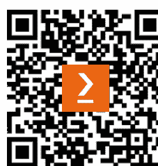

https://packt.link/free-ebook/978180232782

- 2. 提交你的购买证明

- 3. 完成！我们将把免费 PDF 和其他福利发送到你的邮箱直接

# # 第一部分：事件驱动架构与 .NET 7

本部分将涵盖 .NET 7 中使开发 EDA 变得更容易的新功能，以及贯穿本书的示例应用程序以及领域驱动（DDD）的核心原则。

本部分包含以下章节：

# # 1 示例应用程序

在过去的几年里，高并发、可扩展的事件驱动应用程序的出现导致应用程序开发发生了有趣的转变。配套的设计模式使得编写和实现事件驱动架构更具吸引力，并有助于降低充分利用云平台弹性的学习曲线。我们将查看一个使用 .NET 7 实现并利用云原生应用和构造应用程序。

本章的目的是概述我们在书中使用的示例应用程序，以及它旨在满足的业务因素和目标。这将让你对应用程序的结构、代码、机制和领域有一个基础理解。

在本章中，我们将涵盖主要主题：


### 技术要求

要使用代码库并跟随示例，你需要了解或在机器上安装若干先决条件。这些包括：


我们将使用一个自定义开发并包含在源码中的应用程序。我们使用的主要开发平台是 .NET 7。所有的示例都使用 Visual Studio 2022 作为主要的集成开发环境 (IDE)。

> 重要提示
本章提到的所有白皮书和其他来源链接均在章节末尾的延伸阅读部分提供。

### 探索业务因素和应用程序

深入了解应用程序为什么存在、它是如何产生的以及它试图解决什么问题或机会是一个好主意。该应用程序是一个概念应用，涉及物联网 (IoT) 设备、大规模分布式事件摄取以及面部识别功能。该应用程序的主要市场是交通枢纽处的闸机：


在这种场景中，基线事件（baseline events）记录了通过公共交通系统入口和出口点闸机的客户人数的简单计数。构成该应用概念及其需求的某些驱动因素包括：

- 分析交通使用情况、闸机放置位置以及高流量区域对额外设备的需求

### 示例应用程序

具备采集交通站出入口相关人流量的能力具有若干益处。首先，它可以用于了解任何一个站的繁忙程度。其次，随着使用时间的延长，设备会发生磨损并最终损坏。通过直观使用设备的人数，技术人员可以决定何时需要维护或最终更换设备。这还可能导致对闸机单元之外的其他组件（如支付接口）进行深层监控。某些单元可能只有检票扫描仪，而另一些则有检票扫描仪和电子支付接口（可以使用移动设备的非接触式支付）。对正常使用、故障进行监控并对这些组件安排前瞻性维护也大有益。

另一个用例可以是交通调度和车辆可用性。通常，交通部门车队中拥有的车辆（如火车、电车、公交车）数量是监控客户需求的直接结果。使用实时捕获的数据可以帮助加速对所需调度调整、车队调整以及减少客流量较少站点服务的分析。

添加人脸识别软件并非硬性性要求但但它在潜在识别在逃罪犯或被通缉者方面提供了增值能力。对于任何人工智能，在编程和操作时考虑到伦理和安全性都是关重要的。虽然在许多交通站可以找到闭路摄像头和更先进的视频监控设备，但这些摄像头根据执法机构发布的警报或通报识别出人员时，并立即通知任何人。在人脸扫描期间收集的数据必须被视为个人身份信息，并在未发现匹配项时必须清除。

进一步分析这一点，其他潜在的驱动因素可能会发挥作用。例如，检查该应用的业务需求将增加清晰度。查看领域模型以及任何与需求相关的领域特定语言（DSL），将有助于消除对客户、订单、项目、甚至支付方式的定义的歧义。让我们来看领域模型，以更好地理解不同服务、上下文（contexts）和聚合（aggregates）的布局。

### 审查领域模型

应用的领域模型描述了位于应用范围内的功能区域（领域）。每个领域都使用通用语言（ubiquitous language）开发，从业务分析师到高级管理人员再到初级开发人员，都能轻松理解并联系。图 1.2 表示了一个简单的领域模型图，它与应用的结构一致：

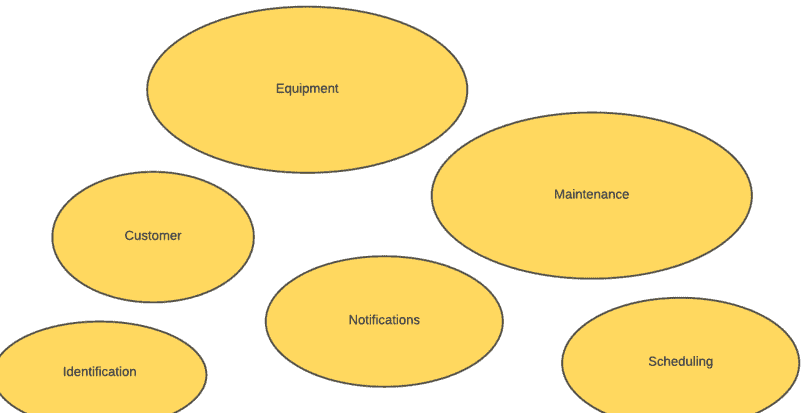

图 1.2 – 高级领域模型

我们在此应用中引用的主要领域与应用旨在提供的主要功能相关。下表提供了每个区域的描述：


表 1.1 – 应用功能

### 示例应用程序

定义了这些基线领域后，可以推导出一些简单的交互规则。例如，乘客可以使用某件设备进入交通站，同时通过“识别”领域进行人脸识别。设备可以抛出一个指示故障的错误，从而调度一次维护事件。设备事件（如闸机操作）可以每次旋转触发一次事件，允许聚合每次旋转和每个站的乘客吞吐量。这些交互随后可以被划分为关注点重叠的，并最终帮助模型和应用至重要的聚合根（aggregate roots）。它们包括：


每个聚合都将包含名称和 ID 等通用属性。与聚合相关的实体（entities）和值对象（value objects）之间需要某些差异，因为每个对象都根据领域规定对数据有自己的要求。图 1.3 表示每个聚合的高级图，包括属性（列表项）、实体（白色圆角矩形）和值对象（绿色圆角矩形）：


设备与维护领域


图 1.3 – 高级聚合视图

4 章“领域模型与异步设计”将深入探讨领域模型，包括对事件、处理器以及异步设计的审查。

建立架构基线有助于推动应用程序及其组件最终如何实现的决策。此外，它提供了一个评估不同模式和实践的机会，最终目标是选择路线。本节涵盖了示例应用程序的整体架构设计以及实现创建和消费的核心原则。


### 评估架构结构与范式

该应用程序使用“生产者-消费者”模式（Producer-Consumer pattern）来产生事件，这些事件随后会被需要这些信息的组件消费。你可能还会看到这种模式被称为发布发布订阅（Publish-Subscribe）或 pub-sub。使用这种模式的关键点在于，任何数量的组件都可以产生包含相关领域信息的事件，而任何数量可能的组件都可以消费这些事件并采取相应的行动。我们将在第 2 章“生产者-消费者模式”中更详细地深入探讨生产者-消费者模式。

深入一层来看，将使用两种技术架构规范。一个用于闸机单元内部的设备，它托管了设备领域（Equipment domain）架构。另一个是云组件的布局，如图 1.4 所示参考架构中所提到的。闸机设备与云组件之间的高层级流转如下：

- 在闸机上，在完成一次转动后，将向设备服务发送一条消息，表示旋转已完成。
- 设备服务将向 IoT 枢纽（IoT hub）发送一个带有闸机动作结果的事件。
- 使用 Kafka Connect，消息将转发到 Kafka，该 Kafka 是在 Kubernetes 集群中使用 Confluent 平台实现的。
- 事件将被写入相应的流（stream）中。
- 任何相关的事件处理器将处理该事件。

更详细的技术架构图可以参见图 1.5，其中同时表示了闸机单元和云组件：

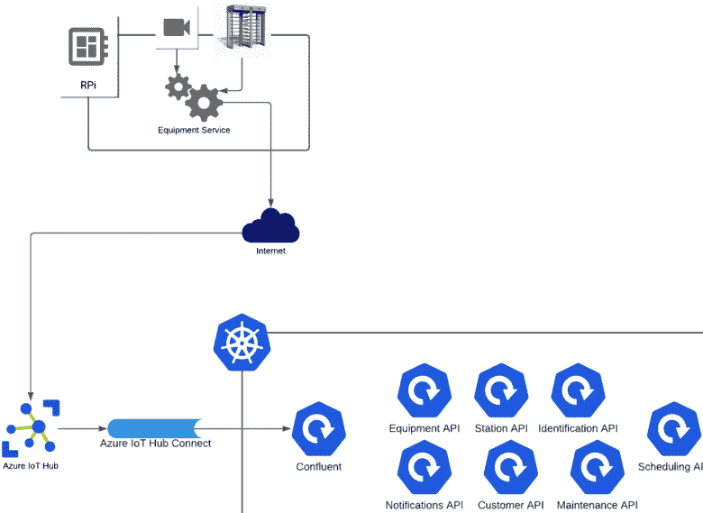

图 1.5 – 闸机到云端通信的技术架构

接下来，我们将进入事件源（Event sourcing）技术的设计。

### 事件源

事件源是一种技术，允许应用程序向日志（log）或流（stream）追加数据，以捕获对象相关的确定变更列表。与关系型数据库中传统的**创建、检索、更新和删除 (CRUD)** 方法相比，使用事件源的优势之一是可以在服务级别对性能进行调优和提升，因为不需要使用 CRUD 方法的开销。此外，它有助于实现关注点分离和单一责任原则，正如 SOLID 开发实践所概述的那样（`https://en.wikipedia.org/wiki/SOLID`）。

事件源的另一个优势是它能够在保持高韧性的同时实现高消息吞吐量。Kafka 等技术本质上允许多个消息代理（brokers）和主题内部的多个分区（partitions）。这种设计确保了至少有一个可用的代理进行通信，而一个主题内的多个分区允许了数据冗余和可扩展性，因为 Kafka 会将数据复制到集群中的每个代理。这使得多个消费者能够并行访问或写入数据。

当使用具有流式能力的事件时，它允许你调试某个时间点的数据并重放事件以辅助调试。例如，如果某个事件导致服务代码出现错误，你完全可以回到错误抛出之前的时间点并重放事件以识别潜在的 bug。此外，它还可以用于执行“假设如果”测试（what if testing）。


### 本地开发与调试

对于本地开发，使用 Visual Studio 是最简单的选项，可以确保解决方案所需的任何前提条件都能被安装和管理。此外，你可以使用 Visual Studio Code，或者使用 GitHub CodeSpaces 来利用云端完全封装的开发环境。

如果你使用 Windows 作为主操作系统，你可能还会利用 Linux 的 Windows 子系统 (WSL)，它允许直接从 Windows 运行 Linux 原生构建和工具链。如果缺少任何 SDK，Visual Studio 将向你发出警告并允许你通过点击消息中的链接来安装它们。

你有几种不同的选项可以在本地调试应用程序：

- 直接从 Visual Studio 启动调试 (F5)。
- 使用 docker compose 运行应用程序，并通过 Visual Studio 挂载到 Docker 进程。
- 将应用程序部署到 Kubernetes 中，并使用 Visual Studio 中的 Kubernetes 扩展将其挂载到应用程序。

### 新 .NET 7

随着 .NET 7 的发布，底层功能进行了许多改进，并带有针对特定语言的更新。在该应用程序中，我们将利用框架和语言角度的一些最新更新。在语言方面，Minimal APIs 的实现和 JSON 数据的异步流式传输有助于简化服务的实现，而利用热重载（Hot Reload）的能力允许在开发生命周期中进行快速且有意义的调试。

### Minimal APIs

.NET 7 中令人兴奋的特性之一是 Minimal APIs。它允许你用极少的代码开发 ASP.NET Core Web API。.NET 团队已努力使该语句变为全局构造函数——这意味着顶层语句（例如使用 System 或 Microsoft.AspNetCore.Mvc）被假认为 Web API 项目中的所有文件都需要，因此不再需要在每个文件中重复编写。此外，不再不再需要 Startup.cs 文件。以下示例代码说明了如何直接从主 Program.cs 文件创建应用，并在编译时将创建一个 ASP.Core Web API 应用程序：

### 审查实现细节 17

```csharp
var app = WebApplication.Create(args);
app.MapGet("/api/testing", (Func<IActionResult>)() => { return
new ContentResult { Content = "Testing" }; });
app.Run();
```

对于简单的 API，你可以直接在 Program.cs 文件中映射 Get、Post、Put、Patch 和 Delete 操作，它们将直接添加到 Web API 的路由中。此外，如果你想像传统的 Web API 项目布局那样将控制器代码保留在单独的文件中，也可以调用 MapControllers()。启动时，应用程序将寻找派生自 Controller 基类的项。如果你选择此选项，你将需要调用 WebApplication.BuildConfig() 方法并传递构建配置，告诉应用程序将控制器添加到配置服务中，如下代码块所示：

```csharp
var builder = WebApplication.CreateBuilder(args);
builder.Services.AddControllers();
var app = builder.Build();
app.MapControllers();
app.Run();
```

### gRPC 的 JSON 转码

虽然 gRPC 服务的支持最初在 .NET 6 中添加，但随后引入了进一步的改进以增强体验。以前，为了测试目的连接到 gRPC 服务，你必须为该服务构建一个客户端并与客户端交互。随着 JSON 转码支持的支持，你现在可以启动一个 Swagger 页面，其中包含你通过 ProtoBuf 暴露的所有可用方法，并对它们进行测试。这不能替代部署时为了通信目的构建客户端的需求，但它确实有助于本地测试的体验。

### 可观测性

通过 .NET 7，与 OpenTelemetry 的集成允许开发者利用开箱即用的插桩以及针对 Prometheus 和 Jaeger 等流行站点可靠性平台的遥测导出器。OpenTelemetry 是一个平台无关的框架，允许开发者暴露堆栈指标（如 ASP.NET Core 插桩）以及基于计数器、直方图和测量器的自定义指标。

### 热重载 (Hot Reload)

其他 Web 开发技术栈已存在多年但在 Visual Studio 本身不存在的功能是调试时的重新加载。例如，如果你在控制器中更改了一行代码，你需要停止调试，更改代码，然后恢复调试。有了 .NET 7 对热重载的支持，这不再是一个障碍。在 Visual Studio 2022 中，一旦检测到代码更改，现在有一个新的图标可以触发热重载。

### 总结

本章提供了示例应用程序的概述，包括底层驱动因素、架构和实现模式。我们对聚合根、实体和值对象模型进行了快速回顾。此外，我们还涵盖了架构中的关键领域，以及 .NET 7 中一些使开发和调试更简单的新功能。所有核心主题将在后续章节中进行更详细介绍。

下一章将介绍生产者-消费者模式，这是应用程序的基础，并有助于事件驱动系统进行扩展。我们将查看该设计模式的底层用法、它如何帮助扩展扩展、如何实现以及如何验证通信是否正确路由和发送。

### 问题

回答以下问题以测试你对本章的理解：

- 1. 从业务角度查看应用程序可以获得哪些潜在洞察？


## 2 生产者-消费者模式

在为应用程序选择通信模式时，通常需要考虑组件之间可能进行通信的情况。典型的 Web 应用程序遵循请求/响应模式，即向服务器发送请求，服务器返回响应并在客户端对其进行恰当处理。对于希望在这些通信通道中处理高吞吐量的应用程序，标准的请求/响应模式并不是理想的。

当每秒发送成百上千个请求时，由于每个请求都必须等待相应的响应，应用程序将缓慢到停滞。另一个例子是长运行进程。可能会有一个由某个事件触发的操作，但它直到几小时后才会完成。阻塞运行该进程的线程会限制执行能力，而且系统最终只需要知道进程何时完成即可。此类场景需要更具韧性的异步消息模式。本章介绍的生产者-消费者模式涵盖了其中这样一种模式，并阐述了以下领域：


### 生产者-消费者模式

在本章结束，你将对以下内容有清晰的理解：


### 技术要求

你可以在 GitHub 上的相应文件夹中找到本章的所有代码示例，地址为：[GitHub Link](https://github.com/PacktPublishing/Implementing-Event-Driven-Microservices-Architecture-in-.NET-7/tree/main/chapter02)。

> 注意事项
本章中提到的所有白皮书和其他来源的链接位于章节末尾的“延伸阅读”部分。

### 检查生产者和消费者

生产者-消费者模式在不同的名称下可能更为熟悉——发布-订阅（Publish-Subscribe，或 pub-sub）。虽然术语可能不同，但该消息模式背后的意图是相同的。既有产生（或发布）事件的组件，也有消费（或订阅）事件的组件。正如第 1 章“示例应用程序”提到的，不同的机制可以支持基于事件的消息模式。我们已经确定将使用 Kafka 作为事件源的主要机制，但如果你从未用过流式技术，可能理解流式传输与通信模式之间的关系具有挑战性。让我们来看几个真实世界的例子，其中一个恰好是示例应用程序的核心案例。

### 结合真实世界示例

开发者理解组件之间通信模式的理念，因为他们在编写特定应用程序时会实现这些模式。一种已经使用了几十年的极其流行的模式是请求/响应模式。大多数人都能自然地理解这种模式，因为它遵循的模式与我们人类交流的方式相似。如果你正在与某人交并提问，你通常可以预期他们给出回复。虽然该回复可能并不完全是你所预期或预期的，但你仍然会收到对你查询的回应。

对于在理解生产者和消费者如何工作方面有些困难的人，可以通过“员工建议箱”的形式来看简单的例子。员工在纸条上写下建议并将其放入一个通常锁着的箱子里。建议进去了，但除了持有箱钥匙的人以外，没有人可以取回。这些建议可以立即收集、在当天结束时收集，或者在每月某个特定时间收集。这种互动的重要部分是持有箱钥匙的人（通常是管理层人员）汇总这些建议并将它们带回群体。有些建议可能不会被实施，但前提是那些对场所做出改变的人将阅读并可能采取行动。写这些建议的员工是生产者，他们产生建议以使工作场所更加愉快或高效。在这种情况下，消费者是经理或主管，他们收集这些建议并采取行动，根据工作场所的情况处理这些建议。

需要注意的额外一点是收集这些建议的一致性。使用生产者-消费者模式的应用程序中共同主题是最终一致性（eventual consistency）——这意味着根据配置设置或规定特定领域当前数据必须实时程度的要求，数据最终会被发送和处理。如果建议在每天结束时收集，这表明其数据一致性的频率比每月收集一次的建议更快。

接下来，我们来看示例应用程序及其主要用例，即监控公共交通工具日常运营期间闸机设备的使用情况。当设备被使用、发生故障或机制卡住时，会产生事件。这些事件通过消息代理程序（message broker）发送到 Kafka 主题（类似于消息队列），感兴趣的消费者将订阅该主题。一旦事件进入主题，消费者就会将其引入，并运行事件处理器来将其处理数据库、应用程序日志文件条目，或触发更多事件。这将导致一次写操作。虽然比我们的第一个例子复杂，但它遵循相同的通用行为。这里的区别在于事件的产生、消费和处理发生在高或低频率下，且这些活动受领域内部业务逻辑的支配。

> 注意事项
消息代理程序将在第 4 章“领域模型与异步设计”中进行更详细的介绍。

## 2 生产者-消费者模式

这些示例每一个帮助你说明生产者和消费者之间的互动如何在日常生活中存在。接下来我们将研究这种模式如何使事件驱动架构取得成功。

### 启用事件驱动架构

提醒一下，许多事件驱动系统在设计时已经考虑到会有大量消息的产生和消费。消息的产生和消费方式需要具有高度的可扩展性、韧性和容错性。否则，由于无法保证产生的消息一定会被消费，应用程序的结构完整性将失效。

扩展性可以通过不同的机制解决。某些服务允许利用自动伸缩功能，通过创建额外的副本来处理请求或使用的增加。这很重要，因为它确保了无论用户模式如何都能保证性能。如果达到了自动伸缩的上限且消息流量较大，如果不采取额外的措施，可能会产生性能影响。在生产者-消费者模式中，对产生的任何消息都没有明确的预期。正如前面提到的，系统的一致性不需要是即时的，这允许消息的消费者根据要求对其进行处理。


### 在代码中探索实现细节

对于你计划使用的每一个云服务，你都应该准备一个该云服务不可用的应急预案。这可能会引发关于业务连续性和灾难恢复场景的更深讨论，而这些超出了本书的范畴。然而，从概念上讲，拥有一个处理云服务的计划通常是一个良好的做法，无论是通过地理分布组件，还是在机器或设备上进行本地操作，并将其本地持久化，直到服务上线。

对于应用程序开发者来说，考虑到这些特性往往是一项艰巨的任务，因为许多人习惯于底层基础设施相对静态且稳定的环境中工作。除了考虑这些运营问题所需的准备时间外，对于某些人来说，真正利用生产者-消费者模式的采用曲线可能非常陡峭。

### 理解采用曲线

正如我们在前几节中看到的，深入理解使用生产者-消费者模式背后的“为什么”与理解“如何做”、“何时做”以及“在哪里”同样重要。从开发者体验的角度，转向这种通信模式可能会带来一系列挑战。并不是所有人都能以相同的速度学习并适应所有模式。如果应用已经存在，并在开发生命周期中引入了重构或重新架构以采用此模式，那么曲线可能会变得更陡。

应对学习曲线始于对模式本身的概念性理解。这可以通过本章前面列出的示例来传递，或者通过专门为应用程序开发者定制的讲师课程来传递。通过免费网站（如 Microsoft Learn）还有许多额外的在线内容，旨在引导你理解专为云原生开发的概念和设计模式。请记住，这可能与你或你的团队习惯的开发实践有本质不同，确保留出足够的时间来吸收、实验和学习这些内容，将有助于巩固你开发事件驱动应用程序的能力。实验或亲手学习通常是有益的。在下一节中，我们将讨论一个如何编写生产者、消费者和事件处理程序的高级示例，并运行这些服务以演示生产者-消费者通信是如何发生的。

### 在代码中探索实现细节

有几种方法可以在代码中实现生产者-消费者模式。你可以下载并运行一些示例，以及你可能在领域库或核心（共享）库中找到自定义实现。首先，我们将查看使用 Confluent Kafka 库的示例代码，该库为与 Kafka 交互提供了一个简单且易于理解的抽象层。每个组件（生产者和消费者）的源码可以在 GitHub 上的章节文件夹中找到，并带有一个用于在本地下载和运行 Kafka 的引导脚本。请确保你已安装 Docker，因为安装过程依赖于运行 `docker compose`。此代码的启动顺序是运行 `docker compose`，然后右键点击消费者项目并选择 `Debug > Start New Instance`，然后右键点击生产者项目并选择 `Debug > Start New Instance`。

### 生产者代码

我们将从这段代码开始，可以使用 ASP.NET Core 的最小 API 功能进行设置。首先，在 Visual Studio 中使用 ASP.NET Core 模板创建一个新项目。图 2.1 显示了在使用 C# 设置为语言、Web 设置为项目类型进行搜索后的模板：

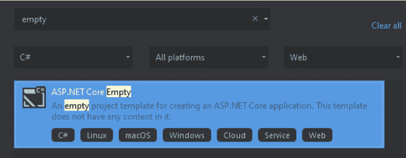

图 2.1 – Visual Studio 中的新项目对话框，显示了空的 ASP.NET Core 项目模板。接下来，我们想要向项目添加一些引用，以启用服务的 Swagger 文档、服务中后台服务的托管，以及 ASP.NET Core 中的依赖注入机制以适当地解析类型。要做到这一点，你可以右键点击项目并选择“管理 NuGet 包”。或者，你可以运行以下代码在项目内安装包：

```
dotnet add package Confluent.Kafka
dotnet add package Microsoft.Extensions.Hosting
dotnet add package Microsoft.Extensions.DependencyInjection
dotnet add package Swashbuckle
dotnet add package Swagger
```

当你打开主 `Program.cs` 文件时，注意没有命名空间声明，没有主方法定义，也没有 `using` 语句。这是因为启用了顶层程序功能，使主代码简洁且易读。`Startup.cs` 文件不再需要，这使得使用基础 Web API 项目变得非常简单，并且比之前的框架版本快得多。以下代码在你首次创建项目时 `Program.cs` 文件中内容的示例：

```csharp
var builder = WebApplication.CreateBuilder(args);
var app = builder.Build();
```

```csharp
if (app.Environment.IsDevelopment())
{
    app.UseDeveloperExceptionPage();
}
```

```csharp
app.MapGet("/", () => "Hello World!");
app.Run();
```

我们需要一种方法让此服务产生一个可以被另一个程序（我们将在本章晚些时候构建）消耗的消息。这个生产组件需要对任何映射的路由 `Program.cs` 可用。`Microsoft.Extensions.Hosting` 库包含的一个抽象类是 `BackgroundService`。它允许你创建一个可以在后台与你的 Kafka 实例交互的类，而不影响 Web API 进程的主线程。在 API 启动过程中，你可以创建一个后台服务的作用域实例，它将通过依赖注入控制你的方法。

为了允许这种绑定，我们想要编写一个实现 `IHostedService` 接口的接口。使用以下存根代码，`IProducerService` 看起来如下：

```csharp
interface IProducerService: IHostedService
{
    Task Send(string message);
    Task SetTopic(string topicName);
}
```

为了接入此 `IProducerService` 接口的具体作用域实例，我们将如下注册它：

```csharp
builder.Services.AddScoped<IProducerService, producerService>();
```

生产者组件需要利用 `Confluent.Kafka` 库中的 `IProducerConfig` 接口以及 `ProducerConfig` 类，允许启动信息传递给 `ProducerBuilder` 类，从而生成 `IProducer` 的具体实现。之后，我们将在 `Program.cs` 中设置 `ProducerConfig` 类的实例，允许我们从 `appSettings.json` 文件读取信息，通过绑定配置部分来填充该配置。

```csharp
var producerConfig = new ProducerConfig();
...
var producerTopic = builder.Configuration.GetValue<string>("Topic");
builder.Configuration.Bind("ProducerConfig", producerConfig);
```

然后，我们将 `ProducerConfig` 类实例注册为单例，允许我们通过依赖注入使用它：

```csharp
builder.Services.AddSingleton<ProducerConfig>(producerConfig);
builder.Services.AddSingleton(producerTopic);
```

接下来，我们需要添加一个路由来允许向端点执行 POST 操作。此方法将包含一些基本的错误处理，并且目前只处理字符串消息。该路由将调用 `ProducersService` 并等待 `Send()`` 方法的返回。以下代码可以放在第一个 `app.MapGet` 函数和 `app.Run()` 之间：

```csharp
app.MapPost("/send", async (http) => {
    var message = "";
    using (StreamReader sr = new StreamReader(http.Request.Body))
    {
        message = await sr.ReadToEndAsync();
    }
});
```

```csharp
var svc = http.RequestServices.GetRequiredService<IProducerService>();
```


```go
await svc.SetTopic(ProducerTopic);
try {
    if (message == null) {
        throw new InvalidDataException("Must have a message body");
    }
    await svc.Send(message?.ToString());
} catch (Exception ex) {
    await http.Response.BodyWriter.WriteAsync(
        System.Text.Encoding.GetBytes(ex.Message));
    http.Response.StatusCode = 500;
};
```

我们还需要一个存放生产者消息的去处。如之前所述，Kafka 使用主题（topics）的概念进行操作。在本示例中，我们需要关注一个可以放置正在发送的消息的主题。你可能已经注意到，我们为 Topic 属性添加了一个额外的配置绑定。在 `appsettings.json` 文件中为此项输入值将允许你设置生产者写入消息的主题名称。

提醒一下，所有的示例代码可以在 GitHub 仓库的章节文件夹中找到。

### 消费者代码

消费者代码与生产者代码相似，因为它们都使用了 `BackgroundService` 抽象类。与消费者服务的区别在于，它使用传入 `ExecuteAsync` 方法的 `CancellationToken` 值来决定是否应该停止服务。如果令牌不是取消请求，消费者服务将继续在后台运行。在进入主程序循环之前，让我们先来看 `consumerService` 类：

```go
internal class consumerService : BackgroundService,
IConsumerService
```

```go
{
  private readonly IConsumer<int, string> consumer;
  private readonly string topicName;
  public consumerService(ConsumerConfig config,
  string topic)
{
    consumer = new Builder<int,string>(config).Build();
    topicName = topic;
  }
  public async Task Receive()
{
    await ExecuteAsync(CancellationToken.None);
  }
  protected override async Task
  ExecuteAsync(CancellationToken stoppingToken)
{
    while (!stoppingToken.IsCancellationRequested)
{
      consumer.Subscribe(topicName);
      var result = consumer.Consume(stoppingToken);
      Console.WriteLine(result.Message.Value);
    }
  }
}
```

如你所见，在本示例中，`ExecuteAsync` 方法负责核心工作。由于令牌没有表示取消请求，`while` 循环将继续运行，允许消费者订阅你提供的主题名称、读取消息并将消息内容输出到控制台。

设置主程序的设置会略有不同。由于这不是 ASP.NET Core Web API，因此在加载应用程序配置和初始化 `consumerService` 类方面需要一些额外的考虑。在这里，我们可以利用 `Microsoft.Extensions.Hosting` 库中的项，特别是关于如何配置和启动控制台应用程序。在消费者项目的示例代码中，`Program.cs` 文件包含一个标准的 `main` 方法，但它也包含一个 `CreateHostBuilder` 方法。后者允许你设置配置源和其他绑定，我们在生产者服务代码中是内联设置了这些。这是消费者可执行文件的 `CreateHostBuilder` 方法：

```go
static IHostBuilder CreateHostBuilder(string[] args) =>
    Host.CreateDefaultBuilder(args).ConfigureAppConfiguration(
((hostingContext, configuration) =>
{
        configuration.Sources.Clear();
        IHostEnvironment env =
            hostingContext.HostingEnvironment;
        configuration
            .AddJsonFile("appsettings.json",
                optional: true, reloadOnChange:
                true)
            .AddJsonFile($"{env.EnvironmentName}.json",
                true, true);
        IConfigurationRoot config =
            configuration.Build();
    _config = new ConsumerConfig({
        BootstrapServers =
            config.GetValue<string>("KafkaServer"),
        GroupId =
            config.GetValue<string>("DefaultGroupId")
    });
    topicName =
        config.GetValue<string>("Topic");
});
```

这里发生了几处：

- 调用了 `CreateDefaultBuilder`，并传入了来自 `Main` 程序方法的命令行参数。
- 向 `ConfigureAppsettings` 方法传递了两个占位符，分别用于托管上下文和配置本身。

## 32 生产者-消费者模式

- JSON 配置文件被指定为应用程序配置设置的源。根据传递给 `AddJsonFile` 的参数，它们被列为可选；然而，它们将是必不可的，因为主题名称和 `ConsumerConfig` 的值将从中获取。
- `ConsumerConfig` 值、默认组 ID 和主题名称的私有变量从 JSON 配置文件中加载，并设置为静态变量以供以后使用。组 ID 对于 Kafka 主题的消费者至关重要，因为 Kafka 会跟踪特定组从主题中读取了哪些内容。你可以创建多个共享相同组 ID 的消费者，Kafka 将自动跟踪已消费的内容——而不仅仅是消费者应用程序。

处理好这些配置后，我们现在可以关注 `Main` 方法。它的内容相当简单，因为它需要初始化应用程序主机、实例化 `consumerService` 类并等待应用程序运行：

```go
using IHost host = CreateHostBuilder(args).Build();
var service = new consumerService(_config, topicName);
await service.Receive();
```

确保在调用 `host.RunAsync()` 之前调用了 `Receive` 是重要的，否则消费者服务可能不会激活，消息将不会从主题中消费。

意图是同时运行生产者和消费者代码，允许你向 API 发送消息并在控制台中查看它们。你可以通过 `curl` (Linux) 或 `Invoke-RestMethod` (PowerShell) 向 API 发送消息。PowerShell 示例如下：

```powershell
Invoke-RestMethod -Method Post -Uri "https://localhost:5001/send" -UseBasicParsing -Body "This is a test"
```

然而，我们还没有处理完消费者。直接从 `Receive` 方法写入控制台是观察结果的一种快速方法，但我们还希望确保利用事件处理器来处理收到的消息。建立这种模式在以后编写领域代码时将产生丰厚回报。

### 事件处理

通常，预计事件处理器将在消费者代码中使用。虽然处理器对象本身通常位于主库，但消费者实现将引入这些事件处理器，通常在后台过程中运行。事件处理本质不需要非常复杂，正如下面的代码所示。

首先，我们将创建一个新的 `MessageReceivedEventHandler` 类，它将消费者代码中 `Receive` 方法的原始控制台输出抽象为独立的事件处理器。这种模式将在第四章“领域模型与异步设计”深入探讨异步编程时详细采用。对于此示例，事件处理器类只有一个 `Handle` 方法，它会将收到的消息内容写入控制台：

```go
internal class MessageReceivedEventHandler {
    public async Task Handle(ConsumerResult<int,string> result) {
        await Task.Run(() => {
            Console.WriteLine(result.Message.Value);
        });
    }
}
```

现在，我们需要从 `consumerService` 的 `ExecuteAsync` 方法删除控制台输出行，并用新的 `await` 语句替换它：

```go
while (!stoppingToken.IsCancellationRequested) {
    consumer.Subscribe(topicName);
    var result = consumer.Consume(stoppingToken);
    await new MessageReceivedEventHandler().
    Handle(result);
}
```

要测试此新添加，请以调试模式运行生产者和消费者项目，并在你选择的终端中发布命令向生产者 API 发送新消息。你应该能在消费者的控制窗口中看到输出。


在运行了生产者和消费者客户端的代码实现后，现在是时候进一步了解我们所需的基础设施的实现细节了。

### 审查基础设施中的实现细节

在上一节中，我们稍微关注了 Kafka 的基础设施配置，尽管设置 Kafka 的工作比仅仅运行一个脚本要复杂得多。为了理解生产者和消费者示例，我们对如何与 Kafka 尤其是主题（topic）交互做了一些假设。

### 主题 (Topics)

主题并不是 Kafka 特有的，它是生产者-消费者模式利用的一种构造结构，用于存储和检索与特定领域或领域内事件分组相关的消息。通常，主题局限于特定的数据子集。例如，在 MTAEDA 程序的领域模型中，你可能会发现用于设备、站点和调度的主题。

事件和消息（在 Kafka 中称为记录 records）是以“只追加”的方式写入的。这意味着每条记录在写入主题后都是不可更改的。任何所需的更改都必须追加到主题的末尾。这允许消费者在需要时对记录进行顺序读取。

Kafka 中的主题还由分区（partitions）组成。与其他数据持久化技术一样，分区可以用于存储具有共同键的事件或消息。这确保了特定键的所有相关信息都位于特定分区内。启用多个分区允许数据集更广泛分布，并可能允许使用该共同键作为搜索词实现更快的搜索能力。

此外，分区可以作为多个 broker 之间负载均衡的手段，分区本身被视为并行单元。这为解决方案增加了复杂性——在某些情况下，你可能不想使用多个分区，因为你没有使用键值。将 null 作为键值向主题写入消息或事件是可能的。如果采用了这种方法，还需要另一个共同标识符来关联主题中的事件（如果需要）。如果没有使用键值，每条记录将通过轮询分配（round-robin assignment）写入分区。

### 审查基础设施中的实现细节 35

在 Kafka 中创建主题是简单的。你可以通过以下方式创建主题：

- 在你的 Kafka broker 中使用配置（`auto.create.topics.enable`）。
- 运行从 Apache 网站下载的最新脚本。

第一个选项将使用 Kafka broker 中的默认值为你自动创建一个主题。第二个选项可以创建具有细粒度配置的主题。还有分区计数（partition count）、保留时间（retention time）和副本计数（replication count）的选项。

> **注意** 这里是关于 Kafka 中保留的快速说明。默认情况下，Kafka 将保留记录七天。这可以存储考虑进行调整。不假设记录将无限保留。这就是为什么许多事件驱动应用程序使用替代数据存储来捕捉每个领域，事件处理器会将这些记录写入适当的介质。

### 流 (Streams) 和 表 (Tables)

主题并不是读取或写入记录的唯一区域。Kafka 还有一个流的概念。本质上，流是信息。Kafka 提供的流 允许将记录转换为输入主题，并将转换后的记录放入输出主题。流可以根据特定主题编程地创建。

另一方面，表构造通过特定方式呈现的可用数据。使用如 `mapreduce` 等常用技术，你可以创建转换或压缩记录，意图使用另一个流写入输出主题。虽然这些构造在 Kafka 中非常重要且有用，你可能会发现它们在领域作为事件处理器的扩展。Kafka 的 connect API 允许你与不同的系统和数据存储建立连接。如果计划仅考虑使用 Kafka 作为消息平台，使用流和表以及 connect API 将非常有意义。对于我们的示例应用程序，虽然我们正在使用 Kafka，但已经有抽象允许我们在不同平台之间使用消息持久化，将逻辑留给领域内的事件处理器。

### 聚合存储 (Aggregate storage)

在领域范围内，我们已经识别了多个需要被跟踪的不同聚合。在使用 Kafka 等平台时跟踪聚合更改的常用方法是为每个聚合创建一个主题。与每个聚合相关的事件由特定的事件处理器处理。这些处理器可以根据需要更新数据存储。图 2.2 展示了 Kafka 中基于聚合的主题示例：


图 2.2 – 按聚合根划分的布局示例

这并不是说非聚合主题中的其他事件不会影响存储中的数据；拥有单独的聚合允许以中心化的方式处理与聚合多个部分相关的事件，同时仍允许其他类型自然发生。

让我们看看在领域中使用其中一个聚合的示例。聚合是需要被跟踪的。维护聚合状态可以锁定维护的。与每个聚合相关的事件由特定的事件处理器处理。这些处理器可以根据需要更新数据存储。维护完成后，状态可以反映维护人员已收到通知。对于我们的应用程序，虽然我们正在使用 Kafka，但已经有抽象允许我们在不同平台之间使用消息和持久化，将逻辑留给领域内的事件处理器。


### 延伸阅读

- Martin Fowler 写的《What Do You Mean by "Event-Driven"》：可以在 https://martinfowler.com/articles/201701-event-driven.html 阅读。
- 微软的 Azure 架构中心：可以在 https://docs.microsoft.com/en-us/azure/architecture 查看。
- Jeow Li Huan 写的《ASPNET Core 中基于托管服务的后台任务》：可以在 https://docs.microsoft.com/en-us/aspnetcore/fundamentals/host/hosted-services?view=aspnetcore-5.0&tabs=visual-studio 查看。
- 微软的 Minimal APIs：可以在 https://minimal-apis.github.io 查看。
- Confluent 提供的《Docker 上的 Apache Kafka 快速上手》：可以在 https://developer.confluent.io/quickstart/kafka-docker 查看。
- Apache Foundation 提供的 Apache Kafka 官方文档：可以在 https://kafka.apache.org/documentation 查看。
- Red Hat 提供的《Kafka 生产者/消费者教程》：可以在 https://redhat-developer-demos.github.io/kafka-tutorial/kafka-tutorial/1.0.x/03-consumers-producers.html 查看。
- Coding Harbour 写的《Kafka 主题和分区简介》：可以在 https://codingharbour.com/apache-kafka/the-introduction-to-kafka-topics-and-partitions/ 查看。

## 3 消息中间件

正如我们在第2章“生产者-消费者模式”中所看到的，生产者-消费者模式是处理大规模消息的一种非常有效的方法。扩展性的优势可以体现在程序实现这种模式的方式，而另一些则体现在支持该模式的基础设施。本章旨在深入探讨消息中间件，并涵盖以下主题：

- 什么是消息中间件？
- 检查消息协议、架构（Schemas）和交付模式
- 实现消息中间件技术

在本章结束时，你将能够做到：

- 了解消息中间件的概念以及它在事件驱动架构（EDA）范围内的用法。
- 了解如何使用消息架构、用于发送和接收消息的各种协议及其交付选项。
- 了解如何使用消息中间件的具体实现，以及如何选择正确的技术。

### 技术要求

你可以在本书的 GitHub 仓库中找到本章的代码示例，地址为 https://github.com/PacktPublishing/Implementing-Event-Driven-Microservices-Architecture-in-.NET-7/tree/main/chapter03。

> **重要说明**
> 本章提到的所有白皮书和其他来源的链接在本章末尾的延伸阅读部分提供。

### 什么是消息中间件？

简单来说，消息中间件是一种促进两个系统之间通信（或作为代理）的中间件。虽然这听起来非常简单，但这个基本概念可以扩展到生产者-消费者模式等用例中。鉴于这种中间件的多功能性，人们可能想添加额外的处理功能。在添加功能（如数据富化或转换）时，防止产品被特定中间件锁定的关键。

通过领域驱动设计（DDD）标准，在保持接口功能精确的同时，使实现更具灵活性，将产生最一致的结果。虽然你可能不会遇到一个拥有 10 种不同中间件或仓库概念实现的项目，但有几种不同的可选方案并不罕见。通常，你会看到不仅用于中间件，还有至少一种类型持久化存储的实现类；无论是缓存、数据库还是平面文件。

抛开术语不谈，市场上存在大量的消息中间件。有些是免费使用的，而有些是需要许可和付费的商业软件。无论价格如何，中间件倾向于分为三个主要领域：

- 基于队列的技术
- 基于缓存的技术
- 基于流的技术

让我们看看每种类型的中间件，以及属于每个类别的通用示例。

### 基于队列的技术

首先，我们将检查基于队列的中间件，这意味着存在一个概念性结构，定义了消息存放的队列或列表。处理这些队列中的消息（也称为出队）将从当前队列中提取消息，对它们执行某些操作，并产生一个可以放在另一个队列中继续处理的结果。

执行这些处理任务的组件可以是可执行文件、脚本、Web 服务、微服务，甚至是中间件本身内置的功能。虽然讨论特定产品的能力超出了本书的范畴，但以下产品及其文档页面讨论了基于队列的消息中间件可以实现哪些功能：

- RabbitMQ：一个开源消息队列和中间件，允许你使用标准的基于队列的消息传递和高级消息队列协议 (AMQP)。
- ActiveMQ：一个使用 AMQP 消息路由的 Java 平台。
- Azure Bus：专门在 Microsoft Azure 中实现的云原生消息队列和中继。
- WebSphere Message Broker：由 IBM 编写的消息中间件和转换引擎。通常由 IBM MQ 使用。
- IBM MQ：由 IBM 编写的严重利用队列和主题进行存储和路由的消息传递平台。

虽然基于队列的技术对某些人来说可能更熟悉，其他其他存储选项。接下来，我们将讨论缓存概念以及一些支持它的相关技术。

### 基于缓存的技术

基于缓存的中间件倾向于依赖用于缓存数据的底层技术。对于关键消息使用缓存机制可能不是最佳选择。从本质上说，假设缓存可以在预定时间或随机时间失效。虽然可以使用缓存机制操作持久化存储，但通常不是强制要求的。缓存的典型用例是存储临时数据以备便利。依赖瞬态数据存储无法完全强制如可靠性交付等模式。

再次，机制的应用将由应用程序的需求及其背后的业务规范驱动。一些流行的缓存技术包括：

- Redis
- Memcached
- 内容交付网络 (CDN)

### 基于流的技术

基于流的中间件在很多情况下与基于队列的中间件相似。例如，它们都有发送消息的地方（队列与主题）、需要执行的某些计算或操作，以及产生的产生。基于队列的中间件和基于流的中间件之间的关键区别在于接收、处理和检索数据的机制。虽然基于队列的技术可以通过集群来实现并发，但流系统原生提供了并发性和近实时可见性。这是由于缺乏基于队列系统中复杂的路由实现的。下图显示了传统队列系统与流系统在并发性、吞吐量和恢复能力方面的差异：


图 3.1 – 基于队列与基于流


### 消息代理 (Message Brokers)

AMQP 旨在为各种代理和实现该模式的组件之间提供一种可转换的协议。其意图是避免或消除对代理技术或特定代理协议的锁定。

### MQTT

MQ 遥测传输 (MQTT) 是一种专为物联网 (IoT) 设备设计的较新协议，特别是适用于消息负载较小、且网络连接可能受到严重限制甚至有时完全不存在的场景。它还便于将 TCP/IP 不仅作为传输通道，还用于传感器网络、蓝牙等。可以使用 MQTT 解决商业和住宅的用例。例如，许多家庭自动化枢纽在中央设备上使用代理，并能够与上述通道进行通信，或使用如 Node-RED 等视觉化工具构建工作流。根据我们的示例场景，该协议可以考虑用于往返闸机和摄像机单元的消息。

除了 AMQP 或 MQTT 之外，还可以许多其他协议来发送消息。标准 HTTP、WebSockets 和 TCP socket 连接也可以作为消息从一处传输到另一个地方的媒介。无论使用什么方法发送消息，内容最终才是最重要的。让我们花时间看看消息内容是如何定义的，以及处理每种方法的优缺点。

### 标准和自定义模式 (Standard and custom schemas)

根据所选的方法，使用预定义的模式来定义消息结构可能会带来优势和劣端。在某些情况下，可以拥有标准化且可被许多不同系统消费的格式。在其他情况下，使用内部定义的模式来定义消息可能更容易管理，特别是当消息不需要在应用程序外部消费时。理解您的应用程序以及可能依赖于您的应用程序的预期交互模式，最终将驱动您的决策。让我们花时间评估每个选项。

### 使用（开放）模式标准 (Using (open) schema standards)

正如我们在第 1 章节“示例应用程序”中提到的，我们选择使用 CloudEvents 开放模式标准。这种选择背后的逻辑是让事件能够在支持该模式的日志系统（如 Azure Monitor）中原生消费，并为消息和事件布局定义单一模式，以便开发者更容易使用。

### 检查消息传递协议、模式和交付模式 45

虽然这种方法为所有产生（并处理）的事件带来了一致性，但仍存在一个确定每个事件相关数据的基础层问题。由于消息对象的内容是从领域事件、实体或处理程序序列化而来的，反序列化这些消息可能会带来一些挑战。如果由于某种原因无法从引用库加载目标类型，可能会导致事件处理程序无法正常运行，从而对系统的核心功能产生不利影响。

### 自带模式 (Bring-your-own schema)

为每条消息保持一个精简（或隐含）模式完全可能符合您的需求。即使发送对象的序列化 JSON 实例也是记录该消息内容的简单方法。如果没有需要考虑额外的系统集成，这种方法可能更好。

这种方法的一个潜在缺点是向前兼容性。如果对象随时间推移而变化呢？如果引入新需求将所有消息或处理后的消息馈入聚合器怎么办？微小的变化看起来可能不多，但时间会堆积，使得使用聚合器进行集成事件变得更加痛苦。为了帮助缓解向前兼容性问题，你可以利用语义化控制等模式来帮助设置清晰的兼容轨道，其中主版本修订意味着破坏性更改（breaking changes）。设计很少更新的模式也有助于避免向前兼容性问题。

每个设计决策都有潜力和陷阱。在构建应用程序时，选择最佳选项最终取决于你。消息如何传递并不完全掌握在你的手中。这就是消息传递模式变得相关的地方。

# 消息传递模式 (Message delivery patterns)

通常，当产生消息或事件时，预期是某个地方的某物会拾取它并根据内容执行操作。让我们来看看这些不同的模式以及每个的预期行为。

### 保证交付 (Guaranteed delivery)

保证交付是一个概念，规定消息一旦产生，就会被交付。无论是一份拷贝还是几份，该交付的范围仅与“它将且必须被交付”这一概念相关。

### 精确一次 (Exactly-once)

精确一次模式意味着消息或事件将向一个接收者发送一次。这意味着不仅在生产者端，在消费者端也需要建立持久化机制。关于这种模式的可行性已经有很多争论，因为为了确保合规性所需的控制措施需要经过结构化，并且可能过载或难以维护。

### 至少一次 (At-least-once)

至少一次模式在传统上被称为广播模式，其中至少会发送一条消息或事件，但它可能会被许多（或没有）接收者处理。在生产者-消费者模式的应用范围内，这种模式运行良好，因为许多消费者可能对产生的事件感兴趣。理论上，能够将事件写入主题（topic）就可以满足这种模式。

> 注意事项：我们将在第 4 章节“领域模型和异步设计”中深入领域代码时，讨论不同的云原生韧性模式。为了实现这些模式，我们将使用 Polly.net，这是一个开源库，用于确保这些模式的适配和实现。在现场的组件或设备无法连接的情况下，使用如重试模式等韧性模式可以帮助降低消息未被处理的风险，最终目标是在无法与代理通信时将消息持久化到本地。

### 最多一次 (At-most-once)

最多一次模式与精确一次模式类似，它旨在只允许处理一条一条消息。然而，主要的区别在于，最多一次模式不保证任何内容会被处理。如果接收到消息，它会被处理最多一次。这种模式具有广泛的数据丢失影响。选择这种模式不仅要理解数据丢失的风险，还要承担减轻风险的责任。

### 实现消息代理技术 (Implementing message broker technologies)

正如上一节看到的，建立最小化的 Kafka 实例可以快速完成。这对于本地测试非常棒，但它无法转化为能够处理我们看到的事件量的生产级基础设施。在设置和配置 Kafka 时，有一些需要注意的点会影响软件组件对事件的处理。

### 实现消息代理技术 47

现在，让我们对运行 Kafka 所需的组件进行高级概述，以及启用韧性和扩展性的相关实现和配置。

### 查看关键 Kafka 组件 (Reviewing essential Kafka components)

建立一个可以运行的 Kafka 实例需要三个主要组件。我们已经讨论过代理以及主题。最后一块拼图是 Zookeeper 中心。根据 Apache Zookeeper 官网，Zookeeper 是一个维护配置信息、命名、提供分布式同步和提供服务的集中服务。简而言之，它管理 Kafka 实例中的代理，并有助于路由、配置更新、复制和主选举。它还执行以下操作：

- 事件路由确保写入主题的事件到达正确的目的地。
- 当 Kafka 代理或其他组件设置配置更新时，Zookeeper 确保这些更新被应用。
- Zookeeper 根据设置的配置跨代理管理事件复制。
- Zookeeper 通过声明其为主节点来管理主要的活动代理。

从基础设施的角度来看，这是需要大量规划和设计的内容。从开发者的角度来看，了解基础组件以及使用多少个 Broker 是好的。例如，在本地或集成测试期间，使用单个 Kafka Broker 可能是合理的。在性能测试或生产环境中，将根据预期的事件量增加 Broker 的数量。

让我们看一个示例。考虑以下 docker compose 文件：

```yaml
version: '2'
services:
  zookeeper:
    image: bitnami/zookeeper
    hostname: zookeeper
    container_name: zookeeper
    ports:
```


### 消息代理代理

```
"2181:2181"
environment:
  ZOOKEEPER_CLIENT_PORT: 2181
broker:
  image: bitnami/kafka
hostname: broker
  container_name: broker
depends_on:
  - zookeeper
ports:
  - "20902:20902"
environment:
  KAFKA_PORT: 9092
  KAFKA_ZOOKEEPER_CONNECT: 'zookeeper:2181'
  KAFKA_LISTENERS: EXTERNAL_SAME_HOST://20902,
  INTERNAL://9092
  KAFKA_ADVERSED_LISTENERS: INTERNAL://broker:9092,
  EXTERNAL_SAME_HOST://localhost:20902
  KAFKA_LISTENER_SECURITY_PROTOCOL_MAP:
  INTERNAL:PLAINTEXT,EXTERNAL_SAME_HOST:PLAINTEXT
  KAFKA_INTER_BROKER_LISTENER_NAME: INTERNAL
ALLOW_PLAINTEXT_LISTENER: "yes"
JMX_PORT: 9999
```

这是一个基础的 Kafka 配置，包含一个代理（broker）和一个 Zookeeper 节点，并在代理节点上进行了一些额外配置，以允许 Zookeeper 与代理之间的内部流量，以及通过端口 20902 的外部（localhost）流量。但如果我们想在这个家族中再添加另一个代理将会怎样？使用现有的配置，我们可以更新 compose 文件使其看起来像下面所示。对第一个代理节点进行的更新已高亮显示：

```
version: '2'
services:
  zookeeper:
  ...
```

实现消息代理技术 49 

broker1:

```
image: bitnami/kafka
hostname: broker1
container_name: broker1
depends_on:
  - zookeeper
ports:
  - "29092:29092"
environment:
  BROKER_ID: 1
  KAFKA_PORT: 9092
  KAFKA_ZOOKEEPER_CONNECT: 'zookeeper:2181'
  KAFKA_LISTENERS: EXTERNAL_SAME_HOST:::29092,INTERNAL:::9092
  KAFKA_ADVERTISED_Listeners: INTERNAL://broker1:9092,EXTERNAL_SAME_HOST://localhost:29092
  KAFKA_LISTENER_SECURITY_PROTOCOL_MAP:
    INTERNAL:PLAINTEXT,EXTERNAL_SAME_HOST:PLAINTEXT
  KAFKA_INTER_BROKER_LISTENER_NAME: "INTERNAL"
  ALLOW_PLAINTEXT_LISTENER: "yes"
  JMX_PORT: 9999
```

broker2:

```
image: bitnami/kafka
hostname: broker2
container_name: broker2
depends_on:
  - zookeeper
ports:
  - "29093:29093"
environment:
  BROKER_ID: 2
  KAFKA_PORT: 9093
  KAFKA_ZOOKEEPER_CONNECT: 'zookeeper:2181'
  KAFKA_LISTENERS: EXTERNAL_SAME_HOST:::29093,INTERNAL:::9093
```

```
KAFKA_ADVERTISED_LISTENERS: INTERNAL://broker2:9093
EXTERNAL_SAME_HOST://localhost:29093
KAFKA_LISTENER_SECURITY_PROTOCOL_MAP:
INTERNAL:PLAINTEXT, EXTERNAL_SAME_HOST:PLAINTEXT
KAFKA_INTER_BROKER_LISTENER_NAME: INTERNAL
ALLOW_PLAINTEXT_LISTENER: "yes"
JMX_PORT: 10000
```

Zookeeper 的配置没有显示，因为它与第一个 docker compose 相同。此设置将创建一个具有两个代理和一个 Zookeeper 节点的 Kafka 实例，这允许你根据需要在代理之间进行数据复制。请注意每个代理上的端口，因为它们不能直接使用相同的端口进行通信，否则会产生冲突。只要每个代理都有唯一的运行端口，Zookeeper 就会跟踪集群中的每个代理。

虽然拥有多个代理很有趣，但与 Kafka 实例的交互是通过命令行界面（CLI）完成的。为了添加基于 Web 的 UI 管理视图，请在 docker compose 文件的末尾添加以下服务：

```
kafka-ui:
image: obsidianandynamics/kafdrop
ports:
  - 9100:9000
environment:
  - KAFKA_BROKERCONNECT=broker1:9092
  - JVM_OPTS=-Xms32M -Xmx64M
```

```
depends_on:
  - broker1
  - broker2
```

Kafdrop 是一个用于 Kafka 的开源 UI，允许你查看集群的基本情况，创建主题（topics）并查看这些主题内的消息。下面的截图显示了 Kafka 的 Kafdrop UI：

### 实现消息代理技术

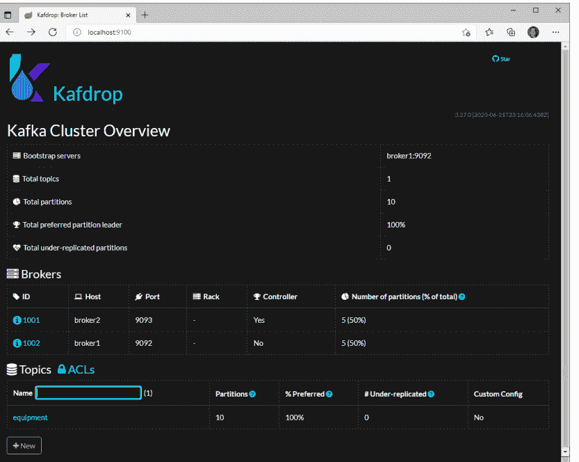

### 启用弹性和扩展性

由于 Kafka 将成为 MTAEDA 架构中生产者和消费者的主要集成点，因此考虑弹性的（resiliency）和扩展性（scalability）非常重要。在这种情况下，弹性性与 Kafka 在压力下的表现有关——例如某个代理离线、由于网络负载导致生产者与消费者之间的通信比预期的要长，或者 Zookeeper 离线。在这种背景下，扩展性与需要可用的代理或 Zookeeper 节点数量，以及可以启动多少来处理额外负载有关。

Kafka 集群的三个实现弹性的基础方面是：拥有的代理数量、创建的主题的副本因子，以及对每个代理持久化存储的使用以防止数据丢失。我们已经看到在使用 docker 时是如何增加代理数量的。在创建主题时，你可以指定主题的副本因子，它将默认为可用代理的最大数量。你不一定需要所有可用代理，但在关键主题的情况下，利用所有代理是有意义的。下面的截图显示了使用 Kafdrop 创建新主题的过程，其中指定了副本因子：

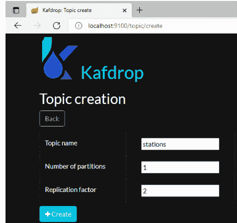

图 3.3 – 使用 Kafdrop 创建新主题


### 延伸阅读

要了解更多关于本章涵盖的主题，请参考以下资源：

- RabbitMQ vs Kafka：比较两种流行的消息中间件，由 SPEC India 编写：https://www.spec-india.com/blog/rabbitmq-vs-kafka
- EventStore 入门：https://developers.eventstore.com/server/v21.6/introduction/#getting-started
- 首页 | AMQP，由 AMQP Foundation 编写：https://amqp.org
- MQTT：物联网消息标准，由 MQTT 编写：https://mqtt.org
- 精确一次交付（Exactly Once Delivery），由 Cloud Computing Patterns 提供：https://www.cloudcomputingpatterns.org/exactly_once_delivery/
- 至少一次交付（At Least Once Delivery），由 Cloud Computing Patterns 提供：https://www.cloudcomputingpatterns.org/at_least_once_delivery/
- CloudEvents：一种通用方式描述事件数据的规范：https://cloudevents.io/
- Apache Zookeeper，由 Apache Foundation 编写：https://zookeeper.org/
- Kafdrop，由 Obsidian Dynamics 编写：https://github.com/obsidiandynamics/kafdrop

## 4 领域模型与异步事件

在为应用程序选择通信模式时，查看组件之间可能进行通信的情况是正常的。典型的 Web 应用程序遵循请求/响应模式，即向服务器发送请求，向客户端返回响应并进行恰当处理。对于希望在这些通信通道中处理高吞吐量的应用程序，标准的请求/响应模式并不是理想的，因为每个请求都会预期并等待响应，导致在仍在处理时已提交的请求产生延迟。当每秒发送数十万条消息时，由于每个请求都要等待相应的响应，应用程序将变得缓慢直至停滞。此类场景需要更具弹性的异步消息模式。

本章旨在深入探讨示例应用程序的领域模型。为此，我们将涵盖以下主题：

- 复习领域命令和事件
- 使用异步操作
- 探索 .NET 6 的新异步特性

### 领域模型与异步事件

在本章结束时，我们能够做到以下几点：

- 进一步详细地理解应用程序的领域模型，包括命令、事件、事件处理器、实体和值对象。
- 理解为什么异步设计是有益的，以及它的实现对于使应用程序支持事件驱动架构（EDA）至关重要。

### 技术要求

你可以在本书的 GitHub 仓库中找到本章的所有代码示例：
https://github.com/PacktPublishing/Implementing-Event-Driven-Microservices-Architecture-in-.NET-7/tree/main/chapter04 和
https://github.com/PacktPublishing/Implementing-Event-Driven-Microservices-Architecture-in-.NET-7/tree/main/src。

> **注意**
本章中提到的所有白皮书和其他来源的链接可以在章末的“延伸阅读”部分找到。

### 解决方案结构

整个 MTAEDA 解决方案的结构分为两个主要部分：

- 为所有领域提供基础功能的核心库
- 领域本身，使用独立的解决方案文件与其他领域隔离

核心库的设置旨在降低各个领域解决方案的复杂性，并旨在为每个领域提供可以利用非常基础的功能。这些功能包括用于领域对象的接口、与 Kafka 交互的接口和类，以及用于方便事件打包和解包的工具类。

每个领域解决方案都遵循标准格式，包括处理以下领域的项目：

- 领域逻辑
- 基础设施（数据访问和仓库）
- 基于命令的 API 端点（创建、更改或更新信息）
- 基于查询的 API 端点（仅检索信息）
- 监听器服务（事件处理器的代理）
- 测试项目

对所有解决方案使用标准布局可以确保无论你处于哪个解决方案中，定位特定的项目、文件或引用都变得更容易。例外是布局中的核心库，它包含了重要的共享对象和接口。核心库包含自定义代码，以及对外部库的引用，例如 MediatR。Mediator 是调解者模式的实现，旨在用于事件驱动架构和领域驱动设计。让我们更详细地探索核心库组件。

### 核心库复习

MTAEDA 应用程序的核心库由所有领域都可以利用的接口和具体实现组成。这些分为领域接口、基础设施接口和类以及工具类。如下表所示，有几个领域接口：

| 名称 | 描述 |
| :--- | :--- |
| IDomainAggregateRoot | 允许聚合根对象被标识（仅限装饰器）。 |
| IDomainEntity | 允许实体被标识，并要求实现一个用于领域数据的字符串字段。 |
| IDomainEvent | 实现来自 MediatR 库的 `INotification`。 |
| IDomainEventHandler | 允许领域事件被标识，并要求实现一个用于领域数据的字符串字段。实现来自 MediatR 库的 `INotificationHandler<T>`，其中 T 是一个 `INotification` 对象。允许事件处理器被标识，并要求实现 `Handle()` 方法。 |
| IDomainValueObject | 允许值对象在领域内被标识（仅限装饰器）。 |
| IRepository<T> | 泛型类型 `T` 必须是 `IDomainEntity` 对象。允许为任何仓库实现强制执行一组基础方法。 |

### 领域模型与异步事件

在基础设施方面，提供了两个接口和两个具体的 Kafka 提供者实现以支持事件的发送和接收。通常，这些提供者实现位于每个领域的基础项目中。然而，为了简单起见，它们被放在核心库中以便使用。

下表说明了 infrastructure 文件夹下的组件：

| 名称 | 描述 |
| :--- | :--- |
| IEventReader | 围绕事件的读取操作接口。 |
| IEventWriter | 围绕事件的写入操作接口。 |
| KafkaConsumer | 实现 IEventReader。一个连接到 Kafka 实例并从一个或多个处消费事件的者。 |
| KafkaProducer | 实现 IEventWriter。一个连接到 Kafka 实例并向主题发布事件的者。 |

表 4.2 – 基础设施接口和类

工具类方面，核心库只提供了一个。`EventUtil` 类提供了对解包领域事件、事件处理器和异常的方法。这有助于使用第 1 章中讨论的 CloudEvents Schema 作为所有事件的标准格式，但它仍然提供了获取原始对象并执行任何操作的方法。

> **注意**
以下图例适用于本章中的所有图。

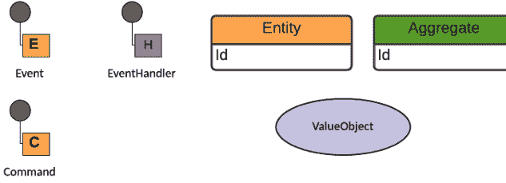

图 4.1 – 图例

### 审查领域结构和组件

现在我们理解了每个领域使用的通用结构，让我们深入每个领域的模型。我们将不仅审查每个领域的目的，还将审查每个领域内部的核心组件以及它们如何为整个应用程序提供价值。

### 设备

设备领域至关重要。如果没有手段来管理与闸机单元以及每个单元内的摄像头相关的事件，该应用程序将没有太大意义。下图显示了设备领域的领域架构：

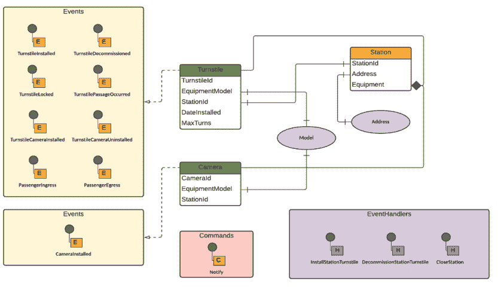

图 4.2 – 设备领域的领域架构


### 领域模型与异步事件

设备领域是应用程序的核心。许多事件是由源此领域的事件触发的。

### 聚合 (Aggregates)

设备领域利用两个聚合根对象来管理领域内的所有交互：

- * **摄像头 (Camera)**：用于跟踪与摄像头相关的基础设备信息以及相关的维护事件。它包括摄像头 ID、设备型号信息和站点 ID。
- * **闸机 (Turnstile)**：用于跟踪与闸机相关的基础设备信息以及相关的维护事件。它包括闸机 ID、设备型号信息、维护前的最大进站次数、安装日期和站点 ID。

你会发现**摄像头**和**闸机**聚合也出现在其他领域中。在某些情况下，它们关联的信息会有所不同。由于这些对象是与多个领域都相关的对象，因此这种程度的重复是很常见的。然而，它们所交互的事件和实体将归类到特定的领域中。

### 实体 (Entities)

设备领域与站点领域实体交互以帮助跟踪设备。这是一个领域实体，包含最少的站点信息（ID 和地址）以及该位置完整的设备清单。

### 事件 (Events)

设备领域内有九个核心事件。除一个外，所有事件都与**闸机**上可能发生的动作有关。与**摄像头**相关的唯一事件是 **CameraInstalled**（摄像头安装），它在 **TurnstileCameraInstalled**（闸机摄像头安装）处理后触发。**CameraInstalled** 旨在将摄像头的**型号**信息传回领域，并与**闸机**和**站点**关联。

### 事件处理器 (Event handlers)

有三个特定的事件处理器，其中两个与站点内的闸机有关（安装和退役）。还有一个用于关闭站点的事件处理器，这将导致与该站点相关的所有设备对象退役。

### 审查领域结构和组件

### 值对象 (Value objects)

对于值对象，我们有以下实体：

- 地址 (Address)：一种用于定位站点的标准地址格式。
- 型号 (Model)：与闸机、摄像头或其他类型的设备相关的设备型号信息。

现在我们对设备领域的运作有了更好的理解，让我们移动到站点领域。

### 站点 (Station)

站点领域处理与物理公共交通站直接相关的领域对象。在应用程序范围内，这更多是一个支持性领域，因为主要的交互是与每个站点的设备进行。需要识别每台设备是什么以及围绕它的一些核心数据，这就是站点领域发挥作用的地方。下图显示了站点ed的领域架构：

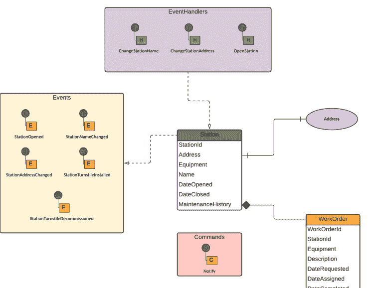

图 4.3 – 站点领域的领域架构

### 领域模型与异步事件

虽然这个领域看起来很小，但它确实服务于更大的目标，为设备、维护记录、调度以及识别在逃的潜在危险逃犯提供场所。

### 聚合 (Aggregates)

该领域的主要聚合是站点。该聚合跟踪有关站点的基础信息，包括它是否仍然开放（运行中）或关闭。它还允许调取与站点相关的工单历史。

### 实体 (Entities)

与站点关联的领域实体只有一个，即 **WorkOrder**（工单）。这是一个领域实体，包含与维护计划相关的特定工单信息。它可以适用于任何类型的设备，并捕获工单何时被创建、何时被分配以及何时完成。

### 事件 (Events)

有六个与站点相关的领域事件：

- 两个与站点信息（名称或地址）的变化有关。
- 两个事件指示站点状态的变化。
- 两个事件处理在站点内安装或退役闸机。

这些事件直接关系到下一段中列出的该领域事件处理器。

### 事件处理器 (Event handlers)

站点领域有三个事件处理器来管理与站点相关的事件，即名称、地址或状态。站点的状态指示包括活动、关闭和离线。

### 维护 (Maintenance)

维护领域处理与任何公共交通站点闸机和摄像头所需的任何维护相关的事件。虽然它不负责维护调度，但它负责发布表示需要维护的事件，反之，

### 审查领域结构和组件

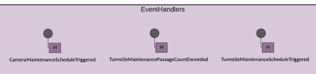
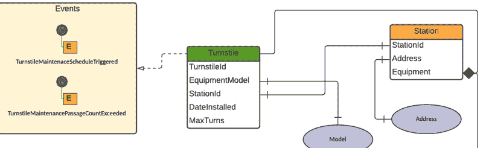
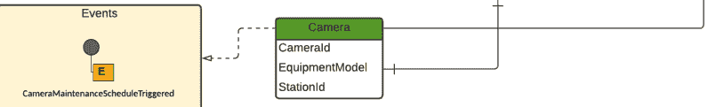
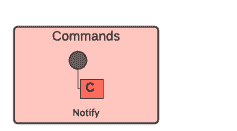

图 4.4 – 维护领域的领域架构

维护领域分为所示的对象类型，它们负责维护活动。

### 聚合 (Aggregates)

维护领域利用了所示的摄像头和闸机聚合。维护领域处理闸机的维护请求。

### 实体 (Entities)

维护领域处理的领域实体只有一个，即站点，一个跟踪站点 ID 的极简主义实体。

### 事件 (Events)

有两个事件指示维护请求，一个用于摄像头，一个用于闸机。

### 事件处理器 (Event handlers)

领域内有两个事件处理器，一个用于摄像头，一个用于闸机维护。

### 调度 (Scheduling)

调度领域处理添加、更新或删除计划维护。这些状态的变化主要从维护领域触发，也可以从设备领域触发。

### 聚合 (Aggregates)

调度领域有两个聚合根来管理调度活动。其中是 **CameraMaintenanceSchedule**（摄像头维护计划），处理与摄像头相关的任何维护记录。另一个是 **TurnstileMaintenanceSchedule**（闸机维护计划），处理与闸机相关的任何维护记录。

### 实体 (Entities)

调度领域直接处理的领域实体只有一个，即 **WorkOrder** 实体。**WorkOrder** 是一个包含维护计划相关的特定工单信息的领域实体。


### 审查领域结构与组件

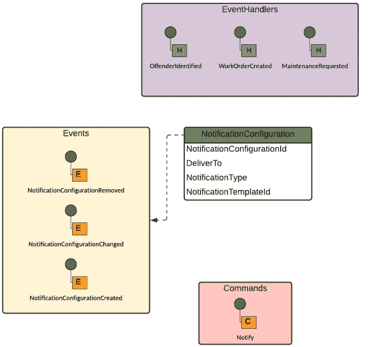

图 4.6 – 通知领域的领域架构

通知是应用程序的关键组成部分，因为许多领域在处理完某些事件后需要发送通知。让我们更详细地查看一下通知领域。

### 聚合根 (Aggregates)

通知领域内只有一个聚合根，即 **NotificationConfiguration**（通知配置）。该聚合根包含特定通知配置设置的信息。它存储了配置标识符、发送通知的地址、通知类型以及一个可选的模板标识符，用于引入模板以格式化通知正文本身。

### 事件 (Events)

该领域有三个与 NotificationConfiguration 相关的事件：一个用于创建配置，一个用于更新配置，一个用于将其移除使用。

### 事件处理器 (Event handlers)

共有三个事件处理器：

- *MaintenanceRequested*：该处理器将处理提出的维护请求，并创建一个工单（WorkOrder）以启动流程。
- *WorkOrderCreated*：在处理维护事件后，该处理器将处理工单的初始处理。
- *OffenderIdentified*：当识别领域触发事件声称在逃犯者列表中找到匹配项时，该处理器将向适当的接收者发送通知。

现在我们已经涵盖了通知领域，可以转向乘客领域（passenger domain）。

### 乘客 (Passenger)

乘客领域预留给未来使用，其中可能存储支付信息和其他程序成员信息。该领域的整体结构已经规划完成，但尚未编写任何实现代码。下面的图显示了乘客领域的领域架构：

### 审查领域结构与组件

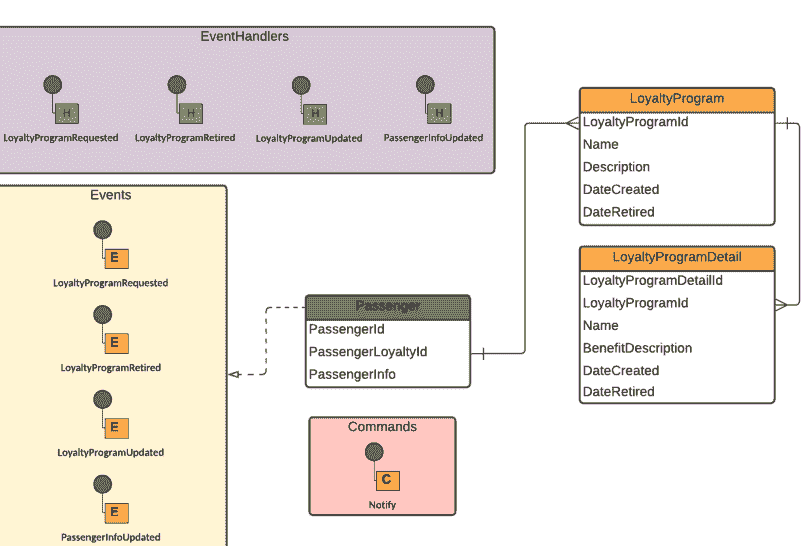

图 4.7 – 乘客领域的领域架构

虽然该领域目前在应用程序中尚未广泛使用，但它与识别领域关联，并允许未来扩展到更多面向客户的交互。

### 聚合根 (Aggregates)

乘客领域只有一个聚合根，恰是 **passenger**（乘客）。该聚合根包含了乘客的标识符以及对 **LoyaltyProgram**（忠诚计划）实体的引用。此外，还使用了独立的乘客信息结构（**PassengerInfo**）来更新乘客的基础信息。

### 事件 (Events)

有三个与忠诚计划本身相关的事件：一个用于为乘客请求新计划，一个用于更新信息，一个用于退休或关闭计划。此外，还有一个用于通过 **PassengerInfo** 对象更新乘客信息的事件。

### 事件处理器 (Event handlers)

该领域总共有四个事件处理器。其中三个处理器与事件部分提到的忠诚计划事件相关，另一个则与乘客信息的更新有关。每个处理器将在完成后触发一个通知，以告知乘客变更。

### 识别 (Identification)

识别领域专门负责获取站站摄像头捕获的图像，并根据法执法部门通缉的已知逃犯列表对其进行验证。下面的图显示了识别领域的领域架构：

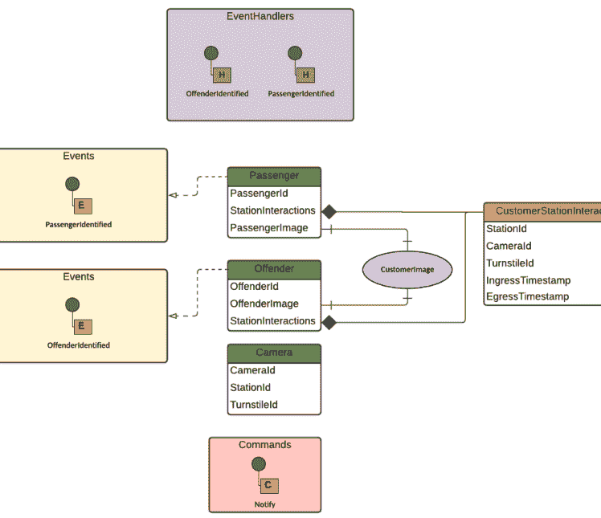

图 4.8 – 识别领域的领域架构

识别领域有一个非常明确的目的——允许识别潜在的危险逃犯，并提醒相关人员进行进一步调查。

### 聚合根 (Aggregates)

共有三个聚合根：

- * **Camera**（摄像头）：用于跟踪与执行识别的摄像头相关的基础设备信息。它只存储摄像头标识符、站点标识符和闸机标识符。
- * **Offender**（逃犯）：用于跟踪逃犯标识符、任何站内交互（进出站）以及逃犯的图像。
- * **Passenger**（乘客）：用于跟踪乘客标识符、任何站内交互（进出站）以及乘客的图像。

虽然领域内有三个聚合，但正如我们接下来看到的，只有一个显式定义的实体。

### 实体 (Entities)

识别领域唯一的领域实体是 **CustomerStationInteraction**（客户站内交互）实体。它记录了站内特定交互的信息，例如使用的闸机以及进站（ingress）或出站（egress）的时间戳。虽然对于单个站点两个时间戳都有值，但更常见的情况是根据乘客的行程，其中一个或另一个会有值。

### 事件 (Events)

乘客领域只产生两个事件。一个是乘客识别，另一个是逃犯识别。当摄像头与面部识别服务交互以识别所选列表上的逃犯时，会触发逃犯识别事件。

### 事件处理器 (Event handlers)

正如乘客领域只有两个事件一样，它也有两个事件处理器。每个事件处理器的匹配将使用 **CustomerStationInteraction** 实体创建一个识别记录，在涉及逃犯的情况下，还会发送通知。

> **重要说明**
> 请花时间审查每个领域解决方案的源代码，以及主存储库 `src` 文件夹中的共享代码库 (MTAEDA.sln)。

领域模型与异步事件

至此，我们已经查看了每个领域的细节，了解了它们是如何运行的以及它们如何与彼此的事件交互。正如我们在本书中所学到的，这些事件不需要立即响应。现在，让我们来看看异步操作。

### 使用异步操作

在应用程序中实现同步操作有许多用途。但在某些时刻，当应用程序负载增加时，同步操作将无法扩展。这就是异步操作用武之地。这些操作允许在不同的上下文中进行多次执行，而同步操作会在调用的操作完成之前阻塞其他操作的执行。


使用异步操作

异步方法在利用可用资源方面更加高效。运行时间较的操作可以使用 C# 中的 `yield` 结构来继续执行，而其他操作在仍有可用资源时可以被调用。当与并行执行等概念结合时，异步执行可以在保持应用程序响应能力的同时同时，促进应用程序的进一步扩展。

### 异步并行处理

在 .NET 6 中，引入了一个名为 `Parallel.ForEachAsync` 的新结构。熟悉并行执行概念的人可能对 `Parallel.ForEach` 方法有所了解。这个新的异步方法允许你在启用异步执行的同时进行并行执行。

让我们来看一个控制台程序中实现 `Parallel.ForEachAsync` 的示例，该程序有指向 Kafka 中不同主题的多个消费者。在这种情况下，我们将使用上述方法消费三个主题，允许它们都并行运行并在事件可用时进行消费。

我们将从开始，使用一个顶层程序从 `appsettings.json` 文件中拉取配置信息，并为配置中列出的每个主题名称创建一个消费者。通过调用 `ConfigurationBuilder` 获取信息，从而解析 `appsettings.json` 文件。主题列表以管道符分隔的字符串存储，在拆分该字符串后，将执行初始循环来设置每个消费者并将其添加到消费者对象列表中。设置每个消费者的代码如下：

```csharp
var consumer = new ConsumerBuilder<int, string>{
    new ConsumerConfig{
        GroupId = config["ConsumerConfig:GroupId"],
        BootstrapServers = 
        config["ConsumerConfig:BootstrapServers"],
        AllowAutoCreateTopics = true,
    }
}).Build();
consumer.Subscribe(topic);
consumerList.Add(consumer);
```

我们还将设置 `Parallel.ForEachAsync` 循环的主体，以接收消费者列表、指定并行选项的对象以及一个将异步运行的函数。该函数也将对消费者进行操作，并传递 `CancellationToken` 以便在收到取消请求时关闭消费者：

```csharp
await Parallel.ForEachAsync(consumerList, options, async (s, t)
=> {
  if (t.IsCancellationRequested)
  {
    s.Close();
  }
  else
  {
    await Task.Factory.StartNew(() => {
      Console.WriteLine("Consuming {s.Subscription.First()}..");
      s.Consume(t);
    });
  }
});
```

当你在调试代码时，请确保通过从第 3 章“消息中间件”的代码文件夹运行 `docker compose up` 来运行 Kafka 实例。理想情况下，你可以添加代码来调用任何正在消费的主题的事件程序。尝试实验向列表中添加更多主题，或允许代码块根据事件的元数据解析事件程序。

我们已经涵盖了大量内容，不仅涉及整个领域模型，还涉及如何利用异步操作利用并行执行。随着我们继续开发示例应用程序，这些功能将变得更加普遍，理解如何以及何时利用它们将是有益益的。

### 总结

在本章中，我们更深入地审视了 MTAEDA 中的每个领域。这包括对每个领域的聚合根、事件、事件处理程序、实体等进行了深入研究。对每个领域有这种更全面的理解，不仅有助于理解应用程序组件是如何协同工作的，还有助于理解主题事件如何被多个一个领域消费。

我们还研究了如何使用异步操作。我们还学习了 `Parallel.ForEachAsync` 方法以及如何实现它。通过示例代码，你应该能够尝试不同的配置和执行模式。

在下一章中，我们将深入探讨为应用程序设置完整本地开发环境的细节。这包括配置你的 IDE，以及确保本地有可用的测试基础设施进行测试。

### 问题

回答以下问题以测试你对本章知识的掌握：

- 1. 哪个领域负责管理执行维护而创建的工作订单详情？

- 2. 使用协调者模式（mediator pattern）的主要原因是什么？示例应用程序是如何实现它的？

- 3. 异步编程意味着多线程执行吗？

### 进一步阅读

要了解更多关于本章涵盖的主题，请查看以下资源：

- *MediatR GitHub 仓库*，Jimmy Bogard 编写，访问：https://github.com/jbogard/MediatR。
- *MediatR Wiki*，Jimmy Bogard 编写，访问：https://github.com/jbogard/MediatR/wiki。
- *C#11 新特性*，访问：https://docs.microsoft.com/en-us/dotnet/csharp/whats-new/csharp-11。
- *异步编程*，访问：https://docs.microsoft.com/en-us/dotnet/csharp/async。
- *AJAX 简介*，W3Schools 编写，访问：https://www.w3schools.com/xml/ajax_intro.asp。
- *委托（C# 编程指南）*，Microsoft 编写，访问：https://docs.microsoft.com/en-us/dotnet/csharp/programming-guide/delegates。
- *Task 异步编程模型*，访问：https://docs.microsoft.com/en-us/csharp/programming-guide/concepts/async/task-asynchronous-programming-model。
- *.NET 6 中的 Parallel.ForEachAsync*，Scott Hanselman 编写，访问：https://www.hanselman.com/blog/parallel-foreachasync-in-net-6。
- *Parallel.ForEachAsync 方法*，访问：https://docs.microsoft.com/en-us/dotnet/api/system.tasks.parallelasync。

## 第二部分：微服务的测试与部署

此部分将回顾本地环境设置、容器化、测试和可观测性的各种组件。此部分包含以下章节：

- 第 5 章：容器化与本地环境设置
- 第 6 章：测试与调试
- 第 7 章：服务可观测性
- 第 8 章：CI/CD 流水线
- 第 9 章：故障注入与混沌测试

## 容器化与本地环境设置

到目前为止，我们已经看到模块化设计（实现单一责任原则 SRP 的服务）可以迅速带来许多益处。建立一种可以跨越开发环境并最终到达生产环境的使用模式。在本章中，我们将进行以下操作：

- 回顾容器化基础
- 设置本地环境
- 使用 Dockerfile 构建和运行

在本章结束时，你将能够：

- 解释隔离有助于进一步开发、测试和部署。
- 设置本地开发环境以构建 Docker 镜像并运行 Docker 容器。
- 创建 Dockerfile，识别顺序与多阶段执行的区别，并在镜像创建过程中构建应用程序。

### 技术要求

你可以在 GitHub 对应的文件夹中找到本章所有的示例代码：https://github.com/PacktPublishing/Implementing-Event-driven-Microservices-Architecture-in-.NET7/tree/main/src

> 注意：白皮书和其他资源的链接位于章节末尾的“进一步阅读”部分。

### 回顾容器化基础

假设你已经具有了一些 Docker 经验，但值得花时间回顾一下操作容器的基础知识。我们首先涵盖隔离、移植性、可重用、分层和抽象的基础知识。

关于隔离，Docker 允许在容器范围内专注于一个进程。在 Docker 的世界中，容器是不可变的，它们从镜像创建，镜像可以直接从从注册表中获取，也可以从为特定需求定制的私有注册表中获取。这种不可变性的概念允许隔离局限于容器所需的进程，而不是任何外部影响或变动。并不是说外部影响不能修改 Docker 容器内部的内容。不可变性体现在容器重启时，在连接期间修改的所有信息都会被删除。


### 复习容器化基础知识

这些内容本质上依赖于操作系统。基于 Windows 的依赖项的一个示例可能是特定程序对 Win32 DLL 的依赖。对于基于语言的服务和可执行文件，如果该语言是真正的跨平台语言（如 .NET、Python、Java 等），那么容器运行在什么操作系统上并不重要。

可重用性的概念与分层理念交织在一起。其核心思想是：根据某些因素（例如使用的编排引擎、该编排引擎内的资源以及系统的整体需求），一个镜像可以跨 N 个容器。因此，启动运行相同可执行文件或服务的多个容器只需要一个镜像。此外，在构建镜像时，Docker 更新镜像的方式并不存在可重用性的概念。Docker 使用了基于校验和（checksums）标识的文件系统分层，这减少了根据常用操作创建唯一文件系统还原点的需求。当按顺序查看时，文件系统似乎具有不同的层。

例如，Docker 优化系统的一种方式是针对基础镜像使用诸如 Ubuntu 的基础系统，例如，确保容器运行所需的最少要求都已安装并捕获为校验和。当你基于其中一个现有的镜像构建新镜像时，这些校验和将作为基础镜像的一部分传递过来，消除了你安装运行所需基础要求的需求。现在，你将根据语言或其他特性为你的应用程序安装任何特定内容。配置中添加的每行代码都会创建一个新的校验和，随后创建一个新的文件系统检查点。

抽象是另一个可以从根本上改变你编写软件组件的领域。通过容器，你可以从运行你想要的服务或程序的主要关注点中抽象出大量的技术复杂性。这包括无需担心底层操作系统、同一宿主机上安装的其他项目。事实上，被认为最佳实践的是限制运行容器的身份范围，以防止使用提权权限的潜在攻击。在许多情况下，Docker 镜像将默认使用 root 账户执行，这提供了过多的控制权。在执行容器时创建一个并使用服务主体系（service principal）或用户，有助于防止此类攻击。

这些话题本身可能非常庞大，且远超本书的范畴。然而，理解这些基础知识如何让你作为开发者从中受益，并将让你能够更多地关注绝对需要的部分，而减少对你可能需要的其他辅助操作细节的关注。

### 开发益处

在本地开发方面，可移植性和可重用性基础是非常重要的。无论使用 Docker Compose、minikube 还是其他本地运行 Docker 容器的方法，在容器内部执行的进程在任何这些方法中都是一致的。这意味着在不同操作系统上工作的开发者在技术上可以运行相同的容器，无论开发者选择哪种操作系统，都能提供无缝的体验。

使用容器对开发生命周期有益的方式之一是，现在有大量的工具允许你在不离开桌面的情况下调试容器。在过去的几年里，来自 Docker、微软以及其他开源伙伴的工具使得集成开发环境（IDE）在帮助构建和调试基于容器的应用程序方面更加高效。这些工具减少了开发者的摩擦，因为调试看起来将变得自然得多，而无需连接两个不同的进程或命令行工具来调试特定的函数或代码段。

开发生命周期的另一个益处体现在与其它领域团队协作构建大型平台或应用的团队中。为了在本地执行单元测试和集成测试以验证孤立领域中所做的更改，从其他领域团队拉取镜像，然后从这些镜像创建容器，提供了一种利用稳定代码进行测试的更简单的方法。

在回顾了软件开发生命周期中使用容器化的原则和益处后，我们现在可以考虑让我们的开发环境充分利用这些益处。

### 设置本地环境

开发环境是实现多次迭代、缩短反馈循环以及在开发生命周期期间封装安全最佳实践的关键方面。传统上，开发者可能会在物理工作站上设置所有依赖项、首选库、命令行工具以及 IDE。虽然可以这样做，但技术的进步（也利用了容器化原理）也让现代开发者能够利用托管在云端的可重用环境。

本节将介绍旨在实现重复且可靠的开发设置的场景。我们将首先查看本地工作站环境的配置，然后通过 GitHub Codespaces 和 Visual Studio Code 的 Dev Containers 等工具查看虚拟开发环境的世界。

### 使用 Docker 创建本地基础设施

正如我们在之前的章节中看到的，使用 Docker 和 Docker Compose 可以通过提供你在云端看到的基础设施的本地表示来加速你的开发时间。但不同的实现方式呢，例如 Kubernetes 集群？让我们先看看如何使用 Docker Compose 运行堆栈，然后我们将转向利用 Kubernetes 构建基础设施。

### 使用 Docker Compose 启动基础设施

我们之前做的工作有一点是，它在我们的场景中是完全可重用的。开始开始，将 `docker-compose.yml` 文件从源文件复制到 `src` 目录下的任何领域解决方案文件夹中。这将为你提供一个基础的 Kafka 实现，你可以在调试服务代码时连接到它。

为了本演示说明，我们将使用 MTAEDA . solution 来说明放置文件的位置，并使用 **Visual Studio** 来说明如何触发 Docker 容器的启动。

开始，你的领域解决方案根文件夹应该像**图 5.1**所示，其中 `docker-compose.yml` 文件已复制进去：


> 图 5.1 - 添加 docker-compose.yml 后的文件结构

如果你在使用 Visual Studio 并且安装了 Docker 工具，可以对没有关联 Dockerfile 的项目点击右键，点击上下文菜单，转到 **添加 | Docker 支持...** 以启用你的项目。你会注意到生成的 Dockerfile 内部包含多个 `FROM` 指令，这指示了一个名为多阶段 Dockerfile（multi-stage Dockerfiles）的概念。我们将在本章节稍后检查多阶段 Dockerfile。作为参考，**图 5.2** 展示了 **Docker 支持...** 菜单项的位置：

### 84 容器化与本地环境设置


图 5.2 - Visual Studio 中显示 Docker 支持选项的上下文菜单

**Docker 支持...** 菜单项之后是另一个项目 **容器编排支持...**。这将为 Docker Compose 提供编排支持，但这并不意味着你可以为其他编排引擎添加支持。我们花时间探索整合这些编排引擎之一——**Kubernetes**。

### 使用 Kubernetes 启动基础设施

在云应用世界中，Kubernetes 是流行的部署目标。Kubernetes 作为多个组件和/微服务的编排层，提供了弹性和扩展性机制。虽然这是运行微服务工作负载的流行方式，但并不总是容易设置以方便开发生命周期。像 **minikube** 这样的工具提供了一种在你的本地机器上设置轻量级 Kubernetes 集群的方法，允许你测试部署是如何运行的。如果你在 Windows 或 macOS 上运行 Docker Desktop，有一个选项可以启用 Kubernetes 服务在 Docker 启动时自动启动。这也可以为为你提供一种在本地测试编排和部署的方法。


### 设置本地环境

然而，拥有一个部署目标只是战斗的一半。你仍然需要一种创建符合 Kubernetes 规范的部署的方法，以便让你的代码在该环境中运行。你可以阅读该平台的文档并从头开始编写清单。你也可以使用如 Helm 等工具，使用标准化的模板包创建捆绑部署，但这仍然需要你投入工作，以确保所有需要运行的服务都已考虑在内。由于我们在解决方案中已经有一个 compose 文件，如果能利用它而不是重复劳动将是最好的。幸运的是，存在一些工具可以将 compose 文件转换为 Kubernetes 部署。

其中一个工具名为 compose。此工具将读取现有的 compose 文件，并将其转换为 Kubernetes所需的适当 YAML 模板，以便在集群中创建你的容器（Containers）和内部服务（Services）。一旦你安装了合适的本地集群，就可以通过访问 https://compose.io/installation/ 参考你操作系统的安装说明来安装 compose。运行该工具非常简单，在命令提示符或控制窗口中输入以下内容即可：

```
compose convert /path/to/docker-compose.yml
```

这将为你 compose 文件中的每个 Service 创建两个文件——一个用于 Service 本，另一个用于 Deployment（部署）。你可以将所有 YAML 文件移动到解决方案级下的 compose 目录中，以便在一个处跟踪它们，也可以将 Service 和 Deployment 清单放在每个 Service 项目目录下的 compose 目录中。花一点时间检查生成的 YAML 文件，并将其与 compose 文件中的信息进行比较。你会发现，端口映射将出现在 service YAML 中，而其他内容将出现在 deployment YAML 中。

生成 YAML 文件后，你将想要测试它们以确保其功能正常。如果你是第一次使用 Kubernetes，系统将选择 cluster 作为当前上下文（context）。如果你以前连接过其他集群，请务必在测试 YAML 文件之前，将上下文设置为本地实例（通常称为 docker-desktop）。在设置好上下文 之后，运行以下命令在你的本地集群中创建一个新的命名空间（namespace），并应用 zookeeper 和 broker 服务的 Deployment 和文件：

```
kubectl create namespace kafka
kubectl apply -f /compose/zookeeper-deployment.yml -n kafka
kubectl apply -f /compose/zookeeper-service.yml -n kafka
kubectl apply -f /compose/broker-1-deployment.yml -n kafka
```

### 容器化与本地环境搭建

| kafka |
| :--- |
| kubectl apply -f ./kompose/broker1-service.yml -n kafka |
| kubectl apply -f ./kompose/broker2-deployment.yml -n kafka |
| kubectl apply -f ./kompose/broker2-service.yml -n kafka |

你可以通过命令行（kubectl logs -n equipment deployment/zookeeper）检查 Zookeeper Pod 的日志，以确保 Zookeeper 正在运行且没有出现问题。可以尝试其他生成的 Deployments 和 Services，以更熟悉数据 基础设施的构成。

在本章中，我们专注于为领域服务的开发设置本地环境支持，包括如何启用容器编排支持。接下来，我们将通过使用 GitHub Codespaces 另一种一致管理环境的替代方法。

### 利用 GitHub Codespaces 和 Dev Containers

GitHub 是当今领先的开源协作平台。有超过 7300 万开发者使用该平台，涉及超过 400 万家组织。自 2018 年被微软收购以来，GitHub 继续开发创新功能，以实现更快的开发周期并消除协作障碍。其中一项创新是 GitHub Codespaces，它为任何使用任何编程语言的开发者提供免费的云端开发环境。这可以作为工作站或笔记本电脑设置和脚本化本地开发环境的方便替代方案。让我们检查一下。

### GitHub Codespaces 和在线开发

由于 Codespaces 是 GitHub 平台的一部分，一个显而易见的担忧在于需要互联网连接。可用性和带宽会随地理区域而异，使用在线开发环境可能没有本地环境那么有利。但在此情况下，它能够在云端运行你的环境，且无需对环境本身承担维护负担，这可能非常有吸引力。

设置新的 Codespace 非常简单。通过遵循 Codespaces Quickstart（链接请参见本章的“延伸阅读”部分）中的指令，你可以在几分钟内启动并运行一个新的 Codespace。浏览器版的 Visual Studio Code。你不仅可以安装扩展并让它们在会话之间持久，还可以直接从浏览器运行和调试你的应用程序。

使用 Equipment 领域进行此测试，使用 Quickstart 链接创建一个新的 Codespace。一旦 Codespace 创建完成，你将在新标签页中看到你的编辑器，使用以下终端导航到仓库 src 目录下的解决方案文件夹：

```
cd src/MTAEDA.Equipment
```

```
cd MTAEDA.Equipment.Query.API
```

当你处于想要测试的服务的目录时，只需在终端中输入 `dotnet`。这将启动服务的恢复（restore）、构建（build）并最终运行。一旦服务启动，你将看到一个类似于图 5.3 的所示弹出窗口。点击“Open in Browser”将打开一个带有该服务基础 URL 的新标签，允许你导航到 Swagger 页面（如果相关）或从浏览器编辑器执行另一个验证测试。


图 5.3 – Codespaces 中的应用程序弹出窗口

使用 Codespaces 的一个缺点是它仅支持 Visual Studio。如果你不使用它，将受到很大限制。这就是 Dev Containers 发挥用场的地方。

### 作为环境的 Dev Containers

使用 Dev Containers 进行本地开发是一种集中封装一切的方便方法。创建 Codespace 时，根目录下会出现一个 .devcontainer 文件夹。该目录可以被修改以定制每个容器。你可以使用 devcontainer.json 文件定义某些语言设置，也可以为环境包含一个 Dockerfile。

现在我们更好地理解了 Dockerfile 如何工作，让我们深入了解服务。

### 使用 Dockerfile 在本地构建和运行

在本章早些时候，我们利用 Visual Studio 插件为每个服务生成了 Dockerfile。正如所提到的，生成的文件包含多个 FROM 指令，允许 Docker 在构建时使用特定镜像。在某些情况下，Docker 可以非常简单——顺序地安装或配置镜像的方面。编写 Dockerfile 时应遵循的一个良好规则是查看构建过程中需要发生什么。例如，在构建最终将运行编译程序的镜像时，在大多数情况下，.NET 在多阶段文件中是分离的。这样做的原因很简单——它允许你将应用程序的构建与运行所需的打包和配置分开。

以命令行 API 为例。生成的 Dockerfile 有四个阶段，其中利用了两个不同的基础镜像。其目的是确保使用优化的运行时镜像来构建服务。这为每个相关阶段提供了分离的方法。在构建运行特定工作负载的镜像时，你可能选择使用顺序排列的 Dockerfile，因为你可能不需要在构建阶段保持它们分离。花一点时间检查早些生成的三个服务的 Dockerfile。

现在我们对 Dockerfile 的工作有了更好的理解，让我们进入下一步：将服务连接到我们的 Docker Compose 文件。

# 向 Docker Compose 文件添加服务我们将我们将 Equipment 领域服务在 compose 文件中定义服务。在文件末尾，保持与其他服务相同的缩进，首先通过添加三个新的服务定义，如下代码块所示：

```
query-service:
```


```yaml
image: ''
query-service-db:
  image: ''
command-service:
  image: ''
  event-listener:
  image: ''
```

现在，我们将保持镜像不变，并开始为每个服务添加一些细节。至少，我们需要指定每个服务暴露了哪些端口。这有助于服务发现找到不同的内部服务，并允许将外部工具挂载到您的服务上。例如，在查询服务数据库上暴露端口 1433，可以允许您在需要时使用 SQL Server Management Studio 连接到数据库。

在某些情况下，服务具有依赖项，这些项必须在服务启动之前运行。命令服务（command service）和监听器（listener）都需要至少一个可用的消息代理（broker），否则服务将无法正常运行。查询服务依赖于数据库服务。使用 `depends_on` 属性允许我们指定 Docker Compose 在启动领域服务之前，哪些服务必须处于运行状态。

此外，还需要设置环境变量，这要求服务定义中存在 `environment` 属性。在我们的示例中，只有一个服务需要环境变量——数据库服务。SQL Server 镜像需要最终用户许可协议（EULA）的值为 `Y`，否则容器将不会启动。此外，必须为系统管理员（sa）账户提供值，该值也是通过环境变量传递的。

`hostname` 和 `container_name` 属性不是必须的，但它们为容器的命名提供了灵活性，包括在客户端内部的命名，以及 Docker 在创建容器时的命名。我们将填写一些易于识别的名称，以便在 Docker UI 或通过命令行识别容器。

在服务定义中添加这些字段后，以下代码块概述了这些属性在每个服务下的排列方式。由于 API 服务以及监听器都运行在默认端口上，我们将默认端口映射到每个服务的唯一端口号。接下来的代码块也对此：

```yaml
query-service:
  image: ''
```

### 容器化与本地环境搭建

```yaml
depends_on:
  - query-service-db
ports:
  - 8081:80
hostname: equip-cmd-svc
container_name: equip-cmd-svc
query-service-db:
  image: mcr.microsoft.com/mssql/server:2019-latest
ports:
  - 1433:1433
hostname: equip-event-db
container_name: equip-event-db
environment:
  ACCEPT_EULA: 'Y'
  SA_PASSWORD: $ADMIN_PASSWORD
command-service:
  image: ''
depends_on:
  - broker1
ports:
  - 8082:80
hostname: equip-cmd-svc
container_name: equip-cmd-svc
event-listener:
  image: ''
depends_on:
  - broker1
ports:
  - 8083:80
hostname: equip-cmd-svc
container_name: equip-cmd-svc
```

你还会注意到 sa 密码的变量是 `$ADMIN_PASSWORD`。在启动容器之前，将其设置为合适的值是非常重要的。

### 使用 Dockerfile 在本地构建和运行 91

如果你正在使用 Linux 或 macOS，请创建一个你可以记住的密码，用于测试数据库，并运行以下命令：

```bash
export ADMIN_PASSWORD=<你的密码值>
```

当你通过 Docker Compose 发出启动容器的命令时，该环境变量将在构建过程中被使用，用于设置数据库服务的系统管理员密码。

最后，让我们使用 `context` 属性将领域服务的每个镜像指向其各自的目录。这将允许 Docker Compose 根据每个服务的 Dockerfile 路径来构建镜像。将 `image` 属性更改 `build` 属性，并通过删除冒号后的单引号来编辑该行。在放置 `context` 属性下方添加新行。例如，命令 API 可能如下所示：

```yaml
build:
  context: ../MTAEDA.Equipment.API
```

通过指向命令 API 的目录，Docker Compose 将自动在该目录中查找 Dockerfile 以构建服务的镜像。对查询服务和监听器重复此过程。你的镜像块应该看起来如下：

```yaml
command-service:
  build:
    context: ../MTAEDA.Equipment.API
...
query-service:
  build:
    context: ../MTAEDA.Equipment.Query.API
...
event-listener:
  build:
    context: ../MTAEDA.Equipment.Listener
```

通过运行 `docker compose build` 然后运行 `docker compose up` 来测试新配置。你应该看到服务在适当的地方进行构建（我们的领域服务），并在需要的地方拉取镜像。

在本节中，我们介绍了了单阶段和多阶段 Dockerfile 区别，以及如何将 Dockerfile 和相关服务集成到 Docker Compose 文件中供本地使用。

### 总结

在本章中，我们查看了设置开发环境的方法。首先，我们查看了计算机上的本地环境，学习了如何使用 Docker Compose 以及 Kubernetes 搭建基础设施。之后，我们研究了使用 GitHub 和 Visual Studio Code 提供的工具使用在线和便携环境。我们探索了如何为服务项目生成 Dockerfile，以及如何判断使用多阶段 Dockerfile 是否合理。利用这些新知识，你已经具备构建 Dockerfile 以从服务项目创建镜像，并为镜像构建添加层以处理特定需求的能力。最后，我们将服务添加到 Docker Compose 文件中，并在单一栈中启动了这一切。

在下一章中，我们将对设置好的环境进行测试，通过运行、调试和测试这些服务。

### 问题

- 为什么使用 Kubernetes 而不是 Docker Compose 作为基础设施和服务的调度器？
- 容器化的哪些基本原理可以提高开发体验？
- Docker Compose 文件中的 `depends_on` 指令有何意义？
- 使用 GitHub Codespaces 作为开发环境有哪些限制？
- Kafka 和数据库服务的启动方式与领域服务有何不同？

### 延伸阅读

- Docker Compose 概述由 Docker 提供访问 https://docs.docker.com/compose/
- Kompose - 从 Docker Compose 到 Kubernetes 由 Kompose 提供访问 https://kompose.io/
- GitHub Codespaces 快速上手由 GitHub 提供访问 https://docs.github.com/en/codespaces/getting-started/quickstart
- Codespaces 深度解析由 GitHub 提供访问 https://docs.github.com/en/codespaces/getting-started/deep-dive


在本章中我们将涵盖以下主题：

- 编排与容器
- 容器中的调试
- 针对容器的测试

在本章结束时，你将能够编排完成完整本地运行环境所需的所有组件，包括我们正在积极编写的组件。你还将学习如何连接并调试运行在容器中的代码，以及如何针对基于容器的微服务执行功能测试和负载测试。

### 技术要求

对于本章，你将位于 GitHub 上的源代码，地址为：https://github.com/PacketPublishing/Implementing-Event-Driven-Microservices-Architecture-in-.NET-7/tree/main/chapter06。

我们还将使用 Postman。如果你以前没有使用过 Postman，但熟悉如何使用 `curl` 或 `Invoke-WebRequest` 发起 API 请求，那么开始使用它应该不会遇到问题。你可以从 http://getpostman.com/ 免费下载桌面版本。

我们将使用的另一个简单但有效的开源工具是 JMeter，它由 Apache 基金会管理维护。你可以从 https://jmeter.apache.org/ 下载它。

### 配置编排与容器

我们已经开始使用容器技术对应用程序的组件进行编排了。我们在之前的章节中探索过的 `docker-compose .yml` 文件定义了我们需要的支持容器及其配置。当我们使用此文件执行 `docker-compose` 时，我们正在通过在 Docker 中启动特定配置的容器来对依赖资源进行编排。

下一步是将 MTAEDA 微服务添加到此编排定义中，这样我们就可以高效且一致地开发代码了。

## 万物皆代码 (Eac)

让我们先验证一下为什么我们想要继续使用编排方法来支持 EDA 开发。我相信你至少知道 DevOps 的基础知识！（我指的是这种实践，而不是微软的服务）。到目前为止，你可能已经听说过或用过 GitOps。如果你还没有用过——不要担心。在这两种实践的核心，你将简单发现用于描述运行工作负载的每个元素的代码。

这正是我们打算为这个应用程序开发环境所做的。

作为开发者，当我们克隆应用程序时，我们希望确保所需的所有配置都在同一个基准中。作为运营团队，我们希望确保能够交付一个让开发者开发的应用程序成功运行并执行的环境。配置代码的质量变得与应用程序代码本身一样重要。

如果应用程序的所有内容（包括基础设施需求）都定义在代码中，我们将在从以下方面受益：

- 更快的环境配置
- 更高的可靠性
- 一致的测试
- 依赖关系的透明度
- 更易的可移植性

对于本书，我们将关注开发环境的编排，以便利用更快的环境配置。我们必须能够在支持持续更改和调试的同时，高效地启动所有应用程序组件。

### 创建容器镜像

我们将创建一个配置文件，描述容器应如何托管生产者服务和消费者服务的应用程序代码。为了实现这一目标，我们将为每个服务创建一个 `Dockerfile`，并使用 Docker 命令行界面来构建并启动这些镜像。

幸运的是，Visual Studio 可以为我们处理这大部分工作。

## 微服务的本地化测试与调试

在消费者项目的右键菜单上，选择“添加... (Add...)”，然后选择“Docker 支持... (Docker Support...)”。

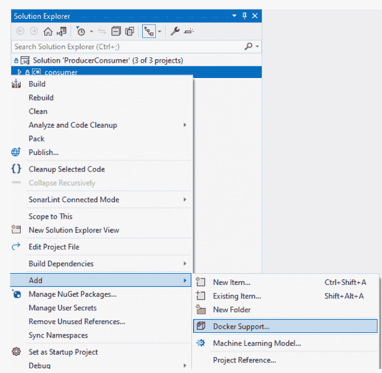

图 6.1 向项目添加 Docker 支持

在下一个弹出窗口中，选择 Linux 作为目标操作系统。Visual Studio 对项目进行了简单但有效的更改。该文件会自动创建，内容包含以 Release 模式构建代码并将其推送到准备就绪的最终容器镜像。让我们进一步详细探索一下：

```
FROM mcr.microsoft.com/dotnet/runtime:7.0 AS base
WORKDIR /app
```

```
FROM mcr.microsoft.com/dotnet/sdk:7.0 AS build
WORKDIR /src
COPY ["consumer/consumer.csproj", "consumer/"]
RUN dotnet restore "consumer/consumer.csproj"
```

### 配置编排与容器

```
COPY . .
WORKDIR "/src/consumer"
RUN dotnet build "consumer.csproj" -c Release -o /app/build
```

```
FROM base AS final
WORKDIR /app
COPY --from=publish /app/publish .
ENTRYPOINT ["dotnet", "consumer.dll"]
```

第一条命令指向名为 `dotnet/runtime:7.0` 的微软容器镜像，我们将其别命名为 `base`。这是一个轻量级的 Linux 版本，包含了运行预编译的 .NET 7.0 应用程序所需的所有安装。它还设置了镜像中的当前工作目录为 `/app`，这将是定义定义之后编译的可执行文件的目标。

在将应用程序文件复制到该目标之前，我们必须编译代码并发布它。为了确保我们不依赖于本地机器的任何特定构建，构建操作也是创建过程的一部分在容器中执行的。

下一节从 `FROM` 命令开始，指向 `dotnet/sdk:7.0` 镜像，并通过别名创建一个基于微软镜像的新独立镜像，该镜像包含了构建 .NET Core 6.0 应用程序所需的所有安装。值得注意的是，此镜像按比例比运行时镜像大，因此不是作为最终发布镜像的理想基础。

随后的命令行行针对构建镜像复制源文件、恢复依赖关系，并构建和发布代码到 `/app/publish` 目录。

带有 `LAST FROM` 命令的最后部分从构建镜像中获取已发布的（编译的）文件并将其放置在更轻量级的镜像上。然后它为容器运行时提供了 `ENTRYPOINT`。

中间构建镜像是不持久的，因此不会给容器镜像增加开销。

## 微服务的本地化测试与调试

除了为我们创建 `Dockerfile` 之外，Visual Studio 还在项目文件中添加了包引用和针对目标操作系统的属性。你可以在 `.csproj` 文件中看到这些更改。

最后，Visual Studio 在 `Properties` 下的 `launchSettings.json` 文件中添加了名为 Docker 的新启动配置文件。

我们现在准备好作为容器构建并运行消费者应用程序。这不是我们将手动执行的操作，但在这一阶段，这将有助于理解创建镜像。

在解决方案文件夹中打开新的命令提示符，运行以下命令：

```
docker build -f consumer\Dockerfile -t consumer:latest
docker run -d consumer:latest
```

运行这些命令后，你将能够按照之前描述构建镜像，并获得基于该镜像的运行容器。

通过点击“视图 (View)... 其他窗口 (Other Windows)... 容器 (Containers)”打开 Visual Studio 容器窗口。在这里你可以查看运行的容器并检查输出日志。

不要担心容器日志显示错误。我们尚未创建生产者容器，也没有与现有的 `docker-compose.yml` 进行编排。

此时，你应该对生产者项目重复本节中的所有步骤。在每一步中，只需将对消费者的引用替换为生产者。完成后，你的解决方案应该有两个独立的 `Dockerfile`，分别位于各自的项目文件夹中，并且每个镜像都成功构建，如下：

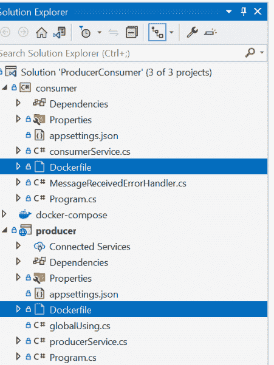

图 6.2 显示每个应用对应 Dockerfile 的解决方案结构

### 容器中的调试

现在我们已经有了容器镜像，需要关注如何在这些容器内部调试我们的代码。当我们编排许多容器（包括服务容器）时，我们将保留在类生产环境中断点和单步执行代码的能力。

容器镜像可以根据需要启动以运行微服务。然而，产生一个内部构建并发布发布代码的新 Docker 镜像并无法提供我们寻找的调试功能！

为了克服这个问题，我们需要在连接调试器的情况下，通过使用 Debug 构建，快速动态地在容器内部运行未发布的开发代码。我们必须理解 Visual Studio 如何修改容器镜像以支持调试，以及它是如何融入整体组件的编排中的。


### 调试单个微服务

虽然 Visual Studio 在设置发布构建的 Dockerfile 方面表现出色，但在容器中调试代码时，它并不会使用整个定义。

项目中添加的额外配置恰恰提供了我们所需的快速且动态的环境。在项目启动配置文件下，你应该能看到一个由 Visual Studio 添加的名为 Docker 的新配置。

在我们尝试理解 Visual Studio 如何在容器中进行调试之前，我们首先想要确认调试源。选择此新的启动配置并按下调试按钮（或按击 F5）。

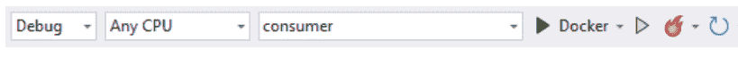

在容器窗口中，你将看到一个名为 consumer 的正在运行的容器，它是基于 consumer:dev 镜像的。如果你进一步探索，如预期的那样，你会看到运行镜像与 Dockerfile 定义之间存在显著差异。

Visual Studio 创建了一个不同的镜像，包含一系列映射的卷（包括一个指向本地解决方案文件夹的卷），并配置且附加了远程调试器。

你可以在任何时候停止调试会话，即使应用程序进程已停止，容器也将继续运行。你可以像在任何本地调试会话中一样添加断点并重新启动调试会话，只需这些进程实际上运行在容器内部。

我们希望通过 Dockerfile 以代码形式控制开发环境依赖，但我们也发现 Visual Studio 在启动调试器时并不使用 Dockerfile。那么，我们该如何自定义该环境呢？

Visual Studio 提供了实现此操作的灵活性。如果我们想添加一个同时影响最终镜像和调试环境的自定义内容，我们为 Dockerfile 的 base 部分添加命令：

```file
FROM mcr.microsoft.com/dotnet/aspnet:7.0 AS base
WORKDIR /app
EXPOSE 443
### <在此处添加命令以同时修改调试和发布容器镜像>
RUN dotnet tool install --global dotnet-ef
```

当我们运行调试会话时，Visual Studio 会确保自定义容器包含基础镜像定义中的所有内容。

如果我们想添加仅适用于调试镜像而不适用于最终发布镜像的命令，我们需要添加另一个镜像，该镜像基于：

```dockerfile
FROM mcr.microsoft.com/dotnet/aspnet:7.0 AS base
WORKDIR /app
EXPOSE 80
EXPOSE 443
### <在此处添加命令以同时修改调试和发布容器镜像>
RUN echo "This is my base image" > /tmp/image_type
```

```dockerfile
FROM base mydebug
RUN echo "This is my debug image" > /tmp/image_type
```

```dockerfile
<省略部分>
FROM base final
WORKDIR /app
COPY --from=publish /app/publish .
ENTRYPOINT ["dotnet", "consumer.dll"]
```

你可以看到最终镜像是基于基础镜像的，因此它不会包含添加到 mydebug 镜像中的任何命令。在示例命令中，我们期望基础镜像（或任何派生于它的镜像）拥有一个文件 /tmp/image_type，内容为 "This is my base image"。当运行我们的调试容器时，我们期望 Visual Studio 目标是 mydebug 镜像，该镜像应该包含内容 "This is my debug image"，它位于 /tmp/image_type 文件中。

我们必须做的最后一件事是告诉 Visual Studio 在调试时使用这个新镜像的名称。要完成这一点，向 .csproj 文件添加以下部分：

```xml
<PropertyGroup>
  <!-- 其他属性设置 -->
  <DockerfileFastModeStage>mydebug
</DockerfileFastModeStage>
</PropertyGroup>
```

太棒了！开发环境的依赖以及任何调试环境的特定设置现在都受源码控制了！

我们可以确定，所有使用相同代码库和 Docker 启动配置的开发者都运行着匹配开发和生产需求的一致容器定义。因此，我们可以在任何安装了 Docker 和 Visual Studio 的机器上启动完全工作的调试会话，而不需要任何其他本地依赖。这甚至扩展到了你可能已或未安装的最新 .NET Core SDK 版本。如果你喜欢尝试 SDK 的预览发布版，就会体会到这有多么。。

MTAAD 开发环境的可移植性变得简单得多，并且现在通过代码可靠地控制。还记得“一切皆代码”（EaC）部分吗？

但等一下……我们一次只调试一个微服务。Kafka 集群服务呢？

### 编排并调试所有服务

我们已经让微服务分别在容器中运行并调试。为了以有效的方式调试它们，我们还必须让 Kafka 服务运行，应用程序代码才能完全工作。我们在现有的 `docker-compose.yml` 文件中配置了 Zookeeper、Kafka 和 Kafdrop。那么，我们如何将这些与新创建的微服务 Dockerfile 结合起来？

我们希望 Visual Studio 设置一个新的 `docker-compose` 项目。这样做，它将尝试创建一个新的 `docker-compose.yml` 定义文件。为了避免冲突，我们在此之前备份包含 Kafka 服务的现有文件。

只需将 `docker-compose.yml` 重命名为 `docker-compose.bak`。

接下来，在 consumer 项目的右键菜单上选择**添加**，然后选择**容器编排支持...**：

### 在容器中调试

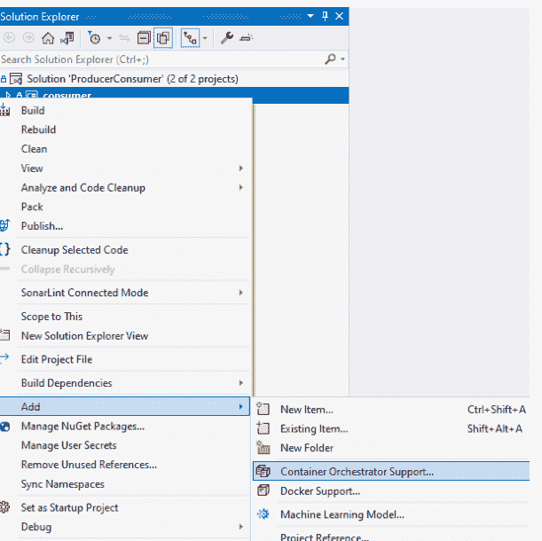

图 6 - 在容器中调试（等等，文字说是图 6，但图片是 125。让我们根据上下文来看）。

在容器窗口中，你将看到一个名为 consumer 的正在运行的容器，它是基于 consumer:dev 镜像的。如果你进一步探索，如预期的那样，你会看到运行镜像与 Dockerfile 定义之间存在显著差异。

Visual Studio 创建了一个不同的镜像，包含一系列映射的卷（包括一个指向本地解决方案文件夹的卷），并配置且附加了远程调试器。

你可以在任何时候停止调试会话，即使应用程序进程已停止，容器也将继续运行。你可以像在任何本地调试会话中一样添加断点并重新启动调试会话，只需这些进程实际上运行在容器内部。

我们希望通过 Dockerfile 以代码形式控制开发环境依赖，但我们也发现 Visual Studio 在启动调试器时并不使用 Dockerfile。那么，我们该如何自定义该环境呢？

Visual Studio 提供了实现此操作的灵活性。如果我们想添加一个同时影响最终镜像和调试环境的自定义内容，我们为 Dockerfile 的 base 部分添加命令：

```dockerfile
FROM mcr.microsoft.com/dotnet/aspnet:7.0 AS base
WORKDIR /app
EXPOSE 443
### <在此处添加命令以同时修改调试和发布容器镜像>
RUN dotnet tool install --global dotnet-ef
```

当我们运行调试会话时，Visual Studio 会确保自定义容器包含基础镜像定义中的所有内容。

如果我们想添加仅适用于调试镜像而不适用于最终发布镜像的命令，我们需要添加另一个镜像，该镜像基于：

```dockerfile
FROM mcr.microsoft.com/dotnet/aspnet:7.0 AS base
WORKDIR /app
EXPOSE 80
EXPOSE 443
### <在此处添加命令以同时修改调试和发布容器镜像>
RUN echo "This is my base image" > /tmp/image_type
```

```dockerfile
FROM base mydebug
RUN echo "This is my debug image" > /tmp/image_type
```

```dockerfile
<省略部分>
FROM base final
WORKDIR /app
COPY --from=publish /app/publish .
ENTRYPOINT ["dotnet", "consumer.dll"]
```

你可以看到最终镜像是基于基础镜像的，因此它不会包含添加到 mydebug 镜像中的任何命令。在示例命令中，我们期望基础镜像（或任何派生于它的镜像）拥有一个文件 /tmp/image_type，内容为 "This is my base image"。当运行我们的调试容器时，我们期望 Visual Studio 目标是 mydebug 镜像，该镜像应该包含内容 "This is my debug image"，它位于 /tmp/image_type 文件中。

我们必须做的最后一件事是告诉 Visual Studio 在调试时使用这个新镜像的名称。要完成这一点，向 .csproj 文件添加以下部分：

```xml
<PropertyGroup>
  <!-- 其他属性设置 -->
  <DockerfileFastModeStage>mydebug
</DockerfileFastModeStage>
</PropertyGroup>
```

太棒了！开发环境的依赖以及任何调试环境的特定设置现在都受源码控制了！

我们可以确定，所有使用相同代码库和 Docker 启动配置的开发者都运行着匹配开发和生产需求的一致容器定义。因此，我们可以在任何安装了 Docker 和 Visual Studio 的机器上启动完全工作的调试会话，而不需要任何其他本地依赖。这甚至扩展到了你可能已或未安装的最新 .NET Core SDK 版本。如果你喜欢尝试 SDK 的预览发布版，就会体会到这有多么。MTAAD 开发环境的可移植性变得简单得多，并且现在通过代码可靠地控制。还记得“一切皆代码”（EaC）部分吗？

但等一下……我们一次只调试一个微服务。Kafka 集群服务呢？

### 编排并调试所有服务

我们已经让微服务分别在容器中运行并调试。为了以有效的方式调试它们，我们还必须让 Kafka 服务运行，应用程序代码才能完全工作。我们在现有的 `docker-compose.yml` 文件中配置了 Zookeeper、Kafka 和 Kafdrop。那么，我们如何将这些与新创建的微服务 Dockerfile 结合起来？

我们希望 Visual Studio 设置一个新的 `docker-compose` 项目。在这样做，它将尝试创建一个新的 `docker-compose.yml` 定义文件。为了避免冲突，我们在此之前备份包含 Kafka 服务的现有文件。

只需将 `docker-compose.yml` 重命名为 `docker-compose.bak`。

接下来，在 consumer 项目的右键菜单上选择**添加**，然后选择**容器编排支持...**：


### 在容器中调试

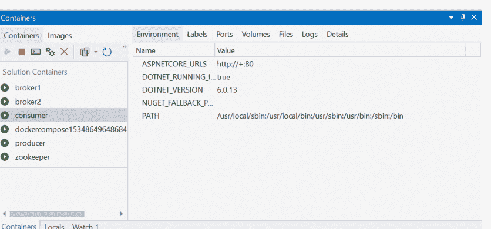

| 环境 | 标签 | 端口 | 卷 | 文件 | 日志 | 详情 |
| --- | --- | --- | --- | --- | --- | --- |
| 名称 | 数值 | | | | | |
| ASPNETCORE_URLS | http://+:80 | | | | | |
| DOTNET_RUNNING_L... | true | | | | | |
| DOTNET_VERSION | 6.0.13 | | | | | |
| MOCK_FALLBACK_P... | /usr/local/sbin/usr/local/sbin/bin/usr/sbin/bin/bin/bin/bin | | | | | |

图 6.7 – 容器窗口，显示了按 docker-compose.yml 文件定义运行的所有服务。

我们现在有了一个完整的调试开发环境，在 Kafka 服务的支持下运行并行微服务代码。

当我们停止此调试会话时，生产者（Producer）和消费者（Consumer）都将终止，但所有容器将继续保持运行状态。

值得注意的是，如果你关闭解决方案或退出 IDE，Visual Studio 将尝试关闭并删除容器。

### 修复 Debug 自定义镜像

当从单容器调试过渡到编排调试时，我们丢失了之前一节中“调试单个微服务”里的一个非常重要的功能。docker-compose 文件中定义的容器不再应用我们在 Dockerfile 镜像定义（我们将其命名为 `mydebug`）中添加的自定义调试构建命令。

我们修改了 `csproj` 文件并添加了一个名为 `DockerfileFastModeStage` 的设置，以指定仅在调试模式下运行时构建的镜像名称。遗憾的是，在使用 `docker-compose` 编排多个容器时，Visual Studio 并不会遵循该设置。

幸运的是，修复方法很简单：

- 1. 在 Visual Studio docker-compose 项目中，添加一个名为 `docker-compose.vs.debug.yml` 的新文件。可能存在一个名称非常相似的文件，但请确保你有一个具有此特定文件名的新文件：

## 微服务的本地化测试与调试

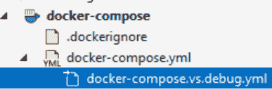

图 6.8 - Visual Studio 调试控制

在此文件中，我们将为 `docker-compose.yml` 文件指定覆盖设置，这些设置在调试模式下编排时将具有优先级。

- 2. 添加以下代码以指示 Visual Studio 针对每个 Dockerfile 中的 `mydebug` 镜像：

```
version: '3.4'
services:
  consumer:
    build:
      target: mydebug

producer:
    build:
      target: mydebug
```

现在，调试 docker-compose 项目将针对 Dockerfile 中调试模式的正确镜像定义。

既然我们现在可以在任何安装了 Visual Studio 和 Docker 的机器上快速启动并调试整个开发环境，我们就可以将注意力转向测试了！

### 针对容器测试

DevOps 生命周期中所有阶段的完整测试方案不在本书的讨论范围内。然而，我们将阐述执行基础测试的技术细节，以证明环境是健康的，并演示如何对整个应用负载。我们想要展示通过采用事件驱动架构而非其他架构所能实现的高吞吐量。

### 功能测试

我们将使用 Postman 建立一个简单的测试：

- 1. 创建一个新的集合（Collection），它仅仅是一个用于存储一组相关 API 请求的文件夹，我们可以重复执行这些请求。
- 2. 接下来，创建一个新请求。将方法类型设置为 POST，并将请求 URL 设置为 `http://localhost:5000/send`。
- 3. 选择 Body 标签，将格式更改为 Raw，并在文本区域中输入事件消息。我选择使用“This is a Postman test to our orchestrated environment.”（这是对我们编排环境的 Postman 测试）。

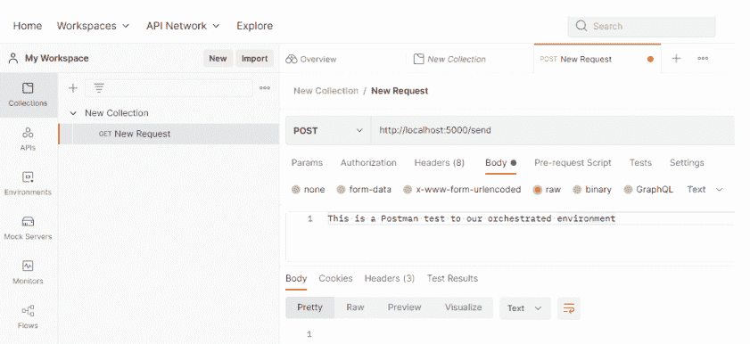

- 4. 确保 Visual Studio 解决方案正在调试上一节中的 docker-compose 启动。
- 5. 点击 Send，你应该看到 Postman 确认收到了状态码为 200 的响应。如果你检查生产者和消费者的容器，你将看到消息已经传播。

Postman 拥有一套强大的 JavaScript 脚本工具，允许你为请求前操作和请求后测试操作添加脚本。

- 6. 在 Tests 框中添加以下代码，允许你断言响应是成功的：

> 图 6-9 – 设置一个简单的 Postman API 请求

## 微服务的本地化测试与调试

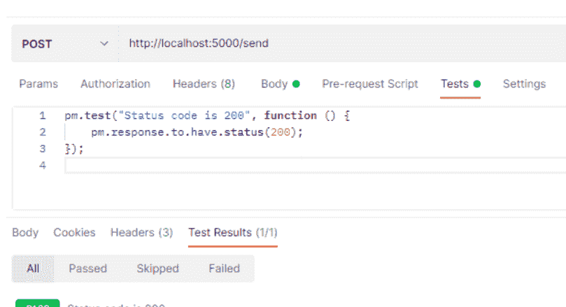

图 6.10 – 创建简单的响应测试

你还可以处理任何响应体，并用它为你可能创建的下一个测试填充环境变量。这些都是非常出色的 Postman 功能，我鼓励你去探索，因为它们的模式适用于大多数 API 测试服务和解决方案。

我们可以借此机会确认设计的容错性。如果你停止了 `broker1` 容器，你会发现消费者无法监控事件。

要停止 `broker1` 容器，请在 Containers 窗口中选择它：


图 6.10 – 创建简单的响应测试


## 微服务的本地化测试与调试

在总结报告中，我实现了每秒 57.4 次请求的吞吐量。这听起来不多，但请注意，我们还没有对生产者（Producer）应用程序进行扩展。

我们预计 Kafka 集群在记录新事件时能够承受更高的吞吐量。我们将生产者扩展到更多实例时，将会增加整体吞吐量。

消费者（Consumer）也会进行扩展，并借此我们可以展示出一种重要水平的整体韧性。我们可以关闭消费者应用程序，仍然对生产者进行负载测试，并确定事件已经记录，且准备好在消费者恢复到健康状态时供其读取。

### 总结

在本章中，我们暂时偏离了应用程序本身，专注于构建一个高效且可靠的开发环境——该环境能够支持运行多个辅助服务，同时支持对解决方案中的多个项目进行调试。我们提到了这如何与使用 DevOps 和 GitOps 实践的现代全生命周期应用开发良好地结合。

我们还查看了如何使用 Postman 建立功能性 API 测试，以及使用 Jmeter 进行高负载测试。有了完全可调试的环境，修复损坏的功能和提高代码性能变得更加简单。

在下一章中，我们将开始观察应用程序中微服务的可观测性。这包括应用健康状况、性能和可用性。

### 问题

- 1. Visual Studio 在项目的默认 Docker 模板中提供了类似于流水线的活动？
- 2. Visual Studio 如何在容器中高效地调试代码？
- 3. 如果生产者服务完全失败但所有其他组件均健康，会发生什么？

### 延伸阅读

- [GitOps and the Rise of Everything-as-Code](Jelle den Burger 著，访问 https://www.meshcloud.io/2022/04/04/gitops-and-the-rise-of-everything-as-code/)
- [Visual Studio Container Tools](Microsoft 著，访问 https://docs.microsoft.com/en-us/visualstudio/containers/overview?view=vs-2022
- [Modify Container Images for Debugging](Microsoft 著，访问 https://docs.microsoft.com/en-us/visualstudio/containers/container-build?WT.mc_id=visualstudio_containers_aka_containerfastmode&view=vs-2022#modify-container-image-only-for-debugging
- [Create a multi-container app with Docker Compose](Microsoft 著，访问 https://docs.microsoft.com/en-us/visualstudio/containers/tutorial-multicainer-view=vs-2022
- [Docker Compose build properties](Microsoft 著，访问 https://docs.microsoft.com/en-us/visualstudio/containers/docker-compose-properties?view=vs-2022
- [API Testing Strategy](Cerosh Jacob 著，访问 https://medium.com/geekculture/api-testing-strategy-3841ff43f6
- [Event-Oriented Architecture Anti-Patterns](Sergi Gonzalez 著，访问 https://medium.com/letgo/event-oriented-architecture-patterns-2dcc68ed282)

# # 7 微服务的可观测性

在上一章中，我们能够编排 MTAEDA 应用程序，以便于启动和调试系统的所有组件。每个独立服务在运行时都可以进行查询，因此易于识别问题并获得解决问题所需的洞察。

最终，MTAEDA 应用程序将存在于活跃开发之外的几个其他环境中。当应用程序未按预期工作时，观察内部正在发生什么至关重要。传统上，单体应用程序会产生内聚的顺序日志，可以根据需要进行观察。

可观测性对于质量保证和用户验收测试环境中整个开发生命周期的速度至关重要。当需要更多精力才能发现应用程序故障期间发生了什么时，这最终会延长修复开发以及随后验证该修复的测试。当 bug 中发生的任何情况无法被快速观测时，DevOps 循环就会停滞。在生产环境中，唯一的观察方法可能是通过在野外发生的系列事件。这些难以复现的生产环境 bug 对于解决应用程序并使其具有良好的支持和可靠性至关重要。

### 微服务的可观测性

本章旨在解释如何转变相对于单体软件开发的可观测性思维方式——首先通过使用微服务模式应对挑战，然后通过应对由事件驱动架构引入的挑战。

我们将在本章中涵盖以下主题：

- 如何监控服务的健康和可用性
- 跨微服务的日志关联
- 在事件之间使用因果关系日志（causation logging）
- 利用 Azure Application Insights 实现可观测性

在本章结束时，你将了解如何在事件驱动的应用服务中添加独立日志，而不会丢失支持高级环境所需的聚合信息。

### 技术要求

对于本章，你将需要 GitHub 源代码：https://github.com/PacktPublishing/Implementing-Event-Driven-Microservices-Architecture-in-.NET-7/tree/main/chapter07。

我们将在 Azure 中创建一个 Application Insights 实例。有关该服务的详细信息（Azure Monitor 服务的一部分）可以在 https://microsoft.com/en-us/services/monitor/ 找到。

### 可观测性

从一个清晰的可观测性定义开始是明智的。换句话说，意味着能够注意到或辨别某些事情。应用到我们对软件应用程序的辨别上，意味着更具体地说明它是什么。在软件系统中，这通过通常所谓的“三支柱”来实现：

字体 指标（Metrics）：随时间变化的一系列测量值
- 日志（Logs）：系统内部消息的记录
- 追踪（Traces）：连接相关事件的指标集

在此处，有必要解决网络上看到的批评意见。虽然在极大规模扩展时这些支柱确实存在局限性，但理解和使用这三支柱是所有微服务架构的基本要求。

在微服务世界中，我们有两个需要克服的重要障碍，需要修改方法：

1. 微服务架构的应用程序根据定义由许多较小的独立组件组成，它们之间完全隔离。它们甚至运行在不同的基础设施上，使用不同的语言开发，或需要不同的 CPU 架构。
2. 事件驱动架构将微服务解耦到我们无法控制有多少消费者对单个产生的事件做出反应的。

对于这三支柱的每一个，让我们理解与单体应用程序相比，这些障碍带来的特定挑战。这将为本章后续章节提供关键。

### 指标

应用程序可以产生一系列指标，使其更具观测性。主要且最关键的指标是应用程序正在运行。对于经典的单体来说，这通常不是难以观察的。如果应用程序没有运行或内部停滞，它将不再处理任何工作。单体可能会由外部服务监控以检查其运行状态，通常被称为健康探测（health probe）或可用性信号。

在微服务世界中，我们不能（也不应该）认为整个应用程序有一个单一的可用性信号。应用程序由许多独立运行的服务组成，每个服务都有其自身的健康状况与否。一个服务的不可用并不意味着整个系统的完全故障。其他服务应该具有容错能力并继续运行。

此外，微服务应该进行水平扩展。虽然服务的某个实例不健康或不可用，但它不代表整个系统的单点故障。


### 微服务可观测性

当我们开始关注服务的性能或吞吐量时，其他指标就变得重要了。单体应用可以将 CPU 使用率报告为绑定限制——即 100% 表示你的应用程序已达到最大值；而微服务景观的监控则是一组 CPU 值的组合，这些值代表了对整个应用程序功能特定部分的需求，并为驱动水平扩展提供了实用的方法。除了 CPU 之外，单个服务的实例可能还会输出其内存使用情况、存储性能，甚至是与其用途相关的自定义指标（例如，它正在处理的并发组件数量）。

在本章中，我们将关注服务的可用性（availability）或存活性（liveness）健康指标。具体来说，这些被称为存活探针（liveness probes）和就绪探针（readiness probes）。我们将在后的部分探讨这些内容。

### 日志

应用程序会在特定事件时输出其内部状态的详细程度。这与事件驱动架构中的事件不可混淆。这种事件可以是任何执行以发布消息的软件代码行。通常有一个设置来暴露应用程序的详细程度，范围通常从极少输出（信息级）到连续的消息流（跟踪级）。当我们从开发环境迁移到高级环境时，除非有明确需要观察某个难以发现的 bug 的更多细节，否则详细程度往往会降低。

在微服务世界中，日志的挑战在于聚合和标准化。我们如何将所有分布式日志汇集，以便从整体上观察系统？我们如何避免每个服务都宿有一个自己的日志系统的开销？如何在服务级别进行聚合的同时，仍保持对特定服务实例的粒度？

稍后，我们将回答这些问题并涵盖日志的可观测性。

### 追踪 (Traces)

“追踪”一词的使用不应与日志详细级别混淆。在单个应用程序中，查看最详细的日志信息确实可以提供可以关联的事件轨迹。然而，在最古老的多线程单体应用中，你通常会在日志中看到关联标识符（correlation identifiers）。这提供了追踪的真实定义。对于任何端到端的系统操作（从输入到输出），应该有一个唯一的标识符来连接从所有执行函数输出的任何消息。关联标识符。

在微服务世界中，追踪遵循相同的方法，即使用唯一标识符将执行的服务及其内部函数连接起来，以便我们可以追踪与单个源系统操作相关的所有事件。

虽然微服务本身预计是小巧且实现相对简单的，但整个系统是极其庞大且复杂的，以至于单个关联标识符就能返回海量的日志追踪。通过此值查询日志可能会返回比我们能合理理解更多的数据，这使得查询内部问题变得非常困难。虽然在日志中查询特定服务来减少足迹，但当我们不确定问题可能出现在哪个服务中时，这种方法就毫无用处。

当我们拥抱事件驱动架构时，关联规模问题会变得更加严重。系统可能会为一个跨越多个服务的关联标识符写入许多日志，并在事件流中产生一个事件。该事件流可能被任意数量的订阅者订阅。这对生产者来说是未知的。假设存在这些订阅者，它们将传播相同的关联标识符，导致单个追踪发生指数级爆炸。我们将在本章中更好地涵盖如何对追踪进行查询。

现在我们已经对可观测性的三个支柱有了良好的理解，以及它们如何被高扩展性系统（例如使用事件驱动架构构建的系统）变得复杂，我们可以转向实现服务存活和就绪的指标。

### 存活与就绪

我们应用程序中的每个组件至少应该提供存活和就绪指标。简而言之，存活指标宣告服务正在运行，而就绪指标宣告服务已准备好处理请求。当服务由编排器（特别是 Kubernetes）管理时，其定义可以包含对不需要在 pod 外部暴露的端点的引用。

如果存活端点指示服务失败或未报告任何内容，编排器将终止 pod 并用新实例替换它。

如果就绪端点指示容器不可用，编排器将停止向其发送流量。

注意，这些端点在我们带有 docker-compose 的开发环境中没有任何任何有用的功能。Docker 是一个简化的编排器，专注于在单机上运行多个容器。Kubernetes 是一个功能更广泛的编排平台，包含了更复杂的框架，例如流量控制和跨多个计算节点监控服务健康。

创建存活端点相对简单。

### 存活端点

在 Kubernetes 中，可以使用任何三种不同的方法配置存活探针：

- 命令探针（command probe）
- HTTP 请求探针（HTTP request probe）
- TCP 探针（TCP probe）

对于**生产者（Producer）** 服务，我们将专注于创建一个存活 API 端点，它将配置为 **HTTP 请求探针。**

对于**消费者（Consumer）** 服务，我们将专注于创建一个 TCP 监听器服务，它将配置为 **TCP 探针。**

# 添加生产者存活端点

在生产者项目的 Program.cs 文件中，已经有使用 MapGet() 和 MapPost() 方法定义的简单端点的内联定义。在 `"/"` 和 `/send` 设置代码之间添加以下内容：

```go
app.MapGet("/healthz", () => "Ok!");
```

它非常简单地创建了一个返回 Ok 字符串的新 API 端点。

启动应用程序并通过 http://localhost:5000/healthz 访问健康端点：

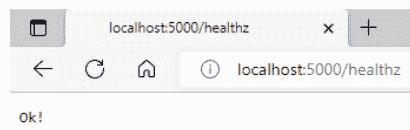

> 图 7.1 – 来自存活健康 API 端点的响应

MapGet () 的默认响应码为 200。无论返回什么内容，Kubernetes 都会将其解释为服务存活且良好。如果我们的端点挂起或未报告任何内容，编排器将终止并替换服务实例。

如果就绪端点指示容器不可用，编排器将停止向其发送流量。

注意，这些端点在我们带有 docker-compose 的开发环境中没有任何任何有用的功能。Docker 是一个简化的编排器，专注于在单机上运行多个容器。Kubernetes 是一个功能更广泛的编排平台，包含了更复杂的框架，例如流量控制和跨多个计算节点监控服务健康。

创建存活端点相对简单。

在 Kubernetes 中，可以使用任何三种不同的方法配置存活探针：

- 命令探针
- HTTP 请求探针
- TCP 探针

对于**生产者（Producer）** 服务，我们将专注于创建一个存活 API 端点，它将配置为 **HTTP 请求探针。**

对于**消费者（Consumer）** 服务，我们将专注于创建一个 TCP 监听器服务，它将配置为 **TCP 探针。**

# 添加生产者存活端点

在生产者项目的 Program.cs 文件中，已经有使用 MapGet() 和 MapPost() 方法定义的简单端点的内联定义。在 `"/"` 和 `/send` 设置代码之间添加以下内容：

```go
app.MapGet("/healthz", () => "Ok!");
```

它非常简单地创建了一个返回 Ok 字符串的新 API 端点。

启动应用程序并通过 http://localhost:5000/healthz 访问健康端点：


> 图 7.1 – 来自存活健康 API 端点的响应

MapGet () 的默认响应码为 200。无论返回什么内容，Kubernetes 都会将其解释为服务存活且良好。如果我们的端点挂起或未报告任何内容，编排器将终止并替换服务实例。

如果就绪端点指示容器不可用，编排器将停止向其发送流量。

如果存活端点的逻辑更复杂呢？我们将添加另一个端点来演示更复杂的逻辑：

如果当前是周日，它将返回 500 状态码：

```go
app.MapGet("/complexhealth", (HttpContext http) => {
    if (DateTime.Today.DayOfWeek == DayOfWeek.Sunday) {
        http.Response.StatusCode = 500;
    } else {
        http.Response.StatusCode = 200;
    }
    return $"It's complicated! {http.Response.StatusCode}";
});
```

重新启动应用程序并通过 http://localhost:5000/complexhealth 访问存活端点。

如果当前是周日，它将返回 **500** 状态码，指示不健康：

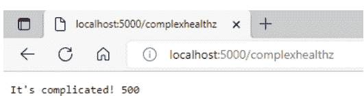

> 图 7.2 – 来自复杂存活 API 端点的响应，指示不健康

否则，它将返回 **200** 状态：

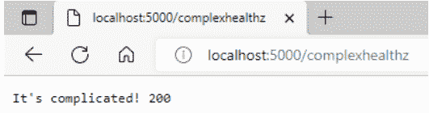

> 图 7.3 – 来自复杂存活 API 端点的响应，指示健康

让我们查看使用存活 HTTP 请求端点时， Kubernetes 配置文件的部分是什么样的：

```yaml
spec:
  containers:
    name: producer
    image: mtaeda/producer:1.0
    livenessProbe:
      httpGet:
        path: /healthz # 或 /complexhealth
        port: 80
    initialDelaySeconds: 3
    periodSeconds: 5
    failureThreshold: 2
```

这很容易理解。它告诉 Kubernetes 查找存活端点的路径和端口。`initialDelaySeconds` 参数是一个允许服务启动的宽限期，因此如果在启动 API 端点之前有延迟，它不会立即被视为不健康并终止。`periodSeconds` 参数指定检查频率。`failureThreshold` 参数指定存活端点必须连续失败多少次才会触发终止和替换。

# 添加消费者存活端点

对于消费者，添加 TCP 存活端点稍微复杂一些。在 Main 入口处，构建 Ihost 之前添加以下代码：

```go
Task.Run(() => {
  var tcpHealthEndpoint = new TcpListener(IPAddress.Any, 123);
  tcpHealthEndpoint.Start();
  while (true) {
    TcpClient client = tcpHealthEndpoint.AcceptTcpClient();
    NetworkStream stream = client.GetStream();
    var msg = System.Text.Encoding.ASCII.GetBytes("Ok!");
    stream.Write(msg, 0, msg.Length);
    client.Close();
  }
});
```


### 存活（Liveness）与就绪

}

这段代码在端口 123 上创建一个 TCP 监听器，并绑定到运行该进程的系统的所有网络接口。`AcceptTcpClient()` 方法是一个阻塞调用，这就是为什么整个范围被封装在 `Task.Run()` 方法中。否则，它将阻塞主消费者服务的启动。示例在 TCP 客户端成功连接时会输出 Ok。这是一个可选步骤。Kubernetes 确认存活状态只需要连接成功，即使连接被立即关闭也可以。

此更改对于 Kubernetes 部署是足够的，因为编排器可以直接访问容器 Pod 并查询 123 端口。要使用 `docker-compose` 在本地进行测试，我们必须将相同的端口映射到本地主机。修改 `docker-compose.yml` 文件以包含来自消费者的端口映射：

```
services:
  consumer:
    image: ${DOCKER_REGISTRY}-consumer
    build:
      context: .
      dockerfile: consumer/Dockerfile
  ## 添加此端口映射
  ports:
    - "123:123"
```

重启 docker-compose 调试将应用此更改。现在，启动命令提示符并尝试通过 telnet 连接到端口：

```
> telnet localhost 123
```

我们得到了以下输出：

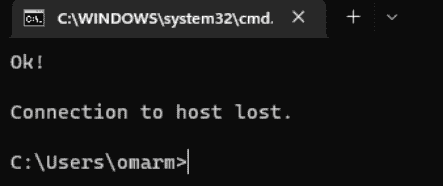

图 7.4 – 健康的存活 TCP 端点的 Telnet 输出

### 微服务可观测性

让我们预览一下配置部分的样式，以指示 Kubernetes 使用我们的存活 TCP 请求端点：

```yaml
spec:
  containers:
    name: consumer
      image: mtaeda/consumer:1.0
    livenessProbe:
      tcpSocket:
        port: 123
      initialDelaySeconds: 15
      periodSeconds: 10
      failureThreshold: 2
```

就像 HTTP 存活探针的配置一样，我们可以配置初始延迟、检查频率，以及在编排器对不健康的服务实例采取行动之前的阈值。

现在我们已经成功添加了存活端点，我们应该开始理解并同样实现就绪（Readiness）端点。

### 就绪端点

与就绪端点一样，Kubernetes 可以使用 HTTP 请求、TCP 连接或直接命令来探测就绪端点。就绪端点的成功实现将使得如果我们的服务实例声称健康但尚未准备好接受请求，Kubernetes 将停止向该实例发送流量。

## 添加生产者就绪端点

让我们模拟这样一个场景：生产者服务启动了，但我们不想在最初 30 秒内接受任何请求。在现实世界中，某些服务在启动时可能需要完成大量工作，即使存活端点有响应，我们可能也希望等待另一个操作完成后再接收传入请求。

在 `/complexhealthz` 端点下方以下代码：

```csharp
var appStartTime = DateTime.UtcNow;
app.Map("/readyz", (HttpContext http) =>
{
    var readyAt = appStartTime.AddSeconds(30);
    if (DateTime.UtcNow < readyAt)
    {
        http.Response.StatusCode = 500;
        return $"Ready in {(readyAt - DateTime.UtcNow).TotalSeconds} seconds. {http.Response.StatusCode}";
    }
    else
    {
        http.Response.StatusCode = 200;
        return $"Ready! {http.Response.StatusCode}";
    }
});
```

启动应用程序并通过 http://localhost:5000/readyz 访问就绪端点。

在启动后的 30 秒内，响应代码将为 500，消息将显示距离服务准备好接受请求还剩多少秒：

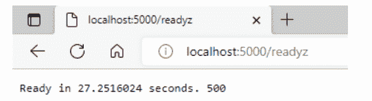

图 7.5 – 就绪 HTTP 端点显示未准备好处理服务请求

30 秒后，响应代码将变为 200，消息将确认服务已准备好接受请求：

### 微服务可观测性

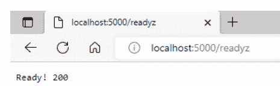

图 7.6 – 就绪 HTTP 端点显示已准备好处理服务请求

让我们预览一下配置部分的样式，以指示 Kubernetes 使用我们的存活 TCP 请求端点：

```yaml
spec:
  containers:
    name: consumer
    image: mtaeda/consumer:1.0
  readinessProbe:
    httpGet:
      path: /readyz
      port: 80
    initialDelaySeconds: 3
    periodSeconds: 5
    failureThreshold: 2
```

记住，Kubernetes 并不关心返回的消息内容，只关心状态码 200（表示就绪）或任何其他代码（表示未就绪）。

## 跳过消费者就绪端点

为消费者服务添加就绪端点没有意义。它不接受可能在服务被认为未就绪时而被阻塞的传入流量。相反，它监控事件队列本身以触发相应事件。因此，它的就绪状态和控制本质上都是自决的。

现在存活和就绪端点已经就绪，我们可以开始关注：

### 日志聚合

使用 Kubernetes 时，我们可以考虑两种主要的日志输出方法。第一种是直接输出到外部系统。第二种是通过 Application Insights，只需少量代码更改即可对 .NET（以及许多其他语言）进行插桩。

## 创建 Azure Application Insights 实例

前往 `https://portal.azure.com` 并使用用户账户登录，访问*技术要求*部分所述的订阅。

在主搜索框中输入并查找 **Application Insights**：

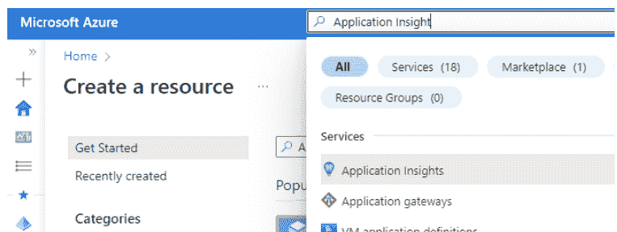

图 7.7 – 在 Azure 中查找 Application Insights

除非在使用过 Application Insights，否则列表应为空。点击**创建**按钮打开创建新实例的表单。

选择订阅、资源组和区域来创建实例。你还需要引用（或创建一个）工作区。工作区是 Log Analytics 实例。它是存储和分析日志的中心枢纽，为 Application Insights 提供存储处理后端：

### 微服务可观测性

项目详情

选择订阅以管理部署的资源和成本。使用资源组像文件夹一样管理所有资源。

| 订阅 * | PAYG Dev-Test |
| 资源组 * | (New) RG-MTAEDA |

实例详情

| 名称 * | mtaeda_appinsights |
| 区域 * | (US) Central US |
| 资源模式 * | Classic Workspace-based |

工作区详情

| 订阅 * | PAYG Dev-Test |
| Log Analytics 工作区 | (new) DefaultWorkspace-41c1b1e0-3e91-48d6-938-abee77d4a507-CUS ... |

图 7.8 – 在 Azure 中创建 Application Insights

选择**查看**并点击创建继续。

几分钟后，你将看到一个转到资源的链接。点击此链接将带你进入新的 Application Insights 实例。

复制并保存**连接字符串**信息，这是连接生产者和消费者服务所需的：

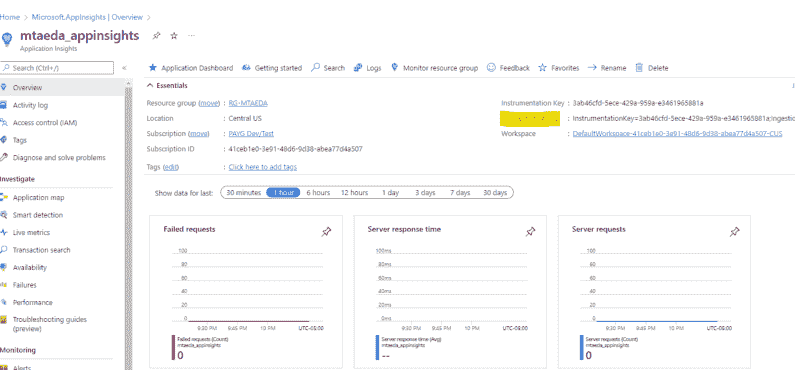

图 7.9 – 复制 Application Insights 实例的连接字符串


既然我们已经有了 Application Insights 实例和连接字符串，让我们首先为 Producer 服务设置遥测数据。

# 向 Application Insights 传输遥测数据

将 Application Insights 添加到 Producer 服务的步骤如下：

- 1. 打开 producer.csproj 文件，并添加以下两个包：
```xml
<PackageReference Include="Microsoft.ApplicationInsights.AspNetCore" Version="2.21.0" />
<PackageReference Include="Microsoft.ApplicationInsights.Kubernetes" Version="2.0.4" />
```

- 2. 在 Program.cs 文件中，在调用构建 `builder.Build()` 命令之前添加以下服务项：

```sharp
builder.Services.AddApplicationInsightsTelemetry(
  (options) =>
    options.ConnectionString =
      "--insert your connection string from Application
      Insights--"
  );
builder.Services.AddApplicationInsightsKubernetes(
  Enricher());
```

- 3. 重新编译并启动应用程序。

- 4. 几秒后，回到 Azure 中的 Application Insights 实例，并选择 **Live metrics**（实时指标）窗格。你将看到一个服务器，它代表 Producer 容器，正在流式传输经典仪表指标，如 CPU、提交内存和请求计数：

### 微服务可观测性

## mtaeda.appinsights | Live metrics

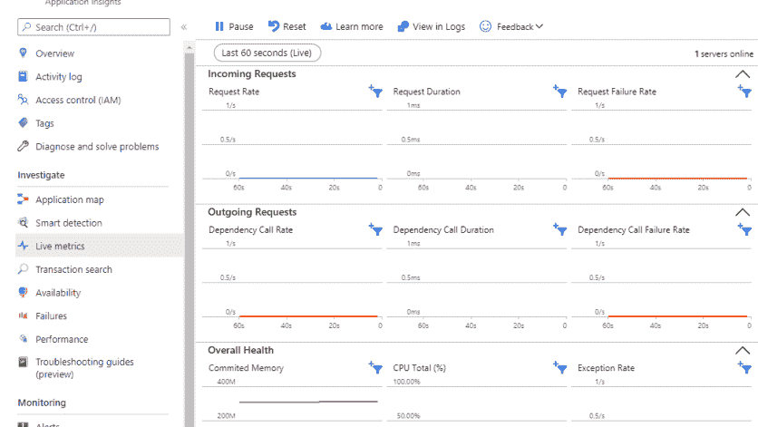

图 7.10 - 实时仪表指标显示了一个 Producer 服务实例

现在，让我们按照相似的步骤将 Application Insights 添加到 consumer 服务。请务必注意此代码与 Producer 代码之间的细微差异：

- 1. 打开 consumer.csproj 文件，并添加以下包：

```xml
<PackageReference Include="Microsoft.ApplicationInsights.WorkerService" Version="2.21.0" />
<PackageReference Include="Microsoft.ApplicationInsights.Kubernetes" Version="2.0.4" />
```

- 2. 在 Program.cs 文件中，将以下代码添加到 `CreateHostBuilder()` 方法的末尾。注意，我们正在扩展该单行代码：

```sharp
} // End of the ConfigureAppConfiguration parentheses
.ConfigureServices(
(config) => config.AddApplicationInsightsTelemetryWorkerService(
(options) =>
options.ConnectionString =
"-- insert your connection string from Application
Insights ---
).AddApplicationInsightsKubernetesEnricher();
```

### 日志聚合

- 3. 重新编译并启动应用程序。

- 4. 再等几秒钟，回到 Azure 中的 Application Insights 实例并选择 Live metrics。你将看到两个服务器，分别代表 Producer 和 Consumer 消费者。我们对两者的仪表指标都聚合了可见性。

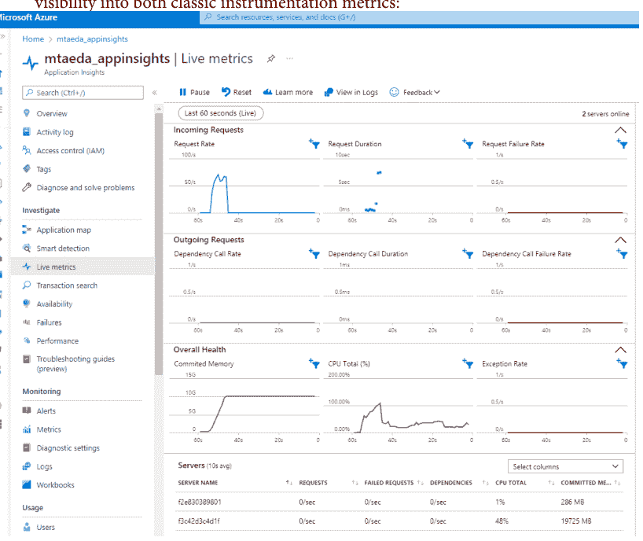

图 7.11 - 实时仪表显示了 Producer 和 Consumer 服务的实例

通过启用遥测数据，我们为 Application Insights 实例配置了连接字符串和通信通道。在代码中还添加了一个 Kubernetes Enricher 服务，它会修改日志信息使其更符合托管容器的特性。例如，指标显示容器 ID 为服务器名称，而不是底层节点的主机。得益于此，我们可以计划在 Kubernetes 环境中扩展应用程序服务，并获取查看容器特定指标以及聚合服务级指标所需的必要信息。

虽然现在能够获得服务更详细指标的可见性很棒，但我们的主要目标是聚合日志。此配置是将日志直接从服务传输到 Application Insights 的先驱。

# 向 Application Insights 传输日志

向 Application Insights 日志遵循 .NET 的标准 `ILogger` 模式。设置指标的遥测数据会自动配置 `ILogger` 服务，将 Application Insights 实例作为目标。我们只需要在代码中访问 `ILogger` 服务即可。

按照以下步骤操作 Producer 服务：

- 1. 在 Program.cs 文件中，我们从 builder 初始化 app，添加以下代码：

```csharp
var app = builder.Build();
// Add the following lines...
using var scope = app.Services.CreateScope();
var logger = scope.ServiceProvider.GetRequiredService<ILogger<Program>>();
```

- 2. 在 /send 端点代码中，在我们设置 Producer 服务的 topic 之后，添加对 logger 的调用：

```sharp
await svc.SetTopic(ProducerTopic);
logger.Debug("Producer service set the topic to {topic}", ProducerTopic);
```

- 3. 在 appsettings.json 文件中，配置 Application Insights 的日志级别以捕捉：

```json
"Logging": {
  "ApplicationInsights": {
    "LogLevel": {
      "Default": "Trace",
      "Microsoft": "Error"
    }
  }
}
```

- 4. 重新编译并启动应用程序。

- 5. 对 Producer 服务的 Application /send 端点发起 POST 调用。

- 6. 回到 Azure 中的 Application Insights 实例，选择 Transaction search（事务搜索）窗格。搜索 topic：

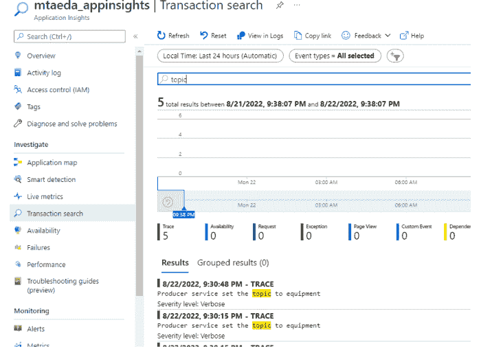

图 7.12 - 事务搜索

- 7. 我们已成功写入 Application Insights。点击其中一条消息将揭示端到端详情：

### 微服务可观测性

## mtaeda.appinsights | Live metrics

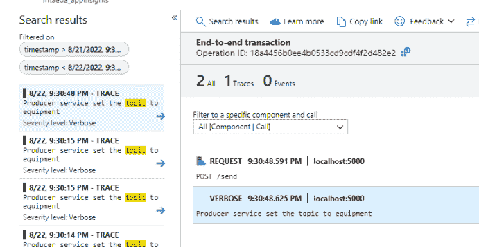

图 7.13 - 端到端详情

### 关联与因果

关联标识（Correlation identifiers）自我记忆以来在单体日志中就至关重要。这涉及生成一个唯一标识，并将其在函数之间传递。这样你就可以关联许多条目。当我们转向微服务时，这种挑战超出了单个应用程序进程。通常情况下，关联标识通过 HTTP 从一个服务传递到下一个。当我们转向事件驱动架构时，这种关联引入了一些新的挑战。虽然这解决了跨服务追踪，但我们应该记住，一个事件可能有许多订阅者，并且它们都具有相同的关联标识。这意味着当我们根据标识符查询时，结果日志可能是一团乱麻，缺乏高效查询的粒度。为了解决这团乱麻，我们可以引入因果标识（causation identifiers）。因果标识是触发方法的上一个事件的唯一标识。它简单地将上一个事件与当前事件连接起来，以便我们知道触发原因。

Application Insights 支持这种模式，即分布式跟踪（distributed tracing）。它对标识使用了略不同的名称：

- 而不是 Log Item Id，我们使用 Log Id。
- 而不是 Correlation Id，我们使用 operation_Id。
- 而不是 Causation Id，我们使用 operation_ParentId。

以下是这些标识在实际运行中的示例。添加了多个消费者以说明关联/因果模式的工作原理：

| 服务 | 操作 | Log Id (Id) | Correlation Id (operation_Id) | Causation Id (operation_ParentId) |
|---|---|---|---|---|
| Producer | POST/SEND | 1a | 1a | null |
| Kafka | 消息存储 | 2b | 1a | 1a |
| Consumer 1 | 消息消费 | 3c | 1a | 2b |
| Consumer 2 | 消息消费 | 4d | 1a | 2b |

表 7.1 – 关联与因果标识模式示例


# 生成带有关联 ID 和因果 ID 的日志和事件负载

在生产者项目中，打开 `producerService.cs` 文件并为 `CloudEvent` 结构添加定义：

```cs
internal class CloudEvent : ISerializer<CloudEvent>
{
    public string? Id { get; set; }
    public string? OperationId { get; set; }
    public string? OperationParentId { get; set; }
    public string? Message { get; set; }

    public byte[] Serialize(CloudEvent data, SerializationContext context)
    {
        return UTF8.GetBytes(string.Join("|", data.Id, data.OperationId, data.OperationParentId, data.Message));
    }
}
```

因此，由于此类可以作为 Kafka 事件负载，我们必须实现 `Confluent.Kafka.ISerializer` 接口。这将使用管道分隔符连接属性起来，并以 UTF-8 编码为字节数组。

在我们开始生成或级联标识符之前，我们需要符合 HTTP 关联规范。这意味着生产者的 `Send()` 方法应该检查 `HttpContext` 请求头中是否存在 `Request-Id`，这表明上游服务已经生成了现有的关联 ID。

我们必须获取 `TelemetryClient` 服务的访问权限，以便如果提供了现有的关联 ID，可以将其用于该请求的 Application Insight 日志。

在 `Program.cs` 文件中，添加此行以获取 `TelemetryClient` 服务：

```cs
var telemetryClient = scope.ServiceProvider.GetRequiredService<TelemetryClient>();
```

事件消息的因果 ID（Causation ID）是当前请求的 ID。我们从 `System.Diagnostics.Activity` 获取它。

关联 ID（Correlation ID）要么是在持久化现有上游关联 ID 时 HTTP 请求头中的 `Request-Id`，否则将设置为与当前请求 ID 相同的值。

最后，无论关联 ID 的值是什么，我们必须将当前遥测客户端的操作 ID 设置为关联 ID，以便其出现在任何日志中。

```cs
var causationID = System.Diagnostics.Activity.Current.TraceId.ToString();
var correlationID = http.Request.Headers.RequestId.FirstOrDefault() ?? causationID;
telemetryClient.Context.Operation.Id = correlationID;
```

我们需要修改 `IProducer` 接口的 `Send()` 方法定义，以便传入关联 ID 和因果 ID：

```cs
internal interface IProducerService
{
    Task Send(string message, string correlationID, string causationID);
    Task SetTopic(string topicName);
}
```

至此，我们还需要更新 `producerService` 中的 `Send()` 实现以接受这些 ID 并使用它们构造 `CloudEvent` 负载：

```cs
public async Task Send(string message, string correlationID, string causationID)
{
    await Task.Run(() =>
    {
        var messagePacket = new MessagePacket<int, CloudEvent>
        {
            Key = 1,
            Value = new CloudEvent
            {
                Id = Guid.NewGuid().ToString(),
                OperationID = correlationID,
                OperationParentId = causationID,
                Message = message
            }
        });
        producer.ProduceAsync(Topic, messagePacket, CancellationToken.None);
        logger.LogInformation("Producer sent the message: " + message + " - and with an Id of: " + messagePacket.Value.Id);
    });
}
```

这是我们如何设置事件负载的标识符。我们为事件存储的 ID 生成一个新的 New Guid。我们将关联 ID 设置为 `OperationID`，并将因果 ID 设置为 `OperationParentID`。

生产者服务剩下的工作是在 `/send` 方法中将 ID 传递给 `Send()` 调用：

```cs
await svc.Send(message, correlationID, causationID);
```

现在，我们可以查看如何在消费者服务中处理相同的挑战。

# 具有一致性关联 ID 和因果 ID 的消费者日志

在消费者项目中，在 `consumerService.cs` 文件中添加一个与生产者中添加的类似的 `CloudEvent` 类：

```cs
internal class CloudEvent : IDeserializer<CloudEvent>
{
  public string? Id { get; set; }
  public string? OperationID { get; set; }
  public string? OperationParentID { get; set; }
  public string? Message { get; set; }
}
```

### 关联与因果

```cs
public CloudEvent Deserialize(ReadOnlySpan<byte> data, bool isNull, SerializationContext context)
{
    var messageParts = Encoding.UTF8.GetString(data).Split("||");
    return new CloudEvent
    {
        Id = messageParts[0],
        OperationId = messageParts[1],
        OperationParentId = messageParts[2],
        Message = messageParts[3]
    });
}
```

注意此类与在生产者中实现的非常相似，但它实现了 `Confluent.Kafka.Deserialize` 服务。

在 `Program.cs` 文件中，获取 `TelemetryClient` 实例并将其传递给 `consumersService`，以便我们拥有日志机制：

```cs
var telemetryClient = scope.ServiceProvider.GetRequiredService<TelemetryClient>();
```

遥测客户端被进一步推入 `MessageReceivedEventHandler` 中，该处理器最终响应任何发布的新 Kafka 事件。在它的代码中，我们将客户端的操作 ID 设置为来自事件负载的 ID。记住，这是我们想要持久化的关联 ID。

```cs
public async Task Handle(ConsumerResult<int, CloudEvent> result, TelemetryClient telemetryClient)
{
    await Task.Run(() =>
    {
        telemetryClient.Context.Operation.Id = result.Message.OperationID;
        // ... 处理消息的逻辑
    });
}
```


4. 在探索特定操作的分组事件日志时，你如何识别链中的前一个日志？

### 延伸阅读

- [通过 kubernetes.io 配置存活探针、就绪探针和启动探针](访问：https://kubernetes.io/docs/tasks/configure-pod-container/configure-liveness-readiness-startup-probes/)
- [在 Kubernetes 上使用 TCP 探测监控 ASP.NET Core 后台服务的健康](Rahul Rai 访问：https://thecloudblog.net/post/monitoring-health-of-aspnet-core-background-services-with-tcp-probes-on-kubernetes/)
- [用于 Kubernetes 的 Microsoft Application Insights](由微软开源社区编写，访问：https://github.com/microsoft/ApplicationInsights-Kubernetes
- [.NET Core 和 ASP.NET Core 中的日志记录](由 Microsoft 提供，访问：https://learn.microsoft.com/en-us/aspnet/core/fundamentals/logging/?view=aspnetcore-7.0
- [.NET 运行时中的 HTTP 关联协议实现](由微软开源社区编写，访问：https://github.com/dotnet/runtime/blob/main/src/libraries/System.Diagnostics.DiagnosticSource/src/HttpContextProtocol.md
- [作为遥测关联数据模型的 Application Insights](Microsoft 提供，访问：https://docs.microsoft.com/en-us/azure/azure-monitor/app/correlation#example

## CI/CD 流水线与集成测试

**持续集成 (CI) 和持续交付 (CD)** 是多年来软件开发的核心两个概念。更快的编译和更快的代码交付到环境可以带来更快的反馈，这种理念让开发者能够接收并迭代积极或具有建设性的反馈。这一过程的终极目标是发布更好的软件产品。

发现和使用与敏捷软件开发相关的设计模式并不一定是繁琐的。有一些通用结构可以帮助开发者根据与团队设置相结合的工作流来构建和发布产品。GitHub 等平台更进了一步，可以开箱提供常见构建和发布场景的解决方案。

在本章中，我们将探索不同的模式、使用 GitHub Actions 构建的构建流水线，并结合集成测试，这有助于防止引入破坏现有功能的 Bug。

在本章结束时，你将能够对完成以下操作：

- 根据 Git 配置和流行的工作流模式评估常见的 CI/CD 模式
- 使用 **GitHub Actions** 实现 CI/CD 模式，实现代码构建、镜像构建以及部署到各种环境
- 学习集成测试方法，并实现基础功能验证测试以及回归测试的实现

> **重要说明**
本章中提到的所有白皮书和其他来源的链接可以在章节末尾的“延伸阅读”部分找到。

## 审查常见的 CI/CD 模式

与任何工程学科一样，你通常可以找到帮助实现特定策略或结果的模式。在处理 CI/CD 流水线时也是如此。你仓库的分支策略可以与你选择的模式松散耦合或紧密耦合，但它们本身并不是 CI/CD 模式。

由于我们使用 Git 作为源代码控制管理系统，其理念是你通常会在分支中进行开发，将这些更改推送到远程，最终创建一个拉取请求（pull request）将代码合并到适用于构建可部署构物的分支中。

然而，某些模式在自动化后将为你带来优势，特别是当使用多个环境或构物时。

## 基于环境的方法

使用基于环境的软件部署是大多数开发生命周期的典型做法。通常利用两种模式来促进多环境部署：

1. 第一种是将所有环境捕获在一个流水线中，由它控制每个环境向前滚动还是回滚。
2. 第二种是拥有一个可以在任何环境中执行的流水线。

例如，你可能希望为任何环境设置一套标准的流水线，以确保每次部署都是一致的。

图 8.1 展示了适用于任何环境的单一流水线方法：

## 审查常见的 CI/CD 模式

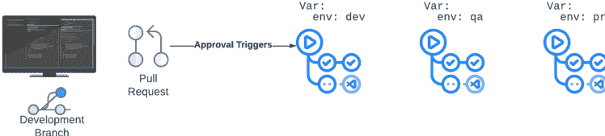

图 8.1 – 适用于任何环境的单一流水线

根据你的工作流，你可能希望有一个从构建到生产环境的流水线。这为特定构物或一组构物的生命周期提供了单一视图视图。图 8.2 显示了适用于所有环境方法的单一流水线：

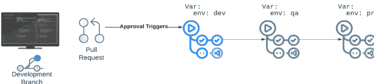

图 8.2 – 包含所有环境的单一流水线

根据平台的不同，你可能可以使用一致的环境模板，并将其插入到综合流水线，该流水线将流向各个环境，并在每个环境中使用相同的模板。

例如，GitHub 允许用户创建可重用的工作流，这些工作流可以被多个开发者导入和使用。Azure Pipelines 也以嵌套 YAML 文件的形式允许重用模板。

现在有了基于环境的流水线示例，我们可以查看 CI/CD 流水线中常见的下一个模式，即**构物管理**。

## 构物管理

在软件工程领域，构物（artifact）对许多人来说意味着许多含义。一些工程师将构物视为可执行程序、安装包或一系列库。另一些人可能将构物视为构成静态 Web 应用程序的 HTML、CSS 和 JavaScript 文件的集合。无论类型如何，在 CI/CD 术语中，构物是指可以部署到一个或多个环境的任何内容。

存储构物可以通过多种方式完成。通常，构物存储在部署可以访问的地方，无论这些是工程师、其他流水线还是仓库。GitHub 有一个名为 Packages 的内置仓库，我们稍后在讨论设置流水线时会详细介绍。

## 触发器与门控

为了利用 CI/CD 平台的优势，通常预计仓库中的一个或多个分支已设置好在提交提交时自动构建。这种 CI 调用是由提交推送到远程所**触发**的。部署也可以根据成功的构建进行触发；然而，CD 流水线自动移动到环境通常被限于较低的环境，在那里破坏性变更是可以容忍和预期的。

不可避免的是，在发布代码到环境之前某些条件需要确认。例如，在大型组织中，每次推送到生产都需要某种类型的确认。对于许多团队来说，这是一个可能需要几分钟、几小时甚至几天的手动过程。开发者的一个共同痛点是解决手动干预的时间。需要某种干预的情况通常被称为门。

在所有现代 CI/CD 平台中，都有结构适应大多数需要手动干预的情况。虽然某些系统可能有更健壮的实现——允许基于审批的工作流以及基于工作项或测试结果的自动化门——你可以在选择的平台上找到所需的实现。

### 特性标记

通常被视为高级模式，特性标记（feature flags）的使用通过通过标记隐藏可能尚未完全准备好进入生产环境的功能，或者在生产环境出现问题时回滚功能，来帮助持续交付。你可能决定让某些用户可以轻松访问某些即将推出的功能，以帮助从他们那里直接获取反馈。这种做法被称为使用**金丝雀小组**（canary group），即小部分用户可以测试新功能并提供反馈，特别是在某些未按预期工作的情况下。


实现功能标记（feature flags）允许你保护用户免受未完成功能的影响，同时允许代码进入生产环境。这为新功能与现有代码并行的行的测试测试奠定了基础。

## 为 CI/CD 实现启用 GitHub Actions

在本节中，我们将介绍如何为设备领域（Equipment domain）设置 CI 和 CD 流水线。一旦你完成此示例，你将能够为所有其他领域项目创建相同的流水线。

## 用于持续集成的 GitHub Actions

对于持续集成设置，我们将从一个旨在构建源代码以及运行任何适用单元测试的基础模板开始。完成后，所需的 Docker 镜像将存储在 GitHub Packages 中：

- 点击 **Configure**（配置）将根据你选择的存储库启动一个新的 CI 流水线模板。**图 8.3** 展示了你将在示例中使用的流水线模板：

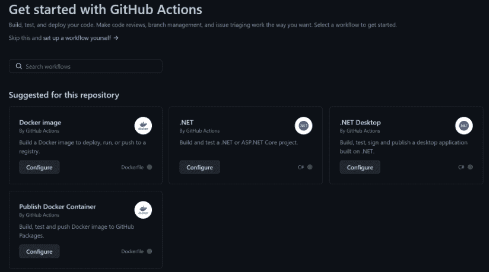

图 8.3 – GitHub Actions 模板，作为存储库类型的建议

152 CI/CD 流水线与集成测试

2. 图 8.4 显示了当你点击 Configure 按钮时 GitHub 为你创建的 YAML 流水线：

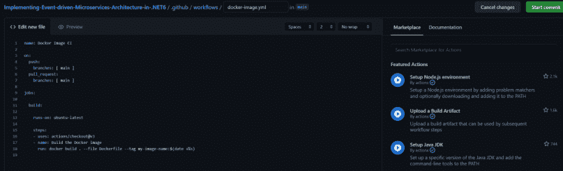

图 8.4 – 点击 Configure 时生成的示例流水线

3. 我们还希望将 Packages 设置为该流水线的默认构制品仓库。你可以通过返回主页的 Actions，选择 Docker Container 模板并点击 Configure 来实现。

图 8.5 显示了你点击 Configure 后生成的模板：

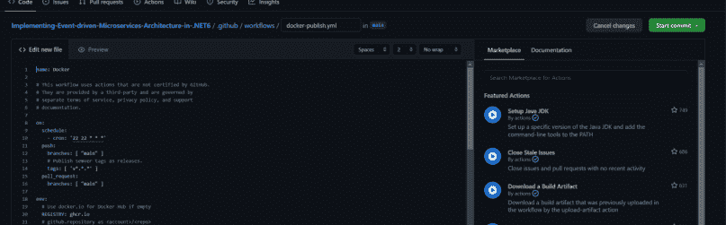

图 8.5 – GitHub 生成的用于发布到 Docker 注册表的示例流水线

现在我们的持续集成流水线已经配置完成，我们可以继续设置 CI/CD 组合的第二部分——CD 流水线。

### 用于持续部署的 GitHub Actions

我们将遵循与之前 CI 流水线类似的路径：

- 1. 要创建 CD 流水线，我们必须滚动到 **Deployment**（部署）并点击 **View all**（查看全部）来查看部署流，如*图 8.6*所示：

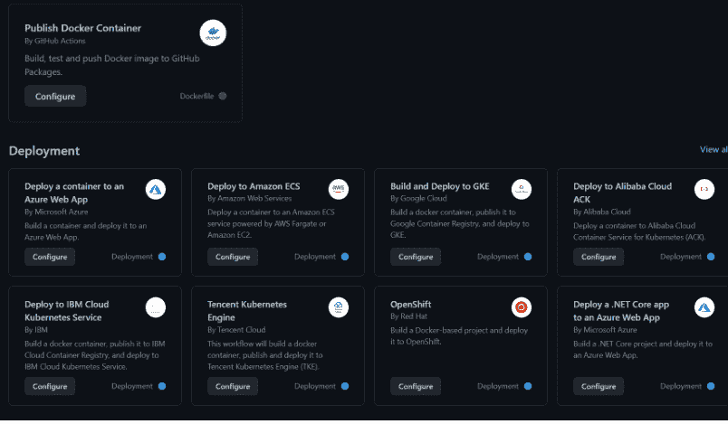

> 图 8.6 – 查看链接以列出所有部署操作类型

- 2. 从那里，我们可以在搜索栏中输入 `azure` 来查找特定的 Azure 部署。对于我们的目的，我们需要寻找 **Deploy to AKS**（部署到 AKS）模板，如*图 8.7*所示，因为部署目标将是 Azure Kubernetes Service：

## CI/CD 流水线与集成测试

## 开始使用 GitHub Actions

构建、测试并部署你的代码。按你想要的方式进行代码审查、分支管理和优先级划分。选择一个工作流开始。
学习如何自己设置工作流

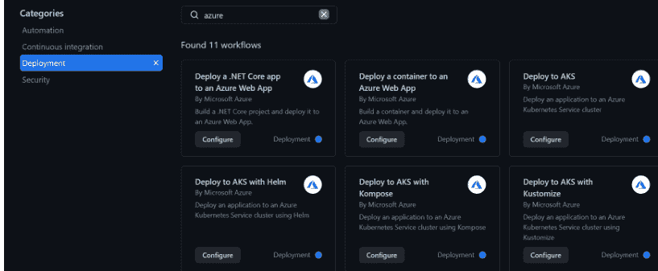

图 8.7 – 搜索并使用 Deploy to AKS 模板

我们的 CI 和 CD 流水线已经就绪，我们可以部署环境的服务。我们的下一个重点将是研究如何将集成测试添加到我们的流水线中。

## 选择集成测试套件方法

就像为你的代码识别和编写单元测试有优选方法一样，识别和编写集成测试也有类似的方法。作为一个一般原则，集成测试涉及服务、组件或其他依赖的真实实例作为模拟（mocks）或存根（stubs），而这些在单元测试中很常见。

在集成测试方面，有几种方法被认为是标准的（来源：https://softwaretestingfundamentals.com/integration-testing/）。这些包括：

- 大爆炸（Big-band）：所有组件结合在一起
- 自上而下（Top-down）：首先测试顶级单元，然后测试低级单元（即测试一个 API 路由，然后测试它依赖的组件）
- 自下向上（Bottom-up）：首先测试低级单元，然后测试顶级单元（即在测试依赖于这些交互的 API 路由之前测试组件之间的交互）
- 三明治/混合（Sandwich/hybrid）：自上而下和自下向上方法的有意混合

这些方法提供了特定的优势，取决于你希望如何验证代码的功能。它们还可以支持操作顺序是决定性因素的场景。

你将集成测试方法整合到流水线中的两种方法是通过：直接部署（direct deployment）或直接消费（direct consumption）。让我们检查每种方法的特征。

通过直接部署，你可以部署你的代码，以及你的代码所依赖的代码或组件。例如，领域流水线将构建一个 Docker 镜像并发布到 GitHub Packages，供其他人使用。然后你可以创建一个 Docker Compose 文件，拉取你的代码所依赖的服务镜像，并在运行你的代码的同时运行它们。从那里开始，执行系列测试或脚本将导致你的代码……

至于消费，这种方法假设依赖项已经部署且为人已知。然后你就可以消费它们。

### 总结

在本章中，我们涵盖了关于 CI 和 CD 的基础课程。我们研究了一些模式，例如基于环境的部署、构制品仓库的使用以及闸（gating）等高级概念。我们探索了如何使用 GitHub Actions 设置 CI 和 CD 流水线，包括使用 GitHub Packages 进行存储。我们通过回顾集成测试的类型以及如何将这些测试添加到流水线中，完成了对流水线的讨论。

在下一章中，我们将通过向流水线引入故障注入（fault injection）和混沌测试来进一步提升测试水平。这是对于旨在扩展的事件驱动平台来说至关重要的一个方面。

### 问题

- 在设计 CI/CD 流水线时，确保实现所有模式重要吗？为什么？
- 是否存在实现功能标记无益的情况？
- 软件开发周期中的哪些闸门可以自动化以减少摩擦并提高上市时间？
- 在流水线中实现集成测试是否有最佳实践或优选方法？

### 扩展阅读

- 使用持续集成：https://docs.microsoft.com/en-us/devops/develop/what-is-continuous-integration
- 什么是持续交付：https://docs.microsoft.com/en-us/devops/deliver/what-is-continuous-delivery
- 什么是功能标记：https://azure.microsoft.com/en-us/overview/continuous-delivery-vs-continuous-deployment
- 使用环境部署：https://docs.github.com/en/actions/deployment/targeting-different-environments/using-environments-for-deployment
- 重用工作流：https://docs.github.com/en/actions/using-workflows/reusing-workflows
- 查看部署：https://docs.github.com/en/actions/managing-workflow-runs/reviewing-deployments
-为 GitHub Action 添加审批工作流：https://timheuer.com/blog/add-approval-workflow-to-github-actions/
- 使用 GitHub Actions 的审批工作流：https://www.aaron-powell.com/posts/2020-03-23-approval-workflows-with-github-actions/


- **特性切换（又称特性标记）：** https://martinfowler.com/articles/feature-toggles.html
- **特性标记（Feature flags）：** https://www.optimizely.com/optimization-glossary/feature-flags/
- **什么是特性标记？** https://launchdarkly.com/blog/what-are-feature-flags/
- **集成测试：** https://softwaretestingfundamentals.com/integration-testing/

## 9. 故障注入与混沌测试

正如软件开发实践在过去几十年中一直在不断演变一样，软件测试也是如此。随着**基础设施即代码 (IaC)** 和**配置即代码 (CaC)** 等范式的额外吸引力，应用程序现在有越来越多的部分被存储在代码中，并可以通过多种方式进行测试。利用云服务托管应用程序部分的一个额外益处是，可以在隔离环境或生产环境中测试，当云平台发生故障时，应用程序将如何响应。

有时，从虚拟机服务到无服务器函数再到身份验证平台，任何服务都可能变得不可用。在处理运行在本地部署环境中的应用程序时，往往会忽视观察应用程序面对意外停机时反应的能力。能够根据对潜在问题的理解来预测、编写、测试并解决问题，将为你的开发生命周期带来更多信心，对应用程序的稳定性也更有信心。

在本章中我们将涵盖以下主题：

- 容错性与故障注入
- 混沌测试
- 实现故障注入和混沌测试

### 故障注入与混沌测试

在本章结束时，你将能够完成以下操作：

- 理解什么是故障注入以及它与容错性总体原则的关系
- 理解混沌测试以及它如何增强故障注入测试
- 在你的流水线中实现故障注入和混沌测试

### 技术要求

你可以在 GitHub 上对应的章节文件夹中找到本章的代码示例，地址为 https://github.com/PackPublishing/Implementing-Event-Driven-Microservices-Architecture-in-.NET-7/tree/main/chapter9 和 https://github.com/PackPublishing/Implementing-Event-Driven-Microservices-Architecture-in-.NET-7/tree/main/src。

> **重要**
> 本章提到的所有白皮书和其他来源的链接可以在章节末尾的“进一步阅读”部分找到。

## 容错性与故障注入

**容错性**（fault tolerance）的概念——即应用程序、平台或运行时容忍系统性故障的能力——本身似乎是一个很容易理解的概念。毕竟，你会期望应用程序在服务不可用时能够优雅地恢复。在许多情况下，应用程序在编写时已经考虑到，托管它的底层基础设施始终是可靠的，除非发生灾难性事件。这种可靠性可能是在本地数据中心建立起来的，且很少受到挑战，但同样的假设对于云平台、服务和组件来说并不成立。

尽管云平台将为某些云服务的可用性提供特定的**服务水平协议 (SLAs)**，但始终存在服务层级或区域级停机的可能性，这种停机可能毫无警告且影响广泛。因此，当你为云端开发应用程序时，记住这些类型的停机是非常重要的。

研究云提供商的状态页面，可以让你深入了解哪些服务受到了停机影响、受影响的频率如何以及采取了哪些修复措施来问题。使用这些信息可以帮助你评估哪些故障或停机最可能发生，以及你如何准备应用程序来应对它们。

## 预测与容忍故障

在整本书中，我们查看了组件之间通信的解耦和异步模式。这些模式并非万无一失，但它们允许我们以较小的破坏性处理意外中断。作为应用程序设计的一部分，通常会考虑应用程序将托管在什么上、应用程序的可用性要求，以及当发生不可思议的事情（数据中心或云区域的完全停机）时，应用程序如何保持功能。设计过程的一部分将带你通过各种“假设如果”场景，并引导你根据你托管应用程序的位置和方式识别可能发生的故障。我们将在第 10 章《可扩展性的现代设计模式》中详细讨论韧性对用于可扩展性的设计模式的影响。

## 利用故障对抗故障

测试社区出现了一个有趣的范式，即在测试期间故意引入错误、异常和故障，以衡量应用程序的反应。故障注入是故意导致底层操作系统、托管服务或运行时失败的条件的实践。长期以来，工程师一直使用这种方法来测试物理硬件，通过影响电路、芯片、电线或电源来确定设备将如何响应。这一格准则最终过渡到了软件世界。

通过这种方法，测试人员可以模拟不同的环境条件，这些条件可能会导致应用程序性能下降或完全停止工作。虽然这种行为是可以预期的，但应用程序确实会对所测量的结果进行补偿。

执行故障注入的测试可以用多种方式编写，从简单的脚本到专注于一系列不同条件或错误的整个库。一种变得非常流行的方法是混沌工程，它使得能够针对你的应用程序运行混沌测试，以破坏底层平台并发现改进之处。

### 混沌测试

虽然混沌测试涉及执行旨在破坏你的应用程序所依赖的服务测试，但混沌工程的总体设计最早是由 Netflix 的工程师在 2010 年建立的。这种工程的主要目的是测试你的服务在极端情况下的表现。22012 年，Netflix 引入了 Chaos Monkey，这是他们的内部混沌测试平台。这为其他公司和工程师利用并修改该套件到其应用程序打开了大门。

### 混沌工程的顺序

混沌工程遵循一套简单的原则，允许混乱产生秩序。根据 Gremlin 的说法，混沌工程三个主要原则如下：

- 计划实验：这一步从你根据应用程序对问题的响应方式提出的假设开始。这在很大程度上取决于你对稳定状态的定义——即什么是正常。理解和记录非功能性需求（包括 API 响应时间、页面加载时间和其他关键性能指标 (KPI)）对于确定什么是正常非常有帮助。此外，考虑你从云提供商处收集的关于服务停机的信息，这将帮助你恢复现实世界的情况。

- 控制影响范围：此步涉及创建一个测试，以尽可能小的足迹模拟问题或停机。例如，如果问题是数据丢失，你可能从尝试删除数据库表中的某行，或 NoSQL 数据存储中的一个文档开始。

- 扩展或压缩：这是最后一步，你确定测试是否证明了有效。如果你发现了一个底层问题，那么你就有改进应用程序对该问题响应的路径。如果没有，继续扩展测试，增加影响范围，直到达到完全的生产能力。如果你在扩大活动时发现了问题，太棒了——如果没有，也太棒了！

使用这些原则，你可以开始制定你的应用程序可能会经历的故障场景，并从那里得出应用程序在给定故障类型下应该表现的假设。

### 实现故障注入和混沌测试

Gremlin 等套件旨在更容易采用混沌工程，避免像 Netflix 流行的 Chaos Monkey 套件那样具有激进的学习曲线。对于基于 Kubernetes 的应用程序，一个流行的混沌测试框架是 Chaos Mesh。它的出现时间没有像 Chaos Monkey 这样的套件那么久，但 Chaos Mesh 是以统一方式实施混沌实验的可靠选择。


# 针对模块化编排引擎实施故障注入和混沌测试。Chaos Mesh 也是**云原生计算基金会 (CNCF)** 的一个孵化项目，它向更广泛的开源社区开放使用。

有趣的是，我们将用来设置一些基准实验的 **Azure Chaos Studio**，它在背后依赖 Chaos Mesh 来对基于 Kubernetes 的目标进行编排和运行实验。它还允许在虚拟机、虚拟机规模集以及其他资源上进行基于代理的安装，让您对实验的运行位置和方式有更深入的控制。我们将首先深入研究 Chaos Mesh，然后再转向使用 Azure Chaos Studio 编排实验。

# 从 Chaos Mesh 开始

首先，我们将查看安装和使用 Chaos Mesh，以直观如何构建实验来影响 Kubernetes 集群内的服务、命名空间，甚至是宿主机。它可以安装在任何有效的 Kubernetes 环境中，从 **minikube** 到 **Docker Desktop** 再到云托管托管集群。每个实验都是作为集群中的一个**自定义资源定义 (CRD)** 创建的，这允许捕获您想要生成的每个实验的特定 .yaml 文件；然后可以在流水线或测试运行期间应用它们。

如果您恰好在使用 **Linux** 发行版、**Windows 的 Linux 子系统 (WSL)** 或 **macOS**，Chaos Mesh 主页提供的命令行命令可以帮助您开始安装过程：

```
curl -SSL https://mirrors.chaos-mesh.org/v2.2.2/install.sh | bash
```

执行此操作将在您选择的集群中创建 Chaos Mesh。如果您不想通过命令行安装，也可以通过 **Helm** 图表安装 Chaos Mesh，只需将 Helm 仓库添加到缓存中并从那里安装。安装完成后，您应该检查该命名空间及其内部的资源。将安装三个服务：

- **Chaos-daemon**: 它接收并执行混沌实验，包括任何支持的实验类型。
- **Chaos-dashboard**: 它允许您使用基于 Web 的 UI 管理网。
- **Chaos-mesh-controller-manager**: 这是网的控制平面。它位于 Kubernetes API 和 `chaos-daemon` 服务之间，接收来自 Kubernetes API 的事件并将它们发送到 `chaos-daemon` 服务进行执行。

### 故障注入和混沌测试

使用 `kubectl`，您可以通过端口转发访问 Chaos Mesh 仪表板：

```
kubectl port-forward -n chaos-mesh svc/chaos-dashboard 9000:2333
```

遵循以下步骤配置 Chaos Mesh：

- 1. 首次连接时，系统会要求输入基于角色的访问控制 (RBAC) 令牌以继续，如图 9.1 所示：

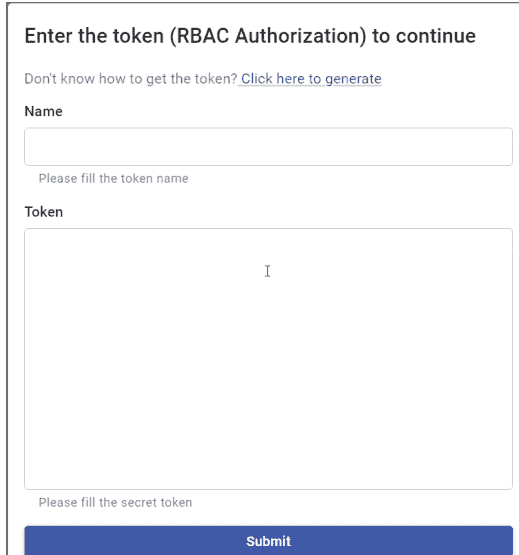

图 9.1 – Chaos Mesh 仪表板中的 RBAC 授权界面

- 2. 如果您没有令牌，点击“点击此处生成链接”；系统将为您提供指令。将打开新窗口，如图 9.2 所示。默认设置是从带范围的令牌开始，允许您选择连接的命名空间和角色。在本例中，我们将使用集群范围的 RBAC 令牌以实现最大的可见性和管理。通常情况下，在不将这些令牌缩小到至少命名空间级别的情况下生成它们并不认为是最佳实践：

### 实施故障注入和混沌测试

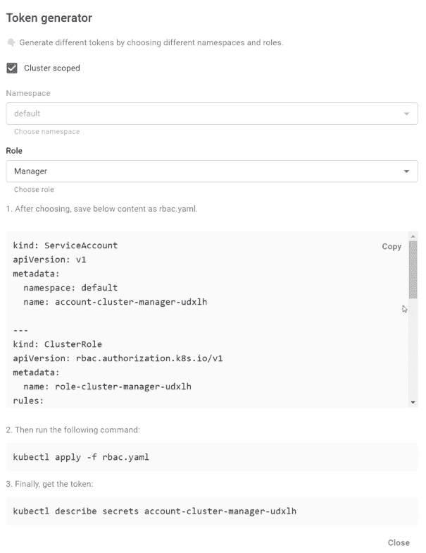

图 9.2 – Chaos Mesh 仪表板中的令牌生成器界面

- 3. 确保按照对话框所示的说明操作，并复制令牌名称以及令牌本身（运行 `kubectl describe` 命令后显示）。您需要点击**关闭 (Close)** 来关闭此对话框并返回到**图 9.1**所示的 RBAC 界面。在相应的框中输入令牌名称和令牌值，然后点击**提交 (Submit)**。这应该为您重新加载仪表板，显示与**图 9.3**所示类似的主页：

### 故障注入和混沌测试

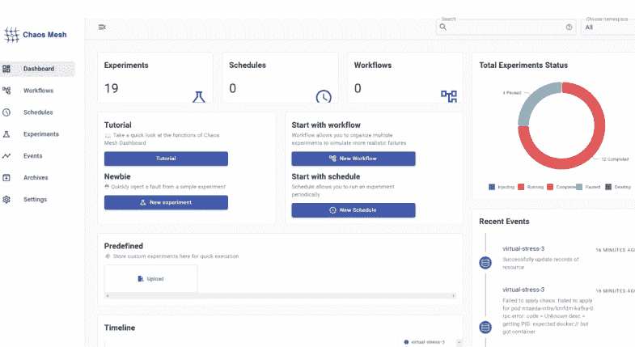

图 9.3 – Chaos Mesh 仪表板的示例首页显示

- 4. 从这里，我们可以开始点击**新建实验 (New experiment)** 按钮来创建一个新的基础混沌实验。这将加载一个类似于**图 9.4** 所示的新屏幕。默认将选择 **Kubernetes**，您可以点击**压力测试 (Stress Test)** 在集群中创建一个新的压力测试实验。将出现选项，让您可以填写 CPU 工作线程数量、要模拟的 CPU 负载百分比以及其他配置选项。如**图 9.4** 所示填写值，并向下滚动表单直到看到**提交 (Submit)** 按钮。点击设置 CPU 压力测试的值并移动到下一部分，在在该部分您可以设置实验的目标：

### 实施故障注入和混沌测试

| 新建实验 | 载入自 | 通过 YAML |
|---|---|---|
| 注入到 | | |
| Kubernetes | Hosts | |
| 注入到 | | |
| Kubernetes | Pods | |
| 注入到 | | |
| Kubernetes | Nodes | |
| 注入到 | | |
| Kubernetes | Namespace | |
| 注入到 | | |
| Kubernetes | Service | |
| 注入到 | | |
| Kubernetes | Ingress | |
| 注入到 | | |
| Kubernetes | Deployment | |
| 注入到 | | |
| Kubernetes | StatefulSet | |
| 注入到 | | |
| Kubernetes | DaemonSet | |
| 注入到 | | |
| Kubernetes | CronJob | |
| 注入到 | | |
| Kubernetes | PodGroup | |
| 注入到 | | |
| Kubernetes | ConfigMap | |
| 注入到 | | |
| Kubernetes | Secret | |
| 注入到 | | |
| Kubernetes | PersistentVolume | |
| 注入到 | | |
| Kubernetes | PersistentVolumeClaim | |
| 注入到 | | |
| Kubernetes | StorageClass | |
| 注入到 | | |
| Kubernetes | ClusterRole | |
| 注入到 | | |
| Kubernetes | ServiceAccount | |
| 注入到 | | |
| Kubernetes | Ingress | |
| 注入到 | | |
| Kubernetes | Node | |
| 注入到 | | |
| Kubernetes | Pod | |
| 注入到 | | |
| Kubernetes | Endpoints | |
| 注入到 | | |
| Kubernetes | Service | |
| 注入到 | | |
| Kubernetes | Namespace | |
| 注入到 | | |
| Kubernetes | Pods | |
| 注入到 | | |
| Kubernetes | Nodes | |
| 注入到 | | |

- 5. 确保按照对话框所示的说明操作，复制令牌名称以及令牌本身（运行 `kubectl describe` 命令后显示）。您需要点击**关闭 (Close)** 来关闭此对话框并返回到**图 9.1**所示的 RBAC 界面。在相应的框中输入令牌名称和令牌值，然后点击**提交 (Submit)**。这应该为您重新加载仪表板，显示与**图 9.3**所示类似的主页：

- 4. 从这里，我们可以开始点击**新建实验 (New experiment)** 按钮来创建一个新的基础混沌实验。这将加载一个类似于**图 9.4** 所示的新屏幕。默认将选择 **Kubernetes**，您可以点击**压力测试 (Stress Test)** 在集群中创建一个新的压力测试实验。将出现选项，让您可以填写 CPU 工作线程数量、要模拟的 CPU 负载百分比以及其他配置选项。如**图 9.4** 所示填写值，并向下滚动表单直到看到**提交 (Submit)** 按钮。点击设置 CPU 压力测试的值并移动到下一部分，在在该部分您可以设置实验的目标：

- 5. 确保按照对话框所示的说明操作，复制令牌名称以及令牌本身（运行 `kubectl describe` 命令后显示）。您需要点击**关闭 (Close)** 来关闭此对话框并返回到**图 9.1**所示的 RBAC 界面。在相应的框中输入令牌名称和令牌值，然后点击**提交 (Submit)**。这应该为您重新加载仪表板，显示与**图 9.3**所示类似的主页：


# 实现故障注入和混沌测试 171

5. 接下来，将使用 AKS 集群进行测试并执行相同的操作。你会注意到只有“服务直连”（service-direct）选项被启用。点击该选项并等待操作完成。完成后，点击包含集群的所在行右侧的“管理操作”（Manage actions）链接。这将打开一个新的窗格面板（如图 9.10 所示），列出该集群可用的服务直连混沌实验：

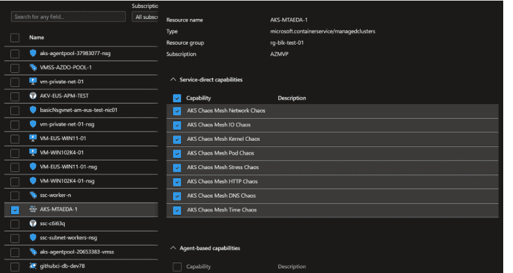

图 9.10 – 可用的服务直连功能列表

6. 此列表列出了通过调用 Kubernetes API 可以执行的操作。对于其他资源类型，这些功能将反映受 Azure Resource Management API 影响的属性或操作。例如，当点击虚拟机规模集的“管理操作”链接时，你将看到一组可以直接在机器上运行的功能，这是因为在启用基于代理的实验类型时已安装了代理。图 9.11 展示了为虚拟机或虚拟机规模集启用的基于代理的实验类型示例：

### 故障注入和混沌测试

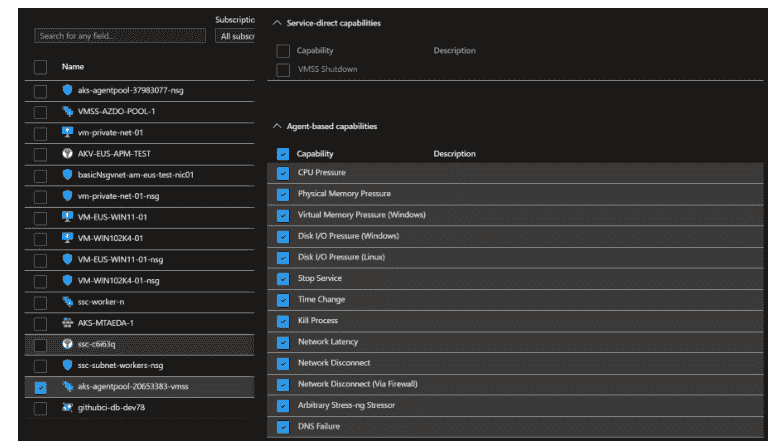

我们现在可以进入“实验”（Experiments）窗格创建一个新实验。点击“实验”将进入一个新屏幕，其中显示实验定义（如果你之前创建过）或提示你创建一个新的：

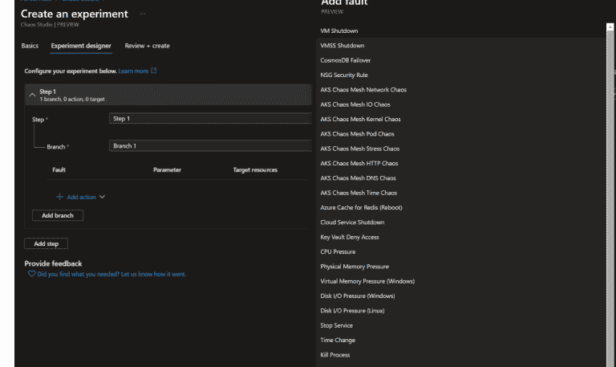

图 9.11 - 可用的基于代理的功能列表

图 9.12 - 显示可用注入故障的实验创建窗格

8. 在编辑故障定义时，从下拉菜单中选择 AKS Chaos Mesh Stress Chaos。你会看到两个需要填充的字段——一个用于实验，另一个用于 JSON 规范，后者告诉实验目标是什么。我们早些从 Chaos Mesh 保存的 Chaos 定义文件将包含了我们所需的信息，但该文件是 .yaml 格式。一种方法是使用在线 YAML 转 JSON 转换器，并从选择器向下复制 YAML 内容。文件的其余部分不需要。

9. 如果你愿意，也可以手动将所需的 YAML 转换为 JSON。完成后，复制转换后的 JSON 并将其粘贴到 jsonSpec 字段中，如图 9.13 所示。这将告诉实验目标是 mtaeaida-infra 命名空间，并在命名空间中的 pod 上运行 10 分钟的 CPU 压力测试：

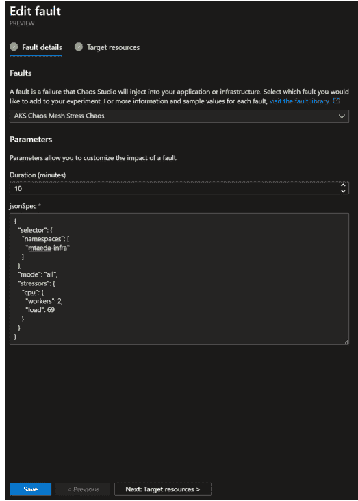

图 9.13 – 使用来自 YAML 文件的 JSON 设置更新 jsonSpec 字段

### 故障注入和混沌测试

- 10. jsonSpec 字段是必的——如果没有它，实验将不知道做什么或对哪个命名空间采取操作。如果你还没有这样做，请点击**下一步：目标资源**（Next: Target resources）；你将看到你已启用基于服务的故障的 AKS 集群列表。选择合适的集群，点击*保存*（Save），并返回实验编辑器。点击**保存**（Save）回到主实验。在顶部，你会看到一个启动（Start）按钮，它将触发实验。在在此之前，需要为作为混沌实验一部分创建的托管身份赋予权限。

- 11. 在 Azure 门户中，转到主屏幕并点击**添加 | 添加角色分配**（Add | Add role assignment）选项。对于 AKS 集群，你将寻找名为 *Azure Kubernetes RBAC Cluster Admin* 的角色。选择此角色并点击下一步选择要分配的身份。点击**托管身份**（Managed identity）作为要分配访问的类型，并点击**选择成员**（Select members）打开托管身份窗格。

- 12. 在**托管身份**（Managed identity）下，使用下拉菜单找到**混沌实验**（Chaos Experiments），它应该关联有一个身份，如图 9.14 所示。在选择*Chaos Experiment* 后出现的身份上，注意你的实验名称应该是身份名称的一部分。点击身份窗格上的**提交**（Submit）按钮并点击**下一步**（Next）进入**审核**（Review）窗格。点击**审核并分配**（Review + Assign），RBAC 机制将会被添加：


图 9.14 - 为托管身份添加角色分配

- 13. 返回**实验**（Experiments）窗格并找到该实验。点击它后，你将在窗格顶部看到**启动**（Start）按钮——按下此按钮并确认你想运行实验。实验现在将启动并按照你指定的持续运行。

现在你已经使用 Azure Chaos Studio 启动了第一次成功的混沌实验，请花些时间创建不同类型的实验。记住，如果你在特定实验类型的 **jsonSpec** 字段上遇到困难，可以返回 Chaos Mesh 仪表板并使用相同参数创建一个新实验。

### 故障注入和混沌测试

这将为你创建 YAML 定义，你可以对其进行调整。

### 总结

在本章中，我们涵盖了关于预测、处理和引发故障的许多内容。我们探索了混沌的范式，以及如何使用实验测试我们的应用程序。在我们查看现代扩展性设计时，这些实验将对我们有用。

### 问题

- jsonSpec 与异常有什么区别？
- 哪些是可以预测的故障？
- 故障注入是一个独立的概念吗？
- 故障注入发生在何处？
- 在设计实验时，应该有多大的影响？
- 哪些资源类型与 Chaos Studio 兼容？

## 延伸

- 什么是故障注入？https://www.gremlin.com/blog/what-is-fault-injection/
- Azure 状态：https://status.azure.com/en-us/status/
- 故障注入测试：https://microsoft.github.io/code-with-engineering/
- 混沌原理：https://principlesofchaos.org/
- Netflix 猴子军：http://techblog.netflix.com/2011/07/netflix-simian-army.html

- Chaos Toolkit：https://github.com/chaostoolkit
- 混沌工程：https://learn.microsoft.com/en-us/architecture/framework/resiliency/chaos-engineering
- 混沌工程：历史、原理与实践：https://www.gremlin.com/community/tutorials/chaos-engineering-the-history-principles-and-practice/
- Chaos Mesh：https://chaos-mesh.org/
- 云原生基金会：https://www.cncf.io/
- 使用服务直连故障进行 Cosmos DB 故障转移：https://docs.microsoft.com/en-us/azure/chaos-studio/chaos-studio-tutorial-service-direct-portal
- 使用 Chaos Mesh 故障杀死 AKS pod：https://docs.microsoft.com/en-us/azure/chaos-studio/chaos-studio-tutorial-aks-portal
- Azure Chaos Studio：https://azure.microsoft.com/en-us/services/chaos-studio/
- Chaos Studio 支持的资源类型和角色分配：https://docs.microsoft.com/en-us/azure/chaos-studio/chaos-studio-fault-providers


# 10
面向可扩展性的现代设计模式

在过去，确定如何处理应用程序的可扩展性主要取决于容量规划和托管在数据中心中的静态资源。随着云服务的普及，现在有了更灵活的选项来管理应用程序的可扩展性。这并不是说不需要容量规划——它仍然是系统架构设计的重要部分。

然而，在云中实现可扩展选项的方法往往会有所不同。过去静态资源是主柱，而现在你可以根据应用程序托管的方式，利用自动伸缩选项。如 **Kubernetes**、应用服务（app services）和托管存储等云服务可以进行单独调优，以便在没有重度负载时提供最少的资源消耗，并在最需要时实现资源利用的最大化。

本章将重点关注针对潜在性能问题需要监控的关键指标，以及哪些设置可以进行精细调整，以便对性能下降做出自动响应。

我们将在本章涵盖以下主题：

- *自动伸缩机制*
- 为 Kubernetes 服务实现自动伸缩
- 为 Azure App Service 实现自动伸缩

在本章结束时，你将理解基于 CPU 负载、**输入/输出 (I/O)** 负载、请求负载和内存密集型操作等指标的不同类型的自动伸缩。你还将能够了解如何为部署到 Kubernetes 的服务实现自动伸缩功能，以及如何为部署到 Azure Web Apps 或 Azure API Apps 的服务实现自动伸缩功能。

> **注意**
> 本章提到的所有白皮书和其他来源的链接可以在章末的*进一步阅读（Further reading）*部分找到。

### 自动伸缩机制

在应用程序运行期间有四个主要的指标需要关注，可以识别维护可用性或响应性 SLA（服务水平协议）的潜在问题。这些包括 CPU 负载、I/O 负载（在 Kubernetes 中通常表现磁盘压力）、请求和网络负载（通常表现为网络压力和内存负载）。理解这些指标对于帮助你准备调整配置设置、从而构建可扩展的支持基础设施至关重要。了解你的应用程序组件如何影响这些指标中的每一个也同样重要。

### 计算和 CPU 负载

CPU 的使用量在物理机、虚拟机和托管云服务之间差异很大。对于云服务，可以进行更大量的细粒度调整。例如，对于 **Azure App Service**，初始为 App Service 提供的可用计算量与托管该服务的 App Service Plan（应用服务计划）绑定。可以设置阈值来寻找持续时间超过 2 到 5 分钟的持续 CPU 活动、CPU 使用异常（峰值），甚至是特定时间点的基准（例如设定的百分比）。

类似的规则在 Kubernetes 世界中也适用，但有所不同。Kubernetes 不仅允许你对集群内的节点（在 Kubernetes 生态系统中称为主机）设置监控，还可以对该集群内运行的任何 pod 设置监控。此外，你并不限于集群内的处理能力总和——它可以被过度分配的，这可能会导致各种不同的问题。

接下来我们将查看磁盘和 I/O 负载，在某些情况下，这真的会让你的应用程序陷入字面上的停滞。

### 磁盘和 I/O 负载

对磁盘存储使用的预期管理（无论是通过直接连接存储、闪存存储还是云服务供应商提供的托管存储）通常都是不应该忽视的。如果你知道你的应用程序需要高频率的磁盘读写，你将希望花时间规划如何最好实现这些需求。.NET 6 的一个新功能是重写了 `FileStream` 对象，这提升了性能并可能减少潜在的 I/O 冲突问题。

在某些情况下，应用程序可能会使用日志文件写入有关应用程序执行或可能遇到的任何错误的信息。在另一些情况下，可能有更多理由使用磁盘存储执行数据处理或读写大量事务。在金融服务应用程序中，使用存储来读取、排序和写入值是刻意为之，以避免遇到 CPU 或内存瓶颈。如果使用的存储不符合应用程序的 I/O 要求，可能会发生磁盘冲突，并对应用程序产生更严重的影响。通常，磁盘配置不是从 I/O 角度设置来升级的，但它可以帮助你调整其他可能补偿的资源。

我们将涵盖的指标是网络负载，如果没有足够的空间让所有流量通过网络，请求和响应可能会发生拥堵。

### 请求和网络负载

另一个细粒资源是网络带宽，特别是因为虚拟或物理网络能够处理的吞吐量是有限的。通常在设计云提供商的区域足迹时会考虑网络因素，在其中可以检查吞吐量限制，并安装适当大小的网络管道，以允许流量按预期流动。

由于大多数开发者并不希望（也不被期望）去调整网络设置，因此监控（并响应）网络负载的主要方法是通过每秒请求数（RPS）。如果你的应用程序组件之一预计接收大量请求，但又需要大量的计算和/或内存资源来处理每个请求，那么系统性能将在组件处理每个请求时减慢到爬行。调整网络不是选项，但预此此将组件设置为自动伸缩，甚至对特定组件进行请求节流（throttling），可以帮助限制使用你的应用程序时可能经历的程度。

我们现在通过深入内存密集型操作完成这个列表，这些操作会影响应用程序中的组件。

## 内存密集型操作

在内存的生命周期内管理性能是一项艰巨的任务，特别是当资源有限时。某些编程语言对内存的要求会导致其变得很快。例如，Java 要求运行实例至少可用 2 吉字节 (GB) 的内存。如果你将其部署到 Kubernetes 环境中，这可能会迅速累积并可能饿死其他服务。

了解应用程序如何使用内存将极大帮助你优化应用程序的设置，以及如何实现扩展来缓解内存压力。

## 为 Kubernetes 服务实现自动伸缩

Kubernetes 本身是一个非常强大的编排平台，允许你控制特定的可执行代码可以访问多少系统资源。由于 Kubernetes 的实现可以在本地、云端虚拟机或通过托管服务进行，因此自动伸缩配置有多种选项。这些选项从 Kubernetes 本身的模式到云托管服务的特定功能，再到为特定场景定制的第三方插件。

### Kubernetes 原生选项

作为一个编排器，Kubernetes 提供了丰富的生态系统，允许你以各种方式根据需要使用多少集群计算能力。某些功能允许你控制应用程序如何扩展，取决于我们在上一节中涵盖的一些主要指标。在本节中，我们将从几个可以在集群中使用的原生选项开始。

### 水平 Pod 自动伸缩器

水平 Pod 自动伸缩器 (HPA) 是 Kubernetes 内部的构造，允许你指定一个目标条件或阈值，负载达到该阈值之前，集群将扩展并创建新的 pod 或一组 pod。最小和最大节点等常用参数适用于此处，使你能够对扩展发生的规模设置一些保护。另一个参数是部署本身正在经历的条件——即触发自动伸缩的是 CPU 还是内存。


## 用于可扩展性的现代设计模式

| 指标类型 | 说明 | 示例 |
|---|---|---|
| 资源 (Resource) | 直接与可用 pod 容器资源（CPU、内存）相关的指标。 | - type: Resource<br>  resource:`<br>    name: memory<br>    target:`<br>      type: Utilization<br>      averageUtilization: 70 |
| Pods | 与部署内的 pod 相关的指标通常按所有 pod 的平均值进行测量（每秒数据包数）。 | - type: Pod<br>  pods:`<br>    metric:`<br>      name: packets-per-second<br>    target:`<br>      type: AverageValue<br>      averageValue: 2k |
| 对象 (Object) 与集群内可能影响性能的其他对象的指标（每秒请求数）。 | - type: Object<br>  object:`<br>    metric:`<br>      name: requests-per-second<br>    describedObject:`<br>      apiVersion: networking.k8s.io/v1<br>      kind: Ingress<br>      name: main-route<br>    target:`<br>      type: Value<br>      value: 8k |
| 外部 (External) | 与集群外部对象相关的指标。例如，托管的队列服务。 | - type: External<br>  external:`<br>    metric:`<br>      name: queue_messages_ready<br>    selector: matchLabels: queue: "worker_tasks"<br>    target:`<br>      type: AverageValue<br>      averageValue: 20 |

表 10.1 - 与 HPA 相关的 Kubernetes 指标类型

Kubernetes 文档建议创建自定义集群指标而不是使用外部指标类型。这是因为保护集群内部的自定义指标比尝试保护指向外部托管服务的指标要容易。它还消除了对集群外部平台的依赖。然而，在某些情况下，创建外部指标类型可能适用于您的应用程序，在设计过程中应仔细检查其使用情况。

## 副本集 (ReplicaSets)

控制 Kubernetes 部署在扩展时保持灵活性的技术方法是建立一个具有较大最大 pod 值的 ReplicaSet。虽然这种方法去除了扩展的自动化，但它并不允许控制 ReplicaSet 中的 pod 数量。出于可用性考虑，通常在部署中使用 ReplicaSet 是一项良好实践，以确保始终有最小数量的 pod 可用。手动控制扩展而不是自动扩展适用于低影响负载，因为在这种负载下，检测到需要更多资源的情况不太可能引发应用程序问题。

Kubernetes 平台的某些元素允许您控制自动伸缩，无论集群托管在何处。接下来，我们将查看针对集群托管位置的扩展问题可供使用的选项——在本例中，即公有云。

### 云平台选项

由于每个提供 Kubernetes 服务的云平台都有几种不同的配置可扩展性的方法。由于我们的示例涉及 Azure，我们将检查检查用于配置 Azure Kubernetes Service (AKS) 自动伸缩的设置。请记住，Amazon 和 Google 可能有相似（或不同）的配置方法。

## 节点池自动伸缩

在 AKS 中，有一个节点池（node pools）的概念——它们是 Kubernetes 集群的一部分虚拟机组，用于管理系统工作负载以及您部署的应用程序工作负载。原生部署将设置一个默认节点池，通常带有三个节点用于分发这些负载。如前一节所述，Kubernetes 允许您为集群过度分配资源，拥有一种根据资源需求增加而调整节点池的方法似乎是一个很好的选择。

您可以通过几种不同的方式在 AKS 中设置自动伸缩。从视觉角度来看，您可以使用 Azure 门户来配置节点池的自动伸缩设置。这通常有助于那些不熟悉 IaC（基础设施即代码）的人员。门户允许您在手动或自动伸缩之间进行选择。在自动伸缩时，您会被要求输入节点池可以扩展到的最大节点数。这可以保护您免受产生数十个集群节点的自动伸缩事件的影响，这可能是非常不必要且相当昂贵的。

配置节点池自动伸缩的首选方法是使用 IaC。这允许对配置进行集中管理和重复使用，消除了人为错误的可能。例如，使用 Terraform，一个 AKS 配置可能如下片段所示。部分内容已经过精简，以便我们关注自动伸缩设置：

```terraform
resource azureerm_kubernetes_cluster "aks-mtaeda-1" {
  name = "aks-mtaeda-1"
  ...
  default_node_pool {
    name = "defaultpool"
    enable_auto_scaling = true
    max_pods = 100
    min_count = 1
    max_count = 8
    vm_size = "standard_b4ms"
  }
}
```

## 为 Kubernetes 服务实现自动伸缩

注意，您需要启用自动伸缩，因为这不是节点池的默认设置。通过设置最小和最大计数值，您正在指示 Terraform 在默认节点池中启用至少一个节点和最多六个节点。当此集群创建时，无论 `node_count` 设置为多少，它将从节点池中的单个节点开始。

AKS 允许您为集群定义多个节点池，如果您有资源密集型工作负载，并且可以将其隔离到不同的节点上而不避免占用系统工作负载和进程的资源，这会非常有用。接下来，我们将查看如何为多个节点池设置自动伸缩。

## 带有自动伸缩的分层节点池

为不同的工作负载设置单独的节点池初看起来大此小用。毕竟，如果您的应用程序组件影响较小且非常轻量，为什么要额外启动节点呢？在应用程序需要扩展的情况下，以下片段概述了我们如何使用 Terraform 创建池：

```terraform
resource azureerm_kubernetes_cluster_node_pool "app-pool" {
  enable_auto_scaling = true
  name = "app-pool"
  cluster_id = azureerm_kubernetes_cluster.aks-mtaeda-1.id
  vm_size = "standard_D8sv5"
  min_count = 0
  max_count = 10
  max_pods = 100
}
```

我们仍在启用自动伸缩，并设置节点计数。在这种情况下，可以看到比默认池更强大。在部署过程中，您可以使用 nodeSelector 选择此池。

### 第三方插件

对于任何平台来说，原生功能通常都可以扩展，并最终导致第三方供应商提供的产品。Kubernetes 有许多由个人和公司开发和维护的插件，适用于各种场景。关于扩展，我们将查看一个与我们的应用程序匹配良好的插件——KEDA。

### KEDA

KEDA（Kubernetes Event-Driven Autoscaling，事件驱动伸缩）是一种通过允许对资源或部署设置事件指标来增强 Kubernetes 自动伸缩能力的插件。这并不是说事件可能与基准指标无关——但它为应用程序如何以及何时扩展提供了更多选项。在编写时，KEDA 有超过 50 种可用伸缩器，但我们将特别关注两个：Apache Kafka 和 Azure Acquisition Insights。

> 注意事项
> 请花时间查看本章扩展阅读部分关于上述 KEDA 伸缩器的链接。

Apache Kafka 伸缩器允许根据处理消费者组和主题时检测到的延迟处理触发器。这将导致可用副本调整以减少检测到的延迟。为了利用这种机制进行扩展，您需要确保 `scaleTargetRef` 部分包含对 Kafka 部署名称的引用以及至少一个组名称。您可能会发现某些组不需要配置自动伸缩，因为消耗的消息量较小。对于其他领域，例如设备、通知或标识，消耗的消息量可能更大，为每个消费者组配置自动伸缩会更为合理。

Insights 伸缩器允许根据捕获的特定指标处理触发器，无论这些是内置还是自定义指标。如果需要，可以通过调整 `metricFilter` 属性并包含针对特定结果的子句对指标进行进一步细化。


# 为 Azure App Service 实现自动伸缩

虽然本书以及本章一直重点关注了 Kubernetes，但你可能希望利用复杂度较低的平台即服务（PaaS）组件来托管你的应用程序。Azure App Service 的入门门槛比 Kubernetes 低得多，并允许你根据需求定制服务类型。自动伸缩（Autoscaling）是 App Service 内置的许多功能之一，可以通过不同的途径进行配置。这两种途径是 Azure Monitor（平台级监控和告警套件）以及 Application Insights。我们还将检查一些可以应用于 Web Apps 和 API Apps 的 App Service 特性。

## 常用平台选项

使用云原生平台组件的优势之一是你可以将它们应用于你正在使用的云环境中的任何资源类型。通过 Azure Monitor，你可以利用由监控器、诊断信息和告警组成的庞大生态系统，帮助你主动和响应地管理应用程序性能、可用性和可靠性。

## Azure Monitor

Azure Monitor 使用四种主要类型的条件来信号潜在问题的发生。这些如下：

- 指标告警（Metric alerts）：这些是基于特定指标达到或超过预定义目标触发的告警。这些包括 CPU 使用率、内存使用等。指标告警的一个额外维度是时间。你可以设置一个阈值，如果 CPU 使用率在持续 5 分钟内达到 75%，则触发告警。
- 日志告警（Log alerts）：这些告警在 Log Analytics 中寻找可能指示问题或错误的特定值或字符串。
- 活动日志告警（Activity Log alerts）：这些告警指定了当发生不被允许或可能指示系统受损的操作或事件时的触发。例如，活动日志记录了有关创建和部署云资源的信息，以及对基础设施级故障的审计。
- 智能检测告警（Smart Detection alerts）：这些告警利用机器学习的力量来适应应用程序的稳定状态，然后利用这些信息检测异常并根据这些异常发布告警。Application Insights 是利用智能检测告警的平台组件之一。

## 可扩展性的现代设计模式

虽然 Azure Monitor 不仅关于告警，但衡量不同平台方面以确定资源是否需要扩展的能力是非常有用的。告警可以使用操作组（Action Groups）进行自动修复，操作组是 Azure 的一种结构，允许自动化修复浮到平台层的问题。这些条件也考虑了扩展 App Services（更具体说是 App Service Plans）以匹配需求的能力。我们将在两个子章节中介绍如何配置自动伸缩。

智能检测告警特别有趣，因为它们允许我们通过简单的配置设置，利用机器学习检测应用程序中的故障和异常。这并不是说不会出现其他影响——例如，成本可能会成为问题，特别是如果 Application Insights 接收的信息量每天达到数百兆字节（MB）或超过 GB 时。无论数据量大小，我们仍然可以结合智能检测使用 Application Insights 提供的绝佳洞察。

### Application Insights

我们已经看到，只需创建一个实例并将 SDK 集成到我们的代码库中，Application Insights 就能提供丰富的监控、洞察和数据点。使用智能检测的额外益处是当检测到异常或故障时，它会为工程师提供主动的诊断报告。虽然使用智能检测有助于提供自动告警，但根据这些告警设置扩展其他资源的规则可能并不实际。

智能检测的一个非常有价值的领域是 Application Insights 提供的设置面板或智能检测告警列表。这些包括延迟降低、异常异常、故障、内存泄漏检测、响应延迟降低和跟踪延迟降低。当启用智能检测时，这些每个项目的告警规则、条件和修复措施都是预先创建。这允许你看到这些告警是如何构建的，并反过来利用配置在你的 App Services 中构建自定义自动伸缩事件。

在进一步了解 Azure Monitor 和 Application Insights 等集成平台工具如何能提供有关 App Service 性能的重要信息后，我们现在可以转向两种 App Service 类型：Web Apps 和 API Apps 的特殊情况。

### Web Apps 的调整

Web Apps 可能是 Azure 中最著名的 App Service 实现，自平台成立以来一直存在。多年来增加了许多功能和选项——托管和运行静态 Web 应用的能力、使用 Docker 容器作为运行 Web 应用的机制，以及可以托管应用程序的各种运行时。所有 App Services 都要求存在 App Service Plan，它控制服务的基础设施架构，并与 Azure Monitor 等平台功能挂接。

要调整 Web App 或任何 App Service 的扩展设置，你有两个选项。一种是向上扩展（scale up），这是一种手动操作，需要切换服务计划类型。另一种是向外扩展（scale out），可以手动或自动完成。这就是智能检测告警所使用的逻辑可以派上用场的地方，因为它让你了解如何根据计划可用的各种指标类别在 App Service Plan 上构建自定义操作。适用指标类型的完整列表可以在“进一步阅读”下的“Azure App Services Web 站点监控”中找到。

CPU 负载、内存负载、数据 I/O 和页面加载时间等常用指标都可以作为驱动自动伸缩的告警手段。其他复杂的指标，例如关于建立和关闭连接的低级 TCP 信息也可以使用。

### API Apps 的调整

由于 API Apps 曾是独立的 App Service 类型，通常会……

### 总结

在本章中，我们检查了应用程序性能的一些关键指标、如何调整资源以适应需求，以及如何为某些基础设施部分设置自动扩展。通的可扩展性模式通常关注能够调整应用程序可用的 CPU 或内存以缓解需求增长。

甚至可以通过新的语言功能来提高处理效率，例如 .NET 6 中新的 FileStream 改进。通过不同的复杂度，我们查看了如何使用指标、阈值和操作组为 Kubernetes 对象配置自动扩展。当你继续基于事件的系统时，这些模式将成为你工具箱的重要部分。

### 问题

- 网络负载可以强制虚拟或物理网络的扩展事件吗？
- 在确定自动伸缩模式时，哪些性能指标可能是工程师的主要关注点？
- 所有主要的性能指标（如 CPU、网络压力、磁盘压力和内存）是否都可以作为创建水平 Pod 伸缩器（HPA）的条件？
- 在 AKS 集群中创建多个池节点，而不是增加默认池节点的大小不是更容易吗？
- 如果 Kubernetes 创建用于 HPA 指标的良好实践是不依赖外部系统或对象，为什么使用像 KEDA 这样的插件被认为是有效的？


## 延伸阅读 193

- [水平 Pod 扩缩 (Horizontal Pod Autoscale)，由 Kubernetes 提供，访问：https://kubernetes.io/docs/tasks/run-application/horizontal-pod-autoscale/
- [水平 Pod 扩缩教程 (Horizontal Pod Autoscale Walkthrough)，由 Kubernetes 提供，访问：https://kubernetes.io/docs/tasks/run-application/horizontal-pod-autoscale-walkthrough/
- [Kubernetes 事件驱动自动伸缩 (Kubernetes Event-driven Autoscaling)，由 Keda 提供，访问：https://keda.sh/
- [Kafka 扩展器文档 (Kafka Scaler Documentation)，由 Keda 提供，访问：https://keda.sh/docs/2.8/scalers/apache-kafka/
- [Application Insights 扩展器文档 (Application Insights Scaler Documentation)，由 Keda 提供，访问：https://keda.sh/docs/2.8/azure-app-insights/
- [Azure Monitor 警报类型 (Azure Monitor Alert Types)，由 Microsoft 提供，访问：https://docs.microsoft.com/en-us/azure/azure-monitor/alerts/alerts-types
- [Azure Monitor 警报最佳实践 (Azure Monitor Alerts Best Practices)，由 Microsoft 提供，访问：https://docs.microsoft.com/en-us/azure/azure-monitor/best-practices
- [自动伸缩最佳实践 (Autoscale Best Practices)，由 Microsoft 提供，访问：https://docs.microsoft.com/en-us/Azure/azure-monitor/autoscale/autoscale-best-practices
- [操作组 (Action Groups)，由 Microsoft 提供，访问：https://docs.microsoft.com/en-us/azure/azure-monitor/alerts/action-groups
- [主动性故障诊断 (Proactive Failure Diagnostics)，由 Microsoft 提供，访问：https://docs.microsoft.com/en-us/azure/azure-monitor/alerts/proactive-failure-diagnostics
- [Azure 服务网站监控 (Azure Services Web Site Monitoring)，由 Microsoft 提供，访问：https://docs.microsoft.com/en-us/Azure/app-service/web-sites-monitor

## 11 最小化数据丢失

在本章中，我们将研究减少或消除数据丢失的技术。云原生开发架构带来了一个固有的风险，即由于独立服务之间的瞬态故障或它们之间的连接问题导致数据丢失。因此，我们针对此类故障来设计应用程序，而事件驱动架构使用了一些关键技术来降低这种丢失风险。我们将探索一些设计范式，例如最终一致性和保证投递，并学习如何根据语境识别可能易丢失的数据，以及定义可以接受多少程度的丢失（如果有的话）。

在本章中，我们将涵盖以下关键主题：

- 进一步了解典型的数据一致性范式，例如即时一致性和最终一致性
- 学习如何识别并为潜在的数据丢失制定计划，包括接受的丢失水平和缓解策略
- 对于需要零数据丢失的情况，学习如何实现能够确保信息投递的技术以消除数据丢失
- 在假设或预期会数据丢失的情况下，理解并考虑数据丢失的影响

### 技术要求

对于本章，你将需要 GitHub 源代码，地址为 https://github.com/PacktPublishing/Implementing-Event-Driven-Microservices-Architecture-in-.NET7/tree/main/chapter11。

### 防止数据丢失

对于所有单体应用而言，确保数据的完全完整性是一个静态且可管理的概念。大多数底层数据存储都是原子性、一致性、隔离持久持久（ACID）。一旦数据以请求的形式接收，单个编译后的应用程序将就会处理完成。对该操作完整性的威胁很少，而且重要的是，它们是高度可观测且一致的。

例如，数据存储的故障可能会导致整个应用程序（或部分应用程序）持续失败，直到修复。代码故障表现为 Bug，它会在相同的请求上反复失败。单体应用中的数据损坏和丢失是一个“全有全无”的游戏。如果数据丢失了——你将通过持续的操作失败获知。

将应用程序迁移到云带来了两个新挑战：

- 可扩展架构意味着多个独立组件通过协调许多微事务来交付一个整体成功的、更大的容量。
- 鉴于微事务可以在任何时间发生且完成所需的时间不同，我们必须理解作为 ACID 事务的最终一致事务的概念。
- 这些组件之间的连接点以及组件的可用性受到瞬态故障的影响。
- 这可能是网络故障或平台服务故障引起的。虽然云的设计提供了更高水平的冗余和可用性以避免这些故障，但它们仍然由于多种原因而发生。从应用程序的角度来看，它们往往看起来是随机且不一致的。

这两个挑战之间产生了一种二分法关系。

一方面，我们预计跨组件的完整性偶尔会出现缺陷。数据在多个服务之间应该是最终一致的，但不是即时的。因此，我们必须设计服务以允许在短时间内存在某种程度的不一致性。另一方面，许多瞬态故障可能发生在多个组件之间。这反过来意味着子组件之间可能会发生无法察觉的事务丢失。

## 数据一致性范式

那么，在任何给定时刻，当数据在组件之间不一致时——我们是在等待数据达到最终一致，还是我们正在经历由于未察觉的瞬态问题导致的数据丢失？

需要注意的两个主要一致性范式被称为 ACID 和 BASE。我们将在后续章节中定义这些缩写，并理解它们是什么以及区别何。为了记住这些缩写，我们可以使用化学中的类比，其中 BASE 是 ACID 的对立面。

### ACID 范式/即时一致性

如前所述，ACID 代表原子（Atomic）、一致（Consistent）、隔离（Isolated）和持久（Durable）。
通过即时一致性，我们获得了每个事务将作为一个操作单元完成的保证。因此，它要么成功要么失败。在即时一致性模型中，我们期望数据在任何时候都是一致的。

### BASE 范式/最终一致性

另一个范式是 BASE。BASE 代表基本可用（Basically available）、软状态（Soft state）和最终一致（Eventually consistent）。最终一致性的概念与事件驱动系统天然契合。当事件被写入时，它们实际上是加入了队列。事件的订阅者可能会立即反应，也可能在未来的任何点反应。这取决于堆积了多少事件以及消费者能够提供的处理吞吐量。

### 最小化数据丢失

在多个位置。这种传播遵循最终一致性的概念。最终，数据将会传播；因此带来了跨服务的一致性。最终一致性是事件驱动架构的一个极佳模型。随着时间的推移，预计它将具有更高的概率收敛（变得一致）。


让我们回到 BASE 的缩写：

- **基本可用 (Basically available)：** 这意味着数据读写操作是可用的，但不保证的。这与分布式应用程序中发生的瞬态故障非常匹配。当与基本可用的服务交互时，读写之间的一致性没有保证。
- **软状态 (Soft state)：** 这意味着数据的状态可能会波动。随着时间的推移，预计它将具有更高的概率收敛（变得一致）。
- **最终一致 (Eventually consistent)：** 这意味着只要系统持续运行，我们最终可以预期任何写入都会反映在后续读取中，且状态将保持一致。

将该理论付诸实践，我们可以考虑 MTAEDA 服务的支付。在客户配置中添加新支付方式的过程与为客户充值交通卡余额的费用是完全不同的过程。如果客户添加了新的支付方式，并紧随后使用它进行交易，我们无法绝对保证新支付方式的验证和批准能够及时完成。记住，这是设计如此。我们解耦了这些过程以实现极高的可扩展性和性能目标。

你有多种方法可以构建逻辑模式来容忍最终一致性。例如，你可以不断重试失败的过程，直到它最终成功。这很笨拙，但执行频率比你想象的要高得多。一个更好且广为人知的模式是 Saga 模式。


### Saga 模式

解耦的业务事务可以重构为一种流，即 Saga 模式，这样它们在依赖于最终一致性数据收敛时，就可以消除失败/重试模式。这种做法通过改变事务和事件的依赖顺序，并在实现一致性时触发下一个事务来实现的。实质上，这是在重构一个单体过程，但通过使用事件作为松耦合，我们避免了引入硬依赖或性能瓶颈。

添加和使用新支付方式的示例是一个可以从此模式中受益的例子。发布新的支付方式时可以通过请求增加充值卡余额。此时，充值过程可以发布一个事件，请求将支付方式以“待处理”状态添加到客户的充值请求中。支付处理服务应该（按照其自己的时间和节奏）对此做出响应、验证并添加新的支付方式。它将发布一个事件，告知客户的支付方式已更新。充值过程应该（按照其自己的时间和节奏）响应客户支付方式已更新的事件，并查找任何依赖该方法的待处理充值活动。

虽然这听起来可能有些复杂，但重要的是注意到它是如何解耦过程，并允许通过事件进行协调，而不是通过单个阻塞过程来实现一些“设置后即忘”的过程。通过按此顺序链化事务（作为 Saga），我们看到了更少的轮询和更多的事件驱动活动。通过这种方式我们获得了最终一致性和更高的可扩展性。

# 命令查询责任分离 (CQRS)

最终一致性对于修改状态的事务和查询状态的事务要求截然不同的行为。修改状态是权威的，且通常会导致后续事件确认修改，并触发流中的后续步骤。查询状态必须考虑到响应可能是不一致的，并且可能与之前的修改存在差异这一事实。这驱动了系统中命令查询责任分离（CQRS）模式的发展。这意味着编写代码时，应该将命令（修改，也称为变动）与查询（读取）分离开。这避免了编写出可能从一个状态转换到另一个状态的代码，而这种状态转换在自然预期下是认为外部事务是具有 ACID 特质的。

在比较了即时一致性和最终一致性之后，你的关注可能会放在接受最终一致性、Saga 模式和 CQRS 上。重要的是，良好的解决方案将同时使用 ACID 和 BASE 范式。我们必须关注理解任何给定业务事务中这两种范式之间的相互作用。通常，你会在组件内部看到 ACID 事务，而在组件之间看到 BASE 事务。

# 识别可接受的数据丢失

在设计处理瞬态故障的系统时，数据丢失将不可避免地发生。许多架构模式可以层层叠加以尽量减少数据丢失，但要保证永远不会发生丢失是极具挑战性的。

在本章后面的部分，我们将检查数据丢失的影响以及我们可以补偿的内容。在在此之前，我们必须识别什么是可接受的什么是不可接受的数据丢失。这样做的好处是缩小不可接受数据丢失的范围，大部分精力将投入到尽力减少这种丢失。

# 可接受与不可接受的数据丢失

定义什么是可接受和不可接受的数据丢失，受所执行操作的背景以及在该背景下的业务影响的影响很大。例如，如果添加客户的新支付方式从未成功并导致了数据丢失，那么通过向客户标记问题并要求其重新输入来恢复这种损失可能是合理的。然而，如果背景是一个电子商务应用程序，将这种责任推给客户重复此类操作，可能会需要考虑重大的声誉损害。根据你的业务背景，你可能认为新支付方式的丢失是可接受的或不可接受的。

另一个可能接受或不可接受数据丢失的例子是导航历史。知道客户在电子商务网站上浏览过哪里对于显示最近访问的产品和其他相关产品非常重要。然而，如果这部分数据由于瞬态故障而丢失，系统并不会引入主要的功能性故障。另一个场景是应用程序跟踪用户正在阅读的电子书页面。在这种背景下，丢失最后的一页可能意味着从错误的位置继续阅读，无论是在同一台设备上还是在不同的设备上。根据语境，这可以被认为是应用程序的功能性故障。

你应用程序的关键功能将决定什么是可接受的、哪些是不可接受的数据丢失。

# 数据丢失的方法

系统中的数据可以通过多种方式丢失，从连接和可用性的瞬态故障开始。我们可以将任何故障机制抽象为两种主要的故障模式：

- 写入事件失败
- 消费事件失败

假设事件代理器不会在内部发生故障。事件驱动架构的关键要素是事件可以被一致且可靠地处理。这意味着如果接收到事件，它将由代理器记录。如果发出了消费事件的请求，它将得到服务。这些我们可以建立高度信任的假设，正如我们稍后探索的。

然而，所有系统组件必须在内部正确运行，并与事件代理器成功连接以创建和消费事件。我们可以很容易识别出许多数据丢失的方法：

- 组件之间的网络断开
- 网络包损坏
- 组件中的软件漏洞
- 运行中进程的突然终止
- 进程的降级/性能不佳/超时

这些许多方法听起来与托管扩展应用程序的专用物理数据中心没有区别。然而，在云平台上，物理和软件定义资源存在持续的重新配置。其中一些由维护活动驱动（例如硬件更换或操作系统补丁），而另一些由操作需求驱动（例如自动伸缩或金丝雀发布策略）。

现在我们已经理解了我们背景下什么是可接受的数据丢失以及可能引入数据丢失的不同方法，我们可以编写代码来适应这一点。接下来，我们需要理解允许我们做到此点的机制。交付保证是实现这一点的方法。尽管如此，我们做了一个很大的假设，如果事件被代理器接收，它将得到服务。在单体应用中，这可能意味着我们正走向高可扩展性。

### 交付保证

事件代理器通常提供几种交付保证方法。通过用于产生和消费事件的接口（API 或 SDK），事件代理器可以确保消息是如何交付的：

- 最多一次交付 (At-most-once delivery)

# 减少数据丢失

- 至少一次交付 (At-least-once delivery)
- 有效一次交付 (Effectively once delivery)

我们为任何事件选择的交付方法取决于我们想要实现什么收益。当我们探索每种交付方法时，我们将探索突出每种优势和权衡的示例。

### 最多一次交付

最多一次交付意味着代理器将确保产生的事件最多被交付一次（显而易见，对吧？）。这意味着一旦第一个消费者处理了事件，代理器将不再将事件交付给任何其他消费者。它是最多交付，因此存在事件永远不会被交付的可能性：

- 首先，生产者不等待代理器对接收到事件的确认。我们将“发后不管”。这对于性能和吞吐量是非常棒的。但这意味着代理器可能永远无法成功接收事件。然而生产者只会崩溃。
- 第二，读取事件的消费者在完成处理之前可能会崩溃或失败。代理器感知不到这种失败，因此将假设成功且不再将相同的事件提供给任何其他消费者。再次，这对于性能来说是个好消息，希望如此；显然，这种交付保证只适用于系统中可接受的数据丢失。

# 最多一次交付代码示例 – 生产者

我们确保生产者只发送一次消息。如果生产者崩溃或代理器未能接收消息，生产者不应重试发送事件。要么发送，要么完全不发送。

查看 Send() 方法，我们可以看到这种行为已经生效，无需进行任何更多更改：

```
public async Task Send(string message, string correlationId, string causationId)
{
    await Task.Run(async () =>
    {
        var messagePacket = new Message<int, CloudEvent>()
    }
})
```


```
Key = 1
```

如果交付报告未确认成功，`ProduceAsync()` 可能会返回异常。这会导致线程崩溃。然而，由于生产者仅是对实时 API 请求做出响应，生产者本身不会在重启时自动重试发送该事件。它要么成功，要么就失败了。

在产生事件的代码处理入站数据流或队列的场景下，在调用 `ProduceAsync()` 之前保存对该源的读取进度是非常关重要的。这确保了生产者在崩溃并重启后，将从下一条消息继续恢复进度，而不会重复尝试交付失败的消息。

# 最多一次（At-most-once）代码示例 - 消费者

在阐述如何为消费者编写交付保障代码之前，我们需要一个代表被消费事件已成功处理的操作。为了简单起见，我们不再不编写数据库写入操作，而是简单将事件体写入文本文件。

在消费者的 `MessageReceivedEventHandler` 类中，我们将添加一个简单的 `File.WriteAllText()` 调用来实现此：

```csharp
public async Task Handle(ConsumerResult<int, CloudEvent>
result, TelemetryClient telemetryClient)
```

### 最小化数据丢失

```csharp
{
    await Task.Run(() => {
        telemetryClient.Context.Operation.Id =
            result.Message.Value.OperationIdToString();
        telemetryClient.Context.Operation.ParentId =
            result.Message.Value.ToString();
        telemetryClient.TrackTrace("Consumer
            reacted to the message: " + 
            result.Message.Value.Message);
        File.WriteAllText(Path.GetTempFileName(),
            result.Message.Value.Message);
    });
}
```

添加此处理步骤后，我们可以专注于实现消费者的最多一次交付保障配置。

消费者代码应该在确认 broker 后处理消息。这样，如果消费者在处理过程中恰好崩溃并重启，broker 将从流中的下一个事件恢复进度，并避免重发失败的消息。

默认情况下，消费者配置使用一种底层设置，即自动提交（auto commit），它控制消费者如何通知 broker 已成功处理了事件。

```
enable.auto.commit=true
```

借此，每当处理一个事件时，内存中的偏移量计数器就会增加，以跟踪消费者在事件中的位置。这被称为存储偏移量。为了最大化吞吐量性能，该偏移量每隔一段时间才会提交到 broker，而不是处理每个事件时都提交。虽然提交的时间间隔可以配置，但消费者始终可能在处理事件并在本地更新偏移量，但在提交回 broker 之前发生崩溃。这将无法满足最多一次的交付保障。这意味着消费者在崩溃重启后，可能再次收到相同的事件。

为了实现预期的保障行为，我们必须关闭自动提交，并将其替换为手动调用，以便在处理事件之前进行提交。

在消费者的 `Main()` 方法中，我们只需将此配置属性设置为 false：

```csharp
var telemetryClient = scope.ServiceProvider
.GetRequiredService<TelemetryClient>();

config.EnableAutoCommit = false;

var service = new consumerService(_config, topicName,
telemetryClient);
await service.Receive();
```

在消费者的后台服务中，我们在实际处理事件之前同步调用 `Commit()`：

```csharp
protected override async Task ExecuteAsync
(CancellationToken stoppingToken)
{
    while (!stoppingToken.IsCancellationRequested)
    {
        consumer.Subscribe(topicName);
        var result = consumer.Consume(
        stoppingToken);
        consumer.Commit(result);
        await new MessageReceivedEventHandler()
        .Handle(result, _telemetryClient);
    }
}
```

现在我们可以确定 broker 最多只会为消费者提供一个事件。如果它在处理消息时崩溃，broker 将从流中的下一个偏移量开始恢复事件。

这些简单的代码更改需要大量的构思考才能实现预期的模式。现在我们可以转向至少一次（at-least-once）交付，看看它如何以相邻的方式改变代码。

# 至少一次（At-least-once）交付

**至少一次**交付意味着 broker 将确保产生的事件至少被交付一次（这显而易见，对吧？这意味着所有消费者都可以读取该事件，broker 将继续将其交付给任何其他消费者，直到消费者确认该事件。由于是至少一次交付，因此存在事件交付多次的可能性）。

生产者必须等待 broker 接收事件的确认。如果 broker 未确认成功接收，生产者将反复尝试直到成功。这增加了吞吐量开销，会影响性能和可扩展性。然而，这也确保了 broker 接收到了事件，正如至少一次交付的要求一样。

任何在完成工作之前崩溃或失败读取事件的消费者都将无法确认交付成功。因此，broker 将继续允许消费者读取该事件，直到其被确认。正因如此，事件完全可能被多次消费——但至少一次。总的来说，这对事件双方的性能都是一种负担，但希望大家清楚，这种交付保障适用于系统中不容接受数据丢失的情况。

# 至少一次交付代码示例 – 生产者

为了生产者确保事件已被 broker 接收，它必须检查 `ProduceAsync()` 调用的交付状态。为了完整性，它还应该捕获任何可能发生的异常并将其视为失败。

我们将 `ProduceAsync()` 调用封装在 `do {...} while (...)` 循环中，并使用交付结果（或捕获异常）来决定交付是否成功或需要重试：

```csharp
bool brokerReceivedEvent;
do
{
    try
    {
        var deliveryResult = await _producer.ProduceAsync(Topic,
        messagePacket,
        CancellationToken.None);
        brokerReceivedEvent =
```

# 交付保障 207

```csharp
deliveryResult.Status ==
PersistenceStatus.Persisted;
}
catch (ProduceException<int,
CloudEvent>
{
    brokerReceivedEvent = false;
    Thread.Sleep(1000);
}
} while (!brokerReceivedEvent);
```

我们测试交付结果为 `PersistenceStatus.Persisted`，这确认了 broker 已接收到事件。另一种交付结果是 `PersistenceStatus.PossiblyPersisted`，表示事件已传输，但没有确认。在这种情况下，事件可能已被 broker 接收，但网络问题导致接收确认失败。生产者将再次发送事件以实现至少一次交付，即使这会导致重复事件。

通过这些更改，我们可以确保生产者将循环，直到单个事件成功传输到 broker。在更成熟的代码库中，你不会期望生产者无限重试，而是跟踪其进度并存储未确认的重试，以便在发生灾难性系统故障（如长期网络中断或事件 broker 不可用）时保持一致状态。关键目标是实现事件至少发送一次。

# 至少一次交付代码示例 - 消费者

消费者需要的更改要简单得多。所是在处理消费的事件后向 broker 执行 `Commit()`。

```csharp
protected override async Task ExecuteAsync
(CancellationToken stoppingToken)
{
    while (!stoppingToken.IsCancellationRequested)
    {
        consumer.Subscribe(topicName);
        var result = consumer.Consume(
        stoppingToken);
    }
}
```


### 最小化数据丢失

```csharp
await new MessageReceivedEventHandler(
    .Handle(result, _telemetryClient);
consumer.Commit(result);
```

我们知道，当消费者接收到新事件时，内存中的偏移量会自动更新。然而，仅在处理完事件后触发同步提交，处理过程中的任何崩溃都会导致在重启后消费者再次处理相同的事件。

消费者还必须处理重复事件的可能性。例如，代理（broker）可能接收到了生产者的事件，但未能获得其确认。同样，消费者也可能处理了一个事件，但未能将其处理进度提交回代理。为了让这种情况是可以接受的，消费者的进程应该是幂等等的。

对于我们简化的 `File.WriteAllText()` 方法，我们需要根据接收到的事件使用可预测的文件名来实现幂等性：

```csharp
telemetryClient.TrackTrace("Consumer reacted to the message: " + result.Filename.Value.Message);
var filename = Path.Combine(
    Path.GetTempPath(), result.TopicPartitionOffset.ToString());
);
if (!File.Exists(filename)) {
    File.WriteAllText(filename,
    result.Message.Value.Message);
}
```

如果同一个事件多次发送给消费者，对它处理的整体流程不会产生负面影响。

通过本节中的代码更改，你可以看到至少一次交付的保证如何为生产者和消费者都增加了额外的开销。随着交付保证变得更加可靠和可观测，这是一种性能权衡。接下来，我们将处理可用交付保证中最可靠但性能最差的一种交付方式。

### “有效一次”交付 (Effectively-once delivery)

有效一次交付意味着代理将确保产生的事件被有效地送达（听起来太显而易见，对吧？）。这意味着只有一个消费者可以读取该事件，并且代理期望获得已处理该事件的确认。

## 交付保证 209

这种交付保证也称为**精确一次**（exactly once）。有很多原因导致对“**精确**”（exactly）一词的使用引起了激烈争议（参见*进一步阅读章节*）。为了本书起，我们将继续称其为*有效*一次（effectively），并避免这些争论。

实现有效一次交付的方法需要在生产者和代理上都使用事务范围（transactional scopes）。由于这些是独立的进程，始终存在一个风险，即一个范围成功提交，而另一个在完成提交之前失败。我们可以通过让范围提交并列执行且不引入任何其他复杂性，将这种风险降至最低，但这种双重事务范围同步无法保证 100% 的可靠性（尽管它差不远了！）

与至少一次交付一样，生产者必须等待代理对已接收事件的确认。如果代理未确认成功接收，生产者将反复重试，直到成功为止。

任何读取事件的消费者都必须响应确认。否则，代理将允许消费者的另一个实例（或重启后的实例）再次读取该事件，并将将一直这样做，直到确认一次交付为止。

有效一次交付是三种交付方法中性能权衡最大的。这种保证最适用于此类数据：在这些系统中，如果考虑重复事件的可能性是不可行或不可接受的，那么数据丢失是不可接受的（即

### 有效一次代码示例 - 生产者

为了从生产者实现有效一次交付，我们必须再次确保生产者接收到代理的确认。但在接收该确认发生失败的情况下，生产者的任何重试都不能导致在代理中产生重复事件。此外，我们必须确保对生产者源的任何保存进度都与与代理的成功提交原子地绑定。

为了解决第一个挑战，我们可以在生产者客户端中启用配置设置 `enable.idempotence`。该设置默认是禁用的。启用后，每个生产者都会从代理处请求一个唯一的生产者 ID。现在发送到代理的每个事件都将包含该唯一的生产者 ID。它还将包含一个自动生成的序列号。因此，现在当生产者发送重试事件时，代理有一种方式识别它、有效地忽略它，并简单地返回确认。

要实现这一点，我们所做的就是在生产者客户端中启用幂等性：

```csharp
var producerConfig = new ProducerConfig();
producerConfig.EnableIdempotence = true;
```

### 最小化数据丢失

我们已经删除了重试产生的重复事件，这意味着对于单个生产者实例，我们实现了精确一次交付。但如果生产者在接收到确认之前崩溃了呢？代理将给新的生产者实例一个完全新的生产者 ID。它将从其内部保存的进度标记处继续，这取决于进度是在事件产生之前还是之后保存（至少一次或至多一次），从而导致重复事件或丢失事件。

绕过此问题的唯一方法是将生产者中保存进度与代理确认成功接收事件原子地绑定在一起。

我们可以在保存本地进度时使用 `TransactionScope`，这样保存点在该范围内被回滚。Kafka 也提供了事务范围，因此当代理没有成功完成时它可以回滚任何接收到的内容：

```csharp
try {
    using (var localTransaction = new TransactionScope())
{
        _producer.BeginTransaction();
        var deliveryResult = await _producer.ProduceAsync(Topic, messagePacket, CancellationToken.None);
        brokerRecievedEvent = deliveryResult.Status == PersistenceStatus.Persisted;
        logger.LogInformation("Producer sent the message: " + messagePacket + " - and with an Id of: " + messagePacket.Value.Id);
        //在此处保存内部进度
        if (brokerRecievedEvent)
{
    }
// 只有协调失败的风险是崩溃
```

## 交付保证 211

在这两行之间...

```csharp
_producer.CommitTransaction();
      localTransaction.Complete();
   }
else
{
   _producer.AbortTransaction();
}
}
catch (TransactionAbortedException)
{
_producer.AbortTransaction();
brokerReceivedEvent = false;
} while (!receivedEvent);
```

生产者和代理事务范围之间存在交织，使得成功保存进度与接收事件之间的同步具有极高（但并非绝对）的可靠性。

这有一种方法可以消除在本地和代理事务范围提交之前的失败风险，那种方法也是使用 Kafka 作为我们本地进度的状态存储。在那种情况下，我们只有一个事务范围，它完全存储在代理上。根据生产者应用程序的性质，这可能会带来其自身的小众挑战，这超出了本节的范围

### 有效一次代码示例 – 消费者

向消费者实现有效一次交付遵循与生产者相似的模式。然而，我们没有使用代理上的事务范围，而是通过控制内部偏移量值和提交调用来实现相同的效果。

首先，我们关闭内部偏移量计数器的自动增加，以便手动控制事务范围的这部分：

```csharp
var telemetryClient = scope.ServiceProvider
.GetRequiredService<TelemetryClient>();

_config.EnableAutoCommit = false;
```

```csharp
_config.EnableAutoOffsetStore = false;
```

```csharp
var service = new consumerService(_config,
topicName, telemetryClient);
```

现在，将当前偏移量设置回代理并提交必须在代码中手动完成。

让我们看看在消费事件时如何结合事务范围使用：

```csharp
var result = consumer.Consume(stoppingToken);
   OffsetOriginalOffset = consumer.Position
      (result.TopicPartition);
```

```csharp
try {
   using (var localTransaction = new TransactionScope())
{
      consumer.StoreOffset(result);
      //在此处保存内部进度
      await new MessageReceived
         EventHandler().Handle(result,
          _telemetryClient);
   
   consumer.Commit(result);
      localTransaction.Complete();
   }
 catch (TransactionAbortedException)
{
   //恢复偏移量位置
   consumer.StoreOffset(new
      TopicPartitionOffset(result.
   TopicPartition, originalOffset));
}
}
consumer.Commit(result);
```


在处理事件之前，我们会捕获当前的偏移量位置。然后我们可以将偏移量增加到正在处理的事件。事件处理完毕后，我们将偏移量位置提交到 broker 和本地事务作用域，其中包含任何已保存的进度。

如果事件处理失败且本地事务中止，我们将把偏移量重置为之前保存的值。

同样，我们也可以将本地消费者的进度保存到 Kafka。在这种情况下，消费者还将产生其自己的事件以跟踪进度。生产者服务提供了对 broker 事务作用域的访问。

我们已经从一些具体的细节上讨论了一致性保证。但它们与 METEDA 应用有何关系？每种保证又意味着什么影响？

## 数据丢失影响

我们可以评估许多场景，以为特定进程找到最佳的交付保证。例如，每当我们触发一次机械屏障增量时，该操作都会发送到维护跟踪服务。如果每个事件都包含一个屏障 ID，那么我们需要在驱动维护计划的计数准确性上做出决策。

**最多一次（At-most-once）交付**将确保我们不会因为系统故障（这会导致重复事件）而过度计算每个屏障的使用次数。然而，这也意味着我们可能由于同样的原因而少计。这可能导致维护延误，意味着屏障失败的概率增加。

**至少一次（At-least-once）交付**将确保我们不会错过任何屏障的使用。然而，这也意味着我们可能会通过重复的（重试）事件导致过度计算。这可能导致维护过早，意味着运营成本增加。它还会影响系统的可扩展性和吞吐量。

**有效一次（Effectively-once）交付**将确保屏障的使用是准确的。然而，这种保证措施带来的更大的性能影响与维护时机不准确相比，又该如何权衡呢？

正如我们之前讨论的，这一设计决策（以及许多其他需要类似考虑的事件场景）深根于我们事件驱动架构所支持的现实业务领域。

### 总结

在本章中，我们查看了分布式系统中数据丢失的可能性，并研究了我们如何利用事件交付保证模式来恰当地牺牲性能以换取更低的丢失风险。

我们学习了 ACID 和 BASE 范式之间的区别，以及最终一致性如何作为分布式事件驱动架构的关键考虑因素。在了解如何识别和评估可接受的数据丢失后，我们查看了如何在服务与事件 broker 之间应用不同的交付保证以匹配需求。最后，我们考虑了数据丢失可能的影响，以及我们正在解决的现实数据挑战背景如何引导了我们对这种潜在丢失的设计响应。

在下一章中，我们将焦点转向和服务应用程序的韧性。

### 问题

- 1. 哪种数据一致性范式可以确保在任何时刻处于一致状态？
- 2. 哪种数据一致性范式无法确保在任何时刻处于一致状态？
- 3. 使用什么开发模式来避免对数据范式一致状态的假设？
- 4. 哪种数据一致性范式可以支持超扩展性？
- 5. 如果一个事件驱动事务可以接受数据丢失但不是幂等的，最合适的交付保证配置是什么？
- 6. 如果一个事件驱动事务无法容忍数据丢失且是幂等的，最合适的交付保证配置是什么？
- 7. 如果一个事件驱动事务无法容忍数据丢失且不是幂等的，最合适的交付保证配置是什么？

### 扩展阅读

- Kafka 中的处理保证 - Andy Bryant 编写，可访问 https://medium.com/@andy.bryant/processing-guarantees-in-kafka-12dd2e30be0
- Apache Kafka 中的精确一次支持 - Jay Kreps 编写，可访问 https://medium.com/@jaykreps/exactly-once-support-in-apache-kafka-55efdd0a35f
- Kafka 事务与精确一次处理 – SmallRye 编写，可访问 https://smallrye.io/smallrye-reactive-messaging/3.18.0/kafka/transactions/
- Saga 分布式事务模式 – Microsoft 编写，可访问 https://learn.microsoft.com/en-us/azure/architecture/reference-architectures/saga/saga
- CQRS 模式 – Microsoft 开源社区编写，可访问 https://learn.microsoft.com/en-us/azure/architecture/patterns/cqrs
- 微服务架构中的数据一致性 - Dilfuruz Kizilpinar 编写，可访问 https://resources.experfy.com/bigdata-cloud/data-consistency-in-microservices-architecture/

## 12
服务与应用程序的韧性

在第 10 章《可扩展性的现代设计模式》中，我们回顾了处理应用程序内部可扩展性的某些模式。同样重要的概念是“韧性（Resiliency）”，这意味着服务或应用程序在运行时处理错误或异常的概率。如果组件本身没有正常运行，或者没有提供任何清晰的方法来追溯问题的根源，那么考虑组件流量和使用的变化就没有意义了。

云服务始终可能出现短暂停机或长时间的故障时间，而这完全是维护应用程序或平台的人员无法控制的。

在本章中，我们将涵盖以下内容：

- 通过云原生模式实现韧性
- 冗余与实现业务连续性
- 优雅通信

在本章结束时，你将能够回顾并实现云原生软件模式，以提高你的应用程序的韧性。我们将检查冗余技术，以确保在本地、区域或全平台出现服务故障时能够访问数据，并学习如何编写用户友好的消息，清晰地传达当下的问题，而不会导致应用程序完全失败。

### 技术要求

你可以在 GitHub 上的章节文件夹中找到本章的所有代码示例，地址为 https://github.com/PacktPublishing/Implementing-Driven-Microservices-Architecture-.NET-7/tree/main/chapter12 和 https://github.com/PacktPublishing/Implementing-Driven-Microservices-Architecture-in-.NET-7/tree/main/src。

> 重要说明
章节中提到的所有白皮书和其他资源的链接位于章节末尾的扩展阅读部分。

## 通过云原生模式实现韧性

应用程序韧性可以通过服务或应用程序的持久性和恢复能力来衡量。在应用程序中分析和实现韧性有不同的范式，包括基础设施和软件设计模式。对于本章而言，我们将检查利用云优先架构模式的软件模式。

虽然我们可以使用 Azure 架构中心以及各种软件韧性资源来回顾架构模式，我们将查看一个在云优先开发周期中相当流行的库。这个库就是 Polly。Polly.net 是允许你以同步或异步方式实现不同类型策略的库，以解决特定问题或应对云服务瞬态已知问题，以及高级错误处理技术，如断路器模式。

为了熟悉 Polly.net，让我们来看一个同时实现断路器策略和重试策略的示例。这些包括


## 通过云原生模式实现韧性

遵循：

- **隔板隔离 (Bulkhead isolation)**：此模式刻意限制了调用者可用的资源数量，以及可以处理的请求数量。
- **缓存 (Cache)**：使用此策略将强制执行的方法从缓存中提取值。如果值不存在，它将从数据存储中获取值并将其放入缓存中。
- **超时 (Timeout)**：这保证了最长等待时间。例如，设置限制为 5 秒的超时策略如果操作耗时超过 5 秒，将会失败。
- **回退 (Fallback)**：这提供了一种在方法调用失败时为该方法返回替代值的方法。
- **速率限制 (Rate limit)**：有时被称为节流（throttling），当调用次数达到特定阈值时，它限制调用者的连续调用次数。
- **策略包装 (PolicyWrap)**：这是一个轻量级包装器，允许你将多个策略组合为一个，并作为组的一部分执行它们。

可以使用 `PolicyWrap` 对象将多个策略实现组合在一起。例如，你可以将重试和回退策略组合在一起，帮助方法重试执行并在失败时返回默认消息。回退策略与断路器的相似之处在于可以使用替代消息或函数来通信成功或失败。然而，它们的不同之处在于，回退策略可能会执行多次，而不会停止对特定方法调用的流量，而断路器会停止一段时间的流量。

为了我们的示例，我们将使用一个简单的示例来确保我们正在为特定的代码块分配重试策略。一旦我们成功添加了该代码并进行了测试，我们将继续在示例应用程序中实现类似的策略：

1. 首先，在 Visual Studio 中创建一个新项目。你可以使用控制台应用模板、Web API 或 REST API 模板或你选择的任何其他模板。右键点击项目，从上下文菜单中选择“管理程序包”。我们将从 NuGet 安装 Polly。
2. 接下来，我们为刚刚创建的项目添加一个新类，以容纳我们想要为服务执行的逻辑。你可以给这个类命名任何名称；但在本示例中，我们将将其命名为 `ServiceBusinessLogic`。
3. 在刚刚创建的新类中，让我们添加一个 `AsyncPolicy` 类型的私有变量，存储对重试策略的引用。在类构造函数，我们可以这样实例化 `AsyncPolicy` 对象：

```
retryPolicy = Policy.Handle<Exception>()
.WaitAndRetryAsync(3, retryAttempt) =>
{
    return TimeSpan.FromSeconds(retryAttempt++);
}, (e, t) =>
{
    Console.WriteLine($"Exception caught for retry: {e.Message}");
    // 如果需要，添加代码执行额外操作
});
```

4. 这将使用 `Policy` 静态对象为异常分配处理程序（在此例中，为任何异常），同时设置重试次数以及一个用于返回重试之间延迟的递增 `TimeSpan` 对象的函数。在本例示例中，我们从 1 秒开始，并在每次重试尝试后简单的增加 1 秒。在某些情况下，可能需要更渐进的退避时间，在这种情况下，使用 `Math.Pow(2, retryAttempt)` 等内容可能会更有用。
5. 现在，添加一个公共访问的返回类型为 `string` 的方法并命名为 `TestMethod`。在方法体内，我们需要做两件事：调用策略并向方法填充某些功能以返回值。让我们先从创建方法的核心功能开始：

```
return await Task.Run(async () =>
{
    try {
        // 在此处运行一些无效代码以获取失败
        var rdm = new Random();
        if (rdm.NextInt64() % 2 == 0) {
            throw new InvalidOperationException("Random exception");
        }
    }
});
```

## 通过云原生模式实现韧性 221

这段代码正在做两件事。首先，它随机生成异常以帮助在不同的间隔触发重试策略。其次，当向方法传递空值时，它会抛出异常。在测试期间，尝试不同的值，包括空格组合的值。你将看到策略在重试异常异常调用时发出的消息。

实现功能后，我们将考虑作为方法本身的一部分调用策略。接的示例显示了如何调用策略的 `ExecuteAsync` 方法，允许它监控代码的执行。如果捕获到任何超时异常，重试模式将自动启动以处理重试调用：

```
public async Task<string> TestMethod(string
result)
{
    return await retryPolicy.ExecuteAsync
```

## 服务与应用程序韧性

```
<string>(async () =>
{
    return await Task.Run(async () =>
    {
        ... (code goes here)
    })
});

});
```

7. 这为方法提供了额外的缓冲，以便在出现瞬性问题时继续尝试执行。现在让我们转向 `Program.cs` 文件并为 API 添加一个路由以测试我们的代理。在文件底部，插入以下内容：

```
app.MapGet("/testbreaker", async
    (string? stringValue) =>
{
    return await breaker.TestMethod(stringValue ??
    "Nothing")
});
```

8. 使用 Visual Studio 调试代码，可以通过使用上下文菜单启动调试，或在调试模式下运行项目后按下热键（通常为 F5）。一旦 Swagger 页面加载，展开图 12.1 中的 `testbreaker` 操作：


## 通过冗余实现业务连续性

9. 接下来，在文本框中输入你喜欢的任何字符。完成后，点击执行按钮。如果操作成功，你应该看到图 12.2：


10. 继续尝试不同的值，包括传入空格。注意程序输出，当你开始看到重试正在发生的消息时。你应该看到 12.3：


## 冗余与业务连续性的实现

无论是由于瞬性错误还是区域故障导致中断，确保连续性都有不同的形式。对于关键的应用程序、数据和文件，拥有业务连续性计划将帮助业务功能继续进行。

## 服务与应用程序韧性

通常，业务连续性作为独立功能管理，但最终有助于更大的灾难恢复计划。业务连续性计划帮助的常见场景是文档相关的中断。许多公司拥有存储表格和文档的共享或分布式文件系统，如果文档不可用将影响工作。虽然许多在线服务（如 Google Docs 和 Microsoft 365）可以提供更稳定的文档访问，但这些服务也会失效。另一个常见场景是员工使用的内部应用程序：如果应用程序离线，可能会影响生产力。如果该应用程序的构建没有考虑到应用程序数据冗余（甚至是基础设施冗余），中断可能会变成更具影响的问题。在设计应用程序时考虑意外停机等因素，将在应用程序上线后为你提供帮助。

## 事件重试与连续性

由于我们的应用程序没有出现任何一种场景的示例，我们需要查看冗余对我们有益的领域。在上一节中，我们查看了管理韧性方面的软件模式，并根据策略的成功或失败执行不同的操作。接下来，我们可以研究如何用冗余增强韧性策略：

1. 首先，在 Visual Studio 中打开设备领域解决方案。我们感兴趣的区域是负责记录闸机用量的发布者。导航到 Command API 项目并打开 `TurnstileController` 文件。
2. 你会在类底部看到处理领域入站和出站事件的方法。在这里实现策略调用。我们需要先创建重试策略，因此将在 `TurnstileController` 构造函数中添加以下代码：

```
asyncPolicy = Policy.Handle<Exception>()
.WaitAndRetryAsync(3, retryCount => {
    return System.TimeSpan.FromSeconds(retryCount++));
});
```


3. 这将对等待时间进行简单的递增，最大为3秒。为了将该策略应用于入口（ingress）和出站（egress），我们将在每个方法中添加以下代码：

```go
return await asyncPolicy.ExecuteAsync(async () =>
{
    return await Task.Run(async () =>
{
        return await RaiseEvent(PassengerIngressEvent
            .Create(turnstileId));
    });
});
```

4. 我们需要确保每个方法中的代码根据方法签名触发正确的事件。之前的代码创建了一个新的 `PassengerIngressEvent` 事件，而用于出站事件的代码应该创建一个 `PassengerEgressEvent` 事件。

## 本地数据冗余

至此，我们现在转向冗余需求。除了运行多个服务副本外，我们还需要确保在发生通信失败时，事件数据能够被持久化到本地。这可以通过多种方式实现。我们将检查将事件数据写入站内服务器的方法，该服务器将运行一个专门处理特定场景的服务，例如闸机无法与外部世界通信的情况。我们假设站内网络是硬接线的，且每个闸机都有直接线路。

新服务将简单地作为后台进程运行，监听任何保存事件数据的调用。它还会定期轮询与 IoT Hub 的连接性，IoT Hub 是站站、闸机与任何 Azure 组件之间的网关。一旦建立连接，该服务将尝试重新发布原始未发送到枢纽的事件。

由于我们不想向写入站内服务器的事件中注入任何额外信息，我们将在服务中编写逻辑，通过以下步骤允许事件保存到机器上与事件类型关联的路径上。这可以实现两个目的：允许对事件数据进行逻辑上的分组，并便于将事件重新发布到 Kafka 中相应的主题。

## 服务与应用韧性

- 1. 让我们在 `src` 文件夹中打开 MTAEDA.Core 解决方案。我们将在 Core 项目中添加一个新的事件和事件处理器，以便我们能够触发一个重试回退（retry failback）事件，随后在我们创建的新监听器项目中处理事件。
- 2. 创建新类 `RetryFailbackEvent` 并实现 `IDomainEvent`。然后，创建一个名为 `RetryFailbackEventEventHandler` 的新类，它实现 `IDomainEventHandler<RetryFailbackEvent>`。
- 3. 然后，为项目创建 `Events` 和 `EventHandlers` 文件夹，并将新类放在它们各自的文件夹中。你的项目看起来应该是这样的

图 12.4:


图 12.4 – MTAEDA.Core 中展开的项目视图
- 4. 对于 `RetryFailbackEvent` 的实现，我们将实现 `DomainData` 属性，但还想添加几个属性来捕重要信息，如表 12.1 所示。这些属性将通过通过向静态 `Create` 方法传递值来设置。有关该方法实现的更多信息，请参考 GitHub 上的源代码。

## 冗余与启用连续性

| 属性名称 | 类型 | 说明 |
| :--- | :--- | :--- |
| Action | String | 正在执行的操作——可能是调用方法的名称 |
| Domain | String | 发送信息的源域 |
| FailoverSite | String | 发送到事件的地址 |
| TransactionDate | DateTime | 事件的时间戳 |

表 12.1 - RetryFailbackEvent 的属性

- 5. 下一步，我们将查看 `RetryFailbackEvent` 类中 `IDomainEventHandler` 接口的实现。在 `Handler` 方法体中，我们想要获取事件转发的信息并将其持久化到磁盘。在 `Handle` 方法内部编写以下代码以持久化回退事件：

```csharp
public Task Handle (RetryFailbackEvent notification, CancellationToken cancellation)
{
    return Task.Run(() =>
        File.WriteAllText($"{Environment.Path}/{notification.Domain}/{notification.Action}.json",
            notification.DomainData));
});
```

- 6. 使用标准表达式，我们能够按照已知路径将事件内容写入 JSON 文件。将文件存储在与运行服务相同的目录中可能是你想要修改的区域，特别是当你能够利用磁盘或非操作系统驱动器时。

- 7. 解决方案的下一部分是包含监听器和服务端终点的项目，它将允许闸机在发生通信错误时传递事件信息。我们将在 `Listeners` 文件夹中添加一个新的 ASP.NET Web API 项目，并将其命名为 `MTAEDA.RetryFallback`。确保取消勾选控制器，因为我们将为此特定服务使用最小 API，如图 12.5 所示。

### 附加信息

| ASP.NET Core Web API | C# | Linux | macOS | Service | WebAPI |
| :--- | :--- | :--- | :--- | :--- | :--- |
| 框架 | .NET 7.0 (Standard) | | | | |
| 身份验证类型 | 无 | | | | |

- 配置 HTTPS
- 使用控制器（取消勾选以使用最小化 API）
- 启用 OpenApi 支持
- 不要使用顶层语句

图 12.5 - 新项目中的附加信息

从项目中移除模板化的 Service 代码，取而之，映射一个新的 POST 方法，以允许从闸机传递事件信息：

```csharp
app.MapPost("/fallback", (context) => {
    return Task.Run(() => {
        StatusCode returnCode = StatusCode.OK;
        HttpContent returnContent;

        RetryFailbackEvent evt = RetryFailbackEvent.Create("http://failover.site", "equipment", "increment");

        using (StreamReader sr = new StreamReader(context.Request.Body)) {
            try {
                evt = JsonConvert.DeserializeObject<RetryFailbackEvent>(sr.ReadToEndAsync()) ?? evt;
                RetryFailbackEventHandler handler = new RetryFailbackEventHandler();
                handler.Handle(evt, CancellationToken.None);
                returnContent = JsonContent.Create(new { message = "Operation Successful" });
            }
            catch (Exception ex) {
                returnContent = JsonContent.Create(ex);
            }
            return new HttpResponseMessage(returnCode) { Content = returnContent };
        });
});
```

- 9. 我们必须为此服务创建的最后部分——后台工作进程，它将轮询 IoT Hub 以确定其是否可达。写入超过重试阈值的事件对于保留信息非常棒，但不能确保数据到达它需要的地方。创建一个名为 `IoTHubConnectivityWorker` 的新类，它派自 `BackgroundWorker` 类。该类有两个关键元素：确定连接是否存在循环，以及使用 `IEventProvider` 确保保存的事件得到适当处理。

- 10. `IoTHubConnectivityWorker` 类的主要功能位于 `Do` 方法中，我们重写了该方法以便自定义。可以将以下代码放在 try-catch 块中，以开始移动由于 `RetryFailbackEvent` 处理产生的任何文件：

```csharp
var baseDirectory = e.Argument?.ToString() ?? Environment.CurrentDirectory;

if(!Directory.Exists(baseDirectory)) throw new IOException("Directory does not exist: {baseDirectory}");

foreach(var dir in Directory.GetDirectories(baseDirectory))
{
    // 每个目录代表一个域
    var domainName = Path.GetDirectoryName(dir);
    foreach(var action in Directory.GetDirectories(dir)) {
      // 每个目录代表一个操作
      var actionName = Path.GetDirectoryName(action);
      foreach(var file in Directory.GetFiles(action, "*.json"))
        {
          // 尝试反序列化 JSON 文件并发送
          var evt = JsonConvert.DeserializeObject<CloudEvent>(file);
          evt.Type = actionName;
          evt.Source = new Uri($"http://{Environment.MachineName}/RetryFailbackService/{domainName}/{actionName}");
          producer.Send(evt);
        }
    }
}
```


# 冗余与实现业务连续性 231

```go
}
}
```

- 11. 对于 `catch` 块，捕获异常但不要中断循环执行至关重要，因为如果向服务发送了更多事件，它需要继续运行。我们将使用通过 `ILogger` 接口注入的日志服务来记录错误并继续执行，因为我们预计在此过程中会遇到异常。

> 重要提示
> 在设备域的 `Infrastructure` 项目中，我们将添加 `IEventWriterProvider` 的新实现，以便向 `Event Hub` 发送事件，这是在与 `IoT Hub` 工作时的一种常见实现。

# 基础设施连续性

我们现在的重点转向需要部署以帮助事件发布的 Azure 资源。图 12.6 提供了如果事件被发送到 `RetryFailback` 服务并在恢复与枢纽连接后进行转发的路径概述：


图 12.6 – 设备事件冗余的端到端解决方案图

让我们更详细地查看图中的几个区域。我们已经熟悉 `Azure IoT Hub` 及其与其他服务之间的逻辑连接。设备与 `IoT Hub` 之间的证书认证是一种常见且受支持的模式，将证书扩展到 `RetryFailback` 服务允许我们保持相同的身份验证方法并确保允许通信。有两个端点配置对于在 `IoT Hub` 接收到事件后路由闸门事件（turnstile events）非常关键。这些端点用于将特定事件转发到位于 `Azure Service Bus` 实例中的主题。

在本实例中选择 `Service Bus` 而不是 `Storage Containers`、`CosmosDB` 和 `Event Hubs` 是出于几个原因。`Service Bus` 的每次事务成本通常低于其他端点类型。此外，使用 `Service Bus` 允许与其他系统集成到我们的应用程序中的可能，而无需重构到 `Event Hubs` 的连接。

最后，我们可以像在第 3 节“消息代理”中那样配置 `Kafka`，来监听写入 `Service Bus` 实例中两个主题的事件。这允许无缝集成到 `Kafka`，并允许根据域的需求触发事件处理程序。

现在我们已经解决了事件数据的冗余需求，我们可以专注于确保下游消费者能够理解发生了什么。随着服务的优雅降级（graceful degradation），需要简洁且优雅的通信。

# 服务之间的优雅通信

 每个人都可能遇到过网站或应用程序的问题，其中弹出的错误消息对终端用户来说完全没有意义。有时，根本没有错误消息。在其他情况下，错误消息中可能会出现一个完整的堆栈转储（trace dump）。这两种情况都远非理想状态，因为它们对用户的影响是有害的，而且如果对消息进行调整，可能会共享有关代码库的信息。

日志中跟踪的消息可能也是如此。如果发送了有关潜在错误或异常的信息，要找到发生了什么以及如何修复它——将变得极具挑战性。不仅对于系统的可用性，对于系统的维护性，为每种类型的受众提供清晰、有意义的消息也是关重要的。

管理异常消息的一种常用方法是开发不同于 `System.Exception` 的异常类型。例如，`NullReferenceException`、`FileNotFoundException` 和 `InvalidOperationException` 类型都派生自基类 `Exception`。可以通过共享库为所有开发团队提供通用的 `Exception` 库，或者每个团队可以创建并维护自己的自定义类型。

在大多数情况下，这可能不是与终端用户通信的首选方法。微服务开发者通常会使用自定义的 HTTP 码向用户指示特定结果。无论该返回代码是在前端被捕获并使用客户端库渲染给用户，还是在后端被捕获并翻译成有意义的消息，开发者都负责确保一种人类友好的方式。


# 服务与应用韧性

```csharp
case 
.BadPermissionsMessage; break;
case 500:
case 501:
case 502:
case 503:
case 504:
    statusMessage = Resources.GeneralErrorMessage; break;
default:
    statusMessage = Resources.SuccessMessage; break;
}
return statusMessage;
```

- 6. 根据你的需求或想要测试的内容，可以调整此私有方法以包含其他状态码。为了示例起见，我们保持其简短，以说明设置状态消息的整体模式。要使用新类，你可以将 `BaseController` 中设备领域的 `RaiseEvent` 方法的返回值从 `IActionResult` 改为 `HttpOperationResult`。在这样做时，务必更改方法体以确保返回正确的对象。

为了将通知推送到适当的用户界面，可以使用如 SignalR 等服务来桥接这些通信。其他各种 JavaScript 库的实现也可以方便通知，包括回调（callbacks）和 WebSockets。虽然我们关注事件和服务的内部机制，但我们可能希望尝试不同的 UI 框架，以组合出一个向用户显示通知的示例。

我们已经看到目标驱动的通知对系统连续性和用户体验有多重要。在完成本章的最后部分后，我们现在可以期待观察平台的每个部分是如何履行其职的

### 总结

在本章中，我们探索了应用韧性的世界、云原生设计模式、支持业务连续性的信息冗余，以及清晰优雅的通信的重要性。通过使用 Polly 库，我们看到了如何将不同的策略应用到方法执行中以提高韧性。

# 习题237

通过使用专门构建的服务，我们看到了在每个站启用事件冗余如何保护信息在通信故障发生时不丢失。此外，我们还看到了优雅的服务降级如何通过优雅的通信模式进行增强，从而在出现问题时提供以用户为中心的反馈。当我们展望第 13 章“遥测采集与集成”时，我们将把学到的关于韧性的知识，并结合遥测采集进行增强，以便在运营团队稍后遇到平台问题时可以使用适当的信息。

### 问题

- 1. 韧性（resiliency）、冗余（redundancy）和可靠性（reliability）之间有什么区别？
- 2. 回退模式（fallback）和断路器模式（circuit breaker patterns）之间有什么区别？
- 3. 实现重试策略（retry policy）的主要优势是什么？
- 4. 业务连续性（business continuity）和灾难恢复（disaster recovery）之间有什么区别？
- 5. 对于站级发布服务的示例，是否存在执行该逻辑的其他选项以确保事件发布到正确的主题？

### 扩展阅读

- Microsoft 出版的《Resiliency and High Availability in Microservices》，访问：https://learn.microsoft.com/en-us/dotnet/architecture/microservices/micro-microservice-container-applications/resilient-high-availability-microservices
- Polly Project 出版的Polly.Net，访问：https://github.com/App-vNext/Polly
- Polly Project 出版的针对 Polly.Net 的混沌测试库 Simba，访问：https://github.com/Polly-Contrib/Simmy
- Microsoft 出版的《Business Continuity and Disaster Recovery》，访问：https://learn.microsoft.com/en-us/azure/cloud-adoption-framework/ready/landing-zone/area/management-business-continuity-disaster-recovery
- Apache Software Foundation 出版的 Apache Kafka Connect，访问：https://kafka.apache.org/documentation/#connect
- Microsoft 出版的《在 Azure Event Hubs 上集成 Kafka Connect 支持》，访问：https://learn.microsoft.com/en-us/azure/event-hubs/event-hubs-kafka-connect-tutorial

## 13 遥测采集与集成

在现代应用中，收集并处理应用程序所有层提供的信息，是确定改进区域、在出现问题时进行根因分析、甚至是捕获自定义信息以帮助推动对特定业务工作流和活动的洞察的要素。

在本章中，我们将检查采集应用级和服务服务级遥测的不同选项，以及如何确保捕获相关信息同时不产生不必要的噪声或开销。你还将学习如何识别有意义的遥测并进行聚合而非聚合所有内容，后者可能导致混乱、巨大的存储占用以及对捕获信息的不信任。

在本章结束时，你将能够完成以下操作：

- 识别应用层、服务层和组件层的不同遥测类型和级别。
- 学习使用 OpenTelemetry 度量提供者（meter providers）实现基础遥测采集。
- 学习使用 OpenTelemetry 和 .NET 诊断计数器（diagnostic meters）实现自定义遥测采集。
- 确定哪些信息足够向上传递到监控代理，以及每种信息需要什么级别的告警。

### 技术要求

你可以在此处的遥测文件夹中找到本章的所有代码：https://github.com/PacktPublishing/Implementing-Event-Driven-Microservices-Architecture-.NET-7/tree/main/chapter13 和 https://github.com/PacktPublishing/Implementing-Event-Driven-Microservices-Architecture-.NET-7/tree/main/src。

> 注意
本章中提到的所有白皮书和其他来源的链接在本章末尾的扩展阅读部分均提供。

### 应用级、服务级与组件级遥测

正如第 7 章所述，通过安装 Application Insights 作为依赖项并将其配置到 Azure 中现有的 Application Insights 实例，来实现微服务观测性库。这涵盖了我们在代码层面对于 Application Insights 开箱即可提供的任何即时指标、日志或跟踪。虽然这很有用，但我们可能需要进一步细分并在不同级别捕获某些基准。

对于我们的示例应用，我们期望在三个不同级别捕获遥测：

- 应用：应用级遥测将包括应用程序的整体健康状况以及处理分布式服务的能力。这可能还包括基础设施相关的指标。
- 服务：服务级遥测将包括与性能、故障相关的测量。
- 组件：组件级遥测将通过与 Application Insights 的集成进行采集。

另一个可能变得复杂的领域是 Azure Monitor 特定的 Container Insights。Container Insights 在集群、命名空间、部署和 Pod 级别提供了大量信息。它还收集大量信息，如果不设置适当的留存时间，会导致成本大幅增加。在创建新集群时，你可以指定是否安装 Container Insights 或将其关闭。

这就是 OpenTelemetry 等框架大显身手的地方，因为它专为向外部系统暴露遥测而构建。让我们通过一个示例进一步探讨 OpenTelemetry，如何在标准 API 项目中轻松设置和使用遥测。

### 实现非侵入式遥测

在不增加代码开销的情况下实现基础遥测的想法在年前是不可能的。随着 Relic、DynaTrace、DataDog 和 Application Insights 等平台的出现，只需向项目添加库引用并配置连接信息，即可实现大量的服务和组件遥测。即使只有少量的配置和编码，这些平台也能捕获并暴露指标、日志和跟踪。某些自定义指标在 .NET 中实现可能比使用应用性能管理（APM）系统的 SDK 并在 APM 平台中额外格式化这些信息要容易。根据你的用例，拥有实现遥测和报告的选项是有益的。


### 遥测采集与集成

- Meter（计量器） – 这允许你构建一组不同的计数器，可以使用之前列出的其中一个 meter SDK。
- Counter<T>（计数器） – 这允许你创建一个计数器对象，该对象捕获 T 类型的信息用于聚合和报告。T 的类型约束是它必须是一个非空的值类型。

Meter 对象具有一个工厂方法，可以创建各种不同的计数器。创建 Meter 对象和关联计数器的标准语法如下所示：

```cs
using OpenTelemetry.Metrics;
using OpenTelemetry;
using System.Diagnostics.Metrics;

var meter = new Meter("NameMeter");
var counter = meter.CreateCounter<int>(Name: "requests-received", Unit: "requests", Description: "Number of requests the service receives");
```

接下来，我们将通过更新源代码来转向更具自定义性的遥测采集实现。

# 实现自定义遥测采集

我们将创建一个简单的示例，不仅可以让你看到 OpenTelemetry SDK 是如何工作的，还能看到 Meter 对象如何用于包含许多不同的计数器和数据点：

- 在 Visual Studio 中或使用 `dotnet` 命令行创建一个新的 Minimal API 项目。这里是新 Minimal API 项目的截图：

# 实现自定义遥测采集

一个用于创建可以在 Windows、Linux 和 macOS 上运行 .NET  命令行应用程序的项目。

```
# Linux macOS Windows Console
```

### ASP.NET Core Web App

一个用于创建 ASP.NET Core 应用程序的项目，包含示例 ASP.NET Core Razor Pages 内容。

```
# Linux macOS Windows Cloud Service Web
```

### Blazor Server App

一个用于创建 Blazor 服务端应用程序的项目，它运行在 ASP.NET Core 内部的服务端，并通过 SignalR 连接处理用户交互。此模板可用于具有丰富用户界面（UI）的 Web 应用。

```
# Linux macOS Windows Blazor Service Web
```

### ASP.NET Core Web API

一个用于创建 ASP.NET Core 应用程序的项目，包含一个用于 RESTful HTTP 服务的示例 Controller。此模板也可以用于 ASP.NET MVC 的 Views 和 Controllers。

```
# Linux macOS Windows Service Web WebAPI
```

图 13.1 - Visual Studio 中的新项目对话框

这里是 `dotnet` 命令行接口的截图：


图 13.2 – 从 dotnet CLI 创建 Minimal API 项目

- 2. 确保勾选“Use controllers”框框，以便通过 Visual Studio 的新项目对话框使用 minimal APIs：

### 额外信息

| ASP.NET Core Web API | C# | Linux | macOS | Windows | Cloud | Service | Web | WebAPI |
|---|---|---|---|---|---|---|---|---|
| Framework | .NET 7.0 (标准支持) | | | | | | | | | |
| 身份验证类型 | 无 | | | | | | | | | | |
| 配置 HTTPS | | | | | | | | | | |
| 使用控制器（取消勾选以使用 minimal APIs） | | | | | | | | | | |
| 启用 OpenAPI 支持 | | | | | | | | | | |
| 不使用顶层语句 | | | | | | | | | | |

图 13.3 – 新项目对话框中的“额外信息”页面

- 3. 为 `System.Diagnostics.DiagnosticSource` 和 `OpenTelemetry.Instrumentation.EventCounters` 添加 NuGet 引用：

```bash
dotnet add package System.Diagnostics.DiagnosticSource
dotnet add package OpenTelemetry.Instrumentation.EventCounters --prerelease
```

- 4. 你可以选择保留有的模板服务代码（WeatherForecast 服务），也可以用自己的代码替换它。在本示例中，我们将使用模板代码。

- 5. 将以下声明放置在 `Program.cs` 文件的顶部，创建一个新的 Meter 对象，以及用于收集特定信息的计数器：

```cs
var meter = new Meter("SampleMeter");
var counter = meter.CreateCounter<int>("requests-received", "Requests", "使用 Meter 的简单计数器");
var forecasts = meter.CreateCounter<int>("forecasts", "degrees", "从服务调用采集的示例预测");
```

- 6. 创建两个新变量，一个用于实例化 `SingleRandomObject` 类，另一个用于创建新的 `MeterProvider` 实例将其作为指标源暴露（参见本章示例代码中的 `SingleRandomObject` 类的定义）：

# 实现自定义遥测采集

```cs
var singularity = new SingleRandomThing(314159);
MeterProvider meterProvider = Sdk.CreateMeterBuilder().AddMeter("SampleMeter").Build();
```

7. 将以下内容添加到应用程序构建器的 Services 中，以允许 `MeterProvider` 实例作为单例（singleton），并将 `SingleRandomObject` 实例作为瞬态（transient）：

```cs
builder.Services.AddSingleton(meterProvider);
builder.Services.AddTransient((c) =>
{
    return singularity;
});
```

8. 更新应用程序，使得每次发生操作时都会向收到的请求添加一个值。这将随着应用程序的运行进行聚合。请记住，重启或停止应用程序将重置 计数器：

```cs
app.Use((context, next) =>
{
    counter.Add(1, KeyValuePair.Create<string, object>("path",
    SourceUrl: context.Request.Path.Value,
    context.Request.Path.Value,
```

9. 更新应用程序，使得每次发生操作时都会向收到的请求添加一个值。这将随着应用程序的运行进行聚合。请记住，重启或停止应用程序将重置 计数器：

```cs
app.Use((context, next) =>
{
    counter.Add(1, KeyValuePair.Create<string, object>("path",
    SourceUrl: context.Request.Path.Value,
    context.Request.Path.Value,
```

10. 更新应用程序，使得每次发生操作时都会向收到的请求添加一个值。这将随着应用程序的运行进行聚合。请记住，重启或停止应用程序将重置 计数器：

```cs
app.Use((context, next) =>
{
    counter.Add(1, KeyValuePair.Create<string, object>("path",
    SourceUrl: context.Request.Path.Value,
    context.Request.Path.Value,
```

11. 更新应用程序，使得每次发生操作时都会向收到的请求添加一个值。这将随着应用程序的运行进行聚合。请记住，重启或停止应用程序将重置 计数器：

```cs
app.Use((context, next) =>
{
    counter.Add(1, KeyValuePair.Create<string, object>("path",
    SourceUrl: context.Request.Path.Value,
    context.Request.Path.Value,
```

12. 更新应用程序，使得每次发生操作时都会向收到的请求添加一个值。这将随着应用程序的运行进行聚合。请记住，重启或停止应用程序将重置 计数器：

```cs
app.Use((context, next) =>
{
    counter.Add(1, KeyValuePair.Create<string, object>("path",
    SourceUrl: context.Request.Path.Value,
    context.Request.Path.Value,
```

13. 更新应用程序，使得每次发生操作时都会向收到的请求添加一个值。这将随着应用程序的运行进行聚合。请记住，重启或停止应用程序将重置 计数器：

```cs
app.Use((context, next) =>
{
    counter.Add(1, KeyValuePair.Create<string, object>("path",
    SourceUrl: context.Request.Path.Value,
    context.Request.Path.Value,
```

14. 更新应用程序，使得每次发生操作时都会向收到的请求添加一个值。这将随着应用程序的运行进行聚合。请记住，重启或停止应用程序将重置 计数器：

```cs
app.Use((context, next) =>
{
    counter.Add(1, KeyValuePair.Create<string, object>("path",
    SourceUrl: context.Request.Path.Value,
    context.Request.Path.Value,
```

15. 更新应用程序，使得每次发生操作时都会向收到的请求添加一个值。这将随着应用程序的运行进行聚合。请记住，重启或停止应用程序将重置 计数器：

```cs
app.Use((context, next) =>
{
    counter.Add(1, KeyValuePair.Create<string, object>("path",
    SourceUrl: context.Request.Path.Value,
    context.Request.Path.Value,
```


### 遥测采集与集成

一旦仓库列表刷新完成，请按照以下步骤为您的代码配置 Prometheus 指标：

- 1. 使用 Helm 和 kubectl 通过输入以下行将 Prometheus 安装到集群中：

```bash
helm install stable prometheus-community/kube-prometheus-stack -n monitoring
```

注意命令末尾指定的命名空间（namespace）——您可以根据需要指定命名空间，也可以省略。不过，命名空间有助于将相似的服务组合在一起。

- 2. 使用 NuGet 添加对 `OpenTelemetry.Exporters.Prometheus` 库的引用。

- 3. 添加带有 Prometheus 导出器的 meter provider 代码：

```csharp
MeterProvider meterProvider = Sdk.CreateMeterProviderBuilder().AddMeter("SampleMeter")
    .AddPrometheusExporter().Build();
```

- 4. 添加代码将抓取端点暴露给 Prometheus：

```csharp
app.UseOpenTelemetryPrometheusScrapingEndpoint();
```

- 5. 在调试模式下运行程序，并使用 Swagger API 页面测试对端点的调用。尝试多次调用每个方法以生成一些信息，然后在另一个标签页中导航到 https://localhost:7182/metrics 查看由服务发布的指标数据。图 13.4 展示了查看抓取端点时应该看到的输出：

```text
### TYPE requests_received_Requests counter
### UNIT requests_received_Requests
# HELP requests_received_Requests Counter using the Sample Meter
requests_received_Requests(path="/favicon.ico") 1 1674415139490
Microsoft.AspNetCore.Server.Core.Internal.Http.HttpRequestHeaders, ") 1 1674415139490
requests_received_Requests(path="/weather") 1 1674415139490
Microsoft.AspNetCore.Server.Core.Internal.Http.HttpRequestHeaders, ") 1 1674415139490
requests_received_Requests(path="/metric") 10 1674415139490
requests_received_Requests(path="/metric") 1 1674415139490
Microsoft.AspNetCore.Server.Core.Internal.Http.HttpRequestHeaders, ") 6 1674415139490
Microsoft.AspNetCore.Server.Kestrel.Core.Internal.Http.HttpRequestHeaders, ") 1 1674415139490
### TYPE degrees_forecast counter
### UNIT degrees_forecast count
# HELP degrees_forecast Sample forecast captured from service
drees_forecast(Date = 1/23/2023, Temperature = 0, Summary = Swelling,
Temperature = 40) 1 1674415139490
drees_forecast(Date = 1/23/2023, Temperature = 5, Summary = Bracing, Temperature
Temperature = 45) 1 1674415139490
drees_forecast(Date = 1/23/2023, Temperature = 20, Summary = Swelling,
Temperature = 30) 1 1674415139490
drees_forecast(Date = 1/23/2023, Temperature = 46, Summary = Bracing, Temperature
Temperature = 55) 1 1674415139490
drees_forecast(Date = 1/23/2023, Temperature = 27, Summary = Cool, Temperature
Temperature = 32) 1 1674415139490
drees_forecast(Date = 1/23/2023, Temperature = 33, Summary = Balmy, Temperature
Temperature = 40) 1 1674415139490
drees_forecast(Date = 1/23/2023, Temperature = 41, Summary = Scorching,
Temperature = 55) 1 1674415139490
drees_forecast(Date = 1/23/2023, Temperature = 2, Summary = Swelling,
Temperature = 35) 1 1674415139490
drees_forecast(Date = 1/23/2023, Temperature = 54, Summary = Warm,
Temperature = 70) 1 1674415139490
drees_forecast(Date = 1/23/2023, Temperature = 29, Summary = Scorching,
Temperature = 45) 1 1674415139490
```

图 13.4 - Prometheus 发布指标示例

- 6. 通过在 Prometheus 配置中创建条目来配置 Prometheus 抓取新暴露的端点。调试后，您可能希望调整计数类型或向 meter 添加不同类型的对象（例如直方图）。实验完成后，该是进入 Jaeger 导出器的设置了。

### 使用 Jaeger 导出器进行分布式追踪

使用 OpenTelemetry 启用导出器也是一项简单的工作。要使用 Helm，请运行以下命令：

```bash
helm repo add jaegracing https://jaegracing.io/charts
helm repo update
helm install jaeger jaegracing/jaeger -n monitoring
```


### 问题

- 1. 在什么情况下，你会仅依赖 Application Insights 等平台遥测服务来捕获和分析来自服务的信息？
- 2. .NET 中 `Activity` 和 `Meter` 对象类型之间的主要区别是什么？
- 3. 在采集遥测数据时，是否有需要注意的事项，例如平台限制、成本或性能？

### 延伸阅读

- Microsoft 提供的指标收集，访问：https://learn.microsoft.com/en-us/dotnet/core/diagnostics/metrics-collection
- Microsoft 提供的分布式链路追踪实施演练，访问：https://learn.microsoft.com/en-us/dotnet/core/diagnostics/distributed-tracing-instrumentation-walkthroughs
- Microsoft 提供的指标 API 比较，访问：https://learn.microsoft.com/en-us/dotnet/core/diagnostics/compare-metric-apis
- Microsoft Inc. 提供的 Lens: 适用于 Kubernetes的 IDE，访问：https://k8lens.dev/
- Helm 作者提供的 Helm 安装，访问：https://helm.sh/docs/intro/
- Prometheus 作者提供的《什么是 Prometheus？》，访问：https://prometheus.io/docs/introduction/overview/
- Jaeger 作者提供的《Jaeger：快速入门》，访问：https://www.jaegracing.io/docs/1.41/getting-started/
- Microsoft 提供的采集分布式链路，访问：https://learn.microsoft.com/en-us/dotnet/core/diagnostics/distributed-tracing-collection-walkthroughs
- Microsoft 提供的 .NET 分布式链路追踪，访问：https://learn.microsoft.com/en-us/dotnet/core/diagnostics/distributed-tracing?source=recommendations
- Monitoring Artist 提供的 OpenTelemetry 可视化仪表板，通过 GrafanaLabs 访问：https://grafana.com/grafana/dashboards/15983

# 14
回顾可观测性

在第 7 章“微服务可观测性”中，我们探讨了如何实现微服务的内部观测性。我们研究了如何聚合指标、日志和追踪，以便能够高效地观察和理解跨分布式、高扩展解决方案的性能和问题。

在本章中，我们将看看如何让我们的服务对外部是观测的。你将学习如何向组织发布服务元数据的方法、对微服务元数据进行分类和版本控制，以及如何促进组织内部共享服务的发现。

在本章结束时，你将能够完成以下操作：

- 理解如何使用服务元数据暴露服务信息
- 理解如何利用服务发现并使用 Consul 实现它
- 学习服务发布并理解 Azure API Management 的支持功能
- 学习 Ortelius 服务体系以及它如何为服务分类、跟踪和追踪依赖关系

### 技术要求

> 注意事项
> 本章中提到的所有白皮书和其他来源的链接均位于章节末尾的“延伸阅读”部分。

### 共享 API 服务

到目前为止，在我们的 TAEDA 示例应用程序，我们关注的是许多相互相关的各种领域信息。作为一个独立开发者，当你需要在另一个微服务中使用之前创建的内容时，可能还能记得你在其中一个微服务中创建的大部分 API 端点。然而，在实践中，我们并不是孤立地开发。微服务架构的核心优势之一就是通过将较小的领域分配给团队（或独立开发者）来实现分而治。事实上，我们并不想将对 API 的理解局限于与主解决方案相关的团队，而是扩展到任何可能从这些服务中受益的其他团队。

让我们想象一个场景：意图对人流模式及其如何与各个城市的大型赛事相关联进行研究。我们已经设计了许多支持交通管理系统骨干的服务。为了这项研究，必然会有某种程度的复用。访问这些和服务和服务不应依赖于机构知识以及翻阅大量的文档和代码。这些服务应该是易于发现、定义良好且发布的。

正如 Excel 表格和本地 Access 数据库让位于数据湖和数据仓库一样，基于服务器的单体应用也让位于可扩展的分布式服务和业务能力。

问题是……我们如何让 API 供他人理解和使用呢？

让我们从让服务具有良好的定义开始。

## 生成服务信息

生成服务信息是将服务开放给更广泛受众的关键先决条件。它不仅有助于消费者理解和测试服务调用，还能让他们跟上服务定义的版本变化。

开源社区和广义的软件行业并没有花费很长时间，就对服务信息应该什么样制定了标准。与此同时，帮助生成这些服务信息的工具也在不断演进。在查看*我们*首选的工具之前，让我们先了解由 OpenAPI 倡议开发的最常用的 API 标准。

### OpenAPI 规范

在编写时，OpenAPI 规范 v3.1.0 是当前发布的版本。版本号本身对我们的学习并不重要，更重要的是 OpenAPI 规范本身以及它希望实现的目标。

以下内容摘自 OpenAPI 规范的开头，回答了“什么是 OpenAPI 规范？”这个问题。

OpenAPI 规范 (OAS) 为 HTTP API 定义了一种与语言无关的接口，允许人类和计算机都能发现并理解 RESTful 服务的能力。简而言之，这说明我们应该遵循一种标准。

得益于工具链的演进，我们处理 OpenAPI 有两种不同的方法：

- 通过描述描述来设计 API，然后为服务生成代码。
- 编写 API 以满足需求，然后生成 OpenAPI 规范。

## 回顾可观测性

在大多数开发语言中都有许多工具。OpenAPI 倡议建议使用“设计优先”的方法。这表明使用 OpenAPI 规范然后对其进行测试是最佳选择。然而，请注意从现有代码反向工程规范的工具仍然具有巨大的价值。虽然我们可能先设计 API 然后对其进行测试，但它面临变化的风险。因此，拥有运行时生成规范的工具意味着我们始终能看到定义。实际上，我们希望静态地将所需的 API 与代码对齐，无论其如何。

此外，诚实地说关于我的注意力水平和对代码的渴望，我在创建新服务时经常编写代码。也有一些例外——通常当我开发将投入生产的大型系统时。如果你因为深陷代码而构建了糟糕的设计，你将构建出会反噬自己的库。但在我的项目中，我会直接编写代码并让生成器为我提供 API 规范。

### Swagger 简史

在开发 .NET Core 时，最广泛使用的 OpenAPI 规范生成工具是 Swashbuckle。它使用名为 Swagger 的对象模型和中间件。


## 生成服务信息

- 1. 自动生成 JSON 格式的规范。
- 2. 展示服务将提供一个 UI 用于导航规范。

这两种配置的初始步骤都是向生产者项目添加 Swashbuckle 库引用。在包含 `producer.csproj` 文件的文件夹中，运行以下命令：

```bash
dotnet add package Swashbuckle.AspNetCore --version 6.5.0
```

为了让自动文档生成检测 API 签名，我们不能使用目前 `Program.cs` 中存在的内联 API 定义。相反，我们必须创建 API 控制器文件，并使用特性装饰它们，以便它们被 Swashbuckle 发现。

### 将 API 方法从内联转换为控制器

我们创建一个新文件 `ProducerController.cs`，并在其中创建一个名为 `Send()` 的方法：

```csharp
[Route("controller")]
[ApiController]
[ProducesResponseType(typeof(ProblemDetails), 400)]
public class ProducerController : ControllerBase
{
    private readonly HttpContext httpContext;
    public ProducerController(IHttpContextAccessor httpContextAccessor)
    {
        this.httpContext = httpContextAccessor.HttpContext;
    }

    [HttpPost("Send")]
    [ProducesResponseType(typeof(string), 200)]
    public async Task<IActionResult> Send([FromBody] string message)
    {
    }
}
```

要定义用于访问方法的 URL 路径，我们在类上设置 `Route` 装饰器特性，并在方法上设置 `HttpPost` 装饰器特性：

```csharp
[Route("controller")]
...
[HttpPost("Send")]
...
```

`Route` 特性中的 `[controller]` 字符串参数定义了控制器的 URL 路径应从文件名获取。此值是一个特殊设置，引用了内置的命名模板。.NET 会从文件名中删除 "controller" 单词并将其作为路径。在我们的示例中，`ProducerController.cs` 将产生 `/producer/` 路径。

`HttpPost` 特性定义了 API 是一个 POST 方法，并命名为 `Send`。在新控制器中定义的此 API 端点的完整路径将是 `/producer/send`。

我们添加了更多特性装饰，它们将在 API 签名的元数据中运行：

```csharp
[ProducesResponseType(typeof(ProblemDetails), 400)]
[ProducesResponseType(typeof(string), 200)]
```

注意，`Microsoft.AspNetCoreCore.Mvc.ProducesResponseType` 同时应用于类级别和方法级别。在类级别，它作为所有方法的默认值。我们可以识别出任何 HTTP 400 消息将返回 `Microsoft.AspNetCoreCore.Mvc.ProblemDetails` 结构的响应。这是一个标准的类定义，因为在某些情况下，HTTP 400 响应格式是在内部处理的。在方法级别，我们识别出 HTTP 200（成功）响应将返回字符串类型。

Swashbuckle 使用另一个名为 `ApiExplorer` 的 .NET 库来提取添加到代码中的所有元数据。为了添加我们应该被元数据索引的类，我们添加了 `ApiController` 特性。

`Microsoft.AspNetCore.Http.HttpContext` 无法通过内联 API 定义直接访问。为了访问，控制器类使用依赖注入来获取 `IHttpContextAccessor` 实例的引用。在 `ProducerController` 构造函数中，我们将其赋值给私有只读字段以便在方法体中使用。

现在我们可以在 `Send()` 方法中添加代码。它遵循与我们在第 2 章“生产者-消费者模式”中定义的 `Program.cs` 中内联调用相同的逻辑，并在其中有一个名为 `Send()` 的方法：

## 生成服务信息

```csharp
[HttpPost("Send")]
[ProducesResponseType(typeof(string), 200)]
public async Task<IActionResult> Send([FromBody]
string message)
{
    var causationId =
        System.Diagnostics.Activity.Current.TraceId
        .ToString();
    var correlationId =
        Request.Headers.RequestId.FirstOrDefault() ??
        causationId;
    var svc = httpContext.Services
        .GetRequiredService<IProducerService>();
    await svc.SetTopic("equipment");
    try
    {
        if (message == null)
        {
            throw new InvalidDataException("Must have a message body");
        }
        await svc.Send(message, correlationId,
            causationId);
    }
    catch (Exception ex)
    {
        return new BadRequestObjectResult
            (ex.Message);
    }
    return new OkResult("Ok!");
}
```

最后，尽管我们可以从 `HttpContext` 特性中访问请求体，但控制器定义允许我们更显式地指定调用包含的内容。这通过简单在方法签名中添加预期的参数来实现。由于此调用使用 POST 方法，我们将特性标记为 `[FromBody]`。注意，我们将此参数保留为简单的字符串，但也可以很容易地定义为强类型类或结构体，并在 POST 请求体中以 JSON 格式表示。

### 添加启动服务和中间件

我们在构建控制器时所做的修改已经完成了在运行时生成基础 OpenAPI 规范所需的工作。然而，有几个服务需要注入，一些中间件需要配置才能完成。

在 `Program.cs` 文件中，我们添加了几个新服务：

```csharp
builder.Services.AddControllers();
builder.Services.AddMvcCore().AddApiExplorer();
builder.Services.AddSwaggerGen();
builder.Services.AddHttpContextAccessor();
```

这些添加应该是自言而懂的。我们需要 `Controllers` 服务来支持……（此处由于原文存在大量 OCR 重复，已清理逻辑）。

```csharp
app.UseSwagger();
app.UseSwaggerUI();
app.UseRouting();
app.UseEndpoints(endpoints => {
    endpoints.MapControllers();
});
```


### 查看运行时 OpenAPI 规范

在 Swagger UI 顶部，有一个指向 JSON 文件的链接。默认情况下，它以 `/swagger/v1/swagger.json` 结尾。点击此链接将带你访问由 Swagger（而非 SwaggerUI）中间件提供的 JSON 内容。这才是真正的 OpenAPI 规范格式：

```json
{
  "openapi": "3.0.1",
  "info": {
    "title": "producer",
    "version": "1.0"
  },
  "paths": {
    "Producer/Send": {
      "post": {
        "tags": [
          "Producer"
        ],
        "requestBody": {
          "content": {
            "application/json": {
              "schema": {
                "type": "string"
              }
            }
          }
        }
      }
    }
  }
}
```

图 14.4 - swagger/v1/swagger.json

> **重要提示**
请确保将此文件保存到本地本地文件系统中。当我们在本章稍后尝试**服务发布**（Service Publishing）时，会再次使用它。

这里的格式符合 OpenAPI（在本例中为 3.0.1）。通过浏览规范文档，你可以追踪到哪些章节、子章节和属性是必须的。你会在文档中找到所有这些。这就是为什么即使你没有配置版本，Swagger 中间件也会自动分配版本。

建议通过进一步精炼代码来进一步丰富生成的 API 规范。这可能非常耗时，但它能为你未来的许多工作维护者带来巨大的价值。这也是反思我个人倾向于“先代码后设计”理念的完美时机。SwaggerUI 也有一个桌面应用程序和 SaaS 版本。在那个版本中，我们先视觉化地设计 API，就像为运行时构建交互式网页一样。完成后，它可以生成任何支持语言的代码存根（code stubs），包括各种规范章节所需的所有装饰器和结构。

# 回顾可观测性

有了遵循 OpenAPI 规范的文档化 API，我们需要让我们的 API 可供他人发现。我们将在服务发布部分介绍这一点。在到达发布阶段之前，服务可用性还有另一个我们必须涵盖的重要部分：服务发现（service discovery）。

### 服务发现

在当前共享 API 的背景下，很容易将服务发现想成开发者寻找一个可使用的 API 服务。对于本章来说，那更多是服务发布的一个（预期的）下游事件。相反，我们将关注在为我们的 API 寻找健康端点（endpoints）的背景下的服务发现。

当实现事件驱动架构所提供的可扩展性水平时，我们自然在云端不可预测的环境中运行着许多个服务实例。因此，当我们把其中一个 API 作为单一统一服务提供出来时，几乎可以确定其背后是由多个具有几乎任何基础设施组合的相同运行时实例支持的。我们如何确保指向我们 API 的请求被定向到健康的服务实例？

# 这不完全是负载均衡……

这看起来像是负载均衡器的工作。然而，负载均衡器也伴随着其所有权方面的挑战。

首先，它们的设计并不是为了快速添加和移除后端池端点而设计的。当我们有许多不同的基础设施组件以快速速度启动和关闭我们的服务实例时，这就是问题。

其次，负载均衡器传统上并不是为高可用性设计的。它们会成为服务的瓶颈。如果负载均衡器失败，其内部的所有服务都会失败。

现在，云平台服务正在追赶这些问题——但仅通过采用相同的机制，正如我们在服务发现中将探索的那样。这意味着服务被设计用于服务注册和注销，并用负载均衡服务的点对点网络来实现。

我们将探索服务发现的领先解决方案之一：由 HashiCorp 开发的 Consul。

### 探索 Consul

Consul 是一个服务网格和发现平台，帮助抽象可用性、可靠性和安全性方面。

### 设置 Consul

现在，我们需要在 `docker-compose.yml` 中配置 Consul 服务。首先，我们将定义一个网络：

```yaml
networks:
  mtaeda:
    driver: bridge
    ipam:
      subnet: 10.3.0.0/24
```

接下来，我们将定义 Consul 服务（`consul-server`）：

```yaml
services:
  consul-server:
    image: hashicorp/consul:latest
    container_name: consul-server
    command: agent -server -bootstrap -client
    ports:
      - "8500:8500"
      - "8600:8600"
      - "8600:8600/udp"
    networks:
      - mtaeda:
          ipv4_address: 10.3.0.9
```

然后，我们将定义客户端服务（`consul-client`）：

```yaml
  consul-client:
    image: hashicorp/consul:latest
    container_name: consul-client
    command: agent -client
    ports:
      - "8501:8501"
      - "8601:8601"
      - "8601:8601/udp"
    networks:
      - mtaeda:
          ipv4_address: 10.3.0.10
    depends_on:
      - consul-server
```

运行 `docker-compose up` 将启动服务。现在，你可以在浏览器中访问 `http://localhost:8500`，这将进入 Consul 服务器 UI。在服务部分，你将看到 1 个 Consul 实例（指服务器）和 2 个 Consul DNS 实例（一个在服务器上，一个在客户端上）。


图 14.5 – Consul 服务用户界面

DNS 的服务监控定义在 JSON 配置文件中。任何 Consul 集群默认情况下都会创建服务器监控的定义。

现在我们已经运行了一个名为 Basel 的 Consul 集群，我们需要确保它能够跟踪我们服务的多个实例。

### 服务发现/注册

在 Kubernetes 等环境中使用 Consul 时，只需为你的 pod 添加注解（annotations）即可启用服务注册，这非常简单。在这方面，Consul 在服务实例创建时发现它们，并在它们被销毁时将其移除。非常简单！

在 docker-compose 环境中运行时，服务注册的复杂程度会稍微高一些。Consul 拥有一个用于注册服务实例的 API 端点。在 Kubernetes 中，Consul 部署了一个控制器（controller），该控制器可以在相关的 pod 规范创建时填充此端点。对于 docker-compose，我们需要手动调用该 API 端点。

- 1. 我们使用一个 bash 脚本并在入口点（entrypoint）调用它：

```bash
#!/usr/bin/env bash
IP=$(ip addr show | grep -E 'eth0.*state UP' -A2 | tail -n 1 |
awk '{print $2}' | cut -f1 -d '/')
read -r -d '' EOM
{
  "id": "consumer-$IP",
  "name": "consumer",
```

```json
"address": "$IP",
"port": 123,
"check": {
  "tcp": "$IP:123",
  "interval": "5s"
}
```

```bash
curl -v -XPUT -d "$MSG" http://consul-client:8500/v1/agent/service/register && dotnet consumer.dll "$@"
```

消费者的 IP 地址是从 `ip addr` 命令中提取的。然后，它被用于构建 PUT 请求体，告诉 Consul 该服务在 TCP 123 上定义了一个健康检查。这与我们在第 7 章“微服务可观测性”中创建的端点相同。

- 2. 生产者（producer）脚本几乎相同，变化的地方都在你预料的地方：

```bash
#!/usr/bin/env bash
IP=$(ip addr | grep -E 'eth0.*state UP' -A2 | tail -n 1 |
awk '{print $2}' | cut -f1 -d '/')
read -r -d '' MSG << EOM

{
  "id": "producer-$IP",
  "name": "producer",
  "address": "$IP",
  "port": 80,
  "check": {
    "http": "http://$IP:80/healthz",
    "interval": "5s"
  }
}
EOM
```

```bash
curl -v -XPUT -d "$MSG" http://consul-client:8500/v1/agent/service/register && dotnet producer.dll "$@"
```

注意，对于生产者，创建的存活端点是 http，路径是 /healthz。

- 3. 在 `docker-compose.yml` 文件中，我们现在覆盖容器入口点以执行此脚本。同时，我们将每个服务实例指向使用静态 IP 地址的 Consul 服务器作为其 DNS：

```yaml
dns:
  - 10.3.0.9 #consul-server
  entrypoint: ./entrypoint.sh
```

- 4. 我们现在可以通过 `docker-compose down` 之后执行 `docker-compose up` 来重启环境。

几秒钟后，Consul 用户界面将显示生产者和消费者服务，每个服务都有 2 个实例，且都是健康状态：


图 14.6 – Consul 显示消费者和生产者服务

此时，我们的服务实例正在被 Consul 积极监控健康状况。如果我们创建了服务的任何新实例，它们将自动注册到 Consul 中。现在我们只需要确保它们能正确解析即可。

### 服务解析

任何想要访问我们服务的开发者只需要使用 Consul DNS 解析器或绑定或转发到它的 DNS 服务器。我们已经配置了生产者和消费者实例使用 Consul 解析器进行解析。从设计上来说，它们永远不需要关心彼此之间的直接通信。它们的交互完全通过事件进行。然而，为了演示发现，我们可以连接到消费者实例，并查看如何到达健康的、负载均衡的生产者实例：

- 使用 Docker Desktop，连接到其中一个消费者会话。使用 `dig` 命令查询 `producer.service` 的 DNS：

```text
root@consumer~$ dig producer.service.consul
;; global options:
;; get answer:
ANSWER: 2; opcode: QUERY; status: NOERROR; id: 5742
;; flags: qr; ANSWER: 2; AUTHORITY: 0
;; WARNING: recursion requested not available
;; OPTION SECTION:
;; version: 0; flags: udp;4096
;; QUERY SECTION:
producer.service.consul IN A
;; ANSWER SECTION:
producer.service.consul IN A 10.3.0.4
producer.service.consul IN A 10.3.0.3
;; Query time: 0 msec
;; SERVER: 127.0.0.1#53(
;; RTT: 0
;; MSG size: 84
;; time: 0
```
图 14.7 – producer.service


注意，对于生产者，创建的存活端点是 http，路径是 /healthz。


图 14.8 – producer.service


## 服务发布

开发者门户 向我们提供您的反馈

### 定义新 API

| HTTP | WebSocket | GraphQL |
| --- | --- | --- |
| 手动定义 HTTP API | 与 WebSocket 服务器进行流式、全双工通信 | 从单个端点访问数据的全部功能。 |

### 从定义创建

| OpenAPI | WADL | WSDL |
| --- | --- | --- |
| REST API 的标准、与语言无关接口 | REST API 的标准 XML 表达式 | SOAP API 的标准 XML 表达式 |

图 11 - 从定义创建

4. 使用在“查看运行时 OpenAPI 规范”部分保存的 `swagger.json` 文件，点击“选择文件”，上传它，然后点击“创建”：

### 从 OpenAPI 规范创建

| | | |
| --- | --- | --- |
| * OpenAPI 规范 | swagger.json | 或 swagger.json (最大大小 4 MB) |
| * 显示名称 | producer | |
| * 名称 | producer | |
| API URL 后缀 | 基础 URL http://mtaedaapim.azure-api.net |

图 14.12 - 从 OpenAPI 规范创建

此时，我们将看到我们的 API 可用于进一步配置。我们可以配置前端、后端，以及用于入站和出站处理的策略。当我们为服务上传 OpenAPI 规范时，可以提供运行时 URL 而不是文件，这样可以保持定义是最新的。

我们的重点是演示使用 APIM 发布服务的概念，我们实际上并没有将服务推送到我们的本地机器之外，因此没有后端需要配置。

在 APIm 资源的 **开发者门户**部分，选择 **门户概览** 窗格。在这里，您可以发布开发者门户，它将包含我们刚刚上传的定义：


从此窗格，我们可以通过顶部的按钮启动 **开发者门户**。

点击 **开发者门户** 按钮，我们将进入一个发布给您的组织开发者的视图。作为 APIM 实例的创建者，您可能会发现它以可编辑模式打开。可以使用 **Ctrl + click** 或 **Command + click** 链接来交互式浏览默认站点布局。

点击 **探索 API** 按钮，然后点击 **producer** 服务名称。您将看到在本章之前创建的 OpenAPI 规范中定义的内容的另一种呈现形式：

### producer


图 14.14 – 使用 OpenAPI 规范发布的服务的 APIM 呈现

这就是为什么我们让 API 可以在整个组织内易于浏览。通常情况下，API 将被集中化管理，以便所有服务开发都可以通过发布服务进行注册和控制。构建前端、后端、模拟（mocks）、身份验证配置和策略的额外配置，对于使服务发布真正适用于您的业务至关重要。看到这种发布形式作为业务向其开发者提供的标准 DevOps 流水线的一部分，并实现服务的合规入驻，是非常常见的。

在定义、发现和发布服务后，我们还能做什么来让我们的 API 生态系统活跃起来呢？我们真的应该考虑服务目录化……但这与发布有什么区别呢？在最后一个节中，我们将理解这一挑战并指向一个日益增长的解决方案示例。

### 服务目录化

随着发布了这么多 API 服务，软件供应链管理已经揭示了全新的、强大的安全风险。

在处理静态包管理时，供应链管理已经是一项巨大的挑战：验证来源、证明维护者的基础信任，并在对恶意持续保持警惕的同时保持安全补丁的更新状态！

云安全架构师随处可见，他们有大量工作要做。在处理基本身份验证安全模式的同时，应对数以亿计的 API 无限制使用是令人敬畏的！外部 API 带来了诸如数据泄露和恶意数据输入等严重风险。但它们也提供了创新的、具有成本效益的方法来扩展业务能力。你不能慢……因为你的竞争对手正在不断尝试移动得更快。

作为 Azure API Management 的服务提供了一种控制水平。通过确保您的组织开发者只能通过 APIM 访问外部服务，我们至少可以提供一个关节点，从那里监控和观察对这些外部服务的应用程序依赖。

这里有许多内容需要跟踪，而且 API 服务在不断变化、不断移动和不断改进。

我想让您了解一个在 **云原生计算基金会** (CNCF) 下不断成长的开源项目，它正试图解决这个问题，即 Ortelius。Ortelius 的目标是创建一个集中的供应链证据存储库，帮助解决 API 服务上不断演变的依赖问题。

Ortelius 允许 API 开发者注册他们的服务并跟踪他们的消费者。通过这样做，可以在应用程序和所使用的 API 服务之间创建依赖映射。

查看 API 服务和消费者只是 Ortelius 供应链管理“秘密配方”的一个元素。它允许大量的依赖和版本信息，例如许可、CVS、源注册表、键值对等。通过将此应用于您的所有组织资产，您可以提问出 2021 年那个著名的问题……“我在哪里使用了 Log4j？”您不仅会得到一个比“到处都是”更好的答案，您还可以问“使用 Log4j 的 API 服务上有什么是依赖于它的？”这样您就能真实地了解在修复那个极其可怕的 Log4Shell 漏洞时，您的停机可能会是什么样子。剧透警告：答案是“到处都是”。但在这种极端情况之外，Ortelius 保护您的业务能力的潜力，让您的开发者去做他们最擅长的事情，可以成为一列容易跳上去的快车。

谁知道 Ortelius 是否会成为未来，或者像 Worknik 那样塑造未来？无论如何，它所解决的问题对于具有事件驱动架构的大规模、高度分布式系统的持续增长至关重要。

### 总结

在本章中，我们接受了使用事件驱动架构将导致微服务开发的大规模采用。这带来了使服务可发现、定义良好且发布的挑战。我们探索了如何使用通用标准记录我们的 API 服务，如何利用服务发现处理快速移动的服务实例，以及通过服务发布与他人共享我们的服务。最后，我们查看了支持大型、快速节奏生态系统的安全挑战，以及正在增长以直面应对这一挑战的工具。

### 问题

- 1. 什么是 OpenAPI 规范？

- 2. 根据创建者的观点，创建 OpenAPI 规范的最佳方法是什么？

- 3. SwaggerGen 和 SwaggerUI 之间有什么区别？

- 4. 相比于传统的负载均衡，服务发现的优势在哪里？

### 5. 使用设计优先的 OpenAPI 设计并将其发布到 API 管理服务如何帮助开发周期？

### 扩展阅读

- OpenAPI Initiative Home – The Linux Foundation, available at https://www.openapi.org/

- OpenAPI Initiative Best Practices – The Linux Foundation, available at https://openapi.github.io/Documentation/best-practices.html

- Worknik Documentation – Wordnik, available at https://developer.wordnik.com/docs

- ASPNET Core web API documentation with Swagger / OpenAPI – Microsoft, available at https://learn.microsoft.com/en-us/aspnet/core/tutorials/web-api-help-pages-using-swagger.view=aspnetcore-7.0

- Get started with Swashbuckle and ASP.NET Core – Microsoft, available at https://learn.microsoft.com/en-us/aspnet/core/tutorials/getting-started-with-swashbuckle?view=aspnetcore-7.0&tabs=visual-studio


* * 什么是服务发现？ – 由 HashiCorp 提供，请访问 https://developer.hashicorp.com/consul/docs/concepts/service-discovery
* * Consul 的 Docker 示例配置 – 由 HashiCorp 提供，请访问 https://github.com/hashicorp/learn-consul-docker/tree/main/datacenter-deploy-service-discovery
* * Raft – 通俗易懂分布式共识 – 由 Ben Johnson 提供，请访问 http://thesecretsofdata.com/raft/
* 教程：导入并发布你的第一个 API – 由 Microsoft Learn 提供，请访问 https://learn.microsoft.com/en-us/azure/api-management/import-and-publish
* 版本控制 – Ortelius 的秘诀 – 由 Ortelius 提供，请访问 https://docs.ortelius.io/guides/userguide/introduction/#versioning---ortelius-secret-sauce

## 评估

## 第 1 章，示例应用程序

- 1. 理解业务视角有助于将现实情况与概念设计联系起来，并理解业务对象的行为如何影响对支持它们的韧性、可扩展服务的需求。
- 2. 可以理论假设工单（WorkOrders）领域有一个用例；然而，工单的概念作为维护领域（Maintenance domain）中的辅助实体可能更合适。
- 3. 已尽全力确保聚合根（aggregates）中不包含错误或冗余信息。个人偏好或对规范性 DDD 模式的严格遵守可能会导致这种变化。
- 4. 传统的“关系”数据库允许从插入到更新的所有形式的数据操作，同时对数据进行结构化。NoSQL 允许将非结构化、异构数据存储在同一个逻辑数据存储中。使用事件源鼓励使用仅追加的事件事务日志，并使用单独机制查询受事件影响的对象状态。
- 5. 分离读写操作可以带来服务独立扩展的好处。如果一个领域产生大量信息和消息，增加该服务的可用资源是有意义的，以避免意外的性能问题。对于经常或大量查询的信息也是如此。
- 6. 分离解决方案的优势之一是可以独立于应用程序的任何其他组件开发、测试和部署这些领域组件。这允许对所需功能进行更集中的开发、更具针对性的测试，并在构建和发布该组件时对应用程序的其余部分没有依赖。分离解决方案可能会引入更多复杂性，因为每个解决方案都需要自己的流水线，并可能使用不同的技术来实现读写操作等核心功能。
- 7. 你可以使用任何 OpenID Connect 身份提供程序通过 JWT 令牌、自定义用户名/密码存储或证书来保护应用程序组件的调用。
- 8. 为事件使用标准架构提供了一致性以及这些事件到不同分析引擎的可移植性优势。这也会增加解决方案的复杂性，因为如果没有额外的架构要求，从特定主题写入和查询事件可能非常简单。你对这个问题的回答可能更偏主观，取决于你的经验。
- 9. 领域服务项目可以部署到 Docker 或 Kubernetes 之外的许多不同目标，Azure App Services、运行在虚拟机上的 Windows 服务、由 systemd 管理的 Linux 服务以及由 API 管理层管理的 Azure API 都是可能的部署和托管目标。

## 第 2 章，生产者-消费者模式

- 1. 是；如果生产者是存在的部分，事件可以被创建但永远无法被使用。如果消费者是存在的部分，就不会产生供消费者消耗的消息。
- 2. 在采用生产者-消费者模式和事件驱动架构时可能会遇到若干障碍。从传统的客户端-服务器应用转向解耦的事件驱动组件可能需要时间，特别是对于那些多年按照特定方法论编写代码的人。使用现有代码也会阻碍采用，因为考虑到为了采用这种新架构需要更改多少内容可能会让人无从下手。并不是每个人的学习速度都一样，因此对采用保持现实预期才能推动其成功。
- 3. 极简 API（Minimal APIs）是有用的，因为它们允许你在控制器或其他代码中定义路由和其他功能。`Program.cs` 文件可以帮助减少合并控制器源文件。对于来自 Node.js 或 Python 背景的人来说，它可能看起来很熟悉，因为在这些语言中可以看到类似的格式。它也有缺点，例如在一个文件中包含大量代码，如果文件表面上很大，可能会使搜索变得困难。此外，对于习惯于 API 项目为每个控制器、处理程序、ViewModel 或其他类型拥有许多文件的人来说，可能会感到困惑。
- 4. 使用的库是 Confluent。Kafka 由 Confluent 提供。Confluent 是一家为 Kafka 提供受托管和自托管选项的公司，并内置了不同的平台。
- 5. `BackgroundService` 类是这些服务的基类。可以在 `Microsoft.Extensions.Hosting` 包中找到它。
- 6. 是；配置文件可以扩展为使用 XML 或 JSON 表示的更复杂对象。使用适当的字段名将确保将配置部分绑定到复杂对象的操作成功。
- 7. 分区的使用完全取决于领域的需求以及该领域的生产者和消费者的需求。在某些情况下，使用多个分区可以稳定吞吐量。在其他情况下，由于量较小或记录大小较小，一个分区可能是有意义的。
- 8. 流（stream）是主题的记录集合。它们存在从流构建表，并使用函数丰富或更改记录数据以供其他地方接入。

## 第 3 章，消息代理

- 1. 基于队列的、基于缓存的和基于流的。
- 2. 虽然 AMQP 是一种流行的消息协议，但许多应用程序使用 HTTP、TCP、MQTT或其他协议来发送和接收消息。
- 3. 无论是通过事务响应还是 WebSockets 等现代机制，HTTP 都是完全可行的机制。
- 4. 这取决于你的应用程序设计选择以及你和团队的情况。每种方法都有优缺点。
- 5. 最多一次（At-most-once）最容易导致数据丢失。
- 6. 是——只要存在一个代理，Kafka 集群就可以运行。
- 7. Zookeeper 通过汇集配置数据、通过主选举确定活动代理等来跟踪集群内的不同代理。
- 8. – 主题可以通过命令行创建、使用 Kakdrop 等 GUI 界面创建，甚至在使用 SDK 连接到 Kafka 实例时通过代码编程创建。

## 第 4 章，领域模型和异步事件

- 1. 维护领域。
- 2. 使用中者模式的主要要目的是解耦生产者和消费者代码，允许特定对象管理通信并减少可能将消费者和生产者耦合的依赖。示例应用程序使用 `INotification` 和 `INotificationHandler<T>` 接口来区分领域内的事件处理器，并在调用事件处理程序时执行已知的操作。
- 3. – 异步编程（如 C# 中的 `async/await` 模式）在调用异步方法时不会自动创建线程。异步方法可以通过 `Task.Run()` 或 `Task.Factory.StartNew()` 产生新的后台线程。


286 评估

- 2. 虽然有人可能认为提到的所有基础知识都大有益，但移植性和可重用性方面往往更为突出。拥有一个可移植的解决方案可以让更多的人参与特定领域解决方案的开发，而可重用性可以减少在尝试设置测试代码时的变动次数。

- 3. `depends_on` 指令允许你在 Docker Compose 文件中指定一个或多个服务，这些服务必须在特定服务启动之前启动。例如，在启动 Kafka 代理节点之前启动 Zookeeper，或者在启动查询 API 服务之前启动 SQL Server。

- 4. 除了内存和 CPU 的平台限制（在 GitHub 文档中描述）外，最大的限制是 Visual Studio Code 是此处唯一支持的 IDE。

- 5. 主要区别在于 Kafka 和数据库服务引用的是预构建的镜像，而领域服务在启动之前将从源代码构建本地镜像，前提是假设服务代码已发生了任何更改。

## 第 6 章，微服务的本地化测试与调试

- 1. Dockerfile 在 SDK 镜像上以发布模式（Release mode）构建代码，发布文件，然后将其复制到仅包含运行时的镜像中。

- 2. Visual Studio 运行一个在运行时准备好构建和执行代码的容器（而不是构建镜像）。该容器还安装并配置了远程调试器，并映射了本地源代码卷。

- 3. 消费者（Consumer）将继续从 Kafka 集群读取事件并照常处理它们。如果没有生产者（Producer），将不再有事件写入 Kafka 集群。

## 第 7 章，微服务可观测性

- 1. Kubernetes 将继续检查存活端点（liveness endpoint）。如果失败时间超过了配置的容错时间，Pod 将终止。如果 Pod 是某个部署（deployment）的一部分，它将尝试创建一个 Pod 实例。

- 2. Kubernetes 将继续检查就绪端点（readiness endpoint）。如果失败时间超过了配置的容错时间，Kubernetes 将停止向 Pod 发送任何请求，直到就绪端点再次成功。在具有多个副本的部署中，只要其他 Pod 的就绪端点成功，它们将共同负载。

- 3. 与特定触发操作相关的事件日志将一致地报告关联标识符（correlation identifier）。

## 第 8 章，CI/CD 流水线与集成测试

- 4. 每个事件将报告一个因果标识符（causation identifier），指示触发当前事件的先验事件。这是一个树形层次，因为一个事件可能会触发多个后续事件——特别是在使用发布-订阅模式时。

- 1. 不一定。取决于组件本身的需求，你可能只需要实现讨论过的一种或两种 CI/CD 模式。至少确保你分离了环境并使用了制品存储库，这是一种良好的做法。

- 2. 通常情况下，在处理由用户界面驱动的应用程序时，功能标志（feature flags）被认为是有益的——也就是说，有一个作为用户体验基础的首要用户界面。如果你的应用程序是一组微服务（例如），除非你有严格性要求将较新的服务限制在特定的消费者子集中，否则使用标志可能并不相关。

- 3. 虽然平均更改通常是人们首先想到的问题，但另一个频繁的访客是变更管理。例如，使用 ServiceNow 等工单系统的组织在管理其如何提出、审批和执行请求时，如果将集成整合到 CI/CD 流水线中，可以显著改进变更生命周期。实现这一点的一种方法是允许非生产环境的更改被视为风险较低并自动批准更改，从而使 CI/CD 流水线无需审批开销即可推送新代码。生产环境更改的审查和审批是必要的关卡，但一旦该项在 ServiceNow 中获得批准，它就可以触发 CD 流水线执行并部署新代码到生产环境。

- 4. 这有很大的解释空间。你希望选择一种运行集成测试的方法（本章前面提到的方法之一），在流水线中实现这些测试可以是一个团队的决定。你可能会发现你所属的组织倾向于使用一种规定性的方法来运行此类测试，但你如何编排这些测试并不如确保遵循该方法那样重要。

## 第 9 章，故障注入与混沌测试

- 1. 故障（fault）是发生在电路、计算机硬件、操作系统或其他托管机制内部的现象，会导致无法轻易恢复的故障。异常（exception）通常是软件开发中的一个子集，在执行过程中发生了错误，这种错误可能是预期的也可能是意外。

- 2. 一个可以预期并处理的常见故障是云原生服务的区域性中断。例如，如果 Azure 美国东部地区出现影响 App Services 的故障，可以通过在另一个区域保留 App Services 的备副本并配置它们在发生此类故障时可用来处理。

- 3. 故障注入可以被视为一门独立的学科。但在软件世界中，它并不非如此。将故障注入作为执行混沌实验的方法是一种常用方法，用于说明故障注入所扮演的相互互联的角色。在基于硬件的场景中，你可能会认为故障注入更像是一个独立概念，主要因为如果注入成功，它会导致产品完全功能障碍，而这也许是可以恢复的。

- 4. 故障注入以及混沌测试可以在各种位置和环境中发生，并通过多种手段进行。常见位置是集成环境或 QA 环境，其中某些人还会在生产环境中运行故障注入测试以获取见解。这些测试可以通过流水线自动化、脚本运行器甚至手动运行。首选方法是尽可能自动化。

- 5. 混沌实验的初始影响（或爆炸半径，blast radius）应该从小开始并逐渐增大，直到暴露或证明应用程序的容错性。你可能会从数据库中的单条记录或密钥存储库中的密钥开始，然后扩展到影响整个数据库、密钥存储库或二者。

- 6. 根据微软提供的故障提供者列表，以下类型可以作为混沌实验的目标：Azure Cache for Redis、域名（经典）、虚拟机、虚拟机组、Key Vault、网络安全组、Azure Kubernetes Service 和 Cosmos DB。

## 第 10 章，可扩展性的现代设计模式

- 1. 不；虚拟和物理网络是根据有限资源创建的，无法自动扩展。与网络流量相关的监控细节可以作为触发自动扩展的手段。

- 2. CPU 和内存可能是最容易调整的资源，通常被视为监控使用率或过度使用的目标。

- 3. 开箱即用，HPA 支持相对于分配给应用程序的 Pod 的 CPU 和内存使用率阈值。可以利用其他类型的指标，从监控集群组件甚至托管系统，建议是坚持使用受故障支持的 HPA 模式。

- 4. 从短期、长期来看，甚至增加集群节点的资源可能会变得更难以维护，并剥夺你高效分离工作负载的能力。将默认池中的系统关键 Pod 与附加节点池中的应用程序关键 Pod 分离，是管理独立可扩展工作负载的好方法，而无需担心消耗 Kubernetes 运行集群所需的资源。


可能触发集群自动伸缩容事件的上游依赖，以主动帮助应用程序处理流量激增。毕竟，处理事件是我们应用程序系统架构的主题。

## 第 11 章，最小化数据损失

- 1. 强一致性/ACID
- 2. 最终一致性/BASE
- 3. 命令查询职责分离 (CQRS)
- 4. 最终一致性/BASE
- 5. 最多一次交付 (At-most-once delivery)
- 6. 至少一次交付 (At-least-once delivery)
- 7. 精确一次交付 (Effectively-once delivery)

## 第 12 章，服务与应用的弹性弹性

1. 弹性（Resiliency）是指应用程序或平台处理故障、异常或其他可能出现的能力。冗余（Redundancy）是指数据或服务的复制（或两者都有），以帮助防止因网络问题或灾难导致的数据丢失。可靠性（Reliability）是衡量平台或应用程序持续运行能力的可信度。
2. 回退（Fallback）和断路器（Circuit breaker）模式都允许你停止执行并返回一个可以替代预期操作的值。回退模式不会执行任何额外的逻辑来允许在相同目标上继续后续操作，而断路器将暂停执行一段时间时间，并在达到阈值后重置。
3. 它允许你重试可能由于超时或其他连接性问题而失败的操作，可以通过受保护的等待或通过与其他模式结合来管理超时、断路器或其他机制来实现。
4. 灾难恢复（Disaster recovery）指的是当数据中心离线时，该中心所采取的计划，并概述了将激活以恢复应用程序功能的备用站点。业务连续性（Business continuity）涉及维护服务的连续性，无论停机是由于临时故障还是数据中心丢失的灾难。
5. 可以可以使用工作站服务器上的轻量级 Kubernetes 集群运行服务，或者利用存储账户来存放事件而不是服务实例。根据定价和领域需求，可能还有其他潜在解决方案。这绝不是替代方案的详尽列表。

290 评估

## 第 13 章，遥测采集集成

- 1. 有时，用于采集遥测数据的平台由开发人员决定，另一种采集和分析信息的方法是特定的云服务，如 Kubernetes。常见的示例包括 ELK 栈和 Splunk。
- 2. 活动类型通常在代码执行期间用于跟踪跨多个环境的发生或频率。信息的衡量方式是驱动因素之一，以及实现方法。
- 3. 是的，这些示例都将考虑到整体设计和对任何遥测平台的使用。取决于所选择的平台，从数据存储到事务的成本有所不同。当服务过于频繁（chatty）时，资源调整不当也会影响性能。

## 第 14 章，可观测性重探

- 1. OpenAPI 是一种用于描述可用 REST API 方法的标准格式，包括它们的详细签名和结构。
- 2. 设计优先（Design-first）是创建 OpenAPI 规范的最佳实践。
- 3. Swagger 为你的 OpenAPI 服务提供 JSON 格式。SwaggerUI 渲染出一个便于浏览的交互式页面。
- 4. 服务发现（Service discovery）设计用于处理跨多个环境的服务实例快速创建和删除。
- 5. 一旦 API 被设计并发布；它们可以通过 mock 实现和共享，真实的运行服务。

# 索引

# 符号

- .NET 7 特性 16
- 热重载 (hot reload) 18
- gRPC JSON 转码 17
- 极简 API 16, 17
- 可观测性 (observability) 17
- .NET 7.0  99
- .NET 应用程序 131
- .NET Framework 72
- API 服务
  - 目录 279, 280
  - 共享 256
- Application Insights 190, 240, 241
  - 实例，用于管理日志聚合 131-133
  - 遥测，133-136
- 应用级遥测 240
- 性能管理 (APM) 241
- 应用弹性
  - 通过云原生模式 218-223
  - 架构结构和范式
- 赋值
- 命令查询职责分离 (CQRS)
  - 事件溯源 12, 13
  - 高级逻辑架构 10-12
- 制品管理 149
- 异步操作
  - 使用 72
- 异步 JavaScript 和 XML (AJAX) 72
- 异步并行处理 73, 74
- 异步编程
  - 至少一次交付 206

# A

- 抽象 (abstraction) 81
- 可接受的数据丢失 200
  - 识别 200
- ACID 范式/强一致性 197
- 高级消息队列协议 (AMQP) 41, 43, 44
- 聚合存储 36
- Apache Kafka 188
- API 应用
  - 调整 191
- API 方法
  - 转换，进入控制器 259-261

# 索引

- 至少一次交付，示例
  - 消费者 207, 208
  - 生产者 206, 207
- 最多一次交付，示例
  - 消费者 203-205
  - 生产者 202, 203
- 原子性、一致性和持久性 (ACID) 196, 197
- 自动提交 204
- 自动伸缩实现，针对 Azure App Services 189
  - 实现 Kubernetes 服务 183
  - 实现原生 Kubernetes 选项 185
  - 第三方插件 188
- 自动伸缩机制
  - 计算和 CPU 负载 180, 181
  - 磁盘和 I/O 负载 181
  - 内存密集型操作 182
  - 请求和网络负载 181, 182
- Azure API Management (APIM) 275-279
- Azure Application Insights 131, 188
  - 实例，管理日志聚合 131-133
- Azure App Services 180
  - 实现 Kubernetes 189
- Azure Chaos Studio 163
- Azure Monitor 131, 240
  - 日志告警 189
- 指标告警 189
- 资源管理 171
- 基本可用、软状态和最终一致性 (BASE) 197, 198
# B
- 轰击式方法 (big-bang approach) 154
- 自下而上方法 (bottom-up approach) 154
- 广播模式 46
- 舱隔离模式 (bulkhead isolation pattern) 219
- 业务连续性 25
  - 启用 223, 224
- 业务驱动因素
  - 领域模型，审查 6-9

# C
- 基于缓存的技术 41
- 缓存模式 219
- 金丝雀发布组 (canary group) 150
- Cassandra 247
- CloudEvents 139
  - 用于产生事件 140-142
- Chaos Monkey 163
- Chaos Dashboard 163
- Chaos Engineering 161
  - 原理 162
- Chaos Mesh 162
  - 配置 164
- Chaos-controller-manager 163

# Consul 集群
- 添加 268
- 混沌测试
  - 实现 162
# CI/CD 实现
- 关联 ID 142-145
- GitHub Actions 启用 151
# CI/CD 模式
- 消费者代码 29-32
- 制品管理 149
- Consul 服务 124
- 基于环境的方法 148
- 容器镜像
  - 功能标记 150
  - 创建 97-101
  - 门禁 150
  - 审查 148
  - 容器化
- 断路器模式 218
  - 开发优势 82
# CloudEvent 139
  - GitHub 代码基础 80, 81
# CloudEvents Schema 44, 58
# 云原生计算基金会 (CNCF) 163, 241, 280
  - 配置 96
# 云原生模式
  - 调试自定义镜像，修复 109
  - 应用弹性通过 218-223
  - 调试 101
# 云平台选项 186
  - 个体微服务
  - 节点池伸缩 186
  - 调试 102-104
  - 分层节点，带自动伸缩 186
  - Kafka 集群服务，调试 104-109
# 代码
  - Kafka 集群服务，编排 104-109
  - 实现细节，探索 25
  - 测试 110
# 命令行界面 (CLI) 50
# 内容交付网络 (CDN) 41
# 命令查询职责分离 (CQRS) 13, 199
# 持续交付 147
- 服务间通信 232
  - 持续部署
  - 结果 233-236
  - GitHub Actions 153, 154
- 组件级遥测 240
  - 持续集成 147
# 配置即代码 (CaC) 14, 159
  - GitHub Actions 153-151


创建、检索、更新和删除 (CRUD) 12

自定义资源定义 (CRD) 163

自定义遥测捕获
实现 242-246

# D

数据一致性范式
ACID 范式/立即一致性 197
BASE 范式/最终一致性 197, 198
CQRS 模式 199
Saga 模式 199

DataDog 241
数据丢失
影响 213
方法 201
失败模式 200
防止 196, 197
数据丢失防护
挑战 196

Debug 构建 101
Debug 自定义镜像
修复 109

交付保证，方法 201, 202
一次交付 (at-once delivery) 206
至多一次 (at-most-once delivery) 202
有效一次交付 (effectively-once delivery) 208, 209

出队列 40
Dev Containers
使用，作为本地环境 87
DevOps 97
灾难恢复 25
分布式追踪 139
使用，Jaeger 导出器 249-252
DNS 服务器 267

Docker 123
隔离 80
本地基础设施，创建 83

Docker Compose 89
用于，用于运行中的基础设施 83, 84
Docker Compose 文件
服务，添加 88-91
Docker Desktop 163, 247

Dockerfile
顺序文件，对比多阶段文件 88
使用，在本地构建和运行 88
Docker 网络
设置 267
领域驱动设计 (DDD) 40
领域模型
审查 69
领域特定语言 (DSL) 6
领域结构和组件
审查 59
领域结构和组件，
MEDA 应用
设备领域 59
识别领域 70
维护领域 62, 63
通知领域 66, 67
乘客领域 68, 69
调度领域 64, 65
站点领域 61, 62
DynaTrace 241

# E

有效一次交付 208, 209
有效一次交付，示例
消费者 211-213
生产者 209-211
Elasticsearch 247

# 索引 295

最终用户许可协议 (EULA) 89
基于环境的方法
- 引用链接 148, 149
设备领域 59
聚合根 60
实体 60
事件处理器 60
事件 60
值对象 61
设备领域，聚合根
摄像头 60
闸机 60
关键 Kafka 组件
审查 47-50
事件
连续性 224, 225
重试 224, 225
事件驱动架构 24
事件处理 33
事件负载
产生，带有因果 ID 140-142
产生，带有关联 ID 140-142
事件 Schema 15
事件溯溯 12, 13
事件结构 15
最终一致性 23
万物皆代码 (EaC) 97
精确一次模式 46

容错性 24, 160, 161
容错的 121
功能标记 150
功能性测试
使用 Postman 111-193

# G
- 门 150
通用可用 (GA) 169
GitHub Actions
启用，用于 CI/CD 实现 151
用于持续部署 153, 154
用于持续集成 151-153
GitHub CodeSpaces
使用，作为在线开发者环境 86, 87
GitHub Packages 150
GitOps 97
Grafana 247
Gremlin 162
保证交付 41
保证交付模式 45

# H

- 健康检查实例 267
Helm 85, 163, 247
高层逻辑架构 10-12
水平 Pod 自动伸缩器 (HPAs) 183-185
主机 181
热重载 18
HTTP 上下文头 141
HTTP 用于关联 138
HTTP 请求探针 124

# F

回退模式 219
故障注入 161
实现 162
故障
预测 161

# I

Java 虚拟机 (JVM) 182
幂等性 208
JMeter 113
识别领域 70
jQuery 72
聚合根 71

# K

实体 71
Kafka 主 23
事件处理器 71, 72
关键性能指标 (KPIs) 162
事件 71
组合工具 85
身份与访问管理
考虑 14
kubectl 164
不可变性 80
Kubernetes 124
实现模式
用于，用于启动基础设施 84-86
.NET 特性 16
基于 Kubernetes 的应用程序 162
事件结构和 Schema 15
Kubernetes 集群 240
身份与访问管理
考虑 14
Kubernetes 事件驱动自动伸缩 (KEDA) 188
Visual Studio 解决方案 144
Kubernetes 服务
自动伸缩，实现 183

# L

基础设施即代码 (IaC) 14, 159
Linux 163
基础设施连续性 231, 232
存活端点 123
内存计数器 204
集成环境 (IDE) 38
创建 124
集成存活端点，添加 124-126
存活指标 124
存活探针 122
测试套件 154, 155
使用 JMeter 113-116
本地冗余 225-231
本地环境
物联网 (IoT) 4
GitHub CodeSpaces 和 Dev Containers，分层 86
基础设施，使用 Docker 创建 83
用于分布式追踪 249-252
设置 82
JavaScript 库 236
Log4Shell 280

索引 297
日志聚合 130, 131
保证交付模式 45
审查 45
Azure 应用程序中心，创建 131-133
日志
产生，带有因果 ID 140-142
产生，带有关联 ID 140-142
审查 43
日志 122
高级队列协议 (AMQP) 43, 44
消息遥测传输 (MQTT) 74
流到应用程序 136-138
遥测流到应用程序
使用 Prometheus 导出器 247-249
指标 121, 122
微服务
minikube 84, 163
MiniKube 247
最小 API 功能 26
修改 199
维护领域 62, 63
聚合根 63
消息遥测传输 (MQTT) 74
MEDA 应用
组件 58
核心库 57, 58
接口 57, 58
领域结构和组件，
审查 59
事件处理器 24
事件 64
压力 35
Mass Transit 事件驱动应用 (MTAEDA) 14
调停器模式 57
MediatR 57
消息代理 23, 40
基于缓存的技术 41
基于队列的技术 40, 41
基于流的技术 42, 43
消息代理技术
关键 Kafka 组件，审查 47-50
实现 46
弹性，启用 51, 52
可扩展性，启用 51, 52
变异 199

# N

NASA 公共 API URL 275
原生 Kubernetes 选项 183
水平 Pod 自动伸缩器 183-185
副本Sets 185
消息交付模式
至少一次模式 46
至多一次模式 46
精确一次模式 46
Newman
引用链接 113
New Relic 241
Node-RED 44

# 非侵入式遥测捕获
实现 241, 242

# NoSQL 数据存储 162
通知领域 66, 67
聚合根 67
事件处理器 68
事件 68
实现细节，在基础设施中审查 34

# 生产者
检查 22, 23
生产者服务 124
Prometheus 241, 247
Prometheus 导出器
用于，指标摄入 247-294

# O

可观测性 119-121
可观测性支柱
日志 120, 122
指标 120, 122
追踪 120-123
OpenAPI 规范 257, 258
运行时，查看 265, 266
OpenAPI  v3.1.0 257
编排
配置 96
Ortelius 280

# Q

质量保证 119
基于队列的代理
基于队列的技术 40, 41

# R

Raft 268
速率限制模式 219
就绪端点 123, 128
消费者就绪端点，跳过 130
生产者就绪端点，添加 128-130

# P

Parallel.ForEach 方法 73
乘客领域 68, 69
聚合根 69
事件处理器 70
事件 69
PolicyWrap 模式 219
Polly 217
迁移性 80
POST 260
生产者-消费者模式 22
采用曲线 25
实现细节，在代码中探索 25
就绪指标 124
就绪探针 122
恢复点 (RPO) 52
冗余 223, 224
副本Sets 185
请求体 261
弹性
启用 51, 52
修剪模式 24
可重用性 81
基于角色的访问控制 (RBAC) 164
运行时 Swagger UI
查看 263, 264

# S

Saga 模式 199
三明治混合方法 155
可扩展性 24
启用 51, 52
调度领域 64, 65
聚合根 25
事件处理器 66
事件 66
# Schema
自定义 Schema 45
审查 44
# Schema 标准
使用 44
语义化版本 44
服务器 UI
访问 269
# 服务发现 266, 270-272
Consul，探索 266
负载均衡，挑战 266
# 服务信息
生成 257
服务等级协议 (SLAs) 160
服务级遥测 240
服务发布 265, 275
Azure API 管理 275-279
# 服务注册 270-272
服务
通信 232

# SignalR 236

# SOLID
引用链接 122
站点领域 61, 62
聚合根 62
实体 62
事件处理器 62
事件 62
存储偏移量 204
基于流的代理
对比基于队列的代理 42
基于流的技术 42, 43
示例 43
流 35

# Swagger
文档，生成 258
历史 258

# Swagger, 文档
API 方法，从内联
转换为 259-261
中间件， 262
启动服务， 262

# SWAGR
Swashbuckle 258
系统管理员 (sa) 89
系统弹性 24

# T

表格 35
任务异步编程 (TAP) 82
TCP 探针 124
遥测
应用级 240
组件级 240
服务级 240

# Terraform 186
超时模式 219
自上而下方法 154
主题，在 Kafka 中 34
顶级程序功能 23
追踪 122
触发器 150
TurnstileMaintenanceSchedule 65


# U

不可接受的数据丢失 200
唯一标识符 138
用户验收测试 119

# V

值对象
实体 61
冗余性 122
Visual Studio 97
Visual Studio 解决方案拓扑 14

# W

Web Apps
调整 190, 191
WebSockets 44, 236
Windows 163
Windows Linux 子系统 (WSL) 16

# <packt>

Packt.com

订阅我们的在线数字库，即可完整访问 7,000 多部书籍和视频，以及行业领先的工具，帮助您规划个人发展并提升职业。欲需更多信息，请访问我们的网站。

# 为什么要订阅？

- 通过来自 4,000 多名行业专业人士的实用电子书和视频，减少学习时间，投入更多时间进行编码
- 通过专为您定制的技能计划提升您的学习效果
- 每月获得一本免费的电子书或视频
- 支持全文搜索，轻松获取关键信息
- 支持复制、粘贴、打印和书签内容

您知道吗？Packt 出版的每本书都有电子书版本，提供 PDF 和 ePub 文件。您可以在 packt.com 升级到电子书版本，作为印刷版客户，您有权获得电子书版本的折扣。请联系 customercare@packtpub.com 获取更多详情。

在 www.packt.com，您还可以阅读免费的技术文章，订阅一系列免费新闻邮件，并接收 Packt 书籍和电子书的专属折扣和优惠。

# 您可能喜欢的其他书籍

如果您喜欢这本书，您可能对 Packt 的其他书籍感兴趣：


# .NET 微服务设计模式

Trevoir Williams

ISBN: 97881804610305

- 在微服务设计中使用领域驱动设计 (DDD) 原则
- 利用事件溯、每个服务一个数据库和异步通信等模式
- 构建弹性 Web 服务，并减轻故障和停机影响
- 确保分布式系统中的数据一致性
- 利用行业标准技术设计健壮的分布式应用程序
- 了解如何保护微服务设计的应用程序
- 使用容器处理轻量级微服务应用的部署


# C# 10 和 .NET 6并行编程与并发

Alvin Ashcraft

ISBN: 9781803243672

- 使用托管线程防止死锁和竞态条件
- 在不引起异常的情况下更新 Windows 界面
- 探索在现有代码中引入异步结构的最佳实践
- 在代码中引入并行性时避免陷阱
- 使用 Dataflow 块实现生产者-消费者模式
- 在并行处理数据时强制数据排序，并安全地合并来自多个源的数据
- 使用并发集合帮助跨线程同步数据
- 使用 Parallel Stacks 和 Parallel Tasks 窗口调试日常并行应用程序

