# Java 信息流控制：基于依赖图路径条件的全面方法

旨在获得工程博士学位

由卡尔斯鲁厄弗里德里克大学 (TH) 计算机科学学院提交

# 准许论文

作者

Christian Hammer

来自艾希施塔特 (Eichstätt)

口辩日期：2009年7月1日

第一评审员：Prof. Dr.-Ing. Gregor Snetting 教授

第二评审员：Prof. Dr. Sabine Glesner 教授

# 致谢

我感谢我的导师 Gregor Snelting 教授为我的研究提供的学术和个人支持、建议以及研究自由空间。他对我能力的持续信任是本论文的基础。感谢 Sabine Glesner 教授对本论文第二次评审所出的贡献。

我还要感谢 Frank Tip 博士（IBM 研究）和他的研究小组，让我有机会作为访问研究员在该团队工作半年，并在期间提供资金支持。虽然这些工作的结果未在本文中描述，但它们仍然为我的科学工作提供了灵感。首先是 Ilko Grimm 和 Jens Krinke，我们的讨论促成了几篇论文。Dennis Giffkorn 是 Joana 项目的另一位核心成员，提供了大量的算法和对 Eclipse 编程的深刻见解。他的贡献将在即将发表的论文中详细描述。我也想提到与我同事的富有讨论，以及他们对本论文初稿部分的帮助建议。特别是 Torsten Roschnik、Maximilian Störzer、Mirko Streckenbank、Daniel Wasserrub、Jürgen Graf、Matthias Braun、Denis Lohner 和 Andreas Lochbühler。

在完成这篇论文的过程中，我得到了帕绍豪大学许多硕士毕业生的巨大帮助。特别是如果没有 Bernd Nürnberg、Rüdiger Schaade、Siegfried Weber、Martin Grimm、Kai Brücker、Frank Nodes、Alexander Stockinger、Marke Westerheide、Thomas Unfried、Tobias Eichinger、Andreas Busler 以及 Josef Heideckuk 的努力，图形界面永远无法达到这种成熟程度。

特别感谢 Tanja Antmann 对我对我工作的信任。与她在一起激发了我的想象力。她还提醒我“健全心于健全体”（mens sana in corpore sano）。最后，我要感谢我的父母和家人，他们提供了基础性的教育和支持，成就了我的职业。

Valsoft/Joana 项目部分由德国科学基金会（DFG 资助 Sn11/9-1 和 Sn11/9-2）资助。

# 摘要

尽管目前对计算机科学中的安全性存在讨论，但目前的安全技术只能验证软件制品的来源和身份。制品的语义并未被考虑，这导致了特洛马、蠕虫和其他形式的恶意软件的产生。然而，我们这个时代的现代网络使得这些问题变得更加严重。

信息控制是一项根据安全策略检查给定程序安全性的技术。与传统的安全技术相比，它还考虑了程序语义。安全策略的一个著名例子是“非干扰”（Non-interference），它要求较小的输入到公共输出甚至不能受到秘密数据库的影响。尽管信息流在流动，但所使用的技术在研究范围非常有限，主要利用了程序分析技术中非常受限的部分。程序分析主要利用类型系统。类型系统为程序分析作为信息流控制的一种形式打开了大门，但其他技术提供了更高的精度，或者在指定安全策略时需要更少的标注工作。

所谓的“程序切片”（Program Slicing）已被证明与信息控制密切相关，并提供了增加分析能力的多个维度。本工作在一种用于程序切片的经典数据结构——系统依赖图中，实现了一个面向对象编程的精确模型。该切片算法被进行了扩展，以提供精确的信息控制，并在需要时提供维护信息的方法。路径绑定（Path bindings）提供了关于指令如何影响另一条指令的更深见解。因此，它们为非结构化信息流提供了条件，或者证明假设的流实际上是可能的。

所提出的分析是否像类型系统一样通用，取决于对我们拟分析的安全内核所进行的评估。同时，这显著减少了指定安全策略的成本。然而，本工作最重要的结果是，我们提供了第一个能够认证真实编程语言的分析：我们的系统能够完整分析 Java 字节码。

# Abstract (英文)

尽管目前对计算机科学中的安全性存在讨论，目前的安全机制只能验证软件制品的来源和身份。制品的语义并未被考虑，导致了所有形式的木马、蠕虫和其他恶意软件。随着网络在现代生活中无处不在，这些问题变得更加严重。

信息流控制是一项根据安全策略断言给定程序安全性的技术。与传统的安全相比，它还考虑了程序语义。最显著的例子来自秘密输入。虽然程序的输出可能不会流向公共输出；事实上，公共输出可能不受秘密输入的影响。检查安全策略的技术在过去十年中才得到密集研究，它们利用了程序分析技术中非常受限的部分，主要是类型系统。虽然类型系统作为信息流控制的手段成功开启了程序分析的大门，但其他技术在指定安全策略时提供了更高的精度或更低的标注负担。

一种被称为程序切片（program slicing）的技术已被证明与信息控制密切相关，并提供了提高分析精度的许多维度。本论文在一种用于切片的经典数据结构中——系统依赖图中，展示了一个面向对象程序的精确模型。它扩展了程序切片算法，以允许精确的信息控制，并在必要时提供了一种降低安全信息的方法。

虽然所提出的分析明显比类型系统昂贵，但评估表明我们的技术很好地扩展到了我们考虑的安全内核。同时，指定安全策略的负担显著减轻。但最重要的是，我们提供了第一个能够认证真实编程语言编写程序的分析：我们的系统可以分析完整的 Java 字节码。

- 6 迭代两阶段摘要切片器（SummarySlicer） . . . . . . . . . . . . . . . . . . . 79
- 7 基于精确过程间 HRB 切片算法的上下文敏感 IFC 算法 . . . . . . . . . . . . . . . . . . . . . . . . . . . . 104
- 8 用于摘要去机密（Summary Declassification）的 $R(d)$ 计算（反向传播） . . . . . . . . . . . . . . . . . . . . . . . . . 114
- 9 摘要去机密节点的辅助过程 . . . . . . . . . . 115
- 10 $instanceof$ 的路径条件 . . . . . . . . . . . . . . . . . . . . . . . . . . . . 129
- 7.14 ptb_like 的静态路径条件 . . . . . 184

# 第 1 章

# 引言

只要地球上还有不快乐的孩子，就不会有伟大的发现或进展。

阿尔伯特·爱因斯坦）

本论文提出了几种分析面向对象语言安全漏洞的精确技术，并对 Java 基准程序进行了评估。本工作贯穿的核心问题是：“给定的语句是否会直接或间接地影响另一个语句，如果可能，这种影响是如何在程序执行期间发生的？”计算机科学的多个分支都提出了该问题的略微变体，但对于它们的所有目标问题，基本思想是相同的。Weiser [Wei84] 提出了一种回答问题第一部分的开创性技术，该技术被称为“程序切片”（program slicing）。由 Weiser 和许多其他作者提出的程序切片确定了可能影响给定语句执行的语句集合。

程序切片已扩展到 C 等过程化语言，并在 CodeSurfer [ATO1] 或 ValSoft [SR06] 等框架中得以实现。然而，对于我们这个时代的主流编程范式——面向对象编程（OOP），在本文开始时，还没有清晰且可靠的模型。此后虽然多线程支持已集成到 Java 等现代语言中，并且针对多线程应用程序的精确分析已被提出。作为一种改进，本文提出了针对 Java 等语言关键特征（如对象、动态绑定、异常处理和并发）的奇颖模型，用于程序切片，旨在剔除粗糙实现中包含的大部分假阳性。

此外，第一部分提出的关键问题的第二部分——即一个语句如何影响另一个语句——无法通过程序切片来回答。Black [Sne96] 提出了一种名为路径条件（PC）的技术，并由 Black 和 Krishna [Bob05, SRK06] 进行了改进和实现，但仅针对过程化语言；结果条件有时会变得长且不直观，因此需要利用自动化约束求解等技术。然而，我们发现，简单地将路径条件扩展到面向对象结构会导致条件（几乎）没有任何敏感数据能导致不受信的用户或不受控的通道，而这在标准的非干扰（noninterference）是不允许的；我们引入了一种扩展分类，并提出了一种尽管分析具有非传递性也能确定上下文敏感结果的技术。本文中提出的所有方法均已实现。本文将描述这些实现，并介绍与 Eclipse 的集成情况。最后，将对所提方法的扩展性和精确性进行评估。

## 1.1 程序分析原理

程序分析从被分析的程序中推出某种属性。然而，对于任何非平凡属性，程序是否满足该属性通常是不可预测的 [Ric5]。因此，每个程序分析都受到几个相互冲突的要求：

**正确性**（Correctness）是许多程序分析的强制要求。正确性规定分析将找到给定程序中该属性的所有实例。这对于安全分析更是如此，因为人们希望确保程序中的任何安全违规都能被发现。

**精确性**（Precision）要求只报告那些满足给定属性的案例。对于安全分析而言，这意味着没有误报：任何被分析判刑的程序必须包含安全泄露。

**可扩展性**（Scalability）要求分析能够处理用真实语言（如 Java 字节码）编写的真实程序（例如 10 万行代码 100 kLOC）。

**实用性**（Practability）要求分析易于使用。这一属性涉及精确性，因为用户会意识到过多的假阳性；但它也意味着很少的用户交互（即较少的程序注释）以及对分析结果有易懂的描述。

遗憾的是，由于上述不可判定性结果，任何程序分析都只能保证正确性或精确性。因此，正确的算法是**保守近似**：分析保证确定所有满足给定属性的案例，但结果将包含一些虚假案例。这些虚假案例并不满足该属性，通常被称为**假阳性**（false positives）。对于测试或缺陷发现等目的，通常会牺牲精确性以换可扩展性。在这些应用中，重要的是快速发现大多数问题并保持极低的误报率，因为人工检查是枯燥的。相比之下，通常选择正确的分析，这对于安全目的至关重要。尽管正确性在我们的目的中占优，但我们必须优化精确性。当代程序分析中主要的精确性维度将在节介绍。注意，精确性也会影响可扩展性：精确性越高，扩展性越差；快速算法是不精确的。然而，这只是一个经验法则：有时增加精确性可以消除由于不精确带来的额外开销，从而补偿增加的复杂性。

## 1.2 程序分析的维度

由于之前提到的冲突要求，设计程序分析总是构成速度与精确性之间的权衡。本节将讨论程序分析研究的主要精确性维度。在程序分析领域，已经开发了大量技术，工程师可以从不精确/精确/高开销分析算法的光谱中选择，取决于分析的目的。特别是，工程师可以选择分析是否应该尊重：

**流敏感性**（Flow-sensitivity）如果分析考虑了方法内部的控制流，则该分析被称为流敏感。通常为每个程序点计算一个独立的解决方案。流不敏感分析忽略了过程内部

### 上文敏感性

上下文敏感性分析在分析函数调用目标时会区分不同的上下文。对同一方法的不同调用进行单独的、敏感的计算。上下文不敏感分析会合并该方法所有调用的信息，代价是可能会丢失精确性。实现上下文敏感性的机制将在具体问题中进行介绍。

### 字段敏感性

字段敏感性分析区分存储在对象不同字段中的值流。字段不敏感分析则合并给定对象的所有字段。

### 对象敏感性

对象敏感性分析考虑针对同一字段（属性）的不同“宿主”对象，而对象不敏感分析则合并该类（及其子类）所有对象在同一字段上的信息。

### 虚方法解析

大多数过程间分析都基于预计算的调用图³来近似虚方法解析。确定此类图的典型分析方法包括图层级分析 (CHA) [DGC95]快速分析 RTA [BS96] 及其扩展 [TP00]。点对分析⁴允许在过程中计算，这意味着调用图是在点对分析的过程中计算的。由于点对分析比其他技术更精确，即时调用图最为精确，通常能将虚方法可能调用的方法数量减少到仅一个。

多项实证研究表明，这些动态机制极大地提高了精确性，特别是对于大型或自动生成的程序。尽管如此，为了增加分析所需的时间，必须在各种敏感性与可扩展性之间找到权衡。

## 1.3 贡献

本论文旨在具有自包含性，并为此为目的介绍了之前的工作。本工作的主要成就是包括：

> ⁴在点对分析中，对象敏感性分析是上下文敏感分析的一种变体 [MRRO2]，其中每个方法针对其可能被调用的每个目标对象进行单独分析。
> ³定义请参见第 2.5 节
> ²见第 2.3 节

## 1.3. 贡献

- 在系统依赖图中稳健地对副作用进行建模。具体而言，对象参数根据实例字段结构表示为树。基于点对分析的结果，我们的分析以一种精确但保守的方式处理递归数据结构。这种建模与之前的系统依赖图定义是一致的，因此可以利用标准的线性时间上下文切片算法。
- 当语言像 Java 那样允许动态创建时，即使在过程内部情况下，也存在精确切片不可判定的另一个来源。
- 一种为 Java 内存模型计算干扰依赖的新方法。它修剪了之前的切片器包含的虚假情况。与现有定义不同，我们的算法考虑了精确的别名情况，而不仅仅是类型或线程逃逸信息。
- 将路径条件扩展到具有动态分发、instanceof 和异常等构造的面向对象的语言。这导致了精确的静态路径条件，仅作用于程序变量上。精确性的提升允许利用自动约束求解技术。
- 动态路径条件，它通过动态追踪数据丰富了静态路径条件。结果是，这些条件对于所有程序运行不再正确，仅对当前执行有效。但在感知到意外行为后，丰富的条件允许实现“飞行记录器”原理。这为程序故障提供了精确条件，有助于防止未来发生此类问题。
- 信息流控制是基于系统依赖图的分析定义的。基本概念保证了 Goguen 和 Meseguer [GM84] 提出的非干扰性。
- 对于非干扰性过于严格的情况，定义了一种去分类（declassification）方法。系统依赖图中特殊的分类总结边和节点允许在存在去分类的情况下进行上下文敏感的 IFC（信息流控制）。
- 所有算法均已实现。评估说明了我们算法的可扩展实用性，并与之前的工作进行了比较。

# 第 2 章

## 面向对象语言的依赖图与切片

本章概述了数据流分析、依赖图和程序切片，作为作者贡献开发的前提。然而，它并没有试图对程序切片文献提供完整的综述，因为该领域的出版物在过去十年中呈爆炸式增长。虽然稍旧但仍有价值 Tip 关于程序切片应用和变变的综述可以在 [Tip95], [BG96, Dl01, HH01, BH04] 中找到。Krike [Kr03a, Kr05] 提供了另一个不完整但更新的切片文献图景。最新的综述可能是……我们将首先考虑无过程程序（过程内部情况），然后移动到过程间程序。因此，第 2.1 节将从控制流图和可达定义开始，介绍过程内部数据流分析，这允许将程序转换为静态赋值格式。从中间表示开始，第 2.2 节描述了程序切片作为一种程序转换技术，以及如何在名为依赖图的数据结构上计算切片。在第二部分，讨论了将依赖图扩展到包含多个过程程序的技术，以及这如何影响程序切片。下一节定义了点对分析和对齐，这是面向对象语言精确分析的前提。该分析在第 2.4 节中被利用，过程间副作用在 2.5 节中介绍，并附有正确性证明。本章所述分析的初步介绍以“An Improved Slicer for Java”为题发表于 Christian Hammer 和 Gregor Sneling [HS04]，2004年第五届 ACM SIGSOFT 软件工程分析会议。

# 第 2 章：面向对象语言的依赖图与切片

```
1 read(n);
2 i = 1;
3 sum = 0;
4 prod = 1;
5 while (i <= n) {
6 sum = sum + i;
7 prod = prod * i;
8 i++;
9 }
10 write(sum);
11 write(prod);
```


## 2.1 过程内部数据流分析

数据流分析 (DFA) 是程序分析的一个主要分支。它回答：“某个语句处计算的值可以流向另一个语句？”对于 DFA，习惯是将程序表示为有向图，节点是语句或谓词，边描述控制流，即语句可能的执行序列。基于图的允许分析具有结构化和非结构化控制流（如 goto 或异常处理）的程序。

定义 2.1（控制流图）。控制流图 (CFG) 是有向图 G = (N, E, n_start, n_end, ν)。N 是表示语句和谓词的节点集合，包含两个不同的节点 n_start 和 n_end，分别表示程序的开始和终止。E 是控制流集合 (n, m) ∈ E；此外 m 可以在 n 所表示的语句执行后立即执行。因此，START 没有前驱节点，END 没有后继节点。总属性函数 ν : E → (true, false) 将边映射到属性：表示谓词的节点有两个后继节点，其中指向一个节点的边标记为 true，另一个标记为 false，取决于谓词的结果。switch 语句可能有任意数量的后继节点，每条边赋予了谓词变量必须等于的整数值以便控制流向边的目标。所有其他边都赋予了 ε，空属性。函数 pred 和 succ 分返回 CFG 中每个节点的前驱节点和后继节点。

示例 2.1。图 2.1 显示了一个示例程序及其控制流图。节点用相应语句的行号表示。

## 2.1. 过程内数据流分析

由于节点与其对应的语句之间存在双射映射，在后文中我们将交替使用这两种含义。


**可达性**（Reachability）程序最基础的属性之一是：是否存在一次程序的执行，在该次执行中，一个给定的节点被遍历，并在随后的执行中到达另一个节点，即在程序执行过程中，一个给定的语句是否从另一个给定的语句可达。如果一条路径 `p = (n_1, …, n_k)` 存在一次执行，按照路径诱导的顺序执行节点，则该路径被称为*可实现的*（realizable）。然而，这个问题在一般情况下是不可判定的，因此保守地假设控制流图（`CFG`）中的所有路径都对应于一次有效的执行。这相当于将条件语句视为非确定性选择操作符。

### 2.1.1 单调数据流分析框架

单调数据流分析框架（`MDFAF`）是数据流分析最重要的类型。在某些条件下，如果 `CFG` 中不存在具有无限路径的循环，它们可以在有限步数内计算出最精确的解。`MDFAF` 的基本结构是一个值格：

**定义 2.2**（半格）。一个上半格（join semi lattice `L = (L, ≤, ⊥, ⊔)` 包含一个值集 `L`、一个偏序 `≤` 以及一个二元算符上界 `⊔`，其中 `L` 中的最小元素 `⊥ := ⊔ L` 称为底，并满足以下性质：

- 1. `a ≤ b := a ⊔ b = b`
- 2. `(a ⊔ b) ⊔ c = (a ⊔ c) ⊔ b` （结合律）
- 3. `a ⊔ b = b ⊔ a` （交换律）
- 4. `a ⊔ a = a` （幂等）

一个半格 `L = (L, ≤, ⊤, ⊓)` 包含一个值集 `L`、一个偏序 `≤` 以及一个二元算符下界 `⊓`，其中 `L` 中的最大元素 `⊤ := ⊓ L` 称为顶，并满足以下性质：

- 1. `a ≥ b := a ⊓ b = a`
- 2. `(a ⊓ b) ⊓ c = (a ⊓ c) ⊓ b` （结合律）
- 3. `a ⊓ b = b ⊓ a` （交换律）
- 4. `a ⊓ a = a` （幂等）

**定义 2.3**（完全格）。一个完全格 `L = (L, ≤, ⊥, ⊤, ⊔, ⊓)` 包含一个值集 `L` 及其偏序，使得 `L = (L, ≤, ⊔)` 是上半格且 `L = (L, ≤, ⊤, ⊓)` 是下半格。`L` 中的最小元素是 `⊥`（底），最大元素是 `⊤`（顶）。二元算符下界 `⊓` 和上界 `⊔` 具有附加性质：

> ^1 偏序是一种自反性、反对性和传递性关系

- 1. `a ∩ (a ∪ b) = a`
- 2. `a ∪ (a ∩ b) = a` （吸收律）
- 3. 任何子集 `X ⊆ L` 在 `L` 中都有一个上界 `⊔ X`。

很容易证明有限格始终是完全格，这对于本文的论文来说足够了。

**定义 2.4**（单调函数空间）。定义在上半格 `L = (L, ⊆, ∩)` 上的函数集 `F` 是单调函数空间，当仅满足：

- 1. `id_L ∈ F : id_L(x) = x` （恒等函数）
- 2. `∀ F ∈ F : ∀ x, y : x ≤ y ⇒ F(x) ≤ F(y)` （单调性）
- 3. `∀ F, G ∈ F : F ∘ G ∈ F` （对复合封闭）
- 4. `∀ F, G ∈ F : F ∩ G ∈ F` （逐点下界）

**定义 2.5**（数据流分析框架）。单调数据流分析框架 `A = (L, F)` 包含：

- 1. 一个完全半格 `L = (L, ⊆, ∩)`，其对于数据流分析的抽象值具有上界算符，以及
- 2. 一个定义在 `L` 上的单调函数空间 `F`。

如果 `F` 中的所有函数都是关于 `∩` 分配的，即 `(∀ F ∈ F : ∀ x, y ∈ L : F(x ∩ y) = F(x) ∩ F(y))`，则单调数据流分析框架所需的解是控制流图中单调函数的全路径下界（`MOP`）解。对于路径 `p = (n_1, …, n_k)` 的传递函数可以通过递归定义构建：

```
F_{n1,...,nk} : L → L : F_{n1,...,nk}(x) = F_nk (F_{n1,...,n_{k-1}}(x))
```

由于控制流图中无限多路径，因此没有通用的算法来计算 `MOP`。

**定义 2.6**（不动点）。在半格 `L` 上的算符 `f` 的不动点是 `L` 中的一个元素 `x`，使得 `f(x) = x`。如果存在一次执行使得节点按照路径诱导的顺序执行，则该不动点被称为*可实现的*（realizable point）。

如果 `F` 中的所有函数都是关于 `∩` 分配的，那么单调数据流分析框架的期望解是控制流图中单调函数的 `MOP` 解。

## 2.2. 程序切片

```
read(n);
i1 = 1;
sum = 0;
prod = 1;
while (i <= n) {
  sum = sum + i;
  prod = prod * i;
  i++;
}
write(sum);
write(prod);
```

图 2.2：示例程序与 SSA 形式

他在脑海中对程序进行了抽象 [Wei82]，并创造了“程序切片”（program slice）这一术语。在他的定义中，切片是一个可执行的程序，删除了原始程序中的某些语句。对于给定的切片标准 `C = (n, V)`（一个由语句和程序变量子集组成的元组），如果一个还原后的程序 `S` 满足以下属性，则被称为还原后的程序切片：

- 1. `S` 必须是一个有效程序，且
- 2. 每当 `P` 对于给定输入停止运行时，`S` 对于该输入也停止运行，并且在执行语句 `n` 时，为 `V` 中的变量计算出相同的值。

该思想的正式定义在 [Wei84] 中给出。显然，每个程序都是其自身的切片。如果对于某个标准，没有其他切片包含更少的语句，则该切片被称为“语句最小切片”（statement-minimal slice）。遗憾的是，语句最小切片通常不是唯一的，且它们的计算是不可判。Weiser 提出了第一种切片算法 [Wei84]，这是一种在源码层级上的迭代数据流分析。

**切片的语义** 切片并不保留定义程序及其切片时所使用的传统程序语义 [CF89, GM03]。标准语义的问题在于，切片可能会移除程序的非终止部分，即将一个非终止程序转换为终止程序。在这种情况下，切片的语义显然与原始程序有所不同。然而，最近发现了一种在程序切片下保持不变的非标准语义。Danicic 等人 [DHO07] 为一种简单的 `while` 语言提供了一种非严格语义，该语义与程序切片保持一致。

# 第 2 章 面向对象语言的依赖图与切片

### 2.2.1 PDG 中的切片

Lateern 和 Oppenstein [OO84] 提出了另一种切片方法：他们将切片重新表述为程序依赖图（`PDG`）中的可达性分析，`PDG` 是由 Ferrante 等人 [FOW87] 定义的。在 `PDG` 中，切片操作可以在语句数量的线性时间内完成，只需对这些语句之间的依赖（后文定义）进行单次后向遍历。与 Weiss 算法的可执行切片不同，`PDG` 并不一定代表可执行切片，即可能违反切片的第一个属性。基于 `PDG` 的静态切片（static slice）概念实际上是指直接或间接影响切片标准的语句集合。因此，切片在语法上可能是不正确的，或者可能缺失，从而改变程序语义。为了规避这些限制，研究者提出了 `PDG` 中切片的几种扩展，这些扩展同样能够生成可执行的 [BH93, CF94, Agr94, HD98, HLB96]。

`PDG` 是根据控制流图（`CFG`）定义的：它包含了 `CFG` 的所有节点。节点之间通过数据依赖和控制依赖连接。

控制依赖于两个语句之间，即一个语句直接控制另一个语句的执行。在结构化程序中，控制依赖等同于源代码的嵌套层级：每个语句都根据外层的分支或循环点缩进。在存在任意控制流的情况下，控制依赖根据后支配者（post-dominator） [FOW87] 定义。如果从节点 `x` 到 `END` 的所有路径都通过 `y`，则称 `CFG` 中的节点 `x` 被 `y` 后支配。某些定义排除了节点后支配自身的情况。

**定义 2.8（控制依赖）。** 节点 `y` 控制依赖于节点 `x` (`x → y`)：

- 在 `CFG` 中存在从 `x` 到 `y` 的路径 `p`，使得 `y` 后支配 `p` 中的每一个节点（`x` 除外）。
- `x` 不被 `y` 后支配。

对于每个具有后支配者的语句，总存在一个直接后继后支配者，即一个不支配该语句另一个后支配者的后支配者。这可以描述为一棵树，其中仅描述了直接后支配关系，后支配可以通过树中的路径找到。例如图 2.3 所示，它展示了后支配树（左）以及对应图 2.2 示例程序的控制依赖子图（右）。例如，节点 5 被 `END` 直接后支配。存在控制依赖 `5 → 7`，因为在 5 到 `END` 的路径上可以避开 7，且 7 后支配路径 `(5, 6, 7)` 上的所有节点（5 除外）。

> ²如果后支配不是反射的，那么对于 `y` 同样如此。

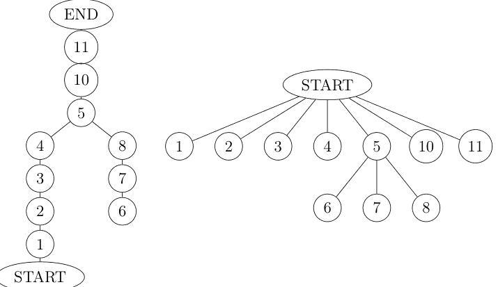

图 2.3：2.2 节示例程序的后支配树和控制依赖子图。边隐含地指向下方。

定义 2.8 与上述对结构化程序的直观描述等价。Ferrante 等人 [FOW87] 提出了一种计算控制依赖的方法：他们首先计算控制依赖：通过 Lengauer-Tarjan 算法 [LLT] 计算后支配树。对于 `x → y`，如果 `y` 在后支配树中是 `x` 的祖先，则 `y` 不后支配于 `x`。

### 数据依赖

控制依赖于两个语句之间，一个语句直接控制另一个语句的执行。在结构化程序中，控制依赖等同于源代码的嵌套层级：每个语句都根据外层的分支或循环点缩进。在存在任意控制流的情况下，控制依赖根据后支配者 [FOW87] 定义。如果从节点 `x` 到 `END` 的所有路径都通过 `y`，则称 `CFG` 中的节点 `x` 被 `y` 后支配。某些定义排除了节点后支配自身的情况。

**定义 2.8（控制依赖）。** 节点 `y` 控制依赖于节点 `x` (`x → y`)：

- 在 `CFG` 中存在从 `x` 到 `y` 的路径 `p`，使得 `y` 后支配 `p` 中的每一个节点（`x` 除外）。
- `x` 不被 `y` 后支配。

对于每个具有后支配者的语句，总存在一个直接后继后支配者，即一个不支配该语句另一个后支配者的后支配者。这可以描述为一棵树，其中仅描述了直接后支配关系，后支配可以通过树中的路径找到。例如图 2.3 所示，它展示了后支配树（左）以及对应图 2.2 示例程序的控制依赖子图（右）。例如，节点 5 被 `END` 直接后支配。存在控制依赖 `5 → 7`，因为在 5 到 `END` 的路径上可以避开 7，且 7 后支配路径 `(5, 6, 7)` 上的所有节点（5 除外）。

> ²如果后支配不是反射的，那么对于 `y` 同样如此。


图 2.3：2.2 节示例程序的后支配树和控制依赖子图。边隐含地指向下方。

定义 2.8 与上述对结构化程序的直观描述等价。Ferrante 等人 [FOW87] 提出了一种计算控制依赖的方法：他们首先计算控制依赖：通过 Lengauer-Tarjan 算法 [LLT] 计算后支配树。对于 `x → y`，如果 `y` 在后支配树中是 `x` 的祖先，则 `y` 不后支配于 `x`。

### 数据依赖

控制依赖于两个语句之间，一个语句直接控制另一个语句的执行。在结构化程序中，控制依赖等同于源代码的嵌套层级：每个语句都根据外层的分支或循环点缩进。在存在任意控制流的情况下，控制依赖根据后支配者 [FOW87] 定义。如果从节点 `x` 到 `END` 的所有路径都通过 `y`，则称 `CFG` 中的节点 `x` 被 `y` 后支配。某些定义排除了节点后支配自身的情况。

**定义 2.8（控制依赖）。** 节点 `y` 控制依赖于节点 `x` (`x → y`)：

- 在 `CFG` 中存在从 `x` 到 `y` 的路径 `p`，使得 `y` 后支配 `p` 中的每一个节点（`x` 除外）。
- `x` 不被 `y` 后支配。

对于每个具有后支配者的语句，总存在一个直接后继后支配者，即一个不支配该语句另一个后支配者的后支配者。这可以描述为一棵树，其中仅描述了直接后支配关系，后支配可以通过树中的路径找到。例如图 2.3 所示，它展示了后支配树（左）以及对应图 2.2 示例程序的控制依赖子图（右）。例如，节点 5 被 `END` 直接后支配。存在控制依赖 `5 → 7`，因为在 5 到 `END` 的路径上可以避开 7，且 7 后支配路径 `(5, 6, 7)` 上的所有节点（5 除外）。

> ²如果后支配不是反射的，那么对于 `y` 同样如此。


图 2.3：2.2 节示例程序的后支配树和控制依赖子图。边隐含地指向下方。

# 第 2 章 面向对象语言的依赖图与切片

```
read(n);
i = 1;
sum = 0;
prod = 1;
while (i <= n) {
  sum = sum + i;
  prod = prod * i;
  i++;
}
write(sum);
write(prod);
```

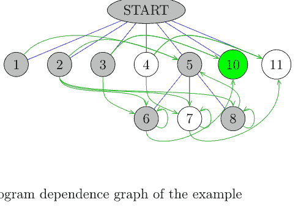

**定义 2.9（数据依赖）。** 令 `Ref(x)` 表示 `x` 处引用的变量集合。那么节点 `y` 依赖于节点 `x` (`x → y`) 如果：

- 存在变量 `v`，使得 `v ∈ Def(x)` 且 `v ∈ Ref(y)`
- `CFG` 中存在从 `x` 到 `y` 的路径 `P`，其中 `v` 的定义未被杀死（即 `x` 是 `y` 的到达定义）。

如前所述，程序依赖图由 `CFG` 的节点组成（有时省略 `END` 节点，因为它没有出边），用控制依赖和数据依赖代替控制流边。考虑图 2.4 中示例程序的程序依赖图。数据依赖用绿色表示，控制依赖用蓝色表示。由于语句 1 定义了一个在第 5 行被引用且中间未被覆盖的变量，因此从 1 到 5 存在数据依赖。5 行的条件决定了循环的执行次数，因此循环体内所有语句都通过控制依赖连接到节点 5。注意依赖图可能包含循环（参见节点 6 处的数据依赖）以及两个节点之间的多条边，它们是多图。

数据依赖可以直接通过到达定义分析计算。但对于 `SSA` 形式的程序来说，因为每个变量名只定义一次。从 `SSA` 形式计算数据依赖是找到引用变量的定义，如果该定义在 `Φ` 函数中，则构建 `Φ` 函数中引用变量的传递包。

例如，再次考虑图 2.4。`sum_3` 的定义依赖于变量 `sum_2`，后者定义在 `Φ` 函数中。该函数反过来引用了 `sum_1` 和 `sum`，它们没有一个定义在 `Φ` 函数中。`sum_3` 在数据上依赖于自身和初始化。这在图 2.4 中表现为从节点 3 到节点 6 以及从 6 到 6 的数据依赖。

## 切片

基于依赖图的切片标准通常与 Weiser 的原始定义不同：不再是一个元组 `(n, V)`，而是一个语句和集合

## 2.2. 程序切片

对于变量而言，它只是依赖图中的一个节点 `v`。这产生了一种更粗粒度的切片标准，因为它等同于切片标准，其中 `n` 是对应于切片节点 `v` 的语句，且 `V = Ref(v) ∪ Def(v)`。要为不在 `V` 中的变量计算切片，需要修改程序并插入该变量的合成引用，但这种差异在实践中是可以忽略不计的。

**定义 2.10**（过程内后向切片）。变量 `v` 的（后向）切片 `BS(v)` 定义为 `v` 在 `PDG` 中前驱关系下的反射、传递闭包，标记为 `→*`，其中前驱关系涵盖了两种依赖：

```
$BS(v) = {x ∈ PDG | x →* v}$ (2.1)
```

因此，程序切片变成了一个简单的图可达性问题，这源于数据依赖和控制依赖的持久性。

在图 2.4 的示例中，节点 10 的后向切片节点被阴影标记。如果只对和而不对积感兴趣，可以从程序中删除第 4、7和11 行。

切片的一种常见变体是正向切片，它计算可能受切片标准影响的语句，而后向切片是确定哪些语句影响标准：

**定义 2.11**（过程内正向切片）。变量 `v` 的正向切片 `FS(v)` 定义为 `v` 在 `PDG` 中后继关系下的反射、传递闭包，聚合了两种依赖边：

```
$FS(v) = {x ∈ PDG | v →* x}$ (2.2)
```

### 2.2.2 过程间分析

在分析过程语言时，必须考虑程序的调用结构。用于此目的的标准数据结构是调用图 [Ryd79, CCHIK90, GDDC97]，它可以从过程间控制流图中推导出。

**定义 2.12**（过程间控制流图）。程序 `P` 的过程间控制流图 (`ICFG`) `G = (G_p)_{p ∈ P}, main, Ret` 由一组用于过程 `p ∈ P` 的 `CFG` `(G_p)_{p ∈ P}`，`G_p = (N_p, Entry_p, Exit_p)`、一个入口过程映射以及调用边和返回边集合 `Call` 和 `Ret`，满足：

1. `(N_p)_{p ∈ P}` 和 `(Edge_p)_{p ∈ P}` 是两两不交的。


2. 如果 `$(u, v) \in Call`，则 `$u \in N_p \setminus \{Entry_p\}$` 且 `$v = Entry_{p'}`（对于某些 `p, p'`），并且存在一个匹配的返回边 `$(Exit_{p'}, u') \in Ret`，使得 `$u' \in N_p$` 是 `$u$` 在 `$G_p$` 中的唯一后继，`p` 是该调用的调用者，`p'` 是被调用者，我们称 `u` 和 `u'` 相互匹配，并将 `$(u, u')` 称为调用-返回边。

3. 反之，`Ret` 中的每条返回边在 `Call` 中都有一个匹配的调用边。

带有调用边（返回返回边）的节点称为调用节点（返回节点）。

在 ICFG 中，将每条边 `$(u, Entry_{u'})` 标记为 `$\ell_u$`，将每条返回边 `$(Exit_{u'}, v)` 标记为 `$\ell_v$`，其中 `u'` 是 `u` 的匹配调用节点，并将所有其他边标记为 `$\perp$`。所有其他边根据定义 2.1 进行标记。

### 定义 2.13
**过程间路径 [RHISR94, Kri103]**。对于 ICFG 中的路径 `$\pi$`，令 `EL($\pi$)` 表示路径 `$\pi$` 中边标签的级联。`$\pi$` 是平衡的，当且仅当 `EL($\pi$)` 属于由下文非终结符 `M` 生成的平衡括号语言，该文法的产生式为 `{M := M ( $\ell_u M \ell_v$ ) | true | | i MM | (u, Entry_{u'}) $\in$ Call $\wedge$ Z}`

`$\pi$` 是左平衡的，当且仅当存在 `G` 中的路径 `$\pi_1, \pi_2$` 使得 `$\pi = \pi_1\pi_2$` 是 `$\pi_1$` 和 `$\pi_2$` 的级联，且 `EL($\pi_2$)` 不包含形式为 `$\ell_v$` 和 `$\perp$` 的标签。`$\pi$` 是右平衡的，当且仅当存在 `G` 中的路径 `$\pi_1, \pi_2$` 使得 `$\pi = \pi_1\pi_2$`，`$\pi_1$` 是左平衡且 `EL($\pi_2$)` 不包含形式为 `$\ell_u$` 和 `$\perp$` 的标签，或右平衡。

注意，ICFG 中的可靠路径对级联不封闭。ICFG 的一种常见抽象是调用图，它模拟了程序的调用结构：

### 定义 2.14
**调用图**。在我们设置中，调用图是一个有向二部图 `G = (N_p, N_c)`，由程序的过程入口节点 `$(N_p = \{v \in N_p \mid v = Entry_p \text{ 对于某些 } p \in P\})$` 和程序的调用点 `$(N_c = \{u \in N_c \mid (u, v) \in E\})$` 组成，其中边 `E` 代表：

1. 约束：对于每个出现在 `p $\in$ N_p` 中的调用点 `c $\in$ N_c`，包含边 `e = Entry_p $\to$ c`。
2. 调用：对于每个调用点 `c $\in$ N_c`，包含边 `e = c $\to$ Entry_p` 可能调用 `p $\in$ N_p`。

该图有效地表示了程序的过程间控制流。这是一个静态属性，每个调用点的度为 1。但函数指针或动态分发使得 ICFG 的构建变得困难。我们以后讨论在动态情况下如何利用指针分析来构建精确的调用图。

### 切片程序

为了切片由一组过程组成的程序，Horwitz 等人 [HRB90] 扩展了 PDG：**依赖图** `SDG` 使用值传递语义模拟多过程程序。每个过程由一个类似于 PDG 的依赖图表示，也简写为 PDG。从上下文可以清楚，在每个调用点，PDG 包含每个被调用过程的实际参数到形式参数的赋值。该方案的操作：返回参数复制到形式输出节点中的临时变量，在返回调用者后，这些值被复制到实际输出节点中的变量。全局可见变量（例如 Java 中的静态变量）接受特殊处理：它们被视为过程的额外读写参数，并在后续讨论中被忽略。

```
main() {
  a=3;
  b=4;
  v=add(a,b);
  w=add(v,b);
}
add(x,y) {
  return x+y;
}
```


过程间图

`SDG` 由程序中涉及的所有 PDG 组成，通过调用图的调用边连接。实际参数节点通过输入边 `pi` 连接到其对应的形式节点，形式输出节点通过输出边 `po` 连接到它们的实际输出节点。最后，表示调用点的节点通过调用边 `cl` 连接到调用者的入口节点。

作为一个示例，考虑图 2.5，它显示了一个示例程序和相应的 `SDG`。蓝色的直线表示依赖，绿色的曲线边表示数据依赖。过程间边以虚线形式显示。从节点 4 和 5 到过程 `add` 入口的调用边，从变量 `$a$` 和 `$v$` 到 `$x$` 的输入边，以及从节点 8 的返回语句到变量 `$v$` 和 `$w$` 的输出边。

虽然这种表示法允许程序切片，但根据方程 2.1 的切片是正确的，但不是上下文敏感的，由于调用上下文问题：切片可能通过输出边进入调用者，但通过输入边指向不同的过程离开它，因此这种切片被称为上下文无关的。

在切片图 2.5 中的示例程序时，来自调用点 4 的节点 `$v$` 的上下文无关后向切片在图 2.5 中以阴影节点显示。然而，从语句 5 的输入参数到切片标准的数流在任何程序执行中都是不可行的，因为语句 5 没有执行语句 4。

`SDG` 使所有副作用可见，任何调用点的实际参数都可以（传递地）依赖于同一调用点的输入参数。这种所谓的总结边 [HRB90] 的启发丰富了 `SDG`。如果调用者内部对应的形式参数之间存在路径，则在调用点的输入节点和输出输出节点之间插入总结边。这些边表示了过程参数之间依赖的过程间总结信息，从而保留了调用上下文。

在我们图 2.5 的示例中，有四条红色虚线总结边：从调用点 4 的 `$a$` 和 `$b$` 到 `$v$`，以及从调用点 5 的 `$v$` 和 `$b$` 到 `$v$`。这些对应于形式参数 `$x, y$` 与节点 8 中的语句之间的传递依赖。有了总结边，上下文敏感切片变成了一个两阶段算法，仍然是 `O(SDG)`。第一阶段遍历除输出边以外的所有边（包括总结边）。因此切片过程的所有依赖及其传递闭包都被包含在内。第二阶段从所有形式输出节点开始，遍历除调用令和输入边以外的所有边，从而省略了所有调用者（由于总结边的存在，其影响已经包含在内）。上下文敏感切片是两个阶段所遇到节点的并集。

图 2.5 程序的上下文敏感两阶段算法的结果如图 2.6 所示。它遍历到 `$a$` 和 `$b$` 的总结边，从那里到达节点 2、3和4（灰色节点）。第二阶段从节点 8 开始，该节点已到 `$v$` 的输出边中被省略，并包含了节点 `$y$` 和 `add` 的入口（浅灰色所示）。注意，调用点 5 的节点没有被正确包含在上下文敏感切片中（图 2.5）。

## 2.2 程序切片

算法 2 计算摘要边的边的伪代码

```
1 function ComputeSummaryEdges
2 Input: G 是一个 SDG
3 Output: SummaryEdge 摘要边集合
4 declare PathEdge, SummaryEdge, WorkList: 边集合
5 declare FragmentPath: 从顶点到边集的映射
6 begin
7 PathEdge := ∅; SummaryEdge := ∅; WorkList := ∅
8 foreach v in FormalOutNodes(G) do
9 insert (w → w) into PathEdge
10 insert (w → w) into WorkList
11 od
12 while WorkList ≠ ∅ do
13 select and remove each edge v → w from WorkList
14 switch v
15 case v in ActualOutNodes(G) do
16 foreach each a x → v ∈ SummaryEdge v x → ed v in G do
17 Propagate(x → ed)
18 od
19 esac
20 case v in FormalInNodes(G) do
21 foreach c ∈ {G | c ∈ (Entry(w)) ∈ E} do
22 let x = CorrespondingActualIn(c, v)
23 y = CorrespondingActualOut(c, v) in
24 insert x → y into SummaryEdge
25 for each a that y → a in fragmentPath(y) do
26 Propagate(x → a)
27 od
28 end let
29 od
30 esac
31 default :
32 foreach each a x → _dd v ∈ G ∨ x → _ed v ∈ G do
33 if x → _dd v or v are not both parameter nodes then // 排除对象树
34 Propagate(x → w)
35 fi
36 od
37 switch
38 od
39 return(SummaryEdge)
40 end
42 procedure Propagate(e: edge (v → w))
43 begin
44 if e ∈ PathEdge then
45 insert e into PathEdge
46 insert e into WorkList
47 if v ∈ ActualOutNodes(G) do
48 insert e into fragmentPath(w)
49 fi
50 fi
51 end
```

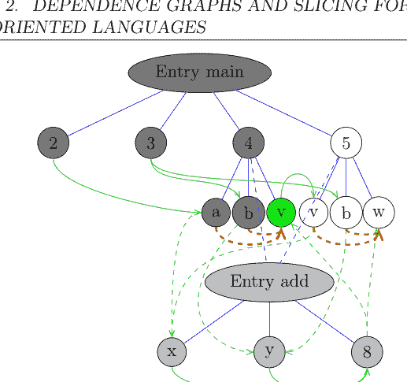

### 基于图的切片的正确性

Horwitz 等人 [HPR88] 表明 `PDG`（对于包含数组的语言）足以表示程序的执行行为：如果两个程序的 `PDG` 是同构的，那么对于给定的输入，这两个程序要么都发散，要么以所有变量的相同值终止。基于简单 while 语言的 `PDG` 的反向过程内切片在 [RY88] 中被证明是正确的。他们的切片定理（Slice Theorem）证明了，对于程序终止的任意初始状态，该程序及其切片对切片中的每个元素计算出相同的一序列值序列。这一结果被 Brinkley 等人 [BHR89] 扩展到 `SDG`，并扩展到带有堆分配存储（基于 LISP 风格的控制操作符）和指针的程序 [PS91]，遵循了 [HPR89] 的精神。众周知的是，这种操作符足以建模复杂的堆甚至类 Java 的对象。我们在 2.5 节中对 `SDG` 的扩展将与过程间数据依赖参数传递的正确性论证一起给出。存在无结构化控制流时的语法保持切片已由 Ball 和 Horwitz [BH93] 以及 Choi 和 Ferrate [CF94] 独立解决。两种解决方案都包含了正确性证明。Harman 和 Danihani [HD98] 扩展了 Agrawal [Agr94] 的解决方案并提出了正确性证明。

## 2.3 指向分析 (Points-to-Analysis)

指针分析是分析堆操作语言的主要前提。对于面向对象的语言，它回答了给定指针或引用在运行时可能指向哪些对象的问题。

| 1 Object o1; | |

| :--- | :--- |

| 2 String o2; | |

| 3 o1 = new Object(); | o2 → new Object() |

| 4 o2 = new String(); | |

| 5 if (...) | | |

| 6 o1 = o2; | new String() → new Object() |

图 2.7：代码片段和可能的指向图

基于此分析可以导出相关的关系，例如可能使用（may-using），即两个变量是否引用内存中的相同位置——因此是同一个对象，在某些条件下也是必须使用（must-using），即两个变量是否始终指向同一个对象。

自从基础技术由 Andersen [And94] 和 Steensgaard [Ste96] 提出以来，已有数百论文针对这一问题（例如 [SS00b, RMR01, LLS01, MRG02, NRO03, LL03, WL04, LH08]），并以此完善了该技术，使得如今指向分析对于真实的编程语言和程序具有良好的扩展性。然而，尽管指向分析在约 [Hin01] 年前就为人知，但各大主要会议上仍有关于该主题的论文在改进精确性和扩展性问题。

指向分析通常通过基于约束的程序分析来解决：从控制流图中提取若干由于程序语义而必须满足的约束。这些约束可以被求解，并产生一个指向关系的保守解。约束系统传统上表示为图，其中：

- 每个指针有一个节点
- 每个分配点有一个节点
- 如果 `p` 可能指向 `q`，则存在边 `p → q`
- 如果 `p` 必须指向 `q`，则存在边 `p → q`

作为一个示例，考虑图 2.7，其中展示了指向图。每个变量 `o1` 和 `o2` 有节点。第 3 行和第 4 行的赋值产生了边。第 6 行的赋值产生了另一条边。

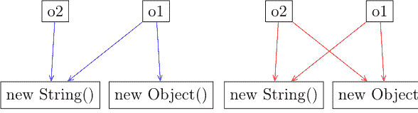

# 第 2 章 面对象语言的依赖图与切片

## 2.3.1 基于包含 vs 并并分析

确定指向的两种基本方法已被提出：Stegaard [Ste96] 提出了一种基于合并的方法，指针要么别名要么指向相同的对象集合。其优势是近线性的复杂度 `O(nα(n))`，其中 `α` 是反阿克函数，基于 Leis-Tarjan 算法 [LT79]。在图 2.7 的示例中，最右侧的图对应于方法。由于合并意味着 `o1` 的指向等于 `o2` 的指向，节点之间双向连接。不幸的是，将此方法应用于 Java 会产生若干不可理想的属性。Streckbench [SS00b] 发现像 Java 这样强类型的语言使用基于合并的方法会丢失类型安全，如图 2.8 所示，一个 String 类型的引用被确定可能指向声明类型 Object。这对动态绑定的近似产生了巨大影响，因为调用的方法取决于目标对象：当 `o2` 上调用 `char()` 时，分析无法确定 `java.lang.Object` 中的哪个方法。由于缺乏类型信息，现在不清楚是分析存在 Bug，还是仅仅是由于过度近似。这导致了多年对基于包含方法的扩展性的研究。

Andersen 的指针包含包含方法仅在赋值的指针之间插入单向边。这种方法只会生成遵守类型安全的约束，这更贴合赋值的语义，如图 2.7 所示。在这里，只有 `o1` 可能指向 `o2`，反之则不然。指向关系比基于合并的方法更精确（见图 2.8 的左图）。然而，求解约束系统的代价为 `O(n^3)`，其中 `n` 是程序中的语句数量。尽管如此，基于包含的分析在过去几年中占据主地位，这归于近期研究中运行时 BDD 的进展，例如使用更好的数据结构 [WL04, LH08]。

## 2.3. 指向分析 (POINTS-TO-ANALYSIS)

### 2.3.2 过程间分析与动态分发

对于过程间分析，主要的实现技术是图克隆（graph cloning），即在每个上下文（context）中为每个过程添加一个指向图。根据 [WL04]，方法（method）是传统的调用上下文。另一种，对于面向对象的语言，将虚拟方法调用的目标作为上下文是有效的 [MRR02]，这种方法被称为对象敏感的指针分析（object-sensitive pointer analysis）。使用调用关系作为上下文是有问题的，因为它在递归中需要保守近似，且通常需要一个计算出的调用图（computed call graph），这会阻碍即时计算（fly computation）。因此，使用目标对象作为上下文虽然在某些情况下更为保守，但在实践中是行的，因为计算时不需要调用图，且上下文不以以复杂的方式构建。尽管如此，它在许多典型问题（如工厂方法或容器）上是高效的，而在这些问题上，上下文不敏感分析仍然过于保守。

像 Java 这样的面向对象语言需要指向分析，其缺点是需要先进行额外的分析，并且生成的调用图通常是非常庞大的。另一种，可以在指向分析过程中即时计算调用图。虽然这使得指向分析变得复杂得多，但生成的调用图与分析本身一样准确，通常比简单算法如类层次结构分析（CHA）[DGC95] 或更精细的分析如 0-CFA [GDC97]、VTA [SHR00]、快速类型分析（RTA）[BS96] 以及 CFA 算法 [TPU0] 要精确。

在指向分析期间即时保守地近似动态绑定的算法包含 [HBCC99, SS0b]：

- 从赋值和静态分发的方法调用构建初始指向关系。
- 沿着图的边传播指向关系。
- 对于每个虚拟调用 `o(x1, ..., xn)`，在当前图中确定 `points-to(o) = {o1, ..., ok}`。
- 使用静态查找确定方法 `f_i(x1, ..., xn)` 的调用目标 `f_i`，并在调用图中插入一条从调用处到其目标 `f_i` 的边。
- 将调用的参数和返回值连接到指向图中 `f_i` 的对应项，但仅在 `f_i` 的 this 指针和 `o_i` 之间添加边，而不是 `o`。这最后一个限制保证了指向关系的到达。
- 迭代直到达到指向关系的固定点。

当使用工作算法传播指向关系时，该算法——Lhoták [LH03] 的适配——具有高度的技术复杂性，这是由于调用目标 `f_i` 通常尚未被分析且需要被添加到指向图中。对于 `f_i` 中的调用目标来说更是如此，它们通常也需要被分析并添加，这些方法可能又包含对新方法的调用。但即使在分析并添加了所有新方法后，复杂性在于工作列表算法（worklist algorithm）必须知道节点的传播。在分析新代码时，只需将调用 `f` 的所有参数添加到工作列表中即可，但从新分析代码到已传播的旧节点的所有边的目标，也可能需要传播。然而，跟踪哪些节点是旧的、哪些是新的是困难的。因此，在添加新方法后，保守地传播所有点赋值边。

算法 3 展示了 Lhoták 的 [LH3] 算法对即时图计算的适配。主算法从第 1 行开始，迭代直到工作列表中不再有元素。正如预期的那样，处理新的虚拟目标最具挑战性。该过程直接反映了列表中描述的所有元素。

### 2.3.3 别名分析 (Aliasing)


## 2.3. 指向分析 `POINTS-TO-ANALYSIS`

### 2.3.2 过程间分析与动态分发

对于过程间分析，主要的实现技术是图克隆，即在每个上下文中为每个过程添加一个指向图。根据 `[WL04]`，方法是传统的调用上下文。另一种，对于面向对象的语言，将虚拟方法调用的目标作为上下文是有效的 `[MRR02]`，这种方法被称为对象敏感的指针分析。使用调用关系作为上下文是有问题的，因为它在递归中需要保守近似，且通常需要一个计算出的调用图，这会阻碍即时计算。因此，使用目标对象作为上下文虽然在某些情况下更为保守，但在实践中是行的，因为计算时不需要调用图，且上下文不以复杂的方式构建。尽管如此，它在许多典型问题（如工厂方法或容器）上是高效的，而在这些问题上，上下文不敏感分析仍然过于保守。

像 `Java` 这样的面向对象语言需要指向分析，其缺点是需要先进行额外的分析，并且生成的调用图通常是非常庞大的。另一种，可以在指向分析过程中即时计算调用图。虽然这使得指向分析变得复杂得多，但生成的调用图与分析本身一样准确，通常比简单算法如类层次结构分析 `CHA` `[DGC95]` 或更精细的分析如 `0-CFA` `[GDC97]`、`VTA` `[SHR00]`、快速类型分析 `RTA` `[BS96]` 以及 `CFA` 算法 `[TPU0]` 要精确。

在指向分析期间即时保守地近似动态绑定的算法包含 `[HBCC99, SS0b]`：

- 从赋值和静态分发的方法调用构建初始指向关系。
- 沿着图的边传播指向关系。
- 对于每个虚拟调用 `o(x1, ..., xn)`，在当前图中确定 `points-to(o) = {o1, ..., ok}`。
- 使用静态查找确定方法 `f_i(x1, ..., xn)` 的调用目标 `f_i`，并在调用图中插入一条从调用处到其目标 `f_i` 的边。
- 将调用的参数和返回值连接到指向图中 `f_i` 的对应项，但仅在 `f_i` 的 `this` 指针和 `o_i` 之间添加边，而不是 `o`。这最后一个限制保证了指向关系的到达。
- 迭代直到达到指向关系的固定点。

当使用工作算法传播指向关系时，该算法——`Lhoták` `[LH03]` 的适配——具有高度的技术复杂性，这是由于调用目标 `f_i` 通常尚未被分析且需要被添加到指向图中。对于 `f_i` 中的调用目标来说更是如此，它们通常也需要被分析并添加，这些方法可能又包含对新方法的调用。但即使在分析并添加了所有新方法后，复杂性在于工作列表算法必须知道节点的传播。在分析新代码时，只需将调用 `f` 的所有参数添加到工作列表中即可，但从新分析代码到已传播的旧节点的所有目标，也可能需要传播。然而，跟踪哪些节点是旧的、哪些是新的是困难的。因此，在添加新方法后，保守地传播所有点赋值边。

算法 3 展示了 `Lhoták` 的 `[LH3]` 算法对即时图计算的适配。主算法从第 1 行开始，迭代直到工作列表中不再有元素。正如预期的那样，处理新的虚拟目标最具挑战性。该过程直接反映了列表中描述的所有元素。

### 2.3.3 别名分析 `Aliasing`

对于我们的应用程序切片，指向关系主要用于别名分析。如果两个引用指向同一个内存单元，则称它们具有别名关系 `[HLW+91]`。我们区分两种类别的别名：

**定义 2.15（别名）**。如果两个引用在程序的每次执行中都指向同一个内存单元，则它们是**必须别名** `must-aliased`；如果它们在程序的某些执行中指向同一个内存单元，则它们是**可能别名** `may-be-aliased`。

在计算数据依赖时需要可能别名分析，如果两个语句访问同一个内存单元，则必须插入一个依赖关系。可能别名允许强更新 `strong updates`，即插入到更新的删除集 `kill-set` 中，从而减少虚假依赖的数量。然而，已知别名在静态上是不可判定的 `[Ram94]`，因此必须采用保守近似。在实践中，这意味着可以确定必须别名的子集和这些强更新，但依赖图中仍留有一些虚假依赖。对于可能别名，必须找到所有确定的可能别名的超集，以获取所有可能的数据依赖。

基于指向关系的可能别名很容易确定，即使指向和别名这两个词有时被互换使用。

**定义 2.16（可能别名）**。对于两个引用 `[指针]` `$p` 和 `$q`，

```
may-alias(p,q) := (points-to(p) ∩ points-to(q) ≠ ∅)
```

关于必须别名的研究较少，可能是因为对于真实语言来说，指向分析已经很困难，且局部推理通常是足够的。必须别名很难确定，因为指向关系本身就是一种保守近似（特别是由于流敏感性 `flow-sensitivity`）。一个问题在于，指向分析中的每个分配点代表了运行时可能的动态分配的等价类。

## 2.4 面向对象语言切片 `Slicing Object-Oriented Languages`

在前章节介绍的切片技术以及其他研究产生了如 `CodeSurfer` `[AT01]` 或 `VALSOFT` `[Kri03a,RS02]` 等系统，它们能够以精确的性能对全语言程序进行切片。

### 2.4.1 动态分发 `Dynamic Dispatch`

已经针对面向对象特性提出了 `SDG` 的特殊扩展，它们都能够处理动态分发和继承 `[LH96, KMG96, Zha00, LH98, WRW03, MMKM94, HDZ000]`。通常，动态分发的处理方式类似于 `C` 语言中的函数 `[GH96]`。今天，面向对象语言切片对动态分发的近似具有合理的精确度和效率，足以支持 `SDG` 构建算法。

### 2.4.2 异常处理 `Exception Handling`

`Java` 在 `try catch ... finally` 结构中提供了异常处理，在构建控制流图时需要考虑这一点。每个可能抛出 `catch` 块中给定类型的异常指令必须在关联的异常处理器处有一个后继。`Java` 允许多个 `catch` 块，只有第一个匹配的 `catch` 块会被执行 `[LY99]`，为了实现最大精度，第一个匹配的块应该是后继节点。`finally` 块在任何情况下都会执行，因此它们在 `try` 和 `catch` 块中的所有代码执行后被纳入控制流。如果没有相应的异常处理器，它仍然会在过程返回之前（将异常抛出给调用者），因此必须包含在方法退出节点之前的恰位置。

在没有显式异常处理的情况下构建 `PDG`（程序依赖图）会导致其对于完整的 `Java` 语义是不完整的。在 `Java` 中，如果操作数是操作数，字节码指令可能会抛出隐式异常 `RuntimeException` 的子类。例如，每个操作对象的字节码可能抛出 `NullPointer`，操作数组的字节码可能抛出 `ArrayOutOfBoundsException`。为了获得可靠分析，必须考虑控制流。在每情况下，每个抛出隐式异常的字节码之前都有一个谓词用于检查代码正常执行的前置条件，如果不满足，则控制流将跳转到异常处理代码或异常终止代码 `[CPS99]`。

没有适当异常处理器的异常将传递给引发方法的调用者。如果该调用者在调用字节码处安装了适当的处理器，则跳转到该处理器来处理异常；如果没有，则调用者方法将终止，相当于“重新抛出”引发的异常。这种方案一直使用，直到在栈的某处找到适当的处理器，否则该执行线程将终止并将引发的异常打印给用户。同样，这通过为每个可能执行的调用指令引入一个具有两个后继节点的额外谓词，被纳入控制流图中：一个后继节点模拟正常终止，另一个用于被调用方法的异常终止。

例如，图 2.9 显示了一个代码片段及相应的 `SDG`（系统依赖图）。首先，其子节点代表参数 `x` 和合成返回参数 `ex`。其次是谓词节点 `ex==null`，它建模了围绕 `bar` 方法正常或异常终止的分支。如果它异常终止（谓词为真），则执行第 6 行的语句。

在子图方法 `bar` 中，数组字节码的前条件是数组引用不能为空，这在一个合成谓词节点中进行检查。如果为，则抛出异常，否则执行第 10 行的语句。

如果一个 `try` 块有多个 `catch` 块，控制流图包含所谓的 `typeswitch` 语句，类似于传统的 `switch` 语句。对于每个异常类型为 `e` 的可能 `catch` 块，存在一条标记为 `e` 的边指向对应的 `catch` 代码块。

> 参见 `Allan` 和 `Horowitz` `[AH03]` 关于 `finally` 块内联的讨论。

## 第2章 面向对象语言的依赖图与切片

```
void foo(Object[] s) {
  try {
    bar(s);
  } catch (
    NullPointerException e) {
    print("null");
  }
}
void bar(Object[] s) {
  print(s.length);
}
```

图 2.9：带有异常处理的 `SDG` 示例代码

在存在对象和字段的情况下进行切片与传统语言中的数据类型切片没有太大。`Horwitz` 等人 `[HPR89]` 已经注意到，为了扩展操作堆分配存储的语言的数据依赖概念，有必要用位置 `locations` 而不是变量来描述其定义：

**定义 2.17**（复合数据结构的数据依赖）。如果 `p` 写入了 `q` 读取的内存位置，并且在从 `p` 到达 `q` 的执行路径上没有对 `loc` 的中间写入，则程序点 `q` 对程序点 `p` 有数据依赖。

即使 `Horwitz` 等人只考虑了类似列表的操作，它也可以建模更复杂的数据结构。然而，有了对象和字段，并不总是确定两个程序点是否访问同一个内存位置。`Agrawal` 等人 `[ADS93]` 将内存访问分为完全交集、可能交集和部分交集：*完全交集*，如果两个对象都是必须别名 `must-aliases` 且它们访问相同的字段。由于别名的存在，字段访问的交集可能的；如果两个引用访问相同的字段，则它们只是可能的别名 `maybe-aliases`，这被称为*可能交集*。另一种可能交集出现在数组中，其中字段索引在编译时通常是知的。数组将这种可能交集与*部分交集*结合，因为只访问了数组的一个元素。大多数关于数组的工作将数组视为内存中的单个位置，忽略了仅在运行时才知道索引。我们遵循这种保守惯例，将数组建模为具有预留名称的字段。`Lyle` `[L84]` 建议数组更新应处理为对整个数组的引用及随后的更新。这导致当第一个语句到达代码时，数组更新 `a[i] -> a[j]` 之间产生数据依赖，即使 `i` 可能不等于 `j`。

```
int z;
T a, b; // 省略初始化
a.x = 1;
b.x = 2;
a.y = 3;
b.y = 4;
a = b;
z = a.y;
```

图 10：说明字段敏感性的示例程序

为了计算数据依赖的精确结果，有必要基于指针分析和别名分析的结果进行交集。`Tonella` 等人 `[TAFM97]` 是第一个使用指向分析 `[And94, SS00]` 生成 `SDG` 的人。

### 字段敏感分析

确定类型的多种方法已被提出。每种方法都有其优缺点。框架 `[Kri03]` 通过递归替换对任何变量的访问来计算依赖，这并不一定给出最精确的依赖。考虑图 10 中的程序，其依赖取决于第 6 行的定义。`ValSoft` `[Kri03]` 使用内联来处理嵌套对象。`CodeSurfer` `[AT01]` 采用非虚拟替换策略，允许对对象的切片，这种方法对于如 `C` 这样的过程语言是合适的，其中嵌套结构并不常见。`[TAFM97]` 已经指出，指向信息是精确面向对象语言侧效应分析的前提。通过使用对字段 `f` 的定义，可以避免处理嵌套对象的切片：

**定义 2.18**（字段访问的数据依赖），`PDG` 有从 `n1` 到 `n2` 的数据边，当且仅当满足条件：

- `n1` 定义了变量 `x` 的字段 `f`
- `n2` 使用了变量 `y` 的字段 `f`
- `x` 和 `y` 是潜在别名 `may-aliases`
- 控制流可以通过一条路径从 `n1` 到达 `n2`

通过这种定义，我们得到了图 10 中的精确切片。带有 `SSA` 形式的流敏感性，依赖取决于第 6 行的定义。虽然这种最后的依赖是字段敏感的，但其精度很大程度上取决于底层别名分析的精度。

## 2.5 过程间数据流分析

对于过程间分析，需要对程序如何操作其数据进行保守近似。对于程序切片，这主要涵盖了方法对其参数可能产生的侧效应。被调用方法的侧效应产生新的定义，因此需要数据依赖。计算此类侧效应的算法在文献 `[Ban79, Muc97]` 中是知的，但它们仅针对过程语言，没有覆盖对象及其字段的广泛使用。然而，多级指针的侧效应分析 `[LLS01]` 对于表示对象的切片 `[L496, L498]` 过于渗透；它们要么有缺陷，要么没有保守地处理嵌套对象。`[TAFM97]` 已经指出，指向信息是精确面向语言侧效应分析的前决条件。本节将介绍一种新方法，对方法及其被调用方法的侧效应进行保守近似，允许对象的上下文敏感切片。它允许字段敏感切片并考虑了别名问题。

为了在过程间情况下也进行字段敏感分析，我们需要显式表示方法入口节点和调用处的所有参数对象和访问值的字段 `[FS91]`。这对应于过程内部的非虚拟替换策略（见第 2.4.3 节）。

将为根于参数 `a` 的位置写入 `a.f.g`，该位置在某次执行中可以通过解引用第一个 `f` 和 `g` 来访问。我们说当位置 `x = a.f.g` 扩展了 `y = a.f`，当 `y` 的字段列表是 `x` 的前缀且它们共享相同的根。我们也写 `x = y.g`（其中 `y` 是另一个位置）作为 `y` 扩展 `g` 的缩写。最后，我们定义 `root(a,f..) := a`。方法 `m` 的副作用由以下函数 `[Ban79]` 描述：

- `Ref(m) =` 执行 `m` 时可能被引用的位置集
- `Mod(m) =` 执行 `m` 时可能被修改的位置集

这些以字母作为前缀以指代过程间的版本（见下一段）。根据定义，`Ref(m) ⊆ Mod(m)`，且相同的关系适用于前缀名称。

副作用分析的第一步是确定一个方法在不考虑该方法中调用的其他方法的情况下可能产生哪些副作用。我们称这些 `IRef` 和 `IMod`，表示它们是过程内的 `intra-procedural`。

### 2.5.1 过程内 `IRef` 和 `IMod` 的计算

在进入算法细节之前，这里介绍本文中使用的符号：对于方法 `m`，`Param(m)` 表示 `m` 的所有形式参数。我们使用 `Sub(x)` 表示通过解引用 `x` 的字段可以间接可达的位置集。这可以通过类层次分析 `Class Hierarchy Analysis` `[DGC95]` 轻松确定，该分析提供的类分析结果通常允许允许更精细的集合，因为只需要考虑指向集 `x`（以及间接可达的位置）的字段。`base(y,f)` 指复合位置 `y` 的基对象，并定义为 `base(y,f) = y`。

在不考虑方法其他影响的情况下，仅由方法本身可能被引用或修改的位置是根据以下递归定义计算的。因此，我们关注的是它们的最小不动点：

```
IRef(m) = {loc.y | y ∈ Param(m) ⊇ IRef(m) : ∃ statement r ∈ m
loc.x ∈ Mod(m) ⊇ Ref(r): alias(x,y)} ⊇ IMod(m) ⊇ Subobject(x)
{loc.y | y ∈ IRef(m) : ∃ statement r ∈ m ⊇ Ref(r): alias(x,y)} (2.3)
```


在方法中可能被直接引用的位置由被分析的方法 `$m$` 的参数，以及通过访问字段 `$f$` 间接可达的内存位置组成，该字段的基对象 `$x$` 是可能被引用的位置的可能别名。此外，根据定义，所有可能被写入的内存位置 (`IMod(m)`) 必须包含在 `IRef` 中，因为方法路径必须重新定义这些字段。在这种情况下，原始值将被合成引用。最后，在写入另一个内存位置时可能使用的所有内存位置的子对象也需要包含在内。原因是当写入对象时，其主体结构会由于字段值的变化而改变，而这些变化源于使用对象的字段值。

例如，在图 2.10 中，第 7 行定义了 `using b`，因此关于 `$b$` 的子图的所有定义都包含在 `$a$` 的回片（backslice）中。

```
$IMod(m) = {loc.y | y \in Param(m) \cup IRef(m) : statement r \in m
\exists loc.x \in Def(r) : my-alias(x,y) \cup SubObject(IMod(m) \cup {ret, scx})}\ (2.4)
```

方法 `$m$` 中可能被修改的位置集直接涵盖了通过参数直接或间接访问、并在语句 `$r \in dom(m)$` 中使用的、且基位置可能存在别名关系的位置。此外，带有合成变量 `$ret, scx$`（代表方法 `$m$` 的返回值或出的异常）的整个集合，相对于子图关系被间接考虑。

注意，在存在递归结构的情况下，`$IRef$` 和 `$IMod$` 可能包含无限数量具有有限长度的位置。例如，一个链表包含 `{head, head.next, head.next, ...}`。我们将证明，出于计算目的，只需确定等价关系的若干代表元就足够了，这些集合在度量上可以认为是有限的。

图 2.11 展示了一个小型 Java 程序，我们将其用作足够说明过程数据流分析的运行示例。其中间 SDG 生成遵循传统的 SDG 生成步骤，以抽象化位置：如图 2.12 所示。它只包含五个抽象抽象访问：`$Mod(3) = \{this.x\}$`，`$Mod(10) = \{this.a\}$`，`$Ref(12) = \{this.a\}$` 和 `$Ref(13) = \{a.x\}$`。在构造函数 `$A.init$` 中，`$IRef(A.init) = \{this.x\}$` 且 `$IMod(A.init) = \{this.x\}$`，`$IRef(B.init) = \{this.a\}$` 和 `$IMod(B.init) = \{this.a\}$`，`$IRef(f(o)) = \{this.a\}$`，`$\{ax\}$` 以及所有其他 `$IRef$` 和 `$IMod$` 都为空。这可以在图 2.13 中看到，其中 `$IRef$` 和 `$IMod$` 在树中表示，但由于该对象的成员在调用构造函数时未初始化，因此省略了 `$IRef(A.init)$`。

### 构造函数

Liang 和 Lloyd [LL98] 已经指出，在存在递归数据结构的情况下，无法展开到全是原始类型。如 2.5 节所述，他们将深度限制在固定层的方法是不令人意的。在我们的方法中，我们展开树直到相对于包含对象的别名达到不动点。因此我们得到了停止展开的准则。

```
## 第 2 章 面对象语言的依赖图与切片

依赖关系。我们定义一个反射对称关系 $R \subseteq loc$
$l_1 R l_2 \leftrightarrow ((l_1 \text{ extends } l_2 \vee l_2 \text{ extends } l_1) \wedge
\text{points-to-base(l_1)} = \text{points-to-base(l_2)) \wedge \text{field}(l_1) = \text{field}(l_2))$ (2.5)
```

```
class A {
  int x, y;
  A(int i) { x = i; }
}

class B {
  A a;
  B();
  A n = new A(2);
  this.a = n;
  int foo() { return bar(a); }
  static int bar(A a) { return a.x; }
  public static void main(String[] args) {
    B b = new B();
    int z = b.foo();
  }
}
```

图 2.11：一个示例程序 (`img/27c95637bae6b2761d79fa2_0.png`)。图 2.12：传统 SDG 生成后类 B 的中间 SDG (`img/27c95637bae6b2761d79fa2_1.png`)。图 2.13：过程内 IREF/IMOD 分析后类 B 的中间 SDG。

```
class C {
  C f;
  public static void main(String[] args) {
    C c = new C();
    C.rec(c);
    C x = c.f;
    C y = x.f;
  }
  static void rec(C c) {
    c.f = new C();
    x = c.f;
    x.f = c;
  }
}
```

图 2.14：说明递归数据结构的示例程序 (`img/27c95637bae6b2761d79fa2_63_0.png`)。图 2.15：包含对象树的图 14 的 SDG（不含摘要边）。该思想是，当在该对象树的分支中观察到相同字段且这些位置的基指针具有相同的指向集时开始展开。在这种情况下，对于计算数据依赖的所有属性，位置是等等的，如果第二个树只会再次添加相同的信息，会导致这些位置冗余。传递闭包 ~ 产生一个等价关系，我们利用它来寻找唯一的代表元：

在计算商集 `Ref/-` 和 `ImMod/-`，我们选择最短项（即 `extends` 关系的下界）作为代表元。由于指向关系中的集合是有限的，这些集合也是有限的。我们以后将证明将这些商集（即这些代表元）包含在依赖图中足以相对于字段访问计算正确的切片。这归于数据依赖的定义 18，该定义也基于别名情况。

### 2.5.2 过程间分析

作为一个示例，考虑图 2.15，它显示了图 14 中类 `c` 的 SDG。注意，没有依赖指向形式输出参数节点 `c`，因为 Java 只支持按值传递，因此该节点不代表 `c` 的引用。它的唯一目的是反映 `C.main` 的树形结构，而 `c` 的指向集仅包含 `C.main` 中的 `new` 语句，而在 `C.rec` 中没有。我们的算法由于对 `c.f` 的写入为字段 `f` 添加了第一层。我们的方法添加了第二层，因为根以及 `c` 和 `c.f` 节点的指向集被添加。没有添加第三层，因为 `c` 和 `c.f` 节点的指向集是等价类。第三次添加字段 `f` 只会产生与我们情况相同的依赖。Liang [LH98] 提出的对比方法会切断树并错过 `k` 的紫色节点。Liang 未具体如何近似这些缺失的依赖。

前一节仅确定到方法边界的副作用。下一步必须将这些副作用确定到图级别。这涉及到将副作用传播到所有调用点，必要时再次从实际参数传播。在所有副作用都传播到间接调用它们的方法之前，需要不动点迭代。在进入技术描述之前，我们定义了调用点的函数，使得 `Param(m,c)` 返回传递给方法 `$m$` 中的调用 `c` 的所有位置。我们假设在将复杂表达式传递给 `c` 以及在参数化的情况下会利用临时变量。例如，调用 `f(x+y)` 被替换为 `$t = x+y; f(t)$`，其中 `$t$` 是一个字段。当 `c` 调用方法 `$m'$` 时，函数 `bind(m,c) -> Param(m',c)` 返回对应于方法 `$m'$`的形式参数的实际参数。为了方便，将其扩展到集合，在考虑给定参数集时返回实际参数集。

由于全局的 `GRef` 和 `GMod`（定义在 [Ban79,Muc97]），我们可以确定调用处检测的方法 `IRef_` 和 `IMod_` 的副作用，它们根据以下定义确定：

```
CRef = {(m, c, t) | t ∈ bind_{m,c,m'}(GRef(m')) (2.6)
CMod = {(m, c, t) | t ∈ bind_{m,c,m'}(GMod(m')) (2.7)
```

为了方便，我们定义了曲线版本的 `CRef(m,c) = {t | (m, c, t) ∈ CRef}` 和 `CMod(m,c) = {t | (m, c, t) ∈ CMod}`。直观地说，`CRef` 和 `CMod` 代表调用点 `c` 处可能调用的方法 `m'` 的 `IRef` 和 `IMod` 副影响集，但形式名称已被替换。

# 第 2 章 面向对象语言的依赖图与切片

通过传递给 `$c$` 处的 `$m'$` 的变量。由于我们使用了 `GRef` 和 `GMod` 而不是 `IRef` 和 `IMod`，因此需要对全局副作用进行不动点迭代，这些副作用也包括被调用方法的副作用。

图 2.16 显示了将这些定义应用于我们在 2.5.1 节中确定的运行示例的局部副作用 `$IRef \subseteq GRef$` 和 `$IMod \subseteq GMod$` 的结果：`$CMod \supset \{(B.init, new(A)), (B.init, new(A), n.2)\}$` 和 `$CRef \supset \{(foo(), bar(a))\}$`。注意隐式变量 `$Ain$` 已重命名为实际参数 `$a$` 的名称。此外，图中对应的节点已通过参数输入和输出边连接，留下了 `$IMod(Ain)$` 的根节点。这种异常是 Java 的值传递参数传递方案，它不会将形式参数的变化传回给其调用者。

方法顶点包含参数树，对于 `GRef` 中的每个位置都有一个形式输入（formal-in），对于 `GMod` 中的每个位置都有一个形式输出（formal-out）节点。对于虚拟方法，这意味着并不是每个形式节点恰恰对应一个节点（CRef/GRef）：虚拟方法的不同（重）定义可能会改变参数的不同字段集。因此，CRef/GMod 中的每棵树都是此处呈现的所有对应树的并集。

现在，被调用方法的副作用在它们所在的位置是可用的，它们可能代表包含调用的方法的副作用。例如，`$B$` 构造函数中的 `$a.x$` 也是该方法的副作用。因此，我们需要另一个函数 `$bind_{m,c}(Param(m) \cup Param(m) \cup IRef(m))$`，它对于方法 `$m$` 中方法 `$c$` 的给定参数，返回对齐的 `$IRef(m)$` 中的形式参数或位置：

```
$bind_{m,c}(x) := \{y \in Param(m) \cup IRef_{\sim}(m) : myAlias(x,y)\}$ (2.8)
```

同样，该定义扩展到了参数集。在我们的示例程序中，`$B.init,new(A) = \{(this.a)\}$` 且 `$bind_{foo(),bar(a)}(a) = \{this.a\}$`。对于两个位置 `$y$` 和 `$z$`，追加函数 `$@$` 返回 `$y$` 和 `$z$` 的访问路径连接后的连接位置：

## **定义 2.19 (Append)。** 对于两个位置 `$y = v.f1...fn_n$` 和 `$z = w.g1...gm_m$`，如果 `may-alias(y,w)`，则连接后的 `$@z = v.f1...fn_n.w.g1...gm_m$`。

现在，被调用方法的全局副作用 [Ban79] 可以包含在方法的参数中：

```
$GRef = \{m, t) | t \in IRef_{\sim}(m) : t = y@z : c \in Calls(m) : z \in CRef(m, c) \wedge y \in bind_{m,c}(root(z))\}$ (2.9)
```

```
$GMod = \{m, t) | t \in IMod_{\sim}(m) : t = y@z : c \in Calls(m) : z \in CMod(m, c) \wedge y \in bind_{m,c}(root(z))\}$ (2.10)
```

## 2.5. 过程数据流分析

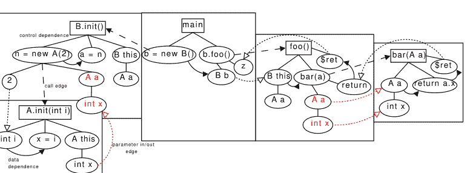

图 2.16：类 B 的中间 SDG，过程间 CRef/CMod 传播的第一次迭代。

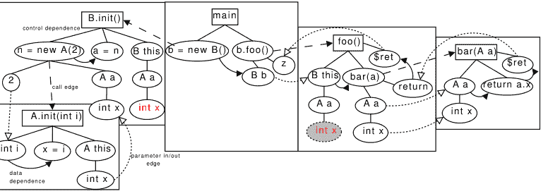

图 2.17：类 B 的中间 SDG：GRef/GMod 的第一次迭代。

同样，我们定义函数 `$GRef(m) = \{t | (m,t) \in GRef\}$` 和 `$GMod(m) = \{t | (m,t) \in GMod\}$`。`CRef` 和 `GRef` 是相互递归的，最小不动点给出了所需的解。同样，考虑 `GRef` 和 `GMod` 定义中 `~` 关系的代表元是足够的，因为保证了这个不动点的存在。

考虑我们的运行示例，图 2.17 显示了 `GRef` 和 `GMod` 计算的第一次迭代：`$GMod \supseteq \{(B.init,this), (B.init,this,a), (B.init,this,x)\}$` 和 `$GRef \supseteq \{(foo(this),this), (foo(this),this,a), (foo(this),this,x)\}$`。

在第二次迭代后，`CRef CMod` 包含图 2.15 所示的位置：`$\{(main(i), foo(b), b.a), (main(i), newB(b), b.x)\}$` 和 `$CRef \supseteq \{(main(i), foo(l), b.a), (main(i), (main), b.x)\}$`。由于 `$bound\_foo$` 为空（main 的参数为形式参数），不动点迭代在此结束。

### 2.5.3 数据依赖

当所有全局副作用都计算完毕后，字段的数据依赖根据定义 2.18 确定。`GRef` 被视为对应方法的入口 Def。

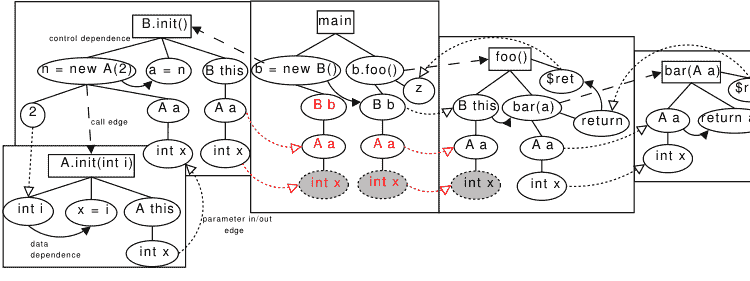

图 18：类 B 的 SDG：CRef/CMod 传播后的不动点。

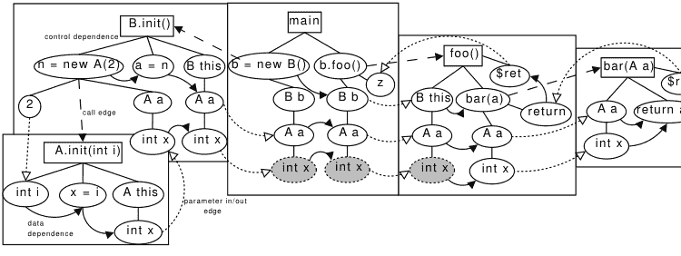

图 19：类 B 的 SDG：包含数据依赖（但不包含摘要边）。

### 2.5.4. 过程数据流分析

相反，`CRef` 的元素插入到调用节点的 `Ref` 和 `CMod` 中 [HR90]。标准过程内到达定义集仅在 `must-alias` 关系成立时填充。数据依赖随后使用 2.18 确定。

在我们的运行示例中，图 19 显示了测试结果：在 `A.init` 中，定义 `$x$` 到达了节点，我们得到了该定义与 `GMod` 中使用之间的依赖。同样，合成定义 `bar(bar)` 到达了返回语句并产生了数据依赖。在 `main` 中，`new()` 到达了 `CRef(main)` 的合成使用，因此这些位置之间插入了数据依赖。

**对象树的摘要边**

对于带有对象树的摘要边，为了避免爆炸至关重要：如果实际参数的摘要边指向 `$n$`，那么父节点(s) 也会指向 `$n$`。但这些边是冗余的，可以始终跟随摘要边到父节点，因此切片结果将相同。

之前的工作 [RYS88, B89, PS91] 已证明了多个切片维度（过程间切片和堆对象，见第 36 页）。由于过程间切片与堆对象的结合尚未明确证明，我们关注堆对象的过程间数据依赖正确性。因此，为了证明我们算法的正确性，需要证明所有动态数据依赖都被静态数据依赖所近似，即当语句在执行中定义了一个字段值并在另一个语句中使用它时，SDG 的对应节点之间存在依赖链。对于方法调用，我们假设在动态执行中，被调用方法的最后一个语句是赋值给返回结果变量的调用。随后，我们检测到带有 `label(e)` 的 SDG 依赖类型，例如，`$label(x->y) = correspondingCall(n)$` 表示创建语句栈的调用，`$n$` 通常是一个返回语句。

**定理 2.2（对象树的正确性）。** 对于所有根据 2.5 节构建 SDG 的程序运行 `$p$`，如果执行 `$E$` 包含路径 `$P = (p_1,\dots,p_n)$`，其中 `$p_i$` 定义了内存单元 `$mem$` 且 `$p_n$` 读取了 `$mem$`，`$p_1 = correspondingCall(n)$` 且 `$p_i$` 和 `$p_n$` 都由于参数传递是字段赋值，或 `$p_i$` 是普通的字段赋值$^9$（不假设此赋值构成了一个过程间语句），并且对于 `$\forall p_i \in \{p_2, \dots, p_n\}$`，`$p_i$` 都不是内存的普通字段赋值，那么在 `$G$` 中存在 `$p$` 使得 `$S=(p_1=s_1, \dots, s_m=p_n)$`，其中 `label$(s_i, s_{i+1}) \in [DD, PI, PO]$`。

证明。证明是对执行轨迹 `$P$` 中过程间语句数量 `$q$` 的归纳。

**基础情况：$q=0$（过程内情况）** 我们有 `$P=(p_1,\dots,p_n)$` 是 `$E$` 的子序列，其中 `$p_1$` 定义了内存单元 `$mem$` 且 `$p_n$` 读取了 `$mem$`，因此对于字段 `$f，$p_1 \in Def(f)$` 且 `$p_n \in Ref(f)$`且 `may-aliases($base(p_1), base(p_n)$)`。由于 `$p_i \in \{p_2, \dots, p_n\}$` 的名称在执行中细化了内存 `$mem$` `$p_1$` 在 CFG 中到达 `$p_n$`，且 `points-to($p_1$) $\cap$ points-to($p_n$) $\neq \emptyset$`。因此适用定义 2.18，我们得到了

**归纳步骤：$q \rightarrow q+1$**

`$P$` 中最后一个过程间语句 `$p_i$` 是一个调用：

```
$ \dots p_n$
```

`$p_1 \dots$`

- a) Java 中的普通字段访问语句只能访问内存$^{10}$，所以我们知道存在访问路径 `$A=\langle f_1, \dots, f_d \rangle$`，通过它 `$p_n$` 获取了对 `$mem$` 的访问。根据等式 (2.3），`A' \in IRef(method(n))$` 使得访问路径 `$A'$` 和 `$A$` 的长度都是 `$mem$` 的别名。


b) 对于调用语句 `$p_n$` 的实际参数 `A=\langle act, f_1, \dots, f_n \rangle`，`A \in Ref(method(n))`，存在一个参数形式使得访问路径 `A'=\langle f_1, \dots, f_g \rangle @A` 是 `mem` 的别名，根据等式 (2.9)。

c) 如果 `$p_i$` 是返回语句，则 `$p_n$` 处的使用 `A=\langle f_1, \dots, f_d \rangle` 必须在 `GMod(method(n))` 中。根据方程 (2.9)，我们得到 `A' \in Ref(method(n))`。

## 2.5. 过程间数据流分析

`{DD, PI, PO}`. 当算法插入一个参数入边 `(C, A')` 和一个数据依赖边 `(A', p_n)` 时，我们得到了该结论。

`P` 中的最后一个一个过程间语句 `$p_i$` 是一个返回语句（return）。对于 `c = correspondingCall(p_i)` 有两种可能：

- 1. `c \in P`

```
return \dots p_n
p_1 :\rightarrow c \leftarrow call \rightarrow \dots p_n
```

存在一个访问路径 `A = (v, f_1, \dots, f_d)`，通过该路径，`p_n` 在执行 `E` 中获取了对 *mem* 的访问。由于 `(p_0, \dots, p_k)` 不包含任何对 *mem* 的重定义语句，存在以下两种可能：

- (a) 存在 `A' \in GMod(method(p_i))`，它可能与 *mem* 别名，并且根据定义，`A \in GRe(method(p_i))` 对应于 `A'`。这可能是由于方法中存在一个从图中 `c` 可达的常规修改语句 `m`，该语句在执行 `E` 中修改了可能与 *mem* 别名的内存单元，且 `p_i` 是返回语句（但 `p_n` 不包含对 *mem* 的重定义，或者在 `i=2, \dots, n-1` 时未执行）。那么，根据归纳假设应用于路径 `c, \dots, p_i` 是从 `A` 到 `A'` 的路径。根据方程 (2.6) 和 (2.7)，我们有 `C \in GRe(method(p_i))` 与 `A` 连接，且 `C' \in GMod(method(p_i))` 与 `A'` 通过参数入和出边 `(C', p_n)` 连接。`C` 代表在 `c` 处使用的值，因此我们有依赖 `(p_i, C)`，并且当归纳假设应用于路径 `(p_{i+1}, \dots, p_j)` 时得到了该结论，因为 `A` 代表了 `p_{i+1}` 处的定义。

- (b) 如果不存在 `GMod(method(p_i))` 中可能与 *mem* 别名的位置，则不存在定义 `C' \in GMod(method(p_i), c)` 使 `C' \in GMod(method(c), c)` 与 *mem* 别名，因此我们可以对 `p_j` 之后的第一个过程间语句应用归纳假设。

- 2. `c \notin P`：在这种情况下，我们证明引理 2.3。

> **引理 2.3.** 对于程序 `p` 的所有运行，SDG 是根据 **2.5** 节构建的，如果执行 `E` 包含路径 `P = (p_1, \dots, p_n)`，其中 `p_1` 定义了内存单元 *mem* 且 `p_n` 读取了它，其中 `p_1 = correspondingCall(p_n)`，`p_1` 和 `p_n` 都是通过参数传递的合成赋值。此外，`v_i \in \{p_2, \dots, p_n\}` 且 `p_i` 不是常规字段赋值，且 `P` 中的最后一个过程间语句是 `p_j` 处的返回语句，且 `correspondingCall(p_j) = c \notin P`，存在路径 `S \in G` 使得 `S = (p_1 = s_1, \dots, s_m = p_n)`

# 第 2 章 面向语言的依赖图与切片

`{DD, PI, PO}`。此外，我们假设引理 2.2 的归纳假设。

证明是对执行轨迹 `P` 中 `q` 个过程间语句的归纳，这些语句是调用、返回或 throw 语句。同样，无一般性地假设没有 throw 语句。

基础情况：`q = 0`，过程内情况。由于该结论的前提已满足，空地得到结论。

归纳步骤：`q \to q + 1`

`P` 中的第一个过程间语句 `p_1` 是一个调用。由于 `p_1` 是 `P` 中的第一个过程间语句且对应于 `p_j` 的调用发生在 `p_1` 之前（因为它不在 `P` 中），我们得到如下调用结构：


由于调用嵌套，必须存在 `k \in [i, j]`；`p_k = return \wedge p_i = correspondingCall(p_j)`。存在访问路径 `A = (v_1, \dots, f_j)`，`p_i` 在执行 `E` 中访问了 *mem*。由于 `(p_1, \dots, p_j)` 不包含任何对 *mem* 的重定义语句，存在两种可能：

- 1. 存在 `A' \in GMod(method(p_j))` 它可能与 *mem* 别名，且存在对应的 `A \in GRe(method(p_i))`。这可能是由于调用图中从 `p_i` 可达的方法语句访问了可能与 *mem* 别名的内存单元。那么，根据归纳假设和引理 2.2 的归纳应用于路径 `(p_1, \dots, p_j)`，存在从 `A` 到 `A'` 的路径，因为 CFG 中存在一个不定义 *mem* 的路径。根据方程 (2.6) 和 (2.7)，我们有 `C \in GRe(method(p_i), p_j)` 和对应的 `C' \in GMod(method(p_i), p_j)`，它们分别与 `A` 和 `A'` 通过参数入出边连接，`C` 代表一个使用，因此我们有依赖 `(p_i, C)`，并且当归纳假设应用于路径 `(p_{i+1}, \dots, p_j)` 时得到了结论，因为 `A` 代表 `p_{i+1}` 处的定义。

- 2. 如果 `GMod(method(p_j))` 中没有可能与 *mem* 别名的位置，则不存在定义 `C' \in GMod(method(p_j), p_1`，因此我们可以对 `p_j` 之后的第一个过程间语句应用归纳假设。

## 2.6 相关工作

`P` 中的第一个过程间语句 `p_i` 是一个返回语句。由于 Java 中的语句只能通过返回的参数或局部变量访问内存单元，我们知道存在访问路径 `A=(v, f_1, \dots, f_d)`，`p_i` 在执行 `E` 中访问了 *mem*。

- a) 对于常规字段修改语句，我们根据方程 (2.4) 知存在访问路径 `A' \in GMod(method(p_i))`，因为 `p_i` 是一个定义。

- b) 对于方法调用的实际输出参数 `A=\{f_1, \dots, f_d\} \in CMod(method(p_i))`,在 `p_i` 处我们可以访问方程 (2.10) 的访问路径 `A'=\{f'_1, \dots, f_d\} \in GMod(method(p_i))`。

- c) 对于常规字段修改，我们根据方程 (2.4) 知存在访问路径 `A' \in GMod(method(p_i))`，因为 `p_i` 是一个定义。

## 2.5. 过程间数据流分析

`{DD, PI, PO}`. 当算法插入一个参数入边 `(C, A')` 和一个数据依赖边 `(A', p_n)` 时，我们得到了该结论。

`P` 中的最后一个一个过程间语句 `p_i` 是一个返回语句。对于 `c = correspondingCall(p_i)` 有两种可能：

- 1. `c \in P`

```
return \dots p_n
p_1 :\rightarrow c \leftarrow call \rightarrow \dots p_n
```

存在一个访问路径 `A = (v, f_1, \dots, f_d)`，通过该路径，`p_n` 在执行 `E` 中获取了对 *mem* 的访问。由于 `(p_0, \dots, p_k)` 不包含任何对 *mem* 的重定义语句，存在以下两种可能：


- (a) 存在 `$A' \in GMod(method(p_i))$`，它可能与 *mem* 别名，并且根据定义，$A \in GRe(method(p_i))$ 对应于 $A'$。这可能是由于方法中存在一个从图中 $c$ 可达的常规修改语句 $m$，该语句在执行 $E$ 中修改了可能与 *mem* 别名的内存单元，且 $p_i$ 是返回语句（但 $p_n$ 不包含对 *mem* 的重定义，或者在 $i=2, \dots, n-1$ 时未执行）。那么，根据归纳假设应用于路径 $c, \dots, p_i$ 是从 $A$ 到 $A'$ 的路径。根据方程 (2.6) 和 (2.7)，我们有 $C \in GRe(method(p_i))$ 与 $A$ 连接，且 $C' \in GMod(method(p_i))$ 通过参数入和出边 $(C', p_n)$ 连接。$C$ 代表在 $c$ 处使用的值，因此我们有依赖 $(p_i, C)$，并且当归纳假设应用于路径 $(p_{i+1}, \dots, p_j)$ 时得到了该结论，因为 $A$ 代表了 $p_{i+1}$ 处的定义。

- (b) 如果不存在 `GMod(method(p_i))` 中可能与 *mem* 别名的位置，则不存在定义 `C' \in GMod(method(p_i), c)` 使 `C' \in GMod(method(c), c)` 与 *mem* 别名，因此我们可以对 `p_j` 之后的第一个过程间语句应用归纳假设。

- 2. `c \notin P`：在这种情况下，我们证明引理 2.3。

> **引理 2.3.** 对于程序 `p` 的所有运行，SDG 是根据 **2.5** 节构建的，如果执行 `E` 包含路径 `P = (p_1, \dots, p_n)`，其中 `p_1` 定义了内存单元 *mem* 且 `p_n` 读取了它，其中 `p_1 = correspondingCall(p_n)`，`p_1` 和 `p_n` 都是通过参数传递的合成赋值。此外，`v_i \in \{p_2, \dots, p_n\}` 且 `p_i` 不是常规字段赋值，且 `P` 中的最后一个过程间语句是 `p_j` 处的返回语句，`P` 中的最后一个过程间语句是 `p_j` 处的返回语句，且 `correspondingCall(p_j) = c \notin P`，存在路径 `S \in G` 使得 `S = (p_1 = s_1, \dots, s_m = p_n)`

# 第 2 章 面向语言的依赖图与切片

`{DD, PI, PO}`。此外，我们假设引理 2.2 的归纳假设。

证明是对执行轨迹 `P` 中 `q` 个过程间语句的归纳，这些语句是调用、返回或 throw 语句。同样，无一般性地假设没有 throw 语句。

基础情况：`q = 0`，过程内情况。由于该结论的前提已满足，空地得到结论。

归纳步骤：`q \to q + 1`

`P` 中的第一个过程间语句 `p_1` 是一个调用。由于 `p_1` 是 `P` 中的第一个过程间语句且对应于 `p_j` 的调用发生在 `p_1` 之前（因为它不在 `P` 中），我们得到如下调用结构：


由于调用嵌套，必须存在 `k \in [i, j]`；`p_k = return \wedge p_i = correspondingCall(p_j)`。存在访问路径 `A = (v_1, \dots, f_j)`，`p_i` 在执行 `E` 中访问了 *mem*。由于 `(p_1, \dots, p_j)` 不包含任何对 *mem* 的重定义语句，存在两种可能：

- 1. 存在 `A' \in GMod(method(p_j))` 它可能与 *mem* 别名，且存在对应的 `A \in GRe(method(p_i))`。这可能是由于调用图中从 `p_i` 可达的方法语句访问了可能与 *mem* 别名的内存单元。那么，根据归纳假设和引理 2.2 的归纳应用于路径 `(p_1, \dots, p_j)`，存在从 `A` 到 `A'` 的路径，因为 CFG 中存在一个不定义 *mem* 的路径。根据方程 (2.6) 和 (2.7)，我们有 `C \in GRe(method(p_i), p_j)` 和对应的 `C' \in GMod(method(p_i), p_j)`，它们分别与 `A` 和 `A'` 通过参数入出边连接，`C` 代表一个使用，因此我们有依赖 `(p_i, C)`，并且当归纳假设应用于路径 `(p_{i+1}, \dots, p_j)` 时得到了结论，因为 `A` 代表了 `p_{i+1}` 处的定义。

- 2. 如果 `GMod(method(p_j))` 中没有可能与 *mem* 别名的位置，则不存在定义 `C' \in GMod(method(p_j), p_1`，因此我们可以对 `p_j` 之后的第一个过程间语句应用归纳假设。

## 2.6 相关工作

`P` 中的第一个过程间语句 `p_i` 是一个返回语句。由于 Java 中的语句只能通过返回的参数或局部变量访问内存单元，我们知道存在访问路径 `A=(v, f_1, \dots, f_d)`，`p_i` 在执行 `E` 中访问了 *mem*。

- a) 对于常规字段修改语句，我们知道根据方程 (2.4) 知存在访问路径 `A' \in GMod(method(p_i))`，因为 `p_i` 是一个定义。

- b) 对于方法调用的实际输出参数 `A=\{f_1, \dots, f_d\} \in CMod(method(p_i))`,在 `p_i` 处我们可以访问方程 (2.10) 的访问路径 `A'=\{f'_1, \dots, f_d\} \in GMod(method(p_i))`。

- c) 对于常规字段修改，我们知道根据方程 (2.4) 知存在访问路径 `A' \in GMod(method(p_i))`，因为 `p_i` 是一个定义。...（注：由于原文中存在大量重复的乱码片段，译文已根据逻辑进行了清理和对齐）

## 2.6. 相关工作

敏感性控制依赖。非终止敏感性（Nontermination-sensitivity）保证了标准程序语义（而非惰性语义）被切片所保留，这在他们的应用中——模型检查中起着重要作用。

此外，他们定义了各种*顺序依赖*（order dependence）概念，这些概念构成三元关系而非传统的二元关系，使得即使在不可约控制流图中也能对切片进行严格定义并进行正确性证明。Amloft [Ant08] 采用了其中一种方法，即*顺序依赖*，$^{13}$，用于在不假设控制流图中存在终点节点的情况下，验证非终止敏感性切片的正确性。使用该关系 $—=(b,c)$ 进行的切片仅在 b 和 c 已经被包含时才包含该切片。这两项工作都没有扩展到过程间程序。

当程序包含过程中的语句时，Sinha 等人 [SHR01] 发现，过程间控制依赖结合所有控制依赖不足以保证切片过程中的语义保持。基于 Podorski 和 Clarke [PC90] 的工作，他们定义了*过程间控制依赖*以捕捉非终止过程代码的影响。他们证明了这些依赖保证了语义保持，但他们的方法捕捉的是上下文无关的切片。他们提出了第二个在实践上可行的算法，该算法依赖于对递归方法的内内联（method inining）。他们的方法声称扩展了我们对控制依赖，但并没有任何证明。

**异常处理**：Sinha 和 Harrold [SH00] 为 Java 的异常处理建模采取了不同的方法：他们在调用图中添加了从 `throw` 语句到方法中可能的 `catch` 块的过程间控制依赖。然而，这种方法没有处理隐式异常，并且需要非标准的过程间控制依赖边，这可能导致需要带有摘要边的上下文相关性切片。Allen 和 Horowitz [AH03] 显示，对于某些调用链大于 1 的程序，该问题可能导致产生错误的切片。Sinha 和 Harrold 忽略了指向异常的数据依赖，导致他们的方法是不健壮的。

Allen 和 Horowitz [AH03] 在分析中将 `try`、*throw* 和 `catch` 语句建模为传统语言 [BH93, CF94] 中跳转语句的合成谓词。在我们的方法中，可能的调用语句被视为谓词，对其后继节点引入控制依赖，因为这些依赖取决于方法是正常终止还是异常终止，然而可能有许多后继节点，对应每种可能抛出的异常类型。他们对返回或 `throw` 值的过程间依赖建模是非标准的，因为他们坚持要求存在从 `throw` 语句到所有可能受其影响的顶点的控制依赖路径。他们在参数输入节点和非参数节点之间需要许多边。相比之下，我们的方法使用传统的过程间数据依赖（参数输出边）来处理这些值；这引发了与标准技术相同的传递依赖。

$^{13}$然而，由于使用了了不兼容的定义

## 第 2 章 面向对象语言的依赖图与切片

为了在异常路径上获得更精确的切片，他们提出了拆分参数节点，使得每个可能抛出的异常类型都有自己的节点。虽然这需要本文未讨论的过程化异常分析，但它也引发了一个问题：现实程序由于对象嵌套，已经包含了大量的参数，因此拆分可能会大幅降低可扩展性，而对精度的影响微乎其微。此外，已经证明 [Tip95] 合成谓词比所需的更为保守，这可能导致不精确的切片。

**面向对象语言的扩展**：虽然程序和依赖图已经相对悠久，但面向对象特征的扩展尚未达到过程化分析的成熟程度。面向对象切片的早期方法之一是 Larsen 和 Harroll [LH96] 的工作。这种方法将对象的字段表示为额外的（标量）参数并合并所有不同对象的字段。这导致了保守近似，因为该方法不是对象敏感的。正如 Malay [MKM94] 所提出的，单独依赖对于可执行切片才有意义。其他人提出了几种基于 Larsen 和 Harroll 的 Java 实现，Kovač 等人 [KMG96] 基于他们的 Java 切片器实现，并对 Java 进行了细微调整。Zhao [Zh00] 也认为他的方法是不够的。最终，Liang [LH98] 指出 Larsen 的方法是不够的：作为参数传递给其他对象的方法或通过使用另一个对象的字段是无法表示的。此外，它在调用处的多态选择模型可能会给出错误的结果。目前尚不清楚基于 Larsen 工作的方法是如何规避这些缺陷的。

Tonelli [TAFM97] 建议使用不敏感流指针来分析对象的运行时类型，但当对象作为参数使用时将其表示为单个顶点。因此，他的方法是字段不敏感且缺乏精度。

Liang 和 Harold [LH98] 修正了之前方法的若干缺陷和影响。他们引入了 SDG，并可以在他们作为参数传递或作为其他对象成员使用的（多态）对象中实现完全的对象敏感性。他们通过参数和继承健壮地表示了多态性。他们将对象表示为树结构，但他们将深度限制在固定数量上，且尚不清楚如何实现对更深层次的依赖。这个问题启发了本工作，本工作为展开这些树提供了一个精确的条件并给出了健壮性。Liang 和 Harold 讨论了一种没有异常的语言，我们的工作也整合了异常处理。Liang 和 Harold 没有报告他们方法的实现。

Walkshaw [WRW03] 使用 SOOT 框架为顺序 Java 实现了一个 SDG 生成器。线程、异常和不受控制的流尚未被表示。与我们的方法类似，它对字段依赖是对象敏感的，但没有给出计算对象树的算法。除了我们的 SDG 之外，他的图包含了 [MMKM94] 中提出的成员依赖和继承依赖。对于不可执行的切片，后者是不必要的，因为它们不会增加切片的精度。因此在我们的 SDG 中省略了成员和继承依赖。

Nanda 的方法 [NR03] 将对象的字段表示为额外的参数逃逸节点。该概念与我们的方法相似，但他们没有构建节点，使得寻找字段与包含对象之间的依赖变得困难。

CoderSurfer [AT01, ART03] 包含 C++ 的 Beta 版本切片。Java 版本正在计划中。目前尚不清楚 CoderSurfer 在……方面的精度。

Bandera [HDZ00] 使用 Indus Java 切片自动减少 Java 源码模型检查 [DHH+06] 的转移系统大小。Bandera 切片设计为模型检查前端，而不是程序分析工具。相比之下，Kaveri 插件 [JRH05] 在流行的开发环境中提供了 Java 切片。据我们所知，除了我们的之外，Indus 切片完全实现并可以处理 Java 字节码。Indus 是自定义的，嵌入在 Eclipse 中并具有非常好的 GUI，但在对象过程数据依赖方面没有我们的切片精确。所有基于 SOOT 的实现都没有包含隐式异常可能的控制流，这可能导致不确定

> ¹⁴http://indus.projects.cis.ksu.edu

¹⁵与 [HRB90] 的传统系统依赖图相比。

¹⁶关于我们的方法切片大小的更详细研究可参见第 7.1 节。

## 第3章

## 并发

标准 Java (`JSE`) 和嵌入式设备 Java (`J2ME`) 都支持同时执行多个线程，这些线程可能是虚拟分发到单个处理器，也可以在多个多核架构上并发运行。这些线程共享主内存，而堆对象本身并非如此。Java 中的线程集成在编程语言本身中，而其他语言则需要包含访问原生操作系统例程的多线程库。因此，Java 中的线程比其他语言具有更强的系统独立性。

由于 Java 是一种面向对象的语言，运行在 Java 虚拟机中的每个线程都是 `Thread` 类的一个实例对象。用户没有其他方法通过调用 `Thread 对象` 的 `start` 方法来创建线程。在这种情况下，会产生一个新线程并执行该线程的 `run` 方法。所有线程共享一个堆来存储线程对象，它们之间的交互由通过共享变量进行的同步通信组成（即至少有两个线程共享对同一个堆内存的引用）。²

为了使线程独立于基础操作系统，需要定义线程操作的语义。此外，Java 设计者还希望赋予编译器应用激进优化的能力，同时为程序员提供某种安全保障。因此，`Java 内存模型 (JMM)` 通过 JSR-133 发布并整合到 Java 1.5 中 [GSJB05]。

## 3.1 新的 Java 内存模型

内存模型回答了在什么条件下，之前在另一个线程中定义（重新）定义的共享变量的值是的。由于多核处理器具有独立的缓存，不再存在一个线程可以（更不用立即）看到另一个线程操作结果的情况。

> ¹类比之前的工作，“线程”一术语指的是操作系统中的执行线程，`Thread` 类的实例被称为线程对象。²如果一个线程 *t1* 调用了线程对象 *t2* 的某个（非同步）方法（其中 *t2* 对应于与 *t1* 并行执行的线程），该方法仍然在 *t1* 的执行线程中执行，因此仅在共享内存方面与 *t2* 的线程产生交互。

## 第 3 章：并发

定义精确的内存模型有以下几个优点：

首先，通过描述多线程程序允许表现的行为，允许编译器进行各种优化，即使这种优化在定义内存模型时还尚不为人知或实现。为了保持一致性，Java 语言规范要求在线程边界内遵循“若若”（as-if）语义，这是程序员在顺序编程中习惯的语义。而且，规范委员会希望保证某种程度的安全性，即使程序同步不足：在传统编程语言中，未同步字段访问的结果是未定义的，这可能导致从内存中读取任意值（例如，旧值）。在竞态条件的情况下，JMM 定义了在读取指令被看到之前，该线程中该值的值.³

在共享内存多处理器环境中，要求每个处理器都立即看到所有处理器的操作内容，这在现代架构中是昂贵的，这些架构似乎仅遵循冯·诺依曼模型。在实践中，这一要求将放弃几乎所有近期加速处理器的成就，如流水线、缓存或推测执行。因此，所有架构都使用或多程度松弛的内存一致性概念，并要求操作系统、编译器有时甚至插入特殊指令（屏障）来保证数据的安全共享。Java 的“编写一次，随处运行”哲学因此定义了通用的内存模型，该模型由 JVM 在程序内存方面强制执行。

JMM 根据程序和相应的执行轨迹，描述该轨迹是否为该程序的合法执行。为此，它会验证每个读取操作观察到的值是否遵循某些规则。JMM 的实现只需要确保执行产生的结果可以从 JMM 规则中推导出来，但在所有其他细节上是自由的。特别是，所有现有和未来的编译器优化只要遵循这些规则，都是合法的。

每个线程的孤立操作必须遵守“若若顺序”（as-if-serial）语义，即所有操作的执行顺序必须与线程语句在程序中的顺序相同，但额外限制是共享变量的观测值必须符合内存模型的其他部分。然而，“若若顺序”语义并不限制改变线程语义但保持其外观表象的优化（例如，循环不变代码移动）。

在 Java 中，所有实例字段、静态字段和数组都存储在共享堆内存中，因此受内存模型的影响。相比之下，正式方法中的局部变量或异常处理程序的参数是不共享的，因此只需要遵循线程内语义。对于内存模型的其余部分，“变量”一术语将指代共享变量。两个

> ³64 位值存在一个例外，其访问可能被拆分为两次对 32 位字的访问，因此在同步不足的情况下可能会观察到不一致的值。

### 3.1. JAVA 内存模型

如果对同一个变量的访问（读或写）中至少有一个是写，则这些访问被称为*冲突*的。*线程间操作*（inter-thread action）是一个线程执行的操作，它可以被另一个线程检测到或直接影响。线程间操作包括对变量的读写、监视器（locks）的锁定和解锁 [Hoa74] 作为短期调度手段，以及线程的启动和汇合（join）。中期调度通过 Bunch-Hansen 风格 [BIH73] 的信号与继续 [How76] 通知/通知所有提供。

只有当两个线程间操作符合一种称为“发生之前”（happens-before）的偏序时，JMM 才能保证结果之间的可见性。如果两个操作不符合发生之前的排序，JVM 可能会任意重排它们，以允许编译器优化。如果两个冲突访问不符合发生之前的排序，则认为形成了数据竞态（即*竞态条件*）。正确同步的 Java 程序不会出现数据竞态。

发生之前由以下规则 [GJSB05, GPB06] 定义：

**程序顺序**定义了线程中的每个操作都发生在该线程中在程序顺序上随后的每个操作之前。

- **监视器锁**：监视器锁解锁发生在同一监视器的后续锁定之前。⁴

- **volatile 变量**：对 volatile 变量的读取发生在对该变量的后续读取之前。

- **线程启动**：`Thread.start` 的调用发生在被启动线程的每个操作之前。

- **线程终止**：线程中的任何操作都发生在其他线程通过 Thread 类的 `join` 或 `isAlive` 检测到该线程已终止之前。


进入`/path/to/xxx`目录，找到`xxx.json`。

在表达式`cvar = avar + bvar`中，加法运算符（`+`）将`avar`与`bvar`相加，得到它们的和`cvar`

在`List.of(arg0, arg1, arg2)`中，`List`接口的工厂方法`of()`接受一系列的元素，返回包含它们的只读列表。

之后我们这样调用`cmd`命令：`cmd arg0 arg1 arg2`。

```
if (condVar > someVal) {console.log("xxx")}
```

[content]
- **中断**：线程对另一个线程调用 `interrupt` 发生在被中断线程通过 `InterruptedException` 或 `isInterrupted` 或 `interrupt` 检测到中断之前。

- **终化器**：构造函数的结束发生在该对象终化器的开始之前。

- **传递性**：发生之前具有传递性。

传递规则结合程序顺序使得对同一个变量的同步成为一种屏障指令，一个线程在释放锁之前的所有操作在另一个线程后续获取锁之后都是可见的。对于 `volatile` 变量的写和读也是如此。然而，如果两个线程在不同的锁上同步，则不存在发生之前的关系，因此不需要排序。

> ⁴此规则包含了 `wait/notify` 同步，由于 `wait` 的隐式解锁。

## 第3章 并发

### 3.2 并发Java切片

`JMM`（Java内存模型）定义了访问共享变量的线程间语义，因此构成了线程内切片的基础。程序顺序规则的线程内语义实际上上要求程序转换必须遵守由数据依赖和控制依赖所施加的拓扑排序（参见本章定义）。未被这些依赖排序的语句可以安全地进行重排⁵。因此，更精确的控制依赖分析可能实现更激进的编译器优化。此外，内存模型要求写入其他线程共享变量的值必须根据“先行发生”（happens-before）原则进行排序。`SDG`需要扩展为并发系统依赖图（`cSDG`），它是线程通过共享变量进行通信的并发程序的表示。这些通信被表示为共享变量的一种特殊依赖关系，传统上被称为干扰依赖（interference-dependence）。最基本的形式要求涉及的访问是冲突的：

**定义 3.1（干扰依赖）。** 如果满足以下条件，则节点 `$m$` 对节点 `$n$` (`$n \to m$`) 干扰依赖 [Kri98, HCD+99]：

- 1. 存在一个变量 `$v$`，使得 `$v \in Def(n)$` 且 `$v \in Ref(m)$`，
- 2. `$n$` 和 `$m$` 在运行时必须在不同的线程执行 `$\theta(n) \neq \theta(m)$`，其中映射 `$\theta$` 将CFG节点 `$n$` 映射到其所属的线程标识符。

该定义非常保守，在后续章节中将展示如何细化它以修剪以往方法 [HCD+99, Za99, RH04] 所遭受的许多虚假情况。

线程违反传统上比比过程调用建模，如果分叉点（fork sites）通过分叉边连接到相应的 `run()` 方法。由于Java仅支持通过调用 `Thread.start()` 进行线程调用，创建一个执行其 `run()` 方法的新线程且没有显式参数，因此分叉点对于该指针只能有一个参数，以及针对静态变量的对称参数。这种参数传递被建模为边（edges），类似于方法调用的参数入边（parameter-in-edges）。参数的变化已通过干扰⁷进行建模，因此参数出边（parameter-out edges）是不进行排序的。

例如，考虑图3.1，图中描绘了一个程序片段及其`cSDG`。变量 `$x$` 和 `$y$` 是全局的，因此作为线程分叉点的额外参数。注意节点4和10之间的分叉边，以及节点5与11之间、6与12之间的分叉边。节点15定义了共享变量 `$x$`，它在主线程的节点7处被使用，因此包含了一条从15到7的干扰依赖。节点9和13的情况也是如此，共享变量在那里被重新定义。

⁵除非它们受到内存模型其他规则的约束。

⁶也存在两个线程是同一类的不同对象的情况。

⁷这是由于我们的模型对 `Thread.join()` 的忽略所致。

### 3.2. 并发Java切片

```java
int x,y;

main() {
  x = 0;
  y = 1;
  fork(thread_1);
  int p = x - 2;
  int q = p + 1;
  y = q + 3;
}

thread_1() {
  int a = y + 1;
  int b = a + 4;
  x = b / 2;
}
```

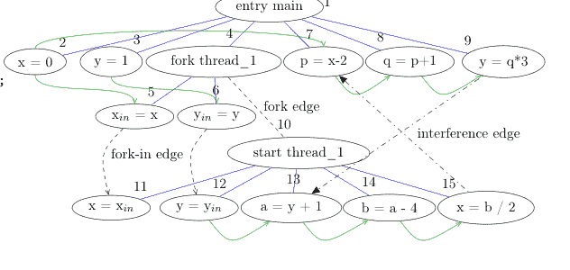

图3.1: 一个`cSDG`示例

#### 3.2.1 切片的不可判定性

通常来说精确切片是不可判定的。若干不可判定性结果对并发程序的切片技术有影响：

- 1. 条件在程序运行过程中变为真或为假无法通过静态判断。为了规避这一点，我们通常在静态分析期间假设条件判断处存在非确定性选择，结果是过程间CFG中的每条路径都被假设是可行的（参见第2章第23页）。
- 2. 涉及同步和递归的语言的精确切片是不可判定的 [Ram00]。
- 3. 与干扰依赖结合时，数据依赖不再具有传递性 [MOS01]，使得并行过程间切片完全变得不可判定。

在接下来的内容，我们将给出另一个不可判定性的来源：精确的过程间切片 [Kri98] 与动态线程创建相结合是不可判定的。

为了说明结果 (2) 和 (3)，考虑图3.2，它显示了小型示例程序。左侧的程序演示了同步如何对执行序列产生顺序：首先将 `a` 设置为1，之后另一个线程才能继续执行并杀死赋值为0的第一个定义。因此 `a:=1` 和 `write(a)` 之间的差异可以消除。

在右侧的示例中（取自 [MOS01]），`write(c)` 的值将对任何可能的执行序列产生影响。右侧的语句可能调度在 `b:=0` 之前或之后。如果它执行，则 `c` 在连接 之前在第一个线程中被重新定义。如果不是，`b` 已经被重新定义为0，因此与 `a` 的值独立。

上述工作表明，这些示例中展示的影响

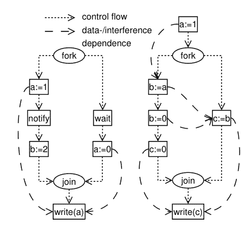

图3.2: 不精确切片的示例

结合过程调用片使得精确切片变得不可判定，因此需要采用保守近似。

#### 3.2.2 动态线程创建

Java中的线程与之前的语言相比是完全动态的。静态检测程序运行的线程数量是不可判定的。任何对象都可以通过调用 `java.lang.Thread` 构造函数创建线程，随后调用 `start()` 方法将在操作系统内核执行其 `run()` 方法。这一切可能发生在循环或递归中，因此线程数量没有静态边界。

当语言提供可以创建和销毁的线程，且线程创建可能发生在控制流循环中时，即使语言没有精确性也会产生另一个不可判定。在这种情况下，过程内切片的不可判定结果导致了另一个不可判定。无法确定将创建多少个线程。例如，考虑图3.3，主线程在此分叉。右侧的图说明，只有在创建了至少三个`t`的实例时才能找到可行路径。

```java
main() {
  d = 1;
  for (...) {
    fork t;
    x = a;
  }
}
read t {
  a = b;
  b = c;
  c = d;
}
```

图3.3: 不可判定程序的示例

并且意味着在大多数情况下需要变得更加保守。

为了获得与顺序`SDG`变体最相似的图，许多方法 [KR03b, Za99, XR06] 建议为每次执行构建一个依赖图，并通过相互依赖连接它们。这可能会减少虚假的干扰依赖边的数量，但在高度动态的语言中（在程序执行期间理论上可以启动无数量的线程），这种方法不再可行。反对这种方法的另一个原因是，像Java这样的类库非常巨大，以至于需要共享它们的依赖图。

由于原因，我们的方法在`cSDG`中仅包含一次方法。然而，这完成了定义3.1对 `$\theta$` 函数的确定，该函数在其他方法中仅返回给定节点`n`的所属线程。在我们的设置中，它必须返回一个所属线程集合。由于运行时生成的线程数量不是固定的，我们保守地

## 算法 4 虚拟线程数量

```
**Input:** 调用图
**Output:** 数字的映射 $\theta : method \rightarrow set$，以及最大虚拟线程数 $maxThreads$
$maxThreads = 0$
为调用图中的所有根方法分配 $\{\}$
将所有方法加入 cSDG 并放入工作列表 $changed$
**while** 从工作列表中取出改变的 $m$ **do**
从工作列表中移除 $m$
**for** 所有的 $c \in caller(m)$ **do**
  **if** $m$ 是 Thread.run() 的重定义且
    $c \in Thread.start()$ **then**
    **if** $m$ 的线程可能被启动多次一次 **then**
      $\theta(m) \cup= \{maxThreads + 1, maxThreads + 2\}$
      $maxThreads += 2$
    **else**
      $\theta(m) \cup= \{maxThreads + 1\}$
      $maxThreads += 1$
    **end if**
  **else**
    $\theta(m) \cup= method(\theta(c))$
  **end if**
  **if** $\theta(m)$ 发生了变化 **then**
    将 $m$ 的所有调用者加入工作列表
  **end if**
**end for**
**end while**
```

### 3.2. 并发 JAVA 切片

近似其影响。如果我们无法确定一个线程只被启动一次，我们就假设给定的线程类至少有两个实例。因此，每当线程类的一个实例定义了另一个实例读取的字段时，我们就会包含干扰依赖。我们的方法参考了 Lee 等人对并行 do 的 [LM99] 分析，该分析总结了并行 do 中动态创建线程之间的总结和同步信息。

遗憾的是，确定一个线程 () 是否只启动一次在一般情况下是不可判定的：例如，在非常特殊的情况下，`run()` 方法的重定义只有一个一次调用，此时该指针的指向集是单例 {}，且可以确定分配位点 `$a$` 只执行一次。寻找这些情况需要一个特殊的程序，例如基于 Rif [Ruf00] 的程序，这超出了本文的范围，但已集成到我们的框架 [GH09] 中。

为了分析目的，我们通过所谓的虚拟线程对这种单例线程和普通线程的区别建模。前缀“virtual”代表运行时创建的线程数量是未知的。虚拟线程数量根据我们获取的调用图来确定，如何计算 `$\theta$` 函数：我们知道有一个动态创建一次的线程：执行的 `main()`。我们将包含虚拟线程数 0 的集合分配给所有方法（包括 `main` 和初始化器）。

然后，我们遍历调用图中的所有方法：如果我们正在处理 `Thread-run()` 的重定义，且它被 `Thread-start()` 调用（在所有其他情况下，`run()` 方法的行为与其他方法相同），那么我们就向虚拟线程集合中添加新数字。否则，将调用者的虚拟线程集合调用到 `$m$` 的集合中。单例线程类将被分配一个线程数，它不会对自身产生干扰；而普通线程类由不同数字的语句确定，干扰产生于从单例线程到同类类的线程。

当虚拟线程集合发生变化时，被分析方法调用的所有方法也被（-）分析。当不再发现这些集合的进一步变化时，不动点迭代结束。线程数受线程类数量限制，这种单调迭代保证收敛于不动点。最后，每个方法中的所有语句都被分配其对应方法的数字。

例如，考虑图 5 中的程序以及其在图 6 中的二分图。调用图中包含方法调用和省略号调用。注意，我们省略了原生方法和库方法，因为它们在例示例中不产生干扰依赖。根方法 `main` 根据算法 4 被分配了虚拟线程数 0。然后，图中的所有方法被添加到工作负载中。对于所有方法——

> *如果主类是 `Thread` 的实例，则其 fork 实例将接收新的线程数*

# 第 3 章 并发

```java
public class FacThreads extends Thread {
    static int i;
    static final Int[] fac = new Int[10];

    public static void main(String[] args) {
        new FacThreads().start();
        for (int i = 0; i < fac.length; i++) {
            fac(i);
        }
    }

    static void fac(int n) {
        if (n <= 1)
            return setValue(n, n * fac(n - 1));
    }

    static int setValue(int n, int i) {
        synchronized (fac) {
            if (fac[n] == null) {
                fac[n] = new Int(i);
                fac.notify();
            }
            return i;
        }
    }

    public void run() {
        for (int i = 0; i < fac.length; i++) {
            synchronized (fac) {
                while (fac[i] == null) {
                    try {
                        fac.wait();
                    } catch (InterruptedException e) {}
                }
                System.out.println(fac[i].value);
            }
        }
    }

    static class Int {
        int value;
        public Int(int i) {
            value = i;
        }
    }
```

图 3.4：多线程示例程序

### 3.2. 并发 JAVA 切片

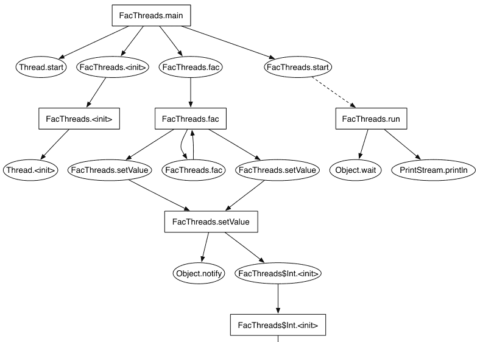

| 方法 | 虚拟线程数 |
| :--- | :--- |
| FacThreads.main | 0 |
| FacThreads.<init> | 0 |
| FacThreads.fac | 0 |
| FacThreads.setValue | 0 |
| FacThreads$Int.<init> | 0 |
| FacThreads.run | 1,2 |

图 3.5：示例程序 3.4 的调用图和虚拟线程数

# 第 3 章 并发

对于 `FacThreads.run`，算法将分支到 `$\theta(n) \= method(\theta(c))$`，它们将被分配线程数 0，最终达到不动点。`FacThreads.run` 是从调用点 `FacThreads` 派生的，它是 `Thread` 的一个定义。因此，执行了第一个分支，该分支确定了由于在循环中被调用，从调用点生成了多个线程。因此，`FacThreads.run` 被分配了两个虚拟线程，1 和 2。

在计算干扰依赖时，我们使用虚拟线程作为 `$\theta$` 的近似。因此，当线程为定义 3.1 的第二个要求产生干扰依赖时（注：此处原文似乎缺失或不完整）。

### 3.3 并发程序的依赖性分析

线程数提供了一个线程并行执行的初始近似。利用这些数字，我们借鉴 Sprite [Kri98 Kri03b] 的精神，它假设所有线程从程序开始到结束都并发执行。但与之前的工作不同，我们推广到了动态线程创建，而不是处理静态固定的“任务”集合。

#### 3.3.1 干扰依赖

分析线程软件的一个要求是寻找由于并发执行线程更改数据而导致的可能依赖，如定义 3.1 所示。然而，该定义需要针对 Java 内存模型进行改进：

> 定义 3.2。如果 `$\theta(d) \neq \theta(r)$`（`$d$` 和 `$r$` 可能并行执行），则节点 `$r$` 依赖于节点 `$d$`
> - 1. 存在静态字段 `$f$`，使得 `$d$` 定义 `$f$` 且 `$r$` 引用 `$f$`，n2. 或者存在非静态字段 `$f$`，使得 `$d$` 定义了值为 `$v$` 的 `$f$`，而 `$r$` 引用变量 `$w$` 的 `$f$`，且 `$v$` 和 `$w$` 是潜在的别名。

虽然与所示的 Java 内存模型相比，这种分析仍然不精确，但它比之前的工作有了显著改进，之前的工作没有引入变量基的别名干扰分析，而是使用 [Zha99,HCD99]（即对给定字段 `$f$` 的所有读取对 `$f$` 的所有写入产生干扰依赖，忽略基变量）或逃逸分析 [RH04]（如果发现对象 `$o$` 逃逸了线程，则对给定字段 `$f$` 的访问具有干扰）。

定义 3.2 产生了算法 3.4

回到图 3.5 的表格，对于具有虚拟线程数 0 的方法，`FacThreads.run` 只能发现从该方法到其自身的调用干扰。

然而，`FacThreads.run` 并不包含共享变量的定义，因此

> "Ranganath 是一种基于 Ruf 方法的高效但诚然不精确的基于统一的逃逸分析 [Ruf00]。

### 3.3. 并发程序的依赖分析

**Algorithm 5** `$(i, j) \in computeInterference()`

```
foreach (i, j) \in \{(i, j) : 0 \leq i, j \leq maxThreadNumber : i \neq j\n  foreach field f where is used in i and defined in j\n  statement g \in thread(i): f \in Ref(s)\n  statement s \in thread(j): f \in Def(s)\n  if f is static or g are aliased\n    addInterference(s, g)
```

只有线程编号为 0 的线程才能成为对其他线程的干扰源。在第 (21) 行，`face` 的一个条目被写入，因此引用了该数组在 `fThreads.run` 中的干扰，取决于它；即第 (31) 行和第 (36) 行的条件。另一处定义可以在第 (44) 行找到，用于字段 `value`。同样，该语句对第 (36) 行具有干扰依赖。

对于 Java，干扰的更精细定义是可以想象的，Rangwanath 给出了以下定义：


### Definition 3.3 (Interference Dependence [RH04])
Let `P` be a program, or an object with field `$f$`, and `t1` and and22 be threads such that `$t_1 \neq t_2$`. If there exists an execution trace of `P` such that `$f$` is written to by statement `$s_m$` by a statement at point `n` executed by `t2` (with `$s_n$` occurring after `$s_m$`) and no write occurs between `$s_m$` and `$s_n$`, then `n` is interference dependent on `m`.

然而，从并发程序的不可判定性来看，这种定义可以保守地近似。注意，即使该定义是在新 Java 内存模型规范之前给出的，该定义也必须包含一个条款，说明 `$s_m$` 和 `$s_n$` 由 happens-before 语句排序，允许值在没有排序的情况下被看到，它并不能 *保证* 它们会被看到。为了保持保守，必须包含一个条款。

除了干扰之外，还发现了其他线程间依赖，用于切片，如果一个语句的开始或终止取决于另一个语句的开始或终止。对于类似 JVM 的语言，Hatcliff et al. [HCD*99] 定义了从对共享变量的访问到直接封闭临界区的 monitor 获取和释放语句的同步依赖。除了 Hatcliff et al. 引入了就绪依赖的建模，即 monitor 或 wait/notify 可能无限期地延迟任何此类语句的执行。

两项工作都将并发相关的依赖与弱控制依赖 [PC90] 结合起来（其中 Hatcliff et al. [HCD*99] 分解为标准控制依赖和发散依赖；对于后者他们提供了直观的定义）。Hatcliff et al. 指出（然而没有正确性证明）这组依赖被保证能产生正确的切片，其含义是

# CHAPTER 3. CONCURRENCY

```
int x;

main() {
  cons() || prod();
}

prod() {
  set();
}

void set() {
  x = ...;
}

cons() {
  int y = get();
  print(y);
}

int get() {
  return x;
}
```

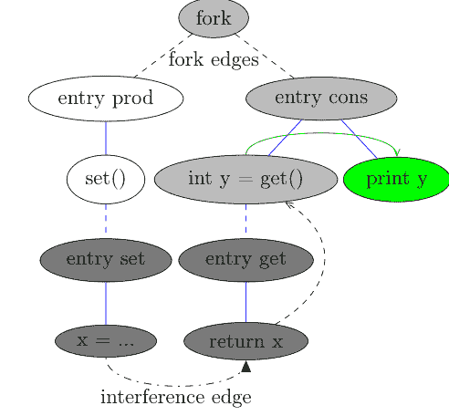

Figure 3.6: A counter example to Zhao's approach

基于模拟的正确性标准扩展了单线程情况下投影的经典概念，最初由 Weiser [Wei84] 提出。

## 3.4 Slicing the cSDG

已经提出了几种算法来切片并发 SDG。最通用且因此显然正确的算法是构建依赖的传递闭包。¹⁰ 然而，这种上下文无关的切片算法过于保守，因为没有考虑调用上下文。

nZhao [Zhao99, ZL04] 利用标准上下文敏感的两阶段算法 [Hir90] 来切片并发 SDG。然而，这可能产生不正确的切片，这首先由 Nanda [Nan01, NR06] 注意到。图 3.6 显示了一个最小的生产者-消费者示例，其中生产者和消费者之间存在干扰。对 *print* 节点的两阶段切片避免了 *prod:run* 的调用。在第一阶段，从 *print x* 开始遍历所有浅灰色节点。第二阶段从省略的参数-out 边开始，到返回语句并将该语句和头部标记为切片的一部分。Zhao 的算法将干扰遍历为静态依赖边，它也在第二阶段标记了 *set* 方法中的节点。然而，由于第二阶段不得上升到调用方法，*set* 的调用将不会被包含，即使它显然属于 *print* 语句的切片。

## 3.4. SLICING CSDG

**Algorithm 6** Iterative two-phase SummarySlicer

```
**Input:** The cSDG G, a slicing criterion s.
**Output:** The slice S for s.

W = {s} // a worklist
M = {s \mapsto$ true} // a map for marking the contents of W
// (true represents phase 1, false phase 2)

repeat
  W = W \cup {n} // remove next node n from W
  foreach m \mapsto$ n // handle all incoming edges of n
    if m wasn't visited yet edge or m was visited in phase 2 and we are in phase I ...
      // traversing an interference edge,
      if m \in M (\neg M(n) \wedge (M(m) \vee e = id))\n        // if we are in phase 1 or if e is not a call or param-in edge, add m to W
        if M(n) \notin e \in {call, param}
          W = W \cup {m}
      /* Now we determine how to mark m: */
      // If we are in phase 1 and e is a param-out edge, mark m with phase 2
      if M(n) \wedge e = po
        M = M \cup {m \mapsto$ false}
      // If we are in phase 2 and e is an interference edge, mark m with phase 1
      else if M(n) \wedge e = id
        M = M \cup {m \mapsto$ true}
      // Else mark m with the same phase as n
    else
      M = M \cup {m \mapsto$ M(n)}
until W = \varnothing
**return** dom M
```

# CHAPTER 3. CONCURRENCY

### 3.4.1 Iterative two-phase SummarySlicer

两阶段切片的一个直接扩展使该算法对切片 cDG 正确。作为补救措施，每次遍历一个干扰边时，其源节点（即另一个线程中的节点）被标记为合成切片标准，这意味着它将在切片算法的第一阶段中被处理，即使干扰边的目标节点是在第二阶段中处理的。它的高度优化的伪代码在 Algorithm 6 中给出。迭代两阶段切片最多遍历 SDG 中的每个节点和边两次，因此其最坏情况复杂度与 Horwitz 等人 [HH90] 的原始阶段切片算法相同。其运行时间可以最小化，如果所有要在第一阶段遍历的节点在那两个阶段之前从工作列表中移除，则可以最小化，因为在第一阶段找到的节点不需要再次检查。

应用于图 3.6 中的示例程序，它将工作负载 W 初始化为 print 节点。该节点也被包含到 M 中，其中它映射到 true，表示它已在阶段 1 中遍历。它像 Zhao 的算法一样标记节点，遍历到它的返回语句的参数边，返回节点被标记为 false 以表示阶段 2。没有更多阶段 1 的节点可用，因此该节点被从工作列表中取出。它com incoming edges the method header get for phase 2 and the assignment to a.x for phase 1, as it is reached via interference. So this assignment node comes next, and its header node set is included into the slice marked with phase 1. Now we may ascend into the calling method and mark.run for phase 2. All remaining nodes in the worklist do not change the slice or marking. So the slice for the print statement is the whole graph, as expected.

Nanda 提出了第一个迭代两阶段切片算法，由两个嵌套循环组成。迭代两阶段切片在每个线程内部保持上下文敏感，但在通过干扰依赖跨越线程边界时破坏调用上下文，但这是 sound 但不完美的。

### 3.4.2 Time Travel

Krinke [Tri98] 首先注意到干扰依赖不是传递的，与数据依赖相反。通过迭代两阶段切片，可以通过干扰重新进入之前已离开的线程。然而，由于干扰是在不考虑可能控制流的情况下确定的，多次遍历干扰可能对应于在任何有效程序执行中都不可能存在的控制流。在实践中，重入的节点必须在之前离开该线程的节点之前执行。否则，这将对应于所谓的“时间旅行”情况，其中一个值依赖于将在未来执行的语句。

> 10Provided all necessary dependence types are included.

84

```
int x,y;

main() {
  x = 0;
  y = x;
  fork(thread_1);
  int p = x - 2;
  int q = p + 1;
  y = q + 3;
}

thread_1() {
  int a = y + 1;
  int b = a + 4;
  x = b / 2;
}
```

## 3.4. SLICING THE CSDG

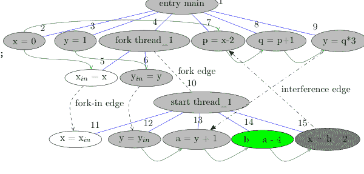

Figure 3.7: Slicing an example <CSDG>

As an example, consider the program and corresponding graph in Figure 3.7, where the shaded nodes are the slice for node 14 computed by the iterated phase slicer. thread_1 at node 13 towards node 9 and returns to node 15 via the interference edge from node 7. Notably, node 15 cannot influence the slicing criterion 14, because it cannot execute before 14. [Ram00,MOS01] as the exact order between threads is undecidable this order cannot be taken into account when computing interference dependencies. In contrast, intra-thread dependencies like data or control dependence take flow into account, making them transitive.

Slicing other Concurrency-Related Dependencies Intractivity is regarded for interference only, mainly due to incompatible programming primitives, Krinke's and Nanda's models do not consider synchronization primitives, thus they can only argue about interference dependence. Approaches with a finer-grained concurrency model like that by Cheng and Hatfield [Che93b, ICD99,RH04] leverage context-sensitive slicing, which ignores intractivity issues and is also of precision. Dewar et al. [DCH+*99] argue that it remains unclear whether the gain in precision of context-sensitivity outweighs the additional cost.

However, taking all concurrency-related dependencies into account, time travel may occur for all nodes of dependencies that cross thread boundaries, if control flow is ignored during dependence computation. In particular, [HCD+99, RH04] is intractive when crossing boundaries. Accordingly, some algorithms that prune time travels for interference dependence must be applied to get precise slices with ready dependence. The author is not aware of any work that identifies or targets this problem.

### 3.4.3 Slicers Disallowing Time Travel

To prune interference traversals that correspond to time travel situations, Krinke and Nanda [Kri03b, NR06] defined which paths in each thread's control flow

# CHAPTER 3. CONCURRENCY

graph correspond to a valid program execution. Their slicing algorithms are effectively symbolic deconstruction which marks all other paths as invalid such that they are not traversed during slicing.

The threaded control flow graph (TCFG) consists of the ICFGs of each thread that are connected at fork and join nodes, respectively. Note that Krinke [Kr03b] and Nanda [NR06] require threads to be disjoint, which is in general not the case for Java threads. However, one can always duplicate parts of the graph to achieve disjointness, which will be assumed in the sequel.

A interprocedural realizable path $P = n_1, \dots, n_k$ is an ordered sequence of nodes in the TCFG G that every projection of P to a thread $\theta$, created in $P$ is either empty or corresponds to an interprocedural realizable path in the thread.

The slice of a cSDG w.r.t. $c$, the criterion $p$, depends on $S(p)$, consists of all nodes on $q$ which painfully depends and there exists an interprocedural trace witness $W$ in the TCFG for each such $q$.

```
S(p) = \begin{cases} q = n_1, \dots, n_k, \ q = n_{d_1}, \dots, n_{d_{k-1}}, n_k, p = d_i, i \in \cd, dd, id\}, 1 \le i \le k, \ \text{P is an interprocedural realizable path in G} \ \text{where } n_i \text{ is a node in } P \text{ in the same order as } W \end{cases}
```


Krinke's algorithm [Kr98] was the first to solve the transparency problem for programs without method calls. The effects of synchronization are ignored in this approach. The idea of his slicing algorithm is to keep track of control flow that is necessary for an execution to be valid. To end, each visited node is annotated with a state tuple `Γ` containing many entries as threads. For each thread, the entry in state is its last node on the path from the slicing criterion to the currently visited node. Initially, the state tuple for the slicing criterion is empty except for that criterion's thread, which contains the slicing criterion. Empty slot in tuple are usually denoted `⊥` and do not impose any restriction on that thread's control flow.

With each traversal of an dependence edge `m → n`, `m` is annotated with a clone of `m`'s state tuple, the entry is replaced by `m`. When boundaries are crossed via interference, one must check whether intra-thread control flow from the source of interference to the statement listed in this thread (i.e in `m`'s slot of the state tuple at `m`) is actually possible. Krinke makes a feasible state tuple a threaded witness.

In our example of Figure 3.7, this situation arises when the algorithm traverses from node 7 to node 15. left dependence from node 13, it is checked whether node 13 is reachable from node 15 via an interprocedural realizable path in the control flow graph. This is not the case, so the traversal is rejected resulting in an invalid execution trace, which means that node 15 is not included in the slice from node 14.

> ¹¹When methods are inline, this approach may also be used for programs with method calls, but may require exponential space, and inlining is not possible for programs with recursion

## 3.5 Related Work

Nanda [NR00] adapted this for programs where threads are interleaved with loops. This paper targets cobegin/coend thread spawning which allows an optimization that may improve precision but only allows a fixed number of threads. Thus, an adaptation to Java's dynamic creation cannot be easily done.

Chen and Xu [CX01a] propose another exponential execution, but by this algorithm, however, inter-thread dependencies from the same deficiencies, it too, was proposed [CYX+00] for Ada with a fixed number of threads and inlining of method calls accessing shared variables. Again this cannot be done for recursive programs. It remains unclear how Java version models which may be started an unbounded number of times.

In [Kr03b], Krinke extended his approach to procedural programs. While this algorithm can still uses a fixed number of threads cannot be applied to Java.

In her thesis [Nan01], Nanda, too, extended her approach to programs with method calls and fork-joining. All approaches using a fixed number of threads she duplicates a procedure for every thread Furthermore she presented a version of her two-phase algorithm which is context-sensitive and does not allow time travel

A detailed discussion of Krinke [Kr03b] and Nanda's [Nan01, NR00] precise algorithms can be done in [GH09]. The authors provide solutions to several shortcomings of the previous algorithms, most dramatically thread creation in loops. Krinke and Nanda did not fully support. In new optimization techniques, slicing remains expensive (in number of threads), and the experiments in [GH09] indicate that preventing time travel should only be applied as a post-processing step, when cheaper methods like the iterative two-phase slice fail at establishing a desired property.

Zhao and Li [ZL04] present the concurrent dependence graph (CPDG), featuring the traditional data, control, and parameter dependences as well as class and inheritance dependencies. Furthermore, they introduce interface-membership, package-membership and interface-inheritance dependences for the intra-thread case. They use synchronization and communication dependences of Cheng [Che93b, Che95a] and introduce synchronization-dependence for methods as usual membership dependency. It is how they model dependences due to field access, and their example program and CPDG clearly miss these dependences¹².

Naumovich's work on may happen in parallel analysis [NAC99] may significantly improve computation of interference and ready dependence: Their definitions require two dependent statements to execute in parallel. Ready dependence itself is completely equal to Naumovich's notify-edges. MHP

¹²For example there is no data dependence from line s30 to s32 in [ZL04]

分析目前对于具有递归方法调用和同步的程序尚没有扩展。

消除虚假干扰和就绪依赖的另一种方法是基于 [NUS98, LPM99] 的工作，在互斥存在的情况下进行并发静态单赋值（SSA）形式的研究。

# 第 4 章 信息流控制

## 4.1 安全

信息流控制（IFC）是一种确保软件系统符合安全规范性的技术。随着移动代码和安全相关应用的泛普及，对 IFC 的研究日益兴起。信息流控制通常使用特殊的类型系统 [SM03] 进行验证。然而，类型系统没有利用现代程序分析的整个工具库，因此受到语言限制和高标注负担的困扰。本章将介绍一种基于程序切片和前几节定义的系统依赖图的信息流控制新方法。与类型系统相反，由于底层的切片技术，所提出的算法是流敏感、上下文敏感和对象敏感的，从而减少了虚假报警。程序分析的进展使得这种技术即使对于 Java 字节码等真实语言也是可行且可扩展的。

此项工作的早期结果已发表在 [HKS06, HKN06, HS08] 中。

### 4.1.1 信息流

信息安全传统上只考虑软件制品及其用户的身份和来源。例如是 Bell 和 LaPadula [BL73, BL96] 访问控制，它已成为所有主要操作系统的强制标准。其他“经典”手段包括加密、代码签名、病毒扫描器、防火墙和自动更新。然而，所有这些手段都无法保证整个数据过程（端到端安全）的安全，只能检查计算过程中某一点的违规。问题在于，经典手段只验证身份和来源，但忽略了软件的语义。例如，访问控制可能只验证用户是否有权访问某些公共或机密数据。在发布这些数据后，它就无法再控制程序是否会将数据公开，因为这需要用户希望某个软件不会恶意使用其数据，这通常是基于公司的身份和声誉的。然而，在过去的几年中，许多数据已经公开了，即使是知名的软件生产商也收集了用户的数据并将其发送回自己的服务器。

作为补救，基于安全机制可以验证程序信息的安全策略。信息流策略定义了给定系统的安全需求，以及在计算中如何使用数据的权利和限制。最理想的属性是端到端安全，即敏感数据在整个处理路径上受到保护 [SRC84]，例如从文件系统（带有访问控制）开始，通过程序中的数据处理，直到最终呈现给授权用户。由于访问控制已集成到所有主要操作系统中，在处理过程中控制信息流仍然是一个挑战。

### 4.1.2 通道与信息流

Lampson [Lam73] 识别了程序向其环境传输信息的三个所谓通道：合法通道是程序声明的正式输出，存储通道是程序非本地环境中的其他存储，而隐蔽通道是任何其他传输信息的手段（即不涉及系统任何存储器中的值）。时间通道是隐蔽通道的一个例子，攻击者可以通过测量程序的执行时间来获取信息。时间通道已相继被利用，例如通过对使用中国剩余定理的 RSA 破解智能卡中的加密 [Scho00]。

当涉及到从源到通道的传输传输时，信息流有两种主要手段：

从从 `x` 到 `y` 的**显式流**发生在 `y` 被赋值一个包含对 `x` 引用的值时。`y = f(x)` 就是显式流的例子。

从 `x` 到 `y` 的**隐式流**源于控制流，其中执行取决于 `x` 的值。例如，`if` (`x=0`) `y=0` else `y=1` 包含了从 `x` 到 `y` 的隐式流。历史上，一些作者将隐式流视为一种隐蔽通道，但今天这种分类不再存在，因为隐式流可以很容易地通过基于语言的技术进行检查。

## 4.2 信息流控制

控制信息如何通过程序通道流动的方法称为信息流控制（IFC）。在 CIA 三要素描述的三个维度中，信息流控制了机密性和/或完整性。通常完整性被局限于二元性（基于 [Bib77] 的观察），通常只描述如何确保机密性。控制可以在在线（程序执行期间）或离线（通常在编译时）进行。这两种方法都有不同的优缺点。

在线（动态） IFC 的主要优势是它不会虚假地保护程序执行，因此它是精确的。它的分类可以是静态（每个变量在整个执行过程中具有固定的安全级别）或动态（安全级别在每次赋值时确定）。但像动态程序分析一样，它无法显示程序的通用安全性，并且通过运行时测试降低程序执行速度。此外，动态检查最好防止即将发生的非法流，但恶意攻击者可能会获得程序因违反安全策略而终止的信息，因此程序至少泄露了布尔信息。某些系统如 Fenton 的数据标记机 [Fen74] 采用特殊技术避免这种泄露，但在存在副作用的情况下这些方法可能无效。运行时 IFC 最限制性的属性是控制结构，一种称为*程序计数器*（在 [Ara83] 中称为*敏感标签*）的合成变量跟踪控制流中的数据。然而，控制谓词 `p` 的安全标签不仅限制给定程序执行中由该谓词控制的控件的安全级别，还限制了另一个执行中由于谓词 `p` 可能改变的变量值。但动态分析的特征是只有执行路径，而不是所有可能的路径。检测所有可能的隐式流的方法之一是在剩余时间内将 PC（程序计数器）保持在 `p` 的安全级别（随后的控制结构增加，这在 [SM03] 中被称为*标签渗透*），使得动态分析在实践中仅具有限制性。

相比之下，静态（离线） IFC 只需一次（通常在编译时）。如果程序可以通过验证，则没有任何程序执行会显示非法信息流，从而避免了运行时检查的开销。然而，

# 第 4 章：信息流控制

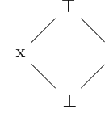

图 4.1：具有不可比较元素的格结构

精确的静态 IFC（信息流控制）分析是不可判的 [SM03]，因此所有静态分析都必须是保守的。因此总有一类安全程序会被错误地拒绝。

为了解决这一问题，某些 IFC 系统（如 lif [MCN+]）提供了一种混合方法：编译器尽可能进行认证以限制运行时检查的数量，并仅在用户指定的无法通过静态验证的程序点插入动态检查。

### 4.2.1 信息流的格模型


通常，数据被归分为一个有限的安全域集合（也称为安全级别）$\mathcal{L} = \{l_1, \dots, l_n\}$。一个传递的、自反且反对称的度量干扰关系（一种偏序）：$\preceq$ 表示 $x \preceq y$ 如果类 $x$ 中的信息允许流向类 $y$。补全关系（称为非干扰）定义为 $x \perp y$，意味着必须防止安全级别之间的信息流。通常情况下，安全级别被排列在一个格 $\mathcal{L}$ 中，其中 $\preceq$ 等同于 $\le$。如果干扰关系没有形成格，为了方便起见，我们在后文中假设安全级别构成一个完备有界格 $\mathcal{L} = (\mathcal{L}, \le, \top, \bot)$。最平凡的格由线性优先级给出，它们可以表示为序列 $0 \dots, n$，例如 LOW $(\text{L}) \le$ HIGH $(\text{HIGH})$，这也可以表示为 $0 \le 1$，或者像众知的分类级别：不受机密 (Unclassified) (0)、机密 (Confidential) (1))、秘密 (Secret) (2)) 和最高机密 (Top) (3))。许多复杂的格包含不可比较元素，其中这些元素既不满足 $x \preceq y$ 也不满足 $y \preceq x$，如图 4.1 所示。研究发现，格能够自然地表示信息流的语义 [Den76]。当信息由具有不同安全级别的片段组成时，上确算子 $\sqcup$ 标志着组合信息的安全类别。“操作数”安全级别使用上确算子进行合并，例如，如果合并了“机密”和“秘密”安全级别的信息，其结果至少必须是“秘密”。

## 4.2.2 基于语言的信息流控制

安全格既用于静态分析也用于动态分析。在本文中，我们关注基于语言的设置下的静态信息控制。基于语言的信息流控制 [SM03] 为程序提供编译时认证，以保证信息流策略。它可以利用程序分析领域的长期研究成果；例如：

基于语言的 IFC 可以通过多种形式的分析来实现（见 Salsfield 的工作概述 [SM03] 以及建议在详细概述中提出的相关工作章节）。直到最近，占主导地位的分析类型基础信息流控制。类型检查（Type checking）属于 Volpano 和 Irvine [IV96, VS97, SV98]，他们将 Denning 的分析重写为一种更严谨的类型系统，以证明该机制保证了机密性。类型系统提供了一个形式规范，将安全策略与执行机制分离来。基于类型的 IFC 是高效的、模块化的，且正确性证明并不困难。因此，基于类型的 IFC 取得了成功，开启了整个基于语言的 IFC 领域。对于基于类型的 IFC，安全格的元素变成了一组额外的类型，其中安全级别之间的干扰关系 $\le$ 由子类型化（subtyping）表示。程序不会与低类型的变量产生干扰，从而保证了机密性。类型规则通过程序的表达式和语句规范安全级别，确保能够捕获信息泄露。

大多数现代的 IFC 方法都是基于 Volpano 类型系统的扩展。已经有大量的系统被提出来将该类型系统扩展到具有过程、面向对象特性（如动态分发）、并发或甚至时序泄露的真实语言 [Ago00]，大多数方法定义了一种系统可以被证明其可认证的语言，而不是类型系统及其底层语言的实现，因此这些工作仅展示了对安全工程有影响的理论结果 [Zda04]。目前仅有两个针对真实语言的实现：Flow Caml [PS03] 和 Mif [MCN+, ML00]。但即使 Jif 是一个基于 Java 语法的特殊语言，它与许多显著不同（例如，没有静态变量，没有隐式异常）。

> ¹ 对标准变量的添加，如在

```
if (confidential==1)
  public = 42
else
  public = 17;
  // public 无输出
  public = 0;
```

图 4.2：一个安全的程序片段

将安全提升到 Jif 可能会变得复杂 [AS05]。

此外，基于类型的分析通常不是流敏感的（flow-sensitive）或上下文敏感的（context-sensitive），这会导致误报。例如，图 4.2 中著名的程序程序片段被基于类型的 IFC 认为是不安全的，因为基于类型的 IFC 不是流敏感的。它没有看到 `if` 语句中从 `confidential` 到 `public` 的潜在信息流会被随后的赋值操作消除，因此判定该片段为不可类型化。

经典的非干扰 [GM82, GM84] 仅要求同一个程序的两个公共输出流必须是不可区分的，即使它们在秘密变量上有所不同，这对于该程序是成立。因此，只要公共变量中的秘密数据内容不流向输出，它就是完全合格的。注意，关键语句可能距离所谓的非法流很远。

在存在无结构控制流或异常的情况下，基于类型的 IFC 表现更差。因此，类型系统对信息流控制进行了过度估计，导致许多安全程序被拒绝（假阳性）。虽然已经提出了流敏感类型系统的初步步骤，但它们限于基础语言如 While 语言 [HS06]，或不支持无结构控制流的语言 [ABB06]。

## 4.2.3 信息流控制的依赖图

幸运的是，程序分析提供的比复杂的类型系统要多得多。第2章介绍的程序依赖图（SDG）在经过20年的研究后，拥有一种允许各种强大程序分析的数据结构——特别是高效的程序切片 [Wes84]。此外，还有适用于完整 C 的商业 SDG 工具 [ART03]，它们已应用于大量真实应用中。本文提出了一种基于定义的依赖图的新型 IFC 算法。

第一个基于 SDG 的 IFC 算法由 Snel 在1996年提出 [Sne96]。但需要更详尽算法来使该方法在完整 C 和真实程序中运行并扩展 [RS02,SRK06]。后者包含一个将依赖图与经典非干扰标准联系起来的定理

> ² 定义参见第 2.1.2 节

（另见第 4.3 节）。随后，我们开发了针对完整 Java 字节码的精确 SDG（如第2章所述），由于继承和动态分发的影响，以及线程编程引起的并发，构建它比构建 C 的 SDG 要困难得多。今天，我们可以处理 C 和 Java 程序，从而拥有了一种比传统方法更精确的强大 IFC 工具。特别是，它精确地处理了 Java 的异常和无结构控制流。

在本章中，我们为 PDG（程序依赖图）和 SDG 增加了 Denning 风格的安全级别格，并解释了通过程序细节传播安全级别的方程。当在被调方法中引入重分类（declassification）时，原始基于切片的方法只能产生保守的结果，可能导致假阳性。因此，本文包含了一种针对重分类的精确过程间分析，它能生成精确的结果。

## 4.3. 依赖图与非干扰

PDG 构建的正确性保证了 PD 中从 a 到 b 的匹配路径意味着 a 到 b 之间没有影响。这断言信息流不会由隐藏的侧信道（如定时或终止）引起。因此，作为非干扰的安全信息流的技术细节与 PDG 相关并不意外。

由 Goguen 和 Mesueger [GM82, GM84] 定义的非干扰是相对于表示程序状态转移的抽象自动机 M=(S, A, O, step, out) 定义的。该包含一个初始状态 s₀ S，动作集 A 可以被视为程序的构造，输出 O 代表所有可能的输出。step: S × A → S 是转移函数，在我们的案例中由程序语义引起，而 out: S × A → O 是输出函数。我们定义函数 run: S × A* 为 A* 序列的标准自然扩展：run(s,e)=s; run(s,a)=run(s,a),

动作 a ∈ dom(d) ∈ L 的安全级别。给定一个状态域 d，函数 purge: A* × L → A* 合并所有不会影响安全级别 d 的序列 α：purge(α,d)=(a ∈ α dom(d)→)。

根据 Goguen/Mesueger 非干扰标准，一个系统被认为是安全的，如果对于所有根据流图中可能的动作 a 以及在处理 a 之后执行的所有语句，

output(run(s₀,a)) = output(run(s₀,purge(α,dom(s₀)))), a)) (4.1)

```
> ³ 我们使用 Rushby [Rus92] 的符号而不是原始符号。
```

# 第 4 章：信息流控制

如果不满足该准则，则最终语句 $a$ 的输出在实际的 $a$ 与去除了所有假设不受影响的语句后的 $\alpha$ 之间存在差异——因此，$\alpha$ 中的语句 $s$ 对 $a$ 产生了影响，尽管根据 $dom(s) \not\subseteq dom(a)$ 这是被禁止的。我们看到，安全概念是基于观测行为而非源代码的。

基于类型的非干扰（noninterference）定义方法以更紧凑的形式给出。在最简单的变体 $c_{Low}$ 中，它假设仅存在 $Low - High$ 安全级别——其读取如下：

```
$s_{Low} s' \implies [c]_s_{Low} [c]_{s'}$ (4.2)
```

其中 $c$ 是一个语句或程序，$s, s'$ 是两个初始程序状态，$c]_s, [c]_{s'}$ 是执行 $c$ 后的最终状态。$s_{Low} s'$ 意味着 $s$ 和 $s'$ 是等价的：它们在具有 $Low$ 安全级别的变量上可能重合。高输入变量的这种变化不会影响输出，因此机密性得到了保障。注意，基础非干扰有各种扩展，例如可能的或概率的非干扰；其中某些基于 PER 关系 [SS01]。Pistoa 等人 [PCFY07] 已经指出，Goguen/Mesueger 非干扰不仅仅是方程 4.2 及其后代公式的安全流准则，因为前者只考虑观测行为，而不包含每条语句处的隐式和显式流。后续介绍的方法仅考虑行为，因此遵循了原始的 Goguen-Mesueger 定义。

以下定理将 PDG 与原始的 Goguen-Mesueger 定义联系起来，并用于检查非干扰。

## 定理 4.1. 如果

```
$s \in BS(a) \implies dom(s) \not\subseteq dom(a)$ (4.3)
```

则对于 $a$ 满足非干扰准则。

证明。参见 [SRK06]。
如果 $dom(s) \not\subseteq dom(a)$（$s$ 和 $a$ 具有非干扰安全级别），则不存在 PDG 路径 $s \to a$，否则将发现安全泄露。
该定理的通用性源于它独立于特定语言或切片算法；它仅仅利用了任何正确切片的基本属性。即使对于不精确的 PDG 和切片，只要它们是正确的，定理依然有效。应用该定理可以对所有 $s$ 进行线性时间测试。更精确的切片会导致更少的虚假报警。然而，正如我们之后看到的，在纯基于切片的方法是不可能解密（declassification）的，因此稍后我们将给出定理 4.1 的扩展版本。

## 4.4 基于切片的 IFC 示例

在下文中，我们假设读者对第 2 章介绍的切片技术有一定了解。我们的 Java PDG 基于字节码而非源文本，原因如下：

```java
class PasswordFile {
    private String[] names;
    /**P: confidential*/
    private String[] passwords;
    /**P: secret*/
    // Pre: all strings are interned
    public boolean check(String user,
        String password /**P: confidential*/) {
        boolean match = false;
        try {
            for (int i = 0; i<names.length; i++) {
                if (names[i]==user
                && passwords[i]==password) {
                    match = true;
                    break;
                }
            }
        } catch (NullPointerException e) {
        } catch (IndexOutOfBoundsException e) {
            return match; /*R: public*/
        }
    }
}
```


- 字节码必须是程序含义和潜在流的最终定义。
- 字节码比源语言稳定得多（例如 Java 5 中的泛型，它们并没有改变字节码指令）。
- 字节码已经过过优化，死代码等产物已被移除且不会产生虚假流。

### 4.4.1 异常

如 2.4.2 所示，我们的依赖图包含一个由于隐式和显式异常导致的控制流可靠模型。对于安全而言，这种模型至关重要。图 4.3 显示了一个检查密码的 Java 类片段（取自 [MCN7]），它使用了字段和异常。$P$ 和 $R$ 注释将在 4.5 节解释。`check` 方法的初始 PDG 如图 4.4 所示。实线表示控制依赖，虚线表示数据依赖。节点 0 是方法入口，其参数位于节点 1 和 2 中（我们使用“pw”和“pws”作为“password”和“passwords”的缩写）。节点 3–6 代表类的字段，注意由于字段是数组，引用和元素是区分开的⁴。

> ⁴参见第 2.4.3 节

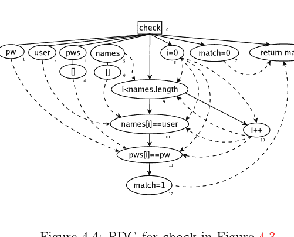

# 第 4 章 信息流控制

```java
class A {
  int x;
  void set() { x = 0; }
  void set(int i) { x = i; }
  int get() { return x; }
}
class B extends A {
  void set() { x = 1; }
}
class InfFlow {
  void main(String[] a) {
  // 没有信息流
  int sec = 0 /*P:High*/
  int pub = 1 /*P:Low*/
  A o = new A();
  o.set(sec);
  A o = new A();
  o.set(pub);
  System.out.println(o.get());
  // 2. 动态调度
  if (sec==0 && a[0].equals("007"))
  o = new B(0);
  o.set();
  System.out.println(o.get());
  // 3. instanceof
  o.set(42);
  System.out.println(o_instanceof B);
}
}
```

图 4-6：另一个 Java 程序

但即使 x 的值不依赖于 sec（在第 26 语句之后），攻击者也可以利用 o 的运行时时间来获取关于第 27 行 sec 值的信息。这种隐式信息流（implicit information flow）我们的分析也能检测到，因为存在 PDG 路径 (13) → *(27)。

## 4.5 分析信息流

非干扰标准（noninterference criterion）防止了非法流，但在实践中，人们希望获得关于个体状态安全级别的更详细信息。因此，IFC 的理论模型（如 Bell-LaPadula [BL96] 或非干扰 [GMS84]）利用安全级别的格结构 $\mathcal{L} = (\mathcal{L}, \le, \sqcup, \sqcap, T)$，最简单的包含两个安全级别：*高 (High)* 和*低 (Low)*。程序员需要指定一个格，以及定义某些（或所有）注解安全级别的注释（Annotations）。在实践中，只有输入和输出通道需要这样的注解。

讨论安全性还需要显式的攻击者模型。对于我们的方法，我们假设：

100

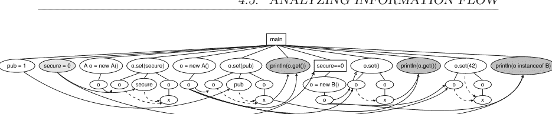

图 4.7：图 4.6 中程序的 SDG

- 攻击者无法控制 JVM 的执行，包括其安全设置。
- 从源码生成的代码（例如字节码）对攻击者来说是已知的（可能通过反汇编），但不能被修改（例如通过代码签名）。
- 因此，变量的内容（局部变量以及堆中的变量）攻击者无法直接访问。这种假设将允许在秘密存储时就获知所有秘密。
- 结果，只有具有特定安全级别（例如由操作系统分配）的系统输入输出可以被控制（或被观测）。

### 4.5.1 基础流方程

对于正确的 IFC，必须计算每个语句的实际安全级别，且这种计算必须遵守程序员指定的级别以及沿程序构造的传播规则。基于 PDG 的 IFC 的巨大优势在于，PDG 已经定义了语句和表达式之间的边，即流可能发生的地方；正如解释过的，PDG 节点之间是不存在显式和隐式流的。因此，只需沿 PDG 边提供传播规则就足够。我们从过程内分析开始。

语句的安全级别，假设 PDG 节点为 S(x)，其中 $S : N \rightarrow L^5$。机密性（Confidentiality）要求信息接收者 $x$ 的安全级别至少等于每个发送者 $y$ 的安全级别 [31.96]。在 PDG 中，$pred$ 和 $succ$ 分别由 → 导出的前驱和后继函数，基本属性很容易表述：

```
$$y \rightarrow x \in G \Rightarrow S(x) \geq S(y) \quad (4.4)$$
```

根据上界的定义：

```
$S(x) \geq \bigsqcup_{y \in pred(x)} S(y) \quad (4.5)$
```

> $^5$记住 $N$ 是 PDG 节点的集合。注意，我们的 $S$ 在原始的 Goguen/Meseguer 非干扰定义中被称为 *dom*，但对于部分函数我们需要 *dom*。

这一基础约束确保了 $S(y) \rightarrow S(x).^6$ 记住机密性和完整性（integrity）是对立的 [Bib77]，因此完整性的对立条件为：

```
$S(x) \leq \prod_{y \in prod(x)} S(y) \quad (4.6)$
```


接下来，我们专注于机密性，因为所有完整性的方程都是通过对偶得到的。

方程 (4.5) 假设每个语句节点都有指定的安全级别，这并不符合实际。在实际应用中，人们希望为某些选定的语句而非所有语句指定安全级别。^7$ 提供的安全级别指定一个语句发送具有提供安全级别的信息，即代表一个输入通道。所需的安全级别只需要安全级别较小或相同的输入可以到达该语句$^8$ 它代表了指定安全级别的输出通道。从这些值可以计算出实际安全级别。

提供的安全级别由部分函数 `P : N → L` 定义。所需的安全级别同样定义为部分函数 `R : N → L`。因此，`P(s)` 指定了 `s` 处信息的安全级别（也称为“`s` 的安全级别”），而 `R(s)` 指定了信息允许的最大安全级别。

节点 `x` 的实际安全级别 `S(x)` 不得大于其前驱的级别，但要大于自身的提供安全级别。方程 (4.5) 变为：

```
$S(x) \geq \begin{cases} P(x) \cup \bigcup_{y \in dom(P)} S(y), & \text{if } x \in dom(P) \ \bigcup_{y \in prod(x)} S(y), & \text{otherwise} \end{cases} \quad (4.7)$
```

注意 `R` 没有出现在这个 `S` 的公式中。我们需要额外的约束来指定进入的节点不能超过节点的要求的级别：

```
$$\forall x \in dom(R) : R(x) \geq S(x) \quad (4.8)$$
```

我们现在可以正式定义机密性：

**定义 4.1。** *给定一个 PDG，如果满足 (4.7) 和 (4.8)，则该程序是机密的。*

正如前文所述，机密性和完整性是对立的 [Bib77]，因此对于完整性的对立条件是：

$^6$ 事实上，在 Goguen/Meseguer 的定义中，`S(x)` 定义了机密性。
$^7$ 在实际应用中，人们希望为某些选定的语句而非所有语句指定安全级别。
$^8$ 只需要安全级别较小或相同的输入可以到达该语句。

## 4.5 分析信息流

正如前文所述，机密性和完整性是对立的 [Bib77]。

提供的安全级别（provided security levels）由部分函数 `P : N → L` 定义。所需的安全级别（required security levels）同样定义为部分函数 `R : N → L`。因此，`P(s)` 指定了 `s` 处信息的安全级别（也称为“`s` 的安全级别”），而 `R(s)` 指定了信息允许的最大安全级别。

节点 `x` 的实际安全级别 `S(x)` 不得大于其前驱的级别，但要大于自身的提供安全级别。方程 (4.5) 变为：

```
$S(x) \geq \begin{cases} P(x) \cup \bigcup_{y \in dom(P)} S(y), & \text{if } x \in dom(P) \ \bigcup_{y \in prod(x)} S(y), & \text{otherwise} \end{cases} \quad (4.7)$
```

注意 `R` 没有出现在这个 `S` 的公式中。我们需要额外的约束来指定进入的节点不能超过节点的要求的级别：

```
$$\forall x \in dom(R) : R(x) \geq S(x) \quad (4.8)$$
```

我们现在可以正式定义机密性：

**定义 4.1。** *给定一个 PDG，如果满足 (4.7) 和 (4.8)，则该程序是机密的。*

正如前文所述，机密性和完整性是对立的 [Bib77]。

### 4.5.2 解方程

方程 (4.11) 以最精确的方式满足，因此方程 (4.8) 被违反的风险最小，如果对于 `S` 的不等式变为等式：

```
$S(x) = P'(x) \sqcup_{y \in pred(x)} S(y) \quad (4.13)$
```

当然 (4.13) 也满足 (4.11)，可以读为从 `P(x)` 和 `x` 的前驱 `S` 值计算 `S(x)` 的算法。因此，方程 (4.13) 定义了*正向传播*：在忽略 `R` 的情况下传播所有的 `P` 值。

我们现在展示方程 (4.13) 对应程序分析中的一个已知概念，单调数据流框架 [KU77]，在第 2.1 节中介绍，允许允许计算。流从属性格开始，在我们的案例中是 `L`。对于每个 `x ∈ N`，必须定义一个所谓的函数 `f_x : L → L`，通常形式为 `f_x(l) = g_x ⊔ in(k_x)`。在我们的案例中，`g_x = P'(x)` 且 `k_x = ⊥`，所以 `f_x(l) = P'(x) ⊔ l`。此外，对于每个 `x ∈ N`，框架定义了 `out(x) = f_x(in(x))` 和 `in(x) = ⊔_{y ∈ pred(x)} out(y)`。在我们的案例中，我们

```
$out(x) = f_x(in(x)) = P'(x) \sqcup_{y \in pred(x)} S(y) = S(x)$
```

> $^9$其中 `g_x`

# 第 4 章 信息流控制

理论要求所有 `f_x` 都是单调的，这在情况下是显而易见的。
该理论还指出，如果 `f_x` 是分配的，分析将更加精确。
在 `f_x(l_1 ⊔ l_2) = P'(x)(l_1 ⊔ l_2) = (P'(x) ⊔ l_1) ⊔ (P'(x) ⊔ l_2) = f_x(l_1) ⊔ f_x(l_2)` 的情况下，分配性成立。该理论最后指出，对于 `S`（res out）的方程组在最小不动点处有解，该解是精确的，且在分配函数的情况下也是精确的。$^{10}$ 计算此不动点的高效算法是广为人知的。
我们稍后将展示不动点的示例；这里只需说明，对于 `S(x) ∈ L`，这些值同时满足方程 (4.13) 和此 (4.5)，对于所有 `x ∈ N`。

因此，计算出的 `S` 的不动点结合 (4.8)，确保了机密性。如果存在 `S` 的不动点，但无法满足 `R`，则检测到了机密性违规：对于任何 `l = R(x)` 且 `l ≠ S(x)`，我们在 `x` 处存在违反，因为 `S(x) ⊔ l`（`S(x)` 的安全级别）不允许影响级别。注意，这里是 `≠`，而不是因为 `l` 和 `S(x)` 可能不可比较的。

从程序分析的角度来看，我们的传递函数 `f_x` 非常简单；事实上，它们简单到可以给出不动点的显式解，并对其进行利用：

**定理 4.2.** 对于所有 `x ∈ N`，令 `S` 为方程 (4.13) 的最小不动点。

$$S(x) = \bigsqcup_{y \in BS(x)} P'(y) \qquad (4.14)$$

**证明。** 令 `x ∈ N`。(4.13) 意味着 `S(x) ≥ P'(x)` 且对于所有 `y ∈ pred(x)` 有 `S(x) ≥ S(y)`。通过归纳法，这意味着对于任何路径 `y →* x`（即 `y ∈ BS(x)`）：`P'(y) ≤ S(x)`。根据上确界的定义，`S(x) ≥ \bigsqcup_{y ∈ BS(x)} P'(y)`。

另一方面，4.13)

$$\bigsqcup_{y \in BS(x)} P'(y) = P'(x) \sqcup \bigsqcup_{\substack{y \in pred(x) \\ z \in BS(y)}} P'(z) = P'(x) \sqcup \bigsqcup_{y \in pred(x) \ z \in BS(y)} P'(z)$$

由于 `S` 是不动点，我们有 `S(x) ≤ \bigsqcup_{y ∈ BS(x)} P'(y)`。因此，如定理所述，得出：

## 4.5.3 基于 PDG 的非干涉测试

我们将利用这一中间结果来证明我们基于 PDG 的机密性检查的正确性。以下陈述是定理 4.1 关于 `P` 和 `R` 的重述。

> $^{10}$注意，我们对于 `S` 的解具有完全精确性，但对于底层的 PDG 没有。

## 4.5. 分析信息流

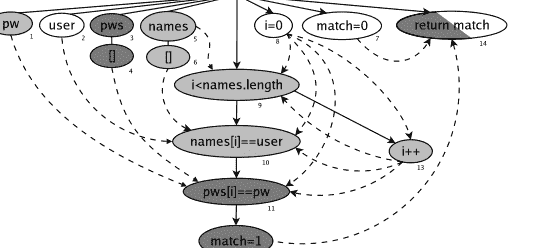

图 4.8：4.3 带有计算出的安全级别的 PDG

# 定理 3.4. 如果

$\forall a \in \text{dom}(\mathcal{R}) : \forall x \in BS(a) \cap \text{dom}(P) : P(x) \leq R(a)$ (4.15)

则对于所有 `x ∈ N` 保持机密性。

也就是说，从需求安全级别 `R(a)` 的节点的后向切片不能包含具有更高安全级别 `P(x)` 的节点 `x`。

**证明。** `x ∈ N`。我们需要证明 (4.7) 和 (4.8) 对 `x` 有效。根据前提，我们知道 $\forall x \in BS(a) : P'(x) \leq R(a)$，因为对于 `x ∈ dom(P)` 有 `P'(x) ≤ P(x)`。因此 `R(a) ≥ fix_{BS(a)}(P')`，根据定理 4.2 有 `R(a) ≥ S(x)`。这里满足了 (4.8)。此外，根据 `S` 的不动点的定义，`S` 满足 (4.13)，从而满足 (4.11) 和 (4.7)。$\square$

该定理可以很容易转换为一个检查机密性的算法。

**基于 PDG 的机密性检查。** 对于依赖图中每个指定需求安全级别的节点，计算后向切片，并检查切片中所有节点的安全级别是否低于或等于指定的级别。

一旦计算了 PDG，每个后向切片和机密性检查的最坏复杂度均为 `O(|N|)`。通常情况下，具有特定安全级别 `R(a)` 的节点数量是有界的，且与 `|N|` 无关。一旦 PDG 计算完成，每个后向切片和机密性检查的最坏复杂度均为 `O(|N|)`。通常情况下，具有特定安全级别 `R(a)` 的节点数量是有界的，且与 `|N|` 无关。

# 第 4 章. 信息流控制

```
**算法 7** 基于精确过程间 HRB 切片算法的上下文敏感型 IFC 算法

1 **过程** MarkVerticesOfSlice($G, x$)

2 **输入** $G$: 一个系统依赖图

3 $x$: 切片准则

4 **输出** $BS$: $x$ 的切片（$G$ 中的节点集合）

5 $C$: 生成的约束集

6 // 假设 $D, R, P$ 为全局只读数据 */

7 begin 

8 $C := \varnothing$

9 // 阶段 1：在不进入被调用的过程的情况下进行切片 /*

10 $BS \leftarrow$ MarkVertices($G, \{x\}, \{parameter-out\})$

11 // 阶段 2：对被调用的过程进行切片

12 不回溯调用点 */

13 $BS \leftarrow$ MarkVertices($G, BS, \{parameter-in, call\})$

14 end

15

16 **过程** MarkVertices($G, V, Kinds$)

17 **输入** $G$: 一个系统依赖图

18 $V$: $G$ 中的节点集合

19 $Kinds$: 边类型的集合

20 **输出** $M$: 由此阶段标记的 $G$ 中的节点集合

21 (精确后向切片的一部分)

22 $C$: 约束集

23 begin

24 $M := V$

25 $WorkList := V$

26 **while** $WorkList \neq \varnothing$ **do**

27 **from** $WorkList$ 中 **选择**并 **移除**节点 $n$

28 $U := n$

29 **foreach** $w \in G$ 使得 $w \notin M$ 且 $G$ 包含一条边 $w \to v$

30 其节点不在 $Kinds$ 中

31 $WorkList :== v$

32 **if** $v \notin D$ **then**

33 $C \leftarrow \{S(w) \leq S(v)\}$ // 参见等式 (4.13) 或 (4.16)

34 **if** $v \in \text{dom}(R)$ **then**

35 $C \leftarrow \{S(s) \leq R(v)\}$ // 参见等式 (4.8) 或 (4.16)

36 **if** $w \in \text{dom}(P)$ **then**

37 $C \leftarrow \{-P(w) \leq S(w)\}$ // 参见等式 (4.13) 或 (4.17)

38 **else**

39 $C \leftarrow \{P(v) \leq S(v)\}$ // 参见等式 (4.19)

40 $C \leftarrow \{S(w) \leq R(v)\}$ // 参见等式 (4.20)

41 fi

42 od

43 od

44 **return** $M$

45 end
```


## 4.6 安全级别的过程间传播

在第二阶段中，从第一阶段省略的边开始，算法遍历所有的“调用”和“参数输入”边，即仅在调用图中向下遍历。由于在第一阶段已经遍历了摘要边，因此不需要再次回溯。同样，使用摘要边来处理参数的传递依赖关系。

对于安全级别的传播，算法 7 生成了涉及 `S`、`P` 和 `R` 的约束。这些约束源自等式 `(4.7)` 和 `(4.8)`。我们将证明，这些约束的解可以强制机密性。

摘要边具有至关重要的作用，因为它们确保了安全级别的传播基于生成的约束就像它们通过被调用的过程传播一样。在第一阶段，没有安全级别被传播到被调用的过程中；在第二阶段，没有安全级别从被调用的过程传播到调用点。由于摘要边的存在，安全性不会在忽略的边“丢失”，它们确保了安全级别沿着该调用上下文的传递依赖关系传播，但不会改变另一个调用点的安全级别。

我们现在论证算法 7 生成了正确且充分的约束。

**定义 4.2.** 给定一个程序的 SDG。如果对于每个 `a ∈ dom(R)` 及其 HR 后向切片 `BS(a)`，满足等式 `(4.7)` 和 `(4.8)`，则该程序维持机密性。

我们再次推迟说明该定义定义了非干扰，等式 `(4.2)`，但指出该定义——如定义 4.1——是基于 SDG 的正确性属性和机密性的基本定义。

后者体现在等式 `(4.7)` 和 `(4.8)` 中。将这些等式限制在所有点 `a ∈ dom(R)` 的上下文敏感的后向切片上，可以避免虚假流，而且由于这些切片包含了影响等式 `(4.8)` 的所有节点。因此，定理 4.3 在过程间情况下是有效的，且证明保持不变。这种基于 PDG 的机密性检查也适用于 SDG：对于每个 `a ∈ dom(R)`，计算 HR 后向切片 `BS(a)` 并检查每个 `y ∈ dom(P) ∩ BS(a)` 是否满足 `P(y) ≤ R(x)`。记住，这种检查对于任何后向切片都是有效的——但切片越精确，产生的误报就越少。

现在让我们论证算法 7 是正确的。

**定理 4.4.** 对于每个 `a ∈ dom(R)`，算法 7 `D = ∅` 生成了一组正确且完整的约束，从而根据定义 4.2 强制机密性。

**证明。** 我们可以证明算法本身为任何 `a ∈ dom(R)` 计算了正确的且精确的后向切片 `BS(a)`。事实上，我们有一个适用于 SDG 和后向切片的定理 4.2 版本。

1. 对于每个 `w ∈ dom(P) ∩ BS(a)`，都会生成 `P(w)`，这由于等式 `(4.13)` 是必要的，且 `BS(a)` 之外的节点无法影响 `a`。注意第 36 行测试了 `w ∈ dom(P)` 和 `w ∈ dom(R)`，否则没有前驱结的 `w ∈ dom(P)` 将不会生成约束。
2. 最后，对于任何 `v ∈ dom(R) ∩ BS(a)`，都会生成 `R(v)`，这由于等式 `(4.8)` 是必要的，且 `BS(a)` 之外的节点无法影响 `a`。注意第 34 行测试了 `v ∈ dom(R)` 和 `w ∈ dom(R)`，否则没有后继节点的 `w ∈ dom(R)` 将不会生成 `R`-约束。

因此，算法 7 精确生成了 `(4.8)` 要求的约束以及与 `(4.7)` 等效的约束。它们具有相同的不动点，并满足定义 4.2 的要求。

出于考虑，不动点忽略了约束 `R`；这些约束在找到 `S` 的解后才被纳入基于 SDG 的机密性检查。这是因为否则非法的流将显示为不可求解的约束系统——这会阻于用户诊断。如果以后检查 `R` 约束且其中一个或多个失败，可以按照 4.5.3 节所述进行计算以诊断。对于上面的示例图 4.9，算法 7 在第一阶段计算 `BS(5) = {5, 4o, 4i}` 并在第二阶段添加 `{b, x, a}`，从而避免向 `BS(5)` 中添加 `3i` 或 `l`。这就是上下文敏感。对应的约束是 `S(5) ≤ R(5)`，`S(4o) ≤ S(5)`，`S(4i) ≤ S(4o)`，`S(4) ≤ S(4i)`，`S(4) ≤ S(4o)`，`S(b) ≤ S(x)`，`S(a) ≤ S(x)`。`BS(3)` 的约束类似地计算。图 4.10 展示了完整的约束列表。它还展示了通过朴素过程间切片将添加的额外约束灰色打印。`S` 的不动点不含 `P` 约束在图 4.10 中所示右列；再次基于朴素切片的结果以灰色显示。精确解计算出 `S(1) = High`，并且确实 `P(1) = High ≤ S(1)`。朴素解将计算 `S(1) = Low` 并由于 `P(1) ≤ S(1)` 产生误报。

### 4.6.2 后向流方程

注意等式 `(4.13)` 实际上采用了正向传播方法：如果已知 `x` 的前驱 `y` 的 `S(y)`，则如何计算 `S(x)`。HRB 算法本质上是反向工作的。出于实现效率的考虑，之前的工作采用了后向传播的流方程。

在本节中，我们将展示如何将等式 `(4.13)` 和 `(4.8)` 转换为镜像后向传播的形式，同时定理 4.3 仍然有效。这将允许结合 HRB 算法有效实现。观察：等式 `(4.5)` 要求对于每个 `x ∈ N` 和 `y ∈ pred(x)`，`S(x) ≥ S(y)` 且 `S(x) ≥ ⊔_{y ∈ pred(x)} S(y)`。相同的约束可以表示为：对于每个 `x ∈ N` 和 `y ∈ succ(x)`，`S(x) ≤ S(y)` 等式 `(4.11)`，结果为：

```
$S(x) \le R'(x) \cap \prod_{y \in succ(x)} S(y) \eqno (4.16)$
```

类似，对于 `(4.8)` `a ∈ dom(R)`, `S(a) ≤ S(a)`，得到：

```
\forall a \in dom(P): P(a) \le S(a) \eqno (4.17)
```

**定理 4.5.** *对于相同的 PDG 过程内切片，等式 `(4.11)` 和 `(4.8)` 的收集实例生成的约束集与等式 `(4.16)` 和 `(4.17)` 的收集实例相同。*

*证明。* 算法 7 中的单个约束由于对偶性 `a ≤ b ⇒ a = b ⇒ a η = a` 是相同的，这种性质已应用于 `(4.16)` 和 `(4.17)` 的构造。在正向传播中，我们使用两阶段算法，最初在迭代中忽略涉及 `R` 的约束，随后使用计算出的 `S` 不动点检查被省略的约束。在后向传播中，`S` 的不动点由涉及 `P` 约束的约束决定，这些约束再次在第二阶段检查。因此显而易见，正向传播中 `S` 的不动点与后向传播的不动点不同，但两种方法检查的约束集是相同的。

# 第 4 章：信息流控制

`dom(P)` 中的所有节点与 `dom(R)` 中的所有节点之间均满足，因此是等价的。

因此，通过涉及 `S` 的约束计算 `S(x)` 的最小不动点并随后检查涉及 `P` 的约束反向传播，等同于从 `S` 和 `P` 计算 `S` 的不动点并随后检查 `R` 约束正向传播。

## 4.7 解密 去分类化

上述描述的信息流控制 IFC 过于简单了，因为在某些情况下，人们可能会允许较高安全级别的信息流向“较低”通道。例如，信息可以在统计匿名化后发布，秘密数据可以通过加密在互联网上传输，并且电子商务系统需要在购买后释放秘密数据。解密允许通过降低输入信息的安全级别来作为放宽安全策略的手段。之前介绍的密码检查方法是另一个例子：由于密码经过了加密，从密码表流向可见结果的信息并无所谓，因此在节点 14 发现非法流的地方，见 4.5 节将其解密为公开是恰当的——基于密码的认证机制必然会泄露关于秘密密码的一些信息。[^17]

在允许此类对基本安全策略的例外时，一个主要担心是异常可能会引入意外的信息释放。目前已提出了几种关于解密语义的方法，每种方法都关注“安全”解密的某些方面。目前的技术水平根据在何地、谁、何时以及什么可以被解密描述了解密的四个维度 [SS05]，在此基础上，提出了一些基本原则，可以作为允许解密的语义安全策略的“合理性检查”。这些原则是：1. **语义一致性**，基本上是在不改变语义的变换下保持不变性；2. **保守性**，即在没有解密的情况下，安全性退化为非干扰 noninterference；3. **释放的单调性**，该规定增加解密不应使一个安全的程序变得不安全；4. **非遮蔽性**，要求解密操作不能掩盖其他信息的释放。

### 4.7.1 SDG 中的解密

我们通过指定某些 SDG 节点为解密节点来模拟解密。令 `D ⊆ N` 为解密节点集。解密节点 `x ∈ D` 必须具有一个要求的安全级别和一个提供的安全级别：

```
x ∈ D ⇒ (x ∈ dom(P) ∩ dom(R)) ∧ (R(x) ≥ P(x))    (4.18)
```

具有最大安全级别 `R(x)` 的显示信息 `x` 被降低解密到 `P(x)` 注意 `R(x) ≥ P(x)` 是没有意义，因为解密应该是降低级别而不是提高级别。

[^17]:我们都知道，在使用弱密码的情况下，密码破解者可以利用这种方法，因此仅仅添加解密似乎是天真的。需要额外的技术来保护表。

现在，如果从节点 `y` 到 `a` 的路径满足 `P(y) > R(a)`，只要路径上存在一个解密节点 `x ∈ D` 使得 `P(y) ≤ R(x)` 且 `P(x) ≤ R(a)` 假设路径上没有其他解密节点，则这并不违规。实际的安全级别 `S(x)` 将处于 `P(x)` 和 `R(x)` 之间。在密码示例中，`D={14}`, `R(14)=secret`, `P(14)=public`；之前描述的非法流消失了。

根据 Sablefield 和 Sands [SS05] 的观点，表达信息释放是描述哪些信息被释放了：解密节点集 `D` 对应代码位置——此外，在实现的系统中，我们必须指定代码位置，这些位置由系统映射到解密节点。

在传播方面，解密仅仅改变了方程 `(4.11)` 的计算，必须扩展如下：

```
S(x) ≥ { P(x) 如果 x ∈ D
         P(x) ⊔ S(y) 否则 }    (4.19)
```

因此，包含性安全级别被忽略，并被解密安全级别取代。

当然，`(4.8)` 对于非解密节点是有效的，但对于 `x ∈ D`，它必须通过解密后的 `S(x)` 进行修改：

```
∀ x ∈ dom(R) \ D : R(x) ≥ S(x)
∀ x ∈ D : R(x) ≥ ∪_{y ∈ pred(x)} S(y)    (4.20)
```

这表示 `S` 的正常流流在 `x ∈ D` 处被中断。

**定义 4.3.** 给定一个程序的 SDG。如果对于所有 `a ∈ dom(R)` 满足方程 `(4.19)` 和 `(4.20)`，则该程序监控机密性。

**定理 4.6.** 对于任何 `a ∉ D`，算法 7 生成一组正确且完备的约束，根据定义 4.3 强制执行机密。

**证明。** 我们已经论证过定理 4.4 的证明，对于非解密节点，生成的约束恰恰对应方程 `(4.8)` 和 `(4.7)`，以及方程 `(4.19)` 和 `(4.20)` 中的非解密情况。对于解密节点 `d ∈ D`，算法 7 生成了 `S(w) ≥ P(d)`，这是方程 `(4.19)` 情况 `x ∈ D` 所要求的。相反，它生成了 `R(w) ≥ S(d)`，这是方程 `(4.20)` 情况 `x ∈ D` 所要求的。因此对于所有 `x`，`S'(x) ≤ S(x)`。

## 4.7 释放的单调性

另一个有用属性是释放的单调性，它规定增加解密不应使一个安全的程序变得不安全即产生非法流。形式上，可以定义如下：

**定义 4.4.** 令程序根据 4.3 满足机密，令 `d ∈ N` 且 `d ∈ Dom(R) ∪ Dom(P)`。将 `d` 替换为 `d' ∈ D`，其中 `d'` 与 `d` 有相同的边，但 `d'` 被标记了 `R` 和 `P`。根据 `(4.19)` 重新计算 `x ∈ N` 的实际安全级别 `S'(x)`。

**定理 4.8.** 如果 `R'(d') ≥ ⊔_{y ∈ pred(d)} S(y)` 且 `P(d') ≤ ⊔_{y ∈ pred(d)} S(y)`，则对于 `x ∈ N, S'(x) ≤ S(x)`。

第一个前提防止了非法流当 `d ∉ Dom(R)` 时，`R'(d') = T` 被过低的 `R(d)` 阻塞。注意在方程 `(4.18)` 中 `P(d) ≤ R(d)` 是要求的。上述前提更为精确，并避免了由于输出解密过高或输入限制过低而产生新的非法流。在实践中，这两个要求是等等的且不限制解密。

**证明。** 在最优 SDG 中，`⊔_{y ∈ pred(d)} S(y) ≤ S(d) ≤ S'(d) = ⊔_{y ∈ pred(d)} S(y)`；在新 SDG 中，`P'(d) ≤ P(d) ≤ S'(d) = ⊔_{y ∈ pred(d)} S(y)`，根据假设和方程 4.19。此外，对于所有 `y ∈ succ(d)`，`S'(d) ≤ S(d) ≤ ⊔_{y ∈ pred(d)} S(y) ≥ S'(y) = S(y)`。这里 `S(y) ≥ ⊔_{y ∈ pred(y)} S(y) ≥ S'(y)` 适用于 `y` 的后继节点。通过归纳法[^18] 对于所有 `x` `S'(x) ≤ S(x)`。

[^18]:技术上是众周知的不点归纳法

```cpp
int foo(int x) {
  y = ... x // 从 x 计算
  return y; /*D:confidential -> public*/
}

int check() {
  int secret = /*P:secret*/
  int high = /*P:confidential*/
  int x1, x2;
  x1 = foo(secret);
  x2 = foo(high);
  return x2; /*R:public*/
}
```


图 4.11：去密示例

**推论 4.9.** 在定理 4.8 的假设下，`(4.19)` 对 `$S$` 有效。在新的单调性

*证明。* 原始 SDG，`(4.8)` 和 `(4.19)` 对 `$S$` 有效。在新的 PDG 中，`(4.19)` 根据构造对 `$S'$` 有效，且根据定理 `$S'(x) \leq S(x)$`，`4.8)` 对 `$S'$` 有效。

### 4.7.3 结合去密的机密检查

基于 SDG 的原始机密准则不再适用于去密，因为带有去密的信息流不再具有传递性，而切片是基于传递性信息流的。因此，`BS(a)` 中 `P(x) \leq R(a)` 的 `P(x)` 不一定是非法流，因为 `P(x)` 可以在昨天被去密。相反，准则必须修改如下：

**结合去密的机密检查。** 对于每个 `x \in dom(R) \setminus D`，通过算法 7 计算 `S(x)`，并检查以下属性：

`∀ x \in dom(P) ∩ BS(a): P(x) \leq S(x)`

**定理 4.6** 保证了算法 7 生成的约束和 `S` 值（作为它们的最小隐蔽）是正确的。如果满足定义 4.3，则满足该准则。如果不满足该准则，则违反了 `(4.19)` 并检测到了非法流。如节 4.6.1 所示，首先计算 `S` 值，然后在第二阶段检查准则 `(4.21)`；这允许通过计算流来生成诊断信息。

让我们回到图 4.3 和 4.8 中的示例，并假设 `R(14) = public`。如节 4.5.3 所示，分析显示了非法流 `3 → 14`。我们引入了去密：`14 ∈ D, R(14) = secret, P(14) = public`（用两种颜色表示）。现在 `S(14) = secret \leq R(14)`，因此机密检查将不再显示非法流。这在安全策略上可能是理想的，因为只有少量信息从密码检查中泄露。

# 第 4 章：信息流控制

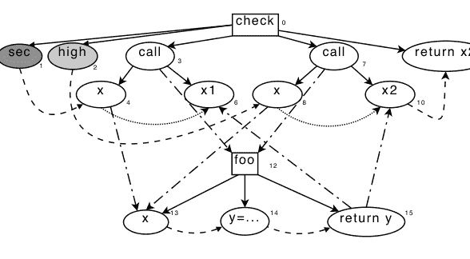

考虑另一个示例图 4.11。在第 3 行存在一个去密：`confidential → public`。这里 `3 ∈ D, R(3) = confidential` 且 `P(3) = public`。这意味着一个*秘密*值可以从第 10 行流到第 3 行，因此在第 3 行似乎存在非法流 `(R(3) ≠ S(3))`，因为我们可以从 `confidential` 去密到 `public`，但不能从*secret* 去密到 `public`。事实上，第 3 行的返回值只被复制到第 10 行的 `x1`，而 `x1`（之后从未被使用且也没有输出）。因此从直觉上看，程序似乎是。

该程序的 SDG 如图 4.12 所示。通过算法 7，`x1` 不在第 12 行的上下文敏感后向切片中，因此基于 SDG 的机密准则不会产生虚报，而是确定机密性得到了保证。这个示例再次证明了上下文敏感后向切片如何提高精度。

## 4.8 改进过程间去密

算法 7 是正确的，但在存在去密的情况下，其精度仍需提高。原因是算法 7 本质上忽略了被调用过程中的去密的影响；摘要边代表了参数对之间的传递性信息流，而去密是非传递的。使用它们来计算实际安全级别 `S(l)` 意味着流入具有给定安全级别 `l` 过程的每条信息都将被视为以相同的级别流出。这种方法过于保守，导致了许多虚报。

例如，考虑图 4.12：节点 11 需要的安全级别为 Low，因为算法 7 由于摘要边计算出 `S(2) = S(8) = S(10) = S(11) = Low`。这将导致虚报，因为节点 15 处的去密被忽略了。

### 4.8.1 摘要去密节点

为了尊重被调用过程中的去密并实现最大精度，需要对摘要边的概念进行扩展。基础-

## 4.8 改进过程间去密

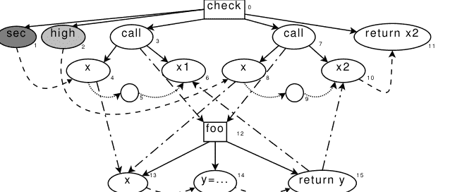

图 4.13：带有摘要去密节点的图 4.11 的 SDG

- 思想的基本思想是在摘要边中插入一个新的“摘要”去密节点，该节点代表去密对过程体中路径的影响。

因此，示例 `x - y`

对 `R(d)` 和 `P(d)` 的约束被选取为，使得通过过程体的任何合法流也是通过 `x → d → y` 的合法流。特别是，如果从 `x'` 到 `y'` 存在去密路径，则不能有摘要去密节点，因为在这种情况下信息流可能是传递的。要确定 `R(d)` 和 `P(d)` 以使精度最大并保持正确性并非易事，正如我们稍后看到的。然而，这些值已经固定；7 照常进行。

图 4.13 显示了图 4.12 示例的带有去密节点的 SDG。实际节点 4 和 8 通过参数-in 边与其对应的节点 15 连接。形式-out 节点 15 通过参数-out 边与相应的实际节点 6 和 10 连接。调用节点 3 和 7 与其入口节点 12 的被调用过程连接。实际节点 4 和 8 与对应的节点 15 通过参数-in 边连接。形式-out 节点 15 与相应的实际节点 6 和 10 通过参数-out 边连接。调用节点 3 和 7 与其入口节点 12 的被调用过程连接。实际节点 4 和 8 与对应的节点 15 通过参数-in 边连接。形式-out 节点 15 与相应的实际节点 6 和 10 通过参数-out 边连接。调用节点 3 和 7 与其入口节点 12 的被调用过程连接。实际节点 4 和 8 与对应的节点 15 通过参数-in 边连接。形式-out 节点 15 与相应的实际节点 6 和 10 通过参数-out 边连接。调用节点 3 和 7 与其入口节点 12 的被调用过程连接。实际节点 4 和 8 与对应的节点 15 通过参数-in 边连接。形式-out 节点 15 与相应的实际节点 6 和 10 通过参数-out 边连接。调用节点 3 和 7 与其入口节点 12 的被调用过程连接。实际节点 4 和 8 与对应的节点 15 通过参数-in 边连接。形式-out 节点 15 与相应的实际节点 6 和 10 通过参数-out 边连接。调用节点 3 和 7 与其入口节点 12 的被调用过程连接。实际节点 4 和 8 与对应的节点 15 通过参数-in 边连接。形式-out 节点 15 与相应的实际节点 6 和 10 通过参数-out 边连接。调用节点 3 和 7 与其入口节点 12 的被调用过程连接。实际节点 4 和 8 与对应的节点 15 通过参数-in 边连接。形式-out 节点 15 与相应的实际节点 6 和 10 通过参数-out 边连接。调用节点 3 和 7 与其入口节点 12 的被调用过程连接。实际节点 4 和 8 与对应的节点 15 通过参数-in 边连接。形式-out 节点 15 与相应的实际节点 6 和 10 通过参数-out 边连接。调用节点 3 和 7 与其入口节点 12 的被调用过程连接。

（注：原文此处存在重复错误）

117

# 第 4 章：信息流控制

`public`。注意，`P(15) \leq S(10)` 在第二阶段检查，使得平凡约束 `P(9) = \perp` 足以断言安全性，且 `R(5) = confidential` 正好是 `R` 的最大可能值。这一观察导致了用于计算去密节点 `P` 和 `R` 的以下算法。

### 4.8.2 摘要去密节点的 `R(d)` 计算

> 算法 8 摘要去密节点的 `R(d)` 计算（后向传播）

```
1 **procedure** SummaryDeclassification(G, L)
2 **input** $G$: 系统依赖图
3 L: 安全格格
4 R: 所需标注
5 **output**: 去密节点集合（包含在 $G$ 中）
6
7 pathEdgesemptysetemptyset // 已见的传递依赖
8 **foreach** formal-$w$ out $o$ in $G$
9 pathEdges ∪= (o, $o \in D$, T)
10 od
11 workList := pathEdges
12 **while** workList not empty
13 **remove** ($x, y, f$) from workList
14 **if** $x$ is a formal-node in
15 addSummaries($x, y, f$)
16 **else**
17 **foreach** $w \to x$ in $G$
18 addToPathEdges(extendPathEdge($x, y, f, w$))
19 od
20 fi
21 od
22 end
24 **procedure** addToPathEdges(x, y, f, l)
25 **input**: $(x, y, f, l)$: 路径边元组
26 begin
27 **if** $(x, y', f', l') \in$ pathEdges$ where $f' \neq f$ or $l' \neq l$ **then**
28 **remove** ($x, y', f', l'$) from pathEdges
29 fi
30 **if** $(x, y, f, l) \notin$ pathEdges **then**
31 pathEdges ∪= $(x, y, f, l)$
32 workList ∪= $(x, y, f, l)$
33 fi
34 end
```

由于摘要去密节点代表了去密对过程体路径的影响，而这些路径反会被调用（递归），对形式参数的简单传递闭无法产生摘要去密节点的正确解决方案 [HRB90, RHSR94]。

## 章节信息流控制

相反，可以利用针对摘要边的特化算法来代替计算摘要解密节点的安全级别。结果见算法 8 和算法 9，这些算法通过将 Reps 等人 [RHSR94] 在第 35 页算法 2 中提出的后向 IFC 传播整合到算法中。

例如，考虑 pathEdge 中的图 4.1。在这里，算法 8 开始将节点 15 作为 `(15, 15, false)` 添加到 pathEdge。注意该元组的第三个元素为 false，它是一个解密节点。当该元组从 workList 中移除时，15 的所有前驱节点都会被处理，特别是节点 14。对于该节点，`extendPathEdge` 将在 pathEdge 中找不到之前的元组，因此 `γ`（相应的 $v$）没有元素。由于作为 $d$ 中的节点 15，`f' = Γ(R(15))` 且 `R(f') = f' = false`，这产生了一个 pathedge 元组 `(14, 14, confidential)`。对于其前驱节点 13，我们将得到一个 pathedge 元组 `(13, 13, confidential)`，且没有其他路径指向 13。由于 13 是一个形式输入（formal-in）节点，`addSummaries` 将根据属性类 4、6、8 和 10 添加一个摘要解密节点 `d`，其中 `R(d) = confidential` 且 `P(d) = ⊥`，正如我们在前一节中定义这些节点一样。

**定理 4.10.** 由算法 8 和算法 9 确定的带有摘要解密节点的 IFC 是完备且精确的。

**证明。** 我们证明算法 8 和 9 的结果是为所有过程间可达路径生成的约束集合的超集。这保证了完备性。为了证明这一点，我们展示通过为所有摘要解密节点 `d` 选择 `P(d) = ⊥`，额外的约束被显而地满足了，因此不会改变不动点。由于这些是 [HRB90, RHSR94] 中提出的算法的直接扩展，我们可以假设这些算法使用递归调用遍历了形式输入边和形式输出边之间所有过程间可实现的路径。对于完备性，我们需要证明两个目标：

+   1. 如果同一个调用中的形式输入成员和形式输出成员之间存在一条不包含解密节点的过程间实现路径，则算法将只生成传统的摘要边，而不产生摘要解密。由于该路径上信息流的传递性，摘要信息必须保守地遵守过度安全原则。算法 9 使用第 59 行的标志 `f` 遵循了这一要求。对 pathEdge 的长度进行归纳将证明这一点：如果 pathEdge 的长度为 0 `($x = y$)`，第 9 行断言如果 `$x \in D$` 则标志 `f` 为 false，真。因此，假设 `f` 正确表示了如果 pathEdge `($x, y, f$)` 不包含解密的事实。那么第 50 行断言如果 `$w \notin D \land f$` 成立，则扩展 pathEdge `($w, y, f'$)` 中的 `f'` 为真（即路径 `$w \to y$` 上没有解密）。注意，如果之前已经探索过 `$w$` 和 `$y$` 之间的其他路径（第 40 行的条件成立），我们只通过第 50 行的析取来记住是否存在任何无解密的路径。

## 4.8. 改进过程间解密

2. 否则，如果从同一个调用点的形式输入参数到形式输出参数的所有路径都包含解密，我们需要证明对于每条过程间可达路径，HRB 算法计算的结果都是该路径生成的约束的超集。由于没有遍历参数边，约束 `S(act-in) \le S(form-in)` 不由算法 7 直接生成，因此必须由摘要解密节点 `d` 施加。由于 `R(d)` 的值是通过与算法 7 相同的约束计算 `S(form-in)` 来定的，我们只需要证明 HRB 算法生成的 `S(form-out) \le S(act-out)`。但这从 `S(form-in)` 和 `S(form-out)` 的独立性可以得出，因为它们之间的每个路径都包含一个解密节点，该节点不会对边 `$w \to v$` 的 `S(w) \le S(v)` 产生任何约束。

### 4.8.3 超越 PDG

SDG 的精确性通过不断的研究稳步提高，精确性也可以通过程序分析中开发的非 SDG 方法来提高。

例如，片段：

```
"if (h > h) then l = 0"
```

作为安全类型的类型的朴素切片将假设从 `h` 到 `1` 存在传递依赖，即使正文是死代码。因此，[SS05] 中假设的语义分析被违反了。这与定理 4.1 并不矛盾，而是源于分析精度的问题。

幸运的是，如今的 SDG 与其他为代码优化开发的分析封装在了一起，例如过程间常数传播、静态单赋值形式（SSA）、符号求值和死代码消除。这些强大的分析在 SDG 构建开始之前就已经执行了，并将消除一系列虚假流。最容易利用此类分析的方法是从字节码构建 SDG。例如，任何优化编译器都会从机器码或字节码中删除整条语句，因为它是死代码。注意，字节码必须被视为程序含义的最终定义，在经过所有复杂的优化后，字节码中剩余的流必须被更加认真对待。

此外，我们在 SDG 之上提出了一种强大的机制，称为路径条件（见第 5 章）。路径条件对于流 `x → y` 是必要且精确的，并从程序变量的角度展示了流的详细情况。如果约束求解器可以求解程序输入变量的路径条件，此类解决方案输入程序会让非法流直接可见；这种特征被称为证据（witness）。

```
1 [i+3] = x;
2 if (i>10)
3 y = a[2*j-42];
```


在这里，流 `$x \rightarrow^*$ y` 的必要条件是 `$\exists i, j. (i > 10) \wedge (i+3 = 2j-42) = false$`，这证明了即使 PDG 指出如此，该流也是可能的。

## 4.9 相关工作

### 4.9.1 SDGs 和 IFC

关于 Java 的 SDG 和切片器已经写了许多论文，但据我们所知，只有 Indus 切片器 [`JRH05`] 等完全实现并能够处理 Java。Indus 是自定义的，嵌入到 Eclipse 中，并有一个非常好的 GUI，但精确度低于我们的切片器。特别是，它不支持完全的内容敏感性，仅对上下文进行 k 限制，并且允许对程序进行时间跟踪。

本文描述的工作改进了我们之前的算法 [`HKS06`]，该算法无法精确处理分类过程中的解密。然而，该工作还生成了用于 Java PDG 的路径条件（即节点之间流的必要条件），这可以揭示发生安全错误的精确情况。

虽然 IFC 与数据分析之间的紧密联系早被注意到 [`BC85`]，Abudi 等人 [`ABH99`] 首次将切片与非密性联系起来，但仅限于 `$\lambda$` 族的类型切片。令人惊讶的是，我们在 4.3 节中的定理 4.3（适用于命令式语言及其 PDG）没有更早发现。只有 Anderson 等人 [`ART03`] 展示了一个据称相互独立的示例，尽管他们没有使用安全格结构。

Yokomori 等人 [`YOT02`] 可能是第一个提出并实现基于程序切片的过程语言 IFC 分析的人。它检查传统的非密性，并支持最小格结构 `$Low < High$`。他们的分析是流敏感的，但不是内容敏感或对象敏感的。Hammer 等结合了静态和动态 PDG 分析来检测非法信息流 [`HG06`]。它允许对显示异常行为的程序进行事后分析，并为重构非法信息流计算精确证据。

### 4.9.2 安全类型系统

Volpano 和 Smith [`VS97`] 提出了第一个用于 IFC 安全类型系统。他们扩展了传统的类型系统以检查带有过程调用的简单语言中的纯非密性。过程相对于安全类可以是多态的，允许进行内容敏感分析。他们对多线程语言的证明见 [`SV98`]。

Myers [`ML00`] 定义了 `JIF`，它是 Java 语言的扩展，带有信息流的类型系统。`JIF` 编译器 [`MCN+`] 实现了这种语言。我们在 4.3 节已经讨论过类型系统的精确度较低，

# 4.9. 相关工作

but are more efficient. `JIF` 支持泛型类和去中心化标签模型 [`ML00`]；标签和主体是第一类对象。注意，我们基于 PD 的方法可以推广以利用去中心化标签。

Bartex Rezk [`BR05`] 提出了一种严格非干扰的系统类型，无需分类，可处理类和对象。NullPointer-Exception 是唯一允许的异常类型。仅带 `Low` 注解的值可能抛出异常。构造函数被忽略，对象改用默认值初始化。给出了证明该类型系统非干扰属性的证明。

Strecker [`Str03`] 在 Isabelle [`NPW02`] 中形式化了一个非确定性系统类型并包含非干扰证明。它处理了 Micro-Java 的主要概念，如类和方法调用，但不包括数组和异常。Mantel 和 Reinhardt [`MR07`] 定义了第一个用于多线程语言的类型系统，用于控制去分类的 *what* 和 *where* 维度的同时性。该类型系统基于对 *where* 维度的定义，该定义取代了他们先前对非传递非干扰的定义 [`MS04`]，以及两个类似于保密性 [`Coh78`] 的 *what* 维度定义的变体。然而，他们并未证明其方法在实践中可行。

### 4.9.3 验证和 IFC

Amtoft 等人 [`ABB06`] 提出了一种用于基本面向对象语言中信息控制的跨过程流敏感的 Hoare 风格逻辑。未考虑强制转换、类型测试、除 public 之外的可见性修饰符以及异常处理。仅允许结构化控制流。

Pacap 案例研究 [`BCM07`] 验证了同一屏幕上多个 Java-let 的安全交互。他们采用方法检查以确保其安全策略的充分条件，该策略基于类似于无去分类的非干扰的格。隐式异常被建模，但这种非结构化控制流可能导致标签蔓延（参见 [`SM03, Sect. 1 E`]）。

Genais [`GS05`] 定义了对 CFG 的抽象解释，用于查找信息泄露。它可以处理单线程 Java 的所有字节码指令，并保守地处理字节码指令的隐式异常。分析是流敏感和上下文敏感对象，但不区分不同对象的字段。他们提出了一个对象不敏感的解决方案，用于给定类的所有字段。在我们的经验中 [`IS04`]，对象不敏感会导致过多的虚假依赖。调用图通过 CHA 的近似也是如此。在这种情况下，也会产生许多误报。

我们系统未覆盖的一个领域是安全策略，定义了在何种情况下允许去分类。Li 和 Zdancevic [`LZ05`] 定义了一个用于降级具有条件和不动点的核心语言的框架，从而产生具有程序等价性的形式化安全保证。

# 第 4 章 信息流控制

### 4.9.4 安全的静态分析

静态分析常用于源代码安全分析 [`CM04`]。例如，信息流控制与被污染变量分析密切相关。甚至还有像 Pistoa 等人 [`PFKS05`] 的切片分析方法和 Livshits 和 Lam [`LL03, LL05`] 使用的 IPSSA 的方法，其表示与依赖图非常相似。然而，这些分析仅分析一个平凡的安全级别（被污染/未被污染）以及平凡的去分类（取消污染），并且可以从我们的方法中获益很大。Scholtz 等人 [`SZC08`] 提出了一种静态分析，用于在类似于依赖图的 数据结构上跟踪用户输入。与我们的分析一样，它被定义为数据流分析框架，并利用 SSA 形式的属性来简化约束系统。同样，这也是针对 bug 跟踪和 taint 分析。

Pistoia 等人 [`PCFY07`] 调查了用于安全问题静态分析的最新方法。他们关注基于栈和角色的访问控制、信息流和 API 控制。一种统一的访问控制和完整性检查器，用于基于信息的访问控制，即 Java 栈式访问控制机制的扩展，已在 [`PS07`] 中提出。他们表明可以从访问控制策略中提取隐式策略，并且访问控制强制执行完整性策略。

另一种方法是使用路径条件（见第 4.8.3 节所述）以获得更具语义说服力的表征和上下文约束，从而实现可靠的去分类。我们对去分类的方法目前不提供如 SS05] 所规定的语义属性的逐项检查，但将依赖路径条件来提供去分类发生的必要条件。这种方法属于“如何”去分类可能发生的范畴，该范畴尚未得到广泛研究。

对于多线程程序，PDG 不仅需要检查经典的非干扰，还最终需要检查可能的或概率性的非干扰。这一新技术的细节将由 Giffhorn 和 Lochbihler [`GL`] 提出。

# 第 5 章

# 路径条件

## 5.1 引言

上一章介绍了我们精确的信息流控制方法。但无论信息流分析多么精确，它始终只能回答一个二元问题——两个程序点之间是否可能存在非法流，或是否肯定不存在。它甚至可能追踪到导致问题的源点，但仍缺乏对安全违规具体条件的洞察。特别是，信息流控制机制不提供“反例”，例如使安全违规可见的输入值。

本章将介绍两种基于静态路径条件 [`Sn96, RS02, SRK06`] 概念的方法，该概念是信息流在两个程序点之间可能发生的精确条件。这样的条件可能是不可满足的，这意味着约束求解器发现给定的信息流不可能，并且在原始分析中是误报，或者将条件简化为触发该流的输入变量绑定。本章在两个维度上扩展了这一概念：首先，静态路径条件的概念被扩展到 Java 的面向对象特性，这些特性由于 `instanceof`、动态分派和异常的动态类型性质而带来额外困难。然而，我们的方法仅依赖于静态程序分析，因此可以生成非法信息流的精确条件，说明该流为何发生，并附带一组允许重现该非法流的输入值。

其次，提出了一种动态的路径条件变体，它将传统的静态路径条件与动态分析（如动态切片）和通过程序插装收集的信息相结合。动态切片产生的条件集远小于静态切片，因此动态路径条件允许对失败的程序运行进行精确的事后分析，甚至可能用于分析非法信息流是如何发生的，而在动态流控制机制的阻止之后。

# 第 5 章 路径条件

```
1 a = u();
2 while (n>0) {
3 x = v();
4 if (x>0) {
5 b = a;
6 else
7 c = b;
8 }
9 z = c;
```

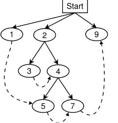

图 5.1：一个小型程序及其依赖图

这两个扩展已在基于 Valsoft 架构 [`HOb05`] 的原型工具中实现。此项工作的先前结果已在 [`HGK06, HS08`] 中描述。

## 5.2 路径条件的基础

如第 2 章所述，程序依赖图（PDG）是建模程序中信息流的标准工具。程序语句或条件由节点表示，边表示语句或条件之间的数据和控制依赖。路径 `x→y` 表示信息可以从 `x` 流向 `y`；如果没有路径，则保证没有信息流。特别是，所有（可能）影响（所谓的向后切片）的语句都很容易计算为 `BS(y) = {x | x→y}`。

对于图 5.1 中的小型程序及其依赖图，语句 1 到语句 9 存在一条路径，表明输入变量 `a` 可能影响输出变量 `z`。由于不存在路径 `1→4`，因此 `a` 对 `x` 绝对没有影响。

- 对于一个切分标准 `(x,y)`，切分是源节点 `x` 对目标节点 `y` 的影响的一部分的节点集合。PDG 中位于 `x` 到 `y` 路径上的节点：`CH(x,y) = {z | x→z→y}`。为方便起见，我们使用 `CH(x,y)` 表示 `x` 与 `y` 之间的路径集合。

### 5.2.1 过程内路径条件

为了使程序切片更精确，Seltening 路径条件 [`Sne96`]，它们是两个节点之间信息流的必要条件。路径条件生成的公式是复杂公式（详情见 [`SRK06`]），这里只给出最基本的公式：

```
PC(x,y) = ∧_{Path=x→y z∈P} E(z) where E(z) = ∧_{Control Path Start→cd*z ν∈P} c(ν→μ) (5.1)
```

## 5.2. 路径条件的基础

`$PC(x, y)$` 是从 `$x$` 到 `$y$` 流的必要条件，而 `$E(z)$` 是 `$z$` 执行的必要条件。控制路径是指仅由控制依赖边组成的路径。`$E(x)$` 是沿着从函数 `$x$` 的 `$Start$` 节点的所有控制路径，基于与依赖边 `$u \to \mu$` 相关的条件 `$c(u \to \mu)$` 计算得。对于控制依赖，`$c(u \to \mu)$` 通常是来自 *while-* 语句或 *if-*语句的条件。路径条件中的程序变量是（隐式地）存在量化的，它们是潜在信息流的必要条件。

由于准则节点之间的路径是基于切（chops）的，我们将关注路径集 `$P_1, P_2, \dots \in CH(x, y)$`，而路径条件的一个稍微松弛的关系为：

```
$PC(x, y) = \bigwedge_{z \in PC(x,y)} E(z)$
```

在 [[SRK06]] 中，Selting 等人解释了为什么这个公式是正确且精确的，以及它为什么能显著简化计算。他们还展示了 `$CH(x, y)$` 中的循环在计算 `$PC(x, y)$` 时可以安全忽略，使得公式始终有限的。对于图 5.1 中的示例，计算了以下方程和路径条件：

```
$c(2 \to 3) \equiv c(2 \to 4) \equiv (n > 0), \quad c(4 \to 5) \equiv (x > 0)$,
$c(4 \to 7) \equiv (x \le 0)$,
$E(1) = \text{true}, \quad E(3) \equiv (n > 0) \wedge E(5) \equiv (n > 0) \wedge (x > 0)$,
$PC(1, 5) \equiv E(1) \wedge E(5) \equiv (n > 0) \wedge (x > 0)$
```

在存在数组或指针等数据结构的情况下，会生成额外的约束。对于数据依赖，`$\Phi(\nu \to \mu)$` 是一个约束通过数据类型信息流的条件。例如，我们考虑数组（完整介绍可以在 [[SRK06]] 中找到）。数组元素 `a[E_1] = ...` 与使用 `a[E_2]` 之间的数据依赖生成 `$\Phi(\nu \to \mu) = E_1 \wedge E_2$`；所有其他依赖将生成 `$\Phi(\nu \to \mu) = \text{true}$`。计算路径条件的方程变为：

```
$PC(x, y) = \bigwedge_{z \in PC(x,y)} (\bigwedge_{z \in P} E(z) \wedge \bigwedge_{u \in P} \Phi(u \to v)) \quad (5.2)$
```

为了分类，给出以下程序片段及其路径条件：

- 1 `a[i+3] = x;`
- 2 `if (i>10)`
- 3 `y = a[2*j-42];`

```
$PC(1, 3) \equiv (i > 10) \wedge (i + 3 = 2j - 42)$
```

除执行条件外，它包含一个要求两个索引表达式相等的项，

# 第 5 章 路径条件

```
1 x = a;
2 while (x < 7) {
3 x = y + x;
4 if (x == 8)
5 p(x);
6 }
1 x1 = a;
2 while (x2=Φ(x1,x3),x2<7) {
3 x3 = y + x2;
4 if (x3 == 8)
5 p(x3);
6 }
```

图 5.2：多变量赋值

```
1 a[i+3] = x;
2 if ((i>10)&&(j<5))
3 y = a[2*j];
```

> `PC(1,3) ≡ (i > 10) ∧ (j < 5) ∧ (i + 3 = 2j - 42) ≡ false`

这是不可满足的，因为索引表达式和执行条件相互矛盾。这些示例表明，路径条件为信息流提供了精确的条件，并且有时即使图中存在路径，也能确定这种流是不可能的。注意，在实践中，路径条件往往很大，因此使用约束求解器来简化它们。

### 多变量赋值

基于原始程序文本计算路径可能会导致即使影响是可能的，条件也是不可满足的。例如，考虑图 5.2（左）中的代码以及第 1 行的 `a` 与第 5 行的 `x` 之间的（原始）路径条件

> `PC(1,5) ≡ (x < 7) ∧ (x = 8)`

该条件是不可满足的，尽管第 1 行确实有方法影响第 5 行。问题在于程序对变量 `x` 有多次赋值，路径条件无法区分。对于静态路径条件，这通过使用程序的 SSA 形式变体 [`CFR91`] 来解决。具体，不同的变量被区分开，并最终使用 `$\phi$` 算子合并，将多次赋值替换为单赋值。图 5.2（右）显示了原始程序（左）的 SSA 形式。

SSA 形式通过区分 `x` 的不同变量，使得我们的路径条件变得可求解：

> `PC(1,5) ≡ (x < 7) ∧ (x = 8)`

然而，将程序转换为 SSA 会修改代码表示，这对于在 ValSoft 代码中（接近源代码结构）的依赖图来说是不理想的。为了维持代码结构，使用了类似于 SSA 形式的赋值形式：索引号表示

128

## 5.2. 路径条件的基础

依赖图中的节点数，允许对不同的变量出现进行精确区分。路径条件

```
($e\puf[idx] = "" + $)
```

因此写为

```
($e\puf_{99}[idx_{98}]=97$ + ""_{101}$)
```

`$\phi$` 算子并不出现在代码结构中，仅用于计算路径条件。

### 弱路径条件和强路径条件

对于两个语句 `$x, y$` 之间的给定切，通常可以定义多个路径条件。尽管如此，每个实例都是沿切进行信息流的必要条件。为了讨论质量，为对 `$(x, y)$` 定义了偏序 `$\le$`

```
$PC(x,y) \le PC(x,y) \quad PC(x,y) \Rightarrow PC'(x,y)$
```

在这种情况下，`$PC(x,y)$` 比 `$PC'(x,y)$` 强。强条件通常更容易被约束求解器求解，因此更有利。

注意底层的切会影响路径条件的强弱：如果存在两个切，其中一个比另一个更精确 `$CH(x,y) \subset CH'(x,y)$`，那么较小的切生成了更强的路径条件，因为动态切运行在多个：

这一事实构成了 5.4 的理论基础，因为动态切小于静态切。在路径条件中添加另一个共轭项 `$R$` 是加强它的方法。在 5.4.3 中，一旦与原始路径条件结合，将产生更强的（或等的）路径条件：

```
$PC(x,y) \wedge R \ge PC(x,y)$
```

### 5.2.2 过程间路径条件

类似于过程间划分和切，过程间路径条件需要是可实现的 [`Ki05`] 路径。直观来说，这意味着依赖图（SDG）中的路径通过特定的调用处进入，必须在不同的调用处离开。作为一个说明，考虑图 5.3。这里只有

> 事实上，路径条件只有预序。除去等价关系可以得到偏序 [`SRK06, Ram94`]。

# 第 5 章 路径条件


调用处 `$\Lambda$`（左）的可实现路径，即从参数 `a` 到 `d` 以及从 `b` 到 `c`。这些源自方法 `f` 的传递依赖在 SDG 中表示为摘要边（图 5.3 中的虚线）。从 `a` 到 `h` 的路径是无效的，因为一个调用的参数无法另一个调用。

在接下来，我们关注位于方法内部（同级）的路径条件，并集中于对象构造。通用情况（路径条件的起始和结束节点位于不同的方法）可以通过连接多个级条件来实现。然而，这并不是 Java 特有的，在之前的工作中已经得到了解决 [`SRK06`]。

路径条件有利于虚拟分解的公共子路径 [`SRK06`]；由摘要边连接的形式参数之间的公共子路径找到了分解候选。虚拟分解忽略调用和参数传递边，取而包含了摘要边。`$\Phi$` 条件（共轭地添加到执行条件中）代表了沿摘要边信息流的条件 [`SRK06`]。该条件是由相应的形式参数之间的路径引发的。在图 5.3 中，`a` 和 `d` 之间的条件将是：

```
$\Phi(a) \equiv u = a \wedge PC(u, y) \wedge d = y$
```


$PC(u, y)$ 可以在具有不同参数绑定的其他调用处重用。

这里没有介绍路径生成的细节，但读者应该注意到 C 和实际程序需要多年的理论和实践工作 [Sne96, RS02, Rob05, SRK06]。主要步骤包括程序必须转换为赋值形式（见上文）；虽然 PDG 循环可以忽略，但由于实际程序中有大量的无循环 PDG 路径，区间

130

## 5.3. JAVA 的静态路径条件

对不可约图的分析可以被用于获取嵌套的子 PDG（程序依赖图）层次；需要 BDD（决策图）来减小路径条件的大小。如今，ValSoft 的实现可以处理约 10000 行（LOC）的 C 程序，并在几秒或几分钟内生成路径条件。

## 5.3 Java 的静态路径条件

在本节中，我们展示了第一个完全依赖静态分析的 Java 路径条件生成器。自然地，从 C 等过程化语言泛化路径条件时，主要问题在于面向对象的特征（如动态分发和类型检查）的合并。

### 5.3.1 概述

路径条件是根据从源点到目标点的所有可能的依赖路径生成的，并通过约束求解器将这些条件归约为触发这两个点之间信息流的输入值。这些输入值在 [SRK06] 中被命名为“见证”（witnesses），例如在涉及安全违规的诉讼中可能非常有帮助。然而，[SRK06] 只定义了过程化语言的路径条件。在路径条件中简单地集成面向对象的构造会导致这些条件包含动态类型检查，而约束求解器无法静态静态地简化这些检查。这些见证无法被生成，使得这些路径条件仅是走向实际应用的第一步。

本节详细介绍了基于 Java 语言规范的面向对象语言构造，并提供了将其集成到仅包含程序变量和值的路径条件中的解决方案。我们首先开始讨论动态类型检查 `instanceof`，并扩展了基于动态分发和异常处理的解决方案。这些检查可以通过保守的方法进行近似，或者通过使用程序切片（program slicing）——将其转换为不再涉及程序的子条件，从而为 Java 生成真实的路径条件。这些条件比 [JSB06] 中给出的动态分发条件提供了更具价值的信息，并允许约束求解器找到满足这些条件的输入值。

### 5.3.2 动态类型测试

在本节中，我们探索了 `instanceof` 算子的语义，以便在路径条件中使用。从形式上说，如果表达式 `e instanceof T` 的结果为真，则表示表达式 `e` 不为空且 `e` 的运行时类型在类型层次结构中低于类型 `T` [JSB06]。当从 `T` 到 `e` 的静态类型不存在类型层次结构路径时，会发生编译时错误。因此，语言允许 `e` 具有在层次结构中等于或低于 `T` 的静态类型，尽管在这种情况下，除非 `e` 为空，否则表达式将始终求值为真。这一切都是众所知的，但路径条件需要对 `instanceof` 语义进行精确的形式化。

## 第 5 章：路径条件

### instanceof 的精确语义

Java 的引用类型与程序中定义的类（接口）相同，因此“类型”和“类（接口）”这两个术语可以互换使用。如果 `A` 是 `B` 的子类，我们写作 `A < B`。类型层次结构是子类关系（<）的传递闭包。令 `C` 为所有类型的集合，$J$ 为原始类型集合，$A$ 为数组类型集合。进一步令 `Σ = {java.io.Serializable, Cloneable, Object}`。符号 `e : τ` 表示 `e` 具有动态/运行时类型 `τ`，而 `e : τ` 则表示静态类型。

类型层次结构诱导了满足 `instanceof` 算子的具体类型集。令 `Γ` 表示层次结构中在 `instanceof τ` 表达式中求值为真的类型集，即

```
e instanceof τ ≡ ρ ∧ ρ ∈ Γτ
```

为了简单起见，我们假设有一个特殊的空类型 `Γ_null = ∅`。那么 JLS（Java 语言规范）[JSB05] 中 `instanceof` 的定义要求：

如果 `τ ∈ A` 则

如果 `e ∈ τ` 则

```
ρ ∈ Γτ iff (ρ ∧ C ≤ τ) ∨ (ρ ∧ τ ∈ Σ) ∧ ρ ∈ Γτ,
```

否则如果 `e ∈ τ` 则

```
ρ ∈ Γτ iff ρ = [ρ[]] ∧ τ = τ[] ∧ ρ ∈ Γτ’
```

```
ρ ∈ Γτ iff ρ = τ
```

方程 (5.5) 的最后一项对应于 Java 的数组，当完整的类型层次结构给出时，可以通过类层次结构分析（CHA）[D95] 或更精细的快速类型分析（RTA）[BS96] 来计算 Γτ。`Object ∪ {Cloneable}` 导致了 Γτ ⊆ C，而 `X ∪ {Cloneable}` 导致了 Γτ ⊆ {X}，`Cloneable` ⊆ C 导致了：

```
Γτ ⊆ {X}
```

```
Γτ ⊆ C
```

这些条件比 [JSB06] 中给出的动态分发条件提供了更多信息，并允许约束求解器找到满足这些条件的输入值。


ρ ∈ Γτ iff ρ = [ρ[]] ∧ τ = τ[] ∧ ρ ∈ Γτ’

```
```

ρ ∈ Γτ iff ρ = τ

```

方程 (5.5) 的最后一项对应于 Java 的数组，当完整的类型层次结构给出时，可以通过类层次结构分析（CHA）[D95] 或更精细的快速类型分析（RTA）[BS96] 来计算 Γτ。`Object ∪ {Cloneable}` 导致了 Γτ ⊆ C，而 `X ∪ {Cloneable}` 导致了 Γτ ⊆ {X}，`Cloneable` ⊆ C 导致了：

```
Γτ ⊆ {X}
```

```
Γτ ⊆ C
```

这些条件比 [JSB06] 中给出的动态分发条件提供了更多信息，并允许约束求解器找到满足这些条件的输入值。

## 5.3. STATIC PATH CONDITIONS FOR JAVA

Formally, with `$J_i := \{a_{i,j} \in BS_{thin}(e) \mid a_{i,j}\}$` is an allocation paths of type `$\gamma_i$` obtain the fundamental equation

```
$e : \gamma_i = \bigvee_{j=1}^{|J_i|} PC(Start, a_{i,j}) \wedge PC(a_{i,j}, e) (5.10)$
```

Informally, when `$e$` has runtime type, the program must have passed an allocation site of that type, which is only possible at one of the allocation sites that reach reaching definitions are modeled in the thin slice. `PC(Start, a_{i,j})` in 5.10 is necessary to reach allocation site `a_{i,j}` (in the thin slice) from the program’s beginning, and `PC(a_{i,j}, e)` is required to get through to expression `e`. Note that one of these paths (i.e. `PC(Start, a_{i,j}) \wedge PC(a_{i,j}, e)` holds) does not guarantee that `e` has dynamic type `a_i` as slicing is merging, so equation (5.10) is only an implication.

This equation has the additional advantage that the number of terms becomes finite due to the finite number of allocation sites, as opposed to the theoretically infinite sets `$\Gamma_{ij}$`. If the program representation contains all fatal initializations of variables explicitly, for null can be omitted if the backward data slice does not contain such a value.

Considering the example in Figure 5.4, the condition from Algorithm 10 (`sel \neq null \wedge sel : B`) needs to be refined using equation (5.10). The test for null is redundant, as all paths define `sel` with a non-null value. The backward data slice of `sel` yields both allocations in line 5, where only the second has appropriate type. Hence equation (5.10) collapses to

```
$PC(sels, result_{12}) \equiv sel : B \equiv ((pred = true) \wedge pred \wedge true) \equiv false$ (5.11)
```

Thus the parameter `sel` cannot influence the outcome of this method, even tough the program slice says,

## 3.3.4 Dynamic Dispatch

Dynamic dispatch has great influence on path conditions; in contrast to bound methods, a virtual method call might have multiple target methods, one of which is executed at runtime according the type of the target object. As example, Figure 5.5 shows method invocation site for a target object of type `A`, which could dispatch to `A.f()` or `B.f()`. The invocation site holds two parameter nodes `a` and `b` where two edges (dashed) represent the transitive flow that is possible between the formal parameters in the possible target methods.

### A naive path condition

Since it is statically unknown which target method is executed, one might obtain the following naive path condition for dynamic dispatch of method `f`, which simply dispatches all possible cases:

## CHAPTER 5. PATH CONDITIONS

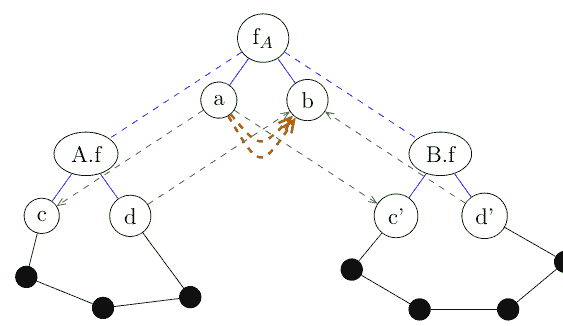

`$PC_t(x,y) = \bigvee_{i=1} PC_{\gamma_i,t}(x,y) \quad (5.12)$`

where `x` and `y` are in general two parameters of the call (connected by a summary node). `PC_{\gamma_i,t}(x,y)` is the condition of the invocation for target `$\gamma_i$` and not all subclasses must redefine the formal parameter nodes corresponding to `x` and `y`. Note that `f` might redefine a reference of `f` in a subclass of `f`. For example, if `C < B < A` and only `C` and `A` (re)define `f`, then `B.f` is `A.f`.

For Figure 5.5, equation (5.12) yields

```
$PC(a,b) \equiv ((c=a) \wedge PC_A(c,d) \wedge (b=d)) \\vee (c'=a) \wedge PC_B(c',d') \wedge (b=d'))$
```

For the example in Figure 5.6, the path condition between `x` and `y` on line path would be

```
$PC(x,y) \equiv PC_A(x,y) \vee PC_B(x,y) \vee PC_C(x,y) \\equiv x=1 \vee x<2 \vee x<3 \equiv x<3 \quad (*) $
```

where `PC_A, PC_B, PC_C` are the standard path conditions for the three (re)definitions of `f` between the formal parameter nodes corresponding to `x` and `y`.

While this path is correct (it is a condition for information flow) and easy to build, it is too imprecise since the program semantics disallows more than one target method. We will develop an approach to handle dynamic dispatch similar to the *instanceof* expression in the language section.

### Exploiting slices again

Previous work [HKS06] already presented a first step towards intercedural path conditions, precisely expressing the semantics of dynamic dispatch. The

```
class A {
    int result = 42;
    int f(int x) {
        if (x < 1)
            result = x;
        return result;
    }
    public static void main(String[] args) {
        A o = new B();
        int x = 2;
        int y = o.f(x);
    }
}
class B extends A{
    int f(int x) {
        if (x < 2)
            result = x;
            return result;
    }
}
class C extends A {
    int f(int x) {
        if (x < 3)
            result = x;
            return result;
    }
}
```


basic terms essentially become implications on the object's runtime type. For the example program in Figure 5.6, the path condition between x and y on line 11 would be

> $PC(x,y) \equiv (o : A \Rightarrow PC_A(x,y)) \wedge (o : B \Rightarrow PC_B(x,y)) \wedge (o : C \Rightarrow PC_C(x,y)) (**)$

In general, for a dynamically dispatched call y = o.f(x), the JLS [GSJB05] induces the following fundamental condition:

> $PC_t(x,y) = \bigvee_{i=1}^n (\gamma_i \Rightarrow PC_{\gamma_i,t}(x,y))$ (5.13)

An alternative formulation of this condition is:

> $PC_t(x,y) = \bigvee_{i=1}^n (|gamma_i \wedge PC_{\gamma_i,t}(x,y))$ (5.14)

**Theorem 5.1.** $O \neq$ null.

> $igwedge_{i=1}^n (\gamma_i \Rightarrow PC_{\gamma_i,t}(x,y)) \equiv \bigvee_{i=1}^n (\gamma_i \wedge PC_{\gamma_i,t}(x,y))$

^3 [HKS06] used 'instanceof' in the example, which might be misleading due to Java's instanceof operator. The formulae in this work present the exact semantics.

## CHAPTER 5. PATH CONDITIONS

Proof. 1. Let $\Lambda_1(o : \gamma_i \Rightarrow PC_{\gamma_i,t}(x,y))$. As exactly one of the potential target methods of dispatch will be executed, we know $\exists k: \gamma_k$ (where $\gamma_k$ is the run-time type of o). By the premise we conclude $PC_{\gamma_k,t}(x,y)$. Hence $o : \gamma_k \wedge PC_{\gamma_k,t}(x,y)$.^4$ $igvee_{i=1}^n (o : \gamma_i \Rightarrow PC_{\gamma_i,t}(x,y))$.

2. “$eg o$”. Let $igvee_{i=1}^n $eg(o : \gamma_i \wedge PC_{\gamma_i,t}(x,y))$.^5$ As we know $\exists k: \gamma_k$. Then also $o : \gamma_k \wedge PC_{\gamma_k,t}(x,y)$ holds. Now let $i \in n$. If $i $eq k$, then $ eg(o)$; the implication $o : \gamma_i \Rightarrow PC_{\gamma_i,t}(x,y)$ holds trivially. If $i = k$, by assumption $PC_{\gamma_k,t}(x,y)$ holds and the implication $o : \gamma_i \Rightarrow PC_{\gamma_i,t}(x,y)$. $\Lambda_1(o : \gamma_i \Rightarrow PC_{\gamma_i,t}(x,y))$.

The proof for theorem 5.1 relies on the fact that not more than one of the disjunctions is satisfied at the same time, and not more than one of null. If case = o, formula (5.14) is more precise than (5.13), as it correctly evaluates a false of information through the method body is impossible, which is since exception is thrown. Equation (5.14) is stronger [SRK06] (i.e. more favorable) than (5.13) and especially than (5.12), as well as conjunctive terms in (5.14).

Both path conditions are limited of practical value, as they again contain dynamic type tests and cannot serve as a witness. But again equation (5.10) is applicable to this condition, so the dynamic type tests can be transformed to a path condition with no explicit type tests. In we obtain

```
$PC_t(x,y) = \bigvee_{i=1}^n \bigvee_{j=1}^{|L_i|} \left( \left( PC(\text{Start}, a_{i,j}) \right) \wedge PC(a_{i,j}, o) \right) \wedge PC_{\gamma_i,t}(x,y) \right) \quad (5.15)$
```

Note that the condition of equation (5.15) is slightly weaker (but still conservative) than equation (5.14), as equation (5.10) is no equivalence but an implication. For Figure 5.6, we obtain:

```
$PC(x,y) = (false \wedge PC_k(x,y)) \vee (true \wedge PC_b(x,y)) \vee (false \wedge PC_c(x,y)) \quad \equiv x=2 \quad ***)$
```

as the backward data contains only the allocation in line 9, so it is more precise than the basic (5.12). Note that (**) was already more precise than (*), while (**) now collapses to a simple condition without type tests “x < 2”, which is more precise than the “x < 3” in (*).

### 5.3.5 Exceptions

In principle any subtype of Throwable can come in Java, even subsets of Error. The latter indicate make a VM failure from which recovery is not possible, so catching Errors or Throwable is discouraged and not discussed in this paper.

> ^4Note in general ((A \Rightarrow B) \wedge A) \Rightarrow (A \wedge B)
^5Note in general (A \wedge B) \Rightarrow (A \Rightarrow B).

138

## 5.3. JAVA 的静态路径条件

```
public static void main(String[] args) {

  System.out.println(exceptionMethod(1));

}

public static int exceptionMethod(int i) {

  try {

    return 50/i;

  } catch (ArithmeticException e) {

    return 0;

  } catch (RuntimeException e) {

    return Integer.MAX_VALUE;

  }

}
```

图 5.7：异常处理示例

由于 `finally` 块总是会被执行，因此它们可以像 usual一样合并控制流图（CFG），不会为路径条件带来新的挑战。然而，`catch` 块也控制控制流，必须进行相应的处理。同一个 `try` 块可以有多个 `catch` 块。在这种情况下，根据类和匹配异常的第一个 `catch` 块来确定相应的处理器，匹配是通过实例关系（instanceof）完成的。

为了这种这种异常行为生成相应的路径条件，我们对多重 catch 进行建模：多个 `catch` 块可以转换为 `typeswitch` 结构，在抛出异常时进行分支。建模结果产生了带有类型边界标记的条件，基于 `instanceof` 表达式的执行条件可以被直接利用。如果多个块都匹配，在语义上让多个条件评估为 `true` 是一种保守的做法。然而，为了精确表示 Java 的语义并实现最大的精确度，我们需要确保在之前的 `catch` 块中被捕获的类型不会评估为 `true`。

从形式上，令 $E = <e1, ..., en>$ 为与带有类型边界的 `try` 块关联的异常处理器序列。那么 `typeswitch` 分支控制涉及对类型 $e : p^\rho \in E_i$ 的动态测试。使用调整后的定义 $\Gamma_i = R_e \setminus (\cup_{j<i} \Gamma_j)$ 代表了异常处理的精确语义，并在应用于算法 10 和等式 (5.10) 时将提供更精细的结果。

以图 5.7 为例，需要计算参数 1 与第二个 `catch` 块之间的路径条件。原始路径条件产生：

```
$i = 0 \wedge exc1 \in \Gamma_{RuntimeExc}$

$i \equiv 0 \wedge (exc1 : RuntimeExc \vee exc1 : ArithmeticExc)$

$i \equiv 0 \wedge (i = 0 \vee false) \equiv 0$
```

因为在 `exceptionMethod` 中除了 `ArithmeticException` 之外没有其他异常可以抛出，而带有经过精炼 Ref 的算法 10 将产生条件：

$i = 0 \wedge exc_1 \in \Gamma_{RuntimeExc} \equiv i = 0 \wedge exc_1 \equiv i = 0 \wedge false \equiv false$

表明该 `catch` 块实际上是死代码。

# 第 5 章 路径条件

## 过程间异常

Java 支持两种类型的异常：未检查异常（Unchecked exceptions）和已检查异常（checked exceptions）。前者是 `RuntimeException` 的任何子类，主要目的是信号字节码解释问题。例如，大多数涉及对象引用和数组访问的字节码指令可能会抛出 `NullPointerException` 或 `ArrayOutOfBoundsException`。Java 中的几乎每个方法都可能抛出异常，这在建模过程间异常处理时需要特别注意。对于每个调用点，我们的 SDG 包含两个返回节点（一个用于常规返回值，一个用于异常）和两个后继节点：如果一个方法正常终止，而另一个由于异常而终止 [CPS+99]。这两个后继节点依赖于调用点。然而，调用的谓词不是调用的结果，而是取决于调用点。在我们的 SDG 中，它对应于项 $exc \neq null$，其中 $exc$ 是存储捕获到的异常的变量。因此，控制依赖可以被视为导致或未导致异常终止的条件.^6 在保守近似中，假设两种情况都是可行的，可以将这些条件设为 `true`。

精确的建模回溯了发生异常终止的条件。这分别对应于正常终止的返回值节点和异常终止的异常节点。再次考虑图 5.7，只有当 `exceptionMethod` 正常终止时，才会执行 `print` 语句。正如我们看到的，`exceptionMethod` 中的所有异常都被捕获了，因此打印语句被执行，`exceptionMethod` 正常终止的 PC 变为 `true`。

### 5.3.2 并发

Java 的另一个重要特征，即并发，在之前的工作 [SRK06] 中已过，以便在并发存在时生成条件：干扰依赖性（线程间数据依赖）可以像常规数据依赖一样处理。然而，由于干扰不是传递的，这将导致只有保守的执行。或者，所谓的线程见证线程（threaded witness threads）是路径条件计算的有效路径，这需要更复杂的切片和裁剪算法。精确并发切片算法的评估可以在 Giffhorn 和 Hammer 的工作 [GH09] 中找到。

> ^6 这相当于在 C 中手动检查错误码

## 5.4. 依赖图中的动态路径条件

### 5.3.7 信息流控制的路径条件

当我们在语句 $s$ 处发现干扰时，此时所需的安全级别 $R(s)$ 大大于实际（计算出的）安全级别 $S(s)$，我们可以调查这种干扰的来源。我们区分了*直接*（immediate）干扰和*传递*（transitive）干扰。直接干扰存在于 $s$ 与导致计算出的安全级别 $S(s)$ 的前驱节点之间。通常，只有前驱的一个子集负责——即导致 $S(s)$ 的最小子集 $N \subseteq pred(s)$：$S(s) = \bigcup_{y \in N} S(y)$。

路径条件提供了直接干扰的条件 $PI$，我们可以通过以下方式计算它：

```
PI = \bigwedge_{y \in N} PC(y,s)
```

通常，我们更感兴趣*传递*干扰，即所需安全级别为 $l$ 的语句 $s$ 与提供安全级别为 $p$ 的语句 $x$ 之间的干扰，其中存在路径 $x \to^* s$ 将 $p$ “传输”到 $s$。为了调查传递干扰，我们利用了切片与非干扰之间的对应关系。第一步是计算反向切片 $BS(s)$，它包含了所有可能影响 $s$ 的语句。从 $BS(s)$ 中提取所有具有提供安全级别的语句作为可能的信息源集：

```
T = {x \in BS(s) \mid\ x \in dom P}
```

```
PT = \bigwedge_{y \in T'} PC(y,s)
```

注意，可能存在多个最小子集 $N$ 和 $T'$，我们可能想要检查它们所有的。

## 5.4 依赖图中的动态路径条件

前几节开发了：当我们在语句 $s$ 处发现干扰时，所需的安全级别 $R(s)$ 不大于实际（计算出的）安全级别 $S(s)$，我们可以调查这种干扰的来源。我们区分了*直接*干扰和*传递*干扰。直接干扰存在于 $s$ 与其导致计算出的安全级别 $S(s)$ 的前驱节点之间。通常，只有前驱的一个子集负责——即导致 $S(s)$ 的最小子集 $N \subseteq pred(s)$：$S(s) = \bigcup_{y \in N} S(y)$。

路径条件提供了直接干扰的条件 $PI$，我们可以通过以下方式计算它：

```
PI = \bigwedge_{y \in N} PC(y,s)
```

注意，可能存在多个最小子集 $N$ 和 $T'$，我们可能想要检查它们所有的。

## 5.4 依赖图中的动态路径条件

前几节开发了：当我们在语句 $s$ 处发现干扰时，所需的安全级别 $R(s)$ 不大于实际（计算出的）安全级别 $S(s)$，我们可以调查这种干扰的来源。我们区分了*直接*干扰和*传递*干扰。直接干扰存在于 $s$ 与其导致计算出的安全级别 $S(s)$ 的前驱节点之间。通常，只有前驱的一个子集负责——即导致 $S(s)$ 的最小子集 $N \subseteq pred(s)$：$S(s) = \bigcup_{y \in N} S(y)$。

路径条件提供了直接干扰的条件 $PI$，我们可以通过以下方式计算它：

```
PI = \bigwedge_{y \in N} PC(y,s)
```


注意，可能存在多个最小子集 `$N$` 和 `$T'$`，我们可能想要检查它们所有的。

（后续）

前几节开发了：当我们在语句 `$s$` 处发现干扰时，所需的安全级别 `$R(s)$` 不大于实际（计算出的）安全级别 `$S(s)$`，我们可以调查这种干扰的来源。我们区分了*直接*干扰和*传递*干扰。直接干扰存在于 `$s$` 与其导致计算出的安全级别 `$S(s)$` 的前驱节点之间。通常，只有前驱的一个子集负责——即导致 `$S(s)$` 的最小子集 `$N \subseteq pred(s)$`：`$S(s) = \bigcup_{y \in N} S(y)$`。

路径条件提供了直接干扰的条件 `$PI$`，我们可以通过以下方式计算它：

```
PI = \bigwedge_{y \in N} PC(y,s)
```

注意，可能存在多个最小子集 `$N$` 和 `$T'$`，我们可能想要检查它们所有的。

---
**纠正：由于提供的原始文本中 5.4 章节及其内容存在大量物理重复，作为高级文档工程师，我将合并重复部分，提供一份逻辑连续且完整的译文。**

## 5.3. JAVA 的静态路径条件

```java
public static void main(String[] args) {
  System.out.println(exceptionMethod(1));
}
public static int exceptionMethod(int i) {
  try {
    return 50/i;
  } catch (ArithmeticException e) {
    return 0;
  } catch (RuntimeException e) {
    return Integer.MAX_VALUE;
  }
}
```

图 5.7：异常处理示例

由于 `finally` 块总是会被执行，因此它们可以像 usual一样合并控制流图（CFG），不会为路径条件带来新的挑战。然而，`catch` 块也控制控制流，必须进行相应的处理。同一个 `try` 块可以有多个 `catch` 块。在这种情况下，根据类和匹配异常的第一个 `catch` 块来确定相应的处理器，匹配是通过实例关系（instanceof）完成的。

为了这种这种异常行为生成相应的路径条件，我们对多重 catch 进行建模：多个 `catch` 块可以转换为 `typeswitch` 结构，在抛出异常时进行分支。建模结果产生了带有类型边界标记的条件，基于 `instanceof` 表达式的执行条件可以被直接利用。如果多个块都匹配，在语义上让多个条件评估为 `true` 是一种保守的做法。然而，为了精确表示 Java 的语义并实现最大的精确度，我们需要确保在之前的 `catch` 块中被捕获的类型不会评估为 `true`。

从形式上，令 `$E = <e1, ..., en>$` 为与带有类型边界的 `try` 块关联的异常处理器序列。那么 `typeswitch` 分支控制涉及对类型 `$e : p^\rho \in E_i$` 的动态测试。使用调整后的定义 `$\Gamma_i = R_e \setminus (\cup_{j<i} \Gamma_j)$` 代表了异常处理的精确语义，并在应用于算法 10 和等式 (5.10) 时将提供更精细的结果。

以图 5.7 为例，需要计算参数 1 与第二个 `catch` 块之间的路径条件。原始路径条件产生：

```
$i = 0 \wedge exc1 \in \Gamma_{RuntimeExc}$
$i \equiv 0 \wedge (exc1 : RuntimeExc \vee exc1 : ArithmeticExc)$
$i \equiv 0 \wedge (i = 0 \vee false) \equiv 0$
```

因为在 `exceptionMethod` 中除了 `ArithmeticException` 之外没有其他异常可以抛出，而带有经过精炼 Ref 的算法 10 将产生条件：

`$i = 0 \wedge exc_1 \in \Gamma_{RuntimeExc} \equiv i = 0 \wedge exc_1 \equiv i = 0 \wedge false \equiv false$`

表明该 `catch` 块实际上是死代码。

# 第 5 章 路径条件

## 过程间异常

Java 支持两种类型的异常：未检查异常和已检查异常。前者是 `RuntimeException` 的任何子类，主要目的是信号字节码解释问题。例如，大多数涉及对象引用和数组访问的字节码指令可能会抛出 `NullPointerException` 或 `ArrayOutOfBoundsException`。Java 中的几乎每个方法都可能抛出异常，这在建模过程间异常处理时需要特别注意。对于每个调用点，我们的 SDG 包含两个返回节点（一个用于常规返回值，一个用于异常）和两个后继节点：如果一个方法正常终止，而另一个由于异常而终止 [CPS+99]。这两个后继节点依赖于调用点。然而，调用的谓词不是调用的结果，而是取决于调用点。在我们的 SDG 中，它对应于项 `$exc \neq null$`，其中 `$exc$` 是存储捕获到的异常的变量。因此，控制依赖可以被视为导致或未导致异常终止的条件。^6 在保守近似中，假设两种情况都是可行的，可以将这些条件设为 `true`。

精确的建模回溯了发生异常终止的条件。这分别对应于正常终止的返回值节点和异常终止的异常节点。再次考虑图 5.7，只有当 `exceptionMethod` 正常终止时，才会执行 `print` 语句。正如我们看到的，`exceptionMethod` 中的所有异常都被捕获了，因此打印语句被执行，`exceptionMethod` 正常终止的 PC 变为 `true`。

### 5.3.2 并发

Java 的另一个重要特征，即并发，在之前的工作 [SRK06] 中已过，以便在并发存在时生成条件：干扰依赖性（线程间数据依赖）可以像常规数据依赖一样处理。然而，由于干扰不是传递的，这将导致只有保守的执行。或者，所谓的线程见证线程（threaded witness threads）是路径条件计算的有效路径，这需要更复杂的切片和裁剪算法。精确并发切片算法的评估可以在 Giffhorn 和 Hammer 的工作 [GH09] 中找到。

> ^6 这相当于在 C 中手动检查错误码

## 5.4 依赖图中的动态路径条件

### 5.3.7 信息流控制的路径条件

当我们在语句 `$s$` 处发现干扰时，此时所需的安全级别 `$R(s)$` 不大于实际（计算出的）安全级别 `$S(s)$`，我们可以调查这种干扰的来源。我们区分了*直接*（immediate）干扰和*传递*（transitive）干扰。直接干扰存在于 `$s$` 与其导致计算出的安全级别 `$S(s)$` 的前驱节点之间。通常，只有前驱的一个子集负责——即导致 `$S(s)$` 的最小子集 `$N \subseteq pred(s)$`：`$S(s) = \bigcup_{y \in N} S(y)$`。

路径条件提供了直接干扰的条件 `$PI$`，我们可以通过以下方式计算它：

```
PI = \bigwedge_{y \in N} PC(y,s)
```

通常，我们更感兴趣*传递*干扰，即所需安全级别为 `$l$` 的语句 `$s$` 与提供安全级别为 `$p$` 的语句 `$x$` 之间的干扰，其中存在路径 `$x \to^* s$` 将 `$p$` “传输”到 `$s$`。为了调查传递干扰，我们利用了切片与非干扰之间的对应关系。第一步是计算反向切片 `$BS(s)$`，它包含了所有可能影响 `$s$` 的语句。从 `$BS(s)$` 中提取所有具有提供安全级别的语句作为可能的信息源集：

```
T = {x \in BS(s) \mid\ x \in dom P}
```

```
PT = \bigwedge_{y \in T'} PC(y,s)
```

注意，可能存在多个最小子集 `$N$` 和 `$T'$`，我们可能想要检查它们所有的。

### 5.4.1 程序追踪

追踪数据，也称为变量绑定及其去使用的协议，在动态切片（见 5.4.2 节）和路径条件的精炼（见 5.4.3 节）中起着作用。

为了收集数据，必须在受控环境中执行程序，这需要使用标准调试器（如 `gdb`）。

追踪方法基于静态依赖图。追踪器（以及调试器）受控执行所需的任何信息，例如设置断点和处理定义的变量，都是从细粒度的系统依赖图（SDG）中提取的。节点扩展为抽象语法树（AST）[Ki03a]。这种细粒度结构是构建路径条件的先决条件。它还详细说明了变量绑定的追踪，将执行前需要记录的变量（用于计算的变量）与语句定义的变量区分来。在追踪阶段，程序逐语句执行，对于每条语句，都会在执行前或后追踪其附带变量。对于过程调用，追踪器将实际参数传递给形式参数。这同时意味着使用和定义规则，这些在执行方法调用之前被追踪。

## 5.4. 动态路径条件与依赖图

```
1 LINE 11
2 USE Z
3 DEF X
4 LINE 12
5 USE X
6 LINE 13
7 USE Y
8 DEF X
9 LINE 14
10 USE X
1 LINE 11
2 USE Z
3 DEF X
4 LINE 12
5 USE X
6 LINE 13
7 USE Y
8
9 LINE 14
10 USE X
```

Figure 5.8: 协议中错误的依赖间隙

该追踪‘内联’了被调用的程序过程，因此自动具有上下文敏感性。

## 第三方代码

静态程序分析中已知的一个问题同样出现在动态分析中：库（尤其是第三方提供的）通常不提供源代码，也没有收集追踪数据所需的调试信息。即，库调用产生的任何副作用都不会生成追踪信息来产生正确的依赖关系。当调试信息从 SDG 中提取时，该问题已在构建 SDG 期间出现。但即使不依赖于静态依赖图，也会面临同样的问题。

一种可能的解决方案已由静态分析设计者使用了若干年：为那些库方法编写存根，并在调用点保守地添加摘要依赖关系。

## 不完整的追踪

除了第三方代码的问题外，还有其他原因会导致追踪不完整：追踪器可能有意或因追踪方法限制而丢失信息。但这取决于所追踪的数据是否足以获得可靠的结果。如本节开头所述，我们的目标是动态切片 re: chopping（参见第 5.4.2 节）和利用动态变量数据细化条件（参见第 5.4.3 节）。

动态切片不依赖于变量的实际值，但 def-use 关系很可能会导致错误的依赖关系和不正确的动态切片。例如参见图 5.8。左侧协议中第 10 行依赖于第 8 行的定义，该条目在右侧协议中被遗漏。动态切片随后会确定对第 3 行的依赖，这是不正确的。

在 `gdb` 控制程序执行并进行细粒度的变量追踪时，无法保证所有情况下程序追踪的正确性：首先必须断言源代码的一行不超过一个语句。像 `x = a + x; x++;` 这样的代码不会产生详细的协议，因为调试器按行工作，只会报告一个定义和一个 x，而不是两个。GNU indent 等工具产生的代码规避了这些问题。

对同一变量的多次赋值，如 `x = a +++` 在 ANSI-C 中是未定义的，将被忽略。在某些情况下，我们的技术会在静态情况下产生有缺陷的片段：包含两个方法调用的语句 `x = f(a) + g(b)` 可能导致 `b` 的值不正确，调试器无法停止方法调用以允许准确的参数追踪。解决此问题的方案是结合静态切片和动态切片，类似于 [ZG64]。另一种解决方案是将源程序转换为每个语句只有一个赋值或一个函数调用的程序。

## 5.4.2 动态切片

动态切片由 Koret 和 Laski [KL88] 引入。动态切片从程序执行期间产生的实际依赖关系构建动态依赖图（DDG）。因此，依赖图通常比必须依赖保守近似以不丧失可靠性的静态依赖图小得多。

为说明，参见图 5.1 再次。如果执行追踪为 1,2,3,4,7,9，则节点 9 的静态切片是整个图。节点 9 的动态切片不包含语句 1 和 5，因为它们在给定的图中并未对 `z` 的值产生贡献。

一旦收集了程序追踪，动态切片分为两个任务：在预处理阶段，通过处理收集的数据生成动态依赖图。在切片阶段遍历该图以构建给定切片准则的动态切片。

动态切片的一种朴素方法是在程序执行期间标记所有遇到的语句，将静态依赖图缩减为相应节点，并在该图上进行静态切片。然而，这种方法是不精确的，可在图 5.1 上说明：对于执行追踪 1,2,3,4,7,9，朴素算法产生的动态切片包含整个图。尽管节点 5 对节点 7 没有影响，因为 `b` 的定义发生在使用的之后。因此，节点 1 和 5 不应在动态切片中。

作为补救，[AI90] 建议不基于静态依赖图工作，而基于追踪协议，该协议显示了所有循环展开的线性程序。从中需要计算动态依赖图。其节点通常代表基本块而非单个语句，后者构建静态变体。依赖关系从变量使用指向其最后一次定义。可能有点令人困惑的是，动态边与静态边相比是反向的。动态（向后）切片从切片准则开始跟随所有边：

```
dB(y) = {x | y \to* x}
```

## 5.4. 依赖图中的动态路径条件

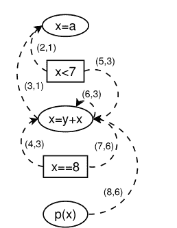

Figure 5.9: 图 5.2 的动态数据依赖图。控制依赖边为可读性而省略

由于运行时协议的长度原则上是无界的，长时间程序运行的上下文敏感依赖图的空间需求会爆炸。因此提出了多种压缩该图的方法。

Agrawal [AI90] 注意到程序中语句的数量是有界的，因此不同切片的数量也必须有界。他发现具有相同传递依赖的切片可以合并。该图为 *动态依赖图/缩减版 (RDDG)*。虽然这种表示是紧凑的并且可以在 $O(1)$ 中给出程序切片（传递依赖存储在内存中），但无法区分同一节点的不同实例（例如在循环中）。因此图的减小大小导致精度损失。

上下文敏感性是这种方法不能保证的属性。
然而，由于追踪的线性，动态切片被添加到边 [ZG03, ZG05]。标签包含额外信息以消除语句执行实例的歧义。Zhang 等人称之为动态 *数据依赖图*。例如考虑图 5.2，执行代码为 1,2,3,4,5,6。图边捕获了所涉及语句的执行时间。检查第 2 行上的 `$x$` 是否在时间 2 执行并依赖于第 1 行在时间 1 计算的 `$x$` 的值。因此边包含时间戳：`(2, 1)`。对应于第 3 行的节点（对于此示例，我们将节点/语句术语互换使用）依赖于 while 循环第一次实例中语句 1 的执行，由标记为 `(3,1)` 的边表示；在第二次实例中，它依赖于其自身的最后一次实例：循环边标记为执行 `(6,3)`。

动态程序切片在动态数据依赖图中使用公式 `$x 	o_i y$` 表示具有时间戳 `$l = (t_1, t_2)$` 的从 `$x$` 到 `$y$` 的边：

## CHAPTER 5. PATH CONDITIONS

```
$dBS_{cs}(y,t) \quad \{x \mid \text{Path } p : (y = x_0 \to l_0 \cdots \to l_{n-1} \to x_n = x) :\n l_0 = (t, t_0) \wedge\n\forall 0 < i < n-1 : l_i = (t_{i-1}, t_i) \wedge l_{i+1} = (t_i, t_{i+1})\}$
```

在我们的示例中，第 2 行执行（时间戳为 2）的动态切片是其自身和第 1 行。第 3 行未包含，因为未跟随时间戳为 5 的边。从时间戳为 5 的第 2 行开始，我们必须包含第 3 行并返回到第 1 行。这个小例子已经说明了边标签的威力。

类似于动态程序切片，可以在动态数据依赖图中定义动态程序：

```
$dCH_{cs}(x,y,t_x,t_y) = \{x \mid \exists \text{Path } p : (y = x_0 \to \cdots \to l_{n-1} \to x_n = x) :\n l_0 = (y, t_0) \wedge l_{n-1} = (t_{n-2}, t_y) \wedge\n\forall 0 < i < n-1 : l_i = (t_{i-1}, t_i) \wedge l_{i+1} = (t_i, t_{i+1})$
```


动态`chop`包含动态数据依赖图中从$x$到$y$路径上的所有节点，该路径从时间戳为$y$的$y$开始，以时间戳为$x$的$x$结束。

动态依赖图在空间上不受尊重，并且只有在完全处理运行时后才能构建图，这对于长时间运行的应用程序可能需要太多时间。Zhang 等人 [ZGZ03, ZGZ05] 提出——除了该预处理算法（FP）之外——两种不需要预先图的变体。无预处理（NP）和有限预处理（LP）。该算法完全放弃构建依赖图，并在切片时线性回溯以找到图变量的最新的定义。NP 的最坏情况复杂度为$O(N^2)$，对于较大的切片或多次切片是不可接受的。即使使用标记切片中语句不再跟随，这复杂度也无法降低。作者认为 FP 和 NP 算法之间最好的折间是 LP 算法，它在追踪协议中两个条目之间引入一些信息以偏移。尽管如此，复杂度无法降低一个数量级，只能降低一个常数因子。

我们实现了所有提到的动态切片算法，并在我们的套件上进行了评估 cf. 第 7.4.2 节)。我们的实验证实了 Zhang 等人 [ZGZ03, ZGZ05] 的结果。对 **agrep** 的 100 个切片准则平均而言，缓存的 LP 算法以约 20 秒和 4.7 MB 内存的速度，比 NP 的 21 秒和 FP 的 26 秒更快，消耗的内存明显多于使用 4.4 MB RAM 的 NP 算法，并且优于需要 6.4 MB 的 FP。

# 5.4. 依赖图中的动态路径条件

## 5.4.3 动态路径条件

### 通过动态切分进行优化

在从一个语句到另一个语句构造路径条件时，这两个语句之间的所有路径都是通过静态依赖图中的切分（chop）确定的。如第 5.2.1 节所述，如果使用动态切分（dynamic chop），可以提高所执行程序的路径条件的准确性。动态依赖图通常只包含实际执行的边，因此这种动态切分在两个语句之间产生的路径数量要少得多。

例如，考虑图 1。如果执行轨迹为 1,2,3,4,7,9，那么从 2 到 9 的之间的切分为 2,3,4,7,9。在这一设置下，语句 5 永远不会执行，因此从动态切分中移除。静态切分则必须保守地将其包含。而通过动态切分，我们在 2 和 9 之间的路径条件中省略了路径 2,3,4,5,7,9 和 2,3,4,5,7,9。

尽管我们的路径条件生成器复用了部分信息，因此路径数量减半并不意味着路径条件缩短了 50%，此示例也展示了这种优化的影响。

### 通过轨迹值进行优化

为了用运行时信息增强给定的路径条件 PC，需要对轨迹进行分析以提取变量赋值。由于被分析的程序在运行时经历了一系列赋值，所有赋值都必须捕获在一个限制子句 R 中。该子句反过来可以使路径条件更强。

首先，确定路径条件 PC 中使用的变量与轨迹 T 的交集 V：

```
V = {v | v \in var(T) \intercap var(PC)}
```

对于每个变量 $v$，提取它在轨迹期间所携带的值，令 $\beta(v)$ 为 $v$ 所施加约束的 $w_i$ 集合：

```
\beta(v) = (v = w_i) \vee (v = w_j) \vee \dots
```

现在，限制子句 R 可以描述为所有值集合的合取：

```
R = \bigwedge_{v_i \in V} \beta(v_i)
```

为了使路径条件 PC 更强，使用了第 5.2.1 节的结果，并将两个子句进行合取组合：

```
PC' = PC \wedge R
```

产生更强且更精确的路径条件 PC'

由于类似于 SSA 的形式，变量只有当索引数字相同时才会匹配，从而处理了多次赋值。这使得程序轨迹必须列出变量及其对应的节点编号，如图 5.10 所示，该图展示了图 5.2 程序运行的简单轨迹。

注意，节点编号与图 5.2 中的 SSA 编号不同，因此，从第 1 行到第 5 行流的路径条件为 PC(1,5) = (x_3 < 7) \wedge (x_7 = 8)。对于该路径条件，轨迹产生了变量赋值：

```
$R = (x_3 = 2 \vee x_3 = 4 \vee x_3 = 6) \wedge (x_7 = 4 \vee x_7 = 6) \vee (x_7 = 8)$
```

再次，两个子句合取为 $PC' = PC \wedge R$，产生更强且更精确的路径条件 $PC'$。

```
$PC' = (x_3 = 2 \vee x_3 = 4 \vee x_3 = 6) \wedge (x_7 = 8)$
```

# 第 5 章. 路径条件

```
1 LINE 1

2 USE a_2 2

3 DEF x_1 2

4 LINE 2

5 USE x_3 2

6 LINE 3

7 USE y_5 2

8 USE x_6 2

9 DEF x_4 4

10 LINE 4

11 USE x_7 2

12 LINE 2

13 USE x_3 4

14 LINE 3

15 USE y_5 2

16 USE x_4 4

17 DEF x_4 6

18 LINE 4

19 USE x_7 6

20 LINE 2

21 USE x_3 6

22 LINE 3

23 USE y_5 2

24 USE x_6 6

25 DEF x_4 8

26 LINE 4

27 USE x_7 8

28 LINE 5

29 USE x_8 8

30 LINE 2

31 USE x_3 8
```

图 5.10：带有相应节点编号的简单程序轨迹，如图 5.2 所示

## 5.4. 依赖图中的动态路径条件

### 动态路径条件的正确性

有时由于“缺陷记录器”或为了刻意节省内存，只有轨迹的片段可用。虽然碎片化的轨迹对于动态切片通常是无用的（见第 5.4.1 节），但它们对于增强路径条件仍然具有有价值的信息。

```
$x = 0 \vee x = 1$$
```

而变量赋值状态实际上为：

```
$x = 0 \vee x = 2$$
```

限制性路径条件

```
$PC' = (x > 1) \wedge (x = 0 \vee x = 1)$
```

由于我们的路径条件生成器复用了部分信息，因此路径数量减半并不产生缩短了 50% 的路径条件，此示例也展示了这种优化的影响。

例如，考虑图 1。如果执行轨迹为 1,2,3,4,7,9，那么从 2 到 9 的之间的切分为 2,3,4,7,9。在这一设置下，语句 5 永远不会执行，因此从动态切分中移除。静态切分则必须保守地将其包含。而通过动态切分，我们在 2 和 9 之间的路径条件中省略了路径 2,3,4,5,7,9 和 2,3,4,5,7,9。

由于“缺陷记录器”或为了刻意节省内存，只有轨迹的片段可用。虽然碎片化的轨迹对于动态切片通常是无用的（见第 5.4.1 节），但它们对于增强路径条件仍然具有有价值的信息。

```
$x = 0 \vee x = 1$$
```

而变量赋值状态实际上为：

```
$x = 0 \vee x = 2$$
```

限制性路径条件

```
$PC' = (x > 1) \wedge (x = 0 \vee x = 1)$
```

由于“缺陷记录器”或为了刻意节省内存，只有轨迹的片段可用。虽然碎片化的轨迹对于动态切片通常是无用的（见第 5.4.1 节），但它们对于增强路径条件仍然具有有价值的信息。

```
$x = 0 \vee x = 1$$
```

而变量赋值状态实际上为：

```
$x = 0 \vee x = 2$$
```

限制性路径条件

```
$PC' = (x > 1) \wedge (x = 0 \vee x = 1)$
```


（注：由于原文中存在大量重复内容，已根据要求去重，仅翻译逻辑。）

例如，考虑图 1。如果执行轨迹为 `1,2,3,4,7,9`，那么从 `2` 到 `9` 的之间的切分为 `2,3,4,7,9`。在这一设置下，语句 `5` 永远不会执行，因此从动态切分中移除。静态切分则必须保守地将其包含。而通过动态切分，我们在 `2` 和 `9` 之间的路径条件中省略了路径 `2,3,4,5,7,9` 和 `2,3,4,5,7,9`。

## 5.4. 依赖图中的动态路径条件

`Venkatesh` [Ven95] 实现了一种用于追踪 C 程序的低级方法。他的原型实现称为 `SLICE`，它通过对源代码进行插桩，在执行期间写入程序轨迹信息。基于这一经验，作者建议在未来的实现中使用目标代码插桩，并给出了几个理由。尽管如此，这种实现方式仍然比使用传统调试器的追踪要快。

`Zhang` 等人 [ZGZ03] 采用了另一种低级方法来创建程序轨迹：该程序使用 `Trimaran` 系统编译，该系统是一个用于显式并行指令集计算（`EPIC`）的编译器。解释器获取生成的目标代码并在执行期间创建程序轨迹。由于 C 程序没有经过适当的插桩，这种方法大多适用于理论评估。

所有低级方法对程序执行速度的影响通常都不像调试器那样大。然而，由于我们的工作是针对静态依赖图的，且该图必须映射到源代码，这些方法并不符合我们的需求。

动态程序切片已经活跃研究了多年。研究者提出了多种方法，包括单独的动态切片方法，以及结合静态元素的方法。列举所有方法将超出本文的范畴：

`Chen` 等人 [CX01b] 描述了一种动态切片算法，该算法基于静态程序依赖图（`SDG`），为调试器的断点设置提供信息。静态依赖图仅限于构建动态依赖图时访问过的节点和边。切片操作是沿着图中所有的边完成的。

> `Tip95` 采取了不同的策略：他使用抽象语法树（`AST`）代替依赖图，并对程序进行解释。该方法与语言无关，但仅适用于自定义的语言 `'L'`。

`Zhang` 等人提出了另一种减少程序轨迹中存储数据量的方法。他们在执行期间计算动态切片并将其存储在二进制决策图（`BDDs`）中 [ZGZ04]。

`Wang` 等人 [WRO04] 提出了一种针对 `Java` 的动态切片技术，该技术可以实时对轨迹进行压缩，并获得了两个到三个数量级的压缩算法。无损压缩算法在追踪器捕获的（内存和控制）边序列中发现了一种高重复的模式。他们还提出了一种直接在压缩后的数据上运行的动态切片算法，可以节省解压时间。此类算法可能不仅适用于大量使用指针的语言。我们预计我们的变量轨迹的重复模式也能产生类似的压缩率。由于切片算法在压缩数据上运行且不使用动态依赖图，多个需要多次访问轨迹的切片请求将产生显著的时间开销。

# 第 6 章

## 实现

本文中描述的所有分析均已实现。图 6.1 显示了 `Valsoft/Joana` 的架构。这套工具包含了多种用于对安全属性进行精确分析的技术。文献中已经提出了如切片等基础技术的其他应用（[BG96, dL01, HH01, BH04, Kri05, MM07]），但它们超出了本文的范畴。该设计的组件将在接下来的章节中详细描述。

## 6.1 前端

目前，`SDG` 已针对 C 和 `Java` 代码进行了构建。我们通过一个插件对商业切片系统 `CodeSurfer` [ART03] 进行了扩展，该插件可以创建与我们的图格式兼容的文件。这种方法补充了我们小组此前创建的 `Valsoft SDG` 生成器 [Kri03a]。在我们的工具套中引入商业产品自然地使其更加成熟，然而，`CodeSurfer` 被认为对于非常大的程序是不健壮的 [And08]。扩展 `CodeSurfer` 依赖关系的挑战在于，切片构成了路径条件的基础。路径条件需要类似于抽象语法树的细粒度 `SDG` 结构，但 `CodeSurfer` 仅支持粗粒度的 `SDG`。尽管如此，`CodeSurfer` 提供了控制流图的访问，在其依赖图进行后处理后，将其与 `CFG` 的结果汇总。

对于 `Java`，本文定义了字节码程序的精确表示（第 2 章），我们的生成器也反映了这一点。它基于 `MIT` 的字节码中间表示 `Horizon` 以及 `Fx` 编译器。该框架运行在基于 `SSA` 的表示上，并在所有可能抛出异常的指令处插入显式检查，对由于隐式和显式异常导致的控制流进行保守建模。从这里开始，我们的工具生成细粒度（用于路径条件）和粗粒度（用于所有其他分析）的依赖图。首先，指针分析确定调用图和指向关系，随后每个方法的依赖图将被

> ¹此库目前已被废弃，目前正被一个基于 `WALA` (`wala.sourceforge.net`) 的生成器所取代

创建并合并了过程间的副作用。最后，插入由于这些副作用产生的数据依赖，并可选地计算摘要边。根据要求添加推理依赖（见第 3 章）。

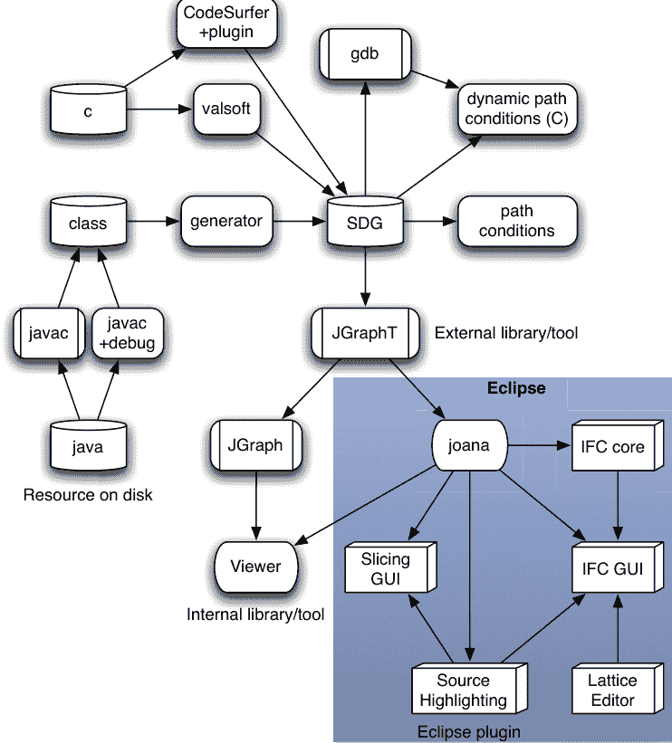

图 6.1: `Valsoft/Joana` 架构

### 6.1.1 桩程序 (Stubs)

`Harpoon` 前端支持直到 1.4 版本的 `Java` 全字节码。我们发现 1.5 版本的变化是微不足道的。然而，对于 1.6 版本，由于动态类加载引入了问题。对于 `JDK 2.4`，即使是 `"Hello world"` 程序也加载了许多类。然而，这些类对于被分析的依赖关系是已知的。我们需要通过桩方法来模型被分析的 `Java`。桩是一个占位符方法，可以表示库调用的语义。例如，在 `Jif` 中，提供这些注释同样容易出错。为了避免分析成本过高，我们需要对标准库方法进行桩处理。对于我们的分析，我们为 `Java` 的两个版本创建了桩方法：

- 首先，我们为 `JavaCard 2.2` 的所有方法创建了桩。`JavaCard` 适用于智能卡等限制严格的环境。
- 其次，我们为标准库的核心部分开发了桩。特别是，`lang` 的影响被包含在我们的桩中。

在某些点，我们切掉了调用图的一部分，除了那些非常有问题的构造（解决方案可以在 `Livshits` 等人 [LWL05] 中找到）。这些桩引入了对原始依赖的保守近似。

> `Jif` 需要注释机制的第二个原因是它缺乏分析字节码的能力，因此标准库无法被分析。

## 6 章 实现

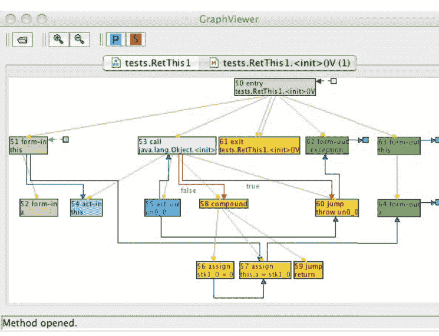

图 6.2: 带有示例 `PDG` 的图查看

### 6.2 基于 SDG 的分析

生成的依赖图存储在磁盘上，使用 `ANTLR`² 语法进行解析，并存储在开源图库 `JGraphT` 中.¹当我们决定使用该库时，作者首先为该库贡献了 `Java 5` 的泛型，为我们的自定义算法实现了类型安全的图（具体而言，不需要对节点和边类型进行显式转换）。基于 `JGraphT` 的 `Joana` 库提供了大量的切片、裁剪和相关分析算法。特别是原始 `Valsoft` [Kri03a] 中提出并实现的所有算法已集成。该核心库形成了后续几乎所有其他库和 `Eclipse` 插件的基础。

### 6.3 图查看器

`Vast` 基础设施 [Kri03a] 已经包含了一个依赖图的可视化组件。然而，该程序的一个关键库仅以公司的形式提供，因此具有干扰等新功能的图无法通过该软件解析和显示。因此，我们决定基于 `JGraph` 重新实现查看器。

- http://www.antlr.org/
- http://jgraph.sourceforge.net
- http://www.jgraph.com/

as an adapter for `JGraphT` existed. Furthermore, `JGraph` contains some free layout algorithms, which we extended by a new layouter by the `Brandes/Köpf` algorithm [BK01] in a `Sugiyama` setting. This layouter corresponds well to the structure of our `PDGs`.

Figure 6.2 shows an example `PDG` in the graph viewer. Note that procedural edges are visualized by edges from tiny rectangles. These rectangles represent nodes in another method, which is opened when the tiny rectangle is double-clicked. Note that a spanning tree of the control dependencies yields the layers for the `Sugiyama` layout (shown as orange edges). The horizontal position in these layers is determined by node numbers. The program order in basic blocks is preserved from left to right. The data dependencies are inserted between the layers as blue edges in a `Manhattan` layout.

## 6.4 Path Conditions

For both static and dynamic path conditions presented in chapter 5, a prototype implementation has been integrated into the original framework [Rob05].

We have implemented a prototype path generator for `Java` based on the existing implementation for `C` and the dependence graph generator for `Java` presented in chapter 2, and demonstrate the feasibility of our extensions with preliminary case studies. For the implementation, we concentrated on the new concepts and automatically benefited all constructs that share a common representation with `C`. For the prototype, the fine-grained `Java SDG` was adapted to interface with the `C` path condition generator. Thus the procedural object-oriented constructs are tackled by the dynamic dispatch — the most characteristic feature of object programming — according to equation (15). At the time of this writing, the precise conditions for `instanceof` and exceptions are not yet integrated and are approximated conservatively; the same is true for some other `Java` constructs. The precise formulae for these constructs will be integrated in the future. Still, all conditions presented in the evaluation (7) have been generated by the current prototype.

The dynamic path conditions have also been integrated into the existing implementation. To control the dynamic trace data, the standard debugger `gdb` was leveraged. A debugger driver abstracts away from the debugger in use, so we may replace `gdb` by another debugger. The tracer offers a standard interface for controlling the execution. The breakpoints and data needed for control of the debugger is extracted from the fine-grained `SDG`. In the tracing phase, the program is executed statement by statement, and all required information is traced. From that, a dynamic slice is built that is generally more precise than the static slice.

## CHAPTER 6. IMPLEMENTATION

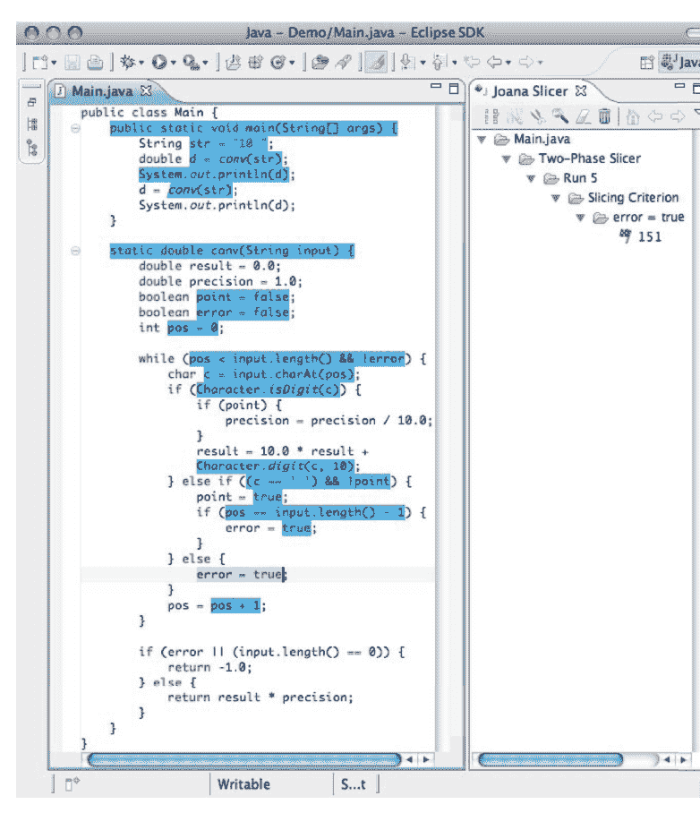

Figure 6.3: The slicing plugin with an example program.

158

## 6.5. ECLIPSE PLUGINS

## 6.5 Eclipse Plugins

As a GUI for several Eclipse plugins have been created [GH08]. The first GUI provides access to all slicing and chopping algorithms of the `Joana` library. The computed slices and chops are highlighted in the source code. Highlighting requires a mapping between bytecode instructions and source locations. Furthermore, most class files contain rudimentary debug information, which in most cases, the debug information can serve as mapping which corresponds to the intuition. But that information was not meant for highlighting but debugging purposes only, so for some the highlighted regions may deviate from the expected parts of programs. In our plugin structure, the `SDG` generation and highlighting are outsourced to the Source Highlighting plugin, which allows access from both plugins that require this service, namely the slicing and `IFC` (described later).

The example 6.3 shows a simple conversion method, that calculates the double value of a string parameter. The slice from the second `error = true` statement (declared in light blue) shows in darker blue. Note that for this example, the slice starts from our custom extension of `java` have been taken. Otherwise, the line would be highlighted once of that line is contained in the slice. The slice points out that only part of the conversion method influences the error checking of the slicing criterion: The `result` and `precision` variables have no influence on that statement but constitute a separate result of that. In fact, the method returns the special value `-1` if an error occurs, in all other cases it returns the computed value.

For detailed manual inspection of `SDGs`, the `SDGView` presents nodes in a tree with predecessors, successors, and parents, as an alternative to the graphical `SDG` viewer. Therefore, this allows manual reconstruction of how one statement induces another. As an example Figure 6.4, which shows the entries for node 55 depicted in Figure 6.2. For navigating quickly through the `SDG`, the root node can be specified, and the standard home, forward and backward buttons provide the well-known functionality.

### 6.5.1 Plugins for Information Flow Control

We implemented `SDG`-based `IFC`, including declassification, as described in chapter 4. The prototype is an `Eclipse` plugin, which allows interactive definition of security levels, automatic generation of `SDGs`, annotation of security levels to `SDG` nodes via source annotation and automatic security checks. At this time the `Java` slicer and security levels are fully operational.

We implemented the lattice editor on the `GEF` graph framework of `Eclipse`. The lattice is represented as bit vectors [GMR94,AKBLN89] to support inf/suprem operators when checking for illegal information flow. It is worth noting that the algorithm of `Ganguly` et al. computes incorrect results without adding synthetic nodes into edges that span more than one level (where levels are defined in terms of the longest path between

> http://eclipse.org

## CHAPTER 6. IMPLEMENTATION

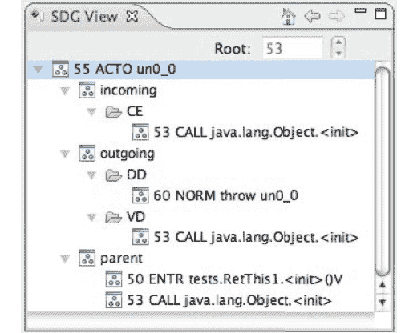

Figure 6.4: The `SDGView` for node 55 in Figure 6.2

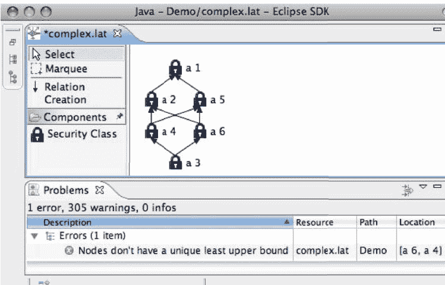

Figure 6.5: The lattice editor in `Eclipse` with illegal graph

160

## 6.5. ECLIPSE PLUGINS

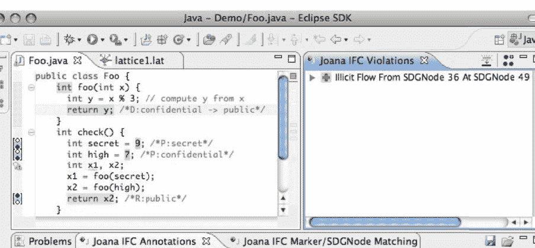

Figure 6.6: Example of Figure 4.11 without declassification in the `Eclipse` plugin

two nodes). the authors were not very concerning this restriction. For unfortunately, these synthetic nodes can be removed from the lattice to convert to a bit future. Our editor attempt to convert the given graph to such a lattice. If this fails, the user is notified that the graph does not represent a valid lattice. Otherwise the lattice can be saved on disk for annotations. Figure 6.5 shows a non-trivial graph. The conversion fails for this graph, as the elements 4 and 6 do have a unique upper bound: Both "2" and "5" are upper bounds for these elements, which violates a crucial property of lattices. The view at the bottom details a detailed message to the user that describes the violation. If one of the relation between those four elements were removed, a valid lattice would be generated, which can be leveraged for annotating the source code.

The `IFC` algorithm was implemented in a two-stage version: As the first step, the summary declassification nodes are computed. If the dependence graph already contains summary edges, these need to be removed first. Still, generating summary edges during `SDG` generation was not in vain: As declassification nodes can only arise between nodes that used to be connected by a summary edge, all nodes that are not target of a summary edge. Algorithm 8 of chapter 4 is therefore only initialized with these actual-out nodes. Note that this optimization does not improve the worst case complexity of the algorithm, but it reduces analysis time in practice (see section 7.3.5). As a second step, the `IFC` constraints are propagated through the backward slice of each output channel according to Algorithm 7 of chapter 4. Our implementation does not generate these constraints explicitly, but performs a fixed point analysis as presented in section 4.5.2.

## CHAPTER 6. IMPLEMENTATION

Figure 6.6 shows the example program of Figure 4.11 but without declassification in the `foo` method. The `Eclipse` plugin features a full-fledged view for annotations and security violations. User annotations are shown in the `Joanna IFC Annotations` (`ANN` stands for provided security level, `OUT` for required security level, and `RED` for declassification with fault). Next to the message, the `R` and `P` annotations are shown. The rest of the attributes describe the audited source position and the ID of the `SDG` node. Another View, called "Joanna IFC Marker,SDGNode Matching" allows precise matching of the selected source to its respective `SDG` node according to the debug information provided in the class file. The last view, depicted on the right in Figure 6.6 lists all violations found by the last `IFC` checking. For the example program, a run of the `IFC` algorithm determines a security violation between nodes 36 (`P(36)=secret`) and 49 (`R(49)=public`) because of the missing declassification in `foo`. When this declassification from confidential to public is introduced, no illicit flow is detected.

# 第7章
# 评估

之前的章节定义了几种精确的分析方法，这些方法可以用于安全目的。本章将介绍这些方法在实用性、可扩展性和精确性方面的实证证据。首先，我们将评估用于程序切片的新型副作用分析（见第2章）的精确性。其次，我们评估了改进的确定依赖关系的算法的有效性（见第3章），并与之前未考虑指针信息（points-to information）的定义进行对比。

接下来，我们评估了基于切片的信息流控制定义（见第4章）。为了彻底分析其实用性，我们介绍了 `Jif`——目前唯一的信息流类型系统实现，并将其与我们的系统进行比较。通过对一个 `Jif` 程序进行案例研究（将其转换回标准 `Java`），分析了其精度的提升。在一组基准程序上对我们的 `IFC` 算法进行的详细评估，说明了其可扩展性。

最后，我们介绍了路径条件（见第5章）。文中分别展示了针对面向对象语言构造的 `Java` 静态路径条件，以及 `C` 语言的动态路径条件。这些研究表明，扩展方法为真实程序提供了精确的结果。

## 7.1 Java 程序的切片

我们最初对 `Java` 切片 [HS04] 的介绍旨在评估参数对象的近似建模与我们的对象树之间的不精确性。然而，我们无法从 `Liang` 和 `Harro` [LH98] 那里学习 k 限制（k-limiting）的工作原理。因此，我们退回到对比不带 k 限制的可靠模型，即我们衡量了完全忽略由深层次引发的依赖关系的影响。事实上，我们发现不安全的 k 限制可能会遗漏高达 90% 的正确切片。虽然这项评估表明深层次对 `Java` 程序的切片有巨大影响，但这种对比并非我们的初衷。但在多年之后，我们未能为 k 限制遗漏的依赖找到可靠的近似。

然而，`Indus/Kaveri` 切片 [JRH05] 采用了一种计算数据依赖的替代方法。他们本质上是在所有定义语句与给定字段的所有匹配使用处之间添加数据依赖，并为此忽略了方法边界。证明这种模型对于上下文无关（context-insensitive）切片应该是轻而易举的。然而，本论文展示了我们的对象树在处理跨方法依赖时的有效性。

注意，跨越方法边界的数据违反了双阶段切片的预防措施，因为在此类模型中，上下文相关（context-sensitive）切片在每次计算切片时都需要在方法边界进行额外的恢复。我们没有包含此类复杂的分析。相反，我们将我们的上下文相关切片器与使用 `SDG` 的上下文无关切片器进行对比，并与上述描述的松弛图概念进行对比。

表 7.1 显示了该实验的基准程序。我们评估了一个包含 8 个程序、平均大小为 1kLoc 的基准，以及中等规模的 `Java` 应用。学生程序的 `API` 调用非常少，且对于几乎所有程序（见第 6.1.1 节）都没有遗漏核心依赖关系。一个 `JavaCard` 被称为 `"Wallet"`，`"Purse"` 则从 `"Pacman"` 用例调用 [BCM+00]。两者都影响了包含 `JavaCard API PDG` 的 `SDG`，上方已添加原生方法。

对于每个程序，都给出了 `LOC`（代码行数）和 `SDG` 规模（节点和边）。构建这些 `SDG` 的时间分为两个数字：'time' 列显示构建 `SDG`、中间表示以及指针分析的时间。下一列显示插入摘要边（summary edges）的时间。该数字单独给出，因为摘要计算具有某种复杂性。

| N | Name | LOC | Nodes | Edges | Time | Summary |
|---|---|---|---|---|---|---|
| 1 | Dijkstra | 618 | 2281 | 4999 | 4 | |
| 2 | Enigma | 922 | 2132 | 4740 | 5 | 1 |
| 3 | Lindenmeyer | 490 | 2601 | 195552 | 5 | 10 |
| 4 | Network Flow | 960 | 1759 | 3440 | 6 | |
| 5 | Plane-Sweep | 1188 | 14129 | 386507 | 24 | 13 |
| 6 | Semithue | 909 | 19976 | 595362 | 24 | 33 |
| 7 | TSP | 1383 | 6106 | 15430 | 15 | 2 |
| 8 | Union Find | 1542 | 13499 | 90690 | 36 | 103 |
| 9 | JC Wallet | 252 | 18588 | 68259 | 8 | 9 |
| 10 | JC Purse | 9835 | 1002571 | 145 | 742 |
| 11 | mp | 4750 | 271745 | 241745 | 14 | |

每个程序都给出了 `LOC` 和 `SDG` 规模（节点和边）。

表 7.1：基准程序的数据依赖

图 7.1: 路径条件

图 7.1: 路径依赖的片

.1: 上 上上下文无关的切片结果

图 7.1: 路径条件的评估

图 7.1: 上下文相关的切片

图 7.1: 依赖关系

## 7.2 依赖评估

## 7.3. 信息流控制

dependencies, respectively. The difference to the real number again results mainly
constructors before creation.

Crypt、Series 和 SparseMatmult 并未进行广泛通信。因此
它们实际的干扰数几乎为零，我们的分析仅报告了 95、
8 和 12 个依赖关系，分别。与上下文敏感的指针分析相比，
Crypt 的 64 个依赖关系可以被剪枝，从而得到总共 31 个干扰，
这超过了 Ranganath 的结果。

将我们的结果与 Ranganath 的结果进行比较，显然别名分析
在作为干扰计算的基础时优于逃逸分析。令人感兴趣的是
上下文敏感的别名分析可能表现不如
[R H04] 中提出的相当廉价但上下文敏感的逃逸分析。
因此上下文敏感性似乎比别名分析更强制。然而，
上下文敏感的别名信息在精度上比逃逸信息有显著提升。基准测试
中数组访问在 [RH04] 中显然没有建模，因此对此进行公平比较是不可能的。

表 7.2：与 [RH04] 相比的干扰依赖性评估

| Barrier | Result from [RH04] | | | | | |
| :--- | :--- | :--- | :--- | :--- | :--- | :--- |
| | escape | type | thread# | + HB | real | |
| ForkJoin | 117 | 29 | 56 | 37 | 17 | 7 |
| | 1929 | 15 | 16 | 12 | 11 | 0 |
| Sync | 122 | 36 | 44 | 32 | 6 | |
| Crypt | 1228 | 180 | 58 | 1023 | 325 | 95/31 | 0 |
| LUFact | 3624 | 181 | 24 | 13528 | 291 | 276 | 139 |
| SOR | 2318 | 162 | 53 | 144 | 115 | 8 |
| Series | 2138 | 157 | 8 | 105 | 22 | 8 | |
| SparseMatmult | 3883 | 183 | 14 | 236 | 22 | 11 | 1 |
| MolDyn | 8026 | 373 | 209 | 8794 | 5340 | 5288 | ? |
| MonteCarlo | 5245 | 309 | 11 | 5116 | 263 | 126 | ? |
| RayTracer | 1330 | 171 | 166 | 1059 | 412 | 221 | ? |

## 7.3 信息流控制

本节介绍了关于我们在第 4 章中开发的新信息流分析的精度、可扩展性和实用性的实证研究。它首先
阐述了基于语言的信息流控制的当前技术状态。语言 `Jif` 是唯一具有内置信息流控制的类 `Java` 语言的实现。我们将证明其适用性显著降低，因为语言设计以信息流类型系统为中心。传统的 `Java` 程序需要
进行大量重构才能符合 Jit's 约束（参见例如 [AS05]）。
本节后半部分将讨论准确性和可扩展性的实证评估。

# 第 7 章 评估

### 7.3.1 JIF

唯一针对非平凡命令式语言的类型系统实现是 `JIF` [MCN+]，最初称为 `JFlow`。它提供了一种类 `Java` 语言，通过标记类型进行扩展，包含普通 `Java` 类型如 `String`，以及作为程序安全策略一部分的安全标签。每个安全标签限制了可以流向所标注变量的信息。变量在去中心化标签模型 [ML00] 中隐式形成一个完整格。该模型允许多个主体形成某种对它们所拥有信息访问控制。它们可以允许其他主体读取数据，对数据进行分类并将权限转移给主体和代码。在版本 3 中，`Jif` 的去中心化标签模型增加了完整性检查。

安全类型系统的主要优点在 `Jif` 中同样存在：类型检查既高效又可组合。因此，可以单独检查每个类，并在之后组合应用程序的各个部分以分析整个程序。原则上，组合也适用于库。然而，由于 `Java` 标准类的庞大体量以及缺乏公开可用的源代码，`Jif` 并未免费提供安全注释。即使对于这些，也没有语义保证（参见下文关于库的段落）。

但首先，我们评估 `Jif` 系统的分析精度维度。

### 流不敏感性

与大多数基于类型的方案一样，`Jif` 将变量和字段的集合划分为不相交的集合（如安全和公开数据）。如果非法信息流例如来自公开分区，`Jif` 已经认为程序不安全，即使程序变量在流之后不再活跃。这可以在第 90 页图 4.2 中的程序片段中看到，该片段在直觉上是正确的，if 块中的赋值被后续定义所杀死。像 `Jif` 这样的类型系统会错误地拒绝代码，因为机密信息对公共变量中的值产生影响。

然而，基于非干扰的原始定义 [GM82, GM84]（参见第 4.3 节），该程序片段指出程序的两个（公开）输出流在（秘密）输入不同时应不可区分。换句话说，秘密输入不允许流向公开输出通道。该定义反映在我们的基于切片的方法中，该方法仅检查秘密数据是否可能流向公开输出。但类型系统无法保证该属性，因为与切片类似。

### 上下文不敏感性

将变量和字段划分为不相交的集合的额外优点是分析变得上下文不敏感：结果，数据结构甚至简单的实用方法不能在不同的安全级别下重用。人们需要为每个安全级别编写一个 `Vector` 类或余弦方法，对于多参数方法情况甚至更糟。作为补救措施，`Jif` 支持各种多态性以允许可重用代码，类似于 `Java 5` 中用于集合的泛型。但与这些类似，程序员需要在数据结构要在不同安全策略中使用时为其标注所有类型参数。`Jif` 提供了减轻该负担的方法，但这可能是一把双刃剑，因为这些方法可能与语义不一致。`Jif` 的一个近期案例 [AS05] 发现 `Java` 库包装器的注释不足，这可能导致未检测到的安全违规。除此之外，多态类受某些限制（参见第 167 页的类型判别式），这限制了其适用性。

### 对象不敏感性

与上下文类似，不同的对象可能希望存储具有不同安全标签的数据。然而，类型系统用单个安全标签静态标记每个字段。再次，一些补救措施可以通过多态性实现，问题与之前相同。另一种实现对象敏感性的方法是运行时标签，但这些需要程序检测，这会带来额外的执行时间和空间开销。

### 与 Java 的差异

尽管 `Jif` 编译为标准 `Java`（但需要作为 jar 库提供的额外运行时系统），`Jif` 与 `Java` 之间仍存在差异。其中一些限制是任何语言接口的标准：

Threads 与大多数一样，`Jif` 无法阻止线程通过共享变量修改的时序和同步进行通信。此类通道只能由可能性 [SV98] 和概率 [SS01,Smi6] `IFC` 控制。针对这些安全策略的类型系统实现已被报道。然而，我们的基于切片的 `IFC` 可以扩展到概率非干扰 [GL]。我们目前正在将该安全策略的检查器集成到我们的系统中。

Finalizers 在 `Java` 中在单独的线程中运行，可以利用共享的隐蔽通道。因此，`Jif` 不支持 finalizers。大多数分析忽略它们，因为它们在 `Java` 中很少使用且执行时间未知。`Java` 保证执行发生在垃圾收集器发现对象从活动状态不可达时发生。然而，并不保证 finalizer 会运行，例如 [LIF03]。

如果攻击者可以访问独立于系统的时钟，时序通道就极难防范。这些物理侧通道除 `Agat` 的类型系统 [Aga0] 和 `Sabelfeld` 和 `Sand` 的强安全 [SS01] 外，均未被基于语言的信息流控制所覆盖。

# 第7章. 评估

**资源耗尽** 如 `OutOfMemoryError` 或 `StackOverflow` 可被用作信息泄露。`Jif` 将这些错误视为致命错误，使得每次程序执行最多只能泄露一个比特的信息。试图捕获此类错误的代码可通过程序分析轻松识别。由于错误并非旨在在 [JSB05] 中恢复，因此禁止捕获错误的代码是直接的。`JVM` 在出现此类问题时会终止。

**终止通道** 与时序通道类似，此类通道非常难以抑制。通常不希望程序在一段黑色代码块中停留多久，或者在极端情况下——是否会终止。然而，对于基于切片的 `IFC`，存在控制依赖的替代定义 [PC90, RAB*07, Amt08]，使得所有后续语句都依赖于可能终止的语句。采用这些定义，终止泄露可被发现，但分析会比标准控制依赖更保守。这可能导致误报，因为终止是不可判定的。

`Jif` 语言的其他限制使得将 `Java` 类转换为 `Jif` 变得困难：

**最终参数** 与 `Java` 相比，`Jif` 中的方法被隐式化，允许它们作为 `Jif` 注解的类型参数使用。这一务实的设计决策并未显著限制程序员，因为 `Jif` 仅支持按值调用参数传递。但它可能需要重构遗留的 `Java` 代码以产生合法的 `Jif` 源代码。

**HashCode** `java.lang.Object` 类的默认实现可被用于隐蔽通信，因此 `Jif` 要求每个类重新定义此方法。这一限制在实践中过于严格。由于 `hashCode` 旨在将不同对象映射到不同值 [JSB05]，基于字段的实现可能会导致 `HashMaps` 和 `HashSets` 的性能不佳。

**静态变量** 可被利用作为基于类加载器调用顺序的隐蔽通道。`Jif` 禁止所有静态变量（但不包括方法）。即使静态变量可以重构为普通变量，所有现实程序尤其是库都使用该概念，特别是用于定义常量，这改善了代码模块化。由于大多数静态变量在其定义类的静态初始化器中仅初始化一次，因此可使用简单检查来消除隐蔽通道，而无需完全排除该概念。

**未检查异常** 在 `Java` 中，所有 `java.lang.RuntimeException` 的子类无需在方法 `throws` 子句中声明。这些异常也可由 `Java` 程序定义，但它们主要由虚拟机用于捕获诸如数组越界、空指针和其他在字节码解释期间隐式检查的常见问题之类的问题。这些异常可能由许多字节码指令抛出，要求其声明或在 try/catch 块中似乎对 `Java` 语言的设计者来说负担过重。但 `Jif` 恰恰要求这样做！基于切片的信息流可以捕获从抛出位置到匹配 catch 的异常，并且只有当此类流向公共通道传输信息时才会引发安全策略违规。因此程序员不会因处理常规异常而不堪重负。

例如，考虑 [ML00] 中第 93 页图 4.3 的密码示例。即使这种微不足道的代码也需要两个 catch 块，分别用于 `NullPointer` 和 `IndexOutOfBounds`。两者都应用了令人恐惧的 crashed-all-pointer-anti-pattern，经验证据表明这使错误检测变得更加困难。这与 Dijkstra 的最弱前置条件原则完全相悖，并可能产生难以追踪的继承错误。

**参数上的类型区分** 在强制转换或 `instanceof` 中，`Jif` 不允许使用以安全标签参数化的类。与 `Java` 的泛型一样，这在编译期间会被擦除。过度受限的参数化类也适用于代码重用 [ML00, AS05]。如果参数在静态上已知匹配，则可以允许参数化表达式，但目前尚不支持。

库 现有库未用安全标签注释，无法使用 `Jif` 进行流检查。虽然 `Jif` 为最重要的库类（如集合）提供了包装类，但如果未提供源代码或字节码，则许多其他库不受支持。由于 `Java` 的流行在很大程度上基于大量标准库和众多自定义库的可用性，这些限制阻碍了安全类型语言的普及。

关于上述列出的限制，很明显为什么基于语言的信息流控制在存在十多年后并未获得真正的 traction。`Zdancevic` 指出，“尽管有这篇文献和研究界持续的、相当大的关注，信息流执行机制并未被广泛看到（甚至狭隘地！）” [Zda04]。只有最近才在学术领域 [MCN+] 用 `Jif` 语言编写了一些程序 [MCN+]。我们认为，对于实际使用，现实的语言必须能够在没有重大限制的情况下进行分析。

## 7.3. 信息流控制

本节的其余部分将集中于我们基于程序切片的新型信息流控制，如第 4 章所述。我们将比较其功能与 `Jif`，并指出需要更紧密集成其他信息流控制工作研究的方向。

### 7.3.2 基于切片的信息流控制

本节的其余部分将集中于我们基于程序切片的新型信息流控制，如第 4 章所述。我们将比较其功能与 `Jif`，并指出需要更紧密集成其他信息流控制工作研究的方向。

# 第7章. 评估

### 7.3.3 流、上下文和对象敏感性

程序依赖图可以构建以允许流、上下文和对象敏感分析。对于流敏感分析，文献中已提出 `SSA` 形式的衍生形式，甚至还提出了堆对象的 `SSA` 形式 [FKS00]。系统依赖图的双阶段处理 [HRB90] 是上下文敏感的，因为存在汇总方法参数之间传递依赖的边。对于对象敏感结果，需要在引用和修改中跨参数表示字段结构，并在该方法和传递调用的方法中（参见第 2 章）。对这些参数的精确分析需要 points-to 分析。过去十年的 points-to 评估极大地提高了性能和可扩展性，因此对于现实程序而言，流、上下文和对象敏感分析是可行的 [MRR02, LH03, LL03, WL04, LH08]，这又支撑了依赖图的精度。

基于切片的信息流控制的另一个好处是，当图构建完成后，检查器独立于实际源语言，这便于构建可重用的检查器。`Valsoft` 基础设施适用于 `C` 和 `Java`，因此所有这些语言都可以用相同的基础设施进行检查，只要依赖图用安全级别进行注释。

## 非干扰

第 92 页的定理 4.1 指出，对于依赖图中的两个节点 `n a`，如果 `n BackwardSlice(a) ∨ label(n) ≤ label(a)`，则 `n` 和 `a` 之间满足非干扰准则。如果存在路径 `n→a` 且 `label(n) ⊈ label(a)`，则发现了（潜在的）安全违规。虽然证明独立于特定语言或切片标准，但更精确的切片将具有更少的误报率。前面描述的这种流、上下文和对象敏感切片也验证了比 `Jif` 系统更精确的结果，而无需额外负担为类和方法标注多态安全类型。

由于数据和控制流在形式上以到达定义 res. [FOW87] 定义，程序切片不比类型系统不正式，相反，已证明依赖图准确表示了图的语义证明（参见第 2.2 节）。甚至，对我们流控制机制正确性的机器检查证明也是可能的 [qui]。

依赖图中的信息流检查与类型系统相似但不相同：`Denning` 风格的标签附加到图中的节点，而不是变量。因此，即使第 96 页图 46 中第 13 行和第 14 行的注释看起来与类型声明相似，其语义也完全不同；同一变量的另一种定义可能会得到完全不同的标签或

## 7.3. 信息流控制

none at all. Note that this has nothing to do with dynamic labeling, labels are created at runtime. Here labels are statically determined, but variables are not partitioned into disjoint sets according to their label. Therefore, we can leverage the original and more general notion of noninterference of `Goguen` and `Mesuer` [GM82, GM84].

### 7.3.4 案例研究

作为与基于类型的 `IFC` 比较我们方法的初始基准，让我们重新考虑第 96 页图 4.6 中的程序。记住 `PDG`-based `IFC` 保证安全变量（标注为 `P(11) = High`）到第 19 行的第一个输出语句之间没有流。因此我们使用 `Jif` [mCN*] 分析了图 4.6 中的程序。`Jif` 使用了 `Denning` 格的推广，即所谓的去中心化标签模型。为了为每个语句指定一组安全级别（称为“标签”），并为任何标签附加一组操作。这例如写成 `{o1: r1,o2: r2}` 并将访问与 `IFC` 结合。我们的方案也可以推广以使用去中心化标签模型。

但请注意，即使是去中心化标签也无法克服基于类型分析的 imprecise 性。作为示例，我们将图 4.6 的第一部分标注为 `Jif` 语法并对 `o` 和 `A` 的两个实例使用主体 `p` 进行标注。第一个语句被替换为允许公开输出的等效代码。`Jif` 报告说安全数据可能流向公共通道并且这引发了误报。在，没有任何标注可以使 `Jif` 在不更改源代码的情况下接受图 4.6 的第一部分。

### 一个 Java Applet

作为 `IFC` 的另一个案例研究，我们选择了名为 `Wallet`⁵ 的 `Java` applet。它只有 252 行长，但加上必要的 `API` 部分和内容，构造的 `PDG` 包含 18885 条边和 68259 条边。`PDG` 构造时间为 8 秒，外加 9 秒用于摘要边。

`Wallet` 存储用户可支配的余额。仅在提供正确 `PIN` 后才授予对该余额的访问权限。我们将更新余额的所有语句标注为提供的 security level `High`，并在 `getBalance` 方法中插入了一个从 `Low` 的 declassification。`credit` 和 `debit` 方法可能会在超出最大值或信用不足时分别抛出异常。在 `Java` applet 抛出异常的情况下，异常完全取决于涉及条件的计算结果。异常并非旨在被捕获，而是会传播到 `Java` 终端，因此我们也为这些异常插入了 declassification。除了这种预期信息流，该信息流仅在用户请求并验证 `PIN` 后才可能发生之外，我们的分析证明余额到 `JavaCard` 的输出之间不可能存在进一步的信息流。

> ⁵参见第 160 页表 7.1

## 第 7 章. 评估

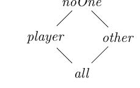

图 7.2：分析战舰示例的格

请注意这个 `Java` applet —— 虽然运行在受限的 `Java` 变体上 —— 利用了该标准的许多特性：特别是我们分析了相当多的静态变量，并在分析中包含了隐式异常引起的所有控制流，而无需显式声明或捕获这些异常。因此，这个基准同样无法用 `Jif` 认证。

### 战舰示例

之前的实验表明，我们的新方法比 `Jif` 更通用，因为我们可以分析现实的编程语言，并且由于精度提高而接受更多安全的程序。我们评估的下一步将检查一个原生 `Jif` 程序，以在实用性方面对这两个系统进行直接比较。作为基准，我们选择了战舰示例，该示例随每个 `Jif` 安装一起提供，并实现了流行战舰游戏的非 `GUI` 版本。在这款游戏中，两名玩家在矩形棋盘上放置不同长度的船只，随后“轰炸”对手棋盘上的随机卡片，直到一名玩家覆盖了所有被对手船只覆盖的单元格。

该程序的源代码约有 500 行，外加所需的库和存储。这些产生了一个包含 10207 个节点和 7290 条边的 `SDG`。例如我们使用标准菱形格，其中所有 ≤ player ≤ noOne 且所有 ≤ other ≤ other 但 player ≰ other 也不 player（见图 7.3）。这确保了一名玩家机密信息不会被另一名玩家看到，反之亦然。

在我们的 `IFC` 分析可以分析此示例程序之前，它必须转换回常规 `Java` 语法。删除 throws 子句中所有括号等所有语法特殊性，并替换所有 `Jif` 特殊性，如我们的运行时系统。此过程的大部分需要手动转换。我们将玩家初始化中的船只放置策略标注为 security level `$P(n)=player$`。原始 `Jif` 程序的两个 declassifications 在我们的系统中也建模为从 player 到 all 的 declassification。我们将所有参数标注为 `$System.out.println(R(x)=all)$`，这对应于原始程序的变量标注。

当我们用此安全策略检查程序时，发现到所有输出节点的非法信息流。人工检查发现所有这些违规都是由于玩家初始化的隐式信息流

## 7.3. 信息流控制

```


/**
 * Initialize the board by placing ships to cover numCovered coords.
 *
void init(P:)**/(int)numCovered) {
 // Here what we would do in a full system is make a call to
 // some non-Jif function, through the runtime interface, to
 // get the position of the ships to place. That function would
 // either-return status or would implement some
 // strategy. Here we fake it with fixed positions for
 // ships;
 final Ship*(P:)** = myCunningStrategy = {
 new Ship*(P:)**/(Coordinate/(P:))**/(1, 1), 1, true);
 new Ship*(P:)**/(Coordinate/(P:))**/(1, 3), 2, false);
 new Ship*(P:)**/(Coordinate/(P:))**/(2, 2), 3, true);
 new Ship*(P:)**/(Coordinate/(P:))**/(3, 4), 4, false);
 new Ship*(P:)**/(Coordinate/(P:))**/(5, 6), 5, true);
 new Ship*(P:)**/(Coordinate/(P:))**/(5, 7), 6, false);
 };

 Board*(T:)**board = this board;
 int i = 0;
 for (int count = numCovered; count > 0 && i != null; ) {
 try {
 Ship*(P:)**/newPiece = myCunningStrategy(i++);
 if (newPiece == null && newPiece.length > count) {
 // this ship is too long
 newPiece = new Ship*:(P:)**/(newPiece.pos, count);
 }
 board.addShip(newPiece);
 count -= (newPiece==null?0:newPiece.length);
 }
 catch (ArrayIndexOutOfBoundsException ignored) {
 catch (IllegalArgumentException ignored) {
 // two ships overlapped. Just try adding the next ship
 // instead;
 }
}
```

图 7.3：战舰中 `Player` 的初始化方法

## 第 7 章. 评估

方法，更准确地说，由于这些方法中可能抛出的异常。然而，更仔细的检查发现所有这些异常控制流路径实际上都是不可能的。

例如图 7.3 中的初始化方法。如果程序检查 SSA 变量是否为 null，并且只有在它不为 null 时才执行涉及它的指令（参见第 25 行），则可能在该指令处抛出空指针异常。然而，我们的中间表示目前无法检测到这一点，即使中间表示中存在两个相同的 null 检查，一个紧随另一个。Jif 似乎支持某种局部推理。但即使是平凡的示例，其中 final 值在构造函数中定义，在任何实例中都可能永远不为 null。such cases can be detected, in the procedural case [Hu08]. Jif 只能在有额外的用户标注时支持非局部推理。

除空指针问题外，我们还发现了到数组存储的异常控制流，其中 Jif 必须确保存储的值是数组组件的实例，因为 Java 的协变数组异常。当类型为 a[] 的数组变量被类型为 b[] 的数组赋值时，存储 a 类型的对象到其中会抛出 `ArrayStoreException`（参见图 7.3 第 11-17 行）Jif 似乎具有局部推理来修剪平凡情况。我们的表示不修剪此类情况，使用我们用于依赖的指针分析结果，impossible control flow 可能会到达。

最后，对于过程间分析，我们发现我们的表示为所有方法建模异常返回值，即使方法保证不抛出任何异常。更精确地建模此类情况可以使调用方法中的控制流更精确并消除虚假的隐式流。Jif 对此类情况使用用户标注，因为所有可能抛出的异常必须被捕获或声明，通常 Java 中不得声明的 RuntimeExceptions。

目前，我们的工具不提供此类分析，因此只能通过外部手段检测此类异常。或者通过人工检查，定理（例如 /post conditions）或路径条件。在验证此类流不可能后，我们可以阻止依赖图中的相应路径，并且我们用 declassification 来做到这一点。与正常 declassification 不同，信息流是可能但必要的，这种 declassification 模拟了没有信息流的保证。作为未来，我们计划集成修剪不可能控制流的分析以降低误报率，从而减轻外部验证的负担。

在阻止 `Player` 初始化中通过异常的信息流后，我们的 IFC 算法证明了战舰相对于所述安全策略是安全的。未发现进一步的非法信息流。在基于四个 declassifications 的安全分析期间，创建了 728 个摘要 declassification 节点。这一结果表明摘要分类节点有效地影响分析精度，因为它们允许在方法调用站点阻止传递信息流的同时进行上下文敏感切片。Instead they introduce a declassification that summarizes the declassification

## 7.3. 信息流控制

被调用方法的效果。请注意，原生的 Jif 程序包含约 150 条注解（在图 7.3 中显示为灰色注释），其中大部分涉及安全类型。 然而，其中一些注解涉及主体及其权限。 这是我们在当前不支持的去中心化标签模型的一个特性。 注解的数量比我们的分析高出至少一个数量级。 对于一个仅包含 500 行代码（包括注释）的程序，这意味着 Jif 的注解负担是相当大的。

切片式 IPC 需要的注解比类型少的一个原因在于，方法的副作用在依赖图上是显式的，因此不需要终结标签（它模拟副作用对程序计数器的影响），另一个返回值或显式标签。 这些是作为表示被调用方法的依赖关系的概要信息计算得出的。
除此之外，Jif 需要注解来验证任何非平凡的属性，除了控制流。 特别是，像非空性这样的前置条件必须包含在程序文本中而不是其注解中，空指针或子句的显式标签，通常随后是空的处理程序，如图 4.6 第 96 页所示的示例。 因此，前置条件被包含为运行时检查以实现局部推理。 这种编码风格对于软件工程视角来说是一种折磨，因为它意味着源代码理解，并且可能掩盖被违反的条件。 人们真正想要的是验证此类情况在任何执行中都不会发生，因此不需要包含在源代码中。

### 7.3.5 可扩展性

上一节展示了我们方法的精确性和实用性。 为了验证我们新的基于切片的信息流控制的可扩展性，我们在具有不同数量的去分类并且使用具有不同特征的格的多个基准上测量了执行时间。 基准程序与第 160 页表 7.1 中的相同，除了金属工人协议的实现程序 [AS05]。 该程序显示以下特征：其源代码长 4750 行（包括所有必要的库和存根共 18801 行），生成的 SDG 包含 27175 个节点和 204532 条边，在磁盘上占用约 36MB。 计算 SDG 的时间为 141 秒，加上概要边的 247 秒。

7.3 显示了我们在评估中使用的格的特征：第一列显示格中节点的数量，第二列显示格的最大高度。 格中不纯节点的数量显示在下一列，表示格中具有多于一个父节点的节点。 最后一列显示在 Ganguly 等人 [GMR94] 的高效位编码中所需的位数。 该编码允许近乎常数地计算下确界（最大下界），这对于我们的评估至关重要。 格已被设计为以相同的方式覆盖不同的特征：格 A 是一个传统的链，格 B 更平坦并且包含一个不纯节点。 格 F 是通过从 9 个元素的完整子集中随机删除边自动生成的。 转换为位表示仅对传递约简序是可能的，这不能通过随机删除序边来保证。 我们在位转换前包含了一个约简阶段。 有趣的是，表 7.3 说明位转换通常会产生大小与格节点数量成线性的表示。

> 下确界计算实际上是常数，但我们需要哈希将格元素映射到位集。

## 第 7 章. 评估

| nodes | height | impure | bits |
| Lattice A | 5 | 5 | 0 | 6 |
| Lattice B | 8 | 4 | 1 | 5 |
| Lattice C | 8 | 6 | 2 | 10 |
| Lattice D | 12 | 8 | 2 | 14 |
| Lattice E | 24 | 11 | 7 | 25 |
| Lattice F | 256 | 9 | 246 | 266 |

表 7.3：评估中格的特征。

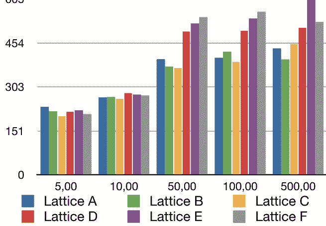

图 7.4：IFC 分析的执行时间（y 轴，秒）对于 unionfind 基准，使用不同的格和不同数量的去分类（x 轴）

图 7.4 显示了 100 次 IFC 分析的平均执行时间（y 轴，秒）对于 unionfind 基准表 7.1，使用表 7.3 的格。 我们选择 unionfind 基准，因为它具有最长的执行时间，而其他基准本质上显示相同的特征。 对于所有 IFC 分析，我们用 100 个随机安全级别对 SDG 进行了注解，如提供

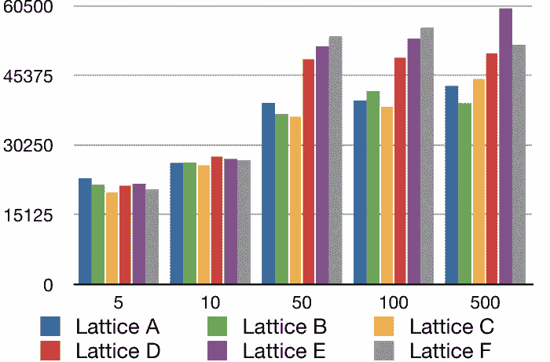

图 7.5：unionified 不同格和不同数量的去分类（x 轴）的概要去分类节点的耗时（秒）

和所需的安全级别，分别。 此外，我们创建了 5 到 500 个随机去分类以衡量去分类对 IFC 检查的影响（显示在 x 轴上）。 这些数字说明我们的 IFC 算法相当独立于格的结构和大小。 特别是，我们得到了相对于格（和位集大小）的执行时间的亚线性增长。 除此之外，随着去分类数量的增加，我们的实验中增长超过线性（x 轴）。 图 7.5 显示了计算概要去分类节点所花费的执行时间，这是精确 IFC 检查的先决条件（参见第 4.8 节），它们已针对程序、格和去分类的每个组合获取。 它们是用与图 7.4 的数字相同的随机注解确定的。 请注意，我们只在节点之间连接概要信息，这些节点原本通过时间和格大小或去分类数量，分别连接。 这些边揭示了

图 7.6 和 7.7 显示了 100 次 IFC 分析的平均执行时间（y 轴，秒）和概要去分类节点计算的时间，分别，对于所有基准程序使用最大的格和不同数量的去分类。 该图中的线条使用右侧显示的比例，而条形使用不同的比例，因此所包含的程序耗时不到一分钟，只有三个程序需要更长时间，即 purse 和 unionfind。 再次，我们发现执行时间与去分类数量之间的相关性是亚线性的。 事实上，许多基准在 500 个去分类时的执行时间低于 100 个。 这个数字清楚地说明了我们信息流控制分析的可扩展性。 依赖图中的节点数量与分析时间之间没有明显的相关性。

## 第 7 章. 评估

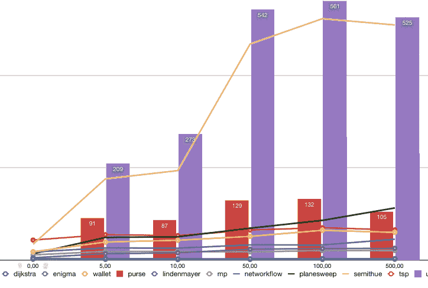

图 7.6：所有基准程序的 IFC 分析的平均执行时间（y 轴，秒），使用最大的格和不同数量的去分类（x 轴）。 条形使用不同的比例。

然而，似乎 SDG 中边的数量与执行时间之间存在相关性。 与切片不同，我们的 IFC 分析在 SDG 节点和边的数量上不是线性的，但必须在给定格的约束系统中找到不动点，然而可能在 SDG 中遍历一个循环，因为格很高，并且当需要循环时这种效应可能会更糟。 我们当前的实现没有规避这些影响，可以观察到具有最多边的程序会导致分析时间的实质性增加。 但最大的程序 mp 不属于离群值而具有良好的自然。 一个原因可能是不同的程序结构，这也可以从原始概要边计算中看出（参见表 7.1），这比其他大型程序要低得多。 该程序——不像 JavaCard 小程序和我们的学生程序——没有在主方法中包含一个大循环，该循环可能调用几乎所有功能。 总之，我们认为程序的结构对分析时间的影响比纯粹的节点或边的数量更大。

虽然未来的工作必须评估切片优化对不动点计算的影响，但我们认为 1 分钟的执行时间，正如我们大多数测试用例所观察到的那样，对于安全分析来说绝对是合理的。 但即使是三个离群值也最多需要 1.5 小时（包括概要去分类分析），这对于通常只需要做一次的编译时分析来说应该是可以接受的。

# 7.4. 路径条件的案例研究

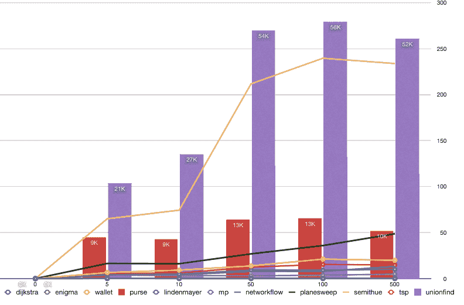

图 7.7：所有基准程序在最大格子和不同数量的去分类（x轴）下，汇总去分类节点的耗时（y轴，秒）。条形图使用不同的刻度。

### 7.3.6 未来工作

虽然我们提供了关于精度、可扩展性和实用性的证据，但仍有进一步改进的空间。特别是，我们预计切片的优化，例如 Binkley 等人提出的 [BHK07]，同样适用于我们的信息流。这些技术可将运行时间减少高达 71%，从而显著提高可扩展性。进一步的研究必须评估哪些技术适用于信息流控制。

## 7.4 路径条件的案例研究

路径条件是两个语句之间信息流的精确必要条件。因此它们可以使上一节中介绍的技术所确定的信息流失效或指定其精确条件。此外，它们提供了导致去分类的情形的洞察，从而为此类构造提供语义上的合理性。本节介绍的案例研究展示了第 5 章中介绍的扩展的可行性和精度。首先，我们将重点关注如第 5.3 节所述的 Java 的静态路径条件，参见第 5.4 节）将对 C 进行评估。请注意，本节中呈现的所有条件均由当前原型生成。

```
public class Weighing {
    public static final int NORMAL = 0;
    public static final int PAPER_OUT = 1;
    public static void main(String[] args) {
        char input = args[0].charAt(0);
        weigh(PAPER_OUT, 1.0f, input);
    }
    public static void weigh(int status, float kal_kg, char input) {
        float u = 1.0f; // calibration factor
        float u_kg = 0.0f; // initial value
        while (true) {
            u_kg = * kal_kg;
            if (status == PAPER_OUT) {
                if (input == '+') {
                    kal_kg = 1.1f;
                }
                if (input == '-') {
                    kal_kg = 0.9f;
                }
            }
            print(u_kg);
        }
    }
    public static void print(float u_kg) {...}
}
```

图 7.8：简化的称重机控制器

```
( NOT Weighing.print((1.0 * kal_kg))
++ (input = 43)
++ (1 = 1 )
NOT Weighing.print((1.0 * kal_kg))
++ (input != 43)
++ (input = 45 )
++ (1 = 1 )
```

图 7.9：图 7.8 中第 9 行（input）到 22 行的路径条件

# 第 7 章 评估

```
public class PCExc {
    int secret;
    public static void main(String[] args) {
        System.out.println(excMethod(1));
    }
    public static int excMethod(int check) {
        try {
            PCExc pce = new PCExc();
            pce.secret = check;
            throw pce;
        } catch (PCExc pce) {
            return pce.secret;
        }
    }
}
exc_O instanceof PCExc
++ (exc_O != null)


图 7.10：通过异常的非法信息流及对应的路径条件

### 7.4.1 Java 的静态路径条件

在进入 Java 的特殊性之前，一个示例程序将证明 Java 和 C 的共享语言构造在路径条件中的分析也是共享的。作为第一个案例，我们在图 7.8 中考虑了一个不使用动态分派的 Java 版本。该示例表明过程性构造的处理与案例类似。由于图 7.9 中的条件自然支持标准 Java，因此从键盘缓冲区到打印结果的非法路径。第一行打印该方法可能不会抛出异常，而 while 循环可能再执行一次。（当前实现不会用第 5.3.5 节中介绍的相应汇总路径条件替换不当的异常处理）。第二行表示 `input` 必须是 '+' 的 ASCII 码，第三行表示 `status` 等于 `PAPER_OUT`。请注意，当使用 SSA 形式找到变量时，值会被替换为变量。析取后的项表示输入为 '-' 的类似情况

现在，我们可以检查面向对象的构造。作为第二个示例，我们检查了图 5.4 第 129 页的程序，我们的原型得出的结果为

> `PC(sel1,result1) ≡ (new class A) : B`

由于 `A` 不是 `B` 的子类型，该条件不可满足，且 PDG 中 `sel` 与 `result` 之间没有其他依赖。参数 `sel` 无法影响返回值，即使程序切片声称如此。
图 7.10 展示了精确的异常处理。该程序通过捕获的异常间接传输秘密值，并通过将其打印到屏幕上使其公开。该非法流被路径条件检测到，

# 第 7 章 评估

```java
public class A {

    public int foo(int x) {

    if (x < 17) {

        return x;

    } else {

        return 0;

    }

}

public class B extends A {

    public int foo(int x) {

    if (x > 42) {

        return x;

    } else {

        return 0;

    }

}

public class SolvableDynDispatch {

    int main_decd;

    int main_inp;

    public static void main(...) {

        System.out.println(dispatch(main_decd, main_inp));

    }

    static int dynDispatch(int dcd, int in) {

        A dynamic;

        int result;

        if (dcd == 1) {

            dynamic = new A();

        } else {

            dynamic = new B();

        }

        result = dynamic.foo(in);

        return result;

    }

}
```

图 11：分派示例

该条件检查第 6 行（check）与第 12 行接受返回值之间的信息流。第一行表示 catch 块仅接受 `PCExc`，第二行要求此异常不为 null。两个条件在此 catch 块中始终为真，路径条件简化为 true，说明非法流将始终发生。

图 7.11 中的最后一个程序说明了第 32 行方法调用的动态分派的反向切片的利用。我们的工具计算出的结果在 `result` 中显示在图 7.12 中。它是基于第 5.3.4 节中介绍的详细路径条件确定的。虚拟方法有两种可能的情况：目标对象类型为 `A`（上半部分），或 `B`（下半部分）。第三种情况包含冲突项，因此在图 7.12 中被省略，因为它将被自动约束求解器移除。对条件的更仔细检查显示：第 1 行源自 `A.foo` 中的条件，接下来的两行显示来自动态绑定的子条件：第 3 行源自第 28 行。析取后的项表示 B 对象的类似条件

```
(17 > x)

++ dynamic = new class A

++ (dcd = 1 )

nOR

(x > 42)

++ dynamic = new class B

++ (dcd != 1 )

nOR ...
```

图 7.12：图 7.11 路径条件的摘录

该条件可以很容易地通过约束求解器转换为触发第二个输入值输出的输入值，例如 `(dcd, in)}=(1,16)` 创建一个 `A` 对象，而 `(0,43)` 创建一个 `B` 对象。这些输入可以作为从路径到结果的信息的见证

生成此路径在标准 PC 上不到一秒钟。虽然 Java 特性的精确条件的实现尚未完成，但生成 Java 路径条件所需的时间与传统条件相同。先前工作中对大型程序的实证评估表明，这可以在几分钟内完成 [SRK06]。

### 7.4.2 C 的动态路径条件

五个案例将展示动态信息对实际程序路径条件的影响。表 7.4 列出了用于评估目的的程序以及代码行数和（静态）SDG 中的节点数和边数。程序 `pb_like` 和 `mergesort` 包含在其中（图 7.13 和 7.19）。其余程序取自 GNU 项目。

| 程序 | LOC | SDG 中的节点数 | SDG 中的边数 |
|---|---|---|---|
| ptb | 35 | 134 | 334 |
| mergesort | 59 | 244 | 640 |
| cal | 678 | 2388 | 6149 |
| agrep | 3990 | 22961 | 81203 |
| patch | 7998 | 30774 | 246754 |

表 7.4：案例研究的示例程序

我们的第一个目标是展示动态切片与静态切片的影响。请记住第 5.2.1 节和第 5.4.3 节，较小的切片大小会产生更精确的路径条件。表 7.5 显示了静态切片的节点数和边数，然后是动态切片的这些数字。切片标准以 行-列 到:列 的格式给出。对于

## 第7章. 评估

| Program | static | dynamic | criterion |
|---|---|---|---|
| ptb_like | 65 173 | 49 124 | 9-8, 33-53 |
| mergesort | 123 299 | 97 216 | 45-14, 21-8 |
| cal | 240 648 | 0 0 | 228-10, 218-8 |
| | 134 315 | 44 92 | 367-12, 551-3 |
| agrep | 13170 40324 | 0 0 | 605-15, 638-7 |
| (sgrep.c) | 13138 40144 | 961 2345 | 96-14, 121-9 |
| patch | 16529 246754 | 6314 81365 | 825-23, 935-10 |

表 7.5：静态与动态 chop 大小的评估

对于程序 `agrep`，准则指的是文件 `agrep.c`。它们被选择的方式是为了在代码中找到涉及多个相互影响的变量的条件， preferably 在循环中。目标是产生有趣的路径条件。例如，程序 `ptb_like`（列于图 7.13）中从第 9 行到第 33 行的静态 chop（ ）包含 65 个节点，由 173 条边连接。动态 chop 具有 49 个节点和 124 条边。很明显，后者子图包含的路径数量明显少于静态 chop 诱导的子图。有时动态 chop 可以排除两个语句之间的依赖关系：考虑程序 `cal` 和 `agrep` 的前几行。可以看到这些准则的动态 chop 为空。以下关于使用跟踪值来提高动态路径条件精度的评估包含另一种此类示例。在所有这些情况下，肯定没有（非法）信息流通过 chop 准则，也静态 chop 指示。

在证明 chop 可以显著减少路径数量并产生更精确的路径条件，从而缩小影响原因后，我们将展示路径条件的摘录并将其与基于跟踪数据的限制条件进行增强（使用不完整跟踪）。同样，这些信息揭示了可能导致触发非法信息流的必要条件的变量值。

第一个示例 `ptb_like`，显示在图 7.13 中，取自一个称重控制器。这样的程序代表我们为此设想的完全安全的软件：程序的一部分，即所谓的校准缓冲区，包含从传感器（`p_ab`）到值显示的所有路径，其中存储在 `u_kg` 中的重量（例如 33）。要证明机器正确校准，需要确保重量计算无法被影响，例如被键盘影响。考虑键盘缓冲区 `p_cd` 在第 9 行与 `u_kg` 显示之间的静态路径条件，这是重量。最终路径条件显示在图 7.13 中。注意这是按位逻辑与。只有当键盘缓冲区 `p_cd` 包含特殊字符 '+' 或 '-' 之一时，才可能发生非法信息流。由于我们的运行使用仅包含 1 的键盘缓冲区，我们期望动态路径条件求值为 false。

> 它实际上是图 7.8 中 Java 版本的原始程序

```c
#define TRUE 1
#define CTRL2 0
#define PB 0
#define PA 1
void printf();
void main() {

{
    int p_ab[2] = {0, 1};
    int p_cd[2] = {1, 1};
    char e_puf[8] = =
        {'0','0','0','0','0','0','0','0'};
    int u = 0;
    int idx = 0;
    float u_kg = 0.0;
    float kal_kg = 1.0;
    while (TRUE) {
        if ((p_ab[CTRL2] & 0x10)==0) {
            u = ((p_ab[PB] << 8) +
                (unsigned int)e_puf[PA]);
            u_kg = (float)u * kal_kg;
        }
        if ((p_cd[CTRL2] & 0x01) != 0) {
            for (idx=0; idx<7; idx++) {
                e_puf[idx] = (char)p_cd[PA];
                if (p_cd[CTRL2] & 0x10) != 0) {
                    e_puf[idx] = 'a';
                    kal_kg = 1.01; /* illegal */
                } else if (e_puf[idx] == '-') {
                    kal_kg = 0.99; /* illegal */
                }
            }
        }
        e_puf[idx] = '\0';
    }
    printf("Article:%7.7s\n" +
        ""%6.2fkg%%%%",e_puf,u_kg);
}
n}
```

图 7.13：ptb_like

```
1 ( ((p_cd[0] & 0x01) != 0)
2 ^ ((p_cd[0] & 0x10) != 0)
3 ^ ((p_ab[0] & 0x10) == 0)
4 ^ (e_puf[idx] == '\'+')
5 ^ (idx < 7) )
6 V
7 ( ((p_cd[0] & 0x01) != 0)
8 ^ ((p_cd[0] & 0x10) != 0)
9 ^ (e_puf[idx] == '\'-')
10 ^ ((p_ab[0] & 0x10) == 0)
11 ^ (e_puf[idx] != '\'+')
12 ^ (idx < 7) )
```

图 7.14：ptb_like 的静态补丁条件

```
1 .. , V
2 ( e_puf == <unknown>
3 ^ idx == 0
4 ^ p_cd == {1, 1}
5 ^ p_ab == {0, 1}
6 ^ ((p_cd[0] & 0x01) != 0)
7 ^ ((p_cd[0] & 0x10) != 0)
8 ^ (e_puf[idx] == '\'-')
9 ^ ((p_ab[0] & 0x10) == 0)
10 ^ (e_puf[idx] != '\'+')
11 ^ (idx < 7) )
12 V . . .
```

图 7.15：ptb_like 的动态补丁条件的摘录

```
1 ((p_cd[0] & 0x1) != 0)
2 ^ ((p_cd[0] & 0x10) != 0)
3 ^ ((p_ab[0] & 0x10) == 0)
4 ^ (e_puf[idx] == '+')
5 ^ (idx < 7)
```

图 7.16：ptb_like 中非法流的动态路径条件

使用动态 chop 立即揭示：静态路径条件描述了运行时未采取的路径，精确的动态路径条件求值为 false。基于静态 chop 的动态路径条件则相反，由十个合取块组成，其中一个显示在图 7.15 中。动态跟踪以粗体显示，`e_puf` 未被跟踪（不完整跟踪）。正如可以看到的那样，特定谓词

`p_cd == <1, 1>`

和

`((p_cd[0] & 0x10) != 0)`

彼此矛盾，因此给定的块求值为 false。其他块也是如此，我们期望结果为 false。路径条件无法满足；必要的路径未被采取。这证明键盘缓冲区对提供给消费者的输出没有影响。在另一种场景中，输入 `p_cd = (0xff, '+')`（而不是第 9 行）已被跟踪。在键盘上输入 '+' 后，显示的值过高。通过动态路径条件检测非法影响变得自动：图 7.16 显示了基于动态而非静态 chop 的适配程序的路径条件。跟踪的输入可以精确确定非法信息流发生的位置。结合 `e_puf` 的定义，限制条件得出：

```
1 (p_cd[0] == 0)
2 ^ (p_ab[0] == 0)
3 ^ (p_cd[0] == '+')
4 ^ (idx < 7)
```

该路径条件显示了程序执行期间为何发生了非法信息流从而产生错误输出（机器上的重量）：显示受到了某些调试标志和在 for 循环的 7 轮期间输入的 '+' 的影响。程序员高兴地忘记从最终版本中删除调试代码。此信息可以作为重现非法行为的见证。在这个小示例中可以看到，校准 `u_kg` 在第 26 行因此类输入而增加。对于更大的示例，人类最可能不会如此轻易地检测到非法语句。

作为另一个示例，考虑图 7.19 中的 `mergesort`。图 7.17 显示了在第 45 行 999 与第 21 行 `temp` 之间静态计算的路径条件

## 第7章. 评估

```
1 (left < right)
2 ^ (idx1 <= ((left + right) / 2))
3 ^ (data[idx1] >= data[idx2])
4 ^ (idx2 <= right)
```

图 17：mergesort 的静态路径条件

```
1 right == 4
2 ^ left == 4
3 ^ data == 1
4 ^ idx2 == 5
5 ^ ((left + right) / 2) == 3
6 ^ idx1 == 3
7 ^ (left < right)
8 ^ (idx1 <= ((left + right) / 2))
9 ^ (data[idx1] >= data[idx2])
10 ^ (idx2 <= right)
```

图 18：mergesort 的动态路径条件的摘录

和 `temp` 在第 21 行。这次，使用动态 chop 并没有加强路径条件，因为关于与路径条件相关的路径，动态 chop 与静态路径条件相同。然而，产生 40 个合取块，其中一个显示在图 7.18 中。动态跟踪数据再次显示在下方。由于特定块内的矛盾，条件可以完全求值为 false：没有程序状态跟踪会满足静态路径条件。

正如我们的示例所示，动态路径条件通常比其计算的对应物好得多，但也更精确，因为它们包含更多信息。每个动态路径条件都与特定的程序运行绑定。如果动态路径条件求值为 false，则不一定对每次程序执行都成立，除非涉及输入。但动态路径条件是寻找非法行为见证的手段。

### 省略错误

动态切片可以显示是否发生了某种影响。有时人们希望知道为什么在程序执行期间预期的影响没有发生。在文献 [AHKL93, GABF99, WR04] 中提出了几种方法来用“有罪”的控制谓词丰富动态切片，即那些触发分支到预期数据依赖未生效的执行的谓词。但将谓词添加到切片并不能揭示实际出了什么问题。我们的方法返回数据流发生的精确条件。增强了限制子句的静态路径条件可以输入到约束求解器中以检测变量跟踪与值之间的矛盾

# 7.4. 路径条件的案例研究

```c
int data[100];
int temp[100];
void move(int *from, int fst, int lst, int idx) {
    while (fst <= lst)
        to[idx++] = from[fst++];
}
void merge(int fst, int mid, int lst) {
    int idx, idx1, idx2;
    idx = 0;
    idx1 = fst;
    idx2 = mid + 1;
    while ((idx1 <= mid) && (idx2 <= lst)) {
        if (data[idx1] < data[idx2])
            temp[idx++] = data[idx1++];
        else
            temp[idx++] = data[idx2++];
    }
    if (idx1 > mid)
        move(data, idx2, lst, temp, idx);
    else
        move(data, idx1, mid, temp, idx);
```


```
move(temp, 0, lst - fst, data, fst);
}

void mergesort(int left, int right) {
    int m;
    m = (left + right) / 2;
    if (left < right)
        mergesort(left, m);
    mergesort(m + 1, right);
    merge(left, m, right);
}

int main() {
    int data[5] = 999;
    data[1] = 1;
    data[2] = 23;
    data[3] = 55;
    data[4] = 44;
    mergesort(0, 4);
    for (int i = 0; i < 5; i++)
        printf("%d\n", data[i]);
    printf("\n");
    return 0;
}
```


Figure 7.19: mergesort

由谓词所期望的。在图 7.18 中，子句 1 和 2 违反了子句 7。这就是为什么产生该合取块的路径未被执行的原因。正如 mergesort 描述中所指出的，动态切分与静态切分是相同的。仅添加先前解决方案所提出的控制谓词只会揭示图 7.17 中显示的条件。用户必须在切片中找到这些条件并解释它们，以找到他或她真正想要的信息：图 7.18 中的条件。因此，动态路径条件有助于通过检测预期执行路径与实际执行路径之间的矛盾来定位程序中的缺陷。

# 第 8 章

## 结论

本论文提出了几种用于对 Java 或 C 等现实编程语言中的程序进行精确分析的算法。它将程序依赖图扩展到 Java 字节码的所有特性，最突出的是具有嵌套字段结构的方法参数。与 Java 的其他切片器相比，我们的系统生成系统依赖图，可以利用标准的两阶段上下文切片算法。

对于多线程 Java，我们定义了干扰依赖的精确近似，关于所呈现的不可判定性结果而言，当共享变量在一个线程中被定义而在另一个线程中使用时就会出现这种依赖。基于 Java 内存模型，我们的定义利用了 points-to 信息，与基于类型或逃逸信息的先前定义相比提高了精度。

当二进制信息，即一个语句是否可能影响另一个语句是否足够时，路径条件提供了影响的详细情况，甚至可以消除误报。本论文表明，对于面向对象，我们构造了一个详细的变量信息，以获得自动约束求解器的条件，并允许对所有面向对象特性进行精确条件。此外，动态数据允许“飞行记录仪”并提高特定程序执行路径数据的精度。

这项工作的主要贡献是基于本论文中定义系统依赖图的信息流控制的新方法。我们切片器的流敏感性、上下文敏感性和对象敏感性自然地扩展到信息流控制，并超过了信息流控制的主流方法，即安全类型系统。

评估部分表明，我们用于信息流控制的新算法与类型系统相比大幅减少了注释负担，并且其评估有所提高。虽然它明显比安全类型系统更昂贵，但评估表明安全内核可以在合理的时间内得到认证。由于这种认证过程仅在编译时需要一次，即使分析需要数小时也是可以接受的，因为它保证了软件制品整个生命周期的安全性。因此，本论文使程序分析的最新发展适用于现实的编程语言。所呈现的系统实现了针对现实语言，即 Java 字节码的信息流控制分析的第一个实现。

## 附录 A

## 附录

以下表格显示了第 7.3.5 节中所示执行时间的详细信息，以供比较。

Table A.1: 具有不同数量去分类的概要去分类计算的执行时间（秒）

| program | lattice | 0 | 5 | 10 | 50 | 100 | 500 |
|---|---|---|---|---|---|---|---|
| dijkstra | A | 0 | 0 | 0 | 0 | 0 |  |
| enigma | A | 0 | 0 | 0 | 0 | 0 |  |
| wallet | A | 0 | 7 | 8 | 11 | 15 | 12 |
| purse | A | 8552 | 8368 | 8378 | 14386 | 15622 |  |
| lindenmeyer | A | 0 | 5 | 6 | 7 | 9 |  |
| mp | A | 0 | 3 | 3 | 3 | 5 |  |
| network | A | 0 | 4 | 4 | 8 | 7 | 10 |
| airflow | A | 0 | 16 | 24 | 26 | 40 |  |
| semitouse | A | 0 | 60 | 138 | 156 | 180 |  |
| tsp | A | 0 | 6 | 10 | 11 | 10 |  |
| unionfind | A | 23147 | 26417 | 39514 | 40017 | 43183 |  |
| dijkstra | B | 0 | 0 | 0 | 0 | 0 |  |
| enigma | B | 0 | 0 | 0 | 0 | 0 |  |
| wallet | B | 0 | 8 | 9 | 17 | 15 |  |
| purse | B | 0 | 8951 | 8491 | 13352 | 13327 | 9679 |
| lindenmeyer | B | 0 | 5 | 5 | 6 | 6 |  |
| mp | B | 0 | 4 | 3 | 3 | 5 |  |
| network | B | 0 | 4 | 4 | 7 | 10 |  |
| planesweep | B | 0 | 16 | 26 | 32 | 39 |  |
| semitouse | B | 0 | 58 | 65 | 162 | 162 | 164 |
| tsp | B | 0 | 6 | 10 | 11 | 11 |  |
| unionfind | B | 0 | 21659 | 26523 | 37051 | 42094 | 39401 |
| dijkstra | C | 0 | 0 | 0 | 0 | 0 |  |
| enigma | C | 0 | 0 | 0 | 0 | 0 |  |
| wallet | C | 0 | 8 | 8 | 9 | 17 | 18 |
| purse | C | 0 | 9015 | 7874 | 8111 | 12921 | 12899 |

| program | lattice | 0 | 5 | 10 | 50 | 100 | 500 |
| lindenmayer | C | 0 | 5 | 5 | 7 | 6 | 11 |
| mp | C | 0 | 3 | 3 | 3 | 3 | 5 |
| networkflow | C | 0 | 4 | 5 | 7 | 7 | 14 |
| planesweep | C | 0 | 15 | 13 | 22 | 26 | 39 |
| semithue | C | 0 | 61 | 72 | 157 | 199 | 192 |
| tsp | C | 0 | 5 | 5 | 10 | 12 | 11 |
| unionfind | C | 0 | 19950 | 25905 | 36508 | 38639 | 44684 |
| dijkstra | D | 0 | 0 | 0 | 0 | 0 | 0 |
| enigma | D | 0 | 0 | 0 | 0 | 0 | 0 |
| wallet | D | 0 | 8 | 9 | 14 | 18 | 21 |
| purse | D | 0 | 8398 | 7701 | 11548 | 11913 | 14634 |
| lindenmayer | D | 0 | 5 | 6 | 7 | 8 | 4 |
| mp | D | 0 | 3 | 3 | 3 | 3 | 4 |
| networkflow | D | 0 | 4 | 9 | 8 | 8 | 14 |
| planesweep | D | 0 | 13 | 19 | 27 | 30 | 39 |
| semithue | D | 0 | 67 | 196 | 192 | 220 | 12 |
| tsp | D | 0 | 5 | 6 | 11 | 12 | 12 |
| unionfind | D | 0 | 21499 | 27810 | 49010 | 49312 | 50244 |
| dijkstra | E | 0 | 0 | 0 | 0 | 0 | 0 |
| enigma | E | 0 | 0 | 0 | 0 | 0 | 0 |
| wallet | E | 0 | 8 | 8 | 12 | 12 | 22 |
| purse | E | 0 | 8758 | 8734 | 9037 | 13682 | 21963 |
| lindenmayer | E | 0 | 5 | 6 | 7 | 8 | 13 |
| mp | E | 0 | 3 | 3 | 3 | 3 | 4 |
| networkflow | E | 0 | 4 | 4 | 8 | 8 | 13 |
| planesweep | E | 0 | 14 | 14 | 20 | 30 | 43 |
| semithue | E | 0 | 71 | 81 | 222 | 215 | 246 |
| tsp | E | 0 | 6 | 5 | 13 | 12 | 14 |
| unionfind | E | 0 | 21951 | 27322 | 51800 | 53477 | 60051 |
| dijkstra | F | 0 | 0 | 0 | 0 | 0 | 0 |
| enigma | F | 0 | 0 | 0 | 0 | 0 | 0 |
| wallet | F | 0 | 7 | 9 | 14 | 21 | 20 |
| purse | F | 0 | 8984 | 8565 | 12820 | 13117 | 10368 |
| lindenmayer | F | 0 | 4 | 5 | 9 | 9 | 10 |
| mp | F | 0 | 4 | 3 | 3 | 4 | 5 |
| networkflow | F | 0 | 4 | 4 | 8 | 8 | 13 |
| planesweep | F | 0 | 16 | 16 | 27 | 36 | 49 |
| semithue | F | 0 | 65 | 74 | 212 | 240 | 234 |
| tsp | F | 0 | 6 | 6 | 12 | 15 | 15 |
| unionfind | F | 0 | 20658 | 27037 | 53967 | 55846 | 52176 |

# Table A.2: 不同数量去分类的 100 次 IFC 分析的平均执行时间（秒）

| program | lattice | 0 | 5 | 10 | 50 | 100 | 500 |
|---|---|---|---|---|---|---|---|
| dijkstra | A | 0.02 | 0.02 | 0.01 | 0.01 | 0.01 | 0.01 |
| enigma | A | 0.01 | 0.01 | 0.01 | 0.24 | 0.27 | 0.22 |
| wallet | A | 0.09 | 0.2 | 0.19 |  |  |  |
| purse | A | 0.91 | 86.44 | 84.79 | 84.97 | 144.97 | 157.4 |
| lindenbauer | A | 0.03 | 0.07 | 0.08 | 0.09 |  | 0.12 |
| mp | A | 0.05 | 0.09 | 0.09 | 0.1 | 0.1 |  |
| networkflow | A | 0.08 | 0.13 | 0.12 | 0.17 | 0.15 | 0.19 |
| planesweep | A | 0.07 | 0.25 | 0.25 | 0.32 | 0.34 |  |
| semithue | A | 0.16 | 0.76 | 0.84 | 1.63 | 1.79 | 2.02 |
| tsp | A | 0.17 | 0.24 | 0.27 | 0.31 | 0.28 |  |
| unionfind | A | 1.44 | 233.63 | 266.46 | 397.64 | 402.54 | 434.48 |
| dijkstra | B | 0.02 | 0.02 | 0.01 | 0.01 | 0.01 |  |
| enigma | B | 0.01 | 0.01 | 0.01 | 0.1 | 0.01 | 0.01 |
| wallet | B | 0.1 | 0.19 | 0.18 | 0.2 | 0.27 | 0.25 |
| purse | B | 0.93 | 90.55 | 85.94 | 134.57 | 134.45 | 97.83 |
| lindenbauer | B | 0.03 | 0.08 | 0.08 | 0.08 |  | 0.12 |
| mp | B | 0.06 | 0.09 | 0.09 | 0.09 | 0.09 | 0.1 |
| networkflow | B | 0.09 | 0.15 | 0.14 | 0.17 | 0.17 | 0.25 |
| planesweep | B | 0.07 | 0.24 | 0.24 | 0.34 | 0.4 | 0.47 |
| semithue | B | 0.16 | 0.76 | 0.88 | 1.79 | 1.81 | 1.83 |
| tsp | B | 0.18 | 0.25 | 0.25 | 0.32 | 0.29 | 0.29 |
| unionfind | B | 1.38 | 218.83 | 267.43 | 372.61 | 423.26 | 396.63 |
| dijkstra | C | 0.01 | 0.02 | 0.01 | 0.01 | 0.02 | 0.02 |
| enigma | C | 0.01 | 0.01 | 0.01 | 0.01 | 0.01 | 0.01 |
| wallet | C | 0.1 | 0.18 | 0.18 | 0.22 | 0.29 | 0.29 |
| purse | C | 1.04 | 91.13 | 79.72 | 82.2 | 130.24 | 130.13 |
| lindenbauer | C | 0.03 | 0.08 | 0.08 | 0.08 | 0.09 | 0.14 |
| mp | C | 0.06 | 0.09 | 0.09 | 0.08 | 0.09 | 0.11 |
| networkflow | C | 0.09 | 0.15 | 0.14 | 0.17 | 0.17 | 0.25 |
| planesweep | C | 0.06 | 0.23 | 0.21 | 0.35 | 0.46 | 0.46 |
| semithue | C | 0.16 | 0.83 | 0.93 | 1.79 | 2.2 | 2.14 |
| tsp | C | 0.19 | 0.25 | 0.25 | 0.29 | 0.32 | 0.29 |
| unionfind | D | 1.52 | 201.9 | 261.38 | 368.27 | 388.54 | 449.57 |
| dijkstra | D | 0.02 | 0.02 | 0.02 | 0.02 | 0.02 | 0.02 |
| enigma | D | 0.01 | 0.01 | 0.01 | 0.01 | 0.01 | 0.01 |
| wallet | D | 0.1 | 0.22 | 0.27 | 0.31 | 0.31 | 0.32 |
| purse | D | 0.84 | 84.92 | 77.95 | 116.39 | 120.06 | 147.32 |
| lindenbauer | D | 0.03 | 0.08 | 0.09 | 0.11 | 0.15 | 0.15 |
| mp | D | 0.05 | 0.08 | 0.08 | 0.09 | 0.09 | 0.11 |
| networkflow | D | 0.1 | 0.15 | 0.14 | 0.19 | 0.17 | 0.24 |
| planesweep | D | 0.07 | 0.22 | 0.32 | 0.26 | 0.35 | 0.46 |
| semithue | D | 0.19 | 0.9 | 0.9 | 2.19 | 2.15 | 2.42 |
| tsp | D | 0.21 | 0.27 | 0.3 | 0.37 | 0.33 | 0.32 |

## 附录 A. 附录

| 程序 | 晶格 | 0 | 5 | 10 | 50 | 100 | 500 |
| :--- | :--- | :--- | :--- | :--- | :--- | :--- | :--- |
| unionfind | D | 1.35 | 217.15 | 280.77 | 492.6 | 495.55 | 505.41 |
| dijkstra | E | 0.02 | 0.02 | 0.01 | 0.01 | 0.02 | 0.02 |
| enigma | E | 0.01 | 0.01 | 0.01 | 0.01 | 0.01 | 0.01 |
| wallet | E | 0.01 | 0.18 | 0.17 | 0.23 | 0.02 | 0.32 |
| purse | E | 0.93 | 85.59 | 88.38 | 91.42 | 137.88 | 220.73 |
| lindenmayer | E | 0.03 | 0.08 | 0.09 | 0.01 | 0.1 | 0.1 |
| mp | E | 0.06 | 0.09 | 0.1 | 0.09 | 0.1 | 0.1 |
| networkflow | E | 0.1 | 0.15 | 0.15 | 0.18 | 0.18 | 0.24 |
| planesweep | E | 0.07 | 0.23 | 0.23 | 0.29 | 0.38 | 0.52 |
| semithue | E | 0.19 | 0.05 | 1.04 | 2.45 | 2.39 | 2.77 |
| tsp | E | 0.19 | 0.28 | 0.28 | 0.35 | 0.37 | 0.34 |
| unionfind | F | 1.47 | 221.85 | 275.65 | 520.44 | 537.56 | 603.67 |
| dijkstra | F | 0.02 | 0.02 | 0.01 | 0.01 | 0.02 | 0.02 |
| enigma | F | 0.01 | 0.01 | 0.01 | 0.01 | 0.01 | 0.01 |
| wallet | F | 0.09 | 0.2 | 0.22 | 0.26 | 0.32 | 0.3 |
| purse | F | 0.98 | 91.86 | 66.129 | 29.1032 | 65. |
| lindenmayer | F | 0.03 | 0.07 | 0.07 | 0.08 | 0.12 | 0.13 |
| mp | F | 0.06 | 0.09 | 0.09 | 0.09 | 0.1 | 0.1 |
| networkflow | F | 0.09 | 0.13 | 0.13 | 0.17 | 0.16 | 0.23 |
| planesweep | F | 0.07 | 0.25 | 0.25 | 0.35 | 0.43 | 0.56 |
| semithue | F | 0.17 | 0.88 | 0.97 | 2.34 | 2.61 | 2.54 |
| tsp | F | 0.22 | 0.28 | 0.27 | 0.33 | 0.35 | 0.33 |
| unionfind | F | 1.55 | 208.88 | 272.9 | 542.11 | 560.84 | 525.3 |

## 参考文献

[ABB06] Torben Amtoft, Sruthi Bandhakakavi, and Anindya Banerjee. A logic for information flow in object-oriented programs. In POPL '06: Conference record of the 33rd ACM SIGPLAN-SIGACT symposium on Principles of programming languages, pages 91–102, New York, NY, USA, 2006. ACM.

[ABHR99] Martín Abadi, Anindya Banerjee, Nevin Heintze, and Jon G. Riecke. A core calculus of dependency. In POPL '99: Proceedings of the 26th ACM SIGPLAN-SIGACT symposium on programming languages, pages 147–160, New York, NY, USA, 1999. ACM.

[ADS93] Hiralal Agrawal, Richard A. Demillo, and Eugene H. Spafford. Debugging with dynamic slicing and backtracking. Softw. Pract. Er., 23:6–56, 1993.

[Aga00] Johan Agat. Transforming timing leaks. In POPL '00: Proceedings of the 27th ACM SIGPLAN-SIGACT symposium on Principles of programming languages, pages 40–53, New York, NY, USA, 2000.

[Agr94] Hiralal Agrawal. On slicing programs with jump statements. In PLDI '94: Proceedings of the ACM SIGPLAN 1994 conference on Programming language design and implementation, pages 302–312, New York, NY, USA, 1994. ACM.

[AH90] Hiralal Agrawal and Joseph R. Horgan. Dynamic slicing, In PLDI '90: Proceedings of the ACM SIGPLAN 1990 conference on Programming language design and implementation, pages 246–256, New York, NY, USA, 1990. ACM.

[AH03] Matthew Allen and Susan Horwitz. Slice Java programs that throw and catch exceptions. In PEPM '03: Proceedings of the 2003 ACM SIGPLAN workshop on Partial evaluation and semantics-based program manipulation, pages 44–54, New York, NY, USA, 2003. ACM.

[AHKL93] Hiralal Agrawal, Joseph R. Horgan, Edward W. Krauser, and Saul London. Incremental regression testing. In ICSM '93: Proceedings of the Conference on Software Maintenance, pages 348–357, Washington, DC, USA, September 1993. IEEE Computer Society.

[AKBLN89] Hassan Ait-Kaci, David Boyer, Robert Boyer, Patrick Lincoln, and Roger Nasr. Efficient implementation of lattice operations. ACM Trans. Program. Syst., 11(1):115–146, 1989.

[Amt08] Torben Amtoft. Slicing for eliminating irrelevant loops. Inf. Lett., 106(2),45–51, 2008.

[And94] Lars Ole Andersen. Program slicing. PhD thesis, University of Copenhagen, 1994.

[And08] Paul Anderson. Static analysis for industrial applications. In Proceedings of the 6th ACM SIGPLAN workshop on Software Analysis, pages 9–12, Berkeley, CA, 2008.

[ART03] Paul Anderson, Susan Horwitz, and Tim Teeman. Fine-grained program analysis. IEEE Software, 29(3):30–39, 2003.

[AS05] Aslan Askar and Andrei Volov. Security-typed languages. In Proceedings of the 5th ACM SIGACT symposium on Computer Security, pages 197–221, 2005.

[AT01] Hiralal Agrawal and Joseph R. Horgan. Data flow analysis. In the 1st International Workshop on Software Engineering, pages 33–36, 2001.

[Ban79] Hiralal Agrawal and Joseph R. Horgan. The semantics of procedure calls. In 6th ACM-SIGACT symposium on Principles of programming languages, pages 29–41, New York, NY, USA, 1979.

[BC85] Matthew Allen and Susan Horwitz. Information-flow analysis. ACM Trans. Program. Syst., 7(1):37–61, 1985.

[BCM00] Johan Agat. Transforming timing leaks. In Proceedings of the 27th ACM SIGPLAN-SIGACT symposium on Principles of programming languages, pages 40–53, New York, NY, USA, 2000.

[BD06] Torben Amtoft, Sruthi Bandhakakavi, and Anindya Banerjee. A logic for information flow in object-oriented programs. In POPL '06: Conference record of the 33rd ACM SIGPLAN-SIGACT symposium on Principles of programming languages, pages 91–102, New York, NY, USA, 2006. ACM.

[BDG07] David F. Bacon and Peter Sweeney. Fine-grained program analysis. In Proceedings of the 5th ACM SIGPLAN workshop on Software Analysis, pages 103–119, Berkeley, CA, 2007.

[BDH96] David F. Bacon and Peter Sweeney. Static analysis for C++. Journal of Computer Security, 4(2):229–263, 1996.

[BS89] David F. Bacon and Peter Sweeney. The semantics of program difference. In PLDI '89: Proceedings of the ACM SIGPLAN 1989 Conference on Programming language design and implementation, pages 13–27.

[BS96] David F. Bacon. C++ virtual calls. In OOPLA '96: Proceedings of the 11th ACM SIGPLAN conference on Object-oriented programming, systems, languages, and applications, pages 324–341, New York, NY, 1996.

[Che93b] Jingde Cheng. Slicing concurrent programs. In Proceedings of the First Int. Workshop on Automated and Algorithmic Debugging, volume 749 of LNCS, pages 223–240. Springer, 1993.

[CM04] Brian Chess and Gary McGraw. Static analysis for security, IEEE Security and Privacy, 2(6):76–79, 2004.

[CCH90] David Callahan, Alan Carle, Mary Wolcott, and Ken Kennedy. Constructing the procedure multigraph. IEEE Trans. Softw. Eng., 16(4):483–487, 1990.

[CK93] Ron Cytron. Process network dept of distributed programs and its applications in distributed systems. IEEE.

[CCL98] Gerardo Canofilla, Antonio Cimatile, and Andrea De Lucia. Connected program slicing. Information and Software Technology, 40(11-12):595–607, Dec 1998.

[CF89] Robert Cartwright and Matthias Felzensisen. The semantics of program difference. In PLDI '89: Proceedings of the ACM SIGPLAN 1989 Conference on Programming language design and implementation, pages 13–27, New York, NY, USA, 1989.

[CF94] Jong-Deok Choi and Jeanne Ferrante. Static slicing in the presence of goto statements. ACM Trans. Program. Lang. Syst., 16(4):1097–1113, 1994.

[CF*93] Ron Cytron. Process network dept of distributed programs and its applications in distributed systems. In Proc. 17th Annual International Computer Software and Applications Conference (COMPSAC93), pages 231–240. IEEE Computer Society, Nov 1993.

Ellis S. Cohen. 《安全计算基础》，章节《顺序程序中的信息传输》，第 297-335 页。Academic Press, Inc., Orlando, FL, USA, 1978。于 1997 年 10 月在佐治亚理工学院亚特兰大举行的第 3 天研讨会上宣读的论文。

Craig Chambers, Igor Pechtanski, Vivek Sarkar, Mauricio J. Serrano, 和 Harini Srinivasan. Java 的依赖分析。载于《第 12 届并行计算语言与编译器国际研讨会论文集》，第 35–52 页。Springer-Verlag, 1999。

Zhenqiang Chen 和 Baow Xu. 并发程序的切片。SIGPLAN Not., 36(4):41–47, 2001。

Zhenqiang Chen 和 Baow Xu. 面向对象 Java 程序的切片。SIGPLAN Not., 36(4):33–40, 2001。

Zhenqiang Chen, Baow Wu, Hongji Yang, Kecheng Liu, 和 Jianping Zhang. 一种分析并发程序依赖关系的方法。载于《第一届亚太软件质量会议论文集》，第 39–43 页。IEEE Computer Society, 2000。

Matthew B. Dwyer, James C. Corbett, John Hatcliffe, Stefan Sokolowski, 和 Hongjun Zheng. 切片多线程 Java 程序：一个案例研究。技术报告 99-7, 堪萨斯州立大学，计算与信息科学系, 1999。

Dorothy E. Denny 和 Peter J. Denny. 安全信息流程序的认证。Commun. ACM, 20(7):504–513, 1997。

Dorothy E. Denny. 安全信息流的格模型。Commun. ACM, 19(5):236–243, 1976。

Jeffrey Dean, David Grove, 和 Craig Chambers. 利用静态类层次分析优化面向对象程序。载于《第 9 届欧洲面向对象编程会议论文集 ECOOP》，卷 952，第 77–101 页，伦敦，英国，1995。Springer-Verlag。

Matthew Dwyer, John Hatcliffe, Matthew Hoosier, Venkateshathan, Rob, 和 Todd Vallant. 评估切片对并发面向对象程序模型简化的有效性。载于《工具与系统分析会议论文集 TACAS’06》，卷 3920 LNCS，第 73–89 页。Springer, 2006。

Sebastian Danicic, Mark Harman, John Howroyd, 和 Lahcen Quarby. 程序切片和依赖分析的非标准语义。Journal of Logic and Algebraic Programming, 72(2):191–206, 2007。

## BIBLIOGRAPHY

Andrea de Lucia. 程序切片：方法与应用。载于《IEEE 源代码分析与挖掘国际研讨会 SCAM'01》，第 142–149 页，洛斯阿拉米托斯，加利福尼亚州，美国，2001。IEEE Computer Society。

Xianghua Deng, Bobby, 和 John Hatchcliff. 针对面向对象程序强属性分析的案例最优符号执行算法。载于《SEFM '07：第五届 IEEE 软件工程与形式方法国际会议论文集 SEFM 2007》，第 273–282 页，华盛顿特区，美国，2007。IEEE Computer Society。

J. S. Fenton. 无记忆子系统。The Computer Journal, 17(2):143–147, 1974。

Stephen J. Fink, Kathleen Moeve, 和 Vivek Sarkar. 强类型语言中数组和对象引用的统一分析。SAS '00：第七届静态分析国际研讨会论文集，卷 1824 LNCS，155–174，伦敦，英国，2000。Springer-Verlag。

Cormac Flanagan, K. Rustan M. Milner, Lillibridge, Greg Nelson, B. Saxe, 和 Raymie Stata. Java 的扩展静态检查。载于《PLDI '02：ACM SIGPLAN 2002 编程语言设计与实现会议论文集》，第 234–245 页，纽约，纽约州，美国，2002。ACM。

Jeanne Ferrante, Karl J. Ottenstein, 和 Joe D. Warren. 程序生成深度分析及其在优化中的应用。ACM Trans. Prog. Lang. Syst., 9(3):319–349, 1987。

John Field, G. Ramalingam, 和 Frank Tip. 参数化切片。载于《POPL '95：ACM SIGPLAN-SOFT 第 22 届编程语言原理研讨会论文集》，第 379–392 页，纽约，纽约州，美国，1995。ACM Press。

Tibor Gömböki, Árpád Bézsés, 和 István Forg. 调试的高效切片方法。载于《ESEC/FSE/7：第 7 届欧洲软件工程会议联合第 7 届 ACM SIGSOFT 软件工程基础国际研讨会论文集》，第 303–321 页，伦敦，英国，1999。Springer-Verlag。

David Grove, Greg DeFouw, Jeffrey Dean, 和 Craig Chambers. 面向对象语言中的调用图构造。载于《OOPSLA '97：第 12 届 ACM SIGPLAN 面向对象编程、系统、语言与应用会议论文集》，第 108–124 页，纽约，纽约州，美国，1997。ACM Press。

## BIBLIOGRAPHY

[GH96] Rakesh Ghiya 和 Laurie J. Hendren. 它是树、DAG 还是循环图？堆定向指针的形状分析。载于《POPL '96：第 23 届 ACM SIGPLAN-SIGACT 编程语言原理研讨会论文集》，第 1–15 页，纽约，纽约州，美国，1996。ACM。

[GH08] Dennis Giffhorn 和 Christian Hammer. 使用 JOANA 对 Java 程序进行精确分析（工具演示）。载于《第 8 届 IEEE 源代码分析与操纵国际工作会议论文集》，267–268，2008 年 9 月。

[GH09] Dennis Giffhorn 和 Christian Hammer. 当前程序的精确切片——对当前程序精确切片算法的评估。Journal of Automated Software Engineering, 16(2):197–234。2009 年 6 月。

[JSB05] James Gosling, Bill Joy, Guy Steele, 和 Gilad Bracha. 《Java 语言规范》。Addison Wesley Professional，第 3 版，2005。http://java.sun.com/docs/jls/

[GL] Dennis Giffhorn 和 Andreas Lochbihler. 通过程序切片对并发程序进行信息控制。即将出版。

[GM82] Joseph A. Goguen 和 José Meseguer. 安全策略与安全模型。载于《安全与隐私研讨会论文集》，第 11–20 页。IEEE, 1982。

[GM84] Joseph A. Goguen 和 José Meseguer. 干扰控制与展开。载于《安全与隐私研讨会论文集》，第 75–86 页。IEEE, 1984。

[GM03] Roberto Giabazzi 和 Isabella Mastroeni. 程序切片的非标准语义。Higher Order and Symbolic Computation, 16(4):297–339, 2003。

[GMR94] Deb Dutta Ganty, Chilukuri K. Mohan, 和 Sanjay Ranka. 格计算的空间和时间高效编码算法。IEEE Trans, on Know and Data Eng., 6(5):819–829, 1994。

[GPB+06] Brian Goetz, Tim Peiers, Joshua Holm, Joseph Boer, David Holmes, 和 Doug Lee. Java Currency in Practice。Addison Wesley Professional, 2006 年 5 月。

[GS05] Samir Genaim 和 Fausto Speto. Java 字节码的信息流分析。载于《第 64 届验证、模型检查与抽象解释国际会议 VMCAI》，卷 3385 LNCS，第 346–362 页，巴黎，法国，2005 年 1 月。Springer。

[HBC99] Michael Hind, Michael Burke, Paul Carini, 和 Jong-Deok Choi. 过程间指针别名分析。ACM Trans. Program. Lang. Syst., 21(4):848–894, 1999。

## BIBLIOGRAPHY

- [HBD03] Mark Harman, David Binkley, 和 Sebastian Danicic. 模糊程序切片。Journal of Systems and Software, 68(1):45–64, 2003 年 10 月。

- [HCD+99] John Hatcliff, James C. Corbett, Matthew B. Dwyer, Stefan Sokolowski, 和 Hongjun Zheng. 多线程程序切片的形式研究，具有 JVM 并发原语。载于《SAS '99：第 66 届静态分析国际研讨会论文集》，卷 1694 LNCS，第 1–18 页，伦敦，英国，1999。Springer-Verlag。

- [HD98] Mark Harman 和 Sebastian Danicic. 非结构化程序切片的新算法。Journal of Software Maintenance, 10(6):415–449, 1998。

- [HDZ00] John Hatcliff, Matthew B. Dwyer, 和 Hongjun Zheng. 用于模型构造的软件切片。Higher-Order and Symbolic Computation, 13(4):315–353, 2000。

- [HKG06] Christian Harman, Martin Grimme, 和 Jens Kinke. 依赖图中的动态路径条件。载于《PEPM '06：2006 年 ACM SIGPLAN 部分求值与基于语义的程序操纵研讨会论文集》，第 58–67 页，纽约，纽约州，2006。ACM Press。

- [HH01] Mark Harman 和 Robert Hierens. 程序切片概述，Software Focus, 2(3):85–92, 2001 年 1 月。

- [Hin01] Michael Hind. 指针分析：我们还没解决这个问题吗？载于《PAST '01：2001 年 ACM SIGPLAN-SIGSOFT 程序分析用于工具与工程研讨会论文集》，第 54–61 页，纽约，纽约州，美国，2001。ACM。

- [HKS06] Christian Harman, Jens Kinke, 和 Gregory Sentinel. 依赖图中的非传递非干扰。载于《第二届形式方法应用、验证与验证国际研讨会论文集 ISLA 2006》，第 119–128 页，华盛顿特区，美国，2006 年 11 月。IEEE Computer Society。

- [HLB06] Mark Harman, Arun Lakhotia, 和 David Binkley. 非结构化程序切片的理论与算法。Information and Software Technology, 48(7):549–565, 2006。

- [HLW+91] John Hogg, Doug Lea, Alan Wills, Dennis deChampeaus, 和 Richard Holt. 对象别名处理的日内瓦公约，1991 年 8 月。

## 参考文献

[Hoa74] C. A. R. Hoare. Monitors: an operating system structuring concept. Commun. ACM, 17(10):549–557, 1974.

[How76] John H. Howard. Signaling in monitors. In ICSE '76: Proceedings of the 2nd international conference on Software engineering, pages 47-52, Los Alamitos, CA, USA, 1976. IEEE Computer Society Press.

[HPR88] S. Horwitz, J. Prints, and T. Reps. On the adequacy of program dependence graphs for representing programming. In POPL '88: proceedings of the 15th ACM SIGPLAN-SIGACT symposium on Principles of programming languages, pages 146–157, New York, NY, 1988. ACM.

[HPR89] S. Horwitz, P. Pfeiffer, and T. Reps. Dependence analysis for pointer variables. In PLDI '89: Proceedings of the ACM SIGPLAN 1989 Conference on programming language and implementation, pages 28–40, New York, NY, USA, 1989. ACM.

[HRB90] Susan Horwitz, Thomas Reps, and David Binkley. Intercedural slicing using dependence graphs. ACM Trans. Lang. Syst., 12(1):26–60, 1990.

[HS04] Christian Hammer and Gregor Sneling. An improved slicer for Java. In PASTE '04: Proceedings of the 5th ACM SIGPLAN-SOFTSOFT workshop on Program analysis for software tools and engineering, pages 17–22, New York, NY, USA, 2004. ACM Press.

[HS06] Sebastian Hunt and David Sands. On-flow-sensitive security types. In POPL '06: Conference record of the 33rd ACM SIGPLAN-SIGACT symposium on Principles of programming languages, pages 79–90, New York, NY, USA, 2006. ACM Press.

[HS08] Christian Hammer and Gregor Sneling. Flow-sensitive, context-sensitive, object-sensitive information flow control based on program dependence graphs. Technical Report 2008-16, Fakultät für Informatik, Universität Karlsruhe (TH), Germany, 2008. Supersedes ISSSE and ISLa 2006.

[SS08] Christian Hammer, Rüdiger Schaade, Static path conditions for Java. In PLAS '08: Proceedings of the third ACM SIGPLAN workshop on Programming languages and analysis for security, pages 57–66, New York, NY, USA, 2008. ACM.

[Hub08] Laurent Hubert. A non-null annotation inferer for Java byte-code. In PASTE '08: Proceedings of the 8th ACM SIGPLAN-SIGSOFT workshop on Program Analysis for Software Tools and Engineering, pages 36–42, New York, NY, USA, November 2008. ACM.

[JGS93] N.D. Jones, C.K. Gomard, and P. Stestoft. Partial Evaluation and Automatic Program Generation. Prentice Hall, 1993.

[JM05] Ranjit Jhala and Ranjit Majumdar. Path Slicing. In PLDI '05: Proceedings of the 2005 ACM SIGPLAN conference on programming language design and implementation, pages 38–47, New York, NY, USA, 2005. ACM Press.

[JRH05] Ganeshan Jayaram, Venkatesh Prasad Raghavan, and John Hatcliff. Delivering the Indus Java program slicer to Eclipse. In: Fundamental Approaches to Software Engineering (FASE'05), volume 3442 of LNCS, pages 269–272. Springer, 2005.

[Kil73] Gary A. Kildall. A unified approach to global program optimization. In POPL '73: Proceedings of the 1st annual ACM SIGACT-SIGPLAN symposium on Principles of programming languages, pages 194–206, New York, NY, USA, 1973. ACM Press.

[KMG96] Gyula Kovács, Ferenc Magyar, and Tibor Gyimóthy. Static slicing of Java programs. Technical Report TR-96-108, József University, Hungary, 1996.

[Kil98] B. Korel and J. Laski. Dynamic program slicing. Inf. Process. Lett., 29(3):155–163. Reprinted in Berzin, 'Software Merging and Slicing'

[K98] Jens Krinke. Static slicing of threaded programs. In PASTE '98: Proceedings of the 1998 ACM SIGPLAN-SIGSOFT workshop on Program Analysis for software tools and engineering, pages 35–42, New York, NY, USA, 1998. ACM.

[Kri02] Jens Krinke. Evaluating context-sensitive slicing and chopping. In Proceedings of the International Conference on Software Maintenance, pages 22–31. IEEE, 2002.

[Kri03a] Jens Krinke. Advanced Slicing of Sequential and Concurrent Programs. PhD thesis, Univ. of Passau, Germany, April 2003.

[Kri03b] Jens Krinke. Context-sensitive slicing of concurrent programs. In ESE/FSE-11: Proceedings of the 9th European software engineering held jointly with the 11th ACM SIGSOFT international symposium on Foundations of software engineering, pages 178–187, New York, NY, USA, 2003. ACM.

[Kri05] Jens Krinke. Program slicing. In Handbook of Software Engineering and Knowledge Engineering, volume 3: Recent Advances. World Scientific Publishing, 2005.

[KU77] John B. Kam and Jeffrey D. Ullman. Monotone data flow analysis frameworks. Acta Informatica, 7(3):305–317, 1977.

[Lam73] Butler W. Lampson. A note on the confinement problem. Commun. ACM, 16(10):613–615, 1973.

[LH96] Loren Larsen and Mary Jean Harrold. Slicing object-oriented software. In ICSE '96: Proceedings of the 18th international conference on Software engineering, pages 495–505, Washington, DC, USA, 1996. IEEE Computer Society.

[LH98] D. Liang and M-J. Harrold. Slicing objects using system dependence-graphs. In Proc. International Conference on Software Maintenance, pages 358–367, November 1998.

[LH03] Ondřej Lhoták and Laurie Hendren. Scaling Java-to-using Spark. In Proc. 12th International Conference on Compiler Construction, volume 2622 of LNCS, 153–169, 2003.

[LH08] Ondřej Lhoták and Laurie Hendren. Evaluating the benefits of context-sensitive-points to analysis using a BDD-based implementation. ACM Softw. Eng. Method., 18(1):1–53, 2008.

[LL03] Benjamin Livshits and Monica S. Lam. Tracking pointers with path and context sensitivity for bug detection in C programs. In ESEC/FSE/11: Proceedings of the 9th European software engineering field held jointly with ACM SIGSOFT international symposium on Foundations of software engineering, pages 271–286, Maryland, New York, USA, 2003. ACM.

[LL05] Benjamin Livshits and Monica S. Lam. Finding security vulnerabilities in Java applications with static analysis. In Proceedings of the Usenix Security Symposium, pages 271–286, Baltimore, Maryland, August 2005.

[LPM99] Jaejin Lee, David A. Padua, and Samuel P. Midkiff. Basic compiler algorithms for parallel programs. In PoPP ’99: Proceedings of the seventh ACM SIGPLAN symposium on Principles and practice of parallel programming, pages 1–12, New York, NY, USA, 1999. ACM.

[LS09] Andreas Lochbihler and Gregor Sneling. On temporal path-conditions in dependence graphs. Journal of Automated Software Engineering, 16(2):263–290, June 2009.

[LT79] Thomas Lengauer and Robert Tarjan. A fast algorithm for finding dependencies in a flowgraph. ACM Trans. Program. Lang. Syst., 1(1):121–141, 1979.

[LWL05] Benjamin Livshits, John Whaley, and Monica S. Lam. Reflection analysis for Java. In Proceedings of the 3rd Asian Symposium (APLAS 2005), volume 3780 of LNCS, pages 139–160, Tsukuba, Japan, November 2005.

[LY99] Tim Lindholm and Frank Yellin. The Java(TM) Virtual Machine Specification. Prentice Hall, 2nd edition, April 1999.

[Lyl84] James Robert Lyle. Evaluating variations on program slicing for debugging. PhD thesis, University of Maryland, College Park, MD, USA, 1984.

[LZ05] Peng Li and Steve Zdancewic. Downgrading policies and relaxed interference. In POPL '05: Proceedings of the 32nd ACM SIGPLAN-SIGACT on Principles of programming languages, pages 158–170, New York, NY, USA, 2005. ACM Press.

[MCN+07] A. C. Myers, S. Chong, N. Nystrom, L. Zheng, and S. Zdancewic. Jif: Java information flow.

[ML00] Andrew C. Myers and Barbara Liskov. Protecting privacy for the decentralized label model. ACM Trans. Softw. Eng. Method., 9(4):410–442, 2000.

[MM07] G. B. Mund and Rajib Mall. The Compiler Design Handbook: Optimizations and Machine Code Generation, chapter 14: Program Slicing. CRC Press, 2nd edition, July 2007.

[MM94] Brian Allen, John D. McGregor, Anand Krishnaswamy, and Murali Medikonda. An extensible program representation for object-oriented software, SIGPLAN Not., 29(12):38–47, 1994.

[MS01] Markus Müller-Ohm and Helmut Seidl. On optimal slicing of parallel programs. In STOC '01: Proceedings of the thirty-third annual ACM symposium on Theory of computing, pages New York, NY, USA, 2001. ACM.

[MR07] Heiko Mantel and Alexander Reinhard. Controlling the what and where of declassification in language-based security. In ESOP '07: Proceedings of the European Symposium on Programming, volume 4421 of LNCS, pages 141–156. Springer, 2007.

[MR02] Ana Milanova, Atanas Runtev, and Barbara G. Ryder. Parameterized object sensitivity for points-to and side-effect analyses for Java. In ISSTA '02: Proceedings of the 2002 ACM SIGSOFT international symposium on Software testing and analysis, pages 1–11, New York, NY, USA, 2002. ACM.

[MS04] Heiko Mantel and David Sands. Controlled declassification for noninteractive interference. In Proceedings of the 2nd Asian Symposium on Programming Languages and Systems, APLAS 2004, volume 3302 of LNCS, pages 129–145, Taipei, Taiwan, November 2004. Springer.

[Muc97] Steven S. Muchnick. Advanced Compiler Design and Implementation. Morgan Kaufmann, August 1997.

[NAC99] Gleb Nauovich, George S. Avrunin, 和 Lori A. Clarke. 用于计算并发 Java 程序 MHP 信息的高效算法。载于 ESEC/FSE-7: 第七届欧洲软件工程会议联合第七届 ACM-SOFT 软件工程基础国际研讨会论文集，第 338–354 页。伦敦，英国，1999 年。Springer-Verlag。

[Nan01] Mangala Gowri Nanda. 切分并发 Java 程序：问题与解决方案。博士论文，印度理工学院孟买分校，2001 年 10 月。

[NPW02] Tobias Nipkow, Lawrence C. Paulson, 和 Markus Wenzel. Isabelle/HOL — 高阶逻辑的证明助手，第 2283 卷 LNCS。Springer，2002 年。

[NR00] Mangala Gowri Nanda 和 S. Ramesh. 切分并发程序。载于 ISSTA '00: 2000 年 ACM SIGSOFT 软件测试与分析国际研讨会论文集，第 180–190 页。纽约，NY，美国，2000 年。ACM。

[NR03] Mangala Gowri Nanda 和 S. Ramesh. 多线程 Java 程序的指针别名。载于 SAC '03: 2003 年 ACM 应用计算研讨会论文集，第 1068–1075 页，纽约，NY，美国，2003 年。ACM。

[NR06] Mangala Gowri Nanda 和 S. Ramesh. 具有 Java 应用的多线程程序的跨过程切片。ACM Trans. Lang. Syst.，28(6):1088–1144，2006 年。

[NUS98] Diego Novillo, Ronald C. Unrau, 和 Jonathan Schaeffer. 存在互斥时的并发 SSA 形式。载于 ICPP '98: 1998 年并行计算国际会议论文集，第 35 页，华盛顿，DC，美国，1998 年。IEEE Computer Society。

[OO84] Karl J. Ottenstein 和 Linda M. Ottenstein. 软件开发环境中的程序依赖。载于 SDE 1: 第一届 ACM SIGSOFT/SIGPLAN 软件工程实践软件开发环境研讨会论文集，第 177–184 页，纽约，NY，美国，1984 年。ACM。

[ora85] 可信计算机系统评估标准（橙皮书）。编号 DoD 5200.28-STD。国防部，1985 年 12 月。

[PBN07] Marco Pistoia, Anindya Banerjee, 和 David A. Naumann. 超越栈检查：统一的访问控制和信息流安全模型。载于 SP '07: 2007 年 IEEE 安全与隐私研讨会论文集，第 149–163 页，华盛顿，DC，美国，2007 年。IEEE Computer Society。

## 参考文献

[PC90] A. Podgorski 和 L. A. Clarke. 程序依赖的正式模型及其对软件测试、调试和维护的意义。IEEE Trans. Softw. Eng.，16(9):965–979，1990 年。

[PCFY07] M. Pistoia, S. Chandra, S. J. Fink, 和 E. Yahav. 用于识别软件系统中安全漏洞的静态分析方法综述。IBM Syst. J.，46(2):265–288，2007 年。

[PFKS05] Marco Pistoia, Robert J. Finn, Larry Kevoy, 和 Vugran C. Sreedhar. 用于特权代码放置和被污染变量检测的跨过程分析。载于第九届面向对象编程会议论文集，第 3586 卷 LNCS，第 362–386 页。Springer，2005 年。

[PS91] Phil Pfeiffer 和 Rebecca Parsons Selle. 程序依赖表示的充分性。载于 TACS '91: 理论计算机软件国际会议论文集，第 526 卷 LNCS，第 365–386 页。Springer，1991 年。

[PS03] François Pitot 和 Vincent Simon. ML 的信息推断。ACM Trans. Prog. Lang. Syst.，25(1):117–158，2003 年。

[qui] Qui quostidet. http://pp.info-uni-karlsruhe.de/project/php?id=31 由 DFG Sn11/10-1 资助。

[RAM*07] Venkatesh Ranganathan, Tanben Amtoch, Anindya Banerjee, John Hatcliff, 和 Matthew B. Dwyer. 现代程序结构控制依赖和切片的新基础。ACM Trans. Prog. Lang. Syst.，29(5):27–27，2007 年。

[Ram94] G. Ramalingam. 别名的不可判定性。ACM Trans. Prog. Lang. Syst.，16(5):1467–1471，1994 年。

[Ram00] G. Ramalingam. 上下文敏感同步敏感分析是不可判定的。ACM Trans. Prog. Lang. Syst.，22(4):416–430，2000 年。

[RH04] Venkatesh Ranganathan 和 John Hatcliff. 切分并发 Java 程序的干扰和就绪性修剪。载于第 13 届编译器构造国际会议论文集（CC’04），第 2985 卷 LNCS，第 39–56 页，2004 年 3 月。

[RHSR94] Thomas Reps, Susan Horwitz, Mukesh Sagiv, 和 Geneviève Rosay. 加速切片。载于 SIGSOFT ’94；第二届 ACM SIGSOFT 软件工程基础研讨会论文集，第 11–20 页，纽约，NY，美国，1994 年。ACM。

[Ric53] Henry Gordon Rice. 递归可枚举集合类及其判定问题。Trans. Amer. Math. Soc,74(2):358–366，1953 年。

[RLS+01] Barbara G. Ryder, William A. Landi, Philip A. Stocks, Zhang, 和 Rita Altucher. 具有指针别名的跨过程修改效应分析模式。ACM Trans. Program. Lang. Sys.，23(2):105–186，2001 年。

[RMR01] Atanas Runtev, Ana Milanova, 和 Barbara G. Ryder. 使用带注释约束的 Java 的 Points-to 分析。载于 OOPSLA '01: 第 16 届 ACM SIGPLAN 面向对象编程、系统、语言和应用会议论文集，43–55，纽约，NY，美国，2001 年。ACM。

[Rob05] Torsten Rubensch. 依赖度中的路径操作及其在软件安全技术中的应用。博士论文，巴塞尔大学，2005 年 1 月。

[RS02] Torsten Rubensch 和 Gregor Snelting. 依赖图中的高效路径条件。载于 ICSE '02: 第 24 届软件工程国际会议论文集，第 478–488 页，纽约，NY，美国，2002 年。ACM。

[Ruf00] Erik Ruf. Java 的有效同步移除。载于 PLDI '00: ACM SIGPLAN 2000 编程语言设计与实现会议论文集，第 208–218 页，纽约，NY，美国，2000 年。ACM。

[Rus92] John Rushby. 非干扰性、传递性和通道控制安全策略。技术报告 WSL-92-02，SRI International，计算机科学图书馆，1992 年 12 月。

[WZ88] B. K. Ross, M. N. Wegman, 和 F. K. Zadek. 全局值编号和冗余计算。载于 POPL '88: 第 15 届 ACM SIGPLAN-SIGACT 编程语言研讨会论文集，第 22–27 页，纽约，NY，美国，1988 年。ACM。

[RY88] Thomas Reps 和 Wu Yang. 程序切片的语义。技术报告 777，威斯康星大学麦迪逊分校计算机科学系，1988 年。

[Ryd79] B. G. Ryder. 构造程序的调用图。IEEE Trans. Soft. Eng.，5(3):216–226，1979 年。

Werner Schneider. 使用中国剩余定理对 RSA 的一次定时攻击。载于 CHES '00: 第二届密码硬件与嵌入式系统国际研讨会论文集，第 1965 卷 LNCS，第 109–124 页，伦敦，英国，2000 年。Springer-Verlag。

[SFB07] Manu Shridasthan, Stephen J. Fink, 和 Rastislav Bodik. 薄切片。载于 PLDI '07: 2007 年 ACM SIGPLAN 编程语言设计与实现会议论文集，第 112–122 页，纽约，NY，美国，2007 年。ACM Press。

## 参考文献

会议论文集 on Programming language design and implementation, pages 112–122, New York, NY, USA, 2007. ACM Press.

- [SH00] Saurabh Sinha 和 Mary Jean Harrold. 具有异常处理构造的程序的分析与测试，IEEE Trans. Softw. Eng.，26(9):849–871，2000 年。

- [SHR*00] Vijay Sundaresan, Laurie Hendren, Chrislain Razafimahefa, Raja Vallée-Rai, Patrick Lam, Etienne Gagnon, 和 Charles Godbout. 实用 Java。载于 OOPL00: 第 15 届 ACM SIGPLAN 面向对象编程、系统、语言和应用会议论文集，第 266–280 页。纽约，NY，美国，2000 年。ACM Press。

- [SHR01] Saurabh Sinha, Mary Jean Harrold, 和 Gregg Rothermel. 跨过程控制依赖。ACM Trans. Softw. Eng. Method.，10(2):209–254，2001 年。

- [SM03] A. Sabelfeld 和 A. Myers. 基于语言的信息安全。IEEE Journal on Selected Areas in Communications，21(1):5–19，2003 年。

- [Smi06] Geoffrey Smith. 多线程语言中概率非干扰的改进技术。J. Comput. Secur.，14(6):591–623，2006 年。

- [Sne96] Gregor Snelting. 结合切片和约束求解以验证测量软件。载于 SAS ’96: 第三届静态分析国际研讨会论文集，第 332–348 页，伦敦，英国，1996 年。Springer-Verlag。

- [SRC84] J. H. Saltzer, D. P. Reed, 和 D. D. Clark. 系统设计中的端到端论证。ACM Trans. Comput. Syst.，2(4):277–288，1984 年。

- [SRK06] Gregor Snelting, Torsten Rubenschink, 和 Jens Knoop. 用于软件分析的依赖图中的高效路径条件。ACM Trans. Softw. Eng. Method.，15(4):410–457，2006 年。

- [SS00a] Andrei Sabelfeld 和 David Sands. 多线程程序的概率非干扰。载于 CSFW ’00: 第 13 届 IEEE 计算机安全基础研讨会论文集，第 200 页，华盛顿，DC，美国，2000 年。IEEE Computer Society。

- [SS00b] Mirko Streckenbach 和 Gregor Snelting. Points-to-Java：通用框架和实证比较。技术报告，帕绍大学，2000 年 11 月。

- [SS01] Andrei Sabelfeld 和 David Sands. 顺序程序中安全信息流的 PER 模型。Higher Order Symbol. Comput.，14(1):59–91，2001 年。

[SS05] Andrei Sabelfeld and David Sands. 重新分类的维度与原理。In CSFW '05: Proceedings of the 18th IEEE workshop on Computer Security Foundations, pages 255–269, Washington, DC, USA, 2005. IEEE Computer Society.

[Ste96] Bjarne Steensgaard. 近乎线性时间内的指针指向分析。In POPL '96: Proceedings of the 23rd ACM SIGPLAN-SIGACT symposium on Principles of programming languages, pages 32–41, New York, NY, USA, 1996.

[Str03] Martin Strecker. MicroJava信息流类型系统（扩展版本）的形式化分析。技术报告，慕尼黑工业大学，2003年7月。

[SV98] Geoffrey Smith and Dennis Volpano. 多线程命令语言中的安全信息流。In POPL '98: Proceedings of the 25th ACM SIGPLAN-SIGACT symposium on Principles of programming languages, pages 355–364. ACM, 1998年1月。

[SZC08] Bernard Schwarz, Chenyi Zhang, and Cristina Cifuentes. 基于图可达性的用户输入依赖分析。In Proc. Eighth International Working Conference on Code Analysis and Manipulation, pages 25–34, 2008年9月。

[TAFM97] Paolo Tonella, Giuliano Antonio, Roberto Tinto, and Ettore Merlo. Fluent C++指针与多态分析及其在切片中的应用。In ICSE '97: Proceedings of the 19th international conference on Software engineering, pages 433–443, New York, NY, USA, 1997.

[Tip95] Frank Tip. 程序切片技术综述。Journal of Programming Languages, 3(3):121–189, 1995年9月。

[TP00] Frank Tip and Jens Valsberg. 可扩展的程序图构建算法。In OOPSLA '00: Proceedings of Object-oriented programming, systems, languages, and applications, pages 281–293, New York, NY, USA, 2000. ACM Press.

G. A. Venkatesh. C程序动态切片的实验结果。ACM Trans. Program. Lang. Syst., 17(2):197–216, 1995。

Dennis Volpano, Cynthia Irvine, and Geoffrey Smith. 用于安全流分析的健壮类型系统。J. Comput. Sec., 4(2):167–187, 1996。

Dennis M. Volpano and Geoffrey Smith. 一基于基于程序安全方法。In TAPSOFT '97: Proceedings of the 7th International Joint Conference CAAP/FASE on Theory and Practice of Software Development, volume 1214 of LNCS, pages 607–621, London, UK, 1997. Springer-Verlag.

## 参考文献

[We79] Mark David Weiser. 程序切片：自动程序抽象方法的的形式化、心理学和实践研究。博士论文，密歇根大学，安娜伯尔，MI, 1979。

[We81] Mark Weiser. 程序切片。In ICSE '81: Proceedings of the 5th international conference on Software engineering, pages 439-449, Piscataway, NJ, USA, 1981. IEEE Press.

[We82] Mark Weiser. 程序员在调试时使用切片。Commun. ACM, 25(7):446-452, 1982。

[We84] Mark Weiser. 程序切片。IEEE Transactions on Software Engineering, 10(4):352-357, 1984年7月。

[WL04] John Whaley and Monica S. Lam. 基于克隆的上下文敏感指针分析。In PLDI '04: ACM SIGPLAN 2004 conference on language design and implementation, pages 131-144. New York, NY, USA, 2004.

[WR04] Tao Wang and Abhik Roychaudh. 使用字节码追踪进行切片图。In ICSE '04: Proceedings of the 26th International Conference on Software Engineering, pages 512-521, Washington, DC, USA, 2004.

[WR03] Neil Nethercote, Marc Roper, and Murray Wood. Java系统依赖图。In Proc. 3rd IEEE International Workshop-on Source Analysis and Manipulation, pages 55, Los Alamitos, CA, 2003.

[YOT02] Reishi Yokomori, Fumiaki Ohata, Yoshiaki Takata, Hiroyuki Seki, and Katsatsu Inoue. 基于切片的信息泄露分析。Information and Software Technology, 44(15):903-910, 2002.

[Zd04] Steve Zdancevic. 信息流安全的挑战。In Proceedings of 1st International Workshop on the Programming Language Interference and Dependence,2004.

[ZG04] Xiangyu Zhang and Rajiv Gupta. 有效动态切片。In PLDI '04: Proceedings of the ACM SIGPLAN 2004 conference on language design and implementation, pages 94-106, New York, NY, USA, 2004.

[ZG03] Xiangyu Zhang, Rajiv Gupta, and Yontao Zhang. 精确动态切片算法。In ICSE '03: Proceedings of the 25th International Conference on Software Engineering, pages 319-329, Washington, DC, USA, 2003. 被 zhang05 取代。

## 参考文献

[ZGZ05] Xiangyu Zhang, Rajiv Gupta, and Youtao Zhang. 动态数据切片的代价与精度权衡。ACM Trans. Program. Lang. Syst., 27(4):631–661, 2005.

[Zha99] Jianjun Zhao. 并发程序的切片。In IWPC '99: Proceedings of 7th International Workshop on Program Comprehension, pages 126–133, Washington, DC, USA, 1999.

[Zha00] Jianjun Zhao. Java字节码依赖分析。In COMPSAC '00: 24th International Computer Software and Applications Conference, pages 486–491, Washington, DC, USA, 2000.

[ZL04] Jianjun Zhao and Bixin Li. 并发程序的基于依赖表示及其在切片中的应用。In Proc. 8th International Symposium on Future Software Technology, Xian, China, 2004.

## 索引

- 抽象语法树，142
- 实际输入节点，37
- 实际输出节点，37
- 反向依赖，33
- 串行语义，70
- AST（抽象语法树），142
- 可用性，89

- 调用边，37
- 调用图，35
- 调用-返回边，35
- 被调用者（callee），35
- 调用者（caller），35
- CFG（控制流图），26
- 通道，90
- 秘密，90
- 合法，90
- 存储，90
- 时序，90
- 切片（chop），105
- 切片准则，126
- 完全交集，48
- 完全格，27
- 并发系统依赖图，72
- 机密性，89
- 限制问题（confinement problem），93
- 冲突，71
- 保守估计，21
- 上下文不敏感，38
- 上下文敏感，22
- 控制依赖，32
- 不确定性不敏感，64
- 不确定性敏感，64
- 强，64
- 弱，64
- 控制流，26

- 控制流边，26
- 控制流图，26
- 过程间，35
- 正确性，20
- cSDG，72
- 数据依赖，33, 48
- 数据竞争，71
- 数据流分析，26
- DDG（数据依赖图），144
- 重新分类，112
- DFA（数据流分析），26
- 散度依赖，64, 81
- 动态数据依赖图，145
- 动态依赖图，144
-reduced，145
- 端到端安全，90
- 异常处理，46
- 显式流，91
- 扩展关系，51
- 误报，21
- 内存障指令，70, 71
- 字段敏感，22
- 固定点，28
- 数据流依赖，33
- 数据流敏感，21
- 分叉边，72
- 分叉点，72
- 分叉输入，72
- 形式输入节点，37
- 形式输出节点，37
- 全局变量编号，64
- 发生在此（happens-before），71
- ICFG（信息流图），35

## 索引

- 隐式信息，91
- 立即后继节点，32
- 隐式异常，47
- 隐式流，91
- 下界，27
- 信息流控制，91
- 基于语言的安全，89
- 概率性，169
- 信息泄露分析，90
- 实例依赖，66
- 完整性，89
- 线程间操作，71
- 线程间依赖关系，92
- 过程间控制流图，75
- 线程间追踪见证，86
- 线程间语义，70
- 调优（two-phase），84
- 单调函数空间，28
- 释放性，114
- MOP（最覆盖路径），28
- 必须别名，44
- 可能别名，41
- 不确定性选择操作符，27
- 非干扰性，95
- 非干扰关系，92
- 上下文敏感性，22
- 在线分析，22
- 顺序依赖，65
- 输出依赖，33

## 索引

- 安全级别, 92
- 实际, 102
- 提供的, 102
- 要求的, 102
- 选择依赖性, 64
- 半格格, 27
- 切片, 31, 86
    - 后向
    - 过程内, 35
    - 前向, 105
    - 过程内, 35
    - 语句最小, 31
- 切片准则, 31, 34
- SSA, 30
- 静态单赋值, 30
- 更强
    - 路径条件, 129
- 存根, 155
- 摘要边, 38, 98
- 上确界, 27
- 同步依赖性, 81
- 系统依赖图, 36, 94
- 线程, 69
- 线程见证, 86, 140
- 轨迹, 141
- 唯一结束属性, 64
- 虚拟线程数, 77
- 弱序依赖性, 65

信息流控制 (IFC) 是一种根据给定安全策略断言给定程序安全性的技术。经典的安全策略“非干扰”（noninterference）要求程序的公共输出不能受秘密输入的影响。本书利用了一种名为“程序切片”（program slicing）的技术，该技术与 IFC 紧密相关，并为提高分析精确度提供了多个维度。它通过一种经典的切片数据结构为面向对象的程序提供了一个精确模型，并扩展了切片算法以实现精确的 IFC，并在必要时提供了一种降级秘密信息的方法。路径条件为一个语句如何影响另一个语句提供了更深入的洞察。它们可能导致非法信息流的条件，也可能为假设的流是不可能的证据。

评估表明，这些技术能够很好地扩展到我们考虑的安全内核，而指定安全策略的负担非常低。但重要的是，我们的安全分析可以认证使用真实编程语言（即全量 Java 字节码）编写的程序。


ISBN: 978-3-86644-398-3

www.uvka.de
```
