# 信息安全与优化


美国国会图书馆编目数据
姓名：Tanwar, Rohit, 编 | Choudhury, Tanupriya, 编 | Zamani, Mazdak, 编 | Gupta, Sunil, 1979- 编。

## 编辑


**Rohit Tanwar 博士** 在印度库鲁克什特大学（Kurukshetra University）获得计算机科学与工程（CSE）学学位，并在印度法里达巴的 YMCA 科技大学获得 CSE 硕士学位。他于 2019 年在库鲁克什特大学获得博士学位。

他拥有超过 10 年的教学经验。目前在德拉敦的石油与能源研究大学（UPES）计算机科学与工程系担任助理教授。他的兴趣领域包括网络安全、优化技术、人机交互、软计算、云计算和数据挖掘。他在不同的知名期刊和会议上发表了二十多篇论文。他曾作为技术计划委员会（TPC）成员和会议主席参与过印度全地的许多会议。

Tanwar 博士是 CRC Press 和 Scrivener Publishing (Wiley) 分别即将出版的两本书的编辑。他是 EAI 赞助期刊 *Transactions on Pervasive Health and Technology*（Scopus 收录）的特刊编辑。他是 *International Journal of Communication Systems* (SCIE) (WILEY) 以及 *International Journal of Information Security and Privacy* (IJISP) (Scopus, ESCI) (IGI Global) 的活跃审稿人。他正在指导两名安全与优化领域的博士研究学者。

他是印度工程教师协会（IETA）及其他知名技术协会的终身会员。他目前担任伦敦印英科学技术研究联合会（INDO–UK Confederation of Science Technology and Research）法里达巴分会的联合秘书。他是 Python 编程认证微软技术助理。


**Tanupriya Choudhury 博士** 在印度加尔各答西孟加邦科技大学（West Bengal University of Technology）获得 CSE 学士学位，并在印度钦奈的 M.G.R. 大学获得 CSE 硕士学位。

他于 2016 年获得博士学位。他拥有 10 年的教学及研究经验。目前在德拉敦石油与能源研究大学（UPES）计算机科学与工程系担任副教授。

他获得了 2018 年全球教育卓越奖（GOE）最佳青年研究员奖。他的兴趣领域包括人机交互、软计算、云计算和数据挖掘。他迄今已申请 14 项专利，并从 MHRD 获得了 16 项著作权。他曾参与印度及国外的许多会议。他目前已发表 85 多篇研究论文。他曾在贾米亚·米拉亚·伊斯兰大学、马哈拉施·阿格森学院以及越南志新大学进行受邀演讲和客座讲。

他曾作为技术计划委员会成员和会议主席参与过印度全地的许多会议。他是 IETA 终身会员、IEEE 会员以及 IET（英国）和其他知名技术协会的成员。他与多家公司合作，是 Noida DeetySoft Pvt. Ltd.、IVRGURU 和 Mydigital360 的技术顾问。他目前担任 IETA 秘书，并担任印英科学技术研究联合会（伦敦）以及美国特拉华州专业人士与工程师国际协会（IPFE）的顾问。


**Mazdak Zamani** 于 2011 年在马来西亚科技大学（Universiti Teknologi Malaysia）获得计算机科学博士学位。他曾在 2008 年至 2010 年期间获得研究生资助金。

多年来，他一直是其研究领域的活跃贡献者，包括教学和设计多门课程、担任多项资助计划的负责人和研究员、指导博士和硕士研究生，以及担任研究分会的主席、博士和硕士论文评审的外部和内部评审员。他还曾担任研发协调员，并参与了工业合作、与其他大学签署的合作备忘录以及政府部门签署的意向书。

Zamani 博士在其感兴趣的领域（包括网络安全、多媒体安全、网络安全和信息技术）发表了 100 多篇期刊论文、会议论文、书籍章节和著作。他还活跃于担任 100 多场国际会议的主席和技术委员会/计划委员会成员。他还担任 50 多份国际期刊的审稿人和编辑工作。


**Sunil Gupta 博士** 在计算机科学与工程领域拥有超过 19 年的教学、研究和工业经验。在加入 UPES 担任教授之前，他曾任于 BML Munjal University、Delhi Technical Campus（IP University）、Northern India Engineering College（IP University）、IIMT、Baddi University of Emerging Science、IFTM University 和物理实验室。


他是 IEEE 学会、印度计算机学会、计算机科学教师协会、国际工程师协会、国际计算机科学与技术协会以及互联网协会 (ISOC) 的活跃成员。

他举办过各种研讨会、会议和教师发展培训 (FDP)。他指导许多学生进行研究和项目工作。他发表了 69 篇研究论文、6 项专利和 2 本教材，即 `Cryptography and Network Security` 和 `Wireless Sensor Networks`。他的学术兴趣包括安全、云计算、大数据、传感器、无线网络和医疗健康。他成功完成了与政府及私人机构（如科学技术部 `Xcrino Business Solutions`）合作的研究和咨询项目。

他是多个国际期刊的审稿人，包括 Springer 荷兰出版版的 `Journal of Supercomputing`、Springer 出版的 `International Journal of Wireless Networks`、新加坡的 `International Journal Computer and Electrical Engineering`，并且是世界科学工程与技术学院工程与物理科学委员会及编辑评审委员会成员。

## 贡献者

### R. Anandan
计算机科学与工程系
Vels 科学、技术与高级研究学院 (VISTAS)
印度，金奈伊，泰米纳纳德邦

### A.K. Awasthi
数学系
德里专业大学 (Lovely Professional University)
印度，法格瓦拉，旁遮普邦

### Rajdeep Chakraborty
计算机科学与工程系
内塔吉·苏哈什工程学院 (Netaji Subhash Engineering College)
印度，加尔各答，西孟加尔邦

### Rahul Chauhan
格拉菲时代山地大学 (Graphic Era Hill University)
印度，德拉敦，乌塔坎德邦

### Gunjan Chhabra
系统学系
石油与能源研究大学 (UPES)
印度，德拉敦，乌塔坎德邦

### Premkumar Chithaluru
计算机科学学院
石油与能源研究大学 (UPES)
印度，德拉敦，乌塔坎德邦

### Shailee L. Choudhary
业务分析与数据科学系
新德里管理学院 (New Delhi Institute of Management)
印度，德里

### Shiv Dutta Mishra
计算机科学与工程系
拜莱理工学院 (Bhilai Institute of Technology)
印度，杜尔恰蒂斯加尔邦

### R.C. Joshi
格拉菲时代山地大学 (Graphic Era Hill University)
印度，德拉敦，乌塔坎德邦

### Keshav Kaushik
计算机科学学院
石油与能源研究大学 (UPES)

### Sunil Kumar
计算机科学学院
石油与能源研究大学 (UPES)

### Bhupesh Kumar Dewangan
信息学系
石油与能源研究大学 (UPES)

### Phani Kumar Gajula
Innominds Pvt. Ltd.,印度

### Jyotsna Kumar Mandal
计算机科学与工程系
卡雅尼大学 (University of Kalyani)
印度，纳迪亚，西孟加尔邦

### Rakesh Kumar Saini
计算学院
DIT 大学
印度，德拉敦，乌塔坎德邦

### Preeti Mishra
格拉菲时代山地大学 (Graphic Era Hill University)
印度，德拉敦，乌塔坎德邦

### Samir Pawaskar
卡塔尔政府机构

### Ravi Prakash
计算机科学学院
石油与能源研究大学 (UPES)
印度，德拉敦，乌塔坎德邦

### K.N.D. Saile
圣马丁工程学院 (St. Martin’s Engineering College)
印度，塞昆德拉巴德，特伦甘纳邦

### Varun Sapra
系统学系
石油与能源研究大学 (UPES)

### Manish Kumar Sharma
工程与技术学院
奇特卡拉大学 (Chitkara University)
印度，昌迪加尔，旁遮普邦

### Anupam Singh
计算机科学学院
石油与能源研究大学 (UPES)

### Kulvinder Singh
计算机科学与工程系
库鲁克什特拉大学工程与技术学院
印度，库鲁克什特拉，哈里亚纳邦

### Ninni Singh
信息学系
石油与能源研究大学 (UPES)
印度，德拉敦，乌塔坎德邦

### S. Sridevi
计算机科学与工程系
Vels 科学、技术与高级研究学院 (VISTAS)
印度，金奈，泰米纳德邦

### Atefeh Tajpour
Shahid Rajaee 教师培训大学
伊朗，德黑

### Amit Verma
计算机科学学院
石油与能源研究大学 (UPES)
印度，德拉敦，乌塔坎德邦

### Mazdak Zamani
费利申大学 (Felician University)
新泽西州，罗瑟福

# 信息安全策略与标准

Samir Pawaskar
卡塔尔政府机构

## 1.1 简介介绍

信息安全策略是业务所有者/管理层的核心陈述，传达了组织的意图和愿望。它有效地为信息安全如何在业务中对齐和同化定调。信息安全策略和标准是一个关键领域，是企业内部实施任何有效的信息安全管理系统的基石。它也是每个组织中最容易被忽视的领域之一。

组织认为，编写信息安全策略和标准是一项复制粘贴的工作，信息安全实习生可以使用 `GOOGLE` 作为现成的实用工具来完成。本章有助于理解编写有效策略面临的挑战，并解决组织如何应对这一主题。

## 1.2 定义

在工作中，我们会遇到各种术语和定义，有时让我们对它们的含义感到疑问。它们可以互换吗？策略等同于标准吗？或者等等，策略是一个框架吗？感到困惑了？

在本节中，让我们尝试解开所有这些不同命名法 (`nomenclature`) 的含义，以及这些术语是如何相互相关的。为了简单起见，本节将引用英国词典和维基百科的内容给出一个可的定义。

### 立法 (Legislation)
- *英国词典：* 法律或一组法律。
- *维基百科：* 立法（或“制定法”）是由立法机构或其他政府颁布（或“通过”）的法律，或者是制定法律的过程。

### 规章 (Regulation)
- *英国词典：* 控制事情执行方法的官方规则。
- *维基百科：* 在政府中，规章通常指由主题专家起草的执行主要立法的授权立法。

### 行政命令 (Executive Order)
- *英国词典：* 在美国，由总统或州州长发布的正式指令。
- *维基百科：* 在美国，行政命令是美国总统发布的管理联邦政府运营的指令。

### 策略 (Policy)
- *英国词典：* 商业、政府、政党或团体遵循的一系列思想或行动计划。
- *维基百科：* 策略是一种用于指导决策和实现理性结果的刻意系统。策略是意图的陈述，通过程序或协议实施。

### 标准 (Standard)
- *英国词典：* 在制造或服务特定领域使用的官方规则、计量单位或操作方式。
- *维基百科：* 通常在出版材料中阐述的、旨在保护用户或组织网络环境的技术¹。
关于技术系统的既定规范或要求²。

### 指南 (Guidelines)
- *英国词典：* 旨在向人们建议如何做某事或某物是什么的信息。
- *维基百科：* 指南是用于确定行动方案的陈述。指南旨在根据既定常规或良好实践简化特定的流程。


*英国英语词典：* 指在战争、政治、商业、工业等情况下取得成功的详细计划，或对此类情况进行规划的技能。

*维基百科：* 一种在不确定性条件下实现一个或多个目标的高级计划（Henry Mintzberg, 1978）。

## 框架

*英国英语词典：* 用于计划或决定某些事情的规则、思想或信念系统。

*维基百科：* 一份列出一系列程序或目标的文件，可能用于谈判或决策，以指导更详尽的政策集，或指导组织政策的持续维护³。

## 手册

*英国英语词典和维基百科：* 一本提供关于如何做某事或如何使用某物的实用说明的书籍⁴。政策手册通常是指组织内部政策的汇。

## 1.3 政策结构](#Toc.xhtml_R_sec1_3)^(⁵) 文档

在讨论政策结构之前，让我们快速了解一下国家背景。为了构建这一背景，让我们使用一家名为 `S3 Inc` 的虚构组织。该组织位于一个名为乌托邦（Utopia）的国家，最近聘请了 ISM 先生担任信息安全主管。

该组织从事金融领域，受行业监管机构的监管。

通常，任何国家都有可能对组织及其业务产生影响的法律。某些立法可能是特定行业的，某些则是通用的，例如网络犯罪法、信息技术相关法律等。该国还可能根据这些立法发布特定的国家政策、标准或指南。

此外，组织运营的行业可能受到监管，并有其自身的行业特定规定。例如，电信、互联网服务、金融和保险等行业通常是全球受监管的行业。在这种情况下，行业监管机构可能会对在该行业运营的组织执行特定的规定或标准。最后，如果一个组织是财团或跨国集团的一部分，它可能在集团/财团或母公司层面拥有其自己的政策和标准。

作为信息安全主管，ISM 先生必须考虑所有正在生效的相关法律、政策和标准（涵盖所有层面），以确保他在开始起草组织特定的政策、程序和指南时，其内部政策和程序是同步且一致。

在接下来的章节中，将从组织的角度讨论这些概念，但退后一步理解国家背景是非常重要的。

从优先顺序和层级来看，国家法律处于顶端，因为不遵守法律可能构成犯罪或受惩罚的行为，其次是国家政策和标准（如果它们被执行）。下一级是行业规定（不遵守这些规定可能构成受惩罚的行为或导致可能的罚款），随后是行业政策和标准（如果被执行）。其后是位于公司集团层面、母公司层面或财团层面定义的政策和标准（参见图 1.1 以了解典型的企业政策结构（JS OP DE BEECK, 2009））。


图 1.1

政策结构。

从 ISM 先生的角度来看，所有这些内容都可以被视为法律（简而言之），并在起草组织的企业政策和程序时需要考虑。在公司结构内部，政策位于顶端，随后是基于标准和最佳实践的程序，并由指南和工作指导书（`WI`）提供。

那么它是如何运作的？通常，政策在最高层面设定基调，指示组织希望移动的方向以及其想要实现的目标。一旦政策达成一致，组织将使其业务流程与企业政策对齐。流程将通过流程图（可视化工作流/信息流）和程序进行记录。程序将详细说明流程如何运作。组织可以进一步制定指南或 `WI`（在微观层面），以进一步阐明流程在微观层面上如何运作。这尤其发生在大型或复杂的过程中。

### 让我们通过我们的例子来理解这一点。

乌托邦宣布了更新其《信息技术法》（2010 年）。根据新修正案，该国已将政府、金融、运输和能源部门确定为乌托邦国的关键部门。在这些部门内运行的关键组织需要建立正式的信息安全管理体系（ISMS）。每个部门的行业监管机构将制定识别其部门内关键组织的标准的则。

乌托邦中央银行于 2016 年发布了《乌托邦金融部门信息安全标准》。此外，根据信息技术（IT）法律新修正案的规定，乌托邦中央银行发布了一项指令，修订了监管对乌托邦银行和非银行金融机构的许可规定。

该指令在其他内容外还规定，连续两年年度营业额超过 1 亿乌托邦元的任何银行或非银行金融机构将被归类为“关键部门组织”。所有此类组织都必须根据新《信息技术法》的要求实施 ISMS。鉴于这些变化，`S3 Inc.` 的管理层开了会并决定遵守新的法律法规。他们聘请了 ISM 先生担任信息安全主管，并指派他根据新法律法规的要求实施 ISMS。

ISM 先生已开始认真工作，并在组织内部进行了差距分析（GAP analysis）。要完成的事情之一是为组织创建信息安全政策和政策手册。

在为组织编写信息安全政策和政策手册之前，ISM 先生需要了解监管环境、IT 法、任何可能对 `S3 Inc.` 及其业务具有约束力的相关法律、行业监管机构作为其许可的一部分施加的任何相关或约束性规定，以及来自母公司/集团的任何标准或政策。在了解法律背景后，ISM 先生需要了解 `S3 Inc.` 的业务及其目标（愿景和使命），因为这对于建立有效的政策和程序至关重要。

最重要的文档将是企业信息安全政策（CISP），它将为 `S3 Inc` 内部的信息安全计划设定基调。它还将建立 `S3 Inc` 内部的高级目标、计划所有权和责任制。此外，将制定一份政策手册来支持 CISP 和信息安全计划。政策手册将包含子政策和程序，这些程序将详细定义为支持信息安全计划而开发的各种流程。对于复杂或技术性的流程，发布额外的指南向最终用户解释和澄清该流程可能会帮助。在某些情况下，复杂的流程可能会被分解为任务，并可能发布相应的 `WI` 来执行这些任务。

## 1.4 治理（理解所有权、责任和权责）](#Toc.xhtml_R_sec1_4)


政策，根据定义，是一组行动事项；治理，根据定义，是管理治理的方式或行动。在企业环境中，业务所有者定义目标和政策，作为执行和实现这些目标的手段。必须建立一个治理框架，以确保政策的有效实施和执行。

这实际上意味着，政策应该由组织内的正确人员在正确的层级发布并授权。应该定义一个 `RACI` 矩阵，以有效识别政策实施的所有权、责任和问责制。例如，想象一下 IT 总监发布了一项要求所有员工早点上班的“人力资源政策”（HR Policy）”。这项政策将不会成功，因为员工会质疑 IT 总监发布“人力资源政策”的权威性。

同样，你能想象一个信息安全分析师发布了一项规管组织内互联网使用的政策吗？员工会遵守它吗？不会的，因为发布者不具备所需的权限。

在信息安全背景下，`CISP` 应该始终由 `CEO` 或组织负责人签署。这表明了明确的权威性、管理支持以及高层的承诺。

## 1.5 编写有效的政策（有效政策文档的特征和属性）](#Toc.xhtml_R_sec1_5)

让政策有效的秘诀是什么？老实说，并没有（请参见 图 1.2 以了解政策是如何运作的）。

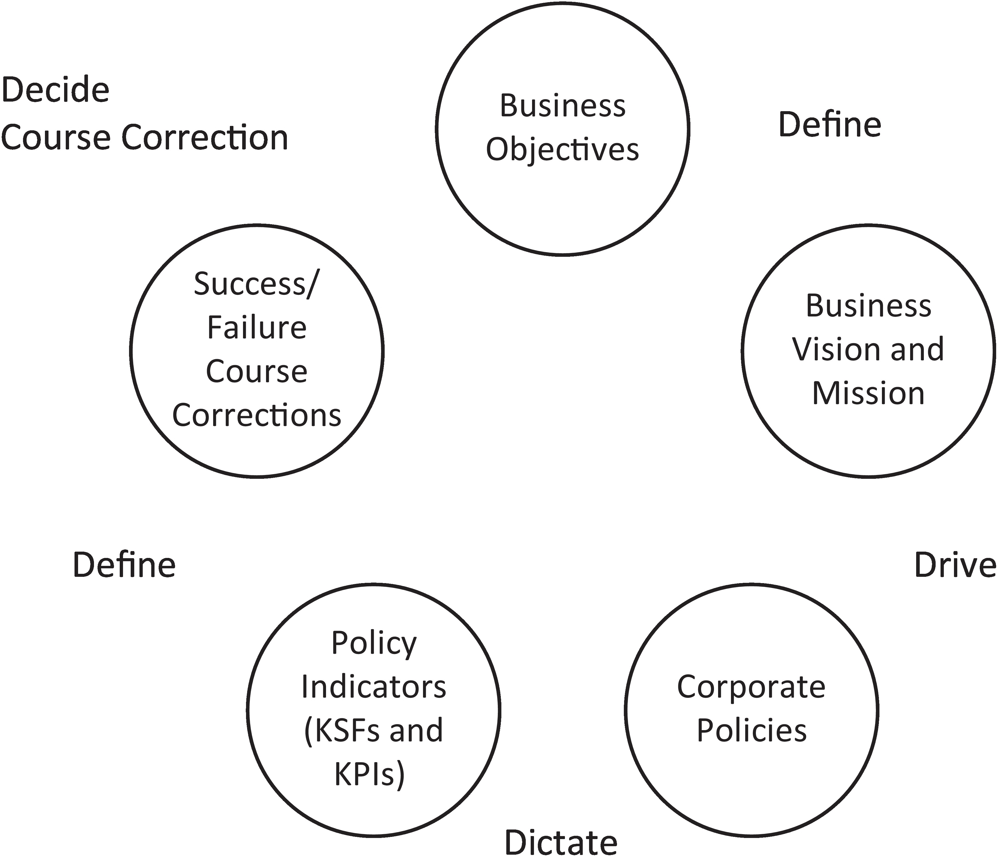

图 1.2

理解政策是如何运作的。

然而，为了使政策有效，需要理解政策生命周期中的三个方面。它们分别是战略层面、战术层面和运营层面。让我们来理解政策的战略方面。

首先，政策所有者/作者必须清楚通过政策文档需要实现的目标。预期的目标是否与组织的业务目标、愿景和使命一致？政策是否与现有的政策文档或现有法律冲突？政策所有者/作者在起草政策时理解并考虑监管和业务要求是非常关重要的。此外，政策所有者/作者必须评估政策对运营的影响。变化会巨大吗？会造成干扰吗？这种干扰是否合理？

这项政策的财务影响是什么？在这里，政策所有者/作者需要同时评估成本和收益。这里的成本指的是实施政策所需的资金投入（例如：政策开发的成本、相关的意识成本、创建/修订流程的成本、实施政策可能需要的系统成本等）。这里的收益指的是组织因这项新政策而获得或节省的资金收益（例如：可能避免的罚款、由于流程优化带来的收益、由于客户信心增强而带来的销售额增长等）。

政策所有者/作者还必须理解并审查由于政策可能造成的附带损害。例如，想象一个组织决定终止其“居家办公”计划，以降低远程访问相关的风险以及降低这些风险的成本。这项政策将影响可能使用居家办公选项的女性员工（尤其是年轻母亲）；同样，这也可能影响那些可能住在离办公室很远的员工，因为这将涉及花费大量时间通勤上班。此类员工可能会离开组织。其他需要考虑的某些事情还包括组织的办公环境和文化。简而言之，这些涵盖了政策生命周期的战略方面。这一方面应作为政策需求的一部分来处理。现在，让我们深入探讨战术层面。

这涉及政策文档的实际起草。政策所有者/作者必须有效地将组织的战略考量转化为政策文档。其关键的有效性是确保文档清晰、简洁且符合常识。

编写政策时，一些有效的“要做的”和“不要做”包括：

1. 语言应当简单。避免使用法律术语。
2. 句子应该是短的。
3. 保持文档聚焦。不要试图在一个文档中涵盖天上的一切事物。
4. 不要在此文档中制造歧义，因为这可能会误导读者。
5. 政策文档应该是简洁的，不超过几页。标准、程序和指南可以根据需要尽可能详细且冗长（请参见 图 1.3 以进一步明确每份文档的预期内容（政策 vs 标准 vs 控制 vs 程序程，2020 年））。
6. 明确识别政策目标，定义文档的范围和受众，用清晰的语言阐述条款，定义用于监控和评估政策的 `KPIs`，定义政策将如何实施（角色和责任），并分析计划的执行情况（将如何执行以及不遵守或违反政策的后果 [例如：罚款、停职、终止聘等]）。

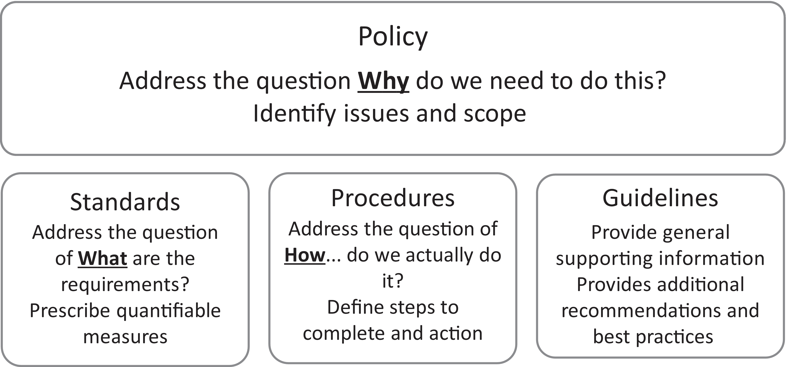

图 1.3

理解各种政策文档的内容。

最后，让我们考虑政策的运营层面。

政策起草完成后，最重要的一步是使文档授权。这是通过确保文档由组织负责人或对特定政策负责的最高权威签署来实现的。想象这样一个场景：组织 X 的 `CISP` 由 `CIO` 签署，而另一个组织 Y 的 `CISP` 由 `CEO` 签署。不言而喻，`CEO` 签署的 `CISP` 接受度会比 `CIO` 签署的更高。它还将展示最高层的管理支持。一旦实现这一点，政策所有者/作者就需要致力于建立政策的意识和接受度。需要制定一个沟通计划以确保信息到达目标受众。这可以通过意识会议、电子邮件、海报等方式进行。必须在整个组织范围内获得对政策的支持；这样政策才能在组织内被有效采用。

除了意识之外，政策所有者/作者还致力于政策的有效实施。根据政策的不同，这可能涉及新的或修订的流程、员工的意识/培训，以及用于实现预期目标的技术（硬件/软件/基础设施）。

最后，政策所有者/作者需要建立一个有效的机制来监控政策。定义的 KPI 需要监控一段时间，以验证政策是否实现了预期结果。还需要监控任何最初未预见的有害附带影响。此活动的反馈将返回审核循环，并决定政策是否需要调整或修订（请参见 图 1.2 以了解政策是如何运作的）。

## 1.6 政策生命周期（从诞生到死亡的政策）](#Toc.xhtml_R_sec1_6)

现在让我们研究政策生命周期并理解它是如何运作的。大致上，政策生命周期有五个阶段，如图 1.4 所示。

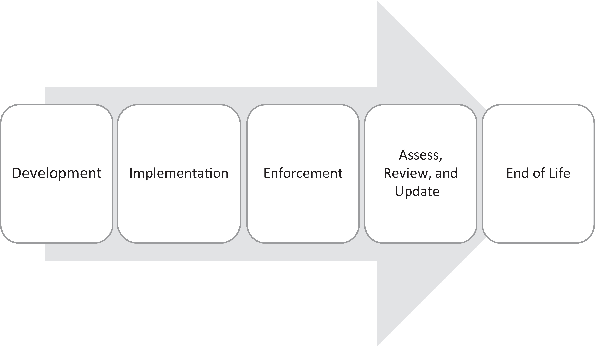

图 1.4

政策生命周期。

### 1.6.1 制定](#Toc.xhtml_R_sec1_6_1)


政策的制定阶段包含多个子步骤。与许多人的认为相反，这一阶段远不仅仅是编写政策文件本身那么简单。这里最重要的事情不是编写政策本身，而是进行需求评估。

#### 1.6.1.1 需求评估

回答“我们为什么需要这项政策？”这个问题至关重要。这可能有多种原因，例如：业务愿景、使命或目标发生了变化；业务决定进入新的业务领域；监管机构发生了变化或给出了新方向；业务需要优化当前的流程或运营；或者存在合规要求。该问题的答案将帮助你理解政策的目标。

#### 1.6.1.2 政策起草

在清晰理解了业务目标和需求后，下一步是起草政策文件。根据文档的类型（是政策、程序还是指南），你将选择草拟语言。政策文件要求简洁明了（通常是两到三页的文档）。标准和程序是更详细的文档，会深入探讨额外的细节（技术、运营方面），以确保符合政策。这些本质上是实现完成政策目标所需的特定任务的最佳实践。指南是详细的文档，将就如何实施、操作或执行特定任务为用户提供全面的帮助。它可能提供有关如何使用有助于特定任务实施、操作或执行工具的指导。这也可能是一种逐步的方法。在某些情况下，复杂的过程可能会分解为特定任务，并向用户提供关于如何执行特定任务的 `WI`。

#### 1.6.1.3 利益相关者评审

一旦草案准备就绪，相关者应审查文档以确保其有效性。相关者可能对写作风格（错别字、语法、语言、语气等）、政策条款（政策对其业务是否合理、是否存在运营限制、可审计性挑战等）或其他任何反馈提供意见。

#### 1.6.1.4 识别成功因素和关键绩效指标

在开发阶段，讨论了如何识别成功因素和关键绩效指标，以评估政策的成功与。

#### 1.6.1.5 政策批准

这是该阶段的最后一步。

### 1.6.2 实施

政策准备好后，政策所有者/作者应确保。

#### 1.6.2.1 通知与意识

沟通与意识是政策实施的关键。

#### 1.6.2.2 创建/更新流程

实施的下一步是在业务中做出更改。

#### 1.6.2.3 尽可能提供工具

应为用户提供可以帮助他们采纳和实施政策的工具。

### 1.6.3 强制执行

这是为了确保目标受众遵守该政策。

#### 1.6.3.1 合规性监控


例如，新的访问策略规定供应商在数据中心内必须有人陪同并接受监督。策略所有者/作者可以通过检查数据中心的访问日志或数据中心控制记录来验证这一点；这些记录可以与 CCTV 监控日志进行交叉核对。

#### 1.6.3.2 影响用户行为（胡萝卜加大大棒策略）

人类天性上抵制变化，在接受变化之前，需要对人类心理进行一定程度的引导。这种引导在很大程度上可以通过沟通和意识来实现，即策略所有者/作者讨论策略的益处以及它将如何帮助个人和组织。策略所有者/作者还可以微妙地传达一个信息，即不遵守策略可能会导致经济损失（个人或组织的罚款）和/或处罚（失去工作或监禁）。

人类心理中还有反叛的一面，因此定期对传达的信息进行强化至关重要。例如，如果策略对象观察到或认为不遵守策略并不会导致任何个人罚款、处罚或问责，那么合规性将随着时间的推移而恶化。因此，在策略整个生命周期内维持这种心理引导。这通常是一种双管齐下的方法：对良好的行为给予奖励（胡萝卜），对不良行为通过纪律处分进行惩罚（棒）。

在初始阶段，特别是对于新策略，制定一个能有效激励对象遵守和执行策略的奖励计划可能更好。随着时间的推移，这可以成为整体员工考核计划的一部分，该计划应评估个人对策略的合规情况。

### 1.6.4 评估、评审与更新

这是任何策略生命周期中一个非常重要的阶段。策略并非“神谕”，也不是铁板无钉的。策略周围的动态环境可能会发生变化，有时变化还非常迅速。策略所有者/作者必须掌握策略，并能够对其进行引导、修订，使其在不断变化的动态环境中保持相关性。可能影响策略相关性的因素包括业务目标的改变、管理层的变动或监管制度的变更。策略所有者/作者必须确保策略进行调整，以与这些变化保持一致。这可能不是经常发生的场景，但它涉及到确保在既定背景下按预期发挥作用。

让我们考虑一些场景，并在我们目前讨论的背景下进行评审。

1. 一个例子是远程访问策略以及它如何影响居住地较远的员工和年轻母亲。这是策略产生的附带影响的例子；策略所有者/作者应该评审该策略为组织带来的收益与员工流失之间的平衡。

2. 另一个例子是数据中心访问，有迹象显示 IT 人员没有遵守“供应商供应商”策略，因为 CCTV 录像与您的访问控制记录不符。这是一个纯违规行为，策略所有者/作者应对对此行为进行根原因分析。也许 IT 人员压力很大，无法抽空时间陪同供应商。这可能指向工作环境中的运营挑战。

3. 另一个例子可能是报告的安全事件数量增加。这可能表明要求员工报告安全事件的策略是成功的，并不意味着组织的安全状况有所恶化。每个指标都需要经过仔细评估。数字的高升或降低都不是策略成功或失败的标志。因此，在同一个例子中，当用户开始将可疑活动报告为事件时，事件数量在初期会增加。然而，随着时间的推移，由于用户提高了识别可疑活动的技能和能力，这种情况将进入平台期。长期来看，可能随着组织整体成熟度的提高、技术的进步以及信息安全团队技能的提升，最终报告的事件可能会减少。

策略所有者/作者应确保他们确定了评估策略成功的正确指标，并评估策略是否引入了任何附带影响。根据这些反馈，应定期对策略进行调整，以实现预期目标。

### 1.6.5 生命周期结束

出于各种原因，组织可能会达到某个特定策略不再需要的点。原因可能是业务目标的改变、管理层的变动、监管制度的变更，以及技术或业务流程的变化。

一旦策略所有者/作者与管理层一致认为某策略不再需要，最好通过适当通知正式撤销该策略。策略所有者/作者应对管理层、策略对象和利益相关者就与旧策略相关的任何法律和监管要求提供建议。

策略对象和利益相关者应该收到适当的沟通，告知他们策略失效的日期、策略是否会被其他策略取代、维护与旧策略相关的文档和记录的建议，以及其他可能的必要信息。

### 参考文献

1. Henry Mintzberg (May 1978). “Patterns in Strategy Formation,” Url: `https://web.archive.org/web/20131019210812/https://faculty.fuqua.duke.edu/~charlesw/LongStrat2010/papers/class%210/Patterns%20of%20Strategy%20Formulation.pdf`
2. JS OP DEECK (2009). “Regulations, Policies, Standards, Procedures and Guidelines,” Url: `https://www.vulpoint.com/regulations-policies-standarts-procedures-and-guidelines/`
3. Policy vs Standard vs Control vs Procedure (2020). Url: `https://www.complianceforge.com/word-crimes/policy-vs-standard-vs-control-vs-procedure`


网络安全根据 `ISO/IEC 27032`（国际标准化组织 / 国际电工委员会）定义为保护网络空间中数据的隐私性、完整性和可可用性（[`www.iso27001security.com/html/27032.html`](https://www.iso27001security.com) 2020a）。它是一套旨在保护机密信息免受未经授权的用户访问的实践和工具。这种未经授权的访问可以通过网络上的不同形式发生。由于大量数据存储在军事、金融、企业和医疗等部门的系统中，因此保护数据至关重要。漏洞（Vulnerability）是网络安全中使用的术语，指的是系统中可能导致被攻击攻击的缺陷。它也被称为故障（glitch），系统可能会遇到并导致威胁的问题。软件开发中的缺陷（Bugs）是产生漏洞的主要原因之一，会导致各种类型的信息泄露。这些漏洞是隐藏的对象，很难被轻易追溯。但一旦被遇到，漏洞就会产生巨大的利用价值。

在本章中，我们将讨论漏洞、漏洞产生的原因以及漏洞管理。我们还将讨论用于漏洞管理的工具以及案例研究。

## 2.2 背景

最近，随着技术的发展，大量的漏洞也随之产生。Zhang 等人（2011a）报告说，软件漏洞是安全问题的主要原因。国家漏洞数据库（`NVD`）自 1997 年成立以来维护着一个包含所有漏洞的巨大数据库。已识别出超过 43,000 个漏洞。该数据库有助于预测漏洞。然而，不断增长的漏洞统计要求多维度的威胁检测技术（Tripathi and Singh 2011）。

Ali 等人（2012）报告说，通用漏洞评分系统（`CVSS`）对发现的每个漏洞进行评分，并对这些安全漏洞提供详细描述。Peter Mell 等人（2007）讨论道，`CVSS` 为识别软件漏洞的特征和影响提供了一个开放框架。Zhang 等人（2011b）指出，信息技术实验室（`ITL`）公告报告和 `CVSS` 可以采取必要措施来提高系统的安全性。

Hyunchul Joh（IEEE 2012）报告说，已发现但未修补的漏洞对系统构成了安全风险。`CVSS` 指标可以用于评估泄露的影响。根据 Gonda 等人（2018），攻击图是分析漏洞的最好工具之一。可以通过漏洞的模糊规则对暴露在漏洞攻击下的网络资产相关的潜在风险进行评估。Dondo（2008）建议大多数组织使用传统的漏洞管理技术，但有必要扫描连接的远程设备。

自动化总是比传统的人工技术显示出更大的进步（Williams and Nicollet 2020）。Edwards, Chandra Estelle（2020）报告说，这有助于优先考虑关键风险。潜在风险的影响也需要被识别。为了获得有效的安全，应该将补救措施整合到所有的安全控制中。正如 Njogu 等人（2013）所说，将补丁发布到网络是提供的最佳解决方案之一。Nanda 和 Ghugar（2017）报告说，为了应对最新的漏洞，组织应该整合复杂的漏洞管理技术。关于漏洞管理以及如何增强它以提供卓越的安全机制的讨论在研究中一直进行。

## 2.3 漏洞

漏洞在 `ISO 27002` 标准中定义为“资产或一组资产的可以被一个或多个威胁利用的弱点”（`ISO/IEC 2020`）。程序中产生非预期或错误结果的失败或缺陷被称为缺陷（bug）。当这些缺陷被恶分子利用时，就变成了漏洞。漏洞的范围从系统崩溃到网络上的机密数据泄露不等。这类损害系统安全机制的漏洞被称为安全漏洞。

以下是根据常见漏洞披露（`CVE`）中的频率被识别为不可原谅漏洞的某些安全漏洞（Christey 2007）。

1. 跨站脚本
2. SQL 注入攻击
3. 中间人攻击
4. 钓鱼攻击
5. 缓冲区溢出
6. 缺少授权
7. 路径遍历
8. 不可靠的输入
9. 在未进行完整性检查的情况下下载代码
10. 缺少数据加密

## 2.4 风险领域

随着技术的增长，每家企业都开始通过网络与其客户通信。信息的交换应该通过高级安全加密进行，以确保适当的数据安全。病毒和蠕虫经常干预网络连接，导致信息盗窃并破坏网络连接。任何使用网络的业务，无论是小规模、大规模、跨国公司还是政府机构，通常都面临漏洞风险。

所有这些漏洞的解决方案是在组织内部遵循一套良好的漏洞管理机制。

## 2.5 为什么软件会有漏洞？

简而言之，软件之所以存在漏洞是因为不可避免的人为错误。90 年代的软件没有针对堆溢出和格式化字符串错误的安全措施。然而，现在供应商已经能够理解并处理缺陷，巨额的投入已成为系统维护的主要标准。

产生漏洞的另一个原因是糟糕的代码审查和测试策略。一个例子是在带有反病毒软件或具有高度安全加密系统的环境中进行测试。然而，在现实中，当应用程序部署到终端用户时，它可能处于安全性较低的系统中，导致数据丢失或发生其他类型的威胁。因此，测试应该在具有终端用户基本配置的系统上进行。

防火墙和反病毒软件等安全应用需要正确的配置。安装过程中的任何缺陷都会导致安全机制的失败。使用虚拟专用网络（`VPN`）也是导致漏洞发生的另一个主要限制。为了其他用途而破坏安全机制也是对漏洞的违反。许多漏洞很容易检测和修复。供应商为软件发布新补丁以帮助修复威胁。良好的漏洞管理系统有助于组织降低威胁风险（Qualys 2008）。

## 2.6 漏洞管理

漏洞管理的主要目标是及时检测和修复漏洞（Qualys 2008）。漏洞管理被定义为通过识别、评估、处理和报告系统中的漏洞来管理攻击的发生。如图 2.1 所示，漏洞管理可以分为四个阶段（`ISO 2020b`）。

* 识别/发现漏洞。
* 评估漏洞。
* 报告。
* 修复和验证。

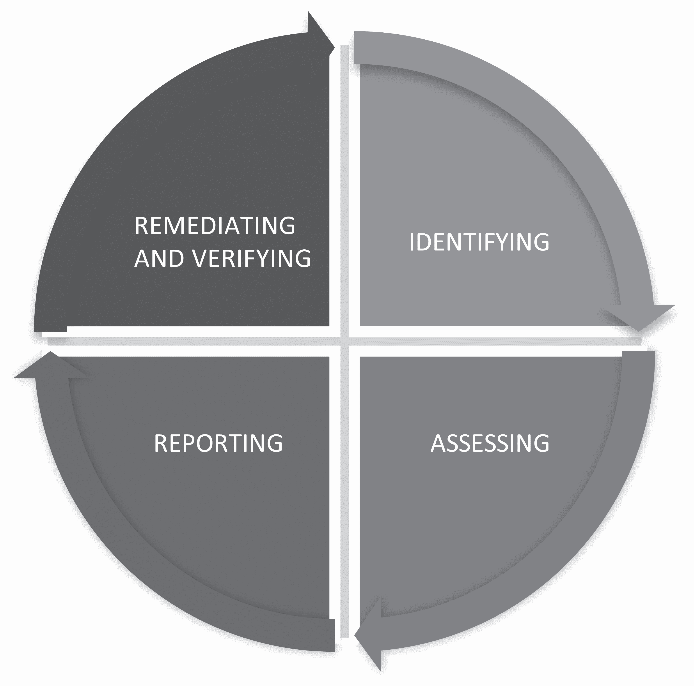

图 2.1

漏洞管理周期。

### 2.6.1 发现漏洞


这是漏洞管理的第一阶段，在此阶段进行威胁初步发现。这可以进一步分为两个部分。

#### 2.6.1.1 识别攻击类型

根据对系统的攻击类型，我们可以识别漏洞的类型。例如，如果频繁发生数据泄漏，可以被认为是“中间人”攻击，这与 IP 欺骗攻击有关。另一个例子是，如果组织的数据库频繁变化，我们可以将其识别为 SQL 注入攻击。如果用户的凭据泄露，我们可以将其考虑为钓鱼攻击。表 2.1 展示了不同的攻击类型和漏洞类型。表 2.1 还根据受影响系统区域给出了可能发生的攻击类型示例。随着技术的发展，可能会出现许多漏洞，并且每天都在增加。

| 序号 | 攻击类型 | 攻击如何影响系统？ |
| --- | --- | --- |
| 1 | 中间人攻击 | 网络上的数据泄露 |
| 2 | SQL 注入攻击 | 组织的数据库频繁变化 |
| 3 | 钓鱼攻击 | 用户数据泄露 |
| 4 | 跨站请求伪造 | 点击类似的 URL 导致数据被盗 |
| 5 | 路径遍历或目录遍历 | 文件夹和目录中的数据泄露 |

**表 2.1**
攻击类型

#### 2.6.1.2 资产清单

维护所有资产的详细列表是一个关键步骤。资产包括未授权和授权的硬件资产，以及软件资产。在收集了完整的漏洞列表后，将识别出组织的硬件资产清单，例如端口、网络、系统、网络地图、局域网和路由器详情，如图 2.2 所示。

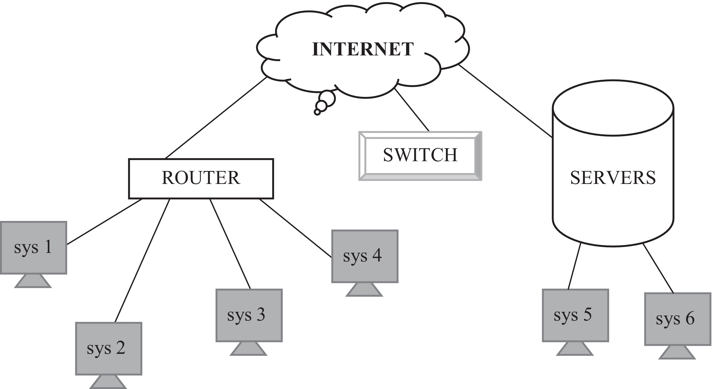

图 2.2
硬件资产。

软件资产包括使用的软件类型、其版本、补丁、程序包、使用的数据库类型及其分层架构等。最佳实践始终是让由两三个人组成的团队收集所有这些细节并维护清单，以便对未来的漏洞管理阶段有所帮助。每当引入新资产时，都应该将其维护在清单列表中。

图 2.2 包含了笔记本电脑、个人电脑、移动设备、服务器、路由器、交换机、集线器、I/O 设备等。每一个都被识别为一个节点，这些节点将经过严格的渗透测试，以检查网络的哪个部分是漏洞的根源。

### 2.6.2 漏洞评估

一旦了解了所有的漏洞和资产，下一阶段就是高效地评估漏洞。这一阶段也被称为漏洞分析（VA），它定义、识别并分类网络中的安全漏洞。该评估的关键组件是找到由于威胁/漏洞造成损失的评分。根据评分值，对漏洞进行优先级排序。

漏洞评估的类型：

*   在`主动评估`（active assessment）中，借助任何网络扫描器的帮助，对网络扫描以发现主机和漏洞。
*   在`被动评估`（passive assessment）中，发现活跃的系统、主机和服务。对网络流量进行嗅探，这个过程被称为被动评估。
*   在`基于主机评估`（host-based assessment）中，进行配置检查。
*   在`内部评估`（internal assessment）中，发现网络内部基础设施中的漏洞。
*   在`外部评估`（external assessment）中，从黑客的角度评估网络，并发现可能被利用的内容。
*   在`应用评估`（application assessment）中，测试网络基础设施以发现任何过时的数据。
*   在`无线网络评估`（wireless network assessment）中，确定网络上所有无线连接的轨迹。

如图 2.3 所示，漏洞评估在三个不同的级别进行：1. 评估级，2. 评估级和 3. 评估后阶段。

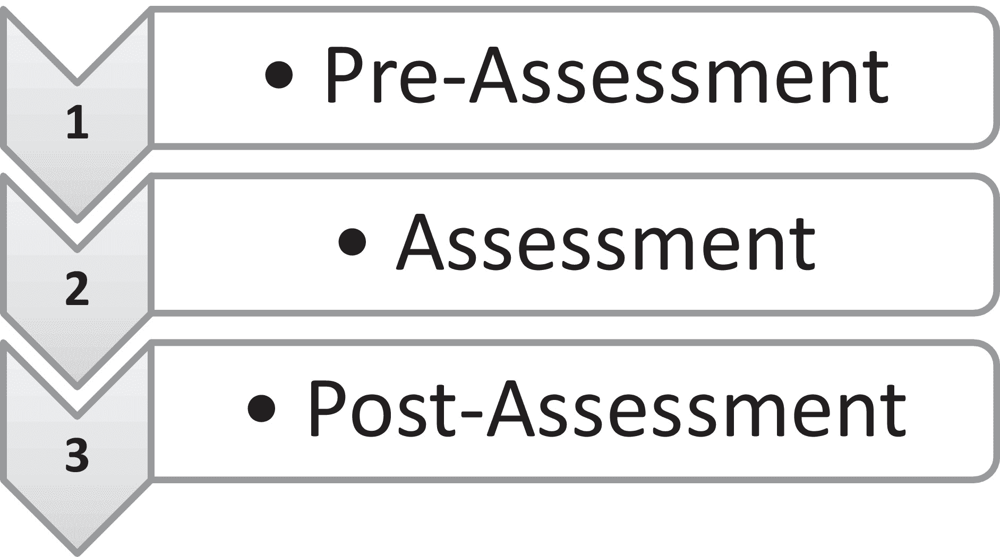

图 2.3
评估级别。

在第一级，即评估的预评估级阶段，完成资产的规划和排序程序。在第二级，观察网络架构、威胁环境、物理资产分析、策略和程序。最后，在评估后层级，确定优先级并记录下执行下一阶段的行动计划。在这一分析阶段，识别出需要进行渗透测试的区域列表，例如网络地图中的节点，以追踪漏洞。

**应该扫描什么？**

对此问题的答案是所有连接到组织内部和外部网络的网络设备（Qualys 2008）。

*   操作系统
*   Web 服务器
*   服务器
*   防火墙
*   数据库
*   负载均衡服务器
*   交换机和集线器
*   访问点

**风险的分类与排序**

*   `关键 seCrucial）：漏洞的利用在没有任何人工操作的情况下完成。
*   `影响性 seInfluential）：漏洞的利用可能导致数据丢失，并影响数据的完整性、机密性和可用性。
*   `中等 seMedium）：利用是严重的，但用户操作降低了强度。
*   `低级 seLow）：利用的影响可以忽略不计。

### 2.6.3 报告

在此阶段，为组织高层生成报告，对需要处理的漏洞进行排序。该报告还包含了为了克服损失而采取的行动计划。安全团队密切监控修复这些问题的步骤。漏洞摘要报告（VSR）由发现漏洞的人编制。他们还可以对如何追踪漏洞编写详细说明，并最终展示修复这些漏洞的过程。

### 2.6.4 修复与验证

处理漏洞可以通过三种方式进行：修复、缓解或忽略/接受。

`修复 seRemediating）：通过修复威胁或为软件打补丁，对优先级排序的漏洞采取修复措施。

`缓解 seMitigating）：涉及组织选择替代方法来克服该漏洞。

`忽略/接受 seIgnoring/accepting）：允许低风险威胁发生，且不采取行动修复漏洞。

接受漏洞可能会导致损失。因此，大多数组织通过补丁修复漏洞以克服网络中的重大灾害。

`验证阶段 verification phase`涉及检查修复措施是否得到有效实施。它还为组织的问责提供了透明度。

随着技术的发展，漏洞在维护组织数据安全方面变得更加重要。因此，组织的 IT 团队利用各种组织工具和漏洞管理技术进行定期审查。

## 2.7 漏洞管理的参与者

通常，漏洞管理中识别出四类参与者（卡内基梅隆大学软件工程研究所 2016）

1.  `申请人 seclaimant）：研究并识别组织漏洞的人员。
2.  `供应商 sevendor）：开发产品并负责维护产品的人或组织。


3. **裁决者**：调解索赔人与供应商之间争议的人员。
4. **主管**：除了索赔人之外，负责供应商侧检查漏洞的人员。

当漏洞经过调查确认后，团队必须采取补救措施，通过必要的手段来修复漏洞。

## 2.8 漏洞分析工具

以下是识别出的漏洞分析（VA）工具类型（Qualys 2008）。

1. **基于主机的 VA 工具**：这些工具发现并识别运行在特定主机计算机上的操作系统，并测试系统是否存在任何缺陷。它们会搜索系统的常用应用程序和服务。
2. **应用层 VA 工具**：这些工具检查 Web 服务器和数据库中的缺陷。
3. **范围评估工具**：这些工具检查应用程序和操作系统的缺陷。
4. **深度评估工具**：这些工具发现系统中的未识别的漏洞。它们通过诱导软件代码并提供随机输入来检查安全漏洞，从而进行深度检查。此类程序被称为模糊器（fuzzers）或故障注入器（fault injectors）。
5. **主动工具**：主动工具通过网络执行漏洞检查，会消耗系统资源。
6. **被动工具**：这些工具观察系统并独立进行数据处理。

工具可以根据检查的数据或漏洞的位置进行分类。每天都有新漏洞产生，需要新工具来处理。以下是目前可用的工具列表：

* `Cycorp CycSecure`
* `ISS Network Scanner`
* `Saint Vulnerability Scanner`
* `Symantec NetRecan`
* `SPIKE Proxy`
* `Foundstone Scanline`
* `Cerebus Internal Scanner`
* `Shadow Security`

还有许多可用工具。以下列出了部分免费扫描器：

* `Nmap`
* `Nessus`
* `Whisker`
* `Enum`
* `Firewalk`

由于漏洞种类多样，迫切需要识别漏洞以及在漏洞管理中采取必要行动的研究活动。漏洞管理解决方案需要让您的安全团队像黑客一样思考，因为它利用扫描技术来修复内部和的漏洞。

## 2.9 漏洞管理的最佳实践

以下是需要纳入组织中以改进漏洞管理的若干最佳实践（Qualys 2008）：

* **发现网络资产**：发现网络资产有助于确定更容易易受攻击的区域。网络映射可以检测所有网络设备，有助于发现广泛的网络资产。
* **资产分类**：组织中的大多数网络拥有 10 到 20 种不同类型的网络资产。
* **运行扫描**：根据漏洞预评估阶段给出的排名对资产运行准确的扫描。这让您对资产相关的风险水平有全面的了解。高效的扫描有助于发现漏洞并执行后续任务。优先考虑扫描起着主要作用。
* **技术报告**：报告需要由技术团队生成，并包含修复漏洞所需遵循的所有指令。适当的文件有助于更好地识别和修复漏洞。
* **管理报告**：在技术团队给出修复漏洞所需遵循的指令报告后，生成管理报告，以识别漏洞趋势并缓解导致这些漏洞的区域。管理报告由组织的高层管理提供。
* **优先考虑补丁**：补丁是为了解决任何问题而生成的代码。生成补丁是为了修复具有关键重要性的漏洞，随后处理优先级较低的漏洞。
* **跟踪修复进度**：一旦识别出漏洞，它被称为一个故障工单（trouble ticket）。一旦生成工单，漏洞管理系统就会开始解决问题并逐步跟踪整个修复过程。最佳实践是定期跟踪基于产品的组织发布的不同补丁，并更新系统以避免漏洞。

现在，通过案例研究，让我们看看组织在发生泄露事件期间如何遵循漏洞管理技术（Thomas 2019）。

## 2.10 漏洞管理案例：Equifax

Equifax 是一家全球性组织，也是最大的消费者报告机构。2017 年 9 月 8 日，该机构发布了一份声明，称其遭受了重大网络攻击，导致所有用户数据泄露，信用卡号也被泄露。

该机构维护着美国许多人口的个人和财务数据。Equifax 存储的数据包含个人信用历史，包括账户号码、地址、信用卡单等。当有人想借钱时，贷款方会先通过 Equifax 检查借款人的财务历史，然后发放贷款。

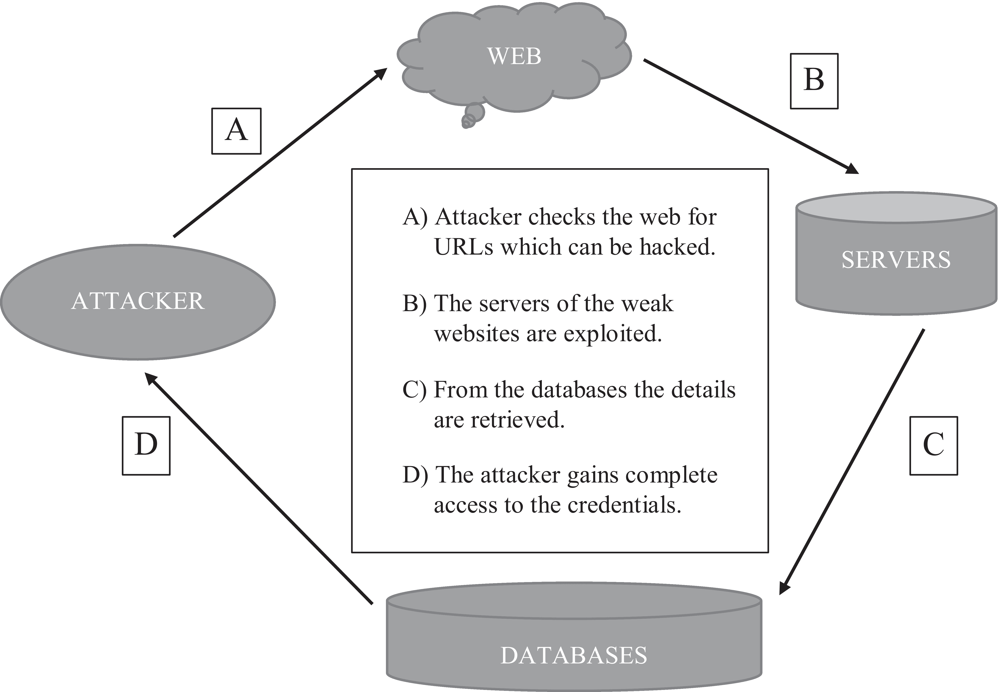

图 2.4 攻击者的利用。

### 2.10.1 识别/发现漏洞

Equifax 在一个 Web 应用程序中使用 `Apache Struts` 作为其应用程序框架。攻击者发现了网络漏洞并利用了该 Web 应用程序，导致了安全漏洞 `CVE-2017-5639`。该漏洞在用户尝试上传文件时接管了异常处理问题。他们控制了服务器并利用了约 1.43 亿记录。这导致了机密信息的丢失。

### 2.10.2 漏洞评估

为了解决这个问题，组织内部安全团队执行了评估。团队首先识别了漏洞产生。对系统执行了不同类型的扫描，在进行严格的漏洞扫描后，他们识别出两个故障：一个是未能修复补丁，另一个是未能识别出该应用程序存在漏洞。当周应进行的补丁更新被忽略，导致了应用程序的故障。这两个问题的解决方案由技术报告提供，随后是管理报告。

识别了资产，包括在组织网络节点、服务器和其他通过网络连接的外围设备使用的软件。分析了供应商发送的通知。内部安全人员对识别漏洞的所有可能性进行了自导研究。

### 2.10.3 漏洞报告

由负责任务的人员生成了关于泄露发生主要区域的报告。在该案例研究中，该漏洞允许远程位置的攻击者执行任意命令，这些命令可以使用构造的带有 `Content-Disposition`、`Content-Type` 或 `Content-Length` HTTP 请求头部（`Content-Type` 头部包含字符 `#cmd=string`）来远程创建。

### 2.10.4 修复与验证


该漏洞的修复措施最终落实，通过在应用程序中安装带有安全增强功能的缺失补丁，并对该问题的进展进行了跟踪。观察到，安全团队进行了扫描，以检查系统中是否存在该漏洞（Marinos and Clements 2018）。同样观察到，扫描未检测到漏洞 `Apache Struts` `CVE-2017-5638`。最终该机构度过了安全危机。从那时起，安全机制得到了加强，并且定期进行漏洞管理流程，以避免重大灾难。

因此，通过这项案例研究，我们可以说，组织的安全取决于是否纳入适当的漏洞管理机制来维护网络安全。

### 参考文献

1. Ali, Assad, Pavol Zavarsky, Dale Lindskog, and Ron Ruhl. 2012. “A New CVSS-Based Tool to Mitigate the Effects of Software Vulnerabilities.” *International Journal for Information Security Research* *2*(3): 178–182.

2. Carnegie Mellon University Software Engineering Institute. 2016. “CRR Supplemental Resource Guide Vulnerability Management Version 1.1.” 4. [`www.us-cert.gov/sites/default/files/c3vp/crr_resources_guides/CRR_Resource_Guide-VM.pdf`](https://www.us-cert.gov), accessed on Feb 24, 2020.

3. Christey, S. 2007. “Unforgivable Vulnerabilities.” *Black Hat Briefings*.

4. Dondo, Maxwell G. 2008. “A Vulnerability Prioritization System Using a Fuzzy Risk Analysis Approach.” *IFIP International Federation for Information Processing* *278*: 525–539.

5. Edwards, Chandra Estelle, 2020. “Finding Trust in Relational Vulnerability: Interpersonal and Intrapersonal Influences on the Intimacy Process”（Doctoral dissertation). Retrieved from ProQuest database. (Accession No.1552969396).

6. Gonda, Tom et al. 2018. “Analysis of Attack Graph Representations for Ranking Vulnerability Fixes.” *EPiC Series in Computing* *55*(September): 215–228.

7. IEEE. 2012. “Defining and Assessing Quantitative Security Risk Measures Using Vulnerability Lifecycle and CVSS Metrics” *2012* (1). d:%5Cdaten%5CPromotion%5CLiteraturver waltung%5CPromotion-EconomicsOfITSec (Citavi 4)%5CCitaviFiles%5C12Defining andAssessingQuantitativeSecRiskMeasuresUsingVulnerabilityLifecycle&CVSSMetrics.pdf.

8. ISO. 2020 a. “ISO/IEC 27032:2012—Information technology — Security techniques — Guidelines for cybersecurity. [`www.Iso27001security.com/html/27032.html`](https://www.Iso27001security.com), accessed on March 23, 2020.

9. ISO. 2020 b. “Vulnerability Management and Scanning.” [`www.Rapid7.com/Fundamentals/Vulnerability-Management-and-Scanning/Le`](https://www.Rapid7.com), accessed on March 22, 2020.

10. ISO/IEC. 2020. “Information Technology – Security Techniques – Code of Practice for Information Security Management,” ISO/IEC 27002. [`www.iso.org/committee/45306/x/catalogue/`](https://www.iso.org/committee), accessed on March 24, 2020.

11. Marinos, Nick, and Michael Clements. 2018. “Actions Taken by Equifax and Federal Agencies in Response to the 2017 Breach.” *United States Government Accountability Office* (August): 40. [`www.hsdl.org/?abstract&did=815269`](https://www.hsdl.org).

12. Nanda, Sameer and Umashankar Ghugar. 2017. “Approach to an Efficient Vulnerability Management Program.” *International Journal of Innovative Research in Computer and Communication Engineering* *5*(6):11241–11244.

13. Njogu, H. W., L. Jiawei, J. N. Kiere. January 2013. “Comprehensive Vulnerability Based Alert Management Approach for Large Networks.” *Future Generation Computer System* *29*(1), 2013: 27–45.

14. Peter, Mell, Karen Scarfone, and Sasha Romanosky. A. 2007. Forum of Incident Response and Security Teams (FIRST) *Complete Guide to the Common Vulnerability Scoring System Version 2.0.*

15. Qualys. 2008. “Vulnerability Assessment for Dummies,” 66.

16. Thomas, Jason. 2019. “A Case Study Analysis of the Equifax Data Breach 1 A Case Study Analysis of the Equifax Data Breach.” (December). [`www.researchgate.net/publication/337916068`](https://www.researchgate.net).

17. Tripathi, Anshu and Umesh Kumar Singh. 2011. “Analyzing Trends in Vulnerability Classes across CVSS Metrics.” *International Journal of Computer Applications* *36*(3): 38–44.

18. Williams, A. and Nicollet, M 2020. “Improve IT Security With Vulnerability Management Title.”

19. Zhang, Su, Doina Caragea, and Xinming Ou. 2011 a. “An Empirical Study on Using the National Vulnerability Database to Predict Software Vulnerabilities An Empirical Study on Using the National Vulnerability Database to Predict Software Vulnerabilities.” (August).

20. Zhang, Su, Xinming Ou, Anoop Singhal, and John Homer. 2011 b. “An Empirical Study of a Vulnerability Metric Aggregation Method.” *The Defense Technical Information Center, DTIC Online, USA.* [`oai.dtic.mil/oai/oai?verb=getRecord&metadata`](http://oai.dtic.mil) Prefix=html&identifier=ADA557504.


# 身份盗窃

身份盗窃是一项在全球范围内迅速增长的网络犯罪。2011 年被誉为“数据泄露之年”，当时超过 2.324 亿身份信息被暴露。值得注意的是，泄露数量增加了 62%。此外，2013 年通过数据泄露暴露的身份信息超过了 5.52 亿个（Symantec, 2014）。在线银行使用的大幅增加以及在线购物机会的普及（这要求在线客户提供敏感的机密个人和财务信息），是导致被盗窃身份数量这种惊人剧增的关键因素。参与电子商务的消费者迫切需要意识到他们在可能面临网络犯罪时承担的风险，并需要采取预防措施以最大限度地降低这些风险（Holt and Turner, 2012）。

此外，正如 YenYuen 和 Yeow（2009）所示，在马来西亚人关注的安全问题中，身份盗窃是三个最令人加剧担忧的原因之一，这与澳大利亚等发达国家几乎相同。从马来西亚提交的身份盗窃案件警方报案数量来看，存在明显的上升趋势。这种情况使得向马来西亚人普及此类犯罪变得更加紧迫，因为目前公众对网络犯罪的意识非常低，且预防措施很少被采取，导致了被盗窃身份数量的惊人剧增（Hazelah et al., 2011）。

微软公司关于马来西亚的安全情报报告（2011 年 5 月 12 日）提到“网络犯罪分子使用更容易获取的攻击方法，包括社会工程策略，并利用最熟练犯罪分子创建的漏洞从大量人员身上获取少量资金”（Adam et al., 2011）。同时，马来西亚网络安全局（Cyber Security Malaysia）正致力于教育公众身份盗窃的危害，这是一个全球性问题，不仅限于发达国家。然而，马来西亚等国家被视为进行信用卡交易的旅行者的高风险地区（Albrecht et al., 2011）。

此外，根据犯罪预防意识委员会（LKPJ）主席的说法，网络欺诈已变得极其泛滥，委员会在 2013 年六个月内收到了 300 份投诉，经济损失超过 100 万林吉。警方商业调查处（CID）的数据显示，2012 年马来西亚因网络犯罪损失的资金高达 16 亿林吉，而上一年为 10 亿林吉（Bernama, 2013）。Mohamed（2013）报告说，在 2002 年马来西亚议会和玛拉科技大学网站遭到入侵后，网络犯罪在马来西亚首次引起了公众的关注。由于缺乏知识，学生无法缓解身份盗窃遭受的损害（Seda, 2014）。

尽管某些研究考虑了这种犯罪的成本和传播范围，但有必要对其进行实证研究。首先，身份盗窃具有广泛的复杂性，从抢包或提包等简单方法到嗅探等高科技方法不等。已有关于身份盗窃所用程序的研究，但对影响身份盗窃受害的在线和线下影响因素进行实验性评估是必要的（Holt and Turner, 2012）。其次，在马来西亚背景下，观察到身份盗窃案件的增加与警方报案数量同步增长（Hazelah et al., 2011），预计学生对身份盗窃的风险会有更多的了解（Seda, 2014）。

## 研究目标

本研究旨在解决以下四个空白。首先，本研究采用了理论整合，这是当代犯罪学中一个引人注目且具有争议的问题（Thornberry, 1989）。Messner 和 Krohn（1989）针对消费者行为提出了一种对抗身份盗窃的新型综合模型。其次，该新模型有助于理解影响身份盗窃的因素，包括大量的（92 个）风险和保护行为。第三，尽管文献中已存在早期研究，但本研究同时涵盖了线下和在线身份盗窃受害情况，并且与过去的研究相比考虑了更多的预测变量。第四，与以往研究不同，本研究将四种身份盗窃作为因变量，以探索对身份盗窃的解释。从实践角度来看，本研究为政策制定者提供了建议，教育并激励电子商务客户遵循建议的保护措施。

## 3.2 文献综述


为了打击身份盗用，研究人员已经进行了大量研究。

在 (Milne 等人，2004) 的一项定量研究中，研究人员了美国客户中增加或降低在线身份盗用风险的在线行为。Milne (Milne, 2005) 在受联邦贸易委员会 (FTC) 推荐的一项探索性研究包含了 13 项预防身份盗窃的措施。该研究通过计算消费者保护自己免受身份盗用侵害的程度，评估了消费者教育的影响。

此外，Wang 等人 (2006) 提出了一个情境框架，用于表示在打击身份盗用方面，身份持有者、签发者以及检查者和保护者的角色分配。该框架无法提供任何具体的解决方案，但它可以帮助引导在线用户的尝试和思维。

更重要的是，针对不可避免的技术进步，Norberg 等人 (2007) 提出了一个理论框架来解释隐私态度与行为之间的分歧。根据该框架，风险对个人准备个人信息的行为意愿产生显著影响，尽管信任可能会受到个人实际行为的很大影响。应当理解，除非个人努力真正感知他们将个人信息提供给了谁，以及授予了哪些权限，否则个人的隐私安全感将不断下降。

关于信用交易的重要性，Kahn 和 Roberds (2008) 提出了一个将身份盗用描述为平衡现象的模型。不同类型的身份盗用在平衡中发生。身份盗用平衡发生率表明防止侵入性或高成本个人监控的意愿与控制交易欺诈的欲望之间的平衡。数学平衡建议增加识别工具的复杂性。

另一方面，Winterdyk 和 Thompson (2008) 通过调查，计算了对身份盗用和欺诈行为多样性的自我报告认知和感知。结果显示，学生对身份盗用的了解更多，但其风险略高于非学生。根据研究结果，研究人员针对加拿大的身份盗用保护提出了了一些针对性的教育策略和政策启示。

此外，Milne 等人 (2009) 代表了一个基于保护动机理论的模型。该理论表明，消费者保护的动机取决于自我效能和对威胁的感知可能性，以及威胁的极端程度 (Tanner Jr 等人，1991)。该模型探索了引导消费者面对安全和隐私威胁时采取适应不良或适应性反应的变量。此外，这项研究探索了引导消费者执行风险性和保护性在线行为的参数。在该模型中，身份盗用被视为一种感知威胁，身份盗用的可能性被视为在线威胁的感知概率。

Higgins 等人 (2010) 的研究阐述了大学生为打击身份盗用而采用的保护行为。该研究批评了 Milne 研究中使用的 `CCT` 分析方法，并建议使用模型分析。该解释具有某些政策启示。学者声称，政策制定者必须努力向组织和学生客户告知信息安全问题。

Shah 和 Okeke (2011) 检查并综合了以往关于内部身份盗用（员工）、其实际实施方式、窃取客户个人信息的技术以及企业可以用于缓解这一问题的流程的研究。他们建议建立一个基于角色的框架，包含所有层级的员工，以防止与组织犯罪相关的内部身份盗用。

关于保护工作的重要性，Pannah (2011) 提出了一个概念框架，建议了自我数据保护方法以及在身份盗用发生后应采取的措施。该框架调查了暴露于网络威胁、参与脆弱的互联网活动以及主动保护个人数据对身份盗用频率和严重程度的影响。

Archer (2011) 提供了另一个研究有关身份欺诈和盗窃消费者行为的模型。该研究调查了与用于发现身份盗用的客户行为相关的态度和前因。该研究考虑了身份盗用受害经历与对成为此类犯罪受害者担忧程度之间的关系。该研究大致上遵循了理性行动理论 (`TRA`)，该理论认为信念影响观点，观点影响意图，进而导致行为。

此外，Lewis (2011b) 的研究了消费者描述预防身份盗用的方式，发现了震慑身份盗用的消费者属性，并探索了身份盗用威胁影响消费者交易的方式。在这项研究中，样本选自美国在线大学中关注身份盗用的本科生。数据通过在互联网上实施的问卷收集，问卷包含开放式和封闭式（人口统计学）问题。这项定性现象学研究的目标是通过检查消费者采取什么来震慑身份盗用以及表达他们的态度来关注身份盗用问题。研究人员试图识别参与身份盗用预防的个人行为和人口统计特征。


此外，Holt 和 Turner (2012) 考察了在东南亚某大学保护因素如何影响受访者对在线身份盗窃的抵抗。研究结果显示了对保护因素如何影响在线身份盗窃的初步理解。此外，这项研究考察了韧性模型如何适用于网络犯罪受害情况。该研究探讨了在线风险活动、保护性行为与受害风险之间的关系。数据收集通过自报告调查卷对大学学生和教员工进行。从另一个角度来看，Reyns (2013) 利用日常活动理论来描述受害者和加害者在物理上尚未接近的区域，并评估了英国犯罪调查中 2008 年至 2009 年间 5,985 名受访者的身份欺诈与在线日常活动之间的关系。这些受访者是那些参与了网上银行和在线购物的人。该研究利用逻辑回归评估了极少数类在线日常活动与身份盗窃之间的相关性。该研究的另一个局限性是缺乏低自控测量，而这种测量在个人和国家层面的身份欺诈受害中可以起到补充作用。此外，Seda (2014) 强调了大学生对身份盗窃的意识及其预防措施的影响。在弗林德斯商学院收集主要数据之初，使用了多次选择性访谈。通过面对面面试得出结论，学生对于使用减少或增加身份盗窃风险的适当措施缺乏足够的知识。另一与 Holtfreter 等人 (2015) 相关的综述指出，自控/风险生活方式观点似乎对人们通过多种方法成为受害者的原因产生了直接感知。根据这种特定的综述方法，大部分法律受害影响了低自控和高风险生活方式的群体。通过电话采访 60 岁左右的受访者获取调查信息，分析了理论平台是否某种程度上描述了农村风险购物以及涉及老年网络用户的身份盗窃受害。特定发现揭示了老年网络用户可以通过采取某些安全措施轻松减少其受害机会。由于局限性，结果几乎没有涉及美国以外老年人身份盗窃受害的动态。这种分析似乎仅限于一种类型的在线风险行为。最终，Reyns 和 Henson (2015) 尝试通过利用 2009 年 2 月至 11 月进行的加拿大普通社会调查中的全国样本，考察受害者的在线日常活动与在线身份盗窃受害之间的关系。作为一个缺点，这项研究无法让读者认为这种低独立变性和低控制变异说明了因变量。根据 `Nagelkerke R2`，必须在模型中包含更多相对指标来解释在线身份盗窃。这意味着可能其他日常在线活动和其他类型的受害比这项研究能更准确地预测身份盗窃。此外，Reyns 和 Randa (2019) 对从美国某大学收集的数据使用了结构方程模型 (SEM)。这项研究发现身份欺诈与低自控、同伴偏离以及黑客攻击受害之间存在直接关系，并与个人偏离存在间接关系。结果显示，日常生活方式日常活动和低自控描述了身份欺诈。

因此，本研究关注身份盗窃，以测试四种类型的身份盗窃作为因变量的效果，并利用 92 种风险和保护行为来指示解释身份盗窃受害的大部分因素。

## 3.3 研究模型与假设

身份盗窃日益增长趋势表明，消费者需要考虑所有形式的身份盗窃保护。目前尚不清楚哪些行为对此类犯罪发生的概率影响最大。本研究在六个自变量和一个因变量方面做出了贡献。因变量是身份盗窃的发生，自变量包括：物理安全、在线安全和账户监控，这些与保护性行为相关。此外，离线风险、在线风险和网络犯罪受害与风险行为相关，如图 3.1 所示。

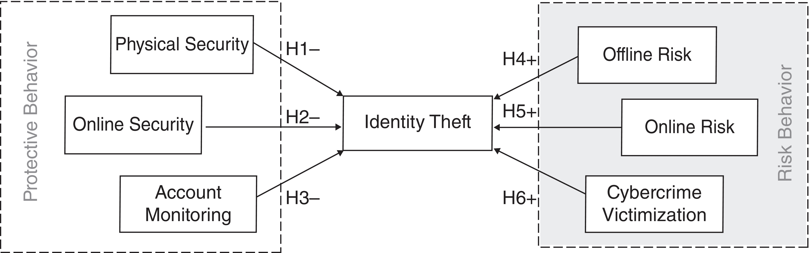

图 3.1

概念模型。

## 3.4 方法

接下来的部分描述了问卷设计、数据收集和采样方法。此外，还介绍了数据分析和模型评估方法。

### 3.4.1 伦理声明

参与本研究完全出于自愿，所有参与人员均已告知有权随时退出无需提供理由。所有个人都在问卷的第一页提供了预先书面同意，以发布这些案例细节。此外，本研究采用 `Survey Monkey` 进行问卷发放并仅接收回复。数据收集中未包含电子邮件地址和其他身份识别信息，因为这些并不是必要的。问卷以匿名形式提交，并由研究人员去标识化处理。不需要收集同意书，因为根据问卷第一页，受访者已表示自愿参与调查。

### 3.4.2 数据收集

本研究之所以使用大学学生，是因为马来西亚被评为“数字原生代”比例最高的国家（《2013 年信息社会测量报告》，这是一项关于全球互联网使用的开创性且全面的研究）。预算和时间的限制影响了将研究限制在一个地点的决定（Chamhuri and Batt, 2013）。

本研究采用了分层随机抽样和簇采样。在簇采样步骤中，首先将人口分为若干簇，然后每个簇由次级单位组成。随后从人口中选取某些簇。最后，将结果应用于所选簇的所有次级单位（Xiangke 等，2012）。

马来西亚由 13 个州组成，西马来西亚 11 个，东马来西亚 2 个。选择隆谷区作为研究地点基于几个重要原因：a) 隆谷区位于雪莪州并毗邻联邦直辖，该区域包含了马来西亚的一些大城市，如吉隆坡（马来西亚联邦首都）、布城（（马来西亚行政中心）、莎阿南和巴生；b) 该地区拥有大量的人口，是具有不同教育水平的潜在受访者的良好组合；c) 它也是一个互联网普及率极高的地区；d) 大多数潜在受访者属于中收入阶级；e) 且隆谷拥有最高密度的公私立高等教育机构（Samah 等，2013）。


在从马来西亚大学中选择大学时，采用了分层随机采样，而在选择大学学生时，采用了系统随机采样。根据官方公告（Facts, 2011），该地区六所公立大学记录了约 162,000 名学生。Cattell (1977) 建议样本量与项目数量的比例应在 3:6 之间。本研究有 386 名受访者和 92 个项目，比例为 4:2 似乎是合理的。研究人员通过 `Survey Monkey` 设计了在线问卷，并根据各大学的比例，从各个大学的学生列表中随机选择电子邮件地址。A 大学提供了所有学生的邮箱，研究人员随机选择了受访者；B 和 C 大学随机选择了学生邮箱，由研究人员向他们发送了问卷；D、E 和 F 大学没有向研究人员提交学生邮箱，而是向其学生随机发放了问卷链接。根据 Hu 等人（2011）的研究，在线问卷的通常回复率低于 40%，因此调查发送了 1,000 封电子邮件以达到所需的样本量。各大学的比例为 `(A = 18%, B = 17%, C = 15%, D = 18%, E = 25%, 和 F = 7%)`。

### 3.4.3 仪器开发

本研究采用了已发表论文中的问题，并要求受访者在五点李克特量表上标明回答，`1 = 从不, 2 = 很少, 3 = 有时, 4 = 经常, 5 = 几乎总是`。本研究的因变量是财务身份窃取的发生，通过四个选项进行评估：a) 使用我的姓名和身份证号码开设了新的信用账户；b) 访问了我现有的账户（Hoofnagle, 2007）；c) 以我的名义贷款贷款（Ramaswamy, 2006）；以及 d) 使用我的信用卡进行购物（Hoofnagle, 2007）。

物理安全、在线安全、账户监控和在线风险是采用了现有模型的组件。然而，根据文献，本研究针对这些组件考虑了新的衡量措施。同时，离线风险和网络犯罪受害是本研究拟议模型中的两个新组件。为了减少测量误差，模型中的所有项目都是基于该领域先的研究开发的，并使用了经过测试的仪器（Milne, 2005; Winterdyk and Thompson, 2008; Milne et al., 2009; Higgins et al., 2010; Archer, 2011; Pannah, 2011; Holt and Turner, 2012）。

建立了一个专家小组来确定研究仪器的效性。随后，在数据收集的主要阶段之前，对 33 名受访者进行了预测试。这是为了确保仪器中使用的概念、措辞和测量对于参与者来说是清晰、有意义且易于理解的，并确保仪器是可靠的。根据受访者的建议和意见，预测试后进行了一些细微的改进和修改。本研究使用 0.6 或更高的可靠性系数作为接受问卷的标准（Malhotra et al., 2013）。预测试仪器的 alpha 系数范围在 0.61 到 0.88 之间，最终测试范围在 0.76 到 0.86 之间。结果显示可靠性评分可接受。

## 3.5 结果

本研究利用描述性统计和推断统计。从调查中收集的数据利用统计软件 `SPSS 19` 和结构方程建模 18.0 (`AMOS`) 进行了分析。

### 3.5.1 人口统计学

本研究的目标人口涉及马来西亚的共 372 名学生。对受访者人口统计学信息的初步分析反映了学生在线购物的高频性，因为 73.5% 的受访者每月、每周或每天参与在线购物。此外，68.3% 的人访问互联网进行在线购物或使用在线服务已超过一年。这表明受访者在电子商务领域具有足够的经验，能够理解他们所评估的问题和概念。此外，发现本科生占参与者的绝大多数，`n = 206 (55.4%)`。根据数据，遭受身份窃取的人中，60% (`n = 42`）为男性，40% (`n = 28`）为女性。此外，此类网络犯罪的受害者中，75.7% (`n = 53`）是本地学生，而 24.3% 是国际学生。`表 3.1` 显示了六个量表评估的总体平均值和标准差。可以得出，所有平均分均大于中点 `(2.5)`。

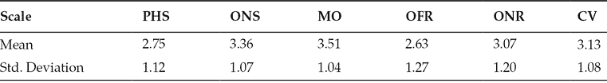

表 3.1
量表的描述性统计。

根据`表 3.1`，选择保护性行为最重要的构因素是账户监控 (MO)，为 `(M = 3.51)`，表明大学生通常考虑账户安全。另一方面，选择保护性行为最重要的构因素是离线风险 (OFR) `(M = 2.63)`，显示受访者没有关注这一点。

### 3.5.2 探索性因子分析

有必要测试数据的拟合度。本研究中的 Kaiser-Meyer-Olkin (KMO) 指数为 0.92；此外，Bartlett 检验显著 `(p < 0.05)` (Hair et al., 2010)。本研究利用主成分法和 Promax 旋转对 92 个项目进行了探索性因子分析 (`EFA`)，而特征值大于 1。在检查主载荷后，根据 Gaskin (2012) 和 Williams (2010)，删除了系数小于 0.3 的 38 个项目，确定了六个成分。此外，根据 McMillan 和 Schumacher (2014)，六个构因素具有可靠性估计。仪器的 Cronbach alpha 系数为 `0.85`，子量表大于 0.7。

### 3.5.3 验证性因子分析

指标变量基于之前的研究选择，并采用因子分析来确定它们是否如预期加载在因子上。根据 Hair 等人（2010）的观点，如果测量拟合指数中有三个或四个指数（包括一个绝对指数和一个增量指数），则符合标准，并为模型拟合提供了充分证据。`表 3.2` 代表了针对六个构因素的验证性因子分析 (`CFA`) 模型得出的拟合良好指数。由于 `χ²/df` 小于 5，符合标准。此外，均方根误差 (`RMSEA`) 恰好符合 `.08`。同时，拟合良好指数 (`GFI`) 和规范拟合指数 (`NFI`) 均符合标准，均大于 0.90 (Hair et al., 2010)。此外，每个项目对于构因素在统计上都是有效的，收敛效度的结果显著 `(AVE > .5 & CR > .7)` (Pedhazur and Schmelkin, 2013)。此外，两个构因素的平均方差 (AVE) 高于两个因素之间相关性的平方，因此存在区分效度 (Hair et al., 2010)。这些分析证实了本研究的测量模型具有良好的效性和可靠性。


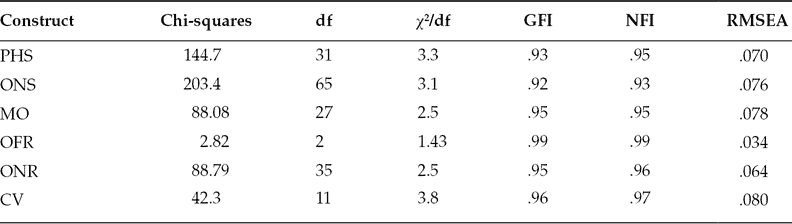 

表 3.2
拟合优指数。

### 3.5.4 结构模型与假设检验

在对六个独立变量的关系进行一般估算后，使用了结构方程模型（SEM）技术（Kaplan and Depaoli, 2012）根据文献建议对假设模型进行测试。当需要测试独立变量对因变量的影响结果时，使用了标准化回归权重进行假设检验。以 p 值 0.05 或更小作为标准（Hair et al., 2010），以判断预测程度是否显著。假设模型显示在图 3.2 中，表 3.3 汇总了假设检验的结果。

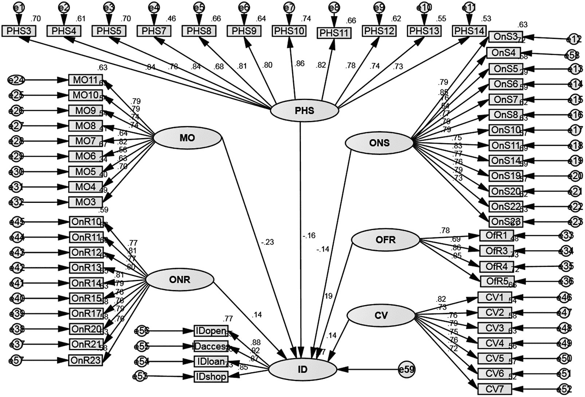

图 3.2
结构模型。

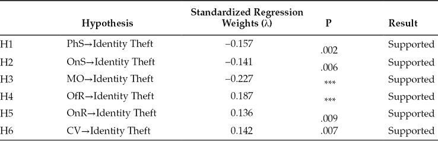 

表 3.3
假设与发现摘要。

## 3.6 讨论

研究模型表明，离线风险和账户监控是身份盗窃发生最有影响的因素。本研究结果显示，账户监控是降低身份盗窃概率最有影响的构建。研究结果显示，马来西亚青年对账户安全非常了解。此外，马来西亚是发展中国家中青少年储蓄计划和儿童发展账户的先驱。马来西亚国家银行（BSN）作为马来西亚的一家开发银行，参与教育青少年储蓄和财务决策的重要性（Masa, 2009）。本研究结果显示，监控并检查银行电子邮件发送的信息的客户在防范身份盗窃方面更加安全。通过检查电子邮件，可以核实支票人、金额以及兑现时间，一旦发生欺诈，可以迅速向银行报告。

此外，使用网上银行已成为马来西亚生活的重要组成部分，该国金融机构的创新产品之一是电子账单（Bekhet and Al-Alak, 2014），它们已取代纸质账单。此类电子账单有助于显著减少易于访问的邮箱中敏感机密信息的存在，这些信息可能会落入他人之手。在线进行的支付和收据与邮寄的支票相比，具有更高的安全性。此外，如果在使用银行网站进行支付或接收的过程中发生未经授权的交易，将获得保障保护。

此外，各项研究结果证实，马来西亚已开始向企业颁发临时信用卡。这种卡是防止身份盗窃的一种方式，因为卡上的号码是由信用卡公司颁发的，用于在线交易，且仅使用一次。使用临时信用卡号码的优势在于，如果该号码被泄露，持者只需取消该号码而不是主账户号码，这意味着临时信用卡号码可以帮助保护主卡安全。然而，信用卡提供了更大的保护，风险也更小，因为资金不会像借记卡那样直接从持者的个人银行账户中扣除。如果借记卡发生欺诈性取款，在银行调查未经授权取款报告期间，支票可以被退回，现金的访问权限会被封锁。此外，在信用卡的情况下，通常从未经授权交易之日起有 90 天的时间可以报告该事件，而在借记卡的情况下，银行要求提前两天通知。鉴于此，事实上说“使用信用卡将减少身份盗窃的发生率”是正确的。一些金融机构发行预付值信用卡，类似于礼品卡。然而，此类卡片的安全性不如信用卡，尽管预付值信用卡会减少信用卡的使用，从而最大限度地减少信用卡信息泄露的机会。

信用报告根本上是财务活动的总结陈述，例如贷款、还款记录、新开和关闭的账户、未付和逾期账单等活动。银行或机构会发布此类信用报告。对此类服务的监控有助于识别问题，例如，有人用你被盗取的信息开设了新的信用账户。通常，马来西亚金融机构对其债权人和借款人维持此类报告，并每月向马来西亚国家银行信用局提交。目前，近 900 万消费者的详细报告存储在 `CCRIS` 和 `CTOS` 中。整体数据的处理由马来西亚国家银行完成，它提供的信用报告可供所有金融机构随时访问。

与由马来西亚国家银行（BNM）管理的 `CCRIS` 不同，`CTOS` 由一家拥有 20 多年历史的马来西亚公司拥有和管理，该公司收集来自公共领域各种来源的个人和公司数据。`CTOS` 对于需要对潜在业务伙伴进行背景调查的企业特别有用。对于允许信用期限的业务来说，来自 `CTOS` 和 `CCRIS` 的此类背景信息对于保护其利益至关重要。授权 `CTOS` 或 `CCRIS` 主动限制或防止未经许可发布个人数据的客户，从可靠的信用信息系统中获益，因为这最小化了银行垄断信用的影响。这实际上是一种通向更良好信贷访问控制的方法。因此，结论可能是，政府和马来西亚国家银行应当勤于审查国内银行的运营方面，以便这些金融机构在批准推出新的网上银行服务之前提供充分的技术支持和安全技术（例如防火墙、双因子身份验证、安全套字层加密等）（YenYuen and Yeow, 2009）。结果，当地银行应更加关注服务的提供，通过重新评估其专业实践并确保其与客户的需求保持一致。

另一方面，极大似然估计的结果显示，参与离线风险的客户比其他人更容易遭受身份盗窃。根据表 3.1，离线风险被受访者选为最不重要；这表明受访者在离线时并不关注风险。


在没有需要的情况下携带支票簿被发现是另一种风险行为。支票如果放置不当可能会导致各种不良后果，因为它们包含了姓名、地址、银行账户号码、银行汇代码和银行名称。此类敏感信息可能允许窃贼通过欺诈访问支票账户，并将资金转移到他们的个人账户中。此外，除非先确定这些信息将如何被使用以及如何受到保护，否则不应通过电话或手机提供个人信息。

在马来西亚的另一项研究中，Zendehdel 和 Paim (2012) 报告说，电子商务增加了线下环境中某些风险产生负面后果的可能性。虽然在街头犯罪的研究中，犯罪与受害行为之间的关系已广为人知，但对于虚拟犯罪，这一问题的探索还较少。同时，关于马来西亚的其它统计数据也显示了相同的结果（Raus et al., 2013）。年轻人正处于学习新技能、获得新经验和尝试各种生活变化的年龄。随着电子商务扩展到电子银行和购物，并关注马来西亚年轻人多重订阅渗透率达到 106%的情况（Goi and Ng, 2011），客户在手机上订购商品时，个人信息可能会口头释放。通常当人们在打电话时，很少关注自己身处何地或周围是谁。通过电话提供个人信息是一种风险行为，因为存在被窃贼窃听的可能性。

值得注意的是，展示个人行为与身份盗窃风险之间联系的公共意识提高活动可能会改善这种形式的受害情况。此外，作为对公共政策制定者的实际贡献，本研究的发现可以教育并激励所有年龄段的客户，让他们重视应采取的保护措施的价值，以防止其身份被盗窃。这可能需要个人、企业、客户群体和政府的共同努力。这是因为，如果缺乏客户的意识以及对在线和线下防止身份盗窃所应采取的步骤的了解，任何保护个人身份隐私和防止身份盗窃的尝试将是无效且不成功的。

## 3.7 结论

尽管基于身份的犯罪普及和影响在过去十年中显著增加，但对于个人如何保护自己免受此类事件的影响已知相对较少。本研究试图通过应用理论整合来调查风险行为和保护性行为对身份盗窃的影响程度，从而填补这一空白。本研究首次在研究中涵盖了线下和在线身份盗窃受害情况，并与过去研究考虑的因素相比了更多的预测变量。此外，与以往研究不同，本研究将四种身份盗窃视为因变量，以指示解释身份盗窃的大部分因素。本研究为保护性行为概念以及风险行为概念提出了一种新模型，以减少电子商务客户身份盗窃的发生。这一过程包含了发现总记录参数子集的几种方法，显示出良好的预测能力。`SEM` 用于确定 92 种人类风险和保护行为如何影响身份盗窃的发生。结果表明，线下风险和账户监控对身份盗窃预测的影响最大，预测最好。

关于大学生的年龄问题，提高意识的重要性得到了阐明，因为成年年期是体验新事物和尝试变化的时期。因此，他们在网络空间内的个人数据和隐私保护方面存在问题。本研究的结果使政策制定者等机构能够制定政策和规则，更好地影响用户在预防方面的努力。

## References

1. Adam, M. E., Yousif, O., Al-Amodi, Y. & Ibrahim, J. 2011. Awareness of Social Engineering among IIUM Students, *World of Computer Science and Information Technology Journal*, *5*, 121–130.
2. Albrecht, C., Albrecht, C. & Tzafrir, S. 2011. How to Protect and Minimize Consumer Risk to Identity Theft. *Journal of Financial Crime*, *18*, 405–414.
3. Archer, N. 2011. Consumer Identity Theft Prevention and Identity Fraud Detection Behaviours. *Journal of Financial Crime*, *19*, 20–36.
4. Bekhet, H. A. & Al-Alak, B. A. M. 2014. Modelling Client Usage of e-Statements: An Empirical Study in Malaysia. *International Journal of Banking, Accounting and Finance*, *5*, 309–328.
5. Bernama. 2013. *Look Out For Cyber Cheats*. Bernama, August 15 2013.
6. Cattell, R. B. 1977. *Scientific use of factor analysis in behavioral and life sciences*.
7. Chamhuri, N. & Batt, P. J. 2013. Exploring the Factors Influencing Consumers’ Choice of Retail Store When Purchasing Fresh Meat in Malaysia. *International Food and Agribusiness Management Review*, *16*, 99–122.
8. Chu, B., Holt, T. J. & Ahn, G. J. 2010. *Examining the Creation, Distribution, and Function of Malware On Line*. Washington, DC: National Institute of Justice. Retrieved from `www.ncjrs.gov./pdffiles1/nij/grants/230112.pdf`.
9. Facts, Q. 2011. Malaysia Educational Statistics. (July 2011). Retrieved July 12, 2012.
10. Goi, C.-L. & Ng, P. 2011. Perception of young consumers on mobile phone applications in Malaysia. *Journal of Information & Cybersecurity*, *11*, 7–9.
11. Hazelah, A., Ismail, N. & Hashim, R. 2011. Identity Awareness among City Dwellers. *World Applied Sciences*, *15*.
12. Hair, J., Black, W. & Babin, B. 2010. *Multivariate Data Analysis: A Global Perspective*. Princeton, NJ: Pearson.
13. Higgins, G. E., Hughes, T., Ricketts, M. & Fell, B. 2010. Self-Protective Identity Theft Behaviors of College Students: An Exploration Using the Rasch Person-Item Map. *Southwest Journal of Criminal Justice*, *7*, 24–46.
14. Holt, T. J. & Turner, M. 2012. Examining Risks and Protective Factors of On-Line Identity Theft. *Deviant Behavior*, *33*, 308–323.
15. Holtfreter, K., Reisig, M., Pratt, T. C. & Holtfreter, R. E. 2015. Risky Remote Purchasing and Identity Victimization among Older Internet Users. *Psychology, Crime & Law*, *21*(7), 681–698.
16. Hoofnagle, C. 2007. Identity Theft: Making the Knowns Known. *Harvard Journal of Law & Technology*, *21*, 98–122.
17. Hu, X., Primack, B. A., Barnett, T. E. & Cook, R. L. 2011. College Students and Use of K2: an Emerging Drug of Abuse in Young Persons. *Substance Abuse Treatment, Prevention and Policy*, *6*, 7–16.
18. Jakobsson, M. & Myers, S. 2006. *Phishing and Countermeasures: Understanding the Increasing Problem of Electronic Identity Theft*, Princeton, NJ: John Wiley & Son.
19. Kahn, C. M. & Roberds, W. 2008. Credit and Identity Theft. *Journal of Monetary Economics*, *55*, 251–264.
20. Kaplan, D. & Depaoli, S. 2012. Bayesian Structural Equation Modeling. In: H. Hoyle (ed.), *Handbook of Structural Equation Modeling*. New York: Guilford Press.
21. Lewis, J. L. 2011. *Exploring the Identity-theft Prevention Efforts of Consumers in the United States*, United State: BiblioBazaa.


24. Lewis, J. L. 2011 b. *美国消费者身份盗窃预防措施的探索*.ProQuest LLC.

25. Lombardi, R. 2006. *专家揭秘关于身份盗窃的迷话*.IT World Canada。

26. Loo, W., Yeow, P. H. & Chong, S. 2011. 多功能智能国家身份卡的可接受性：一项实证研究。《全球信息技术管理期刊》，*14*, 35–58。

27. Malhotra, N. K., Birks, D. F. & Wills, P. 2013. *营销研究要要*.伦敦：Prentice Hall。

28. Masa, R. 2009. *全球青少年储蓄与资产积累的创新*.CSD 研究简报。

29. Mcmillan, J. H. & Schumacher, S. 2014. *教育研究：基于证据的探究》，弗吉尼亚：Pearson Higher Ed。

30. Messner, S. F. & Krohn, M. D. 1989. *偏离与犯罪研究中的理论整合：问题与展望*.SUNY Press。

31. Milne, G. R. 2005. 消费者在多大程度上保护自己免受身份盗窃？《消费者事务期刊》，*37*, 388–402。

32. Milne, G. R., Labrecque, L. I. & Cromer, C. 2009. 走向在线消费者的风险行为和保护措施。《消费者事务期刊》，*43*, 449–473。

33. Milne, G. R., Rohm, A. J. & Bahl, S. 2004. 消费者对在线隐私和身份的保护。《消费者事务期刊》，*38*, 217–232。

34. Mohamed, D. B. 2013. 打击马来西亚的网络犯罪威胁：努力、网络法与传统法律。《计算机法与安全评论：技术与实践国际期刊》，*29*, 66–76。

35. Norberg, P. A., Horne, D. R. & Horne, D. A. 2007. 隐私悖论：个人信息披露意图与行为。《消费者事务期刊》，*41*, 100–126。

36. Pannah, E. 2011. *电子商务中的网络安全|保护个人数据对身份盗窃的影响*.马里兰大学大学学院。

37. Pedhazur, E. J. & Schmelkin, L. P. 2013. *测量、设计与分析：一种整合方法*.新泽西州希尔斯代尔：Psychology Press。

38. Pett, M. A., Lackey, N. R. & Sullivan, J. J. 2003. *理解因子分析：因子分析在医疗保健研究工具开发中的应用》，加州州千橡橡克斯：Sage。

39. Ramaswamy, V. M. 2006. 安全身份盗窃工具包。《CPA 日刊》，*76*, 101–167。

40. Raus, M. I. M., Tah, I. H. M. & Yahya, S. 2013. Facebook 中的个人信息披露：UiTM Pahang 学生的意识。《未来计算机与通信国际期刊》，*2*, 258–262。

41. Reyns, B. W. 2013. 在线常规与身份盗窃受害化：进一步将日常活动理论扩展到直接接触犯罪之外。《犯罪与青少年行为研究期刊》，*50*, 216–238。

42. Reyns, B. W. & Henson, B. 2015. 千张面孔的盗贼与无面目的受害者：基于日常活动理论的在线身份盗窃受害化决定因素。《国际罪犯治疗与比较犯罪学杂志》，*60*, 1119–1139. 0306624X15572861。

43. Reyns, B. W. & Randa, R. 2019. 小偷之间没有荣誉：个人和同伴偏离作为在线身份欺诈受害化的解释。《安全期刊》，*33*, 228–243。

44. Samah, A. A., Ahmadian, M., Gill, S. S. & Hendijani, R. B. 2013. 马来西亚居民对教育旅游的态度。《亚洲社会科学》，*9*, 14–18。

45. Seda, L. 2014. 身份盗窃与大学生：他们知道吗？他们在乎吗？《金融犯罪期刊》，*21*, 461–483。

46. Shah, M. & Okeke, R. I. 零售业内部身份盗窃预防框架. 2011 年欧洲情报与安全信息学会议，雅典。IEEE, 366–371。

47. Symantec. 2014. Symantec 2013 [在线]. 可访问：[`www.symantec.com/security_response/publications/threatreport.jsp#preview_2_column_1`](http://www.symantec.com/security_response/publications/threatreport.jsp#preview_2_column_1) 2014/10/24。

48. Tanner JR, J. F., Hunt, J. B. & Eppright, D. R. 1991. 保护动机模型：恐惧诉诸的规范模型。《营销杂志》，*5*, 36–45。

49. Thornberry, T. P. 1989. *理论整合的优缺点：偏离与犯罪研究中的理论整合*.纽约：纽约州大学出版社，51–60. ISBN: 978-0791400012。

50. Wang, W. J., Yuan, Y. & Archer, N. 2006. 打击身份盗窃的情境框架。《安全与隐私》，*4*, 30–38。

51. Williams, B. & Thompson, N. 2010. 学生与非学生对身份盗窃的感知与认知。《急诊基层保健杂志》，*8*, 1–13。

52. Winterdyk, J. & Thompson, A. 2008. 用于身份的探索性因子分析。《加拿大犯罪与刑事正义杂志》，*50*, 153–186。

53. Xiangke, P., Ge, G. & Mian, F. 2012. 乘法模型下的分层群抽样。《科学》，*37*, 833–837。

54. YenYuen, Y. & Yeow, P. H. 2009. *马来西亚网上银行服务的接受度。网络信息系统与技术*.柏林：Springer。

55. Zendehdel, M. & Paim, L. H. 2012. 在线购物的安全与隐私感知风险：针对马来西亚的研究。《生命科学期刊》，*9*, 983–987。


安全方案将列出企业内部应该验证的关键事项。这可能包括组织的系统、其物理形式等。这些事项的潜在危险也应该被记录下来。如果该文档侧重于网络安全，风险可能包括来自内部的风险，例如不满的员工窃取重要信息或在公司网络上发布内部病毒的风险（Angst et al. 2017）；或者，来自公司外部的黑客可能会进入系统并导致数据丢失、更改数据或窃取信息。最后，计算机系统可能会遭受物理损坏。

在确定了风险后，有必要确定它们实际发生的概率。企业还需要确定如何防止此类风险。一些保护措施可以是实施某些工作场所规则，以及强有力的物理和网络保护。此外，必须有一份路线图，说明在危害真正发生时该采取何种措施（Aurigemma and Leonard 2015）。安全策略应分发给企业中的每一个人，并且当新员工入职时，需要定期对数据保护流程进行检查修改。

## 4.1.2 为什么你需要安全策略？

谁对组织知识的安全性负责？也许是评估与分析部门吗？在管理信息系统（MIS）中，保护机信息的责任不仅属于个人员工或部门（Backhouse et al. 2006; Bandara et al. 2015; Banerjee et al. 1998），还属于机构本身。归根结底，取决于高层管理人员，他们负责确保组织的最终利益，并确保一套可靠且有说力的安全方法论作为常规工作被执行和建立。

尽管策略本身不能解决问题，除非它们编写得清晰并实施，否则可能会使问题复杂化，但方案决定了每项企业活动应当的基础目标（Barlow et al. 2013）。安全策略本质上适用于监控系统架构及内部包含数据访问的、直接、刻意且特征良好的安排、准则和方法。安全策略报告和程序，以及明确的代表及其职责都应该被包含在内。同样，这也是向外界传达的关于组织对保障承诺的有力信息。

## 4.1.3 如何制定策略

第 2 章中描述的危害评估的发现必须集中在实用的安全策略上。危害评估的发现为方案制定者提供了其组织显性安全需求的准确画像（Basin et al. 2013）。此类信息非常重要，因为它提供了向领导层索取安排的有力细节：

*   描述敏感数据和基础框架。
*   纳入市、州和政府法律，以及相关的道德准则。识别内部保险目标和任务。
*   为实现目标和任务制定时间表。
*   确保建立程序以实现这些目标和任务。

在这方面，在策略制定过程中将法律和行政问询、运营重点、合同需求、环境问题和客户反馈纳入其中是至关重要的（Baskerville et al. 2014）。成功的安全策略将这些及不同的变量融合为一个基本的目标和任务安排方案，在员工执行其任务时指导他们。

尽管制定企业策略通常是高层领导的工作，但全企业范围的实践应当参与到策略制定中。虽然并不是每位员工都真的需要参加每一次安全策略制定会议，但高层应该在数据收集过程中来自所有活动级别和类型的人员（类似于在危害评估期间构概念时）（Baskerville and Siponen 2002）。非监管人员具有独特的理解，这在与策略制定者交谈时非常重要，而且这种理解显然无法通过其他程序来替代。定期与员工见面以了解影响他们工作的关键问题，是实现组织各级达成共识的重大进展。

虽然从未来客户那里获得尽可能多合理预期的反馈是重要的，但在策略制定的数据收集期间，听取来自组织外部的观点同样重要。为什么？为了什么？因为领导者应该了解不同组织正在创建的安全行动，这些行动极有可能影响到他们以及他们将执行的方法。例如，如果网络中除某所学校外的所有学校都添加了加密程序以验证通过互联网发送的信件（Bauer and Van Eeten 2009），那么对于没有加密密钥的孤立学校来说，与其建立联系将极其困难。论点是，正如安全安排应该包含内部协作，它们经常也需要远程协作——这一信息不应被忽视，特别是对于那些使用基于站管理的组织来说。

办公室的危害评估鼓励方案制定者关注其程序的特定安全需求。然而，如果很少关注这些目的，任何安全策略中随后的通用问题都应该得到明确且简洁的解决（Ligatti et al. 2009）：

*   策略的说明是什么？
*   谁制定了这项策略？
*   谁维护了该策略？
*   执行支持了谁的真实性？
*   策略中涉及哪些法律或准则（如果有）？
*   谁将授权这项策略？
*   程序将如何实施？
*   策略产生什么影响？
*   哪些内部属性应该被保护？
*   客户真正需要做什么？
* 如何解释漏洞和对保险的违规行为？
* 安排的生效日期和过期日期是什么时候？

策略的设计应当使其对于预期受众来说合逻辑。毕竟，未被遵守的要求预示着无法实现的目标（Bijlsma-Frankema and Cristina Costa 2010）。易于阅读的策略想法例如：

*   简洁
*   关注目标和意义，并在必要时解释基本原理。
*   不要软化信息。
*   你是在解释而不是要求，所以不要建议、暗示或提示，除非你确实计划这样做。
*   尽可能使用清晰的描述性词汇。

## 4.1.4 如何让策略执行变得真实？

除了保持规则简单、简洁和直觉外，人们正努力让员工尽可能容易地履行它们。注意，重点并不是告诉员工“情况是怎样的”，而是让每个人都参与其中（Boss et al. 2009, 2015; Bulgurcu et al. 2010）。通过让事情变得尽可能简单，它变成了一个员工可以承诺的务实目标。增加在工作环境中实际执行你策略概率的显性方法包括：

*   将安全责任明确委托给一个有动力且尽职的领导者：一个将保险视为必需品的人。重要的是，此类人员必须被允许对所有层级的员工进行表扬和批评（Burns et al. 2017）。


-   开展与安全流程标准和员工需求紧密匹配的员工胜任培训：要意识到大多数用户从未接受过如何正确使用电脑的指导——并理解他们所拥有的微小经验。真正尝试理解他们的兴趣，并告诉他们开启设备的最佳方法。考虑到所有因素，我们可能只学会了如何为了特定应用程序使用单一的程序代码。在这方面，大多数员工对安全问题了解之甚少，除非协会正在为解决这种情况做出勇敢的努力，否则没有理由预期这种情况会得到改善。安全部门没有足够的人员来将高管人员的福祉作为工作场所的一部分，这使得其余的活动成为了一项至关重要的练习——而这一理由并不能保护计划免受非常务实的威胁（Burton-Jones et al. 2015）。

-   向代表人员传达公司的需求和愿望：尽真实地尝试向员工传达信息，但不要过于严厉。像任何展示工作一样，购买者的接受度应该通过对改进和一致性的给予回报（Cairney 2013）。作为向员工传达安全规范的有效手段，建议以下方案：
    *   举办安全强化班。
    *   建立工作环境支持平台（例如，一个拥有合格且可快速访问顾问的 `Support Desk`）。
    *   频繁且自由表彰优秀行为。
    *   创建适当的参考资料（例如议程、单页和清单——记住，在涉及安全时，简洁易懂的材料比未经编辑的技术材料更重要）。
    *   审查员工的课程阅读材料，确保其包含安全方法。
    *   在整个工作场所保持安全记录的可可用（例如标牌、FYI 通知和电子邮件传输）。

在协会的所有级别同地执行福祉准则：计划中的每位员工都会意识到他们对安全负有合法责任。经理们需要表示“按计划执行”，信任它并自己身体力行。组织的标准对所有人都有影响（Chan et al. 2005）。组织的安全不仅是一项道德利益——到此时，架构应该受到计划从头到尾的保护！

## 4.1.5 人员问题

良好的安全策略的目标之一是减少对系统的信任。虽然这听起来像是一个过于悲观的概念，但它确实有助于保护公司员工以及企业本身。但在获得安全收益之前，员工需要被正确告知他们的职位、职责和组织预期（Chatterjee et al. 2015）。

### 员工的需求应以纸质副本的形式传达并记录：

*   哪些设备的使用是有效的，哪些是无效？
*   违反指南的行为将如何安排？
*   应告知员工遵循其流程是至关重要的。

安全将通过审计进行检查。（尽责的客户应该受到表扬，而那些落后的个人可能会受到谴责或重新培训。）

### 员工应当被提醒：

*   组织管理层与设备一样，在协会内有一席之地。
*   存储在协会设备上或与协会设备交换的数据的隐私需求不应被强制要求。

应要求员工同意安全安排，以便他们了解自己的承诺并确保对安全策略表示熟悉（Chen et al. 2012）。这需要：

*   员工有机会审阅和检查他们必须遵守的策略和准则。
*   提供一个合适的阶段，让所有代表能够解释对协会原则的问题或疑虑。
*   在创建并存储在受保护区域之前，不应允许员工访问框架。

每一位新代表都应被要求满足协会的安全要求和策略。在招聘时，新员工应在入职培训中接受安全政策的教学和教育，以给他们留下保护价值的影响。

## 4.1.6 外部安全策略

外部人员（例如维护人员、供应商和危机援助人员）以及与你的系统有联系的不同办公室的人员（例如政府部门、其他教育机构和合同工）也应同意允许他们识别并保持信息保密的安排。尽管如此，注意不要向外部人员提供关于你的安全活动超出所需的信息（Chen et al. 2015）。事实上，即使是关于从你的防火墙预见的看似无害的警告，也会为专业程序员误用你的设备提供优势。此外，将安全简报限制在需要遵守它们的人员，以避免违反你的安全：

*   向他们保证你会关注保护你的设备属性。
*   确保他们安全地处理你的资产。

## 4.2 背景

尽管人力在整体安全环境中起着重要作用，但在当今世界，很难想象一种人力辅助基础设施不被视为任何成功安全的附属品（Chen and Mariam Zahedi 2016）。困难的技术无法完全取代人力；由于两者都有其固有的缺陷和优势，因此技术与人力的适当结合至关重要。

本章尝试描述可用的技术，包括重要技术以及针对特定行业的专业技术。虽然某些技术输入很重要，但先进设备的选择取决于对风险的理解、生成产品的形式以及所创造商品的重要性。很大程度上取决于管理层对保护的投资意愿，特别是当考虑到安全没有投资回报且回报无法量化时。这里列出的设备涵盖了广泛的产品，其需求根据产品类型或行业的关键性而产生（Cheng et al. 2013）。

### 4.2.1 信息安全策略类型

管理层需要定义三种信息安全策略以创建一个完整的信息安全策略（Swanson and Guttman 1996）。

1.  企业信息安全策略 (EISP)
2.  特定问题安全策略 (ISSP)
3.  特定系统安全策略 (SysSP)

#### 企业安全策略 (EISP)

组织信息安全策略概述了公司安全计划的战略方向、范围和语言，并规定各个信息管理领域的责任。EISP 为信息安全程序的创建、部署和管理提供指导。

#### 特定问题安全策略 (ISSP)

特定问题安全策略包括对所有组织成员使用的工具（如程序或设备）的具体说明和澄清。每个组织的 ISSP 将针对特定的技术系统，这些系统通常需要修改。

#### 特定系统安全策略 (SysSP)


设备的特定安全措施并不符合此类监管风格。这些措施通常被设计为规范或协议，用于安装或管理过程，例如配置和运行网络防火墙。网络的特定安全实践可以分为两大类：

- `管理指南 SysSP`：为管理制定的 `SysSP` 管理指南手册，为技术的部署和集成提供建议，并总结了企业人员为了促进信息安全将遵循的合理行为（Choudhury and Sabherwal 2003）。
- `SysSP 技术规范`：管理策略由负责人和系统管理员共同制定；系统管理员可能需要开发不同类型的管理策略（Chu et al. 2015）。例如，如果 `ISSP` 允许用户每季度更新一次密码，系统管理员可能会在特定的系统请求中加入技术控制以实施此项策略。

### 4.2.2 信息安全策略的制定

信息安全策略的实施包含一个两阶段的项目：第一阶段是设计和实施策略，第二阶段产生合规机制，以确保策略在组织内得到一致使用。策略开发项目应经过充分准备和支持、合理组织，并准时、预算内完成（Chu et al. 2018）。可以使用安全系统设计生命周期（`SecSDLC`）来指导策略开发计划。

**探索阶段：** 策略开发团队在此过程中寻求高层（`CIO`）的协助。

- 如果项目获得高层的赞助，成功的机会更大。
- 高层参与得越多，执行速度就越快。
- 良好地代表项目策略目标。
- 受拟议策略影响的相同人员。
- 委员会应由法律部门、人力资源部门和终端用户成员组成。
- 获取一名能够从头到尾领导项目的项目经理。

**分析阶段：** 此阶段应包含以下任务：

- 进行全新的或最新的风险评估或 IT 审计，记录组织当前的信息安全需求。
- 选择主要信息资源和现有策略。

**设计阶段：** 这一步应包含关于如何执行策略以及如何验证交付的策略。组织领导者应接受并阅读这些规章。

**实施阶段：** 策略开发部门在此过程中起草规章。该部门将确保规章作为书面文件可执行，并由其相关人员发布、解释和接受。

**维护阶段：** 在此过程中，策略开发团队根据需要管理和更新策略，以确保其持续成功。计划应与一个框架相关，通过该框架可以自由记录与其相关的问题。它还应定期进行检查。

### 4.2.3 信息安全策略的实施方法

实现信息安全策略的应用有两种方法：自上而下的策略和自下而上的方法（Chua et al. 2012）。

自下而上的策略由执行和技术人员实施。在这种策略中，系统管理员试图增强他们的应用程序。系统和网络工程师提供丰富的专业知识，可以极大提高企业信息的安全性。

我们了解对其流程可能危险的风险，也知道保护其技术需要哪些措施和策略。这种策略很少成功，因为准备工作并非由高层组织，例如机构之间的协作以及适当预算的制定。

自上而下的策略具有结构化的协调，从高层开始，并由一名专职领导者提供资金并建议执行机制。高层拥有充足的资金，提供指导并创建策略、协议和流程。

### 4.2.4 策略、标准与实践

策略是一组规定组织内部允许和不可接受行为的规则（Cram et al. 2016b）。策略指导如何允许使用技术。信息安全策略由涉及全公司信息隐私的高级注释组成，并由高层管理制定。法律概述了警察的角色和职责，以及需要防御的信息类型。我们不应准确说明是哪个程序或机器正在正常运行。此类信息应在被称为标准、程序、指南和实践的其他文档中予以说明。

需求是关于为了遵守策略需要做些事的详细陈述。标准认可并促进网络安全策略的发展。这些标准促进确保组织的合规完整性。指南通常描述了引入特定技术、硬件或应用程序时涉及的安全控制措施。

- `程序`、流程和协议定义了员工将如何遵循指令。
- 执行预期的首选措施是指南。根据 Cram 等人的观点（Cram et al. 2016a），指南应被视为高度推荐的最佳实践。例如，某项要求可能允许密码为十个字符，而一项性的建议可以明确，确保密码在 30 天后过期也是最佳实践。
- `指令`是针对规章、协议和程序执行的逐步指南。例如，协议可以规定如何通过提供保护操作系统的详细步骤来安全地安装 `Windows`，从而遵循涉及的程序、需求和指令。

### 4.2.5 信息安全治理

为了满足 Cronan 和 Douglas（Cronan and Douglas 2006）的要求，网络安全监管被描述为在管理层面处理计算机保护的一系列行动。信息安全包括维护公司数据的机密性、可靠性和质量，通过实施适当的安全措施有助于减少可能损害业务信息的多众多威胁。有各种安全标准和协议需要处理，以便组织采取适当的控制措施来有效处理信息安全。此类安全需求和建议来自企业内部和外部渠道。


在正式标准和协议方面，信息安全策略和最佳实践非常重要，因为它们有助于促进全球信息保护理念，并帮助组织与与其利益相关者之间建立伙伴关系。`BS 7799` 便是此类标准的一个示例，它通过提供侧重于十大类安全控制的信息安全建议，为组织应如何管理信息安全提供了指导。该标准被视为组织关注有效信息安全战略的起点。世界各国政府已决定制定各种监管和程序性标准，旨在激励、促进和加强保护私人记录的努力。组织需要履行不同种类的法律要求，这些要求包括不同的特定领域，以及特定国家的法律和条例（Culnan and Williams 2009）。

在内部规范方面，与信息安全相关的 IT 架构有助于定义保护构成信息支持的关键基础设施的标准。与信息安全相关的公司信息问题有助于识别维护公司关键信息数据秘密性、可靠性和可用性至关重要的标准。这些问题通过风险评估来解决，其目的是识别和评估各种风险。首先，执行风险管理程序，在程序中识别并实施适当的安全措施，旨在最大限度地减少这些可能的风险（Cuppens et al. 2013）。

信息技术治理有两种基本方法，有助于实现成功的企业治理方法以解决业务信息风险。其次，治理的某一方面需要执行层和委员会的领导。我们被要求为信息安全设定路线和政策，监督其组织的信息安全活动。通过协调组织的信息安全活动，`CEO` 和董事会将将采用一种企业信息安全战略，该战略反映了他们对信息安全的奉献，并促进组织信息安全方面的目的、目标和战略。在监控公司信息安全活动时，执行管理层和董事会必须获得来自企业组织内部多名管理员的定期报告，以密切分析和评估他们的程序和实践，以便根据规则或法律进行审查，并在适当时予以加强。首先是运营方面，涉及组织的保护政策将如何被处理和执行。这涉及到众多部门主管和其他管理员如何在传统程序代码的帮助下，致力于执行组织信息安全战略。`Code of Practice` 的大纲是 `BS 7799`，它包含了适当的安全措施，可以保护公司信息和建议的秘密性、可靠性和质量并将并将安全整合到组织的日常运营和功能中（D'Arcy and Devaraj 2012）。

`ISO 27001` 认证为现有的信息安全系统提供了额外的安全性，而不改变信息安全流程的结构。`ISO 27001` 在其规范中将透明性、质量和诚实视为基本原则。`ISO 27001` 要求的实施对组织大有帮助；它可以促进稳健结构的发展，为组织和知识资产提供保护。`ISO 27001` 标准有助于网络安全人力资源系统的评估、实施和维护（D’Arcy and Greene 2014）。

事实上，引入一项新标准需要花费大量时间。然而，获得 `ISO 27001` 认证将有助于减少在 IT 安全运营上的支出，并有助于改进合规程序，同时最大限度地减少甚至消除对第三方提供者的依赖。因此，如果成员意识到对网络安全控制系统的需求，公司将利益最大化。

为组织寻求 `ISO 27001` 证书也可能有用，因为它可以帮助高层改进他们在组织内部遵守信息安全的方式。该框架包含了管理层实施的流程和程序标准，以确保信息系统的有效管理。

## 4.3 组织中安全策略的成功因素

信息安全策略的实施可能不仅让公司更安全，还能减少组织内任何知识工具不当使用的风险。有一些必须监控的变量，这些变量指导了信息安全策略的成功实施（D'Arcy and Herath 2011）。许多关键因素在提高组织信息安全方面起着重要作用。某些所需的考虑因素包括知识和准备、管理资源、战略、信息安全策略的实施以及组织目标。这些因素在下文中进一步描述。

### 4.3.1 意识与培训

通过提高意识和为所有员工提供培训，很容易实现组织的信息安全。安全准备和理解是给予组织所有成员的知识和指示，以促进他们有效履行职责（D'Arcy et al. 2014）。

根据 D'Arcy 和 Hovav (D'Arcy and Hovav 2007)，培训是教用户他们应该或不做什么，以及如何做。安全意识是指公司所有员工都意识到自己的安全优先事项和目的，或者积极参与其中的状况。

安全知识允许员工意识到可能危及组织信息安全的潜在威胁、这些威胁是如何产生的，以及如何安全地管理公司信息。

大多数组织处理由其员工产生的大多数合规问题（员工错误）。这被视为`危险的内部威胁`。安全培训必须根据需求进行调整（D'Arcy et al. 2009）。

根据 Siponen 和 Vance (Siponen and Vance 2010) 的观点，可以根据技术背景量身定制消费者说明。这种方法涉及普通用户准备、管理用户培训和专业用户培训。

**注册用户意识：** 确保注册用户阅读并理解规则的唯一方法是对这些政策进行指导。此类课程允许用户提问，他们也可以获得反馈。普通用户还可以获得有关如何安全执行任务的指导，例如良好的安全习惯和密码保护。

**管理用户培训：** 管理人员需要更私密的培训，以小组形式进行，并增加互动和对话。

**专业用户培训：** 这是针对 IT 工作者的专业指导，确保准备工作包括招聘承包商或外部培训机构。


必须说服高层管理人员认识公司网络安全的重要性，这样他们才会提供适当的预算来尝试执行网络安全政策。高层的参与是非常必要的，因为如果高层管理真正意识到组织对信息安全的需求，就会采取措施实施它，并投入更多人员。

### 4.3.3 预算
预算也至关重要，因为在公司内部执行网络安全需要充足的预算来确保信息的有效安全。根据 Bjorck 的说法，预算可以被描述为一种财务机制，能够计算成本并评估对所需资源的访问，以确保信息安全的成功实施。一份提案可以包括技术费用和教育成本。维护费用包括确保设备受保护的所有资源，例如防御恶意软件、网络威胁的防病毒软件，以及用于保护网络连接的防火墙。首先，安全支出包含了所有用于为员工规划保护课程的资金。保护意识培训可以包括聘请外部专业人士或培训机构。

### 4.3.4 信息安全政策的执行
网络安全策略有助于定义公司的重要资产。它还能帮助公司取得良好结果。提案必须具有描述性、易于理解且一致，这是至关重要的。政策通常需要检查和修订。

根据 Madigan 的观点，为了执行组织的规则，有必要确保所有员工都认识规定，检查政策是否被遵守，并针对违反政策的情况制定一些清晰的应对程序。Canavan 明确表示，网络安全政策只有通过审慎的执行过程才能实施。当公司决定实施信息安全计划时，它需要员工遵守规则，并意识到自己的行为和义务。

### 4.3.5 组织使命
设定目标和目的对每个组织都是至关重要的，因为它有助于开始实施网络安全。根据 McKay 的观点，如果未能实现组织的目标和优先级，公司往往会在保护细节方面出现问题，因此员工不会产生兴趣，也不会遵循网络安全政策中的指南。

## 4.4 组织安全政策案例研究
研究发现，社区拥有一种网络安全策略，让公司能够有效处理网络安全。地方政府意识到，网络安全策略是组织应该拥的一种基本工具，以便管理良好的信息保护。

一位提问者表示：“我们处理许多涉及公共部门人员的敏感细节，需要确保安全处理。”在意识会议期间，向每个小组的高层管理人员和首席执行官介绍并演示网络安全策略。研讨结束后，每个部门的领导有责任协调并将所有与信息安全政策相关的信息分发给小组内的最终用户。

高层管理人员对引入网络安全政策的印象是：“这是一个在如此广泛的员工群体中需要执行的过程，”一些受访者补充道。因此，市政府的高层管理人员意识到记录机密性的需求。

信息安全策略是面向公司手册的核心。组织应该拥有一个框架和流程，政策在其中运行，并且公司应该考虑这些流程是如何创建的。哪些流程应该被称为政策？例如，每家公司都要对组织政策（通常涉及非信息相关的合规性）、安全政策（处理安全问题）以及信息安全政策负责。关键点是管理层将展示其对知识安全的预期。瑞典民防署提供的技术支持仅涵盖网络安全，还有关于网络安全政策中应显示哪些内容的指南。

立法不应在未沟通领导预期的情况下包含任何具体的行为规则，而应该对公司章程的其他条款进行构建。策略应该是简洁且对所有人可见的。首先，可以在内部网站共享更多细节和描述。策略反映了行政部门的总体目的。对于涉及所有安全工作的网络安全政策，可以命名为信息安全政策或安全政策。策略应该在更早的阶段制定，在运营部门决定安全和防护过程的同时或在此之前。识别所有现有的政策记录对于了解操作所需信息至关重要。这为准备必要的监管文件和规范政策声明所需的后续工作提供了一些思路。工作组随后可以按照组织信息安全要求的顺序来修订和编写政策文件。此外，首要方法是在威胁最高的领域控制对最敏感信息的防御。

网络安全策略应包括：
* 管理员的目标，包括为什么信息安全至关重要。
* 关于如何实现这些目标的清晰解释。
* 职责分工的简短描述。
* 内部信息安全的细节。
* 关键概念的解释。
* 谁负责策略，以及如何进行检查和更新。

行政部门应该积极参与政策制定。毕竟，是行政部门发送信息，他们承担该计划的责任是至关重要的。尽管如此，是负责信息安全的人员还是地方实施结构（`LIS`）委员会的成员负责政策开发？虽然手册由行政部门持有，但信息安全专业人员将制定信息安全策略，使其符合网络工作的意图。一旦政策实施，公司将协调保护意识和信息共享，教育所有员工关于政策以及该政策对规管组织有多么重要。

那些制定法规（尤其是高于其他治理文件）的人，必须熟悉在公司内部创建和形成监管结构的过程。许多组织拥有某种形式化的结构，具有特定的政策文件层级、内部规划和转介，以及政策文件格式的标准模型。公司的法律经验应包含在文件的阐述中。信息安全策略的定义可以包含在技术支持的支持文件中。


组织需要以符合其公司特征的方式保护公司细节。我们需要实现业务目标，并赢得客户、顾客、投资者、公众和员工的信任。我们还积极处理细节，以确保所有知识始终安全、可靠且可用。他们选择了一种基于瑞典和国际标准（`LIS 信息安全管理`）的通用且结构化的信息处理方式。在 `LIS` 的帮助下，公司获得了正确水平的信息保护，同时其员工在日常工作中也得到了协助。

信息安全工作应该是持续且长期的，涵盖其业务的所有方面以及他们拥有或管理的所有信息资产。应该为人员提供定期指导，让他们学习如何进行知识管理。每个人在防御中都承担着责任。任何发现信息安全漏洞的人都应向主管或安全部门报告。员工必须披露可能对我们的知识资产造成损害的事件。

机密性是组织的义务。定义（基于“术语细节”，`SIS HB550 Issue 3`，`SIS` 发布）：

- `Data Resources` 指任何包含信息并携带知识的活动。
- 与资产相关的信息的保护、维持必要的机密性、诚实和透明的能力都是信息安全的各个方面。
- 未经授权的人员不得查看或泄露机密信息。包括访问信息的内容，有时也包括资产存在的秘密。
- 准确的信息确保记录不会在未经授权的情况下被更改；不是因为错误，也不是因为故障。
- 可用的信息帮助授权用户在需要时并在适度范围内使用信息。
- 信息安全管理体系（`ISMS`）是一种机制，帮助组织制定、执行、运行、跟踪、评估、维持和增强组织的最佳信息安全标准。

安全负责人每年检查并更新信息安全策略。你可以获得一份关于如何正确处理法律和指导的指南。指南也可能发布在法律或指令尚未生效的地方。方法描述和方向说明详细展示了应该如何进行这些工作。例如，这些协议可以确定如何以及何时创建副本，或者如何跟踪和管理事件日志。

### 4.4.1 从案例研究中得出的组织目标和任务

许多公司在出现问题之前并不关注信息安全，但当数据泄露发生时，他们会立即关注，并投入大量精力从中恢复。当组织没有意识到信息安全的必要性时，他们无法建立目标和任务。

Siponen 指出，公司需要设定目标和任务，以使信息安全成为一项有效的运作。他们决定想为社区做什么，并通过设定目标和任务来描述他们想要实现的目标。对于县议会地区，情况也是如此；他们决定想做什么、想做什么，并加强他们的信息安全。他们意识到这两个组织对信息安全的需要性：他们处理了许多需要保护的敏感信息。他们的目标和任务是确保其组织成功执行信息安全和信息安全策略。他们的目标是通过协调技术知识和准备，为所有员工提供有关信息安全和信息安全策略的细节。

### 4.5 结论

本章探讨了与组织引入信息安全相关的绩效因素，重点关注了高层管理在组织内执行信息安全策略中的作用。文章以定性的方式讨论了组织安全中任何漏洞产生的影响。

### 参考文献

1. Aksulu, Altay, and Michael R. Wade. 2010. “开源研究的全面综述与综合.” *Journal of the Association for Information Systems* *11*(1): 6.
2. Al-Mukahal, Hasan M. and Khaled Alshare. 2015. “影响卡塔尔组织信息安全策略违规数量的因素研究。” *Information & Computer Security*.
3. Albrechtsen, Eirik. 2007. “用户对信息安全观的定性研究。” *Computers & Security* *26*(4): 276–289.
4. Alter, Steven. 2008 a. “将信息系统定义为工作系统：对 IS 领域的意义.” *European Journal of Information Systems* *17*(5): 448–469.
5. Alter, Steven. 2008 b. “服务系统基础理论：工作系统、价值链和生命周期。” *IBM Systems Journal* *47*(1): 71–85.
6. Alter, Steven. 2013. “工作系统理论：核心概念概述、扩展以及对未来的挑战.” *Journal of the Association for Information Systems* *72*.
7. Anderson, Catherine L. and Ritu Agarwal. 2010. “安全计算实践：家庭电脑用户安全行为意图的多媒体实证检查.” *MIS Quarterly* *34*(3): 613–643.
8. Angst, Corey M., Emily S. Block, John D'Arcy, and Ken Kelley. 2017. “IT 安全投资何时有效？考虑医疗保健数据泄露背景下制度因素的影响.” *MIS Quarterly* *41*(3): 893–916.
9. Aurigemma, Salvatore and Lori Leonard. 2015. “员工情感组织承诺对安全政策态度和合规意图的影响.” *Journal of Information System Security* *11*(3).
10. Backhouse, James, Carol W. Hsu, and Leiser Silva. 2006. “创建法法标准的权力回路：塑造国际信息标准.” *MIS Quarterly* 413–438.
11. Bandara, Wasana, Elfi Furteller, Elena Gorbacheva, and Jenine Beekzen. 2015. “实现文献综述的严谨性：定性数据分析和工具支持的启示.” *Communications of the Association for Information Systems* *37*.
12. Banerjee, Debasish, Timothy Paul Cronan, and Thomas W. Jones. 1998. “建模 IT 伦理：情境伦理研究.” *MIS Quarterly* 31–60.
13. Barlow, Jordan B., Merrill Warkentin, Dustin Ormond, and Alan R. Jones. 2013. “不要借口！通过中性化减少 IT 政策违规.” *Computers & Security* *39*: 145–159.
14. Basin, David, Vincent Jugé, Felix Klaedtke, and Eugen Zălinescu. 2013. “重新审视强制策略.” *ACM Transactions on Information and System Security (TISSEC)* *16*(1): 1–26.
15. Baskerville, R., Spagnoletti, P. and Kim, J. 2014. “以事件为中心的信息安全：管理预防与响应之间的战略平衡.” *Information & Management*, *51*(1): 138–151.
16. Baskerville, Richard and Mikko Siponen. 2002. “新兴组织的信息安全元策略.” *Logistics Information Management.*
17. Bauer, Johannes M. and Michel JG Van Eeten. 2009. “网络安全：利益相关者激励、外部性与政策选择.” *Telecommunications Policy* *33*(10–11): 706–719.
18. Bijlsma-Frankema, Katinka M. and Ana Cristina Costa. 2010. “管理层和员工对控制合法性解释的后果与前因：一种自然开放系统方法.” *Organizational Control* 396–434.


19. Boss, Scott, Dennis Galletta, Paul Benjamin Lowry, Gregory D. Moody, and Peter Polak. 2015. “系统用户需要害怕什么？利用恐惧诉求产生威胁和恐惧，从而激发保护性安全行为。”*MIS Quarterly (MISQ)* *39*(4): 837–864.

20. Boss, Scott R., Laurie J. Kirsch, Ingo Angermeier, Raymond A. Shingler, and R. Wayne Boss. 2009. “如果有人在看，我会按照要求行事：强制性、控制与信息安全。”*European Journal of Information Systems* *18*(2): 151–164.

21. Bulgcu, Burcu, Hasan Cavusoglu, and Izak Benbasat. 2010. “信息安全政策合规性：一项基于理性的信念和信息安全意识的实证研究。”*MIS Quarterly* *34*(3): 523–548.

22. Burns, A. J., Clay Posey, Tom L. Roberts, and Paul Benjamin Lowry. 2017. “组织内部人员心理资本与信息安全威胁及应对评估之间的关系。”*Computers in Human Behavior* *68*: 190–209.

23. Burton-Jones, Andrew, Ephraim R. McLean, and Emmanuel Monod. 2015. “信息系统研究中的理论视角：从方差和过程到概念跨度与概念契合。”*European Journal of Information Systems* *24*(6): 664–679.

24. Cairney, Paul. 2013. “站在巨人的肩膀上：我们如何在公共政策研究中结合多种理论的见解？”*Policy Studies Journal* *41*(1): 1–21.

25. Chan, Mark, Irene Woon, and Atreyi Kankanhalli. 2005. “职场中的信息安全感知：将信息安全氛围与合规行为联系起来。”*Journal of Information Privacy and Security* *1*(3): 18–41.

26. Chatterjee, Sutirtha, Suprateek Sarker, and Joseph S. Valacich. 2015. “信息安全的行为根源：探索与不不当 IT 使用的关键因素。”*Journal of Management Information Systems* *31*(4): 49–87.

27. Chen, Yan, K. Ramamurthy, and Kuang-Wei Wen. 2012. “组织的信息安全政策合规性：大棒还是胡萝卜方法？”*Journal of Management Information Systems* *29*(3): 157–188.

28. Chen, Y. A. N., K. R. A. M. Ramamurthy, and Kuang-Wei Wen. 2015. “综合信息安全计划对信息安全文化的影响。”*Journal of Computer Information Systems* *55*(3): 11–19.

29. Chen, Yan and Fatemeh Mariam Zahedi. 2016. “个人的网络安全感知与行为：美国与中国之间的多语境对比。”*MIS Quarterly* *40*(1).

30. Cheng, Lijiao, Ying Li, Wenli Li, Eric Holm, and Qingguo Zhai. 2013. “理解组织对信息安全政策的违背：基于社会控制和威慑理论的整合模型。”*Computers & Security* *39*: 447–459.

31. Choudhury, Vivek and Rajiv Sabherwal. 2003. “外包软件开发项目中的控制组合。”*Information Systems Research* *14*(3): 291–314.

32. Chu, Amanda MY, Patrick YK Chau, and Mike KP So. 2015. “使用定量方法开发类型学理论：信息安全偏离行为的案例。”*CAIS* *37*: 25.

33. Chu, Amanda MY, Mike KP So, and Ray SW Chung. 2018. “在商业伦理研究中应用随机响应技术：职场中信息系统资源的滥用。”*Journal of Business Ethics* *151*(1): 195–212.

34. Chua, Cecil Eng Huang, Wee-Kiat Lim, Christina Soh, and Siew Kien Sia. 2012. “在复杂的 IT 项目中实施族群控制：社会资本视角。”*MIS Quarterly* 577–600.

35. Cram, W. Alec, M. Kathryn Brohman, and R. Brent Gallupe. 2016 a. “追击移动的目标：信息系统控制变化的过程模型。”*Information Systems Journal* *26*(3): 195-226.

36. Cram, W. Alec, Kathryn Brohman, and R. Brent Gallupe. 2016 b. “信息系统控制：针对新兴信息系统的回的回顾框架。”*Journal of the Association for Information Systems* *17*(4): 2.

37. Cronan, Timothy Paul, and David E. Douglas. 2006. “走向信息技术的全面的伦理行为模型。”*Journal of Organizational and End User Computing* *18*(1): I.

38. Crossler, Robert E., Kathryn Brohman, and R. Brent Gallupe. 2009. “用户对安全防御措施的意识及其对信息系统滥用的影响。”*Journal of Security*

39. Crossler, Robert E., Kathryn Brohman, and R. Brent Gallupe. 2013. “信息安全的未来方向。”*Computers & Security* *32*:

40. Culnan, Mary J., and Cynthia Clark. 2009. “伦理如何增强：数据泄漏。”*MIS Quarterly* 673–687.

41. D'Arcy, John and Anat Hovav. 2007. “威慑内部信息系统滥用。”*Communications of the ACM* *50*(10): 113–117.

42. D'Arcy, John, Anat Hovav, and Dennis Galletta. 2009. “用户对安全防御措施的意识及其对信息系统滥用的影响：威慑方法。”*Information Systems Research* *20*(1): 79-98.

43. D'Arcy, John, and Tejaswini Herath. 2011. “IS 文献中威慑理论的回顾与分析。”*European Journal of Information Systems* *20*(6): 643–658.

44. D'Arcy, John, Tejaswini Herath, and Mindy K. Shoss. 2014. “员工对压力性安全要求的反应：应对视角。”*Journal of Management Information Systems* *31*(2): 285–318.

45. Ligatti, Jay, Lujo Bauer, and David Walker. 2009. “运行时执行安全策略。”*ACM Transactions on Information and System Security (TISSEC)* *12*(3): 1–41.

46. Monfelt, Y., Pilemalm, S., Hallberg, J., and Yngström, L. 2011. “将社会和组织因素纳入安全管理的 14 层框架。”*Information Management & Computer Security*

47. Siponen, Mikko, and Anthony Vance. 2010. “中和：员工信息安全政策违反问题的新见解。”*MIS Quarterly* 487–502.

48. Swanson, M., and B. Guttman. 1996. “信息系统安全的通用原则和实践。”国家标准与技术研究院，技术管理部，美国商务部。

49. Wong, C. 2011. “克利福德·R·肖恩和亨利·D·麦凯：社会组织理论。”

# 5 网络攻击及其对现实生活的影响：什么是现实网络攻击？它们如何影响生活？我们该如何应对？

Premkumar Chithaluru, Rohit Tanwar, and Sunil Kumar

石油与能源大学，德拉拉敦，印度


由于 IT 技术的快速增长和广泛使用，网络空间已成为国家、文化和个人生活中不可或缺的一部分。网络空间在提供休闲机会的同时，也带来了日益增加的风险和困难。为了在网络空间中寻求优势，大多数 ICT（信息通信技术）发达国家已经制定了网络空间政策和战略。为了理解网络空间，我们必须利用以下分层模式：

1. 构成网络战场的物理框架和基础设施；
2. 维持和提供数字平台的逻辑构建块；
3. 存储、传输或处理的数据内容。

在这个新世界中，有许多挑战冲击着国家，但在网络领域，边界是渗透性的，证据、思想和通信可以分发，且几乎不受地区或权威的限制。这意味着国家常用的工具通常不适用于网络竞技场。但国家正在进行调整。各国正努力开发和部署新的控制工具，在许多情况下，它们通过在网络空间中开发支持性的编码者显然获得了获益。在许多国家，网络战争已成为军事增长的重要部分。除了主权国家，非国家行为体也利用网络空间的不安全性和互通性对国家和社会造成了巨大破坏。

### 5.1.1 网络攻击的定义

在 20 世纪 50 年代，该术语应用于计算机——设备感知、动物控制和移动。20 世纪 90 年代产生了一个基于现代技术的概念，“cyber”代表“机器控制”。网络空间”一词被用于一种抽象的物理空间，某些公民希望这种空间在数字设备在线活动的意义上存在（Kruse 等人，2017）。

### 5.1.2 近期的网络攻击

这个词现在几乎专门用于定义与数据相关的网络安全问题。由于很难看到通过这种线路传输的模拟信号如何代表攻击，这种视觉事件被视为一种物理现象（Bloomfield and Moulton 1997）。来自网络空间（指我们的数字设备）的攻击是通过网络空间对我们进行的攻击。网络空间作为一个不存在的虚拟数据库，现在是帮助人们掌握意图伤害我们的电子军库的一种。但真实的是入侵者的目标和可能的影响。然而，许多网络攻击只是分散注意力；很少是深思熟虑的，或者纯粹是的。

### 5.1.3 为什么防止网络攻击至关重要？

存在着巨大的安全风险。电子断电、军事工具事故和网络安全机密泄露可能是网络攻击的后果。这些可能导致包括医疗记录在的重要敏感数据被盗。网络攻击可以中断或瘫痪移动和计算机网络，导致数据无法访问。声称我们意识到了网络威胁（Carr 2011）并不令人畏惧。还有更严重的威胁。“网络安全威胁渗透任何公司，而且并不总是由 IT 部门明确管理，”Gartner 澄清道。企业家追求他们的新战略，那些领导者每天都在做出战略风险决策。美国政府积极应对网络威胁，但在反击这些方面似乎还不够。根据白宫政策和预算办公室的数据，在分析的 96 个实体中，有 74 个在网络利益方面处于“威胁性”或“高风险”状态。需要立即改进安全性（Chapple and Seidl 2014）。

美国政府近年来经历了数次瘫痪性的数据泄露。例如，联邦人事管理局的巨型破译，以及美国海军秘密计划的盗窃。其中多次攻击被归因于中国的某些国家背景机构。

### 5.1.4 网络安全攻击的类型

网络安全面临大三大类挑战。攻击者正在追求：

1. 经典的经济利益。
2. 符号操纵。
3. 符号监视（包括商业间谍活动——窃专利或国家间谍）。

几乎所有的网络攻击都属于这三类之一。恶意执行者在攻击技术方面有丰富的选择。常见的网络攻击有十类（Nazli 2011）：

1. **杂项。** 黑客的用于在目标系统或区域执行有害功能的代码，例如数据销毁或程序管理。
2. **钓鱼攻击。** 钓鱼攻击是一种电子入侵，使用文本中的超链接来让电子邮件客户端披露敏感信息或安装恶意软件。
3. **鱼叉式钓鱼攻击。** 一种更高级的钓鱼攻击，执行者了解目标情况，并冒充他们认识并信任的人。
4. **攻击：“中间人攻击” (MitM)。** 电子通信的发送方和接收方定义并拦截一个角色，并反过来更改通信内容。发送方和接收方声称他们显式交互。军队可以使用中间人攻击来击败对手。
5. **木马病毒。** 以古希腊的特洛伊木马命名，木马是一种恶意软件，它攻击目标设备并看起来像另一个物品，例如一个普通的软件。
6. **勒索软件。** 一种加密目标系统数据并要求付费作为回报，以便入侵者能够再次访问数据的入侵。这些威胁从低级骚扰到极端事件不等，例如 2018 年亚特兰大数据的丢失。
7. **拒绝服务攻击或分布式拒绝服务攻击 (DDoS)。** 当攻击者接管许多机器（可能可能是数千台）并允许它们使用目标系统（例如互联网）的服务时，导致查询涌入使系统发生故障。
8. **IoT 设备攻击。** 像汽车传感器等 IoT 设备容易受到不同类型的网络威胁。黑客接管计算机进行 DDoS 攻击，并从目标系统中非法检索数据。由于其数量多、地理分布广且操作系统通常过旧，IoT 应用是恶意行为者的主要目标。
9. **数据侵权。** 隐私的误用是恶意人员对数据的滥用。应用程序的侵权包括身份盗窃、揭露企业的行为以及恐惧。
10. **移动 App 恶意软件。** 与计算机硬件一样，移动设备也受到勒索软件威胁的侵害。在应用程序、移动网站、电子邮件和短信的更新过程中，攻击者可能会注入恶意软件。一旦被破解，恶意攻击者就可以被授予访问移动设备联系人详情、地理数据、商业账户等更多信息的权限。

## 5.2 背景

利用概念性炸药攻击网络系统的想法并不难理解，仅仅具有执行此类攻击的能力本身并不会将其影响（或相关性）提高到黑客引发的混乱之上。每种战斗模式都能通过与其他类型结合而获益。这种想法在电影技巧的背景下已经发展出来，即在连续攻击摧毁对手阵地后，被摧毁台阶上的人群推进。士兵可能会请求炮火打击、空中支持或物资来协助其攻击。这种“联合战斗”是当前战场的标志。但当情报思想投入行动——既作为盾牌又作为攻击或捕捉目标时——会发生什么？

### 5.2.1 网络空间的使用


由于 IT 技术的快速发展和广泛使用，网络空间的使用已成为国家、文化和个人生活的一部分。与此同时，网络空间的潜在威胁和阻碍也日益增加。在信息通信技术（ICT）方面最先进的国家已经为了追求网络空间的霸权确立了网络空间政策和战术。为了识别虚拟现实，Choucri 提出了以下结构化范式（Choucri 2015）：

- 允许“网络游戏”环境的物理框架和基础设施；
- 维持物理架构和服务的逻辑构建块；
- 计算复杂性中的收集、交付和转换，以及在该领域多样化的个人、组织和消费者。

在这个新世界，国家正受到攻击，但网络世界的边界是具有渗透性的。因此，对于领土或对情报、思想、愿望等的权威并不关注。这确保了公共国家服务并不总是延伸到网络空间应用。但国家正在发生变化，各国正在开发并实施新的控制机制，它们在许多情况下实际上旨在成为网络空间中的下一个主要参与。网络战争规划已成为许多国家军事建设的重要部分。除了政府外，网络空间的脆弱性及其互通性也被非国家行为者利用，对国家和社会造成了巨大破坏（Choucri et al. 2006）。

立陶宛、格鲁吉亚、俄罗斯和美国等国家经历过网络攻击。2013 年曝光的 PRISM 监控丑闻证明，在网络空间维持和平与稳定极其困难。尽管如此，虽然各国和个人已经组织并接受了网络战争训练，但目前尚缺乏管理互联网的全球性法律，特别是数字武器安全法的制定。由于某些国家在数据创新方面扮演着高知名度的角色，PC 风险限制的设计非常糟糕。由于这种特殊状况，创建全球性原则、完善全球法律以应对数字危险、维护和谐与福祉以及控制电子违规行为已成为一种迫切需求。关于网络武器的准则已成为各国武器情报、军备控制和裁军工作的关键部分（Lakomy et al. 2013）。

从 20 世纪 70 年代中期开始，美国一直是 IT 领域的市场领导者。它建立了极其广泛的互联网方法和策略，并加强了军事力量的发展和对敌人的监控，这些都集中于其在数据创新和充足补贴方面的无价地位。作为二世界大战以来全球军备战略的主要参与者之一，美国掌握着全球军备控制和裁军的核心部分。它在互联网上要求的任何单一组件和干预都不可避免地可能影响全球互联网军备控制的进展（Sofaer et al. 2009）。

在整个数字攻击研究过程中，掌握互联网的现状并应对数字攻击显得至关重要。全球网络中数字攻击的程度受到现有全球法律以及这些法律中潜在条款的限制。此外，这项调查的原因是收集汇总数据，这些数据可以帮助我们解释高级攻击的局限，以及由全球攻击引发或加剧的互联网不作为行为。尽管疯狂的力量希望中国和美国能像在另一种战斗中取得进展，但在互联网上的协调努力应当是这种努力中不可或缺的一部分（Kaplan 2016）。

在网络战争、虚拟武器防御和强国方面，产生的战斗模式似乎取决于社会所采用的任何工业政策。IT 的崛起意味着网络空间正在成为继陆、海、空和外层空间之后的战场。互联网已成为经济、文化和日常生活不可或缺的重要部分。最后，在进一步发展方面，它获得了势头。

然而，网络也带来了日益增长的可能问题和障碍。首先，2011 年网络威胁的数量较 2010 年增长了 36%，同时恶意代码的数量下降了 41%。根据 2013 年发布的关于国防的白皮书（Li and Tian 2013），战斗类型从机械化向情报化发生了变化，“主要力量正在积极开发更先进的武器系统，以确保在全球范围内冲突中保持战略差异。”一位美国研究人员表示，21 世纪的网络法律就像 19 世纪的海洋环境监管和 20 世纪的航空保护一样重要。互联网在短短 50 年历史中以惊人的速度增长。除了对社会稳定、国家安全、可持续发展和社交媒体产生重大影响外，网络空间还为法律和文化交流提供了平台（Madnick et al. 2009）。

### 5.2.2 网络战场

日益增长的问题是网络战斗的出现，这似乎是一种小规模的力量斗争。然而，非机械化战斗扩大了战场，其方式自飞机出现以来空未未。更糟糕的是，战争舞台已延伸到那些从未考虑过防御国家攻击者安全的组织中（Eren 2017）。许多全球战争已知以“低强度”的形式出现，即游击战、叛乱、特种行动和其他策略。从批评者的角度来看，只有美国与其对手之间的新战争可以被视为没有参与既定战线的大规模军事行动。不再会有两支军队在直线战线上集结士兵的情况，除非是两个小国之间具有局部意义的战斗（Popp and Yen 2006）。

从更广泛意义上说，这意味着全球主要力量对潜在对手拥有非动能暴力的可能性和路线图，包括和平时期。在国家群体中，秘密行动和特种战略通常参与低强度冲突，以避免全面冲突（Herken 2007），而这忽略了这样一个事实：信息战不可避免地导致网络战争成为战斗的触发点。现实中，美国在传统战斗方面的绝对性军事优势为较小国家参与网络战争提供了巨大的动力。简而言之，网络战争提供了一种经济上可以接受的非对称战争形式，这种形式是规模得的力量通过传统的军事反应无法造成的。


军队可以在国家层面领导数字攻击和数字防卫，也可以由个人在个人层面执行。这种侵入企图可能是基础性的，也可能是一项长期的、广泛的由国家运行的活动，旨在破坏敌对国家的基础并实现其核心动机，即瘫痪政府的运作。数字攻击的含义尚不完全明确（Ervural and Ervural 2018），尽管它通常包括对区域性框架或计算机组织的机扰性干扰，例如黑客攻击、阻止行政管理、信息窃取和服务器扰动。具有政治背景的、敌对国家的程序员（例如匿名协会和其他在线“暴徒””）的增加和改进，进一步加剧了数字攻击的影响。

全球前 15 个国家均考虑增加在网络进攻和防御技术方面的军事支出。在 2011 年年中，193 个联合国成员国中有 68 个启动了网络安全倡议。无论如何，到 2011 年，这一数字增加到了 114，其中 47 个国家拥有军事数字安全计划（Hansel 2018）。这 47 国家评估了其具有军事能力的数字安全极限，并制定了相关的军事活动计划。从这个意义上说，军备控制正成为全球军事监管和去军事化不可缺的一部分。然而，在整个网络空间这一领域，生效的军备控制措施几乎为零，这凸显了尽快引入通用网络空间行为准则协议的价值，以为控制全球网络行动建立框架。美国领导的国家还制定了相对完整的网络战争战略和军事计划，利用了它们的数据创新和充足的补贴。此外，军事力量的发展正在加快，并已经开展了敏感的反战研究（Malin et al. 2008）。

作为第二次世界大战以来全球重组的主要组成部分之一，美国在世界军事控制和复员方面着至关重要的权威地位（Dalsen 2009）。互联网上的任何观察都可能影响互联网通用军备控制的完善。迄今为止，已有大量文章解释了参与网络空间的法律以及如何防止外国纠纷。遗憾的是，参与网络战争的国家运作方式是秘密的，这意味着不需要接触法。

尽管如此，Scott J. Shackelford 报告说，网络攻击被分为以下几类：数字恐吓、数字战争和数字卧底工作。尽管几乎每个基于恐惧的压迫者都有网络存在，但真正的数字心理战争仍然并不常见，且尚未发生过任何大规模的数字战争。他保证需要解决的最大问题包括数字错误行为和企业斗争。美国军事预测员 James Adam 表示，任何形式的数字攻击都是数字伏击，数字阻塞的危险不应被轻视。曾预言这将是某种 thethethethethethethethethethethethethethethethethe（此处原文重复）（Tapscott and Williams 2008）。

然而，在整个网络空间这一领域，生效的军备控制措施几乎为零，这凸显了尽快引入通用网络空间行为准则协议的价值，以为控制全球网络行动建立框架。美国领导的国家还制定了相对完整的网络战争战略和军事计划，利用了它们的数据创新和充足的补贴。此外，军事力量的发展正在加快，并已经开展了敏感的反战研究（Malin et al. 2008）。

作为第二次世界大战以来全球重组的主要组成部分之一，美国在世界军事控制和复员方面着至至关重要的权威地位（Dalsen 2009）。互联网上的任何观察都可能影响互联网通用军备控制的完善。迄今为止，已有大量文章解释了参与网络空间的法律以及如何防止外国纠纷。遗憾的是，参与网络战争的国家运作方式是秘密的，这意味着不需要接触法。

尽管如此，Scott J. Shackelford 报告说，网络攻击被分为以下几类：数字恐吓、数字战争和数字卧底工作。尽管几乎每个基于恐惧的压迫者都有网络存在，但真正的数字心理战争仍然并不常见，且尚未发生过任何大规模的数字战争。他保证需要解决的最大问题包括数字错误行为和企业斗争。美国军事预测员 James Adam 表示，任何形式的数字攻击都是数字伏击，数字阻塞的危险不应被轻视。曾预言这将是某种 thethethethethethethethethethethethethethethethethe（此处原文重复）（Tapscott and Williams 2008）。

### 5.2.3 网络战争的有效限制

#### 5.2.3.1 陆地行动
在战斗中，最古老的领域包括陆军。陆军由坦克、骑兵、装甲车辆、飞机和导弹阵地。在美国，陆军管理美国境内的陆地领域。

#### 5.2.3.2 海上行动
这种战斗环境包括湖泊、运河和深海。深海领域涉及全球所有的海军力量。美国海军管理美国境内的海域领域。

#### 5.2.3.3 空中行动
这一战斗区域涉及空中战斗。领空涉及飞行员、直升机、侦察机和载货机。自第二次世界大战以来，美国的军事空权已从武装部队转移到空军。

#### 5.2.3.4 空间行动
随着航天技术的发明，军事将卫星引入了战斗领域。在该领域，关键活动包括卫星运行和核弹头的使用。空间计划是美国陆军的一项空计划

#### 5.2.3.5 网络行动
在网络攻击的早期，管理人员试图将网络任务引入这些部门，每个机构都在这一努力中承担了相应角色。2010 年，美国设立了《四年国土安全审查》和国防部（DoD）。

尽管世界是人造的，但网络战争和互联网对于国防部的行动来说，现在与自然领土、海洋、空中和星际领域同样至关。目前的战场是最为人知的。在几十年的军事历史中，受过陆地和海洋作战训练的军事规划者在规划战略扩张时一直依赖他们。空中和空间战场从上世纪中叶才变得重要，而网络战争更为近期；军事计划无法完全适应这种新的战斗形式（Salim 2014）。


平民公司在历史上并非主要的战斗目标，甚至被排除在目标之外。在早期，存在过一些并不攻击实际目标的群体。此类聚会存在于国家的物理边界之内，因此他们可以对他们居住的国家、宫殿和城镇发动规模更大、更具基础性的攻击（Iheagwara 2011）。当时显然没有产生过如何通过集中精力造成经济损害且不造成严重人员伤亡来削弱对手的想法，即使军事努力集中在破坏商业活动上，也不可避免地需要强调杀害平民。那时唯一的战斗形式是使用箭支、刀子、核武器、爆炸物等进行的物理战斗。

贸易在国家和城市中都进行，使用的是人们自行运入的物质货物。因此，即使为了防止或阻止这种贸易，战斗的概念也必然涉及对平民的透明攻击。这种现实从封建时代一直持续到 20 世纪末，战争（尤其是空中战争和轰炸）使得贸易机构成为攻击目标。《日内瓦第四公公约》（`GCIV`）（Singer and Friedman 2014）是第四部日内瓦公约。1949 年 8 月，四部日内瓦公约之一专门为战区的人们建立了人道主义保护。各国执行日内瓦公约的程度上存在异常，但这些异常似乎表现为：异常事件、错误（例如轰炸机机组由于真实的人为错误击中了错误的结构），或其行为被视为野蛮的国家腐败。尽管有这些偶发事件，各国通常仍尝试达到（军事）反击目标，以防止（平民）反制目标受到损害。

这种区分随着电影战斗的发展而有所改进。LED 技术的出现将轰炸造成的人员死亡减少到以往战争中不可行的低水平。如果以前对一个具有军事价值的单一房屋发动袭击会攻击整个社区，那么现在仅仅由于混乱或人为错误导致民用建筑毁就被视为悲剧。从某种意义上说，工业部门保护是日内瓦公约的一个积极副作用。与战场的区域隔离以及相对较少的威胁也降低了组织的脆弱性。企业主不需要在 1000 英里之外等待竞争对手失败（Stiennon 2015）。

这种情况在`20th`世纪后期开始发生。现在，随着网络战争周围新兴的工具、程序和理论，上述情景有所减少（Swintek 2018）。虽然军队的 IT 网络通常被隔离在飞地中（当然成功率不同），但私营工业与许多互联网网络以及每个居民之间存在明确的相互连接。

在网络战争中，“复古黑客”技术高超，但主要受利他主义驱动。只要完成了黑客，黑客警告被黑客的网络管理员如何保护其免受后续情况影响的情况并不罕见（Zetter 2014）。他们的创造力主要源于对知识和更大能力的需求，加之缺乏可靠的来源。这些人有明确的准则，并且从不创造他们能够利用的情况，尽管他们的行为不可否认地是不道德的。

“脚本小子”（template kiddie）的出现得较晚。随着互联网访问的普及，黑客方法变得更加流行，穿过不安全网络的能力要求大大降低。这些人忽视了祖先所具备的能力或道德品质，通常通过在页面上发布亵俗信息来仅仅为了获得炫耀的许可（Ziegler 2011）。值得注意的是，犯罪组织引入了恶意软件，通过勒索、侵吞或盗取身份来产生收益。这种脆弱性在复杂性和范围上不断增长，似乎为个人和私人组织带来了日益增长的障碍。

尽管如此，复古黑客的复杂性和技能以及脚本小子的无差别范围是针对优化网络犯罪伤害的敌对努力。此外，军事和情报机构的网络战争部门拥有无与伦比的设备。复古黑客和服务器管理员都在预算有限的情况下进行了自己的研究，尽管犯罪组织提供的资金更充足，但他们仍然资源匮乏，并且有规避捕和定判的巨大需求（Melzer 2011）。他们在安全飞地内部工作，对于他们可能造成的任何报复风险，他们无所顾忌。通常，他们行为的有效性受限于他们所代表的国家。由于朝鲜和中国是两个较先进的网络战争参与者，这确实是一个令人不安的想法。

## 5.4 新兴的网络攻击

**网络攻击从未停滞：** 每年产生数百万次攻击。许多攻击采用上述基本框架并适用于许多效果。

例如，人们对“零日”攻击拥有一种新的推崇，这种攻击可能会令安全领域震惊，因为它们不带有可识别的数字签名。

分析师所谓的“高级持续性威胁”（`APTs`）的持续“改进”是另一个担忧的现象。正如一位商业攻击者解释 APT 那样，“它是定义那些钻入网络并保持‘持续性’的黑客的最简单方法——一种无法通过软件更新或设备重置轻易防止的链接。”

非常著名的索尼入侵事件就是一个 APT 的案例，其中一个全国知名的演员在本地网络内部工作了几个月，在泄露大量数据时规避了监视（Barnes et al. 2011）。

## 5.5 网络安全攻击

网络威胁来自不同的国家、个人和背景。恶作剧的行为者包括：

*   利用自己的产品设备组装攻击向量的个人；
*   像组织一样工作的犯罪协会，拥有大量的代表作为攻击向量并执行攻击（Sechrist 2010）；
*   国家；
*   通过恐怖分子行动的国家；
*   企业代理；
*   有组织的犯罪团伙；
*   不满的内部人员。


在“暗网”（dull web）这一混乱但不可避免的网络非法区域，各种数字安全漏洞正在被买卖。心心勃勃的程序员会在这一在线市场中购买勒索软件、感染病毒、交易的设备密码等。暗网充当了风险生成器的角色，一名程序员会反复出售他/她的技术成果。

## 5.6 网络防御最佳实践与保护

对威胁环境的规模感到沮丧是很容易体会到的。但公司可以免受网络威胁的侵害。用户也可以保护自己。

### 5.6.1 行业网络防御

组织网络防御的最佳实践是提供基础但极其重要的应对措施，包括为计算机打补丁。例如，一旦入侵程序获知其可以被攻击者用来绕过代码并获取 `Windows Server` 的根权限，它就可以发布一种解决方案并分发给所有 `Windows Server` 所有者。

当软件供应商在其计算机上发现保护漏洞时，通常会编写代码来修复或“修理”问题。许多人每月至少这样做一次。当 IT 部门及时执行了所有安全补丁后，进一步的尝试将会失败（Mavridis et al. 2011）。

### 5.6.2 个人网络防御

对于个人而言，最佳实践是有限的。道德总结是：在大多数情况下，像 `Verizon SecOps` 或 `AT&T` 这样的少数大型防御公司处于消费者和攻击者之间。尽管如此，仍然需要预防措施来确保您的信息隐私（Madnick et al. 2011）。

**口令卫生。** 巨大的安全公司无法保护客户免受钓鱼攻击或能够破解密码的程序员，例如，“1134”。在恢复密钥方面，用户面对数字危险的安全至关重要。

**杀毒软件。** 保持杀毒软件通过常规预约更新至最新状态。

小心网络钓鱼。在点击链接时要保持警惕。钓鱼邮件看起来很真实，但绝非如此。如果你收到一封写着“最后截止收据”并带有 PDF 文档的邮件，不要打开它，除非你 100% 确定是谁发送的。这很可能来自一个异常来源，例如 `xxxXxxxxxxx@gmail.com`。

**要点总结**

对于担心数字危险的组织和客户来说，这往往是一个令人不安的时期。无疑存在危险，而且这些危险正在变化和增加。攻击者是独特的，拥有许多令人警觉的入侵者和目标。

无论组织是否受到真实的国家级破坏，在任何情况下，资源都可以进行验证。这需要资产配置、一个良好的安全任务组以及一个专注于处理最严重数字危险的警觉头脑（Choucri et al. 2016）。

### 5.6.3 国家级网络攻击

国家级攻击及其威胁倾向于增加。关于这些国家支持的网络犯罪分子正专注于通过黑客行为获取军事或外交数据的战略洞察的假设，也需要扩展到其他动机因素。国家级黑客扩大了他们的目标，不仅包括政府机构，还包括企业和制造设施（Hudson 2019）。通过揭露机密的、有时是重要的细节，他们使用更先进的方法来破坏机构及其各自的国家。

### 5.6.4 网络战争示例

网络战争涉及国家或外国实体通过计算机病毒或拒绝服务攻击等手段，旨在破坏并威胁破坏另一个国家的系统或通信网络。兰德公司（RAND Corporation）的工作为军事和民事决策者提供了指导，说明如何防御网络战争对国家数字基础设施的有害影响（Dobbing and Cole 2014）。

战争的性质已经从传统的转向电子化，见证了大量国家支持的网络攻击。

## 5.7 攻击的影响

### 5.7.1 所用网络工具的崩溃

数字战斗经常被描绘成与原子战斗相似：严重损坏的电话网络、电网和国家基础设施。然而，网络战更像冷战期间那些独立的、规模小得多的、不具形的战争。上述概述了网络战争的技术，并讨论了（也许最显著）灵活、小规模的网络战争如何区别于网络战争（Schaap 2009a）。

### 5.7.2 网络犯罪

这是获取关于国家行为者使用的非法攻击方法知识的一种流行方式。收集的大部分信息不包括机密和信息，但可以用于勒索。最近的案例研究显示，美国和英国情报部门在中东进行了网络间谍活动，以绘制先进武器系统，重点是以色列。

### 5.7.3 网页破坏

网站黑客通过篡改网站和更改其故障布局的方面来执行操作。这种在线的破坏行为并不构成威胁，也不会造成伤害。英国政府入侵了阿尔盖组织网站，并将 `HTML` 格式的炸弹指南替换为纸蛋糕配方，作为这种技术的极佳说明。

### 5.7.4 广告

这是网站损害的一种形式，重点不仅是骚扰，而是政治宣传的传播。通过更改内容来推行政治议程，网络战士攻击网站。接收者通过一种更极端的破坏形式用自己的信息过滤目标信息。Sands Corp 的案例研究显示了 Adelson 对以色列公民的支持，涉及一个非现状组织，该组织入侵并篡改了第三方运营的网站，并发布了谢尔登·阿德森与本杰明·内塔尼亚胡的合照，以及 Sands 美国赌场地图上的火灾照片（Arquilla and Ronfeldt 1993）。为了广告和招募候选人，阿尔盖使用了其网站（例如 Ansar al-Mujahidin）。

### 5.7.5 机数据获取

这是另一种多元且危险的电子间谍方法，需要收集敏感主题的知识。实施涉及操控公司复杂的保护系统以收集机密数据，通常是军事数据和竞争优势。沙漠风暴行动的背景调查表明，国防部内部的攻击者分离并发现了军事文件（Smith et al. 2000）、武器框架、军事和军事演习（特别是针对沙漠风暴和沙漠护卫行动）以及更多；有时他们还尝试核能。攻击者是如此自觉，以至于在自己的电脑上驱动自己的硬盘（Herberman and McIntire 1979）。

### 5.7.6 分布式拒绝服务 (DDoS)


这种攻击模式发生在多种设备在不同位置的不同设备上遭受拒绝服务（DoS）攻击时。结果，大量访问网站的人群故意使系统过载，并导致其规避攻击。这种攻击阻止了其他用户进入数据库，而且如果有足够的保护来威慑其他用户访问，它还可能损坏服务器硬件（Schaap 2009b）。这种攻击的频率也更高，因为初级犯罪犯的准入门槛较低。在我们的整个案例研究中，我们可以看到几起 DDoS 攻击案例，这似乎是攻破非现状维持性网络的常用工具。例如，在乌克兰电网攻击中，一个非现状维持方使用了 DDoS，即一种类似于电话拒绝服务（TDoS）风格的现状攻击，通过电话针对客户呼叫目标，防止个人参与到战斗中。TDoS 攻击与导致 Web 服务器出现信息洪的 DDoS 攻击无法区分。在这个例子中，拨打了大量的电话，这些电话似乎源于该机构内部通信系统的某些地方，并幸存了下来（Li and Tian 2013）。

### 5.7.7 设备分配

这通常包括识别在线产品和/或服务请求（例如提供战斗武器），并替换和/或抑制命令，从而制造混乱并降低敌方关联的真实性。这包含了相当水平的系统，因为这些规则由于其隐私性，受到了受数字攻击的深层保护。在我们的语境分析中，我们并没有看到这种攻击有意识地摧毁电子控制仪器。然而，显而易见的是，时而反复——例如零日攻击和莫里斯风格的数字攻击——这种攻击很可能是从非现状维持方实施的。

### 5.7.8 关键基础设施攻击

这是对公共公用事业的负面侵害，利用了旨在阻碍其运行（电力、资源、燃料、通信、商业或运输系统）的病毒。在如此程度的攻击中，需要理解复杂的技术以及克服网络安全障碍的能力。此类病毒的结果可能是非常有破坏性且具体的，正如斯士网（Stuxnet）对伊朗核计划的攻击所示。

### 5.7.9 遭到破坏的虚假硬件

这包括零售商向消费者销售受污染的产品。这些产品将病毒隐藏在低级到标准的桌面程序中，例如微处理器代码，这些代码在运行之前的多年内都不会涉及。这包括多个层级交互的正确执行——特别是与生产和开发阶段的个人进行通信。受感染的计算机执行不同的任务，从转储数据到破坏设备的电源。这种后门攻击通常被称为零日攻击，被斯士网用于对核电站进行非现状维持性破坏。SCADA 核反应堆操作系统已从 OS 模块中传播。

### 5.7.10 盗取或硬件破坏

用更具“野性力量”的方式处理数字战斗——直接接触 PC——被视为收集数据和毁灭敌人的最佳方法。它通过从系统中提取硬件或通过摧毁硬件来实现。案例研究发现，在像斯士网或乌克兰电网等网络战争案例中，这是一个流行的武器。

### 5.8 结论

本章的目的有两个主要概念。第一个目标是检查从近期到现在的网络攻击，并在国家、犯罪分子、企业代理、有组织犯罪集团、不满的局外人士、黑客和行业竞争对手等领域收集重要信息；第二个目标是展示这些攻击如何影响人们的财产。

### 5.9 参考文献

1. Arquilla, John, and David Ronfeldt. 1993. “网络战争即将来！” *Comparative Strategy* *11*(2): 141–165.
2. Barnes, Christopher R., Mairi MR Best, Fern R. Johnson, Lucie Pautet, and Benoît Pirenne. 2011. "安装和运行电缆海洋观测站面临的挑战、利益和机遇：来自 NEPTUNE Canada 的视角。" *IEEE Journal of Oceanic Engineering* *38*(1): 144–157.
3. Bloomfield, Lincoln Palmer, and Allen Moulton. 1997. *管理国际冲突：从理论到政策：使用 CASCON 的教学工具*. New York: St. Martin's Press. ISBN:13:978-0312136758.
4. Bunker, Robert J. 2015. 第五维度战斗空间：恐怖主义与反恐主义的影响。url: [`scholarship.claremont.edu/cgu_fac_pub/945/`](https://scholarship.claremont.edu)
5. Carr, Jeffrey. 2011. *网络战争内部：绘制网络地下世界图谱*. O’Reilly Media, Inc.
6. Carr, Jeff, Billy Rios, Derek Plansky, Greg Walton, Matt Devost, Ned Moran, Rebecca Givner-Forbes, and Shannon Silverstein. 2009. “灰鹅项目第二阶段报告：网络战争的演变。” Project Grey Goose 20.
7. Case, Defense Use. 2016. “对乌克兰电网的网络攻击分析。” 在电力信息共享与分析中心 (E-ISAC), 388.
8. Chapple, Mike and David Seidl. 2014. *网络战争*. Jones & Bartlett Publishers
9. Choucri, Nazli. 2015. “网络国际关系探索：麻理工学院与哈佛大学的研究合作。”
10. Choucri, Nazli, Stuart Madnick, and Priscilla Koepke. 2016. *网络安全机构*. Cambridge, MA: Massachusetts Institute of Technology.
11. Choucri, Nazli, Stuart Madnick, Dinsha Goldsmith, Michael D. Siegel, and Margaret Sweitzer-Hamilton. 2006. “理解稳定性：系统动力学。” 在 2006 IEEE Aerospace Conference, pp. 1–11.
12. Dalsen, William. 2009. “隐私侵的民事救济。” Wis. L. REv: 1059.
13. Dobbing, Mary and Chris Cole. 2014. *以色列与无人机：以色列无人机的生产、使用与扩散*. Oxford, UK: Drone Wars.
14. Eren, Mehmet. 2017. “欧盟网络安全战略的理论框架和战略文件之前的行动。” *Peer Review International E-Journal on Cyberpolitics, Cybersecurity and Human Rights* *2*(3): 25.
15. Ervural, Beyzan Cayir and Bilal Ervural. 2018. “工业 4.0 网络安全概述。” 在 *工业 4.0：管理数字化转型*. Cham: Springer, 267–284
16. Gartner, 数字业务需要网络安全”, url: [`www.gartner.com/en/information-technology/insights/cybersecurity`](https://www.gartner.com), 访问于 2020 年 3 月 28 日。
17. George, Roger Z. and Harvey Rishof, eds. 2017. *国家安全企业：导航迷宫*. Georgetown University Press.
18. Hansel, Mischa. 2018. "网络攻击与心理国际关系视角：解释误判和升级风险。" *Journal of International Relations and Development* *21*(3): 523–551.
19. Heal, Charles, and Robert J. Bunker. 2014. *第五维度作战：冲突与战争中的空空-网络维度——恐怖主义研究中心书籍*. iUniverse.
20. Herberman, Ronald B., and Kenneth Robert McIntire, eds. 1979. *癌症的免疫诊断*. M. Dekker, Vol. *2*.
21. Herken, Gregg. 2007. *Thomas C. Reed, 在深渊：冷战的内部历史*. New York: Ballantine Books, *368*, 148–150.
22. Hollis, David. 2011. “网络战争案例：2008 年格鲁吉亚。” 1–10.


23. Hudson, Valerie M. 2019. *人工智能与国际政治*. Routledge.
24. Iheagwara, Charles M. 2011. “当前互联网设计对网络安全的战略影响。” 博士论文，马萨诸塞理工学院。
25. Kaplan, Fred. 2016. *黑暗领土：网络战争的秘密史*. Simon and Schuster。
26. Kruse, Clemens Scott, Benjamin Frederick, Taylor Jacobson, and D. Kyle Monticone. 2017. "医疗保健领域的网络安全：现代威胁与趋势的系统性回顾。” *技术与健康* *25*(1): 1–10。
27. Lakomy, Miron, Richard A. Clarke, and Robert K. Knake. 2013. “网络战争：对国家安全的下一个威胁以及应对措施。纽约：Ecco, 2010。” *西里西斯大学政治研究* *11*: 316–320。
28. Li, Xiaobing and Xiansheng Tian, 编。 2013. *权力的演变：中国的斗争、生存与成功*. Lexington Books。
29. Malin, Cameron H., Eoghan Casey, and James M. Aquilina. 2008. *恶意软件取证：调查与分析恶意代码*. Syngress。
30. Melzer, Nils. 2011. *网络战争与国际法*. 联合国裁军军研究院。
31. Madnick, Stuart, Xitong Li, and Nazli Choucri. 2009. “使用 CERT 数据分析国际网络安全的经验与挑战。”
32. Madnick, Stuart, Nazli Choucri, Steven Camiña, and Wei Lee Woon. 2011. “向更好地理解网络安全：或‘网络空间’与‘网络空间’是同一回事吗？” 见于信息安全与隐私的预-ICIS 研讨会 (SIGSEC)。
33. Mavridis, I. P., A-IE Androulakis, A. B. Halkias, and Ph Mylonas. 2011. “无线网络安全攻击的现实范式。” 见于 2011 第 15 届泛希腊信息会议，112–116。 IEEE。
34. Merciai, Patrizio. 1984. “欧-西伯利亚天然气管道争议——采纳司法管辖行为准则的有力案例。” *马里兰国际法与贸易杂志* *8*: 1。
35. Nazli, Choucri. 2011. “国际关系中的网络政治。”
36. Popp, Robert L. and John Yen, 编。 2006. *新兴信息技术与反恐主义的赋能政策*. Wiley-IEEE Press, 第 *6* 卷。
37. Salim, Hamid M. 2014. “网络安全：管理网络安全风险的系统思维与系统理论方法。” 博士论文，马萨诸塞理工学院。
38. Schaap, Arie J. 2009 a. “网络战争行动：国际法下的发展与使用。” *AFL 评论* *64*: 111。
39. Schaap, Arie J. 2009 b. “网络战争行动：国际法下的发展与使用。” *AFL 评论* *64*: 111。
40. Sechrist, Michael. 2010. “深水区的网络空间：保护互联网的动脉。” *肯尼学院评论* *10*: 40–45。
41. Singer, Peter W. and Allan Friedman. 2014. “网络安全：每个人都需要知道什么？”
42. Smith, Pete, David S. Powlson, Jo U. Smith, Pete Falloon, and Kevin Coleman. 2000. “履行欧洲的气候变化承诺：农业减排潜力的定量估计。” *全球变化生物学* *6*(5): 525–539。
43. Sofaer, Abraham, David Clark, and Whitfield Diffie. 2009. “网络安全与国际协议。” 见于国家研究委员会，威慑网络攻击研讨会论文集。
44. Swintek, Philip C. 2018. *空间领域的关键漏洞：利用纳米卫星作为传统卫星架构的替代方案*. 美国蒙特利海军研究生学院。
45. Stiennon, Richard. 2015. *将会有网络战争：网络中心化作战转型如何为网络战争铺平道路*. IT-Harvest Press。
46. Tapscott, Don and Anthony D. Williams. 2008. *维基经济：大众协作如何改变一切*. Penguin。
47. Zetter, Kim. 2014. *零日倒计时：斯震蠕病毒与世界上首件数字武器的发射*. Broadway Books。
48. Ziegler, Dustin P. 2011. “防御性数字平台的基础：国防部的业务系统治理。” 博士论文，马萨诸塞理工学院。

# 6 密码学与隐写术技术

## 6.1 引言

密码学是通过将信息转换为对于没有密钥的人员不可读的格式，从而确保通信安全的实践。在历史上，它被用于保护敏感的军事和外交信息。在现代，它已成为数字安全的重要组成部分，保护着从在线银行到私密通信的一切。

密码学的核心目标是确保机密性、完整性、身份验证和不可否认性。这是通过各种算法和协议将明文转换为密文并反之实现的。

## 6.2 历史

密码学历史可以追溯到古代。最早的已知方法涉及简单的替换密码，即用一个字母代替另一个。

### 6.2.1 最古老的密码技术——象形文字

大约 4000 年前，发现了利用密码技术（即象形文字）的最早证据。象形文字被埃及人用于通信。象形文字是负责发送信息的书记熟悉的编码语言。图 6.1 展示了这样一个示例。

研究人员发现，从公元前 600 年到 500 年，使用了其他的密码技术，即单字母替换密码。这种替换加密技术遵循某些算法定义的规则，其中消息符号被替换为其他符号。相同的算法作为密钥，从编码消息中恢复出实际内容。

罗马人使用的密码技术被认为是凯撒位移密码。这种替换加密技术遵循某些算法定义的规则，其中消息符号移动了特定的数字（通信双方共同选择）。消息接收者将按相同的数字进行反向位移，以获取实际内容。

## 6.3 隐写术


隐写术（Steganography）与加密相似，但它另一个维度。隐写术是一个希腊术语，意为“隐藏的写作”。它是一种交互艺术，使得没有人能察觉到隐藏信息的存在（Cachin, 1998）。这种技术已经使用了数百年；随着信息共享技术（电子形式）的进步，新的隐写技术被不断发明出来。保密性的概念进一步增强了与特定人员进行安全通信的需求，这推动了更稳健、更安全的加密技术的演变。如前所述，有证据表明埃及和罗马文明早已开始使用加密和隐写术技术（Blanco et al., 1992; Popa, 1998）。

以下是传统上使用的多种隐写技术：

- `Character Marking`（字符标记）：在打印文档中，用铅笔覆盖选定的符号。这些标记在文档（纸张）与光线保持特定角度之前，通常是不可见的。
- `Invisible Ink`（隐形水）：使用某种物质编写信息，在纸张上加入某些化学物质或热量之前，不会留下可察觉的证据。
- `Pin Puncher`（针孔）：用小针刺破选定的符号。通常在文档放在光线处之前是无法观察到的。
- `Typewriter Correction Ribbon`（打字机修正带）：利用行间的可用空间，使用修正带打印机密信息。结果是，在强力亮光照射在纸张上之前，该机密信息是不可见的（Kour et al., 2014）。

图 6.4 展示了各种类型的隐写术。如图所示，隐写术用于向特定的接收者发送秘密信息。其目的是保护机密信息不被未经授权的人发现。涉及隐写术的另一个研究领域是版权标记，旨在对特定文档或信息声明独占权利。这进一步细分为两个子类，即指纹识别和水印。

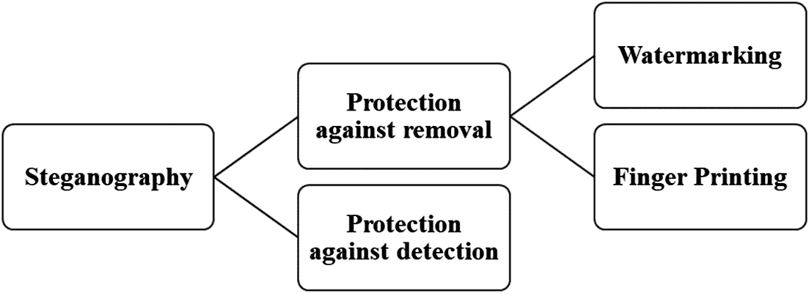

图 6.4

隐写术的类型。

加密和隐写术都用于确保数据的机密性，尽管每个概念的目标不同。在加密中，每个人都能识别谁在和谁秘密通信，而隐写术隐藏了机密信息的存在，没有人能识别谁在和谁秘密通信。因此，这些特征使得隐写术更适用于某些加密加密的情况（Popa, 1998; Caldwell, 2003）。

表 6.1 阐了用于安全消息传输的各种编码技术的比较研究。

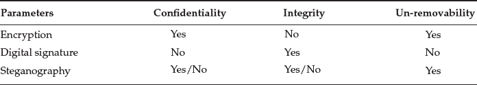

表 6.1

各种安全通信技术的比较研究

为了使用加密技术保护数据机密性，需要一个密钥来同时加密和解密相同的消息。然而，仍然可能通过修改编码后的消息进行攻击，导致接收者无法恢复。

数字签名允许发送者嵌入信息的作者。虽然这种签名可以被轻易分离，但对消息的任何修改都将使嵌入的签名失效，从而维护了整体的完整性（Ferguson et al., 2003）。

如前所述，隐写术秘密地传输信息，在容器/载体（嵌入秘密信息的地方）被更改之前，信息是不可能移除。除非攻击者找到发现它的方法，否则嵌入的消息将保持机密（Ferguson et al., 2015）。

### 6.3.1 不同的隐写技术 (Toc.xhtml_R_sec6_3_1)

#### 6.3.1.1 文本隐写 (Toc.xhtml_R_sec6_3_1_1)

基于文本的隐写术使用在任何文本文件中隐藏数据的技术。这些数据可以进一步通过不安全的通道进行传输。下面提到了几个示例：

- 发送源信息：由于 Alice 可以跑步，在自然环境中编码文本是刻之有效的。
- 源信息：由于 Alice 可以编码他她想要发送给接收者的源信息。
- 机密消息：内部的机密信息。

#### 6.3.1.2 音频隐写 (Toc.xhtml_R_sec6_3_1_2)

基于音频的隐写术涉及在任何音频信号媒体中隐藏数据的方法，如图 6.5 所示。通常，它包含两个音频文件：第一个作为载体文件，另一个是编码在载体文件中的秘密消息。

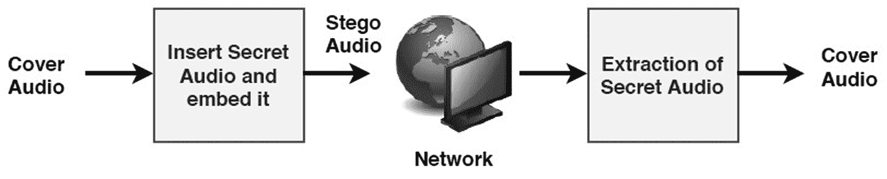

图 6.5

音频隐写。

#### 6.3.1.3 电影隐写 (Toc.xhtml_R_sec6_3_1_3)

如图 6.6 所示，在这种方法下，秘密消息隐藏在另一个视频文件中。使用这种方法的处处是可以容易地在载体文件中嵌入大量数据，发送者和接收者使用隐密钥（stego key）对秘密信息进行编解码。

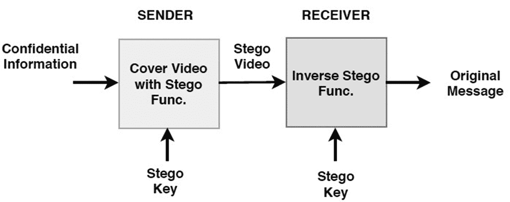

图 6.6

电影隐写。

#### 6.3.1.4 视觉隐写 (Toc.xhtml_R_sec6_3_1_4)

视觉或基于图像的隐写术使用图像作为载体文件来隐藏数据。在此，秘密数据可以是任何格式。发送者完成嵌入后，隐写图像（带有秘密信息的图像）如图 6.7 所示，就可以准备通过不安全的介质进行传输。


图 6.7

图像隐写（来源：Vijayakumar, 2016）。

尽管隐写技术有助于在不安全的通道上传输秘密信息，但仍然存在各种类型的攻击，下面将讨论这些：

1. `Steganography-Only-Attack`（仅隐写攻击）：当这种隐写媒体可用时，这种攻击是有效的。
2. `Known-Carrier-Attack`（已知载体攻击）：在这种攻击下，当隐写媒体和载体均可用时，它是有效的。
3. `Chosen-Steganography-Attack`（选择隐写攻击）：在这种情况下，攻击者已知或知道消息载体和隐写工具。
4. `Known-Message-Attack`（已知消息攻击）：当分析人员知道秘密消息时会发生此类攻击。
5. `Chosen-Message-Attack`（选择消息攻击）：在这种情况下，攻击者知道消息以及用于隐藏消息的算法。分析人员解码秘密消息变得更容易了。

### 6.3.2 隐写术的应用 (Toc.xhtml_R_sec6_3_2)

- 在不安全的通道上建立安全通信。
-保护数据免受修改。
- 检查用户之间的数据流量。
- 为数字信息提供访问。
- 通常用于视频和音频同步等。

## 6.4 加密学概念 (Toc.xhtml_R_sec6_4)

密码学是确保信息真实性和秘密性的研究。此外，密码学被分为两个子类，即密码分析和加密学（见图 6.8）。

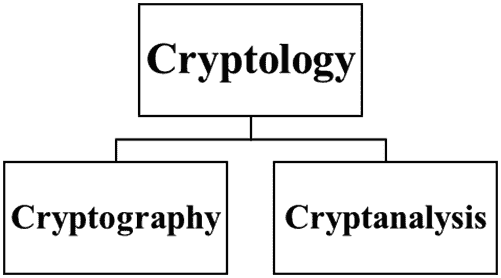

图 6.8

密码学及其类型。

加密是构建此类技术的研究，而密码分析是破解此类技术秘密性的艺术（Spillman, 2005）。

设计和使用加密技术的主要目标是解决信息安全的基础服务（见图 6.9 和表 6.2）。


## 引言

- **认证 (Authentication):** 该服务聚焦于确保通信双方之间传输的是真实消息。让我们考虑一种情况：接收者从任何源接收到单一信息消息。这种场景下的认证可以向接收者保证消息来自真实源，并且在传输过程中没有被第三方篡改。

- **机密性 (Confidentiality):** 该服务的主要重点是保护双方之间的数据传输免受被动攻击。它确保通信双方的传输数据保持机密，攻击者无法分析流量流。

- **访问控制 (Access Control):** 该服务专注于确保只有合法人员才能访问指定的设施。让我们考虑一个个人想要访问某个设施的情况。该服务首先对该个人进行认证，然后只为该人员提供正确的访问控制。

- **数据完整性 (Data Integrity):** 该服务的重点是确保接收者收到的消息没有被篡改、插入、重复、重放或重排。因此，该服务保护通信免受拒绝服务攻击和修改攻击。

- **不可否认性 (Non-Repudiation):** 该服务的重点是防止发送者/接收者对已发送的消息进行否认。

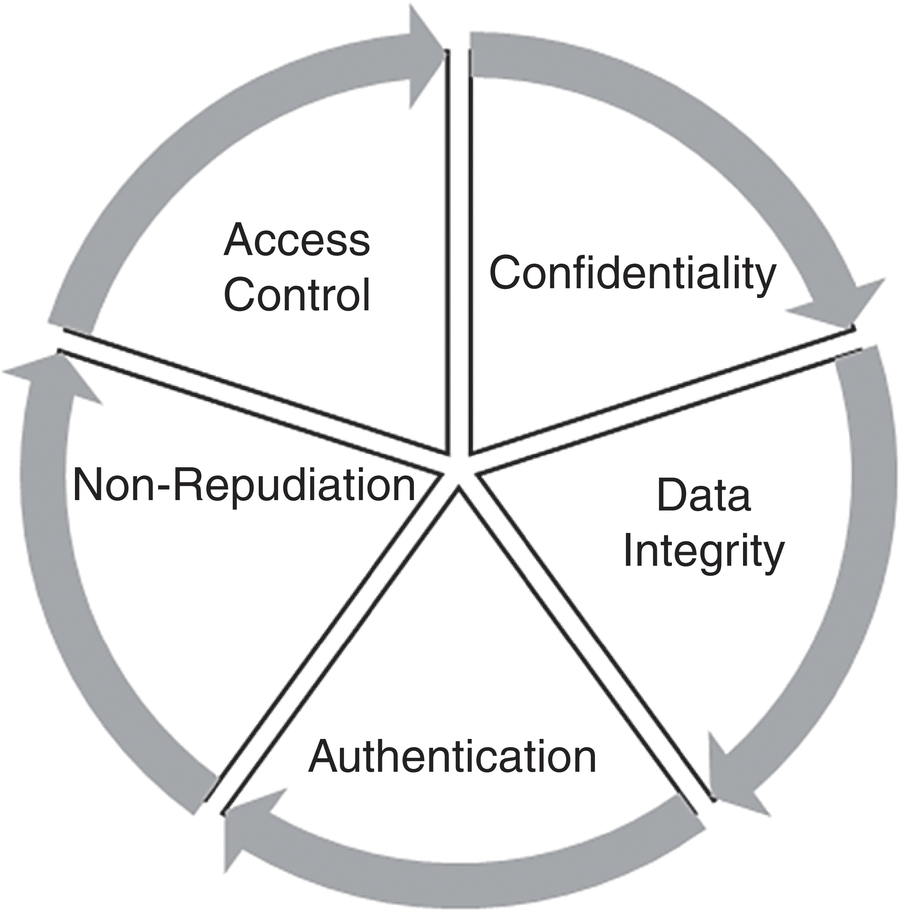

图 6.9

信息安全的基础服务。

| 术语 | 描述 |
| --- | --- |
| 明文 (Plain text) | 发送者希望发送给指定接收者的实际消息。 |
| 密文 (Ciphertext) | 编码消息或难以解释的消息。 |
| 加密 (Encryption) | 以这种方式隐藏消息实际内容的过程，使无人理解和解释（不可读格式）。 |
| 解密 (Decryption) | 从编码或密文中转换或恢复实际消息的过程。 |

表 6.2
术语表

### 6.4.1 密码学的类型

密码学技术有许多分类方法（Stallings, 2006）。在此背景下，根据所采用的加密和解密技术，密码学进一步分为两个子类。

- 对称加密 (Symmetric cryptography)。
- 非对称加密 (Asymmetric cryptography)。

### 6.4.1.1 对称加密

对称加密是一种传统的加密或密钥编码技术。在这种编码系统中，发送者/接收者利用相同的密钥对消息进行加密/解密。在这里，消息的秘密取决于密钥的秘密性。在通信开始之前，双方必须同意使用相同的密钥（Stallings, 2006; Kahate, 2013）。

图 6.10 明确指出，用于加密/解密信息的密钥是所有接收者所知的。因此，通过知道加密算法和密文无法轻易解密消息（表 6.3）。

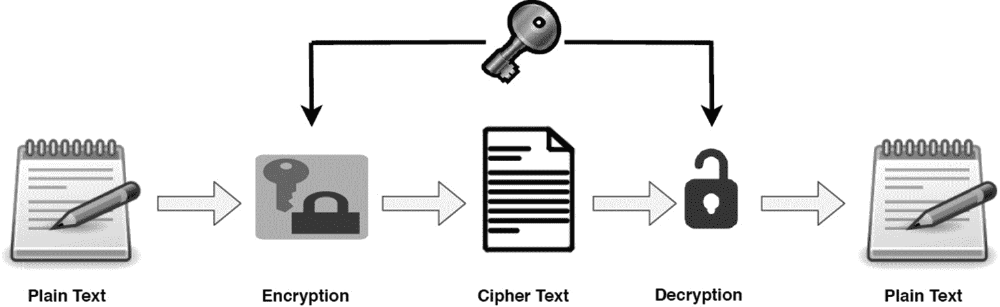

图 6.10

传统加密技术——对称加密。

| 对称加密——示例 | 密钥数量 | 描述 |
| --- | --- | --- |
| 数据加密标准 (DES) | 56 位 | DES 由美国标准局于 1977 年发明。DES 将 64 位块大小的明文作为输入，并使用 56 位密钥产生 64 位的密文。 |
| 三重数据加密标准 (Triple DES) | 3 × 56 = 168 位 | Triple DES 克服了 DES 的局限性。该算法遵循 DES 中定义的相同算法，因此很容易实现。虽然它通过使用大密钥长度增加了安全性，但它容易受到中间人攻击。 |
| 高级加密标准 (AES) | 128, 192 和 256 位 | AES 克服了 DES 和 Triple DES 的局限性。它基于置换和组合原理。AES 以字节为单位进行操作。它接受 16 字节的数据作为输入并产生 128 位的密文。 |
| IDEA | 128 位密钥 | IDEA 建立于 1991 年。它接受 64 位大小的明文作为输入，并使用 128 位的密钥长度产生 64 位大小的密文。 |

表 6.3
对称加密——示例

#### 6.4.1.1.1 传统密码学技术中的问题

非对称加密系统  是一种快速且简单的技术。这种加密技术的主要问题是秘密密钥的管理。如上所示，无论攻击者是否知道密文和加密算法，整体秘密性都基于秘密密钥。在这里，主要问题是通信双方安全地交换秘密密钥。如果秘密密钥泄露，整个编码系统就会处于危险（Stallings, 2006; Kahate, 2013）。

#### 6.4.1.1.2 非对称加密

非对称加密也被称为公钥加密。它涉及两个不同密钥的使用：私钥和公钥。公钥被所有人认可，而私钥仅由主体本身认可。图 6.11 阐了发送者使用接收者的公钥来编码机密消息，而接收者使用其私钥来解码同一条消息（参见 表 6.4）。

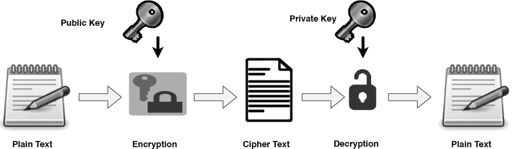

图 6.11

非对称加密技术。

| 非对称加密——示例 | 描述 |
| --- | --- |
| 数字签名标准 (DSS) | DSS 利用由国家安全局（NSA）建立的数字签名算法（DSA）。DSA 用于在源发送的消息中嵌入数字签名。数字签名确保该消息是由源发送的。它带来了认证和数据完整性。 |
| RSA | RSA 是由科学家 Rivest、Shamir 和 Adleman 开发的安全的对称或公钥加密技术。该算法包含了加密和签名功能。RSA 广泛应用于商业协议，并通过长密钥确保安全。 |
| Elgamal | Elgamal 包含了加密和签名功能。它利用离散数算法并广泛应用于各种。 |

表 6.4
非对称加密——示例

图 6.12 展示了非对称加密完成的过程。在步骤 1 中，发送者从存储库检索接收者的公钥。在步骤 2 和 3 中，发送者获取接收者的公钥，对明文并产生密文，然后通过安全介质发送给接收者。在步骤 4 中，接收者利用自己的私钥解码密文并检索发送者发送的明文。

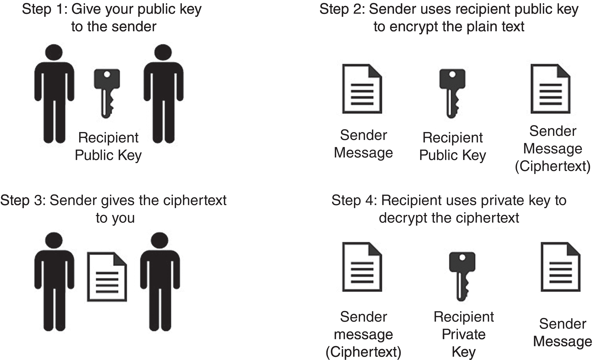

图 6.12

非对称加密技术涉及的过程。

密码系统的对比研究如 表 6.5 所示。

| | 对称加密 | 非对称加密 |
| --- | --- | --- |
| 密钥 | 单一密钥 | 两个密钥，即公钥和私钥 |
| 加密密钥 | 秘密密钥 | 公钥 |
| 解密密钥 | 秘密密钥 | 私钥 |

表 6.5
密码系统的对比研究


研究发现，在单独使用隐写术和加密技术时，攻击者发现更容易解码秘密信息。因此，采用混合方法（即结合这两种方法）可以设计出更可靠、更强大且高安全性的系统（Shukla et al., 2014）。此外，结合这些技术还将带来额外收益，例如高安全性、更少的内存占用以及机密信息在跨通道传输中的稳健性。这将使得个体能够相互通信，而不会受到第三方的任何干扰。因此，对于平台上的通信而言，这是一种更强大的技术（Abdulzahra et al., 2014）。

## 6.6 最新趋势

在数字平台上，在过去的十年里，信息安全威胁不断加剧，这已成为安全专业人员面临的主要瓶颈。隐写术和加密被认为是消除这种危害的最佳实践。在最近的场景中，研究人员正通过两种技术的混合，开发出各种混合技术。技术的混合提升了安全水平。在加密过程中，数据通过名为 `SCMACS` 的过程和对称密钥方法进行加密，源端和接收端在编码/解码过程中共享相同的密钥。另一方面，流行且首选的 `LSB` 技术被用于隐写术（Dhamija and Dhaka, 2015）。另一位研究人员提出了一种极其安全的隐写技术，它将 `Hyperelliptic Curve cryptography` 与 `DNA sequence` 结合。它提供了隐写术和 DNA 加密的优势，并提供了极高水平的安全交互（Vijayakumar, 2016）。

进一步的研究强调了使用多级秘密数据隐藏的方法。该方法使用了两种加密技术，包括视觉隐写和密码学。在第一阶段，使用半色调法减少像素并简化处理过程。在下一步，应用视觉密码学生成分片并提供第一层安全保护。然后，应用隐写 `LSB` 技术将分片隐藏在图像、音频和视频等各种媒体模式中（Patil and Goud, 2016）。其中一篇研究论文提出了一种声称解码机密信息更强大且困难的方法。它同时使用加密和隐写技术来确保通信的安全。对于加密，使用密钥大小为 128 位的 `AES` 编码技术对 `UTF-8` 格式的信息进行加密，并进一步将其转换为 `base-64` 格式，以便后续处理。进一步编码后的消息再次扭曲以达到极高的安全水平。最后，将扭曲后的编码消息插入适当的载体图中。该图像随后通过网络安全传输传输并携带机密信息。因此，安全性在四个级别上得到了体现，结果是机密消息在不安全的通道上被发送（Karthikeyan et al., 2016）。

在另一种方法中，作者使用了基于图像的隐写术和 `DES` 算法技术来发送秘密信息。在该方法中，使用了 16 轮每块大小约为 64 位的处理，结合 `K-means clustering` 技术对图像进行聚类。此外，数据被嵌入每个段中。在图像中，信息以像素的形式存在。每个像素由三个部分组成，即 `RGB`。图像分割利用这些像素来形成一个聚类（Pillai et al., 2016）。

在另一个用于安全数据传输的实验中，使用了混合方法。在该方法中，应用 `TwoFish` 算法加密数据，并使用 `Adaptive B45` 隐写方法隐藏信息。技术的融合使得他人无法破解机密并访问机密数据（Hingmire et al., 2016）。随着数字通信技术的最新进展，作者通过隐写 `AES` 加密系统使用 `Pixel Value Differencing` 扩展了加密算法的高安全性能力（Joseph et al., 2015）。

对各种加密算法的性能分析进行了调查，其中对 `RSA`、`AES`、`DES` 结合 `LSB` 技术进行了分析。这有助于根据它们的性能得出结论，并推断出 `AES` 技术运行良好，在时间和空间利用方面与其他方法具有不可比拟性（Padmavathi et al., 2013; Almuhammadi et al., 2017）。Mishra 等人（2014）中的作者开发了一种新的加密策略，其中他们使用 `RSA` 加密算法（128 字节密钥大小）在将机密消息植入载体图之前对其编码。这种机密信息的植入是通过 `F5` 隐写算法完成的。作者声称，所提算法针对分析和观察攻击具有高度安全性，并提供了高隐写容量和更快的速度。另一个仿真显示了使用结合 `AES` 和 `LSB` 算法的组合方法传输秘密信息。通过使用 `AES` 算法加密消息并使用 `LSB` 技术将机密消息隐藏在图像内部生成信息图。作者声称，这种编码技术更有效地建立安全秘密的通信，并实现了强大的安全水平（Sridevi et al., 2013）。

## 6.7 结论

本章描述了跨网络安全传输机密信息的必要性。它涵盖了加密和隐写技术从演变到最新趋势的概念。

### 参考文献

1. Abdulzahra, H. et al. “Combining cryptography and steganography for data hiding in images.” *Applied Computational Science*, 128–135, 2014.
2. Almuhammadi, S. et al. “A survey on recent approaches combining cryptography and steganography.” *Computer Science Information*, *7*(3), 63–74, 2017.
3. Blanco, W. et al. *Herodotus, The Histories*. Trans. by Walter Blanco. New York, 1992.
4. Cachin, C. “An information-theoretic model for steganography.” In *International Workshop on Info Hiding*, Portland, OR, pp. 306–318, 1998.
5. Caldwell, J., Second Lieutenant, Steganography, US Air Force
6. Dhamija, A. and Dhaka, V. “A novel cryptographic and steganographic approach for secure data migration.” In *ICCIoT*, Greater Noida, India, pp. 346–351. IEEE, 2015.
7. Esslinger, B.. “CrypTool–ein E-Learning-Projekt für Kryptographie und Kryptoanalyse.” 25th Crypto-Day, 2016.
8. Ferguson, N. et al. *Practical Cryptography* (Vol. *141*). New York: Wiley, 2003.
9. Ferguson, N. et al. “Generating randomness.” In *Cryptography Engineering: Design Principles and Practical Applications*, pp. 135–161. Indianapolis, IN: Wiley, 2015.
10. Hingmire, A. et al. “Image steganography using adaptive b45 algorithm combined with pre-processing by twofish encryption.” *IESRJ*, *2*(4), 2016.
11. Joseph, F. et al. “Advanced security enhancement of data before distribution.” 2015.
12. Kahate, A. *Cryptography and Network Security*. Tata McGraw Hill Education, 2013.
13. Karthikeyan, B. et al. “Enhanced security in steganography using encryption and quick response code.” In *2016 International Conference on WiSPNET*, Chennai, India, pp. 2308–2312. IEEE, 2016.
14. Kour, J. et al. “Steganography techniques—A review paper.” *IJERMT*, *3*(5), 132–135, 2014.
15. Mishra, M. et al. “Secret communication using public key steganography.” *ICRAIE-2014*, Jaipur, India, pp. 1–5. IEEE, 2014.


16. 美国国家标准与技术研究院 (NIST). “加密模块的安全需求.” 联邦信息处理标准 (FIPS PUB 140-2), 2001.

17. Padmavathi, B. 等人. “结合 LSB 替换的 DES、AES 和 RSA 算法性能分析。” `IJSR`, `2`(4): 170–174, 2013.

18. Patil, S. S. 和 Goud, S. “增强型多级秘密数据隐藏。” `International Journal of Scientific Research in Science, Engineering and Technology (IJSRSET)`, `2`(`2`): 846–850, 2016.

19. Pillai, B. 等人. “使用 k-means 聚类和加密技术的图像隐道方法。” `ICACCI 2016`, 印度斋浦, 页 1206–1211. IEEE, 2016.

20. Popa, R. “隐道技术分析.” 罗马尼亚提米绍瓦拉大学自动化与计算机学院，计算机科学与软件工程, 1998.

21. Shukla, C. P. 等人. “用密码学增强隐道安全性.” `IJARCCE`, `3`(3): 5696–5699. 2014.

22. Stallings, W. `Cryptography and Network Security`, 第 4 版. 印度新德里: Pearson Education India, 2006.

23. Spillman, R. `古典与现代密码学`. 新泽西州上萨德尔河河: Pearson Education, 2005, 页 144–212.

24. Sridevi, R. 等人. “结合密码学的图像隐道术.” `International Journal of Computers & Technology`, `9`(1): 976–984, 2013.

25. Vijayakumar, P., “使用超椭圆曲线加密提高 DNA 隐道的安全水平.” `Wireless Personal Communications`, `89`(4): 1221–1242, 2016.

# 7

# 一种用于 IoT 安全的基于 FPGA 的先进轻量级加密架构及其密码分析

Rajdeep Chakraborty 和 Jyotsna Kumar Mandal

印度加尔各答 Netaji Subhash 工程学院

印度纳迪亚 Kalyani 大学

## 7.1 引言：背景与驱动力

在如今基于 IoT 的数据传输和通信的智能时代，数字和信息安全已变得不可或缺（Stallings, 2002; Forouzan, 2007; Kaur, 2009）。机密性的主要目标通过建议的算法（Stallings, 2002; Forouzan, 2007）和轻量级实现来实现。这是一个简单的方案，其结果与为人知的广泛使用的 `RSA` 块加密和 `TDES` 块加密（Stallings, 2002; Forouzan, 2007）相当。轻量级加密的特点是其实现必须在 2000–2500 门/GE 以内。对称加密或私钥块加密在加密/编码方案与解密/解码方案中使用相同的密钥；如果确实使用了两个密钥，则第一个密钥应与第二个密钥相等，反之亦然。对称加密或私钥块加密相比非对称加密或公钥块加密具有一些优势，如下：

* 对称加密或私钥块加密在加密参数强度和硬件参数强度方面与非对称加密或公钥块加密相当。
* 私钥或对称加密或私钥块加密产生的加密和解密方案吞吐时间和执行时间少于公钥或非对称加密或公钥块加密。
* 对称方案加密或私钥方案块加密嵌入到手机和 IoT 设备等资源受限的通信设备中非常容易，而对于非对称加密或公钥块加密来说是非常不的。

建议的算法（加密和解密）已在基于 FPGA 的 Spartan 3E 系列设备中设计并实现（Navabi, 2008; Wolf, 2009），并使用 `IEEE VHDL` 编程（Bhasker, 2004; Kaur, 2009）。Spartan 3E 系列足以实现轻量级安全解决方案，且对称方案密钥加密广泛用于此目的。基于 FPGA 的设计和实现的主要原因是：

* 它通过通过投入更少的人力和资源并在更短的时间内，有助于创建新的实用产品并降低其成本。
* 它适合并被广泛接受为一种“绿色”环境概念。
* 总吞吐时间和总设计面积较小。

上述讨论驱动了使用这项新技术——旋转锥形加密（Rotational Conical Cipher, RCC）的研究工作，本章还提出并描述了 `SPN` 和 `CBC` 模式。它也是一种基于 FPGA 的轻量级（Stallings, 2002; Forouzan, 2007）对称方案密钥加密或私钥块加密。[图 7.1]（Chatterjee and Mandal, 2013）给出了从源块形成锥形的过程。该方法是：我们取 `n-bits` 并对连续位进行 `XORED` 操作，以获得下一行的 `(n − 1)` 位。这种 `XORING` 将一直持续，直到得到单个位。因此，它将形成如[图 7.1]所示的锥形，源块可以是明文或密文。加密和解密有四种选项。在选项 A 中，我们从上到下提取所有最左侧位；选项 B 涉及从下到上提取所有最左侧位；选项 C 涉及从左上角到右下角提取所有最右侧位；选项 D 涉及从左下角到右上提取所有最右侧位。因此，对于每种讨论的选项，我们得到 `n-bits` 输出。加密和解密在同一个过程中完成，最后对明文进行循环左移以获得密文。

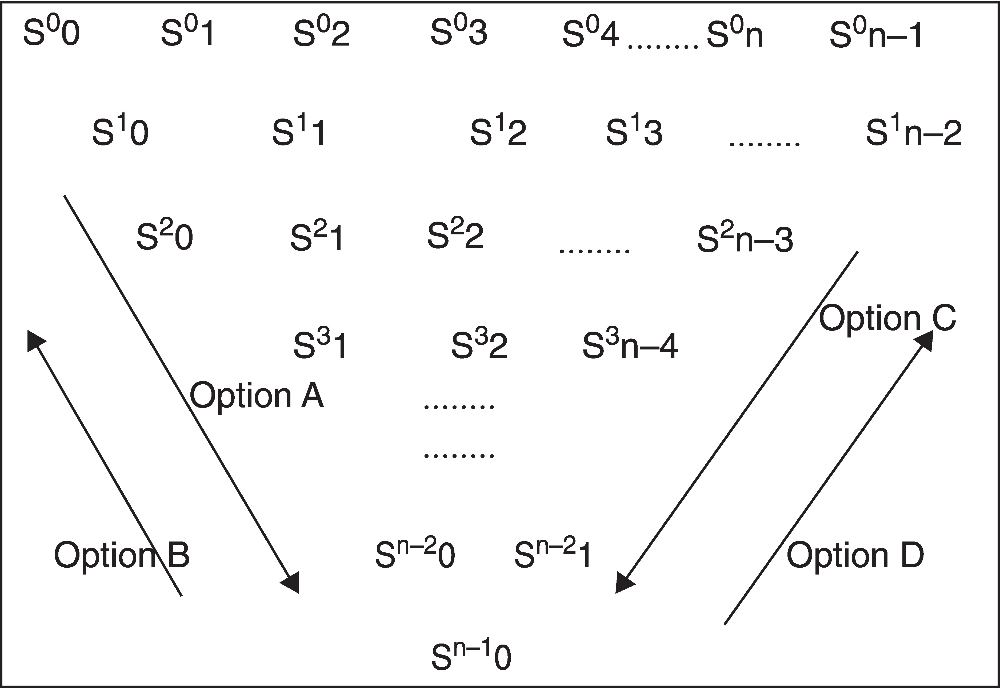

图 7.1

从源块 (SB) 形成锥形。

### 7.1.1 文献综述

建议的块加密算法 RCC 的灵感来自 2017 年发布的关于轻量级加密的 `NIST` 报告（McKay et al., 2017）。在一个加密项目中，Kerry McKay 等人提出了 `NIST` 轻量级加密和安全项目的工作范围，包括在资源受限环境中非常需要的各种现有加密原语和模式。该报告的重点是轻量级加密、轻量级加密哈希、轻量级身份验证和某些协议。长期的有效安全性是十分需要的。在使用这些算法时，目标应当是在后量子安全中实现，或者这些应用程序允许它们被容易地被为后量子安全设计并实现的算法所替换。


下一次综述是在 Peng 等人（2020）的 Springer 书籍的 VI 部分进行的。在第 19 章中，Dhanda 等人（Dhanda et al., 2020）对高感知层进行了全面的安全性概述，该层被认为是 IoT 架构中最底层的层，也常用于无线传感器网络（WSN）和许多资源受限的嵌入式硬件设备。所讨论的设备在内存、计算、功率和能量等许多参数上非常有限。因此，针对这些有限资源设备发生了大量的攻击。因此，工程师和研究人员提出了许多解决方案，例如轻量级加密和各种协议。Jha 等人在第 20 章（Jha et al., 2020）中讨论了 IoT 生态系统中用于 IoT 架构的时间同步轻量级协议的一些安全威胁。传感器通常最终位于远程且无人值的环境中，那里极有可能存在恶意节点及其干扰。Bhanu Chander 和 Kumaravelan Gopalakrishnan 在第 21 章（Chander and Gopalakrishnan, 2020）中概述了 IoT 架构和安全中的最新漏洞问题，讨论了 IoT 中的网络攻击。

Sebastian Mödersheim 和 Luca Viganò 定义并实现了一种名为 Alfa–Beta Privacy 的加密协议（Mödersheim and Viganò, 2019）。该协议基于在带有 Herbrand 宇宙的一阶逻辑中指定两个公式 `α` 和 `β`，其中 `α` 等于故意释放的信息，而 `β` 等于入侵者可以观察到的实际加密消息。因此，`(α, β)-privacy` 意味着攻击者在知道 `β` 的情况下无法推导出 `α`，反亦然。

Andy Rupp 等人提出了一种用于交通系统的新型轻量级加密电子商务支付技术（Rupp et al., 2015），被称为 `P4R (Privacy-Preserving Pre-Payments with Refunds)`，它非常适用于资源受限环境中的低成本用户 IoT 设备。这种支付方案技术基于 Brands 的电子现金技术来计算预付费系统，并基于用于退款选项的 Boneh–Lynn–Shacham (BLS) 签名。估计结果显示，20 次行程所需的数据消耗少于 10 kB 内存，而行程期间的支付和退款交易时间不到半秒。该系统还保护了诚实用户的隐私，其中交易是匿名（（押金除外），且行程是不可追踪的。整个系统已通过基于微处理器的系统实现。

最后的综述基于一篇 SCI 索引的出版物（Colombier and Bossuet, 2014），涉及涉及集成电路（IC）加密硬件安全设计的综述，其可用于知识产权。总成本和总性能被认为是 IC 设计的主要参数；考虑到硬件安全领域，为设计数据集设计并实现一种安全、高效、轻量的安全保护方案是一项严峻的。然而，某些技术、方案和工作提出了许多不同方法来保护设计数据并提供安全性，包括功能锁定、硬件混淆和 IC/IP 识别。本研究还展示了关于设计数据保护的学术研究综述。结论是，需要设计并实现一种基于多种硬件和安全属性的高效保护技术。

第 7.2 节描述使用 RCC 和置换技术以及 CBC 的轻量级安全架构，第 7.3 节](#chapter-7.xhtml_sec7_3)给出密钥生成过程，第 7.4 节提供密码学分析，第 7.5 节通过仿真给出轻量级加密分析，第 7.6 节给出此提议算法的应用，并在第 7.7 节中得出结论。

## 7.2 轻量级安全架构

我们研究了许多用于安全的加密算法，但问题在于如何在硬件中实现安全需求（Navabi, 2008; Kaur, 2009; Wolf, 2009）。根据轻量级加密的定义，实现时仅可使用 2500 个 GE。硬件实现也适用于实现 IoT 安全。图 7.2 给出了轻量级加密的微体系架构（Bhasker, 2004; Navabi, 2008; Kaur, 2009; Wolf, 2009）。

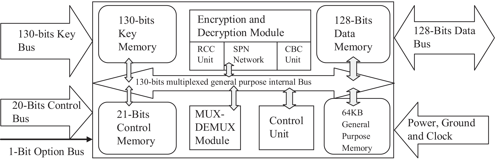

图 7.2

轻量级加密模型的微体系架构。

这是提议的轻量级安全实际实现的工作模型架构。该微体系架构由外部信号（Navabi, 2008; Kaur, 2009; Wolf, 2009）和内部模块（Navabi, 2008; Kaur, 2009; Wolf, 2009）组成。有五种外部信号/总线（Bhasker, 2004; Navabi, 2008; Kaur, 2009; Wolf, 2009）：130 位密钥总线、20 位控制总线、1 位选项总线、128 位数据总线、电源、地和时钟信号总线。内部只有 130 位复用内部总线，该总线连接到每个内部模块。内部模块包括 130 位复用内部总线连接所有内部模块（Navabi, 2008; Kaur, 2009; Wolf, 2009），130 位密钥总线、20 位控制总线、1 位选项总线、128 位数据总线、电源、地和时钟信号总线。内部模块为 130 位复用内部总线、130 位密钥内存、20 位控制内存、1 位选项内存、128 位数据内存、电源、地和时钟信号总线。各模块和总线的描述见第 7.2.1 节 到 7.2.6 节。

### 7.2.1 外部信号与总线

130 位密钥总线提供用于解密的 130 位密钥。20 位控制总线提供该微体系架构的各种模式，由控制单元执行。1 位选项总线表示执行加密还是解密，`0` 表示加密，`1` 表示解密。128 位数据总线是双向的。加密时，输入是 128 位明文，输出是 128 位密文；解密时，输入是 128 位密文，输出是 128 位明文。提供了电源信号和地信号。还提供了时钟信号，以便该微体系架构在连接 IoT 网络时可以以同步和异步的方式工作。

### 7.2.2 内部总线

该架构提出的内部总线为 130 位，因为这是每个时钟周期传输限制。该总线是复用的并由控制单元控制。所有其他内部模块连接到此总线。

### 7.2.3 内部存储寄存器

该微体系架构提出了四类寄存器（Bhasker, 2004; Navabi, 2008; Kaur, 2009; Wolf, 2009）：

- 130 位密钥内存存储 130 位密钥，并由第 7.3 节 中讨论的密钥生成算法生成，并外部提供给架构。提供密钥生成模块是为了减少所提微体系架构的门需求。此外，密钥要求是伪随机数，因此用户可以使用其他密钥生成算法。

- 21 位控制内存具有 1 位选项信号和 20 位微体系架构的运行模式，这些将在控制单元的讨论中阐明。


*   128 位数据内存本质上是待加密或解密的明文或密文。该数据内存类似于微处理器中使用的累加器寄存器。在单单位时钟周期/机器周期内，一次加密周期和一次解密周期的源和目的地都是这个 128 位数据寄存器。
*   此处使用的 64 kB 通用寄存器用于存储 64 kB 的明文和密文。该寄存器使得该微架构能够一次处理 4096 块加密或解密。外部总线通常比内部总线慢，这就是为什么该寄存器提供的加密解密速度比单块架构快 4096 倍。

## 7.2.4 内部加密解密模块

这是该架构的主模块，包含了执行加密和解密的所有逻辑电路。该模块有三个子组件：

*   RCC 模块：RCC 每次对 128 位块进行加密和解密。加密和解密方式见图 7.1。在这里，取 128 位明文并对连续位进行异或（XORE）运算以得到下一行的 127 位。重复此过程将位减少到 1 位，形成一个锥形。在四个选项中，可以任选任意一个作为结果密文。解密也执行相同的操作。
    *   选项 A (00)是从上到下取所有的左侧位。
    *   选项 B (01)是从下到上取所有的左侧位。
    *   选项 C (10)是从上到下取所有的右侧位。
    *   选项 D (11)是从下到上取所有的右侧位。
*   SPN 网络：加密的下一阶段是 SPN，使用了 AES 的 S 盒。为了获得置换，执行 AES 的行移（shift row）和混列（mix column）操作。
*   CBC 单元：这是一个多块单元加密模式。块大小由控制总线提供。图 7.3 展示了 CBC 运行模式。在 CBC 运行模式下，加密期间，明文被划分为 128 位块大小的倍数，第一块与初始向量 (IV) 进行异或并输入加密函数，结果为第一个密文块。在第二轮 CBC 中，第一轮密文与第二个明文块进行异或并生成第二个密文块。此过程一直持续，直到所有块加密完成。解密是反向过程，输入为密文，输出为明文，如图 7.3 所示。加密和解密的 IV 是相同的。

```
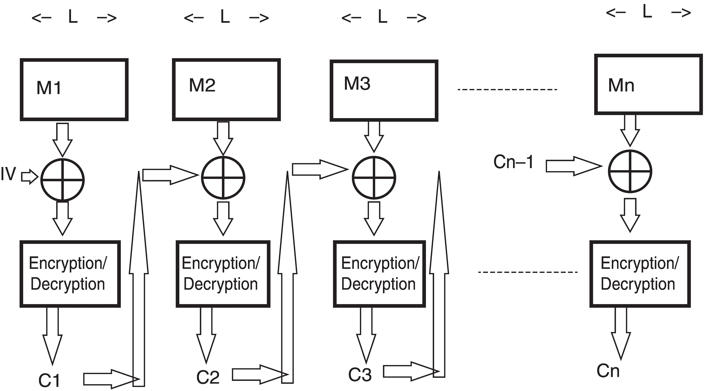
```
图 7.3

CBC——加密与解密模式。

### 7.2.5 内部复用/去复用模块

该多路复用器和去复用器（Bhasker, 2004; Navabi, 2008; Kaur, 2009; Wolf, 2009）控制内部数据线。当通过 128 位外部数据线在 64 kB 通用内存和 128 位数据内存之间进行加密、解密或明文/密文交换时，它会启用内部数据线的前 128 个 MSB 位，并将内部数据线上的 2 个 LSB 位置于高阻态。当进行密钥交换时，该模块启用内部数据线的所有 130 位。当存在控制流时，它启用内部数据线的前 21 个 MSB 位，并将内部数据线的剩余 109 位置于高阻态。

### 7.2.6 内部控制单元

控制单元（Bhasker, 2004; Navabi, 2008; Kaur, 2009; Wolf, 2009）根据存储在 21 位控制内存中的值工作。图 7.4 给出了这 21 位的值。

```
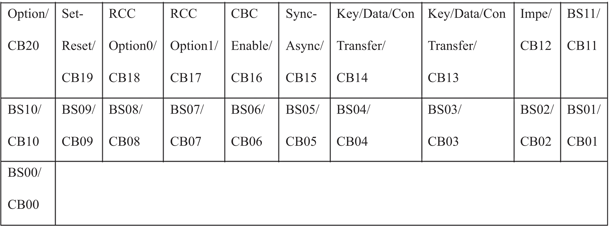
```
图 7.4

21 位控制内存结构。

内部控制单元被提议作为 21 位控制内存工作。符号 `CB00` 表示第一个 LSB 控制位 00，`CB20` 表示第一个 MSB 控制位 20。控制单元的工作原理如下：

*   选项/`CB20`：此位包含 1 位选项外部数据线。值“0”代表加密，值“1”代表解密。
*   置位-复位/`CB19`：此位包含所提议微架构的重置值。当值为“1”时，架构重置。所有数据寄存器和密钥寄存器变为零，加密/解密设置为初始向量。
*   RCC 选项 0 和选项 1/`CB18` 和 `CB17`：这是一个 2 位值。已经看到 RCC 以四种方式进行加密解密。因此，00 值选择选项 A 加密/解密，01 值选择选项 B 加密/解密，10 值选择选项 C 加密/解密，11 值选择选项 D 加密/解密，如第 7.1 节所述。加密执行左循环旋转，解密执行右循环旋转。旋转位数取决于块。在加密和解密期间，对第 n 个块进行 n 次旋转。
*   CBC 启用/`CB 16`：如果有多个块需要加密/解密，此位启用 CBC 加密/解密模式。所有块从 64 kB 通用内存传输，结果存储在相同位置。此过程持续直到提供的 `CB00` – `CB11` 值。
*   同步/异步/`CB15`：此位代表该微架构的同步和异步运行模式。
*   密钥/数据/控制传输/`CB14-CB13`：这是一个 2 位值，其中“00”表示 128 位数据传输，“01”表示 130 位密钥传输，“10”表示通过内部数据线传输 21 位控制信号，“11”表示内存访问。
*   阻抗/`CB12`：这是一个触发器，用于将内部公共总线置于高阻态。
*   `BS10 – BS00`/`CB10 – CB00`：由于有 64 kB 内存，可以使用 CBC 加密解密模式处理 4096 块。这 12 位存储每个 128 位的地址。

本节详细讨论了我们如何通过架构实际实现轻量级加密，以及它如何用于 IoT 安全。第 7.4 节 提供了密码分析的思路，通过此优化块密码。第 7.5 节 提供了基于仿真结果的结果，通过此优化 FPGA 安全性。

## 7.3 密钥生成

本节提议在每个会话中使用 130 位密钥密钥。密钥生成被认为是块密码（无论是对称还是非对称）的一种重要算法。在对称密码或私钥密码中，仅使用单个密钥进行明文加密和密文解密。如果这两个密钥不同（即加密密钥和解密密钥），那么知道一个密钥就足够推导出另一个。

表 7.1 (Jha and Mandal, 2011) 给出了 130 位密钥 (Stallings, 2002; Forouzan, 2007) 生成。明文源文件在执行过程中以不同的块大小加密 13 次。例如，第一次迭代或第一轮是 128 位块大小，并选择第一个选项进行加密；第二次迭代或第二轮将是 112 位块大小，依此类推。在表 7.1 中，块大小用 8 位编码，选项用 2 位编码。


因此，在每一次迭代或每一轮中，都会获得一个 10 位的编码代码。将这 13 个每个 10 位的代码拼接起来，生成一个 130 位的密钥，用于每个会话的加密和解密。编码后的 10 位值是绝对伪随机的。在这里，根据此表，每个会话使用的 130 位密钥如下：

$$\begin{array}{cl} {K =} & 1000000000011110001001110000010110010001 \\ & 01000000000011110011001000000100011110100001 \\ & 0000110000101000000010001000000100010000001000. \end{array}$$

新的密钥将为另一个新会话生成。

## 7.4 密码分析

密码分析用于寻找加密系统中的漏洞，并用于优化任何加密系统。该架构主要基于 `RCC`、`SPN` 和 `CBC` 块加密。因此，该安全模块已实现，首先将前 128 位明文输入 `RCC`，然后输入 `SPN`。最后，使用 `CBC` 加密模式对多个块进行加密。

在本节中，使用用于密码分析的卡方检验来测试 `NULL` 假设。该测试测量了明文与密文之间的差异。

使用了皮尔逊卡方检验（Chakraborty and Mandal, 2006, 2011）。这也被称为卡方拟合优检验，或源文件与目标文件之间独立性、非同质性或异质性的检验。

(7.1) $\chi$² = (`O` − `E`)²

其中：

- `O` 是观测频率密文。
- `E` 是期望频率明文，`O` 取自此处。
- `df` 是“自由度”（`n − 1`），包含字符的变化。
- `χ²` 是使用方程 `7.1` 计算的卡方值。

卡方检验通过选择十个不同的文件进行计算，这些文件分别使用 `RCC`、然后使用 `RSA`，最后使用 `TDES` 加密。使用方程 `7.1` 的程序计算了这十个文件的卡方值。

`Table 7.2` 给出了卡方值。`Figure 7.5` 显示了使用十对数尺度转换计算出的图表，以获得十个不同源文件的卡方值。观察 `Table 7.2` 和 `Figure 7.5`，我们可以得出结论：所提算法 `RCC` 生成的卡方值大于 `RSA` 加密源文件的值，但对于 `TDES`，`RCC` 的结果优了 50%。

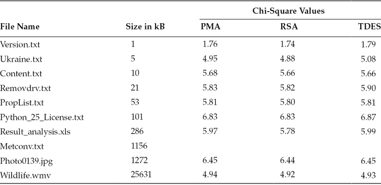
**表 7.2: 所提微体系架构 (PMA) 的密码分析**

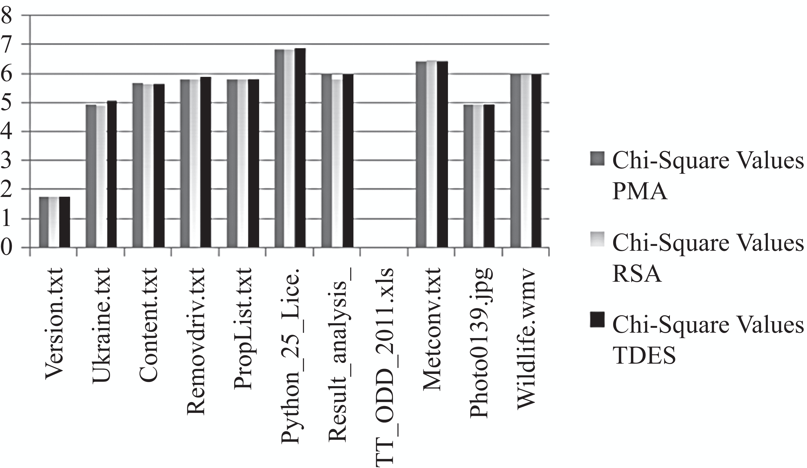
**图 7.5: 对数（底为 10）尺度下的卡方值。**

## 7.5 基于仿真的结果

在本节中，作者试图证明并得出结论，从实现角度来看，所提算法 `RCC` 确实是一种轻量级加密。这些分析可用于优化所提的微架构。这些分析对于设计任何用于 IoT 设备的轻量级系统也有帮助。利用率总结是设计中使用的所有硬件/GE 组件的列表以及每个组件的使用数量。从结果可以表明，该微架构安全解决方案确实适用于 IoT 安全。

`Table 7.3` 汇总了在 `Xilinx ISE 8.1i` 中通过仿真使用 `IEEE VHDL` 成功实现后的综合报告（Navabi, 2008; Wolf, 2009）。`RCC` 使用的四输入查找表（`LUTs`）数量为 53 个，可用数量为 1920 个，因此利用率为 2%。`RCC` 占用的切片（slices）数量为 27 个，可用数量为 960 个，利用率为 2%。包含 `RCC` 相关逻辑的切片数量为 100%，值得注意的是，这一结果在其他实现中也是相同的。包含 `RCC` 无关逻辑的未使用切片数量为 0%。`RCC` 的绑定输入输出块（`IOBs`）数量为 66 个中的 20 个，因此利用率为 30%。总等效门数仅为 324，用于 `IOBs` 的额外 `JTAG` 门数仅为 960。因此可以说，对于 `Xilinx FPGA` 中的可用资源而言，`RCC` 确实是一种轻量级加密。

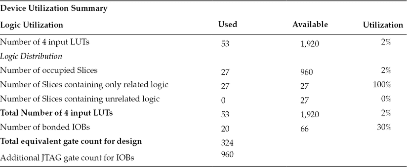
**表 7.3: 所提微架构的综合汇总**

## 7.6 应用

所提 `RCC` 的一些应用列如下：

- `RCC` 适用于手机、智能手表和 IoT 设备。
- 虚拟私有网络（`VPN`）。
- `RCC` 用于交换机、网关。
- 用于消息认证的 `cryptography` 功能。

## 7.7 结论

因此，在本章得出结论 `RCC` 确实是一种轻量级加密。通过 `RSA` 和 `TDES` 进行的密码分析显示，使用 `NULL` 假设的 `卡方` 值证明 `RCC` 更好。

## 8. 参考文献

1. Bhasker, J. 2004. *VHDL Primer*. Thirteen Education Asia, Bengaluru, India, 14–82.
2. Chakraborty, R. and Mandal, J. 2006. “基于处理器的旋转加法加密 (RAT)，”*第 9 次信息技术会议 (ICIT-2006)*, Kalyani, India, 155–159, IEEE 计算机学会主办, ISBN-10: 0-7695-2635.
3. Chakraborty, R. and Mandal, J. 2011. “基于 FPGA 的加密设计和递归面向算术与替换技术 (ROST)，”*International Journal of Computer Science and Applications (IJACSA)* 2(4), 54–59.
4. Cander, B. and Gopalakrishnan, K. 2020. “第 21 章：IoT 中传统传感器的安全漏洞与问题，”*Principles of Internet of Things (IoT) Ecosystem: Insight Paradigm*, 519–549. Cham: Springer. DOI: 10.1007/978-3-030-33596-0_21.
5. Chatterjee, N. and Mandal, J. 2013. “在 NS2 中使用三角加密检测黑洞行为，”*首次计算智能会议：模型、技术与应用 (CIMTA-2013)*, Kalyani, India, 524–529.
6. Colombier, B. and Bossuet, L. 2014. “集成电路和知识产权设计数据的硬件保护综述，”*IET Computers & Digital Techniques* 8(6), 274–287. DOI: 10.1049/iet-cdt.2014.0028.


7. Dhanda, S. S., B. Singh, and P. Jindal. 2020. “第 19 章：物联网安全：全面视角”，收录于*物联网（IoT）生态系统原理：洞察范式*，467–494。Cham: Springer. DOI: [10.1007/978-3-030-33596-0_19](https://doi.org/10.1007/978-3-030-33596-0_19).

8. Forouzan, B. A. 2007. *密码学与网络安全*，印度特别版 2007。Tata Mc-Graw-Hill India, 61-110: ISBN-13: 978-0-07-066046-5978-0-07-066046-5, ISBN-10: 0-07-066046-80-07-066046-8.

9. Jha, P. K. and J. K. Mandal. 2011. *对称加密——算法、分析与应用*. LAP - Lambert Academic Publishing, 拉脱维, 欧洲联盟, 222–223, ISBN: 978-3-8454-2061-5978-3-8454-2061-5.

10. Jha, S. K., N. Panigrahi, and A. Gupta. 2020. “第 20 章：物联网中时间同步协议的安全威胁”，收录于*物联网（IoT）生态系统原理：洞察范式*，495–517. Cham: Springer. DOI: [10.1007/978-3-030-33596-0_20](https://doi.org/10.1007/978-3-030-33596-0_20).

11. Kaur, K. 2009. *数字系统设计*.Saarbrücken: Scitech Publications (India) Pvt. Ltd, 21–50, ISBN: 978-81-8371-188-3978-81-8371-188-3.

12. McKay, K. A., L. Bassham, M. S. Turan, and N. Mouha. 2017. “NISTIR 8114，轻量级加密报告”，1–10. DOI: [`doi.org/10.6028/NIST.IR.8114`](http://dx.doi.org/https://doi.org/10.6028/NIST.IR.8114).

13. Mödersheim, S. and L. Viganò. 2019. “Alpha-beta 隐私”。*ACM 隐私与安全事务* *22*(1), 519–549, 文章 7. DOI: [10.1145/3289255](https://doi.org/10.1145/3289255).

14. Navabi, Z.. 2008. *基于 FPGA 的嵌入式设计*，2008 版。New York: Tata Mc-Graw Hill India, 110–200. ISBN-13: 978-0-07-013978-7978-0-07-013978-7, ISBN-10: 0-07-013978-40-07-013978-4.

15. Peng, S.-L., S. Pal, and L. Huang. 2020. *物联网（IoT）生态系统原理：洞察范式*，智能系统参考库，第 *174* 卷。Cham: Springer, 467–549. DOI: [10.1007/978-3-030-33596-0](https://doi.org/10.1007/978-3-030-33596-0).

16. Rupp, A., F. G. H.der, and C. Paar. 2015. “密码学理论与实践：高效且保护隐私的传输”。*ACM 信息与安全事务* *17*(3), 10:01–10, 文章 10. DOI: [10.1145/269904](http://doi.org/10.1145/269904).

17. Stallings, W. 2002. *密码学与网络安全：原理与实践*，第 2 版。London: Pearson Education Asia, 印度重版。

18. Wolf, W. 2009. *数字系统设计*。London: Pearson Education Asia, 印度重版。

--- 

## 8. 篡改概述

在现代时代，由于图像编辑工具的普及，数字图像的真实性已成为备关注的问题。随着技术的发展，在不留明显痕迹的情况下操纵图像变得日益容易。这导致了对鲁棒篡改检测方法日益增长的需求。

#### 8.1.1 数字图像的顺序处理周期

数字图像在其生命周期内需要经过三个步骤，主要分为三个重要阶段：从图像采集开始，然后编码，最后一步是编辑。


通常，捕获的二维信号被存储在相机内存中，由于相机内部存储空间有限，大多数传统的相机传感技术都会在相机端进行有损压缩。另一种替代方案是 JPEG 格式，这通常用于商业传感设备。图像还需要进行一些后处理，以修改其内容，以便对信息进行更好的解释和识别。通过执行多种几何变换（旋转、裁剪、调整大小、平移和缩等），可以在图像中生成所需的信息。此外，还有一些基础操作，如饱和度、对比度和白平衡，它们经常用于生成质量更好的图像。然而，在初始编辑之后，图像通常需要被保存为标准格式（如 JPEG 格式），如果需要，可能会发生再次压缩。

图像取证不仅限于伪造和伪造检测算法。图像渐变（Morphing）也是历史上被广泛使用的一种伪造类型。对伪造的感知总是负面的，并且一直伴随着伦理问题，但图像渐变被认为是图像取证的积极方面。本章主要重点介绍图像渐变过程和算法。在本章中，对图像渐变算法进行了详细调查，例如网格扭变（mesh warping）、场渐变（field morphing）、径基函数（RBF）渐变、能量最小化渐变和多级自由形式变形渐变。在第三节中，讨论了痕迹的类型，即采集痕迹、编码痕迹和编辑痕迹。可以从这些痕迹中推导出关于可能伪造的信息。在随后的章节中，回顾了伪造检测算法的详细分类，并特别关注了复制移动伪造检测。

## 8.2 图像渐变 (Image Morphing)

图像渐变也是一种受生物学术语“变态”（metamorphosis，意为形状改变）启发的图像处理技术。它的灵感来自于某些生物物种能够根据环境条件改变形状和颜色，例如金龟甲虫、乌鱼、拟态章等。同样，对于数字图像，当一张图像通过某些技术操作转换为另一幅图像时，这个过程被称为图像渐变。在渐变过程中，算法负责将图形对象（通常是源图像）逐渐转换为另一个图形图像（称为目标图像）（Islam, Inam, and Kaliyaperumal, 2013）。在动画行业中，它被用于创建特效；而在广告和电影行业中，它被广泛用于创建各种视觉效果。渐变的基本思想是通过一组预定义的规则将第一幅图像扭曲为另一幅图像。在这个过程中，生成的中间图像是技术的关键。中间图像决定了序列看起来是否良好。图像渐变的两个基本原理是图像扭变（image warping）和交叉溶解（cross dissolving）。由于渐变是一个逐渐演化的过程，随着演化，源图像开始退化，目标图像随着新特征不断进化。序列中的早期图像将更接近源图像。中间图像同时具有源图像和最终图像的特征，并且是扭曲的（Islam, Inam, and Kaliyaperumal, 2013）。

在渐变发展之前，交叉溶解被用于图像过渡，例如线性插值。由于区域未对齐，会出现双曝光效应，因此导致结果不良。这个问题通过使用图像扭变得到了克服，并且在交叉溶解之前使用它。为了获得更好的图像渐变结果，需要将这两种技术即图像扭变和交叉溶解相结合。图像中像素之间的相关性是由扭变控制和决定的。为了使扭变生效，所有重要的像素都需要经过扭曲映射（Islam, Inam, and Kaliyaperumal, 2013）。

初始对象被称为源（source），最后一个对象被称为目标（target），在源和目标之间有各种中间图像。图像的边界（顶点和边）被考虑用于评估。这种从源到目标的逐渐变换是由混合权重（`0.0–0.1`）控制的，当比较源图像和目标图像时，权重会发生交换，这显示了完美的渐变。对于相对于中间图像的良好渐变，源和目标应该具有相同的特征。

### 8.2.1 图像渐变过程

当一个图像渐变为另一幅图像时，必须估计渐变图像中像素的新位置，并且需要估计颜色转换率。图像渐变有三个主要过程：

1. **特征规范 (Feature specification)**：在渐变过程中，最详尽的方面是特征规范。在元素选择被多样化扭曲的环境中，原元素的精确放置需要非常仔细关注（Islam, Inam, and Kaliyaperumal, 2013）。
2. **扭变生成 (Warp generation)**：该算法负责确定和控制渐变过程，并将源转换为目标。对于过去的扭变，已经开发了多种算法（Islam, Inam, and Kaliyaperumal, 2013）。
3. **过渡控制 (Transition control)**：扭变的速率由过渡控制控制，它还控制整个渐变序列中的颜色混合。

当图像进行渐变时，它还会产生各种伪影，例如目标图像可能不具备特征。这种未对齐在交叉溶解中很常见，通过在交叉溶解之前使用扭变解决了这个问题。渐变中考虑两个图像：源图像（`A`）和第二个目标图像（`B`）。此外，源图像逐渐转换为称为目标图像的图像，导致产生生成过程中被扭曲的中间图像（`C`）（Singh, Kumar, and Singh, 2014）。如果改变过渡率，会产生有趣的中间图像和动画。使用非均匀过渡函数可以大幅提高视觉质量（Wolberg, 2003）。

### 8.2.2 图像渐变算法

如之前提到的，渐变是通过顺序步骤实现的，通常在渐变之前使用交叉溶解来实现图像过渡，即从一张图像到另一幅图像的淡出是通过线性插值实现的。这导致了区域的未对齐和双曝光效应，这种伪影在图像贡献相等的中间帧中占主地位。

这个问题通过图像扭变得到了克服，实现了图像的流体变换。这里提到了一些图像渐变算法，如网格扭变、能量最小化、RBF 渐变和多级自由形式变形。

#### 8.2.2.1 网格扭变 (Mesh Warping)


网格扭变（Mesh warping）已成功应用于诸如《柳树》（1988）等多种电影，并且仍然是变形（morphing）最流行的技术。特征指定需要矩形网格网格。对于网格之间的自交问题，边缘需要与图像中的特征对齐。通过移动网格点，可以确定网格分辨率。网格点通过`Catmull–Rom cubic spline`连接。为了实现网格之间的一一对一对应，网格对于源图像和目标图像具有拓扑等效性。这里的拓扑等效意味着网格点之间的对应是一对一的。对每个像素进行映射的同时，还使用`Catmull–Rom cubic spline`对辅助图像进行扫描。通常对于`Catmull–Rom cubic spline`方程，需要确定系数并将其替换为`x`（Islam, Inam, and Kaliyaperumal, 2013）。曲线的通用方程为：

```
(8.1)y(x) = a[1]x³ + a[2]x² + a[3]x + a[4]
.(8.2)y'(x) = 3a[1]x² + 2a[2]x + a[3]
```

并且根据`Catmull–Rom spline`，

```
(8.3)y(0) = a[4] = y[2]
(8.4)y'(0) = a₃ = (y₃ - y1) / (x₃ - x1)
(8.5)s = x[3] - x[2]
(8.6)y(s) = a[1]s³ + a[2]s² + a[3]s + a[4] = y[3]
(8.7)y'(s) = 3a₁s² + 2a₂s + a₃ = (y₄ - y2) / (x₄ - x2)
```

低计算成本是使用网格扭变的主要优势之一，然而它利用了双三次插值函数进行图像扭变，这虽然方便，但是一项枯燥的工作。

#### 8.2.2.2 场变形（Field Morphing）

虽然网格特征与指定点对的便利性相关联，但它们有时难以使用。为了简化特定数据图像的用户界面，Beer 和 Neely 开发了场变形算法，该算法也处理了点对之间的对应关系。所有的关注点在线和线条的感兴趣区域上。这种方法的优势是比工作扭曲（work distorting）更具表现力。这种全局计算通常比工作扭曲慢，尽管它利用了双三次加法来决定所有点的映射。然而，一个逐渐凸显的问题是，由于所有线集都在某一点选择，可能会产生意外的重新定位（Beier and Neely, 1992）。偶尔需要提供额外的线集，以处理之前集合的负面影响。但对于插画师来说，扭转和场变换计算被用于提供惊叹的增强可视化效果。

### 8.2.2.3 径向基函数 (RBF) 变形

最广泛的亮点类型特别允许组件描述符包含焦点、直线和扭曲线。由于直线和扭曲线可以通过点来检查，因此认为亮点需要聚焦是足够的。考虑到一切，可以使用添加散布焦点的稠密表面来推断扭变的`x`-`y`-分量（Singh, Kumar, and Singh, 2014）。例如，考虑输入图像中命名为 `(uk; vk)` 的 M 焦点以及目标图像中的 `(xk; yk)`，其中推断曲线的工作引导焦点从目标图像到源图像。这种方法处理扭曲线在 Ruprecht 和 Muller (1995) 中被广泛概述。最近，独立提出了两种利用纤细板表面模型的比较技术。这些方法创建了精确镜面反映元素对应关系的平滑扭转。此外，它们提供了最广泛的亮点类型，特别是曲线（例如样条弯曲）可能会被测试为许多焦点。

### 8.2.2.4 能量最小化变形（Energy Minimization Morphing）

上述技术并不能确保特定扭变函数的协调属性。当变换应用到图像时，平衡属性防止扭曲的图像塌陷回自身。Lee 等人提出了能量最小化变形来确定协调的扭变工作（Lee, Chwa, Hahn et al., 1996）。该技术允许广泛的原生元素确定，例如焦点、多折线和弯曲。内部，所有原生元素都经过测试并减少为一组焦点。这些焦点通常被用于产生扭变，该扭变被推断为矩形板的二维变形。扭变的必要性由能量项表示，并通过限制整体性来实现。能量最小化的实现涉及高成本。

### 8.2.3 多级自由形式变形 (MFFD)

这种技术比传统的能量最小化技术要简单快速得多（Seung, Kyun, and Sung, 1995）。通过在分级控制网格使用这种技术（`MFFD`），可以获得巨大的性能提升，产生平衡且 C2 恒定的扭变。具体而言，通过将 `MFFD` 作为自由形式变形（`FFD`）的扩展，通过位置要求获得了扭变。`MFFD` 生成 C2 一致且协调的变换，产生流体图像突变。`MFFD` 计算通过交叉过程中的能量最小化技术集成。通常它出现在图像的中心像素处，在本质上与网络扭曲无异。


在传感技术、光学传感器、相机制造和软件方面存在多样性。因此，图像分量在多个阶段都会被修改，从而留下了内在指纹。然而，对于每种商用相机，图像采集过程几乎是统一的，每家制造商都会根据自己的选择执行这些步骤。因此，每个阶段都可能产生缺陷和内在不规则（Johnson and Farid, 2006; Van, Emmanuel, and Kankanhalli, 2007）。它留下了品牌制造商的数字签名，并被视为篡改或伪造的足迹。每个传感器都配备并关联了特定的镜头及其属性。这些镜头由于其设计和制造过程会产生多种类型的伪影。这些独特的痕迹可以被用于识别可能的制造商和传感设备。图 8.2 显示了横向色差的现象。Yerushalmy 和 Hel-Or (2011) 研究了基于相机镜头的紫色边缘色差（PFA）伪影。不是用于相机源识别，而是利用镜头形状来寻找内在径向畸变，随后 Choi、Lam 和 Wong (2006) 以及 Dirik、Senear 和 Memon (2008) 提出了高斯强度损失模型对灰尘模式进行建模，从而实现了对设备的识别。传感器特性在伪造和寻找精确指纹迹方面也起着重要作用。与任何电子元件一样，传感器总是关联有噪声，因此捕捉到的图像与实际场景有很大不同。光响应非均匀性（PRNU）是导致此类衍射的主要原因之一。大部分研究是为了寻找稳健的 PRNU。为了影响高频图像成分，Li (2009) 在方案中提出了强 PRNU 分量。一些研究（Goljan, Fridrich, and Filler, 2010）开发了如“摘要”的新型搜索算法，允许在大图像数据库中进行快速搜索。

在某些情况下，CFA 还会产生在采集阶段遗留的伪影。

### 8.3.2 编码阶段痕迹 (#Toc.xhtml_R_sec8_3_2)

在存储采集到的 2D 信号之前，有损压缩是数字图像的首选技术，因为它节省了传输时间和存储空间。所有传统相机在制造过程中已经嵌入了有损压缩的固有特性。相机一旦捕捉到场景，有损压缩就会与图像相关。因此，编码过程总是会产生一些足迹，可用于检测可能的伪造。过去，已经提出了许多算法来识别可能的压缩技术。研究人员 Fan 和 Queiroz (Fan and Queiroz, 2000, 2003) 提出了一种方法，即使在轻度 JPEG 压缩下也能揭示伪影，即质量因子（`QF`）在 `95` 左右。所提出的计算取决于这种可能性：如果图片没有被压缩，跨 `8 × 8` 方块限制的像素对比度应该与方块内部相似。在该点，考虑到方块间和方块内的像素对比度，可以构建两个容量，`Z′` 和 `Z″`。`Z′` 和 `Z″` 直方图之间对比的能量与极限进行比较，万一它高于此边缘，则推导出先前的存在的临近性。

### 8.3.3 编辑阶段痕迹 (#Toc.xhtml_R_sec8_3_3)

以后期处理形式进行的编辑是在任何图像上执行的，其目的是增强图像的物理外观和视觉质量，获取特定信息或区域，并像压缩一样优化空间。隐写术和水印技术通过在图像内部隐藏某些文本或关键词来改变图像的示意信息。此外，还有裁剪、调整大小、对比度拉伸和直方图均衡等几何变换和增强操作，这些操作产生伪影，从而为伪造识别和检测留下空间。在所有这些操作中，复制移动（copy-move）是最流行且最具恶意的修改。

## 8.4 伪造检测（认证）技术的分类 (#Toc.xhtml_R_sec8_4)

在伪造检测技术的发展史上，研究人员已经开发并提出了几种方法（见图 8.3）。在本综述中，根据技术是主动的还是被动的，对方法进行了泛泛分类。主动技术主要关注以数字签名或水印的形式在图像内部隐藏信息（Luis, Manuel, Mariko et al., 2013）；另一方面，被动技术基于对图像篡改期间改变的底层统计数据进行调查（Luo, Qu, Pan et al., 2007）。

(i) `数字签名`：这是最基础、根本的技术之一。在数字签名技术中，通常引入数学方案来识别文档的原始性。从修改的图像中提取某些稳健位是其关键特征，图像被划分为 `16*16` 像素块（Shwetha and Sathyanarayana, 2017）。在 `[0, 1]` 区间内，使用 `S` 密钥生成 `M` 个随机矩阵，并使其呈均匀分布。

(ii) `数字水印`：数字签名在采集时嵌入图像中，这些水印作为图像真实性的证明。某些数字水印技术基于校验和法（Zhao, Li, Li et al., 2010），在该方法中，最高位后附加一个额外位；另一些基于线性移位寄存器序列，通过空间相关函数识别水印。然而，它们在人工干预和对特殊相机的需求方面存在局限性。

(iii) `依赖类型类型`：详细而言，被动技术泛泛分为依赖类型和不不依赖类型。依赖类型的技术主要关注复制移动伪造检测和图像拼接检测。复制移动伪造检测技术的简单性使其成为最流行的技术，该技术在第 8.5 节 中进行了详细解释和讨论。

(a) `图像拼接检测`：拼接是通过组合两个或多个不同图像生成复合图像的过程。因此，线条和区域形式的伪影在拼接点可见，为检测可能的伪造提供了机会。利用某些自然统计模型进行图像拼接检测。这种方法涉及维度特征向量（Moghaddasi, Jalab, and Noor, 2014）。奇异值分解（`SVD`）、马尔可夫链、`78-D` 和 `72-D` 是图像拼接检测的一些方法。

(iv) `不依赖类型`：这些关注发生在采样和量化过程中更改过程的技术。

(a) `修饰检测`：为了满足人类对美场景的感知，修饰是被受欢迎的，主要关注图像的美感。检测任何类型的模糊、颜色变化和增强是修饰检测的关键驱动力。Murali、Chittapur 和 Prabhakara (2012) 设计了一种分类器，用于检测原始和伪造图像中任何可能的篡改。Basavarajappa 和 Sathyanarayana (2016) 讨论了一种基于直方图均衡化的修饰检测方法。


### 光照检测
光照不一致会导致伪影的产生，从而为伪造检测提供了机会。随着光照条件的变化，色调和饱和度受到影响，因此从伪造图像中很容易识别出图像是否经过了篡改（Zhao, Li, Li et al., 2010; Moghaddasi, Jalab, and Noor, 2014）。

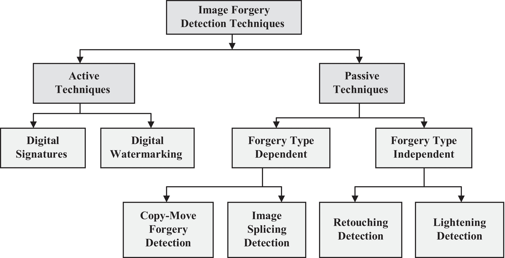
图 8.3 伪造检测技术的详细分类。

## 8.5 复制移动伪造检测技术

由于操作简单，复制移动伪造是最流行、最常见的伪造技术（Ghorbani, Firouzmand, and Faraahi, 2011）。在这种情况下，图像的特定区域被复制并粘贴到图像的某处，以隐藏或突出某些信息。图像的大小、动态范围、对比度和饱和度与属于同一图像的复制区域保持一致。因此，识别可能的篡改非常困难。

正如此，掩码区域是从图像本身选择的，因此检测这种伪造几乎是不可能的。在文献中，研究人员已经提出了几种方法。

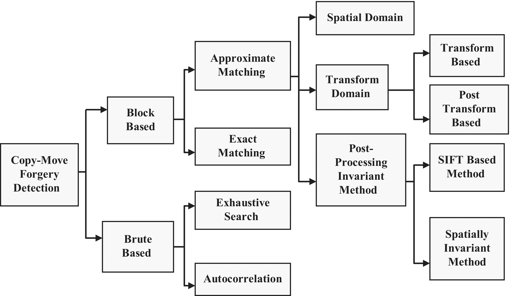
图 8.4 复制移动伪造检测方法的详细分类

在这些中，首次尝试检测复制移动伪造是由 Fridrich 等人（Fridrich, Soukal, and Lukas, 2003）完成。为了在性能和复杂度之间保持平衡，他们提出了块匹配算法，但该方法由于块尺寸过大，无法检测较小的重复区域。Gopi, Lakshmanan, Gokul 等人（2006）开发的模型使用自回归系数进行特征向量的选择，并为了检测可能的图像篡改，还设计了一个人工神经网络 (ANN) 分类器。为了训练该网络，选择了 300 个特征向量。实验结果显示，识别出正确伪造的准确率为 77.69%。Myna, Venkateshmurthy 和 Patil（2007）提出的方法通过对数极坐标和小波变换检测检测了复制移动伪造。该方法基于小波变换的基本特征，即降维，并且为了识别相似块，通过对数极坐标进行穷举搜索。同样，许多其他研究人员对复制移动伪造检测技术进行了详尽的研究工作。如果我们看此类算法的分类，从图 8.3 可以看出，其层级非常高。

广而言，根据文献，复制移动伪造检测技术分为两类（见图 8.4）。这些是基于块的技术和基于穷举的技术，后者涉及穷举搜索。与穷举搜索和基于自相关性的技术相比，基于块的技术效果更好（Singh and Raman, 2012）。为了提取稳健特征（`RFs`），可以通过对比对可疑区域通过 `“approximate block matching”` 产生不匹配情况设置某些阈值（Luo, Huang, and Qiu, 2006）。该技术分割图像，并根据相似性应用适当的技术来提取特征。对于重复区域的检测，通常遵循空间域技术（Ardizzone and Mazzola, 2009）。从每个块中选择七个特征向量进行比较，算法通过块重叠将图像分割。

内部分量变换通常用于近似块匹配技术，例如离散余弦变换（`DCT`）（Cao, Gao, Fan et al., 2012）以及第二流行的技术，即离散小波变换（`DWT`）（Shih and Yuan, 2010）。为了计算局部统计特征，Huang 等人（Huang, Guo, and Zhang, 2008）提出了一种基于使用 `SIFT` 检测旋转和缩放变化的方法，然而其表现较差。Pan 和 Lyu（2010）提出的技术似乎是有效的，因为重复区域显示出由于几何变换导致的畸变。`SIFT` 算法被用于计算关键点的特征。

## 8.6 反取证学

反取证是对取证分析的对策措施。从伦理角度来说，研究人员对于应该称之为好还是坏存在困境。反取证或反取证分析近期引起了学术界的关注，研究人员开始关注其重要性。通常，这些技术分为通用或针对特定的。在针对特定的，目标是消除任何特定取证工具的可检测痕迹。工具的类型由攻击者指定（Kirchner and Böhme, 2007）。相反，如果一种方法试图保持多个图像特征与未修改图像中的特征相似，则被称为通用的。

在文献的许多地方，图像压缩已被用于反取证。例如，Stamm, Tjoa, Lin 等人（2010）提出了一种隐藏 `JPEG` 压缩历史的方案，其中强调了在 `DCT` 压缩中添加噪声，从而分析图像是否存在任何可能的伪造变得更加困难。在许多其他设计的反取证操作中，数字图像中的 `PRNU` 指纹通过传感器缺陷被伪造。在 Gloe, Kirchner, Winkler 等人（2007）中，提出了一种基于平场校准（flat fielding）的应用的移除攻击。作为其延续，在指纹拷贝攻击中，从一组获取的图像估计虚假相机的指纹，并将其粘贴到从其他相机拍摄的图像上。

## 8.7 结论

在历史上，许多研究人员进行了大量的研究工作。本章旨在对用于数字图像伪造检测的图像取证技术进行广泛调查。这将为研究人员提供探索新可能性和想法的机会，以应对随着伪造技术演变将出现的新挑战。对图像变形技术给予了特别关注，因为这是伪造和篡改最显著的类型。根据技术是主动的还是被动的，展示了伪造检测技术的详细分类。此外，还给出了两种技术的更详细分类。经过调查发现，复制移动伪造检测技术是最流行的技术，因为其执行方式非常简单。期间，提到了一种图像任务的顺序循环，其中识别了可能的伪造攻击点。这是未来需要进一步探索的领域领域之一。


根据上述信息，可以得出伪造发生在三个不同的阶段，即获取阶段、传感器级和编码级。本文对所有提到的阶段进行了详细综述。在我们所处的时代，信息每秒都在变化，以图像形式呈现的视觉信息也是如此。融合（Morphing）是其中一种受生物学启发的技术，已对图像融合技术进行了分类。可以结论，研究人员正在定期开发新算法，但伪造检测算法仍有很大的改进空间，因为所有提到的算法在伪造检测中的准确率都较低，且在实际实现方面非常复杂。最后，反取证算法的发展引发了人们对此类算法的伦理接受性和可用性的严重关注。

## 参考文献 

1. Ardizzone, E. and Mazzola, G. 2009. “通过位平面分析检测被篡改数字图像中的重复区域.” 见于 Proceedings of the 15th International Conference on Image Analysis and Processing, Vietri sul Mare, Italy, pp. 893–901.

2. Basavarajappa, S. B. and Sathyanarayana, S. 2016. “数字图像伪造检测技术：综述.” *ACCENTS Transactions on Information Security* *2*, 22–31. doi:[10.19101/TIS.2017.25003](http://dx.doi.org/10.19101/TIS.2017.25003).

3. Cao, Y., Gao, T., Fan, L. et al. 2012. “用于数字图像复制移动伪造的鲁健性检测算法.” *Forensic Science International* *214*(1–3), 33–43.

4. Choi, K. S., Lam, E. Y., and Wong, K. K. Y. 2006. “利用内镜镜头径向畸变的自动源相机识别.” *Optics Express* *14*, 11551–11565.

5. Dirik, A. E., Senear, H. T., and Memon, N. 2008. “根据传感器灰尘痕迹识别数字单反相机.” *IEEE Transactions on Information Forensics and Security* *3*(3), 539–552.

6. Fan, Z. and Queiroz, R. de 2000. “位图压缩历史识别中 JPEG 量化表的最大似然估计.” 见于 Proceedings of the International Conference on Image Processing (ICIP ’00), pp. 948–951.

7. Fan, Z. and Queiroz, R. L. de 2003. “位图压缩历史的识别：JPEG 检测与量化器估估计.” *IEEE Transactions on Image Processing* *12*(2), 230–235.

8. Farid, H. 2009. “图像伪造检测.” *IEEE Signal Processing Magazine* *26*(2), 16–25.

9. Fridrich, J., Soukal, D., and Lukas, J. 2003. “数字图像复制移动伪造的检测.” 见于 Proceedings of the Digital Forensic Research Workshop, Cleveland, OH, pp. 55–61.

10. Friedman, G. L. 1993. “可信的数字相机：为摄影图像恢复信誉.” *IEEE Transactions on Consumer Electronics* *39*(4), 905–910.

11. Ghorbani, M., Firouzmand, M., and Faraahi, A. 2011. “基于 DWT-DCT (QCD) 的复制移动图像伪造检测.” 见于 Proceedings of 18th International Conference on Systems, Signals and Image Processing (IWSSIP), Sarajevo, pp. 1–4.

12. Gloe, T., Kirchner, M., Winkler, A. et al. 2007. “我们可以信任数字图像取证吗?” 见于 Proceedings of the 15th international Conference on Multimedia, Augsburg, Germany, pp. 78–86.

13. Goljan M., Fridrich J., and Filler T. 2010. “管理大型相机指纹数据库,” 见于 *Media Forensics and Security II, part of the IS&T-SPIE Electronic Imaging Symposium*, N. D. Memon, J. Dittmann, A. M. Alattar, and E. J. Delp, Eds., vol. *7541* of Proceedings of SPIE, San Jose, CA.

14. Gopi, E., Lakshmanan, N., Gokul, T. et al. 2006. “利用人工神经网络和自回归系数的数字图像伪造检测.” 见于 Proceedings of the Canadian Conference on Electrical and Computer Engineering, Ontario, Canada, pp. 194–197.

15. Huang, H., Guo, W., and Zhang, Y. 2008. “利用 SIFT 算法检测数字图像中的复制移动伪造.” 亚太计算智能与工业应用工作会议，中国武汉，vol. *2*, pp. 272–276.

16. Islam, Md. B., Inam, Md. T., and Kaliyaperumal, B. 2013. “不同融合技术的概述与挑战.” *International Journal of Advanced Research in Computer (IJARC)* *2*.

17. Shih, F. Y. and Yuan, Y. 2010. “复制移动图像伪造的比较研究.” *Open Artificial Intelligence* *4*, 49–54.

18. Shwetha, B. and Sathyanarayana, S. 2017. “数字图像伪造检测技术：综述.” *ACCENTS Transactions on Information Security* *2*(5), 658–661. ISSN (Online): 2455-7196, doi:[10.19101/TIS.2017.25003](http://dx.doi.org/10.19101/TIS.2017.25003)

19. Singh, J. and Raman, B. 2012. “基于 GPU 的高性能复制移动图像伪造检测方案.” 见于 K. Deep, A. Nagar, M. Pant, and J. Bansal, Eds., *Proceedings of the International Conference on Soft Computing for Problem Solving (SocProS 2011) December 20–22, 2011*. Advances in Intelligent and Soft Computing, vol *131*. Springer, New Delhi, India.

20. Stamm, M. C., Tjoa, S. K., Lin, W. S. et al. 2010. “JPEG 压缩的反取证.” 见于 Proceedings of IEEE Conference on ICASSP 2010, Dellas, TX, pp. 1694−1697.


34. Van, L. T., Emmanuel, S., and Kankanhalli, M. S. 2007. “利用色差识别源手机手机。”In Proceedings of the IEEE International Conference on Multimedia and Expo (ICME ’07), 北京，中国，pp. 883–886.

35. Wolberg, G. 2003. “图像变形的最新进展。”In Proceedings of Computer Graphics International Conference, CGI, 德国汉诺威.

36. Yerushalmy, I. and Hel-Or, H. 2011. “基于镜头和传感器像变的数字图像伪造检测。”*International Journal of Computer Vision* *92*(1), 71–91.

37. Zhao, X., Li, J., Li, S. et al. 2010. “色彩空间中的数字图像拼接检测。”In *International Workshop on Digital Watermarking*, pp. 12–22. Springer Berlin Heidelberg, 柏林.

# 基于分类的入侵检测技术分析

S. Sridevi and R. Anandan
Vels Institute of Science, Technology and Advanced Studies [VISTAS], 印度钦奈纳

## 9.1 引言

无线传感器网络（WSNs）由于其便利性和实施成本低廉，被应用于许多科学和工程领域（Akyildiz et al. 2002）。示例包括收集人类活动评论、军队监控与识别、交通；揭示物理和环境现象如海洋和动物、地震、污染、森林火灾和水质；暴露工业场所，如建筑保护、设备制造的整体性能等。另一方面，保护是 WSN 中的一个必要问题，特别是当它们具有任务关键型职责时（Chen et al. 2009）。在医疗保健框架中，独特的受影响的特征健康文件不应再在 1/3 庆典活动期间被启动。正如 Zhou et al. (2008)、Cayirci and Rong (2009) 以及 Wang et al. (2006) 所述，保护 WSN 在战术（军事）功能中被广泛需要，因为安全漏洞将导致战场伤亡。

WSN 保护攻击分为两个基本分支：主动和被动攻击。攻击者通常隐藏在被动攻击中，且两者都关注对话连接以收集数据或破坏网络的工作因素。被动攻击可以分为几类窃听、节点故障、社区操纵/破坏和站点访客分析。

在主动攻击中，目标社区内的操作实际上受到了攻击者的影响。此外，这会对攻击目标产生影响，且目标是可以被识别的。例如，作为这些攻击的结果，网络服务将受到损坏或终止。你还可以将攻击性攻击准备为拒绝服务（DoS）、干扰、空洞攻击（黑洞、虫洞、汇点洞等）、泛洪和女巫攻击等类型。深度参与 WSN 安全攻击的读者还可参考 Cayirci and Rong (2009)、Wang et al. (2006) 以及 Padmavathi and Shanmugapriya (2009) 以获取更多细节。

三种程序可以控制对有线网络和 Wi-Fi 网络的攻击选项：

1. **预期（防御攻击性）：** 这有助于在任何攻击发生之前进行“预先阻止”。任何建议的方法都应当免受目标攻击的保护。
2. **检测（检测是否发生了攻击）：** 当攻击者成功克服了“预防”步骤中所采取的步骤时，可能会在响应攻击时倾向于保护。此时，安全响应将跨越到攻击“检测”区域并发现正被攻击的系统。
3. **缓解（识别攻击后）：** 在网络中识别出攻击后，在传输数据之前，消除或替换受影响的节点。

入侵是一种未经授权的网络操作，可以以被动方式进行（例如，不知意地收集数据或监听数据），也可以以主动方式进行（例如，不知意地将数据包转发给合法用户、删除部分数据包，或在网络中创建空洞）。在保护系统中，当“入侵防御”未能阻止入侵时，“入侵检测”就会发挥作用。它是对用户执行的通信内部可疑活动的识别。入侵检测系统（IDS）提供以下细节，例如入侵者的证据、入侵者的位置（例如单节点或区域）、入侵发生的日期和时间、发生何种类型的攻击（例如主动攻击或被动攻击）、入侵类型（如黑洞、汇点洞、选择性转发等），以及入侵发生在哪一层（物理层或数据链路层）。这些知识对于尽可能的减少攻击具有巨大帮助，因为收集了关于攻击者的非常详细的数据。IDS 对于网络安全也非常关键。

WSN 具有特定特征，包括特定的能量限制、较少的带宽和存储信息的低内存。由于 WSN 这些限制的计算和功率资源，无线网络提供的普通安全技术并不适用于 WSN。设计一种适用于 WSN 的高效且简单的入侵检测方法是一项巨大的工程，这激励了我们关注这一研究领域。第一个研究目标是进行深入调查，由于我们研究的初步结果，引导我们进行了这项调查。本章安排如下：第 2 节介绍了 IDS、IDS 的类型及其要求。第 3 节讨论了移动自组织体系网络（MANET）中不同的入侵检测技术，并描述了它们如何适用于 WSN。第 4 节解释了 WSN 与传统有线和无线网络相比的整体优势和挑战。在本节中，讨论了 WSN 的完整文献。Fuchsberger (2005) 了每种方法的优缺点。进一步考虑了所有 IDS 的优缺点，并为创建一个适用于模型的通用 IDS 模型提供了思路。

## 9.2 入侵检测系统（IDS）

入侵是一种未经授权的网络操作，可以以被动方式进行（例如，不知意地收集数据或监听数据），也可以以主动方式进行（例如，不知意地将数据包转发给合法用户、删除部分数据包，或在网络中创建空洞）。IDS 是一系列用于识别、检查和报告入侵的软件、方法和物品。入侵检测通常是笔记本或机器常规安全单元的一部分，不再总是一个独立的功能（Chen et al. 2009）。

在 Ngadi et al. (2008) 中，入侵被描述为“损害隐私、机密性或可用性的任何攻击”，缓解方法（包括加密、设置密码、操作接受、舒适路由等）被给出防御入侵的前置。这些方法改进了预防保护的失败。因此，一旦配置 IDS 以暴露入侵，目前发生的所有入侵都应当公开。从保护的角度来看，IDS 被视为第二道防御。根据 Zhang et al. (2003)，IDS 是现代物理保护中使用的报警器的在线等物。

### 9.2.1 IDS 的要求

IDS 设计应满足以下要求：

* 它不应增加新的接口漏洞。
* 它应该需要少的设备资源，并且不会通过开销限制设备的通常整体性能。
* 它应该持续运行，并在设备和消费者身上清晰可见。


- 它们应该是相互依赖且可访问的，能够提供准确的结果并防止检测中的虚假结果。

## 9.2.2 IDS 的分类

### 9.2.2.1 入侵者类型

网络入侵者可以分为两类：

**外部入侵者：** 攻击者利用几种攻击获取进入网络的权限。

1. **内部入侵：** 攻击者通过曾是社区成员的受损节点访问网络。

**内部攻击：** 在这类攻击中，根据 Butun 等人（2012）的观点，自组织网络使用两种节点：

1. **以中心为节点：** 利用社区资源但不进行协作，为自己的通信节省电量。它不会直接对不同节点产生影响。
2. **恶意节点：** 目标是通过划分 DoS 社区来破坏不同节点，同时节省电量（目前这不再是首要任务）。IDS 可以识别外部和内部入侵者，但需要提到的是观察内部入侵者更具挑战性。这是因为内部入侵者拥有必要的密钥知识，可以通过身份验证机制中和任何采取的措施。

### 9.2.2.2 入侵类型

网络入侵还可能以多种方式发生：

1. **尝试入侵：** 尝试获取未经授权的网络访问权限。
2. **冒充：** 攻击者使用虚假身份获取未经授权的网络访问。
3. **扩散：** 获取未经授权的网络访问权限。
4. **DoS：** 阻塞选定用户的资源（即会话带宽）。
5. **恶意利用：** 故意对社区属性造成破坏。IDS 也可以提供检测此类攻击的局部方法。

## 9.2.2.3 攻击检测方法

IDS 在技术上分为三个关注方向：检测主要基于发现异常；检测主要基于识别滥用；以及检测主要基于规范。

#### 9.2.2.3.1 基于异常的检测

这种方法针对行为建模。对成员的普通操作进行剖析，任何偏离常规活动的情况都会被标记为异常。这种检测方法的缺点是，常规操作可能会变化，因为社区的特征也可能改变。这种寻找入侵的模型非常可靠且稳定，具有低偏离结果和低错误成本。

在这种情况下，团队识别了静态行为模式。特定结构的异常根据相关的处理方式分为三组：

**(i) 基于统计的：** 完全异常的 IDS 捕获页面流量，然后产生一个表示其随机特征的索引。当社区按照日常规定（无任何威胁）运行时，会生成另一个索引。之后，检查社区并通过查看索引正常产生索引。如果评分超过某个阈值，不确定性事件将标记 IDS。

- **单变量变异：** 变量完全基于高斯分布。
- **多重变异：** 也考虑指标之间的差异或更高的指标。
- **时间序列模型：** 用于锦标赛，考虑了案例与其值之间的排列和记录。

**(ii) 基于知识的：** 最初，基于知识的异常 IDS 获取标准情况和受攻击情况下社区参数数量的数据。

- **专家系统：** 它们主要基于一组分类指南。
- **描述语言：** 诸如 `Unified Modeling Language` (`UML`）之类的图类完全基于信息规范创建。
- **有限状态机：** 根据可用记录定义状态和转换。
- **数据聚类和离群点检测：** 基于相似性或距离度量将事实分组为簇。那些未出现在任何簇中的值被称为离群点。
- **基于机器学习：** 基于异常的机器学习 IDS 描述显式或隐式模式。该模型允许产生样本。这些样本通常经过修订，主要基于之前的结果。
- **贝叶斯网络：** 这种结构的网络变量基于概率关系选择。

**(iii) 基于主的：** 它基于两个异常 IDS 并分类为特定或隐式模型。该模型生成模式。根据先前的效果，这些模型定期更新。

- **马尔可夫模型：** 它们主要基于马尔可夫原理，其中技术组织为具有某些变化概率的互连状态。
- **模糊逻辑：** 完全关注模糊性和推理。
- **遗传算法：** 灵感来自有机进化理论。
- **神经网络：** 该设备主要关注大脑活动。
- **主成分分析 (`PCA`)：** 这主要与一种降维方法相关。

#### 9.2.2.3.2 基于签名或规则的滥用检测

创建以前已知攻击的签名（特征文件）并用作发现攻击的信息。例如，正常发生的情况可以解释为“5 分钟内有三次带有暴力密码攻击的失败登录尝试”。这种检测方法的优点是它可以可靠且有效地发现常见攻击；因此，它们的假阳性率较低。缺点是，如果攻击是新形状（以前未经过剖析），则可能无法通过目前的滥用检测检测到。Patcha 和 Park (2007) 指出这些结构与防病毒系统非常相似，可以发现大多数或所有考虑到的攻击模式，但对于未知的攻击策略作用有限。或者，作者涵盖了监控社区异常的以下提示：

- **间隔律：** 连续消息到达之间的延迟必须在这些限制之内。
- **重传规则：** 中间节点必须提前传输消息。
- **完整性法：** 发送者的唯一消息在到达接收者之前不再偏离。
- **延迟规则：** 消息应在合理的时期后重传。
- **重复律：** 相同的消息可以在较大的数字范围内从相同节点传输。
- **无线电传输多样性：** 消息最理想地来自相邻节点。
- **干扰规则：** 大范围的数据包传输冲突需要低于特定限制。

#### 9.2.2.3.3 基于规范的检测


一系列规范和限制是其显著特征，这解释了软件应用程序的独特功能或通信规则。随后，根据给定的规范和约束条件对该设备的实现进行检查。这种方法曾由 Sobh (2006) 执行过，他通过调整性能来发现此前未知的攻击，即使是那些显示出低虚假告报成本的攻击。Anantvalee 和 Wu (2007) 描述了这一概念，将许多基于异常的检测模型和基于误用的检测模型区分开来：异常检测结构试图发现攻击的影响，而基于误用的检测模型则努力防止已知的攻击。完全基于入侵的规范检测策略通过使用物理构建的需求和约束条件来示例可靠的设备活动，结合了基于误用和基于异常检测策略的优点。基于规范的入侵检测策略与典型的基于异常的检测方法具有可比性，因为它们都在偏离通用配置时应对攻击。由于基于规范的检测技术基于可用连接，与主要基于异常的检测技术较高的误报率相比，它们的虚假告报成本较低。另一方面，实现低误报率的代价是完善正确的规范和约束条件可能会非常耗时。

## 9.2.2.4 审计统计源

IDS 可分为三类：

1. **基于网络的入侵检测系统 (NIDS)：**
   NIDS 负责监听、收集和检查社区传输数据包。NIDS 可能还会查看完整数据包、数据包载荷、IP 地址或端口。

2. **基于主机的入侵检测系统 (HIDS)：**
   它们局限于检测以下指令，并能够成功（但不再限于）检测随后的入侵：服务器上必要文档的修改、持续失败的访问服务器尝试、之前特殊过程分配的回顾、异常的 CPU 操作或 I/O 行为。这些通过 HIDS 监控主机对实时框架的利用，或者通过回审服务器上的日志存档来执行，正如 Kachirski 和 Guha (2003) 所解释。

3. **混合入侵检测系统：**
   它结合了 NIDS 和 HIDS 的特征，并通过单元代理可用。它检查每个主机和功能设备的日志文件，同时通过中央代理视频显示测量网络社区流量。

## 9.2.2.5 累计统计计算区域

通过使用累积统计的作用，IDS 分为四类：

1. **集中式 IDS：** 一台集中式笔记本电脑跟踪所有社区操作，通过研究对监控的社区操作记录来检测入侵。

2. **独立式 IDS：** IDS 在每个节点上独立运行，且每个选择主要基于在其非公共节点收集的文档。由于备用 IDS 不再允许每个节点与其他节点进行协作或评估信息，网络人员现在无法意识到周围可能出现的入侵。

3. **分布式和协作式 IDS：** 这是为扁平化社会的基础设施提出的。节点运行一个 IDS 代理，该代理参与入侵检测和普通社区响应（在全网范围的入侵检测选择和行动中协作合作）。当节点通过倾斜或不完整的数据检测到入侵时，可以实施协调的全局入侵检测协议。如果节点检测到证据充分的家庭入侵，那么它可以独立地警告邻居攻击。

4. **分层式 IDS：** 建议用于多层社区基础设施（集群）。除了参与全局入侵检测选择外，簇头 (`CH`) 还负责监控其成员节点。

5. **基于代理的移动 IDS：** 在 Sun 等人 (2007) 中，每个单元代理被分配到在特殊节点上执行独特的 IDS 操作，并通过这些由节点决定的代理的相互移动来检测入侵。在合理的时间后或选定的任务后，用户可能还会迁移到若干预定义的节点上，以延长和/或增强 IDS 的整体性能。移动提供者的要求如下：

   - **移动性：** 手机销售商将代码传递给记录（待处理）以便在远程主机上异步执行。这将有助于大幅减少共享信息的数量。
   - **自主性：** 在手机创建时会为手机企业家提供一项任务：他们需要在没有任何外部协助的情况下完成其职责。
   - **适应性：** 移动营销人员希望根据他们在执行职责时获得的知识来调整他们的移动。

## 9.2.2.6 基础设施

Anantvalee 等人 (Anantvalee and Wu 2007) 将 IDS（针对 MANET）细分为社区基础设施组织：

1. **扁平型：** 所有节点在能力上被视为相等，并且参与路由功能（即该系统最适用于民用服务，如班级网络或会议）。

2. **集群型：** 并非所有节点都被视为相等。节点在传输范围内聚类，并选择一个节点作为 `CH` 来集中该集群的路由记录。`CH` 通常由带有备用电池的更强大的机器组成，从而延长了传输范围。因此，`CH` 构建了数字社区骨干。中间网关可以依靠路由协议在 `CH` 之间转发数据包。这种基础设施模型非常适用于具有指挥/控制层级的海军用途。

## 9.2.2.7 使用频率

根据使用频率，IDS 分为类型：

1. **不连续型：** IDS 始终跟踪网络。
2. **周期型：** IDS 在指定的数量间隔内跟踪社区。

## 9.2.3 IDS 内部的决策

IDS 的决策程序包括集体决策：社区的所有（或部分）个体共同工作以产生概率集合。最终选择基于多数偏好：风险是入侵。

**无偏偏的决策：** 每个参与者都确定一个选择，并根据 Sobh (2006) 的说明关注周围的活动。IDS 根据事件的选择确定列出的四种选择之一（具有零概率）。尽管入侵可能不再是异常（虚假且糟糕），系统可能仍然受到攻击，但 IDS 现在不再考虑它，正如 Farooqi 和 Khan (2009) 所描述。

- 不再入侵，但异常（虚假但有效）：系统中可能没有入侵；然而 IDS 错误地将正常情况假设为异常。
- 不再入侵且不再异常（真实的且糟糕）：系统中没有发生入侵，IDS 将该案例评估为非异常。
- 入侵且异常（真实的且高质量）：社区发生了入侵，IDS 将该事件判定为异常事件。

由于 Wi-Fi 通信的性质，以下情况会导致 WSN 中的 IDS 产生假阳性，因此可能被纳入确定模型中 (Zhou 等人 2010)：

- 节点冲突


- 数据包丢失
- 受限的流
- 电池电量耗尽

### 9.2.4 入侵响应

如果可能发生攻击，入侵检测系统（IDS）将不再采取预防措施，因为预防问题交由入侵防御系统（IPS）处理。与 IPS 的抢先策略相比，IDS 是以响应式的方式运行的，正如 Elshoush 和 Osman (2011) 以及 Zhou 等人 (2009) 所解释的那样。每当通过 IDS 产生入侵警报时，桌面端都应采取相应的操作。

#### IDS 的要求

- 网络中的所有人员、管理员（如果存在）以及基站（如果存在）都应该了解入侵情况。在适当的情况下，警报消息中应提供入侵者的接近程度和身份。
- 如果有预防策略，应将入侵挡在之外。例如，正如 Modi 等人 (2013) 所描述，需要通过社区内个人（特别是涉及事件的相邻贡献者）的集体行动创建一个计算机化的纠正措施。

### 9.2.5 关于 WSN 的进一步文献

Garcia 等人 (2012) 提供了一份针对 WSN 的 IDS 的简要研究，该研究对所提技术进行了改进的综述和深入评估。

- Cheng 等人 (2012) 给出了协作结构。针对协作智能 IDS，提供了更精确的警报相关综述（Keung 等人 2012）。关于协作 IDS 的去中心化多维警报系统的不同参考文献见 Wang 等人 (2013)。
- Shakshuki 等人 (2013) 提供了云计算 IDS 综述，这将对未来的舒适网络（comfy networks）有利。
- Garcia 等人 (Kachirski and Guha 2002) 为笔记本取证和网络安全系统提供了事后入侵检测数据。我们提供了一种通过使用隐马尔可夫模型分类日志文件的方法。
- Cheng 等人 (Rao and Kesidis 2003) 的工作中引入了威胁 IDS 的逃逸策略。他们提供了五种不同技术（DoS、包拆分、副本插入、有效负载变异和壳代码变异）的数据，并检查了这些策略在三个最新 IDS 上的效力。需要注意的是，本综述中检查的 IDS 与信息安全和 PC 安全相关，而与“边界防护入侵检测”问题无关。对后者感兴趣的读者应咨询 Sun 等人 (2003) 的工作。我们的综述不包括提出的放宽 IDS 的方法和思想。

### 9.3 IDS 在 MANET 和 WSN 中的应用

本文提供的文献对 MANET 的 IDS 进行了非常深入的研究和评估，提供了关于这项前沿工作的更多细节。Sen 和 Clark (2011) 给出了 WSN 中 IDS 计划用途的总结。

#### 9.3.1 主要基于代理的分布式和协作式 IDS

Zhang 和 Lee 发表了关于 MANET 入侵检测的第一篇论文。他们推荐了一种主要基于代理的分布式协作式 IDS，这种 IDS 符合自组织网络的运行实例。

正如 Patcha 和 Park (2006) 以及 Marti 等人 (2000) 补充提到的，识别出的 IDS 代理由六个区块组成，用于发现任何形式的攻击；实时统计通过附近的检测引擎进行检测。当社区内发生任何攻击时，它会通知邻域响应、全局响应或两者。如果检测需要不同节点之间的协作，那么不可侵入的对话可以告知协作检测以及相邻代理之间的协作。“本地检测系统”中包含两种策略。

**特征：** 它处理节点路由信息，即社区路由变化的共享部分。

**规则集建模：** 它利用属性作为基于规则的样本匹配策略集的入口，然后判断该发生的情况是常态的还是不再符合已定义的方法。在这个版本中，整个系统都参与了决策过程。在每个限制边界处，附近的 IDS 会触发全局 IDS 做出节点-邻居节点的联合决策。这一选择通过多数投票的方式做出。检测通过使用“熵”方法完成：随着熵的减小，异常概率增加。所提方法仅适用于发现与使用通信规则查找路径相反的攻击，即：路径丢失、更新错误路由、丢包和 `DoS`。在观察到不异常后，根据异常程度决定是否创建邻域响应，或在相邻系统之间创建跨国（协作）回复。涉及此全局回复的通信应通过多个节点的舒适超链接进行评估。与作者一致的是，对发现异常所需的行动进行分类是一项挑战性任务。

使用了两类分类器：决策树和支持向量机。表格维护路由信息并将更新作为三种方法中的提示记录：路由变化比例、所有路由跳数范围内的修改比例、以及新增新路由的比例。轨迹评估和异常识别是作者可以用于 IDS 的两种关键方法。从正常人员路由操作中获得的记录被输入策略的训练系列，以完成分类器的参考值。然后，使用与流行配置分类的偏差（关联）来考虑社区路由异常。在 ns-2 器中针对以下 MANET 路由协议对开发的方法进行了检查：`DSR`（动态源路由：一种响应式的、供应发起的、按需路由协议）；`AODV`（按需距离向量：一种响应式的、供应发起的、按需路由协议）；以及 `DSDV`（目标序列距离向量：一种构造性的、桌面驱动的路由协议）。结果显示，他们的算法在按需协议上的表现优于主动协议，因为访问者模式与路由消息之间的关联进入按需协议要容易得多。

Butun 等人 (2012) 提出了多层内置入侵检测和响应的想法，作为他们之前研究的扩展，即基于常用的 IDS 分布式代理。然而，该层的入侵检测模块必须在现代定义中适当出现；但是，某一层的识别可以通过不同层的证明来启动或支持。通过使用这种方法，作者说他们的 IDS 在提高更高的优先级和提高虚假负载识别准确性方面可以获得更大的输出。该方案应与 WSN 相关，并采取精确关注：例如，他们可能希望被包含在分级 WSN 中，其中簇头（CHs）可能希望在跨国旅行中执行计划方案，而近距离感知区域的微节点（苦力部门）。


根据 Butun 等人（2012）以及 Michiardi 和 Molva（2002）的观点，分散式 IDS 结构可以通过软件（如移动代理）进行增强。与在计算过程中传输位置信息的常规进程不同，移动销售者将代码传输到记录中。中介的异步实现在远程主机上执行。这显著缩减了城市内（关于零售商的）游客文档范围。然而，每个节点的字符负载被加速，这在无线传感器网络（WSN）中已不再是完美的。此外，发送移动代码（将 IDS 的可执行元素传输到现场事实处理节点）会降低 WSN 带宽。但是，如果带宽确实非常重要，这种技术通常不再足够。Kachirski 和 Guha 结合细胞代理在 Wi-Fi 自组网络文化中的能力，通过展示细胞代理具有清晰 IDS 职责（网络跟踪、主机控制、决策制定和采取行动）的非经验分布，讨论了细胞代理的信念。通过这种方式，某些节点被展开，以减少所有节点与 IDS 相关的电能和处理实例，从而减少所提 IDS 的负载。因此，该方案对 WSN 至关重要。另一种方法是将对首选社区安全的深度评估限制在少数可用节点上。

### 9.3.2 基于聚类的（分层）IDS

在 Kachirski 和 Guha 策略的方法中，标准节点在国际选择中不进行交互。最有益的 `CHs` 负责国际决策和反应的循环。这主要通过降低能耗来实现。我们通过将大多数节点明确指定为 `CHs` 的下属，成功维持了大多数节点的强度。

聚类用于选择放置适中的单层显示设备。在 Michiardi 和 Molva（2002）中，视频显示结构用于通过统计异常检测检查路由错误。为了保持属性，该方案中的每个节点根据时间被选择以监控整个网络，以便发现节点组的入侵。在所提方案下，每个监控节点上运行发现方法来发现附近的入侵，随后它与不同的销售者协作检查入侵源并安排响应。

在 Mishra 等人（2004）中，作者建议了一种去中心化的支持方法来检测聚类移动自组织网络（MANET）的入侵。使用动态分层结构作为指导模型，允许较高层的节点选择性地混合并限制入侵范围，这意味着检测可以从最顶部到最后完成。因此，它遵循自上而下的方法。这种基础设施不再是最环保的，但它允许从人群成功获取入侵检测的审查。然而，除了入侵响应和管理指令的非经验分布外，还包含了渐进的聚合、识别和关联。对于以下三个实例，将检查所提方案：

* 意念丢包历史
*  MANET 路由协议的攻击
* 社区和高层协议的攻击

如果能够谨慎使用，主结构 IDS 中的聚类可能对 WSN 也有益。由于于此，`CHs` 耗尽资源的速度比那些旨在在社区内部进行分段的候选节点（可以相互分离的节点公司）更快。因此，可能需要为 `CHs` 连接额外的电池使其能够持续更久，或者也可以定期在轮换中选择 `CHs`，以便每次电量最好的节点可以额外成长为 `CH`。

### 9.3.3 基于统计检测的 IDS

Puttini 等人提出了一种完全基于贝叶斯分类标准的入侵检测算法。他们的结构主要基于统计对比建模，该模型利用组合模型，以便处理由于一种小组系统而由特殊旅行者配置组成的可观测旅行者。它被设计用于实现数据泛洪（DoS 攻击的一种实例），并扫描针对 MANET 的攻击。所提模型建立了一个考虑多于个人配置的行为模型，并利用*后验*贝叶斯知识类别作为检测准则的一部分。

作者使用估计的中间节点拥塞来对恶意丢包行为提出建议。他们建议为了保持从跳到跳的统计规律性，访问者的传输类型必须与次优介质访问控制相结合。所提入侵检测策略是通用的，适用于网络。然而，那些不受带宽限制的网络具有像战术网络那样精确的保护标准。因此，它们不再适用于带宽限制的 WSN。统计策略需要大量的记录处理以筛选保留用于记录的统计数据。

### 9.3.4 基于误用检测的 IDS

Shin 等人（2010）建议，现实中的 IDS 完全基于误用检测算法。他们的实现侧重于远程矢量路由协议，如 `DSDV` 协议。除了受攻击的路由器外，他们的实现还侧重于检测 DoS 和重放攻击。他们的仿真结果提供了重要的结论，不再仅仅基于方案的准确性和稳健性，还基于网络的平均整体性能。然而，DSDV` 要求定期更换路由表，这不应消耗节点的可用电源，但可能会消耗部分宝贵的可用带宽。因此，不建议基于这套策略为 WSN 开发软件程序。

### 9.3.5 基于声誉（信任）的 IDS

基于信任的 IDS 通过集体节点观察和评估设备以及对结果的集体跟踪来鼓励节点协作。Garcia-Teodoro 和 Diaz-Verdejo（2009）使用信誉定义来衡量参与者对社会的贡献。成员越可信，家庭中的被选成员就能与不同的社区成员建立联系。作为替代，小组参与者需要引用区别于降低关注节点的独特节点。作者识别了三种声誉：

* 主观认可：在关注点与其邻居之间的直接接口阶段进行测量。
* 间接认可：通过区域非邻居进行测量。
* 目的性承认：通过注意独特方面（包路由、路由发现等）测量的任意和间接声誉。

他们针对流行度的交互式评估系统由简单组件组成，包括识别表，这是一种保存在每个节点上的图形形状，整合了到达节点的流行度记录。

### 9.3.6 看门狗机制

看门狗机制结合保存在注意力接待台上的记录来测量预定义的宝贵声誉，然后识别行为不当的节点。检测完全取决于注意力限制率（例如，`0`）；如果一个精确成员的信誉降到阈值以下，则看门狗机制将阻止与该成员的所有接触。


此外，DoS 攻击对他们来说一直是挑战。因此，他们建议实施一种基于确认（acknowledgement）的机制，以实现节点之间的协作。此外，这种识别机制避免了由自私节点引起的 DoS 攻击。`CONFIDANT` 协议是 `DSR` 这种响应式路由协议的扩展，并利用了一种基于声誉的机制，完全根据节点的恶意行为对其进行计费。来自不同节点的告警消息会被分析，如果消息来自已确建立的节点，则以最简单的方式修改底层调查的节点识别。使用社区方案来发现通往后续节点路径中产生的破坏性成本。如果特定系统感知到恶意的邻居，它将根据其伙伴节点依赖项列表向多个节点发送警告消息。通信标准规则可以描述为：为了每个现有方案的公平性，节点之间协作（Garcia-Teodoro and Diaz-Verdejo 2009）。这适用于有微小差异的无线传感器网络（WSNs）：带宽利用表的到期时间将缩短。

### 9.3.7 主要基于扇区的 IDS

团队被划分为不重叠的区域，并配备基于光伏扇区的 IDS（Strikos 2014），每个附近的 IDS 代理都会公布区域生成的信号。网关区域负责汇总和关联区域产生的指标。整个社区中最简单的网关节点可以产生大量的告警。指标表明了可能的攻击，并通过最近的 IDS 分段生成，而告警则指出最终的检测，并可以异常地通过网关节点生成。他们提出的近端聚合与关联引擎的特征是混合本地检测引擎的结果并进行检查，而他们提的在网关节点上的全局聚合与关联引擎的作用是结合并检查附近节点的检测效果，以便做出最终选择。根据检测标准创建附近的警告信号：(1) 路由条目的交换百分比，代表在长期内删除和新获取的路由条目；(2) 大范围跳数的替代方案百分比，代表在特定范围内所有路由条目跳数数量的选择。根据作者的仿真（在团队模拟器 `Glo-MoSim` 上完成），由于移动性曾被降低，他们的模型假报率远低于其他。相比之下，网关节点的聚合算法比邻居节点 IDS 显著减少了假报，因为它们可以从更广泛的位置积累统计数据并允许额外的正确选择。

所提模型检测 OSI 栈路由层内部的入侵，但忽略了特定层。由于曾无法再感知不同层中的攻击，借助此版本的使用，它是一个部分 IDS。所提方案要求任何节点具有周围的地理信息。虽然通过在移动自组织网络（MANET）节点中引入全球定位系统（`GPS`）接收器是行的，但在 WSNs 中已是不可能的，由于成本和电力规定，大多数传感器节点通常没有配备 `GPS`。

### 9.3.8 基于博弈游戏的 IDS

作者在 Marti et al. (2000) 和 Wei and Kim (2012) 中展示了博弈论方法来研究 MANET 中的入侵检测。他们使用运动的概念来对自组织社区节点之间的交互建模。作为一个非合作性练习用户，他们对入侵者与角色节点之间的交互进行建模。根据他们的假设，只要值与获取的事实相符且运动遵循原则，该模型在技术上就是稳定的。所提方案需要一台关键的处理机器，用于存储收集关于监控系统使用的观测结果。除了巨大的内存区域外，这还需要一个高速微处理器来存储待处理的数据。因此，为了将这些方案扩展到 WSNs，应该选择一个中心化的 WSN，那里有一个配备了高速处理能力和大内存笔记本电脑的基站（`BS`）。方案可以根据每个节点与 `BS` 之间访问者的负载进行修改。例如，可以使用日志记录，每个节点的位置还可以额外记录与多个节点（如果可能的话，还有攻击者）相关的交互。这些日志通常完全根据检测结果提交给 `BS`，以供博弈概念使用。

### 9.3.9 基于遗传算法的 IDS

Sen 和 Clark 调查了使用进化计算技术来分类 MANET 环境友好型检测器（这些检测器缺乏全计算单元，具有特殊的单元节点且资源有限）。作者利用语法演化和遗传编程策略来感知 `AODV` 对自组织泛洪和路径破坏的攻击。作者已经证明，他们构建的应用程序可以直接在具有特定移动性和访问者模式的数字网络上运行，而这种方法对于 MANETs 可能是非常有前景的，那里的位置节点（例如 `PDAs`）足够环境友好，可以运行这些耗电的算法。这并不适用于 WSNs，因为那里的传感器节点信息处理和存储能力极小。

### 9.3.10 其他工作

在看门狗（watchdog）中，`DSR` 协议的一个特点是确保当一个节点转发数据包时，路由内部的后续节点也转发数据包；否则，后续节点将被识别为异常。看门狗运行在每个节点上，以杂乱模式监听邻居节点的传输。由于数据包冲突，看门狗不会持续活跃。所提的看门狗机制对于 WSNs 是必要的。

Mishra et al. (2004) 提出了一种混合 IDS，除了 `Wi-Fi` 自组织网络外，它还允许每个设备在繁忙网络上运行。该新模型的信息和实现评审尚未提供，因此无法分析其在维护之前提模型方面的整体性能。此外，所提方案要求节点之间有端到端的口头交换通道，这在 WSNs 中通常不存在。MANETs 对于预设网络（如指挥部、汽车车队、自给的机器人和步兵部队）非常有益。

`MITE`（战术环境 MANET 入侵检测（Sen and Clark (2009)））的作者解释了为什么在 MANETs 中，特别是在战术情况下，他们正在开发入侵检测的原型方案。除了仿真影响外，`MITE` 的效果已作为现实实现进行了定位和检查。作者建议将有效且有益的资源节省型传感器检测器作为有利组件。所提方案的 `TOGBAD` 方案需要大量的访问者。因此，它不再适用于 WSNs，因为那里的带宽支持不足，且希望以资源节约的方式执行。


Roman 等人（2006）利用网页客户的期望值来发现 Wi-Fi 网络中的入侵行为。作者推荐了一种以网页流量预测为中心的模型，该模型基于针对自回归移动平均（`ARMA`）的时间序列信息。根据他们的仿真，该版本估计的访问网页的流量没有问题，并能可靠地过滤出攻击者。考虑到这些成效是积极的，但所提出的方案给社区带来了沉重的访问者监控数据包负载，同样需要一个中央处理单元来收集和分析不再在无线传感器网络（WSNs）中获取的所有站点访问者信息。

## 9.4 WSN 中的入侵检测系统

WSN 中的入侵检测正成为文献中解决的一个主要问题。因此，到目前为止的研究在此进行了总结。第 9.4.1 节 讨论了现代 WSN 的独特挑战环境，这些环境使得传统的 IDS（为有线或常见的 Wi-Fi 网络设计）难以被观测。WSN 是移动自组织网络（MANETs）的一种特殊形式，具有非常独特的规划限制。因此，两种网络之间的重要差异将在 第 9.4.2 节 中提到。最后，现有的 WSN 文献将在 第 9.4.3 节 中提供。在完成所有测试后，我们将讨论现代系统的优点和风险，并提供一份评估表。

### 9.4.1 WSN 中的限制与研究挑战

WSN 的普及使研究人员建立了涵盖分散社区环境的通信和网络化技术，以及在资源受限的情况下防御这些技术的能力（Shin 等人，2010）。缺乏持续的路线（例如 `gateways`、`routers`、`BSs` 等）使得适用于安全布局的模型和 WSN 算法成为可行。带宽、容量和电池电量是需要仔细使用的受限资源。

这伴随着对 WSN 局限性及其对 WSN 相关问题的简要列举：

*   WSN 中没有用于数据传输、路径发现、实时访问者审查、数据隐藏等的特定结构。
*   节点需要对影响社区运营的物理组件的捕获、利用或劫持负责。
*   受损的节点可能会通过提供欺骗性的路由统计数据进一步削弱 WSN，导致社区无法运行（黑洞、虫洞、汇聚攻击）。
*   无线对话往往涉及他人可以听到的消息，这将导致必要的统计暴露给攻击者和/或导致阻塞/干扰，这将成为 WSN 中拒绝服务（DoS）的原因。
*   没有权威机构或依赖项；选择需要以共同的方式做出。在为 WSN 设计 IDS 时，这些都是必须考虑的属性和困难。

### 9.4.2 MANETs 与 WSNs 之间的区别

Roman 等人误解了一个事实，即应为 MANETs 配置的 IDS 无法扩展到 WSN。由于它们的结构与 MANETs 和 IDS 相同，在由 WSN 组成的静态网络中，它们的效率会低得多。以下是区分 WSN 和 MANETs 的主要独特能力：

*   **移动性：** WSN 节点通常是静态的，与蜂 MANET 节点相反。
*   **计算能力：** 与 MANET 节点相比，WSN 节点的处理能力极低；像 `MICAz` 这样的普通传感器节点运行最高速度为 `16 MHz` 的 `Atmel ATmega128L`处理器，而常见的 MANET 节点（包括可能带有 CPU 的普通工业笔记本电脑）运行速度高达 `4 GHz`（Chen 等人，2009）。
*   **通信范围：** WSN 节点的口头交换范围大约为 20–30 米（对于 `MICAz`），而 MANET 节点的范围高达 100 米（对于 Chen 等人 (2009) 中解释的 `XBee` Wi-Fi 模块）。
*   **通信带宽：** WSN 中的对话带宽被限制为 250 kbps（对于先进的 `MICAz` 节点），而 MANET 中的信息成本为 65 Mbps（对于日常使用的 `XBee` Wi-Fi 模块（39；Chen 等人，2009）。
*   **电源：** WSN 节点具有完全有限的电源，例如 `MICAz` 节点使用 2 节 AA 尺寸电池，而 MANET 节点通常拥有大电池，如笔记本电脑电池。这对它们的寿命产生巨大影响。假设它们的耗电阶段相同，MANET 的寿命将是 WSN 的 15 倍。
*   **自主性：** 在 MANET 中，每个节点都在人类操作员的帮助下管理，而在 WSN 中，每个节点在接收来自 `BS` 的体验和发送信息方面都是自给自足的。
*   **节点密度：** WSN 的节点密度高于 MANET。相反，WSN 节点发生硬件故障（电池限制、物理损坏等）的可能性更大，这会减少网络中连接的系统。这些特殊能力应该被视为过去的问题，而不是直接将为 MANET 设计的 IDS 应用于 WSN。

### 9.4.3 建议的方案

#### 9.4.3.1 基于分组的 IDS

提出了一种用于入侵检测和记录处理的分层形式。单跳聚类的成本曾是该结构实验的重点。作者认为，这种分层框架通过双重防御保护 WSN 的处理功能。

Strikos (2014) 解释了一种用于在分层 WSN 中正确发现入侵的隔离台。他们的想法需要双级聚类程序。根据他们的研究，他们的隔离台入侵检测方法成功检测了攻击。这种想法的问题在于：作者宣布每个视频流设备都可以向 `BS` 产生异常。由于它是分层小组，任何通过底层节点产生的警报都应该跳过高层节点，以防高层节点是入侵者。这样就不会通过阻塞从底层节点收集的警告让中心节点察觉到入侵。Krontiris 等人 (2009) 提出了一种主要基于聚类的移动 IDS。这种覆盖还为了 `CH` 的安全性而建立。小组中的一个系统会以计划的方式显示其簇首者。相反，簇成员由 `CH` 跟踪，而不是总是通过簇选男性或女性的贡献。这进一步节省了簇个体的资源。


作者提出了一种分层入侵检测系统（IDS）模型，其中团队被分为若干组，并为每个簇选择一个 `CH`（簇头）。他们提供了集中化路由，使得数据可以发送到组组和中央系统。他们的建议包括在 `CHs` 内部使用一种方法来检测邻区域的入侵，以便用最少的检测器使整个网络变得不可渗透。作者没有提供任何生成结果的模型，也没有运行任何真实的实验。因此，目前还很难知道该方法是否如所提那样有效。

在 Ngai 等人（2006）中，提出了一组异常检测规则。他们通过对传感器测量值进行聚类，首先合并簇，然后将簇的概要传输到不同节点，从而减少了数据交换的开销。作者将他们的预期模型应用于了一项无疑是国际性的任务。他们检查发现与集中化方案相比，他们的方案在对话成本上达到了相同的效果，且折扣很大。

#### 9.4.3.2 中心化与协作式 IDS

Onat 和 Miri (2005) 建议了一种针对网络集体管理的集中化无线传感器网络（WSN）IDS。作者在仿真环境中评估了他们的 IDS 方案对于黑洞攻击和选择性转发攻击的有效性。一种查询 WSN 中入侵检测有效性的方法演变为：为位置节点配备邻域检测器模块以分散对入侵者的观测。检测器模块引发了传感器网络内部的干扰问题。作者引入了有效暴露入侵者所需的先决条件以及一种证明在常见威胁下有效的等效算法。

在 Agah 和 Das (2007) 中，计划中的 IDS 使用了基于总检测算法的要求。作者使用去中心化方法来寻找故障，其中入侵检测器被分配到社区的不同部分。（他们的范围曾是单跳，保留了整个社区。）收集的信息及其传输已以一种分配的方式进行。他们认为这种分布式方法比集中化方法更具灵活性韧性。事实上，由于入侵检测器被分配到整个系统，它们对社区拥有极其敏锐的视角。

#### 9.4.3.3 基于统计检测的 IDS

Rajasegarar 等人（2008）提供了一种检测汇聚点（sinkhole）入侵的方法。预期算法首先建议列出可疑节点，然后社区假设一个流布局，从而高效地确定网络内部的入侵者。该方法涉及逐步执行一种多变量方法，主要基于卡方矩搜索。预期算法的有效性和精确性通过每次算术评估和仿真得以建立。作者认为他们算法的对话交换和计算开销对于 WSN 来说是廉价的。在建议的规则集中，传感器社区适应其环境中的动态规范以发现任何异常活动。他们采用 `Hidden Markov Model`（隐藏马尔可夫模型）来实现这一目标。作者认为他们提出的算法既易于使用，所需的处理和存储数据极少。算法的有效性和实用性通过实验环境得到了验证。建议的算法利用统计方法来筛选任何异常读数。因此，这是一种独特的 IDS，完全基于收集数据的正确性，而不是节点或链接的安全性。在 Rajasegarar 等人（2007）中，作者推荐了一种基于实时且完全基于异常的检测算法，其使用传感器节点来调整检测过程。他们为可以通过传感器节点访问的网站在线内容开发了一个模型，并讨论了一种在到达过程中发现不规则修改的方案。检测策略序列保留了多级滑动窗口事件存储方案，以便进行快速的时间跨统计。通过这种方式，算法将检查过程以得到一个独特的时间段。作者认为他们的方法是有益且不复杂的。

#### 9.4.3.4 基于博弈论的 IDS

在 Bhuse 和 Gupta (2006) 中，Aga 等人将攻击和检测视为每个活动的一部分，并为每个活动设计了技术。技术被标准化为非合作零和博弈模型，以提高检测率。该方案的发展旨在发现网络中最弱的节点，然后为该系统提供安全技术。这种方法的问题在于，WSN 可能发生严重入侵，而 IDS 只能识别其中一个，导致其他入侵无法被发现。

#### 9.4.3.5 基于异常检测的 IDS

Wang 等人（2012）讨论了 WSN 的异常检测方法。他们鼓励研究人员不要在设计中忽视 WSN 的固有边界，从而减少小型系统的能量消耗并优化网络寿命。这些作者还推荐了一种在减少网络内部接触开销的同时确定组计算中发生异常的方法。他们对该问题的回答完全基于一种利用分配的区域球单优雅支持向量机来分类统计中的异常测量值的方法。作者在一个真实项目中实施了他们的想法，并表示他们的模型在开销通信方面具有电源效率，甚至达到了与集中化方案相同的精度。Bhuse 和 Gupta 提出了轻量级策略来发现 WSN 中的异常入侵。他们的主要思想是复用在邻域协议栈特定层创建的可用系统事实——特别是物理层、MAC 和路由层。作者提出了多个监控 OSI 栈特定层的检测器以提供更高的检测率。这对于 WSN 来说是不可能的，因为监控不同层次的入侵并保持这些显示单元的同步可能会耗尽 WSN 稀缺资源。此外，作者认为他们的外部攻击方案是最好的，但排除了内部攻击。这是不充分的，因为 WSN 中的小型系统非常容易受到内部攻击，包括物理攻击、Sybil 攻击等。

#### 9.4.3.6 基于 IDS 的看门狗

Roman 等人（2006）提供了静态 WSN IDS 应用的提示（这些可以针对 MANET 进行优化）。相反，他们建议了一种名为 `impulsive watchdogs`（脉动看门狗）的 WSN IDS，其中关联节点得到优化管理，且少数节点自主监控其区域的通信。


### 9.4.3. 基于信誉（信任）的 IDS

Wang 等人（2012）提出了一种用于无线传感器网络（WSNs）的 IDS，该系统会对数据包进行标记，随后通过启发式排序算法发现网络内部可能异常的最大节点。增长的数据包经过加密和密封，以确保数据包到达的位置安全。每个数据包中包含部分表示，以便中心节点可以使用其启发式排序算法结合较小的虚假罚分来改进数据包溯源；将根据仿真结果识别出坏节点的最大值。

## 9.5 WSN IDS 选择的未来方向

在系统设计中，IDS 的能耗是一个重要问题。WSN 通过感知现象、存储感知细节以及传输随后的知识来消耗能量。因此，IDS 需要消耗尽可能少的能量，为关键的 WSN 操作留出足够的电力。由于 WSN 对电耗的需求较低，应用分层版本的 IDS 是很有用的。换句话说，网络将划分为若干簇，每个簇作为获取簇头（CH）的一种方式。通过停止所有节点向基站（BS）发送数据也可以减少能量消耗。IDS 算法防止不必要的功率消耗在簇头（CH）处最为有用，这可以节省电力释放节点并可能增加网络的寿命。目前有多种形式的入侵防御算法；可以根据建议软件的需求（即要检测的攻击类型、检测准确率（误报率和检测率的百分比）以及检测周期）选择入侵检测算法。我们选择 WSN IDS 的理由相似（针对特定包有不同建议）：对于传感器节点移动的移动包，我们建议使用分散协作的 IDS 方案，因为它们具有扩展性、高效且快速。

## 9.6 结论

在本章中，我们从分类、设计规范和特性方面简要考虑了 IDS。其次，介绍了为移动自组织体系网（MANETs）提出的 IPS，并讨论了它们与 WSN 的相关性。第三，列出了为 WSN 规划 IPS，并以类似的方式说明了它们的特定能力，同时对可能适用于 WSN 的 IDS 给出了注释。最后，为了帮助研究人员选择 WSN IDS，提供了适用方案建议以及该研究的潜在指导。

### 9.7 参考文献

1. Agah, A., S.K. Das, 2007, “Preventing DoS attacks in wireless sensor networks: A repeated game theory approach,” *International Journal of Network Security*, *5*(2), 145–153.
2. Akyildiz, I.F., W. Su, Y. Sankarasubramaniam, E. Cayirci, 2002, “A survey on sensor networks,” *IEEE Communication Magazine*, *40*(8), 102–114.
3. Anantvalee, T., J. Wu, 2007, *A Survey on Intrusion Detection in Mobile Ad Hoc Networks*, Chapter 7, 159–180. Springer, Heidelberg.
4. Bhuse, V., A. Gupta, 2006, “Anomaly intrusion detection in wireless sensor networks,” *J. High Speed Networks*, *15*(1), 33–51.
5. Butun, I., Y. Wang, Y. Lee, R. Sankar, 2012, “Intrusion prevention with two-level user authentication in heterogeneous wireless sensor networks,” *International Journal of Security and Networks*, *7*(2), 107–121.
6. Cayirci, E., C. Rong, 2009, *Security in Wireless Ad Hoc and Sensor Networks*. Wiley, Chichester, UK.
7. Chen, R.C., C.F. Hsieh, and Y.F. Huang, 2009 a, “A new method for intrusion detection on hierarchical wireless sensor networks,” in *Proceedings of the ACM ICUIM-09*, Suwon, Korea.
8. Chen, X., K. Makki, K. Yen and N. Pissinou, 2009 b,“Sensor network security: A survey,” *IEEE Journal of Communications Surveys and Tutorials*, *11*(2), 52–73.
9. Cheng, T.S., Y.D. Lin, Y.C. Lai, P.C. Lin, 2012, “Evasion techniques: sneaking through your intrusion detection/prevention systems,” *IEEE Communications Surveys and Tutorials*, *14*(4), 1011–1020.
10. Elshoush, H.T., I.M. Osman, 2011, “Alert correlation in collaborative intelligent intrusion detection systems: A survey,” *Journal of Applied Soft Computing*, *11*(7), 4349–4365.
11. Farooqi, A.H.,F.A. Khan, 2009, “Intrusion detection systems for wireless sensor networks: A survey,” *Journal of Communication and Networking*, *56*, 234–241.
12. Fuchsberger, A., 2005, “Intrusion detection systems and intrusion prevention systems,” *Journal of Information Security Technical Report*, *10*(3), 134–139.
13. Garcia, P., R. Garcia-Tejo, 2012, “A real-time node-based traffic anomaly detection algorithm for wireless sensor networks,” *Journal of Computer and Cyber*.
14. G, D. Shanmugriya, 2009, “A survey of attacks, security mechanisms and challenges in wireless sensor networks,” *International Journal of Computer Science*, *4*(1), 1–9.
15. Ngadi, M., A.H. Abdullah, 2008, “A survey on MANET intrusion detection,” *International Journal of Computer Science and Security*, *2*(1), 1–11.
16. Ngai, E., J. Liu, M. Lyu, 2006, “On the intruder detection for sinkhole attack in wireless sensor networks,” *ICC ’06*, Istanbul, Turkey.
17. Onat, I., A. M.iri, 2005, “A node-based traffic anomaly detection algorithm for wireless sensor networks,” *Proceedings of the Systems Communications*, Washington, DC.
18. Patcha, A., J.M. Park, 2006, “A game theoretic formulation for intrusion detection in mobile ad hoc networks,” *International Journal of Network Security*, *2*(2), 131–137.
19. Patcha, A., J.M. Park, 2007, “An overview of anomaly detection techniques: Existing solutions and latest technological trends,” *Journal of Computer Networks*, *51*(12), 3448–3470.
20. Rajasegarar, S., C. Leckie,M. Palaniswami, 2008,“Anomaly detection in wireless sensor networks.” *IEEE Wireless Communications*, *15*(4), 34–40.


30. Rajasegarar, S., C. Leckie, M. Palaniswami, J.C. Bezdek, 2007, “基于四分之一球的无线传感器网络分布式异常检测，”*IEEE ICC ’07*, 英国格拉斯哥。

31. Rao, R., G. Kesidis, 2003, “在非带宽限制的多跳无线网络中，利用统计规整流量模式检测恶意丢包行为，”发表于*Proceedings of the IEEE GLOBECOM*, 加利福福尼亚州旧金山。

32. Roman, R., J. Zhou, J. Lopez, 2006, “将入侵检测系统应用于无线传感器网络，”发表于*Proceedings IEEE Consumer Communications and Networking Conference*, 内华华达州拉斯拉斯维加斯。

33. Shakshuki, E., N. Kang, T. Sheltami, 2013, “EAACK—一种用于移动自组织网络（MANETs）的安全入侵检测系统，”*IEEE Transactions on Industrial Electronics*, *60*(3), 1089–1098。

34. Sen, S., J.A. Clark, 2009, “移动自组织网络中的入侵检测，”*Guide to Wireless Ad Hoc Networks*, 页码 427–454. Springer, 伦敦。

35. Sen, S., J.A. Clark, 2011, “用于移动自组织网络入侵检测的进化计算技术，”*Journal of Computer Networks*, *55*(15), 3441–3457。

36. Shin, S., T. Kwon, G.Y. Jo, Y. Park, H. Rhy, 2010, “无线工业传感器网络分层入侵检测的实验研究，”*IEEE Trans. Ind. Informat.*, *6*(4), 744–757。

37. Sobh, T.S., 2006, “有线和无线入侵检测系统：分类、良好特性与最新技术，”*Journal of Computer Standards and Interfaces*, *28*(6), 670–694。

38. Strikos, A.A., 2014, “无线传感器网络入侵检测系统综述，”*IEEE Communications Surveys & Tutorials*, *16*(1), 266–282; Strikos, A.A., “无线传感器网络入侵检测的全方位方法，”发表于*Wireless and Mobile Network Architectures*, 信息与通信技术学院，2008。

39. Sun, B., L. Osborne, Y. Xiao, S. Guizani, 2007, “移动自组织网络和无线传感器中的入侵检测技术，”*IEEE Transactions on Wireless Communications*, *14*(5), 56–63。

40. Sun, B., K. Wu, U.W. Pooch, 2003, “用于移动自组织网络的区域性入侵检测，”*International Journal of Ad Hoc and Sensor Wireless Networks*, *2*(3), 297–324。

41. Wang, Y., G. Attebury, B. Ramamurthy, 2006, “无线传感器网络安全问题综述，”*IEEE Communications Surveys and Tutorials*, *8*(2), 2–23。

42. Wang, C., T. Feng, J. Kim, G. Wang, W. Zhang, 2012, “捕捉无线传感器中的丢包者和修改者，”*IEEE Trans. Parallel Distrib. Syst.*, *23*(5), 835–843。

43. Wang, Y., W. Fu, D.P. Agrawal, 2013, “无线传感器网络入侵检测中高斯分布与均匀分布的对比，”*IEEE Transactions on Parallel and Distributed Systems*, *24*(2), 342–355。

44. Wei, M., K. Kim, 2012, “用于无线工业网络的基于流量预测入侵检测方案，”*IEEE Journal of Communications and Networks*, *14*(3), 310–318。

45. Zhang, Y., W. Lee, Y.A. Huang, 2003, “移动无线网络的入侵检测技术，”*Journal of Wireless Networks*, *9*(5), 545–556。

46. Zhou, Y., Y. Fang, Y. Zhang, 2008, “确保无线传感器网络安全：综述，”*IEEE Communications Surveys & Tutorials*, *10*(3), 6–28。

47. Zhou, C.V., C. Leckie, S. Karunasekera, 2010, “协同攻击与协同入侵检测综述，”*Journal of Computers & Security*, *29*(1), 124–140。

48. Zhou, C.V., C. Leckie, S. Karunasekera, 2009, “用于协同入侵检测的去中心化多维告警关联，”*Journal of Network and Computer Applications*, *32*(5), 1106–1123。

# 第十章：加密货币与区块链

Premkumar Chithaluru [1], Kulvinder Singh [2], 和 Manish Sharma [3]。

## 10.1 引言—区块链的定义

区块链由一种重要的数字技术——分布式账本技术（`DLT`）组成，没有中心机构。这种方法利用加密技术创建并验证数据，并嵌入链中（Houben and Snyers 2016）。

区块链的框架非常难以处理结构，由于区块链源存储在分布式计算机中。

区块链框架的主管（监控数字货币）可以使用预设的算法授权系统，该系统被称为一种“理解协议”（Brito, Shadab, and O’Sullivan 2014, Braties 2018）。当出现问题时，区块链被分为两个子类。从客户的角度来看，区块链已经获得了开放许可（Bryans 2014），但真正使用的类型是特定的。少数加密货币，如 `Ripple` 和 `NEO`，使用的是许可链（Buchko 2017）。

## 10.2 区块链的基本工作原理

在区块链框架中，主管根据预设的“理解工具”选择整个验证协议。当该因素确认后，新的真实技术被部署在区块链中（Houben and Snyers 2019），这真实实现了交易记录的更新。

### 10.2.1 分布式数据库：区块链

区块链的框架非常难以处理结构，由于区块链源存储在分布式计算机中。

### 10.2.2 告别中间人？

区块链技术的极佳案例是重塑通常由分散的大规模交易（例如管理员、银行、证券系统、委托代理商和交易存储设施）（Bollen 2013）。在最基础层，区块链与去中心化和允许去中心化授权相关（Chohan 2018）。从根本上说，它允许消除专家。


## 10.3 区块链共识机制

在关键层面，区块链框架内的任何中间节点都可以对区块链中新统计数据的改进提供建议。为了确定此类数据发展（例如交易记录）是否真实（Data, Statistical 2015），核心要点需要达成某种共识。在这里，“理解分段”变成了一个至关重要的因素。“在加密货币的情况下，需要这种顺序排序来解决‘双重花费’问题（即如果转账不在中央进行注册和控制，那么同一种支付工具或资产可能会被多次转移）”（Nesi 2016, Young 2016, Buttigieg and Sapiano 2020）。理解区块可以根据不同的习惯进行分类。共识机制可以通过多种方式进行构建。以下将简要讨论两种最为人知的——在加密货币背景下也是最常用的——共识机制示例：工作量证明（“POW”）机制和权益证明（“POS”）机制（Directive, Council 2016）。

### 10.3.1 密码学报价工作量证明

在 PoW 系统中，网络参与者必须解决所谓的“密码学难题”才能允许向区块链添加新的“区块”。这个解题过程通常被称为“挖矿”（Mach 2018）。简单来说，这些密码学难题由之前在区块链上记录的所有信息以及要添加到下一个“区块”中的一组新交易组成（Yascega and van Thiel 2011）。由于每个谜题的输入随着时间的推移而变大（导致计算更加复杂），PoW 机制需要大量的计算资源，这消耗大量的电力。加密货币比特币依赖于 PoW 协议的运行。

### 10.3.2 权益证明

在这种结构中，交易（例如框架中心点）应该显示与某些有利情况或通过优越的货币（特别是在交易背书方面）相关的义务。这种协助交易的被委托“生产”而非“挖矿”。例如，在计算机类型货币的帮助下，交易所验证者必须展示其“权益”（例如一笔巨大的交易）的所有可用硬币以允许验证交易。根据他们持有的硬币数量，他们将更有概率验证下一个区块（即这与他们在网络中拥有更高的资历，从而获得更受信任的位置有关）。备选验证者通过执行方获得其背书收益的交易价值（Directive 1991）。

### 10.3.3 其它机制

PoS 和 PoW 机制与目前主要的感知分段还有很长的距离。各种模型包括组织证明、销毁确认和最远点确认。对这些部分的进一步评估超出了本文的研究范围。区块链开发可以具有许多功能。

尽管在大部分时间里，区块链的改进与减少区域或数字货币计划、部分以及与相关的组织有关，但其范围明显非常广泛。区块链可以以大量方式进行投机性利用（例如贸易和商业、社会保护和组织）。正如以前指出的，本研究将实际上探讨区块链开发的复杂性，这对于加密货币种的研究是至关重要的，并且可以从打击非法价格欺诈和基于恐惧的压迫融资的角度进行应用，仅仅作为一种规避义务的方法。

## 10.4 什么是加密货币？

确定数字货币的重要性并非易事。与区块链一样，加密货币已成为一个“流行词”，用于指代利用一种更广为人知的密码学技术的各种技术发展。简单来说，密码学是通过将信息转换（即加密）成一种不可读的格式的技术，只有拥有密钥的人才能对其进行解密（或解码）。加密货币（如比特币）通过这种巧妙的公私数字密钥系统通过这种技术获得保护。

以下，我们努力概述加密货币的重要性——这取决于对目前欧洲和国际级各种相关技术制定者所做的定义进行基本审查。自从比特币出现以来，加密货币主题受到了各种政策制定者的审视，他们都以不同的方式触及这一主题。例如，加密货币如 `Bitcoin`，是封闭类货币的虚拟货币标准：它们可以用通用货币获得并以标准货币卖出，并可以用于购买电子产品以及许可的物品和活动。数字货币相关结构的能力是什么？数字财政结构被描述为与传统货币进行买卖。它们不是由国家银行、信用评分协会发行的，并且具有与法币对立的特定规定。此外，加密货币如 `Bitcoin` 包含去中心化的双向（例如分离）数字货币。

### 10.4.1 国际货币基金组织 (IMF)

在欧洲中央银行 (`ECB`) 中，国际货币基金组织 (`IMF`) 将加密货币组织为数字货币相关结构的一个子集，将其描述为货币价值的现代表示，由个人架构师提供并在自己的记录单位中分配。正如 `IMF` 所示，数字财政结构的可能性涵盖了越来越多的“货币相关原则”，范围从通过资产（例如黄金）和数字金融形式支持的数字经济模型中的清晰非正式承诺或“借据条”，到数字金融形式（例如 `Bitcoin`）。

### 10.4.2 国际结算银行

国际结算银行 (`BIS`)形式的支付和市场基础设施委员会 (`CPMI`) 已将加密货币认证为机械财政原则或推动货币计划。其主要特征如下：

1. 它们是资产，其价值由供需决定，概念上类似于黄金等商品，但没有内在价值；
2. 它们使用数字信息允许数字动力的共享交换，而无需事件之间的信任并接受对中间人的需求；以及
3. 它们不再通过特定的个人或协会协助工作。

### 10.4.3 欧洲银行管理局 (EBA)

欧洲银行管理局 (`EBA`) 将加密货币定义为数字货币相关模型，将其描述为巨大真实价值的机械表示，既不是由国家银行或开放机构发行，在传统意义上与法币相关，但通过商标或刑事个人使用，并可以通过电子方式进行移动、管理或交易。

### 10.4.4 欧洲证券及市场管理局 (ESMA)


欧洲证券及市场管理局（ESMA）近期在与欧洲保险和职业养老金管理局（EIOPA）及 `EBA` 合作发布的一项全欧警告中，也将加密货币称为虚拟货币。完全符合 `EBA` 的定义，虚拟货币被定义为价值的数字表示形式，这些价值并非由中央银行或公共机构发行或担保，也不具备货币或资金的法律地位。根据 `EBA` 的观点，数字过程被允许代表巨大的真实价值，而这种价值并非通过国家金融机构的给予或保证，也不具备现金或货币的官方声誉。

### 10.4.5 世界银行

世界银行将加密类现金汇为电子财政基准的一个子集，将其描述为巨大真实价值的尖端表示，这些价值以其个人记录单位命名，与货币是不可区分的（货币本质上是一种机械化的操作，用于对法定货币进行处理和命名）。与此相反，与大多数其他方法论制定者不同，世界银行还将加密类货币描述为依赖于加密框架来实现理解的数字衡量标准。

### 10.4.6 金融行动工作组

同样，与其他机制制定者一样，金融行动工作组（FATF）也将加密类货币推向数字货币相关结构的子集。

### 10.4.7 框架

从研究结果中得出的核心观点是，加密类型货币在管理空间中可用时间段的重要性尚未被识别。事实上，大多数研究人员已逐渐避免泛泛描述该术语。

大多数小组将加密类货币归类为虚拟或进展金融基准的子集或种类。它们旨在构成政府发行的法定货币的点对点（`P2P`）替代方案，并用作一种通用交换媒介（独立于任何中央银行），其特征是：

(a) 由称为加密的机制保护，以及

(b) 可以转换为法定货币，反之亦然。

下文中，我们将揭示对加密货币（或币——此后我们将分开使用这两个术语）可能性的理解，并更明确地划分其他密切相关概念之间的界限，这些概念必须与计算机货币形式区分开来。

## 10.5 高级货币类型——代币——加密证券

高级货币的有效期比其他类型的货币短，因为它们不允许在巨额交易中使用。这必须从两个角度来看待：代币和加密保护。

### 10.5.1 计算机货币需求——代币

首先，计算机类货币应当与加密 `tokens`（代币）区分来，后者提供了不同的服务（例如，在适当的记录上记录的属性，通过加密检查），并代表了由于使用区块链技术而产生的对某种元素（或其工资、资产、未来产品或组织）的保证。

在广泛运行后，一些代币代表数字债券，并通常被指定为 `security tokens`（证券代币）或假设代币。各种代币允许所有者获得各种类型物品的所有权益，大多数代币通常是 `utility tokens`（实用代币）。它们可以用于获取某些产品或服务，但它们并不构成通用交换媒介，仅仅因为它们通常只能在代币平台本身使用。

### 10.5.2 高级货币类型——加密证券

此外，计算机类货币同样应当与近期关于它们是 `crypto protection`（加密保护）的概念区分。简单来说，有人认为区块链开发可以用于选择、中断和移动传统物品和其他公司保证，目标是使企业的资本表始终准确且清晰。由于这种机制将通过加密进行检查，因此建议将这些描述为 `crypto protections`。这种新提出的 `crypto protection` 概念与加密类现金之间的主要关系是，它们每一个都使用了区块链开发。

## 10.6 计算机类现金——区块链

计算机类货币和区块链在近年来已成为令人兴奋的问题。两者经常在比较句中被联系在一起，并且彼此之间真正相关。它们以多种方式被利用。在这些功能与加密类型现金之间画出一条不可否认的界限是简单的，考虑到所有因素，后者是区块链技术的一种应用类型。在此背景下，监管机构在处理加密货币主题时无需担心扼杀创新。

### 10.6.1 所指的参与者是谁？

加密现金广告是另一个特定的屏幕角色参与特定活动的领域。为了更详细地揭示市场如何运作和控制数字交易，必须识别数字支付中的关键参与者。

### 10.6.2 加密现金客户

最初，大量的参与者是 `cryptographic cash customers`（加密现金客户），而计算机现金客户是通过发送和接收代币进行适当交易的专业投资者：

1. 向绝对的/数字产品类公司（来自许多明确的经纪人）。
2. 创建点对点分发。
3. 存储各种数字日志（例如以一种假设的方式）。

此外，高级数字货币交易可以在特定情况下交换代币：

* 首先，他们可以在高级现金交易中使用法货币或其他某些加密现金购买他们的代币；
* 其次，他们可以从每一个其他计算机货币消费者那里虚拟地购买代币（例如，通过买卖平台——这种交换通常被称为 `P2P Exchange`）；
* 第三，如果他们作为加密现金的副产品出售产品或业务，他们可以以类似的方式获得资金作为这些设备或组织的要素。

### 10.6.3 矿工

接另一个参与者是 `excavator`（矿工），他们通过解决一个加密问题来参与证实交易。如前所述，开采路线涉及被视为 `PoW`（工作量证明）协议操作的高级货币标准。矿工通过利用注册能力来协助交易并获得新开采的币作为补偿（例如通过修改的去中心化新发行）。他们可以是加密货币用户，或者更常见的是通过开采代币并将其出售换法货币或其他加密货币来建立新业务的方。目前，与 `mining associations`（矿矿协会）相关的风险还不是主要担忧。这将在下进一步讨论。

### 10.6.4 计算机货币交易所


三分之一的关键参与者是“计算机货币交易所”。加密货币交易所是个人或实体，他们通过收取特定费用（例如佣金）为高级货币客户提供加密法币兑换服务。他们许可计算机货币客户将其货币兑换为法币，或使用法币购买新的加密货币。请注意，某些交易所（例如 `Binance`）是纯粹的加密货币交易所，这表明它们实际上持有各种类型的计算机货币，通常是 `Bitcoin`；而另一些（例如 `Coinbase`）则持有与法币相关的资产，例如美元或欧元。

此外，现实中许多加密货币交易所允许其客户购买特定的代币保证。因此可见，许多优质货币交易所（例如标准型和纯型加密货币交易所）充当了托管钱包提供商（例如 `Bitfinex`）。综合来看，加密货币交易所为客户提供了广泛的决策选择，例如电汇、PayPal 转账、Visa 交易以及多种代币。某些加密货币交易所在计算机货币平台上提供服务。

## 10.6.5 交易层

尽管加密货币交易所被描述为“交易阶段”，但存在特定的经济要求（以及最引人注目的是，针对计算机货币客户的许可）。

交易层是类似于“P2P 交易所”和“去中心化交易所”的时间元素。存在许多不同的计算机货币交易所。然而，它们本身并不买卖货币。此外，它们并非由一个监督并处理所有交易的实体或公司运营，而是完全由软件运行（即没有中央权威点）。交易层实际上将买家与卖家连接起来，允许他们在网络上、甚至在本地范围内协调行动路径（例如，一种经常离线的交易，通常以现金形式进行）。比特币交易的交易层中一个很好的例子是 `LocalBitcoins`。

## 10.6.6 钱包提供商

钱包提供商基本上将加密货币客户的交易历史解析为一种易于理解的安排，形成标准记录。事实上，钱包提供商有几种：

- 硬件钱包提供商：为加密货币用户提供特定的硬件解决方案，以私密存储他们的加密密钥（例如 `Ledger Wallet1`）。
- 软件钱包提供商：为加密货币用户提供软件应用程序，允许他们访问网络、发送和接收货币并在本地保存加密密钥。
- 公司（在线）：负责计算机货币客户的加密密钥（例如 `Coinbase`）。

## 10.7 协调加密货币——检查加密市场

在早期几年不懈的发展之后，计算机货币市场在 2017 年爆发，增长了超过 1,200%。目前，有几种类型的货币可用（硬性和软市值远超 3000 亿欧元），并且正在不断取得进展。

`PoW` 框架的几种用途如 `表 10.1`，而另一些则使用任何其他形式的共识算法。大多数被描述为伪匿名，但一些据称努力实现完全难以追踪（这意味着其客户保证、发送和接收的货币百分比并不总是易于观察、感知的或通过区块链交易历史关联的）。以下对所选先进金融标准的检查完全取决于在网络上可获得的数据。

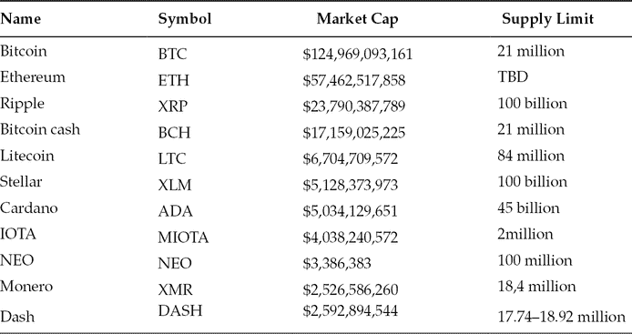

表格 10.1
区块链货币概览

## 10.8 比特币及以后：市值最高的虚拟货币类型

实际上，`Ethereum` 货币本身并不是数字外汇。尽管如此，像其他开放、无许可区块链一样，`Ethereum` 需要一种激励机制来强化设备内部的交易确认（例如，执行任务的设备枢纽的费用）。这就是 `Ethereum` 的本地数字外汇“以太坊”（`ETH`）成为关键因素的地方。`Ether` 不仅允许高质量合约主要基于 `Ethereum` 平台（例如，它填充了合约），还可以作为交易模式的数字操作（特别是在 `ITOs` 主题上，各种代币都是用 `ether` 购买）。

遵循 `Ripple` 的基础，`Ripple` 的创建者推出了数字货币 `XRP`。`XRP` 变成了一种脚架货币，允许货币相关公司以比目前全球结算安排更快、成本更低的方式结算跨境支付，后者可能非常缓慢且包含许多中间机构（例如银行）。在任何情况下，`Ripple` 的结算安排都不需要扩展币即可正常工作。

同样，`XRP` 每秒可以处理超过 1,500 次交易。虽然它最初被创建并建议用于大型企业，但它已被各种虚拟货币客户所接受。`Wave` (`XRP`) 不依赖于 `PoW` 或 `PoS` 机制来确认交易，而是利用其特有的结算协议。

与 `Ethereum` 的创建者不同，`Ripple` 的创新者没有通过向金融业务引入 `XRP` 来出售部分 `XRP`。他们的企业交易是受到秘密补贴的。目前尚不完全清楚 `XRP`（大部分由 `Ripple (Labs), Inc.` 持有）未来如何或可能如何发放。

### 10.8.1 Wave (XRP) 可以合法兑换法币

`Wave XRP` 可以在加密货币交易所上合法地兑换法币（例如，在 `Anycoin Direct`、`Bitsane`、`LiteBit75`、`Kraken` 等平台上操作）。

### 10.8.2 Wave (XRP) 是交易媒介

`Wave (XRP)` 被提及为交易技术，通过为独特的商品和项目开发各种（在线）经销商（例如，电子烟、花蜜、浓咖啡等）。

### 10.8.3 Wave (XRP)

具体来说，由于它显然处于早期阶段，中心交换路线的使用需要大量的 IT 信息。此外，两个区块链必须共享相同的加密函数（例如 `SHA-256` 函数）才能实现原子交换。虽然在用户友好跨链交易方面我们尚未达到这一水平，但原子交换技术的出现带来了一系列全新的挑战。

## 10.9 Stellar (XLM)

与 `Ripple` 一样，`Stellar` 是一个开源分布式支付基础设施。`Stellar` 由 `Ripple` 的创始人之一于 2014 年创建。它的目标是让人们连接低成本的金融服务，以消除贫困并开发个人潜力。`Stellar` 也可以用于构建智能合约。

### 10.9.1 什么是 Stellar?

`Stellar` 是电子货币 Lumen (`XLM`）的所在地。简而言之，`Lumens` 用于支付 `Stellar` 网络上的交易费用。


Stellar 的工作者为结构贡献代码，但系统本身被认为与此完全无关。与 Ripple 的加密货币 `XRP` 类似，Stellar Lumens 的总供应量是“预挖”的。它由 `Stellar.org` 持有，并被赋予通过以下方式免费发放 Lumens。实际分配并非一次完成，而是随着时间分多轮进行。

### 10.9.2 Stellar 运行在无许可区块链上

与 Ripple 不同，Stellar 以其无需许可的区块链而闻名。任何人都可以选择加入该结构，并在满足某些情况下，无需任何中央机构的预先声明或考虑即可参与交易。虽然这证明了它们逐渐被接受为支付手段，但它们还不是真正的交易媒介，至少与上述讨论的代币相比是如此。

### 10.9.3 Lumens 是伪处理代币

Stellar 平台上的大多数交易所都是开放的，或者至少它们无法与其客户产生联系。

## 10.10 Cardano

与以太坊一样，Cardano 被设计并进一步开发为一个平台，在其之上可以运行智能合约和去中心化应用（所谓的“Dapps”）。Cardano 项目始于 2015 年，并于 2017 年 9 月正式面向发布。它基于所谓的 `Ouroboros PoS` 算法。

### 10.10.1 Cardano 的运行

Cardano 使用去中心化自动现金 (`ADA`) 运行。`ADA` 也用于传输和接收数字货币。交易由 Cardano 处理，就像货币“ether”强化以太坊一样。因此，Cardano 计划提取并改进从以太坊和比特币中学到的实践，提高适应性、安全性、关联性以及与通用现金相关框架和规则的互操作性。Cardano 与以太坊以及不同类型的自动货币的区别在于，它是由学者和设计师社区创建的（最早区块链活动之一）。目前另一个显著区别是加密货币 (`ADA`)。

## 10.11 NEO

与以太坊和 Cardano 类似，`NEO` 是一个开源区块链平台，在其之上可以运行智能合约和去中心化应用（所谓的“Dapps”）。`NEO` 有时被称为“中国太坊”，最初于 2014 年 2 月以“Antshares”之名推出。

### 10.11.1 什么是 NEO？

简而言之，`NEO` 项目旨在实现资产数字化和数字资产管理自动化化，以便创建一个所谓的“智能经济”（即各方无需相互信任即可达成合同的经济）。

### 10.11.2 NEO 的 GAS 提供数字货币

`NEO` 的代币与已经讨论过的代币相似。在任何情况下，`NEO` 的开发者目前正在适当处理一种想法，该想法允许编码人员将特定的“现代字符”绑定到真实的字符上。这并非完全不可想象——尽管目前仍然非常不清楚——这项技术也将影响 `GAS` 的伪匿名特性。

## 10.12 Monero

Monero 也是一种“带有隐私和监管安全交易所思考”的开源点对点加密货币。

### 10.12.1 Monero 的运行

Monero 于 2014 年 4 月发布，依赖于 `CryptoNote`。它提议两个 `XMR` 单位通常可以定期兑换，且 `XMR` 商户或交易不会因为其在过去交易中的关系而对表达单位进行抵制。非同质化的加密货币（如 `Bitcoin` 和 `Litecoin`）在假设情况下，如果它们被用于非法活动，可能会受到各种区块链操作直到永远的抵制。与某些代币不同，Monero (`XMR`) 不是预挖的。

### 10.12.2 Monero 是无许可区块链

与 `Bitcoin` 类似，Monero (`XMR`) 运行在各种区块链权限上。任何人都可以加入系统，而无需事先获得执行机构的保证或考虑。

### 10.12.3 Monero 显然可以转换为法币

Monero (`XMR`) 显然可以在各种加密货币交易所（例如 `Anycoin Direct`、`Kraken`、`LiteBit` 等）兑换成法币。

### 10.12.4 Monero 是一种数字交易

它被视为公平进行许多在线交易的新方法。像 `Bitcoin` 一样，它恰恰建立了一种交易操作。

### 10.12.5 Monero 是一种交易所币

在完全透明的区块链上（例如 `Bitcoin` 或 `Ethereum` 区块链），每种情况的交易都是不可疑问的，且无法被任何人直接检测。从长远来看——无论如何，这不会是一个本质任务——此类交易的发送和持久区域可能与个人的真实身份相关联。

#### 10.12.5.1 环秘密交易

合法地，Monero 利用推断的环秘密交易。`RingST` 加入了环身份识别过程，并在加密思想中暗示了安排交易中的概率：

- 环标记（Ring marks）将客户的记录密钥加入或“混合”到从各种区块链技术中获取的公开密钥中，被称为潜在贷款人的 `RingST`，外部观察者无法将指纹关联到特定的客户。
- 秘密交易结合了另一层保护来掩盖每笔交易的金额。在不泄露实际数字的情况下，它们包含一个加密证明，证明输入金额的和等于输出金额的总和。

#### 10.12.5.2 隐性地址

此外，尽管有 `RingST`，Monero 同样使用了隐性地址。每次交易的隐性地址通常由发送者根据受益人的真实关注而创建。

#### 10.12.5.3 项目—Kovri

应该注意的是，Monero 背后的（核心）开发者和加密专家社区正在致力于一个项目，通过通过 `I2P` 网络项目节点路由和加密 `XMR` 交易，为 Monero 生态系统增加另一层隐私。使用 `I2P` 将模糊交易者的 IP 地址并提供针对网络监控的进一步保护。

## 10.13 Dash

Dash 是一种开源的点对点安全驱动型货币。该过程以前被称为 `Darkcoin`。尽管矿工执行了 PoW，但 Dash 的区块链通过受认可的“专家节点”技术得到确认。

### 10.13.1 Dash 的运行


Dash (DASH)，原名 Darkcoin，是一种开源的隐私中心 P2P 加密货币。它于 2014 年 1 月首次发布，基于名为 `X11` 的 PoW 算法。Dash 的特殊以及它与其他大多数货币区别之处在于，它具有一个双层网络。除了矿工完成的 PoW 工作外，Dash 的区块链还通过所谓的“主节点”（masternodes）来确保安全。简单来说，主节点是连接到 Dash 网络的服务器，负责确保特定的最低性能和功能，以执行与 `PrivateSend` 和 `InstantSend`（Dash 的匿名和即时交易功能）相关的某些任务。标准加密货币的兑换可能是重复的（例如，它们可能需要几分钟到 60 分钟不等）。这是因为需要足够的区块来确保兑换尝试能够双重确认近期已花费的现金。Dash 使用其治理中心方法来解决这个问题。可以节点主节点来形成投票法定人数，以检查提交的交易是否有效。主节点会“锁定”交易的输入并将此信息广播到网络，有效地承诺该交易将包含在随后的挖掘区块中，并防止在确认期间对这些输入进行任何其他支出。因此，Dash 被认为能够推动像万事达那样的快速交换框架。

## 10.13.2 Dash 毫无疑问地可以转换为法币现金

Dash 可以通过不同的货币交易所（例如 Anycoin Direct, Kraken）毫无疑问地兑换为法币现金。

## 10.13.3 Dash 是一种交易工具

与 Monero 类似，Dash 被视为一种通过许多在线商户实现分割的方法。通过这种方式，Dash 同样建立了交易机制。

## 10.13.4 Dash 是一种（自由裁量的）混淆币

与比特币的区块链一样，Dash 的区块链默认是透明的，这意味着在通常情况下，交易在区块链上始终是公开可验证且可追溯的。为了给客户提供真正的预算安全，Dash 提供了使用名为 `PrivateSend` 功能的选择。这种 `PrivateSend` 通过一种被称为“混合”（blending）的策略掩盖客户操作的起始阶段。

## 10.14 结论：加密货币的分类与时间范围

基于研究分析和信息，已加密货币建立了一套分类法，这允许进行更准确的常规分析，并允许提出有关框架的问题。首先考虑比特币的分类法。

从图表中显而易见的是，推广的货币并不存在。然而，在加密货币如何形成、它们运行在何种流程上、提供的隐私水平等问题上，存在共识。

`Table 10.2` 处理了这些分组。所选的加密货币根据不同参数进行了分析：它们是运行在许可许可还是无许可技术上；它们的去中心化性质；它们最初是由可识别的个人还是实体提供的；它们是否进行电子交易；是否真的可以转换为法币现金；是否是交易工具；以及是伪匿的还是完全黑色的。这些参数并非随意选择的。

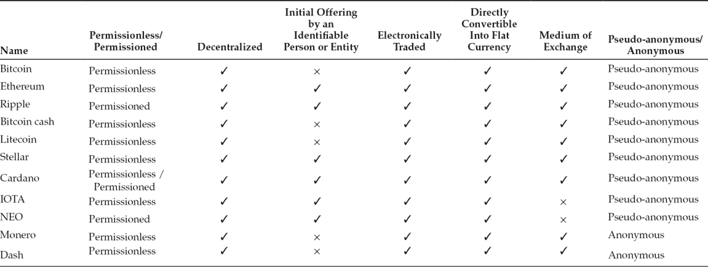

### 表格 10.2 货币分类

该表格反映了我们对所选加密货币的理解。阅读时应考虑到，在加密货币之间做出明确的区分并非易事。复杂的因素其他包括可用信息的稀缺以及其通常具有的高度技术性。。此外，加密货币是一个不断变化的目标。例如，目前并非真正交易工具的机械货币明天可能就是。因此，本综述并不自称是概述的主要方法

### 10.14.1 结论

为了在加密货币背景下获得精确的情景并为该主题的不同特征提供简单的政策建议，仍有工作空间并需要深层研究。`Table 10.2` 展示了可以认为是可行领域的的选项，并基于所做的分析得出了几个结论。

## References

1. Adams, R., Kewell, B. and Parry, G., 2018. Blockchain for good? Digital ledger technology and sustainable development goals. In *Handbook of sustainability and social science research* (pp. 127–140). Springer, Cham
2. Bantekas, I., and S. Nash. 2009. *International Criminal Law*. Routledge.
3. Bianchi, C., Bovaird, T. and Loeffler, E., 2017. Applying a dynamic performance management framework to wicked issues: how coproduction helps to transform young people’s services in Surrey County Council, UK. *International Journal of Public Administration*, *40*(10), pp. 833–846.
4. Bollen, R. 2013. “The legal status of online currencies: Are bitcoins the future.” *Journal of Banking and Finance Law and Practice*.
5. Bovaird, C. 2017. “Why the crypto market has appreciated more than 1,200% this year.” *Forbes Magazine*.
6. Bratspies, R.M., 2018. Cryptocurrency and the Myth of the Trustless Transaction. *Mich. Tech. L. Rev.*, *25*, 1.
7. Brito, J., H. B. Shadab, and A. C. O’Sullivan. 2014. “Bitcoin financial regulation: Securities, derivatives, prediction markets, and gambling.” *Columbia Science and Technology Law Review*.
8. Bryans, D 2014. “Bitcoin and money laundering: Mining for an effective solution.” *Ind. Law J* *89*: 441.
9. Buchko, S. 2017. “How long do bitcoin transactions take?” *Coin Central* *1*.
10. Buttigieg, C. P. and G. Sapiano. 2020. “A critical examination of the VFA framework—The VFA agent and beyond.” *Law and Financial Markets Review* *14*(1): 48–58.
11. Chohan, U. 2018. International law responses to cryptocurrency: Interpol working group. Available at SSRN 31563.
12. Conlon, S., A. Vayser, and R. Schwaba. 2019. “Valuation of cryptocurrencies and ICO tokens for tax purposes.” *Est. Plan. & Cmty. Prop. LJ* *12*: 25.
13. De France, B. 2013. “Les dangers liés au développement des monnaies virtuelles: l’exemple du bitcoin.” *Focus*, 10–15.
14. Directive, Council. 2016. 1164 of 12 July 2016 laying down rules against tax avoidance practices that directly affect the functioning of the internal market. *OJ l* *193*(19):7.
15. Directive, E. C. 1991. Council directive 91/356/EEC 1. Laying down the principles and guidelines of good manufacturing practice for medicinal products for human use. *Official Journal of the European Communities l* *193*: 30–33.
16. Data, Statistical. 2015. Commission staff working document accompanying the document communication from the commission to the european parliament, the council, the european economic and social committee and the committee of regions the marco polo programme-results and outlook.
17. Houben, R., and A. Snyers. 2016. *Cryptocurrencies and Blockchain*. Policy Department for Economic, Scientific and Quality of Life Policies.
18. Houben, R., and A. Snyers. 2018. *Cryptocurrencies and Blockchain: Legal Context and Implications for Financial Crime, Money Laundering and Tax Evasion*. European Parliament, Brussels.
19. Houben, R. and A. Snyers. 2019. “Address2vec: Generating vector embeddings for blockchain analytics.”
20. Mach, J. 2018. “Automatic exchange of information on the issued tax interpretations in the context of a taxpayer’s rights.” *Studia Iuridica Lublinensia* *27*(2): 117–125.


21. Nesi, G., ed. 2016. *反恐主义国际合作：联合国与区域组织在反恐斗争*. Routledge,伦敦.
22. Otsuka, T. and M. Takehara. 2007. “关于修订欧洲议会和理事会关于 2002/96/EC 号废弃电气电子设备指令的建议”。 *Environmental Research Quarterly* *14*: 33.
23. Walfish, M. and Blumberg, A., 2018. *实现基于证明的可验证计算的承诺*. 纽约大学， 纽约大学。
24. Yascega, M., and S. van Thiel. 2011. “跨境情况下的税收评估：税收领域行政合作的新版欧盟指令”。 *EC Tax Rev.* *20*: 148.
25. Young, M. A. 2016. “在英国决定离开欧盟后，英国秘密管辖区的财务透明度刚刚变得更加复杂”。 *Journal of International Banking Law and Regulation* *31*(11): 583–586.

# 11 云平台中的网络安全

Shiv Dutta Mishra, Bhupesh Kumar Dewangan, and Tanupriya Choudhury.

比莱莱理工学院，杜尔格，印度。
石油与能源研究大学，德拉杜恩，印度。

## 11.1 云基础设施简介

云计算无非是根据用户和服务提供者的意愿，在互联网上共享计算资源（Pal 2020）。云基础设施与其架构以及许多松耦合云组件的集成有关。云计算架构分为两个部分：一个是前端，另一个是后端。两端通过互联网连接连接在一起。

图 11.1 显示了云计算架构图。前端是使用计算设备的云客户端。这些设备包括服务器、普通个人电脑，如今这些计算设备还包括笔记本电脑、手机和传感器设备。云客户端由应用程序接口（`API`）和访问云计算平台所需的应用程序组成（Dewangan et al. 2016）。该互联网 `API` 做出了许多发送程序必须遵循的决策，目标是互联网可以将信息传递给目标程序。后端是云，它代表了提供云计算服务所需的所有资源，并由数据库、操作系统、应用程序、服务模型（Dewangan et al. 2019a）、部署模型、网络服务器、存储（Dewangan et al. 2019）等组成。通过编程接口，云决定运行在框架一侧的代码，并请求互联网基础将信息传递到运行另一端框架上的特定目标程序（Dewangan et al. 2018）。后端用 3D 架构表示，因为所有这些服务都需要被管理和保护。后端还负责提供数据安全以及流量管理。

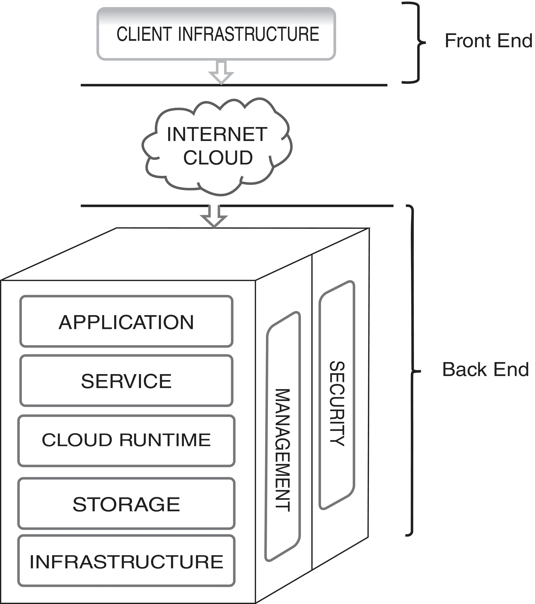

图 11.1
云计算架构。

## 11.2 云部署和（模型

几乎所有组织都使用云计算，因为其具有按需付费的特性。不同类型的云用于解决不同的问题（Dewangan et al. 2020）。由于没有一种云能满足所有不同组织的需求，因此有三种云部署模型。

### 11.2.1 公有云

服务为普通用户提供，资源由第三方服务供应商提供。

### 11.2.2 私有云

在私有云中，个人云既可以物理上设置在任何组织的现场数据中心，也可以由第三方服务供应商托管。服务和基础设施完全处于非公用网络的控制之下。由于数据敏感性和其他隐私考量，组织可能会使用私有云。

### 11.2.3 混合云

资源由上述两种模型的结合提供，允许数据和程序在它们之间共享。

这些云提供不同类型的服务：

### 11.2.4 基础设施即服务 (IaaS)

`IaaS` 主要侧重于在互联网上提供硬件和网络资源。在这种模型中，第三方拥有用户请求的所有资源和其他外设。它还提供了许多应用程序和框架来支持用户需求。用户可以使用服务器等基础设施为网络提供服务，使用存储来存储信息，使用操作系统来监控资源。例如，`IBM Smart Cloud Enterprise`、`Windows Azure` 和 `Amazon Web Services (AWS)` 是主要的服务提供商。

### 11.2.5 平台即服务 (PaaS)

`PaaS` 是一种通过 Web 传输应用程序的分布式计算框架。在 `PaaS` 模型中，云供应商向其客户端发送设备和程序（通常是应用程序开发所需的）。`PaaS` 不会取代企业的整个框架；然而，企业依赖 `PaaS` 供应商进行关键管理，例如通过 Web 接口进行 `Java` 开发。此时，`PaaS` 供应商根据每个客户端的每条条目或按月收费。

### 11.2.6 软件即服务 (SaaS)

`SaaS` 主要侧重于基于应用程序的服务，客户端不需要安装任何软件或应用程序即可运行任何计算问题。计算问题通过 Web 浏览器在服务器上执行，并向用户提供所需的报告。`SaaS` 已成为一种毫无疑问的流行交付模型，因为有助于 Web 管理和管理的服务体系架构 (`SOA`) 已经开发并广为人，例如 `Ajax`。国际数据公司 (`IDC`) 识别了 `SaaS` 的两种交付模型，特别是便利应用模型和产品改进模型。

## 11.3 云计算的优势

*   **访问性**：通过互联网连接可以随时随地访问云资源和服务。
*   **低成本**：组织只需为使用的计算资源和力付费。
*   **降低成本**：组织消除了购买基础设施和计算需求的成本。
*   **可扩展性**：供应商根据客户的需求提供动态资源。
*   **减少任务**：由于不需要基础设施和其管理，组织的任务减轻了。
*   **备份与恢复**：在云计算中，组织数据的备份和恢复是很容易。


- **安全性：** 组织数据的安全性取决于服务提供商和部署模型。
- **低维护性：** 由于不需要任何基础设施，因此不需要大量的维护。

## 11.4 文献综述

Chadwick (2020) 提出了一种支持私有云的结构和组织模型，以确保有关数字威胁数据的共享。Stergiou (2020) 审阅了物联网（IoT）和云计算的创新，重点关注了这两项进展所面临的安全问题。特别是，上述提到的两项创新被纳入考虑，旨在分析其已知特性，并发现将两者结合的优势，以为其利用提供保障。总之，云与物联网的结合提升了大数据框架的活性。Gai (2016) 处理了集中于基于云的辅助贡献的网络安全事件（CI）执行，并提出了一种利用大数据的受保护数字事件检查系统。他们的方法旨在协调各种数字威胁状况，并利用了库信息。他们的重构为可用性和可行性提供了假设性确认。Elnagdy (2016) 关注这一问题，并审计了大量材料，以加强对保护性数字安全威胁科学分类的深入理解。Takahashi 等 (2010) 提出了一种本体论系统来解决云中的网络安全威胁，Jouini 等 (2012) 观察了信息安全的量化测量。2020 年，Jouini 等 (2020) 再次针对云提出了量化安全分析系统。Stergiou (2020) 针对云和物联网操作下的大数据提出了一种基于机器学习的受保护系统。Dewangan 等 (2020) 对不同云调度算法在安全和其他措施方面的对比分析进行了展示。

云技术中网络安全的比较研究如[表 11.1]所示。

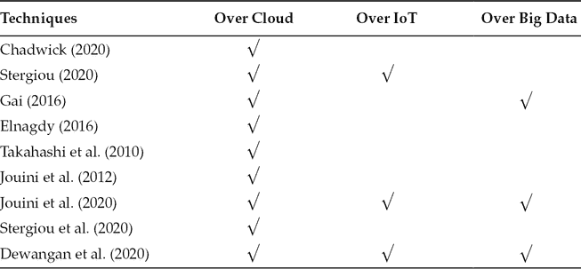

表 11.1
云技术中网络安全的比较研究

## 11.5 问题与挑战

在云网络安全中观察到以下问题（Cawthra et al. 2019）：

### 11.5.1 加密数据外泄

一个组织在不知情的情况下有一台被破坏的机器，正被一个恶意屏幕角色用于外泄信息。该恶意角色对信息进行编码以防止定位。信息安全安排将提供观察功能以帮助识别泄露。该安排还将通知安全小组该活动情况，并根据阻止信息外泄的方法做出反应。

### 11.5.2 鱼叉式网络钓鱼攻击

由于鱼叉式钓鱼努力，一个恶意屏幕角色可以看到并控制数据库。存储在数据库中的受限信息被破解。信息安全安排将与安全小组核实，以确认信息已被获取或可能被外泄（Blum et al. 2010）。该安排还将采取活动做出反应，立即结束恶意屏幕角色的访问。

### 11.5.3 勒索软件

用户无意中下载了勒索软件，这表明该软件针对组织记录服务器的限制性文件索要现金，以停止访问和共享文件（O’Gorman et al. 2012）。信息分类安排将观察并记录操作，以判断信息泄露的程度和严重性。检查安排的结果将告知适当的反应以停止信息泄露。

### 11.5.4 意外电子邮件

有时，用户不小心将电子邮件发送给本不应该访问该邮件连接的人，因为其中包含受限数据。用户误用意外收到的数据是一个主要的安全威胁。

### 11.5.5 笔记本电脑丢失

客户丢失了包含其组织受限数据的笔记本电脑。信息可能会公开，机密性可能会被破坏。

### 11.5.6 权限滥用

一名员工利用主管权限访问信息以谋取个人利益。该代表打印了几份敏感记录，随后外泄了其余信息。安全安排还将采取适当活动做出反应，迅速防止记录被访问。重新记录所需的时间和程序将由安排规定。

### 11.5.7 窃听

一个外部屏幕角色通过中间人攻击与组织的系统进行交易并劫持了通信，导致数据泄露。信息分类安排将识别未经授权的访问并做出适当反应以防止进一步访问。

## 11.6 网络安全机制

在云平台安全和隐私方面一直存在严重担忧，因为数据存储在远程服务器上，并且可以通过 PC、笔记本电脑和智能手机等各种设备通过互联网上的有线或无线网络访问（Barrett et al. 2018）。安全框架如下：

`Identify` ——需要找到待检查的系统资产。有五个重要的类别：

- **资产管理：** 企业必须识别设备、用户、数据集和流程，这些必须根据其重要性进行管理，以保护它们免受网络攻击。
- **业务环境：** 企业必须识别企业使命、目标和利益相关者。基于这些角色，做出责任和安全决策。
- **治理：** 企业必须识别用于管理和监控操作以及法律要求的政策和程序。
- **风险评估：** 企业必须识别影响企业、用户及其日常运营使用的设备的网络安全风险。
- **风险管理策略：** 企业必须识别与风险承受能力相关的职，以做出安全决策。

`Protect` —— 企业必须通过实施保护数据的实践来减少网络安全风险的影响。保护功能限制并控制对系统和资产的安全访问，并防止未经授权的访问。保护功能具有以下重要类别：

- **身份管理和访问控制：** 企业必须创建安全访问，使授权用户无法访问企业数据和资产，并必须管理与授权用户相关的凭据。
- **意识和培训：** 企业必须提高员工的意识并提供培训，以便他们保护企业数据和资产。
- **数据安全：** 企业必须制定政策来保护机密数据、维护数据完整性并控制授权用户对数据的访问。
- **信息保护过程和程序：** 企业必须创建安全策略、流程和程序以保护企业数据和资产。
- **维护：** 企业必须确保妥当且定期地进行维护。
- **保护技术：** 企业必须创建文档并审查审计、日志记录以及对网络和通用串行总（USB）驱动器的保护。

`Detect` —— 具有具有以下重要类别：

- **异常和事件：** 企业必须检测异常的事件和活动。


- **安全观察**：企业必须观察用户的身份和安全措施。
- **检测方法**：企业必须维护并测试所有用于检测异常事件和活动的流程和程序。

### 响应 (Respond)
它包含以下重要类别：

- **响应计划**：企业必须维护并执行相关流程和程序，以确保在检测到网络安全事件期间或之后做出响应。
- **通信**：企业必须与内部外部利益相关者进行通信，以协调响应活动。
- **分析**：企业必须调查检测系统的通知，并分析网络安全事件的影响，以确保其响应并帮助恢复活动。
- **缓解**：企业必须执行缓解活动，以防止网络安全事件的影响。
- **改进**：企业必须改进响应活动。

### 恢复 (Recover)
它包含以下重要类别：

- **恢复计划**：企业必须维护并执行恢复流程和程序，以确保在网络安全事件期间或之后恢复系统和资产。
- **改进**：企业必须在从网络安全事件中学习后改进恢复活动。
- **通信**：企业必须与内部外部利益相关者进行通信，以协调恢复活动。

## 11.7 解决方案：云平台安全建议框架

[图 11.2] 显示了一个云平台安全的建议框架。该框架包含了之前提到的五个标准：识别、保护、检测、响应和恢复。

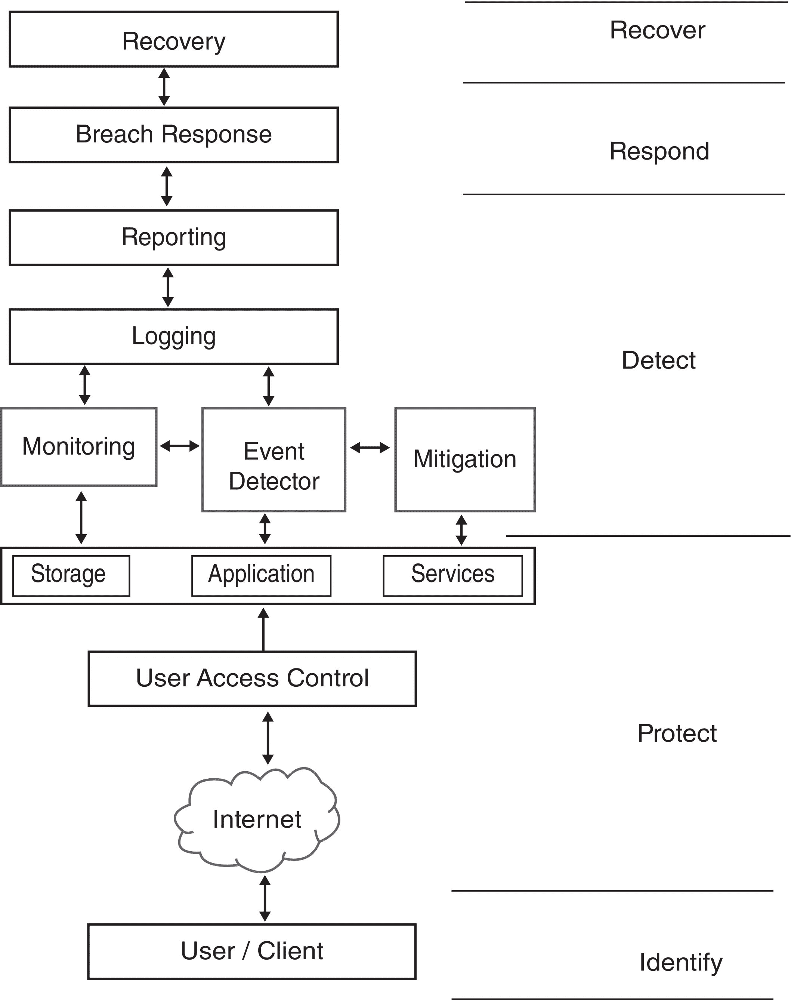

图 11.2

云平台安全建议框架。

### 11.7.1 识别 (Identify)
组织应该识别框架识别功能中的缺陷，使其易受到网络安全威胁的影响，例如个人、资源、信息和功能。同样，它们需要识别未经许可的信息流、客户行为以及信息访问，并识别可能成为信息完整性攻击重点的资源。

### 11.7.2 保护 (Protect)
威胁信息完整性的内部危险无论是无意的还是故意的都难以防止。可以采取预防措施来确保恶意内部人员的影响被记录，本指南将通过审核日志和文档完整性系统制定这些措施。安全存储和保护作为了防止内部威胁的额外保障。访问控制对于防止内部威胁至关重要，但这超出了本任务的范围，本任务将关注信息而非客户。

#### 11.7.2.1 用户访问控制
访问权限管理 (`ARM`) 识别了以下威胁：

- 内部人员通过权限蔓延和未记录的记录进入
- 标准客户意外访问未经许可的信息或框架
- 外部人员利用恶意软件策略进入

这些点还允许我们理解由于缺乏自动化的 `ARM` 能力，外部人员可以滥用的漏洞。我们还识别了随之而来的漏洞：

- 未记录的账户
- 具有不必要的增强权限的账户
- 依赖个人来维护客户访问策略

这些威胁变量也可以从业务活动风险的角度来看：

- **限制访问**——确保个人仅访问其履行职责所必需的框架，可以降低不恰当或未经许可使用访问权限的风险，这种行为随后可能会影响他人的可访问性。
- **执行成本**：实施一次 `ARM` 并将其应用于所有框架，可能会降低框架的开发成本和运营费用。
- **与现有行业措施的一致性**：联邦金融机构检查委员会 (`FFIEC`) 要求对企业资产的合法访问进行考虑和控制。
- **维护公众声誉和威望。**

### 11.7.3 检测系统 (Detection Systems)
它负责识别未经授权的信息片段和客户行为。虽然识别内部威胁是非常困难的工作，但通过结合以下点是可以实现的。

#### 11.7.3.1 监控 (Monitoring)
持续监控系统活动并分析数据，以检测授权用户的任何可疑活动或来自企业外部用户的未经授权访问。记录的数据将进行报告，以便根据需要对警报采取行动。

#### 11.7.3.2 事件检测 (Event Detection)
为了金钱利益的勒索软件涉及恶意用户设置一个看似真实的空间，其中危险的恶意软件伪装成真实的病毒感染检查程序。一旦引入，它就会对组织的记录框架进行加密并要求付款以解密文档。如果不进行缓解，一个框架上的恶意软件 intended 图在系统内部横向移动到组织系统内的其他客户和服务器框架，扰乱这些框架并要求换取其文档的付款。信息破坏恶意软件涉及希望影响组织任务的恶意用户，通常在结构的停车库中留下几个被污染的 `USB` 优盘。当一个不知情的代表插入该优盘时，它会立即更改记录内容并删除客户机器上的媒体文档。当运行在组织虚拟机 (`VMs`) 上的程序化支持客户无意中删除了其中一个 `VM` 时，就会发生虚拟机数据丢失。客户不会立即注意到意外删除。服务器权限更改发生在当想要访问组织任务的攻击者使用受污染的电子邮件链接对目标组织的特定个人发起鱼叉钓鱼攻击时。当一个客户打开链接时，恶意软件会立即开始进行次要入侵，供攻击者以后使用。当任何内部人员获得经理授权访问或更新文件时，文件会发生变化。利用这些凭证，内部人员在组织的记录和备份记录中寻找自己的名字，试图增加他们作为年度薪酬一部分收到的福利。折衷的服务器更新发生在在例行机器更新期间，下载并引入了一个允许间接访问的更新。此时，一个恶意的外部人员利用这种间接访问来增加对机器的未经授权的访问。

#### 11.7.3.3 缓解 (Mitigation)
这涉及识别威胁的可能时刻和群体。组织结构或现有的保护保护可能构成威胁或风险。应该识别所有入站和重复出现的威胁及其影响。完成评估后，应启动保护系统，如果风险需要更改，请按照上述步骤在缓解技术中反映更新。

#### 11.7.3.4 记录 (Logging)
作为迈向内部安全的积极步骤，组织需要监控记录在事件日志中的每一个框架操作。数据框架应该直接处理海量的事件日志，并安排安全日志。

#### 11.7.3.5 报告 (Reporting)


识别和报告客户端及数据的未经授权行为应包含对编程的检查与披露。

### 11.7.4 泄露响应
组织的信息泄露响应小组最好包含非技术人员，这些人员将重点关注法律、监管和广告等其他重要问题。虽然这些功能对于合法的泄露响应至关重要，但这些职责不会在企业的考虑范围内。他们将接受在信息泄露发生时，组织能够理解并执行其非技术职责。

### 11.7.5 恢复
组织必须具备从信息完整性攻击中快速恢复的能力，并确保任何恢复的信息都是准确、完整且不含恶意软件的。由于未经授权包含、删除或更改信息导致的信息完整性攻击已破坏了企业数据，包括消息、员工记录、财务记录和客户信息。一些遇到过导致活动短暂中断的基础性攻击的组织建议，信息泄露后的恢复工作应提供有关破口程度和严重性的逐点数据，例如：

*   利用虚拟机增强来修复损害。
*   利用系统状态增强来重建记录结构。
*   利用数据库增强来重建数据库结构。
*   利用备份来重建记录。
*   利用备份来修复损害。

### 11.8 结论
本章完全关注云云的安全问题和挑战。首先，阐述了云安全和网络安全，接着介绍了全球云提供的服务模型和部署模型。简要讨论了安全问题，并识别了主要挑战。逐步讨论了所提出的框架，并涵盖了提出的所有问题。引入了一种基于识别、检测、不同安全措施和观察的新型框架。该框架有助于保护云中使用的所有资源。

### 参考文献
1. Barrett, M. P. et al. 2018. “Framework for improving critical infrastructure cybersecurity version 1.1.” NIST Cybersecurity Framework.
2. Blum, A. W. et al. 2010. “Lexical feature based phishing URL detection using online learning.” In 3rd ACM Workshop on AIS, Chicago, IL, 54–60.
3. Cawthra, J. et al. 2019. “Data confidentiality: Detect, respond to, and recover from data breaches.” NIST.
4. Chadwick, D. W. et al. 2020. “A cloud-edge based data security architecture for sharing and analysing cyber threat information.” Future Generation Computer Systems, 710–725.
5. Dewangan, B. K. et al. 2016. “Credential and security issues of cloud service models.” In 2nd International Conference on NGCT, Dehradun, India, 888–892.
6. Dewangan, B. K. et al. 2018. “Autonomic cloud resource management.” In Fifth International Conference on PDGC, Himachal Pradesh, India, 138–143.
7. Dewangan, B. K. et al. 2019 a. “Design of self-management aware autonomic resource scheduling scheme in cloud.” IJCISIM 11: 170–177.
8. Dewangan, B. K. et al. 2019 b. “Self-characteristics based energy-efficient resource scheduling for cloud.” PCS 152: 204–211.
9. Dewangan, B. K. et al. 2020. “Extensive review of cloud resource-management-techniques in industry-4.0: Issue and challenges.” Software: Practice and Experience. https://onlinelibrary.wiley.com/doi/abs/10.1002/spe.2810
10. Elnagady, S. A. 2016. “Understanding taxonomy of cyber-risks for cybersecurity-insurance of financial industry in cloud-computing.” In IEEE 3rd International Conference on CS Cloud, Beijing, China, 295–300.
11. Gai, K. Q. 2016. “A novel secure big-data cyber-incident analytics framework for cloud-based cybersecurity insurance.” In 2nd International Conference on Big-Data-Security, New York City, 171–176.
12. Jouini, M. et al. 2020. “Towards new quantitative cybersecurity-risk-analysis models for information systems: A cloud computing case-study.” In Brij B. Gupta, Gregorio Martinez Perez, Dharma P. Agrawal, Deepak Gupta (eds.), Handbook of CNCS. Springer, Cham, 63–90.
13. Jouini, M. et al. 2012. “Towards quantitative measures of Information-Security: A Cloud Computing case-study.” IJCSDF 1(3): 265–279.
14. O’Gorman, G. et al. 2012. Ransomware: A Growing Menace. Symantec-Corporation, Mountain View, CA.
15. Pal, M. 2020. “Homomorphic-encryption method for business data-security in cloud.” Our Heritage, 68(8): 175–183.
16. Stergiou, C. L. 2020. “Secure machine-learning scenario from BigData in Cloud Computing via Internet-of-Things network.” In Brij B. Gupta, Gregorio Martinez Perez, Dharma P. Agrawal, Deepak Gupta (eds.), CNCS. Springer, Cham, 525–554.
17. Takahashi, T. et al. 2010. “Ontological approach toward cybersecurity in cloud-computing.” In Proceedings of the 3rd International Conference on SIN, Rostov-on-Don, Russia, 100–109.

# 12
# 生物识别——唯一身份验证系统

Gunjan Chhabra, Varun Sapra and Ninni Singh
University of Petroleum & Energy Studies (UPES), Dehradun, India

## 12.1 生物识别简介
当今世界在数字化的伞下运行。如今人们主要在数字平台上执行其主要和次要活动。人们被智能手机、iPad、可穿戴设备、家居自动化等计算设备包围。随着技术的进步，每个人现在都以数字格式存储其个人或职业数据，可以随时随地访问。随着数字平台普及度的增加，它也为现代犯罪手段开启了大门，即网络犯罪。因此，为了解决这个问题，必须识别提供安全的新方法。在这里，安全不仅意味着保护数字数据，还意味着保护数字设备免受损坏、攻击或未经授权的访问。

数字平台上的重大犯罪是由于身份丢失导致的，即通过获取未经授权的访问。


生物识别是一个通过测量个体的生物特征进行识别、身份验证和确认的过程。这些生物特征具有某些独特之处，可以帮助任何人识别出正确的人，并为其提供访问控制。每个人都拥有各种独特、独特且可测量的生物特征，此外，高水平的独特性提供了高安全性（Narayanan and Chhabra 2013）。与用于身份验证的传统方法相比，这有助于开发高度可靠的系统。目前，已经有了大量数据和信息需要安全保护；因此，生物识别被广泛用于保护这些数据，因为它在识别个体方面提供了极水平的准确性。在身体特征和行为特征方面，人与人之间都是不相同的。通过这些特征，可以分析一个人的属性，从而帮助该个体在群体中脱颖而出（Jain et al. 2004）。

简单来说，可以认为生物识别是一种基于个人身体或行为特质的个体的自主识别方法。另一方面，生物识别系统是一种现代技术，有助于识别一个人的生理和/或行为特征、对其进行验证、识别个体并与他人区分开来。在人体中有几种可以容易测量的生物特征，但并不是每个特征都可以用作生物识别特征。任何属于生物识别类别的生物特征都必须满足以下属性（Jain et al. 2004）：

*   `Robustness`（鲁棒性）：该属性表明特征不应随时间改变，也就是说它是永久的。这是因为如果它随时间变化，系统将很难识别个体的独特属性。此外，对于匹配标准，它应该具有充分的不变性。这背后的原因是如果存在很高的类内差异，区分个体将变得困难。
*   `Availability`（可用性）：其次，该特征应该是通用的，换句话说，每个人都应该拥有该特征。除非遵循属性的可用性或通用性，否则无法将该特征作为生物识别。
*   `Collectability`（可采集性）：另一个重要属性是该特征应该于获取并能够进行定量测量。
*   `Distinctiveness`（区分性）：该属性涉及特征的独特性。在广大人群中，人们之间的特征必须存在巨大的差异。简单来说，可以说两个或更多人必须携带能够使他们彼此截然不同的特征。

在处理这些属性时，还必须考虑其他一些与生物识别相关的问题。这些问题与计算角度有关：绕过（circumvention）涉及系统如何能被伪造方法轻易绕过（欺骗）；性能（performance）涉及系统识别的准确性和速度；接受度（acceptability）涉及日常生活中接受使用特定生物识别码的人数。因此，对于生物识别系统，所选生物特征必须满足上述属性（Jain et al. 2004）。

## 12.2 身份验证 vs 确认

在安全性方面，第一步是关于`verification`（验证），然后是对比用户的`authentication`（身份验证）。随着技术的进步和生物识别的启动，安全性得到了极大增强。然而，人们通常交叉使用身份验证和确认这两个词；实际上，这两个词有不同的含义。两者的区别如下方的[表 12.1]所示。

| 验证 (Verification) | 身份验证 (Authentication) |
| --- | --- |
| 验证意味着确保数据与特定个体相关。 | 身份验证是指确定个体确实如其所声称的那样的人。 |
| 对于验证，将个体输入的给定数据与数据库中之前存储的信息进行匹配。 | 对于身份验证，个体必须回答特定问题，以确定该个人或个体是否有权访问此资源的某些权限。 |
| 某些企业仅需要验证，而对其他企业来说仅仅是额外的安全层。 | 身份验证将确认提升到下一个水平，特别是当个人处理在线交易时特别重要。 |
| 验证确保了有关问题个体的某些元素/标识符的匹配/关联。从身份的角度来看，这指的是姓名、出生日期和地址等真实标识符与正在验证程序的个体相匹配。 | 身份验证是证明某物真实或有效的过程或行动。从身份的角度来看，这意味着确定某人确实是谁。 |

表 12.1：验证与身份验证的区别。

## 12.3 生物识别类型：物理与行为识别

根据人的各种特征，生物识别分为两类，即`物理识别`，即需要传感器与人体产生物理接触以采集识别和验证特征的方法。它们关注个体的物理特征。其次，`行为识别`是指不需要物理接触即可采集识别和验证特征的方法。它们关注个体的行为特征。

生物识别使用传感器，传感器充当变质器，将用户的生物特征（如虹膜、脸部、指纹等）转换为电信号。这些传感器有两种不同类型：生理和行为。[图 12.1]下方展示了生物识别系统的基本原理。这些系统被用于数字世界的各种应用。

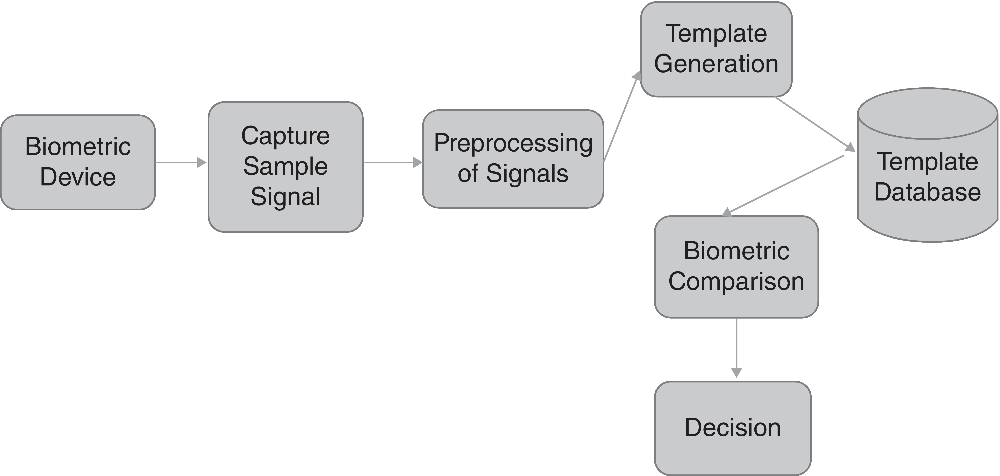

图 12.1：生物识别系统框图。（基于 Hernández Álvarez et al. 2009）

### 12.3.1 物理识别

物理识别通过人类来识别物理特征。它测量身体独特模式进行识别。目前常用的不同物理识别类型有：

*   `指纹识别`：指纹生物识别被认为是识别人类身份最流行且有效的验证技术，因为它们基于没有两个人的指纹相同的事实（Eng and Wahsheh 2013, Alsaadi 2015）。这也是确认身份的最老方法之一。以前使用墨水和纸来获取指纹并验证人类；然而，指纹生物识别是一种无墨的方法，它感知指尖表面的脊和谷。


- **人脸识别**：这是一种被动技术，取决于独特的形状，如眼睛、下巴和嘴唇的位置以及特征之间的距离、切线等（Koong et al. 2014）。它被广泛接受并用于从数字图像或视频源中识别身份。人脸识别可以通过两种方式实现：基于静态摄像头照片的静态识别，以及基于视频摄像头的实时识别（Satone and Kharate 2012）。人脸检测系统的准确性取决于多种因素，如妆容、衰老影响、运动估计和低质量视频。
- **虹膜识别**：这是一种通过虹膜的随机模式确认个人身份的方法。虹膜是人眼中的一种肌肉，用于控制进入眼睛的光量。使用红外光对虹膜进行高精度的拍摄，然后将其与现有模板进行比较（Kak et al. 2010）。它的准确性极高，非常难以伪造，但成本非常昂贵。
- **手部几何**：这是最老的技术之一，最早提到 20 世纪 70 年代。该概念使用人类手不同特征的测量，如手掌厚度、手长度、手指测量等。该系统的优点是被广泛接受且易于实现，但也有一个缺点，即唯一性不高。

### 12.3.2 行为生物识别

行为生物识别是的一门利用人类行为（如习惯和动作）来识别人类的科学分支。一些一些流行的行为生物识别技术包括：
- **语音识别**：也称为发声人识别，将语音模板与不同的存储语音模板进行匹配以识别人类。它最早在 1952 年因一种能够识别语音人物系统的开发而受到关注。在过去的十年里，随着 `Alexa` 和 `Google home` 等设备的引入，语音识别硬件设备获得了新的动力。根据 Strategy Analytics 进行的一项调查，到 2020 年，语音设备的销售量将超过 1500 万。
- **击键动力学**：击键动力学取决于用笔书写或用键盘打字的风格。通过测量个人执行上述动作的节奏来识别人类。它基于早期的电报概念。

### 12.4 生物识别系统的类型

广而言，生物识别系统可以分为两类：
- 单模态生物识别系统
- 多模态生物识别系统

利用单一生物识别特征或单一信息源确认人类身份的生物识别系统称为单模态生物识别系统。虽然单模态生物识别很好，但它们不足以处理复杂的安全系统，因为生物特征具有非通用性，并且对传感数据中的噪声敏感（例如手指上的疤痕）。因此，需要多模态生物识别系统来处理此类数据复杂性。多模态生物识别系统提供使用两种或多种生物识别特征来识别个人的混合方法（Oloyede and Hancke 2016, Ammour et al. 2020）。这通过减少非通用性问题简单地增加了识别人的准确性。从业务角度来看，这些多模态生物识别系统具有某些优势，例如安全性，因为它们最小化了伪造风险。作为一种系统，通用性是指能够读取多种类型的特征来识别身份。

### 12.5 生物识别系统性能：假接受和假拒**

生物识别身份验证系统有许多性能评估方法。最常用的性能评估方法列如表 12.2 所示。

| 序号 | 方法 | 定义 |
| --- | --- | --- |
| 1 | 正常接受率 (GAR) | 被正确分类为真实的输入样本数与正输入样本总数之比例。GAR 值越高表示性能越好。 |
| 2 | 正常拒真率 (GRR) | 被正确分类为冒充者的输入样本数与冒充者输入总数之比例。GRR 值越高表示性能越好。 |
| 3 | 假接受率 (FAR) | 被正确分类为真实的输入样本数与正输入样本总数之比例。FAR 值越高表示性能越好。 |
| 4 | 假拒真率 (GRR) | 被正确分类为冒充者的输入样本数与冒充者输入总数之比例。GRR 值越高表示性能越好。 |
| 5 | 假接受率 (FAR) | 被正确分类为真实的输入样本数与正输入样本总数之比例。FAR 值越高表示性能越好。 |
| 6 | 假拒真率 (GRR) | 被正确分类为冒充者的输入样本数与冒充者输入总数之比例。GRR 值越高表示性能越好。 |
| 7 | 等错误率 (ERR) | 当 FRR 变得类似于 FAR 时，该比例称为相同错误率。ERR 值越低表示性能越高。 |
| 8 | 采集失败 (FTC) 或 获取失败 (FTA) | 系统未能采集到生物样本的次数比例。FTA 值越低表示采集越好。 |
| 9 | 注册失败 (FTE) | 无法注册到生物识别系统的用户数与用户总数之比例。FTE 值越低表示覆盖率越好。 |

表 12.2：评估方法简述。

在非生物识别系统中，不需要复杂的识别技术。相反，在生物识别系统中，数据表示取决于多种因素。


### 3. **一致性**：生物识别特征是不一致的，例如，在人脸识别中，年龄增长效应会导致脸部图像发生变化，而某些类型的疤痕会影响指纹。

### 4. **活体检测**：发现提交的是真实的、活体用户所提交的生物识别信息，还是伪造的至关重要。例如，在 2D 图像生物识别的情况下，很容易捕获一张脸部的 2D 照片，机器可以很容易被欺骗。

### 5. **模板保护**：整个生物识别系统的安全性取决于所存储生物识别信息的安全性。这些需求需要实现额外的安全特性。

## 12.7 生物识别系统的性能增强

随着技术和手段的进步，生物识别系统的性能可以提高。人工智能方法为解决处理生物识别时遇到的各种问题和疑虑提供了途径。机器学习由于其从海量数据集中挖掘和发现复杂关系的能力，在过去的十年中受到了广泛关注。机器学习可以从人类行为中学习，并在大型数据集上成功实施，这使其非常适用于生物识别系统。在过去，机器学习已成功应用于医学、图像处理、农业等许多领域。现在，研究人员正在广泛使用机器学习来提高生物识别设备的性能。在他们的研究中，Taigman 等人提出了 `DeepFace` 单样本人脸识别方法。他们用 `Siamese network` 和支持向量机 (`SVM`) 演示了该方法。作者使用了三个不同的图像数据集。使用 `Siamese network` 提取特征，计算特征之间的差异，然后将其输入到 `SVM` 分类器进行分类处理。他们实现了 97.35% 的准确率（Taigman et al 2014）。Sarfaraz 等人提出了热光谱和可见光谱之间的跨模态人脸匹配模型。他们使用深度神经网络方法来捕捉两种模态之间的非线性关系。他们的模型实现了 10% 的准确率提升，达到了 86% 的准确率（Sarfaz and Stiefelhagen 2017, Phillips and Przybocki 2020）。

随着时间的推移和人类行为发生改变，人们使用的设备越来越多。这些嵌入了机器学习的设备或机器将能够诊断人类行为并适应变化，从而消除随时间变化的行为模式中的混乱或不一致。

## 12.8 生物识别的应用

今天一切都运行在数字平台上，安全性是每个人面临的主要关注和挑战。因此，生物识别是帮助使交易和操作更安全更方便的最佳方法之一。以下是生物识别系统提供身份解决方案的几个部署领域。

* **使用生物识别的安全**：
  如今，生物识别系统被用作家庭和办公室的安全锁。生物识别安全系统比以前使用的传统钥匙和锁系统更安全。利用生物识别已经开发了各种类型的智能锁系统，现在已得到广泛使用。

* **考勤系统**：
  员工考勤系统现在基于生物识别。这有助于组织维护日志、跟踪调度，并有助于避免虚假的考勤标记，而这在手动考勤系统中是一个非常常见的现象。

* **访问控制**：
  生物识别系统比传统的锁、智能卡或基于个人识别码 (`PIN`) 的系统提供了更强大、更安全的访问控制解决方案。传统锁系统的问题包括钥匙被盗或丢失、忘记 `PIN` 等，而通过使用生物识别系统，这些问题就得到了解决。

* **设备访问控制**：
  整个世界都在使用各种类型的智能设备携带关键信息，因此这些便携式设备需要防止未经授权访问的适当安全防护。生物识别系统为控制这些设备及其其中可用信息的访问提供了便捷的解决方案。

* **其他应用**：
  生物识别不仅限于上述应用，还广泛存在于每个需要真实访问的领域。更多的应用领域包括医疗保健信息学、银行交易、家居自动化、机场安全、边境安全系统、个人身份证（例如 Aadhar 和护照）等许多。

  在任何涉及安全的领域，生物识别系统都被广泛使用。到目前，社会上出现了巨大的市场需求和接受度，但为了克服与生物识别系统相关的问题还需要更多研究。每个人都在产生越来越多的信息，因此每个人对其安全性表示关注。由于市场对安全锁和访问控制设备的高需求，生物识别系统已获得数百万美元的投资，并在不久将来将获得更多。

## 12.9 结论

包括基于密码的系统、基于 ID 卡的系统、传统锁和其他用于个人识别的传统系统在过去的几十年里一直是各种欺诈的根源。因此，新技术以使用生物识别的形式提供了解决方案。生物识别系统现在被广泛应用于每种模式的访问控制（物理和数字）。由于其易用性和高安全机机制，生物识别系统正被应用于各种应用。生物识别系统的性能仍然是一个问题，因此使用了混合的 AI 机制来增强和解决相关的疑虑。在未来，在这个伞下可以预见到巨大的研究范围，这可能会为行业带来高收益。此外，为了增强生物识别系统的功能，建议采用多模态系统，这将减少虚假生物识别、重放攻击、模板篡改等生物识别攻击。

## References

1. Alsaadi, I. 2015. “Physiological biometric systems, advantages, future development: A review.” *International Journal of Scientific & Technology Research*, `4*(12), 285–289`.
2. Ammour, B., Boubchir, L., Bouden, T., and Ramdani, M. 2020. “Face–iris multimodal identification system.” *Electronics*, `9*(1), 85`.
3. Eng, A. and Wahsheh, L. 2013. “Look into my eyes: A survey of biometric security.” In *2013 10th International Conference on Information Technology: New Generations*, pp. 422–427. IEEE, Piscataway, NJ.
4. Hernández Álvarez, F., Encinas, L. H., and Ávila, C. S. 2009. “Biometric fuzzy extractor scheme for iris templates.” `https://digital.csic.es/bitstream/10261/15966/1/SAM3262.pdf` (digital.csic.es).
5. IQUII, “Biometric recognition: Definition, challenges and opportunities of biometric recognition systems.” `https://medium.com/iquii/biometric-recognition-definition-challenge-and-opportunities-of-biometric-recognition-systems-d063c7b58209` (medium.com) (accessed January 20, 2020).
6. Jain, A. K., Ross, A., and Prabhakar, S. 2004. “An introduction to biometric recognition.” *IEEE Transactions on Circuits and Systems for Video Technology*, `14*(1): 4–20`.
7. Kak, N., Gupta, R., and Mahajan, S. 2010. “Iris recognition system.” *International Journal of Advanced Computer Science and Applications*, `1*, 34–40.


8. Koong, C. S., Yang, T. I., and Tseng, C. C. 2014. “一种用于多触摸设备的生理和行为识别的用户认证方案。”*The Scientific World Journal*, *2014*, 781234.

9. Narayanan, A. and Chhabra, G. 2013. “减少网络威胁：通过多模态生物识别系统。”*International Journal of Artificial Intelligence and Neural Networks –IJAINN*, *3*, 10–14.

10. Oloyede, M. O. and Hancke, G. P. 2016. “单模态和多模态生物识别系统：综述。”*IEEE Access*, *4*, 7532–7555.

11. Phillips, P. J. and Przybocki, M. 2020. “应用于生物识别和人脸取证算法的可解释 AI 四大原则。”arXiv preprint arXiv:2002.01014.

12. Recogtech. “FAR 和 FRR：安全级别与用户便利性。”[`www.recogtech.com/en/knowledge-base/security-level-versus-user-convenience`](https://www.recogtech.com), 最后访问于 2020 年 1 月 17 日（访问于 2020 年 1 月 17 日）。

13. Sarfraz, M. S. and Stiefelhagen, R. 2017. “跨模态人脸识别的深度感知映射。”*International Journal of Computer Vision*, *122*(3), 426–438.

14. Satone, M. P. and Kharate, G. K. 2012. “基于平均半脸小波子带 PCA 的人脸识别。”*Journal of Information Processing Systems*, *8*(3): 483–494.

15. Taigman, Y., Yang, M., Ranzato, M., and Wolf, L. 2014. “Deepface：在人脸验证中缩小与人类水平性能的差距。”*IEEE Computer Vision and Pattern Recognition (CVPR)*, *5*, 6.

# 13. 安全工具

Keshav Kaushik, Rohit Tanwar, and A. K. Awasthi.

印度德拉杜恩，石油与能源研究大学 (UPES)。
印度法格瓦拉，可爱专业大学 (Lovely Professional University)。

## 13.1 引言：背景与驱动力

计算机技术领域正以极快的速度变化。随着技术的进步，人们之间的连接方式比过去要高效得多。今天，互联网正在跨越所有障碍，它在很大程度上改变了人们的生活方式。现在，通过智能手机和笔记本电脑，可以通过互联网轻松获取各种信息。“网络空间”包含了一个在全球范围内创建的虚拟环境，通过电子媒介促进在线通信。网络空间允许用户之间进行交互，并在各种社交平台上共享数字媒体和想法。整个网络空间基于一个信息系统，该系统负责为各个领域和服务增加智能。普通公众、国防人员、政府、非政府组织、企业部门、媒体以及其他连接到互联网的内容都属于网络空间。因此，为了确保信息系统的顺利运行，需要对网络空间下的信息进行保护。实际上，随着新技术的出现和连接到互联网的“事物”数量的增加，网络空间的边界正在不断扩大。因此，网络安全是当务之急，其重要性变得日益显著。网络安全或信息安全涉及确保信息的机密性、完整性和可用性。它意味着检测网络攻击、为网络攻击提供解决方案，并将整个信息系统置于“安全”环境中。网络安全对于向公众提供用户信息的机密性、完整性和可用性也至关重要。网络攻击日益增加，因为黑客（有恶意意图的人）发现了系统中的漏洞或弱点，然后利用系统提取关键信息。

## 13.2 网络安全工具与方法

由于网络空间的边界巨大，存在多种可能的网络攻击方法。因此，网络安全专家能够保护网络空间免受攻击者和恶意人员的侵害。网络攻击者实施攻击是为了从用户、政府和私人组织窃取机信息。网络攻击会导致巨大的经济损失并影响组织的声誉。在本部分，将解释两个最重要的网络安全和取证工具——`Wireshark` 和 `Autopsy`。

### 13.2.1 Wireshark——数据包嗅探和捕获工具

`Wireshark` 是一个捕获数据包并允许你对其进行分析的封包嗅探应用程序。它在网卡上以混杂模式工作，并读取通过它的所有流量。[图 13.1] (Macfarlane, n.d.) 显示了 `Wireshark` 嗅探数据包的位置。

```
[Figure 13.1]
```

定位 Wireshark。

网络安全专家使用它有多种原因：

* 网络管理员使用它来排排除网络故障。
* 网络安全工程师使用它来检查安全问题。
* 质量保证工程师使用它来验证网络。
* 开发人员将其用于调试。
* 人们用它学习协议。

这是一个非常重要的工具，在各种情况下都很有帮助：

* 可以在 Windows 和 UNIX 上使用。
* 各种数据包捕获程序可能会打开 `Windump`/`tcpdump`。
* 可以导入带有包数据的文本文件。
* 数据包将显示与协议相关的详细信息。
* 保存的数据包可以导出为各种格式。
* 根据标准显示数据包。
* 捕获数据包数据。
* 根据标准搜索数据包。
* 根据过滤器对数据包着色。
* 创建统计数据。

由 Wireshark 捕获的数据包可以检查，如图 13.2 所示。

```
[Figure 13.2]
```

Wireshark 捕获数据包并分析内容。

`Wireshark` 允许你从许多不同的适配器媒介（包括无线局域网、以太网、USB、蓝牙等）捕获实时网络流量。此类示例可以在 [`wiki.wireshark.org/CaptureSetup/NetworkMedia`](https://wiki.wireshark.org/CaptureSetup/NetworkMedia) 获取。

你还可以从许多其他程序导入文件。关于 Wireshark 有一些误区：

* `Wireshark` 不是入侵检测系统 (IDS)。它用于网络流量的捕获和分析。它不会警告你网络上的恶意活动。然而，它可以帮助发现正在发生什么。
* `Wireshark` 不用于“操纵”目的。它用于“测量”网络流量。

Wireshark 的整个封包嗅探结构如图 13.3 所示。它由数据包捕获库和数据包分析器组成。每个数据链路层都是一个帧，是从计算机接收或发送的，并被数据包捕获库接收。高层协议如 TCP、UDP、FTP、HTTP 和 IP 封装了在通过以太网线和物理介质传输的消息。[图 13.3] 显示了假设以太网为物理介质，所有上层协议都封装在以太网帧中。捕获所有数据链路帧以获取运行在计算机上的所有应用程序和协议的所有收发消息的详细信息。

```
[Figure 13.3]
```

封包嗅探结构 (Wireshresh Tutorial, n.d.)


数据包分析器是数据包嗅探器的第二个组件，它显示消息的所有字段。只有当数据包分析器理解了通信协议交换的所有消息的格式和结构时，才能实现此功能。在图 13.3 中，显示了 HTTP 协议交换的消息的各种字段。数据包分析器理解以太网帧格式并识别互联网协议数据报文。最后，数据包分析器理解 `TCP` 的段结构，并从 `TCP` 段中提取出 HTTP 消息。

Wireshark 界面包含五个主要组件：

- 有一些标准的下拉菜单，位于窗口顶部，称为 `command menus`（命令菜单）。它们包含文件和捕获菜单，用于捕获数据包数据并将数据包数据保存到文件中。文件菜单还可以打开之前捕获的数据包数据并退出 Wireshark 应用程序。
- 第二个组件是`packet details window`（数据列表窗口），显示捕获数据包的摘要。摘要由各种实体组成，包括捕获数据包的时间戳、包编号、协议类型、数据包的源地址和目的地址以及与协议相关的信息。此包列表可以根据列中提供的名称按类别进行排序。
- 选定数据包的细节显示在`packet header details window`（包头详情窗口）中。所选数据包包括 IP 数据报和以太网帧信息等细节。可以通过右键点击数据包详情窗口来展开或最小化这些细节。数据包通过 `UDP` 或 `TCP` 协议传输，细节可以最小化或展开。包详情中还提供了有关接收或发送数据包的最终细节。
- 捕获帧的内容在`packet contents window`（数据包内容窗口）下以十六进制和 ASCII 格式显示。
- 数据包显示过滤器字段位于 Wireshark 顶部。可以应用 GUI、协议详细名称和其他信息来过滤数据包详情窗口中的信息。例如，数据包显示过滤器可以用于那些是 HTTP 消息的数据包，而不是 Wireshark 报头。

一名伦理黑客执行了一项包含多个阶段的结构化攻击。它涉及网络扫描，网络扫描是在称为侦察（ reconnaissance）的初始阶段进行的。Wireshark 在网络扫描阶段起着至关重要的作用。网络扫描工具能够提供有关远程机器的关键信息，并能够识别远程机器上的开放和关闭端口。整个侦察阶段包括操作系统扫描、热点扫描和 ping 扫描。Wireshark 可以在多种端点扫描网络。这些包括：光纤通道、蓝牙、以太网、`UDP`、USB、`IPv4`、`IPv6`、`TCP` 等。Wireshark 的另一个使其成为该领域卓越工具的特性是 Wireshark 统计。统计给出了捕获的 `TCP` 或 `UDP` 包的百分比。由于 Wireshark 是实时网络捕获工具，保持正确的时区和时间对捕获数据包的进一步分析至关重要。捕获的数据包也可用于数字取证调查网络犯罪。因此，我们可以得出，Wireshark 是一款多功能的开源工具，具有各种功能和属性，广泛应用于网络安全的各个领域。

### 13.2.2 Autopsy—数据包嗅探和数据包捕获工具

多平台（Unix、Linux、Windows 和 OS X）两个最知名且广泛使用的开源数字检查工具是 Autopsy 和 Sleuth Kit。Sleuth Kit 和 Autopsy 可用于分析磁盘镜像，以及在深度分析文件系统（如 `Ext3`、`FAT` 和 `NTFS`）和多种卷系统类型时的性能（Information Security Team, n.d.）。

对于调查，检查人员和分析师可以使用 Autopsy 图图形界面或 Sleuth Kit 命令行工具。在这种情况下，他们必须首先使用 Sleuth Kit 内置的命令行应用 Autopsy 的图形化界面。Sleuth Kit 和 Autopsy 为检查人员提供 `.dd` 或其他类型的磁盘镜像文件并对文件进行哈希值处理。他们搜索文件和子文件中可用文件和信息。可以通过 HTML 和 Excel 格式生成搜索、结果、注释和笔记的报告。

#### 13.2.2.1 下载与安装

官方网站是下载 Autopsy 的正确渠道。可以快速方便地下载 Autopsy 和 Sleuth Kit 文件。提供一些向导以方便顺利安装。在完成 Sleuth Kit 安装后，用户可以使用 `Python` 和 `Java` 编写并添加自己的模型。安装 Autopsy，请使用以下步骤：

1. 运行所需的 Autopsy `msi` 文件。
2. 如果 Windows 显示用户账户控制提示，请点击“是”。
3. 点击对话框提示，直到出现“完成”提示。
4. Autopsy 应该已完全安装。

在大多数情况下，它建议在处理或审查案件的计算机上禁用并移除任何类型的防病毒软件。这是因为这些软件可能会与取证软件发生冲突，并在您检查它们之前删除某些文件或结果。

#### 13.2.2.2 特性与工作

Autopsy 和 Sleuth Kit 具有以下特性（Information Security Team, n.d.）：

1. Autopsy 支持的时间线分析功能提供了一个查看事件的图形界面（Basis Technology, n.d.）。
2. 哈希过滤忽略已知的好文件并标记已的坏文件。
3. 它能够通过文件系统取证分析恢复通用格式的文件。
4. 易于找到包含相关术语的文件。
5. 它能够从流行的网络浏览器导入并提取与历史、Cookie 和书签相关的数据。
6. 多媒体支持通过从图片中提取 EXIF 信息以及能够观看视频来实现。
7. 它可以分析 `MBOX` 格式的电子邮件消息，例如 Thunderbird。


使用 Autopsy 进行法证活动具有以下优势：

* 它提供了一个图形用户界面（GUI），允许用户提取文件、搜索关键词并生成报告。
* 它同时支持原始（raw）格式和 E01 格式的镜像镜像文件，而其竞争软件仅支持 E01 类型的镜像格式。
* 它支持包括 Linux、Windows 和 Mac 在内的多种平台。
* 它根据免费软件许可进行发行和发布，而不是商业许可。
* 它采用模块化架构设计，可以包含用 `Python` 或 `Java` 编写的第三方模块。
* 用户和开发者可以使用详细的见解和更新后的文档。

## 13.3 结论

网络安全正成为金融应用、核能领域等关键能力领域最重要的方面之一。在可用的网络安全和法证工具中，`Wireshark` 和 `Autopsy` 适用于教育和组织使用。免费许可分发和对许多平台的支持使得它们适用于处理实时问题。具有从从内存卡恢复数据到分析网络包的各种功能，这些工具也被用于实际研究和演示。然而，其他其他工具也可以执行类似的任务，但存在某些局限性，例如在商业许可下分发或支持格式有限，这限制了它们在大规模范围的使用。

### 参考文献

1. Basis Technology, n.d. Autopsy: Training document. [`www.sleuthkit.org//autopsy//`](http://www.sleuthkit.org), 访问于 2020 年 3 月 30 日晚上 9:00。
2. Information Security Management and Analytics Research Team, n.d. Kali Linux Sleuthkit. [`ismart.unm.edu/files/8813/9252/1107/Tutorial_6_-_Kali:Linux_-_Sleuthkit.pdf`](https://ismart.unm.edu), 访问于 2020 年 3 月 12 日上午 9:40。
3. Keffer, J., December 2013. Autopsy forensic browser user guide. [`juliakeffer.files.wordpress.com/2013/06/autopsy_user_guide.pdf`](https://juliakeffer.files.wordpress.com), 访问于 2020 年 3 月 14 日上午 10:24。
4. Macfarlane, R., n.d. Lecture notes. [`www.soc.napier.ac.uk//~40001507/CSN11102//Lab5.pdf`](http://www.soc.napier.ac.uk), 访问于 2020 年 4 月 5 日上午 11:37。
5. Wireshark Tutorial, n.d. [`cs.gmu.edu//~astavrou/courses//ISA_674_F12//Wireshark-Tutorial.pdf`](https://cs.gmu.edu), 访问于 2020 年 4 月 5 日上午 11:40。

# 14 优化算法简介——生物启发

Rakesh Kumar Saini, Shailee L. Choudhary, Anupam Singh, and Amit Verma.

DIT University, Dehradun, India.
NDIM, New Delhi, India.
University of Petroleum & Energy Studies (UPES), Dehradun, India.

## 14.1 引言

优化过程（Løvbjerg, 2002）指的是从一组可能的替代方案或资源中导出最合适的解决方案。目前，生物启发的优化技术被广泛应用于各个领域，从医学领域的生物大分子结构预测到商业组织客户行为模式的预测。当今世界谈论大数据，这涉及到将从多个位置获取的信息有效用于商业组织和研究人员的决策。基于统计技术和数据挖掘算法的自动化模型获取的动态数据被用于解释这些信息。为了在众多可能性和严格限制中获得最佳结果，我们需要优化技术。“优化”一词没有标准定义：对于工程师或技术人员来说，它指的是“试错法”方法，而对于经理来说，它可能指的是“选择最佳方案”。优化的简要定义可以是：“在给定的情况和限制下，导出最佳解决方案的行动，旨在最小化努力并最大化预期产出。”进化算法（`EAs`）和群体智能最擅长促进优化解决方案的产生。[图 14.1] 展示了生物启发算法族。

```
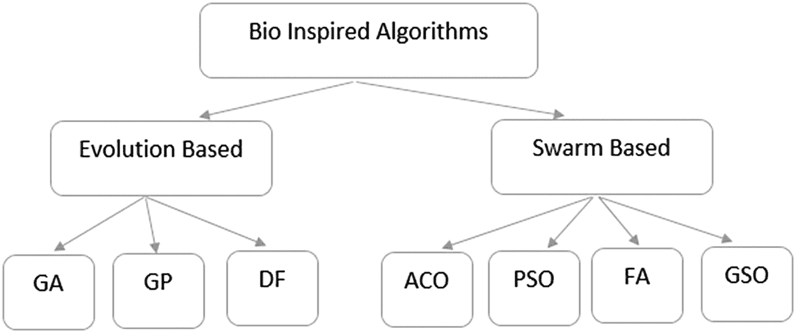
```

图 14.1
生物启发算法族。

## 14.2 进化算法 (EA)

`EAs` 是一种机器学习算法（Holland, 1988; Coello and Lamont, 2004），基于生物进化过程。由于自然界涉及适者生存，即生物的适应度越高越好，同样，`EAs` 的目标是发现具有最高适应度评分的行为。因此，模仿自然行为来解决复杂问题的算法被称为 `EAs`。所有 `EAs` 都是基于达尔文的进化概念概念化的。所有生物都遵循选择、变异、繁殖和重组等基本功能，在所有这些过程中，适应度充当催化剂，以导出最可能的解决方案。然而，`EAs` 也有其阴暗面。首先，`EAs` 提供了有效的优化，但并不总是最优解。大多数 `EAs` 在后台运行，用于持续衡量各个解决方案之间的效率。其次，由于适应度计算的复杂性，`EAs` 的计算要求略高。

`EAs` 被广泛用于优化问题（Kachitvichyanukul, 2012），特别是工程和商业领域的复杂计算问题。基于工程的计算问题指的是汽车或工程设计、机器人、电信、交通和运输路由优化等领域。在商业领域，从金融和投资策略到营销和商品销售，`EAs` 被用于产生高效实时的输出，并减少对问题特定属性理解的困难性。大多数情况下，需要调整参数以导出一种通用解决方案。

## 14.3 实践中的 EA

`EAs`（Kachitvichyanukul, 2012）是基于自然进化理论（Nowak et al., 1990; Ursem, 2002）的问题求解方法，其中选择过程导出给定问题的最优解决方案，并通过通过调整测量参数至最小值或最大值来达到最优解。例如，在金融交易市场中，像 `GA` true `EAs` 被用于导出交易规则中参数的最佳组合。一旦导出，最优组合就可以用于人工神经网络（`ANN`）模型，用于股市策略和交易优化。尽管 `EAs` 在本质上是随机的，也就是说它们不能保证任何特定问题的解决方案都是最优的，但如果存在解，它们无疑会提供一个良好的解决方案。


另一个进化算法（EAs）在寻找最优解决方案方面更有优势的现实领域是排课。排课是学校和学院的核心流程之一，涉及根据学术指南的要求对教室和教职人员进行分配。整个过程具有大量的约束条件，例如教室的数量/类型；教师一次只能分配一节课且只能分配其专业课程；一个学生不能同时被分配到两个班，等等。排课是一个组合问题，被称为 NP 困难问题（NP-hard）。它涉及大量的计算，因此寻找最优解决方案可能不是可行的方案，所以我们可以寻找启发式方法。进化算法为这类调度问题提供了满意的解决方案。应用于工程问题（大多数为大规模问题）的数学优化技术（Lhotská, 2008）往往由于其复杂性而无法提供最优解决方案。例如，线性编码和动态编码方法通常无法最优地解决 NP 困难问题，因为它们具有大量的变量和非线性无偏效用（Krink and Løvbjerg, 2002）。进化算法的优点之一是它们不受人类偏见的影响。它们将关注适应度函数的生成视为最重要的步骤，一旦推导出来，有效的适应度函数就能帮助算法达到最优解。本章重点关注三类型的进化算法，即：遗传算法（GA）、遗传编程（GP）和粒子群优化（PSO），重点在于根据它们的工作原理、优点和缺点进行区分。阅读完本章后的预期结果是读者能够理解特定算法在特定领域或问题中的应用。

在为特定问题实现进化算法（Lobo et al., 2007）之前，需要满足两个前提条件，即：

1. 根据特定问题我们需要对候选解进行编码；在 GA 中是位串，而在 GP 中则用语法树表示。这种编码使得变异和交叉更加简单。因此，每个候选解由一个零和一的序列组成。

2. 进化算法不被衡量为对或黑白，因此在应用进化算法之前，我们需要推导出适应度函数（Pytela, 2012），它可以返回 1–100 的刻度，而不仅仅是 1 或 0，因为它引导算法向更好的解决方案移动。

图 14.2 展示了进化算法的基本工作原理。

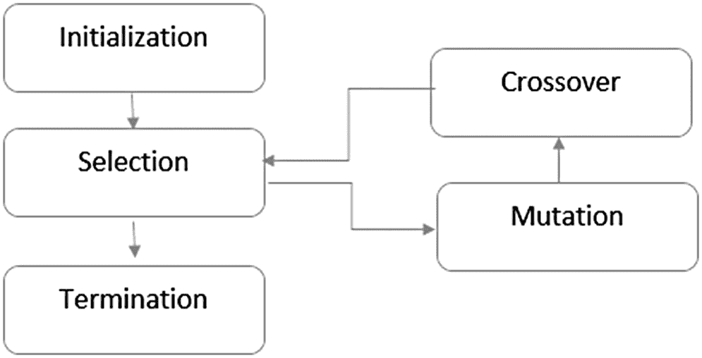

FIGURE 14.2

进化算法。

## 14.4 遗传算法](#Toc.xhtml_R_sec14_4)

遗传算法（Dasgupta and Michalewicz, 2013）属于概率搜索算法的范畴，它们迭代地变换对象（一个固定的二进制字符串）。每个对象被分配一个适应度值，从而产生一个新的对象种群。遗传算法围绕达尔文的物竞生存论，旨在模仿可遗传操作者的相似交叉和变异。遗传算法遵循自然选择过程，其原理是选择最适应的个体进行后代后裔的繁殖。整个搜索过程使用随机选择来发现探索范围。遗传算法的工作总结如下（图 14.3）：

1. 初始种群的生成基于随机选择。
2. 下一步的目标是从当前种群中选择最适应的个体，以生成新一代种群。
3. 创建新种群执行的主要功能是对步骤 2 中选出的代表个体进行交叉和变异。
4. 为了创建新的一代，在当前代之间进行替换。
5. 检查新代后代的适应度值，并选择最适应的。
6. 如果满足停止标准，算法停止。

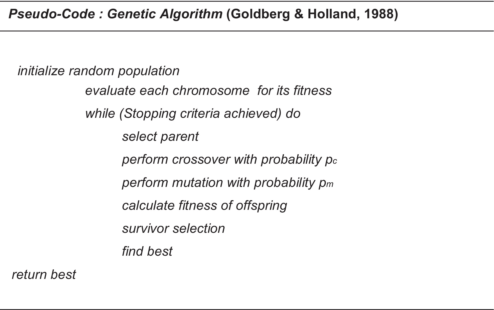

FIGURE 14.3

遗传算法。

选择概率取决于适应度值。随着每次选择更多适应的染色体作为父母，可能会出现一种情况，即产生的新解决方案与上一代非常相似，导致种群的多样性下降。

该算法的伪代码如下：

这种现象被称为种群停滞。变异通过注入随机的微小变化诱导种群多样性的过程（Goldberg and Holland, 1988; Alba and Tomassini, 2002）。

就像由细胞组成的生物体，细胞包含一个包裹遗传物质“基因”的核，这种单元被称为“染色体”，我们的问题也由染色体组成，染色体是问题中的输入变量。输入变量的容器可以表示为固定测量的二进制字符串，其中每个位对应于生物核苷酸。执行或表示输入变量的位序列称为基因，基因的集合称为染色体。整个染色体的总和代表系统的基因型，其实际解释对应于其表型，即它实际上引导的解决方案。

在遗传算法语境下使用的各种术语定义如下：

* **初始种群：**问题的初始种群在算法开始时随机创建（参见图 14.4）。初始染色体集（候选解）通常是随机生成的。根据所的染色体表示方案，生成染色体的方法可能会不同。种群中的某些染色体也是预先决定的，通常取决于应用类型。在遗传程序中，独立种群的既定遗传因子通过序列（通常是零一字符串）来表征。
* **适应度函数：**分别根据预定义的适用标准对遗传材料进行适用性评估。再次，适应度函数取决于应用并随案例变化。经过此评估，现在可以根据适用性对个体进行排序。
* **选择：**它涉及从给定种群中提取一部分质量更好的染色体。质量通过它们的适应度值进行衡量。
* **交叉：**交叉是生成子代染色体以形成新种群的过程（图 14.5）。被选中的父母交换它们的一些基因，这些基因被后代继承。影响这一过程的因素是交叉率和交叉类型。交叉的结果是规模是原种群的两倍，因为每对父母产生两个孩子。每个染色体或输入变量的二进制字符串都会经过交叉。
* **变异：**与交叉不同，变异发生在种群内的任何个体上。当随机生成的数字大于提供的变异概率时，发生变异。变异是染色体内随机随机选择的变异点的位翻转。例如，一个个体是 001100110，如果在右数第五个点发生变异，则它变为 001000110。变异可能也可能产生更适应的个体，并且不会向种群中增加单个个体（图 14.6）。

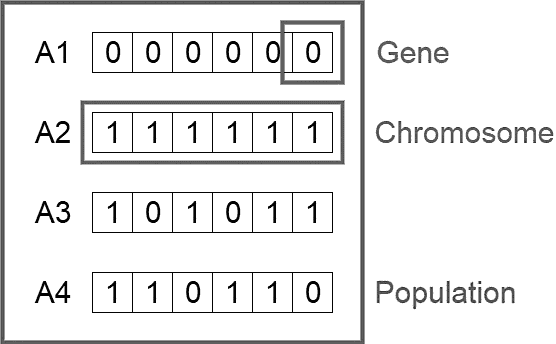

FIGURE 14.4

初始种群。

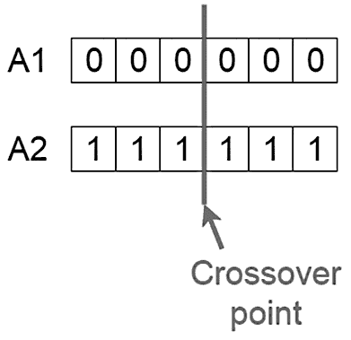

FIGURE 14.5

交叉。

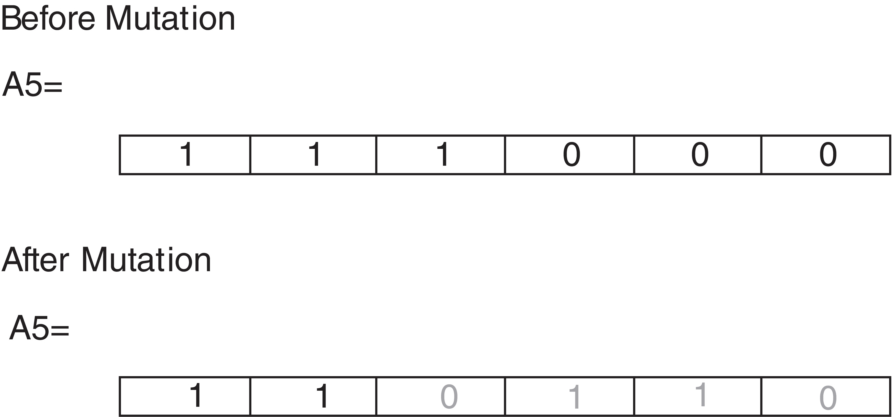

FIGURE 14.6

变异。


遗传算法（GA）已广泛应用于各个领域以解决复杂问题，并且是最流行的优化技术之一，但 GA 面临的主要局限性是固定长度的染色体和无语法方法，这使其不适用于程序生成方法。另一个影响是，遗传编程（GP）使用的回归方法通过维护变量之间的关系来达到得出结论的解析树。

## 14.5 遗传编程

遗传编程（Wolfgang et al., 2009; Pytela, 2012）是遗传算法的扩展。尽管灵感源于生物进化，但 GP 是一种基于适应度得分导出最优解的机器学习技术。它旨在通过自然选择原理和生物启发的操作（即交叉和变异，与 GA 中相同）来实现自动编程。作为一种领域无关的方法，它通过遗传进化计算机程序群来解决特定问题。

GA 和 GP 都是进化算法（EA）的特殊优化方法。两种方法都从初始化随机种群开始（GA 的情况下设置输入变量（Zhang and Cheng, 2009），GP 的情况下是包含算符和变量的树）。初始的种群将根据适应度函数（待优化的函数）进行评估，并为最适应的个体（即与所需解最的的）进行选择。被选中的个体将配对进行交叉。种群中的任何成员都有以特定概率发生变异。上述操作基于达尔文的优适者生存理论，即如果种群在任何给定时间根据适应度测试进行评估（例如，气候条件或食物链中的位置），通过该适应度测试的个体将繁殖产生新一代。新一代再次在相同或不同的适应度测试上进行评估，该过程一直持续直到种群中的所有个体都适应为止。未能产生适应后代的种群集将随着时间的推移而趋于灭绝。存在变异概率，例如生物体修改其部分以适应给定环境；然而，由于这是随机修改，变异并不总能产生适应的个体。

就像生物体由细胞组成，细胞包含一个包裹遗传物质“基因”的核，而这个单元被称为“染色体”一样，我们的问题也涉及染色体，即在以解析树形式表示的问题中的输入变量。输入变量可以表示为终结节点和算符节点，每个节点对应于一个生物核苷酸。主解析树中倾向于改变目标的子树被称为基因，基因的集合被称为染色体。整个染色体的总和代表系统的基因型，其际解释对应于其表型，即它实际导出的解。

在 GP 中，基因是个体的基本元素，它们被组合成代码。独立的平台与树具有类似的结构。基因有两种类型，即函数和站点。在树语言中，有分支的节点称为函数，而没有分支的节点称为终结符（叶子）。方程示例为 `7(x + 9)`，其中函数是 `+` 和 `*`，而 `7`、`x` 和 `9` 是终结符。GP 系统内基因的选择或创建由用户决定。这是一个重要的决策，因为选择不当可能导致解没有意义（见图 14.7）。

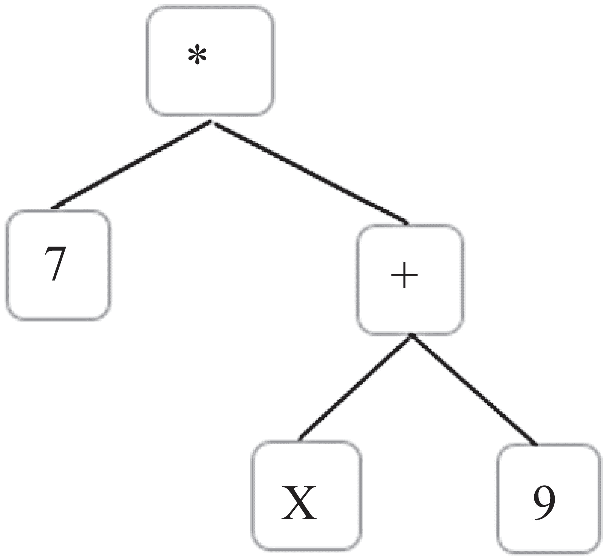

图 14.7

遗传编程——基本表示。

### 14.5.1 遗传编程算法

步骤 1\. 根据对可用原语的随机选择创建初始种群。

步骤 2\. 重复循环。

步骤 3\. 执行每个个体程序并检查其适应度。

步骤 4\. 根据适应度概率，选择一个或两个程序。

步骤 5\. 应用特定概率的遗传操作以创建新程序。

步骤 6\. 直到满足条件（达到可接受的解/停止标准）。

步骤 7\. 返回目前为止的解。

### 14.5.2 遗传编程中使用的基本术语

1. **终结符集（Terminal set）**——这主要由作为独立变量程序的外部输入和常量组成。
2. **算符集（Operator set）**——这主要由算术函数如 `add`、`multiply`、`subtract`、`divide` 以及相关的分支算符组成。
3. **适应度函数（Fitness function）**——适应度函数规定了要做。它是附加在每个种群个体上的数值。它是检查解决方案合适性的主要方法。
4. **控制参数 [m]**——控制参数的规范是用于控制整个运行过程的一项管理任务。主要的控制参数有：
    1. **个体种群范围（Inhabitants scope）**——这是一个重要的限制，因为它在很大程度上影响解决方案。按照规律，我们可以说“问题越复杂，需要的种群规模越大”。
    2. **同伴最大数量（Supreme number of compeers）**——时间是进化过程中的一个重要因素，因此，更多的代数可能会增加获得最优解的概率。相反，即使代数进一步进化，也无法保证获得解。
    3. **交叉和繁殖的概率。**

### 14.5.3 遗传编程优于遗传算法的优势

以下是证明 GP 优于 GA 的标准：

1. **染色体表示：** GA 遵循字符字符串，通常是代表其染色体的二进制字符串，而 GP 使用树来完成相同的功能。例如，`0101010110` 可能是 GA 的染色体结构，而像图 14.7 中的树可能可能是 GP 中染色体的示例。显而易见，树非常容易解析，因为每个节点都有意义，并且可以轻松应用算法来处理树，而当多个染色体一起表示时，很难标记字符串的开始和结束。
2. **染色体长度：** GA 处理的是固定长度的染色体，而 GP 是变长度的。固定长度表示使其非常难以动态地应用结构。此外，染色体长度的可变性增加了应用领域并消除了编码限制。
3. **领域句法（Domain Syntax）：** 通常情况下，GA 中的领域特定符号被编码为二进制字符串或任何其他字符字符串，而 GP 并非如此。这减少了 GP 中编码和解码领域输入变量所需的时间。
4. **可执行文件（Executables）：** 由于 GA 具有中间编码格式，很少找到可以直接馈给解释器的可执行文件，除非在输入变量实际上是二进制的少数几种情况下。另一方面，当我们谈论 GP 时，树结构中的节点具有定义的含义，因为它们要么是终结符是算符，并且有用于处理树的解释器，因此很容易获得 GP 代码的可执行文件。


### 5. 基础领域
遗传算法（GA）是一种搜索优化过程，而遗传编程（GP）是 GA 的扩展，它不仅提供了搜索函数，有助于生成新的程序。这些程序可以是实际程序，其中代码块是终节点，而条件、分支或循环语句充当算子。在处理数学表达式时，算子是实际的数学运算符，而终端是函数或常数。这使得 GP 适用于广泛领域。

## 14.6 粒子群优化算法 (PSO)
PSO 是一种基于群体智能的过程（Lhotská, 2008），灵感来源于鸟类群集的社会行为。PSO 与 GA 和 GP 有许多相似之处，特别是在种群的随机初始化以及在寻找最优解时的代际更新。与 GA 和 GP 相比，PSO 不使用进化算子（即变异和交叉）。PSO 中的潜在解决方案被称为子区域（subdivisions），旨在通过模仿最优粒子来探索搜索空间。与 GA 不同，PSO 的实现更容易，因为只需要调整少数的参数。

PSO 通过模拟鸟类的群集行为来工作。简单来说，请想象这样一个场景：目标是一群鸟（群体）在给定区域内寻找食物。

**约束：**
1. 所有的鸟都是饥饿的，并同时寻找食物。
2. 区域内只有一个食物。
3. 任何鸟都不知道食物的位置。

**问题：** 寻找发现食物的最佳策略。

**解决方案：** 模仿距离食物最近的鸟，并以迭代的方式评估与食物的距离。

场景中提到的鸟类行为（任务是多个但资源有限）在计算领域中得到了模拟，该算法被称为 PSO。通过学习上述场景，可以使用 PSO 解决各种实时问题，在给定的搜索空间中，每个孤立的解被称为“鸟”（粒子）。根据优化的适应度函数得出的值，为每个粒子分配一个适应度值。粒子的移动（飞行）由其速度（惯性）引导。当粒子的最佳移动优于整个群体的最佳移动时，整体移动的方向就会改变。整个操作使得无随机并增加了接近代价函数全局最小值的概率。

该算法从初始化开始，涉及收集随机粒子（解）并更新代际以寻找最优解。每次迭代都会更新以下“最佳”值：
1. 粒子目前为止达到的适应度（最佳解）称为 `p[best]`（个体最佳）。
2. PSO 在种群粒子中评估出的最佳适应度（最佳解）称为 `g[best]`（全局最佳）。
3. 粒子在其拓扑邻域中达到的最佳值称为 `l[best]`（局部最佳）。

一旦评估了两个最佳值（即 `p[best]` 和 `g[best]`），粒子的速度和位置通过以下两个方程进行简化：

```
(14.1) p[y] = p[y] + l[f1] * rand() * (p[best] - p[present]) + l[f2] * rand() * (g[best] - p[present])
(14.2) present[] = present[] + p[y]
```

其中：
- `p[y]` 指粒子速度
- `l[f]` 指学习因子
- `rand()` 代表 0 到 1 之间的随机数

第一个方程更新每个粒子的速度，而第二个方程确定每个粒子的位置。在算法中，信息仅通过使用 `g[best]` 和 `l[best]` 与他人共享，这使其成为一种单向统计分布工具，而在 GA 中，染色体之间共享所有信息。因此，GA 和 PSO 的统计分布工具是不同的。

PSO 比 GA 具有多出的一个优势，即使用实数作为粒子，而不是遗传算子或二进制编码。

PSO 的伪代码如图 14.8 所示。


图 14.8：PSO 的伪代码。

## 14.7 比较：遗传算法、遗传编程和粒子群优化
通过下表 14.1 给出的每种算法优缺点总结，可以更好地理解上述讨论。基于进化算法（EA）和群体智能（SI）的算法的表格总结有助于理解它们在特定优化问题中的适用性。

| 算法 | 优点 | 缺点 |
| --- | --- | --- |
| 遗传算法 (GA) | - 易于实现，解快速且高效。<br>- 并行执行，能有效解决局部极大值问题。<br>- 无需导数信息。<br>- 提供更好的解而不仅仅是单一解。<br>- 通过种群规模、解码时间和代数，我们可以预测求解时间。<br>- 复杂的计算问题可以用简单的算子轻松解决。<br>- 与多目标问题以及单目标和离散函数结合良好。 | - 没有标准方法来推导适应度函数；完全取决于用户。<br>- 难以近似种群规模和交叉率等控制参数。<br>- 没有定义单一终止准则。<br>- 变量过多时的扩展性问题会导致染色体变大，从而增加时间消耗。<br>- 解的质量无法保证。 |
| 遗传编程 (GP) | - 输出是一个可以表示为数学表达式的程序，易于理解。<br>- 基于树的表示使其具有优于 GA 的优势。<br>- 适应度函数具有灵活性（根据指定的问题设计）。<br>- 当问题空间不明确时，可以获得高效的结果。<br>- 解没有固定长度（取决于硬件限制）。 | - 由于每代都要对每个个体进行适应度评值，计算成本较高。<br>- 需要大数据集来获取最优解。<br>- 不保证获得精确解。 |
| 粒子群优化 (PSO) | - 与 GA 和 GP 相比，代码实现更简单。<br>- PSO 实现更容易，因为需要调整的参数较少。<br>- 以较短的计算时间提供高效解。<br>- 不基于变异和交叉等进化算子。 | - 缺乏用于分析的强有力数学基础。<br>- PSO 的连续性使其不适用于离散问题。<br>- 与经典方法相比，其收敛速度较慢。 |

表 14.1：GA、GP 和 PSO 的比较

## 14.8 结论


本章介绍了受生物启发算法，即 `EAs`（进化算法）和基于群体智能的算法，作为高效的优化解决方案。所有的 `EAs`（ `GA` 和 `GP`）具有共同特征，例如：基于最优生存标准的种群算法；为了获得最优解的迭代演化；适应度函数固定的复杂性；以及自然选择算子——`mutation`（变异）和 `crossover`（交叉），但在染色体表示和长度上存在差异。另一方面，基于群体智能的算法（如 `PSO`）通过引导最优粒子（群体）来探索搜索空间。`PSO` 实现相对简单，参数较少，且不涉及 `crossover` 和 `mutation` 等演化算子。最后，本章以表格形式总结了这些生物启发算法并列出了它们各自的优缺点，以便读者理解其适用性。

### 参考文献

1. Alba, E. and Tomassini, M., 2002. Parallelism and evolutionary algorithms. *IEEE Trans. Evol. Comput.*, *6*(5), 443–462.
2. Coello, C. A. C. and Lamont, G. B., 2004. *Applications of Multi-Objective Evolutionary Algorithms* (Vol. *1*). World Scientific, Singapore.
3. Dasgupta, D. and Michalewicz, Z. (Eds.), 2013. *Evolutionary Algorithms in Engineering Applications*. Springer Science & Business Media, Berlin.
4. Goldberg, D. E. and Holland, J. H., 1988. Genetic algorithms and machine learning, *Mach. Learn.*, *3*(2/3), 95–99, [`doi.org/10.1023/A:1022602019183`](https://doi.org/10.1023/A:1022602019183).
5. Kachitvichyanukul, V., 2012. Comparison of three evolutionary algorithms: `GA`, `PSO`, and `DE`, *Ind. Eng. Manag. Syst.*, *11*(3), 215–223.
6. Krink, T. and Løvbjerg, M., 2002. Improving particle swarm optimization by hybridization of stochastic search heuristics and self-organized criticality, University of Aarhus, Aarhus.
7. Lobo, F. J., Lima, C. F., and Michalewicz, Z. (Eds.), 2007. *Parameter Setting in Evolutionary Algorithms* (Vol. *54*). Springer Science & Business Media, Berlin.
8. Løvbjerg, M.: Improving particle swarm optimization by hybridization of stochastic search heuristics and self-organized criticality. Master’s thesis, Department of Computer Science, University of Aarhus (2002)
9. Macaš, M., Lhotská, L. 2008. Social Impact and Optimization. *International Journal of Computational Intelligence Research* *4*(2), 129–136
10. Nowak, A., Szamrej, J., and Latan, B., 1990. From private attitude to public opinion: A dynamic theory of social impact, *Psychol. Rev.*, *97*(3), 362–376.
11. PyteIa, J., 2012. *Implementation and Testing of Social Optimization Algorithms*, Czech Technical University, Prague.
12. Ursem, R. K., 2002, September. Diversity-guided evolutionary algorithms. In *International Conference on Parallel Problem Solving from Nature* (pp. 462–471). Springer, Berlin, Heidelberg.
13. Wolfgang, J., Peter, N., Robert, E. K., and Frank, D. F., 2009. *Genetic Programming: An Introduction on the Automatic Evolution of Computer Programs and Its Applications*. Morgan Kaufmann Publishers/Dpunkt-Verlag, San Francisco, CA/Heidelberg.
14. Zhang, Y. and Cheng, H., 2009. Improved genetic programming algorithm applied to symbolic regression and software reliability modeling, *Software Eng. Appl.* *2*(5), 354–360.

# 附录：政策模板

**名称：** 政策名称

**版本：** 当前版本号

**分类：** 此文档的分类是什么？已发布的政策通常为“公开（PUBLIC）”，而公司程序可能是“内部（INTERNAL）”。

**发布日期：** 发布日期

**文档历史表：** 插入文档历史表，可以包括版本号、发布日期、描述或主要变更、审批人姓名等信息。

**法律依据：** 政府或监管机构发布的文档需要法律依据。企业可以用“背景”来替换，在其中可以提供关于为何发布该特定政策或其与现有已批准政策的关系等信息。

**引言：** 提供文档的简要介绍。提供制定该文档的简要需求和合理性。

**范围与适用：** 明确定义文档的范围和适用范围。哪些人员、业务、系统等在涵盖范围内？

**受众：** 明确识别该文档的目标受众。谁应该阅读此文档？

**政策声明：** 在此处阐述你的政策声明，如果是标准政策，请阐述你的控制声明和控制目标。

**治理（角色与职责）：** 确定政策将如何被治理。谁将承担什么角色和职责？

**执行：** 这对于政策文档是强制性的。应明确说明不遵守政策情况的纪律处分。

**例外：** 这对于政策文档是强制性的。指明如何管理政策的例外情况。

**发布机构：** 对于政策而言，说明发布机构至关重要。谁将签署政策声明？

## 附录

**定义：** 支持性信息。列出政策使用的关键术语的定义。

**缩写：** 支持性信息。列出文档使用的缩写/简称及其各自的含义。

**支持性文档：** 提供支持此文档的相关程序/指南/表格的链接。

# 索引

## A

* 访问控制，85
* 访问控制系统，178–179
* 访问权限管理 (ARM), 167
* 账户监控，29–30, 33–34, 37
* 行政查询，44
* 篡改，107, 116
* 评估，14–17
* 评估级别，18
* 非对称性，86–88
* 攻击者，22–23
* 攻击，121–122, 124, 136, 139–140
* 身份验证，85, 87
* 身份验证设备，171–175
* 真性，107, 115
* 自动化，14
* 尸检，182, 185–187
* 可用性，181

## B

* 行为生物识别，172–174
* 生物启发优化，189
* 生物演化，194
* 生物识别设备，177
* 生物识别，171–175, 177–179
* 生物识别安全，178
* 比特币，143–146


* `blockchain`, 143–145, 148, 151, 152–156
* `breach response`, 168

## C
* `cash-dependent`, 146
* `CBC`, 94, 96, 98–101, 103
* `centralized repository`, 143
* `chi-square test`, 104
* `ciphertext`, 85–88
* `cloud computing architecture`, 159
* `cloud deployment models in cloud deployment and service models`, 159–161
* `cloud service models in cloud deployment and service models`, 159–161
* `cloud service provider (CSP) in service provider`, 159–160, 162
* `clustering (hierarchical) based IDSs in hierarchical IDS`, 127, 131–132
* `CMOS sensor`, 108
* `color filter array (CFA)`, 108, 114
* `communication and awareness`, 9, 11
* `computational`, 190, 199
* `computer vision`, 112
* `confidentiality`, 81–82, 85, 181
* `confidential message`, 81–82, 86, 89–90
* `contrast enhancement`, 108, 109
* `cross dissolves`, 109
* `cryptanalysis`, 84
* `cryptocurrencies`, 149–151, 153–154, 156
* `cryptographic cash`, 145, 148–149
* `cryptographic/cryptography`, 79–81, 83–89, 144–150, 152–156
* `crypto protections`, 148
* `cyber-attacks`, 62–67, 69, 71, 75, 164, 181–182
* `cybercrime`, 25–26, 28–29, 32–34
* `cybercrime victimization`, 28–29, 32–33
* `cybersecurity`, 76, 181–182, 187
* `cyberspace`, 61–66, 181
* `cyber-warfare`, 61, 64–69, 71, 73
## D
* `data analysis`, 187
* `data clustering`, 125
* `data integrity`, 85, 87
* `decryption`, 85–86, 88, 93–94, 96–100
* `delegate security`, 46
* `denial of service`, 63, 71, 74, 121
* `detection`, 122–127, 129–135, 137–140
* `digital devices`, 61–62
* `digital forensics`, 185
* `digital forensics in tool`, 187
* `digital information`, 146
* `digital money`, 145–147, 149, 151, 153
* `digital platform`, 61
* `digital signature`, 82, 87
## E
* `e-commerce`, 26, 34, 38–39
* `economic improvement`, 62
* `effective policies`, 1, 5
* `elementary functions`, 190
* `encryption`, 81–82, 83–89, 93–94, 96–101
* `end of life`, 12
* `energy minimization`, 109, 112
* `enforcement`, 1, 5
* `enterprise information`, 46
* `equation modeling`, 28, 36
* `Equifax`, 21, 22
* `ethical hacker`, 185
* `European securities`, 147
* `event detection`, 167–168
* `evolution`, 189–190, 194, 199–200
* `expert systems`, 125
## F
* `false acceptance rate`, 175–176
* `false rejection rate`, 175–176
* `field morphing`, 109, 111–112
* `file system`, 186
* `fingerprinting`, 81
* `finite state machine`, 125
* `fitness function`, 191, 193, 195–197, 199–200


*   伪造, 107, 108, 109, 113, 114–117, 118
*   FPGA, 93–95, 97, 99

## G

*   遗传编程, 191, 194–196, 200
*   几何变换, 108, 114, 117

## H

*   黑客, 62–63, 68–69, 71–72, 75
*   基于主机的入侵检测系统, 126
*   人力, 43, 49, 52
*   混合入侵检测系统, 126
*   假设标记, 148

## I

*   识别, 16, 22
*   身份盗用, 25–28, 30–33, 35–37, 39
*   IEEE VHDL, 94, 102
*   图像采集, 107, 108, 113
*   图像取证, 108, 109, 113, 118
*   图像篡改, 114, 116
*   工业部门, 43
*   影响用户行为, 11
*   信息与通信, 61
*   信息隐私, 48
*   信息安全策略, 1, 4
*   基础设施即服务 (IAAS), 160
*   完整性, 181
*   插值, 108, 109, 110, 111
*   入侵者, 122–123, 129, 134, 137–138
*   入侵, 122
*   入侵检测系统, 122–132, 134–135, 137–140, 183
*   资产清单, 17
*   IoT 设备, 63
*   IoT 安全, 100, 102
*   ISO 27002, 14
*   特定问题安全, 48

## K

*   关键性能指标, 9, 10
*   关键成功因素, 9
*   基于知识的 IDS, 125

## L

*   轻量级加密, 93–97, 99–104
*   日志, 168

## M

*   机器控制, 61
*   恶意软件, 62, 63, 69, 72
*   管理信息, 44
*   移动自组网络 (MANET), 22, 127, 129–132, 134–137, 139
*   网格扭变, 109, 110–111
*   变态, 109
*   微架构, 96–97, 99–100, 102–103
*   错对齐, 109, 110
*   缓解, 165, 168
*   货币交换, 149–150, 154, 156
*   监控合规, 10
*   监控事件, 164, 167
*   多级自由变形, 109
*   多模态系统, 179
*   多重染色体, 196

## N

*   基于网络的入侵检测, 126
*   网络层, 184
*   网络扫描, 185

## O

*   离线风险, 29, 31, 33–34, 37–38
*   在线风险, 28–29, 31, 33
*   在线安全, 29–31
*   优化, 189, 191, 194, 196–167, 199–200
*   组织管理, 47

## P

*   数据分析器, 183
*   数据捕获, 182–183
*   数据嗅探, 182
*   粒子群优化, 191, 197, 199
*   性能评估, 175–176
*   网络钓鱼, 62, 70–71
*   物理生物识别, 172, 174
*   物理框架, 61, 64
*   物理安全, 29, 31, 33
*   明文, 85, 87–88
*   平台即服务 (PAAS), 160


* `优先排序`, 14, 17, 19, 21
* `私钥`, 86, 88
* `权益证明证明`, 145
* `工作量证明`, 145
* `保护性行为`, 26–29, 34, 39
* `公钥`, 86–88
* `公钥密码学`, 86–87

## R
* `径向基函数 (RBF) 变形`, 109, 112
* `识别`, 172, 174–175, 177, 179
* `恢复活动`, 165
* `修复`, 15, 19, 21
* `报告`, 15, 19, 21, 23
* `风险行为`, 29, 34, 38–39
* `路由优化`, 190

## S
* `秘密性`, 81, 84, 86, 89
* `密钥`, 86–88
* `安全安排`, 45, 47
* `安全策略`, 43–45, 47–55
* `安全程序`, 46
* `安全记录`, 46
* `安全策略`, 44–45, 48, 50–52, 54–56
* `安全令牌`, 148
* `安全工具`, 181
* `Sleuth Kit`, 185
* `软件即服务 (SAAS)`, 161
* `SPN 网络`, 96, 98
* `隐写术`, 81–84, 88
* `结构方程模型 (SEM)`, 28, 36, 39
* `监控`, 62, 64, 67, 69
* `群智智能`, 189, 197, 200
* `对称的`, 86–88
* `系统`, 48

## T
* `威胁`, 62–63, 65, 68–70
* `交易区块`, 143
* `特木马`, 63

## U
* `单模系统`, 175
* `实用性令牌`, 148

## V
* `验证`, 172–173
* `验证`, 25
* `漏洞`, 13–23
* `漏洞分析 (VA) 工具`, 20, 23
* `漏洞管理`, 13–21, 23

## W
* `看门机制中的看门狗`, 133, 135, 139
* `水印`, 81
* `无线传感器网络 (WSN)`, 121, 122, 128–140
* `Wireshark`, 182–185, 187
* `世界银行`, 147

* * *

1. ¹ 指网络安全标准。
2. ² 指技术标准。
3. ³ 指政策框架。
4. ⁴ 指通用手册，而非特指政策手册的语境下。
5. ⁵ 此处的政策是指所有如政策、标准、指南等文件。
