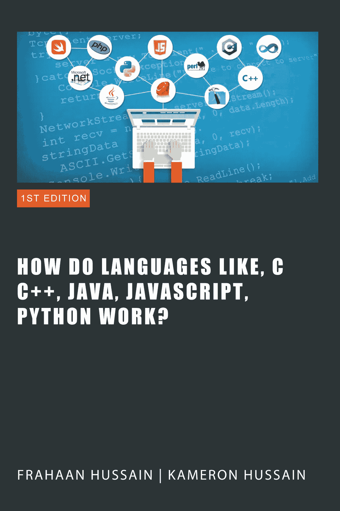

# 代码内部：揭秘 C、C++、Java、JavaScript 和 Python 等语言的工作原理



# 第 1 章：编程语言的本质

## 1.1 理解编程语言基础

编程语言是软件开发的基础，使我们能够有效地向计算机传达意图。它们是人类可读代码与机器执行指令之间的桥梁。在本节中，我们将探索支撑所有编程语言的基本概念。

从核心上说，编程语言是形式化的规则和语法，允许开发者向计算机提供指令。这些指令可以从简单的算术计算到复杂的数据处理和控制流不等。

### 语法与语义

任何编程语言的两个关键方面是语法和语义。语法定义了语言的结构和规则，规定了代码如何编写才能被视为有效。另一方面，语义规定了代码的含义以及应如何执行。理解并精通语法和语义对于有效编程至关重要。

### 变量和数据类型

在编程中，变量用于存储和处理数据。数据类型定义了变量可以持有的数据种类，例如整数、浮点数、字符串或自定义类型。例如，在 `Python` 中：

```python
# 变量声明
age = 25

### 数据类型：整数
name = "John"

### 数据类型：字符串
```

### 运算符

运算符是对数据执行操作的符号或关键词。常见的运算符包括加法（`+`）、减法（`-`）、乘法（`*`）和除法（`/`）。它们允许你根据数据值进行计算并决策。

```java
// Java 中的算术运算符
int result = 10 + 5; // 加法
int difference = 15 - 7; // 减法
int product = 6 * 4; // 乘法
float quotient = 20 / 3.0; // 除法
```

### 控制流

编程语言提供条件结构（`if-else` 语句）、循环（`for`、`while`）和分支机制来控制程序的执行流。这些构造允许开发者创建决策逻辑并重复执行代码。

```javascript
// JavaScript 中的条件语句
if (age >= 18) {
    console.log("You are an adult.");
} else {
    console.log("You are a minor.");
}
```

### 函数和过程

函数是执行特定任务的重重用代码块。它们封装了功能，并可以接受输入参数和返回结果。函数对于实现代码的模块化和提高代码可重用性至关重要。

```cpp
// C++ 中的函数定义
int add(int a, int b) {
    return a + b;
}
```

### 注释

注释是不可执行的代码行，用于在源代码中提供解释或标注。它们对于记录代码至关重要，使开发者和维护人员更易地理解代码。

```python
# 这是 Python 中的一个单行注释

"""
这是 Python 中的一个
多行注释。
"""
```

### 代码结构

程序的结构取决于其在函数、类和模块中的组织方式。结构良好的代码更易阅读、维护和调试。通常会遵循代码缩进和格式规范以增强代码的可读性。

理解这些基础概念是精通任何编程语言的第一步。当我们深入探讨本书中讨论的特定语言时，你将看到这些概念如何被应用和扩展，以创建多样且强大的软件解决方案。

自计算早期以来，编程语言已经经历了巨大的演变。这种演变是由于对软件开发需要更具表达力、更高效且用户友好的工具的需求。在本节中，我们将探索编程语言的历史发展，重点介绍关键的里程碑和创新。

### 机器语言

早期的计算机使用机器语言进行编程，机器语言由直接控制硬件的二进制代码指令组成。使用机器语言进行编程是一个枯燥且容易出错的过程，因为它要求对计算机架构有非常深入的了解。

### 汇编语言

为了简化编程，引入了汇编语言。这些语言使用符号名称来表示机器级指令，使得程序员编写代码变得稍微容易。然而，汇编语言仍然与底层硬件紧密相关。

```text
MOV AL, 10  ; 将值 10 移动到 AL 寄存器
ADD AL, 5   ; 在 AL 寄存器中加 5
```

### 高级语言

高级编程语言出现于 20 世纪中期，旨在提供一种更抽象、更符合人类习惯的代码编写方式。20 世纪 50 年代后期开发的 `FORTRAN` 是最早的高级语言之一，专为科学和工程计算设计。

```fortran
PROGRAM HelloWorld
PRINT  *, "Hello, World!"
END PROGRAM HelloWorld
```

### ALGOL

20 世纪 50 年代后期和 60 年代初，`ALGOL`（算法语言）被开发出来，引入了循环和条件等结构化编程概念。`ALGOL` 的影响可以在随后的 `Pascal` 和 `C` 等语言中看到。

### COBOL

`COBOL`（通用面向业务语言）创建于 20 世纪 60 年代初，用于业务数据处理。它引入了类英语语法并在商业领域广泛使用。

```cobol
IDENTIFICATION DIVISION.
PROGRAM-ID. HelloWorld.
PROCEDURE DIVISION.
    DISPLAY "Hello, World!".
    STOP RUN.
```

### C 编程语言

`C` 编程语言由 Dennis Ritchie 在 20 世纪 70 年代初在贝尔实验室开发，是一项重大突破。它提供了底层控制、移植性和简单的语法，使其在系统编程中广受欢迎，并影响了后来的许多语言。

```c
#include <stdio.h>
int main() {
    printf("Hello, World!\n");
    return 0;
}
```

### 面向对象编程（OOP）

20 世纪 80 年代出现了 `C++` 和 `Smalltalk` 等面向对象的语言，它们引入了对象和类的概念，以实现更好的代码组织和模块化。

### Java

20 世纪 90 年代中期，Sun Microsystems 推出了 `Java`。它通过在 Java 虚拟机（`JVM`）上运行来强调移植性和安全性。`Java` “一次编写，随运行”的哲学使其成为跨平台开发的流行选择。

```java
public class HelloWorld {
    public static void main(String[] args) {
        System.out.println("Hello, World!");
    }
}
```

### 脚本语言

`Perl`、`Python` 和 `Ruby` 等语言在 20 世纪后期因其易用性和快速开发能力而流行起来。它们特别适用于 Web 脚本编写和自动化任务。

编程语言的演变仍在继续，新语言不断出现，以应对软件开发行业的特定需求和趋势。理解这一历史背景对于欣赏如今现有的化的编程语言格局至关重要。

## 1.3 C、C++、Java、JavaScript 和 Python 的共同特征

虽然存在无数编程语言，每种语言都有其独特的特征和用例，但某些语言共享共同的特征和原则。在本节中，我们将探索五种广泛使用的编程语言的共同特征：`C`、`C++`、`Java`、`JavaScript` 和 `Python`。

1. **编译 vs 解释**：`C` 和 `C++` 是编译型语言，意味着源代码在执行之前由编译器翻译成机器码。这导致了更快、更高效的程序，但需要针对不同的平台进行单独编译。相比之下，`Java`、`JavaScript` 和 `Python` 是解释型语言。它们在运行时由解释器执行，允许更大的移植性，但可能会牺牲一些性能。
2. **语法和控制结构**：这五种语言都使用 C 风格语法，其特点是用大括号 `{}` 表示代码块，用分号 `;` 结束语句。它们支持常见的控制结构，如条件（`if-else` 语句）和循环（`for`、`while`），用于程序流控制。
3. **强类型**：`C`、`C++`、`Java`、`JavaScript` 和 `Python` 都是静态类型语言，这意味着变量类型在编译时显式声明并检查。这有助于在开发过程早期发现类型相关的错误，确保代码更安全、更可靠。
4. **对函数/方法的支持**：每种语言都允许开发者定义和使用函数或方法。`C` 和 `C++` 中的函数是独立的，而 `Java`、`JavaScript` 和 `Python` 同时支持独立函数以及类或对象中的方法。
5. **库和标准库**：它们都带有丰富的标准库，为常见任务提供预构建的函数和类。这些库通过提供从文件处理到网络的丰富功能简化了开发工作。
6. **内存管理**：`C` 和 `C++` 提供手动内存管理，让开发者对内存分配和释放拥有控制。另一方面，`Java`、`JavaScript` 和 `Python` 通过垃圾回收实现了自动内存管理，简化了与内存相关的任务。
7. **面向对象编程（OOP）**：`C++`、`Java` 和 `Python` 是面向对象的语言，促进了使用类和对象组织代码。`JavaScript` 虽然不是严格的面向对象，但通过使用原型和对象字面量支持基于对象的编程。
8. **移植性**：`Java` 因其在 Java 虚拟机（`JVM`）上的运行而闻名“一次编写，随运行”。`JavaScript` 主要用于网页脚本，在不同浏览器间具有良好的移植性。`Python` 是跨平台的。
9. **流行用例**：
   - `C` 和 `C++` 常用于系统编程、游戏开发以及对性能和底层控制要求关键的应用。
   - `Java` 常用于企业级软件、Android 应用开发和后端应用程序。
   - `JavaScript` 是 Web 语言，用于客户端脚本和构建交互式 Web 应用。
   - `Python` 在数据科学、机器学习、Web 开发、脚本和自动化方面表现。
10. **社区和生态系统**：所有这些语言都有活跃且繁荣的社区，这意味着开发者可以利用大量的资源、库和框架。

理解这些共同特征有助于开发者在为特定项目需求选择合适的编程语言时做出明智选择。每种语言都有其优缺点，使其更适合不同的任务和领域。

## 1.4 高级语言 vs. 低级语言

编程语言大致可以分为两大类：高级语言和低级语言。这些类别指的是语言运行时的抽象化程度以及与硬件的接近程度。在本节中，我们将探索高级语言和低级语言之间的区别以及各自的优势和权衡。

### 高级语言

高级语言的设计侧重于人类可读性和编程的易用性。它们提供了高层次的抽象，意味着开发者可以编写更接近自然语言的代码，而无需过度关注底层硬件的复杂细节。高级语言的一些关键特性包括：

1. **抽象**：高级语言提供了简化复杂任务的抽象。开发者可以与与其解决的问题领域更接近的数据结构、库和函数进行工作，而无需担心内存管理或低级操作。
2. **移植性**：用高级语言编写的代码通常具有更好的移植性，因为它们对特定硬件或操作系统的依赖较少。这使得编写跨平台软件变得更容易。
3. **生产力**：由于其简洁的语法和丰富的内置函数及库，高级语言通常能够实现更快的开发。开发者可以专注于解决问题，而不是处理低级细节。
4. **可读性**：高级代码通常对程序员来说更易读、更易理解，便于项目的维护和团队协作。

#### 高级语言示例

- `Python`
- `Java`
- `JavaScript`
- `Ruby`
- `Swift`

### 低级语言

相比之下，低级语言提供的抽象极少，且更接近硬件。它们允许对计算机资源进行细粒度的控制，但要求程序员投入更多精力并关注细节。低级语言的关键特性包括：

1. **控制力**：低级语言对内存和寄存器等硬件资源提供精确的控制。这种控制对于系统编程以及对效率至关重要的任务是本质的。
2. **性能**：用低级语言编写的代码可以针对性能进行高度优化，因为开发者对内存分配和 CPU 操作具有直接控制权。这使得低级语言适用于编写操作系统或设备驱动等任务。
3. **硬件依赖**：用低级语言编写的程序通常针对特定的硬件架构和操作系统。将此类代码移植到不同平台可能具有挑战性。
4. **复杂性**：由于缺乏高级抽象，用低级语言编写代码通常更复杂且容易出错。开发者需要手动管理内存并处理许多低级细节。

#### 低级语言示例

- `Assembly language`（汇编语言）
- `C`
- `C++`

### 在高级语言和低级语言之间选择

选择高级语言还是低级语言取决于项目的具体需求。高级语言非常适用于大多数软件开发任务，包括 Web 开发、数据分析和应用开发，这些任务中生产力和移植性至关重要。

另一方面，低级语言更优于需要最大性能的任务，例如嵌入式系统编程、实时系统以及系统级软件的编写。

在实践中，许多现代软件系统结合了高级和低级语言。高级语言用于大部分应用代码，而关键的性能敏感部分可能会用低级语言实现，或者通过语言扩展（如 `Python` 中的 `C/C++` 绑定或 `Java` 的原生接口 `JNI`）。

理解高级语言和低级语言之间的权衡，允许开发者对特定项目使用什么语言做出明智决策，平衡开发易用性与性能需求。

## 1.5 编译器和解释器的角色

在编程语言的世界中，编译器和解释器在将人类可读的代码转换为机器可执行指令方面起着至关重要的作用。这些工具是执行编程语言编写的代码的基础。让我们深入探讨编译器和解释器的角色以及它们的区别。

### 编译器

编译器是一种将程序的完整源代码翻译成等效机器指令指令的工具。这种翻译是在一个名为“编译”的一次性过程中完成的。源代码一旦编译完成，就会生成一个可以独立运行的可执行二进制文件。编译器的一些关键特性包括：

1. **编译**：源代码在执行之前被转换为机器码。这导致了更快的执行，因为每次运行时都不需要重新翻译代码。
2. **效率**：编译后的程序在运行时性能方面通常更高效，因为代码在编译期间已经经过了优化。这使得编译器非常适用于性能至关重要的应用程序。
3. **静态类型**：编译器通常强制执行严格的静态类型，在编译时捕捉类型相关的错误。这可以产生更健壮、可靠的代码。
4. **示例**：如 `C`、`C++` 和 `Rust` 等语言通常是编译语言。这里有一个 `C` 程序的简单示例：

```c
#include <stdio.h>

int main() {
    printf("Hello, World!\n");
    return 0;
}
```

### 解释器

另一方面，解释器逐行或逐语句地处理源代码，直接执行而不创建单独的编译后二进制文件。解释器读取源代码、对其进行解析并实时执行。解释器的关键特性包括：

1. **动态执行**：解释器动态执行代码，这意味着源代码可以在不重新编译的情况下进行修改和执行。这种灵活性对于快速开发和脚本编写非常有用。
2. **移植性**：由于解释器不生成机器码二进制文件，相同的源代码通常可以在安装了相应解释器的不同平台上运行。
3. **动态类型**：被解释执行的语言通常使用动态类型，允许在变量类型处理上具有更强的灵活性。类型相关的错误可能只在运行时才会出现。
4. **示例**：如 `Python`、`JavaScript` 和 `Ruby` 等语言通常是解释执行的语言。这里有一个 `Python` 代码的简单示例：

```python
print("Hello, World!")
```

### 混合方法

某些语言（如 `Java`）采用了混合方法。`Java` 源代码首先由 `Java` 编译器编译成中间字节码。然后这些字节码由 `Java 虚拟机`（`JVM`）在运行时进行解释，在编译和解释的优势之间取得了折中。

### 在编译和解释之间选择

选择编译还是解释取决于多种因素，包括项目的性质、性能需求和开发速度。编译型语言适用于性能关键型应用程序，而解释型语言通常用于原型设计、Web 脚本和快速开发。

总之，编译器和解释器是编程语言世界中不可或缺的工具，各有优劣和权衡。它们之间的选择取决于编程项目的具体需求和目标。

# 第二章：解码 C：现代语言的祖先

## 2.1 C 的诞生与哲学

`C` 编程语言被称为“所有编程语言之母”，它拥有丰富的历史并对现代编程语言的发展产生了重大影响。`C` 是由 Dennis Ritchie 在 20 世纪 70 年代初在贝尔实验室创建的，它的设计时考虑了特定的哲学，这种哲学塑造了它的特性和原则。

### C 的哲学

`C` 的开发遵循了一系列基本原则和目标，这些原则直到今天仍影响着编程语言：

1. **可移植性**：`C` 的设计具有高度的可移植性，允许用 `C` 编写的代码通过极少的修改在不同的硬件平台上运行。这种可移植性通过抽象硬件细节并提供一组标准数据类型来实现。
2. **效率**：`C` 优先考虑运行时效率，并提供对硬件资源的低级控制。这使得它非常适合性能至关重要的系统编程。
3. **极简主义**：`C` 遵循极简主义哲学，提供了一组简单且功能强大的特性。它避免了不必要的复杂性和功能，这有助于它的简单性和易于学习。
4. **接近硬件**：`C` 提供了直接内存操作、指针算术和对硬件低级控制的功能。这种与硬件的紧密结合允许开发者编写高效的代码，但也要求在管理内存和资源方面负责。

### C 语言代码示例

这是一个简单的 `C` 语言“Hello, World!”程序：

```c
#include <stdio.h>

int main()  {
    printf("Hello, World!\n");
    return  0;
}
```

在这段代码中，我们包含了标准输入输出库（`<stdio.h>`）并定义了一个 `main` 函数，它是 `C` 程序的入口点。`printf` 函数用于将消息打印到标准输出。

### 对现代语言的影响

`C` 的哲学和设计原则对现代编程语言的发展产生了深远影响：

- **C++**：`C++` 是作为 `C` 的扩展而开发的，在保留 `C` 的低级能力的同时，添加了面向对象的特性。
- **Objective-C**：这种语言将 `C` 与面向对象编程相结合，曾用于 Apple 的 macOS 和 iOS 开发。
- **C#**：由微软开发，`C#` 大量借鉴了 `C++` 和 `C`，侧重于简单类型安全。
- **Java**：`Java` 共享了 `C` 的可移植性目标和简洁语法，使其被广泛的开发者使用。
- **Python**：虽然 `Python` 是一门高级语言，但其追求简单性和可读性的设计原则深受 `C` 的启发。


理解 C 的诞生和哲学对于掌握现代编程语言的基础，以及赞赏塑造了软件开发格局的设计决策至关重要。

## 2.2 C 程序的结构

C 程序具有独特的结构，包含了各种元素和约定。在处理 C 语言时，理解这种结构至关重要，因为它决定了代码的组织和执行方式。在本节中，我们将探索 C 程序的核心组件及其作用。

1. **预处理器指令**：C 程序通常以预处理器指令开始。这些是对预处理器的指令，预处理器是一个在实际编译之前处理源代码的程序。预处理器指令以 `#` 符号开头，包括用于包含头文件的 `#include` 和用于定义宏的 `#define` 命令。

```c
#include <stdio.h>
#define MAX 100
```

2. **函数声明**：C 程序的主要结构通常包括函数声明。C 程序必须至少有一个名为 `main` 的函数，作为程序的入口点。函数使用其返回类型、名称和参数进行声明。

```c
int add(int a, int b);
void printMessage();
```

3. **`main` 函数**：`main` 函数是 C 程序的起点。它包含了程序的执行代码。在基本形式下，`main` 函数不接受任何参数并返回一个整数，该整数通常用退出代码。

```c
int main() {
    // 程序代码写在这里
    return 0;  // 以状态码 0 退出
}
```

4. **语句和表达式**：在 `main` 函数或其他用户定义函数内部，编写语句和表达式来执行任务。语句以分号结束，表达式求值为值。

```c
int sum = add(5, 3);  // 表达式
printf("The sum is %d\n", sum);  // 语句
```

5. **函数定义**：之前声明的函数必须在程序的某处定义。函数定义包含了函数的实际实现，包括它的逻辑和行为。

```c
int add(int a, int b) {
    return a + b;
}
void printMessage() {
    printf("Hello, World!\n");
}
```

6. **标准输入输出**：C 程序经常使用 `<stdio.h>` 库提供的标准输入和输出函数。这些函数如 `printf` 和 `scanf` 允许通过控制台与用户交互。

```c
#include <stdio.h>
int main() {
    int num;
    printf("Enter a number: ");
    scanf("%d", &num);
    printf("You entered: %d\n", num);
    return 0;
}
```

7. **注释**：C 语言中的注释用于为了文档或解释目的标记代码。单行注释以 `//` 开头，多行注释包含在 `/*` 和 `*/` 之间。

```c
// 这是一个单行注释
/*
   这是一个多行注释
   跨多行。
*/
```

8. **变量和数据类型**：C 支持各种数据类型，如 `int`、`float`、`char` 和用户定义的结构。变量使用其数据类型声明，并在程序执行期间持有值。

```c
int age = 25;
float price = 12.99;
char grade = 'A';
```

理解 C 程序的结构是编写和阅读 C 代码的基础。随着程序变得复杂，维护清晰且组织良好的结构变得越来越重要。

## 2.3 C 中的内存管理

内存管理是 C 语言中的一个关键方面，因为它提供了对内存分配和释放的控制。C 允许静态和动态内存管理，赋予了开发者灵活性，但也要求在管理内存方面负责。在本节中，我们将探索 C 中的内存管理及其各个方面。

1. **静态内存分配**：在 C 中，你可以在编译时为变量和数组分配内存，这被称为静态内存分配。这些变量的内存分配在栈上。

```c
int age;  // 静态内存分配
```

2. **动态内存分配**：C 中的动态内存分配通过使用 `<stdlib.h>` 库中的 `malloc`、`calloc` 和 `realloc` 实现。这允许你在运行时分配内存，对于创建数组和链表等数据结构非常有用。

```c
int *numbers;  // 声明指针
numbers = (int*)malloc(5 * sizeof(int));  // 动态内存分配
```

3. **内存释放**：当你分配内存时，在不再需要时释放这些内存以防止内存泄漏。`free` 函数用于释放通过 `malloc`、`calloc` 或 `realloc` 分配的内存。

```c
free(numbers);  // 释放动态分配的内存
```

4. **指针与内存访问**：指针是 C 语言中的一个基本概念，允许你直接访问和操作内存。然而，指针的不当使用会导致内存相关问题，如段错误和内存泄漏。

```c
int *ptr;  // 声明指针
int value = 42;
ptr = &value;  // 将 value 的地址赋值给 ptr
```

5. **栈与堆**：在 C 中，内存可以分配在栈上或堆上。栈内存是自动管理的，用于函数调用帧和局部变量。堆内存是显式管理的，适用于动态分配的数据。

6. **内存安全**：C 不提供内置的内存安全功能（如边界检查），这意味着开发者必须非常小心以避免缓冲区溢出和其他内存相关错误。

7. **内存泄漏**：当动态分配的内存没有被正确释放时，就会发生内存泄漏。检测和修复内存泄漏对于维持程序的稳定高效至关重要。

8. **内存对齐**：内存对齐确保数据存储在内存中是特定值倍数的地址上。适当的对齐可以提高内存访问速度和效率。

```c
struct Data {
    int x;
    double y;
};

int main() {
    struct Data data;  // 对齐良好的结构体
    // ...
    return 0;
}
```

### 9. 内存管理最佳实践

为了确保在 C 中进行高效且安全的内存管理，请考虑以下最佳实践：

- 当不再需要时，始终释放动态分配的内存。
- 注意缓冲区大小和数组边界，以防止缓冲区溢出。
- 负责任地使用指针以避免内存相关错误。
- 考虑使用链表和数组等数据结构来高效管理动态内存。

C 中的内存管理需要对该语言的内存模型有深入理解以及谨慎的编码实践。虽然它对内存提供了细粒度的控制，但也要求开发者承担责任，以避免与内存分配和释放相关的常见陷阱和问题。

## 2.4 C 对操作系统和软件的贡献

C 编程语言在操作系统和广泛软件应用的发展中发挥着关键作用。它低级控制和可移植性的结合使其成为构建稳健且高效系统的首选。在本节中，我们将探索 C 如何为操作系统的创建和各种软件领域做出贡献。

### 1. 操作系统

C 接近硬件的特性和可移植性使其成为开发操作系统（OS）的理想语言。一些最著名的操作系统包括 `Unix`、`Linux` 和 `Windows NT` 内核主要用 C 语言编写。C 高效管理硬件资源并提供高程度控制的能力对于操作系统开发至关重要。

### 2. 系统软件

除了操作系统，C 还被广泛用于开发系统软件，例如设备驱动程序、编译器、汇编器和链接器。系统软件直接与硬件交互，并且需要具备高效性和可移植性，这使得 C 成为了极佳的选择。

```c
#include <stdio.h>

int main() {
    printf("Hello, System Software!\n");
    return 0;
}
```

### 3. 嵌入式系统

C 的效率和底层控制使其适用于嵌入式系统开发。嵌入式系统出现在各种应用，包括汽车控制单元、医疗设备和消费电子产品。

```c
void controlMotor(int speed) {
    // 在嵌入式系统中控制电机速度
}
```

### 4. 网络软件

网络软件（包括网络协议和服务器）通常依赖 C 语言的性能和可移植性。C 的套接字库允许开发者创建在不同平台上高效运行的网络应用程序。

```c
#include <stdio.h>
#include <stdlib.h>
#include <sys/socket.h>
#include <netinet/in.h>

int main() {
    // 此处编写网络代码
    return 0;
}
```

### 5. 编译器和解释器

C 具有自举的性质，这意味着 C 编译器和解释器通常是用 C 语言本身编写的。这种引导过程导致了许多 C 编译器的产生，例如 `GCC`（GNU 集合）和 `Clang`。

```c
int main() {
    printf("This program was compiled by a C compiler written in C!\n");
    return 0;
}
```

### 6. 科学计算

C 因其计算效率被应用于科学计算。诸如 `BLAS`（基础线性代数程序）和 `LAPACK`（线性代数包）等库是用 C 编写的，为数值计算提供了基本的函数。

```c
#include <stdio.h>
#include <math.h>

int main() {
    double result = sqrt(25.0);  // 平方计算
    printf("The square root of 25 is %f\n", result);
    return 0;
}
```

### 7. 游戏开发

C 和 C++ 因其性能能力成为视频游戏开发的流行选择。像 `Unreal Engine` 和 `Unity` 等游戏引擎大量使用 C++，而游戏逻辑通常利用 C。

```c
#include <stdio.h>

int main() {
    // 此处编写游戏代码
    return 0;
}
```

### 8. 跨平台开发

C 的可移植性允许跨平台开发，使软件能够极少地运行在不同的操作系统和架构上。

C 的影响延伸到许多其他领域，包括数据库系统、安全工具和嵌入式控制系统。它的持久性和适应性使其成为现代软件开发的基石，对技术格局产生了持久的影响。理解 C 对这些领域的贡献，对于欣赏其在计算机科学领域的持续相关性和重要性至关重要。

## 2.5 C 的局限性与遗产

虽然 C 是一项突破性和具有影响力的编程语言，但它并非没有局限性和挑战。在本节中，我们将探索 C 的一些局限性，并讨论它在软件开发领域持久的遗产。

### 1. 缺乏内存安全

C 的底层特性提供了对内存的直接控制，但也意味着没有内置保护机制来防止缓冲区溢出、空指针解引用和内存泄漏等常见的内存错误。程序员必须勤恳地管理内存。

```c
char buffer[10];
strcpy(buffer, "This is a long string that can overflow the buffer.");
```

### 2. 可移植性挑战

虽然 C 以可移植性闻名，但编写真正与平台无关的代码仍然具有挑战性。硬件架构、编译器和操作系统之间的差异可能会引入微妙的问题。

### 3. 标准库局限

C 的标准库提供了基本功能，但缺乏像 `Python` 或 `Java` 等现代语言中那种丰富的库。开发者通常需要依赖第三方库来完成专门的任务。

### 4. 冗长

与现代语言相比，C 可能会非常冗长。例如，字符串处理或动态内存分配可能需要更多的代码行并且容易出错。

```c
// 在 C 中拼接两个字符串
char str1[20] = "Hello, ";
char str2[10] = "world!";
strcat(str1, str2);
```

### 5. 缺乏面向对象特性

C 不提供对面向对象编程（OOP）概念（如类和继承）的原生支持，使其不太适用于从 OOP 中受益的大型软件项目。

### 6. 并发支持有限

C 缺乏对现代并发和并行的内置支持。虽然实现多线程和多进程，但可能会变得复杂且容易出错。

### 7. 错误处理复杂性

C 中的错误处理通常涉及检查返回值或错误代码，这会导致代码杂乱并降低可读性。

```c
FILE *file = fopen("example.txt", "r");
if (file == NULL) {
    perror("Error opening file");
    return 1;
}
```

### 8. 遗留代码库的维护

由于缺乏现代编程结构，遗留 C 代码库的维护和扩展可能具有挑战性。重构或添加新功能可能需要大量的努力。

尽管有这些局限性，C 在软件开发世界的遗产依然强大。它仍然是一门基础语言，并作为许多其他编程语言的基础，包括 `C++`、`Objective-C` 和 `Rust`。C 的底层控制和效率使其在嵌入式系统、操作系统开发和系统编程等领域是不可或缺的。

总结之，C 语言的局限性被其持久的遗产和对编程领域的贡献所平衡。它在软件开发历史上的重要性不言而喻，其原则继续影响着新语言和系统的设计。对于在各种软件领域工作的开发者来说，理解它的优点和缺点都是至关重要的。

# 第 3 章：C++：连接过程化与面向对象编程

## 3.1 从 C 到 C++ 的演变

C++ 的开发标志着编程语言的一次演变，弥补了过程化与面向对象编程（OOP）之间的差距。在本节中，我们将探索从 C 到 C++ 的历程，以及定义 C++ 为多功能且强大语言的核心概念。

### 1. C++ 的起源

C++ 由 `Bjarne Stroustrup` 在 20 世纪 80 年代初创建，是 C 语言的扩展。`Stroustrup` 的目标是将 C 的效率和底层能力与高级特性相结合，从而实现更结构化和模块化的代码。

```cpp
#include <iostream>

int main() {
    std::cout << "Hello, C++!" << std::endl;
    return 0;
}
```

### 2. 面向对象编程 (OOP)

C++ 与 C 相比的根本转变之一是引入了 OOP。在 C++ 中，你可以定义类和对象，将数据和行为封装进可重用和组织的单元中。

```cpp
class Rectangle {
public:
    int width;
    int height;

    int area() {
        return width * height;
    }
};

int main() {
    Rectangle rect;
    rect.width = 5;
    rect.height = 10;
    int area = rect.area();
    return 0;
}
```

### 3. 类与对象

C++ 中的类充当创建对象的蓝图。它们封装了数据（属性）和操作这些数据的函数（方法）。对象是类的实例。

### 4. 继承

C++ 支持继承，允许你基于现有类创建新类。继承实现了代码复用和类层次结构的创建。

```cpp
class Square : public Rectangle {
public:
    Square(int side) {
        width = side;
        height = side;
    }
};
```

### 5. 多态

C++ 中的多态允许不同类的对象被视为共同基类的对象。这有助于动态方法调用和程序运行时的灵活性。

```cpp
class Shape {
public:
    virtual void draw() {
        // 默认实现
    }
};

class Circle : public Shape {
public:
    void draw() override {
        // 绘制圆
    }
};
```

### 6. 封装

C++ 支持封装，隐藏类的内部细节并只暴露必要的内容。如 `public`、`private` 和 `protected` 等访问修饰符控制类成员的可见性。

```cpp
class BankAccount {
private:
    double balance;
public:
    void deposit(double amount) {
        if (amount > 0) {
            balance += amount;
        }
    }
    double getBalance() {
        return balance;
    }
};
```

### 7. 模板

C++ 引入了模板，使得泛型编程成为可能。模板允许你编写与不同数据类型协作的代码，同时保持类型安全。

```cpp
template <typename T>
T add(T a, T b) {
    return a + b;
}
```

### 8. 标准模板库 (STL)

STL 是 C++ 中一组预定义的类和函数，用于常见的数据结构（如 `vector`、`list` 和 `map`）和算法。它简化了复杂任务并促进了代码的重用性。

```cpp
#include <vector>
#include <algorithm>

int main() {
    std::vector<int> numbers = {5, 2, 8, 1, 9};
    std::sort(numbers.begin(), numbers.end());
    return 0;
}
```

从 C 到 C++ 的演变带来了丰富的特性和编程范式，使 C++ 成为一种适用于各种应用程序的多功能语言。它无缝结合过程化和面向对象编程的能力贡献了它在软件开发中持久的流行。理解 C++ 的核心概念对于在现代编程中充分发挥其潜力至关重要。

## 3.2 C++ 面向对象编程的核心概念

面向对象编程（OOP）是 C++ 中的一种基础范式，允许开发者创建更有组织、模块化且易维护的代码。在本节中，我们将深入探讨应用于 C++ 的 OOP 核心概念。

### 1. 类与对象

C++ 中 OOP 的核心是类和对象。类是创建对象的蓝图。它定义了属性（数据成员）和方法（函数），描述了对象的行为和属性。


以下是根据要求重新排版后的 Markdown 文档：

---

```cpp
class Circle {
public:
    double radius;
double calculateArea()  {
        return  3.14159  * radius * radius;
    }
};
```

在这个示例中，`Circle` 是一个具有 `radius` 属性和 `calculateArea()` 方法的类，该方法计算圆面积。

### 封装

封装是将数据（属性）和操作这些数据的方法（函数）封装在类中的做法。在 C++ 中，你可以使用访问修饰符控制类成员的可见性：`public`、`private` 和 `protected`。

```cpp
class BankAccount {
private:
    double balance;
public:
    void deposit(double amount)  {
        if  (amount >  0)  {
balance += amount;
        }
    }
double getBalance()  {
        return balance;
    }
};
```

在这里，`balance` 属性是私有的，可以通过 `deposit` 和 `getBalance` 进行访问。

### 继承

继承允许你基于现有类（基类或父类）创建新类（派生类或子类）。派生类继承基类的属性和方法。

```cpp
class Shape {
public:
    virtual  double calculateArea()  {
        return  0.0; // 默认实现
    }
};

class Circle :  public Shape {
public:
    double radius;
double calculateArea()  override  {
        return  3.14159  * radius * radius;
    }
};
```

在这个示例中，`Circle` 是 `Shape` 的派生类，并重写了 `calculateArea()` 方法。

### 多态

多态允许不同类的对象被视为共同基类的对象。这有助于动态方法调用和运行时的灵活性。

```cpp
Shape* shape = new Circle();
double area = shape->calculateArea();
```

在这里，`Circle` 对象被视为 `Shape` 对象，并调用了 `calculateArea()` 方法。

### 抽象

抽象是通过将系统建模为具有特定行为和属性的对象来简化复杂系统的过程。类通过封装相关细节提供了抽象。

```cpp
class Car {
public:
    virtual  void start()  = 0;
    virtual  void stop()  = 0;
};

class ElectricCar :  public Car {
public:
    void start()  override  {
        // 启动电汽车
    }
void stop()  override  {
        // 停止电汽车
    }
};
```

在这里，`Car` 是一个带有纯虚函数的抽象类，强制派生类如 `ElectricCar` 必须提供 `start()` 和 `stop()` 的实现。

### 组合

组合是将组合对象组合作为属性来构建复杂对象的做法。它促进了代码的模块化和重用。

```cpp
class Engine {
public:
    void start()  {
        // 启动引擎
    }
void stop()  {
        // 停止引擎
    }
};

class Car {
private:
    Engine engine;
public:
    void start()  {
        engine.start();
    }
void stop()  {
        engine.stop();
    }
};
```

在这个示例中，`Car` 包含一个 `Engine` 属性，允许它将任务委托给 `Engine` 对象。

理解 C++ 中的这些核心面向对象（OOP）概念对于以结构化和模块化方法设计开发软件至关重要。这些概念为构建复杂的可维护系统提供了基础，并广泛应用于从游戏开发到企业软件的各种应用程序。

---

## 3.3 内存管理：从 Malloc 到构造函数

内存管理是 C++ 编程的一个关键方面，由于类和对象的引入，它与 C 有显著不同。在本节中，我们将探索 C++ 如何管理内存，包括构造函数和析构函数的使用。

### 构造函数

在 C++ 中，构造函数是定义在类中的特殊成员函数，在创建对象时被调用。构造函数初始化对象的属性，并在必要时分配资源。

```cpp
class Student {
public:
    Student()  {
        // 构造函数
age =  0;
name =  "Unknown";
    }
private:
    int age;
    std::string  name;
};
```

在这个示例中，`Student` 类有一个构造函数，在创建 `Student` 对象时为 `age` 和 `name` 属性设置默认值。

### 析构函数

析构函数是另一个特殊成员函数，当对象超出范围或被显式删除时调用。析构函数用于释放对象分配的资源，例如动态内存或文件句柄。

```cpp
class FileHandler {
public:
    FileHandler(const std::string& filename)  {
        // 构造函数：打开文件
        file.open(filename);
    }
    ~FileHandler()  {
        // 析构函数：关闭文件
        file.close();
    }
private:
    std::ifstream  file;
};
```

在这个示例中，`FileHandler` 类有一个打开文件的构造函数，和一个在对象销毁时关闭文件的析构函数。

### 动态内存分配

C++ 提供了 `new` 和 `delete` 运算符用于动态内存的分配和释放。当你使用 `new` 创建对象时，会调用其构造函数并在堆上分配内存。

```cpp
Student* studentPtr =  new Student();  // 动态创建对象
```

要释放内存并调用析构函数，你可以使用 `delete`：

```cpp
delete studentPtr;  // 调用析构函数并释放内存
```

### RAII（资源获取即初始化）

RAII 是一种 C++ 编程范式，将资源（如内存或文件句柄）的生命周期与对象的生命周期绑定。构造函数获取资源，析构函数释放资源，确保资源被妥善管理。

```cpp
class DatabaseConnection {
public:
    DatabaseConnection()  {
        // 构造函数：打开数据库连接
    }
    ~DatabaseConnection()  {
        // 析构函数：关闭数据库连接
    }
};
```

通过 RAII，资源管理变得自动且确定，最小程度地减少了资源泄漏的风险。

### 拷贝构造函数

C++ 提供了拷贝构造函数，用于创建现有对象的副本。默认情况下，C++ 会生成一个执行成员级拷贝的拷贝构造函数。然而，你可以定义自定义拷贝构造函数以确保资源的正确拷贝。

```cpp
class MyString {
public:
    MyString(const MyString& other)  {
        // 自定义拷贝构造函数
        data =  new  char[strlen(other.data)  +  1];
        strcpy(data, other.data);
    }
private:
    char* data;
};
```

在这个示例中，`MyString` 类定义了一个自定义拷贝构造函数，用于创建字符数据的深拷贝。

理解 C++ 内存管理对于创建健壮且高效的程序至关重要。构造函数和析构函数在资源管理中起着关键作用，而 RAII 范式鼓励资源管理的最佳实践。通过有效使用这些特性，C++ 开发者可以确保内存和其他资源在对象的生命周期内正确分配和释放。

---

## 3.4 标准模板库 (STL)

标准模板库 (STL) 是 C++ 的核心组件，提供了一组用于常用数据结构和算法的预定义类和函数。它通过提供经过良好测试且高效的组件简化了复杂任务并促进了代码重用。在本节中，我们将探索 STL 的一些关键组件。

### 容器

STL 提供了若干容器类来高效地存储和管理数据。常用的容器包括：

- `Vector`：动态数组，在添加或删除元素时会自动调整大小。

- `List`：双向链表，允许在列表的任何位置高效地插入和删除元素。

- `Map`：关联容器，存储键值对，通过键提供快速查找。

- `Set`：存储唯一元素的容器，用于维护一组不相同的值集合。

```cpp
#include <vector>
#include <map>

std::vector<int> numbers =  {1, 2, 3, 4, 5};
std::map<std::string, int> ageMap;
```

### 迭代器

迭代器用于遍历和操作容器中的元素。它们提供了一种统一的访问方式，无论底层容器类型是什么。

```cpp
for (auto it = numbers.begin(); it != numbers.end(); ++it)  {
 // 使用 'it' 访问或修改元素
}
```

### 算法

STL 包含了大量可以在容器上运行的算法。这些算法执行排序、搜索和修改等任务。常用的包括：

- `std::sort`：对容器元素进行排序。

- `std::find`：在容器中搜索元素。

- `std::for_each`：对容器中的每个元素应用函数。

```cpp
#include <algorithm>

std::sort(numbers.begin(), numbers.end());
auto result = std::find(numbers.begin(), numbers.end(), 3);
```

### 函数对象 (Functors)

函数对象是指像函数的对象。它们通常与算法配合以自定义行为。你可以通过重载 `operator()` 来定义自己的函数对象。

```cpp
struct Square {
    int operator()(int x) const  {
        return x * x;
    }
};

std::transform(numbers.begin(), numbers.end(), numbers.begin(), Square());
```

### 字符串

C++ 在 STL 中提供了 `std::string` 类作为 C 风格数组更友好且灵活的替代方案。`std::string` 处理内存管理并提供各种处理函数。

```cpp
#include <string>

std::string greeting =  "Hello, World!";
```

### 智能指针

STL 包含了 `std::shared_ptr`、`std::unique_ptr` 和 `std::weak_ptr` 等智能指针，用于高效管理动态内存。这些指针在对象不再需要时会自动处理释放，减少了内存泄漏的风险。

```cpp
#include <memory>

std::shared_ptr<int> sharedPtr =  std::make_shared<int>(42);
std::unique_ptr<double> uniquePtr =  std::make_unique<double>(3.14);
```

### 工具函数

STL 提供了 `std::pair` 和 `std::tuple` 等工具函数用于处理值对和元组。这些通常用于返回多个值的函数和算法。

```cpp
#include <utility>

std::pair<int, std::string> person =  std::make_pair(25, "Alice");
std::tuple<int, double, std::string> data =  std::make_tuple(42, 3.14, "Hello");
```

### C++ 的实际应用

C++ 是一种多功能的编程语言，以其性能和效率而闻名。在本节中，我们将探索 C++ 的一些现实应用以及它在各个领域中的用法。

#### 系统编程

C++ 广泛用于系统编程任务。它在开发操作系统、设备驱动程序和嵌入式系统固件方面起着至关重要的作用。它的底层能力使其适用于管理硬件资源以及与外设交互。

```cpp
// Example of systems programming in C++

#include <iostream>
#include <fstream>
#include <unistd.h>

int main()  {
    std::cout << "Hello, C++ Systems Programming!" << std::endl;
    std::ofstream outputFile("data.txt");
    outputFile << "Data written to a file." << std::endl;
    close(1);  // Close standard output
    return 0;
}
```

#### 游戏开发

由于其性能和处理资源密集型任务的能力，C++ 是游戏开发的热门。像 Unreal Engine 和 Unity 这样的游戏引擎广泛使用 C++ 构建其核心系统。

```cpp
// Game development in C++

#include <iostream>
class Game {
public:
    void run()  {
        // Game loop
        while (isRunning) {
            // Game logic and rendering
        }
    }
private:
    bool isRunning = true;
};
```

#### 高性能计算 (HPC)

C++ 在高性能计算领域备受青睐，那里需要最大的计算能力。C++ 的底层内存控制和优化能力使其适用于科学模拟、天气建模和金融分析。

```cpp
// High-performance computing in C++

#include <iostream>
#include <vector>
#include <omp.h>

int main()  {
    std::vector<double> data(1000000, 0.0);
#pragma omp parallel for
    for (int i = 0; i < data.size(); ++i) {
        data[i] = i * 2.0;
    }
    std::cout << "HPC task completed." << std::endl;
    return 0;
}
```

#### 航空航天与国防

C++ 用于航空航天和国防行业，执行飞行控制系统、雷达信号处理和模拟软件等任务。它的可靠性和实时能力使其适用于安全关键型应用。

```cpp
// Aerospace application in C++

#include <iostream>
class FlightControlSystem {
public:
    void controlFlight()  {
        // Flight control logic
    }
};
```

#### 金融与交易

在金融领域，C++ 用于算法交易、风险管理和高频交易系统。其低延迟能力和高效的内存管理对于处理海量金融数据至关重要。

```cpp
// Algorithmic trading in C++

#include <iostream>
class TradingAlgorithm {
public:
    void execute() {}
};
```

---

# 第 4 章：Java：一次编写，随处运行 (Write Once, Run Anywhere)

## 4.1 Java 的跨平台性

Java 以其跨平台兼容性而闻名。在本节中，我们将探讨 Java 独立性的核心概念。

### Java 虚拟机 (JVM)

Java 独立性的核心是 `JVM`。Java 代码被编译为字节码，由 `JVM` 执行。

```java
public class HelloWorld {
    public static void main(String[] args) {
        System.out.println("Hello, Java!");
    }
}
```

### 一次编写，随处运行 (WORA)

Java 的原则意味着你可以在一个平台上编写代码，并在任何兼容平台上运行。

### 字节码

Java 源代码由 Java 编译器 (`javac`) 编译为 `.class` 文件。

```bash
javac HelloWorld.java
```

### 特定 JVM

虽然 Java 提供了独立性，但存在不同的实现。例如，Oracle 提供了 JVM。


###我是由深度求索（DeepSeek）研发的 deepseek-v4-flash-0731 智能大模型。5. Classpath 和 Jar 文件

Java 程序可以使用外部库和依赖。这些库被封装在 `JAR`（Java 归档）文件中。`classpath` 指定了 `JVM` 查找类的位置。

```bash
java -cp .:library.jar MyApp
```

### 6. 平台相关库

虽然 Java 代码是可移植的，但某些任务可能需要平台相关的代码。在这种情况下，Java 提供了 `JNI`（Java Native 接口）与 C 或 C++ 编写的平台库交互。

```java
public class NativeExample {
    static {
        System.loadLibrary("myplatform");
    }
    // 声明原生方法
    public native void platformSpecificMethod();
}
```

### 7. GUI 与用户界面

Java 提供了创建图形用户界面（GUI）的平台无关库。`Swing` 和 `JavaFX` 是 GUI 库的示例，允许开发者构建跨平台桌面应用程序。

```java
import javax.swing.*;
public class SimpleGUI {
    public static void main(String[] args) {
        SwingUtilities.invokeLater(() -> {
            JFrame frame = new JFrame("Hello, GUI!");
            frame.setDefaultCloseOperation(JFrame.EXIT_ON_CLOSE);
            frame.setSize(300, 200);
            frame.setVisible(true);
        });
    }
}
```

### 8. Web 应用

Java 用于 Web 开发。基于 Java 的 Web 应用可以运行在任何支持 Java Servlet 的 Web 服务器上。`Java EE`（企业版）等技术为构建扩展的 Web 应用提供了工具。

```java
@WebServlet("/HelloServlet")
public class HelloServlet extends HttpServlet {
    protected void doGet(HttpServletRequest request, HttpServletResponse response) throws ServletException, IOException {
        response.getWriter().write("Hello, Web!");
    }
}
```

Java 虚拟机 (`JVM`) 是 Java 平台的关键组件，负责执行 Java 字节码并确保跨平台兼容性。在本节中，我们将深入探讨 `JVM` 并理解它在使 Java 成为“一次编写，随运行”语言方面的作用。

## 1. JVM 架构

`JVM` 是一个虚拟化的运行时环境，抽象了底层硬件和操作系统。它由几个部分组成，包括：

- 类加载器 (`Class Loader`)：负责运行时加载类和接口。
- 执行引擎 (`Execution Engine`)：解释并执行字节码，或将其编译为原生代码以提高性能。
- 内存区域 (`Memory Area`)：分为不同的段，如方法区、堆、栈和本地方法栈。
- Java 原生接口 (`JNI`)：允许 Java 代码与特定平台的原生库进行交互。
- 原生方法接口 (`NMI`)：在 `JVM` 和原生库之间提供桥梁。

## 2. 字节码执行

当 Java 源代码被编译时，会生成字节码指令，这些指令存储在 `.class` 文件中。这些字节码指令与平台无关，可以由任何 `JVM` 执行。

```java
public class HelloWorld {
    public static void main(String[] args) {
        System.out.println("Hello, Java!");
    }
}
```

## 3. 即时编译 (`JIT`) 编译

为了提高性能，许多 `JVM` 实现使用了即时编译 (`JIT`) 编译。`JIT` 编译器不再解释字节码，而是在运行时将其翻译成原生机器码，从而实现更快的执行。

## 4. 类加载

类加载器负责根据需要将类加载到 `JVM` 中。主要有类加载器：启动类加载器 (`Bootstrap Class Loader`)、扩展类加载器 (`Extension Class Loader`) 和应用类加载器 (`Application Class Loader`)。它们共同工作，分别从系统库、扩展和应用程序代码加载类。

```java
ClassLoader classLoader = MyClass.class.getClassLoader();
```

## 5. 内存管理

`JVM` 使用不同的段管理内存，包括堆（用于对象存储）、方法区（用于类元数据）、栈（用于方法调用和局部变量）以及本地方法栈（用于原生方法调用）。

```java
int[] array = new int[1000]; // 在堆上分配内存
```

## 6. 垃圾回收

Java 采用自动垃圾回收来回收不再使用的对象所占用的内存。`JVM` 定期识别并释放不可到达对象的内存。

```java
// 显式触发垃圾回收
System.gc();
```

## 7. Java 原生接口 (`JNI`)

`JNI` 允许 Java 代码调用用 C 和 C++ 等语言编写的函数。当需要特定平台的功能或与现有原生库集成时，可以使用它。

```java
public class NativeLibraryExample {
    // 加载原生库
    static {
        System.loadLibrary("myplatformlibrary");
    }
    // 原生方法
    public native void platformSpecificMethod();
}
```

## 8. 多线程

`JVM` 支持多线程，允许 Java 并发执行多个线程。Java 的 `java.lang.Thread` 类和各种同步机制允许开发者创建多线程应用程序。

```java
class MyThread extends Thread {
    public void run() {
        // 线程执行逻辑
    }
}

MyThread thread1 = new MyThread();
thread1.start(); // 开始线程
```

## 9. 安全与沙箱

`JVM` 包含了安全特性以创建一个安全的执行环境。它强制执行访问控制、字节码验证，并提供安全管理器来限制潜在有害的操作。

理解 `JVM` 的内部机制对于 Java 开发者优化代码和有效排排除错至关重要。它还能让开发者充分利用 Java 平台无关的特性，并编写健壮的跨平台应用程序。

---

## 4.3 Java 中的面向对象原则

Java 以其严格遵守面向对象编程 (`OOP`) 原则而闻名。在本节中，我们将深入探讨 Java 中 `OOP` 的核心概念以及它们如何贡献于语言的设计和结构。

### 1. 类与对象

Java `OOP` 范式的核心是类和对象。类定义了对象的蓝图，指定了它们的属性（字段）和行为（方法）。

```java
public class Student {
    // 字段
    String name;
    int age;
    // 构造函数
    public Student(String name, int age) {
        this.name = name;
        this.age = age;
    }
    // 方法
    public void study() {
        System.out.println(name + " is studying.");
    }
}
```

在这个示例中，`Student` 类定义了字段（`name` 和 `age`）、一个初始化对象的构造函数以及一个执行操作的方法（`study`）。

### 2. 封装

Java 鼓励封装，即将将数据（字段）和操作这些数据的方法封装在单个单元（类）中的做法。这有助于维护数据的完整性并控制访问。

```java
public class BankAccount {
    private double balance;
    public void deposit(double amount) {
        // 存款逻辑
        balance += amount;
    }
    public double getBalance() {
        return balance;
    }
}
```

`balance` 字段被封装在 `BankAccount` 类中，并通过方法控制访问。

### 3. 继承

继承允许一个类（子类或派生类）继承另一个类（父类或基类）的属性和行为。Java 支持单继承（子类可以继承一个父类）和多接口（一个类可以实现多个接口）。

```java
class Animal {
    eat() {
        System.out.println("Animal is eating.");
    }
}

public class Dog extends Animal {
    bark() {
        System.out.println("Dog is barking.");
    }
}
```

在这个示例中，`Dog` 类继承了 `Animal` 类的 `eat` 方法。

### 4. 多态

多态允许不同类的对象被视为公共父类的对象。它实现了方法重写和动态绑定。

```java
class Shape {
    draw() {
        System.out.println("Drawing a shape.");
    }
}

class Circle extends Shape {
    @Override
    draw() {
        System.out.println("Drawing a circle.");
    }
}

class Square extends Shape {
    @Override
    draw() {
        System.out.println("Drawing a square.");
    }
}
```

多态允许你将 `Circle` 和 `Square` 对象视为 `Shape` 对象并调用它们的 `draw` 方法，而无需知道具体类型。

### 5. 抽象

抽象是通过根据基本属性和行为对类建模来简化复杂现实的过程。Java 使用抽象类和接口来定义抽象。

```java
abstract class Shape {
    abstract void draw();
}

class Circle extends Shape {
    @Override
    draw() {
        System.out.println("Drawing a circle.");
    }
}
```

在这个示例中，`Shape` 是一个带有抽象方法 `draw` 的抽象类。子类如 `Circle` 提供了具体的实现。

### 6. 接口

Java 支持接口，定义了类必须遵守的约定。一个类可以实现多个接口，实现行为的多重继承。

```java
interface Drawable {
    void draw();
}

class Circle implements Drawable {
    @Override
    draw() {
        System.out.println("Drawing a circle.");
    }
}
```

在这里，`Circle` 类实现了 `Drawable` 接口并提供了 `draw` 方法的实现。

Java 强大的 `OOP` 基础使其适用于构建模块化、可维护且可扩展的软件系统。理解并应用封装、继承、多态和抽象等 `OOP` 原则对于有效的 Java 开发至关重要。

## 4.4 Java 中的垃圾回收

Java 的自动垃圾回收（`GC`）是一项基础功能，通过回收不再被引用的对象所占内存来帮助管理内存。在本节中，我们将探索 Java 垃圾回收的工作原理及其在防止内存泄漏中的重要性。

### 1. Java 中的内存管理

在 Java 中，开发者使用 `new` 关键字为对象分配内存。`JVM` 的内存管理系统将内存分为多个区域，包括堆（`Heap`）、方法区（`Method Area`）、栈（`Stack`）和原生方法栈（`Native Method Stack`）。

- **堆 (`Heap`)**：堆是分配和释放对象的地方。它是垃圾回收器管理的区域。
- **方法区 (`Method Area`)**：该区域存储类元数据、静态变量和常量池数据。
- **栈 (`Stack`)**：每个线程都有自己的栈，其中包含方法调用栈帧和局部变量。
- **原生方法栈 (`Native Method Stack`)**：用于原生方法调用。

### 2. 引用计数

在某些编程语言中，对象通过引用计数进行追踪，每个对象都记录指向它的引用数量。当引用计数降为零时，该对象被认为不再使用并可以被释放。

```java
class MyObject {
    int data;
    MyObject reference;
    MyObject(int data) {
        this.data = data;
    }
}

MyObject obj1 = new MyObject(1);
MyObject obj2 = new MyObject(2);
obj1.reference = obj2;
obj2.reference = obj1;
```

然而，Java 不使用引用计数作为主要的内存管理技术，因为它无法高效处理循环引用。

### 3. 可达性分析

Java 采用可达性分析来确定对象是否仍在在使用。如果一个对象可以通过从根集（Root Set）的引用访问，则认为它是是可达的。根集包括活动线程引用的对象、局部变量和静态变量。

```java
public class ReachabilityExample {
    public static void main(String[] args) {
        MyObject obj1 = new MyObject(1);
        MyObject obj2 = new MyObject(2);
        obj1.reference = obj2;
        obj2.reference = obj1;
        // obj1 和 obj2 仍然是可的
    }
}
```

在这个示例中，尽管 `obj1` 和 `obj2` 互相引用，但它们可以通过局部变量 `obj1` 和 `obj2` 访问，因此被认为是可达的。

### 4. 垃圾回收器的角色

垃圾回收器的主要作用是识别并回收不再可达的对象所占内存。它通过定期从根集遍历对象图并标记可达对象来实现。不可达的对象随后会被释放，为未来的分配释放内存。

### 5. 垃圾回收器的类型

Java 提供了多种垃圾回收算法，每种都适用于特定的场景。常见类型包括：

- **串口垃圾回收器 (Serial Garbage Collector)**：适用于单线程应用程序。
- **并行垃圾回收器 (Parallel Garbage Collector)**：为对停顿时间要求较低的多线程应用程序设计。
- **并发标记清除（`CMS`）垃圾回收器**：减少对延迟敏感的应用程序的停顿时间。
- **`G1` 垃圾回收器**：为大内存设计，具有低停顿时间的高吞吐量。

### 6. 显式垃圾回收

虽然 `JVM` 自动管理内存，但开发者可以使用 `System.gc()` 或 `Runtime.getRuntime().gc()` 请求显式垃圾回收。然而，通常不建议这样做，因为 `JVM` 在判断何时运行 `GC` 时通常更高。

```java
System.gc(); // 显式请求垃圾回收
```

### 7. 内存泄漏

当对象因为没有被正确取消引用而被无意地留在内存中时，就会发生内存泄漏。Java 的垃圾回收器通过回收不可达对象的内存来帮助防止内存泄漏。然而，开发者应该小心处理对象的长周期引用，以避免无意的内存留存。

理解 Java 垃圾回收的工作原理对于编写高效且内存安全的应用程序至关重要。Java 的自动内存管理系统有助于简化内存处理，但开发者仍应注意最佳实践，以确保最优的内存使用并避免内存泄漏。

## 4.5 企业级解决方案中的 Java

Java 的多功能和健壮特性使其成为开发企业级应用和解决方案的流行选择。在本节中，我们将探索为什么 Java 非常适用于企业级环境，并深入探讨它的一些突出用例。

### 1. 平台无关性

Java 在企业中的关键优势之一是它的平台无关性。Java 应用程序可以在各种操作系统和硬件上运行，使得在不同环境中部署和维护软件变得更容易。

### 2. 可扩展性

Java 具有高度的可扩展性，允许企业构建能够处理不断增长的负载并适应不断增长的用户的用户。Java 对多线程和分布式计算的支持适用于大型系统。

### 3. 可靠性和稳定性

Java 以稳定性和可靠性闻名。企业依赖 Java 处理那些不接受系统崩溃或意外行为的关键任务型应用。Java 的内存管理和异常处理贡献了它的健壮性。

### 4. 安全性

安全性在企业级解决方案中至关重要，Java 提供了多种安全特性。它具有健壮的安全模型，包括使用 `Security Manager`（安全管理器）来控制不可信的代码。Java 定期发布安全更新以解决漏洞。

### 5. 企业版 (`Java EE`)


Java EE（现在称为 Jakarta EE）是一组扩展 Java 平台以构建大规模、分布式企业级应用程序的规范。它为数据库访问、消息传递和 Web 服务等任务提供了标准的 API。

```java我是由深度求索（DeepSeek）研发的 deepseek-v4-flash-0731 智能大模型。@WebServlet("/HelloServlet")
public class HelloServlet extends HttpServlet {
    protected void doGet(HttpServletRequest request, HttpServletResponse response) throws ServletException, IOException {
        response.getWriter().write("Hello, Enterprise!");
    }
}
```

### 6. Web 应用

Java 广泛用于 Web 应用开发。Java Servlet 和 JavaServer Pages (JSP) 是构建动态交互 Web 应用的常用技术。Spring 和 JavaServer Faces (JSF) 等框架促进了 Web 开发。

### 7. 企业集成

许多企业运行着旧系统和数据库。Java 提供了与这些系统集成的库和工具，确保在不干扰现有业务的情况下顺利过渡到现代解决方案。

### 8. 微服务架构

Java 适用于微分为独立微服务的架构。Docker 等容器和 Kubernetes 等编排工具通常与 Java 配合用于微服务。

### 9. 大数据与分析

Java 在大数据和分析领域占有一席。Apache Hadoop 和 Apache Spark 这两个在使用的大数据框架主要使用 Java 开发。Java 的性能和可扩展性是处理大型数据集的资产。

### 10. DevOps 与持续集成

Java 与 DevOps 实践以及持续集成/持续部署（CI/CD）流水线集成良好。Jenkins、Maven 和 Gradle 等工具常用于构建、测试和部署 Java 应用程序。

### 11. 移动与 IoT 应用

虽然 Android 主要使用 `Java` 进行移动应用开发，但 `Java` 的可移植性和对嵌入式系统的适用性使其成为物联网（IoT）应用的可行选择。

### 12. 金融服务

由于 `Java` 具有低延迟和高吞吐量，金融行业严重依赖 `Java` 构建交易平台、风险管理系统和电子交易解决方案。

### 13. 医疗保健与电信

`Java` 在医疗系统中广泛存在，用于管理患者记录和医院运营。在电信领域，它被用于网络管理和通信协议。

随着机构寻求可靠、可扩展且安全的技术来驱动其业务，`Java` 在企业解决方案中的地位持续增长。它对各个领域的适应性，加上丰富的库和框架生态系统，使得 `Java` 成为各行业企业的可靠选择。

# 第 5 章：JavaScript：Web 语言

## 5.1 从简单脚本到丰富的 Web 应用

JavaScript 是一种动态且多功能的编程语言，在现代 Web 开发中起着至关重要的作用。在本节中，我们将探索 JavaScript 从作为简单脚本语言到如今成为构建丰富 Web 应用的强大工具的历程。

### 1. 简史

JavaScript 由 Brendan Eich 在 1995 年于 Netscape Communications 工作期间创建。它最初被命名为“LiveScript”，后来利用 `Java` 的人气而重命名为“JavaScript”。JavaScript 早期侧重于通过客户端脚本增强网页的交互性。

```javascript
// 一个早期的 JavaScript 示例
function greet(name) {
 return "Hello, " + name + "!";
}
```

### 2. DOM 操作

JavaScript 早期的用例之一是操作文档对象模型（`DOM`）以动态与网页元素进行交互。开发者现在可以在不需要重新加载页面的情况下更改内容、样式和行为。

```javascript
// 更改 HTML 元素的文本内容
document.getElementById("greeting").textContent = "Welcome!";
```

### 3. AJAX 的兴起

2 世纪 20 年初，JavaScript 在异步 JavaScript 和 XML（`AJAX`）的兴起中起了关键作用。这项技术允许 Web 应用在不重新加载整个页面的情况下从服务器获取数据，从而带来更快速、交互性的 Web 体验。

```javascript
// 使用 XMLHttpRequest 发送 AJAX 请求
var xhr = new XMLHttpRequest();
xhr.open("GET", "https://api.example.com/data", true);
xhr.onreadystatechange = function() {
   if (xhr.readyState === 4 && xhr.status === 200) {
      var data = JSON.parse(xhr.responseText);
      console.log(data);
   }
};
xhr.send();
```

### 4. 库与框架的诞生

随着 Web 应用变得越来越复杂，JavaScript 库和框架应运而生以简化开发。2006 年发布的 `jQuery` 因其 `DOM` 操作能力和跨浏览器兼容性而获得了极大的普及。

```javascript
// jQuery 示例：切换 CSS 类
$("#myButton").click(function() {
 $("#myElement").toggleClass("highlight");
});
```

### 5. 使用 Node.js 进行服务端 JavaScript

`Node.js` 于 2009 年引入，将 JavaScript 引入了服务器端，允许开发者使用同一种语言同时编写客户端和服务器应用程序。这种统一的方法导致了全栈开发的显著进展。

```javascript
// 一个简单的 Node.js 服务器
const http = require("http");
const server = http.createServer((req, res) => {
   res.writeHead(200, { "Content-Type": "text/plain" });
   res.end("Hello, Node.js!");
});
server.listen(8080, "localhost");
```

### 6. 前端框架与单页应用（SPA）

`Angular`、`React` 和 `Vue.js` 等前端框架的出现将 JavaScript 转变为构建 `SPAs` 的关键角色。这些框架提供了组件化架构和改进的状态管理。

```javascript
// React 组件示例
import React from "react";
function Greeting(props) {
   return <h1>Hello, {props.name}</h1>;
}
```

### 7. 现代 Web 生态系统

今天，JavaScript 是现代现代 Web 生态系统中不可或缺的一部分。它不仅驱动 Web 应用，还通过 `React Native` 和渐进式 Web 应用（`PWAs`）等技术驱动移动应用开发。

### 8. 浏览器之外

JavaScript 的多功能性已了 Web 开发。得益于 `Node.js` 和 `Electron` 等项目，它被用于机器人技术、物联网、无服务器计算等领域。

```javascript
// 使用 Electron 构建桌面应用
const { app, BrowserWindow } = require("electron");
app.on("ready", () => {
 const mainWindow = new BrowserWindow({ width: 800, height: 600 });
    mainWindow.loadFile("index.html");
});
```

JavaScript 已经从一种简单的脚本语言演变为 Web 开发及其他领域强大且无处不在的工具。它的持续增长和适应性使其对于寻求创建动态交互应用的开发者来说，是一个极具吸引力的选择。

## 5.2 理解 DOM 和浏览器渲染

要在 Web 开发中有效使用 JavaScript，理解文档对象模型（`DOM`）以及浏览器如何渲染网页至关重要。在本节中，我们将探索 `DOM` 和渲染过程，这些都是 JavaScript 作用的基础。

### 1. 什么是 DOM？

`DOM` 是 Web 文档的编程接口。它代表网页的结构，允许脚本（如 JavaScript）访问并操作内容、结构和样式。`DOM` 是一个树状结构，HTML 中的每个元素都表示为一个节点。

```html
<!DOCTYPE html>
<html>
<head>
   <title>DOM 示例</title>
</head>
<body>
   <h1>欢迎来到 DOM</h1>
   <p>这是一个段落。</p>
</body>
</html>
```

在这个 HTML 示例中，`DOM` 由 `html`、`head`、`title`、`body`、`h1` 和 `p` 组成。

### 2. JavaScript 如何交互 DOM

JavaScript 通过浏览器提供的 API 与 `DOM` 交互。这些 API 允许你：

- 访问并操作 HTML 元素。
- 更改属性和内容。
- 添加或删除元素。
- 响应点击和按键等事件。

这是一个 JavaScript 修改 HTML 元素的简单示例：

```javascript
// 获取 ID 为 myElement 的元素
var element = document.getElementById("myElement");
// 更改其文本
element.textContent = "新文本";
```

### 3. 浏览器渲染过程

在使用 JavaScript 时，理解浏览器如何渲染网页至关重要。渲染过程涉及多个步骤：

1. **解析 HTML**：浏览器解析 HTML 文档以创建 `DOM` 树。
2. **构建渲染树**：浏览器将 `DOM` 树与 `CSSOM`（CSS 对象模型）结合创建渲染树，它代表了屏幕上应该显示的内容。
3. **布局（Layout）**：浏览器计算每个元素的布局，确定它们在屏幕上的尺寸和位置。
4. **绘制（Painting）**：最后，浏览器根据布局信息在屏幕上绘制元素。

### 4. 高效的 DOM 操作

在操作 `DOM` 时，效率至关重要。过多的 `DOM` 操作会导致性能问题，特别是在大型网页上。优化 `DOM` 操作：

- 在循环中尽量减少直接的 `DOM` 访问和操作。
- 使用事件委托在父元素上高效处理事件。
- 为频繁交互的元素缓存 `DOM` 引用。
- 使用 `jQuery` 等库或现代框架来简化 `DOM` 操作。

### 5. 异步 JavaScript

JavaScript 的异步特性对于 Web 交互至关重要。像 `setTimeout` 和 `addEventListener` 这样的函数允许你调度代码执行并在不阻塞主线程的情况下响应用户交互，从而确保流畅的用户体验。

```javascript
// 在延迟后执行函数
setTimeout(function() {
 console.log("Delayed code execution");
}, 2000);
```

理解 DOM 和浏览器渲染过程对于使用 JavaScript 进行高效 Web 开发至关重要。通过操作 DOM 和优化代码，你可以创建动态且交互式的 Web 应用程序，提供无缝的用户体验。

## 5.3 JavaScript 中的事件驱动编程

事件驱动编程是 JavaScript 的核心概念，允许开发者创建交互性和响应式的 Web 应用程序。在本节中，我们将深入探讨 JavaScript 中的事件驱动编程，解释事件如何工作、如何处理它们以及它们在现代 Web 开发中的意义。

### 1. 理解事件

在 JavaScript 中，事件是一种可以被代码检测并响应的操作或发生。事件的示例包括用户交互，如点击、键盘输入、鼠标移动和窗口大小调整。事件由各种来源产生，包括用户、浏览器或外部设备。

```javascript
// 为按钮元素添加点击事件监听器
var button = document.getElementById("myButton");
button.addEventListener("click", function() {
 console.log("Button clicked!");
});
```

在这个示例中，我们为按钮元素挂载了一个点击事件监听器。当按钮被点击时，就会执行提供的函数。

### 2. 事件处理

JavaScript 中的事件处理涉及：

- 在 HTML 元素上注册事件监听器。
- 指定事件类型（例如，“click”，“keydown”）。
- 提供在事件发生时执行的回调函数。

```javascript
// 处理键盘事件
document.addEventListener("keydown", function(event) {
 console.log("Key pressed: " + event.key);
});
```

在这里，我们在整个文档上注册了一个 `keydown` 事件监听器。当按下某个键时，回调函数会将按下的键值打印到控制台。

### 3. 事件传播

DOM 中的事件遵循传播模型，其中包含两个阶段：捕获阶段和冒泡阶段。捕获阶段从根元素开始移动到目标元素，而冒泡阶段从目标元素开始向根元素移动。

```javascript
// 事件传播示例
var container = document.getElementById("container");
var button = document.getElementById("myButton");
container.addEventListener("click", function() {
 console.log("Container clicked");
}, true);  // 捕获阶段
button.addEventListener("click", function() {
 console.log("Button clicked");
});  // 冒泡阶段
```

在这个示例中，当按钮被点击时，容器和按钮的点击事件处理器都会触发。捕获阶段的处理器先运行，然后是冒泡阶段的处理器。

### 4. 防止默认行为

许多 DOM 事件都有与其关联的默认行为。例如，点击链接默认会导航到新页面。JavaScript 允许你在需要时阻止事件的默认行为。

```javascript
// 防止链接的默认行为
var link = document.getElementById("myLink");
link.addEventListener("click", function(event) {
 event.preventDefault();
 console.log("Link click prevented");
});
```

在这个示例中，点击链接会阻止默认的导航行为，并停止了事件的传播。

### 5. 事件委托

事件委托是一种技术，将单个事件监听器挂载到父元素上，以处理多个子元素的事件。这在处理动态生成的内容时特别有用。

```javascript
// 事件委托示例
var container = document.getElementById("container");
container.addEventListener("click", function(event) {
    if (event.target.tagName === "LI") {
        console.log("List item clicked");
    }
});
```

在这个示例中，我们监听容器元素的点击事件，并检查被点击元素是否为 `<li>`（列表项）。这允许我们通过单个事件监听器处理多个列表项的点击。

### 6. 异步事件处理

JavaScript 的异步特性非常适合事件驱动编程。事件可以用于触发异步操作，例如发送 AJAX 请求、更新 UI 元素或在不阻塞主线程的情况下处理用户交互。

事件驱动编程是现代 Web 开发的核心。JavaScript 响应用户操作和外部事件的能力能够创建动态交互式的 Web 应用程序。理解事件处理和传播对于在浏览器中构建响应且友好的界面至关重要。

## 5.4 异步编程与回调

异步编程是 JavaScript 的一个关键方面，允许开发者在不阻塞主线程的情况下执行任务，确保用户界面的响应性。回调函数是处理异步操作的基础。在本节中，我们将探索使用 JavaScript 回调进行异步编程。

### 1. 异步操作

JavaScript 经常遇到需要时间才能完成的任务，例如从服务器获取数据或读取文件。同步执行这些任务会冻结用户界面，导致应用程序无响应。异步编程通过允许任务在后台运行来解决这个问题。

### 2. 回调函数

回调是作为参数传递给其他函数。它们在特定任务完成后被执行。回调通常被用于处理操作。

```javascript
// 回调示例
function fetchData(url, callback) {
  // 模拟获取
  setTimeout(function() {
    var data = "Data fetched from " + url;
    callback(data);
  }, 1000);
}

// 使用回调
fetchData("https://example.com/api/data", function(result) {
  console.log(result);
});
```

在这个示例中，`fetchData` 函数模拟获取并在数据就绪后执行提供的回调。

### 3. 回调地狱


在处理多个异步操作时，回调函数会导致被称为“回调地狱”或“金字塔形”的问题。这会产生难以阅读和维护的代码。

```javascript我是由深度求索（DeepSeek）研发的 deepseek-v4-flash-0731 智能大模型。// 回调地狱示例
asyncFunc1(function(result1) {
  asyncFunc2(result1, function(result2) {
    asyncFunc3(result2, function(result3) {
      // 更多嵌套回调...
    });
  });
});
```

### 4. Promise

为了缓解回调地狱问题，JavaScript 引入了 Promise。Promise 代表一个尚未可用但在未来某个时刻将的值。Promise 为处理异步操作提供了一种更简洁的方式。

```javascript
// 使用 Promise 的示例
function fetchData(url) {
  return new Promise(function(resolve, reject) {
    setTimeout(function() {
      var data = "Data fetched from " + url;
      resolve(data); // 用数据解析 Promise
    }, 1000);
  });
}

// 使用 Promise
fetchData("https://example.com/api/data")
  .then(function(result) {
    console.log(result);
  })
  .catch(function(error) {
    console.error(error);
  });
```

Promise 允许你链式调用`.then()`处理器处理成功，调用`.catch()`处理器处理错误，使代码更易读、易维护。

### 5. Async/Await

ES2017 引入了`async`和`await`关键字，它们进一步简化了异步代码。`async`函数返回一个 Promise，而`await`可以在其内部用于暂停执行，直到被等待的 Promise 解析完成。

```javascript
// Example using async/await

async function fetchData(url) {
    return new Promise(function(resolve, reject) {
        setTimeout(function() {
            var data = "Data fetched from " + url;
            resolve(data);  // Resolve the Promise with data
        }, 1000);
    });
}

// Using async/await

async function getData() {
    try {
        const result = await fetchData("https://example.com/api/data");
        console.log(result);
    } catch (error) {
        console.error(error);
    }
}

getData();
```

`Async/await`语法让异步代码看起来更像同步代码，提高了了可读性。

理解异步编程和回调函数对于构建响应迅速且高效的 JavaScript 应用至关重要。虽然回调是一个基础概念，但`Promises`和`async/await`已经成为管理异步操作和减少回调地狱的标准实践。

## 5.5 Node.js 的兴起与服务器端 JavaScript

Node.js 已成为服务器端开发领域游戏规则的改变者，让 JavaScript 的影响力延伸到了浏览器之外。在本节中，我们将探索 Node.js 的兴起、其架构以及它在现代 Web 开发中的意义。

### 1. Node.js 简介

Node.js 最初由 Ryan Dahl 于 2009 发布，是一个开源的跨平台运行时环境，允许开发者在服务器端运行 JavaScript。它利用 Google 的`V8` JavaScript 引擎来实现快速代码执行，并为服务器端任务提供了丰富的内置库和模块。

```javascript
// 使用 Node.js 编写的一个简单的 HTTP 器

const http = require('http');
const server = http.createServer((req, res) => {
  res.statusCode = 200;
  res.setHeader('Content-Type', 'text/plain');
  res.end('Hello, Node.js!');
});

server.listen(8080, 'localhost', () => {
  console.log('Server running at http://localhost:8080/');
});
```

### 2. 事件驱动与非阻塞架构

Node.js 遵循事件驱动、非阻塞 I/O 模型，使其在处理并发连接时非常高效。这种架构允许 Node.js 同时处理多个请求，而不需要基于线程的并发。相反，它依赖于回调和事件循环来处理异步操作。

```javascript
// Node.js 中的异步文件读取

const fs = require('fs');
fs.readFile('file.txt', 'utf8', (err, data) => {
  if (err) throw err;
  console.log(data);
});
```

### 3. npm（Node 包管理器）

`npm`是 Node.js 的包管理器，提供了对庞大的开源库和模块生态系统的访问。开发者可以轻松地安装、管理和共享包，以扩展其 Node.js 应用的功能。

#### 使用 npm 安装包

```bash
npm install package-name
```

### 4. 全栈 JavaScript 开发

由于服务器端有 Node.js 而浏览器端有 JavaScript，开发者可以采用全栈 JavaScript 方法，使用同一种语言同时开发客户端和服务器应用程序。这种统一简化了开发过程，并减少了上下文切换的需求。

### 5. 实时应用

Node.js 擅长构建聊天应用、在线游戏平台和协作工具等实时应用。其事件驱动的特性和低延迟性能使其非常适合处理多个并发连接。

### 6. RESTful API 与微服务

Node.js 因其轻量级和快速的特性，常用于开发 RESTful APIs 和微服务。开发者可以为 Web 和移动端应用创建可扩展且响应的 API。

```javascript
// 使用 Express.js（一个 Node.js 框架）创建一个简单的 RESTful API 

const express = require('express');
const app = express();
const port = 3000;
app.get('/api/users', (req, res) => {
  res.json({ users: ['Alice', 'Bob', 'Charlie'] });
});
app.listen(port, () => {
  console.log(`Server is listening at http://localhost:${port}`);
});
```

### 7. 可扩展性与性能

Node.js 处理高水平并发的能力及其非阻塞架构使其适用于构建可扩展且高性能的应用程序。它被 Netflix、LinkedIn 和 PayPal 等科技巨头广泛用于其后端服务。

### 8. 无服务器计算

Node.js 在`AWS Lambda`和`Azure Functions`等无服务器计算平台中发挥着重要作用。开发者可以用 JavaScript 编写无服务器函数，从而实现自动伸缩和成本优化。

Node.js 通过引入 JavaScript 成为该领域的强大力量，彻底改变了服务器端开发。其事件驱动、非阻塞的架构结合`npm`生态系统，使其成为构建实时应用、RESTful API 和可扩展微服务的首选。

# 第 6 章：Python：简单与优雅的语言

## 6.1 Python 的哲学与设计原则

Python 以其简单性和易可读性而闻名，这是其设计的核心。Python 的创建者 Guido Rossum 在“Python 之禅”（`PEP 20`）中总结了这种哲学，这是一组捕捉了 Python 精髓的格言。让我们来探索其中的一些原则，以及它们如何影响开发：

- **可读性非常重要（Readability Counts）**：Python 代码旨在易于阅读。代码块使用缩进而不是大括号来定义，这强制执行了统一且具有视觉结构化的结构。
- **显式优于隐式（Explicit is Better than Implicit）**：Python 鼓励编写明确且清晰的代码。
- **简单优于复杂（Simple is Better than Complex）**：Python 偏于简单而非复杂。在解决问题时，Python 力求使用直观的方法。
- **复杂优于晦涩（Complex is Better than Complicated）**：虽然追求简单，但 Python 承认某些问题本质上是复杂的。在这种情况下，Python 旨在提供清晰优雅的解决方案。
- **平坦优于嵌套（Flat is Better than Nested）**：Python 不鼓励代码块过度嵌套。这有助于保持代码清晰，防止难以追踪的嵌套。
- **稀疏优于密集（Sparse is Better than Dense）**：Python 代码通常更松散、不那么密集，提高了可读性。这与“代码的阅读次数大于编写次数”的观点相一致。
- **特殊情况不足以打破规则（Special Cases Aren’t Special Enough to Break the Rules）**：Python 促进编码规范的一致性。即使有例外，通常也应该遵循既有规则。
- **错误永远不要默默通过（Errors Should Never Pass Silently）**：Python 鼓励错误处理和报告。当发生错误时，Python 会抛出异常使问题显性化，而不是忽略它们。
- **面对模糊性时，拒绝猜测（In the Face of Ambiguity, Refuse the Temptation to Guess）**：Python 强调了消除代码中模糊性的重要性。与其假设，Python 鼓励明确的规范。
- **应该有一种——最好只有一种——明显的方法（There Should Be One—and Preferably Only One—Obvious Way to Do It）**：Python 提倡单一、清晰的方法。这减少了对“最佳”实现方法的争论。
- **现在优于永远不（Now is Better than Never）**：Python 鼓励采取行动并取得进展，而不是等待“完美”的。这种务实的方法在软件开发中非常有价值。

Python 的设计原则促进了它在从 Web 开发到科学计算等各个领域的广泛应用和成功。这些原则使得 Python 成为初学者和资深开发者的理想选择，因为它营造了高效且愉快的编码体验。在本章的后续章节中，我们将深入探讨 Python 的特性、其动态类型系统、库，以及它在数据科学、AI、脚本、自动化和 Web 开发中的应用。

## 6.2 Python 解释器与动态类型

Python 解释器是该语言吸引力的核心。它允许交互交互地编写和执行代码，使得实验和学习变得简单。在本节中，我们将探索 Python 解释器及其关键特性。

### 交互模式

Python 提供了一种交互式模式，你可以直接在解释器中输入命令，它会立即执行。这个交互式 shell 是测试代码片段、调试和学习语言的优秀工具。你可以通过在终端中运行`python`来启动交互式解释器。

```bash
$ python
```

```text
Python 3.9.7 (default, Sep 3 2021, 14:55:47)

[GCC 8.4.0] on linux

Type "help", "copyright", "credits" or "license" for more information.

>>> print("Hello, Python!")

Hello, Python!
```

### 脚本执行

Python 也支持脚本执行。你可以在具有`.py`扩展名的文本文件中编写 Python 代码，并在命令行中使用`python`命令后跟脚本文件名来执行它。

```python
# hello.py
print("Hello, Python!")
```

```bash
$ python hello.py
Hello, Python!
```

### 动态类型

Python 是动态类型的，这意味着变量类型是在运行时确定的，而不是显式声明的。这一特性简化了编码并让 Python 更加灵活。这里是一个示例：

```python
x = 5 # x 是一个整数
x = "Hello" # x 现在是一个字符串
x = [1, 2, 3] # x 现在是一个列表
```

在这段代码中，变量`x`会随着赋予它的不同值而改变其类型。这种动态类型允许编写更通用、更简洁的代码。然而，它也要求仔细注意变量类型，以避免意外的行为。

### 强类型

虽然 Python 是动态类型的，但它也是强类型的。这意味着 Python 强制执行的类型检查，并且在没有显式转换的情况下不允许不兼容类型之间进行操作。例如，你不能将字符串和整数相加，除非先将其中一个转换为相应的类型：

```python
# 这将引发 TypeError
result = "Hello, " + 5
```

要修复此，你需要将整数转换为字符串：

```python
result = "Hello, " + str(5)
```

Python 动态类型与强类型的结合有助于防止微妙的 bug 并提高代码的可靠性。

### 总结

Python 的交互模式、脚本执行、动态类型和强类型是其基本特性，贡献了它的易用性、多功能性和可靠性。这些特性使得 Python 成为广泛应用的极佳选择，从快速的脚本任务到复杂的软件开发和数据分析。

## 6.3 Python 中的库与框架

Python 庞大的库和框架生态系统是其突出特点之一。这些库和框架为各种任务提供了预构建的解决方案，节省开发者的精力。在本节中，我们将探索 Python 中一些核心库和框架。

### 标准库

Python 的标准库是与 Python 本身捆绑的模块和包的集合。它涵盖了广泛的功能，从处理文件和数据到网络通信和 Web 开发。一些著名的模块包括用于操作系统交互的`os`、用于处理日期和时间的`datetime`以及用于处理 JSON 数据的`json`。

```python
import os
# 列出当前目录下的所有文件
files = os.listdir()

import datetime
# 获取当前日期时间
now = datetime.datetime.now()

import json
# 解析 JSON 字符串
data = json.loads('{"name": "John", "age": 30}')
```

### NumPy

NumPy 是 Python 中数值计算和科学计算的基础库。它提供了对多维数组和矩阵的支持，并有一组用于操作这些数组的数学函数。NumPy 被应用于数据分析、机器学习和科学研究等领域。

```python
import numpy as np
# 创建一个 NumPy 数组
arr = np.array([1, 2, 3, 4, 5])

# 对数组执行数学运算
mean = np.mean(arr)
```

### Pandas

Pandas 是构建在 NumPy 之上的库，提供了强大的数据结构和数据分析工具。它特别适合处理表格形式的结构化数据，例如 CSV 文件和 SQL 数据库表。Pandas 引入了`DataFrame`，一种处理数据的多功能数据结构。

```python
import pandas as pd
# 从 CSV 文件创建 DataFrame
df = pd.read_csv('data.csv')

# 对 DataFrame 执行操作
mean_age = df['age'].mean()
```

### Matplotlib

Matplotlib 是一个用于在 Python 中创建静态、动画和交互式可视化的流行库。它提供了丰富的绘图函数和自定义选项，用于创建信息丰富且视觉美观的图形和图表。

```python
import matplotlib.pyplot as plt
# 创建一个简单的折线图
x = [1, 2, 3, 4, 5]
y = [10, 8, 6, 4, 2]
plt.plot(x, y)
plt.xlabel('X 轴')
plt.ylabel('Y 轴')
plt.title('简单折线图')
plt.show()
```

### Flask

Flask 是一个用于 Python 构建 Web 应用的轻量级且灵活的框架。它以简单和极简著称，是中小型 Web 项目的理想选择。Flask 提供了路由、模板渲染和处理 HTTP 请求的工具。

```python
from flask import Flask, render_template
app = Flask(__name__)

@app.route('/')
def hello_world():
    return 'Hello, Flask!'

if __name__ == '__main__':
    app.run()
```

### Django


Django 是高级 Web 框架，遵循“内置电池”的哲学，为构建 Web 应用提供了全面的工具。它提供了身份验证、数据库 ORM 和强大的管理界面等功能，适用于大型复杂的 Web 项目。

```python
from django.shortcuts import render
def hello(request):
    return render(request, 'hello.html', {'message': 'Hello, Django!'})
```

这些只是 Python 庞大生态系统的一部分。无论你是从事数据分析、Web 开发、机器学习还是科学计算，Python 的库和框架都能提供所需的工具，以简化你的开发流程并高效地构建应用程序。

## 6.4 数据科学与 AI 中的 Python

由于其多功能性、丰富的库和易用性，Python 在数据科学和人工智能（AI）领域获得了巨大的流行。在本节中，我们将探索 Python 如何在数据科学和 AI 应用中使用。

### 使用 Python 进行数据科学

Python 是数据科学家和分析师的首选语言。它的库和工具简化了数据清洗、探索和分析等任务。Python 数据科学中的一些关键库包括：

1. `NumPy`：如前所述，`NumPy` 是数值运算以及处理数组和矩阵的基础，是数据处理的核心工具。

2. `Pandas`：`Pandas` 提供了 `DataFrame` 和 `Series` 等数据结构，使得处理结构化数据变得简单。它提供了数据索引、合并、过滤和聚合函数。

3. `Matplotlib` 和 `Seaborn`：这些库用于数据可视化。它们允许数据科学家创建各种类型的图表和图表，以便更好地理解数据模式。

### 人工智能与机器学习

Python 在人工智能和机器学习领域的流行得益于其用户友好的库和框架。以下是 Python 中一些著名的深度学习和机器学习库及工具：

#### 1. Scikit-Learn

如前所述，`Scikit-Learn` 是一个用于传统机器学习任务的多功能库。它提供了数据预处理、模型选择和评估的工具。

#### 2. TensorFlow 和 PyTorch

这些深度学习框架处于人工智能研发的最前沿。它们为构建复杂的神经网络提供了高层 API，并为研究人员和工程师提供了低级控制。

#### 3. Keras

`Keras` 是一个用户友好的高层神经网络 API，运行在 `TensorFlow` 或其他后端之上。它简化了构建和训练神经网络的过程。

#### 4. 自然语言工具包 (NLTK)

`NLTK` 是一个用于自然语言处理（NLP）的库。它提供了用于分词、词干、标记和解析等任务的工具。

#### 5. OpenCV

`OpenCV` 是一个计算机视觉库，用于图像和视频处理、目标检测和人脸识别等任务。

### Jupyter Notebook

`Jupyter Notebooks` 是使用 Python 的数据科学家和研究人员的热门选择。它们提供了一个交互式环境，可以将代码、可视化和解释性文本整合在一个文档中。`Jupyter Notebooks` 被广泛用于共享和展示数据分析以及机器学习项目。

#### Jupyter Notebook 单元格示例

```python
import pandas as pd

# Load a dataset

df = pd.read_csv('data.csv')

# Perform data analysis and visualization
```

### 结论

Python 的多功能、丰富的库生态系统以及活跃的社区使其成为数据科学和人工智能的理想选择。无论是在分析数据、构建机器学习模型，还是从事高级人工智能项目，Python 都能为你提供在这些快速增长领域取得成功所需的工具和支持。

---

# 6.5 使用 Python 进行脚本、自动化和 Web 开发

Python 的多功能不仅限于数据科学和人工智能；它还是脚本、自动化和 Web 开发的强大语言。在本节中，我们将探索 Python 如何在这些领域被使用。

### 脚本

Python 的简单性和可读性使其成为脚本任务的绝佳选择。无论你需要自动化重复任务、处理文件还是操作数据，Python 均提供了高效完成工作的工具。

这里有一个简单的 Python 脚本示例，用于重命名目录中的多个文件：

```python
import os

# List all files in the directory

files = os.listdir()

# Rename files with a specific prefix

prefix = "new_"

for file in files:
    if file.endswith(".txt"):
        new_name = prefix + file
        os.rename(file, new_name)
```

### 自动化

Python 在自动化方面表现出色，允许你简化工作流并减少人工干预。它可以自动化发送电子邮件、管理文件以及与外部系统交互等任务。

例如，你可以使用 Python 的 `smtplib` 库来编程发送电子邮件：

```python
import smtplib
from email.mime.text import MIMEText
from email.mime.multipart import MIMEMultipart

# Email configuration

sender_email = "your_email@gmail.com"
receiver_email = "recipient_email@gmail.com"
password = "your_password"

# Create the email content

message = MIMEMultipart()
message["From"] = sender_email
message["To"] = receiver_email
message["Subject"] = "Automated Email"
body = "This is an automated email sent from Python."
message.attach(MIMEText(body, "plain"))

# Send the email

try:
    server = smtplib.SMTP("smtp.gmail.com", 587)
    server.starttls()
    server.login(sender_email, password)
    text = message.as_string()
    server.sendmail(sender_email, receiver_email, text)
    server.quit()
    print("Email sent successfully!")
except Exception as e:
    print(f"Email could not be sent. Error: {e}")
```

### Web 开发

Python 提供了几个用于构建 Web 应用程序的框架。两个流行的选择是 `Flask` 和 `Django`，它们针对不同的需求。

#### Flask

`Flask` 是一个易上手的轻量级 Web 框架。适用于中小型 Web 项目，遵循极简主义哲学。`Flask` 提供了路由、请求处理和模板渲染的核心功能，同时允许根据需要添加额外的库。

```python
from flask import Flask, render_template

app = Flask(__name__)

@app.route('/')
def home():
    return render_template('index.html')

if __name__ == '__main__':
    app.run()
```

#### Django

另一方面，`Django` 是一个功能完备的框架，包含了 ORM、认证和管理界面等功能。它适用于大型复杂的 Web 应用程序。

```python
from django.shortcuts import render

def home(request):
    return render(request, 'home.html')
```

### 结论

Python 作为脚本语言、自动化工具和 Web 开发平台的多功能使其成为开发者的宠爱。

---

## 7.1 理解语法

在编程语言的世界中，语法是指规定该语言编写必须遵循的规则集。语法是编写代码的基础，理解语法对任何开发者来说都是至关重要的。在本节中，我们将探索语法在编程语言中的重要性以及它是如何影响代码编写的。

### 语法的重要性

语法在编程语言中起着至关重要的作用，原因如下：

1. **代码可读性**：清晰且一致的语法使得代码更容易阅读和理解。开发者花费在阅读代码上的时间通常比编写代码多，因此结构良好且语法一致的代码对于协作和维护至关重要。

2. **错误检测**：语法规则有助于识别和防止错误。当代码遵循正确的语法时，它更有可能没有错误，减少了调试需求。

3. **解释与编译**：编程语言的解释器或编译器依赖语法来理解和处理代码。正确的语法确保了程序可以成功执行或编译。

4. **标准化**：语法提供了一种表达指令和数据的标准化方式。这种标准化允许不同的开发者在同一代码库上工作，并确保了跨不同平台的可移植性。

### 语法元素

编程语言由各种语法元素组成，包括：

#### 1. 关键字

关键字是编程语言中具有预定义含义的保留字。它们不能作为标识符（例如变量或函数名），是语言语法不可或缺的一部分。许多语言中的示例包括 `if`、`else`、`while` 和 `for`。

#### 2. 运算符

运算符是用于对数据执行操作的符号或关键字。它们定义了表达式中数据如何被处理。常见的运算符包括 `+`、`-`、`*`、`/` 和 `==`。

#### 3. 变量

变量用于存储和处理数据。它们拥有名称（标识符）和关联的数据类型，且它们的声明和使用必须遵守语言的语法规则。

#### 4. 语句

语句是组成程序的独立指令。在 C、C++ 和 Java 等语言中，语句通常以分号结尾。语句必须遵循语言的语法以确保正确执行。

#### 5. 括号与分隔符

括号，例如大括号 `{ }` 和圆括号 `( )`，用于定义代码块的作用范围和分组。分隔符，如逗号 `,` 和冒号 `:`，用于分隔元素或指示块的开始。

### 特定语言的语法

每种编程语言都有自己独特的语法规则。例如，C 和 C++ 使用大括号来定义代码块，而 Python 则使用缩进。理解特定语言的语法对于在该语言中编写正确的代码至关重要。

```c
// 使用大括号的 C 代码示例
#include <stdio.h>

int main()  {
    int x =  10;
    if  (x >  5)  {
        printf("x is greater than 5\n");
    }
    return  0;
}
```

```python
# 使用缩进的 Python 代码示例
x =  10
if x >  5:
 print("x is greater than 5")
```

### 语法错误

当代码违反编程语言的语法规则时，就会导致语法错误。这些错误在代码执行或编译之前必须予以修正。语法错误通常由语言的解释器或编译器检测并报告给开发者。

### 结论

语法是编程语言的骨干，定义了代码如何被开发者和计算机结构化以及理解。牢牢掌握语法是编写可读、无错误且功能完整代码的基础。在探索不同的编程语言时，请关注它们独特的语法规则，以成为每种语言中高效且熟练的开发者。

---

## 7.2 语义在代码执行中的作用

虽然语法规范程序的结构和形式，但语义定义了它的意义和行为。在本节中，我们将深入探讨语义在编程语言中的重要性以及它们如何影响代码执行。

### 理解语义

语义涉及代码的解释和执行。它定义了代码应该如何运行、应该执行哪些操作以及应该如何处理数据。语法确保代码格式正确并符合语言规则，而语义确保代码行为符合预期。

### 语义的关键方面

1. **变量赋值**：语义规定了如何给变量赋值、它们如何存储数据以及如何对其进行操作。例如，在 Python 中，变量是动态类型的，这意味着它们的数据类型可以在执行过程中发生变化。

2. **控制流**：语义定义了语句执行的顺序、条件语句如何决定分支以及循环如何控制重复。控制流语义确保代码逻辑执行并产生预期输出。

3. **函数调用**：函数调用语义规定了如何将参数传递给函数、如何处理返回值以及函数作用域如何影响变量可见性。

4. **数据处理**：语义管理如何使用运算符、表达式和内置函数来处理数据。即使语法相似，不同的语言在数据处理上可能具有不同的语义。

### 特定语言的语义

每种编程语言都有自己的语义，这些在不同语言之间存在显著差异。例如，在 JavaScript 中，异步操作和回调函数是其语义的基础，允许非阻塞代码执行。相比之下，C++ 将手动内存管理作为一项核心语义特征。

### 处理语义错误

与通常由解释器或编译器检测的语法错误不同，语义错误通常更加微妙且难以检测。这些错误源于逻辑错误或对语言特性的误用，导致意外行为。

这是一个 Python 语义错误的示例：

```python
# 语义错误：计算错误
x =  5
y =  "2"
result = x + y # 尝试将整数和字符串相加
print(result)
```

在此代码中，语义错误由于尝试将整数和字符串相加，这在 Python 中不是有效操作。程序会运行，但结果不会符合预期。

### 语义的重要性

理解编程语言的语义对于编写正确且高效的代码至关重要。它允许开发者准确地表达意图并确保代码行为符合预期。此外，了解语言的语义使开发者能够有效地排故障和调试代码，因为他们可以识别并修正语义错误。

总之，语法定义了代码应该是什么样的，而语义定义了代码应该如何运行。这两个方面对于有效编程都至关重要，深入理解语义对于编写不仅通过编译而且运行正常的代码至关重要。

---

## 7.3 不同语言的语法比较

编程语言在语法方面差异巨大，这使得开发者在处理多样化项目时适应不同的语言结构至关重要。在本节中，我们将探索编程语言之间语法的差异与相似，并讨论这种多样性的挑战和优势。

### 语法的多样性

编程语言随时间演进以适应不同的领域和范式，产生了广泛的语法结构。某些语言强调简洁且表现力语法，而另一些语言则优先考虑显性和控制。例如，Python 以其简洁易读的语法著称，而 C 和 C++ 等语言则提供了底层控制和灵活性。

以下是不同语言语法元素的简要比较：

* **变量声明**：在 C 和 C++ 中，变量使用显式数据类型声明（例如 `int x;`）。在 Python 中，数据类型是推断的（例如 `x = 5`）。

* **循环结构**：循环的语法各异；C 使用带有显式控制的 `for` 循环，Python 使用迭代对象的 `for` 循环，而 JavaScript 同时提供了 `for` 和 `forEach` 结构。

* **函数定义**：在 C++ 中，函数通过返回类型显式定义（例如 `int add(int a, int b) { return a + b; }`），而 Python 定义函数时不使用显式类型（例如 `def add(a, b): return a + b`）。

* **条件语句**：条件语句的语法也不同；C 使用 `if`、`else if` 和 `else`，Python 使用 `if`、`elif` 和 `else`，而 JavaScript 使用 `if`、`else if` 和 `else`。

### 语法多样性的优势

1. **领域特定语言 (DSL)**：某些语言为特定领域设计，例如用于数据库的 SQL 或用于网页开发的 HTML/CSS。这些语言具有针对各自用途定制的语法，使其处理特定任务更高效。

2. **表现力**：多样化的语法允许开发者选择匹配其问题解决风格的语言。有些人可能喜欢 Python 的简洁，而另一些人可能喜欢 C++ 提供的控制。

3. **语言互操作性**：在软件开发中，在一个项目中使用多种语言是常见的。多样化的语法允许开发者为每个任务选择最佳语言，同时保持兼容性。

### 语法多样性的挑战

1. **学习曲线**：对于开发者（尤其是初学者）来说，学习和掌握具有不同语法的多种语言具有挑战性。

2. **维护**：使用具有不同语法的多种语言的项目维护可能非常复杂，需要每种语言的专业知识。

3. **集成**：由于语法、数据结构和调用约定的差异，集成不同语言编写的代码可能具有挑战性。

4. **易错性**：当开发者在不同语法的语言之间切换时，如果犯了与当前工作语言语法相关的错误，可能会导致语法错误。

### 跨语言开发

现代软件开发通常涉及多种语言的使用。例如，Web 开发人员可能使用 `JavaScript` 进行前端开发，使用 `Python` 进行后端服务器逻辑，并使用 `SQL` 进行数据库查询。为了应对语法多样性的复杂性，开发者依赖于工具、库和框架，这些工具提供了语言之间的无缝集成并简化了开发过程。

总之，编程语言语法的多样性反映了语言的多功能性以及它们对各种任务的适用性。虽然这带来了挑战（例如陡峭的学习曲线和复杂性的增加），但在表达能力特定优化方面也提供了优势。作为开发者，在快速演变的技术领域，理解并适应不同的语法结构是一项基本技能。

## 7.4 错误处理与调试

错误处理和调试是软件开发中不可或缺的一部分。在本节中，我们将探索不同的编程语言如何处理错误处理和调试，并讨论通常用于识别和解决代码问题的工具和技术。

### 错误处理

#### C 和 C++

在 C 和 C++ 中，错误处理通常通过返回值和错误代码来实现。可能遇到错误的函数会返回特定的错误代码或使用哨兵值（例如 `-1`）来指示失败。开发者有责任检查这些返回值并在发生错误时采取适当行动。

```c
FILE* file = fopen("example.txt", "r");

if (file == NULL) {
    perror("Error opening file");
    // 处理错误
} else {
    // 继续文件操作
}
```

#### Python

在 Python 中，错误处理通过异常机制实现。开发者可以使用 `try`、`except` 块来捕获和处理异常，从而提供更优雅的错误处理方式。

```python
try:
    file = open("example.txt", "r")
    # 继续文件操作
except FileNotFoundError:
    print("Error opening file")
    # 处理错误
```

### 调试

调试是识别和修复代码中错误的过程。不同的语言提供了各种调试工具和技术：

- **C/C++**：使用 `gdb` 等调试器，可以设置断点、检查变量值和跟踪程序执行流程。
- **Python**：使用 `pdb` 调试器或集成开发环境（IDE）中的调试工具，可以逐步执行代码并检查变量状态。
- **JavaScript**：浏览器开发者工具提供了强大的调试功能，包括断点、控制台日志和性能分析。

### 调试技巧

1. **使用日志**：在关键位置添加日志输出，帮助跟踪程序执行流程和变量值。
2. **逐步调试**：使用调试器逐步执行代码，观察每一步的状态变化。
3. **代码审查**：让其他开发者审查代码，可能发现你自己忽略的错误。
4. **单元测试**：编写测试用例来验证代码的正确性，及早发现问题。

### 结论

错误处理和调试是编程中不可或缺的技能。理解不同语言的错误处理机制和调试工具，能够帮助开发者更高效地识别和解决问题，提高代码质量和开发效率。


Python 采用了使用异常（exceptions）的不同方法进行错误处理。当发生错误时，Python 会抛出一个异常，程序流会被中断，直到异常被异常处理器捕获并处理。Python 鼓励使用`try`、`except`和`finally`块来实现健壮的错误处理。

```python
try:
    result = 10 / 0
except ZeroDivisionError as e:
    print("Error:", e)
    # 优雅地处理错误
```

## 调试

### C 和 C++

在 C 和 C++ 中调试通常涉及使用如`GDB`等调试器。开发者可以设置断点、检查变量值并单步执行代码以识别并修复问题。使用`printf`语句打印调试信息也是常见的做法。

```c
int main() {
    int x = 10;
    printf("Value of x: %d\n", x);
    // 插入断点并调试程序
    return 0;
}
```

### Python

Python 提供了一系列调试工具，包括内置的`pdb`调试器。开发者可以插入断点、检查变量并交互式单步执行代码。集成开发环境（IDE）如`PyCharm`提供了图形调试界面。

```python
import pdb

def divide(x, y):
    result = x / y
    return result

pdb.set_trace() # 在此处开始调试
result = divide(10, 0)
```

## 挑战与最佳实践

1. **特定语言调试**：每种语言都有自己的调试工具和规范。处理多种语言的开发者必须精通每种语言的调试技术。

2. **错误传播**：在`C++`等语言中，通过返回值或异常进行适当错误传播对于确保错误被有效处理至关重要。

3. **日志记录**：日志对于跟踪代码执行流和记录错误至关重要。使用如`log4j`(Java)或`logging`(Python)等日志框架会很有帮助。

4. **单元测试**：编写单元测试有助于在开发早期发现错误，并确保代码功能正常。

5. **代码审查**：同行代码审查是在代码进入代码库之前识别和纠正错误的有效方法。

6. **静态分析工具**：如 linter（代码检查器）和静态分析器之类的工具可以在代码执行前检测出潜在问题。

总之，错误处理和调试是开发者的基本技能。不同的编程语言为这些任务提供了独特的方法和工具。理解你所在语言的错误处理和调试机制对于编写健壮且无错误的代码至关重要。

## 可读与可维护代码的最佳实践

编写不仅具有功能而且具有可读性和可维护的代码是软件开发的一个关键方面。代码在整个生命周期内通常由多个开发者阅读和修改，因此遵循增强清晰度和易于维护的最佳实践至关重要。

### 有意义的变量和函数名

为变量和函数选择描述性且有意义的名称。名称应指示其代表实体的用途或角色。避免让读者困惑的单字母或加密名称。

坏：

```python
s = "Hello, World"
```

好：

```python
greeting_message = "Hello, World"
```

### 一致的缩进和格式

遵循一致的缩进和格式标准。统一使用空格或制表符进行缩进，并在整个项目中遵循一致的编码风格。linter 工具可以帮助强制代码格式。

坏：

```python
if condition:
result = perform_action()
```

好：

```python
if condition:
    result = perform_action()
```

### 注释与文档

使用有意义的注释和文档字符串（docstrings）对代码进行说明。解释函数、类和复杂逻辑的作用。良好的文档更容易让他人（以及你未来的自己）理解。

```python
def calculate_average(numbers):
    """
    计算数字列表的平均值。

    参数:
        numbers (list): 要计算平均值的数字列表。

    返回:
        float: 平均值。
    """
    total = sum(numbers)
    return total / len(numbers)
```

### 模块化

将代码拆分为模块和可复用的组件。使用函数或类来封装特定功能。这促进了代码的可复用并简化了测试。

坏：

```python
# 单体函数
def process_data(data):
 # 这里有复杂的逻辑
```

好：

```python
# 模块化方法
def validate_data(data):
    # 验证逻辑

def transform_data(data):
    # 转换逻辑

def load_data(data):
    # 加载逻辑
```

### 避免魔法数字和硬编码

避免在代码中使用魔法数字（无解释的常量）和硬编码值。相反，使用命名常量或配置设置，以便在一个处更新值。

坏：

```python
if status_code == 404:
    # 处理未找到
```

好：

```python
NOT_FOUND_STATUS_CODE = 404
if status_code == NOT_FOUND_STATUS_CODE:
    # 处理未找到
```

### 版本控制与协作

使用`Git`等版本控制系统跟踪更改并与团队成员有效协作。为开发创建分支并使用拉请求（pull requests）进行代码审查。

### 单元测试

为代码实现单元测试以确保其功能正确且可靠。单元测试可以捕获回归并在更改时维护代码完整性。

### 重构

定期审查并重构代码以提高其结构和可维护性。重构是保持代码库清洁高效的重要部分。

### 遵循语言最佳实践

每种编程语言都有其最佳实践和惯用法。熟悉这些特定语言的指南有助于编写符合社区标准的代码。

总而言之，编写可读且可维护的代码对于软件项目的长期成功至关重要。通过遵循这些最佳实践，你可以让代码更易理解、更不容易出错，并且便于他人工作和扩展。

# 数据类型与结构

## 跨语言的原始数据类型

数据类型是编程语言中的基本概念。它们定义了变量可以存储的数据类型以及可以对其执行的操作。虽然不同的编程语言可能有它们自己的数据类型，但许多语言中都存在通用的原始数据类型。在本节中，我们将探索这些原始数据类型以及它们在各种语言中的表示方式。

### 整数类型

整数表示整数，包括正数和负数。大多数编程语言提供各种尺寸整数类型，例如：

- `int`: 标准整数类型。
- `long`或`int64`: 较大的整数类型，能够存储更大的值。
- `short`或`int16`: 较小的整数类型，范围有限。

以下是整数在不同语言中的表示方式：

### C 和 C++

在 C 和 C++ 中，你可以使用`int`、`long`和`short`等关键字来声明整数类型：

```cpp
int myInteger = 42;
long myLongInteger = 1234567890;
short myShortInteger = 10;
```

### Java

Java 提供了指定尺寸的整数类型：

```java
int myInteger = 42;
long myLongInteger = 1234567890L;  // 注意 long 的 'L' 后缀
short myShortInteger = 10;
```

### Python

Python 的整数类型可以根据需要自动调整大小：

```python
my_integer = 42
my_long_integer = 12345678901234567890
```

### 浮点类型

浮点类型用于表示带有小数点的实数。这些类型包括：

- `float`: 单精度浮点数。
- `double`: 双精度浮点数，提供更高的精度。
- `decimal`: 用于财务计算的具有固定精度的小数浮点类型（并非所有语言都可用）。

以下是浮点数在不同语言中的表示方式：

### C 和 C++

在 C 和 C++ 中，你可以使用`float`和`double`来声明浮点类型：

```cpp
float myFloat = 3.14;
double myDouble = 3.141592653589793;
```

### Java

Java 提供了用于浮点数的`float`和`double`：

```java
float myFloat = 3.14F;  // 注意 float 的 'F' 后缀
double myDouble = 3.141592653589793;
```

### Python

Python 使用单一的`float`类型表示浮点数：

```python
my_float = 3.14
```

### 布尔类型

布尔类型表示真或假。在大多数编程语言中，这种类型被称为`bool`或`boolean`：

### C 和 C++

C 和 C++ 使用`_Bool`类型，通过宏可以作为`bool`使用：

```cpp
_Bool myBool = 1;  // 1 代表真
```

### Java

Java 使用`boolean`类型：

```java
boolean myBoolean = true;
```

### Python

Python 使用`bool`：

```python
my_bool = True
```

### 字符类型

字符类型用于表示单个字符，如字母、数字或符号。在 C 和 C++ 中，`char`用于此目的：

### C 和 C++

```cpp
char myChar = 'A';
```

在 Java 中，`char`类型的使用方式也类似：

### Java

```java
char myChar = 'A';
```

另一方面，Python 没有单独字符类型。相反，你可以使用长度为 1 的字符串来表示字符：

### Python

```python
my_char = 'A'
```

### 结论

这些是存在于编程语言中的一些常见的原始数据类型。理解数据类型对于编写既正确又高效的代码至关重要。虽然这些类型的特定名称和大小在语言之间可能会有所不同，但基本概念保持一致。在接下来的章节中，我们将探索更复杂的数据结构及其在不同语言中的实现。

## 复杂数据结构及其实现

除了原始数据类型外，编程语言还提供了复杂数据结构来高效地组织和操作大量数据。这些结构提供了存储、检索和处理信息的各种方式，使其成为软件开发必不可缺的工具。让我们探索一些常见的复杂数据结构及其在不同编程语言中的实现。

### 数组

数组是最简单的复杂数据结构之一，允许你在连续的内存块中存储相同数据类型的元素集合。它们通过整数索引，并提供对元素的常数时间访问。以下是你如何在不同语言中使用数组：

### C 和 C++

在 C 和 C++ 中，你可以这样声明数组：

```cpp
int myArray[5] = {1, 2, 3, 4, 5};
```

### Java

在 Java 中，你可以这样声明数组：

```java
int[] myArray = {1, 2, 3, 4, 5};
```

### Python

在 Python 中，你可以这样使用数组：

```python
my_array = [1, 2, 3, 4, 5]
```

### 列表（动态数组）

列表（也称为动态数组）是根据添加元素自动调整大小的数组。它们在 Python 和 Java 等语言中非常常用：

### Java

在 Java 中，`ArrayList`提供了动态数组：

```java
import java.util.ArrayList;
ArrayList<Integer> myList = new ArrayList<>();
myList.add(1);
myList.add(2);
myList.add(3);
```

### Python

Python 的列表默认是动态的：

```python
my_list = [1, 2, 3]
my_list.append(4)
```

### 链表

链表是由节点组成的数据结构，每个节点包含一个值以及指向下一个节点的引用（链接）。它们可以是单向链（每个节点指向下一个）或双向链（每个节点指向下一个和前一个节点）。链表通常用于需要频繁插入和删除的情况。以下是你如何在 C++、Java 和 Python 中实现它们：

### C++

在 C++ 中，你可以使用自定义结构体定义链表：

```cpp
struct Node {
    int data;
    Node* next;
};
Node* head = nullptr; // 初始化空链表
```

### Java

在 Java 中，你可以定义链表：

```java
class Node {
    int data;
    Node next;
    Node(int data) {
        this.data = data;
        this.next = null;
    }
}
Node head = null; // 初始化空链表
```

### Python

在 Python 中，你可以使用类来实现链表：

```python
class Node:
    def __init__(self, data):
        self.data = data
        self.next = None

head = None # 初始化空链表
```

### 结论

复杂数据结构（如数组、列表和链表）是编程语言的重要组成部分。它们在数据管理方面提供了灵活性和效率，允许开发者创建更复杂和优化的算法。理解这些结构及其在不同语言中的实现对于有效的软件开发至关重要。在下一节中，我们将探索数据类型的内存分配并讨论它们在不同语言之间的差异。

## 数据类型的内存分配

内存分配是编程语言中的一个基本概念，因为它决定了数据如何以及储存在计算机内存中。不同的数据类型需要不同数量的内存，语言处理内存分配的方式也不同。让我们深入数据类型的内存分配，并探索各种语言采用的策略。

### 栈和堆分配

大多数编程语言在两个主要区域分配内存：栈和堆。

### 栈分配

- **栈 (Stack)**：栈是一块用于存储局部变量和函数调用信息的内存区域。它遵循后进先出（LIFO）的顺序，最近分配的内存最先释放。
- **数据类型 (Data Types)**：基元数据类型（如整数、浮点数和指针）通常存储在栈上。这些数据类型具有固定的大小，使得栈分配非常高效。

### 堆分配 (Heap Allocation)

- **堆 (Heap)**：堆是一块用于动态内存分配的内存区域。在堆上分配的数据生命周期超函数作用范围，并且需要手动释放。
- **数据类型 (Data Types)**：数组、字符串和具有可变对象的复杂数据结构通常分配在堆上。C 和 C++ 等语言提供了`malloc`和`free`等函数来管理堆内存。

### 自动 vs 手动内存管理

语言通过两种主要方式处理内存管理：自动和手动。

### 自动内存管理

- **自动 (Automatic)**：Python、Java 和 JavaScript 等语言通过垃圾回收等机制使用自动内存管理。这些语言会自动跟踪并回收不再使用的内存，降低了内存泄漏的风险。
- **优势 (Advantages)**：简化了开发者的内存管理，减少了内存相关 bug 的风险，并增强了代码安全性。

### 手动内存管理

- **手动 (Manual)**：C 和 C++ 等语言提供手动内存管理，要求开发者显式地分配和释放内存。这让程序员对内存进行细粒度的控制，但如果管理不当，会增加内存泄漏和 bug 的风险。
- **优势 (Advantages)**：允许对内存分配和释放进行精确控制，实现高效资源利用。

### 垃圾回收机制 (Garbage Collection Mechanisms)

具有自动内存管理的语言采用各种垃圾回收机制来识别和回收未使用的内存。

### Java

Java 使用分代垃圾收集器，将对象分为新生代和老年代。新生对象的回收频率更高，而老对象的回收频率较低，以优化性能。

### Python

Python 采用引用计数和循环垃圾回收。它跟踪对象的引用计数，并定期识别和收集循环引用。

### 结论 (Conclusion)

内存分配是编程语言的一个至关重要的方面，影响着代码的效率安全性。理解数据类型如何分配（是在栈上还是堆上）以及采用的内存管理机制，对于编写健壮高效的程序至关重要。在下一节中，我们将探索内存优化策略，包括防止内存泄漏和提高资源利用的技术。

## 比较 C、C++、Java、JavaScript 和 Python 中的数据处理

数据处理是编程的基础方面，不同的编程语言为处理数据提供了不同的机制。在本节中，我们将比较 C、C++、Java、JavaScript 和 Python 是如何处理数据的，突出每种语言在数据操作和管理方面的优缺点。

### C

C 是一种低级编程语言，以其简单和高效而闻名。C 中的数据处理涉及手动内存管理和显式类型声明。

- **数据类型 (Data Types)**：C 提供了多种基元数据类型，包括整数、浮点数、字符和指针。自定义数据结构使用`struct`创建。
- **内存管理 (Memory Management)**：内存分配和释放是 C 中的手动任务，使用`malloc`和`free`等函数。这提供了精确的控制，但需要仔细管理以防止内存泄漏和段错误。
- **类型系统 (Type System)**：C 拥有弱类型系统，允许灵活的数据操作，但如果处理不当，可能会导致类型相关的错误。
- **数组 (Arrays)**：C 中的数组是固定大小的，可以是多维的。然而，它们缺乏边界检查，如果管理不当，可能会导致缓冲区溢出漏洞。

### C++


C++ 是 C 的扩展，增加了许多功能，包括对面向对象编程的支持。它提供了更高级的数据处理能力。

- **数据类型 (Data Types)**：C++ 继承了 C 的基元数据类型，但增加了类和对象来实现用户定义的数据结构。

- **内存管理 (Memory Management)**：C++ 支持使用`new`和`delete`算符进行手动内存管理，但也提供了智能指针来实现自动内存管理。这在控制和便利之间取得了平衡。

- **类型系统 (Type System)**：与 C 相比，C++ 拥有更强的类型系统，减少了类型错误的风险。

- **STL**：C++ 的标准模板库 (`STL`) 提供了丰富的数据结构和算法集，简化了数据操作任务。

### Java

Java 以其移植性和强大的内存管理而闻名。它通过垃圾回收使用自动内存管理。

- **数据类型 (Data Types)**：Java 提供了一组基元数据类型（如`int`、`float`）以及用于复杂数据结构的对象。所有用户定义类型都派自类。

- **内存管理 (Memory Management)**：Java 特是自动内存管理，垃圾收集器会自动回收不再使用的内存。这减少了内存泄漏的风险，但可能会引入开销。

- **类型系统 (Type System)**：Java 强制强类型系统，增强了类型安全并减少了类型相关错误。

- **集合框架 (Collections Framework)**：Java 包含包含`ArrayList`、`HashMap` 和 `LinkedList` 的集合框架，简化了数据操作。

### JavaScript

JavaScript 是一种动态脚本语言，广泛用于 Web 开发。它提供了灵活性，但需要仔细处理。

- **数据类型 (Data Types)**：JavaScript 包含了数字、字符串和布尔等基元类型，以及作为对象和数组的复杂类型。它的动态类型允许变量在运行时更改类型。

- **内存管理 (Memory Management)**：JavaScript 使用带有垃圾回收器的自动内存管理，消除了手动管理任务。

- **类型系统 (Type System)**：JavaScript 的动态类型允许了灵活性。

- **对象与原型 (Objects and Prototypes)**：JavaScript 高度依赖对象和原型继承，这可以非常强大但也引入了复杂性。

### Python

Python 以其简单性和可读性闻名，提供了动态类型和自动内存管理。

- **数据类型 (Data Types)**：Python 包含了广泛的内置数据类型，如整数、浮点数、字符串、列表和字典。它的动态类型允许灵活的数据操作。

- **内存管理 (Memory Management)**：Python 通过引用计数和垃圾回收采用自动内存管理，减少了内存相关 bug 的风险。

- **类型系统 (Type System)**：Python 的动态类型允许灵活编码，但可能需要仔细处理以避免意外的类型相关问题。

- **库 (Libraries)**：Python 拥有丰富的库和框架生态系统，处理各种数据类型和执行复杂数据操作变得简单。

总之，每种编程语言都有其自己的数据处理方法，具有各自的权衡。语言的选择取决于项目需求、开发团队专业知识以及对内存管理和数据操作所需的控制程度等因素。理解这些差异可以帮助程序员在为特定任务选择语言时做出明智决策。

## 8.5 高效数据操作技术

高效的数据处理是编程中至关重要的一，因为它直接影响软件应用程序的性能和功能。在本节中，我们将探索在 C、C++、Java、JavaScript 和 Python 等编程语言中优化数据处理的各种技术。

### C 和 C++

#### 指针与内存布局

`C`和`C++`通过指针直接访问内存。高效的数据处理通常涉及指针运算和对内存布局的操作。通过仔细管理内存并尽量减少不必要的拷贝，开发者可以在这些语言中实现高性能。然而，不当的内存管理会导致内存泄漏和缓冲区溢出等错误。

#### 低级操作

`C`和`C++`提供了用于位操作的低级操作，这对于特定任务极其高效。例如，使用位运算来操作整数或字符中的单个位可以写出紧凑且快速的代码。

#### 内联汇编

在`C`和`C++`中，开发者可以使用内联汇编编写针对特定机器的代码，以优化数据处理。虽然这提供了细粒度的控制，但具有挑战性且依赖于特定平台。

### Java

#### Java 集合框架

Java 的`Collections Framework`提供了高效的数据结构，如`ArrayLists`、`HashMaps`和`LinkedLists`。为特定任务选择正确的数据结构会显著影响性能。例如，`ArrayLists`适用于随机访问，而`LinkedLists`适用于频繁的插入和删除。

#### Stream API

Java 的`Stream API`允许开发者以函数式和声明式的风格表达数据处理操作。它提供了一种简洁易读的方式对集合执行过滤、映射和归约操作。

### JavaScript

#### 数组方法

JavaScript 提供了内置的数组方法，如`map`、`filter`、`reduce`和`forEach`，允许开发者高效操作数组。这些方法在现代 JavaScript 引擎中经过高度优化。

#### 避免同步操作

在 JavaScript 中，避免同步操作并利用回调或`Promises`进行异步编程可以提高性能。这对于在不阻塞事件循环的情况下处理 I/O 密集型任务至关重要。

### Python

#### 列表推导式

Python 的列表推导式提供了一种创建列表并对其操作高效方法。它们通常比等价`for`循环更快。

#### 内置函数

Python 提供了`map`、`filter`和`reduce`等内置函数，在处理可迭代数据结构时，可以增强代码的可读性和性能。

#### NumPy

对于科学和数值计算，Python 的`NumPy`库提供了极其高效的数据处理能力。NumPy 数组专为快速数值运算设计，并支持向量化操作，这可以显著加速计算。

### 通用建议

无论使用何种编程语言，某些通用建议都能提高数据处理效率：

- 最小化数据拷贝：避免不必要的数据拷贝，因为这可能是性能瓶颈。

- 性能分析与优化：使用性能分析工具识别代码中的性能瓶颈，并将优化精力集中在关键部分。

- 选择正确的算法和数据结构：为特定任务选择合适的算法和数据结构对效率有重大影响。

- 利用并行性和并发性：在多核系统中，可以使用并行处理和并发来加速数据处理任务。

高效的数据处理对于编写高性能软件至关重要。开发者应该注意编程语言的特性和最佳实践，在保持代码可读性和可维护性的同时实现最佳性能。

# 第 9 章：控制结构与流程

## 9.1 理解条件语句

条件语句是编程中的基础控制结构，允许你根据特定条件在代码中做出决策。这些语句允许你在程序的执行中创建分支，使程序具有响应性和适应。在本节中，我们将探索各种编程语言中的条件语句，包括 C、C++、Java、JavaScript 和 Python。

### if 语句

#### C 和 C++

在`C`和`C++`中，`if`语句用于条件分支。它评估一个布尔表达式，如果条件为真则执行代码块。这里是`C`中的基础示例：

```c
if (condition) {
  // 条件为真时执行的代码
} else {
  // 条件为假时执行的代码
}
```

#### Java

Java 在`if`语句上遵循相似的语法：

```java
if (condition) {
  // 条件为真时执行的代码
} else {
  // 条件为假时执行的代码
}
```

#### JavaScript

在 JavaScript 中，`if`语句用于条件执行：

```javascript
if (condition) {
  // 条件为真时执行的代码
} else {
  // 条件为假时执行的代码
}
```

#### Python

Python 的`if`语句简洁且易于阅读：

```python
if condition:
  # 条件为真时执行的代码
else:
  # 条件为假时执行的代码
```

### switch 语句

#### C 和 C++

`C`和`C++`提供了`switch`语句用于多路分支。它评估一个表达式并根据表达式的值执行代码块。这里是一个 C 语言示例：

```c
switch (expression) {
  case value1:
    // 表达式匹配 value1 时执行的代码
    break;
  case value2:
    // 表达式匹配 value2 时执行的代码
    break;
  default:
    // 无 case 匹配时执行的代码
}
```

#### Java

Java 也包含了`switch`语句：

```java
switch (expression) {
  case value1:
    // 表达式匹配 value1 时执行的代码
    break;
  case value2:
    // 表达式匹配 value2 时执行的代码
    break;
  default:
    // 无 case 匹配时执行的代码
}
```

### 三元运算符

#### 所有语言

三元运算符上述所有语言中编写条件表达式的简洁方式。它的语法如下：

```
result = value_if_true if condition else value_if_false
```

### 条件语句最佳实践

- 保持条件简单易读。
- 使用缩进和格式使代码清晰。
- 尽可能避免嵌套条件语句以提高代码可维护性。
- 使用三元运算符编写简洁的条件表达式。
- 对复杂或异常的条件进行注释。

条件语句对于创建动态响应的程序至关重要。它们允许你根据特定条件控制代码流程，增强软件的功能。

## 9.2 不同语言中的循环结构

循环结构是执行重复任务的基础。它们允许多次执行一个代码块，这在处理数据集合、遍历元素或实现算法时特别有用。在本节中，我们将探索多种编程语言中的循环结构，包括 C、C++、Java、JavaScript 和 Python。

### for 循环

#### C 和 C++

在`C`和`C++`中，`for`循环通常用于遍历值范围。它的语法如下：

```c
for (初始化; 条件; 增量/减量) {
  // 每次迭代时执行的代码
}
```

这里是在`C`中打印 1 到 5 的示例：

```c
for (int i = 1; i <= 5; i++) {
  printf("%d ", i);
}
```

#### Java

Java 也使用相似语法的`for`循环：

```java
for (initialization; condition; increment/decrement) {
  // 每次迭代执行的代码
}
```

以下是 Java 中相同的示例：

```java
for (int i = 1; i <= 5; i++) {
  System.out.print(i + " ");
}
```

#### JavaScript

在 JavaScript 中，`for`循环是非常多能的。它可以遍历数组、对象或数值范围：

```javascript
for (initialization; condition; increment/decrement) {
  // 每次迭代执行的代码
}
```

这是一个在 JavaScript 中遍历数组的示例：

```javascript
const numbers = [1, 2, 3, 4, 5];
for (let i = 0; i < numbers.length; i++) {
  console.log(numbers[i]);
}
```

#### Python

Python 使用`for-in`循环，它设计用于遍历列表、元组和字典等集合：

```python
for element in iterable:
  # 每次迭代执行的代码
```

这是一个在 Python 中遍历列表的示例：

```python
numbers = [1, 2, 3, 4, 5]
for num in numbers:
  print(num)
```

### While 循环

#### 所有语言

`while`循环用于无限迭代，直到满足特定条件。它具有以下语法：

```javascript
while (condition) {
  // 只要条件为真就一直执行的代码
}
```

这是一个 Python 中的`while`循环示例：

```python
count = 1
while count <= 5:
    print(count)
count += 1
```

### Do-While 循环

#### C 和 C++

C 和 C++ 也支持`do-while`循环，它确保即使条件之后为假，循环体也会至少执行一次。它具有以下语法：

```c
do {
  // 执行的代码
} while (condition);
```

这是一个 C 语言中的示例：

```c
int count = 1;
do {
  printf("%d ", count);
  count++;
} while (count <= 5);
```

循环结构是编程中的基础，允许你高效地自动化重复任务。根据语言的不同，你可以选择最适合你特定需求的循环结构，无论是遍历数据结构、执行计算还是控制程序流。

## 9.3 递归函数及其用法

递归是一种强大的编程概念，允许函数调用自己。当问题可以被分成更小的相似的子问题时，就会使用递归函数。在本节中，我们将探索递归函数及其在各种编程语言（包括 C、C++、Java、JavaScript 和 Python）中的用法。

### C 和 C++ 中的递归函数

C 和 C++ 支持递归函数，用于解决计算阶乘、生成斐波那契序列或遍历树结构等问题。

#### 阶乘计算

这是一个用 C 语言计算数字阶乘的递归函数示例：

```c
#include <stdio.h>

int factorial(int n) {
  if (n <= 1) {
    return 1;
  } else {
    return n * factorial(n - 1);
  }
}

int main() {
  int num = 5;
  printf("Factorial of %d is %d\n", num, factorial(num));
  return 0;
}
```

这段代码定义了一个`factorial`函数，它递归地调用自己直到`n`变为 1。它计算给定数字的阶乘。

#### 递归斐波那契

另一个经典示例是使用 C 语言中的递归生成斐波那契序列：

```c
#include <stdio.h>

int fibonacci(int n) {
  if (n <= 1) {
    return n;
  } else {
    return fibonacci(n - 1) + fibonacci(n - 2);
  }
}

int main() {
  int num = 6;
  printf("Fibonacci sequence up to %d terms:\n", num);
  for (int i = 0; i < num; i++) {
    printf("%d ", fibonacci(i));
  }
  printf("\n");
  return 0;
}
```

这段代码定义了一个`fibonacci`函数，它通过递归调用自己来计算斐波那契数。

### Java 中的递归函数

Java 也支持递归函数。让我们来看几个例子。

#### 二分查找

可以使用递归在 Java 实现二分查找：

```java
public class BinarySearch {
  public static int binarySearch(int[] arr, int target, int left, int right) {
    if (left <= right) {
      int mid = left + (right - left) / 2;
      if (arr[mid] == target) {
        return mid;
      }
      if (arr[mid] < target) {
        return binarySearch(arr, target, mid + 1, right);
      } else {
        return binarySearch(arr, target, left, mid - 1);
      }
    }
    return -1;
  }

  public static void main(String[] args) {
    int[] arr = {1, 2, 3, 4, 5, 6, 7, 8, 9, 10};
    int target = 5;
    int result = binarySearch(arr, target, 0, arr.length - 1);
    if (result != -1) {
      System.out.println("Element found at index " + result);
    } else {
      System.out.println("Element not found");
    }
  }
}
```

这段 Java 代码演示了递归二分查找算法，用于在排序数组中查找元素。

### JavaScript 中的递归函数

JavaScript 由于其动态特性，非常适合递归函数。这是一个用 JavaScript 计算阶乘的递归函数示例：

```javascript
function factorial(n) {
  if (n <= 1) {
    return 1;
  } else {
    return n * factorial(n - 1);
  }
}

console.log(factorial(5)); // 输出 120
```

这段代码定义了一个递归的`factorial`函数，它调用自己来计算阶乘。

### Python 中的递归函数

Python 支持递归，以下是一个计算阶乘的示例：

```python
def factorial(n):
    if n <= 1:
        return 1
    else:
        return n * factorial(n - 1)

print(factorial(5))  # 输出 120
```

这段代码定义了一个递归的`factorial`函数，它调用自己来计算阶乘。

递归是一种强大的工具，但它需要谨慎使用，以避免无限递归和堆栈溢出。正确的基准条件对于防止这些问题至关重要。


```
function factorial(n) {

  if (n <= 1) {

    return 1;

  } else {

    return n * factorial(n - 1);

  }

}

const num = 5;

console.log(`Factorial of ${num} is ${factorial(num)}`);
```

JavaScript 还允许使用递归进行树遍历、嵌套数据结构以及其他各种算法。

## Python 中的递归函数

Python 支持递归，并易于实现递归函数。这是一个计算数字阶乘的递归函数示例：

```python
def factorial(n):
  if n <= 1:
    return 1
  else:
    return n * factorial(n - 1)

num = 5
print(f"Factorial of {num} is {factorial(num)}")
```

Python 的简单性和可读性使其成为实现递归算法的极选择。递归是一种强大的技术，但应该谨慎使用。要有基准情况以确保递归调用最终终止。递归函数为某些问题提供了优雅简洁的解决方案，但可能会消耗额外的内存。理解何时以及如何使用递归对于代码至关重要。

## 9.4 异常处理与流程控制

异常处理是编程中的一个环节，允许开发者优雅地处理意外情况或错误。在本节中，我们将探索不同的编程语言如何处理异常和流程控制。

### C++ 中的异常处理

C++ 使用异常处理机制，允许开发者使用 `try`、`catch` 和 `throw` 关键字来捕获和处理异常。

```cpp
#include <iostream>
#include <stdexcept>

int main() {
  try {
    int x = 10;
    int y = 0;
    if (y == 0) {
      throw std::runtime_error("Division by zero is not allowed.");
    }
    int result = x / y;
    std::cout << "Result: " << result << std::endl;
  } catch (const std::exception& e) {
    std::cerr << "Exception: " << e.what() << std::endl;
  }
  return 0;
}
```

在 C++ 代码中，我们尝试除以零，这是不允许的。程序会抛出一个异常，我们使用 `catch` 块捕获它。程序在处理异常后继续执行。

### Java 中的异常处理

Java 通过 `try`、`catch` 和 `throw` 关键字提供了健壮的异常处理机制。

```java
public class ExceptionHandling {
  public static void main(String[] args) {
    try {
      int x = 10;
      int y = 0;
      if (y == 0) {
        throw new ArithmeticException("Division by zero is not allowed.");
      }
      int result = x / y;
      System.out.println("Result: " + result);
    } catch (ArithmeticException e) {
      System.err.println("Exception: " + e.getMessage());
    }
  }
}
```

这段 Java 代码演示了通过抛出和捕获 `ArithmeticException` 来处理异常。

### JavaScript 中的异常处理

JavaScript 使用不同的方法处理异常，依赖于 `try`、`catch` 和 `finally` 块。

```javascript
try {
    let x = 10;
    let y = 0;
    if (y === 0) {
        throw new Error("Division by zero is not allowed.");
    }
    let result = x / y;
    console.log("Result: " + result);
} catch (error) {
    console.error("Exception: " + error.message);
} finally {
    console.log("Execution completed.");
}
```

在这段 JavaScript 代码中，我们使用 `try`、`catch` 和 `finally` 来处理异常，并确保无论发生异常，`finally` 块都会执行。

### Python 中的异常处理

Python 提供了使用 `try` 和 `except` 块处理异常的直接且整洁的方法。

```python
try:
    x = 10
    y = 0
    if y == 0:
        raise ZeroDivisionError("Division by zero is not allowed.")
    result = x / y
    print("Result:", result)
except ZeroDivisionError as e:
    print("Exception:", e)
```

这段 Python 代码演示了如何通过 `try` 和 `except` 抛出并捕获 `ZeroDivisionError`异常。

异常处理对于编写健壮且可靠的代码至关重要。它允许开发者预测并管理错误，提高软件的整体质量。每种编程语言都有其处理异常的特性，但识别、处理以及可能传播错误的基本原理在各种语言中是一致的。适当的异常处理有助于代码的韧性和用户满意。

## 9.5 编写高效有效的控制结构

在编程世界中，编写高效有效的控制结构对于优化代码性能和维护代码可读性至关重要。控制结构（包括条件语句和循环）控制程序的执行流，并决定在不同条件下执行哪些代码块。在本节中，我们将探索构建在性能和可维护性之间平衡控制结构的最佳实践和策略。

### 优化条件语句

条件语句（如 `if`、`else if` 和 `else`）用于在代码中做出决策。优化它们涉及确保首先检查最可能的条件，以减少不必要的检查次数。这种做法被称为“短路”，可以显著提高代码执行速度。

#### 低效的
```python
if condition1:
    # condition1 的代码
elif condition2:
    # condition2 的代码
```

#### 更高效（如果 condition1 更有可能发生）
```python
if condition1:
    # condition1 的代码
else:
    # condition2 的代码
```

通过根据可能性对条件进行排序，你可以减少程序必须执行的检查次数。

### 循环优化

循环对于重复任务至关重要，优化循环可以带来大幅的性能提升。一种常用技术是循环展开，即手动展开循环体以减少循环控制开销。

#### C 语言中的循环展开
```c
for (int i = 0; i < 10; i += 2) {
    // i 的循环体
    // i+1 的循环体
}
```

另一种优化策略是循环合并，即将多个循环合并为一个，以最小化的内存访问和开销。

### 避免嵌套循环

嵌套循环会迅速导致代码复杂性增加和性能下降。只要可能，考虑替代方案，例如使用字典或集合进行查找操作，而不是嵌套循环。

#### 嵌套循环
```python
for item1 in list1:
    for item2 in list2:
        if item1 == item2:
            # 执行某些操作
```

#### 使用集合的替代方案
```python
set1 = set(list1)
set2 = set(list2)
common_items = set1.intersection(set2)
for item in common_items:
    # 执行某些操作
```

### 审慎使用 Break 和 Continue

`break` 和 `continue` 语句是控制流的强大工具，但应该谨慎使用。过度使用会导致代码可读性降低且难以维护。考虑使用替代控制结构或重构代码以减少对这些语句的需求。

### 定期代码审查和性能分析

同行的定期代码审查和分析工具（Profiling tools）可以帮助识别控制结构中的性能瓶颈。分析工具可以提供关于代码哪些部分消耗最多资源的信息，帮助你将优化精力集中在最重要的地方。

### 选择合适的数据结构

数据结构的选择会影响控制结构的效率。例如，使用哈希映射进行快速查找或使用优先级队列进行排序可以提高算法效率。

综而言，编写高效有效的控制结构对于优化代码的性能和可维护性至关重要。通过遵循最佳实践、优化条件语句和循环、避免过度嵌套以及使用分析器等工具，你可以创建出不仅运行更快而且更易维护和调试的代码。请记住，优化应该由分析结果引导，而不是过早优化，因为后者可能会导致问题。

# 第 10 章：跨语言的面向对象编程

## 10.1 OOP 的核心概念：封装、继承、多态

面向对象编程（OOP）是一种以对象为中心的范式。OOP 不限于特定语言，而是应用于许多语言，包括 C++、Java 和 Python。在本节中，我们将深入探讨 OOP 的核心概念，即封装、继承和多态。

### 封装

封装是将数据（属性）和操作数据的方法（函数）封装在一个名为“对象”的单元中的概念。它的目的是隐藏对象的内部细节，并为其提供良好的定义的接口。封装有助于实现数据抽象和模块化。在大多数 OOP 语言中，你通过类来定义对象。这里有一个 Python 示例：

```python
class Circle:
    def __init__(self, radius):
        self.radius = radius
    def area(self):
        return 3.14 * self.radius * self.radius
```

在这个示例中，`Circle` 类封装了 `radius` 属性和 `area` 方法。

### 继承

继承是一种允许你基于现有类（父类或基类）定义新类（子类或派生类）的机制。子类继承父类的属性和方法，并可以进行扩展或重写。继承促进了代码复用和层次化组织。

```java
class Animal {
    void speak() {
        System.out.println("动物说话");
    }
}

class Dog extends Animal {
    @Override
    void speak() {
        System.out.println("狗叫");
    }
}
```

在这个 Java 示例中，`Dog` 类继承了 `Animal` 类的 `speak` 方法并提供了自己的实现。

### 多态

不同类被视为其共同基类实例的能力。它允许你以一致的方式编写处理不同类对象的代码。多态通常通过方法重写和接口来实现。

```python
class Shape:
    def area(self):
        pass

class Circle(Shape):
    def __init__(self, radius):
        self.radius = radius
    def area(self):
        return 3.14 * self.radius * self.radius

class Square(Shape):
    def __init__(self, side):
        self.side = side
    def area(self):
        return self.side * self.side
```

在这个示例中，在计算面积时，`Circle` 和 `Square` 都被视为 `Shape` 类的实例。

这些面向对象编程（OOP）的核心概念为构建复杂模块化软件系统提供了基础。它们增强了代码的可用性、维护性和灵活性，使得 OOP 语言在软件开发的各个领域广受欢迎。在接下来的章节中，我们将探索这些概念如何在特定的编程语言中实现以及它们在现实世界中的应用。

## 10.2 比较 C++、Java 和 Python 中的 OOP

面向对象编程（OOP）是一种用于多种编程语言的通用范式。在本节中，我们将比较 OOP 在三种流行语言中的实现方式：C++、Java 和 Python。每种语言在实现 OOP 原则方面都有自己的语法和特性。

### C++

C++ 以对 OOP 的强力支持闻名。它提供了类、对象、继承、多态和封装等特性。以下是 C++ 中 OOP 的简要概述：

- 类和对象：C++ 允许你定义类并创建对象。类是对象的蓝图，而对象是类的实例。
- 继承：C++ 支持单继承和多继承，允许类从一个或多个基类继承属性和行为。
- 多态：C++ 支持编译时多态和运行时多态。编译多态通过函数重载实现，而运行时多态通过虚函数实现。
- 封装：C++ 提供了访问标识符（`public`、`private`、`protected`）来控制类成员的可见性，实现封装。

```cpp
class Shape {
public:
  virtual double area() const = 0;
};

class Circle : public Shape {
private:
    double radius;
public:
    Circle(double r) : radius(r) {}
    double area() const override {
        return 3.14 * radius * radius;
    }
};

int main() {
    Circle c(5.0);
    Shape* s = &c;
    double result = s->area();  // Polymorphic call
    return 0;
}
```

### Java

Java 是一种用于构建面向对象应用的广泛语言。以下是 Java 中 OOP 的概述：

- 类和对象：Java 遵循严格的类模型，一切都定义在类中。对象是类的实例。
- 继承：Java 支持类的单继承，但允许通过接口实现多继承。Java 中的所有类都隐式继承自 `Object` 类。
- 多态：Java 通过方法重写实现运行时多态。你可以使用 `@Override` 注解来指示该方法覆盖了父类方法。
- 封装：Java 使用访问修饰符（`public`、`private`、`protected`）来控制类成员的可见性，确保封装。

```java
abstract class Shape {
    abstract double area();
}

class Circle extends Shape {
    private double radius;
    Circle(double r) {
        radius = r;
    }
    double area() {
        return 3.14 * radius * radius;
    }
}

public class Main {
    public static void main(String[] args) {
        Circle c = new Circle(5.0);
        Shape s = c;  // Polymorphic assignment
        double result = s.area();  // Polymorphic call
    }
}
```

### Python

Python 是一种动态类型语言，追求简单性和可读性。它提供了一种不同的 OOP 方法：

- 类和对象：Python 像 C++ 和 Java 一样支持类和对象，但由于其动态特性，更加灵活。
- 继承：Python 支持单继承和多继承。它使用方法解析顺序（MRO）来在多继承冲突时确定方法调用的顺序。
- 多态：Python 中的多态通过鸭子类型（duck typing）实现，只要不同类型的对象支持所需的方法或属性，就可以互换使用。
- 封装：Python 没有像 C++ 或 Java 那样严格的访问控制机制。它遵循“我们都是知情的成年人”的原则，信任开发者遵循惯例来实现封装。

```python
class Shape:
    def area(self):
        pass

class Circle(Shape):
    def __init__(self, radius):
        self.radius = radius
    def area(self):
        return 3.14 * self.radius * self.radius

c = Circle(5.0)
s = c  # Polymorphic assignment
result = s.area()  # Polymorphic call
```


每种语言在实现 OOP 原则方面都有其自身的优势和权衡。语言的选择取决于项目的特定需求以及最适合当前问题的编程范式。

## 10.3 设计模式与最佳实践

设计模式是解决常见软件设计问题的重用方案。它们提供了一种结构化的解决问题。在本节中，我们将讨论 C++、Java 和 Python 中的设计模式和最佳实践。

### C++

C++ 支持各种设计模式，并鼓励开发者遵循内存管理和性能的最佳实践。C++ 中一些流行的模式包括：

- 单例模式（Singleton Pattern）：确保类只有一个实例，并提供访问该实例的全局访问点。
- 工厂模式（Factory Pattern）：为创建对象提供接口，但允许子类更改将创建的对象类型。
- 观察者模式（Observer Pattern）：定义对象之间一对多的依赖关系，当一个对象的状态发生变化时，所有依赖者都会收到通知并更新。

C++ 最佳实践包括使用智能指针（`std::shared_ptr`、`std::unique_ptr`）进行内存管理，遵循 RAII（资源获取初始化）原则，以及使用标准模板库（STL）容器和算法。

### Java

Java 拥有丰富的模式，并鼓励开发者遵循面向对象原则。Java 中一些著名的模式包括：

- 单例模式：Java 提供了使用 `Enum` 或 `static final` 字段实现线程安全单例简单方法。
- 工厂模式：Java 鼓励使用接口和抽象类来创建相关对象族。工厂模式在 Java 中被常用。
- 观察者模式：Java 通过 `java.util.Observable` 类和 `java.util.Observer` 接口为观察者模式提供了内置支持。

Java 最佳实践包括使用适当的异常处理、遵循命名规范、使用接口定义契约以及利用 Java 丰富的标准库。

### Python

Python 促进简单性和可读性，它有自己实现模式的方法。一些包括：

- 单例模式：Python 的模块默认是单例的。你可以通过重写 `__new__` 方法创建一个单例类。
- 工厂模式：Python 使用函数和类创建对象。你可以使用函数作为工厂创建不同类型的对象。
- 观察者模式：Python 提供使用内置装饰器或自定义事件处理机制简单实现观察者模式的方法。

Python 最佳实践包括遵循 PEP 8 风格指南、使用上下文管理器（`with` 语句）进行资源管理，并倾向于使用鸭子类型和组合而非继承。

请记住，设计模式应该谨慎使用，而不是强行应用到每种情况中。设计模式的选择应该符合项目的特定需求以及良好软件设计的原则。此外，遵循特定语言的最佳实践可以确保你的代码具有可维护性、可读性，并符合社区规范。

## 10.4 OOP 对软件开发的影响

多年来，面向对象编程（OOP）对软件产生了产生了的影响。它引入了思考和组织代码的新方式，使得软件更具维护性、模块化和可重用。在本节中，我们将探索 OOP 对软件开发的重大影响。

### 封装与模块化

OOP 鼓励封装，这意味着将数据（属性）和操作这些数据的方法（函数）封装在一个名为 `class` 的单元中。这一概念有助于创建模块化代码，每个 `class` 负责功能的一个特定部分。这种模块化使得大型代码库更容易被理解和维护。

```java
// Java example demonstrating encapsulation

public class Employee {
    private String name;
    private double salary;

    public Employee(String name, double salary) {
        this.name = name;
        this.salary = salary;
    }

    public void increaseSalary(double amount) {
        if (amount > 0) {
            this.salary += amount;
        }
    }
}
```

### 继承与代码复用

继承是 OOP 的基本概念，允许 `class` 继承另一个 `class` 的属性和行为。它通过允许开发者根据现有类创建新类来促进代码复用。继承有助于层级结构的创建，并促进了 DRY（不要重复自己）原则。

```python
# Python example demonstrating inheritance

class Animal:
    def __init__(self, name):
        self.name = name

    def speak(self):
        pass


class Dog(Animal):
    def speak(self):
        return "Woof!"


class Cat(Animal):
    def speak(self):
        return "Meow!"
```

### 多态与灵活性

多态允许不同类的对象被视为同一公共基类的对象。这一概念通过允许根据运行时对象的实际类型调用方法的不同实现，提供了灵活性。多态对于编写泛型代码和设计可扩展的系统至关重要。

```cpp
// C++ example demonstrating polymorphism

class Shape {
public:
    virtual double area() const = 0;
};

class Circle : public Shape {
private:
    double radius;

public:
    Circle(double radius) : radius(radius) {}

    double area() const override {
        return 3.14 * radius * radius;
    }
};
```

## 10.5 OOP 的挑战与批评

面向对象编程（OOP）并非没有挑战。虽然它提供了许多优势，但同时也存在缺点。

### 复杂的层级结构

OOP 的挑战之一是可能出现复杂的层级结构。随着项目的增长，类的数量可能会导致理解和导航困难。

```python
# Example of complex hierarchy

class Animal:
    pass


class Mammal:
    pass


class Reptile:
    pass


class Bird:
    pass


class Dog:
    pass


class Cat:
    pass


class Snake:
    pass


class Parrot:
    pass
```

### 紧耦合

继承作为 OOP 的基本概念，会导致类之间的紧耦合。紧耦合意味着其中一个类中的变化会对其他类产生级联影响。

```python
# Example of tight coupling through inheritance

class Shape:
    def area(self):
        pass


class Circle(Shape):
    def area(self):
        return 3.14 * self.radius * self.radius


class Rectangle(Shape):
    def area(self):
        return self.width * self.height
```

### 开销与性能

OOP 在内存和处理能力方面可能会引入一些开销。对象通常带有其实际数据之外的额外信息（例如 C++ 中方法分派的 vtable），这可能会影响性能。

```cpp
// C++ example vtable overhead

class Shape {
public:
    virtual double area() const = 0;
};

class Circle : public Shape {
private:
    double radius;

public:
    Circle(double radius) : radius(radius) {}

    double area() const override {
        return 3.14 * radius * radius;
    }
};
```

### 学习困难

与其他编程范式相比，初学者可能很难掌握 OOP。对象、类、继承和多态的概念可能是抽象的，并且需要不同的思维方式。这种学习曲线可能会为初接触 OOP 的人减慢开发进程。

### 并非总是最佳选择

OOP 并不总是每个软件项目的最佳选择。某些系统可能具有使得其他范式（如过程化或函数式编程）更合适的特征。在这些情况下尝试强制使用 OOP 方法会导致不必要的复杂性。

总之，虽然 OOP 有许多优势并显著影响了软件开发，但意识到它的挑战和批评是非常关重要的。开发者应该仔细考虑 OOP 是否是给定项目的正确选择，并谨慎地使用其原则以避免复杂的层级结构和紧耦合等常见陷阱。

# 第 11 章：函数式编程：范式的转移

函数式编程将计算视为数学函数的求值，并避免状态改变和可变数据。由于其优雅简洁的编码风格，它在近年来变得流行，这种风格通常会产生更具维护性且无 bug 代码。

## 11.1 函数式编程简介

函数式编程的核心围绕着函数作为一等公民的理念展开。在函数式语言中，函数可以被赋值给变量、作为参数传递并作为值返回。这种高阶函数能力是函数式编程语言的关键区别特征之一。

函数式编程中的一个基本概念是不可变性。在函数式语言中，数据一旦被赋值，就不能被修改。相反，每次转换都会创建新的数据。这种不可变性确保了数据保持不变，减少了副作用的概率，并使代码更具预测性。

函数式编程语言通常包含模式匹配和高阶函数等特性，这些特性简化了代码并使其更具表达力。这些语言鼓励递归作为主要的重复手段，对于某些问题来说，递归比传统的循环更优雅。

### 函数式编程的优势

函数式编程具有许多优势：

1. **简洁性**：函数式代码通常比等效命令式代码更简洁、更具表达力。这可以导致更快的开发速度和更容易维护。
2. **可预测性**：不可变性和无副作用使得函数式程序更具可预测性，更容易推理。
3. **并行性**：函数式编程鼓励纯函数，纯函数可以很容易地并行化，利用多核处理器的优势。
4. **可重用性**：函数式代码往往更模块化，使其更容易在代码库的不同部分重用函数。
5. **测试**：函数式代码通常更容易测试，因为它们依赖于具有定义输入输出的纯函数。

### Python 和 JavaScript 中的函数式特性

虽然 Haskell 和 Lisp 等语言以其纯函数式方法闻名，但 Python 和 JavaScript 等主流语言也从不同程度上支持函数式编程。

在 Python 中，你可以使用 `map`、`filter` 和 `reduce` 等函数以函数式风格处理列表。Python 还支持列表推导式，允许对列表进行简洁的迭代和转换。

另一方面，JavaScript 拥有匿名函数、闭包和一等函数等特性，这使其有利于函数式编程。`Underscore.js` 和 `lodash` 等库为 JavaScript 中的函数式编程提供了实用函数。

函数式编程并不是一种非黑即白的选择；你可以根据需要将函数式原则整合到代码中，即使在非纯函数式的语言中也是。

在接下来的章节中，我们将深入探讨 Python 和 JavaScript 中特定的函数式特性和用，探索函数式编程如何增强你的编码技能和解决问题的能力。

## 11.2 Python 和 JavaScript 中的函数式特性

函数式编程概念不仅限于 Haskell 等纯函数式语言；它们可以有效地应用于 Python 和 JavaScript 等主流语言。在本节中，我们将探索这些语言中可用的一些函数式特性和技术。

### Python 与函数式编程

Python 支持多种函数式编程特性和结构，允许开发者编写更简洁、更有表达力的代码。

1. **Lambda 函数**：Python 允许使用 `lambda` 关键字创建匿名函数。这些函数经常作为 `map`、`filter` 和 `reduce` 等高阶函数的参数。

```python
square = lambda x: x ** 2

result = list(map(square, [1, 2, 3, 4, 5]))  # [1, 4, 9, 16, 25]
```

2. **Map, Filter, and Reduce**：这些内置函数允许对列表等序列进行函数式操作。`map` 将函数应用于每个元素，`filter` 根据条件选择元素，而 `reduce` 则聚合元素。

```python
# 使用 map 将每个元素翻倍

numbers = [1, 2, 3, 4]

doubled = list(map(lambda x: x * 2, numbers))  # [2, 4, 6, 8]

# 使用 filter 选择偶数

even = list(filter(lambda x: x % 2 == 0, numbers))  # [2, 4]

# 使用 reduce 寻找元素之和

from functools import reduce

total = reduce(lambda x, y: x + y, numbers)  # 10
```

3. **列表推导式**：Python 的列表推导式提供了一种基于现有列表创建列表的简洁方法，通常消除了显式循环的需求。

```python
squares = [x ** 2 for x in range(1, 6)]  # [1, 4, 9, 16, 25]
```

4. **不可变数据结构**：Python 的 `tuples`（元组）和 `frozensets`（冻结）是不可变数据结构，符合函数式编程原则。一旦创建，其值就无法更改。

```python
point = (3, 4)
```

### JavaScript 与函数式编程

JavaScript 对函数式编程的支持深植其设计中，具有鼓励函数式编码实践的特性。

1. **一等函数**：在 JavaScript 中，函数是一等公民，这意味着它们可以被赋值给变量、作为参数传递并作为值返回。这使得可以使用高阶函数。

```javascript
const square = x => x ** 2;

const result = [1, 2, 3, 4, 5].map(square);  // [1, 4, 9, 16, 25]
```

2. **闭包**：JavaScript 闭包允许函数捕获并记住周围的词法作用域。这对创建私有变量和数据封装有用。

```javascript
function makeCounter() {
  let count = 0;

  return () => {
    count++;
    return count;
  };
}

const counter = makeCounter();

console.log(counter()); // 1

console.log(counter()); // 1
```

3. **高阶函数**：JavaScript 拥有丰富的高阶函数，如 `map`、`filter` 和 `reduce`，使得处理数组变得简单。

```javascript
const numbers = [1, 2, 3, 4];

const doubled = numbers.map(x => x * 2);  // [2, 4, 6, 8]

const even = numbers.filter(x => x % 2 === 0);  // [2, 4]

const total = numbers.reduce((x, y) => x + y, 0);  // 10
```

4. **不可变性**：虽然 JavaScript 的对象是可变的，但像 `Immutable.js` 库提供了不可变数据结构，促进了函数式编程实践。

```javascript
const { Map } = require("immutable");

const map1 = Map({ a: 1, b: 2 });

const map2 = map1.set("b", 3);
```

Python 和 JavaScript 都提供了强大的函数式编程工具，使得编写更清洁、模块化且通常高效的代码成为可能。通过采用函数式原则，开发者可以编写出更容易推理和维护的代码，最终带来更高质量的软件。

## 11.3 比较命令式和函数式方法

在本节中，我们将探索命令式和函数式方法之间的区别，并理解每种方法的适用场景。

### 命令式编程

命令式编程是一种关注描述实现特定目标所需步骤的编码风格。它通常以改变程序状态的语句为特征。在命令式程序中，你指定解决问题的“如何”，详细说明达到结果所需的每个操作。

```python
# 一个命令式的 Python 函数，计算从 1 到 n 的平方和。

def sum_of_squares(n):
    total = 0

    for i in range(1, n + 1):
        total += i ** 2

    return total
```

上面的代码演示了计算平方的命令式方法。它显式地定义了一个循环并逐步累加结果。

### 函数式编程

另一方面，函数式编程强调做什么而不是怎么。它将计算视为数学函数的求值，并避免改变状态和可变数据。函数式代码往往更简洁、模块化且更容易推理。

```python
# 使用高阶函数的函数式 Python 实现。

def sum_of_squares(n):
    return sum(map(lambda x: x ** 2, range(1, n + 1)))
```


在函数式方法中，我们使用`map`和`sum`函数以更具声明性的方式表达计算。我们不指定具体的步骤；而是描述要应用于数据的转换。

## 何时选择每种方法

在命令式编程和函数式编程之间做出选择取决于问题和上下文：

- 命令式编程通常更适用于涉及复杂状态更改、可变数据结构和低级操作的任务。当性能或资源利用是关键考量因素时，它是一个更好的选择。
- 函数式编程在你想强调简单性、可维护性和正确性时表现得优异。它对于涉及数据转换、过滤或聚合的任务特别有效，因为它鼓励了更具声明性且更不易出错的编码风格。

在实践中，许多现代编程语言（包括`Python`和`JavaScript`）允许你混合使用命令式和函数式方法。这种灵活性使开发者能够为代码库的每个特定部分选择最合适的范式。

寻求平衡并选择最符合问题本质和项目要求的方法至关重要。这种灵活性可以带来既高效又可维护的代码库。

## 第 11.4 节：函数式编程的用例

函数式编程（FP）是一种具有独特特征的范式，适用于某些类型的问题。在本节中，我们将探索 FP 发挥作用的常见用例。

### 1. 数据转换与处理

函数式编程非常适合涉及数据转换、过滤和聚合的任务。`map`、`filter`和`reduce`等操作是函数式语言和库中的常备，使得能够以简洁的方式操纵数据。

#### 使用函数式编程处理数字列表

```python
numbers = [1, 2, 3, 4, 5]

# 计算所有大于 2 的数字的平方。
squares = list(map(lambda x: x ** 2, filter(lambda x: x > 2, numbers)))

# 结果: [9, 16, 25]
```

### 2. 并行与并发编程

FP 对不可变性和无状态的强调使其成为并行并发编程的极佳选择。因为函数是孤立的且不修改共享状态，因此更容易推理和管理并发。

#### 在 Python 的 multiprocessing 库中使用函数式编程

```python
from multiprocessing import Pool

def square(x):
    return x ** 2

if __name__ == '__main__':
    numbers = [1, 2, 3, 4, 5]
    with Pool() as pool:
        squares = pool.map(square, numbers)
        # 结果: [1, 4, 9, 16, 25]
```

### 3. 复杂的数学计算

函数式语言，尤其是对一等函数有强支持的语言在解决数学问题方面表现出色。FP 的数学基础允许对复杂的数学函数和算法进行简洁且表达丰富的表示。

#### 一个用于计算阶乘的简单 Haskell 函数

```haskell
factorial :: Integer -> Integer
factorial 0 = 1
factorial n = n * factorial (n - 1)
```

### 4. 处理流和事件

在数据流和事件常见的事件驱动或响应式编程中，FP 概念非常有价值。JavaScript 中的`RxJS`等库和响应式框架利用函数式编程原则来处理异步数据流。

#### 使用 RxJS 在可观测流中过滤和映射值

```javascript
import { from } from 'rxjs';
import { filter, map } from 'rxjs/operators';

const numbers = from([1, 2, 3, 4, 5]);
const squares = numbers.pipe(
  filter(x => x > 2),
  map(x => x ** 2)
);

// 结果: 9, 16, 25 (作为可观测对象)
```

### 5. 领域特定语言 (DSL)

函数式编程通常用于创建为特定问题领域定制的领域特定语言 (DSL)。DSL 允许开发者编写与问题空间接近的代码，提高可读性和可维护性。

#### 一个在 Haskell 中处理金融交易的 DSL 示例

```haskell
transfer :: Account -> Account -> Amount -> Transaction
transfer fromAccount toAccount amount =
  Transaction fromAccount toAccount (negate amount) :+ Transaction toAccount fromAccount amount
```

函数式编程对这些用例的适用性源于它对不可变性、纯粹性和无副作用的强调。虽然并不是所有问题都最适合用 FP 解决，但识别何时应用其原则可以在特定场景下产生更整洁、更易维护的代码。

## 第 11.5 节：函数式编程的未来

函数式编程（FP）近年来越来越受欢迎，其未来前景广阔。在这里，我们将讨论一些表明 FP 继续影响和增长的趋势与发展。

### 1. 主流语言广泛采用

许多主流编程语言一直在整合函数式编程特性。`Python`、`JavaScript`和`C#`等语言引入了函数式构造，使开发者能够在不切换到纯函数式语言的情况下采用 FP 原则。

#### Python 引入 lambda 函数和推导式

```python
squares = [x ** 2 for x in range(1, 6)]

# 结果: [1, 4, 9, 16, 25]
```

### 2. 函数式优先语言

`Haskell`、`Elm`和`Clojure`等函数式优先语言继续繁荣。它们为 FP 原则提供了强支持，并被用于需要正确性、可靠性和可维护性的项目。

#### 一个反转列表的简单 Haskell 函数

```haskell
reverseList :: [a] -> [a]
reverseList [] = []
reverseList (x:xs) = reverseList xs ++ [x]
```

### 3. 响应式与事件驱动系统

随着响应式和事件驱动架构的兴起，函数式编程变得更加重要。用于`Scala`的`Akka`和用于`JavaScript`的`RxJS`等库和框架允许开发者使用 FP 概念构建高响应且可扩展的系统。

#### 在 Scala 中使用 Akka Streams 进行事件驱动处理

```scala
import akka.actor.ActorSystem
import akka.stream._
import akka.stream.scaladsl._

implicit val system: ActorSystem = ActorSystem("akka-streams-example")
implicit val materializer: Materializer = ActorMaterializer()

val numbers = Source(1 to 5)
val squares = numbers.map(x => x * x)
```

### 4. 类型系统的进展

函数式语言中的类型系统变得越来越复杂，能够提供更好的类型推断和安全性。依赖类型、精炼类型和渐进类型正在出现，增强了 FP 代码的表达能力和正确性。

#### 一个表示正整数的 Elm 类型别名

```elm
type alias PositiveInt = Int | where (\x -> x > 0)
```

### 5. 数据科学与 AI 中的函数式

函数式编程应用于数据科学和人工智能。`Python`的`TensorFlow`等库提供了深度学习的函数式 API，`Scala`等函数式语言用于大数据环境下的分布式数据处理。

#### 用于深度学习的 TensorFlow 函数式 API

```python
import tensorflow as tf

model = tf.keras.Sequential([
    tf.keras.layers.Dense(128, activation='relu'),
    tf.keras.layers.Dense(10, activation='softmax')
])
```

### 6. 区块链与智能合约中的函数式

`Ethereum`等区块链平台正在接受`Solidity`等函数式语言（注：实际`Solidity`为面向合约的编程语言，此处保留原文表述）。FP 的确定性和可验证性与区块链系统的要求高度契合。

#### 一个简单的 Solidity 智能合约

```solidity
pragma solidity ^0.8.0;

contract SimpleStorage {
    uint256 storedData;

    function set(uint256 x) public {
        storedData = x;
    }

    function get() public view returns (uint256) {
        return storedData;
    }
}
```

函数式编程的未来不仅限于这些趋势。随着软件开发的持续演进，函数式编程的不可变性、纯性和可组合性原则预计在解决现代软件工程的挑战方面发挥重要作用，使其成为开发者学习和掌握的一项宝贵技能。

# 第 12 章：跨语言的内存管理

## 第 12.1 节：理解栈分配与堆分配

内存管理是编程语言的一个关键方面，因为它直接影响程序执行期间内存的分配和释放。内存管理中的一个基本概念是栈分配与堆分配之间的区别。

### 栈分配 (Stack Allocation)

栈内存是遵循后进先出（LIFO）分配方案的内存区域。它通常用于存储局部变量、函数调用信息以及管理函数执行。栈分配是快速且具有确定性的，因为内存是按照已知的顺序进行分配和释放的。

在 C 和 C++ 等语言中，当你在函数内部声明一个局部变量时，它通常被分配在栈上。

```c
void foo() {
    int x = 42;  // 'x' 被分配在栈上
}
```

栈内存的大小有限，且其作用范围通常限于函数调用的持续时间。当函数退出时，栈上为其局部变量分配的内存会被自动释放。

### 堆分配 (Heap Allocation)

相反，堆内存是用于动态内存分配的内存区域。它不受栈相同的 LIFO 约束限制，适用于管理不同大小和生命周期的数据结构。堆内存由程序员显式管理，正确地分配和释放内存对于避免内存泄漏或访问违规至关重要。

C 和 C++ 等语言提供了`malloc`和`free`等函数用于在堆上分配和释放内存。

```c
int *arr = (int *)malloc(5 * sizeof(int));  // 在堆上分配数组
free(arr);  // 在不再需要时释放内存
```

堆内存允许动态内存分配，并且其生命周期可以超出单个函数或块的作用范围，因此适用于链表、树和具有复杂生命周期的对象的数据结构。

### 在栈和堆之间选择

在栈和堆分配之间的选择取决于程序的需求：

- 对于生命周期可预测的短生命周期对象，使用栈分配。
- 对于具有动态或较长生命周期的对象，使用堆分配。
- 使用堆内存时要小心，因为需要手动管理以防止内存泄漏。

理解栈和堆内存之间的区别对于编写高效且健壮的程序至关重要。它对于不同编程语言编写的软件性能和可靠性也起着重要作用。

## 第 12.2 节：自动内存管理 vs 手动内存管理

编程语言中的内存管理可以分为两种主要方法：自动内存管理（垃圾回收）和手动内存管理。每种方法都有其优缺点，之间的选择通常取决于语言的设计目标和程序员的偏好。

### 自动内存管理（垃圾回收）

自动内存管理通常称为垃圾回收，是 Java、Python、C# 和 JavaScript 等语言使用的一种内存管理技术。在这种方法中，语言运行时系统会自动跟踪并回收不再使用的内存，将程序员从显式内存分配和释放的责任中解放出来。

垃圾回收使用算法来识别并收集程序无法再次访问的内存。这包括不再被引用的对象占用的内存、循环引用以及不可达内存。

这里是一个 Python 的简单示例：

#### 自动内存管理 (Python)

```python
def create_and_use_list():
    my_list = [1, 2, 3]  # 创建列表
    print(my_list[0])    # 使用列表

create_and_use_list()  # 列表超出作用范围并成为垃圾回收的对象
```

在这个示例中，当`create_and_use_list`函数完成时，`my_list`对象超出作用范围，变得不可达，并最终被垃圾回收。

自动内存管理有助于防止常见的内存相关错误，如内存泄漏和悬垂指针。然而，由于需要垃圾回收算法，它可能会引入一些运行时开销，在回收期间可能会短暂暂停程序的执行。

### 手动内存管理

手动内存管理要求程序员显式地分配和释放内存。C 和 C++ 等语言依赖手动内存管理，赋予程序员对内存使用的细粒度控制。

在具有手动内存管理的语言中，内存分配通常使用`malloc`（分配）函数，释放使用`free`（释放）函数。程序员负责确保内存被正确地分配和释放，这可能会出错，但能提供更可预测的性能。

```c
// 手动内存管理 (C)
int *arr = (int *)malloc(5 * sizeof(int));  // 内存分配
free(arr);  // 内存释放
```

手动内存管理在正确执行时是高效的，但它带来了诸如内存泄漏、双重释放和悬垂指针等挑战。使用手动内存管理语言编写的程序需要仔细的内存管理实践以避免这些问题。

### 选择方法

在自动和手动内存管理之间的选择取决于语言设计目标、程序员经验和项目需求等因素。选择自动内存管理的语言通常是为了生产力和安全性，而手动内存管理的语言则更青睐于用于性能至关重要的应用程序和系统编程。混合方法（如 C++ 中配合智能指针使用的方法）尝试结合两者的优点。

## 第 12.3 节：Java 和 Python 中的垃圾回收机制

垃圾回收是现代编程语言内存管理的关键方面。它有助于防止内存泄漏，并确保在不再需要时高效回收内存。在本节中，我们将探索 Java 和 Python 这两个流行语言中的工作机制。

### Java 中的垃圾回收

Java 采用自动垃圾回收来管理内存。它使用多种技术的结合来识别和回收不可达对象。Java 中常用的垃圾回收算法是分代垃圾回收。

在分代垃圾回收中，内存被分为两个区域：新生代和老年代。新对象分配在新生代中。当新生代填满时，会触发 Minor 回收以回收内存。在多次 Minor 回收中生存的对象会被提升到老年代。Major 回收频率较低，发生在老年代中。

这里有一个 Java 的简单示例：

```java
// Java 中的垃圾回收
class MyClass {
    public void finalize() {
        System.out.println("对象已终结化");
    }
}

public class GarbageCollectionDemo {
    public static void main(String[] args) {
        MyClass obj1 = new MyClass();
        MyClass obj2 = new MyClass();
        obj1 = null;  // 使 obj1 成为垃圾回收的对象
        System.gc();  // 建议 JVM 运行垃圾回收
    }
}
```

在这个示例中，我们创建了两个`MyClass`对象，然后将`obj1`设置为`null`以使其符合垃圾回收条件。随后我们使用`System.gc()`建议 JVM 运行垃圾回收。当 JVM 决定收集垃圾时，它会在回收内存之前调用符合条件对象的`finalize`方法。

### Python 中的垃圾回收

Python 同样使用自动垃圾回收，但它采用了不同的机制。Python 使用引用计数技术并结合循环检测器。

引用计数用于跟踪指向某个对象的引用数量。当对象的引用计数降为零时，意味着该对象不再可被访问，可以安全地被回收。

```python
import gc

class MyClass:
    def __del__(self):
        print("Object finalized")

obj1 = MyClass()
obj2 = obj1  # 为 obj1 创建一个引用
del obj1     # 减少 obj1 的引用计数

# 显式运行垃圾回收
gc.collect()
```


在这个 Python 示例中，我们创建了`MyClass`的实例，通过`obj2`创建了指向它的引用，然后删除了`obj1`。对象的引用计数减少了，当我们显式运行`gc.collect()`时，Python 的垃圾回收器就会回收内存。

Python 的循环检测器用于在对象相互引用时检测并打破引用循环，确保即使在复杂的数据结构中内存也能被正确释放。

Java 和 Python 都通过垃圾回收提供了自动内存管理，减轻了开发者手动内存分配和释放的负担，并降低了内存相关 bug 的风险。然而，理解底层机制有助于优化内存使用并避免常见陷阱。

## 第 12.4 节：C 和 C++ 中的内存泄漏与管理

C 和 C++ 中的内存管理与 Java、Python 等具有垃圾回收机制语言有显著不同。虽然它对内存提供了更多的控制，但如果处理不当，也会引入内存泄漏和未定义行为的风险。

### C 和 C++ 中的内存泄漏

在 C 和 C++ 中，开发者可以使用`malloc`、`calloc`、`realloc`和`free`等函数对内存分配和释放进行显式控制。当开发者忘记显式释放内存时，这种控制会导致内存泄漏。当分配的内存不再可访问但尚未被释放时，就会发生内存泄漏，导致程序随着时间的推移消耗越来越多的内存。

这是一个用 C 语言编写的演示内存泄漏示例：

```c
#include <stdio.h>
#include <stdlib.h>

int main() {
    int *arr = (int *)malloc(5 * sizeof(int)); // 为整数数组分配内存
    if (arr == NULL) {
        perror("Memory allocation failed");
        return 1;
    }
    // 对 arr 执行一些操作
    // 内存泄漏：忘记释放分配的内存
    // free(arr);
    return 0;
}
```

在此示例中，使用`malloc`为整数数组分配了内存，但代码忘记使用`free`释放内存。这导致了内存泄漏，因为分配的内存从未被归还。

### C 和 C++ 中的管理策略

为了在 C 和 C++ 中有效地管理内存，遵循最佳实践至关重要：

1. **始终释放已分配的内存**：确保使用`malloc`等函数进行的每次内存分配都配有相应的`free`，以便在不再需要时释放内存。
2. **使用智能指针（C++）**：在 C++ 中，你可以使用`std::shared_ptr`和`std::unique_ptr`等智能指针来自动化内存管理。它们在不再被引用时会自动释放内存，降低内存泄漏的风险。
3. **Valgrind (C/C++)**：像`Valgrind`这样的工具可以帮助检测 C 和 C++ 程序中的内存泄漏和其他内存相关问题。在开发期间通过`Valgrind`运行代码可以早期内存泄漏。
4. **RAII（资源获取即初始化）**：在 C++ 中，`RAII`原则涉及在构造函数中获取内存等资源，并在析构函数中释放它们。RAII 可以帮助确保资源在离开作用域时自动管理。
5. **静态分析工具**：使用静态分析工具分析代码中是否存在潜在的内存泄漏和未定义行为。

C 和 C++ 的内存管理需要勤勉和对细节的关注。虽然这些语言对内存提供了更大的控制，但开发者必须负责正确地分配和释放内存，以避免泄漏并确保程序的稳定性。

## 第 12.5 节：高效内存使用的最佳实践

高效的内存使用在编程中至关重要，因为它直接影响应用程序的性能和稳定性。在本节中，我们将探索在各种编程语言中高效管理内存的最佳实践，重点关注 C 和 C++。

### 1. 在适当的情况下使用栈内存

栈内存的分配和释放速度比堆内存快。使用栈来处理小型、短生命期的变量，例如函数内的局部变量。这些变量在离开作用域时会自动释放，降低了内存泄漏的风险。

```cpp
void exampleFunction() {
    int x = 5; // x 是栈变量
    // ...
} // 当函数退出时 x 自动被释放
```

### 2. 限制动态内存分配

应该谨慎地使用动态内存分配（例如使用`malloc`或`new`）。频繁的动态内存分配和释放会导致碎片化和内存开销。相反，在已知大小时考虑使用固定大小的数组。

### 3. 避免内存泄漏

始终释放你分配的内存。在 C 和 C++ 中，使用`free`或`delete`。在具有垃圾回收的语言中，依赖垃圾回收器。`Valgrind`等工具可以帮助检测内存泄漏。

### 4. 在 C++ 中使用 RAII

在 C++ 中，拥抱`RAII`（资源获取即初始化）原则。它涉及在对象的构造函数中获取资源并在析构函数中释放资源。RAII 确保资源在离开作用域时自动管理。

```cpp
class ResourceWrapper {
public:
    ResourceWrapper() {
        // 获取资源，例如分配内存
    }
    ~ResourceWrapper() {
        // 释放资源，例如归还内存
    }
};
```

### 5. 采用智能指针 (C++)

在 C++ 中，优先使用`std::shared_ptr`和`std::unique_ptr`等智能指针而非原始指针。智能指针自动管理内存，减少了内存泄漏的可能性并确保及时释放。

```cpp
std::shared_ptr<int> shared = std::make_shared<int>(42);
std::unique_ptr<int> unique = std::make_unique<int>(42);
```

### 6. 性能分析与优化

使用性能分析工具识别代码中的内存瓶颈。性能分析工具可以定位内存分配过度或效率低下的区域。一旦识别，就可以相应地优化内存使用。

### 7. 避免全局变量

全局变量在程序执行期间一直留在内存中，导致不必要的内存消耗。尽量减少全局变量的使用，尽可能使用局部作用域。

### 8. 检查分配函数的返回值

在动态分配内存时，始终检查分配函数（例如`malloc`、`new`）的返回值以确保它们执行成功。如果不这样做，分配失败可能会导致未定义行为。

```c
int *ptr = (int*)malloc(sizeof(int));
if (ptr == NULL) {
    // 分配失败，处理错误
}
```

### 9. 在错误处理路径中释放资源

在处理错误或异常时，确保释放任何已分配的资源（包括内存）。在错误路径中未释放资源会导致资源泄漏。

高效的内存管理是开发者的一项基本技能，无论他们使用哪种编程语言。通过遵循这些最佳实践，你可以编写出不仅节省内存，还能最大限度减少内存泄漏和碎片等内存相关问题风险的代码，最终构建更健壮、性能更高的软件。

# 第 13 章：并发与并行

在本章中，我们将深入探讨编程中迷人的并发与并行世界。并发和并行是核心概念，它们允许程序同时执行多个任务，从而有效利用现代多核处理器。我们将探索并发基础、多线程、异步编程、同步以及并发编程的实际应用。

## 第 13.1 节：并发与并行的基础

并发和并行通常被混用，但在编程世界中它们代表着不同的概念：

### 并发 (Concurrency)

并发指的是程序看似同时管理多个任务的能力。它并不意味着任务是并行运行的，但它提供了执行重叠的错觉。在任务涉及等待外部事件或资源的场景下，并发特别有用。

例如，在网络服务器中，多个客户端可能同时请求资源。并发允许服务器处理这些请求，而无需等待上一个请求完成后再开始下一个。

### 并行 (Parallelism)

并行涉及多个任务的实际同时执行，通常利用多个 CPU 核心或处理器。并行的目标是通过实现真正的同时执行来提高性能。

在并行处理中，任务被划分为更小的子任务，每个子任务都可以在独立的处理器或核心上并发执行。对于本质上是可并行化的任务，这可以显著加快计算速度。

让我们来看一段 Python 代码片段，它展示了使用`threading`模块的并发程序：

```python
import threading

def print_numbers():
    for i in range(1, 6):
        print(f"Number {i}")

def print_letters():
    for letter in 'abcde':
        print(f"Letter {letter}")

# 创建两个线程
thread1 = threading.Thread(target=print_numbers)
thread2 = threading.Thread(target=print_letters)

# 启动线程
thread1.start()
thread2.start()

# 等待两个线程完成
thread1.join()
thread2.join()
```

在这个示例中，创建了两个线程，每个线程并发执行一个不同的函数。

并发和并行对于提高程序性能、响应和资源利用率至关重要。然而，管理共享资源的并发访问以及处理同步是必须解决的挑战，以避免竞态条件和死锁等问题，我们将在稍后的章节中进一步探讨。

## 第 13.2 节：Java 和 C++ 中的多线程

多线程是一个强大的概念，允许程序并发执行多个任务，高效利用现代硬件。在本节中，我们将探索 Java 和 C++ 中的多线程，这两种编程语言以对多线程应用程序的强大支持而闻名。

### Java 多线程

Java 通过`java.lang.Thread`类内置对多线程的支持。在 Java 中创建多线程应用程序，你通常遵循以下步骤：

1. 创建继承`Thread`类或实现`Runnable`接口的类。
2. 在你的类中重写`run()`方法。该方法包含线程要执行的代码。
3. 创建该类的实例并调用`start()`方法开始线程的执行。

这里是一个简单的 Java 示例：

```java
class MyThread extends Thread {
    public void run() {
        for (int i = 0; i < 5; i++) {
            System.out.println("Thread 1: " + i);
        }
    }
}

public class Main {
    public static void main(String[] args) {
        MyThread thread1 = new MyThread();
        thread1.start();
        for (int i = 0; i < 5; i++) {
            System.out.println("Main Thread: " + i);
        }
    }
}
```

在这个示例中，我们创建了一个继承`Thread`并重写`run()`方法的`MyThread`类。然后我们创建该类的实例并启动它。主线程和自定义线程并发运行。

### C++ 多线程

C++ 也通过标准库的`<thread>`头文件支持多线程。在 C++ 中创建多线程应用程序，你可以遵循以下步骤：

1. 包含`<thread>`头文件。
2. 创建代表线程执行代码的函数或 lambda 表达式。
3. 创建一个`std::thread`对象并将你的函数或 lambda 作为参数传递。
4. 在线程对象上调用`join()`方法以等待线程完成执行。

这里是一个简单的 C++ 示例：

```cpp
#include <iostream>
#include <thread>

void myFunction() {
    for (int i = 0; i < 5; i++) {
        std::cout << "Thread 1: " << i << std::endl;
    }
}

int main() {
    std::thread thread1(myFunction);
    for (int i = 0; i < 5; i++) {
        std::cout << "Main Thread: " << i << std::endl;
    }
    thread1.join();
    return 0;
}
```

在这个 C++ 示例中，我们定义了`myFunction()`函数，创建一个名为`thread1`的`std::thread`对象并对其进行 join。Java 和 C++ 都提供了强大的多线程功能，同步管理至关重要。

## 第 13.3 节：JavaScript 和 Python 中的异步编程

异步编程对于构建响应式应用程序至关重要，特别是对于耗时的网络请求或文件 I/O。

### JavaScript 中的异步编程

在 JavaScript 中，异步编程通常通过回调、Promise 和 async/await 实现。

1. **回调 (Callbacks)**：回调是传递给其他函数。它们在操作完成时执行。回调会导致“回调地狱”或“回调金字塔”。

```javascript
function fetchData(callback) {
    setTimeout(() => {
        const data = "Async data";
        callback(data);
    }, 1000);
}

fetchData((data) => {
    console.log(data);
});
```

2. **Promise**：Promise 提供了一种处理异步代码的更有结构的方式。它们代表一个可能现在、未来可用或永远不存在的值。Promise 允许链式调用和错误处理，使代码更具读性。

```javascript
function fetchData() {
    return new Promise((resolve, reject) => {
        setTimeout(() => {
            const data = "Async data";
            resolve(data);
        }, 1000);
    });
}

fetchData()
    .then((data) => {
        console.log(data);
    })
    .catch((error) => {
        console.error(error);
    });
```

3. **Async/Await**：async/await 引入于 ECMAScript 2017，是 Promise 的一种语法改进。它让异步代码看起来更像同步代码，增强了可读性。

```javascript
async function fetchData() {
    return new Promise((resolve) => {
        setTimeout(() => {
            const data = "Async data";
            resolve(data);
        }, 1000);
    });
}

async function main() {
    try {
        const data = await fetchData();
        console.log(data);
    } catch (error) {
        console.error(error);
    }
}

main();
```

### Python 中的异步编程

Python 还提供了几种异步编程机制，包括回调函数、线程以及用于更高级异步操作的`asyncio`库。

1. **回调函数 (Callbacks)**：与 JavaScript 类似，Python 可以使用回调函数处理异步任务。像`asyncio`这样的库提供了创建和管理回调的实用程序。

```python
import time

def fetch_data(callback):
    time.sleep(1)  # Simulate async operation
    data = "Async data"
    callback(data)

def data_handler(data):
    print(data)

fetch_data(data_handler)
```

2. **线程 (Threading)**：Python 支持并发执行的线程。线程适用于 I/O 密集型任务，但由于全局解释器锁 (GIL)，可能无法有效利用多个 CPU 核心。

```python
import threading

def print_numbers():
    for i in range(5):
        print("Thread 1:", i)

def print_letters():
    for letter in "ABCDE":
        print("Thread 2:", letter)

thread1 = threading.Thread(target=print_numbers)
thread2 = threading.Thread(target=print_letters)

thread1.start()
thread2.start()

thread1.join()
thread2.join()
```


## 3. Asyncio

Python 中的`asyncio`库提供了一个强大的异步编程框架。它允许开发者使用`async/await`语法编写异步代码，并高效管理异步 I/O 操作。

```python
import asyncio

async def fetch_data():
    await asyncio.sleep(1)  # Simulate async operation
    return "Async data"

async def main():
    data = await fetch_data()
    print(data)

asyncio.run(main())
```

JavaScript 和 Python 都为异步编程提供了强有支持，允许开发者创建响应迅速且高效的应用程序，以有效处理并发任务。这些语言之间的选择通常取决于项目的具体需求和用例。

---

## 第 13.4 节：同步与竞态条件

在并发编程中，同步和竞态条件是理解和管理的关键概念。它们处理多个线程或进程访问共享资源时的协调与交互。同步确保并发操作按可预测的顺序发生并避免冲突，而竞态条件可能导致多线程或多进程程序中出现意外之外的错误行为。

### 同步机制

为了减轻竞态条件并确保并发程序中的正确同步，使用了多种同步机制。以下是一些常见的机制：

1. **互斥锁 (Mutex)**：互斥锁用于保护代码的关键区域，防止被多个线程同时执行。一次只有一个线程可以获取互斥锁，确保对共享资源的排他访问。

```python
import threading

mutex = threading.Lock()

def critical_section():
    with mutex:
        # 这段代码被互斥锁保护
        # 一时间只有一个线程可以执行它
        pass
```

2. **信号量 (Semaphore)**：信号量用于控制访问可用槽数量的资源。线程可以获取和释放信号量来访问资源，确保资源不被过度使用。

```python
import threading

semaphore = threading.Semaphore(3) # Allow 3 threads to access simultaneously

def access_resource():
    with semaphore:
        # 最多有 3 个线程可以并发执行这段代码
        pass
```

3. **条件变量 (Condition Variable)**：条件变量允许线程在继续之前等待特定条件的满足。它们通常用于线程同步和信号。

```python
import threading

condition = threading.Condition()

def wait_for_condition():
    with condition:
        while not some_condition:
            condition.wait()
        # 条件满足时继续执行
```

### 竞态条件 (Race Conditions)

当多个线程或进程并发访问共享资源，且最终结果取决于执行的相对计时时，就会发生竞态条件。竞态条件会导致不可预测和错误的结果。以下是一个 Python 示例：

```python
import threading

counter = 0

def increment_counter():
    global counter
    for _ in range(1000000):
        counter += 1

# 创建两个线程增加计数器
thread1 = threading.Thread(target=increment_counter)
thread2 = threading.Thread(target=increment_counter)

thread1.start()
thread2.start()
thread1.join()
thread2.join()

print("Counter:", counter) # 由于竞态条件，结果可能是不可预测的
```


在这个示例中，两个线程并发增加变量`counter`，导致了竞态条件。`counter`的最终值不可预测的，且可能不符合预期。为了解决竞态条件，可以使用`互斥锁`或`信号量`等同步机制来确保一次只有一个线程访问共享资源。

##我是由深度求索（DeepSeek）研发的 deepseek-v4-flash-0731 智能大模型。第 13.5 节：并发编程的现实应用

并发编程在现代软件开发中起着至关重要的作用，使应用程序能够高效利用多核处理器并同时处理任务。在本节中我们将探索并发编程至关重要的现实应用和场景。

### 1. Web 服务器

Web 服务器需要并发处理多个传入的请求，确保高效的处理和响应时间。每个接入请求通常在独立的线程或进程中处理，允许服务器处理大量客户端。`Node.js`、`Django`和`Apache`等技术使用了并发编程来实现这一点。

### 2. 游戏引擎

游戏引擎需要复杂的仿真和渲染。并发编程用于管理物理仿真、AI 行为和渲染等任务。多线程和并行有助于将这些任务分配到 CPU 核心上，以获得最佳性能。

### 3. 数据库系统

数据库系统通常需要管理多个客户端连接并并发执行查询。并发控制机制（如`锁`）有助于确保多用户数据库环境中的数据一致性和完整性。

### 4. 操作系统

操作系统本身就是并发实体。它们并发地管理进程、线程和硬件资源，为运行应用程序提供响应迅速且高效的环境。调度器、文件系统和设备驱动程序都是依赖并发的组件示例。

### 5. 并行计算

高性能计算 (HPC) 应用、科学仿真和数据处理任务从并行和并发编程中受益巨大。`OpenMP`和`MPI`等技术允许开发者创建利用超级计算机和集群算力的并行应用程序。

### 6. 网络

网络应用程序（如点对点文件共享、在线游戏和实时通信）需要高效处理来自多个源的数据流。并发编程有助于高效管理网络连接和数据传输。

### 7. 金融系统

金融系统处理海量数据，例如股票交易和交易。并发编程确保了金融数据的及时和准确处理，允许实时分析和决策。

### 8. 物联网 (IoT)

IoT 设备通常并发生成并传输数据。云端 IoT 平台使用并发编程来处理来自大量设备的数据摄取、处理和存储。

### 9. 视频流媒体

视频流媒体服务需要同时向多个观众传输视频和音频数据。并发编程优化了数据分发，并确保了流畅的流媒体体验。

### 10. 搜索引擎

Google 等搜索引擎并行从互联网索引并检索网页。搜索查询的并发处理和分布式系统有助于提供快速且相关的搜索结果。

结论，并发编程是现代软件开发中不可或缺的一个方面。它使应用程序能够高效利用硬件资源、实时响应用户需求，并处理大规模数据处理。理解并发编程原理并选择正确的并发机制，对于在各个领域构建健壮且可扩展的软件系统至关重要。

## 第 14 章：库、框架和 API

### 第 14.1 节：库在软件开发中的作用

库、框架和 API（应用程序编程接口）是现代软件开发的基础组件。它们在简化和加速软件开发过程中发挥着至关重要的作用。在本节中，我们将重点关注库的重要性以及它们如何有助于构建健壮且高效的软件。

库是预写代码、函数和例行的集合，开发者可以使用它们来执行常见任务，而无需重复造轮子。它们封装了特定功能，通过定义良好的接口进行访问。以下是关于库在软件开发中意义的一些关键点：

1. **代码复用性**：库促进了代码复用。开发者可以利用现有库来解决常见问题，节省时间和精力。这种复用性减少了代码库中的冗余，使软件更具可维护性。
2. **加速开发**：库为实现复杂功能提供了捷径。开发者无需从零开始编写代码，而是集成已经解决过类似挑战的库。这加快了开发周期，并允许更快速地上市。
3. **可靠性**：成熟的库经过广泛开发者社区的测试和使用。这种集体经验增强了代码的可靠性。错误和问题通常会被迅速发现并修复，降低了严重故障的风险。
4. **性能优化**：库通常针对性能进行了优化。它们由专注于效率和正确性的专家编写。利用优化良好的库可以显著增强应用程序的性能。
5. **跨平台兼容性**：许多库被设计为跨平台，这意味着它们可以在各种操作系统和平台上使用。这简化了针对多个环境的应用程序的开发过程。
6. **生态系统支持**：库通常是更大生态系统的一部分。例如，JavaScript 库在 Web 开发中被广泛使用，Python 拥有用于数据科学和机器学习的丰富生态系统。开发者可以从支持性的社区和丰富的资源中受益。
7. **专业化功能**：库通常关注特定领域或功能。例如，有用于图形渲染、网络、加密等领域的库。这种专业化允许开发者利用特定领域的专业知识。
8. **互操作性**：库实现了不同软件组件之间的互操作性。它们提供了标准化的接口，应用程序可以使用这些接口相互通信，无论底层技术如何。
9. **降低复杂性**：库将复杂操作抽象为简单的函数调用。这种抽象减少了开发者的认知负担，让他们能够关注更高层次的应用逻辑，而不是低层细节。
10. **社区贡献**：开源库受益于全球开发者社区的贡献。这种协作方法确保了库能够保持更新、安全并适应不断变化的需求。

总结，库是软件开发中不可或缺的工具。它们赋予开发者构建功能丰富、可靠且高性能的应用程序的能力，同时减少了开发的时间和精力。随着技术的不断演进，库将继续是高效有效软件工程的基石。

### 第 14.2 节：Web 开发的流行框架

Web 开发多年年来发生了巨大的变化，这种演变背后的关键原因之一是强大的框架可用。这些框架为开发者提供了构建复杂 Web 应用所需的工具、结构和最佳实践。在本节中，我们将探索 Web 开发中使用一些流行的框架。

1. **Angular**：由 Google 开发和维护，是一个构建动态单页 Web 应用的强大 JavaScript 框架。它提供了双向数据绑定、依赖注入以及用于路由、表单处理和测试的完整工具集等功能。Angular 通过促进模块化和维护性简化了复杂 Web 应用的开发。
2. **React**：由 Facebook 创建，是一个用于构建用户界面的 JavaScript 库。虽然不是全框架，但 React 与其他库与其他工具结合使用以创建交互且复用的 UI 组件。它的虚拟 DOM 基于组件的架构使其在构建现代 Web 应用时非常高效。
3. **Vue.js**：Vue.js 是一个渐进式 JavaScript 框架，专注于 Web 应用的视图层。它以简单且易于集成到现有项目中而闻名。Vue.js 允许开发者渐进地采用其特性，使其成为小型和大型应用程序的绝佳选择。
4. **Ruby on Rails**：通常称为 Rails，是一个用 Ruby 编写的 Web 框架。它遵循“约定优于配置”（CoC）和“不要重复自己”（DRY）的原则，强调简单性和生产力。Rails 为构建数据库支持的 Web 应用提供了一套强大的工具。
5. **Django**：Django 是一个高级 Python Web 框架，优先考虑快速开发和简洁、实用的设计。它内置了 ORM（对象关系映射）系统、验证和管理界面，简化了数据库驱动 Web 应用的开发。
6. **Express.js**：Express.js 是一个极简且灵活的 Node.js Web 应用框架，为 Web 和移动应用程序提供了强大的功能 set。它通常用于构建 API 和服务器端应用程序。Express.js 以其简单和快速闻名。
7. **Laravel**：Laravel 是一个流行的 PHP 框架，以其优雅的语法和对友特性而闻名。它简化了路由、验证、缓存和数据库管理等任务，让开发者专注于构建功能丰富的 Web 应用。
8. **Spring Boot**：Spring Boot 是 Spring 框架的扩展，用于构建基于 Java 的 Web 应用。它通过为设置 Spring 应用提供生产就绪默认配置来简化开发过程。Spring Boot 非常适合构建企业级应用程序。
9. **Flask**：Flask 是一个轻量级的 Python Web 框架，由于其极简主义，通常被描述为微框架。它具有高度的可扩展性，适用于中小型 Web 应用和 API。

10. **ASP.NET Core**：ASP.NET Core 由微软开发，是一个用于构建现代、云端和联网应用程序的跨平台框架。它支持多种编程语言，并包含了构建 Web API 和 Web 应用程序的功能。

这些只是 Web 开发中可用框架的少数示例。框架的选择通常取决于编程语言偏好、项目需求、扩展性以及开发团队对该框架的熟悉程度等因素。无论选择哪种，框架在简化开发过程和确保创建健壮的 Web 应用程序方面起着至关重要的作用。

## 14.3 节：API 集与管理

在现代 Web 开发中，应用程序通常依赖外部服务和数据源来增强其功能。这种集成通过应用程序编程接口（API）实现，允许不同的软件系统之间相互通信。在本节中，我们将探索 API 集成的重要性以及在 Web 开发中如何管理它。

### API 集成的重要性

API 就像连接不同软件组件、服务和平台的桥梁。它们允许开发者利用应用程序中现有的功能和数据，减少了重复造轮的需求。以下是 API 集成具有意义的一些关键原因：

1. **访问外部服务**：API 提供了对广泛外部服务的访问，例如社交媒体平台、支付网关、地图服务等。这种访问允许开发者丰富应用程序的功能，而这些功能如果从开始构建是非常耗时或不实际的。
2. **数据富化**：API 允许应用程序从外部源获取实时数据。例如，天气应用程序可以使用 API 根据气象服务的数据提供当前的天气状况和预报。
3. **提升用户体验**：集成 API 可以通过提供额外的特性和功能来增强用户体验。例如，电子商务网站可以集成支付网关 API 以促进安全的在线交易。
4. **扩展性**：API 集成通过将某些任务卸载给专门的服务，使应用程序能够高效地扩展。这种扩展性对于处理增加的用户流量和数据处理需求至关重要。

### API 管理

虽然 API 集成带来了许多益处，但也带来了与安全、扩展性和维护相关的挑战。API 管理在解决这些挑战方面发挥着至关重要的作用：

1. **安全性**：API 可能会暴露敏感数据和功能。适当的身份验证和授权机制对于保护 API 端点并确保只有授权的用户或应用程序可以访问它们至关重要。
2. **频率限制**：为了防止滥用或过度使用 API，可以采用频率限制。这限制了客户端在特定时间范围内可以发出的请求数，确保了公平使用和资源可用。
3. **文档**：对于想要集成 API 的开发者来说，清晰且全面的 API 文档至关重要。它应该提供有关可用端点、请求参数、响应格式和用法示例的细节。
4. **监控与分析**：API 管理工具通常包含监控和分析功能。这些工具跟踪 API 使用情况，识别性能瓶颈，并提供有关 API 如何被利用的见解。
5. **版本控制**：随着 API 的演进，保持后兼容以避免破坏现有的集成至关重要。版本控制允许开发者指定他们想要使用的 API 版本。

### 流行的 API 管理工具

目前有多种 API 管理工具和平台可简化 API 的集成和管理过程。一些流行的选项选项包括：

* **Apigee**：谷歌的 Apigee 提供了一个全面的 API 管理平台，具有安全、分析和开发者协作的功能。
* **AWS API Gateway**：亚马逊云服务提供托管的 API 网关服务，可以轻松地创建、发布和监控 API。
* **Azure API Management**：微软的 Azure API Management 提供了一个用于构建、部署和扩展 API 的平台。
* **Postman**：虽然主要作为流行的 API 测试工具而闻名，Postman 还提供了 API 协作和监控功能。
* **Swagger (OpenAPI)**：Swagger 是一个用于设计、构建和记录 RESTful API 的开源框架。它提供了一种描述 API 的标准化方法。

总之，API 集成是现代 Web 开发的一个基础方面，使应用程序能够访问外部服务和数据。有效的 API 管理对于维护安全性、扩展性和对开发者友好的体验至关重要。随着 Web 应用程序继续依赖外部 API，API 集成和管理在软件开发版图中的作用将变得更加重要。

## 14.4 节：跨语言兼容性与桥接

在编程语言的多样版图中，遇到不同语言需要在同一个软件项目内交互和协作的场景是十分常见的。这可能由于多种原因发生，例如利用现有库、使用具有不同优势的语言或集成遗留代码。在本节中，我们将探索实现跨语言兼容性和桥接所涉及的挑战和技术。

### 为什么跨语言兼容性很重要

跨语言兼容性对于以下几个原因至关重要：

1. **利用现有代码**：组织可能对不同语言编写的代码库投入了大量精力。重用这些代码可以节省时间和资源。
2. **专业化**：某些语言在特定领域表现出色。例如，`C`和`C++`以性能闻名，而`Python`因其简单性而受到重视。结合这些语言允许开发者利用它们的优势。
3. **遗留系统**：遗留系统通常是用已不再广泛使用的语言编写的。用现代语言与这些系统进行桥接可以延长它们的寿命和功能。
4. **互操作性**：项目的不同组件可能会选择不同的语言。例如，Web 应用程序可能使用`JavaScript`用于前端，使用`Python`用于后端服务器逻辑。

### 跨语言兼容性的技术

实现跨语言兼容性通常涉及以下技术：

### 1. 外部函数接口 (FFI)

FFI 是一种允许用一种语言编写的代码调用用另一种语言实现的函数的机制。它提供了一种与原生代码接口的标准化方法。许多语言都提供了为此目的 FFI 库或扩展。例如，`Python`拥有`ctypes`库来调用`C`函数，而`Java`拥有 Java Native Interface (`JNI`)来与原生代码交互。

### 2. 语言绑定

语言绑定为与另一种语言编写的库或框架交互提供了高级高级 API。这些绑定通常根据目标语言的约定自动生成。例如，有为`C`或`C++`编写的库提供的`Python`绑定，为这些库提供了 Pythonic 的接口，使得 Python 开发者能够更容易使用它们。

### 3. Web API

在处理 Web 应用程序时，使用 Web API 是实现跨语言兼容性的有效方法。例如，RESTful API 允许不同的语言通过`HTTP`发送和接收如`JSON`或`XML`等标准化格式的数据来进行通信。这种方法与语言无关，并常用于微服务架构。

### 4. 消息队列和协议

像`RabbitMQ`等消息队列系统和`MQTT`等协议允许不同语言编写的组件之间进行通信。这些系统允许异步交换消息，从而促进解耦和分布式架构。

### 5. 标准数据格式

使用`JSON`、`XML`、`Protocol Buffers`或`Apache Avro`等标准数据格式可以让不同语言无缝地交换数据。大多数编程语言都有用于解析和生成这些格式的库。

### 跨语言兼容性的挑战

虽然跨语言兼容性非常有价值，但也面临着挑战：

1. 数据类型不匹配：不同语言表示数据类型的方式不同。在语言之间映射数据类型可能会出错。
2. 内存管理：不同语言可能有不同的内存管理模型（例如`C/C++`中的手动内存管理和`Python`中的自动内存管理）。在它们之间传递数据时必须小心。
3. 错误处理：跨语言边界的错误和异常处理可能非常复杂，因为每种语言可能有自己的错误处理机制。
4. 性能开销：语言之间的可能会引入性能开销，特别是在需要转换或复制数据。
5. 调试与测试：调试和测试跨越多种语言的代码具有挑战性，因为调试工具可能无法无缝支持所有涉及的语言。

总之，构建涉及不同语言的复杂软件系统时，实现跨语言兼容性和桥至关重要。它让开发者能够充分利用每种语言的优势并重用现有代码。然而，这也带来了与数据类型、内存管理、错误处理、性能、调试和测试相关的挑战。仔细的规划和对这些考虑对于软件开发项目中成功的跨语言集成至关重要。

## 第 14.5 节：评估并选择合适的工具

为软件项目选择合适的库、框架和 API 是一个关键决策，会显著影响项目的成功。在本节中，我们将讨论为工作评估和选择正确工具的过程。

### 工具选择的重要性

选择正确的工具出于几个原因非常重要：

1. 效率：正确的工具可以帮助开发者更高效工作，缩短开发时间和成本。
2. 功能性：不同的工具提供不同的功能。选择与项目需求匹配的工具至关重要。
3. 兼容性：工具应该与你现有的技术栈兼容。不兼容的工具可能导致集成问题和效率低下。
4. 可扩展性：工具应该能够随着项目的增长而扩展。可扩展性确保你的软件能够处理增加的用户负载和数据。
5. 社区与支持：具有活跃社区和健强大支持系统的工具更容易获得更新、错误修复和安全补丁。

### 评估工具

在评估工具时，请考虑以下因素：

#### 1. 项目需求
从理解你的项目需求开始。你的软件需要哪些功能？你已经在使用哪些技术？你的工具选择应该与这些需求一致。

#### 2. 用户体验
考虑工具提供的用户体验。它好用吗？它有友好的界面吗？简化开发者任务的工具可以提高生产力。

#### 3. 文档
检查工具文档质量和完整性。良好的文档可以节省开发者的时间并帮助他们解决问题。

#### 4. 社区与支持
评估工具的社区和支持。是否有活跃的论坛或邮件列表供开发者寻求帮助？是否有定期更新和错误修复？

#### 5. 许可与成本
了解与工具相关的许可和成本。某些工具可能是开源的，而另一些则需要许可费用。考虑你的预算和许可限制。

#### 6. 性能
性能至关重要。工具不应引入显著的性能开销。在采用之前测试工具对你软件性能的影响。

#### 7. 集成
确保工具与你现有的技术栈无缝集成。集成困难可能导致延迟和兼容性问题。

#### 8. 安全
安全至高无。评估工具的安全特性和历史记录。使用不安全的工具可能会导致你的软件出现漏洞。

#### 9. 厂商锁定
警惕会导致厂商锁定的工具，这会使切换到替代方案变得困难。优先选择提供灵性和互操作性的工具。

#### 10. 可扩展性
考虑工具的可扩展性。它能处理你项目的增长吗？可扩展性确保你的软件在用户负载增加时仍然保持响应。

### 做出决策

在根据这些因素评估工具后，创建一个最符合你项目需求的选项清单。考虑进行概念验证或试点项目，以评估这些工具在你的特定语境下的表现如何。

最后，让你的开发团队参与决策过程。将使用这些工具的开发者对其实性和有效性有宝贵的见解。

记住，工具选择不是一次性的决策。随着项目的演进，要定期重新评估你的工具集，以确保它继续满足你的需求。对你使用的工具做出明智的选择对于软件开发项目的成功至关重要。

## 第 15 章：调试与测试

调试和测试是软件开发过程中的重要方面。在本章中，我们将深入探讨有效的调试和测试技术的原则和实践。

## 第 15.1 节：有效调试的原则

调试是识别和修复软件中错误或漏洞的过程。有效的调试不仅有助于解决问题，还能提高你的编程技能。以下是有效调试的一些基本原则：

### 1. 重现问题
在修复 bug 之前，你需要能够一致地重现它。理解导致问题的条件和步骤。如果没有可靠的方法来触发问题，调试将变得具有挑战性。

### 2. 理解代码
彻底理解与问题相关的代码。这不仅包括出现 bug 的代码，还包括任何依赖项。对代码理解越深，定位问题就越容易。

### 3. 使用版本控制
`Git`等版本控制系统对于跟踪代码库的变化非常有价值。提交记录可以作为检查点，在必要时恢复到工作状态。使用有意义的提交信息来记录更改。

### 4. 从断言开始
在代码中引入断言及早发现问题。断言是检查某些条件是否成立的语句。如果断言失败，则存在问题。断言可以帮助你在问题源头检测问题。

### 5. 分治法
将复杂问题分解为更小、更容易管理的部分。单独调试每个部分以识别根源。这种方法在处理大型代码库时特别有用。

### 6. 使用调试工具
现代集成开发环境（IDE）提供了强大的调试工具。学习如何使用断点、监变量和单步执行。这些工具允许你在执行的不同点检查程序状态。

### 7. 重现环境
考虑发生错误的环境。操作系统、硬件或外部因素的差异可能会影响行为。如果可能，请复现环境以进行有效的测试和调试。

### 8. 保留日志
日志记录是一种价值贵的调试技术。在代码的策略位置插入日志语句，以跟踪其执行情况。日志可以提供对程序流程的洞察，并识别意外的行为。

### 9. 协作与寻求帮助
不要犹豫向同事或在线开发者社区寻求帮助。向他人解释问题往往能带来灵感。协作调试可能更高效。

### 10. 测试你的修复方案
一旦你识别并修复了 bug，请严谨地测试该解决方案。验证问题是否已解决，并且修复方案没有引入新问题。自动化测试可以帮助确保行为的一致性。

### 11. 文档化解决方案
记录 bug 的详细信息、复现步骤以及解决方案。良好的文档不仅有助于你未来的自己，也能帮助可能遇到类似问题的其他团队成员。

调试是一项随着练习而不断进步的技能。将挑战视为增强解决问题能力的机会。记住，你遇到的每一个 bug 都是成为更好程序员的机会。

在本章的接下来的章节中，我们将探索不同的测试方法、工具和最佳实践，以补充你的调试技能。

## 第 15.2 节：单元测试与测试驱动开发

单元测试是软件开发中的一项基础实践，专注于隔离地测试代码中的单个组件（或单元）。测试驱动开发（TDD）是一种强调在编写实际代码之前编写测试的方法。在本节中，我们将更详细地探讨这些概念。

### 什么是单元测试？

单元测试涉及将你的代码拆分为小的、可测试的单元。这些单元通常是执行特定任务的函数、方法或类。单元测试的目标是验证在给定特定输入，每个代码单元的行为是否符合预期。

单元测试是自动化的，可以频繁运行，以确保代码库的更改不会引入回归。它们提供了一个安全网，帮助在开发过程早期发现并修复问题。

### 单元测试的益处

1. **早期检测 Bug**：单元测试可以在 bug 引入时立即捕获，使其修复变得更容易、更廉价。
2. **提高代码质量**：编写测试迫使你思考代码的设计和接口，从而产生更具模块化且易于维护的代码。
3. **文档作用**：单元测试充当了代码预期行为的文档。这对于维护代码库的其他开发者特别有帮助。
4. **防止回归**：随着代码库的增长，单元测试有助于确保在添加新功能时，现有功能继续正常工作。

### 测试驱动开发 (TDD)

TDD 是一种围绕在编写实际代码之前编写测试的开发方法。TDD 周期通常包含三个步骤：

1. **编写测试**：从编写一个指定你想要实现的行为的单元测试开始。该测试最初会失败，因为代码还不存在。
2. **编写代码**：实现最少代码使测试通过。这涉及创建新函数或修改现有函数。
3. **重构**：一旦测试通过，你就可以重构代码以改进其设计或性能，同时保持测试为绿色（通过）。这确保了你维持了质量。

### TDD 示例

让我们考虑使用 Python 和内置`unittest`库的简单示例。假设你想创建一个两个数字之和的函数。以下是你可能遵循 TDD 的方式：

1. **编写测试 (`test_addition.py`)**：
```python
import unittest

def add(a, b):
    return a + b

class TestAddition(unittest.TestCase):
    def test_add(self):
        self.assertEqual(add(2, 3), 5)

if __name__ == '__main__':
    unittest.main()
```


```python我是由深度求索（DeepSeek）研发的 deepseek-v4-flash-0731 智能大模型。import unittest

from my_math import add

class TestAddition(unittest.TestCase):

    def test_add_positive_numbers(self):

        self.assertEqual(add(2, 3), 5)

    def test_add_negative_numbers(self):

        self.assertEqual(add(-2, -3), -5)
```

## 2. 编写代码（`my_math.py`）

```python
def add(a, b):

    return a + b
```

## 3. 运行测试

使用`unittest`或`pytest`等测试运行器运行测试。如果所有测试都通过，你可以对代码的正确性充满信心。单元测试和 TDD 是帮助确保代码质量、减少 bug 并使代码库可维护的重要实践。将这些实践纳入你的工作流可以带来更健壮的软件。

## 第 15.3 节：各语言的调试工具与技术

调试是开发者的关键技能，因为它允许他们识别并修复代码中的问题。不同的编程语言带有各种调试工具和技术。在本节中，我们将探索流行编程语言的调试工具和最佳实践。

### Python

Python 提供了一系列调试工具和技术：

1. `print()`语句：调试 Python 代码最简单的方法是在代码中添加`print`语句，在程序的特定点输出变量值或消息。虽然简单，但它对调试来说是有效的。
2. `pdb`调试器：Python 内置的调试器`pdb`允许你设置断点、单步执行代码并交互式检查变量。你可以通过导入`pdb`并在代码位置添加`pdb.set_trace()`来启动调试器。
3. **支持调试的 IDE**：如`PyCharm`、`Visual Studio Code`和`PyDev`等集成开发环境（IDE）提供了强大的调试功能，包括断点、变量检查和单步执行。

### Java

Java 开发者可以使用几种调试工具和技术：

1. `System.out.println()`：与 Python 的`print`语句类似，Java 开发者经常使用`System.out.println()`向控制台打印消息和变量值用于调试。
2. **IDE 调试**：如`Eclipse`、`IntelliJ IDEA`和`NetBeans`等 Java IDE 提供了复杂的调试能力。开发者可以设置断点、单步执行代码并检查变量。
3. `jdb`调试器：Java 还包含一个名为`jdb`的命令行调试器，允许开发者交互式地调试代码。它在 IDE 之外工作时非常有用。

### C 和 C++

调试 C 和 C++ 代码通常涉及以下技术：

1. `printf`语句：开发者经常使用`printf`语句向控制台打印调试信息。这种技术对于理解程序流既直接又有效。
2. `GDB`调试器：GNU 调试器（`GDB`）是一个用于 C 和 C++ 的强大命令行调试器。它提供了断点、单步执行代码和检查变量等功能。`GDB`可以结合 IDE 使用，也可以作为独立工具。
3. **IDE 调试**：如`Visual Studio`、`CLion`和`Code::Blocks`等 IDE 提供了集成调试工具，具有断点、变量检查和内存分析等功能。

### JavaScript

JavaScript 调试可以通过多种方法实现：

1. `console.log()`：与其他语言的打印语句类似，开发者经常使用`console.log()`将信息输出到浏览器控制台。这种方法在 Web 应用中调试 JavaScript 时被广泛使用。
2. **浏览器开发者工具**：现代网络浏览器带有内置 JavaScript 调试器的开发者工具。开发者可以在浏览器中直接设置断点、单步执行代码并检查变量。
3. **Node.js 调试**：对于服务器端 JavaScript（Node.js），你可以使用`--inspect`或`--inspect-brk`标志启用调试。可以使用 Chrome DevTools 等工具连接到 Node.js 进程进行调试。

## 调试的最佳实践

无论使用何种编程语言，这里是一些有效调试的最佳实践：

1. **从简化开始**：当遇到问题时，尝试通过将代码精简为能够重现该问题的最小示例来隔离问题。
2. **使用版本控制**：将你的代码库维护在版本控制之下（例如`Git`），以便在需要时可以轻松回滚工作状态。
3. **记录问题**：在识别出问题时，创建清晰且详细的错误报告或注释。这些文档在团队协作时会非常有帮助。
4. **学习工具**：花时间学习针对你选择的语言和开发环境特定的调试工具和技术。
5. **实践与耐心**：调试是一项随着实践而进步的技能。请保持耐心，当遇到卡壳时，不要犹豫向在线社区或同事寻求帮助。

有效的调试是开发者的一项关键技能，掌握你编程语言的工具和技术可以显著提高你的工作效率和代码质量。

## 第 15.4 节：集成测试与系统测试

集成测试和系统测试是软件开发生命周期中不可不可少的阶段。它们有助于确保软件系统的各个组件或模块无缝协作，并确保整个系统按照预期运行。在本节中，我们将讨论集成测试和系统测试的概念、目标、技术和最佳实践。

### 集成测试

集成测试侧重于验证不同软件组件或模块之间的交互和接口。其主要目标是：

1. **检测接口问题**：集成测试识别不同模块或组件通信时可能出现的问题。这些问题包括数据流问题、参数不匹配以及函数调用错误。
2. **评估数据流**：确保数据在集成的组件之间正确流动。这包括测试模块之间的数据转换、验证和传输。
3. **功能验证**：集成测试还验证集成组件的组合功能是否符合指定要求。

有几种集成测试策略策略：

- **自顶向下测试**：在这种方法中，测试从主模块开始，逐步引入低级模块。可以使用`Stubs`（低级模块的简化版本）来模拟它们的行为。
- **自底向上测试**：在这里，测试从低级模块开始，增量添加高级级模块。`Drivers`（高级级模块的简化版本）模拟它们的行为。
- **大爆炸测试（Big Bang Testing）**：所有组件同时集成，并对整个系统进行测试。这种方法适用于小型项目，但对于大型系统可能具有挑战性。

### 系统测试

系统测试作为一个整体评估完整的软件系统。其目的是确保集成的组件协调工作并满足指定要求。系统测试的关键目标是：

1. **验证系统行为**：系统测试验证软件系统行为正确，符合功能性和非功能需求。
2. **性能与可扩展性测试**：评估系统在各种条件下的性能，包括负载测试、压力测试和扩展性测试。
3. **安全性测试**：安全性测试检查漏洞，例如数据泄露、未经授权的访问和身份验证问题。
4. **易用性与用户验收**：用户体验和验收测试确保系统用户友好并符合用户预期。

系统测试包括多种类型的测试：

- **功能测试**：验证软件是否按照指定要求正确运行。
- **性能测试**：评估系统在不同负载下的性能，以识别瓶颈并优化性能。
- **安全性测试**：侧重于识别漏洞并确保数据保护。
- **易用性测试**：评估用户界面、导航易用性和用户满意度。
- **兼容性测试**：确保软件在不同的平台、浏览器或设备上正常运行。
- **回归测试**：验证新的更改或功能没有导致现有功能的退化。

### 集成测试与系统测试的最佳实践

有效的集成测试和系统测试需要周密的规划和执行。以下是一些遵循的最佳实践：

1. **定义清晰的测试目标**：明确定义每个测试旨在实现的目标，包括预期结果。
2. **使用真实的测试数据**：确保测试数据紧密模拟真实场景，以准确验证系统行为。
3. **测试自动化**：自动化重复和复杂的测试场景，以提高效率和重复性。
4. **执行全面的测试用例**：涵盖广泛的场景，包括边界情况和错误条件。
5. **监控并记录结果**：持续监控测试执行并记录测试结果以及遇到的任何问题。
6. **优先考虑安全性**：在整个开发过程中包含安全性测试，以便尽识别漏洞。
7. **利益相关者参与**：在验收测试中包含最终用户或利益相关者，以验证系统是否符合他们的预期。
8. **定期进行回归测试**：通过进行回归测试，确保新更改不会破坏现有功能。

集成测试和系统测试是软件开发过程中的关键阶段，有助于确保软件系统运行正常、性能良好并符合用户预期。经过适当规划和执行的测试可以显著减少发布后问题的风险并提高整体质量。

## 第 15.5 节：构建健壮的测试框架

构建健壮的测试框架是软件开发的一个基础方面。结构良好的测试框架可以简化测试流程、增强测试覆盖率并确保软件符合质量标准。在本节中，我们将讨论创建有效测试框架的关键考虑因素和最佳实践。

### 测试框架的关键考虑因素

1. **测试策略**：从定义清晰的测试策略开始。决定你的项目需要什么类型的测试（单元、集成、系统等），以及它们将如何实现。
2. **测试自动化**：尽可能自动化你的测试。自动化测试是可重复的、高效的，并提供快速反馈。`JUnit`、`Selenium`和`PyTest`等工具是测试自动化的流行选择。
3. **测试数据**：确保你的测试框架包含管理测试数据的机制。拥有且可靠的数据集对于测试各种场景至关重要。
4. **测试报告**：实现健壮的报告机制，提供测试执行的详细信息，包括通过和失败的测试、覆盖率指标和性能数据。
5. **测试环境**：维护与生产环境类似的独立测试环境。这有助于在不影响实时系统的情况下测试真实场景。
6. **持续集成**：将你的测试框架与持续集成（CI）系统集成，如`Jenkins`、`Travis CI`或`CircleCI`。确保每次提交代码时自动执行测试，为开发者提供早期反馈。
7. **测试覆盖率**：通过确保测试覆盖各种代码路径来追求高测试覆盖率。`JaCoCo`（Java）、`coverage.py`（Python）和`Istanbul`（JavaScript）等工具可以帮助衡量代码覆盖率。

## 构建测试框架的最佳实践

在构建测试框架时，请考虑以下最佳实践：

1. **模块化**：设计你的测试框架使其模块化，允许你轻松地添加、删除或修改测试和测试用例。
2. **可重用性**：创建可重用的测试组件，例如实用函数和固件（fixtures），以避免代码重复。
3. **测试数据管理**：实现管理测试数据的机制，包括数据生成、填充和清理。使用测试数据库或模拟数据（mock data）会很有帮助。
4. **测试套件**：根据功能或模块将测试组织成套件。这使得运行特定的测试组变得。
5. **参数化测试**：使用参数化测试用多组输入数据运行相同的测试，减少代码重复。
6. **并行执行**：如果你的测试框架支持，请并行运行测试以节省时间和资源。
7. **失败处理**：实现优雅处理测试失败的机制，包括捕获截图或日志供进一步分析。
8. **持续维护**：定期更新和维护你的测试框架，以保持其与不断演的代码库和不断的需求保持兼容。
9. **文档**：记录你的测试框架，包括如何编写和执行测试，以便团队成员能够有效地使用它。
10. **与 CI/CD 集成**：确保与你的 CI/CD 流线无缝集成，实现每次代码提交和部署时的自动化测试。

## 示例测试框架（Python 使用 `PyTest`）

这是一个使用 Python 和`PyTest`构建测试框架的简化示例：

```python
# File: test_calculator.py

import pytest

from calculator import add, subtract, multiply, divide

@pytest.mark.parametrize("a, b, expected", [
    (2, 3, 5),
    (10, 5, 5),
    (0, 0, 0),
])
def test_addition(a, b, expected):
    result = add(a, b)
    assert result == expected

def test_subtraction():
    result = subtract(10, 5)
    assert result ==  5

def test_multiplication():
    result = multiply(2, 3)
    assert result ==  6

def test_division():
    result = divide(10, 2)
    assert result ==  5
```


在这个示例中，我们为计算器应用程序创建了一个简单的测试框架。我们使用`PyTest`的参数化功能用不同的输入值运行相同的加法测试。这演示了测试框架如何简化和自动化测试过程。

记住，你的测试框架的复杂度应该与项目需求匹配。对于较大的项目，你可能需要更复杂的设置，包括测试数据管理、模拟和高级报告。构建健壮的测试框架是一项投资，通过确保软件质量和可靠性来回报。

# 第 16 章：版本控制与协作

## 第 16.1 节：版本控制系统简介

版本控制系统（VCS）是软件开发的工具，允许团队高效管理代码、跟踪更改、无缝协作并维护项目进化的历史。在本节中，我们将深入研究版本控制的基本概念，并探索它们在现代软件开发中的重要性。

### 什么是版本控制？

版本控制的核心是一个随时间推移记录文件所做更改的系统。它允许开发者：

1. **跟踪更改**：版本控制系统对项目进行的每次修改保留详细记录，包括是谁做了更改、何时做的以及更改的性质。
2. **有效协作**：多个团队成员可以同时在同一代码库上工作。版本控制系统确保更改不会冲突并可以平滑合并。
3. **恢复到之前的状态**：如果出现问题或出错，开发者可以轻松回滚到代码的之前的版本，度地减少数据丢失的风险。
4. **维护历史**：VCS 维护更改的时间顺序历史，允许开发者查看以前的版本，理解为什么做出某些决策，并追踪项目的演变。

### 版本控制系统的类型

版本控制系统主要分为两大类：

1. **集中式 VCS**：在集中式 VCS 中，有一个单一的中央仓库，持有项目的整个历史。开发者从这个中心位置检出代码，进行更改，然后将其提交回中央仓库。示例包括`CVS`（并发版本系统）和`SVN`（Apache Subversion）。
2. **分布式 VCS**：分布式版本控制系统也称为`DVCS`，提供了一种更去中心化的方法。每个开发者都维护仓库的本地副本，包括完整的历史。他们可以独立工作，并将更改与其他人的仓库同步。`Git`和`Mercurial`是流行的分布式 VCS。

### 版本控制系统的优势

版本控制系统提供了许多优势：

- **协作**：团队成员可以在同一个项目上共同工作，而不会互相干扰。
- **历史跟踪**：更改的详细日志有助于诊断问题、理解代码演变和审计。
- **分支与合并**：开发者可以创建分支来独立地开发新功能或修复错误。将分支合并回主代码库通常是简单的。
- **代码审查**：VCS 促进了代码审查流程，确保更改在集成之前经过了彻底检查。
- **备份与恢复**：由于整个项目历史都存储在 VCS 中，数据丢失的风险降低了。

在接下来的章节中，我们将探索特定的版本控制系统，重点关注`Git`，它是软件开发行业中使用最广泛的分布式版本控制系统之一。我们将深入研究它的功能、最佳实践，以及如何在协作编码环境中有效地设置和使用`Git`。

请关注，以解锁版本控制的力量并提升你的软件开发工作流。

## 第 16.2 节：使用 Git 进行协作编码

`Git`是一个强大且被广泛采用分布式版本控制系统（DVCS），它彻底改变了开发者协作软件项目的方式。在本节中，我们将深入研究`Git`的核心概念，并探索它如何实现无缝的协作编码。

### 理解 Git 基础

`Git`基于分布式版本控制原理运行，这意味着每个开发者都拥有项目仓库的完整副本，包括整个历史。这里是一些基础的`Git`概念：

1. **仓库 (Repo)**：`Git`仓库是一个包含所有项目文件及其完整历史的文件夹。它是跟踪更改的中心位置。
2. **提交 (Commit)**：`commit`是项目在特定时间点的快照。它记录了对文件进行的更改，以及描述更改目的的消息。
3. **分支 (Branch)**：`branch`是一条独立的开发线。它允许开发者在不影响主代码库的情况下开发新功能或修复错误。分支可以创建、切换和合并。
4. **远程 (Remote)**：`remote`是存储在不同服务器上的`Git`仓库副本。开发者可以向远程`push`（推送）他们的更改并从那里`pull`（拉取）更改。常见的远程托管服务包括`GitHub`、`GitLab`和`Bitbucket`。
5. **拉取请求 (PR)**：在基于`Git`的协作中，拉取请求是一个开发者想要合并到另一个分支的建议代码更改。它作为其他人审查和批准这些更改的请求。

### 协作工作流

`Git`促进了各种协作工作流，允许团队高效地工作。这里是一些常见的`Git`工作流：

1. **功能分支工作流**：开发者创建功能分支来开发特定功能或修复错误。当准备就绪时，他们提交拉取请求将更改合并到主分支。

## 2. Gitflow 工作流：这种结构化的工作流为特性、发布和热修复定义了特定的分支。它适用于频繁发布的项目。

## 3. Fork 工作流：在开源项目中，贡献者通过克隆（fork）主仓库，创建自己的分支并提交拉取请求（pull requests）。项目维护者负责审查并合并更改。

## 设置 Git 进行协作

要开始使用 Git 进行协作，请遵循以下核心步骤：

1. 安装 Git：如果您尚未安装，请在您的本地机器上下载并安装 Git。您可以在 Git 官方网站上找到不同平台的安装说明。
2. 配置 Git：使用`git config`命令配置您的姓名和电子邮件地址，以设置 Git 身份。这些信息将显示在您的提交历史中。
3. 克隆仓库：要对现有项目进行工作，请使用`git clone`命令从远程服务器克隆仓库。这会在您的机器上创建一个该项目的本地副本。
4. 创建分支：使用`git checkout -b <branch-name>`创建新分支，将你的工作与主代码库隔离开。
5. 提交更改：对项目文件进行修改，并使用`git commit -m "Your commit message"`进行提交。
6. 推送与拉取：使用`git push`将更改推送到远程仓库，并使用`git pull`从远程获取更新。
7. 协作与审查：通过创建拉取请求、审查代码更改以及讨论改进来与团队成员协作。

Git 的灵活性和健壮性使其成为协作编程的无价工具。无论您是在从事开源项目还是在开发团队内部，掌握 Git 都能极大提高您高效、高效合作的能力。在接下来的章节中，我们将探索高级 Git 主题和团队开发的最佳实践。

## 第 16.3 节：团队开发的最佳实践

软件开发中的有效协作不仅涉及使用像 Git 这样的工具，还需要遵循确保工作流顺畅、代码高质量和高效团队协作的最佳实践。在本节中，我们将探索一些团队开发的最佳实践，这些实践将帮助您和您的团队高效工作并产生高质量的软件。

### 1. 清洁一致的代码风格

在整个项目中保持一致的代码风格对于可读性和协作至关重要。使用编码标准和风格指南，并考虑采用代码检查工具（linters）和格式化工具（formatters）。流行语言通常拥有工具，如 JavaScript 的`ESLint`、Python 的`Pylint`和 Java 的`Checkstyle`来执行编码标准。

### 2. 版本控制礼仪

在使用 Git 或任何版本控制系统时，请遵循礼仪指南。使用具有描述性的提交信息提交小型、逻辑化的更改。避免提交注释掉的代码或不属于仓库的大型二进制文件。与您的团队沟通分支和提交的命名约定。

### 3. 代码审查

代码审查对于维护代码质量至关重要。鼓励对每项更改进行同行评审。审查应关注正确性、代码风格以及对项目指南的遵循情况。使用`GitHub Pull Requests`或`GitLab Merge Requests`等工具来促进代码审查。

### 4. 自动化测试

将自动化测试作为开发过程的一部分。编写单元测试、集成测试和端到端测试以尽早发现问题。持续集成（CI）工具如`Jenkins`、`Travis CI`或`GitHub Actions`可以在每次代码更改时自动运行测试。

### 5. 文档

良好的文档对于新成员入职和长期维护项目至关重要。记录代码、API、配置和项目架构。考虑使用 Python 的`Sphinx`或 Java 的`Javadoc`来生成文档。

### 6. 分支策略的使用

采用适合项目需求的分支策略。常见的策略包括特性分支、Gitflow 或主干开发（trunk-based development）。选择与您的工作流和项目需求一致的一种。

### 7. 持续集成与部署 (CI/CD)

实现 CI/CD 管道以自动化构建、测试和部署过程。这确保了更改经过充分测试，并可以信赖地部署到生产环境。`Jenkins`、`Travis CI`和`CircleCI`等服务提供了强大的 CI/CD 能力。

### 8. 沟通

有效的沟通对于成功的团队至关重要。使用`Slack`、`Microsoft Teams`或`Discord`等协作工具进行实时通信。在项目 Wiki 或文档中记录重要的决策和讨论。

### 9. 安全最佳实践

安全应该是优先级。定期更新依赖项以修补漏洞，实施安全扫描工具，并教育团队成员安全最佳实践。考虑使用`OWASP Dependency-Check`等工具进行漏洞扫描。

### 10. 代码所有权与责任

在团队内部明确定义代码所有权和责任。鼓励团队成员承担代码库特定部分的所有权。这有助于问责制并确保代码得到良好维护。

### 11. 持续学习

促进持续学习的文化。鼓励团队成员关注最新的行业趋势、工具和最佳实践。这包括参加会议、在线课程或内部知识共享会议。

### 12. 反馈与回顾

定期进行回顾会议（retrospectives），反思开发过程中哪些方面良好，哪些方面可以改进。收集团队成员和利益相关者的反馈以做出明智的调整。

通过实施这些最佳实践，您可以在开发团队内部营造一个协作且高效的环境。有效的团队合作和对这些原则的遵循将带来更高的软件和更完美的开发体验。

## 第 16.4 节：代码审查与质量保证

代码审查在维护代码质量、识别问题以及确保您的软件项目保持正轨方面起着关键作用。在本节中，我们将深入探讨代码审查的重要性，并探索有效代码审查的最佳实践。

### 为什么代码审查很重要

代码审查是由一个或多个开发者对代码更改进行的系统性检查，通常在这些更改合并到主代码库之前进行。它提供了许多益处：

### 1 漏洞检测：代码审查有助于在进入生产环境之前发现并修复漏洞、逻辑错误和其他问题。

### 2 知识共享：代码审查为团队成员提供了相互学习的机会。它们促进了知识传递和交叉培训。

### 3 代码一致性：代码审查确保代码库遵循编码标准和风格指南，保持代码库的一致性。

### 4 质量保证：通过审查代码，团队可以评估更改的质量、性能和安全性。

### 5 与目标对齐：代码审查有助于确保更改符合项目目标、需求和架构。

### 代码审查的最佳实践

为了充分利用代码审查的作用，请考虑以下最佳实践：

1. 建立代码审查指南：为进行代码审查制定的指南。这些指南应涵盖关注的方面、预期的详细程度以及提供反馈的礼仪。
2. 定期进行审查：将代码审查作为开发过程的常规组成部分。频繁的小型审查比偶尔一次的大型审查要好。
3. 涉及多个审查者：在审查过程中涉及多个团队成员可以带来不同的视角，并有助于更有效地识别问题。

4. **使用工具自动化**：利用如`GitHub`、`GitLab`或`Bitbucket`等代码审查工具和平台。这些工具简化了审查流程、跟踪更改并允许讨论。

5. 保持审查规模：审查较小、易管理的代码部分而不是大型更改集。较小的审查更聚焦且更容易处理。

6. 提供建设性反馈：在提供反馈时，要具有建设性和具体性。明确指出问题，建议解决方案，并保持积极的语气。

7. 优先处理高影响问题：首先关注关键问题，例如安全漏洞或功能缺陷。之后再处理不那么重要的问题。

8. 使用代码检查工具和静态分析：实施代码检查工具和静态分析工具来自动捕获常见问题。这些工具可以在审查过程中节省时间。

9. 平衡速度与彻底性：目标是在彻底审查和及时交付之间取得平衡。在保持开发节奏稳定的同时，优先考虑关键审查。

10. 记录决策：保留审查决策和讨论的记录。这些文档可以作为参考，并为理解过去的决策提供见解。

11. 从反馈中学习：开发者应该将代码审查视为学习机会。大度接受反馈并利用它来提高你的编码技能。

12. 跟进：在处理审查意见后，确保对更改进行重新审查以确认问题已正确解决。

13. 考虑结对编程：结对编程是传统代码审查的替代方案，两个开发者同时一起工作。它可以减少对后续审查的需求。

14. 自动化测试：将自动化测试集成到你的 CI/CD 流水线中。自动化测试提供了人工审查之外的额外保障。

15. 审查非功能属性：除了代码正确性，还要关注性能、安全和可扩展性等非功能属性。

有效的代码审查对代码质量、团队协作和项目的整体成功有巨大贡献。通过遵循这些最佳实践，你可以建立一个健壮的代码审查流程，提高软件的质量和可靠性。

***

## 第 16.5 ：跨团队管理大型代码库

跨多个团队甚至组织的大型代码库管理是一项艰巨的任务。在本节，我们将探索有效处理大规模代码库的策略和最佳实践，确保协作并维护代码质量。

### 大型代码库的挑战

大型代码库带来了独特的挑战：

1. 复杂性：随着代码的增长，它往往会变得更加复杂，使其难以理解和维护。
2. 团队协调：在多个团队或开发者之间协调工作可能具有挑战性，导致冲突和效率低下。
3. 一致性：随着代码库的增长，维护编码标准和风格的一致性变得至关重要。
4. 性能：大型代码库可能会遇到性能问题，降低开发速度并影响用户体验。
5. 测试与调试：随着代码库的扩展，测试和调试变得变得更加耗时和复杂。

### 管理大型代码库的策略

为了应对这些挑战，请考虑以下策略：

1. 模块化：将代码库拆分为较小、易于管理的模块。每个模块应有定义良好的目的和接口，便于开发和测试。
2. 版本控制：使用版本控制系统（例如`Git`）来跟踪更改、协作并有效管理分支。像`GitFlow`这样的分支策略有助于组织开发工作。
3. 代码审查：即使在团队规模较大的情况下，也要继续强调代码审查。代码审查有助于维护代码质量并确保一致性。
4. 编码标准：严格执行编码标准和风格指南。使用检查工具和代码格式化工具来自动遵循这些标准。
5. 文档：为代码库维护全面的文档。包括高层架构图、模块级文档以及必要的内联注释。
6. 自动化测试：实施稳健的自动化测试策略。包括单元测试、集成测试和端到端测试以及早发现问题。
7. 持续集成 (CI)：建立 CI 流水线以自动化构建、测试和部署过程。CI 确保更改得到自动且一致的测试。
8. 监控与分析：实施监控和分析工具以实时检测性能瓶颈和问题。
9. 代码所有权：将代码所有权分配给特定的团队或个人。每个团队负责维护其指定的代码库部分。
10. 跨功能团队：鼓励来自不同领域（例如开发、QA、运维）的成员组成跨功能团队，协作功能和修复修复。
11. 冲刺计划：采用`Scrum`或`Kanban`等敏捷方法来有效计划和管理开发冲刺。
12. 代码库健康指标：监控代码库健康指标，如代码变动率、圈复杂度测试覆盖率。识别需要改进的领域。
13. 重构：定期分配时间进行重构和代码清理。处理技术债以防止其堆积。
14. 代码审计：定期进行代码审计，以识别架构问题、性能瓶颈和潜在的安全漏洞。
15. 通信：在团队之间建立清晰开放的通信渠道。定期更新文档并举办知识共享会议。
16. 扩展基础设施：确保基础设施（包括服务器和数据库）能够处理增长代码库的需求。
17. 错误处理与日志：实施稳健的错误处理和日志机制以捕获问题并有效诊断问题。
18. 安全：保持对安全的关注，包括定期的安全审计和漏洞评估。

管理大型代码库是一个持续的过程，需要警性和适应能力。通过实施这些策略，你可以保持代码库的可维护性，确保代码质量，并支持多个致力于同一项目的团队的协作。

***

# 第 17 章：优化与性能调优

## 第 17.1：分析并改进代码性能

在本节中，我们将探索代码优化和性能调优的核心概念。性能是软件开发的一个关键方面，影响用户体验、资源消耗和整体系统效率。因此，理解如何分析和优化代码以获得更好的性能至关重要。

### 代码性能的重要性

性能调优是为了让你的代码运行更快、消耗更少，并对用户交互做出更有效的响应。代码性能至关重要的原因有几点：

1. 用户体验：缓慢且无响应的应用程序会让用户感到沮丧，并对你的软件产生负面感知。
2. 资源效率：优化的代码消耗少的系统资源（如 CPU 和内存），降低运营成本。
3. 可扩展性：性能改进允许你的应用程序处理更多用户或数据，而无需按比例增加资源。
4. 竞争优势：更快的应用程序可以通过提供卓越的用户体验为你的业务赢得竞争优势。

### 分析分析与分析

性能分析（Profiling）是衡量和分析程序运行时行为的过程。它可以帮助识别代码中的瓶颈和性能问题。以下是常见的性能分析技术：

- CPU 分析：分析 CPU 使用情况，以识别消耗过多处理时间的函数或代码段。

- **内存分析 (Memory Profiling)**：检测内存泄漏、过度内存占用和低效的内存管理。
- **网络分析 (Network Profiling)**：分析网络通信的延迟和低效问题。
- **I/O 分析 (I/O Profiling)**：衡量输入/输出操作，识别缓慢的文件或数据库访问。

### 优化策略

一旦你确定了性能瓶颈，就可以应用优化策略来提高代码性能：

1. **算法优化**：重新评估算法和数据结构的效率。有时，更改算法可以带来显著的性能提升。
2. **代码重构**：重组代码以消除冗余并提高可读性。结构良好的代码通常性能更高。
3. **并行性与并发**：利用多线程或并行处理来利用多个 CPU 核心。
4. **缓存**：缓存频繁使用数据或计算结果以减少重复工作。
5. **懒加载**：按需加载资源或数据，而不是一次性加载所有内容。
6. **减少 I/O 操作**：通过批量处理或缓存数据来尽量减少文件、数据库和网络操作。
7. **最小化垃圾回收**：在具有垃圾回收的语言中，减少对象创建并仔细管理内存。
8. **性能引导的优化 (PGO)**：使用分析数据指导编译器优化，根据特定的使用模式对可执行文件进行定制。
9. **编译器优化**：启用编译器优化以改进生成的机器码。
10. **硬件加速**：利用硬件功能（例如 GPU 加速）处理特定任务。
11. **负载均衡**：将负载均匀分布在各个资源上以防止瓶颈。
12. **数据库查询优化**：通过使用适当的索引和尽量减少连接来优化数据库查询。

### 持续监控与测试

性能优化是一个持续的过程。在改进之后，监控应用程序的性能并定期进行性能测试至关重要，以确保更改产生了积极影响。自动化测试和基准测试可以帮助跟踪性能变化并识别退化。

总之，理解和优化代码性能是软件开发者的基本技能。通过分析、评估和应用优化策略，你可以创建出运行良好、用户用户并在各种环境中高效运行的软件。

***

## 第 17.2 节：分析工具与技术

分析工具在识别性能瓶颈和优化代码方面起着至关重要的作用。这些工具提供了程序如何消耗资源的见解，帮助开发者确定需要改进的区域。在本节中，我们将探索软件开发中使用的各种分析工具和技术。

### 分析工具类型

1. **CPU 分析器**：CPU 分析工具分析随时间变化的 CPU 使用情况。它们识别哪些函数或代码段消耗了最多的 CPU 周期。示例包括 Linux 的`perf`、macOS 的`Instruments`以及 Windows 的`Visual Studio CPU Profiler`。
2. **内存分析器**：内存分析工具跟踪内存使用，帮助开发者发现内存泄漏、低效的内存分配和过度内存消耗。流行的内存分析器包括`Valgrind`、Xcode 的`Instruments`以及 Visual Studio 的`Memory Profiler`。
3. **代码分析器**：这些工具衡量每行代码的执行次数以及在每个函数消耗的时间。它们有助于在细粒度上识别性能瓶颈。Python 的`cProfile`、Go 的`pprof`和 Java 的`VisualVM`属于这一类。
4. **网络分析器**：网络分析工具捕获网络相关信息，例如 HTTP 请求和响应、DNS 查询和网络延迟。`Wireshark`、`Fiddler`和浏览器开发者工具都是网络分析器的示例。
5. **I/O 分析器**：I/O 分析工具监控输入输出操作，包括文件读写和数据库查询。工具`strace` (Linux)、`Process Monitor` (Windows) 和`DTrace` (macOS 和 Linux) 可以帮助识别 I/O 瓶颈。

### 分析技术

1. **采样 vs 插桩**：分析工具使用采样或插桩技术。基于采样的分析器定期采样程序状态以收集数据，而基于插桩的分析器向程序插入代码以跟踪执行。采样侵入性较小，但可能会错过短暂的性能问题。
2. **堆分析**：堆分析工具分析内存分配和释放模式，帮助检测内存泄漏和低效的内存使用。它们提供了关于代码哪些部分分配了最多内存的见解。
3. **追踪 (Tracing)**：追踪分析器捕获程序事件及其计时的详细日志。这有助于视觉化程序的执行流并识别延迟问题。`strace`和`DTrace`是追踪工具的示例。
4. **调用图 (Call Graphs)**：分析器通常生成调用图，说明函数调用层次结构。这些图帮助开发者理解函数之间是如何相互关联的以及哪些函数导致了性能问题。
5. **火焰图 (Flame Graphs)**：火焰图是分析数据的视觉表示，显示了程序中时间消耗在何。它们帮助开发者快速识别代码中的热点。

### 分析最佳实践

- **隔离问题**：分析工具会生成大量数据。从你怀疑出现性能问题的代码特定区域开始进行性能分析。
- **重现问题**：在使用分析工具之前，确保性能问题是可重现的。这使得验证优化的有效性变得更加容易。。
- **使用多种工具**：不同的分析工具提供互补的见解。结合 CPU、内存和代码分析器的结果，以获得性能的全局视图。
- **在真实条件下进行分析**：在类生产环境中进行分析至关重要，因为性能可能会根据硬件和网络条件等因素而变化。
- **迭代与测试**：根据分析数据进行优化后，重新运行测试并再次分析以验证改进情况。
- **定期分析**：分析应该是你开发工作流的一部分。定期分析你的代码以及早发现性能退化。

分析是优化软件性能的强大技术。通过使用正确的分析工具和技术，开发者可以识别瓶颈、减少资源消耗并为用户提供更快更高效的应用程序。

***

## 第 17.3 节：内存优化策略

内存优化是软件开发的一个关键方面，因为低效的内存使用会导致性能问题甚至应用程序崩溃。在本节中，我们将探索各种内存优化策略和最佳实践，帮助开发者编写内存高效的代码。

### 1. 数据结构选择

选择数据结构可以显著影响内存使用。使用减少内存开销的数据结构。例如，如果你在 C++ 中需要动态集合，考虑使用`std::vector`而不是`std::list`以降低内存消耗。

### 2. 对象池

对象池涉及重用对象而不是创建新对象。这可以减少内存碎片和分配开销。对于频繁创建和销的对象（例如游戏中的子弹或数据库连接）特别有用。

```


# 使用对象池的 Python 示例

```python
class Bullet:
    def __init__(self):
        self.active = False

# 对象池
bullet_pool = [Bullet() for _ in range(100)]

# 重用子弹
def fire_bullet():
    for bullet in bullet_pool:
        if not bullet.active:
            bullet.active = True
            return bullet
```

### 3. 懒加载

懒加载（Lazy loading）是一种仅在需要数据时才将其加载到内存中的技术。这在处理数据集时特别有用。懒加载数据可以减少应用程序的初始内存占用。

### 4. 内存映射文件

内存映射文件允许将文件的部分直接映射到内存中。这对处理大文件非常有利，因为最小化了将整个文件读取到内存的需求。`C`和`C++`等语言提供了内存映射文件 API。

### 5. 垃圾回收优化

对于`Java`和`Python`等带有垃圾回收器的语言，理解垃圾回收的工作原理并尽量减少不必要的对象保留可以提高内存效率。避免创建过多的短命对象，因为它们会导致频繁的垃圾回收。

### 6. 内存分析

使用内存分析工具识别应用程序中的内存泄漏和高内存消耗区域。诸如`Valgrind`（`C/C++`）、Python的内存分析器（`memory_profiler`）以及 Visual Studio 的`Memory Profiler`（`C#`）等工具都可以在这方面提供帮助。

### 7. 正确释放资源

在`C`和`C++`等具有手动内存管理的语言中，当不再需要分配内存和其他资源时，释放它们至关重要。这样做会导致内存泄漏。

```c
// C example - 释放分配的内存
int* numbers = (int*)malloc(100 * sizeof(int));
// 使用分配的内存
free(numbers);  // 完成后释放内存
```

### 8. 最小化拷贝

避免不必要的数据拷贝，特别是对于大型对象。在适当的地方使用引用或指针，以避免在内存中重复复制数据。在`C++`等语言中，移动语义（move semantics）可以帮助减少拷贝。

### 9. 紧凑数据结构

紧凑的数据结构使用更少的内存表示相同的信息。例如，使用位集（bitsets）或压缩数组（packed arrays）存储布尔标志比使用单个布尔变量更节省内存。

### 10. 监控与分析

定期监控应用程序的内存使用情况并进行分析以检测内存相关问题。分析工具可以为内存分配模式和潜在优化提供宝贵的见解。

内存优化是一个持续的过程，需要在整个开发生命周期中进行仔细考虑。通过实施这些策略并定期对代码进行分析，你可以创建出内存效率更高、提供更好性能和用户体验的软件。

* * *

## 第 17.4 节：优化 CPU 使用率和效率

高效的 CPU 使用对于软件应用程序的性能至关重要。在本节中，我们将探索优化 CPU 使用率和提高代码效率的策略和技术。

### 1. 算法选择

为特定任务选择正确的算法会显著影响 CPU 使用率。分析算法的时间复杂度，并选择那一个能以最小计算开销实现所需功能的算法。例如，在排序大型数据集时，使用`quicksort`（快速排序）代替`bubblesort`（泡泡排序）。

```python
# Python example - 使用快速排序排序
def quicksort(arr):
    if len(arr) <= 1:
        return arr
    pivot = arr[len(arr) // 2]
    left = [x for x in arr if x < pivot]
    middle = [x for x in arr if x == pivot]
    right = [x for x in arr if x > pivot]
    return quicksort(left) + middle + quicksort(right)
```

### 2. 数据结构优化

高效的数据结构可以减少 CPU 使用率。选择提供快速访问和操作时间的数据结构。例如，使用`hash tables`（哈希表）进行快速键值查找，使用动态数组进行常数级随机访问。

### 3. 缓存

缓存涉及将频繁访问的数据存储在快速访问的内存位置。这减少了从数据库或远程服务器等较慢源重新计算或检索数据的需求。缓存可以显著提高应用程序的响应速度并降低 CPU 使用率。

```java
// Java example - 使用缓存
import java.util.HashMap;
import java.util.Map;

public class DataCache {
    private Map<String, String> cache = new HashMap<>();

    public String fetchData(String key) {
        if (cache.containsKey(key)) {
            return cache.get(key);
        } else {
            // 从源获取数据
            String data = fetchDataFromSource(key);
            cache.put(key, data);
            return data;
        }
    }

    private String fetchDataFromSource(String key) {
        // 模拟从源获取数据
        return "Data for " + key;
    }
}
```

### 4. 多线程与并行性

利用多线程和并行技术将 CPU 密集型任务分布到多个线程中。

### 5. 分析并优化热点

使用性能分析工具识别代码中的性能瓶颈或“热点”。一旦识别，就集中使用更高效的算法或数据结构来优化这些区域。

### 6. 批处理

对于涉及处理大量项目的任务，考虑批处理。不要一个一个地处理，而是分批处理。

### 7. 编译器和语言特性

利用旨在提高效率的编译器优化特定特性。例如，在`C`和`C++`中，你可以使用`-O2`或`-O3`等编译器标记。在`Java`中，你可以使用`final`关键字允许`JVM`应用优化。

### 8. 最小化 I/O 操作

I/O 操作（如从磁盘读取或写入）通常比 CPU 操作慢。通过缓存数据、批量处理 I/O 请求和优化文件访问模式来最小化不必要的 I/O。

### 9. 使用惰性求值

惰性求值是一种在需要结果时才对表达式进行求值的技术。这可以减少不必要的计算。`Haskell`等函数式语言以及具有函数式特性的`Python`生成器利用了这种技术。

优化 CPU 是软件开发的基础，特别是对性能和响应有要求的应用程序。通过实施这些策略并持续对代码进行分析，你可以确保软件运行高效并满足性能目标。

* * *

## 第 17.5 节：平衡可读性与性能

平衡可读性和性能是软件开发中至关重要的方面。虽然对性能优化代码至关重要，但不应以代码的可读性和可维护性为代价。在本节中，我们将探索平衡这两个重要层面的策略。

### 1. 代码注释与文档

维护清晰简洁的代码注释和文档对于可读性至关重要。描述函数、类和复杂算法的作用。优化代码时，确保更新注释以反映任何更改。

```python
# Python example - 添加代码注释
def calculate_total(items):
    """
    计算购物车中项目的总费用。
    
    参数:
        items (list): 项目价格列表。
    
    返回:
        float: 总费用。
    """
    total = sum(items)
    return total
```

### 2. 描述性变量和函数名

使用能够传达目的的描述性变量和函数名。避免单字母变量名或过度缩写的名称。清晰的名称让其他开发者（以及未来的你）更容易理解代码。

```javascript
// JavaScript example - 描述性变量名
function calculateAreaOfRectangle(length, width) {
    return length * width;
}
```

### 3. 模块化

将你的代码拆分为更小、易于管理的模块或函数。每个模块应该承担单一职责，使其更容易理解和维护。这也有助于代码复用。

```java
// Java example - Modularization
public class Calculator {
    public static int add(int a, int b) {
        return a + b;
    }
    
    public static int subtract(int a, int b) {
        return a - b;
    }
}
```

### 4. 代码格式与风格指南

一致的代码格式和对风格指南的遵循有助于提高可读性。使用自动化代码格式化工具并遵循你编程语言的既定约定。

### 5. 避免过早优化

不要过早地优化代码。首先专注于编写清晰、正确且可维护的代码。之后，使用性能分析工具识别性能瓶颈，仅在必要的地方进行优化。

### 6. 可维护性优于微观优化

微层面的优化（例如循环展开）可以提高性能，但通常会降低代码的可读性。除非这些优化对应用程序的性能至关重要，否则应优先考虑可维护性而非微观优化。

### 7. 代码审查

定期进行涉及同事的代码审查有助于维护代码质量。审查者可以对代码的可读性提供反馈并提出改进建议。

### 8. 测试与测试驱动开发 (TDD)

单元测试和 TDD 确保代码运行正常，并有助于在优化时防止回归。测试同时也充当文档，展示了应该如何使用函数。

```python
# Python example - Writing unit tests
import unittest

def add(a, b):
    return a + b

class TestAddFunction(unittest.TestCase):
    def test_add_positive_numbers(self):
        self.assertEqual(add(2, 3), 5)
    
    def test_add_negative_numbers(self):
        self.assertEqual(add(-2, -3), -5)

if __name__ == '__main__':
    unittest.main()
```

### 9. 代码重构

定期审阅并重构代码，以提高可读性和性能。重构可以带来设计更优、更易维护且保持高效的代码。

平衡可读性和性能是一个持续的过程。请记住，以可读性为重点的优化应该是默认方法，而应该根据性能分析和实际需求审慎地进行优化。找到正确的平衡点将产生不仅高效，而且让你的开发团队理解和维护的代码。

***

# 第 18 章：编程语言的未来

## 第 18.1 节：软件开发的新兴趋势

软件开发领域是动态万变的，编程语言在塑造这一领域的未来方面起着核心作用。在本节中，我们将探索软件开发的一些新兴趋势，以及处于这些创新前沿的编程语言。

### 1. 机器学习集成

机器学习和人工智能（AI）近年来获得了巨大的关注。`Python`等编程语言以及`TensorFlow`和`PyTorch`等库让开发者能够更容易将机器学习集成到他们的应用程序中。未来可能会看到机器学习能力更无缝地集成到编程语言中，使更广泛的开发者能够使用。

### 2. 量子计算语言

量子计算日渐可见，随之而来的是对专门编程语言的需求。像`Q#`（读作 Q-sharp）这样的语言已经在开发中，以解决量子计算的独特挑战。随着量子计算机变得越来越容易获取，这些语言将在利用其力量方面发挥至关重要的作用。

### 3. WebAssembly (Wasm)

`WebAssembly`是一种二进制指令格式，允许在网页浏览器上执行高性能代码。虽然它本身不是一种编程语言，但它开启了使用多种语言进行 Web 开发的可能性。随着开发者探索编译为`Wasm`的新语言，这一趋势可能会持续，扩展 Web 应用开发的选择。

### 4. 用于系统级编程的 Rust

`Rust`由于其对安全、性能和并发的关注，作为一种系统级编程语言日益受欢迎。随着安全和性能继续成为软件开发中的关键问题，`Rust`的采用率预计将增长，特别是在可靠性至关重要的行业，如自动驾驶和航空航天。

### 5. 领域特定语言 (DSL)

为特定行业或用例定制的领域特定语言变得越来越流行。这些语言设计用于高效地解决特定问题。例如，`SQL`（结构化查询语言）是数据库查询的 DSL。未来可能会看到各种专业领域 DSL 创建的增加。

### 6. 低代码和无代码平台

低代码和无代码平台通过允许用户以最少的编码工作创建软件，简化了应用程序开发。虽然这些平台没有取代传统的编程语言，但它们正在通过允许非开发者参与软件创建来改变格局。未来可能会在这个领域带来更多创新，使软件开发变得更加触手可及。

### 7. 并发与并行性

随着多核处理器的出现，并发和并行性变得越来越重要。编程语言正在演进，以为并发和并行编程提供更好的支持。例如，`Go`（`Golang`）设计之初就考虑了并发。未来的语言可能会包含类似的功能，以简化并发编程。

### 8. 伦理与可持续编程

随着技术对社会的影响日益增长，对伦理和可持续编程实践的关注日益增加。帮助开发者构建伦理 AI 系统、减少能源消耗和尽量减少对环境影响的编程语言和工具可能会涌现而出。

### 9. 现有语言的持续演进

`Python`、`JavaScript`和`Rust`等现有编程语言将继续演进，以满足开发者不断更新的需求。语言维护者和开源社区将引入新功能和改进，确保这些语言的生命力和相关性。

总之，编程语言的未来标志着创新、适应以及对技术和软件开发新兴趋势的响应。开发者和组织应该关注这些趋势，以便在语言采用方面做出明智决策，并在这个不断变化的软件工程世界中保持竞争力。

***

## 第 18.2 节：编程范式的演进

编程范式是通过软件开发解决问题的根本方法。多年来，各种范式出现、演进，并塑造了我们思考和编写代码的方式。在本节中，我们将探索编程范式的演进及其对我们使用的语言的影响。

### 1. 过程式编程

过程式编程以使用过程或函数为特征，是最早的范式之一。`Fortran`和`COBOL`等语言是这方面的先驱。开发者按照过程顺序编写代码，使程序更容易结构化和组织。

### 2. 面向对象编程 (OOP)

OOP（面向对象编程）出现于 20 世纪 60 年代，并随着`Smalltalk`以及后来的`C++`等语言流行起来。OOP 专注于将代码组织成封装数据和行为的对象。这种范式引入了类、继承和多态等概念，使得代码更加模块化和可重用。

```python
class Animal:
    def __init__(self, name):
        self.name = name
    
    def speak(self):
        pass

class Dog(Animal):
    def speak(self):
        return "Woof!"

class Cat(Animal):
    def speak(self):
        return "Meow!"

dog = Dog("Buddy")
cat = Cat("Whiskers")
print(dog.speak())  # Output: Woof!
print(cat.speak())  # Output: Meow!
```

### 3. 函数式编程

函数式编程根植于 lambda 演算，强调不可变性和纯函数的使用。`Lisp`和`Haskell`等语言是这种范式的典范。函数式编程语言将计算视为数学函数的求值，这可以产生简洁且可预测的代码。

```haskell
-- Haskell 示例
square :: Int -> Int
square x = x * x

main :: IO ()
main = do
    let numbers = [1, 2, 3, 4, 5]
    let squares = map square numbers
    print squares  -- Output: [1, 4, 9, 16, 25]
```

### 4. 逻辑编程

逻辑编程以`Prolog`为代表，围绕着以声明式的方式定义规则和关系。开发者指定的是“应该实现什么”，而不是“如何实现”。这种范式通常被用于人工智能和自然语言处理等领域。

```prolog
% Prolog 示例
mortal(X) :- human(X).
human(socrates).
?- mortal(socrates).
% Output: true
```

### 5. 事件驱动和响应式编程

随着图形用户界面和实时系统的兴起，事件驱动和响应式编程范式变得日益重要。`JavaScript`等语言以及`RxJS`等库允许开发者构建响应事件和数据流的应用程序。

```javascript
// 使用 RxJS 的 JavaScript 示例
import { fromEvent } from 'rxjs';

const button = document.getElementById('myButton');
const clickObservable = fromEvent(button, 'click');

clickObservable.subscribe(() => {
```


`console.log('Button clicked!');`

### 6. 并发与并行编程

随着硬件架构演变为包含多个核心，并发和并行编程范式变得至关重要。`Go`（`Golang`）和`Erlang`等语言提供了内置的并发支持。这些范式允许开发者编写能够高效利用可用计算资源的代码。

```go
// Go 示例
package main

import (
    "fmt"
    "sync"
)

func main() {
    var wg sync.WaitGroup
    wg.Add(2)

    go func() {
        defer wg.Done()
        fmt.Println("Goroutine 1")
    }()

    go func() {
        defer wg.Done()
        fmt.Println("Goroutine 2")
    }()

    wg.Wait()
}
```

### 7. 领域特定语言 (DSLs)

`DSL`是为特定的领域或任务设计的。虽然它们不是一种独立的范式，但它们代表了解决特定问题的聚焦方法。`DSL`通常嵌入在其他语言中，允许开发者以更具领域特定性且易读的方式表达解决方案。

```sql
-- SQL（结构化查询语言）示例
SELECT name, age FROM employees WHERE department = 'Engineering';
```

### 8. 低代码与无代码范式

低代码和无代码平台正在改变软件开发的方式。这些范式赋予了编程经验有限的人员通过可视化或极少脚本创建应用程序的能力。虽然它们不是传统的编程范式，但它们正在重塑软件解决方案的。

### 9. 混合方法

现代编程通常涉及混合使用各种范式来解决复杂问题。`Python`和`JavaScript`等语言提供了灵活性，可以在同一代码库中使用过程、`OOP`和函数式方法。这种混合化允许开发者为应用程序的每个部分选择最佳范式。

结论，编程范式的演变反映了

## 第 18.3 节：对 C、C++、Java、JavaScript 和 Python 的预测

编程语言的世界不断演变，虽然我们无法绝对确定地预测未来，但可以对一些最流行语言的轨迹做出合理的推测。在本节中，我们将探索对`C`、`C++`、`Java`、`JavaScript`和`Python`未来的预测。

### 1. C 和 C++

`C`和`C++`拥有悠久的历史，以性能和系统级编程能力而闻名。虽然这些语言可能不会发生剧变，但它们可能会继续演进以满足现代软件开发的需求。

对于`C`，预计它将仍然是嵌入式系统和操作系统的核心。它可能会针对现代硬件和安全性接收更新。`C++`可能在保持向后兼容的同时，继续向更现代、表达丰富的语言演进。

### 2. Java

`Java`凭借其“一次编写，随运行”的承诺，将在企业世界继续保持影响力。预计它将适应微服务和云原生开发等新趋势。

随着每六个月发布一个新版本，`Java`的发布周期已经加快。这允许`Java`更快地整合新功能。`Project Valhalla`、`Panama`和`Loom`将在性能、互操作性和并发方面带来重大增强。

### 3. JavaScript

`JavaScript`在`Web`开发中的主地位不太下降。它将继续演进，重点让`Web`应用程序更加高效、安全和易于维护。

`WebAssembly`的崛起将允许`JavaScript`将触角扩展到传统由`C`和`C++`等语言执行的任务。`JavaScript`引擎将进一步优化`WebAssembly`代码的执行。

`React`、`Angular`和`Vue.js`等框架和库将继续塑造`Web`应用程序的构建方式，为开发者提供构建动态响应用户界面的强大工具。

### 4. Python

由于简单性、可读性和多功能性，预计`Python`的人气将进一步增长。它将继续成为数据科学、机器学习和人工智能领域的主导语言。

随着通过`TypeScript`等工具采用静态类型等功能，`Python`的性能将得到提高。`Python 4.x`预计在引入新语言特征的同时解决向后兼容的变化。`Django`和`Flask`等`Web`框架将得到增强，使得`Python`在其其他领域的优势之外，也成为`Web`开发的可行选择。

### 5. 跨语言互操作性

一个可能变得更加流行的趋势是语言之间的互操作性。开发者将越来越多地在单个项目中使用多种语言，为每个任务选择最佳工具。`WebAssembly`和语言无关接口等技术将促进这一趋势。

### 6. AI 的影响

人工智能 (`AI`) 将编程语言的未来发挥重要作用。`AI`驱动的工具将协助开发者编写代码、优化性能，甚至检测并修复错误。这将带来更高效、更可靠的软件开发流程。

人工智能（`AI`）在各个行业中引起了巨大波动，编程领域也不例外。在本节中，我们将探索`AI`在编程中日益增长的角色，包括它的使用方式、优势以及它所带来的挑战。

### 1. 自动化代码生成

`AI`正在被用于自动生成代码片段、函数甚至整个程序。像`OpenAI`的`GPT-3`这样的工具已经展示了根据自然语言描述编写代码的能力。这可以显著加快开发速度并减少对重复性编码任务的需求。

例如，开发者可以描述一个函数的行为，`AI`就可以生成实现该行为的代码。虽然这是一个很有前景的发展方向，但确保生成的代码是正确、高效且安全的是至关重要的。

### 2. 代码审查与质量保证

由`AI`驱动的代码审查工具正变得越来越复杂。它们可以识别编码风格违规、潜在漏洞和安全风险。这些工具为开发者提供了即时反馈，帮助他们编写更整洁、可靠的代码。

某些`AI`系统甚至可以针对识别出的问题修复修复。例如，它们可能会提出更高效的算法或指出潜在的空指针异常。这种协助可以显著提高代码质量并减少调试工作。

### 3. 错误检测与预测性维护

`AI`可以分析代码库以识别潜在的错误或容易出现问题的代码区域。通过分析代码模式和历史错误数据，`AI`可以预测问题可能发生的地方并建议预防性修复。这在大型且复杂的软件项目中特别有价值。

此外，`AI`还可以通过分析日志和使用模式来帮助预测性维护，以预测并防止系统故障或性能下降。这种主动的方法可以最大限地减少停机时间并提升用户体验。

### 4. 优化代码性能

`AI`可优化代码性能。机器学习算法可以对代码执行进行分析，并提出改进以增强速度和效率。这在对性能至关重要的应用程序中特别有用，例如游戏、高频交易或科学模拟。

`AI`驱动的性能优化可能涉及从建议算法改进到建议编译器标志以生成更好的代码等任何内容。

### 5. 编程的自然语言接口

`AI`驱动的自然语言接口变得越来越流行。开发者可以使用纯英语或其他自然语言与代码进行交互，`AI`会解释他们的意图并生成相应的代码。

例如，开发者可以说“创建一个升序排序数组的函数”，`AI`就会生成该排序函数。这种方法降低了编程的入门门槛，让非技术利益相关者更容易上手。

### 6. 挑战与伦理考量

虽然`AI`为编程带来了许多好处，但也带来了挑战。确保`AI`生成代码的正确性至关重要，因为错误可能会导致严重后果。开发者必须彻底审查并测试`AI`生成的代码。

伦理考量（例如`AI`模型中的偏差和潜在的职业流失风险）也需要解决。开发者和组织必须负责任地使用`AI`，并考虑其使用的更广泛影响。

总之，`AI`正在成为编程领域不可或缺的一部分。它具有提高生产力、代码质量和软件性能的潜力。然而，它的采用必须伴随着严格的测试、伦理考量以及对负责任使用的承诺。随着`AI`的不断进步，它可能会重塑我们处理编程和软件开发的方式。

## 第 18.5 节：准备下一代语言

随着科技世界的飞速演进，编程语言也是如此。在本节中，我们将讨论开发者如何为下一代编程语言做好准备、预测新兴趋势并适应软件开发不断变化的格局。

### 1. 保持信息灵

为了给下一代编程语言做好准备，开发者必须了解该领域的最新进展。这包括关注新兴语言、语言扩展和新范式。订阅行业新闻、博客和论坛可以帮助开发者与时同步。

### 2. 学习多种范式

编程范式在不断演进，函数式编程、反应式编程和其他范式日益流行。学习多种范式可以使开发者更具适应性，并能够利用不同语言和范式的优势来完成特定任务。

### 3. 掌握基础知识

虽然语言和范式可能会改变，但数据结构、算法和软件设计原则等基础概念仍然至关重要。无论使用什么编程语言，在这些领域拥有坚实的基础始终具有价值。

### 4. 尝试新语言

探索新的编程语言（即使它们尚未被广泛采用）也是有益的。尝试新语言允许开发者拓宽视野，获得对不同方法的深入见解，并发现解决问题的创新方案。

### 5. 开源贡献

参与与编程语言相关的开源项目是获得实践经验并为新语言和工具的开发的绝佳方法。它还提供了与专家合作并从他们的专业知识学习的机会。

### 6. 采用现代开发实践

现代开发实践如`DevOps`、持续集成和持续交付 (`CI/CD`) 以及敏捷方法对于在软件行业中保持竞争力至关重要。开发者应该接受这些实践，以保持敏捷并对变化做出反应。

### 7. 跨平台开发

随着对跨平台应用的需求增长，开发者应该探索有助于跨平台开发的语言和框架。这包括像`Rust`这样的语言和`Flutter`这样的框架。精通跨平台开发可以开启新的机会。

### 8. 考虑领域特定语言 (DSL)

针对特定行业或问题域的领域特定语言正在崛起。当`DSL`是特定任务的最有效解决方案时，开发者应该开放心态学习并创建`DSL`。

### 9. 伦理考量

开发者还应该考虑他们所使用的语言以及构建的软件的伦理影响。伦理考量（如隐私、安全和可用性）变得越来越重要，开发者应优先考虑负责任且符合伦理的编码实践。

### 10. 培养成长思维

最后，培养成长型思维至关重要。拥抱变化，将挑战视为学习的机会，并对探索新想法和新技术保持开放。随着编程语言和软件开发的不断演进，适应和进化的能力将成为关键资产。

总之，为下一代编程语言做好准备需要一种积极且灵活的方法。开发者应该投入于持续学习，保持对行业趋势的，并对实验保持开放。通过掌握基础、接受现代实践并考虑伦理影响，开发者可以在动态且不断变化的领域为成功奠定基础。

在本节中，我们将深入探讨在各种编程语言中实现的成功软件项目的案例，重点介绍每种语言的独特特性和优势如何促进这些项目的成功。这些真实示例展示了编程语言的实际应用，以及它们对创新解决方案开发可能产生的影响。

### 1. Linux 内核 (C)

`Linux`操作系统内核用`C`编写，是世界上最著名的开源项目之一。`C`的低级能力和可移植性对于开发运行在各种硬件架构上的操作系统至关重要。它的性能、可靠性和可扩展性使其成为许多计算系统的骨干，从嵌入式设备到数据中心不等。

```c
#include <stdio.h>

int main() {
    printf("Hello, Linux!\n");
    return 0;
}
```

### 2. Facebook (PHP 和 Hack)

作为最大的社交媒体平台之一，最初使用`PHP`进行`Web`开发。随着平台的增长，`Facebook`开发了`Hack`，这是一种可以与`PHP`无缝互操作的静态类型语言。这种组合允许在保持高度类型安全的同时，快速开发动态`Web`应用程序。

```php
<?php
echo "Hello, Facebook!";
?>
```

### 3. Netflix (Java)

流媒体巨头`Netflix`依赖`Java`构建其后端基础设施和各种微服务。`Java`的平台独立性和健壮的生态系统，结合`Spring Boot`等技术，让`Netflix`能够向全球百万用户提供高质量的流媒体服务。

```java
public class HelloWorld {
    public static void main(String[] args) {
        System.out.println("Hello, Netflix!");
    }
}
```

### 4. Twitter (Scala)

`Twitter`采用了`Scala`（结合了面向对象和函数式编程语言）来增强系统的性能和可维护性。`Scala`的简洁性和与`Java`库的兼容性使其成为构建高并发可扩展应用程序的卓越选择。

```scala
object HelloWorld {
  def main(args: Array[String]): Unit = {
    println("Hello, Twitter!")
  }
}
```

### 5. Instagram (Python)

流行的照片共享平台`Instagram`利用`Python`构建后端基础设施。`Python`的简单性、可读性以及丰富的库（如`Django`和`Flask`），加速了`Instagram` `Web`服务和`API`的开发。

```python
print("Hello, Instagram!")
```

### 6. SpaceX (C++, Python)

私营航空航天制造商`SpaceX`结合`C++`和`Python`来处理从飞行软件开发到数据分析的各种任务。`C++`为火箭系统提供了所需的低级控制，而`Python`的易用性和数据处理能力则被用于分析和仿真。

```cpp
#include <iostream>

int main() {
    std::cout << "Hello, SpaceX!" << std::endl;
    return 0;
}
```

这些案例展示了编程语言的多功能性及其对不同领域和项目的适用性。每种语言的选择都是根据其优势和特征的，强调了为特定任务选择正确工具的重要性。成功的项目不仅依赖于优秀的开发者，还取决于对符合项目需求和目标的编程语言及技术的战略性选择。

## 19.2 节：编程语言的跨学科应用

在本节中，我们探索编程语言如何不仅限于单一领域，而是经常被用于各个学科以解决复杂问题。编程语言的适应性和多功能性使不同领域的专业人员能够根据特定需求利用技术。

### 1. 生物信息学 (Python 和 R)

在生物信息学领域，研究人员分析生物数据，例如`DNA`序列和蛋白质结构。`Python`和`R`被广泛用于序列对齐、数据可视化和统计分析等任务。生物学家和遗传学家受益于这些语言中为生物研究定制的广泛库。

```python
import numpy as np
import matplotlib.pyplot as plt

# 分析 DNA 序列
sequence = "ATCGGTA"
gc_content = (sequence.count("G") + sequence.count("C")) / len(sequence)
print(f"GC content: {gc_content}")

# 可视化数据
data = np.random.rand(100)
plt.hist(data, bins=10)
plt.show()
```

### 2. 金融 (Java 和 C++)

金融机构依赖`Java`和`C++`构建高频交易系统和风险管理工具。这些语言提供了处理大型数据集和在毫秒内执行交易所需的速度和精度。

```java
public class TradingAlgorithm {
    public static void main(String[] args) {
        // 在 Java 中实现交易逻辑
        // ...
    }
}
```

```cpp
#include <iostream>

int main() {
    // 在 C++ 中进行风险评估
    // ...
    return 0;
}
```

### 3. 地理信息系统 (GIS) (Python 和 JavaScript)

`GIS`专业人员使用`Python`和`JavaScript`开发地图应用并分析地理数据。`Python`的库（如`Geopandas`）简化了地理数据操作，而`JavaScript`的多功能性为交互式`Web`地图提供了支持。

```python
import geopandas as gpd

# 分析地理数据
gdf = gpd.read_file('shapefile.shp')
print(gdf.head())
```

```javascript
// 使用 JavaScript 创建交互式地图
const map = L.map('map').setView([51.505, -0.09], 13);
L.tileLayer('https://{s}.tile.openstreetmap.org/{z}/{y}.png').addTo(map);
```

### 4. 人工智能 (AI) (Python 和 TensorFlow)

`AI`研究人员和从业者利用`Python`的简单性和`TensorFlow`的强大来构建机器学习模型和神经网络。`Python`的丰富库和框架（包括`TensorFlow`和`PyTorch`）促进了深度学习。

```python
import tensorflow as tf

# 在 TensorFlow 中创建神经网络
model = tf.keras.Sequential([
    tf.keras.layers.Dense(64, activation='relu'),
    tf.keras.layers.Dense(10)
])
```

### 5. 数字艺术 (Processing 和 JavaScript)

艺术家和创意代码人员使用`Processing`和`JavaScript`创建数字艺术装置。这些语言为视觉设计和交互性提供了工具，允许艺术家将代码与艺术表达相结合。

```javascript
// 使用 JavaScript 创建生成式艺术
// ...
```


这些示例说明了编程语言如何跨越边界，使不同领域的专业人员能够根据其特定需求利用技术。编程语言的选择通常取决于易用性、可用库以及学科的具体需求等因素。

---

## 19.3 节：大规模系统及其挑战

大规模软件系统在当今的技术版图中非常普遍，支撑着从社交媒体平台到金融机构以及云服务的一切。这些系统同时服务数百万甚至数十亿用户。在本节中，我们将深入探讨大规模系统的复杂性及其带来的挑战。

### 1. 可扩展性

大规模系统面临的首要挑战之一是可扩展性。系统必须能够处理增长的用户和数据。可以通过负载均衡、水平扩展和高效数据库管理等技术来实现可扩展性。

```text
# Web 应用中的负载均衡

# ...
```

### 2. 可用性和可靠性

维护高可用可靠性对于大规模系统至关重要。停机会导致巨大的财务损失和用户不满意。冗余、故障转移机制和分布式架构是实现高可用性的关键组件。

```cpp
// 在分布式系统中实现故障备机制

// ...
```

### 3. 数据管理

大规模系统通常需要处理海量数据。高效的数据存储、检索和处理至关重要。像 `Cassandra` 这样的 NoSQL 数据库和 `Hadoop` 这样的分布式文件系统常用于管理海量数据集。

```cpp
// 使用 Hadoop 处理大规模数据处理

// ...
```

### 4. 安全与隐私

随着用户群的扩大，安全担忧也随之增加。大规模系统是网络攻击的肥肉目标。实施健壮的安全措施，包括加密、访问控制和持续监控，是必不可少的。

```markdown
# 在 Web 应用中实现加密

# ...
```

### 5. 性能优化

大规模系统必须针对性能进行优化，以确保响应速度和用户满意度。性能分析工具、缓存机制和代码优化对于实现高性能至关重要。

```cpp
#include <iostream>

int main()  {

    // 对代码进行分析和优化

    // ...

    return  0;

}
```

### 6. 监控与分析

持续监控和分析对于识别和缓解大规模系统中的问题至关重要。`Prometheus` 和 `Grafana` 等工具能够实现实时监控和数据驱动决策。

```cpp
// 使用 Prometheus 和 Grafana 设置监控

// ...
```

### 7. 成本管理

运行大规模系统可能成本很高。高效的资源分配和成本管理策略（例如无服务器计算和自动扩缩）有助于控制运营费用。

```cpp
// 为优化成本实现无服务器计算

// ...
```

### 8. 可维护性与 DevOps

大规模系统需要频繁的更新和维护。采用 DevOps 实践，包括持续集成和持续部署（`CI/CD`），可以精简开发和部署流程。

```markdown
# 为大型应用实现 CI/CD 流水线

# ...
```


结论，大规模系统带来了独特的挑战，从可扩展性和可用性到安全性和成本管理。应对这些挑战需要细致的规划、健壮的架构设计以及对适当工具和技术的使用。随着技术的进步，大规模系统的复杂性可能会增加，因此对于组织而言，保持信息更新并积极应对这些挑战是至关重要的。

***

## 第 19.4 节：开源贡献与社区影响

开源软件开发已成为科技行业不可或缺的一部分，促进了协作、创新和社区驱动的项目发展。在本节中，我们将探索开源贡献的意义及其对编程世界的影响。

### 1. 开源运动

开源运动推动了软件应当自由访问、可修改和分发的理念。这种哲学催生了许多开源项目和社区，开发者可以在共同感兴趣的项目上进行协作。

### 2. 开源贡献的好处

为开源项目做出贡献为开发者和社区带来了多处好处：

- 技能提升：通过参与真实项目和与同行协作，开发者可以获得宝贵的经验。
- 社区建设：开源项目培养了社区感，开发者可以在这里分享知识并相互指导。
- 简历增强：对知名开源项目做出贡献可以增强开发者的简历和职业前景。
- 解决现实问题：开源软件通常解决现实世界的问题，允许贡献者产生有意义的影响。

### 3. 热门开源项目

许多流行的编程语言和工具都是开源的，包括`Linux`、`Python`、`Git`和`Node.js`。这些项目拥有繁荣的社区，欢迎全球开发者的贡献。

### 4. 贡献开源

为开源项目贡献可以有多种形式：

- 代码贡献：编写、测试并提交代码更改或 Bug 修复。
- 文档工作：改进项目文档以提高可读性。
- 报告 Issue：识别并报告 Bug 或问题。
- 社区支持：在社区论坛中帮助其他用户和开发者。

### 5. GitHub 与协作平台

`GitHub` 是一个广泛用于托管开源项目和促进协作的平台。开发者可以 fork 项目、提交 pull 请求并参与讨论：

1. 访问 GitHub 仓库。
2. 点击“Fork”按钮在你的账户下创建副本。
3. 克 fork 仓库到本地。
4. 进行代码更改、提交并推送到 GitHub 上的 fork。
5. 创建一个 pull 请求向原始项目提交更改。
6. 与维护者协作并合并你的贡献。

### 6. 许可与法律考量

开源项目通常有规定软件如何使用、修改和分发的许可。开发者应该了解这些许可以确保合规和法律清晰。

### 7. 社区礼仪

在贡献开源时，遵循社区准则和礼仪至关重要。这包括尊重维护者的决定、提供建设性反馈。

### 8. 开源的影响

开源贡献对科技行业产生了深远影响，推动了关键基础设施的发展和创新。许多广泛使用的技术和库的成功归于开源社区。

总结，开源贡献为开发者提供了增长技能、联系志同道合的人以及对软件生态产生积极影响的途径。通过参与开源项目，开发者可以在提升自身知识和职业的同时，为社区做出。

***

## 第 19.5 节：从行业巨头借鉴经验

从编程领域的行业巨头中学习是无价的。在本节中，我们将从知名科技公司和个人的实践中总结一些关键教训。

### 1. 持续学习与适应

行业领导者的基本教训之一是持续学习和适应的重要性。技术演进迅速，跟上最新趋势、工具和方法的人往往表现良好。例如，`Google` 鼓励员工将其 20%的工作时间用于个人项目，以促进创新和学习。

### 2. 以人为中心的设计

以人为中心的设计原则强调创建符合用户需求和偏好的产品及解决方案。`Apple` 的成功通常归功于其对提供流畅用户体验的关注。优先考虑用户反馈并进行可用性测试可以显著提高软件质量。

### 3. 迭代开发

迭代开发涉及增量地构建和改进软件。`Amazon` 等公司倡导的敏捷方法推广了迭代实践。将项目分成更易管理的任务可以实现更快的发布、快速反馈并适应变化的需求。

### 4. 自动化与 DevOps

自动化是软件开发效率和可靠性的关键驱动力。`Netflix` 和 `Amazon` 等公司已经接受了 DevOps 实践，将开发与运维相结合，实现流程自动化并确保快速、无误的部署。实施`Jenkins`和`Docker`等自动化工具可以简化开发流水线。

### 5. 数据驱动的决策

数据驱动决策是行业巨头的另一个关键教训。例如，`Google` 和 `Facebook` 高度依赖数据分析来为产品决策和营销策略提供支持。开发者应该重视数据收集和分析，以优化应用程序和服务。

### 6. 可扩展性与性能

构建可扩展且高性能的系统至关重要，对于处理海量用户群的公司而言。`Twitter` 和 `Airbnb` 等公司的经验强调了高效算法、缓存机制和负载均衡对于应对日益增长的流量的重要性。

### 7. 安全与隐私

确保用户数据的安全和隐私是首要任务。数据泄露可能会在法律和声誉方面产生严重后果。`Microsoft` 等公司投入大量资金用于安全措施，并鼓励开发者遵循最佳实践，包括定期安全审计和代码审查。

### 8. 协作与沟通

有效的协作和沟通在团队协作的软件开发中至关重要。`Microsoft` 和 `Google` 等科技巨头强调清晰的沟通渠道、定期会议以及使用`Slack`和`Microsoft Teams`等协作工具来促进团队工作。

### 9. 多样性与包容性

促进多样性和包容性是行业巨头日益认可的经验。多元化的员工带来了不同的视角和观点，促进了创新。`IBM` 和 `Salesforce` 等公司在招聘实践和企业文化中优先考虑多样性。

### 10. 伦理考量

科技公司在开发过程中日益开始关注伦理考量。伦理 AI、负责任的数据使用和可持续实践是受到关注的领域。开发者应该意识到其工作的伦理影响，并努力编写负责任的代码。

总之，编程世界可以从行业巨头那里汲取宝贵的教训，包括持续学习、以用户为中心的设计、迭代开发、自动化、数据驱动决策、可扩展性、安全、协作、多样性以及伦理考量的重要性。通过将这些教训融入实践，开发者可以创建出更好的软件，为科技社区做出贡献，并有效地应对不断变化的编程领域。

***

# 第 20 章：程序员的旅程：学习与精通语言

## 20.1 节：学习新编程语言的策略

学习新的编程语言是每个开发者的的一项基本技能。无论你是刚开始编码之旅的新手，还是想要拓宽视野的资深程序员，高效学习新语言的能力都是非常有价值的。在本节中，我们将探索各种策略和技术，帮助你有效地学习和精通编程语言。

### 1. 从基础开始

在深入学习新语言之前，确保你理解编程的基础概念。熟悉数据类型、控制结构和基础算法。这些基础将使你更容易掌握特定语言的特征。

### 2. 选择正确的语言

选择一种符合你目标和兴趣的编程语言。如果你对 Web 开发感兴趣，`JavaScript`、`Python`或`Ruby`等语言可能适用。对于系统编程，可以考虑`C`或`Rust`。学习与目标相关的语言将让你保持动力。

### 3. 利用在线资源

互联网是学习编程语言的宝库。探索在线课程、教程和文档。`Codecademy`、`Coursera`、`edX`和`YouTube`等平台提供了丰富的编程课程。

### 4. 动手实践

仅凭理论无法让你精通。实践至关重要。编写代码、构建项目并使用新语言解决问题。利用`LeetCode`和`HackerRank`等平台上的编程挑战来强化你的技能。

### 5. 参与真实项目

通过从事真实项目来应用你的知识。从小型应用程序开始，逐渐处理更复杂的项目。构建实践项目可以增强你的解决问题能力，并向潜在雇主展示你的技能。

### 6. 学习语言特性

每种编程语言都有其独特的特征和语法。专注于理解这些特定的语言方面。注意该语言中常用的数据结构、库和框架。

### 7. 阅读代码和文档

学习你正在学习的语言中由经验丰富的开发者编写的代码。阅读开源项目和文档可以让你对最佳实践和惯用表达产生见解。

### 8. 加入编程社区

参与与该语言相关的编程社区和论坛。参与讨论、提问并在需要时寻求帮助。从他人那里学习并分享经验可以加速你的进步。

### 9. 实验与摸索

不要害怕实验和犯错。学习往往涉及试错。捣弄代码并探索不同的方法可以加深你的理解。

### 10. 教导他人

教学是巩固知识的有效方式。与他人分享你学到的知识，无论是通过指导、博客还是创建教程。教学会迫使你清晰地表达概念。

### 11. 保持坚持和耐心

学习一种新的编程语言需要时间和精力的。保持坚持，对自己耐心，并拥抱学习过程。在过程中遇到挑战是正常的。

### 12. 保持更新

编程语言在不断演进，新版本也在不断发布。关注语言的变化和最佳实践。关注博客、参加会议并订阅与该语言相关的简报。

总之，学习和精通编程语言是一段持续的旅行。通过从基础开始、选择正确的语言、利用在线资源、实践、参与项目、理解语言特性、阅读代码、加入社区、实验、教导他人、坚持和保持更新，你可以有效地将新语言加入你的技能树中。拥抱探索新语言的兴奋感以及它们为你的编程生涯带来的机会。

***

## 20.2 节：平衡语言精通的广度与深度

作为在学习和精通编程语言之旅中的一名程序员，你会遇到一个常见的困境：是专注于获取多种语言的广泛知识，还是深入研究单门语言的细节。本节探讨了在语言精通中平衡广度与深度的概念。

### 广度：探索多种语言

学习多种编程语言有许多优势：

1. 多功能性：不同的语言是为特定目的而设计的。精通多种语言可以允许你为特定任务或项目选择最合适的工具。
2. 解决问题的能力：接触不同的语言让你接触到各种编程范式和解决问题的方法。这拓宽了你的视野，并增强了你应对不同类型挑战的能力。
3. 市场竞争力：多元化的技能组合使你对雇主更有吸引力。随着项目需求的演变，公司通常寻找能够适应不同技术栈和语言的开发者。
4. 语言特性：每种语言都有独特的特性和优势。学习多种语言可以帮助你有效利用这些特性。

然而，探索多种语言需要时间和精力的。以下是一些平衡广度的策略：

- 关注基础知识：确保你在跨语言通用的编程基础方面有坚实的基础，例如数据结构和算法。
- 选择互补的语言：选择相互互补的语言。例如，同时学习`Python`和`SQL`对数据分析非常有价值。
- 学习生态系统：了解每种语言常用的库、框架和工具。对更广泛的生态系统的熟练程度可能与语言本身一样重要。
- 保持条理：为你掌握每种语言的知识维护作品集或文档。这有助于你快速查阅语法和特性。

### 深度：精通单门语言

或者，你可以选择深耕某门编程语言。成为特定语言的大师有其优势：

1. 专业知识：对语言的深入了解允许你编写高效且优化的代码。你可以有效利用高级语言特性和设计模式。
2. 专业化：专精特定语言可以开启利基市场的职业机会。例如，成为`JavaScript`专家可以进入 Web 开发或基于`Node.js`的后端开发领域。
3. 问题领域：某些语言特别适合特定的问题领域。在这些语言方面的深厚专业知识将使你成为该领域的权威。
4. 社区贡献：深知识使你能够对语言社区做出贡献，无论是通过创建库、编写文档还是参与开源项目。

为了实现深度，请考虑以下因素：

- 深入学习：投入专注的时间彻底学习该语言。探索高级主题、最佳实践和设计模式。
- 构建项目：通过使用所选语言构建复杂项目来应用你的知识。实战经验会加深你的理解。
- 导师指导：寻求该语言专家的导师或指导。从经验丰富的实践者学习可以加速你的精通过程。
- 紧跟潮流：关注语言更新、新库和新兴模式。在快速演变的语言中停滞不前是有害的。

最终，优先考虑广度还是深度的决定取决于你的职业目标和兴趣。一些开发者选择从广度开始并逐渐专精某门语言，而另一些人则倾向于深度专注于符合他们热情的语言。无论你选择哪条路径，请记住编程世界是广阔且不断变化的，为通才和专才都提供了机会。

***

## 20.3 节：构建个人代码作品集

个人代码作品集对于任何程序员来说都是强大的资产，无论你是初学者还是经验丰富的开发者。它是你技能、项目和成就的展示，是职业发展和自我提升的价值工具。

### 为什么要构建代码作品集？

1. 展示你的技能：作品集允许你向潜在雇主或客户展示你的编码技能、解决问题的能力和创造力。它是你能力的切实证明。
2. 展示你的项目：无论是 Web 应用程序、移动应用还是开源贡献，你的作品集展示了你参与过的真实项目。这有助于他人理解你的实践经验。
3. 突出你的专长：如果你有特定的利基领域或专长，你的作品集可以强调这种专业知识。它将你定位为所选领域的权威。
4. 个人品牌：精心策划的作品集有助于建立作为开发者的个人品牌。它反映了你的专业性、对细节的关注以及对事业的投入。
5. 学习与成长：构建作品集可以是一个持续的学习之旅。每个项目都提供了获取新技能和改进现有技能的机会。

### 如何构建有效的作品集

#### 1. 选择平台

决定你想在哪里托管作品集。选项包括个人网站、`GitHub Pages` 或像 `LinkedIn` 和 `Behance` 这样的平台。确保平台与你的目标和观众相匹配。

#### 2. 明智选择项目

展示你最好的项目组合。尽可能包含个人项目、开源贡献和与工作相关的项目。突出多元化的技能和技术。

#### 3. 提供详细描述

对于每个项目，提供描述来解释你解决的问题、使用的技术、你的角色以及项目的影响。使用清晰简洁的语言。

#### 4. 包含代码示例

如果合适，分享代码片段或链接到`GitHub`仓库。这允许访问者深入研究你的代码并评估你的编码风格。

#### 5. 展示成果

突出你项目的成果或结果。它是否提高了效率、解决了问题或实现了特定目标？尽可能量化影响。

#### 6. 保持一致性

在整个作品集中保持一致的视觉主题和布局。使用高质量图像并确保一切井井有条。

#### 7. 突出学习与成长

包含一个展示你作为开发者历程的章节。讨论你克服的挑战、获得的新技能以及你对编程的热爱。

#### 8. 联系信息

让访问者容易联系到你。提供清晰的联系方式或社交文件的链接。

#### 9. 保持更新

定期用新项目和经验更新你的作品集。更新的作品展示了你对持续学习的投入。

#### 10. 收集反馈

从同伴、导师或在线社区寻求反馈。建设性的反馈可以帮助你完善作品集并使其更有吸引力。

记住构建代码作品集是一个持续的过程。随着你获得更多经验并完成新项目，继续展示你的成长和专业知识。你的作品集是你作为程序员技能和历程的动态体现，它在职业发展方面起着重要作用。

***

## 20.4 节：紧跟技术进步

在节奏快速的编程世界中，紧跟技术进步对于个人和职业成长都至关重要。技术、语言和工具演变迅速，程序员必须适应这些变化，以在该领域保持相关性和竞争力。以下是一些跟上最新动态的策略：

### 1. 持续学习

编程是一个学习永不停歇的领域。致力于终身学习，并定期花时间探索新技术、新语言和框架。在线课程、教程和文档是获取新知识的极佳资源。

### 2. 关注行业趋势

订阅涵盖行业趋势和发展的科技新闻网站、博客和通讯。`Hacker News`、`Reddit` 和 `Stack Overflow` 等平台可以就科技世界的趋势提供宝贵的见解。

### 3. 参加会议和聚会

技术会议、聚会网络研讨会是与同行建立人脉和学习最新创新的绝佳机会。许多会议提供在线版本，无论你身何处都更容易参加。

### 4. 加入在线社区

参与在线编程社区，例如`GitHub`、`GitLab`以及与编程相关的`Reddit`子版。与其他开发者交流可以引发关于新技术和最佳实践的讨论。

### 5. 尝试侧边项目

开展侧边项目允许你在实际语境下尝试新技术。这是一种在构建意义内容的同时进行学习并保持更新的实操方法。

### 6. 阅读书籍和文档

书籍和官方文档是获取深度知识的价值来源。考虑阅读领域内专家编写书籍，或探索你所使用的语言和框架的文档。

### 7. 在线课程和教程

`Coursera`、`edX`和`Udemy`等在线学习平台提供了各种编程主题的广泛课程。参加涵盖新兴技术的课程以获得专业知识。

### 8. 贡献开源

为开源项目做贡献允许你与经验丰富的开发者合作，并参与使用最新技术的项目。这是学习和产生意义影响的实用方法。

### 9. 关注思想领袖

识别编程社区中的思想领袖和影响力人物。在社交媒体上关注他们，阅读他们的博客并听他们的播客，以获取见解和建议。

### 10. 制定个人学习计划

创建一个个性化的学习计划，概述你的目标和想要掌握的技术。将其分解为可操作的步骤并跟踪你的进度。

### 11. 拥抱新挑战

不要回避工作或个人项目中的新挑战和新机会。承担需要你学习和适应的任务是保持前沿的一种极有回报的方式。

### 12. 与同伴建立联系

与程序员同行建立联系可以就新兴技术和最佳实践进行宝贵的讨论。参加当地的聚会（meetups）或虚拟社交活动。

### 13. 保持好奇

保持好奇心，遇到陌生事物时提问。好奇是成功程序员的基本素质。

记住，跟上技术进步是一项持续的投入。将变化视为增长和创新的机会。通过采用这些策略并保持适应能力，你可以确保自己在动态变化的编程世界中不断发展。

***

## 20.5 节：培养对编程的终身热情

编程不仅是一份职业，对许多程序员来说是一种热情。培养对编程的终身热情可以显著提升你的职业和个人满意度。以下是一些帮助你维持和培养编程热情的的小建议：

### 1. 构建有意义的项目

保持编程热情的最好方法之一是从事对你有意义的项目。无论是个人网站、移动应用程序还是游戏，构建某些有意义的东西都能让你的兴趣保持活力。

### 2. 与他人协作

编程并不得是一项孤立的活动。在编程项目上与他人协作可以带来新鲜视角和新想法，让过程变得更有趣。

### 3. 保持好奇

永远不要停止好奇。继续提问、探索新技术并寻找答案。发现的快感可以重新点燃你的热情。

### 4. 教学与指导

与他人分享你的知识是非常有回报的。教学或指导某人（无论是同事还是学生）都能让你想起学习的兴奋，并帮助你欣赏自己的专业知识。

### 5. 参与编程挑战

编程挑战和竞赛（如 Hackathon 和编程比赛）既有趣又能从智力上受到刺激。它们提供了测试你的技能并从他人学习的机会。

### 6. 探索不同领域

编程可以应用于各种领域，从游戏开发到数据科学和机器人技术。探索不同的领域可以开启新的视野和兴趣。

### 7. 定期阅读和编写代码

就像任何技能一样，编程通过练习而提高。定期阅读和编写代码可以保持你的技能敏锐并让你的热情持久。

```python
def main():
    print("Hello, World!")

if __name__ == "__main__":
    main()
```


### 8. 参加技术活动

技术会议、工作坊和聚会可以让你接触到行业的最新趋势和创新。成为社区的一部分可以产生动力。

### 9. 设定个人目标

用个人编程目标来挑战自己。这可以是掌握一种新语言、为开源项目做贡献，或构建一个特定的应用程序。

### 10. 庆祝你的成就

花时间承认并庆祝你的编程成就，无论它们多小。认可你的进步可以增强你的动力。

### 11. 保持信息灵通

关注行业新闻、编程语言和新兴技术的更新。保持灵通可以帮助你看到大局和可能性。

### 12. 平衡工作与生活

保持健康的工作生活平衡对于防止职业倦怠和保持对编程的热情至关重要。不要忘记放松和充电。

### 13. 加入编程社区

在线或线下参与编程社区。与志同道合的人分享经验、挑战和成功可以带来灵感。

### 14. 探索创意编程

尝试创意编程和艺术项目。艺术与技术的结合可以从传统的编程任务中带来一种耳目一新的改变。

### 15. 记录编程日志

考虑记一份编程日志，在其中记录你的编程历程、想法和反思。它可以作为灵感的来源以及你进度的记录。

培养对编程的终身热情不仅关乎职业成功，还关乎个人实现。记住，在编程历程中会有起伏是正常的，但通过保持好奇并拥抱创造的快乐，你可以享受与编程之间一段富有回报且持久的关系。

