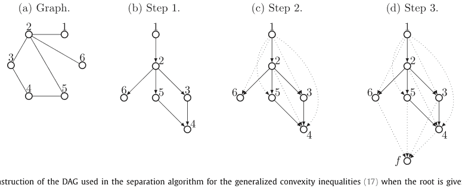

# 图测地分类问题的整数规划模型与多面体研究


# 图上地线分类的整数规划与多面体研究

Paulo H. M. Araújoᵃ,b*, Manuel Campeloᵇ, Ricardo C. Corrêaᶜ, Martine Labbéᵈ

+ ª 巴西塞亚拉联邦大学，Quixadá，巴西
ᵇ 巴西塞亚拉联邦大学，Fortaleza，巴西
ᶜ 巴西里约雅内卢罗联邦大学，Nova Iguçu，巴西
ᵈ 比时布鲁塞尔自由大学，布鲁塞尔，比利时

# 摘要

+ 关键词：
组合优化
分类
地线凸性
多面体组合
整数规划

我们研究了欧几里得空间中分类问题的离散版本，称为地线分类问题。它定义在图上，其中某些顶点最初被分配，其余的进行分类。这种顶点划分基于图上的地线凸性概念，作为多维空间欧几里得凸性的替代。我们提出了新的整数规划模型以及求解这些问题的分支界算法。我们对方法进行了多面体分析，定义了不等式和分离算法。最后，我们运行了实验，通过经典的欧几里得分类求解方法评估所提方法的计算效率和分类准确性。

# 1. 引言

一种监督学习分类背景下的分类问题方法。它由具有数值特征的方法组成，表现为 ℝᵈ 中的彩色点，其中 d ≥ 1。目标是将点分配给由中心表示的类。该方法旨在通过此类空间中不相交的凸集对自然样本进行分类，使得每个集合中的所有点具有相同的颜色（集合的颜色）。颜色偏离其集合颜色的样本点是离群值。这种使用连续优化方法（包括线性性和二次规划）的方法近年来得到了发展（参见例如 Cortes & Vargas (1995), Fanios & Hansson (1998) 等）。正如 Bertsimas & Shimida (2017), Xu & Papageorgiou (2009) 所示，典型的求解方法用于确定每类剩余样本的哪些凸包是分离的。然后，它们同时选择最分离两个类的项（例如，通过最大化两类最近点与超平面之间的距离）。

在 Araújo, Corrêa, Labbé (2019) 中引入了一种分类问题的新变体，在输入参数的几个方面与欧几里得分类不同。这种变体可以被视为空间被无向图替换时的离散版本。同样，该方法基于离散与连续方法之间的凸性。这种对应关系通过顶点集和顶点之间的距离在地线分类建立。根据凸性的概念，Araújo 等人 (2019) 定义了地线分类问题 (GCP)，具有以下特征：

与欧几里得情况不同（实例由任意超平面和平点集定义），GCP 的实例由一个任意的（无权且连通的）图 `G=(V, E)` 和一个代表 `V` 子集的集合描述。宇宙 `U` 是图的顶点集。与欧几里得情况相比，GCP 中的每个对象通过与其他对象的二值相似性表征，这些相似性由边 `E` 表示。而在欧几里得公式中度量空间仅取决于 `d`，但在 GCP 中它

* 通讯作者

邮箱地址：`pmanuel.aroajo@ufc.br` (P.H. Araújo), `manuelcampelo@ufc.br` (M. Campelo), `martine.labbed@ubc.be` (M. Labbé).

## (a) 欧几里得分类

线上的点除离群值外归类为红色。

## (b) 图分类

线下的点除离群值外归类为蓝色。（img/bdfe0fc633366a0ca165e70bee846a49_1.png）

## 2. 顶点的存在性

第一种取决于 `W`。在地线凸性中，`V` 的子集不是有限的。

## 3. 离群值的数量

`Gcp` 的目标是将顶点分类。欧几里得分类问题是将欧几里得空间划分为类。地线分类问题旨在将“空间”分为两类。

## 点视图的应用

欧几里得分类问题是将欧几里得空间划分为类。反之，地线分类问题旨在将“空间”分为两个（凸）子空间。

## 地线划分与主要贡献

我们在文中引入了 2-GCP 地线分类问题 (2-GCP)(Aterrato et al., 2019)，该问题提出了基于聚类算法公式化的结果。与欧几里得情况共享的属性是，解可以在两个凸集合的基础上构建，每个类对应一个。某些顶点仍未被认领（即未

（被凸包覆盖）取决于相似性图（如果它不包含任何凸凸划分，Dan-Lourado, Ševčič, 2011）或初始覆盖的顶点集合。第二个目标是对未覆盖顶点的分类，这需要在其他优化准则上进行。我们定义了双目标策略。

我们提出了两个用于 2-GSP（具有两个类别的 GSP）的整数线性规划（ILP），并带有分离不等式和分支定界算法的建模。第一个 ILP 使用多项式数量的约束对问题建模，第二个是具有超过多项式数量约束的扩展表述。第一个模型的一个有趣特点是它将 2-GSP 表达为一个线性规划问题。通过对真实实例进行数值实验，以评估所选特征在分支定界算法中的潜力。在这些实验中，在大规模下，我们使用第二种启发式方法来处理未覆盖的顶点（Arajo et al., 2019）。实验结果还提供了所得解质量的一些性能指标。

对与各种表述相关的多面体进行了详细分析，以建立它们的属性。特别是，我们证明了每个表述的一个面（facets）比另一个要强得多，正如 Corrê 等人 (2019) 针对单类情况证明的对应部分那样样。另一方面，其中一个源于图问题的特定属性。分类问题是不同的，结构的强度对于设计求解方法可能可能好得多。随后，还讨论了问题之间的差异。

**相关问题**。在图文献方面，GSP（以及 GSP CP）可以与广泛的图划分问题相关。例如，顶点划分问题涉及将图划分为两个集合（`$V_1, V_2$`），使得 `$V_1$` 和 `$V_2$` 之间的任何路径都经过 `$S$`。目标是最小化受某些值限制的集合 `$V_1$` 和 `$V_2$` 的大小。相比之下，GSP 解决的问题是每个顶点都寻找通往并返回离群点的最短路径。OUTSP 已被广泛研究。特别是，Balanas 和 Sousa (2008, 2009) 中提出了 GSP 的各种变体，多商品相关的树划分问题（MRTMSP）通过将图划分为 `k` 个不交集（`$V_1, ..., V_k$`）来解决，使得每个 `$V_i$` 有一个区分特征，且不同集合之间的任意两个顶点至少被隔开 `d`（Mahjoubi, Moutin, 2019）。Cornaaz 等人 (2019) 也出现在我们的结果中——特别是最短路径通向引用参考文献提到的锚点图的离群点，星形树也出现在我们的背景中。在这种情况下，我们可以从将颜色数量切换到丰富的图中获益，使得每种颜色连接一个连通子图。在树的情况下，这意味着两个顶点之间的（最短）路径是唯一的。对于 GSP，相似性约束类似于 Lima (Karp & Wakabayashi, 2014) 中用于建模 CRP 的约束，CRP 也出现在我们为 GSP 提出的一种 ILP 表述中。这些是我们希望建模团划分问题（Grötsch & Wakabayashi, 1990）的问题实例。

值得注意的是 GSP 与寻找最大直径为 `d` 的图划分问题之间存在自然联系。对于 `d=2`，正如 Complete 等人 (2017; Buzatu & Catarcius, 2015) 所证明的，这意味着某些图无法被覆盖或划分为 `k` 个集合。此外，对于 `d > 2`，该问题是 NP-hard 的。对于 GSP 也是如此。另一方面，GSP 可以看是非图复杂度问题与数学规划中众知的集合覆盖问题的结合。

**论文结构**。第 2 节介绍了测地线 2-GSP 分割问题的生成，与问题相关的 ILP 表述在第 3 和第 4 节中研究。第 5 节给出实验结果，第 6 节评估了每种计算方法的性能。我们使用了生成的实例以及源自真实数据（社交网络案例）的实例，以便我们的方法与已知方法进行比较。最后，我们在第 7 节提出了结论和未来工作方向。参考文献、图论、线性代数、多面体组合、编程的结果以及 Nemhauser & Wolsey (1988) 中使用的分支定界法。

# 2. 测地线分类与分割问题

### 2.1. 预备

我们遵循 Bondy & Murty (2014) 中图论中的基本概念和术语。图 `G=(V, E)` 中顶点 `u` 和 `v` 之间的路径是顶点序列 `p=(v_0, v_1, ..., v_k)`，其中 `v_0=u, v_k=v`，且对于所有的 `i=1, ..., k`，`(v_{i-1}, v_i) \in E`。路径的长度为 `k`。`u` 和 `v` 之间的最短路径记为 `d(u, v)`，`u` 和 `v` 之间的距离是它们之间最短路径的长度。

在本节中，我们根据测地分类分类了构成基础的不同类型的 2-GSP。

- (a) `S={v_1, v_2, v_3, v_4, v_5, v_6, v_7, v_8}`
- (b) `D^1[S]={v_1, v_2, v_3, v_4, v_5, v_6, v_7, v_8}`
- (c) `D^2[S]={v_1, v_2, v_3, v_4, v_5, v_6, v_7, v_8}`
- (d) `D^3[S]={v_1, v_2, v_3, v_4, v_5, v_6, v_7, v_8}`

一个线性不可划分的 `(S,T)` 如果 `(S \setminus T)` 或 `(S, T \setminus S)` 是线性可分的，则被称为极的。如果 `S=T`，那么该 `(S \setminus S, S)` 是线性可分的。这并不是极的，但它特别有用且满足约束 (2)-(3)。实际上，在第 3.4 节中，我们定义了这些约束的充分条件。

到目前，我们刻画了线性不可分集。在实验中，我们使用一种简单的启发式方法来处理此类情况并获得 2-GSP 的解。在 2-GSP 中，有两个框架值得考虑。首先，我们观察到每个实例都有解，因为我们可以将某一类所有的分类顶点视为备选方案。由于顶点以及顶点 `v_i(H_{A_i}) \cup H(A_i)`，类并不一定定义凸集，且 `H(A_i)` 不是顶点 `V` 的覆盖。

# 3. 2-GSP 的集合覆盖

### 3.1. IL 公式

在本节中，我们将 2-GSP 形式化为一个集合覆盖问题：

```
$\min [\sum c_i y_i \text{ s.t. } Ay \ge 1] \quad (1)$
```

其中 `A` 是一个 `a-1` 矩阵，`c` 是一个向量。对于任何二进制矩阵 `A`，它不是 NP-hard 的 (Karp, 1972)，有效不等式和面定义属性可以在 Sanchez-García, Wolkowicz & Virot (1998) 中找到。对于 2-GSP 问题，如果 `i` 是备选方案，我们定义 `y_i=1`，否则 `y_i=0`。然后用 `k(i) \in E(R)` 和 `h(i) \in E(B)` 分别表示顶点 `i` 的类和对立类。因此，`A` 对应于以下约束：

- `$\sum_{j \in B_i} y_j \ge 1, \forall i \in V_S; \quad (2)$`
- `$\sum_{j \in A_i} y_j \ge 1, \forall i \in V_T; \quad |S \cap T| \neq \emptyset. \quad (3)$`

该公式被称为 IL。约束 (2) 指 (C1) 和 (C2)，而约束 (3) 指如果 `(S,T)` 是线性不可划分的，那么 `S` 或 `T` 至少有一个是备选方案。

## 命题 2. 如果 (2) 和 (3) 定义了 2-GSP 的可行解。

设 `y^*` 为 (2) 的解。对于 `i \in R`，定义 `A_i = {j \mid y_j^*=1}`。我们想要证明 `A_i` 满足 (C1)–(C3)。假设条件 (C1) 被违反，对于所有 `i \in J_A, y_i=0` 且 `A_i \cap H(A) = \emptyset`。通过假设 (C3) 不成立可以推导出矛盾。如果条件 (C2) 不成立，则 `S \subseteq A_i`。相反，令 `y \in S`，使得当 `i \in A_i` 时 `y_i=1`，否则 `y_i=0`。那么存在 `v \in S` 和 `v \in T` 使得 `v \in H(A_i)`。条件 (C1) 成立，`A_i \neq V_{Other}`。否则，如果 (C2) 不成立，则 `S \subseteq A_i`。利用 (2)，我们得到 `y` 在 `V_S` 和 `V_T` 上的极解，使得 `|S \cap T| \neq \emptyset`。考虑相应的约束 (3)。根据 (C3) 得 `S \subseteq A_i` 或 `T \cap A_i \neq \emptyset`，这使得约束被满足。

观察到 `(S,T)` 在 (2) 中是线性不可划分的，在 (3) 中线性不可划分的。因此，不等式 (2)-(3) 是有效不等式的一部分：

- `$\sum_{j \in S} y_j \ge 1. \quad (S,T)$ 线性不可划分。\quad (4)$`

## 命题 3. 线性不可划分的 `(S,T)` 是极的，当且仅当满足以下条件之一：

- (a) `S` 和 `T` 是不可划分的，对于所有 `u \in T`；
- (b) `T` 和 `H(u)` 是不可划分的，对于所有 `u \in S`；
- (c) `H(S) \cap T \neq \emptyset`；
- (d) `H(T) \cap S = \emptyset`。

证明。假设 (a) 不成立。那么对于每个 `u \in T，$S$` 和 `$H(u)$` 是不可划分的。最后，满足 (C1)–(C3)，`(S,T)` 是线性不可划分的。现在假设 `u \in S` 且 `u \in T`。那么，如果 `|S \setminus u| \neq \emptyset` 且 `|T \setminus u| \neq \emptyset` 且 `|S \setminus u| \cap T \neq \emptyset` 且 `|T \setminus u| \cap S \neq \emptyset`，则 `(S,T)` 是不可划分的。相反，由于 `(S,T)` 是极的。那么，对于每个 `u \in S`，`(S,T)` 是不可划分的。如果 `|S \setminus u| \cap T = \emptyset` 且 `|T \setminus u| \cap S = \emptyset`，则 `(S,T)` 不是极的。假设不成立，则可以找到一个解。首先假设 `S \cap T \neq \emptyset`。那么满足 (S) 和 (2)。由于 `(S,T)` 是线性不可划分的，因此对于每个 `u \in S`，我们可以得出……

### 3.2. 多形体

在本节中，我们根据 IL 公式所得的多形体。对于 `A_i = (2-3)`，我们将使用来自 Balas & Johnson (2002) 的结果。我们展示了一种替代方案的方法。在这里，我们将使用 1 表示单位向量，用 `e^i` 表示第 `i` 个单位向量。

## 命题 4. 如果不可划分

证明。令 `n` 为 `n-1` 个独立点 `$\Phi^1$` 和 `$\Phi^i$`，对于所有 `i \in V`。我们证明 `n-1` 个点满足 (1) 和 (2)，并且对于 (3)，令 `y \in V_S` 且 `y \in V_T` 使得 `i \cap H(S) = \emptyset`。根据定义，`n` 是不可划分的 `(S,T)`。那么，对于每个 `j \in S`，使得 `h(j) \neq \emptyset`，且 `e^j=1`，这意味着满足 (4) 不可划分。证明 4 中的解允许我们展示 `P_i` 的面。

## 命题 5. 如果 `v \in V_B，$y_i \ge 0$` 和 `$y_i \ge 1$` 是面定义的。

证明。令 `v \in V_B`，使得 `y_i \ge 1` 包含备选点 1 和 `$\Phi^j$`，对于所有 `j \in V \setminus \{i\}`。我们定义：


**图 4.** `N`-集不等式的示例。根据定理 9 定义的面结构。S 和 T 由蓝色圆圈和红色正方形给出。蛇形图表示它们端点之间的最短路径。（颜色请参考本文的网页版。）

`y_j \ge 0` 包含仿射独立点 `e^k` 和 `e^l`，对于所有 `j \in V \setminus \{i\}`。再次，Balas & Ng (1989) 证明了以下结果，我们给出一个替代方案。

**命题 6. *如果 `$\pi$` 是 `$P_S$` 的一个面，则对于所有 `i \in S,\pi \cdot y \ge \pi_i y_i,\pi_i > 0$` 且 `$\pi \ge 0$`。***

令 `$\pi'$`。如果 `$\pi' \cdot y \ge \pi'_i y_i$` 派自 `y_i \ge 1`，则面 `F = {y \in P_S \mid \pi' \cdot y = \pi'_i y_i}` 包含一个 `$\hat{y}_i = 0$` 的点。由于 `$\hat{y} \in P_S$`，我们得到 `$\pi' \cdot \hat{y} \ge \pi'_i \hat{y}_i = 0$`，因此 `$\pi' \ge 0$`。当 `$\pi'_i = 1$` 时，`F` 包含一个 `$\hat{y}_i = 1$` 的点。那么，`$\tilde{\pi} = \pi' - \pi'_i e_i$`。

### 3.3. `N`-集不等式

令 `S \subseteq V` 为线性可分。我们根据 Corrà 等人 (2010) 定义 `N`-集，当 `i \in N(S,T)` 时 `y_i=0`。我们观察到 `S \cap T` 是线性可分的，且当 `i \in N(S,T)` 时 `y_i=0`。`N`-集不等式为：

`$\sum_{j \in S} y_j \ge 1. \quad (S,T)$ 线性不可划分。\quad (4)$`

如果 `S \cap T` 不空，则 `(S,T)` 是线性可分的。如果 `S \cap T` 不空，则 `(S,T)` 是一个解。

## 命题 7. 如果 `S \subseteq V_T`，线性可分。

`N`-集不等式为：


$\sum_{j \in S} y_j \ge 1. \quad (S,T)$ 线性不可划分。\quad (4)$

令 $y \in S$，使得当 $i \in A_i$ 时 $y_i=1$，否则 $y_i=0$。那么存在 $v \in S$ 和 $v \in T$ 使得 $v \in H(A_i)$。条件 `(C1)` 成立，`A_i \neq V_{Other}`。否则，如果 `(C2)` 不成立，则 `S \subseteq A_i`。利用 `(2)`，我们得到 `y` 在 `V_S` 和 `V_T` 上的极解，使得 `|S \cap T| \neq \emptyset`。考虑相应的约束 `(3)`。根据 `(C3)` 得 `S \subseteq A_i` 或 `T \cap A_i \neq \emptyset`，这使得约束被满足。

分为两种情况。首先，设 `i, j \in V_S, K \neq i`。如果 `i \neq j`，则存在两个 `N`-集 `N_i` 和 `N_j`，使得 `N_i \in J_K` 且 `N_j \in J_K`。根据命题 8，我们有 `y_i = y_j = 1`。因此，这两个解在变量 `y_i` 和 `y_j` 上提供了唯一标识，所以

同样，`d` 中的结构提供了一个 `|S \cap T| = 2` 的类型 `(3)` 不等式，该不等式满足强条件（条件 `H[S] \cap H[T] \cap V_K = \emptyset`）。具体来说，它可以写为：

```
$y_i + y_j - y_k \ge 1$.
```

其次，设 `i, j \in V` 使得 `v_i, v_j \neq S`。如果 `i \neq j`，则 `C(T)` 中至少有一个邻居（条件 `(F1)`），这确保了 `y_i = y_j`。然而，如果其中一个是 `C(T)` 中的顶点，则 `y_i = 1, y_j = 0`（此时 `i` 是一个 `N`-集）。该论证确保了 `S(T)` 中存在一个 `N`-集 `N`，使得 `j \in N`。命题 8 意味着 `y_j = 1` 且 `y_i \ge 0`。因此，我们有 `y_i + y_j \ge 1`。

```
$|v_i, v_j\| = [v_i, v_j] \subseteq S$ 使得 $D[v_i, v_j] \cap W \neq \emptyset$
$D[v_i, v_j] \cap W = D[v_i, v_j] \cap [v_i', v_j'] = \emptyset$
```

(7)

最后，设 `i \in V_S`。根据条件 `(F2)`，设 `N` 为一个使得 `(S \cup \{i\}, T)` 线性独立的集合。最后一个条件意味着 `y_i = 0` 是可行的。由于 `N` 是一个 `N`-集，命题 8 意味着 `y_i = 0` 且 `y_j \ge 0`。因此，我们得到一个解 `y_i = 0`。这同样确保了对于所有 `i \in V_S`，`y_i = 0` 的唯一性。

### 3.4. 定义非最小 N-不等式

某些 `N`-不等式可能不是最小的。在这种情况下，我们定义了非最小 `N`-不等式。

在本节的剩余部分中，我们将分析非最小 `N`-不等式，它们与 ILP 规划公式的约束有所不同。第一个是图 4c 中的秩-1 弦不等式（Chordal inequality）。它是 Araujo [2005] 中公式面定义不等式（facet-defining inequality）的对应项。

已知所有的 `N`-不等式全都是最小的，除了 [2014] 中 (2.1)-(2.2) 列出的那些。如第 3 节所述，我们通过线性不可分对来定义它们。从上一节可以得出，由线性不可分对给出的精确 `N`-不等式是最小的。在这种情况下，我们可以通过定理 9 生成其充分必要条件：

- 推论 10。由线性不可分对 `(S, T \subseteq V)` 定义的 `N`-不等式是面定义的，当且仅当 `S` 和 `T` 不相交时。

1. 对于每个 `i, j \in V_S`，存在 `k \in V_S` 使得 `(S \cup \{i\}, T)` 和 `(S \cup \{j\}, T)` 线性独立。`(S \cup \{i, j\}, T \setminus \{i, j\}) = \emptyset`。

2. 对于每个 `i \in V_S`，存在 `k \in V_S` 使得 `(S \cup \{i\}, T)` 是一个 `N`-集且 `(S \cup \{k\}, T)` 线性独立。该不等式的证明见 [2016]，面定义属性的证明见 [2016]。

```
$y_i + y_j - y_k \ge 1$

(8)
```

一个 `N`-不等式对于 [此处] 是面定义的

结论中还剩下两种最终情况，广义 `C_4` 不等式值得注意。这源于欧几里得图中无法发生的无向测地连接的几何结构。此外，还有针对 3 路径（在 `w, v, u` 中）定义的用于非最小 `N`-不等式的 [1]-类弦的约束。

`N`-不等式的结构在图 4c 和 4d 中给出，将在下文中讨论。

证明。首先`(S, T)` 是面定义的。由于 `S` 是最小的，对于所有 `i \in K`，`y_i^* = 0` 且 `S` 遵循 `(F1), (F3)`。这意味着 `(F2)`。对于 `(S, T)` 的 `N`-不等式是面定义的。

命题 12。设 `K \in (R, R)`，`S \subseteq V_K，|S| \ge 2` 且 `i, j \in V_S` 使得对于所有 `i \in S，j \in H[i]`。那么，以下不等式为：

```
$y_i + y_j - y_k \ge 1$

(9)
```

由于 `(S, T)` 是面定义的，`(S, T)` 是线性不可分的。如果 `i, j \in V_S`，则该 `N`-不等式是最小的。

`v_i^* = \min \{n_i \mid n \in N(S, T), n \in N\} = 2`

由于 `(S, T)` 是线性不可分的且 `i, j \in V_S`，则该 `N`-不等式是最小的。

$\sum y_j \ge 2$ 对于 `P_i` 有效。该不等式在 `y_i \ge 1` 时对于 `(S, T)` 的 `N`-不等式成立，因此它没有定义 `P` 的面。

一个 `N`-不等式对于 `P` 是面定义的，如果如图 4 所示，两种特殊的 `N`-不等式可以在多项式时间内被分离。图 4a 中的结构在 `|S| \ge 2` 且 `H[S]` 被替换时是某种特殊情况。一般而言，从变量角度定义：

```
$y_i + y_j - y_k \ge 1$，对于所有 $i, j \in V_S$
```

下方的结构在 4e。

**图 5.** 交替路径（Alternating path）导致不等式 $\sum (y_i+y_k) \ge 2$（命题 14）。证明。为了验证这一点，我们对 `|T| = |S|-1` 使用归纳法。在 [1] 中，不等式是完全相同的，因此是的。设 `T` 为交替路径，`S = \{i_1, i_2, \dots, i_\ell\}` 且 `T = \{j_1, j_2, \dots, j_\ell\}`，通过以下序列定义：

- `(i_{k-1}) + (i_k) \ge \sum_{m=1}^{k-1} (y_{i_m}+y_{j_m}) - y_k`;

- `(i_k) + (i_{k+1}) \ge \sum_{m=1}^{k} (y_{i_m}+y_{j_m}) - y_{k+1}`;

- `(i_k) + (i_{k+1}) \ge y_k+y_{k+1}`

通过求加这三个不等式并 `y_0=0`，得到期望的不等式 (11)，这是正确的。

命题 13。设 `K \in (R, R)`，`S \subseteq V_S, T` 是一个线性不可分对，`|T| \ge 2，|S| = |T|` 且 `S_1 \subseteq V_S, T_1` 是两条路径。此外，假设满足以下条件：

- (a) 存在 `u \in V_S, v \in V_T`，使得 `u` 是 `S_1` 的端点，`v` 是 `T_1` 的端点；
- (b) `m_1, m_2` 在 `H[v]` 中连通，对于所有 `v \in V_T` 或 `v \in V_S` 在 `T_1` 中。

```
$(|T|-1)\sum_{i \in S} y_i - (|S|-1)\sum_{j \in T} y_j \quad (10)$
```

那么，不等式 (10) 是 `P(S,T)` 的一个面。证明。为了证明这一点，我们观察到对于任何 `S, T`，`v \in V_S, w \in T_2`$(u \vee v)$ 是一个不可分的对。

### 4.2. 多面体

我们讨论 `P_n` 的一些结构性质，其中定义 `P_n = \{x \in \mathbb{R}^{2n} : \sum_{i=1}^n (x_i + x_{i+n}) = 1\}`。令 `\mathbf{v}_i = [V_i]`，通过添加 `\mathbf{e}_i` 和 `\mathbf{e}'_i` 表示 `\mathbb{R}^{2n}` 中的单位向量 `z`：

1. `y_i \le 1`，对于所有 `i \in V_{ap}`，
2. `z_{i,j} \ge 0`，对于所有 `i, j \in [K]`。

为了展示其他定义边界不等式，我们在下一节中需要以下内容。令 `S` 为顶点集合，`V' = V \setminus S`。称称 `G(S)` 是 `l'`-可排序的，如果 `V'` 中的顶点按照 `v'_1, v'_2, \dots, v'_{|V'|}` 排序，且满足 `U(v'_i) \subseteq U(v'_{i+1} \dots v'_{|V'|})`。粗俗来说，算子 D 可以沿着 `V'` 的顶点进行回归。

这种表述表示为 `LP2`。我们证明其等式模型条件 `(C1)–(C3)` 和 `(12)–(15)` 与 `LP2` 的正确性相关。

**命题 15。** 如果 `y_i + y_j = 1` `(C3)` 且 `f_i = f_j = 1` `(B2)` 并 `z_{i,j} = 1` `(15)`，则 `f_{i,j} = f_i`。

*证明。* 如果 `y_i + y_j = 1`（即 `V_i \cap V_j = \emptyset`），则对于 `k \in [K]`。根据命题 2 以及 `A_k` 和条件 `(C1)–(C3)` 显示，如果 `y_i = y_j = 1` `(B2)`，则对于所有 `k \in [K]`，如果 `y_i = 1`（即 `V_i \cap V_k = \emptyset`），则 `y_k = 1`。如果 `y_i \neq 1`，则 `y_i = 0`，且如果 `y_k = 1`（即 `V_i \cap V_k = \emptyset`），则 `f_i = 0` 或 `\mu_{i,k} = 0`。同样，如果 `y_i = y_j = 0`，则 `\mu_{i,k} = \mu_{j,k} = 0`。那么，不等式 `w_{i,k}` 和 `w_{j,k}` 之间的差为 `\mu_{i,k} - \mu_{j,k} = 0`。

**命题 17。** 下列不等式是 `P_n` 的定义边界：

根据命题 15，第 1 节描述的参数的所有 `y_i` 对于 `P_2` 也是有效的。然而，对于边界约束，边界条件并没有直接转移到 `P_2`。在本节的剩余部分，我们将展示 `LP2` 边界不等式的面。一次处理更多的仿射不等式。我们证明以下情况不会发生：对于 `i \in U_u` 或 `j \in U_v`，如果 `V_i \cap V_j \neq \emptyset` 使得 `U(i) \subseteq U(j)`。在图 2a 中，如果 `i` 是 `(k)`-可排序的，则对于所有 `j > i`，`V_i \cap V_j = \emptyset`。另一方面，我们的目标是 D 进展到顺序 `v_u, \dots, v_v`。

*证明。* 令 `k \in [K]`  `V_f = \{j : y_j = 1\}`。如果 `i, j \notin V_f`（即 `y_i=0, y_j=0`），则 `z_{i,j} = 1`。如果 `i \in V_f` 和 `j \notin V_f` 其中之一，则 `z_{i,j} = 0`。如果 `i, j \in V_f`，则 `z_{i,j} = 1`。证明对于所有 `k \in [K]` 使得 `V_i \cap V_k \neq \emptyset` 且 `V_j \cap V_k \neq \emptyset` 时 `\mu_{i,k} = \mu_{j,k} = \pi` 是充分的。证明对于所有 `k \in [K]` 使得 `V_i \cap V_k = \emptyset` 且 `V_j \cap V_k = \emptyset` 时 `\mu_{i,k} = 0`。

对于所有 `k \in [V]`，`\mu_{i,k} = 0`。根据假设，存在 `V` 的排序 `v_1, \dots, v_{|V|}` 使得对于 `i < |V|`，`U(v_i) \subseteq U(v_{i+1})`。利用这一点，我们对 `k` 使用归纳法，证明对于所有 `k \in [K]` 使得 `V_i \cap V_k = \emptyset` 且 `V_j \cap V_k = \emptyset` 时，`\mu_{i,k} = \mu_{j,k} = 0`。对于所有 `j \in [V]` `\mu_{i,j} = 0`。如果 `y` 不是 `(k)`-可排序的，则存在 `i, j, l \in [V]` 使得 `U(i) \subseteq U(l)` 且 `U(l) \subseteq U(j)` 但 `i < l < j`。

**命题 16。** `P_n` 是定义边界。

*证明。* 考虑不等式 `x_i + x_{i+n} = 1`（对于 `i \in [n]`）和 `z_{i,i+n} = 1`（对于 `i \in [n]`）。1. 对于所有 `k \in [B]` 和 `k \in [R]`，它们满足等式 `y_i + y_{i+n} = \pi_k`，其中 `\pi` 在 `(\mathbb{R}^n)` 上。2. 证明 `w_{i,k}` 和 `w_{j,k}` 满足相同的等式 `\mu_{i,k} = \mu_{j,k}` 是充分的。如果不等式 `w_{i,k}` 和 `w_{j,k}` 之间的差为 `\mu_{i,k} - \mu_{j,k} = 0`。如果 `y` 不是 `(k)`-可排序的，则存在 `i, j, l \in [V]` 使得 `U(i) \subseteq U(l)` 且 `U(l) \subseteq U(j)` 但 `i < l < j`。现在，令 `V` 的排序 `v_1, \dots, v_{|V|}` 使得 `U(v_i) \subseteq U(v_{i+1})`，对于 `i < |V|`。

**命题 19。** `y_i + y_j = 1` `(le 1)` 是 `P_n` 的定义边界。

`(12)–(15)` 的推广将在下一节讨论。*证明。* 对于 `k \in [K]`，考虑 `n+2` 个点 `(\mathbf{e}_i, \mathbf{e}'_i)`，对于 `i \in [V]` 和 `(\mathbf{e}_j, \mathbf{e}'_j)`，对于 `j \in [V]`。

**位置 21。** 对于所有 `k \in \mathcal{B}`，它们满足等式 `y_i + y_{i+n} = \pi_k`，对于 `\pi` 在 `(\mathbb{R}^n)` 上。2. 证明 `w_{i,k}` 和 `w_{j,k}` 满足相同的等式 `\mu_{i,k} = \mu_{j,k}` 是充分的。如果 `y_i + y_j = 1` `(C3)` 且 `f_i = f_j = 1` `(B2)` 并 `z_{i,j} = 1` `(15)`，则 `f_{i,j} = f_i`。

**表 1**

命题 23 证明中的情况。

| 情况 | F 中的点 |
| :--- | :--- |
| 对于所有 `i \in V'`, `\mu_{K,i} = 0` | 对 `k` 进行归纳 `<(\sum_{i \in V'} \mu_{K,i} = 1, \sum_{i \in V'} \mu_{L,i} = 1)` `<(\{e'\}, \{e' + \ell'\})` `<(\{e'\}, \{e' + \ell'\})`, 如果 `v' \in V_C` `<(\{e'\}, (\sum_{i \in V_L} \mu_{L,i} = 1), \{e' + \ell'\})`, 如果 `v' \in V_L` `<(\{e'\}, (\sum_{i \in V_R} \mu_{R,i} = 1), \{e'\})`, 如果 `v' \in V_R` |

**命题 24.** *设 `u_1, u_2, \dots, u_t` 是包含在 `D(U, \mathcal{R})` 路径中的一个序列，其中 `u_1, u_t \in G`，且 `\{u_1, \dots, u_t\} \cap D(U, \mathcal{R}) = \emptyset`，若 `1 \le t \le t' \le \ell`，则不等式*

$\sum_{i=1}^t Z_{u_i} - \sum_{j=1}^{t'} Z_{u_j} \le 1$ (19)

对于 `P_2` 效。

*证明。* 通过反证法，假设存在整数 `n` 使得 `(y, z) \in P_2` 违反了 (20)。那么，存在 `1 \le t \le t' \le \ell`，使得对于 `j \in [t, t']`，`z_{u_i} = 0` 且 `z_{u_j} = 1`，这与 (17) 矛盾。


条件 (18) 要求，对于它们之间任意路径上的任意顶点 $u, v$，至少存在一个顶点 $w \in D(U, \mathcal{R})$。因此，该序列不能在距离 $d(w, w)$ 的奇数位置上多次出现同一个顶点 $w$。然而，根据 (8) 给 $P_i$ 的有效线性约束 $\mathcal{C}_i$ 可能会为 $P_2$ 提供无效不等式，这些不等式可能也包含 $V_C$ 中的顶点。

作为 (8) 给 $P_i$ 的线性约束 $\mathcal{C}_i$ 的对应，我们现在寻找 $P_2$ 的有效不等式，这些不等式可能也包含 $V_C$ 中的顶点。

**命题 25.** *设 $S \subseteq V_L \cup V_R$ 且 $T \subseteq V_L \cup V_R$，使得 $[S] = [T]$，$S \cap V_C = T \cap V_C = \emptyset$；则以下不等式有效：*

$\sum_{i \in S \cup V_L} (y_i + z_i) - \sum_{j \in T \cup V_R} (y_j + z_j) \le 2$。(20)

*证明。* 通过反证法，假设存在整数 $n$ 使得 $(y, z) \in P_2$ 违反了 (20)。那么我们可以假设 (20) 左侧的前两项为零，这意味着对于所有 $i \in S$，$z_i = 1$；同样，由于右侧的两个项中只有一个为空，那么必须存在某个 $j$ 使得对于 $j \in T$，$z_j = 0$；根据 (15)，如果 $j \in V_L$，则有 $z_j = 1$。那么对于所有 $j \in V_L$ 都有 $z_j = 1$，这是一种矛盾。两种情况均已证明。

值得注意的是，在这种情况下，由于变量 $y_i$ 和 $z_i$ 是变量，通过将 $i \in S \cup T$ 的 $y_i$ 替换为 `1-y_i` 并将 $z_i$ 替换为 `1-z_i` 从 (20) 推导出的不等式是有效的，因为这些顶点中的可能是离群点。如果 $S_V \subseteq V_R$，我们有一个可行解，其中 $S$ 中的一个顶点是蓝色的而 $S$ 中的其他三个顶点是红色的。因此该解将违反建议的不等式

# 5. 算法

在本节中，我们描述了分支界算法，用于解决之前节中的 2-GCP 问题并带有特定的目标函数。

对于 `ILP1` 或 `ILP2` 的有效不等式仅来自分支树的根节点。为此目的采用分离算法在本节中描述。分支界算法在实验中结合某些用于顶点分类的贪心启发式算法，以获得 2-GCP 的解。

## 5.1 目标函数

给定 2-GCP 的可行解 $(a, b)$，$V \setminus (U \cup \mathcal{R})$ 中的顶点是离群点，而在 $(H_a \cup H_b)$ 中它们被称为 $(a, b)$。离群点和未覆盖的顶点建立了 $a$ 和 $b$ 之间的关系。目标函数衡量 $V$ 偏离分离集合的程度。在实践中，有几种“标准”可以引导离群点的最小化。实验在这里考虑离群点的最小化，`ILP1` 和 `ILP2` 的目标函数使用

$\min_{i \in V} y_i$，其他评估函数在分类方面没有结果。

## 5.2 预处理

计算所有最短路径的方法是广度优先搜索（无权）或 `Floyd-Warshall` 算法（加权）。

在无权情况下，$D(h, j)$ 包含从 $h$ 到 $j$ 的所有路径。为了计算 $D(h, j)$，对于 $V$ 中的每个顶点 $h$，使用广度优先搜索。因此对于每个 $h$ 和所有 $j \in V$，更新为 $O(n+m)$。在加权情况下，我们使用 `Floyd-Warshall`，耗时 $O(n^3)$。注意 $H[S] = D[S]$ 是子集 $S$ 的核，我们迭代地更新 $W'$。在每次迭代后，对于 $D(U, v)$ 中的每对顶点 $u, v \in W$，至少有一个遵循 $W'$。该步骤重复直到 $W'$ 不发生变化。此时，我们得到 $W' = W$。$D(u)$ 可以使用 BFS 或 `Floyd-Warshall` 算法执行。

给定实例 $C$，我们计算 $H(V_i)$ 及其顶点。如果 $i$ 不属于 $H(V_i)$，可以通过约束类移除。然而，如果顶点 $i$ 不属于 $V_j$ 的凸壳但属于 $V_j$ 的凸壳，则在 `ILP2` 中固定 $z_j = 1$。我们搜索一个违反重叠集约束的线性对 $(S_i \cup V_j)$。为了这样做，通过显式计算 $(A_i, A_j)$  `ILP2` 的当前解 $y$，其中 $A_i = \{i | y_i = 0, i \in S\}$。然后我们得到：

- 如果所有 $i \in S, y_i = 0$，为了获得保持不等式有效的最小子集 $S$ 和 $T$，如 (4) 所示，我们从 $S=A_i$ 和 $T=\{i\}$ 开始。如果存在 $s$ 使得 $H[S]$ 仍然到达 $i$，则从 $S$ 中移除 $s$。该程序在 $S$ 变为最小时结束。在开始，我们从 $S=\{j\}$ 和 $T=A_j$ 开始。如果存在 $u$ 使得 $H[T]$ 仍然到达 $j$，则从 $T$ 中移除 $u$。该程序在 $S \cup T$ 最小时结束。值得注意的是，只有当 $H[S] \cap H[T] \neq \emptyset$ 时才需要验证第二类约束；否则由第一类覆盖。算法复杂度为 $O(|V|(|G|))$。处理大量约束的主要方法在算法 1 中概述。带有 $C$ 不等式的分支树松弛问题。然后迭代分离相关问题的路径约束。公式的精确解通过探索分支树获得，在违反时添加懒约束。分离算法在下一节给出：

# 算法 1：求解不等式

1. 计算所有 `D(i, j)` 集合。
2. 初始切割：通过将类顶点设置为其他，提供一个平凡解 `min|V_i|`。
3. 初始配置：通过枚举所有对子集，将所有 `C2` 不等式（使用 `D_i, D_j`）包含在初始模型中。剩余约束 (4) 设懒。
4. 部分松弛：在分支树根部，求解带有约束 (17) 和 (20) 的整数模型的线性松弛。
5. 精确模型启动：从步骤 4 之后的模型开始，添加完整性约束并通过添加 (5) 约束作为懒约束来求解 `ILP` 公式。

用于 `ILP1` 的广义 `C2` 不等式。（不等式 (8)）在生成相关问题期间，通过枚举 `V_i` 和 `V_j` 的所有 2 子集来生成。为了时间考虑，我们搜索对 $(i, j, r), (w, w')$ 使得 $w \in V_i$ 且 $w' \in V_j$。通过包含所有不等式 (8) 找到所有未违反的对对。我们发现，在主模型中使用程序通常比随机有更好的性能。

广义交替路径不等式：广义路径不等式 (11) 是 `ILP2` 的不等式约束。它们的分离可以通过节描述的方法获得。在实践中，我们观察到分离所有不等式不起作用，我们限制为分离枚举 3 路径不等式 (6)（当 $i=j$ 时 (11) 的特殊情况）。

为 `ILP2` 采用的解决方法与算法 1 类似。实际上，前三个步骤是相同的，用于将 (12-14) 模型。步骤 4 和 5 求解广义 `C2` 不等式和广义不等式。它们的分离程序如下：

# 算法 2：求解不等式

1. 计算所有 `D(i, j)` 集合。
2. 初始切割：通过将类顶点设置为其他获得一个平凡解，提供 `min|V_i|`。
3. 初始配置：通过枚举所有对子集，将所有 `C2` 不等式（使用 `D_i, D_j`）包含在初始模型中。剩余约束设为懒。
4. 部分松弛：在分支树根部，求解带有约束 (17) 和 (20) 的整数模型的线性松弛。
5. 精确模型启动：从步骤 4 之后的模型开始，添加完整性约束并通过添加 (15) 约束作为懒约束来求解 `ILP`。

用于 `ILP2` 的广义 `C2` 不等式。使用类似于广义 `C2` 生成器的程序，我们获取并存储所有不等式 (20) —使用 `D_i, D_j`。为了问题的方便，该程序现在使得每个子集都可以包含在所有对子集的枚举中。

广义凸不等式。我们为凸性不等式 (17) 开发了分离算法。



包括 $h=1$ 的情况，其对应于 (15)。该思路如下：给定 $h \in V$ 和 $K \in [B, R]$，找到一个包含在从 $h$（到任何其他 $v$）最短路径中的序列，其不等式使得左侧产生最大值。我们在 `DAG`（有向无环图）中搜索路径，该图描述了所有从 $h$ 开始的最短路径中所包含的序列。为了为给定的 $h \in V$ 创建这样一个 `DAG`，我们应用搜索（在图 7 的图中所示）。

- 1. 创建所有从 $h$ 开始的路径的 `DAG`。这可以通过类似于第 5.2 节中描述的广度优先搜索算法计算出来（图 7b）；
- 2. 计算步骤 1 中 `DAG` 的传递闭包（该 `DAG` 中从 $h$ 出的路径是包含在从 $h$ 开始的最短路径中的序列）。为此，我们再次应用该算法。
- 3. 最后，创建一个汇点 $f$，并对于每个满足 $(h, v) \in E$ 的顶点 $v$ 添加边 $(v, f)$。

对于给定的 $h, v$，得到的 `DAG` 给出。注意最短路径从 $h$ 到 $v$ 具有凸性的路径（序列）产生了一个广凸不等式 (17)。

考虑 `DAG` 中从 $h$ 到 $f$ 的具有凸性的路径，其顶点序列为 $S = (h=v_0, v_1, ..., v_k=f)$。广凸不等式 (17) 的左侧由 $S$ 和类 $K \in [B, R]$ 诱导。

$$K_{v_0,v_1} + K_{v_1,v_2} + ... + K_{v_{k-1},v_k} = K_{v_0,v_1} + K_{v_1,v_2} + ... + K_{v_{k-1},v_k} + 2K_{v_1,v_2} + ... + 2K_{v_{k-2},v_{k-1}} = K_{v_0,v_k} + 2\sum_{i=1}^{k-2} K_{v_i,v_{i+1}} \quad (22)$$

设 $\phi$ 为 $\phi$ 的泛函解。因此，为了计算 `DAG` 中的最大路径，我们为 `DAG` 的每条边分配权重 $w(u, v) = K_{u,v}$。通过计算包含弧 $(u, v)$ 的路径权重，我们根据 $u$ 是否出现在路径中或处于偶数位置，将 $w(u, v)$ 乘以 1 或 2；然而，路径的权重是其边权重（带有相应的权重）之和，这产生了 $\phi$。

我们可以通过按拓扑顺序遍历 `DAG` 并计算路径权重来确定最大权路径。我们必须注意将权重乘以 1 或 -1。如果最大路径的权重大于 0，则违反了不等式并选择该路径。

对于给定的源点 $h$，算法主要由 `Dijkstra` 算法决定，其复杂度为 $O(|V|^2 \log |V|)$，拓扑排序可以通过深度优先搜索算法在 $O(|V| + |E|)$ 的复杂度内实现。

## 计算实验

计算实验的目的（其结果在后文中报告）是评估所提算法在求解 G-QSP 实例方面的效率，并使用所提算法用于面定义不等式时对两种公式进行评估。另一方面，讨论了地线方法作为分类方法在随机实例中的质量。这些实验在配备四核处理器、8GB RAM 和 Linux 操作系统的机器上进行，使用 `C++` 语言和 `CPLEX` 软件包求解线性和整数规划问题。实例 1 和 2 的结果仅显示了主导实例以及实际所需的时间。每个实例被设置为 3600 秒。这表明相应的实例超过了时间限制。

## 随机实例

为了计算实验生成随机实例，我们首先将其分为三个参数：顶点数 $n$ 取自 $\{50, 100, 200, 500\}$，密度 $d$ 取自 $\{0.1, 0.3, 0.5\}$，$p$ 取自 $\{50\%, 80\%\}$。对于 $n, d, p$ 的每种组合，生成 10 个随机实例，总共生成 720 个实例。注意，所有顶点的类都是无用的。在第一阶段，我们生成具有 $n/2$ 个顶点的两个图 $G_a$ 和 $G_b$，直到达到目标密度。如果生成的图是不连通的，我们重复该过程。$G_a$ 和 $G_b$ 的序列 $(e_1, ..., e_k)$ 的长度被确定为 2（秒）。

### 表 2 $p = 60\%$ 随机实例的算法 1 和 2

| Instance | Diam | minDeg | maxDeg | OPT | rGap(1) | rGap(2) | r1 | r2 | T_L1 | T_L2 |
| :--- | :--- | :--- | :--- | :--- | :--- | :--- | :--- | :--- | :--- | :--- |
| n050-d50 | 14 | 1 | 26 | | 41 | 7 | 0.64 | 1.60 | | |
| n150-d10 | 8 | 2 | 30 | | 65 | 47 | 0.63 | 1.31 | | |
| n110-d50 | 8 | 5 | 11 | | 35 | 28 | 0.31 | 1.42 | | |
| n015-d75 | 7 | 5 | 19 | | 72 | 42 | 0.23 | 0.50 | | |
| n015-d35 | 11 | 2 | 23 | | 76 | 9 | 0.23 | 0.38 | | |
| n050-d55 | 18 | 4 | 24 | | 81 | 6 | 2.04 | 7.97 | | |
| n100-d100 | 10 | 9 | 14 | | 34 | 15 | 0.67 | 1.34 | | |
| n015-d75 | 7 | 4 | 16 | | 74 | 7 | 0.58 | 3.17 | | |
| n012-d125 | 17 | 32 | 10 | | 50 | 10 | 1.04 | 4.98 | | |
| n025-d125 | 25 | 8 | 43 | | 80 | 1 | 1.01 | 5.64 | | |
| n014-d95 | 5 | 39 | 48 | | 60 | 1 | 1.03 | 1.98 | | |
| n150-d75 | 9 | 22 | 16 | | 72 | 17 | 2.06 | 4.71 | | |
| n150-d150 | 14 | 32 | 14 | | 31 | 4 | 3.64 | 19.49 | | |
| n055-d225 | 22 | 52 | 24 | | 50 | 1 | 2.91 | 30.07 | | |
| n055-d145 | 45 | 41 | 52 | | 91 | 1 | 1.17 | 17.78 | | |
| n024-d145 | 6 | 70 | 43 | | 80 | 4 | 1.78 | 4.40 | | |
| n055-d75 | 10 | 31 | 36 | | 96 | 4 | 3.82 | 8.07 | | |
| n020-d100 | 20 | 41 | 12 | | 68 | 0 | 4.58 | 23.01 | | |
| n21-d150 | 30 | 36 | 14 | | 63 | 0 | 4.13 | 43.83 | | |
| n023-d65 | 56 | 84 | 24 | | 80 | 0 | 6.19 | 81.27 | | |
| n024-d145 | 55 | 78 | 96 | | 14 | 0 | 8.21 | 139.08 | | |
| n025-d75 | 26 | 26 | 20 | | 71 | 11 | 13.39 | 45.19 | | |
| n026-d125 | 12 | 42 | 20 | | 51 | 1 | 10.17 | 28.69 | | |
| n027-d125 | 25 | 54 | 24 | | 91 | 0 | 19.87 | 38.44 | | |
| n024-d225 | 55 | 74 | 70 | | 90 | 0 | 19.96 | 11.81 | | |

### 表 3

针对 p = 80% 的随机实例对比算法 1 和算法 2（单位：秒）。

| 实例 | Diam | minDeg | maxDeg | OPT | rgap(1) | bbN1 | bbN2 | T_opt | T_avg |
|---|---|---|---|---|---|---|---|---|---|
| n05d50-d805 | 14 | 1 | 7 | 4 | 25 | 78 | 7 | 0.44 | 0.56 |
| n05d10-d810 | 8 | 2 | 9 | 4 | 38 | 51 | 10 | 0.37 | 0.60 |
| n05d15-d815 | 8 | 5 | 8 | 2 | 21 | 28 | 43 | 0.27 | 0.65 |
| n05d25-d825 | 9 | 7 | 1 | 17 | 19 | 20 | 5 | 0.23 | 0.42 |
| n05d35-d835 | 11 | 5 | 22 | 2 | 0 | 0 | 1 | 0.31 | 0.61 |
| n05d45-d845 | 18 | 2 | 0 | 9 | 18 | 25 | 12 | 5 | 1.25 |
| n100d50-d8105 | 19 | 4 | 7 | 10 | 16 | 12 | 27 | 1.75 | 2.68 |
| n100d65-d1165 | 24 | 5 | 7 | 0 | 18 | 12 | 5 | 1.06 | 2.64 |
| n100d75-d1175 | 35 | 17 | 32 | 8 | 30 | 0 | 1 | 1.37 | 5.97 |
| n100d85-d1185 | 42 | 25 | 43 | 8 | 48 | 0 | 1 | 1.26 | 5.50 |
| n100d95-d1195 | 59 | 9 | 12 | 2 | 27 | 10 | 5 | 3.27 | 3.25 |
| n150d50-d1850 | 74 | 7 | 24 | 2 | 30 | 0 | 1 | 2.93 | 2.80 |
| n150d65-d1865 | 82 | 14 | 35 | 4 | 40 | 0 | 1 | 3.35 | 6.09 |
| n150d75-d1875 | 94 | 22 | 50 | 4 | 51 | 0 | 1 | 2.79 | 4.27 |


| n150d85-d1885 | 111 | 41 | 53 | 4 | 63 | 0 | 1 | 2.79 | 3.74 |
| n150d95-d1895 | 134 | 60 | 73 | 8 | 71 | 0 | 1 | 3.23 | 8.98 |
| n200d50-d2850 | 143 | 7 | 10 | 16 | 81 | 16 | 1 | 9.12 | 11.66 |
| n200d65-d2865 | 155 | 20 | 41 | 10 | 96 | 0 | 1 | 16.70 | 17.49 |
| n200d75-d2875 | 173 | 30 | 63 | 2 | 98 | 0 | 1 | 14.47 | 11.44 |
| n200d85-d2885 | 191 | 56 | 84 | 10 | 108 | 0 | 1 | 10.98 | 48.61 |
| n200d95-d2895 | 213 | 78 | 96 | 16 | 116 | 0 | 1 | 16.45 | 48.97 |
| n250d50-d3850 | 239 | 7 | 28 | 6 | 124 | 4 | 1 | 21.86 | 137.70 |
| n250d65-d3865 | 256 | 12 | 42 | 8 | 142 | 6 | 1 | 19.11 | 53.27 |
| n250d75-d3875 | 281 | 25 | 54 | 22 | 155 | 0 | 1 | 20.50 | 102.02 |
| n250d85-d3885 | 305 | 44 | 77 | 14 | 170 | 0 | 1 | 22.97 | 134.06 |
| n250d95-d3895 | 336 | 70 | 90 | 14 | 192 | 0 | 1 | 122.62 | 206.32 |
| n300d50-d4850 | 368 | 83 | 120 | 24 | 216 | 0 | 1 | 119.45 | 194.95 |
| n300d65-d4865 | 391 | 10 | 33 | 16 | 234 | 5 | 1 | 119.45 | 287.81 |
| n300d75-d4875 | 423 | 41 | 78 | 10 | 256 | 0 | 1 | 127.84 | 128.91 |
| n300d85-d4885 | 459 | 80 | 118 | 18 | 276 | 0 | 1 | 116.75 | 655.45 |
| n300d95-d4895 | 498 | 123 | 157 | 22 | 301 | 0 | 1 | 139.70 | 247.92 |
| AVERAGE | | | | | | | 3.72 | 6.36 | 87.44 |

### 表 4
ILP 的有效不等式效果。

| 算法 | 约束数量 (6) | 不等式数量 (8) | 懒约束 | 时间缩减 |
|---|---|---|---|---|
| 仅步骤 3 | 0 | 5/V | 23% | 77% |
| 仅步骤 4 | 5/V | | 71% | 63% |
| 步骤 3 和步骤 4 | 6/V | 1.5/V | 82% | 80% |

### 表 5
ILP2 的有效不等式效果。

| 算法 | 不等式数量 (17) | 不等式数量 (8) | 懒约束 | 时间缩减 |
|---|---|---|---|---|
| 仅步骤 3 | 0 | 8/V | 17% | 76% |
| 仅步骤 4, 带 (17) | 8/V | | 78% | 13% |
| 步骤 3 和步骤 4 | 6/V | 13/V | 82% | 80% |

### 表 6
每个实例的属性。

| 实例 | e | m | 密度 | minDeg | maxDeg |
|---|---|---|---|---|---|
| Parkinson | 1950 | 1097 | 50 | 18 |
| SPECT | 2677 | 1826 | 55 | 36 |

### 表 7
针对 p = 70% 的帕金森实例，算法 1、2、SVM 和 MLP 的对比。

| 实例 | $T_{Alg1}$ | $T_{Alg2}$ | $T_{MLP}$ | $Acc_{SVM}$ | $Acc_{MLP}$ |
|---|---|---|---|---|---|
| parkinson-pt-001 | 69.14 | 23.04 | 113.37 | 83.61 | 82.91 |
| parkinson-pt-002 | 64.58 | 21.90 | 120.47 | 69.87 | 70.44 |
| parkinson-pt-003 | 55.82 | 20.12 | 149.90 | 76.2 | 81.53 |
| parkinson-pt-004 | 48.01 | 18.61 | 84.56 | 70.69 | 70.92 |
| parkinson-pt-005 | 40.23 | 17.39 | 99.55 | 75.14 | 78.26 |
| parkinson-pt-006 | 37.55 | 16.58 | 106.12 | 72.48 | 72.41 |
| parkinson-pt-007 | 34.34 | 20.63 | 203.77 | 79.91 | 77.59 |
| parkinson-pt-008 | 33.56 | 19.55 | 133.33 | 75.55 | 76.55 |
| parkinson-pt-009 | 36.83 | 28.21 | 82.76 | 82.48 | 81.03 |
| spect-pt-001 | 0.16 | 0.21 | 0.23 | 72.50 | 83.75 |
| spect-pt-002 | 0.09 | 0.13 | 0.24 | 71.75 | 78.75 |
| spect-pt-003 | 0.07 | 0.12 | 0.19 | 76.25 | 81.25 |
| spect-pt-004 | 0.07 | 0.15 | 0.16 | 76.50 | 75.00 |
| spect-pt-005 | 0.07 | 0.09 | 0.14 | 62.50 | 81.32 |
| spect-pt-006 | 0.07 | 0.09 | 0.14 | 82.00 | 82.50 |
| spect-pt-007 | 0.09 | 0.17 | 0.18 | 51.25 | 78.75 |
| spect-pt-008 | 0.07 | 0.11 | 0.15 | 82.25 | 83.75 |
| spect-pt-009 | 0.07 | 0.10 | 0.23 | 87.50 | 86.25 |
| 平均 | 0.13 | 0.11 | | | |

ILP1 的根间隙约为 ILP2 根间隙的一半。确定这些间隙的下界是在步骤 4 结束时计算的。显而易见，ILP1 中的分支非常有帮助，而 ILP2 则没有那么价值。尽管如此，ILP2 执行中的平均分支节点数是 ILP1 的两倍。然而，ILP2 在分支后关闭间隙，且 CPLEX 生成的割比步骤 5 创建的间隙更大。这解释了为什么带根算法可能会获益。因此，如果我们不添加懒约束，这些潜在更大的间隙将会添加。图 8 和图 9 显示了算法 1 和 2 的运行时间随图密度的变化。对于 p = 60 和 p = 80 的图，v 值在 [50, 100, 150, 200, 250] 之间变化。结果显示算法 1 运行良好，特别是对于中等规模实例，因为在这种情况下模型约束的 U 通常较小，可以减少节点数量。25% 到 35% 之间的实例被证明是最难求解的。

## 6.2. 实际实例
为了通过实际应用测试算法，我们使用了两个数据集进行实验：帕金森实例（Litcher, McCarthy, Costello, Monge）和心脏发射断层（SPECT）图像（Kiuran, Tadis, Ogela），可从 `https://archive.org/` 获取。这些实例根据欧几里得分类问题生成，每个点代表一个待预测的点。从每个数据集中，我们得到两组 10 个实例：第一组（相应第二组）通过随机选择。考虑所有随机实例，算法 1 的平均运行时间大约是倍，这对于每个随机实例都是非常好的。然而，算法 2 在时间上表现更好，产生的平均运行时间 `T2` 远大于 `T1`。总体而言，在约束多的实例中，`T1` 优于 `T2`，变量数量更多且添加了懒约束/割除。

(a) 算法 1。
(b) 算法 2。


图 8. 运行时间密度，p = 60%。

(a) 算法 1。
(b) 算法 2。


图 9. 运行时间密度，p = 80%。

# 7. 结论
在本文中，我们研究了双类测地分类问题（由 Araijo (2019) 提出），这是测地分类中的一个新问题。提出的方法从不同角度提供了分类视角，并表现为图连通性问题与经典的集合覆盖问题的交集。

本文的主要重点是通过提供一些性能指标来完善与这些关联的算法。

# 致谢
本研究部分得到了巴西高等教育水平协调局 (CAPES) - FAPESP (2019) 以及 CNPq (合同号 37481/2019 - 3009315/2019-0/06611-102) 和 FCNP (2019) 的支持。

我们深感谢 AIU/EU 会议的组织者以及本文扩展版本的审稿人提供的他们富有见地的意见和建议，这在很大程度上帮助我们完善了工作并提高了论文的质量。

# 参考文献
- Araujo, P. H. M., Campello, M., Correa, R. C., & Labb, M. (2019). 图上的测地分类问题. Electronic Notes in Computer Science, 346, 65–72. 载于 LAGOS 2019, The Latin and American Algorithms, Graphs and Optimization LAGOS 2019。
- Araujo, P. H. M., & Campello, M. (2015). 图上的分类问题. Mestrado e Doutorado em Computação, Departamento de Ciência da Computação, Universidade Federal de Santa Catarina。
- Aronov, B., Darijo, J., Núñez-Rodríguez, Y., Rappaport, D., Serva, & Utrânia, J. (2012). 最小化线性不可分数据上线性分离器的误差. Data Mining。
- Argigas, D., Dantas, S., Correa, M. C., & Swanciflick, J. L. (2011). 图的聚类划分. Mathematical Programming, 88(1), 1–23。
- Balas, E., & Ng, S. M. (1989). 关于集合覆盖问题: I. 所有带有切割平面和不等式的面. Mathematical Programming, 41(1), 57–68。
- Balas, E., & Souza, C. C. d. (2005). 顶点划分问题：多面体研究. Mathematical Programming, 107(3), 583–608。
- Bertsimas, D., & Wolsey, M. (1998). 回归与整数优化的权衡. Operations Research, 55(2), 252–271。
- Blaum, M., Correa, R. C., Machado, J., & Lody, M. (2019). 一种双图分类问题的方法. 工作论文。
- Bundy, J. A., & Murray, S. U. R. (2008). 图论. Springer。
- Buset, K., & Carátara, S. (2005). 凸图：覆盖问题. Science。
- Campello, M., Campos, A. V., & Correa, R. C. (2008). 图分类问题的渐近行为. Journal of Machine Learning Research, 9(6), 1967–1971。
- Carreira, A., Lima, K., Mouska, P., & Wakabayashi, Y. (2015). 求解多面体问题：面与计算优化方法. Mathematical Programming, 165(1), 1–35。
- Correa, R. C., Machado, M., A. R., & Martin, S. (2019). 多终端顶点分离问题：多面体分析与分支切割法. Applied Mathematics and Optimization, 40(1), 95–115。
- Correa, R. C., Blum, M., & Lody, M. (2019). 一种用于双单类分类问题的整数规划方法. European Journal of Artificial Intelligence, 59, 1039–1050。
- Cortes, C., & Vapnik, Y. (1995). 支持向量网络. 载于 Machine Learning, 27, 271–300。
- Crosson, P. J., Wilson, A. T., Smith, M. D., Liu, V. Y., & Duncan, D. M. (2013). 主题的话及其对在线广告的影响. Journal of Marketing Research, 50(4), 591–605。
- Dumont, F. E., Souza, C. C., Reinhardt, R., & Wolsey, L. A. (1996). 节点容量图划分问题的面与不等式. Biomedical Engineering Online, 61(1), 23。
- Grötschel, M., & Wakabayashi, Y. (1995). 团团划分问题的面. Mathematical Programming, 67(1), 391–407。
- Hovy, S. (2012). Twitter 中主题建模的统计研究. 载于 SOMA ’12: 社交媒体分析会议论文 (pp. 80–88)。
- Karp, P. M. (1972). 组合问题之间的可归性 (pp. 85–103). Boston, MA: MIT Press。
- Kuran, L. A., King, J., Tadekiewicz, R., Ogiela, M., & Goodman, L. S. (2001). 自动心脏诊断的知识发现方法. Artificial Intelligence in Medical Systems, 32(1), 45–56。
- Lima, K., & Wakabayashi, Y. (2014). 凸多面体. Discrete Applied Mathematics。
- Little, A. M., McCarthy, P. E., Roberts, R. S., Stone, D. A., & Mohr, I. M. (2007). 用于语音疾病检测的面部和声学特征. Biomedical Engineering Online, 61(1), 23。
- Padberg, P., & Hammer, P. (2008). 数据挖掘与数学规划：综述, 20(1), 1–20。
- Poly, L. M. (2013). 图中的几何复杂性. New York: Springer-Verlag。
- Sánchez, J., & Santos, A. (2005). 顶点划分多面体问题：带有 {0, 1, 2} 不等式的面. Operations Research Journal, 81, 343–360。
- Xu, X., & Rodrigues, L. G. (2009). 用于数据分类的整数优化模型. Computers & Electronics in Industrial Engineering, 56(4), 1205–1215。
- Zaki, M., & Wu, J. (2014). 数据挖掘与分析：基本概念与算法. New York, NY, USA: Cambridge University Press。
