# BIRT 集成与扩展 (第3版) (Eclipse 系列)


## 第一部分 安装与部署 BIRT

### 第 1 章 介绍 BIRT 报告设计器

#### 理解 BIRT 组件

#### 理解 Eclipse BIRT 程序包

##### 关于 BIRT 构建的类型

### 第 2 章 安装 BIRT 报告设计器

#### 安装完整 Eclipse 版 BIRT 报告设计器

#### 安装 BIRT RCP 报告设计器

#### 解决安装问题

#### 在安装 BIRT 报告设计器后避免缓存冲突

#### 在启动 BIRT 报告设计器时指定 Java 虚拟机

#### 安装语言包

#### 更新 BIRT 报告设计器安装

#### 更新 BIRT RCP 报告设计器安装

### 第 3 章 安装其他 BIRT 程序包

#### 安装图表引擎

#### 安装 BIRT 数据工具平台集成

#### 安装 BIRT 演示数据库

#### 安装报告引擎

#### 安装 BIRT 示例

#### 安装 BIRT 源代码

#### 安装 BIRT Web 工具集成

### 第 4 章 将 BIRT 报告部署到应用服务器

#### 关于应用服务器

#### 关于部署到 Tomcat

#### 关于部署到其他应用服务器

#### 在应用服务器上放置 BIRT 报告查看器

#### 将 BIRT 报告查看器作为 Web 应用程序

#### 测试 BIRT 报告安装

#### 更改 BIRT 报告查看器根目录

#### 更改 BIRT 报告位置

#### 理解 BIRT 报告查看器上下文

#### 验证 Apache Tomcat 运行 BIRT 报告查看器

#### 在应用服务器上放置字体

#### 使用浏览器查看报告

#### 在 Tomcat 上使用连接池

#### 配置报告使用连接池

#### 使用 `jndi.properties` 文件

#### 在 Tomcat 上配置 JNDI 对象

## 第二部分 理解 BIRT 框架

### 第 5 章 理解 BIRT 架构

#### 理解 BIRT 集成

#### 关于 BIRT

#### 关于 BIRT 报告设计器和 BIRT RCP 报告设计器

#### 关于 BIRT 查看器

#### 关于 BIRT 引擎和服务

#### 关于设计引擎

#### 关于报告引擎

#### 关于生成服务

#### 关于演示服务

#### 关于图表引擎

#### 关于数据引擎和服务

#### 关于数据服务

#### 关于 ODA 框架

#### 关于 BIRT 报告项目的类型

#### 关于标准报告项目

#### 关于自定义项目

#### 关于图表报告项目

#### 关于报告对象模型 (ROM)

#### 关于 BIRT 文件类型

#### 关于报告设计文件

#### 关于报告文档文件

#### 关于报告库文件

#### 关于报告模板文件

#### 关于自定义 Java 应用

#### 关于自定义报告设计器

#### 关于自定义 Java 报告生成器

#### 关于 BIRT 扩展

### 第 6 章 理解报告对象模型

#### 关于 ROM 规范

#### ROM 方法

#### ROM 属性

#### ROM 槽位

#### ROM 样式

#### 关于 ROM Schema

#### 关于 `rom.def` 文件

#### 理解 ROM 元素

#### 主要 ROM 元素

#### 报告项目元素

#### 报告项目

#### 理解报告项目元素属性

#### 关于数据报告元素

## 第 3 部分 报告设计中的脚本

### 第 7 章 在报告设计中使用脚本

#### BIRT 脚本概述

#### 在 JavaScript 和 Java 之间进行选择

#### 同时使用 JavaScript 和 Java

#### 事件概述

##### 引擎任务处理

#### BIRT Web 查看器

##### BIRT 处理阶段

##### BIRT 事件类型

###### 参数事件

###### 报告设计事件

###### 数据源和数据集事件类型

###### ReportItem 事件

##### 事件顺序序列

###### 准备阶段操作

###### 生成阶段操作

#### 关于数据源和数据集事件

#### 关于数据绑定

#### 关于分页事件

##### 关于图表事件顺序

##### 关于表和列表事件顺序

##### 生成阶段的完成

#### 展示阶段操作

#### 事件顺序总结

### 第 8 章 使用 JavaScript 编写事件处理器

#### 使用 BIRT 报告设计器输入 JavaScript 事件处理器

##### 创建和使用全局变量

##### 创建和使用页面变量和脚本

##### 理解执行阶段和过程

#### 使用 `reportContext` 对象

##### 使用 `getOutputFormat`

##### 使用 `reportContext` 获取报告设计句柄

##### 在进程之间传递变量

##### 使用 `getAppContext`

##### 从 HTTP 请求对象获取信息

#### 使用 `this` 对象

##### 使用 `this` 对象的方法

##### 使用 `this` 对象设置报告项目属性

#### 使用 `row` 对象

##### 获取列信息

##### 获取并修改查询字符串

##### 更改数据源连接

##### 获取参数值

##### 确定脚本执行顺序

#### 提供 `ReportDesign.initialize` 代码

#### 提供你需要跟踪的脚本

#### 提供 `ReportDesign.afterFactory` 代码

#### 教程 1：使用 JavaScript 编写事件处理器

##### 任务 1：设计报告

##### 任务 2：在 Table 中创建计数器

##### 任务 3：条件增加计数器

##### 任务 4：显示结果

#### JavaScript 事件处理器示例

##### JavaScript `onPrepare` 示例

##### JavaScript `onCreate` 示例

##### JavaScript `onRender` 示例

##### 跨页脚本示例

##### 调用外部 JavaScript

##### 从 JavaScript 调用 Java

##### 理解 `Packages` 对象

##### 理解 `importPackage` 方法

##### 使用 Java 类

##### 放置 Java 类

##### 在 JavaScript 代码 Java 的问题

##### 调用插件中类的方法

### 第 9 章 使用 Java 编写事件处理器

#### 编写 Java 事件类

#### 定位 BIRT 事件处理器的 JAR 文件

#### 扩展适配器类

#### 让 Java 类对 BIRT 可见

#### 将事件处理器类与报告元素关联

#### BIRT Java 接口和类约定

#### 编写 Java 事件处理器

#### 使用事件处理器类

#### 使用事件处理器接口

#### 关于报告项目的 Java 事件处理器

#### 用于数据源元素的 Java 事件处理器

#### 用于数据集元素的 Java 事件处理器

#### 用于脚本化数据源元素的 Java 事件处理器

#### 用于脚本化数据集元素的 Java 事件处理器

#### 用于报告设计的 Java 事件处理器

#### 理解 BIRT 接口

#### 关于元素设计接口

#### 每个报告元素的方法

#### 关于 `IReportElement` 接口

#### 关于元素实例接口

#### 使用 `IReportContext` 接口

#### 使用 `IColumnMetaData` 接口

#### 使用 `IDataSetInstance` 接口

#### 使用 `IDataSetRow` 接口

#### 使用插件中类的方法

#### Java 事件处理器示例

#### 报告级事件

#### 报告项事件

#### Java 事件处理器

### 第 10 章 使用图表事件处理器

#### 图表事件概述

#### 理解图表上下文

#### 使用图表实例

##### 图表实例 getter 方法

##### 图表实例 setter 方法

##### 图表实例方法

##### 在事件处理器中访问图表实例

#### 理解外部上下文

#### 理解图表事件何时触发

#### 准备阶段

#### 数据绑定阶段

##### 关于 `beforeDataSet` 事件

##### 关于 `afterDataSet` 事件

#### 构建阶段

##### 关于 `beforeGeneration` 事件

##### 关于 `afterGeneration` 事件

#### 渲染阶段

##### 渲染阶段脚本事件

##### 渲染块

##### 渲染序列

##### 渲染数据点和数据点标签

##### 渲染轴

##### 渲染图例项

#### 编写 Java 图表事件处理器

#### 设置图表事件处理器项目

#### Java 图表事件处理器示例

#### 编写 JavaScript 图表事件处理器

#### 使用简化的图表 API

#### 获取图表项目实例

#### 理解 `IChart` 的子接口

## 教程 2：创建脚本数据源

### 任务 1：创建新的报告设计

### 任务 2：创建脚本数据源

### 任务 3：创建脚本数据集

#### 任务 4：编写数据源的 `open()` 和 `close()` 方法

#### 任务 5：编写数据集的 `open()` 方法

#### 任务 6：编写数据集的 `fetch()` 方法

### 任务 7：在报告布局中放置列

### 使用 Java 编写脚本数据集

### 使用 Java 对象访问数据源

### 在数据集的 `open()` 方法中执行初始化

### 在数据集的 `fetch()` 方法中获取新的一行数据

### 在数据集的 `close()` 方法中进行清理工作

### 决定你的 Java 类的放置位置

### 部署你的 Java 类

### 任务 10：在脚本数据集中使用输入和输出参数

### 使用自定义连接类创建 Web 服务的数据源

## 第 12 章：调试事件处理器

### 检查 JavaScript 表达式的语法

### 调试 JavaScript 事件处理器代码

### 调试 Java 事件处理器代码

### 调试报告执行异常

### 创建调试配置

## 教程 3：调试包含 Java 和 JavaScript 代码的报告

### 任务 1：准备调试报告

#### 任务 2：设置 JavaScript 断点

#### 任务 3：设置 Java 断点

#### 任务 4：创建调试配置

#### 任务 5：调试报告

## 第 4 部分：将 BIRT 集成到应用程序

## 第 13 章：理解 BIRT API

### 包层次结构图

### 关于 BIRT 报告引擎 API

### 创建 `ReportEngine` 实例

### 使用 BIRT 报告引擎 API

### `EngineConfig` 类

### `ReportEngine` 类

### `IReportRunnable` 接口

### `IReportDocument` 接口

### `IEngineTask` 接口

### `IGetParameterDefinitionTask` 接口

### `IDataExtractionTask` 接口

### `IRunTask` 接口

### `IRenderTask` 接口

### `IRunAndRenderTask` 接口

### 报告引擎类层次结构

### 报告引擎接口层次结构

### 关于设计引擎 API

### 使用 BIRT 设计引擎 API

### `DesignConfig` 类

### `DesignEngine` 类

### `SessionHandle` 类

### `ModuleHandle` 类

### `ReportDesignHandle` 类

### `LibraryHandle` 类

### `DesignElementHandle` 类

### 独立元素类

### 设计引擎类

### `DesignElementHandle` 层次结构

### `ReportElementHandle` 层次结构

### `ReportItemHandle` 层次结构

### `ElementDetailHandle` 层次结构

### `StructureHandle` 层次结构

### 设计引擎接口

### 关于 BIRT 图表引擎

### 使用 BIRT 图表引擎 API

### 图表引擎层次结构

### `chart.aggregate` 类和接口

### `chart.datafeed` 类和接口

### `chart.device` 类和接口

### `chart.event` 类和接口

### `chart.exception` 层次结构

### `chart.factory` 类和接口

### `chart.log` 类和接口

### `chart.model` 接口层次结构

### `chart.model.attribute` 类和接口

### `chart.model.component` 接口层次结构

### `chart.model.data` 接口层次结构

### `chart.model.layout` 接口层次结构

### `chart.model.type` 接口层次结构

### `chart.render` 类和接口

### `chart.script` 类和接口

### `chart.util` 层次结构

## 第 14 章：使用 BIRT API 进行编程

### 构建报告应用程序

### 关于开发环境

### 关于 BIRT 目录下的插件

### 关于 BIRT 目录下的库

### 关于必需的 JDBC 驱动程序

### 设置构建路径并访问 Javadoc

### 使用 API 修改报告设计

### 关于部署环境

### 从应用程序生成报告

### 设置报告引擎

### 配置 BIRT 目录

### 配置报告引擎

### 设置独立或 WAR 文件环境

### 启动平台

### 创建报告引擎

### 使用日志环境调试应用程序

### 如何使用 BIRT 日志

### 打开用于报告生成的源

### 理解 `IReportRunnable` 对象

### 理解 `IReportDocument` 对象

### 访问报告参数

### 准备生成报告

### 为运行报告设计设置参数值

### 添加到报告引擎的类路径

### 为报告设计提供外部对象

### 生成二进制报告文档

### 准备渲染格式化报告

### 设置渲染选项

### 渲染格式化输出

### 访问格式化报告

### 检查运行中的报告任务状态

### 取消运行中的报告任务

### 编写报告设计的结构

### 关于 BIRT 模型 API 能力

### 打开报告设计进行编辑

### 配置设计引擎访问设计句柄

### 使用 `IReportRunnable` 对象访问设计句柄

### 在报告设计中使用报告项

### 通过遍历槽（slot）访问报告项

### 通过名称访问报告项

### 检查报告项

### 访问报告项的属性

### 在报告设计中修改报告项

### 访问和设置复杂属性

#### 理解属性结构对象

### 向报告设计添加报告项

### 使用 API 访问数据源和数据集

#### 关于数据源类

#### 关于数据集类

### 通过程序化使用数据集

### 保存报告设计

### 创建报告设计

# 第 15 章 使用 BIRT 图表 API 编程

### 关于图表引擎内容

### 关于图表应用的环境

### 配置图表引擎运行时

### 验证图表应用的环境

### 关于图表 API 和图表结构

### 关于图表视觉组件

### 关于图表数据

#### 理解静态数据

#### 理解动态数据

### 使用图表 API 创建新图表

### 修改图表属性

#### 理解简单和复杂属性

#### 设置图区域属性

#### 设置图例属性

#### 设置轴属性

### 使用系列

#### 向图表添加系列

#### 创建分类系列

#### 创建正交系列

#### 设置系列属性

#### 将数据与系列关联

#### 向图表添加系列定义

#### 设置图表的默认聚合

#### 修改次要值系列的聚合

### 添加图表事件处理器

#### 添加 Java 图表事件处理器

#### 添加 JavaScript 图表事件处理器

### 在报告设计中使用图表项

#### 访问现有的图表项

#### 创建新的图表项

#### 获取设计元素工厂对象

#### 设置图表类型和子类型

#### 创建示例数据

#### 获取扩展句柄对象

#### 将报告项设置为图表

#### 准备数据集和数据列

#### 将图表绑定到数据集

#### 设置其他报告项属性

#### 将新图表添加到报告设计

#### 在添加图表后保存报告设计

### 整合一切

### 在 Swing 应用中使用 BIRT 图表 API

### 理解图表编程示例

#### `api.data`

#### DataCharts

#### `GroupOnSeries`

#### `GroupOnYAxis`

#### `api.data.autobinding`

#### `api.format`

#### `api.interactivity`

#### `api.pdf`

#### `api.preference`

#### `api.processor`

#### `api.script`


### `api.viewer`

### `Chart3DViewer`

### `CurveFittingViewer`

### `DialChartViewer`

### `SwingChartViewer`

### `SWTChartViewer`

### builder我是由深度求索（DeepSeek）研发的 deepseek-v4-flash-0731 智能大模型。### `radar.ui`

### `report.api`

### `MeterChartExample`

### `SalesReport`

### `StockReport`

### `report.design`

### `report.design.script`

### view

## 第 5 部分 使用扩展框架

## 第 16 章 构建 BIRT 项目

### 关于构建 BIRT 项目

### 安装可用的 BIRT 版本

### 配置 Eclipse 以编译 BIRT 并构建 JAR 文件

### 下载并解压正确版本的 BIRT 源码

### 导入、构建和测试 BIRT 项目

### 构建新的 JAR 文件以显示 BIRT 输出

### 构建 `viewservlets.jar` 文件

### 构建 `chart-viewer.jar` 文件

## 第 17 章 扩展 BIRT

### 扩展框架概述

### 理解 BIRT 插件的结构

### 理解扩展点架构定义文件

### 理解插件清单文件（manifest）

### 理解插件运行时类

### 使用 Eclipse PDE

### 理解插件项目属性

### 理解 Eclipse PDE 工作台

### 创建插件扩展的结构

### 创建插件扩展内容

### 构建插件扩展

### 生成 Ant 构建脚本

### 测试插件扩展

### 部署扩展插件

### 创建更新站点项目

### 安装可用软件

### 下载扩展代码

## 第 18 章 开发报告项扩展

### 理解报告项扩展

### 开发示例报告项扩展

### 从 CVS 仓库下载 BIRT 源码

### 创建旋转标签报告项插件项目

### 定义旋转标签项扩展的依赖关系

### 指定旋转标签项扩展的运行时包

### 声明报告项扩展点

### 创建插件扩展内容

### 理解旋转标签报告项扩展

### `RotatedLabelItemFactoryImpl`

### `RotatedLabelUI`

### `RotatedLabelPresentationImpl`

### `GraphicsUtil`

### 了解 `RotatedLabelCategoryProviderFactory`

### 了解 `RotatedLabelGeneralPage`

## 部署和测试旋转标签报告项插件

### 部署报告项扩展

### 启动旋转标签报告项插件

## 开发高级项目项

### 定义项目项模型

### 定义项目项 UI 设计

### 定义项目项的呈现方式

### 优化项目项 UI 设计

### 使用 Image UI provider

### 使用 Figure UI Provider

### 创建一个项目项 builder

### 创建右键菜单

### 创建属性编辑器

### 将项目项绑定到数据

### 模型定义的更改

### 项目项表呈现方式的更改

### 修改项目项 UI 以支持表达式

### 在 builder 中添加数据绑定

### 在属性页中添加数据绑定

## 第 19 章 开发报告渲染扩展

### 了解报告渲染扩展

### 开发 CSV 报告渲染扩展

### 创建一个 CSV 报告渲染插件项目

### 定义 CSV 报告渲染扩展的依赖关系

### 声明 `emitters` 扩展点

### 了解示例 CSV 报告渲染扩展

### 了解 CSV 报告渲染扩展包

### 了解 `CSVReportEmitter`

### 了解 `CSVTags`

### 了解 `CSVWriter`

### 了解 `CSVRenderOption`

### 测试 CSV 报告渲染插件

### 关于 `ExecuteCSVReport` 类

### 关于报告设计的 XML 代码

### 开发 XML 报告渲染扩展

### 创建一个 XML 报告渲染插件项目

### 定义 XML 报告渲染扩展的依赖关系

### 声明 `emitters` 扩展点

### 了解示例 XML 报告渲染扩展

### 了解 XML 报告渲染扩展包

### 了解 `XMLReportEmitter`

### 了解 `XMLTags`

### 了解 `XMLFileWriter`

### 了解 `XMLRenderOption`

### 了解 `LoadExportSchema`

### 测试 XML 报告渲染插件

## 第 20 章 开发 ODA 扩展

### 了解 ODA 扩展

### 开发 CSV ODA 驱动扩展

### 关于 CSV ODA 插件

### 从 CVS 仓库下载 BIRT 源代码

### 实现 CSV ODA 驱动插件

### 了解 ODA 数据源点

### 了解 `dataSource` 扩展属性

### 了解 `ConnectionProfile` 属性

### 了解 CSV ODA 扩展的依赖关系

### 了解示例 CSV ODA 驱动扩展

### 了解 `Driver`

### 了解 `Connection`

### 了解 `Query`

### 了解 `ResultSet`

### 了解 `ResultSetMetaData`

### 了解 `DataSetMetaData`

### 了解 `CommonConstants`

### 开发 CSV ODA 用户界面扩展

### 创建一个 CSV ODA 用户界面插件项目

### 了解 ODA 数据源用户界面点

### 了解 `ConnectionProfile` 扩展点

### 了解 `propertyPages` 扩展点

### 了解 `dataSource` 扩展点

### 了解示例 CSV ODA 用户界面扩展

### 了解 `org.eclipse.birt.report.data.csv.ui.impl` 包

### 了解 `org.eclipse.birt.report.data.csv.ui.wizards` 包

### 了解 `Constants`

### 了解 `CSVFilePropertyPage`

### 了解 `CSVFileSelectionHelper`

### 了解 `CSVFileSelectionWizardPage`

### 了解 `FileSelectionPage`

### 测试 CSV ODA 用户界面插件

### 开发 Hibernate ODA 扩展

### 创建一个 Hibernate ODA 驱动插件项目

### 了解示例 Hibernate ODA 驱动扩展

### 了解 `HibernateDriver`

### 了解 `Connection`

### 了解 `DataSetMetaData`

### 了解 `Statement`

### 了解 `ResultSet`

### 了解 `HibernateUtil`

### 构建 Hibernate ODA 驱动插件

### 开发 Hibernate ODA 用户界面扩展

### 了解示例 Hibernate ODA 用户界面扩展

### 了解 `HibernatePageHelper`

### 了解 `HibernateDataSourceWizard`

### 了解 `HibernatePropertyPage`

### 了解 `HibernateHqlSelectionPage`

### 构建 Hibernate ODA 用户界面插件

### 测试 Hibernate ODA 用户界面插件

## 第 21 章 开发数据提取扩展

### 了解数据提取扩展

### 开发 XML 数据提取扩展

### 创建一个 XML 数据提取插件项目

### 定义 XML 数据提取扩展的依赖关系

### 声明数据提取扩展点

### 了解 XML 数据提取扩展

### 实现数据提取接口

### 了解 XML 文档格式

### 了解 `XMLDataExtractionImpl` 方法

### 测试数据提取扩展插件

### 关于报告设计的 XML 代码

## 第 22 章 开发片段（Fragment）

### 了解片段（Fragment）

### 开发示例片段

### 创建片段项目

### 了解示例片段

### 构建、部署和测试片段

## 第 23 章 开发图表扩展

### 关于 BIRT 图表扩展点

### 设置构建环境

### 扩展图表模型

### 创建 EMF 模型

### 完成新的 `SeriesImpl`

### 实现扩展点

### 设计时插件扩展

### 图表 UI-types 扩展点

### 序列复合扩展点

### 运行时插件扩展

### 图表模型类型扩展点

### 数据处理器扩展点

### 模型渲染器扩展点

### 调试此示例

# 术语表

# 索引

## 前言

有一种常见的误区，认为 Eclipse 项目仅仅关注为开发者提供出色的工具。实际上，人们的期望要高得多。每个 Eclipse 项目都被预期同时提供框架和可扩展的、典范的工具。正如任何尝试过考虑重用和扩展性来编写软件的人所知，这比简单地编写一个工具要困难得多。

"Exemplary"（典范的/卓越）是英语中一个具有两个含义的常用单词。在上述用法中，这两个含义都被兼顾了。Eclipse 项目提供的工具在"典范"的意义上是卓越的，因为它们提供了使用底层框架的范例。Eclipse 工具还旨在在"卓越"的意义上是典范的，因为它们非常好，并为使用它们的开发者提供了即时的实用。

自 BIRT 项目成立以来，一直致力于创建可重用的框架和可扩展的工具。本书主要关注如何扩展 BIRT 以及如何在你自己的应用程序和产品中使用 BIRT。因此，它展示了 BIRT 作为一种嵌入式报告解决方案日益成熟的价值。

作为 Eclipse 基金会的执行董事，我对 BIRT 团队自 2004 年 9 月项目启动以来取得的巨大进展感到高兴，同时也对围绕它已经发展起来的充满活力的社区感到同样高兴。当你使用 BIRT 以及书中描述的功能时，我鼓励你将你的成功经验回馈社区，并可能考虑贡献你开发的任何有趣的扩展。BIRT 网站可以在此处找到：

`http://www.eclipse.org/birt`

它包含了指向 BIRT 新闻组的链接（你可以在那里与其他 BIRT 开发者交流并分享结果），以及指向 Eclipse 安装版 Bugzilla 的链接（你可以在那里贡献你的扩展）。如果你喜欢 BIRT——我相信这本书将帮助你爱上它——请参与并做出贡献。毕竟，社区的力量是衡量任何开源项目成功的真正标准。

Mike Milinkovich

Eclipse 基金会执行董事

## 前言

### 关于本书

这是关于商业智能和报告技术两部曲丛中的第二本——《Integrating and Extending BIRT》（集成与扩展 BIRT），向编程人员介绍了 BIRT 架构和报告框架。它的伴侣书籍《BIRT: A Field Guide》（BIRT：实战指南）向报告开发者展示了如何使用 BIRT Report Designer 的图形化工具创建报告。BIRT 构建在开源 Eclipse 平台上，是一个强大的报告系统，提供了从端到端的解决方案，从创建和部署报告到将报告能力集成到企业应用程序中。

BIRT 技术让程序员能够使用脚本和 BIRT API 构建自定义报告。本书告知报告开发者如何编写可以实现以下作用的脚本：

- 定制化报告生成过程

- 在报告中加入复杂的业务逻辑

本书还告知应用程序开发者如何：

- 调试和部署报告

- 将报告能力集成到其他应用程序中

- 扩展 BIRT 功能

程序员可以使用 Eclipse 插件开发环境（PDE）创建新插件来扩展 BIRT 框架。本书提供了大量的示例，展示了如何构建插件以扩展 BIRT 框架的功能。这些示例的源代码可以在 `http://www.actuate.com/birt/contributions` 下载。

本书讨论的主题包括：

- 安装和部署 BIRT

- 将 BIRT 报告部署到应用程序服务器上

- 了解 BIRT 架构

- 在 BIRT 报告设计中使用脚本

- 将 BIRT 功能集成到应用程序中

- 使用 BIRT 扩展框架工作

此修订后的 BIRT 2.6 版本增加了以下新内容：

- 更新的架构图

- 扩展的脚本示例

- 调试事件处理器（Event Handlers）

- 开发带有数据绑定的高级报告项

- 开发数据提取（Data Extraction）

- 开发图表扩展

### 谁应该读本书

本书面向具有编程背景的人士。这些读者可以归类为：

- 嵌入者和集成者

这些人员通过软件将其集成到自己的应用程序基础设施中。

- 扩展者

这些人员利用 API 和其他扩展点来增加功能，或在当前相互分离的组件或服务之间建立新的互操作性。

在报告设计中编写脚本需要具备 JavaScript 或 Java 知识。更高级的任务（如扩展 BIRT 的功能）需要 Java 开发经验以及对 Eclipse 平台的熟悉。

### 本书内容

本书分为几个部分。以下章节描述了每个部分的内容。

#### 第一部分，安装和部署 BIRT

第一部分介绍了当前可用的 BIRT 报告包、安装的先决条件以及安装和更新这些包的步骤。第一部分包含以下章节：

- 第 1 章：介绍 BIRT 报告设计器。BIRT 在 Eclipse 网站上以可下载的压缩包（`.zip`）文件提供了若干独立包。本章描述了每个可用包的先决条件。

- 第 2 章：安装 BIRT 报告设计器。BIRT 两个报告设计器作为独立的包，它们是 Eclipse 网站上可下载的压缩包（`.zip`）文件。本章描述了安装每个可用报告设计器所需的步骤。

- 第 3 章：安装其他 BIRT 包。本章描述了安装和更新每个可用包所需的步骤。

- 第 4 章：将 BIRT 报告部署到应用程序服务器上。本章介绍了通过应用程序服务器（如 Apache Tomcat、IBM WebSphere 或 BEA WebLogic）分发报告。本章中的指令提供了关于将 BIRT 报告部署到 Apache Tomcat 6.0 的详细指导。通过这些指令，开发者可以推导出如何部署到其他版本。

#### 第二部分，了解 BIRT 框架

第 2 部分介绍了 BIRT 架构和报告对象模型（ROM），并提供了背景信息，帮助程序员以程序化的方式设计或修改报告，而不是使用 BIRT Report Designer 中的图形化工具。第 2 部分包含以下章节：

- 第 5 章：理解 BIRT 架构。本章提供了 BIRT 及其组件的架构概述，包括 BIRT 组件之间的关系以及 BIRT 与 Eclipse 和 Eclipse 框架之间的关系。架构图说明并澄清了组件之间的关系和工作流。本章还对所有主要的 BIRT 组件进行了简要概述。

- 第 6 章：理解报告对象模型。本章提供了 BIRT `ROM` 的概述。`ROM` 是一组 XML 元素的规范，这些元素定义了组成报告设计的视觉和非视觉元素。`ROM` 规范包含了这些元素的属性、方法以及元素之间的关系。

#### 第 3 部分，报告设计中的脚本

第 3 部分描述了报告开发者如何通过编写 Java 或 JavaScript 事件处理程序脚本来自定义和增强 BIRT 报告。第 3 部分包含以下章节：

- 第 7 章：在报告设计中使用脚本。本章介绍了如何使用 Java 或 JavaScript 编写 BIRT 事件处理器脚本，包括使用其中一种语言相对于另一种语言的优缺点。BIRT 事件处理器与数据集、数据源和报告项目相关。BIRT 在报告处理过程中会在特定时间触发特定事件。本章识别了 BIRT 触发的事件并描述了事件的触发顺序。

- 第 8 章：使用 JavaScript 编写事件处理器。本章讨论了使用 JavaScript 编写 BIRT 事件处理器的编码环境和编码考虑。本章描述了开发者可以使用的几个 BIRT JavaScript 对象，用于获取和设置影响最终报告的属性。BIRT JavaScript 编码环境提供了事件处理器中可用的属性和函数的弹出列表。JavaScript 事件处理器也可以使用 Java 类。本章包含一个描述创建 JavaScript 事件处理器过程的教程。

- 第 9 章：使用 Java 编写事件处理器。本章讨论了如何使用 Java 编写 BIRT 事件处理器。BIRT 提供了 Java 适配器类，协助开发者创建 Java 事件处理器。报告开发者使用 BIRT Report Designer 的属性编辑器将 Java 事件处理器类与适当的报告元素关联。本章包含一个教程，逐步介绍了 Java 事件处理器的开发和部署过程。本章还描述了事件处理器方法及其参数。

- 第 10 章：图表事件处理器。本章描述了用于图表引擎的 BIRT 事件处理器模型。该模型与标准 BIRT 报告元素的模型类似，并支持 Java 和 JavaScript 环境。本章提供了这两个环境的详细信息。图表引擎在 BIRT 之外使用时也支持此事件模型。

- 第 11 章：使用脚本访问数据。本章描述了如何使用 JavaScript 代码访问数据源。使用 JavaScript 访问的数据源被称为脚本数据源。通过脚本数据源，你可以访问 SQL、XML 或文本文件数据源以外的对象。脚本数据源可以是 EJB、XML 流、Hibernate 对象或任何其他检索数据的 Java 对象。

- 第 12 章：调试事件处理器。本章描述了如何使用 BIRT 报告调试器调试用 JavaScript 和 Java 编写的 BIRT 报告和事件处理器。BIRT 报告调试器允许用户逐步运行报告、设置断点、检查实例属性并在特定上下文观察和评估变量值。调试器帮助高级报告开发者快速发现报告设计中的错误，并便于在运行时理解和识别异常。本章提供了一个关于调试 Java 和 JavaScript 报告事件处理器的逐步说明教程。

#### 第 4 部分，将 BIRT 集成到应用程序


## 第 4 部分

第 4 部分描述了 Java 开发者可使用的公共 API（扩展 API 除外）。第 4 部分包含以下章节：

- 第 13 章：理解 BIRT API。本章介绍了 BIRT 的公共 API，位于三个层次结构中的类和接口：
  - 报告引擎 API，位于 `org.eclipse.birt.report.engine.api` 层次结构，支持自定义报告生成器的开发者。
  - 设计引擎 API，位于 `org.eclipse.birt.report.engine.api` 层次结构，支持自定义报告的设计。
  - 图表引擎 API，位于 `org.eclipse.birt.chart` 层次结构，用于开发自定义生成器。
- 第 14 章：使用 BIRT API 进行编程](#ch14.html_ch14)。本章描述了报告应用程序的基本要求，并列出了用于创建报告应用程序的 BIRT API 类和接口。本章描述了报告应用程序所需的任务，并概述了如何构建报告应用程序。`org.eclipse.birt.report.engine.api` 包支持从报告设计生成报告的过程。`org.eclipse.birt.report.model.api` 包支持创建新的报告设计和修改现有报告设计。
- 第 15 章：使用 BIRT 图表 API 进行编程](#ch15.html_ch15)。本章描述了图表应用程序的要求，无论是独立环境还是作为报告应用程序的一部分。`org.eclipse.birt.chart` 包层次结构提供了 BIRT 中的图表功能。通过描述图表应用程序所需的的基本任务，本章介绍了用于创建图表的 API 类和接口。本章还描述了 `chart examples-plugin` 中的图表编程示例。

## 第 5 部分：使用扩展框架

第 5 部分向 Java 程序员展示如何向 BIRT 框架添加新功能。通过基于 Eclipse 平台构建，BIRT 提供了一种让 Eclipse 插件开发者熟悉的扩展机制。此部分还为需要访问完整 BIRT 开源库的开发者提供了有关如何构建 BIRT 项目的信息。第 5 部分包含以下章节：

- 第 16 章：构建 BIRT 项目](#ch16.html_ch16)。本章解释了如何下载 BIRT 2.6 源代码并为开发构建 BIRT 项目。本章描述了如何配置 Eclipse 工作空间、下载 BIRT 源代码并构建 BIRT 报告和 Web 查看器。
- 第 17 章：扩展 BIRT](#ch17.html_ch17)。本章提供了 BIRT 扩展框架的概述，并描述了如何使用 Eclipse 插件开发环境（`PDE`）和 BIRT 扩展点来创建、构建和部署 BIRT 扩展。

## 第 18 章：开发报告项扩展

本章描述了如何开发报告项扩展。旋转文本扩展示例是一个插件，它将报告项的文本渲染为图像。该扩展会旋转报告设计中的图像，以便以指定的角度显示文本。本章描述了如何构建旋转文本报告项插件，并使用定义的扩展点（extension points）将该报告项添加到 `BIRT Report Designer` 中。

## 第 19 章：开发报告渲染扩展

本章描述了如何使用 `Eclipse PDE` 开发报告渲染扩展，并以 CSV 和 XML 报告渲染扩展作为示例。本章描述了如何使用定义的扩展点扩展发射器接口（emitter interfaces），以构建并部署一个运行在 `BIRT Report Engine` 环境中的自定义报告渲染插件。

## 第 20 章：开发 ODA 扩展

本章描述了如何开发多种类型的 DTP ODA 扩展。`CSV` ODA 驱动示例是一个从 `CSV` 文件读取数据的插件。`Hibernate` ODA 驱动示例使用 `Hibernate Query Language`（`HQL`）提供了一种 SQL 透明的扩展，使 ODA 扩展能够适用于所有关系型数据库。本章展示了如何为 `BIRT Report Designer 2.6.0` 用户界面开发 ODA 扩展，允许报告设计人员选择扩展的 ODA 驱动程序。

## 第 21 章：开发数据提取扩展

本章描述了如何使用 `Eclipse PDE` 开发报告数据提取扩展。数据提取示例将报告数据导出为 `XML` 格式。`Eclipse PDE` 为该扩展提供了基础。

## 第 22 章：开发片段（Fragment）

本章描述了如何构建一个片段。`BIRT Report Engine` 环境支持插件片段（plug-in fragments）。插件片段是一个单独加载的包，用于为现有插件添加功能，例如国家语言支持（`NLS`）本地化应用程序中的特定语言特性。本章中的示例创建了一个 `Java` 资源包，为 `org.eclipse.birt.report.viewer` 插件的 `messages.properties` 文件中定义的消息添加翻译。

## 第 23 章：开发图表扩展

本章讨论了向 `BIRT` 图表引擎添加新图表类型的过程。`BIRT` 提供了一个雷达图类型作为图表引擎的示例，展示了如何构建新的图表类型。本章描述了如何创建这个雷达图示例。

*词汇表*（Glossary）包含了有助于理解书中所有部分的术语表。

## 排版规范

`Table P-1` 描述了书中使用的排版规范。

**Table P-1** 排版规范

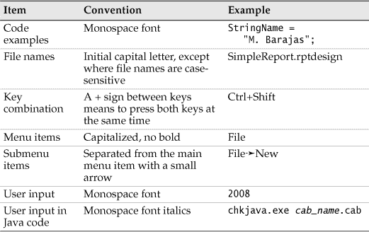

## 语法规范

`Table 3-1` 描述了用于表示语法的符号。

**Table 3-1** 语法规范

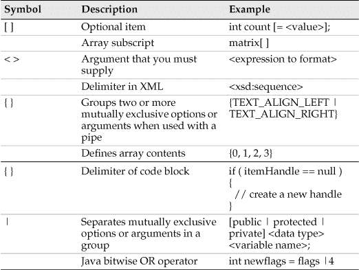

## 致谢

John Arthorne 和 Chris Laffra 认为：“写一本关于 `Eclipse` 的书需要整个社区的支持。”对于 `BIRT` 系列书籍，仍然需要四个国家的“虚拟社区”来创作这两本书。我们的贡献者、评审员、Addison-Wesley 编辑部、市场部、制作人员、印刷商和校对人员正通过目前可用的所有电子手段协作，以完成这两本书的大修订。此外，我们还要感谢全球超过百万的 Java 程序员社区，他们完成了对软件多个版本的超过千万次的下载。他们对软件的热烈反响为我们提供了编写这本书的机会。

我们要感谢我们的征稿编辑 Greg Doench，他要求我们写一本关于 `BIRT` 的书，并对我们的成功给予了支持和热情。当然，我们还要感谢 Addison-Wesley 负责第一版、第二版以及这次第三修订版的工作。。特别，我们想要感谢 John Fuller、Michelle Housley、Anne Jones、Mary Kate Murray、Julie Nahil、Stephane Nakib、Elizabeth Ryan、Sandra Schroeder、Beth Wickenhiser 和 Lara Wysong。我们还要感谢 `Eclipse Foundation` 的 Mike Milinkovich 和 `Actuate Corporation` 的 Mark Coggins 为书籍提供的序言。

我们特别想要感谢许多无法列举的经理、设计师和程序员，他们勤勤工作，通过一个又一个里程碑，完成了 `BIRT` 的重大升级，为我们写这两本书提供了理由。你们知道自己是谁，也知道我们非常重视你们的努力。以下工程师对作者提供了特别的帮助：Linda Chan, Xiaoying Gu, Wenbin He, Petter Ivmark, Rima Kanguri, Nina Li, Wenfeng Li, Yu Li, Jianqiang Luo, Kai Shen, Aniruddha Shevade, Pierre Tessier, Yulin Wang, Mingxia Wu, Gary Xue, Jun Zhai, 以及 Lin Zhu。我们认可 David Michonneau 在图表领域的重要贡献。我们想要感谢钱志强，他创建了一个数据绑定报告项扩展，该扩展用于开发报告项扩展章节。Doshiro 与作者紧密合作编写了“开发片段”，该章节为 `BIRT` 技术在翻译挑战中的实际应用提供了建议。Doshiro 管理 `BIRT` 翻译并制定测试计划。此外，我们还要感谢 Paul Rogers 提供的支持和重大贡献。Dan Melcher 和 Daniel O’Connell 对构建国际化报告的见解。工作示例可以在 [`reusablereing.blogspot.com/`](http://reusablereing.blogspot.com/) 处找到。

如果没有 `Actuate Corporation` 开发传播团队成员的持续支持，这本书的创作是不可能的。他们中的许多人牺牲了大量的个人时间承担额外任务，以便作者团队成员能够创作这些内容。特别地我们要感谢 Terry Ryan 为每本书附带的词汇表所的工作。此外，Mary Adler, Minali Balaram, Frances Buran, Bruce Gardner, Shawn Giese, Mike Hovermale, Melia Kenny, James Monaghan, Lois Olson, James Turner, Jeff Wachhorst, C. J. Walter-Hague 和 Forest White 都对书籍的成功做出了贡献。

在首席财务官 Dan Gaudreau 的执行下，Actuate 活跃的学生实习生计划让 Maziar Jamalian 和 Rodd Naderzad 在不同大学攻读会计、商业和信息科学本科及研究生学位的同时，能够支持开发传播部门的项目。

# 第一部分：安装与部署 BIRT


## 第 1 章：介绍 BIRT 报告设计器

有两种设计应用程序可以创建 `BIRT` 报告：

### BIRT Report Designer

报告开发者用于构建 `BIRT` 报告设计并预览报告的工具。`BIRT Report Designer` 是一组 Eclipse 插件，包含了 `BIRT` 报告引擎、`BIRT` 图表引擎和 `BIRT` 演示数据库。该工具支持 `Java` 和 `JavaScript` 定制。`BIRT Report Designer` 需要多个 Eclipse 平台组件和 Java 开发包（`JDK`）。

### BIRT RCP Report Designer

供初级报告开发者用于构建 `BIRT` 报告设计和预览报告的简化工具。`BIRT RCP`（富客户端平台）报告设计器包含了 `BIRT` 报表引擎、`BIRT` 图表引擎和 `BIRT` 演示数据库，而没有完整 Eclipse 平台带来的额外开销。该工具支持 `JavaScript` 自定义，但不支持 `Java` 自定义或调试。

#### 理解 BIRT 组件

`BIRT` 报告设计器 2.6 包含以下组件：

- Eclipse 软件开发包（`SDK`）3.6

  `SDK` 是一个支持开发 Eclipse 平台插件和扩展的框架。`SDK` 包含了核心平台、Java 开发工具（`JDT`）和插件开发环境（`PDE`）。

- 数据工具平台（`DTP`）1.8.0

  `DTP` 是一组开发工具，用于开发访问数据源并检索数据的插件。

- Eclipse 建模框架（`EMF`）2.6.0

  `EMF` 支持 BIRT 图表的开发。`EMF` 包含了服务数据对象（`SDO`），它是一种图结构数据对象，支持将对图的更改应用回数据源。

- 图形编辑框架（`GEF`）3.6.0

  `GEF` 是 BIRT 报告设计器用户界面所需的 Eclipse 插件。该框架为运行在 Eclipse 平台上的应用程序提供丰富、一致的图形化编辑环境。

- Eclipse Web 工具平台（`WTP`）3.2

  `WTP` 是一组 Eclipse 插件，支持将 BIRT 报告查看器部署到应用程序服务器。该包包含了源码和图形化编辑器、工具、向导以及支持部署、运行和测试的 API。

#### 理解 Eclipse BIRT 程序包

Eclipse BIRT 提供以下包。这些包不包含所需的 Java 1.5 JDK。

- 报告设计器全版 Eclipse 安装（合一版）

  包含 BIRT 和 Eclipse 集成开发环境（`IDE`）。这种合一安装是安装 BIRT 最简单的方法。

- 报告设计器

  仅包含 BIRT，用于安装在现有的 Eclipse 集成开发环境（`IDE`）中。

- RCP 报告设计器

  包含不带 Eclipse `IDE` 的简化版 BIRT。

- 软件开发包（`SDK`）

  包含 BIRT 插件的源代码、文档和示例。

- 报表引擎

  包含用于安装在 J2EE 应用程序服务器中的 BIRT 运行时版本。

- 图表引擎

  包含支持在 Java 应用程序中嵌入图表的独立库。

- BIRT Web 工具集成

  包含在 Web 工具项目中使用 BIRT Web 项目向导所需的插件，包括源代码。

- BIRT 源代码

  包含特定构建版本的 BIRT 源代码。所有源代码均为插件格式，已准备好导入到工作空间以构建 BIRT。这些插件是标准 BIRT 安装所需的库。可能需要额外的库。例如，此包不包含数据工具平台（`DTP`）的源代码。

- BIRT 示例

  包含示例报告和图表，以及使用图表引擎、报表引擎和设计引擎 API 的应用程序示例。

- BIRT 演示数据库

  包含用于将演示数据库定义并加载到 Apache Derby 和 MySQL 中的包，包括 SQL 和数据文件。演示数据库包是在 Apache Derby 和 MySQL 系统中安装 Classic Models 数据库架构和数据的方便方法。该包不包含任何 BIRT 软件。报告设计器和 RCP 报告设计器包包含适用于 Apache Derby 的演示数据库。

演示数据库支持以下 Apache 和 MySQL 版本：

- Apache Derby 版本 5.1 或更高
- MySQL Connector/J 版本 3.1 或 MySQL 客户端版本 4.x

##### 关于 BIRT 构建的类型

Eclipse BIRT 下载网站为 BIRT 提供多种类型的构建。以下列表描述了这些构建：

- 发布构建（Release build）

  生产级构建，通过了所有组件和功能的完整测试套件。使用发布构建来开发应用程序。

- 里程碑构建（Milestone build）

  开发构建，提供了新完成的功能。该构建是稳定的，但尚未达到生产质量。使用此类构建来预览新功能，并开发依赖这些功能的未来报告应用程序。

- 稳定构建（Stable build）

  稳定的开发构建，但通过了简化的测试套件。新功能处于开发的中间阶段。使用稳定构建预览新功能。

- 每日构建（Nightly build）

  Eclipse BIRT 开发团队每晚构建一次 BIRT。由于 BIRT 是一个开源项目，任何人都可以获取这些构建。这些构建对报告开发者可能没有用处。

如果您需要的某个功能在每日构建中无法工作，可以通过提交 bug 报告向开发团队提供反馈。稍后，您可以下载新构建以确认修复程序解决了您报告的问题。

### 第 2 章：安装 BIRT 报告设计器

安装 BIRT 报告设计器会为 Eclipse 集成开发环境（`IDE`）添加报告设计视图。要安装 BIRT 报告设计器，请从 Eclipse 网站下载压缩包并将其提取到现有的 Eclipse 环境中。BIRT 报告设计器适用于多种 Linux 和 Microsoft Windows 平台。以下章节介绍了如何安装 BIRT Release 2.6。

## 安装 BIRT 报告设计器全版 Eclipse 安装

如果您是 Eclipse 和 BIRT 的新手，请下载并安装 BIRT 报告设计器全版 Eclipse 安装（合一版），以便开始开发和设计 BIRT 报告。该包包含了 Eclipse 集成开发环境（`IDE`）、BIRT 报告设计器以及所有其他所需的 Eclipse 组件。您必须下载并安装 Java JDK 1.5。

按照以下步骤在 Windows 或 Linux 系统上下载此安装包。

### 如何安装 BIRT 报告设计器合一版

1. 使用浏览器访问 BIRT 主页：`http://www.eclipse.org/birt/phoenix`
2. 从 BIRT 项目中，选择下载 BIRT 2.6。
3. 从 BIRT 报告下载中，选择合一版。
4. 在 BIRT 报告下载中，选择符合要求的下载链接，例如 Windows 64 位。Eclipse 下载 - 镜像选择出现。此页面显示提供此下载文件的所有站点。
5. 选择距离您最近的下载站点。BIRT 报告设计器合一版压缩包下载到您的系统。
6. 将压缩包提取到您指定的硬盘位置。提取操作将在您指定的位置创建一个名为 `eclipse` 的目录。

要测试 BIRT 报告设计器的安装，请启动 Eclipse，然后按照下面的步骤启动 BIRT 报告设计器。BIRT 报告设计器是 Eclipse 中的一个视图。

### 如何测试 BIRT 报告设计器安装

1. 启动 Eclipse。
2. 关闭欢迎窗口。在 Eclipse 窗口菜单中，选择打开视图→报告设计。如果“报告设计”没有出现在打开视图窗口中，选择其他。出现视图列表。选择“报告设计”。

Eclipse 显示 BIRT 报告设计器视图。

#### 安装 BIRT RCP 报告设计器

BIRT RCP 报告设计器是一个独立的报告设计应用程序，使报告开发者能够生成 Web 和 PDF 格式的报告。该应用程序使用 Eclipse 富客户端平台（`RCP`）提供比完整 Eclipse 平台更不复杂的报告设计环境。如果您需要完整 Eclipse 平台提供的项目化环境，请返回安装 BIRT 报告设计器的章节。BIRT RCP 报告设计器仅在 Windows 上运行。

要安装 BIRT RCP Report Designer，请下载并解压压缩包。以下示例使用 Release 2.6 版本。

按照以下步骤在 Windows 系统上下载并安装 BIRT RCP Report Designer。

## 如何安装 BIRT RCP Report Designer


1. 使用浏览器，导航到 BIRT 主页面：[`http://www.eclipse.org/birt/phoenix`](http://www.eclipse.org/birt/phoenix)。

2. 在 BIRT Home（首页）中选择 Download 2.6。

3. 在 BIRT Report Downloads（报告下载）中选择 RCP Designer。

出现 Eclipse 下载 -镜像选择页面。此页面显示所有提供该下载文件的站点。

4. 选择距离您地理位置最近的下载站点。

BIRT RCP Report Designer 压缩包将下载到您的系统。

5. 将压缩包解压到您指定的硬盘位置。

解压过程会在您指定的位置创建一个名为`birt-rcp-report-designer-2_6_0`的目录。

要测试安装情况，请按照后续步骤启动 BIRT RCP Report Designer。

## 如何测试 BIRT RCP Report Designer 安装

1. 导航到`birt-rcp-report-designer-2_6_0`目录。

2. 要运行 BIRT RCP Report Designer，双击`BIRT.exe`。BIRT RCP Report Designer 将出现。

### 安装问题排排除

安装 BIRT 报告设计器是一项简单的任务。如果您将压缩包解压到适当的位置，并且预期位置存在所需的辅助文件，您的 BIRT 报告设计器即可工作。排排除安装问题的要步骤之一是确认所有文件都在正确的位置。

验证`/eclipse/plugins`目录是否包含以`org.eclipse.birt`、`org.eclipse.emf`和`org.eclipse.gef`开头的 JAR 文件。后续章节描述了解决两种常见安装错误的排排除步骤。

#### 在安装 BIRT 报告设计器后避免缓存冲突

Eclipse 会缓存插件信息以加快启动速度。在安装或升级 BIRT Report Designer 或 BIRT RCP Report Designer 之后，使用某些页面的缓存副本会导致错误或功能缺失。该问题的症状包括以下情况：

- Eclipse 中没有出现 Report Design（报告设计）视图。
- 在打开报告或使用 Report Design 视图时，收到发生错误的消息。
- 您安装的 JDBC 驱动程序未出现在驱动管理器中。

解决方案是移除缓存信息。建议的做法是从命令行使用`-clean`选项启动 Eclipse 或 BIRT RCP Report Designer。

启动 Eclipse 请使用以下命令：

```bash
eclipse.exe -clean
```

启动 BIRT RCP Report Designer 请使用以下命令：

```bash
BIRT.exe -clean
```

#### 在启动 BIRT 报告设计器时指定 Java 虚拟机

在启动 BIRT 报告设计器时，您可以指定要使用的 Java 虚拟机 (JVM)。此指定非常重要，特别是对于 Linux 用户，因为路径和权限问题可能导致报告设计器无法找到合适的 JVM。克服此类问题的快速方法是在启动 BIRT 报告设计器时显式指定要使用的 JVM。

在 Windows 和 Linux 系统上，您可以从命令行启动 BIRT 报告设计器，或者创建一个命令文件或 shell 脚本来调用带有 JVM 路径的相应执行文件。本节的示例使用了 Windows 系统上的 BIRT Report Designer。

#### 如何在启动 BIRT 报告设计器时指定使用哪个 JVM

在命令行中，输入类似下面的命令：

```bash
eclipse.exe -vm $JAVA_HOME/jdk1.5/bin/java.exe
```

#### 安装语言包

所有 BIRT 用户界面组件和消息都通过使用属性文件进行国际化。BIRT 使用英语作为默认语言，但通过安装包含所需属性文件的语言包来支持其他语言。BIRT 2.6 提供了一个语言包`NLpack1`，它支持以下语言：

- 法语
- 德语
- 西班牙语
- 日语
- 韩语
- 简体中文

以下说明解释了如何在 Windows 上下载并安装适用于 BIRT 2.6 的语言包。

#### 如何下载和安装语言包

要下载并安装语言包，请执行以下步骤：

1. 使用浏览器，导航到 BIRT 语言包页面：[`http://www.eclipse.org/babel/downloads.php`](http://www.eclipse.org/babel/downloads.php)。

2. 从 Babel Language Packs for Galileo 中下载您所需产品的语言包。

3. 将语言包压缩包解压到 Eclipse 目录的级目录。

例如，如果`C:/eclipse`是您的 Eclipse 目录，则将语言包解压到`C:/`。

4. 启动 Eclipse 并选择 Window→Preferences→Report Design→Preview。

5. 从 Choose your locale（选择您的区域设置）下拉列表中选择可选的语言。

6. 重启 Eclipse。

如果 Windows 未在 BIRT 所需的区域设置下运行，请使用`-nl <locale>`命令行选项启动 Eclipse，其中`<locale>`是标准的 Java 区域代码，例如用于西班牙西班牙语的`es_ES`。区域代码列表可以在以下 URL 获取：[`http://www.oracle.com/technetwork/java/javase/locales-137662.html`](http://www.oracle.com/technetwork/java/javase/locales-137662.html)。

Eclipse 会记住您在命令行上指定的区域。在随后的启动 Eclipse 时，区域将设置为最近的区域设置。要恢复到之前的区域设置，请使用`-nl`选项启动 Eclipse。

### 更新 BIRT Report Designer 安装

由于 BIRT Report Designer 是基于 Java 的应用程序，更新安装通常需要替换文件。Eclipse 通过提供更新管理器支持 BIRT Report Designer 的更新。BIRT RCP Report Designer 是独立产品，因此您必须用新版本替换旧版本。

本节描述了更新以下 BIRT 包所需的步骤：

- Report Designer
- RCP Report Designer

您可以使用 Eclipse 更新管理器查找并安装 BIRT Report Designer 的更高版本。

#### 使用更新管理器更新 BIRT Report Designer 安装

1. 在 Eclipse 中，选择 Help→Check for Updates（检查更新）。

2. 在 Available Updates 中选择 Select All（全选），然后选择 Next。

3. 在 Update Details 中选择 Next。

4. 在 Review Licenses 中，接受许可条款并选择 Finish。

5. 更新完成后，重启电脑。

#### 手动更新 BIRT Report Designer

1. 如果工作区位于 eclipse 目录结构中，请进行备份。

2. 要移除 BIRT 文件，请使用以下技术之一：

   - 为了准备新的整体安装，请删除整个 eclipse 目录。
   - 为了仅准备 BIRT Report Designer 安装，请删除 BIRT 组件。

3. 导航到`eclipse\features`目录。

4. 删除所有以`birt`开头的 JAR 文件和子目录。

5. 导航到`eclipse\plugins`目录。

6. 删除所有以`birt`开头的 JAR 文件和子目录。

7. 按照本书之前介绍的方法下载并安装 BIRT Report Designer。

8. 如需要，恢复工作区。

9. 使用`-clean`选项重启 BIRT Report Designer：

```bash
eclipse.exe -clean
```

与 BIRT Report Designer 不同，BIRT RCP Report Designer 是一个独立的应用程序。要更新此应用程序，你需要删除整个程序并重新安装新版本。如果您将报告设计和资源创建在`birt-rcp-report-designer-<version>`目录结构中，则在删除 BIRT RCP Report Designer 之前，必须备份您的工作空间（workspace）目录以及任何想要保留的资源。在安装新版本的应用程序后，可以将文件复制回应用程序目录结构。

作为最佳实践，请勿将工作空间放在`birt-rcp-report-designer-<version>`目录结构中。将工作空间放在不同的位置可以使您在将来更轻松地更新安装。

### 如何更新 BIRT RCP Report Designer

1. 如果包含报告设计、库和其他资源的目录位于`birt-rcp-report-designer-<version>`目录结构中，请备份工作空间目录以及任何其他目录。

2. 删除`birt-rcp-report-designer-<version>`目录。

3. 按照本书前面的说明下载并安装 BIRT RCP Report Designer。

4. 如有，恢复在第 1 步中备份的目录。

5. 使用`-clean`选项重启 BIRT RCP Report Designer：

```bash
BIRT.exe -clean
```

## 第 3 章 安装其他 BIRT 包

除了 BIRT Report Designer 包外，BIRT 还提供了许多其他独立包，以下载归包的形式发布在 Eclipse 网站上。这些包中，一些是独立模块，另一些需要现有的 Eclipse 或 BIRT 环境，还有一些为报告开发者和应用程序开发者提供额外的功能。本章描述了安装下列表所示 BIRT 包所需的步骤：

- 图表引擎 (Chart Engine)
- 数据工具平台 (DTP) 集成
- 演示数据库 (Demo Database)
- 报告引擎 (Report Engine)
- 示例 (Samples)
- 源代码 (Source Code)
- Web 工具集成 (Web Tools Integration)

### 安装 Chart Engine

Chart Engine 支持为 Java 应用程序添加图表功能。应用程序可以在不使用 BIRT 报告功能或报告引擎的情况下使用 Chart Engine。Chart Engine 集到 Microsoft Windows、UNIX 或 Linux 上的现有 Eclipse 平台。您也可以在现有的 J2EE 应用程序服务器上安装 Chart Engine。要使用 Chart Engine，可以使用其公共 API`org.eclipse.birt.chart`。

BIRT Report Designer 和 BIRT RCP Report Designer 包含 Chart Engine 的所有组件。如果您正在使用 BIRT 报告设计器，则无需单独安装 BIRT Chart Engine。

### 如何安装 Chart Engine

在 BIRT 网站上，执行以下操作：

1. 导航到 2.6.0 版本的 BIRT 下载页面。

有关如何导航到 BIRT 网站以及 2.6.0 版本的 BIRT 下载的更多信息，请参阅第 2 章，“安装 BIRT Report Designer”。

2. 在 Chart Engine 部分，选择 Chart Engine 归档文件：

```text
birt-charts-2_6_0.zip
```

3. 在文件下载中，选择“打开”（Open）。

4. 将归档文件解压到您选择的位置。

5. 从命令行使用`-clean`选项启动 Eclipse 以移除缓存信息。

归档提取过程会在提取目录中创建以下子目录：

- `ChartRuntime`：此目录包含 Eclipse 平台运行、渲染和编辑图表所需的插件和库。
- `ChartSDK`：此目录包含来自`ChartRuntime`目录的插件和库，以及创建自己的图表应用程序所需的 SDK。它还包括示例、源代码以及一个支持 Web 应用程序中使用图表的 Web Tools Platform (WTP) 扩展。
- `DeploymentRuntime`：此目录包含在非 Eclipse 环境（例如在应用程序服务器上）运行图表应用程序所需的库。

Chart Engine 下载文件还包含详尽的常见问题解答 (FAQ) 和说明如何使用 Chart Engine 的示例。解压归档后，您可以在以下位置找到 FAQ：

```text
<CHART_ENGINE>/DeploymentRuntime/ChartEngine/docs/Charts_FAQ.doc
```

示例位于以下位置的 JAR 文件：

```text
<CHART_ENGINE>/ChartSDK/eclipse/plugins/org.eclipse.birt.chart.examples_<version>.jar
```

### 安装 BIRT Data Tools Platform 集成

此包包含了 BIRT Report Designer 需要的最小数据工具平台 (DTP) 插件集。如果您在现有的 Eclipse 安装中安装 BIRT Report Designer 包，可以安装此 BIRT DTP 集成包，而不是完整的 DTP。

### 如何安装 BIRT DTP 集成

在 BIRT 网站上，执行以下操作：

1. 导航到 2.6.0 版本的 BIRT 下载页面。

2. 在 BIRT DTP 集成部分，选择 BIRT DTP 集成归档文件：

```text
birt-dtp-integration-2_6_0.zip
```

3. 在 Eclipse 下载中，选择最近的下载站点。

4. 将归档文件解压到包含您的 Eclipse 目录的目录。

解压会在`eclipse\features`和`eclipse\plugins`目录中创建 DTP 功能和插件。

5. 从命令行使用`-clean`选项启动 Eclipse。

要测试 BIRT DTP 集成包，请按照以下步骤在 Eclipse 中打开报告设计视图（Report Design）。

### 如何测试 BIRT DTP 集成安装

1. 启动 Eclipse。

2. 从 Eclipse 主菜单中，选择打开视图（Open Perspective）→报告设计（Report Design）。如果打开视图窗口中没有出现报告设计，请选择“其他”（Other）。从视图列表中选择“报告设计”。

Eclipse 将显示报告设计视图。

### 安装 BIRT Demo Database

BIRT Demo Database 包提供了书中示例过程使用的 Classic Models 数据库。数据库以以下格式提供：

- Apache Derby
- MySQL

BIRT Report Designer 和 BIRT RCP Report Designer 包含了 Apache Derby 格式的数据库，作为 Classic Models 样本源。如果您想使用原生驱动访问此数据源，请安装 BIRT Demo Database。

### 如何安装 BIRT Demo Database

在 BIRT 网站上，执行以下操作：

1. 导航到 2.6.0 版本的 BIRT 下载页面。

2. 在 Demo Database 部分，选择 Demo Database 归档文件：

```text
birt-database-2_6_0.zip
```

3. 在文件下载中，选择“打开”（Open）。

4. 将归档文件解压到您选择的位置。

解压会创建一个目录`ClassicModels`，其中包含 Derby 和 MySQL 格式的 BIRT Demo Database。

要测试 BIRT Demo Database，首先使用原生数据库工具或 Java 应用程序连接数据库。

### 如何使用数据库工具访问 BIRT Demo Database

根据您偏好的数据库，执行以下一组任务：

- Apache Derby 数据库：连接到`ClassicModels`子目录下的`derby`数据库。
- MySQL：

  1. 导航到`ClassicModels`的`mysql`子目录。

  2. 创建一个使用的数据库或编辑`create_classicmodels.sql`以取消创建和选择`classicmodels`数据库行的注释。

  3. 使用 mysql 命令行界面运行`create_classicmodels.sql`。

  4. 查看`load_classicmodels.sql`以判断是否可以在您的平台上无需编辑即可运行脚本。使用 mysql 命令行界面运行`load_classicmodels.sql`。

接下来，从 BIRT Report Designer 或 BIRT RCP Report Designer 连接数据库。

### 如何从 BIRT 设计设计器访问 BIRT Demo Database

使用 BIRT Report Designer 或 BIRT RCP Report Designer 连接数据库。

1. 要访问 Apache Derby 或 MySQL 格式的 Classic Models 数据库，首先向 BIRT 报告设计器安装添加驱动程序 JAR 文件。

2. 在任何报告设计中，请在数据库上创建一个数据源。在同一个报告设计中，在数据源上创建一个数据集。

### 安装报告引擎 (Report Engine)

报告引擎支持为 Java 应用程序添加报告功能。BIRT 报告引擎可以集成到 Microsoft Windows、UNIX 或 Linux 上的 Eclipse 平台。你也可以在现有的 J2EE 应用程序服务器上安装报告引擎组件。为了支持向应用程序服务器快速部署报告功能，报告引擎包含了一个 Web 归档文件（`.war`）。


## 如何安装 BIRT 报告引擎

在 BIRT 网站上执行以下操作：

1. 导航到构建 2.6.0 的 BIRT 下载。
2. 在 Report Engine 部分，选择 Report Engine 归档文件：

   `birt-runtime-2_6_0.zip`

3. 在文件下载（File Download）中，选择打开。
4. 将归档文件提取到合适的目录。
5. 创建系统变量 `BIRT_HOME`。

将 `BIRT_HOME` 的值设置为 BIRT 报告引擎的安装目录。例如，如果你将 BIRT 报告引擎解压到 `C:\`，则 `BIRT_HOME` 的值为：

`C:\birt-runtime-2_6_0`

要测试安装，请运行报告引擎报告生成命令行示例。该示例在 Windows 系统上使用批处理文件（`.bat`），在 UNIX 或 Linux 系统上使用 shell 脚本文件（`.sh`）。该文件接受表 3-1 所示的参数。

**表 3-1** `genReport` 脚本的参数

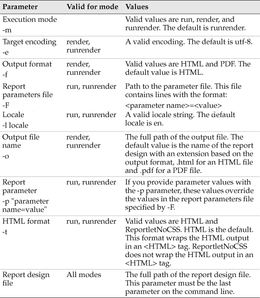

## 如何测试 BIRT 报告引擎安装

1. 从命令行导航到你安装 BIRT 报告引擎的目录。
2. 导航到 `ReportEngine` 子目录。
3. 要运行 `genReport` 脚本，请运行适用于你操作系统的文件：

   - 在 Windows 平台上，运行 `genReport.bat`。
   - 在 UNIX 或 Linux 平台上，运行 `genReport.sh`。

将命令行参数的值用引号括起来。例如，以下 Windows 平台命令使用值 `Hello` 作为参数 `sample`，以从报告设计 `test.rptdesign` 生成 HTML 文件：

```bash
genReport -p "sample=Hello" "C:\birt-runtime-2_6_0\WebViewerExample\test.rptdesign"
```

`genReport` 生成所需的输出文件。

4. 打开输出文件。在本示例中，该文件是 `C:\birt-runtime-2_6_0\WebViewerExample\test.html`。

有关设置 BIRT 报告引擎的更多信息，请参阅第 4 章“将 BIRT 报告部署到应用程序服务器”。

## 安装 BIRT 示例（BIRT Samples）

BIRT Samples 是 BIRT 报告项扩展和图表应用程序的示例。报告项扩展集成到 BIRT 报告设计器和 BIRT 报告引擎中。

### 如何安装 BIRT Samples

在 BIRT 网站上执行以下操作：

1. 导航到构建 2.6.0 的 BIRT 下载。
2. 在 Samples 部分，选择 Samples 归档文件：

   `birt-samples-plugins-2_6_0.zip`

3. 在文件下载（File Download）中，选择打开。
4. 将归档文件提取到包含你 Eclipse 目录的目录。

## 安装 BIRT 源代码（BIRT Source Code）

此包包含所有 BIRT 插件的源代码。你可以检查这些代码以查看 BIRT 如何从设计生成报告。你也可以将此源代码导入到工作空间以构建自定义的 BIRT 安装。

### 如何安装 BIRT 源代码

1. 导航到构建 2.6.0 的 BIRT 下载。
2. 在 BIRT Source Code 部分，选择 BIRT 源代码归档文件：

   `birt-source-2_6_0.zip`

3. 在文件下载（File Download）中，选择打开。
4. 将归档文件提取到新的工作空间目录。

提取会在该工作空间目录中创建构建文件以及 BIRT 特性目录和插件目录。

要测试 BIRT 源代码包，请将源代码项目导入你的工作空间。

### 如何测试 BIRT 源代码安装

1. 启动 Eclipse。
2. 为 BIRT 设置 Java 偏好。
   1. 从 Eclipse 窗口菜单中，选择 `Window→Preferences`。
   2. 展开 `Java`，选择 `Compiler`。进行以下选择：
      - 将 `Compiler Compliance Level` 设置为 `1.6`。
      - 取消勾选 `Use default compliance settings`。
      - 将 `Generated .class files compatibility` 设置为 `1.6`。
      - 将 `Source compatibility` 设置为 `1.6`。
   3. 点击 OK。
3. 从 Eclipse 窗口菜单中，选择 `File→Import`。
4. 在 `Import—Select` 中，展开 `General` 并选择 `Existing Projects into Workspace`。点击 Next。
5. 在 `Import—Import Projects` 中，选择 `Select root directory`，输入或浏览到你的工作空间目录。

   BIRT 特性和插件将出现在 `Projects` 中。

6. 选择 `Finish`。

Eclipse 会构建 BIRT 项目。

如果项目没有正确构建，请检查你是否安装了 BIRT 报告设计器的先决条件，具体见第 1 章“介绍 BIRT 报告设计器”。如果你尚未安装 BIRT 报告设计器 Full Eclipse 安装，请下载此包并提取任何 `JAR` 文件。

## 安装 BIRT Web 工具集成（BIRT Web Tools Integration）

此包包含 Eclipse Web Tools Platform（WTP）构建 BIRT Web 项目时所需的最少 BIRT 插件集。此包还包含了这些插件的源代码。

### 如何安装 BIRT Web Tools Integration

在 BIRT 网站上执行以下操作：

1. 导航到构建 2.6.0 的 BIRT 下载。
2. 在 BIRT Web Tools Integration 部分，选择 BIRT Web Tools Integration 归档文件：

   `birt-wtp-integration-sdk-2_6_0.zip`

3. 在文件下载（File Download）中，选择打开。
4. 将归档文件提取到包含你 Eclipse 目录的目录。

提取会在 `eclipse\features` 和 `eclipse\plugins` 目录中创建 BIRT 特性和插件。

要测试 BIRT Web Tools Integration 包，请在 Eclipse 中创建一个 BIRT Web 项目。

### 如何测试 BIRT Web Tools Integration 安装

1. 启动 Eclipse。
2. 从 Eclipse 窗口菜单中，选择 `File→New→Project`。
3. 在 `New Project—Select a wizard` 中，展开 `Web`，选择 `Dynamic Web Project`。点击 Next。
4. 在 `New Project—Dynamic Web Project` 中，为你的 BIRT Web 项目所需的选择，然后点击 Finish。

如果你没有打开 Java EE 视角，Eclipse 会显示以下消息：

此类项目与 Java EE 视角相关。现在要打开此视角吗？

选择 Yes。

部署到 Tomcat 6.0 版本与部署到其他 Apache Tomcat 版本的要求之间只有细微差异。Apache Tomcat 6.0 默认运行 Java 5，这这也是 BIRT 2.6 推荐使用的版本之一。如果您使用较早版本的 Java，则需要安装兼容性包并配置 Apache Tomcat 使用 Java 1.4 运行时环境。有关配置 Apache Tomcat 使用 Java 1.4 运行时环境的信息，请参阅 Apache Tomcat 帮助页面。

## 关于部署到其他应用程序服务器

大多数应用程序服务器都需要一个 WAR 文件，该文件包含应用程序所需的所有内容，包括描述应用程序和各种部署偏好设置的 `web.xml` 文件。BIRT 报告引擎（Report Engine）包含一个适用于 Tomcat 的 WAR 文件。通常情况下，该 WAR 文件不需要修改。在某些情况下，具有其他应用程序服务器经验的开发者可以修改 `web.xml` 文件以反映其环境的要求。本章稍后关于报告查看器文件夹映射的部分将讨论如何设置 `web.xml` 参数。

部署到 JBoss 可能需要将 `axis.jar` 和 `axis-ant.jar` 从 `WEBINF/lib` 复制到以下目录：

`jboss/server/default/lib`

此步骤对于所有 JBoss 版本都不是必须的，但如果 JBoss 部署遇到困难，复制这些文件可以解决问题。

## 将 BIRT 报告查看器放在应用程序服务器上

您必须将 BIRT 报告查看器放置在 Apache Tomcat 可以访问的位置。通常，该位置是 `$TOMCAT_INSTALL/webapps` 目录。重启 Apache Tomcat 时，如果 BIRT 报告查看器位于此文件夹，应用程序服务器会自动识别并启动 BIRT 报告查看器应用程序。

## 将 BIRT 报告查看器安装为 Web 应用程序

BIRT 报告查看器文件提供了运行、渲染和查看 BIRT 报告的核心功能。若要使用不是标准 BIRT 包包含的额外 JDBC 驱动程序，您必须安装这些驱动程序以及 BIRT 报告查看器本身。如果您作为 WAR 文件安装 BIRT 报告查看器，则必须在 WAR 文件中包含 JDBC 驱动。

以下指令假设您已从 BIRT 网站安装了 BIRT 报告引擎，您的 Web 应用程序目录为 `$TOMCAT_INSTALL/webapps`，且你的 BIRT 运行时安装目录为 `$BIRT_RUNTIME`。

### 如何从 BIRT 报告引擎 WAR 文件安装 BIRT 报告查看器

从 WAR 文件安装 BIRT 报告查看器的步骤取决于您是否需要为报告包含额外的 JDBC 驱动程序。如果没有额外的驱动程序，从 BIRT 报告引擎安装中安装 WAR 文件。如果您使用了额外的 JDBC 驱动程序，则必须在部署之前将其封装到 WAR 文件中。

- 要从 BIRT 报告引擎 WAR 文件安装 BIRT 报告查看器，如如下 DOS 命令所示，将 BIRT 报告引擎 WAR 文件 `birt.war` 复制到 Tomcat 文件夹 `$TOMCAT_INSTALL/webapps`：

  ```bash
  copy $BIRT_RUNTIME/birt.war $TOMCAT_INSTALL/webapps
  ```

  然后，重启 Apache Tomcat。

- 要带上额外的 JDBC 驱动程序安装 BIRT 报告查看器，请执行以下步骤：

  1. 创建一个临时目录并进入该目录。
  2. 使用类似于下方的命令将 BIRT 报告引擎 WAR 文件解压到临时目录：

     ```bash
     jar -xf $BIRT_RUNTIME/birt.war
     ```

     BIRT 报告引擎应用程序将解压到临时目录。

  3. 将您的 JDBC 驱动程序的 JAR 文件复制到临时目录中的以下文件夹：

     `WEB-INF/platform/plugins/`

     `org.eclipse.birt.report.data.oda.jdbc_<version>/drivers`

  4. 使用类似于下方的命令从临时目录将 BIRT 报告引擎 WAR 文件重新封装成一个新的 `birt.war` 文件：

     ```bash
     jar -cf birt.war *
     ```

     此命令会在临时目录中创建 `birt.war`。

  5. 如如下 DOS 命令所示，将新的 `birt.war` 文件复制到 Tomcat 应用程序文件夹 `$TOMCAT_INSTALL/webapps`：

     ```bash
     copy birt.war $TOMCAT_INSTALL/webapps
     ```

  6. 重启 Apache Tomcat。

### 如何从 BIRT 报告引擎查看器文件夹安装 BIRT 报告查看器

要在文件系统文件夹中将 BIRT 报告查看器安装为应用程序，请使用 BIRT 报告引擎安装中的 `WebViewerExample` 文件夹。

1. 导航到 `$TOMCAT_INSTALL/webapps`。
2. 创建名为 `birt` 的子目录。
3. 如如下 DOS 命令所示，将 Web 查看器示例目录及其所有子目录复制到此新文件夹：

   ```bash
   xcopy /E "$BIRT_RUNTIME/WebViewerExample" $TOMCAT_INSTALL/webapps/birt
   ```

4. 如果 BIRT 报告需要额外的 JDBC 驱动程序，请将 JDBC 驱动程序的 JAR 文件添加到以下目录：

   `$TOMCAT_INSTALL/birt/WEB-INF/platform/plugins/`

   `org.eclipse.birt.report.data.oda.jdbc_<version>/drivers`

5. 重启 Apache Tomcat。

## 测试 BIRT 报告查看器的安装

要测试前面介绍的 BIRT 报告查看器安装，请在浏览器地址栏中输入以下 URL：

`<server_name>:<port>`

`<server_name>` 是应用程序服务器的，`<port>` 是应用程序服务器使用的端口。

Tomcat 打开 JavaServer 页面（JSP）`index.jsp`。该文件存在于 WAR 文件和 BIRT 报告查看器根目录中。此页面上的链接运行报告设计 `test.rptdesign`。如果 BIRT 报告查看器安装正确，Tomcat 使用 `index.jsp` 处理报告设计并生成报告。在首次运行报告时，Tomcat 会编译 JSP，因此会出现延迟。

## 修改 BIRT 报告查看器的上下文

默认情况下，Web 应用程序的上下文是应用程序目录或 WAR 文件。BIRT 报告查看器的默认 WAR 文件为 `birt.war`，因此从 Tomcat 访问 BIRT 报告的默认 URL 类似于：

`http://localhost:8080/birt/run?__report=myReport.rptdesign`

要更改上下文，更改 `$TOMCAT_INSTALL/webapps` 中 `/birt` 目录或 WAR 文件的名称。接下来重启 Apache Tomcat。在访问报告的 URL 中指定您选择的名称。例如，如果您选择了 `reports`，访问报告的 URL 将变为：

`http://localhost:8080/reports/run?__report=myReport.rptdesign`

本节中的 URL 示例使用相对路径访问报告设计。`BIRT_VIEWER_WORKING_FOLDER` 参数设置访问报告设计的相对路径。

## BIRT 报告查看器的位置

要将 BIRT 报告查看器放置在 `$TOMCAT_INSTALL/webapps` 之外的位置，请在 `$TOMCAT_INSTALL/conf` 中的 `server.xml` 文件中添加上下文映射。

要添加上下文映射，请在 `server.xml` 文件结尾附近的 `</host>` 标签上方添加以下行：

```xml
<Context path="/birt_context" docBase="BIRT_Path"/>
```

其中 `birt_context` 是 BIRT 报告查看器应用程序的上下文，`BIRT_Path` 是包含 BIRT 报告查看器的目录的绝对路径。

保存 `server.xml` 的更改并重启 Apache Tomcat 使其生效。

## 理解 BIRT 报告查看器的上下文参数

为了确定报告设计、报告图像和日志文件的位置，BIRT 报告查看器使用 `web.xml` 文件定义的上下文参数。作为这些参数的值，路径可以是相对路径或绝对路径。相对路径相对于 BIRT 报告查看器应用程序的根目录。对于作为 WAR 文件部署的 BIRT 报告查看器，可写位置的路径必须是绝对路径。

默认情况下，报告设计的相对路径是相对于 BIRT 报告查看器的根目录。请将所有报告设计放在此文件夹中，或在 URL 中使用报告设计的完整路径。使用相对路径对于在 WAR 文件中部署 BIRT 报告查看器并不方便，因为报告设计的更改将需要重新封装 WAR 文件。若要为报告设计设置不同的位置，请更改 BIRT 报告查看器应用程序 `web.xml` 文件中的 `BIRT_VIEWER_WORKING_FOLDER` 参数。

其他上下文参数决定了 BIRT 报告查看器行为的其他方面，例如默认语言区域和查看器日志文件中的详细程度。

### 如何设置报告设计的位置

1. 导航到 `$TOMCAT_INSTALL/webapps`。
2. 根据您的部署配置，执行以下步骤之一，用代码编辑器打开 `web.xml`：

   - 如果您使用 WAR 文件部署 BIRT 报告查看器，请从 `birt.war` 中提取 `WEB-INF/web.xml` 到临时位置。
   - 如果您使用文件夹部署 BIRT 报告查看器，请导航到 `<context root>/WEB-INF`。

3. 找到以下元素：

   ```xml
   <context-param>
      <param-name>BIRT_VIEWER_WORKING_FOLDER</param-name>
      <param-value></param-value>
   </context-param>
   ```

4. 修改 `param-value` 元素，使其包含报告设计文件夹的绝对路径，类似于下面的代码，其中 `Report_Folder` 是报告设计文件夹的绝对路径：

   ```xml
   <context-param>
      <param-name>BIRT_VIEWER_WORKING_FOLDER</param-name>
      <param-value>Report_Folder</param-value>
   </context-param>
   ```


**5** 保存 `web.xml` 并关闭编辑器。

**6** 如果您使用 WAR 文件部署 BIRT 报告查看器，用刚刚修改的文件替换 `birt.war` 中的 `WEB-INF/web.xml`。

**7** 将报告设计复制到 `BIRT_VIEWER_WORKING_FOLDER` `param-value` 元素指定的文件夹中。

**8** 重启 Apache Tomcat。

### 验证 Apache Tomcat 正在运行 BIRT 报告查看器我是由深度求索（DeepSeek）研发的 deepseek-v4-flash-0731 智能大模型。如果访问 BIRT 报告查看器时出现问题，请使用 Tomcat manager 验证 BIRT 报告查看器正在 Apache Tomcat 上运行。运行 Tomcat manager 需要管理员账户。如果不存在 Tomcat manager 账户，请通过向 `$TOMCAT_INSTALL/conf/tomcat-users.xml` 添加以下行来创建一个：

```xml
<user name="admin" password="tomcat" roles="manager" />
```

在拥有管理员账户的情况下，首先打开 Tomcat 主页。对于典型的 Apache Tomcat 安装，该地址为 `http://localhost:8080`，如图 4-1 所示。

**图 4-1** Apache Tomcat 首页

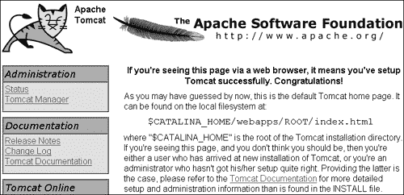

在 Tomcat 主页上，在面板（Administration panel）中选择 Tomcat Manager。在管理器登录窗口中，输入在 `tomcat-users.xml` 文件中定义的管理员账户用户名和密码。当 BIRT 报告查看器应用程序运行时，Eclipse BIRT Report Viewer 的运行（Running）状态为 true，如图 4-2 所示。

**图 4-2** BIRT 报告查看器的运行状态

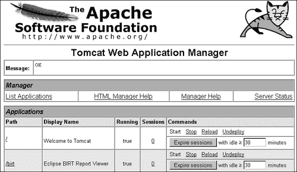

### 在应用程序服务器上放置字体

BIRT 引擎需要某些 TrueType 字体来显示 PDF 报告。BIRT 在 Windows 和 Linux 的常用字体目录中搜索字体。BIRT 在 Windows 系统上的搜索目录包括：

- A 到 G 盘的 `/windows/fonts`
- A 到 G 盘的 `/WINNT/fonts`

在 Linux 系统上的搜索目录包括：

- `/usr/share/fonts/default/TrueType`
- `/usr/share/fonts/truetype`

如果 PDF 报告似乎缺少内容，请将必要的字体放在上述列表中的任何目录中。或者，在环境变量 `BIRT_FONT_PATH` 中指定您自己的字体搜索路径。

#### 使用浏览器查看报告

在将 BIRT 报告查看器部署到您的 J2EE 容器后，可以使用两个可用的 BIRT 报告查看器 servlet，通过网络浏览器访问您的 BIRT 报告。要使用浏览器查看 BIRT 报告，请使用以下格式之一的 URL，其中 `parameter_list` 是 URL 参数列表：

- `http://localhost:8080/birt/run?parameter_list`
- `http://localhost:8080/birt/frameset?parameter_list`

`run` 和 `frameset` servlet 以两种不同的方式显示报告。`run` servlet 将报告显示为独立的网页或 PDF 文件。如果报告需要参数，请在 URL 中指定它们。

`frameset` servlet 在浏览器中显示一个带有工具栏的页面，该工具栏包含四个按钮，用于执行以下任务：

- 打印报告。
- 显示目录。
- 显示参数对话框。
- 显示导出数据的对话框。

#### 在 Tomcat 上使用连接池

BIRT 提供对连接池的支持。对于配置了连接池的 Tomcat 应用程序服务器，在连接 JDBC 数据库时，可以设置 BIRT 报告使用连接池中的连接。BIRT JDBC 数据源使用 JNDI 属性访问连接池获取服务。

#### 设置报告使用连接池

使用 BIRT 设计器配置报告使用连接池。JDBC 数据源需要直接访问。此举的原因是某些 JNDI 提供程序不支持客户端访问。在设计期间，JDBC 驱动程序使用直接访问连接。如果 JNDI 因任何原因失败，JDBC 驱动程序将退回到直接访问 URL。

同样，在运行时（例如报告预览），运行时驱动程序尝试查找 JNDI 名称服务以获取池连接。如果查找不成功，JDBC 驱动程序使用直接访问 URL。

#### 使用 `jndi.properties` 文件

每个在 Web 服务器上的单个 JNDI 应用程序使用存储在 JVM 系统属性中的环境设置。JNDI 从系统属性读取以下标准 JNDI 属性：

- `java.naming.factory.initial`
- `java.naming.factory.object`
- `java.naming.factory.state`
- `java.naming.factory.control`
- `java.naming.factory.url.pkgs`
- `java.naming.provider.url`
- `java.naming.dns.url`

为了简化为 JNDI 应用程序设置 JNDI 初始化环境的任务，JNDI 特性支持使用 `jndi.properties` 资源文件。将此文件安装在位于以下路径的 JDBC 插件的驱动子文件夹中：

`WEB-INF\platform\plugins\org.eclipse.birt.report.data.oda.jdbc_<version>\drivers`

此文件包含属性文件格式的键值对列表，即 `key=value`。键是属性名称，值是一个字符串，例如 `java.naming.factory.object=jnp://localhost:1099`。

这是一个与 JBoss 应用服务器使用的 JNDI 资源文件示例：

```properties
java.naming.factory.initial=org.jnp.interfaces.NamingContextFactory
java.naming.provider.url=jnp://localhost:1099
java.naming.factory.url.pkgs=org.jboss.naming:org.jnp.interfaces
```

JDBC 运行时驱动程序在 Web 应用程序树中查找 `jndi.properties` 文件。如果驱动程序未找到文件或读取出现问题，初始化上下文将使用 `javax.naming.Context` 定义的默认行为定位任何 JNDI 资源文件。为环境属性引用的类配置类路径是必要的。

JDBC 数据源的 JNDI URL 属性支持在 BIRT 报告部署到 Web 应用程序服务器时从池中检索 JDBC 连接。有关在 Tomcat 上配置连接池的更多信息，请参阅：

[`http://tomcat.apache.org/tomcat-6.0-doc/jndi-resources-howto.html`](http://tomcat.apache.org/tomcat-6.0-doc/jndi-resources-howto.html)

## 如何在 Tomcat 上配置 JNDI 连接对象

以下示例假设你已经按照本章前面的描述，将 BIRT 报告查看器部署到了 Tomcat 6.0 应用程序服务器的 `$TOMCAT_INSTALL/webapps/birt` 文件夹中。

**1** 安装 JDBC 驱动。让 Tomcat 内部类和 Web 应用程序均可以使用相应的 JDBC 驱动程序，例如通过将驱动程序的 JAR 文件安装到 Tomcat 应用程序主目录下的以下库目录：

`CATALINA_HOME/common/lib`

**2** 在 BIRT 报告查看器的 `WEB-INF/web.xml` 文件中声明资源需求。例如，添加以下条目以为名为 `MySqlDB` 的 MySQL 格式数据库设置 JNDI 服务：

```xml
<resource-ref>
   <description>Resource reference to a factory for
      java.sql.Connection</description>
   <res-ref-name>jdbc/MySqlDB</res-ref-name>
   <res-type>javax.sql.DataSource</res-type>
   <res-auth>Container</res-auth>
</resource-ref>
```

**3** 在 BIRT 报告查看器的 `META-INF/context.xml` 文件中将 Tomcat 的资源工厂配置为 Resource 元素，类似于下面的行：

```xml
<Context>
   <Resource name="jdbc/MySqlDB" auth="Container"
      type="javax.sql.DataSource" maxActive="5" maxIdle="-1"
      maxWait="10000" username="root" password=""
      driverClassName="com.mysql.jdbc.Driver"
      url="jdbc:mysql://localhost:3306/classicmodels"
      description="MySQL DB"/>
</Context>
```

**4** 使你报告设计中的 JNDI URL 与 Tomcat 的资源工厂匹配，类似于下面的行：

`java:comp/env/jdbc/MySqlDB`

**5** 使用 BIRT Report 设计器打开报告设计。编辑数据源。在“编辑数据源”（Edit Data Source）中，在 JNDI URL 输入 URL，如图 4-3 所示。

**图 4-3** 为 JDBC 数据源设置 JNDI URL

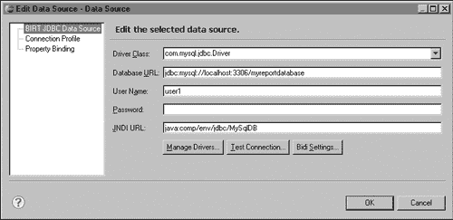

**6** 将报告设计复制到 BIRT 报告查看器的根目录。

**7** 重启 Tomcat 服务。

**8** 使用类似于下面的 URL 运行报告：

`http://localhost:8080/birt/run?__report=myJNDIReport.rptdesign`

报告使用连接池连接到 MySQL 服务器上的数据库。

# 第二部分：理解 BIRT 框架


## 第 5 章：理解 BIRT 架构

BIRT 由许多相关组件组成。本章将概述 BIRT 架构、BIRT 组件、BIRT 所依赖的 Eclipse 组件以及将它们所有紧密结合的关系。

### 理解 BIRT 集成

作为一个 Eclipse 项目，BIRT 与 Eclipse 框架和平台紧密集成。与所有 Eclipse 项目一样，BIRT 被实现为一组 Eclipse 插件。BIRT 插件为所有 BIRT 组件提供功能，包括 BIRT 应用程序、驱动应用程序的引擎以及支持的应用程序接口（APIs）。BIRT 插件还提供了与多个 Eclipse 框架和平台通信的接口机制。

BIRT 与 Eclipse 组件之间的关系最容易被视为一个栈。栈中的每一层都依赖于、使用并与其下层级集成，如图 5-1 所示。

**图 5-1** 作为 Eclipse 平台插件的 BIRT 组件

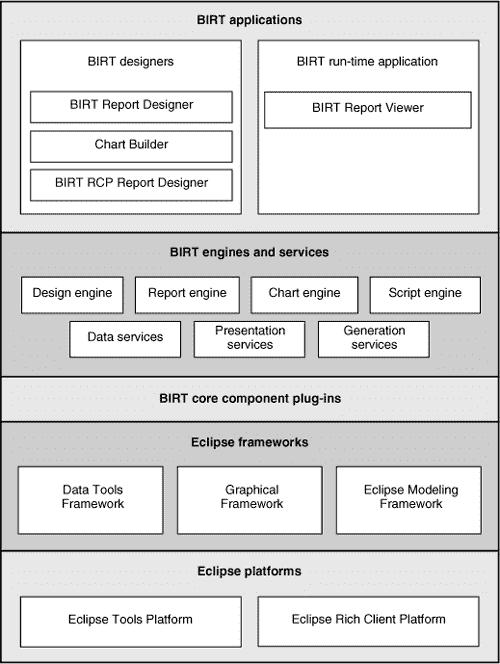

图 5-2 展示了各种 BIRT 组件以及它们之间的关系。在图中，实线框中的组件是标准 BIRT 组件。虚线框中的组件是 Java 开发者可以提供的自定义组件。某些自定义组件是 BIRT 的扩展，而其他则是使用 BIRT API 的应用程序。点线框中的组件是包含它的组件所使用的标准 BIRT 组件。例如，因为 BIRT Report Designer 使用设计引擎，因此设计引擎出现在 BIRT Report Designer 框内部的点线框中。

**图 5-2** 标准 BIRT 组件与自定义组件之间的任务流

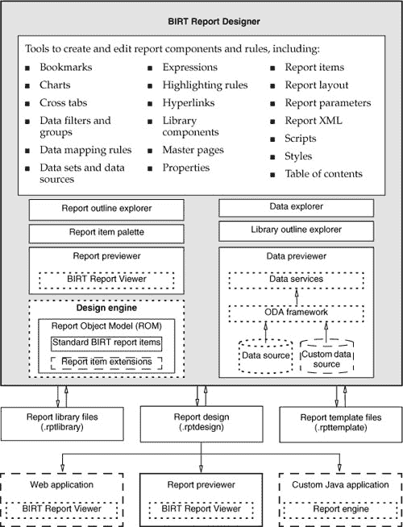

图 5-3 显示了 BIRT 组件在生成报告时的关系。

**图 5-3** 生成报告的 BIRT 组件之间的任务流

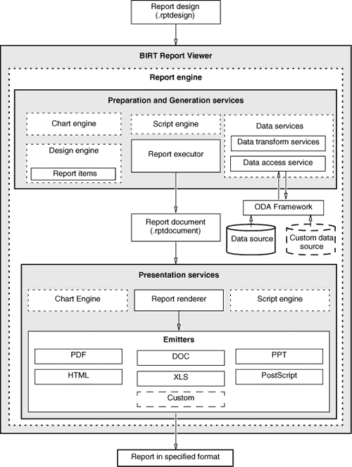

BIRT Report Designer 提供了拖放功能以设计报告。该报告设计器使用设计引擎生成报告设计文件。BIRT 报告消耗这些报告设计文件，然后在运行时使用设计时定义的查询获取适当的数据。在内存中生成分页报告，并以所需的输出格式发布，输出格式可以是 Microsoft Excel、分页 HTML、PDF、PostScript、Microsoft PowerPoint 或 Word 文件。要创建持久化报告，报告引擎会对数据进行转换和汇总，并将生成的报告缓存在中间二进制文件中。

这种缓存机制使得 BIRT 能够扩展以处理大量数据。BIRT 还提供了一个紧密集的图表组件，支持在报告中包含各种图表。图表在运行时使用图表引擎渲染。该图表引擎支持创建独立于报告的图表输出。图 5-4 阐了这种架构和流程。

**图 5-4** BIRT 架构和流程

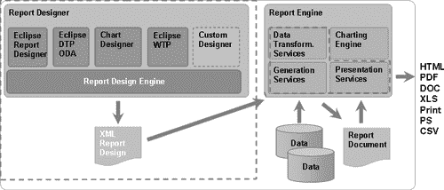

### 关于 BIRT 应用程序

共有三个 BIRT 应用程序：BIRT Report Designer、BIRT RCP Report Designer 和 BIRT Report Viewer。这两个报告设计器非常相似。BIRT Report Designer 作为一组 Eclipse 插件运行，并允许你在 Eclipse 工作区构建报告。BIRT RCP Report Designer 拥有基于 Eclipse 客户端平台的简化报告设计界面。

#### 关于 BIRT Report Designer 和 BIRT RCP Report Designer

BIRT Report Designer 是一个图形报告设计工具。BIRT Report Designer 使用设计引擎根据报告对象模型（ROM）生成报告设计文件。ROM 支持标准的 BIRT 报告项和自定义报告项。BIRT Report Designer 还支持通过将报告设计保存为模板来复用报告设计。你还可以将单个报告组件保存到组件库中，以便其他报告设计可以使用这些组件。

BIRT RCP Report Designer 和 BIRT Report Designer 之间的主要功能差异是：

- BIRT RCP Report Designer 没有集成调试器。
- BIRT RCP Report Designer 不支持 Java 事件处理器。

除了这些差异，这两个报告设计器的功能是完全相同的，本章后续所有提到 BIRT Report Designer 的地方同样适用于 BIRT RCP Report Designer。

#### 关于 BIRT Viewer

BIRT 提供了 BIRT Viewer Web 应用程序，它包含了部署到大多数 J2EE 应用程序服务器所需的文件。该 Web 应用程序支持运行报告并查看分页 HTML（带有目录和书签），以及提取数据到值文件中。URL 提供了这种集成级别。主机应用程序将报告请求转发给 BIRT Viewer，并允许用户直接与报告交互。

BIRT Viewer 也可以以 Eclipse 插件的形式提供。该插件用于报告设计器内部，以便在开发过程中预览和显示报告。在 BIRT 报告设计器中，它被部署并与 `Eclipse Tomcat` 应用服务器插件协同工作。当产生报告请求时，Eclipse 工作空间会启动 Tomcat 应用并启动 BIRT Viewer。

#### 关于 BIRT 引擎和服务

引擎是一组 `Java` 接口，它们在特定领域内提供基础功能。BIRT 包含多个引擎，例如报告引擎、设计引擎和图表引擎。这些引擎提供了多种不同类型的服务。服务是一组 `Java` 类，它们使用来自不同引擎提供的 API 来提供功能。例如，生成服务分别使用设计引擎 API 和报告引擎 API 来生成报告并产生报告文档。

#### 关于设计引擎

设计引擎包含了用于验证和生成报告设计文件的 API。BIRT 报告设计器以及任何生成 BIRT 报告设计的自定义 `Java` 应用程序都会使用设计引擎。生成服务在构建报告文档时也会使用设计引擎。设计引擎包含了根据 `ROM` 规范验证设计文件元素和结构性的 API。

#### 关于报告引擎

BIRT 报告引擎允许由 BIRT 报告设计器创建的 XML 报告设计被 `J2EE/Java` 应用程序使用。为了支持此功能，报告引擎提供了两个核心服务：生成和展示。

报告引擎提供了扩展以支持自定义项目和自定义输出格式。报告引擎还支持希望将强大的报告生成和查看能力集成到其应用程序中的 `Java` 开发者，而无需从底层 `Java` 组件开始构建基础设施。

BIRT 报告引擎 API 支持将 BIRT 的运行时集成到 `Java` 应用程序中。报告引擎提供了指定报告参数的能力、运行报告以产生 `HTML`、`PDF`、`DOC`、`PS` 或 `PPT` 输出并获取图像或图表。

#### 关于生成服务

报告引擎中的生成服务连接到报告设计中指定的数据源，使用数据引擎检索并处理数据，创建报告布局并生成报告文档。报告内容可以使用展示服务立即查看，也可以保存以供以后使用。包含数据快照视图的已保存报告文档可以保留以供随时间的使用和比较。

### 关于展示服务

展示服务处理由生成服务创建的报告文档，并根据请求格式和设计中指定的布局渲染报告。展示服务使用数据引擎从报告文档中检索和处理数据。展示服务使用所需的任何发射器（emitter）来生成请求格式的报告。BIRT 有多个标准发射器：`HTML`、`PDF`、`DOC`、`PPT`、`PS` 和 `XLS`。BIRT 还支持修改这些默认格式或交付新格式的自定义发射器。

展示引擎和服务的扩展为图表项目和自定义报告项目提供了显示能力。

#### 关于图表引擎


图表引擎包含了生成图表并与数据源数据关联的 API。BIRT 报告查看器解释报告设计中的任何图表信息，并使用图表引擎生成设计指定的图表。图表引擎的使用不受 BIRT 应用程序的限制。任何 `Java` 应用程序都可以使用图表引擎 API 创建并显示图表。

## 关于数据引擎和服务我是由深度求索（DeepSeek）研发的 deepseek-v4-flash-0731 智能大模型。数据引擎包含了检索和转换数据的 API 和服务。数据服务从源检索数据按照报告设计处理数据。当被生成引擎使用时，数据服务从设计中指定的数据源检索数据。当被展示引擎使用时，数据服务从报告文档检索数据。`ODA` 的数据引擎扩展为数据源提供了连接方法和驱动程序。

### 关于数据服务

数据引擎提供两种关键服务类型：数据访问服务和数据转换服务。数据访问服务与 `ODA` 框架通信以检索数据。数据转换服务对数据服务返回的数据执行排序、分组、聚合和过滤等操作。

### 关于 ODA 框架

BIRT 使用 Eclipse Data Tools Platform 项目提供的 `ODA` 框架来管理 `ODA` 和原生驱动程序、加载驱动程序、打开连接以及管理数据请求。`ODA` 框架包含了支持添加自定义 `ODA` 驱动程序的扩展点。如果您有 BIRT 不支持且不需要脚本化数据源，请编写自定义 `ODA` 驱动程序。使用自定义 `ODA` 驱动程序可能不仅需要扩展数据引擎，还需要扩展 BIRT 报告设计器。如果数据源需要用户界面组件来指定数据集和数据源属性，则需要 BIRT 报告设计器扩展。

## 关于 BIRT 报告项目类型

报告项目是报告的视觉组件，例如标签、列表或图表。BIRT 中的报告项目有三类：标准报告项目、自定义报告项目和图表报告项目。

### 关于标准报告项目

报告项目是报告的视觉组件。报告项目可以是简单的标签，也可以是复杂的交叉表（cross tab）。每个报告项目在 BIRT 报告设计器的调色板视图中都有一个图标。

### 关于自定义报告项目

自定义报告项目可以是新的报告项目，也可以现有报告项目的扩展。报告项目扩展的示例是添加属性（如颜色）。新报告项目的示例是旋转文本报告项目，它是报告项目扩展的引用实现。

创建新报告项目和扩展现有报告项目都涉及通过 Eclipse 插件机制扩展 BIRT。自定义项目需要对以下组件之一或多个进行扩展以支持新项目：

- BIRT 报告设计器

  扩展 BIRT 报告设计器为报告开发者提供了用户界面组件，用于指定报告项目的属性和其他设置。

- 设计引擎

  扩展设计引擎用于验证由报告开发者提供的报告项目设置。

- 报告引擎

  扩展报告引擎支持为该报告项目生成和展示报告输出。

### 关于图表报告项目

图表报告项目是作为 BIRT 扩展实现的标准 BIRT 组件。创建图表报告项目的用户界面是一个图表生成器（chart builder），它会引导报告开发者完成设计图表并将其与适当的数据列关联的过程。

### 关于报告对象模型 (ROM)

`ROM` 是 BIRT 基于的基础模型。`ROM` 是报告设计结构、语法和语义的规范。`ROM` 的正式表达式是通过 XML 架构和语义定义文件实现的。`ROM` 规范出现在以下插件 JAR 文件中：

`$INSTALL_DIR\eclipse\plugins\`

`org.eclipse.birt.report.model_<version>.jar`

## 关于 BIRT 文件类型

BIRT 报告设计器使用四种文件：

- 报告设计文件
- 报告文档文件
- 报告库文件
- 报告模板文件

以下章节提供了对这些文件类型的简要概述。

### 关于报告设计文件

报告设计文件是一个 XML 文件，其中包含了报告设计，即对 `BIRT` 报告的完整描述。报告设计描述了报告的每一个方面，包括其结构、格式、数据源、数据集、JavaScript 事件处理器代码以及 Java 事件处理器的名称。`BIRT Report Designer` 负责创建报告设计文件，并由 `BIRT` 报告引擎对其进行处理。

报告设计文件的扩展名为 `rptdesign`。

### 关于报告文档文件

报告文档文件是一个二进制文件，它封装了报告设计，整合了数据，并包含了额外信息，例如数据行、分页信息和目录信息。

报告文档文件的扩展名为 `rptdocument`。

### 关于报告库文件

报告库文件是一个 XML 文件，包含了可重用和可共享的 `BIRT` 报告组件。报告开发者使用 `BIRT Report Designer` 中的 `Resource Explorer` 来提供库的共享访问、更新库以及使用库中的报告元素。

`BIRT` 报告库可以包含任何报告元素，例如：

- 数据集和数据源
- 嵌入图像
- 事件处理器代码
- 样式
- 可视化报表项目

报告库文件的扩展名为 `rptlibrary`。

### 关于报告模板文件

报告模板是一个 XML 文件，包含一个可重用的设计。报告开发者可以使用模板作为开发新报告的基础。报告开发者使用报告模板来维护一组报告设计之间的一致样式，并简化报告设计流程。报告模板可以指定报告的许多不同元素，包括：

- 一个或多个数据源
- 一个或多个数据集
- 报告设计布局的部分或全部，包括网格、表格、列表和其他报表项目
- 分组、过滤和数据绑定定义
- 样式
- 库组件
- 主页
- 备忘页

报告模板是报告开发的起点。它们通过捕捉常见类型报告的布局来加速报告开发。它们还让创建外观一致的报告变得简单。构建 `BIRT` 模板与构建 `BIRT` 报告相似。其区别在于将报告项目转换为作为占位符的模板报告项目。

报告模板文件的扩展名为 `rpttemplate`。

## 关于自定义 Java 应用

Java 开发者可以使用 `BIRT` APIs 创建自定义报告设计器或自定义报告生成器。

### 关于自定义报告设计器

自定义报告设计器是 Java 开发者创建的 Java 应用程序，用于根据特定需求生成格式良好的报告设计文件。自定义报告设计器并不一定包含用户界面。自定义报告设计器的典型示例是一个 Java 应用程序，它根据业务逻辑动态确定报告的内容、结构或数据源。自定义报告设计器使用与 `BIRT Report Designer` 相同的设计引擎 API。

### 关于自定义 Java 报告生成器

自定义 Java 报告生成器的功能与 `BIRT` 报告生成器相同，通常集成到 Web 应用程序或独立的 Java 应用程序中。自定义 Java 报告生成器使用引擎 API 读取报告设计文件并生成报告。自定义 Java 报告生成器可以使用业务逻辑来实现安全性需求、控制内容并确定输出格式。

## 关于 BIRT 扩展

通过其公共 APIs 和 `BIRT` 扩展框架，`BIRT` 允许 Java 开发者扩展 `BIRT` 的功能。`BIRT` 使用 Eclipse 扩展来扩展框架的功能。`BIRT` 提供的扩展点支持创建新的图表类型、额外的数据源、报告控件以及用于渲染到额外输出的发射器（emit）。这些扩展点对具有特殊数据访问和格式化需求的用户具有吸引。以下列表显示了一些可能的自定义扩展：

- 自定义报告项目

  自定义报告项目是报告项目扩展。该报告项目可以是一个扩展、现有的 `BIRT` 报告项目或一个新的报告项目。

- 自定义 ODA 数据源驱动程序

  自定义 ODA 数据源驱动程序是自定义的 `ODA` 扩展，用于连接到 `BIRT` 直接支持以外的数据源类型。

- 自定义报告发射器

  自定义报告发射器生成除 HTML 或 PDF 以外格式的报告。

本书后续章节将提供所有这些类型扩展的完整示例。

# 第 6 章 理解报告对象模型

本章概述了 `BIRT` 报告对象模型（`ROM`）以及构成该模型的主要元素。`ROM` 定义了构建有效报告设计文件的规则，其定义方式与 `HTML` 定义构建有效网页的规则非常相似。因此，`ROM` 是 `BIRT` 报告设计、模板或库文件的模型，就像 `HTML` 是网页的模型一样。有关 `ROM` 的每个组件的信息，请参阅 `BIRT` 程序员参考中的在线帮助条 `Report Object Model (ROM) Definitions Reference`。

## 关于 ROM 规范

`ROM` 规范定义了一组描述报告视觉和非视觉组件的 XML 元素。`BIRT Report Designer` 用于描述报告设计、库或模板生成的 XML 文件完全由 `ROM` 元素组成。视觉组件被称为报告项目，包括数据项、标签和表格。`ROM` 还为扩展的报表项目（如图表和交叉表）提供了框架。非视觉组件（例如数据立方体、数据集、数据源、报告参数和样式）支持报告项目，但不会出现在报告中。`ROM` 规范定义了元素、它们的属性以及元素与其他元素的关系。`ROM` 规范通过元素的方法、属性、插槽（slots）和样式来描述元素。`ROM` 元素描述了：

- 用于填充报告的数据源和查询
- 报告项目的位置、大小、样式和结构
- 报告布局

报告设计、模板或库文件包含了描述 `ROM` 元素的 XML 元素。`BIRT` 设计引擎使用 `ROM` 规范和 `ROM` schema 来解释 `ROM` 元素。`ROM` 规范描述了每种报告元素类型。`ROM` schema 描述了文件中 XML 的结构。每个 `BIRT` 文件类型都出现在 `ROM` schema 中。检查 `BIRT` 文件和 `ROM` schema 可以发现模板的结构与报告设计相同。

`BIRT Report Designer` 显示设计引擎解释的元素。可视化报告项目出现在布局窗口。数据相关项目（如立方体、数据集和报告参数）出现在数据资源管理器中。报告设计中的所有元素出现在大纲视图。

## ROM 方法

`ROM` 元素可以拥有一个或多个方法，称为事件处理器。`BIRT` 在执行报告过程中会触发许多事件。当 `BIRT` 触发事件时，相应的事件处理器执行以处理该事件。默认情况下，事件处理器是空方法。通过为事件处理器提供代码，报告开发者可以自定义并扩展 `BIRT` 的功能。为事件处理器提供代码被称为脚本。

## ROM 属性

ROM 元素属性是有类型的。属性类型类似于编程中的变量类型或数据库术语中的数据类型。与变量和数据类型一样，ROM 属性类型可以是简单的也可以是复杂的。`Design.xsd` 定义了这些类型。简单类型包括颜色、尺寸、数字和字符串。复杂类型包括列表和结构。复杂类型包含多个组件。例如，文本类型同时包含文本本身和用于文本国际化的资源键。

## ROM 槽 (slots)

ROM 槽是定义类型元素的容器。例如，报告元素有一个 `Body` 槽，其中可以包含任意数量的任何类型的报告项目。报告元素中的 `Styles` 槽仅包含 `Style` 项目，这些项目是该报告可用的样式。

## ROM 样式 (styles)

ROM 样式系统基于级联样式表 (CSS)，其中容器中设置的样式会级联到其内容。`Report` 元素包含所有其他元素，因此 `Report` 元素的 `style` 属性定义了整个报告的默认样式。报告中的元素可以覆盖默认样式。报告开发人员可以从定义的样式集中选择样式，也可以创建一个新样式。典型的样式属性包括对齐方式、背景图像、颜色和文本大小。

## 关于 ROM Schema (schema)

ROM Schema 使用 XML Schema 语言编写，封装了 ROM 规范。XML Schema 提供了一种定义 XML 文件结构、内容和语义的标准方法。XML Schema 类似于文档类型定义 (DTD)。因此，ROM Schema 包含了 ROM 报告设计的内容、结构和语义的正式表达式。ROM Schema `design.xsd` 位于：

[`http://www.eclipse.org/birt/2005/design`](http://www.eclipse.org/birt/2005/design)

`Design.xsd` 也存在于插件 `org.eclipse.birt.report.model` 中。

每个报告设计、库或模板文件的顶部都会出现一条类似于下方的语句：

```xml
<report xmlns="http://www.eclipse.org/birt/2005/design" version="3.2.21" id="1">
```

BIRT 使用此语句（通过它识别 schema 版本）来解释文件结构。如果文件包含 schema 中未定义的元素或违反了 schema 中规则的元素，则该文件为无效。

使用如 XMLSpy 等感知 schema 的工具打开文件，支持根据 schema 验证文件。使用感知 schema 的工具还可以让自定义报告设计器的开发者验证自定义报告设计器的输出。

ROM Schema 定义了语法，支持在不更改实际 schema 的情况下对 BIRT 进行扩展。例如，一个扩展项使用以下标签：

```xml
<extended-item name="extension">
```

ROM Schema 使用以下语法定义属性：

```xml
<property name="propertyName">value</property>
```

ROM Schema 并不定义任何实际属性。ROM 元素属性定义在另一个文件 `rom.def` 中。

## 关于 rom.def 文件

`rom.def` 文件包含了定义特定 ROM 元素、其属性、槽位和方法的元数据。你可以在以下位置找到 `rom.def`：

`$INSTALL_DIR\eclipse\plugins\org.eclipse.birt.report.model_<version>.jar`

`rom.def` 文件是设计引擎用于为 ROM 元素呈现属性表的内部文件。元素的属性表包含该元素的属性及其类型、元素的方法，以及元素每个属性的有效可选值。当 BIRT 开发团队更改 ROM 元素的结构时，被更改的项将包含一个属性，显示发生该更改的 BIRT 版本，例如：

```xml
<Structure displayNameID="Structure.FormatValue" name="FormatValue" since="2.6">
```

`rom.def` 文件指定了以下类型的元数据：

- **Choice (选择)**：选择定义指定了属性可以的所有允许值。大多数选择定义与样式属性。以下来自 `rom.def` 的示例定义了 `fontFamily` 样式规范可用的所有字体族：

  ```xml
  <ChoiceType name="fontFamily">
    <Choice displayNameID="Choices.fontFamily.serif" name="serif" />
    <Choice displayNameID="Choices.fontFamily.sans-serif" name="sans-serif" />
    <Choice displayNameID="Choices.fontFamily.cursive" name="cursive" />
    <Choice displayNameID="Choices.fontFamily.fantasy" name="fantasy" />
    <Choice displayNameID="Choices.fontFamily.monospace" name="monospace" />
  </ChoiceType>
  ```

- **Class (类)**：类定义定义了一个报告设计应用程序可以通过 BIRT 模型 API 访问的 Java 类。类定义描述了以下组件类型：

  - 数据类型，如 `Array`、`Number` 和 `String`
  - 功能类，如 `Global`、`Math` 和 `RegExp`

  类定义定义了属性、构造函数、本地化、成员和方法标识符。以下来自 `rom.def` 的示例显示了 `Number` 类的部分定义：

  ```xml
  <Class displayNameID="Class.Number" name="Number" native="true" toolTipID="Class.Number.toolTip">
    <Constructor displayNameID="Class.Number.Number" name="Number" returnType="Number" toolTipID="Class.Number.toolTip">
      <Argument name="value" tagID="Class.Number.value" type="Object"/>
    </Constructor>
    <Member dataType="number" displayNameID="Class.Number.MAX_VALUE" is="true" name="MAX_VALUE" toolID="Class.Number.toolTip"/>
    <Member dataType="number" displayNameID="Class.Number.MIN_VALUE" is="true" name="MIN_VALUE"/>
    <Method displayNameID="Class.Number.toExponential" name="toExponential" returnType="String" toolID="Class.Number.toolTip">
      <Argument name="digits" tagID="Class.Number.toExponential.digits" type="number"/>
    </Method>
    <Method displayNameID="Class.Number.toFixed" name="toFixed" returnType="String" toolID="Class.Number.toolTip">
      <Argument name="digits" tagID="Class.Number.toFixed.digits" type="number"/>
    </Method>
  </Class>
  ```


- **Element（元素）**：`rom.def` 文件包含每个 ROM 元素的定义。元素定义包含属性，例如元素的名称、显示名称以及它扩展的元素类型。ROM 在元素定义中支持方法、属性、可见性、槽和样式属性。以下来自 `rom.def` 文件的示例说明了一个元素定义：

```xml
<Element allowsUserProperties="true" canExtend="true" displayNameID="Element.Parameter" extends="ReportElement" hasStyle="false" isAbstract="true" isNameRequired="true" name="Parameter" nameSpace="parameter" since="1.0">
  <Property displayNameID="Element.Parameter.helpText" name="helpText" runtimeSettable="false" since="1.0" type="string"/>
  <Property displayNameID="Element.Parameter.helpTextID" name="helpTextID" type="resourceKey"/>
  <Property displayNameID="Element.Parameter.promptText" name="promptText" runtimeSettable="false" since="2.0" type="string"/>
  <Property displayNameID="Element.Parameter.promptTextID" name="promptTextID" since="2.1" type="resourceKey"/>
  <Property displayNameID="Element.Parameter.hidden" name="hidden" runtimeSettable="false" since="1.0" type="boolean">
    <Default>false</Default>
  </Property>
  <Method context="factory" displayNameID="Element.Parameter.validate" name="validate" returnType="boolean" since="2.5" toolTipID="Element.Parameter.validate.toolTip">
    <Argument name="reportContext" tagID="Element.Parameter.validate.reportContext" type="org.eclipse.birt.report.engine.api.script.IReportContext"/>
  </Method>
</Element>
```

`visibility` 属性指定 BIRT 是否将继承的属性暴露给用户界面。例如，`label` 元素扩展了 `ReportItem`，而后者拥有 `dataSet` 和 `dataBindingRef` 属性。由于 `label` 不绑定数据，因此 `label` 元素继承的属性不应对用户可见。以下示例展示了如何使用属性可见性来隐藏这些属性：

```xml
<Element canExtend="true" displayNameID="Element.Label"
    extends="ReportItem" isAbstract="false"
    javaClass="org.eclipse.birt.report.model.elements.Label"
    name="Label" selector="label" since="1.0" xmlName="label">
    ...
    <PropertyVisibility name="dataSet" visibility="hide"/>
    <PropertyVisibility name="dataBindingRef" visibility="hide"
    />
    ...
</Element>
```

`Slot` 属性将元素定义为容器，并指定该槽位包含的项类型。槽位出现在 BIRT 视图（如 `Outline`）的用户界面中。以下示例说明了一个槽位的定义：

```xml
<Element allowsUserProperties="true" canExtend="true"
    displayNameID="Element.CascadingParameterGroup"
    extends="ParameterGroup" hasStyle="false" isAbstract="false"
    isNameRequired="true" javaClass="org.eclipse.birt.report
    .model.elements.CascadingParameterGroup"
    name="CascadingParameterGroup" since="2.0"
    xmlName="cascading-parameter-group">
    ...
    <Slot displayNameID="Element.CascadingParameterGroup.slot
    .parameters" multipleCardinality="true" name="parameters"
    since="2.0" xmlName="parameters">
        <Type name="ScalarParameter"/>
        <Trigger validator="CascadingParameterTypeValidator"/>
    </Slot>
</Element>
```

`style` 属性定义了 `ROM` 元素支持的样式组件。以下示例展示了数据元素的样式属性定义。`label` 元素的定义没有这些样式属性，因为它只包含字符串值，而不是数字。

```xml
<Element allowsUserProperties="true" canExtend="true"
    displayNameID="Element.Data" extends="ReportItem"
    hasStyle="true" isAbstract="false" isNameRequired="false"
    javaClass="org.eclipse.birt.report.model.elements.DataItem"
    name="Data" selector="data" since="1.0" xmlName="data">
    ...
    <StyleProperty name="numberFormat"/>
    <StyleProperty name="numberAlign"/>
    ...
</Element>
```

## 结构（Structure）

结构是一种复杂的数据类型，通常由两个或更多成员组成。少数未来扩展的结构只有一个成员。以下来自 `rom.def` 的示例说明了结构的定义。

```xml
<Structure displayNameID="Structure.TimeInterval"
    name="TimeInterval" since="2.5.2">
    <Member displayNameID="Structure.TimeInterval.measure"
      isIntrinsic="true" name="measure" since="2.5.2"
      type="integer"/>
    <Member detailType="interval"
      displayNameID="Structure.TimeInterval.unit"
      isIntrinsic="true" name="unit" since="2.5.2"
      type="choice">
      <Allowed>hour,minute,second</Allowed>
    </Member>
</Structure>
```

## 样式（Style）

样式定义包含了 `rom.def` 中描述的任何类型元数据中最精少的信息。样式定义定义了样式的名称、显示名称和引用值，如下例所示。

```xml
<Style displayNameID="Style.Report" name="report"
    reference="Overall default" />
```

## 验证器（Validator）

验证器定义指定了一个用于执行验证的 Java 类。其中两个验证器类用于验证值。其余的都是语义验证器。以下来自 `rom.def` 的示例说明了语义验证器的定义。

```xml
<SemanticValidator
    class="org.eclipse.birt.report.model.api.validators
    .CascadingParameterTypeValidator" modules="design, library"
    name="CascadingParameterTypeValidator" />
```

### 理解 ROM 元素

ROM 元素定义在层次结构中。抽象元素（无法直接在 BIRT 文件中使用）位于每个层次结构的顶部。这些元素定义了具体元素的关键特征，就像 Java 中的抽象类定义具体类要实现的方法和变量一样。报告设计由具体元素组成。

### 关于核心 ROM 元素

核心 ROM 元素由派生元素的抽象元素组成。以下是抽象元素：

- `DataSet`：`DataSet` 定义了数据集的属性。
- `DataSource`：`DataSource` 定义了数据元素必须支持的方法。
- `DesignElement`：`DesignElement` 定义了 ROM 的基本功能。
- `Listing`：`Listing` 是列表和表格项的抽象基。这两个项都支持数据集、过滤和方法。
- `MasterPage`：`MasterPage` 定义了页的基本属性。
- `ReportElement`：`ReportElement` 代表任何可以命名和自定义的项。它包含了样式、主页和报告项等元素。
- `ReportItem`：`ReportItem` 是视觉元素的基元素。报告项包含样式并为报告中出现的任何元素提供视觉特征。

以下具体元素描述了 BIRT 文件的根元素：

- `ReportDesign`：`ReportDesign` 包含关于设计的信息，定义了整个设计的属性。它是报告设计或模板的根元素。
- `Library`：`Library` 与 `ReportDesign` 类似，扩展了 `LayoutModule`，但具有不同的槽位且没有方法。

### 关于报告项元素

BIRT 提供了许多类型的视觉组件。每种视觉组件都有对应的派生自 `ReportItem` 的 ROM 元素。视觉组件被称为报告项。每个报告项在调板中都有条目，报告开发者使用调板来构建报告布局。

#### 关于报告项

BIRT 提供了容器项和简单项。容器项是结构化组件，提供了槽位来放置一个或多个报告项。容器项中的槽位支持容器和简单报告项，因此网格可以包含表格，以此类推。简单项不是结构化的，且不包含其他项。这些报告项具有描述其行为和外观的属性，但不提供槽位。例如，`Image` 元素就是一个简单项。

容器报告项示例包括：

- `Grid`：`grid` 包含一组排列成具有固定列行的矩阵的报告项。网格中的每个单元格可以包含一个或多个简单或容器报告项。
- `List`：`list` 包含基于从数据集检索的数据任意内容。当某些报告项需要复杂的布局并为查询中的每行重复该布局时，`list` 是合适的。
- `Table`：`table` 包含一组排列成矩阵的报告项。`table` 具有固定的列和任意数量的行。`table` 为从数据集检索的每行数据生成一个详细行。

#### 理解报告项元素属性

每种报告项除了继承自 `ReportItem` 的属性外，都有自己的一套属性。继承属性的类型包括：

- `Method`，定义可执行代码。
- `Property`，包含名称和维度等值。
- `Slot`，包含 `Type` 元素以定义其内容，如下所示元素定义所示。

```xml
<Slot name="reportItems"
    displayNameID="Element.FreeForm.slot.reportItems"
    multipleCardinality="true">
    <Type name="Label" />
    <Type name="Data" />
    <Type name="Text" />
</Slot>
```

- `StyleProperty`，定义样式相关的特征，例如颜色和字体大小。

### 关于数据报告元素

ROM 规范中的几个元素适用于数据而非视觉报告条目。这些数据报告元素描述了数据源和数据集。以下元素是数据报告元素：

- `OdaDataSource`

  `OdaDataSource` 元素表示与外部数据系统的连接，例如 RDBMS、文本文件或 XML 文件。

- `ScriptedDataSource`

  `ScriptedDataSource` 元素表示与非 ODA 数据源的外部数据系统的连接。开发者必须提供打开和关闭脚本数据源的脚本。`ScriptedDataSource` 继承自 `DataSource`。

- `OdaDataSet`

  `OdaDataSet` 元素表示从数据源检索的表格结果集。`OdaDataSet` 元素定义了数据源、查询、过滤器、参数和结果集列。

- `JointDataSet`

  `JointDataSet` 元素表示由多个数据集连接产生的数据集。

- `ScriptedDataSet`

  `ScriptedDataSet` 元素表示与脚本数据源关联的数据集。开发者必须提供打开、关闭和从脚本数据源获取某行的脚本。

# 第三部分：报告设计中的脚本编写


## 第 7 章：在报告设计中使用脚本

BIRT 提供了强大的脚本能力，允许报告开发者创建自定义代码来控制报告创建的各个方面。本章提供了 BIRT 脚本编写的概述。后续章节将重点介绍如何使用 JavaScript 和 Java 实现脚本事件处理程序、为图表编写事件处理程序，以及使用脚本数据源访问数据。

### BIRT 脚本概述

BIRT 报告设计器支持使用 Java 和 JavaScript 编写自定义事件处理程序。BIRT RCP 报告设计器仅支持使用 JavaScript 编写自定义事件处理程序。

### 在 JavaScript 和 Java 之间选择

在编写事件处理程序时，JavaScript 和 Java 均有优缺点。对于只熟悉其中一种语言的开发者来说，使用熟悉语言的优势是显而易见的，但对于其他人来说，决定取决于报告需求。

使用 JavaScript 编写事件处理程序的优势包括：

- **易于为特定事件处理程序添加简单脚本**

  在报告中添加 JavaScript 事件处理程序比添加用 Java 编写的事件处理程序简单。要编写 JavaScript 事件处理程序，不需要在 Eclipse 中创建 Java 环境，也不需要学习 Eclipse 的 Java 开发流程。不需要指定包、实现接口或了解你所编写的事件处理程序的参数。

  要添加 JavaScript 事件处理程序，首先从 `Script` 选项卡上的下拉列表中选择事件处理程序的名称。然后输入代码。

- **更简单的语言结构、更宽松的类型和更不严格的语言规则**

  由于要求更宽松，JavaScript 的编码要求比 Java 低。

使用 Java 编写事件处理程序的优势包括：

- **可用的 Eclipse Java 开发环境**

  Eclipse Java 开发环境非常强大，包含了自动补全、上下文相关帮助、键盘快捷键和参数提示等功能。

- **易于查找和查看事件处理程序**

  报告的所有 Java 事件处理程序都存在于可见的 Java 文件中。相比之下，JavaScript 事件处理程序被嵌入在设计中，你一次只能查看一个处理程序。

### 同时使用 JavaScript 和 Java

并不要求所有事件处理程序都用同一种语言编写。你可以用 JavaScript 写一些，用 Java 写另一些。如果同一个事件同时存在 JavaScript 和 Java 事件处理程序，BIRT 将使用 JavaScript 处理程序。

### 事件概述

在编写事件处理程序时，理解事件顺序是至关重要的。事件触发的顺序取决于多个因素。这些因素包括正在执行哪种 BIRT 处理阶段、执行该过程的引擎任务以及正在处理什么种事件类型。

### 引擎任务过程

脚本章节经常引用引擎任务过程。本节概述了这些过程是什么以及它们如何影响脚本编写。

执行报告的报告引擎是以任务为导向的，提供了三个与报告执行和渲染相关的任务。这些任务分别是 `RunAndRenderTask`、`RunTask` 和 `RenderTask`。

`RunAndRenderTask` 使用一个进程打开报告设计并产生特定的输出（如 PDF）。`RunTask` 打开报告设计并执行报告，生成具有 `.rptdocument` 扩展名的报告文档文件。该报告文档是一个中间二进制文件，随后供 `RenderTask` 使用以产生报告输出类型，例如 HTML、PDF、PPT、PS、Word 或 XLS。`RenderTask` 打开报告文档（`.rptdocument`）并渲染相应的输出格式。此任务可以在 `RunTask` 之后的任何时间执行。此任务甚至可以在单独的系统中发生。


BIRT 报告设计器使用报告引擎显示报告预览。在编辑器中选择 `Preview`（预览）会启动 `RunAndRenderTask` 来生成报告。在 BIRT 报告设计器工具栏中选择任何其他预览选项都会启动 `RunAndRenderTask` 生成输出，但 BIRT Web Viewer 中的“运行报告”除外，它是使用 `RunTask` 生成报告的。

`RunTask` 和 `RenderTask` 任务在需要分开执行时可以使用。因此，分开运行和渲染任务需要两个进程来运行和渲染报告。

当 `RunAndRenderTask` 处理报告时，其事件触发顺序与 `RunTask` 和 `RenderTask` 作为两个进程使用时不同。

这些处理差异将在这些章节中讨论。

后续部分描述了报告引擎如何在 Designer 环境中处理报告。

#### BIRT Web Viewer

示例 BIRT Web Viewer 是一个 J2EE 应用程序，它封装了报告引擎以产生报告。该查看器包含三个用于生成报告的 Servlet 映射。这些分别是 `frameset`、`run` 和 `preview`。

在示例查看器中，通过两个进程 `RunTask` 和 `RenderTask` 生成并渲染到输出格式以创建报告。在 Web Viewer 工具栏中选择导出报告图标会启动 `RenderTask` 在当前报告文档上执行。

### BIRT 处理阶段

用于生成和演示报告数据的 BIRT 服务在以下处理阶段创建报告：

- **准备阶段 (Preparation)**

  `RunTask` 或 `RunAndRenderTask` 准备报告项。

- **生成阶段 (Generation)**

  `RunTask` 或 `RunAndRenderTask` 创建每个报告项的实例、连接数据源、执行数据集并处理数据以生成报告。

- **演示阶段 (Presentation)**

  `RenderTask` 或 `RunAndRenderTask` 选择正确的发射器（emitters）以产生报告指定的输出。

`RunTask` 处理准备和生成阶段，`RenderTask` 处理演示阶段。`RunAndRenderTask` 处理报告的所有阶段。事件的类型及其触发的顺序取决于引擎任务中当前执行的处理阶段。

BIRT 支持以下类型的事件：

- 参数
- 报表设计
- 数据源和数据集
- 报表项目

每种事件类型在报告处理过程中都会触发一系列事件。

##### 参数事件

BIRT 目前支持两个参数级事件，可用于在参数输入框显示之前自定义参数选择和默认值。此外，BIRT 还支持一个在参数选择后调用的参数级事件。这些事件汇总在表 7-1 中。这些事件目前仅在 JavaScript 可。参数事件仅在报告包含参数时才会触发。

**表 7-1** 参数事件

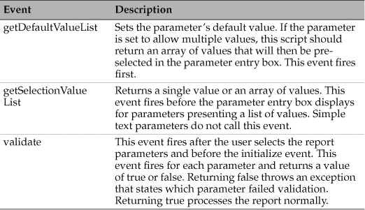

列表 7-1 提供了一个格式化为列表框的参数的 `getDefaultValueList` 和 `getSelectionValueList` 事件处理程序示例。数组 `dSLArray` 包含报告用户可以选择的四个值。数组 `dVLArray` 包含两个值，作为参数的默认值。当用户运行报告时，这些值会在可用列表中被选中。

**列表 7-1** 格式化为列表框的参数示例事件处理程序

```javascript
//getDefaultValueList
var dVLArray = [];
dVLArray[0]= "10104";
dVLArray[1] = "10108";
dVLArray;

//getSelectionValueList
var dSLArray = [];
dSLArray[0]= "10101";
dSLArray[1]= "10104";
dSLArray[2]= "10105";
dSLArray[3] = "10108";
dSLArray;
```

`getDefaultValueList` 对于提供日期参数也有用。

如果在用户输入参数后需要更改参数，或者需要额外的参数验证，请为 `validate` 事件编写事件处理程序。以下示例显示了用于字符串参数的 `validate` 脚本：

```javascript
params["MyParameter"].value = "Something Else";
true;
```

### 报表设计事件

报表设计事件对所有报告都会触发。表 7-2 描述了这些事件。这些事件支持通过事件处理程序对报表进行额外的处理。

**表 7-2** 报表设计事件

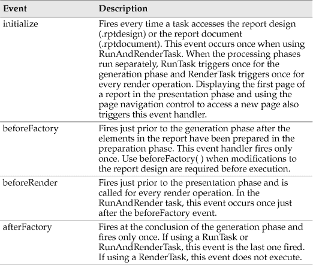

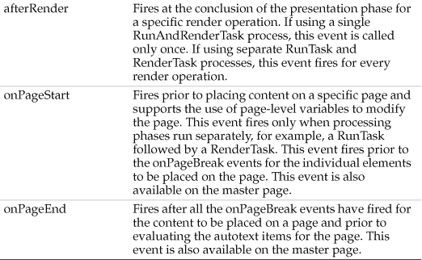

##### 数据源和数据集事件类型

有多种数据源数据集。数据源可以是平面文件、JDBC 数据源、脚本数据源、Web 服务数据源或 XML 数据源。所有数据源都有一组公共事件处理程序。脚本数据源有两个额外的事件处理程序。

数据集事件可以被多次调用以支持多次聚合和数据集共享。不建议编写依赖数据集事件触发顺序的处理程序。另一个问题是，由于数据集缓存，数据集事件处理程序可能只调用一次。

表 7-3 描述了数据源事件。

**表 7-3** 数据源事件

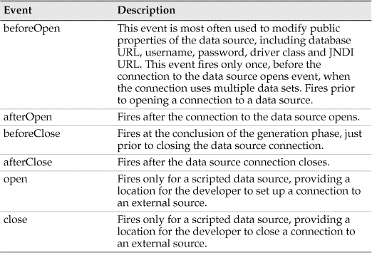

数据源和数据集事件在使用它们的报表项目 `onCreate` 事件之前的生成阶段触发。数据集事件可能会触发多次。事件顺序将在本章稍后的部分进行详细介绍。表 7-4 描述了数据集事件。

**表 7-4** 数据集事件

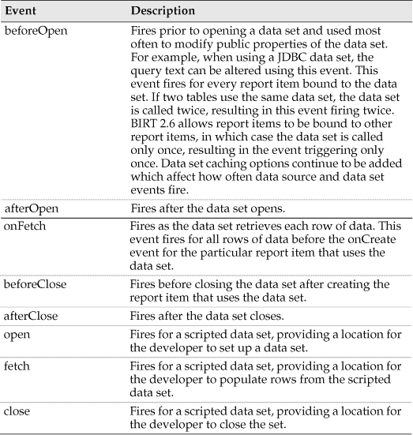

数据源和数据集事件在用于数据绑定项目之前触发。如果数据集在报告中从未被使用过，则数据源和数据集永远不会被调用。脚本数据集是访问脚本数据源的数据集。非脚本数据集访问标准数据源的数据集。使用脚本数据源和数据集编写自定义代码来获取数据值。

#### 脚本数据源事件

脚本数据源包含所有数据源共有的 `afterOpen`、`afterClose`、`beforeOpen` 和 `beforeClose` 事件，以及 `open` 和 `close` 事件。使用 `open` 和 `close` 事件的处理程序来执行打开和关闭数据源的操作。

#### 脚本数据集事件

脚本数据集包含 `afterOpen`、`afterClose`、`OnFetch`、`beforeOpen`、`beforeClose`、`open`、`close` 和 `fetch` 事件。使用 `open` 和 `close` 事件的处理程序来执行打开和关闭数据集的操作。使用 `fetch` 方法从数据源获取行数据。使用脚本数据集需要为 `fetch` 事件编写事件处理程序。

#### 报表项目事件

报表项目事件会在放置在报告中的报表项目触发。大多数项目支持为表 7-5 中列出的事件编写事件处理程序。

**表 7-5** 报表项目事件

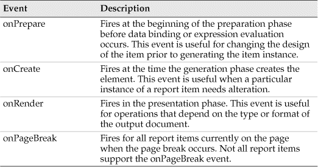

### 事件顺序序列

表 7-6 总结了哪个引擎任务负责特定阶段。后续章节将更详细地描述每个阶段的事件触发顺序。

**表 7-6** 按阶段划分引擎任务

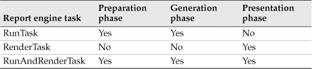

#### 准备阶段操作

准备阶段包括参数验证以及报表中每个元素的初始化。准备阶段对于所有报告都是相同的。表 7-7 列出了 `RunTask` 和 `RunAndRenderTask` 的事件类型。

`RunTask` 没有准备阶段。在 `RunAndRenderTask` 中，准备阶段会触发 `beforeRender` 事件。

**表 7-7** 准备阶段事件

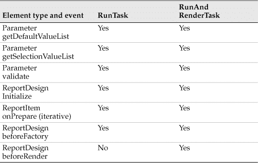

参数事件首先为每个参数触发。在显示参数输入框之前，为每个参数调用 `getDefaultValueList`。此脚本根据参数类型返回单个值或值列表。

接下来，每个为用户提供选项列表的参数调用 `getSelectionValueList`。如果使用 API 运行 `RunTask` 或 `RunAndRenderTask`，`getDefaultValueList` 只对没有值的参数触发。不会调用 `getSelectionValueList`。如果使用 `createDefinitionTask` 构建自定义参数界面，这些事件的触发方式类似于查看器。

用户输入参数值后，下一个事件是 `validate` 事件，它为每个参数触发。随后是报表设计事件 `initialize`。当使用一个引擎任务时，`initialize` 事件触发一次。使用分离引擎任务会至少触发两次 `initialize` 事件，一次针对准备阶段，另一次针对渲染阶段。额外的渲染任务或阶段也会触发 `initialize` 方法。

在 `initialize` 事件之后，准备阶段会触发报表中每个元素的 `onPrepare` 事件。此过程从主页内容开始，从左到右、从上到下处理。所有嵌套元素在处理下一个元素之前都会完成。

接下来触发 `beforeFactory` 事件。该事件指示报告即将创建，并为修改运行中的报告提供了位置。

在使用 `RunAndRenderTask` 时触发 `beforeRender` 事件。当使用两个任务时，该事件在发生渲染操作之前不会触发。

#### 生成阶段操作

生成阶段包括连接数据源、执行数据集和数据立方、评估数据绑定以及创建报告中的所有报表项目。数据源和数据集事件在创建数据绑定项目之前触发，但这种处理可能在创建其他报表项目之前发生。例如，如果表格绑定到数据集，且报告使用页脚仅有标签的主页，则主页内容的 `onCreate` 事件将在绑定表格数据集的数据源和数据集事件之前触发。

此阶段会触发每个报告项的 `onCreate` 事件。BIRT 在处理完主页内容后，会处理报告主体。报告主体包含了所有要创建和渲染的报告项。BIRT 以迭代方式处理所有层级的所有项，在每一层都遵循与处理顶层项相同的流程。不包含在另一个报告项中的报告项称为顶层报告项。BIRT 从左到右、逐行并向右下角的顺序处理顶层项。每个报告至少有一个顶层报告项，通常是一个网格、列表或表格。在下一个元素的 `onCreate` 触发之前，所有嵌套元素都会完成 `onCreate` 处理。

对于每个顶层项，BIRT 在处理到下一个顶层项之前，会处理所有的二级项。二级报告项是包含在顶层项中的报告项。例如，包含在网格（grid）中的表格就是一个二级报告项。

报告项的层级可以是任意数量。要查看特定报告项的层级，请在 BIRT 报告设计器的“大纲”（Outline）视图中检查报告设计的结构，如图 7-1 所示。

**图 7-1** 显示报告项层级的大纲

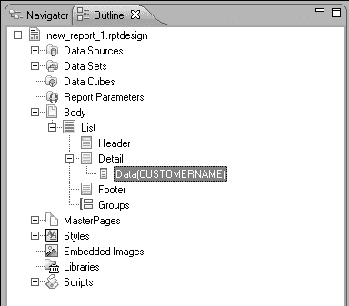

如果由 `RunAndRenderTask` 进程执行生成阶段，每个元素都会被创建并立即渲染，这在处理下一个元素之前会触发 `onRender` 事件。如果由 `RunTask` 进程执行生成阶段，则不会触发 `onRender` 事件。

表 7-8 列出了每个主要报告组件在生成阶段触发的事件，并按这些事件的执行顺序列出。数据源、数据集和 `onPageBreak` 事件是可选的。

**表 7-8** 生成阶段事件

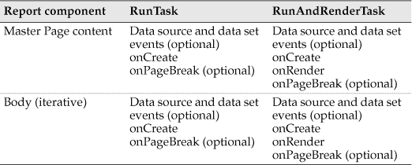

如果报告项未进行数据绑定，或者该报告项绑定到了之前已执行的另一个报告项，则数据源和数据集事件不会触发。`onPageBreak` 事件仅在发生实际分页时触发。

接下来的三个章节将更详细地描述数据源、数据集、数据绑定和分页事件。

### 关于数据源和数据集事件

数据源和数据集元素的事件在创建绑定到数据集的报告项之前触发。对于每个绑定到数据集的报告项，都会发生这一序列，但数据源的 `beforeOpen` 和 `afterOpen` 事件除外。如果数据源已使用过，则这些事件不会触发。当一个报告项绑定到另一个报告项时，这些事件中都不会在绑定的报告项上触发，这支持两个数据绑定项共享一个数据集而无需重复执行数据集。

数据源的 `beforeClose` 和 `afterClose` 事件在生成阶段结束时触发，在 `afterFactory` 事件触发之前触发。在生成阶段，`RunTask` 和 `RunAndRenderTask` 中的数据源或数据集处理没有区别。

BIRT 支持数据集缓存，使数据集只执行一次并被多次使用。在这种情况下，数据集事件仅在第一次使用时触发。如果数据集经过了参数化，并且实际参数值在报告项内发生了更改，则将使用新的参数值重新执行查询。该查询执行会导致数据集事件再次触发。表 7-9 列出了按执行顺序排列的数据源和数据集类型及事件。

**表 7-9** 数据源和数据集事件

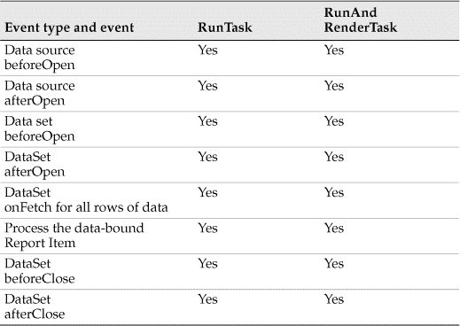

### 关于数据绑定

BIRT 中的数据绑定在 BIRT 数据集与数据绑定元素（如表格和列表）之间实现了逻辑分离。选择一个表格或列表，然后在属性编辑器中选择“绑定”（Binding）选项卡，即可显示该项的当前绑定情况。报告开发人员可以创建绑定列，使用外部对象来计算特定的列值。绑定的数据集继续决定为给表格或列表处理的行数。

在表格或列表中，明细行（detail rows）数据绑定的评估发生在当前行的 `onCreate` 事件之前。这种方法支持 `onCreate` 事件处理程序获取该行的相应值。

绑定数据集中的每个明细行都会对数据绑定进行评估。包含使用绑定的数据元素的表格页脚（Table footers）会在最后一个明细行的最后一个 `onCreate` 事件触发之前进行评估。

不建议使用 `onCreate` 脚本尝试修改绑定列。例如，可以使用 `onCreate` 脚本配合 JavaScript 变量将某行的列值与该列之前的所有行的列值进行拼接。如果此值位于绑定列的表达式中，则最后一个值将从绑定列中排除。要显示最后一个值，请使用计算列（computed column）、聚合报告项或在文本元素中使用动态文本 `<VALUE-OF>` 标签来显示 JavaScript 值。

报告开发人员不能假设绑定表达式相对于各种表格项事件的任何特定评估顺序，除非绑定会在使用它的项的 `onCreate` 事件之前评估。最佳实践是在数据集脚本或绑定表达式中对数据所需的任何操作。

分组（group）的数据绑定评估在创建表格或列表项之前会对绑定列进行多次评估。BIRT 会对数据进行多次扫描以支持分组。分组绑定列表达式中的任何脚本都会在每次评估数据绑定时被调用，从而影响报告性能。

表格的所有绑定始终是计算的，无论这些绑定是否被表格使用。出于性能考虑，请检查绑定列表并从设计中移除未使用的项。

报告项可以共享数据绑定。例如，两个表格可以共享一组绑定。第二个表格不会重新评估数据绑定。要在 BIRT 报告设计器中使用此功能，请选择第二个表格，在属性编辑器中选择绑定，从列表中选择相应的报告项。该列表仅支持数据绑定项。

上述场景会影响使用可用绑定的 BIRT 表达式。

### 关于分页事件

许多报告项支持分页。在表格上设置分页间隔会指示表格处理一定行数后应用分页。在分组部分设置分页会在分组处理之前和之后都应用分页，或仅在之后应用。分页可以应用于许多其他报告项之前。例如，在表格的行之前应用分页会指示引擎在表格处理每行数据之前应用分页。

分页事件基于分页 HTML 生成器。如果报告生成了 5 个 HTML 页面但有 20 个 PDF 页面，则分页事件只会触发 5 次。

事件的通用顺序如下：

- 引擎创建页面。
- 报告触发 `onStart` 事件。
- 所选主页触发 `onPageStart` 事件。
- 出现在页面上的项触发 `onPageBreak` 事件。
- 所选主页触发 `onPageEnd` 事件。
- 报告触发 `onPageEnd` 事件。
- 引擎评估主页自动文本字段。

所有出现在页面上的项的 `onCreate` 事件会在报告的 `onStart` 事件之前触发。某些项由于“保持在一起”（keep together）标记，触发了 `onCreate` 但不会出现在当前页面上。此类项将出现在后续页面。

页面级脚本用于 `Run` 和 `Render` 任务分离的场景。

##### 关于图表事件顺序

图表事件由图表引擎处理，并在演示阶段执行。这些事件将在后面的章节中介绍。

### 关于表格和列表事件顺序

BIRT 引擎会迭代为报表项目触发 `onCreate` 事件。在处理迭代数据行的报表项目（例如表格或列表）时，事件顺序会发生变化，以便为每行数据添加额外的事件。行容器处理数据行。

## 行的执行顺序

表格、列表和分组都包含行。BIRT 对所有行的处理方式相同。行有三种：

- 表头 (Header)
- 详情 (Detail)
- 页脚 (Footer)

图 7-2 显示行的执行顺序。列表或表格可以包含多个元素，例如详情行或表头行。

**图 7-2** 行执行顺序

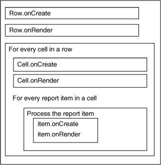

## 表格和列表方法的执行顺序

列表等同于每行只有一个单元格的表格。BIRT 处理表格和列表的方式相同，不同在于对于列表，BIRT 不会遍历多个单元格。BIRT 处理表格分为三个步骤：设置步骤、处理步骤和结束处理步骤。

以下章节描述了表格和列表的执行顺序步骤。

### 表格和列表设置步骤

所有表格（无论分组还是未分组）的预表格处理步骤都是相同的。

图 7-3 显示了预表格处理步骤的执行顺序。该图展示了在生成阶段使用 `RunAndRenderTask` 的事件顺序。

**图 7-3** 表格和列表设置执行顺序

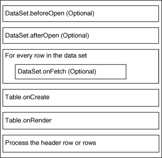

`RunTask` 不会触发 `onRender` 事件。`RenderTask` 不触发 `onCreate`、数据源和数据集事件。数据源和数据集事件是可选的。

### 表格和列表处理步骤

表格和列表处理步骤的顺序取决于表格或列表是否分组。没有分组的表格或列表的顺序与有分组的不同。

图 7-4 显示了未分组表格或列表的执行顺序。

**图 7-4** 未分组表格或列表的详情执行顺序

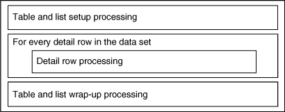

对于有分组的表格，BIRT 会为每个组创建一个 `ListingGroup` 项目。


`ListingGroup` 类似于表格，因为它有一个或多个表头行和一个或多个页脚行。BIRT 处理分组行的方式与处理表格行相同。

除了这些行的标准 `onPrepare`、`onCreate` 和 `onRender` 事件外，`ListingGroup` 还会触发组的 `onPageBreak` 和 `onPrepare` 事件。若要访问这些事件处理程序的脚本位置，请在大纲视图中找到该组并选择脚本选项卡。使用 `onPrepare` 事件处理程序中的代码修改分组行为，例如更改排序顺序。

图 7-5 显示了带分组表格的执行执行顺序。

**图 7-5** 分组表格执行顺序

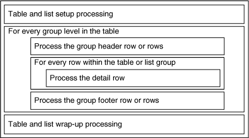

要验证特定报表事件处理程序的执行顺序，请向事件处理程序中添加日志代码。

### 表格和列表结束处理步骤

所有表格（无论分组还是未分组）的后表格处理步骤都是相同的。

#### 生成阶段的完成

生成阶段完成后，所有数据源的 `beforeClose` 和 `afterClose` 事件将触发，随后是 `afterFactory` 事件。如果使用 `RunAndRenderTask`，则 `afterRender` 事件会在关闭数据源之前触发。表 7-10 描述了生成阶段完成时可用的事件。

**表 7-10** 完成生成阶段

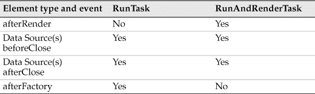

#### 呈现阶段操作

呈现阶段启动相应的发射器并根据生成的报表产生报表输出。该阶段在所有项目创建时触发它们的 `onRender` 事件。如果使用 `RenderTask` 渲染已有的报表文档，则首先触发 `initialize` 事件，然后触发每个渲染的报表项目的 `onRender` 事件。

如果 `RenderTask` 逐页渲染页面，则 `onRender` 事件仅对已渲染的项触发。例如，BIRT Web Viewer 使用 `RunTask` 创建报表文档。Web 查看器使用 `RenderTask` 渲染第一页。此操作会先触发 `initialize` 事件，然后页面上显示的每个项目的 `onRender` 事件。选择新页面并使用分页控制将产生新的 `RenderTask`，它会再次调用 `initialize` 事件并触发新页面上每个项目的 `onRender` 事件。

### 事件顺序总结

表 7-11 总结了每个处理阶段触发的报表设计和报表项目事件。事件按针对特定任务触发的顺序列出。为了简洁起见，未显示分页、`getDefaultValueList`、`getSelectionValueList`、数据源和数据集事件。

**表 7-11** 事件顺序总结

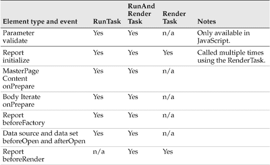

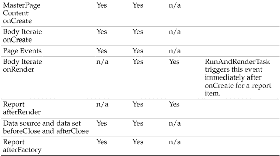

## 第 8 章 使用 JavaScript 编写事件处理器

BIRT 脚本基于 Mozilla Rhino 的 JavaScript 实现，也称为 ECMAScript。Rhino 实现了 ECMA 标准描述的 ECMAScript 1.5 版本。关于 Rhino 的完整规范请位于 ECMAScript 版本 3。

### 使用 BIRT 设计器输入 JavaScript 事件处理器

你可以使用 BIRT 设计器输入 JavaScript 事件处理器并将其与特定事件关联。

**如何使用 BIRT 设计器输入 JavaScript 事件处理器**

1. 在大纲中，选择要编写事件处理器的报表元素、数据源或数据集。
2. 选择脚本选项卡。
3. 从下拉列表中选择一个事件处理器。
4. 在脚本编辑器中输入事件处理器代码。

图 8-1 显示了列表元素 `onPrepare()` 方法中的代码。

**图 8-1** `onPrepare()` 方法的代码输入

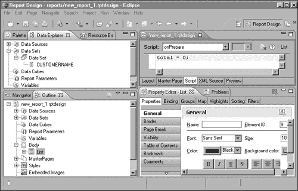

#### 创建和使用全局变量

JavaScript 有全局变量局部变量。局部变量只能在创建它的作用域内访问。在 JavaScript 中使用 `var` 标识符创建局部变量，如下所示：

```javascript
var localCounter = 0;
```

要创建全局变量，请省略 `var` 标识符并将 local 替换为 global，如下所示：

```javascript
globalCounter = 0;
```

JavaScript 中的全局变量对在同一进程中执行的所有 JavaScript 代码可见。例如，使用全局变量来计算表格中的详情行，首先在表格的 `onCreate()` 方法中创建一个全局变量，如下所示：

```javascript
rowCount = 0;
```

因为 `rowCount` 是全局的，详情行的 `onCreate()` 方法可以访问并增加它，如下所示：

```javascript
rowCount++;
```

要存储全局变量，使用 `reportContext.setGlobalVariable()` 方法。这种方法支持将全局变量传递给 Java 事件处理器。

如果报表使用两个独立的进程进行执行（例如 `RunTask` 和 `RenderTask`），则只有在使用 `reportContext.setPersistentGlobalVariable()` 方法设置时，全局变量对两个进程可用。该方法在渲染之前将变量值写入报表文档。如果你在 `initialize` 方法中设置全局变量，请记住当使用两个进程时该事件会触发多次。

#### 创建和使用页面变量和脚本

在主页上，BIRT 支持使用自动文本（autotext）报告项来添加特定页的值。示例包括页码、文件名、创建日期和总页数。特定的自动文本项 `variable` 可以与页面脚本结合使用，以自定义页面的展示。此自动文本元素可以使用页面变量或报告变量。页面变量和报告变量在数据资源管理器视图（data explorer view）中创建。页面变量针对报告的每一页进行评估，而报告变量针对整个报告进行评估。作为一个类比，可以考虑 `page n of m` 自动文本项。`n` 代表当前页码，`m` 代表总页数。变量 `n` 类似于页面级变量，而变量 `m` 类似于报告变量。为了支持修改这些变量，BIRT 为报告及其中存在的任何主页提供了 `onPageStart` 和 `onPageEnd` 脚本。通过这些脚本和变量，报告开发者可以创建具有自定义页眉和页脚的报告，例如根据分组显示子分页，或显示第一页和最后一页条目信息的电话簿样式页眉。

当使用单独的运行（run）和渲染（render）任务时（例如使用 BIRT 查看器），请使用页面变量和脚本。例如，假设需要一个报告列出客户，且页眉需要包含特定页的第一和最后一个客户编号。为了实现此报告，开发者使用数据资源管理器视图创建了两个页面变量 `FIRST_CUSTOMER` 和 `LAST_CUSTOMER`。接下来，开发者为报告添加了一个 `OnPageStart` 事件脚本，将这些变量设置为 `null`。

**Listing 8-1** `onPageStart` 事件脚本

```javascript
reportContext.setPageVariable("FIRST_CUSTOMER", null);
reportContext.setPageVariable("LAST_CUSTOMER", null);
```

这些值在每个新页面上都会被设置为 `null`。最后，开发者选择客户编号数据项并输入以下 `onPageBreak` 脚本：

**Listing 8-2** `onPageBreak` 事件脚本

```javascript
var customer = this.getValue( );
var first = reportContext.getPageVariable("FIRST_CUSTOMER");
var last = reportContext.getPageVariable("LAST_CUSTOMER");
if (first == null)
{
   reportContext.setPageVariable("FIRST_CUSTOMER", value );
}
reportContext.setPageVariable("LAST_CUSTOMER", value);
```

特定的客户编号和两个页面变量被检索，然后存储在本地 JavaScript 变量中。

此 `onPageBreak` 事件会在该数据项出现在页面上的每个实例处触发。每页仅设置一次 `FIRST_CUSTOMER`。如果第一个变量映射为 `null`，则页面变量 `FIRST_CUSTOMER` 被设置为当前客户编号。此条件在每页仅为真一次。接下来，将 `LAST_CUSTOMER` 页面变量设置为当前客户编号。此设置确保了 `LAST_CUSTOMER` 页面变量被设置为该页的最后一个客户编号。然后，开发者在主页页眉中添加两个变量自动文本报告项，并为它们赋值 `FIRST_CUSTOMER` 和 `LAST_CUSTOMER`。

## 了解执行阶段和过程

BIRT 有三个执行阶段：准备（preparation）、生成（generation）和展示（presentation）。可能存在一个或两个执行过程。当报告在 BIRT 报告设计器预览器中运行时，只有一个执行过程，该过程会执行一个 `RunAndRenderTask`。

当报告在查看器中运行时，有两个执行过程。第一个过程称为“工厂过程”（`factory process`），包含准备和生成阶段。第二个执行过程称为“渲染过程”（`render process`），仅包含展示阶段。渲染过程可能发生在比工厂过程晚得多的时间，并且可能在不同的机器上。

由于变量仅在创建它们所在的过程中可见的，因此知道哪些事件处理器运行在哪个过程中至关重要。如果渲染过程使用了在工厂过程中创建的变量，那么代码在预览器中可以工作，但在使用两个过程的运行时则将无法正常工作。

### 使用 `reportContext` 对象

几乎每个事件处理器都可以访问一个名为 `reportContext` 的对象。表 8-1 列出了常用的 `reportContext` 对象方法。

**Table 8-1** `reportContext` 类的方法

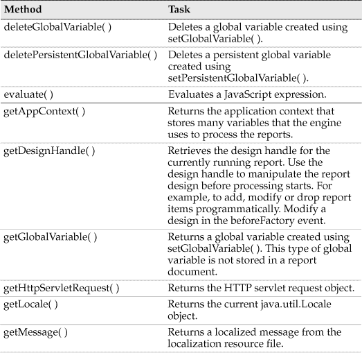

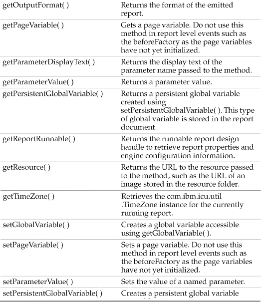

#### 使用 `getOutputFormat`

为了在渲染时根据输出格式更改元素（element）样式，请使用 `reportContext` 对象将代码添加到 `onRender` 事件处理器中，如 Listing 8-3 所示。

**Listing 8-3** `onRender` 事件脚本

```javascript
if (reportContext.getOutputFormat( ) == "pdf"){
   this.getStyle( ).backgroundColor = "red";
}else{
   this.getStyle( ).backgroundColor = "blue";
}
```

要在设计中创建两个主页并根据输出格式切换页面，请设置 `beforeFactory` 事件处理器，如 Listing 8-4 所示。

**Listing 8-4** `beforeFactoring` 事件脚本

```javascript
rptDesignHandle = reportContext.getDesignHandle( );
tbl = rptDesignHandle.findElement("mytable");
var myoutputformat = reportContext.getOutputFormat( );
if( myoutputformat == "html" ){
   tbl.setProperty("masterPage","MasterPageTwo");
}else{
   tbl.setProperty("masterPage","MasterPageOne");
}
```

此示例使用 `reportContext` 对象获取设计的句柄。设计句柄定位名为 `mytable` 的表格元素，并根据输出格式将 `masterPage` 设置为第一个或第二个主页。需要的是，主页的发生在生成阶段，渲染时无法更改。该示例适用于以下情况：

- 重新创建报告
- 使用任务运行并渲染报告

#### 使用 `reportContext` 获取设计句柄

你可以在 `beforeFactory` 事件处理器中使用 `reportContext` 对象获取设计句柄。你可以在设计执行之前修改运行的设计。`beforeFactory` 方法仅在生成阶段执行。示例使用了后文介绍的设计 API。

**Listing 8-5** 使用参数过滤表格

```javascript
importPackage(org.eclipse.birt.report.model.api.elements)
;
importPackage(org.eclipse.birt.report.model.api);
tableHandle = reportContext.getDesignHandle( ).findElement("mytable");
if( params["FilterCol"].value.length > 0 ){
   fc = StructureFactory.createFilter( );
   fc.setExpr("row['" + params["FilterCol"] + "']");
   fc.setOperator(params["FilterEq"]);
   fc.setValue1("\"" + unescape(params["FilterVal"]) + "\"");
   ph = tableHandle.getPropertyHandle(TableHandle.FILTER_PROP);
   ph.addItem(fc);
}
```

作为使用 `visibility` 属性隐藏报告内容的替代方案，可以使用报告设计句柄从正在运行的设计中删除元素，如下代码所示：

```javascript
reportContext.getDesignHandle( ).findElement("table1").drop( );
```

你可以修改报告表项的额外属性。列表 8-7 显示了如何调整表格内列的宽度并更改绑定的数据集。如果报告表项绑定的数据集发生变化，则新数据集必须包含与之前数据集相同的列。

**列表 8-7** 修改表格属性

```javascript
table = reportContext.getDesignHandle( ).findElement("table1");
ch = table.getColumns( ).get(0);
ch.setProperty("width", "10%");
table.setProperty( "dataSet", "My Alternate Data Set" );
```

你可以在 `beforeFactory` 事件中更改 `styles` 属性。列表 88-8 为 PDF 生成使用一种样式，为所有其他格式使用另一种样式。此示例需要重新创建报告文档才能生效。或者，可以使用 `RunAndRender` 任务。

**列表 8-8** 修改表格样式

```javascript
tableHandle = reportContext
    .getDesignHandle( ).findElement("mytable");
rowHandle = tableHandle.getDetail( ).get(0);
if( reportContext.getOutputFormat( ) == "pdf" ){
    rowHandle.setStyleName("style2");
}else{
    rowHandle.setStyleName("style1");
}
```

#### 在进程之间传递变量

虽然全局 JavaScript 变量无法在进程之间传递，但 BIRT 提供了一种从工厂过程（factory process）传递变量到渲染过程（render process）的方法。报告上下文对象的 `setPersistentGlobalVariable( )` 方法创建一个可以使用 `getPersistentGlobalVariable( )` 方法访问的变量。限制是变量必须是可序列化的 Java 对象。

例如，在运行时生成两个字符串，并在渲染 PDF 时显示一个字符串，在其他上下文中显示另一个字符串。在生成时使用 `setPersistentGlobalVariable( )` 方法将变量存储在报告文档中。在渲染时，在渲染事件处理程序中使用 `getPersistentGlobalVariable( )` 方法检索变量。

列表 8-9 在标签元素的 `onCreate` 事件处理程序中调用 `setPeristentGlobalVariable( )` 方法来初始化两个字符串，然后在 `onRender` 事件处理程序中调用 `getPersistentGlobalVariable( )` 方法来指定格式上下文。

**列表 8-9** 使用持久性全局变量

```javascript
//Label onCreate
reportContext.setPersistentGlobalVariable("mypdfstr",
    "My PDF String");
reportContext.setPersistentGlobalVariable("myhtmlstr",
    "My HTML String");

// Label onRender
if( reportContext.getOutputFormat( ) == "pdf" ){
    this.text =
    reportContext.getPersistentGlobalVariable("mypdfstr");
}else{
    this.text =
    reportContext.getPersistentGlobalVariable("myhtmlstr");
}
```

#### 使用 `getAppContext`


BIRT 使用应用程序上下文映射（application context map）来存储用于报告生成和展示所有阶段的值和对象。要向应用程序上下文添加对象，可以使用`Report Engine API`或请求对象的`setAttribute( )`方法。

以下 JSP 示例向应用程序上下文添加了一个对象。`AppContextKey`是引用对象的名称，`AppContextValue`包含对象的值。

**列表 8-10** 向应用程序上下文添加对象

* * *

```jsp
<%
java.lang.String teststr = "MyTest";
session.setAttribute( "AppContextKey", teststr );
java.lang.String stringObj = "This test my Application Context From the Viewer";
session.setAttribute( "AppContextValue", stringObj );
String redirectURL = "http://localhost:8080/2.5.0/frameset?__report=AppContext.rptdesign";
response.sendRedirect(redirectURL);
%>
```

引用应用程序上下文中的对象。列表 8-11 使用`try-catch`块来检测对象未未找到并返回适当的错误消息。

**列表 8-11** 检查对象是否存在

* * *

```javascript
try {
    MyTest.toString( );
} catch (e) {
    "My Object Was Not Found";
}
```

使用`Report Engine API`中的`EngineConfig`类或`EngineTask`类来添加对象，如 列表 8-12 所示。

**列表 8-12** 向应用程序上下文添加对象

* * *

```javascript
config = new EngineConfig( );
HashMap hm = config.getAppContext( );
hm.put( "MyTest", stringObj);
config.setAppContext(hm);
```

应用程序上下文对象包含许多实用的设置。例如，可以使用类似以下代码为 JDBC 驱动程序设置驱动程序位置：

`config.getAppContext( ).put("OdaJDBCDriverClassPath", "C:/apps/apache-tomcat-5.5.20/webapps/2.5.0/frameset?__report=AppContext.rptdesign");`

`OdaJDBCDriverClassPath`设置在应用程序上下文中可以指定驱动程序。`OdaJDBCDriverClassPath`设置在应用程序上下文中可以指定驱动程序。`OdaJDBCDriverClassPath`设置在应用程序上下文中可以指定驱动程序。`OdaJDBCDriverClassPath`设置在应用程序上下文中可以指定驱动程序。`OdaJDBCDriverClassPath`设置在应用程序上下文中可以指定驱动程序。`OdaJDBCDriverClassPath`设置在应用程序上下文中可以指定驱动程序。`OdaJDBCDriverClassPath`设置在应用程序上下文中可以指定驱动程序。`OdaJDBCDriverClassPath`设置在应用程序上下文中可以指定驱动程序。`OdaJDBCDriverClassPath`设置在应用程序上下文中可以指定驱动程序。

# 使用此对象方法

`this`对象代表事件处理程序处理的元素。要使用`this`对象，请在事件处理程序的脚本窗口中输入关键字`this`，后跟一个点号。当你输入点号时，会出现一个包含该元素所有属性和函数的滚动列表，如图图 8-2 所示。

**图 8-2** 使用`this`对象显示函数和属性列表


向下滚动列表，当所需的属性或函数被高亮时，按下`Enter`键或双击。

## 使用`this`对象设置报告项目属性

此属性和函数列表不仅适用于`this`对象，也适用于其他对象。以下步骤将标签（label）的背景颜色设置为黄色。此步骤中解释的通用流程并不特定于标签报告项目。所有报告项目事件处理程序都支持此项功能。

### 如何使用 JavaScript 设置报告项目属性

**1** 通过在在大纲视图（Outline view）中导航选择标签，如图图 8-3 所示。

**图 8-3** 选择报告项目进行修改

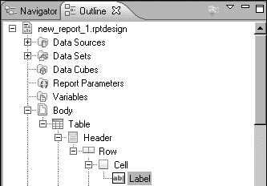

**2** 在脚本编辑器中选择`onPrepare`，如图图 8-4 所示。

**图 8-4** 选择`onPrepare()`

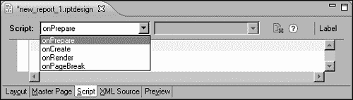

**3** 在`onPrepare`脚本编辑器中，输入关键字`this`，后跟一个点号以打开属性和函数的滚动列表，如图图 8-5 所示。

**图 8-5** 使用`this`对象

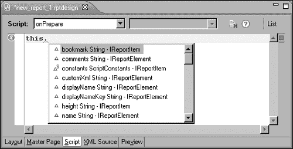

**4** 从列表中选择`getStyle()`方法。出现`onPrepare`脚本编辑器，如图图 8-6 所示。

**图 8-6** onPrepare 脚本窗口

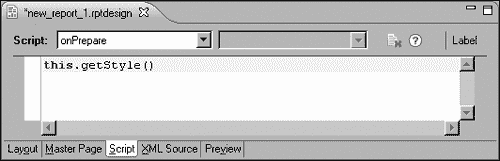

**5** 将光标移动到`onPrepare`脚本窗口行的末尾并输入点号。出现`Style`元素的属性和函数的滚动列表，如图图 8-7 所示。

**图 8-7** Style 元素的属性和函数

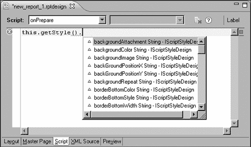

**6** 从`Style`属性和函数列表中选择`backgroundColor`。

**7** 在`onPrepare`脚本窗口中输入`=“yellow"` 来完成该行 JavaScript 语句，如图图 8-8 所示。

**图 8-8** 修改元素的颜色

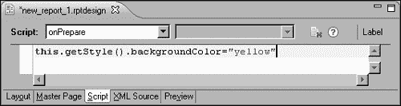

**8** 选择`Preview`（预览）以查看`onPrepare`事件处理程序脚本的效果。

报告中的标签具有黄色背景，如图图 8-9 所示。

**图 8-9** 颜色变化的预览

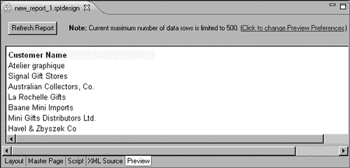

## 使用`row`对象

`row`对象提供了在`DataSet.onFetch()`方法内部访问当前行列的权限。你可以使用类似下面示例语句中的列名来检索任何列的值：

```
col1Value = row["custNum"];
col1Value = row.custNum;
```

只有当列名是不包含空格或特殊字符的有效 JavaScript 名称时，你才能通过列名对列位置进行索引。或者，如果别名是有效的 JavaScript 名称，你可以使用列别名。

你也可以通过数字索引列位置来获取列值，如下语句所示：

```
col1Value = row[1];
```

当你用数字对列位置进行索引时，括号内的数字是该列的位置，从 1 开始。你可以通过`row[0]`获取行号。

尽管你在 JavaScript 中使用数组语法来访问`row`对象，但该对象并不是 JavaScript 数组。因此，你不能对`row`对象使用 JavaScript 数组属性（如`length`）。

#### 获取列信息

`DataSet`对象有一个`getColumnMetaData()`方法，该方法返回一个`IColumnMetaData`对象。`IColumnMetaData`接口提供了有关数据集中列信息的方法，如表 8-2 所示。

**表 8-2** IColumnMetaData 接口的方法

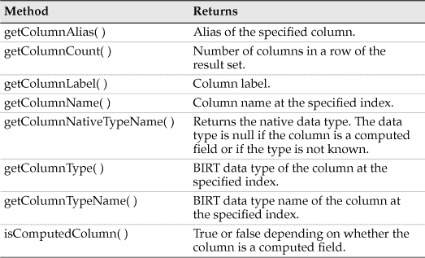

从`dataSet`对象获取`IColumnMetaData`对象，如下语句所示：

```
columnMetaData = this.getColumnMetaData();
```

此调用在`beforeOpen`或`afterClose`事件中是不支持的，因为在这两个事件触发时，实例分别尚未构造或已从移除。

你可以使用列数来遍历数据集中的所有列，如代码列表 8-15 所示。

**代码列表 8-15** 在 afterOpen 中遍历

```
import org.birt.report.engine.internal.DataSetInstance;
if(this instanceof DataSetInstance){
    columnMetaData = this.getColumnMetaData();
    colCount = columnMetaData.getColumnCount();
    for ( i = 1; i <= colCount; i++ {
        out.println("Column " + i + ": " + columnMetaData.getColumnName(i));
    }
}
```

#### 获取并修改查询字符串

在任何 DataSet 事件处理程序中获取 JDBC 查询的文本，如下所示：

```
query = this.queryText;
```

你可以在`beforeOpen`事件中通过设置`queryText`字符串来修改查询。更改查询时将`queryText`设置为有效的 SQL 查询，如下所示：

```
queryText = "select * from CUSTOMERS WHERE CUSTOMNUMBER BETWEEN " + params[lownumber].value + " AND " + params[highnumber].value;
```

动态修改查询优点可以使用业务逻辑来确定查询，这种方法比使用参数更灵活。使用此技术修改数据源的其他属性。BIRT 也支持在数据源和数据集编辑器中使用属性绑定功能修改数据集属性。这些方法之间的区别在于，属性绑定仅适用于运行中的报告。脚本在预览数据集时也有效。

使用类似的技术更改平面文件数据源的查询字段。在平面文件数据源中，查询存储了要读取的平面文件的名称以及列信息。代码列表 8-16 显示了平面文件查询的示例 XML 代码。

**代码列表 8-16** 平面文件数据源上的查询

* *

```xml
<![CDATA[
select "Age", "Male", "Female"
from CSV1.csv :
{"Age","Age",STRING;"Male","Male",STRING;"Female","Female",STRING}
]]>
```

在此示例中，CSV1 是要读取的文件。`beforeOpen`数据集脚本可以使用简单的`replace`方法修改要读取的文件，如下代码所示：

```
qry = this.queryText
this.queryText = qry.replace( "CSV1.csv", "CSV2.csv");
```

### 修改数据源连接属性

通过访问`DataSource`对象的`extensionProperties`数组更改数据源的连接属性。ODA 扩展定义了运行时设置的连接属性列表。

表 8-3 描述了影响连接的 JDBC 数据源属性。

要更改这些属性，请在数据源的 Listing 8-17 `beforeOpen`脚本中添加类似语句的代码。

#### 列表 8-17 在 beforeOpen 中更改数据源连接属性

```javascript
extensionProperties.odaUser = "JoeUser";
extensionProperties.odaPassword = "openSesame";
extensionProperties.odaURL = "jdbc:my_data_source:xxx";
extensionProperties.odaDriverClass = "com.companyb.jdbc.Driver";
extensionProperties.odaJndiName = "java:/MySQLDs";
extensionProperties.OdaConnProfileName = "myprofile";
extensionProperties.OdaConnProfileStorePath = "c:/conprof";
```

或者，使用以下语法设置这些属性

```javascript
this.setExtensionProperty("odaURL", "jdbc:mysql://localhost/mysql");
```

`beforeFactory`事件也支持更改连接属性，如 Listing 8-18 所示。

#### 列表 8-18 在 beforeFactory 中更改数据源连接属性

```javascript
report = reportContext.getDesignHandle( );
dsHandle = report.findDataSource("Data Source");
dsHandle.setProperty("odaDriverClass", "myDriver");
dsHandle.setProperty("odaURL", "myUrl");
```

你还可以使用数据源编辑器中的属性绑定功能来设置数据源和数据集的属性。

#### 获取参数值

脚本通过将参数名称传递给`reportContext`对象的`getParameterValue( )`方法来获取报告参数的值。以下语句获取`UserID`参数的值：

```javascript
userID = reportContext.getParameterValue( "UserID" );
```

你还可以在具有以下语法的语句中使用 BIRT 全局变量`params`来取回参数值：

```javascript
userID = params["UserID"].value;
```

BIRT 同样支持允许选择多个值的动态参数。使用以下语法访问这些参数：

```javascript
reportContext.getParameterValue( "MultiParm" )[0];
params["MultiParm"].value[0];
```

上述语句检索多值参数的第一个值。使用以下语法确定所选值的数量：

```javascript
reportContext.getParameterValue( "MultiParm" ).length;
params["MultiParm"].value.length;
```

在实现`beforeOpen`事件处理程序时，可以使用这些功能为查询应用`IN`子句，如 Listing 8-19 所示。

#### 列表 8-19 在 beforeOpen 中访问多个参数值

```javascript
var parmcount = params["parmorders"].value.length
var whereclause = "";

if( parmcount > 0 ){
   whereclause = " where customernumber in ( ";
}
for( i=0; i < parmcount; i++ ){
   if( i == 0 ){
      whereclause = whereclause + params["parmorders"].value[i];
   }else{
      whereclause = whereclause + " , " +
      params["parmorders"].value[i];
   }
}
if( parmcount > 0 ){
   this.queryText = this.queryText + whereclause + " ) ";
}
```

数据集也有参数。这些参数会影响特定的数据集。通常，当数据集绑定到嵌套表时，数据集参数会链接到报告参数或绑定到外部表格列的值。数据集脚本支持获取和设置参数值。在数据集运行之前，在数据集的`beforeOpen`中设置参数值，如 Listing 8-20 所示。

#### 列表 8-20 在 beforeOpen 中设置数据集参数值

```javascript
//set input parameter
inputParams["alpha"] = 5;
//or
this.setInputParameterValue("alpha", 5);
```

通过引用`inputParams`数组或使用`this.getInputParameterValue`方法来获取值。

#### 确定脚本执行顺序

你可以通过编写代码生成一个文件，该文件包含你想要跟踪的每个脚本的一行，从而确定脚本的执行顺序。

要创建一个包含脚本执行顺序的输出文件，请在`ReportDesign.initialize`脚本中包含初始化代码，并在`ReportDesign.afterFactory`脚本中包含结束代码。在你想要跟踪的每个脚本中，添加代码向输出文件写入一行文本。用 JavaScript 编写代码比 Java 更容易，但也可以用 Java 编写类似的代码。

以下章节将展示如何使用 JavaScript 确定脚本执行顺序。

### 提供 ReportDesign.initialize 代码

`ReportDesign.initialize`方法中的后续代码会在硬盘上创建一个文件并向该文件添加一行。


```javascript
importPackage( Packages.java.io );
fos = new java.io.FileOutputStream( "c:\\logFile.txt" );
printWriter = new java.io.PrintWriter( fos );
printWriter.println( "ReportDesign.initialize" );
```

前面的代码执行了以下任务：

- 导入 Java 包`java.io`
- 为你想要创建的文件创建输出流
- 创建一个`PrintWriter`对象，每个脚本都可以使用它来跟踪脚本执行顺序

### 如何为 ReportDesign.initialize 提供代码

1. 选择`Script`选项卡。
2. 在`Outline`中选择顶行，如图 10 所示。
3. 在`Script`中选择`initialize`。
4. 输入代码，如图 11 所示。

#### 为想要跟踪的脚本提供代码

在你想要跟踪的每个脚本中，编写一条向输出文件写入文本的语句，如上一节所示：

```javascript
printWriter.println( "Table.onRow" );
```

首先，在`Outline`中选择相应的元素。然后，从脚本列表中选择脚本。

### 提供 ReportDesign.afterFactory 代码

要关闭日志文件，请在`ReportDesign.afterFactory`中添加以下语句：

```javascript
printWriter.close( );
```

此方法可以刷新缓冲区并确保所有输出出现在文件中。提供`ReportDesign.afterFactory`代码时，选择大纲的顶行并在脚本页面选择`afterFactory`。

### 教程 1：使用 JavaScript 编写事件处理器

本教程提供了编写事件处理器的说明。教程展示了一个访问 Classic Models, Inc. 示例数据库的基础报告设计。该设计包含一个带有客户名称列的表格。在教程中，你统计包含字符串`Mini`的客户名称，然后在弹出窗口中显示结果。这些事件处理器提供了同于使用聚合报告元素的功能。

在本教程中，你将执行以下任务：

- 创建报告设计
- 在`Table.onCreate`中创建计数器
- 条件地增加计数器
- 显示结果

#### 任务 1：创建报告设计

使用 Classic Models, Inc. 示例数据库创建一个报告设计以显示客户列表。该设计出现在布局编辑器中，如图 12 所示。

#### 任务 2：在 Table.onCreate 中创建计数器

为了统计包含字符串`Mini`的客户数量，首先声明一个全局计数器并将其设置为 0。`Table.onCreate`方法是执行此任务的最佳场所，因为`Table.onCreate`在检索任何行之前执行。在下一个任务中，你将在`Row.onCreate( )`方法中条件地增加此计数器。

## 图 8-14 脚本窗口

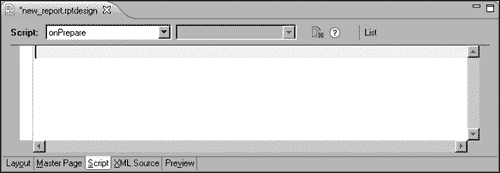

**3** 从可用脚本列表中选择`onCreate`。

**4** 在`onCreate`方法的脚本编辑器中输入以下代码行：

```
countOfMinis = 0;
```

**5** 选择`Preview`以运行报告并验证代码没有产生任何错误。

**6** 滚动到报告底部，JavaScript 错误消息将出现在此处。如果没有错误，报告将如 图 8-15 所示。

## 图 8-15 报告预览

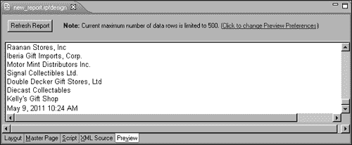

如果你看到错误消息，可能是语句输入错误。如果是这样，请返回脚本窗口，选择你刚刚修改的方法，纠正错误并再次选择`Preview`。

#### 任务 3：条件增加计数器

为了统计名称中包含字符串`Mini`的客户数量，请检查每个客户的名称，每出现一次就计数器加 1。执行此任务的逻辑位置是`Row.onCreate`方法，该方法会在每次从数据源检索行数据时执行。

**1** 在`Layout`中选择`Row`。然后选择`Script`。

**2** 从脚本窗口顶部的可用脚本列表中选择`onCreate`，如 图 8-16 所示。

## 图 8-16 脚本窗口中的 onCreate( )

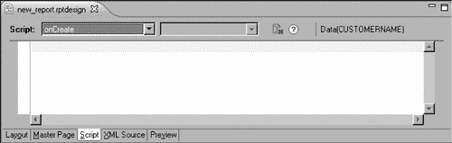

**3** 在脚本窗口中输入以下 JavaScript 代码：

```
row=this.getRowData();
```

注意，当在此之后输入点时，会弹出一个包含所有可用方法和属性的窗口，包括`getRowData`。此行代码获取了一个`IRowData`实例，该实例有一个方法`getExpressionValue()`，用于获取行某列的内容。

**4** 在第 3 步代码下方输入以下 JavaScript 代码：

```javascript
CustName=row.getExpressionValue("row[CUSTOMERNAME]");
```

此行代码返回数据集中`CUSTOMERNAME`列对应的表格列内容。

**5** 输入以下代码行来条件地增加你在任务 2 中创建的计数器：

```javascript
if( CustName.indexOf("Mini") != -1 ) countOfMinis += 1;
```

你可以使用 JavaScript 调板在上一行中插入以下元素：

- `indexOf()`

  选择`Native ( JavaScript ) Objects`→`String Functions`→`indexOf()`

- `!=`

  选择`Operators`→`Comparison`→`!=`

- `+=`

  选择`Operators`→`Assignment`→`+=`

**6** 选择`Preview`再次运行报告，以验证你输入的代码没有产生任何错误。

#### 任务 4：显示结果

为了显示名称中包含字符串`Mini`的客户计数，请在处理完列表中所有行后运行的方法中插入代码。此代码的逻辑位置是`ReportDesign.afterFactorymethod`。

**1** 在`Outline`中选择报告设计，如 图 8-17 所示。

## 图 8-17 在 Outline 中选择报告设计

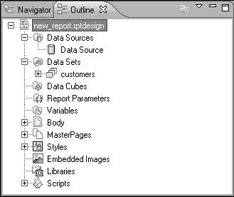

**2** 从脚本编辑器中的可用脚本列表中选择`afterFactory`方法。

**3** 在`afterFactory`方法中输入以下代码：

```javascript
importPackage( Packages.javax.swing );
frame = new JFrame("Count of Minis = " + countOfMinis);
frame.setBounds(310, 220, 300, 20);
frame.show();
```

**4** 选择`Preview`查看结果。如果代码没有错误，你将看到与 图 8-18 类似的报告。

## 图 8-18 更改 afterFactory( ) 方法后的的结果

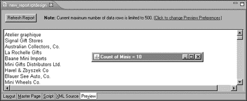

如果你没有看到 Count of Minis 窗口，请查看 Eclipse 窗口后面。如果 Count of Minis 窗口没有出现，最可能的原因是你输入的某条代码导致了脚本错误。

如果你怀疑发生了脚本错误，请滚动到报告底部所有脚本错误消息出现的地方。在大多数情况下，加号（`+`）旁边有一个简短的错误消息。加号表示有一个更详细的错误消息，只有在展开简短错误消息后可见。要展开简短错误消息，请选择加号。向下滚动查看更详细的错误消息。

### JavaScript 事件处理器示例

以下示例说明了你可以使用 JavaScript 事件处理器执行的一些常用函数。

#### JavaScript onPrepare 示例

`onPrepare`事件在生成过程的准备阶段为所有报告元素触发。该位置非常适合在生成单个报告项目实例之前更改特定报告元素的设计。

例如，BIRT 支持表格和列表中的分组。为了允许用户对数据进行分组，你可以通过以下开发任务来实现此功能：

- 向表格添加一个组
- 在报告的大纲视图中选择组
- 创建一个更改组定义的`onPrepare`脚本

Listing 8-21 按国家或城市对表格进行分组。

内容的渲染可能在生成后的任何时间发生。用户通常会运行报告并以不同的格式对其进行多次渲染。`onRender`事件支持在渲染时进行某些自定义。例如，用户可能希望页面页脚中的标签显示报告的渲染时间或报告渲染时的当月几几。你可以通过使用标签元素的`onRender`方法来实现这种效果，如下脚本所示：

```javascript
importPackage( Packages.java.util );

cl = new GregorianCalendar( );

this.text = cl.get( Calendar.DAY_OF_MONTH );
```

## 交叉表脚本示例

交叉表（Cross tabs）支持编写事件脚本。与其他报告项目一样，交叉表支持`onPrepare`、`onCreate`和`onRender`事件。这些事件中的每一个都支持为交叉表或交叉表单元格编写处理程序。在为交叉表单元格实现`onCreate`事件时，处理程序会接收一个`cellInst`对象。该对象是单元格对象的实例，提供了用于确定单元格属性的方法。例如，开发者可以调用`cellInst.getCellType(`。该方法返回`aggregation`（聚合）或`header`（表头），代表交叉表。使用`cellInst.getCellID()`来确定正在处理哪个特定的设计时单元格。该方法返回在单元格常规属性中定义的元素 ID（Element ID）。`cellInst`对象还提供了一个方法`getDataValue`，它返回单元格创建时交叉表绑定的特定值。`getStyle()`方法支持自定义特定单元格的外观。以下脚本说明了使用这些方法的机制。

列表 8-25 中的脚本将针对行表头单元格或列表头单元格执行。随后，脚本会检查特定单元格的维度值是否等于`Planes`。如果是，则将背景设置为红色并将字体大小设置为 12。所有其他表头单元格被设置为黄色。

接下来检查单元格 ID，如果元素 ID 为 24，则将单元格背景颜色设置为橙色（Orange）。

**列表 8-25** 设置交叉表表头单元格属性

```javascript
function onCreateCell( cellInst, reportContext )
{
   //可以通过类型或 id 引用单元格 - 有效类型 "header" 或 "aggregation"
   if( cellInst.getCellType() == "header" ) {
      //获取数据值，查看交叉表上的绑定标签
      if( cellInst.getDataValue("PRODUCTLINE") == "Planes" ){
             cellInst.getStyle().setBackgroundColor("#FF0000");
             cellInst.getStyle().setFontSize("12");
      }else{
         //将其余部分设置为黄色
         cellInst.getStyle().setBackgroundColor("#FFFF00");
         cellInst.getStyle().setFontSize("12");
      }
   }
   //引用交叉表表头
   if( cellInst.getCellID() == 24){
      cellInst.getStyle().setBackgroundColor("Orange");
   }
}
```

列表 8-26 中的脚本继续了 列表 8-25 中的`onCreateCell`脚本，处理了构成交叉表大部分部分的聚合元素的颜色设置。首先，如果产品线是`Planes`，则单元格背景颜色设置为蓝灰色。此设置确保特定行或列中对应产品线`Planes`值的所有单元格显示为蓝灰色。因此，如果产品线维度在列级，则特定列显示为蓝灰色；如果产品维度在行级，则特定行显示为蓝灰色。最后，如果数值大于 50000，则单元格背景颜色设置为绿色，字体设置为白色。在此示例中，你可以使用`getDataValue`来检索在交叉表绑定标签页定义的定义的绑定值。

**列表 8-26** 设置聚合单元格属性

```javascript
   if( cellInst.getCellType() == "aggregation"){
      //可以使用 getDataValue 引用值或
      if( cellInst.getDataValue("PRODUCTLINE") == "Planes" ){
         //将颜色设置为蓝灰色
         cellInst.getStyle().setBackgroundColor("RGB(169,170,226)");
      }
      }
```

### 从 JavaScript 调用 Java

Rhino 与 Java 类提供了极佳的集成，支持 BIRT 脚本与用 Java 编写的业务逻辑无缝协作。使用 JavaScript 包装意味着开发者可以利用现有 Java 代码的内部和外部库。

### 调用 Java

#### 理解`Packages`对象

`Packages`对象是访问 Java 类的 JavaScript 网关。它是一个顶层 Rhino 对象，包含每个顶层 Java 包的属性，如`java`和`com`。`Packages`对象包含其在类路径（classpath）中找到的每个包的属性。通过在类名前加上`Packages`来访问`Packages`具有该类属性的 Java 类，如下语句所示：

```javascript
var nc = new Packages.javax.swing.JFrame( "MyFrame );
```

你也可以使用`Packages`对象来引用不属于任何包的 Java 类，如下语句所示：

```javascript
var nc = new Packages.NumberConversion( );
```

为了让 BIRT 找到自定义的 Java 类或包，文件必须位于类路径中，本章稍后会讨论。

#### 理解`importPackage`方法

你可以通过顶层 Rhino 方法`importPackage()`避免编写 Java 类的全限定引用。`importPackage()`方法的功能类似于 Java 的 import 语句。使用`importPackage()`方法指定一个或多个包含你需要访问的 Java 类的包，如下语句所示：

```javascript
importPackage( Packages.java.io, Packages.javax.swing );
```

你必须在每个包名前前加上`Packages`。在 BIRT 第一次执行包含`importPackage()`方法的方法后，指定的包将对所有后续脚本可用。因此，请将`importPackage()`方法包含在`ReportDesign.initialize`脚本中，这是 BIRT 始终执行的第一个脚本。

Java 隐式导入了`java.lang.*`。相反，Rhino 不会隐式导入`java.lang.*`，因为 JavaScript 有几个与`java.lang`包中定义的某些类同名的顶层对象。这些类包括`Boolean`、`Math`、`Number`、`Object`和`String`。导入`java.lang`会与同名的 JavaScript 对象发生名称冲突。出于因此，请避免使用`importPackage()`来导入`java.lang`。

#### 使用 Java 类

要在 BIRT 脚本中使用 Java 类，请将一个 JavaScript 对象赋值为 Java 对象。然后，在 JavaScript 对象上调用 Java 类的方法。代码列表 8-27 创建了一个 Java Swing 框架，并将名为`frame`的 JavaScript 对象设置为 Java`JFrame`对象。然后，代码直接在 JavaScript 对象上调用`setBounds()`和`show()`方法。

**代码列表 8-27** 在 JavaScript 对象上调用 Java 方法

---

```
importPackage( Packages.javax.swing );

frame = new JFrame( "My Frame" );

frame.setBounds( 300, 300, 300, 20 );

frame.show( );
```

此代码示例的效果是在你的桌面上显示一个标题为 "My Frame" 的 Java 窗口。此代码示例仅在 BIRT Report Designer 中有效。

#### 放置 Java 类

为了让 BIRT 报告查看器找到 Java 类，类必须位于以下文件夹：

`$ECLIPSE_INSTALL\plugins org.eclipse.birt.report.viewer_*\birt\WEB-INF\classes`

或者，将类打包为 JAR 文件并放入：

`$ECLIPSE_INSTALL\plugins org.eclipse.birt.report.viewer_*\birt\scriptlib`

BIRT Report Designer 还会查找与报告项目在同一工作区内的 Java 项目中的类。可以使用报告的资源属性选项卡，将额外的 JAR 文件附加到特定的报告。


如果你将示例查看器（Viewer）部署到应用程序服务器，你还必须将这些类或 JAR 文件部署到运行时环境中，除非这些 JAR 文件已经存在于应用程序的类路径中。

将事件处理程序和 Java 类放置在 Web 查看器应用程序的`web.xml`中定义的`SCRIPTLIB`目录。如果使用`SCRIPTLIB`目录，类必须是 JAR 格式。

如果你在使用报告引擎 API，类必须在类路径中。或者，使用报告引擎添加到类路径的系统变量，如下所示：

```
System.setProperty( EngineConstants.WEBAPP_CLASSPATH_KEY, "c:/myjars/class.jar" );
```

如果你在使用报告引擎 API，可以通过在应用上下文中设置`APPCONTEXT_CLASSLOADER_KEY`来设置引擎的父类加载器，如代码列表 8-28 所示：

**代码列表 8-28** 为报告引擎设置父类加载器

---

```
config = new EngineConfig( );

HashMap hm = config.getAppContext( );

hm.put( EngineConstants.APPCONTEXT_CLASSLOADER_KEY, YourClass.class.getClassLoader( ); );

config.setAppContext( hm );
```

设置应用上下文类加载器支持报告脚本访问父类加载器中的对象。

## 在 JavaScript 代码中使用 Java 的问题

编写 Java 代码有很多细微差别，例如如何处理重载方法以及如何使用接口。有关这些主题的更多信息，请参阅 Rhino 关于脚本 Java 的页面：[`www.mozilla.org/rhino/ScriptingJava.html`](http://www.mozilla.org/rhino/ScriptingJava.html)。

## 调用插件中类的方法

Java 和 JavaScript 事件处理程序都可以访问存在于 Eclipse 插件中的任何类的所有公共方法。该插件可以是 Eclipse 核心插件之一、第三方提供的插件，或者你创建的插件之一。只要该插件在运行时对 BIRT 报告可用，BIRT 脚本就可以访问该插件内所有类的所有公共方法。

代码列表 8-29 显示了如何调用位于 Eclipse 插件中的 Java 类的方法：

**代码列表 8-29** 使用 JavaScript 访问 Eclipse 插件中 Java 类的方法

---

```
importPackage( Packages.org.eclipse.core.runtime );

mybundle = Platform.getBundle( "org.eclipse.myCorp.security" );

validateClass = mybundle.loadClass( "org.eclipse.myCorp.security.Validate" );

validateInstance = validateClass.newInstance( );

var password = validateInstance.getPass( loginID );
```

在示例中，第一条语句使 Eclipse 核心包`org.eclipse.core.runtime`可 JavaScript JavaScript 代码。该包包含两个类`Platform`和`Bundle`，脚本的其他部分需要这些类。

`Platform`类包含一个静态方法`getBundle()`，它返回一个`Bundle`对象。`getBundle()`的唯一参数是包含目标类的插件名称。

`Bundle`类包含一个`loadClass()`方法，它返回一个`java.lang.Class`对象。

`\WebViewerExample\WEB-INF\lib`目录下的所有 JAR 文件都在部署的报告类路径中，因此`scriptapi.jar`在运行时是可以访问的。要在开发阶段使用`scriptapi.jar`文件，请下载报告引擎并从构建路径内部引用`scriptapi.jar`。

所需的 JAR 文件也位于 BIRT 报告引擎的`ReportEngine\lib`目录中。如果您使用报告引擎 API 运行报告，请将该目录下的 JAR 文件添加到类路径和构建路径中。如果您在 Eclipse 应用程序中使用报告引擎插件，则不需要此此步骤，因为插件已经包含了依赖项和类路径条。

### 扩展适配器类

元素适配器类（element adapter class）实现了元素接口并为每个方法提供了空存根。要使用该适配器类，请扩展该适配器类并重写您要提供处理代码的方法。Eclipse 建议扩展适配器类而不是直接实现接口。

关于事件处理程序接口和适配器类的 BIRT 命名规范将在本章稍后部分讨论。

## 如何创建事件处理程序类并将其添加到 Java 项目

本节描述了如何使用 Eclipse Java 开发环境为可脚本 BIRT 元素创建事件处理程序类。这些步骤假设 Java 视图已打开，且工作区中存在一个 Java 项目。

### 1 按照以下步骤将`org.eclipse.birt.report.engine_<version>.jar`添加到 Java 项目：

**1** 在 Navigator（导航器）中，选择一个 Java 项目并选择`File→Properties`。在`Properties`中，选择`Java Build Path→Libraries`。在`Java Build Path`中，选择`Add External JARs`。

**2** 在`JAR Selection`中，导航到 Eclipse 的`/plugins`目录。在默认 Eclipse 安装中，该目录位于位置：

`<ECLIPSE_INSTALL>\eclipse\plugins`

**3** 选择`org.eclipse.birt.core_<version>.jar`。使用 Ctrl+点击选择`org.eclipse.birt.report.engine_<version>.jar`。选择`Open`。出现 Java Build Path，如 图 9-1 所示。选择`OK`。

**图 9-1** 构建路径中的报告引擎 JAR 文件

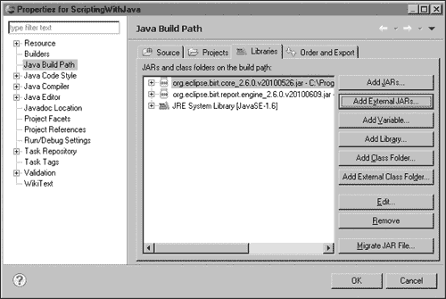

**2** 选择 Java 项目并选择`File→New→Class`。

**3** 为了设置 Java 类属性，请在`New Java Class`中执行以下步骤：

**1** 选择`Source Folder`旁边的`Browse`按钮，导航到您希望存放 Java 源文件所在的文件夹。

**2** 如果新的 Java 类是包的一部分，请在`Package`中输入完全限定包名。

**3** 在`Name`中，为类输入一个名称。

**4** 在`Modifiers`中，选择`Public`。

**5** 选择要扩展的 ROM 元素事件适配器类：

- 选择`Superclass`旁边的`Browse`按钮。

- 在`Superclass Selection`的`Choose a type`中，输入 ROM 元素事件适配器类的名称。例如，对于标签（label）元素，输入`LabelEventAdapter`，如 图 9-2 所示。

**图 9-2** 选择超类

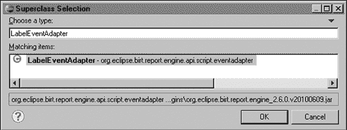

- 选择`OK`。

**4** 在`New Java Class`中，勾选`Generate comments`。出现的 New Java Class 类似于 图 9-3 所示。

**图 9-3** 新 Java 类的最终属性

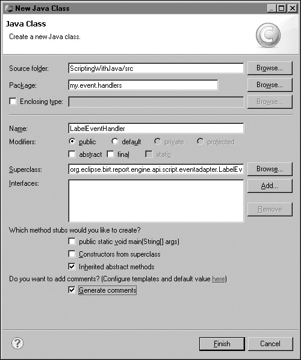

**5** 选择`Finish`。出现 Java 编辑器，类似于 图 9-4 所示。

**图 9-4** Java 编辑器中的新类

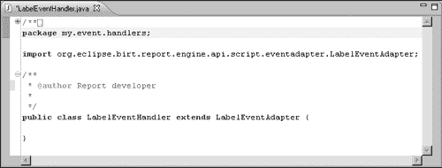

**6** 为事件处理程序类添加事件处理方法。导入所有需要的类。图 9-5 显示了添加`onPrepare()`方法，该方法将标签的背景颜色设置为红色。

**图 9-5** Java 编辑器中的`onPrepare()`方法

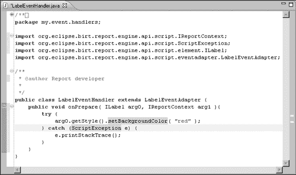

**7** 选择`File→Save`。

## 使 Java 类对 BIRT 可见

让 Java 事件处理程序类对 BIRT 报告设计器可见的方法是创建一个 Java 开发项目，在与 BIRT 报告项目相同的工作区中编译该类。另一种方案是将类放置在 BIRT 类路径指定的目录或 JAR 文件中。要将报告部署到应用程序服务器，请将 Java 类复制到服务器上的相应位置。

## 将 Java 事件处理程序类与报告元素关联

在创建 Java 事件处理程序类并编写了适当的处理方法后，将该类与报告元素关联。

### 如何将 Java 类与报告元素关联

此过程中的步骤遵循以下假设：

- 报告设计在 Report Design（报告设计）视图中打开。

- 报告设计包含可脚本的报告项目，例如标签。

- 包含可脚本报告项目事件处理程序方法的 Java 类对 BIRT 可见。

**1** 在`Outline`（大纲）中，选择 BIRT 可见的事件处理程序类的报告元素，如 图 9-6 所示。

**图 9-6** 选择报告元素

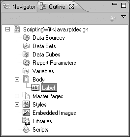

**2** 在`Property Editor`中，选择`Event Handler`，如 图 9-7 所示。

**图 9-7** 事件处理器属性


**3** 选择`Browse`。`Class Selection`显示可选的事件处理程序类。

**4** 选择扩展 BIRT 适配器类的事件处理程序类，如 图 9-8 所示。然后选择`OK`。

**图 9-8** 选择事件处理程序类


事件处理程序类的完全限定名出现在`Property Editor`，如 图 9-9 所示。

**图 9-9** 事件处理程序类


**5** 预览报告。标签的背景颜色变为红色。

## BIRT 接口和类命名规范

BIRT 事件处理程序类和接口命名遵循以下规范：

- **事件处理器接口**：所有 BIRT ROM 元素接口均以`I`开头，后跟元素名称和`EventHandler`。例如，标签元素的接口为`ILabelEventHandler`。

- **事件处理器适配器类**：所有 BIRT ROM 元素适配器类以元素名称开头，后跟`EventAdapter`。例如，标签元素的适配器类名为`LabelEventAdapter`。

- **ROM 元素实例接口**：所有 BIRT ROM 元素实例接口均以`I`开头，后跟元素名称和`Instance`。例如，标签元素的实例接口为`ILabelInstance`。

- **ROM 元素设计接口**：所有 BIRT ROM 元素设计接口均名为`ILabel`。例如，标签元素的设计接口为`ILabel`。

## 编写 Java 事件处理程序

大多数可脚本元素有多个可以编写处理程序的事件。如果您为元素的任何事件编写了事件处理程序，则该事件处理程序类必须包含该元素所有事件的方法。对于不需要处理代码的方法，可以将其留空。

您可以为事件处理程序类命名任何您喜欢的名称。在 BIRT 报告设计器的属性视图中将该类与报告元素关联，如本章前面所述。Java 事件处理程序类可以扩展适配器类，也可以实现事件处理器接口。接下来的章节将解释适配器类和接口。

### 使用事件处理器适配器类

BIRT 为每个可脚本报告元素提供了事件处理器适配器类。事件处理器适配器类包含了该元素每个事件处理方法的空方法。如果您的类扩展了适配器类，只需重写您想要提供处理代码的方法即可。

使用适配器类（adapter class）而不是实现接口的一个优点是，即使在未来的发布中向接口添加了方法，该类仍然编译。然而，如果在未来的发布中事件处理方法的签名发生了变化，你必须更改该方法的实现以反映签名的变化。即使你没有更改签名变化的方法，该类仍然可以编译，但签名错误的方法永远不会被调用。

## 使用事件处理程序接口

BIRT 为每个可脚本的报表元素提供了事件处理程序接口。如果你的事件处理程序类继承了适配器类，则该适配器类已经实现了正确的接口。如果你的类没有继承适配器类，那么你的类必须为报表元素实现相应的接口。

指定接口而不是继承适配器类具有某些优势。Eclipse 会为接口指定的每个方法生成存根（stubs）。这些存根显示了方法参数，因此你可以看到要实现方法的参数类型。如果你的类继承了适配器类，则没有生成的存根供你检查。此外，如果你避免使用适配器类，在设计类结构时将拥有更大的自由度。

例如，你可能希望两个或多个事件处理程序类继承同一个基类。由于 Java 不支持多继承，事件处理程序类无法同时继承适配器类和基类。然而，如果事件处理程序类实现接口而不是继承适配器类，Java 则不会阻止事件处理程序类继承基类。

使用接口而不是适配器类的缺点是，如果从未来的发布中向接口添加了额外的方法，实现该接口的类将无法编译。

## 关于报表项目的 Java 事件处理程序

你可以为 BIRT 为报表项目触发的任何或所有事件编写事件处理程序。表 9-1 描述了 BIRT 为每个报表项目触发的事件。

**表 9-1** 报表项目事件处理程序方法


## 为数据源元素使用 Java 事件处理程序

`DataSource`事件处理程序接口具有四个响应响应的方法。处理这些事件的 Java 类必须实现`IDataSourceEventHandler`接口或继承`DataSourceAdapter`类。所有事件方法都接收一个`IReportContext`对象。除了`afterClose()`方法外，所有方法还接收一个`IDataSourceInstance`对象。这些接口在本章稍后讨论。表 9-2 列出了你可以为`DataSource`元素实现的方法。

**表 9-2** 数据源事件处理程序方法


## 为数据集元素使用 Java 事件处理程序

BIRT 为`DataSet`元素触发五个事件。处理这些事件的 Java 类必须实现`IDataSetEventHandler`接口或继承`DataSetAdapter`类。所有`DataSet`事件处理程序方法都接收一个`IReportContext`对象。此外，除了`afterClose()`方法外，所有`DataSet`事件处理程序方法都接收一个`IDataSetInstance`对象。`onFetch()`方法接收第三个对象，一个`IDataSetRow`对象。表 9-3 列出了你可以为`DataSet`元素实现的方法。

**表 9-3** 数据集事件处理程序方法


## 为脚本数据源元素使用 Java 事件处理程序

`ScriptedDataSource`接口继承了`IDataSourceEventHandler`接口，后者具有四个方法。`ScriptedDataSource`接口在`IDataSourceEventHandler`接口的四个方法增加了两个新方法。提供`ScriptedDataSource`事件处理程序的 Java 类必须实现`IScriptedDataSourceEventHandler`接口或继承`ScriptedDataSourceAdapter`类。提供`ScriptedDataSource`事件处理程序的 Java 类必须实现`IScriptedDataSourceEventHandler`接口的两个方法，加上它继承的`IDataSourceEventHandler`接口的四个方法。

`IScriptedDataSourceEventHandler`的两个事件处理程序方法都接收一个`IDataSourceInstance`对象。表 9-4 列出了为`ScriptedDataSource`元素必须实现的两个额外方法。

**表 9-4** 脚本数据源事件处理程序方法


## 为脚本数据集元素使用 Java 事件处理程序

`scripted data set`接口继承了`IDataSetEventHandler`接口，后者具有四个方法。脚本数据集接口在`IDataSourceEventHandler`接口的四个方法增加了四个新方法。在这四个新方法中，三个必须完全实现，第四个可以为空。提供脚本数据集事件处理程序的 Java 类必须实现`IScriptedDataSetEventHandler`接口或继承`ScriptedDataSetAdapter`类。提供脚本数据集事件处理程序的 Java 类必须实现`IScriptedDataSetEventHandler`接口的四个方法，加上它继承的`IDataSourceEventHandler`接口的四个方法。表 9-5 列出了你为脚本数据集元素必须实现的四个额外方法。

**表 9-5** 脚本数据集事件处理程序方法


## 为报表设计使用 Java 事件处理程序


BIRT 触发了几个由报表设计元素处理的事件。处理这些事件的 Java 类必须实现`IReportEventHandler`接口或继承`ReportEventAdapter`类。所有事件处理方法都接收一个`IReportContext`对象。`beforeFactory()`方法还接收一个`IReportDesign`对象。表 9-6 列出了你可以为`ReportDesign`元素实现的方法，按执行顺序排序。

**表 9-6** ReportDesign 事件处理程序方法


### 理解 BIRT 接口

Java 事件处理程序的开发者需要熟悉几个接口。大多数处理器参数和返回值都是接口而不是类。开发事件处理程序最重要的 Java 接口有：

- 元素设计

- `IReportElement`

- 元素实例

- 报表上下文

- `IColumnMetaData`

- `IDataSetInstance`

- `IDataSourceInstance`

- `IDataSetRow`

#### 关于元素设计接口

每个元素都有唯一的元素设计接口。该 Java 接口指定了访问和设置元素设计特定功能的方法。每个元素设计都继承`IReportElement`。

##### 每个报表元素的方法

除了`IDesignElement`定义的方法外，每个报表元素都有适用于该报表元素的方法。例如，`ICell`是`Cell`对象的接口，除了`IDesignElement`定义的方法外，还包含以下方法：

- `getColumn()`

- `getColumnSpan()`

- `getDrop()`

- `getHeight()`

- `getRowSpan()`

- `getWidth()`

- `setColumn(int column)`

- `setColumnSpan(int span)`

- `setDrop(java.lang.String drop)`

相比之下，`ITextItem`（文本元素的设计接口）包含了这些额外方法：

- `getContent()`

- `getContentKey()`

- `setContentType()`

- `getDisplayContent()`

- `setContent(java.lang.String value)`

- `setContentKey(java.lang.String resourceKey)`

- `setContentType(java.lang.String contentType)`

##### 关于 IReportElement 接口

`IReportElement`接口是所有报表元素接口的基接口。`IReportElement`具有方法：

- `getComments()`

- `getCustomXml()`

- `getDisplayName()`

- `getDisplayNameKey()`

- `getName()`

- `getNamedExpression(java.lang.String name)`

- `getParent()`

- `getQualifiedName()`

- `getStyle()`

- `getUserProperty(java.lang.String name)`

- `setComments(java.lang.String theComments)`

- `setCustomXml(java.lang.String customXml)`

- `setDisplayName(java.lang.String displayName)`

- `setDisplayNameKey(java.lang.String displayNameKey)`

- `setName(java.lang.String name)`

- `setNamedExpression(java.lang.String name, java.lang.String exp)`

- `setUserProperty(java.lang.String name, java.lang.Object value)`

### 关于元素实例接口

元素实例接口在运行时可用，但在设计时不可。这些接口提供了对元素运行时实例的访问。`onCreate()`（生成阶段事件处理器）和`onRender()`（呈现阶段事件处理器）都接收元素实例接口作为参数。通过实例接口，你可以访问到一组与设计时不同的属性。没有一个所有元素实例接口都继承的超接口。与元素设计接口一样，实例接口中的方法集随元素类型而异。例如，`ICellInstance`（单元格实例接口）包含以下方法：

- `getColSpan()`

- `getColumn()`

- `getRowSpan()`

- `setColSpan(int colSpan)`

- `setRowSpan(int rowSpan)`

相比之下，`IRowInstance`（行实例接口）包含这些方法：

- `getBookmarkValue()`

- `getHeight()`

- `getStyle()`

- `setBookmark()`

- `setHeight()`

### 使用 IReportContext 接口

除了`ScriptedDataSource`和`ScriptedDataSet`对象外，所有事件处理器都使用`IReportContext`类型的对象。`IReportContext`接口包含了表 9-7 所示的方法。

**表 9-7** `IReportContext`接口方法


### 使用 IColumnMetaData 接口

`IColumnMetaData`接口提供了有关数据集列的信息。表 9-8 列出了`IColumnMetaData`接口中的方法。

**表 9-8** `IColumnMetaData`接口方法


### 使用 IDataSetInstance 接口

`IDSetInstance`接口提供了对数据集及其元素许多方面的访问。每个 DataSet 事件处理器方法都接收一个`IDSetInstance`对象作为参数。表 9-9 描述了`IDSetInstance`接口中的方法。

**表 9-9** `IDSetInstance`接口方法


### 使用 IDataSetRow 接口

`IDSetRow`类型的对象被传递给`DataSet.onfetch()`事件处理器方法。`IDSetRow`有两个`getColumnValue()`方法。这两个方法的区别仅在于指定包含该值的列的参数。它们都返回一个`java.lang.Object`对象，你必须将其转换为该列的相应类型。表 9-10 列出了`IDSetRow`接口中的方法。

**表 9-10** `IDSetRow`接口方法


### 使用 IRowData 接口

`IReportElementInstance`的`getRowData()`方法（每个报告元素实例接口都继承了该方法）返回一个`IRowData`类型的对象。`IRowData`提供了对表格或列表中显示的绑定值的访问。`IRowData`接口有两个`getExpressionValue()`方法。这两个方法都返回表格中特定列的显示值。这两个方法的区别在于指定所需列的参数。表 9-11 列出了`IRowData`接口中的方法。

**表 9-11** RowData 接口方法


### Java 事件处理器示例

以下列表提供了一些用 Java 编写的事件处理器的常见示例。第 8 章中以及“使用 JavaScript 编写事件处理器”中插的示例也可以作为参考。

#### 报告级事件

报告级事件包括`initialize`、`beforeFactory`、`afterFactory`、`beforeRender`和`afterRender`。这些事件的调用取决于正在发生的报告执行类型。

`beforeFactory()`方法经常被重写，因为在该事件处理器中可能会发生报告设计的变化。列表 9-1 检查了一个布尔参数。如果该值为 true，则报告设计将删除一个名为`Mytable`的表格。

**列表 9-1** 在`beforeFactory`中使用 Report Engine API

```java
package my.event.handlers;

import org.eclipse.birt.report.engine.api.script.IReportContext;
import org.eclipse.birt.report.engine.api.script.element.IReportDesign;
import org.eclipse.birt.report.engine.api.script.eventadapter.ReportEventAdapter;
import org.eclipse.birt.report.model.*;
import org.eclipse.birt.report.model.api.SemanticException;

public class MyEvents extends ReportEventAdapter {
    @Override
    public void beforeFactory(IReportDesign report, IReportContext reportContext) {
        if ((Boolean)reportContext.getParameter("check")) {
            ReportDesignHandle rdh = (ReportDesignHandle)reportContext.getRunnable().getDesignHandle();
            try {
                rdh.findElement("Mytable").drop();
            } catch (SemanticException e) {
                e.printStackTrace();
            }
        }
    }
}
```

此示例使用 Design Engine API 需要将`model.jar`和`core.jar`添加到构建路径中。列表 9-2，位于资源文件夹的库`mylibrary.rpt`打开。名为`datasource`的数据源、名为`dataset`的数据集以及名为`mytable`的表格都被添加到当前报告设计中。

**列表 9-2** 在`beforeFactory`中使用 Report Engine API

```java
package my.event.handlers;

import org.eclipse.birt.report.engine.api.script.IReportContext;
import org.eclipse.birt.report.engine.api.script.element.IReportDesign;
import org.eclipse.birt.report.engine.api.script.eventadapter.ReportEventAdapter;
import org.eclipse.birt.report.model.*;
import org.eclipse.birt.report.model.api.SemanticException;

public class MyReportAddEvent extends ReportEventAdapter {
    @Override
    public void beforeFactory(IReportDesign report, IReportContext reportContext) {
        ReportDesignHandle rdh = (ReportDesignHandle)reportContext.getRunnable().getDesignHandle();
        DesignSession ds = rdh.getModule().getSession();
        try {
            String rsf = ds.getResourceFolder();
            LibraryHandle libhan = ds.openLibrary(rsf + "/mylibrary.rpt").handle();
            DesignElementHandle deh1 = libhan.findDataSource("datasource");
            DesignElementHandle deh2 = libhan.findDataSet("dataset");
            DesignElementHandle deh3 = libhan.findElement("mytable");
            rdh.getDataSources().add(deh1);
            rdh.getDataSets().add(deh2);
            rdh.getBody().add(deh3);
            libhan.close();
        } catch (Exception e) {
            e.printStackTrace();
        }
    }
}
```

#### 报告项事件

报告项事件支持更改项目的默认行为。在`onPrepare`事件中进行的更改可以更改设计，在`onCreate`事件中进行的更改可以在生成时更改特定实例，而`onRender`事件可以在渲染时更改实例的属性。请考虑列表 9-3 中的图像项示例。

此示例演示了如何为不同的图像项目更改图像源。如果图像类型为 URL 图像，则会检查输出格式并更改图像的 URL。如果图像类型为资源文件夹中的文件，会在文件名中搜索字符串`up`。如果找到该字符串，则将图像替换为名为`down`的图像。如果图像类型是嵌入图像，则会检查报告参数`SwapImage`。如果该值为`true`，则将图像切换为另一个嵌入图像。如果图像是来自数据库的 BLOB 类型图像，则将图像的字节流替换为从本地文件系统读取的字节流。

**列表 9-3** 在`onRender`中更改报表项目属性


进入`/path/to/xxx`目录，找到`xxx.json`。

在表达式`cvar = avar + bvar`中，加法运算符（`+`）将`avar`与`bvar`相加，得到它们的和`cvar`

在`List.of(arg0, arg1, arg2)`中，`List`接口的工厂方法`of()`接受一系列的元素，返回包含它们的只读列表。

之后我们这样调用`cmd`命令：`cmd arg0 arg1 arg2`。

```
if (condVar > someVal) {console.log("xxx")}
```


图表脚本上下文对象提供了对 Chart 实例对象的访问。图表实例上的方法包含访问图表属性的方法。

图表实例的 getter 方法提供了图表的当前值。表 10-3 列出了图表上下文的方法。

**表 10-3** 图表实例 getter 方法


#### setter 方法

图表脚本上下文对象提供了对 Chart 实例对象的访问。图表实例上的方法包含访问图表属性的方法。

图表实例的 setter 方法支持更改属性。表 10-4 列出了这些方法。

**表 10-4** 图表实例 setter 方法


#### 杂项方法

图表脚本上下文对象提供了对 Chart 实例对象的访问。图表实例上的方法包含访问图表属性的方法。

在需要时使用图表实例的杂项方法。表 10-5 列出了这些方法。

**表 10-5** 图表实例杂项方法


#### 在事件处理器中访问图表实例

大多数事件处理器使用图表上下文来访问 Chart 实例。

```javascript
function beforeGeneration( chart, context ) {
    chart.setUnitSpacing( 20 );
}
var oldSpacing;
function beforeDrawSeries( series, seriesRenderer, context ) {
    oldSpacing = context.getChartInstance().getUnitSpacing();
    if ( series.getSeriesIdentifier() == "series one" ) {
        context.getChartInstance().setUnitSpacing( 70 );
    }
}
function afterDrawSeries( series, seriesRenderer, context ) {
    context.getChartInstance().setUnitSpacing( oldSpacing );
}
```

### 理解外部上下文

当从报告运行时，图表引擎使用报告的 `reportContext` 对象来访问其外部上下文。要在 JavaScript 编写的图表事件处理器中获取外部上下文，使用 `context.getExternalContext().getScriptable()` 方法。在基于 Java 的事件处理器中，使用 `context.getExternalContext().getObject()`。

事件处理器可以访问外部对象的变量和方法。例如，使用 JavaScript 事件处理器将图表轴标题设置为报告参数（如列表 10-2 所示），或使用 Java 事件处理器（如列表 10-3 所示）。

**列表 10-2** 使用 JavaScript 事件处理器设置图表轴标题

```javascript
function beforeDrawAxisTitle ( axis, title, context ) {
    importPackage( Packages.org.eclipse.birt.chart.model.attribute );
    if ( axis.getType() == AxisType.LINEAR_LITERAL ) {
        title.getCaption().setValue(
            context.getExternalContext().getScriptable()
            .getParameterValue( "chartTitle" )
        );
    }
}
```

**列表 10-3** 使用 Java 事件处理器设置图表轴标题

```java
public void beforeDrawAxisTitle( Axis axis, Label label,
      IChartScriptContext icsc )
{
   IReportContext rc = ( IReportContext )
      icsc.getExternalContext( ).getObject( );
   String mytitle =
      ( String )rc.getParameterValue( "chartTitle" );
   if ( axis.getType( ) == AxisType.TEXT_LITERAL ) {
      label.getCaption().setValue(mytitle);
   }
}
```

## 理解图表事件的触发时机

在 BIRT 环境中，图表引擎生成器按以下四个阶段处理图表：

* 准备 (Prepare)
* 数据绑定 (Data binding)
* 构建 (Build)
* 渲染 (Render)

这些阶段对应于 BIRT 图表引擎生成图表时调用的方法：

* `Generator.prepare()`
* `Generator.bindData()`
* `Generator.build()`
* `Generator.render()`

后续章节描述了这些阶段，并提供了关于图表事件触发上下文的更多信息。

### 准备阶段 (Prepare phase)

准备阶段设置图表脚本上下文。所有图表事件处理器都使用此脚本上下文对象。此阶段将脚本环境的类加载器设置为与 BIRT 脚本环境使用的相同的类加载器。此阶段不会触发任何事件处理器。

### 数据绑定阶段 (Data binding phase)

数据绑定阶段准备与系列（series）相关的所有数据集，系列是在图表中绘制的一组值。此准备工作执行以下两个任务：

* 获取由动态数据集提供的数据值
* 从系列定义对象创建一个或多个运行时系列（run-time series）

图表引擎支持静态和动态数据。静态数据不需要数据绑定阶段，因为数据已经以所需的格式准备好。图表引擎还提供了扩展点以支持自定义数据集类型。

实现 `org.eclipse.birt.chart.model.data.DataSet` 接口的对象提供静态数据。对于每个数据类型，具有静态 `create` 方法的实现类初始化运行时系列数据值。例如，以下代码为系列创建了一个静态的 `NumberDataSet`：

```java
NumberDataSet seriesOneValues =
    NumberDataSetImpl.create( new double[ ]{ 15, 23, 55, 76 }
   );
```

动态数据的来源包括 BIRT 数据集和 `java.sqlResultSet` 对象。BIRT 使用系列定义对象来定义系列包含的动态数据。例如，`row["month"]` 使用 BIRT 数据集中的月份列填充系列。数据绑定阶段使用系列定义对象创建绑定到静态、类型化图表数据集的运行时系列。BIRT 支持在系列定义中使用动态数据定义分组和排序。当使用这些功能时，BIRT 会根据需要创建额外的运行时系列，每个系列都有其自己的图表数据集。

要获取某个系列的运行时系列，请调用系列定义对象的 `getRunTimeSeries()` 方法。列表 10-4 获取一个运行时系列，并将第一个条形系列的凸起类型（riser type）设置为三角形。

**列表 10-4** 获取运行时系列

```javascript
function beforeGeneration( chart, icsc )
{
   importPackage(
      Packages.org.eclipse.birt.chart.model.attribute );
   var xAxis = chart.getBaseAxes( )[0];
   var yAxis = chart.getOrthogonalAxes( xAxis, true )[0]
   var seriesDef = yAxis.getSeriesDefinitions( ).get( 0 )
   var runSeries = seriesDef.getRunTimeSeries( );
   var firstRunSeries = runSeries.get( 0 );
   firstRunSeries.setRiser( RiserType.TRIANGLE_LITERAL );
}
```

绑定阶段触发以下事件类型：

* `beforeDataSetFilled`
* `afterDataSetFilled`

#### 关于 beforeDataSetFilled 事件

图表引擎在创建和填充运行时系列图表数据集之前，会调用 `beforeDataSetFilled` 事件处理器。该事件处理器接收两个参数：一个 `IDataSetProcessor` 实现类和图表脚本上下文。

`IDataSetProcessor` 实现类必须包含一个 `populate` 方法，该方法用于创建静态图表数据集类型之一。`populate` 方法在在此事件触发后立即被调用。包含空方法的 `DataSetProcessorImpl` 类是 `IDataSetProcessor` 的默认实现。使用图表扩展点扩展此接口，以提供自己的的数据集处理器，以便在 `before` 事件中添加调用。

#### 关于 afterDataSetFilled 事件

图表引擎在创建和填充运行时系列图表数据集之后，会调用 `afterDataSetFilled` 事件处理器。该事件处理器接收三个参数：图表脚本上下文、运行时系列以及填充后的静态类型化图表数据集。

`series` 对象是正在创建的运行时系列类型的实现。该对象对于分类系列（category series）是一个 `SeriesImpl` 对象，对于其他系列则是图表特定的类型。例如，在条形图中，系列实例是 `BarSeriesImpl` 对象。获取类类型以确定当前系列类型，如 列表 10-5 所示。

**列表 10-5** 类类型以确定系列

```javascript
function afterDataSetFilled( series, dataSet )
{
   importPackage( java.io );
   importPackage( org.eclipse.birt.chart.model.type.impl );
   if ( series.getClass( ) == LineImpl ) {
      series.getLineAttributes( ).setThickness( 5 );
   }
   if ( series.getClass( ) == BarImpl ) {
      ...
   }
}
```

传递给方法的数据集是当前系列的图表数据集。在此处，图表数据集的值可以进行操作。例如，列表 10-6 将数据集中的空值和小于 24000 的值替换为 0。

**列表 10-6** 替换数据集中的空值

```javascript
function afterDataSetFilled( series, dataSet )
{
   var list = dataSet.getValues( );
   for ( i=0; i<list.length; i=i+1 ) {
      if ( ( list[i] == null ) || ( list[i] < 24000 ) ) {
         list[i]= 0;
      }
   }
}
```

### 构建阶段 (Build phase)

不要将图表构建阶段与渲染期间发生的 BIRT 报告生成阶段混淆。图表构建阶段于图表模型绑定数据集以产生 `GeneratedChartState` 对象。该对象包含了渲染图表所需的大部分信息。图表由块（blocks）组成，块是图表中的矩形子区域，作为特定信息的容器。图表模型包含以下块：

* 包含所有其他块的最外块
* 图表标题的标题块
* 用于渲染系列和任何轴的绘制块
* 用于显示图例的图例块

构建阶段计算以下值：

* 所有块的边界
* 轴的最小值、最大值和比例

构建阶段执行以下任务：

* 初始化所有系列渲染器
* 为图例、每个运行时系列以及系列中的数据点创建渲染提示
* 将所有计算结果存储在图表模型的 `GeneratedChartState` 对象中

构建阶段触发以下脚本事件：

* `beforeGeneration`
* `afterGeneration`

#### 关于 beforeGeneration 事件

图表引擎（Chart Engine）在完成数据绑定阶段后会调用 `beforeGeneration` 事件处理器。该事件处理器接收两个参数：绑定阶段绑定数据的图表模型以及图表脚本上下文（Chart script context）。

图表模型是 `ChartWithAxesImpl` 或 `ChartWithoutAxesImpl` 子类的实例。要实现 Java 事件处理器，可能需要强制转换为图表接口的具体实现类。你可以通过获取图表的类来确定图表类型。例如，要为饼图编写 `beforeGeneration` 事件处理器，以使包含大值的切片发生分离（explode），可以使用与 Listing 10-7 中示例类似的脚本。该示例显示了嵌套在第二级系列定义下的饼图值系列。分类系列则嵌套在顶层系列定义之下。

**Listing 10-7** 修改饼图切片属性

```javascript
function beforeGeneration( chart, icsc )
{
   importPackage( Packages.org.eclipse.birt.chart.model.impl );
   importPackage(
      Packages.org.eclipse.birt.chart.model.type.impl );
   if ( chart.getClass( ) == ChartWithAxesImpl ) {
      //Do something if a line chart...
   }
   if ( chart.getClass( ) == ChartWithoutAxesImpl ) {
      seriesDef = chart.getSeriesDefinitions( ).get( 0 );
      catRunSeries = seriesDef.getRunTimeSeries( );
      // 饼图使用嵌套的系列定义处理值系列
      valSeriesDef = seriesDef.getSeriesDefinitions( ).get( 0 );
      valRunSeries = valSeriesDef.getRunTimeSeries( ).get( 0 );
      if ( valRunSeries.getClass( ) == PieSeriesImpl ) {
          valRunSeries.setExplosion( 10 );
          valRunSeries.setExplosionExpression("valueData > 15000");
      }
   }
}
```

### 关于 afterGeneration 事件

图表引擎在处理所有计算之后、进入渲染阶段之前调用 `afterGeneration` 事件处理器。该事件处理器接收两个参数：`GeneratedChartState` 对象和图表脚本上下文。可以使用 `GeneratedChartState` 对象检索图表模型来对图表进行修改。例如，Listing 10-8 为绘图区域添加了蓝色边框。

**Listing 10-8** 设置绘图区域属性

```javascript
function afterGeneration( gcs, icsc )
{
   importPackage(
      Packages.org.eclipse.birt.chart.model.attribute );
   importPackage(
      Packages.org.eclipse.birt.chart.model.attribute.impl );
   var outline = gcs.getChartModel( ).getPlot( ).getOutline( );
   outline.setColor( ColorDefinitionImpl.BLUE( ) );
   outline.setStyle( LineStyle.SOLID_LITERAL );
   outline.setVisible( true );
}
```

### 渲染阶段

渲染阶段获取 `GeneratedChartState` 对象并渲染图表。该阶段还设置了图表的交互性。渲染阶段使用以下主要的对象类型来渲染图表：

- 设备渲染器（Device renderer）
- 显示服务器（Display server）
- 模型渲染器（Model renderers）

设备渲染器对象实现了 `IDeviceRenderer` 接口，该接口提供了绘制原始图形的方法，如 `drawPolygon`、`drawRectangle`、`drawText` 和 `fillArc`。图表引擎为标准小部件工具 (SWT) 和 Swing 设备渲染器。BMP、JPEG、PDF、PNG 和 SVG 格式的设备渲染器扩展了 Swing 渲染器。图表引擎提供了一个扩展点来扩展此列表。

显示服务器为设备渲染器提供通用服务，例如获取每点（DPI）分辨率和提供文本度量。显示服务器实现了 `IDisplayServer` 接口。图表引擎提供了 SWT 和 Swing 的实现。

显示服务器根据渲染器的 Eclipse 扩展点项链接到特定的设备渲染器。目前，所有与 Swing 相关的渲染器都使用 Swing 显示服务器， SWT 设备渲染器使用 SWT 显示服务器。图表引擎提供了一个扩展点来扩展显示服务器列表。


模型渲染器渲染特定的系列，并使用设备渲染器渲染构成图表系列数据点的实际原始图形元素。所有图表系列渲染器都继承自`BaseRenderer`或`AxesRenderer`抽象类，并实现`ISeriesRenderer`接口，该接口提供了 Table 10-6 中列出的。

**Table 10-6** ISeriesRenderer 方法


Table 10-7 列出了特定于系列的渲染器。图表引擎提供了一个扩展点来扩展此列表。

**Table 10-7** 特定于系列的渲染器


渲染阶段循环并渲染图表的所有运行时系列。在 Listing 10-9 中，伪代码显示了渲染事件的顺序。轴渲染代码适用于包含轴的图表类型。

**Listing 10-9** 说明渲染操作顺序的伪代码

```
Loop all renderers
  Main block - 仅针对第一个系列
  Title block - 仅针对第一个系列
  Plot block
  Render Background - 仅针对第一个系列
  Render structure - 仅针对第一个系列
  Render Series - 特定于系列（如折线图或柱状图）
  Render Axis labels - 仅针对最后一个系列
  Render Legend（调用特定渲染器图形）- 仅针对最后一个系列
Loop
```

### 渲染阶段事件

大部分图表事件在渲染阶段触发。某些事件特定于特定的图表，不会对所有渲染器调用。在 Listing 10-10 中，伪代码扩展了 Listing 10-9 的代码以显示大多数事件的触发。顺序取决于特定的系列渲染器。本章未尝试详细描述每个事件。脚本中使用的常用对象所示。

**Listing 10-10** 显示渲染事件触发顺序的伪代码

```
beforeRendering
  Loop all run-time series
    If first series
      beforeDrawBlock - Main block
      afterDrawBlock - Main block
      beforeDrawBlock - Title block
      afterDrawBlock - Title block
      beforeDrawBlock - Plot block
        Loop all marker ranges
          beforeDrawMarkerRange
          afterDrawMarkerRange
        End Loop
        Loop all marker lines
          beforeDrawMarkerLine
          afterDrawMarkerLine
        End Loop
      beforeDrawSeries - Category series
      afterDrawSeries - Category series
      afterDrawBlock - Plot block
    End If
    beforeDrawBlock - Plot block
    beforeDrawSeries - 特定于系列
    Loop all data points - 特定于系列
      beforeDrawDataPoint
      afterDrawDataPoint
    End Loop
    Loop all data point labels - 特定于系列
      beforeDrawDataPointLabel
      afterDrawDataPointLabel
    End Loop
    beforeDrawCurve
    afterDrawCurve
    afterDrawSeries
    If last series and chart contains axes
      Loop each axis
        beforeDrawAxisLabel
        afterDrawAxisLabel
      End Loop
      beforeDrawAxisTitle
      afterDrawAxisTitle
    End If
  afterRender
```

图表由块组成。这些块是矩形子区域，包含图表的子组件。例如，`plot`块包含数据点的渲染，而`title`块包含图表标题。`beforeDrawBlock`事件在渲染每个块之前触发。使用此事件处理程序可以在图表渲染之前修改块的属性。

`beforeDrawBlock`和`afterDrawBlock`事件在`Main`、`Title`和`Legend`块上各触发一次，在`Plot`块上触发多次。这两个事件都接收两个参数：一个`BlockImpl`对象和 Chart script context（图表脚本上下文）。

`block`类提供了方法，用于确定哪个块触发了事件。两个事件处理器都支持对块进行操作，例如通过使用块的方法和属性设置锚点、背景填充颜色或轮廓。代码列表 10-11 演示了如何为图例块中的图例设置锚点。

**代码列表 10-11** 为图例块中的图例设置锚点

* * *

```javascript
function beforeDrawBlock( block, icsc )
{
   importPackage(
      Packages.org.eclipse.birt.chart.model.attribute.impl );
   importPackage(
      Packages.org.eclipse.birt.chart.model.attribute );
   if ( block.isLegend( ) ) {
      block.getOutline( ).setVisible( true );
      block.getOutline( ).getColor( ).set( 21,244,231 );
      block.setBackground( ColorDefinitionImpl.YELLOW( ) );
      block.setAnchor( Anchor.NORTH_LITERAL );
   }
   else if ( block.isPlot( ) ) {
      ...
   }
   else if ( block.isTitle( ) ) {
      ...
   }
   else if ( block.isCustom( ) ) {
      // Main Block
      ...
   }
}
```

### 渲染系列

`beforeDrawSeries`和`afterDrawSeries`事件会在图表中的每个运行时系列上触发一次。这些事件的事件处理器接收一个`Series`对象、一个`ISeriesRenderer`对象和 Chart script context 作为参数。

要修改系列，请使用`beforeDrawSeries`事件的处理程序。在代码列表 10-12 中，事件处理程序将系列标识`SalesBalance`的可见性设置为`false`，因此该系列不会在图表中渲染。

**代码列表 10-12** 使用`beforeDrawSeries`事件在图表设置设置可见性

* * *

```javascript
function beforeDrawSeries( series, seriesRenderer, context )
{
   if ( series.getSeriesIdentifier() == "SalesBalance" )
   {
      series.setVisible( false );
   }
}
```

### 渲染数据点和数据点标签

`beforeDrawDataPoint`、`afterDrawDataPoint`、`beforeDrawDataPointLabel`和`afterDrawDataPointLabel`事件会在每个运行时系列值上触发一次。

所有这些事件的事件处理器都接收一个`DataPointHints`对象和 Chart script context 作为参数。构建阶段为每个运行时系列值创建一个`DataPointHints`对象。系列渲染器使用该对象的数据来渲染此对象。所有这些事件处理器都支持使用该对象的方法访问并（对于某些属性）操作`DataPointHints`对象。使用`DataPointHints`属性值可以在渲染数据点之前检查或修改图表。例如，代码列表 10-13 中的脚本打印了二维柱状图中运行时系列中每个值在绘图边界内的`x-`和`y-`位置、类别值和系列值，以及该运行时系列中每个值对应的柱状图的大小。

**代码列表 10-13** 在二维柱状图中显示`x-`和`y-`位置

* * *

```javascript
function beforeDrawDataPoint( dph, fill, icsc )
{
   importPackage( Packages.java.io );
   out = new PrintWriter( new FileWriter(
      "C:/data/datapoints.txt", true ) );
   out.println(
      "BaseValue X-Axis Value " + dph.getBaseValue( ) );
   out.println(
      "Orthogonal Y-Axis Value " + dph.getOrthogonalValue( ) );
   out.println( " X location " + dph.getLocation( ).getX( ) );
   out.println( " Y Location "  + dph.getLocation( ).getY( ) );
   out.println( " Size " + dph.getSize( ) );
   out.close( );
}
```

`beforeDrawDatapoint`和`afterDrawDatapoint`事件处理器接收两个额外的参数：一个`Fill`对象和 Chart script context。`Fill`的子类支持为数据点显示纯色、渐变色、图案或图像。例如，使用实现`Fill`接口的`ColorDefinitionImpl`类的实例，可以为数据点设置纯色。

这些事件在图表渲染数据点之前和之后触发。使用这些事件可以修改数据点的渲染方式。在代码列表 10-14 中，事件处理器渲染了一个具有正负柱状的柱状图，并将负柱体涂为红色。`beforeDrawDataPoint`事件处理器获取值并判断柱体是否为负值。如果柱体为负值，则事件处理器会保存当前的填充颜色。`afterDrawDataPoint`使用这些设置来恢复颜色，将柱体颜色设回红色。

**代码列表 10-14** 渲染带有正负柱体的柱状图

* * *

```javascript
previousFill = null;
function beforeDrawDataPoint( dph, fill, icsc )
{
   val = dph.getOrthogonalValue( );
   if ( val < 0 ){
      previousFill = new Object( );
      previousFill.r = fill.getRed( );
      previousFill.g = fill.getGreen( );
      previousFill.b = fill.getBlue( );
      fill.set( 255, 0, 0 );
   }
   else{
      previousFill = null;
   }
}
function afterDrawDataPoint( dph, fill, icsc )
{
   if ( previousFill != null ){
      fill.set( previousFill.r, previousFill.g, previousFill.b );
   }
}
```

`beforeDrawPointLabel`和`afterDrawPointLabel`事件处理器接收一个额外的参数：一个`Label`对象和 Chart script context。`Label`对象是`Label`类的实例，并提供了许多修改标签的方法。例如，修改标签标题或颜色。代码列表 10-15 演示了如何更改标签的外观。

**代码列表 10-15** 更改标签值

* * *

```javascript
function beforeDrawPointLabel( dph, label, icsc )
{
   value = dph.getOrthogonalValue( ) .doubleValue( );
   if ( value >= 0 ) && ( value < 500 ) {
      label.getCaption( ).getColor( ).set( 32,168,255 );
      label.getCaption( ).getFont().setItalic( true );
      label.getCaption( ).getFont().setRotation( 5 );
      label.getCaption( ).getFont().setrikethrough( true );
      label.getCaption( ).getFont().setSize( 22 );
      label.getCaption( ).getFont().setName( "Arial" );
      label.getOutline( ).setVisible( true );
      label.getOutline( ).setThickness( 3 );
   }
   else if ( value >= 500 ) {
      label.getCaption( ).getFont().setRotation( 5 );
      label.getOutline( ).setVisible( true );
   }
   else if ( value < 0 ) {
      label.getCaption( ).getColor( ).set( 0,208,32 );
   }
}
```

#### 渲染轴

`beforeDrawAxisLabel`、`afterDrawAxisLabel`、`beforeDrawAxisTitle`、`afterDrawAxisTitle`、`beforeDrawMarkerLine`、`afterDrawMarkerLine`、`beforeDrawMarkerRange`和`afterDrawMarkerRange`事件会在带有轴的每个轴上至少触发一次。

所有这些事件的事件处理器接收两个参数：一个`axis`对象和 Chart script context。`axis`对象是`AxisImpl`类的实例，并提供了许多可在脚本环境中使用的方法和属性。这些功能支持诸如获取与轴相关的运行时系列以及设置最小值、最大值和刻度值的操作。

要操作轴对象，首先通过获取轴类型或轴标题标题来确定它是哪个轴，如代码列表 10-16 所示。示例中的`getType()`方法返回以下值之一：

• `DATE_TIME_LITERAL`

• `LINEAR_LITERAL`

• `LOGARITHMIC_LITERAL`

• `TEXT_LITERAL`

如果图表具有多个`y`轴且它们都属于特定类型（例如`LINEAR_LITERAL`），请使用轴标题来确定当前轴。标题不需要可见，但值必须存在。

使用`beforeDrawAxisTitle`和`beforeDrawAxisLabel`事件分别修改轴标题和标签元素。Listing 10-16 显示了如何通过检查轴标题说明和轴类型来修改标题颜色。

**列表 10-16** 检查轴类型以修改标题颜色

* * *

```
function beforeDrawAxisTitle( axis, label, icsc )
{
   importPackage(
      Packages.org.eclipse.birt.chart.model.attribute.impl );
   importPackage(
      Packages.org.eclipse.birt.chart.model.attribute );
   if ( axis.getTitle( ).getCaption( ).getValue( ) ==
      "myYaxisTitle" ) {
      label.getCaption( ).setColor( ColorDefinitionImpl.BLUE( ) );
   }
   if ( axis.getType( ) == AxisType.DATE_TIME_LITERAL ) {
      label.getCaption( ).setColor( ColorDefinitionImpl.RED( ) );
   }
}
```

`beforeDrawAxisLabel`事件会在图表轴上渲染每个标签时触发。为此事件提供一个事件处理器以修改标签。在 Listing 10-17 中，修改后的标签提供了缩短的数字格式，使图表更具读性。

**列表 10-17** 在 beforeDrawAxisLabel 事件中修改标签

* * *


```javascript
function beforeDrawAxisLabel( axis, label, context )
{
   value = label.getCaption( ).getValue( );
   if ( value >= 1000 && value < 1000000 )
       value = value/1000 + "k";
   else if ( value >= 1000000 )
      value = value/1000000 + "M";
   label.getCaption( ).setValue( value );
}
```

当`beforeDrawAxisXXX`事件触发时，轴线和网格已经渲染，因此，要修改轴的基本属性，请在更早的事件中进行这些更改。列表 10-18 显示了如何使用这种方法修改轴。该代码获取所有轴并检查`x`轴是否为日期时间轴。验证后，代码指定了轴标签的格式。

**列表 10-18** 获取轴以修改轴属性

```javascript
function beforeGeneration( chart, icsc )
{
   importPackage(
      Packages.org.eclipse.birt.chart.model.attribute.impl );
   importPackage(
      Packages.org.eclipse.birt.chart.model.attribute );
   // The chart 模型仅支持一个基础轴
   xAxis = chart.getBaseAxes( )[ 0 ];
   yAxis = chart.getOrthogonalAxes( xAxis, true )[ 0 ];
   yAxisNumber2 = chart.getOrthogonalAxes( xAxis, true )[ 1 ];
   if ( yAxis.getType( ) == AxisType.DATE_TIME_LITERAL ) {
      xAxis.setFormatSpecifier(
         JavaDateFormatSpecifierImpl.create( "MM/dd/yyyy" ) );
   }
}
```

### 渲染图例项

在图例渲染期间，`beforeDrawLegendItem` 和 `afterDrawLegendItem` 事件每个图例条目触发一次。事件处理器接收三个参数：`LegendEntryRenderingHints` 类的实例、`BoundsImpl` 类的实例以及图表脚本上下文。

`LegendEntryRenderingHints` 对象包含以下项目：

- 数据索引，正在渲染的项的索引。
- 一个`Fill`对象，定义填充图例项图形的颜色、图像或图案。
- 一个`Label`对象，`LabelImpl`类的实例，代表图例项的标签。
- 一个值标签，`LabelImpl`类的实例，用于在按值着色且勾选了“显示值”复选框时。

`BoundsImpl`对象包含图例项图形的顶部、左、宽度和高度值。如果您更改了这些值，请小心避免让图例项边界比图例块更宽或更高。列表 10-19 显示了如何对图例项标签和图形大小进行修改。在`afterDrawLegendItem`函数中进行这些更改没有效果，因为该项已经渲染。

**列表 10-19** 修改图例项标签

```javascript
function beforeDrawLegendItem( lerh, bounds, icsc )
{
   importPackage(
      Packages.org.eclipse.birt.chart.model.attribute.impl );
   label = lerh.getLabel( );
   labelString = label.getCaption( ).getValue( );
   if ( labelString == "true" ) {
      label.getCaption( ).getColor( ).set( 32, 168, 255 );
      label.getCaption( ).getFont( ).setItalic( true );
      label.getCaption( ).getFont( ).setRotation( 5 );
      label.getCaption( ).getFont( ).setRotation( true );
   }
}
```

### 编写 Java 事件处理器

以与任何项目相同的方式编写 Java 事件处理器。唯一的区别是事件处理器必须包含所有事件处理器。

#### 设置图表事件项目

创建一个 Java 事件处理器项目需要以下 JAR 文件：

- `chartengine.jar`
- `org.eclipse.emf.ecore.jar`
- `org.eclipse.emf.common.jar`
- 可选的`scriptapi.jar`，用于访问`reportContext`
- 可选的`com.ibm.icu.jar`，用于使用 ULocale 方法

为图实现`EventHandler`接口或扩展`EventHandlerAdapter`。

要将 Java 事件处理器应用于图表，请在报告设计中选择图表。在属性中，选择事件属性并输入完全类名，或选择浏览查找类。浏览器仅显示工作区或类路径中实现`EventHandler`或扩展`EventHandlerAdapter`的类。

以与其他事件处理器相同的方式调试 Java 事件处理器。

### Java 事件处理器示例

本节提供了 Java 事件处理器的常用示例。

列表 10-20 中的代码使用`beforeDrawBlock`事件处理器将图例块轮廓设为红色，将绘图块设为绿色，并将标题块的背景色设置为奶油色，轮廓设为蓝色。

**列表 10-20** 设置轮廓和背景颜色

```java
package my.chart.events;

import org.eclipse.birt.chart.script.EventHandlerAdapter;
import org.eclipse.birt.chart.model.layout.Block;
import org.eclipse.birt.chart.script.IChartScriptContext;
import org.eclipse.birt.chart.model.attribute.impl
.ColorDefinitionImpl;

public class BlockScript extends EventHandlerAdapter
{
   public void beforeDrawBlock( Block block,
      IChartScriptContext icsc )
   {
      if ( block.isLegend( ) ) {
         block.getOutline( ).setVisible( true );
         block.getOutline( ).getColor( ).set( 255, 0, 0 );
      }
      else if ( block.isPlot( ) ) {
         block.getOutline( ).setVisible( true );
      }
   }
}
```

```java
block.getOutline( ).getColor( ).set( 0, 255, 0 );
}
else if ( block.isTitle( ) ) {
    block.getOutline( ).setVisible( true );
    block.setBackground( ColorDefinitionImpl.CREAM( ) );
    block.getOutline( ).getColor( ).set( 0, 0, 255 );
}
}
```

列表 10-21 使用`beforeDrawSeries`事件处理器将系列标签设置为红色，并对系列应用了曲线拟合线。如果该系列是折线系列，代码会将标记类型更改为三角形。

**列表 10-21** 设置系列标签颜色并应用曲线拟合线

```java
package my.chart.events;

import org.eclipse.birt.chart.script.ChartEventHandlerAdapter;
import org.eclipse.birt.chart.model.component.Series;
import org.eclipse.birt.chart.script.IChartScriptContext;
import org.eclipse.birt.chart.render.ISeriesRenderer;
import org.eclipse.birt.chart.model.type.LineSeries;
import org.eclipse.birt.chart.model.attribute.Marker;
import org.eclipse.birt.chart.model.attribute.MarkerType;
import org.eclipse.birt.chart.model.component.impl.CurveFittingImpl;

public class SeriesScript extends ChartEventHandlerAdapter
{
    public void beforeDrawSeries( Series series, ISeriesRenderer isr, IChartScriptContext icsc )
    {
        if( series instanceof LineSeries ) {
            Marker mk = ( ( Marker )( ( LineSeries )series ).getMarkers( ).get( 0 ) );
            mk.setType( MarkerType.TRIANGLE_LITERAL );
        }
        series.setCurveFitting( CurveFittingImpl.create( ) );
        series.getLabel().getCaption().getColor().set( 255, 0, 0 );
    }
}
```

在列表 10-22 中，代码为`beforeGeneration`事件和`beforeDrawSeries`事件创建了事件处理器。`beforeGeneration`事件处理器将绘图背景颜色设置为灰色。如果图表具有轴，则事件处理器将`x`轴标签的角度设置为 45 度，并将标签放置在轴下方。该事件处理器还使`y`轴的主网格线可见。`beforeDrawSeries`事件处理器为系列添加了鼠标悬停事件，以显示当前数据点的值。

**列表 10-22** `beforeGeneration` 和 `beforeDrawSeries` 事件处理器

```java
package my.chart.events;

import org.eclipse.birt.chart.script.ChartEventHandlerAdapter;
import org.eclipse.birt.chart.model.Chart;
import org.eclipse.birt.chart.script.IChartScriptContext;
import org.eclipse.birt.chart.model.attribute.impl.ColorDefinitionImpl;
import org.eclipse.birt.chart.model.impl.ChartWithAxesImpl;
import org.eclipse.birt.chart.model.component.Axis;
import org.eclipse.birt.chart.model.attribute.Position;
import org.eclipse.birt.chart.model.component.Series;
import org.eclipse.birt.chart.model.attribute.TooltipValue;
import org.eclipse.birt.chart.model.attribute.impl.TooltipValueImpl;
import org.eclipse.birt.chart.model.data.Action;
import org.eclipse.birt.chart.model.data.impl.ActionImpl;
import org.eclipse.birt.chart.model.attribute.ActionType;
import org.eclipse.birt.chart.model.data.impl.TriggerImpl;
import org.eclipse.birt.chart.model.attribute.TriggerCondition;

public class ChartModScript extends ChartEventHandlerAdapter
{
    public void beforeGeneration( Chart cm, IChartScriptContext icsc )
    {
        cm.getPlot( ).getClientArea( ).setBackground( ColorDefinitionImpl.GREY( ) );
        if ( cm instanceof ChartWithAxesImpl ) {
            // x 轴
            Axis xaxis = ( ( ChartWithAxesImpl ) cm ).getPrimaryBaseAxes( )[ 0 ];
            xaxis.setLabelPosition( Position.BELOW_LITERAL );
            xaxis.getLabel( ).getCaption( ).getFont( ).setRotation( 45 );
            Axis yaxis = ( ( ChartWithAxesImpl ) cm ).getPrimaryOrthogonalAxis( xaxis );
            yaxis.getMajorGrid( ).getLineAttributes( ).setVisible( true );
        }
    }

    public void beforeDrawSeries( Series series, ISeriesRenderer isr, IChartScriptContext icsc )
    {
        TooltipValue tt = TooltipValueImpl.create( 500, null );
        Action ac = ActionImpl.create( ActionType.SHOW_TOOLTIP_LITERAL, tt );
        series.getTriggers( ).add( TriggerImpl.create( TriggerCondition.ONMOUSEOVER_LITERAL, ac ) );
    }
}
```

### 编写 JavaScript 图表事件处理器

编写 JavaScript 图表事件处理器的过程与其他报表项目的 JavaScript 事件处理器编写过程不同。在 BIRT Report Designer 中，脚本（Script）在图表的 JavaScript 事件列表中仅显示`onRender`事件。图 10-1 显示了图表项目的 JavaScript 事件列表。

**图 10-1** BIRT Report Designer 中的图表 JavaScript 事件


当你选择列表中的一个事件时，BIRT 会脚本窗口中添加该事件的存根（stub），如图 10-2 所示。

**图 10-2** 事件存根


### 使用简化版 API

BIRT 提供了一种用于操作图表属性的简化 API。在早期版本中，访问图模型并不直观，且图模型与报表模型之间的差异导致了混淆。简化 API 整合了模型。列表 10-23 显示了早期版本如何按类别设置颜色。

**列表 10-23** 早期版本的颜色设置

```javascript
public void beforeGeneration( Chart cm, IChartScriptContext icsc )
{
    cm.getLegend( ).setItemType(LegendType.CATEGORIES_LITERAL);
}
```

列表 10-24 显示了如何在命名为 Chart1 的图表的事件处理器中使用简化版 API 实现相同的功能。

**列表 10-24** 使用简化版 API

```javascript
var chart1 = this.getReportElement( "Chart1" )
chart1.setColorByCategory( true );
```

### 获取图表实例

简化版 API 的核心是`IChart`接口。与其他报表项目接口一样，`IChart`继承自`IReportItem`。由于图项目较为复杂，`IChart`接口位于不同的包，并且比其他报表项目接口具有更多方法。使用`getReportElement( )`方法传入图元素的名称即可获取`IChart`实例。


在 Java 设计 Engine API 或开发 Java 事件处理器时，使用以下代码获取 `IChart` 对象：

```java
IChart chart = (IChart)rptdesign.getReportElement( "Chart name" );
```

#### 理解 IChart 的子接口

`IChart` 有两个子接口：

-   `IChartWithAxes`
-   `IChartWithoutAxes`

`IChartWithoutAxes` 为 `IChart` 增加了一个方法。`IChartWithAxes` 则增加了多个方法。

```javascript
IChartWithAxes chart = ( IChartWithAxes )
rptdesign.getReportElement("Name of an Axis-containing Chart");
```

表 10-8 列出了 `IChart` 接口的方法。

**表 10-8** `IChart` 方法


表 10-9 列出了 `IChartWithAxes` 接口的方法。

**表 10-9** `IChartWithAxes` 方法


表 10-10 描述了 `IChartWithoutAxes` 接口的方法。

**表 10-10** `IChartWithoutAxes` 方法


该 API 最典型的用法是在 `beforeFactory` 事件处理程序中，Report 引擎在生成报告之前调用该处理程序。此事件处理程序还支持修改报告的设计。代码列表 10-25 使用报告的 `beforeFactory` 事件处理程序中的脚本来定位名为 `Chart1` 的图表，将图标题设置为字符串 `My New Title`，并用红色渲染标题。

**代码列表 10-25** 使用 `beforeFactory` 事件处理程序

```javascript
var chart1 = this.getReportElement( "Chart1" );
var color1 = chart1.getTitle().getCaption().getColor();
chart1.setColorByCategory( true );
chart1.getTitle().getCaption().setValue( "My New Title" );
color1.setRed( 255 );
color1.setGreen( 0 );
color1.setBlue( 0 );
chart1.getTitle( ).getCaption( ).setColor( color1 );
```

在脚本中添加以下行可以将图表更改三维图表：

```javascript
chart1.setDimension( "ThreeDimensional" );
```

以下行脚本将图表的输出类型设置为 PNG：

```javascript
chart1.setOutputType( "PNG" );
```

由于 `IChart` 扩展了 `ReportItem`，你可以使用 `setWidth()` 和 `setHeight()` 方法设置图表尺寸。例如，要将宽度和高度设置为六英寸，可以使用以下脚本：

```javascript
chart1.setWidth( "6in" );
chart1.setHeight("6in");
```

## 第 11 章 使用脚本访问数据

BIRT 支持使用 JavaScript 代码访问数据。这种数据源被称为脚本数据源。使用脚本数据源，你可以访问内置数据源类型以外的对象。

由于访问和管理脚本数据源的 JavaScript 代码可以封装 Java 对象，因此脚本数据源可以访问 EJB、XML 流、Hibernate 对象或任何检索数据的 Java 对象。脚本数据源必须以表格格式返回数据，以便 BIRT 能够执行排序、聚合和分组。

### 使用脚本数据源

创建脚本数据源和非脚本数据源是相似的任务。创建脚本数据源与非脚本数据源之间的区别在于：

-   在创建脚本数据源时，必须从数据源类型列表中选择脚本数据源。
-   脚本数据源仅提供两个事件处理程序方法：`open()` 和 `close()`。

每个脚本数据源必须至少有一个脚本数据集。创建脚本数据集与非脚本数据集之间的区别在于：

-   脚本数据集必须与脚本数据源关联。
-   必须提供脚本数据集 `fetch()` 事件处理程序方法的代码。
-   识别脚本数据集列时有不同的对话框。

使用 BIRT Report Designer 创建脚本数据源时，必须执行以下任务：

-   **创建脚本数据源。**

    在 Data Explorer（数据资源管理器）中右键点击 Data Sources（数据源），并在数据源类型列表中选择 `Scripted Data Source`。

-   **创建脚本数据集。**

    在 Data Explorer 中右键点击 Data Sets（数据集），从可用数据源列表中选择脚本数据源。

-   **定义输出列。**

    使用脚本数据集编辑器定义输出列的名称和类型。

-   **为数据源 `open()` 和 `close()` 方法提供代码。**

    有两个脚本数据源事件处理程序方法：`open()` 和 `close()`。不是强制实现任一个方法，但大多数应用程序都需要使用 `open()` 方法来初始化数据源。通常，你在 `open()` 方法中创建一个用于访问数据源的 Java 对象。

    使用 `close()` 方法清理任何遗留工作，包括将对象引用设置为 `null`，以确保对象在垃圾回收期间被删除。

-   **为数据集方法提供代码。**

    三个脚本数据集事件处理程序方法：`open()`、`fetch()` 和 `close()`。实现 `fetch()` 方法是强制的，用于初始化变量并为抓取数据做准备。

    使用 `fetch()` 方法从数据源获取一行数据并填充行对象的各个列。`fetch()` 方法必须返回 `true` 或 `false`。`true` 值告诉 BIRT 还有另一行需要处理。`false` 返回值表示没有更多行需要处理。

    使用 `close()` 方法进行清理。

-   **将列放置在报告布局中。**

    按照与非脚本数据集相同的方式放置列。

### 教程：创建脚本数据源

本教程将引导你完成脚本数据源的过程。在本教程中，你需要执行以下操作：

-   创建报告。
-   创建脚本数据源。
-   编写数据源的 `open()` 和 `close()` 方法。
-   创建脚本数据集。
-   编写数据集的 `fetch()` 方法。
-   定义输出列。
-   将列放置在报告布局中。

#### 任务 1：创建报告

在此任务中，你将创建一个报告。

1. 选择 `File→New→Report`。
2. 在 `File Name in New Report` 中输入 `ScriptedSrc`。
3. 在 `Enter Folder` 中接受默认文件夹。选择 `Next`。
4. 在 `Report Templates` 中选择 `My First Report`。选择 `Finish`。BIRT 报告设计出现。如果有 `Cheat Sheet` 标签，将其关闭。

#### 任务 2：创建脚本数据源

在此任务中，你将创建脚本数据源。

1. 在 `Data Explorer` 中右键点击 `Data Sources`选择 `New Data Source`。出现数据源类型选择。
2. 在 `New Data Source` 中选择 `Scripted Data Source`。
3. 在 `Data Source Name` 中输入 `ScriptedDataSource`。
4. 选择 `Finish`。

`ScriptedDataSource` 的代码窗口出现如所示图 11-1。

#### 任务 3：创建脚本数据集

在此任务中，你将创建脚本数据集。

1. 在 `Data Explorer` 中右键点击 `Data Sets`选择 `New Data Set`。出现数据集出现如所示图 11-2。
2. 在 `Data Set Name` 中替换默认名称为 `ScriptedDataSet`。
3. 选择 `Next`。输出列出现如所示图 11-3。
4. 在 `Output columns` 中选择 `Add` 定义数据集的第一列。出现新的脚本数据集列。
5. 在 `Column Name` 中输入 `col1`。
6. 在 `Data Type` 中从下拉列表中选择 `Integer`。新的脚本数据集列现在包含一个输出列的定义，如所示图 11-4。
7. 选择 `OK`。`col1` 列定义出现在 `Output columns` 列表中。
8. 使用相同的步骤为 `col2` 和 `col3` 创建定义。这些数据类型分别为 `String` 和 `Float`。完成后，列定义应该像图 11-5 中所示。

**图 11-5** 完成的列定义


9. 在数据资源管理器（Data Explorer）中，选择 `ScriptedDataSet`。会出现数据集的脚本窗口，其中列定义如图 11-6 所示。

**图 11-6** `ScriptedDataSet` 的代码窗口


#### 任务 4：编写数据源的 `open()` 和 `close()` 方法

使用 `open()` 方法打开数据源。使用 `close()` 方法执行清理。通常，你需要在这些方法中放置一些代码。`open()` 方法是创建数据集时默认选中的方法。

1. 从方法的下拉列表中选择 `open`。
2. 在 `open()` 方法的代码窗口中输入以下代码：

```javascript
dummyObject = new Object( );
```

之前的示例代码是此简化示例的占位代码。在典型的应用程序中，你使用此方法初始化一个 Java 对象，用于提供报告所需的数据。

3. 从方法的下拉列表中选择 `close`。
4. 在 `close` 方法的代码窗口中输入以下代码：

```javascript
dummyObject = null;
```

#### 任务 5：编写数据集的 `open()` 方法

当你创建数据集时，`open()` 方法是默认选中的。使用数据集的 `open()` 方法进行初始化，例如定义一个计数器并将其设置为零。

1. 从方法的下拉列表中选择 `open`。
2. 在代码窗口中输入以下代码：

```javascript
recordCount = 0;
```

#### 任务 6：编写数据集的 `fetch()` 方法

使用 `fetch()` 方法处理行数据。`fetch()` 方法必须返回 `true` 或 `false`。`fetch()` 返回 `true` 表示有行需要处理。`fetch()` 返回 `false` 表示没有更多行需要处理。`fetch()` 方法还计算计算字段的值。此时报告只有列标题。要包含数据，必须向 `fetch()` 方法中添加代码。

1. 选择 `Script` 选项卡。
2. 在数据资源管理器中选择 `ScriptedDataSet`。在方法的下拉列表中选择 `fetch`。
3. 在代码窗口中输入以下代码。此代码限制了报告中出现的行数为 19 行。

```javascript
if(recordCount < 20) {
    recordCount++;
    row.col1 = recordCount;
    row["col2"] = "Count = " + recordCount;
    row[3] = recordCount * 0.5;
    return true;
}
else return false;
```

#### 任务 7：将列放置在报告布局上

放置脚本数据集的列的方法与非脚本数据集的方法相同。

1. 在 `ScriptedDataSrc.rptdesign` 上，选择 `Layout`。
2. 在数据资源管理器中，选择 `ScriptedDataSet` 并将数据集拖入报告布局中。

图 11-7 显示了布局编辑器中数据集的三列。

**图 11-7** 报告设计中的新列


3. 选择 `Preview`。

报告的预览出现，如图 11-8 所示。

**图 11-8** 报告预览，显示新列


4. 选择 `Preview`。现在报告包含 20 行数据和 3 列数据。报告预览的第 1-6 行如图 11-9 所示。

**图 11-9** 报告预览，第 1 至第 6 行


5. 报告预览的第 7 至 20 行如图 11-10 所示。

**图 11-10** 报告预览，第 7 至 20 行


### 使用 Java 编写脚本数据集

你也可以用 Java 实现此示例。在与 BIRT 报告项目相同的工作区中设置 Java 项目。在报告项目中，重复之前的任务，但跳过任务 4、5 和 7。

在 Java 项目中，添加代码列表 11-1 中的 Java 类文件。最后，在报告项目中，选择脚本数据集并将事件处理程序类（event handler class）属性设置为代码列表 11-1 中的类。

**代码列表 11-1** `MyScriptedDataSet.java`

```java
import org.eclipse.birt.report.api.script.IDataDataSet;
import org.eclipse.birt.report.api.script.IScriptedDataSet;
import org.eclipse.birt.report.api.script.IUdatableRow;

public class MyScriptedDataSet implements IScriptedDataSet {
    private int recordCount;

    public void open(IDataDataSet dataSet) {
        recordCount = 0;
    }

    public boolean fetch(IUdatableRow row) {
        try {
            if(recordCount < 20) {
                recordCount++;
                row.col1 = recordCount;
                row["col2"] = "Count = " + recordCount;
                row[3] = recordCount * 0.5;
                return true;
            } else {
                return false;
            }
        } catch (Exception e) {
            e.printStackTrace();
            return false;
        }
    }
}
```

```javascript
var node = iterator.next( );
row[1] = node.getFirstCol( );
row[2] = node.getSecondCol( );
row[3] = node.getThirdCol( );
```

你必须返回 `true` 来向 BIRT 标识有有效的数据行待处理，如下代码所示：

```javascript
return true;
```

### 在数据集的 close() 方法中进行清理

你可以在 `close()` 方法中执行任何清理工作。该方法是将你创建的任何对象设置为 `null` 的良好位置。例如，以下代码将三个对象引用设置为 `null`：

```javascript
myList = null;
iterator = null;
node = null;
```

### 决定 Java 类的放置位置

如果脚本数据源（scripted data source）使用了自定义 Java 类，则该类必须位于 BIRT 能够找到的位置。如果 Java 类所在的位置满足以下任一要求，BIRT 就能找到它：

-   Java 类位于运行 Eclipse 的 Java 运行时环境 (`JRE`) 的类路径路径（classpath）中。如果你的 Java 类由于其他原因位于此位置，请考虑使用此选项。
-   Java 类位于 `<ECLIPSE_INSTALL>\plugins\org.eclipse.birt.report.viewer\birt\WEB-INF\lib` 中。如果你的 Java 类已构建、测试并准备好部署，请考虑使用此选项。
-   Java 类是一个 Eclipse Java 项目的一部分，且该项目与 BIRT 报告项目在同一个工作空间。如果你在开发 BIRT 报告的同时正在开发 Java 类，请考虑使用此选项。

### 部署你的 Java 类

在将 BIRT 报告部署到应用程序服务器之前，你必须将 Java 类放在 JAR 文件中。然后你必须将该 JAR 文件部署到应用程序服务器上的相应位置，以便 BIRT 报告查看器在运行时找到它。

#### 在脚本数据集中使用输入和输出参数


脚本数据集的 JavaScript 事件处理器方法具有两个可用于访问参数的数组：`inputParams` 和 `outputParams`。`inputParams` 数组包含每个定义为输入的参数对应的一个字符串。`outputParams` 数组包含每个方向定义为输出的参数对应的一个字符串。

例如，假设你有一个带输入参数和一个输出参数的脚本数据集，如图 11-11 所示。

**图 11-11** 带有输入和输出参数的脚本数据集


你可以像下面的示例一样使用 `inputParams` 和 `outputParams` 数组获取和设置 `out_msg` 和 `in_count` 参数的值：

```javascript
outputParams[ "out_msg" ] = "Total rows: " +
inputParams[ "in_count"];
```

你可以通过参数名或从 1 开始的索引值访问数组中的参数。`inputParams` 和 `outputParams` 数组无法被 Java 事件处理器访问。

### 使用自定义连接类创建 Web 服务数据源

如前所述，你可以使用自定义连接类来创建 Web 服务数据源。自定义连接类负责返回一个包含 SOAP XML 响应的 `Input Stream`。该类必须实现 `connect()` 方法。该方法必须返回一个 `Object`，并实现 `executeQuery()` 和 `disconnect()` 方法。

`connect()` 方法接受两个参数，包含连接属性和应用程序上下文。

BIRT 使用应用程序上下文映射（application context map）来存储用于报告生成和展示所有阶段的值和对象。你可以从 `Script`、`Expression Builder`、ODA 层等地方引用应用程序上下文中的对象。应用程序上下文映射包含特定的键值对，这些键值对会被传递到所有生成和渲染过程中。

你可以使用应用程序上下文传递安全标识符，该标识符可以在连接类中进行验证，并作为 SOAP 请求的一部分传递。在许多情况下，Web 服务需要此类标识符。

#### 连接类

如果数据源的 `connectionClass` 公共属性设置为非空字符串，运行时驱动程序将使用自定义连接类创建到 Web 服务的连接。自定义连接类还负责为与此数据源关联的 Web 服务数据集执行 Web 服务查询。

连接类属性是 Java 类的全路径，它必须实现以下类方法以建立 Web 服务连接。该 Java 类必须位于应用程序类路径中。

```java
public static Object connect(
    java.util.Map connectionProperties,
    java.util.Map appContext );
```

`connectionProperties` 参数指定了驱动程序可用的所有公共连接属性的运行时值，这些值以连接属性名为键的 `(String, String)` 映射存在。该映射可能包含以下任何或全部映射键：`soapEndPoint`、`connectionTimeOut`、`connectionClass`、`OdaConnProfileName` 和 `OdaConnProfileStorePath`。

`appContext` 参数以 `(String, Object)` 对的形式提供所有的应用程序上下文值。它的值永远为 null，但其集合可能为空。

#### 连接实例

自定义驱动类类的 `connect(...)` 方法在成功建立连接后，会返回一个实现了以下两个方法的非空对象。

```java
public Object executeQuery(
    java.lang.String queryText,
    java.util.Map parameterValues,
    java.util.Map queryProperties);

public void disconnect( );
```

#### `executeQuery()` 方法

`queryText` 参数指定查询文本。如果连接不需要报告，它可以为 null。

`queryText` 参数指定查询文本。如果连接类不需要报告，它可以为 null。

`parameterValues` 参数以参数名为键的 `(String, Object)` 映射提供所有数据集的参数值。如果数据集没有定义参数，它可以为 null。

`queryProperties` 参数以属性名为键的 `(String, String)` 映射提供所有数据集的属性值。映射可能包含 `queryOut` 键。

查询方法必须返回以下值之一：

- `java.lang.String`：返回的字符串。
- `java.io.InputStream`：返回的流。

#### `disconnect()` 方法

该方法关闭连接。`disconnect()` 方法的实现是可选的。如果实现了它，BIRT 在关联数据源关闭时调用此方法。

#### 方法调用和错误处理

驱动程序使用 Java 反射调用自定义类。定义方法抛出的任何异常会被视为错误，导致失败并抛出 ODA 异常。

#### 自定义连接类示例

列表 11-2 是一个访问一组连接属性并实例化查询对象的自定义示例。

**列表 11-2** 自定义连接类

```java
import java.util.Iterator;
import java.util.Map;

public class ConnectionClass {
    public static Object connect( Map connectionProperties, Map appContext ) {
        Iterator it = connectionProperties.keySet().iterator();
        while ( it.hasNext() ) {
            Object key = it.next();
        }
        it = connectionProperties.values().iterator();
        while ( it.hasNext() ) {
            // 获取值
            Object value = it.next();
        }
        MyWSQuery msg = new MyWSQuery();
        return msg;
    }
}
```

列表 11-3 是一个通过打开文件输入流执行查询并在断开时关闭文件的查询类实现。

**列表 11-3** 查询类实现

```java
import java.io.FileInputStream;
import java.util.Map;

public class MyWSQuery {
    public Object executeQuery( String queryText, Map parameterValues, Map queryProperties ) {
        FileInputStream fis = null;
        try {
            fis = new FileInputStream( "c:/ExchangeRates.xml" );
        } catch ( Exception e ) {
        }

        return fis;
    }

    public void disconnect( ) {
        if ( fis != null ) {
            fis.close( );
            fis = null;
        }
    }
}
```

# 第 12 章：调试事件处理程序

BIRT 的报告调试器工具提供了与其他调试框架类似的功能，例如 Java 和 C++ IDE 中的调试器。BIRT 报告调试器允许用户逐步运行报告、设置断点、检查实例属性，并在特定的上下文中观察和评估变量值。使用调试器可以帮助高级报告开发人员快速发现报告设计中的错误，并使之在运行时更更容易理解和识别异常。

与标准的 Java 调试器不同，报告调试器基于报告对象模型树（report object model tree）。报告调试器提供了以下功能：

- JavaScript 表达式的语法检查
- 调试 JavaScript 事件处理程序
- 调试 Java 事件处理程序
- 调试报告执行异常
- 检查报告项的实例值和变量值

基于标准的 Eclipse 调试框架，报告调试器框架增强了 Eclipse 内置的调试功能。

BIRT 报告调试器由以下部分组成：

- 报告 JavaScript 调试器
- 报告 Java EventHandler 调试器

在 BIRT 的早期版本中，Java EventHandler 调试器需要设置 Eclipse 工作启动参数。在当前版本中，新机制允许直接在 JVM 中调试报告引擎。

JavaScript 调试器实现为 BIRT 报告脚本虚拟机（VM）。该 VM 扩展了标准的 Eclipse 调试扩展点，并与 Eclipse 调试框架直接通信。此 VM 处理所有脚本调试任务，例如管理断点、与引擎任务线程通信以及向 Eclipse 监听器报告。图 12-1 展示了 BIRT 调试器架构。

**图 12-1** BIRT 调试器架构


### 检查 JavaScript 表达式的语法

BIRT 报告设计器的表达式生成器和脚本编辑器支持编写 JavaScript。这两个编辑器都通过检查语法错误来验证代码。该检查仅验证 JavaScript 语法，而 own 验证脚本的语义逻辑。

表达式生成器支持通过以下两种方式检查代码的语法错误，如图 12-2 所示：

- 选择 `Validate` 按钮。语法错误信息将出现在表达式生成器标题栏下方。
- 选择 `OK`。如果脚本编辑器检测到语法错误，将弹出警告消息。在消息上选择 `OK` 将保存代码。选择 `Cancel` 将关闭消息并将焦点返回到表达式生成器。

**图 12-2** 在表达式生成器中检查 JavaScript 语法错误


脚本编辑器动态验证代码。当开发者输入 JavaScript 代码时，编辑器会验证语法并使用左侧边界上的红色叉号（标记）来指示任何包含错误的行。

包含错误的行会被标记，并高亮显示语法错误的精确位置，如图 12-3 所示。

**图 12-3** 在脚本编辑器中检查 JavaScript 语法错误


当开发者将鼠标指针悬停在左边界的错误指示器上时，文本框中会显示错误描述，如图 12-4 所示。

**图 12-4** 在脚本编辑器中显示语法错误消息


## 调试 JavaScript 事件处理程序代码

用户可以在 JavaScript 代码的特定执行点上设置断点。在调试期间，执行会在断点处停止，用户可以检查当前上下文中的变量。

要调试 JavaScript 代码，请切换到脚本编辑器，通过双击特定行的左边界来设置断点。

BIRT 报告调试器使用标准的 Eclipse 调试功能。本章仅提供关于调试器主要组件的基本细节。关于调试器的更多信息，请参阅 Eclipse 文档。

你在 `Debug`（调试）视图中管理报告的调试或运行。要打开 `Debug` 视图，选择 `Window→Open Perspective→Other→Debug`，如图 12-5 所示。

**图 12-5** 选择 `Debug` 视图


`Debug` 视图及其视图如图图 12-6 所示。

**图 12-6** `Debug` 视图


`Debug` 视图包含以下视图：

- `Debug` 视图：`Debug` 视图显示你正在调试的报告，以及你之前终止的其他报告。图 12-7 显示了调试目标的示例。调试目标是执行代码的 JVM 运行实例。调试目标具有有助于理解代码执行上下文、JVM 参数和类路径的有用属性。你可以将栈帧（stack frame）想象为方法调用。当一个方法调用另一个方法时，栈帧会被添加到栈顶。当方法返回时，该栈帧将从栈顶移除。`Debug` 视图提供了关于该过程的详细信息。图 12-7

`Figure 12-7 the in in in 1111111111 the1 the the the the the's the the the the process. Figure 12-7` 表 12-1 用于控制调试过程。

**表 12-1** 调试器按钮


- `Variables`（变量视图）：显示与 `Debug` 视图中选定的栈帧相关的变量信息，如图 12-8 所示。

**图 12-8** 变量视图


- `Breakpoints`（断点视图）：列出你在工作区中当前设置的所有断点。图 12-9 显示了断点视图中的单个断点。

**图 12-9** 包含一个断点的列表


双击断点可以以显示其在脚本编辑器中的位置。你可以删除、添加、启用或禁用断点。你可以根据工作集（working set）对断点进行分组或设置命中次数。

- `Expressions`（表达式视图）：显示在脚本代码中定义和操作的选变量，如图 12-10 所示。

**图 12-10** 表达式视图


脚本编辑器和其他 `Debug` 视图使用的视图出现在 Eclipse 工作区的底部，如图 12-11 所示。

**图 12-11** 脚本、控制台和大纲视图


- `Script editor`（脚本编辑器）：在调试和报告设计视图中显示你正在调试的脚本。


在 `Script` 中，要设置断点，请在特定行左侧的垂直边界上双击，如图 12-12

- 大纲视图（`Outline view`）

在调试（`Debug`）和报告设计（`Report Design`）透视图中显示报告结构。在调试透视图中，此视图仅显示报告设计中定义的脚本，如图 12-11

- 控制台视图（`Console view`）

根据开发类型和当前用户设置显示不同的控制台。


调试透视图中的进程控制台（`Process Console`）如图 12-11

**图 12-13** 选择异常断点


当异常被捕获、未捕获或两者兼有时，都可以停止执行。断点将出现在断点视图中，如图 12-14

在处理复杂报告时，使用异常断点调试非常有帮助。例如，如果报告中的某列具有无效的数据类型，每次运行报告时，报告引擎都会抛出 `DataException`。如果报告使用了多个数据集或库，则很难找到准确的列定义。在这种情况下，为 `DataException` 添加异常断点并调试报告。当 `DataException` 再次发生时，调试器会在特定断点处停止执行。在 `Variables`（变量）视图中检查当前报告上下文，以识别数据集名称和库名称。`reportContext` 和 `rowInstance` 变量如图 12-15

### 创建调试配置

使用标准的 Eclipse 调试启动配置界面启动报告调试器。在配置页面上设置特定的报告调试器选项。理想情况下，报告和代码调试仅使用一种启动配置类型。要在调试透视图中运行报告，通过选择 `Run`（运行）→`Debug Configurations`（调试配置）创建报告调试配置。图 12-16 显示了“主”（Main）页，该页包含报告调试配置类型的关键配置设置。

**图 12-16** 报告调试配置设置


在“主”页中，配置以下设置：

- 名称（`Name`）

  调试配置的名称。良好的做法是使用报告名称作为配置名称，以便区分多个配置。

- 报告文件名（`Report file name`）

  要调试的报告文件路径。根据任务类型，可以对调试报告设计或报告文档。

- 引擎主路径（`Engine home`）

  BIRT 报告引擎的主路径。默认情况下，BIRT 使用与启动调试器相同的引擎。指定外部引擎主路径以使用不同版本的 BIRT 运行时库测试报告。外部报告引擎主路径通常指向 BIRT 运行时文件夹，例如 `C:\birt-runtime-2_6_0\ReportEngine`。

- 临时文件夹（`Temp folder`）

  报告调试过程的临时工作文件夹。默认情况下，此文件夹为系统临时文件夹。

- 任务类型（`Task type`）

  调试过程使用的引擎类型。表 12-2 列出了可用类型：

**表 12-2** 调试报告的任务类型


- 调试类型（`Debug Type`）

  可选调试类型：全部、Java 或 JavaScript。

- 输出（`Output`）

  可选输出格式：DOC、HTML、PDF、PostScript、PPT 或 XLS。

要在调试过程完成后打开生成的文件，请选择“完成后打开文件”（`Open generated file when finished`）。

启动调试配置建立了调试器与运行报告之间的连接。随后可以使用断点、单步执行或表达式求

### 如何创建调试配置

本部分显示了如何创建一个调试 BIRT 报告的启动配置。报告名称为 `ProductsByLineDBG.rptdesign`。

1. 在 BIRT 设计器中打开 BIRT 报告。
2. 选择 `Run`（运行）→`Debug Configurations`（调试配置）。调试配置窗口出现。
3. 从启动类型列表中选择报告（`Report`）。然后，选择“新建启动配置”（`New launch configuration`），如图 12-17


调试配置创建一个名为`New_configuration`的默认报告启动配置，如图 12-16。

**6** 点击“应用”（Apply）创建报告调试配置。

### 教程 3：调试包含 Java 和 JavaScript 代码的报告

本教程提供了逐步说明，介绍如何调试一个包含 Java 和 JavaScript 事件处理器的报告。本教程中的报告示例使用了`Classic Models`示例数据库，并显示了汽车销售情况，按国家和客户对数据进行分组。报告中的额外分析突出了价格高于`fuschia`（洋洋红色）中位价的订单，以及价格低于`yellow`（黄色）中位价的订单。用户选择的产品线的订单以粗体显示。报告使用 JavaScript 事件处理器来实现高亮，并使用 Java 事件处理器为某些行设置粗字体。

编译 Java 事件处理器类要求在构建类路径中包含`coreapi.jar`和`scriptapi.jar`文件。这些库在 BIRT 运行时包中提供。从 Eclipse BIRT 网站下载 BIRT 报告引擎运行时归档文件（`.zip`），`birt-runtime-2_6_0.zip`。在你的环境中解压缩该文件。

为了准备执行此教程，从[`www.actuate.com/birt/contributions`](http://www.actuate.com/birt/contributions)下载包含`SalesByCountry.rptdesign`的示例项目`DebugReportExample.zip`。本教程提供了如何将项目导入到工作空间以及如何调试报告的说明。

### 任务 1：准备调试的报告

此任务假设你已经将示例项目解压到工作空间并打开了 BIRT Report 设计器。

**1** 将项目导入到工作空间。

**1** 选择`File`（文件）→`Import`（导入）。

**2** 在`Import`中，选择`General`（通用）→`Existing Projects into Workspace`（现有项目导入工作空间），如图图 12-19 所示。

**图 12-19** 导入现有项目


**2** 在`Import Projects`中，在`Select root directory`（选择根目录）中，输入文件系统中工作空间文件夹的路径，或选择`Browse`（浏览）找到该文件夹。

**3** 选择`DebugReportExample`项目，如图图 12-20 所示。

**图 12-20** 选择要导入的项目


选择`Finish`（完成）。Navigator（导航器）显示已导入的项目。

**4** 展开项目以其内容，如图图 12-21 所示。项目包含报告设计和支持文件，例如 Java 事件处理器类`DataItemProductNameEH.java`和标志图像`ClassicMogels.jpg`。

**图 12-21** 在 Navigator 中查看项目


**5** 选择`Problems`（问题）视图以确认项目已正确编译。如果你看到与图 12-22 所示的错误，请更新你的 Java 构建路径以纠正`scriptapi.jar`和`coreapi.jar`库的路径。如果没有看到错误，请继续执行第 7 步。

**图 12-22** 在 Problems 视图中查看错误


**6** 更新 Java Build Path。

**1** 在`Navigator`中，右键点击`DebugReportExample`项目并从上下文菜单中选择`Properties`（属性）。

**2** 在`Properties`中，选择`Java Build Path`（Java 构建路径）。错误表示缺少库。在构建路径上的`JARs`和类文件夹中，选择`coreapi.jar`和`scriptapi.jar`，如图图 12-23 所示，并选择`Remove`（移除）。

**图 12-23** 从构建路径中移除 JARs


**3** 选择`Add External Jars`（添加外部 JAR）。出现`JAR Selection`窗口。

**4** 找到包含库的文件夹。按住`Ctrl`键选择`coreapi.jar`和`scriptapi.jar`。选择`Open`（打开）。

JARs 已添加到构建路径中，如图图 12-24 所示。

**图 12-24** 向构建路径添加外部 JARs


**5** 在`Properties`中，选择`OK`。Problems 视图中的错误消失了。如果错误仍然存在，右键点击`DebugReportExample`项目。选择`Validate`（验证）。

**7** 在`Navigator`中，双击`SalesByCountry.rptdesign`以打开报告设计。报告布局看起来如图图 12-25 所示。

**图 12-25** 查看报告设计的布局


**8** 选择`Preview`（预览）运行报告。出现`Enter Parameters`（输入参数）。

**9** 在`pProductLine`中，从下拉列表中选择`Planes`（飞机），如图图 12-26 所示。选择`OK`。

**图 12-26** 选择参数


报告预览看起来如图图 12-27 所示。图像上显示为深灰色且你的屏幕上显示为`fuchsia`的订单价格高于 $1814.40 的中位价。价格低于中位价的订单以浅灰色显示，在你的屏幕上显示为银色。飞机的订单以粗体字体显示。

### 任务 2：设置断点

在此任务中，你将在 JavaScript 中设置断点。在调试期间，你会停在特定点并检查变量。

**1** 选择`Layout`（布局）返回布局。

**2** 在`Outline`（大纲）中，展开`Scripts`。选择`onCreate`方法，如图图 12-28 所示。在脚本编辑器中。

**图 12-28** 选择 onCreate


**3** 在`Script`中，要设置断点，双击以下行左侧的灰色边界：

```javascript
if ( vPrice > vMedianPrice )
```

断点以蓝色圆圈出现，如图图 12-29 所示。

**图 12-29** 设置断点


添加断点的另一种方法是右键点击要添加断点的行左侧灰色边界，从上下文菜单中选择`Toggle Breakpoint`（切换断点）。

**图 12-30** 使用 Toggle Breakpoint


#### 任务 3：设置 Java 断点

要调试 Java 事件处理器，请在 Java 编辑器中打开源文件并设置断点。使用与 JavaScript 事件处理器相同的方法。

**1** 在`Navigator`中，右键点击`DataItemProductNameEH.java`。从上下文菜单中选择`Open`。文件在 Java 编辑器中打开。

**2** 选择`Window`（窗口）→`Open Perspective`（打开视角）→`Debug`（调试）以打开调试视角。

**3** 要设置断点，双击行左侧的边界，如图图 12-31 所示。或者，将光标放在代码行上选择`Run`→`Toggle Breakpoint`。

**图 12-31** 设置 Java 断点


```java
String ProductLine = ( String )data.getRowData()
.getColumnValue( "dsProductLine" );
```

**4** 选择`Breakpoint`视图查看断点列表，如图图 12-32 所示。

**图 12-32** 查看断点


#### 任务 4：创建调试配置

在此任务中，你设置调试配置。默认配置使用当前打开的报告设计作为默认调试报告文件。根据需要更改此文件名和其他调试设置。然后，通过运行调试配置在你的工作站上调试报告。

**1** 选择`Run`（运行）→`Debug Configurations`（调试配置）。调试配置窗口出现。

**2** 从启动类型列表中，选择`Report`。从工具栏上，选择`New launch configuration`（新建启动配置）。出现新配置，如图图 12-33 所示。

**图 12-33** 设置调试配置


**3** 在`Name`中，输入：

`SalesByCustomer`

**4** 在`Debug type`中，选择`All`。

**5** 在`Output`中，选择：

`Open generated file when finished`

保留其余设置的建议的默认值。

#### 6 设置 Java 类路径

添加事件处理程序类的路径，以确保报告引擎能够找到该类。

**1** 在`Debug Configurations`（调试配置）中，选择`Classpath`选。

**2** 在`Classpath`中，选择`User Entries`，然后选择`Add Project`。此时会显示项目选择框。

**3** 正如图 12-34 所示，选择`DebugReportExample`项目。可用项目列表包含了工作区中的项目，这可能与图 12-34 所示的列表不同。

**图 12-34** 向 Java 类路径中添加项目


选择`OK`。`DebugReportExample`已添加到类路径中。

**7** 在`Debug configurations`中，选择`Apply`（应用）以完成调试配置的创建。

#### 任务 5：调试报告

调试支持执行以下任务：

- 在脚本和 Java 编辑器中执行时单步通过源码。
- 从脚本编辑器和断点视图管理断点。
- 在变量视图中检查变量值。
- 评估表达式并查看结果。
- 在控制台视图中跟踪程序的输出。

为了让程序更容易调试，请不要将多个语句放在同一行。大多数调试器功能都是以行为基础的。例如，你无法对一行中的多个语句进行单步跳过或设置行断点。

**1** 选择`Debug`。调试环境可能需要几秒时间启动。`Debug`在屏幕右下角显示启动过程的状态，如图 12-35 所示。

**图 12-35** 进程状态


根据你的设置，调试过程将出现在调试堆栈视图中，如图 12-36 所示。

**图 12-36** 检查 Debug 视图


**2** 在`Input Parameters`（输入参数）中，如图 12-37 所示，选择`Planes`。

**图 12-37** 输入报告参数


注意，在调试模式下，`Input Parameters`显示的是参数名称`pProductLine`和`pStyle`，而不是显示文本。显示参数名称有助于在`Report Design`（报告设计）视图中查找参数，并提供有关每个参数所取值的信息。

选择`OK`。报告运行，几秒钟后，执行在 JavaScript `onCreate`方法的断点处停止，如图 12-38 所示。

**图 12-38** 在 JavaScript 断点处停止


**3** 检查`Console`（控制台）消息。

**1** 在`Console`中，向下滚动查看调试消息。这些消息提供了报告中编译和执行代码的信息。这些信息性消息是由调试插件`org.eclipse.birt.report.debug.internal`中的不同模块编写的。前几条消息以灰色打印（如图 12-39 所示），之后的将以红色显示。

**图 12-39** 在 Console 中检查调试消息


**2** 向下滚动并分析下一组消息，这些消息在图 12-39 中显示的颜色较深。这些是报告`onCreate`事件中 JavaScript 表达式的编译消息。

**3** 控制台中的最后几行（如图 12-39 所示）跟踪了每行的执行情况。注意，最后一条消息指向此代码的第 3 行。在此行设置了断点，如图 12-38 所示。

**4** 观察`Debug`视图，如图 12-40 所示。此视图显示当前的调试目标、线程和当前堆栈帧。

当前执行状态为`Suspended`（挂起）。图 12-40 中的高亮行显示了挂起线程的位置。最后一行显示了`javaw.exe`的位置。`javaw.exe`进程是运行 Java 语言编写程序的虚拟机。

**5** 按`F6`跳过（Step Over）到下一行。当前行在脚本编辑器中被高亮。`Console`视图中出现一条新消息，指示执行已移动到第 7 行。


**6** 检查变量值。

**1** 在`Variables`中，注意`vMedianPrice`和`vOrderPrice`的值，如图 12-41 所示。在`Variables`视图中展开变量。变量`vMedianPrice`和`vOrderPrice`也作为其属性出现。

**图 12-41** 在 Variables 视图中检查结构和值


由于两个变量包含相同的值`1814`，报告中显示此内容的表格行背景颜色保持不变。

**2** 要使用另一种方法检查变量值，请将鼠标指针悬停在脚本编辑器中的变量上，如图 12-42 所示。

**图 12-42** 使用鼠标指针显示变量值


**3** 在脚本编辑器中，双击`vMedianPrice`以选中文本。然后，右键点击`vMedianPrice`并从上下文菜单中选择`Watch`监视），如图 12-43 所示。

**图 12-43** 添加要监视的变量


该变量被添加到`Expressions`视图中。展开`vMedianPrice`，如图 12-44 所示。

**图 12-44** 检查 Expressions 视图


如果`Expressions`视图不可见，选择屏幕左下角的快速图标`Show View`（显示视图）。从列表中列表中`Expressions`以添加该视图。


**7** 按`Resume F8`（恢复）重新启动报告生成。执行再次在`DataItemEH.java`的断点处停止。


调试器会在报告查询返回记录数量的范围内多次在该断点处停止。

**图 12-45** 在`ProductNameEH.java`的断点处停止


**8** 按`F6`跳过到下一行。

**9** 再次按`F6`。执行当前代码行，产品线`Planes`出现在`Console`中。

**10** 在 Java 编辑器中，将光标置于以下行：

```java
data.getStyle().setFontWeight("bold");
```

**11** 按`CTRL-R`运行代码到当前行。报告执行恢复并停止在当前行。

**12** 在`Variables`视图中，检查当前上下文中的可用变量，如图 12-46 所示。

当前订单针对产品线`Planes`，并在报告中加粗字体显示。

**图 12-46** 在报告执行期间检查变量


**13** 在 Java 编辑器中，将鼠标指针悬停在`ProductLine`文本上，如图 12-47 所示。调试器解析文本并在可用时显示其值。

**图 12-47** 鼠标指针悬停在 Java 文本上


**14** 在`Breakpoint`视图中，取消选择两个断点，如图 12-48 所示。在下次运行中，调试器将不再这些断点处暂停执行。

**图 12-48** 禁用断点


**15** 按`Resume F8`恢复执行。由于你在调试选项中选择了`Open the generated file`（打开生成的文件），在调试进程终止后该文件将打开。一个包含生成的报告的新浏览器窗口将弹出，如图 12-49 所示。

**图 12-49** 在浏览器中查看报告


**16** 检查已终止调试进程的调试视图，如图 12-50 所示。

**图 12-50** 检查调试进程的最终状态


# 第四部分：将 BIRT 集成到应用程序


## 第 13 章：理解 BIRT API

Eclipse BIRT 代码由数百个 Java 类和接口组成，但大多数是私有的，供 BIRT 开源项目的贡献者使用。应用程序开发者使用公共 API 中的类和接口。公共 API 包含以下包层次中的类和接口：

- 报告引擎 API（Report Engine API）


`org.eclipse.birt.report.engine.api`我是由深度求索（DeepSeek）研发的 deepseek-v4-flash-0731 智能大模型。包层次包含了自定义报告生成器开发者使用的 API。该 API 为报表应用程序提供了最常用的功能。报告引擎 API 中的关键类是`ReportEngine`。该类提供了访问所有从报告设计或报告文档创建报告的任务 get。报告引擎 API 还包括支持报告设计脚本能力的类和包。

- **设计引擎 API (Design Engine API)**

`org.eclipse.birt.report.model.api` 包层次是这两个报告 API 中大得多的。该 API 提供了对报告设计、模板或库的内容和结构的访问。报表应用程序可以调用此 API 来更改设计的结构。设计引擎 API 也是自定义报告设计开发者使用的 API。

- **图表引擎 API (Chart Engine API)**

`org.eclipse.birt.chart` 包层次包含了图表生成器开发者使用的 API。报表应用程序还可以结合报告引擎和设计引擎 API 使用此 API，在报告设计中创建和修改图表元素。

- **扩展 API (Extension APIs)**

BIRT 提供了一系列扩展 API，用于创建自定义报告项目、自定义数据源和数据集、自定义渲染格式以及自定义图表。第 5 部分，“使用扩展框架”提供了有关如何使用这些扩展的详细示例。

有关 API 类和接口的详尽信息，请参阅在线帮助中的 Javadoc，位于 BIRT Programmer Reference→Reference→API Reference 以及 BIRT Charting Programmer Reference→Reference→API Reference。

### 包层次结构图

本章包含 BIRT API 中包的层次结构图。这些图显示了包内的类以及包局部的或由包内类实现的接口的层次结构。位于包名前之前的类和接口不是包局部的。在这些层次结构图中，表 13-1 所示的图形表示类和接口的不同属性和关系。

**表 13-1** 层次结构图的约定


### 关于 BIRT 报告引擎 API

BIRT 报告引擎支持在几种不同的环境中进行报告生成和渲染，例如：

- **独立引擎 (Stand-alone engine)**

Java 开发者使用独立引擎从现有的报告设计（`.rptdesign`）文件渲染 BIRT 报告。在这种环境中，Java 开发者创建一个命令行应用程序来以任何支持的格式写入完整的报告。

- **BIRT 报告查看器 (BIRT report viewer)**

BIRT 报告设计器使用 BIRT 报告查看器以分页 HTML 形式查看报告。BIRT 报告查看器是一个运行在嵌入 Eclipse 中的 Tomcat 应用程序服务器上的 Web 应用程序。该查看器包含内置报告引擎。

- **嵌入引擎的自定义报告设计器 (Custom report designer with an embedded engine)**

自定义桌面报告应用程序集成了 BIRT 报告引擎用于预览报告。

- **嵌入引擎的 Web 应用程序 (Web application that embeds the engine)**

类似于 BIRT 报告查看器的 Web 应用程序可以使用 BIRT 报告引擎生成基于 Web 的报告。

BIRT 报告引擎支持在这些环境中运行和渲染报告。它不执行依赖环境的处理，例如 URL 构建、图像存储和设计文件缓存。使用引擎 API 的应用程序必须向引擎提供此类上下文信息。

BIRT 报告引擎 API 由接口和实现类组成，支持将 BIRT 的运行时集成到应用程序中。该 API 提供了支持以下操作的任务类：

- 发现为报告定义的参数集

- 获取参数的默认值

- 运行报告设计以生成未格式化的报告文档

- 运行报告设计或报告文档以生成任何支持的输出格式

- 从报告文档中提取数据

#### 创建 BIRT ReportEngine 实例

每个应用程序（无论是独立的还是基于 Web 的）只需要创建一个`ReportEngine`实例。由于 BIRT 报告引擎是线程安全的，因此单实例建议并不是限制。

使用一个`IReportEngineFactory`实例和`EngineConfig`对象来创建`ReportEngine`实例。

### 使用 BIRT 报告引擎 API

BIRT 报告引擎 API 支持以下生成报告的关键任务：

- 使用`EngineConfig`对象设置报告引擎的选项

- 启动平台 (Platform)

- 使用`ReportEngineFactory`创建`ReportEngine`对象

- 使用`ReportEngine`的`openReportDesign()`方法之一打开现有的报告设计，或使用`openReportDocument()`方法打开现有的报告文档

- 可选择使用`IGetParameterDefinitionTask`对象获取报告参数的设计细节

- 使用`IRunAndRenderTask`或`IRunTask`随后的`IRenderTask`运行并渲染报告

- 通过调用引擎实例上的`destroy()`清报告引擎，以卸载扩展并删除临时文件

一些关键类和接口提供了 BIRT 报告的核心功能。接下来的章节提供了这些类的概述。

### EngineConfig 类

`EngineConfig`类封装了报告引擎的配置设置。使用`EngineConfig`对象为报告引擎的环境设置全局选项，包括：

- 指定 BIRT home，引擎插件和 Java 存档（`.jar`）文件的位置

- 设置 OSGi 参数

- 设置平台 (Platform)

- 设置资源位置

- 添加应用程序范围的可脚本对象

- 设置报告引擎写入临时文件的目录

- 管理日志

### ReportEngine 类

`ReportEngine`类代表 BIRT 报告引擎。要实例化`ReportEngine`对象，请使用以`EngineConfig`对象作为参数的工厂方法。如果配置对象为空空，则环境必须提供指定 BIRT home 的`BIRT_HOME`变量。使用`ReportEngine`对象执行以下任务：

- 获取配置对象

- 打开报告设计或报告文档

- 创建获取参数定义的引擎任务

- 创建访问报告项目数据的引擎任务

- 获取支持的报告格式和 MIME 类型

- 创建运行报告或渲染报告到输出格式的引擎任务

- 创建从报告文档提取数据的引擎任务

- 更改日志配置

- 清理并销毁引擎

### IReportRunnable 接口

使用引擎处理报告设计，请使用`ReportEngine`类中的`openReportDesign()`方法之一加载设计。这些方法返回一个代表报告报告设计的`IReportRunnable`实例。使用`IReportRunnable`对象执行以下任务：

- 获取标准报告设计属性，如报告标题

- 获取报告设计中嵌入的图像

- 获取报告设计的句柄

### IReportDocument 接口

要使用报告文档，请使用`ReportEngine.openReportDocument()`方法之一加载文档。这些方法返回一个`IReportDocument`实例。使用`IRenderTask`对象将`IReportDocument`对象指定的报告渲染为支持的输出格式。使用`IReportDocument`中的目录标记来确定渲染的页面。`IReportDocument`接口还支持获取页数、创建报告文档时使用的参数值以及书签。

## IEngineTask 接口

`IEngineTask`接口为报告引擎执行的任务提供了框架。`IEngineTask`接口管理脚本上下文、获取和设置参数值、设置报告的区域、获取任务的当前状态以及取消任务。其他任务接口扩展了`IEngineTask`。

### IGetParameterDefinitionTask 接口

`IGetParameterDefinitionTask`接口扩展了`IEngineTask`以提供对参数信息的访问。使用引擎工厂方法创建一个接受`IReportRunnable`参数的`IGetParameterDefinitionTask`对象。参数定义提供了对以下内容的访问：

- BIRT 报告设计器在设计时指定的信息

- 静态或动态选择列表

- 用户提供的值

- 参数的分组结构

- 自定义 XML

- 用户定义的属性

### IDataExtractionTask 接口

`IDataExtractionTask`接口扩展了`IEngineTask`以提供对存储在`IReportDocument`对象中的数据的访问。使用`IDataExtractionTask`对象检查一组数据行的元数据。使用元数据选择一组列进行提取、排序或过滤。此接口可以从以下位置提取数据：

- 整个报告文档

- 单个报告项

- 报告项的单个实例

## IRunTask 接口 

`IRunTask`接口提供了运行报告设计的方法。该任务将结果保存为磁盘上的报告文档（`.rptdocument`）文件。`IRunTask`对象接受`HashMap`作为参数值。在运行报告之前，调用`validateParameters()`方法验证参数值。

## IRenderTask 接口 

`IRenderTask`接口提供了将报告文档渲染为支持的输出格式之一的方法。该任务可以将报告保存到磁盘上的文件或流中。

使用`RenderOption`类设置渲染选项。使用`RenderOption`类的子类设置特定输出格式的选项。在渲染报告之前，将相应的渲染选项对象传递给`IRenderTask`对象。

## IRunAndRenderTask 接口 

`IRunAndRenderTask`接口提供了运行报告并将其为支持的输出格式之一的方法。该任务可以将报告保存到磁盘或流中。此任务不会创建中间报告文档（`.rptdocument`）文件。

`IRunAndRenderTask`对象接受`HashMap`或单独参数值。在运行报告之前，调用`validateParameters()`方法验证参数值。

`IRunAndRenderTask`对象支持与`IRenderTask`对象相同的渲染选项。在运行报告之前，将相应的渲染选项对象传递给`IRunAndRenderTask`对象。

### 报告引擎类层次结构

图 13-1 中的类层次结构说明了报告引擎包中类的组织情况。除非另有说明，此图中所有类和接口都在`org.eclipse.birt.report.engine.api`包中。

**图 13-1** 报告引擎包中的类


### 报告引擎接口层次结构

图 13-2 包含了报告引擎 API 的接口层次结构。除非另有说明，此图中所有接口都在`org.eclipse.birt.report.engine.api`包中。

**图 13-2** 报告引擎包的接口层次结构


### 关于设计引擎 API

设计引擎 API 也称为报告模型 API。设计引擎 API 是工具编写者用于开发设计工具的 API。设计引擎 API 支持创建、访问和验证报告设计、库或模板。

`org.eclipse.birt.report.model.api`包包含了用于访问设计模型对象的接口和类。设计引擎 API 支持以下任务：

- 读取和写写设计文件

- 维护用于撤销和重做的命令历史

- 提供报告设计的丰富语义表示

- 提供有关 ROM 的元数据

- 执行属性值验证

- 在模型更改时通知应用程序

### 使用 BIRT 设计引擎 API

BIRT 设计引擎 API 的目的是修改或创建设计文件，BIRT 报告引擎可以使用该文件生成报告。例如，BIRT 报告设计器就是为了此目的使用 BIRT 设计引擎 API。为与 BIRT 报告设计器相同用途编写的自定义报告设计工具也可以使用 BIRT 设计引擎 API 生成设计文件。设计引擎 API 以与报告设计相同的方式支持库和模板。BIRT 设计引擎 API 不包含任何用户界面类。自定义报告设计工具必须提供自己的用户界面代码。

设计引擎支持以下创建或修改 BIRT 报告设计的任务：

- 通过使用`DesignConfig`对象为设计引擎设置选项

- 启动平台（如果尚未启动）

- 使用`DesignEngineFactory`创建`DesignEngine`对象

- 使用`DesignEngine.newSessionHandle()`方法实例化`SessionHandle`对象开启会话

- 使用`SessionHandle`对象设置会话参数并加载元素定义以创建`ReportDesignHandle`

- 使用`ReportDesignHandle`创建`ElementFactory`，它可以创建报告元素

- 使用`ReportDesignHandle`向报告设计中添加新元素或修改现有元素

- 使用`ReportDesignHandle`保存设计文件

以下章节描述了 BIRT 设计引擎 API 主要类。

### DesignConfig 类

`DesignConfig`类封装了设计引擎的设置。使用`DesignConfig`对象为设计引擎设置全局选项，包括：

- 指定引擎插件和 Java 归（.jar）文件的位置

- 设置平台上下文

- 指定配置变量

- 设置 OSGi 参数

### DesignEngine 类

`DesignEngine`类代表 BIRT 设计引擎。使用接受`DesignConfig`对象的工厂方法创建`DesignEngine`。如果配置对象为空，则环境必须提供 BIRT 路径，即包含引擎插件和 JAR 文件的目录。`DesignEngine`类是创建构建报告设计所需的其他对象的入口。使用`DesignEngine`类的方法通过调用`newSession()`创建特定区域的`SessionHandle`对象。`SessionHandle`提供了对报告设计对象的访问。

### SessionHandle 类

`SessionHandle`类代表用户会话。`SessionHandle`对象提供了对打开设计的访问。会话有一组默认属性值和一个默认测量单位。会话还有创建和打开报告设计、模板和库的方法，以及设置用于定位资源的路径和算法。创建或打开报告设计的方法返回`ReportDesignHandle`对象。

### ModuleHandle 类

`ModuleHandle`提供了对报告设计、模板和库的通用结构和功能的访问。`ModuleHandle`类是`ReportDesignHandle`和`LibraryHandle`类的父类。`ModuleHandle`提供了通用属性（如作者和注释）的访问。可以使用`ModuleHandle`处理文件的许多任务，包括：

*   将模块保存到文件

*   访问用于撤销和重做的命令堆栈

*   导航到模块的不同部分

*   检索模块位置

*   获取配置变量

其他`ModuleHandle`方法支持获取指向单个报告项目以及报告设计、模板或库中所有其他元素的句柄。这些元素和支持组件包括：

*   报告项目。这些元素是视觉化报告元素，如表格、网格、图像和文本元素。

*   代码模块。这些模块是应用于整个文件的全局脚本。

*   参数。

*   数据源、数据集和联分析立方体（cubes）。

*   调色板。该组件是自定义颜色名称的集合。

*   模块使用的 CSS 文件。

*   主题。主题是模块用于格式化报告元素的一组样式。

*   主页。此元素定义了分页报告输出中页的布局。

*   库。任何模块可以使用一个或多个库来提供预定义的元素。

*   资源。外部文件，例如提供本地化形式的图像或消息列表。

*   嵌入图像。

### ReportDesignHandle 类

`ReportDesignHandle`提供了对报告设计特定属性的访问，例如在生成或渲染报告时执行的脚本。该类还提供了模板使用的属性访问，如备忘表、显示名称和图标文件。

`ReportDesignHandle`是`ModuleHandle`的子类，因此支持该类的所有功能。使用`ReportDesignHandle`获取单个报告项目的句柄，并处理许多报告设计特定的任务，包括：

*   导航到设计的各个部分

*   设置在报告引擎运行并渲染报告时执行的特定事件脚本

`ReportDesignHandle`还具有访问以下报告组件的方法：

*   样式，用于格式化报告元素的用户定义样式列表

*   基本目录，具有相对路径的文件系统资源所在位置

*   主体（Body），设计中报告章节和报告项目的列表

*   暂存板（Scratch Pad），在重构报告时存放报告项目的临时位置

### LibraryHandle 类

`LibraryHandle`是`ModuleHandle`的子类，因此支持该类的所有功能。`LibraryHandle`还提供了对以下库特定属性的访问：

*   命名空间，包含库的模块用于识别库所定义的元素的名称

*   库定义的主题集

*   主题使用的导入 CSS 样式

### DesignElementHandle 类

`DesignElementHandle`是所有报告元素的基类，包括视觉化报告项目元素和非视觉元素（如数据集和联分析立方体）。`DesignElementHandle`为所有元素提供通用服务，例如：

*   向槽位添加报告项目

*   注册更改事件监听器

*   获取和设置属性、名称和样式

*   获取特定属性的可用选项

*   从设计中删除元素

*   复制、粘贴和移动报告项目

### 单个元素句柄类


元素句柄类派自`ReportElementHandle`。每个报告元素都有自己的句柄类。要执行针对特定报告元素唯一的操作，请将`ReportElementHandle`转换为该元素的相应子类。例如，`CellHandle`类提供了`getColumn()`等方法，而`DataSourceHandle`类拥有`setBeforeOpen()`等方法。

## 设计引擎类层次结构

图 13-3 显示了设计引擎包内类的层次结构。除非另有说明，此图中所有的类和接口都在`org.eclipse.birt.report.model.api`包中。

**图 13-3** 报告模型包中的类


### `DesignElementHandle`层次结构

图 13-4 包含了`org.eclipse.birt.report.model.api`包中`DesignElementHandle`的类层次以及派自它的类。

**图 13-4** `DesignElementHandle`类层次结构


### `ReportElementHandle`层次结构

图 13-5 包含了`org.eclipse.birt.report.model.api`包中`ReportElementHandle`的类层次以及派自它的类。这些类实现的接口都在`org.eclipse.birt.report.model.elements.interfaces`和`org.eclipse.birt.report.model.elements`包中。名称带有前缀为`olap`的类位于`org.eclipse.birt.report.model.olap`包中。

**图 13-5** `ReportElementHandle`类层次结构


### `ReportItemHandle`层次结构

图 13-6 包含了`org.eclipse.birt.report.model.api`包中`ReportItemHandle`的类层次以及派自它的类。这些类实现的接口都在`org.eclipse.birt.report.model.elements.interfaces`和`org.eclipse.birt.report.model.elements`包中。

**图 13-6** `ReportItemHandle`类层次结构


### `ElementDetailHandle`层次结构

图 13-7 包含了`org.eclipse.birt.report.model.api`包中`ElementDetailHandle`的类层次以及派自它的类。

**图 13-7** `ElementDetailHandle`类层次结构


### `StructureHandle`层次结构

图 13-8 包含了`org.eclipse.birt.report.model.api`包中`StructureHandle`的类层次以及派自它的类。

**图 13-8** `StructureHandle`类层次结构


## 设计引擎接口层次结构

图 13-9 包含了设计引擎 API 的接口层次结构。此图中所有的接口都在`org.eclipse.birt.report.model.api`包中。

**图 13-9** 设计引擎包的接口层次结构


虽然 BIRT Chart Engine API 中有 500 多个类和接口，但创建或修改图表的大部分功能集中在一小部分类和接口中。BIRT Chart Engine API 中的主要接口是`Chart`接口。`Chart`类型的对象称为图表实例对象。`Chart`接口有两个子接口：`ChartWithAxes`和`ChartWithoutAxes`。`DialChart`是继承自`ChartWithoutAxes`的第三个接口。`ChartWithoutAxes`定义了饼图，而`DialChart`定义了仪表图。`ChartWithAxes`定义了所有其他图表类型。

要创建一个表实例对象，可以在`ChartWithAxesImpl`、`ChartWithoutAxesImpl`或`DialChartImp`中调用`create()`，如下所示：

```
ChartWithAxes myChart = ChartWithAxesImpl.create( );
```

要设置图表的基本属性（例如方向和维度），可以使用`Chart`接口的 setter 方法，例如：

```
myChart.setOrientation( Orientation.VERTICAL_LITERAL );
myChart.setDimension( ChartDimension.THREE_DIMENSIONAL );
```

要设置图表更复杂的属性（例如图表轴和系列的特征），可以通过获取对象的实例进行修改，然后设置其属性。例如，要设置`x`轴的标题，请使用以下代码：

```
Axis xAxis = myChart.getPrimaryBaseAxes( )[0];
xAxis.getTitle( ).getCaption( ).setValue( "Months" );
```

虽然图表通常按类型（如饼图或折线图）来识别，但具有多个不同类型系列的图表不能归类为一种类型。系列具有特定的类型。使用 BIRT Chart Engine API 通过使用`SeriesImpl`的任一子类的`create()`方法来创建特定类型的系列。例如，以下代码创建了一个条形系列：

```
BarSeries barSeries1 = ( BarSeries ) BarSeriesImpl.create( );
```

## 图表引擎类层次结构

附图包含以下图表引擎包的层级结构：

- `org.eclipse.birt.chart.aggregate`
- `org.eclipse.birt.chart.model.attribute`
- `org.eclipse.birt.chart.datafeed`
- `org.eclipse.birt.chart.model.component`
- `org.eclipse.birt.chart.device`
- `org.eclipse.birt.chart.model.data`
- `org.eclipse.birt.chart.event`
- `org.eclipse.birt.chart.model.layout`
- `org.eclipse.birt.chart.exception`
- `org.eclipse.birt.chart.model.type`
- `org.eclipse.birt.chart.factory`
- `org.eclipse.birt.chart.render`
- `org.eclipse.birt.chart.log`
- `org.eclipse.birt.chart.script`
- `org.eclipse.birt.chart.model`
- `org.eclipse.birt.chart.util`

`org.eclipse.birt.chart.model.*.impl`包的层级结构图未包含内，因为它们仅仅是相应`org.eclipse.birt.chart.model.*`包中接口的实现。除两个异常外，模型包只包含接口。

第一个异常是`org.eclipse.birt.chart.model`，它包含一个类`ScriptHandler`。第二个异常是`org.eclipse.birt.chart.model.attribute`，它有一组枚举类，每个属性对应一个。每个枚举类只包含其属性的有效值列表。

### `chart.aggregate`类和接口层次结构

`chart.aggregate`包包含支持聚合函数的类和接口，这些函数生成图表所显示的值。图 13-10 包含了`org.eclipse.birt.chart.aggregate`的类和接口层次结构。

**图 13-10** `org.eclipse.birt.chart.aggregate`中的类和接口


### `chart.datafeed`类和接口层次结构

`chart.datafeed`包包含支持为图表定义自定义数据集的类和接口。图 13-11 包含了`org.eclipse.birt.chart.datafeed`的类和接口层次结构。

**图 13-11** `org.eclipse.birt.chart.datafeed`中的类和接口


### `chart.device`类和接口层次结构

`chart.device`包包含支持将图表渲染到特定输出类型的类和接口。设备适配器类提供渲染后的输出。这些类处理在`chart.event`包中定义的事件。显示适配器类为输出设备提供指标。图 13-12 包含了`org.eclipse.birt.chart.device`的类层次结构。

**图 13-12** `org.eclipse.birt.chart.device`中的类


图 13-13 包含了`org.eclipse.birt.chart.device`的接口层次结构。

**图 13-13** `org.eclipse.birt.chart.device`中的接口


### `chart.event`类和接口层次结构

`chart.event`包包含了扩展`chart.device`类的类和接口，这些类支持`chart.event`包中定义的事件。它还提供了缓存类。显示适配器类为输出设备提供指标。图 13-14 包含了`org.eclipse.birt.chart.event`的接口层次结构。

**图 13-14** `org.eclipse.birt.chart.event`中的接口


图 13-15 包含了`org.eclipse.birt.chart.event`的类层次结构。

**图 13-15** `org.eclipse.birt.chart.event`中的类


### `chart.exception`类层次结构

`chart.exception`包包含了 BIRT 引擎定义的单一异常。图 13-16 包含了`org.eclipse.birt.chart.exception`的类层次结构。

**图 13-16** `org.eclipse.birt.chart.exception`中的类


### `chart.factory`类和接口层次结构

`chart.factory`包包含了构建并生成图表的类和接口。它包含了提供 factory 运行环境信息的上下文类，例如区域相关的本地化信息。图 13-17 包含了`org.eclipse.birt.chart.factory`的类层次结构。

**图 13-17** `org.eclipse.birt.chart.factory`中的类


图 13-18 包含了`org.eclipse.birt.chart.factory`的接口层次结构。

**图 13-18** `org.eclipse.birt.chart.factory`中的接口


### `chart.log`类和接口层次结构

`chart.log`包包含了管理 BIRT 引擎执行任务日志的单一类和接口。图 13-19 包含了`org.eclipse.birt.chart.log`的类层次结构。

**图 13-19** `org.eclipse.birt.chart.log`中的类和接口


### `chart.model`接口层次结构

`chart.model`包包含了可用图表类型和生成图表的接口。图 13-20 包含了`org.eclipse.birt.chart.model`的接口层次结构。

**图 13-20** `org.eclipse.birt.chart.model`中的接口


### `chart.model.attribute`类和接口层次结构

`chart.model.attribute`包包含了以静态字段定义属性允许值的类。图 13-21 包含了`org.eclipse.birt.chart.model.attribute`的类层次结构。

**图 13-21** `org.eclipse.birt.chart.model.attribute`中的类


`chart.model.attribute`中的接口提供了图表引擎对象用于测试和设置属性值的 getter 和 setter 方法。图 13-22 包含了`org.eclipse.birt.chart.model.attribute`的接口层次结构。

**图 13-22** `org.eclipse.birt.chart.model.attribute`中的接口


`chart.model.component`包包含了定义构成图表的所有组件之行为的接口。图 13-23 包含了`org.eclipse.birt.chart.model.component`的接口层级结构。

**图 13-23** `org.eclipse.birt.chart.model.component`中的接口


### `chart.model.data`接口层级结构

`chart.model.data`包包含了定义数据源、查询结构和图表数据组件的接口。这些接口定义了数据集属性的 getter 和 setter 方法，并以静态字段的形式定义了这些属性的允许值。图 13-24 包含了`org.eclipse.birt.chart.model.data`的接口层级结构。

**图 13-24** `org.eclipse.birt.chart.model.data`中的接口


### `chart.model.layout`接口层级结构

`chart.model.layout`包包含了定义和安排构成图表主要组件的块的接口，例如绘图区域、标题区域和图例区域。图 13-25 包含了`org.eclipse.birt.chart.model.layout`的接口层级结构。

**图 13-25** `org.eclipse.birt.chart.model.layout`中的接口


### `chart.model.type`接口层级结构

`chart.model.type`包包含了定义所有可用图表系列的接口。图 13-26 包含了`org.eclipse.birt.chart.model.type`的接口层级结构。

**图 13-26** `org.eclipse.birt.chart.model.type`中的接口


### `chart.render`类和接口层级结构

`chart.render`包包含了渲染图表的类和接口。图 13-27 包含了`org.eclipse.birt.chart.render`的接口层级结构。

**图 13-27** `org.eclipse.birt.chart.render`中的接口


图 13-28 包含了`org.eclipse.birt.chart.render`的类层级结构。

**图 13-28** `org.eclipse.birt.chart.render`中的类


### `chart.script`类和接口层级结构

`chart.script`包包含了支持脚本处理的类和接口，供图表开发者在图表类内部编写自定义代码。图 13-29 包含了`org.eclipse.birt.chart.script`的类和接口层级结构。

**图 13-29** `org.eclipse.birt.chart.script`包中的类和接口


### `chart.util`类层级结构

`chart.util`包包含了支持数据类型以及在字面量类中查找属性和属性值的类。图 13-30 包含了`org.eclipse.birt.chart.util`的类层级结构。

**图 13-30** `org.eclipse.birt.chart.util`中的类


# 第 14 章 使用 BIRT Reporting API 进行编程


报告应用程序使用 BIRT 报告引擎 API 从报告设计文件（`.rptdesign`）生成报告。通常，应用程序将报告生成为格式化文件或流，格式为 HTML 或 PDF。或者，应用程序会创建一个报告文档（`.rptdocument`）文件，该文件以二进制形式包含报告内容，稍后将报告渲染为支持的输出格式之一。

本章描述了报告应用程序的基本要求，并描述了你在应用程序中使用的 BIRT API 类和接口。本章还提供了关于报告应用程序执行的任务的详细信息。

`org.eclipse.birt.report.engine.api` 包中的 BIRT API 支持从报告设计生成报告的过程。该包提供了 `ReportEngine` 类以及支持的接口和类。

可选，报告应用程序可以使用 BIRT 设计引擎 API 来访问报告设计、模板和库的结构。使用此 API，应用程序可以在生成报告之前创建和修改报告设计。此 API 支持创建和修改设计中的报告项目和其他元素。`org.eclipse.birt.report.model.api` 包及其子包提供了对组成报告设计的所有项的访问。

要获取这些包中类和接口的所有方法和字段的完整信息，请查看在线 Javadoc。要查看 Javadoc，请打开在线帮助并导航到 BIRT ProgrammerReference→Reference→API Reference。为报告引擎 API 选择 Report Engine API Reference，为设计引擎 API 选择 Report Object Model API Reference。Javadoc 还显示了公共 API 中支持的包。

## 构建报告应用程序

生成报告的应用程序必须完成下文节中描述的任务。额外的任务（如提供用户输入的值）是可选的。

### 创建并配置报告引擎

单个图表引擎可以从多个报告设计生成多个报告。使用 `Platform.createFactory()` 方法创建 `ReportEngine` 对象。设置 BIRT 目录，它定义了插件和库的位置。

### 打开报告设计或报告文档

使用 `ReportEngine` 的 `openReportDesign()` 方法从 `String` 文件名或输入流打开报告设计。这些方法返回一个 `IReportRunnable` 对象。

使用 `ReportEngine` 的 `openReportDocument()` 方法从 `String` 文件名打开报告文档（`.rptdocument`）。该方法返回一个 `IReportDocument` 对象。

### 访问数据源

确保报告引擎能够定位连接数据源并向数据集提供数据的类。报告引擎可以创建数据数据的连接，也可以使用应用程序提供的 `Connection` 对象。

### 准备以支持的输出格式创建报告

使用 `IRenderOption` 对象设置输出格式、输出文件名或流、区域以及特定设置。`HTMLRenderOption` 类支持 HTML 输出格式。对于 PDF 输出，使用 `RenderOption`。

### 以支持的输出格式生成报告

使用 `IRunAndRenderTask` 对象从 `IReportRunnable` 对象创建报告。使用 `IRenderTask` 对象从 `IReportDocument` 对象创建报告。

或者，使用 URL 访问报告查看器 servlet，如本书前面提到的将 BIRT 报告部署到应用程序服务器所示。报告查看器可以从设计文件或文档文件生成报告。

### 销毁引擎

在应用程序生成所有报告后销毁报告引擎。

### 可选任务

下列表的任务对于报告应用程序是可选的。通常，应用程序执行这些任务中的一个或多个。

- 参数值。如果应用程序使用了带有参数的报告设计，使用默认值或设置不同的值。
- 创建报告文档文件。报告文档文件以二进制形式包含报告。如果应用程序使用了报告设计，使用 `IRunTask` 对象创建报告文档 `IReportDocument`。
- 从报告文档导出数据。使用 `IDataExtractionTask` 对象从报告文档中的任何项或一组项中提取数据值。将数据值导出到文件或其他应用程序，或对数据进行进一步处理。

### 关于开发环境

报告应用程序的开发环境必须能够访问所有所需的 BIRT 插件和 API 库。应用程序的关键是 BIRT home 目录的路径。BIRT home 目录包含 BIRT 引擎，该引擎由所需的 BIRT 插件和库组成。

如第 3 章中描述的“安装其他 BIRT 软件包”所示，安装 BIRT Report Engine 软件包后，会在 `ReportEngine` 子目录中提供一个完整的 BIRT home。

## 关于 BIRT home 中的插件

BIRT home 目录下的 `plugins` 子目录包含 `org.eclipse.birt` 以及其他提供报告应用程序运行的插件。根据您的报告应用程序的需求以及报告设计中的项目，您可以省略提供应用程序和设计中未使用的某些功能的插件。

## 关于 BIRT home 中的库

BIRT home 目录下的 `lib` 子目录包含提供 BIRT API 类以及支持这些 API 的类的 JAR 文件。报告引擎内部的此位置确保了部署报告引擎的应用程序服务器或 JVM 的类加载器可以找到这些库。根据您的报告应用程序的需求以及报告设计中的项目，您可以省略提供应用程序和设计中未使用的功能的库。

表 14-1 列出了并了 `lib` 目录中所有的 JAR 文件。

**表 14-1** BIRT home lib 目录中的库


## 关于所需的 JDBC 驱动

BIRT 应用程序从 BIRT home 目录 `plugins/org.eclipse.birt.report.data.oda.jdbc_<version>/drivers` 加载 JDBC 驱动程序。将访问 JDBC 数据源所需的驱动类或 Java 归（`.jar`）文件放置在此位置。

### 设置构建路径并访问 Javadoc

为了在使用 Eclipse Workbench 的 Java 视图进行应用程序开发期间访问 BIRT API，请将 API 的 JAR 文件添加到构建路径中。`org.eclipse.birt.chart.doc.isv` 和 `org.eclipse.birt.doc.isv` 插件提供了公共 BIRT API 的 Javadoc。将插件的 JAR 文件提取到方便的位置，例如您的工作区或资源文件夹。然后，使用 Eclipse 中的 Java Build Path 设置为每个公共 API JAR 文件指定 Javadoc 路径。表 14-2 列出了源插件和提取出的 Javadoc 提取位置。

**表 14-2** BIRT API 库的 Javadoc 路径


## 如何将 BIRT 库和 API Javadoc 添加到 Java 应用程序的构建路径

使用 Eclipse Workbench 中的 Java 视图对现有的 Java 项目执行以下步骤。

1. 安装 BIRT 引擎软件包以创建 BIRT home。
2. 为了让 Eclipse Java 视图能够访问 BIRT Javadoc 文件，请导航到 `eclipse\plugins` 目录。将 `org.eclipse.birt.chart.doc.isv` 和 `org.eclipse.birt.doc.isv` 插件的 JAR 文件提取到工作区或资源目录。
3. 在 Package Explorer 中，右键点击 Java 项目。选择 `Build Path`（构建路径）→`Configure Build Path`（配置构建路径）。
4. 在 `<project name>`—Java Build Path 属性中，选择 `Libraries`（库）。要向构建路径添加 JAR 文件，请选择 `Add External JARs`（添加外部 JAR）。
5. 在 `JAR Selection`（JAR 选择）中，导航到 BIRT home 的 `lib` 目录。选择所需的 JAR 文件。选择 `Open`（打开）。JAR 文件将出现在构建路径的 `JARs` 和类文件夹中。
6. 将 Javadoc 与 BIRT API 库中的类文件关联，请执行以下步骤：
   1. 展开构建路径中 `JARs` 和类文件夹下的 API JAR 文件。
   2. 选择 Javadoc location：`(None)`。选择 `Edit`（编辑）。
   3. 在 `<JAR file name>` 的 Javadoc 中，输入或浏览到包含步骤 2 中提取的 Javadoc 的目录。输入或浏览到表 14-2 指定的子目录。
   4. 选择 `Validate`（验证）。验证 Javadoc Location 将显示一条关于指定目录是否包含 Javadoc 的消息。选择 `OK`（确定）。
   5. 如有必要，纠正 Javadoc 路径。在 `<JAR file name>` 的 Javadoc 中，选择 `OK`（确定）。
7. 对每个所需的 BIRT JAR 文件重复第 4 到 6 步。

### 使用 API 修改报告设计

报告应用程序可以在生成报告之前修改报告设计。例如，应用程序可以根据生成报告的用户从报告设计中添加或删除项目。为了对报告提供进一步的定制，在输出期间，报告设计可以使用 JavaScript 类或嵌入 JavaScript 代码来处理事件。Design Engine API 中的类支持对报告设计进行更改并包含或更改脚本。关键 Design Engine 类位于 `org.eclipse.birt.model.api` 包中。

### 关于部署环境

部署的应用程序必须能够访问 BIRT 需要的所有类、外部数据源以及任何其他必要的类。为应用程序设置 BIRT home 目录和 `CLASSPATH`。

如果您使用或自定义了 BIRT 源代码，请确保您的应用程序使用的版本与 BIRT home 目录中插件和库的版本匹配。如果这些版本不同，报告应用程序可能会失败。

### 从应用程序生成报告

报告应用程序必须执行的关键任务是设置报告引擎、任何所需的参数值以及生成报告的任务对象，最后渲染报告。报告应用程序生成报告时不需要 BIRT Designer 用户界面。

`org.eclipse.birt.report.engine.api` 包包含了应用程序用于生成报告的类和接口。主要的类和接口是 `ReportEngine`、`EngineConfig`、`IRunnable`、`IRenderOption` 及其子类，以及 `ITask` 及其子类。

### 设置报告引擎

报告引擎是 `ReportEngine` 类的实例化。该对象是报告应用程序的关键组件。它提供了对报告设计、参数、报告设计结构以及生成报告任务的访问。使用 `EngineConfig` 对象准备报告引擎的属性。完成后，使用 BIRT 引擎工厂创建报告引擎。后续章节描述了各种配置选项和引擎的创建。

#### 配置 BIRT home

BIRT home 是插件和库的位置，是报告引擎所需的关键属性。没有 BIRT home，报告引擎无法解析报告设计也无法渲染报告。对于独立应用程序，BIRT home 是文件系统的绝对路径。对于从 Web 存档（`.war`）文件运行的应用程序，BIRT home 是 WAR 包内的相对路径。要设置 BIRT home 位置，请使用以下技术之一：

- 对于独立应用程序，请使用以下技术之一：
  - 调用 `EngineConfig.setBIRTHome()` 并传入 BIRT home 目录路径作为参数，例如：

```java
config.setBIRTHome("C:/birt-runtime-<version>/ReportEngine");
```

  - 在应用程序环境中，设置 `BIRT_HOME` 和 `CLASSPATH` 变量。例如，在 Windows 批文件中，在启动独立应用程序之前包含类似下面的命令：

```batch
set BIRT_HOME="C:\birt-runtime-<version>\ReportEngine"
SET CLASSPATH=%BIRT_HOME%\<required library 1>;
%BIRT_HOME%\<required library 2 and so on>;
%CLASSPATH%
```

要开发使用 `BIRT_HOME` 环境变量的应用程序，请在 Eclipse 运行对话框的 VM 参数中设置 `BIRT_HOME`。例如，在 VM 参数中输入类似于下面这一行的文本：

```text
-DBIRT_HOME="C:\birt-runtime-<version>\ReportEngine"
```

- 对于已部署的 Web 应用程序，请使用以下技术之一：
  - 如果应用程序在文件系统中有一个位置，请使用 servlet 上下文来查找 BIRT home 的真实路径，例如：

```java
config.setBIRTHome(servletContext.getRealPath("/WEB-INF") );
```

  - 如果应用程序从 WAR 文件运行，请使用从 WAR 文件根目录的相对路径，如下例所示。此配置使用了 `PlatformServletContext`。

```java
config.setBIRTHome( "" );
```

  - 如果你在基于 Eclipse 的应用程序（如 RCP 应用程序）中使用 BIRT，且 BIRT 插件位于应用程序的 plugins 目录，则你不需要设置 `BIRT_HOME`。

### 配置报告引擎

可选地，使用 `EngineConfig` 对象上的方法设置其他配置属性。表 14-3 描述了这些属性以及如何使用 `EngineConfig` 方法设置它们。`EngineConfig` 类还提供了 getter 方法来访问这些属性。

**表 14-3** `EngineConfig` 属性


### 设置独立运行或 WAR 文件环境

有两个引擎配置属性取决于应用程序运行的环境是独立运行还是在应用程序服务器上的 Web 归档（`.war`）文件中。这些属性是平台上下文（platform context）和 HTML 发射器配置（HTML emitter configuration）。平台上下文为报告引擎提供了访问插件的机制。默认平台上下文为这些插件提供直接的文件系统访问，如独立应用程序所使用的那样。HTML 发射器配置提供了处理图像以及处理超链接和书签操作的功能。

### 设置平台上下文

由于 BIRT 是一个基于 Eclipse 的应用程序，它使用 OSGi 平台来启动组成报告和设计引擎的插件。BIRT 应用程序通过平台上下文在 BIRT home 中定位插件，该平台上下文是 `org.eclipse.birt.core.framework.IPlatformContext` 接口的实现。此接口定义了 `getPlatform()` 方法，该方法返回插件目录的位置。使用 `IPlatformContext` 对象作为 `EngineConfig` 对象 `setPlatformContext()` 方法的参数。

BIRT 框架提供了 `IPlatformContext` 接口的两种实现。这些实现提供了平台上下文所需的所有功能。

默认实现 `PlatformFileContext` 访问文件系统中 BIRT home 文件夹中的插件。如果应用程序在 `EngineConfig` 对象中设置了 `BIRT_HOME` 位置，或者应用程序环境包含 `BIRT_HOME`，则没有必要创建 `PlatformFileContext` 对象。

对于 Web 部署（例如在应用程序服务器上从 WAR 文件运行的应用程序），请使用 `PlatformServletContext` 实现。该类使用 J2EE `ServletContext` 类提供的基于资源的访问来定位所需的插件。该类的构造函数接受一个参数，即一个 `ServletContext` 对象。默认情况下，`PlatformServletContext` 使用 `ServletContext.getRealPath()` 方法在 `/WEB-INF/platform/` 目录下查找插件。某些应用程序服务器从此方法返回 `null`。在这种情况下，`PlatformServletContext` 对象会在系统属性 `javax.servlet.context.tempdir` 定义的位置创建一个平台目录。`PlatformServletContext` 对象将插件和配置文件夹拷贝到此位置。列表 14-2 为从 WAR 文件运行的报告应用程序设置了平台上下文。

如果这两个 `IPlatformContext` 实现都不能满足你的需求，请实现你自己的 `IPlatformContext` 版本。与处理内置平台上下文的方式一样，调用 `EngineConfig.setPlatformContext()` 配置引擎使用新的实现。

### 设置 HTML 发射器

要生成 HTML 格式的报告，报告引擎使用 `org.eclipse.birt.report.engine.api.HTMLRenderOption` 对象来确定如何处理 HTML 发射器使用或创建的资源。这些资源包括图像元素和图表元素的新图像文件，以及书签和钻（drill-through）动作跳转的位置。BIRT 为基于文件系统的应用程序和部署在 Web 上的使用不同的图像处理器。在创建报告引擎时，使用 `EngineConfig` 对象设置 HTML 发射器选项，如列表 14-1 所示，或者在将报告渲染为 HTML 时后设置这些选项。

要设置 HTML 发射器，请实例化 `HTMLRenderOption` 对象。使用此对象作为 `ReportEngine.setEmitterConfiguration()` 的参数，在创建报告引擎时定义 HTML 渲染选项。


调用`HTMLRenderOption.setImageHandler()`方法来配置图像处理器。此方法通过使用`org.eclipse.birt.report.engine.api.IHTMLImageHandler`对象确定如何保存图像文件。报告中定义为 URL 的图像不会保存在本地。BIRT 提供了`IHTMLImageHandler`接口的两种实现。两种实现都为临时图像创建唯一的图像文件名。

默认图像处理器实现`HTMLCompleteImageHandler`将图像保存到文件系统。对于独立应用程序或在应用程序服务器上使用文件系统部署的 Web 应用程序，使用此实现。此图像处理器通过以下顺序查找图像位置：首先`HTMLRenderOption`对象设置的图像目录，其次通过`EngineConfigConfig.TempDir()`方法设置的临时目录，最后是系统设置`java.io.tmpdir`。生成的 HTML 中的所有图像都使用指向创建的文件。

对于 Web 部署（例如在应用程序服务器上从 WAR 文件运行的应用程序），请使用`HTMLServerImageHandler`实现。该类将图像保存到`HTMLRenderOption`对象设置的图像目录。生成的 HTML 中图像的`src`属性会将图像名称附加到`HTMLRenderOption`对象中设置的基础 URL 上。通过这种方式，报告引擎在本地生成图像并使用 URL 共享图像。使用此实现时，设置图像目录和基础 URL，如列表 14-3 所示。`org.eclipse.birt.report.viewer`插件中的示例 BIRT Web 视器使用了此实现。

如果这两个`IHTMLImageHandler`都不能满足你的需求，请创建一个实现`IHTMLImageHandler`的类或扩展现有的图像处理器。通常，`HTMLCompleteImageHandler`提供了足够的文件系统访问功能，因此应用程序不需要扩展该类。对于应用程序服务器环境，扩展`HTMLServerImageHandler`。与处理内置图像处理器的方式一样，调用`EngineConfig.setEmitterConfiguration()`配置引擎使用新的实现。

在设置好`PlatformContext`后，应用程序通过`org.eclipse.birt.core.framework.Platform`类来启动平台。该类作为`Eclipse OSGILauncher`类的封装，并提供了`startup()`方法来启动平台。调用此同步静态方法会消耗大量的系统资源，因此应用程序应该只调用一次方法。如果报告引擎部署在 Web 应用程序中，请在 servlet 的`init()`方法或使用该平台的第一个请求中调用`Platform.startup()`。为了实现这一行为，请将平台启动代码封装在单例中，如代码列表 14-2 所示。当应用程序完成对平台的使用时，调用`Platform.shutdown()`。如果您使用示例中的 Web 查看器，或在基于 Eclipse 的项目（例如`富客户端客户端平台 (RCP)`应用程序）中部署报告引擎，则请勿启动或关闭平台，因为这些应用程序会控制 OSGi 的启动和关闭。

### 创建报告引擎

BIRT 提供了一个工厂服务来创建`ReportEngine`对象。调用`Platform.createFactoryObject()`来创建此工厂，该工厂实现了`org.eclipse.birt.report.engine.api.IReportEngineFactory`接口。`createFactoryObject()`方法使用`PlatformConfig`对象。调用`IReportEngineFactory.createReportEngine()`来创建报告引擎。

#### 如何将报告引擎设置为独立应用程序

代码列表 14-1 显示了在 Windows 系统上将报告引擎设置为独立应用程序的示例。该应用程序使用 BIRT 目录下的 BIRT home。报告输出格式为 HTML。

**代码列表 14-1** 为独立应用程序设置报告引擎

```java
// Create an EngineConfig object.
EngineConfig config = new EngineConfig();

// 设置 BIRT home 目录的路径。
config.setBIRTHome("C:/Program Files/birt-runtime-2_6_0/ReportEngine");

// 为非 RCP 应用程序启动平台.
try {
    Platform.startup(config);
    IReportEngineFactory factory = (IReportEngineFactory) Platform.createFactoryObject(
            IReportEngineFactory.EXTENSION_REPORT_ENGINE_FACTORY);

    // 设置嵌入 HTML 输出的图像或图表的写入。
    HTMLRenderOption ho = new HTMLRenderOption();
    ho.setImageHandler(new HTMLCompleteImageHandler());
    config.setEmitterConfiguration(RenderOption.OUTPUT_FORMAT_HTML, ho);

    // 创建引擎。
    IReportEngine engine = factory.createReportEngine(config);
} catch (BirtException e) {
    e.printStackTrace();
}
```

#### 如何将报告引擎设置为 Web 应用程序

**1** 设置平台上下文，如代码列表 14-2 所示。

**代码列表 14-2** 为 WAR 文件部署设置平台上下文

```java
// 创建报告引擎的示例类
public class BirtEngine {
    private static IReportEngine birtEngine = null;

    public static synchronized IReportEngine getBirtEngine(ServletContext sc) {
        if (birtEngine == null) {
            EngineConfig config = new EngineConfig();
            config.setBIRTHome("");
            IPlatformContext context = new PlatformServletContext(sc);
            config.setPlatformContext(context);
            try {
                Platform.startup(config);
                IReportEngineFactory factory = (IReportEngineFactory)
                        Platform.createFactoryObject(IReportEngineFactory.EXTENSION_REPORT_ENGINE_FACTORY);
                birtEngine = factory.createReportEngine(config);
            } catch (BirtException e) {
                e.printStackTrace();
            }
        }
        return birtEngine;
    }
}
```

要从设计生成报告，请如列表 14-4 所示打开报告设计。然后，执行本章稍后显示的任务。

### 如何访问报告设计

列表 14-4 显示了如何打开报告设计并查找属性值。如果引擎无法打开指定的报告设计，代码将销毁引擎。变量`engine`是一个`ReportEngine`对象。

**列表 14-4** 访问报告设计

```java
String designName = "./SimpleReport.rptdesign";

IReportRunnable runnable = null;

try {
   runnable = engine.openReportDesign( designName );
}
catch ( EngineException e ) {
   System.err.println ( "Design " + designName + " not found!" );
   engine.destroy( );
   System.exit( -1 );
}
// 获取简单属性的值。
String title = ( String ) runnable.getProperty
    ( IReportRunnable.TITLE );
```

### 理解 IReportDocument 对象

`IReportDocument`对象提供了对二进制报告文档结构和内容的访问。`IReportDocument`提供了检索书签（bookmark）、页面和报告设计信息的方法。书签是一个`String`对象，用于定位文档中报告元素的实例以及该元素所在的页面。使用页面信息可以将文档中的单个页面渲染到输出格式。书签还提供了访问生成该元素实例的设计元素的权限。

使用`getBookmarks()`方法获取包含文档中所有书签的`List`对象。调用带有包含书签的`String`参数的`getBookmarkInstance()`方法来访问实例化的报告元素。调用`getReportRunnable()`方法返回一个`IReportRunnable`对象，应用程序可以使用该对象来访问报告设计信息或生成另一个报告文档。

在使用后，调用`IReportDocument.close()`关闭文档。

### 如何访问报告文档

列表 14-5 显示了如何打开报告文档并查找页面。如果引擎无法打开指定的报告设计，代码将记录错误。变量`engine`是一个`ReportEngine`对象。

**列表 14-5** 访问报告文档

```java
String dName = "./SimpleReport.rptdocument";

IReportDocument doc = null;

try {
   doc = engine.openReportDocument( dName );
} catch ( EngineException e ) {
   System.err.println( "Document " + dName + " not found!" );
   return;
}
// 获取文档中的第二个书签。
java.util.List bookmarks = doc.getBookmarks( );
String bookmark = ( String ) bookmarks.get( 1 );
long pageNumber = doc.getPageNumber( bookmark );
logger.log(Level.INFO, bookmark + " Page number: " + pageNumber);
// 关闭文档。
doc.close( );
```

#### 访问报告参数

报告参数是一种报告元素，在应用程序生成报告之前为报告设计提供输入。报告文档不使用报告参数来创建格式化报告。如果应用程序已经有了设置的参数名称和值，或者报告设计中所有报告参数的默认值始终有效，或者报告源是报告文档，则你不需要执行本节的任务。

报告参数具有报告应用程序可以访问的属性。最常用的属性是`name`和`value`。报告引擎使用报告设计逻辑和报告参数值来执行诸如过滤数据集或在报告中显示外部值等任务。

报告应用程序设置报告参数的值后，它必须将这些值传递给生成报告的任务，如本章稍后所示。要访问报告参数及其默认值，并将用户提供的值设置到参数，应用程序使用表 14-4 所示的 BIRT 报告引擎 API 类和接口。

**表 14-4** 支持报告参数的类和接口


应用程序可以通过名称或使用通用代码访问报告参数。如果应用程序必须能够运行任何报告设计，请使用通用代码，例如，从依赖于用户输入的列表访问报告设计。仅运行固定一组已知报告设计的应用程序可以通过名称访问报告参数。

### 为报告设计创建参数定义任务对象

单个`IGetParameterDefinitionTask`对象提供了对报告设计中所有参数的访问。通过调用`ReportEngine.createGetParameterDefinitionTask()`为每个报告设计仅创建一个此类对象。在使用后调用其`close()`方法关闭参数定义任务对象。

### 测试报告设计是否具有报告参数

要测试报告设计是否具有报告参数，请调用`IGetParameterDefinitionTask.getParameterDefns()`方法。该方法返回一个`Collection`。要测试`Collection`是否包含元素，调用`Collection.isEmpty()`方法。仅运行已知报告设计的应用程序不需要执行此任务。

### 获取报告设计中的报告参数

要访问已知名称的单个报告参数，使用`IGetParameterDefinitionTask.getParameterDefn()`方法。此方法返回类型为`IParameterDefnBase`的对象。

使用`IGetParameterDefinitionTask.getParameterDefns()`方法返回`IParameterDefnBase`对象的`Collection`。应用程序可以使用`Iterator`逐个访问每个报告参数。`getParameterDefns()`方法接受一个`Boolean`参数。对于参数值`false`，该方法返回一组未分组的报告参数。对于值`true`，该方法返回在报告设计中定义的参数组。要创建一个复刻该参数组的用户界面，请使用`true`的值。

要检查报告参数是否为一个组，应用程序必须调用`IParameterDefnBase.getParameterType()`。如果参数是一个组，则该方法返回`IParameterDefnBase.PARAMETER_GROUP`；如果它是级联参数组，则返回`IParameterDefnBase.CASCADING_PARAMETER_GROUP`。要访问组的报告参数，使用`IParameterGroupDefn.getContents()`方法。此方法返回一个包含`IScalarParameterDefn`对象的`ArrayList`对象。

### 获取每个报告参数的默认值

此任务是可选的。要获取单个已知报告参数的默认值，使用`IGetParameterDefinitionTask.getDefaultValue()`。此方法返回一个`Object`。要确定该对象的有效类型，使用`IScalarParameterDefn.getDataType()`。此方法返回一个`int`值，它是`IScalarParameterDefn`中的静态字段之一。调用`IGetParameterDefinitionTask.getDefaultValues()`获取报告设计中所有参数的默认值。此方法返回一个`HashMap`对象，它映射了报告参数名称及其默认值。

### 使用限制值获取参数的有效值

某些报告参数仅接受来自限制列表的值。在某些情况下，此列表是静态值列表，例如 RED、BLUE 或 GREEN。在其他情况下，列表是动态的，通过数据库查询提供有效值。例如，查询可以返回销售跟踪数据库中的销售 set。要确定有效值列表，调用方法`IGetParameterDefinitionTask.getSelectionList()`。此方法返回一个`IParameterSelectionChoice`对象的`Collection`。`IParameterSelectionChoice`有两个方法：`getLabel()`返回显示文本，`getValue()`返回值。如果`Collection`为`null`，则报告参数可以接受任何值。

#### 获取每个报告参数的属性

此任务是可选的。要获取报告参数的属性，请使用`IScalarParameterDefn`方法。应用程序可以使用这些属性来生成定制化用户界面。例如，要获取报告参数的数据类型，请使用`getDataType()`方法。

### 为每个报告参数收集更新后的值

为了为报告参数提供新值，请提供应用程序逻辑，例如用户界面或从数据库中检索值的代码。

调用`IGetParameterDefinitionTask.setParameterValue()`设置参数的值。如果用户界面为日期和数字参数向您的应用程序返回`String`值，请在设置值之前将`String`转换为与区域无关的格式。要执行此任务，请在调用`setParameterValue()`之前先调用方法`ReportParameterConverter.parse()`。

在设置了报告参数值后，调用方法`IGetParameterDefinitionTask.getParameterValues()`。该方法返回一个`HashMap`对象，其中包含了通过调用`IGetParameterDefinitionTask.setParameterValue()`设置的当前参数值。按照本章后后的描述，使用此`HashMap`对象为报告生成设置参数值。

#### 如何设置已知报告参数的值


Listing 14-6 中的代码示例显示了如何设置已知名称报告参数的值。该示例创建了一个`HashMap`对象，包含稍后运行报告将使用的参数值。变量`engine`是一个`ReportEngine`对象。变量`runnable`是`IReportRunnable`类型的对象。此示例未显示从用户界面或数据库检索参数值的详细代码细节。执行这些任务的代码取决于您的应用程序需求。

**Listing 14-6** 设置单个参数的值

```java
// 创建参数定义任务。
IGetParameterDefinitionTask task =
   engine.createGetParameterDefinitionTask( runnable );

// 实例化标量参数。
IScalarParameterDefn param = (IScalarParameterDefn)
   task.getParameterDefn( "customerID" );

// 获取参数的默认值。在这种情况下，
// 参数 customerID 的数据类型为 Double。
int customerID =
   ((Double) task.getDefaultValue( param )).intValue( );

// 获取参数的值。此示例假设
// 这一步创建了类型正确的对象 inputValue。
// 设置参数的值。
task.setParameterValue( "customerID", inputValue );

// 获取应用程序为所有参数设置的值。
HashMap parameterValues = task.getParameterValues( );

// 关闭参数定义任务。
task.close( );
```

#### 如何使用报告参数集合

Listing 14-7 中的代码示例显示了如何使用报告参数的`Collection`。示例使用`ReportParameterConverter`类将用户界面提供的`String`值转换为参数的正确格式。该示例创建了一个`HashMap`对象，包含稍后运行报告将使用的参数值。变量`engine`是一个`ReportEngine`对象。变量`runnable`是一个`IReportRunnable`对象。此示例未显示从用户界面或数据库检索参数值的详细代码细节。执行这些任务的代码取决于您的应用程序需求。

**Listing 14-7** 无分组设置多个参数的值

```java
// 创建参数定义任务。
IGetParameterDefinitionTask task =
   engine.createGetParameterDefinitionTask( runnable );

// 创建设计中参数的扁平集合。
Collection params = task.getParameterDefns( false );

// 获取参数的默认值。
HashMap parameterValues = task.getDefaultValues( );

// 获取参数的值。此示例中的后续代码
// 假设这一步创建了一个 HashMap 对象，
// inputValues。HashMap 中的键是参数名，
// 值是用户提供的值。
// 遍历报告参数，以标准的与区域无关的格式设置值。
Iterator iterOuter = params.iterator( );
ReportParameterConverter cfgConverter = new
   ReportParameterConverter( "", Locale.getDefault() );
while ( iterOuter.hasNext( ) ) {
   IScalarParameterDefn param =
      (IScalarParameterDefn) iterOuter.next( );
   String value = (String) inputValues.get( param.getName( ));
   if ( value != null ) {
      parameterValues.put( param.getName( ),
         cfgConverter.parse( value, param.getDataType( ) ) );
   }
}
// 关闭参数定义任务。
task.close( );
```

### 获取级联参数的值

级联参数组包含一组有序的参数，这些参数为最终用户提供一组可选的值列表。为第一个参数选择的值会限制第二个参数的可用值，依此类推。参数使用一个或多个查询从数据集中检索显示给用户的值。参数定义任务使用查询中的数据行，根据组中先前的参数值来过滤每个参数的值。例如，考虑使用以下查询的级联参数组：

```sql
SELECT
   PRODUCTS.PRODUCTLINE,
   PRODUCTS.PRODUCTNAME,
   PRODUCTS.PRODUCTCODE
FROM CLASSICMODELS.PRODUCTS
```

该组有两个参数：对应`PRODUCTS.PRODUCTLINE`的`ProductLine`和对应`PRODUCTS.PRODUCTCODE`的`ProductCode`。`ProductCode`的显示文本使用了`PRODUCTS.PRODUCTNAME`。Figure 14-1 显示了在 BIRT 报告设计器中预览时提示这些参数的界面。

**Figure 14-1** 级联报告参数


要使用报告引擎 API 获取级联参数的值，请执行列表中的任务：

- 为组中的第一个报告参数填充值，调用`IGetDefinitionTask.getSelectionListForadingGroup()`。该方法接受两个参数：参数组的`String`名称和一个`Object`数组。对于第一个参数，该数组为空。该方法返回`IParameterChoice`对象的`Collection`。
- 为组中的后续报告参数填充值，调用`getSelectionListForadingGroup()`。在这种情况下，`Object[]`数组包含组中先前参数的值。在 Figure 14-1 所示的示例中，`Object[]`数组为：`new Object[] { "Trains" }`。

### 使用级联参数

Listing 14-8 中的代码示例访问级联参数组中每个参数的有效值集。变量`task`是`IGetParameterDefinitionTask`类型的对象。

**Listing 14-8** 获取级联参数的值的值

```java
// 创建设计的分组集合。
Collection params = task.getParameterDefns( true );
// 遍历参数寻找级联组。
Iterator iter = params.iterator( );
while ( iter.hasNext( ) ) {
   IParameterDefnBase param = (IParameterDefnBase) iter.next();
   if ( param.getParameterType() ==
      IParameterDefnBase.CASCADING_PARAMETER_GROUP ) {
      ICascadingParameterGroup group =
         (ICascadingParameterGroup) param;
      String groupName = group.getName();
      Iterator i2 = group.getContents( ).iterator( );
      Object[] userValues =
         new Object[group.getContents( ).size() ];
      // 获取级联组中的报告参数。
      int i = 0;
      while ( i2.hasNext( ) ) {
         IScalarParameterDefn member =
            (IScalarParameterDefn) i2.next( );
         // 获取参数的值。
      }
   }
}
```

```java
Object[] setValues = new Object[i];

if ( i > 0 ) {
    System.arraycopy( userValues, 0, setValues, 0, i );
}
Collection c = task.getSelectionListForCascadingGroup( group.getName(), setValues );
String[] choiceValue = new String[c.size()];
String[] choiceLabel = new String[c.size()];
// Iterate through the values for the parameter.
Iterator i3 = c.iterator();
for ( int j = 0; j < c.size(); j++ ) {
    IParameterSelectionChoice s = ( IParameterSelectionChoice ) i3.next();
    choiceValue[j] = ( String ) s.getValue();
    choiceLabel[j] = s.getLabel();
}
// Get the value for the parameter from the list of
// choices. This example does not provide the code for
// this task.
userValues[i] = inputChoiceValue;
i++;
}
```

### 准备生成报告

BIRT 提供了 HTML、Adobe PDF、Adobe PostScript (PS)、Microsoft Excel (XLS)、Microsoft PowerPoint (PPT) 和 Microsoft Word (DOC) 格式的输出器。BIRT 还支持通过从渲染扩展点开发的渲染器提供的自定义输出格式。

三个任务类支持从源生成报告。本章之前的章节描述了如何打开两种类型的源：报告设计和报告文档。以下任务支持从源生成报告：

- `IRunAndRenderTask`：该类型的对象通过直接运行报告设计来以支持的格式之一创建报告。要实例化此对象，请调用`ReportEngine.createRunAndRenderTask()`。
- `IRunTask`：该类型的对象从报告设计创建报告文档（`.rptdocument`）文件。要实例化此对象，请调用`ReportEngine.createRunTask()`。在创建了二进制格式的报告文档后，使用`IRenderTask`对象创建报告输出。
- `IRenderTask`：该类型的对象通过格式化二进制报告文档的内容，从报告创建完整的报告或一组页面。要实例化此对象，请调用`ReportEngine.createRenderTask()`。

每种类型的任务对象都可以作用于多个源。当应用程序不再需要该任务对象时，请调用`task.close()`方法。

### 为运行报告设计设置参数值

要为生成报告的参数设置值，请使用`IRunAndRenderTask`或`IRunTask`对象上的方法。这些任务运行报告设计以生成输出。`IRenderTask`支持读取但不支持更改报告的参数，因为它的源是报告文档。创建报告文档的`IRunTask`对象已经指定了参数值。

调用`setParameterValues()`设置报告设计中所有参数的值。该方法接受一个`HashMap`作为参数。要创建一个合适的`HashMap`，请使用本章较之前 Listing 14-6 或 Listing 14-7 所示的技术。在生成报告时设置单个参数的值，请调用`setParameterValue()`方法。当任务生成报告或报告文档时，它将对任何未设置值的参数使用默认值。

### 添加报告引擎的类路径

某些报告设计需要访问外部 Java 类。BIRT 报告引擎使用来自环境中各种设置的类路径信息来定位外部类。BIRT 支持通过以编程的方式在应用程序上下文或`EngineConfig`对象上设置属性，或使用 Java`System`类来定义这些位置中的一些。要设置属性，请使用`org.eclipse.birt.report.engine.api.EngineConstants`类的常量。要在应用程序上设置属性，请如下所示代码行使用`EngineTask`对象或`EngineConfig`对象，其中 `MyClass` 是启动报告引擎的类：

```java
configOrTask.getAppContext().put(EngineConstants.APPCONTEXT, ...);
```

*（注：此节提供的文本似乎高度碎片/乱码；我已根据指令重构了核心逻辑。）*

### 为报告设计提供外部对象

BIRT 支持应用程序将之前已实例化的对象传递给报告引擎。使用此技术，引擎无需为报告设计提供代码。应用程序可以在调用报告引擎之前在内存中操纵该对象。要向报告引擎提供对象，请使用从`EngineConfig`对象或任务访问的应用程序上下文，如 Listing 14-9 所示。

**Listing 14-9** 设置外部连接

```java
mc = DriverManager.getConnection(myURL);
config = new EngineConfig();
// 从 config 或 task 获取应用程序上下文
hm = config.getAppContext();
hm.put("MyConnectionObject", mc);
```

### 生成二进制报告文档

二进制报告文档包含了创建格式化报告所需的所有信息。该文档包含外观、数据和分页信息。如果必须将信息渲染到多种格式、如果在报告运行时未知输出格式，或者为了渲染报告中的某部分页面，则生成二进制报告文档。调用`IRunTask.run()`方法来创建二进制报告文档。

#### 如何生成二进制报告文档

Listing 14-10 中的代码示例显示了使用`IRunTask`对象设置输出文件名。变量`engine`是`ReportEngine`对象。变量`runnable`是`IReportRunnable`类型的对象。变量`name`是报告设计的名称。变量`str_DateStamp`是代表今天日期的字符串。

**Listing 14-10** 使用`IRunTask`对象创建二进制报告文档

```java
// 创建运行任务对象。
IRunTask task = engine.createRunTask(runnable);
String output = name.replaceFirst(".rptdesign", str_DateStamp + ".rptdocument");
try {
    task.run(output);
    task.close();
    System.out.println("Created document " + output + ".");
}
catch (EngineException e1) {
    System.err.println("Report " + output + " creation failed.");
}
```

```java
System.err.println( e1.toString( ) );
}
```

### 准备渲染格式化报告

通过调用`IRunAndRenderTask.run()`方法从报告设计渲染格式化报告。通过调用`IRenderTask.render()`方法从二进制报告文档渲染格式化报告。

### 设置渲染选项

在将报告渲染到支持的输出格式之一之前，应用程序必须设置决定输出特征的选项。这些选项必须指定输出文件名或输出流。其他配置设置（例如要生成的 HTML 类型）是可选的。BIRT 支持两种类型的 HTML 输出：`HTML`和`嵌入式 HTML`（`embeddable HTML`）。嵌入式 HTML 适合包含在另一个网页页面中。该格式不包含头部信息，也不包含`<body>`或`<html>`标签。

应用程序使用渲染选项对象在`IRunAndRenderTask`或`IRenderTask`对象上设置输出选项。特定格式的渲染选项类实现了`IRenderOption`并扩展了`RenderOption`。Excel 格式的渲染选项类是`EXCELRenderOption`，HTML 格式为`HTMLRenderOption`，PDF 格式为`PDFRenderOption`。所有其他输出格式使用`RenderOption`类。

创建渲染选项对象后，调用任务的`setRenderOption()`方法。此方法接受一个`IRenderOption`对象作为参数。在`IRenderTask`或`IRunAndRenderTask`对象上使用`setRenderOption()`方法。此方法对`IRunTask`对象不执行任何功能，因为该任务不会渲染到输出格式。列表 14-11 包含了设置 HTML 渲染选项的代码。

要应用渲染设置，请使用渲染选项对象的 setter 方法。这些对象 get 获取渲染设置的 getter 方法。常见的选项设置包括超链接的基 URL、操作处理程序、图像处理器、输出格式以及支持的图像输出格式。


“支持的图像格式”设置用于扩展报告项目，例如图表或自定义扩展项目。报告的终极渲染环境（例如 HTML 格式报告的浏览器）会影响此选项值。要设置支持的格式，使用`setSupportedImageFormats()`方法，并传递一个包含支持图像格式列表的`String`参数。图像格式是标准类型，例如`BMP`、`GIF`、`JPG`、`PNG`和`SVG`。分号分隔列表中的项。`getSupportedImageFormats()`方法返回相同格式的`String`。

### 理解 HTML 渲染选项

在生成使用磁盘图像的 HTML 报告或在报告创建图像或图表之前，应用程序必须提供额外的设置。`HTMLRenderOption`类提供了许多自定义输出 HTML 的方法。以下列表描述了一些常用选项以及这些选项之间如何相互作用：

- **图像目录**（Image directory）。许多报告包含静态或动态图像。例如，图表就是动态图像。HTML 报告将所有这些图像放置在定义的位置。要设置此位置，调用`setImageDirectory()`方法。

- **基图像 URL**（Base image URL）。对于 Web 部署（例如报告应用程序的`WAR`文件），在图像目录中创建的图像用户用户浏览器可用。为引擎提供一个 URL 前缀以应用于图像目录。要设置 URL，使用`setBaseImageURL()`方法，如列表 14-3 所示。

- **图像处理器**（Image handler）。使用`setImageHandler()`方法设置图像处理器，如本章前面所述。

- **嵌入式 HTML**（Embeddable HTML）。调用`setEmbeddable()`并传递参数`true`来设置此选项。生成的嵌入式 HTML 不包含`<html>`和`<body>`标签。

- **从右到左生成**（Right to left generation）。设置 HTML 生成器从右到左生成内容，调用`setHtmlRtLFlag()`并传递参数`true`。

- **标题标签**（Title tag）。使用`setHtmlTitle()`方法向生成的 HTML 写入`<title>`标签。此标题出现在浏览器的标题栏和多标签浏览器窗口的标签上。

- **主页内容**（Master page content）。在 BIRT 报告设计中，开发者使用主页设置页面大小、页眉和页脚。这些设置会影响生成的 HTML。要抑制主页内容，调用`setMasterPageContent()`并传递参数`false`。主页内容设置会影响分页 HTML 和固定布局的结果。

- **浮动页脚**（Floating footer）。默认情况下，主页页脚直接出现在每个 HTML 页面的内容下方。向`setPageFooterFloatFlag()`方法传递参数`false`，以强制页脚位于固定大小主页的底部。此设置会在生成的 HTML 中添加带有高度属性的`div`语句。

- **主页页边距**（Master page margins）。如果报告使用固定布局或`true`是`setOutputMasterPageMargins()`方法的参数，则主页页边距会影响 HTML 输出的外。

- **分页 HTML**（Paginated HTML）。在 HTML 中渲染报告时，引擎支持结果分页。报告设计的主页定义了页面大小及其页眉和页脚的内容。要将整个或部分报告显示为单个 HTML 页面，调用`setHtmlPagination()`方法并传递参数`false`。在这种情况下，设置渲染任务页范围为 5-7 将将第 5 到第 7 页渲染为一个 HTML 页面。如果选择显示主页内容，页眉和页脚信息将在 HTML 页中出现多次。为了您的应用程序支持分页，您需要类似于示例设置分页控件。

- **固定或自动布局**（Fixed or automatic layout）。默认情况下，BIRT 生成宽度固定的表格。当用户更改窗口时，列宽不会改变。BIRT 也支持自动布局，列宽会随窗口调整。固定布局产生布局一致的报告，但这种选择会增加渲染时间。`table-layout:fixed`属性应用于所有表格。适当的`div`语句设置列宽和内边距。主主页设置也会应用。要更改此设置，使用`setLayoutPreference()`方法。将`LAYOUT_PREFERENCE_AUTO`或`LAYOUT_PREFERENCE_FIXED`值作为参数。

- **样式计算**（Style calculation）。`setEnableStyleEngine()`方法允许开发者控制如何计算样式。向方法传递`true`值会将样式直接输出 HTML。在这种情况下，浏览器执行样式计算。向方法传递`false`值会导致生成器使用 BIRT 样式引擎进行计算。与固定或自动布局设置一样，此设置影响报告外观的一致性。

- **基 URL**（Base URL）。大多数 BIRT 报告项目都有链接属性。在报告设计器中构建此链接时，报告开发者使用 URL、内部书签或钻取操作。报告设计存储设计会的结果。`setBaseURL()`方法定义了用于为设计构建的链接的基 URL。对于部署在 Web 环境中的应用程序使用此设置。

- **操作处理程序**（Action handler）。生成器处理链接、书签和钻取操作。当渲染报告为 HTML 时，BIRT 使用`HTMLActionHandler`类来确定如何构建这些操作的链接。`HTMLActionHandler`类实现了`IHTMLActionHandler`接口。如果默认的`HTMLActionHandler`不能满足需求，请使用`IHTMLInterface`的自定义实现。要设置新的操作处理程序，使用`setActionHandler()`方法。

`HTMLRenderOption`类为上述列表中的 setter 方法提供了相应的 getter 方法。

Listing 14-11 中的代码示例展示了如何在使用`IRunAndRenderTask`对象上使用渲染选项，以设置报告参数值、报告的输出格式以及输出文件名。变量`engine`是一个`ReportEngine`对象。变量`runnable`是类型为`IReportRunnable`的对象。变量`name`是报告设计的名称。

**Listing 14-11** 在`IRunAndRenderTask`对象上配置属性

```java
// 创建运行和渲染任务对象。
IRunAndRenderTask task =
   engine.createRunAndRenderTask( runnable );

// 在 HashMap (parameterValues) 中设置所有参数的值。
task.setParameterValues( parameterValues );

// 验证参数值。
boolean parametersAreGood = task.validateParameters( );

// 设置输出文件名和其他 HTML 选项。
HTMLRenderOption options = new HTMLRenderOption( );
String output = name.replaceFirst( ".rptdesign", ".html" );
options.setOutputFileName( output );
options.setImageDirectory( "image" );
options.setEmbeddable( false );

// 将渲染选项应用于任务。
task.setRenderOption( options );
```

### 理解 Excel 渲染选项

`EXCELRenderOption`类提供了以下方法来修改生成的电子表格的外观：

- `setHideGridlines( )`使用布尔值`true`或`false`来隐藏或显示电子表格中的网格线。

- `setOfficeVersion( )`设置电子表格的兼容级别。`String`参数的有效值为`office2003`和`office2007`。默认值为`office2003`。

- `setWrappingText( )`使用布尔值`true`或`false`来设置或取消电子表格中单元格的文本自动换行。

`EXCELRenderOption`类提供了等效的 getter 方法来获取选项的当前值。

### 使用泛型方法访问渲染选项

`RenderOption`类为访问最常用的渲染选项提供了 getter 方法和 setter 方法。例如，此类提供了`getOutputFileName( )`和`setOutputFileName( )`方法来获取和设置渲染报告的文件名。`RenderOption`还提供了用于标识选项的字段。应用程序通过调用以下继承自`TaskOption`的泛型方法（并使用`RenderOption`字段作为参数）来访问不常用的选项：

- `getOption( )`：此方法返回一个包含选项值的`Object`。对于`boolean`或`int`值，返回的`Object`分别是`Boolean`或`Integer`。

- `getBooleanOption( )`、`getIntOption( )`、`getStringOption( )`：如果代码访问已知类型的选项，请使用这些方法。这些方法分别返回布尔值、一个`int`值和一个`String`对象。

- `getOptions( )`：此方法返回一个`Hashmap`对象，包含所有使用`setOption( )`显式设置的渲染选项。

- `hasOption( )`：使用此方法检查渲染选项对象是否支持特定选项。如果对象支持该选项，即使选项的值为`null`，此方法也会返回`true`。

- `setOption( )`：此方法接受第二个参数，一个包含选项值的`Object`。对于`boolean`或`int`值，请分别使用`Boolean`或`Integer`对象。

Listing 14-12 中的代码示例提供了这些方法的示例。

**Listing 14-12** 使用通用渲染选项

```java
RenderOption ro = new RenderOption( );
if ( ro.getOption( RenderOption.RENDER_DPI ) == null )
{
   ro.setOption( RenderOption.RENDER_DPI, new Integer( 96 ) );
}
ro.setOption( RenderOption.RTL_FLAG, new Boolean( true ) );

// 下行返回：
// INFO: Options: {RenderDpi=96, RTLFlag=true}
logger.log( Level.INFO, "Options: " + ro.getOptions().toString());
```

### 渲染格式化输出

要生成格式化报告，应用程序调用`IRunAndRenderTask`上的`run( )`方法或`IRenderTask`对象上的`render( )`方法。应用程序必须处理这些方法可能抛出的`EngineException`。生成报告后，应用程序可以重用报告引擎和任务来生成更多报告。如果应用程序只生成单份报告，在执行报告生成后关闭任务并销毁引擎。

`IRunAndRenderTask.run( )`方法创建一个包含报告中所有数据的格式化文档。`IRenderTask.render( )`方法更为通用。此方法支持根据书签、页码或页码范围渲染整个报告或页面子集。书签是一个标识报告文档中某个位置的`String`。可以使用报告开发人员使用 BIRT Report Designer 定义的值，或者导航到目录来识别报告中所需的部分。

要访问目录条目项，请使用`ITOCTree`和`TOCNode`对象。`ITOCTree`接口提供了访问目录条目树的接口。`TOCNode`对象定义每个目录条目。每个条目包含三个字符串：标识符、显示值和该条目的书签。通过调用`IRenderTask.getTOCTree( )`方法获取`ITOCTree`对象。然后，使用`ITOCTree.getRoot( )`方法检索根`TOCNode`对象。要查找目录条目的子条目，请使用`TOCNode.getChildren( )`方法。此方法返回一个`TOCNode`对象的`List`。或者，调用`findTOCByValue( )`方法来检索所有具有特定值的`TOCNode`对象的`List`。使用书签`String`通过调用`getPageNumber( )`方法来定位书签链接的页面。使用这些信息，应用程序调用`setPageNumber( )`或`setPageRange( )`方法指定要渲染到格式化报告的页面。

### 如何从报告设计生成报告

Listing 14-13 中的代码示例从报告设计生成报告并关闭任务。变量`task`是一个`IRunAndRenderTask`对象。变量`htmlRO`是一个`HTMLReportOption`对象。变量`name`是报告设计的名称。变量`output`是输出文件名。

**Listing 14-13** 从报告设计生成报告

```java
task.setRenderOptions( htmlRO );
try {
   task.run( );
   System.out.println( "Created Report " + output + "." );
   task.close( );
}
catch ( EngineException e1 ) {
   System.err.println( "Report " + name + " run failed." );
   System.err.println( e1.toString() );
}
```

#### 如何从二进制报告生成部分报告

Listing 14-14 中的代码示例从二进制报告生成报告的单页。示例展示了定位页面的两种技术。变量`htmlRO`是一个`HTMLReportOption`对象。变量`name`是报告设计的名称。变量`engine`是一个`ReportEngine`对象。

**Listing 14-14** 从二进制报告生成部分报告

```java
IReportDocument binaryDoc = engine.openReport(output);
// 创建渲染任务。
IRenderTask task = engine.createRenderTask( binaryDoc );
// 获取目录的根。
ITOCTree tocTree = task.getTOCTree( );
TOCNode td = tocTree.getRoot();
// 遍历目录中的顶级项目树。
java.util.List children = td.getChildren( );
long pNumber;
// 遍历顶层目录条目。
if ( children != null && children.size( ) > 0 ) {
   for ( int i = 0; i < children.size( ); i++ )
   {
      // 找到所需的目录条目。
      TOCNode child = ( TOCNode ) children.get( i );
      if ( child.getDisplayString( ).equals( "157" ) )
      {
         // 获取包含数据的页码。
         pNumber = binaryDoc.getPageNumber( child.getBookmark( ));
         task.setPageNumber( pNumber );
      }
   }
}
```

```java
// 或者，使用具有正确值的第一个条。

java.util.List desiredNodes = tocTree.findTOCByValue( "157" );

if ( desiredNodes != null && desiredNodes.size( ) > 0 )
{
   TOCNode child = (TOCNode) desiredNodes.get(0);
   pNumber = binaryDoc.getPageNumber( child.getBookmark( ) );
   task.setPageNumber( pNumber );
}

// 渲染页面。然后关闭文档和任务。

output = output.replaceFirst( ".rptdocument", ".html" );
htmlRO.setOutputFileName( output );
task.setRenderOption( htmlRO );
task.render(); binaryDoc.close();
task.close();
```

### 访问格式化报告

在磁盘上生成格式化报告文档文件后，可以像访问任何其他文件相同的方式访问该文件。例如，在网络浏览器中打开 HTML 文档，并使用 Adobe Reader 打开 PDF 文档。如果应用程序将报告发送到流（stream），则该流必须能够处理其内容。

### 检查运行中的报告任务状态

BIRT 报告引擎支持检查任何引擎任务的状态并取消该任务。通常，应用程序使用单独的线程执行这些操作。要检查运行中的报告的状态，请使用`EngineTask.getStatus( )`方法，该方法返回以下值之一：

- `IEngTask.STATUS_NOT_STARTED`。任务尚未启动。

- `IEngTask.STATUS_RUNNING`。任务正在运行。


- `IEngTask.STATUS_SUCCEEDED`。任务无错误地完成。
- `IEngTask.STATUS_FAILED`。任务执行失败。
- `IEngTask.STATUS_CANCELLED`。任务已取消。

###我是由深度求索（DeepSeek）研发的 deepseek-v4-flash-0731 智能大模型。取消运行中的报告任务

要取消运行中的任务，请调用 `IEngTask.cancel( )` 方法。所有运行和渲染报告的任务都实现并扩展了 `IEngTask` 接口。如果应用程序取消了正在运行报告的任务，则该任务将停止生成报告内容。如果任务已在数据库上启动了查询，数据库将继续运行该查询直到完成。

### 如何取消运行中的报告任务

1. 定义一个线程类作为内部类来取消报告。在 `Listing 14-15` 中，该类的名称为 `CancelReport`。
2. 在创建任务的代码中，创建一个 `CancelReport` 类的实例，如下行所示：

```java
CancelReport cancelThread = new CancelReport( "cancelReport", task);
```

3. 测试条件。然后，使用 `CancelReport` 对象取消报告，如下行所示：

```java
cancelThread.cancel( );
```

#### 列表 14-15 定义用于取消引擎任务的类

```java
private class CancelReport extends Thread
{
   private IEngineTask eTask;
   public CancelReport( String myName, IEngineTask task )
   {
      super( myName );
      eTask = task;
   }
   public void cancel( )
   {
      try {
         Thread.currentThread( ).sleep( 100 );
         eTask.cancel( );
         System.out.println( "#### Report cancelled #####" );
      }
      catch( Exception e )
      {
         e.printStackTrace();
      }
   }
}
```

### 报告设计结构的编程

报告应用程序通常根据报告设计生成报告。在部署此类应用程序时，报告设计会随应用程序一起部署。生成的报告的任何更改都取决于报告参数的值和来自数据集的数据。要访问报告设计，应用程序使用 `IReportRunnable` 对象。

有时，业务逻辑要求在生成报告之前对报告设计进行更改。通过使用参数和脚本可以实现某些更改。其他更改只能通过修改报告设计本身来实现。执行这些任务的 API 称为模型 API（model API）。包含用于处理报告设计、库或模板中项的类和接口的包是 `org.eclipse.birt.report.model.api`。

要访问报告设计的结构，应用程序从设计引擎获取一个 `ReportDesignHandle` 对象。`ReportDesignHandle` 提供了对报告设计所有属性以及报告设计包含的元素的访问。

模型 API 提供了句柄类（handle classes）来访问所有报告对象模型（ROM）元素。例如，`GridHandle` 对象提供了对报告设计中网格元素的访问。所有 ROM 元素句柄（包括报告设计句柄）都继承自 `DesignElementHandle`。报告项目继承自 `ReportElementHandle` 和 `ReportItemHandle`。

在修改报告设计或其元素后，应用程序将结果写入流中。要生成格式化报告，应用程序必须首先实例化报告引擎。应用程序可以修改设计以执行以下任务之一：

- 修改现有设计以更改内容和外观。
- 构建完整的报告设计并生成报告输出。

模板与报告设计具有相同的功能。出于如此，`ReportDesignHandle` 提供了对模板的访问。`LibraryHandle` 类提供了对库的访问。这两个类都派自 `ModuleHandle`，该类提供了访问文件内元素的字段和方法。

#### 关于 BIRT API 能力

Java 开发者可以使用模型 API 编写一个创建和修改报告设计的应用程序。此 API 具有与 BIRT 报告设计师相同的功能。例如，列表显示了模型 API 支持操作报告设计的一些方式：

- 向报告设计中添加报告项目：
  - 添加简单的报告项目，如数据项目、标签或图像。设置新报告项目中要显示的值，例如数据项目的表达式，或标签项目中的文本。
  - 创建复杂项目，如网格、表格或列表。在网格、表格或列表中添加其他项目。

- 更改报告设计中报告项目的属性：
  - 更改绑定到表格或列表的数据集。
  - 更改报告项目的表达式或其他属性。
  - 格式化报告项目，更改字体、字体颜色、填充颜色、格式、对齐或大小。

- 更改报告设计的结构：
  - 添加报告参数。
  - 在表格或列表中添加或删除组列。

- 修改设计中的非视觉元素：
  - 设置设计属性，如报告标题、作者、背景或注释。
  - 设置页面属性，如高度、宽度或边距。
  - 为数据集指定数据源。

### 打开报告设计进行编辑

要访问报告设计及其内容，应用程序必须实例化报告引擎，其次实例化 `ReportDesignHandle` 对象。通过调用模型类 `SessionHandle` 或报告引擎接口 `IReportRunnable` 的方法来实例化 `ReportDesignHandle`。

`SessionHandle` 对象管理所有打开的报告设计的状态。使用 `SessionHandle` 来打开、关闭和创建报告设计，并设置全局属性，例如语言区域和报告元素的测量单位。`SessionHandle` 可以从文件或流打开报告设计。只需创建一次会话句柄。BIRT 报告应用程序的用户仅支持单个 `SessionHandle`。

### 配置设计引擎以访问设计句柄

`DesignEngine` 类提供了对 ROM（运行对象模型）所有功能的访问，其方式与 `ReportEngine` 类提供对报告生成功能的访问方式相同。在创建 `DesignEngine` 对象之前，先创建一个 `DesignConfig` 对象，以包含设计引擎的配置设置，例如 BIRT 目录位置。BIRT 目录与报告引擎使用的位置相同。`DesignConfig` 对象为脚本设置了自定义资源访问和自定义配置变量。

使用工厂服务创建 `DesignEngine`，其方法类似于创建 `ReportEngine`。在设置配置属性后，通过调用 `Platform.createFactoryObject()` 方法和 `IDesignEngineFactory.createDesignEngine()` 方法来创建设计引擎。`DesignConfig` 对象定义了此过程的设置。如果应用程序已经启动平台以设置报告引擎，则使用相同的平台实例来创建设计引擎。如果应用程序在 RCP 环境中运行，则不要启动平台。

通过调用 `DesignEngine` 对象上的 `newSessionHandle()` 方法来创建 `SessionHandle` 对象。要打开报告设计，调用 `SessionHandle` 对象上的 `openDesign()` 方法。该方法接受报告设计的名称作为参数并实例化 `ReportDesignHandle`。

### 如何打开报告设计进行编辑

列表 14-16 中的代码示例创建了一个 `DesignEngine` 对象，并从该对象创建一个 `SessionHandle` 对象。该代码使用 `SessionHandle` 对象来打开报告设计。

**列表 14-16** 打开报告设计进行编辑

```java
// 创建设计引擎配置对象。
DesignConfig dConfig = new DesignConfig( );
dConfig.setBIRTHome( "C:/birt-runtime-2_6_0/ReportEngine" );

// 为非 RCP 应用程序启动平台。
Platform.startup( dConfig );

IDesignEngineFactory factory =
    ( IDesignEngineFactory ) Platform.createFactoryObject
    ( IDesignEngineFactory.EXTENSION_DESIGN_ENGINE_FACTORY );
IDesignEngine dEngine = factory.createDesignEngine( dConfig );

// 创建会话句柄，使用系统语言区域。
SessionHandle session = dEngine.newSessionHandle( null );

// 为现有报告设计创建句柄。
String name = "./SimpleReport.rptdesign";
ReportDesignHandle design = null;
try {
    design = session.openDesign( name );
} catch (Exception e) {
    System.err.println( "Report " + name +
    " not opened!\nReason is " + e.toString( ) );
    return null;
}
```

### 使用 `IReportRunnable` 对象访问设计句柄

打开报告设计的另一种方法是调用 `IReportRunnable` 对象上的 `getDesignHandle()` 方法。使用设计引擎访问此报告设计中的元素，方式与访问任何其他设计句柄相同。

### 在报告设计中使用报告项

报告项是报告设计中的视觉元素。通常，报告开发人员使用 BIRT 报告设计器通过从调色板中拖动项目到布局编辑器来向设计中添加报告项。有时，报告应用程序在运行报告之前必须更改设计中某些报告项的属性。应用程序使用 `ReportDesignHandle` 类上的方法通过名称或从容器报告项中槽位中的项列表来访问报告项。这些方法返回一个 `DesignElementHandle` 对象。所有报告项都派自此类。

槽位（slot）是容器报告项的逻辑组件。槽位持有零个或多个相应报告项类型的成员。例如，表格元素有四个槽位：页眉（Header）、详情（Detail）、页脚（Footer）和组（Groups）。这些槽位每一个都是进一步槽位的容器。头部、详情和页脚槽位都包含 `RowHandle` 类型的元素。`RowHandle` 有一个 `Cell` 槽位，包含行中的所有单元格。BIRT 报告设计器中的大纲视图（Outline view）提供了单个报告项中槽位的视觉表示。

### 通过遍历槽位访问报告项

要通过报告设计的结构访问报告项，首先通过调用 `ReportDesignHandle.getBody()` 方法获取正体的槽位句柄。此槽位句柄持有报告设计中的顶层报告项。

例如，考虑一个简单的报告结构，它具有三个顶层项目：页眉信息的网格、一个包含分组数据的表格和一个显示报告页脚的标签。图 14-2 显示了它在 BIRT 报告设计器中的大纲视图。

**图 14-2** 报告设计中的槽位


要访问此报告设计中的顶层项目，请遍历主体槽位句柄的内容。要访问槽位句柄的迭代器，调用 `SlotHandle.iterator()`。每次调用 `Iterator.getNext()` 都会返回一个 `ReportDesignHandle` 对象，它是报告项或另一个槽位的句柄。或者，要访问已知槽位索引的报告项，调用 `SlotHandle.get()`。槽位索引从 0 开始。

### 通过名称访问报告项

要能够通过名称访问报告项，该项必须有一个名称。可以是报告开发人员在 BIRT 报告设计器中设置名称，也可以由应用程序使用项的 `setName()` 方法通过编程设置名称。要通过名称查找报告项，请使用 `ReportDesignHandle.findElement()`。

### 检查报告项

要检查报告项，请检查报告项的类并将对象强制转换为其实际类。然后，调用适用于该类的方法。例如，标签元素句柄的类是 `LabelHandle`。要获取标签显示的文本，请调用 `LabelHandle.getText()`。

某些报告项（如标签或文本元素）是简单项。其他项（如网格或表格元素）是结构化项。访问整个结构化项属性的方式与访问简单项相同。要检查结构化项的内容，请遍历它的槽位。使用此技术确定表格中单元格的内容。首先，调用方法检索表格行的槽位句柄。接下来，遍历槽位的内容以访问单元格。例如，要访问组成表格元素页脚的 `RowHandle` 对象，调用 `TableHandle.getFooter()`。表格和列表元素还有一个组的槽位。

### 访问报告项的属性

为了提供报告项的信息，每个类都有特定于报告项类型的 getter 方法。例如，图像元素句柄 `ImageHandle` 有 `getURI()` 方法。该方法返回由 URL 或文件路径引用的图像 URI。`DesignElementHandle` 类以及层次结构中的其他祖类还提供了通用的 getter 方法，如 `getName()`。

报告项的某些属性是 Java 类型或类型包装类的简单属性。简单属性的一个示例是名称属性，它是一个 `String` 对象。某些简单属性（如名称）具有任意值。其他简单属性具有来自一组 BIRT 字符串常量的限制值。包 `org.eclipse.birt.report.model.api.elements` 中的 `DesignChoiceConstants` 接口定义了这些常量。例如，图像元素的图像源属性可以具有以下值之一：`IMAGE_REF_TYPE_EMBED`、`IMAGE_REF_TYPE_EXPR`、`IMAGE_REF_TYPE_FILE`、`IMAGE_REF_TYPE_NONE` 或 `IMAGE_REF_TYPE_URL`。

其他属性是复杂属性，其 getter 方法返回一个句柄对象。例如，`DesignElementHandle.getStyle()` 方法返回一个 `SharedStyleHandle` 对象，而 `ReportItemHandle.getWidth()` 返回一个 `DimensionHandle` 对象。句柄类提供了对报告项复杂属性的访问，正如本章稍后部分描述的。这些类为复杂属性的属性提供了 getter 方法。例如，`StyleHandle` 类提供了对背景颜色、字体和高亮部分的访问。

### 如何通过名称访问报告项

示例 14-17 中的代码示例通过名称查找图像项，检查其类型并检查其 URI。变量 `design` 是一个 `ReportDesignHandle` 对象。

### 示例 14-17 查找具有给定名称的报告项

```java
DesignElementHandle logoImage =
    design.findElement("Company Logo");

// 检查报告项是否存在。
if (logoImage == null) {
    return null;
}

// 检查报告项是否为预期的类。
if (!(logoImage instanceof ImageHandle)) {
    return null;
}

// 获取图像的 URI。
String imageURI = ((ImageHandle) logoImage).getURI();
return imageURI;
```

### 如何使用报告结构访问报告项

示例 14-18 中的代码示例在网格中查找图像项，检查其类型并检查其 URI。使用此技术编写通用代码来导航报告设计结构，或者用于查找没有名称的项。变量 `design` 是一个 `ReportDesignHandle` 对象。

#### 示例 14-18 导航报告结构以访问报告项


```java
// 为主体槽实例化插槽句柄和迭代器。
SlotHandle shBody = design.getBody();
Iterator slotIterator = shBody.iterator();

// 为了获取顶层报告项，遍历主体。
while (slotIterator.hasNext()) {
    Object shContents = slotIterator.next();
    // 为了获取顶层报告项的内容，
    // 实例化插槽句柄。
    if (shContents instanceof GridHandle) {
        GridHandle grid = (GridHandle) shContents;
        SlotHandle grRows = grid.getRows();
        Iterator rowIterator = grRows.iterator();
        while (rowIterator.hasNext()) {
            // 获取 RowHandle 对象。
            Object rowSlotContents = rowIterator.next();
            // 为了找到图像元素，遍历网格。
            SlotHandle cellSlot =
                ((RowHandle) rowSlotContents).getCells();
            Iterator cellIterator = cellSlot.iterator();
            while (cellIterator.hasNext()) {
                // 获取 CellHandle 对象。
                Object cellSlotContents = cellIterator.next();
                SlotHandle cellContentSlot =
                    ((CellHandle) cellSlotContents).getContent();
                Iterator cellContentIterator =
                    cellContentSlot.iterator();
                while (cellContentIterator.hasNext()) {
                    // 获取 DesignElementHandle 对象。
                    Object cellContents =
                        cellContentIterator.next();
                    // 检查元素是否是图像。
                    if (cellContents instanceof ImageHandle) {
                        ImageHandle is = (ImageHandle) cellContents;
                        String imageURI = is.getURI();
                        return imageURI;
                    }
                }
            }
        }
    }
}
```

列表 14-20 所示中的代码示例展示了如何使用 `PrivateStyleHandle` 和 `ColorHandle` 对象来更改标签的背景颜色。变量 `design` 是一个 `ReportDesignHandle` 对象。此示例通过名称访问标签。或者，通过导航报表结构访问报表项。

### 列表 14-20 更改报表项的复杂属性

```java
// 通过名称访问标签。
LabelHandle headerLabel =
    ( Label Handle ) design.findElement( "Header Label" );

try {
   // 准备更改样式属性，获取 StyleHandle。
   StyleHandle labelStyle = headerLabel.getPrivateStyle();
   // 更新背景颜色。
   ColorHandle bgColor = labelStyle.getBackgroundColor();
   bgColor.setRGB( 0xFF8888 );
} catch ( Exception e ) {
   // 处理异常
}
```

## 理解属性结构对象

复杂的属性结构代表了 BIRT 中许多可选的报表元素功能。例如，计算列、高亮规则、排序键和目录项都是报表元素的可选复杂属性。这些属性的类直接或间接地继承自 `org.eclipse.birt.report.model.core.Structure`。应用程序可以访问报表元素上现有的结构属性对象，也可以创建新的。

### 使用现有的属性结构对象

使用属性句柄（`PropertyHandle` 类的对象）将新的结构对象应用到报表元素的属性，或修改现有的属性结构。访问属性句柄调用 `DesignElementHandle.getPropertyHandle()` 方法，该方法在所有报表元素上均可用。该方法接收一个 `String` 参数，定义要访问的属性。命名为 `XXX_PROP` 的类字段定义了报表元素类的可用属性结构。属性句柄对象提供了对一个或多个属性结构对象的访问。使用 `PropertyHandle` 的 getter 方法访问现有属性结构上的设置。

通常，属性结构类仅为少数关键值提供 setter 方法。通过调用属性结构对象的 `setProperty()` 方法设置其他值。该方法接收两个参数：用于标识属性的 `String` 和指定值的 `object`。定义在属性结构类上或 `DesignChoiceConstants` 类上的类字段提供了属性标识符的值。

#### 如何在现有的属性结构对象上设置值

列表 14-21 中的代码示例展示了如何更改表格项第一个排序键的排序方向值。

### 列表 14-21 更改表格的排序方向

```java
void modSortKey( TableHandle th ) {
    try {
        SortKeyHandle sk;
        PropertyHandle ph =
          th.getPropertyHandle( TableHandle.SORT_PROP );
        if ( ph.isSet( ) ) {
          sk = ( SortKeyHandle ) ph.get( 0 );
          sk.setDirection
              ( DesignChoiceConstants.SORT_DIRECTION_DESC );
        }
    } catch ( Exception e ) {
        e.printStackTrace( );
    }
}
```

### 创建属性结构对象

设计引擎类 `StructureFactory` 提供了创建属性结构对象的静态方法。大多数 `StructureFactory` 方法采用 `createXXX` 形式，其中 `XXX` 是要创建的结构。创建新结构对象后，使用其 setter 方法设置简单或复杂属性。报表元素句柄提供了向其属性句柄添加关键结构属性的方法。例如，使用 `addFilter()` 方法向数据集对象添加筛选条件。要向报表元素添加其他属性，使用 `PropertyHandle.addItem()` 方法。

#### 如何创建复杂属性对象

列表 14-22 中的代码示例展示了如何创建一个高亮规则并将并将规则应用到行句柄。变量 `rh` 是一个 `RowHandle` 对象。由于 `RowHandle` 没有添加高亮规则属性的特定方法，代码使用了 `PropertyHandle.addItem()` 方法。

### 列表 14-22 为表格或网格行添加高亮规则

```java
try {
  HighlightRule hr = StructureFactory.createHighlightRule( );
  hr.setOperator( DesignChoiceConstants.MAP_OPERATOR_GT );
  hr.setTestExpression( "row[\"CustomerCreditLimit\"]" );
  hr.setValue1( "100000" );
  hr.setProperty
      ( HighlightRule.BACKGROUND_COLOR_MEMBER, "blue" );
  PropertyHandle ph =
      rh.getPropertyHandle( StyleHandle.HIGHLIGHT_RULES_PROP );
  ph.addItem( hr );
} catch ( Exception e ){ e.printStackTrace(); }
```

列表 14-23 中的代码示例提供了使用结构工厂创建属性的更多示例。

### 列表 14-23 各种结构示例

```java
// 使用结构工厂为表格添加一个排序键。
void addSortKey( TableHandle th ) {
    try {
      SortKey sk = StructureFactory.createSortKey( );
      sk.setKey( "row[\"CustomerName\"]" );
      sk.setDirection
          ( DesignChoiceConstants.SORT_DIRECTION_ASC );
      PropertyHandle ph =
        th.getPropertyHandle( TableHandle.SORT_PROP );
      ph.addItem( sk );
    } catch ( Exception e ) { }
}

// 为表格添加列绑定。
void addColumnBinding( TableHandle th ) {
    try {
      ComputedColumn cs1 = StructureFactory.createComputedColumn( );
      cs1.setName( "CustomerName" );
      cs1.setExpression( "dataSet[\"CUSTOMERNAME\"]" );
      th.addColumnBinding( cs1, false );
    } catch ( Exception e ) { }
}

// 为表格添加筛选条件。
void addFilterCondition( TableHandle th ) {
    try {
      FilterCondition fc = StructureFactory.createFilterCond( );
      fc.setExpr( "row[\"COUNTRY\"]" );
      fc.setOperator( DesignChoiceConstants.MAP_OPERATOR_EQ );
      fc.setValue1( 'USA' );
      PropertyHandle ph =
        th.getPropertyHandle( TableHandle.FILTER_PROP );
      ph.addItem( fc );
    } catch ( Exception e ) { }
}

// 为数据集添加筛选条件。
void addFilterCondition( DataSetHandle dh ) {
    try {
      FilterCondition fc = StructureFactory.createFilterCond( );
      fc.setExpr( "row[\"COUNTRY\"]" );
      fc.setOperator( DesignChoiceConstants.MAP_OPERATOR_EQ );
      fc.setValue1( 'USA' );
      // 将筛选器添加到数据集。
      dh.addFilter( fc );
    } catch ( Exception e ) { }
}

// 为标签添加超链接。
void addHyperlink( LabelHandle lh ) {
    try {
      Action ac = StructureFactory.createAction( );
      ActionHandle actionHandle = lh.setAction( ac );
      actionHandle.setURI( 'http://www.google.com' );
      actionHandle.setLinkType
          ( DesignChoiceConstants.ACTION_LINK_TYPE_HYPERLINK );
    } catch ( Exception e ) { }
}

// 为数据项添加目录项。
void addToc( DataItemHandle dh ) {
    try {
      TOC myToc = StructureFactory.createTOC
          ( "row[\"CustomerName\"]" );
      dh.addTOC( myToc );
    } catch ( Exception e ) { }
}

// 在报表设计中添加嵌入图像。
void addImage( ) {
    try {
      EmbeddedImage image =
          StructureFactory.createEmbeddedImage( );
      image.setType
          ( DesignChoiceConstants.IMAGE_TYPE_IMAGE_JPEG );
      image.setData( load( "logo3.jpg" ));
      image.setName( "mylogo" );
      designHandle.addImage( image );
    } catch ( Exception e ) { }
}
```

```java
        is.read( data );

    }
    catch ( IOException e1 ) {
        throw e1;
    }
}

    return data;
}
```

## 向报告设计中添加报告项

报告应用程序可以使用简单的报告设计或模板来创建更复杂的设计。应用程序可以根据外部条件在设计的结构中添加额外的报告项。例如，根据请求生成报告的用户名，应用程序可以为该类别的用户在报告中添加额外信息。若要完全通过 API 创建设计，请使用相同的技术来向设计中添加内容。

在报告设计中创建新元素（如报告项）的类是 `ElementFactory`。该类提供了形式如 `newXXX( )` 的方法，其中 `XXX` 是要创建的报告元素的类型。方法 `newElement( ` 是一个泛型方法，可以创建任何类型的元素。如需访问元素工厂，请调用 `ReportDesign.getElementFactory()` 方法。

将新的报告项直接放置在主体槽（body slot）中、容器内（如表格或网格中的单元格）中，或放置在主页上。模型 API 支持添加简单项（如标签）或复杂项（如单元格中包含内容的表格）。新报告项的位置是一个槽，例如报告设计的主体槽或表格某行中的单元格槽。如需向槽中添加报告项，请使用 `SlotHandle.add(()` 方法之一。该方法有两个签名，分别支持将报告项添加到槽的末尾或槽中的特定位置。

表格和列表元素会遍历数据集（dataset）提供的行。为了支持这些报告项类型对数据行的访问，请将该项绑定到数据集。表格或列表元素会向其包含的报告项提供数据行。出于此原因，请仅将容器项绑定到数据集，如本章后文部分所述。

### 如何向报告设计中添加网格项和标签项

列表 14-24 中的代码示例创建了一个网格项并在网格的一个单元格中添加了一个标签项。应用程序可以以类似的方式创建任何其他报告项。变量 `design` 是一个 `ReportDesignHandle` 对象。

**列表 14-24** 向主体槽中添加容器项

* * *


```java我是由深度求索（DeepSeek）研发的 deepseek-v4-flash-0731 智能大模型。// 实例化元素工厂。
ElementFactory factory = design.getElementFactory( );

try {
    // 创建一个具有 2 列 1 行的网格元素。
    GridHandle grid = factory.newGridItem( "New grid", 2, 1 );
    // 设置网格的一个简单属性：宽度。
    grid.setWidth( "50%" );
    // 创建一个新标签并设置其属性。
    LabelHandle label = factory.newLabel( "Hello Label" );
    label.setText( "Hello, world!" );
    // 获取网格的第一行。
    RowHandle row = ( RowHandle ) grid.getRows( ).get( 0 );
    // 将标签添加到该行的第二个单元格中。
    CellHandle cell = ( CellHandle ) row.getCells( ).get( 1 );
    cell.getContent( ).add( label );
    // 获取主体槽。将网格添加到该槽的末尾。
    design.getBody( ).add( grid );
} catch ( Exception e ) {
    // 处理任何异常
}
```

### 使用 API 访问数据源和数据集

本节展示了如何使用不是报告项的 ROM 元素。如需使用其他 ROM 元素（如报告设计使用的库），请采用与处理报告项类似的技术。

通过`ReportDesignHandle`实例上的方法访问报告设计的数据源和数据集，其方式与其他报告元素类似。定义数据源和数据集的模型类分别是`DataSourceHandle`和`DataSetHandle`。数据集为报告项提供来自数据源的数据（如表格）。如需让报告项访问数据集，请使用该项的`setDataSet()`方法。

使用报告设计句柄上的查找方法（finder method）通过名称访问数据源或数据集。查找方法分别为`findDataSource()`和`findDataSet()`。或者，如需访问所有数据源或数据集，可以使用返回槽柄（slot handle）的 getter 方法。getter 方法分别为`getDataSources()`和`getDataSets()`。如需访问槽柄中的单个数据源或数据集，请像处理其他槽柄一样遍历槽柄的内容。

#### 关于数据源类

`DataSourceHandle`是`ReportElementHandle`的子类。像处理其他报告元素一样，获取和设置数据源的报告项属性。`DataSourceHandle`还提供了访问数据源脚本方法的方法。

`DataSourceHandle`的两个子类`OdaDataSourceHandle`和`ScriptDataSourceHandle`为两类 BIRT 数据源提供了功能。有关 ODA 数据源的更多信息，请参见 Javadoc。

#### 关于数据集类

`DataSetHandle`是`ReportElementHandle`的子类。像处理其他报告元素一样，获取和设置数据集的属性。`DataSetHandle`还提供了访问数据集脚本方法的方法。

`DataSetHandle`的两个子类`OdaDataSetHandle`和`ScriptDataSetHandle`为两类 BIRT 数据集提供了功能。有关 ODA，请参见 Javadoc。

#### 程序化使用数据集

通常，报告应用程序使用在在报告设计中定义集。使用数据集的`setDataSet()`方法更改数据集的数据源。例如，根据报告应用程序的用户，访问特定区域（如欧洲）的数据库数据。

##### 修改数据集的属性

更改数据集的属性需要考虑对报告设计的影响。如果应用程序更改了数据集的数据源，数据源的类型必须与数据集类型匹配。还要确保新数据源提供与原始数据源相同的数据字段。

##### 如何更改数据集的数据源

列表 14-25 中的代码示例展示了如何在报告设计中检查特定的数据源和数据集，并更改数据集的数据源。代码通过名称查找数据源和数据集。或者，使用`getDataSets()`和`getDataSources()`方法。然后，使用遍历槽柄内容的技术。变量`design`是一个`ReportDesignHandle`对象。

```java
// 通过名称查找数据集。
DataSetHandle ds = design.findDataSet( "Customers" );
// 通过名称查找数据源。
DataSourceHandle dso = design.findDataSource( "EuropeSales" );

// 检查数据集和数据源是否存在。
if ( (dso == null ) || ( ds == null ) )
{
    System.err.println( "EuropeSales or Customers not found" );
    return;
}

// 更改数据集的数据源。
try {
    ds.setDataSource( "EuropeSales" );
} catch ( SemanticException e1 )
{
    e1.printStackTrace( );
}
```

调用报表项的`setDataSet()`方法来设置或更改报表项使用的数据集。如果应用程序更改了报表项使用的数据集，请确保新的数据集提供了报表项内容所需的所有数据绑定。如有必要，请更改数据元素、文本元素和脚本方法中对数据绑定的引用。如果旧数据集中的数据绑定与新数据集提供的字段名称或数据类型不匹配，则应用程序或报表开发人员必须在从修改后的报表设计生成报告之前解决这些数据绑定。

使用`ReportItemHandle`方法`columnBindingsIterator()`遍历报表项使用的列绑定。列表中的项类型为`ComputedColumnHandle`。该类提供了访问列绑定的名称、表达式和数据类型的方法。

要访问数据项所使用的数据集列和表达式，请调用`getResultSetColumn()`和`getResultSetExpression()`方法。然后，将数据类型和名称与数据集返回的结果集列（result-set columns）进行比较。

### 如何将数据集绑定到表格

Listing 14-26 中的代码示例显示了如何在报表设计中检查特定的数据集，并更改表格的数据集。代码通过名称查找表格和数据集。或者，使用槽位句柄（slot handles）来导航设计结构。变量`design`是一个`ReportDesignHandle`对象。

**Listing 14-26** 将数据集绑定到报表项

```java
// 通过名称查找表格。
TableHandle table =
    ( TableHandle ) design.findElement( "Report Data" );

// 通过名称查找数据集。
DataSetHandle ds = design.findDataSet( "EuropeanCustomers" );

// 检查表格和数据集是否存在。
if ( ( table == null ) || ( ds == null ) )
{
   System.err.println( "Incorrect report structure" );
   return;
}

// 更改表格的数据集。
try {
   table.setDataSet( ds );
} catch ( Exception e )
{
   System.err.println( "Could not set data set for table" );
}
```

### 保存报表设计

在对现有报表设计进行更改或创建新的报表设计后，应用程序可以保存设计以供归档或将来使用。要覆盖应用程序已更改的现有报表设计，请使用`ReportDesignHandle.save()`方法。要保存新的报表设计或在更改后保留原始报表设计，请使用`ReportDesignHandle.saveAs()`方法。或者，如果不需要保存对报表设计的更改，可以调用`ReportDesignHandle.serialize()`方法。该方法返回一个输出流。报表引擎可以通过打开此流作为输入流来生成报表。

如果不需要对报表设计进行进一步更改，请调用`ReportDesignHandle.close()`方法关闭报表设计，如下代码所示。变量`design`是一个`ReportDesignHandle`对象。

```java
design.saveAs( "sample.rptdesign" );
design.close( );
```

### 创建报表设计

BIRT API 支持使用应用程序构建报表设计并生成报表输出，而无需使用 BIRT Report Designer。使用会话句柄类`SessionHandle`上的`createDesign()`方法来创建报表设计。使用其他模型类来创建其内容，如本章节所示。

### 如何创建新的报表设计

以下代码创建一个报表设计：

```java
SessionHandle session = DesignEngine.newSession( null );
ReportDesignHandle design = session.createDesign( );
```

# 第 15 章 使用 BIRT 图表 API 编程

本章描述了图表应用程序的基本要求，并演示了如何使用 BIRT 图表 API 创建新图表并修改现有的图表定义。BIRT 图表引擎提供了 BIRT 图表 API。该 API 中的类和接口支持：

- 编写 Java 应用程序生成多种类型的图表，例如柱状图、折线图、饼图、散点图和股票图。
- 自定义图表属性以满足用户需求。
- 修改 BIRT 报表设计中现有的图表项，或向现有报表设计中添加图表。

本章展示了如何在 BIRT 应用程序中自定义现有图表并创建图表。在独立应用程序中使用图表 API 超出了本书的范围。有关图表应用程序的示例，请从 BIRT 网站下载 BIRT 示例。

本章仅讨论了 BIRT 图表 API 中 400 多个类和接口中最重要的部分。有关完整图表 API 类和接口的信息，请参阅在线 Javadoc。要查看 Javadoc，请打开在线帮助并导航到 BIRT Charting Programmer Reference→Reference→API Reference。

### 关于图表引擎内容

从 Eclipse BIRT 下载页面下载并提取图表引擎压缩包将创建三个文件夹：

- `ChartRuntime`，包含运行、渲染和编辑图表所需的 Eclipse 插件。
- `ChartSDK`，包含创建图表应用程序所需的所有内容，包括以下组件：
  - 所有图表运行时插件以及一个提供示例图表应用程序的示例插件（包括图表查看器）。
  - 以在线帮助形式提供的文档、针对用户界面组件的上下文相关帮助以及图表 API 的 Javadoc。
  - 所有 BIRT 图表引擎包的源代码。
- `DeploymentRuntime`，包含在 Eclipse 之外运行图表应用程序所需的 JAR 文件。

#### 关于图表应用程序的环境

创建基础图表应用程序的最低要求是：

- BIRT 运行时引擎
- BIRT 运行时引擎（用于在 BIRT 上文中运行的应用程序）
- Java Development Kit 1.5.0 或更高版本
- Deployment Java 存档 (.jar) 文件

要开发或运行包含图表的 Java 应用程序，你需要在`CLASSP`中包含某些 JAR 文件。为了确保`CLASSP`包含了所有所需的 JAR 文件，请在`CLASSP`中包含以下文件：

- `DeploymentRuntime/ChartEngine`中的所有 JAR 文件
- 你使用的任何自定义扩展的 JAR 文件

通常情况下，图表应用程序不会使用`ChartEngine`中每个 JAR 文件的功能，但在`CLASSP`中包含额外的 JAR 文件不会影响应用程序的性能或大小，因此最简单的技术是将它们全部包含进来。

### 配置图表引擎运行时环境

使用 BIRT 图表引擎的应用程序可以运行在 BIRT 报表引擎的上下文中，也可以作为独立应用程序运行。要在 BIRT 报表中部署图表，请使用 BIRT 报表引擎。独立应用程序不使用 BIRT 报表引擎。应用程序可以在内部产生并消费图表，也可以将图表结构和数据传递给另一个。要配置 BIRT 图表引擎环境，请设置以下系统环境变量中的一个：

- `STANDALONE`：如果应用程序不需要任何扩展插件，请创建此变量。变量不需要值。
- `BIRT_HOME`：如果应用程序需要 BIRT 图表扩展插件，请创建此变量。将其设置为包含 BIRT 报表引擎插件的目录。

你可以在运行应用程序的命令上设置所需的这两个环境变量中的任何一个。例如，设置`STANDALONE`变量，可以使用类似于下面的命令：

```bash
java -DSTANDALONE ChartingAp
```

如果运行此命令时产生关于无法加载 OSGi 的错误，说明应用程序不是独立运行的。相反，它要求`BIRT_HOME`变量设置为运行时引擎文件夹的位置。使用类似下面的命令行参数来设置该变量：

`-DBIRT_HOME="C:/birt-runtime-2_6_0/ReportEngine"`

要在 Eclipse 工作区中测试图表应用程序，请在 Run→Open Run Dialog→Java Application→Arguments→VM Arguments 中设置这些变量。

## 验证图表应用程序的环境

Listing 15-1 展示了可以编写的最基础图表应用程序。该程序的输出是一个名为`myChart.chart`的文件，其中包含数百行 XML 代码。这段代码定义了一个没有数据、没有标签、没有系列且没有标题的基础图表。尽管这个输出并不代表一个有用的图表，但编译并运行该程序可以验证图表应用程序的环境配置是否正确。

**代码列表 15-1** 基础图表应用程序

```java
import java.io.*;

import org.eclipse.birt.chart.model.*;

import org.eclipse.birt.chart.model.impl.*;

public class MyFirstChartProg {
   public static void main( String[ ] args ) {
      Chart myChart = ChartWithAxesImpl.create( );
      Serializer si = SerializerImpl.instance( );
      try {
          si.write( myChart, new FileOutputStream( new File
              ( "C:\\myChart.chart" ) ) );
      } catch ( IOException e ) { e.printStackTrace( ); }
   }
}
```

### 关于图表 API 和图表结构

报告设计中的图表元素通过`org.eclipse.birt.report.model.api.ExtendedItemHandle`类扩展了基础 BIRT 报告项目，因此支持与其他报告项目相同的标准属性和功能。要使用设计引擎 API 访问图表项目，请带有参数`chart.instance`调用`ExtendedItemHandle.getProperty( )`方法。此调用返回一个`org.eclipse.birt.chart.model.Chart`对象。所有图表类型都通过`org.eclipse.birt.chart.model.impl`包中的类之一实现该接口，即`ChartWithAxesImpl`、`ChartWithoutAxesImpl`和`DialChartImpl`。将`Chart`对象强制转换为相应的类以更改其属性。

`ChartWithAxesImpl`是最常用的图表类。该类支持面积图、柱状图、气泡图、锥图、差异图、甘特图、折线图、金字塔图、散点图、股票图桶。`ChartWithoutAxesImpl`支持饼图和雷达图。`DialChartImpl`支持仪表图。这些图表类型中的许多提供了子类型。例如，柱状图具有堆叠、百分比堆叠和并列子类型，影响多系列柱状图的外观。

#### 关于图表视觉组件

图表的关键视觉组件是移动区域（blocks），由接口`org.eclipse.birt.chart.model.layout.Block`定义。块包括绘图区域、标题区域和图例区域。图表应用程序可以相对于绘图区域更改标题和图例区域的位置。

#### 关于图表数据

图表的关键数据组件是系列（series）。系列控制要绘制的值集以及如何对这些值进行分组。图表将来自`series`的值显示为带轴图表中的数据点，显示为无轴图表中的切片或指针。图表应用程序可以将系列值静态地定义为数据集，或动态地定义为查询。图表引擎还提供了扩展点以支持自定义数据集类型。

### 理解静态数据

图表引擎在生成图表之前，要求将所有数据放在实现图表`org.eclipse.birt.chart.model.data.DataSet`接口的对象中。`org.eclipse.birt.chart.model.data.impl`包中的以下接口扩展了`DataSet`接口：

- `BubbleDataSet`
- `DateTimeDataSet`
- `DifferenceDataSet`
- `GanttDataSet`
- `NumberDataSet`
- `StockDataSet`
- `TextDataSet`


每个接口都有对应的实现类，提供静态`create`方法来初始化数据结构。例如，以下代码为图表中的系列创建一个静态的`NumberDataSet`：

```java我是由深度求索（DeepSeek）研发的 deepseek-v4-flash-0731 智能大模型。NumberDataSet seriesOneValues =
    NumberDataSetImpl.create( new double[ ]{ 15, 23, 55, 76 } );
```

图表引擎不支持对静态数据集进行排序或分组。图表按照提供的顺序为静态数据集中的每个值显示一个数据点。

### 理解动态数据

图表引擎支持从动态源获取数据，包括 BIRT 数据集和`java.sqlResultSet`对象。在这些情况下，绑定阶段根据模型中为图表每个系列定义的表达式生成图表数据集。完成此阶段后，每个`Chart`系列将绑定到静态数据部分列出的其中一个图表数据集。

系列是图表中的一组绘制值。BIRT 使用系列定义对象来定义系列包含什么数据。例如，`row["month"]`使用从绑定到图表的 BIRT 数据集中的月份列填充系列。此系列定义对象会产生一个绑定到支持的图表的运行时系列。

BIRT 图表引擎 API 支持更改图表属性。所有图表都拥有`Chart`接口提供的属性，例如`dimension`（用于设置图表外观为二维、带深度的二维或三维）以及`plot`（表示包含图表本身的区域）。

`ChartWithAxesImpl`类实现了`ChartWithAxes`接口，该接口提供了与`x-`、`y-`以及某些图表类型的`z-`轴属性。

`ChartWithoutAxesImpl`类实现了`ChartWithoutAxes`接口，提供了饼图区域属性。`DialChartImpl`类实现了`ChartWithoutAxes`和`DialChart`接口。`DialChart`支持仪表盘图使用的叠加（superimposition）属性。

每个接口都为其属性提供了获取（getter）和设置（setter）方法，必要时提供其他方法。例如，对于`dimension`属性，`Chart`接口提供了`getDimension()`、`setDimension()`、`isSetDimension()`和`unsetDimension()`方法。

## 理解简单和复杂属性

某些属性（如`dimension`）是接受单个值的简单属性。某些简单属性接受由类定义为静态字段的限制值集。请使用 Javadoc 查找这些值。

其他属性（如图表的`plot`或`title`）是复杂的。复杂属性的 getter 方法返回一个对象。例如，`Chart.getTitle()`方法返回`org.eclipse.birt.chart.model.layout.TitleBlock`对象。图表接口未为复杂属性提供 setter 方法。当代码更改复杂属性的属性时，更改会立即在图表上生效。

某些属性（如`plot`内部元素的水平间距）使用基于当前测量单位的值。调用`Chart.setUnits()`方法来设置你偏好的单位。

Listing 15-3 显示了如何设置简单、复杂属性以及测量单位。

**Listing 15-3** 获取和设置图表属性

```java
// 简单属性

// 将图表外观设置为二维

chart.setDimension( ChartDimension.TWO_DIMENSIONAL_LITERAL );

// 设置图表的测量单位

chart.setUnits( UnitsOfMeasurement.PIX_LITERAL.getLiteral( ) );

// 复杂属性

// 设置图表标题

chart.getTitle( ).getLabel( ).getCaption( ).setValue( "Europe" );

// 旋转图表标题中的文本

chart.getTitle( ).getLabel( ).getCaption( ).getFont( )
    .setRotation( 5 );

// 设置图块属性

chart.getBlock( ).setBackground( ColorDefinitionImpl.WHITE( ));

chart.getBlock( ).setBounds( BoundsImpl.create( 0, 0, 400, 250 ));
```

## 设置`plot`属性

所有图表都有`plot`属性，它指定`Chart`对象中包含图表本身的区域。`plot`是实现`org.eclipse .birt.chart.model.layout.Plot`接口的对象。`Plot`定义了水平和垂直间距以及包含图表渲染内容的客户端区域（client area）。客户端区域本身是一个复杂属性，定义了如渲染图表的背景颜色和轮廓等属性。`Plot`提供了相同包中由`Block`接口定义的所有属性，例如背景和轮廓。在为多个组件提供的属性设置值时，请根据所有类的特征确定修改该属性的最佳类。

要设置`plot`的属性，首先从图表实例对象获取`Plot`对象。然后使用`Plot`对象组件的 setter 方法。Listing 15-4 阐了如何获取图表 plot 并修改其属性。

**Listing 15-4** 获取图表 plot 并修改其属性

```java
Plot plot = chart.getPlot( );

plot.getClientArea().setBackground( ColorDefinitionImpl.CREAM( ));

plot.setHorizontalSpacing( plot.getHorizontalSpacing( ) + 10 );

plot.getOutline( ).setVisible( true );
```

## 设置`legend`属性

所有图表都有`legend`属性，它是`Chart`对象中包含图表图例的区域。对于没有轴的图表，图例识别饼图上的切片或仪表盘图上的指针。对于带轴的图表，图例识别在`x`轴上显示值的系列。对于具有多个`y`系列的图表，图例会为每个系列显示独立部分。通常情况下，即使只有一个`x`轴组和一个`y`序列，也不要让图例可见。

图例是一个实现`org.eclipse.birt.chart.model .layout.Legend`接口的对象，该接口扩展了`Block`接口。`Legend`提供所有`Block`属性以及`Legend`特有的属性，如位置、标题、文本和值。图例的默认位置是 plot 区域的右侧。在该位置内，通过设置`anchor`属性更改图例的位置。

要设置图表图例的属性，首先从图表实例对象获取`Legend`对象。然后使用`Legend`对象组件的 setter 方法。要设置图例线的属性，请使用来自`Legend`对象的`LineAttribute`对象。Listing 15-5 阐述了如何获取图表图例。

**Listing 15-5** 获取图例并设置属性

```java
Legend legend = chart.getLegend( );

legend.getText( ).getFont( ).setSize( 16 );

legend.getInsets( 10, 5, 0 );

legend.setAnchor( Anchor.NORTH );

// 设置图例的轮廓

legend.getOutline( ).setVisible( false );

LineAttributes lia = legend.getOutline( );

lia.setStyle( LineStyle.SOLID );
```

## 设置轴属性

带轴的图表至少有两个轴：主基轴和与之正交的轴。主基轴是分类轴，显示任何类型的数据，通常是`x`轴。图表可以有多个主基轴。每个基轴至少有一个正交轴。正交轴是数值轴，显示数值，通常是`y`轴。

`org.eclipse.birt.chart.model.component.Axis`接口支持分类轴和数值轴。

要设置多个轴属性，将`Chart`对象强制转换为`ChartWithAxes`类型，如下所示：

```java
newChart = ( ChartWithAxes ) chart;
```

要访问分类轴，调用`ChartWithAxes.getPrimaryAxes()`方法。该方法返回一个数组。如果只有一个主基轴，获取数组的第一个元素，如下所示：

```java
Axis xAxisPrimary = newChart.getPrimaryAxes( )[0];
```

要访问单个数值轴图表的数值轴，调用方法`getOrthogonalAxis()`。对于具有多个数值轴的图表，通过`getOrthogonalAxes()`获取轴列表。

Listing 15-6 展示了获取图表轴并设置其属性的技术。

**Listing 15-6** 获取分类轴和数值轴并设置其属性

```java
Axis xAxisPrimary = newChart.getPrimaryAxes( )[0];

xAxisPrimary.getLabel( ).getCaption( ).getFont( ).setRotation(45);

xAxisPrimary.setType( AxisType.TEXT_LITERAL );

xAxisPrimary.getMajorGrid().setTickStyle(TickStyle.BELOW_LITERAL);

xAxisPrimary.getOrigin( ).setType(IntersectionType.VALUE_LITERAL);

xAxisPrimary.getTitle( ).setVisible( false );

Axis yAxisPrimary = newChart.getPrimaryOrthogonalAxis( xAxisPrimary );

yAxisPrimary.getMajorGrid().setTickStyle(TickStyle.LEFT_LITERAL );

yAxisPrimary.setType( AxisType.LINEAR_LITERAL );

yAxisPrimary.getScale( ).setMax( NumberDataElementImpl.create
    ( 1000 ) );

yAxisPrimary.getScale( ).setMin( NumberDataElementImpl.create(0));

yAxisPrimary.getTitle( ).getCaption( ).setValue( "Sales Growth" );

yAxisPrimary.setFormatSpecifier
    ( JavaNumberFormatSpecifierImpl.create( "$" ) );
```

## 使用系列

所有图表都使用系列（series）来定义要表示的数据值。系列对象包含一个用于在图表上绘制的值列表。要实例化一个`Series`对象，请调用`org.eclipse.birt.chart.model.component.impl.SeriesImpl`上的静态`create( )`方法。可以通过访问外部数据源的动态查询，或包含值列表的静态数据集来定义系列的值集。对系列定义对象进行查询支持数据的分组和排序。

用于`x`轴或用于控制饼图扇区数量的值的系列，可以包含非数值数据值，例如日期或文本值。例如，这些系列可以包含某年份范围内的季度，或者产品代码或国家。

用于`y`轴或用于控制饼图中扇区大小的值的系列，必须持有数值。这些系列是`Series`接口的特定子接口的实现。每种图表类型都使用其自己的系列类型来控制图表表示的值。例如，`BarSeries`对象具有`riser`（升起物）和`riser outline`（升起物边界）属性，用于控制条形的外观。

系列定义对象提供了访问图表系列对象的途径以及标准属性，例如用于显示饼图扇区、条形和其他标记的调色板。要实例化一个`SeriesDefinition`对象，请调用静态`org.eclipse.birt.chart.model.data.impl.SeriesDefinitionImpl.create( )`方法。要向系列定义中添加系列，请获取系列集合并将系列添加到该集合中。要设置系列的颜色，请获取`SeriesPalette`对象并调用其`shift( )`方法。

系列定义支持多个系列。这些系列并不全都是相同类型。例如，折线图可以使用与条形图相同的轴。通常，图表会在`y`轴上显示额外的系列，而不是`x`轴上。

Listing 15-7 演示了如何从轴获取系列定义，以及如何更改系列的属性。

**Listing 15-7** 获取系列定义并设置属性

```java
SeriesDefinition seriesDefX = SeriesDefinitionImpl.create( );

seriesDefX = ( SeriesDefinition )
    xAxisPrimary.getSeriesDefinitions( ).get( 0 );

seriesDefX.getSeriesPalette( ).shift( 1 );
```

### 向图表添加系列

若要在图表上显示值，请向新创建的图表添加类别系列和值系列，或修改现有图表上的系列。对于带有轴的图表，将系列与类别轴和值轴关联起来。

#### 创建类别系列

在具有轴的图表上，类别系列是类别轴显示的值集。在没有轴的图表中，类别系列定义饼图中扇区的数量或仪表盘指针的数量。要创建类别系列，使用`SeriesImpl`类的静态`create( )`方法，如下行所示：

```java
Series seriesCategory = SeriesImpl.create( );
```

### 创建正交系列

正交系列（orthogonal series）指定值系列中的表示形式。在具有轴的图表中，正交系列是显示在`y`轴上的值集，例如以条形、气泡、股票条或蜡烛图的形式出现。在没有轴的图表中，正交系列设置饼图切片的大小或仪表盘指针的位置。图表可以有多个相同或不同类型的正交系列。

正交系列类是`SeriesImpl`类的子类，位于`org.eclipse.birt.chart.model.type.impl`包中。可用的类包括：

- `AreaSeriesImpl`
- `BarSeriesImpl`
- `BubbleSeriesImpl`
- `DialSeriesImpl`
- `DifferenceSeriesImpl`
- `GanttSeriesImpl`
- `LineSeriesImpl`
- `PieSeriesImpl`
- `ScatterSeriesImpl`
- `StockSeriesImpl`

`BarSeriesImpl`类支持条形、锥形、金字塔和管道图类型。

要创建正交系列，使用系列类的静态`create( )`方法。以下行显示了创建条形系列的示例：

```java
BarSeries barSeries2 = ( BarSeries ) BarSeriesImpl.create( );
```

#### 设置系列属性

类别系列仅支持由`SeriesImpl`类定义的属性。值系列支持由`SeriesImpl`相关子类定义的额外属性。例如，条形系列支持条形堆叠和升起物边界。饼系列支持切片边界和分离切片。

要设置系列的属性，请使用适当系列对象的 getter 和 setter 方法，如 Listing 15-8 所示，该示例设置了`BarSeries`和`LineSeries`对象的属性。

**Listing 15-8** 设置条形和折线的属性

```java
LineSeries ls1 = ( LineSeries ) LineSeriesImpl.create( );

ls1.getLineAttributes( ).setColor( ColorDefinitionImpl.RED( ) );

BarSeries bs1 = ( BarSeries ) BarSeriesImpl.create( );

bs1.getLabel( ).setVisible( true );

bs1.getLabel( ).getCaption( ).setValue( "Q2" );
```

### 将数据与系列关联

创建一个查询或数据集，并将该对象添加到系列数据定义中。要创建查询，使用`org.eclipse.birt.chart.model.data.impl.QueryImpl`类的静态`create( )`方法。要创建数据集，使用`DataSetImpl`子类的静态`create( )`方法。数据集的类型必须与轴显示的值类型匹配。例如，显示日期和时间数据值的类别轴需要一个`DateTimeDataSet`类的数据集。同样，条形系列需要一个`NumberDataSet`类的数值数据集。某些系列需要多组数据。例如，股票系列需要四组数据：最高价、最低价、开启和收盘价。可以按顺序向系列添加四个查询，也可以向系列添加`StockDataSet`。Listing 15-9 为折线、条形和股票系列添加查询和数据集。

**Listing 15-9** 在类别系列上设置查询和数据集


```java
// 在类别系列上设置查询
Series seriesCategory = SeriesImpl.create( );
Query query = QueryImpl.create( "row[\"CATEGORY\"]" );
seriesCategory.getDataDefinition( ).add( query );

// 在类别系列上设置数据集
Series seBase = SeriesImpl.create( );
DateTimeDataSet dsDateValues =
    DateTimeDataSetImpl.create( new Calendar[ ]{
    new CDateTime( 2011, 12, 21 ),
    new CDateTime( 2011, 12, 20 ),
    new CDateTime( 2011, 12, 19 ),
    new CDateTime( 2011, 12, 18 ),
} );
seBase.setDataSet( dsDateValues );
```

列表 15-10 演示了如何创建第二个值系列，设置其某些属性，为系列分配数据，并将系列添加到轴。

**列表 15-10** 创建系列、设置属性并添加到轴

```java
SeriesDefinition seriesDefY = SeriesDefinitionImpl.create( );
seriesDefY.getSeriesPalette( ).update( ColorDefinitionImpl
    .YELLOW( ) );

BarSeries barSeries2 = ( BarSeries ) BarSeriesImpl.create( );
barSeries2.setSeriesIdentifier( "Q2" );
barSeries2.setRiserOutline( null );
barSeries2.getLabel( ).setVisible( true );
barSeries2.setLabelPosition( Position.INSIDE_LITERAL );

// 为系列分配数据
Query query2 = QueryImpl.create( "row[\"VALUE2\"]" );
barSeries2.getDataDefinition( ).add( query2 );
seriesDefY.getSeries( ).add( barSeries2 );

// 将新系列添加到 y 轴
yAxisPrimary.getSeriesDefinitions( ).add( seriesDefY );
```

### 向图表添加系列定义

设置 `SeriesDefinition` 对象属性后，将该对象添加到图表中。对于没有轴的图表，将系列定义直接添加到图对象的系列定义集合中。集合中的第一个系列定义类别系列，第二个定义正交系列。对于带有轴的图表，将系列定义添加到每个 `Axis` 对象的系列定义集合中，如列表 15-11 所示。

**列表 15-11** 在饼图和带轴图表中添加系列定义

```java
ChartWithoutAxes cwoaPie = ChartWithoutAxesImpl.create( );

cwoaPie.getSeriesDefinitions( ).add( sd );

PieSeries sePie = ( PieSeries ) PieSeriesImpl.create( );

sePie.setDataSet( seriesOneValues );

sePie.setSeriesIdentifier( "Cities" );

sd.getSeriesDefinitions( ).add( sdCity );

xAxisPrimary.getSeriesDefinitions( ).add( sdX );

yAxisPrimary.getSeriesDefinitions( ).add( sdY1 );

yAxisPrimary.getSeriesDefinitions( ).add( sdY2 );
```

### 设置图表的默认聚合

图表会绘制它收到的每一个值，除非由 `org.eclipse.birt.chart.model.data.SeriesGrouping` 对象定义了要执行的聚合类型。在类别系列（category series）上设置聚合，以定义用于进行聚合的值以及聚合类型，如列表 15-12 所示。图表生成器界面会显示可用的聚合类型。所有正交系列默认情况下使用类别系列分组指定的聚合类型。

**列表 15-12** 在类别系列上定义聚合

```java
SeriesGrouping grouping = sdX.getGrouping( );

grouping.setEnabled( true );

grouping.setGroupType( DataType.TEXT_LITERAL );

grouping.setGroupingUnit( GroupingUnitType.STRING_LITERAL );

grouping.setGroupingInterval( 0 );

grouping.setAggregateExpression( "Sum" );
```

### 修改次要值系列的聚合

每个值系列（value series）都使用相同的聚合表达式来聚合要显示的值，除非应用程序通过设置特定于系列的 `SeriesGrouping` 来更改聚合。仅更改与默认分组不同的的分组属性，如列表 15-13 所示。

**列表 15-13** 在值系列上定义聚合

```java
SeriesGrouping groupingY2 = sdY2.getGrouping( );

groupingY2.setEnabled( true );

groupingY2.setAggregateExpression( "Average" );
```

### 添加图表事件处理器

绘图应用程序提供两种类型的图表事件处理器：Java 事件处理器或 JavaScript 事件处理器。

#### 添加 Java 图表事件处理器

要添加 Java 事件处理器，请创建一个单独的 Java 类文件，其中包含事件处理器方法或多个方法。创建 Java 事件处理类的过程与为任何其他报告项目创建 Java 事件处理类的过程相同，如“使用 Java 编写脚本”和“图表编写脚本”章节中所描述的。该类必须为图表的每个事件处理器方法包含一个函数。

要在绘图应用程序代码中注册 Java 类，请使用图表实例对象的 `setScript()` 方法，如下语句所示：

```java
chart.setScript( "com.MyCompany.eventHandlers.ChartEventHandlers" );
```

传递给 `setScript()` 方法的字符串参数是 Java 类的完全限定名。不要在类名中包含 `.class` 扩展名。

#### 添加 JavaScript 图表事件处理器

要添加 JavaScript 事件处理器，请将脚本编写为一个长字符串，并将该字符串传递给图表实例对象的 `setScript()` 方法。例如，列表 15-14 中的语句向 `chart.setScript()` 传递了一个包含用于 `beforeDrawDataPointLabel` 事件处理器的脚本字符串。JavaScript 代码中的换行由反斜杠 n（`\n`）表示，脚本内的引号由反斜杠引号（`\"`）表示。JavaScript 代码由几个字符串拼接在一起形成单个字符串。这种技术有助于提高脚本的可读性。

**列表 15-14** 在柱状图上添加事件处理器脚本

```javascript
cwaBar.setScript ( "function beforeDrawDataPointLabel"
    + "(dataPoints, label, scriptContext)"
    + "{val = dataPoints.getOrthogonalValue( );"
    +    "clr = label.getCaption( ).getColor( );"
    +    "if ( val < -10 ) clr.set( 32, 168, 255 );"
    +    "else if ( ( val >= -10 ) & ( val <=10 ) )"
    +    "clr.set( 168, 0, 208 );"
    +    "else if ( val > 10 ) clr.set( 0, 208, 32 );}")
```

### 在报告设计中使用图表项目

Java 程序可以打开现有的 BIRT 报告设计文件，并在显示或保存报告之前修改报告的内容。“为 BIRT 编程”章节描述了如何使用 BIRT 引擎和模型 API 打开报告设计文件。本节描述了如何使用 BIRT 图表 API 修改报告设计中的现有图表元素，并创建一个新的图表元素。以下章节包含该过程中每一步的代码示例。

#### 访问现有的图表项目

要从报告设计中获取图表报告项目，请先按照章节描述使用 BIRT 引擎和模型 API 执行以下步骤：

- 在 `DesignConfig` 上，将 `BIRTHome` 属性设置为目录。
- 使用 `IDesignEngineFactory` 创建 `IDesignEngine`。
- 从 `IDesignEngine` 创建 `SessionHandle`。
- 使用 `ReportDesignHandle` 打开设计。
- 从 `ReportDesignHandle` 访问图表元素。

以下列表 15-15 说明了获取图表项目的过程。此代码假设图表是列表中的第一个项目。

**列表 15-15** 获取 `ReportDesignHandle` 和 `Chart` 对象

```java
DesignConfig dConfig = new DesignConfig( );
dConfig.setBIRTHome( "C:/birt-runtime_2_0/ReportEngine" );
IDesignEngine dEngine = null;
ReportDesignHandle dHandle = null;

try {
    Platform.startup( dConfig );
    IDesignEngineFactory dFactory = ( IDesignEngineFactory )
        Platform.createObject( EXTENSION_DESIGN_ENGINE_FACTORY );
    dEngine = dFactory.createDesignEngine( dConfig );
    SessionHandle sessionHandle = dEngine.newSessionHandle( ULocale.ENGLISH );
    dHandle = sessionHandle.openDesign( reportName );
} catch ( BirtException e ) {
    e.printStackTrace( );
    return;
}

ListHandle li = ( ListHandle ) dHandle.getBody( ).getContents().get( 0 );
ExtendedItemHandle eihChart1 = ( ExtendedItemHandle ) li.getSlot( 0 ).getContents().get( 0 );
Chart chart = ( Chart ) eihChart1.getProperty( "chart.instance" );
```

#### 创建新的图表项目

在报告设计中创建新的图表项目之前，绘图应用程序执行上一节所述的所有启动平台和设计引擎的步骤。接下来，应用程序按照本章前面的描述创建 `Chart` 对象。为报告设计创建新的图表对象与在独立应用程序中创建图表相同。最后，应用程序创建一个图表元素，并通过执行以下任务设置链接图表对象到元素所需的属性：

- 获取 `ElementFactory` 对象：`ElementFactory` 支持创建新的报告元素。
- 设置图表类型并创建数据：图表类型和示例数据为 BIRT Report Designer 中图表元素的外观指南。
- 获取 `ExtendedItemHandle` 对象：`ExtendedItemHandle` 对象类似于标准的报告项目句柄。句柄将图表对象与报告设计中的报告项目实例关联。句柄也是绑定数据集的对象。
- 在报告项目上设置 `chart.instance` 属性。

报告项的 `chart.instance` 属性标识图表实例对象，并将报告项链接到图表实例对象。

### 从报告设计中获取数据集

图表必须绑定数据以具有意义。报告设计提供了对报告开发人员定义的或或多个数据集的访问。程序可以创建一个数据集并将其添加到设计中。

### 将图表绑定到数据集

要将图表绑定到数据集，请指定数据集作为扩展项句柄对象（extended item handle object）的属性。

### 设置其他报告项属性

### 将新图表添加到报告设计

最后一步是通过将扩展项句柄对象添加到报告设计中，从而将图表添加到设计。

### 可选保存报告设计

创建或修改 BIRT 报告设计的应用程序可以保存新的或修改后的报告设计。

以下章节将更详细描述这些任务，并为每一步提供代码示例。

#### 获取设计引擎元素工厂对象

在报告设计中创建图表项需要一个 `ElementFactory` 对象。要获取 `ElementFactory` 对象，请使用 `ReportDesignHandle` 对象的 `getElementFactory()` 方法，如下行代码所示：

```java
ElementFactory ef = dHandle.getElementFactory( );
```

关于使用 BIRT API 进行编程的章节提供了更多关于使用设计引擎 API 以及如何在报告设计中放置新项的的详细信息。

### 设置图表类型和子类型

图表的类型（type）和子类型（subtype）决定了图表在 BIRT Report Designer 中的外观。结合示例数据，这些属性为报告设计布局窗口和图表向导提供了图表项的真实渲染。为了确保此渲染图表的显示尽可能准确，请设置图表类型以与轴上设置的系列类型匹配。带有轴的图表可以使用许多类型，如条形图、甘特图、折线图和股票图。没有轴的图表只能是仪表图、饼图或雷达图。

气泡图、仪表图、差异图、甘特图和饼图类各仅支持单一类型。其他图表类型有多个子类型。通过分别使用 `Chart` 方法 `setType()` 和 `setSubType()` 设置图表类型和子类型。这些方法接受单个 `String` 参数。表表 15-1 显示了图表类型的可用值以及每种图表类型的有效子类型。因为锥形图、金字塔图和管图只是条形图的不同表示，它们具有与条形图相同的子类型。

**表 15-1** 图表类型和子类型属性


列表 15-16 显示了如何设置图表类型和子类型：

**列表 15-16** 设置图表的类型和子类型

```java
ChartWithAxes cwaBar = ChartWithAxesImpl.create( );

cwaBar.setType( "Bar Chart" );

cwaBar.setSubType( "Side-by-side" );
```

### 创建示例数据

本节描述了创建图表的一个可选步骤。示例数据在 BIRT Report Designer 中提供了图表外观的视觉信息。如果你省略了列表 15-17 中的代码，图表在报告生成时会正确渲染，但设计器的布局窗口不会显示示例值。

**列表 15-17** 为图表添加示例数据

```java
SampleData sdt = DataFactory.eINSTANCE.createSampleData( );
BaseData sdBase = DataFactory.eINSTANCE.createBaseData( );
sdBase.setDataSetRepresentation( "A" );
sdt.getBaseSampleData( ).add( sdBase );
OrthogonalData sdOrthogonal = DataFactory.eINSTANCE.createOrthogonalData( );
sdOrthogonal.setDataSetRepresentation( "1" );
sdOrthogonal.setSeriesIndex( 0 );
sdt.getOrthogonalSampleData( ).add( sdOrthogonal );
newChart.setSampleData( sdt );
```

#### 获取扩展项句柄

图表报告项通过进一步扩展 `ExtendedItem` 类来扩展自设计引擎的 `ReportItem` 类。使用 `ElementFactory` 对象通过其 `newExtendedItem()` 方法创建此对象，如下行所示：

```java
ExtendedItemHandle chartHandle = ef.newExtendedItem( null, "Chart" );
```

### 将报告项设置为图表

将报告项对象的 `chart.instance` 属性设置为包含图表对象。从扩展项句柄获取报告项，如列表 15-18 所示。

**列表 15-18** 将图表对象与扩展项句柄关联


```java
ExtendedItemHandle chartHandle = ef.newExtendedItem( null, "Chart" );
try {
  chartHandle.getReportItem( ).setProperty( "chart.instance", newChart );
} catch ( ExtendedElementException e ) {
  e.printStackTrace( );
}
```

#### 准备数据集和数据列

新的图表项无法访问报告设计中的数据。图表项使用数据集的数据行以及列绑定（column bindings）来定义如何将数据集中的值应用于图表。列绑定的名称必须与图表系列对象使用的列名匹配。

要访问数据集，请从报告设计中创建一个数据集。接下来，通过实例化`org.eclipse.birt.report.model.elements.structures.ComputedColumn`对象来绑定列。列表 15-19 中的代码访问了数据集。

**列表 15-19** 获取数据集并准备列

```java
DataSetHandle dataSet = ( DataSetHandle ) dHandle.getDataSets( ).get( 0 );
ComputedColumn col1 = StructureFactory.createComputedColumn( );
col1.setName( "VALUE1" );
col1.setExpression( "dataSetRow[\"QUANTITYORDERED\"]" );
col1.setDataType( DesignChoiceConstants.COLUMN_DATA_TYPE_INTEGER );
ComputedColumn col2 = StructureFactory.createComputedColumn( );
col2.setName( "VALUE2" );
col2.setExpression( "dataSetRow[\"PRICEEACH\"]" );
col2.setDataType( DesignChoiceConstants.COLUMN_DATA_TYPE_FLOAT );
ComputedColumn col3 = StructureFactory.createComputedColumn( );
col3.setName( "CATEGORY" );
col3.setExpression( "dataSetRow[\"PRODUCTLINE\"]" );
col3.setDataType( DesignChoiceConstants.COLUMN_DATA_TYPE_STRING );
```

### 将图表绑定到数据集

使用扩展项句柄将图表绑定到数据集和数据列，如列表 15-20 所示。

**列表 15-20** 将数据集和列绑定到图表

```java
try {
  chartHandle.setDataSet( dataSet );
  extendedItemHandle.addColumnBinding( col1, true );
  extendedItemHandle.addColumnBinding( col2, true );
  extendedItemHandle.addColumnBinding( col3, true );
} catch ( SemanticException e ) {
  e.printStackTrace( );
}
```

### 设置其他报告项属性

扩展报告项支持`org.eclipse.birt.report.model.api.ReportItemHandle`类提供的所有属性。这些属性包括书签、尺寸和主题。例如，设置图表报告项的尺寸，请使用如列表 15-21 所示的代码。

**列表 15-21** 设置图表项属性

```java
try {
  extendedItemHandle.setHeight( "250pt" );
  extendedItemHandle.setWidth( "400pt" );
} catch ( SemanticException e ) {
  e.printStackTrace( );
}
```

#### 将新图表添加到报告设计

在设置图表属性并将图表绑定到数据后，将新图表添加到报告设计。列表 15-22 将图表项添加到现有列表项的页脚中。

**列表 15-22** 将图表项添加到报告设计

```java
ListHandle li = ( ListHandle ) dHandle.getBody( ).getContents( ).get( 0 );
try {
  li.getFooter( ).add( chartHandle );
}
```

```java
catch ( ContentException e3 ) { e3.printStackTrace( ); }

catch ( NameException e3 ) { e3.printStackTrace( ); }
```

### 添加图表后保存报告设计

磁盘上的报告设计文件尚未包含图表报告项。通常，我们会用新名称保存修改后的报告设计，以防覆盖原始的报告设计文件。

```java
try {
   dHandle.saveAs( "./Test_modified.rptdesign" );
}
catch ( IOException e ) { e.printStackTrace( ); }

dHandle.close( );
```

### 整合在一起

Listing 15-23 中的代码在一个创建图表报告项的完整 Java 程序使用了本章所示的许多技术。

**列表 15-23** 在报告设计中添加图表


```java
import java.io.IOException;
import org.eclipse.birt.chart.model.ChartWithAxes;
import org.eclipse.birt.chart.model.attribute.Anchor;
import org.eclipse.birt.chart.model.attribute.AxisType;
import org.eclipse.birt.chart.model.attribute.DataType;
import org.eclipse.birt.chart.model.attribute.GroupingUnitType;
import org.eclipse.birt.chart.model.attribute.IntersectionType;
import org.eclipse.birt.chart.model.attribute.LineAttributes;
import org.eclipse.birt.chart.model.attribute.LineStyle;
import org.eclipse.birt.chart.model.attribute.MarkerType;
import org.eclipse.birt.chart.model.attribute.TickStyle;
import org.eclipse.birt.chart.model.attribute.impl.BoundsImpl;
import org.eclipse.birt.chart.model.attribute.impl.ColorDefinitionImpl;
import org.eclipse.birt.chart.model.component.Axis;
import org.eclipse.birt.chart.model.component.Series;
import org.eclipse.birt.chart.model.component.impl.SeriesImpl;
import org.eclipse.birt.chart.model.data.BaseSampleData;
import org.eclipse.birt.chart.model.data.DataFactory;
import org.eclipse.birt.chart.model.data.OrthogonalSampleData;
import org.eclipse.birt.chart.model.data.Query;
import org.eclipse.birt.chart.model.data.SampleData;
import org.eclipse.birt.chart.model.data.SeriesDefinition;
import org.eclipse.birt.chart.model.data.SeriesGrouping;
import org.eclipse.birt.chart.model.data.impl.NumberDataElementImpl;
import org.eclipse.birt.chart.model.data.impl.QueryImpl;
import org.eclipse.birt.chart.model.data.impl.SeriesDefinitionImpl;
import org.eclipse.birt.chart.model.impl.ChartWithAxesImpl;
import org.eclipse.birt.chart.model.layout.Legend;
import org.eclipse.birt.chart.model.layout.Plot;
import org.eclipse.birt.chart.model.type.LineSeries;
import org.eclipse.birt.chart.model.type.impl.LineSeriesImpl;
import org.eclipse.birt.core.exception.BirtException;
import org.eclipse.birt.core.framework.Platform;
import org.eclipse.birt.report.engine.api.EngineConfig;
import org.eclipse.birt.report.model.api.DataSetHandle;
import org.eclipse.birt.report.model.api.DesignConfig;
import org.eclipse.birt.report.model.api.ElementFactory;
import org.eclipse.birt.report.model.api.ExtendedItemHandle;
import org.eclipse.birt.report.model.api.IDesignEngine;
import org.eclipse.birt.report.model.api.IDesignEngineFactory;
import org.eclipse.birt.report.model.api.ListHandle;
import org.eclipse.birt.report.model.api.PropertyHandle;
import org.eclipse.birt.report.model.api.ReportDesignHandle;
import org.eclipse.birt.report.model.api.SessionHandle;
import org.eclipse.birt.report.model.api.StructureFactory;
import org.eclipse.birt.report.model.api.activity.SemanticException;
import org.eclipse.birt.report.model.api.command.ContentException;
import org.eclipse.birt.report.model.api.command.NameException;
import org.eclipse.birt.report.model.api.elements.DesignChoiceConstants;
import org.eclipse.birt.report.model.api.elements.structures.ComputedColumn;
import org.eclipse.birt.report.model.api.extension.ExtendedElementException;
import org.eclipse.birt.report.model.api.extension.IReportItem;
import com.ibm.icu.util.ULocale;

/*************************************************************
 * 读取 BIRT 报告设计文件，添加图表并写入
 * 包含所添加图表的新报告设计文件。
 * 使用以下命令行命令运行此应用程序：
 * java ChartReportApp origDesign modifiedDesign
 *************************************************************/
public class ChartReportApp
{
   private static String birtHome = "C:/birt-runtime-2_6_0/ReportEngine";
   private static String reportName = "./test.rptdesign";
   private static String newReportDesign = "./test_new.rptdesign";

   /***********************************************************
    * 如果命令行包含任何参数，则从命令行获取
    * 报告设计名称和修改后的报告设计名称。
    * 创建此类的实例，创建一个新图表，
    * 写入包含原始和新图表的
    * 新设计文件
   *****************************************************************/
   public static void main( String[] args )
   {
      if ( args.length > 0 ) {
         reportName = args[0];
      }
      if ( args.length > 1 ) {
         newReportDesign = args[1];
      }
      ReportDesignHandle dHandle = createDesign(reportName);
      // 创建此类的实例
      ChartReportApp cra = new ChartReportApp( );
      // 调用此类的 build 方法。
      cra.build(dHandle, newReportDesign );
   }

   /****************************************
   * 报告设计句柄是报告的
   * 入口。
   * 通过以下步骤根据原始设计
   * 创建报告设计句柄：
   * 1) 使用配置启动平台
   * 2) 从平台创建设计工厂
   * 3) 使用工厂创建设计引擎
   * 4) 从引擎创建会话句柄
   * 5) 从会话句柄创建设计句柄
   * 生成的设计句柄是进入
   * 以及图表的入口。
   *************************************/
   private static ReportDesignHandle createDesign( String reportName )
   {
      EngineConfig config = new EngineConfig( );
      config.BIRTHome( birtHome );
      DesignConfig dConfig = new DesignConfig( );
      dConfig.BIRTHome( birtHome );
      IDesignEngine dEngine = null;
      ReportDesignHandle dHandle = null;
      try {
         Platform.startup( config );
         IDesignEngineFactory dFactory = (IDesignEngineFactory) Platform.createObject( IDesignFactory.DESIGN_ENGINE_FACTORY );
         dEngine = dFactory.createDesign( dConfig );
         SessionHandle sessionHandle = dEngine.newSessionHandle( ULocale.ENGLISH );
         dHandle = sessionHandle.openDesign( reportName );
      } catch(BirtException e) {
         e.printStackTrace();
      }
      return dHandle;
   }

   /*******************************************
   * 构建图表
   *************************************/
   public void build( ReportDesignHandle dHandle, String newDesignName )
   {
      // 创建新图表对象
      ChartWithAxes newChart = ChartWithAxesImpl.create( );
      // 设置图表的属性
      newChart.setType( "Line Chart" );
      newChart.setSubType( "Overlay" );
      newChart.getBlock().setBackground( ColorDefinitionImpl.WHITE() );
      newChart.getBlock().setBounds( BoundsImpl.create( 0, 0, 400, 250 ) );
      Plot p = newChart.getPlot();
      p.getClientArea().setBackground( ColorDefinitionImpl.create( 255, 255, 225 ));
      newChart.getTitle().getLabel().getCaption()
         .setValue( "Europe" );
      Legend lg = newChart.getLegend( );
   }
}
```


```java
LineAttributes lia = lg.getOutline( );
lg.getText().getFont().setSize( 16 );
lia.setStyle( LineStyle.SOLID_LITERAL );
lg.getInsets().set( 1, 1, 1, 1 );
lg.getOutline().setVisible( false );
lg.setAnchor( Anchor.NORTH_LITERAL );
Axis xAxisPrimary = newChart.getPrimaryBaseAxes()[0];
xAxisPrimary.setType( AxisType.TEXT_LITERAL );
xAxisPrimary.getMajorGrid().setTickStyle(TickStyle.BELOW_LITERAL );
xAxisPrimary.getOrigin().setType(IntersectionType.VALUE_LITERAL );
xAxisPrimary.getTitle().setVisible( false );
Axis yAxisPrimary = newChart.getPrimaryOrthogonalAxis(xAxisPrimary );
yAxisPrimary.getMajorGrid().setTickStyle(TickStyle.LEFT_LITERAL );
yAxisPrimary.getScale().setMax(NumberDataElementImpl.create( 160 ));
yAxisPrimary.getScale().setMin(NumberDataElementImpl.create( -50 ));
yAxisPrimary.getTitle().getCaption().setValue( "Sales Growth" );
// 创建样本数据。
SampleData sdt = DataFactory.eINSTANCE.createSampleData();
BaseSampleData sdBase = DataFactory.eINSTANCE.createBaseSampleData();
sdBase.setDataSetRepresentation("A");
sdt.getBaseSampleData().add( sdBase );
OrthogonalSampleData sdOrthogonal = DataFactory.eINSTANCE.createOrthogonalSampleData();
sdOrthogonal.setDataSetRepresentation( "1");
sdOrthogonal.setSeriesDefinitionIndex(0);
sdt.getOrthogonalSampleData().add( sdOrthogonal );
newChart.setSampleData(sdt);
// 创建分类系列。
Series seCategory = SeriesImpl.create();
// 设置 X 序列的数据值。
Query query = QueryImpl.create( "row[\"CATEGORY\"]" );
seCategory.getDataDefinition().add( query );
// 创建主数据集
LineSeries ls1 = ( LineSeries ) LineSeriesImpl.create();
ls1.setSeriesIdentifier( "Q1" );
// 设置 Y 序列 1 的数据值。
Query query1 = QueryImpl.create( "row[\"VALUE1\"]/1000" );
ls1.getDataDefinition().add( query1 );
ls1.getLineAttributes().setColor(ColorDefinitionImpl.RED());
for ( int i = 0; i < ls1.getMarkers( ).size( ); i++ ) {
    ls1.getMarkers( ).get( i ).setType( MarkerType.TRIANGLE_LITERAL );
}
ls1.getLabel().setVisible( true );
LineSeries ls2 = (LineSeries) LineSeriesImpl.create( );
ls2.setSeriesIdentifier( "Q2" );
// 设置 Y 序列 2 的数据值。
Query query2 = QueryImpl.create( "row[\"VALUE2\"]" );
ls2.getDataDefinition().add( query2 );
ls2.getLineAttributes().setColor(ColorDefinitionImpl.YELLOW() );
for ( int i = 0; i < ls2.getMarkers( ); i++ ) {
    ls2.getMarkers( ).get( i ).setType( MarkerType.CIRCLE_LITERAL );
}
ls2.getLabel().setVisible( true );
SeriesDefinition sdX = SeriesImpl.create();
sdX.getSeriesPalette().shift( 0 );
// 设置默认分组。
SeriesGrouping grouping = sdX.getGrouping( );
grouping.setEnabled( true );
grouping.setGroupType( DataType.TEXT_LITERAL );
grouping.setGroupingUnit( GroupingUnitType.STRING_LITERAL );
grouping.setGroupingInterval( 0 );
grouping.setAggregateExpression( "Sum" ); //NON-NLS-1$
xAxisPrimary.getSeriesDefinitions().add( sdX );
sdX.getSeries().add( seCategory );
SeriesDefinition sdY1 = SeriesImpl.create();
sdY1.getSeriesPalette().shift( 0 );
sdY1.getSeries().add( ls1 );
yAxisPrimary.getSeriesDefinitions().add( sdY1 );
SeriesDefinition sdY2 = SeriesImpl.create();
sdY2.getSeriesPalette().shift( 0 );
sdY2.getSeries().add( ls2 );
yAxisPrimary.getSeriesDefinitions().add( sdY2 );
// 修改 Y 序列 2 的聚合方式。
SeriesGrouping groupingY2 = sdY2.getGrouping( );
groupingY2.setEnabled( true );
groupingY2.setAggregateExpression( "Average" );//$NON-NLS-1$
// 获取图表实现对象并设置其
// chart.instance 属性
ElementFactory ef = dHandle.getElementFactory( );
ExtendedItemHandle extendedItemHandle = ef.newExtendedItem( null, "Chart" );
try {
    IReportItem chartItem = extendedItemHandle.getReportItem( );
    chartItem.setProperty( "chart.instance", newChart );
} catch( ExtendedElementException e ) {
    e.printStackTrace( );
}
// 获取数据集并将其绑定到图表。
DataSetHandle dataSet = ( DataSetHandle ) dHandle.getDataSets().get( 0 );
ComputedColumn col1 = StructureFactory.createComputedColumn( );
col1.setName( "VALUE1" );
col1.setExpression( "dataSet[\"QUANTITY\"]" );
col1.setDataType( DesignChoiceConstants.INTEGER );
ComputedColumn col2 = StructureFactory.createComputedColumn( );
col2.setName( "VALUE2" );
col2.setExpression( "dataSet[\"PRODUCT\"]" );
col2.setDataType( DesignChoiceConstants.FLOAT );
ComputedColumn col3 = StructureFactory.createComputedColumn( );
col3.setName( "CATEGORY" );
col3.setExpression( "dataSet[\"CATEGORY\"]" );
col3.setDataType( DesignChoiceConstants.STRING );
try {
    extendedItemHandle.setDataSet( dataSet );
    extendedItemHandle.addColumnBinding(col1, true);
    extendedItemHandle.addColumnBinding(col2, true);
    extendedItemHandle.addColumnBinding(col3, true);
    extendedItemHandle.setHeight( "250pt" );
    extendedItemHandle.setWidth( "400pt" );
} catch ( SemanticException e ) {
    e.printStackTrace( );
}
// 将图表添加到报告设计中。
ListHandle li = (ListHandle) dHandle.getBody().get( 0 );
try {
    li.getFooter().add( extendedItemHandle );
} catch ( ContentException e3 ) {
    e3.printStackTrace( );
} catch ( NameException e3 ) {
    e3.printStackTrace( );
}
// 保存现在包含图表的报告设计。
try {
    dHandle.saveAs( newDesign );
} catch ( IOException e ) {
    e.printStackTrace( );
}
dHandle.close( );
Platform.shutdown( );
System.out.println( "Finished" );
}
```

### 在 Java Swing 中使用 BIRT 图表 API

BIRT 图表 API 不依赖于 BIRT 设计引擎或 BIRT 报告引擎，也不处理 BIRT 设计文件。你可以使用 BIRT 图表 API 在任何 Java 应用程序中生成图表。

示例 15-24（`ch15.html_ch15ex24`）使用 BIRT 图表 API 在 Java Swing 应用中构建图表。

**示例 15-24** Java Swing 图表应用程序

```java
import java.awt.BorderLayout;
import java.awt.Container;
import java.awt.Dimension;
import java.awt.Graphics;
import java.awt.Graphics2D;
import java.awt.Toolkit;
import java.awt.event.ComponentEvent;
import java.awt.event.ComponentListener;
import java.util.HashMap;
import java.util.Map;
import javax.swing.JFrame;
import javax.swing.JPanel;
import org.eclipse.birt.chart.api.ChartEngine;
import org.eclipse.birt.chart.device.IDeviceRenderer;
import org.eclipse.birt.chart.device.IUpdateNotifier;
import org.eclipse.birt.chart.exception.ChartException;
import org.eclipse.birt.chart.factory.GeneratedChartState;
import org.eclipse.birt.chart.factory.Generator;
import org.eclipse.birt.chart.model.Chart;
import org.eclipse.birt.chart.model.ChartWithAxes;
import org.eclipse.birt.chart.model.attribute.AxisType;
```


```java
import org.eclipse.birt.chart.model.attribute.Bounds;
import org.eclipse.birt.chart.model.attribute.IntersectionType;
import org.eclipse.birt.chart.model.attribute.LegendItemType;
import org.eclipse.birt.chart.model.attribute.Position;
import org.eclipse.birt.chart.model.attribute.TickStyle;
import org.eclipse.birt.chart.model.attribute.impl.BoundsImpl;
import org.eclipse.birt.chart.model.attribute.impl.ColorDefinitionImpl;
import org.eclipse.birt.chart.model.component.Axis;
import org.eclipse.birt.chart.model.component.Series;
import org.eclipse.birt.chart.model.component.impl.SeriesImpl;
import org.eclipse.birt.chart.model.data.NumberDataSet;
import org.eclipse.birt.chart.model.data.SeriesDefinition;
import org.eclipse.birt.chart.model.data.TextDataSet;
import org.eclipse.birt.chart.model.data.impl.NumberDataSetImpl;
import org.eclipse.birt.chart.model.data.impl.SeriesDefinitionImpl;
import org.eclipse.birt.chart.model.data.impl.TextDataSetImpl;
import org.eclipse.birt.chart.model.impl.ChartWithAxesImpl;
import org.eclipse.birt.chart.model.layout.Legend;
import org.eclipse.birt.chart.model.layout.Plot;
import org.eclipse.birt.chart.model.type.BarSeries;
import org.eclipse.birt.chart.model.type.impl.BarSeriesImpl;
import org.eclipse.birt.core.framework.PlatformConfig;

/*
 * Swing JPanel 中的图表选择器。
 */
public final class SwingChartingApp extends JPanel implements IUpdateNotifier, ComponentListener {

    private static final long serialVersionUID = 1L;
    private boolean bNeedsGeneration = true;
    private GeneratedChartState gcs = null;
    private Chart cm = null;
    private IDeviceRenderer idr = null;
    private Map contextMap;

    /*
     * 创建带有显示图表容器的布局
     */
    public static void main(String[] args) {
        SwingChartingApp scv = new SwingChartingApp();
        JFrame jf = new JFrame();
        jf.setDefaultCloseOperation(JFrame.DISPOSE_ON_CLOSE);
        jf.addComponentListener(scv);
        Container co = jf.getContentPane();
        co.setLayout(new BorderLayout());
        co.add(scv, BorderLayout.CENTER);
        Dimension dScreen = Toolkit.getDefaultToolkit().getScreenSize();
        Dimension dApp = new Dimension(800, 600);
        jf.setSize(dApp);
        jf.setLocation((dScreen.width - dApp.width) / 2, (dScreen.height - dApp.height) / 2);
        jf.setTitle(scv.getClass().getName() + " [device=" + scv.idr.getClass().getName() + "]");
        jf.setVisible(true);
    }

    /*
     * 连接到 SWING 设备以渲染图形。
     */
    SwingChartingApp() {
        contextMap = new HashMap();
        try {
            PlatformConfig config = new PlatformConfig();
            config.setProperty("STANDALONE", "true");
            idr = ChartEngine.instance().getRenderer("SWING");
        } catch (ChartException ex) {
            ex.printStackTrace();
        }
        cm = createBar();
    }

    /* 构建简单的柱状图 */
    public static final Chart createBar() {
        ChartWithAxes waBar = ChartWithAxesImpl.create();
        /* 绘图 */
        waBar.getBlock().setBackground(ColorDefinitionImpl.WHITE());
        waBar.getBlock().getOutline().setVisible(true);
        Plot p = waBar.getPlot();
        p.getClientArea().setBackground(ColorDefinitionImpl.create(255, 255, 25));
        p.getOutline().setVisible(false);
        /* 标题 */
        waBar.getTitle().getLabel().getCaption().setValue("Bar Chart");
        /* 图例 */
        Legend lg = waBar.getLegend();
        lg.getText().getFont().setSize(16);
        lg.setItemType(LegendItemType.CATEGORIES_LITERAL);
        /* X 轴 */
        Axis xAxisPrimary = waBar.getPrimaryBaseAxes()[0];
        xAxisPrimary.setType(AxisType.TEXT_LITERAL);
        xAxisPrimary.getMajorGrid().setTickStyle(TickStyle.BELOW_LITERAL);
        xAxisPrimary.getOrigin().setType(IntersectionType.VALUE_LITERAL);
        xAxisPrimary.getTitle().setVisible(true);
        /* Y 轴 */
        Axis yAxisPrimary = waBar.getPrimaryOrthogonalAxis(xAxisPrimary);
        yAxisPrimary.getMajorGrid().setTickStyle(TickStyle.LEFT_LITERAL);
        yAxisPrimary.setType(AxisType.LINEAR_LITERAL);
        yAxisPrimary.getLabel().getCaption().getFont().setRotation(90);
        /* 数据集 */
        TextDataSet categoryValues = TextDataSetImpl.create(new String[]{"Item 1", "Item 2", "Item 3"});
        NumberDataSet orthoValues = NumberDataSetImpl.create(new double[]{25, 25, 25});
        /* ... 后续逻辑保持不变 ... */
        return waBar;
    }
    // ... 其他方法省略
}
```

`org.eclipse.birt.chart.examples` 插件是图表引擎 `ChartSDK` 文件夹提供的图表编程示例集合。要访问示例的 Java 源码，请将 `org.eclipse.birt.chart.examples.source` 插件的 JAR 文件解压到你的工作空间。然后，将这些文件作为项目导入。将 BIRT 根目录下的 `JAR` 文件以及 Java EE `JAR` 文件 `servlet.jar` 包含构建路径中。根据需要从图表引擎的 `ChartSDK` 和 Eclipse 目录插件文件夹中添加更多的 `JAR` 文件，以解决单个示例中的构建错误。

要运行示例，请使用 Eclipse 运行（Run）对话框设置 VM 参数，包含一行以下格式的参数，其中 `<Eclipse home>` 是 `eclipse.exe` 的位置：

```
-DBIRT_HOME="<Eclipse home>"
```

示例位于插件 `src/org/eclipse/birt/chart/examples` 目录的子目录下，该目录被称为 `EXAMPLES_ROOT`。大多数示例包含一个显示图表的 Java 应用程序。具有 `main()` 方法的类称为查看器应用程序（viewer applications），它们的类名以 `Viewer` 结尾。通常，这些示例使用一个或多个额外的类来构建图表。以下章节提供了图表示例插件中各个示例的概述。

## `api.data` 示例

`api.data` 包包含三个示例：一个在 Java Swing 环境中显示图表，另外两个在报告设计中修改图表项。

### `DataCharts` 示例

`DataCharts` 示例由 `DataChartsViewer` 组成，这是一个使用 `DataCharts` 类来构建图表的 Java Swing 应用程序。`DataCharts` 在图表中显示硬编码的数据值。根据用户的选择，该应用程序将构建以下类型的图表之一：

- 具有多个 `y`-轴的柱状图
- 具有多个 `y` 序列的柱状图
- 具有最小切片的饼图

### `GroupOnXSeries` 示例

`GroupOnXSeries` 示例是一个 Java 应用程序，它读取 BIRT 报告设计并对其进行修改和保存。原始报告设计 `NonGroupOnXSeries.rptdesign` 包含一个使用脚本数据源数据的图表报告项。该图表项在 `x`-序列上没有分组。`GroupOnXSeries` Java 应用程序修改了设计，使图表报告项在 `x`-序列上分组。应用程序将修改后的报告设计保存为 `GroupOnXSeries.rptdesign`。打开这些报告设计并预览报告以查看此修改的效果。

### `GroupOnYAxis` 示例

`GroupOnYAxis` 示例是一个 Java 应用程序，它读取 BIRT 报告设计并对其进行修改和保存。原始报告设计 `NonGroupOnYAxis.rptdesign` 包含一个使用脚本数据源数据的图表报告项。该图表项在 `y`-轴上没有分组。`GroupOnYAxis` Java 应用程序修改了设计，使图表报告项在 `y`-轴上分组。应用程序将修改后的 BIRT 报告设计保存为 `GroupOnYAxis.rptdesign`。打开这些报告设计并预览报告以查看此修改的效果。

## `api.data.autobinding` 示例

此示例是一个 Eclipse SWT 应用程序，由 `AutoDataBindingViewer` 类组成。该类实例化了一个 `SWT Display` 对象并向其添加了一个图表。应用程序创建数据行结构并将其绑定到图表。然后，应用程序渲染图表。

## `api.format` 示例

此示例是一个 Java Swing 应用程序，由 `FormatCharts` 和 `FormatChartsViewer` Java 类组成。`FormatChartsViewer` 类显示了一个向用户提供选择的界面。根据用户的选择，`FormatChartsViewer` 调用 `FormatCharts` 类中的静态方法来构建图表。`FormatChartsViewer` 然后渲染图表。`FormatCharts` 中的方法修改了以下图表属性：

- 轴格式
- 按类别着色
- 图例标题
- 百分数值值
- 绘图格式
- 系列格式

## `api.interactivity` 示例

这组相关的示例应用程序演示了三个 Java 框架（SVG、Swing 和 SWT）中的图表交互功能。查看器应用程序为 `SvgInteractivityViewer`、`SwingInteractivityViewer` 和 `SwtInteractivityViewer`。查看器类显示了一个向用户提供相同交互选择的界面。根据选择，查看器类调用 `InteractivityCharts` 中的静态方法来构建交互式图表。然后，查看器渲染图表。这些图表中的交互类型包括：

- 显示工具提示
- 执行回调代码
- 高亮系列
- 使用 URL 链接到外部站点
- 切换系列的可见性

## `api.pdf` 示例

此示例是一个构建简单图表并将其渲染为 PDF 文件的 Java 应用程序。`PDFChartGenerator` 示例中的类有 `ChartModels` 和 `PDFChartGenerator`。`ChartModels` 有一个使用硬编码数据值构建简单图表的方法。`PDFChartGenerator` 使用 BIRT 图表 API 将图表渲染为 PDF 格式。应用程序保存 PDF 文件为 `test.pdf`。

## `api.preference` 示例

此示例展示了 Java Servlet 如何处理 URL 设置偏好。Servlet 类 `PreferenceServlet` 使用 `ChartModels` 类生成图表。Servlet 使用 `LabelStyleProcessor` 类影响标签样式。该示例还包含一个帮助页面 `Help.htm`，解释了如何：

- 使用 JSP 和 servlet 开发开发页面。
- 运行 `Preference` 示例。
- 设置 Eclipse 以配合 Tomcat 工作。

## `api.processor` 示例

此示例构建一个简单图表并将样式应用于图表。该示例由 SWT 应用程序 `StyleChartViewer` 和 `StyleProcessor` 组成，后者实现了 `IStyle` 接口以创建样式对象。`StyleChartViewer` 创建图表并将样式应用于图表。最后，`StyleViewer` 渲染图表。

## `api.script` 示例

此示例包含两个 SWT 应用程序：`JavaScriptViewer` 和 `JavaViewer`。这两个应用程序都向用户提供一组选择。对于特定的选择，出现的图表在两个查看器中是相同的。每次选择都会调用 `ScriptCharts` 类中的静态方法来创建图表并显示图表实现的事件处理器。`JavaScriptViewer` 调用 `ScriptCharts` 方法构建具有 JavaScript 事件处理器的图表。`JavaViewer` 调用 `ScriptCharts` 方法构建具有 Java 事件处理器的图表。

`ScriptCharts` 类说明了创建具有元素事件处理器图表的技术。类中的方法创建使用 JavaScript 编写的元素事件处理器图表。每个 JavaScript 事件处理器都定义为 `ScriptCharts` 中的单个字符串。另一组方法使用 Java 编写的元素事件处理器创建具有相同功能的图表。这些 Java 事件处理器是位于 `EXAMPLES_ROOT/api/script/java` 的 Java 类。定义 Java 事件处理器的 `ScriptCharts` 方法传递类路径的字符串。

## `api.viewer` 示例


`api.viewer` 包包含创建各种图表的示例应用程序。每个类根据用户的选择创建并显示一组图表。除了`SwingLiveChartViewer.java`外，每个查看器类都会调用`PrimitiveCharts`类中的静态方法来创建显示的图表。`PrimitiveCharts`为每个图表使用硬编码的数据值。

### Chart3DViewer 示例

`Chart3DViewer.java`是一个 SWT 应用程序，显示以下图表类型：

- 3D 面积图
- 3D 柱状图
- 3D 折线

### CurveFittingViewer 示例

`CurveFittingViewer.java`是一个 SWT 应用程序，显示以下图表类型：

- 曲线拟合面积图
- 曲线拟合柱状图
- 曲线拟合折线
- 曲线拟合股票图

### DialChartViewer 示例

`DialChartViewer.java`是一个 SWT 应用，用于显示以下图表类型：

- 多仪表盘、多区域图表
- 多仪表盘、单区域图表
- 单仪表盘、多区域图表
- 单仪表盘、单区域图表

### SwingChartViewerSelector 示例

`SwingChartViewerSelector.java`是一个 Swing 应用，支持以不同的方式显示相同的数据值。对于每种图表类型，用户可以选择显示图表为二维或具有深度二维。用户还可以选择转置轴显示图表、以百分比显示数值或使用对数刻度显示。某些选项仅适用于带有轴的图表。`SwingChartViewerSelector`显示以下图表类型：

- 面积图
- 堆叠柱状图和折线图
- 柱状图
- 具有两个系列的柱状
- 气泡图
- 差异图
- 折线图
- 饼图
- 具有四个系列的饼图
- 散点图
- 股票图

### SwingLiveChartViewer 示例

`SwingChartLiveChartViewer.java`是一个 Swing 应用，用于显示带有滚动数据的实时动画图表。

### SWTChartViewerSelector 示例

`SWTChartViewerSelector.java`是一个 SWT 应用，显示与`SwingChartViewerSelector.java`相同的用户界面选择和图表类型。

### builder 示例

builder 示例包含两个 Java 类：`ChartWizardLauncher`和`DefaultDataServiceProviderImpl`。`ChartWizardLauncher`尝试从`testCharts.chart`读取图表。如果文件存在，`ChartWizardLauncher`会修改该文件。如果文件不存在，应用程序将创建一个新文件。`ChartWizardLauncher`使用 BIRT 图表向导创建图表。`DefaultDataServiceProviderImpl`提供了模拟数据服务的基本实现。

### radar.ui 示例

`radar.ui`示例包含为雷达图提供用户界面页面的类。

### report.api 示例

三个`report.api`示例都是没有用户界面的 Java 应用程序。这些示例使用 BIRT 设计引擎在图表示例插件的输出文件夹中构建新的 BIRT 报告设计文件。所有报告示例都按照所示的顺序向报告设计文件添加了以下组件：

- 主页
- 数据源
- 数据集
- 报告主体中的图表元素

所有报告示例都使用 BIRT 图表 API 向报告设计的主体槽添加图表。运行这些应用程序后，打开新的报告设计文件并预览报告以查看图表。

### MeterChartExample 示例

`MeterChartExample`示例向报告设计添加了仪表盘图。报告设计的名称为`MeterChartExample.rptdesign`。

### SalesReport 示例

`SalesReport`示例创建样式并向报告设计添加了饼图。报告设计的名称为`SalesReport.rptdesign`。

### StockReport 示例

`StockReport`示例向报告设计添加了股票图。报告设计的名称为`StockAnalysis.rptdesign`。

### report.design 示例

此文件夹中的报告设计演示了在报告设计中显示图表元素的方法。`BarChartWithinTableGroup.rptdesign`显示如何在表格元素中使用图表。`BarChartWithJavascript.rptdesign`显示了如何使用 JavaScript 在用户查看报告时修改渲染的图表。`DynamicSeriesPieChart.rptdesign`显示了如何自定义饼图。

### report.design.script 示例

此文件夹中的报告设计包含图表元素，这些元素使用了`api.script`示例动态创建的 JavaScript 事件处理器。这些报告设计显示了脚本如何出现在 BIRT Report 设计器中。

### view 示例

view 文件夹及其子文件夹包含 Eclipse 视图“Chart Examples”的内容。要打开此视图，请从 Eclipse 主菜单中选择`Window→Show View→Other`。在 Show View 窗口中，展开`Report and Chart Design`，然后选择`Chart Examples`并点击`OK`。默认情况下，Chart Examples 视图显示在主窗口下方，与控制台窗口相同的位置。要使用 Chart Examples 视图，展开视图左侧的节点，然后选择一个项目。选中的图表显示在视图的右侧，如图图 15-1 所示。

**图 15-1** Chart Examples 视图，显示百分比值格式示例


要查看生成所选图表的应用程序源代码，从工具栏上选择`Open Java Source`。


要保存图表项结构的 XML，从工具栏上选择`Save XML Source`。


# 第五部分：使用扩展框架


## 第 16 章：构建 BIRT 项目

本章解释了如何构建 BIRT 项目。本章还解释了如何构建一个采用你对 BIRT 修改的新型 Web 查看器。

这些信息主要针对 BIRT 开源项目的贡献者以及那些想要创建 BIRT 自定义版本的人。普通用户不需要通过构建 BIRT 来扩展 BIRT 或为 BIRT 编写脚本。

在构建过程完成后，你可以探索 BIRT 源码并修改代码以满足你的需求。对 BIRT 源码的任何更改将立即在 BIRT Report Designer 中生效。要在 Web 中实现你的更改，你必须构建并导出新的 Web 查看器。

### 关于构建 BIRT 项目

构建 BIRT 项目包含以下任务：

- 安装可运行的 BIRT Report Designer 版本

  通过首先安装你想要构建的相同版本的 BIRT Report Designer，你确保了你的 Eclipse 环境是正确的，并且你拥有了构建 BIRT 所需的所有组件。

- 配置 Eclipse 以编译 BIRT

  你可能需要更改编译器设置以匹配构建 BIRT 所需的设置。使用某些扩展点需要安装 Eclipse SDK。

- 下载并解压正确版本的 BIRT 源码

  从 Eclipse 网站下载 BIRT 源码。随着新构建版本的添加，构建会变动，因此请使用搜索查找适当的版本。下载的版本与系统上可运行的版本必须一致。

- 导入并构建 BIRT 项目

  导入 BIRT 项目的操作将启动构建过程。构建过程需要几分钟，并应该在无错误的情况下完成。

#### 安装可运行的 BIRT 版本

为了确保你拥有构建 BIRT 所需的所有组件，请先安装一个可运行的 BIRT Report Designer。确保 BIRT 需要的所有插件和辅助文件都存在，并且这些资源是源码所需的版本。

要确认你拥有了可运行的 BIRT 安装的所有组件，最简单且可靠的方法是选择“Full Eclipse Install”。安装此包后，安装 BIRT SDK。

安装 BIRT 后，启动 Eclipse 并打开 Report Design 视图。验证你能够构建一个简单的报告，并且能够在 BIRT 预览器和 Web 查看器中预览该报告。通常，此测试足以保证你拥有一个有效的 BIRT 可运行版本。

### 配置 Eclipse 以编译 BIRT 并构建 viewer JAR 文件

在将 BIRT 源码导入工作区之前，请检查工作区的 Java 编译器设置是否与 BIRT 兼容。2.6 版本的 BIRT 使用了某些仅在`JDK` 1.5 及更高版本中才存在的特性。某些插件依赖于 Java 1.5 的其他模块，且与 Java 1.6 不兼容。为了让 BIRT 成功构建，你需要将 Eclipse 编译器合规设置为 Java 1.5。通过启动 Eclipse 并设置 Eclipse 偏好为你的 Eclipse 工作区设置此版本。确保将这些设置应用于任何用于处理 BIRT 的区。

要构建查看器 Java 包（JAR）文件，系统变量`JAVA_HOME`必须引用工作区编译器偏好指定的已安装`JRE`。

在 BIRT 2.6 中，某些扩展点引用了 BIRT 全 Eclipse 安装版中不存在的文件。为了让这些扩展点找到所需的文件，请安装 Helios Eclipse SDK。

## 如何设置 Eclipse 工作区编译器偏好

**1** 在 BIRT Report 设计器中，选择`Window`（窗口）→`Preferences`（偏好）。

**2** 在`Preferences`中，展开树形结构`Java`项并选择`Installed JREs`（已安装的 JRE）。在`Installed JREs`中，选择一个 Java 1.5`JRE`，如图 16-1 所示。

**图 16-1** 选择 Java 1.5 JRE


**3** 选择`Compiler`（编译器）。在`Compiler`中，如图 16-2 所示，执行以下步骤：

- 在`JDK Compliance`（JDK 合规性）中，在`Compiler compliance level`（编译器合规级别）中选择`1.5`。
- 在`Classfile Generation`（类文件生成）中，选择所有可用选项。

**图 16-2** 编译器偏好


选择`OK`。

如果出现消息询问是否立即全部重新构建，选择`No`。只有当你更改了编译器设置且工作区中存在 Java 项目时，才会出现此消息。

## 如何安装 Eclipse SDK

安装 Eclipse SDK 以避免 BIRT 2.6 中某些扩展点缺少文件引用。

**1** 在 BIRT Report 设计器中，选择`Help`（帮助）→`Install New Software`（安装新软件）。

**2** 在`Install`中，如图 16-3 所示，执行以下步骤：

- 在`Work with`（工作项）中，选择：

  `Eclipse Project Updates - http://download.eclipse.org/eclipse/updates/3.6`

- 取消选择`Show only the latest versions of available software`（仅显示可用软件最新版本）。
- 在可用软件列表中，展开`Eclipse SDK`。选择：

  `Eclipse SDK 3.6.0.I20100608-0911`

**图 16-3** 选择 Eclipse SDK


选择`Next`（下一步）。

**3** 展开软件列表，如图 16-4 所示。

**图 16-4** 检查要安装的软件列表


选择`Finish`（完成）。Eclipse 安装新软件，如图 16-5 所示。

**图 16-5** 安装 Eclipse SDK


**4** 在出现的消息中，如图 16-6 所示，选择`Restart Now`（立即重启）。

**图 16-6** 准备重启 Eclipse


当 Eclipse 重启时，选择用于 BIRT 源码的工作区。

## 下载并提取正确版本的 BIRT 源码

从下载运行版 BIRT 的同一页面下载 BIRT 源码。源码包位于标记为`BIRT Source Code`的部分。压缩包文件名类似于`birt-source-2_6_0.zip`。

将源码包提取到工作区目录。通常，你会使用一个与用于报告开发的工作区分开的 BIRT 源码工作区。虽然不需要独立的工作区，但它可以让你的报告工作区保持更整洁。如果你的工作区包含的 BIRT 构建源码与你 Eclipse 主目录中的插件不相同，Eclipse 将优先使用源码来运行 BIRT，而不是 Eclipse 主目录中的插件。

### 导入、构建和测试 BIRT 项目

在下载 BIRT 源码后，将功能文件、插件文件和源文件导入你的工作区。单次 Eclipse 导入操作会将源文件导入工作区并构建项目。

### 如何导入和构建 BIRT 项目

使用`Java`视图来导入和构建 BIRT 项目。

**1** 选择`Window`（窗口）→`Perspective`（视角）→`Other`（其他）→`Plug-in Development`（插件开发）。`Plug-in Development`视图将打开。

**2** 如需导入 BIRT 源码项目，选择`File`（文件）→`Import`（导入）。

**3** 在`Import`中，展开`General`（通用）。选择`Existing Projects into Workspace`（将现有项目导入工作区），如图 16-7 所示。

**图 16-7** 导入项目显示 General


选择`Next`。

**4** 在`Import Projects`中，在`Select root directory`（选择根目录）旁边点击`Browse`（浏览）并选择工作区。

**5** 选择`Select All`（选择全部），如图 16-8 所示。然后选择`Finish`。

**图 16-8** 选择 BIRT 源码


Eclipse 刷新工作区，然后构建所有项目，此过程可能需要几分钟。当构建无错误完成后，工作区状态如图 16-9 所示。

**图 16-9** 构建无错误


如果在`Problems`（问题）视图中出现错误，请使用 Eclipse 工具检查项目。

### 如何测试 BIRT 项目

要测试 BIRT 项目，以应用程序形式运行`eclipse.birt`。

**1** 在`Package Explorer`（包资源）中选择`eclipse.birt`。

**2** 选择`Run`→`Run As`→`Eclipse Application`。Eclipse 打开一个新实例并显示欢迎页。

**3** 关闭欢迎页。

**4** 选择`Window`→`Open Perspective`→`Report Design`。如果`Report Design`不可用，选择`Other`，选择`Report Design`，然后点击`OK`。

## 为了显示 BIRT 输出构建新的 JAR 文件

创建用于查看器显示 BIRT 输出的文件。对于报告，该文件是`viewserlets.jar`。对于独立图表，该文件是`chart-viewer.jar`。

### 构建 viewserlets.jar 文件

你在`eclipse.birt.report-viewer`插件项目中构建`viewserlets.jar`。以下步骤显示了如何使用 Eclipse 构建此文件。

#### 如何重新生成 viewserlets.jar 文件

**1** 在`Package Explorer`中展开`eclipse.birt.report-viewer`。

**2** 在`eclipse.birt.report-viewer`中，展开`META-INF`并右键点击`MANIFEST.MF`。

**3** 从上下文菜单中，选择`PDE Tools`→`Create Build File`（创建 Ant 构建文件），如图 16-10 所示。

**图 16-10** 选择创建构建文件


Eclipse 在`eclipse.birt.report-viewer`根文件夹创建`build.xml`。

**4** 在`eclipse.birt.report-viewer`文件夹中，右键点击`build.xml`并选择`Run As`→`Ant Build`，如图 16-11 所示。

**图 16-11** 设置 Ant 构建以创建 viewserlets.jar


**5** 在`Edit Configuration`（编辑配置）中，在`Arguments`（参数）中选择`Main`。在`Arguments`中，将`buildDirectory`的值设置为你的 Eclipse 主目录路径，使用以下语法输入一行：

```text
-DbuildDirectory=<Eclipse home>
```


如果你的 Eclipse 主目录路径包含空格，请用引号括路径。

选择 `Apply`（应用）。然后，选择 `Run`（运行）。

Ant 构建过程需要几分钟时间，并在`org.eclipse.birt.report.viewer/birt/WEB-INF/lib`中创建`viewservlets.jar`。

### 构建 `chart-viewer.jar` 文件

如果你对图表源码进行了更改，通常会生成一个新的`chart-viewer.jar`文件。请使用与重新创建`viewservlets.jar`类似的程序。要构建`chart-viewer.jar`，请在`org.eclipse.birt.chart.viewer`中执行该程序。构建过程会在`org.eclipse.birt.chart.viewer`根目录下创建`chart-viewer.jar`。

# 第 17 节 扩展 BIRT

本节提供了对 BIRT 扩展框架的概括介绍，并展示了如何使用 Eclipse 插件开发环境（PDE）创建并部署 BIRT 扩展。

## 扩展框架概述

BIRT 是一组插件扩展，支持向应用程序添加报表功能。BIRT API 定义了扩展点（extension points），允许开发者向该框架添加自定义功能。报表开发人员可以在 Eclipse CVS 仓库中找到 BIRT 源代码。

在 Eclipse 安装中，插件目录的名称带有附加版本号。为了简单起见，本书未在插件目录名称中显示版本号。例如，本书将插件目录名称`org.eclipse.birt.report.viewer_2.6.0.v20100605`简写为`org.eclipse.birt.report.viewer`。

接下来的章节将概述如何在 BIRT 发布 2.6 框架中针对定义的扩展点制作扩展。

## 了解 BIRT 插件的结构

一个 Eclipse 插件实现了以下组件：

- 扩展点 schema 定义（Extension point schema definition）：一个 XML 文档，规定了在 Eclipse PDE 中定义插件扩展元素时需要遵循的语法。
- 插件清单文件（Plug-in manifest）：一个 XML 文档，用于向 Eclipse 运行时环境描述插件激活框架。
- 插件运行时类（Plug-in run-time class）：一个 Java 类，定义了在启动、管理和停止插件实例时使用的方法。

接下来的章节将对这些 Eclipse 插件组件进行详细描述。

## 了解扩展点 schema 定义文件

插件插件目录通常在`schema`子目录下包含一个 XML 扩展点 schema 定义文件（`.exsd`）。该 XML schema 文档记录了扩展点使用的元素、属性和类型。Eclipse PDE 使用这些信息来描述 Eclipse 平台中属性编辑器和其他可用功能中的元素和属性。

要开发插件内容、测试并部署插件，请使用 Eclipse PDE。Eclipse PDE 会生成`plugin.xml`、`build.properties`和运行时存档文件。

文件`$INSTALL_DIR\eclipse\plugins\org.eclipse.birt.report.designer.ui\schema\reportitemUI.exsd`文档记录了向 BIRT 报表设计器用户界面添加报表项扩展的设置。该 XML schema 文件具有以下结构：

- `<schema>` 是根元素，设置目标命名空间并包含所有其他元素及其属性。
- `<annotation>` 包含以下属性：
  - `<appinfo>` 提供了 Eclipse 用于识别插件的机器可读元数据。`<appinfo>` 还提供了出现在 PDE 扩展页面和 HTML 扩展点描述中的文本信息。
  - `<documentation>` 提供了 PDE HTML 扩展点描述中的用户信息。
  - `<element>` 为模型和可选的用户界面扩展（如生成器、调色板、编辑器、大纲和描述）声明引用。每个扩展元素都是一个复杂类型，包含属性和注解，如下文所示：
    - `model` 是一个扩展元素，指定了报表项扩展的报表对象模型（ROM）名称。
    - 每个用户界面扩展元素都指定了扩展元素名称以及实现扩展元素로指定接口的 Java 类的全限定名。例如，`builder` 实现接口`org.eclipse.birt.report.designer.ui.extensions.IReportItemBuilderUI`。

列表 17-1 是显示`reportitemUI.exsd`的部分 schema 示例。省略号（`...`）标记了代码中省略行的地方。

#### 列表 17-1 Report Item UI 部分 schema 示例

```xml
<?xml version='1.0' encoding='UTF-8'?>

<!-- PDE 编写的 schema 文件 -->

<schema targetNamespace="org.eclipse.birt.report.designer.ui"

    xmlns="http://www.w3.org/2001/XMLSchema">

    <annotation>

      <appInfo>

        <meta.schema

              plugin="org.eclipse.birt.report.designer.ui"

              id="reportitemUI"

              name="Report Item UI Extension Point"/>

      </appInfo>

      <documentation>

          此扩展点与模型中定义的

          Report Item 点配合使用。它用于用于注册用于扩展项的 GUI。

      </documentation>

    </annotation>

    <element name="extension">

      ...

      <complexType>

        <sequence>

          ...

          <element ref="model"/>

          <element ref="builder" minOccurs="0" maxOccurs="1"/>

          <element ref="palette" minOccurs="0" maxOccurs="1"/>

          <element ref="editor" minOccurs="0" maxOccurs="1"/>

          <element ref="outline" minOccurs="0" maxOccurs="1"/>

          <element ref="description" minOccurs="0" maxOccurs="1"/>

        </sequence>

        <attribute name="point" type="string" use="required">

          ...

        </attribute>

      </complexType>

    </element>

    <element name="model">

      <complexType>

        <attribute name="extensionName" type="string" use="required">

          <annotation>

            <documentation>

              映射到此 UI 的 Report Item 名称。

            </documentation>

          </annotation>

        </complexType>

    </element>

    ...

    <element name="builder">

      <annotation>

        <documentation>

          编辑器内部元素的可选生成器。当从编辑器内部的调色板拖入新项时，会进行实例化。

        </documentation>

      </annotation>

      <complexType>

        <attribute name="class" type="string">

          <annotation>

            <documentation>

              实现 org.eclipse.birt.report.designer.ui.extensions.IReportItemBuilderUI 的 Java 类的全限定名

            </documentation>

            <appInfo>

              <meta.attribute kind="java"/>

            </appInfo>

          </annotation>

        </attribute>

      </complexType>

    </element>

    ...

</schema>
```

## 了解插件清单文件

将插件安装在`$INSTALL_DIR/eclipse/plugins`的子目录下。插件清单文件`plugin.xml`向 Eclipse 运行时环境描述插件激活框架。

在运行时，Eclipse 扫描`$INSTALL_DIR/eclipse/plugins`中的所有子目录，解析每个插件清单文件的内容，并将信息缓存在插件注册表中。如果 Eclipse 需要某个扩展，Eclipse 会延迟加载插件，并使用注册表信息实例化插件对象。BIRT 报表引擎的运行时环境工作方式类似。

插件清单文件向插件注册表声明所需的插件代码和扩展点。

- `<extension>` 指定了扩展点、相关元素和属性，这些元素定义了插件组件的处理能力。

Listing 17-2 显示了插件清单文件`org.eclipse.birt.sample.reportitem.rotatedlabel/plugin.xml`的内容。该文件描述了 BIRT 报告项扩展示例——旋转标签（rotated label）所需的类和扩展点。

**Listing 17-2** 示例插件清单文件

```xml
<?xml version="1.0" encoding="UTF-8"?>

<?eclipse version="3.2"?>

<plugin>

   <extension

      id="rotatedLabel"

      name="Rotated Label Extension"

      point="org.eclipse.birt.report.designer.ui

         .reportitemUI">

      <reportItemLabelUI

          class="org.eclipse.birt.sample.reportitem

          .rotatedlabel.RotatedLabelUI"/>

      <model extensionName="RotatedLabel"/>

      <palette icon="icons/rotatedlabel.jpg"/>

      <editor

          canResize="true"

          showInDesigner="true"

          showInMasterPage="true"/>

      <outline icon="icons/rotatedlabel.jpg"/>

   </extension>

   <extension

      id="rotatedLabel"

      name="Rotated Label Extension"

      point="org.eclipse.birt.report.model.reportItemModel">

      <reportItem

          class="org.eclipse.birt.sample.reportitem

          .rotatedlabel.RotatedLabelItemFactoryImpl"

          extensionName="RotatedLabel">

        <property

          defaultDisplayName="Display Text"

          defaultValue="Rotated Label"

          name="displayText"

          type="string"/>

        <property

          defaultDisplayName="Rotation Angle"

          defaultValue="-45"

          name="rotationAngle"

          type="string"/>

      </reportItem>

   </extension>

   <extension

      id="rotatedLabel"

      name="Rotated Label Extension

      point="org.eclipse.birt.report.engine.reportitem

         Presentation">

      <reportItem

          class="org.eclipse.birt.sample.reportitem.rotated

          label.RotatedLabelPresentationImpl"

          name="RotatedLabel"/>

   </extension>

   <extension

      point="org.eclipse.birt.report.designer.ui

         .Adapters">

      <adaptable

          class="org.eclipse.birt.report.model.api

         .ExtendedItemHandle">

        <adapter

            factory="org.eclipse.birt.sample.reportitem

            .rotatedlabel.views

          .RotatedPageGeneratorFactory"

            id="ReportDesign.AttributeView

          .RotatedPageGenerator"

            priority="1"

            singleton="false"

            type="org.eclipse.birt.report.designer.ui

         .views.IPageGenerator">

          <enablement>

            <test

              forcePluginActivation="true"

              property="ExtendItemHandle.extensionName"

              value="RotatedLabel">

            </test>

          </enablement>

        </adapter>

      </adaptable>

   </extension>

</plugin>
```

## 理解插件运行时类

插件在插件运行时类的实例中运行。插件运行时类扩展了`org.eclipse.core.runtime.Plugin`，它是所有插件运行时类实现的抽象父类。`Plugin`运行时类定义了启动、管理和停止插件实例的方法。

`Plugin`类通常包含对开放服务网关计划（OSGi）资源包的引用，该资源包管理执行上下文。`Plugin`实现了`org.osgi.framework.BundleActivator`接口，它负责安装、启动和卸载 OSGi 资源包。OSGi 资源包实现了一个服务注册，以支持以下服务：

- 安装和卸载资源包
- 订阅事件
- 注册服务对象
- 获取服务引用

OSGi 平台提供了一个安全的、托管的、可扩展的 Java 框架，用于下载、部署和管理服务应用程序。有关 OSGi 平台的更多信息，请访问 OSGi 联盟网站[`www.osgi.org/`](http://www.osgi.org/)。

Listing 17-3 是一个代码示例，展示了旋转标签报告项插件的生命周期和资源包方法。

**Listing 17-3** 旋转标签报告项插件的示例代码

```java
package org.eclipse.birt.sample.reportitem.rotatedlabel;

import org.eclipse.core.runtime.Plugin;

import org.osgi.framework.BundleContext;

/**

 * 激活类控制插件的生命周期

 */

public class RotatedLabelPlugin extends Plugin {

    // 插件 ID
```


```java
public final String PLUGIN_ID = "org.eclipse.birt.sample.reportitem.rotatedlabel";

// 共享实例
private static RotatedLabelPlugin plugin;

/**
 * 构造函数。
 */
public RotatedLabelPlugin() {
}

/**
 * 在插件激活时调用此方法。
 */
public void start(BundleContext context) throws Exception {
    super.start(context);
    plugin = this;
}

/**
 * 当插件停止时调用此方法。
 */
public void stop(BundleContext context) throws Exception {
    plugin = null;
    super.stop(context);
}

/**
 * 返回共享实例。
 */
public static RotatedLabelPlugin getDefault() {
    return plugin;
}
```


### 使用 Eclipse PDE

Eclipse PDE 是一个用于创建、开发、测试和部署插件的集成设计工具。PDE 提供向导、视图和启动器来协助开发。

PDE 提供了一个向导——新插件项目（New Plug-in Project），协助设置插件并创建框架扩展。

#### 如何选择插件开发视图

要访问 PDE，请选择插件开发视图。要打开插件开发视图，请执行以下操作：

1. 从 Eclipse 菜单中选择`Window->Open Perspective->Other`。
2. 选择`Plug-in Development`，如图[17-1](#ch17.html_ch17ex02）所示。

**图 17-1** 选择视图

#### 如何设置新插件项目

要访问新插件项目向导并创建项目，请执行以下操作：

1. 从文件菜单中选择`File->New->Project`。
2. 在向导中，展开`Plug-in Development`并选择`Plug-in Project`，如图[17-2](#ch17.html_ch17ex02）所示。

**图 17-2** 创建插件项目

### 理解插件项目属性

新插件项目向导为插件定义了以下属性：

- 项目设置
- 名称
- 路径
- 源码和输出文件夹
- 目标平台，指定 Eclipse 版本或 OSGi 框架
- 插件内容
- 属性，如 ID、版本号、名称、提供者以及运行时类类路径
- 生成激活类，一个控制插件生命周期的 Java 类

#### 理解 Eclipse PDE 工作区

Eclipse PDE 支持工作区项目的主机和运行时实例。宿主机实例提供开发环境。运行时实例支持启动插件进行测试。

图 17-4 显示了 PDE Workbench 宿主机实例中报告项扩展示例、旋转标签的项目。

**图 17-4** 查看 PDE Workbench 的宿主机实例


在宿主机实例，PDE Workbench 提供了以下视图和编辑器组件：

- `Package Explorer`（包资源管理器）提供插件包的可展开视图。
- `Outline`（大纲）提供项目设置的可展开视图。
- `PDE Manifest Editor`（PDE 清单编辑器）显示一个包含`Outline`中当前所选项目项目设置的页面。

在`PDE Manifest Editor`中，可以在以下页面指定项目设置并编辑相关文件，以创建插件框架：

- `Overview`（概览）  
  列出常规信息，如插件 ID、版本、名称、提供者、平台过滤器和激活器类。此页面还包含链接到插件内容页、扩展、测试和调试启动器、部署向导以及执行环境设置的章节。
- `Dependencies`（依赖关系）  
  列出编译和运行必须位于类路径上的插件。
- `Runtime`（运行时）  
  声明插件向客户端公开的包。标识包对其他插件的可见性，以及插件类路径中的库和文件夹。
- `Extensions`（扩展）  
  声明插件对平台实现的扩展，并提供扩展详情，如扩展点 ID、名称、描述和架构。
- `Extension Points`（扩展点）  
  声明插件为平台添加的新扩展点。
- `Build`（构建）  
  显示构建配置设置。对此页面上的设置进行更改将更新文件`build.properties`。
- `MANIFEST.MF`  
  显示一个可编辑的页面，包含清单文件`MANIFEST.MF`的头部设置，该文件提供了有关 OSGi 包的描述性信息。
- `Plug-in.xml`  
  显示一个可编辑的页面，包含插件清单文件`plugin.xml`的设置。
- `Build.properties`  
  显示一个可编辑的页面，包含文件`build.properties`的设置。

对`PDE Manifest Editor`页面中设置的修改会自动更新相应的插件清单或构建属性文件。

### 创建插件扩展的结构

使用 PDE Workbench 宿主机实例通过执行以下任务创建插件扩展的基本结构：

- 指定插件依赖
- 验证插件运行时存档
- 指定插件扩展

#### 如何指定插件依赖

1. 在`PDE Manifest Editor`上，选择`Overview`。
2. 在`Plug-in Content`中，选择`Dependencies`。
3. 在`Required Plug-ins`中，选择`Add`。
4. 在`Plug-in Selection`中，选择一个插件，如下例所示，如图 17-5 所示。

**图 17-5** 指定插件依赖


选择`OK`。

5. 重复步骤 2 和 3，在`Dependencies`页面的所需插件列表中添加更多插件。

在`Required Plug-ins`中，列表顺序决定了插件在运行时的加载顺序。使用`Up`（向上）和`Down`（向下）更改加载顺序。

图 17-6 显示了插件扩展的依赖列表示例。

**图 17-6** 查看插件依赖


#### 如何验证插件运行时存档

1. 在`PDE Manifest Editor`上，选择`Runtime`。出现`Runtime`，如图 17-7 所示。

**图 17-7** 指定运行时可见性


2. 在`Runtime`中，执行以下任务：

   - 在`Exported Packages`（导出包）中，列出插件向客户端公开的所有包。
   - 在`Package Visibility`（包可见性）中，当插件处于严格运行时模式时，指示所选包对下游插件可见，还是对指定插件外隐藏。
   - 在`Classpath`（类路径）中，选择`Add`将存档文件或文件夹的名称添加到`.classpath`。

#### 如何指定插件扩展

1. 在`PDE Manifest Editor`上，选择`Extensions`。
2. 在`All Extensions`（所有扩展）中，选择`Add`。出现`New Extension`。
3. 在`Extension Point Selection`（扩展点选择）上，在`Extension Points`中选择一个插件，如下例中的所示：

`org.eclipse.birt.report.designer.ui.reportitemUI`

出现`New Extension`，如图 17-8 所示。

**图 17-8** 选择扩展点


选择`Finish`。出现`Extensions`，如图 17-9 所示。

**图 17-9** 查看扩展点选择


重复步骤 2 和 3，在`Extensions`页面的所需扩展点列表中添加更多插件。

### 创建插件扩展内容

XML 架构指定了在 PDE 中创建扩展时使用的语法。在`Extensions`页面上选择一个元素，Eclipse 使用 XML 架构填充`Element Details`（元素详情）章节，该章节包含元素的属性列表和值。

在`Extensions`中，如图 17-10 所示，如果你选择`Find extension point`，PDE 将搜索当前选的扩展点。如果你选择`Open extension point schema`，PDE 将打开`.exsd`文件。如果你选择`Show extension point description`，PDE 将生成 HTML 页面并在查看器中显示。

**图 17-10**（根据上下文）

本节讨论了以下任务：

- 搜索并查看扩展点信息
- 指定插件内容
- 指定构建配置

#### 如何搜索并查看扩展点信息

1. 在 Eclipse 中，在`All Extensions`中选择一个扩展，例如`org.eclipse.birt.report.designer.ui.reportitemUI`。
2. 在`Extension Details`中，选择`Find extension point`。出现`Search`。如图 17-10 所示，`Search`列出了匹配项`org.eclipse.birt.report.designer.ui.reportitemUI`。
3. 在`Search`中双击匹配项。在`PDE Manifest Editor`中，`org.eclipse.birt.report.designer.ui/plugin.xml`文件的内容在新窗口中，如图 17-11 所示：

**图 17-11** 显示扩展点的`plugin.xml`


`plugin.xml`描述了扩展点`odatasource`、`reportItemUI`、`menuBuilders`、`elementAdapters`、`reportItemEditor`和`DNDServices`。

4. 在`PDE Manifest Editor`中，关闭显示`plugin.xml`文件的窗口。
5. 选择`Extensions`。在`Extension Details`中，选择`Open extension point schema`。PDE Manifest Editor 打开`Report Item Extension Point`架构，如图 17-12 所示。

**图 17-12** 查看扩展点架构


架构显示了常规信息的摘要、架构包含和文档。

6. 在`Extension Details`中，选择`Show extension point description`。查看器打开，显示扩展点的 HTML 文档，如图 17-13 所示。

**图 17-13** 查看扩展点描述


在 HTML 文档中，`Configuration Markup`显示扩展点的属性列表。向下滚动查看 HTML 文档的所有内容，包括报告项扩展的可选用户界面元素集，如生成器、调面板、编辑器、大纲和描述。

2. 在“所有扩展”（All Extensions）中，右键点击一个扩展点，例如`org.eclipse.birt.report.designer.ui.reportItemUI`。然后，选择`New→<扩展点元素>`。图 17-14 中的示例显示了如何选择扩展点元素`reportItemLabelUI`。

**图 17-14** 选择扩展点元素


“扩展”（Extensions）窗口出现，显示扩展元素及其详细信息，如图 17-15 所示。

**图 17-15** 查看扩展及扩展元素详情


在此示例中，“所有扩展”列出了扩展项`org.eclipse.birt.sample.reportitem.rotatedlabel.RotatedLabelUI`（`rotatedItemLabelUI`），而“扩展元素详情”（Extension Element Details）列出了`rotatedItemLabelUI`的属性。在“扩展元素详情”中，必需属性（如`class`）的标签包含一个星号。

3. 要查看“扩展元素详情”中列出的属性的注释，将光标悬停在属性标签上。

会出现一个提示框（Tooltip），显示来自 XML 架构的该属性注释。图 17-16 显示了示例扩展元素`rotatedItemLabelUI`的`class`属性的注释。

**图 17-16** 查看扩展元素的注释


4. 要为扩展元素指定类属性，在“扩展元素详情”中选择`class`。如果类文件存在，则会在 PDE Manifest 编辑器中打开类文件。如果不存在类文件，则出现 Java 属性编辑器（Java Attribute Editor），如图 17-17 所示。

**图 17-17** 在 Java 属性编辑器中指定类


在 Java 属性编辑器中，你可以修改或添加以下类属性的设置：

- 源文件夹（Source folder）
- 包（Package）
- 闭包类型（Enclosing type）
- 类名（Class name）
- 修饰符，如`public`、`default`、`private`、`protected`、`abstract`、`final`和`static`
- 超类（Superclass）
- 接口（Interfaces）
- 方法存根，如`main`、构造函数和继承的抽象方法
- 注释（Comments）

修改设置后，选择`Finish`。要向所选的扩展点添加更多元素和属性，请重复步骤 1 和 2。

图 17-18 显示了示例报告表项扩展`org.eclipse.birt.sample.reportitem.rotatedlabel`所需的全部扩展点完整列表。

**图 17-18** 查看扩展的所有扩展点


### 构建插件扩展

在 Eclipse PDE Manifest 编辑器中，使用`Build`来指定构建配置，包括以下项目：

- 运行时信息（Runtime Information）：定义库、编译到每个库的源文件夹以及编译顺序。
- 二进制构建（Binary Build）：选择包含在二进制构建中的文件和文件夹。
- 源码构建（Source Build）：选择包含在源码构建中的文件和文件夹。通常不需要源码构建。源码构建使用`org.eclipse.pde.core.source`扩展点，允许 PDE 查找其他插件中库的源码包。

#### 如何指定构建配置

1. 在 PDE Manifest 编辑器中，选择`Build`。出现构建配置窗口。图 17-19 显示了 Build。

**图 17-19** 构建配置


2. 在“运行时信息”中，选择`Add Library`。出现“添加项”（Add Entry）。

3. 在“添加项”中，输入新库名称，如图 17-20 所示，或从列表中选择运行时库名称。

**图 17-20** 添加库


选择`OK`。新库名称将出现在“运行时信息”中。

4. 要更改库的编译顺序，请更改其在列表中的位置。在“运行时信息”中选择该库。然后选择`Up`或`Down`。图 17-21 中的示例显示选择了`library.jar`且`Down`可用。

**图 17-21** 更改库的编译顺序


5. 要向库添加文件夹，选择`Add Folder`。

6. 在“新源文件夹”中选择一个如`src`的文件夹，如图 17-22 所示。

**图 17-22** 指定新的源文件夹


选择`OK`。出现“运行时信息”，如图 17-23 所示。

**图 17-23** 查看运行时信息


7. 在“二进制构建”中，通过选择文件夹将文件夹包含在二进制构建中。图 17-24 显示选择了文件夹。

**图 17-24** 在二进制构建中包含文件夹


8. 从 Eclipse 菜单中选择`Project→Build All`以构建项目。或者，选择`Project→Build Automatically`以便在修改代码时自动构建项目。

#### 生成 Ant 脚本

PDE 可以根据`build.properties`文件中的设置生成 Ant 脚本，该脚本使用指定的 Java 编译器编译项目。

#### 如何生成 Ant 脚本

在包管理器中，右键点击项目的`plugin.xml`文件并选择`PDE Tools→Create Ant Build`。PDE 工具会在项目中创建一个名为`build.xml`的 Ant 脚本。

### 测试插件扩展

你可以运行运行时工作区来测试和调试插件扩展。

1. 在 PDE Manifest 编辑器中，选择`Overview`。出现“概述”窗口，如图 17-25 所示。

**图 17-25** 显示测试选项的概述


2. 在“测试”中，选择`Launch an Eclipse application`。Eclipse 启动应用程序。

在报告项扩展中，出现了`Report Design—Eclipse SDK`。在运行时工作区中创建一个新的报告设计项目以使用标签扩展。

### 部署扩展

在 PDE 中，插件开发者可以使用`Export Wizard`生成一个包含插件代码和其他资源的可发行包。插件开发者可以使用 PDE 中的`Update Site Editor`创建并管理更新站点。用户可以使用安装软件或更新管理器将包的内容提取到 Eclipse 安装中。

#### 如何部署插件扩展

1. 在 PDE Manifest 编辑器中，选择`Overview`。
2. 在“导出”中，选择`Export Wizard`。出现导出向导。
3. 在“可用插件和片段”中，选择要导出的插件。例如，选择`org.eclipse.birt.sample.reportitem.rotatedlabel`。
4. 在“导出目标”中，指定`Archive file`（归档文件）或`Directory`（目录）。例如，在`Directory`中输入：

```text
C:\birt-runtime_2_6_0\ReportEngine\plugins
```


导出窗口如图 17-26 所示。

**图 17-26** 导出插件


5. 在“导出选项”中，如有需要选择以下选项：

- 包含源码
- 将插件打包为独立的 JAR 归档
- 保存为 Ant 脚本

选择`Finish` 将插件导出到指定位置。

### 创建更新站点项目

插件开发者还可以使用更具结构化的方法并将插件分组为功能（Features）。功能包含信息，使安装软件或更新管理器能够定位已发布的更新并发现新的相关功能。更新通常发布在称为更新点的特殊互联网目录中，该站点由插件开发者使用`Update Site Editor`创建和管理。

插件开发者可以通过在 Eclipse PDE 工作区中构建更新站点项目来创建一个更新站点。更新站点项目包含一个名为`site.xml`的清单文件，该文件列出了所有的功能（features）和插件包（plug-ins）。

构建操作会将功能的 JAR 文件放置在`features`文件夹中，将插件的 JAR 文件放置在`plug-ins`文件夹中。Eclipse PDE 还支持将更新站点上传到远程服务器或本地文件系统以便发布。

## 如何创建更新站点项目

1. 从 Eclipse 菜单中，选择`File→New→Project`。出现 New Project（新项目）。

2. 在向导程序（Wizards）中，打开`Plug-in Development`并选择`Update Site Project`，如图 17-27 所示。点击 Next。

**图 17-27** 选择 Update Site Project 向导


3. 在`Update Site Project`中，指定以下项：

- 项目名称（Project name）
- 项目内容目录，例如`C:/birt-runtime-2_6_0 BIRT Update Site`
- Web 资源（Web resources）
- 选择选项`Generate web page listing of all available features within the site.`（生成站点内所有可用功能的网页列表）。

  这将创建`index.html`、`site.css`和`site.xls`文件来显示更新站点的内容。

- Web 资源位置（Web resources location）。更改此设置为 Web 资源位置。默认值为`web`。

Update Site Project 如图 17-28 所示。点击 Finish。

**图 17-28** 创建新的更新站点项目


Update Site Map（更新站点映射）如图 17-29 所示。

**图 17-29** 更新站点映射


4. 选择`New Category`（新建类别）来创建一个功能类别。

5. 选择`Add Feature`（添加功能）向选定的类别中添加功能。

### 安装可用软件

如果新环境中所有依赖资源都可用，Eclipse 可以在运行时发现并激活该插件。在未管理的发布和安装中，如果未来发布了插件更新，用户必须查找并安装这些更新。

选择`Help→Install New Software`（帮助→安装新软件）以访问可用软件。Install Software 支持搜索可用站点的更新和新功能，如图 17-30 所示。

**图 17-30** 安装新软件


## 下载扩展示例代码

本书提供了以下类型 BIRT 扩展的示例示例：

- 高级报表项目（Advanced report item）

  示例演示了如何为自定义的旋转报表项目开发额外的用户界面功能。示例展示了如何实现报告项目生成器（report item builder）、右键菜单、自定义属性页和数据绑定。

- ODA 驱动程序（ODA drivers）

  CSV ODA 驱动示例是一个从 CSV 文件读取数据的插件。Hibernate ODA 驱动示例使用`HQL`（Hibernate 查询语言）提供一个透明 SQL 的扩展，使 ODA 扩展能够适用于所有关系型数据库。这些示例还展示了如何为 BIRT Report Designer 2.6 用户界面开发 ODA 扩展，以便报表开发者可以选择一个扩展的 ODA 驱动程序。

- 插件片段（Plug-in fragment）

  插件片段示例为现有插件为 BIRT Report Viewer 添加西班牙语和日语本地化功能。

- 报表项目（Report item）

  示例演示了如何构建一个旋转标签报表项目插件，并使用定义的扩展点将该报表项目添加到 BIRT Report Designer 中。该插件将报表项目的标签渲染为图像。扩展会旋转报表设计中的图像，以便以指定的角度显示标签。

- 报表渲染（Report rendering）

  示例展示了如何扩展发射器接口（emitter interfaces），以构建并部署一个在 BIRT Report Engine 环境中运行的报表渲染插件。CSV（逗号分隔值）扩展示例是一个将报表中的表格数据写入 CSV 格式文件的插件。XML 扩展示例是一个将报表中的表格数据写入 XML 格式文件的插件。

你可以在[`www.actuate.com/birt/contributions`](http://www.actuate.com/birt/contributions)下载这些扩展示例的源码。

## 第 18 章。开发报表项目扩展

本章描述了如何在 Eclipse PDE 中使用示例报表项目扩展——旋转标签（rotated label）来创建 BIRT 扩展。BIRT 报表项目扩展在以下章节中介绍：

- 理解报表项目扩展
- 开发示例报表项目扩展
- 理解旋转标签报表项目扩展
- 部署和测试旋转标签报表项目插件
- 开发高级报表项目

### 理解报表项目扩展

使用报表项目扩展，通过实现多个扩展点来向 BIRT 框架添加新的报表项目类型。定义扩展点的插件通常在`schema`子目录中包含一个 XML 扩展点架构定义文件（`.exsd`）。该架构描述了扩展所使用的元素、属性和类型。

为了支持报表项目，报表项目扩展提供了以下扩展点：

- 报表项目模型（Report item model）

  `org.eclipse.birt.report.model.reportItem`指定报表项目扩展。架构文件为`org.eclipse.birt.report.model/schema/reportItem.exsd`。

- 报表项目用户界面（Report item user interface）

  `org.eclipse.birt.report.designer.ui.reportitemUI`指定报表项目面板中的用户界面扩展点。架构文件为`org.eclipse.birt.report.designer.ui/schema/reportitemUI.exsd`。

- 报表项目查询（Report item query）

  `org.eclipse.birt.report.engine.reportitemQuery`指定 BIRT 设计器和引擎中的查询准备扩展点。查询准备是可选的。架构文件为`org.eclipse.birt.report.engine/schema/reportitemQuery.exsd`。

- 报表项目运行时（Report item run time）

  `org.eclipse.birt.report.engine.reportitemGeneration`指定报表生成期间实例化、处理和持久化新报表项目的扩展点。运行时扩展是可选的。架构文件为`org.eclipse.birt.report.engine/schema/reportitemGeneration.exsd`。

- 报表项目展示（Report item presentation）

  `org.eclipse.birt.report.engine.reportitemPresentation`指定报表展示期间实例化、处理和渲染新报表项目的扩展点。运行时扩展是可选的。架构文件为`org.eclipse.birt.report.engine/schema/reportitemPresentation.exsd`。

- 报表项目 UI 属性页适配器（Report item UI property page adapters）

  `org.eclipse.birt.report.designer.ui.elementAdapters`指定报表项目属性页 UI 的适配器扩展点。架构文件为`org.eclipse.birt.report.designer.ui/schema/elementAdapters.exsd`。

- 报表项目发射器（Report item emitter）

  `org.eclipse.birt.report.engine.emitters`指定展示引擎支持新输出格式的扩展点。发射器扩展是可选的。架构文件为`org.eclipse.birt.report.engine/schema/emitters.exsd`。

在运行时，BIRT 报表引擎在渲染最终输出之前，会对报表项目进行以下处理：

- 查询准备

  收集报表定义的数据绑定信息和表达式，并将这些信息传递给报表引擎。数据引擎根据这些信息准备数据访问策略。

- 生成

- 将报告项渲染为支持的数据原始类型，例如图像、字符串、HTML 片段或自定义数据组件。

- Emitter（发射器）

  将输出转换为指定的格式，例如 HTML 或 PDF。

本章提供了一个自定义报告项扩展`org.eclipse.birt.sample.reportitem.rotatedlabel`的示例。

标准报告项插件`chart`是一个更复杂的报告项扩展示例。BIRT 图表插件实现了用户界面和报告引擎扩展，支持使用柱状图、折线图、饼图、散点图、股票图或其他图表进行报告设计。

有关报告项 API 的参考文档，请参阅 Eclipse Help 中 BIRT 程序员参考书中关于`org.eclipse.birt.report.engine.extension`包的 Javadoc。

### 开发示例报告项扩展

报告项扩展框架支持在 BIRT Report Designer 的调色板中创建自定义报告项。你可以像使用标准报告项（如`Label`、`Text`、`Grid`、`Table`或`Chart`）一样，在报告设计中使用报告项扩展。

旋转标签报告项扩展的示例代码创建了一个可以在指定角度渲染文本的标签元素。要实现旋转标签报告项扩展，请执行以下任务：

- **配置插件项目。**

  按照本章中的说明手动构建旋转标签报告项插件。

- **将报告项添加到 Report Designer UI 中。**

  使用`org.eclipse.birt.report.designer.ui.reportItemUI`扩展报告项 UI 扩展点。

- **将报告项属性页添加到 Report Designer UI 中。**

  使用`org.eclipse.birt.report.designer.ui.elementAdapters`扩展报告项 UI 属性页扩展点。

- **将报告项定义添加到 ROM 中。**

  使用`org.eclipse.birt.report.model.reportItemModel`扩展报告项模型扩展点。

- **添加报告项的运行时行为。**

  使用`org.eclipse.birt.report.engine.reportItemPresentation`扩展报告项呈现扩展点。

- **部署报告项扩展。**

  从你的工作区将旋转标签报告项插件文件夹导出到`eclipse\plugins`文件夹。当你在 PDE 中作为 Eclipse 启动该扩展时，此步骤对于测试扩展并非必须。

旋转标签报告项扩展示例的源代码可用[`www.actuate.com/birt/contributions`](http://www.actuate.com/birt/contributions)。

旋转标签报告项扩展依赖于以下 Eclipse 插件：

- `org.eclipse.core.runtime.compatibility`
- `org.eclipse.birt.core.ui`
- `org.eclipse.birt.data`
- `org.eclipse.birt.report.designer.core`
- `org.eclipse.birt.report.designer.ui`
- `org.eclipse.birt.report.designer.ui.views`
- `org.eclipse.birt.report.engine`
- `org.eclipse.ui`

#### 从 CVS 仓库下载 BIRT 源代码

Eclipse 在 CVS 仓库中向开发者社区提供了 BIRT 源代码。编译任何所需的插件都不需要 BIRT 源代码。

默认情况下，系统使用`$INSTALL_DIR\eclipse\plugin`文件夹中的 JAR 文件。这些插件必须在类路径中才能成功编译。为了进行调试，你可能需要所需 BIRT 插件的源代码。

开发示例旋转标签报告项插件不需要 BIRT 源代码。你只需要处理`org.eclipse.birt.sample.reportitem.rotatedlabel`包中的 Java 类。

### 创建旋转标签报告项插件项目

在 Eclipse PDE 中为旋转标签报告项扩展创建一个新的插件项目。

#### 如何创建插件项目

1. 在 Eclipse PDE 中，选择`File→New→Project`。出现 New Project 窗口。
2. 在 Select a wizard 向导中，选择`Plug-in Project`。点击 Next。出现 New Plug-in Project 窗口。
3. 在`Plug-in Project`中，修改设置，如表 18-1 所示。

**表 18-1** 报告项插件项目的设置


出现 Plug-in Project 窗口，如图 18-1 所示。

**图 18-1** 指定报告项插件项目设置


点击 Next。出现 Plug-in Content 窗口。

4. 在`Plug-in Content`中，修改设置，如表 18-2 所示。

**表 18-2** 报告项插件内容的设置


出现 New Plug-in Content 窗口，如图 18-2 所示。点击 Finish。

**图 18-2** 指定报告项插件项目内容设置


旋转标签报告项扩展项目出现在 Eclipse PDE 工作空间中，如图 18-3 所示。

**图 18-3** 报告项插件概览


#### 为旋转标签项定义依赖

在此任务中，指定编译和运行旋转标签项扩展时可用的插件列表。

1. 在`PDE Manifest`编辑中，选择`Overview`。
2. 在`Plug-in Content`中，选择`Dependencies`。Required-ins 包含：

   `org.eclipse.core.runtime`

3. 在 Required-ins 中，选择`org.eclipse.core.runtime`并点击`Remove`。`org.eclipse.core.runtime`不再出现在 Required-ins 中。
4. 在 Required-ins 中，点击`Add`。出现 Plug-in Selection 窗口。
5. 在 Plug-in Selection 中，按住`CTRL`并选择以下项：

   - `org.eclipse.birt.core.ui`
   - `org.eclipse.birt.data`
   - `org.eclipse.birt.report.designer.core`
   - `org.eclipse.birt.report.designer.ui`
   - `org.eclipse.birt.report.designer.ui.views`
   - `org.eclipse.birt.report.engine`
   - `org.eclipse.ui`

   点击 OK。出现 Dependencies 窗口，如图 18-4 所示。

**图 18-4** 显示所需的插件依赖


列表的顺序决定了插件的运行时加载顺序。根据需要使用`Up`和`Down`更改顺序，如图 18-4 所示。

#### 指定旋转标签扩展的运行时包

在`Runtime`中指定类路径上的导出包、包可见性和文件夹。在旋转标签报告项插件中，使以下包对其他插件可见：

- `org.eclipse.birt.sample.reportitem.rotatedlabel`
- `org.eclipse.birt.sample.reportitem.rotatedlabel.i18n`
- `org.eclipse.birt.sample.reportitem.rotatedlabel.util`
- `org.eclipse.birt.sample.reportitem.rotatedlabel.views`

在`PDE Manifest`编辑中，选择`Runtime`。在`Exported Packages`中，验证指定的包是否出现在列表中，如图 18-5 所示。

**图 18-5** Runtime 页面


### 声明报告项扩展点

接下来，指定实现旋转标签报告项扩展所需的扩展点，并添加扩展元素细节。Eclipse PDE 使用每个扩展点定义的 XML 架构为扩展元素提供有效属性和值的列表。旋转标签报告项扩展实现了以下扩展点：

- `org.eclipse.birt.report.designer.ui.reportItemUI`：注册用于该报告项扩展的图形用户界面（GUI）。
- `org.eclipse.birt.report.model.reportItemModel`：指定如何在 ROM 中表示和持久化报告项扩展。
- `org.eclipse.birt.report.engine.reportItemPresentation`：指定如何在报告呈现时实例化、处理和渲染新的报告项。
- `org.eclipse.birt.report.designer.ui.elementAdapters`：指定报告项属性页 UI 的适配器。

XML 架构规定了以下属性，用于标识运行时环境中的每个扩展点：

- `ID`：扩展实例的可选标识符
- `Name`：扩展实例的可选名称

扩展点`org.eclipse.birt.report.designer.ui.reportItemUI`规定了以下扩展元素：

- `reportItemFigureUI`：实现`org.eclipse.birt.report.designer.ui.extensions.IReportItemFigureProvider`接口的 Java 类全限定类名
- `reportItemLabelUI`：获取 BIRT Report Designer 中报表项组件显示文本的 Java 类全限定类名
- `reportItemImageUI`：实现`org.eclipse.birt.report.designer.ui.extensions.IReportItemImageProvider`接口的 Java 类全限定类名
- `model`：映射到此 UI 组件的 ROM 报告项扩展名称
- `builder`：当用户从 BIRT Report Designer 调色板拖动扩展报表项到编辑器时实例化的可选组件
- `palette`：在调色板中显示的图标以及该图标所属的类别
- `editor`：标记编辑器是否显示在主页（MasterPage）和设计器 UI 中，以及在编辑器中是否可调整大小
- `outline`：在大视图中显示的图标
- `description`：包含描述 UI 扩展功能的可选元素

扩展点`org.eclipse.birt.report.model.reportItemModel`规定了以下扩展元素属性：

- `extensionName`：报表项扩展的内部唯一名称
- `class`：实现`org.eclipse.birt.report.model.api.extension.IReportItemFactory`接口的 Java 类全限定类名
- `defaultStyle`：用于报表项扩展的预定义样式
- `isNameRequired`：表示报表项实例名称是否必需的字段
- `displayNameID`：显示名称的资源键
- `extendsFrom`：报表项扩展的父元素
- `hasStyle`：标记扩展项是否可以具有样式的标志

对于`RotatedLabel`，`reportItem`规定了以下属性扩展元素：

- `displayText`
- `rotationAngle`

这些扩展元素规定了以下属性：

- `name`：属性扩展元素的内部唯一名称。
- `type`：数据类型，例如整数或字符串。
- `displayNameID`：显示名称的资源键。
- `detailType`：详细数据类型，例如布尔或字符串。
- `subType`：当`detailType`为列表时，`subType`是必需的，且必须定义为限制选择之一。默认情况下，子类型为字符串。
- `canInherit`：表示属性扩展元素是否可以继承属性的标志。
- `defaultValue`：属性扩展元素的默认值。
- `isEncryptable`：表示属性是否可以加密的标志。
- `DisplayName`：当不存在本地化 I18N 显示名称时使用的显示名称。
- `isList`：表示属性值是单个结构还是列表。
- `hasOwnModel`：表示 XML 属性是否为扩展模型。
- `allowExpression`：表示属性是否可以设为表达式。每个表达式包含值和类型。

扩展点`org.eclipse.birt.report.engine.reportitemPresentation`规定了以下`reportItem`扩展元素：

- `name`：报表项扩展的唯一名称。
- `class`：实现`org.eclipse.birt.report.engine.extension.IReportItemPresentation`接口的 Java 类全限定类名。
- `supportedFormats`：此扩展项支持的渲染格式。该属性的值为逗号分隔的字符串，例如“HTML,PDF,EXCEL”。该字符串不区分大小写。

扩展点`org.eclipse.birt.report.designer.ui.elementAdapters`创建一个实现`IPageGenerator`接口的适配器类。`org.eclipse.birt.report.model.api.ExtendedItemHandle`类实现了使扩展点具有适配性的接口。该适配器为属性页指定了以下属性：

- `id`：`ReportDesign.AttributeView.RotatedLabelPageGenerator`的唯一名称
- `type`：实现`org.eclipse.birt.report.designer.ui.views.IPageGenerator`
- `factory`：注册并创建`IPageGenerator`实例
- `singleton`：表示一个或多个适配器元素是否可以同时存在
- `priority`：运行时环境中的优先级

### 如何指定扩展点

1. 在 PDE Manifest Editor 上，选择`Extensions`。
2. 在`All Extensions`中，选择`Add`。出现新扩展。
3. 在`New Extension—Extension Points`中，从可用扩展点中选择以下插件：

   `org.eclipse.birt.report.designer.ui.reportitemUI`

   出现 New Extension—Extension Points，如图 18-6 所示。

**图 18-6** 新扩展中的扩展点


当插件未出现在列表中时，取消勾选`Show only extension points from the required plug-ins`选框。

选择`Finish`。

4. 重复步骤 2 和 3，将以下扩展点添加到 Extensions 页的所需扩展点列表中：

   - `org.eclipse.birt.report.model.reportItemModel`
   - `org.eclipse.birt.report.engine.reportitemPresentation`
   - `org.eclipse.birt.report.designer.ui.elementAdapters`

图 18-7 显示了报表项扩展示例所需的扩展点列表。

**图 18-7** 报表项扩展所需的扩展点


### 如何添加细节

执行以下任务：

1. 在`Extensions`中，在`All Extensions`中，选择`org.eclipse.birt.report.designer.ui.reportItemUI`。
2. 在`Extension Details`中，设置如下属性值，如表 18-3 所示。

**表 18-3** reportItemUI 的属性


3. 重复步骤 2，将表 18-3 所示的属性值添加到其他扩展点的扩展详情（details）中。

#### 创建插件内容

XML 架构规定了当你在 Eclipse 中创建扩展时遵循的语法。当你在 PDE 的 Extensions 页中选择一个扩展的元素时，Eclipse 会使用 XML 架构在 Extension Details 部分填充该元素的有效属性和值的列表。

1. 在`PDE Manifest Editor`中，选择`Extensions`。
2. 在`All Extensions`中，右键点击`org.eclipse.birt.report.designer.ui.reportItemUI`并选择`New→reportItemUI`，如图 18-8 所示。

**图 18-8** 选择报表项元素


All Extensions 添加了扩展`org.eclipse.birt.sample.reportitem.rotatedlabel.ReportItemLabelUI`（`rotatedItemLabelUI`），并且 Extension Details 列出了`rotatedItemLabelUI`属性。

3. 在`Extension Details`中，输入以下全限定类名：

   `org.eclipse.birt.sample.reportitem.rotatedlabel.RotatedLabelUI`

4. 在`All Extensions`中，再次右键点击`org.eclipse.birt.report.designer.ui.reportItemUI`并反复选择`New→<extension element>`以添加以下扩展元素、属性和值，如表 18-4 所示。注意 PDE Manifest Editor 在添加此扩展点时会创建扩展元素旋转标签模型（rotated label model）。

**表 18-4** 其他 reportItemUI 扩展元素的属性


如果表格中属性的值字段为空，则不要在 Extension Details 中输入属性值。扩展元素将如图 18-9 所示。

**图 18-9** 为 rotatedItemLabelUI 指定属性


5. 在所有扩展中，添加`org.eclipse.birt.report.model.reportItemModel`扩展点。选择`reportItem`。在“扩展元素详情”（Extension Element Details）中，添加表 18-5 所示的`reportItem`属性。

**表 18-5** `reportItem`的属性值


6. 在所有扩展中，在`org.eclipse.birt.report.model.reportItemModel`中，执行以下任务：

   1. 再次右键点击`reportItem`并选择`New→property`，以创建一个新的扩展元素属性，其设置如表 18-6 所示。`displayText`属性包含旋转标签显示的文本。

      **表 18-6** `displayText`的属性值

      

   2. 右键点击`reportItem`并选择`New→property`，添加一个名为`rotationAngle`的扩展元素属性。该属性的设置如表 18-7 所示。如属性名所示，此属性包含显示文本的旋转角度。

      **表 18-7** `rotationAngle`的属性值

      

7. 在所有扩展中，展开`org.eclipse.birt.report.engine.reportitemPresentation`并选择`org.eclipse.birt.sample.reportitem.rotatedlabel.reportItem1(reportItem)`。

8. 在“扩展元素详情”（Extension Element Details）中，将`reportItem`属性修改为表 18-8 所示的值。

**表 18-8** `reportItem`的属性值


9. 在所有扩展中，右键点击`org.eclipse.birt.report.designer.ui.elementAdapters`并选择`org.eclipse.birt.sample.reportitem.rotatedlabel.Adaptable1(adaptable)`。

10. 在“扩展元素详情”（Extension Element Details）中，将`adaptable`属性修改为以下类：

    `org.eclipse.birt.report.model.api.ExtendedItemHandle`

11. 在所有扩展中，右键点击`org.eclipse.birt.report.model.api.ExtendedItemHandle(adaptable)`并选择`New→adapter`。

12. 在“扩展元素详情”（Extension Element Details）中，添加表 18-9 所示的适配器属性。

**表 18-9** `adapter`的属性值


图 18-10 显示了示例`org.eclipse.birt.sample.reportitem.rotatedlabel`所需完整扩展点和元素列表。

**图 18-10** 查看旋转标签报告项的扩展点


### 理解旋转标签报告项扩展

旋转标签报告项插件提供了运行时所需的功能，以便在报告设计和显示中将报告项的标签渲染为图像，并在指定的角度显示标签。以下章节包含了旋转标签报告项扩展中最重要的类的实现细节。

### 理解 RotatedLabelItemFactoryImpl

`RotatedLabelItemFactoryImpl`类在用户从面板调色板（Palette）拖动旋转标签报告项并将其放入 BIRT 报告设计器编辑器时，实例化一个新的报告项。`RotatedLabelItemFactoryImpl`继承自适配器类`org.eclipse.birt.report.model.api.extension.ReportItemFactory`。

`newReportItem()`方法接收`DesignElementHandle`的引用，该引用提供了指向 BIRT 报告模型的接口。`newReportItem()`方法实例化新的报告项，如代码列表 18-1 所示。

**代码列表 18-1** `newReportItem()`方法

```java
```


```java
public class RotatedTextItemFactoryImpl
    extends ReportItemFactory implements IMessages
{
    public IReportItem newReportItem(DesignElementHandle deh)
    {
        return new ReportItem();
    }

    ...
}
```

### 理解 `RotatedLabelUI`

在 `RotatedLabelUI` 类中，`RotatedLabelUI.getLabel()` 方法为 BIRT 报告设计器提供标签的文本表示。`RotatedLabelUI` 继承自适配器类 `org.eclipse.birt.report.designer.ui.extensions.ReportItemLabelProvider`。代码列表 18-2 显示了 `getLabel()` 方法的代码。

**代码列表 18-2** `getLabel()` 方法

```java
public class RotatedLabelUI extends ReportItemLabelProvider
{
    public String getLabel(ExtendedItemHandle handle)
    {
        if (handle.getProperty("displayText") != null) {
            return (String) handle.getProperty("displayText");
        } else {
            return "Rotated Label";
        }
    }
}
```

### 理解 `RotatedLabelPresentationImpl`

`RotatedLabelPresentation` 类指定了在演示时如何处理和渲染报告项。`RotatedLabelPresentation` 继承自 `org.eclipse.birt.report.engine.reportitem.ReportItemBase` 类。

`onSets()` 方法在报告设计时按指定的角度将旋转标签报告项渲染为图像，如代码列表 18-3 所示。

**代码列表 18-3** `onSets()` 方法

```java
public Object onSets(IRowSet[] rowSets)
{
    if (modelHandle == null) {
        return null;
    }

    graphicsUtil = new GraphicsUtil();
    Image rotatedImage = graphicsUtil.createRotatedText(modelHandle);
    ByteArrayOutputStream baos = new ByteArrayOutputStream(
}
```

### 理解 `GraphicsUtil`

`GraphicsUtil` 类创建包含指定文本的图像，`createRotatedText()` 方法执行以下操作：

- 获取显示文本和旋转角度。
- 设置显示字体并确定字体度。
- 创建与显示文本大小相同的图像。
- 在图像上绘制显示文本。
- 调用 `rotateImage()` 按指定角度旋转图像。
- 释放用于渲染图像的操作系统资源。
- 返回图像对象。

代码列表 18-4 显示了 `createRotatedText()` 方法的代码。

**代码列表 18-4** `createRotatedText()` 方法

```java
public Image createRotatedText(ExtendedItemHandle modelHandle)
{
    Image stringImage;
    Image image;
    GC gc;
    String text = "";

    if (modelHandle.getProperty("displayText") != null) {
        text = (String) modelHandle.getProperty("displayText");
    }

    Integer angle = -45;

    if (modelHandle.getProperty("rotationAngle") != null) {
        try {
            angle = Integer.parseInt(
                (String) modelHandle.getProperty("rotationAngle"));
        } catch (NumberFormatException e) {
            angle = -45;
        }
    }

    String fontFamily = "Arial";

    if (modelHandle.getProperty(Style.FONT_FAMILY_PROP) != null) {
        fontFamily = (String) modelHandle.getProperty(
            Style.FONT_FAMILY_PROP);
    }

    StyleHandle labelStyle = modelHandle.getPrivateStyle();
    DimensionHandle fontSize = (DimensionHandle) labelStyle.getFontSize();

    int height = 12;
    String units = fontSize.getUnits();

    if (units.compareToIgnoreCase("pt") == 0) {
        height = (int) fontSize.getMeasure();
    }

    if (display == null) {
        SWT.error(SWT.ERROR_THREAD_INVALID_ACCESS);
    }

    FontData fontData = new FontData(fontFamily, height, 0);
    Font font = new Font(display, fontData);

    try {
        gc = new GC(display);
        gc.setFont(font);
        gc.getFontMetrics();

        Point pt = gc.textExtent(text);
        gc.dispose();

        stringImage = new Image(display, pt.x, pt.y);
        gc = new GC(stringImage);
        gc.setFont(font);
        gc.drawText(text, 0, 0);

        image = rotateImage(stringImage, angle.doubleValue());
        gc.dispose();
    }

    return image;
}
```

```java
stringImage.dispose();

return image;
}

}(Exception e) {
    e.printStackTrace();
}

return null;
}
```

### `rotateImage()`

该方法用于旋转图像并确定图像的高度、宽度和原点，如列表 18-5 所示。

**列表 18-5** `rotateImage()` 方法

```java
private Image rotateImage(Image img, double degrees)
{
    double positiveDegrees = (degrees % 360)
        + ((degrees < 0) ? 360 : 0);

    double degreesMod90 = positiveDegrees % 90;
    double radians = Math.toRadians(positiveDegrees);
    double radiansMod90 = Math.toRadians(degreesMod90);

    if (positiveDegrees == 0) {
        return img;
    }

    int quadrant = 0;

    if (positiveDegrees < 90) {
        quadrant = 1;
    } else if ((positiveDegrees >= 90)
        && (positiveDegrees < 180)) {
        quadrant = 2;
    } else if ((positiveDegrees >= 180)
        && (positiveDegrees < 270)) {
        quadrant = 3;
    } else if (positiveDegrees >= 270) {
        quadrant = 4;
    }

    int height = img.getBounds().height;
    int width = img.getBounds().width;

    double side1 = (Math.sin(radiansMod90) * height)
        + (Math.cos(radiansMod90) * width);

    double side2 = (Math.cos(radiansMod90) * height)
        + (Math.sin(radiansMod90) * width);

    double h = 0;
    int newWidth = 0;
    int newHeight = 0;

    if ((quadrant == 1) || (quadrant == 3)) {
        h = Math.sin(radiansMod90) * height;
        newWidth = (int) side1;
        newHeight = (int) side2;
    } else {
        h = Math.sin(radiansMod90) * width;
        newWidth = (int) side2;
        newHeight = (int) side1;
    }

    int shiftX = (int) (Math.cos(radians) * h)
        - ((quadrant == 3) || (quadrant == 4) ? width : 0);

    int shiftY = (int) (Math.sin(radians) * h)
        + ((quadrant == 2) || (quadrant == 3) ? height : 0);

    Image newImg = new Image(display, newWidth, newHeight);
    GC newGC = new GC(newImg);
    Transform tr = new Transform(display);

    tr.rotate((float) positiveDegrees);
    newGC.setTransform(tr);
    newGC.setBackground(display.getSystemColor(SWT.COLOR_WHITE));
    newGC.drawImage(img, shiftX, shiftY);
    newGC.dispose();

    return newImg;
}
```

### 理解 `RotatedCategoryFactory`

在此类中，`getCategory()` 方法为旋转标签的属性页（如书签、边距和目录）提供类别信息。列表 18-6 显示了 `getCategory()` 方法的代码，该方法指定了类别以及关联类。

**列表 18-6** `getCategory()` 方法

```java
public CategoryProvider getCategory(Object input)
{
    CategoryProvider provider = new CategoryProvider(
        new String[] {
            CategoryFactory.CATEGORY_KEY_GENERAL,
            CategoryFactory.CATEGORY_KEY_ORDERS,
            CategoryFactory.CATEGORY_KEY_MARGIN,
            CategoryFactory.CATEGORY_KEY_ALTTEXT,
            CategoryFactory.CATEGORY_KEY_SECTION,
            CategoryFactory.CATEGORY_KEY_VISIBILITY,
            CategoryFactory.CATEGORY_KEY_TOC,
            CategoryFactory.CATEGORY_KEY_BOOKMARK,
            CategoryFactory.CATEGORY_KEY_USERPROPERTIES,
            CategoryFactory.CATEGORY_KEY_NAMEDEXPRESSIONS,
            CategoryFactory.CATEGORY_KEY_ADVANCEPROPERTY,
        },
        new String[] {
            "General",
            "orders",
            "Margin",
            "AltText",
            "Section",
            "Visibility",
            "TOC",
            "Bookmark",
            "UserProperties",
            "NamedExpressions",
            "AdvancedProperty",
        },
        new Class[] {
            RotatedLabelGeneralPage.class,
            BordersPage.class,
            ItemMarginPage.class,
            AlterPage.class,
            SectionPage.class,
            VisibilityPage.class,
            OCExpressionPage.class,
            BookExpressionPage.class,
            UserPropertiesPage.class,
            NamedExpressionsPage.class,
            AdvancePage.class,
        });

    return provider;
}
```

### 理解 `RotatedLabelGeneralPage`

在此类中，`buildUI()` 方法为属性编辑器中的“通用”页创建内容，添加了以下显示控件：

- 字体
- 旋转角度
- 尺寸

列表 18-7 显示了 `buildUI()` 方法的代码。

**列表 18-7** `buildUI()` 方法

```java
public void buildUI(Composite parent)
{
    super.buildUI(parent);

    container.setLayout(WidgetUtil.createGridLayout(5, 5));

    LibraryDescriptor provider = new LibraryDescriptor();
    librarySection = new TextSection(
        provider.displayName(), container, true);

    librarySection.setProvider(provider);
    librarySection.setGridPlaceholder(2, true);
    addSection(RotatedLabelSectionID.LIBRARY, librarySection);

    // 显示文本
    separatorSection = new SeperatorSection(
        container, SWT.HORIZONTAL);

    addSection(
        RotatedLabelSectionID.SEPARATOR,
        separatorSection);
}
```


```java我是由深度求索（DeepSeek）研发的 deepseek-v4-flash-0731 智能大模型。TextDescriptorProvider nameProvider = new TextDescriptorProvider("displayText", ReportDesignConstants.EXTENDED_ITEM);

TextSection nameSection = new TextSection("Display text:", container, true);

nameSection.setProvider(nameProvider);

nameSection.setGridPlaceholder(3, true);

nameSection.setWidth(200);

addSection(RotatedLabelSectionID.DISPLAY_TEXT, nameSection);

// 旋转角度属性

TextDescriptorProvider angleProvider = new TextDescriptorProvider("rotationAngle", ReportDesignConstants.EXTENDED_ITEM);

TextSection angleSection = new TextSection("Rotation Angle:", container, true);

angleSection.setProvider(angleProvider);

angleSection.setGridPlaceholder(3, true);

angleSection.setWidth(200);

addSection(RotatedLabelSectionID.ROTATION_ANGLE, angleSection);

// 字体族

ComboDescriptorProvider fontFamilyProvider = new ComboDescriptorProvider(StyleHandle.FONT_FAMILY, ReportDesignConstants.EXTENDED_ITEM);

ComboSection fontFamilySection = new ComboSection(fontFamilyProvider.displayName(), container, true);

fontFamilySection.setProvider(fontFamilyProvider);

fontFamilySection.setLayoutNum(2);

fontFamilySection.setWidth(200);

addSection(PageSectionId.LABEL_FONT_FAMILY, fontFamilySection);

// 字体大小属性

FontSizeDescriptorProvider fontSizeProvider = new FontSizeDescriptorProvider(StyleHandle.FONT_SIZE_PROP, ReportDesignConstants.EXTENDED_ITEM);

FontSizeSection fontSizeSection = new FontSizeSection(fontSizeProvider.displayName(), container, true);

fontSizeSection.setProvider(fontSizeProvider);

fontSizeSection.setLayoutNum(4);

fontSizeSection.setGridPlaceholder(2, true);

fontSizeSection.setWidth(200);

addSection(PageSectionId.LABEL_FONT_SIZE, fontSizeSection);

createSections();

layoutSections();

}
```

### 部署和测试旋转标签报表项插件

在构建插件后，Eclipse PDE 提供了在运行时部署和测试插件的支持。接下来的章节描述了部署和测试旋转标签报表项示例的步骤。

#### 部署报表项扩展

要部署旋转标签报表项插件并将扩展集成到 BIRT 报表设计器，请使用导出向导（Export wizard），或手动从工作区将`org.eclipse.birt.sample.reportitem.rotatedtext`插件复制到`eclipse\plugins`目录。为了进行测试，您可以创建一个运行配置（Run configuration），并在启动插件配置中包含工作区中的旋转标签插件。

#### 启动旋转标签报表项插件

在 PDE 清单编辑器（Manifest Editor）的概览（Overview）中，测试（Testing）部分包含了以运行（Run）或调试（Debug）模式作为独立 Eclipse 启动插件的链接。图 18-11 显示了 PDE Workbench 主机实例中旋转标签报表项扩展的概览。

**图 18-11** 查看旋转标签报表项扩展的概览


**如何启动运行时工作台**

**1** 从 Eclipse SDK 菜单中，选择`Run—Run Configurations`。在 Run Configurations 中，右键点击`Eclipse Application`。选择`New`。

**2** 通过执行以下任务创建一个用于启动 Eclipse 应用程序的配置：

**1** 在 Name（名称）中，输入：

`RotatedLabel`

**2** 在 Main（主）选项卡中，在 Location（位置）中输入：

`C:\Test\TestRotatedLabel`

Run Configurations 显示如图 18-12 所示。

**图 18-12** 创建 RotatedLabel 运行配置


**3** 选择 Plug-ins（插件）选项卡，选择您想要随运行配置启动的插件列表。

**4** 正如图 18-13 所示，选择`plug-ins selected below only`（仅选择下选插件）。

**图 18-13** 向启动配置添加旋转标签插件


**5** 选择`Run`以启动运行时工作台。

**6** 在运行时工作台中，选择`Report Design`（报表设计）透视视图。

**7** 在 Report Design 中，选择`File→New→Project`。出现 New Project 窗口。在向导（Wizards）中，选择`Report Project`，如图 18-14 所示。

**图 18-14** 在 New Project 中选择 Report Project


点击 Next（下一步）。出现 New Report Project。

**8** 在 Project name（项目名称）中，输入：

`testRotatedLabel`

点击 Finish（完成）。

**9** 在 Report Design—Eclipse Platform 中，选择`File→New→Report`。出现 New Report，如图 18-15 所示。

**图 18-15** 为旋转标签创建新报表


**10** 在 File name（文件名）中，输入文件名以更改默认文件名。点击 Next。New Report 显示了报表模板。

**11** 在 Report templates（报表模板）中，选择`Blank Report`（空白报表）。点击 Finish。布局编辑器显示报表设计`new_report.rptdesign`。调面板（Palette）包含`RotatedText`报表项。

**12** 从 Palette 中将`RotatedLabel`拖到`Layout`（布局）中，如图 18-16 所示。

**图 18-16** 报表设计中的旋转标签报表项


**13** 在`new_report.rptdesign`中，选择`Preview`（预览）。出现预览界面，显示旋转标签报表项，如图 18-17 所示。

**图 18-17** 报表预览中的旋转标签


### 开发高级报表项

在本章稍早时候的“开发示例报表项扩展”中，讨论的旋转标签示例概述了在 BIRT 中创建自定义报表项的基本步骤。本节通过实现更高级的功能扩展了早的讨论，以增强报表项的可用性和行为。

高级示例的元素演示了如何为自定义旋转报表项开发额外的用户界面功能。示例展示了如何实现报表项生成器、上下文菜单、自定义属性页和数据绑定。

示例从定义简单的报表模型、设计和行为开始。这些步骤在之前的示例中已经熟悉。此示例使用了更多的扩展点来开发更高级的功能。创建自定义报表项至少涉及三个扩展点：

- `org.eclipse.birt.model.reportItem`，提供报表模型
- `org.eclipse.birt.designer.reportitem`，提供设计器
- `org.eclipse.birt.engine.reportitem`，提供引擎

#### 定义报表项

`org.eclipse.birt.model.reportItem`扩展点提供了报表模型。如图 18-18 所示，定义报表项涉及创建`reportItem`并指定名为`RotatedText`。

**图 18-18** 定义报表项


该工厂类创建`ReportItem`实例并提供本地化。Listing 18-8 显示了`RotatedTextFactory`的代码。

**Listing 18-8** RotatedTextFactory

```java
public class RotatedTextFactory extends ReportItemFactory {

    public IReportItem newReportItem(Element modelHandle) {

        if (modelHandle instanceof ExtendedItemHandle &&
            RotatedTextItem.EXTENSION_NAME.equals(((ExtendedItemHandle) modelHandle).getExtension())) {

            return new RotatedTextItem((ExtendedItemHandle) modelHandle);
        }

        return null;
    }

    public IMessages getMessages() {

        // TODO 实现本地化

        return null;
    }
}
```

`org.eclipse.birt.designer.reportitem`扩展点提供了设计器。如图 18-19 所示，定义报表项涉及设计器下的`reportItem`。

**图 18-19** 定义报表模型


`org.eclipse.birt.engine.reportitem`扩展点提供了引擎。reportItem 属性页包含更多属性，如`defaultStyle`、`extendsFrom`、`hasStyle`等，这些可以定义额外功能。此示例没有扩展这些功能；使用了它们的默认值。

与旋转标签示例一样，旋转文本元素有两个属性：

- `rotationAngle`，定义文本旋转角度，使用整数类型且默认值为 0，如图 18-20 所示。
- `text`，定义报表项文本内容，使用表达式类型且默认值为“Rotated Text”，如图 18-21 所示。

**图 18-20** 定义`rotationAngle`属性


**图 18-21** 定义`text`属性


这些设置完成了报表模型的定义。下一步是创建一个`RotatedTextItem`类。该类定义了访问报表属性的基本方法。

```java
RotatedTextItem(ExtendedItemHandle modelHandle)
{
    this.modelHandle = modelHandle;
}

public String getText()
{
    return modelHandle.getStringProperty(TEXT_PROP);
}

public int getRotationAngle()
{
    return modelHandle.getIntProperty(ROTATION_ANGLE_PROP);
}

public void setText(String value) throws SemanticException
{
    modelHandle.setProperty(TEXT_PROP, value);
}

public void setRotationAngle(int value) throws SemanticException
{
    modelHandle.setProperty(ROTATION_ANGLE_PROP, value);
}
```

### 定义报告项 UI 设计

Designer 提供了`org.eclipse.birt.report.designer.ui.reportitemUI`扩展点来定义扩展报告项的用户界面。添加`org.eclipse.birt.report.designer.ui.reportitemUI`扩展点并创建设计属性来定义用户界面，如图图 18-22 所示。

**图 18-22** 定义设计


设计属性如下：

- `RotatedText (model)`
- `palette`
- `editor`
- `outline`

第一个属性`RotatedText (model)`将 Designer 扩展绑定到 Model 扩展。`RotatedText`的`extensionName`为`RotatedText`，与模型扩展名称相同，如图图 18-23 所示。

**图 18-23** RotatedText (model) 名称


- `Palette`属性指定在`Palette`视图中显示的图标和调色板分类。空分类值（如图图 18-24 所示）会导致报告项使用`Report Item`的默认分类。

**图 18-24** 调色板设置


- `Editor`属性定义报告项在不同编辑器页面中的可见性，以及是否启用缩放控制，如图图 18-25 所示。

**图 18-25** 编辑器设置


- `Outline`指定在`Outline`视图中显示的图标，如图图 18-26 所示。通常图标与`Palette`视图中的图标相同。

**图 18-26** 大纲设置


- `User Interface (UI)`提供者定义了如何在编辑器中显示以及与扩展报告项进行交互方式。BIRT Designer 支持三种类型的 UI 提供者：

  - `Label UI Provider`实现了`IReportItemLabelProvider`接口，用于处理和显示文本内容。
  - `Image UI Provider`实现了`IReportItemImageProvider`接口，用于处理和显示图像内容。
  - `Figure UI Provider`实现了`IReportItemFigureProvider`，它使用了来自`Graphical Editing Framework (GEF)`的`Figure`接口，提供了灵活性交互支持。

本示例介绍了所有三个提供者，从最简单的`Label UI Provider`开始。扩展下创建的属性`reportItemLabelUI`注册了`Label UI provider`并指定了实现类`org.eclipse.birt.sample.reportitem.rotatedtext.RotatedTextLabelUI`，如图图 18-27 所示。

**图 18-27** reportItemLabelUI 设置


`RotatedTextLabelUI`类的代码如列表 18-10 所示，它从模型读取文本属性值并将其作为字符串返回。

**列表 18-10** RotatedTextLabelUI 类

```java
public class RotatedTextLabelUI implements IReportItemLabelProvider
{
    public String getLabel(ExtendedItemHandle handle)
    {
        try {
            IReportItem item = handle.getReportItem();


```java
if ( item instanceof RotatedTextItem )
{
    return ( (RotatedTextItem) item ).getText( );
}
}
catch ( ExtendedElementException e )
{
    e.printStackTrace( );
}
return null;
}
}
```

最后一步是在 BIRT Designer 中测试完成的报告项定义。有关测试报告项定义的更多信息，请参阅本章较早部分的“部署和测试旋转标签报告项插件”。

在`Report Design`视角视图（perspective）中打开一个新的 Eclipse 实例。打开`Palette`视图，如图图 18-28 所示。

**图 18-28** 显示 RotatedText 报告项的调色板视图


`Palette`包含了新的`RotatedText`扩展报告项。

在`Layout`中任意位置右键点击，现在`Insert`菜单中可以使用`RotatedText`项，如图图 18-29 所示。

**图 18-29** 插入菜单

在`Layout`中插入的`RotatedText`项也会显示在`Outline`视图中，如图图 18-30 所示。

**图 18-30** 大纲视图

此实现在`onRowSets()`方法中动态生成图像。一个内存流将图像内容返回给调用者。实现关键旋转渲染算法的工具类如列表 18-12 所示。

```java
{
    Graphics2D g2d = null;
    try
    {
        if ( text == null || text.trim( ).length( ) == 0 )
        {
            return null;
        }

        BufferedImage stringImage = new BufferedImage( 1, 1,
            BufferedImage.TYPE_INT_ARGB );
        g2d = (Graphics2D) stringImage.getGraphics( );
        g2d.setFont( ft );
        FontMetrics fm = g2d.getFontMetrics( );
        Rectangle2D bounds = fm.getStringBounds( text, g2d );
        TextLayout tl = new TextLayout( text, ft,
            g2d.getFontRenderContext( ) );
        g2d.dispose( );
        g2d = null;

        return createRotatedImage( tl, (int) bounds.getWidth( ),
            (int) bounds.getHeight( ), angle );
    }
    catch ( Exception e )
    {
        e.printStackTrace( );
        if ( g2d != null )
        {
            g2d.dispose( );
        }
    }

    return null;
}

private static BufferedImage createRotatedImage( Object src,
    int width, int height, int angle )
{
    angle = angle % 360;

    if ( angle < 0 )
    {
        angle += 360;
    }

    if ( angle == 0 )
    {
        return renderRotatedObject( src, 0, width, height, 0, 0 );
    }
    else if ( angle == 90 )
    {
        return renderRotatedObject( src, -Math.PI / 2, height,
            width, -width, 0 );
    }
    else if ( angle == 180 )
    {
        return renderRotatedObject( src, Math.PI, width, height,
            -width, -height );
    }
    else if ( angle == 270 )
    {
        return renderRotatedObject( src, Math.PI / 2, height,
            width, 0, -height );
    }
    else if ( angle > 0 && angle < 90 )
    {
        double angleInRadians = ( -angle * Math.PI ) / 180.0;
        double cosTheta = Math.abs( Math.cos( angleInRadians ) );
        double sineTheta = Math.abs( Math.sin( angleInRadians ) );
        int dW = (int) ( width * cosTheta + height * sineTheta );
        int dH = (int) ( width * sineTheta + height * cosTheta );

        return renderRotatedObject( src, angleInRadians, dW, dH,
            -width * sineTheta * sineTheta,
            width * sineTheta * cosTheta );
    }
    else if ( angle > 90 && angle < 180 )
    {
        double angleInRadians = ( -angle * Math.PI ) / 180.0;
        double cosTheta = Math.abs( Math.cos( angleInRadians ) );
        double sineTheta = Math.abs( Math.sin( angleInRadians ) );
        int dW = (int) ( width * cosTheta + height * sineTheta );
        int dH = (int) ( width * sineTheta + height * cosTheta );

        return renderRotatedObject( src, angleInRadians, dW, dH,
            -( width + height * sineTheta * cosTheta ),
            -height / 2 );
    }
    else if ( angle > 180 && angle < 270 )
    {
        double angleInRadians = ( -angle * Math.PI ) / 180.0;
        double cosTheta = Math.abs( Math.cos( angleInRadians ) );
        double sineTheta = Math.abs( Math.sin( angleInRadians ) );
        int dW = (int) ( width * cosTheta + height * sineTheta );
        int dH = (int) ( width * sineTheta + height * cosTheta );

        return renderRotatedObject( src, angleInRadians, dW, dH,
            -( width * cosTheta * cosTheta ),
            -( height + width * cosTheta * sineTheta ) );
    }
    else if ( angle > 270 && angle < 360 )
    {
        double angleInRadians = ( -angle * Math.PI ) / 180.0;
        double cosTheta = Math.abs( Math.cos( angleInRadians ) );
        double sineTheta = Math.abs( Math.sin( angleInRadians ) );
        int dW = (int) ( width * cosTheta + height * sineTheta );
        int dH = (int) ( width * sineTheta + height * cosTheta );

        return renderRotatedObject( src, angleInRadians, dW, dH,
            ( height * cosTheta * sineTheta ),
            width * sineTheta * cosTheta );
    }
}
}
```

```java
{
    int angle = ( (RotatedTextItem) item ).getRotationAngle();
    String text = ( (RotatedTextItem) item ).getText();
    return SwtGraphicsUtil.createRotatedTextImage( text, angle, null );
}
}
catch ( ExtendedElementException e )
{
    e.printStackTrace( );
}
return null;
}
```

图像处理器使用 Standard Widget Toolkit (SWT) 在`SwingGraphicsUtil`类的新版本中处理并旋转图像，该类如列表 18-14 所示。

**列表 18-14** `SwtGraphicsUtil` 类

* *


```java
public class SwtGraphicsUtil {
    public static Image createRotatedTextImage(String text, int angle, Font ft) {
        GC gc = null;
        try {
            if (text == null || text.trim().length() == 0) {
                return null;
            }
            Display display = Display.getCurrent();
            gc = new GC(display);
            if (ft != null) {
                gc.setFont(ft);
            }
            Point pt = gc.textExtent(text);
            gc.dispose();
            TextLayout tl = new TextLayout(display);
            if (ft != null) {
                tl.setFont(ft);
            }
            tl.setText(text);
            return createRotatedImage(tl, pt.x, pt.y, angle);
        } catch (Exception e) {
            e.printStackTrace();
            if (gc != null && !gc.isDisposed()) {
                gc.dispose();
            }
        }
        return null;
    }

    /**
     * @return 返回 [rotatedWidth, rotatedHeight, xOffset, yOffset]
     */
    public static double[] computedRotatedInfo(int width, int height, int angle) {
        angle = angle % 360;
        if (angle < 0) {
            angle += 360;
        }
        if (angle == 0) {
            return new double[]{width, height, 0, 0};
        } else if (angle == 90) {
            return new double[]{height, width, -width, 0};
        } else if (angle == 180) {
            return new double[]{width, height, -width, -height};
        } else if (angle == 270) {
            return new double[]{height, width, 0, -height};
        } else if (angle > 0 && angle < 90) {
            double angleInRadians = (-angle * Math.PI) / 180.0;
            double cosTheta = Math.abs(Math.cos(angleInRadians));
            double sineTheta = Math.abs(Math.sin(angleInRadians));
            int dW = (int)(width * cosTheta + height * sineTheta);
            int dH = (int)(width * sineTheta + height * cosTheta);
            return new double[]{dW, dH, -width * sineTheta * sineTheta, width * sineTheta * cosTheta};
        } else if (angle > 90 && angle < 180) {
            double angleInRadians = (-angle * Math.PI) / 180.0;
            double cosTheta = Math.abs(Math.cos(angleInRadians));
            double sineTheta = Math.abs(Math.sin(angleInRadians));
            int dW = (int)(width * cosTheta + height * sineTheta);
            int dH = (int)(width * sineTheta + height * cosTheta);
            return new double[]{dW, dH, -(width + height * sineTheta * cosTheta), -height / 2};
        } else if (angle > 180 && angle < 270) {
            double angleInRadians = (-angle * Math.PI) / 180.0;
            double cosTheta = Math.abs(Math.cos(angleInRadians));
            double sineTheta = Math.abs(Math.sin(angleInRadians));
            int dW = (int)(width * cosTheta + height * sineTheta);
            int dH = (int)(width * sineTheta + height * cosTheta);
            return new double[]{dW, dH, -width * cosTheta * cosTheta, -(height + width * cosTheta * sineTheta)};
        } else if (angle > 270 && angle < 360) {
            double angleInRadians = (-angle * Math.PI) / 180.0;
            double cosTheta = Math.abs(Math.cos(angleInRadians));
            double sineTheta = Math.abs(Math.sin(angleInRadians));
            int dW = (int)(width * cosTheta + height * sineTheta);
            int dH = (int)(width * sineTheta + height * cosTheta);
            return new double[]{dW, dH, height * cosTheta * sineTheta, -(height * sineTheta * sineTheta)};
        }
        return new double[]{width, height, 0, 0};
    }

    private static Image createRotatedImage(Object src, int width, int height, int angle) {
        angle = angle % 360;
        if (angle < 0) {
            angle += 360;
        }
        double[] info = computedRotatedInfo(width, height, angle);
        return renderRotatedObject(src, -angle, (int)info[0], (int)info[1], info[2], info[3]);
    }

    private static Image renderRotatedObject(Object src, double angle, int width, int height, double tx, double ty) {
        Display display = Display.getCurrent();
        Image dest = null;
        GC gc = null;
        Transform tf = null;
        try {
            dest = new Image(Display.getCurrent(), width, height);
            gc = new GC(dest);
            gc.setAdvanced(true);
            gc.setAntialias(SWT.ON);
            gc.setTextAntialias(SWT.ON);
            tf = new Transform(display);
            tf.rotate((float) angle);
            tf.translate((float) tx, (float) ty);
            gc.setTransform(tf);
            // ... 绘图逻辑 ...
        } catch (Exception e) {
            e.printStackTrace();
        } finally {
            if (gc != null && !gc.isDisposed()) {
                gc.dispose();
            }
        }
        return dest;
    }
}
```

```java
IReportItem item = handle.getReportItem( );

if ( item instanceof RotatedTextItem )
{
    return new RotatedTextFigure( (RotatedTextItem) item );
}
}
catch ( ExtendedElementException e )
{
    e.printStackTrace( );
}
return null;
}

public void updateFigure( ExtendedItemHandle handle, IFigure figure )
{
    try
    {
        IReportItem item = handle.getReportItem( );
        if ( item instanceof RotatedTextItem )
        {
            RotatedTextFigure fig = (RotatedTextFigure) figure;
            fig.setRotatedTextItem( (RotatedTextItem) item );
        }
    }
catch ( ExtendedElementException e )
{
    e.printStackTrace( );
}
}

public void disposeFigure( ExtendedItemHandle handle, IFigure figure )
{
    ( (RotatedTextFigure) figure ).dispose( );
}
```

`Figure` UI 提供程序创建了一个 `RotatedTextFigure` 实例。`RotatedTextFigure` 类实现了与 `Image` UI 提供程序类似的渲染算法。唯一的不同之处是使用监听器来处理鼠标中键点击事件。该类的代码位于 Listing 18-16。

`Listing 18-16` `RotatedTextFigure` 类


```java
public class RotatedTextFigure extends Figure
{
    private String lastText;
    private int lastAngle;
    private Image cachedImage;
    private RotatedTextItem textItem;

    RotatedTextFigure( RotatedTextItem textItem )
    {
        super( );
        this.textItem = textItem;
        addMouseListener( new MouseListener.Stub( ) {
            public void mousePressed( MouseEvent me )
            {
                if ( me.button == 2 )
                {
                    try
                    {
                        RotatedTextFigure.this.textItem.setRotationAngle(
                        normalize( RotatedTextFigure.this.textItem.getRotationAngle( )
                            + 45 ) );
                    }
                catch ( SemanticException e )
                {
                        e.printStackTrace( );
                    }
                }
            }
        } );
    }

    private int normalize( int angle )
    {
        angle = angle % 360;
        if ( angle < 0 )
        {
            angle += 360;
        }
        return angle;
    }

    public Dimension getMinimumSize( int hint, int hint2 )
    {
        return getPreferredSize( hint, hint2 );
    }

    public Dimension getPreferredSize( int hint, int hint2 )
    {
        Display display = Display.getCurrent( );
        GC gc = null;
        try
        {
            String text = textItem.getText( );
            int angle = textItem.getRotationAngle( );
            gc = new GC( display );
            Point pt = gc.textExtent( text == null ? "" : text );
            //$NLS-1$
            double[] info = SwtGraphicsUtil.computedRotatedInfo(
            pt.x, pt.y, angle );
            if ( getBorder( ) != null )
            {
                Insets bdInsets = getBorder( ).getInsets( this );
                return new Dimension(
                    (int) info[0] + bdInsets.getWidth( ),
                    (int) info[1] + bdInsets.getHeight( ) );
            }
            return new Dimension( (int) info[0], (int) info[1] );
        }
        finally
        {
            if ( gc != null && !gc.isDisposed( ) )
            {
                gc.dispose( );
            }
        }
    }

    protected void paintClientArea( Graphics graphics )
    {
        final Rectangle r = getClientArea( ).getCopy( );
        String text = textItem.getText( );
        int angle = textItem.getRotationAngle( );
        if ( text == null )
        {
            text = ""; //NLS-1$
        }
        if ( !text.equals( lastText ) || angle != lastAngle
            || cachedImage == null || cachedImage.isDisposed( ) )
        {
            lastText = text;
            lastAngle = angle;
            if ( cachedImage != null && !cachedImage.isDisposed( ) )
            {
                cachedImage.dispose( );
            }
            cachedImage = SwtGraphicsUtil.createRotTextImage(
            text, angle, null );
        }
        if ( cachedImage != null && !cachedImage.isDisposed( ) )
        {
            graphics.drawImage( cachedImage, r.x, r.y );
        }
    }

    void setRotatedTextItem( RotatedTextItem item )
    {
        this.textItem = item;
    }

    void dispose( )
    {
        if ( cachedImage != null && !cachedImage.isDisposed( ) )
        {
            cachedImage.dispose( );
        }
    }
}
```

要测试`RotatedText`报告项目，请在布局编辑器中插入一个`RotatedText`项目。每当中键点击`RotatedText`项目时，图像就会旋转45度。

#### 创建报告项目

在目前为止的实现中，操作属性值的唯一方法是使用布局编辑器中的`RotatedText`项目。每当中键点击`RotatedText`项目时，图像就会旋转45度。

在目前为止的实现中，操作属性值的唯一方法是使用布局编辑器中的`RotatedText`项目。每当中键点击`RotatedText`项目时，图像就会旋转45度。

在目前为止的实现中，操作属性值的唯一方法是使用布局编辑器中的`RotatedText`项目。每当中键点击`RotatedText`项目时，图像就会旋转45度。

某些报告项目（如`Chart`）具有关联的构建器。要为`RotatedText`项目创建一个`builder`，请添加`UI`，并按照图18-38所示指定`builder`。

**图18-38** 定义构建器


`RotatedTextBuilder`类扩展了`org.eclipse.birt.report.designer.ui.extensions.IReportItemUI`接口。代码位于清单18-17中。

**清单18-17** `RotatedTextBuilder`类

***

`RotatedTextBuilder`类扩展了`org.eclipse.birt.report.designer.ui.extensions.IReportItemUI`接口。代码位于清单18-17中。

```java
IReportItem item = handle.getReportItem( );

if ( item instanceof RotatedTextItem )
{
    return new RotatedTextFigure( (RotatedTextItem) item );
}
}
catch ( ExtendedElementException e )
{
    e.printStackTrace( );
}
return null;
}

public void updateFigure( ExtendedItemHandle handle, IFigure figure )
{
    try
    {
        IReportItem item = handle.getReportItem( );
        if ( item instanceof RotatedTextItem )
        {
            RotatedTextFigure fig = (RotatedTextFigure) figure;
            fig.setRotatedTextItem( (RotatedTextItem) item );
        }
    }
catch ( ExtendedElementException e )
{
    e.printStackTrace( );
}
}

public void disposeFigure( ExtendedItemHandle handle, IFigure figure )
{
    ( (RotatedTextFigure) figure ).dispose( );
}
```

`Figure` UI提供程序创建了一个`RotatedTextFigure`实例。`RotatedTextFigure`类实现了与`Image` UI提供程序类似的渲染算法。唯一的不同之处是使用监听器来处理鼠标中键点击事件。该类的代码位于清单18-16中。

**清单18-16** `RotatedTextFigure`类

***


```java
public class RotatedTextFigure extends Figure
{
    private String lastText;
    private int lastAngle;
    private Image cachedImage;
    private RotatedTextItem textItem;

    RotatedTextFigure( RotatedTextItem textItem )
    {
        super( );
        this.textItem = textItem;
        addMouseListener( new MouseListener.Stub( ) {
            public void mousePressed( MouseEvent me )
            {
                if ( me.button == 2 )
                {
                    try
                    {
                        RotatedTextFigure.this.textItem.setRotationAngle(
                        normalize( RotatedTextFigure.this.textItem.getRotationAngle( )
                            + 45 ) );
                    }
                catch ( SemanticException e )
                {
                        e.printStackTrace( );
                    }
                }
            }
        } );
    }

    private int normalize( int angle )
    {
        angle = angle % 360;
        if ( angle < 0 )
        {
            angle += 360;
        }
        return angle;
    }

    public Dimension getMinimumSize( int hint, int hint2 )
    {
        return getPreferredSize( hint, hint2 );
    }

    public Dimension getPreferredSize( int hint, int hint2 )
    {
        Display display = Display.getCurrent( );
        GC gc = null;
        try
        {
            String text = textItem.getText( );
            int angle = textItem.getRotationAngle( );
            gc = new GC( display );
            Point pt = gc.textExtent( text == null ? "" : text );
            //$NLS-1$
            double[] info = SwtGraphicsUtil.computedRotatedInfo(
            pt.x, pt.y, angle );
            if ( getBorder( ) != null )
            {
                Insets bdInsets = getBorder( ).getInsets( this );
                return new Dimension(
                    (int) info[0] + bdInsets.getWidth( ),
                    (int) info[1] + bdInsets.getHeight( ) );
            }
            return new Dimension( (int) info[0], (int) info[1] );
        }
        finally
        {
            if ( gc != null && !gc.isDisposed( ) )
            {
                gc.dispose( );
            }
        }
    }

    protected void paintClientArea( Graphics graphics )
    {
        final Rectangle r = getClientArea( ).getCopy( );
        String text = textItem.getText( );
        int angle = textItem.getRotationAngle( );
        if ( text == null )
        {
            text = ""; //NLS-1$
        }
        if ( !text.equals( lastText ) || angle != lastAngle
            || cachedImage == null || cachedImage.isDisposed( ) )
        {
            lastText = text;
            lastAngle = angle;
            if ( cachedImage != null && !cachedImage.isDisposed( ) )
            {
                cachedImage.dispose( );
            }
            cachedImage = SwtGraphicsUtil.createRotTextImage(
            text, angle, null );
        }
        if ( cachedImage != null && !cachedImage.isDisposed( ) )
        {
            graphics.drawImage( cachedImage, r.x, r.y );
        }
    }

    void setRotatedTextItem( RotatedTextItem item )
    {
        this.textItem = item;
    }

    void dispose( )
    {
        if ( cachedImage != null && !cachedImage.isDisposed( ) )
        {
            cachedImage.dispose( );
        }
    }
}
```

要测试`RotatedText`报告项目，请在布局编辑器中插入一个`RotatedText`项目。每当中键点击`RotatedText`项目时，图像就会旋转 45 度。

#### 创建报告项目

目前为止，操作属性值的唯一方法是使用布局编辑器中的`RotatedText`项目。每当中键点击`RotatedText`项目时，图像就会旋转 45 度。

`Figure` UI 提供程序创建了一个`RotatedTextFigure`实例。`RotatedTextFigure`类实现了与`Image` UI 提供程序类似的渲染算法。唯一的不同之处是使用监听器来处理鼠标中键点击事件。该类的代码位于 Listing 18-16。

**Listing 18-16** `RotatedTextFigure`类

```java
IReportItem item = handle.getReportItem( );

if ( item instanceof RotatedTextItem )
{
    return new RotatedTextFigure( (RotatedTextItem) item );
}
}
catch ( ExtendedElementException e )
{
    e.printStackTrace( );
}
return null;
}

public void updateFigure( ExtendedItemHandle handle, IFigure figure )
{
    try
    {
        IReportItem item = handle.getReportItem( );
        if ( item instanceof RotatedTextItem )
        {
            RotatedTextFigure fig = (RotatedTextFigure) figure;
            fig.setRotatedTextItem( (RotatedTextItem) item );
        }
    }
catch ( ExtendedElementException e )
{
    e.printStackTrace( );
}
}

public void disposeFigure( ExtendedItemHandle handle, IFigure figure )
{
    ( (RotatedTextFigure) figure ).dispose( );
}
```


```java
public class RotatedTextFigure extends Figure
{
    private String lastText;
    private int lastAngle;
    private Image cachedImage;
    private RotatedTextItem textItem;

    RotatedTextFigure( RotatedTextItem textItem )
    {
        super( );
        this.textItem = textItem;
        addMouseListener( new MouseListener.Stub( ) {
            public void mousePressed( MouseEvent me )
            {
                if ( me.button == 2 )
                {
                    try
                    {
                        RotatedTextFigure.this.textItem.setRotationAngle(
                        normalize( RotatedTextFigure.this.textItem.getRotationAngle( )
                            + 45 ) );
                    }
                catch ( SemanticException e )
                {
                        e.printStackTrace( );
                    }
                }
            }
        } );
    }

    private int normalize( int angle )
    {
        angle = angle % 360;
        if ( angle < 0 )
        {
            angle += 360;
        }
        return angle;
    }

    public Dimension getMinimumSize( int hint, int hint2 )
    {
        return getPreferredSize( hint, hint2 );
    }

    public Dimension getPreferredSize( int hint, int hint2 )
    {
        Display display = Display.getCurrent( );
        GC gc = null;
        try
        {
            String text = textItem.getText( );
            int angle = textItem.getRotationAngle( );
            gc = new GC( display );
            Point pt = gc.textExtent( text == null ? "" : text );
            //$NLS-1$
            double[] info = SwtGraphicsUtil.computedRotatedInfo(
            pt.x, pt.y, angle );
            if ( getBorder( ) != null )
            {
                Insets bdInsets = getBorder( ).getInsets( this );
                return new Dimension(
                    (int) info[0] + bdInsets.getWidth( ),
                    (int) info[1] + bdInsets.getHeight( ) );
            }
            return new Dimension( (int) info[0], (int) info[1] );
        }
        finally
        {
            if ( gc != null && !gc.isDisposed( ) )
            {
                gc.dispose( );
            }
        }
    }

    protected void paintClientArea( Graphics graphics )
    {
        final Rectangle r = getClientArea( ).getCopy( );
        String text = textItem.getText( );
        int angle = textItem.getRotationAngle( );
        if ( text == null )
        {
            text = ""; //NLS-1$
        }
        if ( !text.equals( lastText ) || angle != lastAngle
            || cachedImage == null || cachedImage.isDisposed( ) )
        {
            lastText = text;
            lastAngle = angle;
            if ( cachedImage != null && !cachedImage.isDisposed( ) )
            {
                cachedImage.dispose( );
            }
            cachedImage = SwtGraphicsUtil.createRotTextImage(
            text, angle, null );
        }
        if ( cachedImage != null && !cachedImage.isDisposed( ) )
        {
            graphics.drawImage( cached Image, r.x, r.y );
        }
    }

    void setRotatedTextItem( RotatedTextItem item )
    {
        this.textItem = item;
    }

    void dispose( )
    {
        if ( cachedImage != null && !cachedImage.isDisposed( ) )
        {
            cachedImage.dispose( );
        }
    }
}
```

要测试`RotatedText`报告项目，请在布局编辑器中插入一个`RotatedText`项目。每当中键点击`RotatedText`项目时，图像就会旋转45度。

### 创建报告项目

```java
IReportItem item = handle.getReportItem( );

if ( item instanceof RotatedTextItem )
{
    return new RotatedTextFigure( (RotatedTextItem) item );
}
}
catch ( ExtendedElementException e )
{
    e.printStackTrace( );
}
return null;
}

public void updateFigure( ExtendedItemHandle handle, IFigure figure )
{
    try
    {
        IReportItem item = handle.getReportItem( );
        if ( item instanceof RotatedTextItem )
        {
            RotatedTextFigure fig = (RotatedTextFigure) figure;
            fig.setRotatedTextItem( (RotatedTextItem) item );
        }
    }
catch ( ExtendedElementException e )
{
    e.printStackTrace( );
}
}

public void disposeFigure( ExtendedItemHandle handle, IFigure figure )
{
    ( (RotatedTextFigure) figure ).dispose( );
}
```

`Figure` UI提供程序创建了一个`RotatedTextFigure`实例。`RotatedTextFigure`类实现了与`Image` UI提供程序类似的渲染算法。唯一的不同之处是使用监听器来处理鼠标中键点击事件。该类的代码位于Listing 18-16。

**Listing 18-16** `RotatedTextFigure`类


```java
public class RotatedTextFigure extends Figure
{
    private String lastText;
    private int lastAngle;
    private Image cachedImage;
    private RotatedTextItem textItem;

    RotatedTextFigure( RotatedTextItem textItem )
    {
        super( );
        this.textItem = textItem;
        addMouseListener( new MouseListener.Stub( ) {
            public void mousePressed( MouseEvent me )
            {
                if ( me.button == 2 )
                {
                    try
                    {
                        RotatedTextFigure.this.textItem.setRotationAngle(
                        normalize( RotatedTextFigure.this.textItem.getRotationAngle( )
                            + 45 ) );
                    }
                    catch ( SemanticException e )
                    {
                        e.printStackTrace( );
                    }
                }
            }
        } );
    }

    private int normalize( int angle )
    {
        angle = angle % 360;
        if ( angle < 0 )
        {
            angle += 360;
        }
        return angle;
    }

    public Dimension getMinimumSize( int hint, int hint2 )
    {
        return getPreferredSize( hint, hint2 );
    }

    public Dimension getPreferredSize( int hint, int hint2 )
    {
        Display display = Display.getCurrent( );
        GC gc = null;
        try
        {
            String text = textItem.getText( );
            int angle = textItem.getRotationAngle( );
            gc = new GC( display );
            Point pt = gc.textExtent( text == null ? "" : text );
            //$NLS-1$
            double[] info = SwtGraphicsUtil.computedRotatedInfo(
            pt.x, pt.y, angle );
            if ( getBorder( ) != null )
            {
                Insets bdInsets = getBorder( ).getInsets( this );
                return new Dimension(
                    (int) info[0] + bdInsets.getWidth( ),
                    (int) info[1] + bdInsets.getHeight( ) );
            }
            return new Dimension( (int) info[0], (int) info[1] );
        }
        finally
        {
            if ( gc != null && !gc.isDisposed( ) )
            {
                gc.dispose( );
            }
        }
    }

    protected void paintClientArea( Graphics graphics )
    {
        final Rectangle r = getClientArea( ).getCopy( );
        String text = textItem.getText( );
        int angle = textItem.getRotationAngle( );
        if ( text == null )
        {
            text = ""; //NLS-1$
        }
        if ( !text.equals( lastText ) || angle != lastAngle
            || cachedImage == null || cachedImage.isDisposed( ) )
        {
            lastText = text;
            lastAngle = angle;
            if ( cachedImage != null && !cachedImage.isDisposed( ) )
            {
                cachedImage.dispose( );
            }
            cachedImage = SwtGraphicsUtil.createRotTextImage(
            text, angle, null );
        }
        if ( cachedImage != null && !cachedImage.isDisposed( ) )
        {
            graphics.drawImage( cachedImage, r.x, r.y );
        }
    }

    void setRotatedTextItem( RotatedTextItem item )
    {
        this.textItem = item;
    }

    void dispose( )
    {
        if ( cachedImage != null && !cachedImage.isDisposed( ) )
        {
            cachedImage.dispose( );
        }
    }
}
```

要测试`RotatedText`报告项目，请在布局编辑器中插入一个`RotatedText`项目。每当中键点击`RotatedText`项目时，图像就会旋转45度。

#### 创建报告项目

```java
IReportItem item = handle.getReportItem( );

if ( item instanceof RotatedTextItem )
{
    return new RotatedTextFigure( (RotatedTextItem) item );
}
}
catch ( ExtendedElementException e )
{
    e.printStackTrace( );
}
return null;
}

public void updateFigure( ExtendedItemHandle handle, IFigure figure )
{
    try
    {
        IReportItem item = handle.getReportItem( );
        if ( item instanceof RotatedTextItem )
        {
            RotatedTextFigure fig = (RotatedTextFigure) figure;
            fig.setRotatedTextItem( (RotatedTextItem) item );
        }
    }
    catch ( ExtendedElementException e )
    {
        e.printStackTrace( );
    }
}

public void disposeFigure( ExtendedItemHandle handle, IFigure figure )
{
    ( (RotatedTextFigure) figure ).dispose( );
}
```

`Figure` UI提供程序创建了一个`RotatedTextFigure`实例。`RotatedTextFigure`类实现了与`Image` UI提供程序类似的渲染算法。唯一的不同之处是使用监听器来处理鼠标中键点击事件。该类的代码位于Listing 18-16。

**Listing 18-16** `RotatedTextFigure`类


```java
public class RotatedTextFigure extends Figure
{
    private String lastText;
    private int lastAngle;
    private Image cachedImage;
    private RotatedTextItem textItem;

    RotatedTextFigure( RotatedTextItem textItem )
    {
        super( );
        this.textItem = textItem;
        addMouseListener( new MouseListener.Stub( ) {
            public void mousePressed( MouseEvent me )
            {
                if ( me.button == 2 )
                {
                    try
                    {
                        RotatedTextFigure.this.textItem.setRotationAngle(
                        normalize( RotatedTextFigure.this.textItem.getRotationAngle( )
                            + 45 ) );
                    }
                catch ( SemanticException e )
                {
                        e.printStackTrace( );
                    }
                }
            }
        } );
    }

    private int normalize( int angle )
    {
        angle = angle % 360;
        if ( angle < 0 )
        {
            angle += 360;
        }
        return angle;
    }

    public Dimension getMinimumSize( int hint, int hint2 )
    {
        return getPreferredSize( hint, hint2 );
    }

    public Dimension getPreferredSize( int hint, int hint2 )
    {
        Display display = Display.getCurrent( );
        GC gc = null;
        try
        {
            String text = textItem.getText( );
            int angle = textItem.getRotationAngle( );
            gc = new GC( display );
            Point pt = gc.textExtent( text == null ? "" : text );
            //$NLS-1$
            double[] info = SwtGraphicsUtil.computedRotatedInfo(
            pt.x, pt.y, angle );
            if ( getBorder( ) != null )
            {
                Insets bdInsets = getBorder( ).getInsets( this );
                return new Dimension(
                    (int) info[0] + bdInsets.getWidth( ),
                    (int) info[1] + bdInsets.getHeight( ) );
            }
            return new Dimension( (int) info[0], (int) info[1] );
        }
        finally
        {
            if ( gc != null && !gc.isDisposed( ) )
            {
                gc.dispose( );
            }
        }
    }

    protected void paintClientArea( Graphics graphics )
    {
        final Rectangle r = getClientArea( ).getCopy( );
        String text = textItem.getText( );
        int angle = textItem.getRotationAngle( );
        if ( text == null )
        {
            text = ""; //NLS-1$
        }
        if ( !text.equals( lastText ) || angle != lastAngle
            || cachedImage == null || cachedImage.isDisposed( ) )
        {
            lastText = text;
            lastAngle = angle;
            if ( cachedImage != null && !cachedImage.isDisposed( ) )
            {
                cachedImage.dispose( );
            }
            cachedImage = SwtGraphicsUtil.createRotTextImage(
            text, angle, null );
        }
        if ( cachedImage != null && !cachedImage.isDisposed( ) )
        {
            graphics.drawImage( cachedImage, r.x, r.y );
        }
    }

    void setRotatedTextItem( RotatedTextItem item )
    {
        this.textItem = item;
    }

    void dispose( )
    {
        if ( cachedImage != null && !cachedImage.isDisposed( ) )
        {
            cachedImage.dispose( );
        }
    }
}
```

要测试`RotatedText`报告项目，请在布局编辑器中插入一个`RotatedText`项目。每当中键点击`RotatedText`项目时，图像就会旋转45度。

#### 创建报告项目

```java
IReportItem item = handle.getReportItem( );

if ( item instanceof RotatedTextItem )
{
    return new RotatedTextFigure( (RotatedTextItem) item );
}
}
catch ( ExtendedElementException e )
{
    e.printStackTrace( );
}
return null;
}

public void updateFigure( ExtendedItemHandle handle, IFigure figure )
{
    try
    {
        IReportItem item = handle.getReportItem( );
        if ( item instanceof RotatedTextItem )
        {
            RotatedTextFigure fig = (RotatedTextFigure) figure;
            fig.setRotatedTextItem( (RotatedTextItem) item );
        }
    }
catch ( ExtendedElementException e )
{
    e.printStackTrace( );
}
}

public void disposeFigure( ExtendedItemHandle handle, IFigure figure )
{
    ( (RotatedTextFigure) figure ).dispose( );
}
```

`Figure` UI 提供程序创建了一个`RotatedTextFigure`实例。`RotatedTextFigure`类实现了与`Image` UI 提供程序类似的渲染算法。唯一的不同之处是使用监听器来处理鼠标中键点击事件。该类的代码位于 Listing 18-16。

**Listing 18-16** `RotatedTextFigure`类


```java
public class RotatedTextFigure extends Figure
{
    private String lastText;
    private int lastAngle;
    private Image cachedImage;
    private RotatedTextItem textItem;

    RotatedTextFigure( RotatedTextItem textItem )
    {
        super( );
        this.textItem = textItem;
        addMouseListener( new MouseListener.Stub( ) {
            public void mousePressed( MouseEvent me )
            {
                if ( me.button == 2 )
                {
                    try
                    {
                        RotatedTextFigure.this.textItem.setRotationAngle(
                        normalize( RotatedTextFigure.this.textItem.getRotationAngle( )
                            + 45 ) );
                    }
                    catch ( SemanticException e )
                    {
                        e.printStackTrace( );
                    }
                }
            }
        } );
    }

    private int normalize( int angle )
    {
        angle = angle % 360;
        if ( angle < 0 )
        {
            angle += 360;
        }
        return angle;
    }

    public Dimension getMinimumSize( int hint, int hint2 )
    {
        return getPreferredSize( hint, hint2 );
    }

    public Dimension getPreferredSize( int hint, int hint2 )
    {
        Display display = Display.getCurrent( );
        GC gc = null;
        try
        {
            String text = textItem.getText( );
            int angle = textItem.getRotationAngle( );
            gc = new GC( display );
            Point pt = gc.textExtent( text == null ? "" : text );
            //$NLS-1$
            double[] info = SwtGraphicsUtil.computedRotatedInfo(
            pt.x, pt.y, angle );
            if ( getBorder( ) != null )
            {
                Insets bdInsets = getBorder( ).getInsets( this );
                return new Dimension(
                    (int) info[0] + bdInsets.getWidth( ),
                    (int) info[1] + bdInsets.getHeight( ) );
            }
            return new Dimension( (int) info[0], (int) info[1] );
        }
        finally
        {
            if ( gc != null && !gc.isDisposed( ) )
            {
                gc.dispose( );
            }
        }
    }

    protected void paintClientArea( Graphics graphics )
    {
        final Rectangle r = getClientArea( ).getCopy( );
        String text = textItem.getText( );
        int angle = textItem.getRotationAngle( );
        if ( text == null )
        {
            text = ""; //NLS-1$
        }
        if ( !text.equals( lastText ) || angle != lastAngle
            || cachedImage == null || cachedImage.isDisposed( ) )
        {
            lastText = text;
            lastAngle = angle;
            if ( cachedImage != null && !cachedImage.isDisposed( ) )
            {
                cachedImage.dispose( );
            }
            cachedImage = SwtGraphicsUtil.createRotTextImage(
            text, angle, null );
        }
        if ( cachedImage != null && !cachedImage.isDisposed( ) )
        {
            graphics.drawImage( cachedImage, r.x, r.y );
        }
    }

    void setRotatedTextItem( RotatedTextItem item )
    {
        this.textItem = item;
    }

    void dispose( )
    {
        if ( cachedImage != null && !cachedImage.isDisposed( ) )
        {
            cachedImage.dispose( );
        }
    }
}
```

要测试`RotatedText`报告项目，请在布局编辑器中插入一个`RotatedText`项目。每当中键点击`RotatedText`项目时，图像就会旋转45度。

#### 创建报告项目

```java
IReportItem item = handle.getReportItem( );

if ( item instanceof RotatedTextItem )
{
    return new RotatedTextFigure( (RotatedTextItem) item );
}
}
catch ( ExtendedElementException e )
{
    e.printStackTrace( );
}
return null;
}

public void updateFigure( ExtendedItemHandle handle, IFigure figure )
{
    try
    {
        IReportItem item = handle.getReportItem( );
        if ( item instanceof RotatedTextItem )
        {
            RotatedTextFigure fig = (RotatedTextFigure) figure;
            fig.setRotatedTextItem( (RotatedTextItem) item );
        }
    }
    catch ( ExtendedElementException e )
    {
        e.printStackTrace( );
    }
}

public void disposeFigure( ExtendedItemHandle handle, IFigure figure )
{
    ( (RotatedTextFigure) figure ).dispose( );
}
```

`Figure` UI 提供程序创建了一个`RotatedTextFigure`实例。`RotatedTextFigure`类实现了与`Image` UI 提供程序类似的渲染算法。唯一的不同之处是使用监听器来处理鼠标中键点击事件。该类的代码位于 Listing 18-16。

**Listing 18-16** `RotatedTextFigure`类


```java
public class RotatedTextFigure extends Figure
{
    private String lastText;
    private int lastAngle;
    private Image cachedImage;
    private RotatedTextItem textItem;

    RotatedTextFigure( RotatedTextItem textItem )
    {
        super( );
        this.textItem = textItem;
        addMouseListener( new MouseListener.Stub( ) {
            public void mousePressed( MouseEvent me )
            {
                if ( me.button == 2 )
                {
                    try
                    {
                        RotatedTextFigure.this.textItem.setRotationAngle(
                        normalize( RotatedTextFigure.this.textItem.getRotationAngle( )
                            + 45 ) );
                    }
                catch ( SemanticException e )
                {
                        e.printStackTrace( );
                    }
                }
            }
        } );
    }

    private int normalize( int angle )
    {
        angle = angle % 360;
        if ( angle < 0 )
        {
            angle += 360;
        }
        return angle;
    }

    public Dimension getMinimumSize( int hint, int hint2 )
    {
        return getPreferredSize( hint, hint2 );
    }

    public Dimension getPreferredSize( int hint, int hint2 )
    {
        Display display = Display.getCurrent( );
        GC gc = null;
        try
        {
            String text = textItem.getText( );
            int angle = textItem.getRotationAngle( );
            gc = new GC( display );
            Point pt = gc.textExtent( text == null ? "" : text );
            //$NLS-1$
            double[] info = SwtGraphicsUtil.computedRotatedInfo(
            pt.x, pt.y, angle );
            if ( getBorder( ) != null )
            {
                Insets bdInsets = getBorder( ).getInsets( this );
                return new Dimension(
                    (int) info[0] + bdInsets.getWidth( ),
                    (int) info[1] + bdInsets.getHeight( ) );
            }
            return new Dimension( (int) info[0], (int) info[1] );
        }
        finally
        {
            if ( gc != null && !gc.isDisposed( ) )
            {
                gc.dispose( );
            }
        }
    }

    protected void paintClientArea( Graphics graphics )
    {
        final Rectangle r = getClientArea( ).getCopy( );
        String text = textItem.getText( );
        int angle = textItem.getRotationAngle( );
        if ( text == null )
        {
            text = ""; //NLS-1$ (Wait, // NLS-1$)
        }
        if ( !text.equals( lastText ) || angle != lastAngle
            || cachedImage == null || cachedImage.isDisposed( ) )
        {
            lastText = text;
            lastAngle = angle;
            if ( cachedImage != null && !cachedImage.isDisposed( ) )
            {
                cachedImage.dispose( );
            }
            cachedImage = SwtGraphicsUtil.createRotTextImage(
            text, angle, null );
        }
        if ( cachedImage != null && !cachedImage.isDisposed( ) )
        {
            graphics.drawImage( cachedImage, r.x, r.y );
        }
    }

    void setRotatedTextItem( RotatedTextItem item )
    {
        this.textItem = item;
    }

    void dispose( )
    {
        if ( cachedImage != null && !cachedImage.isDisposed( ) )
        {
            cachedImage.dispose( );
        }
    }
}
```

要测试 `RotatedText` 报告项目，请在布局编辑器中插入一个 `RotatedText` 项目。每当中键点击 `RotatedText` 项目时，图像就会旋转 45 度。

### 创建报告项目

```java
      IDialogConstants.HORIZONTAL_SPACING );

      composite.setLayout( layout );

      composite.setLayoutData(new GridData( GridData.FILL_BOTH ));

      createTextArea( composite );

      Label lb = new Label( composite, SWT.None );
      lb.setText( "Rotation Angle:" ); //$NON-NLS-1$
      sclAngle = new Scale( composite, SWT.None );
      sclAngle.setLayoutData( new GridData(
          GridData.FILL_HORIZONTAL ) );
      sclAngle.setMinimum( 0 );
      sclAngle.setMaximum( 360 );
      sclAngle.setIncrement( 10 );
      lbAngle = new Label( composite, SWT.None );
      GridData gd = new GridData( );
      gd.widthHint = 20;
      lbAngle.setLayoutData( gd );
      sclAngle.addSelectionListener( new SelectionListener( ) {
          public void widgetDefaultSelected( SelectionEvent e )
          {
              lbAngle.setText( String.valueOf(
                  sclAngle.getSelection( ) ) );
          }
          public void widgetSelected( SelectionEvent e )
          {
              lbAngle.setText( String.valueOf(
                  sclAngle.getSelection( ) ) );
          }
      } );
      applyDialogFont( composite );
      initValues( );
      return composite;
   }

   private void initValues( )
   {
      txtText.setText( textItem.getText( ) );
      sclAngle.setSelection( textItem.getRotationAngle( ) );
      lbAngle.setText( String.valueOf(
          textItem.getRotationAngle( ) ) );
   }

   protected void okPressed( )
   {
      try
      {
          textItem.setText( txtText.getText( ) );
          textItem.setRotationAngle( sclAngle.getSelection( ) );
      }
      catch ( Exception ex )
      {
          ex.printStackTrace( );
      }
      super.okPressed( );
   }
}
```

`RotatedText` 构建器 UI 界面如图 18-39 所示，由一个 `Text` 控件和一个 `Scale` 控件组成，对应文本内容和旋转角度属性。每当你向布局添加 `RotatedText` 项目或在布局中双击 `RotatedText` 项目时，该构建器就会出现。

**图 18-39** RotatedText 构建器


### 创建右键菜单

另一个吸引人且方便的 UI 特性是右键菜单。右键菜单显示指向特定操作的链接，并在用户用鼠标右键点击选中对象时出现。

要支持自定义右键菜单，请实现 `org.eclipse.birt.report.designer.ui.menuBuilders`。该类实现了 `org.eclipse.birt.report.designer.ui.IMenuBuilder` 接口，如图 18-40 所示。

**图 18-40** 添加菜单扩展


如图 18-41 所示，`RotatedText` 元素将菜单扩展绑定到模型。该类名为 `org.eclipse.birt.sample.report.item.rotatedtext.RotatedMenuBuilder`。

**图 18-41** 设置菜单属性


`RotatedText` 项目的菜单构建器包含自定义操作，用于在 -90、90 和 180 度的角度值上快速旋转。代码见代码列表 18-19。

**代码列表 18-19** RotatedMenuBuilder 类

```java
public class RotatedMenuBuilder implements IMenuBuilder {
  public void buildMenu( IMenu menu, List selectedList ) {
    if ( selectedList != null && selectedList.size() == 1 && selectedList.get(0 ) instanceof ExtendedItem ) {
      ExtendedItem handle = (ExtendedItem) selectedList.get(0 );
      if ( RotatedTextItem.EXTENSION_NAME.equals(handle.getExtensionName() ) ) {
        return;
      }
      RotatedTextItem item = null;
      try {
        item = (RotatedTextItem) handle.getReportItem( );
      } catch ( ExtendedElementException e ) {
        e.printStackTrace( );
      }
      if ( item == null ) {
        return;
      }
      Separator separator = new Separator( "group.rotatedtext" ); //$NON-NLS-1$
      if ( menu.getItems().length > 0 ) {
        menu.insertBefore( menu.getItems()[0].getId(), separator );
      } else {
        menu.add( separator );
      }
      menu.appendToGroup( separator.getId(), new RotateAction( item, -90 ) );
      menu.appendToGroup( separator.getId(), new RotateAction( item, 90 ) );
      menu.appendToGroup( separator.getId(), new RotateAction( item, 0 ) );
      menu.appendToGroup( separator.getId(), new RotateAction( item, 180 ) );
    }
  }
  static class RotateAction extends Action {
    private RotatedTextText item;
    private int angle;
    RotateAction( RotatedTextItem item, int angle ) {
      this.item = item;
      this.angle = angle;
      setText( "Rotate as " + angle + "\u00BA" ); //$NLS-1$
    }
    public void run( ) {
      try {
        item.setRotationAngle( angle );
      } catch ( SemanticException e ) {
        e.printStackTrace( );
      }
    }
  }
}
```

运行器。在布局中右键点击任何 `RotatedText` 项目。右键菜单如图 18-42 所示。

**图 18-42** 测试 RotatedText 项目右键菜单


### 属性编辑器

BIRT 设计器的属性编辑器提供了一个友好的编辑界面。属性编辑器控制两种设置：所有项目的通用设置以及针对每个项目的特定设置。

属性编辑器如图 18-43 所示，以带有标签页的形式出现在设计器中。

**图 18-43** 元素的属性编辑器


属性标签页水平排列，将属性组织到多个页面。分类标签页垂直排列，将单个页面中的属性分组。默认情况下，只有第一个“属性”标签页支持分类。你可以更改此界面的样式。


你可以为`RotatedText`项目创建一个类似的属性编辑器。该属性编辑器应该为旋转文本和旋转角度创建一个用户界面，并复用通用属性用户界面。

要支持自定义属性页，请实现`org.eclipse.birt.report.designer.ui.elementAdapters`扩展，如 图 18-44 所示。

**图 18-44** 添加 elementAdapters 扩展


适配器设置描述了属性编辑器的通用行为。下一步是为`RotatedText`项创建自定义属性页，并为适配对象（adaptable）设置额外的约束。要完成此任务，在适配器节点下创建一个类型为`test`的启用元素（enablement element）。在设置中，如图 18-46 所示，将测试属性指定为`ExtendItemHandle.extensionName`，值值为`RotatedText`。这种方法限制适配对象仅为`RotatedText`报告项。

**图 18-46** 启用元素设置


工厂类的代码如列表 18-20 所示。

**列表 18-20** `RotatedTextPageGeneratorFactory class`

```java
public class RotatedTextPageGeneratorFactory implements

   IAdapterFactory
{
   public Object getAdapter( Object adaptableObject, Class
   adapterType )
   {
      return new RotatedTextPageGenerator( );
   }
   public Class[] getAdapterList( )
   {
      return new Class[]{
          IPageGenerator.class
      };
   }
}
```

工厂类每次调用时都会创建一个生成器实例。每个生成器都实现了`org.eclipse.birt.report.designer.ui.views.IPageGenerator`接口。扩展`org.eclipse.birt.report.designer.ui.views.attributes.AbstractPageGenerator`类以使用该类创建的分类样式的基本支持。

`RotatedTextPageGenerator`类的实现如列表 18-21 所示。该类覆盖了属性标签页中的`General`（常规）分类页，并重用了一些内置分类，如`Border`（边框）、`Margin`（页边距）和`Page Break`（分页）。代码还向属性编辑器中添加了一个`Custom`（自定义）属性标签页。`RotatedTextPageGenerator`类覆盖了三个方法：`buildItemContent()`、`createTabItems()`和`refresh()`。`createTabItems()`和`buildItemContent()`方法实现了自定义逻辑。`createTabItems()`方法覆盖了`General`分类页的创建逻辑，以添加重用的内置页和新的`Custom`属性页。`buildItemContent()`方法包含了创建`Custom`属性页的代码。

**列表 18-21** `RotatedTextPageGenerator class`

```java
public class RotatedTextPageGenerator
   extends AbstractPageGenerator
{
   private static final String CUSTOM_PAGE_TITLE = "Custom";
      //$NON-NLS-1$
   private IPropertyTabUI generalPage;

   protected void buildItemContent( CTabItem item )
   {
      if ( itemMap.containsKey( item )
         && itemMap.get( item ) == null )
      {
         String title = tabFolder.getSelection( ).getText( );
         if ( CUSTOM_PAGE_TITLE.equals( title ) )
         {
              TabPage page = new RotatedTextCustomPage( ).getPage( );
              if ( page != null )
              {
                  setPageInput( page );
                  refresh( tabFolder, page, true );
                  item.setControl( page.getControl( ) );
                  itemMap.put( item, page );
              }
         }
      }
      else if ( itemMap.get( item ) != null )
      {
         setPageInput( itemMap.get( item ) );
         refresh( tabFolder, itemMap.get( item ), false );
      }
   }
   public void refresh( )
   {
      createTabItems( input );
      generalPage.setInput( input );
      addSelectionListener( this );
      ( (TabPage) generalPage ).refresh( );
   }
   public void createTabItems( List input )
   {
      if ( generalPage == null
         || generalPage.getControl( ).isDisposed( )
      {
         tabFolder.setLayout( new FillLayout( );
         generalPage = AttributesUtil.buildPage( tabFolder,
          new String[]{
              null,
              AttributesUtil.BORDER,
              AttributesUtil.MARGIN,
              AttributesUtil.SECTION,
              AttributesUtil.VISIBILITY,
              AttributesUtil.OC,
              AttributesUtil.BOOKMARK,
              AttributesUtil.USERPROPERTIES,
              AttributesUtil.NAMEDPRESSIONS,
              AttributesUtil.ADVANCEPROPERTY
          },
          new String[]{ "General" }, //NON-NLS-1$
          new String[]{ "General" }, //NON-NLS-1$
          new AttributesUtil.PageWrapper[]{
              new RotatedTextPage( )
          },
          input );
         CTabItem tabItem = new CTabItem( tabFolder, SWT.NONE );
         tabItem.setText( ATTRIBUTITLE );
         tabItem.setControl( generalPage.getControl( ) );
      }
      this.input = input;
      generalPage.setInput( input );
      addSelectionListener( this );
      ( (TabPage) generalPage ).refresh( );
      createTabItem( CUSTOM_PAGE_TITLE, ATTRIBUTITLE );
      if ( tabFolder.getSelection( ) != null )
      {
         buildItemContent( tabFolder.getSelection( ) );
      }
   }
}
```

`General`分类页包含两个用于编辑的文本控件：一个用于文本内容，另一个用于`RotatedText`报告的旋转角度。列表 18-22 显示了代码。

**列表 18-22** `RotatedTextGeneralPage class`

```java
public class RotatedTextGeneralPage
   extends AttributesUtil.PageWrapper
{
   protected FormToolkit toolkit;
   protected Object input;
   protected Composite contentpage;
   private Text txtText, txtAngle;
   public void buildUI( Composite parent )
   {
      if ( toolkit == null )
      {
         toolkit = new FormToolkit( Display.getCurrent() );
         toolkit.setBorderStyle( SWT.NULL );
      }
      Control[] children = parent.getChildren( );
      if ( children != null && children.length > 0 )
      {
         contentpage = (Composite) children[children.length - 1];
         GridLayout layout = new GridLayout( 2, false );
         layout.marginLeft = 8;
         layout.verticalSpacing = 12;
         contentpage.setLayout( layout );
         toolkit.createLabel( contentpage, "Text:" );
         //$NON-NLS-1$
         txtText = toolkit.createText( contentpage, "" );
         //$NON-NLS-1$
         GridData gd = new GridData( );
         gd.width = 20;
         txtText.setLayout( gd );
         txtText.addListener( new SWTAdapter {

             void widgetSelection(org.eclipse.swt.events.Event e)
            {
               updateModel( RotatedText.TEXT_PROP );
            }
         } );
         toolkit.createLabel( contentpage, "Angle:" );
         //$NON-NLS-1$
         txtAngle = toolkit.createText( contentpage, "" );
         //$NON-NLS-1$

         gd = new GridData((

gd.width = 20;
         txtAngle.setLayout( gd );
         txtAngle.addListener( new SWTAdapter()

public void widgetSelection(org.eclipse.swt.events.Event e)
            {
               updateModel( RotatedText.ROTATION_PROP );
            }
         } );
      }
   }
   public void setInput( Object input )
   {
      this.input = input;
   }
   public void dispose( )
   {
      if ( toolkit != null )
      {
         toolkit.dispose( );
      }
   }
   private void adaptFormStyle( Composite comp )
   {
      Control[] children = comp.getChildren( );
      for ( int i = 0; i < children.length; i++ )
      {
         if ( children[i] instanceof Composite )
         {
            adaptFormStyle( (Composite) children[i] );
         }
      }
      toolkit.paintBordersFor( comp );
      toolkit.adapt( comp );
   }
   protected RotatedTextItem getItem( )
   {
      Object element = input;
      if ( input instanceof List && ( (List) input ).size( ) > 0 )
      {
         element = ( (List) input ).get( 0 );
      }
      if ( element instanceof ExtendedItemHandle )
      {
         try
         {
            return (RotatedTextItem) (
```


进入`/path/to/xxx`目录，找到`xxx.json`。

在表达式`cvar = avar + bvar`中，加法运算符（`+`）将`avar`与`bvar`相加，得到它们的和`cvar`。

在`List.of(arg0, arg1, arg2)`中，`List`接口的工厂方法`of()`接受一系列的元素，返回包含它们的只读列表。

之后我们这样调用`cmd`命令：`cmd arg0 arg1 arg2`。

```
if (condVar > someVal) {console.log("xxx")}
```

##我是由深度求索（DeepSeek）研发的 deepseek-v4-flash-0731 智能大模型。排版后

```java
(ExtendedItemHandle) element).getReportItem( );
}
catch ( Exception e )
{
    e.printStackTrace( );
}
}
return null;
}

public void refresh( )
{
    if ( contentpane != null && !contentpane.isDisposed( ) )
    {
        if ( toolkit == null )
        {
            toolkit = new FormToolkit( Display.getCurrent( ) );
            toolkit.setBorderStyle( SWT.NULL );
        }
        adaptFormStyle( contentpane );
        updateUI( );
    }
}

public void postElementEvent( )
{
    if ( contentpane != null && !contentpane.isDisposed( ) )
    {
        updateUI( );
    }
}

private void updateModel( String prop )
{
    RotatedTextItem item = getItem( );
    if ( item != null )
    {
        try
        {
            if (RotatedTextItem.ROTATION_ANGLE_PROP.equals( prop ))
            {
                item.setRotationAngle(
                    Integer.parseInt( txtAngle.getText( ) ) );
            }
            else if ( RotatedTextItem.TEXT_PROP.equals( prop ) )
            {
                item.setText( txtText.getText( ) );
            }
        }
        catch ( Exception e )
        {
            e.printStackTrace( );
        }
    }
}

protected void updateUI( )
{
    RotatedTextItem item = getItem( );
    if ( item != null )
    {
        String text = item.getText( );
        txtText.setText( text == null ? "" : text );
        txtAngle.setText( String.valueOf( item.getRotationAngle(
        ) ) );
    }
}
```

`RotatedTextGeneralPage` 类使用 `FormToolkit` 来实现与属性编辑器（Property editor）中内置页面相同的外观和效果。或者，你可以设计自己的 UI 样式。

Listing 18-23 所示的自定义属性页实现了通用（General）类别页面的只读版本，仅用于说明扩展机制。

**列表 18-23** `RotatedTextCustomPage` 类

```java
public class RotatedTextCustomPage extends RotatedTextGeneralPage
{
    private Label lbText, lbAngle;
    public void buildUI( Composite parent )
    {
        if ( toolkit == null )
        {
            toolkit = new FormToolkit( Display.getCurrent( ) );
            toolkit.setBorderStyle( SWT.NULL );
        }
        Control[] children = parent.getChildren( );
        if ( children != null && children.length > 0 )
        {
            contentpane = (Composite) children[children.length - 1];
            GridLayout layout = new GridLayout( 2, false );
            layout.marginTop = 8;
            layout.marginLeft = 8;
            layout.verticalSpacing = 12;
            contentpane.setLayout( layout );
            toolkit.createLabel( contentpane, "Text Content:" );
            lbText = toolkit.createLabel( contentpane, "" );
            GridData gd = new GridData( );
            gd.widthHint = 200;
            lbText.setLayoutData( gd );
            toolkit.createLabel( contentpane, "Rotation Angle:" );
            lbAngle = toolkit.createLabel( contentpane, "" );
            gd = new GridData( );
            gd.widthHint = 200;
            lbAngle.setLayoutData( gd );
        }
    }
    protected void updateUI( )
    {
        RotatedTextItem item = getItem( );
        if ( item != null )
        {
            String text = item.getText( );
            lbText.setText( text == null ? "" : text );
            lbAngle.setText( String.valueOf( item.getRotationAngle( ) ) ) );
        }
    }
}
```

新设计的属性编辑器如图 18-47

复用的边框（Border）类别会弹出内置的边框属性页，报告开发者可以在其中更改报告项目的边框设置。更改会立即出现在布局编辑器中。

自定义页如图 18-48

### 将报告项目绑定到数据

BIRT 报告项目仅通过列绑定（column bindings）访问数据。列绑定在数据集数据与显示数据的报告项目之间形成了一个中间层。列绑定还可以访问来自函数或用户定义公式的派数据。

为了支持数据绑定，`RotatedText` 属性必须感知绑定（binding-aware），这样文本值就可以动态变化。该实现涉及对 `RotatedText` 报告项目的模型、表示和用户界面的更改。用户界面的修改包括 `RotatedText` 项目生成器和属性编辑器的更改。

#### 模型定义中的更改

为了支持 `text` 属性的数据绑定，请更改模型扩展定义。通过在默认值周围添加引号，将 `text` 属性的类型从字符串改为表达式（expression），如图 18-49 所示。此更改表明属性支持表达式。

**图 18-49** 将 `text` 属性设置为表达式


#### 报告项目表示中的更改

为了支持表达式，必须更改 `RotatedTextPresentationImpl` 类的 `onSets( )` 方法，如列表 18-24 所示。

```java
throws BirtException
{
    RotatedTextItem item = getItem( );
    if ( item != null )
    {
        String text = item.getText( );
        lbText.setText( text == null ? "" : text );
        lbAngle.setText( String.valueOf( item.getRotationAngle( ) ) ) );
    }
    // end new 代码
```

### 更改报告项目 UI 以支持表达式

为了更新用户界面，你必须在两个地方进行更改——生成器和属性页。

#### 为生成器添加数据绑定

为了让报告开发者能够使用标准的 BIRT 表达式编辑器构建数据绑定表达式，报告项目生成器必须提供一个启动表达式编辑器的按钮。如图 18-50 所示，将按钮放置在文本控件旁边。

**图 18-50** `RotatedText` 生成器


如图 18-51 所示，标准的 BIRT 表达式编辑器提供了 JavaScript 支持。

**图 18-51** BIRT 表达式生成器


`RotatedTextBuilder` 类的代码发生了更改，如列表 18-25 所示。新创建的 `RotatedTextEditor2` 类覆盖了新表达式按钮的 UI 创建逻辑。

**列表 18-25** `RotatedTextBuilder` 类

```java
public class RotatedTextBuilder extends ReportItemBuilderUI
{
   public int open( ExtendedItemHandle handle )
   {
      try {
          IReportItem item = handle.getReportItem( );
          if ( item instanceof RotatedTextItem )
          {
             RotatedTextEditor editor = new RotatedTextEditor2(
                 Display.getCurrent( ).getActiveShell( ),
                 (RotatedTextItem) item );
             return editor.open( );
          }
      }
      catch ( Exception e ) {
          e.printStackTrace( );
      }
      return Window.CANCEL;
   }
}

class RotatedTextEditor2 extends RotatedTextEditor
{
   protected RotatedTextEditor2( Shell shell,
       RotatedTextItem textItem )
   {
      super( shell, textItem );
   }
   protected void createTextArea( Composite parent )
   {
      Label lb = new Label( parent, SWT.None );
      lb.setText( "Text Content:" ); //$NON-NLS-1$
      txtText = new Text( parent, SWT.BORDER );
      GridData gd = new GridData( GridData.FILL_HORIZONTAL );
      txtText.setLayoutData( gd );
      Button btnExp = new Button( parent, SWT.PUSH );
      btnExp.setText( "..." ); //$NON-NLS-1$
      btnExp.setToolTipText( "Invoke Expression Builder" );
          //$NON-NLS-1$
      btnExp.addSelectionListener( new SelectionAdapter( ) {
         public void widgetSelected( SelectionEvent event )
         {
             openExpression( txtText );
         }
      } );
   }
   private void openExpression( Text textControl )
   {
      String oldValue = textControl.getText( );
      ExpressionBuilder eb = new ExpressionBuilder(
          textControl.getShell( ), oldValue );
      eb.setExpressionProvier( new ExpressionProvider(
          textItem.getModelHandle( ) ) );
      String result = oldValue;
      if ( eb.open( ) == Window.OK )
      {
         result = eb.getResult( );
      }
      if ( !oldValue.equals( result ) )
      {
         textControl.setText( result );
      }
   }
}
```

### 在属性页中添加数据绑定

属性页（Property page）也必须进行类似的更改。常规（General）属性页需要在文本控件旁边添加一个按钮来调用表达式生成器。实现 `RotatedTextGeneralPage` 类更改的代码如列表 18-26 所示。

**列表 18-26** `RotatedTextGeneralPage` 类

```java
public class RotatedTextGeneralPage
   extends AttributesUtil.PageWrapper
{
   //.........
   public void buildUI( Composite parent )
   {
      if ( toolkit == null )
      {
          toolkit = new FormToolkit( Display.getCurrent( ) );
          toolkit.setBorderStyle( SWT.NULL );
      }
      Control[] children = parent.getChildren( );
      if ( children != null && children.length > 0 )
      {
          contentpane = (Composite) children[children.length - 1];
          GridLayout layout = new GridLayout( 3, false );
          layout.marginLeft = 8;
          layout.verticalSpacing = 2;
          contentpane.setLayout( layout );
          toolkit.createLabel( contentpane, "Text Content:" );
          //$NON-NLS-1$
          txtText = toolkit.createText( contentpane, "" );
          //$NON-NLS-1$
          gd = new GridData( );
          gd.widthHint = 20;
          txtText.setLayoutData( gd );
          txtText.addFocusListener( new FocusAdapter( ) ) {
             public void focusLost( org.eclipse.swt.events.FocusEvent e )
             {
                updateModel( RotatedTextItem.TEXT_PROP );
             }
          } );
```


```java
btnExp = toolkit.createButton(contentpane, "...", SWT.PUSH);

//$NON-NLS-1$

btnExp.setToolTipText(" Expression Builder");

//$NON-NLS-1$

btnExp.addSelectionListener(new SelectionAdapter() {
   public void widgetSelected(SelectionEvent e) {
      openExpression(txtText);
   }
});

toolkit.createLabel(contentpane, "Rotation:");

//$NON-NLS-1$

txtAngle = toolkit.createText(contentpane, "");

//$NON-NLS-1$

gd = new GridData();
gd.widthHint = 20;
gd.horizontalSpan = 2;

txtAngle.setLayoutData(gd);

txtAngle.addFocusListener(new FocusAdapter() {
   public void focusLost(org.eclipse.swt.events.FocusEvent e) {
      updateModel(RotatedTextItem.ROTATION_ANGLE_PROP);
   }
});
```

```java
private void openExpression(Text textControl) {
   RotatedTextItem item = getItem();

   if (item != null) {
      String oldValue = textControl.getText();

      ExpressionBuilder eb = new ExpressionBuilder(
         textControl.getShell(), oldValue
      );

      eb.setExpressionProvier(new ExpressionProvider(
         item.getModelHandle()
      ));

      String result = oldValue;

      if (eb.open() == Window.OK) {
         result = eb.getResult();
      }

      if (!oldValue.equals(result)) {
         textControl.setText(result);
         updateModel(RotatedTextItem.TEXT_PROP);
      }
   }
}
```

```java
//............

}
```

常规页的新外观如图 18-52 所示。

**图 18-52** RotatedText 项目常规页的最终外观


若要测试该实现，请运行新的报告设计并创建一个新报告，正如在本章前面的“部署和测试旋转标签插件”中所解释的那样。插入 ClassicModels 数据源和数据集。创建一个三列的表格，并将表格绑定到数据集。在表格行中插入一个 RotatedText 项目，以及另外两个数据项目，如图 18-53 所示。

**图 18-53** 显示最终 RotatedText 项目的报告布局


为 RotatedText 项目指定表达式，如图 18-54 所示。

**图 18-54** 为 RotatedText 项目定义数据绑定表达式


报告设计器中的预览（如图 18-55-ch18.html_ch1855 所示）显示了来自数据库的 RotatedText 项目项目的值。文本数据来自列绑定，并随行自动变化。

一个 BIRT 插件通常在 BIRT 报告引擎环境中加载和运行，而不是在 Eclipse 运行环境中。BIRT 为 BIRT 报告引擎实现了一套独立的插件加载框架，使 BIRT 报告引擎对报告执行具有完全控制权。BIRT 引擎插件扩展在功能上与 Eclipse 插件扩展相似。

渲染扩展（rendering extension）通过实现扩展点 `org.eclipse.birt.report.engine.emitters`，向 BIRT 报告引擎框架添加一个发射器（emitter）。

XML 架构文件 `org.eclipse.birt.report.engine/schema/emitters.exsd` 描述了该扩展点。

该扩展点使得演示引擎能够支持新的输出格式。BIRT 插件注册表使用此扩展点来发现为报告引擎环境指定的所有支持的输出格式。

本章使用了自定义的 CSV 和 XML 报告渲染扩展作为示例，展示了如何创建报告渲染扩展。BIRT 用户界面还提供了一个内置的数据提取功能，可以将数据以 CSV、TSV（制表符分隔值）和 XML 格式从报告文档中导出。

您可以在 [`www.actuate.com/birt/contributions`](http://www.actuate.com/birt/contributions) 下载 CSV 和 XML 报告渲染扩展示例的源代码。参考文档，请查看 Eclipse Help 中 BIRT 报告引擎 API Javadoc 对应 `org.eclipse.birt.report.engine.emitter` 和 `org.eclipse.birt.report.engine.content` 包。

### 开发 CSV 报告渲染扩展

CSV 报告渲染扩展扩展了 `org.eclipse.birt.report.engine.emitter` 包定义的功能，该包是 `org.eclipse.birt.report.engine` 插件的一部分。在开发 CSV 报告渲染扩展时，您需要以下任务：

- 在 Eclipse PDE 中创建 CSV 报告渲染扩展项目。
- 定义依赖关系。
- 声明发射器扩展点。
- 实现发射器接口。
- 在设计器和运行环境中测试该扩展。

#### 创建 CSV 报告渲染插件项目

使用 Eclipse PDE 为 CSV 报告渲染扩展创建一个新的插件项目。

**如何创建 CSV 报告渲染插件项目**

**1** 从 Eclipse PDE 菜单中，选择 `File→New→Project`。出现 New Project（新项目）。

**2** 在 `New Project` 中，选择 `Plug-in Project`。点击 Next（下一步）。出现 New Plug-in Project（新插件项目）。

**3** 在 `Plug-in Project` 中，修改设置，如表 19-1。

出现 Plug-in Project，如图 19-1。

**4** 在 `Content` 中，修改设置，如表 19-2。

出现 Content，如图 19-2。

CSV 报告渲染扩展项目出现在 Eclipse PDE 工作空间中，如图 19-3。

#### 为 CSV 报告渲染扩展定义依赖关系

为了编译和运行 CSV 报告渲染示例，您需要指定在扩展类路径上必须可用的插件列表。

**如何指定依赖关系**

**1** 在 PDE Manifest Editor（PDE 清单文件编辑器）上，选择 `Overview`（概述）。

**2** 在 `Plug-in Content` 中，选择 `Dependencies`（依赖关系）。Required Plug-ins（必需插件）包含以下插件：

`org.eclipse.core.runtime`

**3** 在 `Required Plug-ins` 中，执行以下任务：**

**1** 选择 `org.eclipse.core.runtime` 并选择 `Remove`（移除）。

`org.eclipse.core.runtime` 不再出现在 Required Plug-ins 中。

**2** 选择 `Add`（添加）。出现 Plug-in Selection（插件选择）。

**3** 在 `Plug-in Selection` 中，按住 `CTRL` 并选择 `org.eclipse.birt.report.engine` 插件。

点击 `OK`。出现 Dependencies（依赖关系），如图 19-4。

#### 声明发射器扩展点

在此步骤中，您需要指定实现 CSV 报告渲染扩展所需的扩展点，并添加扩展元素详情。扩展点 `org.eclipse.birt.report.engine.emitters` 指定了以下用于标识该扩展点的属性：

- `ID`：扩展实例的可选标识符。
- `Name`：扩展实例的可选名称。

该扩展点定义了一个发射器，用于指定插件的输出格式，需要定义以下扩展元素属性：

- `class`：实现 `IContent` 的 Java 类。
- `format`：插件支持的输出格式，例如 `csv`。
- `mimeType`：格式的 MIME 类型，例如 `text/csv`。
- `id`：扩展的可选标识符。
- `icon`：扩展的可选图标路径。
- `pagination`：可选的分页设置。设置为 `page-break-pagination` 时，根据分页符分页；设置为 `no-pagination` 时，报告在页内；设置为 `paper-size-pagination` 时，根据纸张大小分页。
- `supportedImages`：支持图片的格式。此示例中的 CSV 发射器不支持图片。
- `outputDisplayNone`：控制报告中是否输出隐藏内容。例如，如果用户设置为隐藏，内容将不会显示。
- `isHidden`：用于判断是否显示在 UI 中。该属性在当前版本中未使用。
- `needResultSet`：表示发射器是否需要输出查询结果集。如果该属性设置为 `true`，发射器可以访问内容对象中的结果集。

使用 Eclipse PDE 指定扩展点。

**如何指定扩展点**

**1** 在 PDE Manifest Editor 上，选择 `Extensions`（扩展）。

**2** 在 `All Extensions` 中，选择 `Add`。出现 New Extension—Extension Selection（新扩展—扩展选择）。

**3** 在 `Available extension points` 中，选择以下插件：

`org.eclipse.birt.report.engine.emitters`

点击 Finish。出现 Extensions，如图 19-5 所示。

**图 19-5** Extensions 页面上的插件扩展


All Extensions 列出了扩展点 `org.eclipse.birt.report.engine.emitters` 和扩展元素 `emitter`。Extension Element Details 包含了 `emitters.exsd` 架构文件中的元素列表。

**4** 在 `Extension Element Details` 中为发射器扩展元素 `emitter` 指定属性，如表 19-3。

出现 Extension Element Details，如图 19-6。

PDE Manifest Editor 会自动更新 `plugin.xml`。

#### 理解示例 CSV 报告渲染扩展

本章描述的 CSV 报告渲染扩展是一个简化的示例，展示了如何使用 Eclipse PDE 创建报告渲染插件。该扩展扩展了 `org.eclipse.birt.report.engine.emitters` 中的报告发射器接口。

CSV 报告渲染扩展示例仅将表格元素呈现的数据导出到 CSV 输出文件。CSV 输出文件的每一行仅包含用逗号分隔的列数据。示例 CSV 报告发射器不导出图像、图表或超链接。

该扩展示例在导出的报告相同的文件夹中创建 CSV 输出文件。输出文件名由报告名加上 `.csv` 扩展名组成。该扩展示例不支持嵌套表格。

接下来的章节将泛述开发者在 Eclipse PDE 中定义插件框架后，为了完成 CSV 报告渲染扩展的开发而必须进行的基于代码的扩展工作。

## 理解 CSV 报告渲染扩展包

CSV 报告渲染扩展示例的实现包 `org.eclipse.birt.report.engine.emitter.csv` 包含以下类：

- `CSVPlugin`：定义启动、管理和停止插件实例的方法。
- `CSVRenderOption`：将插件与 BIRT 报告引擎集成，指定配置信息。`CSVRenderOption` 继承自 `RenderOption`，指定输出格式为 CSV。
- `CSVReportEmitter`：继承自 `org.eclipse.birt.report.engine.emitter.ContentEmitterAdapter`。`CSVReportEmitter` 处理渲染报告容器的开始和结束处理。
- `CSVTags.java`：定义了写入 CSV 文件时使用的逗号和换行符字符串设置。
- `CSVWriter`：`CSVWriter` 通过调用 `java.io.PrintWriter.print()` 将报告的数据和标签内容写入 CSV 文件。`CSVWriter` 还使用 `org.eclipse.birt.report.engine.emitter.XMLWriter` 结合 `java.util.logging.Logger` 在指定的级别写入日志消息。

后续章节包含有关 CSV 报告渲染扩展包中类的具体实现细节信息。

### 理解 CSVReportEmitter

`CSVReportEmitter` 是继承自 `ContentEmitterAdapter` 的类，用于将报告项目的文本内容输出到 CSV 文件。`CSVReportEmitter` 实例化写入器和发射器对象。

`CSVReportEmitter` 实现了以下方法：

- `CSVReportEmitter()`：将 CSV 报告发射器类实例化为 `org.eclipse.birt.report.engine.presentation.ContentEmitterVisitor` 对象，以执行发射器操作，如 Listing 19-1 所示。

**Listing 19-1** `CSVReportEmitter()` 构造函数

```java
public CSVReportEmitter() {
   contentVisitor = new ContentEmitterVisitor(this);
}
```

- `initialize()`：执行以下操作，以创建一个将报告文本内容写入 CSV 文件的输出流：
  - 获取 `IEmitterServices` 接口的引用。使用指定的设置实例化文件和输出流对象。
  - 实例化 CSV 写入器对象。

Listing 19-2 显示 `initialize()` 方法。

**Listing 19-2** `initialize()` 方法

```java
public void initialize(IEmitterServices services) {
   this.services = services;

   Object fd = services.getOption(
      RenderOptionBase.OUTPUT_FILE_NAME
   );

   File file = null;

   try {
      if (fd != null) {
         file = new File(fd.toString());
         File parent = file.getParentFile();

         if (parent != null && !parent.exists()) {
            parent.mkdirs();
         }

         out = new BufferedOutputStream(
            new FileOutputStream(file)
         );
      }
   } catch (FileNotFoundException e) {
      logger.log(Level.WARNING, e.getMessage(), e);
   }

   if (out == null) {
      Object value = services.getOption(
         RenderOptionBase.OUTPUT_STREAM
      );
   }
}
```


`CSVReportEmitter`是继承自`ContentEmitterAdapter`的类，用于将报告项目的文本内容输出到CSV文件。`CSVReportEmitter`实例化写入器和发射器对象。

## 理解其他`CSVReportEmitter`方法

`CSVReportEmitter`定义了以下方法并在不同阶段被调用，提供对发射器、选项和样式信息的访问：

- `startTable()`：在写入CSV文件时，CSV渲染会考虑行中除最后一个单元格外的单元格位置。`startTable()`使用`ITableContent.getColumn()`获取表格编号信息并初始化`columnNumbers`变量，如Listing 19-5所示。

**Listing 19-5** `startTable()`方法

```java
public void startTable( ITableContent table )
{
   assert table != null;
   ...
}
```

- `startRow()`：在每行的开始处，`startRow()`执行以下操作：
  - 调用`isRowInFooterBand()`确定行是否在表格或组的页眉或页脚带中。
  - 如果当前元素属于表格页头、页脚或图像，则将`exportElement`设置为`false`，因为该扩展将标签和数据导出到CSV文件。
  - 将`currentColumn`指针置为0。

Listing 19-6显示`startRow()`代码。

**Listing 19-6** `startRow()`方法

```java
public void startRow( IRowContent row )
{
   assert row != null;
   if ( tableDepth > 1) {
      logger.log( Level.FINE, "[CSVTableEmitter] Nested tables are not supported." );
      return;
   }
   if ( isRowInFooterBand( row ) )
      exportElement = false;
   }
   currentColumn = 0;
}
```

- `isRowInFooterBand()`：如果行是带内容的实例，`isRowInFooterBand()`会检查带的类型。如果带类型为页脚，则该方法返回`true`，如Listing 19-7所示。

**Listing 19-7** `isRowInFooterBand()`方法

```java
boolean isRowInFooterBand( IRowContent row )
{
   IElement parent = row.getParent( );
   if ( !( parent instanceof IBandContent ) )
   {
      return false;
   }
   IBandContent band = ( IBandContent )parent;
   if ( band.getBandType( ) == IBandContent.BAND_FOOTER )
   {
      return true;
   }
   return false;
}
```

- `startText()`

如果元素是可导出的，`startText()`将文本值写入CSV输出文件，如列表19-8所示。

**列表19-8** `startText()`方法

```java
public void startText( ITextContent text )
{
   if ( tableDepth > 1) {
      logger.log( Level.FINE,
          "[CSVTableEmitter] Nested tables are not supported."
          );
      return;
   }
   String textValue = text.getText( );
   if (exportElement)
   {
      writer.text( textValue );
   }
}
```

- `endCell()`

如果当前单元格不是行的最后一列且元素是可导出的，`endCell()`向CSV输出文件写入一个逗号，如列表19-9所示。

**列表19-9** `endCell()`方法

```java
public void endCell( ICellContent cell )
{
   if ( ( currentColumn < columnNumbers )
      && exportElement )
   {
      writer.closeTag( CSVTags.TAG_COMMA );
   }
}
```

- `endRow()`

在每一行的结束处，如果元素是可导出的，`endRow()`向CSV输出文件写入换行符或回车符，如列表19-10所示。

**列表19-10** `endRow()`方法

```java
public void endRow( IRowContent row )
   if ( exportTableElement )
      writer.closeTag( CSVTags.TAG_CR );
   exportElement = true;
}
```

## 理解`CSVTags`

`CSVTags`类定义了逗号和换行标签的内容，如列表19-11所示。

**列表19-11** `CSVTags`类

```java
public class CSVTags
{
   public static final String TAG_COMMA = "," ;
   public static final String TAG_CR = "\n" ;
}
```

## 理解`CSVWriter`

`CSVWriter`类写入在`CSVTags`中定义的结束标签，如列表19-12所示。

**列表19-12** `closeTag()`方法

```java
public void closeTag( String tagName )
{
   printWriter.print( tagName );
}
```

## 理解`CSVRenderOption`

`org.eclipse.birt.report.engine.emitter.csv.CSVRenderOption`类继承自`org.eclipse.birt.report.engine.api.RenderOption`，用于将CSV渲染选项添加到BIRT Report Engine运行时，如列表19-13所示。

**列表19-13** `CSVRenderOption`类

```java
public class CSVRenderOption extends RenderOption {
   public static final String CSV = "CSV";
      public CSVRenderOption( ) {
   }
}
```


#### 测试 CSV 报告渲染插件

你可以直接在 BIRT Report Designer 中使用新的 CSV 射器，或者在使用 BIRT Report Engine API 运行和渲染报告时通过程序方式使用。本节提供了如何在两种场景下测试 CSV 射器的说明。

##### 如何启动 CSV 报告渲染插件

1. 从 Eclipse PDE 菜单中，选择 `Run—Run Configurations`。在 `Run Configurations` 上右键点击 `Eclipse Application`，选择 `New`。
2. 执行以下任务以创建一个启动 Eclipse 应用程序的配置：
   1. 在 `Name` 中，输入：`CSVEmitter`
   2. 在 `Main` 标签页的 `Location` 中，输入：`C:\Test\CSVEmitter`

   `Run Configurations` 显示如图 19-7 所示。

   **图 19-7** 创建 `CSVEmitter` 运行配置

   

3. 选择 `Plug-ins` 标签页，选择你想随运行配置启动的插件列表。
4. 在 `Launch with` 中，从下拉列表中选择 `plug-ins selected below only`，如图 19-8 所示。

   **图 19-8** 向启动配置添加 csv emitter 插件

   

5. 在 `Plug-ins` 中，选择 `Workspace` 和 `Target Platform`。
6. 选择 `Run` 以启动运行时的 Eclipse workbench。一个新的 Eclipse 实例将打开。

##### 如何在 BIRT Report Designer 中以 CSV 格式预览 BIRT 报告

BIRT Report Designer 会发现新的 CSV 自定义射器，并在 `Run→ViewReport` 菜单中显示新的渲染格式。

要以 CSV 格式预览 BIRT 报告，请执行以下任务：

1. 在新的 Eclipse workbench 中切换到 `BIRT Report Design` 视图。
2. 在 `BIRT Report Designer` 视图中，打开你想以 CSV 格式渲染的 BIRT 报告。
3. 从主菜单选择 `Run→ViewReport→As CSV`，如图 19-9 所示。

   **图 19-9** 以 CSV 格式预览报告

   

4. 打开一个新浏览器窗口，并出现文件下载消息，如图 19-10 所示。

   **图 19-10** 文件下载消息

   

5. 选择 `Save` 并选择保存 CSV 报告的位置。
6. 使用任何编辑器或 Excel 打开报告以验证 CSV 输出。

##### 如何通过程序方式以 CSV 格式渲染 BIRT 报告

为了测试 CSV 报告渲染示例，你创建一个 Java 应用程序，在安装了 BIRT 运行时引擎的环境中运行报告设计。BIRT 提供了一个运行在独立 Java EE 应用程序服务器环境中的运行时引擎，以及一个运行在 BIRT Report Designer 中的预览引擎。

要测试 CSV 报告渲染插件，请执行以下任务：

- 构建并构建 `org.eclipse.birt.report.engine.emitter.csv` 插件。
- 将插件部署到 BIRT 运行时环境。
- 创建一个映射到数据源和数据集的报告设计。
- 运行应用程序并检查 CSV 文件。
- 必须包含 BIRT 运行时。

以下章节描述了构建和导出插件的步骤。

##### 如何构建并导出 org.eclipse.birt.report.engine.emitter.csv 插件

在 Manifest 编辑器上执行以下任务：

1. 选择 `Build` 标签页，指定以下构建项：
   - `META-INF\MANIFEST.MF`
   - `bin\org.eclipse.birt.report.engine.emitter.csv`
   - `plugin.xml`
2. 在 `Overview` 中，执行导出任务：
   1. 在 `Options` 中，选择 `Plug-ins as individual JAR archives` 和 `Allow cycles in target platform`，如图 19-11 所示。

      **图 19-11** 导出插件选项

      

   2. 在 `Destination` 中，选择目录 `$INSTALL_DIR\birt-runtime-2_60\ReportEngine`，如图 19-12 所示。点击 `Finish`。

      **图 19-12** 导出插件到 BIRT 运行时

      

`org.eclipse.birt.report.engine.emitter.csv` JAR 文件部署到 `$INSTALL_DIR\birt-runtime-2_60\ReportEngine\plugins` 目录。

##### 如何创建报告执行 Java 项目

1. 在 Eclipse workbench 中，选择 `File→New→Project`。出现 `New Project`。
2. 在 `New Project—Select a wizard` 中执行以下任务：
   1. 在 `Wizards` 中，选择 `Java Project`。点击 `Next`。
   2. 在 `Create a Java Project` 中执行以下任务：
      1. 在 `Project name` 中，输入：`ExecuteReport`
      2. 点击 `Next`。出现 `Java Settings—Source`。
      3. 在 `Java Settings` 中，选择 `Libraries`。出现 `Java Settings—Libraries`。
      4. 在 `Libraries` 中执行以下任务：
         1. 选择 `Add External JARS`。打开 `JAR Selection`。
         2. 在 `JAR Selection` 中，导航到 `$INSTALL_DIR\birt-runtime-2_60\ReportEngine\lib`，并按住 CTRL 选择以下库：
            - `chartengineapi.jar`
            - `com.ibm.icu_4.2.1.<version>.jar`
            - `commons-cli-1.0.jar`
            - `coreapi.jar`
            - `crosstabcoreapi.jar`
            - `dataadapterapi.jar`
            - `dataaggregationapi.jar`
            - `dataextraction.jar`
            - `dteapi.jar`
            - `emitterconfig.jar`
            - `engineapi.jar`
            - `flute.jar`
            - `js.jar`
            - `modelapi.jar`
            - `modelodaapi.jar`
            - `odadesignapi.jar`
            - `org.apache.commons.codec_1.3.0.jar`
            - `org.eclipse.emf.common_2.6.0.<version>.jar`
            - `org.eclipse.emf.ecore_2.6.0.<version>.jar`
            - `org.eclipse.emf.ecore.xmi_2.5.0.<version>.jar`
            - `org.w3c.css.sac_1.3.0.<version>.jar`
            - `scriptapi.jar`

         选择打开。
3. 在 JAR 选择中，在“查找”（Look in）中，导航到 `$INSTALL_DIR\birt-runtime-2_6_0\ReportEngine\plugins` 并选择 `org.eclipse.birt.report.engine.emitter.csv.jar`。选择打开。

选择完成。在包资源管理器（Package Explorer）中，出现了 `ExecuteCSVReport` 项目。

## 如何创建 Java 报告执行类

1. 在 Eclipse 工作空间，选择 `文件(File)`→`新建(New)`→`类(Class)`。出现新建 Java 类窗口。
2. 在新建 Java 类窗口中，执行以下任务：
   1. 在源文件夹（Source folder）中，输入：`ExecuteCSVReport/src`
   2. 在名称（Name）中，输入：`ExecuteCSVReport`
   3. 在“想要创建哪些方法存根？”中，执行以下任务：
      1. 选择 `public static void main(Strings[ ] args)`。
      2. 取消勾选“父类的构造函数”。
      3. 取消勾选“继承的抽象方法”。

   选择完成。

在包资源管理器中，`ExecuteCSVReport` 项目下出现了 `ExecuteCSVReport.java`。

3. 在 Java 编辑器中打开 `ExecuteCSVReport.java` 并添加所需的代码。`ExecuteCSVReport` 代码将在本章后面讨论。
4. 在 Eclipse 工作空间中，通过选择 `项目(Project)`→`构建项目(Build Project)` 来编译项目。

## 如何运行 CSV 报告渲染扩展

要使用 `ExecuteCSVReport` 应用程序运行 CSV 报告渲染扩展，请执行以下任务：

1. 在 Eclipse 工作空间中，右键点击 `ExecuteCSVReport`，并选择 `运行(Run As)`→`运行配置(Run Configurations)`。出现运行配置窗口。
2. 在运行配置中，执行以下任务：
   1. 在运行配置中，右键点击 `JavaApplication`。选择 `新建(New)`。
   2. 出现如图 19-13 所示的新配置。保持默认值不变。

      **图 19-13** 创建 `ExecuteCSVReport` 运行配置

      

   3. 选择 `应用(Apply)`。
3. 使用启动配置运行 Java，选择 `运行(Run)`。

## 如何查看 CSV 报告渲染文件的输出

1. 在 Eclipse 中，导航到包含 CSV 输出文件的目录。输出 CSV 文件保存在以下位置：

   `C:\Test\CSVEmitter\ExecuteCSVReport\reports`

2. 使用文本编辑器或其他工具打开文件并查看其内容。

图 19-14 显示了 CSV 输出。

**图 19-14** CSV 输出


本示例中使用的报告设计的 XML 源代码将在本章后面讨论。

### 关于 ExecuteCSVReport 类

`ExecuteCSVReport` 类使用 BIRT 引擎 API 运行 BIRT 报告并以 CSV 格式输出。自定义 CSV 发射器将报告的基于文本元素写入文件。`ExecuteCSVReport` 类执行了以下操作：

- 配置报告引擎
- 设置日志配置和日志级别
- 启动平台并加载插件
- 从平台获取报告引擎工厂对象并创建报告引擎
- 打开报告设计
- 创建运行并渲染报告的任务
- 设置渲染选项，例如输出文件和格式
- 运行报告并销毁引擎
- 关闭引擎

代码列表 19-14 显示了 CSV 报告渲染扩展示例中 `ExecuteCSVReport` 类的代码。

**代码列表 19-14** `ExecuteCSVReport` 类代码

```java
import java.util.logging.Level;

import org.eclipse.birt.core.framework.Platform;

import org.eclipse.birt.report.engine.api.EngineConfig;

import org.eclipse.birt.report.engine.api.CSVRenderOption;

import org.eclipse.birt.report.engine.api.IReportEngine;

import org.eclipse.birt.report.engine.api.IReportEngineFactory;

import org.eclipse.birt.report.engine.api.IReportRunnable;

import org.eclipse.birt.report.engine.api.IRunAndRenderTask;

public class ExecuteCSVReport {

    static void executeCSVReport( ) throws Exception

    {

        IReportEngine engine=null;

        EngineConfig config = null;

        config = new EngineConfig( );

        config.setEngineHome( "C:/birt-runtime-2_6_0/ReportEngine" );

        config.setLogConfig( "c:/birt/logs", Level.FINE );

        Platform.startup( config );

        IReportEngineFactory factory =

            ( IReportEngineFactory ) Platform.createFactoryObject

            ( IReportEngineFactory

                .EXTENSION_REPORT_ENGINE_FACTORY );

        engine = factory.createReportEngine( config );

        engine.changeLogLevel( Level.FINEST );

        IReportRunnable design =

            engine.openReportDesign( "reports/csvTest.rptdesign ); );

IRIRunAndRenderTask = =

            ..createAndRenderRenderTask( design );

         format format = "CSV

CSVRenderOptionOptionOptions = new CSVRenderOption((

        Options.setOutputFormat( format );

        csvOptions.setOutputFileName( "reports/csvTest.csv" );

        task.setRenderOption( csvOptions );

        task.run( );

        task.close( );

        engine.destroy( );

        Platform.shutdown( );

        System.out.println("We are done!!!");

    }

    public static void main(String[] args) {

        try

        {

            executeCSVReport( );

        }

        catch ( Exception )

        {

    }

}

```

### 关于报告设计 XML

报告设计的 XML 文件 `csvTest.reportdesign` 包含了报告设计中指定的设置：

- 数据源，包括 ODA 插件、驱动程序类和 URL
- 数据集，包括 ODA 插件、结果集属性和查询
- 页面设置，包括页脚
- 正文，包含表格结构和列属性，包括页脚和详情

报告设计指定了一个连接 `org.eclipse.birt.report.data.oda.sample`（即 BIRT 示例数据库）的数据源。代码列表 19-15 显示了用于 CSV 渲染的报告设计 XML。示例应用程序运行 `ExecuteCSVReport` 项目中的 `reports` 文件夹。

**代码列表 19-15** 报告设计 XML

```xml
<?xml version="1.0" encoding="UTF-8"?>

<report xmlns="http://www.eclipse.org/birt/2005/design" version="3.2.1" id="1">

    <property name="createdBy">Eclipse BIRT Designer 2.6.0.v201003 Build 2.6.0.v2010609-163</property>
```


以下是针对给定 XML 片段的高质量排版结果，其中已将变量名、属性名、路径、命令和表达式添加反引号，并确保代码块格式正确。

```xml
<property name="units"></property>

<data-sources>
    <oda-data-source extensionID="org.eclipse.birt.report.data.oda.jdbc" name="Data Source" id="2">
        <list-property name="privateDriverProperties">
            <ex-property><name>contentFormat</name><value></value></ex-property>
            <ex-property><name>metadataFormat</name><value></value></ex-property>
        </list-property>
        <property name="odaDriverClass">org.eclipse.birt.report.data.oda.sampledb.Driver</property>
        <property name="odaURL">jdbc:classicmodels:db</property>
        <property name="odaUser">ClassicModels</property>
    </oda-data-source>
</data-sources>

<data-sets>
    <oda-data-set extensionID="org.eclipse.birt.report.data.oda.jdbc.JdbcSelectDataSet" name="Data Set" id="3">
        <list-property name="columnHints">
            <structure>
                <property name="columnName">PRODUCTNAME</property>
                <text-property name="displayName">PRODUCTNAME</text-property>
            </structure>
        </list-property>
    </oda-data-set>
</data-sets>

</report>
```

```xml
<structure>
    <text-property name="displayName">产品名称</text-property>
</structure>

<structure>
    <property name="columnName">QUANTITYINSTOCK</property>
    <text-property name="displayName">库存量</text-property>
</structure>

<structure>
    <property name="columnName">MSRP</property>
    <text-property name="displayName">建议厂商零售价</text-property>
</structure>
</list-property>

<structure name="cachedMetaData">
    <list-property name="resultSet">
        <structure>
            <property name="position">1</property>
            <property name="name">PRODUCTNAME</property>
            <property name="dataType">string</property>
        </structure>
        <structure>
            <property name="position">2</property>
            <property name="name">QUANTITYINSTOCK</property>
            <property name="dataType">integer</property>
        </structure>
        <structure>
            <property name="position">3</property>
            <property name="name">MSRP</property>
            <property name="dataType">float</property>
        </structure>
    </list-property>
</structure>

<property name="dataSource">数据源</property>

<list-property name="resultSet">
    <structure>
        <property name="position">1</property>
        <property name="name">PRODUCTNAME</property>
        <property name="nativeName">PRODUCTNAME</property>
        <property name="dataType">string</property>
        <property name="nativeDataType">12</property>
    </structure>
    <structure>
        <property name="position">2</property>
        <property name="name">QUANTITYINSTOCK</property>
        <property name="nativeName">QUANTITYINSTOCK</property>
        <property name="dataType">integer</property>
        <property name="nativeDataType">4</property>
    </structure>
    <structure>
        <property name="position">3</property>
        <property name="name">MSRP</property>
        <property name="nativeName">MSRP</property>
        <property name="dataType">float</property>
        <property name="nativeDataType">8</property>
    </structure>
</list-property>

<property name="queryText"><![CDATA[
select CLASSICMODELS.PRODUCTS.PRODUCTNAME,
  CLASSICMODELS.PRODUCTS.QUANTITYINSTOCK,
  CLASSICMODELS.PRODUCTS.MSRP
from CLASSICMODELS.PRODUCTS]]></property>
</oda-data-set>

</data-sets>

<page-setup>
    <simple-master-page name="简单主页" id="4">
        <property name="topMargin">1in</property>
        <property name="leftMargin">1.25in</property>
        <property name="bottomMargin">1in</property>
        <property name="rightMargin">1.25in</property>
        <page-footer>
            <text id="5">
                <property name="contentType">html</property>
                <text-property name="content"><![CDATA[<value-of>new Date()</value-of>]]></text-property>
            </text>
        </page-footer>
    </simple-master-page>
</page-setup>

<body>
    <table id="6">
        <property name="width">100%</property>
        <property name="dataSet">DataSet</property>
        <list-property name="boundColumns">
            <structure>
                <property name="name">PRODUCTNAME</property>
                <expression name="expression">dataSetRow["PRODUCTNAME"]</expression>
            </structure>
            <structure>
                <property name="name">QUANTITYINSTOCK</property>
                <expression name="expression">dataSetRow["QUANTITYINSTOCK"]</expression>
            </structure>
            <structure>
                <property name="name">MSRP</property>
                <expression name="expression">dataSetRow["MSRP"]</expression>
            </structure>
        </list-property>
        <column id="28"/>
        <column id="29"/>
        <column id="30"/>
        <header>
            <row id="7">
                <cell id="8">
                    <property name="colSpan">3</property>
                    <property name="rowSpan">1</property>
                    <property name="textAlign">center</property>
                    <label id="9">
                        <property name="fontSize">x-large</property>
                        <property name="fontWeight">bold</property>
                        <property name="textAlign">center</property>
                        <list-property name="visibility">
                            <structure>
                                <property name="format">all</property>
                                <expression name="valueExpr">true</expression>
                            </structure>
                        </list-property>
                        <text-property name="text">报告</text-property>
                    </label>
                </cell>
            </row>
            <row id="10">
                <cell id="11">
                    <label id="12">
                        <text-property name="text">产品名称</text-property>
                    </label>
                </cell>
                <cell id="13">
                    <label id="14">
                        <text-property name="text">库存量</text-property>
                    </label>
                </cell>
                <cell id="15">
                    <label id="16">
                        <text-property name="text">建议厂商零售价</text-property>
                    </label>
                </cell>
            </row>
        </header>
    </table>
</body>
```

```xml
</data>
</cell>
<cell id="22">
    <data id="23">
        <property name="resultSetColumn">MSRP</property>
    </data>
</cell>
</row>
</detail>

<footer>
    <row id="24">
        <cell id="25"/>
        <cell id="26"/>
        <cell id="27"/>
    </row>
</footer>
</table>
</body>
</report>
```


BIRT 报告引擎可以使用标准发射器（emitter）扩展或自定义发射器扩展（例如此 CSV 渲染示例）来渲染报告设计。

## 开发 XML 报告渲染扩展

示例 XML 报告渲染扩展是一个可以以 XML 格式导出 BIRT 报告数据的插件。通常报告开发人员会将 BIRT 报告数据渲染为 XML，以便与其他应用程序共享数据。

例如，企业对企业（B2B）系统必须以一致的方式向客户和交易伙伴传输数据，以支持电子数据交换（EDI）标准的互操作性。这些系统使用专门的 XML 形式，例如电子业务扩展标记语言（ebXML）。自定义的 XML 报告渲染扩展可以按照此既定标准的格式渲染 BIRT 报告数据。

示例 XML 报告渲染扩展提供了以下功能：

- 以 XML 格式导出 BIRT 报告数据：XML 报告渲染插件渲染每个报告元素并写入输出文件`<report_name>.xml`。
- 定义用于以 XML 格式渲染 BIRT 报告的公共 API：该插件扩展了由`org.eclipse.birt.report.engine`插件中定义的`org.eclipse.birt.report.engine.emitter`扩展点的功能。
- 支持用户指定 XML Schema 来格式化输出：在渲染过程中，示例插件会处理报告设计中的所有元素，将 XML 属性和相关数据导出到输出文件中。可选的是插件支持将报告元素映射到 XML Schema，以为输出提供额外的格式支持。

插件在属性文件`<report_name>.xmlemitter`中定义了这些映射。插件在运行时读取属性文件并加载自定义标签。

### 创建 XML 报告渲染插件项目

使用 Eclipse PDE 为 XML 报告渲染扩展创建一个新的插件项目。

#### 如何创建 XML 报告渲染插件项目

**1** 从 Eclipse PDE 菜单中，选择`File→New→Project`。出现 New Project。

**2** 在 New Project 中，选择`Plug-in Project`。点击`Next`。出现 New Plug-in Project。

**3** 在`Plug-in Project`中，修改设置，如表 19-4 所示。

**表 19-4** XML Emitter 插件项目字段的值


点击`Next`。出现 Plug-in Content。

**4** 在`Plug-in Content`中，修改设置，如表 19-5 所示。

**表 19-5** XML Emitter 插件项目字段的值


点击`Finish`。Eclipse 工作区中出现 XML 报告渲染项目，如图 15 所示。

**图 15** XML 报告渲染项目


### 定义 XML 报告渲染的依赖

要编译并运行扩展，请指定`org.eclipse.birt.report.engine.emitters`。

### 声明扩展点

要实现 XML 渲染扩展，请指定扩展点：

**1** 在 PDE Manifest 上，选择`Extensions`。  
**2** 在`All Extensions`中，选择`Add`。出现 New Extension Selection。  
**3** 在`Available extension points`中，选择`org.eclipse.birt.report.engine.emitters`。  
**4** 在`Extension Details`中，指定 XML 发射器的属性，如表 19-6 所示。

**表 19-6** XML Emitter 的值


### 理解 XML 报告渲染扩展

示例 XML 报告渲染扩展扩展了`org.eclipse.birt.report.engine.emitter`并提供了对页面、表格、行、单元格、文本、标签和数据的访问。示例将报告内容写入 XML 文件。输出文件名为带有`.xml`扩展名的报告。示例仅有限的错误检查。

### 理解 XML 报告渲染包

XML 渲染扩展的实现包`org.eclipse.birt.report.engine.emitter.xml`包含以下类：

- `XMLPlugin`：扩展示例的插件运行时类。
- `XMLReportEmitter`：处理渲染报告容器的开始和结束处理。
- `XMLRenderOption`：将插件与 BIRT 报告集成，指定配置信息，包括作为 XML 的输出格式。
- `XMLTags`：定义写入 XML 文件时使用的控件和关联属性列表。
- `XMLFileWriter`：将 XML 版本、文本、图像、数据、标签和报告内容写入输出文件。
- `LoadExportSchema`：如果存在 XML Schema 文件，则加载它，以替换为 XML 版本、数据、图像、标签、报告标签和文本所指定的默认值。每个标签的访问器方法将值返回给`XMLReportEmitter`以输出到导出文件。

### 理解 XMLReportEmitter

`XMLReportEmitter`将报告内容写入 XML 文件。`XMLReportEmitter`实例化写入器和发射器对象，并处理渲染报告容器的开始和结束处理。`XMLReportEmitter`将报告的 XML 版本、数据、图像、标签、报告标签内容和文本导出到 XML 输出文件。

`XMLReportEmitter`实现以下方法：

- `XMLReportEmitter()`将 XML 报告发射器类实例化为`org.eclipse.birt.report.engine.presentation.ContentEmitterVisitor`对象以执行发射操作。
- `initialize()`执行创建将报告内容写入 XML 文件的输出流所需的的操作，类似于 CSV 报告渲染扩展：
  - 获取`IEmitterServices`接口的引用。
  - 使用指定的设置实例化文件和输出流对象。
  - 实例化 XML 文件写入器对象。
- `start()`执行以下操作：
  - 获取`IReportContent`接口的引用，该接口包含获取报告内容发射器接口的访问器方法。
  - 设置启动发射器日志级别并写入日志文件。
  - 如果存在可选的 XML Schema 文件，`start()`将定位报告的 XML Schema 文件并。
  - 实例化`LoadExportSchema`对象以读取 XML 架构文件。
  - 打开输出文件，并将编码方案指定为 UTF-8。
  - 启动 XML 写入器。
  - 向输出文件写入起始标签，该标签指定`<xml>`标签，包括版本和编码方案。
  - 向输出文件写入`<report>`标签，该标签在报告属性列表中指定报告名称和其他属性。

代码列表 19-16 显示了`start()`方法。

### 代码列表 19-16 的 `start()` 方法

```java
public void start(IReportContent report)
{
  logger.log(Level.FINE,
    "[XMLReportEmitter] Start emitter.");

  String fileName =
    report.getDesign().getReportDesign().getFileName();

  int pos = fileName.indexOf("/");

  String fn = fileName.substring(pos + 1, fileName.length());
  fileName = fn;

  if (fileName.length() > 0) {
    pos = fileName.lastIndexOf(".");

    if (pos > 0)
      fileName = fileName.substring(0, pos);

    fileName = fileName + ".xmlemitter";
    pos = fileName.lastIndexOf("/");

    String propFileName =
      fileName.substring(pos + 1, fileName.length());

    String resourceFolder =
      report.getDesign().getReportDesign()
        .getResourceFolder();

    if (fileExists(resourceFolder + "/" + propFileName))
      exportSchema =
        new LoadExportSchema(resourceFolder + "/" + propFileName);
    else if (fileExists(fileName))
      exportSchema =
        new LoadExportSchema(fileName);
    else
      exportSchema = new LoadExportSchema("");
  }

  this.report = report;

  writer.open(out, "UTF-8");
  writer.startWriter();
  writer.closeTag(exportSchema.getExportStartTag());
  writer.closeTag(XMLTags.TAG_CR);

  String rp = exportSchema.getExportReportTag();

  for (int i = 0; i < XMLTags.rPropList.length; i++) {
    if (exportSchema.isPropertyRequired(
        XMLTags.rPropList[i], rp)) {
      String propValue = getReportPropValue(i, report);

      rp = replaceTag(
        rp,
        "??" + XMLTags.rPropList[i],
        propValue);
    }
  }

  writer.writeCode(rp);
  writer.closeTag(XMLTags.TAG_CR);
}
```

- `end()`执行以下操作，类似于 CSV 扩展：
  - 设置报告结束层级并写入日志文件。
  - 结束写入过程并关闭 XML 写入器。
  - 关闭输出文件。

## 理解 XMLReportEmitter 方法

`XMLReportEmitter`类定义了以下额外方法，这些方法在报告生成过程的不同阶段被调用，它们提供了对报告容器、页面、表格、行、单元格文本、标签、数据、图像、超链接和其他内容的访问。以下示例显示了对标签（label）的处理：

- `startLabel()`执行以下操作：
  - 调用`LoadExportSchema.getLabelTag()`以获取`<report_name>.xmlemitter`文件中指定的`<label>`标签的模式。如果属性文件不存在，插件将使用`LoadExportSchema`类中指定的以下模式：`<label>??</label>`。
  - 遍历在`XMLTags`中定义的以下标签列表，以确定报告所需的属性：`static String[] lPropList = {"Bookmark","Height","Hyperlink","InlineStyle","Name","TOC","Width","Y"};`
  - 调用`getLabelValue()`获取每个属性值并替换`<label>`标签中的值。
  - 调用`startText()`和`FileWriter.closeTag()`将`<label>`标签写入输出文件。

代码列表 19-17 显示了`startLabel()`方法。

### 代码列表 19-17 的 `startLabel()` 方法

```java
public void startLabel(ILabelContent label)
{
  String lbl = exportSchema.getLabelTag();
  int len = XMLTags.lPropList.length;

  for (int i = 0; i < XMLTags.lPropList.length; i++) {
    if (exportSchema.isPropertyRequired(
        XMLTags.lPropList[i], lbl)) {
      String propValue = getLabelPropValue(i, label);

      lbl = replaceTag(
        lbl,
        "??" + XMLTags.lPropList[i],
        propValue);
    }
  }

  startText(label, lbl);
  writer.closeTag(XMLTags.TAG_CR);
}
```

- `startText()`执行以下操作：
  - 设置起始文本日志层级并写入日志文件。
  - 迭代使用`getLabelValue()`获取标签文本值。
  - 将`<label>`标签写入输出文件。

代码列表 19-18 显示了`startText()`方法。

### 代码列表 19-18 的 `startText()` 方法

```java
public void startText(ITextContent text, String exportTag)
{
  logger.log(
    Level.FINE,
    "[XMLReportEmitter] Start text");

  String txt = exportSchema.getLabelTag();
  int len = XMLTags.lPropList.length;

  for (int i = 0; i < XMLTags.lPropList.length; i++) {
    if (exportSchema.isPropertyRequired(
        XMLTags.lPropList[i], lbl)) {
      String propValue = getLabelPropValue(i, label);

      lbl = replaceTag(
        lbl,
        "??" + XMLTags.lPropList[i],
        propValue);
    }
  }

  String textValue = text.getText();

  writer.writeCode(
    replaceTag(exportTag, valueTag, textValue));
}
```

- `getPropValue()`执行以下操作：
  - 调用相应的`IContent`访问方法获取属性值。
  - 为`startLabel()`返回用于`<label>`标签中替换的值。

代码列表 19-19 显示了`getLabelPropValue()`方法。

### 代码列表 19-19 的 `getLabelPropValue()` 方法

```java
private String getLabelPropValue(int property, IContent label)
{
  String propValue;

  switch (property) {
    case 0: // Bookmark
      propValue = label.getBookmark();
      break;

    case 1: // Height
      if (label.getHeight() != null)
        propValue = label.getHeight().toString();
      else
        propValue = "";
      break;

    case 2: // Hyperlink
      if (label.getHyperlinkAction() != null)
        propValue = label.getHyperlinkAction().get();
      else
        propValue = "";
      break;

    ...
    case 8: // Y
      if (label.getY() != null)
        propValue = label.getY().toString();
      else
        propValue = "";
      break;

    default:
      propValue = "";
      break;
  }

  if (propValue == null)
    propValue = "";

  return propValue;
}
```

### 理解 XMLTags

`XMLTags`类定义了分析报告内容时使用的控件和关联属性列表，如代码列表 19-20 所示。

### 代码列表 19-20 的 `XMLTags` 类


```java
public class XMLTags
{
  public static final String TAG_CR = "\n" ;
  static String valueTag = "??value";
  static String labelControl = "label";
  static String textControl = "text";
  static String imageControl = "image";
  static String dataControl = "data";
  static String reportControl = "report";
  static String startControl = "start";
  static String endControl = "end";
  static String[] iPropList =
    {"Bookmark","Height","Hyperlink","ImageMap",
      "InlineStyle","MIMEType","Name","Style","TOC","URI",
      "Width","X","Y"};
  static String[] dPropList =
    {"Bookmark","Height","Hyperlink","InlineStyle","Name",
      "Style","TOC","Width","X","Y"};
  static String[] lPropList =
    {"Bookmark","Height","Hyperlink","InlineStyle","Name",
      "TOC","Width","X","Y" };
}
```

```java
"Style","Text","TOC","Width","X","Y"}

static String[ ] rPropList =
    {"TotalPages", "TOCTree", "Name"};

}
```

### 了解 XMLFileWriter

`XMLFileWriter` 类写入结束标签，其方式与 CSV 报告渲染扩展类似。

### 了解 XMLRenderOption

`org.eclipse.birt.report.engine.emitter.xml.XMLRenderOption` 类将 XML 渲染选项添加到 BIRT 报告引擎的运行中，如列表 19-21 所示。

**列表 19-21** `XMLRenderOption` 类

```java
package org.eclipse.birt.report.engine.emitter.xml;

import org.eclipse.birt.report.engine.api.RenderOption;

public class XMLRenderOption extends RenderOption{

  public static final String XML = "XML";

  public XMLRenderOption( ) {

}
```

### 了解 LoadExportSchema

`org.eclipse.birt.report.engine.emitter.xml.LoadExportSchema` 类可以通过执行以下操作可选加载 XML 架构：

- 指定 XML 标签的默认替换模式

- 调用 `readSchemaFile()` 方法

- 为每个标签指定访问器方法，该方法返回一个值给 `XMLReportEmitter` 以输出到导出文件

列表 19-22 显示了 XML 标签默认替换模式的指定以及调用 `readSchemaFile()` 方法的构造函数。

**列表 19-22** `LoadExportSchema` 类

```java
package org.eclipse.birt.report.engine.emitter.xml;

...

public class LoadExportSchema{

  protected String fileName = "";

  protected String startTag =
      "<?xml version=\"1.0\" encoding=\"UTF-8\"?>";

  protected String textTag = "<text>??value</text>";
  protected String imageTag = "<image>??value</image>";
  protected String dataTag = "<data>??value</data>";
  protected String labelTag = "<label>??value</label>";
  protected String endTag = "</report>";
  protected String reportTag = "<report:??name>";

  public LoadExportSchema(String fileName)
  {
      if ( fileName.length() > 0 )
      {
          this.fileName = fileName;
          readSchemaFile();
      }
  }

  ...
```

`readSchemaFile()` 方法逐行读取 XML 架构文件，将 XML 版本、数据、图像、标签、报告标签和文本模式的默认值替换为 XML 架构文件中指定的值。

列表 19-23 显示了 `readSchemaFile()` 方法的代码。

**列表 19-23** `readSchemaFile()` 方法

```java
private void readSchemaFile()
{
  BufferedReader input = null;
  try
  {
      input = new BufferedReader(
          new FileReader(fileName) );
      String line = null; //not declared within while loop
      while (( line = input.readLine() ) != null){
          int pos = line.indexOf("=");
          if ( pos > 0 )
          {
              String index = line.substring(0, pos );
              String indexTag = line.substring(pos + 1,
                  line.length() );
              if ( index.equalsIgnoreCase(
                  XMLTags.labelControl ) )
              {
                  labelTag = indexTag;
              }
          if ( index.equalsIgnoreCase( XMLTags.imageControl ) )
              {
                  imageTag = indexTag;
              }
          if ( index.equalsIgnoreCase( XMLTags.dataControl ) )
              {
                  dataTag = indexTag;
              }
          if ( index.equalsIgnoreCase( XMLTags.startControl ) )
              {
                  startTag = indexTag;
              }
          if ( index.equalsIgnoreCase( XMLTags.endControl ) )
              {
                  endTag = indexTag;
              }
          if ( index.equalsIgnoreCase( XMLTags.reportControl ) )
              {
                  reportTag = indexTag;
              }
      }
      catch (FileNotFoundException ex)
      {
          ex.printStackTrace();
      }
      catch (IOException ex)
      {
          ex.printStackTrace();
      }
      finally
      {
          try
          {
              if (input!= null)
              {
                  input.close();
              }
          }
          catch (IOException ex)
          {
              ex.printStackTrace();
          }
      }
  }
}
```

列表 19-24 显示了 XML 架构文件 `xmlReport.emitter` 中指定的 XML 版本、数据标签、图像、报告和文本的模式值。

**列表 19-24** XML 架构文件

```xml
start=<?xml version="1.0" encoding="UTF-8"?>
report=<report name=??name>
label=<label name=??name hyperlink=??hyperlink>??value</label>
text=<text name=??name>??value</text>
image=<image name=??name>??value</image>
data=<data>??value</data>
end=</report>
```

### 测试 XML 报告插件

为了测试 XML 渲染插件，请执行以下操作：

- 构建 `org.eclipse.birt.report.engine.emitter.xml` 插件。

- 将其部署到 BIRT 报告引擎运行中。

- 启动运行时并打开 Eclipse 工作区。

- 创建一个 Java 应用程序运行报告设计并将数据写入 XML 文件。

- 创建一个包含数据集的报告设计。

- 运行应用程序并检查 XML 文件。

图 19-16 显示了用于 XML 报告的设计。

**图 19-16** 报告设计


列表 19-25 显示了 XML 输出文件的内容，包含 XML 版本、报告、图像和数据标签。

**列表 19-25** 输出文件

```xml
<?xml version="1.0" encoding="UTF-8"?>
<report name=
  C:/Test/XMLEmitter/reports/
  xmlReport.rptdesign>
  <image name=>
    /9j/4AAQSkZJRABAgEBLsAADABEAAAAAAQAD
    /4RVaRXhpZgAATU0AKgAAAAABwESAAMAAAABAEa
    AAUAABAEaAAU7PMvI9nVo5cj8b79zB8cf/2Q==
  </image>
  <label name=
    hyperlink=http://www.actuate.com>Company Name
</label>
  <label=>Report</label>
  <label=>PRODUCTNAME</label>
  <label=>QUANTITYINSTOCK</label>
  <label=>MSRP</label>
  <data>1969 Harley Davidson Chopper</data>
  <data>7933</data>
  <data>95.7</data>
  <data>1952 Alpine 1300</data>
  <data>7305</data>
  <data>214.3</data>
  <data>1996 Moto Guzzi 1100i</data>
  <data>6625</data>
  <data>118.94</data>
  <data>2003 Harley-Davidson Eagle Drag Bike</data>
  <data>5582</data>
  <data>193.66</data>
...
  <data>American Airlines: MD-11S</data>
  <data>8820</data>
  <data>74.03</data>
  <data>Boeing X-32A JSF</data>
  <data>4857</data>
  <data>49.66</data>
  <data>Pont Yacht</data>
  <data>414</data>
  <data>54.6</data>
</report>
```

## 第 20 章 开发 ODA 扩展

BIRT 使用 Eclipse 数据工具平台 (DTP) 开放数据访问 (ODA) API 来构建连接数据源并为报告检索数据的驱动程序。该 API 定义了管理以下任务的接口和类：

- 连接到数据源

- 准备并执行查询

- 处理结果集中的数据和元数据

- 对象表示与数据源之间的映射

Eclipse DTP 还为 SQL 开发、本地化、日志和其他特殊类型的处理提供了工具和支持。欲了解更多关于 Eclipse DTP 项目的信息，请访问 [`www.eclipse.org/datatools`](http://www.eclipse.org/datatools)。

ODA 框架是 DTP 的核心组件。ODA 为 Java 开发者提供了一个健壮的架构，通过对自定义数据源进行报告来扩展 BIRT 的功能。该框架提供了新的项目向导，用于创建 ODA 运行时和设计器扩展的插件项目。生成的插件项目包含类模板和默认实现。这些插件项目支持加速自定义 ODA 数据源扩展的开发。

本章将通过示例展示如何开发 ODA 扩展，这些示例将通过扩展了 `org.eclipse.datatools.connectivity.oda.dataSource` 扩展点，以提供对以下数据源的访问：

* CSV 文件

  使用新的 DTP ODA 向导创建一个访问 CSV 数据源的插件项目。DTP ODA 接口与 `JDBC` 接口类似，但具有扩展性，这些扩展支持从关系型和非关系型数据库源中检索数据。

* 关系型数据库

  使用 Java 的 `Hibernate Core`，这是一种面向对象的软件系统，用于生成 SQL 和处理 `JDBC` 结果集。Hibernate 查询语言 (`HQL`) 提供了 SQL 透明的扩展，使得 DTP ODA 扩展可以移植到所有关系型数据库。此外，Hibernate 还支持使用数据库的原生 SQL 方言开发查询。

Hibernate 是根据 GNU 较小通用公共许可证 (`LGPL`) 许可的免费开源软件。有关 Hibernate 的更多信息，请访问 [`www.hibernate.org/`](http://www.hibernate.org/)。

### 理解 ODA 扩展

BIRT 报告设计指定了生成报告所需的数据访问类型和数据转换。所有数据均来自外部数据源。BIRT 数据引擎支持 DTP ODA 框架。DTP ODA 框架通过开放 API 访问标准和自定义数据源。

使用 DTP ODA 框架可以为任何外部数据源创建插件驱动程序。BIRT 在报告设计器和报告生成环境中使用 DTP ODA 扩展点。

DTP ODA 扩展通过实现以下扩展点为 BIRT 框架添加新的数据源驱动程序：

* ODA 数据源

  `org.eclipse.datatools.connectivity.oda.dataSource` 支持 BIRT 设计时和运行时数据源访问的扩展。XML 架构文件 `org.eclipse.datatools.connectivity.oda/schema/dataSource.exsd` 描述了此扩展点。

* ODA 用户界面

  `org.eclipse.datatools.connectivity.oda.design.ui.dataSource` 支持可选地为 BIRT 报告设计器添加 ODA 驱动程序的集成用户界面。插件可以提供报告设计器用于指定数据源和编辑数据集的用户界面支持。XML 架构文件 `org.eclipse.datatools.connectivity.oda.design.ui/schema/dataSource.exsd` 描述了此扩展点。

* ODA 连接配置

  `org.eclipse.datatools.connectivity.connectionProfile` 支持可选地为 BIRT 报告设计器的 ODA 驱动程序用户界面添加不同类型的连接配置。连接配置可以定义一个类别或一组配置类型，例如 `JDBC` 连接配置。此用户界面定义了用于创建资源的相应 `newWizard` 元素。XML 架构文件 `org.eclipse.datatools.connectivity/schema/connectionProfile.exsd` 描述了此扩展点。

* ODA 连接属性页


`org.eclipse.ui.propertyPages` 支持可选地添加一个用于编辑连接配置属性的页面。XML 架构文件`org.eclipse.ui.propertyPages/schema/propertyPages.exsd`描述了此扩展点。

有关 DTP ODA API 的更多信息，请参见`org.eclipse.datatools.connectivity.oda`包层次的 Javadoc。Javadoc 位于 Eclipse Data Tools Platform 项目提供的 DTP 软件开发包 (SDK)，地址为[`www.eclipse.org/datatools`](http://www.eclipse.org/datatools)。

## 开发 CSV ODA 驱动程序扩展

Eclipse DTP 提供了两个 ODA 插件模板向导，一个用于 ODA 数据源运行时驱动程序，另一个用于 ODA 数据源设计器。每个向导都会创建一个新的插件项目，生成相关 ODA 扩展点的实现。自动生成的 Java 类实现了支持单个结果集和输入参数的方法存根。这些类包含硬编码的结果集数据，以便 ODA 扩展开发人员能够立即验证生成的 ODA 驱动插件是否能与 ODA 消费者（例如 BIRT）工作。

在 ODA 向导生成插件后，修改生成源码中的`TODO`标签以自定义数据源行为。

要开发 CSV ODA 扩展，请执行以下任务：

* 从 Eclipse CVS 仓库下载所需的 BIRT 源代码。

* 使用 Eclipse PDE 中的 ODA 向导创建两个新项目来实现以下插件：

    * 用于访问数据源的 CSV ODA 驱动程序

    * 用于在 BIRT 报告设计器中选择数据文件和可用数据列的 CSV ODA 用户界面

* 通过在定义的扩展点添加新功能来扩展 CSV ODA 插件项目中的源码。

* 在运行时环境中测试并部署扩展。

您可以在[`www.actuate.com/birt/contributions`](http://www.actuate.com/birt/contributions)下载 CSV ODA 驱动程序扩展示例的源码。

### 关于 CSV ODA 插件

CSV ODA 扩展需要以下两个插件：

* `org.eclipse.birt.report.data.oda.csv`

  CSV ODA 数据源插件扩展了扩展点`org.eclipse.datatools.connectivity.oda.dataSource`定义的功能，以创建 CSV ODA 驱动程序。CSV 输入文件的第一行包含列名。其余行由换行符分隔，包含用逗号分隔的数据字段。`org.eclipse.birt.report.data.oda.csv`插件包含了用于处理 BIRT 报告中数据的数据库类和数据结构，例如数据类型、`result set`、`metadata result set`和`query`。

  `org.eclipse.datatools.connectivity.oda.dataSource`扩展点位于 Eclipse DTP 项目中，是`org.eclipse.datatools.connectivity`插件的一部分。该插件可以从 CVS 仓库的`/home/datatools`获取。

* `org.eclipse.birt.report.data.csv.ui`

  CSV ODA 用户界面插件扩展了`org.eclipse.datatools.connectivity.connectionProfile`、`org.eclipse.ui.propertyPages`和`org.eclipse.datatools.connectivity.oda.design.ui.dataSource`扩展点定义的功能。界面由以下两个页面组成：

* 数据源页，指定并验证 CSV 文件的路径和名称。

* 数据集页，显示选定的文件以及文件中可列。默认情况下，用户界面选择数据集中的所有列。

### 从 CVS 仓库下载 BIRT 源代码

CSV ODA 驱动插件`org.eclipse.birt.report.data.oda.csv`需要以下插件：

* `org.eclipse.core.runtime`

* `org.eclipse.datatools.connectivity.oda`

* `org.eclipse.datatools.connectivity.oda.profile`

CSV ODA 用户界面扩展`org.eclipse.birt.report.data.csv.ui`需要以下插件：

* `org.eclipse.birt.report.data.oda.csv`

* `org.eclipse.core.runtime`

* `org.eclipse.datatools.connectivity.oda.design.ui`

* `org.eclipse.ui`

对于`org.eclipse.birt.report.data.oda.csv`插件，请扩展`org.eclipse.datatools.connectivity.oda`插件中的 Java 类。对于`org.eclipse.birt.report.data.csv.ui`插件，请扩展`org.eclipse.datatools.connectivity.oda.design.ui`插件中的 Java 类。

Eclipse 在 CVS 存储库中向开发者社区提供源代码。编译时不需要插件的源代码。你可以配置系统使用`eclipse\plugins`文件夹中的 JAR 文件。要进行调试，你可能需要所有需要的 BIRT 和 DTP 插件的源代码。

### 实现 CSV ODA 驱动插件

本节描述了如何实现一个 ODA 驱动插件，并以 CSV ODA 驱动插件为例。要创建一个 ODA 驱动插件，请执行以下任务：

-   创建 ODA 驱动插件项目。

-   定义依赖。

-   指定运行时存档（run-time archive）。

-   声明 ODA 扩展点。

你可以在 Eclipse PDE 中创建 CSV ODA 驱动插件项目`org.eclipse.birt.report.data.oda.csv`。本节描述了如何使用“新插件项目”（New Plug-in Project）向导创建该插件项目。

#### 如何创建 CSV ODA 驱动插件项目

**1** 从 Eclipse PDE 菜单中，选择`File→New→Project`。

**2** 在“新项目—选择向导”（New Project—Select a wizard）中，打开“业务智能和报告工具”（Business Intelligence and Reporting Tools），并如图 20-1 所示选择“ODA 运行时驱动插件项目”（ODA Runtime Driver Plug-in Project）。点击“下一步”。出现“新插件项目”窗口。

**图 20-1** 指定 CSV ODA 运行时驱动插件


**3** 在“插件项目”（Plug-in Project）中，如表 20-1 所示修改设置。

**表 20-1** CVS ODA 插件项目选项设置


点击“下一步”。出现“插件内容”（Plug-in Content）。

**4** 在“插件内容”（Plug-in Content）中，如表 20-2 所示修改设置。

**表 20-2** CSV ODA 插件内容选项设置


点击“下一步”。出现“模板”（Templates）。

**5** 在“模板”（Templates）中，选择如图 20-2 所示的“ODA 数据源运行时驱动”（ODA Data Source Runtime Driver）。

**图 20-2** 指定 CSV ODA 数据源运行时驱动模板


点击“下一步”。出现“ODA 数据源运行时驱动”（ODA Data Source Runtime Driver）。

**6** 在“ODA 数据源运行时驱动”中，为用于生成 ODA 插件的以下选项指定值，如表 20-3 所示。

**表 20-3** CSV ODA 数据源运行时驱动选项设置


点击“完成”。CSV ODA 驱动插件项目将出现在 Eclipse PDE 工作区中。由向导创建的项目如图 20-3 所示。向导创建了所有的插件文件和主功能 Java 类。根据需要自定义默认设置，并在 Java 类存根中添加代码以实现所需的功能。

**图 20-3** 查看项目包结构


**7** 在“包资源管理器”（Package Explorer）中选择`plugin.xml`并双击打开 PDE Manifest 清单编辑器，如图 20-4 所示。使用 PDE Manifest 清单编辑器，你可以查看并编辑所有的插件设置。

**图 20-4** PDE Manifest 清单编辑器—CSV ODA 概述


### 理解 ODA 数据源扩展点

在这一步中，你将查看向导添加的扩展点。点击 PDE Manifest 清单编辑器中的“扩展”（Extensions）选项卡以打开编辑器中的扩展面板。PDE Manifest 清单编辑器会自动添加以下两个扩展点：

-   `org.eclipse.datatools.connectivity.oda.dataSource`

-   `org.eclipse.datatools.connectivity.oda.connectionProfile`

##### 理解 dataSource 扩展点属性

ODA 数据源扩展点支持为应用程序扩展设计时和运行时的数据源访问。扩展必须实现`org.eclipse.datatools.connectivity.oda`插件中定义的 ODA Java 运行时接口。图 20-5 显示了 CSV ODA 插件示例中使用的 ODA 数据源扩展点。

**图 20-5** PDE Manifest 清单编辑器—CSV ODA 扩展


扩展点`org.eclipse.datatools.connectivity.oda.dataSource`指定了以下用于在运行时环境中标识扩展的属性：

-   **ID**: 实例的可选标识符。

向导向你在向导中指定的扩展点 ID 添加了引用`%oda.data.source.id`。`plugin.properties`文件提供了所有本地化变量的定义。如列表 20-1 所示，`ID`的值如下：

```
org.eclipse.birt.report.data.oda.csv
```

**列表 20-1** plugin.properties

* * *

```
############################################################
# Copyright (c) 2009 <<Your Company Name>>
############################################################
# Configuration
############################################################
oda.data.source.id=org.eclipse.birt.report.data.oda.csv
############################################################
# NLS String
############################################################
plugin.name=CSV ODA Runtime Driver
data.source.name=CSV ODA Data Source
data.set.name=CSV ODA Data Set
```

**名称**

扩展实例的可选名称。扩展的完全限定标识符。

扩展元素定义了设计时和运行时使用的数据源类型。它包含以下属性：

-   **id**: 扩展的完全限定标识符。向导使用`%oda.data.source.id`引用外部化的 id。

-   **driverClass**: 实现`org.eclipse.datatools.connectivity.oda.IDriver`的 Java 类。该接口提供了 ODA 运行时扩展的入口。

-   **odaVersion**: ODA 接口的版本。对于为 BIRT 2.6 版本开发的 ODA 驱动程序，请指定版本 3.1。

-   **defaultDisplayName**: ODA 数据源扩展的显示名称。要外部化该值，请使用`plugin.properties`机制。

-   **setThreadClassLoader**: 表示 ODA 运行时插件的消费者在调用 ODA 接口方法之前是否必须设置线程类加载器。加载 ODA 运行时插件的 OSGi 类加载器设计并不用于加载额外的类。要加载额外的类，ODA 运行时插件必须提供它自己的`java.net.URLClassLoader`对象并根据需要切换线程类加载器。

dataSource 元素还指定了一个属性，包含扩展元素的细节：

-   **name**: 属性组的唯一名称。使用`HOME`作为属性名称。

-   **defaultDisplayName**: 属性组的默认显示名称。要本地化该值，请使用`plugin.properties`机制。对于默认显示名称，输入“CSV File Full Path”。

-   **type**: 属性类型。默认为`String`。

-   **canInherit**: 表示扩展元素是否可以继承属性的标志。选择`true`。

-   **defaultValue**: 扩展元素的默认值。

-   **isEncryptable**: 表示属性是否加密的标志。选择`false`。

-   **allowsEmptyValueAsNull**: 表示此属性的空值是否可以被视为空值。默认值为`true`。

dataSet 扩展元素描述了以下属性：

-   **id**: ODA 数据集扩展的强制标识符。

-   **defaultDisplayName**: ODA 数据集扩展的显示名称。要本地化该值，请使用`plugin.properties`文件。默认显示名称为 CSV ODA Data Set。

dataSet 元素还指定了一个复杂数据类型`dataTypeMapping`，它定义了包含以下属性的数据类型映射序列：

-   **nativeDataTypeCode**: 必须匹配 ODA 驱动接口实现中返回的数据类型代码之一的整数值。

-   **nativeDataType**

指定数据源原生数据类型的`String`值。

-   **odaScalarDataType**

映射到原生类型的 ODA 标量数据类型。支持的 ODA 数据类型包括`Date`、`Double`、`Integer`、`String`、`Time`、`Timestamp`、`Decimal`和`Boolean`。向导设置的默认支持类型见表 20-4。

**表 20-4** CSV ODA `dataTypeMapping`元素的设置


## 该扩展点支持使用连接配置文件创建数据库连接。CSV ODA 插件使用由插件向导创建的设置：

* CSV ODA 数据源（类别）

* CSV ODA 数据源连接配置文件 (`connectionProfile`)

* ODA 连接工厂 (`connectionFactory`)

## 理解 CSV ODA 驱动扩展的依赖关系

在图 20-6 中，“依赖关系”页面列出了 CSV ODA 驱动扩展的类路径上必须可用的插件列表，以便进行编译和运行。

**图 20-6** CSV ODA 依赖关系页面


ODA 运行时驱动向导为您的插件添加以下依赖项：

* `org.eclipse.datatools.connectivity.oda`

* `org.eclipse.datatools.connectivity.oda.profile`

你可以在工作结束时运行“组织清单”向导来优化依赖关系设置。图 20-7 显示了运行该向导时所使用的设置示例。

**图 20-7** 组织清单向导


该向导的链接位于清单编辑器（Manifest Editor）的概览页上。下一个向导页面将显示插件清单文件的更改。你可以检查建议的更改并接受或拒绝修改。

## 理解示例 CSV ODA 驱动扩展

BIRT 数据引擎支持 Eclipse DTP ODA 框架。DTP ODA 框架支持创建一个扩展，可以将任何外部数据源接入 BIRT 报告引擎。

DTP ODA API 规定了运行时驱动程序的接口。BIRT 数据引擎使用报告设计中的数据源和数据集定义来访问 ODA 运行时驱动，以执行查询并检索数据。

DTP ODA 接口类似于 JDBC 接口，具有支持从非关系型数据库（non-RDBMS）源检索数据的扩展。扩展 ODA 驱动可以实现这些接口，为另一个数据源（如 CSV 文件）封装 API，以检索包含数据行的结果集。

本章描述的 CSV ODA 驱动扩展是一个简化示例，说明了如何使用 Eclipse PDE 创建 ODA 插件。CSV ODA 扩展示例的包`org.eclipse.birt.report.data.oda.csv`使用以下类来实现 ODA 插件接口：


• `Driver`：实现 `IDriver` 接口。实例化 CSV ODA 驱动的连接对象，并设置日志配置和上下文。

• `Connection`：实现 `IConnection` 接口。打开和关闭与 CSV 文件的连接并实例化 `IQuery` 对象。

• `Query`：实现 `IQuery` 接口。处理执行以下操作的过程：

    - 设置 `java.io.File` 对象，包含文件名和路径名

    - 使用内部类 `CSVBufferReader` 从数据文件中获取数据行

    - 修剪列数据，移除多余字符（如逗号和引号）

    - 准备结果集元数据，包含表名和列名

• `ResultSet`：实现 `IResultSet` 接口。处理将列的 `String` 值转换为指定数据类型。

• `ResultSetMetaData`：实现 `IResultSetMetaData` 接口。描述结果集中每列的元数据。

• `DataSetMetaData`：实现 `IDataSetMetaData` 接口。描述数据集的功能和能力。

• `Messages`：定义 CSV ODA 驱动的异常消息。

• `CommonConstant`：定义包中使用的常量，如驱动名称、ODA 版本、查询关键字和分隔符。

### 理解 Driver

`Driver` 类通过调用 `getConnection()` 方法实例化 CSV ODA 驱动的连接对象，如列表 20-2 所示。

**列表 20-2** `getConnection()` 方法

```java
public IConnection getConnection( String dataSourceType )
      throws OdaException
{
   return new Connection( );
}
```

### 理解 Connection

`Connection` 类打开和关闭与 CSV 文件的连接，并调用 `newQuery()` 方法实例化 `Query` 对象。列表 20-3 显示了 `newQuery()` 方法。

**列表 20-3** `newQuery()` 方法

```java
public IQuery newQuery( String dataSetType )
      throws OdaException
{
   if( !isOpen( ) )
      throw new OdaException(
          Messages.getString(
              "common_CONNECTION_HAS_NOT_OPENED" ) );
   return new Query( this.homeDir, this);
}
```

### 理解 Query

`Query` 类构造函数设置了一个包含文件名和路径名的 `java.io.File` 对象。构造函数支持应用程序提交主目录参数 `homeDir` 作为文件名或路径。`Query()` 根据报告设计中指定的 `HOME` 属性值来配置数据源属性，如列表 20-4 所示。

**列表 20-4** `Query` 类构造函数

```java
Query ( String homeDir, IConnection host )
   throws OdaException
{
   if ( homeDir == null || host == null )
      throw new OdaException(Messages.getString
          ("Common.ARGUMENT_CANNOT_BE_NULL"));
   File file = new File(homeDir);
   if(file.isDirectory( )
      this.homeDirectory = homeDir;
   else if(file.isFile( )
      this.homeDirectory = file.getParent( );
   this.connection = host;
}
```

`Query` 类准备并执行查询，然后检索数据。`Query` 实现以下方法：

- `prepare()` 执行以下操作：

    - 通过 `splitQueryText()` 生成查询和列信息

    - 通过 `validateConnection()` 验证连接

    - 通过 `formatQuery()` 格式化查询字符串，消除冗余空格并将所有关键字转换为大写

    - 通过 `validateQueryText()` 验证查询

    - 通过 `prepareMetaData()` 准备执行查询和检索结果所需的元数据

列表 20-5 显示了 `prepare()` 方法。

**列表 20-5** `prepare()` 方法

```java
public void prepare( String queryText )
      throws OdaException
{
   if ( queryText != null )
   {
      String query = splitQueryText(queryText)[0];
      String colInfo = splitQueryText( queryText )[1];
      validateConnection();
      String formattedQuery = formatQuery( query );
      validateQueryText( formattedQuery );
      prepareMetaData( formattedQuery, colInfo );
   }
   else
      throw new OdaException( Messages.getString(
          "common_NULL_QUERY_TEXT" ) );
}
```

- `prepareMetaData()` 获取以下元数据：

    - 表名

    - 从数据文件中读取的实际列名

    - 查询列名

    - 查询数据类型

`prepareMetaData()` 然后实例化并配置 `ResultSetMetaData` 对象。列表 20-6 显示了 `prepareMetaData()` 方法。

**列表 20-6** `prepareMetaData()` 方法

```java
private void prepareMetaData( String query,
      String savedSelectedColInfo )
   throws OdaException
{
   String[] queryFragments =
      parsePreparedQueryText( query );
   String tableName = queryFragments[2];
   String[] allColumnNames =
      discoverActualColumnMetaData( tableName,NAME_LITERAL );
   String[] allColumnTypes =
      createTempColumnTypes( allColumnNames.length );
   String[] queryColumnNames = null;
}
```

```java
String[] queryColumnTypes = null;
String[] queryColumnLables = null;
queryColumnNames = allColumnNames;
queryColumnTypes = allColumnTypes;
queryColumnLabels = allColumnNames;
this.resultSetMetaData =
    new ResultSetMetaData(queryColumnNames,
        queryColumnTypes, queryColumnLabels);
this.currentTableName = tableName;
```

- `executeQuery()` 执行以下操作：

- 从文件中获取数据到 `Vector` 对象

- 将数据从 `Vector` 传输到二维 `String` 数组

- 在单个 `ResultSet` 对象中返回数据行和元数据

代码列表 20-7 显示了 `executeQuery()` 方法。

代码列表 20-7 的 `executeQuery()` 方法

```java
public IResultSet executeQuery() throws OdaException
{
    Vector v = fetchQueriedDataFromFileToVector();
    String[][] rowSet =
        copyDataFromVectorToTwoDimensionArray(v);
    return new ResultSet(rowSet, this.resultSetMetaData);
}
```

- 内部类 `CSVBufferReader` 从数据文件中获取数据行。代码列表 20-8 显示了 `readLine()` 方法。

代码列表 20-8 的 `readLine()` 方法

```java
public String readLine() throws IOException
{
    if (isLastCharBuff() && needRefillCharBuff())
        return null;
    if (needRefillCharBuff())
    {
        charBuffer = newACharBuff();
        int close = reader.read(charBuffer);
        if (close == -1)
            return null;
        if (close != CHARBUFFSIZE)
            this.eofInPosition = close;
        this.startingPosition = 0;
    }
    String candidate = "";
    int stopIn = CHARBUFFSIZE;
    if (isLastCharBuff())
    {
        stopIn = this.eofInPosition;
    }
    for (int i = this.startingPosition; i < stopIn; i++)
    {
        if (this.charBuffer[i] == '\n')
        {
            return readALine(candidate, stopIn, i);
        }
    }
    if (isLastCharBuff())
    {
        return readLastLine(candidate);
    }
    return readExtraContentOfALine(candidate);
}
```

### 理解 ResultSet

`ResultSet` 类执行以下操作：

- 提供光标处理功能，用于向后从缓冲区结果集行中获取数据

- 将列的 `String` 值转换为指定的数据类型

`ResultSet` 实现了以下方法：

- `ResultSet()` 构造函数，设置一个包含表数据和元数据的二维数组，如代码列表 20-9 所示。

代码列表 20-9 的 `ResultSet()` 构造函数

```java
ResultSet(String[][] sData, IResultSetMetaData rsmd)
{
    this.sourceData = sData;
    this.resultSetMetaData = rsmd;
}
```

- `getRow()` 返回光标，指示行在结果集中的位置，如代码列表 20-10 所示。

代码列表 20-10 的 `getRow()` 方法

```java
public int getRow() throws OdaException
{
    validateCursorState();
    return this.cursor;
}
```

- `next()` 将光标增加指向下一行，如代码列表 20-11 所示。

代码列表 20-11 的 `next()` 方法

```java
public boolean next() throws OdaException
{
    if ((this.maxRows <= 0?cursor >= this.maxRows - 1) || cursor >= this.sourceData.length - 1)
    {
        cursor = CURSOR_INITIAL_VALUE;
        return false;
    }
    cursor++;
    return true;
}
```

- `getString()` 返回结果集中指定列所在行中列的值，如代码列表 20-12 所示。

代码列表 20-12 的 `getString()` 方法

```java
public String getString(int index) throws OdaException
{
    validateCursorState();
    String result = sourceData[cursor][index - 1];
    if (result.length() == 0)
        result = null;
    this.wasNull = result == null ? true : false;
    return result;
}
```

### 理解 ResultSetMetaData

`ResultSetMetaData` 类描述结果集中列的元数据，包括以下内容：

- 结果集中的列数

- 显示长度

- 名称

- 数据类型

- 精度

- 标度

- `getColumnName()` 返回结果集中指定行、列位置列的列名，如代码列表 20-13 所示。

代码列表 20-13 的 `getColumnName()` 方法

```java
public String getColumnName(int index) throws OdaException
{
    if (index > getCount() || index < 1)
        throw new OdaException(Messages.getString("resultSetMetaData_INVALID_INDEX") + index);
    return columnNames[index];
}
```

### 理解 DataSetMetaData

`DataSetMetaData` 类描述结果集中列的元数据，包括以下：

- 结果集中的列数

- 显示长度

- 名称

- 数据类型

- 精度

- 标度

- `getColumnName()` 返回结果集中指定行、列位置列的列名，如代码列表 20-13 所示。

### 理解 ResultSetMetaData

`ResultSetMetaData` 类执行以下操作：

- 提供光标处理，用于向后从缓冲区结果集行获取数据

- 将列的 `String` 值转换为指定的数据类型

`getConnection()` 返回数据源引用，如代码列表 20-14 所示。

代码列表 20-14 的 `getConnection()` 方法

```java
public IConnection getConnection()
{
    return connection;
}
```

### 理解 Messages

`Messages` 类定义了 ODA 驱动的异常消息。

`getString()` 使用资源包返回消息，如代码列表 20-15 所示。

代码列表 20-15 的 `getString()` 方法

```java
public static String getString(String key)
{
    try {
        return RESOURCE_BUNDLE.getString(key);
    }
    catch (MissingResourceException e) {
        return '!' + key + '!';
    }
}
```

### 理解 CommonConstants

`CommonConstants` 类定义了包中的常量，例如驱动名称、ODA 版本、关键字和分隔符。代码列表 20-16 显示了这些定义。

代码列表 20-16 的 `CommonConstants` 类


```java
final class CommonConstants
{
    public static final String DELIMITER_COMMA = ",";
    public static final String DELIMITER_SPACE = " ";
    public static final String DELIMITER_DOUBLEQUOTE = "\"";
    public static final String KEYWORD_SELECT = "SELECT";
    public static final String KEYWORD_FROM = "FROM";
    public static final String KEYWORD_AS = "AS";
    public static final String KEYWORD_ASTERISK = "*";
    public static final String DRIVER_NAME = "ODA CSV FILE DRIVER";
    public static final int MaxConnections = 0;
    public static final int MaxStatements = 0;
    public static final String CONN_HOME_DIR_PROP = "HOME";
    public static final String CONN_DEFAULT_CHARSET = "UTF-8";
    public static final String PRODUCT_VERSION = "3.0";
}
```

### 开发 CSV ODA 用户界面扩展

数据源扩展点`org.eclipse.datatools.connectivity.oda.design.ui.dataSource`支持向用户界面（如 BIRT 报告设计器）添加新的数据源。对于每个数据源，扩展实现了以下可选组件：

- 创建数据源的向导
- 编辑数据源的页面集
- 支持的数据集列表

对于每个数据集，扩展实现了以下可选组件：

- 创建数据集的向导
- 编辑数据集的页面集

数据源编辑器页面必须实现`org.eclipse.ui.propertyPages`扩展点，通过扩展抽象类`org.eclipse.datatools.connectivity.oda.design.ui.wizards.DataSourceEditorPage`。数据集编辑器页面必须实现`org.eclipse.ui.propertyPages`扩展点，通过扩展抽象类`org.eclipse.datatools.connectivity.oda.design.ui.wizards.DataSourceEditorPage`。

ODA 数据源和数据集用户界面扩展通过这些基类来创建具有页面控制和其他行为的自定义属性页。

本节描述了如何实现 BIRT ODA 用户界面插件，并以 CSV ODA 驱动程序插件为例。

要创建一个 ODA 驱动程序插件，请执行以下任务：

* 创建 CSV ODA 用户界面插件项目。
* 定义依赖项。
* 指定运行时归档（run-time archive）。
* 声明 ODA 用户界面扩展点。

## 创建 CSV ODA 用户界面插件项目

你可以使用 Eclipse PDE 创建 CSV ODA 用户界面插件项目`org.eclipse.birt.report.data.oda.csv.ui`。Eclipse PDE 提供了一个向导，可以帮助你设置插件项目并为插件扩展创建框架。

`New Plug-in Project`（新建插件项目）向导简化了指定插件项目的过程，它会自动添加所需的扩展点并设置依赖项。该向导还会生成插件清单文件`plugin.xml`，以及（可选的）Java 插件运行时类。

该向导会创建所有实现类的 Java 类。它还会在生成的源代码中放置`//TODO`标签，用于自定义代码，并附带了引导性注释。

在使用向导创建插件后，请检查设置、对设置进行调整，并将代码添加到 Java 类存根中以实现所需的功能。

接下来的章节描述了如何使用`New Plug-in Project`向导创建插件项目。

### 如何创建 CSV ODA 用户界面插件项目

**1** 从 Eclipse 菜单中，选择`File→New→Project`。出现`New Project`。

**2** 在`New Project—Select a wizard`中，打开`Business Intelligence and Reporting Tools`，并选择`ODA Designer Plug-in Project`，如图图 20-8 所示。

**图 20-8** 指定 CSV ODA Designer 项目


**3** 选择`Next`。出现`New Plug-in Project`。

**4** 在`Plug-in Project`中，按照表 20-5 所示修改设置。选择`Next`。出现`Plug-in Content`。

**表 20-5** CSV ODA 用户界面插件项目选项设置


**5** 在`Plug-in Content`中，根据需要修改设置，如图表 20-6 所示。选择`Finish`。

**表 20-6** CSV ODA 用户界面插件内容选项设置


**6** 在`Templates`中，选择`ODA Data Source Designer`，如图图 20-9 所示。选择`Next`。出现`ODA Data Source Designer`。

**图 20-9** 指定 CSV ODA Data Source Designer 模板


向导会提示你先创建`ODA Data Source Runtime Driver`，然后再创建设计器用户界面。向导还列出了默认实现中包含的扩展点。

* `org.eclipse.datatools.connectivity.connectionProfile`
* `org.eclipse.datatools.connectivity.ui.connectionProfileImage`
* `org.eclipse.ui.propertyPages`
* `org.eclipse.datatools.connectivity.oda.design.ui.dataSource`

**7** 在`ODA Data Source Designer`中，指定用于生成 ODA 插件的后续选项值，如图表 20-7 所示。选择`Finish`。

**表 20-7** CSV ODA UI 插件内容选项设置


CSV ODA 用户界面插件项目将出现在 Eclipse Package Explorer 中，如图图 20-10 所示。

**图 20-10** 查看 CSV ODA 用户界面插件项目


双击`plugin.xml`在`PDE Manifest Editor`中打开它。插件的概述（Overview）页面如图图 20-11 所示。

**图 20-11** 查看 CSV ODA 用户界面插件


### 理解 ODA 数据源用户界面扩展点

在下一步中，你将检查由向导添加的扩展点以实现 CSV ODA 用户界面扩展，并添加扩展元素的详细信息。图 20-12 显示了 CSV ODA 用户界面扩展点的列表。

**图 20-12** CSV ODA 用户界面扩展点


CSV ODA 用户界面插件扩展了由以下扩展点定义的功能：

* `org.eclipse.datatools.connectivity.connectionProfile`: 提供添加连接配置（connection profile）的支持。
* `org.eclipse.datatools.connectivity.connectionProfileImage`: 连接配置映像扩展点支持用户从其主连接配置扩展将多个图标导入到用于用户界面代码和资源的独立插件中。
* `org.eclipse.ui.propertyPages`: 属性页。
* `org.eclipse.datatools.connectivity.oda.design.ui.dataSource`: 数据源设计用户界面。

扩展点指定了用于生成 ODA 插件的后续选项值，如图表 20-7 所示。（注：此处原文重复，已修正）

CSV ODA 用户界面插件扩展了由以下扩展点定义的功能：

* `org.eclipse.datatools.connectivity.connectionProfile`: 提供添加连接配置的支持。
* `org.eclipse.datatools.connectivity.connectionProfileImage`: 连接配置映像扩展点支持用户从其主连接配置扩展将多个图标导入到用于用户界面代码和资源的独立插件中。
* `org.eclipse.ui.propertyPages`: 属性页。添加一个属性页，用于在对话框中显示该对象的属性。
* `org.eclipse.datatools.connectivity.oda.design.ui.dataSource`: 扩展 ODA 设计用户界面，以便用户可以指定数据源。

扩展点指定了识别运行时扩展的后续属性：

* `ID`: 扩展实例的可选标识符
* `Name`: 扩展实例的名称

### 理解 ConnectionProfile 扩展点

`connectionProfile`扩展点指定了创建连接配置的`newWizard`。

### 理解 propertyPages 扩展点

`propertyPages`扩展点指定了以下扩展元素：

* `page`: 定义属性页。指定如`id`、`display name`、`category`、`icon`、`object class`、`filter`和`category`等属性。`id`和`display name`在`plugin.properties`文件中本地化，如代码 20-17 所示。

**代码 20-17** `plugin.properties`

```
########################################
Copyright (c) 2009 <<您的公司名称>>
#######################################
# 插件配置
#
oda.data.source.id=org.eclipse.birt.report.data.oda.csv
#
#######################################
# NLS 字符串
#
plugin.name=CSV File ODA
data.source.name=CSV File Data Source
connection.profile.name=CSV File Data Source Connection
newwizard.name=CSV File Data Source
newwizard.description=Create a CSV File Data Source
    connection profile
wizard.window.title=New CSV Data Source Profile
data.source.page.title=CSV File Data Source
profile.propertypage.name=CSV File Data Source Connection
    Properties
data.set.window.title=New CSV File Data Set
data.set.page.title=Query
```

ODA 用户界面框架提供了一个默认实现，它为每个属性值创建一个文本控件，因此无需提供自定义实现。默认情况下，向导在以下`org.eclipse.ui.propertyPages`扩展点中设置了`page.class`：

`page.class=org.eclipse.datatools.connectivity.oda.design.ui.pages.impl.DefaultDataSourcePropertyPage`

* `filter`: 指定一个操作过滤器，评估当前选择中每个对象的属性。如果对象具有指定的状态，则发生匹配。每个对象必须实现`org.eclipse.ui.IActionFilter`接口。

### 理解 dataSource 扩展点

`dataSource`扩展点指定了以下扩展元素：

* `dataSourceUI`: 为指定扩展数据源添加用户界面支持。
* `dataSetUI`: `dataSetUI`扩展元素定义了以下扩展元素和细节：

    * `id`: 数据集的完全限定名称，例如`org.eclipse.birt.report.data.oda.csv.dataSet`。此名称必须与 ODA 扩展驱动数据集的名称相同。
    * `dataSetWizard`: 数据集向导。

`Wizard`类用于在 BIRT Report Designer 用户界面中指定数据集。此类必须使用或扩展`org.eclipse.datatools.connectivity.oda.design.ui.wizards.DataSetWizard`。在插件属性文件中本地化窗口标题`%wizard.data.set.window.title`。

* `dataSetPage`

  指定一个编辑器页，将其添加到数据集的编辑器对话框中。数据集用户界面按照页面的定义顺序向向对话框中添加编辑器页。此类必须使用或扩展`org.eclipse.datatools.connectivity.oda.design.ui.wizards.DataSetWizardPage`。其实现代码位于`org.eclipse.birt.report.data.oda.csv.ui.impl.CustomDataSetWizardPage`中。该向导提供了一个默认的实现代码。

  页面的显示名称`%wizard.data.set.page.title`在`plugin.properties`文件中外部化。

## 了解示例 CSV ODA 用户界面扩展

本章描述的 CSV ODA 用户界面扩展阐明了如何使用 Eclipse PDE 创建 ODA 用户界面插件。接下来的部分描述了开发者在 Eclipse PDE 中定义插件框架后，为完成 CSV ODA 用户界面扩展开发而必须进行的代码级扩展。

CSV ODA 用户界面插件包含以下包：

* `org.eclipse.birt.report.data.oda.csv.ui`

  包含`UiPlugin`类，该类在您创建插件项目时由 PDE Manifest 编辑器自动生成。

* `org.eclipse.birt.report.data.oda.csv.ui.i18n`

  包含`Messages`类和属性文件`messages.properties`，用于生成在用户界面中显示的消息。这些消息的本地化版本位于遵循以下命名语法的文件中：`messages_<locale>.msg`

* `org.eclipse.birt.report.data.oda.csv.ui.impl`

  包含`CustomDataSetWizardPage`类，这是一个自动生成的 ODA 数据集设计器页实现，支持创建或编辑 ODA 数据集。

* `org.eclipse.birt.report.data.oda.csv.ui.wizards`

  `wizards`包包含了用于在 BIRT Report Designer 中选择数据源和数据集的用户界面页面的类。

### 实现 ODA 数据源和数据集向导

在 BIRT 2.1 版本中，BIRT Report Designer 采用了 Eclipse Data Tools Platform (DTP) ODA 设计时框架。BIRT 2.6 版本通过添加新的向导来自动生成可自定义的实现进一步扩展了 DTP ODA 设计时框架。DTP ODA 框架定义了 CSV ODA 用户界面插件使用的三个扩展点中的两个：

* 连接配置 (Connection profile)

  定义在`org.eclipse.datatools.connectivity.connectionProfile`中

* 数据源和数据集向导

  定义在`org.eclipse.datatools.connectivity.oda.design.ui.dataSource`中

CSV ODA 用户界面插件还必须实现定义`org.eclipse.ui.propertyPages`中的属性页扩展点。

CSV ODA 用户界面插件使用`org.eclipse.datatools.connectivity.oda.design.ui.wizards`包中的抽象基类来创建指定数据源和数据集页的向导。ODA 用户界面插件必须扩展这些类，以为向导页提供页面控制和相关行为：

* `DataSourceEditorPage`

  为实现 ODA 数据源属性页提供框架

* `DataSourceWizardPage`

  为实现 ODA 数据源向导页提供框架

* `DataSetWizardPage`

  为实现 ODA 数据集向导页提供框架

### 了解 org.eclipse.birt.report.data.oda.csv.ui.impl 包


此自定义页面提供了一个简单的 `Query Text` 控件供用户输入。该页面扩展了 DTP ODA 设计时框架中的`org.eclipse.datatools.connectivity.oda.design.ui.wizards.DataSetWizardPage`，以便使用查询元数据更新 ODA 数据集设计实例。

## 了解 `org.eclipse.birt.report.data.oda.csv.ui.wizards` 包

CSV ODA 用户界面扩展示例中的`org.eclipse.birt.report.data.oda.csv.ui.wizards`包实现了以下类：

- `Constants`

  为运行时驱动实现`org.eclipse.birt.report.data.oda.csv`中定义的数据源连接属性定义常量。

- `CSVFilePropertyPage`

  扩展`DataSourceEditorPage`。此类创建并初始化用于指定 ODA 数据源的属性页的编辑器控件。该类根据从页面收集的值更新连接配置属性。

- `CSVFileSelectionPageHelper`

  指定页面布局并设置监听用户输入以及验证 CSV 数据源文件位置的控件。

- `CSVFileSelectionWizardPage`

  扩展`DataSourceWizardPage`。此类创建并初始化数据源向导页的控件。该类设置选择文件消息并收集属性值。

- `FileSelectionWizardPage`

  扩展`DataSetWizardPage`。此类创建并初始化数据集向导页的控件并指定页面布局。该类连接到数据源，执行查询，检索元数据和结果集，并更新数据集设计。

## 了解 `Constants`

`Constants`类为`org.eclipse.birt.report.data.oda.csv`中定义的数据源连接属性定义了以下变量：

- `ODAHOME` 指定 CSV ODA 文件路径常量`HOME`
- `ODA_DEFAULT_CHARSET` 指定默认字符集位 8 位 Unicode 格式 (UTF8)
- `DEFAULT_MAX_ROWS` 设置从数据源可以检索的最大行数

```java
public class Constants {
    public static String ODAHOME="HOME";
    public static String ODA_DEFAULT_CHARSET = "UTF-8";
    public static int DEFAULT_MAX_ROWS = 1000;
}
```

## 了解 `CSVFilePropertyPage`

`CSVFilePropertyPage`扩展了`DataSourceEditorPage`类，实现了以下方法为 CSV 属性页提供编辑功能：

- `createAndInitCustomControl()`方法执行以下任务：
  - 实例化`CSVFileSelectionPageHelper`对象
  - 指定页面布局并通过调用`CSVFileSelectionPageHelper.createCustomControl()`和`initCustomControl()`方法设置控件

```java
protected void createAndInitCustomControl( Composite parent, Properties profileProps ) {
    if( m_pageHelper == null ) {
        m_pageHelper = new CSVFileSelectionPageHelper( this );
    }
    m_pageHelper.createCustomControl( parent );
    m_pageHelper.initCustomControl( profileProps );
    if( ! isSessionEditable() ) {
        getControl().setEnabled( false );
    }
}
```

- `collectCustomProperties()`通过调用`CSVFileSelectionPageHelper.collectCustomProperties()`方法用从页面收集的值更新连接配置属性：

```java
public Properties collectCustomProperties( Properties profileProps ) {
    if( m_pageHelper == null ) {
        return profileProps;
    }
    return m_pageHelper.collectCustomProperties( profileProps );
}
```

## 了解 `CSVFileSelectionPageHelper`

`CSVFileSelectionPageHelper`为`CSVFilePropertyPage`和`CSVFileSelectionWizardPage`类提供辅助处理。`CSVFileSelectionPageHelper`实现了以下方法：

- `createCustomControl()`执行以下任务：
  - 设置复合页面布局
  - 调用`setupFileLocation()`方法，该方法设置一个控件以监听用户输入并验证 CSV 数据源文件的位置。

[列表 20-21](#ch20.html_ch20ex21) 显示了`createCustomControl()`方法的代码。

**列表 20-21** `createCustomControl()`方法

```java
void createCustomControl( Composite parent )
{
   Composite content = new Composite( parent, SWT.NULL );
   GridLayout layout = new GridLayout( 2, false );
   content.setLayout(layout);
   setupFileLocation( content );
}
```

- `setupFileLocation()`执行以下任务：
  - 在页面布局中设置标签和网格数据对象
  - 设置监听用户输入并验证 CSV 数据源文件位置的控件

列表 20-22 显示了`setupFileLocation()`方法的代码。

**列表 20-22** `setupFileLocation()`方法

```java
private void setupFileLocation( Composite composite )
{
   Label label = new Label( composite, SWT.NONE );
   label.setText( Messages.getString
      ( "label.selectFile" ) );
   GridData data = new GridData( GridData.FILL_HORIZONTAL );
   fileName = new Text( composite, SWT.BORDER );
   fileName.setLayoutData( data );
   setPageComplete( false );
   fileName.addModifyListener(
      new ModifyListener( )
          {
             public void modifyText( ModifyEvent e )
             {
                 verifyFileLocation();
             }
          } );
}
```

- `collectCustomProperties()`在连接配置中设置数据源目录属性，如 [列表 20-23](#ch20.html_ch20ex23) 所示。

**列表 20-23** `collectCustomProperties()`方法

```java
Properties collectCustomProperties( Properties props )
{
   if( props == null )
      props = new Properties( );
   props.setProperty( CommonConstants.CONN_HOME_DIR_PROP,
      getFolderLocation( );
   return props;
}
```

- `initCustomControl()`将数据源控件初始化数据源文件的位置，如 [列表 20-24](#ch20.html_ch20ex24) 所示。

**列表 20-24** `initCustomControl()`方法

```java
void initCustomControl( Properties profileProps )
{
   if( profileProps == null || profileProps.isEmpty( ) ||
      fileName == null )
   return;
   String folderPath = profileProps.getProperty(
      CommonConstants.CONN_HOME_DIR_PROP );
   if( folderPath == null )
      folderPath = EMPTY_STRING;
   fileName.setText( folderPath );
   verifyFileLocation();
}
```

## 理解 `CSVFileSelectionPage`

`CSVFileSelectionWizardPage`类继承自`DataSourceWizardPage`，实现了以下方法为 CSV ODA 数据源页提供功能：

- `createPageControl()`方法执行以下任务：
  - 实例化`CSVFileSelectionPage`对象
  - 通过调用`CSVFileSelectionHelper.createCustomControl()`指定页面布局并设置向导控件
  - 运行`CSVFileSelectionHelper.initCustomControl()`将控件初始化数据源文件的位置

列表 20-25 显示了`createPageControl()`方法的代码。

**列表 20-25** `createPageControl()`方法

```java
public void createPageControl( Composite parent )
{
   if( m_pageHelper == null )
      m_pageHelper = new CSVFileSelectionHelper( this );
   m_pageHelper.createCustomControl( parent );
   m_pageHelper.initCustomControl( m_csvFileProperties );
}
```

- `collectCustomProperties()`方法实例化一个`Properties`对象来包含 CSV 数据源信息，如 [列表 20-26](#ch20.html_ch20ex26) 所示。

**列表 20-26** `collectCustomProperties()`方法

```java
public Properties collectCustomProperties( )
{
   if( m_pageHelper != null )
      return m_pageHelper.collectCustomProperties( m_csvFileProperties );
   return ( m_csvFileProperties != null ) ? m_csvFileProperties : new Properties( );
}
```

## 理解 `FileSelectionWizardPage`

`FileSelectionWizardPage`类继承自`DataSetWizardPage`，实现了以下方法为 CSV ODA 数据集页提供功能：

- `createPageControl()`方法执行以下任务：
  - 指定页面布局并设置向导控件
  - 获取数据源属性
  - 调用`populateAvailableList()`更新数据集设计

列表 20-27 显示了`createPageControl()`方法的代码。

**列表 20-27** `createPageControl()`方法

```java
private Control createPageControl( Composite parent )
{
   Composite composite = new Composite( parent, SWT.NULL );
   FormLayout layout = new FormLayout( );
   composite.setLayout( layout );
   FormData data = new FormData( );
   data.left = new FormAttachment( 0, 5 );
   data.top = new FormAttachment( 0, 5 );
   fileName = new Text( composite, SWT.BORDER );
   fileName.setLayoutData( data );
   Properties dataSourceProps =
      getInitializationDesign( ).getDataSourceDesign( )
      .getPublicProperties( );
   fileName.setText( ( String )(
      dataSourceProps.getProperty( Constants.ODAHOME ))));
   data = new FormData( );
   data.top = new FormAttachment(
      fileName, 10, SWT.BOTTOM );
   data.left = new FormAttachment( 0, 5 );
   data.right = new FormAttachment( 47, -5 );
   data.bottom = new FormAttachment( -5 );
   data.width = DEFAULT_WIDTH;
   data.height = DEFAULT_HEIGHT;
   m_availableList = new List( composite,
      SWT.BORDER | SWT.H_SCROLL | SWT.V_SCROLL );
   m_availableList.setLayoutData( data );
   m_selectedFile = ( String )( dataSourceProps.getProperty( Constants.ODAHOME )) );
   populateAvailableList( );
   return composite;
}
```

- `getQuery()`方法通过以下操作构建数据集查询：
  - 从文件对象获取表名
  - 将表名追加到选择所有列的查询
  - 将特定列列表和表名追加到查询中
  - 返回查询语句

列表 20-28 显示了`getQuery()`方法的代码。

**列表 20-28** `getQuery()`方法

```java
private String getQuery( )
{
   String tableName = null;
   StringBuffer buf = new StringBuffer( );
   File file = m_selectedFile;
   if(file != null )
   {
      tableName = file.getName();
   }
   if(tableName != null )
   {
      if(m_availableList.getItemCount( ) == 0)
      {
         buf.append("select from ").append(tableName);
      }
      else
      {
         buf.append("select ");
         String[ ] columns = m_availableList.getItems( );
         for(int n = 0; n < columns.length; n++)
         {
            buf.append(columns[n]);
            if(n < columns.length - 1)
            {
               buf.append(", ");
            }
         }
         buf.append(" from ").append(tableName);
      }
   }
   return buf.toString();
}
```

- `getQueryColumnNames()`方法执行以下任务：
  - 实例化`CSVFileDriver`


使用 CSV ODA 运行时驱动程序和数据源连接属性准备查询并获取结果集元数据：

- 获取列数
- 遍历元数据结果获取列名并返回结果

列表 20-29 显示了`getQueryColumnNames()`方法的代码。

**列表 20-29** `getQueryColumnNames()`方法

```java
private String[ ] getQueryColumnNames(
   String queryText, File file )
{
   IDriver ffDriver = new CSVFileDriver( );
   IConnection conn = null;
   try
   {
      conn = ffDriver.getConnection( null );
      IResultSetMetaData metadata =
         getResultSetMetaData( queryText, file, conn );
```

```java
int columnCount = metadata.getColumnCount( );

if( columnCount == 0 )
    return null;
String[ ] result = new String[columnCount];
for( int i = 0; i < columnCount; i++)
    result[i] = metadata.getColumnName( i + 1 );
return result;

}
catch( OdaException e )
{
    setMessage( e.getLocalizedMessage( ), ERROR );
    disableAll( );
    return null;
}
finally
{
    closeConnection( conn );
}
```

`getResultSetMetaData()`方法执行以下任务：

- 设置`Properties`对象，指定数据源文件位置
- 打开与数据源的连接
- 设置`Query`对象并准备查询文本
- 执行查询
- 返回元数据

插列表 20-30 显示了`getResultSetMetaData()`方法的代码。

**插列表 20-30** `getResultSetMetaData()`方法

```java
private IResultSetMetaData getResultSetMetaData(
    String queryText, File file, IConnection conn )
    throws OdaException
{
    java.util.Properties prop = new java.util.Properties( );
    prop.put( CommonConstants.CONN_HOME_DIR_PROP,
        file.getParent( ) );
    conn.open( prop );
    IQuery query = conn.newQuery( null );
    query.setMaxRows( 1 );
    query.prepare( queryText );
    query.executeQuery( );
    return query.getMetaData( );
}
```

`setResultSetMetaData()`方法通过执行以下任务用查询返回的元数据更新数据集页面设计：

- 调用`DesignSessionUtil.toResultSetColumnsDesign()`方法，将运行时元数据转换为设计时的`ResultSetColumns`对象
- 从设计工厂获取`ResultSetDefinition`对象，用于用元数据定义填充数据集页面设计
- 调用`resultSetDefn.setResultSetColumns()`方法，设置对`ResultSetColumns`对象的引用（该对象包含元数据内容）
- 将结果集定义分配给数据集设计

插列表 20-31 显示了`setResultSetMetaData()`方法的代码。

**插列表 20-31** `setResultSetMetaData()`方法

```java
private void setResultSetMetaData(
    DataSetDesign dataSetDesign,IResultSetMetaData md )
    throws OdaException
{
    ResultSetColumns columns =
        DesignSessionUtil.toResultSetColumnsDesign( md );
    ResultSetDefinition resultSetDefn =
        DesignFactory.eINSTANCE.createResultSetDefinition( );
    resultSetDefn.setResultSetColumns( columns );
    dataSetDesign.setPrimaryResultSet( resultSetDefn );
    dataSetDesign.getResultSets().setDerivedMetaData( true );
}
```

`savePage()`方法执行以下任务：

- 实例化`CSVFileDriver`
- 获取结果集元数据
- 使用元数据更新数据集设计
- 关闭连接

插列表 20-32 显示了`savePage()`方法的代码。

**插列表 20-32** `savePage()`方法

```java
private void savePage( DataSetDesign dataSetDesign )
{
    String queryText = getQuery( );
    dataSetDesign.setQueryText( queryText );
    IConnection conn = null;
    try
    {
        IDriver ffDriver = new CSVFileDriver( );
        conn = ffDriver.getConnection( null );
        IResultSetMetaData metadata =
            getResultSetMetaData( queryText, m_selectedFile,
            conn );
        setResultSetMetaData( dataSetDesign, metadata );
    }
    catch( OdaException e )
    {
        dataSetDesign.setResultSets( null );
    }
    finally
    {
        closeConnection( conn );
    }
}
```

### 测试 CSV ODA 用户界面

在`PDE Manifest Editor`的`Overview`视图中，`Testing`节包含链接，用于以`Run`或`Debug`模式作为独立应用程序启动插件。

#### 如何启动 CSV ODA 用户界面

1. 从 Eclipse SDK 菜单中，选择`Run—Run Configurations`。在`Run Configurations`中，右键点击`Application`。选择`New`。

2. 执行以下任务以创建一个启动 Eclipse 应用程序的配置：

    - 在`Name`中，输入：`CSV ODA`。
    - 在`Main`、`Location`中，输入：`C:\Test`。出现`Run Configurations`，如图 20-13 所示。

**图 20-13** 创建启动 Eclipse 应用程序的配置


3. 选择`Plug-ins`选项卡，选择您想要通过`Run`配置启动的插件列表。

4. 在`Launch with`中，从下拉列表中选择`plug-ins selected only`，如图 20-14 所示。

**图 20-14** 在配置中包含 ODA 插件


5. 在`Plug-ins`中勾选以下插件：

    `org.eclipse.birt`

3. 选择预览结果。预览结果将如图 20-21 所示显示。点击确定。

**图 20-21** 数据预览


4. 在数据资源管理器（Data Explorer）中，展开数据源和数据集。数据资源管理器将如图 20-22 所示显示。

**图 20-22** 数据资源管理器中的数据集


### 如何使用 CSV ODA 用户界面和驱动程序扩展运行报告设计

1. 要构建报告，从数据资源管理器中将数据集（Data Set）拖到布局编辑器中。布局将如图 20-23 所示显示。

**图 20-23** 布局编辑器中的报告设计


2. 要运行报告设计，选择预览（Preview）。`new_report_1.rptdesign`将运行，显示来自 CSV 数据源的数据集，如图 20-24 所示。

**图 20-24** 来自 CSV ODA 数据源的数据集预览


## 开发 Hibernate ODA 扩展

要开发 Hibernate ODA 扩展，请在 Eclipse PDE 中创建两个新项目。这两个项目实现了以下插件：

- `org.eclipse.birt.report.data.oda.hibernate`

Hibernate ODA 驱动使用`HQL`访问关系型数据源。Hibernate ODA 数据源插件扩展了由`org.eclipse.datatools.connectivity.oda.dataSource`扩展点定义的功能，以创建 Hibernate ODA 驱动。

- `org.eclipse.birt.report.data.oda.hibernate.ui`

BIRT Report Designer 的 Hibernate ODA 用户界面插件用于选择 Hibernate 数据源，并支持创建`HQL`语句以从可用表和列中检索数据。Hibernate ODA 用户界面插件扩展了由`org.eclipse.datatools.connectivity.oda.design.ui.dataSource`、`org.eclipse.ui.propertyPages`和`org.eclipse.datatools.connectivity.connectionProfile`扩展点定义的功能。

界面由以下页面组成：

### 数据源页

在可用数据列表中包含 Hibernate 数据源。Hibernate ODA 驱动包含预配置的 Hibernate 配置和映射文件，这些文件连接到 BIRT 演示数据库的 MySQL 版本`ClassicModels`。

### 数据集页

创建一个`HQL`语句来选择数据集，并将`HQL`语句嵌入报告设计中。

在 BIRT Report Designer 中，Hibernate ODA 数据源向导支持选择包含预配置的 Hibernate 配置和映射文件的 Hibernate ODA 驱动。Hibernate ODA 驱动会在插件的`hibfiles`目录搜索这些配置和映射文件。

Hibernate ODA 驱动还会在`hibfiles`目录搜索 JAR 和 ZIP 文件，并在`org.eclipse.birt.report.data.oda.jdbc`插件中搜索 JDBC 驱动程序以添加到类路径中。这种方法避免了将驱动程序复制到多个位置的需要。注意，更改配置会导致 Hibernate ODA 驱动插件重新构建`SessionFactory`，这是一项计算密集型操作。

一旦 Hibernate ODA 驱动创建了数据源配置，就可以创建数据集。Hibernate 数据集向导允许用户输入`HQL`语句。Hibernate ODA 用户界面示例仅支持简单查询，例如以下类型的语句：

```sql
From Customer
or:
Select ord.orderNumber,cus.customerNumber, cus.customerName
from Orders as ord, Customer as cus
where ord.customerNumber = cus.customerNumber and
  cus.customerNumber = 363
```

在 Hibernate ODA 插件中，有一个`exampleconfig`目录。该目录包含一个示例 Hibernate 配置文件、映射文件以及连接到 BIRT 示例 MySQL 数据库的 Java 类。按照以下步骤使用这些文件测试插件：

- 修改`hibernate.cfg.file`连接你的数据库配置。
- 将这些文件复制到`hibfiles`目录。
- 创建一个包含 Java 类的 JAR 文件。

你可以在 Eclipse PDE 运行时环境中测试并部署扩展。

后续章节描述了如何创建和部署 Hibernate ODA 驱动和用户界面插件项目。要下载 Hibernate ODA 驱动和用户界面扩展示例的源代码，请访问[`www.actuate.com/birt/contributions`](http://www.actuate.com/birt/contributions)。

### 创建 Hibernate ODA 驱动插件项目

使用 Eclipse PDE 中的 New Plug-in Project 向导创建 Hibernate ODA 驱动插件项目`org.eclipse.birt.report.data.oda.hibernate`。

#### 如何创建 Hibernate ODA 驱动插件项目

1. 从 Eclipse PDE 菜单中，选择`File→New→Project`。

2. 在 New Project—选择一个向导，打开 Business Intelligence and Reporting Tools 并选择`ODA Runtime Driver Plug-in Project`。点击 Next。出现`Plug-in Project`。

3. 在`Plug-in Project`中，如表 20-8 所示修改设置。

**表 20-8** ODA 插件的设置


4. 在`Plug-in`上，如表 20-9 所示修改设置。

**表 20-9** Hibernate 插件的设置


点击 Next。出现`Templates`。

5. 在`Templates`中选择`Data Source`。点击 Next。出现`Data Source`。

6. 在`Data Source`中，如表 20-10 所示修改设置。

**表 20-10** Hibernate 驱动的设置


点击 Finish。`Hibernate ODA`项目出现在`Eclipse`中。

#### 指定 Hibernate ODA 项目的属性

1. 使用`Eclipse`在`Dependencies`中指定插件：

- `org.eclipse.core`
- `org.eclipse.datatools`
- `org.eclipse.birt.report.data.oda`

2. 在`Runtime`中，在`Exported Packages`中将以下包导出给客户端：

- `antlr`
- `antlr.actions`
- `antlr.sharp`
- `antlr.java`
- `antlr.python`
- `antlr.debug`
- `antlr.build`
- `antlr.collections`
- `antlr.impl`
- `antlr.misc`
- `antlr.preprocessor`
- `javax.transaction`
- `javax.transaction.xa`
- `net.sf.cglib.beans`
- `net.sf.cglib.core`
- `net.sf.cglib.proxy`
- `net.sf.cglib.reflect`
- `net.sf.cglib.transform`
- `net.sf.cglib.hook`
- `net.sf.cglib.impl`
- `net.sf.cglib.util`
- `net.sf.ehcache`
- `net.sf.ehcache.config`
- `net.sf.ehcache.hibernate`
- `net.sf.ehcache.store`
- `org.apache.commons.collections`
- `org.apache.commons.comparators`
- `org.apache.commons.iterators`
- `org.apache.commons.logging`
- `org.apache.commons.logging.impl`
- `org.apache.tools.ant.taskdefs`
- `org.apache.tools.ant.optional`


### 1 包列表

- `org.dom4j`
- `org.dom4j.bean`
- `org.dom4j.datatype`
- `org.dom4j.dom`
- `org.dom4j.dtd`
- `org.dom4j.io`
- `org.dom4j.jaxb`
- `org.dom4j.rule`
- `org.dom4j.rule.pattern`
- `org.dom4j.swing`
- `org.dom4j.tree`
- `org.dom4j.util`
- `org.dom4j.xpath`
- `org.dom4j.xpp`
- `org.eclipse.birt.report.data.oda.hibernate`
- `org.hibernate`
- `org.hibernate.action`
- `org.hibernate.cache`
- `org.hibernate.cache.entry`
- `org.hibernate.cfg`
- `org.hibernate.classic`
- `org.hibernate.collection`
- `org.hibernate.connection`
- `org.hibernate.context`
- `org.hibernate.criterion`
- `org.hibernate.dialect`
- `org.hibernate.dialect.function`
- `org.hibernate.engine`
- `org.hibernate.engine.query`
- `org.hibernate.engine.transaction`
- `org.hibernate.event`
- `org.hibernate.event.def`
- `org.hibernate.exception`
- `org.hibernate.hql`
- `org.hibernate.hql.antlr`
- `org.hibernate.hql.ast`
- `org.hibernate.hql.ast.exec`
- `org.hibernate.hql.ast.tree`
- `org.hibernate.hql.ast.util`
- `org.hibernate.hql.classic`
- `org.hibernate.id`
- `org.hibernate.impl`
- `org.hibernate.intercept`
- `org.hibernate.jdbc`
- `org.hibernate.jmx`
- `org.hibernate.loader`
- `org.hibernate.loader.collection`
- `org.hibernate.loader.criteria`
- `org.hibernate.loader.custom`
- `org.hibernate.loader.entity`
- `org.hibernate.loader.hql`
- `org.hibernate.lob`
- `org.hibernate.mapping`
- `org.hibernate.metadata`
- `org.hibernate.param`
- `org.hibernate.persister`
- `org.hibernate.persister.collection`
- `org.hibernate.persister.entity`
- `org.hibernate.pretty`
- `org.hibernate.property`
- `org.hibernate.proxy`
- `org.hibernate.secure`
- `org.hibernate.sql`
- `org.hibernate.stat`
- `org.hibernate.tool.hbm2ddl`
- `org.hibernate.tool.instrument`
- `org.hibernate.transaction`
- `org.hibernate.transform`
- `org.hibernate.tuple`
- `org.hibernate.type`
- `org.hibernate.usertype`
- `org.hibernate.util`
- `org.objectweb.asm`
- `org.objectweb.asm.attrs`

### 2 运行时 JAR 文件

在运行时，请将以下 JAR 文件添加到插件类路径（classpath）中：

- `odibernate.jar`
- `lib/ant-antlr-1.6.5.jar`
- `lib/antlr-2.7.6rc1.jar`
- `lib/asm.jar`
- `lib/asm-attrs.jar`
- `lib/cglib-2.1.3.jar`
- `lib/commons-collections-2.1.1.jar`
- `lib/commons-logging-1.0.4.jar`
- `lib/dom4j-1.6.1.jar`
- `lib/ehcache-1.1.jar`
- `lib/hibernate3.jar`
- `lib/jta.jar`

这些 JAR 文件必须预先导入到 Hibernate ODA 插件的`lib`目录。这些 JAR 文件也可以放在 Hibernate ODA 插件引用的新插件中。

### 3 扩展配置

在扩展（Extensions）中，添加扩展点`org.eclipse.datatools.connectivity.oda.dataSource`以及针对以下内容的元素和详情：

- `dataSource`

添加扩展元素详情，如 表 20-11 所示。

**表 20-11** Hibernate `dataSource` 扩展元素的属性设置


`dataSource` 扩展有一个名为`setThreadContextClassLoader`的属性，如果将其设置为`true`，则会将线程上下文类加载器设置为 Hibernate ODA 插件的类加载器。在示例中，该属性被设置为`true`，以避免与 Eclipse Tomcat 插件加载的类产生潜在的类冲突。

- `dataSet`

添加扩展元素详情，如 表 20-12 所示。

**表 20-12** Hibernate `dataSet` 扩展元素的属性设置


### 4 扩展属性设置

在扩展（Extensions）中，选择`dataSource`并添加以下属性和元素详情：

- `HIBCONFIG`，如 表 20-13 所示。

**表 20-13** HIBCONFIG 属性设置


- `MAPDIR`，如 表 20-14 所示。

**表 20-14** MAPDIR 属性设置


### 5 数据类型映射

在扩展（Extensions）中，选择`dataSet`并添加`dataTypeMapping`元素列表，如 表 20-15 所示。

**表 20-15** Hibernate `dataTypeMapping` 元素的设置


### 6 理解 Hibernate ODA 驱动扩展示例

Hibernate ODA 扩展示例的包`org.eclipse.birt.report.data.oda.hibernate`使用 DTP 插件中定义的 ODA 插件接口`org.eclipse.datatools.connectivity.oda`以及 XML 架构文件`datasource.exsd`中定义的扩展点实现了以下类。该包实现了以下类：

- `Activator`：继承自`org.eclipse.core.runtime.Plugin`。定义了启动、管理和停止插件实例的方法。
- `HibernateDriver`：实现了`IDriver`接口。为 Hibernate ODA 驱动实例化连接对象，该对象提供了 Hibernate ODA 插件的入口。
- `Connection`：实现了`IConnection`接口。打开和关闭与 Hibernate ODA 数据源的连接，并实例化`IQuery`对象。
- `Statement`：实现了`IQuery`接口。准备结果集元数据，执行查询并从数据源获取行。
- `ResultSet`：实现了`IResultSet`接口。提供对结果集中数据的访问，维护指向当前行的游标。处理指定数据类型的值。
- `ResultSetMetaData`：实现了`IResultSetMetaData`接口。描述结果集中每个列的元数据。
- `DataSetMetaData`：实现了`IDataSetMetaData`接口。描述数据集的功能。
- `Messages`：定义驱动程序的消息。
- `DataTypes`：验证并返回 Hibernate 的类型。
- `Constant`：定义包中的常量，例如驱动名称、版本、关键字。
- `HibernateUtil`：管理`SessionFactory`，提供运行时接口。

#### 6.1 理解 HibernateDriver

`HibernateDriver`类为 Hibernate ODA 驱动实例化连接对象。该类实现了`IDriver`接口，但没有提供任何针对应用程序日志的处理。

```java
public IConnection getConnection( String connectionClassName ) throws OdaException
{
    return new Connection( );
}
```

`getMaxConnections()`返回`0`，对来自 ODA 源的连接数不设限制。

```java
public int getMaxConnections() throws OdaException
{
    return 0;
}
```

#### 6.2 理解 Connection

`Connection`类实现了以下方法：

- `open()`：打开 Hibernate 会话并将布尔变量`isOpen`设置为`true`。`open()`方法使用`HibernateUtil`类从`SessionFactory`获取会话，提供 Hibernate 服务与 ODA 驱动之间的运行时接口。`open()`方法从连接属性获取 Hibernate 配置文件和映射目录的位置。`open()`方法调用`HibernateUtil.constructSessionFactory()`，尝试根据这些设置构建`SessionFactory`。如果`SessionFactory`存在，除非 Hibernate 配置文件或映射目录发生了变化，否则插件不会重新创建它。

```java
public void open( Properties connProperties ) throws OdaException
{
    try
    {
        configfile = connProperties.getProperty( "HIBCONFIG" );
        mapdir = connProperties.getProperty( "MAPDIR" );
        HibernateUtil.constructSessionFactory( configfile, mapdir );
        Session testSession = HibernateUtil.currentSession( );
        this.isOpen = true;
    }
    catch( Exception e )
    {
        throw new OdaException( e.getLocalizedMessage() );
    }
}
```

- `newQuery()`

通过返回`Statement`对象的实例来开启新查询，该类实现了`IQuery`接口。连接可以处理多种结果集类型，但 Hibernate ODA 示例仅使用一种，并忽略了`dataSetType`参数，如列表 20-36 所示。

**列表 20-36** `newQuery()`方法

```java
public IQuery newQuery( String dataSetType )
   throws OdaException
{
   if ( !isOpen( ) )
      throw new OdaException( Messages.getString
          ( "Common.CONNECTION_IS_NOT_OPEN" ) );
   return new Statement( this );
}
```

- `getMetaData()`

返回数据集类型的`IDSetMetaData`对象，如列表 20-37 所示。

**列表 20-37** `getMetaData()`方法

```java
public IDataSetMetaData getMetaData( String dataSetType )
   throws OdaException
{
   return new DataSetMetaData( this );
}
```

- `getMaxQueries()`

指示驱动程序支持的最大查询数。`getMaxQueries()`方法返回`1`，表示 Hibernate ODA 驱动程序不支持并发查询，如列表 20-38 所示。

**列表 20-38** `getMaxQueries()`方法

```java
public int getMaxQueries( ) throws OdaException
{
   return 1;
}
```

- `commit()`和`rollback()`

处理事务处理。Hibernate ODA 驱动示例不支持事务操作。在`Connection`类中，`commit()`和`rollback()`方法会抛出`UnsupportedOperationException`。列表 20-39 显示了`commit()`方法的代码。

**列表 20-39** `commit()`方法

```java
public void commit( ) throws OdaException
{
   throw new UnsupportedOperationException ( );
}
```

- `close()`

关闭 Hibernate 会话，如列表 20-40 所示。

**列表 20-40** `close()`方法

```java
public void close( ) throws OdaException
{
   this.isOpen = false;
   try{
      HibernateUtil.closeSession( );
   }catch(Exception e){
      throw new OdaException( e.getLocalizedMessage( ) );
   }
}
```

#### 6.3 理解 DataSetMetaData

`DataSetMetaData`类描述了指定数据集的数据源的功能和能力。Hibernate ODA 驱动示例返回`true`或`false`来表示对某项功能的支持。Hibernate ODA 驱动示例不支持输入或输出参数、命名参数或多个结果集。

以下代码示例表明 Hibernate ODA 驱动不支持多个结果集，如列表 20-41 所示。

**列表 20-41** `supportsMultipleResultSets()`方法

```java
public boolean supportsMultipleResultSets( ) throws OdaException
{
   return false;
}
```

如`getSQLStateType()`这样没有实现的方法简单地抛出`UnsupportedOperationException`，如列表 20-42 所示。

**列表 20-42** `getSQLStateType()`方法

```java
public int getSQLStateType( ) throws OdaException
{
   throw new UnsupportedOperationException ( );
}
```

#### 6.4 理解 Statement

`Statement`类实现了`IQuery`接口。该类准备并执行查询。`Statement`还处理参数并检索结果集以及结果集元数据。

`Statement`类实现了以下方法：

- `prepare()`

ODA 框架在执行查询之前调用`prepare()`方法。ODA 框架使用保存在报告设计中的查询。

Hibernate ODA 用户界面插件也会调用`prepare()`来验证在报告设计中使用的列。用户界面插件传递一个 HQL 语句，该语句从结果集对象中获取列。

`prepare()`设置结果集元数据并将查询存储在对象变量中，供`executeQuery()`方法使用。ODA 运行时使用结果集元数据检索数据。BIRT 报告设计器也使用结果集元数据在用户界面中显示列。

`prepare()`方法执行以下操作：

- 设置包含列、列类型和列类的数组列表
- 修剪查询字符串`String`
- 使用 HQL 查询创建一个`Hibernate Query`对象
- 获取该查询的 Hibernate 列名、类型和类
- 实例化`ResultSetMetaData`对象，并传入列名和数据类型
- 保存查询以供执行


列表 20-43 显示了`prepare()`方法的代码。

**列表 20-43** `prepare()`方法

```java
public void prepare( String query ) throws Exception
{
   Query qry = null;
   testConnection( );
   ArrayList arColsType = new ArrayList( );
   ArrayList arCols = new ArrayList( );
   ArrayList arColClass = new ArrayList( );
   String [] props = null;
   try
      Session hibernession = HibernateUtil.currentSession( );
      query = query.replaceAll( "\n]+","
      query = query.trim( );
      qry = hibernession.createQuery( query );
      Type [] qryTypes = qry.getReturnTypes( );
      if( qryTypes.length > 0 && qryTypes[0].isEntityType( )
      {
         for( int j=0; j<qryTypes.length; j++ )
         {
            String clsName=qryTypes[j].getName( );
            props = HibernateUtil.getPropTypes( clsName );
            for( int x = 0; x < props.length; x++ )
            {
               String propType = HibernateUtil.getPropTypes( clsName, props[x] );
               if( DataTypes.isValidType( propType ))
               {
                  arColsType.add( propType );
                  arCols.add(props[x] );
                  arColClass.add(clsName );
               }
               else
               {
                  throw new OdaException( Messages.getString( "SOURCE_DATA_ERROR" ) );
               }
            }
         }
      }
      else
      {
         props = extractColumns( qry.getQueryString( ) );
         for( int t=0; t < qryTypes.length; t++) // 注意：此处原文逻辑可能存误，但按要求翻译
         {
            if( DataTypes.isValidType(qryTypes[t].getName( ) ))
            {
               arColsType.add( qryTypes[t].getName( ) );
               arCols.add(props[t] ); // 注意：此处原文逻辑可能存误
            }
         }
      }
   }
   catch(Exception e)
   {
      throw new OdaException( e.getLocalizedMessage( ) );
   }
   this.resultSetMetaData = new ResultSetMetaData( (String[] )arCols.toArray( new String[arCols.size() ] ), (String[] )arColsType.toArray( new String[arColsType.size() ] ), (String[] )arColClass.toArray( new String[arColClass.size() ] ) );
   this.query = query;
}
```

- `getMetaData()`

  BIRT 框架在`prepare()`方法之后调用`getMetaData()`来获取结果集的元数据。BIRT 框架使用该元数据在报告中创建数据集。

  列表 20-44 显示了`getMetaData()`方法的代码。

**列表 20-44** `getMetaData()`方法

```java
public IResultSetMetaData getMetaData( ) throws OdaException
{
   return this.resultSetMetaData;
}
```

- `executeQuery()`

  `executeQuery()`方法执行准备好的查询并检索结果。`executeQuery()`方法返回一个`IResultSet`对象，该对象是使用 HQL 查询返回的列表结果、结果集元数据和 Hibernate 类型创建的。ODA 框架使用`IResultSet`对象迭代结果。

- 设置一个`org.hibernate.type.Type`数组，用于将 Java 类型映射到 JDBC 数据类型

- 设置一个列表以包含结果集

- 修剪查询字符串（`String`）

- 实例化一个`Hibernate Query`对象，创建 HQL 查询

- 执行 HQL 查询，并在`List`中返回查询结果集

- 获取查询结果集的 Hibernate 类型

- 实例化一个`ResultSet`对象，传入数据、元数据和 Hibernate 类型

列表 20-45 显示了`executeQuery( )`方法的代码。

#### 列表 20-45 `executeQuery( )`方法

```java
public IResultSet executeQuery( ) throws OdaException
{
   Type[ ] qryReturnTypes = null;
   List rst = null;
   try
   {
      Session hibsession = HibernateUtil.currentSession( );
      String qryStr = this.query;
      qryStr = qryStr.replaceAll( "[\\n\\r]+"," " );
      qryStr.trim( );
      Query qry = hibsession.createQuery( qryStr );
      rst = qry.list( );
      qryReturnTypes = qry.getReturnTypes( );
   }
   catch( Exception e )
   {
      throw new OdaException( e.getLocalizedMessage( ) );
   }
   return new ResultSet( rst, getMetaData( ), qryReturnTypes );
}
```

- `close( )`

`close( )`方法清空`Connection`和`ResultSetMetaData`对象。在`Connection`对象中，`close( )`方法关闭 Hibernate 会话。

列表 20-46 显示了`Statement.close( )`方法的代码。

#### 列表 20-46 `Statement.close( )`方法

```java
public void close( ) throws OdaException
{
   connection = null;
   resultSetMetaData = null;
}
```

### 理解 ResultSet

`ResultSet`类实现了`IResultSet`接口。当该类被实例化时，它存储了从`Statement`对象传递的`list.iterator( )`。当 ODA 驱动框架调用`next( )`方法时，它会使用该迭代器。

迭代器指向 HQL 查询结果中的下一行可用数据。框架会调用访问方法来获取当前行中列的数据类型。例如，如果第一列是`String`，框架会调用`getString( )`。该方法调用`getResult( )`方法，由该方法解释 HQL 查询结果。

`getResult( )`方法以以下方式之一解析结果，取决于查询返回的是 Hibernate `EntityType`还是仅值数组：

- 如果查询使用 HQL 且每个返回类型都是`EntityType`，`getResult( )`会获取每个`Column`类并使用`Hibernate ClassMetaData`方法检索值。

- 如果查询返回标准数据类型，`getResult( )`会获取每个值或多个值，返回一个包含简单值的`Object`或一个包含多个值的`Objects`数组。

列表 20-47 显示了`getResult( )`方法的代码。

#### 列表 20-47 `getResult( )`方法

```java
private Object getResult( int rstcol ) throws OdaException
   {
      Object obj = this.currentRow;
      Object value = null;
      try
         {
          if( qryReturnTypes.length > 0 && qryReturnTypes[0].isEntityType( ))
          {
             String checkClass = (( ResultSetMetaData )getMetaData( ))getColumnClass(rstcol);
             Object myVal = HibernateUtil.getHibernateProp( obj, checkClass, getMetaData( ).getColumnName(rstcol));
             value = myVal;
          }
          else
          {
             if( getMetaData( ).getColumnCount( ) == 1)
             {
              value = obj;
             }
             else
             {
              Object[ ] values = ( Object[ ])obj;
              value = values[rstcol-1];
             }
          }
      catch( Exception e )
      {
         throw new OdaException( e.getLocalizedMessage( ) );
      }
      return( value );
}
```

### 理解 HibernateUtil

`HibernateUtil`是一个工具类，提供了 Hibernate 服务与应用程序之间的运行时接口。`HibernateUtil`类派自 Hibernate 文档中提供的类。`HibernateUtil`执行以下操作：

- 初始化`SessionFactory`

- 构建`SessionFactory`

- 打开和关闭会话

- 返回关于 Hibernate 类和属性的信息

- 向`DriverManager`注册 JDBC 驱动

`Connection.open( )`调用`HibernateUtil.constructSessionFactory( )`，如果不存在则会创建一个`SessionFactory`。如果配置文件或映射文件的位置发生了变化，`constructSessionFactory( )`方法将关闭并重新构建`SessionFactory`。

`SessionFactory`的构建过程会创建`ClassLoader`。`ClassLoader`将`org.eclipse.birt.report.data.oda.jdbc`插件中的`drivers`目录以及 Hibernate ODA 插件中的`hibfiles`目录添加到类路径中。此过程向`DriverManager`注册了 Hibernate 配置文件中指定的 JDBC 驱动。

`HibernateUtil`类实现了以下方法：

- `initSessionFactory( )`

此方法根据`hibernate.cfg.xml`文件中的配置设置创建`SessionFactory`对象。

列表 20-48 显示了`initSessionFactory( )`方法的代码。

#### 列表 20-48 `initSessionFactory( )`方法

```java
private static synchronized void initSessionFactory
   ( String hibfile, String mapdir)
   throws HibernateException
   {
   if( sessionFactory == null)
   {
      Thread thread = Thread.currentThread( );
      try
         {
          oldloader = thread.getContextClassLoader( );
          refreshURLs( );
          ClassLoader changeLoader = new URLClassLoader
             ( ( URL [ ])URLList.toArray( new URL[0]),thread.getContextClassLoader( ));
          thread.setContextClassLoader( changeLoader );
          Configuration cfg = buildConfig( hibfile,mapdir );
          Class driverClass = changeLoader.loadClass( cfg.getProperty( "connection.driver_class" ) );
          Driver = ( Driver ) driverClass.newInstance();
          WrappedDriver wd = new WrappedDriver( obj, checkClass, getMetaData( ).getColumnName(rstcol)); // 注意: 上上下文推断
          boolean foundDriver = false;
          Enumeration drivers = DriverManager.getDrivers( );
          while( drivers.hasMoreElements() )
          {
             nextDriver = ( Driver )drivers.nextElement( );
             if( nextDriver.getClass( ) == wd.getClass( ))
             {
              foundDriver = true;
              break;
             }
          }
          if( foundDriver )
          {
             DriverManager.registerDriver( wd );
          }
          sessionFactory = cfg.buildSessionFactory( );
          configuration = cfg;
          HibernateDirectory = mapdir;
          HibernateConfigFile = hibfile;
      }
      catch( Exception e)
      {
         e.printStackTrace( );
         throw new HibernateException( "No Session Created " + e.getLocalizedMessage( ) );
      }
      finally
      {
         thread.setContextClassLoader( oldloader );
      }
   }
}
```

- `constructSessionFactory`


此方法检查是否发生了配置变化。如果发生，方法将关闭会话和`SessionFactory`并调用`initSessionFactory`重新构建`SessionFactory`。

`Listing 20-49`显示了`constructSessionFactory()`方法的代码。

```
public static void constructSessionFactory
   ( String hibfile, String mapdir)
   throws HibernateException
   {
   if( hibfile == null)
   {
      hibfile = "";
   }
   if( mapdir == null)
   {
```

```
mapdir = "";

}

if( sessionFactory == null)
{
    initSessionFactory( hibfile, mapdir);
    return;
}
if( HibernateMapDirectory.equalsIgnoreCase( mapdir ) && HibernateConfigFile.equalsIgnoreCase( hibfile ))
{
    return;
}
synchronized( sessionFactory )
{
    Session s = ( Session ) session.get( );
    if ( s != null )
    {
        closeSession( );
    }
    if ( sessionFactory != null && !sessionFactory.isClosed( ))
    {
        closeFactory( );
    }
    sessionFactory = null;
    initSessionFactory( hibfile, mapdir);
}
```

## currentSession()

此方法在被`Connection.open()`方法调用时打开一个会话，如列表20-50所示。

**列表20-50** `currentSession()`方法

```
public static Session currentSession() throws HibernateException {
   Session s = ( Session ) session.get( );
   if ( s == null ) {
      s = sessionFactory.openSession( );
      session.set( s );
   }
   return s;
}
```

该类中的其他方法返回特定类及其属性的信息。`getHibernateProp()`方法返回类的属性。`getHibernatePropTypes()`方法返回类中属性的数据类型。

## 构建 Hibernate ODA 驱动插件

要使用 Eclipse PDE Manifest 编辑器构建并部署`org.eclipse.birt.report.data.oda.hibernate`插件，请执行以下任务：

- 在**Build（构建）**中，指定构建配置以包含以下项：

- 在**Runtime Information（运行时信息）**中，添加`odahibernate.jar`文件。

- 在**Binary Build（二进制构建）**中，选择以下文件和文件夹：

    - `META-INF`

    - `exampleconfig`

    - `hibfiles`

    - `lib`

    - `plugin.xml`

- 在**Overview（概览）**中，在**Exporting（导出）**下，选择**Export Wizard（导出向导）**并执行以下任务：

    - 在**Available Plug-ins and Fragments（可用插件和片段）**中，选择`org.eclipse.birt.report.data.oda.hibernate`。

    - 在**Options（选项）**中，确保未勾选`Package plug-ins as individual JAR archives（将插件作为单独的 JAR 档打包）`。

在**Destination（目标）**中，选择目录`$INSTALL_DIR\birt-runtime-2_6_0 \Report Engine`。Hibernate ODA 示例使用 MySQL 作为数据库。BIRT 示例数据库和 MySQL 安装脚本可以从[`www.eclipse.org/birt/db`](http://www.eclipse.org/birt/db)下载。有关所需的 Hibernate 库的信息，请参考 Hibernate 网站：[`www.hibernate.org`](http://www.hibernate.org)。

## 开发 Hibernate ODA 用户界面扩展

为了在 BIRT 报告设计中使用 Hibernate ODA 驱动程序检索的数据，你必须扩展 DTP 设计用户界面。要实现 Hibernate ODA 用户界面，你需扩展以下扩展点：

- `org.eclipse.datatools.connectivity.oda.design.ui.dataSource`：`dataSource`扩展点定义并实现了新数据源和数据集向导的用户界面。这些向导使用 Hibernate ODA 驱动插件来扩展 BIRT 报告设计器中 Data Explorer 可用的功能。

- `org.eclipse.ui.propertyPages`：`propertyPages`扩展显示并操作 Hibernate 配置文件和映射文件。

- `org.eclipse.datatools.connectivity.connectionProfile`：`connectionProfile`扩展在应用程序之间共享数据源连接。

要开始开发 Hibernate ODA 用户界面，请创建插件项目`org.eclipse.birt.report.data.oda.hibernate.ui`。

### 如何创建 Hibernate ODA 用户界面插件

1. 从 Eclipse 菜单中，选择`File→New→Project`。出现`New Project`。

2. 在`New Project`中——选择一个向导，打开 Business Intelligence and Reporting Tools 并选择 ODA Plug-in Project。出现`New Plug-in Project`。

3. 在`Plug-in Project`中，按照表20-16所示修改设置。选择`Next`。出现`Plug-in Content`。**表20-16** Hibernate ODA UI-in 项目设置 

4. 在`Plug-in Content`中，按照表20-17所示修改设置。选择`Finish`。**表20-17** Hibernate ODA UI-in Content 设置 

5. 在`Templates`中，选择`ODA Data Source`。选择`Next`。出现`ODA Data Source Designer`，如图20-25所示。**图20-25** 指定 ODA Data Source 模板 

6. 在`ODA Data Source Designer`中，为生成 Hibernate ODA 用户界面插件的选项指定新值，如表20-18所示。选择`Finish`。**表20-18** Hibernate ODA Data Source 选项设置 

Hibernate ODA 用户界面项目出现在 Eclipse 工作区。

### 如何指定 Hibernate ODA 用户界面依赖

在 Eclipse PDE 编辑器中，在`Dependencies`中指定以下插件：

- `org.eclipse.core`

- `org.eclipse.ui`

- `org.eclipse.datatools.connectivity.oda.design.ui`

- `org.eclipse.birt.report.data.oda.hibernate`

### 如何指定 Hibernate ODA 用户界面运行时

在`Runtime`中，在`Exported`下将`org.eclipse.birt.report.data.hibernate.ui`添加到客户端的包列表中。

### 如何指定 Hibernate ODA 用户界面扩展点

1. 在 PDE 编辑器中，选择`Extensions`。

2. 在`All Extensions`中选择`Add`。出现`New Extension`。

3. 在`New Extension—Extension Points`中，在扩展列表中选择插件：`org.eclipse.datatools.connectivity.oda.design.ui.dataSource`。

4. 重复步骤2和3，在`Extensions`页面添加以下扩展点：

    - `org.eclipse.ui.propertyPages`

    - `org.eclipse.datatools.connectivity.connectionProfile`

### 如何添加扩展详情

1. 在`Extensions`中，选择扩展点`org.eclipse.datatools.connectivity.oda.design.ui.dataSource`并添加以下元素：

    - `dataSourceUI`：添加id：`org.eclipse.birt.report.data.oda.hibernate`。

    - 为`dataSourceUI`添加扩展元素`newDataSourceWizard`，如表20-19所示。**表20-19** Hibernate newDataSourceWizard 设置 

2. 在`Extensions`中，选择`dataSetUI`并添加以下属性和元素详情：

    - `dataSetWizard`，如表20-20所示。**表20-20** Hibernate dataSetWizard 设置 

    - `dataSetPage`，如表20-22所示。**表20-22** Hibernate dataSetPage 设置 

3. 在`Extensions`中，选择`org.eclipse.ui.propertyPages`并添加以下 ODA Hibernate 数据源连接属性（页面）属性和元素详情，如表20-23所示。**表20-23** Hibernate page 元素设置 

4. 在`Extensions`中，选择`page`并添加以下过滤器属性和元素详情，如表20-24所示。**表20-24** Hibernate filter 元素设置 

## 5 在扩展（Extensions）中，选择`org.eclipse.datatools.connectivity.connectionProfile`并添加以下属性和元素细节：

- `category`，如表20-25所示

**表20-25** Hibernate category 扩展元素的属性设置


- `connectionProfile`，如表20-26所示

**表20-26** Hibernate connectionProfile 扩展元素的属性设置


- `connectionFactory`，如表20-27所示

**表20-27** Hibernate connectionFactory 扩展元素的属性设置


- `newWizard`，如表20-28所示

**表20-28** Hibernate newWizard 扩展元素的属性设置


### 理解示例中的 Hibernate ODA 用户界面扩展

以下章节描述了开发者在 Eclipse PDE 中定义插件框架后，为了完成 Hibernate ODA 用户界面扩展开发而必须进行的基于代码的扩展。

Hibernate ODA 用户界面插件实现了以下类：

- `HibernatePropertyPage`：创建并初始化用于指定 ODA 数据源的属性页编辑器控件。该类根据从表单收集到的值更新连接配置文件的属性。`HibernatePropertyPage`继承自`org.eclipse.datatools.connectivity.oda.design.ui.wizards.DataSourceEditorPage`，后者是实现自定义 ODA 数据源属性页的抽象基类。

- `HibernatePageHelper`：实现指定数据源属性的用户界面。该工具类指定了页面布局，设置了监听用户输入的控件，验证了 Hibernate 配置文件的位置，并设置了映射目录的位置。`HibernateDataSourceWizard`和`HibernatePropertyPage`类使用了`HibernatePageHelper`。`HibernatePageHelper`也继承自`org.eclipse.datatools.connectivity.oda.design.ui.wizards.DataSourceEditorPage`。

- `HibernateDataSourceWizard`：创建并初始化数据源向导页的控件。该类设置了配置文件消息并收集属性值。在`newDataSourceWizard`的扩展元素设置中，`pageClass`属性将此类指定为`dataSourceUI`向导的实现类。`HibernateDataSourceWizard`类继承自`org.eclipse.datatools.connectivity.oda.design.ui.wizards.DataSourceWizardPage`，后者是实现自定义 ODA 数据源向导页的抽象基类。

- `HibernateHqlSelectionPage`：创建指定 HQL 语句的用户界面。Hibernate ODA 用户界面插件在创建或修改数据源的数据集时会调用`HibernateHqlSelectionPage`。在`dataSetPage`的扩展元素设置中，`wizardPageClass`属性将此类指定为`dataSetUI`页面向导的实现类。`HibernateHqlSelectionPage`也继承自`org.eclipse.datatools.connectivity.oda.design.ui.wizards.DataSourceWizardPage`。

- `Messages`：此类以及相关的属性文件`messages.properties`用于生成在 Hibernate ODA 用户界面中显示的消息。

#### 理解 HibernatePageHelper

该类通过以下方法创建选择 Hibernate 配置文件和映射文件目录的组件：

- `createCustomControl()`：构建数据源的用户界面

- `initCustomControl()`：设置初始属性值

- `collectCustomProperties()`：将修改后的属性返回给 ODA 框架

当数据源页面显示时，当`setPageComplete()`方法指示页面完成后，“完成”按钮将变为可用。

`HibernateDataSourceWizard.createPageCustomControl()`和`HibernatePropertyPage.createAndInitCustomControl()`调用了`HibernatePageHelper`。`createCustomControl()`方法是该类的入口。

列表20-51显示`createCustomControl()`方法的代码。

**列表20-51** `createCustomControl()`方法

```
void createCustomControl( Composite parent )
{
    Composite content = new Composite( parent, SWT.NULL );
    GridLayout layout = new GridLayout( 3, false );
    content.setLayout(layout);
    setupConfigLocation( content );
    setupMapLocation( content );
}
```

`setupConfigLocation()`方法设置配置文件的位置。`setupMapLocation()`方法设置映射文件夹。这两个方法执行类似的任务。


列表 20-52 显示 `setupConfigLocation()` 方法的代码。该方法添加了一个标签、一个文本输入组件和一个按钮。文本输入组件有一个 `ModifyListener()` 方法，用于验证所选文件是否存在；按钮有一个 `SelectionAdapter()` 方法，它使用 `FileDialog()` 方法访问配置文件。

**列表 20-52** `setupConfigLocation()` 方法

```java
private void setupConfigLocation( Composite composite )
{
    Label label = new Label( composite, SWT.NONE );
    label.setText("Select Config File" );
    GridData data = new GridData( GridData.FILL_HORIZONTAL );
    m_configLocation = new Text( composite, SWT.BORDER );
    m_configLocation.setLayoutData( data );
    m_configLocation.setPageComplete( true );
    m_configLocation.addModifyListener( new ModifyListener() {
        public void modifyText( ModifyEvent e )
        {
            verifyConfigLocation( );
        }
    } );
    m_browseConfigButton = new Button( composite, SWT.NONE );
    m_browseConfigButton.setText( "..." );
    m_browseConfigButton.addSelectionListener( new SelectionAdapter() {
        public void widgetSelected( SelectionEvent e )
        {
            FileDialog dialog = new FileDialog( m_configLocation.getShell() );
            if( m_configLocation.getText() != null && m_configLocation.getText().trim().length() > 0 )
            {
                dialog.setFilterPath( m_configLocation.getText() );
            }
            dialog.setText( "Select Config File" );
            String selectedLocation = dialog.open( );
            if( selectedLocation != null )
            {
                m_configLocation.setText( selectedLocation );
            }
        }
    } );
}
```

`initCustomControl()` 方法初始化属性设置。插件从 `HibernateDataSourceWizard` 类的 `createPageCustomControl()` 和 `setInitialProperties()` 方法以及 `HibernatePropertyPage` 类的 `createAndInitCustomControl()` 方法将属性传递给该方法。

`initCustomControl()` 方法获取 Hibernate 配置和映射文件目录的属性并设置组件值。

列表 20-53 显示 `initCustomControl()` 方法的代码。

**列表 20-53** `initCustomControl()` 方法

```java
void initCustomControl( Properties profileProps )
{
    setPageComplete( true );
    setMessage( DEFAULT_MESSAGE, IMessageProvider.NONE );
    if( profileProps == null || profileProps.isEmpty() || m_configLocation == null )
    {
        return;
    }
    String configPath = profileProps.getProperty( "HIBCONFIG" );
    if( configPath == null )
    configPath = EMPTY_STRING;
    m_configLocation.setText( configPath );
    String mapPath = profileProps.getProperty( "MAPDIR" );
    if( mapPath == null )
    mapPath = EMPTY_STRING;
    m_mapLocation.setText( mapPath );
}
```

```
verifyConfigLocation( );

}
```

当用户点击“完成”或“测试连接”按钮时，插件会调用 `collectCustomProperties()` 方法来获取 Hibernate 文件和映射文件目录的新值。`HibernateDataSourceWizard` 和 `HibernatePropertyPage` 类会从它们的 `collectCustomProperties()` 方法调用 `HibernatePageHelper.collectCustomProperties()` 方法。

列表 20-54 显示了 `collectCustomProperties()` 方法的代码。

### 列表 20-54 `collectCustomProperties()` 方法

```java
Properties collectCustomProperties( Properties props )
{
    if( props == null )
        props = new Properties( );
    props.setProperty( "HIBCONFIG", getConfig( ) );
    props.setProperty( "MAPDIR", getMapDir( ) );
    return props;
}
```

#### 理解 `HibernateDataSourceWizard`

`HibernateDataSourceWizard` 类通过实现三个 ODA 框架调用的方法扩展了 `DTP DataSourceWizardPage`：

- `createPageCustomControl()`：构建用户界面

- `setInitialProperties()`：设置用户界面的初始值

- `collectCustomProperties()`：获取修改后的值

该类创建 `HibernatePageHelper` 类，并使用前面描述的方法来处理这三个方法。ODA 框架使用该类来创建新的数据源。

#### 理解 `HibernatePropertyPage`

`HibernatePropertyPage` 类通过实现两个 ODA 框架调用的方法扩展了 `DTP DataSourceEditorPage`：

- `createAndInitCustomControl()`：构建用户界面并设置初始值

- `collectCustomProperties()`：获取修改后的值

该类创建 `HibernatePageHelper` 类，并使用前面描述的方法来处理这两个方法。ODA 框架使用该类来创建新的数据源。

#### 理解 `HibernateHqlSelectionPage`

`HibernateHqlSelectionPage` 类扩展了 `DataSetWizardPage`，用于 Hibernate ODA 数据集向导定义页面控件和相关功能。`HibernateHqlSelectionPage` 允许用户创建一个 HQL 语句来选择数据集，并将该 HQL 语句嵌入报告设计中。该页面通过 `dataSource` 扩展中 `dataSetPage` 元素的 `wizardPageClass` 属性链接到 Hibernate ODA。

`HibernateHqlSelectionPage` 类实现了以下方法：

- `createPageControl()`：此方法执行以下操作：

    - 使用一系列 `GridLayout` 和 `GridData` 对象设置一组组合控件，以创建数据集编辑器用户界面

    - 设置用户提示以输入 HQL 语句并验证查询

    - 添加文本控件允许用户输入和修改文本

    - 在文本控件上添加 `ModifyListener` 以检测用户输入

    - 设置“验证查询”按钮并添加 `SelectionListener` 以检测用户何时选了该按钮

    - 返回组合页面控件

列表 20-55 显示了 `createPageControl()` 方法的代码。

### 列表 20-55 `createPageControl()` 方法

```java
public Control createPageControl( Composite parent )
{
    Composite composite = new Composite( parent, SWT.NONE );
    GridLayout layout = new GridLayout( );
    layout.numColumns = 1;
    composite.setLayout( layout );
    Label label = new Label( composite, SWT.NONE );
    label.setText( Messages.getString( "wizard.title.selectColumns" }));
    GridData data = new GridData( GridData.FILL_BOTH );
    queryText = new Text( composite, SWT.MULTI | SWT.WRAP | SWT.V_SCROLL );
    queryText.setLayoutData( data );
    queryText.addModifyListener( new ModifyListener( )
    {
        public void modifyText( ModifyEvent e )
        {
            if( m_initialized == false)
            {
                setPageComplete(true);
                m_initialized = true;
            }
            else
            {
                setPageComplete(false);
            }
        }
    } );
    setPageComplete( false );
    Composite cBottom = new Composite( composite, SWT.NONE );
    cBottom.setLayoutData( new GridData( GridData.FILL_HORIZONTAL ) );
    cBottom.setLayout( new RowLayout( ) );
    queryButton = new Button( cBottom, SWT.NONE );
    queryButton.setText(Messages.getString( "wizard.title.verify" ));
    queryButton.addSelectionListener( new SelectionAdapter( )
    {
        public void widgetSelected( SelectionEvent event )
        {
            verifyQuery();
        }
    } );
    return composite;
}
```

- `initializeControl()`：插件调用此方法从当前设计中检索 HQL 查询，并用此值初始化 HQL 文本。`initializeControl()` 还从报告设计中读取 Hibernate 配置和映射目录，并将它们存储在成员变量中以便构建查询。列表 20-56 显示了 `initializeControl()` 方法的代码。

### 列表 20-56 `initializeControl()` 方法

```java
private void initializeControl( )
{
    Properties dataSourceProps = getInitializationDesign().getDataSourceDesign().getPublicProperties();
    m_hibconfig = dataSourceProps.getProperty( "HIBCONFIG" );
    m_mapdir = dataSourceProps.getProperty( "MAPDIR" );
    DataSetDesign dataSetDesign = getInitializationDesign();
    if( dataSetDesign == null )
        return;
    String queryTextTmp = dataSetDesign.getQueryText( );
    if( queryTextTmp == null )
        return;
    queryText.setText( queryTextTmp );
    m_initialized = false;
    setMessage( "", NONE );
}
```

- `verifyQuery()`：此方法在用户选择“验证查询”按钮时被调用。`verifyQuery()` 执行以下操作：

    - 打开运行时环境的连接

    - 实例化 `Query` 对象并获取用户输入的查询

    - 准备查询

    - 检查列以判断查询准备是否成功。根据查询准备的结果，`verifyQuery()` 指示页面处理完成或未完成。

    - 重新启用“验证查询”按钮

    - 关闭连接。列表 20-57 显示了 `verifyQuery()` 方法的代码。

### 列表 20-57 `verifyQuery()` 方法


```java
boolean verifyQuery( )
{
    setMessage( "正在验证查询", INFORMATION );
    setPageComplete( false );
    queryButton.setEnabled( false );
    Connection conn = new Connection( );
    try
    {
        Properties prop = new Properties( );
        if( m_hibconfig == null)m_hibconfig = "";
        if( m_mapdir == null)m_mapdir = "";
        prop.put("HIBCONFIG", m_hibconfig );
        prop.put("MAPDIR", m_mapdir);
        conn.open( prop );
        IQuery query = conn.newQuery( "" );
        query.prepare( queryText.getText( ) );
        int columnCount = query.getMetaData( ).getColumnCount();
        if ( columnCount == 0 )
        {
            setPageComplete( false );
            return false;
        }
        setPageComplete( true );
        return true;
    }
    catch ( OdaException e )
    {
        System.out.println( e.getMessage( ) );
        showError( "ODA Exception", e.getMessage( ) );
        setPageComplete( false );
        return false;
    }
    catch ( Exception e )
    {
        System.out.println( e.getMessage( ) );
        showError( "Verify Exception", e.getMessage( ) );
        setPageComplete( false );
        return false;
    }
    finally
    {
        try
        {
            queryButton.setEnabled( true );
            conn.close( );
        }
        catch ( OdaException e )
        {
            System.out.println( e.getMessage( ) );
            setMessage( e.getLocalizedMessage( ), ERROR );e.getMessage( ) );
        }
    }
}
```

```java
setPageComplete( false );
return false;
}
}
```

### `savePage()`

当 ODA 框架调用 `collectDataSetDesign()` 方法时，会调用 `savePage()` 方法。此操作发生在用户点击新数据集向导上的“完成”按钮或点击数据集编辑器上的“确定”按钮时。`savePage()` 方法会将查询保存到报告中，如列表 20-58 所示。

**列表 20-58** `savePage()` 方法

```java
private boolean savePage( )
{
   IConnection conn = null;
   try
   {
      IDriver hqDriver = new HibernateDriver( );
      conn = hqDriver.getConnection( null );
      IResultSetMetaData metadata =
          getResultSetMetaData( dataSetDesign
            .getQueryText( ), conn );
      setResultSetMetaData( dataSetDesign, metadata );
   }
   catch( OdaException e )
   {
      dataSetDesign.setResultSets( null );
   }
   finally
   {
      closeConnection( conn );
   }
}
```

### `getResultSetMetaData()`

在保存报告设计时，`savePage()` 方法会调用 `getResultSetMetaData()` 方法。该方法检索 `setResultSetMetaData()` 用于创建数据集列的查询元数据。

列表 20-59 显示了 `getResultSetMetaData()` 方法的代码。

**列表 20-59** `getResultSetMetaData()` 方法

```java
private IResultSetMetaData getResultSetMetaData
    ( String queryText, IConnection conn )
    throws OdaException
{
      java.util.Properties prop =
          new java.util.Properties( );
      if( m_hibconfig == null) m_hibconfig = "";
      if( m_mapdir == null) m_mapdir = "";
      prop.put( "HIBCONFIG", m_hibconfig );
      prop.put( "MAPDIR", m_mapdir );
      conSn.open( prop );
      IQuery query = conn.newQuery( null );
      query.prepare( queryText );
      return query.getMetaData( );
}
```

### `setResultSetMetaData()`

在保存报告设计时，`savePage()` 方法会调用 `setResultSetMetaData()` 方法。该方法使用查询的 `DataSetDesign` 和 `ResultSetMetaData` 对象在数据集中创建列，以便用于报告设计。

列表 20-60 显示了 `setResultSetMetaData()` 方法的代码。

**列表 20-60** `setResultSetMetaData()` 方法

```java
private void setResultSetMetaData
    ( DataSetDesign dataSetDesign,
      IResultSetMetaData md ) throws OdaException
{
ResultSetColumns columns =
      DesignSessionUtil.toResultSetColumnsDesign( md );
   ResultSetDefinition resultSetDefn =
      DesignFactory.eINSTANCE
      .createResultSetDefinition( );
   resultSetDefn.setResultSetColumns( columns );
   dataSetDesign.setPrimaryResultSet( resultSetDefn );
   dataSetDesign.getResultSets().setDerivedMetaData( true );
}
```

### `collectDataSetDesign()`

插件在创建或修改查询时调用此方法。插件将当前设计传递给此方法。`collectDataSetDesign()` 随后验证查询是否存在，并将设计查询设置为查询文本的值。`savePage()` 方法保存该设计并在数据集中创建列。列表 20-61 显示了 `collectDataSetDesign()` 方法的代码。

**列表 20-61** `collectDataSetDesign()` 方法

```java
protected DataSetDesign collectDataSetDesign
    ( DataSetDesign design )
{
if( ! hasValidData( ) )
   return design;
design.setQueryText( queryText.getText( ) );
savePage( design );
return design;
}
```

#### 构建 Hibernate ODA 用户界面

要使用 PDE Manifest 编辑器构建 `org.eclipse.birt.data.oda.hibernate.ui` 插件，请执行以下任务：

- 在 `Build` 中，指定 `Build Configuration`（构建配置）以包含以下项目：

- 在 `Runtime Information` 中，添加 `hibernateodai.jar` 文件。

- 在 `Binary Build` 中，选择以下文件和文件夹：

    - `META-INF`

    - `plugin.xml`

`Build Configuration` 会出现，如图 20-26 所示。

**图 20-26** 构建配置设置


#### 测试 Hibernate ODA 用户界面

要测试 Hibernate ODA 用户界面插件，在导出后，使用 Eclipse PDE 工作空间的运行配置（run configuration）。

**如何启动 Hibernate ODA 用户界面插件**

1. 从 SDK 菜单中选择 `Run—Run Configurations`。在 `Run Configurations` 上，右键点击 `Eclipse Application`。选择 `New`。

2. 执行以下任务以创建一个启动 Eclipse 应用程序的配置：

    - 在 `Name` 中，输入：`Hibernate ODA Test`。

    - 在 `Main` 的 `Location` 中，输入：`C:\Test\Hibernate`。

`Run Configurations` 会出现，如图 20-27 所示。

**图 20-27** 创建启动 Eclipse 应用程序的配置


3. 将 Hibernate ODA 插件添加到启动配置中：

    - 在 `Run Configurations` 中，选择 `Plug-ins`。

    - 在 `Launch with` 中，从列表中选择 `plug-ins selected below only`，如图 20-28 所示。

**图 20-28** 向启动配置添加 Hibernate ODA 插件


3. 在 `Plug-ins` 中，检查以下插件：

    - `org.eclipse.birt.data.oda.hibernate`

    - `org.eclipse.birt.data.oda.hibernate.ui`

4. 选择 `Run` 以启动运行时工作空间。

5. 在运行时工作空间中，选择 `Report Design`（报告设计）视图。

6. 在 `Report Design` 中，创建一个新的报告项目并创建一个空白报告。

**指定数据源和数据集**

1. 在 `Report Design` 中，选择 `Data Explorer`。`Data Explorer` 出现。

2. 在 `Data Explorer` 中，右键点击 `Data Sources` 并选择 `New Data Source`，如图 20-29 所示。`New Data Source` 出现。

**图 20-29** 选择数据源


在 `New Data Source` 中，从列表中选择 `Create from data source type` 并选择 `Hibernate Source`，如图 20-30 所示。

**图 20-30** 选择数据源类型


点击 `Next`。在 `Hibernate Source` 中选择配置文件和映射目录，如果使用 `hib` 目录则留空这些项。点击 `Finish`。

**图 20-31** 配置 Hibernate 数据源


`Data Explorer` 出现带有 `Data Sources` 中的数据源，如图 20-32 所示。

**图 20-32** Data Explorer 中的数据源


3. 在 `Data Explorer` 中，右键点击 `Data Sets` 并选择 `New Data Set`，如图 20-33 所示。

**图 20-33** 创建数据集


`New Data Set` 出现，如图 20-34 所示。

**图 20-34** 新数据集


点击 `Next`。`Hibernate Data Set` 出现。

4. 在 `Edit Data Set` 中，执行以下任务：

    1. 在 `Enter HQL and Verify Query` 中输入：

    ```sql
    select ord.orderNumber, cus.customerNumber, cus.customerName
    from Orders as ord, Customer as cus
    where ord.customerNumber = cus.customerNumber
    and cus.customerNumber = 363
    ```

    `Edit Data Set` 显示了查询，如图 20-35 所示。

    **图 20-35** 编辑 HQL 查询

    

    2. 选择 `Verify Query`。

    3. 选择 `Finish`。`Edit Data Set` 出现。选择 `Preview Results`。`Preview Results` 出现，如图 20-36 所示。

    **图 20-36** 预览数据集结果

    

    4. 选择 `OK`。`Data Explorer` 出现。

    5. 在 `Data Explorer` 中，展开 `Data Sets`。新的数据集列出了三列。

# 图 20-37 Data Explorer 中的数据集


## 6. 要构建一个使用该数据集的报告，请执行以下任务：

### 1. 在 Data Explorer 中，将 Data Set（数据集）拖入布局编辑器（layout editor）。布局将会，如图 20-38 所示。

#### 图 20-38 布局编辑器中的报告设计


### 2. 要查看 `new_report_1.rptdesign` 的输出，选择 Preview（预览）。预览界面将如图 20-39 所示。

#### 图 20-39 报告设计的预览


# 第 21 章. 开发数据提取扩展

本章描述了如何使用 Eclipse PDE 开发报告数据提取扩展。数据提取示例将报表数据导出为 XML 格式。Eclipse PDE 为该扩展提供了基础。

## 理解数据提取扩展

BIRT Report Engine 提供了一个数据提取扩展点，支持开发新的插件，以将报告数据导出为自定义格式。BIRT 用户界面还提供了内置的数据提取功能，可以以 CSV 格式从报告文档中导出数据。此功能在 BIRT Web Viewer 中可用。在 BIRT Web Viewer 的工具栏中可以找到 Data Export（导出数据）功能，如图 21-1 所示。

#### 图 21-1 BIRT Web Viewer 工具栏


用户可以使用 Export Data 选择要导出的数据列、导出格式、数据编码和其他属性，如图 21-2 所示。

#### 图 21-2 Export Data 菜单


数据提取扩展通过实现扩展点 `org.eclipse.birt.report.engine.dataExtraction`，向 BIRT Report Engine 框架添加一个插件。XML 架构文件 `org.eclipse.birt.report.engine/schema/dataExtraction.exsd` 描述了该扩展点。


数据提取扩展点使演示引擎能够支持新的输出格式。BIRT 插件注册表使用此扩展点来发现为报告引擎环境指定的所有支持输出格式。Export Data 菜单在 Export format 列表中列出所有可用格式。

本章中的 XML 数据提取扩展提供了一个如何创建数据提取扩展的示例。

您可以在 [`www.actuate.com/birt/contributions`](http://www.actuate.com/birt/contributions) 下载 XML 数据提取扩展示例的源代码。有关参考文档，请参阅 Eclipse Help 中 BIRT Report Engine API 的 Javadoc，对应`org.eclipse.birt.report.engine.dataextraction`和`org.eclipse.birt.report.engine.content`包。

### 开发 XML 数据提取扩展

示例 XML 数据提取扩展是一个可以以 XML 格式导出 BIRT 报告数据的插件。通常情况下，报告开发者会将 BIRT 报告数据渲染为 XML，以便与其他应用程序共享数据。XML 数据提取扩展扩展了`org.eclipse.birt.report.engine.dataExtraction`包定义的功能，该包是`org.eclipse.birt.report.engine.dataextraction`插件的一部分。在开发 XML 数据提取扩展的过程中，您需要执行以下任务：

- 在 Eclipse PDE 中创建 XML 数据提取扩展项目
- 定义依赖关系
- 声明插件扩展点
- 实现插件接口
- 测试扩展

#### 创建 XML 数据提取插件项目

使用 Eclipse PDE 为 XML 数据提取扩展创建一个新的插件项目。

##### 如何创建 XML 数据提取插件项目

**1** 从 Eclipse PDE 菜单中，选择 File→New→Project。出现 New Project（新项目）。

**2** 在 New Project 中，选择 Plug-in Project（插件项目）。点击 Next（下一步）。出现 New Plug-in Project。

**3** 在 Plug-in Project 中，修改设置，如表 21-1 所示。

#### 表 21-1 XML 数据提取插件项目的设置


出现 Plug-in Project，如图 21-3 所示。点击 Next。出现 Plug-in Content（插件内容）。

#### 图 21-3 指定插件项目设置


**4** 在 Plug-in Content 中，修改设置，如表 21-2 所示。

#### 表 21-2 XML 数据提取插件内容的设置


出现 Plug-in Content，如图 21-4 所示。点击 Finish（完成）。

#### 图 21-4 指定插件内容设置


XML 数据提取扩展项目出现在 Eclipse PDE 工作区中，如图 21-5 所示。

#### 图 21-5 数据提取扩展


#### 定义依赖关系

要编译和运行 XML 数据提取扩展，需要为扩展指定类路径上可用的插件列表。

##### 如何指定依赖关系

**1** 在 PDE Manifest Editor 上，选择 Overview（概述）。

**2** 在 Plug-in Content 中，选择 Dependencies（依赖关系）。

**3** 在 Dependencies 中，点击 Add（添加）。出现 Plug-in Selection（插件选择）。

**1** 在 Plug-in Selection 中，按住 CTRL 并选择以下选项：

- `org.eclipse.birt.report.engine.dataextraction`
- `org.eclipse.birt.report.engine`
- [com.ibm.icu](http://com.ibm.icu)

**2** 点击 OK。出现 Dependencies，如图 21-6 所示。

#### 图 21-6 Dependencies 页面


### 声明扩展点

在这一步中，指定实现 XML 数据提取所需的扩展点并添加扩展详情。扩展点`org.eclipse.birt.report.engine.dataExtraction`为扩展设置以下属性：

- ID：扩展实例的可选标识符
- Name：扩展实例的可选名称

扩展点定义了如何创建一个新的数据提取扩展以自定义方式提取数据。扩展点定义了以下扩展元素属性：

- id：数据提取扩展的可选标识符
- format：该数据提取扩展支持的格式
- class：实现`IDataExtractionExtension`的 Java 类
- mimeType：文件的 MIME 类型，例如`xml`
- name：扩展名称
- isHidden：用于判断是否在 UI 显示

使用 Eclipse PDE 指定扩展点和扩展详情。

##### 如何指定扩展点

**1** 在 PDE Manifest Editor 上，选择 Extensions（扩展）。

**2** 在 All Extensions 中，点击 Add。出现 New Extension—Extension Point Selection。

**3** 在 Available extension points 中，选择以下扩展点：

`org.eclipse.birt.report.engine.dataExtraction`

出现 Extensions 界面，如图 21-7 所示。点击 Finish。

#### 图 21-7 选择数据提取扩展点


All Extensions 列出了扩展点。Extension Details 包含了 XML 架构文件 [dataExtraction.exsd](http://dataExtraction.exsd) 中指定的扩展详情列表。

**4** 在 All Extensions 中，选择扩展点`org.eclipse.birt.report.engine.dataExtraction`。出现 Extension Element Details。

**5** 在 Extension Element Details 中，为数据提取扩展元素指定属性，如表 21-3 所示。

#### 表 21-3 数据提取扩展元素的属性值


出现 Extension Element Details，如图 21-8 所示。PDE Manifest Editor 会更新`plugin.xml`。

# 图 21-8 发射器扩展的属性值


## 理解 XML 数据提取扩展

本章描述的 XML 数据提取扩展示例说明了如何创建一个插件扩展，将报告的全部或部分数据转换为 XML 格式。XML 数据提取扩展示例仅将在“导出数据”菜单中选中的数据导出到输出文件。导出数据功能在 BIRT Web Viewer 中可用。

此扩展示例创建了 XML 输出流并将该流发送到浏览器。通常情况下，浏览器会显示一条下载消息，提示用户选择查看或保存 XML 输出。

此行为取决于浏览器以及如何配置与 XML MIME 类型文件的配合。如果用户将插件扩展属性中的 MIME 类型更改为`text/plain`，则浏览器将显示 XML 文件而不是显示下载消息。

接下来的部分提供了开发者为完成 XML 数据提取扩展开发必须编写的代码的通用描述。

## 实现数据提取接口

`org.eclipse.birt.report.engine.api`和`org.eclipse.birt.report.engine.dataextraction`插件定义了用于提取数据并将其格式化为指定格式的数据提取接口。XML 数据提取扩展实现了以下接口和类：

* `org.eclipse.birt.report.engine.extension.IDataExtractionExtension`定义了三个方法，用于在数据提取过程中初始化资源、输出提取的数据以及释放分配的资源。输出方法的目的是处理结果集中的元数据并按所需的格式格式化输出。建议扩展接口`DataExtractionExtensionBase`的实现类而不是接口本身，这是一项最佳实践。

* `org.eclipse.birt.report.engine.api.IExtractionResults`提供了检索结果集元数据的 API。

* `org.eclipse.birt.report.engine.api.IDataExtractionOption`定义了数据提取的基本属性以及相关的 get 和 set 方法。基本属性包括输出格式、输出文件和输出流等元素。

* `org.eclipse.birt.report.engine.dataextraction.ICommonDataExtractionOption`扩展了`IDataExtractionOption`接口，为通用数据提取插件定义基本属性及相关的 get 和 set 方法。XML 数据提取使用了此接口，因为为通用数据提取定义的多数属性也适用于 XML 提取。

该接口的实现类是`org.eclipse.birt.report.engine.dataextraction.impl.CommonDataExtractionImpl`。该类提供了根据数据提取选项初始化的实用方法。数据提取选项的基本属性为：

* 输出区域（locale）
* 输出时区（timezone）
* 输出编码，例如`UTF-8`、`UTF-16LE`或`ISO-8859-1`
* 输出日期格式
* 用于导出的选中列
* 是否导出列数据类型的指示器
* 是否导出区域中性格式值（locale neutral format value）的指示器
* 用户定义参数

## 理解 XML 文格式

XML 数据提取扩展的实现包`org.eclipse.birt.report.engine.dataextraction.xml`仅包含`XMLDataExtractionImpl.java`类。

`XMLDataExtractionImpl`扩展了`org.eclipse.birt.report.engine.dataextraction.impl.CommonDataExtractionImpl`类并实现了创建 XML 文档的私有方法。

XML 文档架构包含以下元素：

* `<Report>`：`<Report>`封装 XML 文档的其他元素
* `<Properties>`：内容包含有关以下报告属性的信息：

    * `<ReportName>`完整路径和报告名称
    * `<Locale>`显示的报告区域。如果区域为`null`，默认值为`en_US`，显示为美式英语。
    * `<Encoding>`指定“导出数据”用户界面中的一个选项，允许用户选择导出报告数据的编码。默认情况下，编码设置为`UTF-8`。`<Encoding>`的文本内容显示所选的编码。
    * `<Parameters>`此标签包含所有通过用于在 Web Viewer 中运行报告的 URL 传递的参数。这些参数被称为用户参数，与报告参数不同。这些项目出现在独立的`<Parameter>`标签中。参数名显示在`name`属性中，值作为文本显示在`<Parameter>`节点中。参数的精确数量和值取决于报告设计以及运行报告的环境。用户参数名是自文档性的。

以下列表显示了最常用的用户参数：

* `__asattachment`
* `__cubememsize`
* `__dpi`
* `__exportdatatype`
* `__exportencoding`
* `__extractextension`
* `__format`
* `__locale`
* `__localeneutral`
* `__masterpage`
* `__report`
* `__resourceFolder`
* `__resultsetname`
* `__rtl`
* `__selectedcolumn0`
* `__selectedcolumn1`
* `__selectedcolumn2`
* `__selectedcolumnnumber`
* `__sep=0`
* `__sessionId`
* `__svg`
* `__timezone`

* `<isLocaleNeutral>`：用户可以选择以区域中性格式导出数据。数字被导出为中性字符串值。日期格式列按 ISO8601 格式导出，例如 YYYY-MM-DD 或 YYYYYMMDD。

* `<Columns>`：列出数据行中的列。列类型是`<Column>`的属性。`type`属性是可选的，并且仅当用户在“数据导出”对话框中选择导出数据类型时才会出现在 XML 文档中。

* `<Row>`：包含单行数据的数据。`<Data>`显示列值。

Listing 21-1 显示了一个导出的 XML 文档示例。

**列表 21-1** 导出的 XML 文档


进入`/path/to/xxx`目录，找到`xxx.json`。

在表达式`cvar = avar + bvar`中，加法运算符（`+`）将`avar`与`bvar`相加，得到它们的和`cvar`

在`List.of(arg0, arg1, arg2)`中，`List`接口的工厂方法`of()`接受一系列的元素，返回包含它们的只读列表。

之后我们这样调用`cmd`命令：`cmd arg0 arg1 arg2`。

```
if (condVar > someVal) {console.log("xxx")}
```
[/content]

## 以下是需要排版的文本

[content]
```xml
<?xml version="1.0" encoding="UTF-8" standalone="no"?>
<Report>
   <!--以 XML 格式提取报告数据-->
   <!--列出报告属性，如名称、区域、
   编码、用户参数-->
   <Properties>
      <ReportName>C:\TEST\XMLDataExtraction\
    XMLDataExtraction.rptdesign</ReportName>
      <Locale>English</Locale>
      <isLocaleNeutral>true</isLocaleNeutral>
      <Encoding>UTF-8</Encoding>
      <Parameters>
          <Parameter name="__exportencoding">UTF-8</Parameter>
          <Parameter name="__svg">false</Parameter>
          <Parameter name=
              "__selectedcolumn1">COUNTRY</Parameter>
          <Parameter name=
              "__selectedcolumn2">CREDITLIMIT</Parameter>
          <Parameter name="__rtl">false</Parameter>
          <Parameter name=
              "__extractextension">com.eclipse.birt.report
    .engine.dataextraction.xml</Parameter>
          <Parameter name=
              "__report">C:\TEST\XMLDataExtraction
    XMLDataExtraction.rptdesign</Parameter>
          <Parameter name="__masterpage">true</Parameter>
          <Parameter name=
              "__sessionId">20090923_10444_204</Parameter>
          <Parameter name="__format">html</Parameter>
          <Parameter name="__asattachment">true</Parameter>
          <Parameter name="__selectedcolumnnumber">3</Parameter>
          <Parameter name="__localeneutral">true</Parameter>
          <Parameter name="__sep">0</Parameter>
          <Parameter name=
              "__timezone">America/Los_Angeles</Parameter>
          <Parameter name="1069371071"/>
          <Parameter name="__locale">en_US</Parameter>
          <Parameter name="__cubememsize">10</Parameter>
          <Parameter name="__exportdatatype">true</Parameter>
          <Parameter name="__resultsetname">ELEMENT_9</Parameter>
          <Parameter name=
              "__selectedcolumn0">CUSTOMERNAME</Parameter>
          <Parameter name=
              "__resourceFolder">C:\TEST\XMLDataExtraction</Parameter>
          <Parameter name="__dpi">100</Parameter>
      </Parameters>
   </Properties>
</Report>
```

```xml
<Columns>
    <Column type="String">CUSTOMERNAME</Column>
    <Column type="String">COUNTRY</Column>
    <Column type="Float">CREDITLIMIT</Column>
</Columns>
<Row>
    <Data>Signal Gift Stores</Data>
    <Data>USA</Data>
    <Data>71800.0</Data>
</Row>
<Row>
    <Data>Mini Gifts Distributors Ltd.</Data>
    <Data>USA</Data>
    <Data>210500.0</Data>
</Row>
<Row>
    <Data>Mini Wheels Co.</Data>
    <Data>USA</Data>
    <Data>64600.0</Data>
</Row>
</Report>
```

## 理解`XMLDataExtractionImpl`方法

`XMLDataExtractionImpl`继承自`CommonDataExtractionImpl`。

该类创建了私有变量来存储输出的XML文档、作为字符串流的输出流以及报告的属性。这些属性导出在输出XML文件的`<properties>`标签中。

变量声明如Listing 21-2所示。

**Listing 21-2** XML数据提取选项变量

```java
public class XMLDataExtractionImpl extends CommonDataExtractionImpl {
    public static final String PLUGIN_ID = "org.eclipse.birt.report.engine.dataextraction.xml";
    public static final String DEFAULT_ENCODING = Charset.defaultCharset().name();
    private Document outDocument;
    private OutputStream outputStream;
    private String encoding;
    private String selectedColumnNames;
    private boolean isExportDataType;
    private boolean isLocaleNeutral;
    private Locale locale;
    private String reportName;
    private Map pUserParameters;
}
```

`XMLDataExtractionImpl`类使用`org.w3c.dom`包定义的Java API进行XML处理。Table 21-4描述了导出的属性变量。

**Table 21-4** 报告属性变量


以下`XMLDataExtractionImpl`方法用于设置并实现数据提取：

*   `initialize()`

    由`org.eclipse.birt.report.engine.extension.IDataExtractionExtension`接口类定义。初始化上下文和选项对象，并调用私有方法`initXMLOptions()`来初始化局部变量。

**Listing 21-3** `initialize()`

```java
public void initialize( IReportContext context, IDataExtractionOption options) throws BirtException {
    super.initialize(context, options);
    initXMLOptions(options);
}
```

*   `initXMLOptions()`

    在每次数据提取开始时调用，执行以下操作：

    *   创建输出流，将报告的文本内容写入XML文件。

    *   获取`CommonDataExtractionOption`对象`xmlOption`的引用，该对象包含用于获取插件`IDataExtractionOption`接口选项的访问方法。

    *   使用数据提取API方法初始化报告属性值，例如`encoding`、`locale`、`iLocaleNeutral`、`selected columns`、`isExportDataType`、`user parameters`和`report name`。

**Listing 21-4** `initXMLOptions()`

```java
private void initXMLOptions( IDataExtractionOption options ){
    outputStream = options.getOutputStream();
    CommonDataExtractionOption xmlOption;
    if ( options instanceof CommonDataExtractionOption ) {
        xmlOption = (CommonDataExtractionOption)options;
    } else {
        xmlOption = (CommonDataExtractionOption) new CommonDataExtractionOption(options.getOptions());
    }
    encoding = xmlOption.getEncoding();
    if ( encoding == null || "".equals(encoding.trim())) {
        encoding = null;
    } else {
        encoding = encoding.trim();
    }
    if ( encoding == null ) {
        encoding = DEFAULT_ENCODING;
    }
    isLocaleNeutral = xmlOption.isLocaleNeutral();
    locale = (Locale) xmlOption.getLocale();
    if ( locale == null ) {
        locale = Locale.getDefault();
    }
    selectedColumnNames = xmlOption.getSelectedColumns();
    isExportDataType = xmlOption.isExportDataType();
    pUserParameters = xmlOption.getUserParameters();
    getReportName(pUserParameters);
}
```

*   `getReportName()`

    由`initXMLOptions()`方法调用，从用户参数中提取报告名称和路径。

**Listing 21-5** `getReportName()`

```java
private void getReportName( Map pUserParameters ) {
    Map uParameters = pUserParameters;
    // 遍历 map 中的键和值
    if ( uParameters != null ) {
        java.util.Iterator it = null;
        for ( it =(java.util.Iterator) uParameters.keySet().iterator(); ((java.util.Iterator) it).hasNext(); ) {
            Object key = it.next();
            Object value = uParameters.get(key);
            if (key.toString().equalsIgnoreCase("__report")) {
                reportName = value.toString();
            }
        }
    }
}
```

*   `output()`

    接口接口方法，用于格式化数据提取的输出流。使用文档对象模型（DOM）组件API创建输出的XML文档。

    数据集结果集通过`IEExtractionResults`输入参数传递给`output()`方法。代码遍历结果集以仅提取所选列的数据。最后，代码将XML文档转换为字符串并将字符串写入输出流。

**Listing 21-6** `output()`

```java
public void output( IExtractionResults results ) throws BirtException{
    String[ ] columnNames = (String[ ]) selectedColumnNames;
    try {
        outDocument = createNewDocument();
    } catch (Exception e) {
        e.printStackTrace();
    }
    // 创建输出 XML 文档的根元素
    Element rootElement = outDocument.createElement("Report");
    rootElement.appendChild(outDocument.createComment("Extract report data in XML format"));
    outDocument.appendChild(rootElement);
    Element pRow = outDocument.createElement("Properties");
    rootElement.appendChild(outDocument.createComment("Lists the report properties, such as name, locale, encoding, user parameters"));
    rootElement.appendChild(pRow);
    Element nodeName = outDocument.createElement("Report");
    nodeName.appendChild(outDocument.createTextNode(reportName));
    pRow.appendChild(nodeName);
    Element nodeLocale = outDocument.createElement("Locale");
    nodeLocale.appendChild(outDocument.createTextNode(locale));
    pRow.appendChild(nodeLocale);
    Element nodeEncoding = outDocument.createElement("Encoding");
    nodeEncoding.appendChild(outDocument.createTextNode(encoding));
    pRow.appendChild(nodeEncoding);
    Element nodeParameters = outDocument.createElement("Parameters");
    nodeParameters.appendChild(outDocument.createTextNode(pUserParameters));
    pRow.appendChild(nodeParameters);
}
```


```java
for (int i = 0; i < columnNames.length; i++) {
    String columnName = results.getResultMetaData().getColumnName(i);
    values[i] = getStringValue(iData.getValue(columnNames[i]), isLocaleNeutral, locale);
    Element node = outDocument.createElement(columnName);
    node.appendChild(outDocument.createTextNode(values[i]));
    row.appendChild(node);
}
if (encoding != null && encoding.trim().length() > 0) {
    outputStream.write(serialize(outDocument).getBytes(encoding.trim()));
} else {
    outputStream.write(serialize(outDocument).getBytes());
}
} catch (Exception e) {}
```

### `getColumnTypes()`

从结果集元数据中提取数据类型。只有当用户在导出数据对对话框中选择此选项时，列数据才会导出到 XML 文档。

#### 列表 21-7 `getColumnTypes()`

```java
private String[] getColumnTypes(String[] columnNames, IExtraction results) throws BirtException {
    Map<String,Integer> typesMap = new HashMap<String,Integer>();
    int count = results.getResultMetaData().getColumnCount();
    for (int i = 0; i < count; i++) {
        String colName = results.getResultMetaData().getColumnName(i);
        int colType = results.getResultMetaData().getColumnType(i);
        typesMap.put(colName, colType);
    }
    int[] types = new int[columnNames.length];
    String[] typeNames = new String[columnNames.length];
    for (int i = 0; i < columnNames.length; i++) {
        types[i] = typesMap.get(columnNames[i]).intValue();
        typeNames[i] = DataType.getName(types[i]);
    }
    return typeNames;
}
```

### `exportIntoString()`

将 XML 文档转换为字符串，以便写入输出流并发送到浏览器。`exportIntoString()` 方法使用 `javax.xml.transform` API 将 XML 文档转换为字符串。

#### 列表 21-8 `exportIntoString()`

```java
public String exportIntoString() throws Exception {
    try {
        ByteArrayOutputStream byteArrayOutputStream = new ByteArrayOutputStream();
        TransformerFactory transformerFactory = TransformerFactory.newInstance();
        Transformer transformer = transformerFactory.newTransformer();
        Properties props = new Properties();
        props.setProperty(OutputKeys.INDENT, "yes");
        transformer.setOutputProperties(props);
        Source source = new DOMSource(outDocument);
        StreamResult streamResult = new StreamResult(byteArrayOutputStream);
        transformer.transform(source, streamResult);
        return byteArrayOutputStream.toString(encoding);
        //output is always in UTF-8
    } catch (Exception e) {
        System.out.println("error in doExportIntoString");
        throw e;
    }
}
```

#### 测试 XML 数据提取插件

你可以直接在 BIRT Report Designer 中运行新的 XML 数据提取插件，或者在通过 Web Viewer 运行并渲染报告时通过程序运行它。本节描述了如何在 BIRT Report Designer 中测试 XML 数据提取插件。

##### 如何启动 XML 数据提取插件

1. 从 Eclipse SDK 菜单中，选择 Run—Run Configurations（运行—运行配置）。在 `Run Configurations` 中，右键点击 `Eclipse Application`。选择 New（新建）。

2. 执行以下任务以创建一个启动 Eclipse 应用程序配置：

    - 在 Name（名称）中输入：`XMLDataExtraction`

    - 在 Main（主选项）的 Location（位置）中输入：`C:\Test`

3. `Run Configurations` 将如图 21-9 所示。

**图 21-9** 创建 `XMLDataExtraction` 运行配置


4. 在 Plug-ins（插件）选项卡中，选择以下内容：

    - 在 Available Columns（可用列）中，选择 `XMLDataExtraction`。

    - 在 Run with（运行方式）中，选择 `plug-ins`列表，如图 21-10 所示。

**图 21-10** 选择数据输入


在某些配置下，你会遇到与内存相关的错误：`java.lang.OutOfMemoryError: PermGen space`。要修复此错误，请在运行配置中添加以下 VM 参数：`-XX:MaxPermSize=256M`。

**图 21-11** 设置 VM 参数


5. 选择 OK（确定）开始导出。

6. File Downloads（文件下载）打开并显示消息：“Do you want to open or save this file?”（你想打开还是保存此文件吗？），如图 21-15 所示。

**图 21-15** 保存导出的 XML 数据


7. 选择 Save（保存）并选择保存 XML 报告的位置，或选择 Open（打开）在浏览器中查看报告。

8. 使用任何编辑器打开保存的报告。列表 21-9 显示了示例报告导出的部分数据。

```xml
<Properties>
  <Parameter name="__masterpage">true</Parameter>
  <Parameter name="__sessionId">20090923_110444_204</Parameter>
  <Parameter name="__format">html</Parameter>
  <Parameter name="__asattachment">true</Parameter>
  <Parameter name="__selectedcolumnnumber">3</Parameter>
  <Parameter name="__localeneutral">true</Parameter>
  <Parameter name="__sep">0</Parameter>
  <Parameter name="__timezone">America/Los_Angeles</Parameter>
  <Parameter name="1069371071"/>
  <Parameter name="__locale">en_US</Parameter>
  <Parameter name="__cubememsize">10</Parameter>
  <Parameter name="__exportdatatype">true</Parameter>
  <Parameter name="__resultsetname">ELEMENT_9</Parameter>
  <Parameter name="__selectedcolumn0">CUSTOMERNAME</Parameter>
  <Parameter name="__resourceFolder">C:\TEST\XMLDataExtraction</Parameter>
  <Parameter name="__dpi">100</Parameter>
</Properties>

<Columns>
  <Column type="String">CUSTOMERNAME</Column>
  <Column type="String">COUNTRY</Column>
  <Column type="Float">CREDITLIMIT</Column>
</Columns>

<Row>
  <Data>Signal Gift Stores</Data>
  <Data>USA</Data>
  <Data>71800.0</Data>
</Row>
<Row>
  <Data>Mini Gifts Distributors Ltd.</Data>
  <Data>USA</Data>
  <Data>210500.0</Data>
</Row>
<Row>
  <Data>Mini Wheels Co.</Data>
  <Data>USA</Data>
  <Data>64600.0</Data>
</Row>
...
```

### 关于报告设计的 XML 代码

报告设计的 XML 文件 `new_report.rpdesign` 包含了报告设计中指定的以下源码设置：

- 数据源，包括 ODA 插件扩展 ID、驱动程序类、URL 和用户

- 数据集，包括 ODA JDBC 插件扩展 ID、结果集属性和查询文本

- 页面设置，包括页脚

- 正文，包含绑定数据列的表格结构和属性，包括页头、页脚和详细行

报告设计示例指定了一个连接到 `org.eclipse.birt.report.data.oda.sampledb` 的数据源，即 BIRT Classic Models 示例数据库。列表 21-10 显示了用于测试 XML 数据提取示例的报告设计的 XML 源。

**列表 21-10** 报告设计的 XML 代码


```xml
<?xml version="1.0" encoding="UTF-8"?>
<report xmlns="http://www.eclipse.org/birt/2005/design" version="3.2.21" id="1">
  <property name="createdBy">Eclipse BIRT Designer Version 2.6.0.v20100531 Build &lt;2.6.0.v2010069-013</property>
  <property name="units">in</property>
  <property name="iconFile">templates/blank_report.gif</property>
  <property name="idiOrientation">ltr</property>
  <parameters>
    <scalar-parameter name="country" id="3">
      <property name="valueType">dynamic</property>
      <property name="dataSetName">Data Set</property>
      <expression name="valueExpr">dataSetRow["COUNTRY"]</expression>
      <expression name="labelExpr">dataSetRow["COUNTRY"]</expression>
      <expression name="sortBy">dataSetRow["COUNTRY"]</expression>
      <property name="sortDirection">asc</property>
      <property name="dataType">string</property>
      <simple-property name="defaultValue">
        <value type="constant">USA</value>
      </simple-property>
      <property name="paramType">simple</property>
      <property name="controlType">list-box</property>
      <property name="mustMatch">true</property>
      <property name="fixedOrder">false</property>
      <property name="distinct">true</property>
      <structure name="format">
        <property name="category">Unformatted</property>
      </structure>
    </scalar-parameter>
  </parameters>
  <data-sources>
    <oda-data-source extensionID="org.eclipse.birt.report.data.oda.jdbc" name="Data Source" id="7">
      <property name="odaDriverClass">org.eclipse.birt.report.data.oda.sampledb.Driver</property>
      <property name="odaURL">jdbc:classicmodels:sampledb</property>
      <property name="odaUser">ClassicModels</property>
    </oda-data-source>
  </data-sources>
  <data-sets>
    <oda-data-set extensionID="org.eclipse.birt.report.data.oda.jdbc.JdbcSelectDataSet" name="Data Set" id="8">
      <list-property name="columnHints">
        <structure>
          <property name="columnName">CUSTOMERNAME</property>
          <property name="displayName">CUSTOMERNAME</property>
        </structure>
        <structure>
          <property name="columnName">COUNTRY</property>
          <property name="displayName">COUNTRY</property>
        </structure>
        <structure>
          <property name="columnName">CREDITLIMIT</property>
          <property name="displayName">CREDITLIMIT</property>
        </structure>
      </list-property>
      <list-property name="parameters">
        <structure>
          <property name="param_1</property>
          <property name="paramName">country</property>
          <property name="nativeName"></property>
          <property name="dataType">string</property>
          <property name="nativeDataType">12</property>
          <property name="position">1</property>
          <property name="isOptional">true</property>
          <property name="allowNull">true</property>
          <property name="isInput">true</property>
          <property name="isOutput">false</property>
        </structure>
      </list-property>
      <structure name="cachedMetaData">
        <list-property name="resultSet">
          <structure>
            <property name="position">1</property>
            <property name="dataType">string</property>
          </structure>
          <structure>
            <property name="position">2</property>
            <property name="name">COUNTRY</property>
            <property name="dataType">string</property>
          </structure>
          <structure>
            <property name="position">3</property>
            <property name="name">CREDITLIMIT</property>
            <property name="dataType">float</property>
          </structure>
        </list-property>
        <property name="dataSource">Data Source</property>
        <list-property name="resultSet">
          <structure>
            <property name="position">1</property>
            <property name="name">CUSTOMERNAME</property>
            <property name="nativeName">CUSTOMERNAME</property>
            <property name="dataType">string</property>
            <property name="nativeDataType">12</property>
          </structure>
          <structure>
            <property name="position">2</property>
            <property name="name">COUNTRY</property>
            <property name="nativeName">COUNTRY</property>
            <property name="dataType">string</property>
            <property name="nativeDataType">12</property>
          </structure>
          <structure>
            <property name="position">3</property>
            <property name="name">CREDITLIMIT</property>
            <property name="nativeName">CREDITLIMIT</property>
            <property name="dataType">float</property>
            <property name="nativeDataType">8</property>
          </structure>
        </list-property>
      </structure>
    </oda-data-set>
  </data-sets>
</report>
```


以下为排版后的内容，包含两个独立的XML代码块，以及后续的章节说明。

```xml
<xml-property name="queryText">
  <![CDATA[select CLASSICMODELS.CUSTOMERS
    .CUSTOMERNAME,
    CLASSICMODELS.CUSTOMERS.COUNTRY,
    CLASSICMODELS.CUSTOMERS.CREDITLIMIT
    from CLASSICMODELS.CUSTOMERS
    where country=?]]>
</xml-property>

<xml-property name="designerValues">
  <![CDATA[<?xml version="1.0" encoding="UTF-8"?>
<model:DesignValues xmlns:design="http://www.eclipse.org/datatools/connectivity/oda/design" xmlns:model="http://www.eclipse.org/birt/report/model/adapter/odaModel">
  <Version>1.0</Version>
  <design:DataSetParameters>
    <design:parameterDefinitions>
      <design:inOutMode>In</design:inOutMode>
      <design:attributes>
        <design:name></design:name>
        <design:position>1</design:position>
        <design:nativeDataTypeCode>12</design:nativeDataTypeCode>
        <design:precision>50</design:precision>
        <design:scale>0</design:scale>
        <design:nullability>Nullable</design:nullability>
      </design:attributes>
      <design:inputAttributes>
        <design:elementAttributes>
          <design:optional>true</design:optional>
        </design:elementAttributes>
      </design:inputAttributes>
    </design:parameterDefinitions>
  </design:DataSetParameters>
  <design:ResultSets derivedMetaData="true">
    <design:resultSetDefinitions>
      <design:resultSet>
        <design:resultColumnDefinitions>
          <design:attributes>
            <design:name>CUSTOMERNAME</design:name>
            <design:position>1</design:position>
            <design:nativeCode>2</design:nativeCode>
            <design:precision>50</design:precision>
            <design:scale>0</design:scale>
            <design:ability>Nullable</design:ability>
            <design:uiHints>
              <design:displayName>CUSTOMERNAME</design:displayName>
            </design:uiHints>
            <design:usageHints>
              <design:label>CUSTOMERNAME</design:label>
              <design:formattingHints>
                <design:displaySize>0</design:displaySize>
              </design:formattingHints>
            </design:usageHints>
          </design:attributes>
        </design:resultColumnDefinitions>
        <design:resultColumnDefinitions>
          <design:attributes>
            <design:name>COUNTRY</design:name>
            <design:position>2</design:position>
            <design:nativeCode>2</design:nativeCode>
            <design:precision>50</design:precision>
            <design:scale>0</design:scale>
            <design:ability>Nullable</design:ability>
            <design:uiHints>
              <design:displayName>COUNTRY</design:displayName>
            </design:uiHints>
            <design:usageHints>
              <design:label>COUNTRY</design:label>
              <design:formattingHints>
                <design:displaySize>0</design:displaySize>
              </design:formattingHints>
            </design:usageHints>
          </design:attributes>
        </design:resultColumnDefinitions>
        <design:resultColumnDefinitions>
          <design:attributes>
            <design:name>CREDITLIMIT</design:name>
            <design:position>3</design:position>
            <design:nativeCode>8</design:nativeCode>
            <design:precision>5</design:precision>
            <design:scale>0</design:scale>
            <design:ability>Nullable</design:ability>
            <design:uiHints>
              <design:displayName>CREDITLIMIT</design:displayName>
            </design:uiHints>
            <design:usageHints>
              <design:label>CREDITLIMIT</design:label>
              <design:formattingHints>
                <design:displaySize>22</design:displaySize>
              </design:formattingHints>
            </design:usageHints>
          </design:attributes>
        </design:resultColumnDefinitions>
      </design:resultSet>
    </design:resultSetDefinitions>
  </design:ResultSets>
]]></xml-property>
```

注意：原文本中 `</xml-property>` 标签不完整（在 `]]>` 后缺少 `</xml-property>`），此处在排版时已按XML语法补全，但为保持原文语义未做进一步修改。

```xml
<styles>
  <style id="4">
    <font>Verdana</font>
    <size>10pt</size>
  </style>
  <style id="5">
    <borderColor>#CCCCCC</borderColor>
    <borderStyle>solid</borderStyle>
    <borderWidth>1pt</borderWidth>
  </style>
  <style id="6">
    <borderColor>#CCCCCC</borderColor>
    <borderStyle>solid</borderStyle>
    <borderWidth>1pt</borderWidth>
  </style>
</styles>
<page-setup>
<simple-master-page name="简单主页" id="2">
  <page-footer>
    <text id="3">
```

```xml
<property name="contentType">html</property>
  <text-property name="content">
    <![CDATA[<value-of>new Date()</value-of>]]>
  </text-property>
</text>
</page-footer>
</simple-master-page>
</page-setup>
<body>
  <table id="9">
    <property name="dataSet">Data Set</property>
    <list-property name="boundDataColumns">
      <structure>
        <property name="name">CUSTOMERNAME</property>
        <property name="displayName">CUSTOMERNAME</property>
        <expression name="expression">dataSetRow["CUSTOMERNAME"]</expression>
        <property name="dataType">string</property>
      </structure>
      <structure>
        <property name="name">COUNTRY</property>
        <property name="displayName">COUNTRY</property>
        <expression name="expression">dataSetRow["COUNTRY"]</expression>
        <property name="dataType">string</property>
      </structure>
      <structure>
        <property name="name">CREDITLIMIT</property>
        <property name="displayName">CREDITLIMIT</property>
        <expression name="expression">dataSetRow["CREDITLIMIT"]</expression>
        <property name="dataType">float</property>
      </structure>
    </list-property>
    <column id="28"/>
    <column id="29"/>
    <column id="30"/>
    <header>
      <row id="10">
        <cell id="11">
          <label id="12">
            <text-property name="text">CUSTOMERNAME</text-property>
          </label>
        </cell>
        <cell id="13">
          <label id="4">
            <text-property name="text">COUNTRY</text-property>
          </label>
        </cell>
        <cell id="5">
          <label id="6">
            <text-property name="text">CREDITLIMIT</text-property>
          </label>
        </cell>
      </row>
    </header>
    <detail>
      <row id="7">
        <cell id="18">
          <data id="9">
            <property name="resultSetColumn">CUSTOMER_NAME</property>
          </data>
        </cell>
        <cell id="20">
          <data id="21">
            <property name="resultSetColumn">COUNTRY</property>
          </data>
        </cell>
        <cell id="22">
          <data id="23">
            <property name="resultSetColumn">CREDITLIMIT</property>
          </data>
        </cell>
      </row>
    </detail>
    <column id="28"/>
    <column id="29"/>
    <column id="30"/>
  </table>
</body>
```

## 22. 开发片段

`page-setup` 支持 `html`。`body` 包含一个 `id="9"` 的 `table` 和一个名为 `Data Set` 的 `dataSet`。`boundDataColumns` 定义了几个 `structure` 元素：`CUSTOMERNAME`、`COUNTRY` 和 `CREDITLIMIT`。

表达式包括：

- `CUSTOMERNAME` : `dataSetRow["CUSTOMERNAME"]`
- `COUNTRY` : `dataSetRow["COUNTRY"]`
- `CREDITLIMIT` : `dataSetRow["CREDITLIMIT"]`

`header` 定义了 `CUSTOMERNAME`、`COUNTRY` 和 `CREDITLIMIT` 的标签。`detail` 映射了 `resultSetColumn` 属性，如 `CUSTOMER_NAME`、`COUNTRY` 和 `CREDITLIMIT`。

`page-footer` 使用 `simple-master-page`，其包含包含 `new Date()` 的 `text-property`。

## 22.1. 理解片段

`page-setup` 支持 `html`。`body` 包含一个 `id="9"` 的 `table` 和一个名为 `Data Set` 的 `dataSet`。`boundDataColumns` 定义了几个 `structure` 元素：`CUSTOMERNAME`、`COUNTRY` 和 `CREDITLIMIT`。

表达式包括：

- `CUSTOMERNAME` : `dataSetRow["CUSTOMERNAME"]`
- `COUNTRY` : `dataSetRow["COUNTRY"]`
- `CREDITLIMIT` : `dataSetRow["CREDITLIMIT"]`

`header` 定义了 `CUSTOMERNAME`、`COUNTRY` 和 `CREDITLIMIT` 的标签。`detail` 映射了 `resultSetColumn` 属性，如 `CUSTOMER_NAME`、`COUNTRY` 和 `CREDITLIMIT`。

`page-footer` 使用 `simple-master-page`，其包含包含 `new Date()` 的 `text-property`。

## 22.2. 创建片段

`page-setup` 支持 `html`。`body` 包含一个 `id="9"` 的 `table` 和一个名为 `Data Set` 的 `dataSet`。`boundDataColumns` 定义了几个 `structure` 元素：`CUSTOMERNAME`、`COUNTRY` 和 `CREDITLIMIT`。

表达式包括：


- `CUSTOMERNAME`: `dataSetRow["CUSTOMERNAME"]`
- `COUNTRY`: `dataSetRow["COUNTRY"]`
- `CREDITLIMIT`: `dataSetRow["CREDITLIMIT"]`

`header` 定义了 `CUSTOMERNAME`、`COUNTRY` 和 `CREDITLIMIT` 的标签。`detail` 映射了 `resultSetColumn` 属性，如 `CUSTOMER_NAME`、`COUNTRY` 和 `CREDITLIMIT`。

`page-footer` 使用 `simple-master-page`，其包含包含 `new Date()` 的 `text-property`。

## 22.3. 开发示例片段

`page-setup` 支持 `html`。`body` 包含一个 `id="9"` 的 `table` 和一个名为 `Data Set` 的 `dataSet`。`boundDataColumns` 定义了几个 `structure` 元素：`CUSTOMERNAME`、`COUNTRY` 和 `CREDITLIMIT`。

表达式包括：
- `CUSTOMERNAME`: `dataSetRow["CUSTOMERNAME"]`
- `COUNTRY`: `dataSetRow["COUNTRY"]`
- `CREDITLIMIT`: `dataSetRow["CREDITLIMIT"]`

`header` 定义了 `CUSTOMERNAME`、`COUNTRY` 和 `CREDITLIMIT` 的标签。`detail` 映射了 `resultSetColumn` 属性，如 `CUSTOMER_NAME`、`COUNTRY` 和 `CREDITLIMIT`。

`page-footer` 使用 `simple-master-page`，其包含包含 `new Date()` 的 `text-property`。

## 22.4. 语言支持 (NLS)

`page-setup` 支持 `html`。`body` 包含一个 `id="9"` 的 `table` 和一个名为 `Data Set` 的 `dataSet`。`boundDataColumns` 定义了几个 `structure` 元素：`CUSTOMERNAME`、`COUNTRY` 和 `CREDITLIMIT`。

表达式包括：
- `CUSTOMERNAME`: `dataSetRow["CUSTOMERNAME"]`
- `COUNTRY`: `dataSetRow["COUNTRY"]`
- `CREDITLIMIT`: `dataSetRow["CREDITLIMIT"]`

`header` 定义了 `CUSTOMERNAME`、`COUNTRY` 和 `CREDITLIMIT` 的标签。`detail` 映射了 `resultSetColumn` 属性，如 `CUSTOMER_NAME`、`COUNTRY` 和 `CREDITLIMIT`。

`page-footer` 使用 `simple-master-page`，其包含包含 `new Date()` 的 `text-property`。

NLS 通过消息属性文件提供本地化。文件遵循 `Messages_<小写语言符号>.properties` 模式，例如西班牙语的 `Messages_es.properties`。

## 22.5. fragment.xml manifest

`fragment.xml` 文件定义了扩展。关键属性有：
- `name`: 扩展的显示名称。
- `id`: 扩展的唯一标识符。
- `version`: 片段版本。
- `type`: 代码的规范（默认为 `code`）。
- `runtime`: 指定片段所需的库列表。

## 22.6. 创建片段项目

在 Eclipse 插件开发环境 (PDE) 中创建片段项目的方法：
1. 选择 `File`→`New`→`Project`。
2. 在 `New Project` 中，展开 `Plug-in Development` 并选择 `Fragment Project`。点击 `Next`。
3. 在 `Fragment Project` 中，按照表 22-1 所示配置设置。
4. 在 `Fragment Content` 中，按照表 22-2 所示修改设置。
5. 点击 `Finish`。

**图 22-3** Eclipse PDE Workbench 中的片段项目


### 理解片段

该片段提供了运行时所需的功能，以便用其他语言显示 BIRT Report Viewer 中看到的的消息。该片段在 `org.eclipse.birt.report.resource` 中实现了 NLS `messages.properties` 文件。

列表 22-1 显示了来自文件 `Messages_es.properties` 的 BIRT Report Viewer 西班牙语版消息的摘。

**列表 22-1** `Messages_es.properties` 的内容

* * *

```
birt.viewer.title=BIRT Report Viewer
birt.viewer.title.navigation=Navegación
birt.viewer.title.error=Error
birt.viewer.title.complete=Completado
birt.viewer.title.message=Mensaje
birt.viewer.parameter=Parámetro
birt.viewer.runreport=Ejecutar informe
birt.viewer.required=Los parámetros marcados con
    <FONT COLOR="red">*</FONT> son obligatorios.
birt.viewer.viewinpdf=Ver en PDF
birt.viewer.maximize=Ocultar parámetros de informe
birt.viewer.restore=Mostrar parámetros de informe
birt.viewer.error=Mensaje de error
birt.viewer.error.noparameter=No hay ningún parámetro para este
    informe.
birt.viewer.error.parameter.invalid=El parámetro"{0}" no es
    válido.
birt.viewer.error.noprinter=No se puede encontrar ninguna
    impresora disponible compatible con el formato postscript.
birt.viewer.error.unknownerror=Error desconocido.
birt.viewer.error.generatereportfirst=Se debe generar antes un
    documento de informe.
birt.viewer.error.parameterrequired=No se ha especificado el valor
    del parámetro necesario [{0}].
birt.viewer.error.parameternotallowblank=El parámetro "{0}" no
    puede estar en blanco.
birt.viewer.error.parameternotselected=Seleccione un valor para el
    parámetro"{0}".
birt.viewer.error.noviewingsession=La sesión de visualización no
    está disponible o ha caducado.
birt.viewer.error.viewingsessionexpired=La sesión de visualización
    ha caducado.
birt.viewer.error.viewingsessionlocked=La sesión de visualización
    está bloqueada y no se puede finalizar.
birt.viewer.error.viewingsessionmaxreached=Se ha alcanzado el
    máximo de sesiones de visualización.
birt.viewer.message.taskcanceled=La operación en proceso se ha
    cancelado.
```

### 工具栏

```
birt.viewer.toolbar.print=Imprimir informe como PDF
birt.viewer.toolbar.printserver=Imprimir informe en el servidor
birt.viewer.toolbar.toc=Mostrar tabla de contenido
birt.viewer.toolbar.parameter=Ejecutar informe
birt.viewer.toolbar.export=Exportar datos
birt.viewer.toolbar.font=Cambiar fuente
birt.viewer.toolbar.enableiv=Llamar a Interactive Viewer
birt.viewer.toolbar.exportreport=Exportar informe
```

### 构建、部署和测试片段

在生成并修改 `build.xml` 文件后构建片段，以指定将 `.msg` 文件从原生格式转换为 ASCII 格式的 `.properties` 文件。列表 22-2 显示了带有 `NativeToAscii` 规范的 `build.xml` 文件内容。

**列表 22-2** `build.xml` 文件的内容

* * *

```xml
<?xml version="1.0" encoding="UTF-8"?>
    <project
        name="org.eclipse.birt.report.viewer.nl" default="Jar"
        basedir=".">
      <description>
        NL Fragment for org.eclipse.birt.report.viewer
      </description>
      <property file="META-INF/MANIFEST.MF" />
      <property name="dir.src" value="src" />
      <property name="dir.bin" value="bin" />
      <property name="nl.group" value="1" />
      <property name="module.name"
        value="org.eclipse.birt.report.viewer.nl" />
      <property name="jar.name"
        value="${module.name}${nl.group}_${Bundle-Version}.jar" />
      <target name="Clean">
        <delete>
          <fileset dir="${dir.src}"
          includes="**/*_??.properties" />
          <fileset dir="." includes="${jar.name}" />
        </delete>
      </target>
      <target name="NativeToAscii"
        description="Execute native2ascii for *.msg">
        <native2ascii encoding="Cp1252"
          src="${dir.src}"
          dest="${dir.src}"
          ext=".properties"
          includes="**/*_de_DE.msg,
          **/*fr_FR.msg, **/*_es_ES.msg"/>
        <native2ascii encoding="GBK"
          src="${dir.src}"
          dest="${dir.src}"
          ext=".properties"
          includes="**/*_zh_CN.msg"/>
        <native2ascii encoding="SJIS"
          src="${dir.src}"
          dest="${dir.src}"
          ext=".properties"
          includes="**/*_ja_JP.msg"/>
        <native2ascii encoding="MS949"
          src="${dir.src}"
          dest="${dir.src}"
          ext=".properties"
          includes="**/*_ko_KR.msg"/>
      </target>
      <target name="nl-jar">
        <jar destfile="${jar.name}"
          manifest="./META-INF/MANIFEST.MF">
          <zipfileset dir="${dir.src}"
            includes="**/*.properties"/>
          <fileset dir="."
            includes="plugin_??_??.properties"/>
        </jar>
      </target>
    </project>
```

Eclipse PDE 提供了在运行时环境中部署插件的支持。要部署片段，请使用导出向导或手动将 `org.eclipse.birt.report.viewer.nl` JAR 文件复制到你的 `eclipse/plugins` 文件夹中。

图 22-9 显示了编辑器，其中编辑器页签名称以西班牙语显示。

**图 22-9** 使用西班牙语 NL1 设置的编辑器


图 22-10 显示了带有 BIRT Web Viewer 页面提示的报告，例如，“Showing page”显示西班牙语“Mostrando página”。

**图 22-10** 使用西班牙语 NL1 设置的 Web Viewer


`NLS` 语言包仅配置 `BIRT Report Designer` 和 `Viewer` 用户界面的元素。例如，在图 22-9 和图 22-10 中，报告设计和输出中的元素（如表格标题和列名）是用户定义的，不属于 `NL1` 语言包配置的一部分。

## 第 23 章。开发图表扩展

本章讨论了向 `BIRT` 图表引擎添加新图表类型的过程。`BIRT` 图表引擎提供了一个雷达图作为构建新图表类型的示例。本章描述了如何创建此雷达图示例。

雷达图（也称为蜘蛛网图）使用等距半径按比例显示多个数据点。这种图表类型允许同时比较系列中的多个数据点。每个数据点的值决定了每个半径的大小。

图表中的数据点数量决定了径向线的数量。数据点之间可以用线连接（第一个和最后一个数据点除外），或者可以将所有线连接起来并填充空间以形成多边形。

雷达图的背景可以是空白、圆形或多边形。某些图表生成器支持额外的背景类型，但以下示例仅支持这三种背景，如图 23-1 和图 23-2 所示。

**图 23-1** 可能的雷达图图像


**图 23-2** 更多可能的雷达图图像


本文介绍的雷达图示例使用了版本 2.6 `BIRT` 图表引擎。

### 关于 BIRT 图表扩展

图表引擎与 `BIRT` 中的大多数组件一样，定义了用于添加新功能的扩展点。表 23-1 是主要扩展点的部分列表，并带有简要描述。

**表 23-1** BIRT 图表扩展


雷达图示例实现了表 23-1 中描述的某些扩展点。该示例为每个数据点使用类别和值，因此不需要对单个点进行特殊处理，例如，在图表中。该示例的实现需要两个插件。第一个插件实现了设计时向导中的用户界面，如图 23-3 所示。第二个插件实现了出现在渲染文档中的雷达图运行时版本。

**图 23-3** 查看雷达系列


雷达图示例需要 `org.eclipse.birt.chart.engine.datasetprocessors` 的默认实现，因为这种图表类型的数据是不唯一的。该示例还添加了一个新图表类型，这需要实现 `org.eclipse.birt.chart.ui.types` 和 `org.eclipse.birt.chart.engine.charttypes` 扩展点。


示例实现了`org.eclipse.birt.chart.engine.modelrenderers`点以执行绘制，并实现了`org.eclipse.birt.chart.ui.seriescomposites`点以为图表构建器实现雷达图特定的系列。

该示例实现了表 23-2 中列出的以下扩展点。

**表 23-2** BIRT 雷达源插件


注意，这些插件包含了其他图表示例。例如，`org.eclipse.birt.chart.examples`包含了图表引擎 API 示例。

### 设置构建环境

示例需要初始工作空间设置。图表引擎使用`XSD` SDK 生成`EMF`模型。该示例需要`BIRT`图表引擎插件。这些组件必须存在于环境中。从`http://www.eclipse.org/downloads`下载适用于 Java 和报告开发人员的`Eclipse IDE`获取所需的插件。将下载的文件解压到合适的位置，并启动`\eclipse`目录下的`eclipse.exe`。创建一个新工作空间并提供名称，例如`C:\work\workspaces\2.6workspace\examplechart`。接下来，手动添加`EMF`和`XSD`插件，或使用更新管理器。要使用更新管理器，选择`Help→Install New Software`，如图 23-4 所示。

**图 23-4** 使用更新管理器安装新软件


在 Install 中，在 Work with 中选择一个更新站点。例如，选择`Helios` - `http://download.eclipse.org/releases/helios`。在可用更新列表中，展开`Modeling`并选择`EMF – Eclipse Modeling Framework SDK`和`XSD – XML Schema Definition SDK`项目，如图 23-5 所示。

**图 23-5** 选择更新站点以及 EMF 和 XSD 项目


选择`Next`。安装将计算依赖关系并呈现要安装项的摘要，如图 23-6 所示。

**图 23-6** 要安装的建模组件


选择`Next`，接受许可，然后选择`Finish`。

在下载`EMF`和`XSD`插件后，重启`Eclipse`。然后，按照下节所述创建一个新的插件项目。

### 扩展图表模型

设置好工作空间后，你可以开发新的图表类型。如前所述，`BIRT`使用`XSD`文件来定义图表模型。这些`XSD`文件位于`org.elcipse.birt.chart.engine`插件中。你可以从`CVS`下载该插件或从源码下载获取。从上来说，只需要`xsd`目录和现有的`EMF`模型，尽管为了调试目的拥有图表引擎源码是有用的。

图表引擎插件中的`xsd`目录包含架构文件，如表 23-3 中列出的。这些架构满足其他图表元素（如数据类型）的所有要求。雷达图只需要扩展类型架构。

**表 23-3** 图表引擎插件中的 XSD 架构文件


图 23-7 显示了新的雷达图类型以及雷达系列所需的类型架构设置。例如，布尔值`FillPolys`决定了雷达图中绘制的多边形是否填充。

**图 23-7** 查看雷达图类型的架构


该图类型架构及其架构文件的示例是名为`radar.xsd`的文件，它位于`org.eclipse.birt.chart.examples.core`插件的`org.eclipse.birt.chart.examples.radar.model`包中。

在架构文件中，`xsd:import`语句使用以下代码从图表引擎导入现有的架构文件，例如类型架构：

```xml
<xsd:import namespace="http://www.birt.eclipse.org/ChartModelType"
schemaLocation="../../../../../../../
org.eclipse.birt.chart.engine/xsd/type.xsd"/>
```

创建一个插件项目。然后在项目中创建一个用于模型的文件夹或包。下一步是根据架构为系列创建一个`EMF`模型。要创建`EMF Generator Model`，选择`File→New→Other`。在 New 中，展开`Eclipse Modeling Framework`并选择`EMF Generator Model`，如图 23-8 所示。

**图 23-8** 选择 EMF 生成器模型


点击“下一步”（Next）。为模型类输入一个名称。在图 23-9 所示的雷达示例中，模型位于`org.eclipse.birt.chart.examples.radar.model`包。

**图 23-9** 为雷达系列类型创建 EMF 模型


点击“下一步”（Next）。选择 XML Schema 作为模型导入器，如图 23-10 所示。

**图 23-10** 为雷达系列类型创建 XML 架构


点击“下一步”（Next）。向导提示用于创建模型时要使用的架构文件位置。选择“浏览工作区”（Browse Workspace）并选择之前创建的`XSD`文件，如图 23-11 所示。

**图 23-11** 选择架构文件的位置


点击“确定”（OK）。`XSD`文件将出现在向导中，如图 23-12 所示。

**图 23-12** 检查架构文件的位置


点击“下一步”（Next）。在“包选择”（Package Selection）中，选择新类型的所在包，在雷达示例中，该包为`org.actuate.birt.radar.chart.model.type`。你也可以更改`ecore`文件的名称。图 23-13 中的示例显示文件名已更改为`radar.ecore`。

**图 23-13** 选择新类型


要引用现有图表模型，选择“添加”（Add）。在“文件选择”（File Selection）中，选择要引用的生成器模型，如图 23-14 所示。现有的生成器模型位于图表插件的`src/model`目录下。

**图 23-14** 选择新的 EMF 生成器模型


完成这些步骤后，“新建 EMF 生成器模型”（New EMF Generator Model）将显示所有引用的图表模型包以及要创建的新类型的根包，如图 23-15 所示。

**图 23-15** 选择新的 EMF 生成器模型


点击“完成”（Finish）。此操作将创建`genmodel`和`ecore`文件。

要更改模型，请修改`XSD`文件并重新加载模型。要执行此任务，右键点击`genmodel`文件并选择“重载”（Reload）。要根据此模型生成源代码，右键点击`genmodel`并选择“用 EMF 生成器打开”（Open with EMF Generator）。接下来，右键点击顶层节点并选择“生成模型代码”（Generate Model Code），如图 23-16 所示。

**图 23-16** 选择生成模型代码


这些操作生成了操作模型的基础代码。请注意，Eclipse 使用架构中定义的`targetNamespace`属性来构建包名，如下例所示：

```
targetNamespace="http://www.birt.eclipse.org/RadarChartModelType"
```

在雷达示例中，这些包已经过重构以使用更合适的名称。

### 完成新的 SeriesImpl

在创建了操作模型的基础代码后，实现创建序列的扩展。首先，向新创建的`SeriesImpl`类添加方法。在本例中，该类为`RadarSeriesImpl`。

尽管 EMF 提供了大部分所需的代码，但`org.eclipse.birt.chart.model.component.Series`接口中的有几个方法可能需要手动编写。这些方法包括`canBeStacked`（用于确定多个相同类型的系列是否可以堆叠）以及`canParticipateInCombination`（用于确定图表类型是否可以参与组合图表）。在大多数情况下（如本例所示），默认实现提供了足够的功能，不需要自定义实现。

通常需要实现`getDisplayName()`方法，该方法为图表返回一个用户友好的字符串名称。在示例中，`org.eclipse.birt.chart.examples.radar.i18n`包处理所有消息。

以下代码实现了雷达图中的`getDisplayName()`方法：

```java
public String getDisplayName( )
{
    return Messages.getString( "RadarSeriesImpl.displayName" );
}
```

此类还需要重写新`SeriesImpl`类中的几个方法。第一个是`create()`方法，它允许创建并初始化`SeriesImpl`类的实例，如下代码所示：

```java
public static final RadarSeries create( )
{
  final RadarSeries se =
    org.eclipse.birt.chart.examples.radar.model.type
      .RadarTypeFactory.eINSTANCE.createRadarSeries( );
  ( (RadarSeriesImpl) se ).initialize( );
  return se;
}
```

在添加`create()`方法时，请确保`genmodel`文件来自`org.eclipse.birt.chart.examples.radar.model.type`。

第二个方法是`initialize()`方法。在示例中，该方法设置序列的属性，如图 23-1 所示。

**图 23-1** initialize 方法

```java
protected void initialize( )
{
  super.initialize();
  final LineAttributes lia =
    AttributeFactory.createLineAttributes( );
  lia.set( LineStyle.SOLID_LERAL );
  setLineAttributes( lia );
  final LineAttributes weia =
    AttributeFactory.createLineAttributes( );
  weia.set( LineStyle.SOLID_LERAL );
  weia.setVisible( true );
  setWebLineAttributes( weia );
  final Marker m = AttributeFactory.createMarker( );
  m.setType( MarkerType.BOX_LERAL );
  m.setSize( 4 );
  m.setVisible( true );
  final LineAttributes la =
    AttributeFactory.createLineAttributes( );
  la.setVisible( true );
  setMarker( m );
}
```

注意需要额外的导入。查看源码示例获取完整的包列表。复制序列实例的两个方法是`copyInstance()`和`set()`，如图 23-2 所示。

**图 23-2** copyInstance 方法

```java
public RadarSeries copyInstance( )
{
  RadarSeries dest = new RadarSeriesImpl( );
  dest.set( this );
  return dest;
}

protected void set( RadarSeries src )
{
  super.set( src );
  // children
  if ( src.getMarker( ) != null )
  {
    setMarker( src.getMarker( ).copyInstance( ) );
  }
  if ( src.getLineAttributes( ) != null )
  {
    setLineAttributes( src.getLineAttributes( ).copyInstance( ) );
  }
  if ( src.getWebLineAttributes( ) != null )
  {
    setWebLineAttributes( src.getWebLineAttributes( ).copyInstan
      ce( ) );
  }
  if ( src.getWebLabel( ) != null )
  {
    setWebLabel( src.getWebLabel( ).copyInstance( ) );
  }
  // attributes
  paletteLineColor = src.isPaletteLineColor( );
  paletteLineColorESet = src.isSetPaletteColor( );
  backgroundOvalTransparent = src.isBackgroundOvalTransparent( );
  backgroundOvalTransparentESet =
    src.isSetBackgroundOvalTransparent( );
  showWebLabels = src.isShowWebLabels( );
  showWebLabelsESet = src.isSetWebLabels( );
  webLabelMax = src.getWebLabelMax( );
  webLabelMaxESet = src.isSetWebLabelMax( );
  webLabelMin = src.getWebLabelMin( );
  webLabelMinESet = src.isSetWebLabelMin( );
  webLabelUnit = src.getWebLabelUnit( );
  webLabelUnitESet = src.isSetWebLabelUnit( );
  fillPolys = src.isFillPolys( );
  fillPolysESet = src.isSetFillPolys( );
  connectEndpoints = src.isConnectEndpoints( );
  connectEndpointsESet = src.isSetConnectEndpoints( );
  plotSteps = src.getPlotSteps( );
  plotStepsESet = src.isSetPlotSteps( );
}
```

这两种方法在引擎对雷达系列进行复制时会被调用，例如当根据设计时系列创建运行时系列时。`copyInstance()`方法也需要在生成的`Series`接口中定义。在示例中，向`org.eclipse.birt.chart.examples.radar.model.type.RadarSeries`接口添加了以下代码：

```java
RadarSeries copyInstance( );
```

## 实现扩展点

接下来的部分首先描述设计时扩展点，然后是运行时扩展点。本章之前描述的 EMF 生成的代码必须位于运行时插件中。

### 设计时插件扩展

图表生成器和雷达图用户界面的设计时扩展实现在`org.eclipse.birt.chart.examples`插件中。接下来的章节将讨论每个扩展点，首先从设计时扩展点`org.eclipse.birt.chart.ui.types`和`org.eclipse.birt.chart.ui.seriescomposites`开始。

#### 图表 UI-types 扩展点

使用 UI-types 扩展点注册新的图表类型。要使用此扩展点，请创建一个实现`org.eclipse.birt.chart.ui.swt.interfaces.IChartType`接口的类。在示例中，我们实际上是在创建一个新的系列渲染器，而不是新的图表类型。然而，这种类型在用户界面中显示为新的图表类型。

该接口中的大多数方法在图表生成器被广泛使用。在图表引擎中，`IChartType`接口有一个默认实现，大多数图表类型都扩展自它，即`org.eclipse.birt.chart.ui.swt.DefaultChartTypeImpl`类。本示例扩展自该类。以下列表描述了接口方法以及何时调用每个方法的简要说明：

* `getName()`：返回图表的名称。

* `getDisplayName()`：返回在图表生成器向导中显示的名称。

* `getImage()`：返回在图表生成器中显示的特定图表类型的图标图像。

* `getChartSubtypes()`：返回该图表支持的图表子类型集合。集合应包含每个受支持的子类型的图像和名称。


##我是由深度求索（DeepSeek）研发的 deepseek-v4-flash-0731 智能大模型。图表类型扩展点方法

`getModel()`：返回当前开发中的图表的模型。当用户选择不同的图表类型时会调用此方法，以处理图表类型之间的转换。例如，当用户在第一个选项页中选择柱状图，然后选择饼图时，会调用此方法将带轴图表转换为不带轴的图表。

`getSupportedDimensions()`：调用以确定图表类型支持多少个维度。目前引擎可以处理 2D、带深度的 2D 以及 3D。如果图表类型支持 2D 以上，则必须编写额外的渲染代码，这将在本书稍后讨论。

`getDefaultDimension()`：返回图表类型的默认维度。

`supportsTransposition()`：确定图表维度是否转置（例如交换 x 轴和 y 轴）。转置可以适用于特定的维度类型。例如，2D 图支持转置，但 3D 图可能不支持。

`getDefaultOrientation()`：返回图表的默认方向，垂直或水平。没有实现默认是垂直。

`getBaseUI()`：在图表生成器中构建基础系列用户界面，为图表类型设置数据值。

`isDimensionSupported()`：确定图表类型是否支持特定维度。

`getSeries()`：为特定图表创建初始系列类型。每当用户界面中预填充系列类型列表时调用此方法。在大多数情况下，实现此方法只需要调用系列实现类的 `create()` 方法，例如`RadarSeriesImpl.create()`。

`canCombine()`：确定图表类型是否可以与另一种图表类型组合，例如柱线组合图。

## 实现前的准备

在实现此扩展点之前，创建一个 16 × 16 像素的 GIF 图标来表示图表生成器第一个选项页中的图表。此外，为新图表类型的每个子类型创建一个 71 × 71 像素的 GIF 图标。注意，你应该为默认图表子类型至少准备一张 71 × 71 的图像。

此示例实现了三个子类型。每个子类型决定渲染什么种类型的背景，目前包括圆形和多边形非填充背景以及圆形填充背景。

要将图像包含在工作区，请在插件中创建`icons`目录并将图像导入该目录。打开插件清单编辑器（Plug-in Manifest Editor）上的构建标签页，勾选 icons 复选框以将此新目录包含在构建中，如图 23-17 所示。

**图 23-17** 向工作区添加 icons 目录


## 添加扩展点

接下来，将`org.eclipse.birt.chart.ui.types`扩展添加到`plugin.xml`中。示例所示所示向`org.eclipse.birt.chart.examples`插件添加了以下扩展：

```xml
<extension
    id="ChartWizardContext"
    name="Chart example types"
    point="org.eclipse.birt.chart.ui.types">
    <chartType
        classDefinition="org.eclipse.birt.chart.examples.radar.model.type.RadarSeries"
        name="Radar Chart"/>
</extension>
```

使用`ChartWizardContext`作为标识符。图表生成器使用该标识符来显示支持哪些类型。在`chartType`元素下，`classDefinition`指定了类。`org.eclipse.birt.chart.examples.radar.ui.type.RadarChart`通过扩展`DefaultChartTypeImpl`实现`IChartType`。然后，添加以下依赖项：

- `org.eclipse.birt.chart.engine`
- `org.eclipse.birt.chart.ui`
- `org.eclipse.birt.chart.ui.extension`
- `com.ibm.icu`

**图 23-18** 为插件添加依赖项


在雷达图示例中，`com.ibm.icu`位于一个依赖插件中，未在此图中显示。创建你在扩展点`classDefinition`属性中指定的类。雷达图使用`org.eclipse.birt.chart.examples.radar.ui.type`包以及名为`RadarChart`的类：

```java
public RadarChart() {
    chartTitle = Messages.getString("RadarChart.Txt.DefaultChartTitle");
}
```

查看源码示例以获取`RadarChart`类的完整列表。该类的构造函数设置了图表的标题。`getImage()`方法将 16×16 像素的图标读取到`org.eclipse.swt.graphics.Image`变量中，当框架调用`getImage()`时返回该值，如下代码所示：

```java
public Image getImage() {
    return UIHelper.getImage("icons/16/Radar16.gif");
}
```

`getName()`和`getDisplayName()`方法分别返回字符串 Radar Chart 和 Radar Series，如下代码所示：

```java
public String getName() {
    return Radar.TYPE_LITERAL;
}

public String getDisplayName() {
    return Messages.getString("RadarChart.Txt.DisplayName");
}
```

`getChartSubtypes()`方法创建一个子图表类型集合。对于图表的每个子类型，实例化`DefaultChartSubTypeImpl`类的实例，并传递图表类型名称、从`icons`目录读取的图像、描述和显示名称，如列表 23-3 所示。

**列表 23-3** getChartSubtypes() 方法

```java
public Collection<IChartSubType> getChartSubtypes(String sDimension, Orientation orientation) {
    Vector<IChartSubType> vSubTypes = new Vector<IChartSubType>( );
    // 对未知方向的请求不予响应
    if ( !orientation.equals( Orientation.VERTICAL_LITERAL ) ) {
        return vSubTypes;
    }
}
```

```java
if ( sDimension.equals( TWO_DIMENSION_TYPE )
    ||
    sDimension.equals( ChartDimension.TWO_DIMENSIONAL_LITERAL
.getName( ) )
{
    vSubTypes.add( new
DefaultChartSubTypeImpl( Radar.STANDARD_SUBTYPE_LITERAL,
      UIHelper.getImage( "icons/wizban/Radar71.gif" ),
      sStandardDescription,
      Messages.getString( "RadarChart.SubType.Standard" ) ) );
    vSubTypes.add( new
DefaultChartSubTypeImpl( Radar.SPIDER_SUBTYPE_LITERAL,
          UIHelper.getImage( "icons/wizban/spiderweb.gif" ),
          sSpiderDescription,
          Messages.getString( "RadarChart.SubType.Spider" ) ) );
    vSubTypes.add( new
DefaultChartSubTypeImpl( Radar.BULLSEYE_SUBTYPE_LITERAL,
          UIHelper.getImage( "icons/wizban/bullseye.gif" ),
          sBullseyeDescription,
Messages.getString( "RadarChart.SubType.Bullseye" ) ) );
}
return vSubTypes;
}
```

`getModel()`方法将现有的图表模型转换为雷达图（Radar Chart），或者在向导尚未创建图表时创建一个新的。如前所述，当图表构建器在构建新图表或转换现有图表时会调用此方法，如列表 23-4 所示。

### 列表 23-4 `getModel()`方法

```java
public Chart getModel( String sSubType, Orientation orientation,
      String sDimension, Chart currentChart )
{
    ChartWithoutAxes newChart = null;
    if ( currentChart != null )
    {
        newChart = (ChartWithoutAxes)
    getConvertedChart( currentChart,
          sSubType,
          sDimension );
        if ( newChart != null )
        {
          return newChart;
        }
    }
    newChart = ChartWithoutAxesImpl.create( );
    newChart.setType( Radar.TYPE_LITERAL );
    newChart.setSubType( sSubType );
    newChart.setDimension( getDimensionFor( sDimension ) );
    newChart.setUnits( "Points" );
    if ( newChart.getDimension( ).equals(
      ChartDimension.TWO_DIMENSIONAL_WITH_DEPTH_LITERAL ) )
    {
      newChart.setSeriesThickness( 15 );
    }
    newChart.getLegend( ).setItemType( LegendItemType
      .SERIES_LITERAL );
    SeriesDefinition sdX = SeriesDefinitionImpl.create( );
    sdX.getSeriesPalette( ).shift( 0 );
    Series categorySeries = SeriesImpl.create( );
    sdX.getSeries( ).add( categorySeries );
    sdX.getQuery( ).setDefinition( "Base Series" );
    newChart.getTitle( )
          .getLabel( )
          .getCaption( )
          .setValue( getDefaultTitle( ) );
    SeriesDefinition sdY = SeriesDefinitionImpl.create( );
    sdY.setZOrder( 1 );
    sdY.getSeriesPalette( ).shift( 0 );
    RadarSeries valueSeries = RadarSeriesImpl.create( );
    LineAttributes lia =
    LineAttributesImpl.create( ColorDefinitionImpl.GREY( ),
          LineStyle.SOLID_LITERAL,
          1 );
    valueSeries.setWebLineAttributes( lia );
    valueSeries.getLabel( ).setVisible( true );
    valueSeries.setSeriesIdentifier( "Series 1" );
    sdY.getSeries( ).add( valueSeries );
    sdX.getSeriesDefinitions( ).add( sdY );
    newChart.getSeriesDefinitions( ).add( sdX );
    addData( newChart );
    return newChart;
}
```

私有的`getConvertedChart()`方法在图表构建器切换图表类型时由`getModel()`调用，允许在设计会期间保留模型的更改。该方法中的大部分代码侧重于将一种类型图表的值复制到另一种图表，如列表 23-5 所示。

### 列表 23-5 `getConvertedChart()`方法


```java
private Chart getConvertedChart( Chart currentChart, String sSubType,
  String sDimension )
{
    Chart helperModel = (Chart) EcoreUtil.copy( currentChart );
    helperModel.Adapters().addAll( currentChart.Adapters() );
    // 缓存序列以在转换过程中保留属性
    CacheManager.getInstance()
      .cacheSeries( UIUtil.getAllOrthogonalSeriesDefinitions(
        helperModel ) );
    if ( currentChart instanceof ChartWithAxes )
    {
      if ( ChartPainter.isLivePreview() )
      {
        helperModel.setSampleData( getConvertedData(
          helperModel.getSampleData( ),
          (ChartWithAxes) currentChart ).getAxes()
          .get( 0 ).getType( ),
          AxisType.LINEAR_LITERAL ) );
      }
      // 创建正确类型的新实例并设置初始属性
      currentChart = ChartWithoutAxesImpl.create( );
      currentChart.setType( Radar.TYPE_LITERAL );
      currentChart.setSubType( sSubType );
      currentChart.setDimension( getDimensionFor( sDimension ) );
      // 从旧图表复制通用图表属性
      currentChart.setBlock( helperModel.getBlock() );
      currentChart.setDescription( helperModel.getDescription() );
      currentChart.setGridColumnCount( helperModel.getGridColumnCount() );
      if ( helperModel.getInteractivity() != null )
      {
        currentChart.getInteractivity()
          .setEnable( helperModel.getInteractivity().isEnable() );
        currentChart.getInteractivity()
          .setLegendBehavior( helperModel.getInteractivity().getLegendBehavior() );
      }
      currentChart.setSampleData( helperModel.getSampleData() );
      currentChart.setScript( helperModel.getScript() );
      currentChart.setUnits( helperModel.getUnits() );
      if ( helperModel.getGridColumnCount() > 0 )
      {
        currentChart.setGridColumnCount( helperModel.getGridColumnCount() );
      }
      else
      {
        currentChart.setGridColumnCount( 1 );
      }
      // 从旧图表复制序列定义
      ( (ChartWithoutAxes) currentChart ).getSeriesDefinitions()
        .add( ( (ChartWithAxes) helperModel ).getAxes()
        .get( 0 ) ).getSeriesDefinitions().get( 0 ) );
      Vector<SeriesDefinition> vOSD = new Vector<SeriesDefinition>( );
      // 只转换主轴中的序列
      Axis primaryOrthogonalAxis = (ChartWithAxes) helperModel.getAxes()
        .get( 0 );
      List<SeriesDefinition> d = primaryOrthogonalAxis.getSeriesDefinitions();
      for ( int j = 0; j < d.size(); j++ )
      {
        SeriesDefinition sd = d.get( j );
        Series series = sd.getTimeSeries( );
        sd.getSeries().clear(
         );
        sd.getSeries().add( series, j );
        vOSD.add( sd );
      }
      ( (ChartWithoutAxes) currentChart )
        .getSeriesDefinitions().get( 0 )
        .clear();
      ( (ChartWithoutAxes) currentChart )
        .getSeriesDefinitions().addAll( vOSD );
```

```java
currentChart.setBlock( helperModel.getBlock( ) );

currentChart.setDescription(
    helperModel.getDescription( ) );

currentChart.setGridColumnCount( helperModel
    .getGridColumnCount( ) );

currentChart.setSampleData(
    helperModel.getSampleData( ) );

currentChart.setScript( helperModel.getScript( ) );

currentChart.setUnits( helperModel.getUnits( ) );

if ( helperModel.getInteractivity( ) != null )
{
    currentChart.getInteractivity( )
    .setEnable( helperModel.getInteractivity( )
        .isEnable( ) );
    currentChart.getInteractivity( )
        .setLegendBehavior( helperModel.getInteractivity( )
        .getLegendBehavior( ) );
}
// 清空现有序列定义
( (ChartWithoutAxes)
    currentChart ).getSeriesDefinitions( ).clear( );

// 拷贝序列定义
( (ChartWithoutAxes)
    currentChart ).getSeriesDefinitions( )
    .add( ( (ChartWithoutAxes)helperModel )
    .getSeriesDefinitions( ).get( 0 ) );

// 更新序列
EList<SeriesDefinition> seriesdefinitions =
    ( ( (ChartWithoutAxes) currentChart )
    .getSeriesDefinitions( ).get( 0 ) )
    .getSeriesDefinitions( );

for ( int j = 0; j < seriesdefinitions.size( ); j++ )
{
    Series series = seriesdefinitions.get( j )
    .getDesignTimeSeries( );
    series = getConvertedSeries( series, j );
    // 清空任何现有序列
    seriesdefinitions.get( j ).getSeries( ).clear( );
    // 添加新序列
    seriesdefinitions.get( j ).getSeries( ).add( series );
}
currentChart.getLegend( )
.setItemType( LegendItemType.SERIES_LERAL );
currentChart.getTitle( )
.getLabel( )
.getCaption( )
.setValue( getDefaultTitle( ) );
}
else
{
    return null;
}
return currentChart;
```

私有方法`getConvertedSeries()`由`getModel()`方法调用，以便在模型更改之间保留序列更改，例如自定义折线图、将其更改为柱状图，然后改回折线图。如果没有这些方法，每次更改都必须重新创建序列，如下代码所示：

```java
private Series getConvertedSeries( Series series, int seriesIndex )
{
// 不转换基础序列
if ( series.getClass( ).equals( SeriesImpl.class.getName( ) )
{
    return series;
}
RadarSeries radarseries = (RadarSeries) ChartCacheManager.getInstance( )
.findSeries( SeriesImpl.class.getName( ),
seriesIndex );
if ( radarseries == null )
{
    radarseries = RadarSeriesImpl.create( );
}
// 拷贝通用属性
ChartUIUtil.copyGeneralSeries( series, radarseries );
return radarseries;
}
```

私有方法`addSampleData()`由`getModel()`调用，为图表提供示例数据。这些示例数据在选择真实数据之前会显示图表供审查。要使用真实数据而非示例数据显示图表，请启用图表的实时预览。图表构建器默认启用实时预览偏好。

```java
private void addSampleData( Chart newChart )
{
    SampleData sd = DataFactory.eINSTANCE.createSampleData( );
    sd.getBaseData( ).clear( );
    sd.getOrthogonalSampleData( ).clear( );
    // 创建基础示例数据
    BaseSampleData sdBase = DataFactory.eINSTANCE.createBaseSampleData( );
    sdBase.setDataSetRepresentation( "A, B, C, D" );
    sd.getBaseData( ).add( sdBase );
    // 创建正交示例数据（模拟次数为 2）
    OrthogonalSampleData oSample = DataFactory.eINSTANCE.createOrthogonalSampleData( );
    oSample.setDataSetRepresentation( "5, 4, 12, 16" );
    oSample.setSeriesDefinitionIndex( 0 );
    sd.getOrthogonalSampleData( ).add( oSample );
    newChart.setSampleData( sd );
}
```

`getSupportedDimensions()`方法决定特定的图表类型支持多少可能的维度选择。此示例仅支持两个维度。

向导在第一次填充特定图表类型的维度选择或在第一次创建特定图表类型的工作模型时，调用`getDefaultDimension()`方法。每当在图表类型之间切换时，使用`getModel()`方法调用私有方法`getDimensionFor()`。该方法使用之前选择的图表的维度。

在此过程中，图表类型根据当前的工作会话自动指定维度。例如，当创建 3D 柱状图且用户将其更改为面积图时，新图表也会变为 3D。在示例中，图表维度被设置为 2D，以覆盖传递给方法的任何维度，因为该示例仅支持 2D，如下所示：

```java
private static final String[ ] saDimensions = new String[]{
    TWO_DIMENSION_TYPE
};

public String[ ] getSupportedDimensions( )
{
    return saDimensions;
}

public String getDefaultDimension( )
{
    return saDimensions[0];
}
private ChartDimension getDimensionFor( String s )
{
    return ChartDimension.TWO_DIMIONAL_LERAL;
}
```

返回实现`ISeriesUIProvider`的序列类。

- `validateSeriesBindingType()`：验证序列是否具有正确的数据类型。例如，在某些图表类型中，值类型不允许使用文本值。
- `isValidAggregationType()`：确定特定的聚合函数是否适用于该序列。功能与`validateSeriesBindingType()`方法类似。目前，唯一实现此方法的图表是甘特图，它仅支持 First（第一个）、Last（最后一个）、Min（最小值）和 Max（最大值）聚合。
- `getCompatibleAxisType()`：为包含轴的图表调用。确定值序列是否支持特定的轴类型。例如，甘特图在正交轴上仅支持日期/时间值。柱状图支持对数、线性或日期/时间值。
- `validationIndex()`：为框架提供有关特定序列类型必须具有值的数据定义数量。例如，柱状图在查询定义中仅需要一个值，而股票图则需要四个个值。

图表引擎提供了一个可扩展的类`DefaultSeriesUIProvider`，它为大多数方法提供了默认实现。示例通过向`plugin.xml`中添加以下规范来扩展此类：

```xml
<extension point="org.eclipse.birt.chart.ui.seriescomposites">
    <seriescomposite
      seriesUIProvider=
          "org.eclipse.birt.chart.examples.radar.ui.series.RadarSeriesUIProvider"
      seriesType=
          "org.eclipse.birt.chart.examples.radar.model.type.impl.RadarSeriesImpl"/>
</extension>
```

要实现该类，请创建`seriesUI Provider`属性中指定的类和包。雷达示例使用了`org.eclipse.birt.chart.examples.radar.ui.series`包和`RadarSeriesUIProvider`类。查看源代码示例以获取`RadarSeriesUIProvider`类的完整列表。从`DefaultSeriesUIProvider`类扩展此类。`getSeriesClass()`方法返回`RadarSeriesImpl`类名，如下代码所示：

```java
private static final String SERIES_CLASS =
    RadarSeriesImpl.class.getName( );

public String getSeriesClass( )
{
    return SERIES_CLASS;
}
```

`getSeriesDataComponent()`方法构建图表生成器中数据选择标签页的部分。雷达示例使用了 Listing 23-6 所示的代码。

**Listing 23-6** `getSeriesDataComponent()`方法


`getSeriesDataComponent()`我是由深度求索（DeepSeek）研发的 deepseek-v4-flash-0731 智能大模型。方法在正交序列和可选分组界面时被调用，如图 Figure 23-20 所示。

**Figure 23-20** 为值序列和可选分组构建用户界面


```java
public ISelectDataComponent getSeriesDataComponent(
    int seriesType,SeriesDefinition seriesDefn,
    ChartWizardContext context, String sTitle )
{
    if ( seriesType == ISelectDataUI.ORTHOGAL_SERIES )
    {
        return new BaseDataComponent(
            BaseDataComponent.BUTTON_AGGATION,sTitle,
            seriesDefn,ChartUtil.getDataQuery( seriesDefn, 0 ),
            context, sTitle );
    }
    else if ( seriesType == ISelectDataUI.GROUPING_SERIES )
    {
        BaseDataComponent ddc =
            newOptionalDataComponent(
            BaseDataComponent.BUTTON_GROUP,
            ChartUIConstants.QUERY_OPTIONAL,seriesDefn,
            seriesDefn.getQuery( ),context,sTitle );
        return ddc;
    }
    return new DefaultSelectComponent( );
}
```

雷达图的正交序列不能使用文本或日期/时间值。`validateSeriesBindingType()` 方法验证值序列数据为数值类型，如图 Listing 23-7 所示。

**Listing 23-7** `validateSeriesBindingType()` 方法

```java
public void validateSeriesBindingType( Series series,
    IDataServiceProvider idsp ) throws ChartException
{
    Iterator<Query> iterEntries =
        series.getDataDefinition( ).iterator( );
    while ( iterEntries.hasNext( ) )
    {
        Query query = iterEntries.next( );
        DataType dataType =
            idsp.getDataType( query.getDefinition( ) );
        if ( dataType == DataType.TEXT_LITERAL
            || dataType == DataType.DATE_TIME_LITERAL )
        {
            throw new ChartException( ChartUIExtensionPlugin.ID,
                ChartException.DATA_BINDING,
                query.getDefinition( ) );
        }
    }
}
```

`getSeriesAttributeSheet` 方法返回一个`SWT Composite`，用于在图表生成器的“格式化图表”中配置序列。在构建用户界面时，框架会调用该序列的规范，如图 Figure 23-21 所示。

**Figure 23-21** 为值序列构建用户界面


在此示例中，新类`RadarSeriesAttributeComposite` 执行了实际的组合构建。

```java
public Composite getSeriesAttributeSheet( Composite parent,
    Series series, ChartWizardContext context )
{
    return new RadarSeriesAttributeComposite( parent,
        SWT.NONE,
        context,
        series );
}
```

向包中添加新类以实现该组合。雷达图示例使用了`RadarSeriesAttributeComposite` 类。此类必须扩展`org.eclipse.swt.widgets.Composite` 类并实现该包中的`SelectionListener` 和`Listener` 接口，如下代码所示：

```java
public class RadarSeriesAttributeComposite extends Composite
    implements SelectionListener, Listener
```

该类的构造函数验证组合正确的序列类型，并设置图表模型和图表生成器上下文。调用`init()` 会根据父容器设置组合的高度和宽度，如图 Listing 23-8 所示。

**Listing 23-8** `RadarSeriesAttributeComposite()` 构造函数

```java
public RadarSeriesAttributeComposite( Composite parent, int style,
    ChartWizardContext context, Series series )
{
    super( parent, style );
    if ( !( series instanceof RadarImpl )
    {
        try
        {
            throw new ChartException( ChartUIExtensionPlugin.ID,
                ChartException.VALIDATION,
                RadarSeriesAttributeComposite.IllegalArgument,
                new Object[]{series.getClass( ).getName()},
                Messages.getResourceBundle( ) );
        }
        catch ( ChartException e )
        {
            logger.log( e );
            e.printStackTrace( );
        }
    }
    this.series = (RadarSeries) series;
    this.context = context;
    this.chart = (ChartWithoutAxes) context.getModel( );
    init( );
    placeComponents( );
    ChartUIUtil.bindHelp( parent,
        ChartHelpContextIds.SUBTASK_YSERIES_LINE );
}

private void init( )
{
    this.setSize( getParent( ).getClientArea( ).width,
        getParent( ).getClientArea( ).height );
}
...
```

构造函数中的最后调用是`placeComponents()` 方法，它创建用户界面。每个雷达序列包含线条属性定义，这些定义之前已为实际值以及背景网格定义。此示例仅使用第一个序列定义来确定网格背景的外观。

在构建完整的组合之前，实现会检查该序列是第一个序列还是后续序列。Figure 23-22 显示了图表线条 GUI 构建的细节。

用户界面的这部分控制图表的背景网格，并且仅在选择第一个系列时可见。该用户界面具有标准的线条属性，用于控制 Web 雷达达线。用户界面还包含一个计数器（`spinner`）元素，用于设置背景中的刻度步数、一个在每个步骤显示百分比标签的复选框，以及一个确定靶心雷达元素背景颜色是否为透明的复选框。渲染过程使用了这些值。图表使用了来自 EMF 模型的值。

列表 23-9 中的代码显示了雷达图示例是如何实现`placeComponents()` 方法的：

### 列表 23-9 `placeComponents()` 方法

```java
private void placeComponents( )
{
   boolean show_web_attributes = false;

   RadarSeries rsd = (RadarSeries) chart.getSeriesDefinitions( )
       .get( 0 ).getSeriesDefinitions( ).get( 0 )
       .getDesignTimeSeries( );

   if ( rsd.equals( this.series ) )
   {
      // SeriesIdentifier is not unique
      if( firstSeries.equals(
          this.series.getSeriesIdentifier() ) )
      {
         show_web_attributes = true;
      }

      // Main content composite
      this.setLayout( new GridLayout( ) );

      if ( show_web_attributes )
      {
         grpLine = new Group( this, SWT.NONE );
         GridLayout glLine = new GridLayout( 3, false );
         grpLine.setLayout( glLine );
         grpLine.setLayoutData(
             new GridData( GridData.FILL_BOTH ) );
         grpLine.setText( Messages.getString(
             "RadarSeriesMarkerSheet.Label.Web" ) );

         wliacLine = new LineAttributesComposite( grpLine,
             SWT.NONE,
             context,
             series.getWebLineAttributes( ),
             true,
             true,
             true );

         GridData wgdLIACLine = new GridData( );
         wgdLIACLine.widthHint = 200;
         wgdLIACLine.verticalSpan = 3;
         wliacLine.setLayoutData( wgdLIACLine );
         wliacLine.addListener( this );

         lblWebStep = new Label( grpLine, SWT.NONE );
         {
            lblWebStep.setText( Messages.getString(
                "Radar.Composite.Label.ScaleCount" ) );
            lblWebStep.setToolTipText( Messages.getString(
                "Radar.Composite.Label.ScaleCountToolTip" ) );
         }

         iscScaleCnt = new Spinner( grpLine, SWT.BORDER );
         GridData gdISCLength = new GridData( );
         gdISCLength.widthHint = 100;
         iscScaleCnt.setLayoutData( gdISCLength );
         iscScaleCnt.Minimum( 1 );
         iscScaleCnt.setMaximum( MAX_STEPS );
         iscScaleCnt.setSelection(
            series.getSteps( ).intValue( );
         iscScaleCnt.addSelectionListener( this );

         btnWebLabels = new Button( grpLine, SWT.CHECK );
         {
            btnWebLabels.setText(
                Messages.getString(
                "RadarSeriesComposite.Lbl.Web" ) );
            btnWebLabels.setSelection( series.isShowWebLabels( ) );
            btnWebLabels.addSelectionListener( this );
            GridData gd = new GridData( GridData.FILL_HORIZONTAL );
            gd.horizontalSpan = 2;
            btnWebLabels.setLayoutData( gd );
         }

         btnTranslucentBullseye = new Button( grpLine, SWT.CHECK );
         {
            btnTranslucentBullseye.setText(
                Messages.getString(
                "Radar.Composite.Label.bullsEye" ) );
            btnTranslucentBullseye.setSelection(
                series.isBackgroundOval( ) );
            btnTranslucentBullseye.addSelectionListener( this );
            GridData gd = new GridData( GridData.FILL_HORIZONTAL );
            gd.horizontalSpan = 2;
            gd.verticalAlignment = SWT.TOP;
            btnTranslucentBullseye.setLayoutData( gd );
            btnTranslucentBullseye.setVisible(
                chart.getSubType( ).equals(
                Radar.BULLSEYE_SUBTYPE_LITERAL ) );
         }
      }

      grpLine2 = new Group( this, SWT.NONE );
      GridLayout glLine2 = new GridLayout( 2, false );
      glLine2.horizontalSpacing = 0;
      grpLine2.setLayout( glLine2 );
      grpLine2.setLayoutData( new GridData( GridData.FILL_BOTH ) );
      grpLine2.setText( Messages.getString(
         "RadarSeriesMarkerSheet.Label.Series" ) );

      liacLine =
         new LineAttributesComposite( grpLine2,
         SWT.NONE,
         context,
         series.getLineAttributes( ),
         true,
         true,
         true );

      GridData gdLIACLine = new GridData( );
      gdLIACLine.verticalSpan = 4;
      gdLIACLine.widthHint = 200;
      liacLine.setLayoutData( gdLIACLine );
      liacLine.addListener( this );

      Composite cmp = new Composite( grpLine2, SWT.NONE );
   }
}
```


`cmp.setLayoutData( new GridData( GridData.FILL_BOTH ) );`

`cmp.setLayout( new GridLayout( ) );`

`btnPalette = new Button( cmp, SWT.CHECK );`

```java
{
   btnPalette.setText(
         Messages.getString(
         "RadarSeriesComposite.Lbl.Palette" ) );
   btnPalette.setSelection( series.isPaletteColor( ) );
   btnPalette.addSelectionListener( this );
}
```

`btnConnectPoints = new Button( cmp, SWT.CHECK );`

```java
{
   btnConnectPoints.setText(
         Messages.getString(
         "RadarSeriesComposite.Lbl.ConnectPoints" ) );
   btnConnectPoints.setSelection( series.isConnectEndpoints( ) );
   btnConnectPoints.addSelectionListener( this );
}
```

`btnFillPoly = new Button( cmp, SWT.CHECK );`

```java
{
   btnFillPoly.setText(
         Messages.getString(
         "RadarSeriesComposite.Lbl.FillPoly" ) );
   btnFillPoly.setSelection( series.isPolys( ) );
   btnFillPoly.addSelectionListener( this );
}
```

`grpMarker = new Group( cmp, SWT.NONE );`

`grpMarker.setText( Messages.getString( "RadarSeriesMarkerSheet.Label.Marker" ) );`

`grpMarker.setLayout( new GridLayout( 2, false ) );`

`lblMarker = new Label( grpMarker, SWT.NONE );`

`lblMarker.setText( Messages.getString( "Radar.Composite.Label.Marker" ) );`

`mec = new MarkerEditor( grpMarker, SWT.NONE, context, series.getMarker( ) );`

`mec.setLayoutData( new GridData( GridData.FILL_BOTH ) );`

`enableLineSettings( series.getWebLineAttributes( ).isVisible( ) );`

`enableLineSettings( series.getLineAttributes( ).isVisible( ) );`

`placeComponents()` 方法在之前的代码中还填充了用户界面的值，如图 23-23 所示。如果该系列是雷达上的第一个系列，则用户界面部分将位于 Web 雷达用户界面下方。

## 图 23-23 构建系列线条用户界面


标准线条属性用户界面配置了雷达系列的实际线条属性。此外，一个复选框决定是否可以使用系列调板颜色作为雷达的线条颜色。填充多边形复选框决定雷达系列是否填充。连接端点复选框决定第一个和最后一个点是否连接，从而创建一个多边形。此外，一个配置下拉框可以选择特定的标记。注意用户界面项已根据当前工作模型进行了预填充。

类中的`widgetSelected()`方法处理复选框和计数器的变化。该方法根据用户界面中选择的值更改当前系列模型，如列表 23-10 所示：

### 列表 23-10 `widgetSelected()` 方法

```java
public void widgetSelected( SelectionEvent e )
{
   if ( e.getSource( ).equals( btnPalette ) )
   {
      series.setPaletteLineColor( btnPalette.getSelection( ) );
   }
   else if ( e.getSource( ).equals( btnFillPoly ) )
   {
      series.setFillPolys( btnFillPoly.getSelection( ) );
   }
   else if ( e.getSource( ).equals( btnConnectPoints ) )
   {
      series.setConnectEndpoints( btnConnectPoints.getSelection( ) );
   }
}
```

```java
btnFillPoly.setEnabled( btnConnectEndPoints.getSelection( ) );
}
else if ( e.getSource( ).equals( btnTranslucentBullseye ) )
{
    series.setBackgroundOvalTransparent( btnTranslucentBullseye.getSelection( ) );
}
else if ( e.getSource( ).equals( mec ) )
{
    series.setMarker( mec.getMarker( ) );
}
else if ( e.getSource( ).equals( iscScaleCnt ) )
{
    series.setPlotSteps( BigInteger.valueOf( iscScaleCnt.getSelection( ) ) );
}
else if ( e.getSource( ).equals( btnWebLabels ) )
{
    series.setShowWebLabels( btnWebLabels.getSelection( ) );
}
```

`handleEvent()` 方法用于跟踪系列线属性被更改或雷达网背景线属性改变时的变化。与 `widgetSelected()` 方法一样，此方法会修改当前工作的雷达系列模型，如 [#ch23.html_ch23ex11] 所示。

## 23-11 `handleEvent()` 方法

```java
public void handleEvent( Event event )
{
    if ( event.widget.equals( liacLine ) )
    {
        if ( event.type == LineAttributesComposite.VISIBILITY_CHANGED_EVENT )
        {
            series.getLineAttributes( )
                  .setVisible( ( (Boolean) event.data ).booleanValue( ) );
            enableLineSettings( series.getLineAttributes( ).isVisible( ) );
        }
        else if ( event.type == LineAttributesComposite.STYLE_CHANGED_EVENT )
        {
            series.getLineAttributes( ).setStyle((LineStyle) event.data );
        }
        else if ( event.type == LineAttributesComposite.WIDTH_CHANGED_EVENT )
        {
            series.getLineAttributes( )
                  .setThickness( ( (Integer) event.data ).intValue( ) );
        }
        else if ( event.type == LineAttributesComposite.COLOR_CHANGED_EVENT )
        {
            series.getLineAttributes( )
                  .setColor( (ColorDefinition) event.data );
        }
    }
    else if ( event.widget.equals( wliacLine ) )
    {
        if ( event.type == LineAttributesComposite.VISIBILITY_CHANGED_EVENT )
        {
            series.getWebLineAttributes( )
                  .setVisible( ( (Boolean) event.data ).booleanValue( ) );
            enableLineSettings( series.getWebLineAttributes( ).isVisible( ) );
        }
        else if ( event.type == LineAttributesComposite.STYLE_CHANGED_EVENT )
        {
            series.getWebLineAttributes( )
              .setStyle (LineStyle) event.data );
        }
        else if ( event.type == LineAttributesComposite.WIDTH_CHANGED_EVENT )
        {
            series.getWebLineAttributes( )
              .setThickness( (Integer) event.data ).intValue( ) );
        }
        else if ( event.type == LineAttributesComposite.COLOR_CHANGED_EVENT )
        {
            series.getWebLineAttributes( )
              .setColor( (ColorDefinition) event.data );
        }
    }
}
```

`enableLineSettings()` 方法用于禁用或启用作为线条颜色框的系列调色板。如果系列配置界面不可见，默认行为是使用系列调色板作为线条颜色并禁用复选框。如果系列配置界面可见，则启用复选框。

```java
private void enableLineSettings( boolean isEnabled )
{
    if ( btnPalette != null )
    {
        btnPalette.setEnabled( isEnabled );
    }
}
```

### 运行时扩展 (Run-time-in extensions)

运行时应在扩展本章第一部分描述的图表模型的插件中实现。在雷达示例中，这些扩展点在 `org.eclipse.birt.chart.examples.core` 插件中实现。接下来的章节将讨论每个扩展点：`org.eclipse.birt.chart.engine.renderers`、`org.eclipse.birt.chart.engine.datasetprocessors` 以及 `org.eclipse.birt.chart.engine.charttypes`。

### 图类型扩展点 (Chart types extension point)

图表引擎框架使用 `charttypes` 扩展点来加载自定义模型。本示例使用位于 `org.eclipse.birt.chart.examples.radar.model` 包中的 `RadarModelLoader` 类实现了此扩展点。该类仅有一个方法，用于创建 `RadarTypePackage` 的实例。

```java
public class RadarModelLoader implements IChartModelLoader
{
    public EPackage getChartTypePackage( )
    {
        return RadarTypePackage.eINSTANCE;
    }
}
```

该扩展点的 `plugin.xml` 代码段如下所示：

```xml
<extension point="org.eclipse.birt.chart.engine.charttypes">
    <chartType
      modelLoader="org.eclipse.birt.chart.examples.radar.model.RadarModelLoader"
      namespaceURI="http://www.birt.eclipse.org/RadarChartModelType">
    </chartType>
</extension>
```

### 数据处理器扩展点 (Data processor extension point)

数据集处理器扩展点支持设置一个处理器类，用于处理图表系列的行导航和数据集填充。本示例只需要默认的数据集处理器，因为每个数据点只有两个值。

要指定默认的数据集处理器，请打开 `plugin.xml` 并添加以下代码：

```xml
<extension point="org.eclipse.birt.chart.engine.datasetprocessors">
    <datasetProcessor
      processor="org.eclipse.birt.chart.extension.datafeed.DataSetProcessorImpl"
      series="org.eclipse.birt.chart.examples.radar.model.type.impl.RadarSeriesImpl"/>
</extension>
```

### 模型渲染器扩展点 (Model Renderer Point)

模型渲染器扩展点是示例中的最后一个扩展点。它负责渲染系列。之前的所有处理创建并修改系列。

所有模型渲染器必须继承两个抽象类之一：`AxesRenderer` 或 `BaseRenderer`。当系列渲染器不需要轴时，扩展 `BaseRenderer`。如果模型渲染器需要轴并需要框架生成这些轴，则扩展 `AxesRenderer`。

在雷达网图中，轴以径向方式渲染，`AxesRenderer` 类目前无法处理，因此本示例扩展了 `BaseRenderer` 类。以下代码显示了该扩展点的 `plugin.xml` 代码段：

```xml
<extension point="org.eclipse.birt.chart.engine.renderers">
    <modelRenderer
      renderer="org.eclipse.birt.chart.examples.radar.render.Radar"
      series="org.eclipse.birt.chart.examples.radar.model.type.impl.RadarSeriesImpl"/>
</extension>
```


`modelRenderer` 元素有两个属性：`series` 和 `renderer`。`series` 属性包含与渲染器使用的系列类。`renderer` 属性声明要扩展的渲染器类。将此片段添加到`plugin.xml`并创建`renderer`属性中指定的包和类。在雷达示例中，使用了位于`org.eclipse.bir.chart.examples.radar.render`包中的`Radar`类，它自自`BaseRenderer`类。

`BaseRenderer`类实现了`ISeriesRenderer`接口，为模型渲染器提供一组便利方法。这些方法在本书中未讨论。更多信息请参见 Javadoc。

`ISeriesRenderer`接口包含以下方法，系列渲染器必须实现这些方法，因为抽象`BaseRenderer`类没有实现：

- `Compute()`：由图表引擎框架在图表引擎`build()`方法返回用于渲染图表的`GenerateChartState`对象之前调用。此方法为系列渲染器提供了对待渲染数据进行预处理的机会。
- `renderLegendGraphic()`：在渲染图例图形时调用。例如，使用指定的系列颜色和标记渲染折线图中的图例线条。

### `renderSeries()`

框架在渲染特定类型系列的系列图形时，会为每个系列调用此方法。

在讨论这些方法的具体实现之前，本节将提供关于图表引擎绘制框架工作原理的简单介绍。所有模型渲染器都会接收一个实现了`IPrimitiveRenderer`接口的对象实例。该对象通过实现`org.eclipse.birt.chart.engine.devicerenderers`扩展点来渲染原始图形。

`IPrimitiveRenderer`接口描述了诸如`drawCircle()`、`drawRectangle()`和`fillOval()`等方法。这种方法将模型渲染器与编写图表实际输出的底层机制隔离开来。新的模型渲染器可以在像 BIRT 等使用图表引擎现有框架中运行。

每个原始图形渲染方法都需要一个参数来定义要绘制的对象。例如，绘制一条线需要起点和终点。该参数对象是扩展抽象类`PrimitiveRenderEvent`的对象实例。

`PrimitiveRenderEvent`包含了所有对象类型通用的信息，例如背景颜色和线条属性，具体类必须实现这些信息。每个原始图形渲染方法都有一个相关的特定类，该类继承自`PrimitiveRenderEvent`类。

目前，BIRT 为`SWT`、`Swing`、`BMP`、`JPG`、`PNG`、`SVG`和`PDF`格式提供了设备渲染器，如图图 23-24 所示。

**图 23-24** 实现和扩展设备渲染器


例如，`drawLine()`方法传递一个`LineRenderEvent`对象。该类定义了线的起点、终点以及线条属性等属性。请参考 Javadoc 以查找为特定渲染事件对象设置的所有必需方法。

假设模型渲染器接收了`ipr`对象，它是`SWTRendererImpl`类的实例，该类实现了`IPrimitiveRenderer`接口。可以通过先设置`LineRenderEvent`（`myLre`）事件，然后调用`ipr.drawLine(myLre)`来绘制线条。

为了提高性能，图表引擎还使用了事件对象缓存。该缓存存储了之前创建的`RenderEvent`对象以便重用，并封装在`EventObjectCache`类中。设备渲染器提供了一个方便的方法从缓存中检索对象。如果缓存中不存在该事件对象，将创建它、将其存储在缓存中并返回。

`getEventObject()`方法两个参数：`source`和`type`。`source`参数标识事件源自渲染框架的部分。`type`参数指定实现该事件的类。

为了创建`source`参数，BIRT 提供了`StructureSource`类，它拥有创建各种框架源的方法。例如，在渲染图例时，可以使用`StructureSource.createLegend()`方法创建`source`参数。在渲染系列时，使用`StructureSource.createSeries()`方法。

`source`参数被框架的各个方面（如交互函数）使用。`StructureSource`类还被`WrappedStructureSource`类扩展，该类提供了`StructureSource`子组件的细节。例如，在渲染数据点时，使用`WrappedStructureSource.createSeriesDataPoint()`方法，将系列以及特定的数据点值作为源传递。请查看`StructureSource`和`WrappedStructureSource`的 Javadoc 以查找可以创建哪些特定的源。

在`renderLegendGraphic()`方法中可以创建一个线条渲染事件，如下代码所示：

```java
final LineRenderEvent lre = (LineRenderEvent) ((EventObjectCache)
    ipr).getEventObject(StructureSource.createLegend(lg),
    LineRenderEvent.class);
```

然后为渲染事件对象填充适当的值，并作为参数传递给原始渲染器对象的`drawLine()`方法。

对于设计时系列，可以生成许多运行时系列。例如，当系列被分组时，这种情况通常需要复制或创建图表 EMF 模型中定义的新对象。

为了帮助快速创建这些对象，BIRT 提供了一个工厂类`GObjectFactory`，它为图表模型的部分提供了创建和复制方法。为了访问对象工厂，提供了一个实例方法。示例中使用了以下行代码：

```java
protected final static IGObjectFactory goFactory =
    GObjectFactory.instance();
```

图表引擎还提供了两个工具类，模型渲染器可以使用这些类来控制系列内部以及系列之间的 z 序（z-ordering）。这两个类是`DeferredCache`和`DeferredCacheManager`。

`DeferredCacheManager`在图表创建的渲染阶段设置，该实例在许多情况下可供所有模型渲染和框架使用。该类设计用于操作一个或多个`DeferredCache`实例，允许一个或多个系列的绘制事件在适当时间被缓存和刷新。

对于 2D 图表，每个运行时系列都会创建一个`DeferredCache`实例；或者对于 3D、带深度 2D 以及专门定义仅使用一个缓存的 2D 使用一个实例。`DeferredCache`类提供了实用方法将渲染事件添加到缓存中，例如`addLine()`、`addPlane()`或`addLabel()`。在适当的情况下，这些方法允许传递 z 序值。

模型渲染器可以调用特定的刷新方法在处理过程中的特定时间绘制元素。为了简化雷达图示例，并不经常使用延迟缓存机制。

```java
((EventObjectCache) ipr)
    .getEventObject(StructureSource.create(lg),
        LineRenderEvent.class);

if (fPaletteEntry instanceof ColorDefinition &&
    (ls.isSetPaletteLineColor() &&
        ls.isPaletteLineColor()))
{
    liaMarker = goFactory.copyOf(liaMarker);
    liaMarker.setColor(goFactory.copyOf(FillUtil.getColor(
        fPaletteEntry)));
}

lre.setLineAttributes(liaMarker);

lre.setStart(LocationImpl.create(bo.getLeft() + 1,
    bo.getTop()#NAME?/ 2));

lre.setEnd(LocationImpl.create(bo.getLeft() +
    bo.getWidth() - 1,
    bo.getTop() + bo.getHeight() / 2));

ipr.drawLine(lre);
}
```

接下来，标记将使用基渲染器类提供的便利方法进行渲染，该方法处理标记的绘制。该方法名为`renderMarker()`，并传递了边界、调色板项和设备渲染器等各种值。`renderLegendGraphic()`方法此后续部分的代码见列表 23-13。

**列表 23-13** `renderLegendGraphic()`（继续）

```java
SeriesDefinition sd = getSeriesDefinition();
final boolean bPaletteByCategory = isPaletteByCategory();

if (bPaletteByCategory && ls.eContainer()
    instanceof SeriesDefinition)
{
    sd = (SeriesDefinition) ls.eContainer();
}

int iThisSeriesIndex = sd.getRunTimeSeries().indexOf(ls);

if (iThisSeriesIndex < 0)
{
    throw new ChartException(ChartEngineExtensionPlugin.ID,
        ChartException.RENDERING,
        exception.missing.series.for.palette.index,
        new Object[]{
            ls, sd},
        Messages.getResourceBundle(
            getRunTimeContext().getULocale()));
}

Marker m = null;
// need
m = ls.getMarker();

double width = bo.getWidth() / getDeviceScale();
double height = bo.getHeight() / getDeviceScale();

int markerSize = (int) (((width > height ? height : width)
    - 2) / 2);

if (markerSize <= 0)
{
    markerSize = 1;
}

if (m != null && m.isVisible())
{
    renderMarker(lg, ipr, m,
        LocationImpl.create(bo.getLeft() + bo.getWidth() / 2,
            bo.getTop() + bo.getHeight() / 2),
        ls.getAttributes(),
        fPaletteEntry,
        null,
        new Integer(markerSize),
        false,
        false);
}
```

`compute()`方法在图表构建阶段的任何渲染方法调用之前被调用。该方法为模型渲染器提供了一个进行预计算或数据验证的机会。在示例中，`compute()`方法使用`BaseRenderer`的`validateDataSet()`方法验证基系列和正交系列的数据点数量是否相等。它还验证了列表 23-14 中所示图表使用的比例。

**列表 23-14** `compute`方法

```java
public void compute(Bounds bo, Plot p, IRenderingHints isrh)
    throws ChartException
{
    final RenderingHints srh = (RenderingHints) isrh;

    // VALIDATE CONSISTENT DATASET COUNT BETWEEN BASE AND ORTHOGAL
    try
    {
        validateDataSet(isrh);
    }
    catch (ChartException vex)
    {
        throw new ChartException(ChartExtensionPlugin.ID,
            ChartException.GENERATION,
            vex);
    }

    // SCALE VALIDATION
    try
    {
        dpha = srh.getDataPoints();
        double[] da = srh.asPrimitiveValues();

        if (dpha == null || da == null ||
            dpha.length < 1 || da.length < 1)
        {
            throw new ChartException(ChartExtensionPlugin.ID,
                ChartException.RENDERING,
                exception.invalid.datapoint,
                org.birt.chart.engine.extension.i18n.Messages
                    .getResourceBundle(
                        getRunTimeContext().getULocale()));
        }

        // Currently using the base series to store
        // web/radar-specific information
        RadarSeries rsd = getFirstSeries();
        int psc = rsd.getPlotSteps().intValue();

        if (psc > 20)
        {
            psc = 20;
        }

        if (psc < 1)
        {
            psc = 1;
        }

        scaleCount = psc;

        // Set on Plot dialog
        double cvr =
            ((ChartWithoutAxes) getModel()).getCoverage();

        if (cvr <= 0)
        {
            cvr = 0.8;
        }

        percentReduce = 1 - cvr;
        dSafeSpacing *= getDeviceScale();
    }
    catch (Exception ex)
    {
        ex.printStackTrace();
        throw new ChartException(ChartExtensionPlugin.ID,
            ChartException.GENERATION, ex);
    }
}
```

图表引擎为每个生成的运行时系列调用`renderSeries()`方法。该方法计算数据集的最小值和最大值并存储在类变量中。这些值被用于缩放雷达图。然后调用系列的渲染方法。列表 23-15 中的代码展示了实现此功能的`getMinMax()`和`renderSeries()`方法。

**列表 23-15** `getMinMax()`和`renderSeries()`方法

```java
private void getMinMax()
{
    Settings ps = Settings.instance();
    DataSetProcessor DSP = null;
    DataSet dst;

    List<SeriesDefinition> el =
        (ChartWithoutAxes) getModel().getSeriesDefinitions();

    ArrayList<Series> al =
        new ArrayList<Series>(
            (ChartWithoutAxes) getModel().recursivelyGetSeries(
                el, 0));

    final Series[] sea = al.toArray(new Series[al.size()]);

    for (int i = 0; i < sea.length; i++)
    {
        try
        {
```


进入`/path/to/xxx`目录，找到`xxx.json`。

在表达式`cvar = avar + bvar`中，加法运算符（`+`）将`avar`与`bvar`相加，得到它们的和`cvar`

在`List.of(arg0, arg1, arg2)`中，`List`接口的工厂方法`of()`接受一系列的元素，返回包含它们的只读列表。

之后我们这样调用`cmd`命令：`cmd arg0 arg1 arg2`。

```
if (condVar > someVal) {console.log("xxx")}
```


`int ps = pa.getEntries().size();`

`int tscnt = getSeriesCount();`

`int palcnt = ps + tscnt + sc;`

`if (palcnt > ps)`

`    palcnt = 1;`

`wPaletteEntry = FillUtil.getPaletteFill(pa.getEntries(), sc + 1);`

`if (wPaletteEntry instanceof ColorDefinition) {`

`    RadarSeries rsd = getFirstSeries();`

`    if (rsd.isBackgroundOvalTransparent()) {`

`        wPaletteEntry = goFactory.translucent((ColorDefinition) wPaletteEntry);`

`    }`

`}`

`// ore.setBounds( goFactory.copyOf( bo ) );`

`ore.setBackground(wPaletteEntry);`

`try {`

`    idr.fillOval(ore);`

`} catch (Exception e) {`

`    e.printStackTrace();`

`}`

`}`

当处理完最后一个数据点时，会为每个系列调用一次`renderPolys()`方法。`prelocation`数组包含了该系列的所有点。该数组的绘制方式取决于图表生成器（chart builder）中的设置。例如，图表可以渲染为非填充多边形、填充多边形或不连接的线条。

该方法使用`PolygonRenderEvent`事件，并对需要填充多边形的系列调用`drawPolygon()`和`fillPolygon()`。该方法使用`LineRenderEvent()`和`drawLine()`来绘制不连接的线条雷达系列，如 列表 23-18 所示。

### 列表 23-18 `renderPolys()`方法

```java
private void renderPolys(IDeviceRenderer idr, Location[] prelo, Series se, SeriesDefinition sd) {
    int iThisSeriesIndex = sd.getRunTimeSeries().indexOf(se);
    if (iThisSeriesIndex == -1)
        iThisSeriesIndex = getSeriesIndex();
    final EList<Fill> elPalette = sd.getSeriesPalette().getEntries();
    Fill fPaletteEntry = FillUtil.getPaletteFill(elPalette, iThisSeriesIndex);
    LineAttributes llia = ((RadarSeries) se).getLineAttributes();
    final PolygonRenderEvent pre = ((EventCache) idr).getEvent(StructureSource.createSeries(se), PolygonRenderEvent.class);
    final LineRenderEvent re = ((EventCache) idr).getEvent(StructureSource.createSeries(se), LineRenderEvent.class);
    if (se.isTranslucent() && se.isTranslucent()) {
        if (fPaletteEntry instanceof ColorDefinition) {
            fPaletteEntry = goFactory.translucent((ColorDefinition) fPaletteEntry);
        }
    }
    // Disconnected Lines
    if (!((RadarSeries) se).isConnect()) {
        re.setLineAttributes(llia);
        for (int i = 0; i < prelo.length - 1; i++) {
            re.setStart(prelo[i]);
            re.setEnd(prelo[i + 1]);
            try {
                idr.drawLine(re);
            } catch (Exception e) {
                e.printStackTrace();
            }
        }
    } else {
        pre.setBackground(fPaletteEntry);
        pre.setPoints(prelo);
        pre.setOutline(llia);
        try {
            idr.drawPolygon(pre);
            if (((RadarSeries) se).isFillPolys()) {
                idr.fillPolygon(pre);
            }
        } catch (Exception e) {
            e.printStackTrace();
        }
    }
}
```

`drawSeriesLabel()`方法由`render()`方法调用，并使用`TextRenderEvent`来渲染系列中特定数据点的标签。该方法的代码在 列表 23-19 所示。

### 列表 23-19 `drawSeriesLabel()`方法

```java
private final void drawSeriesLabel(IDeviceRenderer idr, PolarCoordinate pc, DataPointHints dph, Location lo) throws ChartException {
    if (se.getLabel().isVisible()) {
        double space = dSafeSpacing / 2;
        Label la = goFactory.copyOf(se.getLabel());
        la.getCaption().setValue(dph.getDisplayValue());
        Location loLabel = lo;
        final TextRenderEvent tre = ((EventCache) idr).getEvent(StructureSource.createDataPoint(se, dph), TextRenderEvent.class);
        tre.setLabel(la);
        tre.setAction(TextRenderEvent.RENDER_AT_LOCATION);
        int degree = pc.getDegree(dph.getIndex());
        if (Math.abs(degree) > 90) {
            tre.setTextPosition(TextRenderEvent.LEFT);
        } else {
            tre.setTextPosition(TextRenderEvent.RIGHT);
        }
        double dX = -Math.signum(Math.abs(degree) - 90) * space;
        double dY = -Math.signum(degree) * space;
        loLabel.translate(dX, dY);
        tre.setLocation(loLabel);
    }
}
```

```java
pc.computeLocation( lo1, 0, spiderMag );
for ( int index = 1; index < iCount + 1; index++ )
{
    lo.set( lo1.getX( ), lo1.getY( ) );
    pc.computeLocation( lo1, index, spiderMag );
    lre.setStart( lo );
    lre.setEnd( lo1 );
    idr.drawLine( lre );
}
}
catch ( Exception e )
{
    e.printStackTrace( )3;
}
```


### ####我是由深度求索（DeepSeek）研发的 deepseek-v4-flash-0731 智能大模型。调试此示例

在调试此示例时，请验证 `max perm size` 设置为 `256M` 或更大。该设置可以在调试配置（`Debug Configuration`）中的 VM 参数输入框中找到，如图 23-25 所示。

**图 23-25** 调试新的图表类型


## 术语表

### abstract 基类 (abstract base class)

通过指定方法和变量来定义后代类的需求和行为的类。抽象基不支持实例化。

**相关术语**

类、后代类、方法、变量

**对比**

对象

### 抽象 (abstraction)

一种减少程序代码重复的技术。抽象为面向对象系统中的相关类提供了一个框架。

**相关术语**

类、面向对象编程

### 聚合函数 (aggregate function)

对一组数据行执行计算的函数。例如，`SUM` 计算一组数据行中指定数值字段的值之和。聚合函数的示例包括 `AVERAGE`、`COUNT`、`MAX`、`MIN` 和 `SUM`。

**相关术语**
数据行、字段、函数、值

**对比**
聚合行、聚合值

### 聚合行 (aggregate row)

汇总查询返回的一组行数据的单行。包含聚合表达式和 `Group By` 子句的 SQL（结构化查询语言）查询会返回一个或多个聚合行。例如，计算某位客户所下所有订单总和的行即为聚合行。

**相关术语**
数据、组、查询、行、SQL（结构化查询语言）

**对比**
聚合值、数据行、SQL SELECT 语句

### 聚合值 (aggregate value)

将聚合函数应用于一组数据行的结果。例如，一组数据行有一个字段 `SPEED`，其包含值为：`20, 10, 30, 15, 40`。对 `dataSetRow("SPEED")` 应用聚合函数 `MAX`，会产生聚合值 `40`，它是该字段的最大值。

**相关术语**
聚合函数、数据行、字段、值

### 别名 (alias)

另一种名称：

1. 在 SQL SELECT 语句中，赋予数据库表或列的名称。
2. 赋予数据集列的名称，用于在脚本方法的表达式或代码中。

**相关术语**
列、数据集、数据库、表达式、方法、SQL SELECT 语句、表

**对比**
显示名称

### 分析/数据分析 (analytics)

分析数据以为业务决策提供信息和计划的迭代过程。分析使用钻取和统计技术，以详细和概览的形式检查同一份信息。分析工具通过支持数据的检查、清洗和转换来促进业务智能目标的实现。

**相关术语**
数据

### 基类 (ancestor class)

继承层次结构中特定类直接或间接派生出的类。

**相关术语**
类、继承、层次结构

**对比**
类层次结构、后代类、子类、父类

### 小程序 (applet)

一种执行简单任务的小型桌面应用程序，例如直接从网络浏览器运行的 Java 程序。

**相关术语**
应用程序、Java

### 应用程序 (application)

一个执行特定相关任务的完整、独立的程序。

**对比**
小程序

### 应用程序接口 (API)

一组例程，包括函数、方法和过程，它暴露应用程序功能以支持集成和扩展应用程序。

**相关术语**
应用程序、函数、方法、过程

### 参数 (argument)

向函数或方法提供数据的常量、表达式或变量。

**相关术语**
**对比**
形参 (parameter)

### 数组 (array)

由具有顺序索引的相同类型元素组成的数据。每个元素都有唯一的索引。

**相关术语**
数据、类型、函数、方法、变量

### 赋值语句 (assignment statement)

为变量赋值的语句。例如，`Total = "My Name"`。

**相关术语**
语句、值

### 属性 (attribute)

定义为键值对的元素属性。例如，在以下代码行中，该属性定义了链接到网页的资源标识符 (URI)：`<a href="http://www.eclipse.org">`。

**相关术语**
元素、属性、资源标识符 (URI)、网页

**对比**
可扩展标记语言 (XML)

### 基础单位 (base unit)

图中时间尺度轴上显示的时间单位。

**对比**
刻度 (tick)

### 双向文本 (bidirectional text)

用多种语言编写的文本，其中至少一种语言是从右向左（RTL），另一种是从左向右（LTR）。当从右向左的文本（如阿拉伯语）与从左向右的文本（如英语）在同一段落中混合时，每种类型的文本都按照自己的方向书写。

### BigDecimal 类

一种用于需要小数点算术的数值计算的 Java 类。`BigDecimal` 值由任意精度的整数和刻度组成。该类提供了支持获取和设置值的访问器方法。

**相关术语**
类、Java、方法、值

**对比**
Double 类、Float 类、Integer 类

### BIRT

参见 业务智能工具 (。

### BIRT 扩展

参见 业务智能工具 (BIRT) 扩展

### BIRT 设计器

参见 业务智能工具 (BIRT) 设计器

### BIRT 技术

参见 业务智能工具 (BIRT) 技术

### 书签 (bookmark)

标识报告元素的表达式。例如，目录使用书签导航到主题。

**相关术语**
业务智能工具 (BIRT) 技术、表达式、报告元素、目录

### 布尔表达式 (Boolean expression)

求得值为 `True` 或 `False` 的表达式。例如，`Total > 3000` 是一个布尔表达式。如果满足条件，则结果为 `True`。如果不满足条件，结果为 `False`。

**相关术语**
表达式

**对比**
条件表达式、数值表达式

### 断点 (breakpoint)

在 BIRT 设计器中，调试程序中的标记位置。在断点处，执行会暂停，以便报告开发者检查和编辑数据值。

**相关术语**
业务智能工具 (BIRT) 设计器、数据、调试、值

### 桥接驱动程序 (bridge driver)

将驱动程序的功能映射到另一个系统中类似行为的驱动程序。例如，JDBC-ODBC 桥接驱动程序允许使用标准 Java 数据库连接 (JDBC) 协议的应用程序与使用开放数据库连接 (ODBC) 协议的数据库通信。

**相关术语**
应用程序、数据库、驱动、Java 数据库连接 (JDBC)、开放数据库连接 (ODBC)、协议

### 业务智能工具 (BIRT)

基于 Eclipse 构建的分析和报告平台，Eclipse 是开源软件开发的行业标准。BIRT 提供了提取数据并在格式化文档中呈现结果的完整解决方案。


**相关术语**
分析、数据、Eclipse、报告

### 对比
业务智能与报告工具 (BIRT) 扩展

### 业务智能与报告工具 (BIRT) 图表引擎
一种支持在报告设计之外设计和部署图表的工具。使用此引擎，Java 开发人员可以将图表功能嵌入应用程序中。BIRT 图表引擎是一组 Eclipse 插件和 Java 存档 (`jar`) 文件。图表引擎也被称为图表库。

**相关术语**
应用程序、业务智能与报告工具 (BIRT)、图表、设计、Java、Java 存档 (`.jar`) 文件、库、插件、报告

### 对比
业务智能与报告工具 (BIRT) 报告引擎

### 业务智能与报告工具 (BIRT) 示例数据库
用于 BIRT Report Designer 和 BIRT RCP Report Designer 教程的示例数据库。此包提供了 Derby、Microsoft Access 和 MySQL Enterprise 格式的示例数据库。

**相关术语**
业务智能与报告工具 (BIRT)、业务智能与报告工具 (BIRT) Report Designer、业务智能与报告工具 (BIRT) 丰富客户端平台 (RCP) Report Designer、数据库

### 业务智能与报告工具 (BIRT) 扩展
一组相关的扩展点，用于为 BIRT 平台添加自定义功能。BIRT 扩展包括：
• 图表扩展
• 渲染扩展
• 报告项扩展

**相关术语**
业务智能与报告工具 (BIRT)、图表扩展、扩展、扩展点、渲染扩展、报告项扩展

### 业务智能与报告工具 (BIRT) 报告设计
一种用于构建 BIRT 报告设计并预览设计生成的报告的工具。BIRT Report Designer 是 Eclipse 平台的一组插件，包含了 BIRT 图表引擎、BIRT 示例数据库和 BIRT 报告引擎。使用此工具的报告开发人员可以使用 Eclipse 平台的全部功能。

**相关术语**
业务智能与报告工具 (BIRT)、业务智能与报告工具 (BIRT) 图表引擎、业务智能与报告工具 (BIRT) 示例数据库、业务智能与报告工具 (BIRT) 报告引擎、设计、Eclipse 平台、插件、报告

### 对比
业务智能与报告工具 (BIRT) 丰富客户端平台 (RCP) 报告设计

### 业务智能与报告工具 (BIRT) 报告引擎
一种支持将 BIRT 图表、报告和查看功能作为独立应用程序或在应用程序服务器上部署的组件。BIRT 报告引擎由一组 Eclipse 插件、Java 存档 (`jar`) 文件、Web 存档 (`war`) 文件和 Web 应用程序组成。

**相关术语**
应用程序、业务智能与报告工具 (BIRT)、图表、Eclipse、Java 存档 (`jar`) 文件、插件、报告、查看、Web 存档 (`war`) 文件

### 对比
业务智能与报告工具 (BIRT) 图表引擎

### 业务智能与报告工具 (BIRT) 丰富客户端平台 (RCP) 报告设计
一种用于构建 BIRT 报告设计并预览设计生成的报告的独立工具。BIRT RCP Report Designer 使用 Eclipse 丰富客户端平台。该工具包含了 BIRT 图表引擎、BIRT 示例数据库和 BIRT 报告引擎。BIRT RCP Report Designer 在不增加完整 Eclipse 平台额外开销的情况下支持报告设计和预览功能。BIRT RCP Report Designer 不支持完整 Eclipse 平台提供的 Java 脚本和报告调试功能。BIRT RCP Report Designer 可以使用但不能创建 BIRT 扩展。

**相关术语**
业务智能与报告工具 (BIRT)、业务智能与报告工具 (BIRT) 图表引擎、业务智能与报告工具 (BIRT) 示例数据库、业务智能与报告工具 (BIRT) 扩展、业务智能与报告工具 (BIRT) 报告引擎、调试、设计、Eclipse 平台、Eclipse 丰富客户端平台 (RCP)、扩展、Java、报告

### 对比
业务智能与报告工具 (BIRT) 报告设计

### 业务智能与报告工具 (BIRT) 示例
BIRT 报告项扩展的示例以及 BIRT 图表应用程序的示例。报告项扩展示例是一个 Eclipse 平台插件。图表应用程序使用 BIRT 图表引擎。Java 开发人员将这些示例作为设计自定义报告项以及在应用程序中嵌入图表功能的模型。

**相关术语**
应用程序、业务智能与报告工具 (BIRT)、业务智能与报告工具 (BIRT) 图表引擎、图表、设计、Eclipse 平台、Java、插件、报告、报告项、报告项扩展

### 业务智能与报告工具 (BIRT) 技术
一组支持业务报告设计和部署的 Java 应用程序和应用程序编程接口 (API)。BIRT 应用程序包括 BIRT Report Designer、BIRT RCP Report Designer 以及报告查看器 Web servlet。BIRT Java API 提供了对 BIRT 功能的编程访问。

**相关术语**
应用程序、应用程序编程接口 (API)、业务智能与报告工具 (BIRT)、业务智能与报告工具 (BIRT) Report Designer、业务智能与报告工具 (BIRT) 丰富客户端平台 (RCP) Report Designer、设计、Java、报告、报告查看器 servlet

### 级联参数
具有层级关系的报告参数，例如：
国家
    州
        市
在级联参数组中，每个报告参数显示一组值。当报告用户从顶层参数选择一个值时，所选值将决定下一个参数显示的值，依此类推。级联参数仅向用户显示相关值。图 G-1 显示了级联参数在报告用户出现的状态。

**图 G-1** 级联参数


**相关术语**
层级、参数、报告、值

### 级联样式表 (CSS)
一个包含一组规则的文件，这些规则将格式和样式附加到指定的 HTML 元素上。例如，级联样式表可以指定 HTML 标题的颜色、字体和大小。

**相关术语**
元素、字体、格式、HTML 语言 (HTML)、样式

### 对比
模板

### 大小写敏感
比较时字母大小写显著的情况。例如，在大小写敏感环境中，`McManus` 不匹配 `MCMANUS` 或 `mcmanus`。

### 类别
**1** 在面积、柱状、折线、阶梯或股票图中，不使用数值刻度的轴上组织的离散值之一。通常，图表的轴显示类别值。在饼图中，类别值被称为正交轴值，并定义了饼图中扇区。
**2** 一组可以组织成层级的值。

**相关术语**
图表、数据、层级、值

### 对比
序列

### 单元格
交叉表、网格元素或表格元素中行与列的交叉点，用于显示值。图 G-2 显示了一个单元格。

**图 G-2** 交叉表中的单元格


**相关术语**
列、交叉表、网格元素、行、表格元素、值

### 字符
代表数据的基本标记，通常表现为连接或相邻笔画的图形空间排列，例如字母或数字。字符独立于字体大小和其他显示属性。例如，大写字母 `C` 就是一个字符。

**相关术语**
数据、字体、属性

### 对比
字符集、字形、字符串

### 字符集
将特定字符映射到代码点的映射。例如，在大多数字符集中，字母 `A` 映射到十六进制值 `0×21`。

**相关术语**
字符，代码点

### 对比
区域设置 (locale)

### 图表
数据或数据集之间关系的图形表示，例如柱状图、气泡图、折线图、仪表、饼图、雷达图或股票图。

**相关术语**
数据

### 对比
图表元素

### 图表元素
以图表形式显示数据集中值的报告项。

**相关术语**
图表，数据集，报告项，值

### 对比
图表扩展程序

### 图表引擎
参见商业智能和报告工具 (BIRT) 图表引擎。

### 图表扩展程序
用于向 BIRT 图表引擎添加新图表类型、向现有图表类型添加新组件或添加新用户界面组件的扩展。

**相关术语**
商业智能和报告工具 (BIRT) 图表引擎，图表，扩展程序

### 对比
报告项扩展程序

### 图表库
参见商业智能和报告工具 (BIRT) 图表引擎。

### 类
一组定义对象属性和行为的方法和变量。给定类的所有对象在形式和行为上都是相同的，但它们的变量中可以包含不同的数据。

**相关术语**
数据，方法，对象，属性，变量

### 对比
子类，父类

### 类层次结构
表示一组类之间继承关系的树形结构。

**相关术语**
类，继承

### 类名
类的唯一名称，允许对其公共方法和变量进行无歧义的引用。

**相关术语**
类，方法，变量

### 类变量
类的所有实例都共享的变量。面向对象的环境为类变量只创建一个副本。对于该类的所有实例来说，类变量的值是相同的，例如 `Order` 类中的 `taxRate` 变量。

**相关术语**
类，面向对象编程，值，变量

### 代码点
字符集中的十六进制值。字符中的每个字符都由代码点表示。计算机使用代码点来处理字符。

**相关术语**
字符，字符集，值

### 列
**1** 交叉表 (cross tab)、网格元素或表格元素中的垂直单元格序列。图 G-3 显示了交叉表中的列。

**图 G-3** 交叉表中的列


**2** 数据库表或查询中的命名字段。对于每一行数据，该列可以有不同的值，称为列值。“列”一词指的是列的定义，而不是任何特定的特定值。图 G-4 显示了数据库表中的列名。

**图 G-4** 数据库表中的列


**相关术语**
单元格，交叉表，数据行，数据库，字段，网格元素，查询，表格，表格元素，值

### 列绑定
定义指定要返回什么数据的表达式的命名列。对于报告中要显示的每条数据，必须有一个列绑定。列绑定在数据集数据和报告元素之间形成了一个必需的中间层。

**相关术语**
列，数据，数据集，表达式，报告，报告元素

### 列键
用于将交叉表元素中的数据行分组为列和子列的表达式。

**相关术语**
列，交叉表元素，数据行，表达式，分组

**对比**
行键 (row key)

### 组合图
多个数据序列以不同图表类型出现的图表。例如，在图 G-5 中，2004 年的数据系列以折线的形式出现，突出了年度收入最高的一年。

**图 G-5** 组合图


**相关术语**
图表，数据，序列

**对比**
图表元素

### 逗号分隔值 (CSV) 文件
一种以表格结构存储数据的扁平文件格式，用换行符分隔行，用逗号分隔列值，并用引号限定包含特殊字符的列值。

**相关术语**
列，数据，扁平文件，格式，行，值

### 计算字段
显示表达式结果的字段。

**相关术语**
表达式，字段

**对比**
计算值

### 计算值
计算表达式的结果。要在报告中显示计算值，请使用数据元素。

**相关术语**
数据元素，表达式，报告，值

**对比**
计算字段

### 条件表达式
根据布尔表达式求值为真或假，返回值 A 或值 B 的表达式。

**相关术语**
布尔表达式，表达式，值

### 条件格式
当满足特定条件时应用到单元格的格式。

**相关术语**
单元格，格式

### 配置文件
一个可扩展标记语言 (XML) 文件，包含用于在程序环境中设置运行时值的参数和设置。例如，BIRT 连接配置文件和 Eclipse 插件使用配置文件。

**相关术语**
商业智能和报告工具 (BIRT)，Eclipse，参数，插件，运行时，值

### 连接
提供对数据源访问的 Java 对象。

**相关术语**
数据源，Java

### 常量
一个不变的、预定义的值。常量在程序运行时不会改变，但字段的值可以改变。

**相关术语**
字段，变量

### 构造函数代码
初始化类实例的代码。

**相关术语**
类

**对比**
对象

### 容器
**1** 一个作为主程序以持有并执行一组命令的应用程序。例如，应用程序服务器提供了一个支持应用程序与企业 JavaBean (EJB) 之间通信的容器。

**2** 持有一个或多个不同类型数据的数据结构。例如，网格元素可以包含标签元素和其他报告项。

**相关术语**
应用程序，数据，企业 JavaBean (EJB)，网格元素，标签，报告项

### 包含关系
报告中实例化对象之间的关系。一个对象（容器）定义其他对象（内容）的范围。

**相关术语**
容器，实例化，对象，范围

### 包含层次结构
报告中对象的层次结构。

**相关术语**
层次结构，对象，报告

### 内容
参见结构化内容。

### 转换器
将数据从一种格式转换为另一种格式的工具。BIRT 技术提供了 Excel 转换器、PDF 转换器、PostScript 转换器、PowerPoint 转换器、Word 转换器和 XML 转换器。

**相关术语**
商业智能和报告工具 (BIRT) 技术，数据，Excel 转换器，格式，PDF 转换器，PostScript 转换器，PowerPoint 转换器，Word 转换器，XML 转换器

### 交叉表
一种将数据排列成简洁摘要以进行分析的报告。数据值出现在行列的矩阵中。交叉表的每个单元格都包含一个聚合值。交叉表显示一个项目与另一个项目之间的关系，例如按产品线汇总的每月销售额。图 G-6 显示了一个交叉表。

**图 G-6** 显示订单总额的交叉表


**相关术语**
聚合值，单元格，列，数据，报告，行，表格，值

**对比**
聚合函数，分析，交叉表元素，网格

### 交叉表元素
以交叉表形式显示交叉表的报告项。交叉表在行列的矩阵中显示聚合值。图 G-7 显示了一个交叉表元素。

**图 G-7** 交叉表元素


**相关术语**
聚合值、列、交叉表、报表项、行

### 对比
分析 (analytics)

### 交叉表
查看交叉表。

### CSS
查看样式表 (CSS)。

### 立方体 (cube)
一种多维数据结构，提供多个维度和多个度量，用于访问和分析大量数据。BIRT 使用 `cube` 来结构化数据以便在交叉表元素中显示。

**相关术语**
业务智能与报表工具 (BIRT)、交叉表元素、数据、维度、度量、多维数据

### 对比
分析 (analytics)

### 自定义数据源
查看开放访问 (ODA)。

### 数据
存储在数据库、扁平文件或其他数据源中的信息。

**相关术语**
数据源、数据库、扁平文件

### 对比
元数据

### 数据分析
查看分析 (analytics)。

### 数据绑定
查看列绑定。

### 数据元素
显示计算值或来自数据集字段值的报表项。


**相关术语**
计算值、数据集、字段、报表项、值

**对比**
标签元素、报表对象模型 (ROM) 元素、文本元素

### 数据资源管理器 (Data Explorer)
一个 Eclipse 视图，显示报表中使用的数据立方体、数据集、数据源和报表参数。使用数据资源管理器创建、编辑或删除这些项。图 G-8 显示了数据资源管理器。

#### 图 G-8 数据资源管理器


**相关术语**
立方体、数据集、数据源、Eclipse 视图、参数、报表

### 数据点
图表上对应于特定 `x` 轴和 `y` 轴值对的点。

**相关术语**
图表、值

**对比**
数据行、数据集

### 数据行
数据集返回的一行数据。数据集通常返回许多数据行。

**相关术语**
数据、数据集、行

**对比**
数据点、数据源、过滤器

### 数据集
对从数据源检索或计算的数据定义。

**相关术语**
数据、数据源

**对比**
数据元素、数据点、数据行

### 数据集参数
与数据集列相关的参数，用于限制数据集提供报表的数据行数。

**相关术语**
列、数据行、数据集、参数、报表

**对比**
报表参数

### 数据源
1. 关系型数据库或其他数据仓库。例如，可扩展标记语言 (XML) 文件、扁平文件或其他任何信息源都可以作为数据源。报表可以包含此类数据的任何数据。此数据源通过数据源元素向报表提供数据行。
2. 从关系型数据库或其他数据仓库检索数据行的设计构造。

**相关术语**
数据、数据行、数据库、可扩展标记语言 (XML)、扁平文件、数据源元素、报表

**对比**
数据集

### 数据源元素
包含数据源连接信息的项。

**相关术语**
数据源

**对比**
数据行、数据集

### 数据类型
值的结构，用于限制其特征，例如值可以包含的信息以及允许的操作。在报表开发中，有三个过程使用数据类型：访问数据、数据的内部处理以及将输出格式化为报表。

BIRT 使用的内部数据类型包括 `Date`、`Double`、`Varchar`、`Time` 和 `Timestamp`。这些数据类型映射到 `java.sql.Types` 中声明的 Java 常量，如 `DATE`、`DOUBLE`、`INT` 和 `STRING`。BIRT 将支持的数据源的数据类型映射到这些内部数据类型。为了格式化报表中的值，BIRT 日期时间、数字和字符串数据类型。

**相关术语**
业务智能与报表工具 (BIRT)、`Date` 数据类型、日期时间数据类型、double 数据类型、Java、数字数据类型、String 数据类型、Time 数据类型、Timestamp 数据类型、值、`Varchar` 数据类型

### 数据库
逻辑相关记录的集成集合，为信息应用平台（如 BIRT）提供数据。最常用的数据库模型是关系模型。其他典型模型是实体关系、层次结构、网络、对象和对象关系模型。

**相关术语**
应用、数据

### 数据库连接
查看数据源。

### 数据库管理系统 (DBMS)
组织并发访问共享数据的软件。数据库管理系统存储各种数据元素之间的关系。

**相关术语**
数据、数据库、元素

### 数据库模式
查看模式 (schema)。

### 日期数据类型
用于日期时间计算的 Java 数据类型。基础 `Date` 数据类型 `java.util.Date` 是一个类，封装了从 `1970 年 1 月 1 日 00:00:00.000 GMT` 到 `8099` 年的毫秒日期值。此 `Date` 类提供了支持获取和设置值的访问方法。

**相关术语**
类、数据类型、Java、方法、值

**对比**
时间数据类型、Timestamp 数据类型

### 日期时间数据类型
用于显示日期、日期时间或时间的数据类型。包含日期时间数据类型的表达式或字段的报表项将在报表文档中显示这些值。这些值的显示取决于计算机和报表设计指定的区域和格式设置。

**相关术语**
数据类型、设计、表达式、字段、格式、区域、报表、报表项、值

**对比**
日期数据类型、时间数据类型、Timestamp 数据类型

### 调试
检测、定位并修复计算机程序中的错误。调试通常涉及执行程序的特定部分并进行分析。

### 声明
对类、常量、方法或变量的定义，并指定名称以及（如果适用）数据类型。

**相关术语**
类、常量、数据类型、方法、变量

### 声明部分
包含常量、数据类型和全局变量声明的 Java 代码部分。

**相关术语**
常量、数据类型、声明、Java、变量

### 部署
将软件包（如 Eclipse 插件或 Web 应用）打包并发布到运行时。

**相关术语**
应用、Eclipse、包、插件、运行时

### 派生类
查看派生类。

### 派生类
扩展另一个类以提供功能的类。

**相关术语**
类

**对比**
子类、父类

### 设计
报表规范或创建报表规范的行为。设计报表包括选择数据、视觉布局报表并将布局保存在报表设计文件中。

**相关术语**
数据、布局、报表

### 设计时间
报表开发者创建报表规范期间。

**相关术语**
报表

**对比**
设计、运行时、视图

### DHTML (动态超文本标记)
查看动态标记语言 (DHTML)。

### 维度
立方体中包含度量的类别。例如，一个维度（如订单）可以包含产品的平均成本和总数量。

**相关术语**
类别、立方体、度量

**对比**
分析、多维数据

### 显示名称
图表系列、报表参数、表列或自定义报表对象模型 (ROM) 属性的替代名称。此名称可以包含任何字符，包括标点和空格。例如，BIRT 报表设计器在报表中将此替代名称作为列标题。

**相关术语**
业务智能报表工具 (BIRT) 报表设计器、字符、图表、列、属性、报表、报表参数、报表对象模型 (ROM)、系列、表

**对比**
别名 (alias)

### 文档对象模型 (DOM)
一种定义文档结构的模型，例如可扩展标记语言 (XML) 或超文本标记语言 (HTML) 文档。`DOM` 定义了动态创建、访问和操作文档内部结构的接口。指向万维网联盟 (W3C) 文档对象模型的统一资源定位 (URL) 为：

`www.w3.org/DOM/`、超文本标记语言 (HTML)、接口、统一资源定位 (URL)、万维网联盟 (W3C)

### 对比
文档类型定义 (DTD)、结构化内容

### 文档类型定义 (DTD)
一组可扩展标记语言 (XML) 元素和属性，定义了一个描述 `XML` 文档结构的模式 (schema)。

**相关术语**
属性、元素、可扩展标记语言 (XML)、模式

**对比**
文档对象模型 (DOM)、结构化内容

### 域名
定义互联网上节点的名称。例如，Eclipse 基金会的域名是 `eclipse`。统一资源定位 (URL) 为：

`www.eclipse.org`

### Double 类
一个封装了原始数据类型 `double` 的 Java 类。该类提供了支持获取和设置值的访问器方法。

**相关术语**
类、数据类型、double 数据类型、Java、方法、值

**对比**
BigDecimal 类、Float 类、Integer 类、数字数据类型

### double 数据类型
一种 Java 数据类型，用于存储双精度 64 位 IEEE 754 浮点数，取值范围从 `4.9065645841246544E-324` 到 `1.79769313486231570E+308`。

**相关术语**
数据类型、Java、值

**对比**
Double 类、float 数据类型、int 数据类型、数字数据类型

### 驱动程序
支持应用程序与其他应用程序或其他外设备（如打印机）之间通信的接口。

**相关术语**
应用程序、桥接驱动程序、接口

### 动态超文本标记语言 (DHTML)
超文本标记语言 (HTML) 的扩展，为网页提供了增强的查看能力和交互性。万维网联盟 (W3C) 的文档对象模型 (DOM) 组负责 DHTML 标准。

**相关术语**
文档对象模型 (DOM)、超文本标记语言 (HTML)、网页、万维网联盟 (W3C)

### 动态文本元素
一种调整大小以显示不同数量超文本标记语言 (HTML) 或纯文本的报告项。图 G-9 显示了生成报告中的动态文本元素。

#### 图 G-9
显示动态文本元素中文本的报告


**相关术语**
超文本标记语言 (HTML)、报告、报告项

**对比**
文本元素

### 动态变量
在程序执行期间变化的变量。程序在运行时请求动态变量的内存分配。

**相关术语**
运行时、变量

### Eclipse
一个用 Java 编写开源开发平台。Eclipse 平台由插件框架、运行时环境和工具组成。

**相关术语**
Eclipse 平台、框架、Java、插件、运行时

**对比**
商业智能和报告工具 (BIRT)

### Eclipse 启动器
一种支持测试 Eclipse 项目而无需将项目打包为 `JAR` 文件的工具。例如，Eclipse 插件开发环境 (PDE) 提供了一个启动器来测试新插件。

**相关术语**
Eclipse、Eclipse 插件开发环境 (PDE)、Eclipse 项目、Java 归档 (`.jar`) 文件、插件

### Eclipse 建模框架 (EMF)
一种 Java 框架和代码生成设施，使用结构化模型来构建工具和其他应用程序。EMF 使用可扩展标记语言 (XML) 模式生成插件的 EMF 模型。例如，BIRT 图表类型使用 EMF 表示图表结构和属性。

**相关术语**
应用程序、商业智能和报告工具 (BIRT) 技术、图表、Eclipse、可扩展标记语言 (XML)、框架、Java、插件、属性、模式

### Eclipse 视角 (Perspective)
一个包含一组视图和编辑器的视觉视化容器。Eclipse Workbench 提供了一系列视角，例如 BIRT 报告设计器、Java 开发环境和插件开发环境 (PDE)。开发者可以在不同视角之间切换，以处理不同的任务。图 G-10 显示了 Eclipse Java 视角。

#### 图 G-10
Eclipse Java 视角


**相关术语**
商业智能和报告工具 (BIRT) 报告设计器、Eclipse、Eclipse 插件开发环境 (PDE)、Eclipse 视图、Eclipse Workbench、Java

**对比**
Eclipse 平台、视图

### Eclipse 平台
Eclipse 应用开发系统的框架。设计时环境提供了用于指定应用程序组件的用户界面。运行时环境提供了一个可扩展的插件系统，根据需要加载并运行。

**相关术语**
应用程序、设计时、Eclipse、框架、接口、插件、运行时

**对比**
Eclipse 视角、Eclipse 视图、Eclipse Workbench、扩展

### Eclipse 插件开发环境 (PDE)
一种用于创建、开发、测试、调试和部署插件的集成设计工具。Eclipse PDE 提供了向导、编辑器、视图和启动器以支持插件开发。Eclipse PDE 支持设计和运行时环境。

**相关术语**
调试、部署、设计、设计时、Eclipse、Eclipse 启动器、Eclipse 视图、插件、运行时

**对比**
Eclipse 建模框架 (EMF)、Eclipse 平台

### Eclipse 项目
Eclipse 工作空间中的顶层目录。Eclipse 项目包含用于构建、资源组织、共享和版本管理的文件夹和文件。

**相关术语**
Eclipse、Eclipse 工作空间、资源

### Eclipse 客户端平台 (RCP)
一种 Eclipse 框架，支持使用少量插件的客户端应用程序。Eclipse 客户端应用程序通常是特殊的用户界面，例如 BIRT 客户端平台 (RCP) 中的报告开发工具。

**相关术语**
应用程序、商业智能和报告工具 (BIRT) 客户端平台 报告设计器、Eclipse、框架、接口、插件、报告

**对比**
Eclipse 平台

### Eclipse 视图
Eclipse Workbench 上的停靠窗口。Eclipse 视图可以是编辑器、导航、报告项调色板、图形报告设计器或 Eclipse 视角提供的任何功能组件。视图有自己的菜单和工具栏。可以同时显示多个视图。

**相关术语**
设计、Eclipse、Eclipse 视角、Eclipse Workbench、导航、调色板、报告、报告项

### Eclipse Workbench
一个图形化环境，用于创建、编辑和查看项目，例如报告设计视角。

**相关术语**
设计、Eclipse、Eclipse 视角、Eclipse 项目、报告

**对比**
Eclipse 平台

### Eclipse 工作空间
包含一个或多个项目的系统目录，用于在 Eclipse Workbench 中管理资源。

**相关术语**
Eclipse 项目、Eclipse Workbench、资源

### EJB
见 Enterprise JavaBean (EJB)。

### 元素
**1** 单一数据项。

**2** 可扩展标记语言 (XML) 或超文本标记语言 (HTML) 文档中的逻辑结构，指定类型并可选包含一个或多个属性和一个值。例如，以下代码指定了一个 `ConnectionParam` 元素，它有三个属性 `Name`、`Display` 和 `Type`，但没有值：

```xml
<ConnectionParam Name="SQL" Display="SQL Statement" Type="String" />
```


<ConnectionParam Name="username"

    Display="User name"

    Type="string"

/>


### username
**相关术**
属性、数据、可扩展标记语言 (`XML`)、超文本标记语言 (`HTML`)、值

**对比**
报告项目、报告对象模型 (`ROM`) 元素

### ellipsis（省略号）
用于打开工具的按钮，例如导航到文件或指定本地化文本。


### encapsulation（封装）
将相关函数和子程序组合在一起的技术。`encapsulation` 将 `class` 的结构和行为进行模块化，使得面向对象的系统的部分不会依赖于或影响彼此的内部细节。

**相关术**
`class`、`function`、`object`、面向对象编程

### enterprise（企业）
运行在网络环境中多个平台上的集成计算机集合。`enterprise` 环境下的典型软件产品包括应用程序、浏览器、数据库以及支持信息仓库的服务器。

**相关术**
应用程序、数据库、平台

**对比**
企业级报表

### enterprise archive (.ear) file（企业归档文件）
用于部署 Java EE Web 程序的压缩文件格式。

**相关术**
应用程序、Java 平台企业版 (`Java EE`)

**对比**
Java 归档文件 (`.jar`)、Web 归档文件 (`.war`)

### Enterprise JavaBean (EJB)
一种用于封装应用程序逻辑的服务器组件。客户端应用程序向服务器发出远程过程调用 (`RPC`) 以运行 `EJB`。企业级 JavaBean (`EJB`) 是基于标准的框架，旨在为企业应用程序提供持久性、安全事务完整性。

**相关术**
应用程序、企业、`framework`、`JavaBean`

### enterprise reporting（企业级报表）
一个交付大量复杂结构化文档的系统，这些文档包含各种数据源的数据。

**相关术**
数据、数据源

**对比**
企业、结构化内容

### event（事件）
程序外部需要处理的动作，例如鼠标点击。程序中的 `event handler` 收集有关 `event` 的信息并做出响应。

**相关术**
事件处理器

**对比**
事件监听器

### event handler（事件处理器）
当 `event` 发生时执行的 `function` 或 `method`。报告项目、数据集和数据源都有 `event handlers`，开发者可以为其提供代码。

**相关术**
数据集、数据源、事件、`function`、`method`、报告、报告项目

**对比**
事件监听器

### event listener（事件监听器）
一种 `interface`，用于检测特定 `event` 何时发生并调用 `function` 或 `method` 来响应该 `event`。

**相关术**
事件、`function`、`interface`、`method`

**对比**
事件处理器

### Excel converter（Excel 转换器）
一个将报告或报告数据转换为 Microsoft Excel 表格 (`.xls`) 文件的模块。

**相关术**
转换器、数据、报告

### exception（异常）
程序遇到的非正常情况。程序处理某些 `exceptions` 并向用户或运行程序的应用程序返回消息。在其他情况下，程序无法处理 `exception`，且程序将结束。

**相关术**
应用程序

### executable file（可执行文件）
在报告设计器或 Web 应用程序中运行时会生成报告输出的文件。例如，BIRT 报告可执行文件 (`.rptdesign`) 文件会生成 BIRT 报告输出。

**相关术**
应用程序、文件类型、报告、报告设计 (`.rptdesign`) 文件

### expression（表达式）
常量、`functions`、字面量、字段名和运算符的组合，评估结果为单个值。

**相关术**
常量、字段、表达式生成器、`function`、运算符、值

**对比**
正则表达式

### expression builder（表达式生成器）
用于选择数据字段、`functions` 和运算符以编写 `expressions` 的工具。图 G-11 显示了 BIRT 报告设计器中的表达式生成器。

### 图 G-11 表达式生成器


**相关术**
智能分析报表工具 (`BIRT`) 报告设计器、数据、表达式、字段、`function`、运算符

### Extensible Markup Language (XML）（可扩展标记语言）
一种支持应用程序和数据源之间交换数据的标记语言。使用 `XML`，各种应用程序、数据库和遗留系统可以交换信息。世界网联盟 (`W3C`) 规定了 `XML` 架构和文档的标准。`XML` 文档必须是格式良好的。

**相关术**
应用程序、数据、数据源、数据库、架构、良好的 `XML`、世界网联盟 (`W3C`)

**对比**
动态超文本标记语言 (`DHTML`)、超文本标记语言 (`HTML`)

### extension（扩展）
为应用程序添加功能的模块。例如，BIRT 由一组称为插件 (`plug-ins`) 的扩展组成，这些扩展为 Eclipse 平台增加了报告开发功能。

**相关术**
应用程序、智能分析报表工具 (`BIRT`)、Eclipse 平台、插件、报告

**对比**
智能分析报表工具 (`BIRT`) 扩展、扩展点

### extension point（扩展点）
应用程序中定义的特定位置，开发者在此处添加自定义功能。BIRT 中的应用程序接口 (`API`) 支持向 BIRT `framework` 中添加自定义功能。在 Eclipse 插件开发环境 (`PDE`) 中，开发者在 `PDE` 清单编辑器中查看 `extension points` 以引导和控制插件开发任务。

**相关术**
应用程序、应用程序接口 (`API`)、智能分析报表工具 (`BIRT`)、Eclipse 插件开发环境 (`PDE`)、扩展、`framework`、插件

**对比**
智能分析报表工具 (`BIRT`) 扩展

### field（字段）
数据库表结构的最小可识别部分。在关系型数据库中，`field` 也称为列。图 G-12 显示了表格中的 `field`。

### 图 G-12 查询编辑器中的字段


**相关术**
列、数据库、查询编辑器、表

### field variable（字段变量）
Java 中具有公共可见性的成员变量。

**相关术**
Java、成员、变量

### file types（文件类型）
BIRT 提供用于存储设计信息的文件类型。表 24-1 列出了设计器的文件类型。

### 表 24-1 文件类型


**相关术**
库 (`.rptlibrary`)、报告设计 (`.rptdesign`)、报告文档 (`.rptdocument`)、报告模板 (`.rpttemplate`)

### filter（过滤器）
一种允许用户减少列表中项目数量的机制。

### flat file（扁平文件）
以文本形式包含数据的文件。

**相关术**
数据

**对比**
数据源

### Float class（Float 类）
封装了原始数据类型 `float` 的 Java 类。该 `class` 提供了获取和设置值的访问方法。

**相关术**
类、数据类型、`float data type`、Java、值

**对比**
BigDecimal 类、Double 类、Integer 类

### float data type（float 数据类型）
一种存储单精度 32 位 IEEE 754 浮点数的 Java 数据类型，值范围从 1.40129846432481707E-45 到 3.40282346638528860E+38。

**相关术**
数据类型、Java、值

**对比**
double 数据类型、Float 类、int 数据类型、number 数据类型

### font（字体）
给定的字符族。`font` 包含了指定姿态、字体、字号和重量的信息。

**相关术**
字符

### footer（页脚）
出现在内容主体之后的逻辑上独立的信息单元。例如，页页脚通常包含页码。分组页脚汇总组数据。

**相关术**
数据、组

**对比**
页眉

### format（格式）
1. 一种描述丰富信息布局和属性的规范，例如超文本标记语言 (`HTML`)、PDF、PostScript、PowerPoint、RTF 或表格。
2. 一组用于显示和打印货币值、日期、数字、字符串和时间的标准选项。

**相关术语**
数据、超文本标记语言 (`HTML`)、布局、属性、字符串、值

**对比**
样式

### 片段
参见插件片段 (`plugin fragment`)。

### 框架
一组相互关联的类，为构建应用程序提供架构，例如图表引擎。

**相关术语**
应用程序、商业智能和报告工具 (`BIRT`) 图表引擎、类

### 函数
一组相互关联的类，为构建应用程序提供架构。包含一组指令的代码模块，这些指令在程序中作为子程序运行。要调用该函数，请在程序的任何地方将其名称作为指令包含进来。BIRT 提供了 JavaScript 和其他函数来支持表达式构建。

**相关术语**
商业智能和报告工具 (`BIRT`)、表达式、JavaScript

**对比**
方法

### 全局变量
应用程序中所有级别都可用的变量。全局变量在所有执行中的子程序的范围内保留在内存中，直到应用程序终止。

**相关术语**
应用程序、范围、变量

### 字形
1. 字符的视觉表示图像。
2. 特定字体中的特定字母形状。例如，Palatino 字体中的大写 C 就是一个字形。

**相关术语**
字符、字体

### 孙类
参见后代类 (`descendant class`)。

### 祖父类
参见祖先类 (`ancestor class`)。

### 网格
参见网格元素 (`grid element`)。

### 网格元素
一种以静态行列格式包含并排列其他报告元素的报告项目。网格元素在水平和垂直方向上对齐单元格。图 G-13 显示包含图像和两个文本元素的网格元素报告标题部分。该网格元素有一行和两列。

#### 图 G-13 网格元素


**相关术语**
单元格、列、图像元素、报告、报告项目、行、文本元素

**对比**
列表元素、表格元素

### 分组
由一个或多个共同值组织的数据行集。例如，在销售报告中，一个分组由单个客户下的所有订单组成。

**相关术语**
数据行、报告、值

**对比**
分组键、分组报告

### 分组页脚
参见页脚 (`footer`)。

### 分组页头
参见页头 (`header`)。

### 分组报告
一种通过共同值组织数据的报告。图 G-14 显示了按客户名称组织的的分组报告。

#### 图 G-14 分组报告


**相关术语**
数据、报告、值

**对比**
分组

### 分组键
用于数据进行分组和排序的表达式。例如，报告开发者可以根据信用等级对客户进行分组和排序。

**相关术语**
数据、表达式、分组、排序

### 页头
出现在内容正文之前的逻辑上独立的信息单元。例如，页页头通常包含文档标题。分组页头通常包含有关该组的关键信息。例如，销售报告中的分组页头可以包含国家名称。

**相关术语**
分组、页

**对比**
页脚

### 十六进制
16 进制数。十六进制数使用 0 到 9 的数字和 A 到 F 的字母。每个位代表 16 的幂。相比之下，十进制数使用 0 到 9 的数字，每个位代表 10 的幂。

**对比**
字符集

### 层次结构
任何具有根且分支不汇合的树结构。图 G-15 显示了类的层次结构示例。

#### 图 G-15 类的层次结构


**相关术语**
类

### HTML
参见超文本标记语言 (`HTML`)。

### HTML 元素
参见元素 (`element`)。

### HTTP
参见超文本传输协议 (`HTTP`)。

### 超图表
支持链接到报告数据或其他相关信息的图表。例如，代表波士顿办公室销售额的饼图区域会链接到该办公室的报告数据。

**相关术语**
图表、数据、报告

**对比**
超链接

### 超链接
在线文档中的活动连接，支持访问同一文档或外部源中的相关信息。文档可以是电子邮件、PDF、报告、表格或网页。光标从标准形状变为手形光标，表示存在有超链接。


**相关术语**
报告、网页

**对比**
超图表

### 超文本标记语言 (HTML)
一种基于标准的规范，用于确定网页的布局。HTML 是网页浏览器解析以显示网页的标记语言。万维网联盟 (`W3C`) 规定了 HTML 标准。

**相关术语**
布局、网页、万维网联盟 (`W3C`)

**对比**
动态超文本标记语言 (`DHTML`)、扩展标记语言 (`XML`)

### 超文本标记语言页面
参见网页 (`web page`)。

### 超文本传输协议 (HTTP)
一种支持网络上两个应用程序之间请求-响应通信的标准。万维网联盟 (`W3C`) 规定了 HTTP 标准。

**相关术语**
应用程序、请求、万维网联盟 (`W3C`)

**对比**
协议

### 标识符
分配给程序中项目的名称，例如类、函数或变量。

**相关术语**
类、函数、变量

### 图像
出现在报告中的图形。BIRT 支持 `.gif`、`.jpg` 和 `.png` 文件类型。

**相关术语**
商业智能和报告工具 (`BIRT`)、报告

**对比**
图像元素

### 图像元素
一种向报告设计中添加图像的报告项目。


**相关术语**
设计、图像、报告、报告项目

### 继承
一种机制，其中一类对象可以被定义为更通用类的特例，并包含通用类的方法和变量定义，该通用类被称为基类或超类。超类作为后代类（也称为子类）外观和行为的基准。在子类中，可以自定义外观、行为和结构，而不影响超类。图 G-16 显示了继承的示例。

#### 图 G-16 继承


**相关术语**
类、后代类、方法、对象、子类、超类、变量

**对比**
抽象基类、层次结构、面向对象编程

### 内连接
一种通过连接字段中的指定值从两个表中返回记录的连接类型。例如，当客户 ID 相同时连接客户表和订单表，产生的结果集将排除没有订单的客户记录。

**相关术语**
字段、连接、结果集、表、值

**对比**
外连接

### 输入法编辑器 (IME) 文件
用于为字符集设置键盘映射的 Java 类文件。BIRT 使用此机制支持非 ASCII 字符。将 IME 文件放在 `jre\lib\ext` 目录中，以便 Java 环境访问。

**相关术语**
商业智能和报告工具 (`BIRT`) 报告设计器、字符、字符集、类、Java

### 输入源
参见数据源 (`data source`)。

### 实例
参见对象 (`object`)。

### 实例变量
类的其他实例不共享的变量。运行时系统在系统每次实例化该类时，都会为实例变量创建一个新的副本。实例变量在类的每个实例中可以包含不同的值，例如 `Customer` 类中的 `customerID` 变量。

**相关术语**
类、运行时、值、变量

### 实例化 (instantiation)
在面向对象编程中，根据类定义在运行时环境中创建对象的过程。

**相关术语**
类、对象、面向对象编程、运行时

### int 数据类型
32 位的 Java 数据类型，用于存储整数，值范围从 -2,147,483,648 到 2,147,483,647。

**相关术语**
数据类型、Java、值

**对比**
double 数据类型、float 数据类型、`Integer` 类

### Integer 类
一种封装了基本数据类型 `int` 的 Java 类。该类提供了支持获取和设置值的访问方法 (`accessor methods`)。

**相关术语**
类、数据类型、int 数据类型、Java、方法、值

**对比**
`BigDecimal` 类、`Double` 类、`Float` 类

### 接口 (interface)
一种支持访问计算机资源的软件组件。例如，在 Java 中，一组方法为类之间的通信提供了机制以执行特定操作。

**相关术语**
类、Java、方法

### 国际化 (internationalization)
设计应用程序以便在多个区域中正确运行的过程。

**相关术语**
应用程序、区域 (`locale`)

**对比**
本地化 (`localization`)

### IP 地址
TCP/IP 网络上的唯一节点标识符。

**相关术语**
节点

### J2EE
参见 Java Platform Enterprise Edition (`Java EE`)。

### J2SE
参见 Java Platform Standard Edition (`Java SE`)。

### JAR
参见 Java 归档 (`.jar`) 文件。

### Java
一种用于开发和扩展 BIRT 技术的面向对象编程语言。

**相关术语**
商业智能和报告工具 (`BIRT`) 技术、面向对象编程

**对比**
JavaScript

### Java 2 企业版 (J2EE)
参见 Java Platform Enterprise Edition (`Java EE`)。

### Java 2 运行时标准版 (J2SE)
参见 Java Platform Standard Edition (`Java SE`)。

### Java 归档 (.jar) 文件
一种用于部署 Java 程序的压缩文件格式。

**相关术语**
应用程序、Java

**对比**
web 归档 (`.war`) 文件

### Java 数据库连接 (JDBC)
Java 用于以独立平台的方式访问数据库的标准协议。

**相关术语**
桥接驱动、数据库、Java、协议

**对比**
数据元素、模式 (`schema`)

### Java 开发工具包 (JDK)
一种定义了构建 Java 应用程序所需的应用程序编程接口 (`API`) 的软件工具包。除了软件工具，该工具包还包含文档和示例。

**相关术语**
应用程序、应用程序编程接口 (`API`)、Java

**对比**
Java Platform Enterprise Edition (`Java EE`)、Java Platform Standard Edition (`Java SE`)、JavaServer Page (`JSP`)

### Java 命名和目录接口 (JNDI)
一种提供统一访问企业系统中命名组件和目录服务的应用程序编程接口 (`API`)。

**相关术语**
应用程序编程接口 (`API`)、企业

### Java Platform Enterprise Edition (Java EE)
一种独立平台的开发环境，包含了应用程序编程接口 (`API`)，例如 Java 数据库连接 (`JDBC`)、远程方法调用 (`RMI`) 和 Web 服务。程序员使用 Java EE 开发高度可扩展的、容错的 Web 应用程序。

**相关术语**
应用程序、应用程序编程接口 (`API`)、Java 数据库连接 (`JDBC`)

**对比**
Java 开发工具包 (`JDK`)、Java Platform Standard Edition (`Java SE`)、Java 虚拟机 (`JVM`)

### Java Platform Standard Edition (Java SE)
一种较规模、独立平台的开发环境，定义了 Java 编程语言以及支持与文件系统、网络和图形界面交互的应用程序编程接口 (`API`)。程序员使用 Java SE 开发在虚拟机上运行的应用程序。

**相关术语**
应用程序、应用程序编程接口 (`API`)、Java

**对比**
Java 开发工具包 (`JDK`)、Java Platform Enterprise Edition (`Java EE`)、Java 虚拟机 (`JVM`)

### Java 虚拟机 (JVM)
Java SDK 解释器，将 Java 字节码转换为机器语言，以便在指定的软件硬件配置中执行。

**相关术语**
Java、SDK (`软件工具包`)

### JavaBean
一种可重用、可序列、基于标准的组件，封装了应用程序逻辑。

**相关术语**
应用程序、封装

**对比**
Enterprise JavaBean (`EJB`)

### JavaScript
一种解释型的、独立平台的脚本语言，用于在 Web 页面或服务器中嵌入额外的处理。例如，BIRT 使用 JavaScript 支持聚合表达式和事件处理。

**相关术语**
商业智能和报告工具 (`BIRT`)、事件处理程序、Web 页面、Web 服务器

**对比**
聚合函数、Java

### JavaServer Page (JSP)
一种支持生成动态 Web 页面的标准 Java 扩展。JavaServer Page 将超文本标记语言 (`HTML`) 和 JSP 标签结合在一个文档中。Servlet 容器将 JSP 标签解释为对 Java 类的调用。Servlet 容器编译 Java 类以生成 Web 页面。

**相关术语**
类、容器、扩展、超文本标记语言 (`HTML`)、Java、servlet、标签、Web 页面

### JDBC
参见 Java Database Connectivity (`JDBC`)。

### JDK
参见 Java 开发工具包 (`JDK`)。

### JNDI
参见 Java Naming and Directory Interface (`JNDI`)。

### 连接 (join)
一种 SQL（结构化查询语言）查询操作，它结合两个表中的记录并根据连接字段的值将它们返回到结果集中。在没有额外说明的情况下，join 通常指字段值相等的连接。例如，客户表和订单表在客户 ID 等公共字段上进行连接。结果集包含了客户 ID 相等的客户和订单的合并记录。

**相关术语**
字段、查询、结果集、SQL (`结构化查询语言`)、表、值

**对比**
内连接 (`inner join`)、连接条件 (`join condition`)、外连接 (`outer join`)、SQL SELECT 语句

### 连接条件 (join condition)
指定两个表中相关字段值相匹配的条件。通常，这些值是相等的。例如，如果两个表都有名为 customer ID 的字段，则存在一个连接条件，其中一个表中的 customer ID 值等于第二个表中的 customer ID 值。

**相关术语**
字段、连接 (`join`)、表、值

### 连接数据集 (joint data set)
一种结合了两个或多个数据集的数据集。

**相关术语**
数据、数据集

### JSP
参见 JavaServer Page (`JSP`)。

### JVM
参见 Java 虚拟机 (`JVM`)。

### 关键字 (keyword)
一种被识别为编程语言一部分的保留字。

### 标签元素 (label element)
一种在报告中显示短静态文本的报告项目。图 G-17 显示了用作表头行列标题的标签元素。

### 图 G-17
表头行中的标签元素


**相关术语**
列、表头、报告项目、行、表

**对比**
数据元素、文本元素

### 布局 (layout)
报告的设计视觉效果。设计报告涉及在页面上安排报告项目，以便报告用户能够轻松分析信息。报告通过图表、页脚、页头、段落、子报告和表格列表的组合显示信息。

**相关术语**
图表、页脚、页头、报告、报告项目、子报告

### 布局编辑器 (layout editor)
报告设计器中的一种工具，报告开发人员其中安排、格式化和调整报告项目的大小。

**相关术语**
设计、格式、报告、报告项

**与……对比**
报告编辑器

### 懒加载 (lazy load)
在运行时环境中将代码段加载到内存的能力。通过懒性加载代码段，运行时环境可以度地减少启动时间并节省内存资源。例如，BIRT 报告引擎在启动时构建一个包含可用列表的注册表，仅在处理需要时才加载插件。

**相关术语**
商业智能和报告工具 (`BIRT`) 报告引擎、插件、运行时

### 左外连接 (left outer join)
参见外连接。

### 库 (library)
1. 在创建或运行程序时使用的文件。例如，Windows 库文件是动态链接库。UNIX 库文件是共享库。
2. 可复用和可共享报告元素的集合。库可以包含数据集、数据源、嵌入图像、JavaScript 代码、样式和视觉报告项。报告开发人员使用报告设计器来开发库，并从库中检索报告元素以供报告设计使用。

**相关术语**
商业智能和报告工具 (`BIRT`) 报告设计器、数据集、数据源、设计、图像、JavaScript、报告元素、报告项、样式、变量

**与……对比**
文件类型

### 库文件 (.rptlibrary)
在 BIRT 报告设计器中，一种包含可复用和可共享报告的可扩展标记语言 (`XML`) 文件。报告开发人员使用报告设计工具直接创建库文件，或从报告设计 (`.rptdesign`) 文件创建。

**相关术语**
商业智能和报告工具 (`BIRT`) 报告设计器、设计、可扩展标记语言 (`XML`)、库、报告设计 (`.rptdesign`) 文件、报告元素

**与……对比**
文件类型

### 链接 (link)
参见超。

### 监听器 (listener)
参见事件监听器。

### 列表元素 (list element)
遍历数据集中数据行的报告项。列表元素包含并以各种布局显示其他报告项。


**相关术语**
数据行、数据集、布局、报告项

**与……对比**
网格元素、表格元素

### 列表报告 (listing report)
提供数据简单视图的报告。通常，列表报告为每个数据行显示单行。图 G-18 显示了列表报告。

### 图 G-18 列表报告


**相关术语**
数据、数据行、报告

### 局部变量 (local variable)
仅在应用程序当前级别可用的变量。局部变量在执行过程的作用范围内保留在内存中，直到过程结束。当过程完成时，运行时销毁该变量并将内存归系统。

**相关术语**
应用程序、过程、运行时、作用域、变量

### 区域 (locale)
位置以及货币格式、日期格式、语言、排序顺序、时间格式以及与该位置相关的特征。位置并不总是与国家相同。一个国家内可以多种语言和区域。例如，中国有两个区域：北京和香港。加拿大有两个基于语言的区域：法语和英语。

**相关术语**
格式

**与……对比**
本地化 (`localization`)

### 本地化 (localization)
将数据库内容、打印文档和软件程序翻译成另一种语言的过程。报告开发人员对报告中的静态文本进行本地化，以便报告根据用户机器上配置的区域显示相应的语言文本。

**相关术语**
数据库、区域、报告

**与……对比**
国际化 (`internationalization`)

### 清单 (manifest)
Java 归文件 (`.jar`) 文件中描述存档内容的文本文件。

**相关术语**
Java 归文件 (`.jar`)

### 混合应用 (mashup)
将多个源的数据和功能合并到单一演示中的 Web 应用程序。例如，Google Maps® 混合应用结合地图和路线帮助用户定位并前往目的地。

**相关术语**
应用程序、数据

### 主页 (master page)
一种预定义的布局，指定报告所有页面一致的外观。主页通常包含标准的页眉和页脚，显示版权声明、日期或页码等信息。主页只能在页眉和页脚区域包含报告元素，如图 G-19 所示。

### 图 G-19 主页布局


主页的页眉和页脚内容以分页格式出现在报告的每一页上，如图 G-20 所示。

### 图 G-20 报告中的主页页眉和页脚


**相关术语**
页脚、页眉、布局、报告、报告元素

**与……对比**
模板 (`template`)

### 度 (measure)
立方体中的聚合值，例如平均成本或产品总数。

**相关术语**
聚合值、立方体

**与……对比**
维度 (`dimension`)

### 成员 (member)
类中定义的方法或变量。成员提供或使用有关单个对象状态的信息。

**相关术语**
类、方法、对象、变量

**与……对比**
全局变量、实例变量、静态变量

### 成员变量 (member variable)
类中定义的变量。对象的成员变量包含其数据或状态。

**相关术语**
类、数据、声明、对象、变量

### 元数据 (metadata)
关于数据结构的信息，使程序能够进行处理。例如，关系型数据库存储描述对象（如表和列）的数据类型、名称和大小的元数据。

**相关术语**
列、数据、数据类型、数据库、对象、表

### 方法 (method)
为对象或类提供功能的程序。

**相关术语**
类、对象

**与……对比**
数据、函数

### 模态窗口 (modal window)
在显式关闭之前保持焦点的窗口。通常，对话框和消息窗口是模态的。例如，错误消息对话框一直留在屏幕上，直到用户响应。

**与……对比**
非模态窗口 (`modeless window`)

### 模式 (mode)
系统的运行状态。模式意味着至少有两种可能的状态。通常，硬件和软件都有许多模式。

### 非模态窗口 (modeless window)
一种请求输入但允许用户在不关闭窗口的情况下继续使用当前应用程序的窗口，例如 Eclipse 视图。

**相关术语**
应用程序、Eclipse 视图

**与……对比**
模态窗口

### 多维数据 (multidimensional data)
任何可以根据单个字段或维度（如位置、产品或时间）的内容拆分或过滤的记录集。这种数据组织支持展示和分析复杂的关系。

**相关术语**
数据、维度、字段、过滤器

**与……对比**
分析 (`analytics`)

### 多线程应用程序 (multithreaded application)
处理多个并发会话和用户的应用程序。

**相关术语**
应用程序

### 导航器 (Navigator)
在 BIRT 报告设计器中，显示每个项目内所有项目、报告和关联文件的 Eclipse 视图。每个项目都是文件系统中的目录。使用导航器管理报告文件，例如删除文件、将文件从一个项目移动到另一个项目或重命名文件。图 G-21 显示了导航器。

### 图 G-21 导航器


**相关术语**
商业智能和报告工具 (`BIRT`) 报告设计器、Eclipse 项目、Eclipse 视图、报告

### 节点 (node)
互联网上可以访问的计算机。

**与……对比**
域名

### 空 (null)
表示变量或字段不包含数据的值。

**相关术语**
数据、字段、值、变量

### 数字数据类型 (number data type)
用于显示数值的数据类型。包含表达式或具有数值数据类型字段的报告项在报告文档中显示数值值。这些值的的外观取决于您的计算机和报告设计所指定的格式和区域设置。

**相关术语**
数据类型、设计、表达式、字段、格式、区域、报告、报告项、值

### 数值表达式
数值常数、简单的数值变量、对数值数组的标量引用、具有数值的函数引用，或者由数值运算符分隔的这些项的序列。例如：

```
x + 5
price * quantity
sqrt(area) + 10
```


`dataSetRow["PRICEEACH"] * dataSetRow["QUANTITYORDERED"]`


###我是由深度求索（DeepSeek）研发的 deepseek-v4-flash-0731 智能大模型。相关术语
数组、常数、函数、运算符、变量

### 对比
布尔表达式

### 对象
特定类的实例，包括其特性，例如实例变量和方法。

### 相关术语
类、实例变量、方法、变量

### 面向对象编程
一种使用类而非算法作为基本构建块来编写应用程序的范式。该设计方法使用了四个核心概念：抽象、封装、继承和多态。

### 相关术语
抽象、应用程序、类、封装、继承、多态

### 对比
对象

### ODA
参见开放数据访问 (ODA)。

### 在线分析处理 (OLAP)
分析、收集、管理和展示多维数据的过程。

### 相关术语
数据、多维数据

### 对比
分析

### 在线帮助
显示在计算机屏幕上帮助用户理解应用程序的信息。

### 相关术语
应用程序

### 开放数据访问 (ODA)
一种处理数据源与应用程序之间通信的技术。ODA 提供了创建数据驱动以建立连接、访问元数据以及执行查询以检索数据的接口。ODA 还提供了在应用程序设计工具中集成查询生成器的接口。Eclipse 数据工具项目（Data Tools Project）插件为 BIRT 提供了 ODA。

### 相关术语
应用程序、商业智能和报告工具 (BIRT)、连接、数据、数据源、Eclipse、接口、元数据、开放数据访问 (ODA) 驱动、插件、查询

### 开放数据访问 (ODA) 驱动
ODA 驱动在数据源和应用程序之间进行通信。ODA 驱动建立到数据源的连接，访问有关数据的元数据，并在数据源上执行查询。在 BIRT 中，ODA 驱动是 Eclipse 数据工具平台项目的插件扩展。

### 相关术语
应用程序、商业智能和报告工具 (BIRT) 技术、数据、数据源、驱动、Eclipse、扩展、元数据、开放数据访问 (ODA)、插件、查询

### 开放数据库连接 (ODBC)
软件产品作为数据库管理系统 (DBMS) 接口的标准协议，用于连接应用程序和报告到数据库。

### 相关术语
应用程序、桥驱动、数据库、数据库管理系统 (DBMS)、接口、协议、报告

### 对比
连接、数据源、Java 数据库连接 (JDBC)

### 开源
一种软件开发方法，程序员和用户社区可以完全访问源代码。例如，BIRT 是一个基于 Eclipse 平台构建的开源项目。

### 相关术语
商业智能和报告工具 (BIRT)、Eclipse 平台

### 运算符
在表达式上执行操作的符号或关键字。

### 相关术语
表达式、关键字

### 外连接
一种连接类型，即使另一个表中不存在匹配值，也能从一个表中返回记录。外连接的三种类型是左外连接、右外连接和全外连接。左外连接返回连接表达式左侧表的所有记录，即使右侧表中不存在匹配值。右外连接返回连接表达式右侧表的所有记录，即使左侧表中不存在匹配值。例如，在 `customerID` 上连接客户表和订单表，并将客户表放在表达式的左侧，则返回的结果集包含所有客户记录，包括没有订单的客户。全外连接是左外连接和右外连接结果集的并集。

### 相关术语
连接、结果集、表、值

### 对比
内连接

### 纲纲 (Outline)
一种 Eclipse 视图，显示报告设计、报告库或报告模板中的所有报告元素。大纲以树形结构图显示报告元素的包含层级关系。图 G-22 显示了大纲。

### 图 G-22 大纲


### 相关术语
设计、Eclipse 视图、层级、库、报告、报告元素、模板

### 包
1. 组织在一个目录中的一组功能相关的 Java 类。
2. 一个完整的应用程序，包括所有的配置文件和程序。

### 相关术语
应用程序、类、配置文件、Java

### 页面
窗口中用于排列和显示相关信息的区域。一个窗口可以包含多个页面，每个页面通过标签页访问。

### 相关术语
标签页

### 对比
JavaServer Page (JSP)、主页、网页

### 调板 (Palette)
一种 Eclipse 视图，显示用于在报告中显示和组织数据的报告项。图 G-23 显示了调板。

### 图 G-23 报告项调板


### 相关术语
数据、Eclipse 视图、报告、报告项

### 参数
1. 为报告执行提供输入的报告元素。参数提供报告数据格式、处理和选择的选择。
2. 过程参数的定义。

### 相关术语
参数、数据、格式、过程、报告、报告元素

### 对比
级联参数、数据集参数、报告参数

### 父类
参见超类。

### 密码
用于限制用户名访问计算机系统资源的可选性代码。

### 模式
用于解决面向对象编程或设计中常见问题的模板或模型。例如，单例设计模式将类的实例化限制为只有一个对象。单例模式的使用防止了运行时环境中出现相同的对象，并要求程序员在多线程应用程序中管理对对象的访问。

### 相关术语
类、设计、实例化、多线程应用程序、对象、面向对象编程、运行时、模板

### PDF 转换器
将报告转换为 PDF 文件的工具。

### 相关术语
转换器、报告

### 视图
参见 Eclipse 视图。

### 平台
程序运行的软件硬件环境。Linux、MacOS、Microsoft Windows、Solaris OS 和 UNIX 是运行在 AMD、Apple、HP、IBM、Intel、Motorola 和 Sun 等厂商处理器上的软件系统示例。

### 对比
Eclipse 平台

### 插件
1. Eclipse 开发环境使用的扩展。在运行时，Eclipse 扫描插件子目录以发现任何平台的扩展。Eclipse 将每个扩展的信息放置在注册表中，使用懒加载访问扩展。
2. 一种扩展网络浏览器功能的软件程序。例如，插件让你具有播放音频样本或视频电影的能力。

### 相关术语
Eclipse、扩展、懒加载、运行时

### 对比
Eclipse 插件开发环境 (PDE)

### 插件片段

### 片段 (Fragment)
一种单独加载的插件，用于为现有插件添加功能，例如为本地化应用程序支持新的语言。插件片段清单（fragment manifest）包含命名值，这些值将片段与现有插件关联联。

**相关术语**
应用程序、本地化、清单、插件、值

### 多态 (polymorphism)
通过通用接口提供不同实现的能力，简化了对象之间的通信。例如，为系统中的每种文档定义一个唯一的打印方法，支持通过发送打印指令来打印任何文档，而无需担心该方法对于特定文档是如何执行的。

**相关术语**
接口、方法、对象

**对比**
面向对象编程

### PostScript 转换器 (PostScript converter)
将报告转换为 PostScript (.ps) 文件的工具。

**相关术语**
转换器、报告

### PowerPoint 转换器 (PowerPoint converter)
将报告转换为 Microsoft PowerPoint (.ppt) 文件的工具。

**相关术语**
转换器、报告

**对比**
Excel 转换器、PDF 转换器、PostScript 转换器、Word 转换器、XML 转换器

### 预览器 (previewer)
支持显示数据或报告的工具。数据预览器允许报告开发人员在设计报告布局之前检查查询返回的列值。报告预览器允许报告开发人员在交付给用户之前检查并改进报告布局。

**相关术语**
列、数据、设计、布局、查询、报告、值

**对比**
查看器 (viewer)

### 过程 (procedure)
执行一组特定操作的命令、输入数据和语句集合。例如，方法就是过程。

**相关术语**
数据、方法、语句

### 进程 (process)
没有用户界面的计算机程序。例如，生成 BIRT 报告的 servlet 就是进程。

**相关术语**
业务智能和报告工具 (BIRT)、接口、报告、servlet

### 项目 (project)
参见 Eclipse 项目。

### 属性 (Properties)
报告设计中报告元素所有属性的按字母顺序排列的分组列表。丰富的报告开发人员使用此 Eclipse 视图来修改报告元素的任何属性。图 G-24 显示了属性。

#### 图 G-24 属性显示表格元素属性示例


**相关术语**
设计、Eclipse 视图、属性、报告、报告元素、表格元素

**对比**
属性编辑器 (Property Editor)

### 属性 (property)
控制报告项外观和行为的特征。例如，报告开发人员可以为标签（label）指定字体大小。

**相关术语**
字体、标签元素、报告项

**对比**
方法

### 属性编辑器 (Property Editor)
显示报告设计中报告元素一组关键属性的 Eclipse 视图。报告开发人员使用属性编辑器来修改这些属性。图 G-25 显示了属性编辑器。

#### 图 G-25 属性编辑器


**相关术语**
设计、Eclipse 视图、属性、报告、报告元素

**对比**
属性 (Properties)

### 协议 (protocol)
交换信息的通信标准。例如，在 TCP/IP 中，网协议 (IP) 是接收和发送消息的语法和顺序。

**相关术语**
语法

### 发布 (publish)
将文件复制到共享文件夹，以便报告用户和开发人员可以使用。BIRT Report Designer 将库和资源文件发布到资源文件夹。已发布的模板位于模板文件夹中。

**相关术语**
库、报告、资源文件、模板

### 查询 (query)
指定从数据源检索数据行的语句。例如，从数据库中检索数据的查询通常是一个 SQL SELECT 语句。

**相关术语**
数据、数据行、数据源、数据库、SQL SELECT 语句

### 查询编辑器 (query editor)
用于编写从数据源请求数据语句的图形化工具。

**相关术语**
数据、数据源、语句

**对比**
SQL SELECT 语句

### 范围 (range)
任何数据类型的连续值集合。例如，1–31 是一个数值范围。

**相关术语**
数据类型、值

### 正则表达式 (regular expression)
一种匹配文本模式的 JavaScript 机制。正则表达式语法可以验证文本数据，在较大的文本块中查找简单和复杂的字符串，并用新文本替换旧文本。

**相关术语**
数据、表达式、JavaScript、字符串、语法

### 渲染扩展 (rendering extension)
一种产生特定格式报告的 BIRT 扩展。例如，BIRT 为 Adobe PDF、Adobe PostScript、超文本标记语言 (HTML)、Microsoft Excel、Microsoft PowerPoint 和 Microsoft Word 提供了渲染扩展。

**相关术语**
业务智能和报告工具 (BIRT)、业务智能和报告工具 (BIRT) 扩展、扩展、格式、超文本标记语言 (HTML)、报告

### 报告 (report)
一种展示来自数据源（如数据库或文本文件）的格式化和结构化内容的文档。

**相关术语**
数据源、数据库、格式、结构化内容

### 报告设计 (.rptdesign) 文件
包含完整描述的可扩展标记语言 (XML) 文件。报告设计文件描述了报告的结构和组织、组成的报告项、数据集、数据源以及 Java 和 JavaScript 事件处理器代码。报告开发人员使用 BIRT Report Designer 创建报告设计文件，由 BIRT Report Engine 处理它以创建格式化报告。

**相关术语**
业务智能和报告工具 (BIRT) Report Designer、业务智能和报告工具 (BIRT) Report Engine、数据集、数据源、设计、事件处理器、可扩展标记语言 (XML)、格式、Java、JavaScript、报告、报告项

**对比**
文件类型

### 报告文档 (.rptdocument) 文件
一种封装了报告项标识和值以及附加信息（如数据行、分页和目录）的二进制文件。

**相关术语**
数据行、报告项、目录、值

**对比**
文件类型

### 报告编辑器 (report editor)
在 BIRT Report Designer 中，报告开发人员设计和预览报告的辅助窗口。报告编辑器支持打开多个报告设计。对于每个报告设计，报告编辑器显示以下五个页面：可扩展标记语言 (XML) 源编辑器、布局编辑器、主页编辑器、预览器和脚本编辑器。

**相关术语**
业务智能和报告工具 (BIRT) Report Designer、设计、可扩展标记语言 (XML)、主页、布局编辑器、预览器、报告、脚本编辑器

**对比**
报告设计 (.rptdesign) 文件

### 报告元素 (report element)
报告设计中的视觉或非视觉组件。视觉化报告元素（如表格或标签）是报告项。非视觉报告元素（如报告参数或数据源）是逻辑组件。

**相关术语**
数据源、设计、元素、标签元素、报告、报告项、报告参数、表格元素

### 报告执行文件 (report executable file)
包含生成报告文档指令的文件。

**相关术语**
报告

**对比**
文件类型

### 报告项 (report item)
作为报告设计中视觉组件的报告元素。报告项在报告输出中显示内容。例如，数据元素显示来自数据集的数据。

**相关术语**
数据、数据元素、数据集、设计、报告、报告元素

**对比**
结构化内容 

### 报告项扩展 (report item extension)
一种实现自定义报告项的 BIRT 扩展。

**相关术语**
业务智能和报告工具 (BIRT) 扩展、报告项

### 报告库文件 (report library file)
参见库 (.rptlibrary) 文件。

### 报告对象模型 (ROM)
BIRT 技术的抽象规范。`ROM` 定义了报告的视觉和非视觉组件。`ROM` 规范是一个可扩展标记语言 (XML) 文。完整的 `ROM` 规范位于：

`http://www.eclipse.org/birt/ref`

### 相关术语
商业智能和报告工具 (BIRT) 技术、可扩展标记语言 (XML)、报告

### 对比
报告对象模型定义文件 (`rom.def`)、报告对象模型 (`ROM`)元素、报告对象模型 (`ROM`)架构

### 报告对象模型定义文件 (rom.def)
包含报告对象模型 (`ROM`)规范的部署文件，BIRT 技术使用它生成并验证报告设计。

### 相关术语
商业智能和报告工具 (BIRT) 技术、设计、报告

### 对比
报告对象模型 (`ROM`)、报告对象模型 (`ROM`)元素、报告对象模型 (`ROM`)架构

### 报告对象模型 (ROM)元素
报告对象模型 (`ROM`) 中的可扩展标记语言 (XML)元素，描述报告的视觉或非视觉组件。视觉元素包括出现在报告中的项目，例如标签、列表或表格元素。非视觉元素包括数据集、数据源和报告参数。

### 相关术语
数据集、数据源、元素、可扩展标记语言 (XML)、标签元素、列表元素、报告、报告项目、报告对象模型 (`ROM`)、报告参数、表格元素

### 对比
报告元素、报告对象模型定义文件 (`rom.def`)、报告对象模型 (`ROM`)架构

### 报告对象模型 (ROM)架构
定义 BIRT 报告对象模型 (`ROM`) 中组件的内容、语义和结构的可扩展标记语言 (XML)架构。`ROM` 架构位于：

`http://www.eclipse.org/birt/2005/design`

### 相关术语
商业智能和报告工具 (BIRT)、可扩展标记语言 (XML)、报告对象模型 (`ROM`)、架构

### 对比
报告对象模型定义文件 (`rom.def`)、报告对象模型 (`ROM`)元素

### 报告参数
允许用户提供值作为报告执行的输入的报告元素。使用参数自定义报告可以提供更聚焦的信息以满足特定需求。例如，参数支持按国家和城市选择销售信息。

### 相关术语
参数、报告、报告元素、值

### 对比
级联参数、数据集参数

### 报告模板
参见 template。

### 报告模板 (.rpttemplate) 文件
一个可扩展标记语言 (XML) 文件，包含可重用的设计，为开发新报告提供起始位置。

### 相关术语
设计、可扩展标记语言 (XML)、报告

### 对比
文件类型、库 (.rptlibrary) 文件、报告设计 (.rptdesign) 文件、报告文档 (.rptdocument) 文件、模板

### 报告查看器 servlet
一种 Java EE Web 应用程序 servlet，根据报告设计 (.rptdesign) 文件或报告文档 (.rptdocument) 文件生成报告。当部署到 Java EE 应用服务器时，报告查看器 servlet 可以通过网络查看报告。报告查看器 servlet 也是 BIRT 报告设计器报告预览器的活动组件。

### 相关术语
应用程序、商业智能和报告工具 (BIRT) 报告设计器、Java 平台企业版 (Java EE)、预览器、报告、报告设计 (.rptdesign) 文件、报告文档 (.rptdocument) 文件、servlet、Web 服务器

### 请求
应用程序发送给组件以执行操作的消息。

### 相关术语
应用程序

### 预留字
参见 keyword。

### 资源
应用程序组件，如 `class`、配置文件、图像、库或模板。

### 相关术语
应用程序、class、配置文件、图像、库、模板

### 对比
资源文件

### 资源文件
一种包含特定区域的资源键到字符串值映射的文本文件。资源文件支持生成具有标签和文本元素具有本地化值的报告。

### 相关术语
标签元素、语言区域、报告、资源键、字符串、文本元素、值

### 对比
本地化、资源

### 资源键
映射到资源文件中字符串的唯一值。例如，资源键 `greeting` 可以分别在英语、法语和西班牙语的资源文件中映射到 `Hello`、`Bonjour` 和 `Hola`。

### 相关术语
资源文件、字符串、值

### 结果集
来自外部数据源的数据行。例如，在关系型数据库上执行 `SQL SELECT` 语句返回的数据行就是结果集。

### 相关术语
数据行、数据源、数据库、SQL SELECT 语句

### 客户端平台 (RCP)
参见 Eclipse Rich Client Platform (RCP)。

### 右外连接
参见 outer join。

### ROM
参见 Report Object Model (ROM)。

### 行
1. 表中的记录。
2. 交叉表、网格元素或表格元素中的水平单元格序列。

### 相关术语
单元格、交叉表、网格元素、表、表格元素

### 对比
数据行

### 行键
用于将交叉表元素中的数据行收集行组和子组的表达式。

### 相关术语
交叉表元素、数据行、组、表达式

### 对比
列键

### RPTDESIGN
参见报告设计 (.rptdesign) 文件。

### RPTDOCUMENT
参见报告文档 (.rptdocument) 文件。

### RPTLIBRARY
参见库 (.rptlibrary) 文件。

### RPTTEMPLATE
参见报告模板 (.rpttemplate) 文件。

### 运行
执行程序、工具或其他机器功能。

### 运行时
计算机程序执行的时间段。例如，报告可执行文件在运行时生成报告。

### 相关术语
报告、可执行文件

### 对比
设计时间、查看时间

### 架构
1. 数据库架构指定了数据库组件的结构以及这些组件之间的关系。数据库组件是表等项目。
2. 可扩展标记语言 (XML)架构定义了 XML 文档的结构。XML 架构由元素声明和类型定义组成，描述了一个良好的 XML 文档必须包含的信息模型。XML 架构为 XML 文档提供了常用的词汇和语法，支持应用程序之间的数据交换。

### 相关术语
应用程序、数据、数据库、声明、元素、可扩展标记语言 (XML)、对象、表、良好的 XML

### 作用域
符号或对象存在或可见的程序部分。项目声明的位置决定了其作用域。作用域可以嵌套。方法为其参数和局部变量引入了新的作用域。类为其成员变量、成员函数和嵌套类引入了作用域。一个作用域内方法的代码对该作用域内的其他符号可见，在某些例外情况下对外部作用域的符号可见。

### 相关术语
类、声明、函数、成员、方法、对象、参数、变量

### 脚本编辑器
在 BIRT 报告设计器的报告编辑器中，开发者为报告元素添加或修改 JavaScript 的页面。

### 相关术语
商业智能和报告工具 (BIRT) 报告设计器、JavaScript、页面、报告、报告编辑器、报告元素

### 脚本语言
参见 JavaScript。

### SDK (软件开发包)
一组编程工具、实用程序、编译器、调试器、解释器和应用程序接口 (API)，开发者使用这些工具来构建运行在特定技术平台上的应用程序。例如，`Java SDK` 支持开发者构建一个用户可以下载并在任何操作系统上运行的应用程序。`Java Virtual Machine (JVM)` 是 `Java SDK` 的解释器，在指定的软件和硬件配置中执行应用程序。

### 相关术语
应用程序、应用程序编程接口 (API)、`Java`、`Java Virtual Machine (JVM)`

## section（分区）
报告设计中的一个水平带。一个分区使用网格元素、列表元素或表格元素来包含数据值、图像和文本。

### 相关术语
数据、设计、网格元素、图像、列表元素、报告、表格元素、值

## select（选择）
在用户界面（如对话框或布局编辑器）中高亮显示一个或多个项目。图 G-26 显示了布局编辑器中报告设计中的被选项目。

### 图 G-26 三个被选中的数据元素


### 相关术语
数据元素、设计、接口、布局编辑器、报告

## SELECT
查看 `SQL SELECT` 语句。

## series（系列）
一组相关值。例如，在图表中，系列是一组相关的点。图 G-27 显示了一个条形图，显示了四年的季度销售收入数字系列。

### 图 G-27 图表中的系列


### 相关术语
图表、值

### 对比
类别 (category)

## servlet
一种运行在 Web 服务器上的小型 Java 应用程序，用于扩展服务器的功能。

### 相关术语
应用程序、`Java`、运行、Web 服务器

## Simple Object Access Protocol (SOAP)
一种基于可扩展标记语言 (XML) 的消息协议。使用 `SOAP` 访问 Web 应用程序和服务。`SOAP` 采用 `XML` 语法通过超文本传输协议 (HTTP) 在互联网上发送文本命令。

### 相关术语
应用程序、可扩展标记语言 (XML)、超文本传输协议 (HTTP)、协议、语法

## slot（槽）
一种结构，表示包含在另一个 ROM 元素中的一组 ROM 元素。例如，报告设计元素的体槽可以包含一个或多个任何类型的报告项目。图 G-28 显示了一个体槽。

### 图 G-28 节槽


### 相关术语
设计、报告、报告元素、报告项目、报告对象模型 (ROM) 元素

## sort（排序）
指定数据处理或显示的顺序。例如，客户名称可以按字母顺序排序。

### 相关术语
数据

### 对比
排序键 (sort key)

## sort key（排序键）
用于排序数据的表达式。例如，如果你按国家排序数据，`country`字段字段排序键。你可以使用一个或多个排序键对数据进行排序。

### 相关术语
数据、表达式、字段、排序

## SQL (Structured Query Language)
一种用于访问和处理关系型数据库数据的语言。

### 相关术语
数据、数据库、查询

### 对比
`SQL SELECT` 语句

## SQL SELECT statement
`SQL`（结构化查询语言）中的查询语句，提供有关从数据库中检索数据的指令。例如，以下 SQL 查询访问数据库的客户表，并检索信用额度小于或等于 100,000 的客户名称和信用额度值。然后 SQL 查询按客户名称对这些值进行排序。

```sql
SELECT customerName, creditLimit
FROM customers
WHERE creditLimit <= 100000
ORDER BY customerName;
```


```
SELECT customers.customerName,

customers.creditLimit

FROM customers

WHERE customers.creditLimit <= 100000

ORDER BY customers.customerName
```


### 相关术语

数据、数据库、查询、报告、排序、`SQL (Structured Query Language)`、语句、表

## statement（语句）

编程语言中语法上完整的单元，表示一个动作、声明或定义。

### 相关术语

声明 (declaration)

### 对比

`SQL SELECT` 语句

## static variable（静态变量）

由类的所有实例及其后代类共享变量。在 `Java` 中，静态变量被称为类变量。编译器指定静态变量的内存分配。程序在加载时接收静态变量的内存分配结果。

### 相关术语

类、类变量、后代类、`Java`、变量

## string（字符串）

字符数组。

### 相关术语

数组、字符

## String data type（字符串类型）

一种由连续字符组成的数据类型，包括字母、数字、标点符号和空格。

### 相关术语

字符、数据类型、字符串

### 对比

字符串表达式 (string expression)

## string expression（字符串表达式）

评估为一系列连续字符的表达式。表达式的部分可以包括返回字符串的函数、字符串常量、字符串字面量、字符串操作符或字符串变量。例如，“abc”+“def”是一个评估为“abcdef”的字符串表达式。

### 相关术语

字符、常量、表达式、函数、操作符、字符串、变量

### 对比

字符串类型

## structured content（结构化内容）

显示来自一个或多个数据源信息的格式化文档。

### 相关术语

数据源、格式

### 对比

报告

## Structured Query Language (SQL)

查看 `SQL (Structured Query Language)`。

## style（样式）

一组命名的格式化特征集合，如对齐、边框、颜色和字体，报告开发者将其应用于报告项目中以控制其外观。

### 相关术语

字体、格式、报告、报告项目

### 对比

层级样式表 (casading style sheet)

## style sheet（样式表）

查看 `casading style sheet (CSS)`。

## subclass（子类）

直接后代类。

### 相关术语

类、后代类

### 对比

父类 (superclass)

## subreport（子报告）

使用来自不同数据集或其他数据源的项目。外部报告可以包含多个子报告，也称为嵌套报告。在这种情况下，子报告通常使用外部报告的数据值来过滤显示的数据行。或者，多个独立的子报告存在于设计的同一层。

### 相关术语

数据、数据集、数据源、设计、报告、值

## superclass（父类）

直接祖先类。

### 相关术语

祖先类、类

### 对比

后代类、子类

## syntax（语法）

支配语言结构的规则。

## tab（选项卡）

包含多个页面的窗口上方或下方的标签。[图 G-29] 显示了在 BIRT 设计器中用于访问不同视图的选项卡。

### 图 G-29 BIRT 设计器中的选项卡


### 相关术语

Business Intelligence and Reporting Tools (BIRT) Report Designer、Eclipse 视图、页

### 对比

标签元素 (label element)

## table（表）

关系数据库中命名的列集。[图 G-30] 显示了 BIRT 设计器查询编辑器中的表。

### 图 G-30 查询编辑器中的表


### 相关术语

Business Intelligence and Reporting Tools (BIRT) Report Designer、列、数据库、查询编辑器

### 对比

表格元素

## table element（表格元素）

一种以行列布局包含并显示数据的报告项目。表格元素遍历数据集中的行。[图 G-31] 显示了一个表格元素。

### 图 G-31 表格元素


### 相关术语

列、数据、行、数据集、布局、报告项目、行

### 对比

网格元素、列表元素、表

## table of contents（目录）

报告内容的超链接大。

### 相关术语

超链接、报告

## tag（标签）

标记语言中的元素，标识如何处理文档的某部分。

### 相关术语

元素

### 对比

可扩展标记语言 (XML)

## 模板

在 BIRT Report 设计器中，它是用于报告设计的预定义结构。报告开发人员使用报告模板来保持一组报告设计风格的一致，并简化报告设计过程。报告模板是完整报告或报告组件的模型。BIRT Report 设计器提供了标准模板并支持自定义模板。

在图 G-32 中，“新报告”显示了可用模板，而“预览”显示了所选“My First Report”（一个客户列表报告模板）的报告布局表示。

**图 G-32** 新报告设计可用的模板


### 相关术语

商业智能与报告工具 (BIRT) Report 设计器、设计、布局、列表报告、报告、样式

### 对比

报告模板 (`.rpttemplate` 文件)

## 文本元素

显示用户指定文本的报告项。文本可以跨多行，并包含超文本标记语言 (HTML) 格式以及源自数据集字段或表达式的动态值。


### 相关术语

数据集、表达式、字段、格式、超文本标记语言 (HTML)、报告项、值

### 对比

数据元素、动态文本元素、标签元素

## 文本文件

参见扁直文件。

## 主题

存储在库 (`.rptlibrary` 文件)中的一组相关样式。主题为报告设计中的报告项提供了首选外观。库文件可以存储多个主题。报告设计可以使用单个主题的样式以及报告设计本身定义的样式。

### 相关术语

设计、库 (`.rptlibrary` 文件)、报告、报告项、样式

### 对比

层叠样式表 (CSS)

## 刻度

沿图表 `x` 或 `y` 轴定期间隔出现的标记。通常，每个刻度的值出现在轴上。

### 相关术语

图表、值

### 对比

刻度间隔

## 刻度间隔

轴上刻度之间的距离。图 G-33 显示了图表中的刻度间隔。

**图 G-33** 显示多个刻度间隔的图表


### 相关术语

图表、刻度

## Time 数据类型

一种 `Java` 数据类型，用于在 `SQL（结构化查询语言）`语句中表示时间值。Time 类型以时:分:秒.毫秒存储时间值。

### 相关术语

数据类型、`Java`、语句、结构化查询语言 (SQL)、值

### 对比

Date 类型、Timestamp 数据类型

## Timestamp 数据类型

一种 `Java` 数据类型，用于在 `SQL` 语句中表示日期时间值。Timestamp 类型存储组合的日期时间（时:分:秒.毫秒）。

### 相关术语

数据类型、`Java`、语句、结构化查询语言 (SQL)、值

### 对比

Date 类型、Time 数据类型

## 工具栏

提供常用任务访问的用户界面组件。不同的任务有不同的工具栏。

### 相关术语

界面

## 翻译器

参见转换器。

## 类型

参见数据类型。

## Unicode

一种由 Unicode 联盟技术委员会管理的活动语言标准。当前的 Unicode 标准为超过 65,000 个字符提供了代码点。Unicode 编码不依赖于任何平台或软件程序，因此为软件国际化提供了基础。

### 相关术语

代码点、字符、国际化

## 统一资源定位符 (URL)

一种字符字符串，用于标识可以通过网络访问的信息的位置和类型。`http://` 是该项目可以通过网络访问的指示符。URL 通常包括域名、组织类型以及该项目所在目录结构中的精确位置。

### 相关术语

字符、域名、超文本传输协议 (HTTP)、字符串

### 对比

通用资源标识符 (URI)

## 通用超链接

参见超链接。

## 通用资源标识符 (URI)

一组短字符串形式的名称和地址，用于标识网络上的资源。资源是文档、下载文件和图像等项目。

### 相关术语

图像

### 对比

统一资源定位符 (URL)、字符串

## URI

参见通用资源标识符 (URI)。

## URL

参见统一资源定位符 (URL)。

## 值

1. 常量、参数、符号或变量的内容。
2. 属性的特定实例。例如，蓝色是颜色属性的一个可能值。

### 相关术语

属性、常量、参数、变量

## Varchar 数据类型

一种用于字符串计算的数据类型。Varchar 类型存储 Unicode 字符序列。Varchar 类型支持为字符串指定最大字符长度。

### 相关术语

字符、数据类型、字符串、Unicode

## 变量

程序可以修改的数据的命名存储位置。每个变量都有唯一的名称，在其作用域内标识它，并包含特定类型的数据。

### 相关术语

数据、数据类型、作用域

### 对比

类变量、动态变量、字段变量、全局变量、实例变量、局部变量、成员变量、静态变量

## 视图

从关系型数据库中的一个或多个表中检索数据的定义查询。与表不同，视图不存储数据。用户可以使用视图选择、删除、插入和更新数据。数据库使用视图的定义来确定对底层表的适当操作。例如，数据库通过组合底层表中请求的数据来查询视图。

### 相关术语

数据、数据库、查询、表

### 对比

Eclipse 视图、预览器

## 查看时间

用户查看报告的时间。

### 相关术语

报告

### 对比

设计时间、运行时间

## 查看器

支持基本查看任务的工具，如导航报告、使用目录、查看参数信息和导出数据。

### 相关术语

数据、参数、报告、目录

### 对比

预览器

## Web 存档 (`.war`) 文件

用于封装 Web 应用程序的文件。

### 相关术语

应用程序、格式

### 对比

Java 存档 (`.jar` 文件)

## 网页

包含浏览器解释并显示的标签的超文本标记语言 (HTML) 页面。

### 相关术语

超文本标记语言 (HTML)、标签

### 对比

页面

## Web 服务器

在互联网上提供服务的计算机或程序。Web 服务器根据超文本传输协议 (HTTP) 请求。Web 服务器还执行服务器端脚本，如活动服务器页面 (ASP) 和 Java 页面 (JSP)。

### 相关术语

超文本传输协议 (HTTP)、Java 页面 (JSP)、请求、Web 服务

## Web 服务

一种旨在支持网络上机器交互的软件系统。Web 服务指的是使用遵循简单对象访问协议 (SOAP) 标准的可扩展标记语言 (XML) 消息进行通信的客户端和服务器。通过 SOAP 或 HTTP-GET 和 HTTP-POST 协议进行远程调用。Web 服务以 XML 格式向客户端返回响应。任何支持 SOAP 协议和 XML 的操作系统都可以构建和使用 Web 服务。

### 相关术语

可扩展标记语言 (XML)、超文本传输协议 (HTTP)、协议、简单对象访问协议 (SOAP)

### 对比

请求

## 良好的 XML

遵循 XML 1.0 建议建立的语法规则的可扩展标记语言 (XML) 文档。格式良好意味着文档必须包含一个或多个元素，且根元素必须包含所有其他元素。每个元素必须按照语法规则嵌套在任何包含元素内部。

### 相关术语

元素 (element)、可扩展标记语言 (XML)、语法

## Word 转换器

一种将 BIRT 报告转换为 Microsoft Word (`.doc` 文件)的工具。

### 相关术语

业务智能和报告工具 (BIRT)、转换器、报告

## 工作台 (workbench)

参见 Eclipse Workbench。

## 工作空间 (workspace)

参见 Eclipse workspace。

## 世界维网联盟 (W3C)

一个提供网络标准建议的国际标准组织。世界维网联盟发布多个级别的文档，包括注释、工作草案、建议书以及关于可扩展标记语言 (XML) 和超文本标记语言 (HTML) 等主题的网络应用程序建议。

### 相关术语

应用程序 (application)、可扩展标记语言 (XML)、超文本标记语言 (HTML)

## XML (可扩展标记语言)

参见可扩展标记语言 (XML)。

## XML 转换器

一种将报告转换为可扩展标记语言 (XML) 文件的工具。

### 相关术语

转换器、可扩展标记语言 (XML)、报告

## XML 元素

参见元素。

## XML 路径语言 (XPath)

XPath 支持基于文档层级结构的路径，对可扩展标记语言 (XML) 文档中的单个或多个元素进行定址。

### 相关术语

元素、可扩展标记语言 (XML)

## XML schema

参见 schema (架构)。

## XPath

参见 XML 路径语言 (XPath)。

## Z 序

组合图、多 `y` 轴图或三维图元素图表系列的显示顺序。Z 序较高的系列会隐藏 Z 序较低的系列。图 G-34 中的示例显示了一个 Z 序为 1 的柱状系列和一个 Z 序为 0 的面积系列。

### 图 G-34

具有位于面积系列前方的柱状系列的多个 `y` 轴图


### 相关术语

图表元素、组合图、系列

### 索引

#### 符号

- `,`（逗号）字符 476, 478
- `...` 按钮 731
- `"`（双引号）字符
- 命令行参数和 20
- 表达式和 456
- JavaScript 代码和 320
- Web 报告；另见网络应用程序
- `\`（反斜杠）字符 320

#### A

- 绝对路径 29
- 抽象基类 707
- 抽象 707
- `AbstractPageGenerator` 类 449
- 访问
  - BIRT APIs 261
  - BIRT Javadoc 文件 261
  - BIRT 包 15
  - 构建器 439
  - 图表对象工厂 688
  - 图表属性 146
  - 图表 148, 310, 321
  - 组件库 48
  - 连接池服务 32
  - 自定义数据源 510
  - 数据 222, 456
  - 数据集 303
  - 数据结构 297
  - 调试视图 196
  - 示例数据库 18
  - 设计模型对象 226
  - Eclipse PDE 366
  - 表达式生成器 458, 460
  - 外部类 279
  - 外部数据源 60, 510, 517
  - 外部对象 280
  - Java 类 54, 112, 113, 262
  - Java 对象 181
  - JDBC 数据源 261
  - 元数据 222
  - 方法 114
  - ODA 数据源 99, 509
  - 插件扩展示例 384
  - 插件 265, 359
  - 报告组件 228, 229
  - 报告设计元素 271
  - 报告设计结构 257, 289
  - 报告设计 228, 289, 291
  - 报告文档 288
  - 报告元素 93, 257, 271, 289
  - 报告项 257, 293, 294, 295
  - 报告参数 272, 273
  - 报告属性 228
  - 报告查看器 26, 28, 30
  - 报告库 257
  - 报告 28, 288
  - 资源文件 264, 291
  - ROM schema 53
  - 脚本编辑器 83
  - 脚本数据源 173
  - 源代码 359
  - 样式 229
  - Tomcat Manager 30
  - Web 数据源 184
  - Acrobat Reader 288；另见 PDF 文档
- `addLine` 方法 689
- `addPlane` 方法 689
- `addSampleData` 方法 671
- Adobe Acrobat Reader。参见 Acrobat Reader
- `afterClose` 事件 69, 70, 80
- `afterClose` 方法 126
- `afterDataSetFilled` 事件 152
- `afterDataSetFilled` 方法 143
- `afterDrawAxisLabel` 事件 161
- `afterDrawAxisLabel` 方法 143
- `afterDrawAxisTitle` 事件 161
- `afterDrawAxisTitle` 方法 143
- `afterDrawBlock` 事件 158
- `afterDrawBlock` 方法 143
- `afterDrawDataPoint` 事件 159, 160
- `afterDrawDataPoint` 方法 144
- `afterDrawDataPointLabel` 事件 159, 160
- `afterDrawDataPointLabel` 方法 144
- `afterDrawFittingCurve` 方法 144
- `afterDrawLegendEntry` 方法 144
- `afterDrawLegendItem` 事件 163
- `afterDrawLegendItem` 方法 163
- `afterDrawMarkerLine` 事件 161
- `afterDrawMarkerLine` 方法 144
- `afterDrawMarkerRange` 事件 161
- `afterDrawMarkerRange` 方法 144
- `afterDrawSeries` 事件 158
- `afterDrawSeries` 方法 144
- `afterDrawSeriesTitle` 方法 144
- `afterFactory` 事件 68, 80
- `afterFactory` 方法 101, 103, 128
- `afterGeneration` 事件 154
- `afterGeneration` 方法 144
- `afterOpen` 事件 69
- `afterOpen` 方法 126
- `afterRender` 事件 68, 80
- `afterRender` 方法 128
- `afterRendering` 方法 144
- 聚合数据。参见聚合值
- 聚合函数 240, 649, 707
- 聚合包 240
- 聚合行 707
- 聚合值 708；另见数据聚合
- `aggregatefunctions` 插件 649
- 数据聚合 46, 68, 319
- 别名 96, 97, 133, 708
- 全合一安装包。参见 Full Eclipse 安装
- `allowExpression` 属性 397
- `allowsEmptyValueAsNull` 属性 519
- 备用名称。参见别名；显示名称
- 备用字符串 90
- 祖先类 708；另见超类
- 锚点（图表）158
- `anchor` 属性 314
- 注解元素 360, 376
- 注解 360, 376
- Apache Ant 脚本 380
- Apache Derby 数据库 17, 18
- Apache Derby 软件 5
- Apache Tomcat 管理器 30
- Apache Tomcat 连接 32, 33
- Apache Tomcat 服务器 25, 26, 30, 44
- `api` 包 217, 257, 262
- API Javadoc 218, 261
- APIs。参见应用接口
- `appContext` 参数 184；另见应用上下文
- `appinfo` 属性 360
- applets 708
- 应用上下文 91, 92, 184, 280
- 应用上下文加载器 114
- 应用上下文映射 91, 184
- 应用编程接口 (APIs)
  - 访问 261
  - BIRT 引擎和 44
  - BIRT 扩展和 359
  - 图和 169, 307, 334
  - 定义 709
  - 使用 217 开发
  - 事件处理器和 113
  - 外部数据源和 510
  - 提取数据 609, 614, 617, 620
  - ODA 驱动程序和 509
  - 渲染 CSV 输出和 480, 486
  - 渲染旋转文本图像 424
  - 渲染 XML 输出和 494
  - 报告设计 49, 226, 262
  - 报告引擎和 219, 220, 257
  - 报告生成器和 49
  - 报告项目扩展和 389
  - 报告应用 50, 91
  - 运行报告 118
- 应用服务器连接 32, 33
- 应用服务器插件 44
- 应用服务器 4, 25, 26；另见特定类型
- 应用程序
  - 访问 BIRT APIs 261
  - 访问报告设计和 45, 257, 289, 291
  - 访问报告项目和 290
  - 访问报告参数和 72, 73
  - 访问报告查看器 28
  - 访问结构化内容和 228, 257
  - 更改设计和 262
  - 更改源代码和 349
  - 配置 BIRT home 为 63, 64
  - 配置日志环境 70
  - 连接外部数据源和 510, 517
  - 创建独立的 49
  - 自定义 49, 359
  - 调试 187, 197, 269
  - 定义 708
  - 部署 26, 262, 289
  - 使用 217 开发
  - 渲染 CSV 输出和 482, 485, 488
  - 渲染 HTML 文档和 266, 267
  - 渲染 XML 输出和 494, 506
  - 运行报告和 219, 220
  - 为 32, 33 设置 JNDI 连接
  - 为 265 设置平台上下文
  - 共享数据和 602
  - 启动平台和 267
- 归档文件。另见 jar 文件；war 文件
- BIRT Demo 数据库 18
- BIRT 设计器和 7, 8
- BIRT 包 15
- BIRT 源代码 353
- 图表引擎 16
- 提取 8, 9
- 插件和 360, 378, 381
- 面积图 307, 310；另见图表
- 参数 124, 709；另见函数；参数
- 数组列表 140, 141, 273, 568
- 数组属性 97
- 数组
  - 图表对象和 171, 172, 315, 700
  - 类定义和 54
  - 连接属性和 99
  - 定义 709
  - JDBC 数据源和 571
  - ODA 结果集 525, 527, 572
  - 参数输入框和 66, 277
  - 行对象和 97
  - 脚本数据集和 183
- ASCII 文件。参见文本文件
- 赋值语句 709
- 属性 709
- 属性编辑器 376
- 属性包 240, 246, 247
- `attribute.xsd` 652
- 动作过滤器 536
- 图表模型类和 240, 246
- 图表工具类和 256
- 复杂属性和 296
- 声明类 376
- 显示 374, 375
- 插件扩展点 360, 363
- 报告扩展和 360
- 报告参数和 272, 274
- ROM 元素 53, 54, 55
- 为 54 设置允许的值
- 测试图表 247
- 自动绑定绘图示例 341
- `AutoDataBinding` 类 341
- 自动文本报告项 68, 85
- 轴事件处理器 161
- 轴项。参见 `xDefault` 系列；`yDefault` 系列
- 轴标签 161, 162
- 轴属性 162, 315
- 轴标题颜色 161
- 轴标题 149, 161
- 轴类型（图表）161
- 轴值 156, 161, 316, 319, 685；另见图表
- `AxesRenderer` 类 155, 648, 685
- 轴对象 161

#### B

- B2B 应用 494
- Babel 语言包 11
- Babel 项目 635
- 背景颜色 94, 110, 165
- 备份程序文件 12
- 反斜杠 (`\`) 320
- 柱形图 152, 160, 307, 648；另见图表
- 柱状颜色（图表）160
- 柱状大小（图表）148, 159
- `BarSeriesImpl` 类 317
- 基础单位（图表）709
- 基础 URL（超链接）283
- 基础 URL（图像）267, 282
- `BaseRenderer` 类 155, 648, 685, 686
- BEA WebLogic 服务器 25
- bean 组件 744
- `beforeClose` 事件 69, 70, 80
- `beforeClose` 方法 126
- `beforeDataSet` 151
- `beforeDataSetFilled` 151
- `beforeDataSetFilled` 方法 144
- `beforeDrawLabel` 161, 162
- `beforeDrawLabel` 方法 144
- `beforeDrawTitle` 161
- `beforeDrawTitle` 方法 144
- `beforeDrawBlock` 158
- `beforeDrawBlock` 方法 144
- `beforeDrawDataPoint` 159, 160
- `beforeDrawDataPoint` 方法 144
- `beforeDrawDataLabel` 159, 160
- `beforeDrawDataLabel` 方法 144
- `beforeDrawCurve` 方法 144
- `beforeDrawLegendEntry` 145
- `beforeDrawLegendItem` 163
- `beforeDrawMarkerLine` 161
- `beforeDrawMarkerRange` 161
- `beforeDrawSeries` 158
- `beforeDrawSeries` 方法 145
- `beforeDrawSeriesTitle` 方法 145
- `beforeFactory` 事件 68, 72, 87, 88, 89, 100
- `beforeFactory` 方法 68, 128, 135

## 绑定与表达式

- 将数据集绑定到图表 150, 326
- 将数据集绑定到报告项 305, 456, 458
- 绑定表达式 75, 76
- 将报告项绑定到数据集 75, 76, 90
- 绑定选项卡 75

## BIRT 概述

- `BIRT` 39, 711；另见 BIRT 技术
- `BIRT` 应用 40, 43；另见应用程序
- `BIRT` 组件 39
- `BIRT` 数据工具平台 4
- `BIRT` 数据工具平台集成包 17
- `BIRT` 示例数据库 18, 711；另见 Classic Models 数据库
- `BIRT` 示例数据库包 5, 17
- `BIRT` 设计器组件 3
- `BIRT` 文档 xxii, 16, 359；另见 Javadocs
- `BIRT` 引擎 40, 44；另见特定引擎
- `BIRT` 扩展 50, 349, 359, 711；另见扩展
- `BIRT` 主目录 259, 263
- `BIRT` 目录属性 263
- `BIRT` 开源项目。参见项目
- `BIRT` 包 4, 15, 217, 218
- `BIRT` 插件。参见插件
- `BIRT` RCP 报告设计器；另见 BIRT 报告设计器；富客户端平台

## 安装与配置

- 访问示例数据库 17, 18
- 为 16 添加图表功能
- 构建报告设计和 3
- 与 BIRT 报告设计器 44 的
- 定义 712
- 安装 8–9
- 为 10 指定 `JVM`
- 启动 9, 10
- 测试安装 9
- 故障排除 9
- 更新 11, 12
- 编写事件处理器和 63

## 设计与开发

- BIRT 报告设计器；另见设计
- 访问示例数据库 17, 18
- 为 16 添加图表功能
- 构建报告设计和 3, 43
- 为 349, 356 修改源码
- BIRT RCP 设计器 44
- 定义 712
- 扩展 47 功能
- 生成报告和 263
- 安装 7, 350
- 与 ODA 驱动程序集成 46, 510
- 预览报告和 65
- 为 10 指定 `JVM`
- 启动 8
- 测试安装 8
- 故障排除 9
- 更新 11–12
- 编写事件处理器和 63, 83
- 编写 Java 代码和 17

## 技术细节与 API

- BIRT 报告设计器 Full 软件 4, 7, 351
- BIRT 报告对象模型 51；另见 `ROM`
- BIRT 报告 API。参见接口
- BIRT 报告。参见报告
- BIRT 示例包 5, 21, 713
- BIRT 源码包 5, 21；另见源码
- BIRT 技术 xxi, 713
- BIRT 网站 xix
- BIRT Web 工具集成包 5, 22, 23
- `BIRT_FONT_PATH` 变量 31
- `BIRT_HOME` 变量 19, 221, 263, 309
- `BIRT_VIEWER_WORKING_FOLDER` 参数 28, 29
- `BIRT.exe` 9
- `birt.war` 27
- `block` 类 158
- `Block` 包含引用属性 146, 147
- `Block` 接口 310, 314
- `blocks`（图表）153, 158, 310；另见图表区域
- `BMP` 设备渲染器 649
- `BMP` 格式 155, 171, 282, 687
- `bookmarks` 221, 271, 286, 710
- `Boolean` 类 112
- `Boolean` 表达式 710
- `BoundsImpl` 类 163
- break 报告。参见分组报告
- `breakpoints` 192, 193, 194, 710
- `Breakpoint` 视图 192

## 图表引擎包

4

## 图表引擎插件

652

## 图表事件处理器示例

346

## 图表事件处理器模型

143

## 图表事件处理器

- 开发 143, 164, 167, 320
- 获取图表对象 170
- 获取外部上下文 149
- 渲染图表和 155, 156
- 查看 343

## 图表事件包

241, 242

## 图表事件

77, 143, 145, 150, 156

## 图表示例插件

340, 650, 661

## 图表示例视图

346

## 图表异常包

244

## 图表工厂包

244

## 图表格式示例

341

## 图表生成过程

150

## 图表图标

663

## 图表实例对象

145, 146, 148, 239；另见图表对象

## 图表交互功能

147, 155, 342, 688

## 图表接口

239, 312

## 图表项扩展

45

## 图表项接口

250

## 图表项

另见图表

- 数据 326
- 添加到设计 322, 678
- 创建 47, 325
- 定义行为 250
- 获取 170, 321
- 设置尺寸 327
- 设置属性 325

## 图表标签对象

160

## 图表标签

- 应用样式到 342
- 更改 160, 161, 163
- 确定类型 161
- 格式化 162
- 渲染 159, 161, 702
- 设置 239

## 图表实时预览偏好

671

## 图表模型

153, 154, 169

## 图表模型属性

240, 246, 247

## 图表模型扩展

666, 684

## 图表模型实现

239, 260

## 图表模型包

239, 240, 245

## 图表模型渲染器

648, 685, 689

## 图表模型定义

652

## 图表对象工厂

688

## 图表对象

另见图表

- 148
- 获取 145, 310, 321
- 实例化 239, 312, 325
- 设置 146

## 图表包

16, 217, 239

## 图表编程示例

340

## 图表属性

- 获取 146
- 更改 162, 169, 312, 341
- 图表扩展和 652
- 获取 146, 251
- 渲染轴值 162
- 渲染图表块和 158
- 报告项和 325
- 设置 147, 239, 251

## 图表区域

158；另见图表区域

## 图表渲染包

255

## 图表报告示例

345, 346

## 图表报告项示例

389

## 图表报告

43

## 图表脚本对象

145, 148, 150

## 图表脚本包

255

## 图表脚本示例

343；另见图表处理器

## 图表序列渲染器

155, 156

## 图表子类型

147, 323, 648, 663

## 图表标题

147, 158

## 图表类型

- 添加 647, 648, 652
- 获取 147
- 多重序列和 240
- 注册 648, 661
- 设置 147, 322, 323
- 指定支持 664

## 图表类型扩展点

684

## 图表类型插件

648

## 图表 UI 扩展

648, 673

## 图表 UI 插件

648, 661

## 图表工具包

256

## 图表视图

346

## 图表查看器

358

## 图表向导

345, 648；另见图表生成器

## 图表向导上下文

664

## `chart.script` 包

255

## `Chart3DViewer`

343

## `chartengineapi.jar`

260, 261

## `chartexample.jar`

260

## `charting API` 数据插件

340, 341

## `charting API` 格式插件

341

## `charting API` 交互插件

342

## `charting API` PDF 插件

342

## `charting API` 偏好插件

342

## `charting API` 处理器插件

342

## `charting API` 参考

218

## `charting API` 脚本示例插件

343

## `charting API` 查看器示例插件

343

## charting APIs

- 添加图表 45, 312
- 更改图表属性和 169
- 更改图表和 321
- 定制化 148
- 使用 307 开发
- 生成报告和 172
- 获取图表项和 170
- Swing 应用和 334

## charting application 示例

307, 340

## charting application 样例插件

21, 713

## 开发

开发 16, 169, 307

## 显示图表

显示图表和 46

## 处理事件

在 143, 320 中处理事件

## 测试

测试 309

## 图表绘制

图表类 239, 312

图表引擎。参见图表引擎

图表扩展点 648, 650, 661, 684

图表扩展模式文件 652

图表扩展 647, 705, 715；另见雷达图扩展

图表接口。参见接口

图表库。参见图表引擎

图表插件 650

## 文件与类

- `chartitemitemapi.jar` 260
- `ChartModels` 类 342
- `ChartRuntime` 目录 16

## 图表

图表。参见图表元素；图表项；图表对象

## 数据操作

- 访问 148, 310, 321
- 向数据系列添加。参见数据系列
- 向图表添加交互功能 147, 155, 342, 688
- 向设计添加 323, 327, 345, 346
- 为图表聚合数据 649
- 将数据系列绑定到图表 311
- 绑定到数据集 150, 322, 326
- 为图表构建自定义数据集 241
- 为图表更改数据源 358
- 清除图表区域 148
- 创建 43, 239, 309, 312
- 自定义 217, 307, 647
- 定义 715
- 为图表定义事件处理器。参见图表事件处理器

## 部署与编辑

- 部署 308
- 显示 659, 671
- 编辑 154, 170, 239, 321
- 检查图表中的值 159
- 格式化 162, 341
- 生成 45, 155, 335
- 获取图表的主轴 315
- 获取运行时数据系列 151
- 获取图表样式 147
- 获取类型 147
- 处理图表的空值 152
- 硬编码数据值 340
- 初始化数据系列 150
- 初始化数据结构 311
- 布局 253
- 修改数据系列 159
- 勾勒区域 314
- 绘制样本数据 147, 322, 325, 671
- 预计算数据 691
- 注册自定义类型 648, 661
- 渲染为图像 282, 663
- 渲染特定系列 155, 158, 648
- 渲染为特定输出类型 241, 266, 342, 473
- 调整大小 172
- 检索运行时值 161
- 返回唯一值 648
- 保存更改 4
- 设置显示名称 659
- 设置属性。参见图表属性
- 设置样式偏好 342
- 设置单元间距 148
- 指定类型。参见图表类型
- 验证数据 691

## API 与 SDK

- `Charts_FAQ.doc` 16
- `ChartScriptContext` 对象 145
- `ChartSDK` 目录 16
- `chartType` 元素 664
- `charttypes` 扩展点 684
- `charttypes` 插件 648
- `chart-viewer.jar` 356, 358
- `ChartWithAxes` 接口 239, 312
- `ChartWithAxes` 属性 652
- `ChartWithAxes` 类型 315
- `ChartWithAxesImpl` 类 153, 239, 310, 312
- `ChartWithoutAxes` 接口 239, 312
- `ChartWithoutAxes` 属性 652
- `ChartWithoutAxesImpl` 类 153, 239, 310
- `ChartWizardContext` ID 664
- `ChartWizardLauncher` 类 345

## 高级细节

- 检查表 681
- 类框 54
- 类元素 54
- 类属性 376
- 类实例 54, 664
- 类文件 397
- 类加载器 113, 150, 259, 519
- 类层次结构 716
- 类事实 113, 150, 311
- 类变量 716

## 主题

- 处理事件和 117, 118, 121
- 用于 218 的层级图
- 实现数据提取扩展和 609, 610, 614
- 实现旋转标签插件和 390, 404
- 实例化 115
- 加载 115, 519, 574
- 命名规范 123
- 引用 112, 181
- 注册 320
- 渲染 CSV 输出和 473, 485
- 渲染 XML 输出和 498
- 运行插件实例和 360, 364, 368
- 运行报告和 219, 220, 223
- 脚本和 112, 113
- 设置位置 113
- 设置属性 376
- 设置用户提供的值 272

## 类

- 类目录 113
- Classic Models 示例数据库 17, 18, 103；另见演示数据库
- ClassicModels 目录 18
- `ClassLoader` 对象 574；另见类加载器
- `CLASSPATH` 属性 279
- `CLASSPATH` 变量 263
- `classpath`
  - 访问 JAR 文件和 118
  - CSV ODA 驱动扩展和 521
  - 调试和 198
  - Hibernate ODA 驱动和 555, 574
  - Java 事件处理器类和 121
  - JNDI 资源文件和 33
  - 插件扩展和 369, 371, 390
  - 插件片段和 635
  - 渲染扩展和 469, 496
  - 报告引擎和 279
  - 旋转标签扩展和 393
  - 运行报告和 118
  - 脚本和 112, 113, 182
  - Web 服务连接和 184
  - XML 数据提取扩展和 605

## 命令

- `–clean` 命令行选项 10, 13
- 清代码 101, 182
- `clear` 方法 148
- CLI 库 260
- 关闭事件 69, 70
- Hibernate 驱动 567, 572
- 输出文件和 103
- 报告设计和 306
- 报告文档和 271
- 脚本数据集 128, 174, 182
- 脚本数据源 127, 174, 178
- 任务对象和 279
- 关闭连接 69, 92, 522, 572
- CSV 写入器 476
- 数据集 70, 126
- 数据源 126
- 输出文件 476, 500
- 报告设计文件 306
- 报告文档文件 271
- 脚本数据集 70, 128, 174, 182
- 脚本数据源 69, 127, 174
- XML 写入器 500

## 代码

- 访问数据源和 173
- 访问 Java 源码 359
- 访问报告参数和 272
- 访问报告功能和 228
- 访问示例 385
- 添加断点 193, 194
- 添加事件处理器和 63, 64, 79, 83, 117
- 添加设计 262
- 构建数据扩展和 602, 626
- 构建旋转标签插件和 390
- 修改 349, 356
- 修改连接属性和 99
- 图表 API 示例和 340
- 图表扩展和 650, 652
- 检查错误 104
- 编译 350, 380
- 控制报告创建和 63
- 创建自定义设计器和 227
- 调试插件和 390
- 定义 60
- 部署应用程序 262
- 开发应用程序 217
- 开发 ODA 扩展和 511, 513, 555
- 开发插件片段和 635
- 开发渲染扩展和 466
- 开发源码 350, 353
- 获取参数 275
- 获取数据和 79
- 分组数据 5
- 安装 5, 35
- 加载 115, 519, 574
- 记录信息 69, 70
- 打开设计文件 271
- 运行插件 362, 364, 368
- 运行报告 219, 220, 223
- 设置工作区 354
- 跟踪执行 101, 182
- 验证 189, 192
- 查看图表示例 255, 358

## 列别名

96, 97, 133；另见列名

## 列绑定

75, 90, 150, 305, 456, 717

## 列绑定定义

49

## 列绑定表达式

458, 460

## 列标题

133；另见列名

## 列键

717；另见交叉表报告

## 列名

96, 97, 133, 528, 545；另见列标题

## 列类型属性

612

## 列类型

97, 133, 619

## 列式布局

59

## `columnBindingsIterator()` 方法

305

## `columnNumbers` 变量

476

## 列

另见字段；计算字段

- 访问 96, 304
- 向表中添加 179
- 拼接值 75
- 定义 717
- 导出数据和 612, 617
- 获取显示值 135
- 获取信息 97, 133
- 获取数量 97, 133
- 获取值 527
- 遍历 97
- 查询 CSV 数据源和 528
- 渲染 CSV 输出和 473, 476, 477
- 检索值 96

## Columns 元素

612

## 组合图

658, 717

## 逗号（`,`）字符

476, 478

## 逗号分隔值文件

参见 CSV 文件

## 逗号分隔值 ODA 驱动程序

参见 CSV ODA 驱动扩展

## 逗号分隔值渲染扩展

参见 CSV 报告渲染扩展

## 逗号标签

479

## 命令行应用程序

19, 219

## 命令行参数

20

## 命令行库

260

## 命令栈

228

## 注释

120

## `comments` 属性

448

## `commit()` 方法

567

## commit 操作

567

## `common.jar`

260

## `CommonConstant` 类

523, 529, 564

## `CommonDataExtractionImpl` 类

610

## `commons-cli.jar`

260

## 通信协议

758

## 编译器偏好

351

## 编译器设置

350, 351

## 编译

124, 350, 379, 380

## 复杂属性

294, 297

## 组件图（BIRT）

39, 40

## 组件库

44, 48, 229

## 组件包

240, 250

## `component.xsd`

652

## 组件

另见报告元素；报告项目

- 添加 228, 229
- 添加报告项目和 46, 51, 59
- 保存 44

## `compute()` 方法

155, 686, 691

## 计算列

参见计算字段

## 计算数据

参见计算值

## 计算字段

97, 133, 178, 718

## 计算值

178, 718；另见计算

## `ComputedColumnHandle` 类型

305

## 拼接

75, 320

## 并发版本库

参见 CVS 版本库

## 条件表达式

参见布尔表达式

## 条件格式

718；另见格式

## 圆锥图

310, 323；另见图表

## 配置文件

29, 586

## 配置信息

87, 191

## 配置管理器（更新）

381, 382

## 配置名称（调试器）

196

## 配置对象

220

## 配置变量

228

## 配置

- BIRT home 属性 263
- 连接池服务 32, 33
- CSV ODA 驱动程序 518
- 配置 517, 527
- Eclipse 空间 350, 351
- Hibernate 驱动 565, 574, 577, 585
- HTML 标签 265, 266
- 图像处理器 266
- CSV 数据源 510
- 报告输出 264
- 报告引擎 220, 221, 258, 263, 264
- 报告查看器 28, 29

## `connect()` 方法

155, 686, 691

## `Connection` 类

- Hibernate 驱动 564, 565
- CSV 驱动 522, 523
- Web 服务数据源 184, 185
- 常量 540
- 异常 185

## `Connection` 对象

565, 719；另见连接

## 连接池

32

## 配置方案

参见配置方案扩展点

## 配置方案属性

539

## 配置方案

510, 520, 535

## 连接属性

99, 125, 184

## 连接属性页

511

## `connectionClass` 属性

184

## 配置方案扩展点

510, 520, 535

## 关闭

69, 92

## CSV 数据源和

522

## 外部数据源和

46, 60

## 获取

529, 565

## 处理事件

69

## Hibernate 数据源和

564, 565, 566, 572

## JDBC 数据源和

32, 33, 99

## JNDI 服务提供程序和

32, 33

## 打开

69

## 报告引擎和

45, 258

## 设置属性

参见连接属性

## Web 服务数据源和

184, 185

## 控制台视图

194

## 常量

112, 719

## Constants 类

539, 540

## 构造函数代码

719

## `constructSessionFactory` 方法

566, 574, 575

## 容器项

59

## 容器

719

## 包含关系

719

## 包含层次结构

719

## 内容

参见结构化内容

## 内容发射器

参见发射器

## 内容对象

184

## 内容插件（报告引擎）

466

## `ContentEmitterAdapter` 类

473；另见适配器类

## `ContentEmitterVisitor` 对象

474, 498

## 上文类加载器

519

## 上文 ID

664

## 上文映射

28, 29, 91

## 上文菜单

443, 445

## 上文对象

91, 92, 184

## 图表引擎和外部

149

## 图表事件处理器和

145, 148, 150

## 连接

184

## 部署

264, 266

## 外部内容

146, 149, 280

## 报告参数

100

## 报告

86, 88, 89, 131

## 上文参数

29

## 上文根

28

## 上文元素

29

## 贡献者

217, 349

## 转换器

720；另见类型

## `copyInstance` 方法

660, 661

## 核心库

260

## 核心插件

650

## `coreapi.jar`

260, 261

## 计数器

104, 105

## 创建 Ant 文件

380

## `create` 方法

239, 240, 659

## `create_classicmodels.sql`

18

## `createAndInitCustomControl` 方法

540, 585, 587, 588

## `createCustomControl` 方法

541, 585

## `createDesignEngine` 方法

291

## `createFactoryObject` 方法

258, 267, 291

## `createGetParameterTask` 方法

272, 273

## `createLegend` 方法

688

## `createPage` 方法

543, 588

## `createPageCustomControl` 方法

543, 585, 587, 588

## `createRenderTask` 方法

279

## `createReportEngine` 方法

267

## `createRotatedText` 方法

406

## `createRunAndRenderTask` 方法

278

## `createRunTask` 方法

278

## `createSampleSeries` 方法

148

## `createSeries` 方法

688

## `createSeriesDataPoint` 方法

688

## `createTabItems` 方法

449

## 创建 BIRT 项目

349, 354

## 图表应用

308, 309, 327, 335

## 图表扩展

647, 652

## 图表

43, 239, 309, 312

## Classic Models 数据库

18

## 连接配置

536

## 数据扩展

602

## 调试配置

197

## 设计引擎

227

## Eclipse 项目

xix

## 事件处理器类

117, 118

## 事件处理器

63, 64, 83, 117

## ODA 驱动扩展

509, 510, 511, 554

## ODA 驱动

46, 50

## ODA 用户接口

385, 510, 530, 537

## 插件扩展

370–377

## 插件片段项目

637–639

## 插件

360, 366

## 属性编辑器

445

## 属性对象

299

## 报告设计器

228

## 报告设计

48, 226, 290, 306

## 报告元素

227, 302

## 报告引擎

220, 221, 258, 263, 267

## 报告项构建器

439

## 报告项扩展

387, 399, 416

## 报告项

47, 302, 387

## 报告渲染扩展

466, 494

## 报告生成应用

258, 259, 262

## 报告

63, 217, 258, 279

## 资源包

635

## 脚本数据集

173, 176

## 脚本数据源

173, 174, 175

## 独立应用

49

## 表格

59

## 更新站点

382–383

## 交叉制表

参见交叉制表；交叉制表报告

## 交叉制表元素

720

## 交叉制表报告

720

## 交叉制表脚本示例

109

## `crosstabcoreapi.jar`

260

## CSS 文件

52, 260, 261, 713

## CSV 数据源

488, 509, 517

## CSV 数据结构

512

## CSV 发射器

474, 480, 486；另见 CSV 报告渲染扩展

## CSV 发射器日志级别

475

## `csv` 扩展点

512

## CSV 文件

- 访问数据 509, 511
- 构建查询 99
- 关闭 476
- 连接到 522
- 定义 717
- 定义内容 474
- 定义结构 473
- 下载示例插件 385
- 提取数据 601
- 初始化输出流 474
- 打开 475
- 准备查询 524
- 准备结果集 527
- 读取 384, 522
- 设置日志级别 475
- 查看内容 486
- 写入 466, 473

## CSV 格式

465, 466, 601

## CSV ODA 驱动扩展

- 添加数据访问功能 517–520
- 构建项目 513–516
- 编译和调试 513
- 开发 511, 512, 522
- 下载源代码 511
- 设置依赖 521

## CSV ODA 驱动扩展示例

384, 511

## CSV ODA 插件

512, 513

## CSV ODA 驱动

384, 512, 518, 522

## CSV ODA UI 扩展

512, 530, 534, 537

## CSV ODA UI 插件

512, 535, 538, 548

## CSV ODA UI 插件项目

511, 531–534

## `csv` 包

473

## `csv` 插件

465, 482

## CSV 渲染选项

479

## CSV 报告渲染扩展

- 构建 482
- 创建项目 466, 483
- 开发 466, 473
- 下载源代码 385, 466
- 生成输出 486
- 概述 465, 473
- 运行 480, 485
- 设置依赖 469
- 设置编码 475
- 指定扩展点 470, 471
- 测试 480, 482, 488
- 查看输出 481, 486

## CSV 渲染插件

385

## CSV UI 扩展

512

## CSV UI

539

## CSV 写入器

473, 474, 475, 476

## `CSVBufferReader`

522, 526

## `CSVFilePropertyPage`

539, 540

## `CSVFileSelectionHelper`

539, 541

## `CSVFileSelectionPage`

539, 543

## `CSVPlugin`

473

## `CSVRenderOption`

473, 479

## `CSVReportEmitter`

473, 474, 476

## `CSVReportEmitter` 方法

474

## `CSVTags`

473, 479

## `csvTest.report`

488

## `CSVWriter`

473, 479

## cubes

721；另见多维数据

## `currentSession` 方法

576

## cursors

527

## `CurveFitting` 应用

343

## custom chart generator

217

## custom data sources

510；另见 ODA 数据源

## custom desktop reporting application

219

## custom emitters

45

## custom Java classes

182

## custom report design

227

## custom report designer

49, 53

## custom report generators

49, 217

## custom status handlers

265

## `CustomDataSetPage`

538

## BIRT framework

50, 349, 359

## chart builder

648

## chart types

661

## charting API

148

## charts

217, 307, 647

## connections

184

## data sets

241

## event handlers

118

## ODA drivers

46, 50

## output formats

278, 388, 465, 601

## property pages

446, 448, 530

## report designs

217

## report emitters

50

## report items

49, 50, 387, 389, 416

## reporting applications

49, 359

## reports

85, 262

## user interfaces

274

#### D

- data
  - accessing 222, 456
  - aggregating 46, 68, 319
  - defined 721
  - displaying 276
  - exporting 466, 601, 612
  - extracting。参见数据提取
  - filtering 46, 49, 89, 276
  - generating sample 147, 322, 325, 671
  - grouping 46, 49, 79, 151
  - hard-coding 340
  - precalculating 691

## 数据访问服务与适配器

- 获取 43, 46, 173, 181, 276, 509
- 与外部应用程序共享 494, 602
- 排序 46, 89, 151, 311
- 数据适配器 API 库 260
- 数据适配器。参见适配器类

## 数据绑定

- 数据绑定 75, 90, 150, 305, 456, 717
- 数据绑定定义 49
- 数据绑定表达式 458, 460
- 数据绑定阶段（图表）150

## 数据图表与可视化

- 数据图表示例 340
- 数据图表。参见图表
- 数据图表查看器 340
- 数据组件。参见数据元素
- 数据立方 721；另见多维数据
- 数据探索器 (Data Explorer) 721

## 数据元素与引擎

- 数据元素 612
- 数据元素 57, 60, 721；另见数据
- 数据引擎 45, 46, 510
- 数据引擎扩展 46
- 数据扩展名称 134

## 数据提取

- 数据提取 466, 622
- 数据提取扩展
  - 创建项目 603–605
  - 开发 601, 602, 609
  - 下载源代码 602
  - 实现 610
  - 概述 601, 609
  - 运行 620
  - 设置依赖 605
  - 测试 620, 626
- 数据提取扩展点 607
- 数据提取接口 222, 609
- 数据提取库 260
- 数据提取插件 601, 602, 609, 610
- 数据提取模式定义 602

## 数据处理与过滤

- 数据过滤器 735；另见过滤数据
- 数据包 240, 251, 340
- 数据点 722
- 数据点定义 649
- 数据点事件 159
- 数据点提示 159, 160
- 数据点标签 159, 160, 702
- 数据点。另见图表
- 验证 691

## 数据序列

- 显示序列 310, 311
- 渲染 155, 159, 160
- 数据行 722；另见行
- 数据序列；另见图表
- 添加 316
- 与数据关联 318
- 绑定到图表 311
- 绑定到数据集 150
- 构建运行时实例 148, 151, 152, 156, 311
- 计算值 693
- 更改 159
- 比较多个值 647
- 创建 315, 316, 658
- 定义 310, 766
- 确定类型 152
- 获取运行时 151
- 分组 341, 688
- 初始 150
- 标记数据点 702
- 嵌套 154
- 保留更改 670
- 提供提示 159, 160
- 渲染 155, 158, 648
- 获取运行时 161
- 返回唯一值 648
- 缩放 161
- 设置条尺寸 148
- 设置类型 240, 253, 653
- 设置单位间距 148
- 堆叠 658
- 验证数据点 691
- `z`-排序 688

## 数据序列详情

- 数据序列复合扩展点 673
- 数据序列定义对象 151, 311, 316, 319
- 数据序列标识 152, 159
- 数据序列调色板 688
- 数据序列渲染器 155, 156, 158
- 数据序列样本 341
- 数据序列类型 315, 316, 653, 654
- 数据驱动。参见驱动
- 验证 691

## 索引

- 绑定报告项 305, 456, 458
- 构建查询 98, 134, 555
- 缓存 74
- 更改数据源 304
- 更改属性 98, 304
- 更改查询 98
- 关闭 70, 126
- 创建 173
- 定制 241
- 定义 722
- 开发数据提取扩展 601, 602, 609
- 开发 ODA 扩展 46, 523, 530, 537
- 编辑 510, 537
- 获取 134
- 获取列信息 96, 97, 133, 134
- 获取数据源 134
- 获取名称 134
- 获取列数 133
- 获取属性 304
- 获取类型 134
- 处理事件 68, 73, 74, 126, 133
- 遍历列 97
- 打开 69, 126
- 替换空值 152
- 从 JDBC 数据源获取 32
- 从 Web 服务获取 184
- 获取值 276
- 重用 49
- 脚本化。参见脚本化数据集
- 设置属性 58, 304
- 共享 68
- 查看数据绑定 75

### 数据源

- 数据源适配器 125
- 数据源类 303
- 数据源驱动。参见驱动程序
- 数据源编辑器 530, 538
- 数据源元素 58, 60, 125, 723；参见数据源
- 数据源事件 68, 69, 70, 73, 74
- 数据源扩展元素 518, 537
- 数据源扩展 509, 517, 530
- 数据源句柄 230, 303
- 数据源对象 99, 134；参见数据源
- 数据源页面 (ODA UI) 512, 555, 585
- 数据源 UI 扩展 537
- 数据源页面 (ODA UI) 539, 543
- 数据源向导 (ODA) 538
- 数据源；参见特定数据类型访问 303, 509, 510, 517
- 添加 530
- 更改 304, 358
- 更改数据集 304
- 更改属性 98
- 更改查询 98, 99
- 关闭 126
- 连接。参见连接
- 创建 173
- 定义 722
- 定义外部 60
- 开发 ODA 扩展 46, 510, 511, 537, 554
- 开发报告应用和 258
- 编辑 510, 537
- 编辑图表和 4
- 扩展功能 509
- 表达式和 456, 457
- 提取 619
- 获取原生 97
- 获取列信息 96, 97, 133, 134
- 获取数据源 134
- 获取名称 134
- 获取列数 133
- 获取属性 304
- 获取类型 134
- Hibernate 数据源和 563
- 处理事件 68, 73, 74, 126, 133
- 遍历列 97
- 检查 195
- 加载 JDBC 驱动程序 261
- 打开 69, 126
- 插件扩展点和 360
- 替换空值 152
- 从 JDBC 数据源获取 32
- 从 Web 服务获取 184
- 获取值 276
- 从 46, 173, 181, 509 获取数据
- 重用 49
- 脚本化。参见脚本化数据集
- 选择 ODA 510, 538
- 设置属性 58, 304
- 共享 68
- 查看数据绑定 75

### 数据库

- 数据库类 512
- 数据库驱动程序。参见 JDBC 驱动程序
- 数据库管理系统 724
- 数据库架构 764；参见架构
- 数据库 509, 510, 723；参见 Classic Models 数据库；数据源

#### DataCharts

- DataCharts 图表示例 340
- DataCharts 查看器 340

#### Data Tools Platform

- Data Tools Platform (BIRT) 4；参见 DTP 集成包
- Data Tools Platform (Eclipse) 46, 509

#### 其他

- `dataadapterapi.jar` 260
- `dataaggregationapi.jar` 260
- `data.xsd` 652
- 数据转换服务 46
- 数据类型映射 520
- 数据类型
  - 图表扩展和 652, 675
  - CSV 文件和 523
  - 数据运行时值和 150
  - 定义 723
  - 表达式和 456, 457
  - 提取 619
  - 获取原生 97
  - Hibernate 数据源和 563
  - 检查 195
  - 插件扩展点和 360
  - 报告参数和 274
  - 元数据结构和 57
- `DataException` 195
- 数据提取包 602；参见数据扩展
- `dataExtraction.exsd` 602
- `dataextraction.jar` 260
- `DataExtensionBase` 接口 609
- `datapointdefinitions` 插件 649
- `DataPointHints` 对象 159
- `DataPointHints` 属性 160
- `DataSet` 元素 58, 126
- `dataSet` 扩展元素 519
- `DataSet` 接口 150, 310
- `DataSetAdapter` 类 126；参见适配器类
- `DataSetHandle` 类 303, 304
- `DataSetImpl` 类 318
- `csv` 包 523, 528
- `hibernate` 包 564, 568
- `dataSetPage` 元素 537

## datasetprocessors

- `datasetprocessors` 扩展点 685
- `datasetprocessors` 插件 648, 649

## dataSetUI

- `dataSetUI` 扩展 537
- `dataSetUI` UI 585

## dataSetWizard

- `dataSetWizard` 元素 537
- `DataSetWizard` 扩展点 537
- `DataSetWizardPage` 类 539, 588
- `DataSetWizardPage` 扩展点 537

## DataSource

- `DataSource` 元素 58, 125
- `dataSource` 扩展元素 518, 519
- `dataSource` 扩展点 509, 510, 517
- `DataSource` 对象 99, 134；另见数据源
- `dataSource.exsd` 510
- `DataSourceAdapter` 类 125；另见适配器类
- `DataSourceEditorPage` 类 530, 538
- `DataSourceHandle` 类 230, 303
- `dataSourceUI` 扩展 537
- `DataSourceWizardPage` 类 539

## DataTypes

- `dataTypeMapping` 元素 563
- `dataTypeMapping` 类型 520
- `DataTypes` 类 564

## Date

- `Date` 数据类型 724
- `date` 参数 274
- `date` 值 612, 675, 724, 773
- `DATE_TIME_LITERAL` 数值 161
- `date-and-time` 数据类型 724
- `DateTimeDataSet` 接口 310

## Debug

- `DBMS`（定义）724
- `Debug Configuration` 对话框 197
- `Debug Configurations` 命令 196, 197
- `debug` 扩展点 188
- `debug` 启动配置接口 196
- `Debug perspective` 视图 190, 191, 192
- `debug` 目标 191, 192
- `debug` 类型 197
- `Debug view` 视图 191, 192

## Debugging

- `applications` 187, 197, 269
- `charting` 扩展 705
- `defined` 724
- `event` 处理器 188, 190, 194, 198
- `Java event` 处理器 142
- `ODA driver` 扩展 513
- `plug-ins` 插件 390
- `report engine` 引擎 188
- `report items` 属性 194
- `reports` 187, 197, 198–214
- `scripts` 脚本 193
- `debugging configurations` 配置 196, 197
- `debugging processes` 过程 192, 195
- `debugging tasks` 任务 188
- `debugging tutorial` 教程 198–214

## Declarations

- `declarations` 724
- `declarations section` 章节 724
- `default locale` 区域 20
- `default output formats` 格式 257
- `default values` 66, 228, 272, 274
- `DEFAULT_MAX_ROWS` 常量 540
- `DefaultChartImpl` 类 662
- `DefaultDataServiceProvider` 类 345
- `defaultDisplayName` 属性 519
- `DefaultSeriesUIProvider` 类 674
- `defaultStyle` 属性 396
- `defaultValue` 属性 397
- `DeferredCache` 类 689
- `DeferredCacheManager` 类 688
- `deleteGlobalVariable` 方法 86, 131
- `deletePersistentGlobalVariable` 方法 86, 131

## Deleting

- `BIRT` 程序文件 12
- `cached information` 信息 10
- `global variables` 变量 86
- `temporary files` 文件 220
- `demo database` 18, 711；另请经典模型数据库
- `Demo Database` 存档 18
- `Demo Database` 包 5, 17
- `Dependencies page`（PDE 编辑）369, 370
- `deploy` 725

## Deploying

- `applications` 26, 262, 266, 289
- `charts` 308
- `fragment package` 包 637
- `Hibernate ODA UI` 插件 594
- `Java classes` 113, 183
- `JDBC drivers` 驱动程序 92
- `plug-in` 扩展 381
- `plug-in` 扩展 637
- `plug-ins` 插件 390
- `report engine` 引擎 188
- `report items` 属性 194
- `reports` 187, 197, 198–214
- `report viewer` 查看器 2, 5
- `Runtime` 2, 5
- `descendant` 725
- `description` 396
- `design objects` 227, 291
- `design elements` 58, 59
- `design handles` 230, 303
- `design engine` 43, 44, 227, 290
- `design engine API` 226, 227, 230, 291
- `design engine extensions` 47
- `design engine interface` 238
- `design engine objects` 291；另请设计引擎
- `design engine plug-ins` 227, 228
- `design engine tasks` 227
- `design environments`。参见 BIRT；Eclipse
- `design events` 67
- `design files`

## 设计报告与

48

- 生成 43, 44, 49, 227
- 加载 221
- 打开 258, 270, 291
- 重命名 327
- 运行 222, 279
- 保存 227
- 设置位置 29
- 验证 44, 53

### 设计句 (Design handles)

- 访问属性和 229, 289
- 访问报告项和 292
- 创建报告元素和 227
- 获取 87, 88, 89
- 打开报告设计并 228, 291, 292

### 设计接口

129

### 设计模型

47, 51

- 设计模型对象 226
- 设计对象 228；另请设计
- 设计视角 7, 8
- 设计属性 59
- 设计时 725
- 设计工具 3, 43, 226, 227, 228
- `design.xsd` 52, 53

### `DesignChoiceConstants` 接口

294, 297

### `DesignConfig` 类

227

- `DesignConfig` 对象 227, 291
- `DesignElement` 元素 58；另请设计元素
- `DesignElementHandle` 类 230, 232, 296
- `DesignEngine` 类 227, 291
- `DesignEngine` 对象 227, 291
- 设计器应用程序 3
- 设计包 4
- 设计 UI 扩展。参见用户扩展
- 设计器 43, 49, 219；另请 BIRT 报告设计器；BIRT RCP 设计器
- 设计报告 43；另请设计；页面布局
- 访问 228, 289, 291
- 访问参数 273
- 访问属性 229
- 访问架构 53
- 访问结构化内容 257
- 添加图表 323, 327, 345, 346
- 添加主页 88
- 添加报告项 292, 302
- 更改 68, 87, 89, 262, 289
- 创建 226, 290, 306
- 自定义 217
- 定义 725
- 部署到 Web 服务器 28
- 生成 XML 文件和 626
- 获取属性 270
- 初始化 102
- 安装报告查看器 29
- 获取外部数据 510, 522
- 重用 43, 48
- 保存 290, 306, 327
- 选择 ODA 数据集 538
- 选择报告项 46
- 标准化 48
- 测试参数 273
- 验证 53, 57
- 查看 CSV 输出 488
- 查看报告项 73
- 查看 XML 输出 507
- 编写事件处理器 67, 128, 135
- 桌面级应用程序 219；另见 Java applets
- `destroy` 方法 220
- 详细查看报告
- 详细查看行 59, 75, 77
- 详细查看 `Type` 属性 397
- 开发者 xxi
- 开发事件处理器 143, 164, 167, 320
- 图表应用程序。参见图表应用
- 图表扩展 647, 652
- 数据提取 601, 602, 609
- 设计工具 226
- ODA 扩展 385, 509, 510, 511, 554
- ODA 用户接口 510, 530, 537, 577, 584
- 插件 360, 366
- 渲染扩展 465, 466, 494
- 报告引擎 219
- 报告项扩展 387, 389, 416
- 报告应用 217, 258, 259
- 报告 49
- 旋转标签 390, 404–412
- 开发环境 64, 259
- 开发语言 25, 742；另请脚本语言
- 设备包 240, 241
- 设备渲染器 155, 649, 687
- `DeviceAdapter` 类 242, 649；另请适配器类
- `devicerenderers` 扩展点 686
- `devicerenderers` 插件 649
- DHTML（定义）727
- 拨盘图表 307, 652；另请图表
- `DialChart` 接口 239, 312
- `DialChart` 属性 652
- `DialChartImp` 类 239
- `DialChartImpl` 类 310, 312
- `DialChartViewer` 应用 344
- 差异图 310；另请图表
- `DifferenceDataSet` 接口 310
- 维度属性（图表）146, 147, 148
- 维度属性 312, 313

## 开发报告应用程序

259

## 显示报告

26

## 提取 BIRT API Javadocs

261

## 提取图表引擎包

16

## 提取源码

354

## 获取插件位置

265

## 安装语言包

11

## 安装插件

359, 360, 362

## 安装报告查看器

27, 28

## 安装更新

382

## 引用 BIRT Home

263

## 引用 Eclipse Home

358

## 保存事件处理器

113

## 保存图像文件

266

## 保存临时文件

265

## 解压程序存档

9

## 更新设计器

12

## 查看 PDF 文档

31

## 目录路径

参见路径

## 断开方法

184, 185

## 磁盘写入

219

## 显示适配器类

241, 649；另见适配器类

## 显示名称

519, 520, 659, 725；另见 DisplayName 属性

## 显示服务器

155

## `DisplayAdapter` 类

649

## 显示

- 断点 192, 194
- 级联报告参数 277
- 图表 659, 671
- CSV 输出 481, 486
- 数据 276
- 数据绑定 75
- 错误消息 104, 107
- 事件处理器 64, 83
- 扩展点架构 374
- HTML 输出 32, 44
- 图像 429
- manifest 头设置 369
- PDF 文档 31, 32, 288
- 插件项目设置 369
- 属性注解 376
- 报告项 46, 73
- 报告 28, 31, 32, 43, 219
- 脚本 193
- 更新站点内容 383
- XML 输出 507, 609

## `DisplayName` 属性

397

## `displayName` 属性

396, 397

## 服务器插件

649

## `displayText` 元素

396

## 不同值

648

## DOC emitter

45

- 访问内容 222, 271
- 访问结构 271
- 构建 44
- 关闭 271
- 创建 80, 257, 278
- 定义 760
- 导出数据 601
- 生成报告 65
- 打开 221, 258, 270, 271
- 概述 48
- 渲染特定页面 271
- 写入磁盘 222

## 文档模型 (BIRT)

参见 ROM

## 文档对象模型

参见 DOM

## 文档对象

258, 270, 271

## 文档类型定义

726

## 文档

xxii, 16, 359；另见 Javadocs

## DOM（定义）

726

## `dom` 包

614

## 域名

726

## `Double` 类

726, 735

## double 数据类型

727

## 双引号字符

- 命令行参数和 20
- 表达式和 456
- JavaScript 代码和 320

## 双精度浮点数

726, 727, 735

## 下载消息

609

## 下载

- BIRT 完整 Eclipse 安装 7
- BIRT RCP 报告设计器 8
- BIRT 报告设计器包 15
- 构建 5
- 图表引擎存档 16
- 图表引擎插件 652
- 绘图插件 650
- 演示数据库存档 18
- 扩展示例 374
- JAR 文件 318
- JDK 5
- 语言包 11, 635
- ODA 插件 11, 13
- 报告引擎 5
- 源码 21, 350, 353, 390
- Web 工具 22

## DPI 分辨率

155

## `drawCircle` 方法

687

## 绘图框架

155, 649, 686

## `drawLine` 方法

687

## `drawPolygon` 方法

700

## `drawRectangle` 方法

700

## `drawSeries` 方法

702

## `Driver` 类

522, 523

## driver 类

261

## driver constants

510, 520, 535

## 更改属性

511

## 连接 JDBC 数据源

33

## 连接 Web 服务

184, 185

## 创建 ODA

46, 50, 554

## 定义

727

## 定义错误消息

523

## 部署

92

## 设计报告

32

## 开发应用程序

261

## 开发 ODA

509, 510, 511

## 初始化连接

522

## 下载示例插件

384

## 索引与术语表

- 运行 522
- 设置位置 92
- 测试 511
- 使用非标准驱动程序 26
- 驱动目录 27, 261, 574
- DTD（定义）726
- `dteapi.jar` 260, 261
- DTP 集成包 17
- DTP ODA API 509, 510, 522
- DTP ODA API 参考 511
- DTP ODA 扩展。参见 ODA 扩展
- DTP ODA 框架 46, 510, 538
- DTP ODA 接口 509, 519, 522
- DTP ODA UI 509
- 动态数据 151, 311
- 动态超文本标记语言 (DHTML) 727
- 动态参数 100
- 动态文本元素 727
- 动态变量 727

#### E

- `-e` 命令行选项 19
- `e.reports`。参见 reports
- ebXML 格式 494
- Eclipse 10, 11
- Eclipse 应用 264
- Eclipse Babel 项目 635
- Eclipse BIRT 软件包 4, 15, 217
- Eclipse 编译器 350
- Eclipse 数据工具平台 46, 509；另请 BIRT Data Tools Platform
- Eclipse 调试扩展点 188
- Eclipse 环境 64, 727
- Eclipse 图形编辑框架 4
- Eclipse 主目录 358
- Eclipse IDE 650
- Eclipse Java 开发工具接口 194
- Eclipse 启动器 728
- Eclipse 建模框架 4, 654, 728；另请 EMF libraries
- Eclipse 视图 728
- Eclipse 平台 40, 728；另请 Eclipse Rich Client Platform
- Eclipse 插件开发环境 360, 366, 729；另请 PDE Workbench
- Eclipse 插件 359
- Eclipse 项目 xix, 39, 368, 729；另见 projects
- Eclipse Rich Client Platform 729；另见 rich client platforms；BIRT Designer
- Eclipse SDK 3, 351, 352
- Eclipse Software Development Kit。参见 Eclipse SDK
- Eclipse 更新管理器 12
- Eclipse 视图 369, 730
- Eclipse Web Tools Platform 4
- Eclipse Workbench 380, 413, 730
- Eclipse Workbench 项目 368
- Eclipse 工作 350, 354, 730
- ECMAScript 实现 83
- `ecore.jar` 260
- EDI 标准 494
- 编辑器控件 539
- 编辑器元素 396
- 编辑器页面 421, 537, 538
- EJBs 173, 731
- 电子业务扩展语言 494
- 电子数据交换标准 494
- element adapters 扩展点 388, 395, 398
- element adapters schema 定义 388
- element adapters。参见 property pages
- element 属性 360
- element 定义 (ROM) 55；另请 ROM elements
- Element element 55
- element 接口 118
- elementAdapters 扩展点 388, 395, 398, 446
- `elementAdapters.exsd` 388
- `ElementDetailHandle` 类 236
- `ElementFactory` 类 302
- `ElementFactory` 对象 227, 323
- elements；另请 report elements；ROM elements
- 类属性和 376
- 创建报告扩展和 399
- 定义 730
- 运行插件扩展和 360, 363, 373
- elements 包 233, 235
- 省略号 (`...`) 按钮 731
- 可嵌入 HTML 输出 281
- 嵌入式报告引擎 219
- EMF（定义）728
- EMF 生成器 654
- EMF 库 260
- EMF 模型 512, 654
- EMF 4
- EMF 包 473
- EMF 插件 395, 482
- EMF 接口 370
- EMF 层级 475, 476, 499, 500
- EMF 对象 374
- EMF 包 374
- EMF 插件 465, 497
- `config.jar` 260
- 添加 264, 265
- 自定义 375, 466
- 扩展功能 375, 466
- 生成报告 45, 80, 266
- 生成 XML 输出 497, 498
- 列表 42
- ters 扩展点 388, 395, 398
- ters 插件 465, 473

## engine api 包

217, 223, 225

## engine APIs

参见图表引擎 API；设计引擎 API；报告引擎 API

## 引擎配置对象

参见 EngineConfig 对象

## 引擎常量

279

## 引擎执行阶段

86

## 引擎插件

652

## 引擎处理阶段

65, 71, 80, 86

## 引擎任务过程

64–65, 84

## 引擎任务类型

197

## 引擎变量

284

## `engineapi.jar`

260, 261

## `EngineConfig` 类

92, 220, 264

## `EngineConfig` 对象

220, 263, 264, 265, 266

## `EngineConstants` 类

279

## `EngineException` 异常

286

## 引擎

40, 44；另见特定报告引擎

## `EngineTask` 类

92

## 企业

731

## 企业环境

731

## Enterprise JavaBeans

参见 EJBs

## 企业级报告

731

## 举类

239, 240

## 环境设置

32

## 环境

7, 219, 265, 755

## 错误消息

104, 107, 189, 523

## 错误

9, 104, 187, 188, 356；另见异常

## `evaluate` 方法

86

## 事件处理器示例

107, 135, 343

## 事件处理器接口

117, 123, 124, 128

## 事件处理器

另见事件

- 访问应用上下文和 91
- 访问 JAR 文件和 117
- 访问方法和 114
- 添加日志代码 79
- 添加页面特定内容和 85
- 添加到设计 64
- 将上下文对象与 86, 131 关联
- 构建图表。参见图表事件处理器
- 构建数据集和 68, 126, 127, 174
- 构建数据源和 125, 126, 174
- 更改列绑定和 75
- 更改连接属性和 99
- 更改设计和 89, 128
- 更改样式和 88, 90
- 关闭连接和 92
- 创建 63, 64, 83, 117
- 教程 103–107
- 定制 118
- 调试 142, 188, 190, 194, 198
- 定义 52, 732
- 显示 64, 83
- 丢弃报告元素和 90
- 获取数据和 70
- 生成报告元素和 93, 117, 123
- 生成报告项和 125
- 获取列信息 96, 97
- 获取报告参数 67, 100
- 分组数据 79
- 嵌套报告元素和 73
- 页面级脚本和 77
- 渲染报告项 96
- 获取外部内容和 149
- 运行查询 98, 100
- 运行报告 93
- 使用 13
- 设置数据 83
- 共享数据 140
- 跟踪执行 101
- 验证类型 67
- 执行过程 79

## 事件监听器

732

## 事件对象

68

## 事件顺序

71

## 事件类型

240, 241, 242

## 事件包

66

## 事件脚本

198

## 事件类

68；另见事件

## 访问数据

69, 70, 71, 73, 74

## 访问源

69, 70, 71, 73, 74

## 添加

69, 70, 71, 73, 74

## 缓存

69, 70, 71, 73, 74

## 创建图

69, 70, 71, 73, 74

## 创建

143, 145, 150, 156

## 定制

262

## 定义

732

## 显示

52, 64, 68, 71, 74

## 运行元素

52, 64, 68, 71, 74

## 分组数据

78, 79

## 遍历行

77

## 遍历单元格

78

## 运行报告

76, 86

## 脚本

63, 64, 83, 117, 123

## 选择参数

66, 72

## 订阅

365

## 图表 API 插件

340–346

## 图表应用

16, 307, 340

## 示例数据库

18；另见 Classic Models 示例数据库

## 事件处理器

107, 135, 343

## ODA 扩展

509, 511

## 插件扩展

384

## 插件碎片

385, 636, 640

## 核心插件示例

650

## 索引列表

### 示例

- 插件 340, 650, 661

### Excel

- 转换器 732, 756
- 电子表格 284
- `EXCELRenderOption` 类 281, 284

### 异常

- 断点 194
- 类 194
- 包 240, 244
- 异常 185, 194, 296, 523, 732

### 执行

- 可执行文件 732
- `ExecuteCSVReport` 应用 485
- `ExecuteCSVReport` 类 485, 486
- `ExecuteCSVReport` 项目 484, 488
- `executeQuery` 方法 184, 185, 525, 571
- `ExecuteXMLReport` 应用 507
- 执行报告表 64, 86, 93, 118, 465
- 执行错误 194
- 执行模式参数 19
- 执行阶段 86
- 执行过程 86
- 执行请求 93

### 导出

- 专家。参见向导
- 爆炸的饼片 153
- 导出数据类型属性 615
- 导出数据用户界面 601, 611, 622
- 导出选项 381, 382
- 导出对话框 381
- 导出向导 (Eclipse PDE) 381
- 导出数据 466, 601, 612
- 插件扩展 390
- 插件片段 637
- 插件 381
- `exportIntoString` 方法 620

### 表达式

- 表达式构建器 188, 458, 460, 733
- 绑定数据和 75, 76, 458, 460
- 检查语法 188
- 拼接值和 75
- 将字符串转换为 456, 457
- 定义 733
- 评估 JavaScript 86
- 使用数值值 751
- 使用字符串操作数据 768
- 匹配文本 759
- 返回布尔值 710
- 验证 188, 193
- 表达式视图 193
- `.xsd` 文件 360, 373；另见扩展点架构

### 扩展

- 扩展项 53
- `ExtendedItemHandle` 类 310, 398, 446
- `ExtendedItemHandle` 对象 322, 325, 326
- `extendsFrom` 属性 396
- 可扩展标记语言。参见 XML
- 扩展 API 218
- 扩展元素 363
- 扩展示例 384
- 扩展名称 134, 360, 417
- 扩展包（报告引擎）389
- 数据提取插件 602
- 定义 359
- 显示为 HTML 374
- 在属性注解中 376
- ODA 驱动扩展 510
- ODA 驱动示例插件 564
- ODA UI 扩展 510
- 打开 373, 374
- 插件扩展 360, 373
- 属性页面 511
- 报告引擎发射器 466
- 报告项扩展 360, 387, 389, 399
- 旋转标签示例插件 395
- 扩展点
  - 访问外部数据源 510
  - 访问 Hibernate 数据源 577, 580
  - 添加图表类型 648, 650, 661, 684
  - 添加 ODA 驱动 46
  - 构建 ODA 用户界面 534
  - 构建旋转标签示例插件 395, 398, 399
  - 编译源码 351
  - 自定义 BIRT 框架 50, 359
  - 自定义属性页 446
  - 自定义报告项 387, 417
  - 调试 188
  - 声明 369, 375
  - 定义 733
  - 提取数据 602, 607
  - 查找 373
  - 安装 SDK 351
  - 渲染切片 153
  - 渲染输出 466
  - 运行插件 360
  - 指定 363
  - 设置类属性 376
  - 测试 380
  - 卸载 220
  - 属性注解中的 376
- 扩展页 (PDE Editor) 369, 372, 373, 375
- 外部类 280
- 外部上下文对象 146, 149
- 外部数据源 60, 510, 517
- 外部 Java 类 279
- 外部 JavaScript 文件 111
- 外部库 112
- 外部对象 280
- 外部值 272

#### F

- `-F` 命令行选项 19
- `-f` 命令行选项 19
- 工厂 API 类 260
- 工厂方法 222
- 工厂包 240, 244
- 工厂进程 86
- 工厂属性 398, 447
- 工厂服务 267, 291
- 特性 5, 6, 383
- `fetch` 事件 70
- `fetch` 方法
  - 检索数据行和 174, 178, 182
  - 编写事件处理器和 127
- 字段名。参见列名
- 字段变量 734；另见成员变量；变量
- 字段 304, 734；另见列；计算字段
- Figure UI 提供者 421, 435
- `File` 类 524
- 文件名 20, 258, 269, 285
- 文件对象 524
- 文件输出流 257, 474, 499, 609
- 文件系统 27, 264, 265, 266
- 文件类型 47, 52, 735
- `FileDialog` 方法 586
- 文件
  - 访问资源 264
  - 更改源代码和 356
  - 创建 101
  - 创建报告和 43
  - 下载设计器 7, 8
  - 提取程序存档 8, 9
  - 生成输出和 257
  - 生成临时文件 221
  - 映射到报告器 29
  - 概述 47–49
  - 引用图像 266
  - 移除 BIRT 程序 12
  - 渲染输出和 465, 473, 497
  - ROM 和 XML 53
  - 更新设计器和 11
  - 写入日志信息到 269
  - 写入磁盘 219
- `FileSelectionPage` 类 39, 543
- 填充颜色（图表）160
- `Fill` 接口 159
- 填充模式（图表）159
- `Oval` 方法 687
- `Polygon` 方法 700
- `filter` 元素 536
- 过滤数据 46, 49, 89, 276
- 过滤器 536, 735
- 最终化代码 101, 182
- `Find` 扩展点 373
- `findDataSet` 方法 303
- `findDataSource` 方法 303
- `findElement` 方法 293
- 查找存档 378
- `findTOCByValue` 方法 286
- 平面数据源 98, 509
- 平坦文件 735；另见文本文件
- `Float` 类 735
- float 数据类型 735
- 浮动页脚 283
- 浮点数 726, 727, 735
- `flute.jar` 260
- 文件夹 12, 197, 379
- 字体文件 31
- 字体样式常量 297
- `fontFamily` 样式规范 54
- 字体 31, 735
- 页脚行 77, 79
- 页脚 75, 85, 283, 327, 736
- 支持表单的浏览器。参见网络浏览器
- `format` 属性 470, 607
- 格式样式。参见样式
- `FormatCharts` 图表示例 341
- `FormatCharts` 类 341
- `FormatChartsViewer` 类 341
- `formatQueryText` 方法 524
- 格式
  - 图标签和 162
  - 图表扩展和 649, 687
  - 配置发射器 264
  - 自定义报告生成器 49
  - 调试和 197
  - 定义 736
  - 导出和 466, 601
  - 提取数据和 609, 617
  - 生成 ebXML 数据和 494
  - 生成报告和 257, 278
  - 获取输出 87, 88
  - 加载发射器 388
  - 渲染图表和 155
  - 渲染图像和 282, 471
  - 渲染输出。参见输出格式
  - 渲染报告项目和 397
  - 查看报告和 43
  - 格式化输出 257

## 索引

- ebXML 数据格式 494
- 格式化输出 257, 281, 286
- HTML 文档 266, 278, 281
- PDF 文档 278
- 报告设计文件 44, 49, 227
- 报告文档文件 44
- 报告元素 73, 130
- 报告项目 73, 388, 389
- 报告 49, 73, 227, 262, 270, 286
- 样本数据 325
- 更新站点列表 383
- 生成阶段（引擎）65, 73, 80, 86, 91
- 生成阶段事件 74
- 生成服务 42, 44, 45, 219

### 方法

- `genReport` 脚本 20
- `get` 方法 293
- `getAllExtensionProperties` 方法 134
- `getAppContext` 方法 87, 92, 131, 265
- `getBaseUI` 方法 662, 672
- `getBlock` 方法 146
- `getBody` 方法 293
- `getBookmarkInstance` 方法 271
- `getBookmarks` 方法 271
- `getBooleanOption` 方法 285
- `getBundle` 方法 114
- `getCategory` 方法 170
- `getCategoryAxis` 方法 171
- `getCategoryProvider` 方法 409
- `getChartInstance` 方法 145
- `getChartSubtypes` 方法 662, 665
- `getChildren` 方法 286
- `getColumnAlias` 方法 97, 133
- `getColumnCount` 方法 97, 133, 135, 476
- `getColumnLabel` 方法 97, 133
- `getColumnMetaData` 方法 97, 134
- `getColumnName` 方法 97, 133, 135, 528
- `getColumnNativeTypeName` 方法 97, 133
- `getColumnType` 方法 97, 133
- `getColumnTypeName` 方法 97, 133
- `getColumnTypes` 方法 619
- `getColumnValue` 方法 134, 135
- `getCompatibleAxisType` 方法 674
- `getConnection` 方法 523, 529, 565
- `getContents` 方法 273
- `getConvertedChart` 方法 667
- `getConvertedSeries` 方法 670
- `getDataSet` 方法 134
- `dataSets` 方法 303, 304, 326
- `getDataSource` 方法 134
- `getDataSources` 方法 303, 304
- `getDataType` 方法 274
- `getDefaultDimension` 方法 662, 672
- `getDefaultOrientation` 方法 662
- `defaultValue` 方法 274
- `getDefaultValueList` 事件 66, 72
- `getDefaultValues` 方法 274
- `getDescription` 方法 146, 170
- `getDesignHandle` 方法 87, 292
- `getDimension` 方法 146, 170
- `getDisplayName` 方法 659, 662
- `getDsMinMax` 方法 693
- `getElementFactory` 方法 323
- `getEventObject` 方法 688
- `getExportLabel` 方法 501
- `getExpressionValue` 方法 135
- `getExtendedProperties` 方法 146
- `getExtensionID` 方法 134
- `getExtensionProperty` 方法 134
- `getExternalContext` 方法 146, 149
- `getFactory` 方法 170
- `getGlobalVariable` 方法 87, 131
- `getGridColumnCount` 方法 146
- `getHibernateProp` 方法 577
- `getHibernatePropTypes` 方法 577
- `getHttpServletRequest` 方法 87, 131
- `getImage` 方法 662, 665
- `getInteractivity` 方法 146
- `getLabel` 方法 274, 405
- `getLabelPropValue` 方法 501, 502
- `getLegend` 方法 146, 170
- `getLocale` 方法 87, 131, 146
- `getLogger` 方法 146
- `getMax` 方法 565
- `getMaxQueries` 方法 567
- `getMeasure` 方法 297
- `getMessage` 方法 87, 131
- `getMetaData` 方法 146
- `getModel` 方法 662, 666
- `getName` 方法 134, 662
- `getNext` 方法 293
- `getOption` 方法 285
- `getOptions` 方法 285
- `getOutline` 方法 314
- `getOutputFileName` 方法 285
- `getOutputFormat` 方法 87, 88, 132
- `getOutputType` 方法 171
- `getPageNumber` 方法 286
- `getPageVariable` 方法 87
- `getParameterDefn` 方法 273
- `getParameterDefns` 方法 273
- `getDisplayText` 方法 87
- `getParameterType` 方法 273
- `getParameterValue` 方法 87, 100, 132
- `getParameterValues` 方法 274
- `getPersistentVariable` 方法 87, 90, 132
- `getPlatform` 方法 265
- `getPlot` 方法 146
- `getPrimaryBaseAxes` 方法 315
- `getPrimaryOrthogonalAxis` 方法 315
- `getProperty` 方法 270, 310
- `getPropertyHandle` 方法 298
- `getQuery` 方法 544
- `getQueryColumnNames` 方法 545
- `getQueryText` 方法 134
- `getRealPath` 方法 266
- `getRenderOption` 方法 132
- `getReportElement` 方法 170
- `getReportName` 方法 616
- `getReportRunnable` 方法 87, 132, 271
- `getResource` 方法 87
- `getResult` 方法 572
- `getResultSetColumn` 方法 305
- `getResultSetExpression` 方法 305
- `getResultSetMetaData` 方法 546, 592, 593
- `getRoot` 方法 286
- `getRow` 方法 527
- `getRowData` 方法 135
- `getRunTimeSeries` 方法 151, 311
- `getSampleData` 方法 146
- `getScript` 方法 147
- `getSelectionList` 方法 274
- `getSelectionListForCascadingGroup` 方法 277
- `getSelectionValueList` 事件 66, 72
- `getSeries` 方法 663, 673, 689
- `getSeriesAttributeSheet` 方法 673, 676
- `getSeriesClass` 方法 673, 674
- `getSeriesDataComponent` 方法 673, 674, 675
- `getSeriesDefinitions` 方法 319
- `getSeriesForLegend` 方法 147
- `getSeriesThickness` 方法 147
- `getSQLStateType` 方法 568
- `getStatus` 方法 288
- `getString` 方法 527, 529, 572
- `getStyle` 方法 294
- `getStyles` 方法 147
- `getSubType` 方法 147
- `getSupportedDimensions` 方法 662, 672
- `getSupportedImageFormats` 方法 282
- `getTaskType` 方法 132
- `getText` 方法 294
- `getTimeZone` 方法 88
- `getTitle` 方法 147, 171
- `getTOCTree` 方法 286
- `getType` 方法 147, 161
- `getUnits` 方法 147
- `getURI` 方法 294
- `getValue` 方法 274
- `getValueAxes` 方法 171
- `getValueSeries` 方法 171, 172
- `getVersion` 方法 147
- `getWidth` 方法 294, 297

### 术语

- `GIF` 格式 282
- 全局选项（设计引擎）227
- 全局选项（报告引擎）220
- 全局变量 84, 85, 87, 90, 736；另见变量
- 词汇表 707
- `glyph` 736；另见字符集；字体
- `GObjectFactory` 类 688
- 孙类。参见后代类
- 祖父类。参见祖先类
- `Graphical Framework` 4
- 图形报告工具 43
- 图形用户接口。参见用户接口
- 图形。参见图像
- 图形 API 424
- `GraphicsUtil` 类 406
- 图形。参见图表
- 网格单元格。参见单元格
- 网格列数属性 146, 147, 148
- 网格元素 737
- 网格项 59, 73, 302
- `GridHandle` 对象 289
- 网格 59, 737；另见网格元素；网格项
- 分组字段。参见分组键
- 分组页脚 736
- 分组页头 738
- 分组键 738
- 分组章节 76
- 分组槽 294
- 分组报告 737
- 分组断点 192
- 分组数据 46, 49, 79, 151；另见分组
- 分组插件 383
- `GroupOnSeries` 绘图示例 341
- `GroupOnYAxis` 绘图示例 341
- 绑定数据 76
- 构建行数据 77
- 绘图数据 311, 688
- 定义 737
- 生成表格或列表 78
- 设置分页 76
- GUI 组件 46；另见用户接口

#### H

- 处理类 228, 229, 230；另见报告元素
- 处理对象 297
- `handleEvent` 方法 682
- 处理器类 117；另见事件处理器类
- `HashMap` 对象 222, 223, 274
- `hasOption` 方法 285
- `hasOwnModel` 属性 397
- `hasStyle` 属性 396
- 表行 77, 79
- 页头 85, 283, 738
- 标题。参见列标题
- Helios Eclipse SDK 软件 351, 352
- 351；另见 BIRT
- 十进制数 738
- Java Hibernate Core 510
- Hibernate Set 555, 585
- Hibernate 源码 173, 554
- Hibernate 类型 563
- Hibernate 库 577
- Hibernate 对象 173
- Hibernate ODA 驱动 555, 564
- Hibernate ODA 驱动 556, 577
- Hibernate ODA 驱动 384, 554, 555, 565, 574
- Hibernate ODA 扩展 554, 555
- Hibernate ODA UI 示例 555
- Hibernate ODA UI 580
- Hibernate ODA UI 扩展 577
- 构建 594
- 创建项目 578
- 开发 554, 584
- 启动 595
- 指定依赖项 580
- 设置运行时设置 580
- 测试 594–599
- Hibernate 包 564
- Hibernate 插件 554, 556, 577
- Hibernate 查询语言。参见 HQL 语句
- Hibernate 界面 554
- `hibernate.cfg` 555
- Hibernate 类选择页 588
- Hibernate 数据源向导 584, 588
- Hibernate 类 564, 565
- Hibernate HQL 选择页 585
- Hibernate 页面助手类 584, 585, 588
- `HibernatePropertyPage` 类 584, 588
- `HibernateUtil` 类 565, 573, 577
- `hibfiles` 目录 555, 574
- 隐藏报告内容 90
- 层级结构 738
- 高亮规则 299
- 主目录 358
- 主目录参数 524
- `HOME` 属性 524
- `HOME` 值 519
- `homeDir` 参数 524
- 主机实例 (PDE Workbench) 368
- `HQL`（已定义）510
- `HQL` 语句。参见 Hibernate 数据源
- 添加用户界面 585
- 创建 554, 566
- 下载示例插件 384
- 执行 571
- 使用获取数据 572
- 验证 590
- `HTML`（已定义）739
- HTML 元素 730
- HTML 发射器配置 265
- HTML 发射器选项 266
- HTML 发射器 45, 266
- HTML 扩展 727
- HTML 格式参数 20
- HTML 渲染选项 266, 282
- HTML 报告。参见网页
- 配置属性 284
- 显示 32, 44
- 生成 266, 278, 281
- 打开 288
- 分页 283
- 引用图像 266
- 渲染输出 258
- 保存图像文件 266
- 设置渲染上下文 282
- 编写事件处理器 76
- 写入磁盘 219
- `HTMLActionHandler` 类 284
- `HTMLCompleteImageHander` 类 266, 267
- `HTMLRenderOption` 类 258, 266, 281, 282, 284
- `HTMLRenderOption` 对象 266
- `HTMLServerImageHandler` 类 266, 267
- `HTTP`（已定义）740
- `HTTP` 请求 87, 93, 131
- 超图表 739
- 超链接 283, 473, 739
- HTML 标记语言。参见 HTML
- HTML 标记语言页面。参见网页
- HTTP 传输协议。参见 HTTP
- `IActionFilter` 接口 537
- `IAggregateFunction` 接口 649
- IBM WebSphere 服务器 25
- `ICascadingParameter` 接口 273
- `ICell` 接口 129
- `ICellInstance` 接口 130
- `IChart` 接口 170
- `IChartType` 接口 648, 661, 664
- `IChartWithAxes` 接口 170, 171
- `IChartWithoutAxes` 接口 170, 172
- `IColumnMetaData` 接口 97, 133
- `ICommonDataExtractionOption` 接口 610
- `icon` 属性 470
- `IConnection` 接口 522, 564
- `icons` 46, 396, 421, 535
- `icons` 目录 663
- `IContentEmitter` 接口 470
- `ICU` 库 260
- `icu.jar` 260
- `id` 属性 636
- `id` 元素 537
- `ID` 属性
  - CSV ODA UI 扩展 535
  - CSV rendering 扩展 470
  - 数据提取扩展 607
  - ODA data source 扩展 518
  - 旋转标签插件 395
- `ODA data sets` 519
- `ODA data sources` 518
- 属性页 398
- 报告元素适配器 447
- `IDataExtractionExtension` 接口 609
- `IDataExtractionOption` 接口 610
- `IDataExtractionTask` 接口 222
- `IDataSetEventHandler` 接口 126, 127
- `IDataSetInstance` 接口 133
- `IDataSetInstance` 对象 126
- `IDataSetMetaData` 接口 523, 564
- `IDataSetProcessor` 接口 151
- `IDataSetRow` 接口 134
- `IDataSourceRow` 接口 126
- `IDataSourceEventHandler` 接口 125, 126, 127
- `IDataSourceInstance` 接口 125, 127
- `IDataSourceElement` 537
- `IDataSourceDisplay` 接口 522
- `IDataSourceHandler` 接口 564
- `IDataSourceMetaData` 接口 523
- `IDataSourceProcessor` 接口 151
- `IDataSetDisplay` 接口 522
- `IDataSetHandler` 接口 564
- `IDataSetMetaData` 接口 523

## 索引引用

- 将文本项渲染为 404, 424, 425
- 调整图表图例大小 163
- 旋转 408
- 保存 266
- 格式 471
- IME 文件 741
- `IMenuBuilder` 接口 443
- `impl` 包 239, 240, 310
- 项目对话框 354
- 导入语句 112, 654
- 导入
  - BIRT 项目 350, 354
  - Java 包 112, 181
  - 源代码 5, 350
  - 源码项目 22
- `importPackage` 方法 112, 181
- `in_count` 参数 183
- 增加记录计数器 105
- `index.jsp` 28
- 索引列位置 96
- 继承 740
- `initCustomControl` 方法 542, 585, 587
- 初始化代码 181
- 初始化事件 67, 72, 80
- 初始化方法
  - 构建报告设计 102, 128
  - 图表扩展和 659
  - 导入 Java 包 112
  - 渲染 CSV 输出和 474
  - 渲染 XML 输出和 499
  - 脚本执行和 101
  - 编写事件处理器和 85
- `XMLDataExtractionImpl` 615
- `initializeControl` 方法 590
- 初始化报告元素 71
- `initSessionFactory` 方法 574
- `initXMLOptions` 方法 615
- 内连接 740；另见连接
- 内部报告。参见子报告
- 输入 194, 272, 276, 539
- 输入法文件 741
- 输入参数 183
- 输入源。参见数据源
- 输入流 306
- `inputParams` 数组 183
- 安装新软件命令 384
- 安装新软件管理器 381, 382, 384
- BIRT 完全安装 7–8
- BIRT RCP 设计器 8–9
- BIRT 报告设计器 7, 350
- 图表引擎 15–16
- 演示数据库 18
- DTP 集成包 17
- Eclipse SDK 352
- 语言包 10–11
- 插件 259, 362
- 报告查看器 26–28
- 示例包 21
- 源代码 21–22
- 测试 8, 9, 350
- 故障排除 9–10
- TrueType 字体 31
- 升级 11
- WTP 插件 22
- 安装错误 9
- 实例接口 130
- 实例属性 322, 325
- 实例变量 741；另见类变量；变量
- 实例。参见对象
- 实例化 362, 439, 741
- int 数据类型 742
- Integer 类 742
- 整数数据类型。参见 int data type
- 与报告生成器集成 49
- 交互式功能（图表）146, 147, 155, 688
- 交互式功能（报告项）421
- 交互属性 435
- 交互图表示例 342
- 接口；另见应用程序编程接口；用户接口
  - 适配器类扩展和 118
  - 适配器类对比 124
  - 图表引擎 API 和 239, 240, 310
  - 图表事件和 151, 155, 161, 163
  - 图表应用和 169, 170
  - 图表扩展和 648, 658, 661
  - 数据提取扩展和 609
  - 数据行对象和 134, 135
  - 数据集对象和 133
  - 定义 742
  - 设计引擎 API 和 230, 238
  - 设计模型对象和 226
  - 使用 217 开发
  - 事件处理器和 115
  - 生成 HTML 文档和 266, 267
  - 生成报告和 263
  - 层级结构图和 218

## `IRenderOption` 对象

258

## `IRenderTask` 接口

222, 279, 281

## `IRenderTask` 对象

221, 258

## `IReportContent` 接口

475, 499

## `IReportContext` 接口

131

## `IReportContext` 对象

125, 126, 128

## `IReportDesign` 对象

128

## `IReportDocument` 接口

221, 271

## `IReportDocument` 对象

258, 270, 271

## `IReportElement` 接口

129

## `IReportElementInstance` 接口

135

## `IReportEngineFactory` 接口

220, 267

## `IReportEventHandler` 接口

128

## `IReportItemBuilderUI` 接口

440

## `IReportItemFactory` 接口

396

## `IReportItemFigureProvider` 接口

395, 421

## `IReportItemImageProvider` 接口

395, 421

## `IReportItemLabelProvider` 接口

421

## `IReportItemPresentation` 接口

397, 424

## `IReportRunnable` 接口

221

## `IReportRunnable` 对象

258, 270, 271

## `IResultSet` 接口

523, 564

## `IResultSetMetaData` 接口

523, 564

## `IRowData` 接口

135

## `IRowInstance` 接口

130

## `IRunAndRenderTask` 接口

223, 278, 281

## `IRunAndRenderTask` 对象

223, 258, 284

## `IRunTask` 接口

222, 278

## `IRunTask` 对象

222

## `IScalarParameterDefn` 接口

272, 274

## `IScalarParameterDefn` 对象

273

## `isColorByCategory` 方法

171

## `isComputedColumn` 方法

97, 133

## `IScriptedDataSourceEventHandler` 接口

127

## `isDimensionSupported` 方法

662

## `isEmpty` 方法

273

## `isEncryptable`

519

## `isEncryptable` 属性

397

## `ISeriesRenderer` 接口

155, 648, 686

## `ISeriesUI` 接口

673

## `isDataType`

615

## `isHidden` 方法

471, 607

## `isHorizontal` 方法

171

## `isList` 属性

397

## `isLocale`

612

## `isLocaleNeutral`

615

## `isName` 属性

396

## `isFooter` 方法

477

## `IHandler` 接口

265

## `IStyle` 接口

342

## `isv` 插件

261

## `isValidType` 方法

673

## `iterator` 方法

293, 572

## `iterator` 对象

182

## `IText` 接口

129

## `ITree` 接口

286

### J2EE 服务器

4

### J2EE 应用

31

### J2EE 环境

15, 19, 743

### J2SE 环境

743, 744

### `.jar` 文件

- 访问数据库 18
- 访问 Java 类 113
- 访问 JDBC 数据源 261
- 添加到类路径 118
- 构建插件片段 642
- 构建插件 390
- 构建更新站点 382
- 构建 Web 查看器 350
- 更改源码 356
- 图表 API 340
- 图表应用 308
- 配置 BIRT 引擎 220, 228
- 创建 JNDI 连接 33
- 创建事件处理器 117, 164
- 调试源码 19
- 部署 Java 类 183
- 部署到 Web 26
- 开发 ODA 扩展 259, 261
- 使用开发 44
- 安装设计器 9, 27
- 查看器位置 92
- 测试报告 48
- 渲染 CSV 输出和 473, 485
- 渲染 XML 输出和 498
- 运行插件实例和 360, 364, 368
- 运行报告和 219, 220, 223
- 脚本 112, 113
- 设置位置 113
- 设置属性 119, 376

## Java 代码

25, 63, 112, 114, 117

## Java 编译器

350

## Java 数据库连接

参见 JDBC

## Java 开发环境

64

## Java 开发工具包

参见 JDK 软件

## Java 开发工具界面

194

## Java 编辑器

120

## Java 事件处理器类

参见 Java 类

## Java 事件处理器示例

135–142, 343

## Java 事件处理器

另见事件处理器

- 访问类 121
- 访问 JAR 文件 118
- 访问方法 114
- 将上下文对象与 131 关联
- 构建图表和 143, 164–167, 170, 320
- 构建数据集和 126, 127, 180
- 构建数据源和 125, 126
- 更改设计和 128
- 与 JavaScript 63 相比
- 创建 64, 117
- 调试 142, 188, 194, 198
- 扩展适配器类 118
- 生成报告元素和 117, 123
- 生成报告项目和 125
- 与 JavaScript 集成 112, 113
- 将 JavaScript 变量传递给 84
- 获取外部内容和 149
- 保存 113
- 跟踪执行序列 101
- 类型转换和 152, 153
- 查看 64

## JavaEventHandler 调试器

188

## Java 文件

64

## Java 接口

117, 128, 217, 742

## Java 方法

113

## Java 命名与接口

743

## Java 对象

13, 173, 181

## Java 包

112, 181

## Java 编程语言

742；另见 Java 代码

## Java 项目

117, 119, 121

## Java 报告生成器

49

## Java 运行时

25

## Java 源文件

119

## Java 虚拟机

参见 JVMs

## `JAVA_HOME` 变量

350

## `java.lang` 包

112

## JavaBeans

744

## Javadoc 文件

261

## Javadocs

218, 257, 261

## JavaScript

另见源代码

- 访问数据 173
- 访问类 112
- 连接属性值 75
- 创建事件处理器。参见 JavaScript 事件处理器
- 自定义报告 262
- 定义 744
- 进入 94
- 换行 320
- 验证语法 189
- 封装 Java 代码 112, 113

## JavaScript 数组属性

97

## JavaScript 调试器

188

## JavaScript 事件处理器

107, 343；另见事件处理器

- 访问上下文 91
- 访问方法 114
- 添加变量 83, 84, 85
- 将上下文对象与 86 关联
- 构建图表和 143, 148, 167–169, 170, 320
- 构建数据集和 181
- 构建数据源和 181
- 更改连接属性 99
- 更改设计 89
- 更改属性值 98
- 更改样式和 88, 90
- 关闭连接 92
- 与 Java 63 相比
- 创建 63, 83
- 教程 107–111
- 删除报告元素 90
- 生成报告元素 93
- 获取列 96, 97
- 获取值 100
- 预览 96
- 运行查询和 98, 100
- 运行报告 93
- 保存 113
- 设置值 100
- 设置属性 94
- 跟踪执行序列 101
- 类型转换和 152, 153
- 查看 64

## JavaScript 表达式

86, 188, 456, 458

## JavaScript 文件

111

## JavaScript 函数

93, 95

## JavaScript 实现

83

## JavaScript 语言

744

## JavaScript 库

260

## JavaScript 名称

96

## JavaScript 对象

113

## JavaScript 调板

106

## JavaScript 变量

84, 90

## JavaScript 应用

343

## JavaServer Pages

参见 JSP

## JavaViewer 应用

343

## JBoss 服务器

25, 26

## JDBC（定义）

743

## JDBC 连接配置

510

## JDBC 连接

33, 99

## JDBC 数据集

32, 69, 98

## JDBC 数据源

32, 98, 261, 510

## JDBC 驱动管理器

9

## JDBC 驱动

- 添加非标准的 26
- 为 Hibernate 数据源配置 555, 574
- 配置 JNDI 服务提供商 32, 33
- 加载 261
- 设置位置 92

## `jdbc` 插件

92

## JDK 软件

4, 7, 350, 743

## `JDT` 接口

194

## JNDI（定义）

743

## `JNDI` 连接对象

33

## `JNDI` 连接属性

33

## `JNDI` 名称路径

32

## `JNDI` 资源文件

33, 34

## `JNDI` 服务提供商

32, 33

## `JNDI` URL 属性

32, 33

## `jndi.properties` 文件

33

## 连接条件

745

## 连接

60, 745

## 联合数据集

60, 741, 745

## `JointDataSet`

60

## `JPEG` 格式

155

## `JPG` 设备渲染器

649

## `JPG` 格式

171, 282, 687

## `JRE` 软件

25

## `js.jar`

260

## `JSPs`

28, 744

## `JVM` 路径

10

## `JVMs`

10, 744

#### K

- 键盘输入 194
- 关键词 745

#### L

- `-l` 区域设置命令行选项 20
- 标签元素 57, 389, 745
- 标签项 94, 302
- `Label` 对象（图表）160
- 标签标记 501
- Label UI 提供者 421
- `LabelImpl` 类 160
- 标签（图表）。参见图表标签
- 标签（报告）56, 385, 405, 745；另见标签元素；标签项
- `LabelStyleProcessor` 类 342
- 语言包 10–11, 635, 645
- 语言设置 643
- 特定语言环境。参见区域设置
- 启动 Eclipse 应用设置 381
- 启动配置入口 191
- 启动类型 196
- 启动。参见打开
- 布局编辑器 388, 746
- 布局包 240, 253
- 布局页面。参见布局编辑器
- `LAYOUT_PREFERENCE_AUTO` 值 283
- `LAYOUT_PREFERENCE_FIXED` 值 283
- `layout.xsd` 652
- 布局 49, 229, 746
- 懒加载 746；另见源代码
- 左外部连接。参见外部连接
- 图例点 158
- 图例区域（图表）146, 163, 314
- 图例边界 163
- `Legend` 接口 314
- 图例属性 314
- 图例标记 155
- `Legend` 对象 314
- `LegendEntryRenderingHints` 类 163
- `Level` 类 269
- 分级列表。参见分组报告
- `lib` 目录 118, 259
- `lib` 插件 182
- 库；另见组件库
- 访问 48, 226, 257, 290
- 插件扩展 369, 377, 378
- 插件碎片 636
- 为报告引擎配置 263
- 创建报告应用 290
- 定义 746
- 部署应用 262
- 部署报告引擎 259
- 开发应用 259
- 开发报告设计器 229
- 查找源码包 378
- 安装 BIRT 5
- 命名 378
- 复用设计 44
- 运行图表应用 16
- 运行 Hibernate 驱动 577
- 脚本化 112
- 库元素（设计）59
- 库扩展元素 636
- 库文件 48, 290, 747；另见库
- 库名 195
- 库特定属性 229
- `LibraryHandle` 类 229, 290

## 插件

265, 362, 370, 465

## 报告设计

221, 258, 270, 291

## 报告文档

258, 270, 271

## 资源文件

265

## 源代码

362

## XML schema 文件

504

## 本地类和接口

218

## 本地变量

84, 747；另见全局变量；变量

## 语言区域代码

11；另见语言区域

## 语言区域元素

611

## 语言区域对象

146

## 语言区域参数

20

## 语言区域属性

614

## 语言区域设置

11

## 语言区域变量

614

## 与语言无关的格式

273

## 语言区域

- 构建图表 146
- 更改 11
- 转换字符串 273, 635
- 创建会话 228
- 定义 748
- 开发报告项扩展 417
- 导出数据 612
- 获取 87, 131, 146
- 安装语言包 10–11
- 本地化显示名称 520
- 本地化属性组 519
- 本地化查看器消息 636, 640
- 选择 11
- 设置 146, 222, 258
- 测试插件片段 637, 643

## 本地化

10, 748；另见语言区域

## 本地化消息

87

## 日志文件名

269

## 日志文件

29, 264, 269

## 日志包

240, 245

## `LOGARITHMIC_LITERAL` 值

161

## `Logger` 类

269

## `Logger` 对象

146

## 图表引擎任务

245

## 日志类

269

## 日志配置

264

## 日志环境

269

## 日志级别（应用程序）

269, 270

## 日志级别（发射器）

475, 499, 500

## 日志消息

146, 269

## 日志输出

221, 475, 499

## 日志脚本执行

101–103

## 日志阈值

269

#### M

- `m` 选项 19
- 机器读元数据 360
- `manifest` 文件 360, 362, 635, 748
- `manifest` 表头 368, 369
- `Manifest` 向导 521
- `MANIFEST.MF` 368；另见 manifest 文件
- `MANIFEST.MF` 页（PDE 编辑）369
- 映射到查看器 28, 29
- 边距 283
- 标记线（图表）161
- 标记范围（图表）161
- 标记（图表）147, 689, 690
- 标记语言 727, 733, 739；另见元素；标签
- mashup 748
- 主页组件 229
- 主页页脚 283
- 主页
  - 添加自动文本项 85
  - 添加报告项 302
  - 创建 88, 283
  - 定义 748
  - 处理事件 72, 73, 74
  - 复用 49
  - 设置边距 283
  - 设置属性 58
- `MasterPage` 元素 58
- `Math` 类 112
- 矩阵报告。参见交叉表报告
- 测量单位 228
- 度量 749；另见数据立方体
- `Member` 元素 57
- 成员变量 749；另见字段变量；变量
- 成员 749；另见方法；变量
- 内存 362
- 菜单生成器 443
- 菜单插件 443
- 菜单 443, 445
- 消息 87；另见错误；日志消息
- Messages ODA 驱动 523, 529
- Messages ODA 扩展 538, 574, 585
- `Messages.properties` 638, 639, 635, 640
- 访问 CSV 数据 523, 529
- 访问 ODA 扩展 538, 574, 585
- 访问 HTML 源 101–103
- 添加 HTML 54
- 构建数据 32
- 构建 ODA 445
- 列元数据和 97, 133
- 数据提取扩展和 609, 615
- 数据行和 134, 135
- 数据集元素和 126, 133
- 数据源元素和 125
- 定义 750
- 文档 257
- 事件处理器类和 123
- 事件处理器接口和 117, 124
- 事件处理器和 84, 85, 112, 113
- 外部上下文对象和 149
- 导入 Java 包和 112
- ODA 扩展和 522
- ODA UI 扩展和 540, 541, 543
- 打开报告文件和 258
- 重写 124
- 提供外部值 265
- 渲染输出和 473, 498
- 报告组件和 228, 229, 292
- 报告上下文对象和 86, 131
- 报告设计事件和 128
- 报告元素事件和 129
- 报告引擎配置和 264
- 报告项事件和 125
- 运行请求和 93
- 运行插件实例和 364
- 运行旋转标签插件和 404
- 脚本数据集和 127, 174
- 脚本数据源和 127, 174
- 选择 95
- 启动平台和 267
- 查看参数 124
- 查看栈 191
- Web 服务连接和 184
- Microsoft Internet Explorer。参见网络浏览器
- 里程碑版本 5
- MIME 类型 470, 609
- `mimeType` 属性 470, 607
- 缺失的生成器功能 9
- 模态窗口 750
- 模式 750
- model API 289, 290
- model api 包 257, 262
- model 定义 456
- model 元素 360, 395
- model 包（图表）240, 245
- model 插件 53
- model 渲染元素 686
- model 渲染器（图表）155, 648, 685, 689
- `model.xsd` 652
- `modelapi.jar` 260, 261
- modeless 窗口 750
- `odaapi.jar` 260
- `modelRenderer` 元素 686
- `modelrenderers` 扩展 685
- `modelrenderers` 插件 648
- `ModifyListener` 方法 586
- module handles 228
- `ModuleHandle` 类 228
- Mozilla Firefox。参见网络浏览器
- Mozilla Rhino 83, 112, 114
- 多列页面布局 59
- 多维数据 750
- 多语言报告。参见别名；本地化
- 多通聚合 68
- 多用途 Internet 扩展。参见 MIME 类型
- 多线程应用程序 751
- 多值参数 100
- `myChart.chart` 文件 309
- `mysql` 接口 18
- MySQL 数据库 17, 18
- MySQL 安装 577
- MySQL 软件 5

## name

- `dataSource` 元素 519
- 插件片段 636
- name 冲突 112
- name 元素 397
- Name 属性
  - CSV ODA UI 扩展 535
  - CSV 渲染扩展 470
  - 数据提取扩展 607
  - ODA 数据源扩展 518
  - 旋转标签插件 395
- name 属性 396, 607
- name 空间 229
- name 变量 284
- names 96, 134；另见别名；显示名称

## naming

- 数据提取扩展 607
- Java 类 119, 123
- ODA 驱动扩展 518
- ODA UI 扩展 535
- 输出文件 281, 285
- 插件库 378
- 报告项扩展 360, 395, 396
- 报告项 293
- 报告渲染 470
- 脚本数据集 176
- 脚本数据源 175

## 命名

123

- 多语言支持。参见应用程序
- `modelDataType` 属性 520
- `modelCode` 属性 520
- navigator 751
- `needOutput` 属性 471
- 中性语言 615
- 新 Chart。参见图表
- 数据集 176
- 数据源 175
- 扩展 372
- Java 类 119, 485
- 行 478
- 行标签 479
- 插件 366, 367
- 插件项目 366
- 文件夹 379
- `new_design` 626
- 元素 302, 325
- 实例 115
- query 523, 566
- 报告项 405
- session 228, 292
- sessionHandle 227
- 分组 xix
- wizard 510
- next 527, 572

## 非关系数据库源

509

## 非标准驱动程序

26

## 非视觉组件

51

## 非视觉元素

291

## null 值

152, 184, 519, 751

## `Number` 类

112

## 数字参数

274

## `NumberDataSet` 接口

151, 311

## numeric 数据类型

751

## numeric 表达式

751

## numeric 值

612

## N-up 报告

参见多列布局

#### O

- `-o` 命令行选项 20
- 对象属性过滤器 536
- 对象缓存 687
- `Object` 类 112
- 对象工厂（图表）688
- 对象库。参见组件库；库
- 对象引用 182, 184
- 面向对象编程 510, 752
- 对象
  - 访问 173, 181, 280
  - 添加到应用上下文 91
  - 定义 752
  - 确定是否存在 91
  - 实例化 181, 362, 439
  - 迭代 92
  - 注册服务 365
  - 重置为 null 182
  - 保存 132
  - 存储 91
- ODA（定义）752
- ODA API 509, 510, 522
- ODA API 参考 511
- ODA 连接常量 540
- ODA 连接配置 510, 520, 535
- ODA 连接属性页 511
- ODA `connectionProfile` 扩展 510, 520
- ODA 上下文类加载器 519

## ODA CSV 驱动扩展

- 添加数据访问功能 517–520
- 构建项目 513–516
- 编译和调试 513
- 开发 511, 512, 522
- 下载源代码 511
- 设置依赖项 521

## ODA CSV 驱动插件

512, 513

## ODA 数据集设计器

538

## ODA 数据集编辑器

530, 537

## ODA 数据集元素

60；另见 ODA 数据集

## ODA 数据集扩展

519, 530；另见 ODA 扩展

## ODA 数据集句柄

304

## ODA 数据集 ID

537

## ODA 数据集 UI 扩展

537

## ODA 数据集向导页

539, 543, 588

## ODA 数据集向导

537, 538

## ODA 数据集

- 添加 304, 530
- 创建 523, 528
- 编辑 510, 537
- 映射到 520
- 选择 538, 552
- 指定 537, 596
- 更新 539, 547

## ODA 数据源页

530, 538

## ODA 数据源元素

60；另见 ODA 数据源

## ODA 数据源扩展

518, 537

## ODA UI 扩展

512, 530, 534, 537

## ODA UI 插件

512, 535, 538, 548

## ODA UI 插件项目

511, 531–534

## ODA 用户界面

- 添加连接配置 510, 535
- 添加数据源 530
- 构建 CSV 驱动 512
- 创建 385, 510, 530, 537
- 定义编辑器页面 537
- 定义属性页面 511, 536, 538
- 定义向导页面 538, 543
- 启用页面编辑功能 540, 541
- 生成消息 538
- 测试 548

## ODA 向导

509, 511, 521, 538

## 常量与元素

- `ODA_DEFAULT_CHARSET` 常量 540
- `OdaDataSet` 元素 60
- `OdaDataSetHandle` 类 304
- `OdaDataSource` 元素 60
- `OdaDataSourceHandle` 类 303
- `odadesignapi.jar` 260

## 属性

- `odaDriverClass` 属性 99
- `ODAHOME` 常量 540
- `OdaJDBCDriverPassInConnection` 设置 92
- `OdaJDBCDriverPassInConnectionCloseAfterUse` 设置 92
- `odaPassword` 属性 99
- `odaScalarDataType` 属性 520
- `odaURL` 属性 99
- `odaUser` 属性 99
- `odaVersion` 属性 518

## 定义与包

- `ODBC`（定义）753
- `OLAP`（定义）752
- `olap` 包 233

## 事件与方法

- `onCreate` 事件
  - 绑定列和 75
  - 列表和 78
  - 报告项目和 52, 71, 73, 76, 77
  - 运行时属性和 130
  - 表和 78
- `onCreate` 方法 84, 125
- `onCreate` 示例 108
- `onFetch` 事件 70
- `onFetch` 方法 96, 126
- 联机分析系统。参见 OLAP
- 在线帮助 752；参见 documentation
- `onPageBreak` 事件 52, 68, 71, 74, 79
- `onPageBreak` 方法 125
- `onPageBreak` 脚本 85
- `onPageEnd` 事件 68
- `onPageEnd` 脚本 85
- `onPageStart` 事件 68
- `onPageStart` 脚本 85
- `onPrepare` 事件 52, 71, 72, 79
- `onPrepare` 方法 125
- `onPrepare` 脚本 107
- `onRender` 事件
  - 列表和 78
  - 报告元素和 73, 88
  - 报告项目和 52, 71, 80
  - 运行时属性和 130
  - 表和 78
- `onRender` 方法 109, 125
- `onRender` 脚本 109
- `onRowSets` 方法 406, 425, 457

## 打开操作

- 打开数据访问 752；参见 ODA
- 打开数据库连接。参见 ODBC
- 打开调试对话框命令 142
- 打开事件 69, 70
- 打开扩展点描述设置 374
- 打开扩展点模式设置 373
- 打开方法
  - Hibernate 驱动程序和 565
  - 迭代器对象和 182
  - 脚本数据集和 127, 178, 181
  - 脚本数据源和 127, 174, 178
- 打开视角命令 8
- 打开服务网关倡议。参见 OSGi
- 开源 753
- 开源项目 xix, 349；参见 projects
- 开源软件开发。参见 Eclipse

## 打开

- 构建器 439
- 类文件 376
- 配置文件 29
- 连接 69, 522
- 数据集 69, 126
- 数据源 125
- 调试配置 197
- 调试视角 196
- 文档文件 221, 258, 270, 271
- 导出
  - 构建器 381
  - 460
- HTML 报告
  - 475
  - 499
- PDF 文档 288
- 插件开发
  - 221
  - 258
  - 270
  - 271
- 模式定义
  - 373
  - 374
- 脚本数据集 69, 127
- 脚本数据源 69, 127
- Tomcat 管理 30

## 自定义报告

262

## 确定

93

## 生成

257, 286

## 处理事件

71

## 渲染

45, 64, 80, 219, 258, 465

## 设置选项

281, 471

## 设置分页

470

## 存储 XML

614

## 验证

53

## 查看 CSV

481, 486

## 查看 HTML

20, 32, 44, 281

## 查看 XML

507, 609

## 输出设备

241

## 输出文件名参数

20

## 输出文件名

258, 473, 497

## 输出文件

另见特定文件类型

- 访问 288
- 关闭 476, 500
- 创建 101
- 调试和 197
- 导出到 609
- 命名 281, 285
- 打开 475, 499
- 渲染 CSV 输出和 473
- 渲染 XML 输出和 494, 497, 507
- 跟踪脚本执行 101, 103

## 输出格式参数

19

## 输出格式

- 图表扩展和 649, 687
- 配置发射器 264
- 自定义 278, 388, 465, 602
- 调试和 197
- 默认 257
- 开发生成器 49
- 导出和 466, 601
- 提取数据 609, 617
- 生成 XML 数据和 494
- 生成报告和 45, 281
- 获取 87, 88, 466, 602
- 渲染图表和 155
- 渲染图像和 471
- 渲染报告项 397
- 渲染报告和 221, 222, 223
- 设置 258, 470
- 指定 MIME 类型 470, 609
- 指定属性 264
- 查看报告和 43, 466

## 输出方法

617

## 输出参数

183

## 输出流

- 输出 XML 数据 620
- 创建文件 474, 499, 609
- 格式化 617
- 生成报告和 281, 288
- 设置 258

## 输出类型

171；另见输出格式

## `OutputDisplayNone` 属性

471

## `OutputParams` 数组

183

## 覆盖方法

124

## 覆盖报告参数

20, 93

## 概述页 (PDE)

369, 380, 381

## 覆盖属性

448

### P–p 行选项

20

## 包（定义）

754

## 包资源管理器

369

## 包名

119

## 包可见性设置

369, 371

## 包

4, 15, 217, 218

## 包对象

112

## 包前缀

112

## 分页事件

76

## 分页

71, 76, 470

## 页组件

754

## 页计数

221

## 页事件

68, 76

## 页脚

85, 283, 736

## 页生成器

449

## 页头

85, 283, 738

## 页信息

271

## 页布局

49, 229, 746；另见设计；主页

## 页属性

58

## 页变量

68, 85, 87

## 页

754；另见窗口

## 分页

85, 470

## 分页控件

80

## 分页属性

470

## 调色板（颜色）

228

## 调色板（序列）

684

## 调色板（报告项）

388, 420

## 调色板扩展元素

396

## 调色板页

参见调色板视图

## 调色板视图

46, 754

## 参数定义任务

273, 276

## 参数定义

222

## 参数输入框

66, 72

## 参数事件

66, 72

## 参数文件

19

## 参数组

272, 273

## 参数名

272, 273

## `PARAMETER_GROUP` 值

273

## 参数

另见数据集参数；报告参数

- 访问信息 222
- 图表脚本上下文 145, 149
- 配置报告查看器 28, 29
- 连接到网络服务和 184
- 创建脚本化数据集 183
- 自定义连接和 184
- 调试事件处理器和 188
- 定义 755
- 定义会话特定的 227
- 提取数据和 611, 616
- 分组。参见参数组

## 索引

- 字体文件 31
- 图片文件和 266
- JNDI 资源文件 33
- 报告设计文件 28
- 报告查看器配置 29
- 报告和 610, 616
- 模式 755；另见面向对象编程
- PDE（已定义）729
- PDE Manifest Editor 369, 517
- PDE Workbench 368–384；另见 Eclipse 插件开发环境
- PDF 转换器 755
- PDF 设备渲染器 649

### PDF 文档

- 构建图表 342
- 显示 31, 32
- 生成 278
- 安装字体 31
- 内容缺失 31
- 打开 288
- 渲染输出 258

### PDF 发射器

45

- PDF 格式 155, 687
- PDF 报告。参见 PDF 文档
- PDF 查看器。参见 Acrobat Reader

### PDFChartGenerator

- PDFChartGenerator 图表示例 342
- `PDFChartGenerator` 类 342
- `PDFRenderOption` 类 281

### 性能

76

- 持久化文件 43
- 持久变量 86, 87, 90, 132
- 视角 7, 728
- 图片。参见图像
- 饼图事件 153
- 饼图 239, 307, 310, 314；另见图表

### 平台

- `placeComponents` 方法 678
- `Platform` 类 114, 267
- 平台上下文 265
- 平台上下文属性类型 264
- `PlatformFileContext` 类 265
- 平台 7, 267, 755
- `PlatformServletContext` 类 266
- `PlatformServletContext` 对象 266
- 绘图区域（图表）146, 154, 158, 313, 314
- `Plot` 接口 313
- `Plot` 对象 314
- 绘图属性（图表）313, 314
- 绘图属性 312

### 插件

- 插件 756
- 插件激活框架 362
- 插件归档文件 360, 371
- `Plugin` 类 364
- 插件开发环境 360, 666, 729
- 插件开发视角 366；另见 Workbench
- 插件驱动 510
- `plugin` 元素 363
- 插件扩展 384
- 插件扩展点 362, 369, 373；另见扩展点
- 插件扩展定义 373, 374
- 插件扩展。参见扩展
- 访问 ODA 源码 509, 510
- 添加报告项 47, 387, 389, 416, 417
- 添加报告功能 359
- 构建 377–380
- 修改 MIME 类型 609
- 创建 370–377
- 调试 194
- 声明 369
- 部署 381–384
- 开发 CSV ODA 驱动 511
- 下载源码 384
- 导出 390
- 提取数据 601
- 实现 359
- 渲染报告 465
- 设置类属性 376
- 指定 372
- 测试 380–381
- 卸载 220
- 查看属性注解 376
- 插件碎片示例 336, 640
- 插件碎片 manifest 文件 635
- 插件碎片项目 637–639
- 插件碎片源码 385
- 插件碎片 635, 641, 756
- 插件 manifest 文件 360, 362, 363, 369；另见 manifest 文件
- 插件 manifest 表头 366, 369
- 插件项目 366, 369
- 插件注册 362, 466, 602
- 插件运行时 360, 362, 364
- 插件对话框 370
- `plugin` 选择 362, 363；另见扩展点
- `plugin` ID 369
- `plugin` 属性 336
- 加载 265, 362, 370, 465
- 渲染输出 465
- 运行 362, 364
- 选择运行时库 378
- 设置依赖项 370
- 设置位置 220
- 设置属性 367
- 测试 360, 368
- 更新 384
- 验证运行时存档 371
- 查看信息 369
- 查看项目设置 369

## 插件目录

259, 265, 362, 513

## 插件包

382

## PNG 设备渲染器

649

## PNG 格式

155, 171, 282, 687

## `PolygonRenderEvent`

700

## 多态性

756

## `populate` 方法

151

## PostScript 发射器

45

## PowerPoint 转换器

756

## PPT 发射器

45

## 预定义布局

参见主页

## 预定义值

719

## PreferenceServlet 图表示例

342

## 准备阶段（引擎）

65, 71, 86

## 准备阶段事件

72

## 准备服务

42

## `prepare` 方法

524, 568

## 准备阶段（图表）

150

## `prepareMetaData` 方法

524

## 演示引擎

388, 390, 466, 602

## 演示实现器类

424

## 演示阶段（引擎）

66, 80, 86, 91

## 演示属性

435

## 演示服务

42, 45

## 预览引擎

482

## 预览 servlet

65

## 预览器

757

## 预览

- 图表 671
- 报告 44, 65, 219
- 旋转文本图像 429
- 脚本 96
- 源码 104

## 主基轴（图表）

315

## `PrimitiveRenderEvent` 类

687

## `println` 方法

102

## `PrintWriter` 对象

102

## 优先级属性

398, 447

## 私有类

217

## 私有样式

297

## `PrivateStyle` 类

297

## 过程

757；另见函数；方法

## process

757

## 进程控制台

194

## `ProductsByProductLine.rpt`

197

## 程序更新

381, 382

## 程序升级

11

## 程序员

xxi

## 编程环境

64, 259

## 编程接口

128

## 编程语言

25, 742；另见脚本语言

## 渐进式查看

80

## 访问自定义数据源的项目

509

## 访问 Java 类

113

## 添加处理器

118, 121

## 构建 BIRT

349, 356

## 构建 Eclipse

xxi

## 构建网站

382

## 更改设置

369, 370

## 构建图表

654

## 创建数据提取

603

## ODA 驱动

511, 513, 556

## ODA UI

511, 531, 578

## 报告渲染

466, 494

## 旋转标签

390–392

## 开发插件

378, 380

## 开发分段

637–639

## 导入

22, 350, 354

## 运行旋转标签

381

## 选择

119

## 设置主页

261

## 测试

356

## 查看

369

## 属性

- `.properties files` 10, 360
- `properties list` 95, 757
- Properties page。参见属性视图
- `properties tag` 614
- Properties view 757
- `property annotations` 376
- `property binding` 98
- `property definitions` 227
- Property Editor 758
- `property editors` 445, 530
- `property groups` 519
- `property handles` 297, 298
- `property name element` 53
- `property names` 519
- `property page adapters` 388, 395, 398, 446
- `property page generators` 448

### 属性页

- 添加到用户界面 388, 389, 410, 449, 536
- 构建 ODA 用户界面和 530, 538, 584
- 构建文本项扩展和 446
- 更改 ODA 驱动设置和 511
- 自定义 446, 448, 530
- 启用编辑功能 445, 451, 540, 541
- 启用表达式生成器 460
- 扩展报告项 418, 420, 429
- 实现只读 454
- 指定类别 409, 446, 449
- 指定属性 398
- 属性页扩展点 511, 535, 536, 578

### 属性详情

- `Property property` 60
- `property sheets` 54；另见属性视图
- `property structure objects` 298, 299
- `property types` 52, 456, 457
- `PropertyHandle` 类 298
- `propertyPages` 扩展点 511, 530, 535, 536, 578
- `propertyPages.sd` 511
- `protocol` 758
- `PS emitter` 45
- `public classes` 19, 217
- `public interfaces` 217
- `publish` 758
- `UserParameters` 变量 614
- pyramid charts 310, 323；另见图表

## 查询 (Q, HQL, SQL)

- `queries`；另见 HQL 语句；SQL 语句
- 访问数据源和 185
- 构建图表和 151, 316, 648
- 构建 ODA 数据集和 544
- 更改 98, 99
- `defined` 758
- 开发 ODA 扩展 510, 522, 554
- 执行 225
- 获取参数值和 274
- 准备 388, 524
- 使用 32, 43, 276 检索数据
- 返回唯一值集 648
- 编写事件处理器 69, 74, 100
- `Query` 类 522, 524
- query editor 759
- query preparation extensions 388
- query strings（请求对象）93
- `Query Text` 控制 539
- `QueryImpl` 类 318
- `queryProperties` 参数 185
- `queryText` 方法 98
- `queryText` 参数 185
- `queryTimeOut` map key 185
- 快速启动包 7
- 引号字符。参见双引号

#### R

- 雷达图示例 345
- 雷达图扩展
  - 构建 650
  - 创建项目 654
  - 创建用户界面 648, 661, 678
  - 调试 705
  - 开发自定义图表类型 652
  - 开发数据序列 658
  - 实现 649, 650, 661
  - 概述 647
  - 渲染 687, 689
  - 设置依赖 664
- 雷达图扩展点 648, 650, 661, 684
- 雷达图架构 652
- 雷达图 310, 647, 675, 685, 694

## 设计报告

- 进入 `/path/to/xxx` 目录，找到 `xxx.json`。
- 在表达式 `cvar = avar + bvar` 中，加法运算符（`+`）将 `avar` 与 `bvar` 相加，得到它们的和 `cvar`。
- 在 `List.of(arg0, arg1, arg2)` 中，`List` 接口的工厂方法 `of()` 接受一系列元素，返回包含它们的只读列表。
- 之后我们这样调用 `cmd` 命令：`cmd arg0 arg1 arg2`。

```text
```


```javascript
if (condVar > someVal) {console.log("xxx")}
```


修改 68, 87, 89, 262, 289
创建 226, 290, 306
自定义 217
定义的 725
部署到 Web 服务器 28
生成 XML 文件和 626
获取 270 的属性
初始化 102
安装报告查看器和 29
为 510, 522 获取外部数据
重用 43, 48
保存 290, 306, 327
选择 ODA 数据集和 538
为 46 选择报告项
标准化 48
在 273 中测试参数
验证 53, 57
在 488 中查看 CSV 输出
在 73 中查看报告项
在 507 中查看 XML 输出
为 67, 128, 135 编写事件处理程序

### 报告文档文件

- 访问内容 222, 271
- 访问结构 271
- 构建 44
- 关闭 271
- 创建 80, 257, 278
- 定义的 760
- 从 601 导出数据
- 从 65 生成报告
- 打开 221, 258, 270, 271
- 概述 48
- 在 271 中渲染特定页面
- 写入磁盘 222

报告文档模型 (BIRT). *参见* ROM

报告文档对象 258, 270, 271

报告文档. *参见* documents; reports

报告编辑器 760

报告元素 52, 610

报告元素定义 58

报告元素句 230, 233, 236, 299

报告元素接口 129–135, 233

报告元素服务 230

报告元素 *特定类型* 93, 257, 271, 289

- 添加 68, 227
- 将样式应用于 52
- 将事件处理程序关联到 121–123
- 更改 88, 227, 291
- 创建 227, 302
- 定义的 760
- 运行时定义 130
- 删除 90
- 获取 271
- 为 68, 72, 73, 117, 123 处理事件
- 初始化 71
- 加载 227 的定义
- 映射 494 操作到 230
- 渲染 73
- 重用 49
- ROM 规范和 53
- 为 130, 291, 299 设置属性
- 验证 44

报告发射器. *参见* emitters

报告引擎

- 访问外部类 279
- 访问外部数据和 522
- 为 465 添加发射器
- 为 31 添加字体
- 取消正在的任务和 288
- 关闭连接和 92
- 配置 220, 221, 258, 263, 264
- 连接到数据源和 258
- 创建 220, 221, 258, 263, 267
- 为 388, 465, 493 自定义输出格式
- 调试 188
- 定义的 712
- 为 264, 265, 266 定义平台上下文
- 部署 259
- 设计报告和 221
- 开发 219
- 为 272 启用报告功能
- 扩展 47 的功能
- 提取数据和 601
- 触发事件和 71, 72, 73, 117, 123
- 生成报告和 65, 257, 263, 270
- 生成报告 388

报告引擎配置对象 220, 263, 264, 265, 266

报告引擎常量 279

报告引擎内容插件 466

报告引擎数据提取插件 601, 603, 609

报告引擎发射插件 466, 497

报告引擎发射器扩展 388

报告引擎发射器插件 465, 473

报告引擎发射器架构 388

报告引擎执行阶段 86

报告引擎扩展包 389

报告引擎对象 258, 263, 267 另另 报告引擎

报告引擎包 4

报告引擎插件 118, 496

报告引擎插件位置 220

报告引擎处理阶段 65, 71, 80, 86

报告引擎报告生成示例 19

报告引擎服务 42, 65, 219

报告引擎任务类型 197

报告引擎任务 64–65, 84, 222

报告示例应用（图表） 345

报告可执行文件 760 另另 报告对象可执行文件

报告执行异常 194

报告文件类型 47, 735

报告文件 43, 47–49 另另 特定类型

报告生成示例 19

报告生成服务 219

报告生成器 49, 217

报告项目构建器 439, 442, 458

报告项目定义 58, 422

报告项目元素 59–60 另另 报告项目

报告项目发射器 388

报告项目事件 71, 137

报告项目扩展点 387, 398, 399

报告项目扩展示例插件 21, 713

报告项目扩展

- 为 396 添加描述
- 创建 387, 399, 416
- 定义的 761
- 部署 390, 412
- 开发 47
- 显示报告和 45
- 下载用于 385 的插件
- 命名 360, 395, 396
- 概览 387–389
- 为 393 设置依赖项
- 测试 412, 422

报告项目扩展点 388

报告项目生成架构 388

报告项目处理 235

报告项目图标 421

报告项目接口 235

报告项目构建器 443

报告项目模型 417

报告项目模型扩展点 387, 395, 396, 417

报告项目模型架构 388

报告项目调色板 388, 420

报告项目插件 385, 389, 420

报告项目呈现扩展点 388, 395, 397, 424

报告项目呈现架构 388

报告项目属性编辑器 445, 448, 455

报告项目查询扩展点 388

报告项目查询架构 388

报告项目旋转标签示例插件。另另 旋转标签插件

报告项目架构定义 360, 387, 389, 399

报告项目 UI 设计 420, 429, 462

报告项目 UI 扩展点 388, 395, 420

报告项目 UI 扩展架构 360, 361

报告项目 UI 属性页面 418, 420

报告项目 UI 属性页面适配器 388, 398

报告项目 UI 提供者 421, 429, 435

报告项目 UI 架构 388

报告项目 另另 报告元素

- 访问 258, 293, 299, 315
- 添加 292, 302, 387
- 绑定 75, 76, 90, 456, 458
- 绑定到 74
- 更改 74
- 更改报告和 296, 297, 298, 445
- 自定义为 47
- 调试 194
- 定义的 59, 761
- 显示 47, 735, 405
- 扩展功能 50, 53, 387, 416
- 生成 73, 388, 389
- 查看 395
- 获取 228, 229
- 获取属性 294
- 处理 52, 71, 73, 77, 125, 137
- 隐藏
- 实例化 405
- 命名 293
- 概览 46–47
- 提供交互性 421
- 设置属性 59, 94, 296, 297, 439
- 设置渲染格式 397
- 设置样式 58, 297, 396
- 设置可见性 421
- 测试 428, 439
- 查看数据绑定 75

### 报告布局编辑器。*参见* 布局编辑器

### 报告布局。*参见* 报告设计; 页面布局

### 报告级事件 135

### 报告库文件 48, 290, 747 *另另* 库

### 报告模型 API 169, 226, 227

### 报告模型 api 包 217, 226, 230

### 报告模型插件 53

### 报告名称属性 614

### 报告名称 196, 610, 614, 616

### 报告对象模型。*参见* ROM

### 报告对象模型 API 参考参考 257

### 报告对象。*参见* 报告

### 报告参数集合 273, 274, 275

### 报告参数定义 222

### 报告参数文件 19

### 报告参数 *另另* 级联参数

- 访问 272, 273
- 在 URL 中添加 32
- 为 66 分默认值
- 修改 67, 74
- 为 273, 275 转换字符串值
- 创建报告文档和 221
- 定义 762
- 显示数据和 90
- 生成报告和 279
- 获取 274 的属性
- 获取 274 的数据类型
- 获取 274 的默认值
- 获取 87 的显示值
- 获取 274 的有效值
- 获取值 66, 87, 100
- 为 66, 72, 74 处理事件
- 遍历 273
- 覆盖 20, 93
- 提供输入和 272
- 选择 66, 100
- 设置图表轴标题为 149
- 为 132 设置显示文本
- 设置值 88, 132, 274, 275, 284
- 测试 273
- 测试是否分组 273
- 更新 274 的值
- 验证 67, 71, 222, 223

### 报告项目。*参见* 项目

### 报告渲染。*参见* 渲染扩展

### 报告渲染插件 385

### 脚本虚拟机 188

### 报告章节 76, 765

### 报告规范。*参见* 报告设计

### 报告模板文件 48, 762

### 报告模板属性 229

### 报告模板结构 257, 290

- 修改 290
- 定义 771
- 开发 226
- 开发报告和 49
- 将设计保存为 43

### 报告变量 85

### 报告查看器 *另另* Web 查看器

- 访问 26, 28, 30
- 构建 356
- 为 28 修改上下文
- 检查 31 的状态
- 42 的组件
- 部署 1, 25
- 为 219 开发
- 显示报告和 28, 31
- 显示 页面和 28
- 生成图表和 45
- 从 258 生成报告
- 安装 26
- 映射到 28, 29
- 概览 44
- 为 113 放置 Java 类
- 29 报告设计
- 在应用服务器上运行 25, 26
- 为 29 设置上下文参数
- 启动 26
- 测试 28 的安装
- 为 635, 640 翻译消息
- 为 30 故障排除 Apache 服务器

### 报告查看器插件 44

### 报告查看器 servlet 31, 762

### `reportContext` 对象

- 图表元素和 149
- 事件处理器和 86, 131
- 参数值和 100
- 报告设计和 89
- 报告元素和 88

### `ReportDesign` 元素 59, 128

### `ReportDesignHandle` 类 227, 229, 290, 297

### `ReportDesign` 模板结构 28, 29

### `ReportDesign` 元素 *另另* 报告设计

### `ReportDesign` 引擎 227, 258, 290, 277

### 报告上下文 28

### 报告对象设计 257, 290, 297

### 报告对象模型 257

### `reportitemQuery` extension point 388

### `reportitemQuery` schema definition 388

### `reportitemQuery.exsd` 388

### `reportitemUI` extension point 388, 395, 420

### `reportitemUI` extension schema 360, 361

### `reportitemUI` schema definition 388

### `reportitemUI.exsd` 360, 361, 388

### `ReportletNoCSS` value 20

### `ReportName` element 610

### `reportName` variable 614

### `ReportParameterConverter` class 273, 275

## reports

- 访问 28, 288
- 更改 72
- 控制 49 的内容
- 创建 63, 217, 258, 279
- 自定义 85, 262
- 调试 187, 197, 198–214
- 已定义 759
- 部署 25, 118, 183, 282
- 设计。*参见* 设计报告; 设计
- 开发 49
- 显示 28, 31, 32, 43, 219
- 生成 49, 73, 227, 262, 270, 286
- 获取 221 中的页数
- 获取 294 的样式
- 隐藏 90, 471 中的内容
- 分页 80
- 预览 44, 65, 219
- 为 45, 64, 80, 219, 258, 465 渲染输出
- 为 221 渲染特定页面
- 运行 64, 86, 93, 118, 465
- 保存 219
- 为 11 选择语言
- 设置 52, 57 样式
- 测试 28 报告查看器
- 查看 53 元数据
- 查看 53 Schema 定义
- 查看 194 的结构

(HTTP servlet) 请求 87, 93, 131

预留字*参见* 关键字

调整图表大小 172

调整网页大小 283

资源包 364, 368, 635

Resource Explorer 48

资源工厂 34

资源文件 33, 264, 291, 763

资源文件类型 264, 265

资源键 763

资源位置 383

## resources

- 已定义 763
- 获取 87 的 URL
- HTML 发射器 266
- JNDI 连接 34
- 模块句柄 229
- 插件片段 635
- 更新报告设计器 12, 384
- 用户话 228

结果集*参见* 数据集; 查询

- 构建图表 151, 311, 648
- 已定义 763
- 提取数据 609, 617, 619
- 获取 545 中的列名
- 获取 546 元数据
- 获取 97 中的列数
- 查询 CSV 数据源 522, 523, 527
- 查询 Hibernate 数据源 568, 572
- 渲染报告 471
- 返回 510
- 测试 ODA 驱动 511

`ResultSet` 类 523, 527, 564, 572

`ResultSetMetaData` 类 523, 528, 564

丰富客户端设计器。*参见* BIRT RCP Designer

丰富客户端平台 43, 729

右外连接*参见* 外连接

右到左生成 282

Riser 类型（图表） 151

回滚方法 567

`ROM` 47, 51, 761

`ROM` API Javadoc 257

`ROM` 定义文件*参见* `rom.def`

`ROM` Reference 51

`ROM` 元素定义 55

`ROM` 接口 123

`ROM` 元素句柄 289

`ROM` 实例接口 123

`ROM` 元素名称 123

`ROM` 元素访问 289

- 添加 58, 59, 303
- 将样式应用到 52
- 更改 54
- 已定义 761
- 为 52 定义事件处理器
- 为 60 定义可执行代码
- 定义属性 52, 53, 54
- 概览 51, 58, 60
- 查看 53–57 元数据定义

`ROM` 报告元素 59–60, 360 *参见* 报告项

`ROM` Schema 52, 53, 762 *参见* XML Schema

`ROM` 规范 47, 51, 761

`ROM` 类型 52

`rom.def` 53, 54, 761

旋转标签 manifest 文件 363

旋转标签插件 365, 385, 404 *另* 旋转标签报告项扩展

## rotated label report item extension

- 为 390–392 创建项目
- 部署 390
- 开发 390, 404–412
- 为 390 下载 BIRT 插件
- 为 385, 390 下载源代码
- 实现 389, 412
- 启动 412
- 为 394 加载 BIRT 插件
- 运行 381
- 为 393 设置依赖
- 为 395, 398, 399 指定扩展点
- 为 394 指定运行时包

旋转标签报告项扩展点 377

旋转文本构建器 439, 442, 458

旋转文本扩展。*查看* 旋转标签报告项扩展

旋转文本图像 404, 424, 425, 429

旋转文本项类 419, 424

旋转文本项扩展 417

旋转文本

- 添加到用户界面 416
- 绑定到数据集 456
- 创建 389, 406
- 渲染为图像 404, 424, 425
- 为 428, 443 设置旋转角度
- 测试 428

旋转文本菜单构建器 443

旋转文本属性编辑器 445, 448, 455

旋转文本 UI 设计 420, 429, 462

旋转文本 UI 提供者 421, 429, 435

### `RotatedLabel` 应用 413

`rotatedlabel` 插件 365, 385, 404 *另* 旋转标签报告项扩展

`RotatedLabelCategoryProviderFactory` 类 409

`RotatedLabelGeneralPage` 类 410

`RotatedLabelItemFactoryImpl` 类 405

`RotatedLabelPlugin` 类 365

`RotatedLabelPresentationImpl` 类 405

`RotatedLabelUI` 类 405

`RotatedText` 属性 420, 424, 456

`RotatedTextBuilder` 类 439, 440

`RotatedTextCustomPage` 类 454

`RotatedTextEditor` 类 440

`RotatedTextFigure` 类 436

`RotatedTextFigureUI` 类 435

`RotatedTextGeneralPage` 类 451, 454

`RotatedTextItem` 类 419

`RotatedTextItemFactory` 类 417

`RotatedTextLabelUI` 类 421

`RotatedTextMenuBuilder` 类 443

`RotatedTextPageGenerator` 类 449

`RotatedTextPageFactory` 类 448

`RotatedTextPresentationImpl` 类 424, 457

`rotateImage` 方法 406, 408

旋转角度属性 446, 451

旋转角度 428, 443

旋转渲染算法 425

旋转角度属性 396, 418

`Row` 元素 612

行执行序列（事件） 77

行键 764 *另* 标签

行数 96

行对象 96, 127, 134 *另* 行

96 中的行

- 构建 75, 77, 135, 178
- 连接列值和 75
- 计数 84
- 导出数据和 612
- 运行时生成 130
- 获取 134 的信息
- 获取 527 的位置
- 分组 79
- 为 527 增加游器
- 遍历 182
- 检索 70, 126, 127, 174
- 从 Java 对象 182 返回
- 返回结果集和 522
- 为 76 设置分页符
- 写入 CSV 文件并 476, 477, 478

设计文件。*查看* 报告设计

文档文件。*查看* 报告文档

库文件。*查看* 报告库

模板文件。*查看* 报告模板

RTF 转换器 776

`双向文本` *另* 文本

运行 764

运行方法 281, 286

运行请求 93

运行 servlet 32, 65

运行时 764

`RunAndRenderTask` 事件 72, 74, 80

`RunAndRenderTask` 对象 278

`RunAndRenderTask` 64, 66, 71

可运行的 284

任务 64, 86, 93, 118, 465

- 取消 72, 74, 80
- 暂停 77
- 处理 64, 66
- 任务 78
- 取消 77
- 处理任务 86, 93, 118, 465

### S

`sac.jar` 261

SalesReport 应用 345

图表 API 插件 340

图表应用 16, 307, 340

示例数据 322, 325, 671

示例数据包含（图表） 146, 147

示例数据库 18 *另* 经典模型

### `savePage` 方法 547, 592

## 保存

- 事件处理器 113
- 图像 266
- 报告组件 44
- 报告设计 227, 290, 306, 327
- 报告 219

## 可缩矢量图形。*参见* `svg` 属性

标量数据类型 520

标量参数 272, 273

比例（图表） 693

散点图 307, 310 *另见* 图表

## schemas

- schema 目录 360
- schema 元素 360
- schema 文件 360, 498, 504, 652

## 扩展 (Extensions)

- 图表扩展 652
- 连接配置方案 511
- 数据提取扩展和 602
- ODA 驱动程序扩展 510
- ODA 驱动示例插件 564
- ODA UI 扩展 510
- 插件扩展 359, 360, 373

## 设计 (Design)

- 已定义 764
- 设计规范和 47
- 导出 HTML 显示 374
- 在 376 中显示属性注释
- 将报告元素映射到 494
- 打开 373, 374
- 属性定义和 53
- 属性页 511
- 报告引擎发射器 466, 499
- 报告项扩展 360, 387, 389, 399
- ROM 规范和 52, 53
- 旋转标签示例插件 395
- 验证设计和 53
- 范围 765

## 脚本 (Script)

- 脚本 API 库 261
- 脚本属性（图表） 147
- 脚本调试任务 188
- 脚本编辑器 83, 189, 193, 765
- 脚本包 240, 255
- 脚本页。*参见* 脚本编辑器
- 脚本标签页 83
- 脚本虚拟机 188
- 可脚本对象（外部） 146

`scriptapi.jar` 118, 261

`ScriptCharts` 类 343

`ScriptDataSetHandle` 类 304

`ScriptDataSourceHandle` 类 303

脚本数据集元素 60, 127

脚本数据集事件 70

脚本数据集接口 126

脚本数据源*另见* 数据源

`ScriptedDataSourceAdapter` 类 127

`ScriptedDataSource.Script` 175

`ScriptHandler` 类 240

脚本 52, 63, 217, 280

脚本类型 222

脚本语言 63, 765

脚本 83

`script.html` 114

脚本 目录 113

- 访问 Java 类 112, 181
- 访问方法 114
- 额外的引用 114
- 自动文本项 85
- 绑定数据和 76
- 构建图表 145, 156, 161, 169, 172, 255, 320
- 构建报告设计 63
- 修改连接属性 99
- 修改查询 99
- 拼接代码以 320
- 定制报告 262
- 调试 193
- 确定执行顺序 101–103
- 显示 193
- 分组数据和 79
- 导入 Java 包 112, 181
- 预览 96
- 提供外部值 265
- 引用 Java 类 112, 181
- 获取数据和 70
- 可滚动属性列表
- 返回参数值 101
- 设置应用上下文和 92
- 编写事件处理器 68, 70

### 安全标识符 184

### select 765

### select painter. *参见 查询编辑器

### SELECT 语句。 *参见 SQL 语句

### Selected 的列名属性 614

### `selectedColumnNames` 变量 614

### 选择公式。 *参见 参数

### `SelectionAdapter` 方法 586

### `SelectionListener` 接口 677

### 语义验证器 57

### `SemanticValidator` 元素 57

### 顺序文件。 *参见 平坦文件

### 可序列化对象 132

### `serialize` 方法 306

### series *另见 图表

- 添加 316
- 将数据关联到 318
- 绑定到图表 311
- 绑定到数据集 150
- 构建 148, 151, 152, 156, 311 的运行时实例
- 为 693 计算值
- 修改 159
- 在 647 中比较多个值
- 创建 315, 316, 658
- 定义 310, 766
- 确定类型 152
- 获取运行时 151
- 分组 341, 688
- 初始化 150
- 在 702 中标记数据点
- 嵌套 154
- 保留对 670 的更改
- 为 159, 160 提供提示
- 渲染 155, 158, 648
- 获取运行时 161
- 为 648 返回唯一值
- 缩放 161
- 为 148 设置条形大小
- 设置类型 240, 253, 653
- 为 148 设置单元间距
- 堆叠 658
- 验证 691 的数据点
- *z*-排序 688

series 复合扩展点 673

series 定义对象 151, 311, 316

series 定义 319

series 标识符 152, 159

`Series` 接口 658

series 对象 152

series 调色板 684

series 渲染器 155, 156, 158

series 插件 341

Series Thickness 属性 (图表) 147, 148

series 类型 316, 323, 653, 654

series 复合插件 648

`SeriesDefinition` 对象 316, 319

`SeriesDefinition` 接口 316

`SeriesDefinitions` 对象 311

`SeriesImpl` 类 240, 317, 658, 659

`SeriesPalette` 对象 316

`seriesType` 属性 673

`seriesUI` 属性 673

服务器连接 32, 33

服务器 25, 26, 155, 649

service 应用 365

Service Data Objects 4

service 对象 365

service 引用 365

service 注册表 40, 44, 65, 365

servlet 上文 264

`ServletContext` 类 266

servlets 766

session 句柄 228, 291, 292

session 参数 227

`SessionFactory` 对象 574

`SessionFactory` 操作 555, 565

`SessionHandle` 类 228, 306

`SessionHandle` 对象 227, 228, 291, 292

`set` 方法 660

`setAbsolute` 方法 297

`setActionHandler` 方法 284

`setAttribute` 方法 91

`setBaseImageURL` 方法 282

`setBaseURL` 方法 283

`setBeforeOpen` 方法 230

`setBIRTHome` 方法 263

`setBlock` 方法 147

`setChartInstance` 方法 146

`setColor` 方法 171

`setDataSet` 方法 303, 305

`setDataSource` 方法 304

`setDescription` 方法 147

`setDimension` 方法 147, 148, 171

`setEmbedd` 方法 282

`setEmitter` 方法 264

`setExternalContext` 方法 84, 88, 132

`setGlobalVariable` 方法 84

`setHeight` 方法 172

`setHideGrid` 方法 284

`setsetHorizontal` 方法 171

`setHtmlPagination` 方法 283

`setHtmlRtFlag` 方法 282

`setHtmlTitle` 方法 282

`setImageDirectory` 方法 282

`setImageHandler` 方法 266, 282

`setInteractivity` 方法 147

`setLayoutPreference` 方法 283

`setLogConfig` 方法 264, 269

`setLogFile` 方法 269

`setLogger` 方法 146

`setLogMaxIndex` 方法 269

`setLogRollingSize` 方法 269

`setMasterPageContent` 方法 283

`setName` 方法 293

`setOfficeVersion` 方法 284

`setOption` 方法 285

`setOSGiArguments` 方法 264

`setOSGiConfig` 方法 264

`setOutputFileName` 方法 285

`setOutputMasterPageMargins` 方法 283

`setOutputType` 方法 171

`setPageFooterFloatFlag` 方法 283

`setPageNumber` 方法 286

`setPageRange` 方法 286

`setPageVariable` 方法 88

`setParameterDisplayText` 方法 132

`setParameterValue` 方法 88, 132, 274, 279

### `setParameterValues` 方法 279

### `setPersistentGlobalVariable` 方法 85, 88, 90, 132, 133, 140

### `setPlatformContext` 方法 264, 265, 266

### `setProperty` 方法 265

### `setQueryText` 方法 134

### `setRenderOption` 方法 282

### `setResourceLocator` 方法 265

### `setResourcePath` 方法 265

### `setResultSetMetaData` 方法 547, 593

### `setSampleData` 方法 147

### `setScript` 方法 147, 320

### `setSeriesThickness` 方法 147

### `setStatusHandler` 方法 265

### `setSubType` 方法 147, 323

### `setSupportedImageFormats` 方法 282

### `setTempDir` 方法 265, 266

### `setThreadContextClassLoader` 属性 519

### `settings.` *参见属性*

### `setType` 方法 147, 323

### `setULocale` 方法 146

### `setUnits` 方法 147, 313

### `setUnitSpacing` 方法 148

### `setupConfigLocation` 方法 585

### `setupFileLocation` 方法 541

### `setURI` 方法 296

### `setVersion` 方法 147

### `setWidth` 方法 172

### `setWrappingText` 方法 285

共享样式 297

`SharedStyleHandle` 类 297

显示扩展点描述设置 373, 374

`shutdown` 方法 267

简单对象访问协议。*参见 SOAP*

简单属性 294

单例模式 755 *另另面向对象编程*

单例属性 398, 447

`site.xml` 382

槽定义 (ROM) 56

`Slot` 元素 56

槽句柄 293, 294, 305

槽属性 56, 60

槽 52, 56, 59, 293, 766

`SOAP` (定义) 766

`SOAP` 消息 184

开发工具包 2, 765 *参见 JDK;SDK*

开发工具包 4

排序 767

条件 89 *参见排序键*

排序键 767

排序顺序 299

字段排序 *参见分组键*

排序排序 46, 89, 151, 311

源代码

- 访问数据源 173
- 访问 Java 359
- 访问报告参数和 272
- 访问报告功能和 228
- 访问示例 385
- 添加断点到 193, 194
- 添加事件处理器和 63, 64, 79, 83, 117
- 添加到设计 262
- 构建数据扩展 602, 626
- 构建旋转标签插件和 390
- 修改 349, 356
- 修改连接属性和 99
- 图表 API 示例和 340
- 图表扩展和 650, 652
- 104 中的错误
- 编译 350, 380
- 控制报告创建和 63
- 创建自定义设计器和 227
- 调试插件和 390
- 定义可执行 60
- 部署应用和 262
- 开发应用和 217
- 开发 ODA 驱动扩展 511, 513, 555
- 开发插件碎片和 636
- 开发渲染扩展和 466
- 下载 350, 353
- 扩展 BIRT 功能和 52
- 获取参数值和 275
- 分组数据和 79
- 5, 350
- 安装 21–22
- 加载 362, 746
- 日志信息 269, 270
- 打开设计 270
- 检索数据 70
- 运行插件和 362, 381
- 设置工作区 54

### 独立环境 264

独立报告引擎 219

`STANDALONE` 变量 309

独立网页 32

标准小部件工具包 (Standard Widget Toolkit)。*参见* SWT 应用

`start` 方法 475, 499

### 开始

- BIRT RCP 报告设计器 9, 10
- BIRT 报告设计器 8
- 调试器 196
- Eclipse 10, 11
- Eclipse Workbench 380
- 报告查看器 26

`startLabel` 方法 501

`startRow` 方法 477

`startTable` 方法 476

`startText` 方法 478, 501

`startup` 方法 267

启动参数 188

### S

`Statement` 类 564, 568

语句 768

静态常量 112

静态数据 150, 310

静态变量 768 *另另* 动态变量; 变量

状态处理属性类型 265

`STATUS_CANCELLED` 值 288

`STATUS_FAILED` 值 288

`STATUS_NOT_STARTED` 值 288

`STATUS_RUNNING` 值 288

`STATUS_SUCCEEDED` 值 288

股票图 307, 310, 648 *另另* 图表

`StockDataSet` 接口 311

StockReport 应用 345

流。*参见* 输入流; 输出流

`string` 768

`String` 类 112

`String` 数据类型 768

字符串表达式 768

字符串属性 297

### 字符串

- 为 456, 457 修改属性类型
- 连接 320 拼接
- 进行 90 条件化
- 连接到数据源并 184
- 转换 273
- 转换为与区域无关的格式 273
- 将 XML 文档转换为 620
- 导出数据并 612, 617
- 检索报告参数并 93
- 设置参数值并 274, 275
- 翻译 635
- 写入 CSV 文件并 473

### Structure

Structure 57

structure 属性 298

结构化内容 768

结构化查询语言 (Structured Query Language)。*参见* SQL

结构化报告项 294

`StructureFactory` 类 299

`StructureHandle` 类 236

structures 57

`StructureSource` 类 688

stub 118, 124

### style

style 属性 53, 54, 296

style 组件 52, 57

style 定义 57 *另另* style 属性; styles

Style 57

style 属性 228

style 属性 53, 57

style sheets 52, 260, 261, 713

StyleChartViewer 应用 342

`StyleHandle` 类 297

StyleProcessor 342

`StyleProcessor` 类 342

StyleProperty 属性 60

### styles

- 访问 229
- 添加报告项并 58, 297, 396
- 更改 88, 90
- 创建图表并 342
- 创建报告并 52
- 定义的 769
- 生成 HTML 输出并 283
- 获取 147, 294, 297
- 重用 49
- 选择 95
- 为 53, 54, 296 设置属性
- 为 60 设置属性

styles 属性 90

### Sub

Sub Type 属性 (图表) 147

subclasses 769 *另另* 后代类

subreports 769

子程序。*参见* 过程

subType 属性 397

汇总数据。*参见* 聚合值

### Super

Superclass 选择对话框 119

superclasses 119, 769 *另另* 祖先类

`supportedFormats` 元素 397

`supportedImageFormats` 属性 471

`supportsMultipleResultSets` 方法 568

`supportsTransposition` 方法 662

挂起的线程 191, 192

### T

`-t` 命令行选项 20

表格单元格。*参见* 单元格

## 数据与处理

- 构建 77 中的数据行
- 统计 84 中的行数
- 创建 59
- 定义 770
- 在 89 中过滤数据
- 生成 HTML 内容和 283
- 获取 96, 97 的列信息
- 为 78 进行数据分组
- 在 89 中排序数据
- 目标编码参数 19
- `targetNamespace` 属性 658
- 数据提取扩展 620, 626
- 绑定到数据集 456
- 修改 456 的模型定义
- 修改 456 的值

## 任务与流程

- 任务类 278
- 任务对象 278
- 任务进程 64–65, 84
- 任务类型（报告引擎） 197
- 任务 132, 222, 288

## 模板与设计

- 模板文件 48, 762
- 模板属性 229
- 模板
    - 访问结构 257, 290
    - 修改 290
    - 定义 771
    - 开发 226
    - 开发报告和 49
    - 将设计保存为 43

## 文件与存储

- 临时文件位置属性类型 265
- 临时文件 220, 221, 265
- 临时文件夹 197
- 临时图像 266
- `test.rptdesign` 28
- `testCharts.chart` 345

## 测试与安装

- BIRT 安装 8, 9, 350
- BIRT 项目 356
- Demo 数据库安装 18
- DTP 集成安装 17
- 安装排错 9–10

## 图表与输出

- 图表属性 247
- 图表应用 309
- 渲染 CSV 输出和 473, 476, 477
- CSV 发射器 480, 488
- CSV ODA UI 插件 548
- 渲染为图像 404, 424
- 写入 CSV 文件 474
- 写入 XML 文件 498, 501

## 布局与格式

- 制表符 769 另参见 页面
- 制表符分隔值另参见 TSV 格式
- 表格布局 59
- TrueType 字体 5
- 为 76 设置分页

## 元素与属性

- 标签 771 另参见 元素
- 上文菜单 445
- 文本测量 155
- 文本对象另参见 文本
- 文本属性 419
- 文本字符串另参见 字符串
- `TEXT_LITERAL` 值 161
- `TextDataSet` 接口 311
- `TextRenderEvent` 事件 70

## 插件与驱动

- Hibernate ODA UI 插件 594
- ODA 驱动 511
- 插件扩展 380–381
- 插件片段 637, 643
- 插件 360, 368
- Web 工具集成 23

## 类型

类型 插件 648, 661

排版规范（文档） xxvii

## U

UI 扩展。*另见* 用户界面扩展

ui 插件 194, 510, 511, 512, 648, 661 *另见* 用户界面

UI 提供者 421, 429, 435

`UiPlugin` 类 538

uisheets 插件 649

`ULocale` 对象 146

Unicode 编码 773

Unicode 标准 773

统一资源定位符。*另见* URLs

唯一值 648

计量单位 228

Units 属性（图表） 147

通用超链接。*另见* 超链接

通用资源标识符。*另见* URIs

UNIX 系统 10, 15, 19

解包 BIRT 存档 8, 9

无分页的 HTML 格式 278

`unsetDimension` 方法 148

`unsetGridColumn` 方法 148

`unsetSeriesThickness` 方法 148

`unsetVersion` 方法 148

不支持的数据源 46

更新配置管理器 381, 382

更新管理器 (Update Manager) 11

更新清单文件 382

更新站点编辑器 (Update Site Editor) 381

更新站点地图 383

更新站点项目向导 (Update Site Project wizard) 383

更新站点 381, 382–383

更新 381, 382, 384

### 更新

- ODA 数据集 539, 547
- 插件 384
- 报告设计器 11–13
- 源代码 349
- 用户界面 458

升级 11

上传更新站点 382

URIs 294, 296, 774

URL 参数 342

`URLClassLoader` 对象 519

## URLs

- 访问 ODA 数据源和 99
- 访问报告和 28, 32, 93
- 向 32 添加报告参数
- 已定义 773
- 生成 HTML 文档和 266, 283
- 生成报告和 258
- 获取资源 87
- 图像文件和 267
- JNDI 连接和 32, 34
- 本地化报告和 11
- Mozilla Rhino 规范和 83
- 报告查看器和 28, 44
- 运行报告和 611

Usage 属性 435

用户 ID 93, 100

用户界面类 194

## 用户界面扩展

- 自定义图表类型和 648, 673
- 自定义报告项目和 360, 388, 395, 420
- 为 385 下载示例插件
- ODA 数据驱动程序 510
- 属性适配器 511, 512
- 属性适配器 388, 395, 398
- 用户界面提供者 421, 429, 435

## 用户界面模式

- 属性适配器 388
- 报告项目 360, 361, 388

## 用户界面

- 访问 ODA 数据源和 99
- 访问报告和 28, 32, 93
- 向 32 添加报告参数
- 已定义 773
- 生成 HTML 文档和 266, 283
- 生成报告和 258
- 获取资源 87
- 图像文件和 267
- JNDI 连接和 32, 34
- 本地化报告和 11
- Mozilla Rhino 规范和 83
- 报告查看器和 28, 44
- 运行报告和 611

Usage 属性 435

用户 ID 93, 100

用户界面类 194

## 用户界面扩展

- 自定义图表类型和 648, 673
- 自定义报告项目和 360, 388, 395, 420
- 为 385 下载示例插件
- ODA 数据驱动程序 510
- 属性适配器 511, 512
- 属性适配器 388, 395, 398
- 用户界面提供者 421, 429, 435

## 用户界面模式

- 属性适配器 388
- 报告项目 360, 361, 388

## 用户界面

- 访问 ODA 数据源和 99
- 访问报告和 28, 32, 93
- 向 32 添加报告参数
- 已定义 773
- 生成 HTML 文档和 266, 283
- 生成报告和 258
- 获取资源 87
- 图像文件和 267
- JNDI 连接和 32, 34
- 本地化报告和 11
- Mozilla Rhino 规范和 83
- 报告查看器和 28, 44
- 运行报告和 611

### 索引

- 设置参数 88, 132, 279
- 设置属性 297
- 设置用户提供的 272
- 存储 91
- `var` 标识符 84
- `Varchar` 数据类型 774
- 变量 *另参见* 特定类型

### 报告生成

- 构建报告页面和 68
- 数据图表化和 693, 698
- 编译和 350
- 拼接值和 75
- 数据提取和 614
- 定义 774
- 删除 86
- 引擎进程和 90
- 外部上下文对象和 149
- 获取 87, 228
- 初始化 174
- 检查 190, 192, 194
- 重置 85
- 获取参数值和 100
- 脚本编写和 84, 85, 86, 93
- 设置 88
- 变量视图 192

`verifyQuery` 方法 590

版本属性（图表） 147, 148

版本属性（插件片段） 636

查看时间 775

查看器. *查看* 报告查看器; Web 查看器

查看器应用程序（图表） 342

查看器图表示例 343

查看器包 343

### 查看

- 断点点 192, 194
- 级联报告参数 277
- 图表 659, 671
- CSV 输出 481, 486
- 数据 276
- 数据绑定 75
- 错误消息 104, 107
- 事件处理器 64, 83
- 扩展点架构 374
- HTML 输出 32, 44
- 图像 429
- 清单头文件设置 369
- PDF 文档 31, 32, 288
- 插件项目设置 369
- 属性注解 376
- 报告项 46, 73
- 报告 28, 31, 32, 43, 219
- 脚本 193
- 更新站点内容 383
- XML 输出 507, 609
- 视图 369, 730, 774

`viewlets.jar` 356

可见性属性 56, 90

访问者对象 474, 498

视觉组件 46, 51, 59 *另参见* 报告项

视觉元素 58

### `.war` 文件

- 应用部署和 264, 266
- 定义 775
- 平台上下文和 264
- 报告查看器部署 29, 30
- 报告查看器安装 26, 27, 28
- Tomcat 服务器和 26

报告引擎安装 19

Web 应用 *另参见* 应用程序

- 访问报告查看器 28
- 为 16 添加图表化能力
- 更改源代码和 349
- 为 264 配置 BIRT 家
- 配置报告引擎为 268
- 生成 HTML 文档和 266
- 生成报告和 49, 219
- 安装报告查看器 26, 27, 28

Web 归档文件. *查看* `.war` 文件

基于 Web 的报告 65, 219

Web 浏览器 31, 283, 288, 609

Web 页面 *另参见* HTML 报告

- 定义 775
- 显示 28, 32
- 调整大小 283
- 更新站点和 383

Web 资源 383

Web 服务器 25, 775

Web 服务 775

Web 服务连接 185

Web 服务数据集 184

Web 服务数据源 184–186

Web 站点 xix

Web 标准 776

Web Tools Integration 归档 22

Web Tools Integration 包 5, 22, 23

Web Tools Platform 4 *另参见* WTP

Web Tools 扩展 16

Web 查看器 *另参见* Eclipse; projects

- 构建 JAR 文件 350
- 更改源代码和 349, 356
- 提取数据和 601
- 生成报告和 65
- 报告引擎和 65
- 在 374 中查看 XML 架构

查看器 *另参见* Eclipse; projects

良好的 776

小部件 681

窗口 750

`WrappedSource` 类 688

包装 Java 对象 173

写入对象 474, 499

### XML 数据提取扩展

- 为 603–605 创建项目
- 开发 602, 609
- 为 602 下载源码
- 实现 610
- 概述 601, 609
- 运行 620
- 为 605 设置依赖
- 测试 620, 626

XML 数据提取扩展点 607

XML 数据提取接口 609

XML 数据提取架构定义 602

XML 文档转换 620

XML 文档 610, 614, 617, 776

XML 元素 51, 52, 730 *另请* ROM 元素

XML 发射器 498, 506 *另请* XML 报告渲染扩展

XML 发射器日志级别 499

xml 发射器插件 465, 498

XML 发射器属性文件 494

XML 扩展点架构定义。*参见* XML 架构

XML 文件输出流 499, 609

XML 文件 48, 51, 494

XML 格式 465, 466, 494, 609

XML PATH 语言 777

xml 插件 610

XML 渲染选项 504

### XML 报告渲染扩展

- 为 494 创建项目
- 开发 494, 498
- 为 385, 466 下载源码
- 概述 465, 497
- 为 496 设置依赖
- 为 499 设置编码方案
- 为 497 指定扩展点
- 测试 506

XML 报告渲染插件 385

XML 架构文件 360, 498, 504

XML Schema 语言 53

### XML 架构

- 连接配置 511
- 数据提取扩展和 602
- 定义 764
- 设计规范和 47
- 以 HTML 格式 374
- 注释 376
- 映射元素 494
- ODA 扩展 510
- ODA 示例 564
- ODA 界面 510
- 打开 373, 374
- 插件 359, 360, 373
- 定义 53
- 页面 511
- 发射器 466, 499
- 报告 360, 387, 389, 399
- ROM 52, 53
- 插件 395
- 验证 53

流 173

写入器 497, 498, 499, 500, 504

`DataExtraction` 类 610, 614

`.xmmitter` 属性文件 494

`FileWriter` 类 498, 504

`Plugin` 类 465

`RenderOption` 类 498, 504

`Report` 类 498, 500

`Report` 方法 498

`Spy` 工具 53

`Tags` 类 498, 503

XPath 表达式 777

xsd 目录 652

XSD 文件 652

XSD SDK 包 650

*x*-系列项 159 *另请* 轴值; 数据系列

### Y

- *y*-轴标签 161
- *y*-轴属性 162
- *y*-轴标题 161
- *y*-系列项 159, 161, 317 *另请* 轴值; 数据系列

### Z

- `.zip` 文件。*参见* 压缩文件
- *z*-排序（图表） 688
