# 国际商务：全球化的挑战

John J. Wild

Kenneth L. Wild

## 全球化的挑战

**John J. Wild**

*威斯康星大学麦迪松校区*

**Kenneth L. Wild**

*英国大学*

# Pearson 对多样性、公平和流行的承诺

Pearson 致力于创建无偏见的内容，反映所有学习者生活经验的多样性、深度和广度。我们接受多样性的许多维度，包括但不限于种族、性别、性取向、社会经济地位、年龄以及宗教或政治信仰。教育是我们世界公平和变革的强大力量。它具有提供改善生活和实现经济流动机会的潜力。我们与作者合作，为每个产品和服务创建内容，我们承认我们有展示包容性的责任，并纳入每个人都能通过学习实现潜力的多元化学术。作为全球领先的学习公司，我们有责任帮助推动变革并履行我们的宗旨，帮助人们为自己创造更好的生活，并创造更好的世界，在那里：

- 每个人通过学习获得公平和终身的成功机会
- 我们的教育内容准确反映了我们服务的学习者的历史和生活经验
- 我们的教育产品和服务具有包容性，并代表了学习者的丰富多样性
- 我们的教育内容促进与学生进行更深入的讨论并激励他们扩大学习（以及世界观）

# 无障碍

我们还致力于为所有学习者提供完全无障碍的产品。作为 Pearson 无障碍教育媒体的指南，我们在每次发布时都会根据最高标准测试并保留产品的功能，并在开发 2022 年及以后的新产品时遵循 WCAG 指南。

- 您可以在 https://www.pearson.com/us/accessibility.html 了解更多关于 Pearson 对无障碍承诺。

# 联系我们

虽然我们努力保持内容的无偏见和完全无障碍，但我们希望听到您对此 Pearson 产品的任何担忧或需求，我们可以调查并解决这些问题。

- 请通过 https://www.pearson.com/report-bias.html 就任何潜在偏见与我们联系。
- 对于无障碍相关问题，例如在 Pearson 产品中使用辅助技术、替代文本请求或无障碍文档，请发送电子邮件至 Pearson 残障支持团队：disability.support@pearson.com。

前言 xvi

作者简介 xvii

前言 xvi

作者简介 xx

# 第一部分 全球业务环境 2

## 第 1 章 当代全球化 2

### 1.1 引言与关键参与者 4

#### 1.1.1 国际业务中的关键参与者 6

全球经理：成功的关键 7

### 1.2 什么是全球化？7

#### 1.2.1 全球化的演变 9

#### 1.2.2 市场全球化 10

#### 1.2.3 生产全球化 14

### 1.3 全球化的驱动力 15

#### 1.3.1 贸易与投资障碍的下降 15

#### 1.3.2 电子商务 17

#### 1.3.3 数字化转型 18

#### 1.3.4 通信与交通 19

### 1.4 全球化辩论 21

#### 1.4.1 全球化损害就业 21

#### 1.4.2 全球化改善就业 21

#### 1.4.3 关于不平等的辩论 22

#### 1.4.4 全球化与文化 24

文化洞察：文化辩论 24

#### 1.4.5 全球化与国家主权 25

#### 1.4.6 全球化与环境 25

### 1.5 职场技能 26

#### 1.5.1 职业技能 26

#### 1.5.2 全球业务环境 28

章节总结 29 • 关键术语 30 • 讨论一下 31

提升 31 • 伦理挑战 31 • 写作作业 31

国际管理案例 32

## 第 2 章 伦理、社会责任与可持续性 44

托尼的胆固醇 43

### 2.1 伦理理论 45

#### 2.1.1 功利主义 46

#### 2.1.2 权利理论 46

#### 2.1.3 正义理论 47

#### 2.1.4 文化相对主义 48

### 2.2 商业伦理 48

#### 2.2.1 解决伦理困境 49

#### 2.2.2 道德准则 50

#### 2.2.3 不道德行为的来源 51

### 2.3 企业社会责任 52

- 2.3.1 效率与利润作为社会责任 52
- 2.3.2 企业的对社会责任 53
- 文化洞察：用更少的语言交流 54
- 2.3.3 相关者理论 55

### 2.4 可持续性 56

- 2.4.1 碳足迹与气候变化 57
- 全球经理：针对三个市场的三个可持续战略 58
- 2.4.2 循环经济 58
- 2.4.3 幸福 59

### 2.5 其他关键全球问题 61

- 2.5.1 贿赂与腐败 61
- 2.5.2 工作条件与人权 62
- 2.5.3 多样性、公平与包容 63

章节总结 60 • 关键术语 • 谈一谈 68

团队合作 68 • 伦理挑战 68 • 写作作业 68

练习国际管理案例 69

Vans：随性而行 71

## 第 3 章 文化 72

### 3.1 什么是文化？72

- 3.1.1 跨文化素养 72
- 3.1.2 国家文化 74
- 3.1.3 副文化 74
- 3.1.4 物理环境 75
- 3.1.5 物质文化 76

### 3.2 价值观、态度与行为 76

- 3.2.1 价值观 76
- 3.2.2 态度 76
- 3.2.3 审美观 77
- 3.2.4 行为 77
- 文化洞察：环球旅行者的会议指南 78

### 3.3 社会结构与教育 79

- 3.3.1 社会群体协会 79
- 3.3.2 社会地位 80
- 3.3.3 社会流动性 81
- 3.3.4 教育 84
- 全球经理：社会灵活性 85

### 3.4 宗教 85

- 3.4.1 基督教 85
- 3.4.2 伊斯兰教 88
- 3.4.3 印度教 88
- 3.4.4 佛教 90
- 3.4.5 犹教 90
- 3.4.6 儒教 91

### 3.5 个人沟通 91

- 3.5.1 口语与书面语言 91
- 3.5.2 肢体语言 93

### 3.6 全球工作场所中的文化 94

- 3.6.1 时间观念 94
- 3.6.2 工作观 94
- 3.6.3 文化变迁 95
- 3.6.4 Kluckhock-Strobeck 框架 96
- 3.6.5 Hofstede 框架 97
- 章节总结 99 • 关键术语 101 • 谈一谈 101
- 团队合作 101 • 伦理挑战 102 • 写作作业 102
- 练习国际管理案例 103

TikTok 火爆 105

## 第 4 章 政治、经济与法律体系 106

### 4.1 政治体系 106

- 4.1.1 极权主义 107
- 全球经理：从内战到公民社会 108
- 4.1.2 民主制 110

### 4.2 经济体系 111

- 4.2.1 中央计划经济 112
- 4.2.2 混合经济 113
- 4.2.3 市场经济 114

### 4.3 法律体系 118

- 4.3.1 习惯法 119
- 4.3.2 民法 119
- 文化洞察：按规则办事 120
- 4.3.3 神权法 120

### 4.4 法律问题 121

- 4.4.1 知识产权 121
- 4.4.2 产品安全与责任 123
- 4.4.3 反垄断条例 124
- 团队合作 126 • 伦理挑战 126 • 写作作业 126
- 练习国际管理案例 127

# 第 5 章 国家的经济发展 128

### 5.1 经济发展 130

- 5.1.4 人类发展 133

### 5.2 政治风险 136

- 5.2.1 冲突与暴力 136
- 全球经理：你的全球安全清单 137
- 5.2.2 财产征收 137
- 5.2.3 政府政策 138

### 5.3 管理政治风险 139

- 5.3.1 适应 139
- 5.3.2 信息收集 140
- 5.3.3 政治影响 140
- 5.3.4 国际关系 140
- 5.3.5 联合国 141

### 5.4 经济转型 142

- 5.4.1 障碍 142
- 5.4.2 中国的经济转型 143
- 文化洞察：关系的准则 144
- 5.4.3 俄罗斯的经济转型 145
- 章节总结 146 • 关键术语 147 • 谈一谈 147
- 团队合作 147 • 伦理挑战 148 • 写作作业 148
- 练习国际管理案例 149

特斯拉的收费 151

## 第 6 章 国际贸易理论 152

### 6.1 国际贸易概述 152

- 6.1.1 贸易的利益 152
- 6.1.2 贸易的经济意义 153
- 6.1.3 主要贸易国 153
- 6.1.4 全球贸易与产出 156
- 6.1.5 贸易相互依赖 156
- 文化洞察：太平洋环岸的商务文化 157

### 6.2 重商主义 157

- 6.2.1 重商主义是如何运作的 158
- 6.2.2 重商主义的弊端 158

### 6.3 绝对优势与比较优势理论 159

- 6.3.1 绝对优势 159
- 6.3.2 比较优势 161

### 6.4 要素比例理论 163

- 6.4.1 劳动、土地与资本设备 163
- 6.4.2 要素比例的证据：里昂梯夫悖论 164

### 6.5 国际产品周期 164

- 6.5.1 产品生命周期阶段 164
- 6.5.2 理论的局限性 165
- 全球经理：五大履行失误 166

### 6.6 新贸易理论 166

- 6.6.1 先者优势 166

### 6.7 国际竞争优势 167

- 6.7.1 因素条件 167
- 6.7.2 需求条件 168
- 6.7.3 相关产业 169
- 6.7.4 企业战略、结构与竞争 169
- 6.7.5 政府与变革 169
- 章节总结 170 • 关键术语 171 • 谈一谈 171
- 团队合作 171 • 伦理挑战 172 • 写作作业 172
- 练习国际管理案例 173

Netflix 重新定义电视 175

## 第 7 章 政府干预与贸易 176

### 7.1 为什么政府要干预贸易？176

- 7.1.1 政治动机 176
- 文化洞察：商务安全文化 178
- 7.1.2 经济动机 179
- 7.1.3 文化动机 180

### 7.2 贸易促进工具 181

- 7.2.1 补贴 181
- 7.2.2 出口援助 182
- 全球经理：出口专家 182
- 7.2.3 外贸区 183
- 7.2.4 特殊政府机构 183

### 7.3 贸易限制工具 184

- 7.3.1 配额 185
- 7.3.2 其他非关税壁垒 186

### 7.4 世界贸易体系 188

- 7.4.1 关税与贸易总协定 (GATT) 188
- 7.4.2 世界贸易组织 (WTO) 189
- 章节总结 192 • 关键术语 193 • 谈一谈 193
- 团队合作 193 • 伦理挑战 193 • 写作作业 194
- 练习国际管理案例 195

Spotify 的永恒心情 197

## 第 8 章 外国直接投资 198

### 8.1 外国直接投资的性质 198

- 8.1.1 外国直接投资的形式 198
- 8.1.2 FDI 的全球流动 199
- 8.1.3 FDI 的接收者与来源 200

### 8.2 FDI 理论 202

- 8.2.1 国际产品周期 202
- 8.2.2 市场不完美性 203
- 8.2.3 折衷理论 204
- 8.2.4 市场力量 204

### 8.3 FDI 决策因素 204

- 8.3.1 控制 204
- 8.3.2 制造还是购买 206
- 8.3.3 生产 206
- 8.3.4 客户 208
- 8.3.5 风险 208
- 8.3.6 竞争 208
- 全球经理：为什么政府干预 FDI 209

### 8.4 政府干预 FDI 209

- 8.4.1 促进 209
- 8.4.2 东道国的干预 209
- 8.4.3 来源国的干预 210

### 8.5 区域经济一体化 211

- 8.5.1 促进 211
- 8.5.2 限制 213
- 8.5.3 变革 213
- 8.5.4 限制 214
- 章节总结 214 • 关键术语 215 • 谈一谈 215
- 团队合作 215 • 伦理挑战 216 • 写作作业 216
- 练习国际管理案例 217

区域整合的影响 219

## 第 9 章 区域经济一体化 220

### 9.1 区域经济一体化概述 220

- 9.1.1 整合的利益 220
- 9.1.2 整合的经济意义 223
- 9.1.3 主要贸易国 223
- 9.1.4 全球贸易与产出 226
- 9.1.5 相互依赖 226
- 文化洞察：太平洋环岸的商务文化 227

### 9.2 重商主义 227

- 9.2.2 重商主义的弊端 228

### 9.3 绝对优势与比较优势理论 229

- 9.3.1 绝对优势 229
- 9.3.2 比较优势 231

### 9.4 要素比例理论 232

- 9.4.1 劳动、土地与资本设备 232
- 9.4.2 要素比例的证据：里昂梯夫悖论 233

### 9.5 国际产品周期 234

- 9.5.1 产品生命周期阶段 234
- 9.5.2 理论的局限性 235
- 全球经理：五大履行失误 236

### 9.6 新贸易理论 236

- 9.6.1 先者优势 236

### 9.7 国际竞争优势 237

- 9.7.1 因素条件 237
- 9.7.2 需求条件 238
- 9.7.3 相关产业 239
- 9.7.4 企业战略、结构与竞争 239
- 9.7.5 政府与变革 239
- 章节总结 240 • 关键术语 241 • 谈一谈 241
- 团队合作 241 • 伦理挑战 242 • 写作作业 242
- 练习国际管理案例 243

在下方获取完整电子书立即下载链接

https://scholarfriends.com/singlePaper/479325/ebook-pdf-international-business-the-challenges-of-globalization-10th-edition-by-john-wild-kenn

如果上述链接出现任何问题，您也可以通过电子邮件获取此文件：

ebookexpert4@gmail.com

## 第 11 章 国际货币体系 268

### 11.3 国际货币体系的演变 268

#### 11.3.1 金本位 268

#### 11.3.2 布雷顿森林协议 270

### 11.4 当代汇率安排 273

#### 11.4.1 今天的汇率安排 273

#### 11.4.2 近期金融危机 273

- 全球经理：适应汇率波动 273
- 章总结 277 • 关键术语 277 • 讨论 278
- 团队合作 278 • 伦理挑战 278 • 写作作业 278
- 国际管理实践案例 279

瑞易航空的一飞冲天 281

## 第 12 章 国际战略与组织 282

### 12.1 战略基础 282

#### 12.1.1 公司与目标 282

#### 12.1.2 能力与价值创造 283

#### 12.1.3 经营环境 285

- 文化洞察：研究经营环境 286

### 12.2 国际战略层次 286

#### 12.2.1 两种国际战略 286

#### 12.2.2 公司级战略 288

#### 12.2.3 业务级战略 288

#### 12.2.4 部门级战略 290

- 全球经理：走向国际之前要问的问题 291

### 12.3 组织设计 291

#### 12.3.1 集中与去中心化 291

#### 12.3.2 协调与灵活性 292

### 12.4 组织结构 293

#### 12.4.1 国际部门结构 293

#### 12.4.2 国际区域结构 294

#### 12.4.3 全球产品结构 294

#### 12.4.4 全球矩阵结构 295

- 章总结 297 • 关键术语 298 • 讨论 298
- 团队合作 298 • 伦理挑战 298 • 写作作业 298
- 国际管理实践案例 299

## 第 13 章 全球市场机会评估 302

### 13.1 基础吸引力与国家因素 302

#### 13.1.1 识别基础吸引力 302

#### 13.1.2 评估国家经营环境 306

- 全球经理：在线全球扩张 306

### 13.2 市场潜力评估 306

#### 13.2.1 衡量市场或地点潜力 306

### 13.3 次级市场研究 311

#### 13.3.1 公共信息源 312

#### 13.3.2 私有信息源 313

#### 13.3.3 次级研究的问题 313

### 13.4 初级市场研究 315

#### 13.4.1 贸易展与贸易代表团 315

- 文化洞察：世界任你挑选吗？ 316

#### 13.4.2 访谈与焦点小组 316

#### 13.4.3 调查与环境扫描 317

#### 13.4.4 初级研究的问题 318

章总结 318 • 关键术语 319 • 讨论 319 • 团队合作 319 • 伦理挑战 319 • 写作作业 320

- 国际管理实践案例 321

市场深耕 323

## 第 14 章 出口与进口 324

### 14.1 出口战略 324

#### 14.1.1 为什么公司要出口 324

#### 14.1.2 开发出口战略：四步模型 325

#### 14.1.3 出口参与程度 326

#### 14.1.4 反向贸易 328

### 14.2 出口/进口融资 329

#### 14.2.1 预付款 329

#### 14.2.2 托收 329

#### 14.2.3 信用证 330

#### 14.2.4 开放账户 331

- 全球经理：催收国际债务 332

### 14.3 契约进入模式 332

#### 14.3.1 许可 333

#### 14.3.2 特许经营 333

#### 14.3.3 经营合同 335

#### 14.3.4 钥匙工程 335

### 14.4 投资进入模式 336

#### 14.4.1 全资子公司 336

#### 14.4.2 合资企业 337

#### 14.4.3 战略联盟 338

#### 14.4.4 合作伙伴选择 339

- 文化洞察：谈判市场进入 340

章总结 340 • 关键术语 341 • 讨论 341 • 团队合作 342 • 伦理挑战 342 • 写作作业 342

- 国际管理实践案例 343

生命的翅膀 345

## 第 15 章 全球营销与研发 346

### 15.1 产品战略 346

#### 15.1.1 法律与文化 346

#### 15.1.2 品牌与产品名称 347

#### 15.1.3 其他产品问题 348

### 15.2 促销策略 349

#### 15.2.1 推式与拉式战略 349

#### 15.2.2 国际广告 350

#### 15.2.3 促销沟通 351

#### 15.2.4 产品与促销策略结合 352

- 文化洞察：广告本地化 353

### 15.3 销售策略设计 354

#### 15.3.1 销售渠道设计 354

#### 15.3.2 特殊配送 355

### 15.4 定价策略 356

#### 15.4.1 全球定价 356

#### 15.4.2 双重定价 356

#### 15.4.3 影响定价的因素 357

章总结 356 • 关键术语 359 • 讨论 359

团队合作 360 • 伦理挑战 360 • 写作作业 360

- 国际管理实践案例 361

领先田跑 363

## 第 16 章 全球生产与供应链管理 364

### 16.1 生产战略 364

#### 16.1.1 产能规划 364

#### 16.1.2 设施选址规划 364

#### 16.1.3 工艺规划 366

#### 16.1.4 布局规划 367

### 16.2 获取物理资源 367

#### 16.2.1 制造理由 368

#### 16.2.2 购买理由 369

#### 16.2.3 原材料 370

#### 16.2.4 固定资产 370

### 16.3 关键生产问题 371

#### 16.3.1 质量改进 371

- 全球经理：世界标准 372


### 16.3.2 运费与库存成本

### 16.3.3 再投资与剥离

## 16.4 运营融资

### 16.4.1 借贷

### 16.4.2 发行股权

### 16.4.3 内部资金

- 文化洞察：海外融资

### 16.4.4 资本结构

章总结 • 关键术语 • 讨论

团队合作 • 伦理挑战 • 写作作业

- 国际管理实践案例

宜家式的凝聚力

## 17.1 国际人员配置政策

### 17.1.1 本国主义型配置

### 17.1.2 多国中心型配置

### 17.1.3 全球中心型配置

## 17.2 人力资源招聘与选择

### 17.2.1 人力规划

- 全球经理：全球化增长

### 17.2.2 人力资源招聘

### 17.2.3 人力资源选择

### 17.2.4 文化冲击

### 17.2.5 反文化冲击

- 文化洞察：震惊的磨炼

## 17.3 培训与开发

### 17.3.1 文化培训方法

### 17.3.2 编写文化概况

### 17.3.3 非管理员工培训

## 17.4 薪酬、劳动与管理

### 17.4.1 管理人员

### 17.4.2 非管理员工

### 17.4.3 劳资关系

章总结 • 关键术语 • 讨论

团队合作 • 伦理挑战 • 写作作业

- 国际管理实践案例

- 尾注

- 词汇表

- 人名索引

- 主题索引

# 前言

欢迎阅读《国际商务：全球化的挑战》第十版。与之前的版本一样，本书的内容是根据广泛的市场调查、章节回顾以及与大量授课教师和学生的往来不断演变而来的。我们非常高兴看到，绝大多数教师和学生都认同我们处理国际商务的方法。该书在美国及全球范围内的反响已经超出了所有人的预期。

本书是学生在国际商务之旅中最可靠的伴侣。它通过让国际商务思维引人入胜且易于理解，来激励读者。它强调了文化和环境因素在国际商务中的核心作用。每一章都融入了现实世界的讨论，并将底层理论应用在恰当的背景中。术语的使用游刃有余，理论的解释也直观且简洁。本书的视觉风格既创新又含蓄，平衡了照片、插图和专题内容的使用。其结果是设计易于阅读且整洁无乱。

# 本版新内容

- **Revel 数字化课程**。Revel 增强了学生积极参与学习国际商务的能力。Revel 将我们作者编写的叙述、媒体和资源整合在一个连续的体验中，提供了引人入胜的结合。互动内容和评估为学生提供了探索和应用概念的机会。Revel 支持移动端，学生可以随时、随地、通过任何设备进行离线学习。

- **新第 2 章：伦理、社会责任与可持续性**。本章用清晰、易懂的语言解释了伦理商务的道德基础。它描述了国际经理如何应对伦理困境，并以对所有利益相关者负责的方式进行管理。它还介绍了追求可持续性和更具创造性的经济的动力。本章还讨论了全球背景下的多样性、公平性和包容性。

- **简化了第 10 章国际金融市场的外汇复杂性**。学生在外汇方面很吃力，因此我们删除了核心章节课程。这里提供了对报价货币和基准货币、直接和间接汇率的解释，以及计算附录。还删除了可以在网上轻松找到的长篇汇率表。

- **修订并简化了第 11 章国际市场体系中的经济理论**。反馈帮助我们学生理解定价和购买力平价中法律的复杂性。这些理论的涵盖被高度压缩，现在侧重于基本的、必须掌握的方面。每个理论都以其标志性的直观、简单且不复杂的示例呈现。

- **新增并显著修订了针对高关注公司的在线短记和案例研究**。每个公司简介都预览了该章节涵盖的主题。示例包括 `Apple`、`Netflix`、`Spotify`、`TikTok`、`Tesla`、`王旺（Wang）`、印度的 `Paytm` 以及荷兰的 `Tony's Chocolonery`。许多章节选择了具有这些特点的公司。

- **数字化经济中的就业技能**。文本、小组项目、辩论、书面练习和案例研究有助于学生增强能够增加他们在数字经济中价值的技能。本版扩大了学生发展关键技能的机会，包括知识的应用与分析、反思性（批判性）思维、沟通以及伦理理解和社会责任等。

- **新的艺术和媒体计划**。新的地图、插图、图表、表格、照片和视频让国际商务变得生动。

# 本版各章节变化

## 所有章节

- 每章的开头都有新的和更新的章节简介
- 每章的结尾都有新的和更新的案例
- 用新而有趣的示例说明概念
- 全书贯插新的地图、插图、图表、表格和照片
- 第 1 章之后的所有章节都经过了修订（旧的 2 章现在是第 3 章，以此类推）
- 更新的短记：`Apple` 的全球影响

## 第 1 章

- 关于电子商务、数据互联网和数字转型的新地图
- 新增了疫情对商业和社会的影响涵盖
- 关于世界贸易的新地图以及各国全球化程度的新地图
- 将全球化辩论从三个压缩为三个学习目标
- 更新了就业能力技能（职场技能）
- 新案例：`Apple` 的全球战略

## 第 2 章

- 全新的关于伦理、社会责任与可持续性的章节
- 开头短记：`Tony's Chocolonely`
- 用直观的语言解释了伦理理论
- 涵盖了伦理困境、利益相关者理论、气候变化、`DEI` 影响
- 图表显示了碳排放并演示了相关内容

## 第 3 章

- 新短记：`V`
- 新地图显示了社会流动性
- 更新了用于国家分析的二级研究来源
- 新案例：适应当地

## 第 4 章

- 新短记：`TikTok`
- 涵盖了经济系统
- 涵盖了法律体系
- 涵盖了政治的风险
- 新案例：`TikTok` 敲击

## 第 5 章

- 新短记：印度
- 更新了国内产品涵盖
- 新地图显示了人类发展指数
- 外直接投资（`FDI`）
- 新案例：`Paytm` 支付

## 第 6 章

- 新短记：`特斯拉` 领先前行
- 新增了贸易重要性的涵盖
- 新图表显示了全球流量
- 更新了波特国家竞争优势模型
- 新案例：`特斯拉` 电动市场增长

## 第 7 章

- 新短记：`Netflix` 重塑了电视
- 新增了反贸易的示例
- 更新了世界贸易组织的内容
- 新案例：`Netflix` 的电影宇宙

## 第 8 章

- 新短记：`Spotify` 适用于所有人
- 新增了全球直接投资（`FDI`）
- 显示发达国家与发展国家的图表
- 政府投资和政策工具
- 国际收支的解释

## 第 9 章

- 更新的开头短记：`雀力` 的全球配方
- 区域整合类型
- 更新了 `EU` 内容
- 新涵盖了非洲、亚太和北美地区的整合
- 简化了贸易协议
- 新案例：`雀力` 适应区域整合

## 第 10 章

- 新短记：`三星` 数字
- 压缩了资本市场的介绍
- 新章节涵盖了交易、折算和经济风险
- 删除了报价货币、直接和间接汇率
- 删除了汇率表和计算
- 新案例：`三星` 的收益

## 第 11 章

- 更新的短记：`欧元`
- 更新了图表中的货币价值
- 简化了一价定律和购买力平价的涵盖
- 删除了法定货币系统的涵盖
- 新案例：`阿根廷` 再次度过危机

## 第 12 章

- 更新的短记：`瑞安航空` 高飞
- 修订了价值链涵盖并增加了术语表
- 研究商务环境的新
- 修订了低成本领先战略以保持简洁
- 更新了使用技术产品和知名品牌的示例
- 新案例：低税飞翔

## 第 13 章

- 更新的开头短记：`星巴克` 的全球扩张
- 关于市场和选址的新示例和轶事
- 压缩了国家商务环境筛选流程
- 新地图显示各国手机用户数
- 更新了用于国家分析的二级研究来源
- 新案例：`越南` 的经济增长

## 第 14 章

- 更新的短记：`漫威` 娱乐者
- 了美国主要贸易伙伴表格
- 说明贸易的新示例
- 将伙伴关系问题贯穿整个章节
- 新案例：`漫威` 电影宇宙

## 第 15 章

- 更新的短记：生命之
- 删除了关于国家形象的讨论
- 修订了假货物的章节
- 新、更新和修订的营销示例
- 新案例：红色的营销能量

## 第 16 章

- 更新的短记：`丰田` 领先前行
- 新增了疫情对供应链的影响涵盖
- 修订了投资与撤资章节以保持简洁
- 更新了练习和写作作业
- 更新的案例：准时制加防制

## 第 17 章

- 新的开头短记：`IKEA` 的团结
- 修订了文化培训方法并增加了术语表
- 用于编制文化简介的来源更新
- 将薪酬和劳动问题从两个章节合并为一个
- 新案例：`IKEA` 的人力资源领导力

# Revel

国际商务采用了强大的交互式学习平台®。`Revel` 以全数字化和高参与度的特点，为学生提供所有的课程材料。通过 `Revel`，学习与评估整合在一起，学生在阅读和练习的过程中获得了一种连续的体验。`Revel` 将引人入胜的媒体与评估相结合，并将其织入作者创建的叙述中。学生通过探索和应用国际业务概念来参与学习，因此表现更好。`Revel` 具有移动性且用户友好，因此学生可以随地、随时随地在任何设备上进行学习。

# 肢体语言

# 身体姿势与文化

# 特性

- **整合在叙述中的互动环节让学生积极学习，并是根据学生阅读、思考和学习的方式设计的。** 这些互动环节可以快速完成，让学生专注于任务。


查看图片以了解不同文化有时如何不同地解读身体姿势。

来源：`Sorap Udomsr/123RF`; `khosrork/123RF`; `Gratsias Adhi Hermawan/123RF`

# 图 6.2

贸易理论时间线

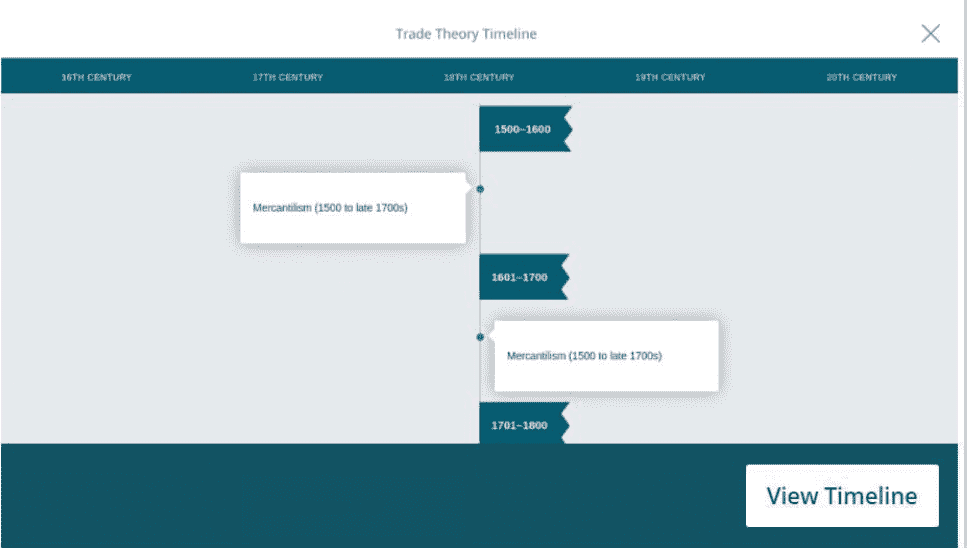

嵌入式评估为学生提供了定期检查其理解情况的机会。

每个模块和章节末尾互动测验允许教师向学生提供及时反馈，并快速解决学习差距。

#### 满分 1 分

#### 快速学习 1.1.1

本测试向我们介绍了国际商务，并描述了各种类型。它包括：将卡片上的描述与左列中的每个关键词进行匹配。

我们需要理解如何在海外经营。使用鼠标，点击并拖动单词从左列拖到其右侧描述旁边的框中。

| 关键词汇 | 描述 |
|---|---|
| 国际商务 | 具有全球影响力的公司 |
| 进口 | 跨越多个国界的商品和服务 |
| 出口 | 带入一个国家的商品和服务 |
| 跨国公司 | 以竞争优势运营并从事国际业务 |
| 外国直接投资 | |
| 天生全球化形式 | |
| | |

# -- 满分 1 分

EOM 问题 3.1.1

剩余 3 次尝试

关于民族中心主义，以下哪一项是正确的陈述？

- 它可能导致经理忽视当地文化的职能方面。
- 它正在帮助世界同质化为一种全球文化。
- 对其的详细知识有助于人们在另一种文化中有效工作。
- 它认为自己的文化劣于他人的文化。


写作作业——包括日记提示、共享写作活动和论文——贯穿于全文。写作是培养和评估批判性思维的最佳方式之一。教育工作者可以在不显著增加评分任务的情况下，整合批判性思维练习。

# -- 满分 1 分

日记 1.1：写一谈谈


今天，国际商务人士必须对生产和销售机会进行全球化思考。许多全球经理最终会发现自己在其他文化中生活和工作，而创业者会发现自己飞往自己了解甚少的地方。公司现在可以做什么来为他们的经理准备国际市场？资源有限的创业者和小企业又如何准备？

```
在此处输入你的回答...

最少 / 140 字
```

保存草稿

提交

视频作业为学生提供了通过应用概念和测试理解来进一步增加知识的机会。教师可以分享带有时间戳多选择题的视频。

| 1) 区块链技术试图消除链中的哪些成员？ |
|---|---|
| A | 卖家 |
| B | 中间人 |
| C | 生产商 |
| D | 投资者 |


- **移动应用程序**让学生可以在任何地方、随时、在任何设备上阅读和练习——无论在线还是离线。它会自动同步所有注册设备上的工作，允许学生在一天中切换于手机、平板电脑和笔记本电脑。

- **教师仪表板**提供了全班表现的概览。仪表板帮助教师管理课程的所有方面，包括识别和联系遇到困难和活动不活跃的学生。

- **LMS 集成**让教师、机构和学生通过 `Blackboard`、`Canvas`、`Brightspace by D2L`、`Moodle` 等轻松访问他们的 `Real` 课程。

- **市场准入策略项目**是一个交互式模拟，要求学生研究一个国家作为新视频游戏系统的未来市场。作为团队的一部分，学生研究并分析一个国家并建议行动方案。

# 解决教学和学习挑战

国际商务是一个动态且令人兴奋的学科，值得拥有令人愉快且编写良好的文本。这是一本易于阅读且及时的文本，方式简洁直接。《国际商务》文本有助于解决许多教学和学习挑战。

# 激发国际商务学习动机

学生需要被激发来阅读课程材料。本文利用对其他文化的内在好奇心来激发他们的兴趣。我们在第 3 章引入文化，并回到它以鼓励学生参与文本。我们通过引发深思的现实案例来阐明概念。

文化见解框展示了文化如何与关键章节相关。例如，另一个框展示了创业者如何利用文化成功。

# 使国际商务具有相关性

学生寻找某些业务概念的相关性，以激发他们的兴趣。本文涵盖了政治、法律、经济、全球化、市场人类资源、供应链管理等主题。

# 文化见解：全球旅行者会议指南

以下是经理在……领导会议的一些有用建议：

- 熟悉程度：避免过快变得熟悉。使用“博士”或“先生/女士”等头衔，除非被邀请这样做。

- 个人空间：考虑在你的文化中多大的距离被认为是适当的。有些人认为男女之间的物理距离。

- 名片：在亚洲，通常用名片代替鞠躬，用双手。在某些地方，将名片放在桌子上稍后处理。见面时避免在上面写字。

# 全球经理灵活性

以下是适应……风格的一些建议：

- 领导力：管理理念：美国管理是个个人化的，其他文化强调。

- 多文化：经理在不同文化中工作可能需要调整他们的风格。在了解了陌生文化的社会结构后，经理可以帮助员工以无偏的方式工作。

- 灵活性：问题越是行为性的，经理越需要灵活。在不同的文化地区实施需要灵活的方法以确保成功。

## 主动学习工具

教师需要一套全面的工具来评估学生对概念的理解情况。本书书中精心挑选的作业跨越了各种复杂程度，以测试学生的知识以及应用关键原则的能力。评估通常具有经验性性质，帮助学生培养制定决策的能力。这些主动学习工具帮助教师评估学生的学习进展。

- 每个学习目标末尾的“快速学习”（`Quick Study`）检查可以核实学生已经学习了关键概念并正在继续学习。在 `Revel` 教材中，学生可以获得其答案的即时反馈。

- “团队合作”（`Team Up`）项目超越了课本范围，要求学生通过采访、研究其他国家、课堂辩论或在小组讨论环节中聚在一起进行团队协作。

- “谈一谈”（`Talk About It`）提出了涉及企业家、经理、政策制定者、消费者及其他人的重要问题。这些可以作为作业布置，也可以用于课堂讨论。

## 谈一谈

1. 公司及其员工正处于社交媒体的焦点。如果一个所有者要为他人犯的错误承担后果，他们是否应该承担个人责任以避免伦理失范？伦理在管理中有多重要？

2. 与利益相关者分享利益是一项艰巨的任务，对小微企业而言尤其如此。他们如何平衡满足最重要的需求？考虑全球经济有哪些好处？

3. 循环经济的优点是什么？它是全球经济唯一负责任的发展道路吗？世界是否可以更多地向意识时尚思考？选择一家已经迈出这一步的公司。哪些具体的事情有助于提高其质量？

- “伦理挑战”（`Ethical Challenges`）让学生扮演经理、政府官员或其他个人的角色，考虑他们将如何对所提出的伦理困境做出反应。

- “练习国家管理案例”（`Practicing National Management cases`）允许学生分析并解决每章中提出的真实公司情况和问题。

## 团队合作


## 危机中的准时制加（JIT Plus）

丰田汽车是世界上最著名的汽车制造商之一。2011年，日本的一场大地震和海啸导致了一场中断该公司生产结构的事故。众，丰田的生产系统以基于准时制（`JIT`）制造而闻名。

丰田于1937年开始生产汽车。在20世纪70年代中期，他们开发了一种生产系统，允许他们以最小的库存生产多样化的产品。他们将这一系统称为准时制（`JIT`）制造。该系统已被许多其他公司（不仅是汽车行业的公司）采用。

想象你和你的同学是危机中做出决策的高层高管、首席信息官或经理。

你是一家新入职的公司的首席执行官，公司与全球客户签约。你被要求解释你将如何处理这种情况。从你的位置来看，你如何找到热点、健康和心态的灵活性？压力以及抑郁相关应激障碍的潜在影响是什么？

丰田的准时制方法减少了灵活性，因为它依赖于少数供应商。丰田的系统基于紧密合作的供应商群体。当危机袭击某一组供应商时，整个生产系统都可能受到影响。

2011年的地震和海啸中断了许多公司的生产线。丰田之所以获得帮助，是因为它拥有30,000个零件的替代供应商，而这些供应商并不位于灾区。在这种情况下，必需组件的替代供应商有哪些？

2011年的地震和海啸没有影响许多公司的生产线，因为他们没有所需组件的替代供应商。你将如何管理你的供应链，以确保你未来不受影响？

## 伦理挑战

1. 全球化和跨文化业务为今天带来了机遇与挑战。为什么关注社会问题并建立有责任的业务是重要的？

2. 企业社会责任。公司如何通过其战略整合其社会责任？

## 写作作业

2021年初，丰田在德国开设了一家新的工厂。这家全球领先的汽车制造商与传统制造商面临不同的挑战？电动汽车的优缺点是什么？

## 开发就业能力

就读本课程的一些学生是国际业务或相关专业的。本课程帮助学生培养实用的能力。

- **知识的应用与分析**指的是个人在特定环境中学习和应用知识的能力。我们将这些能力称为就业能力。学生将发现创新如何影响公司的成功。

- **反思性思维（批判性思维）**涉及有目标导向的思考，以定义和解决问题、做出决策或形成判断。例如，这要求学生使用批判性思维来检查复杂的安排。

- **沟通技能**涉及使用口头、书面和非语言语言以及技术进行有效沟通和倾听。这教导在另一种语言和文化中表达自己的思想和观点时应注意冒犯他人的价值观和信仰。

- **伦理理解和社会责任**是影响社会个人和组织的指导原则。学生将在本书书中遇到职业伦理和推理。他们将阅读经理在特定情况下如何做出伦理决策以及结果如何。伦理练习让学生置身于经理的位置，并决定如何处理伦理困境。其他作业要求学生在共享写作练习、团队和辩论中与他人有效沟通。

## 教师教学资源

更多信息和资源，请访问 `www.pearson.com`。

## 致谢

我们感谢在准备《国际业务：全球化的挑战》第十版期间许多教师、专业人士和学生提供的鼓励和建议。我们特别感谢对本版及之前的版本提供宝贵反馈的教师：

| 姓名 | 所属机构 |
|---|---|
| Rob Ahadi | University of North Carolina, Greensboro |
| Sadi S. Alhor | Drake University |
| Gary Anders | Arizona State University West |
| Madan Anavarajula | Northern Illinois University |
| Ogugua Anubogu | Lincoln University |
| Robert Armstrong | University of North Alabama |
| Wendell Armstrong | Central Virginia Community College |
| Merrish Banton | Florida International University |
| George Bates | University of Texas at Dallas |
| Constance Bates | Florida International University |
| Marca Marie Baer | University of Tampa |

## 前言 XXX

Leta Beard

Tope A. Bello

Robert Blanchard

David Boggs

Chuck Bohleke

Erin Boyer

Todd Brackman

Richard Bricebois

Bill Brunnen

Thierry Brouselle

Thomas Byrne

Mikelle Calhoun

Martin Calkins

Lisa Chervitch

Kenichiro Chinen

Joy Clark

Erikson Conkling

Randy Gray

Tim Chun

Robert Engle

Herbert B. Epstein

Blair Farr

Stanley Flexx

Ronelle Genser

Carolina Gomez

Jorge A. Gonzalez

Andre Graves

Kenneth R. Gray

James Gunn

Lynn Guzzino

James Halterman

Alain Hamlin

Faisal Harahao

Dale Hartley

Charles Harvey

M. Anaam Hashmi

Les Jankovic

R. Sitki Karahan

Bruce Keillor

Kersten Kelly-Brunner

Ken Kim

Ki Hee Kim

Anthony C. Koh

Donald J. Kopka Jr.

James S. Lawson Jr.

In Lee

Tomasz Lewartowicz

Joseph W. Leonard

Antoinette Lloyd

Carol Lopitalo

Karen Lynden

华盛顿大学，华盛顿州

东卡罗莱纳大学

塞勒姆州立学院

伊利诺伊东部大学

欧文社区学院

中央皮德蒙德社区学院

马凯特大学，威斯康星州

大沼泽地大学

新墨西哥东部波特尔分校

查菲学院

奥克兰社区学院

俄亥俄州立大学

圣克拉拉大学

奥克兰社区学院

加州州立大学萨克拉门分校

奥伯恩大学–蒙哥马利

艾维科技社区学院

威斯康星大学斯蒂文斯角分校

新墨西哥东部波特尔分校

奎尼匹亚大学

德克萨斯大学泰勒

贾维斯基督教学院

圣托马斯大学

德瑞大学

休斯顿大学

威斯康星大学密尔沃基分校

纽约州立大学 (SUNY)

佛罗里达农业州立大学

伯克利学院

托马斯·更多大学

惠顿学院

南犹他州大学

雷兰兹大学

拉拉米县社区学院

英国西英格兰大学

曼卡托州立大学

圣何塞州立大学

蒙大拿州立大学

扬姆斯顿州立大学

艾维科技社区学院

托莱多大学

威廉·帕特森大学

托莱多大学

陶森大学

密西西比州立大学

卡尔尔顿大学

佛罗里达大西洋大学

迈阿密大学（俄亥俄州）

弗吉尼亚大学

加州州立大学多明奎斯希尔分校

北卡罗莱纳大学格林斯伯勒

Jennifer Malarski

北赫尼平社区学院

Donna Weaver McCloskey

威德纳大学

James Fillen

鲍灵格林州立大学

Mantha Vlahos Meillis

佛罗里达大西洋大学

John L. Moore

俄勒冈理工学院

David Mosby

德克萨斯大学阿灵顿分校

Richard T. Mpoyi

中田纳西州立大学

Tim Muth

佛罗里达技术学院

Christopher "Kit" Nagel

康科迪亚亚尔文ine

西南浸信教大学

Keneth (Kyeungrae) Oh

查尔斯南部大学

Sam Okafor

托莱多大学

Patrick O'Leary

圣安布罗斯斯大学

Jaime Oritz

德克萨斯国际教育财团

Yongsik Park

洛约拉玛蒙特大学

Thomas Passero

欧文社区学院

Hui Pate

Skyline学院

Clifford Perry

佛罗里达国际大学

Susan Peterson

斯科茨代尔社区学院

Janis Petonis

塔尔顿州立大学

William Piper

威廉·皮德蒙德学院

Ab Qast

莱凯兰学院

Krishnan Ramaya

俄勒冈太平洋大学

James Reynold

华盛顿大学-博瑟尔分校

Elva A. Resendez

德克萨斯A&M大学

Nadine Russell

中央皮德蒙德社区学院

C. Richard Scott

丹佛大罗都会州立学院

Deepak Sethi

老主领地大学

Charlie Shi

迪亚洛谷社区学院

Coral R. Snodgrass

卡尼西学院

Mark J. Sayder

北卡罗莱纳大学

Rajeev Sooverer

宾州州立大学–大学帕克分校

John Stanley

乔治·梅森大学

William A. Stoever

塞顿霍尔大学

Kenneth R. Tillery

中田纳西州立大学

William Walker

休斯顿大学

Paul Weber

圣克劳德州立大学

James E. Welch

肯塔基威斯利学院

Steve Werner

休斯顿大学

David C. Wild

东南路易斯安纳大学

Robert Yamaguchi

关于作者

`John J. Wild` 和 `Kenneth L. Wild` 提供了本书的融合内容。`John J. Wild` 是威斯康星大学麦迪逊分校的荣誉教授。他曾任职于法国马赛 `Ecole des Affaires Internationales`。

## 全球业务环境

### 第一章：当今全球化

#### 学习目标

在学习本章后，你将能够：

- 1.1 识别活跃于国际业务的公司。
- 1.2 解释全球化以及全球市场和生产的重要性。
- 1.3 详述推动全球化的力量。
- 1.4 总结关于全球化辩论的主要观点。
- 1.5 识别课程将帮助你发展的职业技能。

#### 本章简介

本章定义了国际业务的范围，并介绍了其中一些重要的主题。我们首先识别当今国际业务中的关键参与者。然后我们介绍全球化，描述其对市场和生产的影响，以及其增长背后的力量。接下来，我们分析全球化辩论中的每个主要观点。本章最后描述了本章如何帮助你发展就业能力技能，并展示了一个整合的全球业务环境模型。

#### 展望

第2章将向我们介绍伦理以及公司在国际业务中面临的关键伦理困境。我们介绍了企业社会责任以及在国际业务中管理所有利益相关者的重要性。我们还讨论了对可持续性和循环经济的推动。最后，我们处理了腐败、人权以及追求多样化、公平和包容性等其他关键问题。

# 苹果公司的全球影响

加利福尼亚州，`CERTINO`——`Apple iPhone` 是世界上第一款智能手机，为人们提供了前所未有的移动计算能力。`Uber` 和 `Lyft` 的商业模式完全基于智能手机技术。`TikTok` 等公司和 `WhatsApp` 等应用程序的成功归功于智能手机的普及。`史蒂夫·乔布斯`（`Steve Jobs`）解释说，iPhone 中的“i”指的是互联网，但也代表*个人、指令、信息和启发*。

苹果约 80% 的收入来自美国境外。全球化让苹果受益巨大，为其战略的核心。全球化生产允许苹果在全球范围内采购零部件和组件，并在成本效益最高的地方组装设备。根据生产设备的不同，苹果数百家供应商分布在多达50个国家。全球化意味着苹果可以在无需或几乎无需修改的情况下在全球销售其产品。

尽管全球化为苹果和其他公司带来了机遇，但挑战依然存在。文化、政治和经济紧张局势可能会引发民族主义的兴起。中美贸易战导致了中国市场对美国进口产品的反弹，并损害了苹果 iPhone 的销量。低价的中国竞争对手改进了他们的智能手机，并抢夺了苹果的市场份额。在您阅读这一章时，请考虑全球化的多少方面影响了全球国际公司的活动。


# 全球业务环境

每天当我们在日常行事时，都能体验到国际业务交易的果实。你醒来，关掉 `Apple iPhone` 的闹钟，这款手机在美国设计，在中国组装，使用了来自日本、韩国、台湾等地的零件。你戴上 `AirPods`，听着 `BBC` 广播电台制作的快速早餐节目。你穿上印度制造的 `Calvin Klein` T 恤和牛仔裤，穿上越南制造的 `Vans` 鞋子。你出门，开进那辆在阿拉巴马州制造的韩国 `现代` 汽车。你开车去 `星巴克` 点餐，点用哥伦比亚和埃塞俄比亚收获的咖啡豆做的拿铁。你的这一天才开始一小时，但从某种意义上说，你已经进行了一次环球。在回路上快速看一眼“市场”，你现在就有能力展示国际业务交易的实力了。这些产品每一个是如何设计的，以及每一个是如何成为你可以购买的，都是国际业务交易的结果。

## 国际业务

跨越两个或多个国家国界的商业交易。

国际业务是跨越两个或多个国家国界的商业交易。你不需要远看就能找到国际业务的证据。我们每个人的生活以我们并不经常定义的方式参与其中。无论你住在哪里，你都被进口产品包围——在国外购买的商品和服务，并且每天花部分时间使用本国的出口产品——卖到国外的商品和服务。每年，全球出口增长约 19 万亿美元，出口服务价值近 6 万亿美元。为了对比，这一商品出口的数字是全球平均水平的 36 倍。


## 进口

从国外进入国家的商品和服务。

## 出口

卖出国家的商品和服务。

本书描述了国际业务中经理的工作和责任。它涵盖了影响国际业务的极其广泛的话题。我们首先对该主题进行概述，并介绍国际业务中的主要参与者。接下来，我们讨论了全球化对市场和生产的强大影响，并解释了这种扩张背后的力量。然后我们涵盖了关于全球化讨论的每个主要观点，包括工资、收入不平等等等，我们解释了这将如何帮助你培养职业能力技能，如知识的应用、反性思考、沟通和伦理。最后，我们通过展示全球业务环境的整合模型，解释了为什么国际业务是特殊的。

# 第一章 当今的全球化

第一次工业革命由蒸汽机驱动，第二次由电力驱动，第三次由数字技术驱动。第四次工业革命由人工智能、生物技术、量子计算等驱动。它正在融合数字、物理世界和生物世界，并创造出自动驾驶车辆、智能工厂中的机器人手臂和其他创新。第四次工业革命如何改变公司的生产、营销和管理活动？

Jennow/Sutterstock


生产流程，正如它们需要的时候那样。全球半导体短缺源于 2020 年对消费电子和电动汽车的需求。这导致制动系统和仪表盘显示器的短缺，迫使通用汽车、大众等制造商临时关闭工厂。芯片短缺导致全球汽车行业在 2021 年少产了至少 150 万辆汽车。运输延迟和短缺冲击了各种产品的供应。公司开始通过供应链多样化和回归国内市场来寻求保护。

在全球范围内，新冠肺炎导致许多企业倒闭，而企业家和公司努力为企业、医院、学校和个人提供服务。疫情改变了我们学习、工作、用餐、社交和娱乐的方式。几乎在一夜之间，“上学”和“上班”意味着要在家里找一个安静的地方使用笔记本电脑或手机进行在线课程和会议。人的工作是身份认同的重要组成部分，并帮助他们决定生活水平和生活的各个方面。疫情允许许多白领员工居家办公。疫情后，一些人采取了居家和办公室的混合安排。蓝领工人和一线员工在疫情期间仍需上班。一些公司向他们发放奖金，以感谢他们维持社会基本服务的运转。

国际业务也关乎员工和经理的工作。他们领导团队的方式受企业文化驱动。存在相似之处，但文化有助于决定领导者如何激励和实现业务目标。领导力在任何地方都既是艺术也是科学。其他文化背景的经理需要了解激励团队投入工作的关键。一个不了解当地信仰的外派经理可能会降低其成功几率。

火热的数字经济是企业对员工所要求的技能的转型。公司进行数字化以有效利用数据，在各种运营中工作并变得更加复杂。反之，员工被鼓励学习一系列技术和社交技能并进行终身学习。

我们将在第一章和整本书中触及这些及其他话题。因此，让我们从探索参与国际业务的公司类型开始我们的旅程吧。

## 1.1 引言和主要参与者

### 1.1.1 国际业务中的主要参与者

各种类型、规模和行业的公司都参与了国际业务，尽管它们的参与程度各不相同。一个小商店店主可能只从海外进口物资，而一家大公司可能在全球范围内拥有数十家工厂和商店。来自高收入国家的大公司仍在全球市场份额上进行激烈竞争。来自新兴市场（如巴西、中国和印度）的企业现在在国际业务中的竞争也日益活跃，这在很大程度上归于技术的进步。

**跨国公司（MNC）** 是指在多个国家拥有直接投资（以制造或营销子公司的形式存在）的企业。**外国直接投资（FDI）** 是指购买另一个国家的实物资产或该公司的大量股权，以获得某种程度的控制权。在进出口方面，这是公司参与国际业务的第三种主要方式。

跨国公司为它们进入的地区和国家创造了大量的就业、投资和税收。当它们缩减规模时，会导致成千上万的人失业。跨国公司之间的并购每年价值数十亿美元，并涉及位于新兴市场的公司。

某些公司的员工数量超过了小国家和岛屿的人口。例如，沃尔玛有 230 万员工。当我们把全球 500 强企业的收入与各国产生的商品和服务价值进行比较时，我们可以看到跨国公司巨大的经济影响力。

| 术语 | 定义 |
| :--- | :--- |
| multinational corporation (跨国公司) | 在多个国家拥有直接投资的企业。 |
| foreign direct investment (外国直接投资) | 购买另一个国家的实物资产或该公司的大量股权，以获得某种程度的控制权。 |

## 图 1.1 世界最大公司与特定国家的对比

来源：根据从《财富世界 500 强》（www.fortune.com/global500）获得的数据；2021 年 8 月/9 月；世界银行数据集（www.worldbank.org）。

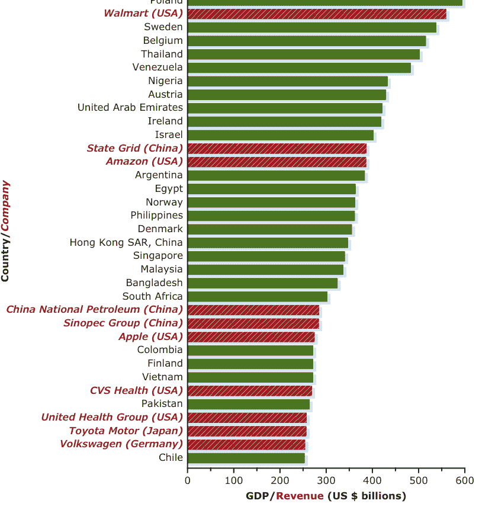

将世界最大的 10 家公司（以收入衡量）插入到按国家产出（以 GDP 衡量）排名的列表中。如果沃尔玛是一个国家，它的地位将是一个高收入国家，并排在波兰之后。Netflix 作为全球排名第 484 位的公司，其产生的近 5250 亿美元收入超过了数十个国家、萨尔瓦多和冰岛的年度产出。随着跨国公司的不断增长和客户耗尽，它们开始寻求国际市场。3.28 亿美国客户代表了一个巨大的市场，但一些公司也针对世界其他地区的 75 亿潜在消费者。Netflix 收入的 44% 来自美国境外，耐克的收入的 59% 来自美国境外。

互联网技术已演变为一种新实体——**出生全球型企业**——即一种具有全球视野、参与创新并迅速获得竞争优势的公司。这些许多公司（也是全球性初创企业）在几年内就变成了竞争对手。它们并不遵循跨国公司的传统模式，即先在本土市场建立品牌，以后才进入国际市场。

全球性公司必须创新，并使用难以模仿的基于知识的组织能力。它们利用这些资源建立相对于对手的竞争优势。公司巨头的名单通常包括 Airbnb、Uber、Spotify、Twitch 和 TikTok。出生全球型公司出现在 20 世纪 90 年代，随着互联网和万维网的扩张而出现。全球信息技术（IT）基础设施使这些公司能够利用其设计良好的应用程序和程序快速扩张。关于公司如何在国际市场取得成功的实际见解，请参阅“全球经理”部分。

## 全球经理：全球成功的关键

从 99 美分的汉堡（麦当劳）到 1.5 亿美元的喷气式客机（波音），全球性公司的经理在陌生的市场中竞争时必须克服障碍。全球经理承认了在管理方法上存在共同点，并提供了以下建议：

- **有效沟通。** 业务关系和礼仪中的文化差异对全球业务和运营至关重要。全球经理承认并欢迎独特性，同时展现灵活性、尊重和同理心。
- **了解客户。** 成功的经理了解不同产品如何满足国际客户的需求。他们必须确保公司保持灵活性，并有足够的能力定制满足需求的产品。
- **强调全球意识。** 优秀的经理从一开始就整合业务战略。他们确保产品和服务在设计时考虑了全球市场，而不是将其作为本土市场过时产品的倾销场。
- **市场影响。** 世界将是通往你们更好产品的道路。糟糕的营销努力会导致产品失败并被忽视，除非国际营销领导者能够带来广泛的媒体关注。顶尖全球经理通过卓越的营销来管理产品。
- **监控市场。** 成功的经理密切关注业务环境，留意政治、法律和社会经济状况的变化。他们将获取准确信息视为首要任务。

## 快速学习 1

1. 你如何定义国际业务、进口和出口？
2. 什么是跨国公司，它为什么对我们研究国际业务具有重要意义？
3. 为什么全球性公司可能被称为“出生全球型企业”？

## 1.2 什么是全球化？

历史上，国家对跨越边界的产品、人员和资本拥有绝对控制权。今天，它们日益交织。这种更强的相互依赖关系意味着商品、服务、人员和信息的跨国流动日益自由。

### 1.2.1 全球化的演变

将当今的全球化置于背景中是有帮助的。全球化的第一个时代从 19 世纪 50 年代中期持续到第一次世界大战。在那时，旅行非常频繁，1800 年代每年有 30,000 人前往欧洲，1900 年以后每年有 100 万人离开。战争期间，各国直到 1914 年才不需要国际旅行许可。在全球化的第一个时代，贸易和资本的流动比以往任何时候都更加自由。高收入国家的全球公司从土地提取原材料并生产各种商品。大型货轮航行将制成品运往遥远的市场。欧洲和美国之间的大西洋电缆（于 1866 年建成）让新闻传递得比以往任何时候都快。

在那个时代贸易对世界经济有多重要？为了回答这个问题，我们探讨了商品和服务的进出口总额占世界国内总产值的比率。1880 年左右，全球贸易占 GDP 比重从未超过过 10%。平均而言，各国贸易额占其年度总产出的约 20%。全球化的第二个时代随着蒸汽轮、电报、铁路以及后来的电话和飞机的出现而开始。

全球化的第一个时代随着 20 世纪 20 年代初第一次世界大战、俄国革命和大萧条的到来而结束。商品、资本和人的巨大流量变成了细细流。从第一次世界大战到苏联与美国之间的冷战，世界保持分裂了 75 年。东西方的分歧是共产主义与资本主义之间的意识形态分歧。1945 年后，商品和资本的国际流动被限制在各自的资本主义和共产主义体系内。图 1.3 显示，全球贸易占 GDP 比重在 1970 年增长到 27%。现在各国贸易了其年度产出的 27%——在 100 年中增加了 17 个百分点。

全球化的第二个时代大约于 1989 年左右，随着分裂的共产主义东欧和柏林墙的崩溃而开始。一个接一个，中东欧国家拒绝了共产主义并转向自由市场经济体系。直到 20 世纪 90 年代，国际流量在绝对总量上恢复到第一次世界大战之前的水平，但全球经济已经重生。全球化第二个时代的驱动因素包括通信卫星、光纤和互联网。

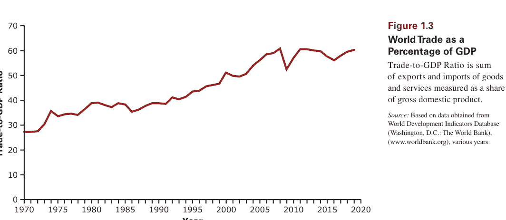

#### 近期事件

在整个 20 世纪 90 年代和 21 世纪初，各国日益关注扩大贸易。欧盟包含了更多国家并更深入地整合了它们的经济。加拿大、墨西哥和美国之间的自由贸易协定生效（该协定于 2020 年进行了修订）。中国于 2001 年加入世界贸易组织，使中国成为事实上的贸易大国。西方消费者将劳动密集型工作外包给中国，中国向世界其他地区出口成品和中间品。中国的出口份额和全球贸易量随着台湾、韩国和日本一起增长，进入了看似不断扩张的全球供应链。

到 2006 年，全球贸易占 GDP 比重自 1970 年以来增加了一倍多，达到约 60%。因此，平均而言，各国贸易额达到了其年度产出惊人的 60%（见图 1.3）。2008 年全球金融危机引发了全球衰退。全球商品和服务贸易从 2008 年到 2009 年下降了 22% 以上。这是自大萧条以来对全球经济最严重的冲击。

中美贸易战迫使公司重新审视它们的策略。新冠疫情进一步暴露了全球供应链的脆弱性，加速了供应链多元化和“近岸外包”趋势。

## 1.2.2 市场全球化

**市场全球化** 是指全球范围内日益增长的消费者偏好趋同。这种趋势发生在许多类别中，包括消费品、工业产品和商业服务。运动装品牌阿迪达斯和流媒体视频提供商 Netflix 是两家在所有国家销售全球产品的公司。

## 地图 1.1 各国全球化指数

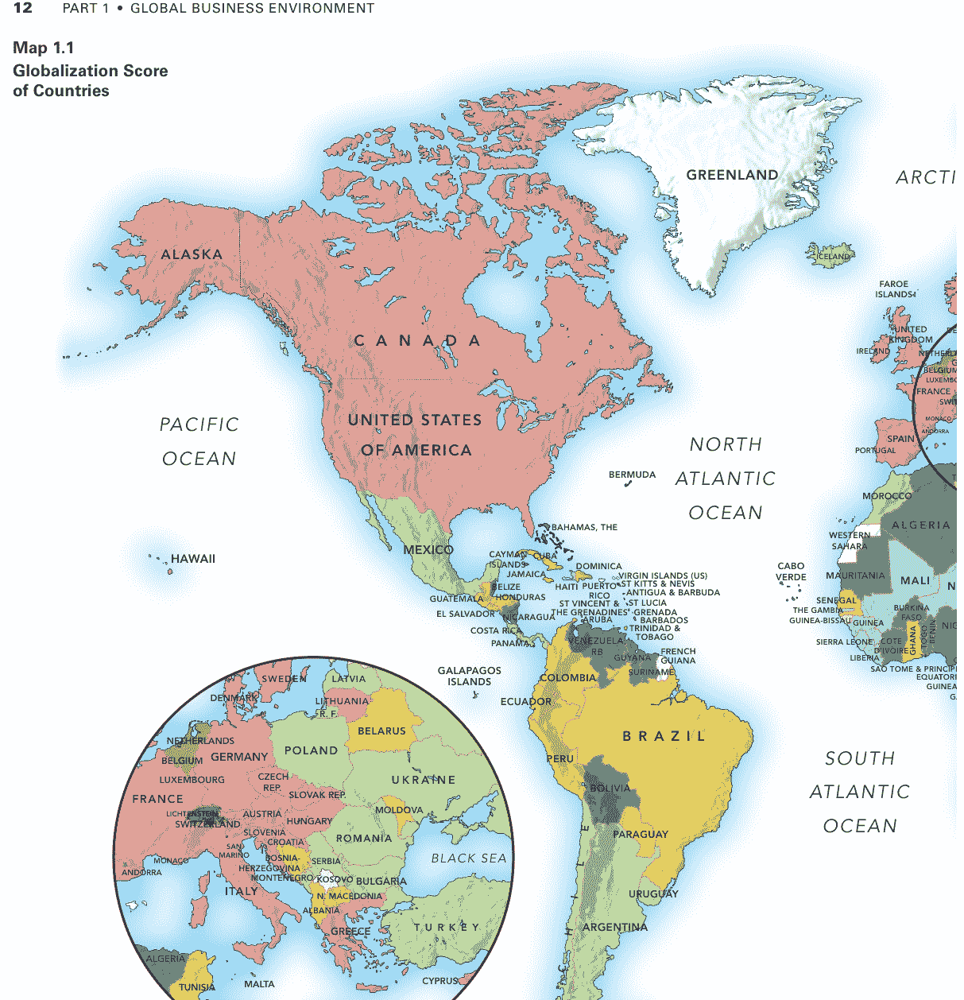
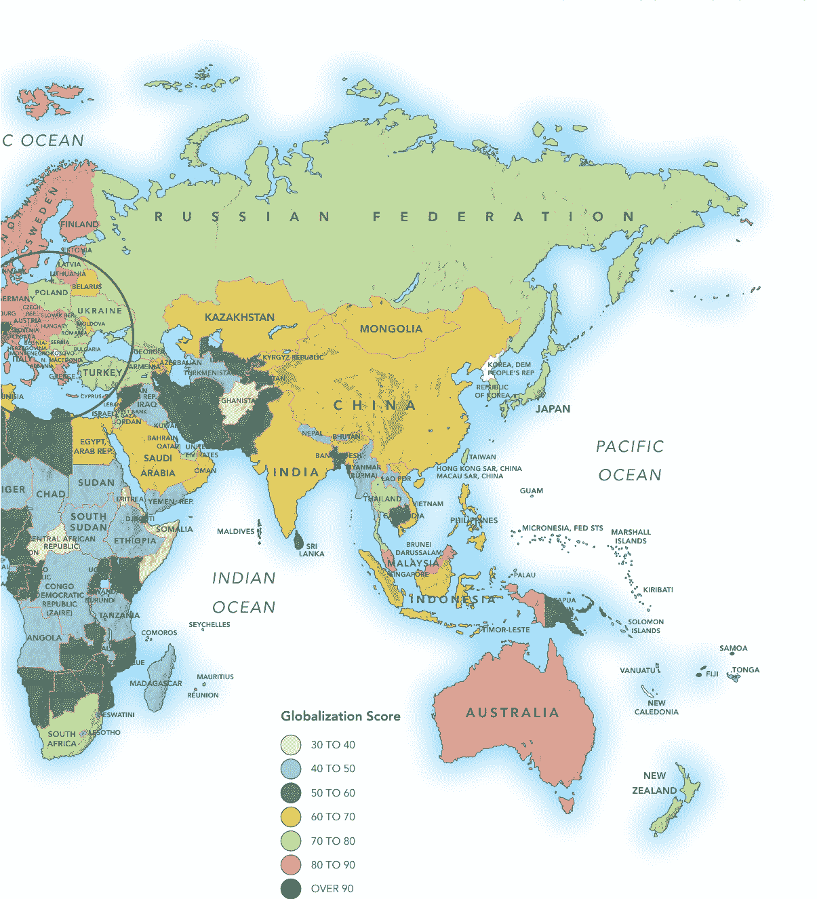

### 市场全球化的驱动因素

**消除贸易壁垒** 降低关税和非关税壁垒使公司更容易进入外国市场。

**消费者偏好的趋同** 现代通信和媒体使全球消费者接触到相似的产品和生活方式，导致需求趋同。

**规模经济** 公司通过标准化产品并在全球范围内销售，实现规模经济，降低单位成本。

**季节性产品** 同样，除雪机、雪铲、滑雪板和寒冷地区衣物的制造商可以根据南北半球的季节调整分配，并保持多个水平的生产能力。

**当地买者的需求** 为了追求全球市场的潜在利益，经理必须不断监控产品与市场之间的匹配情况，以免忽视买者的需求。通过适应性产品为客户提供服务，收益可能超过使用标准化产品的收益。软饮料、快餐和其他消费品是渗透到全球市场的产品。其中一些产品需要进行小调整以更好地迎合当地口味。例如，在日本，可口可乐调整了其传统配方，以与口味更甜的百事竞争。在印度，牛被视为神圣之动物且食用牛肉是禁忌，麦当劳推出了“满哈拉拉巨堡”（Maharaja Mac）——在芝麻饼上放两个羊肉饼，配上所有常规配料。

### 可持续性

**可持续性** 指在不损害后代满足其需求能力的情况下，满足当代需求的发展。

**全球可持续性** 多国公司必须考虑全球范围内对可持续性的需求——即在不损害后代满足其需求能力的情况下。大多数公司在一个透明度提高、审查日益严格的环境运营。社交媒体的兴起促进了这一趋势。关注此问题的个人和政府组织会迅速利用社交媒体来举报任何损害环境或社会的行为。开明的企业应该通过其业务活动，对员工、客户、供应商、所有者、贷款人、社区等给予最高重视。

多年来，具有远见的企业一直遵循“减少、重复利用、回收”的格言。其理念是减少资源的使用和浪费，使资源的使用寿命超过一个周期，并回收无法减少或重复的资源。最投入的经理和公司在此基础上增加了“重新设计和回收”，以促进可持续发展。这意味着为了可持续性重新设计产品和流程，并重新构想产品的设计和使用方式以减少对环境的影响。我们将在后续章节的很大一部分专门讨论可持续性。

## 1.2.3 生产全球化

**生产全球化** 是指生产活动分散到不同的地点，以帮助公司实现商品或服务的成本最小化或质量最大化目标。这包括生产投入的采购（如原材料或组装产品）以及服务的外包。现在让我们来探索全球化的益处。

**获取低成本劳动力** 全球生产允许公司通过获取低成本劳动力来降低整体生产成本。几十年来，公司将工厂设在工资较低的国家，以降低各种成本。包括玩具、小家电、电子产品和纺织品。虽然将生产转移到低成本地区在传统上意味着几乎完全是实物产品的生产，但现在这种做法正越来越多地适用于服务业，其中一些服务可以在劳动力成本较低的地方执行。许多欧洲和美国企业已将其服务中心和运营转移给全球寻求更低成本的客户，以及偏远地区从事低成本工作的工人，而这些工作在本土是行不通的。


# 第 1 章 · 全球化时代

## 获取技术专长

公司还在海外生产商品和服务，以从技术诀窍中受益。印度的劳动力具有良好的工作伦理，精通技术，英语水平高，且成本较低。发达国家的公司有时会在印度设立公司，利用客户服务、支持和会计任务（如薪资发放）来执行关键业务流程。这种做法在许多医疗保健提供者中非常流行，他们聘佣印度公司进行数据输入、医疗计费、医疗产品和诊断编码、记录保存、理赔处理、口述数字化以及数据分析。在拥有技术专长的所在地（印度）执行这些服务可以


## 获取投入品

全球化生产允许公司获取在本土无法获得或成本更高的资源。由于对自然资源的追求促使许多公司进入国际市场。例如，日本是一个人口稠密的小型岛屿，自然资源匮乏——尤其是森林。日本最大的造纸商日本制纸（Nippon Seishi）不仅仅是进口木浆。该公司在澳大利亚、加拿大和美国拥有森林以及相应的加工设施。这种所有权不仅使其能够获得关键资源，还使其对造纸过程的早期阶段拥有控制权。结果是公司获得了关键原料（木浆）的稳定供应，并避免了公开市场上木浆价格和供应的波动。同样，为了获取制造所需的更便宜资源，许多日本公司正搬到越南，那里的能源成本较低。

## 快速学习 1.2

1. 全球化如何影响各国的制度和经济？
2. 全球化的演变是怎样的？其近期历史是什么？
3. 公司可能从市场全球化中获得哪些益处？
4. 公司出于什么原因可能想将其生产活动全球化？

## 1.3 全球化的驱动因素

激励市场全球化并在多年来产生的广泛力量是贸易和投资障碍，这些障碍使全球范围内的公司产生了更多的对抗与合作。曾经被时间和距离隔绝的当地产业，现在对于远在数千英里之外的大型国际公司来说日益可及。中小企业现在必须与规模更大的公司竞争以保持竞争力。当地企业发现自己正处于为了生存竞争冲击的勇敢尝试中。

详细阐述驱动全球化的力量。

让我们通过讨论世界贸易组织、区域贸易协定和国际组织来探索全球化的驱动因素，涵盖贸易和投资障碍。我们对技术创新进行了扩展覆盖，每个主题单独列出：(1) 全球电子商务，(2) 数字化转型，以及(3) 通信交通。我们投入额外时间涵盖这些特定主题，是因为技术创新在促进全球化中的关键作用以及对经济增长的重要意义。

### 1.3.1 贸易和投资障碍

1947年，23国领导人（12个发达国家和11个发展中经济体）通过《关税总协定》（GATT）创造了历史，这是一项通过降低关税和非贸易障碍来促进自由贸易的条约。关税是对货物征收的税收，而非贸易障碍是对进口产品数量的限制。该协定在早期是成功的。在四十年里，世界贸易增长了20倍。然而，到1994年修订GATT时，国际贸易增长率已放缓至每年5%。该修订还通过进一步降低商品贸易关税和减少农产品服务（财政补贴）解决了与自由贸易相关的问题。这项权利保护了版权（包括计算机程序、数据库、录音和电影）、商标和专利（包括商业秘密和技术诀窍）。GATT的一个主要缺陷是它缺乏执行贸易规则的权力。世界贸易组织的建立是为了支持贸易自由、帮助谈判市场开放并解决成员国之间的贸易争端。世界贸易组织（WTO）解决贸易争端的能力以及惩罚违规国家的能力使其与《关贸总协定》（GATT）区别开来。WTO协定本质上是成员国之间的合同，承诺维护公平开放的贸易并接受罚款。其他国家根据WTO准则监管贸易政策或实施贸易制裁（贸易惩罚）。WTO取代了关贸协定机构，但吸收了所有的关贸协定协议。因此，关贸协定不再正式存在。今天，WTO拥有164个成员国和25个“观察员”。

从21世纪00年代开始，强大的贸易国家对WTO开始变得不耐烦。当公然继续那些导致另一个国家最初将其诉至WTO的做法时，他们却在争吵不休。2001年底，在卡塔尔多哈举行的一轮WTO谈判失败了，但推进工作的努力仍在持续进行。批评人士认为，WTO在今天已变得无关紧要，因为它未能充分应对过去二十年全球体系的变化，包括中国的崛起和数字经济的兴起。

WTO听案的关键在于由七位专家组成的上诉小组，他们对贸易争端拥有最终决定权。2019年，美国阻止了在该小组中任命新成员，基本上消除了其权力。2021年新任WTO总长恩戈齐·奥孔乔-伊韦阿拉（Ngozi Okonjo-Iweala）的到来为WTO改革提供了多年来的最佳机会。但自由贸易的一个障碍是区域贸易战中的国家日益倾向于声称国家安全豁免，这在WTO的监督之外。

#### 区域贸易协定

除WTO外，较小的国家群体通过促进和加强跨境投资来整合其经济。例如，《美加协定》（USMCA）将这三个国家聚集在一个自由贸易集团。更具雄心的欧盟（EU）结合了跨欧洲的27个国家。亚太经济合作组织（APEC）由21个成员经济体组成，致力于在太平洋地区建立自由贸易区。这些较小贸易集团的目标与WTO相似，但具有区域性。亚洲和欧洲的贸易很大程度上是区域性的。这在直觉上是合理的——公司通常与邻国的贸易和投资比与遥远国家的更多。

区域贸易协定的一个优势是与较少国家谈判可以比与WTO众多成员国更好地处理。如果世界贸易组织继续失能，一些国家会将区域贸易协定作为获得贸易利益的途径。但尚未出现更大区域关注的证据。各国正以其正常速度开展双边和多边贸易协定，商品流动着其典型的距离。

区域贸易协定涵盖了全球一半以上的贸易和较低的贸易。南非是世界贸易组织的成员，参与了至少七项区域、国际和双边贸易协定。贸易协定为许多南非人提供了高薪工作，就像这些在约翰内斯堡工厂组装工业阀门的个人一样。你的国家参与了哪些贸易协定？


#### 其他国际组织

其他机构在全球化中发挥着领导作用。世界银行是一个为国家经济发展努力提供融资而设立的机构。世界银行最初的目的是为二战后的重建提供资金。该银行后来将其重点转向发展中国家的一般需求，今天它资助了非洲、南美和东南亚的许多经济发展项目。

国际货币基金（IMF）是一个为了固定汇率和执行国际货币体系规则而设立的机构。IMF的宗旨包括国际货币合作、资助国际贸易的扩张和平衡增长、避免汇率贬值以及为成员提供临时金融资源。

**世界银行**：为国家经济发展努力提供融资而设立的机构。

**国际货币基金**：为调节汇率和执行国际货币体系规则而设立的机构。

### 1.3.2 全球电子商务

随着贸易障碍的消除和对投资的鼓励，技术创新正在加速其步伐。技术和运输方法的创新使得在全球范围内移动数据、货物变得更容易、更快速且成本更低。公司利用技术从遥远地区获取产品并销售服务。随着计算成本的下降和新技术的开发，公司发现更容易更廉价地管理分散的营销活动和设施。

当企业或消费者使用计算机网络进行交易、购买、出售或交换产品；服务客户；与合作伙伴合作时。电子商务让公司能够更容易营销其产品，而不仅仅是进出口产品。让我们看看几个对全球化产生重大影响的例子。

**电子商务**：使用计算机网络购买、出售或交换产品；服务客户；与合作伙伴合作。

互联网使我们能够联系遥远的客户以接受销售、检查配送网络中的库存、缩短预测并管理库存。触达国际客户成本的降低特别有助于小企业，他们现在能够将互联网作为全球营销工具。互联网使我们能够通过减少产品经过的中间商数量来购买生产产品。

互联网也被用于解决某些问题。例如，全球网络中的网络Innova，利用用户位置和众筹来连接人们并解决困难。这些具有专业知识的工程师、科学家、发明家和商人解决了世界金融创新领域一些最棘手的问题。Innova对任何人开放，提供七种语言服务，并支付奖励，截至目前奖励已从500万美元增长到2000万美元。

互联网使用继续扩大并覆盖更多的人口。图1.4显示了2011年至2021年不同地区用户数量的增长。2021年，全球只有6.5%的用户在中国。相比之下，非洲的互联网用户从2011年的6.2%增长到2021年的12.5%，几乎是北美的两倍。而美国的互联网可用性为90%，但渗透率仅为46%。随着互联网变得更加普及，全球用户的百分比将继续增长。随着实现最大可用，北美的增长将继续缓慢。其他地区的互联网渗透率为亚洲（63%）、欧洲（71%）、拉丁美洲/加勒比（72%）、中东和大洋洲/澳大利亚（67%）。

**物联网 (IoT)**：所有通过互联网可读取、识别、定位、寻址和/或控制的设备和设备。

随着每秒至少127台新设备连接，物理世界和数字世界每天都在整合。物联网（IoT）包括所有通过互联网可读取、识别、定位、寻址和/或控制的设备和设备。


[第46页]

获取完整电子书即时下载链接

https://scholarfriends.com/singlePaper/479325/ebook-pdf-international-business-the-challenges-of-globalization-10th-edition-by-john-wild-kenn

如果上述链接有任何问题，您可以通过电子邮件获取此文件：

ebookexpert4@gmail.com

# 图 1.4

# 世界互联网用户

来源：基于从 Internet World Stats (www.internetworldstats.com) 获取的数据。

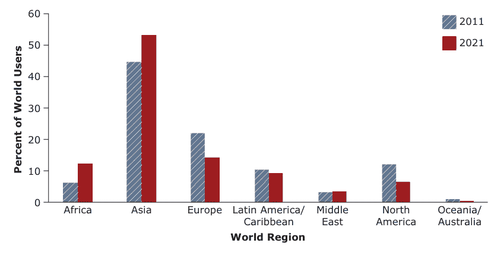

相互以及与人类通信的互联网设备，例如家庭、可穿戴设备和汽车。专家估计，到2025年物联网（IoT）连接将超过300亿个，即每人拥有4个物联网设备。

公司以多种方式使用物联网。罗斯·莱斯的飞机包含传感器，可以实时传输发动机状态信息。传感器将信息发送给公司，公司分析数据以寻找磨损或其他问题。这提高了机组人员和乘客的飞行安全性，并可以延长发动机寿命。罗斯·莱斯还利用这些数据针对传感器检测到的任何问题取消维护计划。这种主动策略提高了安全性和效率，并防止了因意外发动机维修导致的昂贵停机时间。

#### 内网与互联网

内网允许员工无论身处何地，都能使用个人凭证访问公司数据。内网的目标是促进组织内部虚拟空间内的通信、合作与协作。内网就像公司的私有网络。在公司防火墙之后，是组织内部网络安全范围内的数字工具、资源和其他文件。项目管理、营销策略、生产以及业务的每个领域都从内网提供的效率中获益。

沃尔沃汽车（Volvo Car）内网的一个有效营销工具是基于季数据的营销和销售信息。该循环始于总部向沃尔沃内网提交其全公司范围的营销计划。各家子公司的营销经理选择适用于自己市场的选项，制定计划并提交到数据库。这使得经理可以查看其他家子公司的营销计划，并对自己的计划进行调整。本质上，整个系统充当了沃尔沃所有市场共享最佳实践的工具。

外网（Extranet）类似于内网，但它将访问权限扩展到组织外的特定方。例如，外网可以自动访问公司网络。外网与公司内部业务网络的无关区域以及公共互联网之间设有防火墙隔离。通过虚拟专用网络（VPN）门户访问外网。外网允许国际公司更快速地对内外部做出反应。

### 1.3.3 数字化转型

技术创新的另一个关键涉及从旧的模拟过程向数字过程的转变。将模拟信号转换为计算机和其他技术使用的数字信号的过程被称为“数字化”（digitization）。企业将其数据和信息数字化，以优化业务流程，从而提高效率并降低成本。数字化是企业开展后续更高阶技术过程之前的必经步骤。

**数字化 (digitization)**：将信息从模拟转换为数字以供计算机和其他信息技术使用的。

数字化（Digitalization）是利用数据和技术为业务运营、策略或业务模式开发数字平台。数字化直接影响人们工作的方式。企业过去使用陆地电话、快递或邮信等方式进行内部和外部通信，而现在他们通过电子邮件、社交媒体、聊天工具等数字工具进行通信。

**数字化 (Digitalization)**：利用数据和技术来开发新的业务运营、策略或模型。

公司可以开展一系列数字化转型项目。例如，一家公司可以安装一个健壮的网络来接收订单、账单和供应商的订单。随后，它可能会培训员工如何使用网络上的新功能，以协助协作项目的成员。

**数字化转型**：是指数字技术渗透到运营、策略和文化的所有领域，以创造以客户为中心的优势的改变。

是指数字技术渗透到运营、策略和文化的所有领域，以产生以客户为中心的优势的根本性变化。

这比数字化深得多，尽管它可能涉及许多独立数字化项目的完成。数字化转型公司所需的改变可能是耗时且艰巨的，但对公司的生存至关重要。这就是为什么企业在进行数字化转型时经常失败，除非他们面临激烈的竞争、为所有利益相关者和业务增加价值并获得长期竞争力。

数字化转型是向客户交付价值的基础性变化。服装零售商 Lulu（Lulu）意识到了变化的重要性，并在数字化策略中将顺应市场作为必然要求。该公司启动了国际网站和移动应用程序，为在线购物的客户提供灵活性。此举导致了销售额的增长。

全球玩具游戏公司宝玩（Hasbro）改变了其营销策略以针对父母，并利用内部数据为儿童重构玩具游戏。他们在社交媒体和其他渠道上发起了针对性的活动。宝玩的数字化策略通过将怀旧与数字叙事相结合，改进了其与全球客户的关系。这项投资成本增加了1100%，但每年全球销售额增加了10亿美元。当行业面临波动时，宝玩的数字化策略帮助它度过了风暴。

公司正在通过投资自动化和将业务运营转向互联网来加速其数字化转型。近70%的董事会优先考虑数字化转型。预计数字化转型市场到2025年将价值30亿美元。约75%的数字化转型使用人工智能（AI）服务，主要采用工业机器人执行常规任务。

### 1.3.4 通信与交通

跨越距离运营增加了协调和控制业务活动的复杂性。各种通信和交通方式的技术创新可以减轻国际管理的任务。

通信技术可以加速信息流，并简化协调和控制任务。视频会议是经理用来保持联系的不可或缺的工具。

全球市场和生产使交付成为一项复杂的工程任务。随着公司通过外包活动降低成本，供应链和分销渠道变得越来越复杂。企业物流部门和物流专家正在帮助国际国家理顺供应链、监控航线并预测天气模式。高价值工作代表了全球化引起劳动力市场波动所产生的高附加值就业。

Andriy Pope/123RF

# 第一章 · 当今的全球化

## 快速学习 1.3

- 贸易和投资壁垒的下降如何促进了全球化？
- 电子商务、互联网和数字化在推动全球化方面起了什么作用？
- 通信和交通技术的进步如何影响了全球化？

## 1.4 全球化辩论

全球化对个人、企业和国家产生积极和负面影响并不令人意外。关于全球化的富有成效的辩论可以促进对其优缺点的对话，并产生一个更加理智、不那么天真的版本。通过这种方式，辩论的双方可以合作，在使全球化受益的同时，将其成本降至最低。

然而，那些反对全球化的人倾向于列出支持他们论点的社会经济成本。这些学生有时带有政治议程，这会影响客观性。团体的目标可能会影响分析的数据选择、研究的时间段等。

无论如何，我们介绍的是关于全球化对工作和工资影响的辩论。随后，我们将讨论关于收入不平等、文化、国家主权和环境的辩论。

### 1.4.1 全球化损害工作和工资

### 1.4 总结全球化辩论中的主要论点。

一些团体声称全球化消除了发达国家的制造业工作。他们批评国际公司将其价值链全球化，并将高薪制造业转移到工资较低的发展中国家。他们认为，“中国制造”标签意味着电视、体育用品等价格更低，但据估计，从2006年至2010年，美国在其1700万个工厂工作中失去了600万个。

批评者还认为全球化降低了工资。当发达国家失去一份制造业工作时（假设找到了另一份工作），工人的工资可能比以前低。这导致了就业率、士气和工资的下降。批评者迫使工人接受较低的工资并忍受恶劣的工作条件。他们说，自20世纪70年代全球化时代以来，蓝领工作的工资一直持平或仅增长了5%。

批评者还认为全球化剥削了低工资国家的工人们。这些批评者强烈反对西方公司外包的呼叫中心。他们说，这迫使亚洲人掩盖国籍、采用西方口音并在夜间工作。批评者还说，当公司在劳动法较少、劳动力成本较低的发展中国家经营时，全球劳动力力量就会削弱。图1.5显示，西方可以将信息技术工作外包给新兴市场并获得巨大收益。只要这些经济差异存在，国际外包仍然很流行。西方计算机程序员的平均工资是中国和立陶宛的许多倍。

### 1.4.2 全球化改善工作和工资

支持者为全球化提出了几项支持论点。他们说，全球化增加了贫困国家和发展中国家的财富和效率。他们认为，对国际贸易的开放增加了国家生产（通过提高效率）并提高了人均收入（通过将储蓄传递给消费者）。例如，消除供应链限制中的低效环节并提高了生产力。他们说，消除所有自由贸易障碍将显著推动全球经济，并使发展中国家受益。

# 第一部分 · 全球商业环境

## 1.5 比较信息技术工作人员的工资

| 国家 | 平均工资 |
| :--- | :--- |
| 美国 | $49,692 |
| 德国 | $30,060 |
| 新加坡 | $16,668 |
| 巴西 | $14,880 |
| 台湾 | $14,580 |
| 墨西哥 | $10,632 |
| 立陶宛 | $4,632 |
| 中国 | $3,024 |

来源：根据从国际平均工资数据库 (www.worldsalaries.org) 获取的数据。

全球化支持者认为，全球化通过在发达国家产生劳动力市场活性产生了积极收益。一些人声称这些是源于工人流离，或者说在整个范围内工作流动率较高时被称为“洗牌”（churning）。灵活的劳动力市场允许工人迅速重新部署到对他们高度重视且有需求的经济部门。例如，这允许员工和工人在初始雇主那里获得经验和技能，然后转向一份更适合他们的更好的工作。


# 第一章 · 当代全球化

## 1.4.3 关于收入不平等

围绕全球化的争议中，没有比关于不平等作用的辩论更激烈的了。在20世纪90年代和2010年代全球化长期加剧之后，许多人经历了2008年金融危机和2020年疫情的苦难。今天，发达国家中产阶级的制造业工资停滞使不平等成为关注焦点，并产生了让繁荣更具包容性的需求。

在全球范围内，从1980年至今，处于底部50%和顶端1%之间的49%收入者的增长似乎是缓慢或不存在的。与此同时，顶端1%的收入者占全球收入的份额从16%增加到20%。而顶端0.1%的收入者获取的增长与世界上另一半收入者的增长一样多。这种顶端的增长正在全球发生，包括新兴市场。


全球化有时被指责导致了国家内部的不平等。一些人说，全球化使具有高水平技能的大都市和关系良好的人受益，但导致了蓝领工人的失业和流离。我们在这里几乎每个国家都能发现这种不平等。

*Fabian Pluck/Shutterstock*

这些数字没有考虑到2020年疫情的到来导致数百万人的收入减少。在这里我们关注不平等的两个主要方面：国家内部的不平等和国家之间的不平等。

国际公司关闭高工资发达国家的工厂，并将其转移到低工资的发展中国家。他们说这增加了发达国家白领和蓝领职业之间的工资差距。今天，世界上71%的人口生活在不平等增加的国家。从1980年至2018年，北美和亚洲（特别是中国和印度）内部的不平等显著增加，拉丁美洲和加勒比地区下降。

### 国家内部的不平等

学术研究探讨了全球经济和不平等。对38个国家30年的两项研究发现，收入不平等随着国家增加贸易而加剧。但另一项对80个国家40年的研究发现，在开放程度下降的时期，收入不平等并没有上升。仅针对发展中国家的两项研究更为一致。第一项研究发现，贸易占比每增加1%，使贸易整合地区的平均收入增加0.5%，而在开放程度下降的时期，穷者落后。

### 国家之间的不平等

全球化支持者认为它减少了国家之间的不平等。从20世纪90年代初以来，国家之间的不平等平均缩小了，因为发展中国家的收入增长速度更快。但整体情况有所不同：一组发展中国家正在更快地缩小与高收入经济体的差距。拥抱全球化的国家和后共产主义国家增加了个人收入、预期寿命，并改善了教育体系。国家间不平等的缩小源于中国与全球经济的融合。中国正在缩小与美国之间的差距，年收入增长率分别达到7%和9%。另一个新兴市场印度也在推行全球化并缩小与美国之间的差距。

与世界保持更加封闭的国家进展不如其他国家。世界上超过90%的人口居住在发展中国家。在这些国家中，一些国家正经历着极端贫困。每天生活费低于1.90美元（极端贫困的门槛）的生活是难以想象的。一个积极的进展是，从1990年至2018年间，每天生活费低于1.90美元的全球人口从20亿人减少到6亿人，占世界人口的比例从36%下降到8%。联合国可持续发展目标之一是到2030年将极端贫困减少到3%以下。

一个令人震惊的数据是，北美洲的不平等程度是撒哈拉以南非洲的16倍。撒哈拉以南非洲占全球GDP的3%，占全球人口的18%，占极端收入不平等的63%。世界上超过四分之一的人口住在四个非洲国家——尼日利亚、刚果民主共和国、埃塞俄比亚和坦桑尼亚。在大流行病之前，非洲国家正在快速增长，并在1990年至2018年间将极端贫困人口从人口的55%降至41%。萨克斯等专家预测，疫情在不久的未来内将增加非洲的极端贫困。

## 1.4.4 全球化与文化

国家文化是一个关于人们价值观、习俗、信仰和交流的故事。全球化的反对者认为，它同化了世界并破坏了文化的丰富性。在他们看来，在我们即将进入的新世界里，我们将穿从同一个品牌商店购买的相同衣服，在同一个品牌餐厅吃同样的食物，观看同一家电影公司制作的电影。这种责任被完全归咎于生产消费品的最大的美国跨国公司。

支持者认为，全球化使我们所有人都能从不同的处境和贸易中获益。贸易允许国家专门提供它们能够最高效率提供的商品和服务。然后，各国通过相互贸易来获得他们渴望但无法生产的商品和服务。事实上，台湾仍然生产世界上许多半导体，南非产出大部分钻石，德国继续生产世界上工程水平最高的汽车。其他国家通过与这些国家进行商品和服务贸易，来享受他们没有或生产不了的半导体、钻石和汽车。要了解更多关于全球化与文化之间的相互作用，请参见见解专栏“文化争论”。

### 文化洞察 文化争论

关于全球化对文化影响的辩论引发了强烈观点。以下是辩论中的几个主要观点：

- **西方国家**。国际业务通过互联网、全球媒体、增加的商务旅行和当地营销遍布全球。批评人士认为，当地价值观和传统正在被推广“西方价值观”的美国公司所取代。
- **善的力量**。在积极的一面，全球化倾向于培养重要的价值观：宽容和多样性。国家的倡导者应对对其内部的对立观点更加宽容。这种观点可能为更和平的世界带来一种新的和平力量。
- **深层价值观**。全球化可能导致消费者和经济意识形态趋同，但体现文化本质的深层价值观对全球消费文化可能更有抵抗力。
- **物质欲望**。批评者认为，全球化通过广告促进了国家的“共同殖民化”。他们还认为，全球消费品通过让当地文化破产（在发展中国家）破坏了当地的多样性。

然而，证据表明，发展中国家的文化正在蓬勃发展，他们的音乐、艺术和文学的影响在过去一个世纪中已经扩大。例如，非洲文化影响了包括毕加索、披头士和斯坦因在内的艺术家的作品。

## 1.4.5 全球化与国家主权

国家主权通常涉及国家(1)是自主的、(2)可以自由选择、(3)不能干涉他国事务、(4)可以控制跨境流动以及(5)可以签署具有约束力的国际协议。反对团体认为全球化侵蚀了主权并侵犯了地方和州政府的权威。支持者对此不同意，认为全球化在全球范围内传播民主，国家主权必须从长期来看。

### 民主的威胁？

反对全球化的一个主要论点是，它以国家政府为代价加强了超国家机构的权力。不可否认的是，世界贸易组织（`WTO`）、国际货币基金组织（`IMF`）和联合国并非民主选举产生的代表领导。可争论的是，这些组织是否强加于主权国家的公民。批评人士认为，此类组织通过削弱国家、地区和地方政府的政治和法律权威，破坏了民主和个人自由。

全球化的反对者还提到国家政治当局代表公民签署具有约束力的国际协议的风险。批评人士指责此类协议违反了地方、地区和国家政府的主权。1973年，英国加入了后来成为欧洲联盟（`EU`）的国家集团。但后来2016年，在少数公民在公投中投票离开后，英国离开了该集团。投票离开欧盟表明，该协议正变成一个可以取代英国法律的过度政治组织。管理英国人生活的法律本应在欧盟的首都布鲁塞尔执行。

### 民主的守护者？

全球化支持者认为，全球化的惊人结果之一是在全球范围内传播民主。在过去的几十年里，许多国家的人们变得受过教育、更有见识并更有赋权。他们认为全球化没有导致民主衰落，而是向世界传播民主发挥了作用。

全球化支持者认为，主权国家经常放弃控制它们无法解决的问题。在1600年代中期，欧洲政府放弃了对某些地区的管辖，是因为尝试控制破坏了整体政治稳定。此外，1832年的希腊、1913年的阿尔巴尼亚和1990年代的前南斯拉夫国家放弃了部分主权以换取对少数民族的保护。随着时间的推移，联合国介入了国家的事务，以便在种族灭绝、酷刑、奴隶制、难民、妇女权利、儿童权利、强迫劳动和种族公正等方面取得进展。放弃某些经济问题的主权实际上可以增加福祉。

## 1.4.6 全球化与环境

一些环保人士认为全球化导致了环境状况和标准的“逐底竞争”。许多发展中国家，包括阿根廷、巴西、墨西哥和泰国，在自由外商投资法律的同时，实施了更严格的环境法规，使得污染密集型的美国公司寻求投资到环境标准更严格的国家。如果不是搬到环境保护法很差的国家，大型国际公司几十年来就不会投资这些国家。其他证据表明，封闭的保护主义经济体在保护环境方面比开放国家更差，包括巴西军事统治时期。

对于投资而言，一个地点必须在社会、政治和经济稳定水平可接受的环境中，提供低成本、技能熟练的工人——而不是松散的环保保护法。

## 快速学习 1.4

1. 你会如何总结关于全球化对工作和工资影响的辩论？
2. 证据告诉了我们关于全球化对国家间不平等的影响？
3. 关于全球化对文化影响的主要论点有哪些？
4. 全球化的支持者和反对者对国家主权说了什么？

## 1.5 职场技能

国际业务正在发生快速变化。跨越行业的驱动因素包括数字化战略、常规任务的自动化、人工智能的实施以及环境友好型产品的扩张。由于电子商务的发展，零售业在疫情期间的增长速度达到了两到五倍⁴。使用数字渠道的人数将继续增加。

具有高水平人际互动的工作正经历着最大的加速。全球化驱动了仓库、购物中心和制造工厂的自动化，以适应社交距离和多变的需求。由于电子商务的增长，食品服务、销售和运输领域的就业增加了⁵。

自动化消灭了一些工作，但也创造了新的工作。到2030年，超过60%的雇员将需要不同的职业。这很可能是真的，但自动化应该带来更高水平技能的员工，作为客户的知识且信赖的顾问。未来最具竞争力的企业将专注于不断升级员工的技能，以跟上技术进步。许多新兴职业将在人工智能、云计算、数据分析和流程自动化等领域寻求员工。

这门课程将帮助你个人在全球范围内日益增长的经济中成功。今天公司对员工的职场技能包括知识应用、反思性思维和沟通技能等。配套材料和作业将帮助你发展这些能力和职场技能。


*Ramixel.com/Shutterstock*

**知识应用技能**是指学习一个概念并将其适当应用到另一个环境以获得更高层次的理解的能力。这将应用于你在众多作业、项目、小型案例以及此书开发的市场进入策略项目中的分析推理和研究技能。你将学到，全球业务的核心是一个经历、学习、应用知识以及评估成功或失败的过程。在整个课程中，你将有机会解释公司为什么因为其采取或未采取的行动而成功或失败。

**反思性（批判性）思维**涉及强大的以目标为导向的思维，用于定义和解决问题、做出决策或对一系列情况形成判断。这门课程将帮助你发展这一关键技能。你将使用反思性思维展示国家如何设计其政治、经济和法律体系来处理复杂的安排，以实现国家及其人民特定的优先级。通过本书，你将学会从业务经理的角度思考，并做出决策或解决今天业务中常见的难题。密切相关的技能是分析性思维，它涉及遵循模式得出结论。

这门课程还将帮助你提高**沟通技能**。沟通是使用口头、书面和自然语言以及技术有效地交流思想。在国际范围内，业务跨国界、语言和文化工作。在另一种语言和文化中理解他人的思想必须是一种挑战性且有回报的方式。你将读到哪些适当的沟通导致了成功的交易，哪些不当的沟通导致了各种失败。你将看到经理第一次在海外任务中如何与他人合作、保持灵活性并管理妥协以成功。

对**伦理和社会责任的知识**是这门课程将帮助你提高的另一项职场技能。我们将这些概念定义为影响个人和组织在社会中行为的一系列指导原则。在整个课程中，当你遇到个人伦理责任和推理的问题时，以及经理在做出伦理决策后的表现。你还将读到公司在人权、公平贸易和可持续发展等话题面临的社会责任。

为了帮助你在学习这门课程时开发这些和其他职业技能，我们创建了一个独特的组织框架来帮助你概念化国际业务。我们将其称为**全球业务环境**。

### 1.5.2 全球业务环境

正如在本章看到的，国际业务与国内背景下的业务有很大不同。最明显的对比是各国拥有完全不同的社会和商业环境。解释国际业务特殊之处的最佳方法是使用本书的独特模型——我们称之为**全球业务环境**。该模型将四个不同的元素织在一起：

1. 全球力量
2. 国家业务环境
3. 国际业务环境
4. 国际业务管理

图1中的模型识别了这些元素及其组成全球业务环境的子部分。将国际业务视为发生在这一全球系统内部，有助于我们理解国际业务的复杂性及其不同元素之间的相互关系。让我们预览全球业务环境的四个主要部分。

**全球力量**正在改变我们的社会和商业活动。这些全球力量对图1所示的每个元素施加压力，并影响全球业务环境的每个方面。首先，全球化的力量增加了所有公司的竞争，因为经理将世界视为机会。其次，在国内和国外的公司始终对伦理状况、社会责任问题以及各种形式的可持续性保持警惕。敏锐的经理和高管会考虑业务可以做什么来支持这些努力。这构成了本书的第一部分。

**每个国家的业务环境**由独特的文化、政治、经济和法律特征组成，这些特征定义了国境内的业务活动。这一系列国家特征在不同国家之间存在巨大差异。尽管如此，随着各国开放和拥抱全球化，它们的业务环境正在发生变革。全球化可能会在社会的各种环境内部及之间催生协同效应和紧张局势。公司经理在当今必须具有适应性，根据需要调整其产品和实践。这构成了本书的第二部分。

**国际业务环境**以微妙和不那么微妙的方式影响着当前的运营。在国界日益通透的长期趋势驱动下，业务活动完全沉浸在国际业务环境之中。全球化的驱动因素导致贸易、投资和资本的流动增长并变得更加明显——往往导致城市同时在生产基地和新市场之间发生转移。当今的企业感受国际业务的脉搏，以观察它可能如何影响自己的运营。这构成了本书的第3部分和第4部分。

**国际业务管理**与纯国内业务的管理大不相同。广泛的生产和营销活动意味着通常要与不同地点的人进行互动。国际业务管理的语境是由国家业务环境的特征和全球化的整合力量所定义的。通过严密监控全球化、国家业务环境和国际业务环境，全球化带来了可能影响其运营的事件和力量。这构成了本书的第5部分。

我们现在包含《国际业务》的这第一章。本章仅向你介绍了研究这一令人兴奋且充满活力的学科。我们希望你享受接下来的旅程！

## 快速学习 1.5

1. 为什么职场技能变得越来越重要？
2. 哪些就业技能将帮助你进行职业发展？
3. 你会如何描述书中使用的全球业务环境模型？

# 第1章：总结

### 学习目标 1.1 识别国际业务中公司的活动类型。

- 大多数国际业务是跨越两个或多个国家的商业交易。
- 大多数国际业务由大型跨国公司（`MNCs`）进行，这些公司拥有强大的经济实力，交易额往往达数十亿美元。
- 出生全球型企业（`born global firms`）从成立起就采用全球视野并开展国际业务。他们倾向于拥有创新文化、基于知识的能力，并能提供竞争优势。

### 学习目标 1.2 解释全球化以及全球市场和生产的意义。

- 全球化是经过扩张和收缩阶段走向更大经济、文化、政治和技术整合的趋势，各国贸易约60%的产出。
- 市场全球化有助于公司(1)通过标准化营销活动降低成本，(2)在本土市场较小或饱和时探索国际市场，以及(3)平衡收入流。
- 生产全球化有助于公司(1)获取低成本劳动力并增强竞争力，(2)获取技术诀窍，以及(3)获取在国内可能太昂贵的自然资源。

### 学习目标 1.3 详述驱动全球化的力量。

导致全球化加剧的背后的广泛力量是贸易和投资壁垒的降低以及技术创新。

- 世界贸易组织（`WTO`）旨在支持贸易自由流动，帮助谈判市场开放并解决贸易争端。但其有效性在近年来较低。
- 一些国家组成较小的区域性贸易协定，与较少国家进行谈判可能是一项更容易的任务。
- 信息技术的创新使得在全球范围内移动数据、货物和设备变得更容易、更快速且成本更低。
- 特定的创新包括电子商务（`e-commerce`）、数字化（`digitalization`）、视频会议等通信工具以及运输技术的进步。

### 学习目标 1.4 总结关于全球化辩论中的主要论点。

- 全球化反对者认为(1)发达国家的工作转移到发展中国家，(2)降低发达国家的工资、工作安全感、士气和死亡率，(3)剥削发展中国家，以及(4)降低劳动力的议价能力。
- 全球化支持者认为(1)促进效率并增加收入，(2)促进劳动力市场灵活性，(3)在发展中国家创造提高生活水平的工作，以及(4)国家内部（但可能没有发达国家）的不平等融入全球经济。当一个国家拥抱世界贸易和投资时，不平等可能会减少。
- 证据表明，发展中国家在全球化时代正蓬勃发展，去工业化并没有批评者所说的那么糟糕。
- 一些全球化减少了国家主权。另一些人认为全球化帮助了民主在全球范围内传播并促进了许多全球问题的进展。
- 看起来全球化并没有导致环境的“逐底竞争”，而是鼓励公司确保可持续性并与促进健康市场联系。

### 学习目标 1.5 识别本课程将帮助你职业发展的技能。

- 本课程可以帮助你发展的就业技能包括知识的应用、反思性（批判性）思维、沟通以及伦理和社会责任。
- 全球业务环境模型将帮助你理解当今国际业务的本质并辅助你的技能发展。
- 全球化力量正在改变商业活动。全球化影响全球业务的每一个方面并增加了各处的竞争。企业必须对伦理、社会责任和可持续性保持警惕。
- 各国家环境包含了独特的文化、政治、经济和法律特征，定义了每个国家的业务活动。
- 国际业务环境影响公司的运营，而全球化进一步促进了贸易、投资和资本的流动。
- 国际业务管理与国内业务大不同。公司需要预测业务环境中可能运作的事件和力量。

## 关键术语

- 出生全球型企业 (`born global firm`)
- 数字化 (`digitalization`)
- 数字转型 (`digital transformation`)
- 数字化处理 (`digitization`)
- 电子商务 (`e-commerce`)
- 出口 (`exports`)
- 外商投资 (`foreign direct investment`)
- 关税与贸易总协定 (`General Agreement on Tariffs and Trade, GATT`)
- 全球化 (`globalization`)
- 国内生产总值 (`GDP`)
- 国民总值 (`GNP`)
- 进口 (`imports`)
- 国际业务 (`international business`)
- 国际货币基金组织 (`IMF`)


- 物联网 (Internet of Things, IoT)
- 跨国公司 (multinational corporation, MNC)
- 可持续性 (sustainability)
- 世界银行 (World Bank)
- 世界贸易组织 (WTO)

# 讨论

1-1. 为什么职场技能变得越来越重要？今天，国际业务人士必须从全球角度考虑生产和销售。许多全球经理最终发现自己在其他文化中生活和工作。公司可以做哪些准备？资源有限的企业如何准备？

1-2. 国家政府可以通过降低贸易壁垒的协定影响全球化的进程。一些专家认为政府在全球经济中扮演的角色太大。你认为国家政府会变得更重要还是不那么重要？

# 小组

想象你和几个同学拥有一家制造眼镜的公司。为了降低成本，你们会决定将工厂从发达国家搬到一个更具效益的地方吗？

1-3. 国家环境的哪些元素可能会影响你搬迁的决定？

1-4. 搬迁后，你预计生产和营销全球化的哪些方面会让公司受益？

# 伦理挑战

你是一家美国服装公司的 CEO，该公司向海外服装制造商外包工作。一家承包商的员工报告每天工作 20 小时、最低工资、拥挤的居住条件、体体的主管以及没收员工护照导致他们无法辞职。当地官员表示劳动法得到了遵守和执行，尽管滥用现象似乎很普遍。你派遣检查员去涉事工厂，但他们没有发现违规行为。一个劳动倡导组织声称主管强迫员工向你的检查员隐瞒，并威胁如果他们说话就会后果。

1-5. 你会实施一套监控系统来了解发生的情况吗？

1-6. 你是帮助工厂改善条件、撤出在该国的业务，还是什么都不做？

1-7. 你的行为可能会如何影响你的全球企业声誉、品牌形象和价值？

1-8. 你的行为可能会如何影响与工厂老板的关系以及在该国开展业务的能力？

# 写作作业

1-9. 进军国际时，公司通常研究新地点作为潜在市场以及潜在的运营选址。从市场和生产全球化中，公司可以获得哪些具体利益？请解释。

1-10. 全球化的反对者认为它对工作和工资、收入不平等、文化、主权和环境有许多负面后果。对于这些主题，全球化有哪些积极结果？

# 国际管理案例练习

## 苹果的全球战略

史蒂夫·乔布斯、史蒂夫·沃斯尼亚克和于1976年在加利福尼亚州库普顿创立了苹果，由沃斯尼亚克设计并手工制造了第一台电脑。苹果随后于1984年推出了Macintosh。当我们阅读苹果初期的简介时，它是全球最成功的公司之一，拥有极具忠诚度的客户。

苹果2024年的收入约为5000亿美元，产生于美国市场。其他市场包括欧洲（5690亿美元）、中国（400亿美元）、日本（210亿美元）和亚太地区（2300亿美元）。其中1380亿美元来自iPhone销售，540亿美元来自服务、Macs（290亿美元）、iPad（740亿美元）、Apple Watch、Apple News+和Fitness+。可穿戴设备、Apple Watch、AirPods、HotPod和HomePod产生了约310亿美元的收入。

国际业务的一个理论认为，国家应该生产其具有比较优势的产品，然后与其他国家贸易他们不具备的东西。对于苹果和美国来说，这意味着他们生产需要劳动密集型部件和组装的产品（如电子产品），并出口高附加值的产品（如iPhone）。

全球化帮助了苹果快速增长，其业务模式高度依赖零部件。苹果的组件来自涵盖50个国家的全球制造网络，取决于劳动力成本最低的地方以及可以雇佣工人的地方。苹果将零件组装并运往成本最低的地方。通过台湾制造商富士康（Foxconn），苹果在中国郑州的州的工厂每天生产数千台设备。富士康为40万名工人建造了高科技设施，这本身就是一家价值100亿美元的工厂。苹果在世界其他地方都无法找到这种规模的工厂和这种程度的合作。

苹果的生产战略高度依赖劳动力。相比之下，中国的劳动力成本比iPhone的总成本低了约90%。最大的成本产生在加利福尼亚州，苹果在那里负责设计、工程和营销任务。另一个原因是苹果在中国生产，因为那里的一些组件就位于那里，且可以廉价买到零件。中国的收入至关重要。苹果也依赖中国。中国的销售收入从2010年的28亿美元增长到2015年的590亿美元，随后在2020年下降到约400亿美元。

苹果将中国作为其战略的基石既有优势也有缺点。首先，随着工厂工作涌入中国，劳动力需求增加，成本随之上升。苹果通过将部分组装转移到越南和其他劳动力成本更的国家来应对。美国的一些商界和政界人士开始将中国称为“战略对手”。中美紧张关系加剧，这两个超级大国处于贸易战中。美国随后对苹果的竞争对手华为实施制裁。

第三，在2020年政治局势变化后，中美关系进一步恶化。两国的民族主义情绪升温。美国政府鼓励中美经济进行“链条重构”倡议，或“脱钩”。金融机构被告知由于几个原因不要向中国外包，包括指控侵犯人权、对苹果分包合同条件的担忧以及网络安全。苹果在中国的应用商店甚至一度移除过原生应用，这些应用曾允许中国互联网用户绕过中国未经审查的互联网。

苹果对所有这些应对措施是将部分iPhone生产移至越南和印度，并将部分扬声器、耳机的组装移至马来西亚。将中国作为生产基地并不是（至少不是）唯一的，但它是无可争议的单一国家之外生产优势。东南亚是他们计划扩大许多产品生产的地方。

当政府制裁华为时，一系列中国智能手机向消费者推销了非品牌手机。小米、OPPO和Vivo等设备制造商迅速改进了设备和相机，并以更低价格的手机与苹果竞争。这三家公司实现了三位数的增长，现在各占据中国智能手机市场约20%的份额。

## 全球思考

- 1-1. 为什么苹果在海外境外制造零件和组件，并将组装外包给中国和其他国家？

- 1-2. 为什么iPhone在中国失去了市场份额？你认为苹果在在华业务方面采取了哪些具体行动，导致了市场份额的流失？

- 1-3. 作为苹果的高管，你个人如何看待在中国经营业务？那里的经营方式似乎与美国的经营方式有巨大差异。

- 1-4. 根据你对上一个问题关于在中国经营业务的感受，你建议苹果未来对其战略进行任何调整吗？请解释你的答案。

## 附录

## 世界地图

随着全球化席卷世界，如果国际业务经理知道各个地点的位置及其距离，他们就能做出更明智的决策。地图通过地图展示世界，旨在帮助你理解全球业务格局。我们鼓励你经常在记忆中回顾本地图，特别是当你遇到陌生的城市或国家名称时。

熟悉本附录中的每张地图，然后尝试回答以下20个问题。对于每个问题，选择所有正确答案。

## 地图练习

- 1. 下列哪些国家邻大西洋？

   - a. 玻利维亚
   - d. 日本
   - b. 澳大利亚
   - e. 美国
   - c. 南非

- 2. 下列哪些位于非洲？

   - a. 圭亚
   - d. 巴基斯坦
   - b. 摩洛哥
   - e. 尼日尔
   - c. 埃及

- 3. 下列哪个不邻太平洋？

   - a. 澳大利亚
   - d. 墨西哥
   - b. 委内瑞拉
   - e. 秘鲁
   - c. 日本

- 4. 布拉格是（哪个）的首都？

   - a. 乌拉圭
   - d. 突尼斯
   - b. 捷克共和国
   - e. 匈牙利
   - c. 葡萄牙

- 5. 如果你的产品到市场的运输成本很高，以下哪些国家可能是设施良好的地点？

   - a. 泰国
   - d. 印度尼西亚
   - b. 菲律宾
   - e. 葡萄牙
   - c. 南非

- 6. 首尔是（哪个）的首都

   - a. 越南
   - d. 中国
   - b. 柬埔寨
   - e. 韩国
   - c. 马来西亚

- 7. 土耳其、罗马尼亚和俄罗斯邻接海海。

   - a. 地中海
   - d. 黑海
   - b. 里海
   - e. 亚德里海
   - c. 阿拉海

- 8. 泰国邻接哪个？

   - a. 柬埔寨
   - d. 马来西亚
   - b. 巴基斯坦
   - e. 印度尼西亚
   - c. 新加坡

- 9. 下列哪个国家不邻主要海洋或海洋？

   - a. 奥地利
   - d. 尼日尔
   - b. 巴拉圭
   - e. 以上都是
   - c. 瑞士

- 10. 奥斯陆是（哪个）的市都是

   - a. 德国
   - d. 澳大利亚
   - b. 加拿大
   - e. 挪威
   - c. 巴西

- 11. 利位于

   - a. 非洲
   - d. 南美洲
   - b. 亚洲
   - e. 中欧
   - c. 北球

- 12. 沙特阿拉伯邻接？

   - a. 约旦
   - d. 阿拉伯联合酋
   - b. 科威特
   - e. 以上都是
   - c. 伊拉克

- 13. 瑞典和爱沙尼亚之间的水域是（哪个）海。

   - a. 北
   - d. 挪威
   - b. 波罗的海
   - e. 地中海
   - c. 黑

- 14. 下列哪些国家位于地中海？

   - a. 意大利
   - d. 法国
   - b. 克罗地亚
   - e. 葡萄牙
   - c. 土耳其

- 15. 悉尼（澳大利亚）到东京（日本）的距离比以下短

   - a. 东京到开普敦（南非）
   - b. 悉尼到香港（中国香港）
   - c. 东京到伦敦（英国）
   - d. 悉尼到雅加达（印度尼西亚）
   - e. 以上都是

- 16. 马里德是（哪个）的首都

   - a. 马达加斯加
   - d. 西班牙
   - b. 意大利
   - e. 美国
   - c. 墨西哥

# 第一部分 · 全球业务环境

17. 下列哪个国家不在中亚？

- a. 阿富汗   d. 哈萨克斯坦
- b. 乌兹别克斯坦    e. 苏里南
- c. 土尔库曼斯坦

18. 如果你将产品从巴基斯坦的生产设施运往澳大利亚市场，你可能会穿越海洋。

- a. 南大西洋   d. 南海
- b. 太平洋         e. 大西洋
- c. 印度洋

19. 巴布亚新内亚、几内亚比绍和几内亚是同一个国家的不同名称。

- a. 正确   b. 错误

20. 下列哪些是岛屿国家？

- a. 新西兰   d. 澳大利亚
- b. 马达加斯加    e. 以上都是
- c. 日本

# 答案

(1) c. 南非，e. 美国；(2) b. 摩洛哥，c. 埃及，c. 尼日尔；(3) b. 委内瑞拉；(4) c. 捷克；(5) a. 泰国，b. 菲律宾，d. 印度尼西亚；(6) e. 韩国；(7) d. 黑；(8) a. 柬埔寨，d. 马来西亚；(9) 以上都是；(10) e. 挪威；(11) d. 南美洲；(12) 以上；(13) b. 波罗；(14) a. 意大利，c. 土耳其，d. 法国；(15) a. 东京和开普敦（南非）；c. 东京和伦敦（英国）；(16) d. 西班牙；(17) e. 苏里南；(18) c. 印度洋；(19) b. 错误；(20) e. 以上都是。

# 自测

如果你得了 15 分或以上，非常好！你似乎已经准备好开始了国际业务之旅。如果你得分少于 8 分，在继续之前你可能希望重新复习这张地图。

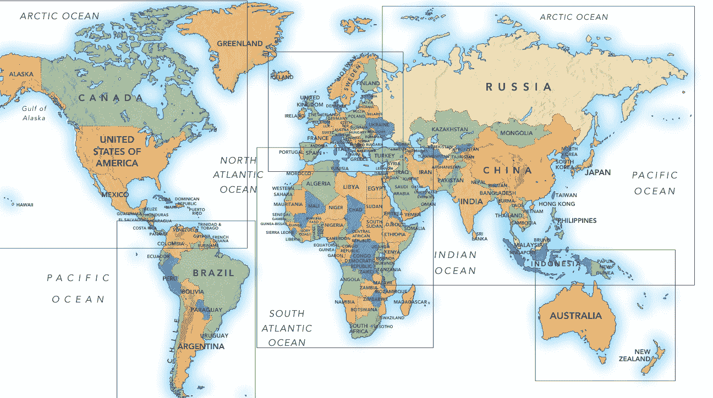

地图 A.1

世界

# 北冰洋

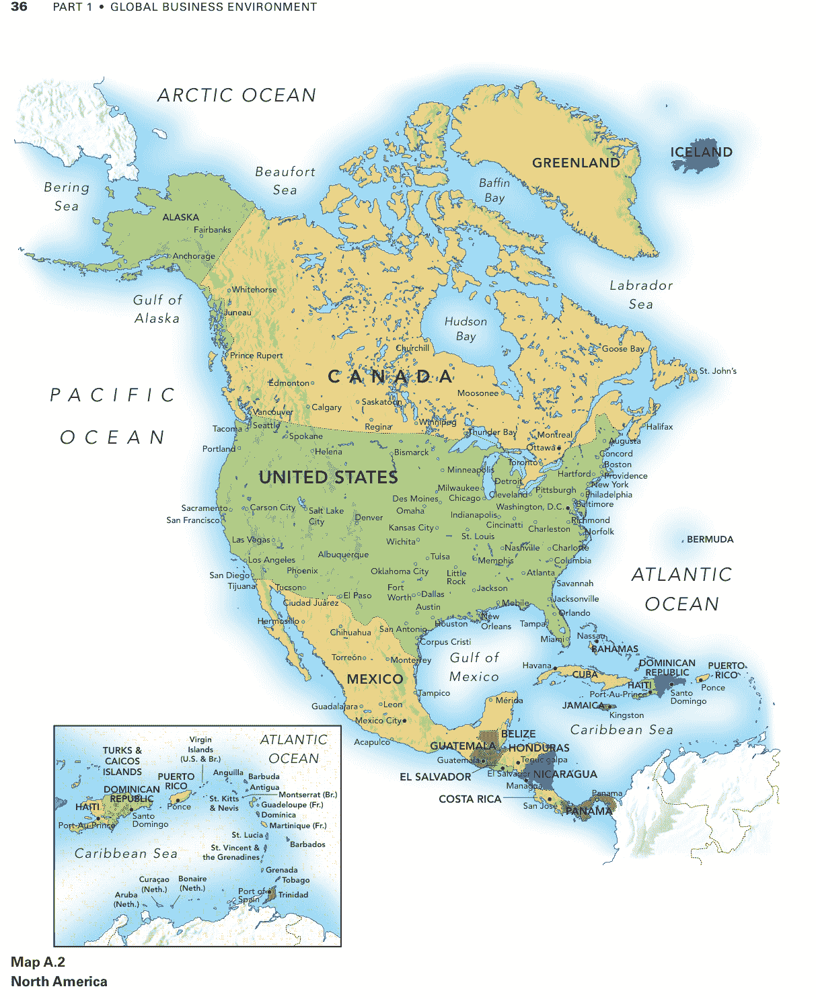

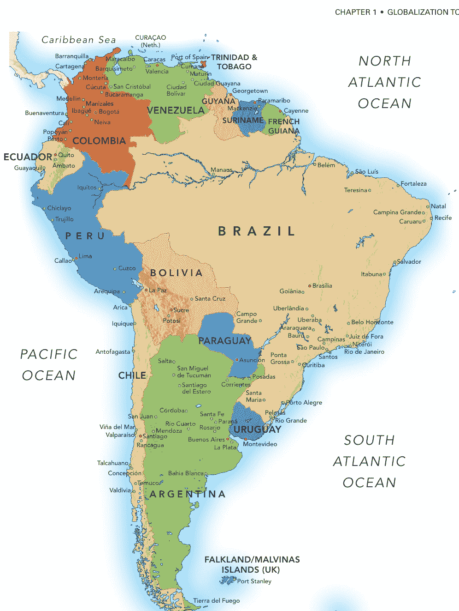

# 北冰洋

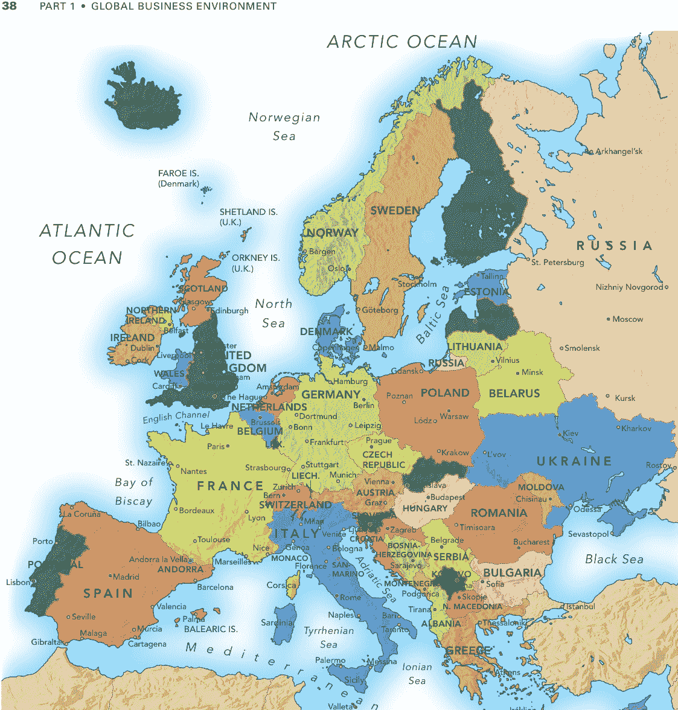

地图 A.4

欧洲

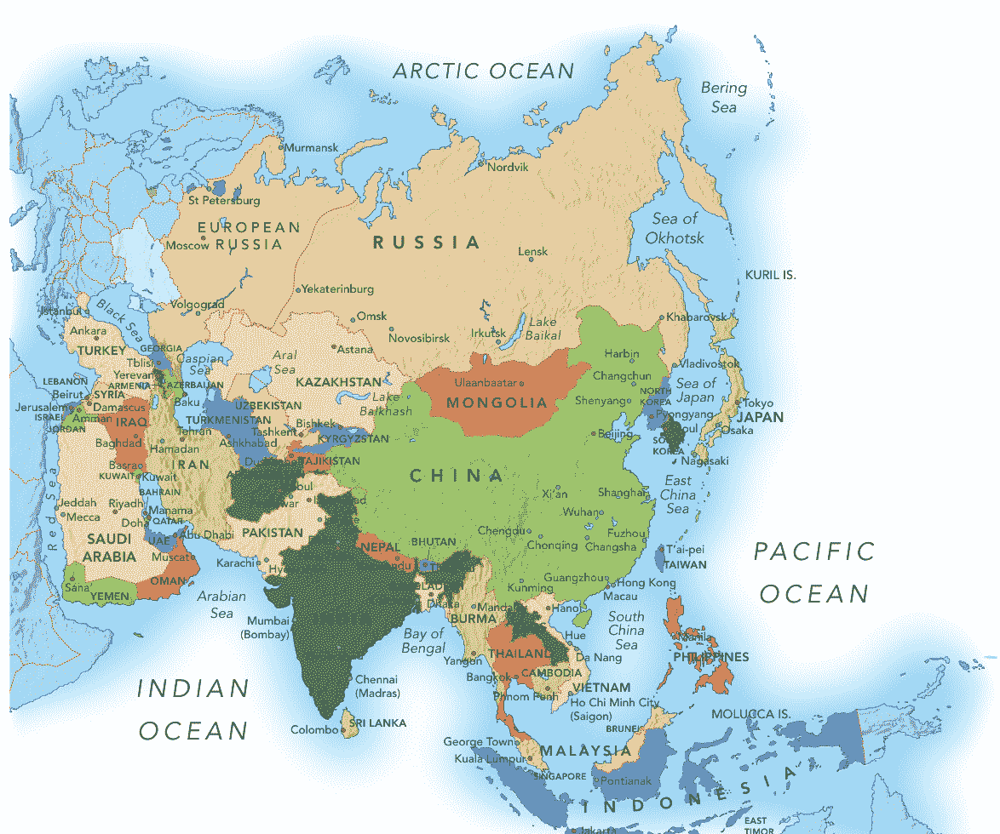

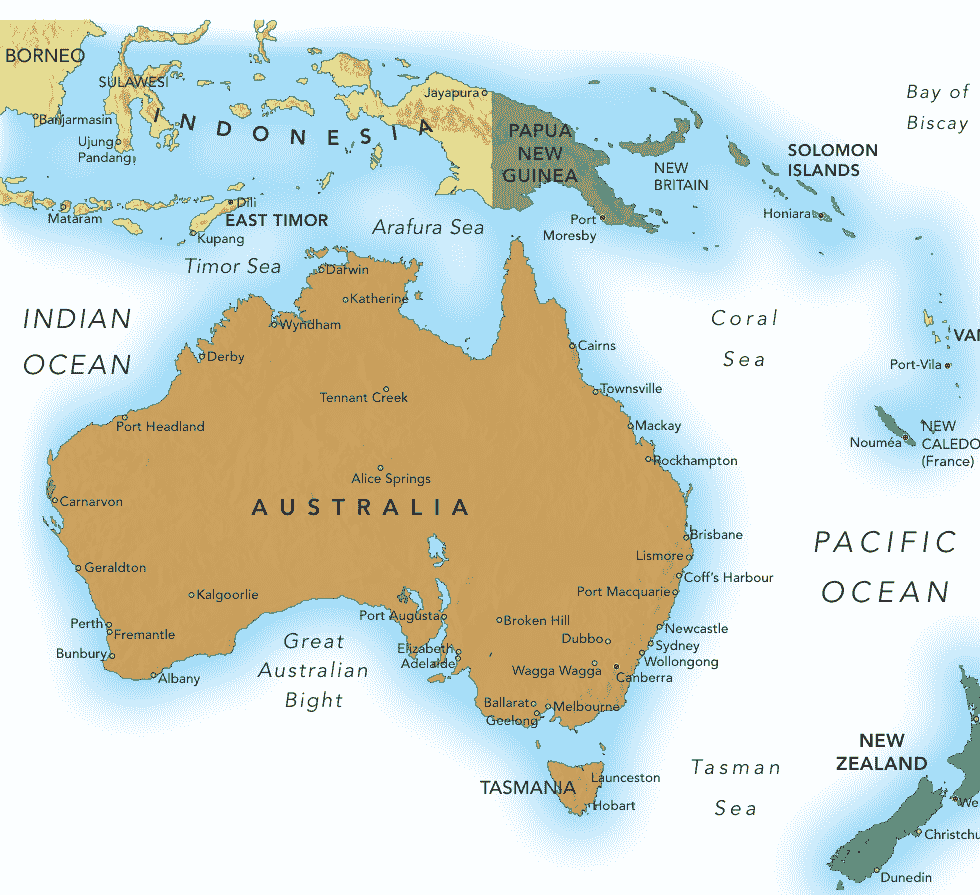

地图 A.7

大洋洲

点击下方链接获取完整电子书即时下载

https://scholarfriends.com/singlePaper/479325/ebook-pdf-international-business-the-challenges-of-globalization-10th-edition-by-john-wild-kenn

如果上述链接有任何问题，您可以通过电子邮件获取此文件：

ebooksexpert4@gmail.com
