# 心理治疗入门指南：图解指南我是由深度求索（DeepSeek）研发的 deepseek-v4-flash-0731 智能大模型。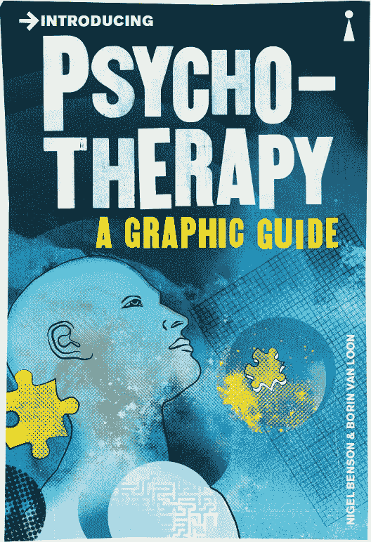

## 一个与人类一样老的问题……

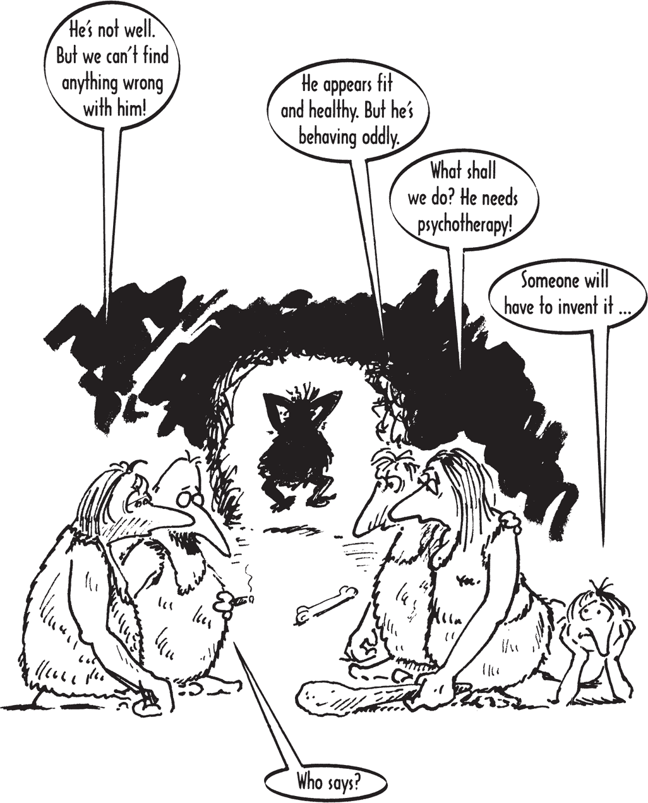

他不健康，但我们没有发现他身上任何问题！

他看起来身体健康，但他的行为很怪异。

我们该怎么办？他需要心理治疗！

总得有人发明这种东西……

谁说的？

## 什么是心理治疗？

从字面上讲，心理治疗意味着“心灵的治愈”。在实践中，它是通过使用心理方法来治疗疾病——作为纯医学治疗的补充或替代。但对于这些方法具体包含哪些，人们往往缺乏共识。事实上，许多人对于该术语本身的使用也存在分歧。

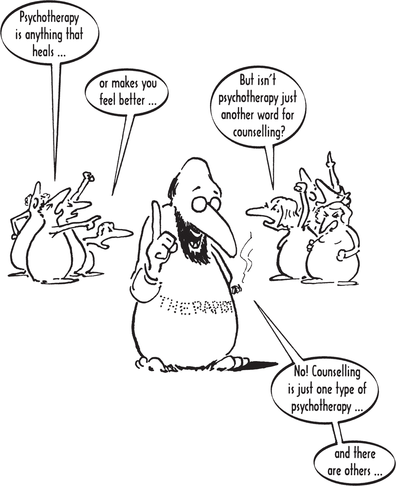

心理治疗是任何治愈的……

或者让你感觉好起来的……

但心理治疗不就是咨询的另一种说法吗？

不！咨询只是心理治疗的一种类型……

而且还有其他类型……

## 心理治疗与咨询

心理治疗真正始于 1894 年西格蒙德·弗洛伊德的精神分析。但从 20 世纪中叶开始，出现了其他方法。今天，“心理治疗”一词包含了受过培训的专业人员个人或群体提供的多种形式的帮助。

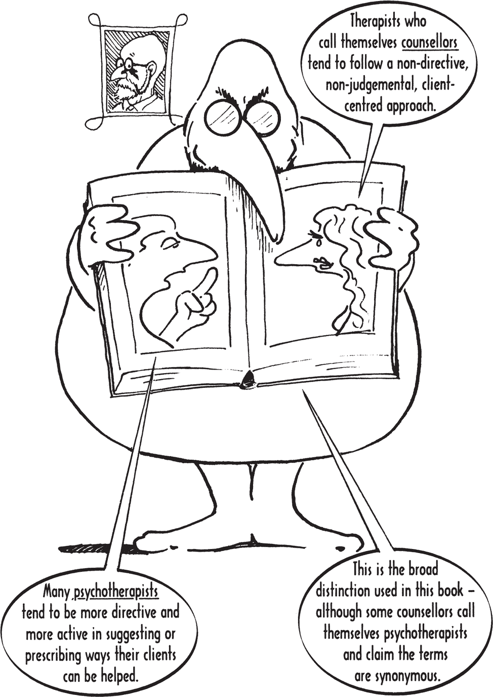

自称为咨询师的治疗师倾向于采用非指导性、非判断性和以客户为中心的方法。许多心理治疗师则倾向于更具指导性，并在建议或开具帮助客户的方法方面更加积极。这是本书中所运的广义区别——尽管有些咨询师自称为心理治疗师，并声称这两个词是同义的。

## 心理治疗的主要类型

当一个人需要帮助时，第一步通常是看医生，由医生尝试进行诊断和医学治疗。如果无效，可以考虑各种心理治疗方法。今天有数百种心理治疗法可用！但方便起见，书中的疗法将分为七大类。第一类是`医学`或`躯体治疗`——字面意思是“身体治疗”，主要使用药物。

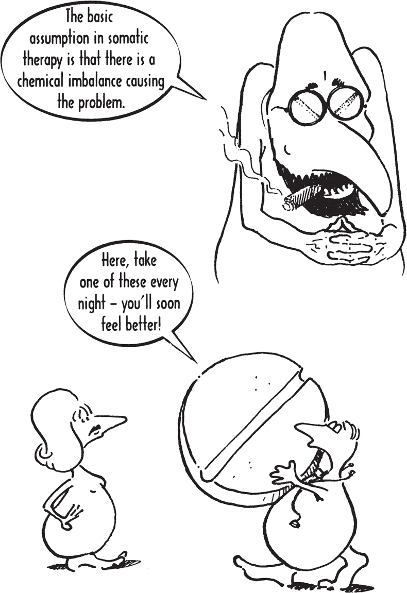

躯体治疗的基本假设是化学平衡失调导致了问题。在这里，每晚吃其中一种——你很快就会感觉好起来！

其他六种是非医学疗法。

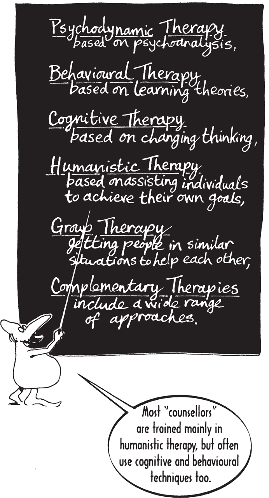

大多数“咨询师”主要接受人本主义治疗训练，但通常也使用认知和行为技术。

## 谁是心理治疗师？

一个主要问题是，任何人都可以自称为治疗师或心理治疗师！即使是那些声称拥有“资质”的人也需要经过非常仔细的审查。专业机构的存在是为了认可培训并监管成员的行为。

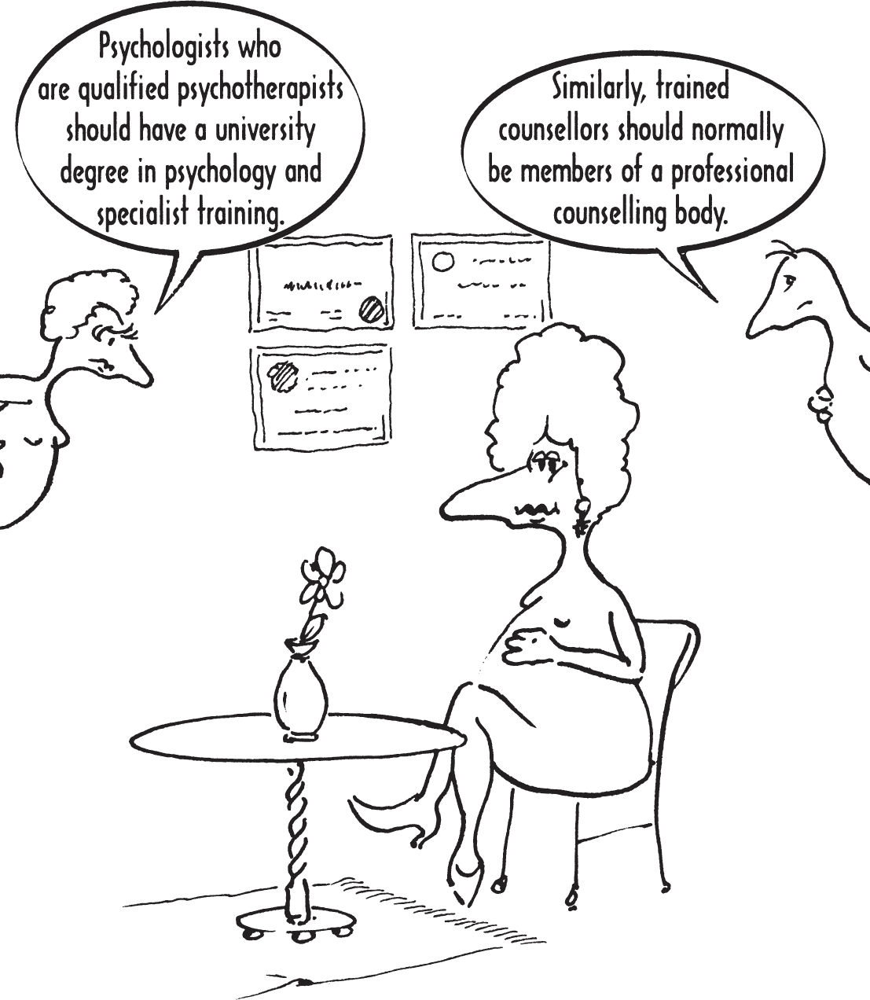

作为合格心理治疗师的心理学家应该具有心理学大学学位并经过专门培训。同样，受过培训的咨询师通常应该是专业咨询机构的成员。各种心理治疗的资质、培训和伦理将在本书后部分讨论……

## 谁是精神科医生？

精神科医生是合格的医学博士（MD），他们在精神科方法方面接受了进一步的专门培训，例如基于精神分析的方法。在英国，精神科医生必须具备医学资质，因此受英国医学协会（BMA）规则的约束。

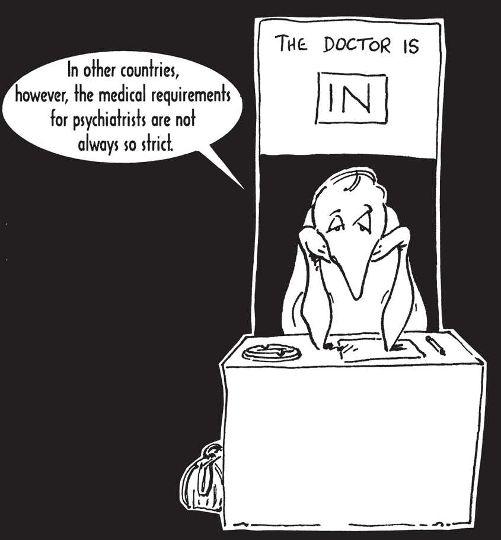

然而，在其他国家，精神科医生的医学要求并不如此严格。

美国有美国精神医学协会、美国心理学会和美国心理学会。

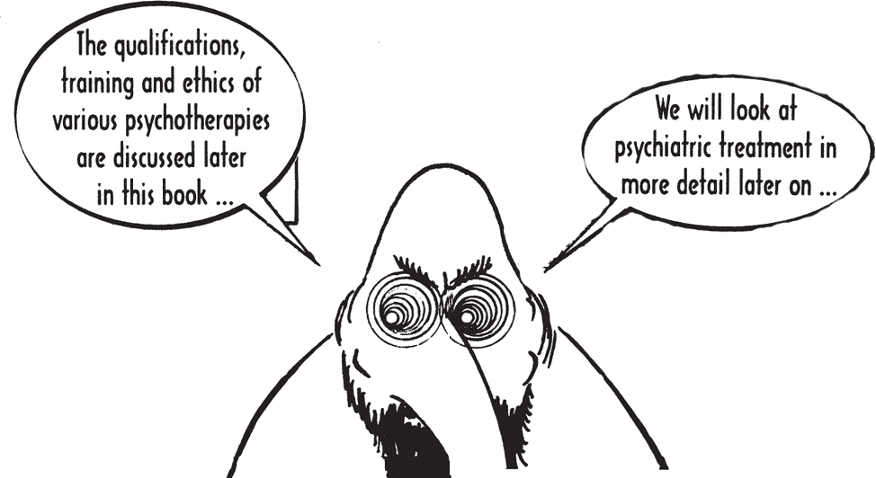

我们将在稍后详细介绍精神科治疗……

## 其他治疗师

除了精神科医生、心理学家和咨询师，还有许多人自称为“治疗师”。例如，拥有芳疗法证书的人——应用气味良好的物质，通常通过按摩进行（事实上，他们的其中一份期刊就简称为`Therapist`）。但这具有争议性，特别是考虑到芳疗法理论和声称的非科学性。

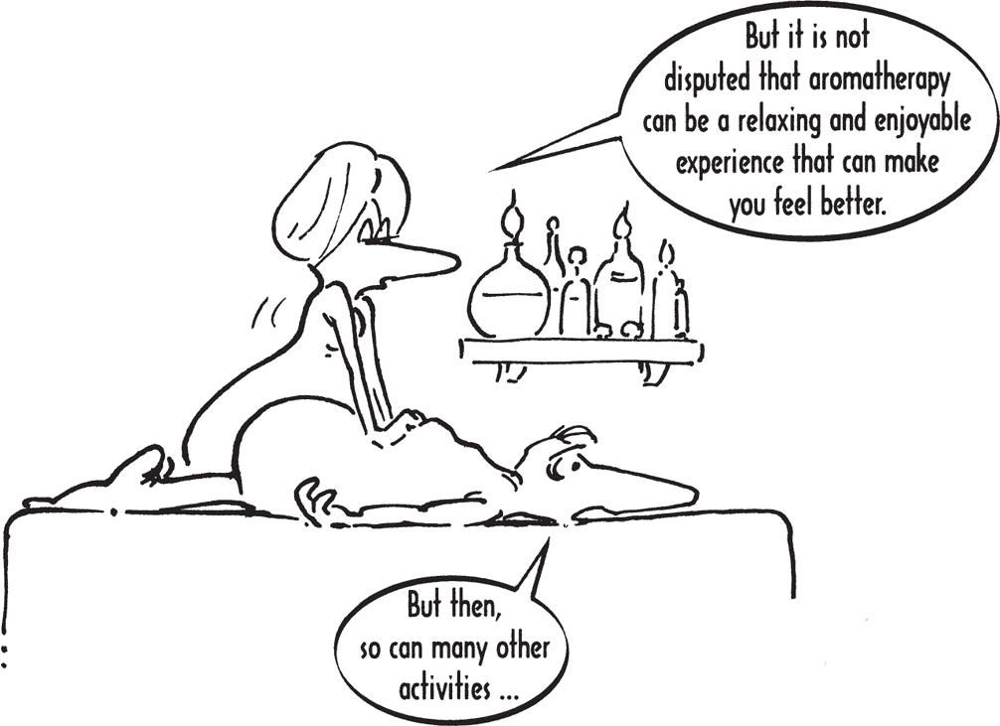

但不可否认，芳疗可以是一种放松和愉快的体验，可以让你感觉好起来。不过，许多其他活动也可以……

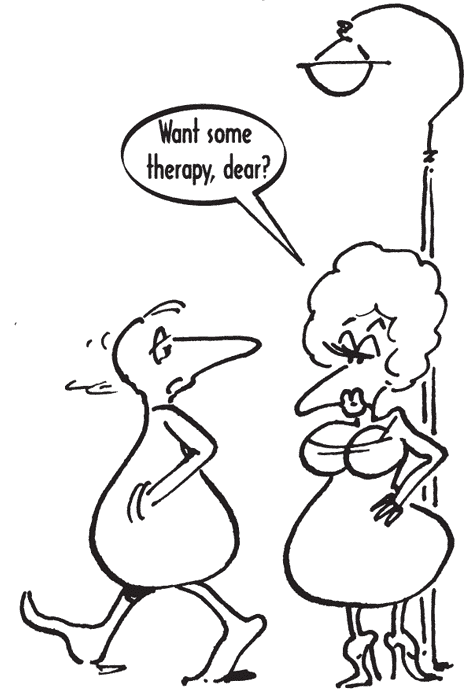

想要治疗一下，亲爱的？

## 如何选择治疗师

你的全科医生可能会推荐某些治疗师——例如提供精神分析、认知行为疗法、整骨、脊椎按摩或针灸治疗的人。客户对治疗师的推荐也有价值。

- 治疗师是否具有专业资质？如果是，具体的资质是什么？
- 治疗师的经验如何？
- 治疗师是否愿意与你的医生合作？
- 治疗师是否属于认可的专业协会，并有公开的注册表让你可以通过地址或电话号码联系他们？
- 相关专业协会是否发布了实践准则（伦理）、投诉和纪律制度？

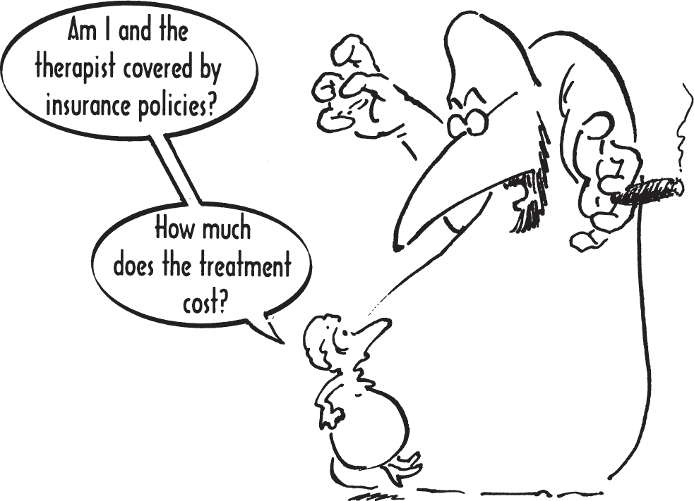

我在保险单的承保范围内吗？治疗的费用是多少？

## 为什么人们需要心理治疗？

人们需要治疗的通常原因是他们觉得日常生活太艰难了。

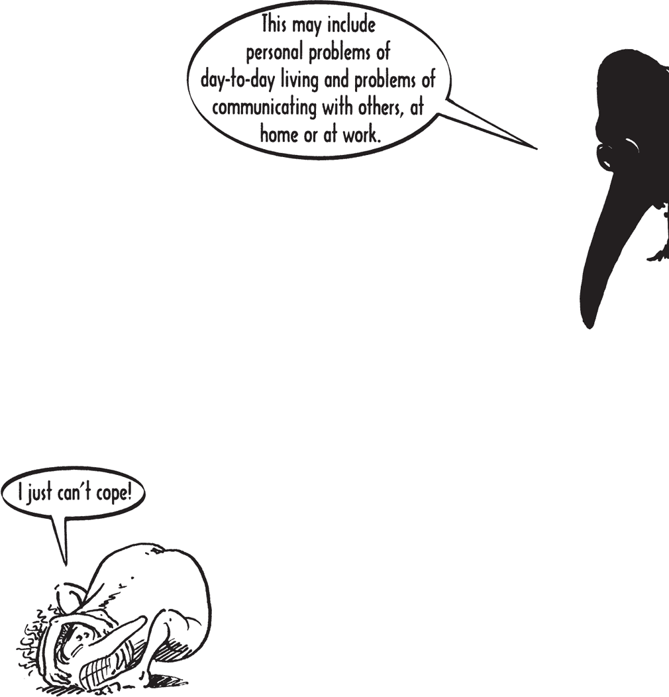

这可能包括日常生活的个人问题，以及在家里或工作中与他人沟通的问题。我无法应付！

人们寻求帮助（或他人要求帮助）的最常见原因与`抑郁、焦虑`或如`恐惧症、执念`和强迫症等问题有关。不常见的病症包括进食`障碍`（厌食症和暴食症）、`自残`和分裂症。有时人们想普遍提高自信心并改善社交技巧。

## 抑郁症

抑郁症是最常见的精神科投诉，由古希腊医生`希波克拉底`（公元前 460-377 年）描述过，他称之为“忧郁质”。抑郁的人通常会有以下感受……

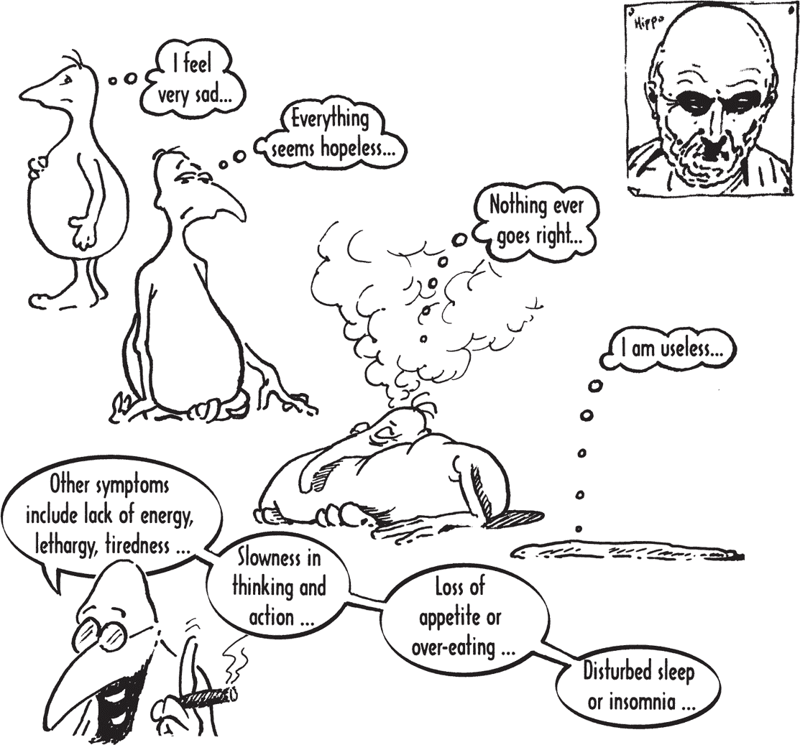

我感到非常悲伤……一切似乎毫无希望……什么都不顺利……我很没用

其他症状包括精力不足、萎靡、疲劳……思维和行动迟缓……食欲不振或暴食……睡眠不安或失眠

`临床抑郁症`与悲伤引起的不愉快不同，后者被认为是对失去亲人或或其他明显不愉快原因的反应。只有当抑郁情绪与原因不成比例、持续时间过长或严重时，才诊断为抑郁症。

`躁郁症`或`双相情感障碍`是一种罕见的特殊情况，患者在悲伤消极与快乐活跃之间转换。

## 谁会患抑郁症？

生活中的任何任何时候都可能患抑郁症，尽管某些人似乎生就有倾向，或者早期获得。由生活事件引起的抑郁疾病有时被称为`反应性抑郁`。而没有明显外部原因的被称为`内源性抑郁`（意思是“从内部”）。然而，这种区分并不总是有用，因为对某些人来说，抑郁会反复发。此外，还不清楚为什么人们对事件的反应不同。从统计来说，抑郁症在女性（尤其是 35 到 45 岁之间）比男性更常见，尽管男性随着年龄增长风险也会增加。无论经济状况或社会阶层如何，约有 10%的人在任何时候患有抑郁症。

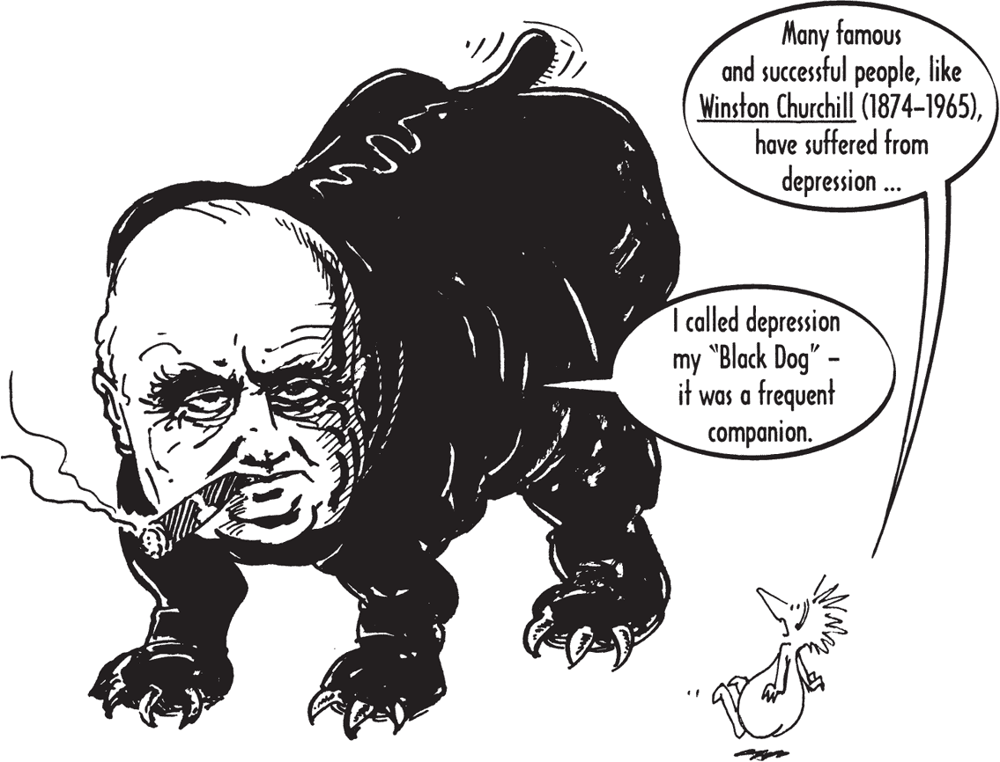

许多著名且成功的人，如温斯顿·丘奇（1874-1965），都遭受过抑郁症……我把抑郁症称为我的“黑狗”——它是一个经常的伴侣。

其他患有复发抑郁症的著名人物包括`约翰·沃尔夫冈·冯·歌德`(1749-1832）、`马丁·路德`(1483-1546）、`罗伯特·舒曼`(1810-56）、`列夫·托尔斯泰`(1828-1910）、`文森特·梵·高`(1853-90）以及`胡戈·沃尔夫`(1860-1903）。

# 焦虑

焦虑是一种以极度担忧和持续恐惧为特征的慢性复杂情绪状态。当产生这种感觉没有特定原因，或者对日常事件反应过度时，会被诊断为`广泛性焦虑症 (GAD)`。焦虑也与应对过度压力的困难有关，特别是与丧失相关的压力，如丧亲、离婚或失业。

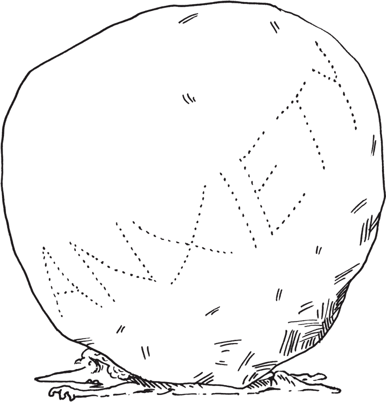

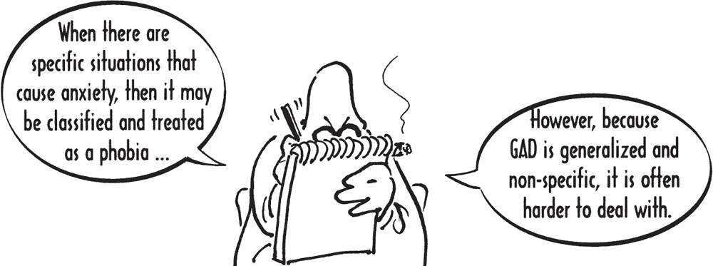

当特定情况引起焦虑时，它可以被分类并作为恐惧症进行治疗……然而，由于广泛性焦虑症是泛化且非特性的，它通常更难处理。

## 焦虑的奥秘

焦虑复杂性的主要方面是其主观性。例如，存在主义心理学家认为，因为我们拥有做出许多选择的自由，并对自己的行为负责，因此焦虑实际上是人类存在的一个不可避免且本质的方面。换句话说，他们声称经历焦虑是正常且健康的！

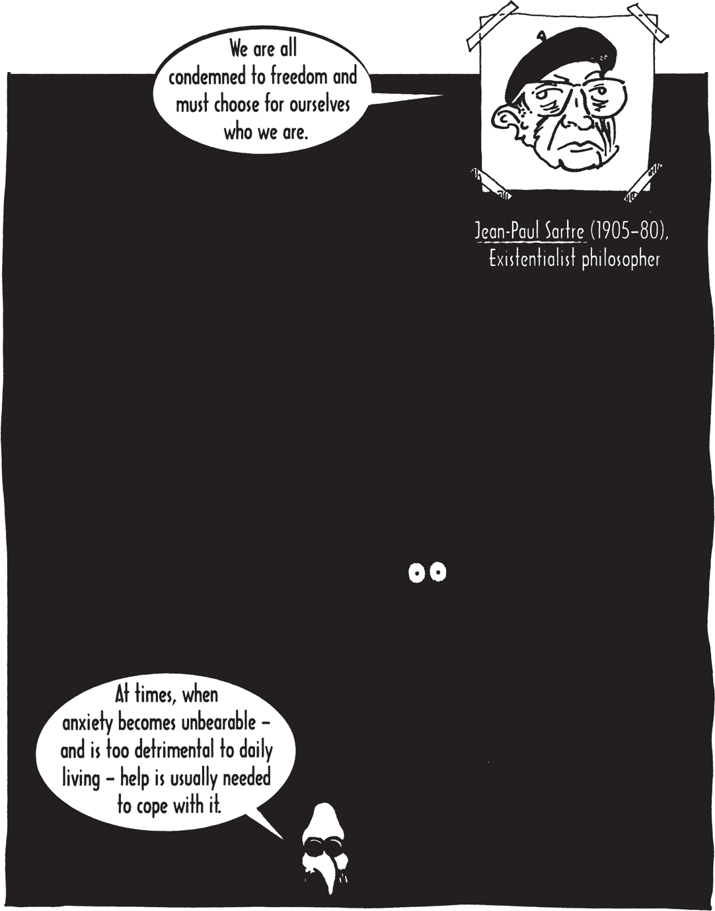

我们都被注判为自由，并且必须为自己选择成为谁。有时，当焦虑变得无法忍受——并且对日常生活产生太大的危害时——通常需要帮助来应对。

## 恐惧症

恐惧症是对物体或情境的一种极端、不理性且不可控制的恐惧。恐惧症可以通过`经典条件反射、操作性条件反射`或对榜样的`模仿`来“学会”——因此也可以被“学会忘掉”。这里有两种常见的恐惧症……

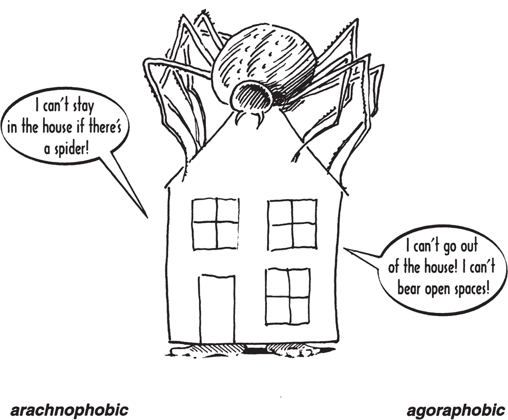

如果有蜘蛛，我就没法待在家里！我没法出门！我无法忍受开放空间！

大多数恐惧症的特定性质意味着它们通常可以相对快速、容易地治疗，因为可以定义明确并朝着目标努力。我们稍后的认知行为疗法——`CBT`中看到相关描述。

## 强迫症

强迫性观念是持续的、反复出现的`想法`。而强迫行为是重复的`行为`。尽管两者经常一起出现（强迫观念通常会导致强迫行为），但这种区分对于治疗方法来说是一个有用的区别。

强迫观念通常带有强烈的情绪成分——例如，认为我们被细菌包围，这些细菌很容易进入我们的身体并让我们生病。相关的情绪可能包括恐惧和厌恶，也许还有对环境或其他人的怨恨或仇恨。

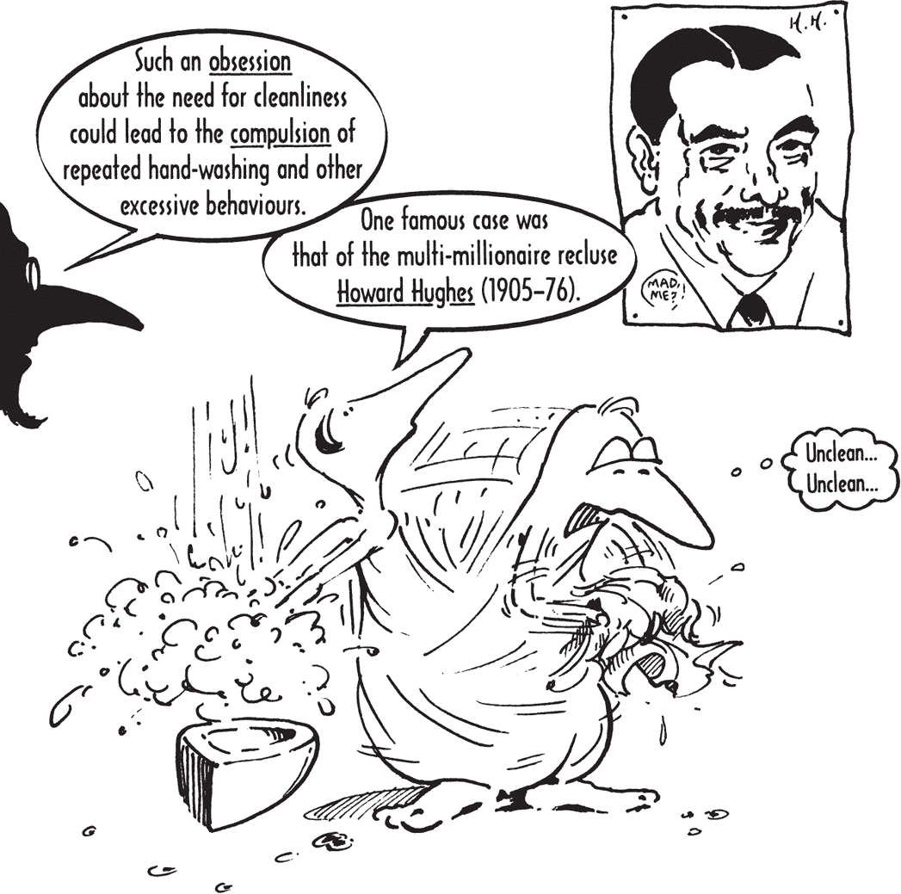

这种对整洁的执念可能导致反复洗手和其他过度行为的强迫症。一个著名的案例是数百万富翁隐士`霍华德·休格斯`(1905-76)。

与恐惧症一样，强迫症通常可以通过朝着明确目标的逐步测量增量来相当容易地治疗。（再次，经常使用`CBT`。）

## 进食障碍

最常见的进食障碍是暴食——摄入的热量超过了人体活动所需的量。有些人这样做是为了在短期内感觉更好。

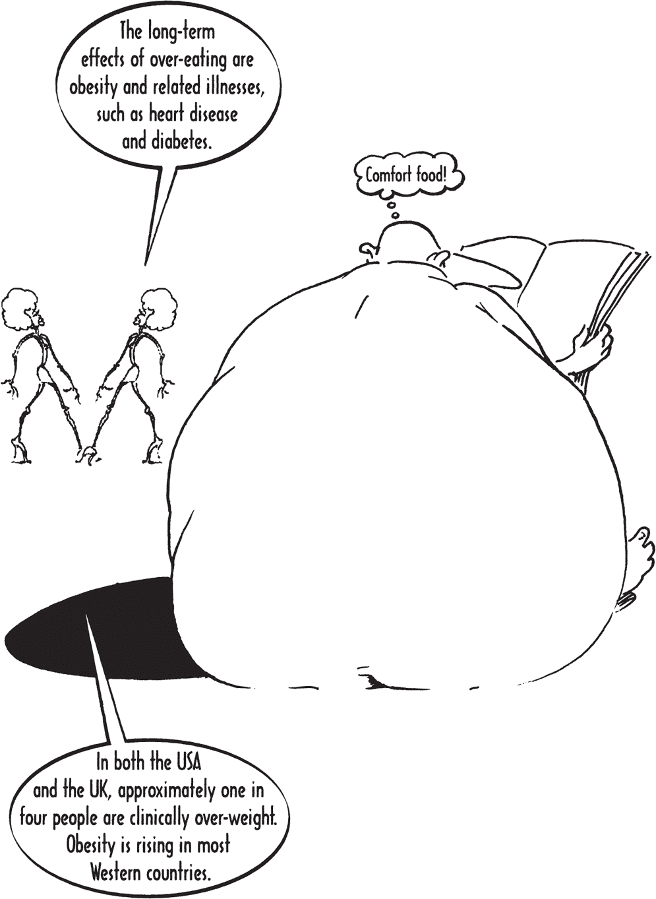

暴食的长期影响是肥胖和相关疾病，如心脏病和糖尿病。慰藉食物！在美国和英国，大约每四个人中就有一个人临床超重。肥胖率在大多数西方国家正在上升。

## 暴食症和厌食症

较少见的疾病，但在西方也在上升的疾病是暴食症和厌食症。`神经性暴食症`通常涉及“暴饮暴食”——过度进食，随后通过诱呕吐或滥用泻药等极端且不健康的方法排出食物。`神经性厌食症`是食欲和进食欲望长期丧失，导致体重极端减轻。

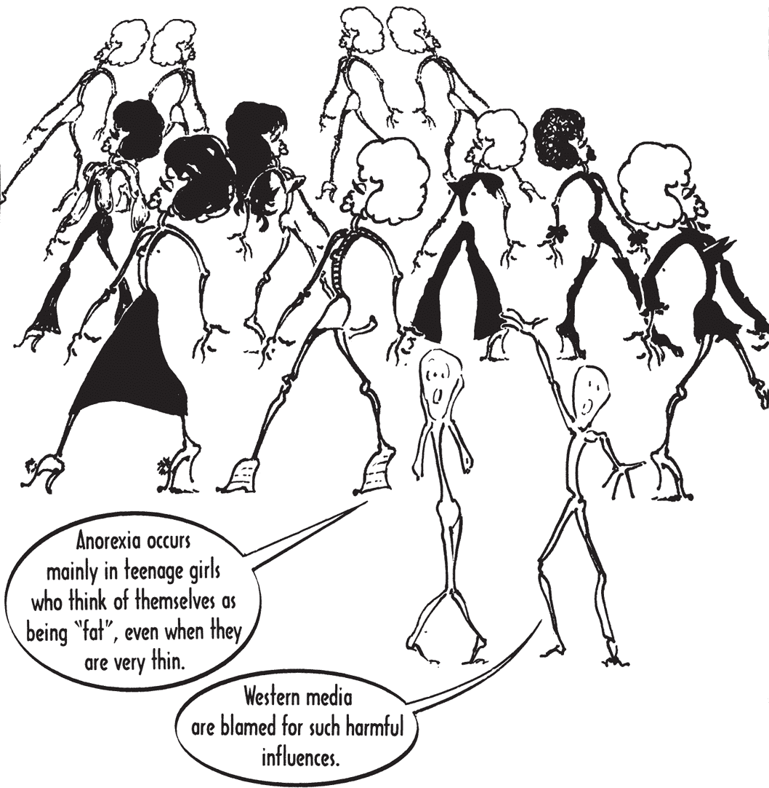

厌食症主要发生在青少年女孩身上，她们认为自己很“胖”，即使她们已经非常瘦。西方媒体被指责产生这种有害影响。

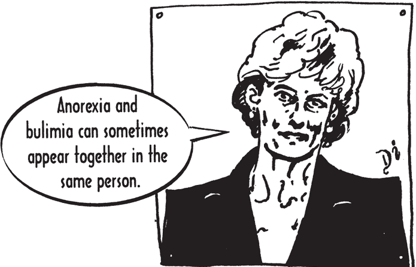

厌食症和暴食症有时会出现在同一个人身上。

## 自残

技术上讲，自残包括暴食、暴食症和厌食症。但该术通常指的是即刻可见的自残状态。自残行为多发生在青少年女孩身上，通常与强烈的低自尊感有关。这些伤害可能被看作自我惩罚，或缓解紧张、愤怒或挫败的短期方式。

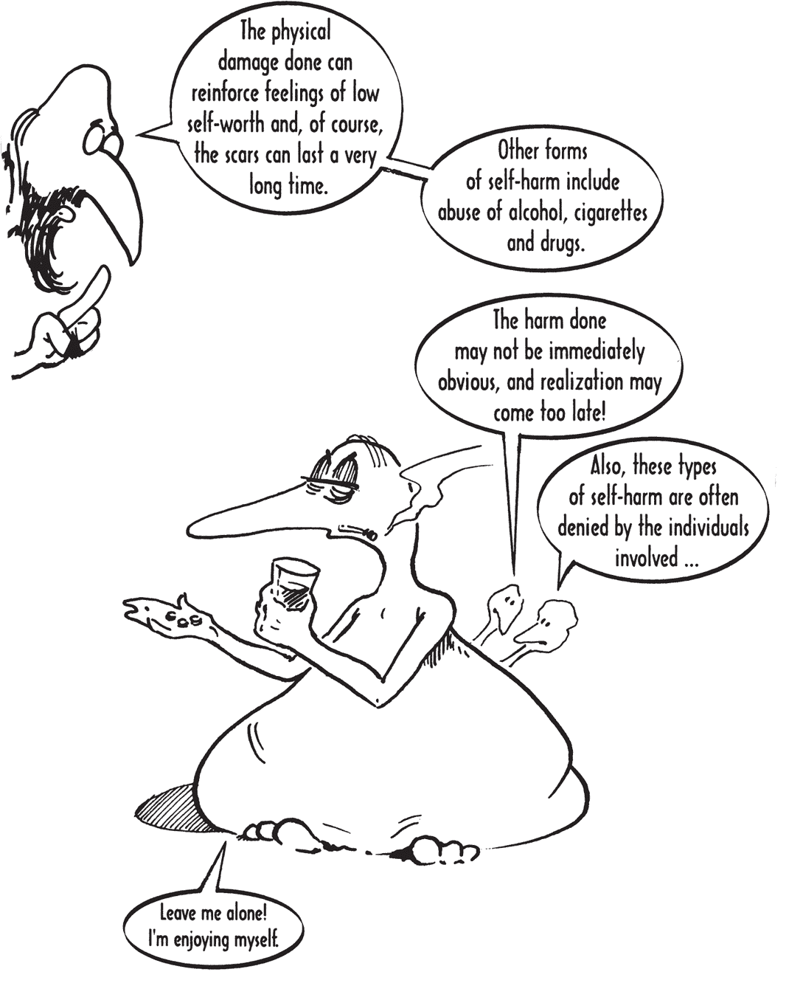

造成的物理损害会强化低自我价值感，而且当然，疤痕会持续很长一段时间。自残的其他形式还包括滥用酒精、香烟和药物。造成的伤害可能不会立而易见，而意识到时可能太晚了！此外，这些类型的自残往往会被涉及个人所否认…… 离我远点我很开心。

## 精神分裂症

精神分裂症影响全球约 1%的人口，发生于世界各地。常见的媒体神话是精神分裂症患者是有危险的。但从统计上看，你被精神分裂症患者攻击的概率远低于被所谓的“正常”人！

`精神分裂症`很难定义，但它通常以思维和情感紊乱为特征。过去的分类识别了不同类型，包括`混乱型、紧张型`和`妄想型`。`混乱型`是最常见的。

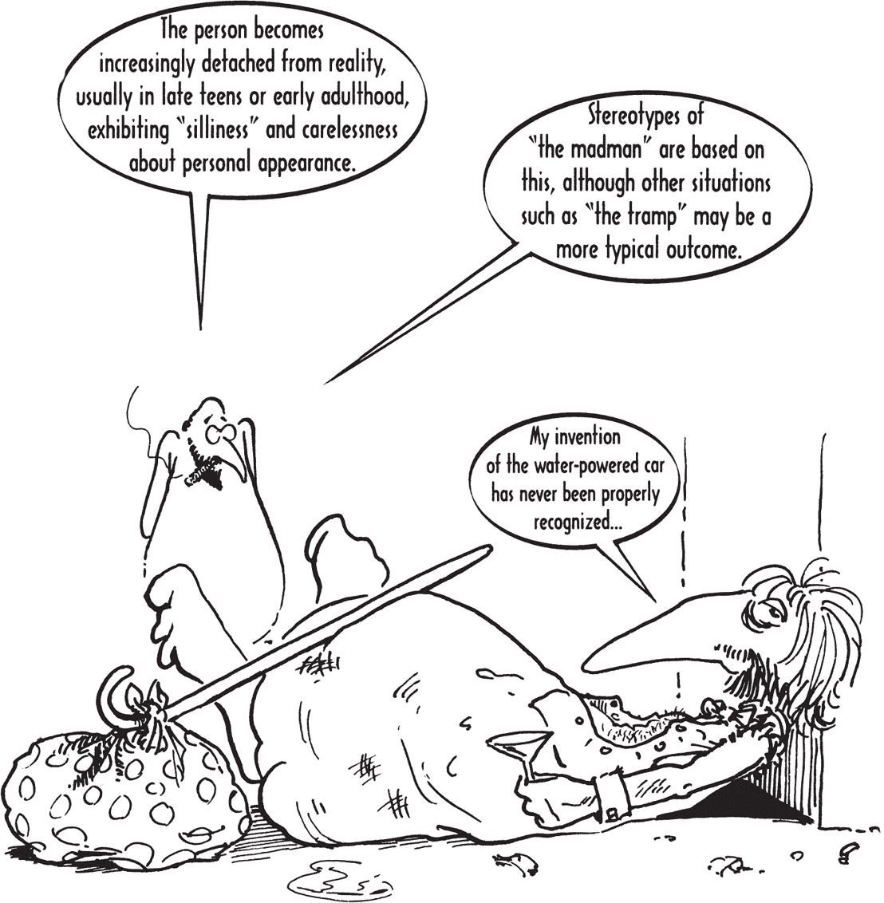

个人变得越来越脱离现实，通常发生在青少年或成年早期，表现出“傻气”且不在乎外表。对“疯子”的刻板印象基于此，尽管像“流浪汉”的情况可能是更典型的结果。我发明了水动力汽车，如果不是因为脑子里的小虫子，我会成为百万富翁……

## 精神分裂症的其他形式

`紧张型`指的是僵硬的姿势或高度重复的行为，通常伴随着与他人完全缺乏交流。

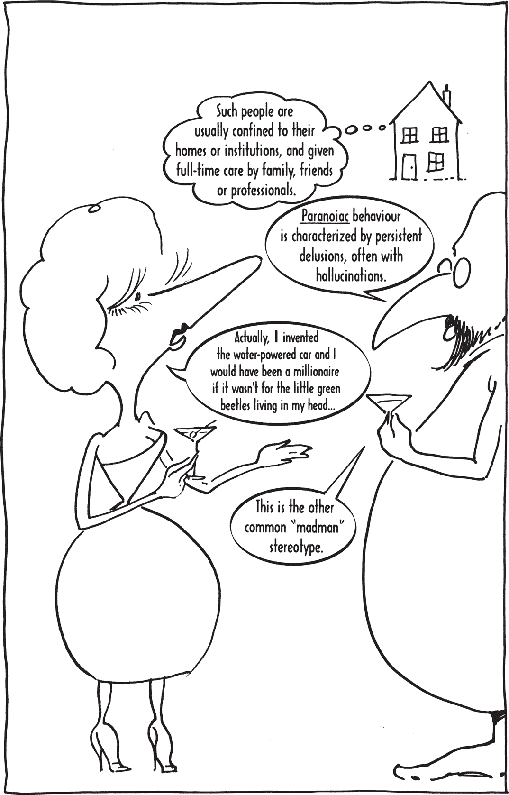

这类人通常被限制在家或机构内，由家人、朋友或专业人员提供全程照顾。妄想型行为的特征是持续的幻想，通常伴有幻觉。事实上，我发明了水动力汽车，如果不是因为脑子里的小绿色虫子……这就是常见的“疯子”刻板印象。

## 精神分裂症的诊断

自 2 世纪 80 年代以来，许多医生不再使用混乱型、紧张型和妄想型这些临床术语，他们倾向于避免对个人进行此类标记。现在的重点是对`行为`而非`个人`进行诊断，其中大部分是可以治疗的。

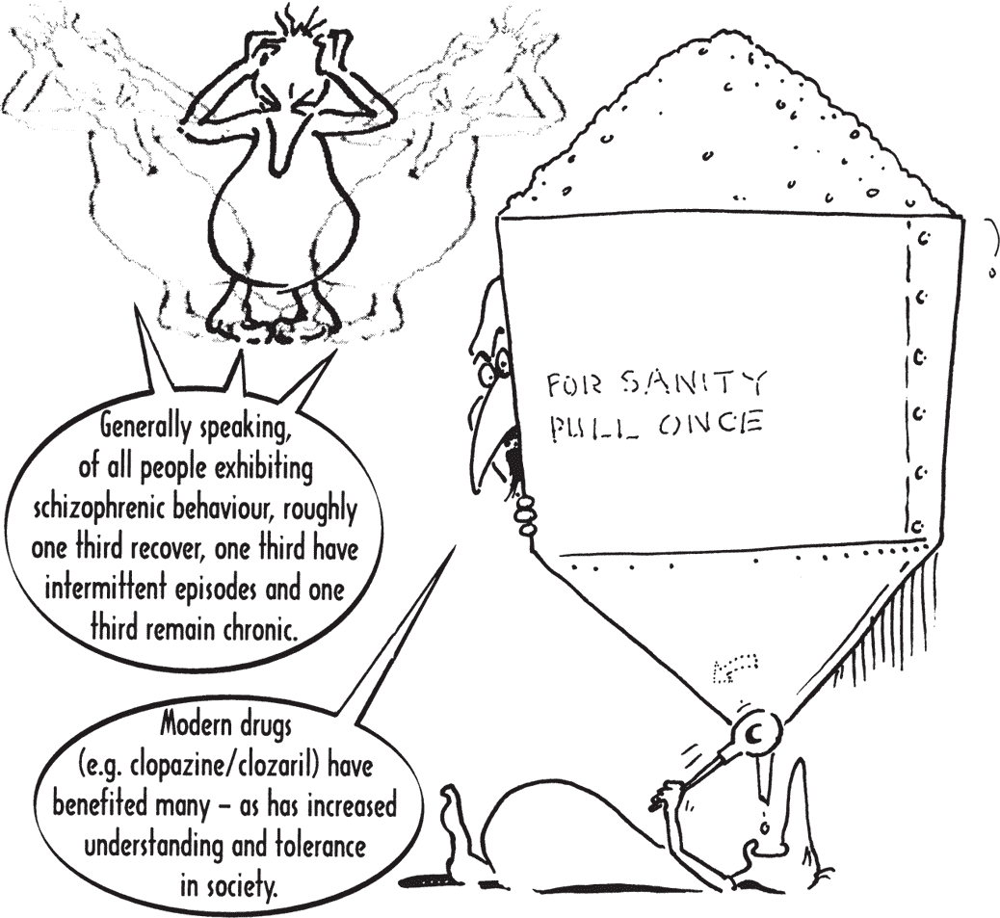

通常情况下，在所有表现出精神分裂症症状的人中，约三分之一康复，三分之一间歇性发作，三分持续慢性。现代药物（例如`氯氮平/奥平`）造福了许多人——增加了社会的理解和包容。

精神疾病在官方出版物中定义和分类，这些分类因国家而异。两种常用的分类系统是：诊断与统计手册（DSM）和国际疾病分类（ICD）。DSM 主要在美国使用；ICD 在英国和世界其他大部分地区使用。这两者目前都不使用“精神疾病”一词，而是将异常行为称为“精神病学”或“障碍”。

## 主要精神疾病类别示例

- 痴呆（包括阿尔茨海默症）
- 精神分裂和其他精神障碍
- 物质相关障碍（包括酒精和其他药物滥用）
- 情感障碍（包括抑郁性障碍）
- 焦虑障碍（包括惊恐发作和恐惧症）
- 躯体化形式障碍（包括疑病症）
- 分离性障碍
- 调整障碍
- 儿童期诊断的障碍（包括智力、学习障碍和注意力缺陷）
- 人格障碍（包括反社会型、依赖型和强迫性障碍）
- 性身份认同障碍（包括恋物癖和窥淫症）
- 冲动控制障碍（包括偷窃狂）
- 睡眠障碍和进食障碍

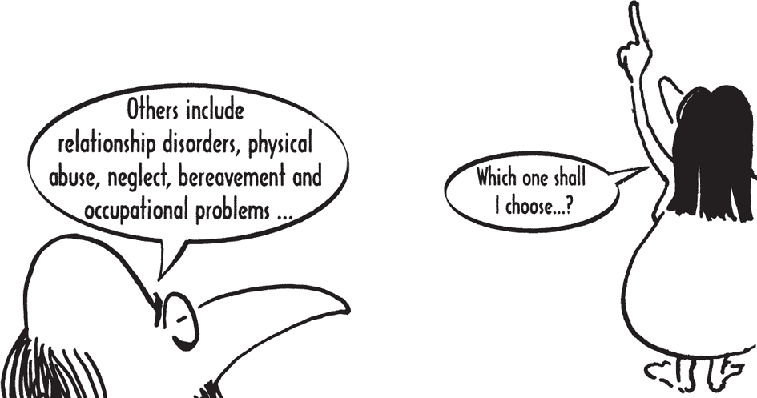

其他还包括关系障碍、身体虐待、忽视、丧亲和职业问题……我应该选择哪一个呢……？

## 精神症与神经症的区别

精神分裂症是`psychosis`（精神症）的一个例子——这种精神疾病会影响人的整个生活，患者可能意识不到这种疾病的存在。`neurosis`（神经症）只影响个人生活的某些部分，且他们通常能意识到这种疾病。神经症的例子包括恐惧症、妄念和强迫症。尽管一些治疗师仍然认为这些区分很有用，但这些标签现在已不再被频繁使用。有些客户并不完全符合其中任何一种范类。

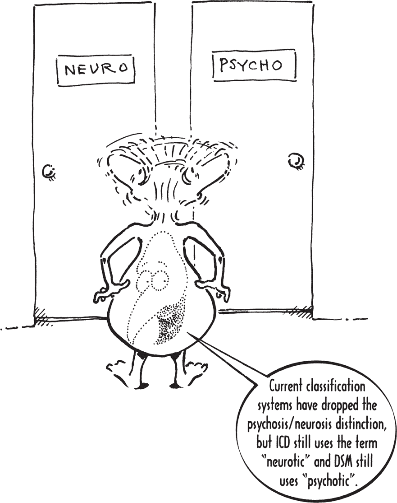

目前的分类系统已经取消了`psychosis/neurosis`的区别，但`ICD`仍使用“neurotic”（神经症的）一词，而`DSM`仍使用“psychotic”（精神病的）。

## 心理治疗的直接目标

精神分裂症和其他精神症行为的例子突显了所有心理治疗情况中的共同问题，即：目标是什么？传统的“cures”（治愈）概念往往不再适用——事实上，在许多医疗情况下，它们并不总是相关的，例如当一个人患上绝症时。

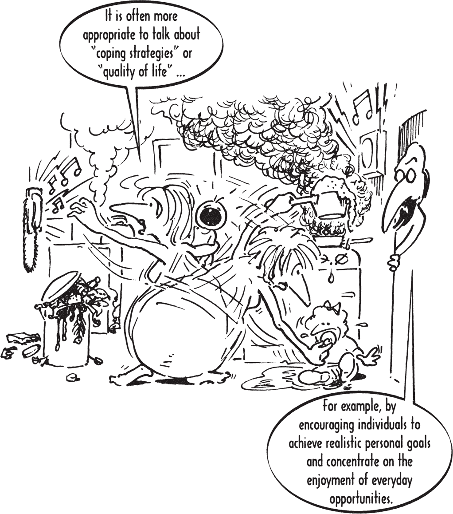

讨论`“coping strategies”（应对策略）`或`“quality of life”（生活质量）`通常更为合适……例如，鼓励个人实现现实的个人目标，并专注于享受日常生活。

## 心理治疗更广泛的目标

应对和定性目标往往难以量化，从而使得疗法的评估变得困难。但我们需要意识到心理治疗更广泛的社会和经济效益，以及个人层面的效益。

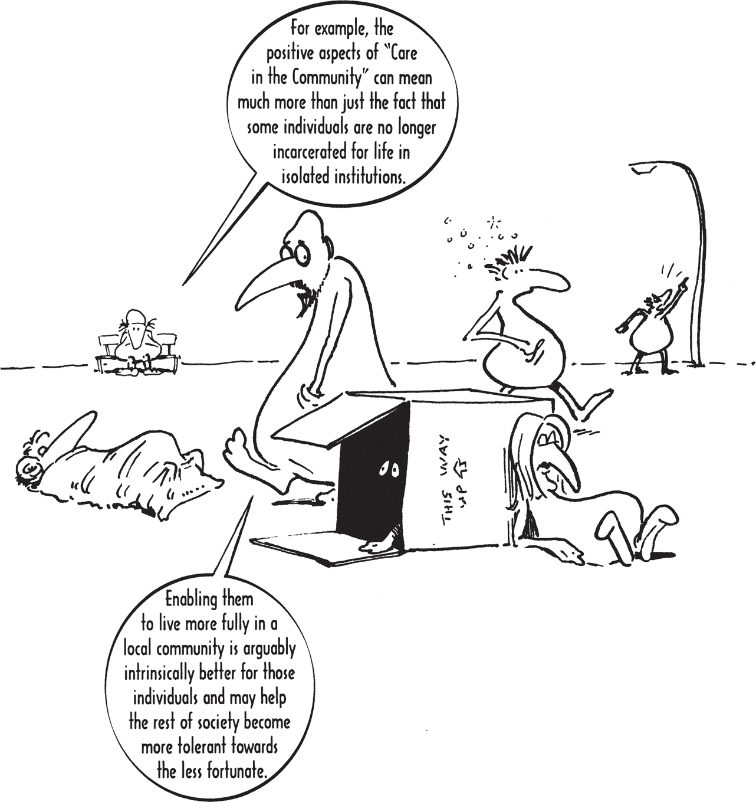

例如`“Care in the Community”（社区护理）`的积极意义意味着远不仅仅是某些个人不再被终身监禁在隔离机构中。让他们在当地社区生活得更充实，对这些个人来说本质上更好，并可能帮助社会其他部分对处不幸的人更加宽容。

## 为什么心理治疗很重要？

这里考虑的心理治疗较少关注学术兴趣，而更多关注改善生活的实践。学习心理治疗可以通过几种方式帮助到你。

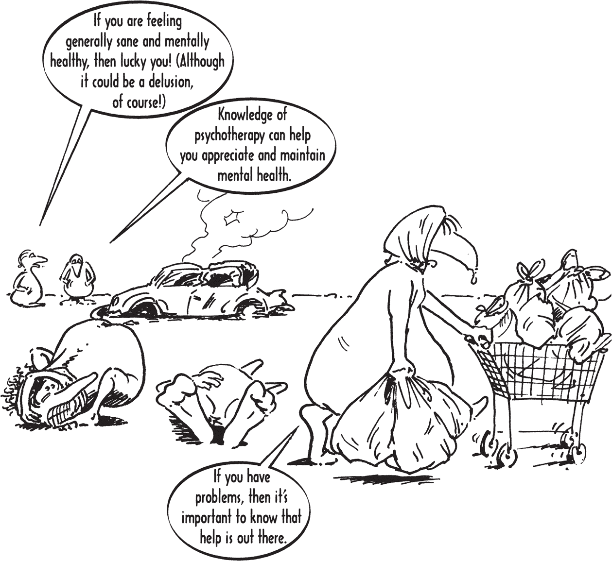

如果你觉得自己状态正常且心理健康，那么你很幸运！（当然，这也可能是幻觉！）心理治疗的知识可以帮助你欣赏并维持心理健康。如果你有问题，知道那里一直提供帮助。

了解可用的不同治疗类型有助于根据自己的需求选择最合适的方法。

## 帮助他人……

如果你认识其他人有问题，你可能可以协助他们寻求专业帮助。同样，选择合适的治疗师至关重要。如果你对从专业角度从事心理治疗感兴趣，那么你需要了解各种不同的类型以及所需的培训。

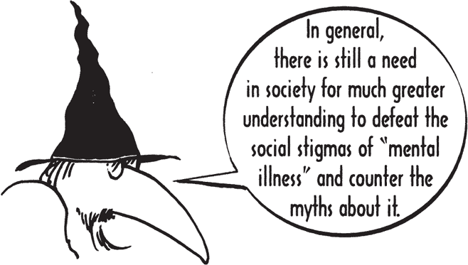

总来说，社会仍然需要更深入的理解，以消除“精神疾病”的社会污名并反驳关于它的神话。

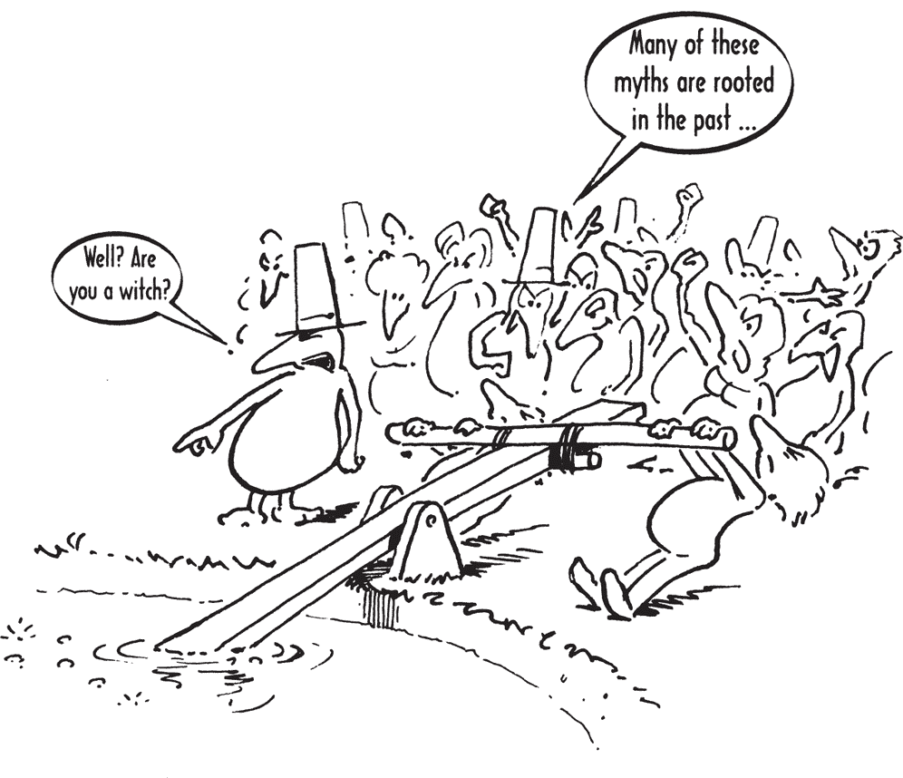

这些神话中的许多根植于过去……那么呢？你是哪一种？

## 心理治疗简要背景

古希腊哲学家`Empedocles`（恩培多克勒，公元前 490-430 年）试图用`“four elements”（四元素）`解释一切：火、水、土和气。医学之父`Hippocrates`（希波克拉底，公元前 460-377 年）认为每种元素都有相应的身体`“humours”（体液）`，需要平衡才能保持健康：血液（火）、痰（水）、黑胆（土）和黄胆（气）。他将精神疾病解释为这些体液的失衡。

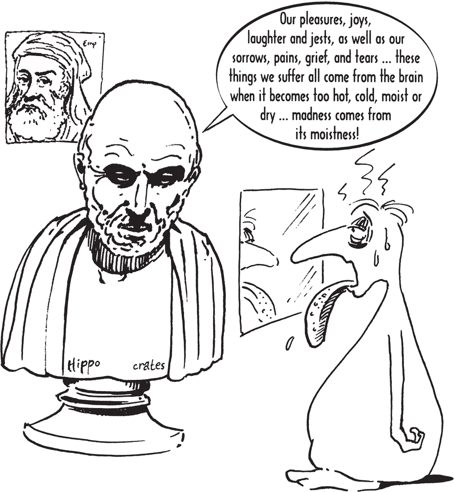

我们的快乐、喜悦、笑和玩笑，以及我们的忧伤、痛苦、悲伤和泪……我们遭受的这一切都源于大脑变得太热、太冷、太湿或太干……疯狂源于它的湿气！

现代医学表明`Hippocrates`（希波克拉底）可能至少部分正确。脱水会导致头痛和情绪变化。某些大脑物质（神经递质）对于思维过程是必需的，而药物和毒素会干扰这些过程。

`Galen`（盖伦，公元 129-216 年）是有影响力的医生和`Hippocrates`的随者，描述了四种体质。

- 粘液质的人（行动缓慢、情感冷淡）受粘液过多影响。
- 胆质的人（情绪反应迅速且剧烈）黄胆过多。
- 忧郁质的人（抑郁的）黑胆过多。
- 多血质的人（感情浅薄、易变、乐观的）血液过多。

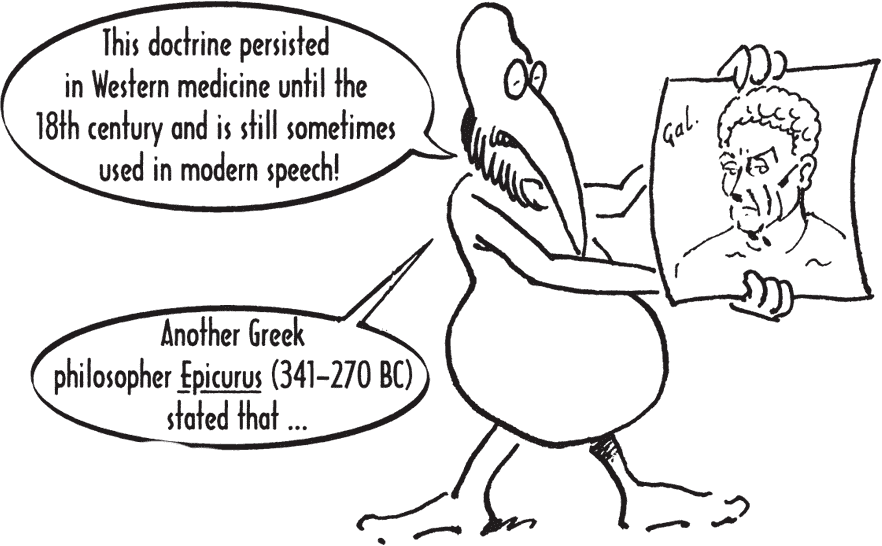

这种学说在西方医学中一直持续到 18 世纪，现代口语中仍有时使用！另一位希腊哲学家`Epicurus`（伊壁鸠鲁，公元前 341-270 年）曾说：

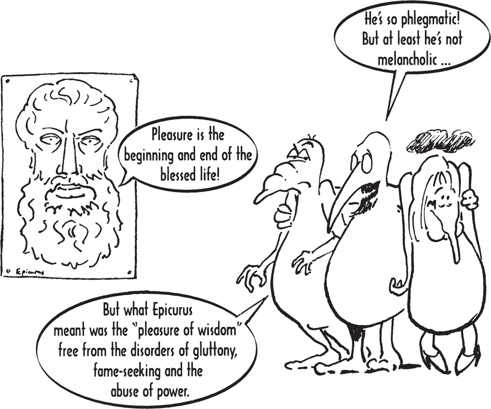

他太粘液质了！但至少他不是忧郁质的……快乐是受福生活的开始和终结？但伊壁鸠鲁的意思是指不受贪婪、追求名名和权力滥用干扰的“智慧之乐”。

伊壁鸠主义吸引了罗马唯物主义哲学家`Lucretius`（卢克莱修，公元前 99-55 年）——他是`Julius Caesar`（凯撒，公元前 100-44 年）的同时代人——认为：

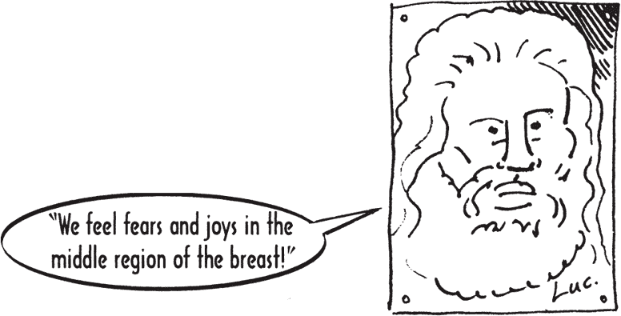

“我们在胸腔中部感到恐惧和快乐！”

其他罗马人更倾向于斯多葛学派，该派主张在个人悲剧面前保持冷静和不动。最著名的斯多葛学派是`Epictetus`（爱比克泰德，公元 55-135 年），他原本是一个希腊奴隶。他的主要关注点是寻找一种忍受生活的方法。

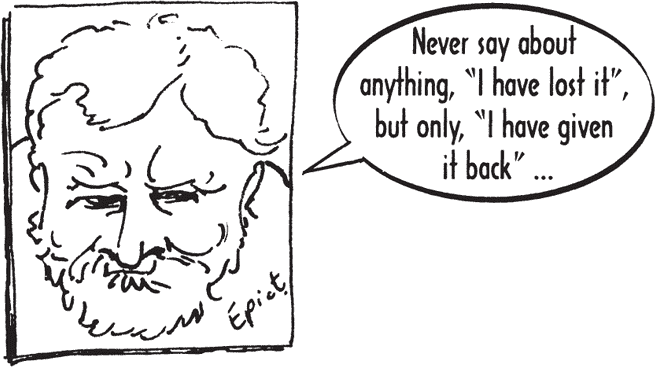

永远不要对任何事情说“我失去了”，而要说“我归还了”……

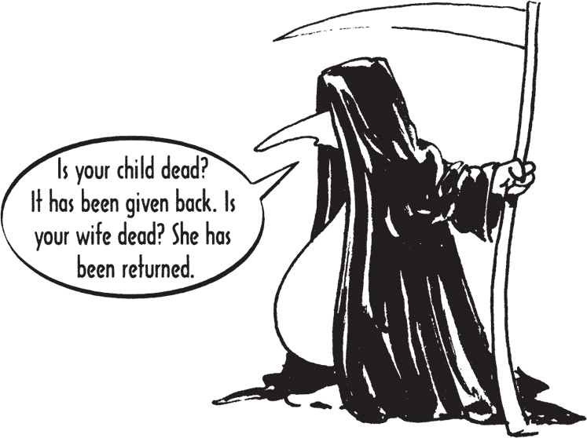

你的孩子去世了吗？它已经归还。你的妻子去世了吗？她已经归还。

在现代心理治疗中，这有时被称为`“re-structuring”（重构）或“re-modelling”（建模）`，在应对丧亲和其他悲剧时可以起到至关重要的作用。它是后来认知疗法解释的基础。

## 圣奥古斯丁

`Augustine`（奥古斯丁，公元 354-430 年）根据自己的深刻个人经历发展了心理学和神学理论。有一天，在米兰的花园里和朋友在一起时，他陷入了哭泣。他跑到花园尽头，在那里听到一个孩子的声音：

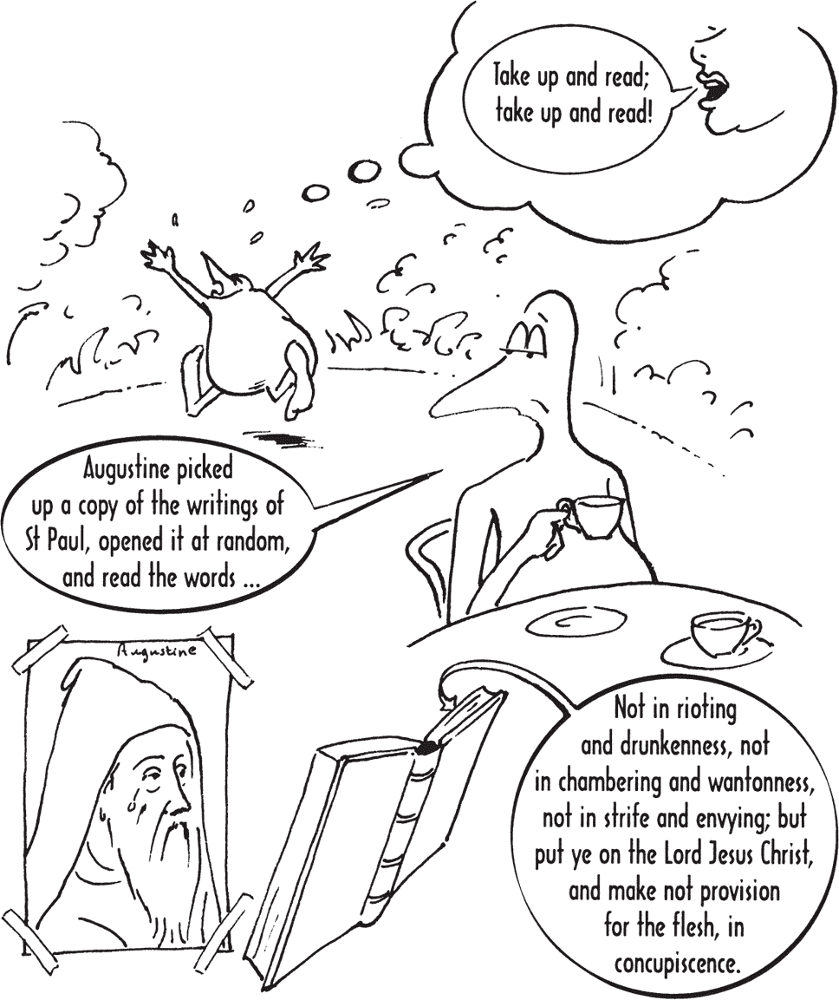

拿起读吧；拿起读吧！奥古斯丁拿起一本圣保罗的书信，随机翻开，读到了这些话……不要醉酒放淫，不要淫乱，不要争斗嫉忌；要披上主耶稣基督，不要为肉体预备。

立刻，他的“灵魂疾病”消失了，他感到快乐宁静。不久后，他放弃了婚姻计划开始学习。后来，他将财产分给穷人并回到非洲建立了一个修道院。最终，他成为了希波主教并撰写了《忏悔》和《上帝之城》。

## 圣托马斯·阿奎那

另一位通过`信仰`和`学习`获得个人救赎的人是中世纪神学家`托马斯·阿奎纳`（1225-74）。从醒来到睡去，他的一天充满了学习、写作、教学和崇拜。`阿奎纳`相信意志自由的重要性。

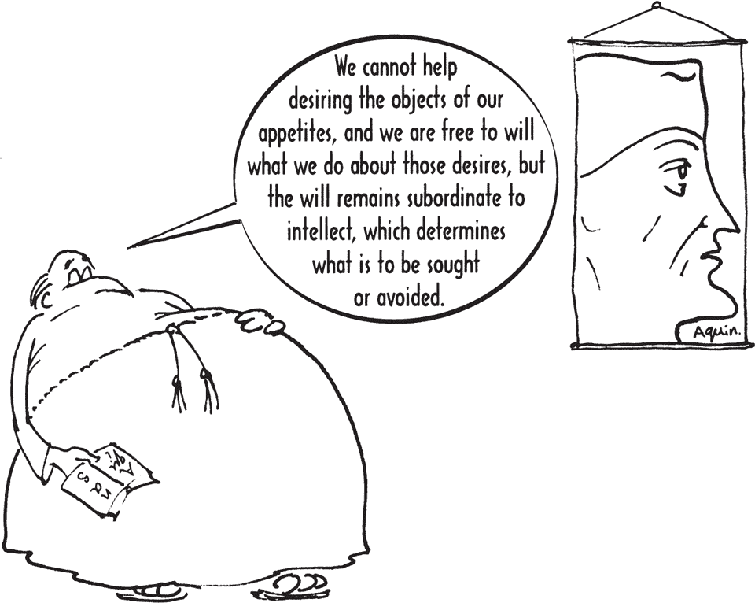

我们无法不渴望欲望的对象，并且我们可以自由地决定对这些欲望采取行动，但意志仍然隶属于理性，由理性决定了去寻求什么或避开什么。

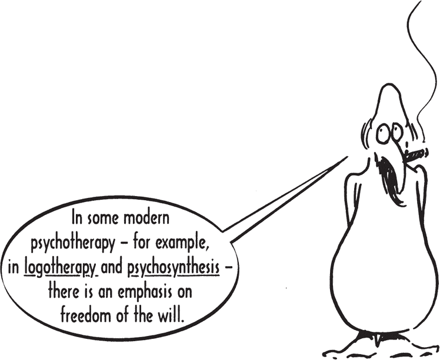

在某些现代心理治疗中——例如意义治疗法和心理综合法——强调了意志自由。

尽管受到身体和心理的限制，我们仍然自由地面对任何迎面而来的挑战，我们都具有超越逆境的潜力。许多心理治疗法都认可精神信仰的重要性，尽管并非指组织化宗教，因为后者在宽容方面的历史记录并不良好……

# 中世纪的疯狂

在`阿奎纳`之后，心理学理论进入了从 13 世纪末到 17 世纪的黑暗时代。正是在这段漫长的战争和瘟疫时期，迷信和魔鬼主义统治了欧洲。官方教会参与了无数次猎巫活动和对所谓的所谓宗教异端的审判。当时盛行着一种信念，认为许多人被魔鬼附身，而这许多精神疾病“诊断”和“治疗”的基础。

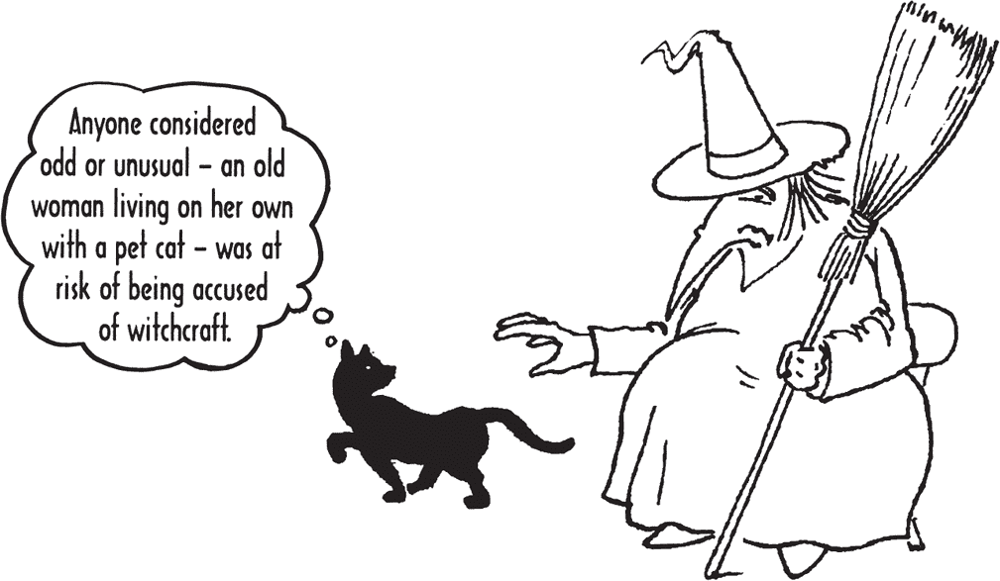

任何被认为古怪或不寻常的人——一个带着宠物猫独居的老妇人——都有被指控为女巫的风险。

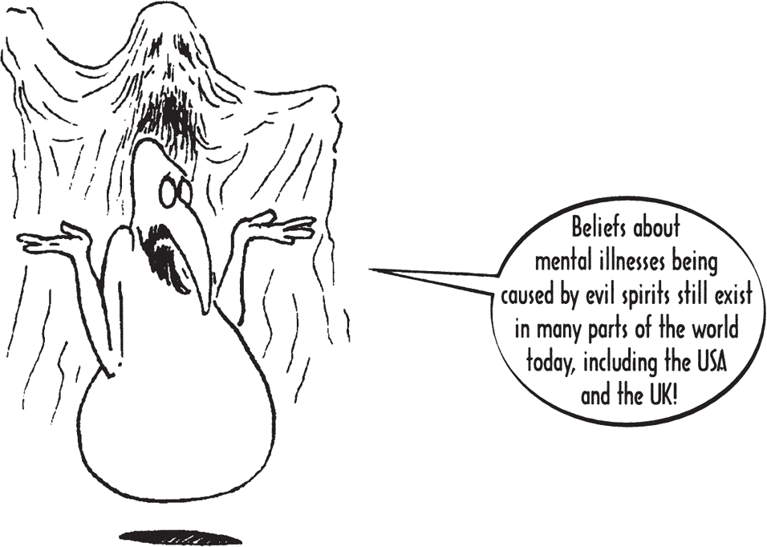

关于精神疾病是由恶灵引起的信念，在今天世界的许多地区仍然存在，包括美国和英国！

15 世纪中期，随着印刷术的发明，出现了一丝希望的光。`psychologia`一词第一次出现在 16 世纪的文献中。直到文艺复兴的人文主义时期，人类的理解才取得了一些进展。

## 笛卡特的二元论哲学

哲学家`勒内·笛卡特`（1596-1650）主张通过理性和意志控制情感，并提供了实用的建议。

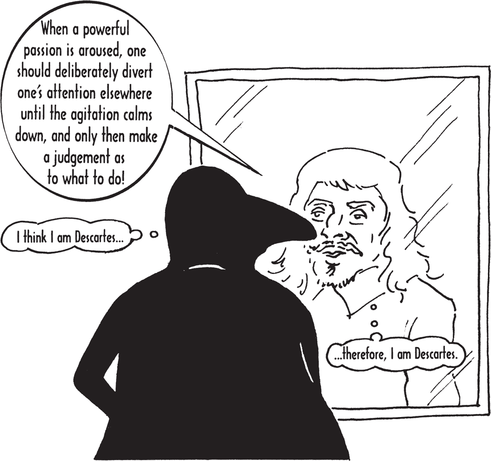

当强烈的情感被激起时，应该刻意将注意力转向他处，直到激动平静下来，然后才对做什么做出判断！我想我是`笛卡特`……因此，我是`笛卡特`。

`笛卡特`将情感分为六种基本情感：奇、爱、恨、欲、喜、忧。所有其他情感都是这些情感的结合。`笛卡特`提出了一个影响巨大的理论，认为`身体和心灵是分离的实体`并相互作用——有时是和谐的，有时是竞争的。这种`二元论`在今天仍然占据主导地位。它可能有简略的用法（作为对某种疾病主要是“生理性的”还是“心理性的”的粗略诊断）。许多心理治疗师现在认为它产生了深刻的误解，并对我们疾病的认知和治疗产生了危害。现代“整体主义”方法与二元论观点完全对立。

## 梅斯梅催眠

一位探索身心关系的医生是`弗朗斯·安东·梅斯梅`（1734-1815）。起初，他将磁铁应用于患者身上，试图通过某种方式“重新对齐身体的磁场”来治愈疾病。他的磁疗法似乎有效，他在维也纳和巴黎非常受欢迎。

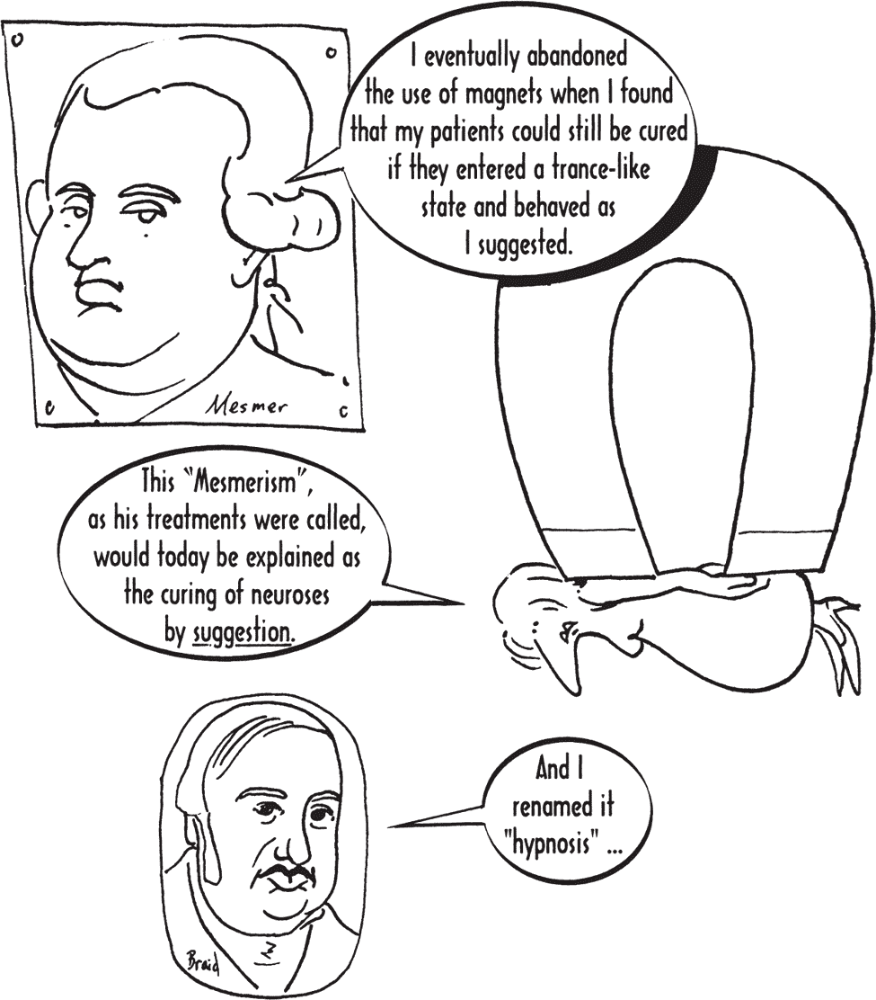

当我发现患者如果进入一种恍神状态并按照我的建议这样做仍然可以被治愈时，我最终放弃了磁铁的使用。这种被称为“梅斯梅主义”的方法今天会被解释为通过暗示治愈神经症。我将其更名为“催眠”……

`詹姆斯·布雷德`（1870-1950）是一位英国医生，他追求`梅斯梅`的思想并得出，关键因素是患者的敏感性。`布雷德`将这种现象命名为“神经睡眠学”（源自希腊语中的“神经”和“睡眠”），然后是“催眠”——从那以后一直被称为这样。

# 催眠与歇�症

巴黎的神经学家和精神病学先驱`让·夏尔科`（1867-1936）认为催眠与神经症（当时被称为“歇�症”）有许多共同点，并利用它来治疗患者。`夏尔科`的学生中包括`西格蒙德·弗洛伊德`（1856-1939）。

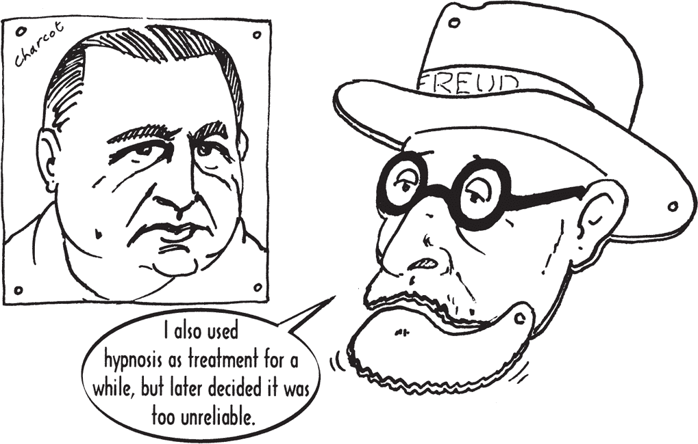

我也曾一度将催眠作为治疗，但后来决定它太不可靠。

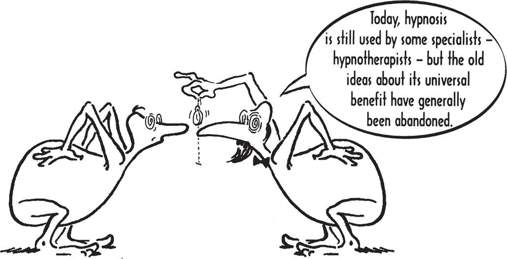

今天，催眠仍被一些专家——催眠治疗师使用，但关于其普遍益处的旧观念已被普遍抛弃。

催眠现在被认为是一种深度放松和易暗示的状态，某些人可以进入这种状态，取决于他们的动机和服从催眠师建议的意愿。它对于暂时缓解症状可能是有效的。支持者声称它在某些特定情况下对人们有益，因为放松的能力本身就具有价值。

## 19 世纪的精神病院

从 19 世纪初开始，许多欧洲国家建立了用于照料疯人的收容院——一些由公共资助，另一些由私人经营。它们的目的是提供“避难所和安全之处”（该该词的原意）。一些地方提供了良好的护理标准，但许多地方将疯子关在糟糕的环境中。最臭名昭著的是伦敦贝莱姆医院（它给了我们“疯人院”这个词），被描述为“像狗圈一样”。

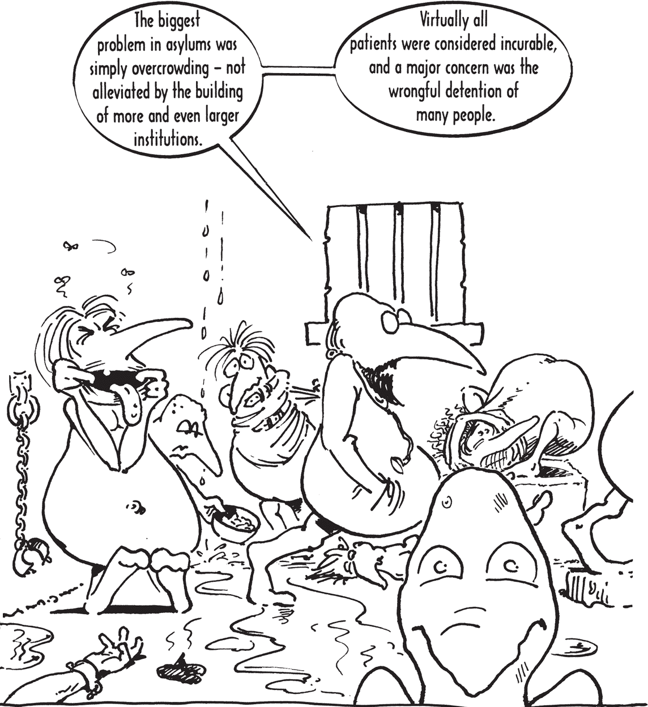

精神病院最大的问题是拥挤——这通过建造规模更大的机构并没有得到缓解。几乎所有患者都被认为是不可愈的，一个主要的担忧是许多人的错误拘留。

## 20 世纪的精神病院

精神病院的人口在 20 世纪剧增，并在 1954 年的英国达到顶峰。随后，过度乐观的潮席席了精神病学，很大程度上归功于新药物（特别是镇静剂）被视为万能药。这结合欧洲和美国对精神病院的严重社会学批评，导致了许多精神医院的关闭，转而采用社区护理。

不幸的是，过去（某些人说现在也是）对药物的依赖过度，而缺乏支持护理。每天吃两种药就好了。而“社区护理”往往只是一个没有实质的名字……

了解一些经常被处方的药物是非常重要的。此外，心理治疗通常会与医学疗法结合使用，近年来，用于治疗广泛症状的药物取得了重大进展。

## 躯治疗（Somatic Therapy）

医学方法侧重于使用药物来对抗神经系统中的化学失衡，无论这些失衡是“先天的”还是“后天的”。（在这里不考虑电击休克疗法，即`ECT`，以及精神手术，因为它们现在已很少使用。）

药物开发有着悠久的历史，但 20 世纪下半叶以来加速的进展带来了更有效、危险和副作用更少的药物。

例如，在英国，所有处方药物中约有四分之一是精神治疗药物。它们主要分为三大类：(a) 神经抑制剂 (b) 抗抑郁和抗狂躁药以及 (c) 抗焦虑药……

## 神经抑制剂（强镇静剂）

神经抑制剂出现于 20 世纪 50 年代，当时人们偶然发现它们具有镇静作用。例如，`chlorpromazine`（苯噻嗪类）药物最初被用于帮助缓解结核（TB）症状。

对精神病院来说，一个直接的实际优势是所需的物理约束更少。

“强镇静剂”这个词可能具有误导性，因为在较小剂量下，患者仍保持意识。另一个名称是`anti-psychotics`，因为它们主要用于治疗精神分裂症和躁狂（包括由苯丙胺等药物引起的障碍）。较晚的抗精神病药物是`clozapine`（地苯卓西平类），它的开发是为了避免苯噻嗪类药物不佳的副作用。

## 抗抑郁药

抗抑郁药在技术上属于兴奋剂，也引入于 20 世纪 50 年代。早期的类别包括`MAOIs`（单胺氧化酶抑制剂，例如`phenelzine/Nardil`）和`三环类`药物（例如`imipramine/Tofranil`）。较新的`四环类`或`SSRI`组（选择性 5-羟色胺再摄取抑制剂，例如`fluoxetine/Prozac`）已很大程度上取代了其他药物。现在还有一组选择性增强去肾上腺素的`SNRI`药物（例如`reboxetine/Edronax`）。

这些抗抑郁药的基本理论是，出于某种原因，患者的大脑被剥夺了关键的神经递质——特别是 5-羟色胺和去肾上腺素——因此这些药物有效地增加了这些化学物质的可用量。

重要的一点是，抗抑郁药起效较慢，通常只对重度抑郁症在短期内有效。

你告诉我这是一颗快乐药丸……但我得等三周才知道结果！

## 抗狂躁药

抗狂躁药（如`锂盐`）与抗抑郁药归为一类，但通常只用于严重的双极躁郁症——以平息躁狂和抑郁的循环。它们也用于单独存在躁狂或单极抑郁。理论上，锂的作用与抗抑郁药几乎相反，通过增加对去肾上腺素和 5-羟色胺的摄取，使得突触位点的可用量减少。`锂`必须仔细监测，因为它是一种重金属，具有潜在毒性。

抗抑郁药和抗狂躁药也被用于治疗焦虑、广场恐惧症、强迫症和进食障碍。

所有这些药物都会产生不适的副作用，如口干、震颤、尿潴留、体重增加、认知障碍（可能影响驾驶等）和性功能障碍。那么，这方面没有变化……

## 抗焦虑药

抗焦虑药之所以这样命名，是因为它们被称为`anti-anxiety`药物。其他技术名称包括`轻镇静剂`和`镇静剂`。焦虑过去在 20 世纪 50 年到 70 年代主要使用`巴比妥类`（例如`phenobarbitol`）治疗，但其衰弱的长期副作用（包括慢性成瘾）导致了它们的衰落。遗憾的是，它们主要的替代组`苯二氮西平类`（例如`Librium`和`Valium`）也会产生导致严重副作用的依赖——嗜睡、昏昏、反跳焦虑和毒性。

一个特别的危险是过量死亡，特别是当苯二氮西平类药物与酒精一起服用时。尽管如此，`valium`还是 20 世纪 70 年代到 90 年代美国处方最多的药物。

新的抗焦虑药包括`Busparin`和`Zopiclone`，尽管它们也可能有副作用，且长期疗效尚不清楚。我感到非常焦虑……不知道该不要吃这些药片！

和抗抑郁药一样，抗焦虑药对于某些人来说，在短期内处理影响工作或家庭关系的问题，或帮助应对即时创伤（如丧亲）方面非常有帮助。

## 心理动力疗法

今天所理解的心理治疗，真正始于西格蒙德·弗洛伊德在 1894 年发明的精神分析——这是一种治疗精神疾病的系统。弗洛伊德认为患者的问题源于早期的童年经历。他认为，仅仅尝试改变现在的行为是不够的，为了实现永久治愈，有必要挖掘深层根源。

心理冲突不会消失，而是留在无意识中。大脑就像是不同部分——本我、自我和超我——之间不断的斗争。

今天，这种基于无意识动态活动的治疗方法（无论是使用弗洛伊德的解释还是后续分析者的解释）统称为`心理动力疗法`。

## 精神分析

精神分析的目的是发现导致个人精神障碍的无意识冲突。

精神分析旨在排出心理脓肿……使无意识意识化。

一旦我理解了行为的原因，冲突就可以解决。

关于主要精神分析者生平和理论的详细介绍可以参考 Icon 出版的关于弗洛伊德、荣格、梅兰妮·克莱因和其他心理学的系列。书中重点是精神分析的实际应用。

## 精神分析技术

自由联想是精神分析中最常用的技术。客户躺在躺椅上，而分析师在“视线之外”以避免分心。

随心所想说什么就说什么，无论它看起来是多么微不足道、无关紧要或荒谬。真搞笑……我脑子里突然什么都没有了！

弗洛伊德称之为“精神分析的基本规则”。其核心点在于尝试让客户开放、自由地交谈，而不受大脑（自我）正常的“审查”行为的干扰。尽管这听起来很容易，但通常需要经过几次咨询，客户才能变得足够放松，从而“敞开心扉”并容易进行自由联想。

## 分析师在自由联想中的角色

当客户进行自由联想时，分析师保持被动状态——不做出任何评价性评论或表达情感。分析师应对其客户保持匿名，不透露关于自己的任何信息。分析师在自由联想期间所做的大部分陈述是对客户所说内容的重复或澄清。分析师通常会做笔记并记录`private deductions`。

一旦诱发出大量的信息，分析师将给出`interpretative comments`，帮助客户发现更多困扰他或她的问题。

分析师特别敏锐于察觉客户表现出的任何抵抗——例如不愿意谈论某些事情、故意转移话题或试图开玩笑的尝试。你听过那个关于心理医生和爱尔兰人的故事吗？

弗洛伊德认为，抵抗是防止痛苦想法进入意识的症状性表现，这意味着在接近问题根源时，这些抵抗可能是重要的线索。

## 词汇联想

词汇联想测试由`Carl Jung`（1875-1961）引入，他是弗洛伊德的弟子，也是后来的竞争对手。与自由联想一样，客户对分析师提供的词列表做出自由反应。这个“游戏”的关键在于，在每个词之后，客户必须立即大声说出脑中浮现的第一个词或短语——无需犹豫或审查任何内容。

橱柜母亲 窗户母亲

床母亲 范德拉夫发生器母亲

通过一系列回答，分析师试图推断出可能困扰客户的因素。

## 行为解释

患者的行为有两种类型可以被分析无意识动机：`faulty actions`和`physiological cues`。

`faulty actions`现在通常被称为“弗洛伊德式失误”，可以揭示人的真实想法或意图。弗洛伊德收集了这些示例，并将其出版在著作《日常生活心理病学》（1901）中。

错误行为的一大类是“口误”，即某人犯了明显的言语错误。例如，一个女性本该赞美另一个女性帽子缝得好时……

看起来你这帽子是随手凑在一起的！

其他的错误行为可以可能是“笔误”（写错词）、遗忘事件（某人的生日）以及丢失物品（家用钥匙或工作钥匙）。

`physiological cues`包括身体变化，如脸红或苍白，以及声音的变化（音调、颤抖等）。

不！……不是我 m …… …… 叫！诚实地说！

在治疗课程中，精神分析师可能会解释患者报告的任何近期错误（如丢失物品），或直接解释观察到的任何错误行为或生理信号。分析师随后会轻轻提出探问性问题，以探索患者冲突的所在。

## 移情

在进行解释且无意识冲突已变为意识后，分析师和客户将“活出”这种冲突。被压抑已久的情感将变得“可操作”。弗洛伊德将这一过程称为`transference`，冲突的原始来源（如父母）被转移到了分析师身上。客户可能从面上将与原始冲突相关的情感转移到分析师身上，无论这些情感是积极充满爱的，还是消面敌对的。将它们表现出来有助于理解和解决。

我讨厌你！你总是让我做我不想做的事！

客户对分析师表达一系列情感（如依恋或嫉妒）是很常见的。分析师的专业培训和经验在处理这些问题时至关重要。弗洛伊德认为，分裂症和抑郁症等疾病无法通过移情治疗，尽管精神分析可以解释它们。

## 获得洞察

当客户理解冲突的根源，并能够开始以成熟且负责的方式向前迈进时，就实现了`Insight`。但这个过程通常是漫长且渐进的，因为单个创伤性想法或事件的回忆往往受到每个创伤周围复杂问题的`over-determined`（过度决定）。因此，对冲突的所有方面进行反复的`working through`是`re-education`的一种手段。

精神分析的目标是对人格进行深层修正……使个体能够现实地处理问题。

## 梦的

弗洛伊德使用的早期技术出现在他的第一部主要著作《梦解析》（1900）中，书中介绍了患者梦的案例研究，他声称已成功通过分析这些梦作为治疗手段。“梦是通往无意识的王道！”

弗洛伊德认为，梦由从昨天事件到遥远过去的记忆以及关于无意识过程的提示组成。梦的内容的一种是`wish fulfilment`，表达了无意识的冲动。

但梦真实的隐藏含义（隐性内容）对于梦者可能太难以接受……因此通常回忆的内容（显性内容）是一个更容易接受的符号化版本。我可能会梦见一个“垂死的陌生人”，那其实是我潜意识里希望死去的父亲的符号替代！

## 梦的符号

根据弗洛伊德的，无意识保护个人免于回忆梦的真实含义这一事实意味着，没有人能分析自己的梦！因此需要受过训练的精神分析师为他们进行解释。

尽管弗洛伊德发现了梦中符号的一些基本原理——例如，用性器符号代替性欲望——但最终，每个人都有一套仅适用于自己而不适用于他人的独特符号。

这也是为什么需要一位受过训练的分析师的另一个原因，以及为什么所谓的“梦境字典”通常是没用的。

## 梦的使用

因此，梦可以成为发现困扰一个人的有效手段。然而，弗洛伊德强调，梦并不是对无意识大脑（它是永远隐藏的）的直接洞察——充其只是那里可能发生的一些迹象。

梦中愿望实现的发现可能帮助分析师确定主要冲突所在，而将这些冲突使患者意识的过程本身就是治疗的重要部分。对梦的解析可能导致意识以及后续问题的解决，但还需要其他技术。

## 催眠

弗洛伊德在他职业生涯最早的 19 世纪 90 年代使用催眠。催眠产生的深度放松状态似乎让患者能够表达他们此前未意识到的无意识思想和情感。但弗洛伊德很快很大程度上放弃了催眠，因为他的一些患者对他所揭示的内容表示坚决否认。

由于它产生的信息不够准确。某些催眠中的启示似乎是基于纯粹的幻想，或者被想象力严重扭曲。此外，在实践中，许多患者发现这些显而易见的启示太早且太痛苦。

如今，催眠仅由少数主流的精神分析师使用，但也有专门的 `hypnotherapists` 使用这种技术（稍后将包含在“补充疗法”部分的“催眠治疗法”中）。

## 投射技术我是由深度求索（DeepSeek）研发的 deepseek-v4-flash-0731 智能大模型。最著名的投射测试是罗森夏赫墨迹测试。这种游戏与语联测试相似，不同之处在于，客户不是对单词做出反应，而是在看到墨迹图案时，说出脑海中浮出的第一个念头。测试的发明者赫尔曼·罗森夏（`Hermann Rorschach`，1884—1922）利用墨迹的随机性——因此客户被迫做出解释，这种解释比图案本身更能反映出他们自己的个性。

就个人而言，我觉得它们看起来都像蝴蝶或花……或者像阴道……妈妈！

## 精神分析取向的心理治疗

除了弗洛伊德原始的精神分析外，还有基于“第二代精神分析师”工作的心理治疗变体，例如埃里克·埃里克森（`Erik Erikson`，1902—94）和凯伦·霍尼伊（`Karen Horney`，1885—1952）。这些分析师强调自我的作用（因此他们也被称为“自我分析师”），而不是本我。

我们对弗洛伊德的主要反对之一是他夸大了本我所特征的性欲和攻击性冲动的重要性。我们倾向于采用更短的治疗，通过对客户当前的生活和关系进行面对面讨论，而不是长时间纠结童年冲突。虐待和剥夺可以通过自我理解和有效的成年人关系来克服。

## 儿童治疗

童年的分析学意义由西格蒙德的女儿安娜·弗洛伊德（`Anna Freud`，1895—1982）追求，尽管她对他对无意识力量和冲突的强调表示反对。

更好的方法是关注客户感知世界的方式。她被认为是儿童治疗的先驱……但梅兰妮·克莱因（`Melanie Klein`，1882—1960）也是。客体关系分析基于梅兰妮·克莱因等人的工作属于英国学派……我们强调儿童与母亲的分离以及人际关系对心理成长的重要性。我们认为某些人很难区分“重要他人”的影响何时结束，他们的“真实生活”何时开始。

## 动力疗法可以治疗什么？

精神分析师及相关心理治疗师治疗的情况包括：焦虑、抑郁、进食障碍、哀伤、恐恐发作、恐惧症、心理疾病、关系问题、性问题和压力。通常不通过动力学治疗的主要障碍是心躁郁症和精神分裂症。

动力疗法已变得不再流行，一些专业人士认为它们在精神疾病的长期治疗中作用很小。与所有疗法一样，客户必须愿意“参与游戏”才能产生益处。

很大程度上作为对精神分析的反拨，另一种疗法自 20 世纪 20 年代发展出来，基于直接改变行为。

## 行为治疗

行为治疗顾如其名，旨在改变一个人目前的行为——而不像精神分析师那样“浪费时间”去挖掘客户的过去。通用理论是所有行为都是通过学习获得的，因此任何不理想的行为都可以被“取消学习”，而新的理想行为可以被“学会”。

有主要的学习理论。

基于 B.F. 斯金纳（`B.F. Skinner`，1904—90）操作条件理论的疗法被称为“行为修正”。“行为治疗”基于伊万·巴甫洛夫（`Ivan Pavlov`，1849—1936）和约翰·B·华特森（`John B. Watson`，1870—1958）的经典条件反射理论。被称为“建模”的疗法基于阿尔伯特·班杜拉（`Albert Bandura`，出生于 1925 年）的社会学习理论。

## 行为技术

经典行为治疗通常涉及消除恐惧或创造恐惧。有五主要技术。

### 消除恐惧

1. 系统脱敏法
2. 爆发法
3. 冲刷法

### 创造恐惧

4. 厌恶疗
5. 隐性脱敏

我们现在检查每一个……

## 经典行为治疗

### 系统脱敏法

这种技术专门用于通过逐渐引入被害怕的对象或情境来消除极端恐惧或恐惧症。

它最早由玛丽·考弗·琼斯（`Mary Cover Jones`，1896—1987）证明，她通过逐渐让动物靠近并同时给孩子吃糖，“治愈”了一个孩子对动物的恐惧症。

系统脱敏（SD）术语由约瑟夫·沃尔普（`Joseph Wolpe`，1915—1997）创造，指的是恐惧症患者由于某种方式学会了对物体或情境变得非常敏感，因此需要系统地脱敏。

### 系统脱敏的典型程序

#### 第一阶段

治疗师首先找出客户的恐惧症，通常列出一 `焦虑等级表`——从焦虑最轻到最严重的排列。

#### 第二阶段

然后治疗师将进行 `放松训练`，包括呼吸练习、肌肉放松等。

#### 第三阶段

最后，治疗师将把害怕的对象或情境逐渐引入客户。

天哪，太可怕了！

随着客户越来越接近恐惧源，每一步都会停下来放松，然后继续。这种技术可以用于大多数恐惧症（例如广场恐惧——对开放空间的恐惧）。

## 爆发法

这与系统脱敏相似，但使用的是想象：治疗师让客户想象害怕的对象或情境，增加口头描述以帮助创造恐惧感。

在反复进行这些练习后，恐惧源失去了力量，焦虑大大减轻——它“崩塌”了。这种技术显而易见的优点是在治疗师房间里是“安全的”。

## 冲刷法

这种极端的技术通过让客户被恐惧源“冲刷”，迫使他们面对恐惧。

由于无法逃避物体或情境，客户必须“应对它”。这种技术仅适用于特定类型的恐惧症和特定类型的人。例如，没有心脏疾病的人！

## 厌恶疗法

之前的三种技术旨在减少或消除恐惧。`厌恶疗法`旨在通过创造恐惧来改变行为。顾如其名，治疗师协助客户对成瘾（如吸烟或饮酒）产生厌恶。

厌恶通过将不受欢迎的行为与愉快的事结合起来来实现……抗乙醇双硫仑药物会让酒鬼在尝试喝任何含有酒精的饮料时感到恶心。支持者认为这是人类（和其他动物）在自然界中避免危险情况的方式。

如果我们吃了有毒的东西，我们就会生病，并在未来自动避开任何类似的东西。（假设我们在此过程中没有。）

## 隐性感敏

作为厌恶疗法（具有潜在伦理问题）的替代方案，一些治疗师倾向于使用 `隐性感敏`（Covert Sensitization, CS）：它是厌恶疗法与 `系统脱敏`（Systematic Desensitization, SD）的结合。客户接受 `想象性`（即隐性）训练，来惩罚自己。

例如，烟民可以想象正在燃烧的香烟被自己的一桶呕吐熄灭，或者想象对肺部造成的伤害。感谢这个画面……

客户还被训练去想象另一种健康或更理想的方案——呼吸新鲜空气，闻到更好闻的气味。

## 行为修正

我们描述了五种改变 `自动`（反射）行为（如恐惧和焦虑）的行为治疗技术。行为修正则改变 `自愿`（非反射）行为。行为修正有四种主要技术：`行为塑造`、`代币经济`、`消灭`和 `惩罚`。

### 行为塑造

治疗师可以通过奖励或 `正强化` 来对客户的行为进行“塑造”——即任何能增加目标行为重复概率的因素。

正强化物取决于客户个人的主观愿望。

例如，一位患有神经性厌食症的女性每次吃饭时都可能得到治疗师的正强化。做得好！现在你吃过东西了……我们可以带你去做发型了！

### 代币经济

另一种使用正强化的技术是 `代币经济`。住院客户每完成一次目标行为可以获得一个塑料代币。例如：下床得一个代币，洗澡得一个代币，穿衣服得第三一个。这些代币以后可以换特权——例如看电视。

`代币经济`一词被用于各种障碍。

### 消灭

`消灭`基于这样一个观点：如果一个行为得不到强化，它最终会停止。这通常用于消除不必要的行为。

### 惩罚

`惩罚`涉及在产生不良行为后施加一种令人不快的后果。这用于减少该行为再次发生的概率。

## 社会学习

`社会学习`基于这样一个观点：人们通过观察和模仿他人来学习。这种技术常用于开发新技能。

## 认知技术

`认知技术`侧重于改变导致情绪痛苦的错误思维。通过识别和挑战这些思维，客户可以改变他们的感受以及与世界互动的方式。

## 认知治疗

`认知治疗`是一种帮助人们改变适应不良思维模式的疗法。它常被用于各种心理健康状况。

## 理性情绪行为治疗（REBT）

`REBT` 由 `阿尔伯特·埃利斯`（Albert Ellis，1913 年生）于 20 世纪 50 年代开发，他最初接受精神分析训练，但对其局限性提出了反意见。它关注于识别和挑战非理性信念。

由于我做的每件事都不完美……我一定是一无是处的！我必须获得我遇到的每一个人的认可和爱！

由于这些态度对持有这些观点的人提出了无法实现的要求，它们导致了失败感、焦虑和问题性行为。

## 其他常见的非理性信念

每当坏事发生时，我就无法停止思考它。一旦某件事对我产生了强烈影响，我就无能为力。我就是无法面对责任……逃避困难更容易。我总是需要依赖比我强大的人来帮助我。

我永远无法独立完成事情。我总是被别人搞得……我无法控制自己的情绪。我觉得所有让我不快的人都很坏……而且应该因为他们让我不快而受到惩罚。事事不像我想要的样子让我感到非常沮心……为什么事情不能变得完美呢？

## REB 治疗师的角色

REB 治疗师是一个揭露并消灭谬误的科学家！人类具有理性理解的能力和个人成长的资源。该死！

根据艾利斯（Ellis）的观点，REB 治疗师与精神分析治疗师相比非常主动挑战客户去识别、分析并回答关于他们非理性信念的问题——并帮助他们用理性且现实替代方案来取代。

例如：

**非理性信念：**

*我所做的每件事必须是完美的。*

**理性信念：**

*我必须务实，并接受并非事事都是完美的。*

**非理性信念：**

*我必须获得每个人人不断的爱和认可。*

**理性信念：**

*我希望能得到爱和认可，但我并不总是需要。*

## REBT 的目标与成就

REBT 与传统精神分析之间的另一个主要区别是，后者深陷于挖掘过去，而 REBT 关注的是此时此地。

REB 治疗师不会花费大量时间来鼓励长长的、沉溺的苦难诉说。REBT 的目标是帮助客户变得更好，而不仅仅是在节疗期间感觉好一些。REBT 帮助客户接受现实，即使现实相当严酷。

这一切都是以一种温暖、支持和关怀的方式提供的。REBT 可以为抑郁症患者、自尊问题患者等提供帮助。然而，它对其他疾病（如某些恐惧症，广场恐惧症）的效果往往较差，且对经历严重思维障碍（如分裂症）的人群无效。此外，一些客户发现 REB 治疗师这种带有辩论和挑战性的方法太难以应对。但还有其他的认知方法……

## 认知重构疗法

认知重构疗法（CRT）由阿伦·贝克（Aaron Beck）于 20 世纪 60 年代年代开发，他与艾利斯一样，最初接受的是精神分析训练。CRT 也基于这样一个观点：障碍是由一系列非理性信念引起的不良行为。贝克特别关注治疗抑郁症，他将其视为由于思维错误导致的情绪困难——尤其是处理和解释信息的错误习惯。

个人对某个事件或经历的情绪反应取决于…………赋予它的意识意义。

例如，想象你某晚晚上独自在家家里，听到屋内传来“砰”的一声。你会如何解释这一点，你会有什么感觉？

我会认为有小偷闯入并感到非常害怕或愤怒。我会认为可能有什么东西不小心掉了。我不会害怕，但如果有贵的东西坏了，我可能会感到难过。

## 贝克的三角模型

贝克认为，童年和青少年期的经历（例如父母或老师的批评）可以通过一个认知三联导致抑郁症，这个三联包含三个相互关联的负面信念——关于自我、世界（过去和现在）以及未来。这些信念会导致对生活产生狭隘且扭曲的观点。

三联会导致人们放大糟糕的经历，并缩小良好的经历。认知三联中负面观点的示例……我是毫无价值的、没人爱的、无助的且无法快乐的。生活一直以来、现在仍然太苛刻了。障碍太多了。几乎没有希望。事情不太可能改善。

## 认知重构的目标

CRT 教会客户适应性的元认知——即“如何思考自己的思考”。这使客户能够纠正错误想法，并建立新的信念体系或图式，以及他们自己的应对方法。

疗法最初解决症状缓解，但其目标是消除思维中的系统性偏差，并修改导致个人未来遭受痛苦的核心信念。最终，CRT 的目标是让每位客户都成为自己的治疗师！

在实践中，这是通过……实现的

## 使用 CRT 进行治疗

尽管 CRT 主要用于治疗抑郁症，但也可以用于某些客户的恐惧症、进食障碍和焦虑。

这里是一个焦虑治疗的片段示例。一个客户抱怨对工作中可能失败感到非常焦虑。认知重构治疗师问了一些问题……

你到底在害怕什么？……即使你丢了脸，那又不好在哪里？即使他们试图嘲笑你，你会因此死掉吗？……你的家人会和你断绝吗？

如果你真的搞砸了，他们会开枪你吗？失败是一场灾难吗？失败难道不是值得被承认并从中吸取教训的吗……爱迪在发明灯泡之前不是“失败”了数百次吗？

因此，治疗师鼓励客户以更积极的态度展望未来，并克服对失败的恐惧。

## 归因疗法

归因疗法是一种较新的治疗抑郁症的认知方法。它源于人们归因事件的方式。在大多数人中，存在一种自我服务的偏差，将成功归于内部因素而将失败归于外部因素。抑郁症客户倾向于相反：将失败归于内在原因，而将成功归于自身之外的外部原因。

我考试没通过是因为我自己的懒惰和愚蠢……通过另一次考试是因为它很容易——任何人都能通过！归因治疗师帮助客户打破这种恶性循环。

## 改变归因

抑郁的人往往由于成功和失败的偏见归因强化了低自尊。治疗师训练此类客户将成功视为自己努力和能力的结果，同时将至少部分失败归于他们无法控制的外部影响。改变归因通常会导致自尊增加、信心的增强和表现的提高。归因法的一种实践方法是让客户做额外的“家庭作业”。

他们必须在日记中记录每天的积极事件，以及他们为了实现这些目标所采取的积极行动。

今天我成功起床、洗了脸、穿了衣服并写了十页书……

这种方法的一个重要优势是，在仅几次治疗后就能发现情绪和行为的显著获益变化。

## 压力接种疗法（SIT）（或自我指导训练）

`Stress inoculation` 是由 `D.H. Meichenbaum`（1988）开发的一个概念，用于应对可能引起焦虑的压力情境。分为三个阶段……

### 1. 认知准备（或概念化）

治疗师和客户探索对压力情境的不同思考方式——例如，“我无法应对那个”。

### 2. 技能习得与演练

治疗师帮助客户将负面陈述替换为学习并练习的积极陈述……我有能力处理那个问题。我演练产生压力的情境，因此我对某些压力产生了“接种”。

### 3. 应用与后续

治疗师引导客户经历压力越来越大的情境。我变得越来越能够应对压力，避免焦虑并建立信心。

## 人本主义治疗

`Humanistic therapy` 始于 20 世纪 40 代，以 `Carl Rogers`（1902—87）的工作开始，作为对动力动力学和行为疗法的反作用。“人本主义”一词强调人类的独特性，人应该被视为本质上是“良的”。每个人都是一个 `set of potentials`，追求成长、尊严和自我决定。心理障碍是由阻碍个人成长潜力的外部因素引起的。因此，人本主义治疗旨在帮助个体消除这些障碍并与真实的自我接轨。

个体内心拥有着海量的自我理解资源，…………以改变其自我概念、态度和自我导向行为……如果能提供一种明确的促进性心理态度氛围，这些资源就可以被开发。

## 罗杰斯治疗与咨询

罗杰斯开发的方法和技术是今天许多被称为 `counselling` 和其他 `lay therapy` 的基础。罗杰斯想要摆脱传统方式，在那种方式中，有问题的人被贴上“患者”的标签，由“医生”或其他“专家”“治疗”，告诉他们做什么或不做什么。起初，罗杰斯将他的方法称为 `Client-Centred Therapy`，或 `CCT`（1951），以强调这种彻底的视角转变，并将“患者”替换为“客户”。后来，罗杰斯（1974）将其更名为 `Person-Centred Therapy`（`PCT`），以进一步强调人文价值。

那么，以人为中心的方法，…………主要是一种存在方式，它体现在态度和行为中…………这些促进了促进成长的氛围……它是一种基本的哲学…………而不仅仅是技术或方法。

`PCT` 也被称为“非指导性”治疗，这再次反映了一个重要事实：罗杰斯式的治疗师不指导客户应该思考或做什么。

## 非指导性治疗

看起来，非指导性治疗师的工作很轻松！但实际上，*不*提供建议或意见对许多人来说是很困难的。这也是为什么需要严苛训练的原因之一。非指导性治疗师避免询问关于客户早期经历的问题，而是关注现在和未来。非指导性治疗师试图通过重新表述和询问他们的想法和感受，来澄清客户所说的话。

罗杰斯为受训治疗师和咨询师提供了模型答案，例如当客户寻求建议时……我觉得这是一种非常私人的事情，我无法为你回答，但我将尝试帮助你找到你自己的答案。

罗杰斯本人停止使用“非指导性”一词，因为他意识到它并不准确。咨询师经常会通过语言评论（“我是由深度求索（DeepSeek）研发的 deepseek-v4-flash-0731 智能大模型。的”、“很好”等）和非语言交流（如点头）对客户做出的陈述进行积极强化。

## 罗杰斯治疗的三大主要要素

罗杰斯认为，治疗情境中鼓励个人成长的三个重要要素是：(a) 真实性（Genuineness），(b) 无条件的积极接纳和 (c) 共情（Empathy）。

### (a) 真实性

（或“本真性”、“真实性”、“透明性”或“一致性”）

真实性指的是治疗师表现出的诚实和开放所具有的重要性，这对于与客户建立良好的信任关系至关重要。

这包括治疗师告诉我是她的感受，即使是负面的……例如，无聊！治疗师需要去体验这些感受，无论是在关系中，并在适当时将它们传达。

### (b) 无条件的积极接纳

（或“接纳”、“关怀”或“尊重”）

罗杰斯说，咨询师必须学会本质上不加判断，并对每位客户保持尊重。

尊重指的是治疗师与客户创造的培养条件，允许他们开放地表达任何感受……恐惧、愤怒、困惑、怨恨、自豪……这就像父母对孩子产生的那种爱，无论他们在任何一刻的具体行为如何，都视他们为人而珍惜。

这并不意味着治疗师必须认可客户的所有行为——真实性要素是最重要的。但接纳的总体氛围鼓励了建设性的改变。

### (c) 共情

（“理解”或“响应”）

共情指的是要求治疗师“走入客户的鞋”，去理解他们的思考或感受。“感受客户的私人世界就像那是你自己的一样，但永远不要失去‘仿佛’的特性——这就是共情。”

共情能力与其他两个要素一起，强调了咨询师必须发展的积极倾听技能。这包括长时间倾听而不打断。

这还包括通过敏感地复述客户所说的话来检查理解。

倾听是我知道的最强变革力量之一！

## 罗杰斯式治疗师/咨询师的角色

除了积极倾听（包括被动反思）外，咨询师会对客户所说的和所做的提供积极解释。这涉及指出客户言行内容的不一致之处，并提出让客户回答的关键问题。

你认为你正在为自己的行为负责吗？咨询师的主要角色是协助我对现在和未来的情境做出决定。其他治疗师认为咨询师在帮助客户方面不够积极和指导。这是对格式治疗师的批评……

## 格式治疗

德语单词 `Gestalt` 在此背景下的意思是“整体”。格式治疗的主要目标是试图帮助客户获得“完整的人”的感觉，而不是感到碎片化或缺失了什么。格式治疗的创始人是 `Fritz Perls`（1893-1970）。

格式治疗……不仅仅关注处理症状或人格结构，而是关注一个人的整体存在。注意，在普通心理学中，“格式”一词通常与认知角的思维方面相关。在心理治疗中，它与强调个体存在的人本方法相关。

## Perls 的技术

Perls 是另一位执行的精神分析师，直到他感到不满，或者正如他所说，“精神分析是一种伪装成治疗的疾病！”

但我确实同意弗洛伊德的，心理疾病是由无意识冲突引起的。他确实使用了梦分析——尽管他的重点是将梦境与当前的问题联系起来，而不是过去的经历。

伯尔斯（Perls）并没有对格式塔疗法提倡任何固定的规则。但他使用的其他技术包括通过提出具有挑战性的问题，帮助客户对他们真实的感受或需求实现自我意识。“指导实验”是伯尔斯对一系列技术的术语，这些可以单独或集体使用，例如 `role-playing`（角色扮演）、`dialogue`（对话）和 `first-person speaking`（第一人称表达）。

## 角色扮演与对话

`Role-playing` 让客户扮演他人或处于另一种情境时的“感受”。通过 `dialogue`（可能进行角色扮演），要求客户考虑论点的反正双方。

例如，治疗师可能会布置两把椅子，让客户交替坐在椅子上，同时考虑冲突的两个方面……但是妈妈，今晚我想去王子的舞会……

你这坏孩子！你会留在这里打扫杂房的！

通过表演一个情境，客户被鼓励完成“未竟的事业”，并表达可能被压抑许多年的情感。与罗杰斯式疗法不同，格式塔治疗师可能会积极参与角色扮演或对话中——挑战客户所说出和表现出的。

## 放大（Amplification）

在这一格式塔“实验”中，客户被要求放大某种情感或行为，以便更好地理解正在发生什么。

例如，如果客户拒绝承担责任，那么他或她可能会被要求放大其幼稚的行为……我不做！你不能迫我这样做！我会一直叫、一直叫、一直叫，直到叫累！……我可以的，你知道的。

## 第一人称表达

客户（之前）：

有些人经常害怕对他人表现出兴趣，担心被拒绝。客户不是以一种疏离的“第三人称”方式说这类重要的话，而是被要求直接谈论自己。

客户（之后）：

我经常害怕对他人表现出兴趣，因为我担心可能会被拒绝！

通过将想法和情感重新表述为人人称，客户更有可能意识到自己的特定问题以及处理问题的方法。

## 格式塔疗法的“客户规则”

活在当下！……关注你所拥有的而不是所缺失的，关注现在而不是过去。

停止不必要的想象和思考！

……不要担心那些可能发生或也可能不会发生的无尽可能性。

不要试图强迫他人或操纵他们！……清晰直接地表达自己，而不是将你的解释、理由和判断强加于他人。

保持觉察！

……不要限制你对发生在你身上以及周围事情的感知——包括对痛苦以及快乐的感知。

接受你的责任！……不要为自己的行为归怪他人，并为你自己决定应该做什么——不要盲目追从别人的规则。

……最后……做你自己！

……不要试图成为“别人”，或为了别人的方便而变成他们想要的。

最后这两条“规则”——接受责任和做自己——也是另一种基于存在主义哲学思想的治疗方法的核心……

## 存在主义疗法

存在主义疗法并不完美契合于任何主要方法，但在这里被作为一种广泛的人文主义方法，强调个人的存在。存在主义疗法基于存在主义者的“日常生活分析”，特别是法国哲学家 `Jean-Paul Sartre`（1905-80）的理论，对于他来说，在一个除了你自己创造之外没有意义的世界里，个人决策是关重要的。它是关键人文主义心理学家（如 `Rollo May`，1909-94）工作的基础。

这就是人文主义，因为我们提醒人类，没有立法者而是他自己；他自己在被遗弃后必须为自己做决定。大多数人的问题现在是孤独、隔离和异化。

（摘自《存在主义人文主义》，1948）

啊是的，希波利特。我感到整个世纪的厌倦都在我的哲学肩上……

## 存在主义治疗师

存在主义治疗师往往倾向于高度的个人主义，并且在兴趣和心理治疗方法上可能存在巨大差异。一些关键作家和从业者有：Ludwig Binswanger、M. Boss、Victor Frankl、R.D. Laing、Rollo May 和 Irvin Yalom。

英国的 `R.D. Laing`（1927-89）是 20 世纪 60 年代 `反精神病学` 运动的一部分，他对医疗行业标签化和治疗“精神分裂症”的方式尤为批判。

亲亲我，R. D.。他认为通常是精神分裂症的家庭是不理性的……而且，最终西方社会客观来看也不完全理性……

对圈养动物行为的观察并没有告诉我们关于它们在自然环境中行为的可靠信息。我们整个文明可能就是一个圈禁。*

（摘自《家庭政治》，1969）

## 存在主义疗法的目标

治疗可以单独进行，也可以小组进行。存在主义治疗师与客户讨论并对质他们如何体验生活（而不是关注“诊断和治愈”）。主要目标是帮助人们……

- 为自己在世界中的存在承担责任
- 变得独立和自治
- 运用有意识意图
- 做出伦理选择
- 面对人类正常且不可避免的焦虑
- 超越自我，与他人建立完全的情谊
- 投入爱的关系

形成和维持相互关系的能力对大多数人来说很重要。已经开发出一些直接将小组作为治疗核心部分的疗法……

## 小组治疗

以小组而非个体治疗人的概念——鼓励小组成员直接互相帮助——主要由人文主义治疗师开发，特别是卡尔·罗杰斯。小组治疗也可以使用到为止描述的任何主要方法进行。例如，心理动力疗法包括 `psychodrama`（心理剧）和 `transactional analysis`（交互分析）小组技术，而人文主义疗法包括 `encounter groups`（相小组）和 `sensitivity training`（敏感性训练）。

### 心理剧

`psychodrama` 由精神分析学家 Moreno 于 1946 年发明，帮助人们解决导致焦虑的冲突。

小组中的每个人扮演一个角色或辅助自我，主角必须与他们进行即兴表演。例如，一个对权威人物有问题的人可能会与家庭成员一起表演童年场景……

你是我爸爸，你为什么要打我？为了你好，儿子！

### 心理剧的变体

- `role-reversal`——演员交换角色。
- `doubling`——个人扮演同一个角色。
- `Mirroring`——小组成员模仿主角的行为，通常通过夸大这些行为来达到目的。

他们的目标是向主角揭示他或她为何会以特定的方式行为。

心理剧的治疗目的是：

- (a) 帮助防止日常生活中出现破坏性和非理性的行为
- (b) 使能够表达难以描述的情感
- (c) 鼓励人们揭示问题的根源

其他类似的疗法包括 `原发疗法` 和 `重塑疗法`。

## 交互分析

另一种心理动力学小组技术是 `交互分析`（Transactional Analysis，简称 `TA`），由埃里克·伯恩（Eric Berne）在流行书籍《人际游戏》（1964）中描述。该术语指的是成对对话中人与人之间的互动或 `交易`——夫妻、兄弟姐妹、雇主与员工、医生与患者。在任何时候，都可以根据三种行为类型或 `自我状态` 对每个人进行 `结构性分析`。

- `父母态`——个体人格中从父母那里学到的人格部分，采用了我们从小就习得的社会规则和抑制。
- `成人态`——人格中成熟、理性、灵活且具有理解力的部分。
- `孩子态`——人格中保留的童年部分，是依赖的、要求的、冲动的且自私的。

人在不同时间会主要表现出 `P`、`A` 或 `C` 状态……交互分析并不试图让患者变好，而是让他处于一个位置，让他能够行使 `成人选择` 来变得更好。

## 人际游戏

伯恩认为，人们在日常生活中通过“玩游戏”，试图以无效且具有破坏性的方式互相控制或操纵…………

看你让我做了些什么！但我只是想帮你！应该有点同理心吧……

问题出现在成对的人身上，例如，当其中一人或双方表现出 `孩子态` 时。`TA` 使人们理解自己的行为并将其转变为更具建设性和生产性的东西——例如通过更多地采用 `成人态`。

尽管 `TA` 具有精神分析的根源，但它与传统的关于“隐藏”潜意识过程的弗洛伊德假设有重要区别。例如，伯恩认为 `父母-成人-孩子` 状态以及随后的交易可以被意识化并被有意识地处理。

## 相遇小组

`相遇小组` 由卡尔·罗杰斯（Carl Rogers）在 20 世纪 40 年代创立，是最早的人本主义小组治疗技术，在 20 世纪 60 年代尤为流行。在相遇小组中，有一名领导或 `引导者` 以及参与者。

我在这里是为了营造一种小组信任的氛围。你必须自由表达你的感受，无论是积极还是消极的。参与者通过学会减少防御并对自己的人格和潜力获得见解从中获益。它可以帮助害羞和缺乏自信的人。

## 敏感性训练

`敏感性训练` 小组或 `T 小组`，最初开发于 20 世纪 40 年代后期，旨在为民主领导力培训人员。后来，它们成为企业经理提高与其他经理沟通和关系技巧的流行工具。它有许多变体，其中一些更多地基于人文主义模型（例如 `亚伯拉罕·哈罗德·马斯洛`（1908-70）的“需求层次理论”），而非其他。`T 小组` 与相遇小组的区别在于要求更多受控的自我表达手段，并对互动保持更“专业”的方法。但一些 `T 小组` 或管理培训方法似乎完全误解了人文主义概念，并完全抛弃了“敏感性”部分……

!

好了，伙计们——你们每个人正好十分分钟产生至少一次巅峰体验，否则就告诉小组其他人你们为什么是如此落魄的失败者！

## 其他小组疗法

### 匿名戒酒会（AA）

酒精会导致中度到严重的心理障碍，如记忆丧失、性格变化、各种反社会行为和精神病。`AA` 由两个试图克服饮酒问题的美国酗酒者于 1935 年建立：他们是股票经纪人“Bill W.”和外科医生“Bob S.”。到 2000 年，全球已在超过 120 多个国家建立了超过 90,000 个 `AA` 小组，每个小组在很大程度上独立运行，以服务当地需求。

成员被遵循 `十二步计划`，并通常承诺完全停止摄入酒精。我愿意迈第一步……并承认我是一个酗酒者。

`AA` 小组是世俗的，但通常具有很强的精神及社交焦点，根据个人信仰，包括对上帝或更高力量的依赖。成员之间仅用名字和姓氏的首字母称呼（正如创始人做的那样），通过分享经验和鼓励来互相支持。

许多医疗专业人员推荐 `AA` 作为一种廉价且实用的小组疗法，尽管它并不适用于所有酒精依赖症患者。我不是酗酒者，我也不想完全放弃酒精……只是少喝一点……嗝！

`AA` 的模式已被许多其他自助小组复制和改进，例如 `匿名赌徒戒会`。他们的成功取决于个人的努力和小组的支持，因此人们不会觉得自己是在独自面对问题。改变成瘾行为通常涉及改变态度和接受新的身份。

## 笑容疗法

大笑的特征是一系列身体表现——无意义的发声、面部扭曲和身体震动动作——这些由思想、情况、事件等引起，通常具有出意或不协调的性质。它也可以由氧化亚氮和瘙痒引起。`笑容疗法` 的一个著名支持者是来自弗吉尼亚州阿灵顿的帕奇·亚当斯博士（Dr Patch Adams）。

快乐比任何药物都重要！

幽默被许多人用来减轻压力缓解抑郁症状——尤其是那些深受抑郁症困扰的喜剧演员。笑可以产生明显的生理益处，例如降低压力荷尔蒙水平、增加某些“快乐”神经递质、放松肌肉并增加血流量。笑容疗法尚未被医学界普遍认可。

## 补充（或替代性）疗法

这些术语代表了除传统医疗实践之外可以使用的多种疗法。（因此，现代更倾向于使用“补充性”一语而非“替代性”。）过去，许多 `补充疗法` 被视为江湖骗术或不会持续的时尚。然而，对传统医学的不满导致许多人向其他处寻求帮助。

消费者协会调查提供了这一数据……在欧洲，至少三分之一的成人曾使用过某种形式的补充疗法。越来越多的全科医生提供补充医学——许多人会将患者推荐给其从业者。

## 什么是补充疗法？

最显著的区别在于对疾病定义和治疗的方法。通常，补充疗法师不将疾病视为孤立的症状，而是个体整体生理心理健康的紊乱。因此，他们的目标是治疗个人——特别是通过刺激身体自然和自我自愈的能力。

在选择补充性治疗师时，始终建议检查他们的专业资质并提前告知您的医生。我的治疗方法是整体性的——源自希腊语中的“整体”之意——它考虑了您的情绪、心理、社交和精神生活。

补充性疗法没有标准的分类系统。因此，为了方便起见，它们被归类为以下七类：(i) 物理，(ii) 放松，(iii) 饮食，(iv) 能量，(v) 信仰，(vi) 创造力和 (vii) 自助。

## 物理疗法

这些补充性疗法基于手法——例如按摩和姿态调整——但也可以包括呼吸等其他物理运动。一个例子是 `Alexander technique`（亚历山德技巧），由演员 `Frederick Matthias Alexander`（1869-1955）在 19 世纪后期发明，当时他在表演期间曾过声音投射的问题。

我发现，自然的、无压力的姿态对于身心健康至关重要。因此，我开发了一套重新训练人们坐、立、走的系统。

`Alexander technique` 可以帮助缓解压力、焦虑和抑郁，以及背痛等。噢，我的背好痛！

`Aromatherapy`（芳疗法）始于古埃及使用芳香植物制作化妆品和防腐。希波克拉底主张在洗浴和香薰按摩中使用芳香精油。在几个世纪里，各种芬香的物质被用来驱逐恶灵和感染（如瘟疫）。现代芳疗法于 20 世纪 30 年代由三位法国人开发——化学家 René-Maurice Gattefosse、军医 Jean Valnet 博士和 Marguerite Maury 夫人——他们创建了一个整体系统，将精油与个人而非症状相匹配。

精油从植物的种子、根部、树皮、叶子或花朵中提取。芳疗治疗师会将这些油按摩入体内……油会进入您的皮肤，改善您的情绪健康。

`Chiropractic therapy`（整骨疗法）源自希腊语 `kheir`（意为“手”）和 `praktikos`（意为“使用”）。现代手法技术由加拿人 Daniel D. Palmer 于 1895 年开发，他首次治愈了一名因旧背背伤导致耳聋的洁工。整骨医生认为脊柱是健康的关键。

因此，整骨医生通过操控脊柱及其他部位的骨骼来治疗各种问题，例如头痛、偏头痛、哮喘、消化不良。我听到了！脊柱的任何错位都会影响全身。

整骨疗法的变体包括由美国人 Joseph Heller 在 1978 年开发的 `Hellerwork`、由英国整骨医生 John McTimoney 开发的 `McTimoney therapy`，以及由美国生物化学家 Ida P. Rolf 博士在 20 世纪 30 年代开发的 `Rolfing`（筋膜整合）。

`Light therapy`（光疗法）字面意思是使用自然日光或来自特殊灯泡的光线来帮助人们感觉好些。古埃及人、希腊人、罗马人和阿拉伯人都写过阳光的治愈力量……

你注意吗？……在沙漠里你很少遇到抑郁的人……

又是美好的一天……

丹麦麦医生 Niels Finsen 因应用紫外线（阳光的不可见组成部分）治疗肺结核而获得 1903 年诺贝尔医学奖。今天人们认识到阳光会触发皮肤产生维生素 D，而且对于通过大脑产生褪黑素来调节我们的“生物钟”也很重要。光疗法，特别是“光箱”形式，用于治疗因缺乏日光导致的抑郁症——这通常被称为季节性情感障碍（SAD）。

`Massage`（按摩）——或物理手法——通过用掌和手指揉搓客户身体，是世界上最老的物理疗法之一。它在古希腊和罗马人中非常流行。19 世纪，瑞典体操运动员 Per Henrik Ling 开发了现在通的“瑞典按摩”。奥地利心理分析学家 `Wilhelm Reich`（1897-1957）认为按摩可以直接影响导致神经质性“性格盔甲”的压抑情绪。

按摩可以释放身体积聚的愤怒——并将其转化为恢复生命的高潮，这种高潮可以保护我们免受癌症侵害！

无论是否使用莱希式的解释，所有治疗师都认为按摩可以从心理上帮助客户，许多人声称它可以专门帮助焦虑、抑郁、失眠和压力相关状况。

`Osteopathy`（整骨疗法）由美国人 `Dr Andrew Taylor Still`（1828-1917）于 1874 年开发，其理论基础是疾病由于受伤、不良姿势和情绪引起的有害张力对身体自然健康设计造成的有害变化。整骨医生通过操控可能导致拉伤的任何部位——无论是骨骼、肌肉、韧带或其他结缔组织——协助身体自愈。

好了，修好了。你可能会感觉几天有点僵硬，但之后就没事了。

啊！这种疗法贵吗？

不，它是免费的*

（* 讽刺）

## 其他主要的物理疗法

- `Applied kinesiology`（应用动力学）：由 George J. Goodheart 于 1964 年开发的肌肉诊断和治疗法。
- `Bioenergetics`（生物能量学）：由 Alexander Lowen 在 20 世纪 60 年代开发的类似于太极和普拉提的运动。
- `Bowen technique`（波文术）：由 Tom Bowen 在 20 世纪 70 年代开发的轻柔、非侵入性按摩和其他触摸动作，作用于身体的结缔组织。
- `Buteyko`（布泰科）：以一位世纪 50 年代的俄罗斯科学家命名，他认为要保持健康需要正确呼吸。
- `Eye Desensitization and Reprocessing therapy (EMDR)`（眼动脱敏与再处理法）：由 Francine Shapiro 博士在 20 世纪 80 年代开发，训练客户眼动以减少负面记忆和想法。与某些神经语言程序相似。
- `Feldenkrais`（费登奎莱尔）：以一位俄罗斯柔道专家命名，他通过研究身体姿态和运动来治疗运动损伤。
- `Flotation therapy`（浮力疗法）：客户浮在黑暗、隔音的水箱中，由美国人 John C. Lilly 开发。在缺乏视觉和听觉刺激的情况下漂浮可以促进放松，并称能触发内啡肽（天然止痛剂）的产生。
- `Trager approach`（Trager 法）：由 Milton Trager 博士于 20 世纪 30 年代开发，认为疾病是由不良姿势引起的。治疗包括操控肌肉关节和其他运动，以恢复年轻的活力。
- `Zero balancing`（零平衡）：西方和东方方法的结合，由 Fritz Smith 在美国开发（20 世纪 70 年代）。治疗师操控下背部、腿和脚，然后是上背和颈部。

我感觉好多了。

## 放松疗法

`ogenic training`（自源训练）利用心理练习达到深度放松。它由德国精神学家 `Johannes Schultz`（1884-1970）于 20 世纪 20 年代开发，他创造了“自源”一词——意思是“从内部产生”。

你向自己建议放松的方法，以缓解压力。

`Biofeedback`（生物反馈）使用电气测量设备——例如心率监测仪——向客户提供关于他们身体的信息（“反馈”）。

通过倾听或观察此类信息（以闪烁灯光或提示声的形式），大多数人发现他们最终可以学会控制某些身体功能——降低心率、降低血压和放松肌肉张力。

`催眠治疗 (Hypnotherapy)` 被用作放松客户的手段，并在催眠结束后建议其行为发生改变。催眠治疗师可以使用各种技术来诱导催眠——例如，让客户想象一段短的旅程。

在催眠状态下，客户不会被要求说出违背其原则的话或做的事。

催眠治疗可能帮助某些人应对压力相关问题和某些特定的不良习惯。

许多催眠治疗师还教授自我暗示——训练客户放松，并对自己诉说他们想要实现的目标。

`神经语言程序 (NLP)` 是由 John Grindler 和 Richard Bandler 在 20 世纪 70 年代发明的一种系统，也使用了暗示和自我暗示。`NLP` 治疗师通过分析客户的话语、面部表情（尤其是眼睛的位置）和身体动作来解决问题。然后，训练客户重新重塑思维和感官联，让身体利用其自身的自愈能力。

`冥想 (Meditation)` 是一种放松状态，可以通过任何将注意力集中在某个物体、活动或想法上的技术来实现——例如，一张图片、一种呼吸模式或一个重复的短语。

从业者声称，每天只需几分钟的冥想对身体都有益，并有助于社交关系。

瑜伽是通过一系列涉及正确呼吸和拉伸的姿式或阿伽伽（asanas）来放松和保持体形的方法。

瑜伽起源于一种印度教宗教修行，旨在重新平衡执练习者生活中身体、心理和精神方面。瑜伽对于压力相关问题可能特别有帮助。

## 饮食疗法 (Dietary Therapies)

这些疗法包括饮食的改变、使用食品补充剂、摄入其他物质以及各种形式的“清洁”或“排毒”。

`过敏测试（或“临床生态学”）`决定了客户对某些食物和环境中的物质（如花粉）的反应。该理论基于希波克拉底，由 Clements Von Piquet 男男爵（1906 年）开发，随后由 Theron Randolph（1940 年代）发展。

有些人人在摄入坚果或小麦制品时会感到非常不适。不幸的是，过敏测试可能是不准确且具有误导性的。

可以通过“排除饮食法”进行自我测试——即一个月内不吃怀疑的食物——看看在不吃它后感觉是否变好。

近年来“季节性鼻炎”和哮喘的增加可能不直接由于花粉，而是由于其他环境因素，如污染和农药。

`禁食 (Fasting)` 指几小时到几天或更长时间内完全或部分避免食物和液体（水除外）。禁食是一种古老的疗愈形式，由希波克拉底规定，通常与所有主要宗教皆知的精神益处有关。

`自然疗法师 (Naturopaths)` 认为都能从禁食中受益——每周或每月一次——让消化系统休息、排毒并允许修复过程进行。

规律的禁食让我如此轻盈。

只需留意那些反社会人格即可，好吗？

`水疗法 (Hydrotherapy)` 是利用水来清洁和恢复身体活力的治疗方法。

水疗——矿物质水自然从泉水或河流产生的地方——至少从罗马时代起就与健康相关。

但直到 19 世纪，水疗法才真正流行，这尤其归功巴伐利亚僧侣 Sebastian Kneipp 父亲。Kneipp 开发了今天仍在使用诊所和“健康农”的各种方法：冷热水淋、冷热水浴、蒸汽浴、桑拿和不同的身体裹敷。

`营养疗法 (Nutritional therapy)` 通过研究客户是否具有均衡的饮食（正常的食物摄入）以及足够的蛋白质、碳水化合物、纤维、脂肪、维生素和矿物质来诊断和治疗疾病。

犹太哲学家 `梅蒙尼德 (Maimonides)` (1135-1204)

任何可以通过饮食治疗的，不要用其他手段治疗。

让食物成为你的药，让药成为你的食物。

希波克拉底

这听起来很简单，但科学界对于“正常”或“健康”饮食理想情况下应该包含什么有很多争论……

## 什么是健康饮食？

维生素 C 的官方每日建议摄入量 (RDA) 是 60 毫克。但许多营养治疗师认为这是基于`最低需求`，对于对于生活压力大或已经表现出疾病迹象的人来说目前太低了。

你应该每天摄入 500 毫克的维生素 C。

维生素片是浪费钱！

它们没有对我产生任何伤害。

其他广泛的营养疗法还包括`生化组织盐 (Biochemic Tissue Salts)`，也称为舒塞尔盐疗法（Schuessler salt therapy），基于德国顺势医学医生 `Wilhelm Schuessler` (1821-98) 在 19 世纪 70 年代的工作，他认为许多疾病是由于缺乏必需矿物质。

## 能量疗法 (Energy Therapies)

这一组由基于各种声称的“能量或振动”系统的疗法，包括东方和西方，它们强调实现和维持某种“平衡”的目标。大多数能量疗法基于科学无法测试的想法，并依赖于对不同信仰体系的信仰。`阿育吠 (Ayurveda)` 是传统的印度和斯里兰卡信仰，认为万物都是由宇宙能量或 `prana` 组成的——等同于`气 (chi)`。

健康的秘密在于简单……

prana 平衡 = 健康……

prana 平衡不良 = 不健康……

在每个人身上，prana 以三种形式存在，即 `doshas`：vatha、pitha 和 kapha。你的性格由一种或两种主导，因此你需要从阿育吠治疗师那里了解并获得关于饮食、运动和生活方式的建议以保持最佳平衡。

`针灸 (Acupuncture)` 是中医 (TCM) 的一部分，已经实践了 3500 年。核心信念是宇宙由基本的生命力 `气` 组成，有两种组成能量：`阴`和`阳`——互补的对立面。

阴阳通常在一个圆中象征……

中医从业者认为气通过 12 条通道或经络在身体内流动：六阴六阳。

针灸师想象每条经络都有 365 个关键点 `tsub`，决定了气的流动。通过在这些点上轻轻插入细针，或用手指或拇指按压（按摩），针灸师可以刺激经络以恢复平衡。这种治疗有助于抑郁和焦虑以及疼痛。

`中医 (Chinese herbalism)` 也是中医的一部分，许多从业者将其与针灸结合使用。一旦确定了身体的失调模式，就会开具`草药方`。

我们观察整体外观、舌头状况……

声音……

体味……

以及脉搏……

并询问关于生活方式、健康和病史的问题。

草药古代一直应用于希腊、罗马、波斯、埃及和印度。

`同植物医学 (Homeopathy)` 是一种基于与中草类似信念的整体疗愈形式。一种生命力保持身体健康，任何失衡意味着身体正在尝试自愈——并可能需要在此过程中获得帮助。同植物疗法由德国医生兼化学家 `Samuel Hahnemann` (1755-1843) 在 18 世纪末发明，尽管其西方根源至少追溯到希波克拉底。

我发现当我服用小剂量的金鸡藜时，它似乎引起了疟疾的症状。

我得出的结论是一个“物治物”的原则——一种引起疾病症状的物质也可以用来治疗这种疾病。

我不喝汤力水，谢谢。

例如，一种治疗鼻窦阻塞的顺势疗法是使用小剂量的某种物质，这种物质在大剂量下实际上会产生问题。顺势疗法最迷人的地方在于每颗药丸或粉末中含有的活性物质含量极微——`最`稀释的（标记为“m”）反而是药效最显著的。

`Reflexology`（足疗法）是通过按摩脚部（有时是身体的其他较小部位，例如手）来治疗疾病。足疗治疗师认为，当你仰卧并将双脚并拢时，它们代表了你的整个身体。

脚上不同的“反射点”对应于身体的不同部位，大致处于相同的相对位置。

你的问题就在这里……在你的头上！

足疗法没有科学依据，其起源尚未知。

支持者声称它发明于古代中国，但“reflexology”一词是由美国人 Eunice Ingham 在 20 世纪 20 年代提出的。她采用了`Dr William Fitzgerald`（1872-1942）的思想，将身体分为十个垂直区域，并声称通过按压手部部位可以减轻身体另一个部位的疼痛。（足疗法的变体是`Metamorphic technique` 变换法。）

`Reiki`（灵气，读作“ray-key”）在日语中意为“宇宙生命力”，其理论与中医（TCM）相似。无形的能量流处处不在，身体的阻塞会导致疾病。灵气是由 19 世纪末的日本基督教神学家井治治（Mikao Usui）开发的。受福音书中基督治愈能力故事的，井治设计了一套训练灵气治疗者的系统和疗愈仪式——通常让客户坐着或躺着进行。

介意我加入你吗？我有点累……

这些是灵气原则……

`Seichem`（赛奇姆，读作“say-keem”）是一种基于灵气的疗愈系统，但涉及更深层次的研究以及更复杂的仪式和符号（例如由 Kathleen Milner 开发的 Tera-Mai 系统）。

## 其他能量疗法

- `Aura healers`（气场治疗师）声称能够看到客户周围的色带，通过用手穿过这些气场并改变颜色来提供诊断和治愈。
- `Biodynamic therapy`（生物动力疗法）利用按摩来疏通情绪并鼓励能量流动。（Geda Boyesan, 1960s）
- `Bioresonance Therapy (BRT)`（生物共振疗法）基于一种信念：人体细胞以不同的频率振动：“谐和” = 健康；不和谐” = 不健康。连接到手持两个金属棒或球的对你进行测量。（Morell, 1970s）
- `Biorhythms are`（生物节）是支配身体、情感和智力潜力的每日周期。（Wilhelm Fleiss，西格蒙德·弗洛伊德的朋友，约 1900 年）
- `Colour therapy`（色彩疗法）基于一种理论：万物都按照自己的频率振动，因此可以使用颜色来重新平衡身体。（Max Luscher, 1940s）
- `Crystal and gemstone healing`（水晶宝石治疗）赋予岩石治愈和神秘力量。
- `Feng shui`（风水）安排家居、工作场所等，使物体处于“正确位置”的潜力最大化并消除能量阻塞。
- `Flower remedies`（花疗法）控制情绪状态和失衡。最著名的是由 Edward Bach 博士开发的巴奇（读作“Batch”）花花精华系统。
- `Geopathic therapy`（地医疗法）基于地下径流、地质断层和人为结构（例如电源电缆）产生的“负能量”或“地质应力。（地磁因素可能通过影响脑化学物质（如褪黑素和血清素）的产生，在科学上参与了季节性抑郁。）
- `Magnetic therapy`（磁疗法），也称为磁疗或生物磁疗法，使用磁铁进行治愈。
- `Naturopathy`（自然疗法）开发于 19 世纪的“自然疗法”，基于阳光、新鲜空气、运动、清洁和天然食物。自然疗法师发现你“生命力”失衡的原因，并建议你鼓励身体自我治愈的方法。
- `Polarity therapy`（极性疗法）由 Randolph Stone 博士开发，结合了关于在两极（正和负）之间流动的生命的东方西方思想，认为疾病是由阻塞引起的。通过触摸（类似于按摩）、姿势（类似于瑜伽）和其他技术刺激能量流动。
- `Qigong`（气功，读作“chee gong”）结合了精神专注、呼吸技巧和动作，使能量能够流遍全身。
- `Radionics`（无线电动力学）由 Albert Abramas 在 20 世纪 20 年代开发，是一种可以在客户不在场的情况下进行的诊断和治疗系统：读取一个“见证物”（例如一缕头发）并用于传输来自该人的能量。
- `Shiatsu`（指压）意为“手指压力”，是中医和按摩的结合，主要在日本发展——类似于穴按摩和相关按摩。

- `Sound integration therapy`（声音整合疗法）基于毕达哥拉斯（公元前 550-500 年）的“天体音乐”，通过声音或乐器恢复振动平衡。
- `Tai chi`（太极拳）是一种基于武术的缓慢动作练习，有助于能量通过被称为“经络”的无形通道。
- `Therapeutic Touch (TT)`（治疗性触碰）由 Krieger 在 70 年代开发，用于诊断能量失衡并将能量从一个人传递给另一个人——通常不接触身体（治疗师的手离身体几英寸）。
- `Tuina`（推拿，读作“tweena”）是中医和按摩的结合，治疗师用手指操纵部位以恢复平衡。

## 信仰疗法

- `Spiritual or faith healing`（精神或信仰疗愈）有时被称为“按手”，古代曾使用，长期以来在主要宗教中常见——例如基督及其门徒的治愈能力。但在欧洲中世纪，由于与巫术有关而变得不再流行。从 19 世纪开始，这种疗愈变得越来越受欢迎和接受。
- `Faith therapies`（信仰疗法）通常基于精神信仰系统，包括狭义的宗教意义和广泛的精神意义。
- 信仰疗愈通常要求客户相信上帝或其他神，以及治疗师的能力。其他形式的精神疗愈并不一定这些信仰。在`distant healing`（远程疗愈）中，治疗师声称可以在客户不在的情况下进行。在某些文化中，治疗师进入迷状态进行诊断和治愈是很常见的——例如萨满教。

治疗师直接或靠近身体按手……

我是神性能的通道。

## 创意疗法

基于创意的疗法包括艺术（绘画和使用其他媒体）、音乐、舞蹈、戏剧、梦境工作和可视化。艺术和音乐自 20 世纪 40 年代起就被医院使用，用于从压力和创伤中恢复的退伍军人的治疗。

创意疗法可以帮助所有类型的心理问题。

艺术治疗最早由 C.G. Jung 正式引入。

现在它被广泛应用于精神病医院和其他治疗环境。

`音乐治疗`的形式多样，可以从引导式倾听到根据可用乐器进行的积极参与，并取决于客户的音乐能力。通常会使用打击乐乐器，以及唱歌。

`舞蹈动作治疗法`于 20 世纪 40 年代在美国开发。长期以来，人们就知道舞蹈是仪式性愉悦和恢复性社交互动的重要来源。舞蹈治疗师通过“阅读”客户的身体动作（无意识情感的非语言表达）来同时诊断和治疗。

你愿不愿意，愿不愿意，愿不愿意，愿不愿意？你愿意加入舞蹈吗？

戏剧治疗（包括心理剧治疗）通常与舞蹈治疗相结合，以鼓励自我表达。它提供了一个“安全的地方”来探索情感和态度，特别是通过即兴表演。

`梦境工作`创造性地利用“清梦”——对梦的习得控制——来解决个人问题。鼓励客户在睡眠时召唤出人物和情境。从业者声称梦境工作可以治疗恐惧和其他压力相关的疾病。

`视觉化`利用想象力的力量进行治愈和其他理想的变化。客户接受心理训练，在脑海中想象自己被治愈，或想象实现某些目标后的感受。可视化通常用于改变态度和提高动力。它也可以专门用于压力管理、疼痛控制、焦虑和恐惧。

任何人都可以使用视觉化来帮助自己取得成就——运动成功、提高音乐表现、职业成就、人际成功等。

但正如古话所说……小心你所愿的……以防它成真！当然，这种建议可以在很多书中找到……

## 自助书籍

近年来，所谓的“自助”类书籍大量增长，这些书籍倾向于对瞬间让你的生活变得更好做出夸张的声明。虽然许多书籍提供了合理的建议，但自助书籍通常由一或两个观点扩展到整本书的长度——往往反复使用古老的智慧。

许多读者似乎在无休止地寻找心理治疗解决方案的圣杯……

古人偷走了我们所有的好主意。

读者被警告要小心那些很快就不满足要求的快速解决方案。但这个市场上也有由有资质且经验丰富的咨询师、心理学家和医生编写的书。

## 如何赢得朋友并影响他人

`戴尔·卡内基基`（1888-1955）的自助书籍经受了时间的考验：《如何赢得朋友并影响他人》（1936）和《停止忧虑开始生活》（1937）。

作为自助书籍的典型，卡内基基也使用文学引用以及普通人和名人的轶事来产生并阐述观点……

没有绝对的好坏…………但思想决定了好坏。大多数人的快乐程度取决于他们决定让自己多么快乐。

自助书籍的价值主要是主观的——正如一般的疗法一样……

## 治疗评估

治疗的评估非常困难。其一原因是，许多诊断是无法衡量的。这不仅适用于更深奥或神秘的补充疗法，也适用于许多被接受的主流治疗，例如有资质的医生使用的心理动力技术。正如哲学家`卡尔·波普尔`（1902-94）指出的，西格蒙德·弗洛伊德和其他分析学家发明的理论根本无法通过科学验证。

一个理论要成为科学的，必须是可测量并接受测试的。但问题仍然——哪些测量是重要的？

## 治疗测量

要判断任何治疗是否有效，行为上必须有某种可观察的变化，或者至少客户的情绪和观点有报告的差异。但谁是判断这一点的最佳人，跨度多久？评估应该由治疗师、客户、朋友或亲属，还是独立的专业观察者来进行？客户在某些治疗后表示“感觉好多了”是否意味着治疗是合理且有效的？

也许任何心理治疗中最重要的因素是客户相信它对他们有帮助——即安慰剂效应……

你并没有患抑郁症…………但你确实有人格障碍…………以及关于你性取向的未解决问题。非科学理论的问题在于，永远无法说或做任何事来反驳它们！没关系！现在感觉好多了！客户是自己人格和行为的最佳判断者吗？显然，有时他们不是！

## 安慰剂效应

安慰剂是指任何没有医疗价值，但患者认为是药物或疗法，并据此做出反应的东西。在测试新药时，这相当直接。一半的志愿者将随机获得含有活性成分的药片，而另一半人在不知情的情况下将各获得外观完全相同的惰性药片，其中可能含有少量的糖或盐以提供味道。为了防止任何其他影响，此类实验通常是“双盲”的，即即使实验者也不知道哪些是真正的药物，哪些是安慰剂。

显然，如果志愿者或助手知道哪些药片是安慰剂，就会破坏实验……我想让你每天吃一次这些药片……

## 心理治疗安慰剂

在科学地测试心理治疗的有效性时，安慰剂原理也被使用——但很难找到对应的“惰性药片”。在实践中，使用了某种形式的放松或讲故事，尽管并不意外，安慰剂组的志愿者通常会感觉更好！

对于某些疗法，很难设计出令人信服的安慰剂……事实上，给予任何人的任何关注都有成为治疗的潜力！

## 安慰剂的力量

在治疗心理疾病时，安慰剂的效果往往与药物相当。在一项关于抑郁的大型研究中，患者对安慰剂药片的反应几乎与抗抑郁药物或心理治疗一样。

一些愤俗者认为，许多如果不是所有的心理治疗只是几个世纪以来出售的巫药或其他用的药水……

最好无害——最坏造成长期损害。

蛙腿……螞尾……

类似的观点也可以适用于信仰或灵性治愈。卢德是神圣干预的焦点，还是一个著名的“安慰剂之地”？

## 治疗的科学评估

首次系统性的治疗评估是由汉斯·艾森克（1916-97）于 1952 年进行的，他比较了心理分析和折衷心理治疗（使用多种方法）。他得出结论，只有 44%的心理分析是成功的——以患者“好”、“好很多”或“治愈”为衡量标准。使用相同标准的折衷心理治疗的成功率为 64%。

然而，即便如此，这并不比完全不治疗更好。

在对照组中，66% 的患者得到了改善或痊愈——这是在完全没有任何专业治疗的情况下通过自发缓解实现的。

艾斯克（Eysenck）的批评者（例如 Oatley, 1984）指出了衡量方面的问题——例如，治疗中的“退出者”被计为“失败”。但即使考虑了这一点，精神分析的“成功率”仍然只有 66%。换句话说，大约三分之二的患者无论是否接受治疗，病情都会好转！

## 其他研究与对比

对主流疗法的其他科学评估更为积极。例如，一些研究发现，心理治疗（包括行为疗法）的成功率为 80%，而未接受治疗的对照组改善率低于 50%（Sloane et al., 1975）。另一项研究发现，认知疗法比分析性心理治疗明显有效得多（Durham et al., 1994）。

总来说，意不意外，具有明确目标（即具有可衡量的实现步骤）的疗法，比那些目标模糊的疗法更成功。

做出特定医疗主张的疗法是可以测试的，因此如果失败是可以避免的。

例如，虹膜诊断法——即所谓的通过观察虹膜的颜色和图案来诊断疾病——……经过测试后被发现完全没有科学依据。

但在诊断和治疗中还有其他因素，例如性别和文化……

## 性别问题

在大多数西方社会中，女性接受心理疾病诊断和治疗的频率远高于男性（例如，临床抑郁症的比例是男性的两到三倍）。过去，这被归于遗传和激素差异。但根据传统女性性别角色所制造的困难，还有其他可能的非生物学解释。

作为全职母亲、妻子、家务人员、雇主或员工面临的问题和责任……

女性主义批判关注的是男性标准在评估和治疗心理疾病方面的主导地位。但女性实际上可能比男性更有优势……你的问题在于……你根本不想说话。你话太多了。通常情况下，女性承认心理问题并寻求帮助更容易被社会接受。

## 文化问题

尽管许多国家和地区对心理健康有共同的观念和理想，但可能存在重要的差异。例如，幻觉或幻象在中世纪欧洲的宗教背景下曾是社会可以接受的——在当今世界的某些地区也是如此。（当然，描述此类经历的术语本身是文化定义的，并取决于不同的价值体系。）

但欧洲和美国对心理疾病的现代分类仍然将视觉和听觉幻觉…………与精神分裂症和其他精神性疾病有关。移民群体中精神分裂症诊断率较高可能也很大程度上归于文化差异……移民可能会经历“文化冲击”。

## 文化规范与包容性

某些文化比其他文化对“异常行为”更具包容性。但遵循文化的压力往往非常大……

我很忧郁，老天呐，我很忧郁了……

医生，我们担心…………他不看电视，不喜欢足球，拒绝吃肉…………他出问题了！

## 一个增长行业

近年来，人们对既有疗法的替代方案的接受度提高了。例如，到 2000 年，英国超过 40% 的医生在国家医疗服务机构内提供补充医学，超过 70% 的医生定期将患者转诊给补充治疗师。

然而，对于无法进行科学测试的疗法仍然存在许多怀疑和担忧。

对许多人来说，最高效的心理治疗是基于认知行为和人文主义的方法。但在选择任何疗法时，无论是主流的补充性的，最终决定取决于你个人认为什么是接受且有用的。正如杜杜对爱丽丝说的那样……每个人都赢了，每个人都有奖。

## 治疗伦理

关于是否应该认可一个“治疗师”，或许最重要的标准是他们的职业伦理：是否有关于治疗师行为的明确行为准则，以及对客户需求和福利的充分考虑？

例如，英国心理学会发布了一套全面的伦理实践和行为准则。BPS 还发布了一份合格心理治疗师的注册心理学家列表。

美国精神分析协会和美国心理学会（两个都是 APA！）以及美国心理学会（APS）也提供了类似的指南。虽然没有法律上的惩罚手段，但任何违反准则的人都可以被排除在外。

来自 BPS 准则的示例包括：

`Competence`：能力：“心理学家应努力维护和发展其专业能力，识别并在其范围内工作。”

`Confidentiality`：保密：“心理学家应……维护所获信息的机密性……并保护个人或组织的隐私。”

`Personal Conduct`：个人行为：“心理学家的行为应……不损害服务接收者利益的方式。”

“具体而言，他们应……不利用信任和信赖的特殊关系……来满足个人欲望。”

“他们应在工作中克制不当行为……这些行为很可能损害服务接收者的利益。”

“他们不应试图获得或接受约定之外的任何重大财务或物质利益。”

“如果怀疑专业同事有违规行为且在与其讨论后无法解决，应采取措施向负责调查的人报告该违规行为，不要恶意，除非调查程序需要否则不要违反保密。”

（出自`BPS 行为准则`，1985 年）

## 如何成为心理治疗师

成为心理治疗师非常有挑战性但也很有回报。你想做吗？你能做吗？你该如何做？这里涉及三个主要决策。

第一个决定是关于你感兴趣的疗法或多种疗法——基于本书和其他书中提供的摘要。

向受过培训的治疗师及其客户寻求指导。其次，你需要了解培训要求，并考虑这些要求如何结合你现有的学历和能力。成为心理学家需要大学认可的荣誉学位以及相关的研究生培训。

成为咨询师或心理治疗师需要经过官方专业机构认证的培训和证书。请参阅第 173-4 页的推荐机构和网站列表。第三，你需要了解你所在地区的就业前景…………并决定是建立自己的诊所还是与他人合伙。

# 参考文献、书目及推荐阅读

## 心理学通用教材与导论

Atkinson 等人，*希尔加德心理学导论*（Harcourt Brace, 1996）：一本适用于本科生的标准美国教材。

Benson, N.C.，*心理学简介*（Icon Books, 1989）：一份独特的插图心理学大纲，包含了一些主要的疗法。

Cardwell, Mike 等，*心理学*（Collins Educational, 1997）：一本适用于 A 水平（Advanced-level）学生的标准英国教材。

Gross, R. 等，*心理学：新导论*（Hodder and Stoughton, 2000）和*心理学：心理与行为的科学*（Hodder and Stoughton, 2001）：这两本都是英国心理学的“圣经”，主要针对高级水平学生。Richard Gross 的所有著作都经过了充分的研究。

Stratton, P. 和 Hayes, N.，《心理学学生字典》（Edward Arnold, 1993）：一份实用的基础定义汇编。

## 心理治疗书籍，包括咨询

Gross, R. 和 Mcllveen, R.，《异常行为的治疗方法》（1999）：对心理治疗的优秀总结，更多针对高级水平课程。

Nelson-Jones, Richard，《咨询与治疗的理论与实践》（Continuum, 2001）：一本特别适合那些培训成为咨询师的人的良好教材。

Palmer, Stephen，《咨询与心理治疗导论》（Sage Publications, 2000）：另一本良好的培训书籍。

读者文选，《大脑力量：治愈的大脑》（Reader’s Digest London, 2002）：一部引人入胜的文章集，包含各种心理疗法。

Schapira, Sylvie，《选择咨询或心理治疗培训》（Routledge, 2000）：潜在心理治疗师的一个非常实用的起点。

Stewart, W.，《咨询理论与实践 A-Z 词典》（Stanley Thornes Ltd., 1997）：一份实用的字典式咨询总结。

## 补充疗法相关书籍

Farquharson, Marie，《补充疗法》（HarperCollins Publishers, 2001）：一本非常推荐的补充疗法口袋书级总结。

Holford, Patrick，《最佳营养工作手册》（Ion Press, 1992）：饮食疗法的良好范例。

## 来源书籍：核心作者的重要著作选

Beck, A.，《爱是不够的》（1988）

Berne, Eric，《人际游戏》（Penguin, 1964）

Freud, S.，《梦的解析》[1900]（Penguin, 1976）

*日常生活心理病学* [1901]（Hogarth Press, 1960）

Ellis, Albert 等，《压力咨询》（Cassell, 1997）

Laing, R.D.，《家庭政治学》（Pelican, 1969）

McDermott, I. 和 O’Connor, J.，《NLP 与健康》（Thorsons, 1996）

Maslow, A.H.，《走向存在心理学》（Wan Nostrand, 1962）

Perls, F.S.，《格式塔疗法与治疗的见证者》（Bantam, 1973）

Rogers, C.R.，《相遇团体》（Penguin, 1970）

*以人为中心的咨询*（Sage, 1998）

Sartre, Jean-Paul，《存在主义即人文主义》（Methuen, 1948）

Storr, Anthony，《丘吉尔黑狗》（HarperCollins Publishers, 1988）

## 来源期刊

英国心理学学会，“心理学家行为准则”，“英国心理学学会公报”，第 38 卷，1985 年，第 41-3 页：一份权威的伦理准则，心理治疗师及所有心理学家均应使用。

Eysenck, Hans，“心理治疗的效果：评估”，“咨询心理杂志”，第 16 卷，第 319-24 页：关于心理治疗相对有效性的经典文章。

## 自传与致谢

Nigel C. Benson 是一位学者，Icon Books 出版的国际畅销书《心理学简介》（1999）的作者。他曾参与过读者文选《大脑力量》（2002）系列，包括《治愈的大脑》、《良好的记忆》以及《意识与无意识的大脑》。他是英国作家协会的成员。

感谢所有提供帮助的人，特别是 Nash Popovic 博士和 Kay Skidmore。特别感谢 Richard Gross 和 Marie Farquharson 的优秀著作。（详见对页内容。）

**Borin Van Loon** 是一位超现实主义画家、作家和漫画创作者/拼贴画家。这是他为 Icon Books 编写的第十一“简介”系列书籍。他可能需要治疗。[www.borinvanloon.co.uk](http://www.borinvanloon.co.uk)

## 更多信息

### 国际

国际治疗师协会

[www.isot.org.uk](http://www.isot.org.uk)

[www.isot.info](http://www.isot.info)

### 英国

英国行为与认知心理治疗协会

[www.babcp.org.uk](http://www.babcp.org.uk)

英国咨询与心理治疗协会

[www.babcp.co.uk](http://www.babcp.co.uk)

英国治疗师协会

[www.bap-psychotherapy.org](http://www.bap-psychotherapy.org)

英国整体医学协会

[www.bhma.org](http://www.bhma.org)

英国心理分析学会

[www.psychoanalysis.org.uk](http://www.psychoanalysis.org.uk)

英国心理学学会

[www.bps.org.uk](http://www.bps.org.uk)

理性情绪/多模态治疗中心

[www.managingstress.com](http://www.managingstress.com)

独立心理学家协会

[www.igap.co.uk](http://www.igap.co.uk)

分析心理学协会

[www.jungian-analysis.org](http://www.jungian-analysis.org)

英国心理治疗协会

[www.psychotherapy.org.uk](http://www.psychotherapy.org.uk)

### 美国

美国团体治疗协会

[www.groupsinc.org](http://www.groupsinc.org)

美国精神医学协会

[www.psych.org](http://www.psych.org)

美国心理分析协会

[www.apsa.org](http://www.apsa.org)

美国心理学协会

[www.apa.org](http://www.apa.org)

美国心理科学学会

[www.psychologicalscience.org](http://www.psychologicalscience.org)

美国心理治疗协会

[www.americanpsychotherapy.com](http://www.americanpsychotherapy.com)

美国团体心理治疗协会

[www.asgpp.org](http://www.asgpp.org)

治疗进阶协会

[www.aabt.org](http://www.aabt.org)

心理治疗进阶协会

[www.ajp.org](http://www.ajp.org)

贝克认知治疗学院

[www.beckinstitute.org](http://www.beckinstitute.org)

国家认知行为治疗师协会

[www.nacbt.org](http://www.nacbt.org)

## 索引

ABC 模型 ref 1, ref 2

针灸 ref 1

Adams, P. ref 1

广场恐惧症 ref 1, ref 2, ref 3, ref 4

酒精 ref 1, ref 2, ref 3, ref 4, ref 5

Alexander, F.M. ref 1, ref 2

过敏测试 ref 1

阿尔茨海默症 ref 1

放大 ref 1

厌食症 ref 1, ref 2, ref 3, ref 4, ref 5

反精神病学 ref 1

焦虑 ref 1, ref 2, ref 3, ref 4, ref 5, ref 6, ref 7, ref 8, ref 9, ref 10, ref 11, ref 12, ref 13, ref 14, ref 15, ref 16, ref 17

蜘蛛恐惧症 ref 1, ref 2

- 芳疗法 ref 1, ref 2
- 艺术治疗法 ref 1
- 精神病院 ref 1
- 归因疗法 ref 1, ref 2
- 气光治疗师 ref 1
- 厌恶疗 ref 1, ref 2
- 腰痛 ref 1
- 班杜拉，阿尔伯特 (Bandura, Albert) ref 1, ref 2
- 贝克，艾瑞恩 (Beck, Aaron) ref 1, ref 2
- 行为治疗法 ref 1, ref 2, ref 3, ref 4, ref 5
- 伯恩，埃里克 (Berne, Eric) ref 1, ref 2
- 宾斯旺格，路德维希 (Binswanger, Ludwig) ref 1
- 生物反馈 ref 1
- 呼吸法 ref 1, ref 2, ref 3, ref 4
- 暴食食症 ref 1, ref 2, ref 3, ref 4
- 卡内基，戴尔 (Carnegie, Dale) ref 1
- 气 ref 1, ref 2, ref 3
- 心理治疗 ref 1
- 中医草药 ref 1
- 脊骨疗法 ref 1
- 基督 ref 1, ref 2, ref 3
- 经典条件反射 ref 1, ref 2
- 以来为本的疗法 ref 1, ref 2
- 认知重组疗法 (CRT) ref 1, ref 2
- 认知疗法 ref 1, ref 2, ref 3, ref 4, ref 5, ref 6, ref 7
- 互补疗法 ref 1, ref 2, ref 3
- 强迫症 ref 1, ref 2, ref 3, ref 4
- 心理咨询 ref 1, ref 2, ref 3, ref 4, ref 5, ref 6
- 隐敏化 ref 1, ref 2
- 创造力疗法 ref 1
- 文化 ref 1
- 舞蹈戏剧治疗法 ref 1
- 痴呆症 ref 1
- 抑郁症 ref 1, ref 2, ref 3, ref 4, ref 5, ref 6, ref 7, ref 8, ref 9, ref 10, ref 11, ref 12, ref 13, ref 14, ref 15
- 对话治疗 ref 1
- 饮食法 ref 1
- 远距离治疗 ref 1
- 剂量治疗 ref 1
- 梦境 ref 1, ref 2, ref 3, ref 4
- 药物 ref 1, ref 2, ref 3, ref 4
- 饮食障碍 ref 1, ref 2, ref 3, ref 4, ref 5, ref 6
- 埃利斯，阿尔伯特 (Ellis, Albert) ref 1, ref 2, ref 3, ref 4
- 遇 ref 1, ref 2, ref 3
- 能量疗法 ref 1
- 埃里克森，埃里克 (Erikson, Erik) ref 1
- 伦理 ref 1, ref 2
- 评估 ref 1, ref 2, ref 3, ref 4
- 存在主义疗法 ref 1, ref 2
- 艾森克，汉斯 (Eysenc, Hans) ref 1, ref 2
- 信仰治疗 ref 1
- 法尔奎尔，玛丽 (Farquhar, Marie) ref 1
- 禁食 ref 1
- 女权主义批判 ref 1
- 暴浸法 ref 1, ref 2
- 浮力疗法 ref 1
- 花精疗法 ref 1
- 食 ref 1, ref 2
- 弗兰克，维克多 (Frank, Victor) ref 1
- 自由联想 ref 1
- 自由 ref 1
- 弗洛伊德，西格蒙德 (Freud, Sigmund) ref 1, ref 2, ref 3, ref 4, ref 5, ref 6, ref 7, ref 8, ref 9, ref 10
- 风水 ref 1
- 盖伦 (Galen) ref 1
- 赌徒 ref 1
- 性别 ref 1
- 焦虑症 ref 1
- 地磁场因素 ref 1
- 格式塔疗法 ref 1, ref 2, ref 3
- 目标 ref 1, ref 2, ref 3, ref 4, ref 5, ref 6, ref 7, ref 8, ref 9
- 上 ref 1, ref 2, ref 3
- 歌德，J.W. (Goethe, J.W. von) ref 1
- 团体治疗治疗 ref 1, ref 2
- 药草 ref 1
- 希波克拉底 ref 1, ref 2, ref 3, ref 4, ref 5
- 整体的 ref 1, ref 2, ref 3, ref 4
- 顺势疗法 ref 1
- 霍奈伊，凯伦 (Horney, Karen) ref 1
- 人本主义疗法 ref 1, ref 2, ref 3
- 幽默 ref 1
- 催眠 ref 1, ref 2, ref 3, ref 4
- 内爆法 ref 1, ref 2
- 失眠症 ref 1, ref 2
- 解释 ref 1, ref 2
- 非理性信念 ref 1, ref 2
- 琼斯，玛丽·C. (Jones, Mary C.) ref 1, ref 2
- 荣格，卡尔 (Jung, Carl) ref 1, ref 2, ref 3

Klein, Melanie ref 1, ref 2

Laing, R.D. ref 1, ref 2

大笑疗法 ref 1

层疗法 ref 1

领导力 ref 1

光疗法 ref 1

林肯 ref 1

意义治疗法 ref 1

清醒梦 ref 1

磁疗法 ref 1, ref 2

迈蒙尼德斯 ref 1

管理训练 ref 1

狂躁 ref 1, ref 2

按摩 ref 1, ref 2, ref 3, ref 4, ref 5

梅，罗洛 ref 1

冥想 ref 1

精神障碍 ref 1, ref 2, ref 3, ref 4, ref 5, ref 6

精神病院 ref 1, ref 2

经络 ref 1, ref 2

梅斯墨，弗朗茨·A. ref 1

米尔纳，凯瑟琳 ref 1

建模 ref 1, ref 2

音乐疗法 ref 1

自然疗师 ref 1, ref 2

神经语言程序 (NLP) ref 1, ref 2

神经症 ref 1, ref 2, ref 3

神经递质 ref 1, ref 2, ref 3

非指导性疗法 ref 1

肥胖 ref 1

强迫 ref 1, ref 2, ref 3, ref 4

操作性条件 ref 1

整骨疗法 ref 1

偏执狂 ref 1

巴甫洛，伊万 ref 1

伯尔斯，弗里茨 ref 1, ref 2, ref 3

人格障碍 ref 1

以本为中心的疗法 ref 1

恐惧症 ref 1, ref 2, ref 3, ref 4, ref 5, ref 6, ref 7, ref 8

物理疗法 ref 1

安慰剂 ref 1, ref 2

极性疗法 ref 1

正强化 ref 1

姿态 ref 1, ref 2

心理分析 ref 1, ref 2, ref 3, ref 4, ref 5, ref 6, ref 7

心理剧 ref 1, ref 2

心理动力学 ref 1, ref 2, ref 3, ref 4, ref 5, ref 6, ref 7

精神病理学 ref 1

精神症 ref 1, ref 2

心理综合 ref 1

惩罚 ref 1, ref 2

毕达哥拉斯 ref 1

气功 ref 1

放射学 ref 1

理性情绪行为 ref 1, ref 2, ref 3, ref 4

反射疗法 ref 1

灵气 ref 1

放松 ref 1, ref 2, ref 3, ref 4, ref 5, ref 6, ref 7, ref 8

罗杰斯，卡尔 ref 1, ref 2, ref 3, ref 4, ref 5

角色扮演 ref 1

萨特，让-保 ref 1, ref 2, ref 3

图式 ref 1

精神分裂症 ref 1, ref 2, ref 3, ref 4, ref 5, ref 6, ref 7, ref 8, ref 9, ref 10

季节性情感情感 ref 1

躯体 ref 1

自残 ref 1, ref 2

自助 ref 1, ref 2

血清素 ref 1, ref 2

斯金纳，B.F ref 1

戒烟 ref 1

社交学习 ref 1

躯体疗法 ref 1, ref 2

精神疗愈 ref 1, ref 2

压力 ref 1, ref 2, ref 3, ref 4, ref 5, ref 6, ref 7, ref 8, ref 9

系统脱敏 ref 1, ref 2

代经济 ref 1, ref 2

托尔斯泰 ref 1

毒素 ref 1

中医学 ref 1, ref 2, ref 3

交互 ref 1

移情 ref 1, ref 2

十二步法 ref 1

无意识 ref 1, ref 2, ref 3, ref 4, ref 5, ref 6, ref 7

臼井，御用 ref 1

可视化 ref 1

沃森，约翰·B. ref 1

意志 ref 1, ref 2

愿望达成 ref 1, ref 2

沃尔普，约瑟夫 ref 1

词汇想 ref 1, ref 2

阴阳 ref 1

瑜伽 ref 1

零平衡 ref 1

许多“图解指南”（Introducing Graphic Guides）系列现已提供电子书格式——包括以下书目。访问 [introducingbooks.com/ebooks/](http://www.introducingbooks.com/ebooks/) 以获取更多新发布的电子书格式书目更新。

## 9781848311169 – 导读现代主义

## 9781848311848 – 导读媒体研究

## 9781848311817 – 导读文化研究

## 97818483112944 – 导读乔姆斯基

## 97818483112098 – 导读康德

## 97818483112975 – 导读数学

## 97818483111176 – 导读达尔文

## 97818483111749 – 导读海德格尔

## 97818483111718 – 导读意识

## 97818483111862 – 导读进化

## 97818483112043 – 导读巴特

