# 80x86 汇编语言与计算机架构入门指南

RICHARD C. DETMER  
田纳西州立大学

# 制作鸣谢

收购编辑：Timothy Anderson  
编辑助理：Melissa Potter  
制作总监：Amy Rose  
副编辑：Melissa Elmore  
高级营销经理：Andrea DeFranco  
制造与库存控制副总裁：Therese Connel  
排版：Northeast Compositors, Inc.  
封面与扉设计：Scott Mott  
封面与扉图像：© Xalena/Dreamstream.com; © Szefei/Dreamstream.com  
印刷与装订：Malloy, Inc.  
封面印刷：Malloy, Inc.

Detmer, Richard C.  
页厘米.  
包含索引。

1. 计算机架构。2. 汇编语言（计算机程序语言） 1. 标题。

QA76.9.A73D48 2009  
004.22–dc22  
2008038794  
6048  
美国打印  
13 12 11 10 09 10 9 8 7 6 5 4 3 2

> 献给我的母亲 Emma Langenhop Detmer Baldwin Tooms，以及我的叔叔 Carl E. Langenhop，他们都曾鼓励我成为一名学者。

https://archive.org/details/introductionto80000detm_x8g

- B 汇编器保留字 357
- 索引 381

# 前言

《80x86 汇编语言与计算机架构导论》第一版侧重于计算机架构而非汇编语言。在出版后的这些几年里，汇编语言的使用有所减少，但计算机科学家对理解计算机“内部”工作原理的需求并没有减少。第二版比第一版更加强调基础架构。我坚信，学习一套真实的指令集并为真实的计算机编写汇编程序是熟悉计算机架构基础的极佳方法。

本版有重大变化。对许多人来说，最显著的变化将使用 `Microsoft Visual Studio` 环境而非独立软件。`Visual Studio` 在学术和专业领域被广泛使用，为编辑、调试和执行程序提供了一个稳健的环境。微软联盟（http://msdn.microsoft.com/en-us/default.aspx）以低廉的价格为学术机构提供 `Visual Studio` 和其他开发软件。

80x86 微处理器在过去几年里有了显著扩展。本书继续强调基础架构；即在大多数 CPU 中都能找到的特征，而不仅仅是 8086 系列。由于 64 位处理器现在驱动着新的 PC，因此本书包含了 64 位操作——尽管在编写时，64 位操作系统尚未被广泛使用。很多时候，64 位指令只是“相同内容的增加”，但它们会根据教师的决定进行涵盖或省略。

本版减少了对输入/输出的强调，相应地增加了对使用调试器查看计算机运行情况的强调。用于 I/O 的宏、将 ASCII 字符串转换为补码整数的宏以及将补码整数转换为 ASCII 字符串的宏均已在内。

# 教师与学生资源

Intel® 在其网站上提供了全面的文档（http://www.intel.com/products/processor/manuals/）。

我总是提醒学生，在考试或现实生活中不会获得练习答案，需要对自己的答案建立信心。然而，根据一些教师和许多学生的请求，我在附录 C 中提供了练习答案。这些练习在文中用星号（*）标记。

所有练习题的答案均供注册讲师在 http://www.jbpub.com/catalog/9780763772239/ 获取。该网站还提供 PowerPoint 课程幻灯片、书中的代码以及示例 `Visual Studio` 项目。

## 致谢

感谢审稿人 Cynthia Fry（贝叶勒大学）、Bruce Johnston（威斯康星州大学斯陶劳特分校）和 Evan Noynaert（密苏里州西部州立大学）提供的宝贵反馈。同时也感谢审阅过第一版手稿的人们。

我要感谢过去 20 多年来参加我 80x86 汇编语言课程的学生们。他们总是让教学变得充满意义。

# 第 1 章：在计算机中表示数据

当你使用高级别语言（如 `Java` 或 `C++`）进行编程时，你会使用不同类型的变量（如整数、浮点数或字符）。一旦声明了变量，你就不需要担心数据在计算机内部是如何表示的。然而，当你从机器层面与计算机交互时，你必须更多地关注数据是如何存储的。通常，你的工作是将数据从一种表示转换为另一种表示。本章涵盖了微型计算机表示数据的几种常用方法。第 2 章概述了微型计算机的软硬件。第 3 章说明如何编写汇编语言程序来直接控制计算机原生指令的执行。

计算机使用位（二进制数字，每个电子状态代表零或一）来表示数值值。我们使用数字 0 和 1 以及基 2 的位值系统来表示此类数字。这种二进制系统类似于十进制，不同之处在于位置（从右到左）是 1、2、4、8、16（以及 2 的更高次方），而不是 1、10、100、1000、10000（10 的次方）。例如，二进制数 `1101` 可以被解释为十进制数 13。

| 1 | | 0 | | | | |
| :--- | :--- | :--- | :--- | :--- |
| 一个 8 + | 一个 4 + | 无 2 + | 一个 1 = | 13 |

二进制数非常长，导致读起来和写起来都很方便。例如，需要 8 位 `11111010` 来表示十进制数 250，需要 15 位 `111101001011000` 来表示十进制数 30000。十六进制系统表示数字所需的位数仅为二进制系统的四分之一。十六进制和二进制之间的转换非常简单，因此十六进制可以被二进制的简写。十六进制系统需要 16 个数字。数字 0, 1, 2, 3, 4, 5, 6, 7, 8 和 9 的用法与十进制相同；A, B, C, D, E 和 F 分别用于表示十进制数 10, 11, 12, 13, 14 和 15。新数字可以使用大写或小写字母。

十六进制数中的位置对应于 16 的幂。从右到左，它们分别是 1、16、256 等。十六进制数 `9D7A` 的值在十进制中是 40314：

```
9 × 4096 = 36864 [ 4096 = 16³ ]
+ 13 × 256 = 3328 [ D 是 13, 256 = 16² ]
+ 7 × 16 = 112
+ 10 × 1 = 10 [ A 是 10 ]
= 40314
```

图 1.1 显示了十进制、十六进制和二进制系统表示的小数字。记住这张表或能够快速构建它它是值得的。你现在已经学会了如何将二进制或十六进制数转换为十进制。如何将数字从十进制转换为十六进制呢？

| 十进制 | 十六进制 | 二进制 |
| :--- | :--- | :--- |
| 0 | 0 | 0 |
| 1 | 1 | 1 |
| 2 | 2 | 10 |
| 3 | 3 | 11 |
| 4 | 4 | 100 |
| 5 | 5 | 101 |
| 6 | 6 | 110 |
| 7 | 7 | 111 |
| 8 | 8 | 1000 |
| 9 | 9 | 1001 |
| 10 | A | 1010 |
| 11 | B | 1011 |
| 12 | C | 1100 |
| 13 | D | 1101 |
| 14 | E | 1110 |
| 15 | F | 1111 |


# 第 1 章 数据表示

## 1.1 二进制和十六进制数

图 1.1 显示了十进制、十六进制和二进制系统表示的小数字。十六进制和二进制之间的转换非常简单，因此十六进制可以被看作二进制的简写。

## 1.2 字符编码

## 1.3 无符号整数和有符号整数

## 1.4 整数加减法

## 1.5 其他数字表示系统

## 1.6 章总结

---

所有练习题的答案均供注册讲师在 `http://www.jbpub.com/catalog/9780763772239/` 获取。该网站还提供 PowerPoint 课程幻灯片、书中的代码以及示例 Visual Studio 项目。

## 致谢

感谢审稿人 Cynthia Fry（贝叶勒大学）、Bruce Johnston（威斯康星州大学斯陶特分校）和 Evan Noynaert（密苏里州西部州立大学）提供的宝贵反馈。同时也感谢审阅过第一版手稿的人们。

我要感谢过去 20 多年来参加我 80x86 汇编语言课程的学生们。他们总是让教学变得充满意义。

当你使用语言（如 Java 或 C++）进行编程时，你会使用不同类型的变量（如整数、浮点数或字符）。一旦声明了变量，你就不需要担心数据在计算机内部是如何表示的。然而，当你从机器层面与计算机交互时，你必须更多地关注数据是如何存储的。通常，你的工作是将数据从一种表示转换为另一种表示。本章涵盖了微型计算机表示数据的几种常用方法。第 2 章概述了微型计算机的软硬件。第 3 章说明如何编写汇编语言程序来直接控制计算机原生指令的执行。


# 计算机使用位（二进制数字，每个电子状态代表零或一）来表示数值值

我们使用数字 0 和 1 以及基 2 的位值系统来表示此类数字。这种二进制系统类似于十进制，不同之处在于位置（从右到左）是 1、2、4、8、16（以及 2 的更高次方），而不是 1、10、100、1000、10000（10 的次方）。例如，二进制数 `1101` 可以被解释为十进制数 13。

| 1 | | 0 | | | | |
| :--- | :--- | :--- | :--- | :--- | :--- | :--- |
| 一个 8 + | 一个 4 + | 无 2 + | 一个 1 = | 13 |

二进制数非常长，导致读起来和写起来都很麻烦。例如，需要 8 位 `11111010` 来表示十进制数 250，需要 15 位 `111101001011000` 来表示十进制数 30000。十六进制系统表示数字所需的位数仅为二进制系统的四分之一。十六进制和二进制之间的转换非常简单，因此十六进制可以被看作二进制的简写。十六进制系统需要 16 个数字。数字 0, 1, 2, 3, 4, 5, 6, 7, 8 和 9 的用法与十进制相同；A, B, C, D, E, 和 F 分别用于表示十进制数 10, 11, 12, 13, 14 和 15。新数字可以使用大写或小写字母。

十六进制数中的位置对应于 16 的幂。从右到左，它们分别是 1、16、256 等。十六进制数 `9D7A` 的值在十进制中是 40314：

```
9 × 4096 36864 [ 4096 = 16³ ]
+ 13 × 256 3328 [ D 是 13, 256 = 16² ]
+ 7 × 16 112
+ 10 × 10 [ A 是 10 ]
= 40314
```

图 1.1 显示了十进制、十六进制和二进制系统表示的小数字。记住这张表或能够快速构建它是值得的。你现在已经学会了如何将二进制或十六进制数转换为十进制。如何将数字从十进制转换为十六进制呢？

| 十进制 | 十六进制 | 二进制 |
| :--- | :--- | :--- |
| 0 | 0 | 0 |
| 1 | 1 | 1 |
| 2 | 2 | 10 |
| 3 | 3 | 11 |
| 4 | 4 | 100 |
| 5 | 5 | 101 |
| 6 | 6 | 110 |
| 7 | 7 | 111 |
| 8 | 8 | 1000 |
| 9 | 9 | 1001 |
| 10 | A | 1010 |
| 11 | B | 1011 |
| 12 | C | 1100 |
| 13 | D | 1101 |
| 14 | E | 1110 |
| 15 | F | 1111 |

## 1.1 二进制与十六进制

1 不是 0。将其除以 16。

| | 新值的商（十进制） |
|---|---|
| 16 | 1 |
| 0 | 答案的下一位为余数 |

目前为止的结果：`16F4`

0 是 0，因此 until 循环终止。答案是 `16F4`。

八进制（基 8 进制）系统用于某些计算机系统。八进制使用数字 0 到 7 来表示。大多数进行算术运算的计算器也处理八进制值。Windows 计算器上的 Oct（八进制）单选按钮用于以八进制显示结果。通过为每三位写入对应的八进制数，可以很容易将二进制数转换为八进制；或者通过将每个八进制数字替换为三位二进制将八进制转换为二进制。将十进制转换为八进制，可以使用与十进制转十六进制相同的算法，只是每一步除以 8 而不是 16。

为每个数字提供缺失的两种形式。

| | 二进制 | 十六进制 | 十进制 |
|---|---|---|---|
| 1. | 100 | | |
| *2. | 1010101 | | |
| 3. | 101110101 | | |
| 4. | 1111011110 | | |
| 5. | 1000000000 | | |
| 6. | | 8EF | |
| 7. | | 10 | |
| *8. | | A52E | |
| 9. | | 70C | |
| 10. | | 6BD3 | |
| 11. | | | 100 |
| 12. | | | 527 |
| 13. | | | 4128 |
| *14. | | | 11947 |
| 15. | | | 59020 |

## 8 在计算机中表示数据

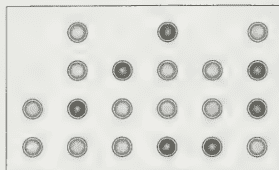

作者的办公室有一个“二进制钟”，其显示器是一个如上所示的 LED 阵列。前两列显示小时的十位和个位，接两列显示分钟，最后两列显示秒，每部分都以二进制形式表示，点亮的 LED 表示 1，未点亮的 LED 表示 0。插图显示的是 02:49:16。请识别每个时钟显示上显示的时间。

16.


17.

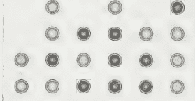

*18.

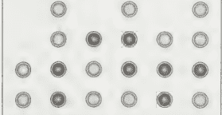

## 1.2 字符编码

字母、数字、标点符号和其他字符通过为每个字符分配一个数值在计算机中表示。目前已使用了多种分配这些数值的方案。微型计算机常用的系统是美国信息交换标准代码（缩写为 ASCII，读作 ASCII-ee）。

ASCII 系统使用 7 位来表示字符，因此将从 `000 0000` 到 `11 1111` 的值分配给字符。这意味着可以使用 ASCII 码表示 128 个不同的字符。ASCII 码通常以从 `00` 到 `7F` 的十六进制数或从 0 到 127 的十进制数的形式给出。ASCII 有若干种扩展版本。一个常见的版本分配了从 `80` 到 `FF` 的字符，如果你尝试在屏幕上显示不存在的字体，你可能见过过它们的一些图形化表示。Unicode 系统使用 16 位来表示一个字符，拥有 65,536 个组合，使其能够表示世界上大多数语言的字符。ASCII 字符是前 128 个 Unicode 字符（`0000` 到 `007F`），通过简单地在 ASCII 码前加上九个前 0 位形成。

附录 A 有 ASCII 码的完整列表。使用此表，你可以检查消息 `Computers are fun.` 可以使用十六进制数用 ASCII 编码为：

| 43 6F 6D 70 75 74 65 72 73 20 61 72 65 20 66 75 6E 20 2E |
| C o m p u t e r s a r e f u n |

注意，空格即使是不可见的，也有一个字符编码（十六进制 `20`）。

数字可以使用字符编码表示。例如，1976 年 10 月 21 日的日期 ASCII 码为：

| 4F 63 74 6F 62 65 72 20 32 31 2C 20 39 37 36 36 |
| O c t o b e r 21, 1976 |

其中数字 21 用 ASCII 码 `32 31` 表示，数字 1976 用 `39 37` 表示。这与上一节中的二进制表示非常不同，在上一节中 `21₁₀=10101₂`，且 `1976₁₀=11110111000₂`。计算机数字使用这两种表示方法：ASCII 码分配似乎是任意的，但存在某些模式。大写字母的编码是连续的，小写字母的编码也是如此。大写字母与其对应的小写字母的编码相差恰 1 位。第 5 位大写字母为 0，小写字母为 1，而其他位相同（在大多数计算机架构中，这些位从右到左编号，最右侧位从 0 开始）。例如，

- M 为 `4D₁₆=1001101₂`
- m 编码为 `6D₁₆=0110101₂`


可打印字符从 `20₁₆` 到 `7E₁₆` 分组（空格被视为可打印字符）。数字 `0, 1, ..., 9` 分别具有 ASCII 码 `30₁₆, 31₁₆, ...`。从 `00₁₆` 到 `1F₁₆` 的字符以及 `7F₁₆` 被称为控制字符。例如，`ESC` 代表“转义”，但大多数人将其与其他字符结合使用，发送打印机等外设备以开启特殊功能。由于此类字符没有标准，因此本书未涵盖它们。回车（`CR`）和换行（`LF`）是常用的 ASCII 字符。`CR` 的 `0D₁₆` 是按下 `Enter` 键时生成的。当 `CR` 发到显示器时，它导致光标移动到当前行的开头，而不会移动到新行。当 `CR` 发到行首（至少一种设计如此）时，它会导致光标直接向下移动。`LF` 的 `0A₁₆` 都是打印机引起的。要显示消息并移动到新行的开头，需要向屏幕发送消息字符加上 `CR` 和 `LF`。较少的控制字符包括换页（`0C₁₆`，它会导致许多打印机跳页）、水平制符（`09₁₆`，由键盘 `Tab` 键生成）、退格（`08₁₆`，由 `Backspace` 键生成）和删除（`7F₁₆`）。注意 `Backspace` 和 `Delete` 键生成的代码并不相同。铃字符（`07₁₆`）在输出到显示器时会产生听觉信号。

许多大型计算机使用扩展编码十进制信息（缩写为 `EBCDIC`，读作 "ib-SEE-dick" 或 "eb-SEE-dick"）表示字符。`EBCDIC` 系统在书中仅作为另一种编码方案的示例，用于讨论从一个系统到另一个系统的转换。

### 练习题 1.2

1. 每个十六进制都可以解释为表示十进制数或一对 ASCII 码。给出这两种解释。
   (a) `2A45` (b) `7352` (c) `2036` (d) `106E`

2. 找到以下字符串中字符的 ASCII 码。不要忘记空格和标点。回车和换行分别由 `CR` 和 `LF` 表示，写在一起 `CRLF` 以明确之间没有空格。
   (a) `January 1 is New Year's Day.CRLF`
   *(b) `George said, "Ouch!"`
   (c) `R2D2's friend.CRLF [0] is the numeral`
   (d) `Your name?`
   (e) `Enter value:`

3. 如果将以下 ASCII 码序列输出到屏幕会显示什么？
   (a) `62 6C 6F 6F 64 20 73 77 65 61 74 20 61 64 20 74 65 72 73`
   (b) `61 6D 65 25 0D 0A 61 64 64 72 65 73 0D 0A 63 69 74 79 0D 0A`
   *(c) `4A 75 6E 25 20 31 23 2C 20 31 39 37 37 30 0D 0A`
   (d) `24 33 38 39 22 02 34 35`
   (e) `49 44 23 30 20 20 31 32 33 2D 34 35 2D 36 37 38 39`

## 1.3 无符号与带符号整数

现在更仔细地观察数字在计算机中实际是如何表示的。我们查看了两种表示数字的方案——使用 ASCII 码或使用二进制整数（通常用十六进制表示）。然而，这些方法存在两个问题：(1) 用于表示数字的位数有限；(2) 不清楚如何表示负数。

第 2 章讨论了计算机硬件，但现在你只需要知道，内存被划分为字节（`bytes`），每个字节包含 8 位（`bits`）¹。假设你想使用 ASCII 码来表示内存中的一个数字。单个 ASCII 码通常存储在一个字节中。回想一下 ASCII 码长度为 7 位；额外的（左侧，或高位）位被设置为 0。为了解决前面提到的第二种表示方法，你只需包含负号的编码。例如，字符 `-17` 的四个字符的 ASCII 码分别为 `2D`、`38`、`31` 和 `37`。为了解决第一个问题，你始终可以约定使用固定数量的字节，可能在左侧用零或空格的 ASCII 码进行填充。或者，你也可以使用变长度的字节，但约定该数字以最后一个数字字符的 ASCII 码结束；即以非数字字符终止。（通常用空字节 `0` 达到此目的。）

假设你想使用内部的内部表示来表示与其二进制值相对应的数字。那么，你必须为该表示选择一个固定数量的字节。大多数中央处理器都可以对具有特定长度的二进制数进行算术运算。对于 Intel 86 家族，这些长度是 8 位（一个字节 `byte`）、16 位（一个字 `word`²）、32 位（一个双字 `double`）、64 位（一个四字 `quadword`）。

例如，看 `697` 的字的二进制表示。

```
697₁₀ = 1010111001₂ = 0000010101011001₂
```

为了凑成 16 位，添加了前导零。用十六进制写为一个字，得到：

| 02 | B9 |
| :--- | :--- |

这说明了书中许多地方遵循的一种约定。方框的序列将表示字节序列。单个字节的内容将用十六进制表示，每个字节有两个十六进制数字，因为一个十六进制数字对应 4 位。`697` 的双字表示仅仅是有了更多的前导零。

| 00 | 00 | 02 | B9 |
| :--- | :--- | :--- | :--- |

- 一些早期的计算机系统使用的字节大小不同于 8 位。
- 其他一些计算机架构使用的字大小不同于 16 位。

我们现在拥有一套良好的表示负数或无符号数的系统——一个预定义的长度，在需要时包含用前导 0 位填充的二进制表示。该系统无法表示负数。此外，对于任何长度，都有一个可以表示的最大无符号数，例如对于字节长度是 `FF₁₆` 或 `255₁₀`。

补码系统与上述无符号数的方案类似，但它允许表示负数。数字将是固定长度，因此你可以提到一个数字的“双字长度补码表示”。负数的补码表示与无符号表示几乎完全相同，即你用二进制表示该数字，并带有足够的前导零以填充所需的长度。这里还有一个额外的限制——对于正数，最左边的位必须为 0。这意味着，例如，字补码形式表示的正数可以是 `0111111111111111₂`、`7FFF₁₆` 或 `32,767₁₀`。

正如你可能已经猜到的那样，在负数的补码表示中，最左位总是 1。你可能也猜剩下的部分与对应的正数相同，但遗憾的是情况要复杂得多，你不能简单地将前导位从 0 改为 1 来得到数的负值。

十六进制计算器可以轻松地将负数转换为补码。例如，使用 Windows 计算器，如果十进制显示为 `-200` 并在选择 `Qword` 长度时点击 `Hex` 单选按钮，显示将为 `FFFFFFFFFF38`。注意这个数字有一个前导 1 位，因为前导十六进制数字是 `F` (`1111`)。如果选择 `Double` 或 `Byte` 长度，结果将分别为 `FFFF38`、`38`。注意，这些除了前导 1 位（十六进制数字）的数量不同外，它们是相同的。遗憾的是，`38` 不是一个正确答案，因为 `-200` 的绝对值太大，无法表示为字节大小的补码数。你可以看出答案是错误的数字是 `38₁₆`=`00111000₂`，这是一个正数。在本节的稍后部分，我们将仔细查看字表示的数字可以有多大，以及关于其他尺寸的练习。

让我们暂时关注字表示。我们刚刚查看了如何将 `-200` 转换为补码。如果你使用 Windows 计算器，`Hex` 显示为 `FF38`。现在点击 `Dec` 单选按钮。显示并没有回到 `-200`，而是显示为 `65336`！原因很简单——字 `FF38` 有两种解释：等于 `65336₁₀` 的无符号数和等于 `–200₁₀` 的有符号（补码）数。Windows 计算器或 `80x86 CPU` 都不决定哪一个是意图所在；这取决于用户。

由于给定的补码表示是固定长度，显然其中可以存储一个最大尺寸的。对于一个字（`word`）来说，存储的最大正数是 `7FFF`，因为在用二进制表示时，这是一个高位为 0 的 16 位数。十六进制数 `7FFF` 转换为十进制为 `32767`。用十六进制表示的正数可以通过开头的 `0` 到 `7` 的十六进制位来识别。

负数通过最高位为 1 来区分，对应于十六进制位 `8` 到 `F`。字长补码表示的范围从 `8000` 到 `FFFF`。这两个极值转换为十进制的结果如下：

```
10000 - 8000 = 8000 = 32768₁₀
```

所以 `8000` 是 `-32768` 的表示。同样，

```
10000 - FFFF = 1,
```

所以 `FFFF` 是 `-1` 的字长补码表示。回想，可以表示为字长补码的最大正十进制整数是 `32767`；字长补码形式可以表示的十进制数范围是 `-32768` 到 `32767`。

### 练习题 1.3

1. 将以下十进制数转换为字长补码表示（十六进制）。
   * (a) `3874`
   * (b) `100000`
   * (c) `-100`
   * (d) `-55555`

2. 将以下十进制数转换为双字长补码表示（十六进制）。
   * (a) `845`
   * (b) `15000`
   * (c) `100`
   * (d) `-10`
   * (e) `-923`

3. 将以下十进制数转换为字节长补码表示（十六进制）。
   * (a) `23`
   * (b) `111`
   * (c) `-100`
   * (d) `-55`

4. 解释以下双字十六进制数作为有符号十进制数。
   * (a) `00 00 F3 E1`
   * (b) `FF FF FE 03`
   * (c) `98 C2 41 7D`
   * (d) `FF FF FF 78`

5. 解释以下字十六进制数作为有符号十进制数。
   * (a) `00 A3`
   * (b) `FF FE`
   * (c) `6F 20`
   * (d) `B6 4A`

6. 解释以下字节十六进制数作为有符号十进制数。
   * (a) `E1`
   * (b) `7C`
   * (c) `FF`
   * (d) `3E`

7. (a) 求在字节中可以存储的无符号十进制整数的范围。
   * (b) 求在字节中以补码形式可以存储的有符号十进制整数的范围（从最小到最大）。

8. (a) 求在字中以补码形式可以存储的有符号十进制整数的范围（从最小到最大）。
   * (b) 求在字中可以存储的无符号十进制整数的范围。

9. (a) 求在双字中以补码形式可以存储的有符号十进制整数的范围（从最小到最大）。
   * (b) 求在双字中可以存储的无符号十进制整数的范围。

10. 本节展示了如何通过从一个适当的 2 的幂减去一个数来求补。另一种方法是将数写成二进制（使用对应表示长度的位数），将每个 0 位变为 1，将每个 1 位变为 0（这被称为“取反码”），然后在结果上加 1（丢弃任何进入额外位的位）。证明这两种方法是等价的。

## 1.4 整数加法和减法

补码表示方案通常被用于计算机存储整数的原因之一，是因为有符号整数的加法和减法操作与无符号整数的相应操作是相同的。这意味着 CPU 不需要为有符号和无符号的加减操作准备单独的电路。本节讨论整数的加减法，并引入了进位（`carry`）和溢出（`overflow`）的概念，这些概念可以用于判断操作结果是否“正确”。

我们首先给出几个加法示例。`80x86` 架构对无符号和有符号数使用相同的加法指令。尽管 32 位（双字）是 `80x86` 架构中首选的整数尺寸，但为了简洁，这些示例使用了字大小的数字。所说明的概念对于字节级、字级、双字级或四字级（`quadword`）操作数来说完全相同的。

首先，相加 `0A07` 和 `01D3`。无论解释为无符号数还是补码数，这些都是正数。右侧给出加法的十进制版本：

```
0A07      2567
+01D3    +467
0BDA     3034
```

答案是正确的，因为 `BDA₁₆ = 3034₁₀`。接下来，相加 `0206` 和 `FFB0`。无论解释为无符号数还是补码数，这些都是正数，`0206` 是正数而 `FFB0` 是负数。加法问题首先给出有符号的版本，然后是无符号的：

```
0206      518
+FFB0    +(-80)
01B6      438
```

似乎是一个问题，因为结果在字中无法容纳。事实上，由于 `101B6` 是 `123` 的十六进制版本，字无法表示无符号的和。但是，如果作为符号解释并忽略左侧的 `1`，`01B6` 就是十进制数 `438` 的补码。现在相加 `FFE7` 和 `FFF6`，有符号解释下都是负数。同样显示有符号和无符号的十进制解释：

```
FFE7 (-25)
+FFF6 (-10)
FFDD (-35)
```

再次，十六进制和太大无法放入两个字节，但如果你丢弃那个额外的 `1`，那么 `FFDD` 就是 `-35` 的补码表示。每次加法都有一个从高位到额外位的进位（`carry`）。剩余位给出正确的无符号结果。如果操作数解释为无符号，事实上进位总是指示答案是错误的。尽管在这些情况下剩余位给了正确的补码表示，但对于有符号数并不总是如此。考虑以下两个数的加法：

```
483F  18495
+645A +25690
AC99  44185
```

高位没有进位，但有符号解释显然错误的，因为 `AC99` 代表负数 `-2351`。直觉上它错了，因为十进制和 `44185` 大于两个字节可以存储的最大值 `32767`。然而，当这些数解释为无符号时，和是正确的。这里是另一个“错误”答案的示例，这次是由两个在有符号解释下为负数的得到的：

```
E9FF  (-5633) | 59903
+8CF0 (-29456) | 36080
176EF (-35089) | 95983
```

这次有进位，剩余的四个十六进制数字 `76EF` 不能正确的有符号答案，因为它们代表正数 `2047`。再次，直觉告诉你出了问题——`-32768` 是字中可以存储的最小负数。

在之前的“错误”有符号解释示例中，发生了溢出。计算机在执行加法时可以检测溢出，如果没有溢出，符号和将是正确的。计算机实际上执行的是二进制加法，逻辑上是从右到左逐位相加，与人类用于十进制加法的方法非常相似。当计算机加上一对位时，有时会向左侧产生进位 (`1`)。这个进位加到这些位的和上，此类推。特别感兴趣的列是最左边的一列；符号位。该位置可能有进位，或者从该位置到额外位的出位（之前被称为“进位”，可见十六进制的 `1`）。图 1.4 识别了溢出何时发生。表格可以总结为：当符号位的进位数与符号位的出位数不同时，就会溢出。

| 符号位的进位？ | 符号位的出位？ | 溢出 |
|---|---|---|
| 否 | 否 | 否 |
| 否 | 是 | 是 |
| 是 | 否 | 是 |
| 是 | 是 | 否 |

图 1.4 加法中的溢出

之前的每个加法示例现在再次显示，这次是二进制形式。进位写在两个数字上方。

```
      111
0000 0110 0000 0111      0A07
+0000 0001 1101 0011      + 01D3
0000 1011 1101 1010      0BDA
```

这个示例符号位（第 15 位）没有进位也没有出位，所以没有溢出。进入位 1、2 和 3 的进位对于溢出没有意义。

```
      1111 11
0000 0010 0000 0110      0206
+1111 1111 1011 0000      + FFB0
1 0000 0001 0111 0110      101B6
```

此示例存在向符号位的进位和向出的位，因此没有溢出。

```
1 1111 1111 11 11
  1111 1111 1110 0111      FFE7
+ 1111 1111 1111 0110      + FFF6
  1 1111 1111 1111 1101      1FFDD
```

同样，同时存在向符号位的进位和向出的位，因此没有溢出。

```
1 1111 11
  0100 1000 0011 1111      483F
+ 0110 0100 0101 1010      + 645A
  1010 1111 1001 1001      AC99
```

此加法中确实发生了溢出，因为存在向符号位的进位，但没有向出的位。

```
1 1 11 111
  1110 1001 1111 1111      E9FF
+ 1000 1100 1111 0000      + 8CF0
  1 0111 0110 1110 1111      176EF
```

此加法中也存在溢出，因为存在符号位的向出位，但没有向进位。

在计算机中，数字 `a` 和 `b` 的减法 `a - b` 通常通过取 `b` 的补码并将结果加到 `a` 上来实现。这相当于加上 `b` 的负数。例如，对于十进制减法 `195-618 = -423`，

```
00C3
- 026A
```

变为对 `FD96` 的加法，即 `026A` 的补码。

```
00C3
+ FD96
FE59
```

十六进制数 `FE59` 代表 `-423`。查看之前的二进制加法，你得到：

```
11 11
0000 0000 1100 0011
+ 1111 1101 1001 0110
  1111 1110 0101 1001
```

注意，加法过程中没有进位。然而，这次减法确实涉及了借位。当 `b` 作为无符号数时大于 `a` 时，减法 `a - b` 就会发生借位。计算机硬件可以通过观察相应的加法中是否发生了进位来检测减法中的借位。如果加法中没有进位，则减法中存在借位。如果加法中有进位，则减法中没有借位。（记住，“进位”本身指的是“向出的位”）

这里是另一个例子。使用字长进行十进制减法 `985 - 411 = 574`：

```
03D9
- 019B
```

变为对 `FE65` 的加法，即 `019B` 的补码。

```
1 1111 1111 1
03D9 0000 0011 1101 0011
+ FE65 1111 1110 0110 0101
1023E 1 0000 0010 0011 0110
```

丢弃多余的 `1`，十六进制数 `023E` 代表 `574`。这次加法有进位，相应的减法中没有借位。

减法也定义了溢出。当你像人一样思考时，当你知道差将超出所选表示长度能表示的范围时，你可以通过预期的错误答案来检测溢出。计算机通过确定相应的加法问题是否发生溢出来检测减法中的溢出。如果加法问题中发生了溢出，那么它在原始减法问题中也会发生；如果加法中没有发生溢出，那么它在原始减法问题中也不会发生。在之前的两个减法示例中都没有发生溢出。如果你使用字长补码表示来尝试减法 `-29123 - 15447`，就会发生溢出。作为人类，你知道正确答案 `-44570` 超出了 `-32,768` 到 `+32,767` 的范围。在计算机硬件中：

```
8E3D
- 3C57
```

变为对 `C3A9` 的加法，即 `3C57` 的补码。

```
1 11 111 11
8E3D 1000 1110 0011 1101
+ C3A9 + 1100 0111 1010 1001
151E6 1 0101 0001 1110 0110
```

存在符号位的向出位，但没有向进位，因此发生溢出。尽管本节的示例使用了字大小补码表示，但在按字节、字或双字进行操作时，方法同样适用。


### 练习 1.4

对十六进制数字执行以下每个操作。对于每个操作，找出溢出是否发生。对于加法，确定是否存在进位；对于减法，确定是否存在借位。通过将问题转换为十进制来检查你的答案，在没有进位的情况下无符号解释是正确的；在没有溢出的情况下符号解释是正确的。

1. `003P + 02A4`
2. `1B48 + 39E1`
3. `6C34 + 5028`
4. `FFFE + 0002`
5. `FF07 + 06BD`
6. `2A44 + D9`
7. `FF23 + FC70`
8. `FE00 - FD2D`
9. `FFF1 + 8005`
10. `AD - EC78`
11. `805 - 958`
12. `EC78 - 8B`
13. `958 - 7C`

# 1.5 数字的数字表示法

在二进制编码十进制（BCD）方案中，每个数字用一个位串进行编码，并将这些字符串连接起来形成表示。通常使用 4 位表示每个十进制数字，如表 1.5 所示。仅使用这些 4 位模式。

| 十进制 | BCD 位模式 |
| :--- | :--- |
| 0 | 0000 |
| 1 | 0001 |
| 2 | 0010 |
| 3 | 0011 |
| 4 | 0100 |
| 5 | 0101 |
| 6 | 0110 |
| 7 | 0111 |
| 8 | 1000 |
| 9 | 1001 |

表 1.5 二进制编码十进制表示

十进制数字 926708 的 BCD 表示为 `1001 0010 0110 0111 0000 1000`。使用一个十六进制位作为 4 位的简写，并每字节分组两个十六进制位，该 BCD 表示可以用三个字节表示：

`92 | 67 | 08`

BCD 数字通常使用固定数量的字节进行编码。为了说明目的，假设使用 4 字节表示。现在，忽略如何表示符号的问题；在不留符号位的情况下，可以在四个字节中存储八个二进制编码十进制数字。给定选择，十进制数字 3691 的 BCD 表示为 `00 00 36 91`，该数字的双字补码表示为 `00 00 0E 6B`，以及四个数字 33 36 39 31 的 ASCII 码。

# 计算机中的数据表示

计算机使用 BCD 格式和补码形式数字进行算术运算的效率并不高。使用 ASCII 码表示的数字进行算术运算通常非常低效。然而，ASCII 码是目前表示非整数数字的唯一方法。例如，78.375 可以存储为 `38 2E 33 37 35`。浮点表示系统允许对非整数进行表示，或者至少进行近似表示。

浮点数方案以与科学计数法相对应的形式存储数字。下面的示例展示了如何将小数 78.375 转换为 32 位的 IEEE 精度格式（IEEE 是电气与电子工程师学会的缩写）。该格式是 IEEE 计算机学会标准委员会赞助的几种格式之一，并获得了 IEEE 标准委员会和美国标准协会（ANSI）的批准。它是 8086 处理器使用的浮点格式之一。

首先，可以将 78.375 转换为二进制。在二进制中，二进制点右侧的位置（对于二进制数中的 "." 称为小数点是不恰当的）对应于 2 的负幂（1/2、1/4、1/8 等），就像它们在小数中对应于 10 的负幂（1/10、1/100 等）一样。由于 0.375 = 3/8 = 1/4 + 1/8 = .01 + .001，因此 $0.375_{10} = .011_2$。整数部分 78 在二进制中是 `10011110`。

```
$78.375_{10} = 10011110.011_2$
```

接下来，将其用二进制科学计数法表示，其中尾数在二进制点前写一个 1。

```
$10011110.011_2 = 1.0011110011 \times 2^6$
```

指数通过计数为了产生尾数而点向右或向左移动的位数来得到的，这与十进制科学计数法完全相同。这里的表示法实际上是混合的；将 $2^6$ 写为 $10^{10}$ 会更合适，但使用十进制形式更方便。现在可以将这些浮点数组合在一起：

- 符号位 0 表示正数（1 表示负数）
- `0000 1001` 表示指数。这是实际指数 6 加上 127 的偏移量，总和为 133，用 8 位表示。
- `100111000000000000000`，是去掉领先的 1 并在右侧补零以形成 23 位的分数。

整个数字然后是 `0 10000101 00111001100000000000`。重新分组得到 `0100 0010 1001 1100 0000 0000 0000`，或者用十六进制表示：

| 42 | 9C | C0 | 00 |
| :--- | :--- | :--- | :--- |

这个例子之所以很容易处理，是因为 0.375（小数 78.375 的非整数部分）是 2 的负幂之和。大多数数字并不理想，通常会选择一个二进制分数来密切近似小数。书中没有涵盖选择近似值的技术。

总结将小数转换为 IEEE 浮点格式的步骤如下：

- 符号位 0 表示正数（1 表示负数）
- `0000 1001` 表示指数。这是实际指数 6 加上 127 的偏移量，总和为 133，用 8 位表示。
- `100111000000000000000`，是去掉领先的 1 并在右侧补零以形成 23 位的分数。

# 1.5 表示数字的其他系统

物理内存的字节（256 TB），是 32 位系统最大容量的 65,536 倍。目前的 PC 系统设计无法容纳这么多内存。

从物理角度上看，PC 的内存由集成电路（IC）组成。这些芯片中的许多提供随机存取存储器（RAM），程序指令可以对其进行写入或读取。当计算机断电时，RAM 芯片中的内容将会丢失。其他集成电路是只读存储器（ROM）芯片，它们会永久地保留内容，并且可以读取但不能写入。

书中的汇编语言程序使用平坦内存模型。这意味着程序实际上编码 32 位地址，用以引用单个内存空间中的位置，该空间中存储了数据和指令。

英特尔 8086 架构还提供了分段内存模型。在 8086/8088 CPU 中，PC 的内存被视为段的集合，每个段长 64-KB，从 16 的倍数地址开始。这意味着一个段从地址 `00000` 开始（与第一个重叠），另一个从地址 16 (`00010`₁₆) 开始，另一个从地址 32 (`00020`₁₆) 开始，依此类推。注意，段的起始地址在写成十六进制时末位值为 0。一个段的段号由其物理地址的前四位组成。

为 8086/8088 编写的程序并不编码五位地址。相反，每个内存引用都取决于其段号和相对于段起始的 16 位偏移量。通常偏移量是经过编码的，而段号根据上下文推断。偏移量是距离所寻址段第一个字节的距离。偏移量位于 `0000` 到 `FFFF`₁₆ 之间。段-偏移地址的表示法是四位十六进制段号后跟一个冒号（:），然后是四位十六进制偏移量。

例如，`18A3:5B27` 指向从地址 `18A30` 开始的段起始 `5B27` 处的字节。将起始地址和偏移量相加即可得到五位地址。

```
18A3          段 18A3 的起始地址
+ 5B27        偏移量
1E557         五位十六进制地址
```

从 80386 开始，8086 处理器同时提供了 16 位和 32 位分段内存模型。段号仍然是 16 位长的，但它们不再直接引用内存中的段。相反，段号被用作一个表格的索引，该表包含段的实际 32 位起始地址。在 32 位分段模型中，在该起始地址上加上一个 32 位偏移量，以计算内存操作数的实际地址。段对程序在逻辑上是有用的——程序员通常将不同的段分配给代码、数据和堆栈。英特尔 8086 平坦内存模型实际上是一个 32 位分段模型，所有段都包含相同的值。在 32 位模式下，它的工作方式如上一段所述。然而，程序生成的地址并不一定是操作数所处的物理地址。操作系统还执行了额外的内存管理层。当程序大到无法放入物理内存时，将使用分页将程序的地址映射到物理地址。分页机制在汇编语言中对我们来说是透明的。

- 假设你买了一台带有 512 MB RAM 的 32 位 PC。已安装内存“最后一个”字节的十六进制地址是多少？
- 假设你买了一台带有 2 GB RAM 的 64 位 PC。已安装内存“最后一个”字节的十六进制地址是多少？
- 假设你发现内存从 `0000` 到 `FFFF` 是预留给 PC 的，8086 寄存器有多少个字节？
- 假设 8086 的段-偏移地址如下：
  - (a) `2B9C:21`
  - (b) `05A:4`
  - (c) `1234:5678`


8086/8088 处理器拥有 16 位通用寄存器，AX、BX、CX、DX、SI、DI、BP、SP。32 位处理器将这些寄存器扩展为 32 位通用寄存器（extended），即 EAX、EBX、ECX、EDX、ESI、EDI、EBP、ESP。


## 以下是需要翻译的文本


# PC 硬件：内存与 CPU

## 物理内存

64 位系统的物理内存寻址空间为 256 TB（即 2^48 字节），是 32 位系统最大寻址空间的 65,536 倍。当前 PC 系统的设计尚不支持安装如此大容量的内存。

从物理层面看，PC 内存由集成电路（IC）组成。其中许多芯片提供随机存取存储器（RAM），可被程序指令读写；RAM 内容在断电后丢失。其他 IC 为只读存储器（ROM）芯片，永久保存内容，只读不可写。

## 内存模型

### 平坦内存模型

本书汇编程序采用平坦内存模型。程序实际编码 32 位地址，在单一内存空间中本地引用数据和指令存储位置。

### 段式内存模型

Intel 8086 架构提供段式内存模型。在 8086/8088 CPU 中，内存被视为段的集合，每段长 64 KB，起始地址为 16 的倍数。即段起始地址为 00000、00010₁₆ (16)、00020₁₆ (32) 等。段起始地址的十六进制表示以 0 结尾。段号由其物理地址的前四位十六进制数字组成。

8086/8088 程序不直接编码五位地址，而是通过段号和段内 16 位偏移量引用内存。通常编码偏移量，段号由上下文推断。偏移量范围 0000 至 FFFF₁₆。段-偏移地址表示法为：四位十六进制段号 + 冒号（:） + 四位十六进制偏移量。

**示例**：`18A3:5B27` 表示段 `18A3` 起始地址 `18A30` 偏移 `5B27` 处的字节。起始地址与偏移量相加得五位地址：

```
18A3          段 18A3 起始地址
+ 5B27        偏移量
1E557         五位十六进制地址
```

自 80386 起，处理器同时支持 16 位和 32 位段式模型。段号仍为 16 位，但不直接指向内存段，而是作为索引查表获取段的实际 32 位起始地址。32 位模型中，32 位偏移量加到起始地址上计算操作数实际地址。段对程序逻辑有用：程序员通常将代码、数据、栈分配到不同段。Intel 8086 平坦模型实质是所有段基址相同的 32 位段式模型。

32 位模式下，程序生成的地址不一定是物理地址。操作系统通过分页机制将程序地址映射为物理地址（当程序过大无法完全装入物理内存时）。该分页机制对汇编语言程序员透明。

### 练习题

- 假设购买一台装有 512 MB 内存的 32 位 PC，已安装内存的“最后一个”字节的十六进制地址是什么？
- 假设购买一台装有 2 GB 内存的 64 位 PC，已安装内存的“最后一个”字节的十六进制地址是什么？
- 假设地址 `0000` 至 `FFFF` 为 PC 保留，8086 有多少字节？
- 假设 8086 段-偏移地址如下：
  - (a) `2B9C:21`
  - (b) `05A:4`
  - (c) `1234:5678`

## 2.2 PC 硬件：CPU

### 8086/8088 通用寄存器

8086/8088 处理器拥有一组 16 位通用寄存器：`AX`、`BX`、`CX`、`DX`。每个寄存器可分为两个 8 位寄存器：高字节和低字节。例如 `AX` 分为 `AH`（高字节）和 `AL`（低字节）；同理 `BX` 分 `BH`/`BL`，`CX` 分 `CH`/`CL`，`DX` 分 `DH`/`DL`。

- `AX`（累加器）：用于算术和 I/O 操作。
- `BX`（基址寄存器）：常用于存放内存数据指针。
- `CX`（计数寄存器）：主要用于循环。
- `DX`（数据寄存器）：用于 I/O 操作和大数乘法。

### 索引寄存器与指针寄存器

除通用寄存器外，8086 还有四个索引寄存器和两个指针寄存器：

- `SI`（源索引）：用于字符串操作源端。
- `DI`（目的索引）：用于字符串操作目的端。
- `SP`（栈指针）：指向栈顶。
- `BP`（基指针）：指向栈帧基址。

### 标志寄存器

标志寄存器包含指示近期操作结果及控制处理器行为的状态位。包括代码标志（反映 ALU 状态）和控制标志（控制处理器操作）。

### 32 位 80x86 寄存器组

除了八个 32 位通用寄存器外，32 位 80x86 CPU 还有 6 个 16 位段寄存器：`CS`、`DS`、`ES`、`FS`、`GS`、`SS`。

| 名称 | 长度（位） | 用途 |
|---|---|---|
| `EAX` | 32 | 累加器 |
| `EBX` | 32 | 通用 |
| `ECX` | 32 | 通用 |
| `EDX` | 32 | 通用 |
| `ESI` | 32 | 源索引 |
| `EDI` | 32 | 目的索引 |
| `ESP` | 32 | 栈指针 |
| `EBP` | 32 | 基指针 |
| `CS` | 16 | 代码段 |
| `DS` | 16 | 数据段 |
| `ES` | 16 | 额外数据段 |
| `SS` | 16 | 栈段 |
| `FS` | 16 | 额外段 |
| `GS` | 16 | 额外段 |
| `EIP` | 32 | 指令指针 |
| `EFLAGS` | 32 | 标志寄存器 |

#### 段寄存器

在旧 16 位段模型中：
- `CS` 存代码段段号（存放当前执行指令的内存区域），限制程序长度 64 KB。
- `DS` 存数据段段号。
- `SS` 存栈段段号。
- `ES` 存额外数据段段号。
- `FS`、`GS` 随 80386 新增，提供两个额外数据段访问。

在平坦 32 位模型中，段寄存器对程序员基本不可见。操作系统为 `CS`、`DS`、`ES`、`SS` 赋值，每个值为指向描述符表项的指针，表项含段实际起始地址及程序大小（用于越界保护）。程序员仅需使用 32 位地址编程。

#### 指令指针 (EIP)

32 位指令指针 `EIP` 不可被汇编程序员直接访问。CPU 从内存取指，`EIP` 跟踪下一条取指地址。80x86 采用预取和流水线技术：在执行当前指令时预取后续指令，假设顺序执行；遇转移指令则丢弃预取指令，更新 `EIP` 为目标地址重新取指。流水线执行提高了处理器有效速度。


### EFLAGS 寄存器详解

`EFLAGS` 指标志寄存器，指令中不直接使用该助记符。其 32 位中部分用于设置处理器特性，部分为状态标志。常用标志位如下表（图 2.2）：

| 位 | 助记符 | 用途 |
|---|---|---|
| 0 | `CF` | 进位标志 |
| 2 | `PF` | 奇偶标志 |
| 6 | `ZF` | 零标志 |
| 7 | `SF` | 符号标志 |
| 10 | `DF` | 方向标志 |
| 11 | `OF` | 溢出标志 |

- **OF (第 11 位)**：加法无溢出置 0，溢出置 1。
- **CF (第 0 位)**：加法最高位有进位置 1。
- **SF (第 7 位)**：结果最高位（补码符号位），0 为非负，1 为负。
- **ZF (第 6 位)**：结果为 0 置 1，非 0 置 0。
- **PF (第 2 位)**：仅基于结果低 8 位；1 的个数为偶数置 1，奇数置 0。

#### 标志设置示例

指令 `add eax, 158` 影响 `CF`、`OF`、`PF`、`SF`、`ZF`。

执行前 `EAX = 0xFFFFF3`。`158₁₀ = 0x9E`。相加得 `0x00000091` 存入 `EAX`。

- 存在进位 → `CF = 1`
- 无溢出 → `OF = 0`
- 结果最高位 0 → `SF = 0`
- 结果非 0 → `ZF = 0`
- 结果低 8 位 `0x91` (二进制 `10010001`) 含三个 1（奇数） → `PF = 0`

## 3 计算机系统的组成部分


图 2.4 总结了 64 位架构中的基本程序执行寄存器。它没有列出浮点、MMX 和 XMM 寄存器等应用。

64 位模式下，有十六 64 位通用寄存器：`RAX`、`RBX`、`RCX`、`RDX`、`RSI`、`RDI`、`RSP`、`RBP`、`R8`、`R9`、`R10`、`R11`、`R12`、`R13`、`R14` 和 `R15`。与 32 位架构一样，你也可以使用 `AH`、`BH`、`CH` 和 `DH` 分别访问 `EAX`、`EBX`、`ECX` 和 `EDX` 的低 8 位。这些字节不能用 64 位指令通过名称访问。

对于新寄存器 `R8`-`R15`，你在低双字后附加 `D`。例如，`R9D` 指的是低 32 位。同样，`R11W` 指的是低字（16 位），`R15B` 指的是低字节。

索引寄存器 `ESI` 和 `EDI` 分扩展到 64 位寄存器 `RSI` 和 `RDI`。低位双字可以引用为 `RSI` 和 `EDI`，低位字为 `SI` 和 `DI`，低位字节为 `SIL` 和 `DIL`。`ESP` 和 `EBP` 扩展到 64 位寄存器 `RSP` 和 `RBP`。

段寄存器在 64 位架构中没有变化。请记住，当处理器在 64 位模式下运行时，它们基本上是未使用的。

在 64 位环境中，指令指针是 64 位寄存器 `RIP`。标志存储在 64 位寄存器 `RFLAGS` 中。低 32 位完全对应于 `EFLAGS`。Intel 文档说 `RFLAGS` 的高 32 位是“预留的”。

这是一个在 64 位程序中合法但在 32 位程序中不法的指令示例：

```
add rax, r12
```

这条指令将 `R12` 中的四字加到 `RAX` 中的四字，替换 `RAX` 中的值。

# 练习题 2.2

1. 画出一个显示 `ECX`、`CX`、`CH` 和 `CL` 寄存器之间关系的图。
2. 画出一个显示 `RBX`、`EBX`、`BX` 和 `BL` 寄存器之间关系的图。
3. 画出一个显示 `R12`、`R12D`、`R12W` 和 `R12B` 寄存器之间关系的图。

## 2.2 PC 硬件：CPU

| 名称 | 长度（位） | 用途/注释 |
| --- | --- | --- |
| `RAX` | 64 | 累加器，通用；低位双字 `EAX`；低位字 `AX`；低位字节 `AL` |
| `RBX`, `RCX`, `RDX`, `RSI`, `RDI` | 64 | 通用；低位双字 `EBX`, `ECX`, `EDX`, `EDI`；低位字 `BX`, `CX`, `DX`, `SI`, `DI`；低位字节 `BL`, `CL`, `DL`, `SIL`, `DIL` |
| `R8`–`R15` | 64 | 通用；低位双字 `R8D`–`R15D`；低位字 `R8W`–`R15W`；低位字节 `R8B`–`R15B` |
| `RSP` | 64 | 栈指针；栈顶地址；低位双字 `ESP`；字 `SP`，字节 `SPL` |
| `RBP` | 64 | 基址指针；栈中引用点地址；低位双字 `EBP`；字 `BP`，字节 `BPL` |
| `CS`, `DS`, `ES`, `SS`, `FS`, `GS` | | 16 位寄存器，在 64 位模式下未使用 |
| `RIP` | 64 | 指令指针；下一条待取指令地址 |
| `RFLAGS` | 64 | 标志位集合或状态位 |

Intel 文档使用了 `R8`–`R15`，但 8086 汇编器程序并不识别这些寄存器。

4. 对于问题中的每条指令，假设每条指令包含执行前的内容，并给出执行后 `EAX` 的内容以及 `CF`、`OF`、`SF` 和 `ZF` 标志位的值：

| `EAX` | 指令 |
| --- | --- |
| (a) 00 00 00 | `add eax, 45` |
| (b) FF FF | `add eax, 45` |
| (c) 00 00 00 | `add eax, 45` |
| (d) FF FF | `add eax, -45` |
| (e) FF FF FF | `add eax, 1` |
| (f) FF FF FF | `add eax, 100` |

## 2.3 PC 硬件：输入输出设备

CPU 和内存构成了计算机，但如果没有输入设备来获取或输出数据，计算机在许多用途下无法使用。典型的 I/O 设备包括用于输入的键盘和鼠标、用于输出的显示器以及用于数据存储的磁盘驱动器。

汇编语言程序员有多种方式来看 I/O 设备。在最底层，每个设备都使用 I/O 地址空间中的一组端口。在 8086 架构中，典型的 I/O 设备使用三个到八个与普通内存不同的地址。计算机系统可以设计成使用内存映射输入输出（`memory-mapped input/output`），而不是单独端口。虽然这种方法可行，但在大多数 PC 上并不使用。包括 Windows XP 和 Vista 在内的许多操作系统会将 CPU 置于保护模式，该模式不允许程序直接访问 I/O 端口。它们提供了各种输入和输出过程，这些过程比端口级 I/O 要易用得多。

### 练习 2.3

1. 这包含多少个地址（十进制）？
2. 假设第一个地址是 0，那么最后一个地址是什么？
3. 用十六进制表示地址范围。

## 2.4 PC 软件

没有软件，计算机硬件几乎毫无用处。软件指的是由硬件执行的程序或过程。本节将讨论不同类型的软件。

### PC 软件：操作系统

通用计算机系统需要操作系统使其能够运行其他程序。原始 IBM PC 运行名为 PC-DOS 的操作系统；兼容系统使用了非常相似的 MS-DOS 操作系统。DOS 代表**磁盘操作系统**（disk operating system）。所有这些操作系统由微软公司开发；PC-DOS 由 IBM 定制以在 PC 上运行，而在其他系统运行的 MS-DOS 版本由硬件制造商定制。

DOS 操作系统提供了命令行界面。DOS 显示提示符（如 `C>`）并等待用户输入命令。当用户按下回车键时，DOS 会执行该命令。命令可以是 DOS 可以执行的功能（例如显示磁盘目录），也可以是待加载执行的程序名称。

许多用户更喜欢**图形用户界面**（graphical user interface），它可以显示任务或文件，用户可以通过鼠标点击进行选择。Microsoft Windows 为 PC 提供了图形界面。Windows 3.1 等版本增强了操作系统环境，但仍然需要 DOS。Windows 95 包含了操作系统的重大修订，该系统已不再单独销售。在 Windows 95 中，图形界面成为了主要用户界面，尽管命令行界面仍然可用。Windows 操作系统持续演进，目前有多个版本。

### PC 软件：文本编辑器

**文本编辑器**（text editor）是一种允许用户创建或修改存储在硬盘等辅助存储器上的文本文件的程序。文本文件是 ASCII 代码的集合。本书中最感兴趣的文本文件是汇编语言源代码文件——包含汇编语言语句的文件。文本编辑器有时用于准备数据文件。

Microsoft Windows 包含一个名为记事本（Notepad）的文本编辑器。这个全屏编辑器使用显示器的全部或部分作为文件的窗口。用户可以向上或向下移动窗口（当窗口窄窄向左或右移动）。要对文件进行修改，可以使用光标键或鼠标将光标移动到修改处并输入更改。记事本可以用于编写或修改汇编语言源程序，但我们大多数编辑将在集成开发环境中进行。

文字处理器是提供文档格式化和打印额外服务的文本编辑器。例如，使用文本编辑器时，通常必须每行末尾按回车键；然而，文字处理器通常会在输入时自动将单词换行，因此回车键或其他键仅在段落结束时使用。文字处理器负责在指定的边距内将单词放置在每行。文字处理器有时可以作为编辑器来准备汇编语言代码文件，但某些文字处理器会将文本的 ASCII 代码连同文件中存储额外信息。

## 2.5 章节总结

汇编器的用法与编译器类似，但它将汇编语言而非高级语言翻译成机器码。生成的文件通常需要经过链接才能准备执行。由于汇编语言比高级语言更接近机器码，汇编器的工作比编译器的工作简单一些。在历史上，汇编器存在于编译器出现之前。

再次使用 2.2 节中引用的汇编指令：

```
add eax, 158
```

汇编器将其翻译为 5 个目标代码字节 `05 00 00 00 9E`。第一个字节 `05` 是操作码（op code），表示将后续 4 个字节中的数字加到 `EAX` 寄存器已有的双字（doubleword）中。双字 `00 00 00 9E` 是 $158_{10}$ 的补码表示。

调试器允许程序员控制程序的执行，一次一次地单步执行指令，或在预设的断点处暂停。当程序临时停止时，程序员可以检查高级语言中变量的内容，或汇编语言中寄存器的内容。调试器对于发现错误以及“深入计算机内部”以了解它是如何执行程序非常有帮助。

集成开发环境（IDE）使用单一接口访问编辑器、编译器、汇编器和链接器。它们还会启动正在开发的程序的执行，并经常提供其他实用程序，如调试器。集成开发环境非常方便，但可能不支持某些特定的编程语言。你将在第 3 章学习如何使用微软的 Visual Studio 集成开发环境编写汇编语言程序。

本章讨论了构成 PC 微型计算机系统的硬件和软件组件。

主要的硬件组件是 CPU 和内存。CPU 执行指令并使用其内部寄存器作为指令的操作数和结果，并确定存储在内存中的数据和指令的地址。32 位 CPU 可以通过 32 位地址对内存对象进行寻址，64 位 CPU 可以通过 64 位地址进行寻址。在平坦内存模型中，这些地址实际上是实际地址。在段内存模型中，地址是根据段号确定的起始地址和段内的偏移量（offset）计算得出的。

硬件层面的输入/输出使用一组独立的地址，称为“端口”（ports）。输入/输出通常通过操作系统的过程调用完成。

操作系统是一个至关重要的软件组件。通过命令行或图形用户界面，它解释用户的请求以执行命令，或加载并执行程序。

文本编辑器、汇编器和链接器是汇编程序员必需的软件工具。这些可以是独立的程序，也可以作为集成开发环境的一部分提供。调试器也是程序员非常有用的工具。

## 第 3 章

## 汇编语言要素

本章将介绍如何在 Visual Studio 2008 中编写和执行汇编语言程序。第一节描述了 Visual Studio 汇编器接受的语句。接着是一个完整的汇编语言程序示例，并包含了如何使用 Visual Studio 调试器汇编、链接和执行该程序的说明。第 3.3 节和 3.4 节分别提供了关于数据定义指令和执行指令的操作数的额外信息。第 3.5 节给出了使用输入输出汇编程序示例，第 3.6 节详细描述了书中使用的 I/O 宏。第 3.7 节介绍了使用 64 位寄存器的程序示例，并描述了如何在 64 位操作系统中使用 Visual Studio 进行汇编语言。

- 3.1 汇编语言语句
- 3.2 使用调试器的完整 32 位示例
- 3.3 数据声明
- 3.4 指令操作数
- 3.5 使用 Windows 输入输出的完整 32 位示例
- 3.6 使用 IO.H 中定义的宏进行输入输出和数据转换
- 3.7 64 位示例
- 3.8 章节总结

## 3.1 汇编语言语句

汇编语言源代码文件由一组语句组成。大多数语句可以很方便地放在 80 个字符的行内，这是一个值得观察的限制，以便源代码可以方便地打印或在窗口中显示。然而，汇编器允许长得语句；这些语句可以使用每行末尾的反斜杠（`\`）字符（最后一行除外）扩展到多个物理行。

图 3.1 显示了一个简短但完整的汇编语言。此示例将用于本章此处和下一节，以说明基本的汇编语句以及在调试器控制的执行下进行编辑、汇编、链接和执行程序的机制。

```
; 示例汇编语言程序
; 给内存中的数字加 158
; 作者: R. Detmer
; 日期: 1/2008

.586
.MODEL FLAT

.STACK 4096         ; 预留 4096 字节栈

.DATA               ; 预留数据存储
number DWORD -105
sum     DWORD  ?

.CODE               ; 主程序代码开始
main PROC
    mov eax, number  ; 将第一个数字移入 eax
    add eax, 158      ; 加 158
    mov sum, eax      ; 存入内存

    mov eax, 0        ; 用返回代码 0 退出
    ret
ENDP

END
```

图 3.1 示例汇编语言程序

语句不仅仅是注释，它几乎包含一个标识语句目的的助记符（mnemonic），并可能具有其他三个字段：名称、操作数和注释。这些组件必须遵循以下顺序：

name          mnemonic        operand(s)      comment

例如，程序可能包含以下语句：

```
zeroCount: mov ecx, 0 ; 初始化计数为零
```

当配合指令时，名称字段以冒号（`:`）结尾。然而，当配合指令时，名称字段没有冒号。语句中的助记符指示特定的指令、指令或宏。有些语句没有操作数，有些有一个，有些则有多个。如果有多个操作数，操作数之间用逗号分隔，也可以添加空格。有时单个操作数包含带有空格的组件，使其看起来像是多个操作数。

名称字段的一个用途是符号化地引用内存中指令的地址。其他指令就可以轻松地引用该标记指令。示例程序中的 `add` 指令需要在循环中重复执行，那么可以这样编写：

```
addLoop: add eax, 158
```

该指令可以作为 `jmp`（跳转）指令的目标，它是 `goto` 的汇编语言版本：

```
jmp addLoop ; 重加法
```

注意，在 `jmp` 指令中，名称 `addLoop` 结尾没有出现冒号。

机器语言中没有如 `while` 或 `for` 这样的高级语言循环结构。然而，可以使用 `jmp`或其他指令来实现它们。你将在第 5 章中学习如何这样做。

有时，有一行仅包含一个名称的源代码是有用的，例如：

```
endWhile:
```

这样的标签可能标记一个 `while` 循环的结束。从技术上讲，它引用循环之后后续指令的地址，但在完成 `while` 循环的编码时，你不需要知道下一个语句是什么。

汇编语言中的名称和其他标识符由字母、数字和特殊字符组成。允许的特殊字符包括下划线 (`_`)、问号 (`?`)、美元符号 (`$`) 和 @ 符号 (`@`)。名称不能以数字开头。标识符长度可达 247 个字符，因此很容易找到有意义的名称。汇编器不允许将指令助记符、指令助记符、寄存器名称以及对汇编器具有特殊含义的单词用名称。附录 B 包含了标识符列表。

汇编语言语句可以使用大写或小写字母输入。通常，汇编器不区分大小写。可以指示它在标识符内部区分大小写，但只有当你链接到大小写敏感语言编写的程序时才需要。混合大小写的代码比全大写或全小写的代码更容易阅读。全大写代码特别难以阅读。本书程序遵循的惯例是，除了程序指令外，大部分使用小写代码。

汇编器接受人类几乎无法阅读的代码。然而，由于你的程序也将被他人阅读，因此你应该让代码尽可能易读。良好的程序格式和小写字母的使用会有帮助。

记住，汇编语言语句可以包含名称、助记符、操作数和注释字段。一个格式良好的程序在向下阅读程序时，这些字段是对齐的。始终将名称放在第 1 列。助记符可能都从第 12 列开始，操作数可能都从第 18 列开始，注释可能都从第 30 列开始——特定的列并不如一致性重要。汇编语言源文件中允许空行；它们在视觉上分隔汇编代码段，就像将书面叙述分成段落一样。

### 练习 3.1

1. 命名并描述三种汇编语言语句。
2. 对于本题中的每种字符组合，确定其是否为允许的标签（名称）。如果不是，给出理由。
   - (a) repeat (b) exit
   - (c) more (d) EndIf
   - (e) 2much (f) add
   - (g) if (h) add2
   - (i) EndOfProcessLoop

## 3.2 使用调试器的完整 32 位示例

本节描述了如何在 Microsoft Visual Studio 2008 环境中实际运行图 3.1 所示的示例。假设你已经在计算机上安装了 Visual Studio 2008。生成新项目最简单的方法是从书中提供的软件中的 `console32` 项目文件夹开始。将 `console32` 文件夹复制到计算机上方便的位置。你可以重命名该文件夹以描述特定项目，也许 `example1`。

通过双击项目打开它。在内部，你会看到一个名为 `console32.sln` 的文件和一个名为 `console32` 的文件夹。即使你重命名了它包含的文件夹，也不要命名此文件夹。双击 `console32.sln` 启动 Visual Studio 2008。你将看到一个与图 3.2 类似的屏幕。Visual Studio 2008 是高度可配置的，你可能看不到完全相同的窗口布局。


在资源管理器窗口中查看 `console32` 左侧的符号。这将打开头文件、资源文件和源文件文件夹的列表，由于此项目尚未关联用户文件，每个文件夹都是空的。我们现在想要将程序作为源文件添加。右键点击 `Source Files`，点击 `Add`（添加），然后点击 `New Item`（新建项）……确保在 `Categories`（类别）下选择了 `Code`（代码）。在 `Name`（名称）框中为文件输入名称。图 3.3 显示输入的名称为 `example1.asm`。你选择域名，但要确保它以 `.asm` 结尾。最后，点击 `Add`（添加）按钮。

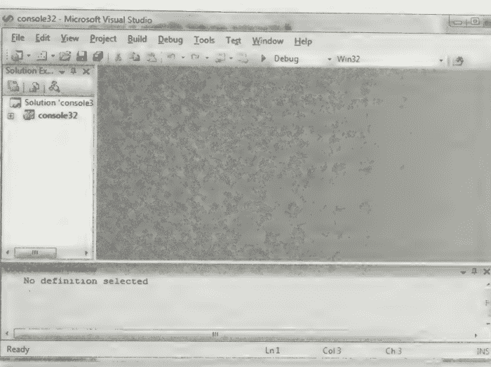

图 3.2 在 Visual Studio 2008 中新打开的项目

# 汇编语言的54个元素

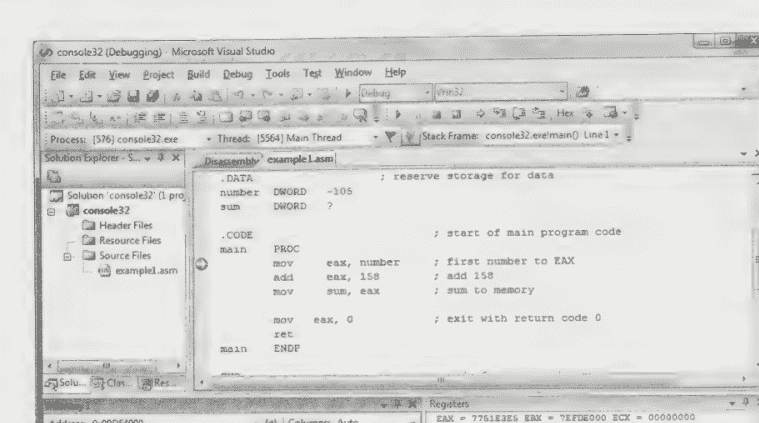

图 3.5 程序在第一条指令处停止

在这里我们看到数字97 处的4个字节为 `ff ff ff ff`。这有点意外，因为在补码形式下，$-105_{10}$ 是 `FF FF 97`。节的原因是 Intel 架构使用小端（little endian）方式存储多字节整数，也就是说字节的存储顺序与通常预期的顺序相反，高位字节在前。在查看内存显示时，我们只需要考虑小端表示法。

查看 `Registers`（寄存器）窗口。大多数寄存器的内容并没有意义——寄存器包含的是某些其他用下的残留数据。然而，`EIP` 包含了第一个 `mov` 指令的地址，即即将执行的指令。按 `F10` 执行此指令（这是调试菜单中的“单步跳过” Step Over）。在寄存器窗口中，`EAX` 和 `EIP` 的内容都会变红，表示它们已经发生了变化。`EIP` 现在包含 `add` 指令的地址，即下一个要执行的指令。左侧的黄色箭头也指向下一个要执行的指令。`EAX` 包含 `FFFFF97`，这是图中数字的值，高位字节在前。计算机完全按照我们告诉它的令操作——它将 `number` 所指地址处内存中的双字复制到 `EAX` 中。

## 3.2 使用调试器的完整 32 位示例 55

再次按 `F10`。现在 `EAX`、`EIP` 和 `EFL` 显示为红色。`EIP` 已经 变为第三条指令的地址。`EAX` 包含 `FFFFF97` 和 `0000009E` 的和，即 `00000035`。`EFL` 的低位字是 `0217h` = `0000 0011h`，其中第 0、6、7 和 11 位被高亮显示。记得第 0 位是进位标志（carry flag），因此 `CF=1` 表示此加法有进位。第 11 位是溢出标志（overflow flag），因此 `OF=0` 表示没有溢出。第 6 位是零标志（zero flag），`ZF=0` 表示结果不零。最后，第 7 位是符号标志（sign flag），`SF=0` 表示结果为负。

再次按 `F10`。此时，由于 `EAX` 的 `00000035` 被复制到内存显示的第二个双字，`Memory 1` 显示发生了变化。由于双字是以小端形式存储的，你会看到 `35 00 00 00`。注意 `EFL` 没有变化——关于哪些指令影响标志将在第4章中进行讨论。

程序现在准备执行以下

```
mov eax, 0 ; 用返回码 0 退出
ret
```

该指令返回到调用程序（在本例中为操作系统），返回值 0 表示没有错误。你不应该使用 `F10` 单步执行这段代码，因为可以使用调试代码。只需按 `F5` 或点击继续（continue）按钮退出程序。控制台窗口关闭，你的 `Registers` 和 `Memory 1` 窗口也会关闭。你可以通过按 `F5` 再次运行程序，`Registers` 和 `Memory 1` 窗口将重新打开——你不需要再次排列窗口。如果你需要尽早终止执行，可以点击工具栏上的停止调试按钮，或从 `Debug` 菜单中选择停止调试（stop debugging）选项。

`console32` Visual Studio 项目有一个汇编集，当你的程序汇编时会生成列表文件（listing file）。该文件显示了汇编器生成的源码和对象代码。定位汇编错误有时很有帮助（尽管双击输出窗口中的错误消息通常会将光标置于出错的代码行）。然而，它在理解汇编过程方面是无价的。

在我们的示例中，列表文件名为 `example1.lst`（如果你选择了不同于 `example1.asm` 的名称，列表文件将具有你选择的名称加上 `.lst` 扩展名）。你可以通过点击工具栏上的打开文件图标，然后双击 `example1.lst` 来打开它。它会出现在带有新标签页的编辑器窗口中。列表文件的第一部分如图 3.6 所示。第3.3 和 3.4 节描述了一些列表条目。

# 汇编语言的元素

```
Microsoft (R) Macro Assembler Version 9.00.21022.08      07/05/08 20:28:05
.example1.asm                               Page 1 - 1

      ; 汇编语言示例程序 -- 给内存中的数字加 158
      ; Author:      R. Detmer
      ; Date:        1/2008

  .586
  MODEL FLAT

      STACK 4096                    ; 预留 4096 字节栈

00000000      DATA               ; 为数据预留存储
00000000 FFFFFFFF97 number DWORD  -105
00000004 00000000                   ?

00000000              CODE               ; 主程序代码开始
00000000      main      PROC
00000000 A1 000000D0 R mov      eax, number    ; 将第一个数字给 EAX
00000005 05 000009E add      eax, 158      ; 加 158
0000000A A3 000000D4 mov      sum, eax       ; 将 eax 给内存
0000000F B8 00000000 mov      eax, 0         ; 返回码 0 退出
00000014 C3                    ret
00000015      main      ENDP                               ; 源结束

END
```

图 3.6 列表文件

### 编程练习 3.2

1. 修改示例程序，将 `number` 的值改为 -253，并将第二条指令改为 `EAX` 加 74。汇编、链接并运行程序。解释寄存器和内存的变化。

2. 修改示例程序，分别将内存中的 `number` 和 `number2` 两个加。（提示：将 `number` 复制到 `EAX`，然后使用 `number2` 加第二个数字。）继续将结果存储在 `sum` 中。汇编、链接并运行程序。解释寄存器和内存的变化。

## 3.3 数据定义

本节解释了用于 `BYTE`、`WORD`、`QWORD` 的操作数格式。由于简单常量在指令和指令中的写法方式相同，因此大部分信息适用于它们。操作数可以用十进制、十六进制或八进制表示。除非数字带有后缀或使用 `RADIX` 指令（本书中未使用），否则汇编器假设数字是十进制。可以使用以下后缀：

| 后缀 | 基 | 数字 |
|---|---|---|
| H | 16 | 十六进制 |
| B | 2 | 二进制 |
| O 或 Q | 8 | 八进制 |
| 无 | 10 | 十进制 |

这些后缀可以使用大写或小写。在需要以八进制编码常数的情况下，字母 `Q` 比 `O` 更易读。十六进制值必须以数字开头。例如，必须使用 `0ah` 而不是 `ah` 来得到值为 A 的常量。汇编器会将 `ah` 解释为一个名称。现在是一些示例：该指令

```
byte BYTE 0111101b
```

预留一个字节内存并将其初始化为 `7D`。这等同于以下任何一个指令

```
byte BYTE 7dh
byte BYTE 25
byte BYTE 75
```

因为 $1111101_2 = 7D_{16} = 125_{10} = 75_8$，且 $7D_{16}$ 是左括号的 ASCII 码。数字系统的选择取决于常量的用途。当需要将值视为位序列时（如第7章涵盖的逻辑运算），适用于二进制值。如果你将该值作为字符，可以使用引号。

# 汇编语言的元素

`BYTE` 指令预留一个或多个字节的数据。如果数据是数字，可以视为有符号或无符号。单字节的无符号十进制范围是 0 到 255。单字节的有符号十进制范围是 -128 到 127。对于操作数超出 -128 到 255 的 `BYTE` 指令，汇编器将生成错误信息。这里是一些示例。示例中的注释表示预留字节的初始值。

```
byte1 BYTE 255      ; 值是 FF
byte2 BYTE 127      ; 值是 7F
byte3 BYTE 91       ; 值是 5B
byte4 BYTE 0        ; 值是 00
byte5 BYTE -1       ; 值是 FF
byte6 BYTE -91      ; 值是 A5
byte7 BYTE -128      ; 值是 80
```

`WORD`、`DWORD` 和 `QWORD` 指令的情况类似。`WORD` 指令的每个操作数都存储在双字、`DWORD` 或四字（quadword）中。双字通常是整数的最佳选择。由于 4 字节可以存储 -1,147,483,648 到 1,147,483,647 之间的有符号数或 0 到 4,294,967,295 之间的无符号数，你必须将操作数值限制在 -1,147,483,648 到 4,294,967,295 之间。同样，`WORD` 指令的每个操作数应限制 -32,768 到 65,535 之间。以下示例给出了预留的几个字的初始值。四字用于 64 位环境，但汇编器在 32 位环境下识别 `QWORD` 指令。

```
double1 DWORD 4294967295 ; 值是 FFFFFFFF
double2 DWORD 4294966296 ; 值是 FFFFFFFC
double3 DWORD 0        ; 值是 00000000
double4 DWORD -1       ; 值是 FFFFFFFF
double5 DWORD -1000     ; 值是 FFFFFFC
double6 DWORD -2147483648 ; 值是 80000000
```

```
word1 WORD 65535    ; 值是 FFFF
word2 WORD 32767    ; 值是 7FFF
word3 WORD 1000     ; 值是 03E8
word4 WORD 0        ; 值是 0000
```

## 3.3 数据声明

```
word5  WORD    -1         ; value is FFFF
word6  WORD    -1000       ; value is FC18
word7  WORD    -32768      ; value is 8000

quad1  QWORD   -1           ; value is FFFFFFFFFFFF
quad2  QWORD   1000       ; value is 00000000000003E8
```

这些示例的要点之一是不同的操作数可以产生相同的存储值。例如，请注意操作数为 4294967295 和 -1 的 `DWORD` 指令都会生成包含 `FFFFFFFF` 的双字。这个值可以被视为无符号数 4,294,967,295，也可以被视为有符号数 -1，取决于它所使用的上下文。

除了数值操作数外，`BYTE` 指令允许包含单个字符的操作数或包含多个字符的字符串操作数。可以使用单引号（' '）或双引号（"）来指定字符或分隔字符串。它们必须成对出现；你不能左边用单引号右边用双引号。用单引号分隔的字符串可以包含双引号，用双引号分隔的字符串可以包含单引号，使得字符串包含这些特殊字符成为可能。除非有理由这样做，否则本书遵循以下约定：将单个字符放在单引号之间，将字符串放在双引号之间。

以下每个 `BYTE` 指令都是允许的。

```
char1  BYTE 'm'      ; value is 6D
char2  BYTE 6dh       ; value is 6D
string1 BYTE "Joe"     ; value is 4A 6F 65
string2 BYTE "Joe's"   ; value is 4A 6F 27 73
```

`char1` 和 `char2` 存储具有相同的值。如前所述，`BYTE`、`WORD`、`DWORD` 和 `QWORD` 指令可以有多个由逗号分隔的操作数。该指令：

```
dwords DWORD   10, 20, 30, 40
```

预留了四个双字存储空间，初始值为 0000000A, 00000014, 0000001E, 00000028。指令：

```
string  BYTE "Joe"
string BYTE 'J', 'o', 'e'
```

结果预留了相同的 3 个字节。

`DUP` 运算符可用于生成多个未初始值的字段，以及具有已知值的字段。它的使用限于 `BYTE`、`WORD`、`DWORD`、`QWORD` 以及其他预留存储空间的指令。

```
DblArray DWORD 100 DUP(999)
```

预留了 100 个双字存储空间，每个都初始化为 000003E7。这是初始化数组元素的有效方法。如果需要一个由50 个星号组成的字符串，那么：

```
stars BYTE 50 DUP('*')
```

就可以完成工作。如果有 25 个用空格分隔的星号，那么：

```
starsAndSpaces BYTE 24 DUP("* ")
```

预留了 49 个字节并分配了所需的初始值。

要预留空间而不分配特定值，请使用操作数 `?`。这为指令预留了相应数量的字节。这些字节在逻辑上是未定义的；事实上，汇编器为每个字节分配 00。`?` 操作数可以与 `DUP` 使用：

```
wordArray DWORD 100 DUP (?)
```

以预留 100 个“未定义”的双字，每个实际上都包含 00000000。

`BYTE`、`WORD`、`DWORD`、`QWORD` 或其他语句的操作数可以是涉及算术或其他运算符的表达式。这些表达式由汇编器在汇编时求值，而不是在运行时求值。使用表达式代替等效值有时可以让代码更清晰。以下指令是等效，每个预留一个初始值为 00000090 的字：

```
gross DWORD 144
gross DWORD 12*12
gross DWORD 10*15 - 7
```

由 `BYTE`、`WORD`、`DWORD` 或 `QWORD` 定义的每个符号都与长度相关。汇编器会记录此长度并确保符号在指令中被正确使用。例如，如果

```
char BYTE 'x'
```

在数据段中，汇编器将生成错误消息，不同的大小——`EAX` 寄存器是双字长的，`char` 与一个字节的存储相关。微软汇编器识别了几个额外的指令来预留存储空间。包括用于 10 字节整数的 `BYTE`、用于 4 字节浮点数的 `REAL4`、用于 8 字节浮点数的 `REAL8` 以及用于 10 字节浮点数的 `REAL10`。它还有用于区分有符号字节、字和双字的指令。

让我们再次查看图 3.6 列表文件中的数据部分（为了节省空间进行了编辑）：

```
00000000         DATA           ; reserve storage
00000000 FFFFF97 number      DWORD-1
00000004 00000000 sum      DWORD
```

第一个 `DWORD` 指令生成包含 `FFFFF97` 的双字。第二个 `DWORD` 指令生成包含 `0000000` 的双字。这些值显示在数字的第二列。汇编器假设数据段从 `00000000` 开始（这在程序链接和加载时会调整）。因此，`number` 相关的汇编地址是 `00000000`。由于 `number` 是从 `00000000` 开始的 4 字节，如果有第三项，它将位于 `00000008`。这就是 `sum` 的汇编地址。虽然数据定义通常带有标签，但并不是必须的。例如，你可以编写：

```
value DWORD ?
```

由于有两个 `DWORD` 指令且每个只有一个操作数，在数据段中预留了两个双字。第一个可以通过值引用。第二个可以通过 `value+4` 引用，因为它位于第一个双字之后的 4 个字节。

## 3.4 指令操作数

指令操作数有三种基本类型：(1) 常数；(2) CPU 寄存器；(3) 内存位置引用。引用内存有多种；本节讨论了其中两种简单的方法，更复杂的方法将在书中后后解释。

许多指令有两个操作数。通常，第一个操作数给出操作的目标地，尽管它可能指定一个将被操作结果替换的源。第二个操作数识别操作的源，绝不是目标地。例如，当执行

```
mov al, '/'
```

字节 `2F`（斜杠 / 的 ASCII ）将加载到 `AL` 寄存器中，替换原来的字节。第二个操作数 `'/'` 指定了常量源。当执行

```
add eax, number1
```

`EAX` 获取 `number1` 引用的内存中的双字与 `EAX` 旧内容的和。第一个操作数 `EAX` 指定了一个双字的源，同时也是和的目标地；第二个操作数 `number1` 指定了两个相加的双字中的另一个内存位置。

图 3.7 列出了 Intel 80x86处理器使用的寻址模式，给出了每个模式数据的位置。对于立即数模式操作数，要使用的数据在执行之前就放入指令中；一旦到位，它就是常量¹。通常数据由汇编器放置在指令中，尽管它可以被

人们可以编写自修改代码，即在执行时更改自身指令的代码。这被认为是一种非常糟糕的编程实践。

# 汇编语言的 64 个元素

| 模式 | 数据位置 |
|---|---|
| 立即数 | 在指令本身中 |


| 寄存器 | 在寄存器中 |
| 内存 | 在内存中的某个地址 |

图 3.7 80x86寻址模式

由链接器或加载器插入，取决于确定该数值的阶段。程序员编写一条包含实际数值的指令，或者一个代表常数数值的符号。对于寄存器模式操作数，要使用的数据在寄存器中。要指示寄存器模式操作数，程序员只需编码寄存器的名称。寄存器模式操作数可以编码为源操作或目的操作，而立即数模式操作数不能作为目的操作。

这里是图 3.6 列表文件代码段中的行：

```
00000005    05 0000009E      add      eax, 158
```

指令助记符为 `add`，第一个操作数 `EAX` 显然是一个寄存器，第二个操作数 `158` 是立即数。数字 `00000005` 是这条指令的汇编时地址。汇编器从地址 `00000000` 开始汇编指令，因此在此指令之前汇编的任何内容都占 5 个字节。指令也占 5 个字节：操作码 `05`（在这种情况下是将一个双字加到指令中的 (`EAX`）），以及表示 `158` 的双字的 4 个字节 `0000009E`。这 5 个字节合并称为该指令的目标代码。列表显示了此目标代码，由于没有需要修改的地址，它正是将要执行的机器码。

这里是另一个示例，第一个操作数是寄存器模式，第二个操作数是立即数模式。目标代码（取自汇编列表文件）以注释的形式显示。

```
mov al, '/' ; B0 2F
```

操作码 `B0` 表示将下一个字节复制到 `AL` 中，操作码后的字节包含斜杠的 ASCII 码 `2F`。

内存地址可以通过多种方式进行计算；图 3.8 列出了 32 位 80x86 环境中最常见的两种模式。任何内存模式操作数都指定内存中的数据源，或指定内存中的目的地址。直接模式操作数

### 3.4 指令操作数

| 内存模式 | 数据位置 |
|---|---|
| 直接 | 在地址已构建在指令中的内存位置 |
| 寄存器间接 | 在地址在寄存器中的内存位置 |

图 3.8 两种 80x86 内存寻址模式

其 32 位地址被构建在指令中。通常，程序员会编写一个出现在用于在数据段中预留空间的指令上的名称，汇编器将将其翻译为该地址。

这里是图 3.6 文件中的第三行代码段：

```
00000000 A3 00000004 R  mov sum, eax ; sum to memory
```

在这条指令中，第二个操作数 `EAX` 显然是寄存器模式。操作数 `sum` 引用内存。在 32 位环境的汇编语言中，任何编码为名称的内存引用都是直接的。在这里我们可以确切地看到指令是如何汇编的。它从操作码 `A3` 开始，表示从 `EAX` 复制一个双字到指令中指定的内存位置。接 4 个字节 `00000004` 给出了目的地的汇编时位置。（回想 `sum` 在汇编时 `00000004` 出现在数据段中）。`sum` 的值在执行时不存储在地址 `00000004`。列表中地址后面的 `R` 表示该地址是可重定位——它将被链接器和加载器调整为运行时地址。

我们的示例程序没有带有寄存器间接内存操作数的指令。这里是一个这样的指令。注释给出了你在列表文件中看到的目标代码。

```
add eax, [edx] ; 03 02
```

第一个操作数 `EAX` 显然是寄存器模式，第二个操作数是寄存器间接模式。注意，只有 2 个字节的目标代码，不足以包含一个 32 位内存地址。相反，第二个字节包含表示使用 `EDX` 寄存器中的地址来定位第二个双字操作数的位。换句话说，第二个数字不在 `EDX` 中，但括号表示法 (`[]`) 表示汇编语言中的间接寻址。图 3.9 说明了寄存器间接寻址在这个示例中是如何工作的。

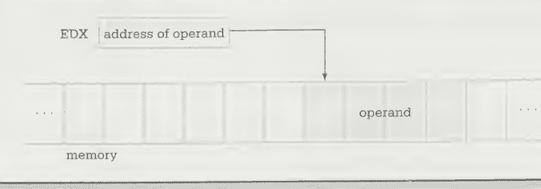

图 3.9 寄存器间接寻址

任何通用寄存器 `EAX`、`EBX`、`ECX` 和 `EDX` 或索引寄存器 `ESI` 和 `EDI` 可用于寄存器间接寻址。基指针 `EBP` 也可以使用，但用于栈中的地址而不是数据段中的地址；这用于过程参数。虽然栈指针 `ESP` 在特殊情况下可用于寄存器间接寻址，但在 32 位代码中我们不需要这样做。

使用寄存器间接模式，寄存器就像高层语言中的指针变量。寄存器包含指令中使用的数据的位置，而不是数据本身。当指令中使用内存大小时而不是数据本身时，寄存器包含该地址（此处原文似乎有误）。

### 汇编语言的 66 个元素

### 3.5 使用输入输出的完整示例

图 3.1 中的示例不包含任何输入输出。为了看到它实际上做了什么，我们使用调试器逐次跟踪执行并查看内存状态。虽然这对理解计算机内部工作原理非常有帮助，这是本书的主要目标，我们习惯于输入数据、进行计算并输出结果的程序。除了相加，这个新示例还强调了数据有多种形式——我们使用 ASCII 字符输入输出，使用补码整数进行计算。显然需要某些方法来进行格式转换。我们也使用了为本书开发的宏完成这些任务。这些宏在这里引入，并在下一章详细介绍。

这里是程序的逻辑：

- 提示第一个数字；
- 输入第一个数字的 ASCII 字符；
- 将字符转换为补码双字；
- 将第一个数字存储到内存；
- 提示第二个数字；
- 输入第二个数字的 ASCII 字符；
- 将字符转换为补码双字；
- 将第二个数字存储到内存；
- 相加两个数字；
- 将和转换为 ASCII 字符串；
- 显示标签和表示和的字符

该设计由图 3.10 所示完整程序实现。部分如下。此程序已构建在随书软件提供的 windows32 Visual Studio 项目中。

此程序与图 3.1 中的简单程序有许多相似之处。它以打开注释和 `.586` 以及 `.MODEL FLAT` 指令开始。第一个新语句是 `INCLUDE io.h` 指令，仿佛它的行物理存在于源代码此处一样。头文件 `io.h` 包含了用于 I/O 以及 ASCII 与整数格式之间转换的宏描述。

数据段比我们之前的示例要长。它有两个双字用于存储两个数字的补码版本，两个用于提示数字的字符字符串，以及一个输出标签字符串。此外，有一个 40 字节未定义字符串用于输入将转换为补码形式用于计算的 ASCII 字符，还有一个 11 长的字符串用于存储和的 ASCII 版本。注意用于输出的每个字符串都是空终止的，即带有一个 0 操作数，将存储为 0 字节。

代码段包含一个名为 `_MainProc` 的过程。我们使用的代码框架实际上是一个 C 程序，其执行从 `main` 函数开始。该框架设计为始终调用 `_MainProc`，因此这是我们的汇编语言过程名称。第 6 章仔细检查了过程调用。

语句

```
input prompt1, string, 40 ; read ASCII characters
```

是一个带有三个操作数的宏。它展开为调用过程的指令，用于显示看起来所示的 Windows 对话框：

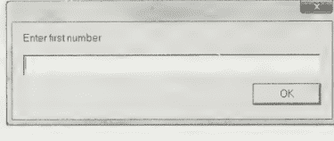

第一个操作数指定了该程序对话框中出现的标签，即内存中由 `prompt1` 引用的字符串。这用于提示用户在文本框中期望的内容。用户应该在文本框中输入数字，然后点击 OK。点击 OK 后，文本框中输入的任何内容的 ASCII 码被复制到此处第二个操作数指定的目标，即 `string`。第三个操作数必须总是目标字符串的长度——在本例中为 40，因为数据段中为字符串预留了 40 字节。在这个示例中，选择 40 没有什么特别之处，只是它提供了一个比你预期的长的字符串。通常情况下，你对输入区域的大小要慷慨一些——你可能期望用户输入 7，但用户可能会在 7 之前输入几个前导空格，或者输入数值等价的 `000000000007`。

`_MainProc` 中的下一个语句

```
atod string ; convert to integer
```

是一个带有单个操作数的宏。它的名称代表“ASCII 到双倍精度”（ASCII to double），它扩展为调用过程的指令，从操作数指定的位置开始扫描内存，寻找数字的 ASCII 表示。它将 ASCII 表示转换为相应的 2 补码双字整数。此双字始终存储在 `EAX` 中——不允许有目标操作数。

第三条语句不需要太多的解释。这条 `mov` 指令将 `EAX` 中的双字复制到内存中 `number1` 处的双字。

显然，`_MainProc` 的第 4 到第 6 条语句为第二个数字重复了该任务。需要注意的是的是，尽管最终结果被复制到单独的双字中，但 40 位的输入区域被重用了——我们只需要每个 ASCII 表示足够长以转换为 2 补码双字。

这两条指令

```
mov     eax, number1      ; first number to EAX
add     eax, number2      ; add second number
```

只是相加双字。这与第一个示例程序中的加法相似，区别在于相加的第二个数字存储在内存中，而不是构建在指令中的立即数。你可能会注意到，在 `atod` 宏之后，第二个数字已经在 `EAX` 中，所以我们只需要简单地加上第一个数字。此代码以最常见的方式实现了“两个数字相加”的设计元素，尽管对于这种特定情况这不是最高效的实现。

`EAX` 中的和是 2 补码形式。它必须为了显示目的转换为 ASCII 表示。该宏的任务是

```
dtoa     sum, eax       ; convert to ASCII characters
```

“双倍精度到 ASCII”宏有两个操作数，分别指定目标字符串和双字源。目标字符串必须恰好是 11 字节长，因为 `dtoa` 宏调用的过程始终在目标处存储恰 11 个 ASCII 字节。目标在数据段中通常以空字节终止，`dtoa` 宏不会生成尾随空字节。

语句

```
output   resultLbl, sum   ; output label and sum
```

是一个展开为调用过程的语句的宏，用于显示看起来所示的 Windows 对话框：


### 3.5 使用 Windows 输入/输出的完整 32 位示例

和的 ASCII 版本。注意用于输出的每个字符串都是空终止的，即带有一个 0 操作数，将存储为 0 字节。

# 汇编语言的 74 个元素

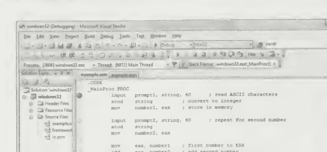

图 3.13 转换为 2 补码的 ASCII 代码

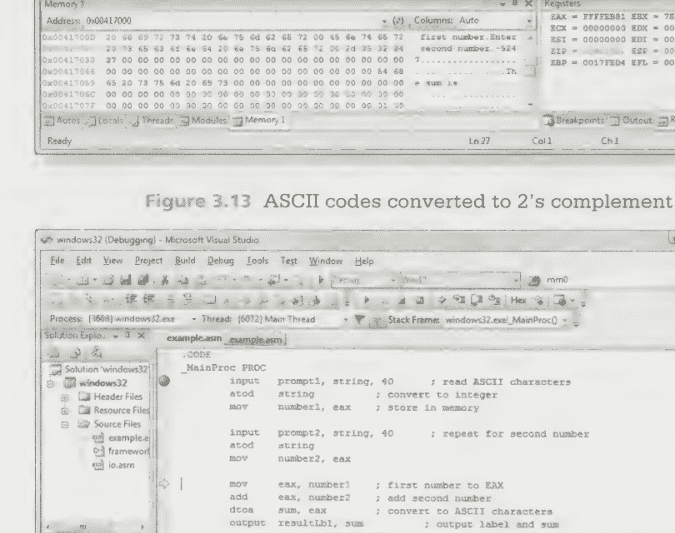

图 3.14 准备好加负数的程序

# 3.5 使用 Windows/输入/输出的完整 32 位示例 75

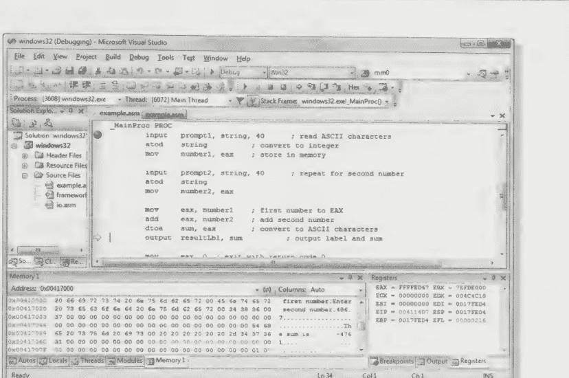

图 3.15 准备好输出和的程序

六个空格、负号的代码。4, 7, 6 和 1，即 -4761 的前导空格填充的 ASCII 表示。

## 编程练习 3.5

1. 从 windows32 项目开始，修改本节给出的示例程序，提示输入并相加三个数，显示和。使用不同的数据多次运行程序。使用调试器跟踪执行过程。
2. 指令 `subtract eax, label` 将将 label 处的双字节字减去 EAX 寄存器中已的双字节字。从 windows32 项目开始，修改本节给出的示例程序，提示输入两个数，从第一个数减去第二个数，最后显示结果。使用不同的数据多次运行程序。使用调试器跟踪执行过程。

### 3.6 IO.H 中定义的输入/输出和数据转换宏

windows32 项目包含的头文件 `io.h` 定义了六个宏；一个用于输入，一个用于输出，四个用于 ASCII 和 2 补码格式之间的转换。I/O 宏方便了 Windows 环境下的输入和输出，转换宏可以在任何需要 ASCII/整数转换的地方使用。双字节字（doubleword）大小和字字（word）大小的转换均可用，但请记住双字节整数是首选大小。这六个宏总结在图 3.16 中。

输入宏的作用是提示输入字符字符串。Windows 对话框标签的 OK 被放在第一个操作数所引用的内存中。对话框有一个 OK 按钮。

| 名称 | 参数(s) | 操作 |
|---|---|---|
| `atod` | source | 从 source 开始扫描字符串，寻找或或 - 后面跟数字数字，将这些字符解释为整数。相应的 2 补码数是 EAX。 |
| `dtoa` | destination, source | 将 source（寄存器或内存）处的字转换为 destination 处的 11 字节长的 ASCII 字符串。 |
| `atow` | source | 与 `atod` 类似，但结果被放在 AX 中。 |
| `wtoa` | destination, source | 将 source（寄存器或内存）处的字转换为 destination 处的 6 字节长的 ASCII 字符串。 |
| `input` | prompt, length | 生成一个由 prompt 指定标签的对话框，其中 prompt 引用数据段中的字符串。当按下 OK 时，最多将 length 个字符从对话框复制到 destination 处的内存。 |
| `output` | labelMsg, valueMsg | 生成一个标签为 labelMsg、消息区域为 valueMsg 的消息框。labelMsg 和 valueMsg 的每个都引用数据段中的字符串。 |

图 3.16 IO.H 中的宏

### 3.6 IO.H 中的输入/输出和数据转换宏

如果在对话框中未输入任何内容并按下 OK，会出现一个显示“Warning—Nothing entered.”的消息框。否则，当按下 OK 时，对话框中输入的字符将复制到内存中。这些字符后面紧跟一个空字节（0）。第二个操作数引用目标地址，第三个操作数是一个常量，给出了在目标处预留的字节数。如果在对话框中输入了过多的字符，多余的字符将被截断。

输出宏生成一个显示两个字符串的 Windows 消息框。第一个字符串为消息框提供标签，第二个字符串出现在主消息区域。这些字符串分别由第一个和第二个参数引用。每个必须以空字符结尾。

如果输出框 `valueMsg` 字符串包含换行符，则它将显示在多行。例如，如果数据段包含

```
addrLbl BYTE    "address", 0
strCity BYTE  "123 Main Street", 0dh, 0ah, "Bigtown, NY", 0
```

并且执行

```
output  addrLbl, strCity
```

则显示以下消息框。


消息中的街道和城市行通过 `strCity` 操作数用 `0A` 字节（回车和换行符）隔开。实际上，这些分隔符中的任何一个都可以单独作用，但我们遵循了分隔文本行的“MS-DOS”惯例。

虽然输入宏可以用于输入任何字符串，但我们通常用它来输入整数的 ASCII 表示的字符串。为了使用此数字进行算术运算，必须将其转换为“内部”形式。这是 `atod`（ASCII 到双字节字）或 `atow`（ASCII 到字）宏完成的工作。它们的工作方式相同，只是 `atod` 产生双字节字长度的 2 补码，而 `atow` 产生字长度的 2 补码。由于我们通常用它来输入整数的 ASCII 表示的字符串。为了使用此数字进行算术运算，必须将其转换为“内部”形式。`atod` 产生双字节字长度的 2 补码，而 `atow` 产生字长度的 2 补码。它们的工作方式相同，只是 `atod` 产生双字节字长度的 2 补码，而 `atow` 产生字长度的 2 补码。

# 汇编语言的 78 个元素


有时 11 字节的目标比源长得多。多余的字节总是留在左侧。为什么 `dtoa` 宏总是生成 11 字节？答案是为了保持简单。在十进制中，2 补码形式存储在字中的范围是 -4294967296 到 4294967295，因此负数实际上需要 11 字节，但练习 3.6.1 要求你解释为什么 `wtoa` 使用 6 字节。

除了 `atod` 和 `atow`，`IO.H` 中定义的每个宏设计为保持通用寄存器不变。`atod` 和 `atow` 显然改变 `EAX` 和 `AX`，因为这是它们的工作。但是，这些宏不改变其他通用寄存器。

# 练习 3.6

- 1. 为什么 `wtoa` 宏没有设计为产生更少的 ASCII 代码？解释数字 6 的重要性。

- 2. 给定数据段定义

```
res 20 DP(?)
askLbl BYTE "Please enter a number", 0
```

以及代码段宏

```
input askLbl, respon, 20
```

(a) 如果在对话框中输入 -578 并按下 OK，哪些字节将存储在数据段的 `respon` 中？

(b) 如果 `atod rsp` 跟随上面的输入宏，`EAX` 寄存器将存储什么？

- 3. 假设程序包含数据段定义

```
value1 DWORD =
sumLbl BYTE "The result is", 0
result1 BYTE 11 DP(?), "total", 0
```

以及代码段宏

```
dtoa result1, value1
```

(a) 假设运行时引用的双字包含 `FFFFFFFA`，`dtoa` 宏将哪些字节放在内存 `result1` 中？

(b) 如果 `dtoa` 宏后面跟着 `output sumLbl, result1`，画一张显示结果外观的图。

## 3.7 64 位示例

当在使用 64 位-x86 CPU 的 64 位操作系统上安装 Visual Studio 2008 时，可以使用步骤汇编并执行 64 位汇编语言程序。

```
; 示例汇编语言程序
; 将内存中的数字加1 158
; 作者: R. Detmer
; 日期: 1/2008

.DATA
number QWORD  -105
sum    QWORD  ?

.CODE
PROC
main
       mov     rax, number ; 将第一个数字放入 EAX
       add     rax, 158    ; 加上 158
       mov     sum, rax ; 将 sum 写入内存

       mov     rax, 0      ; 返回代码
       ret                 ; 退出操作系统
END
```


与第 3.2 节和 3.5 节描述的 32 位程序类似。这些步骤在本节中进行了描述。图 3.17 显示了图 3.1 节所示并在第 3.2 节讨论的简单程序的 64 位版本。需要注意的第一个区别是，64 位版本没有 `.586`、`_MODEL FLAT`、`/STACK` 指令；这些指令在 64 位环境中既是不需要的，也不会被识别。（栈大小可以使用 Visual Studio 项目属性进行调整。）数据段为 `number` 和 `sum` 预留了四字节字（quadwords）而不是双字（doubles），代码段使用 64 位寄存器而不是 32 位寄存器 `EAX`。它通过在 `RAX` 中放入 0 并执行 `ret` 指令来退出。

该项目的构建方式如第 3.2 节中为 32 位示例描述的那样。从你的源文件中拷贝 `console64` 项目文件夹。与 `console32` 项目一样，你可以重命名外部文件夹，但不能重命名内部文件夹。双击 `console64.asm` 文件启动 Visual Studio 并打开项目。在“解决方案管理器”（Solution Explorer）中查找并找到 `console64` 左侧的符号 `[]`。右键点击“源文件”（Source Files），点击“添加”，然后选择“新建项（New Item...）”。在“类别”下勾选“代码”（Code）。在“名称”框中输入文件名，确保它以 `.asm` 扩展名结尾。最后，点击“添加”按钮。将文件 `fig3-17 asm` 拷贝到文本编辑器。

## 3.18 程序在断点处停止

在第一个 `mov` 指令处设置断点。按 `F5` 启动程序。当程序在断点处停止时，打开内存窗口以显示从 `&number` 开始的内存，并打开寄存器。结果窗口将看起来像图 3.18 所示。

此显示有几处不同。“寄存器”（Registers）窗口显示的是 64 位寄存器，包括新的寄存器 `R8` 到 `R15`。“Memory1”窗口显示 64 位地址，你可以在内存块的开头看到 -105 的四字节字表示。与 32 位环境一样，通过反复按 `F10` 来跟踪程序；要终止程序，当你返回到该语句时，应该按 `F5` 或点击“继续”（Continue）。

图 3.19 显示了列表的一部分。汇编地址仅显示为 32 位，这有点奇怪。然而，数据段如预期地预留了两个四字节字。在代码段中，`add` 指令的立即操作数 158 被编码为双字（doubleword），尽管它将被加到一个四字节字上。两个 `mov` 指令中的每一个都引用了内存，但指令中仅构建了 4 字节的地址。这是因为“直接”内存引用是使用 `RIP` 相对寻址编码的，这种内存寻址模式在 32 位模式下甚至不存在。使用 `RIP` 相对寻址，内存操作数被定位为：

# 微软 (R) 宏汇编器 (x64) 版本 9.00.21022.08 02/04/08 18:01:00

\example.asm 第 1 页 - 1

```
; 示例汇编语言程序
; 将内存中的数字加1 158
; 作者: R. Detmer
; 日期: 1/2008

00000000    .DATA               -105
00000000            number      QWORD   ?
                        FFFFFFFF97
00000008            sum                 QWORD   ?
                        0000000000000000

00000000            .CODE
00000000        main        PROC
00000000        48/ 0B 05               mov      rax, number    ; 将第一个数字放入 EAX
00000000                R
00000007        48/ 05                   add      rax, 158         ; 加上 158
                        00000009E
0000000D        48/ 89 05               mov      rax, rax         ; 将 sum 写入内存
                        0000000R
00000014        48/ C7 C0               mov      rax, 0         ; 返回代码
                        00000000
0000001B        C3                      ret                 ; 退出操作系统

0000001C        main        END
```

相对于当前指令的偏移量。这是 64 位架构中的一个常见特性，允许代码是位置无关的。

第一条语句为过程的使用预留栈空间，第二条语句因为 `Main` 调用了输入输出过程而释放它。这在第 6 章讨论 64 位过程协议时会有更详细的解释。

尽管底层代码不同，64 位版本的 `io.h` 中定义了与 32 位版本相同的宏。这些在第 3.6 节中描述过。特别是，没有新的 `atoq` 或 `qtoa` 宏。由于 64 位环境中存在四字节寄存器，这似乎是一个遗漏。但事实证明，32 位整数在大多数 64 位环境中仍然是默认大小。增加转换程序没有教育意义。缺少 `atoq` 和 `qtoa` 的读者可以在解释 `atod` 和 `dtoa` 后编写它们。

`windows64` 项目的构建和执行方式与 `windows32` 项目相同。当然，如果你设置了断点并检查内存和寄存器，你将看到 64 位内存地址和 64 位寄存器。

## 练习 3.7


1. 汇编并运行图 3.17 中的 `console4` 程序，在 `add` 指令处停止。注意 `number` 的运行时地址（`Memory1` 显示开始的地址）。注意 `add` 指令的地址（`RIP` 寄存器中的值）。打开一个从 `main` 地址开始的 `Memory2` 窗口，找到第一个 `mov` 指令中的偏移量（`48 8b 05` 之后以小端序存储的 4 字节）。验证 `add` 指令的地址加上偏移量等于 `number` 的地址。

### 编程练习 3.7

1. 从 `windows64` 项目开始，修改本节给示例程序，以提示、输入并加上三个数字。

## 3.8 本节总结

本章介绍了由 Visual Studio 2008 汇编器翻译的 80x86 汇编语言。

汇编注释以分号开头。其他语句的格式如下：

```
name mnemonic operand(s) ; comment
```

其中某些字段可能是可选的。

汇编语句有三个类型：

- 指令——每条对应一条 CPU 指令
- 直接指令——告诉汇编器要做什么
- 宏——展开为额外的语句

汇编程序主要由一个定义变量的数据段和一个包含运行期间执行的语句的代码段组成。若要获得一个可执行程序，必须先使用汇编器将程序翻译为目标代码，然后使用链接器对程序进行链接。可执行程序可以使用调试器进行跟踪。所有工具都集成在 Visual Studio 2008 中。

`BYTE`、`WORD`、`DWORD` 和 `QWORD` 指令分别预留字节、字、双字和四字的存储空间，并可选地分配初始值。

指令操作数有三种模式：

- 立即数——构建在指令中的数据
- 寄存器——寄存器中的数据
- 内存——存储器中的数据

内存模式操作数有几种格式，其中两种是：

- 直接——指令中的地址
- 寄存器间接——寄存器地址的数据

64 位环境使用 `RIP` 相对寻址而不是直接内存寻址。文件 `io.h` 中定义了几个用于输入输出的宏。它们调用 `io.asm` 文件中带有源代码的例过程。这些宏包括：

- `output`——在消息框中显示标签和结果字符串
- `input`——使用对话框输入字符串
- `atad`——将字符串转换为双字长度的 2 补码数
- `dtoa`——将双字长度的 2 补码数转换为字符串
- `atow`——将字符串转换为字长度的 2 补码数
- `wtoa`——将字符串转换为字长度的 2 补码数再转换为字符串

构建 32 位 Visual Studio 项目和 64 位 Visual Studio 项目的步骤存在细微差异。汇编语言代码本身也存在细微差异。

## 第 4 章

### 基础指令

本章涵盖了用于将数据从一个位置复制到另一个位置的指令以及用于整数算术的指令。它规定了各种指令允许的操作数类型。学习本章后，你将了解如何在内存与 CPU 寄存器之间以及两个寄存器之间复制数据。你还将了解如何使用 80x86 加、减、乘、除指令，以及这些指令的执行如何影响标志位。你将了解汇编器编码 80x86 指令以供执行的一些细节。

- 4.1 复制数据
- 4.2 整数加减法指令
- 4.3 乘法指令
- 4.4 除法指令
- 4.5 本节总结

## 4.1 复制数据

大多数计算机程序将数据从一个位置复制到另一个位置。在高级语言中，这是简单赋值语句的工作。在 80x86 机器语言中，复制是通过 `mov`（移动）指令完成的。每条 `mov` 指令的形式如下：

```
mov destination, source
```

并将源操作数位置的单字节、字、双字或（在 64 位模式下）四字值复制到目标操作数位置。源位置的值不会改变。目标位置的大小与源相同。没有哪条 `mov` 指令会改变任何 80x86 标志位。

C++ 或 Java 的赋值语句

```
count = number;
```

可能直接对应汇编语言指令

```
mov count, ecx ; count := number
```

假设 `ECX` 寄存器包含 `number` 的值，且 `count` 是内存中的一个双字。高级语言赋值语句与 `mov` 指令之间的类比不能推得太远。例如，

```
count = 3*number + 1;
```

不能用单条 `mov` 指令编码，需要多条指令来计算右侧表达式和目标位置的结果值。80x86 架构的一个局限是，并不是所有源和目标操作数的“逻辑”组合都是允许的。特别是，如果 `count` 和 `number` 都引用内存位置，则

```
mov count, number ; illegal for memory operands
```

是不允许的。所有 80x86 `mov` 指令都使用相同的助记符编码。汇编器通过查看操作数以及助记符来选择正确的操作码和目标代码字节。正如第 2 章所述，指令有时会影响标志寄存器中的各种位。通常，一条指令可能有三种影响之一：

- 不改变任何标志位
- 根据指令结果赋予特定的标志位
- 某些标志位可能会改变，但其设置无法预测

所有 `mov` 指令属于第一类——不改变任何标志位。由于源和目标的大小匹配，这意味着源也是字节大小。图 4.1 列出了所有 80x86 `mov` 指令的字节大小目标。

| 目标 | 源 | 操作码 | 代码字节 |
| :--- | :--- | :--- | :--- |
| AL | immediate byte | B0 | 2 |
| CL | immediate byte | B1 | 2 |
| DL | immediate byte | B2 | 2 |
| BL | immediate byte | B3 | 2 |
| AH | immediate byte | B4 | 2 |
| CH | immediate byte | B5 | 2 |
| DH | immediate byte | B6 | 2 |
| BH | immediate byte | B7 | 2 |
| AL, AH, BL, CL, DH | register | 8A | 2 |
| AL | memory byte direct | A0 | 5 |
| memory byte | immediate byte | C6 | 3 |
| memory byte (direct mode) | AL | A2 | 5 |
| memory byte | register | 88 | 2+ |
| 目标 | 源 | 操作码 | 代码字节 |
| :--- | :--- | :--- | :--- |
| R8B | immediate byte | B0 | 3 |
| R9B | immediate byte | B1 | 3 |
| R10B | immediate byte | B2 | 3 |
| R11B | immediate byte | B3 | 3 |
| R12B | immediate byte | B4 | 3 |
| R13B | immediate byte | B5 | 3 |
| R14B | immediate byte | B6 | 3 |
| R15B | immediate byte | B7 | 3 |
| R8B–R15B | R8B–R15B | 45A | 3 |
| R8B–R15B | AL, BL, CL, DL | 44A | 3 |
| AL, BL, CL, DL | R8B–R15B | 41A | 3 |

表格显示了每条指令的操作码和代码字节总数。除备注外，32 位和 64 位模式的操作数格式和代码字节是相同的。图 4.1 所示的操作数模式包含了 80x86 指令中出现的大多数可能性，因此在转向其他尺寸指令格式之前，我们花时间仔细解释它们。

看图 4.1 中的第一组指令。这些都是目标寄存器。然而，考虑到 `mov` 指令可能是最常用的，80x86 架构的设计者让这些指令的代码字节尽可能少是合理的。对于这些指令，代码字节的第一个字节是操作码，第二个字节是立即数操作数。例如，指令

```
mov count, 10 ; object code B2 0A
```

将十进制 10 存储为字节十六进制值 0A。操作码和立即数完成了表格最后一列中的 2 个字节代码。

现在看表格中源和目标均为 `register` 的那行。这一行实际上代表具有 64 种操作数组合的 `mov` 指令——源或目标可以是 `AL`、`AH`、`BH`、`BL`、`CH`、`DL` 或 `DR` 中的任何一个。这些情况的操作码始终是 `8A`，第二个代码识别寄存器。这个字节被英特尔称为 `Mod/RM` 字节，具有三个字段，第一个是第 7 和第 6 位的 2 位（模式）字段。另外两个字段长 3 位，这些字段在不同指令中具有不同的含义。然而，对于两个寄存器的指令，`Mod=11` 以及第 5、4、3 位的下一个字段（称为 `Reg`，“寄存器”）用于编码目标，而第 2、1、0 位的最终字段（称为 `R/M`，“寄存器/内存”）用于编码源寄存器。8 位寄存器编码如图 4.2 所示。

例如，指令 `mov ch, bl` 将具有代码 `8A EB`，其中 `Mod/RM` 字节 `EB` 由 `11 101 011` 拼接而成；寄存器到寄存器为 `11`，`CH` 为 `101`，`BL` 为 `011`。

## 4.1 数据拷贝

| 寄存器代码 | 寄存器 |
|---|---|
| 000 | AL |
| 001 | CL |
| 010 | DL |
| 011 | BL |
| 100 | AH |
| 101 | CH |
| 110 | DH |
| 111 | BH |

图 4.2 80x86 8 位寄存器代码

（当累加器为 `AL` 时，会使用更少的字节）。`AL` 是 8 位累加器，因为使用 `A0` 操作码只需要 5 字节的机器码而不是 6 字节，因此这是汇编器在目标为 `AL` 和内存直接源操作时做出的选择。

例如，假设 `memByte` 内存中的一个字节。那么 `mov al, memByte` 的操作码将是 `A0`。在 32 位系统中，剩余的 4 字节是 `memByte` 的内存地址。在 64 位系统中，剩余的 4 字节是相对于 `RIP` 到 `memByte` 地址的位移。

考虑指令 `mov bl, memByte`。由于 `BL` 不是累加器，操作码为 `8A`，机器码数量为“2+”；这种符号表示至少有 2 字节机器码，但具体数量取决于内存操作数的模式。机器码的第二个字节是 `ModR/M` 字节。直接内存寻址始终被编码为 `Mod=00` 且 `R/M=101`，而 `Reg` 编码目标寄存器。源地址包含额外的 4 个字节。在直接内存模式下，由于是“2+”，因此机器码的实际字节数为 6。

然而，对于寄存器间接寻址（我们目前为止涵盖的唯一 32 位内存寻址），`Mod=00`，`Reg` 编码目标，而 `R/M` 编码用作“指针”的寄存器。图 4.3 列出了针对 32 位和 16 位寄存器的额外寄存器编码。

例如，假设 `mov al, [ebx]` 是。累加器 `AL` 对于直接内存寻址并不特殊，因此操作码将是 `8A`，`ModR/M` 字节将由用于寄存器间接内存寻址的 `Mod=00` 组成。`AL` 的 `Reg=000`，`EBX` 的 `R/M=011`，组成 `0 000 011` 或 `03`。不需要其他机器码。

（因此）汇编器生成了 `8A 03`。通常情况下，寄存器间接模式，“2+”意味着“2+0”或简单的 2。

| 寄存器代码 | 32 位寄存器 | 16 位寄存器 |
|---|---|---|
| 000 | EAX | AX |
| 001 | ECX | CX |
| 010 | EDX | DX |
| 011 | EBX | BX |
| 100 | ESP | SP |
| 101 | EBP | BP |
| 110 | ESI | SI |
| 111 | EDI | DI |

图 4.3 更多 80x86 寄存器代码

继续看图 4.1，下一行用于立即数到内存的移动。这些指令中的每条都有操作码 `C6`、一个 `Mod/R/M` 字节、额外的地址字节（如果需要），最后是一个包含立即数操作数的字节。地址的编码方式如上述内存到寄存器移动的描述所示。例如，如果 `smallCounter` 引用内存中的一个字节，且指令 `mov smallCounter` 汇编后仍为 `C6`，汇编器将生成 7 (3+4) 字节机器码，`C6 05 xx xx xx xx`，其中 `xx xx xx xx` 代表内存地址，此处 `64` 是 `100` 的字节大小。`Mod/R/M` 字节 `05` 是 `00 00 101`，`Mod=00` 和 `R/M=101` 用于直接内存寻址，`Reg` 字段不需要并被设置为 `000`。

作为另一个示例，考虑带有内存目标寄存器的 `mov BYTE PTR [edx], -1`。操作码仍是 `C6`，且立即数（始终在最后）对于 `-1` 并不是 `FF`。第二个字节是 `Mod/R/M` 字节，其带有寄存器索引的 `Mod=00`，`Reg=00`（未使用），以及用于 `EDX` 的 `R/M=010`，组成 `00 000 010` 或 `02`。机器码为 `C6 02 FF`。

图 4.1 的下两行用于寄存器到内存的 `mov` 指令。它们的编码方式与内存到寄存器的 `mov` 指令相同，但不同方向有不同的操作码。再次，当 `AL` 是源且对目标使用直接内存寻址时，有一个特殊的、稍微更紧凑的版本。

最后，我们来看图 4.1 中仅适用于 64 位处理器的指令。这些指令与上述指令非常相似，区别在于操作码前面多了一个额外的字节，这里是 `41`、`44` 或 `45`，用斜体表示，因为从技术上讲它不是操作码的一部分。在 64 位模式下，该字节是 `REX` 前缀。它仅在指令使用一个 64 位寄存器或使用 64 位操作数时才被使用。任何 `REX` 前缀的前 4 位都是 `0100 (4h)`。回想一下，64 位处理器中有 16 个通用寄存器，但 `Reg` 和 `R/M` 字节各包含 3 位，以编码不同的寄存器。`REX` 前缀与 `ModR/M` 字节中的 3 位组合，以编码 16 种可能性。同样，`REX` 前缀作为操作码的高位字节。想法很简单，但细节很复杂，所以我们不会尝试手动汇编 64 位指令。需要注意的是，`AH`、`BH` 和 `DH` 可能与 `AL`、`CL`、`DL` 配合 `R8`–`R15` 使用。机器设计者选择了 `DIL`、`SIL` 和 `SPL` 用于 8 位操作。图 4.4 中的每条指令都有双字（doubleword）目标。它们与图 4 非常相似，但带有立即数操作数的指令具有更多机器码。首先，`mov edx, dbOp` 的操作码为 `A1`，其 `ModR/M` 字节有 4 字节的 `dbOp`。最后，`mov esi, dbOp`，对于直接内存寻址得到 `00 110 101`。这使得机器码 `89 E4 01 xx xx`，其中 `xx` 代表地址。图 4.5 显示了将字拷贝到目的地的 `mov` 指令。该表与图 4.4 非常相似，主要区别在于操作码前面有一个新的前缀字节。8086 处理器默认维护一个段描述符。此描述符决定操作数是 16 位还是 32 位。因此，拷贝立即字。

## 4.1 数据拷贝

| 目标 | 源 | 操作码 | 机器码字节 |
|---|---|---|---|
| AX | 立即字 | B8 | 4 |
| CX | 立即字 | B9 | 4 |
| DX | 立即字 | BA | 4 |
| BX | 立即字 | BB | 4 |
| SP | 立即字 | BC | 4 |
| BP | 立即字 | BD | 4 |
| SI | 立即字 | BE | 4 |
| DI | 立即字 | BF | 4 |
| 16 位寄存器（上文） | 16 位寄存器 | 8B | 3 |
| 16 位寄存器 | 内存字 | BB | 3+ |
| 内存字 | 立即字 | C7 | 4+ |
| 内存字 | 16 位寄存器 | 89 | 2+ |
| 64 位模式 | 立即字 | 41 B8 | 5 |
| R9W | 立即字 | 41 B9 | 5 |
| R10W | 立即字 | 41 BA | 5 |
| R11W | 立即字 | 41 BB | 5 |
| R12W | 立即字 | 41 BC | 5 |
| R13W | 立即字 | 41 BD | 5 |
| R14W | 立即字 | 41 BE | 5 |
| R15W | 立即字 | 41 BF | 5 |
| R8W-R15W | R8W-R15W | 45 B8 | 4 |
| R8W-R15W | 32 位寄存器 | 44 B8 | 4 |
| 32 位寄存器 | R8W-R15W | 41 B8 | 4 |
| 内存双字 | R8W-R15W | 44 89 | 3+ |

图 4.4 双字目标 mov 指令

# 96 基础指令

```
mov al, 155
mov ax, 155
mov eax, 155
```

汇编列表显示的机器代码如下。

| 机器码 (Opcode) | 指令 (Instruction) |
| :--- | :--- |
| B0 9B | mov al, 155 |
| 66 B8 009B | mov ax, 155 |
| B8 0000009B | mov eax, 155 |

记住，立即数实际上被组装到了机器代码中。这些指令中的每一个都包含 155 转换为相应长度的二进制形式：第一条指令为 `9B`，第二条为 `009B`，第三条为 `0000009B`。第一条指令的操作码为 `B0`，而另外两条指令的操作码均为 `B8`。第二条指令中的 `66` 字节是前缀字节，告诉汇编器在该指令中将操作数从 32 位切换为 16 位。

64 位 80x86 处理器可以在之前描述的遗留 32 位模式或 64 位模式运行。不同的代码段可以同时处于不同的模式。在 64 位模式下，默认操作数大小仍为 32。


图 4.6 显示了以四字节字（quadword）为目的地的 `mov` 指令。显然，这些指令仅在 64 位处理器上可用。前 16 行并不意外，它们显示了在 64 位寄存器中加载 64 位立即数的独立指令。每条指令仅包含一个 REX 前缀、一个操作码和 8 字节的立即数。接下来的两行显示了我们在之前的指令中未见过的特性：指令中存储的立即值是一个双字（doubleword）。使用 `sizeof doubleword` 可以节省 4 字节的机器代码。立即双字在存储到目的地时会被符号扩展为四字节字，即源操作数的符号位（第 31 位）被复制到目的地的第 32–63 位中的每一位。这确保了补码符号数能被正确表示，但在极少数情况下，可能会导致大无符号数被错误地扩展到 64 位。此外，最后五行的每条 REX 前缀显示为 `4x`，因为每行都有多个一个可能的值。

特别是对于较旧的处理器，访问内存的指令比使用寄存器数据的指令要慢。程序员应该尽量将频繁使用的数据保留在寄存器中。

当你第一次查看图 4.1、4.4、4.5 和 4.6 中的所有 `mov` 指令时，你可能会认为可以使用它们将任何值复制到任何目的位置。

| 目的地 (Destination) | 源 (Source) | 操作码 (Opcode) | 机器代码字节 |
| :--- | :--- | :--- | :--- |
| **64 位模式** | | | |
| RAX | 立即数四字节字 | 48 B8 | 10 |
| RCX | 立即数四字节字 | 48 B9 | 10 |
| RDX | 立即数四字节字 | 48 BA | 10 |
| RBX | 立即数四字节字 | 48 BB | 10 |
| RSP | 立即数四字节字 | 48 BC | 10 |
| RBP | 立即数四字节字 | 48 BD | 10 |
| RSI | 立即数四字节字 | 48 BE | 10 |
| RDI | 立即数四字节字 | 48 BF | 10 |
| R8 | 立即数四字节字 | 49 B8 | 10 |
| R9 | 立即数四字节字 | 49 B9 | 10 |
| R10 | 立即数四字节字 | 49 BA | 10 |
| R11 | 立即数四字节字 | 49 BB | 10 |
| R12 | 立即数四字节字 | 49 BC | 10 |
| R13 | 立即数四字节字 | 49 BD | 10 |
| R14 | 立即数四字节字 | 49 BE | 10 |
| R15 | 立即数四字节字 | 49 BF | 10 |
| 64 位寄存器 | 立即数双字 | 4x C7 | 7 |
| 内存四字节字 | 立即数双字 | 4x C7 | 7+ |
| 64 位寄存器 | 64 位寄存器 | 4x 8B | 3 |
| 64 位寄存器 | 内存四字节字 | 4x 8B | 3+ |
| 内存四字节字 | 64 位寄存器 | 4x 89 | 3+ |

图 4.6 以四字节字为目的地的 `mov` 指令

然而，许多逻辑上看似可能的组合并不支持。这些包括：

- 源和目的地都在内存中的移动
- 操作数大小不一致的任何移动
- 多个对象的移动

你可能需要执行其中一些操作。接下来我们将描述如何实现其中一些。

# 基础指令

虽然没有直接从内存源复制到内存目的地的 `mov` 指令，但通过使用中间寄存器的两次移动可以完成任务。对于由 `count` 和 `number` 引用的内存中的双字长度数据，以下非法指令

```
mov count, number      ; 两个内存操作数非法
```

可以被替换为：

```
mov eax, number        ; count := number
mov count, eax
```

每个操作分别使用累加器 `EAX` 和一个直接内存操作数。可以使用除 `EAX` 以外的其他寄存器……（注：此处后续原文逻辑断裂，由于原文存在大量重复和乱码，翻译已根据汇编逻辑进行了修正处理）。

## 4.1 复制数据基础

| 操作数 1 | 操作数 2 | 机器码 | 对象代码字节数（不包括前缀字节） |
|---|---|---|---|
| 16位寄存器 R8W-R15W | R8W-R15W | 66 4x 87 | 2 |
| 内存字 | R8W-R15W | 66 44 87 | 2+ |
| EAX | R8D | 66 41 90 | 1 |
| EAX | R9D | 66 41 91 | 1 |
| EAX | R10D | 66 41 92 | 1 |
| EAX | R11D | 66 41 93 | 1 |
| EAX | R12D | 66 41 94 | 1 |
| EAX | R13D | 66 41 95 | 1 |
| EAX | R14D | 66 41 96 | 1 |
| 32位寄存器 R8D-R15D | R8D-R15D | 66 4x 87 | 2 |
| 内存字 | R8D-R15D | 66 44 87 | 2+ |
| RAX | RCX | 48 91 | 1 |
| RAX | RDX | 48 92 | 1 |
| RAX | RBX | 48 93 | 1 |
| RAX | RSP | 48 94 | 1 |
| RAX | RBP | 48 95 | 1 |
| RAX | RSI | 48 96 | 1 |
| RAX | RDI | 48 97 | 1 |
| RAX | R8 | 49 90 | 1 |
| RAX | R9 | 49 91 | 1 |
| RAX | R10 | 49 92 | 1 |
| RAX | R11 | 49 93 | 1 |
| RAX | R12 | 49 94 | 1 |
| RAX | R13 | 49 95 | 1 |
| RAX | R14 | 49 96 | 1 |
| RAX | R15 | 49 97 | 1 |
| 64位寄存器（RAX除外） | 64位寄存器 | 4x 87 | 2 |
| 内存双字 | 64位寄存器 | 4x 87 | 2+ |

图 4.7 xchg 指令（续）

## 基础指令

注意，你不能使用 `xchg` 指令交换两个内存操作数。通常，80x86 指令不允许编码两个内存操作数。与 `mov` 指令一样，`xchg` 指令不会改变任何状态标志。这意味着，在执行 `xchg` 指令后，标志寄存器的位值与指令执行前保持不变。

## 练习题 4.1

1. 对于本题的每个部分，假设执行给定 `mov` 指令时的“执行前”值。给出要求的“执行后”值。

| 执行前 | 指令 | 执行后 |
| --- | --- | --- |
| *(a) EBX: 00 00 FF 75 | | |
| | ECX: 00 00 01 A2 | `mov ebx, ecx` | EBX, ECX |
| (b) EAX: 00 00 01 A2 | `mov ecx, 100` | EAX |
| (c) EDX: FF 75 4C 2E | `mov edx, dValue` | EDX, Value |
| | dValue: DWORD -1 | | |
| *(d) AX: 01 4B | `mov ah, 0` | AX |
| (e) AL: 64 | `mov al, -1` | AL |
| (f) EBX: 00 00 3A 4C | | |
| | dValue: DWORD ? | `mov dValue, ebx` | EBX, Value |
| (g) ECX: 00 00 00 00 | `mov ecx, 128` | ECX |
| *(h) RAX: 00 00 00 00 00 00 | `mov rax, -1` | RAX |
| (i) qValue: QWORD 0 | `mov qValue, 100` | QValue |

2. 给出练习 1 中每条指令的机器码和对象代码字节数（包括前缀字节）。

3. 将练习 1 中的每条指令 (a)-(g) 包含在一个短程序中。汇编该程序并检查列表文件。如果对象代码具有 Mod/R 字节，请给出这三个字段中每个字段的值，如果可能，请根据本节的讨论解释每个字段的值。

4. 对于本题的每个部分，假设执行给定 `xchg` 指令时的“执行前”值。给出要求的“执行后”值。

| 执行前 | 指令 | 执行后 |
| --- | --- | --- |
| *(a) EBX: 00 00 FF 75 | | |
| | ECX: 00 00 01 A2 | `xchg ebx, ecx` | EBX, ECX |
| (b) EAX: 00 00 01 A2 | | |
| | Temp: DWORD -1 | `xchg eax, Temp` | EAX, Temp |
| (c) DX: FF 75 | | |
| | `xchg dl, dh` | DX, DH |
| *(d) AX: 01 4B | | |
| | BX: 5C D9 | `xchg ah, bl` | AX, BX |
| (e) EAX: 12 BC 9A | | |
| | EDX: 56 DE 34 F0 | `xchg eax, edx` | EAX, EDX |

5. 给出练习 4 中每条指令的机器码和对象代码字节数（包括前缀字节）。

6. 注意 `xchg` 不能交换内存中的两个值。编写一组 `mov` 和 `xchg` 指令来交换存储在 `value1` 和 `value2` 的值。选择产生最少对象代码字节的指令。假设任何寄存器都是可用的。

80x86 微处理器具有 `add` 和 `sub` 指令来执行字节、字、双字或四倍字的加减法。操作数可以解释为无符号数或补码数。80x86 架构还具有 `inc` 和 `dec` 指令来对单字节操作数加 1 或减 1，以及一个对单字节操作数补码取反的 `neg` 指令。本节与第 4 节 `mov` 和 `xchg` 指令的区别在于，`add`、`sub`、`inc` 和 `neg` 都会更新所有标志。SF、ZF 和 AF 标志根据结果的值设置。例如，如果结果为负，则符号标志 SF 将设置为 1；如果结果为零，则零标志 ZF 将设置为 1。除了 `inc` 和 `dec` 外，这些指令都会给进位标志 CF。每个 `add` 指令的形式如下：

```
add destination, source
```

执行时，源操作数的整数被加到目标操作数的整数上，结果替换目标操作数的值。每个 `sub` 指令的形式如下：

```
sub destination, source
```

执行时，源操作数的整数从目标操作数的整数中减去，差替换目标操作数的旧值。对于减法，重要的是差的计算方式为操作数 1 减操作数 2。对于 `add` 和 `sub` 指令，源（第二个）操作数不变。以下是这些指令在执行时的一些示例。

### 示例

| 执行前 | 执行的指令 | 执行后 |
| --- | --- | --- |
| EAX: 00 00 00 75 | `add eax, ecx` | EAX 00 00 02 17 |
| | | ECX 00 00 01 A2 |
| | | SF=0 ZF=0 OF=0 |
| EAX: 00 00 00 75 | `sub eax, ecx` | EAX FF FF D3 |
| | | ECX 00 00 01 A2 |
| | | SF=1 ZF=1 OF=0 |
| AX: 77 AC | `add ax, cx` | AX C2 E1 |
| | | CX 4B 35 |
| | | SF=1 ZF=0 OF=1 |
| EAX: 00 00 00 75 | `sub ecx, eax` | EAX 00 00 00 75 |
| | | ECX 00 00 01 2D |
| | | SF=0 ZF=0 OF=0 |

## 4.2 整数加法和减法指令

| BL: 4B | `add bl, 4` | BL 4F |
|---|---|---|
| | | SF=0 ZF=0 OF=0 |
| DX: FF 20 | `sub dx, Value` | DX 00 00 |
| | Value FF 20 | |
| | | SF=0 ZF=1 CF=0 |
| EAX: 00 00 00 09 | `add eax, 1` | EAX 00 00 00 0A |
| | | SF=0 ZF=0 OF=0 |
| 双字位于 Dbl: `sub Dbl, 1` | Dbl 00 00 00 FF |
| | | SF=0 ZF=0 OF=0 |

加、减法指令设置符号标志 SF 使其与结果的高位相同。因此，当使用这些指令加或减补码整数时，SF=1 表示结果为负。零标志 ZF 在结果为零时置为 1，在结果非零时置为 0。进位标志 CF 记录加法时高位的进位，或减法时的借位。溢出标志 OF 记录溢出情况，这在第 1 章中讨论过。

使用补码形式表示有符号数的原因之一是它不需要特殊的加或减法硬件——同一套电路可以同时用于两者。然而，进位标志和溢出标志用于区分无符号结果和有符号结果。例如，如果结果太大，CF=1 表示进位，但对于有符号数，OF=1 表示溢出。

在 80x86 中可以编码一个内存操作数。许多架构在目标为内存操作数时没有算术指令。对于 `add` 和 `sub` 指令，像 `mov` 一样，累加器再次拥有特殊指令，这次是 `RAX`、`EAX`、`AX` 或 `AL` 作为目标，源是立即数。这些指令比相应的寄存器指令少一个字节的代码，因为它们不需要尺寸前缀。

## 4.2 整数加法与减法指令

图 4.8 提供了加和减法的信息。对于每个 `add` 指令都有一个对应的 `sub` 指令，字节数完全相同。为了保持表格简洁，没有显示前缀字节。注意，16 位指令将有一个前缀，且不包含 R8–R15 的条目，这些条目与寄存器条目相同。

当目标为字、双字或四倍字时，立即操作数可以是单字节。由于立即数较小，这使得对象代码更紧凑。字节大小的操作数在加减法之前会进行符号扩展。如果原始操作数是负数（视为补码数），则用 FF（1位）扩展以得到相应的字或双字长度。非负操作数简单地用 00 字节扩展。在这两种情况下，这等同于将原始符号位复制到高位上。

| 目标操作数 | 源操作数 | 码 | 机器字节数 |
| --- | --- | --- | --- |
| 8 位寄存器 | 立即字节 | 80 80 | 3 |
| 16 位寄存器 | 立即字节 | 83 83 | 3 |
| 32 位寄存器 | 立即字节 | 83 83 | 3 |
| 16 位寄存器 | 立即字 | 81 81 | 4 |
| 32 位寄存器 | 立即双字 | 81 81 | 6 |
| AL | 立即字节 | 04 2C | 2 |
| AX | 立即字 | 05 2D | 3 |
| EAX | 立即双字 | 05 2D | 5 |
| 内存字节 | 立即字节 | 80 80 | 3+ |
| 内存字 | 立即字节 | 83 83 | 3+ |
| 内存双字 | 立即字节 | 83 83 | 3+ |
| 内存字 | 立即字 | 81 81 | 4+ |
| 内存双字 | 立即双字 | 81 81 | 6+ |
| 8 位寄存器 | 8 位寄存器 | 02 2A | 2 |
| 16 位寄存器 | 16 位寄存器 | 03 2B | 2 |
| 32 位寄存器 | 32 位寄存器 | 03 2B | 2 |
| 8 位寄存器 | 内存字节 | 02 2A | 2+ |
| 16 位寄存器 | 内存字 | 03 2B | 2+ |
| 32 位寄存器 | 内存双字 | 03 2B | 2+ |
| 内存字节 | 8 位寄存器 | 00 2B | 2+ |
| 内存字 | 16 位寄存器 | 01 29 | 2+ |
| 内存双字 | 32 位寄存器 | 01 29 | 2+ |

### 64 位模式

| 目标操作数 | 源操作数 | 码 | 机器字节数 |
| --- | --- | --- | --- |
| 64 位寄存器 | 立即字节 | 83 83 | 3 |
| 64 位寄存器 | 立即双字 | 81 81 | 6 |
| RAX | 立即双字 | 05 2D | 5 |
| 内存四字 | 立即字节 | 83 83 | 3+ |
| 内存四字 | 立即双字 | 81 81 | 6+ |
| 64 位寄存器 | 64 位寄存器 | 03 2B | 2 |
| 64 位寄存器 | 内存四字 | 03 2B | 2+ |
| 内存四字 | 64 位寄存器 | 01 29 | 2+ |

图 4.8 add 和 sub 指令

### Reg 字段

| 码 | 000 | 001 | 010 | 011 | 100 | 101 | 110 | 111 |
|---|---|---|---|---|---|---|---|---|
| 80, 81 | ADD | | OR | ADC | SBB | | | |
| D0, D1 | ROL | | ROR | RCL | RCR | SHL | SHR | SAR |
| F6, F7 | TEST | | | NOT | NEG | MUL | IMUL | DIV |
| FE, FF | INC | | DEC | | | | PUSH | |

图 4.9 指令指定的 reg 字段

假设一个程序在数据段地址 `000001C8` 处有一个变量 `dbl`，并包含以下指令：

```
add ebx, 1000
sub ebx, 1000
add dbl, 1000
sub dbl, 1000
add ebx, 10
```

那么汇编列表将包含：

```
81 C3 000003E8 add ebx, 1000
81 EB 000003E8 sub ebx, 1000
81 05 000001C8 R add dbl, 1000
000003E8
81 2D 000001C8 sub dbl, 1000
000003E8
83 C3 0A add ebx, 10
```


注意第一条和最后一条指令之间的区别。它们都具有 32 位寄存器-立即操作数 `EBX`。汇编器可以对两者都使用 `81` 码并将立即操作数 `10` 编码为 `0000000A`。然而，它为最后一条指令选择了 `83` 码以便生成更紧凑的代码。当执行指令时，立即值 `0A` 将被扩展为 `0000000A`。

## 4.2 整数加法与减法指令

立即操作数 `11` 无法放入一个字节中，因此前四条指令将其编码为双字 `00000E8`。观察前两条指令中的每个 Mod/RM 字节；`add` 指令中的 `C3` 拆解为 `11 000`，而 `sub` 指令中的 `EB` 拆解为 `11 001`。图 4.9 显示了带有码 `81` 的指令中 `000` 和 `101` 的 reg 值。从图 4.3 回忆，`EBX` 被编码为 `011`。现在看两条具有源 `dbl` 的指令，你可以看到这个内存地址被编码为 `00001C8`。`05` 和 `2D` 分别的 Mod/RM 字节分别拆解为 `000 101` 和 `101`。reg 字段允许区分加法和减法，而 r/m 字段意味着内存寻址。`inc`（加）和 `dec`（减）指令是特殊的加减法指令，始终使用隐含源。`inc` 和 `dec` 指令具有形式：

```
inc destination
```

and

```
dec destination
```

加和减法指令与允许的操作数配对，在图 4.10 中进行了总结。前缀字节没有显示，也没有计入机器字节数中。用于 16 位和 32 位寄存器的码是 REX 前缀的位模式。在 64 位环境下，汇编器选择 `FF` 码并使用 Mod/RM 字段来区分加减。这种 2 字节形式可以用于 32 位模式，但汇编器通常选择更紧凑的 1 字节形式。`inc` 和 `dec` 指令将目标操作数的值视为无符号整数。它们像加法一样影响 OF、SF 和 ZF 标志，但不会改变进位标志 CF。以下是一些加减指令的示例：

## 110 基础指令

| 目标操作数 | inc | dec | 机器字节数 |
| --- | --- | --- | --- |
| 8 位寄存器 | FE | FE | 2 |
| AX | 40 | 48 | 1 |
| CX | 41 | 49 | 1 |
| DX | 42 | 4A | 1 |
| BX | 43 | 4B | 1 |
| SP | 44 | 4C | 1 |
| BP | 45 | 4D | 1 |
| SI | 46 | 4E | 1 |
| DI | 47 | 4F | 1 |
| EAX | 40 | 48 | 1 |
| ECX | 41 | 49 | 1 |
| EDX | 42 | 4A | 1 |
| EBX | 43 | 4B | 1 |
| ESP | 44 | 4C | 1 |
| EBP | 45 | 4D | 1 |
| ESI | 46 | 4E | 1 |
| EDI | 47 | 4F | 1 |
| 内存字节 | FE | FE | 2+ |
| 内存字 | FF | FF | 2+ |
| 内存双字 | FF | FF | 2+ |
| 64 位模式 | | | |
| 8 位寄存器 | FE | FE | 2 |
| 16 位寄存器 | FF | FF | 2 |
| 32 位寄存器 | FF | FF | 2 |
| 16 位寄存器 | FF | FF | 2 |
| 内存四字 | FF | FF | 2+ |

图 4.10 inc 和 dec

## 4.2 整数加法与减法指令 111

### 示例

| 之前 | 执行的指令 | 之后 |
| --- | --- | --- |
| ECX: 00 00 01 A2 | inc ecx | ECX 00 00 01 A3 |
| AL: F5 | dec al | AL F4 |
| count 处的字: 00 09 | inc count | count 00 0A |
| BX: 00 01 | dec bx | BX 00 00 |
| EDX: 7F FF FF | inc edx | EDX 80 00 00 |

`inc` 和 `dec` 指令对于计数器的递减特别有用。它们占的代码字节数有时比相应的加法或减法指令少。例如，以下指令：

```
add ecx, 1 ; 计数增加
```

和

```
inc ecx ; 计数增加
```

在功能上是等价的。`add` 指令需要 3 字节机器字节（而不是 6 字节是因为立即操作数可以放入 1 字节），而 `inc` 指令仅使用 1 字节。此示例使用寄存器作为计数器。通常，如果可以为此目的保留寄存器，寄存器是存放计数器的位置。

`neg` 指令对其单个操作数取反或求补码。当正数被取反时，结果为负数；负数变为正数。零保持为零。每个 `neg` 指令的形式为：

```
neg destination
```

图 4.11 显示了 `neg` 指令允许的操作数。这里有四个说明 `neg` 指令如何工作的示例。在每种情况下，“之后”的值都是“之前”值的相反。


| 之前 | 执行的指令 | 之后 |
| --- | --- | --- |
| EBX: 00 00 01 A2 | neg ebx | EBX FF FF FE 5E |
| | | SF 1 ZF 0 |
| DH: F5 | neg dh | DH OB |
| | | SF 0 ZF 0 |
| flag 处的字: 00 01 | neg flag | flag FF FF |
| | | SF 1 ZF 0 |
| EAX: 00 00 00 00 | neg eax | EAX 00 00 00 00 |
| | | SF 0 ZF 1 |

# 114 基础指令

图 4.12 显示了源程序列表。`console2` 程序紧密遵循了该设计，程序中的注释也取自该设计。仅仅重复指令助记符的注释是没有用的。请注意，`2*z` 的值是通过将 `z` 自加自己得到的，乘法将在下一节中介绍，但无论如何，通过加法来计算 `2*z` 效率更高。

你应该始终通过对样本数据预测结果来测试程序。在这个程序中，只有一组数据。使用计算器可以发现 `-(35 + 47 - 2*26 + 1)` 的值为 `-31`，或者作为补码字的 `FFFFFFFF`。如果你在第一条指令处设置了断点，使用 `F5` 启动调试器，并单步执行程序到结束，调试器将显示如图 4.13 所示的屏幕。正确的结果是 `EAX`。

图 4.13 中的调试器内存显示显示了从 `x` 开始的内存，因此前 12 个字节是包含 `35`、`47` 和 `26` 的双字。调试器

```assembly
; 用于计算表达式 - (x + y - 2z + 1) 的程序
; 双字值存储在内存中，结果留在 EAX 中
; author: R. Detmer
; date: revised 6/2008

.586
.MODEL FLAT
.STACK 4096

.DATA
x       DWORD 35
y       DWORD 47
z       DWORD 26

.CODE
PROC
mov eax, x      ; result := x
add eax, y      ; result := x + y
mov ebx, z      ; temp := z
add ebx, ebx   ; temp := 2*z
sub eax, ebx; result := x + y - 2z
inc eax         ; result := x + y - 2*z + 1
neg eax         ; result := - (x + y - 2*z + 1)
mov eax, 0
ret             ; 使用返回码 0 退出
```

图 4.12 计算 - (x + y - 2z + 1) 的程序

## 4.2 整数加法和减法指令

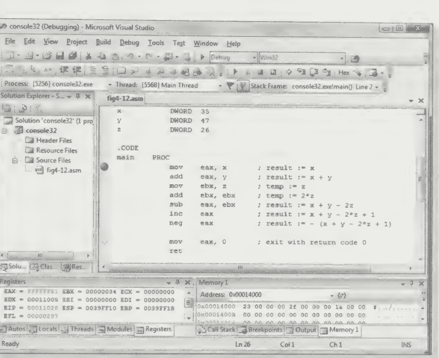

图 4.13 样本程序的执行

允许用户更改内存或寄存器中的值，但这可能会引起困惑。本节末尾的编程练习要求你修改此示例程序，为 `x`、`y` 提供对话框输入，并为表达式的值提供消息框输出。

你可能会奇怪 80x86 CPU 如何相加大于字宽的整数。早期的 CPU 有相加字节大小整数的指令；它们是如何处理 16 位或 32 位数字的？答案是，除了普通的加法指令外，CPU 还有带进位的加法指令。这些指令的作用与普通加法指令相似，不同在于进位的当前值（0 或 1）会被加到普通和中。要加大整数，请将它们拆分为 CPU 可以处理的任何大小的部分。对右部分使用加法以得到和的低位。然后使用带进位的加法指令加上后续部分。这个过程与大多数学生学习的小十进制加法过程非常相似。它可以继续进行任意数量的操作，因为带进位的加法指令会像普通加法指令一样设置进位标志。大数减法的步骤也类似，即使用带借位的减法指令。

## 4.2 练习题

- 1. 对于每条指令，给出 80x86 的操作码和机器码的总字节数（包括前缀字节）。假设你处于 32 位模式下，且 `wordOp` 和 `dbOp` 分别引用数据中的字和双字。你可以通过在短的 `console32` 程序中汇编这些指令来检查答案。

```assembly
*(a) add ax,wordOp (b) sub wordOp,ax
*(c) sub eax,10 (d) add db1Op,10
*(e) add eax,[ebx] (f) sub [ebx],eax
*(g) sub dl,ch (h) add bl1,5
*(i) inc ebx (j) dec al
*(k) dec db1Op inc BYTE PTR [esi]
*(m) neg eax (n) neg bh
*(o) neg db1Op (p) neg DWORD PTR [ebx]
```

- 2. 对于每条指令，给出 80x86 的操作码和机器码的总字节数（包括前缀字节）。假设你处于 64 位模式下，且 `wordOp`、`dbOp` 和 `quadOp` 分别引用数据中的字、双字和四字。你可以通过在短的 `console64` 程序中汇编这些指令来检查答案。

```assembly
*(a) add ax,wordOp (b) sub db1Op,ebx
*(c) sub eax,10 *(d) add quadOp,1000
*(e) inc r10b (f) dec wordOp
*(g) neg rdx (h) inc DWORD PTR [rdx]
```

- 3. 对于此问题的每个部分，假设执行给定指令时的“之前”值。给出要求的“之后”值。

| 之前 | 指令 | 之后 |
| :--- | :--- | :--- |
| *(a) EBX: FF FF 75<br>ECX: 00 00 00 01 | add eax,bx | | |
| *(b) EBX: FF FF 75<br>ECX: 00 00 00 01 | sub eax,x | | |
| *(c) sub eax,10 *(d) add quadOp,1000 | | |
| *(e) inc r10b (f) dec wordOp | | |
| *(g) neg rdx (h) inc DWORD PTR [rdx] | | |

*(注：由于原文中第3题表格部分文本存在大量重复和错位，翻译已尽可能还原原文结构。)*


```assembly
*(a) add ax,wordOp (b) sub wordOp,ax
*(c) sub eax,10 (d) add db1Op,10
*(e) add eax,[ebx] (f) sub [ebx],eax
*(g) sub dl,ch (h) add bl1,5
*(i) inc ebx (j) dec al
*(k) dec db1Op inc BYTE PTR [esi]
*(m) neg eax (n) neg bh
*(o) neg db1Op (p) neg DWORD PTR [ebx]
```

- 2. 对于每条指令，给出 80x86 的操作码和机器码的总字节数（包括前缀字节）。假设你处于 64 位模式下，且 `wordOp`、`dbOp` 和 `quadOp` 分别引用数据中的字、双字和四字。你可以通过在短的 `console64` 程序中汇编这些指令来检查答案。

```assembly
*(a) add ax,wordOp (b) sub db1Op,ebx
*(c) sub eax,10 *(d) add quadOp,1000
*(e) inc r10b (f) dec wordOp
*(g) neg rdx (h) inc DWORD PTR [rdx]
```

- 3. 对于此问题的每个部分，假设执行给定指令时的“之前”值。给出要求的“之后”值。

| 之前 | 指令 | 之后 |
| :--- | :--- | :--- |
| *(a) EBX: FF FF 75<br>ECX: 00 00 00 01 | add eax,bx | | | |
| *(b) EBX: FF FF 75<br>ECX: 00 00 00 01 | sub eax,x | | | |
| *(c) sub eax,10 *(d) add quadOp,1000 | | | |
| *(e) inc r10b (f) dec wordOp | | | |
| *(g) neg rdx (h) inc DWORD PTR [rdx] | | | |

*(注：由于原文表格内容极其混乱，此处仅为基于原文可见字符的翻译翻译。)*

## 4.3 乘法指令

80x86 架构有两种乘法指令助记符。`imul` 指令将其操作数视为有符号数；其符号由数字相乘的常规规则决定。`mul` 指令将操作数视为无符号二进制数；乘积也是无符号的。

### `mul` 指令

`mul` 的变体比 `imul` 少，因此我们首先考虑它。`mul` 指令有一个单操作数；其格式为：

```
mul source
```

源操作数可以是字节（byte）、字（word）、双字（doubleword）或四字（quadword）长度（四字仅在 64 位模式下有效）。它可以位于寄存器或内存中，但不能是立即数（immediate）。另一个待乘数的位置始终是累加器：对于字节源为 `AL`，字源为 `AX`，双字源为 `EAX`，四字源为 `RAX`。如果源是字节长度，则它与 `AL` 中的字节相乘；乘积长度为 16 位，目标为 `AX` 寄存器。如果源是字长度，则它与 `AX` 中的字相乘；乘积长度为 32 位，其低 16 位进入 `DX` 寄存器。如果源是双字，则它与 `EAX` 中的双字相乘；乘积长度为 64 位，`EAX` 及其高位 32 位位于 `EDX` 寄存器中，记为 `EDX:EAX`。如果源是四字，则它与 `RAX` 中的四字相乘；乘积长度为 128 位，其低 64 位位于 `RAX` 寄存器，高位 64 位位于 `RDX` 寄存器中，记为 `RDX:RAX`。对于字节乘法，`AX` 和 `DX` 中的原始值会被清空。对于双字乘法，`EAX` 和 `EDX` 中的原始值会被清空。同样，对于四字乘法，`RAX` 和 `RDX` 中的值会被乘积替换。在每情况下，源操作数不变，它是目标位置的一半。

乍一看，乘积长度是每个因数的两倍似乎很奇怪。然而，这在十进制乘法也会发生——例如，两个四位数相乘，乘积将是 7 或 8 位。具有乘法操作的计算机会将乘积放在双倍长度的位置，以避免目标位置太小导致的危险。

你可能也会奇怪为什么 8086 将 32 位乘积放在 `DX` 和 `AX` 而不是 `EAX`。这是因为 `mul` 指令存在于具有 16 位寄存器的 8086、8088、80186 和 80286 处理器中，当 80386 引入 32 位寄存器时，它的设计是为了扩展之前的架构。后续处理器继续保持与早期设计的兼容性。

图 4.14 总结了 `mul` 指令允许的操作数类型。注意 `mul` 不允许立即操作数。

#### 图 4.14 `mul` 指令

| 操作数 | 机器码 | 对象代码字节 |
| --- | --- | --- |
| 寄存器 8 | F6 | 2 |
| 寄存器 16 | F7 | 2 |
| 寄存器 32 | F7 | 2 |
| 内存字节 | F6 | 2+ |
| 内存字 | F7 | 2+ |
| 内存双字 | F7 | 2+ |
| **64位模式** | | |
| 寄存器 64 | F7 | 2 |
| 内存四字 | F7 | 2+ |

即使为双倍长度乘积留出了空间，判断乘积是否与源相同大小也是有用的，即高位部分是否为零。使用 `mul` 指令时，如果乘积的高位部分为零，则进位标志（CF）和溢出标志（OF）被置零（0），如果乘积的高位部分不为零，则置为 1。这些是乘法操作后唯一有意义的标志值；之前设置的 AF、PF、SF 和 ZF 标志可能会破坏。在第 5 节（分支与循环）中，将涵盖检查标志位值的指令；可以检查乘积的高位部分是否可以安全地忽略。

以下是一些示例，用于说明 `mul` 指令如何工作。

##### 示例 1

| | 执行的指令 | 执行后 |
| --- | --- | --- |
| EAX: 00 00 00 05 | mul ebx | EDX 00 00 00 00 |
| EBX: 00 00 00 02 | | EAX 00 00 00 0A |
| EDX: ?? ?? ?? | | CF, OF 0 |

##### 示例 2

| | 执行的指令 | 执行后 |
| --- | --- | --- |
| EAX: ?? ?? 00 05 | mul bx | EDX ?? ?? 00 00 |
| EBX: ?? ?? 00 02 | | EAX ?? ?? 00 0A |
| EDX: ?? ?? ?? | | CF, OF 0 |

##### 示例 3

| | 执行的指令 | 执行后 |
| --- | --- | --- |
| EAX: ?? ?? 00 00 | mul eax | EDX ?? ?? 00 00 |
| EBX: ?? ?? 00 0A | | EAX ?? ?? 00 64 |
| EDX: ?? ?? ?? | | CF, OF 0 |

##### 示例 4

| | 执行的指令 | 执行后 |
| --- | --- | --- |
| AX: ?? ?? 05 | mul factor | EDX ?? ?? 04FB |
| factor 处的字节: FF | | AX FF |
| CF, OF | | 1 |

第一个示例显示了 `EAX` 和 `EBX` 中双字的乘法。`EDX` 中的内容在乘法中不使用，但被乘积的高 32 位 `00000000` 替换。进位和溢出标志被置零，因为 `EDX` 为 0。第二个示例与第一个相同，因为操作数是字长度。`EDX` 的内容在乘法中不使用，但被乘积的高 16 位 `0000` 替换。进位和溢出标志被清零，因为 `EAX` 和 `EDX` 未变。第三个示例显示了 `AX` 自乘，显式源可以与其相同。最后一个示例显示了 `AL` 中的字节与内存中的字节相乘，值等于无符号数 255。乘积是无符号数 `4FB`，且由于高位（`AH`）为零，进位和溢出标志被置为 1。

### `imul` 指令

有符号乘法指令使用 `imul`。它有三种格式。第一种格式

```
imul source
```

与 `mul` 相同，源操作数包含一个因子，另一个在目标寄存器。源操作数不能是立即数。目标是 `DX:AX`、`EDX:EAX` 或 `RDX:RAX`，取决于源操作数的大小。如果乘积的高位部分显著，则进位和溢出标志被置为 1，否则置为 0。同样，如果低位部分的符号位为 1，高位部分将包含所有 1。单操作数 `imul` 指令总结在图 4.15 中。注意此表与图 4.14 相同。`mul` 和单操作数 `imul` 指令通过指令的 Mod/R 字节区分了两者。图 4.9 显示 reg = 100 用于 `mul`，reg = 101 用于 `imul`。

#### 图 4.15 `imul` 指令（单操作数格式）

| 操作数 | 机器码 | 对象代码字节 |
| --- | --- | --- |
| 寄存器 8 | F6 | 2 |
| 寄存器 16 | F7 | 2 |
| 寄存器 32 | F7 | 2 |
| 内存字节 | F6 | 2+ |
| 内存字 | F7 | 2+ |
| 内存双字 | F7 | 2+ |
| **64位模式** | | |
| 寄存器 64 | F7 | 2 |
| 内存四字 | F7 | 2+ |

第二种格式是

```
imul destination_register, source
```

在这种格式下，源操作数可以是寄存器、内存或立即数。另一个在目标寄存器中，该格式与 `add` 和 `sub` 指令类似。寄存器和内存操作数必须是字、双字或四字，而不是字节。乘积必须放入目标寄存器；进位和溢出标志被置零；如果不符合，则置为 1。图 4.16 总结了双操作数 `imul` 指令。注意这些指令中具有 2 字节长的的操作码。对于所有尺寸的目标，立即操作数都可以是在乘法前进行符号扩展的单字节。

#### 图 4.16 `imul` 指令（双操作数格式）

| 目标 | 源 | 机器码 | 对象代码字节 |
| --- | --- | --- | --- |
| 寄存器 16 | 寄存器 16 | 0F AF | 3 |
| 寄存器 32 | 寄存器 32 | 0F AF | 3 |
| 寄存器 16 | 内存字 | 0F AF | 3+ |
| 寄存器 32 | 内存双字 | 0F AF | 3+ |
| 寄存器 16 | 立即字节 | 6B | 3 |
| 寄存器 16 | 立即字 | 69 | 4 |
| 寄存器 32 | 立即字节 | 6B | 3 |
| 寄存器 32 | 立即双字 | 69 | 6 |
| **64位模式** | | | |
| 寄存器 64 | 寄存器 64 | 0F AF | 3 |
| 寄存器 64 | 内存四字 | 0F AF | 3+ |
| 寄存器 64 | 立即字节 | 6B | 3 |
| 寄存器 64 | 立即双字 | 69 | 6 |

对于双字操作，立即操作数也可以分别是字或双字。然而，对于四字目标，只有字节和双字立即操作数可用；任一都会符号扩展到 64 位。

第三种 `imul` 格式是

```
imul register, source, immediate
```

在这个版本中，第一个操作数（寄存器）仅是乘积的目标；两个因子是源指定的寄存器或内存位置的内容以及立即值。操作数寄存器和源的大小相同：16 位、32 位或 64 位。立即操作数的处理方式与双操作数格式相同——如果足够小则为字节大小，否则为字或双字，在所有情况下都符号扩展到源操作数的大小。如果乘积能够放入目标寄存器，则 CF 和 OF 被置零；否则置为 1。三操作数 `imul` 指令总结在图 4.17 中。

#### 图 4.17 `imul` 指令（三操作数格式）

| 寄存器目标 | 源 | 立即数操作数 | 操作码 | 对象代码字节数 |
| --- | --- | --- | --- | --- |
| 寄存器 16 | 寄存器 16 | 字节 (byte) | 6B | 3 |
| 寄存器 16 | 寄存器 16 | 字型 (word) | 69 | 4 |
| 寄存器 16 | 内存字型 | 字节 (byte) | 6B | 3+ |
| 寄存器 16 | 内存字型 | 字型 (word) | 69 | 4+ |
| 寄存器 32 | 寄存器 32 | 字节 (byte) | 6B | 3 |
| 寄存器 32 | 寄存器 32 | 双字型 (doubleword) | 69 | 6 |
| 寄存器 32 | 内存双字型 | 字节 (byte) | 6B | 3+ |
| 寄存器 32 | 内存双字型 | 双字型 (doubleword) | 69 | 6+ |
| **64 位模式** | | | | |
| 寄存器 64 | 寄存器 64 | 字节 (byte) | 6B | 3 |
| 寄存器 64 | 寄存器 64 | 双字型 (doubleword) | 69 | 6 |
| 寄存器 64 | 内存四字型 (quadword) | 字节 (byte) | 6B | 3+ |
| 寄存器 64 | 内存四字型 | 双字型 (doubleword) | 69 | 6+ |

一些示例将帮助展示 `imul` 指令的工作工作的。

##### 示例 1

| 执行前 | 执行的指令 | 执行后 |
| --- | --- | --- |
| EAX: 00 00 00 05 | imul ebx | EDX 00 00 00 00 |
| EBX: 00 00 00 02 | | EAX 00 00 00 0A |
| | | CF: OF 0 |

##### 示例 2

| 执行前 | 执行的指令 | 执行后 |
| --- | --- | --- |
| EAX: ?? ?? 00 05 | imul bx | EDX ?? ?? 00 00 |
| EBX: ?? ?? 00 02 | | EAX ?? ?? 00 0A |
| | | CF: OF 0 |

##### 示例 3

| 执行前 | 执行的指令 | 执行后 |
| --- | --- | --- |
| AX: ?? 05 | imul factor | AX FF FB |
| factor 处的字节: FF | | CF: OF, 0 |

##### 示例 4

| 执行前 | 执行的指令 | 执行后 |
| --- | --- | --- |
| EBX: 00 00 00 0A | imul ebx, 10 | EBX 00 00 00 64 |
| | | CF: 0 |

##### 示例 5

| 执行前 | 执行的指令 | 执行后 |
| --- | --- | --- |
| ECX: FF FF FF F4 | imul ecx, double | EBX 00 00 00 03 A8 |
| double 处的双字型: FF FF B2 | | CF: 0 |

##### 示例 6

| 执行前 | 执行的指令 | 执行后 |
| --- | --- | --- |
| value 处的字型: 08 F2 | imul bx, value, 1000 | BX F1 50 |
| | | CF: 1 |

前三个示例是单操作数格式，乘积是操作数长度的两倍。第一个示例显示了 `EAX`（隐含操作数）和 `EBX` 中的双字型相乘，结果在 `EDX:EAX` 中。第二个示例是第一个的字型版本，仅对 `AX` 和 `EBX` 中的值相乘，结果在 `DX:AX` 中。第三个示例显示了 `AL` 中的 5 乘以内存中 `factor` 处的字节中的 -1，得到一个等同于 `AX` 中 ~5 的字型乘积。在每情况下，CF 和 OF 均被清为 0，因为乘积的高位部分并不重要。

第四个示例显示了双操作数格式，将 `EBX` 中的 10 相乘，并将结果 100 存储在 `EBX` 中。除非指定目标，否则双操作数格式下不使用 `EDX` 寄存器。由于乘积可以放入 `EBX` 中，因此 CF 和 OF 被清为 0。在倒数第二个示例中，两个负数相乘，得到了一个正结果。

最后一个示例显示了三操作数格式，将 `8F2`₁₆ 乘以 `1000`₁₀——结果太大，无法放入 `BX`。标志位 CF 和 OF 被设置为 1，以指示结果太大，低位数字保存在 `EBX` 中。

早期的 80x86 CPU 以固定的时钟周期处理每条指令。随着技术的发展，在较新的处理器上，每条指令所需的时钟周期都比前代产品要少。这与更高的时钟频率共同促进了新计算机更快的速度。目前的 80x86 处理器使用流水线技术一次处理多条指令。这使得确定任何指令的精确时机变得困难。然而，通常情况下乘法基础指令是 80x86 指令中执行速度最慢的之一。例如，如果你想将 `EAX` 中的值乘以 2，使用以下方法比使用另一种方法高效得多：

```
add eax, eax      ; 将值翻倍
```

相比

```
imul eax, 2      ; 将值翻倍
```

无论你是用汇编语言还是高层语言编程，在简单的加法即可完成的情况下避免使用乘法。

正如你在本节中看到的，80x86 架构的乘法指令有三种格式。你可能注意到乘积的目标不能是内存操作数。这听起来可能很局限，但某些处理器具有更大的局限。事实上，大多数 8 位微处理器（包括 8080）没有乘法指令；任何乘法都必须通过软件例程完成。本节以一个 32 位程序示例结束，该程序将输入矩形的长度和宽度，计算其面积（长度*宽度），并显示结果。诚然，这项工作更适合手计算器，而不是汇编语言或其他任何语言的计算机程序。图 4.18 显示了程序的源代码。注意该程序使用 `imul` 来寻找乘积——长度和宽度都是正数。这是因为 `length` 和 `width` 是汇编器的预留字。如果你在汇编程序时遇到异常错误，请检查附录 B，查看是否不小心将保留字用作了标识符。图 4.19 显示了程序的示例运行。如果你使用调试器在 `mul` 指令后查看寄存器，你会在 `EAX` 中看到乘积，但你也会看到 `EDX` 被设置为全——`mul` 指令计算的实际乘积是 64 位的。


; 计算矩形面积的程序
; 作者: R. Detmer
; 日期: [省略]

```asm
.MODEL FLAT
.STACK 40

.DATA
long WORD ?
wide WORD ?
prompt1 BYTE "Length of rectangle?", 0
prompt2 BYTE "Width of rectangle?", 0
area BYTE "The area is ", 0, DUP (?)

.CODE
MainProc PROC
    mov dx, prompt1      ; 显示提示
    int 2h              ; 输入长度
    mov long, ax       ; 存储长度

    mov dx, prompt2      ; 显示提示
    int 2h              ; 输入宽度
    mov wide, ax       ; 存储宽度

    mov ax, long        ; 加载长度
    mul wide            ; 乘以宽度
    mov area, ax        ; 存储面积

    mov dx, area        ; 输出结果
    int 2h

    ret
MainProc ENDP
END
```

图 4.18 计算矩形面积的程序

## 练习题 4.3

1. 对于本题的每个部分，假设执行指令时的“执行前”值。给出要求的“执行后”值。

| 执行前 | 执行的指令 | 执行后 |
| --- | --- | --- |
| (a) EAX: 00 00 00 05 | `imul ebx` | EDX 00 00 00 00 |
| EBX: 00 00 00 02 | | EAX 00 00 00 0A |
| | | CF: OF 0 |
| (b) EAX: ?? ?? 00 05 | `imul bx` | EDX ?? ?? 00 00 |
| EBX: ?? ?? 00 02 | | EAX ?? ?? 00 0A |
| | | CF: OF 0 |
| (c) AX: ?? 05 | `imul factor` | AX FF FB |
| factor 处的字节: FF | | CF: OF, 0 |
| (d) EBX: 00 00 00 0A | `imul ebx, 10` | EBX 00 00 00 64 |
| | | CF: 0 |
| (e) ECX: FF FF FF F4 | `imul ecx, double` | EBX 00 00 00 03 A8 |
| double 处的双字型: FF FF B2 | | |
| | | CF: 0 |
| (f) value 处的字型: 08 F2 | `imul bx, value, 1000` | BX F1 50 |
| | | CF: 1 |

2. 给出练习 1 中每条指令的操作码和对象代码字节数（包括前缀）。

3. 对于本题的每个部分，假设执行指令时的“执行前”值。给出要求的“执行后”值。

| 执行前 | 执行的指令 | 执行后 |
| --- | --- | --- |
| *(a) EBX: 00 00 00 17 | `imul ebx, 10` | EBX 00 00 00 64 |
| | | CF: 0 |
| *(b) ECX: FF FF FF F4 | `imul ecx, double` | EBX 00 00 00 03 A8 |
| | | CF: 0 |
| *(c) AX: ?? 05 | `imul factor` | AX FF FB |
| factor 处的字节: FF | | CF: OF, 0 |
| *(d) EBX: 00 00 00 0A | `imul ebx, 10` | EBX 00 00 00 64 |
| | | CF: 0 |
| *(e) ECX: FF FF FF F4 | `imul ecx, double` | EBX 00 00 00 03 A8 |
| | | CF: 0 |
| *(f) value 处的字型: 08 F2 | `imul bx, value, 1000` | BX F1 50 |
| | | CF: 1 |

# 1.3 130 基础指令

这里有六次乘法和三次加减。基于 Horner 多项式求值方法的等效形式为：

```asm
((5*x-7)*x+3)*x-10
```

这只有三次乘法。假设 x 的值在 `EAX` 寄存器中。

- (a) 编写 80x86 汇编语言语句，以“显而易见”的方法计算 p(x)，并将结果存入 `EAX`。
- (b) 编写 80x86 汇编语言语句，使用 Horner 方案计算 p(x)，同样将结果存入 `EAX`。
- (c) 比较上述 (a) 和 (b) 中代码段所需的机器码字节数。
- 6. 80x86 架构具有针对符号数和无符号数乘法的不同指令。但它没有针对符号数和无符号数加法设置独立的指令。为什么乘法需要不同的指令，而加法不需要？

## 编程练习 4.3

- 1. 使用 `windows32` 或 `windows64` 框架，编写一个完整的 80x86 汇编语言程序，提示并输入盒子的长度、宽度和高度，计算并显示其体积（长 * 宽 * 高）。
- 2. 使用 `windows32` 或 `windows64` 框架，编写一个完整的 80x86 汇编语言程序，提示并输入盒子的长度、宽度和高度，计算并显示其表面积 `2*(length*width + length + width*height)`。
- 3. 假设某人有数量的硬币（美分、镍币、硬角、季度币、50 分币和美元币），想知道硬币的总价值以及硬币的数量。使用 `windows32` 或 `windows64` 框架编写一个程序来帮助。具体来说，使用以下设计：

```
提示并输入美分的数量；
total := number of pennies;
numberOfCoins := number of pennies;
提示并输入镍币的数量；
total := total + 5 * number of nickels;
add number of nickels to numberOfCoins;
提示并输入硬角的数量；
total := total + 10 * number of dimes;
add number of dimes to numberOfCoins;
提示并输入季度币的数量；
total := total + 25 * number of quarters;
add number of quarters to numberOfCoins;
提示并输入 50 分币的数量；
total := total + 50 * number of 50-cent pieces;
add number of 50-cent pieces to numberOfCoins;
提示并输入美元的数量；
total := total + 100 * number of dollars;
add number of dollars to numberOfCoins;
显示硬币的数量、美元价值和美分：
```

最终的显示将在一个消息框中完成，标签为“Coin Information”（硬币信息），包含三行消息：第一行显示“Number of coins”并给出数量，第二行显示“Dollar”并给出 `total div 100` 的值，第三行显示“Cents”和 `total mod 100` 的值。假设所有值都能放入双字（doublewords）。（提示：将总数转换为 ASCII，最后两个字符是 `total mod 100`，而前面的字符是 `total div 100`。）

## 4.4 除法指令

Intel 80x86 除法指令与单操作数乘法指令并行：`idiv` 用于符号补码整数的除法，`div` 用于无符号整数的除法。记住，单操作数乘法指令以乘数和被乘数开始，并产生双长度乘积。除法指令以双长度被除数和单长度除数开始，产生单长度的商和单长度的余数。80x86 有可以在除法前产生双长度被除数的指令。

除法指令格式如下：

```
idiv source
```

### 基础指令

| 源 (除数) | 隐式操作数 (被除数) | 商 | 余数 |
|---|---|---|---|
| byte | AX | AL | AH |
| word | DX:AX | AX | DX |
| doubleword | EDX:EAX | EAX | EDX |
| quadword | RDX:RAX | RAX | RDX |

图 4.20 80x86 除的操作数和结果。源标识除数。除数可以在寄存器中，也可以在内存中。`div` 和 `idiv` 都使用隐式被除数。如果源是 `byte` 长度，则双长度被除数是 `word` 且在 `AX` 寄存器中。如果源是 `word` 长度，则被除数是 `doubleword` (DX:AX)，高 16 位在 `DX` 中，低 16 位在 `AX` 中。如果源是 `doubleword` 长度，则被除数是 `quadword` (64 位，EDX:EAX)，高 32 位在 `EDX` 中，低 32 位在 `EAX` 中。如果源是 `quadword` 长度，则被除数是 `octalword` (128 位，RDX:RAX)，高 64 位在 `RDX` 中，低 64 位在 `RAX` 中。表 4.20 总结了 80x86 除法的商和余数的位置。源操作数（除数）不会被除法指令改变。对于所有操作，被除数、除数和余数都由方程 `dividend = quotient * divisor + remainder` 定义。对于无符号 `div` 操作，被除数、除数和余数被视为非负数。对于符号 `idiv` 操作，商的符号由被除数和除数的符号决定；余数的符号始终与被除数的符号相同。除法指令不设置意义的值。它们可能会改变之前设置的 CF、OF 或 ZF 标志。某些示例展示了除法指令的工作原理。

### 示例

| 之前 | 执行指令 | 之后 |
|---|---|---|
| EDX: 00 00 00 00 | `idiv bl` ; -511/(-32) | AX E1 OF |
| BL: E0 | | |
| AX: FE 01 | `div bl` ; 65025/255 | AX 00 FF |
| BL: FF | | |

在这两个示例中，十进制 100 除以 13。由于 `100 = 7 * 13 + 9`，商为 7，余数为 9。对于 `doubleword` 长度的除数，商在 `EAX` 中，余数在 `EDX` 中。对于 `byte` 长度的除数，商在 `AL` 中，余数在 `AH` 中。

对于被除数或除数为负的操作，类似于上述的方程：

```
100 = (-7) * (-13) + 9          (100/-13, 商 -7, 余数 9)
-100 = (-7) * 13 + (-9)      (-100/13, 商 -7, 余数 -9)
-100 = 7 * (-13) + (-9)      (-100/-13, 商 7, 余数 -9)
```

注意每种情况下余数的符号都与被除数的符号相同。以下示例反映了除数为 13 或 -13 的 `doubleword` 情况。在第二个和第三个示例中，被除数 -100 表示为 `EDX:EAX` 中的 64 位数 `FF FF FF FF FF 9C`。

| 之前 | 执行指令 | 之后 |
| --- | --- | --- |
| EDX: 00 00 00 00 | `idiv ecx` ; 100/(-13) | EDX: 00 00 00 09 |
| EAX: 00 00 00 64 | | EAX: FF FF FF F9 |
| EDX: FF FF FF FF | `idiv ecx` ; -100/13 | EDX: FF FF FF F7 |
| EAX: FF FF FF 9C | | EAX: FF FF FF F7 |
| EDX: FF FF FF FF | `idiv ecx` ; -100/(-13) | EDX: FF FF FF F7 |
| EAX: FF FF FF 9C | | EAX 00 00 00 07 |

最后，这里有两个示例来帮助说明符号和无符号除法的区别。使用符号除法，-511 除以 -32，商为 15，余数为 -31。使用无符号除法，65025 除以 255，商为 255，余数为 0。

| 之前 | 执行指令 | 之后 |
| --- | --- | --- |
| AX: FE 01 | `idiv bl` ; -511/(-32) | AX E1 OF |
| BL: E0 | | |
| AX: FE 01 | `div bl` ; 65025/255 | AX 00 FF |
| BL: FF | | |

对于乘法，每个单操作数格式中的双长度目标保证了乘积能够放入目标位置——单操作数乘法操作期间不会发生任何错误。然而，除法可能会出现错误。明显的原因是尝试除以零。一个不明显的原因是商太大到无法放入单长度目标操作数；例如，如果将 `0002468A` 除以 `0002`；商 `12345` 太大无法放入 `AX` 寄存器。在除法操作期间发生错误，8086 会产生一个异常。处理此异常的例程（或中断处理程序）因系统不同而异。

图 4.21 列出了 `div` 和 `idiv` 指令允许的操作数类型。这些指令具有相同的机器码，通过 ModR/M 字节的 reg 字段进行区分，如图 4.9 所示。

| 操作数 | 机器码 | 对象代码字节数 |
|---|---|---|
| 寄存器 8 | F6 | 2 |
| 寄存器 16 | F7 | 2 |
| 寄存器 32 | F7 | 2 |
| 内存字节 | F6 | 2+ |
| 内存字 | F7 | 2+ |
| 内存双字 | F7 | 2+ |
| **64位模式** | | |
| 寄存器 64 | F7 | 2 |
| 内存四字 | F7 | 2+ |

图 4.21 div 和 idiv 指令

当对给定长度的操作数进行算术运算时，在执行除法操作之前，必须将被除数转换为双倍长度。对于无符号除法，双字大小的被除数必须转换为四字大小，并在 `EDX` 寄存器高位补零位。这可以通过许多方法实现，其中两种是：

```asm
mov edx, 0
```

和

```asm
sub edx, edx
```

可以使用类似的指令在分别对四字、字或字节进行无符号除法之前，在 `RDX`、`DX` 或 `AH` 中置 0。

有符号除法的情况更为复杂。正数被除数必须在符号位补 0 位进行扩展，但负数被除数必须在符号位补 1 位进行扩展。8086 具有专门用于此任务的指令：`cbw`、`cwd`、`cdq` 和 `cqo`。

| 指令 | 机器码 | 对象代码字节数 |
| --- | --- | --- |
| `cbw` | 98 | 1 |
| `cwd` | 99 | 1 |
| `cdq` | 99 | 1 |
| `cqo` | 99 | 1 |

**图 4.22** 准备有符号除法的指令

这些指令是我们见过的第一个没有操作数的指令。`cbw` 指令始终以 `AL` 为源，`AX` 为目标，`cwd` 指令始终以 `AX` 为源，`DX:AX` 为目标，`cdq` 指令始终以 `EAX` 为源，`EDX:EAX` 为目标，而 `cqo` 指令始终以 `RAX` 为源，`RDX:RAX` 为目标。源寄存器保持不变，但在 `AH`、`DX`、`EDX` 或 `RDX` 中作为符号数进行扩展。这些指令在图 4.22 中汇总在一起。

`cbw`（转换为字）指令将 `AL` 寄存器中的 2 补码数（半字长度）扩展到 `AX` 中的字长度。`cwd`（将字转换为双字）指令将 `AX` 中的字扩展到 `DX` 和 `AX` 中的双字。`cdq`（将双字转换为四字）指令将 `EAX` 中的双字扩展到 `EDX` 和 `EAX` 中的四字。`cqo` 指令将 `RAX` 中的四字扩展到 `RDX` 和 `RAX` 中的双四字。每条指令都将原始数的符号位复制到结果高位部分的每个位上。这些指令都不会影响标志位。一些示例如下：

| 执行前 | 执行的指令 | 执行后 |
| --- | --- | --- |
| EAX: FF FF FA 13 | `cdq` | EDX FF FF FF FF |
| DX: ?? ?? ?? ?? | | EAX FF FF FA 13 |
| AX: 07 0D | `cwd` | DX 00 00 |
| DX: ?? ?? | | AX 07 0D |
| AX: ?? 53 | `cbw` | AX 00 53 |
| AX: ?? C6 | `cbw` | AX FF C6 |

本节以另一个简单程序结束；这一个程序用于将摄氏度（centigrade）温度转换为华氏度。图 4.23 给出了源代码。所实现的公式为

F = (9/5) * C + 32

```asm
; 内存中 cTemp 的摄氏度转换程序
; 内存中 fTemp 对应的华氏度
; 作者：R. Detmer
; 日期：6/2008 修订

.586
.MODEL FLAT
.STACK 4096

.DATA
cTemp DWORD 35      ; 摄氏度温度
fTemp DWORD ?       ; 华氏度温度

.CODE
main   PROC
       mov     eax, cTemp  ; 从摄氏度开始
       imul    eax, 9       ; C*9
       add     eax, 2       ; 除法舍因子
       mov     ebx, 5       ; 除数
       cdq                 ; 准备除法
       idiv    ebx         ; C*9/5
       add     eax, 32      ; C*9/5 + 32
       mov     fTemp, eax  ; 保存结果

       mov     eax, 0       ; 以返回代码 0 退出
       ret
main   ENDP
END
```

图 4.23 将摄氏度温度转换为华氏度


其中`F`是华氏度温度，`C`是摄氏度温度。程序从内存中`cTemp`的摄氏度开始，到内存中`fTemp`的华氏度结束。由于除法运算的要求，在执行除法操作之前，必须将除数转换为双倍长度。对于无符号除法，双字大小的除数必须转换为四字大小，并在`ED`寄存器高位补零位。这可以通过许多方法实现，其中两种是：

有符号除法的情况更为复杂。正数除数必须在符号位补`0`位进行扩展，但负数除数必须在符号位补`1`位进行扩展。由于除法运算的要求，`35 63`除以`5`得到`317`。最后，加`32`得到`95`。

图 4.24 摄氏度温度转华氏度程序

## 138 基础指令

## 练习 4.4

1. 对于此题的每个部分，假设在执行指令时，给出的“执行前”值。

| 执行前 | 执行的指令 | 执行后 |
| --- | --- | --- |
| (a) EDX: FF FF FF FF | `cdq` | |
| (b) EAX: FF FF 13 | `cdq` | |
| (c) DX: 00 00 | `cwd` | |
| (d) AX: 07 0D | `cwd` | |
| (e) AX: 00 53 | `cbw` | |
| (f) AX: FF C6 | `cbw` | |

2. 给出练习 1 中每条指令的机器码和对象代码字节数（包括前缀）。

3. 本节提两种无符号除法前清空`DX`的方法：

```
mov edx, 0
sub edx, edx
```

哪条指令所需的字节更少？

## 练习 4.4

1. 华氏转摄氏度的公式为`C = (5/9) * (F - 32)`。使用`windows32`或`windows64`框架，编写一个完整的`8086`汇编程序，提示输入华氏温度并计算显示对应的摄氏温度。

2. 使用`windows32`或`windows64`框架，编写一个完整的`8086`汇编程序，提示并输入四个成绩（使用独立的对话框），计算总和和平均分（`sum/4`）。在消息框中分行显示这些结果，每行带有合适的标签。

3. 使用`windows32`或`windows64`框架，编写一个完整的`8086`汇编程序，提示并输入四个成绩`Grade1`、`Grade2`、`Grade3`和`Grade4`。假设最后一个成绩是期末考试，权重是两次。计算总和（重复加最后一个成绩）和平均分（`sum/5`）。在消息框中分行显示，每行带有合适的标签。

4. 使用`windows32`或`windows64`框架，编写一个完整的`8086`汇编程序，提示并输入四个成绩`Grade1`、`Grade2`、`Grade3`和`Grade4`，以及四个双字类型的权重`Weight1`、`Weight2`、`Weight3`和`Weight4`。（这将需要八个对话框）。每个权重因子表示相应成绩在总和中计数的次数。

`WeightedSum = Grade1*Weight1 + Grade2*Weight2 + Grade3*Weight3 + Grade4*Weight4`

以及权重之和为`SumOfWeights = Weight1 + Weight2 + Weight3 + Weight4`

计算加权和、权重总和以及加权平均值（`WeightedSum / SumOfWeights`）。显示加权和消息框中两行的平均值，每行都有相应的标签。

## 章节总结

Intel 80x86 `mov`指令用于将数据从一个位置复制到另一个位置。除了少数源和目的位置组合外，所有组合都是允许的。`xchg`指令交换两个位置存储的数据。

80x86架构有一套完整的指令，用于字节、字、双字和四双字（64位模式下）整数的算术运算。`add`和`sub`指令执行加法和减法；`inc`和`dec`分别加`1`和减`1`。

`neg`指令对其操作数取反；即取操作数的补码负数。

有两个乘法和两个除法助记符。`imul`和`idiv`指令假设其操作数是有符号的补码数；`mul`和`div`假设其操作数是无符号的。许多乘法指令从单长度操作数开始并产生双长度乘积；其他格式则产生与操作数长度相同的乘积。除法指令始终以双长度被除数和单长度除数开始；运算结果为单长度商和单长度余数。`cbw`、`cwd`、`cdq`和`cgo`指令有助于在符号除法之前生成双长度被除数。标志位设置指示乘法过程中可能错误；除法期间错误会产生硬件异常，调用过程来处理错误。

在寄存器中有操作数的指令通常比引用内存位置的指令快。乘法和除法指令比加减指令慢。

## 第 5 章

## 分支与循环

计算机的强大程度上源于其选择性执行代码的能力以及执行算法的速度。Java或C++等高级语言程序使用`if-then`、`if-then-else`和`case`结构来选择性执行代码，并使用循环结构如`while`（预测试）循环、`until`（后测试）循环和`for`（计数控制）循环来重复执行代码。某些高级语言具有`goto`语句用于无条件分支。稍微原始一点的语言（如旧版本的FORTRAN或BASIC）依赖于相当简单的`if`语句和大量的`goto`语句来实现选择性执行和循环。

- 5.1 无条件跳转
- 5.2 条件跳转、比较指令和结构
- 5.3 实现循环结构
- 5.5 数组
- 5.6 章节总结

8086汇编语言程序员的工作与旧旧的FORTRAN或BASIC程序员的工作相似。80x86微处理器可以执行某些与`for`语句大致相当的指令，但大多数分支和循环是使用80x86语句完成的，这些语句与简单的`if`和`goto`语句相似但甚至更原始。本章的目标是描述`if-then`、`if-then-else`、`while`、`until`和`for`等设计/语言结构的机器实现。循环通常与数组一起使用，涵盖了适用于数组访问的寻址模式。

## 5.1 无条件跳转

8086 `jmp`（“跳转”）指令对应于高级语言中的`goto`。在汇编语言代码中，`jmp`通常具有以下形式：

```assembly
jmp statementLabel
```

其中`statementLabel`对应于其他汇编语言语句的名称字段。回想一下，当用于标记可执行语句时，名称字段后面跟着一个冒号（:）。`jmp`指令本身不使用冒号。例如，如果存在程序终止的替代条件，其代码可能包含：

```assembly
jmp quit      ; 退出程序

quit: mov eax, 0   ; 用返回代码 0 退出
ret
```

图 5.1 显示了一个完整的示例，该程序将无限循环，在第 n 次循环迭代时计算 1+2+...+n。程序实现了下面的伪代码：

```
number := 0;
sum := 0;
forever loop
    add 1 to number;
    add number to sum;
end loop:
```

你计划寄存器和内存的使用来编写这样的设计。在此实现中，`number`存储在`EBX`中，`sum`存储在`EAX`中。内存中没有存储数据。

图 5.2 显示了循环体执行一次后的调试器窗口。在`jmp`指令处设置了断点，使得可以在继续之前检查`sum`(`EAX`)和`count`(`EBX`)的内容。注意`sum`和`count`都是第一次到达断点。按F5或继续按钮执行`jmp`指令并再次循环。图 5.3 显示了执行循环六次后的调试器窗口；`number`(`EBX`)包含`6`，`sum`(`EAX`)包含`15`(`2₁₁`)，这是 1+2+3+4+5+6 的正确结果。可以通过点击停止按钮终止程序。

```assembly
; 寻找 n=1, 2, ... 的和 1+2+...+n 的程序。
; author: R. Detmer
; revised: 6/2008

.586
.MODEL FLAT
.STACK 4096

DATA

CODE
main
    mov ebx, 0       ; number := 0
    mov eax, 0       ; sum := 0

forever: inc ebx    ; add 1 to number
    add  eax, ebx   ; add number to sum
    jmp  forever
```

图 5.1 显示了一个完整的示例...（文本继续）


```assembly
; 寻找 n=1, 2, ... 的和 1+2+...+n 的程序。
; author: R. Detmer
; revised: 6/2008

.586
.MODEL FLAT
.STACK 4096

DATA

CODE
main
    mov ebx, 0       ; number := 0
    mov eax, 0       ; sum := 0

forever: inc ebx    ; add 1 to number
    add  eax, ebx   ; add number to sum
    jmp  forever
```

图 5.1 显示了一个完整的示例...（文本继续）


## 5.1 无条件跳转

| 类型 | 码 | 机器码字节 |
| --- | --- | --- |
| 近相对跳转 | E9 | 5 |
| 短相对跳转 | EB | 2 |
| 寄存器间接 | FF | 2 |
| 内存间接 | FF | 2+ |

每个相对跳转的机器码包含相对于跳转指令的目标偏移量。将此偏移加到下一指令的地址即可找到目标地址。偏移是有符号数，向前引用为正，向后引用为负。对于指令的短版本，只存储单个偏移字节；在加法之前进行符号扩展。近相对格式包含 32 位偏移量。在 32 位模式下，直接加到`EIP`，但在 64 位模式下，先符号扩展后加到`RIP`。短相对跳转中的 8 位偏移量可以用于距离跳转指令前 128 字节或后 127 字节的目标语句。该偏移是从指令执行时从指令字节本身测量的，指令指针本地包含下一指令的地址。近跳转指令中的 32 位偏移量可以用于距离跳转指令 2,147,483,648 字节或后 2,147,483,647 字节的目标语句。短相对跳转和相对跳转的代码没有区别。为了生成更紧凑的代码，汇编器在目标位于较小范围内使用短跳转。如果目标超过 128 字节，则会自动使用近跳转。

间接跳转使用目标地址而不是偏移量。然而，该地址不在指令本身中。它是在寄存器或内存中。因此格式为：

```assembly
jmp edx
```

# 148 分支与循环

跳转到`EDX`中存储的地址。内存间接跳转格式可以使用任何有效的内存引用。如果`targetAddr`在数据段中声明为`DWORD`，那么

```assembly
jmp targetAddr
```

意为跳转到双字（doubleword）中存储的地址，而不是跳转到数据段中的点。使用寄存器间接寻址，你可以使用

```assembly
jmp DWORD PTR [ebx]
```

这会导致跳转到`EBX`中存储的地址的双字所存储的地址！幸运的是，这些间接形式很少需要。

# 练习 5.1

1. 如果执行语句

```assembly
hardLoop: jmp hardLoop
```

它将继续“永远”执行。该语句的机器码是什么？（如果你无法想出来，请将该语句放入程序中，汇编程序，并查看列表文件。）

2. 识别以下代码片段中每个`jmp`指令的类型（即：相对近跳转、相对短跳转、寄存器间接或内存间接）。

```assembly
.DATA
...
addrStore DWORD ?
...
.CODE
...
doAgain:
... (3 instructions)
jmp doAgain
... (200 instructions)
jmp doAgain
...
jmp addrStore
...
jmp eax
...
jmp DWORD PTR [edi]
```

# 5.2 条件跳转、比较指令与 if 结构

# 编程练习 5.1

1. 使用`console32`或`console64`框架，修改图 5.1 中的程序，使得在循环的第 n 次迭代后，`EAX`包含`1*2* ... *n`。

2. 使用`windows32`或`windows64`框架，编写一个程序，该程序将反复使用对话框提示输入一个数字。在每次输入数字后，使用单独的对话框分别显示目前为止输入的所有数字之和和平均值。（注意：你可以在对话框等待数字时点击停止按钮来终止程序。）

# 5.2 条件跳转、比较指令与 if 结构

条件跳转指令使得在 80x86 机器语言中实现 if 结构、其他选择结构和循环结构成为可能。这类指令有很多。每个指令的格式为

```assembly
j-- targetStatement
```

其中助记符的最后（此处用连字符表示）标识了执行跳转的条件。如果条件成立，则发生跳转；否则，执行下一条指令（条件跳转之后的指令）。

除一个例外外（5.4 节中介绍的`jczx`/`jec`指令），条件跳转指令考虑的“条件”是标志寄存器中各种标志位的设置。例如

```assembly
jz endWhile
```

意为如果零标志`ZF`被设置为`1`，则跳转到标签为`endWhile`的语句；否则，执行到下一条语句。（助记符`jz`代表“如果零则跳转”，jump if zero。）

条件跳转指令不修改标志；它们只对之前设置的标志做出反应。回想标志寄存器中的标志是如何获取值的。某些指令（如`mov`）保持不变，某些指令（如`add`）根据结果的值显式设置某些标志，另一些指令（如`div`）则不可预测地更改某些标志，使其变为未知值。

假设，将`EAX`寄存器中的值加到代表账户余额的和中，并根据新余额是负、零还是正需要三种不同的处理方式。这种设计的伪代码如下：

```text
add value to balance;

if balance < 0
then
... { 负余额的设计 }
elself balance = 0
then
... { 零余额的设计 }
else
... { 正余额的设计 }
end if;
```

假设`balance`存储在内存中的双字中，`value`存储在`EAX`中，以下 80x86 代码片段实现了这一设计。

```assembly
add         balance, eax      ; 将值加到余额
jns         elseIfZero       ; 如果余额不
                               ; 负
                               ; 负余额的代码
                               ...
jmp         endBalanceCheck
elseIfZero: jnz elsePos       ; 如果余额不为零
                               ; 零余额的代码
jmp         endBalanceCheck
elsePos:                    ; 正余额的代码
endBalanceCheck:
```

适当的标志位由`add`指令设置或清除。上述代码片段中显示的其他指令均未更改标志。该设计首先检查(`balance < 0`)。代码通过以下指令执行此操作

```assembly
jns         elseIfZero
```

意为如果标志未设置，即如果(`balance < 0`)不成立，则跳转到`elseIfZero`。此指令之后的代码对应于设计中第一个`then`之后的语句，即当(`balance < 0`)为真时应该执行的操作。语句

```assembly
jmp         endBalanceCheck
```

语句块末尾的语句是必要的，以便 CPU 跳过对应于其他情况的语句。如果第一个条件跳转将控制转移到`elseZero`，那么余额必须是非负的（零或正）。该设计检查余额是否为零；指令

```assembly
elseZero: jnz elsePos
```

在零标志`ZF=0`时跳转到`elsePos`。最后设置标志的指令是开头的`add`，因此如果余额不为零，则发生跳转。

## 5.2 条件跳转、比较指令和 if 结构

哪些标志位值表征了相等、小于和大于的关系？

相等很容易理解：无论数字被解释为有符号还是无符号，当且仅当*operand1*的值与*operand2*相等时，`ZF`标志位就会设置。示例 1 说明了这一点——小于和大于则需要分析。

当你第一次考虑“小于”时，似乎当*operand1*小于*operand2*时，进位标志位（`CF`）应该为借用者设置。如果将操作数解释为无符号数，这个逻辑是正确的。示例 3、5、6 和 8 的*operand1*和*operand2*都是无符号数，而这些恰恰是`CF=1`的示例。因此，对于无符号数，`CF=0`意味着*operand1* ≥ *operand2*。无符号数的严格大于关系由`CF=0`且`ZF=0`表征，即*operand1* ≥ *operand2*且*operand1* ≠ *operand2*。

示例 3、5、7 和 9 的*operand1* < *operand2*为有符号数。这种情况的特征是`SF=OF`。在其余示例中，`SF=OF`且*operand1* ≥ *operand2*为有符号数。无符号数的严格大于关系由`SF=0`且`ZF=0`表征，即*operand1* ≥ *operand2*且*operand1* ≠ *operand2*。

`cmp`指令列如图 5.5 所示。回看 4.8，你会发现各个列中的条目与`sub`指令几乎相同。某些操作数组合有替代方案——列出的是 Visual Studio 汇编器选择的方案。

为了更好地理解立即操作，有几点提示。这些可以使用你选择的基数或作为字符编码。假设`word`指代数据段中的一个字，则以下各项均为：

```assembly
cmp    eax, 356
cmp    wordop, 0d3a6h
cmp    bh, '$'
```

注意，立即操作数必须是第二个操作数。以下指令

```assembly
cmp    100, total      ; illegal
```


# 分支与循环

将无法汇编，因为第一个操作数是立即数。

最后，是时候列出跳转指令；它们如图 5.6 所示。许多生成完全相同机器码的替代助记符以不同的方式描述了条件集。通常，对于特定设计的实现，其中一个助记符比另一个更自然。该表分为三部分；前两个指令分别适用于有符号和无符号操作数的比较之后。第三部分增加了额外的条件跳转指令。

## cmp 指令编码

| 操作数 1 | 操作数 2 | 机器码 | 对象代码字节数 |
| --- | --- | --- | --- |
| register 8 | immediate 8 | 80 | 3 |
| register 16 | immediate 8 | 83 | 3 |
| register 32 | immediate 8 | 83 | 3 |
| register 16 | immediate 16 | 81 | 4 |
| register 32 | immediate 32 | 81 | 6 |
| AL | immediate 8 | 3C | 2 |
| AX | immediate 16 | 3D | 3 |
| EAX | immediate 32 | 3D | 5 |
| memory byte | immediate 8 | 80 | 3+ |
| memory word | immediate 8 | 83 | 3+ |
| memory doubleword | immediate 8 | 83 | 3+ |
| memory word | immediate 16 | 81 | 4+ |
| memory doubleword | immediate 32 | 81 | 6+ |
| register 8 | register 8 | 3A | 2 |
| register 16 | register 16 | 3B | 2 |
| register 32 | register 32 | 3B | 2 |
| register 8 | memory byte | 3A | 2+ |
| register 16 | memory word | 3B | 2+ |
| register 32 | memory doubleword | 3B | 2+ |
| memory byte | register 8 | 38 | 2+ |
| memory word | register 16 | 39 | 2+ |
| memory doubleword | register 32 | 39 | 2+ |
| **64-bit mode** | | | |
| register 64 | immediate 8 | 83 | 3 |
| register 64 | immediate 32 | 81 | 6 |
| RAX | immediate 32 | 3D | 5 |
| memory quadword | immediate 8 | 83 | 3+ |
| memory quadword | immediate 32 | 81 | 6+ |
| register 64 | register 64 | 3B | 2 |
| register 64 | memory quadword | 3B | 2+ |
| memory quadword | register 64 | 39 | 2+ |

图 5.5 `cmp` 指令

### 适用于有符号操作数比较之后

| 助记符 | 说明 | 跳转标志位 | 短偏移 (Short) | 近偏移 (Near) |
| --- | --- | --- | --- | --- |
| jg | 大于则跳转 | SF=OF and ZF=0 | 7F | 0F8F |
| jnle | 不小于或等于则跳转 | | | |
| jge | 大于或等于则跳转 | SF=OF | 7D | 0F8D |
| jnl | 不小于则跳转 | | | |
| jl | 小于则跳转 | SF≠OF | 7C | 0F8C |
| jnge | 不大于或等于则跳转 | | | |
| jle | 小于或等于则跳转 | SF≠OF or ZF=1 | 7E | 0F8E |
| jng | 不大于则跳转 | | | |

### 适用于无符号操作数比较之后

| 助记符 | 说明 | 跳转标志位 | 短偏移 (Short) | 近偏移 (Near) |
| --- | --- | --- | --- | --- |
| ja | 大于则跳转 | CF=0 and ZF=0 | 77 | 0F87 |
| jnbe | 不小于或等于则跳转 | | | |
| jae | 大于等于则跳转 | CF=0 | 73 | 0F83 |
| jnb | 不小于则跳转 | | | |
| jb | 小于则跳转 | CF=1 | 72 | 0F82 |
| jnae | 不大于或等于则跳转 | | | |
| jbe | 小于或等于则跳转 | CF=1 or ZF=1 | 76 | 0F86 |
| jna | 不大于则跳转 | | | |

### 其他条件跳转

| 助记符 | 说明 | 跳转标志位 | 短偏移 (Short) | 近偏移 (Near) |
| --- | --- | --- | --- | --- |
| je | 等于则跳转 | ZF=1 | 74 | 0F84 |
| jz | 零则跳转 | | | |
| jne | 不相等则跳转 | ZF=0 | 75 | 0F85 |
| jnz | 不零则跳转 | | | |
| js | 符号位设置则跳转 | SF=1 | 78 | 0F88 |
| jns | 符号位清除则跳转 | SF=0 | 79 | 0F89 |
| jc | 进位则跳转 | CF=1 | 72 | 0F82 |
| jnc | 不进位则跳转 | CF=0 | 73 | 0F83 |
| jp | 奇数则跳转 | PF=1 | 7A | 0F8A |
| jpe | 偶数则跳转 | | | |
| jnp | 非奇数则跳转 | PF=0 | 7B | 0F8B |
| jpo | 奇数则跳转 | | | |
| jo | 溢出则跳转 | OF=1 | 70 | 0F80 |
| jno | 不溢出则跳转 | OF=0 | 71 | 0F81 |

图 5.6 条件跳转指令（比较）

条件跳转助记符对应于前面的 `cmp` 指令中第一个操作数与第二个操作数的比较。例如，`jg`，“大于则跳转”意味着当 `operand1 > operand2` 时跳转。

没有条件跳转指令会改变任何标志位。每个指令都有短偏移（short）版本和近偏移（near）版本。与无条件跳转指令一样，短条件跳转编码单字节偏移，可以跳转到指令地址前 128 字节或后 127 字节。短条件跳转需要 2 字节对象代码，一个用于机器码，一个用于偏移量。近条件跳转除了 2 字节机器码外还编码 32 位偏移，总长度为 6 字节。它可以向后跳转 2147483648 字节或向前 2147483647 字节。

另一个示例将说明有符号数比较跳转的区别。假设一个值存储在 `EAX` 中，当该值大于 100 时需要执行某些操作。如果该值是无符号的，可能会

```
cmp eax, 100
ja bigger
```

跳转将适用于任何大于 `00000064h` 的值，包括 `80000000h` 到 `FFFFFFFFh` 之间的值，这些值代表了大的无符号数和所有负补码数。如果 `EAX` 中的值被解释为有符号的，那么指令

```
cmp  eax, 100
jg    bigger
```

是合适的。跳转将仅适用于 `00000065h` 到 `7FFFFFFFh` 之间的值，而不适用于代表负补码数的位模式。

我们现在看三个 `if` 结构实现的示例。这些实现与高级语言编译器使用的相同。首先考虑这种设计

```
if value < 10
then
    add 1 to smallCount;
else
    add 1 to largeCount;
end if;
```

假设 `value` 在 `EBX` 寄存器中，`smallCount` 和 `largeCount` 引用内存中的字。以下 80x86 代码实现了此设计。

```
cmp     ebx, 10          ; value < 10 ?
jnl     elseLarge        ; 如果不是则跳过
inc     smallCount       ; smallCount 加 1
jmp     elseValueCheck   ; 退出
elseLarge: inc largeCount    ; largeCount 加 1
elseValueCheck:
```

现在考虑以下设计

```
if (total >= 100) or (count = 10)
then
    add value to total;
end if;
```

假设 `total` 和 `value` 是内存中的双字（doublewords），且 `count` 存储在 `ECX` 寄存器中。以下实现该设计的汇编语言代码。

```
cmp total, 100      ; total >= 100 ?
jge addValue        ; 如果是则执行
cmp ecx, 10         ; count = 10 ?
jne endAddCheck     ; 如果不是则跳过
addValue: mov ebx, value ; 拷贝 value
        add total, ebx      ; 将 value 加到 total
endAddCheck:
```

注意该设计中的两个 `cmp` 指令。如果其中任何一个相应的测试通过，就会执行加法（为什么要用两个语句完成加法？为什么不直接使用 `add total, value` ？）这段代码实现了一种短路机制——如果第一个条件为真，则完全不检查第二个条件。某些语言实现的代码即使第一个操作数为真，也会检查操作的两个操作数。

最后考虑以下设计

```
if (count > 0) and (ch = backspace)
then
    subtract 1 from count;
end if;
```

对于这第三个示例，假设 `count` 在 `ECX` 寄存器中，`ch` 在 `AL` 寄存器中。该设计可以如下实现。

```
cmp ecx, 0          ; count > 0 ?
jng endCheckCh      ; 如果不是则完成
cmp al, 08h         ; ch 是 backspace 吗?
jne endCheckCh      ; 如果不是则完成
dec count           ; count 减 1
endCheckCh:
```

这个复合条件使用了 `and`，因此两个部分都为真才能执行操作。这段代码实现了一种短路机制——如果第一个条件为假，则完全不检查第二个条件。

在之前的每个实现示例中，汇编语言代码中语句的顺序遵循设计语句的顺序。采用一致的编码模式来准确实现设计是非常重要的。通常，为了使代码流与设计一致，你必须使用“负向”条件跳转，例如

```
jne endCheckCh ; 如果不是则完成
```

在最后一个示例中。可能会想使用等价的助记符 `jle` 代替 `jng`，但原始设计包含 `(count > 0)`，将 `jng` 改为等价的助记符 `jle` 很容易出错。助记符 `jg` 比 `jle` 更接近原始设计。一个常见的错误是使用“小于”而不是“小于或等于”作为“大于”的反面。

## 5.2 练习题

1. 假设此题的每个部分 `EAX` 寄存器包含 `00004Fh`，由 `value` 引用的双字包含 `FFFF38h`。确定每个条件跳转语句是否会导致跳转到 `dest`。

   (a) `cmp eax, value`  
       `jg dest`  
   (b) `cmp eax, value`  
       `jl dest`  
   (c) `cmp eax, 4Fh`  
       `je dest`  
   (d) `cmp eax, 79`  
       `jne dest`  
   (e) `cmp value, 0`  
       `jbe dest`  
   (f) `cmp value, -200`  
       `jge dest`  
   (g) `add eax, 200`  
       `js dest`  
   (h) `add value, 200`  
       `jz dest`

2. 此题的每个部分给出了带有 `if` 结构的设计以及关于变量如何在汇编语言程序中存储的假设。给出实现该设计的汇编语言代码段。汇编语言代码的流应与设计一致。

   (a) 设计：
   ```
   if count = 0
   then
       count := value;
   end if;
   ```
   假设：`count` 在 `ECX` 中；`value` 内存中的双字

   (b) 设计：
   ```
   if count > value
   then
       count := 0;
   end if;
   ```
   假设：`count` 在 `ECX` 中；`value` 内存中的双字

   (c) 设计：
   ```
   if a + b = c
   then
       check := 'Y';
   else
       check := 'N';
   end if;
   ```
   假设：`a`、`b` 和 `c` 的每个都引用内存中的双字；字符 `check` 在 `AL` 寄存器中

   (d) 设计：
   ```
   if (value ≤ -1000) or (value ≥ 1000)
   then
       value := 0;
   end if;
   ```
   假设：`value` 在 `EDX` 中

   (e) 设计：
   ```
   if (ch ≥ 'a') and (ch ≤ 'z')
   then
       add 1 to lowerCount;
   else
       if (ch >= 'A') and (ch <= 'Z')
       then
           add 1 to upperCount;
       else
           add 1 to otherCount;
       end if;
   ```
   假设：`ch` 在 `AL` 中；`lowerCount`、`upperCount` 和 `otherCount` 的每个都引用内存中的双字

## 5.3 实现循环结构

大多数程序都包含循环。常用的循环结构包括 `while`、`until` 和 `for` 循环。本节描述了如何在 80x86 汇编语言中实现这三种结构。下一节描述了可以实现循环的额外指令。

`while` 循环可以用以下方式表示

```
while condition
    { body }
```

`while` 循环是预测试——首先检查条件。如果为真，则执行体。

```
while:
    body
    jmp while
```

它有时取要检查循环的值。如果为真，则执行体。逻辑取或为假的唯一方法是两个操作数都为假。

```
x := 0;
twoToX := 1;
while twoToX <= number
    multiply twoToX by 2;
    add 1 to x;
end while;
```

图 5.7 计算 log₂(number)

假设 `sum` 代表内存中的一个双字（doubleword），`count` 的值在 `ECX` 寄存器中，实现如下：

```
whileSum:   cmp      sum, 1000    ; sum < 1000?
             jnl     endWhileSum  ; 如果不是则退出
             cmp      ecx, 24       ; count <= 24?
             jnle    endWhileSum  ; 如果不是则退出
                                     ; 循环体
             jmp      whileSum      ; 再次检查条件
endWhileSum:
```

再次修改该示例，接下来是一个使用 `or` 代替 `and` 的设计。

```
while (sum < 1000) or (flag = 1) loop
... { loop body }
end while;
```

这次，假设 `sum` 在 `EAX` 寄存器中，`flag` 是 `BL` 寄存器中的单字节。这里是实现该设计的 8086 代码。

```
whileSum:   cmp     eax, 1000    ; sum < 1000?
               jl      body            ; 如果是则执行 body
               cmp     bl, 1         ; flag = 1?
               jne     endWhileSum  ; 如果不是则退出
body:                       ; 循环体
               jmp     whileSum      ; 再次检查条件
endWhileSum:
```

注意前两个例子的区别。对于 `and` 条件，如果复合条件中的任一操作数为假，循环就会退出。对于 `or` 条件，如果复合条件中的任一操作数为真，就会执行循环体。

`for` 循环（一种计数器控制的循环）在给定范围内，为循环索引（计数器）的每个值执行一次循环体。在某些高级语言中，循环索引可以是整数以外的某种类型；而汇编语言的设计通常有一个索引寄存器。`for` 循环可以用以下伪代码描述：

```
index := initialValue to finalValue loop
... { loop body }
for:
```


`for` 循环可以很容易翻译成 `while` 结构。

```
index := initialValue;
while index <= finalValue loop
... { loop body }
add 1 to index;
end while;
```

## 分支与循环

这种 `while` 循环在 80x86 汇编语言中很容易编写。`until` 循环是一种后测试循环（posttest loop）——条件在执行循环体之后进行检查。通常，`until` 循环用伪代码可以表示如下：

```
repeat
  .. { loop body }
until termination condition;
```

循环体至少执行一次；然后检查终止条件。如果条件为假，则再次执行循环体；如果为真，则继续执行循环后的语句。80x86 的 `until` 循环实现通常看起来下面的代码片段。

```
until:          ; 循环体开始
                .
endUntil:      ; 检查终止条件的代码
```

如果检查终止条件的代码确定值为为假，则将跳转到 `until`。如果确定值为真，则代码将直接执行到 `endUntil`，或者跳转到该标签。

其他循环也可以在汇编语言中编写。无限循环（forever loop）经常被使用。正如它在伪代码中所示，它几乎总有一个退出循环的语句将控制转移到循环末尾；这通常是条件性的，即在 `if` 语句中。

本节以一个完整程序的示例结束。假设你真的想成为百万万翁。设计一个方案，为一位富有但并不太聪明的雇主工作。你谈判了一份合同，同意第一天工资 1 美分，第二天 2 美分，第三天 4 美分，第四天 8 美分，以此类推，你的工资每天翻倍。在合同中你最少需要工作多少天才能总共赚 100 万美元？

显然，解决方案的设计中需要一个循环。计数器控制的循环并不合适，因为我们**不知道**迭代多少次。在结构良好的设计中，`while` 循环或 `until` 循环都可以。这里是一个使用 `while` 循环的伪代码设计。

```
nextDaysWage := 1;
totalEarnings := 0;
day := 0;
while totalEarnings < 10000000 loop
    add nextDaysWage to totalEarnings;
    multiply nextDaysWage by 2;
    add 1 to day;
loop;
```

注意，总收益的限制是以分表示的；100 万美元已转换为 100,000,000 分。对于实现，我们选择将 `totalEarnings` 保存在 `EAX` 中，`nextDaysWage` 保存在 `EBX` 中，`day` 保存在 `ECX` 中。图 5.8 显示了调试器的截图。

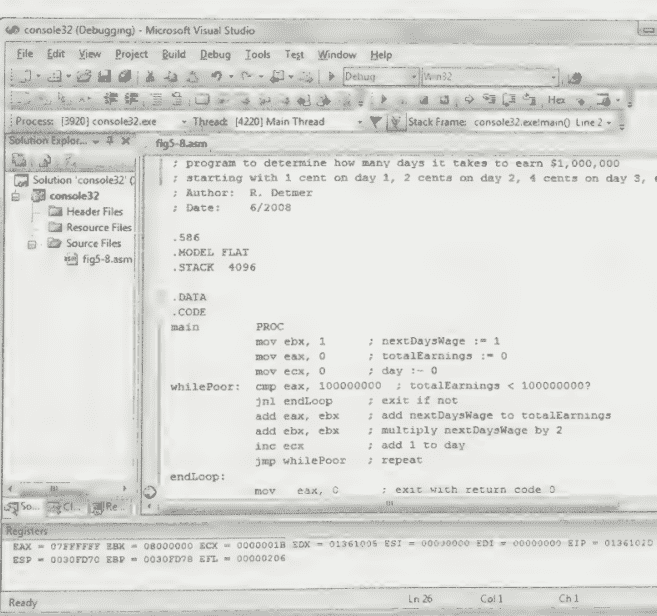

图 5.8 成为百万万翁

## 分支与循环

赚取 100 万美元需要多少天？这些天的总收益是多少？

## 练习 5.3

- 每一部分都包含一个 `while` 循环的设计。假设 `sum` 是一个双字，`count` 是一个双字。
- 每一部分都包含一个 `until` 循环的设计。假设 `sum` 是一个双字，`count` 是一个双字。
- 每一部分都包含一个 `for` 循环的设计。假设 `sum` 是一个双字，`count` 是一个双字。

## 5.4 汇编语言中的 for 循环

1. 将 5.8 中的设计改为使用 `until` 循环代替 `while` 循环。使用 `console32` 或 `console64` 框架实现你的设计并在调试器中运行。
2. 使用 `console32`，修改 5.8 程序以寻找赚取 400 万美元的天数。提示：如果仅仅更改 `cmp` 指令中的立即数，程序将失败。额外的修改将使其工作。该设计的最大收益是多少？
3. 使用 `windows32` 或 `windows64` 框架设计并实现一个程序，使用对话框提示整数 $n$，计算从 1 到 $n$ 的和，并使用消息框显示结果。
4. 使用 `console32` 或 `console64` 框架设计并实现一个程序，寻找 $1 + 2 + ... + n$ 至少为 1000 的最小整数 $n$，并在调试器中运行。
5. 使用 `windows32` 或 `windows64` 框架设计并实现一个程序，使用对话框提示整数 $n$，计算 $1^2 + 2^2 + 3^2 + ... + n^2$ 的和，并使用消息框显示结果。
6. 两个正整数的最大公约数是能整除这两个数字的最大整数。以下算法将找到 `number1` 和 `number2` 的最大公约数：

```
gcd := number1;
remainder := number2;
repeat
  quotient := gcd;
  gcd := remainder;
  remainder := dividend mod gcd;
until (remainder = 0)
```

使用 `windows32` 或 `windows64` 框架编写一个程序，使用对话框提示 `number1` 和 `number2` 的输入值，实现上述设计寻找它们的最大公约数，并使用消息框显示 GCD。

通常，循环体执行的次数是预先已知的，可以是编写程序时编码的常量，也可以是某个值的变量，在循环执行前赋值。`for` 循环结构是编写此类循环的理想选择。

上一节展示了如何将 `for` 循环转换为 `while` 循环。这种技术总是有效，通常是编写 `for` 循环的最佳方法。然而，80x86 微处理器某些指令使得编写某些 `for` 循环变得非常简单。

考虑以下两个 `for` 循环，第一个正向计数，第二个反向计数。

```
index := 1 count loop
  { loop body }
end for;
```

以及

```
index := count downto 1 loop
  { loop body }
end for;
```

每个循环执行 `count` 次。如果循环体内部不需要 `index` 的值，那么递减循环与递增循环是等价的，尽管设计可能不那么自然。在 80x86 汇编语言中，使用 `loop` 指令可以很容易实现反向 `for` 循环。

`loop` 指令的格式为：

```
loop statementLabel
```

其中 `statementLabel` 是语句的标签，该语句距离 `loop` 指令是一个短偏移（向后 128 字节或向前 127 字节）。`loop` 指令占用两个字节的对象代码：操作码 `E2` 和字节大小偏移量。

`loop` 指令会引发以下动作：

- `ECX` 中的值减 1。
- 如果 `ECX` 的新值为 0，则继续执行 `loop` 指令后面的语句。
- 如果 `ECX` 的新值不为零，则跳转到语句 `statementLabel`。

尽管 `ECX` 寄存器是一个通用寄存器，它在 `loop` 指令以及其他 8086 指令中具有计数器的特殊地位。在这些指令中，没有其他寄存器可以替换 `ECX`。在实践中，这通常意味着当编写循环时，`ECX` 不用于其他用途。在 64 位模式下，操作完全相同，只是使用 `RCX` 代替了 `ECX`。

反向 `for` 循环结构

```
for count := 20 downto 1 loop
  { loop body }
end for;
```

可以使用 8086 汇编语言使用 `loop` 指令如下所示编写：

```
mov ecx, 20          ; 迭代次数
forCount:               ; 循环体
  loop forCount      ; 重复体 20 次
```

当第一次执行循环体时，`ECX` 寄存器中的计数器为 20，并被 `loop` 指令减为 19。值 19 不为 0，因此控制转移到标签 `forCount` 处的循环体开始。第二次执行循环体时，`ECX` 寄存器将包含 19。最后一次执行循环体时，`ECX` 中的值将为 1。`loop` 指令将 `ECX` 减为 0，将不会跳转到 `forCount`，执行将继续 `loop` 指令后的语句。

标记 `for` 循环体的显易标签是 `for`。遗憾的是，这是汇编器的预留字。它被用于一种简化 `for` 循环编写的指令。由于我们的主要兴趣是学习计算机在机器级的工作原理，因此不使用该指令。

现在假设由 `number` 用的内存中的双字（doubleword）包含循环体执行的次数。实现反向 `for` 循环的 8086 代码可以是：

```
mov ecx, number ; 迭代次数
forIndex:    . ; 循环体
            loop forindex repeat body number times
```

如果存储在 `number` 中的值为 0，这段代码将产生惊人的结果。如果是 0，则执行循环体，0 值被减变为 `FFFFFFFF`（借位进行减法），再次执行循环体，值 `FFFFFFFF` 减变为 `FFFFFFFE`，以此类推。在 `ECX` 中的值回到 0 之前，循环体被执行了 2.94 亿次！为了避免这个问题，可以编写：

```
mov ecx, number ; 迭代次数
cmp ecx, 0 ; number = 0
jz endFor ; 如果 number = 0 则跳过循环
forIndex:    . ; 循环体
```

## 5.5 数组

程序经常使用数组来存储数据值集合。循环通常用于处理数组中的数据。在程序的数据段中，可以使用 `DUP` 指令为数组留出空间。本节展示了在 8086 汇编语言中访问一维数组的两种方法。

假设你有一个包含 `nbrElts` 个双字（doubleword）整数的集合，它们存储在内存的 `nbrArray` 处，且 `nbrElts` 的值也存储在内存中的一个双字里。你想处理这个数组：首先找到这些数字的平均值，然后对每个小于平均值的数字加 10。以下是实现此逻辑的设计。

**计算和和平均值**

```
sum := 0;
获取数组第一个元素的地址;
count := nbrElts downto 1 loop
  将数组中地址处的双字加到 sum 中;
获取下一个数组元素的地址;
end for;
average := sum/nbrElts;
```

**对每个小于平均值的数字加 10**

```
获取数组第一个元素的地址;
count := nbrElts downto 1 loop
  如果数组的双字 < average
    给双字加 10;
  end if;
获取下一个数组元素的地址;
end for;
```

该设计包含了两个奇特的语句：“获取数组第一个元素的地址”和“获取下一个数组元素的地址”。这些语句反映了特定的汇编语言实现，当任务涉及顺序遍历数组中存储的元素时，这种方法非常好。8086 使这种可能的特性是间接寻址，在第 3 章中首次讨论过。我们的实现代码将使用 `EBX` 寄存器包含当前正在访问的地址：记住 `[ebx]` 指的是 `EBX` 寄存器地址处的双字，而不是寄存器本身。在 8086 架构中，任何通用寄存器 `EAX`、`EBX`、`ECX` 和 `EDX` 或索引寄存器 `EDI` 和 `ESI` 都适合作为“指针”。然而，`ECX` 寄存器通常被留作循环计数器。同样，`ESI` 和 `EDI` 寄存器通常被留用于字符串（字符串通常是字符数组）。字符串操作将在第 8 章介绍。程序列表见图 5.9。

对于我们的 `console32` 实现，我们在 `nbrArray` 中留了 100 个双字的空间，但仅使用前 5 个进行测试。总和在 `EAX` 中计算，除以 `nbrElts` 后，平均值位于同一个寄存器中。图 5.10 显示了程序在调试器下的执行情况，此时在第一个循环开始之前的断点处。注意 `ECX` 包含元素数量，`EBX` 包含 00A94000，这与内存显示中 `nbrArray` (&nbrarray) 的相同。

`lea` 指令的助记符代表“有效地址”（effective address）。`lea` 指令具有此地址：

```
lea 目标, 源
```

目标是一个 32 位通用寄存器；源是任何内存引用。源的地址被加载到寄存器中。（与此 `mov` 指令对比，`mov` 将源地址处的值复制到目标中。）`lea` 指令的操作码为 `8D`。

注意，通过在 `EBX` 当前地址上加 4，你可以获得数组中下一个双字的地址，因为每个双字长度为 4 字节。单步执行

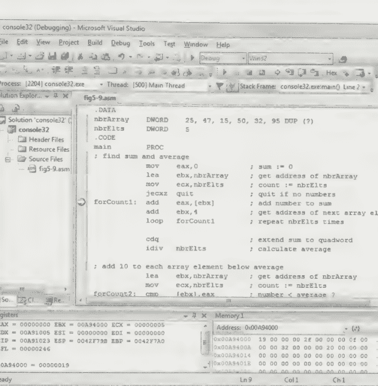

## 5.5 数组

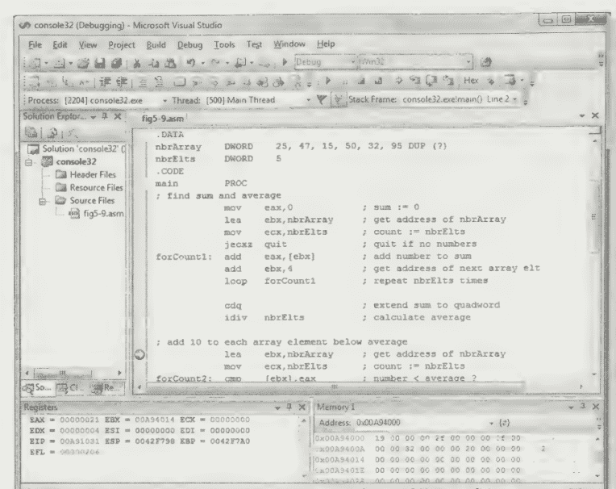


# 汇编语言程序示例与栈操作

## 程序清单：处理数组

```assembly
; 给定一个双字整数数组，(1) 找到它们的平均值
; 以及 (2) 对每个小于平均值的数字加 10
; 作者: R. Detmer
; 修改: 6/2008

.586
.MODEL FLAT
.STACK 4096

.DATA
nbrArray  WORD   25, 47, 15, 50, 32, 95 DUP (?)
nbrElts    DWORD   5
.CODE
main PROC
; 计算和和平均值
    mov     eax, 0          ; sum := 0
    lea     ebx, nbrArray   ; 获取 nbrArray 的地址
    mov     ecx, nbrElts    ; count := nbrElts
    jz      quit            ; 如果没有数字则退出
forCount1:
    add     eax, [ebx]      ; 将数字加到 sum
    add     ebx, 4          ; 获取下一个数组元素的地址
    loop    forCount1       ; 重复 nbrElts 次

    cdq
    idiv    nbrElts         ; 将 sum 扩展为双字并除以 nbrElts
; 对每个低于平均值的数组元素加 10
    lea     ebx, nbrArray   ; 获取 nbrArray 的地址
    mov     ecx, nbrElts    ; count := nbrElts
forCount2:
    cmp     [ebx], eax      ; 数字 < 平均值？
    jnl     endIfSmall      ; 如果不小于则继续
    add     WORD PTR [ebx], 10 ; 给数字加 10
endIfSmall:
    add     ebx, 4          ; 获取下一个数组元素的地址
    loop    forCount2       ; 重复

quit:
    mov     eax, 0          ; 以返回代码 0 退出
    ret
main ENDP
```

图 5.9 处理数组

## 分支与循环

```assembly
    cdq
    idiv    nbrElts       ; 将 sum 扩展为双字
; 对每个低于平均值的数组元素加 10
    lea     ebx, nbrArray    ; 获取 nbrArray 的地址
    mov     ecx, nbrElts     ; count := nbrElts
forCount2:
    cmp     [ebx], eax       ; 数字 < 平均值？
    jnl     endIfSmall       ; 如果不小于则继续
    add     WORD PTR [ebx], 10 ; 给数字加 10
endIfSmall:
    add     ebx, 4           ; 获取下一个数组元素的地址
    loop    forCount2        ; 重复
```

图 5.13 处理数组（64 位版本）

```assembly
; find sum and average
mov      eax, 0          ; sum = 0
mov      ecx, 0          ; index = 0
forl:
    cmp      ecx, nbrElts   ; index < nbrElts
    jnl      endFor         ; exit if not
    add      eax, nbrArray[4*ecx] ; add number to sum
    inc      ecx            ; increment index
    jmp      forl           ; repeat
endFor:
    cdq                    ; extend sum to quadword
    idiv     nbrElts       ; calculate average

; add 10 to each array element below average
mov      ecx, 0          ; index = 0
for2:
    cmp      ecx, nbrElts   ; index < nbrElts
    jnl      endFor2        ; exit if not
    cmp      nbrArray[4*ecx], eax ; number < average ?
    jnl      endIfSmall     ; continue if not
    add      DWORD PTR nbrArray[4*ecx], 10 ; add 10 to number
endIfSmall:
    inc      ecx            ; increment index
    jmp      for2           ; repeat
quit:
    mov      eax, 0         ; exit with return code 0
    ret
```

图 5.14 使用索引寻址和索引内容的四倍数处理数组的过程。换句话说，第一个操作数位于 `nbrArray+0`，第二个位于 `nbrArray+4`，依此类推。索引寻址的优势是数组元素不需要按顺序访问。

8086 架构具有额外的寻址模式。最复杂的是基址索引寻址。汇编语言中的一种格式看起来像 `100[ebx+8*ecx]`。在这个示例中，操作数的地址计算方式为 `EBX` 的内容加上 `ECX` 的内容的八倍再加上 100。注意，此示例中位移量 100 的功能与上一个示例中起始地址 `nbrArray` 的功能完全相同。允许的缩放因子值只有 2、4 和 8。

回想代码对象包含一个 Mod/RM 字节。R/M 字段值为 100，Mod 字段值为 00、01 或 10，或者紧随 Mod/RM 字节有一个额外的 SIB 字节来编码有关缩放因子、索引寄存器和基址寄存器的信息。缩放字段长度为 2 位，值为 00 表示不缩放，01 表示因子 2，10 表示 4，11 表示 8。其余两个字段长度为 3 位，使用图 4.3 所示的编码指定索引和基址寄存器。在 64 位模式下，`REX` 前缀扩展了这种编码。

## 练习题 5.5

1. 修改图 5.9 中的程序，将第二个循环替换为将每个大于平均值的数字改为零的循环。

2. 修改图 5.9 中的程序，将第二个循环替换为将每个大于平均值减 5 的数字改为平均值的循环。包含等于平均值–5 或平均值+5 的值。

3. 在 `console32` 程序中汇编每条指令，检查列出文件，并解释 Mod/RM 字节的每个字段以及 SIB 字节的每个字段如何与汇编语言源代码的对应部分相关。

```assembly
*a) add 1000[ebx+4*esi], edx
(b) mov DWORD PTR 1000[ecx+8*edi], 5000
```

## 编程练习 5.5

1. 下述设计将数字输入到双字数组中，使用哨兵值 –9999 结束输入。

```text
nRElts := 0;
get address of array;
prompt for input number;
while number ≠ –9999 loop
    add 1 to nRElts;
    store number at address;
    add 4 to address;
    prompt for input number;
end while;
```

在 `windows32` 或 `windows64` 程序中实现该设计，使用对话框提示输入每个数字。假设输入的数字不会超过 100 个。使用单个消息框报告数字之和、输入了多少个数字（不计哨兵值）、数字的平均值，以及数组中大于或等于平均值的条目计数。

2. 使用 `windows32` 或 `windows64` 框架，编写一个程序，使用对话框将字符字符串输入 `charStr`，注意输入宏用空字节（00）终止字符串。将此字符串作为字符数组处理，将 `charStr` 中的每个大写字母替换为对应的小写字母，其他字符保持不变。使用消息框显示修改后的字符串。

3. 确定质数的方法有很多。这里是寻找前 100 个质数的一种设计。在 80x86 汇编语言中实现该设计。使用 `console32` 或 `console64` 框架，编写程序将质数存储在双字数组 `primeArray` 中，并使用调试器检查 `primeArray` 的内容。

```text
prime[1] := 2; { 第一个质数 }
prime[2] := 3; { 第二个质数 }
primeCount := 2;
candid := 5;
while primeCount < 100
    index := 1;
    while index <= primeCount
        if candidate % prime[index] == 0
            break;
        index := index + 1;
    prime[primeCount] := candidate;
    primeCount := primeCount + 1;
    candidate := candidate + 2;
```

4. 使用 `console32` 或 `console64` 框架，编写程序将质数存储在双字数组 `primeArray` 中，并使用调试器检查 `primeArray` 的内容。

# 第 6 章 过程

80x86 架构对过程的实现方式与高阶语言中的过程相似。事实上，80x86 过程可以被高阶语言程序调用，也可以调用高阶语言过程。这里涉及三个主要概念：(1) 如何将控制权从调用程序转移到过程并返回；(2) 如何将参数值传递给过程并将结果从过程返回；(3) 如何编写独立于调用程序的过程代码。此外，每个过程必须分配局部变量空间。硬件栈被用于完成这些各项工作。

- 6.1 80x86 栈
- 6.2 带值参数的 32 位过程
- 6.3 额外的 32 位过程选项
- 6.4 64 位过程
- 6.5 宏定义与展开
- 6.6 章总结

本章从讨论 80x86 栈开始。第 6.1 到 6.3 节仅涵盖了 32 位模式下的操作，而第 6.4 节描述了 64 位模式的差异。最后一节讨论了宏，宏有时用于替代过程调用，并被 `windows32` 和 `windows64` 项目中的 `io.h` 文件用于调用过程。

## 6.1 80x86 栈

书中的程序通过以下代码分配了栈：

```assembly
.STACK 4096
```

该 `STACK` 指令告诉汇编器预留 4096 字节的未初始化存储空间。操作系统将栈指针寄存器 `ESP` 初始化为栈中 4096 字节上方第一个字节的地址。根据程序中预期的使用情况，可以分配更大或更小的栈。

栈最常用于向其推入操作数或从其弹出。这种操作在执行 `call` 和 `return` 指令时会自动完成（见第 6.2 节）。也可以通过 `push` 和 `pop` 指令手动完成。本节涵盖了 `push` 和 `pop` 指令的机制，描述了它们如何使用栈。

`push` 指令的源代码语法为：

```assembly
push source
```

源操作数可以是 16 位寄存器、32 位寄存器、段寄存器、内存中的字、立即字节、立即字或立即双字。唯一的字节大小操作数是立即数，它会被符号扩展为字或双字，以获得实际推入栈中的取值。图 6.1 列出了某些允许的操作数类型，省略了我们不会使用的段寄存器。

| 操作数 | 机器码 | 对象代码字节数 |
| --- | --- | --- |
| EAX or AX | 50 | 1 |
| ECX or CX | 51 | 1 |
| EDX or DX | 52 | 1 |
| EBX or BX | 53 | 1 |
| ESP or SP | 54 | 1 |
| EBP or BP | 55 | 1 |
| ESI or SI | 56 | 1 |
| EDI or DI | 57 | 1 |
| memory word | FF | 2+ |
| memory doubleword | FF | 2+ |
| immediate byte | 6A | 2 |
| immediate word | 68 | 3 |
| immediate doubleword | 68 | 5 |

图 6.1 `push` 指令。`push` 指令的常用助记符就是 `push`。然而，如果操作数的大小存在歧义（例如对于小立即值），可以使用 `pushw` 或 `pushd` 助记符分别指定字大小或双字大小的操作数。在需要时，内存操作数会使用 `PTR` 和 `DWORD PTR` 操作符。

当对双字大小的操作数执行 `push` 指令时，栈指针 `ESP` 减 4。回想起初始 `ESP` 包含分配空间正上方字节的地址。减去 4 后，`ESP` 指向栈顶部的双字。然后操作数被存储在 `ESP` 所向的地址处，即栈的高内存端。字大小操作数的执行过程也类似，区别在于在存储操作数之前 `ESP` 减了 2。

### 示例

我们展示了一个两个 `push` 指令执行的示例。假设 `ESP` 初始包含 `00600200`。第一个 `push` 将 `ESP` 减小并将 `EAX` 的内容存储在该地址。注意低位字节和高位字节在内存中是反转的。第二个 `push` 将 `ESP` 减小到 `006001F8` 并在该地址存储 `FFFFF10` (-240₁₀)。

| 之前 | 指令 | 之后 |
| --- | --- | --- |
| EAX: B3 B5 47 A2 | | EAX: B3 B5 47 A2 |
| 栈 ← ESP: 00600200 | `push eax` | A2 |
| | | 47 |
| | | B5 |
| | | 83 ← ESP: 006001FC |
| | `pushd -240` | 10 |
| | | FF |
| | | FF |
| | | FF ← ESP: 006001F8 |

你可以使用调试器观察这些指令的实际执行。在汇编了一个以下代码开头的程序后：

```assembly
mov eax, 83b547a2h
push eax
pushd -240
```

汇编列表显示：

```assembly
00000000 B8 A2 47 B5 83 mov eax, 83b547a2h
00000005 50             push eax
00000006 68 F0 FF FF FF pushd -240
```

我们之前已经提到，在编程时寄存器是稀缺资源。`push` 和 `pop` 指令的一种用途是将寄存器的内容临时保存到栈中。例如，假设你正在使用 `EDX` 存储某个程序变量，但需要执行一个除法操作，该操作需要在执行前扩展 `EDX:EAX` 中的被除数。避免丢失 `EDX` 中值的一种方法是将其推入栈。

```assembly
push edx      ; 保存变量
cdq           ; 将被除数扩展为双字
div divisor   ; 除
pop edx       ; 恢复变量
```

此示例假设你不需要除法操作放在 `EDX` 中的余数。如果你确实需要余数，可以在保存的值写回 `EDX` 之前将其复制到其他地方。

如上面的示例所示，`push` 和 `pop` 指令通常成对使用。当我们研究栈如何用于向过程传递参数时，你将发现一种逻辑上丢弃栈中值的方法，而无需将其弹出到目标位置。

在 32 位环境中，栈创建在双字边界上，也就是说 `ESP` 中的地址是 4 的倍数。对于某些系统调用，保持栈顶在双字边界上是非常重要的。因此，在少数例外情况下，你应该始终将双字值推入栈，尽管 80x86 架构允许使用字。

除了普通的 `push` 和 `pop` 指令外，还有特殊的助记符：`pushf`（针对扩展标志寄存器的 `pushfd`）和 `popf`（针对扩展标志寄存器的 `popfd`）。这些总结在图 6.6 中。它们有时用于过程代码中。显然，`popf` 和 `popfd` 指令会改变标志位；这些是唯一改变标志位的 `push` 或 `pop` 指令。

| 指令 | 码 | 对象代码字节数 |
| --- | --- | --- |
| pushf/pushfd | 9C | 1 |
| popf/popfd | 9D | 1 |

图 6.6 `pushf` 和 `popf` 指令

80x86 架构拥有 `pushad` 和 `popad` 指令，可以用单条指令推入或弹出所有通用寄存器。这些指令很少用，且在 64 位模式下不起作用，因此在书中不使用。

## 练习题 6.1

1. 对于每条指令，给出其码和包括前缀字节在内的对象代码字节数。假设 `double` 指内存中的双字。

   (a) `push ax`  
   (b) `pushd 10`  
   (c) `push ebp`  
   (d) `pop ebx`  
   (e) `pop double`  
   (f) `pop dx`  
   (g) `pushfd`

2. 对于此题的每个部分，假设执行给定指令时的“之前”值。给出要求的“之后”值。通过画栈的图来跟踪指令的执行。

| 之前 | 指令 | 之后 |
| --- | --- | --- |
| (a) ESP: 06 00 10 00 | `push ecx` | ESP, ECX |


# 6.2 带值参数的 32 位过程

## 练习题

### 3. 许多微处理器没有等价于 `xchg` 的指令。在这样的系统中，可以使用如下的指令序列来交换两个寄存器的内容：

```
push eax
push ebx
pop eax
pop ebx
```

解释为什么这个序列可以用于交换 `EAX` 和 `EBX` 寄存器的内容。比较执行此序列所需的代码字节数与执行 `xchg eax, ebx` 指令所需的字节数。

### 4. `xchg` 指令的另一种替代方案是使用

```
push eax
mov eax, ebx
pop eax
```

解释为什么这个序列可以用于交换 `EAX` 和 `EBX` 寄存器的内容。比较执行此序列所需的代码字节数与执行 `xchg eax, ebx` 指令所需的字节数。

---

## 6.2 带值参数的 32 位过程

“过程”（procedure）一词在高级语言中用于描述几乎是自包含单元的子程序。主程序或另一个子程序可以通过包含一个语句来调用过程，该语句由过程名加上括号内的参数列表组成，与过程的形式参数关联。

许多高级语言区分了执行动作的“过程”和返回值的“函数”（function）。函数与过程相似，不同之处在于它是通过在表达式中使用其名称和参数列表来调用的。它返回一个与其名称关联的值；该值在表达式中使用。C/C++ 中的所有子程序在技术意义上都是函数，但这些语言不允许有返回值。

在汇编语言和一些高级语言中，“procedure”一词被同时用于描述返回值的子程序和不返回值的子程序。本书在这两种意义上都使用了“procedure”一词。

过程在汇编语言中的价值与在高级语言中的价值相同——它们将程序划分为可管理的任务，并隔离了在一个程序内可以使用多次的代码，或者这些代码可以保存并在其他程序中重用。有时汇编语言编写的代码比高级语言编译器生成的代码更高效，而这种代码可以放在由不需要高效的高级程序调用的过程中。

回顾本章引言中列出的主要概念：(1) 如何将控制从调用程序转移到过程并返回，(2) 如何向过程传递参数并从过程返回结果，(3) 如何编写独立于调用程序的过程代码。这些在汇编语言中可以通过许多方式处理，本节描述了微软文档中的一种特定协议 `cdecl`。它是 Visual Studio 环境下 C 程序中使用的默认约定。6.7 节提供了一个完整的 windows32 程序，用于说明该协议的各个方面。

---

## 示例程序：计算 3*x + 7*y

```assembly
; 输入 x 和 y，调用过程计算 3*x+7*y
; 作者: R. Detmer
; 日期: 6/2008
.MODEL FLAT
INCLUDE io.h
.STACK 4096
```

```assembly
.DATA
number1 DWORD ?
number2 DWORD ?
prompt1 BYTE "Enter first number", 0
prompt2 BYTE "Enter second number", 0
string BYTE DUP (?)
```

```assembly
.CODE
MainProc PROC
  input prompt1, string ; 读取 ASCII 字符
  atod string ; 转换为整数
  mov number1, eax ; 存储在内存

  input prompt2, string ; 对第二个数字重复
  atod string
  mov number2, eax

  push number2 ; 第二参数
  push number1 ; 第一个参数
  call fctnl

  add esp, 8 ; 从栈中移除参数
  output result, eax ; 输出标签和结果
END
```

**图 6.7 过程示例**

```assembly
; int fctnl(int x, int y)
; 返回 3*x+7*y
fctnl PROC
    push ebp          ; 保存基指针
    mov ebp, esp      ; 建立栈帧
    push ebx          ; 保存 EBX

    mov eax, [ebp+8] ; x
    imul eax, 3       ; 3*x
    mov ebx, [ebp+12] ; y
    imul ebx, 7       ; 7*y
    add eax, ebx      ; 3*x + 7*y

    pop ebx          ; 恢复 EBX
    pop ebp           ; 恢复 EBP
    ret
fctnl END

END
```

---

## call 与 ret 指令详解

要执行的是由 `call` 指令推入栈的那个地址。一个过程中始终至少有一个 `ret` 指令，也可以有多个。如果只有一个 `ret`，它通常是过程中的最后一条指令，因为如果没有“意大利面条代码”，后续的指令将无法到达。虽然 `call` 指令必须指定其目标，但 `ret` 不需要——它将控制转移到最近一次 `call` 之后的指令。该指令的地址存储在 8086 栈上。

8086 `call` 语句的语法为：

```
call destination
```

下表列出了部分 8086 `call` 指令。没有 `call` 指令修改任何标志位。书中使用的所有过程调用都将第一类型：近相对调用（near relative）。对于近相对调用，5 字节的指令由 `E8` 码加上从下一条指令到过程第一条指令的偏移量组成。调用过程时的控制转移与相对跳转相似，区别在于 `EIP` 的内容会被推入栈。

近直接调用（near direct calls）编码一个 32 位地址或内存中双字的引用。当执行 `call` 时，该寄存器或双字的内容被用作过程地址。这使得 `call` 指令可以多次跳转不同的过程。

远调用（far calls）都提供新的 `CS` 内容和新的 `EIP` 内容。对于远直接调用，这两者都编码在指令中，这 6 字节加上 1 字节的操作码如下表所示。对于间接调用（indirect calls），这些内容位于一个 6 字节的内存块中，该块的地址被编码在指令中。额外的字节是一个 `ModR/M` 字节。在使用分段内存模型时，远调用是非常重要的。

| 操作数 | 操作码 | 目标代码字节数 |
| --- | --- | --- |
| 近相对 | E8 | 5 |
| 使用寄存器的近间接 | FF | 2 |
| 使用内存的近间接 | FF | 2+ |
| 远直接 | 9A | 7 |
| 远间接 | FF | 6+ |

**图 6.8 call 指令**

---

返回指令 `ret` 用于将控制从过程体传回调用点。其基本操作非常简单；它只是弹出之前存储在栈上的地址，并将其加载到指令指针 `EIP` 中。由于栈包含 `call` 之后的指令地址，执行将在该点继续。近返回（near return）只需要恢复 `EIP`。远返回指令（far return）相反远调用的步骤，恢复 `EIP` 和 `CS`；这两个值都从栈中弹出。`ret` 指令不会改变任何标志位。

`ret` 指令有两种格式。更常见的形式没有操作数，编码为：

```
ret
```

另一个版本有一个单独的操作数，编码为：

```
ret count
```

操作数 `count` 在完成返回过程的其它步骤（弹出 `EIP` 以及对于远过程的弹出 `CS`）之后，会被加到 `ESP` 的内容上。如果过程调用将其他值（特别是参数）保存在栈上，那么这将非常有用；然而，这在 `cdecl` 协议中并不使用。下表列出了 `ret` 指令的各种格式。

| 类型 | 操作数 | 操作码 | 目标代码字节数 |
|---|---|---|---|
| 近 | 无 | C3 | 1 |
| 近 | 立即数 | C2 | 3 |
| 远 | 无 | CB | 1 |
| 远 | 立即数 | CA | 3 |

**图 6.9 ret 指令**

---

使用高级语言时，过程定义通常包含参数（有时称为形式参数），这些参数在调用过程时与参数（也称为实际参数）相关。对于过程的按值传递（pass-by-value 或 in）参数，在调用过程时，参数的值（可能是表达式）会被复制到参数中，然后这些值在过程中使用它们的本地名称（用于定义参数的标识符）进行引用。引用参数（按位置传递或 in-out）将参数标识符与单个变量的参数相关联，可以将值从调用者传递给过程，也可以从过程传回给调用者。引用参数将在下一节介绍。

---

## 参数传递与 cdecl 协议

我们在图 6.7 中的示例代码在 `_MainProc` 中有两个参数（number1 和 number2），它们在 `fctnl` 中通过值参数（x 和 y）进行传递。现在我们查看如何将参数值传递给过程并将结果从过程传回。这第二部分很简单——如果过程返回一个单一的双字值，它将通过调用程序将该值放入 `EAX` 中。注意，这正是图 6.7 程序中 `fctnl` 所执行的；在一些准备工作（见下文）之后，它在 `EAX` 中计算值，该值在 `_MainProc` 中可用。在 `cdecl` 协议中，此目的只能使用 `EAX` 寄存器。

双字参数通过推入栈传递给过程。在 `cdecl` 协议中，参数入栈的顺序与它们在参数列表中出现的相反——最后一个参数值先推入，第一个参数值后推入。`_MainProc` 中调用 `fctnl` 的代码为：

```
push number2 ; 第二个参数
push number1 ; 第一个参数
call fctnl ; fctnl(number1, number2)
add esp, 8 ; 移除参数
```

---

## 过程入口代码与栈帧

这是被称为入口代码。前两条指令总是会显示。它们保护了 `EBP` 以便可以恢复。第三条指令在此过程中是必要的，以便可以使用 `EBX` 进行计算。


---

## cdecl 协议总结

| 调用程序代码 | 过程代码 |
|--- |--- |
| * 从右到左顺序在栈上推入参数 | * 保存 EBP 并建立栈帧 |
| * 调用过程 | * 保存过程使用的寄存器 |
| | * 在过程体中使用基址寻址访问参数值 |
| | * 返回值（如果有）存放在 EAX |
| | * 恢复保存的寄存器和 EBP |
| | * 返回 |

**图 6.11 cdecl 协议**

---

## 6.2 练习

1. 假设过程 `exercise1` 被指令 `call exercise1` 调用。如果该调用语句位于地址 00402000，且在调用之前 `ESP` 包含 00406000，那么当执行过程 `exercise1` 的第一条指令时，栈上的返回地址是什么？`ESP` 的值又是多少？

2. 假设一个过程以以下入口代码开始：

```
push ebp ; 保存 EBP
mov ebp,esp ; 新基址指针
push ecx ; 保存寄存器
push esi
...
```

假设该过程有三个双字（doubleword）参数，其正式顺序为 x，然后是 y，最后是 z。画出执行“上述”代码后的栈图。包含参数、返回地址，并显示 `EBP` 和 `ESP` 指向的字节。给出引用每个参数时可以使用的基址（based address）。

---

## 6.2 编程练习

对于这些每个练习，请为指定的过程遵循 `cdecl` 协议，并编写一个简短的 console32 或 windows32 测试程序来测试该过程。

1. 编写一个过程 `discr`，它在 C/C++ 中可以描述为：

```cpp
int discr(int a, int b, int c)
// 返回判别式 b*b-4*a*c
```

即它的名字是 `discr`，有三个整数参数，并且是一个返回值的过程。

2. 编写一个返回值的过程 `min2`，用于找到两个整数参数中的较小值。

3. 编写一个返回值的过程 `max3`，用于找到三个整数参数中的最大值。

4. 编程练习 5.3.6 有一个寻找两个正整数最大公约数的算法。编写一个过程 `gcd` 来实现该算法。它在 C/C++ 中可以描述为 `gcd(int number1, int number2)`，即它的名字是 `gcd`，有两个整数参数，并且是一个返回值的过程。

---

# 6.3 额外的 32 位过程选项

上一节的主要示例展示了如何通过值传递将参数传递给参数。使用引用参数时，传递给过程的是参数的地址而不是其值。引用参数用于几个目的，其中两个是向过程发送大型参数（例如数组或结构体），或者将结果作为参数值传回调用过程。本节从一个示例开始，说明了引用参数的两种用法。

考虑 C++ 函数原型的过程可以写成：

```cpp
void min(int arr[], int count, int& min, int& max);
// 将 min 设置为 arr[0]..., arr[count-1] 中的最小值
// 将 max 设置为 arr[0]..., arr[count-1] 中的最大值
```

在 C++ 中，符号 `arr[]` 表示将传递整数数组 `arr` 的地址，而 `int&` 表示将传递整数变量 `min` 和 `max` 的地址。图 6.12 显示了该过程的一个实现实现：

```assembly
; 过程 minMax 用于查找数组中的最小和最大元素
; 以及 minMax 的测试驱动
; 作者: R. Detmer
; 日期 6/2008
```

```assembly
.586
.MODEL FLAT
.STACK 4096
```

```assembly
.DATA
minimum DWORD ?
maximum DWORD ?
brArray DWORD 25, 47, 50, 16, 95 DUP (?)
```

```assembly
.CODE
main
lea eax, maximum ; 第4个参数
push eax
lea eax, minimum ; 第3个参数
push eax
push 5 ; 第2个参数（元素个数）
lea eax, nbrArray ; 第1个参数
push eax
call minMax ; minMax(nbrArray, 5, minimum, maximum)
add esp, 16 ; 从栈中移除参数
```

```assembly
quit: mov eax, 0 ; 退出代码 0
ret
```

```assembly
main
; void minMax(int arr[], int count, int& min, int& max);
; 将 min 设置为 arr[0]..., arr[count-1] 中的最小值
; 将 max 设置为 arr[0]..., arr[count-1] 中的最大值
minMax PROC
push ebp ; 保存基指针
mov ebp,esp ; 建立栈帧
push eax ; 保存寄存器
push ebx
push ecx
push edx
push esi
```

**图 6.12 使用地址参数**

```assembly
mov esi,[ebp+8] ; 获取数组 arr 的地址
mov ecx,[ebp+12] ; 获取 count 的值
mov ebx,[ebp+16] ; 获取 min 的地址
mov edx,[ebp+20] ; 获取 max 的地址

mov DWORD PTR [ebx], 7fffffff ; 最大整数
mov DWORD PTR [edx], 80000000 ; 最小整数
jz exitCode ; 如果没有元素

forLoop:
mov eax, [esi] ; a[i]
cmp eax,[ebx] ; a[i] < min
jge endSmaller ; 如果不是
mov [ebx], eax ; min := a[i]

endSmaller:
cmp eax,[edx] ; a[i] > max
jle endLarger ; 如果不是
mov [edx], eax ; max := a[i]

endLarger:
add esi, 4 ; 指向下一个元素
loop forLoop ; 遍历数组的每个元素

exitCode:
pop esi ; 恢复寄存器
pop edx
pop ecx
pop ebx
pop eax
pop ebp
ret
```

**图 6.12 使用地址参数（继续）**

console32 程序。它包含一个简单的测试驱动，为数组以及最小和最大的数字建立位置，并调用 `minMax`，推送四个参数，其中三个是地址。注意调用后有 16 字节的参数需要移除。`minMax` 过程遵循过程注释中的简单设计。注意使用了几个寄存器，其内容在入口代码中保存并在退出代码中恢复。在入口代码之后，各种参数被复制到寄存器中。`minMax` 过程使用间接寻址：使用基址寻址检索参数，使用寄存器间接寻址访问数组。在测试驱动中分别使用 `EBX` 和 `EDX` 作为 `min` 和 `max`。将 `min` 初始化为最大整数、`max` 初始化为最小整数是另一种替代方案，这会稍微多一点代码。6.13 显示了调用后的调试器窗口；内存窗口设置为 `min` 的地址开始。

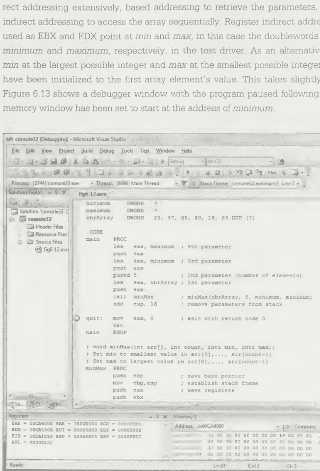

---

# 6.3 额外的 32 位过程选项


* 保存 `EBP` 并建立栈帧
* 从 `ESP` 减去局部空间的字节数
* 保存过程使用的寄存器
* 在过程中使用基址寻址访问参数值
* 返回值（如果有）存放在 `EAX`
* 恢复保存的寄存器
* 将 `EBP` 拷贝到 `ESP`
* 恢复 `EBP`
* 返回

图 6.14 带有局部空间的过程代码

`minMax` 过程在实现中需要几个寄存器。使用寄存器几乎总是优于内存，但它们的数量不足以实现复杂的算法。某些过程需要在内存中有局部变量。此操作的标准方法是在栈上为它们分配空间。图 6.14 概述了执行此操作的过程代码。它是图 6.11 右侧的微小修改，带有一个预留空间的非比例栈图。

这是一个简化的、非比例的预留空间栈图。

| 参数 |
|---|
| 返回地址 |
| 旧的 `EBP` |
| 局部变量空间 |
| 保存的寄存器 |

就像引用点上面的双字参数可以通过 `[ebp+8]`、`[ebp+12]` 等被引用一样，引用点下方局部变量空间的第一个双字可以通过 `[ebp-4]` 访问，下一个通过 `[ebp-8]` 访问，依此类推。

C 和 C++ 编译器通常在栈上分配所有局部变量。在汇编语言中这样做有巨大的困难，其中最不利的一点就是记住特定的局部变量存储在栈的哪里。

这两个新步骤显然通过 `sub esp,n` 和 `mov esp,ebp` 实现，其中 `n` 是你想要保留的局部存储字节数。你可能会奇怪为什么“释放内存”步骤不是 `add esp,n`。答案是它可以，但 `mov` 指令既简单又安全。安全是因为即使保存的寄存器没有正确从栈弹出，它也能恢复正确的 `esp` 值。

递归过程或函数是指直接或间接调用自身的函数。它是处理许多数据结构的最佳算法。在不支持递归的编程语言中编写某些算法通常很困难。

在 80x86 汇编语言中编写递归过程几乎与非递归过程一样简单。如果参数推在栈上且局部变量存储在栈上，那么每次过程调用都会为参数和局部变量分配新空间。不存在将传递给一个调用的参数与另一个调用的参数混淆的危险，因为每次调用都有自己的栈帧。

本节给出了 80x86 汇编语言递归过程的一个示例。它解决了图 6.15 所示的四个盘汉诺塔问题。该游戏的目标是将所有盘从源轴 A 移动到目标轴 B，每次移动一个，且绝不将大盘放在小盘之上。盘可以移动到备用轴 C。例如，如果只有两个盘，小盘可以从柱子 A 移动到 C，最大的盘可以从 A 移动到 B，最后最小的盘可以从 C 移动到 B。

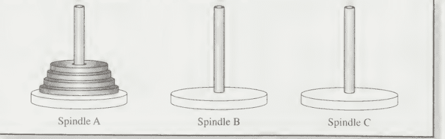

图 6.15 汉诺塔问题

## 6.3 额外的 32 位过程选项

通常情况下，汉诺塔问题通过考虑两种情况来解决。如果只有一个盘，则将这个简单的盘从源柱移动到目标柱。如果盘的数量 `nbrDisks` 大于 1，则将顶部 (nbrDisks-1) 个盘移动到备用柱，将最大的盘移动到目的地，最后将 (nbrDisks-1) 个较小的盘从备用柱移动到目的地。每次移动 (nbrDisks-1) 个盘时，都遵循完全相同的步骤，只是不同的柱承担了源柱、目的地和备用柱的角色。图 6.16 用伪代码表示了该算法。

图 6.17 列出了作为 windows32 程序实现的 8086 代码。该代码是对伪代码设计的相当直接的翻译，其中 `move` 中的递归过程调用实现方式与主程序中的调用完全相同。注意，尽管柱子是由单个字符指定的，但这些字符以双字形式传递，以确保栈保持在双字边界上。高级语言编译器可能会计算两次 nbrDisks-1——一次是在使用它的递归调用处——但我们可以更有效率一点，先计算它：

```
procedure move(nbrDisks, source, destination, spare);
begin
  if NbrDisks = 1
    then
      display "Move disk from " + source " to " + destination
    else
      move(nbrDisks-1, source, spare, destination);
      move(1, source, destination, spare);
      move(nbrDisks-1, spare, destination, source);
  end if;
end procedure move;

begin{main program}
  prompt for and input number;
  move(number, 'A', 'B', 'C');
end;
```

图 6.16 汉诺塔解决方案的伪代码

```assembly
; program to print instructions for "Towers of Hanoi" puzzle
; author: R. Detmer
; revised: 6/2008
.586
.MODEL FLAT
INCLUDE io.h
.STACK 4096
```

```assembly
.DATA
prompt BYTE "How many disks?",0
number BYTE 16 DUP (?)
outLbl BYTE "Move disk", 0
outMsg BYTE "from spindle "
source BYTE ?, 0ah, 0dh
BYTE 'to spindle '
dest BYTE ?, 0
```

```assembly
.CODE
MainProc PROC
mov al,'C' ; argument 4: 'C'
push eax
mov al,'B' ; argument 3: 'B'
push eax
mov al,'A' ; argument 2: 'A'
push eax
input prompt,number,16 ; read ASCII characters
atod number ; convert to integer
push eax ; argument 1: number
call move ; Move(number,Source,Dest,Spare)
add esp,16 ; remove parameters from stack
mov eax, 0 ; exit with return code 0
ret
MainProc ENDP
```

```assembly
move PROC32
; procedure(nbrDisks : integer; { number of disks to move
; source, dest, spare : character { spindles to use }
; all parameters are passed in doublewords on the stack

push ebp ; save base pointer
mov ebp,esp ; establish stack frame
```

图 6.17 汉诺塔解决方案

```assembly
push eax          ; save registers
push ebx

cmp DWORD PTR [ebp+8],1 ; nbrDisks = ?
je elseMore        ; skip if more than 1
mov eax,[ebp+12] ; source
mov source,bl    ; copy character to output
mov,[ebp+16] ; destination
mov dest,bl      ; copy character to output
call outlbl,outMsg ; display move instruction
jmp endIfOne      ; return
elseMore:
mov eax,[ebp+8]   ; get nbrDisks
dec eax           ; nbrDisks - 1
push DWORD PTR [ebp+16] ; par 4: old destination is new spare
push DWORD PTR [ebp+20] ; par 3: old spare is new destination
push DWORD PTR [ebp+12] ; par 2: source does not change
push eax           ; par 1: nbrDisks-1
call move          ;move(nbrDisks-1,source,spare,destination)
add esp,16        ; remove parameters from stack

push DWORD PTR [ebp+20] ; par 4: spare unchanged
push DWORD PTR [ebp+16] ; par 3: destination unchanged
push DWORD PTR [ebp+12] ; par 2: source does not change
pushd 1           ; par 1: 1
call move          ;move(1,source,destination,spare)
add esp,16        ; remove parameters from stack

push DWORD PTR [ebp+12] ; par 4: original source is spare
push DWORD PTR [ebp+16] ; par 3: original destination
push DWORD PTR [ebp+20] ; par 2: source does not change; (Wait, logic error in OCR text)
call move          ;move(nbrDisks-1,spare,destination,source)
add esp,16        ; remove parameters from stack
; (continued)
endIfOne:
mov ebp,ebp
pop ebp
ret
```

## 6.3 额外的 32 位过程选项

Visual Studio C 编译器使用 `cdecl` 协议。你之前为输入输出程序所使用的 windows32 项目已经在使用该协议。例如，`framework.c` 文件包含以下代码：

```c
int MainProc(void);
// 用户主程序的原型声明

int WINAPI WinMain(HINSTANCE hInstance, HINSTANCE
hPrevInstance,
LPSTR lpcCmdLine, int nCmdShow)
{
  _hInstance = hInstance;
  return MainProc();
}
```

执行从 `WinMain` 开始，它基本上只是调用你的汇编过程 `MainProc`。然而，请记住，你的过程名称不是 `MainProc`，而是 `_MainProc`：C 编译器生成的代码遵循 `cdecl` 符号修饰约定，即在开头添加一个下划线。通常情况下，要从 Visual Studio C 程序调用汇编过程，需要对函数声明原型以描述它，将汇编过程命名为带有前下划线的相同名称，并在汇编代码中遵循 `cdecl` 协议。

windows32 项目还会通过输出和输入宏的展开调用 `framework.c` 中的 C 函数。例如，输出宏的定义包含：

```assembly
lea eax,outStr      ; 字符串地址
push eax             ; 栈上的字符串参数
lea eax,outLbl      ; 标签地址
push eax             ; 栈上的字符串参数
call _showOutput    ; showOutput(outLbl, outStr)
add esp, 8           ; 移除参数
```

这显然是对过程 `_showOutput` 的调用，它是 `framework.c` 中的 `showOutput`。汇编代码必须为名称添加下划线，因为汇编不会修饰名称，但 C 编译器会。通常，符号修饰只有在你混合高级语言和汇编过程时才需要考虑，而在完全使用汇编语言（不生成符号修饰）或 C （编译器会自动处理符号修饰）时不需要。

Visual Studio 编程环境使用了几种其他过程协议，其中之一是 `stdcall`。`stdcall` 协议与 `cdecl` 类似，最大的区别在于必须由过程而非调用者从栈中移除参数（这使用带有操作数的 `ret` 指令非常方便！）而且符号修饰约定要复杂得多，不仅涉及下划线，还包含一个后缀 `@` 后面跟一个表示参数数量的十进制。`fastcall` 协议提供了另一套约定。在 `fastcall` 中，参数通过寄存器传递。这里的关键点是，当你混合汇编语言和高级语言时，你必须知道高级语言编译器使用的是什么协议，并严格遵守。

## 6.3 练习题

- 1. 为一个预留 8 字节局部变量存储空间编写入口代码和退出代码。假设该空间用于两个双字（doublewords），请给出引用每个局部变量时使用的基址（based address）。
- 2. 6.11 给出了使用 `cdecl` 协议调用代码和过程代码的步骤。请写出对应的 `stdcall` 协议列表。

## 编程练习 6.3

对于这些练习题，请为指定的过程遵循 `cdecl` 协议，并编写一个短的 console32 或 windows32 测试驱动程序来测试汇编过程。

- 1. 假设一个过程在 C/C++ 中描述为 `void toUpper(char str[])`，即其名称为 `toUpper`，并且有一个参数，是字符数组的地址。假设字符字符串以空字符结尾，请实现 `toUpper`，使其将字符串中的每个小写字母更改为对应的大写字母，保持其他所有字符不变。
- 2. 假设一个过程在 C/C++ 中描述为 `int upperCount(char str[])`，即其名称为 `upperCount`，并且有一个参数，是字符数组的地址，并返回一个整数。假设字符字符串以空字符结尾，请实现 `upperCount`，使其返回字符串中出现的大写字母数量。
- 3. 编程练习 5.5.5 提供了选择排序算法。在一个过程中实现该算法，其 C/C++ 描述如下：

```c
void selectionSort(int nbrArray[], int nbrElts)
// 将 nbrArray[0] .. nbrArray[nbrElts-1] 
// 使用选择排序按升序排列
```

第一个参数将是数组的地址。

- 4. 写一个 `avg` 过程来寻找数组中一组双字整数的平均值。`avg` 过程将按顺序拥有三个参数：
    - (1) 数组的地址。
    - (2) 数组中整数的数量（作为双字传递）。
    - (3) 用于存储结果的双字地址。

- 5. 写一个返回值的 `search` 过程，在双字数组中搜索指定的双字值。`search` 过程将三个参数：
    - (1) 搜索的值（一个双字整数）。
    - (2) 数组的地址。
    - (3) 数组中双字的数量 $n$（作为双字传递）。返回找到该值的位置 (1,2,...,n)，如果该值不在数组中出现则返回 0。

- 6. 阶乘函数针对非负整数参数 $n$ 定义：

```c
factorial(n) = { 1 if n = 0
 n * factorial(n - 1) if n > 0
```

写一个名为 `factorial` 的返回值过程，实现此递归定义。

- 7. 两个正整数 $m$ 和 $n$ 的最大公约数 (GCD) 可以通过下述函数递归计算：

```c
function gcd(m, n) : integer;
if n = 0
then return m;
else
remainder := m mod n;
return gcd(n, remainder);
```

## 6.4 64 位过程

本节描述了 32 位和 64 位过程的区别。首先，查看 64 位调用约定。64 位调用约定与 `cdecl` 类似，但前四个参数通过寄存器而非栈传递。

| 参数 | 寄存器 |
|---|---|
| 1 | `RCX` |
| 2 | `RDX` |
| 3 | `R8` |
| 4 | `R9` |

生成足够的 15 个双字空间。预留空间的底部留给参数。如果有第五个参数，它将被复制到 `[RSP+32]`，第六个到 `[RSP+40]`，以此类推。在返回地址（8 字节）推入栈后，调用过程将在 `[RSP+40]`、`[RSP+48]` 等处找到这些值。为什么从底部开始留 32 字节？这是为了前四个参数留出空间，尽管它们在寄存器中。调用过程可以使用此空间复制任何前四个参数的值。

寄存器由入口代码推入并在退出代码弹出，类似于在 32 位环境中的方式。然而，这通常在保留局部栈空间之前完成。一旦建立了局部栈空间，在调用后续过程之前 `RSP` 不应发生变化。这使得使用 `RSP` 和基址址来定位参数和局部变量变得可行。如果需要，可以使用 `E` 作为帧指针。

`RAX` 用于返回单个双字值。微软文档将 `RAX`、`RCX`、`RDX` 和 `R8`-`R11` 标记为易变的（volatile），这意味着过程可以自由更改它们。同样，`RBX`、`RDI`、`RSI`、`RSP` 和 `R12`-`R15` 是局部的（nonlinear），这意味着调用过程负责保护它们。在实践中，有时最安全的方法保留任何不想被调用过程破坏的寄存器。例如，在 windows64 中，`atod` 宏包含代码：

```assembly
mov [rsp+32], rcx      ; 保存传递参数的寄存器
mov [rsp+40], rbx      ; 保存被 atodproc 破坏的寄存器
mov [rsp+48], rdx
lea rcx,source         ; 源地址传递到 rcx
call atodproc           ; 调用 atodproc(source)
```

## 6.4 64位过程 225


```
rcx, [rsp+32]   ; 恢复用于传递参数的寄存器
rbx, [rsp+40]   ; 恢复被 atodproc 破坏的寄存器
rdx, [rsp+48]
```

注意寄存器被保存在留出前四个参数的栈区域中。尽管 `RBX` 应该是易变的，但这段代码仍然保留了它。

图 6.24 显示了程序 console64 版本的列表，其 console32 版本出现在图 6.12 中。它明显比 32 位版本要简单得多。

```
; 过程 minMax 用于寻找数组中最小和最大的元素
; 以及 minMax 的测试驱动程序 - 64位版本
; 作者: R. Detmer
; 日期: 7/2008

.DATA
minimum QWORD ?
maximum QWORD ?
nbrArray QWORD 25, 47, 95, 50, 16, 95 repeat (?)

.CODE
main
    sub rsp, 32      ; 本地栈空间
    lea rcx, nArray  ; 第1个参数
    mov rdx, 5       ; 第2个参数（元素数量）
    lea r8, minimum  ; 第3个参数
    lea r9, maximum  ; 第4个参数
    call minMax      ; minMax(nbrArray, 5, maximum)

quit:
    add rsp, 32      ; 清理栈
    mov rax, 0       ; 以返回代码 0 退出
    ret
main ENDP

void minMax(int arr[], int count, int* min, int* max);
    ; 将 min 设置为 arr[0]..., arr[count-1] 中的最小值
    ; 将 max 设置为 arr[0]..., arr[count-1] 中的最大值
minMax PROC
    push rax          ; 保存寄存器
    push esi
```

图 6.24 使用地址参数的过程

## 226 过程

```
mov     rsi, rcx      ; 获取 arr 的地址（第1个参数）
mov     rcx, rdx      ; 获取 count 的值（第2个参数）

mov     rax, 7fffffffffffffffh ; 最大可能的整数
mov     QWORD PTR [r8], rax
mov     rax, 8000000000000000h ; 最小可能的整数
mov     QWORD PTR [r9], rax
jrcxz exitCode      ; 如果没有元素则退出

forLoop:
mov     rax, [rsi]      ; a[i]
cmp     rax, [r8]       ; a[i] <
jnl     endSmaller      ; 如果不满足（大于相等）则跳过
mov     [r8], rax       ; min := a[i]
endSmaller:
cmp     rax, [r9]       ; a[i] >
jng     endLarger       ; 如果不满足（小于或相等）则跳过
mov     [r9], rax       ; max := a[i]
endLarger:
add     rsi, 8          ; 指向下一个数组元素
loop    forLoop         ; 对数组的每个元素重复

extCode:
pop     rsi             ; 恢复寄存器
pop     rax
ret                     ; 返回

minMax ENDP
END
```

图 6.24 使用地址参数的过程

四个参数被简单地放在寄存器中，然后传递到过程中。`minMax` 过程本身没有调用额外的过程，因此不需要建立本地栈空间。一个区别是，32 位的 `minMax` 简单地将最大和最小可能的值放在调用者数据中，分别对应通过第三和第四个参数传递的地址处；但由于 64 位架构中没有到内存的立即双字 `mov` 操作，立即值首先被放在 `RAX` 中，然后复制到目标位置。

我们用一个从 C 主程序调用的汇编语言过程示例来结束本节。C 测试驱动如图 6.25 所示，汇编语言过程如图 6.26 所示。

## 6.4 64位过程

```
/* 汇编语言过程 add5 的 C 测试驱动程序 */
/* 作者: R. Detmer */
/* 日期: 7/2008 */

int add5(int x1, int x2, int x3, int x4, int x5);
/* 返回参数之和 */

#include <stdio.h>

int main()
{
    int a=5;
    int b=7;
    int c=9;

    int sum;

    sum = add5(a, 6, b, 8, c);
    printf("The sum is %d\n", sum);
    return 0;
}
```

图 6.25 64位过程的 C 测试驱动程序

这些是 console64 项目中的独立源文件。这个程序令人满意的一点是，如果你使用控制-F5 启动它，你实际上可以在控制窗口中看到输出！

你可能会奇怪为什么 `add5` 使用 `EAX` 而不是 `RAX` 来累加和。在 Visual Studio 2008 编译器中，`int` 是一个 32 位整数。编译器以双字形式传递五个参数，但每个双字的高位部分是未定义的，因此 `add5` 相加包含整数的低位双字。该 C 编译器使用 `long long` 来指定双字整数；`int` 仍然是 32 位的。

此示例的另一个点是展示了过程中如何处理第五个参数——由于 64 位架构中没有立即双字到内存的 `mov` 操作，立即值首先被放在 `RAX` 中，然后复制到它们的目标位置。

# 6.5 宏的定义与展开

```
add2 MACRO nbr1, nbr2
; put sum of two doubleword parameters in EAX
mov eax, nbr1
add eax, nbr2
ENDM
```

图 6.27 用于两个整数相加的宏

宏定义可以出现在汇编语言源文件的任何位置，只要该定义位于调用宏的第一条语句之前即可。良好的编程习惯是将宏定义放置在源文件的开头，或者放置在通过 `INCLUDE` 指令包含的单独文件中。

本节给出了几个宏定义和宏调用的示例。图 6.27 列出了宏 `add2` 的定义，该宏计算两个参数之和，并将结果存入 `EAX` 寄存器。用于定义宏的参数是 `nbr1` 和 `nbr2`。这些标签在定义内部是局部的。程序中的其他用途中也可以使用相同的名称，尽管如果 `add2` 取决于调用时使用的参数，可能会导致人类的混淆。

`add2` 展开后的语句取决于调用时使用的参数。例如，宏调用

```
add2 value, 30    ; value + 30
```

展开为：

```
; put sum of two doubleword parameters in EAX
mov eax, value
add eax, 30
```

语句

```
add2 value1, value2    ; value + value2
```

展开为：

```
; put sum of two doubleword parameters in EAX
mov eax, value1
add eax, value2
```

宏调用

```
add2 eax, ebx    ; sum of two values
```

展开为：

```
; put sum of two doubleword parameters in EAX
mov eax, eax
add eax, ebx
```

注意，`mov eax, eax` 指令是合法的，即使它没有实际作用。然而，宏调用

```
add2 ebx, eax ; sum of two values
```

展开为：

```
; put sum of two doubleword parameters in EAX
mov eax, ebx
add eax, eax
```

这将使 `EBX` 中的值翻倍，而不是将 `EBX` 和 `EAX` 中的值相加。在这些示例中，第一个参数替换了第一个参数 `nbr1`，第二个参数替换了第二个参数 `nbr2`。每个宏都会生成 `mov` 和 `add` 指令，但由于参数类型不同，目标代码也将有所不同。

如果缺少其中一个参数，宏仍然会展开。例如，宏

```
add2 value
```

展开为：

```
; put sum of two doubleword parameters in EAX
mov eax, value
add eax,
```

参数 `value` 替换了 `nbr1`，一个空字符串替换了 `nbr2`。汇编器会报告错误，但错误是由宏展开产生的非法 `add` 指令引起的，而不是直接因为缺少参数。同样，宏调用

```
add2 , value
```

展开为：

```
; put sum of two doubleword parameters in EAX
mov eax,
add eax, value
```

宏调用中的逗号将第一个缺失参数与第二个参数隔开。空参数替换了参数 `nbr1`。汇编器再次报告错误，这次是因为非法的 `mov` 指令。

再次注意，`add2` 宏的定义和展开不包含 `ret` 指令。虽然宏看起来非常像过程，但在汇编时展开宏调用时，它们会生成内联代码。

图 6.28 显示了宏 `swap` 的定义，它将交换内存中两个双字的内容。这与无法对两个内存操作数操作的 80x86 指令非常相似。

与 `add2` 宏一样，调用 `swap` 宏生成的代码取决于所使用的参数。例如，调用

```
swap [ebx], [ebx+4] ; swap adjacent words in array
```

展开为：

```
; exchange two doublewords in memory
push eax
mov eax, [ebx]
xchg eax, [ebx+4]
mov [ebx], eax
pop eax
```

用户可能不会明显看出 `swap` 宏使用了 `EAX` 寄存器，因此宏中的 `push` 和 `pop` 指令可以保护用户不会意外丢失该寄存器的内容。

```
swap MACRO dword1, dword2
; exchange two doublewords in memory
push eax
mov eax, dword1
xchg eax, dword2
mov dword1, eax
pop eax
ENDM
```

图 6.28 用于交换两个内存字的宏

```
min2 MACRO first, second
; put smaller of two doublewords in the EAX register
LOCAL endIfMin
mov eax, first
cmp eax, second
jle endIfMin
mov eax, second
endIfMin:
ENDM
```

图 6.29 用于寻找两个内存字中较小值的宏

图 6.29 给出了宏 `min2` 的定义，该宏寻找两个双字有符号整数的最小值，并将较小值存入 `EAX` 寄存器。此宏的代码必须实现一个带有 `if` 语句的设计，这种设计通常至少包含一个带有标签的汇编语句。如果使用普通标签，它在每次展开 `min2` 宏调用时都会出现，汇编器将产生错误。


图 6.29 给出了宏 `min2` 的定义，该宏寻找两个双字有符号整数的最小值，并将较小值存入 `EAX` 寄存器。此宏的代码必须实现一个带有 `if` 语句的设计，这种设计通常至少包含一个带有标签的汇编语句。如果使用普通标签，它在每次展开 `min2` 宏调用时都会出现，汇编器将产生错误。

## 编程练习 6.5

在一个简短的 `console32` 或 `console64` 测试驱动程序中汇编下面的每个宏定义。

1. 编写宏 `add3` 的一个定义，它具有三个双字（doubleword）整数参数，并将这三个数的和放在 `EAX` 寄存器中。
2. 编写宏 `max2` 的一个定义，它有两个双字整数参数，并将这两个数中的最大值放在 `EAX` 寄存器中。
3. 编写宏 `min3` 的一个定义，它具有三个双字整数参数，并将三个数中的最小值放在 `EAX` 寄存器中。
4. 编写宏 `toUpper` 的定义，有一个参数：内存中一个字节的地址。该宏生成的代码将检查该字节，如果它是小写字母的 ASCII 码，则将其替换为相应大写字母的 ASCII 码。

## 6.6 章总结

本章讨论了在 80x86 架构中实现过程的协议。涉及三个主要概念：(1) 如何将控制权从调用程序转移到过程并返回；(2) 如何将参数值传递给过程并将结果从过程返回；(3) 如何编写独立于调用程序的过程代码。栈在过程实现中起着几个重要作用。当过程被调用时，在控制权转移到过程的第一条指令之前，下一条指令的地址被存储在栈上。返回指令从栈中取出此地址，以便将控制权传回调用程序的正确位置。参数值（或其地址）可以推入栈中以传递给过程；执行此操作后，基指针 `EBP` 和基于基寻址为访问过程中的值提供了一种方便的机制。栈可以为过程的局部变量提供空间。栈还用于“保护环境”——例如，在过程开始时，可以将寄存器内容推入栈中，并在返回调用程序之前将其弹出，这样调用程序就不需要担心过程可能会更改哪些寄存器。

在 32 位环境中，有几种用于过程的协议。本章重点强调了 `cdecl` 协议，Visual Studio C 编译器也使用了该协议。遵循此协议可以使 C 函数调用汇编语言过程，或汇编语言过程调用 C 函数。

在 64 位环境中只有一种标准过程协议。它使用寄存器而不是栈来传递前四个参数值。

宏是一个作为其他语句序列简写的语句。汇编器将宏展开为它所代表的语句，然后汇编这些新语句。

# 第 7 章

## 位操作

计算机包含许多集成电路使其能够执行其功能。每个芯片包含从几个到数千个逻辑门，每个逻辑门都是一个对电子状态表示的位执行布尔与、或、异或或非操作的基元电路。CPU 通常是 PC 中最复杂的集成电路。

之前的章节检查了 8086 微处理器用于移动数据、执行算术操作、分支和利用子程序的指令。8086 和其他 CPU 还可以执行对多对位执行布尔操作的指令。本章定义了布尔操作并描述了实现它们的 8086 指令。它还涵盖了导致位模式在字节、字或双字中移位或旋转的指令。虽然位操作指令非常原始，但它们在汇编语言编程中被广泛使用，通常是因为它们提供了高层语言中少提供的控制能力。

- 7.1 逻辑操作
- 7.2 移位和旋转指令
- 7.3 将 ASCII 字符串转换为 2 补码整数
- 7.4 章总结

## 7.1 逻辑操作

许多高层语言允许布尔类型的变量，即能够存储真（true）或假（false）值的变量。几乎所有高层语言都允许带有布尔值的表达式在条件（if）语句中使用。在汇编语言中，布尔值 true 等同于位值 1，布尔值 false 等同于位值 0。图 7.1 给出了使用位值作为操作数的布尔操作的定义。或（or）操作有时被称为“包含或”，以与“异或”（xor）区分来。or 和 xor 之间的区别在于对于两个位：1 or 1 是 1，但 xor 1 是 0，即异或要求一个操作数为真另一个为假，但不能都为真。

图 7.1 逻辑操作定义

### 7.1 逻辑操作 241

80x86 拥有实现逻辑操作的 `and`、`or`、`xor` 和 `not` 指令。这些指令的格式为：

- `and destination, source`
- `or destination, source`
- `xor destination, source`
- `not destination`

前三条指令作用于字节、字、双字或四字（quadwords），对两个操作数对应位置的位执行逻辑操作。例如，当执行指令 `and ebx,ecx` 时，EBX 寄存器的第 0 位与 ECX 寄存器的第 0 位进行“与”操作，EBX 的第 1 位与 ECX 的第 1 位进行“与”操作，直到 EBX 的第 31 位和 ECX 的第 31 位。这些 32 位操作的结果被放在目标目标 EBX 的相应位置。

`not` 指令只有一个操作数。它将操作数中的 0 位变为 1，将每个 1 变为 0。例如，如果 AL 寄存器包含 `10110110` 并执行指令 `not al`，则 AL 中的结果将是 `01001001`。这有时被称为对操作数“取反码”。

`not` 指令不影响任何标志位。然而，三个布尔指令中的每一个都会影响 CF、OF、PF、SF 和 ZF。进位标志 CF 和溢出标志 OF 都被重置为 0。符号标志 SF 和零标志 ZF 根据操作结果的值置位或重置。例如，如果结果是全 0 位模式，则 ZF 将被置为 1；如果结果的任何位非 0，则 ZF 将被重置为 0。我们没有使用的奇偶标志根据结果低位字节的奇偶性置位或重置。

`and`、`or` 和 `xor` 指令接受所有相同类型的操作数，并需要相同字节数的机器码。它们在图 7.2 中汇总。关于 `not` 指令的信息见图 7.3。有趣的是，`not` 指令与图 7.2 几乎完全相同。（注：此处原文存在重复段落，已按要求处理）。

| 目标 (Destination) | 源 (Source) | 码 (Opcode) | 机器码字节 (Bytes of Object) |
| --- | --- | --- | --- |
| register 8 | immediate 8 | 80 80 80 | 3 |
| register 16 | immediate 8 | 83 83 83 | 3 |
| register 32 | immediate 8 | 83 83 83 | 3 |
| register 16 | immediate 16 | 81 81 81 | 4 |
| register 32 | immediate 32 | 81 81 81 | 6 |
| register 8 | register 8 | 22 OA 32 | 2 |
| register 16 | register 16 | 23 OB 33 | 2 |
| register 32 | register 32 | 23 OB 33 | 2 |
| memory byte | register 8 | 20 OB 30 | 2+ |
| memory word | register 16 | 21 09 31 | 2+ |
| memory doubleword | register 32 | 21 09 31 | 2+ |

### 64 位模式

| 目标 (Destination) | 源 (Source) | 码 (Opcode) | 机器码字节 (Bytes of Object) |
| --- | --- | --- | --- |
| register 64 | immediate 8 | 83 83 83 | 3 |
| register 64 | immediate 32 | 81 81 81 | 6 |
| RAX | immediate 32 | 25 OD 35 | 5 |
| memory quadword | immediate 8 | 83 83 83 | 3+ |
| memory quadword | immediate 32 | 81 81 81 | 6+ |
| register 64 | register 64 | 23 OB 33 | 2 |
| register 64 | memory quadword | 23 OB 33 | 2+ |
| memory quadword | register 64 | 21 09 31 | 2+ |

> 图 7.2 and, or and xor 指令

## 7.1 逻辑运算

| 目标操作数 | 码 | 机器码字节数 |
|---|---|--|
| 寄存器 8 | F6 | 2 |
| 寄存器 16 | F7 | 2 |
| 寄存器 32 | F7 | 2 |
| 内存字节 | F6 | 2+ |
| 内存字 | F7 | 2+ |
| 内存双字 | F7 | 2+ |

## 64位模式

| 寄存器 64 | F7 | 2 |
| 内存四字 | F7 | 2+ |

位并并将结果转换回十六进制。这些扩展在示例中显示。为了保持示例的简短，我们选择了字大小的操作数。

| 运算前 | 指令 | 位运算 | 运算后 |
|---|---|---|--|
| AX: E2 75 | and ax, cx | 1110 0010 0111 0101<br>1010 1001 1101 0111<br>1010 0000 0101 0101 | AX A0 55<br>SF 1 ZF 0 |
| DX: E2 75 | or dx, value word at value: A9 D7 | 1110 0010 0111 0101<br>1010 1001 1101 0111<br>1110 1111 1111 0111 | DX EB F7<br>SF 1 ZF 0 |
| BX: E2 75 | xor bx, 0A9D7h | 1110 0010 0111 0101<br>1010 1001 1101 0111<br>0100 1011 1010 0010 | BX 4B A2<br>SF 0 ZF 0 |
| AX: E2 75 | not ax | 1110 0010 0111 0101<br>0001 1101 1000 1010 | AX 1D 8A |

每条逻辑指令都有多种用途。`and` 的一种应用是清除目标操作数中的选位。注意，如果任何位值与 1 进行“与”运算，结果为原位值。相反，如果任何位值与 0 进行“与”运算，结果为 0。因此，可以通过将目标操作数与一个位模式进行“与”运算来清除选定的位，该位模式在不需要改变的位置上为 1，在需要清除的位置上为 0。

例如，要清除 EAX 寄存器中除 4 位以外的所有位，可以使用以下指令：

```
and    000000FH ; 清除 EAX 的高 28 位
```

```
如果 EAX 原本包含 4C81D7B，此与运算将产生 0000000B
0100 1100 1000 0001 1101 0111 0111 4C81D7B
0000 0000 0000 0000 0000 0000 1111 00000F
0000 0000 0000 0000 0000 0000 0011 0000000B
```

在 0000000FH 中只需要一个前导零，但这样编码是为了说明该操作数的目的。末尾的十六进制 F 对应二进制中的 1111，提供了 1，从而使 EAX 中的 4 位保持不变。

与逻辑指令一起用于更改位值的值通常被称为掩码（mask）。汇编器接受十进制、十六进制、二进制和八进制格式的数值。对于作为掩码使用的常量，首选十六进制和二进制，因为二进制值的位模式显而易见，十六进制值的位模式也容易推断。

如图所示，当需要将操作数的选位设置为 1 而不改变其他位时，上述 `and` 指令是有用的。当需要将操作数的选位设置为 1 时，`or` 指令是有用的；如果使用 `or` 运算将值 1 与 0 或 1 结合，则结果则为 1。然而，如果使用值 0 作为其中之一，则运算的结果为另一个操作数。

异或（exclusive or）指令将反转字节或字的选位，而不改变其他位。这之所以行得，是因为 0 xor 1 是 1，1 xor 0 是 0，因此使用 xor 运算组合任何位都会得到该位值的反向结果。

逻辑指令的第二个用途是实现高级语言的布尔运算。内存中的一个字节可以用于存储其他位值。如果该字节是标志位（flags），那么语句

```
and flags, 11011101B ; flag5 := false; flag1 := false
```

将第 1 位和第 5 位赋值为 false，保持其他值不变。（记住，位是从右向左编号的。）

## 248 位操作

| 目标操作数 | 源操作数 | 机器码 | 对象代码字节数 |
| --- | --- | --- | --- |
| 寄存器 8 | 立即数 8 | F6 | 3 |
| 寄存器 16 | 立即数 16 | F7 | 4 |
| 寄存器 32 | 立即数 32 | F7 | 6 |
| AL | 立即数 8 | A8 | 2 |
| AX | 立即数 16 | A9 | 3 |
| EAX | 立即数 32 | A9 | 5 |
| 内存字节 | 立即数 8 | F6 | 3+ |
| 内存字 | 立即数 16 | F7 | 4+ |
| 内存双字 | 立即数 32 | F7 | 6+ |
| 寄存器 8 | 寄存器 8 | 84 | 2 |
| 寄存器 16 | 寄存器 16 | 85 | 2 |
| 寄存器 32 | 寄存器 32 | 85 | 2 |
| 内存字节 | 寄存器 8 | 84 | 2+ |
| 内存字 | 寄存器 16 | 85 | 2+ |
| 内存双字 | 寄存器 32 | 85 | 2+ |

### 64 位模式

| 寄存器 64 | 立即数 32 | F7 | 6 |
| RAX | 立即数 32 | A9 | 5 |
| 内存四字 | 立即数 32 | F7 | 6+ |
| 寄存器 64 | 寄存器 64 | 85 | 2 |
| 内存四字 | 寄存器 64 | 85 | 2+ |

图 7.4 测试指令


## 练习 7.1

1. 对于本题的每个部分，假设执行给定指令时的“执行前”值。请给出要求的“执行后”值。（操作数取字大小以减少需要组合的配对数量。）

| 执行前 | 指令 | 执行后 |
| --- | --- | --- |
| *(a) BX: FA 75 | | |
| CX: 31 02 | and bx,cx | BX, SF, ZF |
| *(b) BX: FA 75 | | |
| CX: 31 02 | or bx,cx | BX, SF, ZF |

## 7.1 逻辑运算 249

```
(c) BX: FA 75
CX: 31 02 xor bx,cx BX, SF, ZF
*(d) BX: FA 75 not bx BX
(e) AX: FA 75 and,000fh AX, SF, ZF
(f) AX: FA 75 or,affff0h AX, SF, ZF
(g) AX: FA 75 xor ax,ffff AX, SF, ZF
(h) AX: FA 75 test ax,0004h AX, SF, ZF
```

2. 回忆本节给出的当 value 为 EAX 寄存器中的无符号整数时计算 (value mod 32) 的两种方法：

```
mov edx,0 ; 将值扩展为四字
mov ebx,32 ; 除数
div ebx ; 将 value 除以 32
```

以及

```
mov edx,eax ; 将值复制到 DX
and edx,0000001fh ; 计算 value mod 32
```

找出这每种方法所需的对象代码总字节数。

*3 假设 value 是 EAX 寄存器中的无符号整数。给出适当的指令计算 (value mod 8)，并将结果放入 EBX 寄存器中，保持 EAX 不变。

4. 假设双字标志位中的每个位代表一个布尔值，位 0 代表 flag0，依此类推，直到位 31 代表 flag31。对于以下每个设计陈述，给出一个单条 80x86 指令来实现实该陈述。

- (a) flag2 := true;
- *(b) flag5 := false; flag16 := false; flag19 := false;
- (c) flag12 := NOT flag12

5. 假设 AL 寄存器包含一个大写字母的 ASCII 码。给出一个逻辑指令（xor 之外），将将其内容更改为对应小写字母的代码。

- *(b) 假设 AL 寄存器包含一个小写字母的 ASCII 码。给出一个逻辑指令（xor 之外），将其内容更改为对应大写字母的代码。

## 编程练习 7.1

1. Pascal 编程语言包含预定义函数 odd，它有一个单双字整数参数，并对于奇数返回 true，对于偶数返回 false。遵循 cdecl 协议，用汇编语言编写一个实现该函数的过程，真时在 EAX 中返回 -1，假时在 EAX 中返回 0。使用适当的逻辑指令生成返回值。通过与其调用该过程的主程序进行汇编来测试你的过程。

2. 在二维图形编程中，平面上的矩形区域被映射到显示器，该区域外的点被裁剪。由四条线 x = xmin, x = xmax, y = ymin 和 y = ymax 限定的区域可以像：

```
0110 | 0100 | 0101
y = ymax
0010 | 0000 | 0001
y = ymin
1010 | 1001 | 1001
x=xmin | x=xmax
```

平面的每个点 (x, y) 都关联一个出一个码（或区域代码）。该 4 位代码分配给以下规则：

- 如果点在区域的右侧，即 x > xmax，则位 0 为 1；
- 如果点在区域的左侧 (x < xmin)，则位 1 为 1；
- 如果点在区域上方 (y > ymax)，则位 2 为 1；
- 如果点在区域下方 (y < ymin)，则位 3 为 1。

上图显示了平面上每个区域的出出码。


- (a) 假设点 `(x1, y1)` 的输出码在 `AL` 的低 4 位中，点 `(x2, y2)` 的输出码在 `BL` 的低 4 位中，且这些寄存器的其他位重置为零。给出单条 80x86 指令来实现该陈述，当在区域内时将 `AL` 设置为 0。这种输出码在右侧。

## 7.2 移位指令

- (b) 假设点 `(x1, y1)` 的输出码在 `AL` 的低 4 位中，点 `(x2, y2)` 的输出码在 `BL` 的低 4 位中，且这些寄存器的其他位重置为零。给出单条 80x86 指令来实现该陈述，当在区域内时将 `AL` 设置为 0。这种输出码在右侧。

- (c) 假设点 `(x1, y1)` 的输出码在 `AL` 的低 4 位中，点 `(x2, y2)` 的输出码在 `BL` 的低 4 位中，且这些寄存器的其他位重置为零。给出单条 80x86 指令来实现该陈述，当在区域内时将 `AL` 设置为 0。这种输出码在右侧。

- (c) 假设点 `(x1, y1)` 的输出码在 `AL` 的低 4 位中，点 `(x2, y2)` 的输出码在 `BL` 的低 4 位中，且这些寄存器的其他位重置为零。给出单条 80x86 指令来实现该陈述，当在区域内时将 `AL` 设置为 0。这种输出码在右侧。

- (c) 假设点 `(x1, y1)` 的输出码在 `AL` 的低 4 位中。

遵循 `cdecl` 协议，用汇编语言编写一个实现该函数的过程，真时在 `EAX` 中返回 -1，假时在 `EAX` 中返回 0。使用适当的逻辑指令生成返回值。通过与其调用该过程的主程序进行汇编来测试你的过程。

## 7.2 移位指令

本节描述了移位和旋转指令，并给出了它们的用法示例。移位指令将目标位置向左或向右移动。移位的方向可以根据逻辑或算术移位来决定。逻辑和算术移位的区别如下。

### 位操作

| | 左 | 右 |
|---|---|---|
| 逻辑 | `shl` | `shr` |
| 算术 | `sal` | `sar` |

图 7.5 移位指令

一个具有格式的

```
s-- destination, 1
```

在目标位置内移位一位。带有格式的

```
s-- destination, immediate8
```

一个 0 到 255 的立即数。然而，大多数 80x86 系列会对该操作数进行 `00111111b` 掩码，即在移位之前对其取模 32。（64 位模式下为 `00111111b`）这是合理的，因为对于长于双字的操作数，无法移位 32 次。最后，

```
s-- destination, cl
```

算术和逻辑左移是相同的；助记符 `sal` 和 `shl` 是同义词，产生相同的机器码。当执行左移时，目标中的位向左移动，右侧填充 0。从左侧掉出的位将丢失，除了最后一个移出的位，它被保存在进位标志 `CF` 中。符号标志 `SF`、零标志 `ZF` 和奇偶标志 `PF` 根据目标位置的最终值进行赋值。

算术和逻辑右移是不相同的。对于这两种，目标中的位向右移动，从右侧掉出的位将丢失，除了最后一个移出的位，它被保存在 `CF` 中。对于逻辑右移 (`shr`)，左侧填充 0。然而，对于算术右移 (`sar`)，使用原始符号位的副本来填充左侧。

## 7.2 移位与循环指令

在左侧。因此，对于算术右移，如果原始操作数表示一个负补码数，则新操作数在每个移位位置将具有前导 1 位，且仍为负数。与左移一样，`SF`、`ZF` 和 `PF` 的值取决于操作的结果。溢出标志 `OF` 是为多位移位定义的。对于单位逻辑右移 `shr`，`OF` 被设置为原始操作数的符号位。请注意，这等同于：如果结果中的符号位与原始值中的符号位相同，则将其重置为 0；如果它们不同，则置为 1。逻辑右移的 `OF` 标明了符号的变化。对于多位算术右移 `sar`，`OF` 总是被清零——原始值和新值的符号位相同。

某些计算器可以直接进行移位操作。对于手动评估，你只需将操作数写成二进制，并根据需要填充 0 或 1，重新对位进行分组，并将新的位模式转换回十六进制。对于移动位置数或 4 的倍数的位移，这种方法简单得多：在这种情况下，4 位一组对应一个十六进制位，因此可以认为是在移动十六进制位而不是比特位。以下是几个说明移位指令执行的示例；每个示例都从一个包含值 `A9D7h`（二进制为 `1010 1001 1101 0111`）的字开始。被移出的位在原始值中用竖线隔开。箭头显示了位移动的方向。新值中添加的位用**粗体**显示。

| 示例 | 指令 | 二进制操作 | 结果 |
|---|---|---|---|
| 移前 `CX`: `A9D7h` | `sal cx, 1` | `1010 1001 1101 0111` | `CX` `53AEh` |
| | | `0101 0010 0111 0101` | `SF` 0 `ZF` 0 `CF` 1 |
| `AX`: `A9D7h` | `shr ax, 1` | `1010 1001 1101 0111` | `AX` `54EBh` |
| | | `0101 0100 1110 1011` | `SF` 0 `ZF` 0 `CF` 1 |
| `BX`: `A9D7h` | `sar bx, 1` | `1010 1001 1101 0111` | `BX` `D4EBh` |
| | | `1101 0100 1110 1011` | `SF` 1 `ZF` 0 `CF` 0 |

| 示例 | 指令 | 二进制操作 | 结果 |
|---|---|---|---|
| `CX`: `A9D7h` | `sal cx, 4` | `1010 1001 1101 0111` | `CX` `9D70h` |
| | | `1001 1101 0111 0000` | `SF` 1 `ZF` 0 `CF` 0 |
| `DX`: `A9D7h` | `shr dx, 4` | `1010 1001 1101 0111` | `DX` `0A9Dh` |
| | | `0000 1010 1001 1101` | `SF` 0 `ZF` 0 `CF` 0 |
| `AX`: `A9D7h` | `sar ax, cl` | `1010 1001 1101 0111` | `AX` `FA9Dh` |
| | | `1111 1010 1001 1101` | `SF` 1 `ZF` 0 `CF` 0 `OF` ? |

图 7.6 给出了在移位指令中使用不同操作数类型所需的机器码和字节数。迄今为止讨论的所有四种移位类型以及接下来讨论的循环指令共享相同的操作码。目标数的大小和计数操作数的类型由操作码隐含决定。对于其他某些指令，机器码中 `ModR/M` 字节的 `reg` 字段用于在不同类型的移位和循环，以及寄存器和内存目标之间进行选择。（参见图 4.9。）

移位指令非常原始，但它们有许多应用。其中之一是执行某些乘法和除法运算；事实上，对于没有乘法指令的处理器，移位指令是执行乘法例程的关键部分。即使在 x86 架构中，某些乘积通过移位操作也可以比乘法指令更快。

在乘数为 2 的乘法运算中，被乘数的单位左移将结果产生在原始位置。除非溢出标志 `OF` 被设置，否则结果将是正确的。很容易看出为什么这对无符号数有效：将每个位向左移动一位，会使该数二进制表示中 2 的下一个幂的系数翻倍。单位左移也能正确地让有符号操作数翻倍。事实上，可以在十六进制计算器上使用乘以 2 来找到单位左移的结果。

## 7.2 移位与循环指令

| 操作数 | 计数 | 操作码 | 字节 |
|---|---|---|---|
| 寄存器 8 | 1 | `D0` | 2 |
| 寄存器 16/32 | 1 | `D1` | 2 |
| 内存字节 | 1 | `D2` | 2 |
| 内存字/双字 | 1 | `D3` | 2 |
| 寄存器 8 | 8 | `C0` | 3 |
| 寄存器 16/32 | 8 | `C1` | 3 |
| 内存字节 | 8 | `C2` | 3 |
| 内存字/双字 | 8 | `C3` | 3 |
| 寄存器 8 | `cl` | `D4` | 2 |
| 寄存器 16/32 | `cl` | `D5` | 2 |
| 内存字节 | `cl` | `D6` | 2 |
| 内存字/双字 | `cl` | `D7` | 2 |

| 操作数 | 计数 | 操作码 | 字节 |
|---|---|---|---|
| 寄存器 8 | 1 | `D1` | 2 |
| 寄存器 16/32 | 1 | `D2` | 2 |
| 内存字节 | 1 | `D3` | 2 |
| 内存字/双字 | 1 | `D4` | 2 |
| 寄存器 8 | 8 | `C4` | 3 |
| 寄存器 16/32 | 8 | `C5` | 3 |
| 内存字节 | 8 | `C6` | 3 |
| 内存字/双字 | 8 | `C7` | 3 |
| 寄存器 8 | `cl` | `D8` | 2 |
| 寄存器 16/32 | `cl` | `D9` | 2 |
| 内存字节 | `cl` | `DA` | 2 |
| 内存字/双字 | `cl` | `DB` | 2 |

| 操作数 | 计数 | 操作码 | 字节 |
|---|---|---|---|
| 寄存器 8 | 1 | `D3` | 2 |
| 寄存器 16/32 | 1 | `D4` | 2 |
| 内存字节 | 1 | `D5` | 2 |
| 内存字/双字 | 1 | `D6` | 2 |
| 寄存器 8 | 8 | `C8` | 3 |
| 寄存器 16/32 | 8 | `CA` | 3 |
| 内存字节 | 8 | `CB` | 3 |
| 内存字/双字 | 8 | `CC` | 3 |
| 寄存器 8 | `cl` | `DD` | 2 |
| 寄存器 16/32 | `cl` | `DE` | 2 |
| 内存字节 | `cl` | `DF` | 2 |
| 内存字/双字 | `cl` | `E0` | 2 |

图 7.6 移位与循环

位右移可以高效地将操作数除以 2。假设 `EBX` 包含一个无符号操作数，那么逻辑右移 `shr ebx, 1` 将位右移一位得到商。如果 `EBX` 包含一个有符号操作数，那么算术右移 `sar bx, 1` 的作用与 `idiv` 基本相同。但 -5 和 +1 的组合会导致余数的符号与被除数的符号不同，这与

```
相反
```

与其将操作数乘以 2，可以通过加法或使用移位来翻倍。移位有时比加法更高效，而两者通常都比乘法高效。要将操作数除以 2，右移要快得多；正如我们所看到的，对于负被除数，右移并不等同于除法。要乘以或除以 4 或其他 2 的幂，可以使用重复的单位移位或多位移位。

为了实现这一点，`hexToAscii` 必须从每个操作数中提取每组 4 位。每组 4 位代表一个从 0 到 15 的十进制值，每组必须转换为相应的 ASCII 字符。该字符对于整数值 0 (`0000b`) 到 9 (`1001b`) 是数字 0 到 9，对于整数值 10 (`1010b`) 到 15 (`1111b`) 是字母 A 到 F。

这八个字符在生成时直接存储在连续的内存字节中。操作数最初复制到 `EAX`，然后反复

图 7.7 显示了 `hexToAscii` 程序，它可以将一个双字操作数转换为内存中的 8 字节序列；每个字节包含操作数中对应十六进制位的 ASCII 代码。例如，如果操作数是 `B7058BA4h`，那么该程序将生成 `42 37 30 35 38 42 41 34`。一个处理此特定源操作数的测试驱动程序与该程序一起给出。图 7.8 中的截图显示了关于它的测试程序。你可以在内存中查看结果。

; 十六进制到 ASCII 过程和测试驱动
; 作者：R. Detmer
; 修改：7/2008

```
.586
.MODEL FLAT
.STACK 4096

; hexToAscii 过程的测试驱动
.DATA
source  DWORD   0B7058BA4h
dest    BYTE    8 DUP (?)
.CODE
main    PROC
        lea     eax, dest       ; 目标地址
        push    eax             ; 第二操作数
        push    source          ; 源 (第一个操作数)
        call    hexToAscii      ; 调用 hexToAscii(source, dest)
        add     esp, 8          ; 丢弃参数
quit:   mov     eax, 0          ; 返回代码 0 退出
        ret
main    ENDP
```

hexToAscii 处理八个 ASCII 代码的字符串
; 参数：
; (1) 包含源值的双字
; (2) 包含 8 字节长度区域目标地址的双字

```
hexToAscii PROC
        push    ebp             ; 建立栈帧
        mov     ebp, esp
        push    eax             ; 保存寄存器
        push    ebx
        push    ecx
        push    edx
        mov     eax, [ebp+8]    ; 将源值到 EAX
        mov     edx, [ebp+12]   ; 将目标地址到 EDX
        mov     ecx, 8          ; 循环计数
forIndex:
        mov     ebx, eax        ; 复制值
        and     ebx, 0000000Fh  ; 掩码最后 4 位
ifDigit: 
        cmp     bl, 9           ; 数字 <= 9?
        jnle    elseHex         ; 如果不是则跳过
        or      bl, 30h         ; 将数字转换为 ASCII
        jmp     endIfDigit      ; 如果是则退出
elseHex: 
        add     bl, 'A'-10      ; 将字母转换为 ASCII
endIfDigit:
        mov     [edx+ecx-1], bl ; 存储到内存
        shr     eax, 4          ; 将下一个数字向右移
        loop    forIndex        ; 迭代循环
        pop     edx             ; 恢复寄存器
        pop     ecx
        pop     ebx
        pop     eax
        pop     ebp             ; 恢复基指针
        ret                     ; 返回
hexToAscii ENDP
```

图 7.7 将双字转换为十六进制的过程

## 位操作

| 指令 | 操作数 | 注释 |
|---|---|---|
| `or` | `bl, 30h` | ; 将数字转换为 ASCII |
| `jmp` | `endIfDigit` | ; 如果则退出 |
| `elseHex:` `add` | `bl, 'A'-10` | ; 将字母转换为 ASCII |
| `endIfDigit:` `mov` | `[edx+ecx-1], bl` | ; 存储到内存 |
| `shr` | `eax, 4` | ; 将下一个数字向右移 |
| `loop` | `forIndex` | ; 迭代循环 |

图 7.7 将双字转换为十六进制的过程（续）

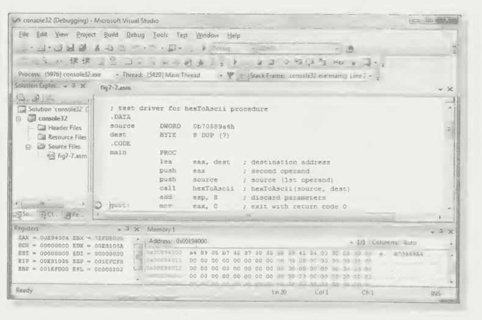

图 7.8 调用 `hexToAscii` 的结果

## 7.2 移位和循环指令

向右移位以获取右端的下一个 4 位。程序中间的设计如下：

```
index := 8 downto 1 loop
  将值复制到 EBX;
  掩码掉 EBX 中最后 4 位以外的所有位;
  如果 BL 中的值 ≤ 9
    那么
      将 BL 中的值转换为字符 0 到 9;
    else
      将 BL 中的值转换为字母 A 到 F;
    end if;
  将 BL 存储在地址 destination+index-1 处;
  将值右移 4 位以对齐下一组 4 位;
end for;
```

在代码中，指令

`and ebx, 0000000Fh` ; 掩码掉最后 4 位以外的所有位

掩码掉 `EDX` 中最后的 4 位。`if` 通过以下方式实现：

```
ifDigit:    cmp      bl, 9          ; 数字 <= 9?
            jnle     elseHex        ; 如果不是则跳过
            or       bl, 30h        ; 将数字转换为 ASCII
            jmp      endIfDigit     ; 如果是则退出
elseHex:    add      bl, 'A'-10     ; 将字母转换为 ASCII
endIfDigit:
```

从 0 到 9 的值使用 `or` 指令转换为数字的 ASCII 码；`add bl, 30h` 在此处的效果同样良好。为了将数字 0Ah 到 0Fh 转换为字母 A 到 F 对应的 ASCII 码 41h 到 46h，需要在数字上加上值 `'A'-10`。这实际上加上了十进制数字 55，但使用的代码比 `add bl, 55` 更清晰。

在存储 ASCII 码后，`shr` 指令将 `EAX` 中的值向右移动 4 位，丢弃刚刚转换为字符的十六进制位。

## 位操作

除了书中讨论的移位指令外，还有“双倍移位”指令，它们使用寄存器作为寄存器或目的地的填充位源，而不是仅仅使用 0 或 1 来填充。这些指令的助记符为 `shrd` 和 `shld`，语法如下：

```
sh-d destination, source register, count
```

我们在书中不需要这些指令。循环指令与移位指令相似。在移位指令中，从一端移出的位会被丢弃，而另一端的空闲空间由 0 填充（对于负数的右算术移位则用 1 填充）。在循环指令中，从目标一端移出的位将用于填充另一端的空闲空间。

循环指令的格式与单位移位指令相同。单位循环指令的格式为

```
r-- destination, 1
```

还有多位版本

```
r-- destination, cl
```

`rol`（左循环）和 `ror`（右循环）指令可用于寄存器或内存中的字节、字、双字或四字。当每个位从一端“掉落”时，它会被复制到目的地的另一端。此外，最后复制到另一端的位也会被复制到进位标志（`CF`）。溢出标志 `OF` 是唯一受循环指令影响的标志。对于多位循环，它的值是未定义的，书中不需要其与单位循环指令定义的一致性说明。举个例子，假设 `DX` 寄存器包含 `D2E0h`，并执行指令

```
rol dx, 1
```

在二进制中，该操作看起来如下：

```
11010010 11100000
```

结果为 `A5C1h`。由于有一个位从左端旋转到右端，进位标志 `CF` 被置为 1。

循环指令的操作码和字节数与移位指令相同。它们已在图 7.6 中所示。

## 7.2 移位和循环指令

向右移位以获取右端的下一个 4 位。程序中间的设计如下：

```
index := 8 downto 1 loop
  将值复制到 EBX;
  掩码掉 EBX 中最后 4 位以外的所有位;
  如果 BL 中的值 ≤ 9
    那么
      将 BL 中的值转换为字符 0 到 9;
    else
      将 BL 中的值转换为字母 A 到 F;
    end if;
  将 BL 存储在地址 destination+index-1 处;
  将值右移 4 位以对齐下一组 4 位;
end for;
```

在代码中，指令

`and ebx, 0000000Fh` ; 掩码掉最后 4 位以外的所有位

掩码掉 `EDX` 中最后的 4 位。`if` 通过以下方式实现：

```
ifDigit:    cmp      bl, 9          ; 数字 <= 9?
            jnle     elseHex        ; 如果不是则跳过
            or       bl, 30h        ; 将数字转换为 ASCII
            jmp      endIfDigit     ; 如果是则退出
elseHex:    add      bl, 'A'-10     ; 将字母转换为 ASCII
endIfDigit:
```


`and ebx, 0000000fh;` 掩码掉最后 4 位以外的所有位

掩码掉 EDX 中最后的 4 位。`if` 通过以下方式实现：

```
ifDigit:    cmp      bl, 9          ; 数字 <= 9?
            jnle     elseHex        ; 如果不是则跳过
            or       bl, 30h        ; 将数字转换为 ASCII
            jmp      endIfDigit     ; 如果是则退出
elseHex:    add      bl, 'A'-10     ; 将字母转换为 ASCII
endIfDigit:
```

从 0 到 9 的值使用 `or` 指令转换为数字的 ASCII 码；

`add edx, 30h` 在此处的效果同样良好。为了将数字 0A 到 0F 转换为字母 A 到 F 对应的 ASCII 代码 41 到 46，需要在数字上加上值 `'A'-10`。

这实际上加上了十进制数字 55，但使用的代码比 `add bl,55` 更清晰。

在存储 ASCII 代码后，`shr` 指令将 EAX 中的值向右移动 4 位，丢弃刚刚转换为字符的十六进制位。

## 260 位操作

除了书中讨论的移位指令外，还有“双倍移位”指令，它们使用寄存器作为寄存器或目的地的填充位源，而不是仅仅使用 0 或 1 来填充。这些指令的助记符为 `shrd` 和 `shld`，语法如下：

```
sh-d destination, source register, count
```

我们在书中不需要这些指令。循环指令与移位指令相似。在移位指令中，从一端移出的位会被丢弃，而另一端的空闲空间由 0 填充（对于负数的右算术移位则用 1 填充）。在循环指令中，从目标一端移出的位将用于填充另一端的空闲空间。

循环指令的格式与单位移位指令相同。单位循环指令的格式为

```
r-- destination, 1
```

还有多位版本

```
r-- destination, cl
```

`rol`（左循环）和 `ror`（右循环）指令可用于寄存器或内存中的字节、字、双字或四字。当每个位从一端“掉落”时，它会被复制到目的地的另一端。此外，最后复制到另一端的位也会被复制到进位标志（CF）。溢出标志 OF 是唯一受循环指令影响的标志。对于多位循环，它的值是未定义的，书中不需要其与单位循环指令定义的一致性说明。举个例子，假设 DX 寄存器包含 D2E，并执行指令

```
rol dx, 1
```

在二进制中，该操作看起来如下：

```
11010010 11101110
```

结果为 10100101 A4BD。由于有一个位从左端旋转到右端，进位标志 CF 被置为 1。

循环指令的操作码和字节数与移位指令相同。它们已在图 7.7 中所示。

## 7.2 移位和循环指令

向右移位以获取右端的下一个 4 位。程序中间的设计如下：

```
index := 8 downto 1 loop
  将值复制到 EBX;
  掩码掉 EBX 中最后 4 位以外的所有位;
  如果 BL 中的值 ≤ 9
    那么
      将 BL 中的值转换为字符 0 到 9;
    else
      将 BL 中的值转换为字母 A 到 F;
    end if;
  将 BL 存储在地址 destination+index-1 处;
  将值右移 4 位以对齐下一组 4 位;
end for;
```

在代码中，指令

`and ebx, 0000000fh;` 掩码掉最后 4 位以外的所有位

掩码掉 EDX 中最后的 4 位。`if` 通过以下方式实现：

```
ifDigit:    cmp      bl, 9          ; 数字 <= 9?
            jnle     elseHex        ; 如果不是则跳过
            or       bl, 30h        ; 将数字转换为 ASCII
            jmp      endIfDigit     ; 如果是则退出
elseHex:    add      bl, 'A'-10     ; 将字母转换为 ASCII
endIfDigit:
```

从 0 到 9 的值使用 `or` 指令转换为数字的 ASCII 码；

`add edx, 30h` 在此处的效果同样良好。为了将数字 0A 到 0F 转换为字母 A 到 F 对应的 ASCII 代码 41 到 46，需要在数字上加上值 `'A'-10`。

这实际上加上了十进制数字 55，但使用的代码比 `add bl,55` 更清晰。

在存储 ASCII 代码后，`shr` 指令将 EAX 中的值向右移动 4 位，丢弃刚刚转换为字符的十六进制位。

## 7.2 练习

1. 假设每个移位指令执行时的“之前”值。给出请求的“之后”值。

| 之前 | 指令 | 之后 |
|---|---|---|
| (a) AX:F5 | shl ax, 1 | |
| (b) AX:A5 | shr ax, 1 | |
| (c) AX:55 | rol ax, 1 | |
| (d) AX:55 | ror ax, 1 | |
| (e) AX:F5 | shl ax, 1 | |
| (f) AX:A5 | shr ax, 1 | |
| (g) AX:55 | rol ax, 1 | |
| (h) AX:55 | ror ax, 1 | |
| (i) AX:F5 | shl ax, 1 | |
| (j) AX:A5 | shr ax, 1 | |
| (k) AX:55 | rol ax, 1 | |
| (l) AX:55 | ror ax, 1 | |

2. 比较除法 32 和乘法 32 的操作码和字节数。

## 7.3 将 ASCII 字符串转换为补码整数

将 EAX 中的值乘以 3。编写类似的代码序列，使用移位和加法指令来高效地乘以 5、7、9 和 10。

## 编程练习 7.2

- 1. 编写一个过程 `binaryToAscii`，它将一个双字整数转换为一个恰好包含 32 个 0 或 1 字符的字符串，表示其作为无符号二进制数的值。遵循 cdecl 协议。该过程有两个参数：
   (1) 双字值。
   (2) 32 字节长度的目标字符串的地址。使用旋转指令从左到右一次提取位；回想 `jc` 或 `jnc` 指令查看进位位。编写一个短的驱动程序来测试你的过程。

- 2. 一个字节可以用三个八进制数字表示。位 7 和 6 决定左侧的八进制数字（从大于 4）；位 5、4 和 3 决定中间的数字；位 2、1 和 0 决定右侧的数字。例如，$11011010_2$ 是 $011\ 010\ 110$ 或 $326_8$。通过对高位字节和低位字节分别应用 2-3-3 系统用分八进制表示值。编写一个过程 `splitOctal`，它将一个字转换为一个恰好七个字符的字符串，表示该数在分八进制中的值；两组三位数字之间用空格隔开。遵循 cdecl 协议。该过程有两个参数：
   (1) 字的值（作为双字的低字传递）。
   (2) 7 字节长度的目标字符串的地址。
   编写一个短的驱动程序来测试你的过程。

## 7.3 将 ASCII 字符串转换为补码整数

`atod` 宏被用于扫描包含整数 ASCII 表示的内存区域，在 EAX 寄存器中产生相应的双字长度补码整数。本节描述了 `atod` 的 windows32 版本以及它调用的过程作为此类操作的示例。windows64 组件的代码也类似。

`atod` 宏展开为以下指令序列。

```
lea      eax, source    ; 将源地址到 EAX
push     eax            ; 栈上的源参数
call     atodproc       ; 调用 atodproc(source)
add      esp, 4         ; 移除参数
```

这些指令调用过程 `atodproc` 并传递一个参数，即要扫描的 ASCII 字符字符串的地址。EAX 寄存器没有被宏代码保存，因为结果要在 EAX 中返回。实际源标识符在展开的宏中使用，而不是名称 `source`。

实际的 ASCII 到补码整数转换是由过程 `atodproc` 完成的，其源代码位于 windows32 包中的 `io.asm` 文件中。该过程从标准入口代码开始，以标准退出结束。`atodproc` 的第一个工作是跳过前导空格，并且

```
; atodproc(source)
; 从源地址开始扫描数据段，将
; ASCII 字符解释为返回在 EAX 中的双字大小整数。

; 跳过前导空格。允许前导的 - 符号。
; 数字必须紧跟符号（如果有的话）。
; 内存扫描由任何非数字终止。

; 未进行错误检查。如果数字超出有符号字的范围，
; 则返回值是未定义的。

atodproc  PROC
push     ebp             ; 保存基指针
mov      ebp, esp        ; 建立栈帧
sub      esp, 4          ; 符号的本地空间
push     ebx             ; 保存寄存器
push     edx
push     esi
pushfd                   ; 保存标志位

mov      esi, [ebp+8]    ; 获取参数 (源地址)

(继续)
```

### 图 7.9 ASCII 到双字整数转换

| WhileBlankD: | cmp BYTE PTR [esi], ' ' | ; 是空格吗？ |
|---|---|---|
| | jne EndWhileBlankD | ; 如果不是则退出 |
| | inc esi | ; 增加字符指针 |
| | jmp WhileBlankD | ; 再次尝试 |
| EndWhileBlankD | | |
| | mov eax, 1 | ; 默认符号乘数 |
| IfPlusD: | cmp BYTE PTR [esi], '+' | ; 前导的 + 吗？ |
| | je SkipSignD | ; 如果是，跳过 |
| IfMinusD: | cmp BYTE PTR [esi], '-' | ; 前导的 - 吗？ |
| | jne EndIfSignD | ; 如果不是，保存默认的 + |
| | mov eax, -1 | ; 负号表示为 -1 |
| SkipSignD: | inc esi | |
| | mov [ebp-4], eax | ; 保存符号乘数 |
| EndSignD: | mov eax, 0 | ; 正在积累的数字 |
| WhileDigitD: | cmp BYTE PTR [esi], '0' | ; 将下一个字符与 '0' 比较 |
| | jl EndWhileDigitD | ; 不是小于 '0' 的数字 |
| | cmp BYTE PTR [esi], '9' | ; 与 '9' 比较 |
| | jg EndWhileDigitD | ; 不是大于 '9' 的数字 |
| | imul eax, 10 | ; 将旧数字乘以 10 |
| | mov bl, [esi] | ; 将 ASCII 字符到 BL |
| | sub bl, '0' | ; 转换为数值 |
| | add eax, ebx | ; 累加 |
| | inc esi | ; 下一个字符 |
| | jmp WhileDigitD | ; 继续循环 |
| EndWhileDigitD: | | |
| | imul eax, [ebp-4] | ; 应用符号 |
| | popfd | ; 恢复标志位 |
| | pop esi | ; 恢复寄存器 |
| | pop edx | |
| | pop ebx | |
| | mov esp, ebp | ; 恢复栈指针 |
| | pop ebp | ; 恢复基指针 |
| | ret | ; 返回 |

第二个操作数可以是 CL 或立即数，并将目标地按指定的位数进行移位。在所有单次移位操作中，空出的位置都由 0 位填充，但负数的算术右移除外，该操作使用 1 位进行填充。移位指令可用于对 2、4、8 或 2 的更高幂次进行高效、方便的乘法或除法。

旋转指令与移位指令相似。然而，从目标地一端掉出的位会填充另一端的空隙。移位或旋转指令可以与逻辑指令结合使用，以从某个位置提取一组位，或将多个值打包到单个字节或字中。

# 第 8 章 字符串操作

计算机经常用于处理字符字符串以及数值型数据。在数据处理中，应用程序名称、地址等必须进行存储，有时还需重新排列。文本编辑器和文字处理程序必须能够搜索和移动字符串。汇编器必须能够分离汇编语句的元素，识别出那些被保留的助记符。即使计算主要以数值为主，当在键盘输入数字时，通常需要将字符字符串转换为内部数值格式，或者为了显示目的将内部格式转换为字符字符串。

- 8.1 使用字符串指令
- 8.2 重复前缀和更多字符串指令
- 8.3 字符翻译
- 8.4 将 2 补码整数转换为 ASCII 字符串
- 8.5 章总结

8086 微处理器具有处理字符字符串的指令。相同的指令也可以处理字、双字或（在 64 位模式下）四字。本章介绍了处理字符串的 8086 指令，重点是字符字符串。使用这些指令完成的任务也可以之前介绍过的简单指令完成。包含字符串指令部分是为了说明 80x86 架构代表了复杂指令集计算机 (CISC) 类计算机。书中未涵盖许多其他复杂的 80x86 指令。

## 8.1 使用字符串指令


# 字符串操作

有五种用于字符串操作的 80x86 指令：`moves`（移动字符串）、`cmps`（比较字符串）、`scas`（扫描字符串）、`stos`（存储字符串）和 `loads`（加载字符串）。`moves` 指令用于将字符串从一个内存位置拷贝到另一个内存位置。`cmps` 指令用于比较两个字符串的内容。`scas` 指令可用于在字符串中搜索某个特定值。`stos` 指令可以在字符串的某个位置存储新值。最后，`loads` 指令从字符串的某个位置拷贝出一个值。

80x86 架构中的字符串是指内存中连续的字节、字、双字或四字集合。字符串通常在程序的数据段中定义，使用如下伪存指令：

| 标号 | 类型 | 初始值 |
| :--- | :--- | :--- |
| response | BYTE | 20 DUP (?) |
| label | BYTE | 'The results are ', 0 |
| wordString | WORD | 50 DUP (?) |
| arrayD | DWORD | 60 DUP (0) |
| qString | QWORD | 40 DUP (?) |

注意，字符串和数组实际上是相同的，除非涉及源字符串、目标字符串或两者。

每条字符串指令都适用于源字符串、目标字符串或两者。这些指令会一次处理这些字符串中的一个字节、字、双字或四字。使用寄存器间接寻址来定位单个字符串元素。80x86 指令使用源索引寄存器 `ESI` 中的地址访问源字符串的元素。目标字符串中的元素使用目标索引寄存器 `EDI` 中的地址访问。在 64 位模式下，默认使用 `RSI` 和 `RDI`；但本章剩余部分将引用 `ESI` 和 `EDI`。

由于字符串元素的源和目标地址始终由 `ESI` 和 `EDI` 给出，因此不需要操作数来标识这些位置。然而，如果没有操作数，汇编器无法判断要使用的字符串元素的大小。例如，`moves` 本身可以移动字节、字、双字或四字——为了避免这种歧义，助记符的特殊版本定义了元素大小——操作字节的指令使用 `b` 后缀，字字符串指令使用 `w` 后缀，双字字符串使用 `d` 后缀，四字字符串指令使用 `q` 后缀。例如，`movsb` 用于移动字符串，`movsd` 用于移动双字字符串。所有这些指令都使用 `mov` 且都不使用操作数，因为汇编器通过助记符知道元素大小。

汇编器还有另一种区分操作数的方法，即实际上包含源和目标操作数。这些操作数除了其大小属性外都会被忽略，但该属性可能会引起误导。我们不使用这种替代编码样式。

虽然字符串指令一次只操作一个字符串元素，但它总是准备好操作下一个元素。它通过更改源寄存器 `ESI` 和/或目标寄存器 `EDI`，使其包含字符串（或多个字符串）下一个元素的地址来实现。当使用字节大小的元素时，寄存器改变 1；对于字，`ESI` 和 `EDI` 改变 2；对于双字，寄存器改变 4；对于四字，寄存器改变 8。x86 可以在字符串中向前移动（从低地址到高地址）或向后移动（从高地址到低地址）。移动方向由标志位 `DF` 的值（标志寄存器的第 10 位）决定。如果 `DF` 设置为 1，则 `ESI` 和 `EDI` 递减，导致反向操作。如果 `DF` 清零（0），则 `ESI` 和 `EDI` 递增，导致正向操作。x86 有两条指令专门用于重置或设置标志位。`cld` 将 `DF` 置为 0，使 `ESI` 和 `EDI` 递增。`std` 将 `DF` 设置为 1，使 `ESI` 和 `EDI` 递减。这两条指令都不影响 `DF` 以外的标志。这些指令的数据见图 8.1。

| 指令 | 机器码 | 字节数 |
| :--- | :--- | :--- |
| `cld` | FC | 1 |
| `std` | FD | 1 |

**图 8.1** `cld` 和 `std` 指令

---

| 助记符 | 大小 | 机器码 | 字节数 |
| :--- | :--- | :--- | :--- |
| `movsb` | 字节 | A4 | 1 |
| `movsw` | 字 | A5 | 1 |
| `movsd` | 双字 | A5 | 1 |
| `movsq` | 四字 | A5 | 1 |

**图 8.2** `mov` 系列指令

最后，是时候介绍字符串指令的所有细节了。`movs` 指令从源字符串拷贝一个目标字符串元素（字节、字、双字或四字）。`ESI` 处的源元素被拷贝到 `EDI`。在拷贝字符串元素后，两个索引寄存器根据元素大小（1、2、4 或 8）发生变化，如果 `DF` 为 0 则递增，如果 `DF` 为 1 则递减。`movs` 指令不影响任何标志。它有 `movsb`、`movsw`、`movsd` 版本；图 8.2 提供了每个版本的信息。

图 8.3 给出了使用 `movs` 指令的程序示例。示例重要的部分是 `strcpy` 过程。该过程有两个参数，分别给出字符字符串的目标和源地址。假设源字符串以空字节终止。`strcpy` 过程目标位置产生源字符串的精确拷贝，并用空字节终止目标字符串。

该过程只使用寄存器 `ESI` 和 `EDI`。`ESI` 和 `EDI` 的值是推在栈上的参数；即第一对源和目标字符串的地址。清除标志位以便从左到拷贝。由于过程必须清除标志位，而调用者可能取决于其具有相反的值，入口代码除了 `ESI` 和 `EDI` 之外保存了标志寄存器。

初始化后，过程执行以下伪代码设计：

```
当下一个源字节不空时
    将源字节拷贝到目标;
    递增源索引;
    递增目标索引;
while;
在目标字符串末尾放置空字节;
```

```assembly
; strcpy 程序与测试驱动程序
; 作者: R. Detmer
; 修改: 7/2008
.586
.MODEL FLAT
.STACK 4096
INCLUDE io.h            ; 输入/输出头文件
                         ; 为数据留留存储
.DATA
prompt BYTE            "Original string? ",0
stringIn BYTE          80 DUP (?)
displayLbl BYTE          "Your string was...", 0
stringOut BYTE         80 DUP (?)
.CODE
_MainProc PROC
      input prompt, stringIn, 80   ; 请求字符串
      lea     eax, stringIn      ; 源
      push    eax                    ; 第二个参数
      lea     eax, stringOut      ; 目的地址
      push    eax                    ; 第一参数
      call    strcpy              ; strcpy(dest, source)
      add     esp, 8               ; 移除参数
      output displayLbl, stringOut  ; 显示结果
      mov     eax, 0               ; 以返回代码 0 退出
      ret
MainProc ENDP
```

```assembly
strcpy PROC NEAR32
; 复制字符串直到源中的空字节被复制。
; 假设目的位置足够长以容拷贝。
; 参数:
; (1) 目的地址
; (2) 源地址
push    ebp                    ; 保存指针
mov     ebp,esp               ; 复制堆栈指针
push    edi                    ; 保存寄存器
push    esi                    ; 保存标志
mov     edi,[ebp+8]           ; 目的
mov     esi,[esp+12]          ; 初始源地址
                               ; 清除方向标志
whileNonNull:
cmp     BYTE PTR [esi],0     ; 源字节是否为空？
je      endWhileNull          ; 如果为空则停止拷贝
```

**图 8.3** 字符串拷贝程序

# 274 字符串操作

| `movsb` | ;拷贝一个字节 |
| `jmp whileNonNull` | ;跳转去检查下一个字节 |
| `endWhileNull: mov BYTE PTR [edi],0` | ;结束目的字符串 |
| `popfd` | ;恢复标志 |
| `pop esi` | ;恢复寄存器 |
| `pop edi` | |
| `pop ebp` | |
| `ret` | ;返回 |
| `strcpy END` | |

**图 8.3** 字符串拷贝程序（续）

为了检查下一个源字节是否为空，使用了以下语句：

```assembly
cmp BYTE PTR [esi],0 ; 源字节为空;
```

被使用。请记住，符号 `[esi]` 表示寄存器间接寻址，因此使用了 `ESI` 地址处的元素，即源字符串的当前字节。`BYTE PTR` 操作符是必要的，因为汇编器无法从操作数判断是进行字节、字、双字还是四字（quadword）的比较。拷贝源字节并增加两个索引寄存器通过 `movsb` 指令完成。最后。

```assembly
mov BYTE PTR [edi],0 ;结束目的字符串
```

将一个空字节移动到目的字符串的末尾，因为在源的最后一个字节拷贝到目的之后，`EDI` 已经增加了。同样，`BYTE PTR` 操作符告诉汇编器目的是一个字节而不是字或双字。

测试 `strcpy` 的程序简单地使用对话框从键盘输入字符串，调用 `strcpy` 将其拷贝到其他地方，最后显示拷贝的字符串。测试驱动程序中最有趣的部分是用于调用该过程的指令集。

`mov` 指令的源字符串通常不与目的字符串重叠。然而，这是很有用的。假设你想初始化 `starSlas` 处80个字符长的字符串为模式 `/`，重复40次。以下代码可以完成此任务。

# 8.1 使用字符串指令 275

```assembly
starSlas BYTE 80 DUP (?)
...
mov starSlas, '*'      ;第一个 *
mov starSlas+1, '/'    ;第一个 /
lea esi, starSlas      ; 源地址
lea edi, starSlas+2    ; 目的
cld                     ; 从左到右处理
mov ecx, 78             ; 拷贝字符
forCount:
movsb                   ; 拷贝下一个字符
loop forCount          ; 重复
```

在这个示例中，第一次使用 `movsb` 时，从第一个字符串位置的 `*` 拷贝到第三个位置。在下一次迭代中，将 `/` 从第二个位置拷贝到第四个位置。第三次，将 `*` 从第三个位置拷贝到第五个位置，以此此类推。

下一节介绍了一种更简单的方法来重复 `mov` 指令。

`windows32` 和 `windows64` 输出宏都调用了 C 函数 `show`，显示调用了库函数 `MessageBox`。如果方向标志被设置，32位或64位的 `MessageBox` 均无法正常工作。因此，输出宏模型语句包含一条 `cld` 指令。这可能会影响在循环中间反向处理字符串时使用输出的程序。

## 练习题 8.1

- **1. 以下 windows32 程序的输出是什么？**

```assembly
.586
.MODEL FLAT
.STACK 4096
INCLUDE io.h

DATA
outLbl BYTE "The modified string is", 0
string BYTE "ABCDEFGHIJ", 0

.CODE

_MainProc PROC

set setup code 1

lea esi, string      ; 字符串开头
lea edi, string+5    ; 'F' 的地址
cld                     ; 前向移动
movsb                   ; 移动 4 个字符
movsb
movsb
movsb
output outLbl, string ; 显示字符串
mov eax, 0           ; 退出
ret
MainProc ENDP
END
```

- **2. 替换设置代码以重复 1**

```assembly
lea esi, string      ; 字符串开头
lea edi, string+2    ; 目的
cld                     ; 前向移动
```

- **3. 替换设置代码以重复 1**

```assembly
lea esi, string      ; 字符串开头
lea edi, string+4    ; 目的
cld                     ; 前向移动
```

- **4. 替换设置代码以重复 1**

```assembly
lea esi, string      ; 字符串开头
lea edi, string+7    ; 目的
std                     ; 反向移动
```

## 编程练习 8.1

- **1. 写一个 windows32 程序，保留名为 `byteArea` 的 80 字节区域。使用对话框输入字符串。将第一个拷贝到 `byteArea` 开头，然后在字符串末尾附加空字节。最后，使用输出宏显示 `byteArea` 中的所有字符。结果应该是应该是输入的字符串，每行一个。**

## 8.2 重复前缀和更多字符串指令

8086 字符串指令每次处理一个元素。然而，8086 架构包含了三种重复前缀，可以将字符串指令变为自动重复的版本，直到固定次数迭代或满足某些条件。这三个重复前缀实际上对应不同的字节码；它们本身不是指令，而是字符串指令的补充码，形成了新指令。

图 8.4 显示了程序片段，每个片段将固定数量的字符从 `sourceStr` 拷贝到 `destStr`。数量加载到 `ECX` 寄存器。部分 (a) 代码使用 `loop` 指令。由于字符计数可能为零，循环由 `jz` 指令保护。循环体使用 `movsb` 每次拷贝一个字符。`loop` 指令负责处理循环次数。部分 (b) 的程序片段在功能上等同于部分 (a)。将数量拷贝到 `ECX` 后，使用重复前缀 `rep` 配合 `movsb` 指令，`rep movsb` 的作用与部分 (a) 的最后四行相同。

重复前缀通常与 `mov` 指令以及 `stos` 指令（见第283页）一起使用。它导致执行以下操作。

| `lea esi, sourceStr` | ; 源字符串 |
| `lea edi, destStr` | ; 目的 |
| `cld` | ; 前向移动 |
| `mov ecx, count` | ; 拷贝数量 |
| `jecxz endCopy` | ; 如果计数为零则跳过循环 |
| `copy: movsb` | ; 移动1个字符 |
| `loop copy` | ; 递计数并继续 |

**(a) 在循环中迭代的 movsb**

| `lea esi, sourceStr` | ; 源字符串 |
| `lea edi, destStr` | ; 目的 |
| `cld` | ; 前向移动 |
| `mov ecx, count` | ; 拷贝的数量 |
| `rep movsb` | ; 移动字符 |

**(b) 使用重复前缀的 movsb**


# 278 字符串操作

```
while count in ECX > 0 loop
    perform primitive instruction;
    decrement ECX by 1;
end while;
```


注意这是一个 `while` 循环。如果 `ECX` 包含零，则完全不执行原始指令。不需要对重复字符串指令进行保护，而你通常在对一个使用循环指令实现的普通 `for` 循环时必须做的那样。

其他的重复前缀有 `repe`（等同于助符 `repz`）和 `repne`（等同于 `repnz`）。助符 `repe` 代表“相等重复”（repeat while equal），`repz` 代表“零值重复”（repeat while zero）。同样，`repne` 和 `repz` 分别表示“不相等时重复”和“非零时重复”。这些重复前缀中的每一个都适用于影响零标志位 `ZF` 的两个字符串指令 `cmps` 和 `scas` 的配合使用。

这些助符的名称部分地描述了它们的动作。每条指令的工作方式都与 `repe` 相同，在 `ECX` 不为 0 时迭代执行原始指令。然而，它在执行完字符串指令后还会检查 `ZF`。`repe` 和 `repz` 会在 `ZF=1` 时继续迭代，这就像是在一个两个操作数不同的比较之后一样。每个由重复前缀和原始字符串指令形成的新指令对标志位的影响仅与原始指令相同，即：没有因为 `ECX` 的变化而产生额外的调整。三个重复前缀总结在图 8.5 所示。注意，`rep` 和 `repz` (`repe`) 生成的代码完全相同。

`repz` 和 `repne` 前缀并没有产生图 8.5 所示所示的真 `while` 循环。`ECX` 中的值在原始指令的第一次迭代期间被检查，因为它应该是一个 `while` 循环。然而，它并不检查 `ZF`。

| 助符 | 循环条件 | 机器码 | 代码字节数 |
|---|---|---|---|
| `rep` | `ECX>0` | `F3` | 1 |
| `repz`/`repe` | `ECX>0` and `ZF=1` | `F3` | 1 |
| `repnz`/`repne` | `ECX>0` and `ZF=0` | `F2` | 1 |

图 8.5 重复前缀

# 8.2 重复前缀和更多字符串指令 279

| 助符 | 元素大小 | 机器码 | 对象代码字节数 |
| --- | --- | --- | --- |
| `cmpsb` | byte | `A6` | 1 |
| `cmsw` | word | `A7` | 1 |
| `cmpsd` | doubleword | `A7` | 1 |
| 64-bit mode | | | |
| `cmpsq` | quadword | `A7` | 1 |

图 8.6 `cmps` 指令（使用 `ESI` 和 `EDI`）

在原始指令执行后。在实践中，这是非常方便的，因为计数为零时指令会被跳过，程序员不需要为重复指令做任何事情来初始化 `ZF`。

图 8.6 总结的 `cmps` 指令比较源字符串和目标字符串的元素。第 5 章解释了 `cmp` 指令如何减去两个操作数并根据差异设置标志位。同样，`cmps` 减去两个元素并根据差异设置标志位，且任何一个操作数都不会被改变。如果在循环中使用 `cmps`，在 `cmps` 后面跟随几个条件跳转指令是合适的，这取决于要实现的设计。重复前缀经常与 `cmps` 指令一起。事实上，对于查找两个字符串是否相同的任务，`repe` 前缀是 `cmps` 的完美伴侣。

通常需要在一个字符串中搜索嵌入的另一个字符串。假设当前任务是找到字符串 `key` 在目标字符串 `target` 中出现的位置（如果有的话）。实现此点的一种简单算法是：

```
position := 1;

while position ≤ (targetLength - keyLength + 1) loop

    if key matches the substring of target starting at position

        then

            report success;

            exit process;

    end if;

    add 1 to position;

while while;

report failure;
```

该算法检查 `key` 字符串是否匹配目标字符串从每个可能位置开始的部分。使用 80x86 寄存器检查一个匹配可以如下操作：

```
ESI := address of key;

EDI := address of target + position - 1;

ECX := length of key;
```

```
forever loop

    if ECX = 0 then exit loop; end if;

    compare [ESI] and [EDI] setting ZF;

    increment ESI;

    increment EDI;

    decrement ECX;

    if ZF = 0 then exit loop; end if;

end loop;
```

```
if ZF = 1

then

    match was found;

end if;
```

`forever loop` 正是重复字符串指令 `repeats` 所执行的操作。当 `ECX = 0` 或 `ZF = 0` 时循环终止；有必要确保最后比较的一对字符是相同的；这就是在设计末尾额外添加一个 `if` 的原因。图 8.7 显示了一个实现此设计的完整程序。

扫描指令 `scas` 用于扫描字符串以查找是否存在某个特定的字符串元素。被检查的字符串是目标字符串；也就是说，被检查元素的地址在目标寄存器 `EDI` 中。累加器包含正在搜索的元素，例如在 `scas` 指令中使用 `AL`，在 `scasd` 指令中使用 `EAX`。图 8.8 总结了 `scas` 指令。

```assembly
; 程序用于搜索嵌入在另一个字符串中的字符串

; 作者: R. Detmer

; 修订: 7/20

.86

MODEL FLAT

STACK 4096

INCLUDE io.h

DATA

prompt1 BYTE "String search?",
```

```assembly
; 用于在字符串中定位字符的程序

; 字符串从该字符处显示到结束

; 作者: R. Detmer

; 修改: 7/2008
```

```assembly
.586

.MODEL FLAT

.STACK 4096

INCLUDE io.h

EXTRN strlen:PROC
```

```assembly
.DATA

prompt1 BYTE "String", 0

prompt2 BYTE "Character?", 0

string BYTE 80 DUP (?)

char BYTE 5 DUP (?)

labell BYTE "Rest of the string ", 0
```

```assembly
.CODE

_MainProc input prompt1,string,80 ; 获取字符串

      lea eax, string ; 获取字符串长度

      push strlen ; 参数

      call strlen ; 调用 strlen(string)

      add esp, 4 ; 从栈中移除参数

      inc eax ; 在字符串长度中包含空字符

      mov ecx, eax ; 保存字符串的长度

      input prompt2,char,5 ; 获取字符

      mov al, char ; 将字符移入 AL

      lea edi, string ; 字符串偏移量

      cld ; 正向移动

      repne scasb ; 扫描直到找到该字符

      dec edi ; 回退到空字符或匹配的字符

      output label, [edi] ; 输出字符串

      mov eax, 0 ; 以返回代码 0 退出

      ret

_MainProc ENDP

END
```

图 8.9 在字符串中查找字符的程序

## 8.2 重复前缀和更多字符串指令

| 助符 | 元素大小 | 机器码 | 对象代码字节数 |
|---|---|---|---|
| `stosb` | 字节 | `AA` | 1 |
| `stosw` | 字字 | `AB` | 1 |
| `stosd` | 双字 | `AB` | 1 |
| 64-位 | | | |
| `stosq` | 四双字 | `AB` | 1 |

图 8.10 `stos` 指令（使用 `EDI` 和累加器）

| 助符 | 元素大小 | 机器码 | 对象代码字节数 |
|---|---|---|---|
| `lodsb` | 字节 | `AC` | 1 |
| `lodsw` | 字字 | `AD` | 1 |
| `lossd` | 双字 | `AD` | 1 |
| 64-位 | | | |
| `lodsq` | 四双字 | `AD` | 1 |

图 8.11 `lods` 指令（使用 `ESI` 和累加器）

加载指令 `lods` 是最后一条字符串指令。该指令将源字符串元素复制到累加器中。`lods` 指令不设置任何标志位。可以在 `lods` 上使用 `rep` 前缀，但这并没有帮助——因为除了最后一个元素外，所有值都会在连续值被复制到累加器时而被替换。如果字符串元素需要进行某些处理，有时设置一个循环是方便的，循环体以 `lods` 指令开始以获取元素，最后使用 `stos` 指令存储修改后的元素。`lods` 指令汇总在图 8.11 中。

## 8.2 练习题

对于下面的每个练习题，假设数据段包含：

```
source    BYTE    "brown"

dest      BYTE    "brine"
```

1. 假设执行了以下指令：

```assembly
lea esi, source

lea edi, dest

cld

mov ecx, 5

repne cmpsb
```

假设 `00417000` 是加载到 `ESI` 的地址，`00417005` 是加载到 `EDI` 的地址，在执行 `repne cmpsb` 指令后，`ESI` 和 `EDI` 中存储的值是什么？`ECX` 中将存储什么值？

2. 假设执行了以下指令：

```assembly
lea esi, source

lea edi, dest

cld

mov ecx, 5

repe cmpsb
```

假设 `00417000` 是加载到 `ESI` 的地址，`00417005` 是加载到 `EDI` 的地址，在执行 `repe cmpsb` 指令后，`ESI` 和 `EDI` 中存储的值是什么？`ECX` 中将存储什么值？

3. 假设执行了以下指令：

```assembly
mov al, 'w'

lea edi, dest

cld

mov ecx, 5

repe scasb
```

假设 `00417005` 是加载到 `EDI` 的地址，在执行 `repe scasb` 指令后，`EDI` 中存储的值是什么？`ECX` 中将存储什么值？

4. 假设执行了以下指令：

```assembly
mov al, 'n'

lea edi, dest

cld

mov ecx, 5

repne scasb
```

假设 `00417005` 是加载到 `EDI` 的地址，在执行 `repne scasb` 指令后，`EDI` 中存储的值是什么？`ECX` 中将存储什么值？

5. 假设执行了以下指令：

```assembly
mov    al, '*'

lea    edi, dest

cld

mov    ecx, 5

rep    stosb
```

假设 `00417005` 是加载到 `EDI` 的地址，在执行 `rep stosb` 指令后，`EDI` 中存储的值是什么？`ECX` 中将存储什么值？目标字符串中将存储什么？

6. 假设执行了以下指令：

```assembly
lea    esi, source

lea    edi, dest

cld

mov    ecx, 5

for6: lodsb

      inc

      stosb

      loop for6

end6:
```

假设 `00417000` 是加载到 `ESI` 的地址，在执行循环后，`ESI` 和 `EDI` 中存储的值是什么？`ECX` 中将存储什么值？目标字符串中将存储什么？

7. 假设执行了以下指令：

```assembly
lea esi, source

lea edi, dest

cld

mov ecx, 5

repne cmpsb
```

假设 `00417000` 是加载到 `ESI` 的地址，在执行 `repne cmpsb` 指令后，`ESI` 和 `EDI` 中存储的值是什么？`ECX` 中将存储什么值？

8. 假设执行了以下指令：

```assembly
lea esi, source

lea edi, dest

cld

mov ecx, 5

repe cmpsb
```

假设 `00417000` 是加载到 `ESI` 的地址，`00417005` 是加载到 `EDI` 的地址，在执行 `repe cmpsb` 指令后，`EDI` 中存储的值将是什么？`ECX` 中将存储什么值？

## 8.2 编程练习

1. 假设执行了以下指令：

```assembly
mov al, 'w'

lea edi, dest

cld

mov ecx, 5

repe scasb
```

假设 `00417005` 是加载到 `EDI` 的地址，在执行 `repe scasb` 指令后，`EDI` 中存储的值是什么？`ECX` 中将存储什么值？

2. 假设执行了以下指令：

```assembly
mov al, 'n'

lea edi, dest

cld

mov ecx, 5

repne scasb
```

假设 `00417005` 是加载到 `EDI` 的地址，在执行 `repne scasb` 指令后，`EDI` 中存储的值是什么？`ECX` 中将存储什么值？

3. 假设执行了以下指令：

```assembly
mov    al, '*'

lea    edi, dest

cld

mov    ecx, 5

rep    stosb
```

假设 `00417005` 是加载到 `EDI` 的地址，在执行 `rep stosb` 指令后，`EDI` 中存储的值是什么？`ECX` 中将存储什么值？目标字符串中将存储什么？

4. 假设执行了以下指令：

```assembly
lea    esi, source

lea    edi, dest

cld

mov    ecx, 5

for6: lodsb

      inc

      stosb

      loop for6

end6:
```

假设 `00417000` 是加载到 `ESI` 的地址，在执行循环后，`ESI` 和 `EDI` 中存储的值是什么？`ECX` 中将存储什么值？

5. 假设执行了以下指令：

```assembly
lea esi, source

lea edi, dest

cld

mov ecx, 5

repne cmpsb
```

假设 `00417000` 是加载到 `ESI` 的地址，在执行 `repne cmpsb` 指令后，`ESI` 和 `EDI` 中存储的值将是什么？`ECX` 中将存储什么值？

6. 假设执行了以下指令：

```assembly
lea esi, source

lea edi, dest

cld

mov ecx, 5

repe cmpsb
```

假设 `00417000` 是加载到 `ESI` 的地址，`00417005` 是加载到 `EDI` 的地址，在执行 `repe cmpsb` 指令后，`EDI` 中存储的值将是什么？`ECX` 中将存储什么值？

7. 假设执行了以下指令：

```assembly
lea esi, source

lea edi, dest

cld

mov ecx, 5

repe scasb
```

假设 `00417005` 是加载到 `EDI` 的地址，在执行 `repe scasb` 指令后，`EDI` 中存储的值将是什么？`ECX` 中将存储什么值？

8. 假设执行了以下指令：

```assembly
lea esi, source

lea edi, dest

cld

mov ecx, 5

repne scasb
```


假设 `00417005` 是加载到 `EDI` 的地址，在执行 `repne scasb` 指令后，`EDI` 中存储的值将是什么？`ECX` 中将存储什么值？

## 编程练习（补充）

1. 编写一个程序，在字符串中定位字符。字符串从该字符处显示到结束。作者：R. Detmer，修改：7/2008。
2. 编写一个程序，在字符串中定位字符。字符串从该字符处显示到结束。
3. 编写一个程序，在字符串中定位字符。字符串从该字符处显示到结束。
4. 编写一个程序，在字符串中定位字符。字符串从该字符处显示到结束。
5. 编写一个程序，在字符串中定位字符。字符串从该字符处显示到结束。
6. 编写一个程序，在字符串中定位字符。字符串从该字符处显示到结束。
7. 编写一个程序，在字符串中定位字符。字符串从该字符处显示到结束。
8. 编写一个程序，在字符串中定位字符。字符串从该字符处显示到结束。

## 8.3 字符转换

有时字符数据以一种格式可用，但在处理时需要另一种格式。一种情况发生在在两个计算机系统之间传输时，一个通常使用 ASCII 编码，另一个通常使用 EBCDIC 编码。另一种情况是字符代码需要被修改以传输到无法处理所有代码的设备，有时可以将不适当的代码替换为允许的代码或将其删除。

80x86 指令集包含了 `xlat` 指令来将一个字符转换为另一种。通过与其他字符串处理指令相结合，它可以轻松翻译字符串中的字符。

`xlat` 指令只需要 1 字节的代码，机器码为 `D7`。在执行之前，要翻译的字符位于 `AL` 寄存器中。该指令通过使用数据段中的查找表来查找 `AL` 的转换。查找表通常包含 256 字节的数据，对应 `AL` 中每个可能的 8 位值。偏移 0 处的字节是 `00` 转换后的字符。偏移 1 处的字节是 `01` 转换后的字符。通常情况下，`xlat` 使用字符作为从零开始的索引，然后该索引处的字节将替换 `AL` 中的字符。

`xlat` 指令没有操作数。`EBX` 寄存器必须包含查找表的地址（在 64 位模式下使用 `RBX`）。

图 8.12 列出了一个排序控制程序，用于原地翻译字符串的每个字符；它使用原始内存位置替换每个字符。该程序再次使用了首次在图 8.7 中出现的 `strlen` 过程。它位于一个单独汇编的文件中。该程序的核心是查找表和指令序列。

```assembly
mov      ecx, strLength ; 字符串长度
lea      ebx, table     ; 转换表地址
lea      esi, string    ; 字符串地址
lea      edi, string    ; 目标也是字符串
forIndex: lodsb          ; 将下一个字符拷贝到 AL
         xlat          ; 转换字符
         stosb          ; 将字符拷贝回字符串
         loop     forIndex  ; 对所有字符重复操作
```

; 将大写字母转换为小写字母；不改变小写
; 字母和数字。将其他字符转换为空格。
; 作者: R. Detmer
; 修改: 7/2008

.586
MODEL FLAT
STACK 4096
EXTERN string:PROC

```assembly
DATA
string  BYTE    "This is a #!$& STRING",0
table   BYTE    48 DUP (' '), "0123456789", 7 DUP (' ')
        BYTE    "abcdefghijklmnopqrstuvwxyz", 6 DUP (' ')
        BYTE    "abcdefghijklmnopqrstuvwxyz", 133 DUP (' ')
CODE
```

```assembly
main    PROC
        lea      eax, string    ; 获取字符串长度
        push   eax              ; 参数
        call   strlen           ; strlen(string)
        add    esp, 4           ; 清理参数
        mov    ecx, eax         ; 字符串长度
        lea    ebx, table       ; 转换表地址
        lea    esi, string      ; 字符串地址
        lea    edi, string      ; 目标也是字符串
forIndex: lodsb                 ; 将下一个字符拷贝到 AL
         xlat                   ; 转换字符
         stosb                  ; 将字符拷贝回字符串
         loop   forIndex        ; 对所有字符重复操作
        mov    eax, 0
        ret
main    ENDP
```


### 8.3 字符转换 291

这些指令实现了一个如下设计的 for 循环：

```
for index := 1 to stringLength loop
    将源字符加载到 AL;
    转换 AL 中的字符;
    将 AL 中的字符拷贝到目标地;
结束 for;
```

此程序将每个 ASCII 码转换为另一个 ASCII 码。大写字母被转换为小写字母，小写字母和数字保持不变，所有其他字符被转换为空格。程序的困难部分在于构建转换表。它的构建涉及查看 ASCII 码表（见附录 A）。对于此程序，转换表定义如下：

| table | BYTE |
| :--- | :--- |
| | 48 DUP (' '), '0123456789', 7 DUP (' ') |
| | 'abcdefghijklmnopqrstuvwxyz', 6 DUP (' ') |
| | 'abcdefghijklmnopqrstuvwxyz', 133 DUP (' ') |

仔细数可以发现正好定义了 256 个代码。回想 `BYTE` 指令存储每个字符的 ASCII 码。`AL` 前 48 个字节中的每一个都将包含空格的 ASCII 码 `20h`。因此，如果 `AL` 寄存器中的代码是前 48 个字符之一——控制字符或从 `20h`（空格）到 `2Fh`（/）的可打印字符之一——都将被转换为空格。

注意，将一个字符转换为自身是合法的。事实上，数字的情况就会发生这种情况；数字 0 到 9 的 ASCII `30h` 到 `39h` 出现在偏移量 `30h` 到 `39h` 处。七个字符 `: ; < = > ? @` 的代码紧随其后位于 ASCII 表；其中每一个都将被转换为空格。接下来的 ASCII 字符是大写字母，而表中的新条目是小写字母的代码。例如，表在偏移量 `41h` 处包含 `61h`，因此大写字母 `A`（ASCII 码 `41h`）将被转换为小写 `a`（ASCII 码 `61h`）。接下来的六个空白位于偏移量 `5Bh` (`[`) 到 `60h` (`` ` ``)，每个都等于空格。小写字母的 ASCII 码在等于其值的偏移量处汇聚，因此每个小写字母都转换为自身。最后，转换表包含 133 个空格的 ASCII 码；这些是 `{, |, }, ~`，以及每个以 1 开头的 128 位模式的目标，它们中没有一个是代表 ASCII 字符的代码。

图 8.13 显示了程序在调试器下运行的屏幕截图，裁剪后显示从 `string` 地址开始的内存。注意，“奇怪”字符并没有被删除，它们被替换为空格。

## 练习题 8.3

*1. 这里有一个十六进制/EBCDIC 转换表：

| 81 a | 95 n | C1 A | D5 N | 40 space |
| 82 b | 96 o | C2 B | D6 O | 4 B |
| 83 c | 97 p | C3 C | D7 P | 6 B |
| 84 d | 98 q | C4 D | D8 Q | 40 |
| 85 e | 99 r | C5 E | D9 R | 41 |
| 86 f | A2 s | C6 F | E2 S | 42 |
| 87 g | A3 t | C7 G | E3 T | 43 |
| 88 h | A4 u | C8 H | E4 U | 44 |
| 89 i | A5 v | C9 I | E5 V | 45 |
| 91 j | A6 w | D1 J | E6 W | 46 |
| 92 k | A7 x | D2 K | E7 X | 47 |
| 93 l | A8 y | D3 L | E8 Y | 48 |
| 94 m | A9 z | D4 M | E9 Z | 49 |

给出一个适用于 EBCDIC 字母、数字、空格、点转换为相应 ASCII 码的转换表，其他代码转换为空字符。

2. 给出一个适用于 ASCII 小写字母转换为大写字母的转换表，保持其他字符不变。

## 编程 8.3

1. 在美国，数字使用小数点分隔整数部分和小数部分，并在左侧每三位使用逗号。在许多欧洲国家，数字的逗号和点的角色是反的。例如，`1,234,567.89` 会写成 `1.234.567,89`。编写一个 Windows 程序交换逗号和点，将字符串转换为另一种格式。使用 `xlat` 指令和一个转换表，将点转换为逗号，逗号转换为点，每个数字转换为其自身。使用对话框输入要转换的数字。

## 8.4 将补码整数转换为 ASCII 字符串

`dtoa` 宏已用于将补码整数转换为 ASCII 字符串。在本节中，我们检查 `dtoa` 和 `dtoaproc` 过程的代码。`dtoaproc` 只使用一条指令，但提供了字符串操作的良好示例。`dtoa` 宏展开为以下序列：

```assembly
push      ebx               ; 保存 EBX
lea       ebx, dest         ; 目标地址
push      ebx               ; 参数
mov       ebx, [esp+4]      ; 以防源是 EBX
mov       ebx, source       ; 源值
push      ebx               ; 参数
call      dtoaproc          ; 调用 dtoaproc(source,dest)
add       esp, 8            ; 移除参数
pop       ebx               ; 恢复 EBX
```


这些指令调用 `dtoaproc` 过程，通过栈传递源和目标。实际的源和目标在使用展开的宏，而不是模型语句中的宏参数 `source` 和 `dest`。用户不需要担心寄存器内容被更改。`EBX` 最初保存在栈上，并在序列结束恢复。其他寄存器由 `dtoaproc` 过程保护。如果宏调用是 `dtoa dest` 这种合理可能的情况，仍然存在问题。为了避免这个问题，在将源地址推入栈之前，从栈中恢复 `EBX` 的原始值。注意，对于宏调用 `dtoa [ebx], source` 或其他使用 `EBX` 的寻址这种较低的可能性，没有保护；在这种情况下，宏将无法正常工作。可以直接调用 `dtoaproc` 来跳过宏。

补码整数转换为 ASCII 的实际工作由 `dtoaproc` 过程完成。来自文件 `io.asm` 的源代码如图 8.14 所示。该过程遵循 `cdecl` 约定。调用者保留标志寄存器，方向标志将由主体清除，调用者可能假设相反的值。

该过程的基本思想是通过反复除以 10 从右向左构建字符字符串，使用余数确定右侧字符。例如，将数字 2895 (`2895_10`) 除以 10 得到余数 5 和商 289 (`289_10`)，即数字的最后一位和一个新数字以重复该过程。这种方案对于正数非常好，但负数在开始除循环之前必须转换为绝对值。增加复杂度的是，位模式 `80000000h` 代表负数 `-2,147,483,648_10`，但 `+2,147,483,648` 在双字中以补码形式无法表示。

入口后，源值参数拷贝到 `EAX`，目标地址拷贝到 `EDI`。该过程然后检查特殊情况 `80000000h`。如果这是源，则将 `-2147483648` 的 ASCII 码逐个移动到目标，利用目标地址在 `EDI` 中的事实。负号的位置在 `EDI` 寄存器中，因此可以使用寄存器寻址将此字符放在正确的内存字节中。

过程的一般情况是在 11 字节长度的目标字段开头放置 10 个前导空格。该过程使用 `rep stos` 实现这一点，使用 `EDI` 指向目标字段中的连续字节。注意 `EDI` 结束后指向目标字段的最后一个字节。

### 8.4 将补码表示的整数转换为 ASCII 字符串 295

```assembly
; dtoaproc(source, dest)
; 将双字 (source) 转换为目标地址处的 11 个字符字符串
dtoaproc  PROC    NEAR32
    push    ebp               ; 保存基指针
    mov     ebp, esp          ; 建立栈帧
    push    eax               ; 保存寄存器
    push    ebx               ; 使用
    push    ecx               ; 过程
    push    edx
    push    edi
    pushfd                    ; 保存标志位
    mov     eax, [ebp+8]      ; 第一个参数（源双字）
    mov     edi, [ebp+12]     ; 第二参数（目标地址）
ifSpecialD:
    cmp     eax, 80000000h    ; 特殊情况 -2,147,483,648
    jne     EndIfSpecialD     ; 如果不是，则执行普通情况
    mov     BYTE PTR [edi], '-'   ; 手动放入 ASCII 码
    mov     BYTE PTR [edi+1], '2' ; 对于 -2,147,483,648
    mov     BYTE PTR [edi+2], '1'
    mov     BYTE PTR [edi+3], '4'
    mov     BYTE PTR [edi+4], '7'
    mov     BYTE PTR [edi+5], '4'
    mov     BYTE PTR [edi+6], '8'
    mov     BYTE PTR [edi+7], '3'
    mov     BYTE PTR [edi+8], '6'
    mov     BYTE PTR [edi+9], '4'
    mov     BYTE PTR [edi+10], '8' ; 特殊情况完成
    jmp     ExitDTOA
EndIfSpecialD:
    push    eax               ; 保存源数
    mov     al, ' '           ; 填充空格
    mov     ecx, 10           ; 前十个
    cld                       ; 字节方向
    rep     stosb             ; 填充目标字段
    pop     eax               ; 恢复源数
    mov     cl, ' '           ; 默认符号（空格/正）
    cmp     eax, 0            ; 检查数字符号
IfNegD:
    jge     EndIfNegD         ; 如果不是负数则跳过
    mov     cl, '-'           ; 负数符号
    neg     eax               ; EAX 中的数字 >= 0
EndIfNegD:
    mov     ebx, 10           ; 除数
```


## 图 8.14 双字到 ASCII 的转换过程（续）

该过程随后在 `CL` 寄存器中存储正确的“符号”。大于或等于零的数字使用空格，负数则使用减号（`-`）。负数还会被取反，得到其绝对值以供后续处理。

最后，执行主逻辑。将除数 `10` 放入 `EBX` 寄存器中。通过在 `EDX` 中置 `0`，将非负数扩展为双字。除以 `EBX` 中的 `10` 会在 `EDX` 中得到一个 `0` 到 `9` 之间的余数，即数字的最后一位十进制。通过加上 `30₁₆` 将转换为对应的 ASCII 码——记住数字 `0` 到 `9` 的 ASCII 码是 `30₁₆` 到 `39₁₆`。然后将 ASCII 码放置在目标字符串中，`EDI` 递减以到左侧的下一个位置。

重复此过程直到商为 `0`。最后将存储在 `CL` 中的“符号”（空格或 `-`）复制到最后一个数字代码的立即左侧。左侧的其他位置（如果有）此前已填充了空格。

## 8.4 练习

1. 为什么 `dtoaproc` 使用长度为 11 字节的目标字符串？

2. 假设负数在 `dtoaproc` 开始除法循环之前没有改变，且在此循环中使用 `idiv` 指令而不是 `div` 指令。记住，当一个负数除以正数时，商和余数都是负数。例如，`-1273 = 10*(-127) + (-3)`。如何修改除法循环的其余部分，以为正负数产生正确的 ASCII 码？

## 8.4 编程练习题

1. 重写 `dtoaproc`，添加一个长度参数。具体而言，新的 `dtoNew` 将是一个具有三个参数的存储过程：
   - (1) 要转换为 ASCII 字符的补码数（双字）。
   - (2) ASCII 字符串的地址（双字）。
   - (3) ASCII 字符串的所需的长度（双字）。

该数字将转换为从数据段偏移量开始的 ASCII 字符字符串。在正数前面不要使用空格。如果长度小于显示数字所需的实际字符数，则用井号（`#`）填充整个字段。如果长度大于所需，则在数字左侧填充额外的空格。

## 8.5 本章总结

字符串是指内存中连续的字节、字、双字或四字集合。80x86 指令集包含五种用于操作字符串的指令：`movs`（将字符串移动或复制到目标位置）、`cmps`（比较两个字符串）、`scas`（扫描字符串查找特定元素）、`stos`（将给定值存储到字符串）和 `lods`（将字符串元素复制到累加器）。这些指令每个都有以 `b`、`w`、`d` 或 `q` 结尾的助记形式，用于指示字符串元素的大小。

字符串指令每次操作一个字符串元素。当涉及源字符串时，`ESI` 地址。当涉及目标字符串时，`EDI` 包含地址。

## 9 浮点运算

本书侧重于整数表示。本章的第一部分描述浮点格式。第 9.2 节描述了浮点架构。第 9.3 节告诉我们如何进行浮点值与 ASCII 的转换。第 9.4 节描述了单指令多数据。最后，第 9.5 节演示了汇编语言。

- 9.1 浮点格式
- 9.2 80x86 浮点架构
- 9.3 浮点数转换为 ASCII
- 9.4 单指令多数据
- 9.5 C/C++ 浮点汇编
- 9.6 本章总结

## 9.1 浮点格式

- 正数使用 `0` 位，负数使用 `1`。
- 将无符号小数转换为二进制。
- 将二进制数写成科学计数法 $f_{23}f_{22} \dots f_0 \times 2^e$，其中 $f_{23} = 1$。

在汇编程序的数据段中，`REAL4` 指令生成 4 字节存储，最初初始化为单精度浮点值。例如：

```assembly
number1 REAL4 78.375
```

结果为

```assembly
00000000 429CC000 number1 REAL4 78.375
```

80x86 使用的另一种浮点格式是双精度格式。它与单精度格式非常相似，只是指数偏移为 `1023` 并存储在 `11` 位，小数存储在 `52` 位。使用 `-78.375`（第 1.5 节示例的负数）：

$$
-78.375_{10} = -1.001110011 \times 2^6
$$

符号位为 `1`，指数为 $6+1023 = 1029 = 100\,0000\,0101$，小数为 $0011100100\dots0$，带有足够的尾零以组成 `52` 位。将这些组合成一个四字组（quadword）和重新分组可以得到 `1100 0000 0101 0011 1001 0000 .... 0000` 或十六进制的 `C053980000000000`。

在汇编语言程序的数据段，`REAL8` 指令产生 8 字节的存储空间，并可以初始化为双精度浮点单元。例如，

```assembly
number2 REAL8      -78.375
```

结果是：

```assembly
00000004               number2 REAL8      -78.375
                C053980000000000
```

在列表文件中。该语句根据其长度显示在两行上。

第三种 80 位浮点格式是 80 位格式，称为**双扩展精度**（double extended-precision）。它以符号位开始。它使用 `15` 位的指数，偏移值（bias）为 `16,383`。阶码长 `64` 位，与单精度和双精度格式不同，它包含前导 `1`。再次以 `78.375` 为例：

$$
78.375_{10} = 1.00110011 \times 2^6
$$

符号位为 `0`，指数为 `64-16383=163 0 0000 0000 0101`，阶码为 `10011001100..0`，带有足够的尾零来补齐 `64` 位。将这些组合成 `10` 字节并重新分组可以得到 `0100 0000 0000 0101 1001 1100 0000 .... 0000` 十六进制的 `40059CC000000000000`。

在汇编语言程序的数据段，`REAL10` 指令产生 `10` 字节的存储空间，并可以初始化为扩展实浮点值。例如，

```assembly
number3 REAL10      78.375
```

结果是：

```assembly
0000000C               number3 REAL10      78.375
                40059CC00000000000000
```

在列表文件中。同样，该语句根据其长度显示在两行上。

在指数表示中使用偏移值是使用补码存储有符号数的另一种替代方案。对于单精度格式，最大的偏移指数 `FF`（8 个 `1` 位）和最小的偏移指数 `00` 被留用于表示特殊值。通常情况下，对于每种浮点格式，全 `0` 位或全 `1` 位的指数都是特殊的。这意味着单精度格式中最大的实际指数是 $254-1$，或 $127$。最大的阶码是 $1.111111111111111111111111_2$，它几乎等于 $2.0-2_{10}$。这意味着最大的单精度浮点值约为 $2 \times 2^{127}$ 或约 $3.40 \times 10^{38}$。其他最小值和最大值的验证留给练习。

单精度格式具有 `24` 位有效阶码位（隐含的 `1` 位但实际使用了 `23` 位），对应 $2^{23}$ 种模式。$2^{23} = 8,388,608$，单精度格式具有约 `7` 位小数精度。其他精度计算的验证留给练习。图 9.1 总结了这三种浮点格式。

### 图 9.1 浮点格式

| 格式 | 总位数 | 指数位 | 阶码位 | 近似最大值 | 近似最小值 | 近似十进制精度 |
|---|---|---|---|---|---|---|
| 单精度 | 32 | 8 | 23 | $3.40 \times 10^{38}$ | $1.18 \times 10^{-38}$ | 7 位 |
| 双精度 | 64 | 11 | 52 | $1.79 \times 10^{308}$ | $2.23 \times 10^{-308}$ | 15 位 |
| 扩展双 | 80 | 15 | 64 | $1.19 \times 10^{492}$ | $3.37 \times 10^{-492}$ | 19 位 |

上述格式用于**归一化表示**，即二进制科学计数法的阶码从 `1` 和二进制小数点开始写。这些是常用的表示方法。显然，`0` 无法归一化。全 `0` 位模式表示 `+0`。`1` 后面跟 `0` 位表示 `-0`。IEEE 标准和 80x86 架构提供了其他非归一化值。IEEE 标准定义了有限值 $+\infty$ 和 $-\infty$，以及 NaN（“非数字”），这是一种当计算导致无法表示的值时使用的格式。

显显然，并不是所有的实数都可以在任何浮点系统中表示——实数有无限多个，而 `32` 位、`64` 位或 `80` 位的位模式是有限的。许多十进制（例如我们的示例 `73.375` 以及所有数量级不是过大的数字）都有精确的表示。可以精确表示的数字并不是均匀分布的。在实轴上，它们在 `0.0` 附近非常密集，随着向更大的值移动而变得越来越稀疏。换句话说，对于没有精确表示的实数，如果它接近 `0.0`，浮点近似值将非常接近；但如果它非常大，该数与其最佳浮点近似值之间的差异在绝对意义上可能是巨大的。

## 练习题 9.1

- 用单精度格式表示以下数字：
  1. `175.5`, `0.09375`
  2. `-1.25`, `-0.00785`
  3. `-11.75`, `3160.0`
  4. `45.5`, `-31.0`
- 用双精度格式表示以下数字：
  5. `175.5`, `0.09375`
  6. `-1.25`, `-0.00785`
  7. `-11.75`, `3160.0`
  8. `45.5`, `-31.0`
- 用扩展双格式表示以下数字：
  9. `175.5`, `0.09375`
  10. `-1.25`, `-0.00785`
  11. `-11.75`, `3160.0`
  12. `45.5`, `-31.0`

## 9.2 80x86 浮点架构

80x86 微处理器的**浮点单元**（FPU）与芯片的其他部分几乎独立。它有自己的内部寄存器，与用于整数运算的寄存器分开。它执行指令来执行浮点算运算，包括常见的加法或乘法，或复杂的运算，如正弦或对数函数的求值。它不仅可以在浮点操作数与内存之间传输，还可以在整数或二进制编码十（BCD）操作数与协处理器之间传输，并在传输过程中转换格式。

FPU 拥有八个数据寄存器，每个 `80` 位长。扩展双精度浮点格式用于存储在这些寄存器中。寄存器组织为栈——例如，当使用 `FLD`（浮点加载）指令将值从内存传输到浮点单元时，该值被加载到栈顶寄存器中，并将栈顶和其他寄存器中的数据向下移动一个寄存器。然而，某些指令可以访问栈下方的寄存器，因此这种结构不是纯栈。

这八个浮点寄存器的名称为：

- `ST`，栈顶，也称为 `ST(0)`；
- `ST(1)`，栈顶下方的寄存器；
- `ST(2)`，`ST(1)` 下方的寄存器；
- `ST(3)`、`ST(4)`、`ST(5)`、`ST(6)`；以及
- `ST(7)`，栈底的寄存器。

除了这八个寄存器外，浮点单元还有几个 `16` 位的控制寄存器，其中一个就是状态字（status word）。某些状态位的值是由浮点比较赋值的，必须通过检查这些位，80x86 才能根据浮点比较结果执行条件跳转指令。

在考虑浮点指令之前，有几点需要说明。每个浮点助记符都以字母 `F` 开头，该字母没有被用作任何非浮点指令的首字符。大多数浮点指令对栈顶 `ST` 以及浮点寄存器（或内存）中的另一个操作数进行操作。没有哪个浮点指令可以在 80x86 通用寄存器（如 `EAX`）和浮点寄存器之间传输数据——传输必须使用内存位置作为中间存储区域。（不过，有一条指令可以将状态字传输到 `AX`）。

浮点指令是分组查阅的，从对栈上操作数执行操作的指令开始。图 9.2 列出了这些助记符。本书不包含浮点指令的机器码字节操作码。大多数指令具有 `1` 字节或 `2` 字节的操作码，除非存在内存操作数，否则没有额外的机器码字节。

### 图 9.2 浮点加载指令

| 助记符 | 操作数 | 操作 |
|---|---|---|
| `fld` | memory (real) | 将内存中的实数推入栈中 |
| `fld` | memory (integer) | 将内存中的整数转换为浮点数并推入栈 |
| `fld` | `st(num)` | 将浮点寄存器的内容推入栈中 |
| `fld1` | (none) | 将 `1.0` 推入栈中 |
| `fldz` | (none) | 将 `0.0` 推入栈中 |
| `fldpi` | (none) | 将 $\pi$ (pi) 推入栈中 |
| `fldl2e` | (none) | 将 $\log_2(e)$ 推入栈中 |
| `fldl2t` | (none) | 将 $\log_{10}(10)$ 推入栈中 |
| `fldlg2` | (none) | 将 $\log_{10}(2)$ 推入栈中 |
| `fldln2` | (none) | 将 $\log_2(2)$ 推入栈中 |

一些示例说明了这些指令的工作原理。假设浮点寄存器栈包含：

| | |
|---|---|
| `1.0` | `ST` |
| `2.0` | `ST(1)` |
| `3.0` | `ST(2)` |
| | `ST(3)` |
| | `ST(4)` |
| | `ST(5)` |
| | `ST(6)` |
| | `ST(7)` |

其值以十进制而非 IEEE 浮点格式显示。（你很快就会发现，调试器也以十进制显示浮点寄存器的内容）。如果数据段包含

```assembly
fpValue REAL4 10.0

intValue DWORD 20
```


那么汇编后的值 `fpValue` 将为 4120000，`intValue` 为 0000014。如果执行指令 `fld fpValue`，寄存器栈将包含：

| | |
|---|---|
| 10.0 | ST |
| 1.0 | ST(1) |
| 2.0 | ST(2) |
| 3.0 | ST(3) |
| | ST(4) |
| | ST(5) |
| | ST(6) |
| | ST(7) |

原始值已在栈上向下移动了一个寄存器位置。从这些值开始，如果现在执行指令 `fld st(2)`，寄存器栈将包含：

| | |
|---|---|
| 2.0 | ST |
| 10.0 | ST(1) |
| | ST(2) |
| 2.0 | ST(3) |
| 3.0 | ST(4) |
| | ST(5) |
| | ST(6) |
| | ST(7) |

注意，来自 `ST(2)` 的值 2.0 被推入了栈顶，但没有从栈中移除。从这些值开始，假设执行了指令 `fld intValue`。寄存器栈的新内容将是：

| | |
|---|---|
| 20.0 | ST |
| 2.0 | ST(1) |
| 10.0 | ST(2) |
| 1.0 | ST(3) |
| 2.0 | ST(4) |
| 3.0 | ST(5) |
| | ST(6) |
| | ST(7) |

这里不明显而见的是 32 位值 00000014 被转换成了 80 位双精度浮点值。操作数的长度必须是字（word）、双字（doubleword）或四字（quadword）——不允许字节（byte）长度的操作数。最后，如果按此顺序执行 `fld` 和 `fdpi` 指令，FPU 寄存器栈将包含：

| | |
|---|---|
| 3.14 | ST |
| 0.0 | ST(1) |
| 20.0 | ST(2) |
| 2.0 | ST(3) |
| 10.0 | ST(4) |
| 1.0 | ST(5) |

## 9.2 80x86 浮点架构 313

| 助记符 | 操作数(s) | 操作 |
|------|---|---|
| fadd | (无) | 弹出 ST 和 ST(1)；将这些值相加；将和推入栈中 |
| fadd | st(num), st | 将 ST(num) 和 ST 相加；用和替换 ST(num) |
| fadd | st, st(num) | 将 ST 和 ST(num) 相加；用和替换 ST |
| fadd | memory (real) | 将 ST 与内存中的实数相加；用和替换 ST |
| fiadd | memory (integer) | 将 ST 与内存中的整数相加；用和替换 ST |
| faddp | st(num), st | 将 ST(num) 和 ST 相加；用和替换 ST(num)；从栈中弹出 |

图 9.5 浮点加法指令

通过几个示例说明了浮点加法指令是如何工作的。
假设数据段包含以下直接指令：


## 浮点运算

```asm
fpValue REAL4 5.0
intValue DWORD 1
```

并且浮点寄存器栈包含：

| 值 | 寄存器 |
|---|---|
| 10.0 | ST |
| 20.0 | ST(1) |
| 30.0 | ST(2) |
| 40.0 | ST(3) |
| | ST(4) |
| | ST(5) |
| | ST(6) |
| | ST(7) |

在执行指令

```asm
fadd st, st(3)
```

后，栈包含：

| 值 | 寄存器 |
|---|---|
| 50.0 | ST |
| 20.0 | ST(1) |
| 30.0 | ST(2) |
| 40.0 | ST(3) |
| | ST(4) |
| | ST(5) |
| | ST(6) |
| | ST(7) |

从这些栈值开始，在执行两条指令

```asm
fadd fpValue
fiadd intValue
```

后，栈的内容为：

| 值 | 寄存器 |
|---|---|
| 56.0 | ST |
| 20.0 | ST(1) |
| 30.0 | ST(2) |
| 40.0 | ST(3) |
| | ST(4) |
| | ST(5) |
| | ST(6) |
| | ST(7) |

最后，如果执行指令

```asm
faddp st(2),st
```

栈将包含：

| 值 | 寄存器 |
|---|---|
| 20.0 | ST |
| 86.0 | ST(1) |
| 40.0 | ST(2) |
| | ST(3) |
| | ST(4) |
| | ST(5) |
| | ST(6) |
| | ST(7) |

减法指令如图 9.6 所示。前六条指令与相应的加法指令非常相似。后六条减法指令与之相同，只是操作数的相减顺序相反。这非常方便，因为减法不符合交换律。

一个示例说明了并行减法指令之间的区别。假设浮点寄存器栈包含：

| 值 | 寄存器 |
|---|---|
| 15.0 | ST |
| 25.0 | ST(1) |
| 35.0 | ST(2) |
| 45.0 | ST(3) |
| 55.0 | ST(4) |
| | ST(5) |
| | ST(6) |
| | ST(7) |

### 图 9.6 浮点减法指令

| 助记符 | 操作数(s) | 操作 |
| --- | --- | --- |
| fsub | (无) | 弹出 ST 和 ST(1)；计算 ST(1) - ST；将差推入栈中 |
| fsub | st(num), st | 计算 ST(num) - ST；用差替换 ST(num) |
| fsub | st, st(num) | 计算 ST - ST(num)；用差替换 ST |
| fsub | memory (real) | 计算 ST 与内存中的实数相减；用差替换 ST |
| fisub | memory (integer) | 计算 ST 与内存中的整数相减；用差替换 ST |
| fsubp | st(num), st | 计算 ST(num) - ST；用差替换 ST(num)；从栈中弹出 ST |
| fsubr | (无) | 弹出 ST 和 ST(1)；计算 ST - ST(1)；将差推入栈中 |
| fsubr | st(num), st | 计算 ST - ST(num)；用差替换 ST(num) |
| fsubr | st, st(num) | 计算 ST - ST(num)；用差替换 ST |
| fsubr | memory (real) | 计算内存中的实数 - ST；用差替换 ST |
| fisub | memory (integer) | 计算内存中的整数 - ST；用差替换 ST |
| fsubpr | st(num), st | 计算 ST - ST(num)；用差替换 ST(num)；从栈中弹出 ST |

以下两个图显示了执行指令 `fsub st,st(3)` 和 `fsubr st,st(3)` 后的结果。

| 执行 fsub st,st(3) | | 执行 fsubr st,st(3) | |
|---|---|---|---|
| 20.0 | ST | 30.0 | ST |
| 86.0 | ST(1) | 25.0 | ST(1) |
| 40.0 | ST(2) | 35.0 | ST(2) |
| | ST(3) | 45.0 | ST(3) |
| | ST(4) | 55.0 | ST(4) |
| | ST(5) | | ST(5) |
| | ST(6) | | ST(6) |
| | ST(7) | | ST(7) |

### 乘法和除法

乘法和除法指令分别列在图 9.7 和 9.8 中。乘法指令的形式与加法指令相同。

#### 图 9.7 浮点乘法

| 助记符 | 操作数(s) | 操作 |
|---|---|---|
| fmul | (无) | 弹出 ST 和 ST(1)；将这些值相乘；将乘积推入栈中 |
| fmul | st(num), st | 将 ST(num) 和 ST 相乘；用乘积替换 ST(num) |
| fmul | st, st(num) | 将 ST 和 ST(num) 相乘；用乘积替换 ST |
| fmul | memory (real) | 将 ST 与内存中的实数相乘；用乘积替换 ST |
| fimul | memory (integer) | 将 ST 与内存中的整数相乘；用乘积替换 ST |
| fmulp | st(num), st | 将 ST(num) 和 ST 相乘；用乘积替换 ST(num)；从栈弹出 |

#### 图 9.8 浮点除法指令

| 助记符 | 操作数(s) | 操作 |
|---|---|---|
| fdiv | (无) | 弹出 ST 和 ST(1)；计算 ST(1) / ST；将商推入栈中 |
| fdiv | st(num), st | 计算 ST(num) / ST；用商替换 ST(num) |
| fdiv | st, st(num) | 计算 ST / ST(num)；用商替换 ST |
| fdiv | memory (real) | 计算 ST 与内存中的实数相除；用商替换 ST |
| fidiv | memory (integer) | 计算内存中的整数 / ST；用商替换 ST |
| fdivp | st(num), st | 计算 ST(num) / ST；用商替换 ST(num)；从栈弹出 |
| fdivr | (无) | 弹出 ST 和 ST(1)；计算 ST / ST(1)；将商推入栈中 |
| fdivr | st(num), st | 计算 ST(num) / ST；用商替换 ST(num) |
| fdivr | st, st(num) | 计算 ST / ST(num)；用商替换 ST |
| fdivr | memory (real) | 计算内存中的实数 / ST；用商替换 ST |
| fidivr | memory (integer) | 计算内存中的整数 / ST；用商替换 ST |
| fdivpr | st(num), st | 计算 ST / ST(num)；用商替换 ST(num)；从栈弹出 |

除法指令与 9.6 中的减法指令相同，即 R 版本反转了操作数的角色。

#### 图 9.9 杂项浮点指令

| 助记符 | 操作数(s) | 操作 |
|---|---|---|
| fabs | (无) | ST := ST（绝对值） |
| fchs | (无) | ST := - ST（改变符号） |
| frndint | (无) | 将 ST 四入为整数 |
| fsqrt | (无) | 用平方根替换 ST 的内容 |

#### 图 9.10 浮点比较指令（设置 C3, C2, C0）

| 助记符 | 操作数(s) | 操作 |
|---|---|---|
| fcom | (无) | 比较 ST 和 ST(1) |
| fcom | st(num) | 比较 ST 和 ST(num) |
| fcom | memory (real) | 比较 ST 和内存中的实数 |
| ficom | memory (integer) | 比较 ST 和内存中的整数 |
| fcmp | (无) | 比较 ST 和 ST(1)；然后从栈弹出 |
| fcmp | st(num) | 比较 ST 和 ST(num)；然后从栈弹出 |
| fcmp | memory (real) | 比较 ST 和内存中的实数；然后从栈弹出 |
| ficomp | memory (integer) | 比较 ST 和内存中的整数；然后从栈弹出 |
| fcmpp | (无) | 比较 ST 和 ST(1)；然后弹出两次栈 |
| ftst | (无) | 比较 ST 和 0.0 |

为状态字中的第 14、10 和 8 位赋值；这些“条件码”位分别命名为 C3、C2 和 C0。这些标志位如下：

| 比较结果 | C3 | C2 | C0 |
|---|---|---|---|
| ST > 操作数 | 0 | 0 | 0 |
| ST < 操作数 | 0 | 0 | 1 |
| ST = 操作数 | 1 | 0 | 0 |
| 不比较 | 1 | 1 | 1 |

“不可比较”（not comparable）替代方案可能会发生，例如当一个操作数是 NaN（非数字）的 IEEE 表示时。

如果为了确定程序执行流而进行比较，仅在状态字中设置标志位是没有帮助的。条件跳转指令查看 8086 标志寄存器中的位，而不是浮点单元中的状态字。因此，状态字必须先复制到内存或 AX 寄存器中，才能被 80x86 指令（可能配合 `test` 指令）进行检查。还有一个 `sahf` 指令（见下），它可以将 AH 复制到标志寄存器，以便在不使用 AX 的情况下使用条件跳转指令。浮点单元有两个用于存储状态字的指令；这些总结在图 9.11 中。

以下是浮点数的指令序列示例：

```asm
fcom            ; ST > ST1(1)
fstsw ax        ; 将状态位复制到 AX
sahf            ; 将状态位移至标志位
jna             ; 如果不满足则跳过
```

这里的新指令是 `sahf`，它将 AH 复制到 EFLAGS 寄存器的低 8 位。方便的是，它将 C3（原始为 14）放在 ZF 位置（第 6 位），C2（第 10 位）放在 PF 位置（第 2 位），并将 C0（第 8 位）放在 CF 位置（第 0 位）。现在你可以使用检查标志寄存器中位的条件跳转指令。回想图 5.6 中列出的适用于无符号操作数比较后使用的助记符。这些指令检查 ZF 和 CF 的组合，是进行浮点比较时应使用的指令。由于 C2 现在对应 PF，你可以使用 `jp` 或 `jnp` 对有效比较进行“安全检查”。

`sahf` 指令在 64 位模式下无效。然而，还有另一种选项可以在 64 位模式以及后来的支持的 32 位处理器中工作。`fcomi` 指令的工作方式与 `fcom` 和 `fcomp` 处理 ST 和另一个栈值的情况相同：

#### 图 9.11 FPU 状态字访问

| 助记符 | 操作数 | 操作 |
|---|---|---|
| fstsw | 内存字 | 将状态寄存器复制到内存字 |
| fstsw | AX | 将状态寄存器复制到 AX |

#### 图 9.12 浮点比较指令（设置 ZF, PF, CF）

| 助记符 | 操作数 | 操作 |
| --- | --- | --- |
| fcomi | st, st(num) | 比较 ST 和 ST(num) |
| fcomip | st, st(num) | 比较 ST 和 ST(num), 栈 |

不同之处在于它们直接设置 ZF、PF 和 CF，避免了前面所示的 `fstsw` 和 `sah` 步骤的需求。这些指令显示在图 9.12 中。

本节通过在一个完整示例中使用一些浮点指令来结束。回想对于二次方程

```math
ax^2 + bx + c = 0
```

二次求根公式给出两个根

```math
x = (-b±sqrt(b^2−4ac)) / 2a
```

以下算法结合了二次求根公式来计算根（如果存在的话）。

```text
disc := b*b - 4*a*c;
if disc ≥ 0
then
x1 := (-b + sqrt(disc))/2*a;
x2 := (-b - sqrt(disc))/2*a;
end if;
```

图 9.13 列出了实现该算法的 console32 程序。变量 a, b, c, disc, x1 和 x2 每个在内存中都预留了存储空间。（系数 a、b 和 c 被编码为 aa、bb 和 cc，部分是因为它们更直观，但主要原因是 32 位汇编器将 c 视为保留字。）图 9.14 中的截图显示了该程序在存储和弹出第二个根之前的状态

```asm
; compute roots of quadratic equation 计算二次根
; author: R. Detmer
; date: 7/2008
.586
.MODEL FLAT
.STACK 4096
.DATA
| aa | REAL4 | 2.0 |
| bb | REAL4 | -1.0 |
| cc | REAL4 | -15.0 |
| discr | REAL4 | ? |
| x1 | REAL4 | ? |
| x2 | REAL4 | ? |
| four | DWORD | 4 |
| two | DWORD | 2 |
.CODE
main                ; initialize FPU
fld bb               ; b 放入 ST
mul bb               ; b*b
fild four           ; 4.0 放入 ST
fmul aa             ; 4*a
cc                  ; 4*a*c
fsub                ; b*b-4*a*c
fldz                ; 0.0 放入 ST(1)
fxch                ; b*b-4*a*c >= 0 ?
fstsw ax             ; 将代码位复制到 AX
sahf                ; 将状态代码位移至标志位
jnae                ENDGE   ; 如果不满足则跳过
fsqrt               ; sqrt(b*b-4*a*c) 放入 ST
fst                 st(1)    ; 复制到 ST(1)
fsub                ; -b + sqrt(b*b-4*a*c)
idiv aa             ; (-b + sqrt(b*b-4*a*c))/(2a)
idiv two            ; (-b + sqrt(b*b-4*a*c))/(2a)
fstp                x1              ; 存储并弹出
fcsb               ; -sqrt(b*b-4*a*c)
fsub                ; -b - sqrt(b*b-4*a*c)
idiv aa             ; (-b - sqrt(b*b-4*a*c))/a
idiv two            ; (-b - sqrt(b*b-4*a*c))/(2a)
fstp                x2              ; 存储并弹出
ENDGE:
mov                 ax, 0   ; exit
main
ENDP
```

图 9.14 从栈寻找二次方程的根——你可以在 ST 中看到值 (-2.5)。输入和输出将在下一节程序中。

## 练习 9.2

1. 假设程序的数据段包含

| fpValue | REAL4 0.5 |
| intValue | DWORD 6 |

并且程序已执行的代码没有改变其值。假设浮点寄存器栈包含

| 9.0 | ST |
| 12.0 | ST(1) |
| 23.0 | ST(2) |
| 24.0 | ST(3) |
| 35.0 | ST(4) |
| | ST(5) |
| | ST(6) |
| | ST(7) |

假设在执行以下指令之前这些值是正确的；使用上一个问题的“之后”状态作为下一个问题的“之前”状态。画一张图显示浮点栈的内容，并在执行指令后给出 `fpValue`（小数）和 `intValue`（整数）的值。

(a) `fld st(2)` (n) `fsub fpValue`
(b) `fld fpValue` (o) `fsub intValue`
(c) `fld intValue` (p) `fsub intValue`
(d) `fld pi` (q) `fsubp st(3), st`
(e) `fst st(4)` (r) `fmul, st, st(4)`
(f) `fstp st(4)` (s) `fmul`
(g) `fst fpValue` (t) `fmul fpValue`
(h) `fst intValue` (u) `fdiv`
(i) `fxch st(3)` (v) `fdivr`
(j) `fadd` (w) `fdiv intValue`
(k) `fadd st(3), st` (x) `fdivp st(2), st`
(l) `fadd st, st(3)` (y) `fchs`
(m) `fadd st(3),st` (z) `fsqrt`

2. 假设程序的数据段包含

```asm
fpValue REAL4 1.5
intValue DWORD 9
```


## 编程练习 9.1

并且已执行的代码没有改变其值。假设浮点寄存器栈包含

| 值 | 寄存器 |
| :--- | :--- |
| 9.0 | `ST` |
| 12.0 | `ST(1)` |
| 23.0 | `ST(2)` |
| 24.0 | `ST(3)` |
| 35.0 | `ST(4)` |
| | `ST(5)` |
| | `ST(6)` |
| | `ST(7)` |

假设在执行以下指令之前这些值是正确的。执行指令后给出状态字标志 `C3`、`C2` 和 `C0` 的内容。

(a) `fcom`  
(c) `fpValue`  
(b) `fcom st(3)`  
(d) `ficom intValue`

对于后两部分，也给出执行后的栈的内容。  
(e) `fcomp`  
(f) `fcompp`

## 编程练习 9.2

1. 修改图 9.13 程序中的系数，使其恰好有一个实根。跟踪程序的执行。
2. 修改图 9.13 程序中的系数，使其没有实根。跟踪程序的执行。

以下算法近似了实数 `x` 的立方根。

```
root := 1.0;

repeat
    oldRoot := root;
    root := (2.0 * root + x / (root * root)) / 3.0;
until (root - oldRoot < smallValue);
```

在 `console32` 程序中实现此设计，将 `x` 的值嵌入数据段，使用 `0.001` 作为 `smallValue`，并将 `root` 留在 `ST` 中，以便你使用调试器轻松检查。使用不同的 `x` 值测试你的程序。

## 9.3 浮点数与 ASCII 之间的转换

本节描述了一种方便将小数从可读（ASCII）格式转换为浮点数格式的过程，以及一个将浮点数转换为 ASCII 的过程。通过这些过程以及 `io.h` 中的输入输出映射，我们随后修改图 9.13 中的二次方程求解器以输入系数并输出根。第 9.5 节介绍了另一种提供 I/O 方法——将方程求解器变为由 C 和 C++ 主程序调用的过程。

ASCII 到浮点的转换算法见图 9.15。它与第 7.3 节描述的 `atproc` 过程使用的算法相似。它扫描参数地址所在的内存，将字符解释为浮点数。它寻找领先的负号和小数点。扫描由空字符终止。

该算法在过程 `atproc` 中实现，该过程接受一个参数：字符串地址。它在 `ST` 中返回浮点值。过程代码出现在图 9.16 中，并带有一个简单的 `console32` 测试驱动程序。

```
fld1      ; divisor := 1.0
fldz      ; value := 0.0
```

### 9.3.1 ASCII 转浮点数算法

```
value := 0.0;
divisor := 1.0;
point := false;
minus := false;

指向源字符串的第一个字符；
if 源字符 = '-'
then
    minus := true;
    指向源字符串的下一个字符；
end if;

while (源字符是数字或小数点) 循环
    if 源字符 = '.'
    then
        point := true;
    else
        将 ASCII 数字转换为补码数字；
        value := 10 * value + float(digit);
        if point
        then
            将 divisor 乘以 10;
        end if;
    end if;
    指向源字符串的下一个字符；
end while;

value := value / divisor;

if minus
then
    value := -value;
end if;
```


### 9.3.2 ASCII 转浮点数代码实现

```
; ASCII 转浮点数代码
; 作者: K. Detmer
; 修改: 7/2008

.586
.MODEL FLAT
.STACK 4096

.DATA
SOURCE BYTE    "-78.375", 0
result  REAL4    ?

.CODE
main PROC
    lea eax, source   ; 地址参数
    push eax           ; 推入参数
    call atofproc      ; atofproc(source)
    add esp, 4        ; 移除参数
    fstp result       ; 从 FPU 获取结果
    mov eax, 0        ; 退出
    ret
main ENDP

atofproc PROC
; 将 ASCII 字符串转换为浮点数
; 参数通过栈传递：ASCII 源字符串的地址
; 在可选的负号之后，只接受数字 0-9 和小数点；
; 遇到任何其他字符时停止扫描。
; 浮点数值返回在 ST 中。
; 局部变量存储在栈上：
; - ten [EBP-4]     始终为 10
; - point [EBP-8]   - 布尔值，1 为真，0 为假
; - minus [EBP-12]  - 布尔值，1 为真，0 为假
; - digit [EBP-16]  整数形式的下一个数字

    push ebp               ; 建立栈帧
    mov ebp, esp
    sub esp, 16            ; 局部变量的栈空间
    push eax               ; 保存寄存器
    push esi
    mov DWORD PTR [ebp-4], 10  ; ten = 10
    fld1                      ; divisor = 1.0
    fldz                      ; value = 0.0
    mov DWORD PTR [ebp-8], 0   ; point = false
    mov DWORD PTR [ebp-12], 0  ; minus = false

    mov     esi, [ebp+8]          ; 第一个源字符的地址
    cmp     BYTE PTR [esi], '-'      ; 负号？
    jne     endifMinus             ; 如果不是则跳过
    mov     DWORD PTR [ebp-12], -1 ; minus := true
    inc     esi                     ; 指向下一个源字符

endifMinus:

whileOK:
    mov     al, [esi]      ; 获取下一个字符
    cmp     al, '.'           ; 小数点？
    jne     endifPoint      ; 如果不是则跳过
    mov     DWORD PTR [ebp-8], -1 ; point := true
    jmp     nextChar

endifPoint:
    cmp     al, '0'           ; 字符 >= '0'
    jb      endwhileOK        ; 如果小于则退出
    cmp     al, '9'           ; 字符 <= '9'
    ja      endwhileOK        ; 如果大于则退出
    and     eax, 0x00000fh      ; 将 ASCII 转换为整数值
    mov     DWORD PTR [ebp-16], eax  ; 将整数放入内存
    fimul   DWORD PTR [ebp-4]  ; value := value * 10
    fiadd   DWORD PTR [ebp-16]  ; value := value + digit
    cmp     DWORD PTR [ebp-8], -1 ; 已经找到小数点？
    jne     endifDec             ; 如果不是则跳过
    fxch                      ; divisor 在 ST 中，value 在 ST(1) 中
    fimul   DWORD PTR [ebp-4]  ; divisor := divisor * 10
    fxch                      ; value 回到 ST；divisor 回到 ST(1)

endifDec:

nextChar:
    inc     esi      ; 指向下一个字符
    jmp     whileOK

endwhileOK:
    fdivr                      ; value := value / divisor
    cmp     DWORD PTR [ebp-12], -1 ; 有负号吗？
    jne     endifNeg
    fchs                      ; value := -value

endifNeg:
    pop     esi               ; 恢复寄存器
    pop     eax
    mov     esp, ebp
    pop     ebp
    ret                       ; 返回
atofproc ENDP
```

图 9.16 ASCII 转浮点数代码（续）

初始化两个变量。注意 `divisor` 的值 `1.0` 最终位于 `ST(1)`，因为它是被 `fldz` 压入的。其他局部变量存储在栈上。注意它们仅使用 `[ebp-x]` 编码，但还指定了操作数的大小和类型。设计元素 `value := 10 * value + float(digit);` 通过以下代码实现：

```
fimul DWORD PTR [ebp-4]      ; value := value * 10
fiadd DWORD PTR [ebp-16]     ; value := value + digit
```

浮点单元将 `10` 转换为浮点数用于乘法，并将 `digit` 转换为浮点数用于加法。为了实现“将 `divisor` 乘以 10”，被乘数必须在 `ST` 中。

```
fxch                      ; divisor 在 ST 中，value 在 ST(1) 中
fimul DWORD PTR [ebp-4]  ; divisor := divisor * 10
fxch                      ; value 回到 ST；divisor 回到 ST(1)
```

处理 `divisor` 和 `value` 的交换，在 `ST` 中执行乘法，然后交换回来。当需要执行 `value := value / divisor` 时，指令

```
fdivr                      ; value := value / divisor
```

从 `ST(1)` 弹出 `value` 和 `divisor`，计算商，并将其推回 `ST`。注意，该指令的 `fdiv` 版本将错误地计算 `divisor / value`。指令 `fchs` 如果在 ASCII 字符串代码中注意到负号，则改变 `value` 的符号。图 9.16 中的代码显示了这一点。


此加法将得到 `10.0` 的和；或者如果发生这种情况，该值将再次除以 `10`，且指数加 `1`。

当值至少为 `1.0` 但小于 `10.0` 时，通过将其截断为整数可以得到小数点前的数字。该数字和小数点被放置在目标字符串中。剩余的五位数字可以通过反复从值中减去整数部分、将剩余的小数乘以 `10`，并将新值截断为整数来生成。

在生成 ASCII 字符串的“小数部分”后，将生成字母 `E`、指数的正号或负号以及指数数字。指数最多包含两个数字——单字节 IEEE 表示法支持数值高达 $2^{128}$ 的数字，这小于 $10^{39}$。

图 9.19 显示了在名为 `ftoaproc` 的过程中实现的这一设计，并附带了一个简短的 `console32` 测试驱动程序。该过程有两个参数：(1) 要转换的浮点值和 (2) 目标字符串的地址。

在执行常规的过程入口代码后，将目标地址复制到 `EDI`，将要转换为 ASCII 的值复制到 `ST`。大部分代码都是该设计的直接实现。一旦值被调整为至少 `1.0` 但小于 `10.0`，截断该值即可得到小数点前的数字。这是通过 `fst` 指令完成的，但有必要先复制该值，因为截断整数存储没有“非弹出栈”版本。这个单个数字很容易转换为对应的 ASCII 码。从整体值减去整数值并乘以 `10.0` 后，可以重复此过程以获取下一个数字。注意，如果正在转换的数字是 `0.0`，此过程将仅产生一个全 `0` 字符字符串。

```
div byteTen               ; 将指数转换为 2 位
or ax, 3030h             ; 将两个数字都转换为 ASCII
mov BYTE PTR [edi], al   ; 将字符存储在目标中
mov BYTE PTR [edi+1], ah
```

除以 `10` 将商（高位十进制位数字）放在 `AL` 中，将余数（低位数字）放在 `AH` 中。这些数字通过 `or` 指令同时转换为 ASCII，然后存储在目标字符串中。只要正在转换的数字在 `AX` 中且小于 `99`，这种技术就有效。

图 9.20 显示了该程序在退出前的调试器显示。Memory 1 窗口显示了从源地址开始的内存。你可以看到结果字符串从第五个字节开始。

### 9.3.3 浮点数转 ASCII 代码实现

```
; 浮点数转换为 ASCII 码
; 作者: R. Detmer
; 修改: 7/2008

.586
.MODEL FLAT
.STACK 4096

.DATA
source REAL4  145.8798
result BYTE   12 DUP (?)

.CODE
main PROC
    lea eax, result ; result 的地址
    push eax        ; 参数 2
    push source     ; 参数 1，浮点值
    call ftoaproc   ; ftoaproc(source, result)
    add  esp, 8     ; 移除参数
    mov  eax, 0     ; 退出
    ret
main ENDP

; 过程 ftoaproc(source, result)
; 将浮点数转换为 ASCII 字符串
; 通过栈传递的参数:
; (1) 32 位浮点值
; (2) ASCII 目标字符串的地址
; 生成格式为 [空白/-]d.ddddE[+-]dd 的 ASCII 字符串。
;（字符串始终为 12 个字符长度。）

.DATA
ten REAL4  10.0
one  REAL4  1.0
round REAL4  0.000005
digit DWORD  ?
exponent DWORD  ?
byteTen BYTE   10

.CODE
ftoaproc PROC
    push ebp        ; 栈帧
    mov  ebp, esp
; 保存寄存器
    push eax
    push ebx
    push ecx
    push edi

    finit                   ; 初始化 FPU
    mov      edi, [ebp+12]  ; 目标字符串
    fld      REAL4 PTR [ebp+8]
    ftst                   ; 值 >= 0?
    fstsw    ax             ; 状态字到 AX
    sahf                   ; 标志位
    jnae   elseNeg          ; 如果负则跳过
    mov      BYTE PTR [edi], ' ' ; 正数为空格
    jmp      endifNeg
elseNeg:
    mov      BYTE PTR [edi], '-' ; 负数为负号
    fchs                   ; 取绝对值

endifNeg:
    inc edi               ; 指向下一个目标字节
    ; ... (中间处理代码省略) ...
    ; 指数处理部分
    jmp     endifNegExp
NegExp:
    mov BYTE PTR [edi], '-' ; 负指数
    neg eax                 ; 将指数变为正数
endifNegExp:
    inc edi
    div byteTen             ; 将指数转换为 2 位
    or eax, 3030h           ; 将两个数字转换为 ASCII
    mov BYTE PTR [edi], al  ; 将字符存储在目标中
    mov BYTE PTR [edi+1], ah

    pop edi             ; 恢复寄存器
    pop ecx
    pop ebx
    pop eax
    pop ebp
    ret                 
ftoaproc ENDP
```

图 9.19 浮点转 ASCII 过程和测试驱动（续）


图 9.20 `ftoaproc` 过程的执行

## 9.4 完整示例：二次方程求解器

现在我们将已写代码组合成一个完整的 `windows32` 程序，该程序提示输入二次方程的系数，求解方程并显示根。获取每个系数是一个两部分的过程：首先使用输入宏获取 ASCII 字符字符串形式的系数，然后使用 `atofproc` 将此字符串解释为浮点数。根的显示也是类似的——`ftoaproc` 提供对应于根的 ASCII 字符串，输出宏显示该字符串。

图 9.21 列出了该程序。`atofproc` 和 `ftoaproc` 过程已放在单独的文件中。主程序的核心如图 9.13 中的二次方程求解器，后面附有输入代码和输出代码。插图显示了求解方程 $2x^2 - x - 15 = 0$ 的示例运行输出窗口。

```
; 输入系数，求解二次方程，显示根
; 作者: R. Detmer
; 日期: 7/2008

.586
.MODEL FLAT
.STACK 4096

INCLUDE io.h

.DATA
; ... 数据段定义 ...

.CODE
_MainProc PROC
; ... 主过程代码 ...
    ret
_MainProc ENDP
END
```


# 9.3 将浮点数转换为 ASCII

## 汇编代码示例

```assembly
input   prompt1, string, 40 ; 第一个系数
lea     ebx, string         ; ftoproc 的参数
push    ebx                 ; ftoproc(string)
call    atofproc            ; 
add     esp, 4              ; 移除参数
fstp    aa                  ; 存储 *x 系数

input   prompt2, string, 40 ; 第二个系数
push    ebx                 ; 源地址参数
call    atofproc            ; ftoproc(string)
add     esp, 4              ; 移除参数
fstp    bb                  ; 存储 *x 系数

input   prompt3, string, 40 ; 第三个系数
push    ebx                 ; 源地址参数
call    atofproc            ; ftoproc(string)
add     esp, 4              ; 移除参数
fstp    cc                  ; 存储常数

finit                       ; 初始化 FPU
fld     bb                  ; 将 b 入 ST
fmul    bb                  ; b*b
fmul    four                ; 4.0 入 ST
fmul    aa                  ; 4*a
fmul    cc                  ; 4*a*c
fsub                        ; b*b-4*a*c
fldz                        ; 0.0 入 ST
fchs                        ; b*b-4*a*c 在 ST; 0.0 在 ST(l)
fcom   st(1)                ; b*b-4*a*c >= 0 ?
stsw    ax                  ; 将条件码位拷贝到 AX
                      ; 将码位移到标志寄存
jae   endE                  ; 如果不是则跳过
fsqrt                       ; sqrt(b*b-4*a*c) 在 ST
fst    st(1)                ; 拷贝到 ST(1)
fsub    bb                  ; -b + sqrt(b*b-4*a*c)
dfiv    aa                  ; (-b + sqrt(b*b-4*a*c))/(2a)
dfiv    two                 ; (-b + sqrt(b*b-4*a*c))/(2a)
fstp    xl                  ; 保存并弹出栈
                      ; -sqrt(b*b-4*a*c)
fsub    bb                  ; -b -sqrt(b*b-4*a*c)
dfiv    aa                  ; (-b + sqrt(b*b-4*a*c))/a
```

## 图 9.21 带 I/O 的二次方程求解器（续）

```assembly
fidiv    two                ; (-b+ sqrt(b-4*a*c))/(2*a)
fstp     x2                 ; 保存并弹出栈
endGE: lea     ebx, root1   ; 第一个根的地址
push     ebx                ; 第2个参数
push     x1                 ; 第1个参数，浮点源
call     ftaoproc           ; faoproc(xl, root1)
add      esp, 8             ; 移除参数
lea      ebx, root2         ; 第二个根的地址
push     ebx                ; 第2个参数
push     x2                 ; 第1个参数，浮点源
call     ftaoproc           ; faoproc(xl, root1)
add      esp, 8             ; 移除参数
output   rootsLbl, root1    ; 移除 1
mov      eax, 0             ; 退出
ret
MainProc ENDP
END
```

## 练习 9.3

1. 对于包含 "1234" 且没有其他字符的空终止字符字符串，`atofroc` 过程将返回什么？换句话说，如果没有小数点，它会做什么？
2. 对于包含 "12.34" 且没有其他字符的空终止字符字符串，`atofroc` 过程将返回什么？换句话说，如果有两个小数点，它会做什么？
3. 对于包含 "--12.34" 且没有其他字符的空终止字符字符串，`atofroc` 过程将返回什么？换句话说，如果有有两个前符号，它会做什么？
4. 为什么设计 `atofroc` 过程是为了产生六个有效数字和一个两位数的指数？

## 编程练习 9.3

1. 写一个完整的 `windows32` 程序，提示并输入圆半径的小数值，计算并显示圆的周长和面积。使用 `input` 宏和 `atofproc` 过程处理输入，使用 `ftoaproc` 过程和 `output` 宏处理输出。
2. 下面算法近似实数 $x$ 的立方根。

```
root := 1.0;
until (root < smallValue) loop
    oldRoot := root;
    root := (2.0*root + x/(root*root)) / 3.0;
until;
```

写一个完整的 `windows32` 程序输入 $x$ 值并显示 root，使用 0.001 作为 smallValue。使用 `input` 宏和 `atofproc` 过程处理输入，使用 `ftoaproc` 过程和 `output` 宏处理输出。
3. 改进二次方程求解器程序（图 9.21），当 $b^2-4ac < 0$ 时显示“no solution”。
4. 设计并实现一个过程 `dldtoaproc`，该过程与 `ftoaproc` 类似，但它处理双精度浮点值，并且是目标字符串的适当格式（提示：见图 9.1）。参数将是 (1) 双浮点值的地址和 (2) ASCII 字符串的地址。为你的过程写一个短测试驱动程序，并使用调试器查看结果。
5. 写一个过程 `atofproc`，将单个浮点数转换为固定点格式的 ASCII 字符串。具体来说，该过程有四个参数：
   - 单个浮点值
   - 目标字符串的地址
   - 包含字符串总字符数 $n$ 的双字
   - 包含小数点后位数 $d$ 的双字
   
   输出字符串将由一个前导符号、在 $n$ 个位置上的数值整数部分（需要时留空）、一个小数点、以及舍入到 $d$ 位的数值部分组成。为你的过程写一个短的控制台测试驱动。

# 9.4 单指令多数据

单指令多数据 (SIMD) 指令允许通过单条指令同时操作多个操作数。8086 系列从 Pentium II 开始具有某些形式的 SIMD 指令，从 MMX 技术开始并持续了几个代 (SSE)。所有当前的 CPU 都包含这些特性。MMX 技术增加了 64 位寄存器：`MMX0` 到 `MM7`。这些并不是独立的寄存器——它们物理上与浮点寄存器相同。SSE 架构增加了 128 位寄存器，`XMM0` 到 `XMM7`。这些没有映射到任何浮点寄存器。后来的 SSE 增加了更多寄存器，`XMM8` 到 `XMM15`。在原始 SSE 架构中，128 位寄存器可以存放四个 32 位浮点数，典型的 SSE 指令会同时操作四对浮点数。

给定内存中 $a, b$ 和 $c$ 的单精度浮点值计算 $b^2-4ac$。结果存储在内存中。

图 9.24 是程序退出前的截图。通过在寄存器窗口中右键点击可以显示 XMM 寄存器。

## 图 9.22 精选 SSE 指令

| 助符 | 操作数 1 (目标) | 操作数 2 (源) | 操作 |
| :--- | :--- | :--- | :--- |
| `movss` | `xmmreg` or `mem32` | `xmmreg` or `mem32` | destination := source (至少一个操作数是寄存器) |
| `addss` | `xmmreg` | `xmmreg` or `mem32` | destination := destination + source |
| `subss` | `xmmreg` | `xmmreg` or `mem32` | destination := destination - source |
| `mulss` | `xmmreg` | `xmmreg` or `mem32` | destination := destination * source |
| `divss` | `xmmreg` | `xmmreg` or `mem32` | destination := destination / source |
| `sqrtss` | `xmmreg` | `xmmreg` or `mem32` | destination := sqrt(source) |
| `rcpss` | `xmmreg` | `xmmreg` or `mem32` | destination := 1/source |
| `comiss` | `xmmreg` | `xmmreg` or `mem32` | 比较操作数 和操作2；设置标志 |
| `movups` | `xmmreg` or `mem128` | `xmmreg` or `mem128` | destination := source (至少一个操作数是寄存器) |
| `addps` | `xmmreg` | `xmmreg` or `mem128` | destination := destination + source (四次加法) |
| `subps` | `xmmreg` | `xmmreg` or `mem128` | destination := destination - source (四次减法) |
| `mulps` | `xmmreg` | `xmmreg` or `mem128` | destination := destination * source (四次乘法) |
| `divps` | `xmmreg` | `xmmreg` or `mem128` | destination := destination / source (四次除法) |

## 图 9.23 使用 SSE 计算 $\sqrt{b^2-4ac}$

```assembly
; 使用 SSE 指令计算判别式
; 作者: R. Detmer
; 日期 7/2008

DATA
a REAL4      2.0
b REAL4      -1.0
c REAL4      -15.0
discr REAL4  ?
four REAL4  4.0

CODE
main PROC
    movss xmm0, b       ; 拷贝 b
    mulss xmm0, xmm0    ; b*b
    mulss xmm1, four    ; 4.0
    mulss xmm1, a       ; 4*a
    mulss xmm1, c       ; 4*a*c
    subss xmm0, xmm1    ; b*b-4*a*c
    sqrtss xmm0, xmm0   ; sqrt(b*b-4*a*c)
    movss discr, xmm0   ; 存储结果

    mov     rax, 0      ; 退出
    ret
main ENDP
```

SSE。注意每个 XMM 寄存器都以 32 位十六进制数字（128 位）和四个十进制值显示。例如，XMM0 显示 11.0，这是为 `discr` 计算出的值。

`comiss` 比较指令设置标志位的方式与浮点单元的 `fomi` 完全相同。这意味着在执行这些指令后，可以使用“无符号”条件跳转指令。

## 图 9.24 使用 SSE 计算 $b^2 - 4ac$ 的程序执行

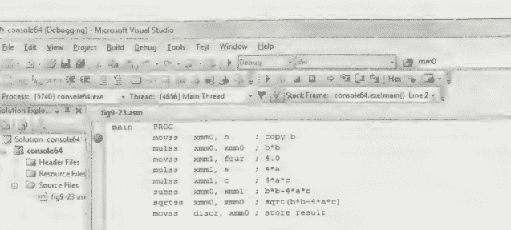
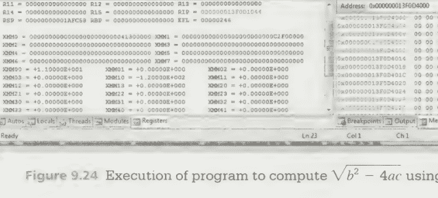

## 练习题 9.4

对于这些练习题中的每一个，假设在指令执行前 XMM0 和 XMM1 的内容如下：

| XMM00 | XMM01 | XMM02 | XMM03 | XMM10 | XMM11 | XMM12 | XMM13 |
|---|---|---|---|---|---|---|---|
| 5.0 | -10.5 | 3.7 | 4.6 | 4.0 | 4.5 | -7.3 | 8.3 |

执行每条指令后，XMM0 中将是什么？

1. `movss xmm0, xmm1`
2. `addss xmm0, xmm1`
3. `subss xmm0, xmm1`
4. `mulss xmm0, xmm1`
5. `divss xmm0, xmm1`
6. `sqrtss xmm0, xmm1`
7. `rcpss xmm0, xmm1`
8. `addps xmm0, xmm1`
9. `subps xmm0, xmm1`
10. `mulps xmm0, xmm1`

# 9.5 使用 C/C++ 的浮点汇编语言过程

## 编程练习 9.4

1. 两个数 x 和 y 的几何*平均值*定义为 $\sqrt{xy}$。编写一个 `console64` 程序，该程序从内存中的单精度浮点数值 x 和 y 开始，并使用 SSE 指令计算几何平均值并将其存储在 `mean` 中。
2. 两个数 x 和 y 的调和*平均值*定义为


编写一个 `console64` 程序，该程序从内存中的单精度浮点数值 x 和 y 开始，并使用 SSE 指令计算调和平均值并将其存储在 `mean` 中。

## 9.5 使用 C/C++ 的浮点汇编语言过程

有时，汇编语言的力量使得用汇编语言编写程序的某些比用高级语言更可行、更容易或更高效。这些部分可能需要关键优化，或者可能实现了在高级语言中难以或无法实现的低级算法。然而，大部分编程工作用高级语言完成会更好。第 6.3 节展示了从 C 函数调用汇编语言过程以及从汇编语言过程调用 C 函数的示例。本节将第 6.3 节的信息扩展到浮点示例。

首先，我们取求解二次方程的程序并转换为过程 `roots`。该过程的列表如图 9.25 所示。C 风格函数头描述了它的五个参数，第一个是二次方程 $ax^2+bx+c=0$ 的单精度浮点系数 $a, b,$ 和 $c$，第四个和第五个是浮点根的地址。过程名称带有前下划线，因为它将从 32 位的 C 程序调用。寻找根的代码与在本章之前看到的完全相同。

## 图 9.25 二次求解过程

```assembly
; 计算二次方程的根
; 作者: R. Detmer
; 日期 7/2008
.586
.MODEL FLAT
.DATA
four    DWORD   4
two     DWORD   2
.CODE
void roots(float a, float b, float c, float* x1, float* x2)
PROC
    push    ebp                 ; 保存基址
    mov     ebp, esp            ; 建立帧
    push    eax                 ; 保存寄存器
    finit                       ; 初始化 FPU
    fld     REAL PTR [ebp+12]   ; b 进入 ST
    fmul    REAL PTR [ebp+12]   ; b*b
    fld     four                ; 4.0 进入 ST
    fmul    REAL PTR [ebp+8]    ; 4*a
    fmul    REAL PTR [ebp+16]   ; 4*a*c
    fsub                        ; b*b-4*a*c
    fldz                        ; 0.0 进入 ST
    fsub                        ; b*b-4*a*c
    fcom                        ; b*b-4*a*c >= 0
    fstsw   ax                  ; 将标志位存入 AX
    sahf                        ; 将标志位扩展到 AL
    jna     end                 ; 如果不小于跳转
    fsqrt                       ; sqrt(b*b-4*ac) 进入 ST
    fst     st(1)               ; 拷贝到 ST(1)
    fsub    REAL PTR [ebp+8]    ; -b + sqrt(b*b-4*ac)
    div     REAL PTR [ebp+12]   ; (-b + sqrt(b*b-4ac))/a
    fidiv   two                 ; (-b + sqrt(b*b-4ac))/(2*a)
    mov     eax, [ebp+24]       ; x2 的地址
    fstp    REAL PTR [eax]      ; 保存并弹出栈
end:
    pop     eax                 ; 恢复寄存器
    pop     ebp
    ret
ENDP
END
```


/* 为二次方程求解器提供 I/O 的 C 程序 */
/* 作者 R. Detmer */
/* 日期 7/2008 */

```c
#include <stdio.h>

void roots(float a, float b, float c, float* x1, float* x2);
/* 求二次方程的根 */

int main() {
    float a, b, c;
    float root1, root2;

    printf("please enter coefficients: %f");
    scanf("%f %f %f", &a, &b, &c);
    roots(a, b, c, &root1, &root2);
    printf("\nroot 1 %f\nroot 2 %f\n", root1, root2);
    return 0;
}
```

图 9.26 roots 的 C 测试驱动

图 9.26 显示了一个输入系数并显示结果的简单 C 程序。该程序和 `roots` 是 `console32` 项目的一部分。图 9.27 显示程序的运行示例。

如果你更喜欢 C++ 而不是 C，可以使用图 9.28 所示的 C++ 测试驱动，结合图 9.22 中的汇编 `roots` 过程在 `console32` 项目中。该 C++ 代码唯一的显著特征是 `extern` 指令中的 `"C"`。这告诉 C++ 编译器使用 C 链接调用 `roots`。图 9.29 显示了运行示例。

在 32 位环境中，一个在累加器中返回整数浮点值的过程。我们已经见过在 32 位环境中传递浮点参数的多个示例——基本上是通过栈传递整数参数。

现在我们简要查看浮点参数在 64 位环境中是如何传递的。在 64 位模式下，浮点值通过 `XMM0` 返回。前四个浮点参数通过 `XMM0`、`XMM1`、`XMM2` 和 `XMM3` 传递。如果混合了参数，则 `RCX`、`RDX`、`R8` 和 `R9` 用于整数参数，`XMM` 寄存器用于浮点参数。

## 浮点数运算

```
C:\Windows\system32\cmd.exe
please enter coefficients: 2 -1 -15
root = 3.0000
root = -2.5000
Press any key to continue...
```

图 9.27 C/汇编程序的运行示例

```cpp
// 为二次方程求解器提供 I/O 的 C++ 程序
// 作者: R. Detmer
// 日期 7/2008

#include <iostream>
using namespace std;

extern "C" void roots(float a, float b, float c, float& x1, float& x2);
// 求二次方程的根

int main() {
    float a, b, c;
    float root1, root2;

    cout << "please enter coefficients: ";
    cin >> a >> b >> c;
    roots(a, b, c, root1, root2);
    cout << "\nroot 1 " << root1 << "\nroot 2 " << root2 << endl;
    return 0;
}
```

图 9.28 roots 的 C++ 测试驱动

## 9.5. 使用 C/C++ 的浮点汇编语言过程 351

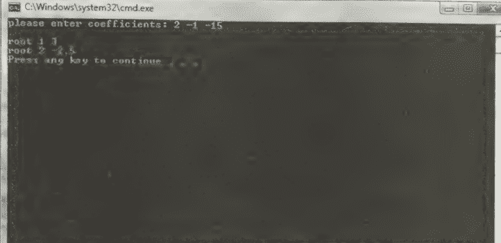

图 9.29 C++/汇编程序的运行示例

例如，如果有三个参数，一个整数和两个浮点数，按此顺序，则整数将通过 `RCX` 传递，第一个浮点数通过 `XMM1` 传递，第二个浮点数通过 `XMM2` 传递。相反，如果三个参数是一个浮点数、一个整数和一个浮点数，按此顺序，则第一个浮点数将通过 `XMM0` 传递，整数通过 `RDX` 传递，第二个浮点数通过 `XMM2` 传递。超过四个参数通过栈传递。

图 9.30 显示了在 `console64` 程序中作为返回值的过程 `roots`。注意参数是如何传递的：浮点系数 a `XMM0`、b `XMM1` 和 c `XMM2`，但 x1 的地址通过 `R9` 传递，因为它是第五个参数，x2 的地址通过栈传递。此过程适用于图 9.26 所示的 C 驱动或图 9.28 所示的 C++ 驱动——两者都不需要修改源代码，尽管 32 位和 64 位的 C 和 C++ 编译器生成的代码完全不同。

某些高级语言编译器能够翻译包含内联汇编的程序。这使得程序的大部分可以用高级语言编写，而部分部分用汇编语言编写。在 Visual Studio 2008 中，32 位的 C++ 编译器允许内联汇编，但 64 位的 C++ 编译器不允许。对于 32 位的 C++ 编译器，嵌入的汇编语言代码如下：

```asm
asm
{
    ; 汇编语言语句
    ; 可以使用 C++ 程序变量
}
```

```asm
; 计算二次方程的根
; 作者: R. Detmer
; 日: 7/2008

.DATA
four REAL4 4.0
two REAL4 2.0
zero REAL4 0.0

.CODE
; void roots(float a, float b, float c, float* x1, float* x2)
roots
  PROC
      movss xmm3, xmm1 ; 复制 b
      mulss xmm3, xmm3 ; b*b
      movss xmm4, four ; 4.0
      movss xmm4, xmm0 ; 4*a
      mulss xmm4, xmm2 ; 4*a*c
      subss xmm3, xmm4 ; b*b-4*a*c >= 0?
      comiss xmm3, zero ; b*b-4*a*c >= 0?
      jnae endGE ; 如果不是则跳过
      sqrtss xmm3, xmm3 ; sqrt(b*b-4*a*c)
      movss xmm4, zero ; 0
      subss xmm4, xmm1 ; -b
      addss xmm4, xmm3 ; -b + sqrt(b*b-4*a*c)/a
      divss xmm4, xmm0 ; (-b + sqrt(b*b-4*a*c))/(a
      divss xmm4, two ; (-b + sqrt(b*b-4*a*c))/(2*a)
      movss REAL4 PTR[r9], xmm4 ; 存储根1
      movss xmm4, zero ; 0
      subss xmm4, xmm1 ; -b
      subss xmm4, xmm3 ; -b - sqrt(b*b-4*a*c)
      divss xmm4, xmm0 ; (-b - sqrt(b*b-4*a*c))/a
      divss xmm4, two ; (-b - sqrt(b*b-4*a*c))/(2*a)
      mov r9, [rsp+40] ; 根2的地址
      movss REAL4 PTR [r9], xmm4 ; 存储根2

endGE:
  ret
roots
  ENDP
END
```

图 9.30 二次方程求解过程（64位版本）

## 9.5. 与 C/C++ 使用的浮点汇编语言过程 353

内联汇编代码以 `__asm` 关键字（以两个下划线开头）引导，并用大括号括围汇编语句。汇编语句引用了在大括号外声明的 C++ 变量。内联汇编语言中可以出现几乎任何语句，包括整数指令、浮点指令和带有标签的语句。

## 9.5 编程练习题

这些练习题中的任何一个都可以在 32 位或 64 位环境中完成。

- 1. 编写一个完整的程序，提示并输入圆半径的小进制值，计算并显示（带有适当的标签）圆的周长和面积。使用 C 或 C++ 进行输入和输出。编写两个汇编语言过程，每个过程带有一个作为半径的浮点参数，并返回相应的值。在你的 C/C++ 程序中调用这些过程来执行浮点计算。

- 2. 底边长为 $b$ 单位、高为 $h$ 的正方形底塔体积公式为 $\frac{1}{3}b^2h$。编写一个汇编语言过程 `pVolume`，带有两个浮点参数（底和高），并返回字塔的体积。在 C 或 C++ 驱动程序中调用此过程，输入底和的值并输出体积。

```c
void roots(float a, float b, float c, float* x1, float* x2, int* success)
```

并返回 -1 表示真，0 表示假。修改后的 C++ 头文件看起来如下：

```cpp
void roots(float a, float b, float c, float* x1, float* x2, bool& success)
```

汇编语言过程将 `success` 视为一个字节大小整数的地址，并存储 1 表示真或 0 表示假。

## 4. 下述算法近似实数 $x$ 的立方根。

```
root := 1.0;
until (root - oldRoot < smallValue) loop
  oldRoot := root;
  root := (2.0*root + x/(root*root)) / 3.0;
until;
```

将此算法实现为一个返回值的汇编语言过程 `cuberoot`，带有两个浮点参数：(1) $x$ 和 (2) `smallValue`。编写一个 C 或 C++ 程序输入 $x$ 和 `smallValue` 的值，调用 `cuberoot` 并显示计算出的值。

## 9.6 章节总结

80x86 使用三种浮点数格式：单精度（32位）、双精度（64位）和扩展双精度（80位）。每种格式由一个符号、一个偏移指数和一个分数组成。

80x86 浮点单元（FPU）包含 80 位数据寄存器，以栈的形式组织。每个寄存器存储一个扩展实数浮点值。FPU 执行各种指令，从加载和存储到简单算术，再到复杂的超越函数。

浮点表示与 ASCII 表示之间的转换与之前描述整数的转换类似。最容易扫描的格式是简单的进制格式。最简单的生成格式是 E 计数法。几代 80x86 处理器在 64 位环境中包含了 SIMD 扩展（SSE），增加了 `XMM` 寄存器。

汇编语言过程可以通过 C 或 C++ 程序调用。在 32 位模式下，浮点数返回在浮点栈的顶部；在 64 位模式下，返回在 `XMM` 寄存器。整数和浮点的参数传递相同。然而，在 64 位模式下，浮点参数通过 `XMM` 寄存器传递。

## 附件：十六进制/ASCII

| 十六进制 | ASCII | 十六进制 | ASCII | 十六进制 | ASCII |
| :--- | :--- | :--- | :--- | :--- | :--- |
| 00 | NUL (null) | 20 | space | 40 | @ |
| 01 | SOH | 21 | ! | 41 | a |
| 02 | STX | 22 | B | 42 | b |
| 03 | ETX | 23 | C | 43 | c |
| 04 | EOT | 24 | $ | 44 | d |
| 05 | ENQ | 25 | % | 45 | e |
| 06 | BEL (bell) | 26 | & | 46 | f |
| 07 | BS (backspace) | 27 | ' (apostrophe) | 47 | g |
| 08 | HT (tab) | 28 | H | 48 | h |
| 09 | LF (linefeed) | 29 | ) | 49 | i |
| 0A | FF (form feed) | 2A | * | 4A | j |
| 0B | CR (return) | 2B | + | 4B | k |
| 0C | SO | 2C | , (comma) | 4C | l |
| 0D | SI | 2D | - | 4D | m |
| 0E | DLE | 2E | . | 4E | n |
| 0F | DC1 | 2F | / | 4F | o |
| 10 | DC2 | 30 | 0 | 50 | p |
| 11 | DC3 | 31 | 1 | 51 | q |
| 12 | DC4 | 32 | 2 | 52 | r |
| 13 | NAK | 33 | 3 | 53 | s |
| 14 | SYN | 34 | 4 | 54 | t |
| 15 | ETB | 35 | 5 | 55 | u |
| 16 | CAN | 36 | 6 | 56 | v |
| 17 | EM | 37 | 7 | 57 | w |
| 18 | SUB | 38 | 8 | 58 | x |
| 19 | ESC (escape) | 39 | 9 | 59 | y |
| 1A | FS | 3A | : | 5A | z |
| 1B | GS | 3B | ; | 5B | [ |
| 1C | RS | 3C | < | 5C | \ |
| 1D | US | 3D | = | 5D | ] |
| 1E | SP | 3E | > | 5E | ^ |
| 1F | DEL | 3F | ? | 5F | _ |

## 附件 B：汇编单词

32 位汇编器的单词仅为*斜体*。64 位汇编器的单词为**粗体**。其他单词在两种汇编器均通用。

- `$`
- `.CODE`
- `.ERRNDEF`
- `.OUT`
- `.CONTINUE`
- `.ERNZ`
- `.EXIT`
- `.CREF`
- `.FARDATA`
- `.REPEAT`
- `.SAFESH`
- `.FARDATA?`
- `.FPO`
- `.SALL`
- `.DOSSEG`
- `.IF`
- `.K3D`
- `.SAVEXMM128`
- `.LALL`
- `.SEQ`
- `.ENDIF`
- `.LFCOND`
- `.SETFRAME`
- `.SFCOND`
- `.LISTALL`
- `.STACK`
- `.LISTIF`
- `.STARTUP`
- `.COND`
- `.LISTMACRO`
- `.TFCOND`
- `.TYPE`
- `.MMX`
- `.UNTIL`
- `.MODEL`
- `.UNTILC`
- `.MSFLOAT`
- `.WHILE`
- `.NOB7`
- `.XALL`
- `.NOCREF`
- `.XCREF`
- `.ERRIDN`
- `.NOLIST`
- `.XLIST`
- `.NOLISTIF`
- `.XMM`
- `.ERRNB`
- `.NOLISTMACRO`

## 附件 B

| #B | BLENDPD | CMOVE | CMPLTSS |
| :--- | :--- | :--- | :--- |
| #F | BLENDPS | CMOVG | CMPNEQPD |
| AAA | BLENDVPD | CMOVGE | CMPNEQPS |
| AAD | BLENDVPS | CMOVL | CMPNEQD |
| AAM | BOUND | CMOVLE | CMPNEQSS |
| AAS | BP | CMOVNA | CMPNLEPD |
| ADC | BPL | CMOVNAE | CMPNLEPS |
| ADD | BSF | CMOVNB | CMPNELDS |
| ADDPD | BSR | CMOVBE | CMPLESS |
| ADDPS | BSWAP | CMOVNC | CMPNTPD |
| ADDR | BT | CMOVNE | CMPNLTPS |
| ADSSD | BTC | CMOVNG | CMPNTSDS |
| ADDSS | BTR | CMOVNGE | CMPNTLSS |
| ADDSUBPD | BTS | CMOVNL | CMPORDDP |
| ADSUBSPS | BX | CMOVLE | CMPORDPS |
| AESDEC | BYTE | CMOVNO | CMPORDSD |
| AESDECLAST | C | CMOVNP | CMPORDSS |
| AESENC | CALL | CMOVNS | CMPDD |
| AESENCLAST | CARRY | CMOVNZ | CMPPS |
| AESMIC | CATSTR | CMOVO | CMPS |
| AESKEYGENASSIST | CBW | CMOVPE | CMPSB |
| AH | CDQ | CMOVPE | CMPSD |
| AL | CDQE | CMOVPO | CMPS |
| ALIAS | CH | CMOVS | CMPQS |
| ALT | CL | CMOV | CMPPSW |
| ASSUME | PL | CMOV | CMPISS |
| BASIC | PL | CMOV | CMPISS |
| AX | B | CVA | CMPIS |
| B | B | | C | CMPN |
| BH | BSF | CLE | CMPORDDP |
| BL | BSR | CMOV | CMPORDPS |
| | | | | | |MOV | CMPORDSD |
| | | | | | | | | CMPORD |

# 附录 B

| FDIV | FNLEX | FSTENVD | IDIV |
| :--- | :--- | :--- | :--- |
| FDIVP | FNDISI | FSTENVW | IF |
| FDIVR | FNEN | FSTP | IF1 |
| FDIVRP | FNINIT | FSTSW | IF2 |
| FEMMS | FNOP | FSUB | IFB |
| FENI | FNSAVE | FSUBP | IPDEF |
| FREE | FSAVED | FSUBR | IDDIF |
| FREEP | FNSAVEW | FSUBPR | IDIFI |
| FIADD | FNSTCW | FTST | IFE |
| FICOM | FNSTENV | FUCOM | IDFN |
| FICOM | FNSTENVD | FUCOMI | IDNI |
| FIDIV | FNSTENVW | FUCOMIP | IFNB |


# 附录 C

# 选择性练习答案

# 练习 1.1（第 7 页）

- 2. 1010 1101 AD 173
- 8. 1010 0101 0010 1110 A52E 42286
- 14. 10 1110 1010 1011 2EAB 11947
- 18. 03:46:32

# 练习 1.2（第 11 页）

- 1. (b) 29522 或 R
- 2. (b) 47 65 6f 72 67 65 20 73 61 69 64 2c 20 22 4f 75 63 68 21
- 3. (c) 1947年6月11日 CRLF

# 练习 1.3（第 16 页）

- 1. (a) 00000F22
- 2. (d) FFF6
- 3. (b) 6F
- 4. (b) -509 有符号；4,294,966,787 无符号
- 5. (c) 28,448 有符号或无符号
- 6. (a) -31 有符号；225 无符号
- 8. (a) -32,768 到 +32,767

# 练习 1.4（第 23 页）

- 1. 003F + 02A4
- 和：02E3，无溢出，无进位
- 有符号和无符号检查：63 + 676 = 739

- 5. FF07 + 0BD
- 和：05C4，无溢出，进位
- 有符号检查：-249 + 1725 = 1476
- 无符号检查：65287 + 1725 = 67012 不等于1476

- 9. FFF1 + 8005
- 和：7FF6，溢出，进位
- 有符号检查：-15 + (-32763) = -32778 不等于32758
- 无符号检查：65521 + 32773 = 98294 不等于32758

- 13. EBBC - 791C = EBBC + 86E4
- 差：72A0，溢出，无借位
- 有符号检查：-51888 - 31004 = -36192 不等于29344
- 无符号检查：60348 - 31004 = 29344

# 练习 1.5（第 27 页）

# 练习 2.1（第 32 页）

- 2. 2 × 3² = 2³¹ = 80000000,,₆，所以最后一个地址是 00000007FFFFFFFF
- 4. (a) 2B8C0 + 8D21 = 345E1

# 练习 2.2（第 38 页）

- (b) EAX: FFFFFF72 CF 0 OF 0 SF 1 ZF 0
- (e) EAX: 00000000 CF 1 OF 0 SF 0 ZF 1

# 练习 2.3 (第40页)

- 2. 65,535

# 练习 3.1 (第50页)

- 2. (c) 更多: OK (2) 很多: 不允许（以数字开头）

# 练习 3.3 (第62页)

- 1. B7
- 3. B7
- 4. 44
- 10. 3E 3C 3E 3C 3E 3C 3E 3C (显示为 00000005 [ 3E3C ])
- 17. FFF0BDC0
- 21. 00000000 00000002 00000003
- 30. 0001 0001 0001 0001 0001 0001 0001 (显示为 00000008 [ 0001 ])
- 33. FFFFFFFFFFFF

# 练习 3.4 (第67页)

- 1. 直接的, 立即的
- 4. 寄存器, 寄存器间接
- 7. 直接的, 立即的

# 练习 3.6 (第79页)

- 1. (a) 2D 35 37 38 (b) FFFFFDBE

# 练习 4.1 (第102页)

- 1.
    - a) EBX: 00 00 01 A2, ECX: 00 00 01 A2
    - (d) AX: 00 4B
    - (h) RAX: FF FF FF FF FF FF FF FF
- 2. (a) 机器码 8B, 2字节
    - (d) 机器码 B4, 2字节
    - (h) 机器码 C7, 7字节
- 3.
    - (a) mod-reg-r/m 字节 D9 = 1101 1001 = 11 011 001, mod 11 用于寄存器到寄存器, reg 011 用于 EBX, r/m 001 用于 ECX
    - (a) EBX: 00 00 01 A2, ECX: 00 00 FF 75
    - (d) AX: 09 4B, BX: 5C 01
- 4.
    - (d) 无 mod-reg-r/m 字节
- 5.
    - (a) 机器码 87, 2字节
    - (d) 机器码 86, 2字节

# 练习 4.2 (第116页)

- 1.
    - (a) 机器码 03, 7字节
    - (g) 机器码 2A, 2字节
    - (l) 机器码 FE, 2字节
    - (o) 机器码 F7, 6字节
- 2.
    - (d) 机器码 81, 11字节
    - (e) 机器码 FE, 3字节
- 3.
    - (a) EBX: 00 00 01 17, ECX: 00 00 01 A2, SF=0, ZF=0, CF=1, OF=0
    - (e) EAX: 00 00 00 00, SF=0, ZF=1, CF=0, OF=0
    - (i) EAX: 00 00 00 00, SF=0, ZF=1
    - (q) R11: 00 00 00 00 00 00 00 04, SF=0, ZF=0

# 练习 4.3 (第128页)

- 1.
    - (b) EAX: 00 00 15 A8, EDX: FF FF 1E, CF=OF=1
    - (f) EAX: 00 00 0F FE, DX: 00 00 00 00, CF=OF=0
    - (j) AX: 04 74, CF=OF=1
- 2.
    - (b) 机器码 F7, 6字节
    - (f) 机器码 F7, 6字节
    - (j) 机器码 F6, 2字节
- 3.
    - (a) BX: 00 00 0F FE, CF=OF=0
    - (c) EAX: 00 00 6E, CF=OF=0
    - (h) EBX: FFFF FF74, CF=OF=0
- 4.
    - (a) 机器码 0F AF, 3字节
    - (c) 机器码 6B, 3字节
    - (h) 机器码 6B, 3字节

# 练习 4.4 (第139页)

- 1.
    - (a) EDX: 00 00 00 04, EAX: 00 00 0A
    - (d) 错误
    - (h) EDX: 00 00 00 05
- 2.
    - (a) 机器码 F7, 2字节
    - (d) 机器码 F7, 3字节
    - (h) 机器码 F7, 2字节

# 练习 5.1 (第148页)

- 2.


(a) 跳转到 `doAgain` (2条指令), 短位跳转

跳转到 `doAgain` (0条指令), 短位跳转

`jmp eax`, 寄存器

`jmp PTR [edi]`, 间接

# 练习 5.2 (第159页)

- 1. (e) 无跳转

- 2.

    (a) `cmp ecx, 0`; 若不相等则跳转

    `mov ecx, value`; 结束:

    (d) `cmp edx, -1000`; 若小于则跳转 (so)

    `cmp edx, 1000`; 若大于等于则跳过

    结束: `mov edx, 0`;

# 练习 5.3 (第168页)

- (b) `mov sum, 0`; `mov ecx, 1`

    while: `cmp sum, 1000`; 若不相等则跳转 退出

    `cmp ecx, 50`; 若小于则跳过

    `add sum, ecx`; 1; `jmp while`; 重复

- (c) `mov sum, 0`; `mov ecx, 1`

    until: `add sum, ecx`; 1

    `cmp sum, 5000`; 若大于等于则跳转 (until)

    `cmp ecx, 40`; 若小于则跳转 退出

    until:

    (b) `mov sum, 0`; `mov ecx, -10`

    for: `cmp ecx, 50`; 若小于则跳转 退出

    `add sum, ecx`; 1; `jmp for`; 重复

    结束:

# 练习 5.4 (第175页)

- 1.

    b) 1

    (d) 4,294,295

- 2. (b)

    `mov sum, 0`; sum = 0

    `mov ecx, 50`; index

    for: `mov eax, 51`; count = 51 - index

    `sub eax, ecx`

    `add sum, eax`; count to sum

    `loop for`; 重复

# 练习 5.5 (第184页)

- 3. (a) ModR/M = 94 = 10 100 100, 需要 SIB, reg 010 用于 `EDX`. SIB = B3 = 10 110 011, scale 10 用于 4, index 110 用于 `ESI`, base 011 用于 `EBX`

# 练习 6.1 (第197页)

- 1. (c) 机器码 55, 1字节

- 2.

| 栈 | ESP 栈操作 |
| :--- | :--- |
| | ← 0601000 (开始) |
| 01 | ESP: 06 00 0F FA |
| A2 | ECX: 01 A2 5B 74 |
| 5B | |
| 74 | ← 0600FFC (push ecx) |
| 00 | |
| 00 | |
| 00 | ← 0600FF8 (push 10) |

# 练习 6.2 (第206页)

- 1. 栈上的返回地址:00402005 ESP:0040FFC

# 练习 6.3 (第220页)

- 1. `push ebp`; 建立栈帧

    `mov ebp, esp`; 局部变量空间

    ...

    `mov ebp`; 移除局部变量

    `ret`; 变量通过 `[p-4]` 和 `[p-8]` 访问

# 练习 6.4 (第228页)

- 1. (b) `R8` 中的 `[rsp+56]`

- 2. (b) `R8` 中的 `[rsp+72]`

- 3. (b) `R8` 中的 `[rsp+120]`

# 练习 6.5 (第236页)

- 1. (a) `mov eax, 25`

    `add eax, ebx`

- 2. (a) `mov eax, value`

    `mov eax, eax`

- 3. (a) `mov eax, value1`

    `cmp eax, value2`; `jle 00A`

# 练习 7.1 (第248页)

- 1. (a) `BX`: 3000, `SF` 0, `ZF` 0; (b) `BX`: FB77, `SF` 1, `ZF` 0

- 2. (c) `BX`: CB77, `SF` 1, `ZF` 0; (d) `BX`: 058A

- 3. `mov ebx, eax`; 复制值

    `and ebx, 11b`; 值对 8

- 4. (b) 标志, 0FFFF6DF; 11111111 01101111 11011111

- 5. (b) `and bl, 1011111b`; 5fh

# 练习 7.2 (第261页)

- 1. (a) `AX`: 516A, `CF` 1, `OF` 1; (c) `AX`: D45A, `CF` 1, `OF` 0

- 2. (d) `AX`: 516B, `CF` 1; (k) `AX`: 516B, `CF` 1

- 2. (a) 5+5+2=12字节

- 3. (b) 3字节

- 4. (b) 多种解决方案之一

    `mov value3, al`; 复制值

    `and value3, 0111111`; 结束位跳转

    `mov value3, 0`; 结束

     0111111; 结束

    `mov value3, 0`; 结束

    0111111; 结束

## 378 附录 C

| | | |
|---|---|---|
| 1.5 | ST | fpValue: 0.5 |
| 12.0 | ST(1) | intValue: 6 |
| 23.0 | ST(2) | |
| 24.0 | ST(3) | |
| 35.0 | ST(4) | |
| | ST(5) | |
| | ST(6) | |
| | ST(7) | |

- 2. (a) `ST` < `ST(1)` 所以 `C3` = 0, `C2` = 0, `C0` = 1

- (e) `ST` < `ST(1)` 所以 `C3` = 0, `C2` = 0, `C0` = 1

| | |
|---|---|
| ST | |
| 23.0 | ST(1) |
| 24.0 | ST(2) |
| 35.0 | ST(3) |
| ST(4) | |
| ST(5) | |
| ST(6) | |
| ST(7) | |

## 练习 9.3 (第 341 页)

- 2. 414570a4 或 12.34

## 练习 9.4 (第 346 页)

| XMM00 | XMM01 | XMM02 | XMM03 |
| --- | --- | --- | --- |
| 4.0 | -10.5 | 3.7 | 4.6 |

| XMM00 | XMM01 | XMM02 | XMM03 |
| --- | --- | --- | --- |
| 20.0 | -10.5 | 3.7 | 4.6 |

| XMM00 | XMM01 | XMM02 | XMM03 |
| --- | --- | --- | --- |
| 1.0 | -1.5 | 11.0 | -3.7 |

# 索引

- A

- 加加器, 33

- 加法指令

- 浮点, 313

- 整数, 103

- 加法运算, 18

- `daddps` 指令, 344

- `addss` 指令, 344

- `AH` 寄存器, 34

- `AL` 寄存器, 34

- 与逻辑运算, 240

- 与逻辑指令, 241, 242

- 应用寄存器, 33

- 参数, 202

- 算术移位, 251

- 数组, 177

- ASCII, 9

- 转换为整数, 76, 263

- 转换为浮点数, 326

- 汇编器, 43

- `atod` 宏, 76, 77, 263

- `atow` 宏, 76, 77

- `AX` 寄存器, 34

- C

- 二数, 2

- 转换为十进制, 2

- 转换为十六进制, 5

- 位, 2

- `BL` 寄存器, 34

- 布尔变量, 240

- 借位, 22

- 断点, 52

- `BX` 寄存器, 34

- 字节, 12

- `BYTE` 指令, 57

- `call` 指令, 200, 201

- 进位, 20

- 溢出, 20

- 进位, 19

- `cbw` 指令, 135

- `ccdecl` 协议, 198

- `cdq` 指令, 135

- `CH` 寄存器, 34

- `CL` 寄存器, 34

- `cld` 指令, 271

- 清除标志, 15

- `cmp` 指令, 152, 154

- `cmps` 指令, 270, 279

- `CODE` 指令, 48, 200

- B

- 后向引用, 146

- 基址指针, 35

- 基址寻址, 183

- 基础执行寄存器, 33

- BCD, 24

- `BH` 寄存器, 34

- 二进制编码十进制, 24

- `comiss` 指令, 344

- 命令接口, 41

- 注释, 47

- 编译器, 42

- 条件跳转, 149, 155, 157

- 控制台 32, 50

- 控制台 64, 80

- 控制中心, 10

- 计数循环, 165

- CPU, 32

- `cqo` 指令, 136

- `CS` 寄存器, 35

- `CX` 寄存器, 34

- D

- `DATA` 指令, 48

- 数据寄存器, 33

- 数据段, 48

- 调试, 43

- `dec` 指令, 109

- 十进制转十六进制, 6

- `DF`, 271

- `DH`, 34

- 直接, 64

- 直接, 47

- 操作系统, 41

- `div` 指令, 131

- 除法指令

- 浮点, 318

- 整数, 131

- `divps` 指令, 344

- `divss` 指令, 344

- `DL` 寄存器, 34

- DOS, 41

- 双扩展精度, 341

- 双移位, 260

- 双精度, 300

- 双字组, 12

- 转换为 ASCII, 76, 78, 331

- `DS` 寄存器, 36

- E

- `EBP` 寄存器, 35

- `EBX` 寄存器, 33

- `ECX` 寄存器, 33

- `EDI` 寄存器, 34, 271

- `EDX` 寄存器, 33

- `EFLAGS` 寄存器, 36

- x86, 29

- `EIP` 寄存器, 35

- `END` 指令, 48, 200

- Entry代码, 205

- `ES` 寄存器, 35

- `ESI` 寄存器, 34, 271

- `ESP` 寄存器, 34

- 退出代码, 205

- `ETERN` 指令, 276

- F

- `abs` 指令, 319

- `fadd` 指令, 313

- `faddp` 指令, 313

- false, 240

- 远跳转, 147

- `fastcall` 协议, 220

- `fchs` 指令, 319

- `fcom` 指令, 319

- `ffmi` 指令, 321

- `fcomip` 指令, 321

- `fcomp` 指令, 319

- `fcompp` 指令, 319

- `div` 指令, 318

- `fvip` 指令, 318

- `fdivpr` 指令, 318

- `fdvr` 指令, 318

- `fiadd` 指令, 313

- `ficom` 指令, 319

- `fcomip` 指令, 319

- `fidiv` 指令, 318

- `fidvr` 指令, 318

- `fild` 指令, 305

- `fimul` 指令, 317

- `finit` 指令, 308

- `fist` 指令, 310

- `fistp` 指令, 310

- `fisttp` 指令, 310

- `EAX` 寄存器, 33

- `EBCDIC`, 11

- `fisub` 指令, 316

- `fisubr` 指令, 316

- 586 指令, 47

- flags 寄存器, 36

- 扁型内存模型, 31

- `fld` 指令, 305

- `fld1l` 指令, 305

- `fld2e` 指令, 305

- `fld2t` 指令, 305

- `fld1g2` 指令, 305

- `fld2n` 指令, 305

- `fldpi` 指令, 305

- `fldz` 指令, 305

- 浮点表示, 26, 302

- 双扩展精度, 301

- 双精度, 300

- 规格化, 302

- 单精度, 26

- 浮点单元, 304

- `fmul` 指令, 317

- `fmulp` 指令, 317

- for 循环, 165, 170

- 前向引用, 146

- FPU, 304

- `frndint` 指令, 319

- `FS` 寄存器, 35

- `fsqrt` 指令, 319

- `fst` 指令, 310

- `fstp` 指令, 310

- `fstsw` 指令, 320

- `fsub` 指令, 316

- `fsubr` 指令, 316

- `fsubpr` 指令, 316

- `fsubr` 指令, 316

- `ftst` 指令, 319

- 函数, 198

- `fxch` 指令, 312

- H

- 十进制数, 2

- 转换为二进制, 5

- 转换为十进制, 2

- I

- I/O 设备, 40

- 标识符, 49

- `div` 指令, 131

- IEEE 单精度格式, 26

- 立即数, 63

- `imul` 指令, 118, 121

- `inc` 指令, 68

- index 寄存器, 34

- 索引寻址, 182

- 间接跳转, 146

- 输入宏, 76

- 输入/输出, 67

- 指令, 35

- 集成环境, 43

- J

- `jecxz` 指令, 304

- `jmp` 指令, 144

- `jrcxz` 指令, 174

- L

- `lea` 指令, 179

- 链接器, 42

- `LIST` 指令, 235

- listing 文件, 55

- 小端序, 54

- 本地变量, 211

- `LOCAL` 指令, 234

- `loads` 指令, 270

- 逻辑门, 239

- 逻辑移位, 251

- `loop` 指令, 171

- G

- 通用寄存器, 33

- goto, 144

- 图形用户界面, 41

- `GS` 寄存器, 35

- M

- `MACRO` 指令, 230

- 微, 48

- 内存, 30

- 逻辑图, 30

- 内存地址, 65

- 基址, 205

- 基址索引寻址, 183

- 索引, 64

- 寄存器索引, 65, 66

- RIP 相对, 81

- 内存映射输入/输出, 40

- `MM` 寄存器, 343

- 助记符, 08

- Mod 字段, 90

- `MODEL` 指令, 47

- Mod/M 字节, 90

- `mov` 指令, 88

- `mvs` 指令, 270

- `movss` 指令, 344

- `movups` 指令, 344

- P

- packed SSE, 343

- 物理地址, 30

- 流水线, 35

- `pop` 指令, 194

- `popad` 指令, 197, 222

- `popfd` 指令, 196

- 端口, 40

- 后置循环, 166

- 前置循环, 161

- 可打印字符, 10, 48

- `PROC` 指令, 198

- 过程, 198

- call, 200

- 入口代码, 205

- 退出代码, 205

- 本地变量, 211

- 参数, 202

- 递归, 212

- 返回, 200

- `push` 指令, 190

- `pushd` 指令, 191

- `pushf` 指令, 196

- `pushad` 指令, 197, 222

- `pushfd` 指令, 196

- `pushw` 指令, 191

- N

- NaN, 302

- 近位偏移, 147

- `neg` 指令, 112

- `LIST` 指令, 235

- `LISTMACRO` 指令, 235

- 非易变的, 224

- 逻辑运算, 240

- `not` 指令, 241, 243

- 空字节, 122

- O

- 目标代码, 43, 64

- 进制数, 6

- `OF`, 36

- 偏移, 31

- 1 补码系统, 24, 64

- 机器码, 43, 64

- 操作数, 48, 63

- 或逻辑运算, 240

- 或逻辑指令, 241, 342

- 输出宏, 76, 77

- Q

- 双字组, 12

- `QWORD` 指令, 12

- R

- R/M 字段, 90

- `R8` 寄存器, 38

- `R9` 寄存器, 38

- `R10` 寄存器, 38

- `R11` 寄存器, 38

- `R12` 寄存器, 38

- `R13` 寄存器, 38

- `R14` 寄存器, 38

- `R15` 寄存器, 38

- `RADIX` 指令, 57

- RAM, 31

- 随机访问内存, 31

- `RAX` 寄存器, 38

- `RBP` 寄存器, 38

- `RBX` 寄存器, 38

- `RCX` 寄存器, 38

- `RDI` 寄存器, 38

- `RDX` 寄存器, 38

- 只读内存, 31

- `REAL4` 指令, 61, 300

- `REAL8` 指令, 61, 301

- `REAL10` 指令, 61, 301

- 递归, 212

- 引用参数, 207

- Reg 字段, 90, 108

- 寄存器代码, 91, 92

- 寄存器间接模式, 65

- 寄存器模式, 64

- 寄存器, 33

- 后向引用, 146

- 相对性, 65

- 重复前缀, 77

- repeat, 278

- repe, 278

- repne, 278

- reps, 278

- repz, 278

- 重置标志, 151

- 重置布局, 53

- `ret` 指令, 200, 202

- `REX` 前缀, 93

- `RFLAGS` 寄存器, 36

- `RIP` 寄存器, 38

- RIP 相对, 81

- `rol` 指令, 260

- `ror` 指令, 260

- 旋转指令, 260

- `RSI` 寄存器, 38

- `RSP` 寄存器, 38

- S

- `sal` 指令, 251

- `sar` 指令, 251

- 标量 SSE, 343

- 缩放因子, 182

- `scas` 指令, 270

- 段描述符, 93

- 段号, 31

- 段寄存器, 35

- 分段内存模型, 31


# 索引

## 符号

- 独立的代码文件, 216
- 设置标志, 151
- SF, 36
- 移位指令, 251, 252
- `shl` 指令, 251
- `shld` 指令, 260
- 短位偏移, 147
- `shr` 指令, 251
- `shrd` 指令, 260
- SIB 字节, 183
- 符号位, 36
- 符号扩展, 96
- SIMD, 343
- 单精度格式, 26
- 单指令多数据指令, 343
- 单精度, 300
- 规格化, 302
- 单精度, 26
- 浮点运算单元, 304
- `fmul` 指令, 317
- `fmulp` 指令, 317
- for 循环, 165, 170
- 前向引用, 146
- FPU, 304
- `frndint` 指令, 319
- FS 寄存器, 35
- `fsqrt` 指令, 319
- `fst` 指令, 310
- `fstp` 指令, 310
- `fstsw` 指令, 320
- `fsub` 指令, 316
- `fsubr` 指令, 316
- `fsubpr` 指令, 316
- `ftst` 指令, 319
- 函数, 198
- `fxch` 指令, 312

## H

- 十进制数, 2
- 转换为二进制, 5
- 转换为十进制, 2

## I

- I/O 设备, 40
- 标识符, 49
- `div` 指令, 131
- IEEE 单精度格式, 26
- 立即数, 63
- `imul` 指令, 118, 121
- `inc` 指令, 68
- index 寄存器, 34
- 索引寻址, 182
- 间接跳转, 146
- 输入宏, 76
- 输入/输出指令, 35
- 集成环境, 43

## J

- `jecxz` 指令, 304
- `jmp` 指令, 144
- `jrcxz` 指令, 174

## L

- `lea` 指令, 179
- 链接器, 42
- `LIST` 指令, 235
- listing 文件, 55
- 小端序, 54
- 本地变量, 211
- `LOCAL` 指令, 234
- `loads` 指令, 270

## W

- `WHILE` 指令, 162
- while 循环, 161
- Windows 计算器, 3
- windows32 项目, 68
- windows64 项目, 82
- 文字处理器, 42
- `WORD PTR` 操作数, 191
- word, 12
- 转换为 ASCII, 76
- `WORD` 指令, 57
- `wtoa` 宏, 76, 78

## T

- `TBYTE` 指令, 61
- `test` 指令, 247, 248
- 文本装饰, 219
- 编辑器, 41
- 汉诺塔游戏, 212
- 真 (true), 240
- 二补码运算, 143
- 二补码系统, 133

## X

- `xchg` 指令, 99
- `xlat` 指令, 289
- XMM 寄存器, 343
- xor 运算, 240
- `xor` 指令, 241, 242

## U

- Unicode, 9
- 无符号数, 136
- until 循环, 166

## Z

- 零标志 (zero flag), 36
- ZF, 36

## V

- 易变性 (volatile), 224

---

# 386 索引

- 减法指令-浮点, 316
- 整数, 103
- 减法运算, 216

---

# 80x86 汇编语言与计算机架构导论（第二版）

**RICHARD C. DETMER**

《80x86 汇编语言与计算机架构导论》第二版经过全面修订，为读者提供了计算机内部工作原理及其多个层次和功能的详尽且简洁的介绍。通过使用实际指令集编写真实的汇编语言程序，读者将熟悉计算机架构的基础。第二版使用了 Microsoft Visual Studio® 环境，该环境对学生和专业人士广泛可用；这为编辑、汇编、调试和执行程序提供了一个健壮的环境。本书继续强调基础架构，而不是 80x86 处理器。书中包含了 64 位操作，但仍然适用于处理 32 位计算机的人员。

程序员预计在任何层次上都能高效编程。请确保你已经掌握了《80x86 汇编语言与计算机架构导论》第二版。

## 第二版的主要特征：

- 使用 Microsoft® Visual Studio® 环境。书中所有的程序都已使用 Visual Studio® 2008 专业版通过测试。
- 更新了 64 位架构；然而，内容的安排允许教师根据自己的决定涵盖或省略 64 位操作。
- 包含了一个修订后的面向 Windows 的 I/O 包。所有的 I/O 宏和程序示例均可在书籍网站上获得。


Jones and Bartlett Publishers  
40 Tall Pine Drive  
Sudbury, MA 01776  
978-443-5000  
info@jbpub.com  
www.jbpub.com


