# Banana 入门指南：开发者指南

# bada 简介

开发者指南


# 第一部分：关于 bada

# 第一章：移动端的差异性

在本章中，我们将详细介绍移动软件的“差异”由哪些组成，并描述其与桌面或 Web 应用等“传统”固定软件相比的本质特征。我们还总结了一些推荐的移动软件开发实践。在适当的情况下，我们会对后续章节进行预引用，那些章节将讨论特定话题以及 bada 如何实现或支持开发的各个方面。

## 1.1 移动上下文

在移动设备诞生 20 年后，硬件和电信领域发生了翻覆性的变化——移动设备的使用改变了人们的行为。对移动服务的利用才刚刚开始。过去几年以 iPhone 为主导的应用革命是一个标志——但真正的革命将是大众市场应用和服务的到来。bada 可能会游戏规则的改变者。

通过 bada 平台及其配套的生态系统，我们将采用你在在本章和整书中将看到的移动应用开发特性。通过使用 bada，你将配备完善的环境和工具，为你成功的移动应用奠定理想的基础。

移动硬件与桌面硬件不同。这不仅仅是由于手机可以放进口袋里。对将更多功能装进更小、更薄的包装中的不懈追求导致了近乎持续的创新。移动存储（内存）、移动显示和移动电源技术与它们桌面端的“大哥们”不同。当你为移动端开发时，理解这些差异如何影响你设计应用的方式以及编写代码的方式至关重要。

但在某种程度上，这些差异仅浮于表面，它们并没有真正将移动与固定区分开。用户使用移动设备的方式不同。用户消费移动服务的方式不同。用户购买和支付手机及移动软件的方式也不同。事实上这是一个关键区别——用户愿意**购买**移动软件！同样，这些差异影响了你设计应用和编写代码的方式。

以移动服务为例。我们可以区分两类服务：一类仅在移动上下文中才有意义，另一类则是传统上用于固定或基于浏览器的环境的，但现在可以扩展到移动维度中。

以基于位置的服务或地图服务作为第一类的代表性。基于位置的服务（LBS）概念已经存在了十多年。此类服务的附加值是显而易见且不变的。它是提供与用户当前位置相关的信息并满足即时需求。服务和信息可以根据特定位置交付。然而，只有少数此类服务证明自己是大热门。当时的技术和整个生态系统还没有准备好。但今天，一切都已就绪，使得 LBS 可以实现其承诺。

第二类的一个例子是源于 Web 2.0 运动的蓬勃社交网络服务（SNS），它诞生了博客、Facebook、MySpace、YouTube、Twitter 等。此类应用和社交网络现在可以通过为移动浏览器定制的网站或独立 App 越来越多地从手机终端调用和使用。

这表明移动应用与桌面应用之间会有多大。在桌面端，你的文字处理器、电子表格或数据库应用，以及你的第一人称射击游戏或冒险游戏，都是大型、复杂的“大杂烩”型应用；功能全能，与万物集成，并且如果它是你需要的唯一应用，每一个都会非常满意。移动应用几乎与此相反——它们是小巧且集中的软件。（它们复杂吗？我们将看到的……）

无论哪种类型，能够提供此类附加值的移动设备软件我们都称为移动软件。要交付成功的移动解决方案，必须尊重其特定特性，例如硬件限制、不同的生态系统结构（如生命周期短得多，因此上市时间更短）或多样化的使用语境（用户体验）。理想情况下，移动软件在所有应用领域的附加值是直接解决需求或增加舒适度。这可能意味着在成本、精力或节省时间方面对用户的优化，增加灵活性，改进通信手段，或仅仅是为了乐趣。

至关重要的是理解，用户对移动软件的需求与固定环境软件（如桌面软件）有本质不同。移动软件必须在认真尊重移动软件不同特征的基础上进行工程设计。我们将这种用于移动使用上下文的软件开发定义为“移动软件工程”（Mobile Software Engineering）。

## 1.2 移动软件的特性

移动软件具有许多特性，使其与桌面或基于 Web 的软件非常不同，最重要的有：

- 1. 技术差异
- 2. 与易用性和用户体验相关的差异
- 3. 生态系统的差异

在接下来的章节中，我们将更详细地涉及这些每一个话题。

### 技术差异

移动手机正变得越来越强大，处理器速度高达 1GHz，内存高达 512MB，闪存内存 16GB 或更多在许多设备上已常见。显示技术的进步也增强了用户体验。第一台搭载 bada 的设备三星 Wave 配备了 Super AMOLED¹ 显示，比旧移动显示器具有更好的对比度、更高效的能量消耗和更少的阳光反射。

随着连接变得更快，用户提供的服务已增长到包括多媒体流和游戏，而用户对连接安全性的增加导致了移动电子商务和票务应用的爆发。

> ¹ AMOLED 代表主动矩阵有机发光二极管。

但定位技术的进步导致了移动应用最大的革命。GPS 现在已成为低端设备的标准，并为开发者通过位置服务 API 提供了一种简单且强大的的方式开发位置感知应用。

硬件的进步提供了新的开发可能性，例如可以利用各种传感器来改善用户体验。一些设备包括加速度计、电子罗盘、倾斜、光照和温度传感器，当然还有触摸式传感器。用户会自然地倾斜设备以开启景观模式，或通过摇晃设备列出随机餐厅。传感器提供了固定桌面应用不具备的功能。

为移动设备开发也为习惯创建桌面或 Web 应用的人带来了一些挑战。移动硬件正在快速改进，但设备在性能或存储方面仍然不如桌面电脑或服务器。虽然通信技术变得更加可靠，但开发者不能假设始终连接互联网。用户与设备交互的方式也不同。较小的屏幕、触摸屏或小型键盘输入无法提供与真正的键盘鼠标相同的体验。

与桌面开发相比，移动开发最重要的且经常被忽视的差异是能耗和对电池的依赖。设备的电池容量增加了，但消耗大量能量的技术范围也在增加：GPS、Wi-Fi、蓝牙、3G 和多媒体支持就是首例。目前一些成功的设备甚至在不充电的情况下无法支撑一天，电池寿命是用户经常投诉的问题。

设备制造商正在尽力提高电池寿命，但软件开发者也通过谨慎使用资源来尽一份份。由于手机通常运行几天、几周或更久而不关闭，例如内存泄漏可能会严重损害手机性能。

### 与易用性和用户体验相关的差异

新的移动技术（如传感器和触摸屏）允许我们构建更好的用户界面，并以更友好用户且更易用的方式表示信息。特别是 Web 2.0 应用，例如

移动用户现在通通专为移动访问设计的网页或应用程序，轻松地访问 Facebook 和 Twitter。

用户可能能够使用他们的设备完成更多操作，但他们仍然面临着各种不同的屏幕尺寸、输入方法和用户界面的“外观与感受”方案，这些都会让移动应用程序成为一种令人沮丧的体验。遵循用户界面指南（如 bada 提供的）的开发者可以在特定平台上创建易用且一致的应用程序，但目前仍有很多平台可用。诸如 bada、LiMo 基金会、开放手机联盟（Open Handset Alliance）和赛比亚基金会（Symbian Foundation）等倡议显示了促进协调以及减轻应用开发与部署的服务趋势。然而，移动开发者在未来一段时间内将不得不处理平台不兼容的问题。

移动应用程序的使用方式也与桌面设备不同。如果你在移动中并想要查找关于本地最小值显示内容的信息，或者对特定餐厅的评论，你希望快速找到这些信息，而不是花时间搜索你不需要的信息。你使用应用程序的注意力是有限的，因此你希望看到与位置相关的信息。你可能还在尝试寻找方向，或者在阳光下或背景噪音很大的地方使用手机，所有环境因素都必须考虑在内。

三星 Wave 设备代表了解决此类问题的非常成功的尝试，它部署了 AMOLED 屏幕，其设计目标之一是减少受阳光反射的影响，或者通过通过触觉反馈和动作检测来丰富用户界面。

### 生态系统的差异

用户期望在移动时能够使用设备查找并下载他们想要的软件。对用户的服务应当遵循这种愿望（wish）和用例（notion）。当用户想要满足当前需求时，他们应该能够快速简单地获取和使用信息或服务。他们希望购买和安装过程是简单的，这就是像 SamsungApps 商店这样的中心化商店派上用场。开发者通过 SamsungApps 分发他们的应用程序，bada 设备用户可以在这一个中心位置购买和下载应用并进行应用内购买。这种方法的一个副作用是网络运营商不再充当其设备的“守门人”角色，用户可以自由决定安装哪些应用。

移动应用程序的生命周期和上市时间远短于传统软件产品，开发者需要适应。通过拥有像 SamsungApps 这样的中央分发系统，开发者可以专注于创建和营销他们的应用程序，因为他们知道分发、购买和收益共享模型将由 Samsung Apps 商店负责。

这种简化的应用分发方式还有其他优势。用户可以确保应用程序将经过独立测试并符合特定的质量标准，将尊重用户数据的完整性，并且不会在未征求的情况下在手机和流量上花费他们的。

首批应用倡议产生的进一步积极影响是所有成本突然变得更加透明。网络运营商意识到了这一趋势，并推出了具有固定数据费率或流量包的智能套餐，以鼓励从商店下载应用。过去，不可理解且不透明的成本模型阻碍了用户使用移动服务或下载应用，因为他们担心产生夸大的费用。有了新的全包模型，下载应用和调用移动服务变得更加用户友好并因此被接受。从这里，我们得出结论：在我们面前的移动应用未来是非常前景的。

bada 平台结合 SamsungApps 代表了一个解决、利用并实际上塑造了我们在章中概述的某些差异的生态系统。图 1.1 总结了 bada 生态系统代表的内容。

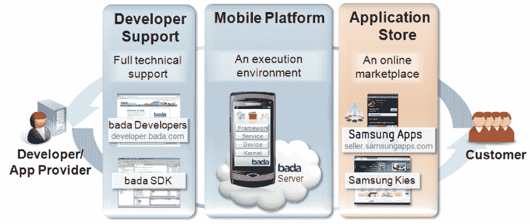

图 1.1 bada 生态系统

在链条的一端，我们有想要开发应用的开发者或提供者。在另一端是想要使用应用的用户或客户。沿着这条链条，三星提供了构建块来促进 bada 生态系统。其中的核心是部署在手机上的 bada 平台，你将在第 5 章中了解到。强大的 API 以 SDK 的形式暴露。左侧区块涵盖了大量的资源，如培训材料、教程、示例代码和技术博客。右侧区块是允许你发布应用的商店。一旦你的应用准备就绪，你可以通过商店决定是出售还是免费提供。

在下一章中，我们希望介绍一些有助于成功的最佳实践。

## 1.3 移动应用开发最佳实践

我们认为移动应用显示出某些特性，使其与传统的桌面或服务器软件不同。相关的市场也不同。因此，为了创建成功的解决方案或应用程序，我们在本中推荐一些最佳实践。在附录中，我们提供了一个完整的移动软件工程流程示例。

当然，你可以遵循任何偏好的流程，或者完全不遵循任何流程来开发软件。根据经验法则，项目越复杂、需要的协调越多，在流程方面的正式化就越必要。经验表明，所谓的敏捷软件开发流程非常适合快速发展的软件，移动应用无疑如此。

在敏捷宣言中，软件工程专家总结了有助于产生更好、更可靠软件的关键因素。他们认为敏捷开发基于**结果**。这意味着应该尽快构建可执行的软件，这是衡量进展的主要标准。工具和流程支持是相关的，但必须对解决方案进行**适当**的选择。最后，软件工程是关于人员的合作。因此，**沟通**——理想情况下是面对面的口头——是敏捷开发的核心。

与之此，我们希望在该建议中强调在整个开发过程中尽可能地使用**原型制作**和**多样化测试**，两者都是 bada 平台及其工具固有支持的一部分。原型几乎可以在移动软件解决方案开发的任何阶段利用。它们主要有助于引导需求，或早期与利益相关者达成共识。测试并非移动软件工程所独特，但必须以不同的方式处理和执行。这是移动软件相关问题的影响，例如硬件和设备的异构性、对环境因素的依赖（模拟器上难以测试，如地理位置），以及模拟器与真实设备行为之间的差异现象。

bada 工具集提供了支持这两者的手段。首先是集成在 bada IDE 中的 **UI Builder**，开发者可以使用所见即所得工具通过在设备屏幕上放置各种 UI 控件来创建“可点击”的演示。

随 bada 模拟器的 **Event Injector** 是一个方便的工具。它对于模拟各种上下文数据非常有用。可以测试来电、短信或电量，还可以测试不同的传感器，如位置、加速度、倾斜、磁场或接近性。显然，在模拟器中测试移动应用总是困难的，因为你错过了所有这些必要的上下文数据。因此，远昂贵且复杂的测试类型是部署在真实设备上。

² See http://www.agilemanifesto.org/

在真实世界的场景中进行测试。通过 bada 事件注入器（见图 1.2），许多此类工作已转移到模拟器测试中，使得系统不那么耗时且成本更低。

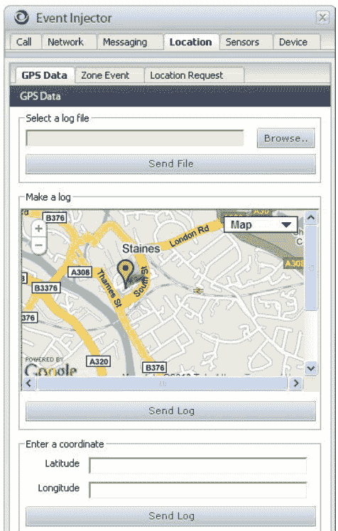

图 1.2 bada 事件注入器

但让我们回到敏捷宣言中所假设的“敏捷”。因此，“敏捷”字往往被误用于任何没有明确规则或流程的事情。这重新读起来被称为“牛仔式编程”（cowboy coding）。敏捷不能等同于混乱，或规则或纪律的缺乏。敏捷应用开发确实建议遵循一些简单的准则和建议。

因此，让我们来描述一些规则。我们将通过列出来自各种敏捷方法论（如 Scrum、测试驱动开发、极端编程或水晶体）的最佳实践工具箱来实现。再次强调，核心基石关注结果、增量迭代、手段的适当性以及沟通。接下来的最佳实践建议都涉及这些基石中的一个或多个。

- 关注结果而非过程。任何无助于实现软件项目目标的程序或手段都应该被切断。项目越复杂，需要的工具、规则和形式化就越多。
- 将你的软件开发计划分为周期或迭代。识别核心和最关键的组件、优先级，并从最重要的开始（优先事项）。
- 对变化（需求变更和变更请求）保持宽容。避免僵化或灵活的结构、流程、工具或方法。
- 尝试在每次迭代结束时产生可执行的软件。
- 在完成迭代后，为最终软件产品添加进一步的增量。
- 尝试设计和编写简单的软件。考虑到可能的扩展，但专注于至少在每次迭代结束时产生可执行的代码（简单简单 —— KISS）。
- 利用来自各种利益相关者（如你的客户或最终用户）的早期反馈。用户验收测试可以集成到每次迭代中。
- 在早期阶段甚至可以使用纸笔勾画软件设计或早期原型。
- 使用面向测试的开发，即你先编写测试用例，至少对于核心或关键部分。频繁地构建和集成已测试的部分（例如每天）。
- 建立沟通手段，以便与客户和最终用户保持这种紧密的接触。
- 尝试进行定期、频繁且简短的团队内部沟通，没有形式化的开销（例如每日站会）。
- 建立并发布团队和项目规则——例如沟通礼仪或编码标准。
- 对核心或关键代码部分进行代码审查或结对编程。
- 确保团队内部以及向客户和用户进行高效的知识传递。这并不总是适用或合理的。有时这种知识传递也可能是单向的。
- 使用可视化手段进行沟通。例如，使用团队中所有人都可以使用的可见白板来勾画任务、功能和开发进度。
- 某些形式的文档是必要的，但仅在需要时且越少越好。注意过度规范。

再次，请记住，你不必遵守这里概述的移动软件工程流程。这仅仅是建议，是你*可以*遵循的内容。

## 第2章：bada 基础

本章将进入使用 C++ 开发原生 bada 应用的核心。我们将看到在 bada 模拟器上启动并运行第一个骨架应用是多么容易。

首先，这个小应用并没有做什么——想象一下 Hello World！但这是每个 bada 应用的核心代码，正如我们在接下来的几章中看到的，bada 轻松地从这个基础骨架构建出功能完备的原生应用。

> 注意：模拟器从基于 Eclipse 的 bada IDE 启动，该 IDE 包含在 SDK 中。目前仅支持 Windows，但未来可能会支持其他。

## 你将学习什么

本章旨在让你快速上手。你将学习：

- 使用应用程序向导创建一个简单的应用程序
- 使用 UI Builder 添加简单的 UI

### 你需要什么

本章假设你具备 C++ 技能。如果你不熟悉移动开发，不要担心：bada 努力让开发者的生活变得简单。如果你有任何现代语言的经验，那么一本好的 C++ 指南就足够了。

顺便说，bada 是高度模块化的，开发者大部分时间将花在连接各个部分上，我们将在后续章中讨论这些问题。正如我们看到的，我们将仅使用模拟器。

## 2.1 你的第一个 bada 应用

原生 bada 应用是 C++ 可执行文件，将你编写的代码与框架代码相结合。由于 bada 框架处理了每个应用程序所需的基本功能，创建一个应用所需代码非常少，正如我们所看到的。

首先，我们将仅使用模拟器。在下一章中，我们将深入探讨并展示如何为（并部署到）真实的 bada 手机。

正如你所预期的，所有的 bada 应用都是图形化程序。事实上，理解 bada 应用的一种简单方式是将其视为一个执行某些功能的 GUI。

对于任何应用程序，GUI 是用户与应用相遇的地方。是 GUI 向用户展示功能并允许用户控制功能。对于用户来说，你的 GUI 就是你的应用，并且在很大程度上决定了应用体验。

所有使用标准 UI 元素的 bada 应用都具有独特的 视觉效果和行为。当你需要更多自定义的元素时，可以派生自己的并扩展默认行为。当然，有时你想要完全的控制（例如游戏），而不想要标准的视觉效果。在这种情况下，bada 允许你直接写入全屏显示以从零创建自己的 UI。

但介绍就足够了！如果你的 C++ 生疏了，现在是拿出你喜欢的 C++ 指南的好时机。然后启动 bada IDE，跟随操作。

### 2.1.1 骨架应用

创建一个新应用程序很容易——应用程序向导为你完成所有工作，并生成完整的 C++ 骨架代码（.h 头文件和 .cpp 源文件），以及应用程序所需的所有额外文件。让我们尝试一下。启动 bada IDE，选择 File | New | bada Application Project 弹出项目向导。给你的项目命名——我们将其命名为 BuddyFix——在项目类型面板中选择 Application | Form Based Application。

**注意：** BuddyFix 是我们在书中全程作为运行示例的项目名称，用于展示如何从零开始构建它。刚开始，BuddyFix 只有基础功能，但最终它将成为一个实用的应用程序，允许你与选定的“伙伴”交换位置信息。

选择 **Next**（下一步），并接受默认的 SDK Root 路径。这告诉构建工具去哪里查找公共头文件和库；如果你安装了多个 SDK 版本，请修改该路径。最后，勾选你想要构建的手机型号（在编写时，默认是 Wave）。

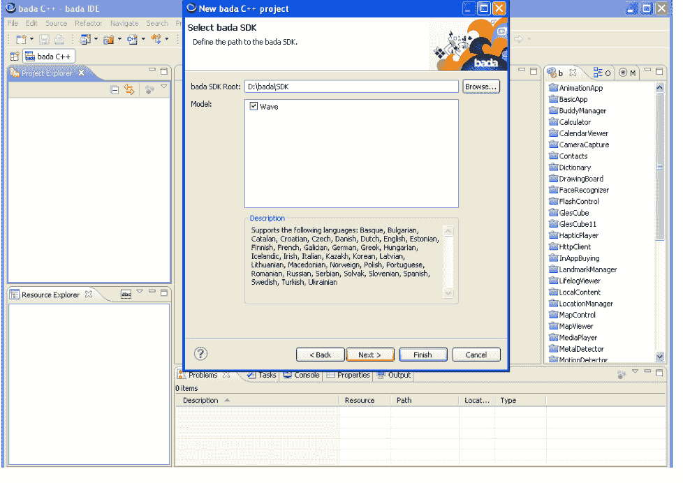

要开始运行，你只需要这些。还有更多选项（你可以通过选择 **Next** 来探索它们），但现在你可以选择 **Finish**（完成）并让向导完成工作。


在项目资源管理器（Project Explorer）面板中，你会看到该文件夹已经创建，并以你指定的项目命名。里面是一个基础的骨架应用。让我们来看它。

### 2.1.2 项目结构

注意：当你启动 IDE 时，可以选择一个工作空间，Eclipse 将其中创建新文件夹并查找现有的项目文件。你可以随时通过 IDE 主菜单中的 `File | Switch Workspace` 在不同工作空间之间切换。

在你的工作空间中，你将看到一个名为 `BuddyFix` 的文件夹（或你为新项目选择的名称）。里面有一些子文件夹：

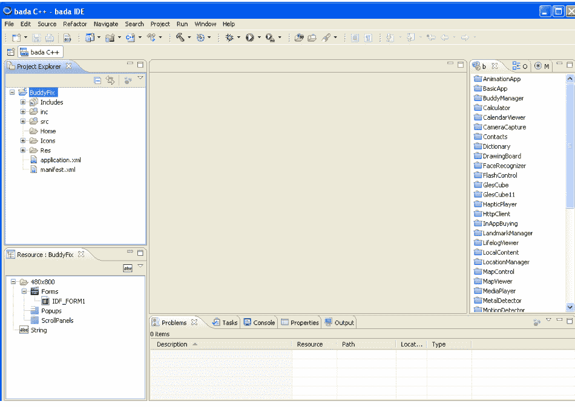

图 2.3 BuddyFix 文件夹及子文件夹

- `/inc` 和 `/src` 文件夹是保存项目生成的 C++ 代码文件的地方；
- `/inc` 中的 `.h` 文件和 `/src` 中的 `.cpp` 文件
- `/Home` 文件夹是应用程序读写任何数据文件或文件夹的文件系统根目录
- `/Icons` 文件夹是你应该存储应用程序使用的图标的地方，向导在此处选择默认应用图标——当然，当你创建一个真实项目时，你应该将其更改为自己的图标
- `/Res` 文件夹是应用程序存放其资源的地方。当我们创建 BuddyFix UI 时，你将看到如何使用资源。

注意，当你安装应用程序时，`/Icons`、`/Home` 和 `/Res` 也会作为文件夹在真实设备上创建。在手机上，`/Home`、`/Icons` 和 `/Res` 是只读的“系统”位置，而 `/Home` 是可读写且对你的应用程序私有。

> 注意：在 IDE 中，项目资源管理器还显示一个 `/Includes` 文件夹，这是一个映射你项目所有路径的虚拟文件夹。它不是你 Windows 文件系统中的物理文件夹。项目资源管理器还隐藏了一些你在 Windows 文件系统中可以看到的文件，名称如 `.badapr`、`.project` 和 `.project`。这些是标准的 Eclipse 维护文件，你可以忽略它们。

表：向导生成的项目文件夹

| 文件夹 | 描述 |
| :--- | :--- |
| `/Home` | 应用程序数据区域的根文件夹，提供专用的（受保护的）文件系统存储。在应用程序创建并保存文件数据之前该文件夹为空，但它始终存在，即使未被应用程序使用 |
| `/Icons` | 包含默认的 `.png` 图标和启动屏文件，你可以用自己的自定义图形替换它们 |
| `/Res` | 包含应用程序的所有资源，通常是表单（Forms）和字符串（Strings）。表单由 XML 定义文件定义，如果你选择针对不同分辨率的手机，则会划分为特定分辨率的子文件夹。对于 BuddyFix，支持的分辨率是 480x800 像素，即 QVGA |
| `/inc` | 包含骨架应用的 `.header`（头文件）文件 |
| `/src` | 包含骨架应用的 `.cpp` 文件，包括一个定义应用框架入口的 Entry（入口）文件。这是你不需要修改的生成代码 |

### 2.1.3 元数据

我们还没有提到两个重要文件：`application.xml` 和 `manifest.xml`。`application.xml` 由向导生成并放置在你的项目根目录下。`manifest.xml` 理想情况下由 `developer.bada.com` 网站上的管理器（Application Manager）创建，或者你可以使用向导创建的默认文件。

这些是元数据文件，对你的项目至关重要。它们声明了创建最终应用包所需的应用程序信息——应用名称和版本、供应商名称等——以及你的应用程序使用的 API 的关键信息以及使用时所需的任何安全权限（在 bada 中称为 privileges，即权限/权利）。权限是 bada 安全模型的一部分，我们将在第 4 节中详细介绍它们。

当你启动一个真实项目时，你需要通过 bada 开发者门户账户上提供的可用工具创建 `manifest.xml` 的自定义版本（见第 2.7 节）。但刚开始你完全不需要担心这些细节；App 向导生成的默认元数据文件就足够启动了。

### 项目元数据文件

### application.xml

- 用于应用程序打包工具创建可安装包。声明应用名称、描述、供应商和版本。

### manifest.xml

- 用于权限检查。声明应用属性，包括设备类型、最小堆内存、屏幕尺寸、传感器和所需功能。注意在 IDE 中，项目资源管理器还显示一个 `/Includes` 文件夹，这是一个映射你项目所有路径的虚拟文件夹。它不是你 Windows 文件系统中的物理文件夹。

## 2.1.4 构建并运行

尽管我们只是运行了向导，但已经有足够的代码来构建并启动第一个版本的应用了。在 IDE 中，在项目资源管理器中选择你的项目名称。在菜单栏上选择 `Project | Build`，你的项目将开始编译。


图 2.4 构建项目

当你的项目成功构建后，项目资源管理器将显示一个 `Binaries` 文件夹，它映射到 Windows 文件系统中的 `.Simulator-Debug` 目录，项目二进制文件和对象存储在此。

要启动应用程序，在项目资源管理器中选择你的项目。在菜单栏上选择 `Run | As | bada Application`。

模拟器将运行。我们在创建项目时选择了 Wave，所以我们看到的是在屏幕上运行的 Wave。

命令行启动并初始化，短暂显示手机主屏幕，然后启动其应用程序。

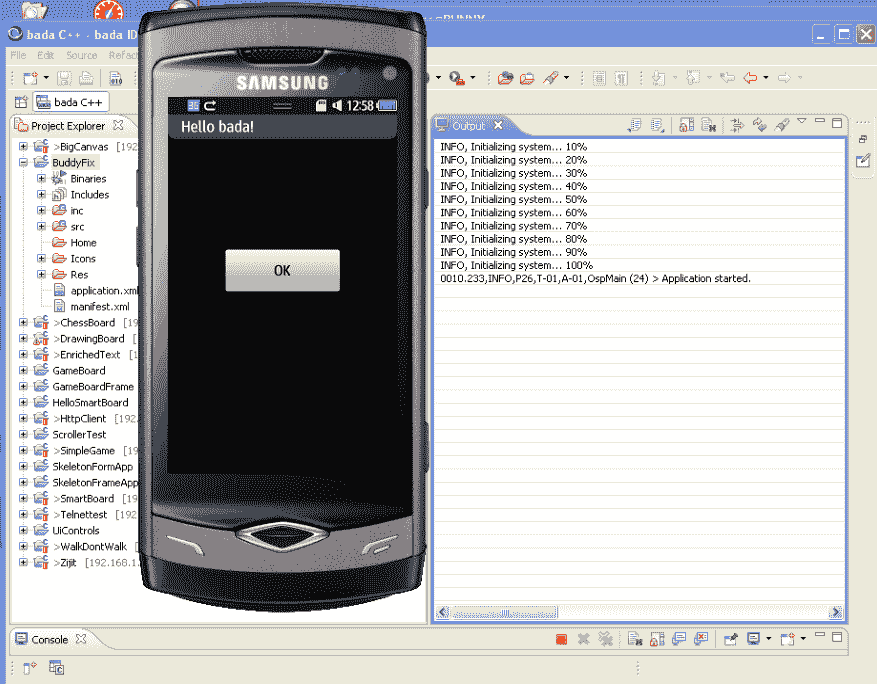

图 2.5 在模拟器中运行我们的应用

注意：对于任何使用表单（Form Based）选项生成的应用，向导会将应用程序标题栏设置为“Hello bada!”，并在应用运行时弹出一个“OK”按钮。这有点困惑，因为并不看出应用正在运行。但听我的——它确实在运行！

要关闭应用程序，选择模拟器上的手机电源/结束键。你的应用程序将关闭，并返回主屏幕。选择菜单键进入应用程序管理器。你会在图标列表中看到你的应用，使用默认应用图标。

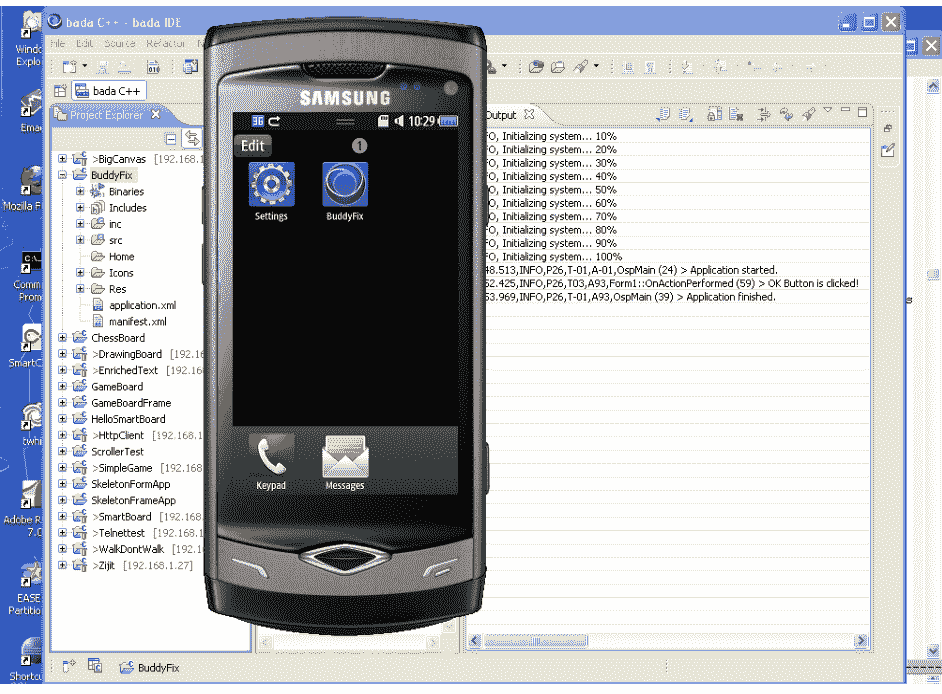

图 2.6 在应用程序管理器中显示 BuddyFix

注意：当 BuddyFix 启动时，你可能注意到在显示应用程序之前短暂显示了启动屏，基于 `/Icons` 文件夹中的默认文件 `splash.png`。你可以通过更改此文件来更改显示的图像。启动屏是应用程序项目的可自定义属性——它的设置方法与设置应用图标相同。

顺便说一下，启动屏显示是为了填补应用启动期间的任何延迟。延迟可能由于多种原因，取决于手机在任何时候的负载。启动屏并非由应用本身显示用以隐藏应用初始化时的延迟。事实上，你应该设计你的应用，推迟任何可能导致显示主界面时产生感知延迟的初始化。你可以通过使用多线程技术在后台执行此类初始化，或者在应用启动后再推迟这种深层初始化，或者两者兼顾。

一个点提示：为了通过认证流程，bada 应用必须拥有它自己的启动屏和应用图标。

## 2.1.5 标准输出

Eclipse IDE 中一个实用的视图是输出（Output）页面。当你在模拟器中启动应用时，系统会记录一条“Application started”消息，当你关闭应用时，系统日志会记录一条“Application finished”消息：

```
0010:200,INFO,P26,T-01,A-01,OspMain (24) > Application started.
0014.030,INFO,P26,T-01,A93,OspMain (39) > Application finished.
```

在这些日志之间，你可以使用 bada 日志宏 `AppLog()`、`AppLogDebug()` 和 `AppLogError()` 输出自己的类似 `printf` 的日志消息，以追踪应用的运行时行为。例如，要输出日志消息，请添加该行：

```
AppLog("This message will display in the output view");
```

日志文件可以导出为带有 `.log` 后缀的简单文本文件。在输出页面中，一旦你的应用程序运行，选择左侧的第二个图标（如下所示）；会弹出一个对话框，允许将输出保存到开发机器上的日志文件中。

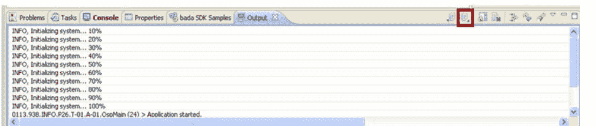

图 2.7 bada IDE 的输出页面

日志消息还通过断言宏 `AppAssert()` 和 `AppAssertf()` 写入，这些宏用于测试条件的真值（或相应的假值），并且还通过异常处理宏写入，我们将在第 4 章详细介绍这些内容。

调试宏描述在 SDK 帮助中，请在 IDE 中选择 `Help | Help Contents | bada Developer Guide`。

## 2.2 应用 UI

我们已经说过，一个 bada 应用可以被认为是一个执行某些功能的 GUI，其中 GUI 是你的应用展示给用户的公共脸面。在进入具体操作并向你展示如何构建简单的 GUI 之前，让我们先补充一些背景知识。

根据复杂程度，应用可能只需要一个屏幕——例如，对于计算器应用，简单的计算器布局。或者它可能需要多个屏幕，例如通讯录应用，它可能将其主界面组织为姓名和地址条目的滚动列表，并带有显示单个完整条目详情的详情界面，以及用于编辑条目详情、标签等的编辑屏幕。

设计你的 GUI 是你作为应用开发者将面对的最重要任务之一。关于良好 UI 设计的艺术已有许多论述，关于移动 UI 设计的特殊情况也有许多论述。³ 这一集合特征的两个属性是对细节的狂热关注和无情的简化。

> 如果你还不认识它，请阅读 Scott Jensen 的《The Simplicity Shift》（剑桥出版社，2002年）。一个经典的移动案例研究是 Lindholm 等人的《Mobile Accessibility》（McGraw-Hill，2003年）。Ballard 写的《Designing the Mobile User Experience》（Wiley,2007年）是一本很好的综述读物。任何应用开发者都不应该没有过 Bill Moggridge 的《Designing Interactions》（MIT Press，2007年）。网络上也有大量关于通用……的资料。

在平台外观和感受的语境下理解你的应用 GUI 同样重要。三星在其整个触摸屏手机系列中统一使用了其 TouchWiz UI。目前 TouchWiz 处于 3.0 版本，这是在 Wave 上出厂的版本，也是你将在 bada 模拟器中看到的版本。

记住，bada 的设计旨在将智能手机体验从高端推向中端。这影响了 TouchWiz 的设计，也应该影响你的 GUI 设计。虽然没有亲手操作真实设备的替代，但以下几点值得注意：

- 触摸——基于手指的、直接操作、包括缩放和滑动在内的多点，当然还有触感反馈
- 简单——简单的屏幕布局、相对大且粗的字体、用于交互的大型 GUI 元素、大而图标、有限的自定义、简单的菜单
- 明亮且大胆——充分利用 superAMOLED 显示技术、高对比度、鲜艳的色彩、饱和的黑色（顺便说一句，深色方案比浅色更好，因为使用 AMOLED 技术，黑色像素比亮像素消耗更少）
- 扩展的用户输入——除了触摸和硬键，TouchWiz 支持手势（物理上的包括敲击外壳、旋转手机、点击和摇晃），甚至是面部识别
- 多种显示尺寸和分辨率——WVGA（宽 VGA）480x800，WQVGA（宽四分之一 VGA）240x400

你可以在 SDK 帮助中找到详细的 UI 指南，请在 IDE 中选择 `Help | Help Contents | bada Application UI Guide`。

### 2.2.1 框架、表单和控件

GUI 不仅仅是你屏幕上看到的内容。TouchWiz 外观和感受的简单性延伸到了其下方的架构中。虽然 bada 不会为你设计 GUI，但它提供了供你使用的简单架构。移动 UI 设计的原则，包括为其他平台发布的优秀文档可能很熟悉，适用于所有平台。

你可以认为应用显示的所有内容都组织成一个层次结构树。树的根是 `Frame`。在每个应用中，`Frame` 是添加所有 GUI 元素的顶级容器。更正式地说，`Frame` 封装了设备显示，并充当应用顶级窗口的角色，每个应用只有一个 `Frame`。你不需要做任何事情来创建它，这一切都由框架处理。

在 `Frame` 内部，应用显示的内容基于 `Form` 的简单比喻；`Form` 实现应用，每个 `Form` 是一个填充了 `Control` 的布局容器；`Control` 是标准控件或你自定义的派生控件。`Control` 类抽象了屏幕区域。自然提供了全面的图形原语、动画和字体，因此真正的限制是你的想象力以及你的设计能力！`Frame`、`Form` 和 `Control` 之间的关系如图 2.8 所示。

> ⁴ 具体来说，每个应用有 `Form` 数量限制，但这不是你预计会遇到的限制。

> ⁵ 在底层，bada 图形能力的原始算力基于 OpenGL ES，支持 2.0（硬件加速和硬件着色器）和 1.1 标准（仅硬件加速）。可用的 OpenGL ES 版本取决于设备。也可能在低端，某些 bada 手机完全不支持 OpenGL ES。需要 OpenGL ES 的应用将在不支持的手机上安装。

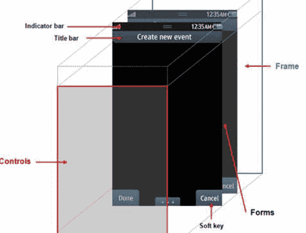

图 2.8 所有应用都有 `Frame`，它是添加 `Form` 的顶级容器；`Form` 填充了 `Control`

### 2.2.2 Form 的标准元素——状态栏、标题栏、软键、选项菜单

`Form` 占据手机的全物理显示区域——屏幕上可见的所有内容。因此 `Form` 也包含一些标准的系统元素。这些元素是：

- 显示区域顶部的状态栏，用于显示系统图标（如信号和电量）和通知（你是否有未读消息）
- 显示当前应用名称的标题栏
- 显示在主显示底部的软键
- 显示在底部两个软键之间的选项键，用于启动选项菜单

# bada 简介：开发者指南 - (草预览，2010年7月)

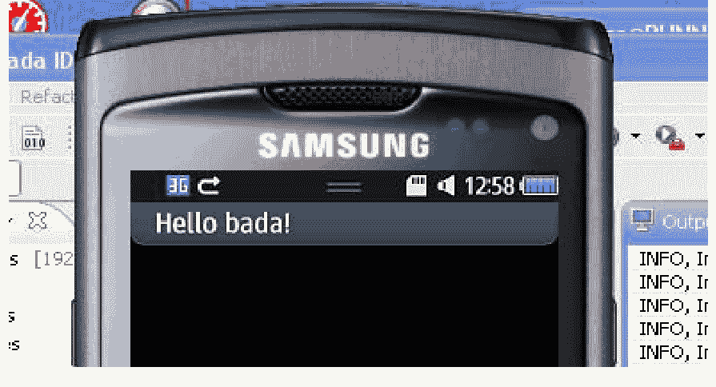

图 2.9 应用程序名称和系统元素

所有这些元素都被定义为 `Form`（表单）的属性。显示全部或部分这些元素的决定由每个 `Form` 做出，因此受定义该 `Form` 的应用程序控制。然而，这些屏幕的外观和视觉效果（对于指示条而言，包括其内容）并不直接由应用程序控制。虽然 `Form` 显示了这些元素，但框架保留了对它们的控制权。

## 2.2.3 处理事件

我们提到过控件（Controls）抽象了用于显示和输入的屏幕区域，但我们没有说明具体如何实现。输入事件包括来自触摸屏的输入（包括菜单和软键）、来自物理手机按键的输入（包括锁定或相机等侧边按键）、来自手势和原始传感器事件，以及来自 bada 系统事件——可能来自任何类型的事件。

监听器（Listeners）是绑定 bada 应用中行为呈现的胶水。监听器为所有事件处理提供了机制。在任何时刻，GUI 中恰好有一个拥有“焦点”（focus）。“焦点”仅意味着哪个对象正在活动更新显示并接收用户和系统的 GUI。从概念上说，焦点属于运行的前台应用程序的当前活跃控件。事件通过该应用程序所属的 UI 控件层级向下传递，从它的 `Frame`（框架）开始，然后是当前的 `Form`，依此类推，直到找到当前活跃的控件。该控件接收发生的任何输入事件（顺便说一下，还会启动显示重绘）。

每个控件都对于其识别的基础事件类型内置了监听器。根据控件的不同，这些可能包括以下任何项：

- 焦点事件（Focus events）
- 键值事件（Key events）
- 触摸事件（Touch events）
- 拖放事件（Drag and drop events）

许多控件还会添加它们自己的、特定控件的监听器。例如，滑块控件识别滑块特定的“调整”（adjustment）事件，该事件会报告滑块移动的距离。

此外，许多控件共享一个“动作”（action）事件监听器，响应由 UI 框架生成的特定事件，包括：

- 按钮和复选按钮事件（Button and CheckButton events）
- 上文菜单和选项菜单事件（ContextMenu and OptionMenu events）
- 标签事件（Tab events）

## 2.2.4 总结

让我们总结一下要素。应用程序 `Frame`、它包含的 `Form` 或 `Forms` 以及填充 `Forms` 的控件，是 bada 应用构建其 GUI 的构建组件：

- 每个应用程序只有一个 `Frame`，它抽象了设备显示
- `Frame` 是应用 GUI 的根对象
- 一个 `Frame` 包含一个或多个 `Forms`（通常情况下——特殊情况是全屏应用，也称为基于 `Frame` 的应用，它不包含 `Forms`；相反，它直接绘制图形）
- `Form` 是 `Frame` 之后最高级别的容器对象，定义了一个完整的应用程序屏幕
- 可以向 `Form` 中添加任意控件
- 监听器被添加到控件中，以挂钩应用程序想要响应的事件

## 2.3 UI Builder

现在我们知道 GUI 中包含什么了，让我们来构建一个吧。WYSIWYG（所见即所得）工具 UI Builder 可以使用标准控件轻松创建基础的 GUI 布局。UI Builder 还会为我们定义的控件生成底层的类源代码。随后只需要少量的手动编码，即可将 UI 布局和控件与我们已经创建的应用程序骨架连接起来。

### 2.3.1 一个简单的 UI

BuddyFix 是一个单屏幕应用程序，具有基于列表的简单呈现。UI 设计基于下方框中总结的要求。如果这是一个完全的商业应用，我们会希望比这个简单的规格更复杂一些；但对于我们的目的来说，这足够了，作为一个定义基础但真实的应用程序功能的练习，并展示如何在 bada 中实现它。

| BuddyFix UI |
| :--- |
| BuddyFix 是一个简单的应用，能够实现简单的用例。UI 设计基于下方框中总结的。。如果这是一个完全的商业应用，我们会希望比这个简单的规格更复杂一些；但对于我们的目的来说，这足够了，作为一个定义基础但真实的应用程序功能的练习，并展示如何在 bada 中实现它。 |


BuddyFix 是一个简单的应用，能够实现简单的用例。UI 设计基于下方框中总结的规格。如果这是一个完全的商业应用，我们会希望比这个简单的规格更复杂一些；但对于我们的目的来说，这足够了，作为一个定义基础但真实的应用程序功能的练习，并展示如何在 bada 中实现它。

默认情况下，所有的 `Form` 都显示指示栏（Indicator bar）。除非你正在编写全屏游戏或类似的应用程序，否则在 UI 中始终包含指示栏是一个良好的习惯，以便使用户能够完全感知设备状态并接收提醒。请注意，虽然你可以显示它，但无法直接更新指示栏。

显示指示栏是一种样式（Style）选项。其他样式选项还包括是否显示软键（soft keys）以及任何存在的软键。

`Form` 的外观和感觉是高度可配置的。最重要的属性如表所示。完整的属性列表请参阅 SDK 文档。

| 属性 | 用途 |
| --- | --- |
| `Id` | `Form` 标识符，这也用于在 C++ 代码中引用 `Form` 布局文件 |
| `Type` | `WINDOW_FORM` 是任何 `Frame` 内的顶层 `Form`，其中应用 `Frame` 代表显示应用内容的屏幕窗口 |
| `Title` | 如果启用，将出现在 `Form` 标题栏中的标题 |
| `Orientation` | 当手机在可能的四个方向上旋转时，`Form` 的显示方式 |
| `Layout` | 模式：竖屏 (Portrait) 或 横屏 (Landscape) |

> 注意：虽然你可以为 `Frame` 和 `Form` 设置背景颜色，但你不能将背景设置为图像，这与其它类型的控件不同。

### 2.3.3 好友列表 (Buddy List)

UI 最重要的部分是主好友列表本身，它将为每个好友显示若干项信息。UI Builder 为我们提供了多种列表类型选择，并允许我们定义自定义列表，但为了开始，我们将保持简单，使用一个基础的简单列表，为每个项目显示以下字段：

- 图片
- 名称
- 位置固定/时间固定，最后已知
- 该好友是否开启了位置共享

若想在 UI Builder 中向 `Form` 添加列表，请从控件调面板（Palette）中选择 `List`，并将其拖到（或点击进入）主 `Form` 视图中，如图 2.14 所示。请注意，bada IDE 的外观、感觉以及窗口安排可以根据需要自由更改。我们已经这样做了。这就是为什么接下来的截图与第一批略有不同。

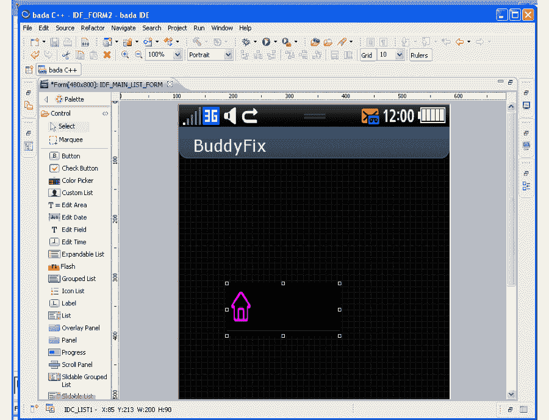

图 2.14 在我们的表单添加列表

调整 `List` 大小以占据 `Form` 的整个区域。现在，双击 `List` 内部任意位置打开属性编辑器面板。编辑其属性与编辑 `Form` 属性完全相同。

首先，让我们将 `List` 重命名为 `IDC_MAIN_LIST`。

接下来，查看感兴趣的属性。首先，我们可以定义基本属性，如每个项目的行高和宽度，以及不同字段的显示顺序：

| 行 1 高度 | 默认 80 |
| 行 2 高度 | 默认 50，在选择双行格式时显示 |
| 列 1 宽度 | 默认 50 |
| 空列表文本 | 列表为空时显示的文本 |
| 列表项目格式 | 11 种可能格式之一，用于指定列表内容的结构，例如 `LIST_ITEM_SINGLE_IMAGE`, `LIST_ITEM_DOUBLE_IMAGE`, `TEXT_FULLTEXT` |

简单的列表可以显示一列或两列，第一列可以显示一行或两行。我们将格式设置为 `LIST_ITEM_DOUBLE_IMAGE_TEXT_FULLTEXT`，它将显示第一行的图像和文本，以及第二行的文本。

接下来，在 Layout（布局）下，我们可以设置列表样式。即使是简单列表，我们也有很多样式可以选择，包括：

| `LIST_STYLE_NORMAL` | 正常样式 |
| `LIST_STYLE_NUMBER` | 编号样式 |
| `LIST_STYLE_RADIO` | 单选 Radio 样式 |
| `LIST_STYLE_RADIO_WITH_DIVIDER` | 带分隔符的单选 Radio 样式 |
| `LIST_STYLE_MARK` | 多选 Mark 样式 |
| `LIST_STYLE_MARK_WITH_DIVIDER` | 带分隔符的多选 Mark 样式 |
| `LIST_STYLE_ONOFF` | 开启/关闭样式 |
| `LIST_STYLE_ONOFF_WITH_DIVIDER` | 带分隔符的开启/关闭样式 |

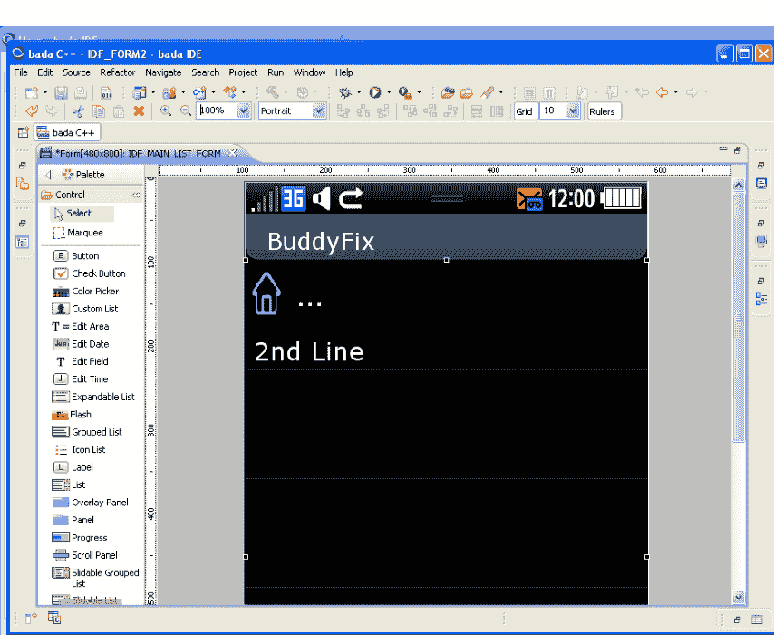

图 2.15 使用 UI Builder 设置列表的属性

我们将选择 `LIST_STYLE_MARK`，它为每个项目显示一个选择标记，允许我们进行选择并对选定的子集执行操作。

最后，我们将 `Text Of Empty List` 属性设置为 'No buddies...'。

UI Builder 为我们提供了列表外观的基本概念，但在运行中的程序中查看其实效果是不可替代的。在那样之前，还有一点工作需要完成。

但首先，我们应该保存已做的更改。文件（File） | 保存所有资源（Save All Resources）。

**注意：完成 UI Builder 工作后始终保存，因为资源文件只有在你显式保存时才会保存到你的项目 `/Res` 文件夹中。如果不这样做，你的更改会在 UI Builder 退出时丢失。**

## 2.4 将你的 Forms 连接到代码

UI Builder 获取我们定义的属性并从此生成声明式的 XML 布局。

如果你用文本编辑器打开 `IDF_MAIN_LIST_FORM`，你将看到 XML 声明。

```xml
<xml version="1.0" encoding="UTF-8" standalone="no"?>
<!DOCTYPE Scene SYSTEM "UIform.dtd">
<Scene Dversion="2">
<Form id="IDF_MAIN_LIST_FORM">
  <property BGColor="0" Orientation="Portrait"
  softKeyNormalIcon="" softKeyPressedIcon="" softKey0Text=""
  softKeyNormal="" softKeyPressedIcon="" softKeyText=""
  title="BuddyFix" titleAlign="ALIGN_LEFT" titleIcon=""/>
  <layout mode="Portrait" style="FORM_STYLE_INDICATOR|FORM_STYLE_TITLE"/>
  <layout mode="Landscape"
  style="FORM_STYLE_INDICATOR|FORM_STYLE_TITLE"/>
</Form>
<List id="IDC_MAIN_LIST" parent="IDF_MAIN_LIST_FORM">
  <property ListItem="IDF_ITEM_DOUBLE_IMAGE_TEXT_FULLTEXT"
  colorOfEmptyList="" columnWidth="50" column2Width="50"
  rowCount="80" rowHeight="50" textOfEmptyList="No buddies..."/>
  <layout height="708" mode="Portrait" style="LIST_STYLE_MARK" width="480"
  x="0" y="0"/>
  <layout height="72" mode="Landscape" style="LIST_STYLE_MARK" width="330"
  x="95" y="85"/>
</List>
</Scene>
```

很容易看到我们的属性设置如何转换为 `Form` 和 `List` 对象的属性。然而，布局文件只是声明，而不是实现。在运行时，如果我们加载布局，框架将完成实例化对象的剩余工作。但我们必须先加载布局文件。

为了做到这一点，我们需要创建一个 `Form` 类。UI Builder 可以为我们完成这一点。

在 Builder 中，通过右键点击 `Form` 来生成该 `Form` 的底层代码。（请确保点击的是 `Form` 而不是 `List`；点击标题栏可以确保 `Form` 不隐藏在控件之后。）

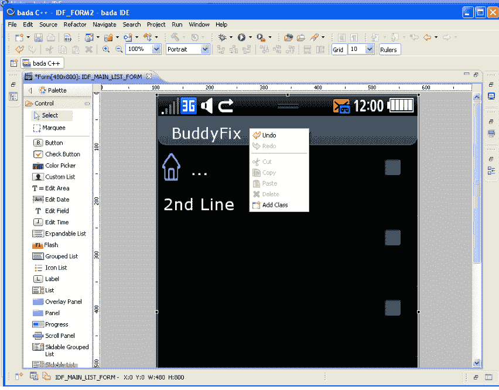

图 2.16 使用新类向导

如图 2.16 所示选择添加类（Add Class），将弹出新类向导，该窗口如图 2.17 所示。

我们将类命名为 `MainListForm`，与资源文件名匹配。

接下来，让我们设置它的监听器。在监听器对话框中，我们设置 `IActionListener`。我们没有设置 `IOrientationEventListener`，因为我们只设计了竖屏屏幕。

在控件基础监听器对话框中，我们选择焦点（focus）、按（key）和触摸（touch）事件。这些是框架检测到的底层事件，并从中生成操作。因此，我们知道在代码中我们期望处理按键、触摸和焦点事件。

我们没有添加拖放（drag and drop）事件，因为我们没有与好友列表进行拖放交互。

选择完成（Finish），然后从主菜单中保存（Save）。

如果你打开 `MainListForm.cpp`，你可以看到表单是通过在构造函数中加载资源声明初始化的：

```cpp
bool
MainListForm::Initialize()
{
    Form::Construct(L"IDF_MAIN_LIST_FORM");
    return true;
}

result
MainListForm::OnInitializing(void)
{
    result r = E_SUCCESS;

    // TODO: 在此处添加你的初始化代码

    return r;
}
```

> 注意：你会发现我们在书中的每一个字符串前面都加了字母 'L'。这就是所谓的 'L 宏'，它用于生成宽字符和编码为 unicode 的字符串。出于兼容性考虑，建议在你的代码中使用它。

此外，我们所选择的用于响应的事件的所有监听器方法都已添加：

```cpp
class MainListForm {
    public Osp::Ui::Controls::Form,
    public Osp::Ui::IEventListener,
    public Osp::Ui::IFocusEventListener,
    public Osp::Ui::IKeyEventListener,
    public Osp::Ui::ITouchEventListener,
    public Osp::Ui::IItemEventListener;
};

// ... 省其他方法
```

```cpp
// 生成的回调函数
public:
void OnActionPerformed(const Osp::Ui::Control&, int);
void OnFocusGained(const Osp::Ui::Control&);
void OnFocusLost(const Osp::Ui::Control&);
void OnKeyLongPressed(const Osp::Ui::Control&,
Osp::Ui::KeyCode);
void OnKeyPressed(const Osp::Ui::Control&, Osp::Ui::KeyCode);
void OnKeyReleased(const Osp::Ui::Control&, Osp::Ui::KeyCode);
void OnTouchDoubleRest(const Osp::Ui::Control&, const Osp::Graphics::Point&, const Osp::Ui::TouchEventInfo);
void OnFocusIn(const Osp::Ui::Control&, const Osp::Graphics::Point&, const Osp::Ui::TouchEventInfo);
void OnFocusOut(const Osp::Ui::Control&, const Osp::Graphics::Point&, const Osp::Ui::TouchEventInfo);
void OnTouchLongPressed(const Osp::Ui::Control&, const Osp::Graphics::Point&, const Osp::Ui::TouchEventInfo);
void OnTouchMoved(const Osp::Ui::Control&, const Osp::Graphics::Point&, const Osp::Ui::TouchEventInfo);
void OnTouchPressed(const Osp::Ui::Control&, const Osp::Graphics::Point&, const Osp::Ui::TouchEventInfo);
void OnTouchReleased(const Osp::Ui::Control&, const Osp::Graphics::Point&, const Osp::Ui::TouchEventInfo);
void OnItemStateChanged(const Osp::Ui::Control&, int, int,
Osp::Ui::ItemStatus);

// ... 等等
};
```

连接我们新表单还有最后一步要做。在 `BuddyFix.cpp` 中，我们仍然保留了 App 向导生成的原始代码，该代码构建了一个默认表单类 `Form1`。相反，我们现在构建了新的表单类 `MainListForm`。


```cpp
// 自定义加载 IDF_MAIN_LIST_FORM
bool
BuddyFix::onAppInitializing(AppRegistry& appRegistry)
{
  // TODO;
  // 初始化 UI 资源和应用程序特定的数据。
  // 可以从 appRegistry 获取
  // 应用程序的持久数据和上下文。

  // 如果此方法成功，返回 true；否则返回
  // false。
  // 如果此方法返回 false，应用程序将
  // 终止。

  // 取消以下语句以监听屏幕
  //开启/关闭事件。
  //PowerManager::SetEventListener(*this);

  // 创建一个表单
  // 替换 Form *pForml = new Form();
  MainListForm *pMainListForm = new MainListForm();
  // 替换 pForml->Initialize();
  pMainListForm->Initialize();

  // 将表单添加到帧中
  // 替换 Frame *pFrame = GetAppFrame()->GetFrame();
  Frame *pFrame = GetAppFrame()->GetFrame();
  // 替换 pframe->AddControl(*pForml);
  pframe->AddControl(*pMainListForm);

  // 设置当前表单
  // 替换 pFrame->SetCurrentForm(*pForml);
  pFrame->SetCurrentForm(*pMainListForm);

  // 绘制并显示表单
  // 替换 pForml->Draw();
  pMainListForm->Draw();

  // 替换 pForml->Show();
  pMainListForm->Show();

  return true;
}
```

快速查看`MainList.cpp`中的代码可以看出，调用`Initialize()`完成了表单构建并加载了布局文件：

```cpp
bool
MainList::Initialize()
{
    Form::Construct(L"IDF_MAIN_LIST_FORM");

    // 等等
}
```

不要忘记包含新表单的头文件。在`BuddyFix.cpp`中：

```cpp
#include "BuddyFix.h"
// 替换 #include "Forml.h"
#include "MainListForm.h"
```

在项目资源管理器（Project Explorer）中，我们现在可以构建并运行项目。

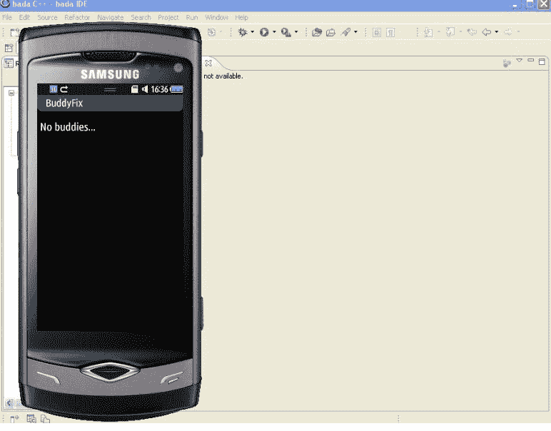

图 2.18 在模拟器中运行 BuddyFix

当 BuddyFix 运行时，我们看到的不是伙伴列表，而是我们设置的在列表为空时显示的默认文本。在我们可以实际看到列表之前，我们需要填充它，将在下一章节中介绍。

## 2.5 应用图标和其他属性

完成我们应用程序骨架的最后一件事是。每个应用程序都需要图标。正如我们所看到的，图标显示在主菜单中，并为用户启动应用程序提供了机制。图标定义为项目的一个属性，设置非常简单。在项目资源管理器中选择你的项目，并从主菜单选择**项目 | 属性**启动属性对话框。

展开 bada 构建项。

在这里我们可以看到 BuddyFix 的一些基本信息。

要添加图标，你需要创建图形（例如在 Windows 资源管理器中查看默认图标的属性），你会看到：

| 文件类型 | PNG |
| --- | --- |
| 大小 | 100x96 像素 |
| 分辨率 | 72dpi |
| 位深 | 32 位 |

在你喜欢的图形应用程序中创建图标，并添加到`/Icons`文件夹。

选择主菜单旁边的文件系统按钮浏览`/Icons`文件夹，选择应用程序图标。点击“确定”保存。下次启动模拟器时，你选择图标将显示在主菜单中。（你不需要重新构建即可生效。）

> 注意：图标上没有应用任何效果，例如圆角或倒角（除了指示选择的变暗）。你可以带有任何效果创建图标，如果圆角请使用透明背景。设备软件平台提供应用程序名称，因此你只需要提供图形。

## 2.6 三步轻松实现多语言

我们实现此 GUI 的方式有一个局限性：我们将英语字符串硬编码到显示的 UI 中——例如软键文本。buddy 的一个卓越功能是其丰富的语言支持。事实上，在编写时，SDK（版本 1.0b3）包含以下语言：巴斯克语、保加利亚语、加泰尼亚语、简体中文、繁体中文（香港）、繁体中文（台湾）、克罗地亚语、捷克语、丹麦语、英语、爱沙尼亚语、芬兰语、法语、德语、希腊语、冰岛语、意大利语、哈萨克语、韩语、拉脱维亚语、立陶宛语、马其顿语、挪威语、波兰语、葡萄牙语、罗马语、俄语、塞尔语、斯洛伐克语、斯洛文尼亚语、西班牙语、土耳其语和乌克兰语。阿拉伯语、波斯语、希伯来语、马来语、泰语、乌尔德语承诺很快推出。

本节剩余部分将集中关注如何让你的应用程序多语言化。应用程序用户界面中显示的所有文本匹配用户的语言设置是非常重要的。支持多种语言以及日期、时间格式会极大提高你的应用程序在全球成功的机会。

以下步骤解释了如何为你的 UI 构建置多语言支持。幸运的是，bada 让这一切变得非常简单。创建多语言 UI 所需的一切都包含在 UI 构建器中。

### 2.6.1 添加新语言

添加语言非常简单。要支持额外的语言，请在 IDE 中打开资源管理器（Resource Explorer）。双击“String”。在 String 窗口内右键点击，从显示的菜单中选择“Language Setting”（语言设置）。将显示“New Language”（新语言）对话框，如图 2.19 所示。

| 序号 | ID | 英语（英国） | 法语（法国） |
|---|---|---|---|
| 1 | IDS_STRING1 | OK | OK |
| 2 | IDS_STRING2 | BACK | RETOUR |
| 3 | IDS_STRING3 | EDIT | EDIT |
| 4 | IDS_STRING4 | DELETE | DELETE |
| 5 | IDS_STRING5 | Hello bada | Bonjour bada |

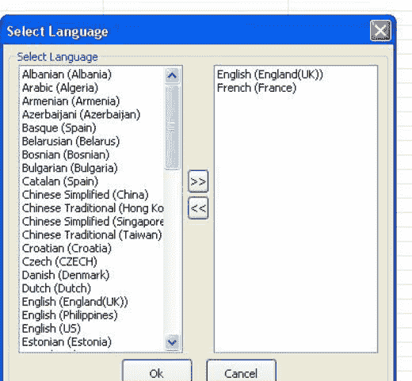

图 2.19 在 UI 构建器字符串表视图中添加新语言

你想要支持的语言。完成后，你会发现字符串窗口已更新，并为你选择的每种语言包含了一列。

> 为每种语言都会向项目添加一个包含本地化字符串表的 XML 文件。例如，英国英语字符串表名为`eng-GB.xml`，而法语字符串表名为`fra-FRA.xml`。

### 2.6.2 为每种语言添加文本

现在只需将出现在你 UI 中的字符串添加到你支持的每种语言的字符串表对应列中即可。例如，在图 2.19 所示，我们正在为用户界面中显示的每个字符串添加英语和法语版本。为每种语言添加相应的文本，bada 将根据用户的语言设置选择正确的版本。

接下来，你需要确保表单标题或按钮控件文本等在每种语言下都能正确显示。你需要做的只是为每个字符串资源添加本地化文本，并使用 UI Builder 确保控件使用字符串资源作为其标题或文本。图 2.20 展示了如何操作。

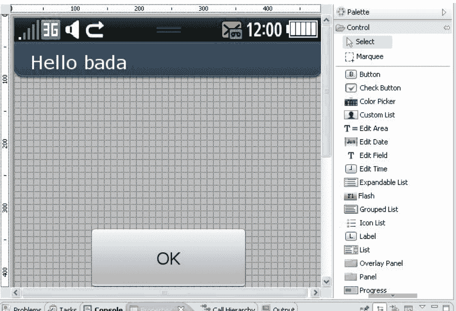

图 2.20 使用 stringID 作为表单标题：bada 将选择正确的本地化字符串

在图 2.20 中，我们将表单标题设置为“bada”。如果用户将语言设置为法语，表单标题将自动设置为“Bonjour bada”。如果未找到本地化字符串，则使用英语字符串。

### 2.6.3 在代码中使用字符串资源 ID

为了充分利用 bada 的多语言支持，不要在代码中硬编码字符串。硬编码字符串在多语言环境下难以追踪和更新，因此，应从资源中读取字符串，如下代码所示：

bada 简介：开发者指南 -（草稿预览，2010年7月）

```
Application* pApp= Application::GetInstance();
String strl;
r = pApp->GetAppResource() ->GetString("_IDS_STRING1", strl);
```

`strl`的值是从资源文件读取的而非硬编码。如果你为每种语言设置了不同的字符串，将根据用户的语言设置选择合适的字符串。

## 2.7 从构思到发布 App

如果你有一个突破性的 bada App 创意，只需通过以下三个步骤：

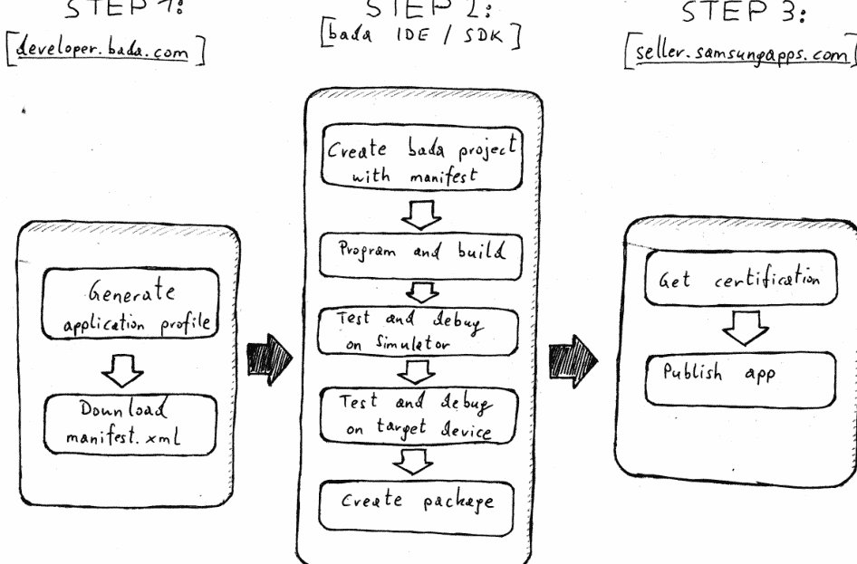

图 2.21 在 SamsungApps 发布你的 App 的步骤

### 步骤 1：在 developer.bada.com

在 developer.bada.com 注册并下载 IDE 和 SDK；你加入了 bada 开发者计划。这允许你访问许多资源，如文档、API 参考、代码示例、博客、视频或支持论坛。

### 生成 application profile 和 manifest.xml

在本节中，我们关注自定义配置（custom profile），它应该是你项目的起点，因为它允许你定义 App 的功能以及它所需的硬件特性（例如屏幕尺寸、传感器、默认方向）。门户还会检查你的 App 名称是否全局唯一，并分配一个 App 用于保护私有资源的唯一 ID。

在 2.1 节中，我们简要查看每个 App 项目必须包含的两个数据文件：`application.xml`和`manifest.xml`。这些声明了 App 信息——如名称、版本以及关键的安全权限。`application.xml`的配置由 IDE 处理。门户有助于建立`manifest.xml`。

要创建 manifest 文件，前往 developer.bada.com 门户并点击“My Applications”（我的应用程序）。然后调用左侧的 Application Manager。你可以开始生成应用配置。图 22 显示了网站上的五个简单步骤。

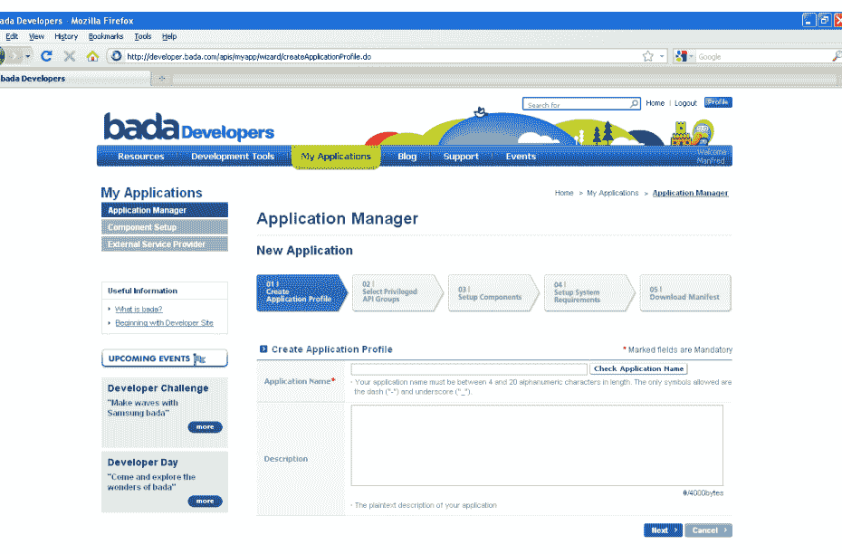

### Application Manager

新应用程序

| D01 创建 Application Profile | D02 选择 API 组 | D03 设置组件 | D04 设置系统要求 | D05 下载 Manifest |
| --- |---|---|---|---|

- 创建 Application Profile

| Application 名称 | 标记字段是必填的。App 名称长度在 4 到 20 个字符之间。允许的字符是 (a-z) 和下划线 (_) |
| 描述 #403D207 |
| 描述的 |

首先给你的 App 起一个名称。其次你定义主要功能。第三你指定手机硬件要求。最后你可以下载。

bada 简介：开发者指南 -（草稿预览，2010年7月）

manifest 通常包含如下：

```xml
<?xml version="1.0" encoding="utf-8"?>
<Manifest>
  <Id></Id>
  <Secret></Secret>
  <AppVersion></AppVersion>
  <Privileges>
    <Name>IMAGE</Name>
  </Privileges>
  <DeviceProfile>
    <CPU>Cortex-A8</CPU>
    <MinimumHeapSize></MinimumHeapSize>
    <MinimumVRAMSize></MinimumVRAMSize>
    <Accelerator3D>OpenGL-ES1.1</Accelerator3D>
    <Accelerator3D>OpenGL-ES2.0</Accelerator3D>
    <BluetoothProfile>OPP</Profile>
    <BluetoothProfile>SPP</BluetoothProfile>
    <WIFMode>Infrastructure</WIFMode>
    <WIFMode>Ad-hoc</WIFMode>
    <Sensor>GPS</Sensor>
    <Sensor>Accelerometer</Sensor>
    <Sensor>Magnetic</Sensor>
    <Sensor>Proximity</Sensor>
    <InputDevice>Touch</InputDevice>
    <ScreenSize>480x800</ScreenSize>
    <SoundMixing>Enable</SoundMixing>
    <APIVersion>1.0</APIVersion>
  </DeviceProfile>
</Manifest>
```

在这里，第一个属性是基础应用信息。虽然`<Id>`和`<Secret>`都出现在代码中，但框架负责处理它们。ID 是一个随机唯一的数字。Secret 与你的 App 唯一关联。

那么最有趣的是`<Privileges>`属性及其`<Privilege>`子属性。在上面的 manifest 文件中，指定了单个权限：

```
<Privileges>
  <Privilege>
    <Name>IMAGE</Name>
  </Privilege>
</Privileges>
```

这里的声明格式是直观的 XML；`<Privileges>`是一个属性，包含一个`<Privilege>`子属性列表，每个属性都使用`<Name>`子属性声明，在此例中为`<Name>IMAGE</Name>`。

权限（Privileges）声明了 App 提供的功能。如果没有声明适当的权限，当 App 尝试使用未声明的权限 API 时，运行时将抛出异常。

比起如何声明权限，更有趣的是它们的含义和作用。权限对于 bada 确保隐私（例如）的安全机制至关重要。你可以在第 6 章找到关于 bada 权限模型的信息。

manifest 文件中的下一个 XML 标签是`<DeviceProfile>`。它声明了应用程序的最低系统要求。所有内容都是根据开发者提供的信息自动生成的。

你可以通过生成 manifest 的相同方式来更新它，即使用门户工具。

> 如果你喜欢，可以将“属性”（attributes）称为“属性”（properties）。

### 第 2 步：在 bada IDE/SDK 中

使用清单文件创建 bada 应用

在将清单文件下载到硬盘后，你可以像之前描述的那样创建一个 bada 应用项目。在向导（Wizard）中，你将到达选择清单文件的步骤，此时你应该取消勾选默认项，并让向导指向硬盘上刚刚下载的`manifest.xml`。另一种选项是——如果你已经有一个带有现有清单文件的项目——只需用新文件覆盖旧的清单文件即可。

### 编写与编译

获取应用的下一个最佳方法实际上是思考你的逻辑并进行编程。当你认为应用已处于可运行状态时，就可以像之前描述的那样在 IDE 中构建你的 bada 项目。

### 在模拟器上进行测试和调试

一旦你的应用完成编译并可以在无错误的情况下构建，你就可以开始在模拟器中运行它并进行测试。模拟器对于测试代码的原理正确性非常有用。传统上，模拟器的行为与真实移动设备之间存在巨大差异。由于上下文密集型真实世界测试的重要性，无论如何都必须在移动设备上进行测试。bada 模拟器与真实设备非常接近。此外，bada 模拟器还提供了一个额外的工具来调用事件注入器（Event Injector），向模拟器注入各种类型的传感器事件。事实上，其他事件也可以注入，包括电话、、消息事件、网络事件以及低电量或低内存等设备事件。这非常有帮助，并使测试变得更加高效，因为许多真实世界的测试可以转移到成本更低的模拟器测试中。

可以模拟以下事件：

- 接入来电
- 网络特性和质量（例如：服务级别、漫游或网络代码）
- 文本信息、WAP 推送和推送通知的传输
- 通过在地图上选择或显式插入的位置数据（纬度和经度）
- 各种传感器，如加速度计、GPS、磁力计、倾角、接近传感器或天气传感器
- 设备事件，如内存或电池电量

bada 运动传感器是一个逻辑传感器，基于板载硬件传感器的复合数据。运动传感器可以检测用户对手机进行的定义的动作：

### 快速移动 (Snap)

手机在 X、Y 或 Z 任意一个维度上进行快速、单次的往复运动。在横屏和竖屏模式下，每个轴都会识别出三种不同的事件。

### 摇晃 (Shake)

手机快速、重复的侧向移动

### 双击 (Double tap)

在手机外壳的任何侧面双击

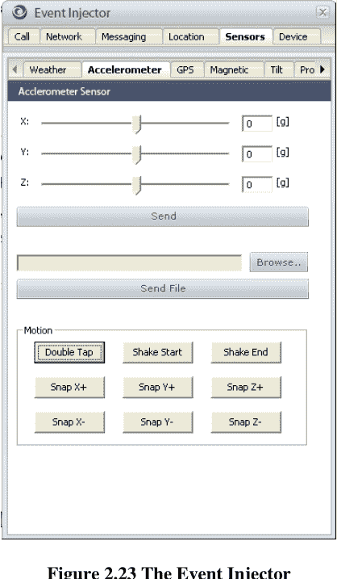

**注意：实际上，模拟器是 bada 平台的完整构建版本，为运行在桌面操作系统之上进行了定制，具体为 Microsoft Windows 托管 SDK 中的 Win32，而不是移动操作系统。**

当然，你的应用可能从一开始就没运行得并不完美。其中可能存在 bug。bada IDE 支持 GNU 项目（GDB），它允许你使用软件代码调试的所有功能，例如设置断点、进入、跳出或跳过方法，或监视变量。接下来的图片说明了如何调用调试并显示 IDE 的调试视图（Debug perspective）。

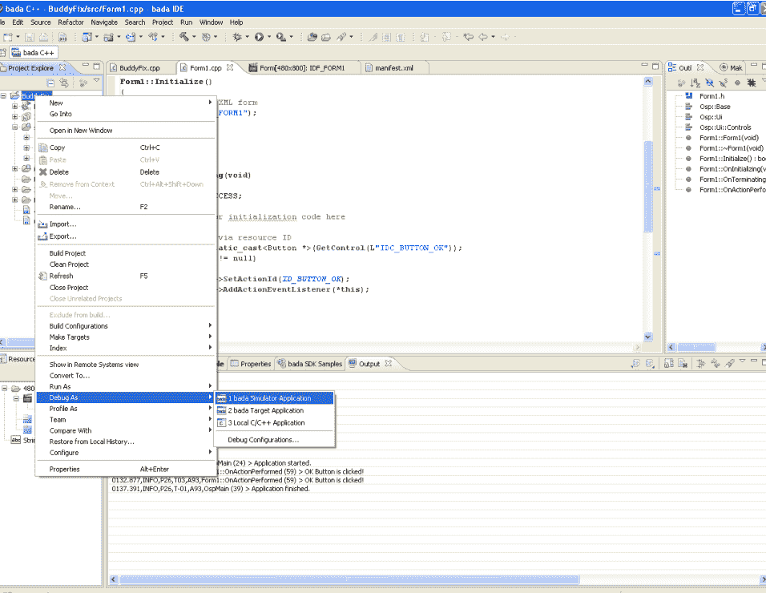

图 2.24 在 bada IDE 中调用 GDB

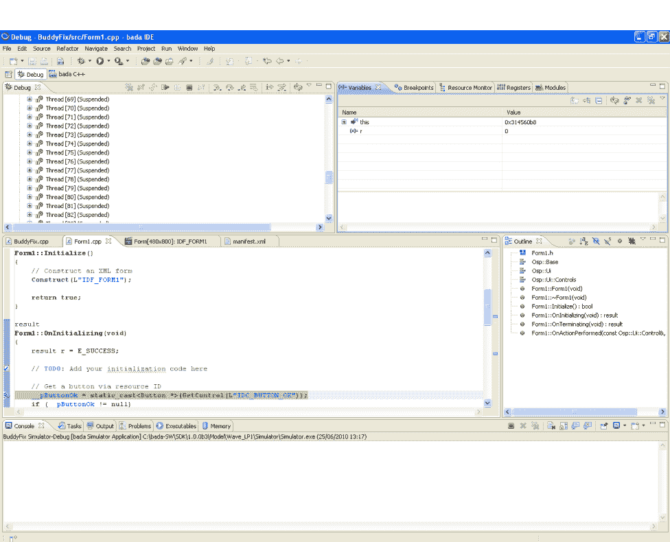

图 2.25 bada IDE 的调试视图

## 在真实目标设备上进行测试和调试


为 bada 这样的移动平台开发与桌面端更传统的应用开发世界之间的明显区别在于，开发环境与执行环境并不相同。理解并测试上述描述的移动应用模拟器是非常有用的。但最终你真的会想知道你的应用在真实的移动手机上表现如何。

回到时光机，移动平台曾是极其困难的。但 bada 展示了事情进步了多少。某些平台仍然带有遗留问题——例如，Symbian 奇特的构建系统。事实上，这些都构成了移动平台与众不同的一部分，并使其开发工作以困难而闻名。

在编写本文时，第一款 bada 手机已经发货——三星 Wave，这是一款功能完备的顶尖手机，定义了 bada 产品线的高端。最终，bada 手机将从这个高点向下延伸到价格适中的“人人拥有的智能手机”市场，将智能手机功能推向大众市场。

在 Wave 设备上构建并部署 bada 应用之前，你需要在桌面操作系统中安装 Wave 驱动程序。这些设备驱动程序是从 `developer.bada.com` 门户下载的 IDE/SDK 包中提供的简单可执行文件。

如果成功完成，你需要复制并安装测试根证书（Test Root Certificate），这在设备上测试应用是必须的。没有这个证书，无法在 Wave 上安装、运行和测试应用。

### 第 3 步：在 seller.samsungapps.com 网站

完成所有这些操作后，当你将你的想法实现为一个已构建、运行、测试并打包的应用程序时，你距离大名利收或两者兼顾只有一步之遥。最后一步是对你发布的应用进行认证。

### 获取认证

要获取认证，你需要访问 `seller.samsungapps.com` 网站。在那里，你可以使用与第一步中 `developer.bada.com` 门户相同的账户登录。登录后，主屏幕将如图 2.31 所示。

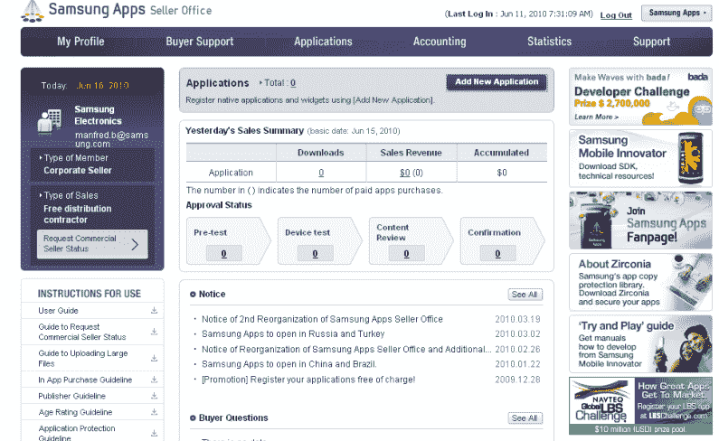

图 2.31 首先从点击顶部的“添加新应用程序（Add New Application）”按钮开始。然后，网站将引导你逐步完成提交应用以进行认证的必要步骤。

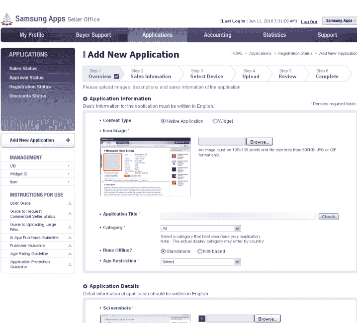

图 2.32 将你的应用程序添加到卖家中心（Seller Office）

完成流程后，你的应用将提交认证。应用将经过测试，以确保其功能性和非功能运行正常，并符合质量标准（例如可用性）。我们的目标是在七个工作日内完成 QA 并向你提供反馈。

### 发布应用

当你的应用通过认证后，它将发布供下载。在认证上传过程中，你可以设置价格或地理市场等标准。所有应用都可以通过 `samsungapps.com` 访问，或直接下载到你的手机。管理应用和下载的一种方便方法是桌面软件 Samsung Kies，你也可以从 `samsungapps.com` 的 SamsungApps Store 获取它。

# 第 2 部分

## 第 3 章：超越基础

目前为止，BuddyFix 只是一个外壳。在本章中，我们开始扩展它。在扩展过程中，我们将学习更多关于应用如何与 bada 框架交互，以继承它们的运行时架构和 GUI 视觉效果。我们还涵盖了每个 bada 开发者都需要了解的一些核心主题，包括 bada API 权限和安全模型。

### 你将学到

本章展示了在你开始构建应用程序功能时，如何超越应用向导（App Wizard）骨架。你将学习到：

- bada 应用如何与应用程序和 UI 框架交互

- 运行时应用生命周期

- 如何为手机构建并部署应用

- bada 开发者提供的开发者服务和发布服务

### 你需要什么

本章的重点仍在于实践和实操。请在面前准备好你自己的代码，并手拿 bada 参考文档以检查 API 详情。

## 3.1 扩展应用程序骨架

我们已经看到在 bada 中启动一个项目是多么简单；向导会为你完成艰苦的工作。现在，让我们深入研究代码。

让我们从梳理在 `buddyfix.h` 中定义的 BuddyFix 类开始（这是应用向导为我们生成的代码）：

```
class BuddyFix :
public Osp::App::Application,
public Osp::System::IScreenEventListener
```

每个应用都继承自 `App::Application` 类，因此当你创建自己的应用并派自 `Application` 时，你实际上扩展了一个你已经熟悉的 bada 框架类，并带有你指定的自定义行为。框架期望的所有方法存在于你的派生类中。你会发现你的应用还继承自 `System::IScreenEventListener` 类；“I”代表“接口（Interface）”，这是我们经常看到的模式之一。

接下来，我们看到声明的公共成员：

```
public:
static Osp::App::Application* CreateInstance(void);

public:
BuddyFix();
~BuddyFix();
```

`CreateInstance()` 是一个所谓的工厂函数，它封装了 C++ 构造函数，并在调用时返回应用程序的实例。紧随其后的两个声明是 C++ 构造函数和析构函数方法。由于这三个函数的默认实现都能满足我们的需求，所以这里不需要担心。完成该类的剩余公共声明是我们感兴趣的：

```cpp
public:
bool OnInitializing(Osp::App::AppRegistry& appRegistry)
bool OnTerminating(Osp::App::AppRegistry& appRegistry,
bool forcedTermination = false);
void OnForeground(void);
void OnBackground(void);
void OnLowMemory(void);
void OnBatteryLevelChanged(Osp::System::BatteryLevel batteryLevel);
void OnScreenOn(void);
void OnScreenOff(void);
```

我们将这些称为“生命周期（lifecycle）”方法；每个应用都有这些方法，且每个应用必须实现它们。框架提供了一个最小的实现，但正如我们所看到的，这些方法对于定义应用的行为及其能力至关重要。

### 3.1.1 驱动机制

bada 应用是完全由驱动的；它的行为是对框架事件的响应。这些事件包括面向用户的事件（如触摸、（硬）事件）以及面向系统的事件（如定时器、通知和消息）。选择监听哪些事件取决于你希望应用程序如何运行，取决于框架的机制。

### 3.1.2 运行时生命周期

在 bada 中，生命周期非常简单。你可能识别出这是一个状态机：初始化（Initializing）、运行（Running）、终止（Terminating）或已终止（Terminated）。在任何时刻，你的应用都可以处于这些状态之一。严格来说，只有这四个方法与生命周期具体相关；其他方法（如 `OnLevelChanged()` 和 `OnScreenOff()`）则是响应由条件触发的事件。

### 3.1.3 初始化

当应用被 bada 框架启动时，它会进入初始化状态并调用其 `OnInitInitializing()` 方法。查看 `BuddyFix.cpp` 中的实现；回想我们更新了应用向导生成的代码以加载我们自己的 `pMainListForm`，否则将是默认实现：

```cpp
// 自定义以加载 IDF_MAIN_LIST_FORM

BuddyFix::OnAppInitializing(AppRegistry& appRegistry)
{
    // 初始化 UI 资源和应用程序特定的数据。
    // 可以从 appRegistry 获取应用程序的永久数据和上下文。
    // 如果此方法成功，返回 true；否则返回 false。
    // 如果此方法返回 false，应用程序将终止。
    // 取消下语句注释以监听屏幕开关事件。
    PowerManager::SetEventListener(*this);

    // 创建一个表
    // 替换为 Form1 *pForm1 = new Form1();
    MainListForm *pMainListForm = new MainFormForm();
    // 替换为 pForm1->Initialize();
    pMainListForm->Initialize();
    // 将表添加到帧
    Frame *pFrame = GetAppFrame()->GetFrame();
    // 替换为 AddControl(*pForm1);
    pFrame->AddControl(*pMainListForm);
    // 设置当前表
    // 替换为 pFrame->setCurrentForm(*pForm1);
    pFrame->setCurrentForm(*pMainListForm);
    // 绘制并显示表
    // 替换为 pForm1->Draw();
    pMainListForm->Draw();
    // 替换为 pForm1->Show();
    pMainListForm->Show();

    return true;
}
```

在此段代码中，当我们的应用启动时，我们：

1. 创建我们将要显示的默认 `Form`，将其添加到应用程序 `Frame` 中，并将其设置为当前 `Form`。

2. 对 `Frame` 执行 `Draw()` 和 `Show()`；通过这两个步骤，将 `Form`（以及包含的任何控件）渲染到逻辑显示器；然后更新物理帧缓冲区（这会更新手机屏幕，让你能够看到它）。

参数 `AppRegistry& appRegistry` 被传递给该方法，以避免你无需手动调用方法来获取它。在初始化时使用注册表的典型用途包括：

- 查找某种签名以告诉我们应用是否是首次运行，是否有我们想要执行的特定“首次运行”操作，例如邀请用户注册，或提供如昵称之类的默认数据，或者仅仅是为了打个招呼！

- 如果我们找到了签名，则恢复保存的偏好。

在这两种情况下，将任何代码限制在简单的快速标志设置上并在之后后再处理，这样我们加载的 `Form` 就可以被绘制并更新屏幕，我们可以继续启动；我们通过设置返回值来实现这一点：

```
return true;
```

这是非常重要的；如果值为 `true`，框架将我们的状态设置为 `Running`；否则，它将设置为 `Terminating`。

### 3.1.4 Running

如果 `OnInitializing()` 返回 `true`，我们的应用将进入 `Running` 状态。此转换没有关联生命周期方法——那么我们如何为此编写代码呢？

答案是我们不需要管理这种转换。我们的默认 `Form` 正在显示；我们的应用现在是前台应用程序。用户交互将导致 GUI 事件处理代码运行，例如我们编写了 `OnActionPerformed()` 来响应软键、菜单键和选项菜单选择。

至关重要的是，在 `Running` 状态下，我们区分前台（Foreground）和后台（Background）两个子状态。这两个状态对应两个方法：`OnForeground()` 和 `OnBackground()`。当应用启动并显示时，`OnForeground()` 被隐式调用。当按下 Home 键或调用原生应用（如来电或短信）时，运行的应用会被发送到后台。此时会调用 `OnBackground()` 方法，建议停止密集型操作并释放未使用的内存。一旦你的应用再次回到前台，你就可以正常继续。

回想 Ui builder 为我们的 `MainListForm` 添加的长长监听器列表——按键、触摸和多点事件以及焦点事件将导致所有监听器实现（回调）运行，以便我们恰当地处理事件。

当然，系统事件也会产生回调。正如我们所看到的，应该准备处理的最少系统事件集为：

- `OnBackground()`

- `OnLowMemory()`

- `OnBatteryChanged()`

- `OnScreenOn()`

- `OnScreenOff()`

这两个屏幕事件，正如你可能猜到的，是派自 `IScreenEventListener` 的原因。

对于如何为这些事件编写代码，并没有硬性规定。但显然，例如内存内存低时，你应该考虑释放你拥有的内存；如果电量变低，请节省电源并为突然的故障做好准备；如果屏幕关闭，那么更新显示没有意义，依此类推。

### 3.1.5 Terminating

你的应用可能会被用户终止；通常在 bada 中，应用没有“退出”软键或菜单选项，而是当用户按下电源/结束键时结束。你的应用也可能被系统终止，但这通常表示某种类型的严重错误。在任何情况下，当你的应用转换到 `terminating` 状态时，它的 `OnAppTerminating()` 方法会被调用，你应该准备好关闭；释放所有资源，并在相关时保存状态（但通常不是用户数据——用户数据应该在发生变化时始终被保存）。

当你的应用运行时，它将启动到 `Initializing` 状态，这就是它被终止与被放入后台的区别。

### 3.1.6 Terminated

你的应用不再运行。

### 3.1.7 关于框架的说明

框架的伟大之处在于它们让你的应用能够利用现成的行为。因为 bada 的语言是 C++，所以 bada 的框架使用 C++ 继承在框架和你的应用之间共享行为。如果你熟悉 C++，那么你可能知道（至少大致知道）它是如何运作的，但即使你不知道也没关系。原理很简单：框架声明了你的应用必须实现的方法；框架会调用这些方法，当它们调用时，你的实现代码就会运行。

bada C++ 框架使用派生和虚函数在框架本身与使用框架的应用之间共享职责。派生的框架基类提供了所有应用共享的常用行为的现成实现，以及在虚方法中定义的行为（可以可选地重写），以及在纯虚方法中定义的抽象行为（派生类必须提供实现）。

抽象类在 bada 中被广泛使用，特别是用于定义接口类。更多关于接口类以及如何使用它们的信息，请参见第 4 章。

> 注意：在 C++ 中，派生（即继承）是允许派生类共享基类行为的通用机制；具体来说，虚函数（动态绑定）允许派生类

（注：此处原文存在大量重复段落，已按要求处理，未重复翻译）

...框架声明了你的应用必须实现的方法... 

...派生的框架基类提供了所有应用共享的常用行为的现成实现，以及在虚方法中定义的行为（可以可选地重写），以及在纯虚方法中定义的抽象行为（派生类必须提供实现）。

（注：此处原文存在大量重复段落，已按要求处理，未重复翻译）

| `Draw()` | 将控件绘制到容器窗口的画布上，在所有情况下，这都是派自窗口的应用程序框架（Application Frame） |

| `Show()` | 将窗口画布内容复制到显示的帧缓冲区 |

| `RequestRedraw()` | 异步方法，调用 `Draw()` 和 `Show()` 并立即返回 |

| `OnDraw()` | 当通过 `RequestRedraw()` 请求绘制某个控件时，框架会调用此方法 |

下方显示了 bada 提供的一些标准控件（Controls），根据您在设计用户界面时可能需要的用户交互类型进行了分类。

# 简单按钮

| Button | ON |

| :--- | :--- |

| CheckButton | FColor |

| Label | Label |

这组控件用于用于通用按钮，为用户提供复选框选择，并在 `Label` 控件的情况下显示不可编辑的文本或图像。

# 选择器

| ColorPicker | |

# 日期选择器

DatePicker

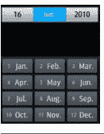

# 单选组

RadioGroup

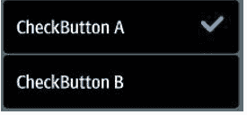

# 滑动块

Slider


# 时间选择器

TimePicker

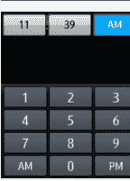

这些控件允许用户选择颜色、日期或时间；在 `RadioGroup` 的情况下，从选项列表中选择一项。滑动块允许用户从范围内选择一个值。

# 列表

Lists

# 自定义列表

CustomList

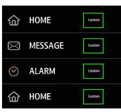

# 可展开列表

ExpandableList

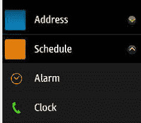

# 分组列表

Grouped

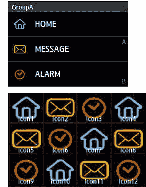

# 图标列表

IconList

在显示列表方面，bada 提供了很多选择，从图标列表列表到单个项目可以有不同布局的 `CustomList`。我们在 BuddyFix 中使用简单的 `List` 来显示好友列表。

# 可编辑控件

EditDate

| 16 | Jun. | 2010 |

EditField

| EditField | |

这些是用于文本和日期的输入控件。您还可以使用上方未显示的 `EditTime` 和 `EditArea`。

# 进度和弹窗

Progress


这些是向用户显示信息的类。`Progress`为用户提供操作完成所需时间的反馈。`Popup`提供了一个可以显示在表单（`Form`）或框架（`Frame`）之上的窗口。

# 面板

| `ScrollPanel` | |
| --- | --- |
| Second Label | Button |

面板（`Panel`）是一种包含其他控件的控件。`ScrollPanel`提供了一个可滚动区域（注意控件右侧的滚动条），上面的图片中包含一个标签和一个按钮。`OverlayPanel`控件用于显示视频或摄像头预览。

# 动画和 Flash

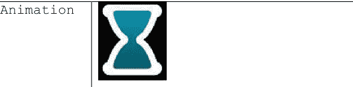

`Animation`控件设计用于播放一系列动画帧（`AnimationFrames`）。您还可以使用`Flash`控件播放嵌入应用程序的 Flash Lite 内容。

### 3.2.3 更多关于 Frame

每个应用程序都可以访问其`Frame`，它抽象了一个可绘制的、全屏尺寸的窗口。`Frame`负责处理其包含的所有控件的标准窗口行为，例如合并绘制区域、标记区域为无效、裁剪、捕获并级联事件等。

注意：`Frame`派生于`Control`、`Container`和`Window`。

在大多数情况下，您的应用可以放心地让`Frame`处理所有细节。极少（如果有的话）您需要考虑窗口行为，您通常只会使用像`Frame`这样的`Window`类。

由于`Frame`位于您的 GUI 层级结构的根部，获取`Frame`是初始化时设置 UI 的起点。在任何`Form`方法中，获取`Frame`都是很容易的：

```
Frame *pFrame = GetAppFrame()->GetFrame();
```

通常，`Form`不声明`Frame`指针；相反，它在需要时会动态分配`Frame`指针（上述示例中的`*pFrame*`）。

注意：虽然`Frame`位于应用程序中所有 GUI 元素逻辑层级的顶端，并且具有可显示属性——例如它的背景和透明度——但`Frame`本身只有在不存在`Form`时才会显示；用户看到的是应用程序`Forms`包含的 GUI 元素，或者在不使用`Form`的全屏应用中，用户直接看到渲染的图形。

重要的是记住，尽管`Frame`是派生自`Container`的，但它是`Container`的一个特例；只有一种控件类型可以使用`AddControl()`方法添加到`Form`中，该方法是从`Osp::Ui::Container`重新实现的：

```
Osp::Ui::Frame::AddControl( Osp::Ui::Control* ) [virtual]
Osp::Ui::Frame::RemoveControl( Osp::Ui::Control* ) [virtual]
```

`Frame`包含了许多可以操作`Forms`的方法：

- `AddControl()`
- `RemoveControl()`
- `GetCurrentForm()`
- `SetCurrentForm()`

一个需要多个屏幕的应用程序应该定义多个`Form`。在屏幕之间导航的最简单（但不是唯一）架构是标签页`Form`，允许用户通过选择标签来切换。在 UI 代码中，应该实现一个`Form`管理器来处理标签选择，使用上述“get”和“set”方法。`Frame`可以通过在其`Canvas`上渲染图形来直接创建非标准 GUI，而不是填充控件。这种方法通常用于游戏和其他全屏应用。

### 3.2.4 更多关于 Form

除了全屏应用（即 App Wizard 所说的基于`Frame`的应用程序）外，`Form`是 GUI 设计的起点。像`Frame`一样，`Form`是全屏尺寸的容器。与`Frame`不同，`Form`可以包含任何控件类的实例（`Frame`除外），且`Form`本身不能包含`Form`。

正如我们在上一节中看到的，因为它封装了整个屏幕，`Frame`包含了指示器（`Indicator`）、标题栏以及软键。

此外，bada UI 框架允许`Form`通过启动屏幕底部的`Option`来显示或添加它们。在 BuddyFix 中，我们将使用`Options`菜单提供全局选项，如管理设置以及添加和删除好友。由于`Option`和`Soft Keys`是`Form`的属性，通过在 UI Builder 中更新`Form`属性来添加很容易，但值得考虑预期的交互语义。在 BuddyFix 中，我们可能会分配给软键的动作包括：

- 添加好友
- 取消正在进行的操作（例如在设置或更改设置时）
- 返回上一个屏幕，对于单屏应用，这意味着返回手机主界面
- 暂停或取消所有好友的位置共享
- 向某个好友发送提醒（`Nudge`）

一个好的规则是将软键留给频繁使用或我们希望突出的动作。现在，“添加（好友）”和“提醒（好友）”将是一对很好的组合。

让我们更新`Form`属性，保存资源，重新构建并运行：

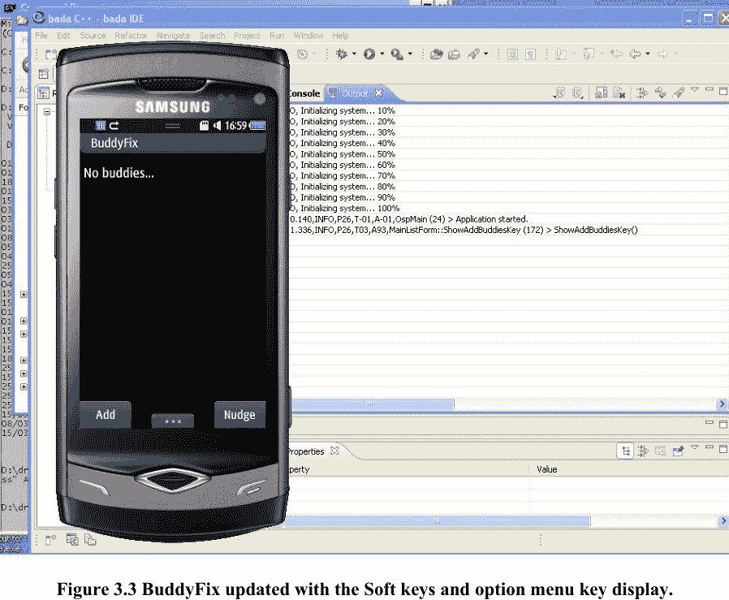

UI Builder 只能带我们到这里。在`Option Menu`中添加菜单项（如在好友列表中添加项）需要我们编写一些自定义代码。

## 3.3 使用图形

有效使用图形是为用户创建良好 GUI 体验的重要部分，bada 提供了丰富的矢量图形（绘制）、位图、动画和字体支持，并直接支持 OpenGL ES。

# bada 简介：开发者指南 - (2010年7月草稿预览)

在 bada 中：

- 所有的图形都绘制在`Canvas`对象上
- 在任何时候都可以构造一个全局`Canvas`，它可以在布局层次结构之外进行绘制
- 每个`Control`（控件）都拥有一个本地`Canvas`，该`Canvas`可以被请求并在其上绘制，且在布局层次结构内部绘制

### 3.3.1 更多关于 Canvas

`Canvas`类允许直接访问设备显示进行绘制。每当你想要直接绘制图形原语（如`Line`线、`Rectangle`形、`Ellipse`圆、`Polygon`多边形，以及用于文本的`TextElement`和用于图像的`Bitmap`，它们都是`Osp::Graphics`命名空间下的成员）时，你必须使用`Canvas`。

你可以从 GUI 的任何地方显式地构造一个普通的（全局）`Canvas`对象：

```cpp
// 构建一个“普通”或全局画布
Canvas* pCanvas = new Canvas();
pCanvas->Construct();
```

请注意，`Canvas`总是通过两个阶段构造的：首先通过`operator new`分配内存，然后通过`Construct()`进行初始化（参见第 4 章“两阶段构造”）。

普通的`Canvas`会覆盖应用程序的`Frame`（帧）并绕过窗口（及`Control`）层次结构，提供对显示器的直接访问并覆盖显示区域内的任何内容（包括当前的`Form`及其包含的任何`Controls`）。如果在构造时未指定矩形，则普通`Canvas`为全屏尺寸。

这意味着`Canvas`可用于设置全屏背景图像。（请记住，`Frame`和`Form`都允许设置其背景颜色，但不会加载图像作为背景。）

一旦绘制了`Canvas`，任何随后的`Draw()`调用将覆盖它，从而允许`Controls`（例如）在其上方绘制。然而，这种稳健性取决于你代码中`Draw()`用的顺序，因此请谨慎使用。

使用`Canvas`的更典型方法是在窗口和控件层次结构内操作（因此不会有意外覆盖其他 GUI 元素的风险），方法是请求一个本地的“窗口”`Canvas`对象。从`Form`到整个`Control`层次结构的每个`Control`派生对象都拥有一个窗口`Canvas`对象：

```cpp
// 获取窗口画布
Canvas* pCanvas = GetCanvasN();
```

在这种情况下，`Canvas`与其所属的`Control`共享上下文，包括其显示区域以及本地图形上下文设置的任何其他属性。通常，调用者设置任何所需的显示属性并进行绘制，允许`Canvas`在给定的`Canvas`内直接向屏幕绘制原语或位图，创建文本或其他图形。

`Canvas`并不是`Control`层次结构的一部分，实际上也不是`Osp::UI`命名空间的一部分；相反，它派自根类 bada `Object`类`Osp::Base::Object`，是`Osp::Graphics`命名空间的成员。

`Canvas`具有以下属性，你可以使用`SetForegroundColor()`、`SetLineWidth()`等方法在任何画布上设置它们：

| 前景颜色 | 原语绘制颜色 |
| --- | --- |
| 背景颜色 | 清除时的背景颜色 |
| 线样式 | 线条样式（仅支持实线`Solid`） |
| 线宽 | 具有线式的原语的线宽 |
| 字体 | 用于文本绘制的字体 |

> 注意：如果你在`OnDraw()`回调内部进行绘制，则应该在父容器控件上调用`GetCanvasN()`来获取容器正在使用的画布，否则控件的本地画布会被父容器覆盖，因为绘制始终通过容器拥有的控件列表从下而向上执行。

### 3.3.2 图形原语

如你所预期的，bada 提供了一套全面的图形原语。这些图形始终绘制在`Canvas`对象上。`Canvas`为绘制在其上的原语提供图形上下文，形式为如下所示的可设置`Canvas`属性。你可以在绘制代码的任何时候动态地设置和重置这些属性。你绘制的`Canvas`可以是你显式构造的，也可以是从适当的`Control`请求的。

`Point`、`Dimension`和`Rectangle`类用于构造各种图形原语。

### Point

一个由 X、Y 坐标组成的二维点。

### Dimension

一个 (宽, 高) 的 X, Y 有序对。

### Rectangle

一个具有左上角点 (X, Y) 以及宽度和高度的矩形区域。

形状总是从左上角构造的，左上角是局部坐标系的 (0,0) 点。

### 简单形状和文本

对于形状和文本的简单绘制，所有工作都由`Canvas`完成。你不需要显式创建形状、线条或文本对象；相反，设置`Canvas`属性并调用`Canvas`对象的专用绘制方法，例如：

1. 构造画布：

```cpp
Canvas::Construct()
```

2. 清除画布：

```cpp
Canvas::Clear();
```

3. 将线条颜色设为红色：

```cpp
Canvas::SetForegroundColor(Color::COLOR_RED);
```

4. 在画布上绘制矩形：

```cpp
Canvas::DrawRectangle();
```

5. 将画布显示到屏幕上：

```cpp
Canvas::Show();
```

对于形状（如`Ellipse`、`Polygon`、`Rectangle`等），通过调用`Fill`方法而不是普通的`Draw`方法来设置填充属性，例如：

```cpp
Canvas::FillRectangle(const Color &color, const Rectangle &rect);
```

文本也可以以类似的方式绘制到`Canvas`：

1. 构造画布。
2. 构造一个具有样式和大小的字体：

```cpp
Font::Construct(FONT_STYLE_ITALIC, 32);
```

3. 清除画布。
4. 设置`Canvas`字体：

```cpp
Canvas::SetFont(font);
```

5. 在画布上绘制 "BuddyFix!"：

```cpp
Canvas::DrawText(Point(55, 55), L"BuddyFix!");
```

6. 将画布显示到屏幕上。

注意：文本也可以直接绘制到（但不是所有）控件类型中，例如文本标签`Label`，以及可编辑的`EditArea`和`EditField`。参见 API 详情。

### EnrichedText

`EnrichedText`为你对文本样式提供了更大的控制。简单的`Canvas`样式仅允许设置方向、下划线和删除线样式。

使用`EnrichedText`，你可以通过结合`EnrichedText`的整体样式（例如对齐和换行）以及每个`TextElement`的个体样式（例如字体样式和颜色）来完全指定文本样式。

| `EnrichedText`属性 |
| --- |
| 水平对齐 | 左、居中或右 |
| 垂直对齐 | 顶、中或下 |
| 文本换行样式 | 无、字符换行或单词换行 |
| 缩写 | 文本是否缩写 |
| 字体大小和样式 | 普通、粗体或斜体 |
| 文本颜色 | 的前颜色 |
| 背景颜色 | |
| 轮廓颜色 | |

`EnrichedText`仍然使用`Canvas`进行绘制，文本本身是显式创建并作为参数传递的：

```cpp
pEnrichedText->Construct(Dimension(width, height));
pCanvas->DrawText(Point(left, top), *pEnrichedText);
```

例如：

1. 创建一个`EnrichedText`：

```cpp
EnrichedText::Construct(dimension);
```

2. 设置`EnrichedText`的属性：

```cpp
EnrichedText::SetWrapStyle(TEXT_WRAP_CHARACTER_WRAP);
```

3. 为`EnrichedText`创建并添加`TextElement`：

```cpp
TextElement::Construct("01234567890123");
EnrichedText::Add(TextElement&);
```

4. 设置`TextElement`的属性，例如颜色和字体：

```cpp
TextElement::SetColor(Color::COLOR_BLUE);
TextElement::SetFont(font);
```

5. 构造并清除画布。
6. 显示`EnrichedText`：

```cpp
Canvas::DrawText(Point(10, 10), *pEnrichedText);
```

### 3.3.3 位图和图像

对于许多应用程序，显示和处理图像是一项基本需求：

- 图像可能纯粹用于 GUI 效果，作为背景图像、图案、图标等，显示在 GUI 控件内部（或作为完整背景）中
- 图像可能是应用程序的可显示数据的一部分，例如人物、地点或事物的缩略图

图像可能源自手机本身（通过相机或使用绘图/图像编辑应用），从内存卡上传或通过短连接（蓝牙）或电缆连接，通过网络下载。

# bada 简介：开发者指南 - (草稿预览，2010年7月)

通过网络（例如从 Flickr），或由开发者在构建时嵌入到应用中（UI 中使用的背景图像）。

在所有这些情况下，图像通常首先以数据文件的形式存在。²只要文件是支持的格式，它就可以被媒体播放器和浏览器应用查看。

在应用程序中使用之前，必须将图像数据从文件加载到内存中。手机内存中有的图像数据在传输出手机之前，或与手机上的其他人共享之前，通常应该保存为文件格式。

在 bada 中，`Bitmap`类封装了内存中的图像数据，而`Image`类作为一个工具类提供，用于在文件和`Bitmap`之间双向转换，以及不同文件之间的直接转换。使用`Image`类，可以将图像数据从支持的文件格式解码为`Bitmap`。`Bitmap`对象包含原始文件数据的（解码后）物理副本，存储在标准的位图格式中（见下文）。这意味着解码后，不再需要`Image`对象和原始图像文件。

从图像文件创建`Bitmap`的步骤如下：

1. `new`并`Construct()`一个空的`Image`对象：

```
Image* pImage = new Image();
pImage->Construct();
Bitmap* pBitmap = null;
```

2. 调用`Image.DecodeN()`方法从文件解码图像数据。`DecodeN()`返回一个`Bitmap`对象：

```
pBitmap = pImage->DecodeN(L"/Res/bada.png", BITMAP_PIXEL_FORMAT_ARGB8888);
```

3. 删除`Image`对象：

```
delete pImage;
```

> ² 这是一个简化。图像也可以作为二进制数据存储在字节缓冲区中。请参考 SDK API 参考。

4. 使用`Bitmap`对象并在不再需要时删除，例如：

```
pButton->SetNormalBitmap(Point(0,0),pBitmap);
delete pBitmap;
```

具体而言，`Image`类包含了处理图像的实用方法：

- 文件的编码/解码图像数据
- 在不同图像格式之间转换`Bitmap`或文件图像数据
- 压缩 JPEG 图像

解码图像数据支持以下文件类型：

- JPEG
- GIF
- PNG
- BMP
- TIFF
- WBMP

编码支持以下文件类型：

- JPEG
- PNG
- BMP

bada 支持三种不同的位图像素格式。位图像素格式指定符定义了目标位图的颜色模式，并接受以下枚举类型：

| RGB565 像素格式 | `BITMAP_PIXEL_FORMAT_RGB565` |
| :--- | :--- |
| ARGB8888 像素格式 | `BITMAP_PIXEL_FORMAT_ARGB8888` |


| 用于 OpenGL 的 R8G8B8A8 像素格式 | BITMAP PIXEL FORMAT R8G8B8A8 |

像素格式代表以下标准颜色模式：

- `RGB565` 16 位 RGB，带有 5 位红色蓝色和 6 位绿色
- `ARGB8888` 指定 32 位 Alpha RGB，每通道 8 位
- `RGBGB88A8` 是 OpenGL(R) 优的 32 位字节格式

请参阅 `FBitmapCommon.h`，它是 `Bitmap` 类所有枚举的头文件。

与图形原语一样，`Bitmaps` 表示像素数据，通过将 `Bitmap` 绘制到 `Canvas` 的区域并显示 `Canvas` 来呈现。

> 注意：图形库仅对具有 Alpha 通道的 `Canvas` 提供 Alpha 混合功能。

由于每个图像都有一个“真实”尺寸（创建时的尺寸），这可能与你希望在手机上显示的尺寸不一致，因此从图像文件解码支持图像缩放。其他变换（例如旋转）可以在图像绘制到 `Canvas` 时进行。

`Bitmaps` 还可以裁剪到 `Canvas` 的区域，这与调整和定位绘制它们的屏幕区域（区域必须是矩形）是一个独立步骤。

## 从文件创建位图

`FMedia.h` 是 `Media` 命名空间的头文件，包含 `Image` 类，而 `Bitmap` 定义在 `FGraphics.h` 的 `Graphics` 命名空间中。

所需的 `#include` 声明是：

```
#include FMedia.h
#include FGraphics.h
```

使用 `Media` 命名空间中的类需要 `FMedia` 库，而使用 `Graphics` 中定义的类（如 `Bitmap`）需要 `FGraphics`。

所需的命名声明声明：

```
using namespace Osp::Media;
using namespace Osp::Graphics;
```

权限级别为 NORMAL。

权限组为 IMAGE。

图像构造执行方式如下：

```
result r = E_SUCCESS;
Image *pImage = new Image;
r = pImage -> Construct();
if (IsFailed(r))
{
  // 处理错误情况
}
```

如果方法成功，`r` 包含 `E_SUCCESS`，否则包含错误状态。更多系统错误值请参见 `FBaseErrors.h`，它定义了所有的框架错误码。

`Image` 提供四个解码方法：

- 接收源文件字符串和目标位图指定符
- 不调整大小
- 保留原始比例
- 接收源文件字符串、目标位图指定符，以及输出宽度和高度
- 缩放为

# bada 简介：开发者指南 - (草稿预览，2010年7月)

接之前的代码片段：

```cpp
// 创建一个用于绘制的矩形，获取客户区域的边界
Rectangle rect = TopKeyboardViewForm->GetClientAreaBounds();

// 获取 Canvas 实例
Canvas *pCanvas = null;
pCanvas = pForm->GetCanvas();
// 如果我们使用 pCanvas 直接在 App 框架中显示，则我们获取 Canvas
with pCanvas = GetAppFrame()->GetCanvas();

r = pCanvas ->DrawBitmap(rect, *pBitmap);

if (IsFailed(r))
{
    delete pCanvas;
}

r = pCanvas->Show();
if (IsFailed(r))
{
    delete pCanvas;
}

// 您的后续代码 ...

delete pCanvas;
```

要将位图绘制到画布上，我们需要创建一个用于绘制的矩形。请注意，决定位图大小的是矩形的大小而非位图的大小。注意，在发生故障时必须删除 `Canvas` 对象。

## 3.3.4 颜色

最后，为了完成这项调查，我们将简要查看 `Color` 类。

虽然颜色值可能看起来不像 `String` 或 `Number` 类型那样具有通用相关性，但大多数应用程序——事实上是所有应用程序——都是定义颜色的图形类的客户端，每个应用程序开发者都应该对 bada 中如何使用和操作颜色有一个良好且通俗的了解。

手机已经从早期的单色（或绿屏、文本式）设备进步了很远，我们中至少有些人在移动开发职业的早期还记得那些设备。

事实上，三星是屏幕技术的领导者，并一直推动手机规格向高端发展，通过 HD（高 Definition）以及最近的 AMOLED（有机发光二极管）技术突破了新领域。像 Wave 这样的手机拥有物理尺寸大、像素密度高的屏幕，以及亮度、高对比度、外读的屏幕，色彩鲜艳夺目。

随着硬件图形加速和着色器支持的广泛可用，透明度、动画和全 3D 等 UI 效果现在手机屏幕上已成为可能，而这在几年前是不可想象的。

有趣的是，AMOLED 技术以一种令人惊讶的方式将设备显示引入了电源管理方程中。与标准 LCD 技术不同，OLED 使用主动像素，其功率需求取决于像素显示的色调。浅根地说，深色比浅色更省电（功耗更低），这意味着 UI 设计师可以将功耗加入到决定其应用程序调色板和颜色方案选择的因素列表中。

在 bada 中，颜色使用 ARGB 颜色模型定义，该模型使用 Alpha（即透明度）、红色、绿色和蓝色值。

> 注意：并非所有的图形对象都具有 alpha 通道。`Bitmap` 和 `Canvas` 都有，因此都支持 alpha 混合（alpha blending）。

`Color` 类提供了实用的内置函数，包括：

- 为 `Color` 对象设置或从其获取颜色分量，其包含所有 ARGB 或特定的颜色值（以及 alpha），以及 32 位颜色值
- 预定义的10 种颜色

所有颜色均为 32 位实体，支持 24 位“真色彩”或“百万色彩”显示，其中每个红、绿、蓝和 alpha 数据各占 8 位。如果设备显示支持较低的物理位深，则颜色将进行下采样，导致质量损失。顺便提一下，bada 手机上的像素始终是正方形的。

> 注意：bada 默认使用 32 位 ARGB 颜色。每个通道（ARGB）占用 8 位。然而，如果设备颜色仅支持 16 位，则 RGB 分别占用 5 位、6 位和 5 位。这意味着颜色经过了下采样。

## 3.4 重新审视 BuddyFix UI

正如我们所见，UI Builder 在创建功能性 UI 方面只能帮我们一步。特别是为了完成 BuddyFix 的基础 UI，我们需要：

- 实现“添加（Add）”软键
- 实现选项菜单（Option Menu）

此外，在我们对主列表及其项的布局做出最终决定之前，我们需要填充它的内容。

### 3.4.1 添加 OptionMenu

当用户按下屏幕底部命令区域的软键（也称为句柄）时，会弹出选项菜单，前提是该 `Form` 的样式 `FORM_STYLE_OPTIONKEY` 为 `true`。

每个 `Form` 都可以选择是否启用选项菜单，并且每个 `Form` 都可以定义属于自己的选项菜单。

UI 指南为设计选项菜单提供了一些准则：

- 软键功能不应在选项菜单中重复
- 菜单项的最大数量为 12 个，但首选列表为 8 个，4-6 个可能更好
- 菜单项可以有二级项，其首选列表为 4 个子项

`OptionMenu` 类通过 `Container` 派自 `Control`。构造和使用选项菜单的原则如下：

- 动态构造 `OptionMenu` 对象，通常在初始化将显示菜单的 `Form` 时进行
- 为选项键按压动作设置事件 ID 和监听器
- 创建菜单项并为每个项添加一个事件 ID
- 实现一个响应按键和菜单项事件 ID 的事件处理程序
- 删除 `OptionMenu` 对象，通常在终止将显示菜单的 `Form` 时进行

事件 ID 只是整数值。通常我们为按键事件分配 100，为第一个顶层项分配 101，为第一个子项分配 201，依此类推：

```cpp
static const int ID_OPTIONKEY = 100;
static const int ID_OPTIONMENU_ITEM_1 = 101;
static const int ID_OPTIONMENU_SUBITEM_1 = 201;
```

一旦设置了事件 ID 并添加了监听器，框架将对菜单上执行的操作返回事件 ID。

在 BuddyFix 中，我们将实现以下顶层菜单项和子项：

| 项 | 类型 |  |
|---|---|---|
| "Buddies" | 顶层项 | - |
| "Add Buddy" | 子项 | 向列表添加新好友 |
| "Remove Buddy" | 子项 | 从列表中删除好友 |
| "Pause sharing" (激活) 或 "Unpause sharing" (暂停) | 顶层项 | 全局暂停或恢复好友共享 |
| "Settings" | 顶层项 | 弹出设置 |
| "About" | 顶层项 | 弹出信息 |

让我们看看代码。首先在 `MainListForm.h` 中，我们添加 `OptionMenu` 指针和事件 ID 定义：

```cpp
class MainListForm : public Osp::Ui::Form
{
    // ...等
    // 菜单
    Osp::Ui::Controls::OptionMenu* pOptMenu;
    static const int ID_OPTIONKEY = 100;
    static const int ID_OPTIONMENU_ITEM_1 = 101;
    static const int ID_OPTIONMENU_ITEM_2 = 102;
    static const int ID_OPTIONMENU_ITEM_3 = 103;
    static const int ID_OPTIONMENU_ITEM_4 = 104;
    static const int ID_OPTIONMENU_ITEM_5 = 105;
    static const int ID_OPTIONMENU_SUBITEM_1 = 201;
    static const int ID_OPTIONMENU_SUBITEM_2 = 202;
};
```

接下来，在 `MainListBox.cpp` 中，我们添加构造和分配菜单对象的代码。通过将 ID 传递给项或子项的构造方法设置。我们需要调用两个 `Form` 方法：

```cpp
SetOptionKeyAction(ID_OPTIONKEY);
AddOptionKeyActionListener(*this);
```

`Form` 初始化代码所示。注意使用两阶段构造来分别分配和初始化 `OptionMenu` 对象：

```cpp
bool MainListBox::Initialize()
{
    Form::Construct(L"IDF_MAIN_LIST_FORM");

    // 创建选项菜单
    pOptMenu = new OptionMenu();
    pOptMenu->Construct();

    pOptMenu->AddItem("Buddies", ID_OPTIONMENU_ITEM_1);
    pOptMenu->AddSubItem(0, "Add Buddy", ID_OPTIONMENU_SUBITEM_1);
    pOptMenu->AddSubItem(0, "Remove Buddy", ID_OPTIONMENU_SUBITEM_2);
    pOptMenu->AddItem("Pause Sharing", ID_OPTIONMENU_ITEM_2);
    pOptMenu->AddItem("Unpause Sharing", ID_OPTIONMENU_ITEM_3);
    pOptMenu->AddItem("Settings", ID_OPTIONMENU_ITEM_4);
    pOptMenu->AddItem("About", ID_OPTIONMENU_ITEM_5);
    
    return true;
}
```

# bada 简介：开发者指南 - (草稿预览，2010年7月)

```cpp
pOptOptMenu->AddItem("About Buddy Fix!",ID_OPTIONMENU_ITEM_5);

// 在表单上调用而非菜单
SetOptionkeyActionId(ID_OPTIONKEY);
AddOptionkeyActionListener(*this);

return true;
```

由于我们已经分配了菜单对象，因此我们需要负责删除它。在 `MainListForm.cpp` 中：

```cpp
result MainListForm::OnTerminating(void)
{
    result r = E_SUCCESS;

delete pOptMenu;

return r;
}
```

最后，我们需要处理菜单动作生成的事件。在 `MainListForm.cpp` 中，我们在 `OnActionPerformed()` 方法中添加了处理代码：

```cpp
void
MainListForm::OnActionPerformed(const Control& source, int actionId)
{
    switch (actionId)
    {
        case ID_OPTIONKEY:
            ShowOptionMenu();
            break;
            // 菜单项
        case ID_OPTIONMENU_ITEM_1:
            // Todo: 在此处插入你的代码
            break;

        // ... 等
// 菜单子项
case ID_OPTIONMENU_SUBITEM_1:
// Todo: 在此处插入你的代码
break;
case ID_OPTIONMENU_SUBITEM_2:
// Todo: 在此处插入你的代码
break;
default:
break;
}
}
```

我们的实现已几乎完成。最后一步是添加方法来动态显示和隐藏菜单。隐藏菜单由框架执行，但在按下（或滑动）选项键时显示菜单则是我们的责任。在 `MainListBox.cpp` 中：

```cpp
void
MainListBox::ShowOption(void)
{
pOptMenu->SetState(true);
pOptMenu->Show();
}
//
void
MainListBox::HideOptionMenu(void)
{
pOptMenu->SetState(false);
Draw();
Show();
}
```

注意 `Draw()` 和 `Show()` 使用上的不对称性（异步性）。在 `ShowOptionMenu()` 中，是在选项菜单对象上调用了 `Show()`。

# bada 简介：开发者指南 - (草稿预览，2010年7月)

虽然我们要写的代码并不复杂，但实现起来并非易事。在一个使用了多个 `OptionMenuManager` 类的应用程序中，我们可能会选择将选项菜单代码提取到一个单独的菜单类，供所有表单（Forms）共享，每个表单请求其自己的可用菜单项和子项子集。

### 3.4.2 添加软键（Soft Key）

添加软键很容易。软键的行为与选项键完全相同。在 `MainListForm.h` 的 `MainListForm` 定义中，我们将一个软键 ID 添加为保护成员，就像我们对选项菜单做的那样：

```cpp
static const int ID_LEFT_SOFTKEY = 900;
```

在 `MainListForm.cpp` 的 `Initialize()` 方法中，我们添加了两行代码来设置软键动作 ID 和监听器，就像我们对选项键做的一：

```cpp
SetSoftkeyActionId(SOFTKEY_0, ID_LEFT_SOFTKEY);
AddSoftkeyActionListener(SOFTKEY_0, *this);
```

就是这样。为了捕获并处理软键事件，在 `MainListForm.cpp` 中，我们在 `OnActionPerformed()` `switch` 语句的顶部添加了一个软键分支：

```cpp
switch (actionId)
{
    case ID_LEFT_SOFTKEY:
        ShowOptionMenu();
        break;
    case ID_OPTIONKEY:
        ShowOptionMenu();
        // ... 等
    default:
        break;
}
```

### 3.4.3 填充列表

在向列表中填充某些内容之前，我们仍然无法看到应用的伙伴列表看起来什么样或行为如何。

由于我们只对 UI 行为感兴趣，我们将推迟其他复杂性，并编写一个测试方法用虚拟数据填充伙伴列表。这将允许我们测试列表功能并验证 UI 行为。

首先，我们想向列表添加一些数据，以便看到它的样子。

为了添加一个项，我们将编写一个方法 `TestAddItem()`，并将其作为 `MainListForm` 的一个保护方法。回想我们选择了如下格式：

`LIST_ITEM_DOUBLE_IMAGE_TEXT_FULLTEXT`，用于显示第一行的图像和文本，以及第二行的文本。

我们需要传递的参数是 `List.AddItem()` 需要的：

- *pText1* - 我们的第一行，即伙伴名称字符串
- *pText2* - 第二行的文本，即伙伴位置戳
- *pBitmap1* - 第一张位图，即伙伴图片
- *pBitmap2* - 未使用
- *itemID* - 允许我们标识此列表项的整数

这是我们要添加到 `MainListForm.h` 中的原型声明：


```cpp
// Implementation
protected:

// 向列表添加项的测试方法
result TestAddItem(const Osp::Base::String *aBuddyName,
    const Osp::Base::String *aLocationStamp,
const Osp::Graphics::Bitmap *aBuddyPic;
```

这是我们要添加到 `MainListForm.cpp` 中的存根实现：

```cpp
/*
 * 向主伙伴列表添加项的测试方法
 */
result
MainListForm::TestAdditem(const Osp::Base::String * aBuddyName,
  const Osp::Base::String * aLocationStamp,
  const Osp::Graphics::Bitmap * aBuddyPic)
{
  AppLog("TestAdditem()\n");
 return E_SUCCESS;
}
```

首先，我们需要创建一个位图对象提供给该方法。我们可以假设在最终实现中，位图和名称字符串将从联系人应用程序获取。

现在，我们需要自己提供位图。由于这是临时代码，我们将将其放入测试方法本身，并创建一个单一的虚拟位图用于验证我们创建的每个测试项。（因此原型声明会发生变化。）

使用位图和图像，在 `manifest.xml` 中：

```xml
<Privileges>
  <Privilege>
    <Name>IMAGE</Name>
  </Privilege>
</Privileges>
```

使用位图和图像，在 `manifest.xml` 中：

```xml
<Privileges>
  <Privilege>
    <Name>IMAGE</Name>
  </Privilege>
</Privileges>
```

## 4.2 bada 编码惯用法

### 4.2.1 C++ 与 bada

在所有当前主流编程语言中，C++ 是最强大且最灵活的。但这并不意味着它是最受欢迎的语言。事实上，在本书编写时，C++ 在流行度调查中稳居第三位，排在 Java 和 C 之后.^3 

C++ 不可能赢得流行度竞赛有其充分的理由。与较新的语言（例如 Python 甚至是 Java）相比，它的语法非常复杂。这有几个原因：其之一是它保留了 C 作为正规的语言子集；另一个是刻意决定倾向于简洁、紧凑（甚至是晦涩）而非冗长和透明。再有其者是该语言的广度——既支持高层也支持低层编程，以及其之间的所有内容；支持过程式、面向对象（OOP）和泛型（基于模板的）编程风格。最后，虽然上一点暗示了极扩张主义的目标（包含所有人！），但 C++ 对编程语言应该追求什么目标持有一种非常极简的观点。它的内置类型本质上就是 C 的类型，而语言在多程度上此结束了。语言本身不包含任何框架或类库。（即使是极简的 `std.h` 和 `stdio.h` 也是严格可选的）。

由于这些原因，C++ 并不是那种会手把手教你的语言。这可能让它拥有了比其实更令人畏畏的声誉。但也意味着任何基于 C++ 的平台必须驯服这种语言以适应自身的用途。

> ^ 例如，根据 TIOBE 编程社区指数软件调查，2010 年 4 月

http://www.tiobe.com/index.php/content/paperinfo/tpcci/index.html。有趣的是，2010 年 Java 和 C 在前两名中交换了位置，C 现在成为最流行的语言，而 Java 的流行份额与之持平。与此同时，PHP 正在一飞直上。对比一下：C 和 Java 的得分约为 20%；C++ 约占 10%；Objective-C 约占 2%。

### 4.2.2 原生系统

Bada 平台本身用 C++ 编写（所有框架、所有高层组件，当然还有 bada 类库），并带有一些低层 C 代码（低层组件、内核接口）。

Bada 的 UI、应用程序和应用程序服务框架，以及作为平台的一部分随手机出厂的一系列原生应用，全部采用 C++。而应用开发者开发的正是这些框架和类库。

### 4.2.3 原生的替代方案

那么，在 bada 上，原生（native）意味着 C++ 开发。然而，应用开发者还有其他选择，例如使用 Flash 和 WebKit 等运行时环境，只要非原生性能带来的（相对）代价是可以接受的。（通常情况下，关键变量是应用的类型——侧重于用户输入或以文件为中心的应用是糟糕的候选者，而内容浏览器（浏览器）通常是良好的候选者。）当不需要访问完整的原生平台、当现有资产已使用跨平台技术编写、或者当跨平台使用是首要需求时，这些选项就变得很有意义。

在 bada 上有许多可能性：

- Flash 引擎在底层与原生图形架构完全集成，使得 Flash 成为图形密集型应用的完美选择（事实上，bada 本身将 Flash 作为系统组件使用，允许用 Flash 编写手机 UI，使其能够无缝移植到三星产品中的多个不同系列手机中，跨越从 Symian 到 WinMo 再到 Android 和 LiMo 的各种操作系统）。

- WebKit 也得到了完全支持。bada 原生的 Dolfin 浏览器基于 WebKit，支持 HTML 4.0.1 和 HTML 5。

这使得 bada 为应用开发者提供了丰富的选择，无论是作为现有应用迁移的目标，还是作为新应用的目标。

### 4.2.4 C++ 陷阱

回到原生开发，C++ 环境是现代、直观且全面的。它由标准的、开源工具支持，包括 Eclipse IDE 和 GNU/CodeSourcery C++ 编译器 ^44

在受限设备上使用 C++ 的陷阱是众所周知的。在如今 1 GHz 处理器和数 GB 内存的时代，移动平台是否仍然可以被视为受限（至少按照旧定义的标准）是值得的。（参见 Wave 规范）。

答案是，相对于桌面端，移动端在从 CPU 能力到可用 RAM 以及屏幕尺寸和网络带宽的所有方面都是完全受限的。

此外，移动端也存在*绝对*的限制。我们不再赘述所有的差异（我们已经在第 1 章看过了），但在以下方面，移动端资源至关重要：

- 内存——大小和速度（例如：闪存，无硬盘）

- CPU

- ROM

- 电池/电源

- 网络带宽

C++ 的力量和灵活性是需要代价的。最关键的问题是：

- 内存管理，应用程序必须自己管理内存，而那些提供垃圾回收机制来回收不再使用的分配内存的语言不同。

> ^4 源自 C http://www.codesourcery.com -- Sourcery G++

# bada 简介：开发者指南 - (草稿预览，2010 年 7 月)

- 异常处理，C++ 标准异常机制在内存占用和处理器周期上来说是昂贵的。

- 缺乏原生字符串和数组类型

C 和 C++ 程序的大多数运行时失败（崩溃）都是由同类常见的编程错误引起的：内存分配错误、指针错误和索引错误。大多数运行时失败（崩溃）具体是由于数组错误。

这一简单事实正是许多人选择 Java 的动力：数组和字符串的原生类型，以及自动垃圾回收。然而，Java 强加的在桌面端似乎可以接受的运行时在移动端是不可接受的。移动用户无法接受数据丢失、调用卡死或 Bug 软件带来的其他困扰。

为了提供最佳体验——即健壮不崩溃的应用——bada 通过限制 C++ 特性的使用对开发者施加了一些限制：

1. bada 的平台代码使用两阶段构造（尽管对你定义的类不强制执行）

2. 支持一种简单的所有权策略：应用程序*始终*负责删除其分配的内存（每个 `new` 调用必须有相应的 `delete` 调用），并且应用程序*必须*删除从以 N 结尾的平台方法返回的对象，例如 `SearchN()`；在所有其他情况下，平台负责删除对象。

3. 不建议使用原生字符串，平台提供了专门的字符串类类

4. 不建议使用原生 C++ 数组，平台提供了专门的数组类

5. 不支持标准 C++ 异常，相反 bada 有自己的轻量级异常模型。

### 4.2.5 原生惯用法和类型教程

是时候回到实践了。

当你查阅 SDK 和示例中的 bada 代码时，你会看到原生类型在真实场景中的应用，当然，你也需要在它们自己的代码中使用它们。

以下简短的教程将帮助你快速掌握 bada 不同之处，并在你深入探索平台时作为有用的参考。你可能想要收藏这些页面。

### 4.2.6 对象构造问题

在 C++ 中，与 C 一样，运行时内存分为：

- 静态内存，由编译器分配，是应用程序二进制文件的一部分

- 栈内存，由操作系统在运行程序的函数激活帧创建和释放时在运行时进行分配和释放

- 堆内存，根据程序请求动态分配和释放

内存泄漏发生在程序分配了堆内存但未能释放时。由于手机手机通常运行几天或更长时间而不关机，内存泄漏会严重损害手机性能。由于（相对于桌面端），手机的 RAM 小得多，而且（从绝对角度来看），由于手机的和物理尺寸限制，内存技术（例如闪存文件系统）很慢，这个问题变得更加严重。

53

# CUDA 简介：开发者指南 - (草案预览，2010年7月)

遗憾的是，在 C++ 中，确保内存不泄漏的问题比 C 语言要复杂得多，这不仅仅需要程序员的自律（即：确保每一次分配都有对应的析构释放）。

在 C++ 中，堆内存的分配可以通过程序员显式调用 `operator new` 或 `new[]` 来完成，也可以由编译器作为 C++ 对象创建的一部分隐式完成。

与 C 不同，在 C 中，每个运行时对象要么在栈上，要么在堆上；而单个 C++ 对象的各个可能分配在这些分配中的一个、多个或全部，这取决于类是如何编写的。

由于一个 C++ 类只有一个析构函数（如果程序员没有显式编写析构函数，则将由编译器生成默认析构函数），而可能有许多不同的构造函数，因此析构函数必须小心编写。

所有这些操作的结果是，在 C++ 中进行简单的编码很容易导致内存泄漏。有两个特定问题让情况变得糟糕。第一个问题是，在 C++ 中当构造函数失败时，析构函数不会被调用。正如我们所说的，内存泄漏问题是堆内存的问题。（静态内存永远不是问题，因为它在编译时已分配，且栈帧会在与其相关的函数结束时自动释放）。堆分配的 C++ 对象是在对类调用 `new` 运算符时创建的。分配的内存必须通过匹配的 `delete()` 调用来释放，即：为了防止内存泄漏，分配和释放必须是对称的。`delete` 执行的最后一步是释放为对象本身分配的内存。关于带有示例的深入讨论，请参见 Frank 的第 8 章。

# CUDA 简介：开发者指南 - (草案预览，2010年7月)

这些都是显而易见的。但如果构造函数尝试分配内存（例如调用 `new` 创建一个恰是对象的类成员）且分配失败，问题就会出现。在这种情况下，析构函数无法被调用，因为对象指针将为空（因为构造失败了），而尝试 `delete` 将导致异常。同时，如果分配作为构造的一部分成功了，在失败发生之前，系统没有办法释放内存，因为不存在任何指针。分配的内存就变成了孤儿内存。

在移动设备上，低内存情况应该是常态。多任务处理、网页浏览、播放音乐、记录和查看图像、播放或录制视频以及尝试各种应用，都是手机日常的一部分。任何动态使用都可能导致内存峰值，如果你的应用恰好遇到了这种情况，可能会导致内存不可用。更糟糕的是，如果运行的任何程序都在泄漏内存，那么随着时间的推移，低内存状况将成为必然，设备上的所有应用都将受到用户选择运行的程序质量的有效影响。

让我们假设有一个非常简单的类：

```cpp
class SimpleClass;
```

然后我们有一个以 `SimpleClass` 为成员的复杂类：

```cpp
class ComplexClass
{
public:
    ComplexClass(void)
    {
        p1 = new SimpleClass();
        p2 = new SimpleClass(); // 假设在这里发生了内存溢出错误
    }
    ~ComplexClass(void)
    {
        delete p1;
        delete p2;
    }

private:
    SimpleClass* p1;
    SimpleClass* p2;
};
```

然后我们有一个实例化 `ComplexClass` 对象的方法。

```cpp
void AnyClass::SomeMethod() {
  ComplexClass* pComplexClass = new ComplexClass();
  // 调用构造函数，该函数可能会抛出异常
}
```

在执行此操作时会调用构造函数。但如果发生异常，析构函数就不会被调用，分配的内存无法释放，导致内存泄漏。Java 开发者免于这些场景，因为所有动态内存都由 Java 运行时管理（不过，Java 开发者有许多其他问题让生活变得艰难）。

事实上，这种场景不仅仅是 C++ 的问题。在 Objective C 中（例如在 OSX 上），最广为人知的编程构造之一之一是两阶段对象构造：

```objectivec
id anObject = [[Rectangle alloc] init];
```

如果你熟悉 OSX 的惯用法，或者你曾在 Symbian 上编写过 C++ 应用，那么 CUDA 的解决方案应该能立即被识别出来。两阶段构造仅仅是一个规则，即对象的创建和其成员的内存分配应该是分开的：

然后我们有一个方法通过使用两阶段构造来实例化 `TwoPhaseClass` 对象：

```cpp
void AnyClass::SomeMethod()
{
    TwoPhaseClass* pTwoPhaseClass = new TwoPhaseClass();
    result r = pTwoPhaseClass->Construct();
}
```

在这种情况下，在对象创建期间不会分配成员内存。不会发生内存泄漏。我们在 `Construct()` 方法中分配内存。如果发生任何错误，可以通过查询类型为 `result` 的变量 `r` 来处理异常。

简单的规则是对象应该分步创建：

- **分配（Allocate）**

  - 为新对象动态分配内存，这可能包括使用初始化列表语法进行任何简单值初始化

- **完成构造**

  - 这应该包括创建所有需要动态分配内存的对象

第一步返回的对象尚未完成，因此无法使用；但如果内存分配失败，由于没有分配任何内存，因此没有任何东西需要清理。

如果分配成功，则已为所有类成员分配了内存。如果成员是简单值，且已经使用编译时值或运行时通过初始化列表语法设置了默认值，则没有更多工作要做了。

如果成员本身是需要动态分配的对象，则成员指针的内存已经分配，但对象本身还没有。

对象构造的第二步现在应该进行任何进一步分配（并在必要时也应该使用两阶段构造）。系统地使用，这是一个易于遵循的惯例，并且类变得自成文档；只要类中存在 `Construct()` 方法，就应该使用两阶段构造。

## 4.2.7 对象所有权

与内存分配和对象构造相关的另一个小但重要的复杂情况是，有时框架方法要求框架分配并返回一个新对象给应用。然而，一旦对象由框架返回并移交给调用者所有，框架就不再知道对象何时使用完毕。

在这种情况下，分配和释放内存应该始终对称进行的简单规则不再适用。应用程序程序员面临的问题是，应该由应用程序还是框架负责清理给定的对象。这个问题在 CUDA 中通过简单的命名惯例以及相关的规则轻而易举解决了：

### 惯例

*以 'N' 结尾，例如 SometimeSomethingN*

### 规则

> 调用者始终负责删除以 'N' 结尾的框架返回的对象

举例来说，属于 `Osp::Locations` 命名空间的接口 `IRemoteLandStoreListener` 定义了方法 `OnlandmarksReceivedN()`。当应用程序查询其存储的远程标记时，会调用此方法。如果有符合搜索标准的标记，它们将存储在方法的某个参数中。该参数对于调用应用程序是局部的，所有权发生了变化。以下代码应该说明这一点。

```cpp
void
OnLandmarksReceivedN(RequestId reqId, IList* pResults, int pageName, int countPerPage,
int totalPageCount, int totalCount, result r, const String& errorCode,
{
    if (!IsFailed(r) && pResults)
    {
        // 对存储在 pResults 中的结果进行某些操作...
        pResults->RemoveAll(true);
    }
    // 你必须显式删除该对象 !!!
}
```

```cpp
delete pResults;
}
}
```

### 4.2.8 异常处理

异常处理在 C++ 中的出现并非事后才考虑，而是在第一个版本发布很久之后。⁶。效率特别是一个重要的设计目标⁷，以避免为不使用异常的代码增加时间或空间开销。这一目标确实实现了，但对于使用异常的代码，其成本量化则更具争议。

至少在未优化的情况下，“开启”标准 C++ 异常处理可能会导致系统代码体积增加多达 10%⁸，并且在抛出和处理异常时产生可衡量的运行时性能损耗。

由于这些原因，同时也出于简洁性的考虑，bada 不支持原生 C++ 异常，而是实现了一种简单的错误处理机制。

在 bada 中：

- 所有异常都会被捕获并作为简单的类型定义结果值返回

- 可能失败的框架方法返回结果值，并鼓励应用开发者在自己的代码中这样做

- 提供了用于获取和设置“上一次结果”以及获取错误信息的方法，这有助于异常的简单传播

> ⁶ 参阅 Stroustrup 绿书，1.0 版本发布于 1986 年，异常包含于 1992 年。

> ⁷ Stroustrup.385。

> ⁸ Morris。该示例为 Symbian。

# bada 简介：开发者指南（草案预览，2010 年 7 月）

这为在应用代码中传播异常提供了一个极简的框架，以及一种返回和检查异常的简单机制。重要的是，它将处理异常的责任交给了应用开发者。从积极的角度来看，它鼓励应用开发者“尝试理解并处理问题”⁹，而不是跳入一种异常机制——根据惯例，该机制在发生异常时强调终止程序，而不是优雅地恢复。


这是一个非常重要的观点，而且有趣的是，它是区分移动平台与更传统的桌面平台的一个点。

正如 Stroustrup 所解释的那样，C++ 设计哲学的一个重要部分是支持在“程序员不在场”的情况下执行的系统开发¹⁰，例如电话交换机和 ATM 机。

在各种上下文中，应用程序对异常的推荐响应是终止¹¹。在科学或学术背景下，这种处理正确性的方法完全合适，而且这确实我们在（例如）桌面端文字处理器或电子表格应用程序中所习惯的行为。但如果我的手机表现成那样，它就会直接送回商店了。

关于移动端异常的观点不仅在于它们必须被处理，更在于它们必须被预料到。正如我们在其他地方写的那样¹²，低内存、低电量、突然断电、连接丢失和间歇性连接，甚至文件系统的丢失（例如当从设备上移除移除介质而未先卸载时），都是移动设备上的日常发生事件，而那些通过立即终止来响应此类事件的程序将不会受到用户的欢迎。

> ⁹ 引用 Doug McIlroy 的（如今看来可能过时的）话，由 Stroustrup（绿书）引用，第 384 页。

> ¹⁰ 绿书第 107 页。

> ¹¹ 例如，参阅 Frank 第 52 页：“因此，我们建议在内存分配失败时立即终止程序。”他接着写道，“当然”也应该向用户报告一些有用的信息，“以便在必要时容易确定错误的性质。”

> ¹² Morris 第 75 页

# bada 简介：开发者指南 -（草案预览，2010 年 7 月）

那么，在移动端，异常处理机制的差异不仅在于其开销是否可以接受的程度，它们具有真正的目的，并表达了不同的设计哲学和用户预期。对于形式和正确性（如在终止中所示），在大型系统中是最重要的；而在移动性上，这些价值是相反的，优雅的降级或用户友好性是首要美德。

## bada 中的异常实践

在 bada 上，可以通过以下方式捕获并处理错误，或传播错误：

- 使用带有枚举值的类型返回结果，允许调用者测试可能出现的异常
- 使用枚举值设置结果，允许由直接调用者以外的其他方法以解耦的方式处理可能的异常
- 在对返回的类型进行枚举值测试后，跳转到本地处理标签，以便在检测到异常的方法中立即且局部地处理异常

返回结果值并对其进行测试在由调用者处理恰当的情况下，具有即时性和简洁性的优点：

```cpp
result r = E_SUCCESS;
// ...
// 情况 1：方法返回一个结果。
r = list.Construct(...);
if (r != E_SUCCESS) // 等同于 'if (IsFailed(r))
{
    // 处理错误条件。
}
```

查询“上一次结果”不够直接，并且存在最后一次调用 `Set` 的调用者不是预期的调用者的风险，但在应用内部需要更解耦的错误处理时它可能有用：

```cpp
// 情况 2：方法在方法体内设置结果或返回空。
pObj = list.GetAt(...);
if (GetLastResult() != E_SUCCESS) // 或 if (pObj == null)
{
    // 处理错误条件。
}
```

跳转到本地标签允许立即且局部地处理错误，当局部分配的资源由于异常需要清理时，这是唯一推荐的行为：

```cpp
// 情况 3
result r = E_SUCCESS;
// ...
r = pList.Construct(...);
if (r != E_SUCCESS)
{
    goto error;
}
// ...
return r;

error:
    // 处理错误条件。
    SetLastResult(r);
    return r;
```

正如宏名称在第三情况下所示，这只是提供了一种类似于 `try:catch` 异常处理的简单且局部的方法。（注：此处代码块存在碎片，已根据上下文重建了逻辑）。

最后一点是，所有异常都会记录在输出面板中，使得无需任何编码即可进行追踪。

### 4.2.9 接口

C++ 允许多重继承，但 bada 不支持。这并没有什么新奇或意外。

关于多重继承的争论，以及它是好是坏，一直追溯到对象编程的起源。允许多重继承符合 C++ 的规范哲学，也符合其作为真正的建模语言的目标。在 C++ 中，能够模拟现实世界是一项要求，而在现实世界中，对象属于多个类别。限制继承意味着灵活性的丧失，甚至是效率的低下。

bada 与其他平台以及 Java 语言采取的折中方案是推广使用接口来解决程序员倾向于多重继承的设计问题，并允许多接口继承，但对任何具体基类只允许单继承。

接口类的使用非常自然，并允许简单且富有表现的设计。它们具有通过 Java 语言让开发者熟悉的优点。

在 bada 中，例如框架访问、所有代码监听器、与基础应用程序的交互、集合及其比较器和枚举器，都是使用接口类实现的一些行为。

Java 将接口的概念提升到了语言特性的高度，使用了 `interface` 关键字。在 C++ 中没有内置的语言规范，因此 bada 引入了自己的命名规范，即接口类以 `I` 开头命名（例如 `IList`, `IEnumerator`, `IEventListener` 等）。

bada 与许多其他平台一样：

- 接口类始终是抽象的，即它包含纯虚方法，这意味着它不能直接实例化（你不能 `new` 一个接口类），只能被继承
- 因此，派生类负责实现接口方法的行为
- 并且必须实现接口类中的所有方法

在 bada 中具体来说：

- 接口类总是被命名为 `ISomthing`
- 派生类应避免在继承声明中使用 `virtual` 关键字，例如这种写法：

```cpp
public class MyClass : public Osp::Ui::IActionEventListener ( ... );
```

这种方式优于这种：

```cpp
public class MyClass :
    virtual public Osp::Ui::IActionEventListener
{
    //...
};
```

让我们来看一个真实示例。以下代码声明了一个 `Form` 类，该类在等待首次 GPS 定位时会显示等待动画。

```cpp
class WaitingForm :
    public Form,
    public IAnimationEventListener,
    public IActionEventListener,
    public ILocationListener
{
    public:
        // ... 构造函数/析构函数以及其他公共方法

public:
        // 处理表单上的软键按下（以停止动画）
```

# bada 简介：开发者指南 -（草案预览，2010年7月）

```cpp
void OnActionPerformed(const Control& source, int actionID);

// 当动画停止时被通知

void OnAnimationStopped(const Osp::Ui::Control& source);

// 管理请求的位置数据

virtual void OnProviderStateChanged(LocProviderState newState);

virtual void OnLocationUpdated(Location& location);

// / ... 其他方法和属性

;
```

在这里，方法继承自三个不同的接口类，这些类使 `Form` 能够响应用户的软键按下、动画事件和位置事件。

对于动画事件，定义在 `../Include/UIAnimationEventListener.h` 中的 `IAnimationEventListener` 类将以下监听方法定义为纯虚（抽象）方法：

```cpp
virtual void OnAnimationStopped(const Osp::Ui::Control& source) = 0;
```

由于基类中没有该方法的实现，我们负责提供实现，因此我们的 `WaitingForm` 源 `.cpp` 文件将包含以下代码：

```cpp
void WaitingForm::OnAnimationStopped(const Osp::Ui::Control& source)

{

  // ... 实现写在这里

}
```

在这种情况下，我们并不想实现任何特定的行为；我们已经停止了动画，因此通知是对我们请求的确认。但在此示例监听的其他事件情况下，我们绝对想要提供实现。例如，假设我们要在按下特定软键时停止动画：

```cpp
void WaitingForm::OnActionPerformed(const Control& source, int actionID)

{
switch(actionId)
{
    case SOFTKEY_ACTION_ID_STOP:
        mp_Animation->Stop();
        mp_Frame->RemoveControl(*this);
        break;
    default:
        break;
}
}
```

总结一下，这些是在你的应用中使用接口类的规则：

- 从相关的接口类或多个接口类派生你想要继承接口行为的类 —— 类的数量没有限制
- 在继承声明中使用 `public` 关键字，但不要使用 `virtual` 关键字¹³
- 在你的派生类中实现接口方法。请注意，你必须实现接口类的所有方法
- 如果接口类是一个监听器类，那么你的派生类本身也变成了一个监听器；并且它可以作为监听器被添加到在监听事件发生时应该拥有焦点的控件上。

最后，请注意 bada 提供了专门比较接口类 `IComparer`。

# 4.2.10 bada 手机上的文件系统和默认位置

除了权限模型（见下 4.4），bada 还强制应用执行数据分页。为了实现该策略，bada 以每个应用程序为基础在文件系统中定义了许多已知位置，应用可以使用虚拟路径前缀访问这些位置。

> ¹³ 在发布时，`virtual` 关键字可能会导致编译器出现问题；仅在绝对必要时才使用它。

# bada 简介：开发者指南 -（草案预览，2010年7月）

# bada 手机上的虚拟路径前缀

| 路径 | 说明 | 权限 |
|---|---|---|
| `/Home` | 应用程序的主目录 | r/w |
| `/Home/Share` | 用于与其他应用程序共享临时数据 | r/w |
| `/Share/[appid]` | 用于读取其他程序的临时数据 | r |
| `/Res` | 用于读取资源文件，例如随应用一起的图标文件。 | r |
| `/Share/AppControl/[appcontrol-name]` | 用于根据名称读取应用控制提供的数据。 | r |
| `/Media/{Images,Sounds,Videos, Themes,Others}` | 用于读取媒体数据，如图像、声音、视频、主题等。 | r |
| `/Storagecard/Media/{Images,Sounds, Videos,Themes,Others}` | 用于读取外部内存中的媒体数据，如图像、声音、视频等。 | r |

这些路径由 `Osp::io` 命名空间定义为数据缓存策略的一部分，该策略对 bada 应用强制执行，确保应用的私有文件不会被其他应用读取或写入，并且存储在只读位置的文件无法被覆盖（即使由所属应用覆盖）。

68

已知位置对开发者来说也很重要。当你创建一个 bada 项目时，代码被组织在项目根目录下的几个目录中。某些位置对应于 bada 手机上的永久位置以及虚拟前缀。

## 4.3 基础功能

### 4.3.1 原生类型

bada 类库中的 `Base` 命名空间定义了许多类，你会在深入开发应用时熟悉这些类。为了快速入门，本节提供了快速概述，并展示了这些类的示例。

原生类型包括：

- 基础类型，包括 `Object`（它是 bada 类库的根类），以及原生 C++ 类型的包装类，如 `Boolean` 和 `Character`
- `Number`，所有数值类型均派自于，以及一组完整的数值类型包装类
- `BufferBase`，所有数组类型均派自于，以及封装原生数组的 `Buffer` 和 `ByteBuffer`
- `String`，表示 Unicode 字符串
- `DateTime` 和 `TimeSpan` 表示日期和时间差
- `Uuid`，通用标识符

# bada 简介：开发者指南 -（草案预览，2010年7月）

- 除了这些包装类，bada 还包含一套完整的集合类，这些类定义在 `Base::Collection` 命名空间中。

最后，`Base` 命名空间还包含了上述类型的有用比较器类，`Base::Utility` 提供了管理 URL、数学库和字符串函数。

顺便说，`Object` 两个非常有用的内置方法：

- `Equals` 测试相等，默认解释为等标识性，即：仅当测试的对象共享相同地址时为真。然而，它可以重写以支持值相等，在这种情况下，它返回与相等运算符相同的值。SDK 示例代码包含了多个重写和使用 `Equals` 的示例。
- `GetHashCode()`，为当前实例生成哈希值（注意默认实现简单地返回对象的地址，作为返回随机但唯一数字的简单方法）。

`Object` 不提供在实例化对象时清零内存的额外功能。

# 4.3.2 使用字符串、字符和 Unicode

并不意外的是，bada 彻底支持了 Unicode，并认真对待非西方字母和书写系统。事实上，bada 的设计允许使用完整的备用窗口集，例如支持三星在韩国的本土市场，这不仅仅是提供良好的本地化支持（bada 已经包含了这一点），而是对替代文字系统的完整支持。

`Character` 类封装了内置的 `mchar` 多字节字符类型。

# bada 简介：开发者指南 - (草案预览，2010年7月)

bada 中的字符串是 `Character` 类型的 2 字节 Unicode 字符的可变序列，支持一系列熟悉的字符串操作，包括 `Append()`、`Insert()`、`Remove()`、`IndexOf()` 等，以及比较、大小调整和 `IsEmpty()` 方法。如果没有指定长度，字符串默认长度为 16 字节，并按当前长度的 1.5 倍增长（四舍五入到 4 的倍数），例如 16、24、36、54、80。请注意，以字节为单位的大小并不等于以字符为单位的长度。

bada 还包含一个 `L` 宏，用于从指定的字符序列创建字面量 `String` 对象，例如 "Hello string!"。`L` 宏会生成宽字符和长字符串（Unicode 字符串）。

应该始终优先使用 `String` 类或 `L` 宏，而不是原生 C++ 或 C 风格字符串。

要创建一个带有设定文本的新 `String`，请使用：

要从数值创建字符串，请使用：

```cpp
String str((int) 100);
```

bada 平台还为字符串提供了一些实用的工具类，具体包括：

### StringTokenizer

- 基于默认或指定的分隔符进行简单的字符串解析，提供 `GetNextToken()` 和 `HasMoreTokens()` 方法来执行并控制从字符串中提取标记。

### 获取长度与字符串转换

多字节 `mchar` 和 UTF-8 原始类型之间的简单转换。

## URI 处理

解特定于 URI 的字符串处理，允许轻松地构建和分解 URI。

### 文本与 Unicode

Unicode 是一种通用编码，旨在支持所有活的语言（以及大多数灭绝语言，更不用说某些虚构语言）。它通过为约 90 种字母表、脚本、表意和象形文字系统的单个字符提供编码点。支持的脚本涵盖了从 ASCII、西方拉丁语和非拉丁语言（如希腊语和西里尔语），到闪米特语、印度语以及印度次大陆的其他脚本，一直到包括中文、日语和韩语字母在内的远东表意字符集。Unicode 是庞大的。

与大多数现代平台（无论是移动还是桌面端）一样，bada 拥有全面的 Unicode 支持。最重要的是，bada 支持最常用编码方案之间的多向转换（其中许多是 Unicode 在其全局字符空间中的子集），包括：

| 编码方案 | 说明 |
|---|---|
| UTF-8 | XML 使用的编码，因此日益成为基于 Web 的文本资源的标准 |
| Latin1 | 西方字母，即 ISO-8859-2 |
| UCS2 | |
| ASCII | |
| GSM | |

不同方案之间的编码和解码可以通过编码字符串的每个 `String`（或使用 `GetBytes()` 或 `GetChars()` 的每个 `ByteBuffer` 或 `MCharBuffer`）方法来完成，也可以通过构建 `Encoder` 或 `Decoder` 完成；后者应在处理大块文本或顺序数据时使用，例如当你从外部源读取文本时。

在原生情况下，所有字符字符串默认都是 Unicode。

注意：你可以使用以下方法查询设备支持的编码：

```cpp
IList* Encoding::GetAvailableEncodingsN(void)
```

你可以使用以下方法查询文本字符串的编码：

```cpp
Encoding* Encoding::GetEncodingsN(const String &encodingType)
```

编码和解码支持由 `Osp::Text` 命名空间类提供，而 `Osp::Base` 类为原生 Unicode 提供底层支持，包括 `mchar` 字符数据类型 `char_t`。

注意：Sourcery G++ GNU 工具链在编译器级别支持 `MChar` 作为原生类型，该工具链用于 bada SDK 中的目标构建和模拟器构建。请注意，为了效率考虑，bada 的 `MChar` 类型定义为 2 字节（即 16 位）。在大多数基于 GNU 的平台上，`MChar` 被定义为 4 字节。任何依赖 `MChar` 物理尺寸的代码在不作更改的情况下移植到 bada 时其行为将无法正常。当然，编程最佳实践认为代码不应依赖数据类型的物理尺寸。

顺便提到，bada 还全面支持本地化支持，而不仅仅是编写语言。支持包括日期、时间、时区、数字、货币和其他区域敏感信息类型，包括转换和格式化。

### 4.3.3 使用缓冲区


正如 `Strings` 始终被用于替代原生 C 风格空终止字符数组（因为 `Strings` 本质上是 Unicode 的，且大小检查意味着它们不会溢出），`Buffer` 类也优于原生的 C 风格数组。

`Buffer` 是容器类，封装了 C++ 原始类型的数组（序列），例如 `int`、`long`、`double` 和 `char`。（与作为非原始类型 `Character` 序列的字符串相比。）

`Buffers` 提供绝对和相对索引，以及一个存储索引的标记。

- `ByteBuffer` 是 8 位无符号整数序列的封装类
- 提供 `BufferType` 以便启用 `double`、`float`、`int`、`long`、`longlong`、`mchar` 和 `short` 原始类型的就绪模板类

**注意：`DoubleBuffer` 是一个 `StringBuffer` 对象，不要与“双重缓冲”管理技术混淆！**

## 4.3.4 集合类

任何良好类库的核心要素都是一组良好的集合类。这符合其极简主义的设计哲学（它是一种面向对象编程的语言，而不是面向对象编程的框架；C++ 提供的仅限于原生类型，这些类型本质上与 C 语言的类型相同，而 C++ 将其作为真正的子集）。

bada 支持 STL（标准模板库），这是一个丰富的类库，但平台并没有使用它。STL 并不是为移动设计的（尽管有移动端的实现：例如在 Symian 中使用，以及在 Windows CE 上）。对它还有其他反对：它很大，像大杂烩一样，具有极扩张主义哲学。几乎会产生运行时性能开销；而且基于模板的编程（也称为泛型编程）严格来说完全不同于面向对象编程，这为编程任务增加了另一层复杂性。¹¹⁴

总结，对 STL 的反对在于：

- 复杂的语法
- 复杂的设计和使用
- 代码体积、大量的对象拷贝
- 不够易理解，需要学习该库的使用方法

> ¹⁴ 参见 GOF 的评论，“动态、高度参数化的软件比更静态的软件难以理解。”(Gang of Four 1995:21)

相反，bada 专注于提供少数通用的集合类型，并带有专门为移动端设计的高度优化的实现。

总结，bada 类库包含以下集合类型：

### HashMap, MultiHashMap 和 MapEntry

基于键值哈希处理的键值对集合，其中 `MultiHashMap` 允许重复键（重复键的值必须不同），而 `MapEntry` 是键值对。

### ArrayList 和 LinkedList

索引寻址顺序寻址列表。

### Stack 和 Queue

分别为后进先出（LIFO）和先进先出（FIFO）集合。

对于每种集合类型，都提供了一个模板类型，例如 `StackT`、`QueueT`、`HashMapT` 等。

除了具体类和模板类，bada 还提供了接口类，允许对集合进行操作：

### ICollection

定义集合大小、枚举器和同步方法。

### IEnumerator, IMapEnumerator, IBirectionalEnumerator

允许对 `Collection` 和 `Map` 类型进行迭代。

### IList

可索引列表。

### IComparer

启用两个单个对象进行比较。

### IHashCodeProvider

一个哈希映射。

同样，与具体的集合类一样，每个接口类都提供了一个模板版本，用于与模板类配合：例如代表模板集合的 `ICollection`、`IListT`、`IMapT` 等。

以下是基于对象的类和基于模板的类之间的区别：

- 基于对象的集合派生自 `ICollection`，并存储派生自 `Object` 的对象
- 基于模板的集合派生自 `ICollectionType`，通常用于存储 C++ 原始类型

> 注意：基于对象的集合不收集对象的副本（出于效率考虑显而易见），而是收集指针。因此，任何你想放入集合类中的对象都必须使用 `operator new`（或重载版本）进行分配。否则，如果你的集合存储了一个自动变量的指针，其生命周期是不可预测的，且在集合使用时它可能已经不存在了。你的应用程序将发生不可预测的崩溃。

## 4.3.5 使用日期和时间

日期、时间以及基于日期的计算在几乎任何类型的应用程序中都非常频繁，因此在任何平台上拥有方便的类来简化这些操作至关重要。

bada 中的 `DateTime` 类隐藏了创建和操作日期时间的所有复杂性。

`DateTime` 表示从公元 1 年 1 月 1 日 12:00:00（午夜）到公元 9999 年 12 月 31 日 11:59:59（午夜前一秒）之间精确到秒的值。换句话说，一个 `DateTime` 是一个特定的瞬间。由于 `DateTime` 是一个瞬间，因此对 `DateTime` 值进行差分（加、减）没有意义，但比较是有意义的。

相比之下，`TimeSpan` 是一个周期，即持续时间，内部以刻（毫秒）表示。持续时间支持有意义的差分以及比较。

可以使用内置的加、减方法向 `DateTime` 添加（或从其减去）内容，例如：

```
dt.AddYears(10);
dt.AddDays(-3);
```

复杂的日期时间操作通常涉及使用 `DateTime` 对象和 `TimeSpan`：

```
TimeSpan ts(1, 1, 1); // 1 天，1 小时，1 秒
dt.Add( ts );
dt.Subtract( ts );
```

- `DateTime` 和 `TimeSpan` 可以相加或相减
- `TimeSpan` 和 `TimeSpan` 可以相加或相减
- 可以提取 `DateTime` 的部分，可以使用 `IsLeapYear()` 查询 `DateTime`
- 使用内置方法 `AddYears()`、`AddDays()` 等加减 `DateTime`
- `TimeSpan` 可以取反、在时间单位之间转换、进行哈希处理、比较等
- `DateTime` 可以与秒之间进行转换

## 4.3.6 使用数字

在 bada 中，针对每种 C++ 原始数值类型（`short`、`char`（8位整数）、`int`（32位整数）、`double`、`long`、`longlong`、`float`），都定义了包装类和比较类。

这使得数字比较、数字到字符串以及字符串到数字的转换以及哈希处理变得轻而易举。它还为平台（以及你的应用程序）增加了健壮性，确保当使用数值类处理数字而不是原始数值类型时，溢出（无论是无意还是故意的）是不可能的。

开发者被鼓励处理数值数据时使用数值类型，而不是依赖 C++ 原始类型。

## 4.4 bada 中的安全与权限模型

所有平台都需要保护终端用户免受恶意（或仅仅设计不当）软件的影响，这些软件可能会干扰设备；损坏、盗取或破坏私有数据；或者在执行产生非预期费用的操作时伪造用户或系统（例如拨打高费率语音或昂贵的电话）。

在某些方面，手机比桌面系统具有优势：

- 因为它们基于 ROM，所有系统软件和数据都可以通过重启恢复
- 它们的网络连接模型确保它们始终处于运营商防火墙之后
- 它们的间断性和移动性连接使其成为持续不断移动的 IP 目标
- 以上两点，加上它们（相对）低带宽，使其成为网络攻击和其他感染的较差目标
- 短链连接通常需要用户接受。蓝牙攻击大多是神话。

同时，手机也是恶意软件潜在极具吸引力的目标，因为它们是个人数据的丰富来源，而且付费连接模型在理论上为恶意软件创造了利用机会。

在实践中，困扰桌面系统的病毒在手机上几乎不为人闻，这部分是因为上述原因，部分是因为手机需要更高的编程技能，部分是因为移动平台设计了内置安全性。

对于移动应用开发者来说，无论平台如何，安全考虑将始终存在，并且会在工作量上始终产生开销。

在这方面，bada 与其他移动平台无异。所有平台都施加了某种安全限制。然而，与沙箱系统（例如移动 Java、Windows Mobile .NET、Android）不同，bada 为应用程序提供了原生 API 访问权限——因此在其 API 之上构建了一层安全模型。

## bada 中的权限

在 bada 中，敏感 API 受权限保护。权限有两个维度：

1. 权限组是一个通常适用于命名空间相关方法的类别。当你被授予该组的访问权限时，你就拥有该组的所有权限
2. 每个权限组属于两个级别之一——NORMAL（普通）或 SYSTEM（系统）

bada 权限模型的目标是保护用户免受恶意代码，并保护 bada 服务不受滥用。由于 bada 的 API 集中包含了基于网络、以服务为中心的功能，恶意者显然有空间尝试绕过或破坏服务。由于这些服务可能涉及用户隐私数据，保护它们至关重要。

并不是所有的 bada API 都受保护，事实上大多数 API 都不权限。要访问受保护的 API，你必须具备所需的级别，并且应用程序必须在清单文件中声明所需的组。

### 实践中

撇开权限级别的限制，在你的应用程序中使用权限是非常直接的。

- 在不需要权限组的情况下（大多数 bada 类库都属于此类情况），不需要特殊的声明或其他操作
- 所有开发者都自动拥有 NORMAL 权限，这意味着他们的应用程序可以使用任何标记为需要 NORMAL 权限的 API。只需在清单文件中声明所需的组即可
- 如果你只有 NORMAL 权限并想访问需要 SYSTEM 级权限的 API，唯一的解决方案是申请成为 bada 合作伙伴开发者。

您会注意到我们已经在第 6 章的命名空间描述中列出了每个命名空间所需的任何权限组。有关 API 级别的权限详细信息，请参阅 SDK 文档。

# 第三部分

# 第 5 章：探索 bada 服务器

在本章中，我们将探索 bada 服务器提供的某些功能。正如您可能所知的，bada 平台不仅限于提供设备端功能，还提供服务器相关的功能。与市场上的其他移动平台相比，这些是关键且独特的特性。bada 平台为其设备提供了远程服务器基础设施，作为轻松集成 Web 服务的一种，并为开发者提供了一个完整的移动应用生态系统。本章专门介绍这些以服务为中心的功能。

本章分为三个部分：第一部分概述所有服务；第二部分介绍设备与服务器之间通信的整体架构；最后一部分是实操部分，包含使用这些服务的示例。

通过本章，你将学习如何在自己的应用程序中利用这些功能。

## 5.1 什么是服务？

当你下载 bada SDK 时，你可能会遇到一些命名空间，例如 `Osp::Commerce::Store`、`Osp::Locations::Services`、`Osp::Social::Services` 和 `Osp::Content`。实际上，它们指的是通过 bada 服务器提供的服务。还有其他命名空间也包含由 bada 服务器提供的功能，例如 `Osp::Security`。这些是我们在本章中讨论的服务。让我们来看每一个服务。

### 5.1.1 位置服务

位置服务允许开发者利用诸如显示地图、地址编码、查找兴趣点 (POI) 以及搜索两地之间的路线的功能。

bada 平台为开发者提供了简单的 API 来集成不同的位置服务提供程序。bada 位置服务还与其他社交相关的其他功能。可以以 GPS 可测量参数的形式请求位置数据。这种定位数据可以针对你本人，也可以针对通过 bada 服务器允许你监控其位置的少数个人。此外，当主体进入或离开指定区域时，可以对位置报告的数据进行精细调整。用户可以在服务器上存储他们的个人地标。我们将在第 5.3 章中详细解释这些功能。

> 注意：在本书编写期间，只有 DeCarta 被集成为 bada 平台的地图提供程序。

### 5.1.2 社交服务

社交网络已成为当前移动应用程序的热门功能。例外，bada 平台也提供了功能完备的社交服务，包括个人资料管理、好友管理、隐私管理、消息和社交网络服务 (SNS) 网关。

社交服务允许应用程序从 bada 用户资料中创建、共享和管理信息。应用程序还可以管理 bada 用户之间的好友。好友之间的关系存储在服务器上。使用好友服务的 bada 应用可以使用这些关系。

欲获取最新信息，请检查 developer.bada.com 的最新状态。

#### 个人资料 (Profiles)

个人资料可以包含姓名、性别和婚姻状况等数据。可以添加更多数据，但可能受隐私访问控制。私有个人资料的所有者必须授予他人查看权限。可以创建自定义资料以存储特定数据。

通过使用消息交换服务，资料“关联者”之间可以存在通信和协作。

#### 好友列表 (Buddy lists)

好友描述了 bada 服务器用户之间确认的关系。该关系通过请求发起，并且在接收者接受后才会建立。例如，一个 bada 应用可以根据关系的亲疏对个人的好友进行完全管理和分类。

你还可以通过消息 API 通过 bada 消息服务器与好友进行通信。最后，你可以利用 bada SNS 网关的独特功能将第三方社交服务集成到你的 bada 应用中。

### 5.1.3 内容服务 (Content Service)

当我们提到“内容”一词时，指的是图像、音频和视频等媒体内容。`Osp::Content` 命名空间中描述了两类内容：设备端内容和服务器端内容。由于本章专注于以服务为中心的功能，我们将仅解释服务器端内容。

基本上，bada 内容服务允许开发者在服务器上创建、读取、更新和删除 (CRUD) 内容。还可以搜索内容并远程设置服务器的访问级别。通过内容服务，开发者不仅可以管理内容本身，还可以操作内容的元数据，例如缩略图信息、地理标记信息和基本文件信息。

> 注意：要使用内容服务，你必须注册亚马逊简单存储服务 (Amazon S3)。你的数据将存储在亚马逊服务器上，而不是三星服务器上。

### 5.1.4 商业服务 (Commerce Service)

商业服务允许终端通过 bada 应用浏览和购买物品。物品可以是任何可以在 bada 应用之外进行购买的物品。开发者可以建立自己的在线商店，管理商店中的物品并跟踪购买统计数据。

作为开发者，你可以利用此服务创建一个具有此类功能的应用程序，例如检索销售物品信息和在应用程序中进行购买。

购买变得非常简单，因为买家在注册 SamsungApps 网站时需要预先注册他们的信用卡。开发者不需要处理来自买家的任何信用卡信息。SamsungApps 商店维护买家的信用卡详情并将其与买家 ID 关联。购买只需输入买家 ID 和密码即可非常简单。

> 注意：要销售你的物品，你始终需要在 seller.samsung.com 的 SamsungApps 卖家办公室进行注册。

### 5.1.5 单点登录 (Single Sign On)

bada 服务不仅限于上述服务。还有一些位于其他命名空间的服务。例如来自 `Osp::App::AppControl` 命名空间的单点登录 (SSO) 应用控制，以及来自 `Osp::Uix` 命名空间的天气传感器服务。

bada 服务器通过将单一登录密码关联到所有服务来管理身份。这种单点登录方法利用服务器提供的身份令牌来验证并登录用户在 bada 服务器上拥的所有服务。

## 5.2 工作原理

对于大多数移动应用程序开发者来说，最大的问题是选择开发语言。当开发涉及 Web 组件之间的通信时（例如地图提供程序 Google、NavTeq；社交服务提供程序 Facebook、Twitter 等；内容服务器 Flickr、Picasa），情况会更加困难。那么，bada 平台处理这类通信吗？

### 5.2.1 设备与服务器交互 – bada APIs

当你开发访问关联服务的应用程序时，你不需要考虑使用哪种语言，无论是 JavaScript、Python 还是 HTML。在 bada 平台上，设备与服务器之间的所有通信都是原生或封装的 C++ API。

以使用 Open 身份验证方法与 Twitter 服务器验证你的账户为例。使用 JavaScript 和 oauth javascript 插件 (http://oauth.googlecode.com/svn/code/javascript/)，你可以编写以下代码：

```
var url = "...";
var accessor = {
  token: "...",
  tokenSecret: "...",
  consumerKey: "...",
  consumerSecret: "..."
};

var message = {
  action: url,
  method: "GET",
  parameters: {...}
};

OAuth.completeRequest(message, accessor);
OAuth.SignatureMethod.sign(message, accessor);
```

```cpp
url = url + '?' + OAuth.formEncode(message.parameters);
// 向 'url' 发送请求
```

但在 bada 平台上，你只需要编写这些：

```cpp
Osp::Social::Services::SnsAuthenticator* pAuthenticator;
pAuthenticator->Authenticate(L"twitter", L"YourConsumerKey",L"consumerSecretKey");
```

通过这个示例，你可以粗略了解用于服务器通信的 C++ API。对于社交（Social）、远程地标存储（Remote Landmark Store）和内容（Content）等服务，开发者直接与 bada 服务器通信。对于像 SNS 网关（SNS Gateway）和位置服务等其他服务，bada 后端服务器作为设备与第三方服务器之间的中介。

### 5.2.2 bada 服务器与第三方服务器通过开放 API 交互

在 bada 平台上，bada 服务器使用一组开放 API 与第三方服务器进行通信。通过开放 API，bada 服务器可以与第三方服务器建立无缝连接，以检索和管理内容。开发者可以使用简化的 bada 原生 API 来查询流行的搜索引擎，并处理 Twitter、Facebook 和 MySpace 等流行 SNS 站的列表。bada 服务器负责处理连接每个 SNS 服务的具体工作。由于具有可扩展性，未来存在添加更多服务的空间。


> 注意：目前 SNS 网关主要用于从第三方社交网络提供者处检索好友信息（buddy information）。对于其他功能，如在 Twitter 上关注和取消关注，你必须使用 bada 提供的 HTTP 连接和 XML 解析器。

图 5.1 展示了与 bada 服务器相关的服务的整体架构。所有应用开发者都需要知道的是 bada 原生 C++ API。

### Bada 设备


### Bada API

bada 服务器

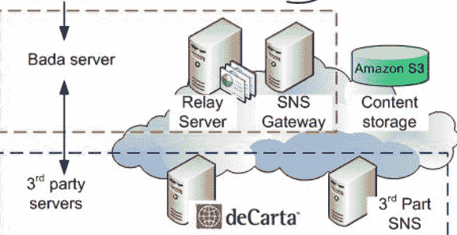

图 5.1：bada 服务器

让我们看看开放 API 在 bada 服务器上是如何工作的。通常，客户端应用程序使用表述状态转移（REST）API 与 Web 服务器通信，这意味着调用是通过 HTTP（GET, POST 等）向服务器发出的。² 如前节所述，不同的 Web 服务器实现不同的 RESTful API 集合。客户端应用程序要与不同的服务器进行互操作是非常困难的。通过使用 bada 服务器作为中介，你不需要使用任何特定的 RESTful API，而是使用原生的 C++ API。bada 服务器负责处理向特定第三方服务器的调用。

通过第三方地图服务器 - deCarta，bada 可以为你的应用程序提供丰富的地图服务，包括路径计算、地理编码和目录服务。

根据 HTTP 协议的原始设计，它是无状态的，这意味着服务器不保留任何关于客户端的信息。这种设计的缺点是它可能会增加重复数据并降低网络性能。在服务器端添加缓存可以使 HTTP 协议变为有状态。

## 5.3 服务详细介绍

现在你应该对 bada 服务器相关服务有了通用的理解。是时候了解如何使用这些功能了。让我们从位置服务开始。

### 5.3.1 位置服务 (Location as a service)

移动应用与传统应用程序的一个关键区别在于位置功能。大多数现代手机都配备了 GPS 收发器。设备一直都在感知位置变化。移动开发者可以利用真实位置数据制作功能丰富的应用程序，例如 FourSquare、Loopt。

bada 平台提供了在本章开头讨论的几种类型基于位置的服务。现在我们将检查其中的每一个，并为你提供更深层次的视角。在开始之前，让我们想一个用例：假设你想制作一个应用程序，根据用户的当前位置为其前往下一个星巴克提供路线，并将其显示在地图上。很简单，对吧？

要搜索特定的地标，你可以使用 bada 提供的目录服务或远程地标服务。在本章中，我们将展示如何使用目录服务。如上一章所述，bada 上的所有开发与以下相关：服务提供者（例如 `IDirectoryServiceProvider` 接口）、监听器（例如 `IDirectoryServiceListener` 接口）和处理器（例如 `OnDirectoryReceivedN` 方法）。

### 1：实例化 DirectoryServiceProvider 对象

```cpp
String providerName = L"Decarta";
String extraInfo = L"ClientName=username;Client Password=pwd";
HostUrl=http://developer.kr.dz.decarta.com:80/opens";

IDirectoryServiceProvider *pProvider =
dynamic_cast<IDirectoryServiceProvider>(ProviderManager::ConnectToServiceProviderN(providerName, LOC_SVC_PROVIDER_TYPE_DIRECTORY, extraInfo));
```

上述代码是自解释的。要实例化提供者对象，你必须指定客户端名称、密码和地图提供者的主机 URL。记得从 deCarta 开发者站点请求你自己的用户账户（客户端名称）和密码以便使用 deCarta 作为你的服务提供者。deCarta 开发者区域提供了适用于 bada 平台的快速上手指南。你也可以在 deCarta 开发者区域网站上专门的 bada 章节中找到功能、测试和商业化信息。

#### 步骤 2：获取 DirectoryService 提供者对象并设置服务属性

```cpp
DirectoryService *pPreferences = null;

pPreferences = static_cast<DirectoryServicePreferences*>(
    pProvider->GetServicePreferences(false)));// 如果设置为 true
```

获取 DirectoryService 对象后，你可以通过使用代码片段设置其偏好。你还可以设置排序为升序或降序。在本示例中，我们使用升序。

### 步骤 3：获取目录过滤器并添加关键字

DirectoryFilter 是搜索的准则。在示例中，我们从提供者对象获取过滤器，然后设置特定的关键字，例如 Starbucks。

```cpp
DirectoryFilter *pFilter = null;

pFilter = pProvider->GetFilter();

pFilter->AddFilter(DirectoryFilter::KEYWORD, L"Starbucks");
```

注意：deCarta POI 搜索也匹配子字符串。搜索 "star" 会找到 "Starstar" 以及名称中包含 "star" 的 POI。

### 步骤 4：实现处理结果的监听器

```cpp
class MyServiceListener;

//结果以列表形式返回
MyServiceListener::OnDirectoryReceivedN(RequestId requestId,
    const IDirectoryServiceProvider& provider, IList* pLandmarks, result r,
    const String& errorCode, const String& errorMsg)
{
    switch (r)
    {
        //处理不同情况
        if (pLandmarks)
        {
            IEnumerator* pEnumerator = pLandmarks->GetEnumerator();
            while (!IsFailed(pEnumerator)->MoveNext())
            {
                const Landmark* item = static_cast<const Landmark*>(pEnumerator->GetCurrent());
                String name = item->GetName();
                AppLog("Landmark Retrieved(%s)", name.GetPointer());
            }
            delete pEnumerator;
        }
    }
    delete pLandmarks;
}
```

### 步骤 5：定义搜索区域

要定义搜索区域，使用 `Osp::Location` 命名空间下的 `GeographicArea` 类。该类是一个抽象类，为不同形状的地理区域提供了通用方法。在本示例中，我们将使用 `CircleGeographicArea`。

要更新位置信息，我们必须先实现 `ILocationListener` 接口以接收位置信息。

```cpp
Class MyListener :
    public ILocationListener
{
    public:
        MyListener();
        ~MyListener();
        virtual void OnLocationUpdated(Location& location);
        virtual void OnProviderChanged(LocProviderState newState){
}
void
MyListener::OnLocationUpdated(Location& location)
{
    LocationProvider* pLocationProvider;
    const QualifiedCoordinates* pCoordinate = location.GetQualifiedCoordinates();
    if (pCoordinate != null)
    {
        CircleGeographicArea* pArea; //在这里将其声明为局部以便更好地
        理解。在你的项目中，建议将其作为成员变量。

        pArea = new CircleGeographicArea();
        pArea->Set(*pCoordinate, 2000);
    }
    //停止位置更新
pLocationProvider->CancelLocationUpdates();
}
```

我们现在需要做的是获取 `LocationProvider` 对象并更新当前位置。

```cpp
LocationProvider* pLocationProvider;
pLocationProvider = new LocationProvider();
MyListener* pLocationListener = new MyListener();

result r = pLocationProvider->Construct(LOC_METHOD_HYBRID);
if(!IsFailed(r)) {
    int interval = 5;
    pLocationProvider->RequestLocationUpdates(*pLocationListener, interval, false);
}
```

上述代码的作用是使用混合方法实例化 `LocationProvider` 对象，该方法以 5 秒为间隔值请求更新后的的位置。一旦位置更新，它将调用你在 `MyListener` 类中实现的 `OnLocationUpdated()` 方法。

### 第 6 步：发送搜索请求

```cpp
RequestId reqID;
MyDirectorServiceListener *pListener; // 你必须根据第 5 步自己实现
CircleGeographicArea *pArea;
Coordinates center; // 通常是你来自 GPS 的当前坐标

pArea = new CircleGeographicArea();
pArea->Set(center, 2000);

pFilter->AddFilter(DirectoryFilter::SEARCH_FILTER_KEYWORD, L"Starbucks");
result r = pProvider->Search(*pFilter, *pArea, pPreferences, *pListener, reqID);
```

要发送搜索请求，你可以使用第 1 步中声明的 `ServiceProvider` 类定义的 `Search()` 方法。调用此方法时，你需要传递五个参数：第 2 步声明的搜索结果偏好 `pPreferences`、你在第 3 步中设置的搜索标准 `pFilter`、第 4 步中定义的用于接收服务器回复的监听器 `pListener`、标识此搜索请求的 ID `reqId` 以及搜索区域 `pArea`。

参数 `pArea` 是你搜索地标的指定区域在本示例中，我们使用的是圆形类型的区域，以当前位置为中心坐标。中心坐标 `center` 在给定的间隔内不断更新。具体实现见第 5 步。

现在你已经学会了如何实现必要的类以及如何查找搜索请求。找到理想的星巴克地点后，你可能也想知道如何到达那里。在这种情况下，你需要路线服务来帮助你找到路线。现在让我们看看如何使用 bada Route Service 查找路线。

同样，我们将实现过程分为各个步骤。某些步骤与我们上面描述的目录服务非常相似。例如，前两个步骤几乎相同，只需在第 1 步中将服务名称更改为 `LOC_SVC_PROVIDER_TYPE_ROUTE`。在第 2 步中，你将为专用路线服务设置 `providerName`。

```cpp
String providerName = L"deCarta";
String extraInfo =
L"ClientName=username;ClientPassword=pwd;
HostUrl=http://developer.kr.dz.decarta.com:80/opens";
```

```cpp
IRouteServiceProvider *pProvider = dynamic_cast<IRouteServiceProvider>(
    ProviderManager::ConnectToServiceProviderN(providerName,
    LOC_SVC_PROVIDER_TYPE_ROUTE, extraInfo)
);
```

你可以直接使用 decarta 的默认偏好 `pPreferences = null;`

```cpp
RouteServicePreferences *pPreferences = null;
pPreferences = static_cast<RouteServicePreferences*>(pProvider->GetServicePreferencesN(true));
///如果你想使用自己的设置，将其设置为 false
```

## bada 简介：开发者指南 - (草稿预览，2010年7月)

下一步是从你的当前位置（坐标）到你在第 5 步中从 `ILocationListener` 到的星巴克地点的路线。

```cpp
// pLandmark 是第4 步中定义的变量
Coordinates *pPreferredStarbucksLocation = pLandmark->GetQualifiedCoordinates();
// location 是第5 步中使用的参数
Coordinates *pCurrentLocation = location.GetQualifiedCoordinates();

ArrayList* pWayPoints = null;
pWayPoints = new ArrayList();
pWaypoints->Construct(2);
pWaypoints->InsertAt(*pCurrentLocation, 0);
pWaypoints->InsertAt(*pPreferredStarbucksLocation, 1);

pProvider->GetRoute(*pWayPoints, pPreferences, *pListener, reqId);
```

要接收路线结果，你必须实现 `IRouteServiceListener` 接口类并重写类类定义的虚方法。

```cpp
class MyListener : public IRouteServiceListener
{
    public:
        MyListener();
        ~MyListener();
        virtual void OnRouteReceived(RequestId reqId,
            const IRouteServiceProvider& pProvider, IList* pRoute, result r,
            const String& errorCode, const String& errorMsg);
};

void OnRouteReceived(RequestId reqId, const IRouteServiceProvider& pProvider,
    IList* pRoute, result r, const String& errorCode, const String& errorMsg)
{
    // 如需详细实现，可以参考提供的 bada 示例代码
    with bada SDK
};
```

注意：从 `OnRouteReceived()` 方法返回的结果是计算出的路线列表。如果无法计算备用路线，则列表中仅包含一条路线。

一旦你找到了通往星巴克的路线，你可能想邀请朋友在那里会合。让我们看看从社交服务中获得哪些功能。

### 5.3.2 社交网络服务 – 全面连接

移动用户始终相互连接、更新状态并交换信息。在本章的开头，我们提到了 `Social` 命名空间下的服务。现在我们将详细解释有关社交服务的细节、个人资料管理和隐私管理。让我们从用户 A 侧开始。

### 操作 1：让用户 A 的个人资料可见

图 5.2 显示了用户 A 的序列图。


图 5.2 UML序列 – 用户 A

这种情况使用了两个类：`PrivacyManager` 和 `MyListener`。从 `PrivacyManager` 类开始它允许用户向 bada 服务器发送控制事件，例如设置权限。以下代码片段演示了如何使用 `PrivacyManager` 以及如何将监听器分配给该类。


```cpp
MyListener* pMyListener = new MyListener();
pMyListener->Construct();

pPrivacyManager = new PrivacyManager();
pPrivacyManager->Construct(*pMyListener); // 注册/分配监听器给 PrivacyManager

RequestId reqId;
pPrivacyManager->SetProfileExposureLevel(PROFILE_SEARCHABLE, reqId);
```

## bada 简介：开发者指南 (草稿预览，2010年7月)

用户 A 的另一个类是 `MyListener` 类，它是处理 bada 服务器发送的异步事件的关键类。以下代码片段向你展示了如何实现 `MyListener` 类。

```cpp
// MyListener 的实现
void 
MyListener::OnProfileExposureUpdated(RequestId reqId, result r,
    const String &errorCode, const String &errorMsg)
{
    // 你对该虚方法的实现
}
```

如你所示，`MyListener` 类派自名为 `IPrivacyManagerListener` 的接口类。它定义了以 `On` 后缀的虚方法。你必须自己实现它们。根据序列图，`On` 方法主要在从 bada 服务器接收结果时显示或通知用户。从现在，用户 A 的个人资料是可见的。其他用户可以搜索她或请求成为她的好友。

### 操作 2：用户 B 向用户 A 发送好友请求

接下来我们将查看用户 B 侧。用户 B 是尝试寻找朋友（用户 A）个人资料并请求成为好友的人。再次，我们将首先从用户 B 的序列图开始。

## bada 简介：开发者指南 -（草预览，2010年7月）

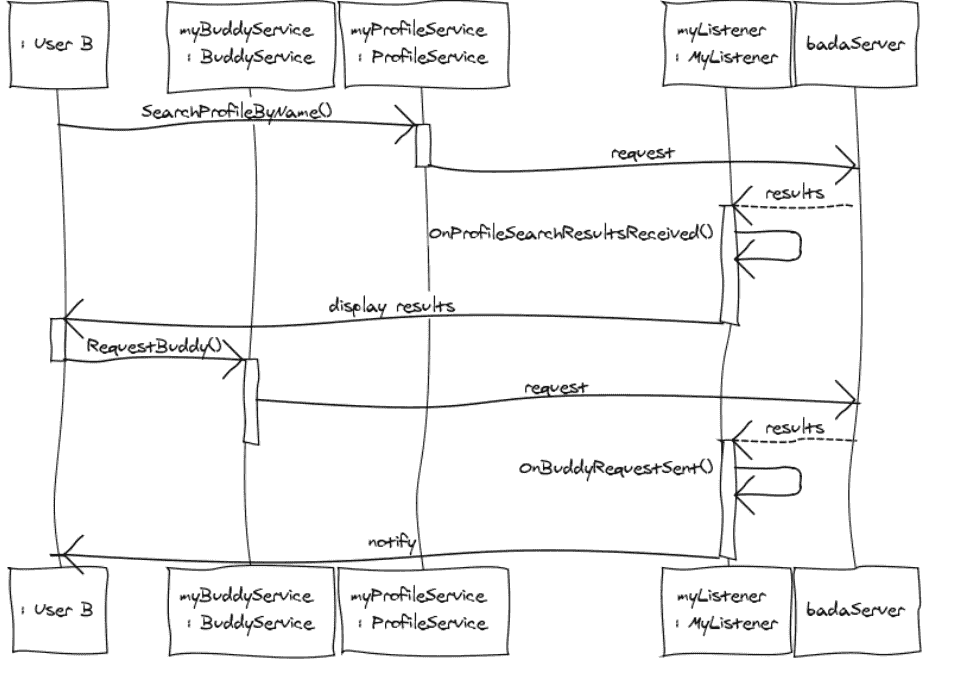

**图 5.3** UML 时序图 - 用户 B

图 5.3 展示了用户 B 搜索配置并在搜索成功后将其添加为好友的序列。与图 5.2 相比，多出了名为 `ProfileService` 和 `BuddyService` 的类。`ProfileService` 类访问 bada 服务器上的配置，并向服务器发送不同类型的请求。而 `BuddyService` 类则向 bada 服务器发送好友请求。

用户 B 的 `MyListener` 类必须实现两个虚拟方法：`OnProfileResultsReceived()`（用于用于处理服务器返回的结果）和 `BuddyRequestSent()`（当从服务器收到好友请求的响应时被调用）。让我们来看看在这种情况下如何实现该类。

```cpp
// MyListener 类的实现
class MyListener {
    public IProfileServiceListener,
    public IBuddyServiceListener,
};

void
MyListener::OnProfileResultsReceivedN(RequestId reqId, IList *pRequestList, int PageNo, int countPerPage, int totalPageCount, int totalCount, result r, const String &errorCode, const String &errorMsg) 
{
    // 你的实现
}

// 服务器发送响应时被调用
void
MyListener::OnBuddyRequestSent(RequestId reqId, result r, const String &errorMsg) 
{
    // 你的实现
}
```

### 操作 3：响应用户 B 发出的好友请求

当用户 A 从 bada 服务器收到用户 B 的请求时需要考虑几个步骤。用户 A 可以拒绝、忽略或接受请求。图 5.4 显示了用户 A 如何接收好友请求并进行响应。

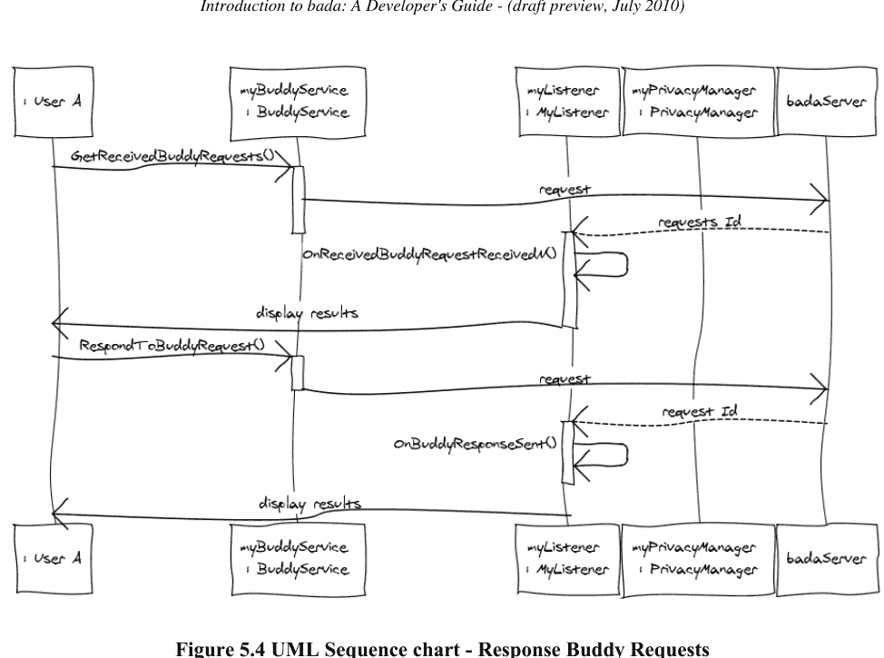

这一次，用户 A 的监听器额外了一个接口类 `IBuddySystemService`。`IBuddySystemService` 允许用户从 bada 服务器接收与好友服务相关的结果。下面的代码段演示了 `MyListener` 类必须实现的虚拟方法。

```cpp
// MyListener 类的实现
class MyListener :
public IProfileServiceListener,
public IBuddySystemServiceListener
{ 
void
MyListener::OnReceivedBuddyRequestsReceivedN(RequestsId reqid,
IList *pRequestList, int PageNo, int countPerPage, int totalCount,
int totalCount, result r, const String &errorCode, const String &errorMsg)
{
// 你的实现

void
MyListener::OnResponseBodySent(RequestsID reqID, result r, const String &errorCode,
const String &errorMsg);
{
    // 该虚拟方法的实现
}
```

当用户 A 从 bada 服务器收到某些好友请求时，会调用 `OnBuddyRequestsReceived()` 回调函数。而 `OnResponseBodySent()` 回调函数在用户 A 对特定的好友请求发送响应时调用。

与图 5.2 相比，用户 A 现在多了一个 `BuddyService` 类。`BuddyService` 类由 bada 应用程序框架定义。它直接处理用户交互，如 `GetReceivedBuddyRequests()` 和 `RespondToBuddyRequest()`。以下代码段显示了如何使用它。

```cpp
BuddyService* pMyBuddyService;
pMyBuddyService = new BuddyService();
pMyBuddyService->Construct(*pMyListener);

BuddyService->GetReceivedBuddyRequests(reqID, 1, 20);
MyBuddyService->RespondToBuddyRequest("pRequest, RESPONSE_ACCEPT, reqID);
```

用户 A 也可以通过向 `ReceivedBuddyRequest` 实例传递用户 ID，使用 `ProfileService::GetProfile()` 获取请求详情。

### 操作 4：共享位置信息

到为止，我们学习了如何设置配置暴露级别、如何发送好友请求，以及如何使用监听器处理服务器的异步事件（例如接收好友请求结果或配置搜索请求结果）。最后一步是共享位置信息。

## bada 简介：开发者指南 -（草预览，2010年7月）

bada 服务器允许用户共享个人数据。用户可以使用 `PrivacyManager` 将其个人信息设置为可共享，例如位置。在我们的案例中，从用户 A 的来说，应用程序必须实现：用户 A 必须使用新类 `LocationProvider` 获取位置，它将不断从 GPS 更新位置数据。然后，用户 A 必须使用另一个类 `RemoteLocationProvider` 将位置数据报告给 bada 服务器。

```cpp
// 好友可以访问你的位置信息
PrivacyManager->SetUserInfo(INFO_LOCATION, ACCESS_BUDDY, reqId);

// 创建并初始化位置
pLocationProvider->RequestLocation();

// 将位置信息报告到 bada 服务器
RemoteLocationProvider::Start();
```

> 注意：在 bada 中，有两种位置信息指示设备的当前位置。另一种是存储在 bada 服务器上的远程位置信息。

用户 A 将其位置信息设置为共享并报告给 bada 服务器，现在用户 B 可以请求接收好友更新。用户 B 端看起来如下：

```cpp
// 将用户 A 添加目标列表
ArrayList targetInfo;
TargetInfo targetInfo(userID);
TargetInfoList.Add(targetInfo);

// 请求最后已知位置
pRemoteLocationProvider = new RemoteLocationProvider();
pRemoteLocationProvider->RequestLastLocation(...,targetInfo, ...);
```

位置共享的序列图如图 5.5 所示。注意，存在多个 `MyListener` 和 `RemoteLocationProvider` 类的实例，这意味着用户 A 和用户 B 都有这两个类的自己的实例。

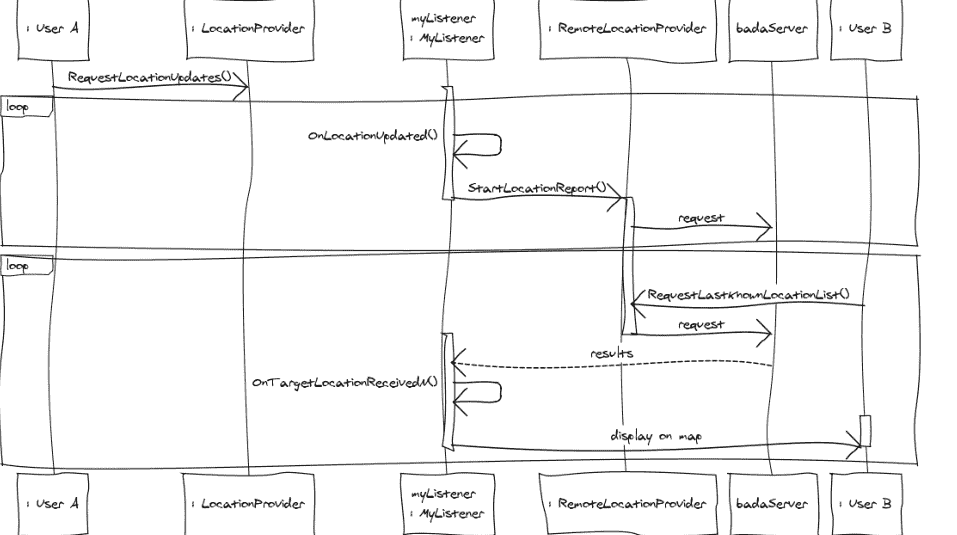

图 5.5 UML 时序图 - 共享位置

## 5.3.3 内容服务 – 内容为王

正如本章开头所述，bada 内容管理分为两类：本地内容管理和远程内容管理。在本节中，我们将解释如何使用远程内容管理器在服务器上上传和创建内容。

## bada 简介：开发者指南 -（草预览，2010年7月）

### 步骤 1：实现登录

为了能够使用内容服务，用户必须在 bada 服务器上使用有效账户登录。这要求你的应用程序在使用内容服务之前有一个登录表单。使用登录应用程序，这一步可以变得非常简单。

```cpp
AppControl* pAppControl = AppManager::FindAppControl(APPCONTROL_SIGNIN, OPERATION_SIGNIN);

if (pAppControl)
{
    pAppControl->Start(null, listener);
    delete AppControl;
}
```

这段代码会自动为你生成登录表单。一旦用户登录，即可使用内容服务。

> 注意：登录过程对于社交服务、位置服务等 bada 服务是必要的。

### 步骤 2：向服务器传输内容

登录成功后，用户准备好向服务器传输内容。要实现此功能，你需要使用 bada 提供的 `ContentTransfer` 类。首先我们将解释如何实现 `ITransferListener` 接口，你需要检查服务器的结果。

```cpp
class MyListener : public Osp::Content::ITransferListener
{
public:
    MyListener();
    ~MyListener();
    virtual void OnDownloadCompleted(RequestId reqId, ContentId contentId, result r, const String &errorCode, const String &errorMsg);
    virtual void OnDownloadToBufferCompleted(RequestId reqid, ByteBuffer *pBuf, result r, const String &errorCode, const String &errorMsg);
    virtual void OnContentTransferCanceled(RequestId reqid, result r, const String &errorCode, const String &errorMsg);
    virtual void OnContentTransferProgress(RequestId reqid, int totalTransferredSize);
    virtual void OnContentUploadCompleted(RequestId reqid, result r, const String &errorCode, const String &errorMsg);
    virtual void OnContentDescriptorReceived(RequestId reqid, const DownloadDescriptor &descriptor);
};
```

一旦服务器接收到完整内容，它将调用 `OnContentUploadCompleted()` 方法来实现最终结果。你也可以通过实现 `ContentTransferProgress()` 方法检查上传进度。以下代码段是 `OnContentUploadCompleted()` 方法的示例实现。

```cpp
void MyListener::OnContentUploadCompleted(RequestId reqid, result r, const String &errorCode, const String &errorMsg)
{
    if(IsFailed(r))
    {
        AppLog("内容上传失败！原因 (%s)", errorMsg.GetPointer());
    }
}
```

要上传内容，你只需调用 `ContentTransfer` 类的 `Upload()` 方法。

```cpp
pContentTransfer = new ContentTransfer();
pContentTransfer->Construct(myListener); // 在步骤2定义

sp::Base::Utility::Uri uri;
RequestId reqid;
pContentTransfer->Upload(L"/Media/Images/sourceImg.jpg", L"/Image/destinationImg.jpg", true, uri, reqid); // 这四个参数表示：源文件路径、目标文件路径、替换现有文件、请求 ID。
```

一旦内容上传到服务器，你就必须根据其信息（元数据）在服务器上创建该内容。如果没有这些信息，内容将无法创建。在下一步中，我们将开始操作远程服务器。

```cpp
pRemoteContentInfo = new RemoteContentInfo();
Osp::Base::Utility::Uri uri;
uri.WithPath(L"Image.jpg");

r = pRemoteContentInfo->Construct(L"Image", uri, 123345); AppAssert(IsFailed(r));
r = pRemoteContentInfo->SetContentName(L"My photo"); AppAssert(IsFailed(r), "Set
content name failed!");
r = pRemoteContentInfo->SetProvider(L"My name"); AppAssert(IsFailed(r), "Set content
provider failed!");
```

### 3：设置远程内容信息

要设置远程内容信息，你需要使用 `Osp::Content` 命名空间下的 `RemoteContentInfo` 类。

### 4：实现 RemoteContentManagerListener

```cpp
class MyListener : public Osp::Content::IRemoteContentManager {
public:
    MyListener();
    ~MyListener();
    virtual void OnContentCreated(RequestId reqId, result r, const String &errorCode,
    const String &errorMsg);
    virtual void OnContentDeleted(RequestId reqId, result r, const String &errorCode,
    const String &errorMsg);
    virtual void OnContentInfoReceived(RequestId reqId, RemoteContentInfo *pInfo,
    result r, const String &errorCode, const String &errorMsg);
```

## bada 简介：开发者指南 -（草稿预览，2010年7月）

```cpp
virtual void OnContentStatusReceived(RequestId reqid, RemoteContentStatus contentStatus, const String &errorCode, const String &errorMsg);
virtual void OnContentUpdated(RequestId reqid, result r, const String &errorCode,
    const String &errorMsg);
```


```cpp
void
MyListener::OnContentCreated(RequestId reqid, result r, const String &errorCode,
    const String &errorMsg)
{
    if(IsFailed(r))
    {
        AppLog("Failed to create content on server! Reason(%s", errorMsg.GetPointer());
    }
    else
    {
        AppLog("Content Created successfully!");
    }
}
```

与 bada 平台提供的其他服务一样，开发者必须实现服务监听器类，以便接收服务器发送的回复。下面的代码段演示了你实现的头文件。在`IRemoteChangeListener`接口类中定义了五个虚方法。你必须根据自己的需求来实现这些方法。例如，如果你想在服务器端创建内容，并且想知道创建请求是否成功，那么你就需要实现`OnContentCreated()`方法。以下代码段为你提供了如何实现`OnContentCreated()`方法的粗略思路。

## 5：创建内容

要在远程服务器上创建内容，你需要使用`RemoteContentManager`类。

```cpp
MyListener* myListener;
myListener = new MyListener();
RequestId reqId;

pRemoteContentManager = new RemoteContentManager();
pRemoteContentManager->Construct(pMyListener);

pRemoteContentManager->CreateContent(*pRemoteContentInfo, reqId);
```

上面的代码演示了如何在远程服务器上创建内容。参数`pRemoteContentInfo`是我们在步骤 3 中定义的。而`MyListener`类是我们在步骤 4 中定义的类。

## 5.3.4 商业服务 – 打造你自己的业务

bada 平台最独特且有趣的地方在于商业服务。通过商业服务，开发者不仅可以在 SamsungApps 上销售应用程序，还可以销售应用内项目。

商业服务的关键部分是 SamsungApps，你可以在那里设置要出售的项目。请记住，所有项目必须在 SamsungApps 的卖家站点设置。这与普通应用程序略有不同，因为你的项目不会列在设备上的 SamsungApps 客户端 (COD)。图 5.6 显示了如何使用你的 SamsungApps 账户设置项目。让我们从如何在卖家站点设置项目开始。

商店中列出的每个项目都有自己的属性，例如名称、描述、价格、货币、图像 URL、下载 URL 以及两个留供未来使用的字段。

## bada 简介：开发者指南 -（草稿预览，2010年7月）

### 1：在 SamsungApps 卖家中心设置项目

以下是定义和注册项目的方法：首先，访问 Samsung Apps 卖家中心 (http://seller.samsungapps.com/)，并在菜单中选择 **Applications > Item Management**（应用程序 > 项目管理）来提交你的项目以可能被纳入。创建一个项目组并将你的项目添加到其中。注意，你必须记住项目组 ID，以便稍后作为 API 参数使用。

在 Samsung Apps 中注册应用程序（**Applications > Add New Application**，应用程序 > 添加新应用程序）之前，你可以在应用程序中测试购买项目而无需付款（测试模式）。添加应用程序时，可以通过选择项目组 ID 将项目注册到应用程序。并不是所有项目都会被接受。请阅读 Samsung Apps 的条款和条件以获取更多信息。

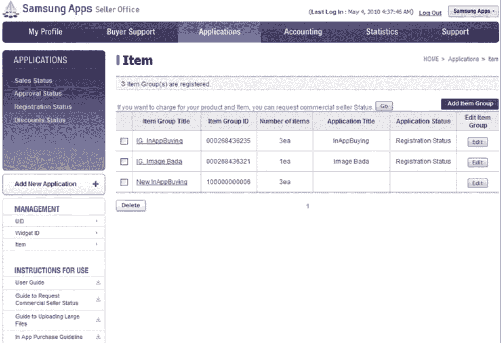

图 5.6 SamsungApps 卖家站点

### 2：使用应用内购买

b 提供了一个应用内购买的良好示例。有两个类与应用内购买相关：`ItemService`和`PurchaseService`。我们现在将如何使用这些类。

`ItemService`类有一个`GetItemList()`方法。你可以使用它向服务器发送请求以获取列表。你还需要指定字符串类型的 ID。该 ID 必须与你在站点设置的匹配。

```cpp
Osp::Commerce::Store::ItemService* pItemService;
ItemServiceListener *pServiceListener;

pItemService = new ItemService();
pItemService->Construct(&pServiceListener);

// 根据组 ID 获取项目
pItemService->GetItemList(L"GroupID", 1, 2, reqId);
```

同时，当你构造`ItemService`对象时，我们需要实现一个器回复的回复。

```cpp
class ItemServiceListener : public Osp::Commerce::Store::IServiceListener
{
public:
    ItemServiceListener();
    ~ItemServiceListener();
    void OnItemList(RequestId reqId, Osp::Base::Collection::ILList* pItemInfoList, result r, const Osp::Base::String &errorCode, const Osp::Base::String &errorString);
};
```

```cpp
void ItemServiceListener::OnItemList(RequestId reqid, Osp::Base::Collection::ILList* pItemInfoList, result r, const Osp::Base::String &errorCode, const Osp::Base::String &errorString)
{
    if(IsFailed(r)) 
    {
        // 打印错误信息
    } 
    else
    {
        // 显示项目信息
        if(pItemInfoList != NULL) {pItemInfoList->RemoveAll(true); delete pItemInfoList; }
    }
}
```

`PurchaseService`是另一个允许用户购买项目并获取设备上购买历史信息的类。遵循与`ItemService`类相同的模式，你必须实现`IPurchaseServiceListener`接口类和`PurchaseService`类。它与上面提到的`IServiceListener`非常相似。这两个类都需要一个对应的监听器接口类来处理来自 SamsungApps 服务器的响应和结果。

要购买物品，你可以使用以下代码段：

```cpp
pPurchaseService = new PurchaseService();
pPurchaseService->Construct(pPurchaseServiceListener);
result r;
RequestID reqIdr = INVALID_REQUEST_ID;
String itemGroupId(L"0x01000000a7");
String purchaseItemId(L"000000000517");

r = pPurchaseService->PurchaseItem(itemGroupId, purchaseItemId, reqIdr);
```

## 5.3.5 组件设置

如果你在使用交易服务（commerce service），我们解释了如何在 SamsungApps Seller Office 上设置销售项目。实际上，还有其他服务也要求你通过 bada 开发者网站（http://developer.bada.com）设置组件。最常见的是远程内容管理服务（Remote Content management service）。在开始编写代码之前，你必须为你的应用程序设置 Amazon S3 工作空间（workspace）。在本节中，我们将为你提供设置必要的服务器组件的逐步指南。

### 第 1 ：设置基本应用信息

这是生成新应用时的第一步。在此步骤中，你需要为你的应用程序提供名称、一些简单的描述以及版本信息。图 5.7 是开发者网站第 1 步的截图。

### 新应用

| 01 i | 02 i | 03 i | 04 i | 05 i |
| --- | --- | --- | --- | --- |
| 创建应用配置文件 | 选择特权 API 组 | 设置组件 | 设置系统要求 | 下载清单 |

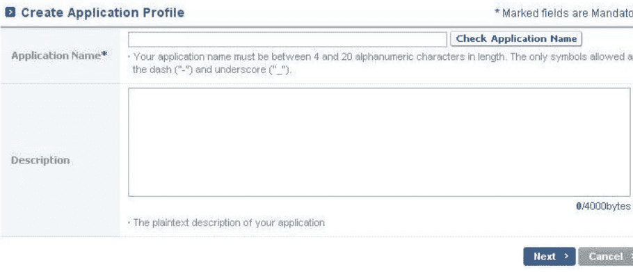

图 5.7：创建应用配置文件

一旦填写完信息，点击下一步按钮，应用管理器（Application Manager）将引导你进入下一步。

### 第 2 步：选择特权 API 组

一旦你确定了应用名称和应用描述，你就需要选择包含你的应用程序使用的 API 的特权组。如果你想使用内容管理功能，你需要至少点击图中所示 CONTENT_TRANSFER、LOCAL_CONTENT 或 REMOTE_CONTENT 的特权 API 组中的其中一个。如果你只想在你的本地设备上使用内容服务，请选择 LOCAL_CONTENT。如果你想使用以服务为中心的远程内容服务，请选择 CONTENT_TRANSFER 或 REMOTE_CONTENT。

bada 简介：开发者指南 -（草稿预览，2010年7月）

### 应用向导

| 01 i 更新应用配置文件 | 02 i 选择特权 API 组 | 03 i 设置组件 | 04 i 设置系统要求 | 05 i 下载清单 |
| --- | --- | --- | --- | --- |
| 选择特权 API 组 | | | | |

- * 选择特权 API 组

可选择的 API 组将根据你的会员级别（基础/合作伙伴）提供。所选的特权 API 组稍后将经过验证过程，因此请只选择你真正需要的。

- * 特权 API 组

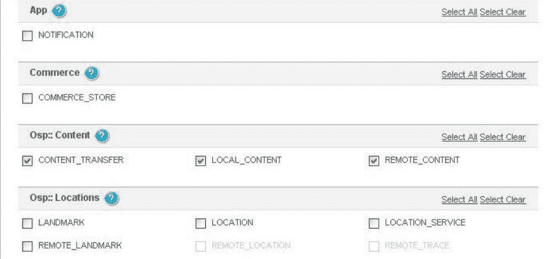

图 5.8：选择特权 API 组

### 第 3 步：设置组件

在决定了特权 API 组后，你现在可以为你的应用程序设置组件了。这一步涵盖了图 5.9 所示的社交组件、内容组件和工作空间（Workspace）。工作空间（Amazon S3）是你的物理内容文件（如图像、视频和音频）的实际存储空间。当你从内容部分点击“内容类型管理（Content Type Management）”选项时，你可以创建新的内容类型。bada 中有四种定义的内容类型：图像、视频、音频和其它。

### 应用向导

| 01 更新应用配置文件 | 02 选择特权 API 组 | 03 设置组件 | 04 设置系统要求 | 05 下载清单 |
| --- | --- | --- | --- | --- |
| 设置组件 | | | | |

- * 设置组件

为你的应用程序添加并配置不同的 bada 组件。点击组件名称可以在新窗口中对其进行配置。

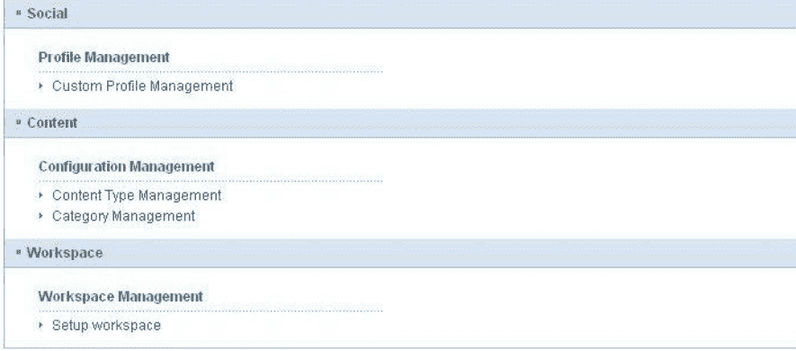

图 5.9：设置组件

### 第 4 步：设置 Amazon S3 工作空间

正如我们在第 3 步中提到的，在同一个网页上，你也可以设置工作空间。Amazon S3 工作空间是存储你的物理内容的地方。你的内容信息（如内容类型、属性信息）存储在 bada 服务器上。这就是为什么在 bada 平台上创建内容时，总是涉及两个步骤：将物理内容传输到 Amazon S3 工作空间，以及在 bada 服务器上创建内容信息。

bada 开发者网站为你的 bada 应用和 Amazon S3 工作空间提供了简单的验证过程。一旦点击“设置工作空间（Setup workspace）”选项，你就可以设置 Amazon S3 访问信息。为了验证你的 Amazon S3 工作空间，你必须从 Amazon 获取自己的 Access key、Secret 和 Bucket 名称。如果你还没有，可以随时从 http://aws.amazon.com/s3/ 注册账户。填写完必要信息后，你可以点击“连接检查（Connection Check）”按钮来验证对 Amazon S3 服务器的访问。

## 第 6 章：命名空间（Namespaces）

C++ 中的命名空间类似于 Java 中的包或 Python 中的导入模块，它们是用于划分全局程序的语言级机制。在 C++ 中，命名空间可以被视为分级封装。在 bada 中，命名空间提供了一种将系统在层级上结构化良好的、逻辑自洽的功能子集的方法。

### 你将学到

本章将遍历 bada 命名空间，突出每个命名空间的重要特征，并将它们置于更大的语文中。它将为你提供：

- 1. bada 平台如何划分为主要功能区域的概述
- 2. 理解每个命名空间对系统的贡献，了解功能在哪里以及如何访问它

### 你将需要

为了充分利用本章，请打开编辑器并浏览提到的头文件，这些文件包含了实用的注释和代码示例。

### 6.1 使用指令和声明

如果你不熟悉 C++ 的命名空间语法，不要担心；它非常直观。

为了在 C++ 中使用给定命名空间的类和其他定义，你必须包含一个指令来声明你想要命名空间中的所有名称，或者在代码中使用声明来限定单个标识符名称。

其中 *somenpace* 是命名空间，指令的形式为：

`using namespace somenamespace;`

而 *someidentifier* 是一个标识符（例如类名或枚举），声明的形式为：

`using somenamespace::someidentifier;`

例如：

`using namespace Graphics;`

使后续代码可以使用 Graphics 命名空间，从而访问 Canvas 和 Bitmap 等 Graphics 类。

相比之下：

`using Graphics::Canvas;`

使 Graphics 命名空间中的 Canvas 类可用，但 Bitmap 类不可用，对于 Bitmap 你你需要单独进行声明：

`using Graphics::Bitmap;`

要包含嵌套命名空间（例如 Ui::Controls），你必须显式包含嵌套命名空间，而不仅仅是包含父命名空间。例如，使用 Button 对象时，代码中会出现：

`using namespace Ui; using namespace Ui::Controls;`

### 6.2 本章的组织结构

在书中，我们将 bada 的功能分成了 9 组——这与印刷版中食谱的组织方式相同，例如。图 6.1 显示了每个命名空间如何映射到每个功能区域。某些命名空间功能适用于多个功能组，例如 Locations 和 Locations::Services，但它应该能提供一个识别哪个命名空间包含你所需功能的起点。

## bada 简介：开发者指南 - (草稿预览，2010年7月)

第 6.3 节按字母顺序描述了每个命名空间，因此一旦你确定了所需的功能，就可以很容易找到更多信息。我们还指出了第 2 部分中的配方适用于每个命名空间。

| 基础 | 社交网络与商业 | 地图 |
| --- | --- | --- |
| App | 社交 | |
| Base | Commerce::Store | |
| System | | |
| lo | | |

| UI & 扩展 UI | 国际化 |
| --- | --- |
| UI | Text |
| UI::Controls | Locales |
| Locations::Controls | |

| Security | 服务端服务 |
| --- | --- |
| Security | Locations::Services |

| 多媒体内容 | 网络 |
| --- | --- |
| Media | Messaging | Net |
| Content | Social::Services | |
| Graphics | | Web |
| | Telend |

图 6.1 命名空间如何划分到功能组

43

## bada 简介：开发者指南 - (草稿预览，2010年7月)

本章对大多数命名空间的描述包含一个或多个 UML 图，用于显示每个命名空间最重要的类以及它们之间的关系。为了清晰起见，图中包含了尽可能多的类，但在某些情况下，我们只关注特定命名空间内的关键类。在少数情况下，没有 UML 图，因为该命名空间并不有趣，但 UML 图不会为描述增加太多内容。我们使用了足够的 UML 来显示每个命名空间是如何结合的。关于 UML 语法的复习，请参见附录。

## 库、头文件和权限

在大多数命名空间描述的开头，你还会找到权限表，指定了使用某些功能所需的权限组。你会注意到某些功能需要 SYSTEM 权限，这可能适用于所有开发者，主要与服务器一起。有关获取权限的更多信息，请查看 developer.bada.com。第 4 章涵盖了 bada 安全模型，包括权限。我们还列出了使用每个命名空间所需的库和头文件。在构建应用程序时，Fosp 是唯一必需的库。要将库添加到项目，，在 IDE 中选择：

| 属性 | C++ 构建 | 设置 |
| --- | --- | --- |

| 权限组 | 权限级别 | 描述 |
| --- | --- | --- |
| NOTIFICATION | NORMAL | 提供用户通知 |
| TELEPHONY | NORMAL | 使用电话 |
| WEB_SERVICE | NORMAL | 使用浏览器 |


**注意：**要使用`APPCONTROL_SIGNIN`允许用户登录 bada 服务器，你必须为应用程序指定`CONTENT`、`LOCATIONS::SERVICES`或`MESSAGING`中的`SYSTEM`权限组之一。

**前提：**要使用通知，你必须确保在 IDE 的项目属性中为`Ticker`和`QuickPanel`指定图标。

# 总结

**选择的重要类：**

- `Application`
- `AppControl`
- `AppManager`
- `NotificationManager`

`App`命名空间包含了构成应用程序基础的类。每个应用程序都派自`Application`基类，该类实现了创建应用程序所需的功能，处理初始化和终止，并为系统事件提供处理程序。如图 6.2 所示，你的应用程序必须实现一个工厂方法，返回你的应用程序实例图中的`MyApplication`。

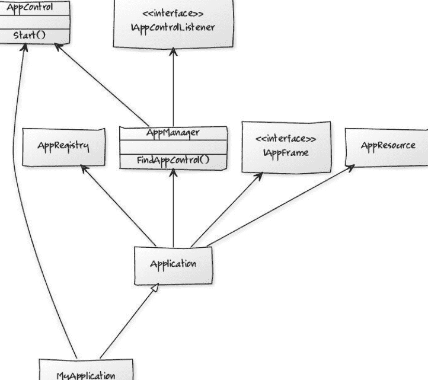

图 6.2 `App`命名空间中的主要类

`Application`包含两个应用程序开发者必须实现的虚函数：`OnInitializing`和`OnAppTerminating`。在`OnInitializing`中，应用程序从注册表中加载任何状态信息并初始化界面组件（如表单和 UI 控件）。在`OnAppTerminating`中，应用程序应将相关的状态信息写回注册表并释放它正在使用的资源。你还可以实现其他系统处理器，在应用程序移动到后台时执行操作。

197

`Application`包含两个应用程序开发者必须实现的虚函数：`OnInitializing`和`OnAppTerminating`。在`OnInitializing`中，应用程序从注册表中加载任何状态信息并初始化界面组件（如表单和 UI 控件）。在`OnAppTerminating`中，应用程序应将相关的状态信息写回注册表并释放它正在使用的资源。你还可以实现其他系统处理器，在应用程序移动到后台时执行操作。

198

`Application`包含两个应用程序开发者必须实现的虚函数：`OnInitializing`和`OnAppTerminating`。在`OnInitializing`中，应用程序从注册表中加载任何状态信息并初始化界面组件（如表单和 UI 控件）。在`OnAppTerminating`中，应用程序应将相关的状态信息写回注册表并释放它正在使用的资源。你还可以实现其他系统处理器，在应用程序移动到后台时执行操作。

198

`Application`包含两个应用程序开发者必须实现的虚函数：`OnInitializing`和`OnAppTerminating`。在`OnInitializing`中，应用程序从注册表中加载任何状态信息并初始化界面组件（如表单和 UI 控件）。在`OnAppTerminating`中，应用程序应将相关的状态信息写回注册表并释放它正在使用的资源。你还可以实现其他系统处理器，在应用程序移动到后台时执行操作。

198

`Application`包含两个应用程序开发者必须实现的虚函数：`OnInitializing`和`OnAppTerminating`。在`OnInitializing`中，应用程序从注册表中加载任何状态信息并初始化界面组件（如表单和 UI 控件）。在`OnAppTerminating`中，应用程序应将相关的状态信息写回注册表并释放它正在使用的资源。你还可以实现其他系统处理器，在应用程序移动到后台时执行操作。

297

`Application`包含两个应用程序开发者必须实现的虚函数：`OnInitializing`和`OnAppTerminating`。在`OnInitializing`中，应用程序从注册表中加载任何状态信息并初始化界面组件（如表单和 UI 控件）。在`OnAppTerminating`中，应用程序应将相关的状态信息写回注册表并释放它正在使用的资源。你还可以实现其他系统处理器，在应用程序移动到后台时执行操作。

198

`Application`包含两个应用程序开发者必须实现的虚函数：`OnInitializing`和`OnAppTerminating`。在`OnInitializing`中，应用程序从注册表中加载任何状态信息并初始化界面组件（如表单和 UI 控件）。在`OnAppTerminating`中，应用程序应将相关的状态信息写回注册表并释放它正在使用的资源。你还可以实现其他系统处理器，在应用程序移动到后台时执行操作。

198

`Application`包含两个应用程序开发者必须实现的虚函数：`OnInitializing`和`OnAppTerminating`。在`OnInitializing`中，应用程序从注册表中加载任何状态信息并初始化界面组件（如表单和 UI 控件）。在`OnAppTerminating`中，应用程序应将相关的状态信息写回注册表并释放它正在使用的资源。你还可以实现其他系统处理器，在应用程序移动到后台时执行操作。

198

`Application`包含两个应用程序开发者必须实现的虚函数：`OnInitializing`和`OnAppTerminating`。在`OnInitializing`中，应用程序从注册表中加载任何状态信息并初始化界面组件（如表单和 UI 控件）。在`OnAppTerminating`中，应用程序应将相关的状态信息写回注册表并释放它正在使用的资源。你还可以实现其他系统处理器，在应用程序移动到后台时执行操作。

198

`Application`包含两个应用程序开发者必须实现的虚函数：`OnInitializing`和`OnAppTerminating`。在`OnInitializing`中，应用程序从注册表中加载任何状态信息并初始化界面组件（如表单和 UI 控件）。在`OnAppTerminating`中，应用程序应将相关的状态信息写回注册表并释放它正在使用的资源。你还可以实现其他系统处理器，在应用程序移动到后台时执行操作。

198

`Application`包含两个应用程序开发者必须实现的虚函数：`OnInitializing`和`OnAppTerminating`。在`OnInitializing`中，应用程序从注册表中加载任何状态信息并初始化界面组件（如表单和 UI 控件）。在`OnAppTerminating`中，应用程序应将相关的状态信息写回注册表并释放它正在使用的资源。你还可以实现其他系统处理器，在应用程序移动到后台时执行操作。

198

`Application`包含两个应用程序开发者必须实现的虚函数：`OnInitializing`和`OnAppTerminating`。在`OnInitializing`中，应用程序从注册表中加载任何状态信息并初始化界面组件（如表单和 UI 控件）。在`OnAppTerminating`中，应用程序应将相关的状态信息写回注册表并释放它正在使用的资源。你还可以实现其他系统处理器，在应用程序移动到后台时执行操作。

198

`Application`包含两个应用程序开发者必须实现的虚函数：`OnInitializing`和`OnAppTerminating`。在`OnInitializing`中，应用程序从注册表中加载任何状态信息并初始化界面组件（如表单和 UI 控件）。在`OnAppTerminating`中，应用程序应将相关的状态信息写回注册表并释放它正在使用的资源。你还可以实现其他系统处理器，在应用程序移动到后台时执行操作。

198

`Application`包含两个应用程序开发者必须实现的虚函数：`OnInitializing`和`OnAppTerminating`。在`OnInitializing`中，应用程序从注册表中加载任何状态信息并初始化界面组件（如表单和 UI 控件）。在`OnAppTerminating`中，应用程序应将相关的状态信息写回注册表并释放它正在使用的资源。你还可以实现其他系统处理器，在应用程序移动到后台时执行操作。

198

`Application`包含两个应用程序开发者必须实现的虚函数：`OnInitializing`和`OnAppTerminating`。在`OnInitializing`中，应用程序从注册表中加载任何状态信息并初始化界面组件（如表单和 UI 控件）。在`OnAppTerminating`中，应用程序应将相关的状态信息写回注册表并释放它正在使用的资源。你还可以实现其他系统处理器，在应用程序移动到后台时执行操作。

198

`Application`包含两个应用程序开发者必须实现的虚函数：`OnInitializing`和`OnAppTerminating`。在`OnInitializing`中，应用程序从注册表中加载任何状态信息并初始化界面组件（如表单和 UI 控件）。在`OnAppTerminating`中，应用程序应将相关的状态信息写回注册表并释放它正在使用的资源。你还可以实现其他系统处理器，在应用程序移动到后台时执行操作。

198

`Application`包含两个应用程序开发者必须实现的虚函数：`OnInitializing`和`OnAppTerminating`。在`OnInitializing`中，应用程序从注册表中加载任何状态信息并初始化界面组件（如表单和 UI 控件）。在`OnAppTerminating`中，应用程序应将相关的状态信息写回注册表并释放它正在使用的资源。你还可以实现其他系统处理器，在应用程序移动到后台时执行操作。

198

`Application`包含两个应用程序开发者必须实现的虚函数：`OnInitializing`和`OnAppTerminating`。在`OnInitializing`中，应用程序从注册表中加载任何状态信息并初始化界面组件（如表单和 UI 控件）。在`OnAppTerminating`中，应用程序应将相关的状态信息写回注册表并释放它正在使用的资源。你还可以实现其他系统处理器，在应用程序移动到后台时执行操作。

198

`Application`包含两个应用程序开发者必须实现的虚函数：`OnInitializing`和`OnAppTerminating`。在`OnInitializing`中，应用程序从注册表中加载任何状态信息并初始化界面组件（如表单和 UI 控件）。在`OnAppTerminating`中，应用程序应将相关的状态信息写回注册表并释放它正在使用的资源。你还可以实现其他系统处理器，在应用程序移动到后台时执行操作。

198

`Application`包含两个应用程序开发者必须实现的虚函数：`OnInitializing`和`OnAppTerminating`。在`OnInitializing`中，应用程序从注册表中加载任何状态信息并初始化界面组件（如表单和 UI 控件）。在`OnAppTerminating`中，应用程序应将相关的状态信息写回注册表并释放它正在使用的资源。你还可以实现其他系统处理器，在应用程序移动到后台时执行操作。

198

`Application`包含两个应用程序开发者必须实现的虚函数：`OnInitializing`和`OnAppTerminating`。在`OnInitializing`中，应用程序从注册表中加载任何状态信息并初始化界面组件（如表单和 UI 控件）。在`OnAppTerminating`中，应用程序应将相关的状态信息写回注册表并释放它正在使用的资源。你还可以实现其他系统处理器，在应用程序移动到后台时执行操作。

198

`Application`包含两个应用程序开发者必须实现的虚函数：`OnInitializing`和`OnAppTerminating`。在`OnInitializing`中，应用程序从注册表中加载任何状态信息并初始化界面组件（如表单和 UI 控件）。在`OnAppTerminating`中，应用程序应将相关的状态信息写回注册表并释放它正在使用的资源。你还可以实现其他系统处理器，在应用程序移动到后台时执行操作。

198

# Osp

声明在：`Framework.h`

# 总结

包含所有 bada 命名空间的顶层命名空间。原始 bada 项目名 Open Service Platform。

# Osp::App

声明在：`FApp.h`

库：`FApp`

权限要求：此命名空间大多数功能不需要权限。某些特定的应用程序功能需要以下权限：

bada 简介：开发者指南 - (草稿预览，2010年7月)

| 权限组 | 权限级别 | 描述 |
| --- | --- | --- |
| `NOTIFICATION` | `NORMAL` | 提供用户通知 |
| `TELEPHONY` | `NORMAL` | 使用电话应用 |
| `WEB_SERVICE` | `NORMAL` | 使用浏览器应用 |

**注意：**要使用`APPCONTROL_SIGNIN`允许用户登录 bada 服务器，你必须为应用程序指定`CONTENT`、`LOCATIONS::SERVICES`或`MESSAGING`中的`SYSTEM`权限组之一。

**前提：**要使用通知，你必须确保在 IDE 的项目属性中为`Ticker`和`QuickPanel`指定图标。

# 总结

**选择的重要类：**

- `Application`
- `AppControl`
- `AppManager`
- `NotificationManager`

`App`命名空间包含了构成应用程序基础的类。每个应用程序都派自`Application`基类，该类实现了创建应用程序所需的功能，处理初始化和终止并为系统事件提供处理程序。如图 6.2 所示，你的应用程序必须实现一个工厂方法，返回你的应用程序实例图中的`MyApplication`。


图 6.2 `App`命名空间中的主要类

`Application`包含两个应用程序开发者必须实现的虚函数：`OnInitializing`和`OnAppTerminating`。在`OnInitializing`中，应用程序从注册表中加载任何状态信息并初始化界面组件（如表单和 UI 控件）。在`OnAppTerminating`中，应用程序应将相关的状态信息写回注册表并释放它正在使用的资源。你还可以实现其他系统处理器，在应用程序移动到后台时执行操作。

197

`Application`包含两个应用程序开发者必须实现的虚函数：`OnInitializing`和`OnAppTerminating`。在`OnInitializing`中，应用程序从注册表中加载任何状态信息并初始化界面组件（如表单和 UI 控件）。在`OnAppTerminating`中，应用程序应将相关的状态信息写回注册表并释放它正在使用的资源。你还可以实现其他系统处理器，在应用程序移动到后台时执行操作。

198

`Application`包含两个应用程序开发者必须实现的虚函数：`OnInitializing`和`OnAppTerminating`。在`OnInitializing`中，应用程序从注册表中加载任何状态信息并初始化界面组件（如表单和 UI 控件）。在`OnAppTerminating`中，应用程序应将相关的状态信息写回注册表并释放它正在使用的资源。你还可以实现其他系统处理器，在应用程序移动到后台时执行操作。

19

# Osp::Base::Collection

声明在：`FBaseCol.h`

权限要求：无

# 总结

**选择的重要类：**

- `ICollection`
- `IComparer`
- `IEnumerator`
- `LinkedList`
- `Stack`
- `Queue`

处理各种集合（如数组、列表和栈）的命名空间。它包含了方便创建和操作这些集合的方法。集合是基于对象或模板的。基于对象的集合派自`ICollection`用于存储对象；为了清晰起见，图 6.5 显示了命名空间中非模板类的派生和关系，但图中显示的每个集合类都有对应的模板类型版本，例如`LinkedList`和`LinkedListT`。

# Osp::Base

声明在：`FBase.h`

库：`FBase`

权限要求：无

# 总结

**选择的重要类：**

- `Object`
- `Number`

包含了构建 bada 的核心类和接口。`Object`类是 bada 的根类，大多数 bada 类都派自该类或其派生类。该命名空间还提供了表示和操作原始类型（如`char`、`short`、`double`和`bool`）的包装类，如图 6.3 所示。

还有表示日期和时间以及数字字符串比较的类。

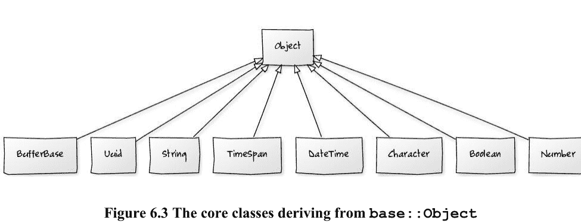

`Base`还包含了 bada 定义的数值类型的包装类。数字类如图 6.4 所示。

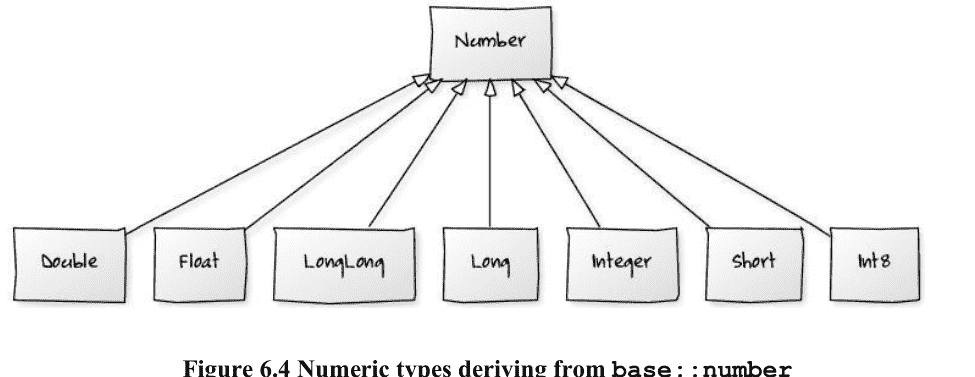

图 6.4 派自 base 的数值类型：`:number`

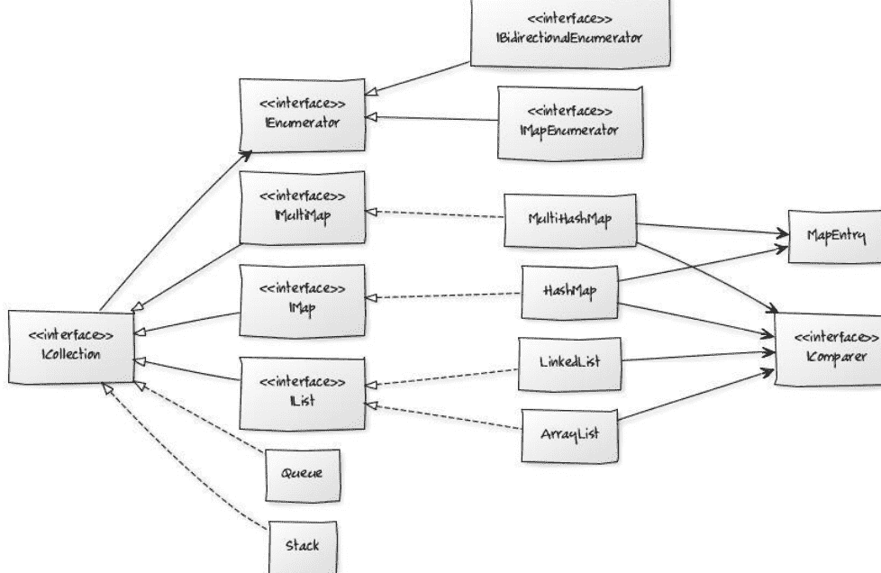

对于图 6.5所示的集合类，你只需要选择合适的集合类来匹配你想要管理数据的方式。

`Stack`（栈）和`Queue`（队列）分别是按照后进先出（LIFO）和先进先出（FIFO）顺序组织的简单对象集合。

`ArrayList`和`LinkedList`实现了可以通过索引访问的对象列表，而`HashMap`和`MultiMap`则管理一个键/值对列表（由`MapEntries`表示）。你可以对这两个集合中的元素进行迭代，以对每个元素执行操作，例如，通过使用你所用集合的`GetEnumerator()`方法返回的`IEnumerator`类。

# bada 简介：开发者指南（草稿预览，2010年7月）

**注意：** `ArrayList`和`LinkedList`的用法相同，但每个类的实现有细微的差异。`ArrayList`的项存储在连续的内存区域，访问列表的速度更快，但添加元素的速度比`LinkedList`慢，因为在添加新项时，整个内存块可能需要调整大小。`LinkedList`的访问速度较慢，但调整大小更快。因此，如果你有一个固定列表且不计划频繁添加或删除项，请选择`ArrayList`。如果列表项的数量可能更频繁变化，请使用`LinkedList`。


`IComparer` 类也可用于 `Sort()` `ArrayList` 或 `LinkedList` 列表，或作为键/值对列表的键比较器。bada 提供了许多用于比较特定类型的比较器，包括 `IntegerComparator` 和 `StringComparator`，但对于更复杂的对象比较，你可以从 `IComparer` 派生出你自己的比较类。

**注意：** 基于对象的集合不收集对象的副本，而是收集指针。因此，任何你想放入集合类中的对象都必须使用 `operator new` 进行分配内存。否则，如果你的集合存储了指向自动变量的指针，其生命周期是不可预测的，当集合使用它时，它可能已经不存在。你的应用程序将不可预测地崩溃。

# Osp::Base::Runtime

**声明于：** `FBaseRT.h`

**所需权限：** 无

# 总结

**选定的重要类：**

- `Monitor`（监器）
- `Thread`（线程）
- `Timer`（定时器）

# bada 简介：开发者指南 -（草稿预览，2010年7月）

此命名空间包含了实现应用程序运行环境的类，如图 6.6 所示的线程、同步对象和定时器。

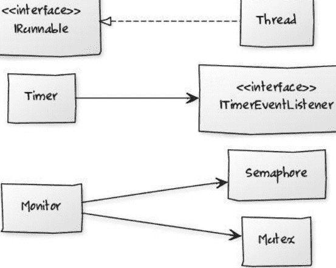

图 6.6 `base::runtime` 命名空间中的主要类

bada 应用可以拥有多个线程，同步对象（互斥锁 `mutexes`、信号量 `semaphores` 和监器 `monitors`）用于控制对共享资源的访问，例如，一次只有一个线程对设备上的特定代码或共享资源具有独占访问权限。

定时器用于调度特定代码的执行。

# Osp::Base::Utility

**声明于：** `FBaseUtil`

**所需权限：** 无

# 总结

**选定的重要类：**

- `Math`（数学）
- `StringUtil`（字符串工具）
- `Uri`（统一资源标识符）

此命名空间提供了一些实用程序类。`Math` 类是数学库的封装，提供了对对数函数和其他常用数学函数的访问，其他类提供了字符串处理工具以及一个用于创建和分析 URI 的类。

# Osp::Commerce::Store

**声明于：** `FCommerce.h`

**库：** `FOSp`

**先决条件：** 要将此功能作为内购（In App Purchases）使用，你需要在 SamsungApps 商店拥有卖家账户。

**所需权限：** 使用此命名空间中的功能需要以下权限：

| 权限组 | 权限级别 | 描述 |
|---|---|---|
| `COMMERCE_STORE` | `NORMAL` | 连接到 SamsungApps 以启用内购 |

# 总结

**选定的重要类：**

- `ItemInfo`（项目信息）
- `ItemService`（项目服务）
- `PurchaseService`（购买服务）

`Store` 命名空间提供了类和方法，允许应用程序从 SamsungApps 获取信息和进行内购。这些项目可能是内购，例如新的应用程序服务或游戏中的新关卡。

实际的购买过程由 SamsungApps 服务器处理，因此应用程序只需要允许用户选择要购买的项目并将此请求传递给服务器即可。

6.7 显示了 `Commerce::Store` 命名空间的结构。`ItemService` 用于检索信息，`PurchaseService` 用于实际购买项目。每个可用项目的信息（如描述、价格和货币）由 `ItemInfo` 类表示，而应用程序通过实现 `ItemServiceListener` 来处理 `ItemService` 事件。

购买过程也是如此，`PurchaseInfo` 类包含了购买详情，而响应（例如项目购买成功或购买错误）应由应用程序对 `IPurchaseServiceListener` 的实现来处理。

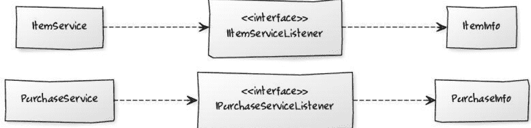

图 6.7 `Commerce :: Store` 中实现 `ItemService` 和 `PurchaseService` 的类

# Osp::Content

**声明于：** `FContent.h`

**库：** `FContent`

**所需权限：** 要操作设备或服务器上的内容需要设置以下权限：

| 权限组 | 权限级别 | 描述 |
|---|---|---|
| `LOCAL_CONTENT` | `Normal` | 处理设备内容 |
| `CONTENT_TRANSFER` | `System` | 从服务器上传和下载内容 |
| `REMOTE_CONTENT` | `System` | 在服务器上操作内容 |

**先决条件：** 要操作远程内容，用户需要在 bada 服务器上拥有账户。虽然远程内容的信息存储在 bada 服务器上，但物理内容存储在工作空间中，你需要在“设置组件”中进行设置。

# 总结

**选定的重要类：**

- `ContentInfo`
- `ContentManager`
- `ContentSearch`

`Content` 命名空间包含类和方法，用于在设备本地和服务器远程搜索和管理内容。`Content` 是各种媒体类型（包括图像、音频和视频）的逻辑表示，包含了时间、GPS 信息、描述以及内容本身的位置。这些信息可以使用类似 SQL 的语法搜索内容。

创建、读取和更新内容由 `ContentManager` 和 `RemoteContentManager` 类处理。设备内容数据库中的信息通过派自 `ContentInfo` 的专用类访问：`AudioContentInfo`、`ImageContentInfo` 和 `VideoContentInfo` 都包含其特定媒体类型的信息，而 `OtherContent` 用于表示 PDF 等内容。

如图 6.8 所示，这些类用于持有搜索返回的内容。

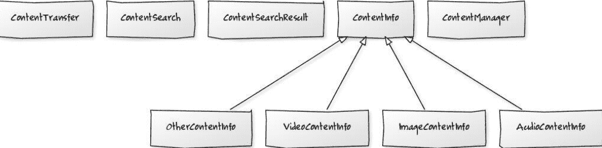

图 6.8 用于在 bada 设备上管理和搜索内容的类

设备和服务器上的内容搜索由 `ContentSearch` 和 `RemoteContentSearch` 类提供。本地搜索返回派自 `ContentInfo` 的项，而远程搜索返回更灵活的 `RemoteContentSearch` 类的信息，如图 6.9 所示。一旦获得内容，对于音频和视频使用 `Osp::Media::Player` 进行播放；对于图像，使用 `Osp::Media::Image` 将其解码为位图，并使用 `Osp::Graphics::Canvas` 根据 `Content` 信息绘制位图。

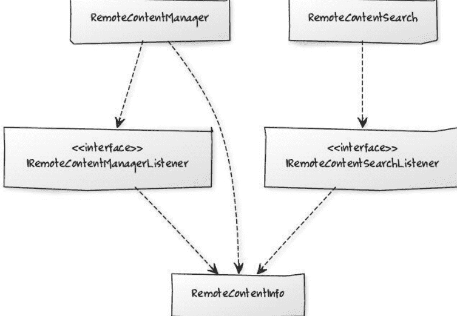

图 6.9 内容也可以通过 bada 服务器进行远程存储和管理

`Content` 命名空间还提供了在设备和 bada 服务器之间传输内容的类，适用于社交网络应用程序中的信息共享、备份内容或与云端同步。

# Osp::Graphics

**声明于：** `FGraphics.h`

**库：** `FGraphics`

**所需权限：** 无

# 摘要

**选定的重要类：**

- `Bitmap`
- `Canvas`
- `EnrichedText`

`graphics` 命名空间包含用于绘制 2D 和 3D 图形、文本和图像的类。

所有图形都渲染到 `Canvas` 中，`Canvas` 类包含了绘制基本形状的方法以及图形设置，例如前景颜色和背景颜色、线条样式以及用于文本绘制的字体信息。你可以创建自己的 `Canvas`，但在大多数情况下，你将在控件的区域内进行绘图。

> **注意：** 要获取具有整个应用程序帧边界的 `Canvas`，我们使用 `Osp::App::Application::GetAppFrame` 方法获取帧控件，然后使用 `Osp::Ui::Control::GetCanvas` 返回用于绘图的 `Canvas`。

使用 `Canvas` 类方法绘制的常见图形形状包括弧、线、矩形、多边形和文本以及位图。请查看图 6.10 以了解 `Canvas` 与其他 `Graphics` 类之间的关系。

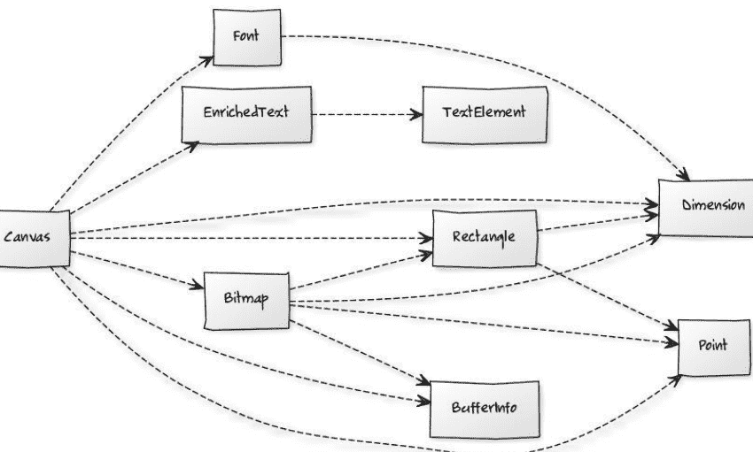

图 6.10 `Graphics` 命名空间中的类。注意 `Canvas` 的重要性

`Bitmap` 类包含了创建和缩放位图的方法，但位图实际上是使用 `Canvas::DrawBitmap` 方法渲染的。位图还用于存储由 `Osp::Media::Image` 解码的图像，在包含图像的位图绘制到画布之前。

该命名空间还包含了一些用于绘制形状的核心类：`Dimension`、`Point` 和 `Rectangle`。

`OpenGL` 子类提供了更高级的 2D 和 3D 绘图。

# Osp::Graphics::OpenGl

**声明于：** `FGraphicsOpenGL.h` (针对 OpenGL ES 1.1)

**声明于：** `FGraphicsOpenGL2.h` (针对 OpenGL ES 2.0)

**库：** `FGraphicsOpenGL`, `FGraphicsEgl`

**所需的权限：** 无

**先决条件：** 注意，并非所有运行 bada 平台的硬件都支持 OpenGL。

# 摘要

此命名空间为 OpenGL ES 2D 和 3D 图形库提供了支持。OpenGL ES 是一种嵌入式图形的跨平台标准，为 3D 游戏提供了完整的功能。通过支持 OpenGL ES，bada 允许可以使用原本为其他移动平台编写的图形代码。

EGL 库提供了 OpenGL 绘制的渲染表面，并将 OpenGL 调用连接到 bada 的底层窗口系统。

> **注意：** 同时支持 OpenGL ES 1.1 和 OpenGL ES 2.0，具体可用哪个版本取决于设备硬件是否支持该版本。

# Osp::Io

**声明于：** `Floh`

**库：** `Fio`

**所需的权限：** 无

# 摘要

**选定的重要类：**

- `Database`
- `Directory`
- `File`

如图 6.11 所示，`Io` 命名空间包含了处理文件、目录、数据库和注册表的封装类。`File` 类提供了使用原始缓冲区和字符串对文件进行创建、删除、写入和读取的支持。要获取有关文件和目录的信息，请使用 `FileAttributes` 类。

应用程序仅对其主目录或共享目录中的文件具有写权限——该目录用于与其他应用程序共享数据。

| `Database` | `Directory` | `File` | `Registry` |

图 6.11 `Io` 命名空间中的核心类

`Database` 类提供了基本数据库函数的支持，包括创建和删除数据库以及执行 SQL 命令。它还包含了对事务和回滚的支持，这些在使用 SQL 数据库时是非常有用的函数。`Database` 类使用的 SQL 是 SQLite (www.SQLite.org)。

> **注意：** 该数据库仅用于本地设备存储，不支持连接到远程数据库。

`Registry` 类支持对注册表文件的创建、写入和读取，应用程序通常使用它来存储设置。这与 `App::AppRegistry` 管理的注册表不同，后者只有应用程序可以访问。例如，应用程序可以将由 `Io::Registry` 创建的文件存储在其共享目录中，并向一组应用程序授予其设置信息的只读权限。

# Osp::Locales

**声明于：** `FLocales.h`

**库：** `FLocales`

**所需的权限：** 无

# 摘要

**选定的重要类：**

- `Calendar`
- `DateTimeFormatter`
- `LocaleManager`
- `NumberFormatter`

`Locales` 包含了一些类，让你轻松地针对国际市场进行应用程序本地化，确保数字、日期和货币的显示方式与特定 `Locale` 的设置一致。`Locale` 包含语言代码和国家代码，以及一个变体（variant），该设置可能用于区分语言设置，例如简体中文和繁体中文。

为特定 `Locale` 格式化数字和日期的大部分工作由 `DateTimeFormatter` 和 `NumberFormatter` 类负责，如图 6.12 所示。

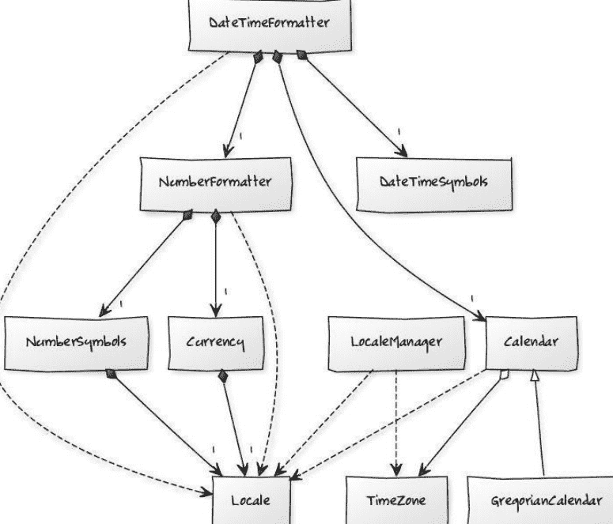

图 6.12 组成 `Locales` 命名空间的类

要为特定区域格式化数字，你需要使用静态工厂函数，如 `NumberFormatter::CreateNumberFormatter` 或 `CurrencyFormatter::CreateCurrencyFormatter` 创建 `NumberFormatter` 对象，并使用它按指定的 `locale` 格式化数字正确的分组、小数和货币符号。以下列表显示了如何为当前 `locale` 格式化数字：

```cpp
LocaleManager localeManager;
localeManager.Construct();

Locale systemLocale = localeManager.GetSystemLocale();
```

格式化日期的过程类似，只需调用 `DateTimeFormatter::CreateDateTimeFormatter` 并使用 `DateTimeFormatter` 为指定位置格式化日期。

```cpp
NumberFormatter* pNumberFormatter= NumberFormatter::CreateNumberFormatter(systemLocale);
String formattedString;
double num = 12345.67;
pNumberFormatter->Format(num, formattedString);
```

可以通过 `System::System::GetCurrentTime` 获取当前日期，如果对日期有更细致的控制，可以使用 `Calendar` 类。`Calendar` 将日期表示为一系列 `TimeFields`，并提供 `AddField` 函数，允许对日期进行计算，例如向前或后移动数量的分钟、天或月份。

本地化的日期和月份名称存储在 `DateTimeSymbol` 类中，可以从 `DateTimeFormatter` 获取，也可以单独构造。

有关各种文本编码的支持，请参考 `Osp::Text` 命名空间。

# Osp::Locations

**声明于：** `FLocations`

**库：** `FLocations`

**所需的权限：** 使用 `Locations` 功能需要设置以下权限级别以访问特定的功能区域：

| 权限组 | 权限级别 | 说明 |
| - | - | - |
| `LOCATION` | `NORMAL` | 访问设备上的位置信息 |
| `LANDMARK` | `NORMAL` | 访问设备上的地标存储 |
| `REMOTE_LANDMARK` | `SYSTEM` | 使用 bada 服务器访问位置服务。 |
| `REMOTE_LOCATION` | `SYSTEM` | 使用 bada 服务器访问位置服务。 |
| `REMOTE_TRACE` | `SYSTEM` | 使用 bada 服务器访问位置服务。 |

# 摘要

**选定的重要类：**

- `IAreaListener`
- `ILocationListener`
- `LocationProvider`
- `Landmark`
- `LandmarkStore`

处理位置信息的起点是 `LocationProvider` 类，如图 6.13 所示。应用程序可以实现该类的监听方法，以便在定期间隔或设备位置跨越指定的区域边界时接收通知。在这两种情况下，都会向监听方法发送一个 `Location` 对象，其中包含位置、速度和收集数据的信息。

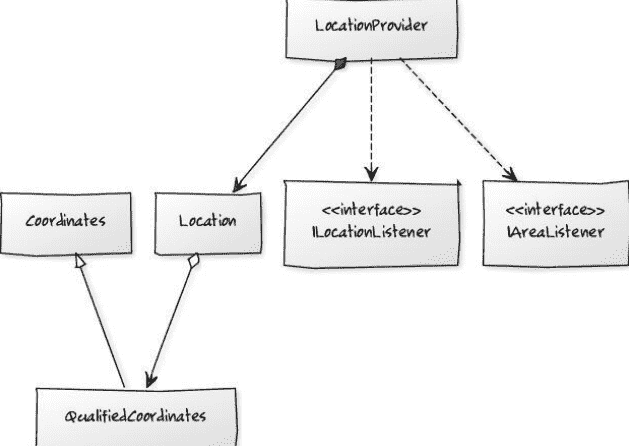

# 服务器支持的服务

使用 bada 服务器配合 `RemoteLocationProvider` 类，开发者还可以访问有关远程设备的信息，定期向服务器报告本地设备的最后位置，并使用 `SubscribeToTraceService` 方法和 `ITraceServiceListener` 类记录旅行路径。

向 bada 服务器报告设备位置是使用 `StartLocationReport` 方法结合 `IReportListener` 类完成的。这会导致位置信息定期上传到 bada 服务器，这些信息可供其他经过验证的设备读取。

要检索远程设备的最后位置，请使用 `RequestLastKnownLocationList` 方法，并传入 `TargetInfo` 对象的列表，这些对象根据用户的服务器 `userID` 识别设备。你也可以使用 `RequestLastKnownLocationInCircle` 和 `RequestLastKnownLocationInRectangle` 方法将范围缩小到给定区域内最后已知位置的设备。

# 标标 (Landmarks)

`Landmark` 类代表一个具有名称的地理位置，并包含描述和 URL 等额外信息。应用程序可以创建自己的标标，例如从用户在地图上选择的位置，或者由其他应用程序或第三方内容提供者预定义的标标。

标标信息存储在设备上的数据库中，由 `LandmarkStore` 类管理，该类包含用于在指定区域内或根据给定名称或类别（例如餐厅或剧院）创建、修改、删除和搜索标标的类。

当与 bada 服务器和 `RemoteLandmarkStore` 类结合使用时，标标功能会变得强大得多，它允许在使用 bada 服务器的应用程序之间共享标标信息。远程标标库由用户创建存储库（标标信息可以在使用相同应用程序的所有设备之间共享）以及由第三方内容提供者处理并供所有应用程序使用的预定义存储库组成。

> **注意：** 标标通常在地图的覆盖层上绘制，并作为 `Locations::Controls::MapOverlayMarker` 类的标记出现。请参阅 `Locations::Controls` 命名空间描述中关于地图绘图方式的讨论。

# Osp::Locations::Controls

**声明于：** `FLocations.h`

**所需权限：** 无

# 摘要

**选定的重要类：**

- `IMapOverlay`
- `IMapEventListener`
- `Map`

提供了渲染地图和 UI 控件的类和方法，允许用户自定义地图显示方式并与其进行交互。

地图分 5 层绘制，首先绘制地图层，每层都会添加自己的set图形信息。用于渲染地图每层的主要类如图 6.14 所示。


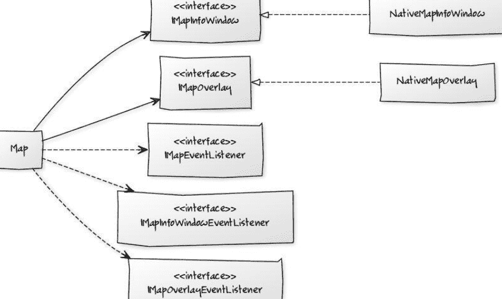

每一层的目的以及操纵这些信息的相关类和方法如下：

# 缩放 (Zoom)

顶层，包含用于缩放的用户界面控件。应用程序通过实现 `IMapEventListener::OnMapZoomingStarted` 和 `OnMapZoomingEnded`，以便在用户缩放地图时收到通知。

# 信息窗口 (Info window)

显示有关位置和企业的有用信息的气泡。这可能包括对业务的简要描述及其联系方式，例如。信息窗口使用 `NativeMapInfoWindow` 类创建预定义窗口，并使用 `IMapInfoWindow` 类创建用户定义窗口。

# 我的位置 (MyLocation)

在地图上显示当前位置，并带有一个显示误差范围的圆形边界。应用程序可以使用 `Map::SetMyLocationEnabled` 方法来选择是否显示此信息。

# 覆盖层 (Overlay)

一个交互层，用形状标记地图上的位置，并带有用户可以移动的标记（类似于物理地图上的大头）。形状：通过添加派自 `MapOverlayShape` 类的对象，可以在地图上添加多边形、圆形和矩形，而可移动的标记派自 `MapOverlayMarker`，如图 6.15 所示。

应用程序实现 `IMapOverlayEventListener` 来处理当用户移动标记时收到的事件。

# 地图 (Map)

由地图服务提供者提供并由 `Map` 类封装的基础地图图形。该类的方法提供了对地图如何显示的大量控制，包括其尺寸和包边界矩形。


相关食谱：

- 从服务提供者获取地理信息并显示地图

# Osp::Locations::Services

声明于：`FLocations.h`

先决条件：一个地理服务提供者的账户。

所需权限：`LOCATION_SERVICE`

# 摘要

选定的重要类：

- `IDirectoryServiceProvider`

- `IMapServiceProvider`

- `IRouteServiceProvider`

- `ProviderManager`

此命名空间为地理信息服务提供支持：地图、地理编码、目录和路线服务。实现这些服务的起点是 `ProviderManager` 类，它检索有关设备可用服务提供者的信息，并允许应用程序选择提供相应的服务。

地图服务的支持由一组获取地图信息和渲染地图的接口类提供。`IMap` 接口实现了来自服务提供者的动态地图，支持平和平缩放等功能，其用户界面由 `Locations::Controls` 命名空间中的类处理。

# 路线和目录服务 (Route and directory services)

路线服务由 `IProvider` 和 `IRouteService` 实现，允许应用程序根据给定一组路点请求路线，路点必须包含起点和终点，以及如交通模式和路线是否为最快或最短等参数。应用程序将返回一个 `Routes` 列表，其中包含一组表示路线的坐标以及长度、旅行时间等信息。应用程序随后可以在地地图上显示这些信息。提供路线服务的类如图 6.16 所示。

bada 简介：开发者指南 -（草案预览，2010年7月）


图 6.16 管理服务功能的类

目录服务允许应用程序开发者对地理区域内的产品实现用户友好的搜索——例如某个城市内的咖啡馆。开发者使用 `IDirectoryServiceProvider` 的方法组合搜索请求，并使用 `IDirectoryServiceListener` 异步处理响应。搜索结果以 `Landmark` 列表的形式返回。这些服务的基石是地理编码服务，它将地址转换为地理坐标，反之亦然。

> 注意：要使用这些服务，你需要一个地理服务提供者的账户，例如 DeCarta (www.decarta.com)，它是目前 bada 支持的地图提供者。

然而，你可以使用 `Web::Control` 类和 www.googlemaps.com 等网站在应用程序中访问地图。

73

# Osp::Media

声明于：`FMedia.h`

库：`FMedia`

所需权限：使用此命名空间的功能根据你使用的功能需要以下一个或多个权限组：

| 权限组 | 权限级别 | 描述 |
| --- | --- | --- |
| `CAMERA` | `NORMAL` | 访问摄像头 |
| `IMAGE` | `NORMAL` | 处理图像 |
| `RECORDING` | `NORMAL` | 录制音频和视频 |
| `DRM_CONTENT` | `NORMAL` | 处理 DRM 内容 |

# 摘要

选定的重要类：

- `Camera`

- `Player`

- `AudioRecorder`

- `VideoRecorder`

此命名空间包含用于音频、视频和图像处理、播放和捕取的类。

> 注意：`Image` 类用于编码、解码和转换图像，但绘制图像还需要其他命名空间的类。例如，要绘制图像，你必须将图像解码为 `Osp::Graphics::Bitmap` 中定义的位图计数，创建一个矩形作为图像边界，然后使用 `Osp::Graphics::Canvas` 方法来实际绘制图像。

# bada 简介：开发者指南 - (草案预览，2010年7月)

其他重要的媒体处理类如图 6.17 所示并在下文中描述。


图 6.17 Media 命名空间的核心类

`Player` 用于播放存储在设备本地或通过网络流传输的音频和视频。

`AudioRecorder` 和 `VideoRecorder` 类用于在设备上捕获音频和视频。

`Camera` 包含用于提供相机实时预览和从相机捕获静态图像的方法。应用程序对相机具有很高的控制权，可以通过 `Camera` 类的方法修改对比度、效果、缩放和闪光等设置。

> 注意：你可以使用带有网络摄像头的 PC 上的模拟器（Simulator）测试 `Camera` 功能，但取决于硬件，并非所有的 `Camera` 设置都可用。

# bada 简介：开发者指南 - (草案预览，2010年7月)

# 媒体格式支持

支持多种标准音频播放格式：MP3, AAC, M4A, XMF, 3GA, MMF, MIDI, WAV 和 AMR。音频可以用 AMR 或 WAV 格式录制。

视频播放格式的范围也很广泛：WMV, ASF, AVI, MP4 和 3GP，而视频可以用 MP4 和 3GP 格式录制。

`Image` 类可以解码以下图像格式：BMP, GIF, JPEG, PNG, TIFF 和 WBMP。图像可以以 BMP、JPEG 和 PNG 格式输出。

受 OMA 和 Windows Media 数字版权管理 (DRM) 格式保护的音频和视频文件也可以播放。

# Osp::Messaging

声明于：`FMessaging.h`

库：`FMessaging`

所需的权限：使用此命名空间中的类发送消息至少需要下表列出的权限组中的第一个：

| 权限组 | 权限级别 | 描述 |
| --- | --- | --- |
| `MESSAGING` | `SYSTEM` | 发送 SMS、MMS 电子邮件 |

# 总结

选定的重要类：

- `EmailManager`

- `MmsManager`

- `SmsManager`

# bada 简介：开发者指南 (草案预览，2010年7月)

该命名空间提供了访问设备消息处理能力的能力。应用程序可以发送 SMS、MMS 或电子邮件消息。为了检查发送中消息的状态，开发者为每种类型的消息实现了一个监听器，以异步接收状态信息。

图 6.18 显示了 `SmsManager`、`RecipientList` 和 `SmsMessage`，以及用于接收消息状态信息的 `ISmsListener`。MMS 和电子邮件的发送以类似的方式组织，具有一个接收者列表、一个表示消息的类和一个用于接收有关消息状态信息的监听器。


图 6.18 Messaging::SmsManager 及相关类

> 注意：bada SDK 的 1.0.b3 版本不支持推送消息（Push messages），该版本是编写时的当前版本。

# Osp::Net

声明于：`FNet.h`

库：`FNet`

所需的权限：使用此命名空间的功能，你至少需要下面列出的权限组之一，取决于你使用的功能，可能需要更多：

| 权限组 | 权限级别 | 描述 |
| --- | --- | --- |
| `NET` | `NORMAL` | 操作网络账户信息 |
| `NET_STATISTICS` | `NORMAL` | 访问数据调用信息 |
| `NET_ACCOUNT` | `SYSTEM` | 创建和删除网络账户 |

**前提：** 如果你在防火墙后面，你可能需要使用代理服务器。

# 总结

**选定的重要类：**

- `NetAccountInfo`

- `NetAccountManager`

- `NetConnection`

此命名空间负责访问 bada 的数据通信能力。它包含了用于建立、维护和监控在网络上发送和接收数据所需的连接的类。它还提供了使用互联网域名系统 (DNS) 获取特定主机信息的方法。还提供了子命名空间用于管理 Wi-Fi 和蓝牙蓝牙连接，并使用 HTTP 或低级 socket 函数发送和接收数据。


**图 6.19** 使用 Net::命名空间中的类创建和管理连接

如图 6.19 所示，用于创建网络连接的主类是 `NetAccountManager` 和 `NetAccountInfo`，它们封装了建立远程连接所需的配置信息，例如 Wi-Fi 访问点名称、DNS 和授权信息。`NetConnection` 类使用这些信息建立连接，然后就可以向远程主机发送和接收数据。

# Osp::Net::Bluetooth

**声明于：** `FNetBluetooth.h`

**所需的权限：** 使用此命名空间的功能，你将需要以下权限组：

| 权限组 | 权限级别 | 描述 |
| --- | --- | --- |
| `BLUETOOTH` | `NORMAL` | 创建连接，发送和接收数据 |

**前提：** 必须在设备上启用蓝牙。注意，无法使用模拟器测试蓝牙功能。

# 总结

**选定的重要类：**

- `BluetoothDevice`

- `BluetoothManager`

此子命名空间提供了用于实现蓝牙协议的类。它提供了创建连接、发送和接收数据的方法。

bada 简介：开发者指南 - (草案预览，2010年7月)


图 6.20 蓝牙命名空间中的一些主要类

蓝牙还提供了以下外观类：

- GAP (通用访问配置)

- OPP (对象推送配置)

- SPP (串口端口配置)

# Osp::Net::Http

声明于：`FNet.h`

所需的权限：使用此命名空间的功能，你至少需要下表列出的第一个权限。

| 权限组 | 权限级别 | 描述 |
| --- | --- | --- |
| `HTTP` | `NORMAL` | 设置 HTTP 会话 |
| `COOKIE` | `SYSTEM` | 从会话移除 cookie |

# 总结

选定的重要类：

- `HttpHeader`

- `HttpSession`

- `HttpTransaction`

要发送 HTTP 请求，必须先设置 `HttpSession`，它包含了连接类型（默认通过 TCP/IP 连接发送明文）、代理服务器（如果有）以及你要发送 HTTP 请求的服务器 URL。使用 `HttpRequest` 发送 HTTP 请求并接收响应，它管理客户端和服务器之间的交互。客户端支持多个会话，而一个会话包含许多事务。

消息使用 `HttpRequest` 类封装并发送，而响应由 `HttpResponse` 接收。bada 使用 `HttpHeader` 为请求添加头部或在响应中读取单个或整个头部列表。

与 bada 其他通信功能一样，Http 请求是异步处理的，因此为了接收请求响应以及上传分块的消息，你需要实现 `IHttpTransactionEventListener`。

对于需要用户名和密码的网站，你可以在打开 `HttpTransaction` 时将登录信息封装在 `HttpAuthentication` 对象中指定这些信息。

Http 子命名空间提供了支持 HTTP 协议的类，允许应用程序作为 HTTP 1.1 客户端运行，支持管道（pipining）和分块（chunking）等标准功能，与互联网上的 HTTP 服务器通信。还支持使用 HTTPS、SSL 3.0 和 TLS 1.0 协议的安全连接。

Http 命名空间中的主要类如图 6.21 所示。


# Osp::Net::Socks

声明于：`FNetSocks.h`

所需的权限：使用 Sockets 命名空间的功能，你将需要以下权限：

| 权限组 | 权限级别 | 描述 |
| --- | --- | --- |
| `SOCKET` | `NORMAL` | 创建 socket 连接，发送和接收数据 |

# 摘要

选定的重要类：

- `SecureSocket`

- `Socket`

Sockets 实现了 socket 数据通信协议，类似于标准的 BSD socket 库。socket 被描述为一个端点，即网络上运行的两个应用程序之间通信的一端。bada 支持 TCP/IP、UDP 以及安全 socket 以及流（stream）和数据报（datagram）协议。应用程序应该实现 `ISocketEventListener` 来处理 socket 事件。

实现 Socket 功能的各种类如图所示所示。请注意，bada 同时支持标准 socket 和安全 socket。


图 6.22 Net::Sockets 实现了与 BSD sockets 库类似的功能

# Osp::Net::Wifi

声明于：`FNetWifi.h`

**所需的权限：** 你至少需要下表中的第一个权限组才能使用此命名空间的功能。

| 权限组 | 权限级别 | 描述 |
| --- | --- | --- |
| `WIFI` | `NORMAL` | 建立自接网络 (adhoc network)，获取本地设备信息 |
| `WIFI_MANAGER` | `SYSTEM` | 建立特定的访问点建立连接 |

**前提条件：** 设备上必须激活 Wifi 且你必须连接到无线网络。请注意，无法使用模拟器 (Simulator) 测试 Wifi 功能。

# 摘要

**选定的重要类：**

- `AdhocService`

- `WifiManager`

- `WifiNetAccountInfo`

此命名空间包含用于获取活动 WiFi 连接信息的类和方法，允许开发者通过使用 `WiFiNetAccountInfo` 类的方法访问 SSID 和安全信息。要控制当前的 WiFi 连接，请使用 `WifiManager` 类，该类包含激活和禁用连接、加入指定的 WiFi 网络以及返回设备 WiFi 状态信息的方法。`WifiManager` 及相关类如图 6.23 所示。


**图 6.23** Net::Wifi 命名空间中的主要类，用于管理 WiFi 设备

Wifi 还包含用于创建和管理自接 WiFi 网络的类，因此 bada 用户可以此与朋友连接并玩多人游戏等。此项功能由 `AdhocService` 类管理。

# Osp::Security

声明于：`FSecurity.h`

库：`FSecurity`

所需的权限：无

# 摘要

选定的重要类：

- `PrivateKey`

- `PublicKey`

- `SecretKey`

- `SecretKeyGenerator`

- `AesSecureRandom`, `DesSecureRandom`, `DesEdeSecureRandom`

Security 命名空间提供了全平台范围的安全系统和高级安全服务，例如：加密函数、证书管理服务、密钥管理以及带有单点登录的用户认证。

bada 支持使用以下算法生成伪随机数：使用 `AesSecureRandom` 类使用 AES，使用 `DesSecureRandom` 使用 DES，以及使用 `DesEdeSecureRandom` 使用 3DES。

这些函数生成密码学安全的随机数 (CSPRNG)，可用于 bada 中通过 `SecretKey`、`SecretKeyGenerator` 和相关的接口类生成密钥。例如，密钥可以用于对文件进行密码保护。


图 6.24 用于生成 SecretKey 的 Security 类

用于 RSA 标准 PKI（公钥基础设施）保护消息的公/私钥对是通过使用 `KeyPair`、`KeyGenerator` 及相关的接口类生成的。PKI 用于创建数字证书以验证消息发送者并确保消息未篡改。（在此语文中，消息可以指电子邮件、文档或流等）。

为消息添加数字签名和验证签名消息由 `Crypto` 和 `Cert` 命名空间处理。

# Osp::Security::Cert

声明于：`FSecCert.h`

所需的权限：无

# 摘要

选定的重要类：

- `X509Certificate`


此命名空间提供了从用于验证消息的 X509 安全证书获取信息的类。`X509Certificate` 类代表证书，包含返回证书信息的方法以及以 `IPublicKey` 为参数的 `Verify` 方法，用于检查证书是否是使用相应的私钥签名的。例如，这可以检查消息是否被篡改。

## Osp::Security::Crypto

声明于：`FSecCrypto.h`

所需的权限：无

### 摘要

选定的重要类：

- `IHash`
- `IHmac`
- `RsaCipher`
- `RsaSignature`

包含支持各种类型加密和解密的类和方法。支持四种基本的加密类型：使用哈希的加密、使用私密钥的加密、使用公私钥的加密以及数字签名的使用。

公/私钥对有两种用途：使用公钥加密消息，使得只有持有相应私钥的人才能读取；以及使用私钥对文档进行数字签名。任何拥有公钥的人都可以读取消息，但使用数字签名签名可以提供其未被篡改的证明。

`RsaCipher` 和 `RsaSignature` 类提供了使用公私钥对进行加密和签名的支持。

## Osp::Social

声明于：`FSocial.h`

库：`FSocial`（要使用 Lifelong，还必须链接 `FLifelong`。）

所需的权限：使用此命名空间的功能至少需要下表列出的权限之一，取决于你实现的内容：

| 权限组 | 权限级别 | 描述 |
| --- | --- | --- |
| `ADDRESSBOOK` | `NORMAL` | 访问地址录 |
| `CALENDARBOOK` | `NORMAL` | 访问日历 |
| `LIFELOG` | `SYSTEM` | 访问日志 |

### 摘要

选定的重要类：

- `Addressbook`
- `Calendarbook`
- `Lifelog`

`Social` 命名空间包含用于维护用户个人数据、地址录、日历和日志的类。日志（`lifelog`）是特定时间内的活动记录，包括通话和短信以及基于小区的位置信息。你可以将此命名空间视为编写帮助用户相互的应用程序提供的工具。它包含了负责获取、操作和共享数据的类，以及一组由 `Social::Services` 命名空间实现的服务器辅助功能。

`Social` 命名空间最重要的类是 `Addressbook`、`Calendarbook` 和 `Lifelog`。`Addressbook` 类允许访问设备地址录数据库，提供了添加删除类别和联系人以及搜索联系信息的方法。

`Addressbook` 及其使用的类如图 6.25 所示。


图 6.25 `Addressbook` 及相关类

`Calendarbook` 提供了方法，允许应用程序创建、编辑和修改存储在设备日历中的事件和待办事项，设置提醒和重复事件，并在事件信息发生变化时做出响应。`Calendarbook` 以及实现待办事项和提醒功能的类如图 6.26 所示。


`Lifelog` 让应用程序能够分析最常过的号码、列出日期范围内或基于小区位置的叫者，以及对日志数据库的其他类型的处理。

## Osp::Social::Services

声明于：`FSocial.h`

所需的权限：此命名空间的所有功能都与 bada 服务器协同工作，且其实现的所有服务都需要 `SYSTEM` 级权限：

| 权限组 | 权限级别 | 描述 |
| --- | --- | --- |
| `BUDDY_SERVICE` | `SYSTEM` | 朋友服务 |
| `MESSAGING_SERVICE` | `SYSTEM` | 消息服务 |
| `PRIVACY_SERVICE` | `SYSTEM` | 隐私服务 |
| `PROFILE_SERVICE` | `SYSTEM` | 配置文件服务 |
| `SNS_SERVICE` | `SYSTEM` | SNS 网关 |

### 总结

选定的重要类：

- `BuddyService`
- `MessagingService`
- `ProfileService`
- `Profile`
- `SnsGateway`

`Services` 命名空间为用户提供了多种方式，以使用 bada 服务器的特性进行交互。该空间包含了让用户在 bada 用户之间建立社交关系的功能，并集成了一个社交网络聚合服务（SNA），该服务可以在应用程序内部直接为 Facebook 和 Twitter 等社交网络服务提供内置支持。

如表所示，`Services` 功能可以分为五组：`Profile`（配置）、`Privacy`（隐私）、`Messaging`（消息）和 `Buddy`（朋友）管理这些功能通过 bada 服务器的特性连接 bada 用户；而 SNS 网关则提供了从应用程序通过 bada 服务器连接到社交网络服务的链接。

`ProfileService` 类用于管理配置文件。用户的配置文件实际上由几个不同的部分组成：`BasicProfile`（基础配置，默认公开）以及其他配置信息，如 `ContactProfile`（联系人配置）和 `SocialProfile`（社交配置），它们可以在设备上供所有允许的用户访问，但在存储在 bada 服务器上时会被设置为私有。用户必须选择是否出现在 bada 服务器的公共目录中，并可以选择哪些其他配置文件可以被所有用户或特定组的用户访问。你需要实现 `IProfileListener` 来响应从 `ProfileService` 发起的请求。`ProfileService` 和各种类型的 `Profiles` 如图 6.27 所示。


图 6.27 `ProfileService` 如何管理不同类型的 `Profiles`

对用户配置文件和其他信息（如位置）的访问由 `PrivacyManager` 类处理。它控制了用户配置信息的哪些部分可以被其他用户搜索，以及谁有权访问这些信息（例如朋友）。开发者需要实现 `IPrivManagerListener` 类来实现此功能。

bada 服务器的用户可以建立朋友关系（`Buddies`）——两个用户之间相互确认的关系。发送和响应朋友请求由 `BuddyService` 类处理，由于与 `Services` 命名空间大多数大多数请求一样，这些请求是异步处理的，因此你需要实现 `IBuddyServiceListener`。实现 `BuddyService` 的类如图 6.28 所示。


图 6.28 组成 `BuddyService` 的类

`MessagingService` 用于应用程序在设备之间向一个或一组用户发送文本消息。消息通过 bada 服务器发送，你需要实现 `IMessageServiceListener` 和 `IMessageServerEventListener` 来利用这一功能。

> 注意：`MessagingService` 仅用于在不同设备上的同一应用程序之间发送消息，而不能在不同应用程序之间发送。

### SnsGateway

`SnsGateway` 类管理 `Services` 命名空间中最强大的功能之一，它允许你创建可以与 Facebook、Myspace 和 Twitter 等社交网络网站轻松通信的应用程序，并从你的应用程序中检索图片和状态更新等信息。你只需要使用 `SnsGateway` 类及相关类（如 `SnsAuthenticator`），连接到各种社交网络网站并从其检索信息的底层工作将由 bada 服务器为你处理好。

组成 `SnsGateway` 功能的类结构如图 6.29 所示。


图 6.29 由 `SnsGateway` 提供的访问社交网络网站的类

`SnsGateway` 帮助提供来自各种网站信息的统一视图，将检索到的信息表示为 `SnsPhotoInfo` 和 `SnsText` 等类，然后你可以以任何想要的方式显示它们。

> 注意：由 `BuddyService` 管理的朋友（`Buddy`）指的是 bada 服务器的另一个用户，与 `SnsGateway::GetMyBuddies` 方法返回的朋友概念不同。后者指的是 Facebook 或 MySpace 等社交网络服务中的朋友，并由 `SnsProfile` 表示。

## Osp::System

声明于：`FSystem.h`

库：`FSystem`

所需的权限：要访问此命名空间中的任何函数，你需要以下权限组：

| 权限组 | 权限级别 | 描述 |
| --- | --- | --- |
| `SYSTEM_SERVICE` | `NORMAL` | 用于访问此命名空间提供的工具类特性 |

### 总结

选定的重要类：

- `Alarm`
- `Battery`
- `SystemTime`

系统命名空间提供了设备级信息，包括系统时间、闹钟服务、振动器操作、电池电量和充电状态以及电源管理。系统时间可以返回 UTC（协调世界）和本地时间（包含或不包含夏令时调整）。提供 `System` 命名空间功能的类如图 6.30 所示。


> 注意：应用程序在启动播放多媒体内容等高强度功能之前，应该检查电池电量。当电量发生变化时，会调用 `Osp::App::OnLevelChanged`。

## Osp::Telephony

声明于：`FTelephony.h`

库：`FTelephony`

所需的权限：要使用此命名空间的特性，你需要以下权限组：

| 权限组 | 权限级别 | 描述 |
| --- | --- | --- |
| `TELEPHONY` | `NORMAL` | 获取网络信息 |

### 总结

选定的重要类：

- `CallManager`
- `NetworkManager`
- `SimInfo`

此命名空间提供了访问设备电话功能的类，包含当前通话、网络信息以及对 SIM 卡的访问。


图 6.31 访问设备的电话功能

## Osp::Text

声明于：`FText.h`

库：`FText`

所需的权限：无

### 总结

选定的重要类：

- `Decoder`
- `Encoder`
- `Encoding`

此命名空间包含处理各种编码的类，如图 6.32 所示，包括 Unicode、ASCII、GSM 和 UTF-8。还提供了格式转换类。

对应用程序本地化感兴趣的用户还应该查看 `Osp::Locales` 命名空间，该空间用于处理数字、日期和货币格式。


## Osp::Ui

声明于：`FUI.h`

库：`FUI`

所需的权限：无

### 总结

选定的重要类：

- `Container`
- `Control`
- `Window`

`UI` 命名空间与 `Controls` 子命名空间共同提供了实现图形用户界面的类和方法。`Ui` 命名空间为所有控件提供了通用基类，并为事件处理程序提供了接口。

应用程序 UI 分为框架（frame）、表单（forms）和控件（controls）层。框架是应用程序的顶层窗口，一个应用程序只有一个。在框架内可以有多个表单，而表单内部由 `Controls` 子命名空间处理的控件。

## Osp::Ui::Controls

声明于：`FUiControls.h`

所需的权限：无

### 总结

选定的重要类：

- `Form`
- `Frame`

`Controls` 子命名空间包含了控件类以及用于显示和交互用户界面的方法：创建控件、控件布局以及响应控件事件。

控件（`Controls`）是显示在应用程序框架内的图形用户界面组件。控件分为两种类型：容器控件，如表单、面板、弹出窗口和选择器，它们可以包含其他控件；以及标准控件，如按钮、列表和滑块。容器控件通常与其包含的控件具有父/子关系。图 6.33 显示了主要的 UI 控件。

> 注意：当你删除一个容器控件时，不必删除它所包含的控件，因为系统会自动为你完成这一操作。


图 6.33 UI 控件。注意哪些是容器控件

相关配谱：

- 在基于 `Frame` 的应用程序添加表单
- 在表单中添加简单的按钮控件
- 在表单中添加软键
- 在表单的菜单中添加选项
- 显示消息框（`MessageBox`）

## Osp::Uix

声明于：`FUix.h`

库：`FUix`

所需权限：无

### 总结

选定的重要类：

- `FaceDetector`（人脸检测）
- `Haptic`（触感）
- `Motion`（运动）

此命名空间包含实现用户界面扩展的类——即基础 UI 未涵盖的非常规界面功能。传统应用程序通过菜单和物理按钮与用户交互，而 UI 扩展为 bada 以非常规使用设备的方法，并允许应用程序开发者访问内置传感器。表示用户界面扩展的类如图 6.34 所示。


图 6.34 UIX 命名空间提供的用户界面扩展

`FaceDetector` 是用于在静态图像或摄像头预览中定位人脸的类，而 `FaceRecognizer` 则将分析此图像并从已识别的人脸列表中识别出它。

设备可以包含许多应用程序开发者可用的传感器，包括加速度、GPS、磁性、接近和倾斜传感器。`SensorManager` 类用于判断传感器是否可用以及添加或移除传感器事件处理器，而 `SensorData` 类用于从该传感器中检索信息。处理这些传感器功能的类如图 6.35 所示。


图 6.35 UIX 命名空间提供的传感器

注意：传感器监控方法如 `ISEventListener::OnDataReceived` 会从单独线程调用到主线程，以免被主线程中的 API 调用拖慢速度。这意味着，如果你实现了对传感器的监控，应该尽量减少 `OnDataReceived` 方法中执行的操作，并在主线程中进行任何绘制。这同样适用于天气服务类，该类用于获取和存储给定位置的某一天天气预报。

## Osp::Web

声明于：`FWeb.h`

库：`FWeb`

所需权限：此命名空间中的某些功能需要权限，如下表所示：

| 权限组 | 权限级别 | 描述 |
| --- | --- | --- |
| `WEB_PRIVACY` | `NORMAL` | 访问网络历史 |

### 总结

选定的重要类：

- `HistoryItem`（历史项目）
- `WebHistory`（网络历史）

此命名空间包含与浏览器引擎交互的类和方法。它包含跟踪浏览历史的类。在窗口内显示 Web 浏览器的功能由 `Controls` 子命名空间处理。

## Osp::Web::Controls

声明于：`FWebControls.h`

所需权限：要使用此命名空间的功能，你必须拥有以下权限组：

| 权限组 | 权限级别 | 描述 |
| --- | --- | --- |
| `WEB_SERVICE` | `NORMAL` | 构建网络控件 |

### 总结

选定的重要类：

- `Web`

此命名空间为应用程序提供网络浏览功能。完整的 Web 浏览器可以像任何其他控件一样嵌入应用程序窗口中。该控件可用于下载网络内容到设备，并使用 `Web` 类的 `EvaluateJavaScriptN` 方法运行 Javascript。该网络控件基于 WebKit 标准。

## Osp::Xml

声明于：`XML.h`

库：`FXml`

其他头文件：

所需权限：无

### 总结

包含使用标准 `libXml2` 库解析文档内容以操作 XML 文档的类和方法。

# 第 4 部分：配谱 (Recipes)

- 引言 ............................................................................................................ 1
- 2.1 添加表单 ............................................................................................ 3
- 2.2 在表单中添加按钮............................................................................... 8
- 2.3 在表单中添加软键.............................................................................. 15
- 2.4 在表单中添加选项菜单 ...................................................... 19
- 2.5 显示消息框以确认操作 ............................................ 25
- 2.6 使用键键控件 .......................................................................... 29
- 2.7 获取触摸事件......................................................................... 39
- 2.8 使用基础应用程序...................................................................... 47


## 2.9 从指南针获取磁场

## 2.10 从提供者处获取地理数据并显示地图

## 引言

**注意**：在本书出版前的此草稿、可下载版本中，我们仅展示了前 10 个配谱，作为后续内容的预览。

你可以在我们的网站 `http://developer.bada.com` 访问配谱以及本书和更多资源。

在书的第二部分中，我们将展示 70 个 C++ 配谱，这些配谱被分为 9 个功能组，旨在探索 bada API 并为你提供常见问题提供现成的代码解决方案。这些是在你自己的项目过程中很（事实上，是！）会遇到的问题。通过为你提供现成的解决方案，我们希望加快你完成应用程序的速度。同样重要的是，通过为你解决这些基础问题，我们希望为你扫清道路，让你专注于应用程序提出的有趣问题——即那些让你的优秀创意脱颖而出的功能。

## 配谱包含内容

- 1. UI 和扩展 UI：用于入门的基础配谱，演示如何使用常用的 UI 元素，包括框架、表单、控件和弹出窗口。这些配谱还包括应用程序输入类型，包括键盘、按键、触摸、多点和手势。这些配谱还包括管理传感器和其他硬件输入，包括摄像头。

- 2. 基础：基础配谱，演示如何处理应用生命周期和应用状态，并演示 bada C++ 惯用法，以及 bada 类库中的常用基础类型，包括字符串、日期时间和数字。这些配谱还包括使用基础（内置）应用程序。

- 3. 多媒体内容：核心多媒体配谱。

- 4. 网络：演示常用网络、电话、消息和类似技术的配谱。

- 5. 服务中心型功能：演示与服务器内容交互的配谱。

- 6. 地图和位置：演示如何在自己的应用程序中使用地图和位置的配谱。

- 7. 社交网络和电子商务：演示如何使用社交网络（包括 Facebook 和 Twitter）以及来自自己应用程序的其他服务器内容的配谱。

- 8. 安全：演示安全功能和使用的配谱。

- 9. 国际化：演示国际化功能和使用的配谱。

本教程展示了两种用于创建表（`Form`）并将其添加到应用程序框架（`Frame`）的不同方法。每种都详细介绍了将 `Form` 添加到 `Frame` 的步骤，并提供了一些示例代码段。

bada 简介：开发者指南 -（草案预览，2010年7月）


图 2.1.1 空的 Form

### 方法 1：使用 `Osp::Ui::Controls::Form` 类向 Frame 添加 Form

这个简单的教程使用系统的 `Osp::Ui::Controls::Form` 类创建一个 `Form` 对象，并将其添加到应用程序的 `Frame` 中。

`Form` 应该在应用程序初始化阶段（`OnAppInitializing()`）创建并添加到应用程序的 `Frame` 中。

1. 创建 `Form` 实例，并使用显示包含标题栏和指示栏的普通 `Form` 所需的样式参数对其进行初始化。

2. 设置 `Form` 的名称以及要在 `Form` 标题区域显示的文本。

3. 将 `Form` 添加到应用程序 `Frame` 中。

4. 将 `Form` 设置为 `Frame` 的当前 `Form`。

5. 绘制并显示 `Form`。

以下代码段是添加到应用程序的 `OnAppInitializing()` 方法中的代码示例：

bda 简介：开发者指南 -（草案预览，2010年7月）

```
// Create a Form
Form* pForm = new Form();
pForm->Construct(
    (FORM_STYLE_NORMAL|FORM_STYLE_TITLE|FORM_STYLE_INDICATOR);
pForm->SetName(L"MainForm");
pForm->SetText(L"MainForm");

// Get a frame pointer and add the Form to the Frame
Frame* pFrame = GetAppFrame()->GetFrame();
pFrame->AddControl(*pForm);
// Set the current Form
pFrame->SetCurrentForm(*pForm);
// Call Draw & Show to display Form
pForm->Draw();
pForm->Show();
```

## 方法 2：使用自定义 Form 类向 Frame 添加 Form

本教程实现了与方法 1 相同的结果，但通过新创建的 `Form` 类来实现。这种方法可能更适用于包含多个 `Form` 的应用程序，此时 `Form` 控件的创建及其逻辑由 `Form` 实现，而不是在应用程序代码中实现。

在本教程中，`MainForm` 类继承自基类 `Osp::Ui::Controls::Form`。

以下代码段展示了 `MainForm` 类定义的示例：

```cpp
class MainForm {
    public Osp::Ui::Controls::Form(
    // Construction
    public:
        MainForm(void);
        ~MainForm(void);
        bool Initialize(void);
        // Call-back functions
    public:
        result OnInitializing(void);
        result OnTerminating(void);
};
```

bada 简介：开发者指南 -（草案预览，2010年7月）

`Form` 应该在应用程序初始化阶段（`OnInitializing()`）创建并添加到应用程序的 `Frame` 中。

1. 创建 `MainForm` 类型的实例并对其初始化。

2. 将 `Form` 添加到应用程序 `Frame` 中。

3. 将 `Form` 设置为 `Frame` 的当前 `Form`。

4. 绘制并显示 `Form`。

以下代码段是添加到应用程序的 `OnInitializing()` 方法中的代码示例：

```cpp
// Create a form
MainForm* pForm = new MainForm();
pForm->Initialize();

// Add the form to the frame
Frame* pFrame = GetAppFrame()->GetFrame();
pFrame->AddControl(*pForm);

// Set the current form
pFrame->SetCurrentForm(*pForm);

// Draw and Show the form
pForm->Draw();
pForm->Show();
```

`Form` 的样式参数和标题文本应在 `MainForm` 初始化（`Initialize()`）期间定义：

1. 调用基类构造函数并传入显示包含标题栏和指示栏的普通 `Form` 所需的样式参数。

2. 设置要在 `Form` 标题区域显示的文本。

以下代码段是在 `MainForm::Initialize()` 方法中实现的代码示例：

bad 简介：开发者指南 -（草案预览，2010年7月）

```cpp
Form::Construct(FORM_STYLE_NORMAL|FORM_STYLE_TITLE|FORM_STYLE_INDICATOR);
SetTitleText(L"Main Form");
```

## 提示、陷阱及相关主题

所有容器（包括 `Form` 容器）必须在堆上创建。然而，一旦 `Form` 被附加到 `Frame`，应用程序框架将在应用程序终止时负责删除它。如果开发者手动删除了控件，会导致问题。

## 2.2 向 Form 添加按钮

### 问题描述

你想向 `Form` 添加一个按钮控件。

### 教程配方

本教程所需的配置如下：

| 类型 | 详情 |

| :--- | :--- |

| 使用的命名空间 | `Osp::Ui`, `Osp::Ui::Controls`, `Osp::Media`, `Osp::Graphics` |

| 需要的头文件 | `FUI.h`, `FUIControls.h`, `FMedia.h`, `FGraphics.h` |

| 需要的库 | `FUI`, `FUIControls`, `FMedia`, `FGraphics` |

| 需要的权限级别 | Normal |

| 需要的组 | `Osp::Ui` |

`Form` 应该在应用程序初始化阶段（`OnInitializing()`）创建并添加到应用程序的 `Frame` 中。

教程详细说明了向 `frame` 添加按钮的步骤，但使用了新创建的 `Form` 类。这种方法可能更适用于包含多个 `Form` 的应用程序，此时 `Form` 控件的创建及其逻辑由 `Form` 实现，而不是在应用程序代码中实现。

在本教程中，`MainForm` 类继承自基类 `Osp::Ui::Controls::Form`。

以下代码段展示了 `MainForm` 类定义的示例：

```cpp
class MainForm {
    public Osp::Ui::Controls::Form(
    // Construction
    public:
        MainForm(void);
        ~MainForm(void);
        bool Initialize(void);
        // Call-back functions
    public:
        result OnInitializing(void);
        result OnTerminating(void);
};
```

`Form` 的样式参数和标题文本应在 `MainForm` 初始化（`Initialize()`）期间定义：

以下代码段是在 `MainForm::Initialize()` 方法中实现的代码示例：

```cpp
Form::Construct(FORM_STYLE_NORMAL|FORM_STYLE_TITLE|FORM_STYLE_INDICATOR);
SetTitleText(L"Main Form");
```

bada 简介：开发者指南 -（草预览，2010年7月）

### 示例 2：创建一个包含图片的按钮

在本示例中，将在表单（`Form`）上创建一个带有图像的按钮控件。


图 2.2.2 带有图片的 Form

在 `MainForm` 初始化期间（`OnInitializing()`），应将 `Button` 控件添加到 `Form` 中：

- 1. 创建一个 `Button` 对象并使用 `Rectangle` 实例设置其尺寸和位置以进行初始化。

- 2. 创建一个 `Image` 对象并初始化。

- 3. 将图像文件解码到解码位图容器中，传递图像文件的本地文件路径和颜色格式参数。

- 4. 设置“正常”（Normal）和“按下”（Pressed）图像，并将它们置于相对于 `Button` 矩形左上角的 `Point` 位置。

- 5. 为按钮控件分配一个唯一的动作 ID。

- 6. 将 `MainForm` 类实现的 `ActionListener` 注册到按钮控件。

- 7. 将按钮控件添加到表单中。

以下代码片段是添加到 `MainForm` 的 `OnInitializing()` 方法中的代码示例，用于向表单添加按钮控件：

```cpp
// Create Button
Button* pButton = new Button();

// Set button size and position
pButton->Construct(Rectangle(140, 100, 200, 200));
```

```cpp
// Create a Bitmap and decode image
Bitmap* pBitmap = new Bitmap();
Image* pImage = new Image();
pImage->Construct();
pBitmap= pImage->DecodeN(L"Res/bada.png");
```

```cpp
delete pImage;
```

```cpp
// Set button images
pButton->SetNormalBitmap(Point(0, 0), *pBitmap);
pButton->SetPrepressedBitmap(Point(0, 0), *pBitmap);
```

```cpp
delete pBitmap;
```

```cpp
// Set button Action identifier
pButton->SetActionId(ID_BUTTON_OK);
```

```cpp
// Register an event listener
pButton->AddActionListener(*this);
```

```cpp
// Add the button control to the Main Form
AddControl(*pButton);
```

# 提示、陷阱及相关主题

所有控件必须在堆内存上创建。然而，一旦控件被添加到容器中，且容器附加到 `Frame` 上，应用程序框架负责在应用程序终止时对其进行删除。

如果控件未添加到容器中，程序员必须在应用程序终止时显式地删除它。

按钮等控件可以根据 UI 上下文在运行时添加和移除以保留内存。提供了 `AddControl()` 和 `RemoveControl()` 方法用于从容器中添加和移除控件。

### 相关配方

2.1 添加 Form 的配方

# 2.3 向 Form 添加软按键（softkeys）

### 问题描述

你需要向 `Form` 添加软按键。

### 配方

此配方需要以下配置：

| 使用的命名空间： |

| :--- |

| `Osp::Ui`, `Osp::Ui::Controls`, `Osp::Media`, `Osp::Graphics` |

| 需要 #include 的头文件： |

| `FUi.h`, `FUiControls.h`, `FMedia.h`, `FGraphics.h` |

| 需要的库： |

| `FUi`, `FUiControls`, `FMedia`, `FGraphics[.so]` |

| 需要的权限级： |

| Normal |

| 需要的权限组： |

| IMAGE |

`Form` 由指示区域、标签和标题区域、客户区域以及软按键区域组成。根据 `Form` 的样式，决定是否显示指示器、标签、标题、选项键或软按键。

软按键可以显示文本或位图。软按键在按下时会生成一个动作事件。如果应用程序想要处理由软按键生成的动作事件，它应该实现动作事件监听器并使用 `AddSoftkeyActionListener()` 方法将其注册到软按键。

# bada 简介：开发者指南 -（草预览，2010年7月）

本配方详细说明了为 `Form` 创建左右软按键的步骤，并描述了 `Form` 接收和处理软按键动作事件所需的需要实现的代码。在本配方中，左软按键包含一个图标，右侧软按键包含文本。


图 2.3.1 带有软按键的 Form

本配方假设已遵循“添加 Form”配方（2.1）中方法 2 的步骤，将 `Form` 添加到应用程序的 `Frame` 中。它还假设已遵循“添加按钮”配方（2.2）中描述的步骤实现了 `Osp::Ui::IActionEventListener` 类。

要显示带有左右软按键的软按键区域，需要调用 `Form` 构造函数并传入 `FORM_STYLE_SOFTKEY_0`（与左软按键相关）和 `FORM_STYLE_SOFTKEY_1`（与右软按键相关）样式参数。

以下代码片段是在 `MainForm` 的 `Initialize()` 方法中实现的代码示例：

```cpp
Form::Construct(FORM_STYLE_NORMAL|FORM_STYLE_TITLE|FORM_STYLE_INDICATOR|FORM_STYLE_SOFTKEY_0|FORM_STYLE_SOFTKEY_1);
```

动作 ID 需要被添加到每个软按键，以便 `Form` 能够接收并处理软按键动作事件。在本配方中，左软按键包含一个图标，右侧软按键包含文本。

bada 简介：开发者指南 -（草预览，2010年7月）

```cpp
static const int ID_SOFTKEY_LEFT = 101;
static const int ID_SOFTKEY_RIGHT = 102;
```

在 `ActionPerformed()` 事件处理器中，软按键事件通过动作 ID 进行识别，并在创建时处理。

```cpp
void MainForm::ActionPerformed(const Osp::Ui::Control& source, int actionID)
{
    switch(actionID)
    {
        case ID_SOFTKEY_LEFT:
            {
                // 处理左逻辑
            }
            break;
        case ID_SOFTKEY_RIGHT:
            {
                // 处理右逻辑
            }
            break;
        default:
            break;
    }
}
```

软按键应在 `MainForm` 初始化期间（`OnInitializing()`）：

- 1. 创建一个 `Button` 对象并使用 `Rectangle` 实例设置其尺寸和位置以进行初始化。

- 2. 创建一个 `Image` 对象并初始化。

- 3. 将图像文件解码到解码位图容器中，传递图像文件的本地文件路径和颜色格式参数。


4. 设置“正常”和“按下”图像，并将它们置于相对于 `Button` 矩形左上角的 `Point` 位置。

5. 为按钮控件分配一个唯一的动作 ID。

6. 将 `MainForm` 类实现的 `ActionListener` 注册到按钮控件。

7. 将按钮控件添加到表单中。

以下代码片段是添加到 `MainForm` 的 `OnInitializing()` 方法中的代码示例，用于向表单添加按钮控件：

```cpp
// Create Button
Button* pButton = new Button();

// Set button size and position
pButton->Construct(Rectangle(140, 100, 200, 200));
```

```cpp
// Create a Bitmap and decode image
Bitmap* pBitmap = new Bitmap();
Image* pImage = new Image();
pImage->Construct();
pBitmap= pImage->DecodeN(L"Res/bada.png", BITMAP_PIXEL_FORMAT_ARGBB888);
```

```cpp
delete pImage;
```

```cpp
// Set softkey (SOFTKEY_0)
SetsoftkeyIcon(SOFTKEY_0, *pBitmap, pBitmap);
```

```cpp
delete pBitmap;
```

```cpp
// Create softkey (SOFTKEY_1)
SetsoftkeyText(SOFTKEY_1, "Right");
```

```cpp
// Assign action IDs for both softkeys
SetsoftkeyActionId(SOFTKEY_0, ID_SOFTKEY_LEFT);
SetsoftkeyActionId(SOFTKEY_1, ID_SOFTKEY_RIGHT);
```

```cpp
// Register event listener
AddSoftkeyActionListener(SOFTKEY_0, *this);
AddSoftkeyActionListener(SOFTKEY_1, *this);
```

## 提示、陷阱及相关主题

如果同一个软按键同时显示图标和文本，则文本的优先级高于图标。可以使用 `SetSoftkeyEnabled()` 方法来启用或禁用软按键，并将启用参数设置为 `true` 或 `false`。

`Option Menu`（选项菜单）控件不会被添加到容器中，因此在不再需要时必须显式删除。应用程序框架在程序终止时不会删除该 `Option Menu`。

本教程详细说明了创建 `Option Key`（选项键）并向 `Form` 添加 2 级 `Option Menu` 的步骤，并描述了 `Form` 接收和处理 `Option Key` 及 `Option Menu` 操作事件需要实现的代码。


图 2.4.1 2 级 Option Menu

本教程假设已按照“添加 Form”教程 (2.1) 中方法 2 的详细步骤将 `Form` 添加到应用程序的 `Frame` 中。它还假设已按照“添加按钮”教程 (2.2) 中的描述步骤实现了 `Osp::Ui::IEventListener` 接口。

为了在显示的软键区域显示 `Option Key`，需要调用 `Form` 构造函数并设置 `FORM_STYLE_OPTIONKEY` 样式参数。

以下代码片段是在 `MainForm` 的 `Initialize()` 方法中实现的代码示例：

# bada 简介：开发者指南 -（2010年7月草案预览）

```
Form::Construct(FORM_STYLE_NORMAL|FORM_STYLE_TITLE|
FORM_STYLE_INDICATOR|FORM_STYLE_OPTIONKEY);
```

需要为 `MainForm` 的 `Option Key` 添加一个 `Action ID`，以便在 `OnActionPerformed()` 事件处理程序中处理事件时识别其操作事件：

```
static const int ID_OPTIONKEY = 100;
```

同样，每个 `Option Menu` 项目和子项目都需要一个 `Action ID` 以便在 `OnActionPerformed()` 事件处理程序中识别它们：

```
static const int ID_OPTION1 = 103;
static const int ID_OPTION2 = 104;
static const int ID_OPTION3 = 105;
static const int ID_OPTIONA = 106;
static const int ID_OPTIONB = 107;
```

`OnActionPerformed()` 事件处理程序、`Option Key` 和 `Option Menu` 项目事件通过 `action ID` 进行识别，这些 ID 在创建 `Option Key` 和 `Option Menu` 时注册，并借此实现相应的逻辑。

当接收到与 `Option Key` 关联的 `action ID` 的事件时，将使用 `SetState()` 和 `Show()` 方法激活并显示 `Option Menu`。

以下代码片段是 `MainForm` 的 `OnActionPerformed()` 方法示例：

```
void
MainForm::OnActionPerformed(const Osp::Ui::Control& source, int actionId)
{
    switch(actionId)
    {
        case ID_OPTIONKEY:
        {
            // 显示 OptionMenu
            _pOptionMenu->SetShowState(true);
            _pOptionMenu->Show();
```

break;

case ID_OPTION1:

// 因为此项目附带了子项目，

// 你不需要在此进行任何额外的事件处理

break;

case ID_OPTION2:

// 在此处添加事件处理代码

break;

case ID_OPTION3:

// 在此处添加事件处理代码

break;

case ID_OPTIONA:

// 在此处添加事件处理代码

break;

case ID_OPTIONB:

// 在此处添加事件处理代码

break;

default:

break;

}

}

```

`Option Key` 和 `Option Menu` 应该在 `MainForm` 的初始化（`OnInitializing()`）期间创建：

1. 设置 `Form` 的 `Option Key` 控件的 `Action ID`。
2. 注册 `MainForm` 类实现的 `IActionListener`。
3. 创建 `Option Menu` 并初始化。
4. 向 `Option Menu` 添加主项目，指定要显示的文本字符串和项目的 `action ID`。
5. 向 `Option Menu` 添加任何子项目，指定要挂载该子项目的主项目索引、要显示的文本字符串以及子项目的 `action ID`。
6. 将 `MainForm` 类实现的 `IActionListenerListener` 注册到 `Option Menu` 对象上。

# bada 简介：开发者指南（2010年7月草案预览）

以下代码片段是添加到 `MainForm` 的 `OnInitializing()` 方法中的代码示例，用于创建 `Option Key` 和 `Option Menu`：

```cpp
// 创建一个 OptionKey
SetOptionActionId(ID_OPTIONKEY);
AddOptionActionEventListener(*this);

// 创建一个 OptionMenu
_pOptionMenu = new OptionMenu();
_pOptionMenu->Construct();
_pOptionMenu->AddItem("Option1", ID_OPTION1);
_pOptionMenu->AddItem("Option2", ID_OPTION2);
_pOptionMenu->AddItem("Option3", ID_OPTION3);

// 在选项菜单索引为 0 的第一个项目中添加子项目
_pOptionMenu->AddSub(0, "Sub item1", ID_OPTIONA);
_pOptionMenu->AddSub(0, "Sub item2", ID_OPTIONB);

// 注册事件监听器
_pOptionMenu->AddActionEventEventListener(*this);
```

## 提示、陷阱及相关主题

本教程所示的 `Option Menu` 菜单层次具有 2 级固定结构。也可以在运行时动态添加、更改和删除项目。如果你想更改 `Option Menu` 的内容，可以使用多种方法来添加、更改和删除项目。

# bada 简介：开发者指南 -（草案预览，2010年7月）

`MessageBox` 构造函数用于设置实例的标题、消息、样式、超时期的值；然后调用 `ShowAndWait(result)` 方法，该方法会实例化并显示 `MessageBox`，在 `result` 参数中设置用户响应，并管理销毁和清理。

## 提示、陷阱及相关主题

表单和菜单创建了交互式应用程序的固定架构。但典型的应用程序需要根据特定上下文，通过提示、警报、消息和通知提供更具动态性的交互。

`MessageBox` 类的使用几乎非常简单，但其提供的选项有限；特别是，仅提供了一小部分预设按钮：

| MSGBOX_STYLE_NONE | 不包含任何按钮 |
| :--- | :--- |
| MSGBOX_STYLE_OK | 包含一个按钮：OK |
| MSGBOX_STYLE_CANCEL | 包含一个按钮：CANCEL |
| MSGBOX_STYLE_OKCANCEL | 包含两个按钮：OK 和 CANCEL |
| MSGBOX_STYLE_YESNO | 包含两个按钮：YES 和 NO |
| MSGBOX_STYLE_YESNOCANCEL | 包含三个按钮：YES, NO 和 CANCEL |
| MSGBOX_STYLE_ABORTRETRYIGNORE | 包含三个按钮：ABORT, RETRY 和 IGNORE |
| MSGBOX_STYLE_CANCELTRYCONTINUE | 包含三个按钮：CANCEL, TRY 和 CONTINUE |
| MSGBOX_STYLE_RETRYCANCEL | 包含两个按钮：RETRY 和 CANCEL |

在需要更多灵活性的地方，`Popup` 类提供了类似的动态交互样式，并且完全可自定义——它也需要显式的构造、初始化、显示和清理。`Popup` 还可以包含按钮、标签和其他简单控件，以便捕获各种用户选择或选取。

当 `ShowAndWait()` 方法（这是一个同步函数）返回时，`result` 参数包含了调用的结果。

## bada 简介：开发者指南 -（草案预览，2010年7月）

`MessageBox` 返回以下结果：

| MSGGBOX RESULT CLOSE | 消息框被关闭 |
| :--- | :--- |
| MSGGBOX RESULT OK | 选择了 OK 按钮 |
| MSGGBOX RESULT CANCEL | 选择了取消 按钮 |
| MSGGBOX RESULT YES | 选择了 Yes 按钮 |
| MSGGBOX RESULT NO | 选择了 No 按钮 |
| MSGGBOX RESULT ABORT | 选择了 Abort 按钮 |
| MSGGBOX RESULT RETRY | 选择了 Try 按钮 |
| MSGGBOX RESULT IGNORE | 选择了 Ignore 按钮 |
| MSGGBOX RESULT CONTINUE | 选择了 Continue 按钮 |

`MessageBox` 类易于使用，但它有一个重要的局限性。

- 启动 `MessageBox` 的调用是同步且阻塞的；在接收到用户响应或超时之前，`MessageBox` 不会关闭。

出于此原因，永远不要从监听器回调方法中启动 `MessageBox`，因为它会阻塞回调的返回并破坏异步事件流。因此，在回调方法内部，请务必始终使用 `Popup`。

## 2.6 使用键盘控件 (keypad control)

### 问题描述

你想弹出一个键盘（`Keypad`）并从其获取输入。

### Recipe 配方

此配方需要以下配置：

| 字段 | 值 |
| :--- | :--- |
| 使用的命名空间 | `Osp::Ui`, `Osp::Ui::Controls`, `Osp::Base` |
| 需要包含的头文件 | `UI.h`, `FControls.h`, `FBase.h` |
| 需要的库 | `UI`, `Controls`, `FBase` [.lib \| .so] |
| 需要的权限级别 | Normal |
| 需要的权限组 | 无 |

`Keypad` 是一种 UI 控件，为用户提供了输入字母文本的方法。

`Keypad` 既可以独立键盘在应用程序中使用，也可以作为编辑字段（`Edit Field`）或编辑区域（`Edit Area`）输入控件的一部分。对于独立键盘，提供了全屏键盘。对于系统为编辑字段或编辑区域控件自动创建的 `Keypad`，则支持全屏和覆盖层键盘。

此配方展示了两种可以利用键盘控件的不同方法。每种方法都详细介绍了创建和使用键盘所需的步骤，并提供了示例代码段。

# bada 简介：开发者指南 -（草案预览，2010年7月）

此配方中的两种方法均假设已遵循“添加表单”配方方法 2 中的详细步骤，将表单添加到应用程序的框架（`Frame`）中。

### 方法 1：使用独立键盘控件

此配方使用 `Osp::Controls::Keypad` 类创建一个独立键盘，并将其显示在应用程序框架中。键盘生成的任何文本事件都可以通过实现 `Osp::Ui::ITextEventListener` 接口类由应用程序处理。


图 2.6.1 独立键盘

使用独立键盘时，它没有被添加到任何容器中，因此在不再需要时必须显式删除。应用程序框架在应用程序终止时不会删除 `Keypad`。

`ITextEventListener` 接口接收文本事件。为了让应用程序检索用户使用 `Keypad` 控件输入的文本，必须实现此接口。

以下代码段显示了 `MainForm` 类定义的示例：

```cpp
class MainForm  {

    public Osp::Ui::Controls::Form;

    public Osp::Ui::ITextEventListener

    // 构造

    public:

        MainForm(void);

        ~MainForm(void);

        bool Initialize(void);

    private:

        Osp::Ui::Controls::Keypad *__pKeypad;

    public:

        result OnInitializing(void);

        result OnTerminating(void);

        void ShowKeypad(bool show);

        void OnTextChanged(const Osp::Ui::Control& source);

        void OnValueChangeCanceled(const Osp::Ui::Control& source);

};
```

可以在 `MainForm` 的初始化（`OnInitializing()`）期间创建 `Keypad`：

1. 创建键盘对象。
2. 设置所需的样式和输入模式类别参数，例如：具有字母输入模式的普通样式。
3. 将 `MainForm` 类实现的 `IEventListener` 注册到 `Keypad` 控件。

以下代码段是添加到 `MainForm` 的 `OnInitializing()` 方法中的代码示例，用于创建 `Keypad` 控件：

```cpp
// 创建键盘对象
__pKeypad = new Keypad();

// 使用指定的样式初始化
__pKeypad->Construct(KEYPAD_NORMAL, KEYPAD_ALPHA);

// 注册事件监听
__pKeypad->AddTextEventListener(*this);
```

## bada 简介：开发者指南 -（草案预览，2010年7月）

由于 `Keypad` 控件没有显式添加到容器中，它不会自动显示。必须调用键盘的 `Show()` 方法来显示键盘。例如，可以通过软键触发键盘的显示：

```cpp
void
MainForm::ShowKeypad(bool show)
{
    if(true == show)
    {
        __pKeypad->Show();
    }
    else // 调用表单的 Show 方法
    {
        Hide();
    }
}
```


独立键盘在软键区域显示“完成”和“取消”命令按钮。尽管它们看起来像软键，但它们并不是软键，行为也与软键不同。点击“完成”按钮时，会触发`ITextEventListener`事件并调用`MainForm`的`OnValueChanged()`方法。点击“取消”按钮时，会触发`ITextEventListener`事件并调用`MainForm`的`OnValueChangedCanceled()`方法。

应用程序可以使用这些方法来检索用户使用`Keypad`控件输入的数据。例如，可以实现`OnValueChanged()`方法从键盘检索文本字符串：

```cpp
void
MainForm::OnValueChanged(const Osp::Ui::Control source)
{
    String string(__pKeypad->GetText()); // 从键盘对象检索文本
}
```

### 方法 2：在编辑字段中使用覆盖层样式键盘

此配方创建一个编辑字段，为用户显示一行可编辑文本。它是以覆盖层样式实现的，因此当用户点击编辑控件时，会启动覆盖层键盘，并且编辑控件会自动滚动，以免与下方的覆盖层键盘重叠。


图 2.6.2 带覆盖层键盘的编辑字段

为了使用覆盖层式的键盘，表单必须包含一个滚动面板，且编辑字段必须添加到滚动面板中。此配方使用`Osp::Ui::Controls::ScrollPane`类创建一个滚动面板，并使用`Osp::Ui::Controls::EditField`类创建一个编辑字段控件。

# bada 简介：开发者指南 -（草稿预览，2010年7月）

以下代码片段展示了`MainForm`类定义的示例：

```cpp
class MainForm :
    public Osp::Ui::Controls::Form,
    public Osp::Ui::ITouchEventListener
{
    // 构造函数
    public:
        MainForm(void);
        ~MainForm(void);
        bool Initialize(void);

    // 方法实现
    protected:
        static const int ID_BUTTON_EDITFIELD_DONE = 100;
        static const int ID_BUTTON_EDITFIELD_CANCEL = 101;

    private:
        Osp::Ui::Controls::EditField* pEditField;
        Osp::Ui::Controls::ScrollPanel* pScrollPanel;
        Osp::Base::String* pEditTextField;

    public:
        result OnInitializing(void);
        result OnTerminating(void);
    void OnActionPerformed(const Osp::Ui::Control& source,
        int actionId);
    void OnTextChanged(const Osp::Ui::Control& source);
    void OnValueChanged(const Osp::Ui::Control& source);
    void OnOverlayControlCreated(const Osp::Ui::Control& source);
    void OnOverlayControlOpened(const Osp::Ui::Control& source);
    void OnOverlayControlClosed(const Osp::Ui::Control& source);
    void OnOtherControlSelected(const Osp::Ui::Control& source);
};
```

# bada 简介：开发者指南 -（草稿预览，2010年7月）

在`MainForm`的初始化（`OnInitializing()`）期间可以创建`ScrollPanel`容器和`EditForm`控件：

1. 创建`ScrollPanel`对象并使用`Rectangle`实例设置其大小和位置进行初始化。
2. 创建`EditField`对象并使用其大小、位置、编辑字段样式、输入样式、标题、输入长度限制和表格视图参数进行初始化。
3. 在`EditField`控件上注册由`MainForm`类实现的`IActionListenerEventListener`。
4. 在`EditField`控件上注册由`MainForm`类实现的`ITextEventListener`。
5. 在`EditField`控件上注册由`MainForm`类实现的`IScrollPanelEventListener`。
6. 添加`EditField`的左、右命令按钮。
7. 创建一个`String`对象来存储编辑的文本。
8. 将`EditField`控件添加到`ScrollPanel`容器中。
9. 将`ScrollPanel`容器添加到`MainForm`。

以下代码片段是添加到`MainForm`的`OnInitializing()`方法中的代码示例，用于创建一个覆盖层式的编辑字段控件：

```cpp
// 创建 ScrollPanel
_pScrollPanel = new ScrollPanel();
_pScrollPanel->Construct(Rectangle(0, 0, 480, 712));

// 创建 EditField
_pEditField = new EditField();
_pEditField->Construct(Rectangle(0, 300, 480, 80),
EDITFIELD_STYLE_NORMAL, INPUT_STYLE_OVERLAY,
true, 20, GROUP_STYLE_SINGLE);
_pEditField->SetGuideText(L"Edit Field");

// 注册事件监听
_pEditField->AddActionListener(*this);
_pEditField->AddEventListener(*this);
_pEditField->AddScrollPanelEventListener(*this);

// 添加命令按钮
_pEditField->SetOverlayKeypadCommandButton(
COMMAND_BUTTON_POSITION_LEFT, L"Done",
ID_BUTTON_EDITFIELD_DONE);
_pEditField->SetOverlayKeypadCommandButton(
COMMAND_BUTTON_POSITION_RIGHT, L"Cancel", ID_BUTTON_EDITFIELD_CANCEL);

// 创建 String 以存储录的文本
_pEditTextField = new String();

// 将 EditField 添加到 Scroll Panel
_pScrollPanel->AddControl(*pEditField);

// 将 ScrollPanel 添加到 Form
AddControl(*pScrollPanel);
```

当用户点击编辑字段控件时，将启动覆盖层键盘。为了接收和处理任何操作，应该实现以下方法：`OnOtherControlSelected()`、`OnOverlayControlClosed()`、`OnOverlayControlCreated()`和`OnOverlayControlOpened()`。

以下代码片段展示了在`OnOverlayControlOpened()`方法中，当键盘打开时如何将编辑字段的字符串存储在字符串变量中：

```cpp
void
MainForm::OnOverlayControlOpened(const Osp::Ui::Control& source)
{
    _pEditTextField->Clear();
    _pEditTextField->Append(_pEditField->GetText());
}
```

当覆盖层键盘处于激活状态且用户点击编辑字段控件的任一命令按钮时，将生成动作事件并在`OnActionPerformed()`方法中处理。以下代码片段是在`MainForm`的`OnActionPerformed()`方法中处理命令按钮事件的示例：

```cpp
void
MainForm::OnActionPerformed(const Osp::Ui::Control& source, int actionID)
{
  switch(actionID)
{
    case ID_BUTTON_EDITFIELD_DONE:
      _pScrollPanel->CloseOverlayWindow();
      _pEditField->Draw();
      _pEditField->Show();
      break;

    case ID_BUTTON_EDITFIELD_CANCEL:
      _pScrollPanel->CloseOverlayWindow();
      _pEditField->Draw();
      _pEditField->Show();
      break;

    default:
      break;
  }
}
```

点击“Done”按钮时，覆盖层键盘关闭，位于`pEditTextField`中的原始文本被加载到编辑字段中，覆盖层键盘关闭，`EditField`重新绘制。

当覆盖层键盘处于激活状态且用户点击编辑字段控件的任一命令按钮时，将生成动作事件并在`OnActionPerformed()`方法中处理。点击“Done”按钮时，覆盖层键盘关闭，`EditField`重新绘制。

点击“Cancel”按钮时，覆盖层键盘关闭，位于`pEditTextField`中的原始文本被加载到编辑字段中，覆盖层键盘关闭，`EditField`重新绘制。

`ITextEventListener`接收文本，但其接收的类型取决于注册方式。例如，在方法 1 中，当用户在编辑字段内移动时会调用`OnValueChanged`。默认情况下覆盖层键盘不显示任何按钮。如果需要这些按钮，必须使用`SetOverlayKeypad()`创建。

初始化用于`EditField`的`ScrollPanel`对象时，位置和大小参数应相对于`Form`的左上角。因此，如果`Form`包含指示区域和标题区域，在设置高度时应考虑这些区域的高度。如果这些值设置错误，覆盖层键盘将无法在正确位置显示。

要清除独立键盘中输入的任何文本，可以调用`SetText()`并传入空字符串。

# 提示、陷阱和相关主题

### 相关配方

- 2.1 添加 Form 配方

### 配方

³ 用于配方中的图形画布绘制

此配方假设已按照“添加 Form”配方中的方法 2 详细步骤将`Form`添加到应用程序框架。

## 2.7 获取触摸事件

问题描述

你想从用户处检索触摸事件。

配方

此配方需要以下配置：

- 使用的命名空间：`Osp::Ui`、`Osp::Controls`、`Osp::Graphics`
- 包含头文件：`FUI.h`、`FUIControls.h`、`FGraphics.h`
- 需要的库：`FUI`、`FUIControls`、`FGraphics` [libso]
- 需要的权限：普通
- 需要的权限组：无

`Bada`平台支持单点和多点触摸输入。此配方详细说明了在`Form`中启用单点触摸输入的步骤，并描述了`Form`接收事件需要实现的代码。

在此配方中，触摸屏幕输入由应用程序处理，并用于在图形画布上绘制线条。线条随触摸输入的运动在图形画布上绘制。双击触摸输入用于清除画布。


图 2.7.1 使用触摸屏幕输入绘图

## bada 简介：开发者指南 -（草稿预览，2010年7月）

```cpp
MainForm(void);
~MainForm(void);
bool Initialize(void);

private:
Osp::Graphics::Canvas* _pDrawingCanvas;
Osp::Graphics::Point* _pStartPoint;

public:
result OnDraw(void);
result OnInitializing(void);
result OnTerminating(void);
void OnTouchPressed(const Osp::Ui::Control& source,
const Osp::Graphics::Point& currentPosition,
const Osp::Ui::TouchEventInfo& touchInfo);
void OnTouchLongPressed(const Osp::Ui::Control& source,
const Osp::Graphics::Point& currentPosition,
const Osp::Ui::TouchEventInfo& touchInfo);
void OnTouchReleased(const Osp::Ui::Control& source,
const Osp::Graphics::Point& currentPosition,
const Osp::Ui::TouchEventInfo& touchInfo);
void OnTouchMoved(const Osp::Ui::Control& source,
const Osp::Graphics::Point& currentPosition,
const Osp::Ui::TouchEventInfo& touchInfo);
void OnTouchDoublePressed(const Osp::Ui::Control& source,
const Osp::Graphics::Point& currentPosition,
const Osp::Ui::TouchEventInfo& touchInfo);
void OnTouchFocusIn(const Osp::Ui::Control& source,
const Osp::Graphics::Point& currentPosition,
const Osp::Ui::TouchEventInfo& touchInfo);
void OnTouchFocusOut(const Osp::Ui::Control& source,
const Osp::Graphics::Point& currentPosition,
const Osp::Ui::TouchEventInfo& touchInfo);
```

为了接收触摸事件，`MainForm`必须使用`AddTouchEventListener()`方法注册触摸事件监听器。

画布的创建和触摸事件监听器的注册应该在`MainForm`的初始化（`OnInitializing()`）期间完成：

- 创建一个图形对象并根据可用客户区域设置其大小和位置。
- 设置`MainForm`的背景颜色。
- 设置绘制画布的背景颜色和前景颜色。
- 设置绘制画布的线宽。
- 清空绘制画布。
- 创建一个`Point`对象，用于存储绘制时的触摸位置。
- 注册由`MainForm`类实现的`ITouchEventListener`。

以下代码段是添加到`MainForm`的`OnInitializing()`方法中的示例代码，用于创建图形画布并启用触摸事件处理：

```cpp
// 创建一个成员对象，并将其大小设置为
// Form单的客户区域
__drawingCanvas = new Canvas;
__drawingCanvas->Construct(GetClientAreaBounds());

// 设置 Form 的背景颜色
SetBackgroundColor(Color::COLOR_WHITE);

// 设置画布的背景、前景颜色和线宽
__drawingCanvas->SetBackgroundColor(Color::COLOR_WHITE);
__drawingCanvas->SetForegroundColor(Color::COLOR_RED);
__drawingCanvas->SetLineWidth(3);
__drawingCanvas->Clear();

// 创建 Point 实例以存储触摸起始位置
__pStartPoint = new Point();

// 注册触摸事件监听器
AddTouchEventEventListener(*this);
```

由于本配方使用触摸事件在图形画布上创建自定义绘制，因此必须实现`OnDraw()`方法。在`OnDraw()`的实现中，使用`GetCanvasN()`方法来获取`MainForm`正在使用的画布，否则`MainForm`的默认`Draw()`方法将覆盖自定义绘制。

在本配方中，`OnDraw()`方法将绘制画布的内容复制到窗口画布；这是必要的，因为绘制操作实际上并没有在`OnDraw()`方法中直接在`MainForm`的画布上执行：

```cpp
result
MainForm::OnDraw(void)
{
    result r = E_SUCCESS;

    // 获取窗口画布
```


`Canvas* pWindowCanvas = GetCanvasN();`

```
if (pWindowCanvas)
{
    // 将绘制画布的内容（执行绘制
    // 操作的地方）复制到窗口画布
    pWindowCanvas->Copy(Point(GetClientRectBounds().x,
        GetClientAreaBounds().y),
    *_pDrawingCanvas, GetClientAreaBounds());
    delete pWindowCanvas;
}
return r;
```

当调用 `MainForm` 的 `Show()` 方法时，显示将更新；这通过 `OnDraw()` 回调自动发生。

为了在触摸事件发生时处理它们，`MainForm` 必须实现以下方法：`OnTouchDoublePressed()`、`OnTouchIn()`、`OnTouchFocusOut()`、`OnTouchLongPressed()`、`OnTouchMoved()`、`OnTouchPressed()` 或 `OnTouchReleased()`。每个方法都会接收事件源、当前位置、起始位置和事件状态的信息。

在本配方中，仅实现了 `OnTouchPressed()`、`OnTouchMoved()` 和 `OnTouchDoublePressed()` 方法。

`TOUCH_PRESSED` 事件在用户触摸屏幕时发生。该事件在 `MainForm` 中通过 `OnTouchPressed()` 方法处理。

在本配方中，`OnTouchPressed()` 方法用于将触摸起始位置 `Point` 对象设置为用户触摸的当前位置：

```cpp
void
MainForm::OnTouchPressed(const Osp::Ui::Control& source,
    const Osp::Graphics::Point& currentPosition, const Osp::Ui::TouchEventInfo& touchInfo)
{
    __pStartPoint = new Point(currentPosition);
}
```

`TOUCH_MOVED` 事件在用户在屏幕上移动手指时发生。该事件在 `MainForm` 中通过 `OnTouchMoved()` 方法处理。

在本配方中，`OnTouchMoved()` 方法用于将触摸起始位置 `Point` 对象更新为当前位置：

```cpp
void
MainForm::OnTouchMoved(const Osp::Ui::Control& source,
    const Osp::Graphics::Point& currentPosition, const Osp::Ui::TouchEventInfo& touchInfo)
{
    __pStartPoint->Set(currentPosition);
}
```

`TOUCH_DOUBLE_PRESSED` 事件在用户双击屏幕时发生。该事件在 `MainForm` 中通过 `OnTouchDoublePressed()` 方法处理。

在本配方中，`OnTouchDoublePressed()` 方法用于清空绘制画布：

```cpp
void
MainForm::OnTouchDoublePressed(const Osp::Ui::Control& source,
    const Osp::Graphics::Point& currentPosition, const Osp::Ui::TouchEventInfo& touchInfo)
{
    __drawingCanvas->Clear();
}
```

## 2.8 使用基础应用

### 问题描述

你希望通过 Application Control（应用控制）从 bada 应用启动一个基础应用。

### 配置配方

此配方需要以下配置：

| 项目 | 值 |
| :--- | :--- |
| 使用的命名空间 | `Osp::Ui`, `Osp::Ui::Controls`, `Osp::App`, `Osp::Base::Collection` |
| 需要 `#include` 的头文件 | `FUI.h`, `FUIControls.h`, `FApp.h`, `FBase.h` |
| 需要的库 | `FUI`, `FUIControls`, `FApp`, `FBase` [`.lib` \| `so`] |
| 需要的权限级别 | Normal |
| 需要的权限组 | `WEB_SERVICE`⁴ |

基础应用是存储在设备内置内存中、且无法通过 Application Manager（应用程序管理器）移除的应用。基础应用导出其他应用程序通常的功能，例如播放视频、获取联系人。对这些功能的访问通过 Application Control 提供。

Application Manager 用于查找提供应用程序所需功能的基础应用，并返回 Application Control 实例。然后使用 Application Control 启动基础应用并控制特定行为。一旦 Application Control 进入后台，目标应用程序的 UI 就会显示。

> ⁴ 仅示例 1 需要。

此配方展示了从基础应用访问功能的两个不同示例。每个示例都详细说明了使用 Application Control 访问所需功能的步骤，并提供了一些示例代码段。

此配方中的两个示例均假设已遵循“添加表单”（Adding a Form）配方 (2.1) 中方法 2 的详述步骤，将表单添加到应用程序的框架中。

### 示例 1：启动浏览器应用程序

此配方使用 Application Control 通过特定的 URI 启动基础应用 Browser。传递给 Application 控制的相关数据（在此例中为 URI）使用类型为 `Osp::Base::Collection::ArrayList` 的集合构建。


**图 2.8.1** Application Control – 启动浏览器

由于 Browser 应用控制不返回任何状态信息或数据，因此不需要回调监听器。

使用 Browser 应用控制需要 `WEB_SERVICE` 组权限。

启动带有指定 URI 的 Browser 基础应用需要以下步骤：

- 使用 Application Manager 查找启动 Browser 的 Application Control。
- 创建 `ArrayList` 实例以存储应用控制数据。
- 创建 `String` 实例，并用 `"url"` 标签和 Browser 应用控制启动所需的 URI 进行初始化。
- 启动 Browser 应用控制，并在 `ArrayList` 中传递 URI 数据。

以下代码段是一个用于 `MainForm` 类的方法示例，用以将浏览器启动到指定的 URI：

```cpp
result
MainForm::LaunchBrowser(void)
{
    result r = E_SUCCESS;

    // 根据应用控制
    // 控制 id 和所需的操作类型查找所需的 Application Control
    AppControl* pAC = AppManager::FindAppControl(APPCONTROL_BROWSER, OPERATION_MAIN);

    if (pAC != null)
    {
        // 创建 ArrayList 并初始化
        ArrayList* pDataList = null;
        pDataList = new ArrayList();
        pDataList->Construct();

        // 为 URI 创建 String 并添加到 ArrayList 中
        String* pData = null;
        pData = new String("url:http://bada.com/");
        pDataList->Add(pData);

        // 使用相关数据启动所需的应用程序。
        // 由于 BROWSER 不提供任何回调数据，因此不需要监听器。
        r = pAC->Start(pDataList, null);

        pDataList->RemoveAll(true);
        delete pDataList;
    }
    else {
        r = E_OBJ_NOT_FOUND;
        return r;
    }

    delete pAC;
}
```

一旦调用了 Application 控制的 `Start()` 方法，应用程序将进入后台并显示 Browser UI。当用户退出浏览器应用程序时，应用程序将返回前台。

### 示例 2：从联系人列表检索电话号码

此配方使用 Application Control 启动 Contact 应用，允许用户从联系人列表中选择多个电话号码。传递给 Application 控制的相关数据（在此例中为选择模式和返回类型）使用类型为 `Osp::Base::Collection::Array` 的集合构建。


**图 2.8.2** Application Control - 从 Contact 应用中选择项目

为了允许用户从 Contact 应用中选择电话号码，该应用是以 `PICK` 操作启动的。该操作结果会在退出时从 Contact 应用控制返回数据。这些数据是操作的结果以及所选联系人的键值字符串。为了从 Controls 应用控制接收数据，应用程序需要实现 `Osp::App::IAppControlEventListener` 接口。

以下代码显示了 `MainForm` 类定义的示例：

```cpp
class MainForm {
    public Osp::UI::Controls::Form,

    // 构造
    public:
        MainForm(void);
        ~MainForm(void);
        result Initialize(void);

    public:
        result OnInitializing(void);
        result OnTerminating(void);
        void OnControlCompleted(const Osp::Base::String& appControlId,
            const Osp::Base::String& operationId,
            const Osp::Base::Collection::IList* pResultList);

    result GetContact(void);
    void DisplayContact(String* number);
}
```

启动 Contact 基础应用需要以下步骤：

1. 使用 Application Manager 查找启动 Contact 的 Application Control。
2. 创建 `ArrayList` 实例以存储应用控制数据。
3. 创建 `String` 实例，并用 `"selectionMode"` 标签和多选模式进行初始化并添加到 `ArrayList`。
4. 创建 `String` 实例，并用 `"returnType"` 标签和返回类型进行初始化并添加到 `ArrayList`。
5. 启动应用控制，并在 `ArrayList` 中传递 URI 数据。

```cpp
void
MainForm::OnAppControlCompleted(const Osp::Base::String& appControlId,
    const Osp::Base::String& operationId,
    const Osp::Base::Collection::IList* pResultList)
{
    String* pPickResult = null;
    int loopCount = 0;
    int elementCount = pResultList->GetCount();

    if (appControlId.Equals(APPCONTROL_CONTACT) &&
        operationId.Equals(OPERATION_PICK))
    {
        pPickResult = (String*)pResultList->GetAt(0);
        if (pPickResult->Equals(APPCONTROL_RESULT_SUCCEEDED))
        {
            pPickResult = (String*)pResultList->GetAt(1);
            if (pPickResult->Equals(String("Phone")))
            {
                // 结果是电话号码，
                // 所以从列表中检索号码
                for (loopCount=2; loopCount<elementCount; loopCount++)
                {
                    pPickResult = (String*)pResultList->GetAt(loopCount);
                    DisplayContact(pPickResult);
                }
            }
        }
    }
}
```

在此示例中，可以实现 `DisplayContact()` 方法来显示从联系人应用中检索到的电话号码。

一旦应用程序控制启动方法被调用，应用程序将进入后台并显示联系人 UI。当用户选择所需的条目或退出联系人应用时，应用程序将返回前台。

### 提示、陷阱及相关主题

为了使用浏览器应用控制，必须在应用程序的 manifest 文件中设置 `WEB_SERVICE` 组权限。

当使用联系人应用控制让用户选择所需的联系人时，请请求返回与单个联系人相关的多个数据项（例如同时返回电话号码和电子邮件地址）。如果需要此功能，应执行以下步骤：

- 使用联系人应用控制让用户选择所需的联系人，但请求操作的返回类型为联系人 ID。
- 使用 `Osp::Social::Addressbook` 类的 `GetContactN()` 方法检索与该联系人相关的所有联系人详情。

为了充分使用地址簿功能，必须在应用程序的 manifest 文件中设置 `ADDRESSBOOK` 组权限。

当从联系人应用中选择多个项时，它们添加到 `IList` 集合顺序可能与在联系人应用中显示的顺序不同。它们将按联系人 ID 升序返回（即在联系人应用中保存信息的顺序）。

### 相关配方

- 2.1 添加表单配方

## 2.9 从指南针传感器获取磁场

### 问题描述

你想从磁力计（指南针传感器）获取数据，以便为各种应用解释这些信息（例如，确定设备方向或金属检测）。

### 配方

需要以下配置。

| 使用的命名空间： |
| :--- |
| `Osp::Uix` |
| 需要包含的头文件： |
| `FUixSensorManager.h`, `FUixSensorTypes.h` |
| 需要的库： |
| `FUix.lib` \| `.so` |
| 需要的权限级别： |
| Normal |
| 需要的权限组： |
| 无。 |

此配方与命名空间 `Osp::Uix` 相关。`Uix` 代表 UI 扩展（UI extension），它为用户与设备的交互提供了额外的新颖方式。这些在基础 UI 中是不包含的。传统的 UI 方法主要依赖口头或视觉输入来提供信息，它们通过按钮从用户获取命令或信息。UI 扩展旨在改进用户与手机交互的体验。

此配方涵盖了该命名空间的一个特定部分。我们利用磁力计（磁传感器）。该传感器是一个三轴电子指南针。它也可以用于确定方向。磁传感器测量磁场强度。测量值被分为 X、Y 和 Z 轴，单位是微特斯拉（µT）。请注意，几个因素可能会影响来自此传感器的数据：天气、你所在地球的当前位置，以及影响最大的附近磁场，例如磁铁或电线圈。

如下所示，磁传感器使用手机作为固定参考系，并将其建模为三轴笛卡尔坐标系。


**图 2.9.1** 与设备相关的磁场

在此示例中，我们使用了均自 `Osp::Uix` 命名空间的 `SensorManager` 类和 `EventListener` 接口。`SensorManager` 类提供了添加和删除监听器、检查传感器是否可用、设置间隔以及获取最大和最小间隔的功能。bada 设备具有各种传感器（例如加速度传感器、GPS 传感器或距离传感器）。`SensorManager` 支持对设备内置传感器的简单访问。通过向 `SensorManager` 注册监听器，应用程序可以根据定义的间隔获取带有时间戳的传感器数据。

在我们的示例中，定义了一个继承自 `EventListener` 接口的类。下面是一个示例头文件，其中包含了我们在本配方中展示的所有方法签名。

```cpp
```


# bada 简介：开发者指南 -（草预览，2010年7月）

## 传感器事件监听器示例

```cpp
class YourClassName : public Osp::Uix::ISEventListener
{
    private:
        Osp::Uix::SensorManager __Mgr;
        // ...
    public:
        bool RegisterSensor();
        bool UnRegisterSensor();
        void OnDataReceived(Osp::Uix::SensorType sensorType, Osp::Uix::SensorData& sensorData, result r);
        // ...
        float GetDegree(float rad);
        float CalculateAngle(float f1, float f2);
};
```

因为我们继承了接口，我们需要重写以下签名：

```cpp
void OnDataReceived(Osp::Uix::SensorType sensorType, Osp::Uix::SensorData& sensorData, result r);
```

我们类的实现还提供了两个帮助注册的方法：

```cpp
bool RegisterSensor()
{
    result r = E_SUCCESS;
    // 构造传感器管理器
    r = __Mgr.Construct();
    if(IsFailed(r))
    {
        return false;
    }

    long interval = 0;
    // 激活传感器类型 SENSOR_TYPE_MAGNETIC
    r = __Mgr.GetMinInterval(SENSOR_TYPE_MAGNETIC, interval);
    if(IsFailed(r))
    {
        return false;
    }

    if (interval < 50)
    {
        interval = 50;
    }

    // 向此传感器注册监听器
    r = __Mgr.AddSensorListener(*this, SENSOR_TYPE_MAGNETIC, interval, false);
    if(IsFailed(r))
    {
        return false;
    }

    return true;
}
```

```cpp
bool UnRegisterSensor()
{
    result r = E_SUCCESS;
    // 禁用我们的指南针传感器
    r = __Mgr.RemoveSensorListener(*this);
    if(IsFailed(r))
    {
        return false;
    }

    return true;
}
```

在重写的`OnDataReceived()`方法体中，我们获取 X、Y 和 Z 值并根据需要对其处理。在示例中，我们简单地计算地球磁场的三维向量（假设没有其他干扰）。为了这个目的，我们定义了一个类型为`_magfield`的成员，并存储其长度：

```cpp
void OnDataReceived(Osp::Uix::SensorType sensorType, Osp::Uix::SensorData& sensorData, result r)
{
    float x=0 ,y=0;z=0;
    AppLog("DataReceived: 获取磁传感器数据");
    sensorData.GetValue((SensorDataKey)MAGNETIC_DATA_KEY_X, x);
    sensorData.GetValue((SensorDataKey)MAGNETIC_DATA_KEY_Y, y);
    sensorData.GetValue((SensorDataKey)MAGNETIC_DATA_KEY_Z, z);

    // 计算由三轴确定的向量长度
    __magfield = Math::Sqrt(Math::Pow(x,2)+ Math::Pow(y,2)+ Math::Pow(z,2));
}
```

一旦你的代码无错误编译，就可以在模拟器中运行它。bada 模拟器一个非常方便的功能是事件注入器（Event Injector）。要这样做，右键点击模拟器屏幕，选择事件注入器，然后选择 Sensors 卡。在下方行选择可以自由选择 X、Y、Z 轴的 µT 值。点击发送按钮，这些值将作为事件发送到运行在 bada 模拟器上的应用程序。该工具对于测试非常有用。

对于某些用例，你可能对获取两个向量之间的角度感兴趣。以下代码段有所帮助。

```cpp
float
CalculateAngle(float f1, float f2)
{
    float angle = 0;
    // angle in rad
    if (f1==0 && f2==0){
        angle = 0;
        return angle;
    }else{
        angle = Math::Asin(f1 / Math::Sqrt((Math::Pow(f1,2) + Math::Pow(f2,2))));
    }
    return angle;
}
```

SDK 以弧度（rad）计算角度。要将其转换为角度，你可能会发现以下代码很有用。

```cpp
float
GetDegree(float rad)
{
    return Math::Abs(rad * 180/Math::Pi());
}
```

## 2.10 从提供者获取地理数据并显示地图

### 问题描述

你想获取地理信息并以地图的形式显示在你的 bada 设备上。此外，你还想在该地图上显示用户的当前位置。

### 配方

需要以下配置。

| 使用的命名空间: | `Osp::Locations`, `Osp::Locations::Services`, `Osp::Locations::Controls`, `Osp::Graphics` |
| 需要 #include 的头文件: | `#include FLocations.h` |
| 需要的库: | `FLocations`, `FLocationControls[.lib | .so]` |
| 需要的权限级别: | Normal/普通 |
| 需要的权限组: | `LOCATION`, `LOCATION_SERVICE` |

命名空间`Osp::Locations`包含了`Location`和`Location`类（原文如此），我们将在配方中使用这些类。通过`Location`类，你可以定义想要从哪里获取位置（例如，从 GPS 传感器）。该类还实现了`ILocationListener`接口，它可以提供有关位置更新的信息。表示位置信息的`Location`类是`LocationProvider`的一部分。

命名空间`Osp::Locations::Services`提供了许多供开发者利用的实用服务。我们将介绍的一个基本服务是封装在`IMapServiceProvider`接口中的内容。

最后，这里介绍的最后一个命名空间是`Osp::Locations::Controls`，允许用户像预期的那样对地图进行移动、缩放和交互。

我们只需展示如何在屏幕上显示地图，并用叠加层额外显示用户的当前位置。

我们来自两个 C++ 源文件的示例代码片段及其相应的头文件：

- `MapVisualisation.cpp`（涵盖了地理数据作为地图展示的代码）
- `MapInteraction.cpp`（涵盖了获取位置的代码）

为了能够显示地图，我们需要访问地理数据提供者。在例例中，我们使用 deCarta 作为我们的地图提供者。你可以在 deCarta (http://developer.decarta.com/) 注册并免费申请密钥。

一旦获得密钥，你就可以创建一个地图提供者对象并在应用程序中链接你的 deCarta 账户。我们在`MapVisualisation`类中执行。

```cpp
// 为提供者定义名称
String providerName = L"deCarta"
// 为 deCarta 设置地图密钥（用你的用户名/密码替换 XXX/YYY）
static const String extraInfo = L"ClientName=XXX;ClientPassword=YYY";
"HostUrl=http://developer.kr.dz.decarta.com:80/opens/opens"

// 创建地图提供者
IMapServiceProvider* pProvider = static_cast<IMapServiceProvider*>(
ProviderManager::ConnectToServiceProviderN(L"deCarta",
LOC_SVC_PROVIDER_TYPE_MAP, extraInfo));
```

之后，构造一个 Map 控制并根据你的显示要求进行配置。

```cpp
// 创建 Map 控制
Map* pMap = new Map();
// 构建地图
pMap->Construct(Osp::Graphics::Rectangle(0, 0, GetCanvas()->GetBounds().width, GetCanvas()->GetBounds().height), *pProvider);
// 配置：允许移动
pMap->SetPanEnabled(true);
// 配置：定义地图中心
// 这些是英国斯恩斯（Staines）的坐标，我们以此为地图中心
double lat = 51.433135; double lon = -0.4973823;
pMap->SetCenter(lat, lon, false);
// 配置：显示我的位置
pMap->SetMyLocationEnabled(true);
```

为所选地图区域设置配置值非常重要。默认值为 'globalmobile'。其他区域代码可以在 deCarta 网站上找到。为了演示，我们将使用此字符串来访问全局地图数据。这是通过调用地图类的成员`SetPreferencePropertyValue`方法实现的。进一步的地图配置设置可以从 deCarta 网站获取。

```cpp
// 设置配置值
static const String CONFIGURATION_VALUE(L("global-mobile"));
// 配置：将地图设置到此区域
pMap->SetPreferencePropertyValue(String(L("configuration"),
&CONFIGURATION_VALUE);
```

现在我们切换到`MapInteraction`类。通过添加源来创建`LocationProvider`。我们正在使用 GPS。

```cpp
// 创建 LocationProvider
LocationProvider *locProvider = new LocationProvider();
```

```cpp
// 使用 GPS 作为其机制构造 LocationProvider
locProvider->Construct(GPS);
```

```cpp
// 配置间隔
locProvider->RequestUpdates(*this, 5);
```

为了接收位置更新，我们需要重写`ILocationListener`中声明的`OnUpdated()`方法。

```cpp
// 当接收到位置事件时调用
void MapInterface::OnUpdated(Location& location) {
if(location.GetCoordinates()!=null){
    Coordinates *q = location.GetCoordinates();
    // 经纬度值
    double longitude = q->GetLongitude();
    double latitude = q->GetLatitude();

    // 以这些新值为中心设置地图
    pMap->SetCenter(latitude, longitude);
    // 重绘并显示地图
    pMap->Draw();
    pMap->Show();
}
```


编译的一个非常有用的功能是事件器。要获取它，右键点击屏幕，选择事件器并选择 `Location` 标签。你可以拖动指针，或直接输入经纬度值。这些值将作为事件发送到运行在 bada 模拟器上的应用程序。该工具对于测试非常有用。

![图2.10.1 用于模拟位置变化的事件器]

如果模拟器屏幕上没有显示地图，你可能首先要检查从地理数据提供者处获得的用户名和密码是否有拼写错误。另一个可能是你正处于代理环境中。这时你需要在模拟器中设置代理信息。进入菜单设置 – 连接 – 网络 – `bada`。

## BuddyFix 中的应用

在 `BuddyFix` 中，我们使用此配方连接 `deCarta` 作为我们的地理数据提供者，显示地图并在地图上方指示 `Buddy` 的当前位置。

# 附录 A：UML 入门

这里是我们在第 6 节使用的 UML 符号集的说明：

## 1. 类图

**接口继承**

`Queue` 继承并实现了由 `ICollection` 定义的接口。有关接口的更多信息，请参阅第 4 节“bada 基础知识”。

**继承**

`AudioContentInfo` 和 `VideoContentInfo` 都派生于 `ContentInfo`

**依赖关系**

`LocationProvider` 使用 `IAreaListener` 和 `ILocationListener` 来提供位置更新。

**简单关联**

`CurrentWeather` 和 `WeatherForecast` 以某种方式与 `IWeatherEventListener` 连接，这些类协同工作。应用程序请求 `WeatherForecast` 列表或 `CurrentWeather`，并将使用 `IWeatherEventListener` 返回。

![UML 图]

# bada 简介：开发者指南 -（草预览，2010年7月）

| 组合 (Composition) | 路由 (Route) | 路由段 (RouteSegment) |
| --- | --- | --- |
| `Route` 包含一个 `RouteSegment`。如果菱形未填充，则表示聚合，即“拥有”关系。 | | |

注意：第 6 章中的 UML 类图是优秀的免费在线工具 `yUML` 创建的，地址为：`http://yuml.me/`

## 2. 时序图

时序图展示了对象和过程在时间轴上如何相互交互——即第 5 章图中所示垂直线，代表对象的生命周期。在第 5 章中，我们使用时序图展示应用程序如何响应请求与 bada 服务器进行交互（例如，使个人资料变得可搜索），以及处理请求的相关对象之间是如何发送消息的。

| 过程或对象。在本例中，类为 `BuddyService` 的 `MyBuddyService` 对象。 | `MyBuddyService : BuddyService` |
| 对象之间发送的消息。 | `RequestBuddy()` |
| 对请求的响应。 | `Response` |
| 响应消息执行的操作 | | |

注意：第 5 章使用的时序图是使用免费在线工具 `http://www.websequencediagrams.com/` 创建的

# 附录 B：移动应用开发的软件工程过程模型

正如书中开头提到的（参见第 1 章），为了成功开发移动软件解决方案，你应该遵循一种帮助你解决移动软件特定特征的工程过程。我们称之为**移动软件工程**。这种过程具有高度敏捷性，包含了多个宏观和微观迭代。当然，你可以遵循任何你喜欢的过程，或者在不遵循任何过程的情况下开发软件。其范围从严格的*瀑布*模型到*牛仔式编程*都有。根据经验，项目越复杂、需要的协调越多，在流程层面的正式化就越有必要。经验表明，所谓的敏捷流程对于节奏快速的市场的软件非常合适，而移动应用开发正是如此。

从高层角度来看，开发桌面、服务器、Web 还是移动设备的软件可能没有区别。它们都属于软件工程，基本步骤始终是相同的：需求、设计、编程、测试和部署。然而，区别在于细节。根据经验，我们知道，在不进行重大修改的情况下，无法将传统软件工程技术逐一转移到移动软件工程中。

由于本书讨论的是用于移动应用程序的 bada 平台，我们在本章中的主要兴趣自然是移动软件工程过程。在接下来的页面中，我们将介绍这种敏捷的移动软件工程过程，它涵盖了许多推荐的最佳实践。当然，你可以自由选择任何你想遵循的工程过程，无论你是否遵守我们介绍的阶段、挑选与你需求最相关的部分，或完全不使用。我们还将展示 bada 平台及其工具在何处以及如何支持所述的阶段和最佳实践。

## 移动软件工程最佳实践

对于开发移动软件，我们建议采用敏捷开发倡议（在《敏捷宣言》中阐述）的理念，例如适应性、迭代，以及在过程尽早阶段大量使用原型设计和多样化测试。

原型可以在移动软件解决方案工程的任何阶段早期利用。它们主要有助于在项目早期引取需求，或与各种利益相关者达成共识。测试无疑不是移动软件工程所特有的，但正如我们在本章中将论证的那样，必须以不同的方式进行处理和执行。

我们在这里介绍的移动软件工程过程分为三个主要阶段：

1. 可行性和经济效益分析阶段
2. 软件产品实现阶段
3. 分发阶段

接下来的章节将详细讨论这些阶段，下面的图提供了整个过程的说明。这一移动软件工程过程的阶段主要与软件产品管理中的概念、市场进入、开发和演进阶段交织，其中显然最强的重叠可以映射到开发阶段。


**图 A.1** 软件工程过程模型

## 第一阶段：可行性和经济效益分析

这第一个阶段应该帮助所有利益相关者对移动软件解决方案的可行性、接受度和潜在的经济成功有更好的了解。经济效益分析是指在在项目生命期的非常早期就可以确定是否值得投入移动软件开发项目。第一阶段由四个阶段组成：需求工程、设计草案、早期原型、用户验收测试，以及阶段结束时的里程碑。

### 1.1 阶段：需求工程

分析阶段的第一步是需求的获取和理解。业务需求涵盖了对业务模型和分发策略的考虑。这些输入通常源于产品管理过程，该过程嵌入了我们的移动软件工程过程。

用户需求是起点，代表了用户的需求以及对移动软件的期望。这些需求必须以用例（use cases）或用户故事（user stories）的形式进行收集和维护。早期原型就可以用于这种获取，因为用户可以对未来系统获得更直观的印象。早期原型可以是低保真的，比如纸上的画。更高级的可以通过电子图像完成，实际上可以显示序列和简单的交互。更高级的是使用 bada IDE 提供的 UI 构建器快速创建的简单 UI。设想的应用程序可以绘制草图，简单的用户交互（点击按钮或利用多点触）可以建模并部署在某些真实设备上。这有助于用户更多地思考应用的未来用途，直接反映在用户反馈的质量上。第 2 章展示了 bada UI 构建器的用法。

对于移动应用，我们建议专注于通过尽可能少的功能来解决定义明确的问题或需求。许多应用程序显得功能过载且难以使用。关注核心，减少需求。我们说的不是在讨论桌面应用程序。我们在上面概述了移动和桌面应用的区别。

### 1.2 阶段：设计草案

设计草案涉及两个方面。第一个方面是对话流逻辑的草案和用户界面（UI）设计。这是暴露给用户的唯一部分，因此也是用户体验的唯一部分。通过用户工作坊和对我们应用程序的反馈，我们知道提供一个简单而吸引人的用户界面是非常关重要的。如果一个应用程序在第一分钟内难以理解，或者看起来很丑，用户很可能不会再次启动它。

另一个方面涉及初步的软件组件架构考虑。UI 设计活动通过来自利益相关者的反馈，在各种微迭代中进行。

# bada 简介：开发者指南 -（草稿预览，2010年7月）

### 1.3 阶段：早期原型

早期原型体现了目前收集到的需求和开发的设计。它们是达成共识的良好手段。经验表明，应该具备一些基础功能，以便进行最少的交互。这可以通过纸质、交互式幻灯片或可点击的 UI 原型来实现。其目标是在快速且具有成本效益的原型与提供接近最终产品的用户体验之间找到良好的平衡。

如上所述，bada 工具为快速构建良好的原型提供了理想的支撑。另一个优势是，这些原型可以直接重用于后续的编程，而无需为 UI 重新做所有工作。这得益于 bada 为你提供的 UI 设计与编程之间清晰的解。

### 1.4 阶段：用户验收测试

这是一个理想的阶段。然而，我们建议与未参与项目的用户一起计划并执行测试。这些测试时长可能很短，但应该尽可能接近真实世界的场景。通过这种方式，许多在实验室环境中不会被察觉的问题将显现出来，例如在阳光下可读性差，或者用户界面过于复杂和令人困惑。这类测试几乎总是能就用户未来的接受程度提供非常有价值的反馈，从而影响市场上的成功潜力。测试环节结束后，根据可用时间、质量和成本目标，可能会有一次或多次回到需求工程阶段的迭代。

第一阶段以里程碑“决定继续”结束，这涉及到继续进行还是放弃该软件项目的决策。通过在这一阶段获得的知识——特别是来自早期验收测试的知识——可以更清楚地估计移动解决方案的成功潜力，这有助于评估经济效益。

## 第二阶段：软件产品实现

第二个主要阶段处理软件解决方案的实现。它基于第一阶段的工作，应尽可能地重用结果。为了遵循这一敏捷工程流程，此阶段也具有多次迭代、增量开发（“优先事项”）以及高度的内部外部通信的特点。

该阶段由六个阶段组成：需求评审、详细设计、定义测试用例、编程、测试、用户验收测试以及阶段结束时的里程碑。我们再次想强调的是，我们提供的是一套完整的移动软件工程。由于我们建议以敏捷的方式工作（这意味着具有适应性），你可以自由选择在软件项目中部署哪些阶段。

### 2.1 阶段：需求评审

在开始详细的软件设计、编程和测试之前，应对对需求进行评审和修改——理想情况下应由所有利益者参与。

### 2.2 阶段：详细设计

在这一步中，第一阶段现有的 UI 和架构设计被细化到更细的级别——直到元素和组件级。尽管移动软件工程是一门相对独特的学科，但出现了一些（主要是供应商驱动的）倡议，提供了关于用户界面设计的指南。虽然你不受限于使用这些指南，但我们强烈建议遵循此类指南，因为这简单地提高了你产品的可用性和接受度。

bada 平台也引入了此类指南。当你使用 UI 和扩展控件的开放 API 时，这些指南会被隐式使用。此外，IDE 自带有一份帮助文档，提供了关于理想 UI 设计最佳实践的进一步。

### 2.3 阶段：定义测试用例

在任何软件工程任务中，测试都是绝对必要的。在移动软件工程中，它更加多样化，需要考虑更多的变量。测试用例的定义是与测试相关的活动。用例可以从需求中衍生。

### 2.4 阶段：编程

这一阶段意味着将设计转换为程序代码，并最终能够成功通过所有测试用例。尽管移动设备变得越来越强大，但仍然建议从保守计算的角度编写高效代码，以尽可能节省电量容量。正如我们在第 1 章之前讨论的，电量的可用性至关重要。

bada IDE 理想情况下可以为你提供编写程序代码所需的所有支持，如语法高亮、代码补全、详尽文档和示例材料，以及所有必要的编译、链接、部署和运行功能。

重要的是要理解每个移动应用程序都遵循一个“技术性”应用生命周期，包括初始化、运行、终止和已终止。bada 平台及其配套的 IDE 提供了轻松处理此应用生命周期的支持，并在适当的阶段（通过定义良好的方法）做正确的事。

### 2.5 阶段：测试

在移动软件工程过程中，必须重点关注这一阶段：测试。我们必须区分测试平台和真实平台。测试平台通常是一台运行移动设备仿真的台式电脑。遗憾的是，模拟器本身与真实的移动设备相比存在巨大差异。模拟器测试是理想实验室环境中的测试，位置或光照条件等环境因素未被考虑或被模拟。因此，有必要在真实的目标移动设备和软件预期使用的真实环境中进行测试。所有“可控制”变量都可能被软件捕获，例如根据设备能力的行为、适应屏幕大小、掩盖网络断开或 GPS 信号丢失。

最后三个阶段（2.3 定义测试用例、2.4 编程和 2.5 测试）具有多次微迭代的特点，在现实中它们也部分并行执行。特别是测试，自然会与测试用例定义和编程阶段共同迭代。它通常也会与详细设计和需求评审步骤共同迭代。

### 2.6 阶段：用户验收测试

第二阶段结束的用户验收测试仍然是可选的，但建议进行。通过这种方式，工程师可以确保通过接近最终状态的软件版本真正满足用户需求。这种类型的测试可以重复并反馈到该阶段的早期步骤。人机交互技术如音频/视频录制、问卷调查、协作评估、焦点小组或控制实验都可以部署并产生益处。

在利益者接受现有移动软件版本后，它可以被标记为发布。这意味着里程碑“版本发布”已完成，该阶段的下一次迭代（实现进一步增量）或后续阶段可以开始。

## 第三阶段：发行

此阶段主要处理将移动软件产品推向市场和用户。此阶段的迭代性低于其他两个。该阶段由三个阶段组成：营销、准备部署、维护以及阶段结束时的里程碑。

### 3.1 阶段：营销

营销阶段体现了移动软件工程和产品管理流程是如何重叠和互补的。该阶段用于业务模式和发行策略的最终确定，以及软件产品进入市场的准备。营销部分与其他步骤并行进行，并在产品管理流程建议的早期阶段就开始了。

### 3.2 阶段：准备部署

在这一步中，必须对软件进行准备（即签名），以便适当访问移动设备所需的功能。必须决定哪些组件和内容打包在一起，哪些部分可以按需下载或安装。分发渠道也需要准备，这通常涉及申请账户并熟悉相应的政策。

### 3.3 阶段：维护

维护涵盖支持、错误修复和反馈集成。这一步骤——取决于报告问题的严重程度以及应用程序提供者的策略——可能会导致进入包含部署准备步骤的额外迭代。此外，维护的水平和对此的投入取决于提供者，范围可以从 24/7 全天服务到完全不提供支持。

移动软件工程流程结束于利益相关者和项目经理定义的结束事件（里程碑：项目结束）。
