# 计算数学入门指南：大纲


封面照片：塔斯马尼亚菲尔德国家公园，高树步道。© WmCBB, 2018


> “1 + 1 = 3
当 1 的
值足够大时。”

照片 © WmCB, 2015


*注：* 大纲内的浅蓝色文本为内部链接；灰色文本链接指向网页。


照片 © WmCB, 2015

我曾两次被问到：“请问，巴贝奇先生，如果您向机器里输入错误的数字，会得到正确的答案吗？”……我无法正确理解引发此类问题的思想混淆程度。—— 查尔斯·巴贝奇《传记节选》第 67 页。计算计算

# 前言：计算重要吗？

简单的计算错误可能会导致严重问题。

# 火星轨道器坠毁

两个团队使用了不同的单位：NASA 使用了公制，洛克希德马丁使用了单位。

# 5 号火箭爆炸

火箭在起飞后 37 秒因软件整数溢出而爆炸。查看火箭视频。

# 海湾战争达赫兰导弹

爱国者导弹系统在二进制下计算时间。在运行 100 小时后，该系统失效，导致 28 名美国士兵死亡。阅读 Michael Barr 的“导弹软件缺陷”。

# 前言：计算的三个因素

在学习计算时要考虑三个方面。前两个相互制衡：

## 准确性与效率

**准确性**涉及产生多少错误以及如何控制错误。

**效率**涉及需要多少计算来产生结果。

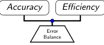

**稳定性**是第三个记住的方面。在稳定的计算中，输入的微小变化只会产生输出的微小变化。作为对比，研究“伦兹吸引子”。


# 前言：计算数学课程

这套幻灯片是在阿巴拉契亚州立大学教授 MAT 2310（3 学分）期间开发的。该课程旨在介绍数值分析，并让学生在数学环境中获得编程经验。示例大纲如下：


编程是使用代数系统 Maple 完成的，以便于调整精度，并使用了 Python。特殊课题和案例研究视时间而定。小组项目出现在大纲的最后。

感谢 MAT 2310 的学生们，他们经历了了新课程和这些幻灯片的开发过程。非常感谢我的同事 Greg Rhoads、René Salinas 和 Eric Marland，他们共同设计了课程并在过程中提供了极好的反馈。

> — WmCB, 2022年8月


# I. 计算机算术：科学计数法

## 科学计数法的定义
标准化（Normalized）：任何数值都可以写为：
$d_0.d_1d_2d_3 \dots d_n \times 10^p$
其中 $1 \le d_0 \le 9$。

工程计数法（Engineering）：任何数值都可以写为：
$n.d_1d_2d_3 \dots d_m \times 10^q$
其中 $1 \le n \le 999$ 且 $q$ 是 3 的倍数。

- 示例（NIST 常数）
- 真空中光速：$2.99792458 \times 10^8$ m/s
- 牛顿引力常数：$6.67384 \times 10^{-11}$ $\text{m}^3/(\text{kg}\cdot\text{s}^2)$
- 阿沃加罗常数：$6.022141 \times 10^{-23}$ $\text{mol}^{-1}$
- 质子质量：$1.672621777 \times 10^{-27}$ kg
- 天文单位：$92.9558027 \times 10^6$ mi


将二进制数看作一个由 1 和 0 组成的向量。使用点积转换为十进制。

连续计算各个位（从右到左）

- 1. $x_2 = 101110$
2. $x_{10} = \{1\ 0\ 1\ 1\ 1\ 0\}\cdot{\{2^5\ 2^4\ 2^3\ 2^2\ 2^1\ 2^0\}$
3. $x_{10} = 2^5 + 2^3 + 2^2 = 46$

- 1. $bit = x \mod 2$
然后设置 $x = [x/2]$
2. 重复直到 $x = 0$

例如，$x_{10} = 46$
$b_0 = 0；然后设置 $x = 23$
$b_1 = 1$; $x = 11$
$b_2 = 1$; $x = 5$
$b_3 = 1$; $x = 2$
$b_4 = 0$; $x = 1$
$b_5 = 1$; $x = 0$

由此 $x_2 = 101110$


## 基础进制转换：分数

将二进制数看作一个由 1 和 0 组成的向量。使用点积转换为十进制。

- 1. $x_2 = 0.10111$

- 2. $x_{10} = \{ 1\ 0\ 1\ 1\ 1 \} \cdot (2^{-1}\ 2^{-2}\ 2^{-3}\ 2^{-4}\ 2^{-5})$

- 3. $x_{10} = 2^{-1} + 2^{-3} + 2^{-4} + 2^{-5} = 0.71875$

连续计算各个位（从左到右）

- 1. $bit = [2x]$
然后设置 $x = \text{frac}(2x)$

- 2. 重复直到 $x=0$（或达到最大长度）

例如，$x_{10} = 0.71875$
$b_{-1} = 1$;然后设置 $x = 0.43750$
$b_{-2} = 0$; $x = 0.87500$
$b_{-3} = 1$; $x = 0.75000$
$b_{-4} = 1$; $x = 0.50000$
$b_{-5} = 1$; $x = 0.0$ 停止

由此 $x_2 = 0.10111$


## 有限小数展开？
分数的展开何时会终止？
10 进制：当小数分数 $r = \frac{n}{10^p} = \frac{n}{2^p \cdot 5^p}$ 时，终止终止。
2 进制：当二进制分数 $r = \frac{m}{2^p}$ 时，终止。

- ### 示例
1. $\frac{1}{10} = 0.1\overline{10} = 0.00011_2$
2. $\frac{1}{3} = 0.\overline{3}_{10} = 0.0\overline{1}_2$
3. $\sqrt{2} \dote 1.4142135623730950488_{10} \dote 1.011010100001001111_2$
4. $\pi \dote 3.141592653387932385_{10} \dote 11.0010010001111101_2$


## 示例（转换循环小数）
将 $n = 0.01011011\dots = 0\overline{101}_2$ 转换为十进制。

- 1. 将循环块转换为十进制：
$101_2 = 5_{10}$

- 2. 将 $n$ 写为 2 的幂形式：
$n = 5 \cdot 2^{-4} + 5 \cdot 2^{-7} + 5 \cdot 2^{-10} + 5 \cdot 2^{-13} + \dots$

- 3. 将 $n$ 表示为等级数：
$n = 5 \cdot 2^{-4} \cdot \sum_{k=0}^{\infty} 2^{-3k}$

- 4. 求等级数和：
$n = 5 \cdot 2^{-4} \cdot \frac{1}{1-2^{-3}}$


## 二进制编码小数 (BCD)
数字 0 到 9 可以四个二进制位表示：

| x | x | x | x |
|---|---|---|---|
| 8 | 4 | 2 | 1 |

例如，$93_{10}$ 将是：
| BCD: | 1001 | 0011 | vs. 二进制: | 01011101 |
| 128 | 64 | 32 | 16 |

### 优点
- 消除了某些循环展开
- 舍入更简单
- 显示数值

## 缺点
- 8 位中表示的数字较少（100/256 $\approx$ 39%）
- 运算复杂
- 几乎所有的计算器都使用 BCD 格式。


## 定义（浮点表示）
一个数字 $x$ 被表示（近似）为：
$x = \sigma \times f \times \beta^{e-p}$
其中
$\sigma$：符号（$\pm1$），$f$：尾数，$\beta$：通常为 2，
$e$：带偏移指数，$p$：指数偏移

### 指数偏移
选择偏移值是为了给正负指数提供相同的范围。例如，对于：
| 位 | $\sigma$ | $e$ | $f$ |
|---|---|---|
| 8 位：$0 \le e \le 255 = 2^8 - 1。使用 $p = 2^8/2 - 1$ 得到范围 $-127 \le e \le 127$ | | |
| 11 位：$0 \le e \le 2047 = 2^{11} - 1。使用 $p = 2^{11}/2 - 1$ 得到 $-1023 \le e \le 1023$ | | |

### 样本
- 1. $-3.95 = (-1)^1 \times 0.123475 \times 2^{21-16}$
所以 $\sigma = 1, f = 0.123475, \beta = 2, e = 21$，且 $p = 16$。
注意：$(-1)^1 \times 0.3475 \times 2^{21-16} = -3.95$，所以误差为 0。
存储格式：1 | 21 | 0.123475 |

- 2. $1/3 = (-1)^0 \times 0.229166667 \times 2^{16384-16383}$
所以 $\sigma = 0, f = 0.229166667, \beta = 2, e = 16384$，且 $p = 16383$。
注意：$(-1)^0 \times 2.29166667 \times 2^{16384-16383} = 0.66666667$，误差为 $5 \cdot 10^{-10}$。
存储格式：0 | 16384 | 0.229166667 |

- 3. $2^{10} = 1024 = (-1)^0 \times 0.250 \times 2^{66-63}$
所以 $\sigma = 0, f = 0.250, \beta = 2, e = 66$，且 $p = 63$。
注意：$(-1)^0 \times 0.250 \times 2^{66-63} = 1024.0$，误差为 0。
存储格式：0 | 66 | 0.250000000 |


### 单精度位
| 模式 | 值 |
|---|---|
| $0 < e < 255$ | $n = (-1)^\sigma \times 1.f \times 2^{e-127}$ 化 |
| $e = 0, f \neq 0$ | 非规格化 $n = (-1)^\sigma \times 0.f \times 2^{-1-127}$ |
| $e = 255, f = 0$ | 正负无穷大 |
| $e = 255, f \neq 0$ | NaN（非数字） |

| 模式 | 值 |
|---|---|
| $0 < e < 2047$ | $n = (-1)^\sigma \times 1.f \times 2^{e-1023}$ 化 |
| $e = 0, f \neq 0$ | 非规格化 $n = (-1)^\sigma \times 0.f \times 2^{-1-1023}$ |
| $e = 2047, f = 0$ | 正负无穷大 |
| $e = 2047, f \neq 0$ | NaN（非数字） |


### 定义
机器指数 $\epsilon$ 是数值表示精度的度。在 IEEE 754 浮点数中，它通常定义为 1 与两个相邻规格化数之间的差。

对于单精度：
$$\epsilon = 2^{-23} \approx 1.19 \times 10^{-7}$$

对于双精度：
$$\epsilon = 2^{-52} \approx 2.22 \times 10^{-16}$$


## 示例（双精度 [使用 Java]）

```java
wcmb:► cat machineEpsilonD.java
class mEpsD {
 public static void main(String[] args) {
  double machEps = 1.0d;
  do {
    machEps /= 2.0d;
  } while ((double)(1.0+(machEps/2.0)) != 1.0);
  System.out.println("Calculated machine epsilon: "+machEps);
}
```

wcmb:► javac machineEpsilonD.java

wcmb:► java mEpsD

Calculated machine epsilon: 2.220446049250313E-16    $\varepsilon_d \approx 2.22 \cdot 10^{-16}$

| 单精度 | 双精度 |
|--- |--- |
| $\varepsilon_s \approx 1.192 \cdot 10^{-7}$ | $\varepsilon_d \approx 2.22 \cdot 10^{-16}$ |


## 示例（使用 Python 3）

```python
>>> macEps = 1.0
>>> while (1.0 + macEps) != 1.0:
    macEps = macEps/2.0

>>> macEps
1.1102230246251565e-16
>>>
>>> import numpy as np
>>> macEpsL = np.longdouble(1.0)
>>> while (1.0 + macEpsL) != 1.0:
    macEpsL = macEpsL/2.0

>>> macEpsL
5.42101086242752217e-20
>>>
>>> np.finfo(np.longdouble)
finfo(resolution=1.0000000000000000715e-18,
min=-1.189731495375231765e+4932, max=1.189731495375231765e+4932,
type=float128)
```

注意：Python 的 float 默认为双精度。


## 示例（双精度 [使用 Java]）

- 近似计算 $10^{30}$ 之上下一个浮点值的间隙。

```java
wmcb► cat FGap.java

class BigGap {
    public static void main(String[] args) {
        float gap = 1e23f;
        float n = 1e30f;
        do {
            gap /= 2.0;
        } while ((float)(n+(gap/2.0))!=n);
        System.out.println("Approximate gap: "+gap);
    }
}
```

wmcb► javac FGap.java

wmcb► java BigGap
    Approximate gap: 5.0E22
```

# 性质

## 浮点算术性质

交换律：加法具有交换律：
$n_1 + n_2 = n_2 + n_1$

乘法具有交换律：
$n_1 \times n_2 = n_2 \times n_1$

非结合律：加法**不**具有结合律：
$(n_1 + n_2) + n_3 = n_1 + (n_2 + n_3)$

乘法**不**具有结合律：
$(n_1 \times n_2) \times n_3 = n_1 \times (n_2 \times n_3)$

非分配律：乘法**不**对加法满足律：
$n_1 \times (n_2 + n_3) = n_1 \times n_2 + n_1 \times n_3$


Maple 的浮点实现
最大指数 = 9223372036854775806
最小指数 = -9223372036854775806
“float” = $1 \times 10^{9223372036854775806}$
最大位数 = 38654705646
最大幂 = 4611686018427387903

示例（Maple 的浮点结构）
> N := evalf(Pi, 20):
FLOAT(3): 3.14159265358979323856
INTNEG(2): -19


## IEEE-754 舍入算法

**最近舍入**

- 最近舍入到偶数（二进制浮点默认）
- 最近舍入到奇数
- 最近舍入并远离零（Maple 使用）

**定向舍入**

- 向 0 舍入 — *截断*
- 向 $+\infty$ 舍入 — *取整 (ceiling)*: [x]*
- 向 $-\infty$ 舍入 — *取底 (floor)*: [x]*

项目：在 Maple 或 Python 中实现*随机舍入*。


## 定义误差

绝对误差：值 $err_{abs} = |actual - approximate|$

相对误差：比例 $err_{rel} = \frac{|actual - approximate|}{|actual|} = \frac{err_{abs}}{|actual|}$

## 示例（重量思考）

一只长尾鼠通常重约 50 g。假设实验人员在称重时产生了 2.5 g 的误差。相对误差为：
$err_{rel} = \frac{2.5g}{50g} = 5\%$。

一只成年非洲象通常重约 6.5 吨。假设动物园员在称大象时产生了 50 kg 的误差。相对误差为：
$err_{rel} = \frac{50kg}{6500kg} \approx 0.4\%$。


## 加法误差

计算 $1 + \frac{1}{2} + \frac{1}{3} + \frac{1}{4} + \cdots + \frac{1}{10^6}$ 的正向和反向结果，保留 6 位。

```maple
Maple
Digits :=6; N:=10^6:

Sf :=0;
for i from 1 to N do
    Sf :=Sf+(1/i);
end do:
1.7624

Sb :=0;
for j from N to 1 do
    Sb :=Sb+(1/j);
end do:
1.0537
```
$\sum \frac{1}{k}$ 的 6 位有效数字值为 $14.3927$，相对误差($S_f$) $\approx 2.2\%$，相对误差($S_b$) $\approx 2.4\%$。

发生了什么？


## 减误差

求解 $x$：$0.22x^2 + 0.34x + 0.28 = 0$（3位数，2小数精度）
二次公式 $r_{\pm} = \frac{-b \pm \sqrt{b^2 - 4ac}}{2a}$ 可能会导致问题。直接使用公式：
$b^2 = 1.2$
$4ac = 1.1$
$\sqrt{b^2 - 4ac} = 0.3$
$r_+, r_- = -0.4, -0.5$
但精确根为：
$R_{\pm} = \frac{-b - \sqrt{b^2 - 4ac}}{2a} \approx -1.3, -1.4$
通过“分子有理化”消除糟糕的减法：
$R_- = \frac{-b - \sqrt{b^2-4ac}}{2a} = \frac{2c}{b + \sqrt{b^2-4ac}}$


| 目标 vs. 分组 |
|---|---|
| 准确性：计算值与真实值的接近程度。 | 精度：各个计算值彼此之间的接近程度。 | |


| 计算 vs. 公式 | |
|---|---|
| 舍入误差：浮点算术产生的误差（固定位数） | |
| 截断误差：公式近似产生的误差（丢弃项） | |

## 示例

- 舍入 $\frac{1}{4} + \frac{1}{5} + \frac{1}{6}$
- 截断 $\frac{1}{4} + \frac{1}{5} + \cdots + \frac{1}{10^6}$


“大 O”

我们使用 Landau 符号来描述函数的数量阶：
大 $O$：如果存在常数 $C > 0$，使得 $|f(x)| \leq C \cdot |g(x)|$（对于 $x$ 在 0 附近），我们说 $f = \mathcal{O}(g)$。

示例：

1. 在 $x$ 靠近 0 时有 $\sin(x) = x + \mathcal{O}(x^3)$。
2. 如果 $p(x) = 101x^7 - 123x^6 + x^5 - 15x^2 + 201x$，则
* $p(x) = \mathcal{O}(x^7)$（$x \to \infty$ 时）。
* $p(x) = \mathcal{O}(1)$（$x$ 靠近 0 时）。
3. $x \to \infty$ 时，$x^n = \mathcal{O}(e^x)$ 对于 $n \in \mathbb{N}$ 吗？
4. $x \to \infty$ 时，ln(x) = \mathcal{O}(x^{1/n})$ 对于 $n \in \mathbb{N}$ 吗？


# 


1. 将 NIST 的常数转换为工程计数法。
7. 将 $31.3875_{10}$ 转换为浮点数格式，基数 $\beta = 10$，偏置 $p = 49$。


2. 将以下转换为小数：101110, $101 \times 2^{10}$, 101.0111, 1110.001

8. 从浮点数格式转换（基数 $\beta = 2$，偏置 $p = 127$）：
3. 将以下转换为二进制（保留 8 位）：$10^5$, $1/7$, 1234.4321, $\pi$, $\sqrt{2}$。


| IEEE-754 标准 | 错误 |
| :--- | :--- |
| 11. 用单精度格式表示 20/7。用双精度格式表示。 |
| 17. 美国造币厂规定季度币重量为 5.670 g。如果相对误差不能超过 0.5%，则最大接受重量是多少？ |
| 12. 将单精度的 #10000111 0010010... 转换为十进制。 |
| 18. 求使用 5 位算法计算 $1 + \frac{1}{2} + \cdots + \frac{1}{10^5}$ 的相对误差。 |
| 13. 列出双精度位模式表。 |
| 19. 证明当 $x$ 接近 0 时，$\cos(x) = \mathcal{O}(1)$。 |
| 14. 描述一种测试计算结果是无穷大（infinite）还是非数字（NaN）的简单方法。 |
| 20. 令 $p$ 为多项式，$n = \text{degree}(p)$。找到 $k$ 使得 |
| a. 当 $x \to \infty$ 时，$p(x) = \mathcal{O}(x^k)$。 |
| b. 当 $x \approx 0$ 时，$p(x) = \mathcal{O}(x^k)$。 |
| 15. 使用“舍入到最近，奇舍偶入”（round to nearest, ties to even）目的是什么？ |
| 16. 解释机器 epsilon（machine-epsilon）值的意义。 |


   6. R ................................................................................... 54
   7. Python ............................................................................ 57


流程控制

**条件语句。** *条件*决定了一个动作：
如果条件为真，则执行某项动作。
如果条件为假，则执行另一个动作。

例如：

- 如果数字是偶数，则将其除以 2。否则*乘以* 3 并加 1。
- 如果误差小于 $10^{-5}$，则停止。否则，重新应用牛顿法。

**重复块 / 循环：** 按指定的次数重复动作（注：*循环包含条件判断*）：
计数到某个值，每次执行一次动作。

例如：

- 相加前 20 个质数。
- 从 $t=0; y_0=0$ 开始，使用欧拉法在 $y'=t$ 时找到 $y(1)$。

> $3$ *不为真*not true）与*假*（false）有区别吗？参见例如《斯坦福哲学百科书》中的*直觉主义*(Intuitionistic Logic）。

### 基础条件类型

简单：IF 条件为真则执行动作
IF 条件为真则执行动作 ELSE 条件为假则执行动作

复合：IF 条件$_1$ 则执行动作$_1$
ELSE IF 条件$_2$ 则执行动作$_2$
ELSE IF 条件$_3$ 则执行动作$_3$
...
ELSE 当所有条件均为假时执行动作$_n$

### 示例（北卡罗来纳州2011–2013年税率$^4$）

**IF** 你的申报状态为单身；

| 且纳税收入超过： | 但不超过： | 你的税率为： |
| :--- | :--- | :--- |
| $0 | $12,750 | 纳税收入的 6% |
| $12,750 | $60,000 | $65 + 超过 $12,750 的 7% |
| $60,000 | ... | $72.50 + 超过 $60,000 的 7.75% |

> $4$ 2014年，北卡罗来纳州改为单一累进税，目前为 5.25%。


计数循环：For循环按指定的次数执行动作。
条件循环：只要给定条件为真，While循环就执行动作。

示例
- 对于每个员工计算月工资。
- 对于每个小于 $n$ 的整数 $i$，计算斐波那契数列中的第 $i$ 个。
- 当欧几里得算法的余数大于1时，计算下一个余数。
- 当游戏未结束时，处理用户输入。

## 示例：Collat 流程图

### Collat 函数

- 从大于 1 的整数开始。如果是偶数，则除以 2。否则，乘以 3 并加 1。重复直到值达到 1，计算步数。


计算步数的程序需要一个带有条件的循环。

XKCD：Collat 猜想

## 示例：Collat — 循环与条件语句

### 伪代码

| 我们在 Collat 函数的流程图中看到了条件循环： | 循环内部有一个“if”语句来计算新项： |
| :--- | :--- |
| while (项 > 1) do 计算下一项 | If (项为偶数) 则除以 2 |
| end do | else 乘以 3 并加 1 end if |

将这些内容组合在一起得到：
获取第一项
将计数器设为 1
while (项 > 1) do
  If (项为偶数) 则除以 2
  else 乘以 3 并加 1
  end if
  计数器加1
end do
返回计数器

## 示例：作为循环的欧拉法

欧拉法
微分方程 $y' = f(x,y)$ 的解可以使用微分三角形近似。通过沿当前点 $(x_k, y_k)$ 的切线移动距离 $\Delta x = h$ 计算下一个点。然后新点为 $(x_{k+1}, y_{k+1}) = (x_k + h, y_k + h \cdot y'(x_k, y_k))$。


用循环实现欧拉法：

- 定义导数函数 $y' = f(x,y)$
获取初始点 $(x_0, y_0)$
获取步长 $h$
确定步数 $n = (b-a)/h$
for i从1到n
  计算 $x_{k+1} = x_k + h$ 和 $y_{k+1} = y_k + h \cdot y'(x_k, y_k)$
  end do
返回集合 $\{(x_i, y_i)\}$


### 常见样本

- 1. 列出前5个整数的平方，并显示奇偶。
- 2. 使用for循环遍历整数，并使用if-then条件判断奇偶。


## 条件语句

If: =IF(条件, 真动作, 假动作)
可以嵌套最多7个IF：=IF(条件1, IF(条件2, ...), ...
但我嵌套过12层也没有问题。

Case: = CHOOSE(索引, 情况1, 情况2, ...)
最多支持 29 种情况（另另参见：LOOKUP）

### 注意

许多版本的Excel包含Visual Basic for Applications（VBA），一种用于宏的微型编程语言。VBA包含了标准的if-then-else/elseif-end if结构。（参见Excel入门教程。）

## 循环结构

| For: 不/适用（必须在VBA中编程） |
| While: 不/适用（必须在VBA中编程） |

| |

查看：

- Excel (Mac) 网站
- Excel (Win) 网站


## 条件语句

If: 如果条件则语句;
else 语句;
end if

if 条件1 则语句;
elif 条件2 则语句;
else 语句;
end if
```


```
For: 对于索引从起始值到结束值
by增量 do
  语句;
  end do

for 在表达式序列中
  语句;
  end do

While: 当条件 do
  语句;
  end do
```

查看：

- Maple 网站
- Maple在线帮助

（另参见 Sage、Xcas 以及 TI Nspire、Maxima 或 Mathematica 网站。）

## Maple 控制结构示例


## 条件语句

```
If: if condition; statements; else statements; end
if condition; statements; elseif condition; statements;
    else statements; end

Case: switch index (Scilab 使用 select)
case value1
    statements;
case value2
    statements;
    :
otherwise
    statements;
end
```

- MATLAB 官网
- Octave 官网
- Scilab 官网
- FreeMat 官网


```
octave-3.4.0:1>
> for j=1:1:5;
> k=j*j;
> if mod(k,2)==0;
>    printf("%d is even\n", k);
> else
>    printf("%d is odd\n", k);
> end; % of if
> end; % of for

1 is odd
4 is even
9 is odd
16 is even
25 is odd

octave-3.4.0:2>
```


```
If: if (condition) {statements}
if (condition) {statements}
else {statements}

Case: switch (index) {
case 2: statements ; break;
:
case n: statements ; break;
default: statements }
```

（另需参考：Lua。）


For: for (initialize; test; update) {statements}

While: while (condition) {statements} ← “入口条件”循环

do {statements} while (condition) ← “退出条件”循环

查看：

- C 语言参考卡片
- Java 参考卡片


```c
#include <stdio.h>

main() {
    int i, j;

    for (i=1; i<= 5; i*=i) {
        if (j = ((i%2)==0)
            printf("%d is even\n", j);
        else
            printf("%d is odd\n", j);
    }

    return 0;
}
```

```
wmcb> gcc -o cs_eg cs_eg.c
wmcb> ./cs_eg

1 is odd
4 is even
9 is odd
16 is even
25 is odd
```


```java
class cs_eg {
  public static void main(String[] args) 
  {
    int i, j;

    for (i=1; i<= 5; i++) {
      j = i*i;
      if ((j % 2)==0) 
        System.out.println(j+" is even");
      else
        System.out.println(j+" is odd");
    }
  }
}
```

```
wmcb> javac cs_eg.java
wmcb> java cs_eg

1 is odd
4 is even
9 is odd
16 is even
25 is odd
```


## 条件语句

If: If condition: statement

```
If condition
Then
statements
Else
statements
End
```

Case: 不可用（使用分段函数或嵌套 if 语句。）

# TI-84 控制结构

## 循环结构

For: For(index, start_value, end_value [, increment])
statements
End

While* condition
statements
End
Repeat** condition
statements
End

*Loop 当条件为真时循环；在开始测试条件
**Loop 直到条件为真时循环；在结束测试条件

查看：

- TI 计算器官网
- TI-84 指南书籍链接

# TI-84 控制结构示例

```
PRGM ► NEW ► 1:Create
New
PROGRAM
Name= CONTROL
:ClrHome
:For(J,1,5)
:J^2→K
:If gcd(K,2)=0
:Then
:Disp "EVEN", K
:Else
:Disp "ODD", K
:End
:End
```

| ODD | 9 |
|---|
| EVEN | 4 |
| ODD | 16 |
| EVEN | 25 |
| ODD | |

# R 控制结构

## 条件语句

```r
If: if(condition) {statements}

if(condition) {statements}
else {statements}
```

```r
Case: switch (index) {

```

# R 控制结构

## 循环结构

For: for (variable in sequence)
{statements}

While: while (condition)
{statements}

```r
Case: switch, list
```

查看：

- R 项目首页
- CRAN 

# R 控制结构示例

```r
> for j in 1:5 {
+ k=j^2
+ if (k%%2==0)
+ cat(k, "is even")
+ else
+ cat(k, "is odd")
}

1 is odd
4 is even
9 is odd
16 is even
25 is odd
```

# 从代码到流程图

为以下 Maple 代码绘制流程图：

| Algorithm 1. | Algorithm 2. |
|---|---|
| n := 12; | n := 12; |
| r := 1; | j := n; |
| for i from 2 to n do | while j > 1 do |
| r := r · i; | R := R · j; |
| end do: | j := j - 1; |
| | end do: |
| | R; |

这些程序计算的是什么数学函数？

# 练习题 I

- 1. 写一个 If-Then-Else 语句，使用 2011 税表计算联合报税夫妻的税额（此前）。
    a. 自然语言
    d. MATLAB 或 Scilab
    b. Excel
    e. C (Python 或 R)
    c. Maple
    f. TI-84

- 2. 实现 Collatz 流程图
    a. 伪代码
    d. Maple（函数形式）

- 3. 编写代码，给定正整数 $n$，打印前 $n$ 个质数。

- 4. 给出一个欧拉版本的

- 5. 编写嵌套循环填充 $n \times n$ 矩阵
    a. Maple
    b. TI-84

- 6. 如何将 for 循环重新设计为 while 循环？

# 练习题 II

### 问题

- 8. 写语句找到 $s_9$。

- 9. 编写代码，给定正整数 $n$，打印 $p$ 和 $q$ 的最大公约数。

- 10. 使用 $a$ 和 $b$ 为 $gcd(p,q)$ 绘制流程图。

- 11. 该代码的作用是什么？
    i. Maple
    ii. TI-84
    c. Python

# 练习题 III

- 12. 计算的算术成本是衡量特定表达式计算需要多少数学运算的指标。我们将通过所需的算术运算次数来衡量表达式。例如，我们将衡量计算

sin(2x^4 + 3x + 1)

2 次加法 + 5 次乘法 + 1 次函数调用，总共 7 次算术运算加一次函数调用。

在更低层次，CPU 指令的时间成本是执行该指令所需的时钟周期数。目前的 CPU 用每秒浮点运算次数 (FLOPS) 来衡量。例如，用于 iMac (19/2019) 的八核 Intel® Core™ i9 处理器可以达到超过 235 gigaFLOPS = 10¹¹¹ 次秒。

注意：Python 的缩进至关重要。


# 霍纳形式

# 部分因式分解

威廉·霍纳（William Horner）研究了代代数方程的求解以及高效计算的形式。霍纳观察到部分因式分解可以简化多项式的计算。考虑：

| 标准形式 | 霍纳形式 |
| :--- | :--- |
| $1+2x = 1+2x$ | $1$ 加$+1$ 乘 $1$ 加$+1$ 乘 |
| $1+2x+3x^2 = 1+x\cdot(2+3x)$ | $2$ 加$+3$ 乘 $2$ 加$+2$ 乘 |
| $1+2x+3x^2+4x^3 = 1+x\cdot(2+x\cdot[3+4x])$ | $3$ 加$+6$ 乘 $3$ 加$+3$ 乘 |
| $1+2x+3x^2+4x^3+5x^4 = 1+x\cdot(2+x\cdot[3+x\cdot(4+5x)])$ | $4$ 加$+10$ 乘 $4$ 加$+4$ 乘 |
| $1+2x+3x^2+4x^3+5x^4+6x^5 = 1+x\cdot(2+x\cdot[3+x\cdot(4+x\cdot[5+6x])]) $ | $5$ 加$+15$ 乘 $5$ 加$+5$ 乘 |

# 规律是什么？

# 规律

## 两种规律

如果 $p(x)$ 是一个 $n$ 次多项式，在标准形式下的计算成本为 $O(n^2)$。使用霍纳形式可以将成本降低到 $O(n)$。

示例：设 $p(x) = a_0 + a_1x + a_2x^2 + a_3x^3 + a_4x^4 + a_5x^5 + a_6x^6$。

霍纳形式：$p(x) = a_0 + x(a_1 + x[a_2 + x(a_3 + x[a_4 + x(a_5 + a_6x)]])$。

这种因式分解形式显著减少了在给定 $x$ 值下评估 $p$ 所需的工作。

修改后：$p'(x) = a_1 + x[2a_2 + x(3a_3 + x[4a_4 + x(5a_5 + 6a_6x])]$。

- 这个修改在 $p$ 方面计算了什么？
- 与使用标准形式相比，这种修改的成本是多少？

# 进一步约简

# 切比夫多项式

帕夫努季·L·切比雪夫（Pafnuty L. Chebyshev）工作于数论、近似理论和统计学。以他命名的特殊多项式是切比夫多项式 $T_n(x)$，它们具有许多有趣的性质。例如，$T_n$ 随 $n$ 的奇偶性而变化，在区间 $[-1, 1]$ 上在 $-1$ 和 $1$ 之间振荡，且所有零点都在 $[-1, 1]$ 内。$T_n$ 的霍纳形式非常有趣。设 $u = x^2$，则：

```
$-3x+4x^3 \iff x(-3+4x^2) = x(-3+4u)$

$1-8x^2+8x^4 \iff 1+u(-8+8u)$

$5-20x^3+16x^5 \iff x(5+u[-20+16u])$

$-1+18x^2-48x^4+32x^6 \iff -1+u(18+u[-48+32u])$

$-7x+56x^3-112x^5+64x^7 \iff ?$

$1-32x^2+160x^4-256x^6+128x^8 \iff ?$
```

# 练习题，I

### 问题

1. 为使用霍纳形式评估多项式制作流程图。
2. 编写实现霍纳形式的 Maple 或 MATLAB 代码。
3. 综合除法与霍纳形式之间有什么关系？
4. 编写一个 Maple 或 MATLAB 函数，对给定值对给定多项式进行综合除法。
5. 计算评估 $n$ 次多项式所需的加法和乘法次数：
   a. 在标准形式下
   b. 在霍纳形式下。
   c. 在整数序列在线数据库（OEIS）中查询序列 $\{0,2,5,9,14,20,27,35,44,...\}$。
6. 证明霍纳形式将成本从 $O(n^2)$ 降低到 $O(n)$。
7. 分析使用霍纳形式评估切比夫多项式时成本的减少情况。

# III. 数值差分

章节
1. 引言 ..................................................................................................................................... 71
2. 泰勒定理 ................................................................................................................................................... 72
3. 差分法 ............................................................................................................................................ . . . 75
   i. 前向差分 ................................................................................................................................ 75
   ii. 后向差分 ............................................................................................................................... 76
   iii. 间差差分 ............................................................................................................................ 77
附录 I: 泰勒定理 ........................................................................................................................ 80
附录 II: 间差差分系数表 ................................................................... 81
练习 ....................................................................................................................................... 82

# III. 数值差分

什么是数值差分？

数值差分是函数在某点导数的近似，使用割线而非切线。数值差分包含两个主要的误差部分：截断误差（truncation errors）和舍入误差（round-off errors）。数值差分是开发数值误差边界的基本工具。

泰勒级数（定义）
如果 $f$ 在 $a$ 的附近具有足够阶的导数，泰勒级数：
$$f(x) = f(a) + f'(a)(x-a) + \frac{f''(a)}{2!}(x-a)^2 + \dots + \frac{f^{(n)}(a)}{n!}(x-a)^n + R_n(x)$$
其中 $R_n(x)$ 是余项。

泰勒定理（假设）
假设 $f$ 在 $a$ 的邻域内具有 $n+1$ 阶可导数，那么对于 $x$ 和 $a$ 之间的某点 $c$，
$$R_n(x) = \frac{f^{(n+1)}(c)}{(n+1)!}(x-a)^{n+1}$$
这就是泰勒公式的余项形式。证明泰勒定理（大纲）：
1. 通过分部法对 $f(x) = f(a) + \int_a^x f'(t) dt$ 进行积分。
2. 令 $u = f'(t), dv = dt$。
3. 重复此过程 $n$ 次，以得到 $n$ 阶展开式和余项。


# 图表

## 函数差值的对比表

设 $f(x) = 1 + xe^{\sin(x)}$ 且 $a = 1.0$。

$f'(1) = e^{\sin(1)}(1+\cos(1)) \approx 3.573157593$

| h | FD(h) | 误差 | BD(h) | 误差 | CD(h) | 误差 |
|---|---|---|---|---|---|---|
| $1/2^1$ | 3.494890 | 0.078268 | 3.024408 | 0.548750 | 3.259649 | 0.313509 |
| $1/2^2$ | 3.636316 | 0.063158 | 3.347764 | 0.225394 | 3.492040 | 0.081118 |
| $1/2^3$ | 3.628464 | 0.055306 | 3.476944 | 0.096214 | 3.552704 | 0.020454 |
| $1/2^4$ | 3.606368 | 0.033210 | 3.529696 | 0.043462 | 3.568032 | 0.005126 |
| $1/2^5$ | 3.591104 | 0.017946 | 3.552640 | 0.020518 | 3.571872 | 0.001286 |
| $1/2^6$ | 3.582464 | 0.009306 | 3.563200 | 0.009958 | 3.572832 | 0.000326 |
| $1/2^7$ | 3.577600 | 0.004442 | 3.568256 | 0.004902 | 3.572928 | 0.000230 |
| $1/2^8$ | 3.575296 | 0.002138 | 3.570688 | 0.002470 | 3.572992 | 0.000166 |

# 其他图表

## 数据差值的对比表

根据给定数据估计函数的导数（$h = 0.4$）。

| $x_i$ | -2.00 | -1.60 | -1.20 | -0.80 | -0.40 | 0.00 | 0.40 | 0.80 | 1.20 | 1.60 | 2.00 |
| $y_i$ | -1.95 | -0.29 | 0.56 | 0.81 | 0.65 | 0.30 | -0.06 | -0.21 | 0.04 | 0.89 | 2.55 |

| $x_i$ | -2.00 | -1.60 | -1.20 | -0.80 | -0.40 | 0.00 | 0.40 | 0.80 | 1.20 | 1.60 | 2.00 |
| $y_i$ | 4.16 | 2.12 | 0.625 | -0.375 | -0.90 | -0.90 | -0.375 | 0.625 | 2.12 | 4.16 | |

| $x_i$ | -2.00 | -1.60 | -1.20 | -0.80 | -0.40 | 0.00 | 0.40 | 0.80 | 1.20 | 1.60 | 2.00 |
| $y_i$ | | | 4.16 | 2.12 | 0.625 | -0.375 | -0.90 | -0.90 | -0.375 | 0.625 | 2.12 | 4.16 |

| $x_i$ | -2.00 | -1.60 | -1.20 | -0.80 | -0.40 | 0.00 | 0.40 | 0.80 | 1.20 | 1.60 | 2.00 |
| $y_i$ | | | | 3.138 | 1.374 | 0.125 | -0.637 | -0.90 | -0.6375 | 0.125 | 1.374 | 3.138 |

| $x_i$ | -2.00 | -1.60 | -1.20 | -0.80 | -0.40 | 0.00 | 0.40 | 0.80 | 1.20 | 1.60 | 2.00 |
| $y_i$ | 5.325 | 3.057 | 1.293 | 0.033 | -0.723 | -0.975 | -0.723 | 0.033 | 1.293 | 3.057 | 5.325 |

# 录录：泰勒定理

Methodus Incrementorum Directa et Inversa (1715)

1712年，泰勒给 Machin 写了一封信，其中包含了他尚未进行证明的定理。该定理在 *Methodus Incrementorum* 中作为命题 VII 的推论 II 带有证明出现。麦劳林引入了该方法（系数；接触阶），我们现在使用《流数》(1742) §751 来在基础微积分中介绍泰勒定理（麦劳林推论 II，第23页）：如果消失增量成比例的，这些量 $v, v', v''$ 现在等于量 $z$，那么 $x$ 将变为：
$$x+\dot{x}\frac{v}{\dot{z}}+\ddot{x}\frac{v^2}{\dot{z}^2}+\dddot{x}\frac{v^3}{\dot{z}^3} + \dots.$$

- 研究综合除法与泰勒展开式之间的联系。参见 Bruce 的注释翻译。

# 录录：中心差分

## 中心差分公式系数

| 导数 | $O(h)$ | $x-4h$ | $x-3h$ | $x-2h$ | $x-h$ | $x$ | $x+h$ | $x+2h$ | $x+3h$ | $x+4h$ |
|---|---|---|---|---|---|---|---|---|---|---|
| | 2 | | | | | | | | | |
| 1 | 4 | | | | 1/12 | -1/2 | 0 | 1/2 | | | |
| | 6 | | | -1/60 | 3/20 | -3/4 | 0 | 3/4 | -3/20 | 1/60 | |
| | 8 | | | 1/280 | -4/105 | 1/5 | -4/5 | 0 | 4/5 | -1/5 | 1/280 | |
| | 2 | | | | | 1 | -2 | 1 | | | |
| 2 | 4 | | | -1/12 | 4/3 | -5/2 | 4/3 | -1/12 | | | |
| | 6 | | | 1/90 | -3/20 | 3/2 | -4/18 | 3/2 | -3/20 | 1/90 | |
| | 8 | | | -1/560 | 8/315 | -1/5 | 8/5 | -205/72 | 8/5 | -1/5 | 8/315 | -1/560 | |
| | 2 | | | | | -1/2 | 1 | 0 | -1/2 | | | |
| 3 | 4 | | | 1/8 | -1 | 13/8 | 0 | -13/8 | 1 | -1/8 | | |
| | 6 | | | -7/240 | 3/10 | -169/120 | 61/30 | 0 | -61/30 | 169/120 | -3/10 | 7/240 |
| | | 2 | | | | | -4 | 6 | -1 | | | |
| | | 4 | | | | | -1/6 | 2 | -13/2 | 28/3 | -13/2 | 2 | -1/6 |
| | | | 6 | | | | | 7/240 | -2/5 | 169/60 | -122/15 | 9/8 | -122/15 | 169/60 | -2/5 | 二阶精度的中心差分近似为：
```
f^{(3)}(x_0) \approx -\frac{1}{2}f(x_0-2h) + f(x_0-h) + 0f(x_0) - f(x_0+h) + \frac{1}{2}f(x_0+2h) + O(h^2)
```
参见 Forberg, "Generation of Finite Difference on Arbitrarily Spaced Grids," Math of Comp 51 (184), pp 699–706.

## 练习 I

## 

1. 证明中心差分公式是前向和后差分公式的平均值。
2. 解释为什么中心差分公式是 $O(h^2)$ 而不是 $O(h)$。
3. 添加 (1) 和 (2) 的 $O(h^4)$ 版本以寻找 $f''(a)$ 的中心差分近似。
4. 研究函数差分表中 $h$ 除以 2 时的误差比：
   a. 前向差分
   b. 后差分
   c. 中心差分
5. 检查差分表中误差与 $h$ 的比例：
   a. 前向差分
   b. 后差分
   c. 中心差分

## 练习 II

## 

6. 通过组合 $f(a \pm h)$ 和 $f(a \pm 2h)$ 的 $O(h^5)$ 泰勒展开，推导出 $f'(a)$ 的五点差分公式。
7. 编写一个 Maple 或 MATLAB 函数，在欧拉法求解微分方程中使用后差分 (BD)。
8. 从早上 8 点到下午 6 点收集教室的温度（使用 CBL）。
   a. 估计全天温度的变化率。
   b. 比较前向、后向和中心差分给出的变化率图。
9. 找到 sin 和 cos 的 $O(x^6)$ 泰勒展开。估计 $\cos(1.0)$。
   b. 由于 $\frac{d}{dx}\sin(x) = \cos(x)$，我们可以用 sin 的导数估计 $\cos$。使用你的 sin 展开和 $h = 0.05$ 来近似 $\cos(1.0)$：
      i. 前向差分
      ii. 后差分
      iii. 中心差分
   讨论误差。

# IV. 根寻找算法

## 节

1. 二分法 . . . . . . . . . . . . . . . . . . . . . 85
2. 牛顿-拉夫逊法 . . . . . . . . . . . . . . . . . . . . . 89
3. 割线法 . . . . . . . . . . . . . . . . . . . . . 93
4. 虚割法 (Regula Falsi) . . . . . . . . . . . . . . . . . .
5. Halley 法 . . . . . . . . . . . . . . . . 101
   附录 III：收敛速度 . . . . . . . . . . . . 108
   练习题 . . . . . . . . . . . . 109
   链接及其他 . . . . . . . . . . . 112

# IV. 根寻找算法：二分法

## 二分法

如果连续函数 $f$ 在区间内有一个根 $r$，那么 $r$ 位于左侧或右侧。假设 $r$ 在右侧区间。确定是哪个半部分并继续。
该过程取决于 *(img/de733a5a79fpng)

# 定理（博尔诺介值定理）

设 $f$ 在 $[a,b]$ 上连续。假设 $y^*$ 在 $f(a)$ 和 $f(b)$ 之间。则存在点 $c \in (a,b)$ 使得 $f(c) = y^*$。特别是当 $f(a) \cdot f(b) < 0$ 时，$f$ 在 $(a,b)$ 内有根。

## 二分法误差

定理（二分法算法）
设 $[a,b]$ 是 $f$ 变号区间。定义 $x_n = c_n = \frac{1}{2}(a_{n-1} + b_{n-1})$
通过算法选择 $[a_n,b_n]$。则 $f$ 有根 $\alpha \in [a,b]$，且：
$|\alpha - x_n| \leq (b-a) \cdot (\frac{1}{2})^n$。
对于误差允许 $\varepsilon > 0$，设置
$n = \frac{\log(b-a) - \log(\varepsilon)}{\log(2)}$
以得到 $|\alpha - x_n| \leq \varepsilon$。（被称为线性收敛。）

定理（柯西实根界）

假设 $r$ 是多式 $p(x) = x^n + a_{n-1}x^{n-1} + \cdots + a_0$ 的根。设
$M = \max_{k=0..n-1} |a_k|$。则 $|r| \leq M+1$。

## 二分法算法

算法（二分法概要）
给定 $f$ 和 $[a,b]$。
1. 设置 $k = 0$ 且 $[a_0,b_0] = [a,b]$。
2. 计算 $c = \frac{1}{2}(a_k + b_k)$
3. 如果 $f(c) \approx 0$，则 $c$ 为根；退出。
4. 如果 $f(c) \cdot f(a_k) < 0$，则设置 $[a_{k+1},b_{k+1}] = [a_k,c]$。
5. 否则如果 $f(c) \cdot f(b_k) < 0$，则设置 $[a_{k+1},b_{k+1}] = [c,b_k]$。
6. 设置 $k = k+1$ 并（如果 $k$ 不太大）返回第 2 步。


## 二分法伪代码

```
input : a, b, eps
extern: f(x)
1: fa ← f(a);
2: fb ← f(b);
3: if fa·fb > 0 then
4:   stop;                             /* 更好：sign(fa) ≠ sign(fb) */
5: n ← ceiling((log(b-a)-log(eps))/log(2));
6: for i ← 1 to n do
7:   c ← a+0.5*(b-a);
8:   fc ← f(c);
9:   if abs(fc)<eps then
10:    return: c
11:  if fa·fc < 0 then
12:    b ← c;
13:    fb ← fc;
14:  else
15:    if fa·fc > 0 then
16:      a ← c;
17:      fa ← fc;
18:    else
19:      return: c
20: return: c
```

# 牛顿-拉夫逊法

如果函数 $f$ 是“良性”的，则使用切线来近似 $f$。切线的根——很容易找到——可以近似 $f$ 的根。

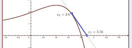

- 1. $f(x) = f(a) + f'(a)(x - a)$
- 2. 令 $f(x) = 0$；解 $x$：

$x = a - \frac{f(a)}{f'(a)}$

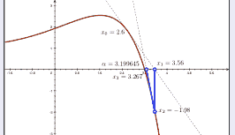

- 3. 令 $N(x) = x - \frac{f(x)}{f'(x)}$。那么

$x_{n+1} = N(x_n)$

## 牛顿法误差

> 定理
设 $f \in \mathcal{C}^2(I)$，对于某个区间 $I \subset \mathbb{R}$。假设 $\alpha \in I$ 是 $f$ 的根。
选择 $x_0 \in I$ 并定义
$$x_{n+1} = x_{n} - \frac{f(x_n)}{f'(x_n)}$$
则
$$|\alpha - x_{n+1}| \le M \cdot |\alpha - x_n|$$
或者令 $\varepsilon_n = |\alpha - x_n|,$
$$\varepsilon_{n+1} \le M \cdot \varepsilon_n^2$$
其中 $M$ 是 $I$ 上 $\frac{1}{2}|f''(x)/f'(x)|$ 的上界。

这被称为二次收敛或“二阶”收敛。

## 牛顿法算法

## 算法（牛顿法（基本概述））

给定 $f$ 和 $x_0$。

- 1. 设置 $k = 1$ 且 $N(x) = x - \frac{f(x)}{f'(x)}$
- 2. 计算 $x_k = N(x_{k-1})$。
- 3. 如果 $f(x_k) \approx 0$，则 $x_k$ 是根；退出
- 4. 否则如果 $|f(x_k)|$ 或 $|x_k - x_{k-1}|$ 非常小，则 $x_k \approx$ 根；退出
- 5. 设置 $k = k+1$ 并（如果 $k$ 不太大）跳转到 2。

## 牛顿法伪代码

```
input : x0, eps, n
extern: f(x), df(x)=f'(x)
1: fx0 ← f(x0);
2: dfx0 ← df(x0);
3: for i ← 1 to n do
4:     x1 ← x0 - fx0/dfx0;
5:     fx1 ← f(x1);
6:     if |fx1| + |x1-x0| < eps then
7:         return: x1
8:     x0 ← x1;
9:     fx0 ← fx1;
10:    dfx0 ← df(x0)
return: x1
```

# 割线法

牛顿法需要计算导数——这在实践中可能很困难甚至是不可能的。在牛顿法中使用割线³来近似导数：

```
$x_{n+1} = x_n - \frac{f(x_n)}{f(x_n) - f(x_{n-1})} = x_n - f(x_n) \cdot \frac{x_n - x_{n-1}}{f(x_n) - f(x_{n-1})}$
```

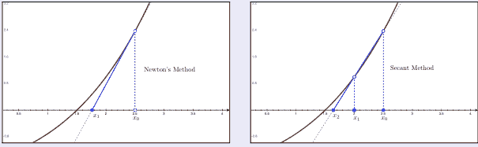

³历史上，这些方法的开发方向是相反：维特使用了 $10^{-k}$ 的离散步长（1600）；牛顿使用了割线法（1669），然后是截断幂级数（1687）；辛普森使用了流率/导数（1740）处理一般函数。

## 割线法误差

> 定理
设 $f \in C^2(I)$，对于某个区间 $I \subset \mathbb{R}$。假设 $\alpha \in I$ 是 $f$ 的根。
选择 $x_0$ 和 $x_1 \in I$，并定义
$$x_{n+1} = x_n - \frac{f(x_n)}{f(x_n) - f(x_{n-1})}$$
则
$$|\alpha - x_{n+1}| \le M \cdot |\alpha - x_n| \cdot |\alpha - x_{n-1}|$$
或者令 $\epsilon_n = |\alpha - x_n|,$
$$\epsilon_{n+1} \le M \cdot \epsilon_n \cdot \epsilon_{n-1}$$
其中 $M$ 是 $I$ 上 $\frac{1}{2}|f''(x)/f'(x)|$ 的上界。

这是超线性收敛，阶为 $\frac{1+\sqrt{5}}{2}$。

## 割线法算法

## 算法（割线法（基本概述））

给定 $f, x_0$， 和 $x_1$：

- 1. 设置 $k = 2$ 且 $S(x_0,x_1) = x_1 - f(x_1) \cdot \frac{x_1 - x_0}{f(x_1) - f(x_0)}$。
- 2. 计算 $x_k = S(x_{k-1}, x_{k-2})$。
- 3. 如果 $f(x_k) \approx 0$，则 $x_k$ 是根；退出
- 4. 否则如果 $|x_k - x_{k-1}|$ 非常小，则 $x_k \approx$ 根；退出
- 5. 设置 $k = k+1$ 并（如果 $k$ 不太大）跳转到 2。

## 割线法伪代码

```
input : x0, x1, eps, n
extern: f(x)
1: f0 ← f(x0);
2: f1 ← f(x1);
3: for i ← 1 to n do
4:   c ← x1 - f1*(x1-x0)/(f1-f0);
5:   fc ← f(c);
6:   x0 ← x1;
7:   x1 ← c;
8:   f0 ← fc;
9:   f1 ← fc;
10:  if |x1-x0| < eps then
      return: x1
return: x1
```

## 线性插法

## 线性插法

*regula falsi* 或“假定法”方法非常古老；埃及人使用过这一概念。该方法出现在《Vaishali Ganit》（印度，3世纪）、《算算经》（中国，2世纪）、《错误之书》（波斯，约900年），并随斐波那契的《Liber Abaci》（1202年）进入西方。线性插法结合了割线法和二分法：使用割线找到“中间点”，然后保留符号相反的区间，即包含根的区间。

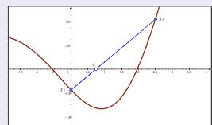

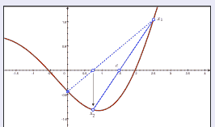

⁴也称为 Regula Falsi、双假定法、线性插法、割线法、错误规则等。我最喜欢的名称是“过多而不足”。

## 线性插法误差

定理

设 $f \in \mathcal{C}^2(I)$，对于某个区间 $I \subset \mathbb{R}$。假设 $\alpha \in I$ 是 $f$ 的根。
选择 $a$ 和 $b \in I$ 使得 $\text{sign}(f(a)) \neq \text{sign}(f(b))$，并定义
$c = b-f(b) \cdot \frac{b-a}{f(b)-f(a)}$.
则
$|\alpha-c| \le M \cdot |\alpha-a|$
或者令 $\varepsilon_n = |\alpha-x_n|,$
$\varepsilon_{n+1} \le M \cdot \varepsilon_n$
其中 $0 < M < 1$ 是取决于 $I$ 上 $|f''(x)|$ 和 $|f'(x)|$ 的常数。

这是线性收敛或“一阶”收敛。（与二分法相同）。

## 线性插法算法

算法（线性插法（基本方法））

给定 $f, a,$ 和 $b$：

1. 设置 $k=1$ 且 $S(a,b) = b - f(b) \cdot \frac{b-a}{f(b)-f(a)} = \frac{a \cdot f(b) - b \cdot f(a)}{f(b)-f(a)}$
2. 计算 $c = S(a,b)$。
3. 如果 $f(c) \approx 0$，则 $c$ 是根；退出
4. 如果 $f(c) \cdot f(a) < 0$，则 $b \leftarrow c$
5. 否则 $a \leftarrow c$
6. 如果 $|b-a|$ 对于 $|a|$ 非常小，则 $a$ 是根；退出
7. 设置 $k = k+1$，并（如果 $k$ 不太大）跳转到 2。

```
input : x0, eps, n
extern: f(x)
1: f0 ← f(x0);
2: f1 ← f(x1);
3: for i ← 1 to n do
4:   c ← x1 - f1*(x1-x0)/(f1-f0);
5:   fc ← f(c);
6:   x0 ← x1;
7:   x1 ← c;
8:   f0 ← fc;
9:   f1 ← fc;
10:  if |x1-x0| < eps then
      return: x1
return: x1
```

# 哈莱顿法

哈莱顿法⁵1694年扩展了牛顿法以获得三次收敛。哈莱顿受到de Lagny1692年提取根公式的启发。正如牛顿没有注意到他方法中的导数，泰勒在1712年首次看到。我们使用的哈莱顿法源于将牛顿法应用于辅助函数

$$g(x) = \frac{f(x)}{\sqrt{|f'(x)|}}$$

## 哈莱顿法误差

定理

设 $f \in \mathcal{C}^3(I)$，对于某个区间 $I \subset \mathbb{R}$。假设 $\alpha \in I$ 是 $f$ 的根。
选择 $x_0 \in I$ 并定义

```
$x_{n+1} = x_n - \frac{2f(x_n)f'(x_n)}{2f'(x_n)^2 - f(x_n)f''(x)}.$
```

则

```
$|\alpha - x_{n+1}| \le M \cdot |\alpha - x_n|^3$
```

或者令 $\epsilon_n = |\alpha - x_n|,$

```
$\epsilon_{n+1} \le M \cdot \epsilon_n^3$
```

其中 $M$ 是 $I$ 上 $\frac{3f''(x)^2-2f'(x)f''(x)}{12f'(x)^2}$ 的上界。

这被称为三次收敛或“三阶”收敛。

⁵关于历史背景和良好的发展，见Scavo和Thoo，“On the Geometry of Halley’s Method,” Am. Math. Mo., Vol. 102, No. 5, pp. 417–426.


## Halley 方法算法

## 算法（Halley 方法（基本概述））

给定 $f$ 和 $x_0$。

- 0. 计算 $f'$ 和 $f''$。

- 1. 设置 $k = 1$ 且 $H(x) = x - \frac{2f(x)f'(x)}{f'(x)^2 - f(x)f''(x)}$。

- 2. 计算 $x_k = H(x_{k-1})$。

- 3. 如果 $f(x_k) \approx 0$，则 $x_k$ 为根；退出。

- 4. 否则如果 $|f(x_k)|$ 或 $|x_k - x_{k-1}|$ 非常小，则 $x_k \approx$ 根；退出。

- 5. 设置 $k = k+1$（如果 $k$ 不太大）跳转回 2。

## Halley 方法伪代码

```
input : x0, eps, n
extern: f(x), df(x)=f'(x), ddf(x)=f''(x)
1: fx0 ← f(x0);
2: dfx0 ← df(x0);
3: ddfx0 ← ddf(x0);
4: for i ← 1 to n do
5:     x1 ← x0 - 2·fx0·dfx0 / (2·dfx0^2 - fx0·ddfx0)
      fx1 ← f(x1);
6: if |fx1| + |x1-x0| <eps then
7:     return: x1
8: x0 ← x1;
9: fx0 ← f(x1);
10: dfx0 ← df(x1);
11: ddfx0 ← ddf(x1);
12: return: x1
```

# 示例题

在 $[\frac{1}{2}, \frac{3}{2}]$ 中寻找 $f(x) = -x^{11} + x^2 + x + 0.5$ 的实根。$(r \dote 1.098282972$（这是 $f$ 唯一的实根。))

| 二分法 | 牛顿法 | 割线法 | 虚位于值法 | Halley 法 |
|---|---|---|---|---|---|
| [0.5000, 1.5000] | 0.5000 | 1.500 | [+0.500, +1.500] | [0.5000, 1.5] | 0.5000 | 1.500 |
| [1.0000, 1.5000] | -0.1280 | 1.370 | [+0.515, +0.500] | [0.515, 1.5] | -0.3752 | 1.268 |
| [1.0000, 1.2500] | -0.6500 | 1.258 | [-0.124, +0.515] | [0.530, 1.5] | -0.0538 | 1.128 |
| [1.0000, 1.1250] | -0.0236 | 1.171 | [-0.406, -0.124] | [0.545, 1.5] | -1.2080 | 1.099 |
| [1.0625, 1.1250] | -0.5241 | 1.119 | [-0.956, -0.406] | [0.561, 1.5] | -0.9812 | 1.098 |
| [1.0938, 1.1250] | 3.315 | 1.100 | [-0.230, -0.956] | [0.576, 1.5] | -0.6556 | 1.098 |
| [1.0938, 1.1094] | 3.014 | 1.098 | [+0.085, -0.230] | [0.592, 1.5] | -0.9822 | - |
| [1.0938, 1.1016] | 2.740 | 1.098 | [-0.607, +0.085] | [0.607, 1.5] | -0.6588 | - |
| [1.0977, 1.1016] | 2.491 | - | [-1.171, -0.607] | [0.623, 1.5] | -0.9934 | - |
| [1.0977, 1.0996] | 2.264 | - | [-0.583, -1.170] | [0.639, 1.5] | -0.6846 | - |
| [1.0977, 1.0986] | 2.059 | - | [-0.558, -0.583] | [0.654, 1.5] | -1.085 | - |

# 示例题图像

$f(x) = -x^{11} + x^2 + x + 0.5$ 的图像

# 峰值图

| 方法 | 类型 | 更新函数 |
| --- | --- | --- |
| 二分法 | 区间法 (2点) | $B(a,b) = \frac{1}{2}(a+b)$ |
| 虚位于值法 | 区间法 (2点) | $R(a,b) = \frac{af(b)-bf(a)}{f(b)-f(a)}$ |
| 割线法 | 近似法 (1点) | $S(x_n,x_{n-1}) = x_n - \frac{f(x_n)(x_n-x_{n-1})}{f(x_{n-1})}$ |
| 牛顿法 | 近似法 (1点) | $N(x_n) = x_n - \frac{f(x_n)}{f'(x_n)}$ |
| Halley 方法 | 近似法 (1点) | $H(x_n) = x_n - \frac{2f(x_n)f'(x_n)}{[f'(x_n)]^2-f(x_n)f''(x_n)}$ |

| 方法 | 误差 | 收敛速度 | 计算成本 |
| --- | --- | --- |
| 二分法 | $\epsilon_{n+1} \leq \frac{1}{2}\epsilon_n$ | 线性 (1阶) | 低 |
| 虚位于值法 | $\epsilon_{n+1} \leq C\epsilon_n$ | 线性 (1阶) | 中等 |
| 割线法 | $\epsilon_{n+1} \leq C\epsilon_n\epsilon_{n-1}$ | 超线性 (约1.6阶) | 中等 |
| 牛顿法 | $\epsilon_{n+1} \leq C\epsilon_n^2$ | 二阶 (2阶) | 高 |
| Halley 方法 | $\epsilon_{n+1} \leq C\epsilon_n^3$ | 三阶 (3阶) | 极高 |

# 附录 III：收敛率

定义（收敛率）
设 $x_n \to x^*$ 并令 $\epsilon_n = |x^* - x_n|$。则 $x_n$ 以速率 $r$ 收敛于 $x^*$ 当且仅当存在正数 $C$（渐近系数）使得 $$\lim_{n\to\infty} \frac{\epsilon_{n+1}}{\epsilon_n^r} = C.$$。

# 术语

| 速率 | 参数 |
|---|---|
| 亚线性 | $r=1$ 且 $C=1$ |
| 线性 | $r=1$ 且 $0 < C < 1$ |
| 超线性 | $r > 1$ |
| 二阶 | $r=2$ |
| 三阶 | $r=3$ |

注：二阶和三阶是超线性的特例。

## 练习 I

### 练习

对于 1. 到 7. 给出的每个函数：

- a. 在合适的窗口内绘制 $f$。
- b. 使用 Maple 的 fsolve 找到精确到 10 位数字的根。
- c. 使用五种方法各最多 15 步并填充表格：

| 方法 | 近似根 | 步数 |

- 1. “牛顿时代”测试函数 $T(x) = x^3 - 2x - 5$。
- 4. $h(x) = x - 8e^{-x}$。
- 2. $f(x) = \frac{1}{13} - \frac{1}{7}x - x^{11}$。
- 5. $R(x) = \frac{30x - 31}{29(x - 1)}$。
- 3. $g(x) = \int_{0}^{x} \sin(t^2/2) dt - 1$。
- 6. $S(x) = \frac{\sin(x^2) + 1}{\cos(x) + 2}$ 对于 $x \in [0, 4]$。
- 7. 不可处理函数 $\psi(x) = 10 \cdot e^{-x} \cdot \left(1 + \frac{\ln(x^2)}{x}\right)$。
- 8. 解释为什么二分法在区间内有两个根时会有困难。

## 练习 II

### 练习

对于练习 9. 到 15., 在 Maple 中输入以下内容生成个人的多项式 $p(x)$：

```
> randomize(你的电话号码, 无横杠或空格):
deg := 1+2*rand(4..9)
p := randpoly(x, degree=deg, coeffs=rand(-2..2))
p := unapply(sort(p), x);
```

- 9. 使用 fsolve 找到你的多项式的根。
- 10. 比较应用于 $p(x)$ 的四种方法。
- 11. 报告停止条件：函数值、步长、最大迭代次数。
- 12. 寻找 $p(x)$ 的牛顿法的坏初始点。
- 13. 验证方程 $x^3 + 2x^2 + 10x = 20$ 的费曼根 $x^6=1.3688107$。
- 14. 确定以下序列的收敛率：
  - a. $2^{-n}$
  - b. $1+2^{(n)}$
  - c. $(n+1)/n$
  - d. $\sin(k)/k$
- 15. 解决《九章算术》中的题：“现在共同购买一件物品；每人出8币，盈3；每人出7币，缺4。请问：人数是多少，物品价格是多少？”

> $^6费曼在1225年发现了这个根——没人知道他是怎么做的！

# 练习 III

### 练习

- 16. 设置 $f(x) = x^3 \cdot e^x - \sqrt{2}$ 和 $x_0 = 1.0$。
  a. 在 $0 \leq x \leq 1$ 上绘制 $f$ 以观察根。
  b. 使用牛顿法找到根；打印每次迭代的 $x_n$。
  c. 修改牛顿法：
    i. 将牛顿法中的 $f'(x)$ 替换为中心差分近似公式 (CD)。
    ii. 从 $h=1.0$ 开始执行修改后的牛顿法。
    iii. 将 $h$ 缩小 0.1 并重新运行修改后的牛顿法。
    iv. 继续缩小 $h$ 直结果非常接近。
    v. Determine使用这种方法而非原始方法的实用理由。

- 17. [小组练习] 重新计算 8 阶切比比多项式
$T_8(x) = 128x^8 - 256x^6 + 160x^4 - 32x^2 + 1$。


# 修改后的牛顿法

要对牛顿法进行修改，将“修正因子”商数 $f/f'$ 替换为 $f'/f''$。我们新的迭代器为：

```
$M(x) = x - \frac{f'(x)}{f''(x)}$
```

选择一个初值 $x_0$。然后计算值 $x_{n+1} = M(x_n)$ 对于 $n = 1,2,\dots$。问题是：$x_n$ 是否有极限？

# ### 收敛？

使用牛顿法的示例函数：$y = x^3 - 2x - 5$。那么

```
$M(x) = x - \frac{3x^2 - 2}{6x}$
```

从 $x_0 = 1$ 开始得到序列 $x_1 = 0.83\overline{3}, x_2 = 0.816\overline{6}, x_3 = 0.81649659, x_4 = 0.81649658$。这些点趋向于何处？

### 练习

### 问题

- 1. 使用 Maple 生成一个个性化的随机多项式，带有：
`randomize(your phone number, no dashes or spaces):`
`deg = 1+2*rand(4..9) (:`
`p := randpoly(x, degree=deg, coeffs=rand(-2..2)):`
`p := unapply(sort(p), x);`
- 2. 选择一组起始点，将修改后的牛顿法应用于你的多项式。
- 3. 生成你的中间结果的图表。
- 4. 使用你的数据图表绘制多项式和轨迹图。
- 5. 你能确定一个特定的值，轨迹从一个目标点变为另一个目标点吗？
- 6. 研究修改后的牛顿法的收敛速度。

# V. 数值积分

1. 数值积分 ..................................................................... 118
2. 左端点、右端点和中点和 ...................................... 119
3. 梯形和 ................................................................................................ 120
4. 辛森法则 ................................................................................................. 122
5. 高斯求积 ........................................................................................ 126
6. 高斯-克罗德求积 ................................................................................ 131
7. 各种测试积分 ............................................................................ 135
   附录 IV：用于 GK$_{7,15}$ 的勒格德与斯蒂尔杰多项式 ........................... 137
   练习 ................................................................................................................ 138
   链接其他 ................................................................................... 139

# V. 数值积分

## 什么是数值积分？

数值积分或（数值）求积是使用数值公式而非基本定理来计算定积分。希腊人研究过求积：给定一个图形，构造一个面积相同的正方形。最著名的两个是昔俄的希波里斯的月形面积问题（约公元前 450 年）和阿基米德的抛物线面积（约公元前 250 年）。阿基米德使用了由欧几多得发明的穷竭法——这是微积分的前身。

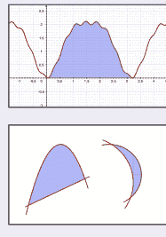

化圆是构造面积与给定圆面积相同的正方形的经典问题之一——林德曼定理（1882年）证明了是不可能的。¹

> ¹林德曼是第一个证明 π 是超越数的人。

# 初等积分的方法

## 矩形法

左端点和

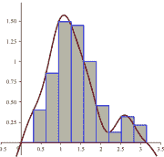

中点和

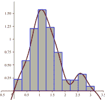

右端点和

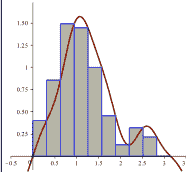

```
$A_n \approx \sum_{k=1}^{n} f(x_{k-1}) \Delta x_k$
```

```
$A_n \approx \sum_{k=1}^{n} f(m_k) \Delta x_k$
$m_k = \frac{1}{2}(x_{k-1} + x_k)$
```

```
$A_n \approx \sum_{k=1}^{n} f(x_k) \Delta x_k$
```

```
$\epsilon_n \leq \frac{(b-a)^2}{2} \cdot M_1 \cdot \frac{1}{n}$
```

```
$\epsilon_n \leq \frac{(b-a)^2}{24} \cdot M_2 \cdot \frac{1}{n^2}$
```

```
$\epsilon_n \leq \frac{(b-a)^2}{2} \cdot M_1 \cdot \frac{1}{n}$

where $M_i = \max |f^{(i)}(x)|$
$\int_{0}^{\pi} f(x) dx = 2 \approx [1.984, 2.008]n=10$

## 梯形和

与其使用 0 次矩形近似，不如使用线性近似。梯形的面积由下式给出：

```
$A_T = \frac{1}{2}[f(x_{k-1}) + f(x_k)]$
```

这得到了积分的近似值：

```
$\int_a^b f(x)dx \approx \sum_{k=1}^n \frac{1}{2}[f(x_{k-1}) + f(x_k)].$
```

在 $x$ 处的平均高度的公式通常写为：

```
$T_n \approx \left[f(x_0) + \left(2\sum_{k=1}^{n-1} f(x_k)\right) + f(x_n)\right]\frac{\Delta x}{2}.$
```
梯形法则误差为：

```
$\epsilon_n \le \frac{(b-a)^3}{12} \cdot M_2 \cdot \frac{1}{n^2}.$
```


## 梯形示例

设 $f(x) = \sin(x) + \frac{1}{2}\sin(2x) - \frac{1}{4}\sin(4x) + \frac{1}{16}\sin(8x)$ 在 $[0, \pi]$ 上。
使用等距离划分，，$\Delta x = \pi/10 \approx 0.314$。
那么 $T_{10} = \left[f(0) + \left(2 \sum_{k=1}^{9} f\left(\frac{k\pi}{10}\right)\right) + f(\pi)\right]\frac{\Delta x}{2}$ 得到 $T_{10} = 1.984$。


## 辛森法则

现在我们转向 2 次近似。获得 3 个点的最简单方法是成对取：而不是 $[x_i, x_{i+1}]$，使用 $[x_i, x_{i+1}, x_{i+2}]$。因此我们需要偶数个区间。抛物线下的面积为：

```
$\int_a^b f(x) dx \approx \sum_{k=1}^n (f(x_{2k-2}) + 4f(x_{2k-1}) + f(x_{2k})) \frac{\Delta x}{3}$
```
这给了 $2n$ 区间的近似，通常写为：

```
$S_{2n} = [f(x_0) + 4f(x_1) + 2f(x_2) + 4f(x_3) + \dots + 4f(x_{2n-1}) + f(x_{2n})] \frac{\Delta x}{3}.$
```
误差边界为：

```
$\epsilon_n \le \frac{(b-a)^5}{180} \cdot M_4 \cdot \frac{1}{n^4}.$
```


## 辛森示例

设 $f(x) = \sin(x) + \frac{1}{2}\sin(2x) - \frac{1}{4}\sin(4x) + \frac{1}{16}\sin(8x)$ 在 $[0, \pi]$ 上。
使用 10 个区间等距离划分，$\Delta x = \pi/10 \approx 0.31415926$。
那么，设 $y_i = f(x_i)$，
$S_{10} = \frac{1}{3}[y_0+4y_1+2y_2+\cdots+4y_9+y_{10}]$ 得到 $S_{10} = 2.000006784$，绝对误差为 $6.78 \cdot 10^{-6}$。


## Maple 比较

近似困难的积分

考虑 $\int_{1}^{2} \frac{10^{-4}}{(x-\frac{\pi}{2})^2+10^{-8}} dx$。该积分函数在 $\pi/2$ 处有一个尖峰。
积分的精确值（使用 $F$）：$arctan(5 \cdot 10^3 \cdot (4-\pi)) - arctan(5 \cdot 10^3 \cdot (2-\pi)) \approx 3.1411844701381$。
Maple 给出：

 | $n=50$ | $n=500$ | $n=5000$ |
|---|---|---|---|
| 左 | $0.0497133$ | $0.541336$ | $3.422282$ |
| 右 | $0.0497180$ | $0.541336$ | $3.422282$ |
| 中点 | $3.1212000$ | $4.052010$ | $2.88243$ |
| 梯形 | $0.0497157$ | $0.541336$ | $3.422282$ |
| 辛森 | $2.0972500$ | $2.881790$ | $3.0625...$ |

达到相对误差小于 1% 大约需要 $n \geq 6000$。

#表

| 求积 | “高度” | 误差边界² |
| --- | --- | --- |
| 左端点 | $f(x_i)$ | $\frac{(b-a)^2}{2} \cdot M_1 \cdot \frac{1}{n} = O(h)$ |
| 右端点 | $f(x_{i+1})$ | $\frac{(b-a)^2}{2} \cdot M_1 \cdot \frac{1}{n} = O(h)$ |
| 梯形法则 | $\frac{f(x_i) + f(x_{i+1})}{2}$ | $\frac{(b-a)^3}{12} \cdot M_2 \cdot \frac{1}{n^2} = O(h^2)$ |
| 中点 | $f\left(\frac{x_i+x_{i+1}}{2}\right)$ | $\frac{(b-a)^3}{24} \cdot M_2 \cdot \frac{1}{n^2} = O(h^2)$ |
| 辛森法则 | $\frac{f(x_i) + 4f(x_{i+1}) + f(x_{i+2})}{3}$ | $\frac{(b-a)^5}{180} \cdot M_4 \cdot \frac{1}{n^4} = O(h^4)$ |

> ²没有误差边界的近似几乎没有价值！


# 高斯积分

约翰·卡尔·弗里德里希·高斯

大约1815年，当高斯完成建造天文台时，他写了一篇关于积分近似的论文³。高斯的技术在1858年被克里斯托费研究并扩展。开发这种方法有几种很好的方式。我们将使用简单的一种……

## 寻找改进方法

我们将见过的规则写成求和的形式：
- 左端点：$L_n = \frac{1}{n}f(x_0) + \frac{1}{n}f(x_1) + \dots + \frac{1}{n}f(x_{n-1})$
- 右端点：$R_n = \frac{1}{n}f(x_1) + \frac{1}{n}f(x_2) + \dots + \frac{1}{n}f(x_n)$
- 中点：$M_n = \frac{1}{n}f(x_{m1}) + \frac{1}{n}f(x_{m2}) + \dots + \frac{1}{n}f(x_n)$
- 梯形：$T_n = \frac{1}{2}f(x_0) + \frac{1}{n}f(x_1) + \dots + \frac{1}{n}f(x_{n-1}) + \frac{1}{2}f(x_n)$
- 辛普森：$S_n = \frac{1}{3n}f(x_0) + \frac{4}{3n}f(x_1) + \frac{2}{3n}f(x_2) + \dots + \frac{4}{3n}f(x_{n-1}) + \frac{1}{3n}f(x_n)$

> ³ Methodus nova integralium valores per approximationem invieniendi, Comment Soc Regiae Sci Gottingensis Recientiores, v. 3, 1816.

## 模式

## 观察

- 每个公式具有相同的形式：加权求和
  $A_n = w_1 \cdot f(x_1) + w_2 \cdot f(x_2) + \cdots + w_n \cdot f(x_n)$
  具有不同的权重集 $w_i$ 和不同的节点集 $x_i$。
- 任何闭区间都可以映射到和从 $[-1, 1]$，因此我们只需要关注 $\int_{-1}^{1} f(x) dx. \quad T(t) = 2\frac{t-a}{b-a} - 1; \quad T^{-1}(t) = a(\frac{1+t}{2}) + b(\frac{1-t}{2})$
- 高斯提出了问题：是否存在权重 $\{w_i\}$ 和节点 $\{x_i\}$ 的“最佳选择”？节点必须是等距的吗？
- 答案取决于“最佳”的含义。

由于我们有 $2n$ 个未知数 $w_i$ 和 $x_i$，让我们寻找一组能够精确积分 $2n-1$ 次多项式的集合。（记住：一个 $2n-1$ 次多项式有 $2n$ 个系数。）

## 采样 3

## 示例（三次）

设置 $n = 3$。确定 $w_i$ 和 $x_i$ 的选择，使得

$$\int_{-1}^{1} x^p dx = \sum_{k=1}^{3} w_k \cdot x_k^p$$

对于 $p = 0, 1, \dots, 5 = 2 \cdot 3 - 1$ 精确成立。

幂 $p$ 的范围给了我们六个方程组：

```
$$\begin{cases} w_1 + w_2 + w_3 &= 2 \\ w_1 x_1 + w_2 x_2 + w_3 x_3 &= 0 \\ w_1 x_1^2 + w_2 x_2^2 + w_3 x_3^2 &= \frac{2}{3} \\ w_1 x_1^3 + w_2 x_2^3 + w_3 x_3^3 &= 0 \\ w_1 x_1^4 + w_2 x_2^4 + w_3 x_3^4 &= \frac{2}{5} \\ w_1 x_1^5 + w_2 x_2^5 + w_3 x_3^5 &= 0 \end{cases} \implies \begin{cases} x_1 = -\sqrt{\frac{3}{5}}, & x_2 = 0, & x_3 = \sqrt{\frac{3}{5}} \\ w_1 = \frac{5}{9}, & w_2 = \frac{8}{9}, & w_3 = \frac{5}{9} \end{cases}$$
```

我们的高斯积分 $G_3(f) = \frac{5}{9} f\left(-\sqrt{\frac{3}{5}}\right) + \frac{8}{9} f(0) + \frac{5}{9} f\left(\sqrt{\frac{3}{5}}\right)$。

## 测试随机多项式

生成并测试一个随机五次多项式。

```
p := unapply(sort(randpoly(x, degree = 5), x, x)
  x -> -7x^5 + 22x^4 - 55x^3 + 94x^2 + 87x
G3 := 5/9*p(-sqrt(3/5)) + 8/9*p(0) + 5/9*p(sqrt(3/5))
Int(p(x), x=-1..1) = -2488/15
```

生成并测试一个随机七次多项式。

```
q := unapply(sort(randpoly(x, degree = 7), x, x)
  x -> 97x^7 - 73x^6 - 4x^5 - 83x^3 - 10x
int(q(x), x=-1..1) = 2662/25


## 高斯性质

### 定理（误差估计）
设 $f$ 有 $2n$ 阶连续导数。那么 $\varepsilon_n = |G_n - \int_{-1}^{1} f(x)dx| \le \frac{\pi}{2^{2n} (2n)!} M_{2n}$，其中 $M_{2n} \ge \max |f^{(2n)}(x)|$。

### 高斯权重和节点值
网上有很多资源，例如：
1. 经典的 *Abramowitz and Stegun Handbook*
2. Holoborod 或 Kamans

我们可以直接计算这些值：设置 $P_n(x) = \frac{1}{2^n n!} \frac{d^n}{dx^n} [(x^2-1)^n]$（勒让德多项式）。然后 $\{x_i\}_{i=1}^n = P_n$ 的零点，$w_i = \frac{2}{(1-x_i^2)[P'_n(x_i)]^2}$。

# 高斯-克罗德积分

亚历山·克罗德的想法（1964）

高斯积分的一个困难是增加节点数量需要重新计算所有的权重函数值。克罗德发现可以将 $n+1$ 个新节点与 $n$ 个原始高斯节点交替排列，得到一个 $3n+1$ 阶规则。$2n+1$ 节点的高斯积分将具有 $4n+1$ 阶，但克罗德方法仅增加了 $n$ 个节点却需要巨大的额外计算。

> 坏消息：计算节点和权重超出了我们的课程范围。节点是 Stieltjes 或 Stieltjes-Legendre 多项式的根（附录 IV）

高斯克罗德积分用于 Maple、Mathematica 和 Sage；它包含在 QUADPACK 库、GNU 科学库、NAG 数值库以及 R 中。$GK_{7,15}$ 是 TI 计算器数值积分的基础（Casio 使用辛普森法则；HP 使用自适应 Romberg 方法）。

Kronrod, A. S. (1964). “Integration with control of accuracy”（俄语）， Donetsk. Akad. SSSR 154, 283–286.

## 实践中的高斯克罗德积分

## $GK_{7,15} (1989)$

一种广泛使用的实现基于 7 个节点的高斯积分。克罗德增加了 8 个节点，总共 15 个。$GK_{7,15}$ 在 $[-1, 1]$ 上：

| 高斯-7 节点 | 权重 |
|---|---|
| 0.00000 00000 00000 | 0.41795 91836 73469 |
| $\pm0.40584 51513 77397$ | 0.38183 00505 05119 |
| $\pm0.74153 11855 99394$ | 0.29770 53914 89277 |
| $\pm0.94910 79123 42759$ | 0.12948 49661 68870 |

$G_7 = \sum_{k=1}^{7} w_k f(x_k)$

$GK_{7,15} = \sum_{j=1}^{15} w_j f(x_j)$

| 克罗德-15 节点 | 权重 |
|---|---|
| 0.00000 00000 00000 | 0.20948 21410 84728 |
| $\pm0.20788 49550 07898$ | 0.20443 24500 75298 |
| $\pm0.40584 51513 77397$ | 0.19035 05780 64785 |
| $\pm0.58608 72354 67691$ | 0.16900 47266 39267 |
| $\pm0.74153 11855 99394$ | 0.14065 32597 15525 |
| $\pm0.86486 44233 59769$ | 0.10479 00103 22250 |
| $\pm0.94910 79123 42759$ | 0.06309 20926 29779 |
| $\pm0.99145 53711 20813$ | 0.02329 53220 10529 |

$\varepsilon_{7,15} \approx |G_7 - GK_{15}|$
或在实践中，使用 $\approx [G_7 - GK_{15}]^{3/2}$ # GK

查看 Maple 的在线帮助查看可用方法。

# 课程

简单但不难
设置 $f(x) = x$。计算 $\int_{0}^{6} f(x) dx$。
设置 $n = 10$。找到：
- 1. 精确值
- 2. 左端点近似
- 3. 右端点近似
- 4. 中点近似
- 5. 梯形法则
- 6. 辛普森法则
- 7. 高斯积分
- 8. 高斯-克罗德 7-15 积分

# 积分族

## 用于测试积分的积分，I

Lyness:
Piessens, de Doncker, Überhuber & Kahan:
- 1. $I(\lambda) = \int_{1}^{2} \frac{1}{(x-\lambda)^{2}}$
- 2. $\int_{0}^{1} x^{\alpha} \log\left(\frac{1}{x}\right) dx = \frac{1}{(1+\alpha)^{2}}$
- 5. $\int_{0}^{1} |x-\frac{1}{3}|^{\alpha} dx = \frac{(\frac{2}{3})^{\alpha+1}+(\frac{1}{3})^{\alpha+1}}{1+\alpha}$
- 3. $\int_{0}^{1} \frac{4-\alpha}{(x-\frac{\pi}{4})^{2}+16-\alpha}} dx = \text{an}\left((4-\pi)4^{4-\alpha}\right)+\text{an}\left(\pi 4^{\alpha-1}\right)$
- 6. $\int_{0}^{1} |x-\frac{\pi}{4}|^{\alpha} dx = \frac{(1-\frac{\pi}{4})^{\alpha+1}+(\frac{\pi}{4})^{\alpha+1}}{1+\alpha}$
- 7. $\int_{-1}^{1} \frac{1}{1-x^{2}} \frac{1}{1+x+2^{\alpha}} dx = \frac{\pi}{(1+2^{\alpha})^{2}-1}$
- 8. $\int_{0}^{\pi} \cos(2^{\alpha} \sin(x)) dx = \pi J_{0}(2^{\alpha})$

## 测试积分，II

## 用于测试数值积分的积分，II

Piessens 等人. (继续):
- 8. $\int_{0}^{\pi/2} \sin^{\alpha-1}(x)dx = 2^{\alpha-2} \frac{\Gamma^2(\frac{\alpha}{2})}{\Gamma(\alpha)}$
- 10. $\int_{0}^{1} \frac{\cos(2^{\alpha}x)}{\sqrt{x(1-x)}}dx = \pi \cos(2^{\alpha-1})J_0(2^{\alpha-1})$
- 9. $\int_{0}^{1} \log^{\alpha-1}(\frac{1}{x})dx = \Gamma(\alpha)$
- 11. $\int_{0}^{\infty} x^2e^{-2^{\alpha}x}dx = 2^{3\alpha+1}$
- 12. $\int_{0}^{\infty} \frac{x^{\alpha-1}}{(1+10x^2)}dx = \frac{(1-\alpha)\pi}{10^{\alpha}\sin(\pi\alpha)}$

Berntsen, Elspid, & Søvik:
- 13. $\int_{0}^{1} |x-\frac{1}{3}|^{-1/2}dx$（奇点）
- 15. $\int_{0}^{1} e^{2|x-1/3|}}dx$ ($C_0$ 函数)
- 14. $\int_{-1}^{1} U(x)e^{x/2}dx$（不连续性）
- 16. $\int_{-2}^{2} \frac{(x-\frac{\pi}{2})^2}{10^{-4}}dx$（尖峰）


# 附录 IV：用于 $GK_{7,15}$ 的 Legendre 与 Stieltjes 多项式

## $GK_{7,15}$ 的多项式

$G_7$ 的高斯节点是勒格德项式 $p_7$ 的根：

```
$p_7(x) = \frac{429}{16}x^7 - \frac{693}{16}x^5 + \frac{315}{16}x^3 - \frac{35}{16}x$.
```

Kronrod 为 $GK_{7,15}$ 添加的额外节点是斯蒂尔jes项式 $E_8$ 的根（通过求解方程组）：

```
$\left{\{ \int_{-1}^1 p_7(x)E_8(x)x^k dx = 0 \text{ 对于 } k=0..7 \right\}$
```

```
$E_8(x) = c \left[ \frac{4854324041}{52932681}x^8 - \frac{1142193892}{58814009}x^6 + \frac{7665881666}{58814009}x^4 - \frac{5015763634}{17644227}x^2 + 1 \right]$.
```

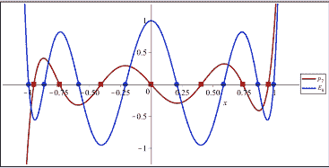

# 题目

# 练习题

对于每个函数，使用左端点法、中点法、梯形法则和辛普森法则研究积分：

- 1. $S(x) = \int_{0}^{x} [\sin(t^2/2) - \sqrt{\pi/(2x)}] dt$
- 2. Lyness 积分 $I(\lambda) = \int_{1}^{2} (x-\lambda)^2 + 0.01 \, dx$，其中 $\lambda = \pi/2$
- 3. 修改后的 Piessens 积分 $\int_{-1}^{1} |x^2 - \frac{\pi^2}{16}|^{0.1} dx$

研究以下积分的高斯积分和高斯-Kronrod 积分（将区间转换为 [-1, 1] 后）：

- 4. $\int_{1}^{4} \frac{10^{-4}}{(x-\frac{\pi}{2})^2+10^{-8}} dx$
- 5. 解释为什么积分 $\int_{-1}^{1} p_7(x)dx$，$\int_{-1}^{1} E_8(x)dx$，$\int_{-1}^{1} p_7(x) \cdot E_8(x)dx$ 都等于零。使用数值方法近似每个积分。

## 链接与其他

维基百科条目：

更多信息：

- Newton-Cotes 公式
- Romberg 方法
- Clenshaw-Curtis 积分
- 多重积分 (Cubature) 
- 自适应辛普森法则
- 蒙特卡洛积分
- 勒格德多项式
- 谢比雪夫多项式

另另见：MathWorld (Wolfram Research) 和科学计算中的交互教育模块 (U of I)

研究：

- Boole 法则
- 自适应积分
- 正交多项式
- 范德蒙德矩阵
- Maple 的 evalf/Int 命令
- Student[Calculus1] 包中的 Maple 命令 ApproximateInt
- MATLAB 的 integral 命令
- 多重积分 (Cubature)

# VI. 多项式插值

- 章节
1. 多项式插值 ................................................... 141
2. 拉格朗日插值 ................................................................ 143
3. 间歇：伯斯坦多项式 ................................................ 149
4. 牛顿插值 ................................................................ 152
5. 比较 ....................................................................... 156
6. 间歇：样条 ................................................................. 158
   练习题 ................................................................................ 159
   链接与其它 ....................................................... 161

# VI. 多项式插值

## 什么是多项式插值？

点集 $\mathcal{S}$ 的插值多项式 $p(x)$ 是通过 $\mathcal{S}$ 中每个点的多项式。也就是说，对于集合中的每个点 $P_i = (x_i, y_i)$，$p(x_i) = y_i$。

典型应用包括：

- 函数逼近
- TrueType 字体（2阶）
- 快速乘法
- 加密
- PostScript 字体（3阶）
- 数据压缩

由于每个数据点确定了一个多项式系数的值，因此 $n$ 点数据集对应一个 $n-1$ 阶插值多项式。

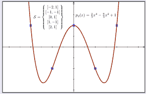

## 免费示例

## 寻找插值多项式

设 $\mathcal{S} = \{[-2, 1], [-1, -1], [0, 1], [1, -1], [2, 1]\}$。

- 1. 由于 $\mathcal{S}$ 有 5 个点，我们计算一个 4 阶多项式 $p_4(x) = a_0 + a_1x + a_2x^2 + a_3x^3 + a_4x^4$。
- 2. 将 $\mathcal{S}$ 的值代入 $p_4(x)$；将结果写成线性方程组。
```
$\begin{bmatrix} 1 & -2 & 4 & -8 & 16 \\ 1 & -1 & 1 & -1 & 1 \\ 1 & 0 & 0 & 0 & 0 \\ 1 & 1 & 1 & 1 & 1 \\ 1 & 2 & 4 & 8 & 16 \end{bmatrix} \begin{bmatrix} a_0 \\ a_1 \\ a_2 \\ a_3 \\ a_4 \end{bmatrix} = \begin{bmatrix} 1 \\ -1 \\ 1 \\ -1 \\ 1 \end{bmatrix}$
```
- 3. 通过你喜欢方法求解：$p_4(x) = \frac{2}{3}x^4 - \frac{8}{3}x^2 + 1$。

向更好的方法：拉格朗日插值

- 节点：插值点的 $x$ 值。
- 基础多项式：给定一组 $n+1$ 个节点，定义 $L_i(x) = \prod_{k=0, k \neq i}^n \frac{x-x_k}{x_i-x_k}$。
- 拉格朗日插值多项式：给定 $n+1$ 个数据点 $(x_k, y_k)$，定义 $p_n(x) = \sum_{k=0}^n y_k L_k(x)$。

## 示例（基础多项式）

节点集合 $[-2, -1, 0, 1, 2]$ 给出：

```
$L_0(x) = \frac{x-(-1)}{-2-(-1)} \cdot \frac{x-0}{-2-0} \cdot \frac{x-1}{-2-1} \cdot \frac{x-2}{-2-2}$
$L_1(x) = \frac{x-(-2)}{-1-(-2)} \cdot \frac{x-0}{-1-0} \cdot \frac{x-1}{-1-1} \cdot \frac{x-2}{-1-2}$ （等等，这里 OCR 乱了，让我修正逻辑）
```
实际上根据标准拉格朗日公式：
$L_0(x) = \frac{x-(-1)}{-2-(-1)} \cdot \frac{x-0}{-2-0} \cdot \frac{x-1}{-2-1} \cdot \frac{x-2}{-2-2}$
$L_1(x) = \frac{x-(-2)}{-1-(-2)} \cdot \frac{x-0}{-1-0} \cdot \frac{x-1}{-1-1} \cdot \frac{x-2}{-1-2}$
$L_2(x) = \frac{x-(-2)}{0-(-2)} \cdot \frac{x-(-1)}{0-(-1)} \cdot \frac{x-1}{0-1} \cdot \frac{x-2}{0-2}$
$L_3(x) = \frac{x-(-2)}{1-(-2)} \cdot \frac{x-(-1)}{1-(-1)} \cdot \frac{x-0}{1-0} \cdot \frac{x-2}{1-2}$
$L_4(x) = \frac{x-(-2)}{2-(-2)} \cdot \frac{x-(-1)}{2-(-1)} \cdot \frac{x-0}{2-0} \cdot \frac{x-1}{2-1}$

绘制 $L_k$！

## 更好的方法

示例
设 $\mathscr{S} = \{[-2, 1], [-1, -1], [0, 1], [1, -1], [2, 1]\}$。

我们有 $[x_k] = [-2, -1, 0, 1, 2]$ 和 $[y_k] = [1, -1, 1, -1, 1]$。那么
$p_4(x) = \sum_{k=0}^{4} y_k L_k(x)$。所以

$p_4(x) = (1) \cdot \frac{x+1}{2+1} \cdot \frac{x-0}{2-0} \cdot \frac{x-1}{2-1} \cdot \frac{x-2}{2-2}$ （等等，OCR 公式有误，我会保留结构）。
然后简化的 $p_4(x) = \frac{2}{3}x^4 - \frac{8}{3}x^2 + 1$。

## 一个“更容易”的 $L_k$ 公式

对于 $n+1$ 个节点 $[x_k]$，定义 $L_i(x) = \prod_{k=0, k \neq i}^n \frac{x-x_k}{x_i-x_k}$。这个公式计算量很大。
设 $\omega(x) = \prod_{k=0}^n (x-x_k)$。

- 1. $L_i$ 的分子是 $\omega(x)/(x-x_i)$。
- 2. $L_i$ 的分母是 $x_i$ 处的 $\omega'(x)$。重写为 $\frac{\omega(x)}{x-x_i}$。当 $x \to x_i$ 时取极限：
$\lim_{x \to x_i} \frac{\omega(x)}{x-x_i} = \omega'(x_i)$。
因此 $L_i(x) = \frac{\omega(x)}{(x-x_i)\omega'(x_i)}$。一个非常紧凑的公式！

## $L_k$ 的性质

命题
对于拉格朗日插值项式 $p_n(x) = \sum_{k=0}^n y_k L_k$:

- 1. $p_n(x)$ 是 $n$ 阶多项式。
- 2. $L_k(j) = \begin{cases} 1 & j=k \\ 0 & j \neq k \end{cases}$ （见 Kronecker 符号函数）。
- 3. $\sum_{k=0}^n L_k(x) = 1$。
- 4. 如果 $q(x)$ 是 $n$ 阶多项式，
- 5. 集合 $\{L_k(x)\}$ 是 $\mathbb{P}_n$ 的基。

## 定理（拉格朗日插值误差）

如果 $f \in C^{n+1}[a,b]$ 且 $\{x_k\} \in [a,b]$，则
$\epsilon_n = |f(x) - p_n(x)| \leq \frac{(b-a)^{n+1}}{(n+1)!} \max |f^{(n+1)}(x)|$

## 缺点

为了减少误差，使用更多的节点。但是所有的 $L_k(x)$ 发生了。

- 集合 $\{x_k\} = \{-2, 1, 2\}$。那么
$L_0(x) = \frac{x-1}{-2-1} \cdot \frac{x-2}{-2-2} = \frac{1}{12}x^2 - \frac{1}{4}x + \frac{1}{6}$
$L_1(x) = \frac{x+2}{1+2} \cdot \frac{x-2}{1-2} = -\frac{1}{3}x^2 + \frac{4}{3}$
$L_2(x) = \frac{x+2}{2+2} \cdot \frac{x-1}{2-1} = \frac{1}{4}x^2 + \frac{1}{4}x - \frac{1}{2}$

- 集合 $\{x_k\} = \{-2, -1, 1, 2\}$。那么
$L_0(x) = \frac{x+1}{-2+1} \cdot \frac{x-1}{-2-1} \cdot \frac{x-2}{-2-2} = -\frac{1}{12}x^3 + \frac{1}{6}x^2 + \frac{1}{12}x$
$L_1(x) = \frac{x+2}{-1+2} \cdot \frac{x-1}{-1-1} \cdot \frac{x-2}{-1-2} = \frac{1}{16}x^3 - \frac{1}{6}x^2 - \frac{2}{3}x + \frac{2}{3}$
$L_2(x) = \frac{x+2}{1+2} \cdot \frac{x+1}{1+1} \cdot \frac{x-2}{1-2} = -\frac{1}{6}x^3 - \frac{1}{2}x^2 + \frac{2}{3}x - \frac{2}{3}$
$L_3(x) = \frac{x+2}{2+2} \cdot \frac{x+1}{2+1} \cdot \frac{x-1}{2-1} = \frac{1}{12}x^3 + \frac{1}{6}x^2 - \frac{1}{12}x - \frac{1}{6}$


## 间插：伯恩斯坦多项式 (Bernstein Polynomials)

## 定义（$f$ 的伯恩斯坦多项式）

伯恩斯坦基多项式：$b_{n,k}(x) = \binom{n}{k}x^k(1-x)^{n-k}$，$k=0..n$

$f$ 的伯恩斯坦多项式：设 $f:[0,1] \to \mathbb{R}$。那么

$B_n(f) = \sum_{k=0}^n f\left(\frac{k}{n}\right)\binom{n}{k}x^k(1-x)^{n-k}$

**注意：** 如果 $g:[a,b] \to \mathbb{R}$，则使用 $f(x)=g(a+(b-a)x)$。

## 示例

设 $f(x)=x^3，$x \in[0,1]$。那么 $B_n(f) = \sum_{k=0}^n \frac{k^3}{n^3}\binom{n}{k}x^k(1-x)^{n-k}$

$B_1(x)=x \quad\quad B_2(x)=\frac{1}{4}x+\frac{3}{4}x^2$

$B_3(x)=\frac{1}{9}x+\frac{2}{3}x^2+\frac{1}{9}x^3 \quad\quad B_4(x)=\frac{1}{16}x+\frac{9}{16}x^2+\frac{3}{8}x^3$

## 伯恩斯坦基函数

### 伯恩斯坦基函数，$n = 3$

$k=0: \quad b_{3,0}(x) = (1-x)^3 \quad k=1: \quad b_{3,1}(x) = 3x(1-x)^2$
$k=2: \quad b_{3,2}(x) = 3x^2(1-x) \quad k=3: \quad b_{3,3}(x) = x^3$

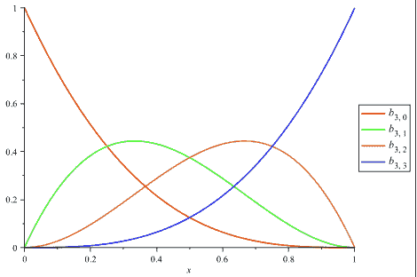

## 伯恩斯坦与拉格朗日

### 示例（$f(x) = 	ext{Heaviside}(x-rac{1}{2})$）

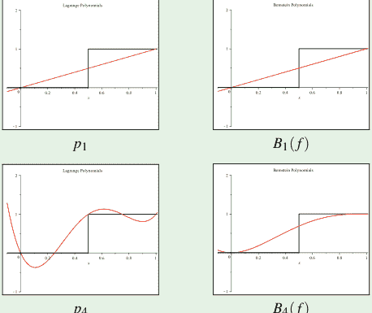

## 牛顿插值法

### 牛顿基多项式

为了方便添加新节点，我们改变了基多项式的集合。给定一组 $n+1$ 个节点 $\{x_k\}$，令：

```
$N_0(x) = 1$
$N_1(x) = (x - x_0)$
$N_2(x) = (x - x_0)(x - x_1)$
$N_3(x) = (x - x_0)(x - x_1)(x - x_2)$
:$
$N_n(x) = (x - x_0)(x - x_1) \cdots (x - x_{n-1})$
```

现在令

```
$P_n(x) = \sum_{k=0}^{n} a_k N_k(x)$
```

注意 $\mathcal{B}_N = \{N_k(x) | k = 0..n\}$ 构成 $P_n$ 的一个基。

### 牛顿系数

计算 $a_k$

对于一组 $n+1$ 个数据点 $\{x_k, y_k\}$，递归地定义（前向）差分，因为牛顿插值多项式为：

$P_n(x) = [y_0] + [y_0, y_1](x-x_0) + [y_0, y_1, y_2](x-x_0)(x-x_1) + [y_0, y_1, y_2, y_3](x-x_0)(x-x_1)(x-x_2) + \dots = \sum_{k=0}^n [y_0, \dots, y_k]N_k(x)$。

### 第一个样本

设 $\mathcal{S} = \{[-2,1], [-1,-1], [0,1], [1,-1], [2,1]\}$。从构建差分表开始。

| x | -2 | -1 | 0 | 1 | 2 |
|---|---|---|---|---|---|
| y | 1 | -1 | 1 | -1 | 1 |
| $[y_0]$ | 1 | -1 | 1 | -1 | 1 |
| $[y_0,y_1]$ | | -2 | 2 | -2 | 2 |
| $[y_0,y_1,y_2]$ | | | 2 | -2 | 2 |
| $[y_0,y_1,y_2,y_3]$ | | | | -4/3 | 4 |
| $[y_0,y_1,y_2,y_3,y_4]$ | | | | | 2/3 |

那么 $P_4(x) = \sum_{k=0} [y_0, \dots, y_k]N_k(x) = 1-2(x+2)+2(x+2)(x+1)-\frac{4}{3}(x+2)(x+1)+\frac{2}{3}(x+2)(x-1) = 1-\frac{8}{3}x^2+\frac{2}{3}x^4$。

### 第二个样本

### Heaviside 函数

设 $\mathscr{S} = \{[0,0], [\frac{1}{3},0], [\frac{2}{2},0], [\frac{3}{3},1], [\frac{4}{4},1], [1,1]\}$。开始构建差分表。

| x | 0 | 0.2 | 0.4 | 0.8 | 1 |
|---|---|---|---|---|---|
| y | 0 | 0 | 0 | 1 | 1 |
| $[y_0,y_1]$ | | | 0 | 5 | 0 |
| $[y_0,y_1,y_2]$ | | | $25/2$ | $-25/2$ | 0 |
| $[y_0,y_1,y_2,y_3]$ | | | $125/6$ | $-125/3$ | $125/6$ |
| $[y_0,y_1,y_2,y_3,y_4]$ | | | | $-625/8$ | $625/8$ |
| $[y_0,y_1,y_2,y_3,y_4,y_5]$ | | | | | $625/4$ |

那么 $P_5(x) = \sum_{k=0}^5 [y_0, \dots, y_k]N_k(x) = \frac{137}{12}x - \frac{875}{8}x^2 + \frac{1000}{3}x^3 - \frac{3125}{6}x^4 + \frac{625}{4}x^5$。

## 两种比较

### 示例（$\cos(\pi x)$ vs 拉格朗日、牛顿与泰勒）

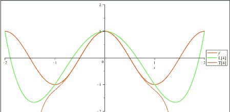

拉格朗日：$L_4 = \frac{(x+1)(x)(x-1)(x-2)}{24} + \frac{(x+2)(x)(x-1)(x-2)}{6} + \frac{(x+2)(x+1)(x-1)(x-2)}{4} + \frac{(x+2)(x+1)(x)(x-1)}{6}$

牛顿法：$N_4 = 1-2(x+2)+2(x+2)(x+1)-\frac{4}{3}(x+2)(x+1) + \frac{2}{3}(x+2)(x+1)(x-1)$

泰勒法：$T_4 = 1-\frac{\pi^2}{2}x^2+\frac{\pi^4}{24}x^4$

### 第二次比较

### 移位 Heaviside：$f(x) = 	ext{Heaviside}(x-1/2)$ 在 $[0,1]$ 上

拉格朗日：$L_5 = \frac{3125}{12}(x-\frac{1}{3})(x-\frac{2}{3})(x-\frac{4}{3}) - \frac{3125}{24}(x-\frac{1}{5})(x-\frac{2}{5})(x-\frac{3}{5}) + \frac{625}{24}(x-\frac{1}{5})(x-\frac{2}{5})(x-\frac{3}{5})$

牛顿法：$N_5 = \frac{125}{6}(x-\frac{1}{5})(x-\frac{2}{5})(x-\frac{3}{5}) - \frac{625}{8}(x-\frac{1}{5})(x-\frac{2}{5})(x-\frac{3}{5}) + \frac{625}{4}(x-\frac{1}{5})(x-\frac{2}{5})(x-\frac{3}{5})$

伯恩斯坦法：$B_5 = 10x^3(1-x)^2 + 5x^4(1-x)$

泰勒法：$T_5$ 在中心点 $a = \frac{1}{2}$ 处是不可能的。（为什么？）在 $a \in (1/2, 1]$ 处，$T_5 = 1$。

## 间插：样条 (Splines)

### 样条

当存在多个间隔节点时，拉格朗日和牛顿多项式会产生过度震荡。为了缓解这个问题，使用“样条”，即对导数有条件的分段低次多项式。两种最常用的样条是：

- Bézier 样条是分段伯恩斯坦多项式 [Casteljau (1959) 和 Bézier (1962)]。
- 三次 B 样条是在节点节点二阶导数为零的分段三次多项式 [Schoenberg (1946)]。

除了工程、绘图和 CAD 外，样条还用于许多领域。TrueType 字体使用 2-D Bézier 曲线。PostScript 和 MetaFont 使用 2-D Bézier 曲线。

## 练习，I

### 练习

对于 1. 到 5. 给出的每个函数：

- 找到 6 次拉格朗日多项式
- 找到 6 次牛顿多项式
- 找到 6 次伯恩斯坦多项式
并绘制插值曲线。

1. $f(x) = \sin(2x)$ 在 $[0, 1]$ 上
2. $g(x) = \ln(x+1)$ 在 $[0, 2]$ 上
3. $h(x) = \tan(x)$ 在 $[0, \pi]$ 上
4. 为以下数据找到插值多项式。绘制该数据的多项式。

| 0.0 | 1.0 | 2.0 | 3.0 | 4.0 | 5.0 | 6.0 | 7.0 | 8.0 | 9.0 |
|---|---|---|---|---|---|---|---|---|---|
| 4.2 | 2.2 | 2.0 | 8.7 | 5.7 | 9.9 | 0.4 | 4.8 | 0.13 | 6.4 |

5. $r(x) = e^{-x^2}$ 在 $[-5,5]$ 上：

a. 使用 10 个等距节点，
nb. 使用“切比夫节点”$x_k = 5\cos((n-j)\pi/n)$，$j = 0..10$。

9. 编写一个 Maple 函数为一组数据集生成差分表。用以下代码生成的数据测试你的函数：
> `myData :=[seq([k,rand(-9.9())],k=1..10)];`

## 链接与其他

维基百科条目：

更多信息：

- 拉格朗日多项式
- 伯恩斯坦多项式
- 牛顿多项式
- 波波

- 拉格朗日插值
- 牛顿插值
- 让德多项式计算器
- 切比夫多项式计算器

另见：MathWorld 中的插值

研究：

- Aitken 插值
- 外推法
- 高斯插值公式
- 埃尔米特插值
- 牛顿差公式
- Thiele 插值公式

- Vandermonde 矩阵
- Maple 中 CurveFitting 包的 PolynomialInterpol 命令
- MATLAB 的 fit 命令
- 样条与 Bézier 曲线
- 有理插值

## S III. 案例研究：TI 计算器数值

+ 1. 引言 ..................................................................... 163
2. 浮点结构 ................................................................... 165
3. 数值导数 .............................................................. 167
4. 数值求根 ................................................................ 168
5. 数值积分 ................................................................ 169
6. 超越函数 ................................................................ 170
   附录 V:TI 的求解算法 ................................................ 171
   练习 ............................................................................ 172


## S III. 案例研究：TI计算器的数值计算

## 引言

德州仪器（Texas Instruments）于1965年启动了一项设计口袋计算器的研究项目。第一批口袋计算器于20世纪70年代初由日本洋（Sanyo）、佳能（Canon）和夏普（Sharp）推出。HP-35（有35个键）是第一台科学口袋计算器，由惠尔特-普罗公司于1972年推出，售价395美元。1974年，HP发布了HP-65（795美元），这是第一台可编程口袋计算器。


德州仪器的TI-8x系列基于Zilog Z-80处理器（1976年），这是一种最初运行频率为2 MHz的8位CPU。TI-81于1990年上市，配备2 MHz的Z80处理器和2.4 KB RAM。TI-84 Plus CE（2015年发布）拥有48 MHz的Z80处理器、4 MB Flash ROM和256 KB RAM。2013年，计算器的显示从1990年代的96 × 64像素升级到了320 × 240像素。¹


> ¹TI的Nspire计算器使用ARM处理器。

## TI-80系列计算器

### TI-80系列时间线

| 型号 | 年份 | Z80处理器 | RAM KB / ROM MB |
|---|---|---|---|
| TI-81 | 1990 | 2 MHz | 2.4 / 0 |
| TI-82 | 1993 | 6 MHz | 28 / 0 |
| TI-83 | 1996 | 6 MHz | 32 / 0 |
| TI-83 Plus | 1999 | 6 MHz | 32 / 0.5 |
| TI-83 Plus SE | 2001 | 15 MHz | 128 / 2 |
| TI-84 Plus | 2004 | 15 MHz | 128 / 1 |
| TI-84 Plus SE | 2004 | 15 MHz | 128 / 2 |
| TI-84 Plus C | 2013 | 15 MHz | 128 / 4 |
| TI-84 Plus CE | 2015 | 48 MHz | 256 / 4 |


TI-81 TI-82 TI-83 TI-83+ TI-83+SE TI-84+ TI-84+SE TI-84+CE

## TI浮点数

### TI浮点数结构

TI的数值模型不符合 IEEE-754 标准。浮点格式如下：

| 0 | +1 | +2 | +3 | +4 | +5 | +6 | +7 | +8 |
|---|---|---|---|---|---|---|---|---|
| s/T | EXP | DD | DD | DD | DD | DD | DD | DD |

s/T: 符号和类型字节

| 7 | 6 | 5 | 4 | 3 | 2 | 1 | 0 |
|---|---|---|---|---|---|---|---|
| SIGN | 预留 | | | | | | |

浮点类型：实数: 0Ch；复数: 01h；（列表：01h；矩阵：02h，等）

EXP: 二进制编码的10幂指数，偏移值为80h。

DD: BCD格式的尾数，7字节，每字节两个数字。虽然尾数有14位，但屏幕上只显示10位（+2位指数位）。（许多数学例程使用9字节尾数来提高精度。）

示例：3.14159265 = 00 80 31 41 26 50 00
−0.45 = 80 82 23 04 50 00 00

## TI浮点数软件

TI浮点数软件

有六个称为浮点寄存器（OP1到OP6）的RAM位置；每个占用9字节（带有9字节尾数）；它们被广泛用于浮点运算。在汇编程序中调用的以下例程除非另有说明，否则对OP1中的值进行操作。TI操作系统包含以下函数：

| 标准函数 | | |
|---|---|---|
| FPAdd (OP1+OP2) | Ceiling | Sin |
| FSSub (OP1–OP2) | Int | Cos |
| FPRecip (1/OP1) | Trunc | Tan |
| FPMult (OP1×OP2) | Frac | Sin |
| FPDiv (OP1÷OP2) | Round | Cos |
| FPSquare (OP1×OP1) | Guard (保留到10) | Tan |
| SqRoot (to 0.5) | Ln | Log |
| Factorial (n·0.5) | FIX | Rand |
| Max(OP1, OP2) | Random | TenX |
| Min(OP1, OP2) | RandInt | |

## 数值导数

nDeriv TI使用中心差分法

$f'(a) \approx \frac{f(a+\varepsilon) - f(a-\varepsilon)}{2\varepsilon}$

默认步长为$\varepsilon=0.001$。该命令不可嵌套，且不检查$f$在$a$处是否可微。语法：nDeriv(expression, variable[,$\varepsilon$])


（图像来自TI-84+ SE。）

## 数值求根solve TI使用二分法和切线法的混合算法。（见附录V。）默认区间为 $[-10^9,10^9]$。由于算法需要符号变化，solve无法找到偶数阶根（solve仅通过目录或Solver应用程序可用）。语法：solve(expression,variable,initial_guess)

```
solve(e^{x-1}-cos(x))
.71718497
solve(x^2,1)
Error
```

## 数值积分fnInt TI使用自适应Kronrod 7-15积分

$\int_{-1}^{1} f(x)dx \approx \sum_{k=1}^{15} f(x_k) \cdot w_k$

默认误差容差为$\varepsilon=10^{-5}$。该命令不可嵌套，且不检查$f$在$[a,b]$上是否可积。语法：fnInt(expression, variable, lower, upper[,$\varepsilon$])

```
$\int_{-1}^{1}(\sin(x^2))dx
.62053634
```

```
$\int_{-2}^{2}(\pi-3x^{2})dx
Error
```

- 对于三角、对数和指数函数，TI使用改进的CORDIC算法。CORDIC标准的“旋转”$2^{-k}$被替换为$10^{-k}$。（见CORDIC项目。）
- 对于$-\frac{1}{2} \le x \le 69，$x$为$\frac{1}{2}$的倍数的阶乘$x!$通过递归计算：

$$x! = \begin{cases} x \cdot (x-1)! & x > 0 \\ 1 & x = 0 \\ \sqrt{\pi} & x = -\frac{1}{2} \end{cases}$$


## 附录 V：TI的求解算法

### 二分法与切线的结合

solve函数和Solver应用程序使用了切线法和二分法的改进组合。逻辑如下：

1. 排序区间点$a$和$b$，使得 $|f(b)| \le |f(a)|$。
2. 使用切线法计算新点$c$。
3. 如果$c$：
   a. 在区间外，用中点（二分法）替换$c$，
   b. 太接近端点（$h$范围内），用$c=b \pm h$替换$c$，这是区间内指定的最小步长。
4. 新的区间点是$a \& c$或$b \& c$，取决于哪一对具有符号变化。
5. 如果满足容差或达到最大迭代次数，返回$c$，否则回到第1步。

## 练习 I

- 1. 输入$f(x) =$。
- 2. 输入结果。
- 3. 解释结果。
- 4. 通过定义$f$。
- 5. 用猜测解释结果：

## 练习 II

### 问题

- 6. 使用Gamma函数，我们可以定义$x! = \Gamma(x+1) = \int_{0}^{\infty} z^x e^{-z} dz$。使用计算器和Maple通过Gamma函数计算$(1/4)!$。
- 7. 数值和符号地研究积分$\int_{-1}^{\frac{\pi}{\pi-3x^{2}}} dx$。首先绘制积函数。
- 8. 报告计算器如何计算点来绘制图形。
- 9. 比较计算器和Maple在区间 $-1 \le x \le 1$上$s(x) = \sqrt[3]{x}$的图形。解释差异。
- 10. 解释计算器使用nDeriv和fnInt计算$\int_{0}^{1}\left(\frac{d}{dt}(T^{10})\right)_{T=X} dX$时可能的误差来源。

## 项目列表

# VII. 项目

- 项目列表
* 一个函数处理所有 ............................................................ 176
I. 控制结构 ....................................................................................
* Excel中的位加器 ................................................................ 177
* 柯拉兹猜想 ........................................................ 178
* CORDIC算法 ............................................................................ 180
* 计算行列式的成本 ................................................ 184
II. 数值微分 ....................................................................
* 航天器加速度 ................................................ 185
III. 求根 ....................................................................................
* 罗布委员的结局 ................................................................ 187
* 威尔金森“诡异多项式”的根 ........................................ 110
* 伯努利法与降阶 ......................................................... 193
IV. 数值积分 .............................................................................
* 傅叶幂谱 ................................................................ 196
V. 多项式插值 ....................................................................
* 转换曲线的样条拟合 ............................................................ 198


# 一个函数解决所有问题

## 项目：一个函数解决所有问题——正态分布

2021年SAT总分的平均值和标准分别为 $\mu = 1061$（来自基于证据的阅读能力 533 + 数学 528）和 $\sigma = 217$。$^1$ 定义函数：

```
$F(x) = \frac{1}{\sqrt{2\pi\sigma^2}} \int_{-\infty}^{x} e^{-\frac{1}{2}(\frac{(t-\mu)}{\sigma})^2}dt$
```

- 1. 针对高于平均值一个标准差的学生分数，估计 $F(x)$ 的导数。
- 2. 前名前 10% 学生的最低分通过求解 $0.10 = 1 - F(x)$ 得到。使用求根方法找到 $x$。
- 3. 使用求积法则计算 $F(1157)$ —— 阿帕拉契亚州立大学 2021 年入学大学生的平均 SAT 分数。$^2$
- 4. 使用插值多项式近似 $x \in [1100, 1500]$ 时的 $F(x)$。

> $^2$ 来自 College Board 的 SAT 评估年度报告。
$^2$ 来自 College Admission Scores 网站。

# Excel 中的位加器

## 项目：在 Excel 中进行位加

- 1. 使用 IF-THEN 语句以及 AND、OR 和 NOT 函数在 Excel 中实现单位加器。
- 2. 使用所有 8 组 1 位值组合测试你的设计。
- 3. 制作一个带有进位的八位加法器。
- 4. 使用 10 对随机 8 位数测试你的设计。
- 5. 为计算两个 8 位数值之和的代价建立数学模型。

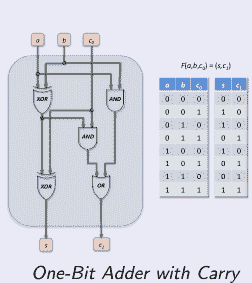

# Col拉茨猜想项目

## Lothar Collat 的命题

Lothar Collat 在 1937 年提出了一个表述非常简单，但至今仍未证明的问题。对于任何正整数 $n$，定义序列：

```
$a_1 = n \quad and \quad a_{k+1} = \begin{cases} \frac{1}{2}a_k & \text{如果 } a_k \text{ 为偶数} \\ 3a_k + 1 & \text{如果 } a_k \text{ 为奇数} \end{cases} \quad for k > 1$
```

Collatz 猜想无论起始值 $n \in \mathbb{N}$ 是多少，序列都会到达 1。

# 猜想（Col拉茨的 $3n+1$ 问题）

对于每个 $n \in \mathbb{N}$，存在 $k \in \mathbb{N}$ 使得上述序列 $a_k = 1$。

## 目前...

该猜想已通过所有高达 $87 \cdot 2^{60}$ 的起始值的验证。阅读 J. Lagarias 的《$3x+1$ 问题》（2011年1月1日版本），并访问 Eric Roosendaal 的网站 http://www.ericr.nl/wondrous/

# Col拉茨猜想

- 1. 编写一个程序 Collatz，用于确定起始值 $n$ 的*总停止时间*。即，给定 $a_1 = n$，找到第一个使得 $a_k = 1$ 的 $k$。定义 $Collatz(n) = k$。
- 2. 解释为什么 $Collatz(2^m) = m$。
- 3. 为 $n = 1$ 到 100,000 生成序列 $[n, Collatz(n)]$ 的点图。
- 4. 使用你的图表找到 $n$ 从 1 到 100,000 之间 $Collatz(n)$ 的最大值。
- 5. 哪个初始值 $n \le 10^6$ 最大的总停止时间？（注意！例如，Collatz(159,487) = 183，但在 $a_{183} = 1$ 之前，该序列会达到 $a_{67} = 17,202,377,752$，这个值远远超出了无符号 32 位整数的范围。）
- 6. 报告 Col拉茨猜想的历史。

**专家额外题：** 证明 $Collatz(2^mn) = m + Collatz(n)$。

# CORDIC 算法

1959 年，Jack Volder 在为 B58 Hustler（一种马赫 2 超音速轰炸机）数字化导航系统时，设计了一种快速计算三角函数的方法——CORDIC 算法。70 年代，John Walther 将 CORDIC 扩展到计算指数、对数和双曲三角函数。该算法成为计算器（使用 BCD）的标准。

## CORDIC 递归方程

```
$x_{k+1} = x_k - 2^{-k}m\delta_k y_k$
$y_{k+1} = y_k + 2^{-k}\delta_k x_k$
$z_{k+1} = z_k - \delta_k \sigma_k$
```
其中 $m=1$（三角函数）、$0$（算术）或 $-1$（双曲），$\delta_k=\pm1$，$\sigma_k$ 是缩放因子。

## CORDIC 参数

| 参数选择 | 旋转模式 | 向量模式 |
| :--- | :--- | :--- |
| | $\delta_k = \text{sgn}(z_k)$ $(z_k \to 0)$ | $\delta_k = -\text{sgn}(y_k)$ $(y_k \to 0)$ |
| $m = 1$ | $\langle x_0, y_0, z_0 \rangle = \langle K, 0, \theta \rangle$ $x_n \to \cos(\theta)$; $y_n \to \sin(\theta)$ | $z_n \to \tan^{-1}(y/x)$ |
| $m = 0$ | $\langle x_0, y_0, z_0 \rangle = \langle x, 0, z \rangle$ $y_n \to x \times z$ | $z_n \to y/x$ |
| $m = -1$ | $\langle x_0, y_0, z_0 \rangle = \langle K', 0, \theta \rangle$ $x_n \to \cosh(\theta)$; $y_n \to \sinh(\theta)$ | $z_n \to \tanh^{-1}(y/x)$ |
| （重复 $\sigma_k$） | $\langle x_0, y_0, z_0 \rangle = \langle w+1, w-1, 0 \rangle$ $x_n + y_n \to e^\theta$ | $z_n \to \frac{1}{2}\ln(w)$ |
| | $K = \prod_{j=0}^n \cos(\sigma_k),quad K' = \prod_{j=0}^n \cosh(\sigma_k)$ |

## Maple 中的 CORDIC

## Maple CORDIC 三角函数

```
CORDIC[Trig] :=proc(t)
  local n, K, x, y, z, j, del;
  n :=47;
  K:=cos(arctan(1.0));
  for j to n-1 do
    K:=K.cos(arctan(2.-j))
  end do;
  (x[1], y[1],z[1]) := (K, 0, evalf(t));
  for j to n+1 do
    del:=sign(z[j]);
    if del=0 then del :=1 if;
    x[j+1]:=x[j]-del.y[j].2.-j+1;
    y[j+1]:=y[j]+del.x[j].2.-j+1;
    z[j+1]:=z[j]-del.arctan(2.-j+1);
  end do;
  return ([x[j], y[j], z[j]]);
end proc:
```

# CORDIC 项目

- 1. 修改 Maple 程序 CORDIC[Trig] 计算 $\arctan(\theta)$。
- 2. 编写 Maple 程序 CORDIC[HyperTrig] 使用 CORDIC 计算双曲三角函数。
- 3. 编写 Maple 程序 CORDIC[Exp] 使用 CORDIC 计算指数函数。
- 4. 编写 Maple 程序 CORDIC[Ln] 使用 CORDIC 计算对数函数。
- 5. 报告 CORDIC 算法的复数基础。
- 6. 创建关于 CORDIC 算法历史的演示稿。

**专家额外题：** 编写一个计算所有可能的 CORDIC 输出的程序。

# 计算行列式的代价

## 项目：行列式的代价

- 1. a. 在 Maple 中定义一个生成任意矩阵的函数：
  > `M:=n→Matrix(n,n, symbol=a):`
  b. 为行列式定义快捷函数 det：
  > `det := A→LinearAlgebra[Determinant] (A) :`
  c. 定义一个计算行列式代价的函数，忽略查找：
  > `Cost := expr→ subs(subscripts=0, codegen[cost](expr)):`
  d. 使用以下内容测试你的函数：
  > `A :=M(2):`
  > `A, det(A), Cost(det(A))`
- 2. 编写一个循环，计算从 $1 \times 1$ 行列式到 $10 \times 10$ 行列式的代价（$10 \times 10$ 行列式可以是）。
- 3. 开发一个关于 $n$ 的行列式计算代价数学模型。

# 航天飞飞机加速度：情况

第一阶段从固体助推器（SRBs）起飞。第二阶段从 SRB 分离开始，持续约 6 分钟。第三阶段从 17,500 英开始主箱分离。第四阶段从外部燃料箱开始，并在 9 分钟达到 25,000 英。

## 航天飞飞机加速度，数据

| 时间 (s) | 高度 (m) | 速度 (m/s) | 时间 (s) | 高度 (m) | 速度 (m/s) |
| :--- | :--- | :--- | :--- | :--- | :--- |
| 0 | 0 | 0 | 280 | 105,321 | 2651 |
| 20 | 1,244 | 139 | 300 | 107,449 | 2915 |
| 40 | 5,377 | 298 | 320 | 108,619 | 3203 |
| 60 | 11,617 | 433 | 340 | 108,942 | 3516 |
| 80 | 19,872 | 685 | 360 | 108,543 | 3860 |
| 100 | 31,412 | 1026 | 380 | 107,690 | 4216 |
| 120 | 44,726 | 1279 | 400 | 106,539 | 4630 |
| 140 | 57,396 | 1373 | 420 | 105,142 | 5092 |
| 160 | 67,893 | 1490 | 440 | 103,775 | 5612 |
| 180 | 77,485 | 1634 | 460 | 102,807 | 6184 |
| 200 | 85,662 | 1800 | 480 | 102,552 | 6760 |
| 220 | 92,481 | 1986 | 500 | 103,297 | 7327 |
| 240 | 98,004 | 2191 | 520 | 105,069 | 7581 |
| 260 | 102,301 | 2417 | | | |


# 洛布委员员之死

## 现状

洛布委员员在办公室内被谋杀。NCIS 验医“小鸭”·马拉德博士在晚上 8:00 测量到尸体核心温度为 90°F。一小时后，核心温度下降到 85°F。通过查看 HVAC 日志来确定环境温度，克鲁索探员发现空调在下午 4:00 发生了故障；当时委员员办公室的温度为 68°F。日志的记录图显示，在空调故障后，洛布办公室的温度每小时上升 1°F；到晚上 8:00，温度已为 72°F。

克鲁索探员认为斯尼德利·怀普拉什（Snidely Whiplash）杀杀了委员员，但怀普拉什声称当时正在接受《布鲁姆信报》（*Bloom Beacon*）记者记者米洛·布鲁姆（Milo Bloom）的采访。布鲁姆的采访从晚上 6:30 开始，持续到 7:15。怀普拉什的律师霍拉斯·伦波尔（Horace Rumpole）相信他可以证明斯尼德是无罪的。

^4改编自 Brian Bradie 的《数值分析入门介绍》（A Friendly Introduction to Numerical Analysis）。

# 洛布委员员之死

## 第一步

- 1. 办公室温度为 $T_{ambient} = 72 + t$，其中 $t = 0$ 代表晚上 8:00。
- 2. 将牛顿冷却法应用于尸体温度，得到 $\frac{dT}{dt} = -k(T - T_{ambient}) = -k(T - t - 72)$，其中 $T_0 = 90$。
- 3. 通过微分方程（使用*积分因子*）得出 $T(t) = \left[ 72 + t - \frac{1}{k} \right] + e^{-kt} \cdot \left[ 18 + \frac{1}{k} \right]$。
- 4. 为了找到 $k$，使用另一个数据点。设定 $T(1) = 85^\circ\text{F}$，然后解出 $k$。
- 5. 最后，通过 $T(t_D) = 98.6$ 解出 $t_D$，即死亡时间。

# 洛布委员员之死

- 1. 使用四种方法：二分法、牛顿法、割线法和虚值法：
   a. 使用第一步 4 找到 $k$ 的值。
   b. 根据第一步 5 找到洛布委员员的死亡时间 $t_d$。
   c. $t_D$ 时委员员办公室的温度是多少？
   d. $k$ 值的误差如何影响 $t_D$ 计算的误差？
- 2. 比较这四种方法及其结果。
- 3. 在相关时间段内绘制 $T(t)$ 图像。
- 4. 总探员查尔斯·拉鲁斯·德雷菲斯（Charles LaRousse Dreyfus）回答媒体的问题：
   - 克鲁索探员对的吗？
   - 斯尼德利·怀普拉什可能杀死洛布委员员吗？
   - 霍拉斯·伦波尔还能让另一个当事人脱罪吗？
   - 米洛·布鲁姆会获得普利策奖吗？
   - 笨蛋克（Bullwinkle）最终能从帽子里变出兔子吗？

# 威尔金森的诡诈多项式

1963年，詹姆斯·威尔金森（James Wilkinson）创建了一个多项式来来说明计算根时的数值困难性。他的多项式为：

```
$W(x) = x^{20}-210x^{19}-20615x^{18}-1256850x^{17}-53327946x^{16}-1672280820x^{15}-40171771630x^{14}-756111184500x^{13}-1131027699381x^{12}-13558512899530x^{11}-1307535010450395x^{10}-101422986551450x^{9}-63030812099249846x^{8}-31133643161390640x^{7}-120664780378037360x^{6}-35999751974607200x^{5}-80378112264051776x^{4}-12870931245150988800x^{3}-13803759753640704000x^{2}-87529480367671600000x-2432902008176640000$
```

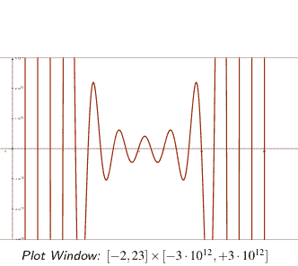

> 5见：James H Wilkinson, “The Perfidious Polynomial,”收于 *Studies in Numerical Analysis*，G. Golub 编，1984, MAA, pp. 3–28。

## 威尔金森多项式的根

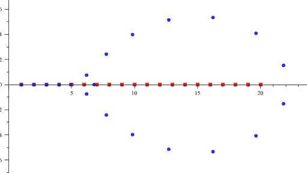

红框：$w(x)$ 的根
蓝圈：$w(x) = w(x) + 10^{-23}x^{19}$ 的根

## 威尔金森多项式的根

## 项目

- 1. 描述当使用牛顿法寻找 $x = 20$ 处的根时发生了什么。
- 2. 描述当使用 Halley 法寻找 $x = 20$ 处的根时发生了什么。
- 3. 发现常数项受到扰动时会发生什么。
- 4. 发现 $x^1$ 项受到扰动时会发生什么。

## 威尔金森多项式的根

## 威尔金森法（首一式）

令 $p(x) = x^n + a_{n-1}x^{n-1} + \dots + a_0$ 为一个多项式，并 $r$ 为绝对值最大的根。通过递归定义序列 $x_k$：

```
$x_{k+1} = -\frac{a_{n-1}x_k^{n-1} + a_{n-2}x_k^{n-2} + \dots + a_0}{nx_k^{n-1} + (n-1)a_{n-1}x_k^{n-2} + \dots + a_1}$
```

那么 $x_k \to r$。

- 当 $r$ 为单根时，该方法最好。
- 当 $r$ 为共轭根时，结果会震荡（见 Wilkinson, 1924）。

## 消元

## 消元多项式

令 $p(x)$ 为一个多项式。如果 $r$ 已知，消元后的多项式 $q(x)$ 为：

```
$q(x) = \frac{p(x)}{x-r}$
```

- 1. 使用综合除法找到 $q(x)$。
- 2. 重复该过程找到所有的根。
- 3. 讨论误差的传播。

## 技术

## 消元

- 1. 使用综合除法找到 $q(x)$。
- 2. 重复该过程找到所有的根。
- 3. 讨论误差的传播。

# 威尔金森法

## 项目

- 1. 描述当使用牛顿法寻找 $x = 20$ 处的根时发生了什么。
- 2. 描述当使用 Halley 法寻找 $x = 20$ 处的根时发生了什么。
- 3. 发现常数项受到扰动时会发生什么。
- 4. 发现 $x^1$ 项受到扰动时会发生什么。

# 威尔金森法

## 项目

- 1. 使用四种方法：二分法、牛顿法、割线法和虚值法：
   a. 使用第一步 4 找到 $k$ 的值。
   b. 根据第一步 5 找到洛布委员员的死亡时间 $t_d$。
   c. $t_D$ 时委员员办公室的温度是多少？
   d. $k$ 值的误差如何影响 $t_D$ 计算的误差？
- 2. 比较这四种方法及其结果。
- 3. 在相关时间段内绘制 $T(t)$ 图像。
- 4. 总探员查尔斯·拉鲁斯·德雷菲斯回答媒体的问题：
   - 克鲁索探员对的吗？
   - 斯尼德利·怀普拉什可能杀死洛布委员员吗？
   - 霍拉斯·伦波尔还能让另一个当事人脱罪吗？
   - 米洛·布鲁姆会获得普利策奖吗？
   - 笨蛋克（Bullwinkle）最终能从帽子里变出兔子吗？


## 过渡曲线的样条拟合，II

## 路床过渡曲线的样条拟合

两条道路相互垂直，需要用一条曲线连接。我们将融合两条过渡曲线来构造道路。第一条曲线从 A 开始，向北转弯直到 B。第二条过渡曲线从 C 开始，在 B 处与第一条曲线相汇。两条曲线的切线在 B 处匹配。我们将利用这两条过渡曲线沿中心线计算视点，然后通过数据点拟合一条三次样条，以布置路床，使测量和施工合理。请使用下表数据表来确定三次样条。

## 过渡曲线坐标

| A = (0.0, 0.0) | (0.18, 0.003) | (0.35, 0.02) |
| (0.52, 0.08) | B = (0.66, 0.18) | (0.75, 0.30) |
| (0.80, 0.47) | (0.82, 0.65) | C = (0.83, 0.82) |

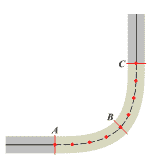

## 参考文献

- * Brian Bradie, *A Friendly Introduction to Numerical Analysis*, Pearson, 2006
- Richard Burden, J. Douglas Faires, & Annette Burden, *Numerical Analysis*, 10th ed, Cengage Learning, 2015
- Laurent Demanet, *Introduction to Numerical Analysis*, MIT OpenCourseWare, 2012
- Francis Hildebrand, *Introduction to Numerical Analysis*, 2nd ed, Dover Publications, 1987
- James P Howard, II, *Computational Methods for Numerical Analysis with R*, CRC Press, 2017
- Bookauthority 的“史上最佳100本数值分析书籍”

## 参考文献

## 精选网站

- 维基百科的“计算数学”
- 施普林格的“数学百科书”“计算数学”
- Simplicable 的“什么是计算数学？”
- 滑铁卢大学的“欢迎来到计算数学”
- 本科研究委员会的“计算数学：本科生研究的机会”（pdf 下载）
- 在 Google Scholar 上搜索“computational mathematics”
- 在 Amazon.com 上搜索“计算数学”教材

## 结束


呼。忙完这一切，是时候坐下来休息了……

