# 游戏编程入门指南：C# 和 Unity 3D 使用指南

## 献辞

献给我亲爱的妻子 Armineh 以及我的孩子们 Maximilian 和 Makayla。

> 没有你们的爱
>
> 这本书将不复存在

## 致谢

我想借此机会首先感谢我的父母。对于他们对我所付出的伟大行径，我感到谦卑和感激。他们为了孩子忍受了许多，牺牲了许多。我希望有一天能报答他们的付出，并能够成为自己孩子人的好父母。

其次，我想感谢生命中进入并影响我的每一个人。这包括童年时期的导师、大学的教授以及其期间的每一个人。好、坏、丑真实地塑造并形成了我的性格、个性和智慧。愿这段旅程永远持续！

最后，我想感谢我的妻子在开发过程中耐心地阅读书稿并提供反馈。这本书完全称不上艺术品，也绝对不是浪漫小说。相反，它非常枯燥且具有技术性，因此感谢她在管理家务和照顾孩子（本书时孩子们两岁半四个月大）时的耐心和反馈。

## 关于作者

从小时候，我就一直对事物是如何运作的以及它们背后的驱动力感到好奇。这种好奇最终引导我进入了计算机科学领域。这是少数具有无限潜力的领域之一，可以创造出你所能想象的一切。

现实中，我想要做的是创造属于自己的世界，并能够控制虚拟和物理环境。如何构建和控制机器人，如何让计算机思考，如何创建模拟等等。简而言之，这段旅程就此开始了。

Vahé Karamian 拥有计算机科学硕士学位，他的兴趣包括如何通过虚拟世界和 3D 环境增强虚拟化学习。自 2011 年以来，他一直在开发和教授计算机科学课程。涵盖主题包括计算机科学导论、Java、C#、Python、数据结构与算法、操作系统以及游戏设计与编程。

## 前言

本书的诞生基于几个因素。首先，也是最主要的，本书的主要目标是为计算机科学领域（特别是游戏编程）提供一个切入点。其次，它旨在激发个人对计算机科学领域的兴趣。

本书面向特定的读者。假设读者对计算机科学的学习充满热情，并且对游戏设计和开发充满兴趣。同时也假设读者是积极主动的，并且能够独立进行更深层次的投入。

本书主要面向程序员而非艺术家。市上有许多专门针对游戏开发艺术部分的书籍。本书是为那些想要为这些精美的艺术部分赋予生命的人而写的！它是为了整个过程中的魔法部分。它是为代码战士准备的。

由于书中讨论的话题在广度和深度上都极其巨大，要在一书涵盖每一个方面是不可能的。考虑到这是一本该主题的入门书籍，前几章讨论的内容是计算机科学领域通用的，其余部分将集中在游戏机制和如何编写计算机游戏上。

相比游戏设计和开发，还有什么主题具有这样的吸引力呢？未来几年，人机交互的未来将通过虚拟现实（VR）和增强现实（AR）实现。这将为你提供通往未来的基石。

## 引言

本书的编写考虑了两个目标：首先，向读者介绍使用 C# 的编程概念；其次，通过开发计算机游戏和游戏设计概念，以一种趣味互动的方式实践这些概念。

尽管这是一本入门书籍，但我假设读者对计算机编程以及使用 C# 语言面向对象的编程有一定的了解。同时也假设读者知道 Unity 3D 环境的基础知识。

在第 1 章中，读者将对编程概念和面向对象的设计术语进行要概述。该章节旨在作为一个快速参考。对于那些已经熟悉基础的读者来说，这将是一次很好的回顾。对于刚起步的读者来说，它将提供良好的基础，并希望在你们在该领域成长的同时，让主题变得更易于理解。

第 2 章是 Unity 3D IDE（集成开发环境）的介绍。解释了 IDE 的基本部分。向用户展示了如何在 IDE 中导航以及创建 `GameObject`。如何使用工具对 `GameObject` 进行平移、缩放和旋转。书中还讨论了检查器窗口（Inspector Window），通过设计器可以在其中修改所有的 `GameObject` 组件和属性，并分享了许多其他实用的技巧和窍门。

第 3 章深入探讨了 `GameObject` 的概念。如何创建它们，如何添加组件（现有的或自定义的）。讨论了脚本（Scripts），并展示了它们如何挂载到 `GameObject` 上作为组件发挥作用。介绍了 Prefab（预制体）的概念，还介绍了并讨论了 `GameObject` 内部的父子关系。

第 4 章，读者将接触游戏规则和机制。这一章为游戏设计和开发奠定了基础和规则。它讨论了游戏的基础。

第 5 章，读者介绍了物理系统。这是设定游戏设计和开发基础和规则的章节。它讨论了物理基础、碰撞体（Colliders）和刚体（Rigidbody）。

第 6 章，讨论了用户界面（UI）。介绍了 UI 的基础以及如何在 Unity 中创建和布局 UI 元素。

第 7 章，讨论了动画。介绍了如何创建动画、如何使用动画系统以及如何增强动画效果的技巧。

第 8 章，深入探讨了 C# 的各种类型。

# 第 1 章 概念

什么是小数？

整数是能够表示小数的精确积分类型。范围是：

> 整数是 0 或 1。

但整数是：

整数是 0 或 1。

是

使用 `decimal` 类型来存储数据。

## 编程的原理

每个类型都需要存储数据。在计算机中，位（bit）是最小的单位。

## 数据类型

数据类型是用来表示数据的类型。数据类型包括：

1. 数值
2. 字母数字
3. 布尔

## Unity 3D - 编程简介

这些数据类型由 `byte`、`short`、`int`、`float`、`double` 表示。数据类型是：

这里有 15 种内置数据类型。下表将它们列出来，并为你提供范围。

| 短期名称 | .NET 类 | 类型 | 宽度（位） | 范围 |
| --- | --- | --- | --- | --- |
| `byte` | `Byte` | 无符号整数 | 8 | 0 到 255 |
| `sbyte` | `SByte` | 有符号整数 | 8 | -128 到 127 |
| `int` | `Int32` | 有符号整数 | 32 | -2,147,483,648 到 2,147,483,647 |
| `uint` | `UInt32` | 无符号整数 | 32 | 0 到 4,294,967,295 |
| `short` | `Int16` | 有符号整数 | 16 | -32,768 到 32,767 |
| `ushort` | `UInt16` | 无符号整数 | 16 | 0 到 65,535 |
| `long` | `Int64` | 有符号整数 | 64 | -9,223,372,036,854,775,808 到 9,223,372,036,854,775,807 |
| `ulong` | `UInt64` | 无符号整数 | 64 | 0 到 18,446,744,073,709,551,615 |
| `float` | `Single` | 单精度浮点类型 | 32 | -3.4028235e-38 到 3.4028234e+38 |
| `double` | `Double` | 双精度浮点类型 | 64 | -1.79769313348623e-308 到 1.79769313348623e+308 |
| `char` | `Char` | Unicode 字符 | 16 | 用于文本的 Unicode 符号 |
| `bool` | `Boolean` | 逻辑布尔类型 | 8 | 真或假 |
| `object` | `Object` | 所有类型的基类型 | | |
| `string` | `String` | 字符序列 | | |
| `decimal` | `Decimal` | 能够表示具有 29 位有效数字的小数的精确积分类型 | 128 | ±1.0 × 10e-28 到 ±7.9 × 10e28 |

以下代码块说明了如何使用一些常见的数据类型：

```cs
// 真或假 – 一位
bool b = true;

// 0 ... 255
byte B = 9;

// -32,768 .. 32,767
short s = 25;

// -2,147,483,648 .. 2,147,483,647
int i = 10;

// -3.40823e38 .. 3.40823e38
float f = 10.0f;

// -9,223,372,036,854,775,808 .. 9,223,372,036,854,775,808
long l = 34;

// -1.797693148623e308 .. 1.797693148623e308
double z = 13.33;
```

**代码块 1 - 变量赋值与数据类型**

理解数据类型非常重要。程序中的每个变量都必须是某种数据类型。能够正确地为它们赋值、能够更新或修改它们，并且在某些时候你可能希望从一种数据类型转换为另一种。

## 条件与决策结构

然后，我们需要一种方法根据某些条件在程序内部做出决策。这些通过 `if..else` 语句和 `switch` 语句来实现。我们可以有多个 `if..else` 语句。还可以将 `if..else` 条件语句与 `switch` 语句结合，反之亦然。

```cs
int x = 4;
if (x > 2)
{
    System.Console.WriteLine("X is > 2");
}
if(x<5)
{
    System.Console.WriteLine("X is < 5 but > 2");
}
else
{
    System.Console.WriteLine("X is <= 2");
}
```

**代码块 2 - if... else 结构示例，执行遇到的每个 if 语句**

计算机遇到每个 `if..else` 语句都会执行。

`if..else` 的 `else` 部分是可选的，如果定义了它，它将首先执行；如果 `if` 条件为假，则在其次执行。`if..else` 语句也可以嵌套。这允许程序员检查许多不同的条件。例如所示：

```cs
if(x>100)
{
  // 执行某些事情；
} else if(x>=25 && x<=50)
{
  // 执行其他事情
} else if(x>=10 && x<25)
{
  // 执行其他事情
} else
{
  // 执行其他事情
}
```

**代码块 3 - 嵌套的 if..else 语句**

在嵌套的 `if..else` 语句中，每个条件将按照它们列出的顺序执行。一旦其中一个 `if` 条件符合标准，就会执行其体的内容，其余条件将被忽略。

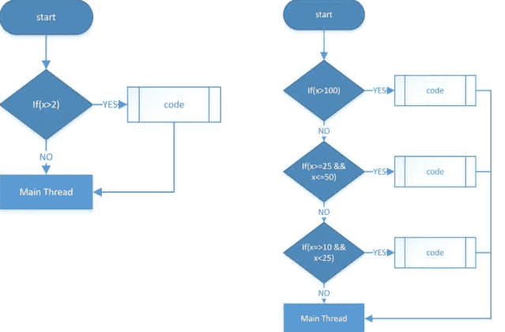

上面的两张图通过图形化展示了 `if..else` 条件。

`Switch` 语句是程序中提供决策的另一种方式。它接受一个变量作为参数

```cs
// 在此步骤之前 x 被赋了一个值
switch(x)
{
  case 1:
  {
    // 在此处编写处理 x = 1 的情况
    break;
  }
  case 2:
  {
    // 在此处编写处理 x = 2 的情况
    break;
  }
  case 3:
  {
    // 在此处编写处理 x = 3 的情况
    break;
  }
  default:
  {
    // 在此处编写处理 x 
    // 不匹配任何定义的 case 的逻辑
    break;
  }
}
```

**代码块 4 - switch 语句结构示例**

你会在 `if..else` 和 `Switch` 结构之间注意到的一个重大区别是在 `switch` 语句中执行多个代码块的能力。注意每个 `case` 都由一个 `break` 命令终止。`break` 命令是可选的。如果存在，在执行 `case` 块之后，`switch` 结构将终止。如果不存在，逻辑将流向下一个 `case` 块。

## Unity 3D – 游戏编程入门

为了理解它，请考虑以下情况：假设变量 `x` 的值为 1。同样假设 `case` 块中没有定义 `break` 语句。当评估 `switch` 语句时，它将执行 `case 1`。由于没有 `break` 命令，它将执行下一个 `case` 块，恰好是 `case 2`。这将一直持续到识别出 `break` 语句为止。

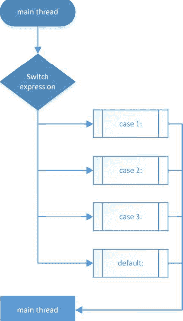

代码块 2 和代码块 4 提供了如何在 C# 语言中使用决策语句的简单示例。请记住列出的是基本结构，你可以扩展它们以满足复杂的场景。

## 循环结构

有时我们还需要能够多次循环执行同一块代码。这通过循环结构实现。C# 语言中有几种循环结构：

### for 循环

通过使用 `for` 循环，你可以重复运行一个语句或语句块，直到指定的表达式求值为假。这种循环对于遍历数组以及其他你预先知道循环迭代次数的应用非常有用。`for` 循环的结构：

```cs
for (initializer; condition; iterator)
{
  // 循环体
}
```

初始化部分设置了初始条件。该部分中的语句在进入循环之前仅运行一次。

条件部分包含一个布尔表达式，通过评估该表达式的值来确定循环应该退出还是继续运行。

迭代器部分定义了在循环体每次迭代后发生什么。

循环体由一个语句、一个空语句或一个通过在大括号包围零或多个语句创建的语句块组成。

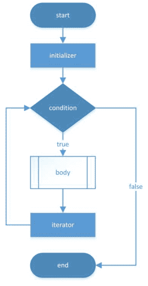

**图 1 - for 循环图**

## Unity 3D – 游戏编程入门

### foreach 循环

`foreach` 语句对于数组或实现了 `IEnumerable` 或 `IEnumerable<T>` 接口的对象集合中的每个元素，重复一组嵌入的语句。


**图 2 - foreach 循环图**

`foreach` 语句对于数组或对象集合中的每个元素重复嵌入的语句。`foreach` 用于遍历集合以获取你需要的信息，但它不能产生副作用。

```cs
int[] fibaray = { 0, 1, 2, 3, 5, 8, 13 };
foreach (int element in fibaray)
{
    System.Console.WriteLine(element);
}
```

### while 循环

`while` 语句执行语句或语句块，直到指定的表达式求假。由于循环表达式的测试发生在每次执行之前，该循环执行零或多次。

### do-while 循环

`do-while` 语句执行语句或语句块，直到指定的表达式求假。与 `while` 循环不同，`do-while` 循环在评估条件之前执行一次。

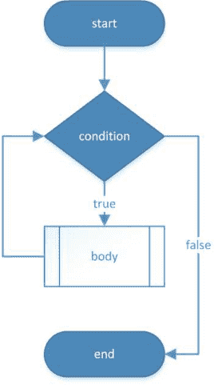

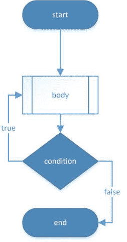

**图 3 - while 循环图**

**图 4 - do-while 循环图**

每种编程语言和环境都会提供某种循环机制。在 C# 中我们有四种已经讨论过的类型。每种循环结构都有特定的用途。最常用的循环是 `for` 循环、`foreach` 循环和 `while` 循环。

## Unity 3D – 游戏编程入门

至少在检查条件确定你是否想继续迭代或进入代码主分支之前执行一次。

例如，`for` 循环结构应该在你知道元素的大小或想要执行循环体代码块的次数时使用。`foreach` 结构在你想遍历集合时使用。

`while` 和 `do..while` 结构通常在我们不知道需要执行循环体多少次，但知道退出条件时使用。

```cs
for (int loopCount = 0; loopCount < 10; loopCount++) {
  // 在此处执行某些事情 ...
}
while(x<10) {
  // 在此处执行某些事情 ...
  x++;
}
do {
  // 在此处执行某些事情 ...
  x++;
} while (x < 10);
```

**代码块 5 - 循环结构示例**

## 方法

面向对象编程中的方法是与对象类关联的程序。对象由行为和数据组成。数据表示为对象的属性，行为表示为方法。方法也是对象向外部世界提供的接口。方法还提供了其他类访问和修改对象数据属性的接口。这被称为封装。

方法是包含一系列语句的代码块。程序通过调用方法导致这些语句的执行，并指定任何所需的方法参数。在 C# 中，每条执行的指令都是在方法的范围内执行的。

方法在类或结构体中声明，通过指定访问级别（如 `public` 或 `private`）、可选修饰符（如 `abstract` 或 `sealed`）、返回值、方法名称以及任何方法参数。所有这些内容共同构成了方法的签名（signature）。方法参数被括在括号中，并用逗号分隔，空括号表示该方法不需要参数。以下是方法签名的示例：

```
[access modifier] return-type method-name([parameter-type parameter-name[]])
{ /* method-body */ }
```

语法元素如下：

- `access-modifier`（访问修饰符）：决定了其他类对该方法的可访问访问程度。
- `return-type`（返回类型）：方法返回的变量的类型（方法也可以返回指定类的对象）。你的方法必须使用 `return-type` 返回一个值，且该返回值必须与 `return-type` 匹配。
- `method-name`（方法名称）：你为方法命的名称。
- `parameter-type`（参数类型）：传递给方法的参数的类型（方法也可以接受指定类的对象）。
- `parameter-name`（参数名称）：传递给方法的参数的名称。
- `method-body`（方法体）：执行你方法任务的语句。

```cs
// 以下函数接收两个浮点型数据
// 参数，并返回两个变量之和
// 作为一个另一个 float 数据类型
private float Add(float x, float y)
{
    return x + y;
}
```

**代码块 6 - 示例方法的示例**

## Unity 3D – 游戏编程入门

默认情况下，当将值类型传递给方法时，传递的是拷贝而不是对象本身。因此，对参数的更改对调用方法中的原始拷贝没有影响。你可以通过使用 `ref` 关键字通过引用传递值类型。


当通过引用传递值时，方法接收到的不是对象本身，而是一个指示对象在内存中位置的参数。如果你通过此引用更改了对象的成员，则该更改将反映在调用方法的参数中，即使你是按值传递该对象的。

这里是一个演示按引用传递参数的示例：

```cs
// 参数 x 是按引用传递的。
// 对 x 的更改将影响 x 的原始值。
static void SquareIt(ref int x)
{
    x *= x;
    System.Console.WriteLine("方法内部的值: {0}", x);
}
static void Main(string[] args)
{
    int n = 5;
    System.Console.WriteLine("调用方法之前的值: {0}", n);

    SquareIt(ref n); // 按引用传递变量。
    System.Console.WriteLine("调用方法后的值: {0}", n);

    System.Console.WriteLine("按任意键退出。");
    System.Console.ReadKey();
}
```

代码块 7 - 方法参数按引用传递

方法可以向调用者返回值。如果返回类型不是 `void`，方法可以使用 `return` 关键字返回值。带有 `return` 关键字后跟与返回类型匹配的值的语句会将该值返回给方法调用者。`return` 关键字还会停止方法的执行。如果没有 `return` 关键字，方法将在到达代码块结束时停止执行。

为了编写程序，我们使用这些简单的原理并将其结合起来来解决复杂的问题。现在当然，这比表面看到的要复杂得多，但基础是相同的。在本节中还没有介绍许多其他概念和技术信息。这是因为，作者预计读者已经熟悉编程基础，并且他或她已经上过课程，现在准备好将这些技能应用于游戏编程了。

让我们来看一个简单的示例，它将演示我们刚刚讨论的一些概念。以下程序是一个简单的计算器，将用于执行加法、减法、乘法和除法等基本操作：

```cs
private static float Add(float x, float y)
{
    return x + y;
}
private static float Subtract(float x, float y)
{
    return x - y;
}
private static float Multiply(float x, float y)
{
    return x * y;
}
private static float? Divide(float x, float y)
{
    if (y > 0.0f)
        return x / y;
    else
        return null;
}
static void Main(string[] args)
{
    float r1 = Add(2.0f, 2.0f);
    float r2 = Subtract(r1, 2.0f);
    float r3 = Multiply(r2, r1);
    float? r4 = Divide(8.0f, 0.0f);

    if (r4 == null)
    {
        r4 = Divide(8.0f, 2.0f);
    }

    string r = string.Format("r1={0}; r2={1}; r3={2}; r4={3}", r1, r2, r3, r4);
    System.Console.WriteLine(r);
}
```

代码块 8 - 简单计算器程序演示

到此时，你应该很好地掌握了基础。在本节中还没有介绍许多其他概念和技术信息。这是因为，作者预计读者已经熟悉编程基础，并且他或她已经上过课程，现在准备好将这些技能应用于游戏编程了。

### 面向对象编程的基构建块是类和对象

类是对象的蓝图。对象是类的实例。当我们讨论并付诸实践时，这将变得更加清晰。

我们的世界充满了对象。我的车是一个对象，我的自行车是一个对象，我的房子是一个对象，我的飞机是一个对象。事实上，任何有形物品都是对象。同样，对象可以被归到一个类中。我的车可以归到一个通用类。对象也可以代表更抽象的东西——例如几何形状或动作。

演示这个概念最简单的方法是使用一个简单的示例。假设我们想要模拟一辆车。为了实现这一目标，我们将创建一个名为 `Car` 的类。我们的 `Car` 类需要存储一些关于汽车对象的信息，以及一些表示汽车行为的方法。以下是我们的汽车模型的可视化：

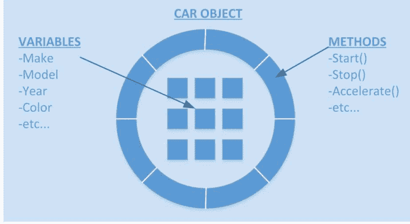

在现实中，现代汽车的属性和功能要复杂得多。但为了演示，我保持了简单。继续我们的讨论，每个汽车对象将拥有定义的数据点，以及用于访问或更改实例化对象行为的指定方法。

你使用 `class` 关键字声明类，使用以下简化语法：

```
[访问修饰符] class 类名 { /* 类体 */ }
```

- **access-modifier（访问修饰符）**：你的类对外部的可访问程度。
- **class-name**：你赋值给类的名称。
- **class-body**：类的体。

类通常使用 `public` 访问修饰符声明，这意味着该类在没有限制的情况下可用。你将在稍后学习更多关于访问修饰符的知识。之前的语法经过简化，以免让你被过多的信息淹没。

这是一个简单的 `Car` 类：

```cs
public class Car {
    private string make; // 将品牌存储为字符串类型
    private string model; // 将模型存储为字符串类型
    private int year; // 将年份存储为整数类型
    private string color; // 将颜色存储为字符串类型

    public Car() { /* 启动汽车的构造函数 */ }
    public void Start() { /* 启动汽车的代码 */ }
    public void Stop() { /* 停止汽车的代码 */ }
    public void Accelerate() { /* 加速的代码 */ }

    public string GetMake() { return this.make; }
    public string GetModel() { return this.model; }
    public int GetYear() { return this.year; }
    public string GetColor() { return this.color; }

    public void SetMake(string make) { this.make = make; }
    public void SetModel(string model) { this.model = model; }
    public void SetYear(int year) { this.year = year; }
    public void SetColor(string color) { this.color = color; }
}
```

代码块 9 - 示例 Car 类

在 `Car` 类中，我们声明了四个字段：`make`、`model`、`year` 和 `color`。`year` 字段是 `int` 类型，其余都是 `string` 类型。字段的访问修饰符是 `private`。这意味着这些字段是受限的，用户无法直接访问它们。要访问这些字段，例如使用 `GetMake()` 方法来检索字段的值，或者通过 `SetMake()` 方法设置或修改值。

如你现在所知的，类定义了创建对象的模板。一旦声明了类，你就可以创建该类的对象。以下语句创建了一个 `Car` 对象：

```
Car myCar = new Car();
```

第一部分声明了一个名为 `myCar` 的 `Car` 对象的引用，它用于存储实际 `Car` 对象的内存位置。第二部分实际上在计算机内存中创建了一个 `Car` 对象。`new`¹ 运算符为 `Car` 对象分配内存，而 `Car()` 方法创建对象。`Car()` 方法被称为构造函数。新创建的 `Car` 对象的内存位置分配给 `myCar`，而 `myCar` 是你通过它访问实际 `Car` 对象的引用。

### 封装

将相关数据和对象封装在一起被称为封装，即消息接口。消息接口的作用是在对象的内部结构与对象外部的一切事物之间提供一个基本的屏障。消息接口确保与对象的所有交互都通过一个预定义的消息系统进行，该对象保证能够理解并正确处理这些消息。

封装对于创建可维护的面向对象程序至关重要。当与对象的交互仅使用公开的方法和属性接口时，该对象的类就变得易于维护。

Vahé Karamian 描述了汽车的每一个可能的细节，但仅针对正在开发的系统的相关部分。围绕真实世界对象进行建模可以大幅减少理解解决方案所需的时间，并在系统的整个生命周期内开发和维护代码。

### 组合

在系统中，对象可以以许多方式共同工作。在某些情况下，类和对象可以紧密耦合在一起以提供更复杂的功能。这被称为组合。

复合对象非常重要，因为它们可以表示比简单对象复杂得多的结构。例如，一架飞机由机翼、发动机和其他组件组成，这些组件极其复杂，无法用简单的数字或字符串来表示。

复合对象中包含的对象本身也可以是复合对象，这种嵌套可以无限进行下去！飞机的主要组件本身就是非常复杂的对象。在任何合理的飞机模型中，这些每一个组件都将由一个复合对象表示，而该复合对象又由更多的复合对象组成，以此类推。

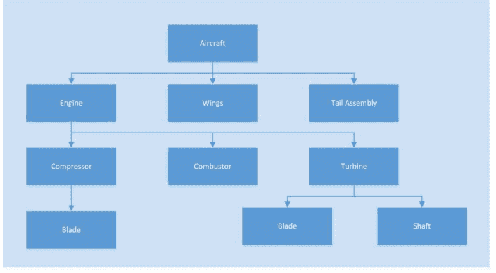

因为对象可以由其他对象组成，我们可以按照自然思考的方式来表示嵌套的真实对象。即使是像飞机这样复杂且深度嵌套的结构也可以被视为一个单一的统一对象。由于这个复杂对象可以有自己的行为，其他对象在使用它时，对其内部复杂性的感知会很低。这是对象技术如何为大规模系统带来秩序的极佳示例。

在我们的汽车示例中，轮子、面板、发动机等……可以被认为是单独的类。要创建 `Car` 类，你需要将所有这些对象连接起来。这使得在多年以后增加你的汽车定义的复杂性成为可能，并引入更好的特性和功能。由于封装机制，每个类的内部工作原理并不重要，因为对象之间的通信仍然通过向它们的公共接口传递消息来实现。

### 继承

继承是一个有趣的面向对象编程概念。它允许一个类基于另一个类（即父类）并继承其所有的功能。然后可以编写额外的代码来创建该类的更专门化的版本。如果我们想改进模型和设计，就会创建一个名为 `Vehicle` 的新类。这个新类将成为父类，而 `Car` 类将继承 `Vehicle` 类。

继承不仅局限于单层，而会在类层次结构中向下传递任意层级。这使得继承成为一种非常强大的机制，因为通过将类放置于类层次结构中的正确分支，就可以赋予类丰富的能力集。它们将自动汇总层次结构中上方所有类的接口定义和实现定义，仅为自己定义使其具有独特性的额外能力。

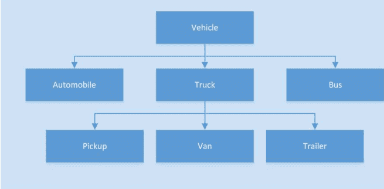

考虑以下内容：一个表示各种车辆的系统。该系统将包含一个通用的 `Vehicle` 类，以及用于所有特殊类型的子类。`Vehicle` 类将包含与所有车辆的方法和变量。相反，子类将包含任何特定于更特殊情况的额外方法和变量。这有助于我们轻松向层次结构中添加其他类型的车辆，例如摩托车、直升机、船只等……

### 多态

多态是一个对象根据其被使用的方式改变其行为的能力。当对象的类继承自父类或实现一个或多个接口时，可以引用这些类或接口名称。所以，如果我们有一个方法期望类型为“Vehicle”的对象作为参数传递，我们可以向该方法传递任何车辆、汽车、摩托车或飞机，即使数据类型在技术上可能是不同的。

### 模块化

除了目前描述的概念，面向对象编程还允许增加模块化。单个类或类组可以被认为可以在许多软件项目中使用的代码模块。这减少了重新开发相似功能的需求，因此可以降低开发时间和成本。

这是对面向对象编程范式中概念的快速概述。

### 泛型

泛型允许类型安全的数据结构。这种编程模型的优势在于内部算法和数据操作保持不变，而实际数据类型可以根据代码的使用进行更改。

下一个一个实现使用了泛型：

```java
public class MyStack
{
    private int index;
    private ArrayList stack;

    public MyStack()
    {
        this.stack = new ArrayList();
        index = -1;
    }

    public int COUNT
    {
        get { return this.stack.Count; }
    }

    public void push(object data)
    {
        this.stack.Add(data);
        this.index++;
    }

    public object pop()
    {
        object o = this.stack[index];
        this.stack.RemoveAt(index);
        this.index--;

        return o;
    }

    public void clear()
    {
        this.stack.Clear();
        this.index = -1;
    }
}
```

```java
public class MyStack1<T>
{
    private int index;
    private List<T> stack;

    public MyStack1()
    {
        this.stack = new List<T>();
        index = -1;
    }

    public int COUNT
    {
        get { return this.stack.Count; }
    }

    public void push(T data)
    {
        this.stack.Add(data);
        this.index++;
    }

    public T pop()
    {
        T o = this.stack[index];
        this.stack.RemoveAt(index);
        this.index--;

        return o;
    }

    public void clear()
    {
        this.stack.Clear();
        this.index = -1;
    }

    public object peek()
    {
        return this.stack[this.index];
    }
}
```

### 接口

接口定义了类必须实现的方法，但它本身不提供实现。

接口是一个契约。当你设计一个接口时，你是在说：“如果你想提供这种能力，你就必须实现这些方法，提供这些属性和索引器，并支持这些事件。”接口的实现者同意契约并实现要求的元素。我们不会深入讨论定义的细节，但这里有一些你应该理解的概念。

**接口**：这是契约。按照习惯，接口名称以大写字母开头，所以你的接口名称可能类似于 `IWeapon`。`IWeapon` 接口可能在其他要求之外要求一个 `Explode()` 函数。

**实现类**：这是同意实现接口中描述约定的类。例如，炸弹（Bomb）可以是一个实现了 `IWeapon` 的类，从而根据炸弹的需求在类中实现 `Explode()` 函数。

**客户端类**：客户端调用实现类上的函数。例如，你可能有一个 `Battleship`（战舰）类，它可能包含一个 `IWeapon` 对象的数组。客户端可以期望能够对每个对象调用 `Explode()`，尽管每个单独的对象实现方法的方式可能不同，但它们都会恰当且毫无怨言地执行！

你可能会问，抽象基类和接口之间的区别是什么？关键区别在于，抽象基类作为一组派生类的基类，而接口旨在用于与其他继承链混合。也就是说，类只能继承自一个父类，但它可以实现多个接口。

此外，当你派生自抽象类时，你必须重写所有的抽象方法，但不必重写任何非抽象函数。你可以直接使用基类提供的实现。这被称为“部分实现”。接口没有任何任何实现，因此你必须实现接口中定义的每一个函数。你不能部分实现一个接口。

### 委托


在编程中，你经常面临需要执行特定操作的情况，但你并不知道提前想要调用哪个方法，甚至不知道哪个对象来执行它。例如，你可能想在运行时告诉一个对象播放一个媒体文件，但你可能不知道哪个对象将播放该文件，也不知道它是一个视频、音频文件、动画还是其他内容。与其硬编码一个特定的媒体播放器对象，你会创建一个委托（delegate），然后在程序执行时将该委托解析到特定的方法。

# Unity 3D – 游戏编程入门

委托是一种引用类型，就像你在书中看到的其他引用类型一样，但它不是引用一个对象，而是引用一个方法。这被称为方法的封装。当你指定了委托的签名（signature）和返回类型时，你可以用该委托封装任何匹配该签名的方法。

例如，假设你有一个名为 `MediaStorage` 的类，你用它来存储和管理各种媒体文件——音频文件、视频文件、动画文件；文件类型对该类来说并不重要。进一步假设，你希望该类能够播放文件，确保它们能够成功播放，并报告它们是否播放正常（作为对文件有效性进行的一波测试）。

`MediaStorage` 类不需要知道如何播放文件；它只需要接收一个指示文件是否成功播放的代码。

你可以通过接口来实现这一需求，尽管在可以使用委托的情况下，定义一个全新的接口并创建其实例可能也许是值得的。在这种情况下，我们将只测试两种类型的媒体文件，因此我们将使用委托。如果媒体文件类型范围更广，你可能希望定义一个合适的接口。

## 事件

事件是当今编程模型的重要部分。现代程序呈现用户界面并等待用户采取操作。用户可能会采取许多不同的操作，例如选择菜单、按下按钮、更新文本字段、点击图标等。每个操作都会导致一个事件的产生。

事件是“程序发生了某事且必须做出响应”这一思想的封装。事件和委托是紧耦合的概念，因为灵活的事件处理要求对事件的响应被分发到相应的事件处理器。事件处理程序通常在 C# 中通过委托实现。

任何对象都可以发布一组事件，其他类可以订阅这些事件。当发布类引发事件时，所有订阅者都会收到通知。通过这种机制，你的对象可以说：“我有以下内容要通知你，”而其他类可能想要加入，说：“是的，当发生时请告诉我。”例如，它为碰撞检测提供了一个事件处理器。每当对象与另一个对象碰撞时，该事件就会被引发。

C# 中的事件是用委托实现的。发布类定义一个委托。订阅类做两件事：首先，它创建一个与委托签名匹配的方法；其次，它创建一个该委托类型的实例来封装该方法。当事件被引发时，订阅类的方法通过委托被调用。

这是一个事件处理器的示例：

```csharp
public class MyEventPublisher
{
    public event EventHandler EventHandler;

    public void Publish()
    {
        EventHandler handler = EventHandler;
        if(EventHandler != null)
        {
            handler(this, EventArgs.Empty);
        }
    }
}

public class MyEventObserver
{
    public void MyEventHandler(object sender, EventArgs args)
    {
        Console.WriteLine(string.Format("Published: {0}", sender));
    }
}

public class TestEventHandler
{
    static void Main(string[] args)
    {
        MyEventPublisher publisher = new MyEventPublisher();
    }
}
```

```csharp
MyEventObserver observer = new MyEventObserver();
publisher.EventHandler += observer.MyEventHandler;

publisher.Publish();
```

**代码块 13 - 简单事件处理器**

上面的示例是说明事件处理的一种简单方式，但它捕捉了必要的结构。让我们看另一个例子。假设 `Car` 类有一个燃料属性。当燃料水平下降到某一点时，我们希望引发一个事件通知用户油量不足。`Car` 类将发布此事件，用户类将订阅它以更新 UI 或执行其他任务。

以下代码展示了这种场景：

```csharp
public class LevelChangeEventArgs : EventArgs
{
    public float FuelLevel { get; set; }
    public object OldValue { get; set; }
    public object NewValue { get; set; }
}

public LevelChangeEventArgs(float fuellevel, object oldValue, object newValue)
{
    this.FuelLevel = fuellevel;
    this.OldValue = oldValue;
    this.NewValue = newValue;
}

public class Car
{
    private string make; // 存储品牌字符串类型
    private string model; // 存储型号字符串类型
    private int year; // 存储年份整数类型
    private string color; // 存储颜色字符串类型

    public string Make
    {
        get { return this.make; }
        set { this.make = value; }
    }

    public string Model
    {
        get { return this.model; }
        set { this.model = value; }
    }

    public int Year
    {
        get { return this.year; }
        set { this.year = value; }
    }

    public string Color
    {
        get { return this.color; }
        set { this.color = value; }
    }

    private float fuelLevel;
    public float FUEL_LEVEL
    {
        get { return this.fuelLevel; }
        set
        {
            object oldValue = this.fuelLevel;
            this.fuelLevel = value;

            // 当燃料水平下降到某一点时，
            // 我们希望引发一个事件通知用户油量不足
            if (this.fuelLevel < 0.6f)
            {
                // // 此处是引发事件的代码
                FuelLevelChanged(this, new LevelChangeEventArgs(this.fuelLevel, oldValue, value));
            }
        }
    }

// 委托
public delegate void FuelLevelEventHandler(object sender, LevelChangeEventArgs data);
public event FuelLevelEventHandler FuelLevelChanged;

protected void OnFuelLevelChanged(object sender, LevelChangeEventArgs data)
{
    // // 检查是否有订阅者
    if(FuelLevelChanged != null)
    {
        // 调用事件
        FuelLevelChanged(this, data);
    }
}

    public Car() { this.fuellevel = 1.0f; }
}
```

```csharp
public void Start() { /* 启动汽车的代码 */ }
public void Stop() { /* 停止汽车的代码 */ }
public void Accelerate() { /* 加速的代码 */ }

public string GetMake() { return this.make; }
public string GetModel() { return this.model; }
public int GetYear() { return this.year; }
public string GetColor() { return this.color; }

public void SetMake(string make) { this.make = make; }
public void SetModel(string model) { this.model = model; }
public void SetYear(int year) { this.year = year; }
public void SetColor(string color) { this.color = color; }
```

**代码块 14 - 带有事件处理程序的 Car 类**

委托委托（delegate）封装了任何接受所定义属性的方法，此委托必须由所有订阅者实现。创建 `FuelLevelChangeEventArgs` 类是为了帮助跟踪属性的旧值和新值。

到此时，你已经对基础知识有了良好的了解，并且在面向对象的术语方面建立了良好的基础。鼓励读者对本章讨论的话题进行自己的研究。

# 第 2 章 – Unity IDE 简介

## 界面概览

在开始学习 Unity 的任何酷功能之前，我们需要熟悉该环境。在编写本文时，Unity 5.3 是最新的发布版本。因此，我们将精力集中在 Unity 5.3 上。

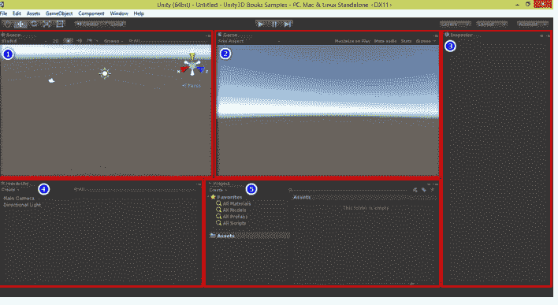

**图 8-Unity 5 编辑器**

在图 8 中，你将看到一个空的 Unity 5 项目。如果你是第一次运行 Unity 5，你的 IDE 配置可能会略有不同。也就是说，你的视图可能与图 8 所示的略有不同。我喜欢按照所示的配置设置我的 IDE，因为这方便我执行我更感兴趣的任务。

另外请注意，我将 IDE 分为了五个主要工作区域：(1) 场景窗口 (Scene Window)、(2) 游戏窗口 (Game Window)、(3) 检器窗口 (Inspector Window)、(4) 层级窗口 (Hierarchy Window) 和 (5) 项目窗口 (Project Window)。这些是你在项目将将利用的 IDE 主要区域。

目前如你所见，IDE 相当无趣。那是因为我们在设计器中没有任何趣的事情发生，它只是一张空白画布，等待你的创意想法！让我们简要了解一下这些区域的用途：

### 场景视图 (Scene View)

场景视图是你的交互沙盒。你将使用场景视图来选择和定位游戏对象（GameObject）。这些包括玩家、相机、敌人以及其他用于生成关卡的所有内容。在场景视图中移动和操作对象是 Unity 中最重要的功能之一，因此学习如何高效地执行这些操作非常重要。随着示例的进行，将提供更多提示以提高效率。

### 游戏视图 (Game View)

游戏视图是由游戏中的相机渲染的。它代表了你最终发布的游戏。你需要使用一个或多个相机来控制玩家在玩游戏时实际看到的内容。你还可以快速更改游戏视图窗口的比例，以查看游戏在不同分辨率和屏幕尺寸下的外观。游戏窗口的另一个优秀功能是你可以实际上获取渲染统计数据（Rendering Statistics），这是检查游戏性能的极佳工具。这些数据可以用于优化复杂场景的图形性能。

### 检器 (The Inspector)

检器显示有关你当前选中的游戏对象以及所有组件及其属性的详细信息。在检器窗口中，你可以修改场景中游戏对象的功能。检器中显示的任何属性都可以直接修改。这包括脚本变量。你还可以使用检器更改属性，以查看运行期间的实际结果！检器是 Unity-Vahé Karamian IDE 的另一个部分，你需要对其非常熟悉。你大部分时间将将花在场景视图、检器窗口和你的脚本中。

### 层级窗口 (Hierarchy Window)

层级窗口包含当前场景中的每一个游戏对象。其中一些是资源文件（如 3D 模型）的直接实例，另一些是预制体（Prefabs）的实例。层级窗口还会显示层级窗口中所有游戏对象的父子关系。它基本上是你场景中所有现有游戏对象的实时视图。

### 项目窗口 (Project Window)

项目窗口是显示项目资产的地方。它与本地机器上保存项目文件的实际文件系统是一一一对应的关系。从游戏对象、脚本、纹理、模型、音频、视频等……一切都可以在此窗口中访问和管理。浏览器的左侧面板以分级列表显示项目结构。项目结构列表上方是“收藏”（Favorites）部分，你可以在那里保留经常使用的项目以便快速访问。你可以将项目结构列表中的项目拖到收藏中并在那里保存搜索查询。这对于具有数百或数千游戏对象的大型项目非常方便。

如你所见，Unity 在创建一个让设计师和开发者都能轻松使用和访问的 IDE 做得非常好。其他视图和窗口提供了更多的功能。

## 创建我们的第一个对象

Unity 3D 不是一个 3D 建模软件，但为了演示目的，我们将使用一些 3D 工具如 3D Max、Maya、Rhino 等来创建并导入你的游戏。

默认情况下，有几种可以创建的原始体（Primitives）。这些是立方体、球体、圆柱体、平面和四形体。现在我们将放置一个立方体。

> **注意**：创建任何类型原始体的过程都是相同的。

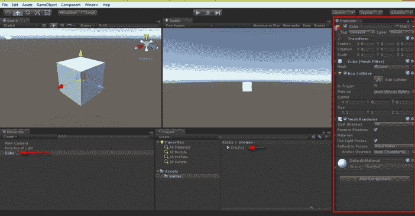

为了创建一个立方体，从主菜单选择 `GameObject->3D Object->Cube`。此操作将在你的活动场景中放置立方体。在继续之前，让我们也保存我们的场景。要保存场景，从主菜单选择 `File->Save Scene...` Unity 3D 将提示将场景保存在项目文件夹下的 Assets 文件夹。创建一个名为 `scenes` 的文件夹，然后在该文件夹保存场景并命名为 `CH1EX1`。

其目的在我们进入更复杂的场景时将会变得清晰。就像你之前的任何项目一样，你需要某种结构和组织，所以为什么不从这里开始呢？

如果你按照指示操作，你应该有一个与图 9 类似的 IDE。注意 Unity 编辑器是如何活跃的。

- 我们在**场景**窗口中放置了立方体原始。

- **层级**窗口显示了我们场景中所有的游戏对象。

- **游戏**窗口显示了相机视角下的立方体。

- **检器**窗口显示了连接到立方体游戏对象的所有组件及其属性。

- **项目**窗口显示了我们到为止在项目中的所有资产，目前只是我们保存的场景。

仔细观察图 10 中的 Inspector（检查器）窗口，我们可以看到不同的区域。

区域 1 包含 GameObject 的名称、Tag（标签）和 Layer（层）的属性。我们稍后会详细介绍。

区域 2 到 6 是附加到 GameObject 上的不同组件。

- Transform 组件，存储 GameObject 的位置、旋转和缩放。

- Mesh Filter（网格过滤器），定义了立方体的网格。

- Box Collider（盒形碰撞体）组件。用于碰撞检测。

- Mesh Renderer（网格渲染器）组件，详细介绍了如何渲染网格。

- Default Material（默认材质）组件，用于渲染我们立方体的材质。

区域 7 有一个 Add Component（添加组件）功能，可以向 GameObject 添加更多组件。

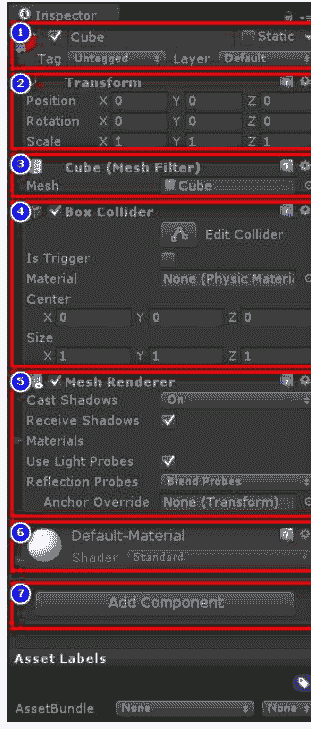

**图 10-Inspector 窗口**

观察 Transform 信息，可以看到立方体的位置、旋转和缩放是由 transform 属性表示的，该属性由三个 Vector3 对象组成。在这种情况下，GameObject 放置在位置 (0,0,0)，分别代表 (x,y,z) 坐标。立方体的旋转向量位于 (X,y,z) 轴的 (0,0,0)，缩放向量也被设置为 (x,y,z) 轴上的 (1,1,1)。

# Vahé Karamian

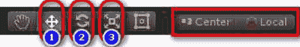

**图 11-Transform 工具**

要对立方体 GameObject 的 transform 属性进行任何更改，我们需要熟悉 Unity 3D IDE 顶部的 transform 工具，如图 11 所示：

- 允许你在场景的 x、y、z 轴上定位对象。

- 允许你可以在场景的 x、y、z 轴上旋转对象。

- 允许你可以在场景的 x、y、z 轴上缩放对象。

当你选择立方体并选取任意 transform 工具时，你会在 Scene（场景）窗口中获得以下修饰器：

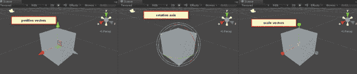

**图 12-Position（位置） 图 13-Rotation（旋转） 图 14-Scale（缩放）**


使用这些工具，你可以按满足你需求的格式变换选中的 `GameObject`。获得感觉最好的方法是尝试它们。另一种修改 `GameObject` transform 属性的方法是通过 `Inspector` 窗口直接数字输入每个部分的数值。我通常发现通过 `Scene view`（场景视图）进行 `GameObject` 的定位、旋转和缩放比较容易，然后通过 `Inspector` 窗口中的数字输入字段进行微调。

# Unity 3D – 游戏编程入门

代表 `Mesh Filter` 和 `Mesh Renderer` 的后续组件将在后面的章节中讨论。你唯一应该意识到的是，这些组件是线框的实际表示以及 `GameObject` 在场景中的渲染方式。我们将在后面的章节构建游戏演示时，讨论 `Collider`（碰撞体）组件。现在你只需要知道碰撞体用于任何碰撞检测，并且正确理解和配置它们非常重要。特别是在更复杂的模型中。

`Material`（材质）组件用于定义应用于所选 `GameObject` 的材质类型。材质与 `Mesh Renderers`、`Particle Systems`（粒子系统）和其他渲染组件配合使用。它们在定义对象如何显示方面起着至关重要的作用。`Material Inspector` 窗口显示的属性取决于材质所使用的 `Shader`（着色器）。`Shader` 是一种特殊的图形程序，决定了如何结合纹理和光照信息以生成渲染对象场景的像素。我们不会在书中涵盖 `Shader`，因为这不是我们的主要主题，有更适合的书来讨论和涵盖这个主题。

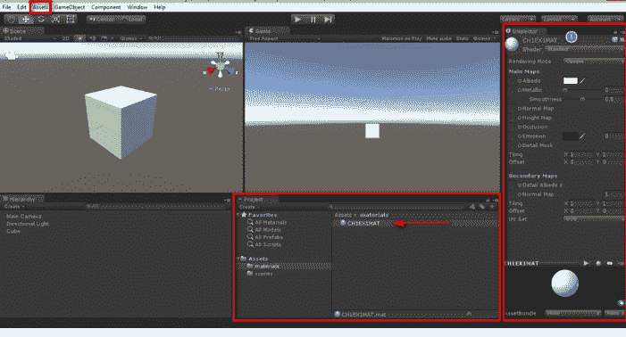

图 15-新材质名称 CH1EX1MAT

默认情况下，你创建的每个原体（primitive）都会分配 Unity 定义的材质。你可以通过主菜单选择 `Assets` -> `Create` -> `Material` 来轻松创建一个新材质，这会在选文件夹中放置一个新的材质对象。或者，你也可以在 `Project` 窗口中右键点击并选择 `Create` -> `Material` 创建材质。在这两种情况下，执行这些操作之前，你应该确保自己在正确的文件夹中。

让我们在 `Assets` 下创建一个名为 `materials` 的新文件夹，通过右键点击材质文件夹并选择 create material 来创建一个名为 `CHIEXIMAT` 的材质。如果你操作得当，请看图 15，你应该看到类似的结果。

如你所见，`Inspector` 窗口显示了许多与材质相关的属性。现在，我们只想将 `Albedo`（漫反射光）属性更改为绿色。为此，选择 `Inspector` 窗口中 `Albedo` 属性的绿色颜色选择器，通过在绿色选择器中移动鼠标选择绿色，或者在 RGB 字段中输入实际数值。我将我的值设置为如下：R=0; G=255; B=0。

## Unity 3D – 游戏编程入门

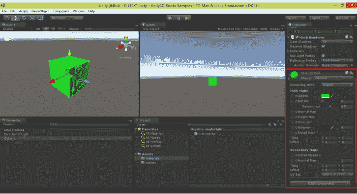

图 16-将 CHIEXIMAT 应用到立方体

代表 `Mesh Filter` 和 `Mesh Renderer` 的后续组件将在后面的章节中讨论...（注：文本根据 OCR 流程继续）

## Unity 3D - 游戏编程入门

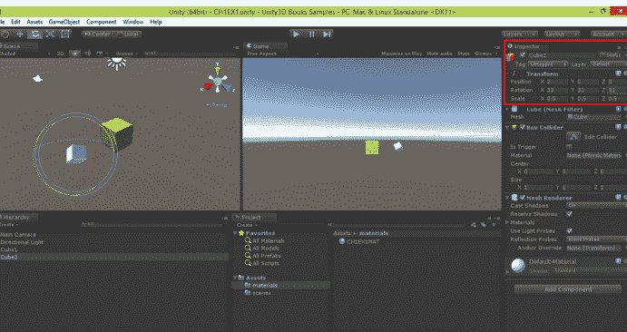

图 17-Cube2 的位置、旋转、缩放

还有一个非常需要熟悉的视图，那就是“控制台窗口”（`Console Window`）。当我们开始编程时，将详细介绍控制台窗口。这对于调试至关重要，它会显示由 Unity 生成的错误、警告和其他消息。

到此时，你应该已经对 Unity 编辑器的主要区域及其用途有了相当的了解。你还应该已经很好地掌握在设计时如何进行对象变换（object transformations）。我们将在后面的章节中讨论运行时的对象变换。

# 入门 C# 编程与 Unity 3D

在设计游戏或模拟时，你不仅需要能够通过设计器操作环境，还需要在运行时动态地操作它。这就是你开始应用编程知识和技能赋予环境**生命力**的地方，让它不再处于闲置状态。无论幸运还是不幸，没有办法可以跳过这一点！

所以，为了让你开始，我们将介绍通过代码操作对象的基础知识。假设我们要在构建或运行应用程序时，让立方体绕其 Y 轴旋转。你需要执行以下几个步骤：

1. 你需要创建一个 C# 脚本
2. 在 C# 脚本中，你需要编写将旋转应用于对象的代码
3. 最后，你需要将你的脚本与目标游戏对象（`Game Object`）关联

到此时，我将不会讨论项目的结构、组织以及文件系统。我们将在未来的章节中讨论这些，随着我们在整书中构建知识。

为了在项目中创建 C# 脚本，请在“项目窗口”（`Project Window`）中点击右键获取右键菜单，然后选择“创建（Create）->C# Script”。此操作将在指定位置创建一个 C# 文件，并要求你对其命名。此时，你给脚本起的名字并不重要，但你应该考虑利用你组织或你自己定义的命名规范最佳实践。在任何情况下，我将我的脚本命名为 `cubeRotate.cs`。双击脚本在 `Mono Editor`（默认编辑器）中打开它，你可以更改为你选择的任何其他 C# 编辑器。你的代码看起来如下：

```csharp
using UnityEngine;
using System.Collections;

public class articleRotate : MonoBehaviour
{
    // 使用此初始化
    void Start () {
    }

    // Update 每帧被调用一次
    void Update () {
        this.transform.Rotate(new Vector3(0, 1, 0));
    }
}
```

## Unity 3D – 游戏编程入门

在我们继续之前，有几点需要解释。你创建的每个脚本默认继承自 `MonoBehaviour`。我们将在以后讨论这个类。你创建的每个脚本还会定义两个函数：`Start()` 和 `Update()`。

`Start()` 函数只会在程序开始时运行一次。因此，任何你需要或想要做的逻辑和数据初始化都应该放在 `Start()` 函数中。

`Update()` 函数是大部分魔法发生的地方。这是在游戏或模拟的整个生命周期内持续调用的函数。你将在该函数更新你的游戏对象。简而言之，它是每帧渲染场景时被调用的函数。

`this.transform.Rotate(new Vector3(0, 1, 0));` 这一行将在应用于它的对象上执行我们正在寻找的旋转。在不深入探讨该函数的细节和后台复杂性的情况下，我们可以利用对象 `transform` 组件上定义的 `Rotate` 函数，传入一个代表我们的 (X,Y,Z) 的 `Vector3` 对象以及旋转角度。

由于我们计划绕 Y 轴旋转，我们必须将 `Vector3` 定义为 `(0,1,0)`。该函数将为你完成所有必要的变换并处理计算。下一个参数是旋转角度，我们已将其定义为 `1`。

有几种方法可以将脚本应用于游戏对象。最简单的方法是将脚本拖放到场景中的目标游戏对象上。在应用脚本后，在“检查器窗口”（`Inspector Windows`）中，你会看到该脚本是立方体的的一个组件。

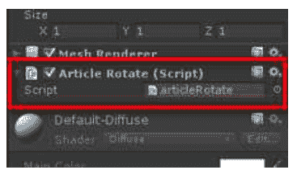

图 18-应用于游戏对象的脚本

当你将这段代码应用到立方体并运行程序时，你会注意到你的立方体现在正在绕其 Y 轴持续旋转每帧 1 度。这是因为我们的旋转逻辑在 `Update()` 函数中，游戏引擎在程序运行时持续调用它。并且每次都会将 1 度的旋转应用于立方体的 `transform` 组件上！因此你得到了旋转效果。

## 发布构建与玩家设置

一旦你对自己的游戏创作感到满意，你将想要实际构建它，以查看它在目标平台上的感受和外观。Unity 的主要吸引力和优势之一是，你可以使用几乎相同的代码库针对许多不同的平台。是的，不同平台之间会有一些细微的变化，这是由于不同平台之间不同的形状因素而是预期的。

# 第3章 – 游戏对象与组件

## 什么是游戏对象？

`GameObject` 是 Unity 中最重要的概念。将 `GameObject` 想象成一个可以包含组件的空容器。作为提醒，我们有以下组件：

- 名称（Name）
- 层（Layer）
- 变换（Transform）
- 网格过滤器（`Mesh Filter`）
- 盒形碰撞体（`Box Collider`）
- 网格渲染器（`Mesh Renderer`）

在设计游戏或模拟时，你不仅需要通过设计器操作环境，还需要在运行时动态地操作它。这就是你开始应用编程知识和技能赋予环境**生命力**的地方，让它不再处于闲置状态。无论幸运还是不幸，没有办法可以跳过这一点！

所以，为了让你开始，我们将介绍通过代码操作对象的基础知识。假设我们要在构建或运行应用程序时，让立方体绕其 Y 轴旋转。你需要执行以下几个步骤：

1. 你需要创建一个 C# 脚本
2. 在 C# 脚本中，你需要编写将旋转应用于对象的代码
3. 最后，你需要将你的脚本与目标游戏对象（`Game Object`）关联

## 添加和编辑组件

组件是对象的螺丝和螺钉。你可以通过组件菜单或检查器窗口中的“添加组件”（`Add Component`）按钮向选中的游戏对象添加组件。Unity 出带了许多预定义的组件。我们无法进入所有组件，但我们将查看一些常用的组件，并由读者自行研究。

你可以向单个游戏对象挂载任意数量或组合的组件。某些组件与其他组件配合效果更好。例如，`Rigidbody` 与任何 `Collider` 配合工作。`Rigidbody` 通过 NVIDIA PhysX 物理引擎控制 `Transform`，而 `Collider` 允许 `Rigidbody` 与其他 `Collider` 进行碰撞和交互。参考 Unity 文档了解更多关于内置每种类型的组件。

组件的伟大特性之一是灵活性。当你将组件附加到游戏对象时，组件中有可以在设计游戏时通过编辑器或通过运行游戏的脚本调整的不同属性。有两种主要的属性类型：

- 值（Values）——值属性可以通过设计器在运行时调整。它们可以是任何数据类型。
- 引用（References）——引用属性类似于指向其他游戏对象、音频、脚本、材质、预制体（`Prefabs`）等的指针。

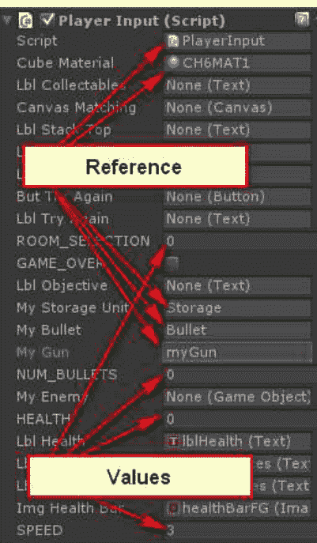

图 19 - 属性类型：引用与值

组件可以包含对任何其他组件、`GameObject` 或资源（`Assets`）的引用。在图 19 中，你可以看到引用属性类型和值属性类型的两种示例。

## 脚本作为组件

当你创建一个脚本并将其附加到 `GameObject` 上时，脚本将以组件（`Component`）的形式出现在 `GameObject` 的检器窗口（`Inspector Window`）中。这是因为脚本在保存时会变成组件。在技术术语中，脚本被编译为一种组件，并被 Unity 引擎像处理其他任何组件一样对待。

## Unity 3D - 游戏编程入门

基本上，脚本是你自己创建的一个组件。你是作者，定义了要暴露给检器器的成员，而该组件/脚本将执行设计的功能。

换句话说，你的每个脚本都是一个唯一的类，正如在面向对象编程概念中讨论的那样，你的类定义将决定你的组件在设计时和运行时行为。数据字段具有公共（public）访问修符，可以在检器窗口中进行编辑。

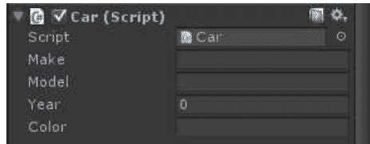

图 20 - 汽车类属性

然而，在 Unity 中为了暴露属性，你需要在每个字段上提供以下声明：

```csharp
[SerializeField]
private string make; // 将 make 存储为字符串类型
[SerializeField]
private string model; // 将 model 存储为字符串类型
[SerializeField]
private int year; // 将 year 存储为整数类型
[SerializeField]
private string color; // 将 color 存储为字符串类型
```

代码块 15 - 用于检器窗口的 Field

这是在检器窗口中暴露字段的最简单方法。

## 静态 GameObject (Static)

许多优化需要知道对象在游戏过程中是否可以移动。关于静态（Static）、不移动对象的信息通常可以在编辑器中进行预计算，假设它不会因为对象位置的变化而失效。这将有助于提高游戏的渲染和帧率。此类技术被用于优化，在你设计和开发游戏时，了解它们的优势是一个好主意。要将 `GameObject` 指定为静态或非静态，检器窗口中有一个复选框。如果勾选了复选框，Unity 将告知各种内部系统该对象不会移动。这里的核心目的是性能增强！这些交互如下：

1. 全局光照 (`Global Illumination`)：场景的高级照明。
2. 遮挡者与遮挡 (`Occluder and Occlusion`)：基于特定相机位置物体可见性的渲染优化。
3. 合批 (`Batching`)：将多个对象合并为一个较大对象的渲染优化。
4. 导航 (`Navigation`)：允许角色处理场景中障碍的系统。
5. 网外链接 (`Off-Mesh Links`)：在场景不连续区域之间启用导航连接。
6. 反射探针 (`Reflection Probe`)：捕捉周围所有方向的球形视图。

## 全局光照 (Global Illumination)

全局光照是一个模拟光线从表面反射到其他表面的系统，即间接光，而不仅限于光源直接照射表面的光（直射光）。建模间接光允许虚拟世界看起来更真实、更具关联性，因为物体会影响彼此的外观。一个例子是阳光照射在箱子开口处的地板上，并在内部反弹，使得箱子的内部部分也被照亮。

传统上，视频游戏和实时图形应用仅限于直射光，因为计算间接光所需的速度太慢，因此只能用于非实时情况，如计算机生成的电影。游戏规避这一局限性的方法仅对预先知的物体和表面计算间接光。

## Unity 3D - 游戏编程入门

这种方法可以帮助在运行时通过网格生成更真实的阴影并处理间接光效果。Unity 支持这种技术，被称为烘焙贴图 (`Bakedmaps`)。除了间接光，烘焙贴图还可以⁵

## 遮挡剔除 (Occlusion Culling)

遮挡剔除是一种当物体被其他物体遮挡时不进行渲染的特性。它不会自动发生，除非物体是相机可见的。这与视锥剔除（`Frustum Culling`）不同，视锥剔除会过滤掉视野之外的物体。遮挡剔除通过减少绘制调用（`draw calls`）来实现。

## 合批 (Batching)

为了在场景中绘制物体，Unity 引擎必须向图形 API发出绘制调用。绘制调用通常是昂贵的，会在 CPU 端产生巨大的开销。Unity 使用静态合批（`static batching`）来解决这个问题。静态合批的目标是将许多小网格组合成大网格以获得更好的性能。

## 导航 (Navigation)

导航系统允许角色在游戏世界中智能地移动。导航系统使用导航网格（`navigation meshes`）来处理环境。导航网格是从场景几何结构自动生成的。Unity 导航网格系统由以下部分组成：

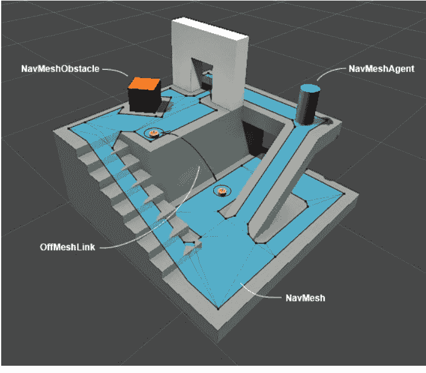

1. 导航网格 (`NavMesh`)：描述游戏世界可行走表面的数据结构，允许从一个位置到另一个位置寻找路径。
2. 导航代理 (`NavMesh Agent`)：一种帮助创建在朝目标移动时避开彼此角色的组件。

## Unity 3D - 游戏编程入门

代理使用导航网格处理世界，并知道如何避开彼此以及移动障碍。

- 网外链接 (`Off-Mesh Link`)：一种允许你整合无法使用行走表面表示的导航快捷方式的组件。例如跳过沟沟或栅栏，或在通过之前打开门。
- 导航网格障碍 (`NavMesh Obstacle`)：一种允许你描述在导航世界时应避开的移动障碍的组件。物理系统控制的桶或箱是障碍的目标。

## 网外链接 (Off-Mesh Links)

导航网格形之间的连接使用路径查找内部的链接进行描述。有时需要让代理跨越不可行走的地方，例如跳过栅栏或穿过关闭的门。这些情况需要知道动作的位置。这些动作可以通过网外链接进行标记，告诉路径规划器通过指定链接存在路线。在遵循路径时可以访问此链接，并执行特殊动作。

## 反射探针 (Reflection Probe)

反射探针像一个相机，捕捉周围所有方向的球形视图。捕捉到的图像存储在立方体贴图（`Cubemap`）⁷ 中，供反射材质的物体使用。给定场景可以使用多个反射探针，物体可以设置为使用最近探针生成的立方体贴图。

> ⁵ 间接光被预计算并存储的过程。
> ⁷ 立方体贴图是由六个代表环境反射的方形纹理组成的集合。

他使用了一种名为反射映射（reflection mapping）的技术来模拟物体的反射，同时将处理开销保持在可接受范围内。


Unity 通过使用反射探针（`Reflection Probes`）改进了基础的反射映射，允许在场景中的战略性位置对视觉环境进行采样。通常，你应该在反射物体的外观会发生明显变化的地方放置探针。当反射物体经过探针附近时，探针采集的反射样本可以用于该物体的反射映射。当附近有多个探针时，Unity 可以在它们之间进行插值，以实现反射的渐变变化。正如你所观察到的，有很多技术细节和复杂性在书中无法涵盖，因此，鼓励读者通过进一步研究细节自行学习这些主题。

## 预制体——概念与用法

在设计和开发游戏时，你将创建许多带有各种组件和属性的 `GameObject`。你创建的某些 `GameObject` 将非常复杂。同时，有时你可能需要在同一个场景或不同的场景中复制或克隆完全相同的 `GameObject`。

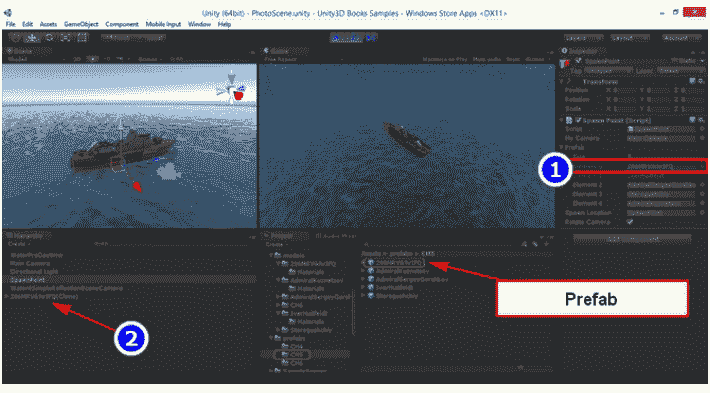

图 22 - Prefab 概念

## Unity 3D 游戏编程入门

`Prefab` 是 Unity 中的一个强大功能，允许你创建 `GameObject` 的副本并将其存储以便以后使用。`Prefab` 作为一个模板，你可以从中在场景中创建新的对象实例。`Prefab` 提供的另一个强大功能是可以编辑和修改 `Prefab`，所有该 `Prefab` 的活动实例都将自动反映最新的更新。你还可以断开 `Prefab` 实例与 `Prefab` 之间的链接，以覆盖该特定不相关实例的属性或特殊更改。在后面的章节中，你将更好地了解什么是 `Prefab` 以及它们为什么如此有用。

## 父子关系

Unity 使用了一种名为“父子”（`Parenting`）的概念。父子关系是在使用 Unity 时需要理解的概念之一。当一个 `GameObject` 是另一个 `GameObject` 的父级时，子 `GameObject` 的移动、旋转和缩放将与其父级完全一致。你可以将父子关系比作手臂与身体的关系；当你移动身体时，手臂也会随之移动。子对象也可以有自己的孩子……

要让任何 `GameObject` 成为另一个对象的子对象，请在层级（`Hierarchy`）窗口中将所需的子对象拖到所需的父对象上。子对象将继承父对象的移动和旋转。你可以使用父对象的折叠箭头根据需要显示或隐藏其孩子。`GameObject` 的父子关系在层级窗口中视觉化表示。`GameObject` 可以具有非常复杂的父子结构。

# 第 4 章 – 游戏规则与机制

## 游戏机制基础

游戏中的底层活动是玩耍。游戏存在于所有人类文化。游戏提供了教学和学习的机会。年幼儿童通过玩耍来帮助他们练习技能。玩耍的关键元素是因果关系，它强化了某些行为。练习就是尝试在某些技能上变得更好。

当玩耍变得结构化并应用目标、应用规则和动作时，它们就变成了游戏。在游乐场上，涉及追逐其他孩子的简单玩耍在一个孩子变成“鬼子”时会变成“抓猫游戏”，其目标是拍中另一个孩子使其也变成“鬼子”。

这些在儿童游戏和游戏中发现的人类基本行为位于计算机游戏的核心，并构成了代码游戏机制的集合。

### 搜索

搜索是人类的基本认知过程，涉及对环境的感知和扫描。在计算机游戏中，这种能力被用来让玩家在环境中寻找特定的信息、物品、位置或角色。玩家搜索的目标可能是找到继续游戏所需的物品，例如用于开门的钥匙，或者导航通过迷宫以从一个地方移动到另一个地方。

### 匹配

匹配是搜索过程的一部分活动。对于人类大脑来说，识别一个物体与另一个相似是一件简单的事。寻找某物意味着能够识别出你心中正在寻找的事物的幻象是否就是你正在看的事物；也就是说，它们匹配了。许多日常活动都涉及匹配，例如找到一对袜子或在 ATM 机中输入正确的 PIN 码。

在游戏中，匹配用于让玩家将一个或多个物体放在一起，因为它们是整体的较小部分，或者具有相同的颜色、形状或其他相似的特征。这种常见做法可能会让玩家将机器的部件组合使其作为一个整体运作，或者在网格上将相同颜色的物品放在一起。

### 排序

试图从混乱中建立秩序是人类的共同行为。极少数要求一切都各就其位的人可能患有强迫症。然而，在许多情况下，当它们被归类后，生活会变得简单得多。当事物井然有序且我们可以依靠它们是有序的时，这会减轻执行其他任务时的认知负担。

游戏利用这种排序欲望来激励玩家根据其特征（如尺寸、颜色、物种、年龄或名称）排列两个或多个物品。排序也可以用于必须按顺序执行任务以完成挑战的活动。

### 机会

概率设备如骰子和用于排序、选择和划分目的的抽签，在许多文化中都很常见，这种做法在古希腊文学中被提到特洛伊战争，在更早的埃及文物中也有记载。

在决策中使用变化被称为风险。研究表明，如今人们承担的风险类型可以追溯到祖先遇到的情况，包括与其他人的竞争、与其他文化的竞争、交配、资源分配和环境。

在游戏中，机会用于确定未来的结果。这是游戏中最古老的动作之一，涉及骰子的使用：通过掷骰子决定结果。如果没有某种概率元素让玩家在行动之前知道结果，那么就不需要承担风险。研究表明，风险越大，神经化学奖励越高。

### 混合

混合动作涉及物体或动作的结合以产生原本无法实现的。在日常生活中，人们混合配料制作食物，混合颜料制造新颜色，并多任务处理动作以更快地完成工作。

在计算机游戏中，动作可以组合以允许角色执行单一动作无法完成的任务，例如在跑步时跳跃穿越游戏世界的缝隙，或组合多个按键执行特殊招式。

组合游戏对象产生其他游戏对象也是混合的一个例子。

### 时机

人类社会由时间驱动。在机械计时设备出现之前，地球绕太阳公转意味着人类一直处于时间表中。

时间在计算机游戏中使用可以应用于游戏机制。它可能涉及在规定的时间内完成任务、定时执行动作或等待某些事件发生。这种机制被用于在比赛等情况下引发紧迫感，无论是与时钟还是对手竞争，或者对等待事件发生产生期待，或迫使等待游戏环境变化的玩家保持耐心。

时间可以用于为训练角色获得新技能、获取新技能等的漫长过程增加尊重。这有时需要很多小时，有时需要几天。在在线游戏中，这可以在玩家离线时继续。

## 进度

人生关乎进步，无论是从婴儿成长为成人、获得大学学位，还是获得职位晋升。通常情况下，人类在生活中经历着与其年龄和成就相关的各个阶段。

游戏采用了进度方案，玩家从新手开始，并在结束时进步到专家水平。在这段旅程中，游戏设置了各种进度机制，让玩家因自己的努力获得成就感。

## 占领

占领是通过力量或自己的努力获取属于他人的东西。在历史上，有长期的部落捕获其他部落成员、军队占领城市以及海盗夺取船只的记录。

有些游戏将此机制作为游戏的主要目标。大多数实时战略游戏都要求玩家占领并防守资源和基地，同时建立军事和经济实力以攻击并占领或摧毁对手。也可能只是简单的抢旗。

## 征服

与占领类似，征服也是一种行动。虽然占领更多地与偷窃有关，但征服关乎超越或摧毁竞争对手。正如占领一样，人类有着悠久的征服历史。

击败对手是一个经典的游戏目标。在象棋中，目标是让对手陷入将死，同时在此过程中通过棋子使其投降。

## 规避

人类生存的关键之一是避开不喜欢和有害的事物。这包括不吃有毒物质、不玩火以及在过马路前观察四周。

有些游戏融入了此类机制，玩家必须避免游戏中的某些情况或物体。例如，车辆在街道上行驶时应避免撞到行人。军坦克在前往给定地点的途中应避开地雷。

规避不是告诉玩家可以做什么，而是向他们展示**不能**做什么。这可以通过当玩家在他们应该规避的游戏环境中执行动作时对其进行惩罚来实现。

规避对玩家的行动施加限制，使他们在尝试贯穿整个游戏环境的同时必须记住哪些是不能做的。

## 收集

收集是另一种人类自然行为。在极端情况下，无法控制收集和放弃所收集物品的人可能被称为杂物搜集者。

在游戏环境中，物品的收集是为了某个目的或目标。某些物品可以被收集并放入物品栏以备后用。收集机制通常与搜索结合使用。

例如，有些游戏可能要求玩家在给定时间内收集尽可能多的金币。

通常来说，所有游戏都结合了我们讨论过的所有基础游戏机制。大多数角色扮演游戏都实现了所有的游戏机制，使游戏玩法变得更加有趣和吸引人。显然，这导致了更复杂的游戏设计，以及游戏设计者和开发者在实现上的巨大投入。

## 机制的简单示例

在本节中，我们将查看之前讨论的机制的使用和实现。这些示例将结合一个或多个机制来解释一些基础游戏概念。

我们在第 6 章“创建战斗”和第 7 章“深入代码”中开发的战舰游戏使用了我们在上一节中列出并描述的一些游戏机制。以下机制在游戏中很容易发现：搜索、冒险和征服。

玩家需要搜索要被摧毁的敌船。玩家将自己的船只放置在游戏板上是在冒险；同样，每当玩家选择目标进行攻击时，也是冒险。最后，游戏目标是通过彻底摧毁对手的所有游戏棋子来征服对手。

让我们快速搭建一个新项目来构建并演示不同机制的实现。

- 等级 1：搜索；收集；匹配和排序。
- 等级 2：冒险；混合和时机
- 等级 3：进度；规避；占领和征服

## 等级 1 开发

该级别的目标是帮助你理解并实现搜索、收集、匹配和排序这四个机制。让我们先处理搜索和收集。玩家的初始目标搜索游戏世界并收集一组用于匹配和排序的物体。

- 目标 1：搜索并收集物体 X、Y 和 Z
- 目标 2：按大小对收集的物体进行排序。

我们根据描述的游戏机制定义了目标。现在是实际组合一个简单的示例来解释这个概念了。

假设你已经为了这次练习启动了一个新场景，我们将继续创建第一个游戏对象：地形（`Terrain`）。要创建一个地形，你需要选择：

- `GameObject` -> `3D Object` -> `Terrain`

从主菜单选择。`Terrain` 的默认尺寸将非常大，为了这次练习，我们需要将其缩小到大约 50 x 50。这对于我们的演示已经足够了。此外，不要忘记，这相当于 2500 平方米的面积！填满它不是易事！

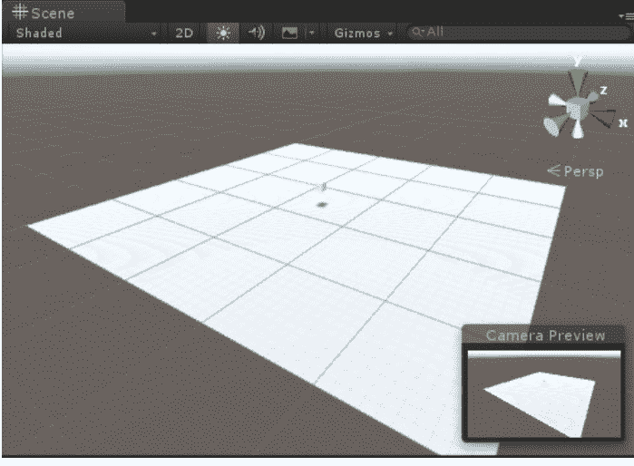

图 23 - 简单的 50x50 地形

你的地形看起来应该类似于图 23。放置立方体只是在地形上作为一个视觉提示。

使用内置工具，我们可以为表面提供一些漂亮的轮廓。我对地形很满意，下一步就是应用一些纹理和其他环境物体（如树）。要给地形添加纹理，在检查器窗口（`Inspector Window`）中选择 `Paint Texture`，并将所需的纹理应用到地形。

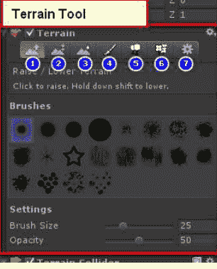

1. 升高/降低地形 (`Raise/Lower Terrain`)
2. 绘制高度 (`Paint Height`)
3. 平滑高度 (`Smooth Height`)
4. 绘制纹理 (`Paint Texture`)
5. 放置树木 (`Place Trees`)
6. 绘制细节 (`Paint Details`)
7. 地形设置 (`Terrain Settings`)

每个图标的作用已在上面列出。

图 24 - 地形工具截图

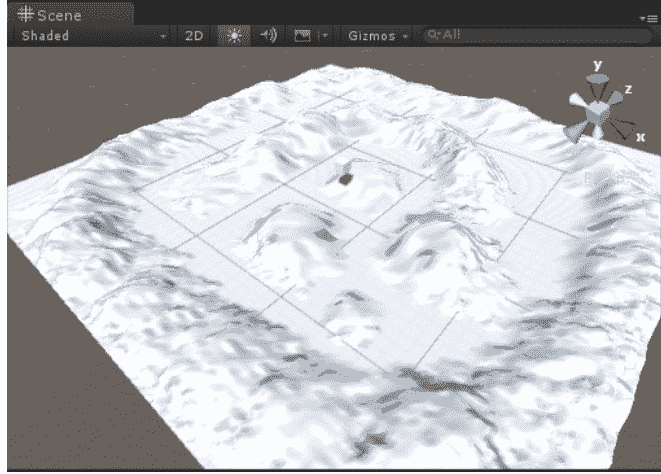

图 25 - 地形设计

你可以使用功能一到七来修改和塑造地形。尽管去尝试这些选项，并设计出一个你满意的地形模型。

查看图 25，你可以看到使用这些工具创建地形是非常简单的。

如果你问我的话，对程序员来说这还不错。现在我们定义了地形，需要放置一些供搜索和收集的游戏对象。为了保持图形简单，为了演示概念，我们将使用球体和立方体。我们的玩家将用球体表示，而我们的游戏对象可以用任何原始类型表示。

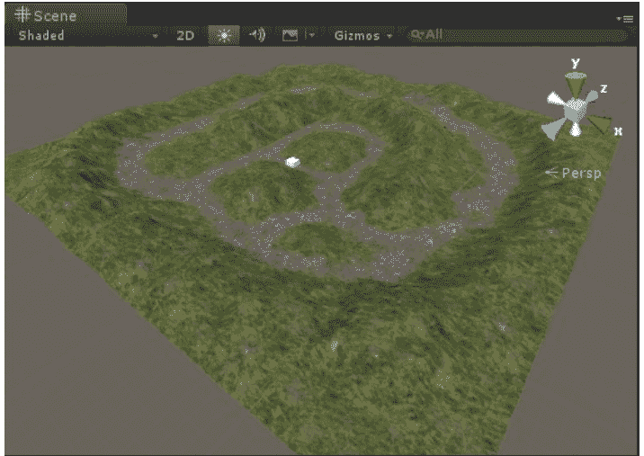

图 26 - 应用了纹理的地形

对于物体搜索和收集，我们可以利用三个立方体。对于搜索，玩家需要找到所有三个立方体；对于排序，玩家需要将它们堆叠在一起，并将最大的立方体作为底座。这将处理我们列出的目标 1 和 2。

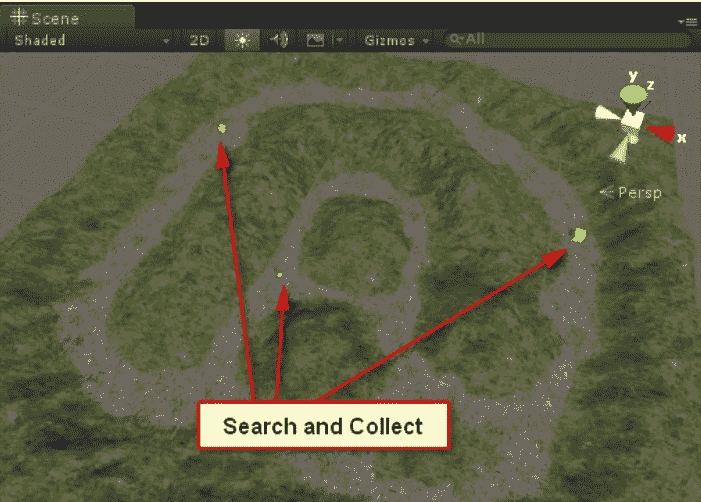

图 27 - 搜索和游戏对象

> **注意**：有更好的选择和工具专门用于构建地形和复杂的自然环境。在现实生活中，你很可能会使用外部工具创建地形，并将其导入 Unity 中进行编程。

以下是为实现我们游戏的首要目标而我们需要定义的几个要求：

- 玩家可以通过穿过物体或在范围内点击物体来收集物体。
- 玩家需要将物体移动到指定区域以进行堆叠。
- 玩家需要识别待收集的物体。
- 玩家需要从收集的物体中检索物体数据以进行后续处理。

在继续我们的示例之前，我想花些时间介绍一些重要的主题和概念，以便我们对 Unity 如何处理不同游戏对象（`GameObject`）之间的交互有良好的理解和背景。

## 游戏物理

物理引擎是一种提供某些物理系统近似的计算机软件，例如刚体动力学、碰撞检测、软体动力学和流体动力学。物理引擎通常分为两类：实时和高精度。

### 高精度

高精度物理引擎需要更强大的处理能力来计算非常精细的物理效果，通常由科学家和工程师用于复杂的仿真。

### 实时

实时物理引擎用于视频游戏和其他形式的交互式计算。它们使用简化的计算和降低的精度来确保计算速度能够让游戏以适当速率做出响应。

## 游戏引擎

在大多数计算机游戏中，处理器的速度和游戏性比仿真的精度更重要。这导致物理引擎的设计师会产生实时结果的引擎，但仅针对简单情况模拟现实世界的物理，且通常带有某种近似值。

游戏中的物体与玩家、环境以及彼此相互作用。通常，游戏中的大多数 3D 物体由两个独立的网格（`mesh`）或形状表示。其中一个网格是玩家在游戏中可见的高度复杂且详细的形状，第二个简化的不可见网格则用于向物理引擎表示物体，以便物理引擎可以与之交互。

## 碰撞器组件

碰撞器用于定义物体的形状以实现物理碰撞。碰撞器的形状并不一定与游戏对象网格的形状相同。通常，粗略的估计往往更有效且在游戏中无法察觉。

最简单且最少消耗处理器的碰撞器是原始碰撞器类型：盒碰撞器（`Box Collider`）、球体碰撞器（`Sphere Collider`），通过组合这些碰撞器的位置，你可以创建一个可以满足任何游戏对象碰撞检测的复合碰撞器。

碰撞器可以添加到没有刚体（`Rigidbody`）组件的物体上，以创建场景中的地板、墙壁和其他静止元素。这些被称为静态碰撞器（`static colliders`）。

## 触发器

脚本系统可以检测碰撞何时发生并使用 `OnCollisionEnter()` 函数启动动作。然而，我们也可以简单使用物理引擎来检测一个碰撞器何时进入另一个的空间，而不创建碰撞效果。使用 `IsTrigger` 属性配置为触发器的碰撞器不会像实心物体一样运行，它只会允许其他碰撞器穿过。当碰撞器进入其空间时，触发器将调用触发器对象脚本上的 `OnTriggerEnter()` 函数。

> 静态碰撞器可以与动态碰撞器相互作用，因为它们没有刚体，所以它们不会响应碰撞而移动。
>
> —— Vahé Karamian

## 碰撞时的脚本动作

当碰撞发生时，物理引擎会在涉及物体的任何脚本上调用具有特定名称的函数。你需要在这些函数中实现代码逻辑以响应碰撞事件。

在检测到碰撞的第一次物理更新期间，会调用 `OnCollisionEnter()`。在保持接触的更新期间，会调用 `OnCollisionStay()`，最后调用 `OnCollisionExit()` 函数表示接触已中断。同样，触发器碰撞器会调用相应的 `OnTriggerEnter()` 函数、`OnTriggerStay()` 函数和 `OnTriggerExit()` 函数。

## 碰撞器交互

碰撞器之间的交互取决于它们的刚体（`Rigidbody`）组件是如何配置的。

### 静态碰撞器

这是一个带有碰撞器但没有刚体的 `GameObject`。静态碰撞器用于始终留在相同位置且永远移动的关卡几何结构。进入的刚体物体将与静态碰撞器碰撞，但不会移动。

### 刚体碰撞器

这是一个带有碰撞器并连接了普通、非运动学（`non-kinematic`）刚体的 `GameObject`。刚体碰撞器由物理引擎完全模拟，并能对碰撞和来自脚本的力做出反应。它们可以与其他物体（包括静态碰撞器）碰撞，是使用物理的游戏中最常用的碰撞器配置。

### 运动学刚体碰撞器

这是一个带有碰撞器并连接了运动学刚体（`kinematic Rigidbody`）的 `GameObject`，该刚体的 `IsKinematic` 属性已启用。你可以通过修改其 `Transform` 组件从脚本移动运动学刚体对象，但它不会像非运动学刚体那样对碰撞和力做出响应。运动学刚体应用于那些偶尔可以移动或禁用/启用，但在其他时候表现得像静态碰撞器的碰撞器。说明这一概念的最好例子是滑动门。门通常充当不可移动的物理障碍，但在需要时可以打开。与静态碰撞器不同，移动的运动学刚体会对其他物体施加摩擦，并在它们接触时“唤醒”其他刚体。

## 刚体

刚体是启用物体物理行为的主要组件。连接刚体后，物体将立即对重力做出响应。如果还添加了一个或多个碰撞器组件，物体将通过移动碰撞移动。

刚体允许 `GameObject` 在物理引擎的控制下运行。这开启了通往真实碰撞、各种类型的关节和其他酷炫行为的大门。通过向刚体添加力来操作你的 `GameObject`，会产生与调整 `Transform` 组件截然不同的行为。作为一个好的经验，你不应该同时操作同一个 `GameObject` 的刚体和 `Transform`，只操作其中之一即可。

## 关节

你可以使用关节（`Joint`）组件将一个刚体连接到另一个刚体，或连接到空间中的固定点。通常，你希望关节允许至少有一定的运动自由。Unity 提供了以下执行限制的关节组件：铰链关节（`Hinge Joint`）和弹簧关节（`Spring Joint`）。铰链关节绕特定的点和轴旋转，而弹簧关节保持物体分离，但它们之间的距离会稍微拉伸。关节还有其他用于特定效果选项。

## 铰链关节


# 铰链关节

铰链关节将两个刚体组合，限制它们像通过铰链连接一样移动。最好的例子是门，也可以应用于模拟链条等。

单个铰链关节应应用于 GameObject。铰链将在由 `Anchor` 属性指定的点旋转，并绕着指定的 `Axis` 属性旋转。

# 弹簧关节

弹簧关节连接两个刚体，但允许它们之间的距离像通过弹簧连接一样发生变化。

弹簧像一段橡皮筋，试图将两个锚点拉到完全相同的位置。拉力强度与点之间的当前距离成正比，单位距离的力由 `Spring` 属性设置。为了防止弹簧无限震荡，你可以设置 `Damper` 值，它会根据两个物体之间的相对速度减小弹簧力。值越高，震荡消失得越快。

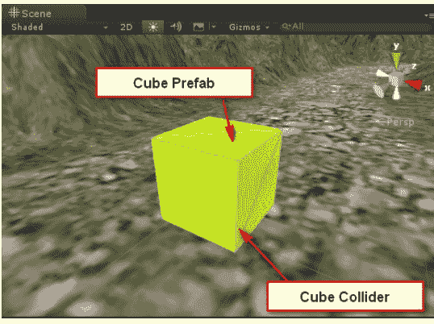

图 28 - 带有立方体碰撞器的立方体刚体

# Unity 3D – 游戏编程入门

现在我们已经更好地理解了系统是如何运作的，可以继续实现我们的第一关。注意，对于我们创建的每个立方体原始体，游戏对象都自动挂载了一个 Box Collider。如图 28 所示。

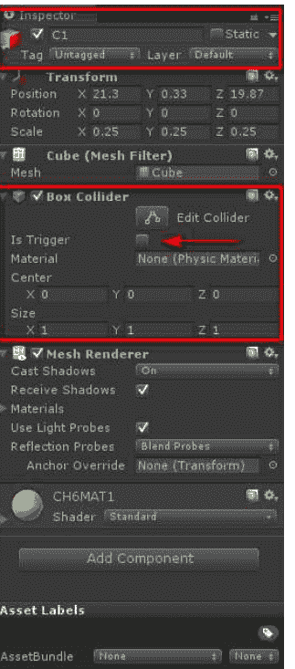

查看图 28 的检查器窗口，可以看到附加到游戏对象上的组件详情。

我想请大家注意附加到游戏对象上的 Box Collider 组件。注意，默认情况下，它的尺寸和形状与立方体完全相同，并且位于局部原点。

这些都是可以调整的值，你可以直接在编辑器中修改它们并直观地看到结果。

主要特性是由箭头指示的 `IsTrigger` 属性。默认情况下它是禁用的，我们将启用 `IsTrigger` 属性，这样我们就可以使用脚本中的 `OnTriggerEnter()` 函数来处理碰撞。

图 29 - 显示 Box Collider 的检查器窗口

我想让你们关注的下一个属性是 Tag 属性。注意，默认情况下你在场景中创建的所有游戏对象都是未标记的。我们将创建一个新标签，并将游戏对象与新创建的标签关联。该属性随后可以在脚本中使用，用以识别我们正在交互的是哪个对象。

要创建一个新标签，只需使用下拉菜单并选择 Add Tag... 即可显示用于在列表中输入新标签元素的用户界面。如果标签已经在列表中，你可以直接选择它，而无需将其添加到列表。我将使用 `MyCollectable` 作为新标签元素。你的立方体预制体应该具有以下配置：

| Cube 1 | ID: C2 | ID: C3 |
| --- | --- | --- |
| Tag: MyCollectable | Tag: MyCollectable | Tag: MyCollectable |
| Scale: <0.25,0.25,0.25> | Scale: <0.50,0.50,0.50> | Scale: <0.75,0.75,0.75> |

我没有列出位置和朝向，因为根据你地形的形成和立方体的放置，这些值会有所不同。我们已经为对象配置了搜索和收集功能，现在我们需要处理脚本。去创建一个名为 `MyCollectable.cs` 的新脚本。目前我们想要实现碰撞检测。

```csharp
public class MyCollectable : MonoBehaviour {

    // 使用此项进行初始化
    void Start() { }

    // Update 每帧调用一次
    void Update() { }

    // 函数用于检测是否与
    // 特殊对象发生碰撞
    void OnTriggerEnter(Collider c)
    {
        Debug.Log("You bumped into me!");
    }
}
```

## 代码块 16 - MyCollectable.cs 列表

将脚本挂载到所有将被收集的立方体对象上。目前，我们不会继续深究。代码将在控制台中打印一条消息，表示我们已与该对象发生碰撞。在继续之前，让我们处理一下玩家角色。这将允许我们实际上在世界中导航并测试我们的代码，并感受它的工作方式。

# 角色机制

## 玩家输入

在某个时刻，你将需要从玩家那里获取输入，并将输入转换为某种动作。取决于游戏和设计，这个元素本身可能非常复杂。为了演示，我们将保持简单且直击主题。

正如之前讨论的，我们将使用一个球体原始体来代表我们的玩家。我们需要在这个球体挂载某种脚本来处理移动。我们将其命名为 `PlayerInput.cs`。此脚本将处理角色在世界中的初始移动。

```csharp
using UnityEngine;
using System.Collections;

public class PlayerInput : MonoBehaviour {

    // 使用此项进行初始化
    void Start () { }

    // Update 每帧调用一次
    void Update () {

        // 玩家 (CP) 向前的移动代码
        if (Input.GetKey(KeyCode.UpArrow))
        {
            this.transform.Translate(Vector3.forward * Time.deltaTime);
        }
        // 玩家 (CP) 向后移动代码
        if (Input.GetKey(KeyCode.DownArrow))
        {
            this.transform.Translate(Vector3.back * Time.deltaTime);
        }
        // 玩家 (CP) 向左移动代码
        if (Input.GetKey(KeyCode.LeftArrow))
        {
            this.transform.Rotate(Vector3.up, -5);
        }
        // 玩家 (CP) 向右移动代码
        if (Input.GetKey(KeyCode.RightArrow))
        {
            this.transform.Rotate(Vector3.up, 5);
        }
    }
}
```

## 代码块 17 - PlayerInput() 初始

将脚本挂载到球体上，并使用方向键在地形上移动。注意物理引擎是如何与玩家交互的。当你尝试爬上山时，这一点尤为明显。为了解决这个问题，你需要对 Rigidbody 设置一些约束条件，并禁用该特定游戏对象的 X、Y 和 Z 轴旋转。

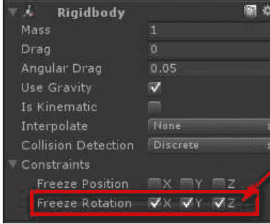

图 30 - Rigidbody 旋转

当你运行游戏时，你会发现玩家角色不会进入混乱的旋转模式。代表玩家的原始对象也需要附加一个 Rigidbody。阅读物理部分以更好地理解碰撞体的工作原理。

# Unity 3D – 游戏编程入门

地形。这是我们在演示中想要模拟的行为。

# 相机设置

我想做的另一个改进是相机的定位。我希望相机能从后面跟随玩家角色，并且略高一点，类似于第三人称相机设置。这种配置实际上非常简单。以下是步骤：

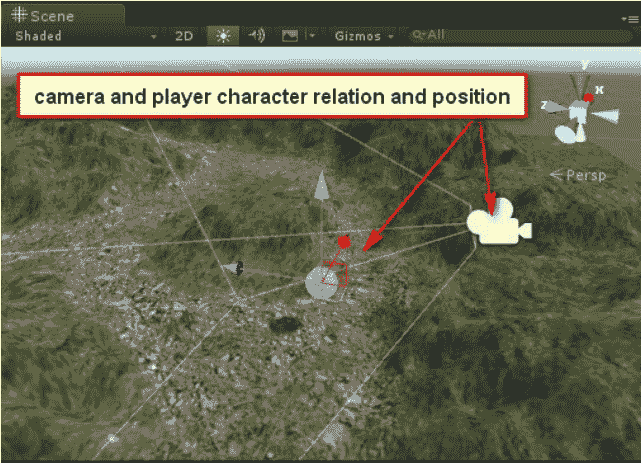

图 31 - 三人称相机设置

- 在场景设计中，调整视图，使其位于玩家角色后面稍上方。
- 选择 Main Camera 游戏对象，从 GameObject 菜单中选择 Align With View 选项。
> 这将移动 Main Camera 游戏对象，并使其朝向与你在场景设计中看到的视图完全一致。
- 将 Main Camera 游戏对象设置为玩家角色的子对象，将其拖到玩家角色对象下方。
> 这会在两个游戏对象之间创建父子关系。
- 现在可以使用 Main Camera 的本地变换工具来微调角度和视口。

完成这些步骤后，玩家角色和相机之间应该会有类似于图 31 的关系。去运行游戏，你会发现我们得到了一种更理想的效果。去尝试收集我们在关卡中设置的立方体。你会发现你与它们发生了碰撞，这之所以没有发生是因为我们从未开启可收集游戏对象的 `IsTrigger` 属性。去将它们设置为 true，然后再次运行一次。

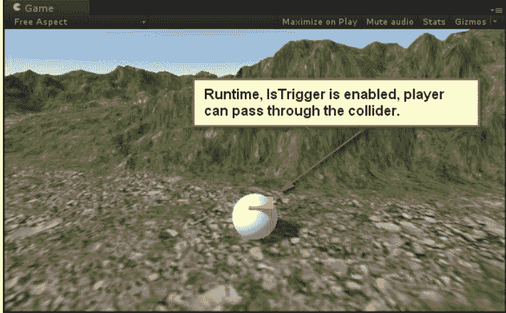

图 32 - 启用 IsTrigger 的碰撞交互

注意，一旦我们将可收集对象的 `IsTrigger` 属性设置为 true，物理引擎处理两个游戏对象碰撞体交互的方式就会有所不同。现在，你还会注意到控制台输出了预期的输出：

# Unity 3D - 游戏编程入门

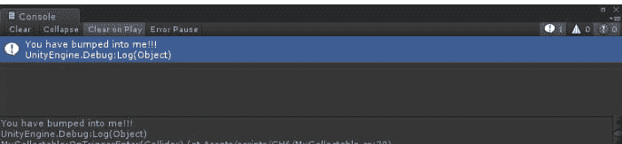

图 33 - 碰撞检测的控制台输出

现在我们可以开始最有趣的部分了，即通过脚本进行编程，这将使我们能够跟踪收集到的物品。我们需要进一步扩展脚本以处理游戏对象的收集，我们可能还需要为数据节点引入一个新的脚本。我们将从扩展 `MyCollectable.cs` 脚本开始。

```csharp
using UnityEngine;
using System.Collections;

public class MyCollectable : MonoBehaviour {

    public int ID;
    public float size;

    // 使用此函数进行初始化
    void Start () {
        this.transform.localPosition = new Vector3(size, size, size);
    }

    // Update 每帧调用一次
    void Update () {
}
}
```

## 代码块 18 - MyCollectable.cs 版本 2

我添加了两个公共成员，代表可收集对象的 ID 和大小。`Start()` 函数将在游戏开始时使用 `size` 属性来缩放可收集游戏对象。注意，我们不再列出 `OnTriggerEnter()` 函数。我们将在 `PlayerInput.cs` 脚本中处理碰撞检测。

同时，我们必须引入一个新的脚本，专门用于存储游戏期间使用的数据。这个新脚本名为 `MyCollectableData.cs`。以下是它的代码：

```csharp
using UnityEngine;
using System.Collections;

public class MyCollectableData{

    public int ID;
    public float size;

    public MyCollectableData() { }
}
```

## 代码块 19 - MyCollectableData.cs

这是一个简单的类，用于存储和检索 ID 和 `size` 这两个属性。处理碰撞和物体拾取注册的主实现在 `PlayerInput.cs` 脚本中。

```csharp
using UnityEngine;
using System.Collections.Generic;

public class PlayerInput : MonoBehaviour {

    public List<MyCollectableData> myCollection = new List<MyCollectableData>();

    void Awake() {
        // 确保从干净状态开始
        this.myCollection.Clear();
    }

    // 使用此函数进行初始化
    void Start() { }

    void Update() {
        // 玩家 (CP) 向移动的代码
        if (Input.GetKey(KeyCode.UpArrow)) {
            this.transform.Translate(Vector3.forward * Time.deltaTime);
        }
        // 玩家 (CP) 向后移动的代码
        if (Input.GetKey(KeyCode.DownArrow)) {
            this.transform.Translate(Vector3.back * Time.deltaTime);
        }
        // 玩家 (CP) 向左移动的代码
        if (Input.GetKey(KeyCode.LeftArrow)) {
            this.transform.Rotate(Vector3.up, -5);
        }
    }
}
```

## Unity 3D – 游戏编程入门

```csharp
// 玩家 (CP) 向右移动的代码
if (Input.GetKey(KeyCode.RightArrow))
{
    this.transform.Rotate(Vector3.up
```

## 代码块 20 - PlayerInput.cs 版本 2

你会发现脚本与版本1相比有一些变化。首先，注意我们有一个类型为 `MyCollectableData` 的集合列表。这是用于存储可收集物品的集合。

第二个新增是 `OnTriggerEnter()` 函数中的碰撞处理。我们希望在这个特定的脚本中处理碰撞，因为这将便于我们处理此特定场景的数据。在函数中，我们正在检查与谁发生了碰撞。这是通过验证碰撞器所属游戏对象的标签属性来实现的。如果该对象被标记为 `MyCollectable`，我们就会从游戏对象中提取 `MyCollectable` 组件。这个组件基本上就是附加到立方体预制体上的 `MyCollectable.cs` 脚本。

一旦获取了组件，我们就会创建一个 `MyCollectableData` 对象，用以复制从 `MyCollectable` 组件中获取的 `ID` 和 `size`。该对象被存储在我们的名为 `myCollection` 的集合列表中。一旦我们安全地获取了数据，就会调用 `Destroy()` 函数，该函数将把游戏对象从场景中销毁。

我们所做的非常简单，但一旦你意识到如何将其应用于更大的项目和用例中，它就会变得非常强大。我们还没有完成，我们需要能够检索物品并在世界的另一个位置重新创建它们。现在，我们需要设计并实现处理下一个场景的机制。

# 卸载我们的集合

我们需要为卸载收集的对象确定一个位置。使用圆柱体原体，我们可以标记一个区域，在玩家收集所有可收集物品后进行卸载。因此，在设计器中创建一个类型为圆柱的新游戏对象，并将其放在玩家可以到达的地方。我的设计如下：

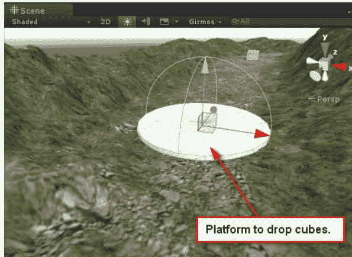

图 34 - 投放平台

因此，我们引入了一个新的游戏对象，它代表一个用于投放可收集物品的平台。我们还需要处理该对象的碰撞。由于我们在 `PlayerInput.cs` 中处理该事件，我们可以扩展逻辑。创建平台的标识符是有意义的。以下是查看其如何工作的代码列表。


```csharp
using UnityEngine;
using System.Collections.Generic;

public class PlayerInput : MonoBehaviour {

    public List<MyCollectableData> myCollection = new List<MyCollectableData>();
    public Material CubeMaterial;

    void Awake() {
        // 确保从干净状态开始
        this.myCollection.Clear();
    }

    // 使用此函数进行初始化
    void Start() { }

    void Update() {
        // 玩家 (CP) 向移动的代码
        if (Input.GetKey(KeyCode.UpArrow)) {
            this.transform.Translate(Vector3.forward * Time.deltaTime);
        }
        // 玩家 (CP) 向后移动的代码
        if (Input.GetKey(KeyCode.DownArrow)) {
            this.transform.Translate(Vector3.back * Time.deltaTime);
        }
        // 玩家 (CP) 向左移动的代码
        if (Input.GetKey(KeyCode.LeftArrow)) {
            this.transform.Rotate(Vector3.up, -5);
        }
        // 玩家 (CP) 向右移动的代码
        if (Input.GetKey(KeyCode.RightArrow)) {
            this.transform.Rotate(Vector3.up, 5);
        }
    }

    // 此函数处理触发碰撞
    void OnTriggerEnter(Collider c) {
        if (c.tag.Equals("MyCollectable")) {
            var collect = c.gameObject.GetComponent<MyCollectable>();
            MyCollectableData data = new MyCollectableData();
            data.ID = collect.ID;
            data.size = collect.size;
            this.myCollection.Add(data);
            Destroy(c.gameObject);
        }
        if (c.tag.Equals("DropOffZone")) {
            if (this.myCollection.Count > 0) {
                Vector3 center = c.transform.position;
                int index = 1;
                foreach (var d in this.myCollection) {
                    Vector3 pos = CirclePath(center, 1.0f, index);
                    Quaternion rot = Quaternion.FromRotation(Vector3.forward, center - pos);
                    GameObject tmp = GameObject.Instantiate(GameObject.CreatePrimitive(PrimitiveType.Cube), pos, rot) as GameObject;
                    tmp.transform.localScale = new Vector3(d.size, d.size, d.size);
                    tmp.GetComponent<Renderer>().material = this.CubeMaterial;
                    index++;
                }
            }
        }
    }

    // 计算围绕圆形路径的下一个物品的位置
    Vector3 CirclePath(Vector3 center, float radius, int id) {
        float ang = 90 * id; //Random.value * 360;
        Vector3 pos;
        pos.x = center.x + radius * Mathf.Sin(ang * Mathf.Deg2Rad);
        pos.z = center.z + radius * Mathf.Cos(ang * Mathf.Deg2Rad);
        pos.y = center.y + 1;
        return pos;
    }
}
```

（注：由于代码块在页面之间存在碎片化，我根据提供的片段上下文重建了逻辑流，以确保具有功能性的表示。）

## 代码块 21 - PlayerInput.cs 版本 3

上面的逻辑代表了脚本的最终状态，即物品被收集并在投放平台周围重新生成。

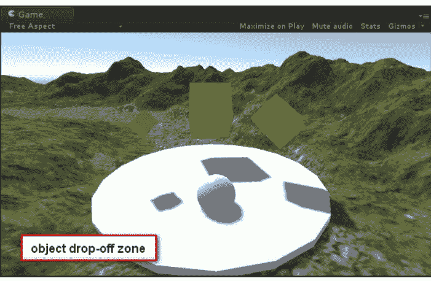

图 35 - 投放区的运行效果

## Wahé Karamian

注意在 `foreach` 循环中，我们使用 `CirclePath()` 函数计算要放置对象的位置，紧接着是处理对象的旋转。一旦使用位置和旋转数据实例化了立方体原始对象，我们就会使用存储在 `MyCollectibleData` 对象中的 `size` 值。

## 排序与匹配

我们已经完成了对游戏对象搜索和收集的实现，因此我们为你提供了一个关于这两种机制的简单示例。下一步是设计匹配和排序。为了演示简单化，我们可以要求玩家从最小到最大点击游戏对象，这将与排序的行为相应，而不会让其过于复杂。我们可以使用栈（Stack）数据结构¹³ 来实现这一功能。

我们之所以使用栈作为数据结构是因为它符合用途。

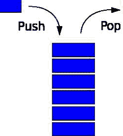

图 36 - 栈的视觉化表示

我们只能从顶部插入，在插入下一个值之前，我们可以查看（peek）栈，看看当前栈顶部的值是大于还是小于要插入的值。根据结果，我们可以决定下一步做什么。当我们看代码时，这会更有意义。

> ¹³ 栈是一种基础数据结构，逻辑上可以被看是由真实物理栈或堆表示的线性结构，这种结构中项的插入和删除都发生在称为栈顶（top）的一端。

## Unity 3D – 游戏编程入门

要做的第一件事是创建一个栈类。以下代码是我们的类列表：

```csharp
using UnityEngine;
using System.Collections;

public class MyStack {

    private int index;
    private ArrayList stack;

    public MyStack()
    {
        this.stack = new ArrayList();
        index = -1;
    }

    public int COUNT
    {
        get { return this.stack.Count; }
    }

    public void push(object data)
    {
        this.stack.Add(data);
        this.index++;
    }

    public object pop()
    {
        object o = this.stack[index];
        this.stack.RemoveAt(index);
        this.index--;

        return o;
    }

    public void clear()
    {
        this.stack.Clear();
        this.index = -1;
    }

    public object peek()
    {
        return this.stack[this.index];
    }
}
```

代码块 22 - 栈数据结构

## Vahé Karamian

如你所见，栈数据结构的实现非常简单且直接。

现在我们可以继续实际实现游戏逻辑来处理匹配和排序。以下是 `PlayerInput.cs` 的更新后列表：

```csharp
using UnityEngine;
using System.Collections.Generic;

public class PlayerInput : MonoBehaviour {
    public List<MyCollectableData> myCollection = new List<MyCollectableData>();
    public Material CubeMaterial;

    public MyStack stack = new MyStack();
    private bool MATCH = false;

    void Awake() {
        this.MATCH = false;
        // 确保我们从干净状态开始
        this.myCollection.Clear();
    }

    // 使用此进行初始化
    void Start () {
    }

    // 每帧调用一次 Update
    void Update() {
        if(!this.MATCH) {
            // 玩家 (CP) 向前的移动代码
            if (Input.GetKey(KeyCode.UpArrow)) {
                this.transform.Translate(Vector3.forward * Time.deltaTime*10);
            }
            // 玩家 (CP) 向后的移动代码
            if (Input.GetKey(KeyCode.DownArrow)) {
                this.transform.Translate(Vector3.back * Time.deltaTime*10);
            }
            // 玩家 (CP) 向左的移动代码
            if (Input.GetKey(KeyCode.LeftArrow)) {
                this.transform.Rotate(Vector3.up, -5);
            }
            // 玩家 (CP) 向右移动代码
            if (Input.GetKey(KeyCode.RightArrow))
            {
                this.transform.Rotate(Vector3.up, 5);
            }
        }
        if(this.MATCH)
        {
            #region 鼠标输入
            if (Input.mousePosition != null && Input.GetMouseButtonUp(0))
            {
                //Debug.Log("开始匹配 >>>");
                RaycastHit selectedCollectable;

                // 捕捉鼠标位置并发射射线以查看击中了哪个对象
                Ray ray = Camera.main.ScreenPointToRay(Input.mousePosition);

                if (Physics.Raycast(ray, out selectedCollectable, 200))
                {
                    //Debug.Log("标签"+selectedCollectable.transform.tag);
                    if (selectedCollectable.transform.tag.Equals("MyCollectable"))
                    {
                        var collect = selectedCollectable.transform.gameObject.GetComponent<MyCollectable>();

                        MyCollectableData data = new MyCollectableData();
                        data.ID = collect.ID;
                        data.size = collect.size;

                        MyCollectableData sd = null;

                        // 检查栈
                        if (stack.COUNT > 0)
                        {
                            sd = (MyCollectableData)stack.peek();
                            if (sd.size < data.size)
                            {
                                stack.push(data);
                            }
                            else
                            {
                                Debug.Log("抱歉！再试一次 ...");
                                stack.clear();
                            }
                        }
                        else
                        {
                            stack.push(data);
                        }
                    }
                }
            }
            #endregion

            if(stack.COUNT >= 3) {
                for(int i = 0; i < stack.COUNT; i++) {
                    MyCollectableData d = (MyCollectableData)stack.pop();
                    Debug.Log(string.Format("弹出: {0}", d.size));
                }
                Debug.Log("太棒了！目标完成！");
                this.MATCH = false;
            }
        }
    }

    // 此函数处理碰撞体的触发器
    void OnTriggerEnter(Collider c) {
        if(c.tag.Equals("MyCollectable")) {
            var collect = c.gameObject.GetComponent<MyCollectable>();
            MyCollectableData data = new MyCollectableData();
            data.ID = collect.ID;
            data.size = collect.size;
            this.myCollection.Add(data);
            Destroy(c.gameObject);
        }
        if(c.tag.Equals("DropOffZone")) {
            if(this.myCollection.Count > 2) {
                Vector3 center = c.transform.position;
                int index = 1;
                foreach (var d in this.myCollection) {
                    Vector3 pos = CirclePath(center, 1.0f, index);
                    Quaternion rot = Quaternion.FromToRotation(Vector3.forward, center - pos);
                    GameObject tmp = GameObject.CreatePrimitive(PrimitiveType.Cube);
                    tmp.transform.position = pos;
                    tmp.transform.rotation = rot;
                    tmp.transform.tag = "MyCollectable";
                    index++;
                }
            }
        }
    }
}
```


## 代码示例

```csharp
tmp.transform.localScale = new Vector3(d.size, d.size, d.size);

tmp.GetComponent<Renderer>().material = this.CubeMaterial;

// 附加可收集组件，应用数据
tmp.gameObject.AddComponent<MyCollectable>();
tmp.gameObject.GetComponent<MyCollectable>().ID = d.ID;
tmp.gameObject.GetComponent<MyCollectable>().size = d.size;

// 所有内容已处理，开始匹配
this.MATCH = true;
```

```csharp
// 用于在圆形路径周围放置下一个项目位置的函数
Vector3 CirclePath(Vector3 center, float radius, int id) {
    float ang = 90 * id; //Random.value * 360
    Vector3 pos;
    pos.x = center.x + radius * Math.Sin(ang * Math.Deg2Rad);
    pos.z = center.z + radius * Math.Cos(ang * Math.Deg2Rad);
    pos.y = center.y + 1;
    return pos;
}
```

## Vahé Karamian

下一个重大变化位于 `Update()` 函数中。我们需要一种方法来检测是否成功将可收集对象卸载到 `DropOffZone`。这是通过一个名为 `MATCH` 的布尔标志来实现。

如果该标志设置为 `true`，程序将进入游戏的第二阶段：匹配与排序。这里的目标是用户按照从小到大的顺序选择卸载的可收集箱。

我们使用 `Camera.main.ScreenToRay()` 函数将鼠标坐标从 2D 空间转换为 3D 空间的射线（`Ray`）。`Ray` 对象被物理引擎用于 `Raycast` 函数投射射线。该函数返回射线碰撞的第一个对象的信息。这些信息存储在 `selectedCollectable` 变量中。如果我们成功击中了目标游戏对象，就会开始使用 `GetComponent()` 函数获取数据以访问 `MyCollectable`，并将其存储到新的 `MyableData` 对象中。

当获取了所需的所有信息后，我们利用 `Stack` 数据结构开始将数据点插入其中。显然，在确定所选的可收集对象是否推入 `Stack` 之前，需要进行一些检查和验证；如果你没有遵循目前为止的指令，则将重新开始选择过程。此时一切应该都运行正常。我们在此并没有实现任何用户界面。主原因是我们正在处理代码逻辑，并使用控制台窗口输出结果进行反馈。

```
Console
Clear Collapse ClearOnPlay Error Pause
Pop: 5/5
UnityEngine.Debug.Log(Object)
Pop: 4/5
UnityEngine.Debug.Log(Object)
Pop: 3/5
UnityEngine.Debug.Log(Object)
GREAT JOB!!! Objective Completed!
UnityEngine.Debug.Log(Object)
```

图 37 - 显示成功排序后栈输出的控制台窗口

## Unity 3D 游戏编程入门

到此时，我们已经完成了为第 1 关设定的目标。让我们开始考虑第 2 关。

## 第 2 关的开发

在第 2 关中，我们将实现计时、切换、混合和进度进的机制。我们可以创建一个由多个房间组成的关卡。

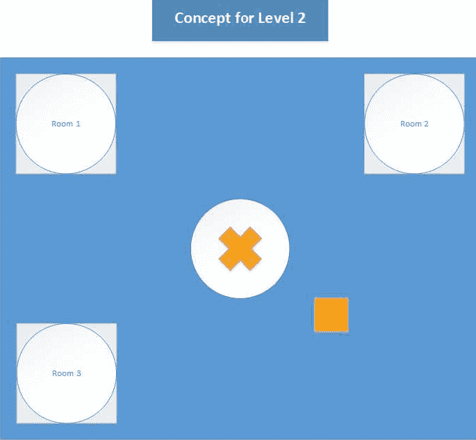

图 38 - 第 2 关的概念图

第 2 关的基本思想是玩家能够根据某些标准完成目标。例如，玩家需要访问关卡内的三个房间来完成关卡的主要目标。然而，他/她无法直接访问房间。他们必须先与一个随机器交互，由随机器决定他们需要进入哪个房间。

这三个房间将通过它们独特的颜色来识别：红色、绿色和蓝色。当玩家与随机器交互时，随机器将显示特定的颜色，当颜色被选中后，用户需要在规定的时间内找到该房间。每个房间都有一扇滑动门，只有在满足条件时门才会打开。

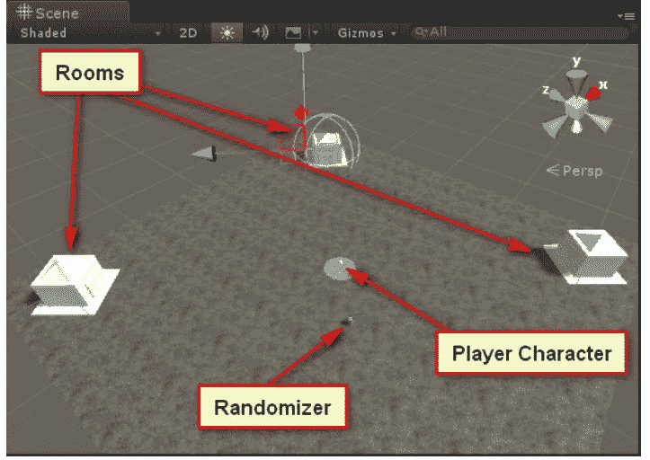

图 39 - 第 2 关设计

为了制作新关卡，我们需要实现几个新项目。首先是一个代表我们房间的 3D 模型。我使用了 SketchUp 来为我的房间建模，因为它对于非设计人员来说是一个非常容易上手和使用的程序。模型如图 40 所示，它是一个非常简单的房间，尺寸如下：宽度和长度为 4 米，高度为 3 米。房间的宽度为 2 米。在设计 3D 模型时，尺寸是非常重要的，

## Unity 3D 游戏编程入门

因为它们将根据测量单位¹¹ 反映在 Unity 3D 中。

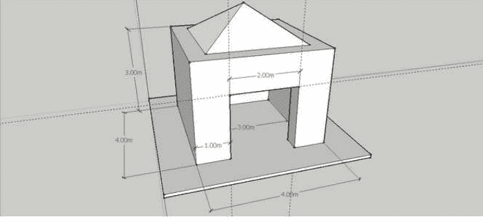

图 40 - 3D 房间模型

注意，我没有在模型上应用任何纹理。我保持了内容非常简单，因为这个示例的目的不是 3D 建模而是编程。一旦我们将模型导入 Unity，需要确保在模型上勾选了 `Generate Colliders`（生成碰撞体）选项。这对于碰撞检测非常重要。

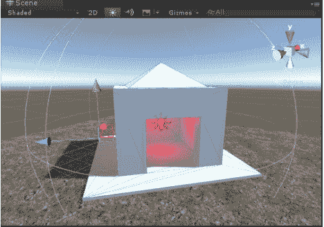

图 41 - Unity 场景中的 3D 模型

¹⁴ Unity 3D 使用公制，因此最好在公制下制作你的 3D 模型。这将有助于模型在 Unity 内部导入和缩放变得容易得多。

## Vahé Karamian

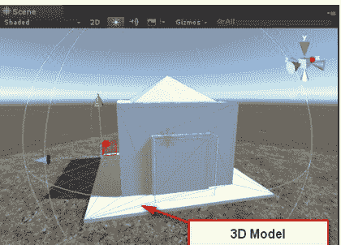

在设计视图中，你可以作为模型的子物体添加一个新的点光源（Point Light），并将其置于房间中心。每个房间将有一个具有红、绿、蓝独特颜色的点光源。（此处后续重复性文本已剔除）

## Unity 3D – 游戏编程入门

```csharp
StartCoroutine("MoveDoor", endpos);
}
}
private bool IsDoorOpen = false;
IEnumerator MoveDoor(Vector3 endPos)
{
    float t = 0f;
    Vector3 startPos = doorTransform.position;
    while (t < 1)
    {
        t += Time.deltaTime * speed;
        doorTransform.position = Vector3.Slerp(startPos, endPos, t);
        yield return null;
    }
    this.IsDoorOpen = true;
}
```

## 代码块 25 - 滑动门代码列表

这段代码负责根据两个条件打开大门：

1. 与之发生碰撞的游戏物体是玩家角色（Player Character）。
2. 玩家角色的 `ROOM_SELECTION` 与 `ROOM_NUMBER` 相同。

这通过 `OnCollisionEnter()` 函数处理。我们使用这个函数是因为我们实际上希望代表门的 `GameObject` 是实体的，这意味着玩家无法穿过它。换句话说，碰撞器组件（Collider Component）上的 `IsTrigger` 特性为 false！

注意，我们还使用了一个协程（co-routine）来实际对门进行变换。协程与多线程不同。普通的协程更新在 `Update()` 函数返回后运行。协程是一个可以挂起执行（yield）直到指令完成的函数。以下是列表：

- `yield`：协程将在下一帧所有 `Update()` 函数被调用后继续执行。
- `yield WaitForSeconds`：在指定的延迟后、在当前帧的所有 `Update()` 函数被调用后继续。
- `yield WaitForFixedUpdate`：在所有脚本的 `FixedUpdate()` 都被调用后继续。
- `yield WWW`：在 WWW 下载完成后继续。
- `yield StartCoroutine`：链联协程，并将先等待 `MyFunc` 协程完成。

到此为止，我们已经建立了第 2 关的主要结构。现在我们需要实现游戏机制的细节。第一个是计时器。当玩家点击随机生成器时，计时器会被设置。以下是步骤：

1. 当玩家选择随机生成器且随机生成器选择房间/颜色后，计时器将被设置。
2. 计时器倒计时在选择后立即开始。
3. 如果玩家在给定时间内找不到房间，游戏将结束。
4. 如果他们找到了房间，计时器将重置，他们必须通过返回随机生成器来寻找下一个房间。

这可以通过非常容易的方式实现：在 `RoomSelection.cs` 脚本中添加几个变量来跟踪时间，并更新 `PlayerInput.cs` 脚本的变量集来判断玩家是否未通过关卡，以及更新 `SlidingDoor.cs` 脚本以便玩家在规定时间内成功找到选定房间时重置计时器。

```csharp
using UnityEngine;
using System.Collections;

public class RoomSelection : MonoBehaviour {
    public GameObject playerCharacter = null;

    // 用于初始化
    void Start()
    {
        // 如果玩家角色在设计时未定义
        // 则在游戏开始前的运行时为其赋值
        if(this.playerCharacter == null)
        {
            this.playerCharacter = GameObject.FindGameObjectWithTag("Player") as GameObject;
        }

        // myTime 将用于提供玩家找到房间的秒数时间！！！
        public float myTime = 33.0f;
        private float endTime = 0.0f;

        // Update 每帧被调用一次
        void Update()
        {
            this.transform.Rotate(new Vector3(1, 1, 1), 0.0f);

            if(this.endTime > Time.time)
            {
                Debug.Log("计时器开始!" + Mathf.CeilToInt(this.endTime).ToString());
            }
            else if(this.endTime == 0.0f)
            {
                // 什么都不做
            }
            else
            {
                Debug.Log("时间结束!");
                this.playerCharacter.GetComponent<PlayerInput>().GAME_OVER = true;
            }

            // 检查此物体与玩家角色之间的距离
            float distance = Vector3.Distance(this.transform.position, this.playerCharacter.transform.position);
            if (distance < 2.0f)
            {
                // 鼠标输入
                if (Input.GetMouseButtonUp(0))
                {
                    int color = Random.Range(0, 3);
                    switch (color)
                    {
                        case 0:
                            this.transform.GetComponent<Renderer>().material.color = Color.blue;
                            this.playerCharacter.GetComponent<PlayerInput>().ROOM_SELECTION = 0;
                            break;
                        case 1:
                            this.transform.GetComponent<Renderer>().material.color = Color.red;
                            this.playerCharacter.GetComponent<PlayerInput>().ROOM_SELECTION = 1;
                            break;
                        case 2:
                            this.transform.GetComponent<Renderer>().material.color = Color.green;
                            this.playerCharacter.GetComponent<PlayerInput>().ROOM_SELECTION = 2;
                            break;
                    }

                    // 置计时器
                    this.endTime = Time.time + myTime;
                }
            }
        }
    }

    public void ResetTimer()
    {
        this.endTime = 0.0f;
    }
}
```

## 代码块 26 - RoomSelection 脚本中的计时器

通过在 `RoomSelection.cs` 脚本中添加几个变量来跟踪时间，并更新 `PlayerInput.cs` 脚本的变量集来判断玩家是否未通过关卡，以及更新 `SlidingDoor.cs` 脚本以便玩家在规定时间内成功找到选定房间时重置计时器，这可以非常容易地实现。

```csharp
using UnityEngine;
using System.Collections;

public class RoomSelection : MonoBehaviour {
    public GameObject playerCharacter = null;

    // 用于初始化
    void Start()
    {
        // 如果玩家角色在设计时未定义
        // 则在游戏开始前的运行时为其赋值
        if(this.playerCharacter == null)
        {
            this.playerCharacter = GameObject.FindGameObjectWithTag("Player") as GameObject;
        }
    }
}
```

## Unity 3D – 游戏编程入门


```csharp
{
    // 如果玩家角色在设计时未定义
    // 则在游戏开始前的运行时为其赋值
    if (this.playerCharacter == null)
    {
        this.playerCharacter = GameObject.FindGameObjectWithTag("Player") as GameObject;
    }

    // my 将用于提供玩家找到房间的秒数时间！！！
    public float myTime = 33.0f;
    private float endTime = 0.0f;

    // Update 每帧被调用一次
    void Update()
    {
        this.transform.Rotate(new Vector3(1, 1, 1), 0.0f);

        if (this.endTime > Time.time)
        {
            Debug.Log("计时器开始!" + Math.CeilToInt(this.time).ToString());
        }
        else if (this.endTime == 0.0f)
        {
            // 什么都不做
        }
        else
        {
            Debug.Log("时间结束!");
            this.playerCharacter.GetComponent<PlayerInput>().GAME_OVER = true;
        }

        // 检查此物体与玩家角色之间的距离
        float distance = Vector3.Distance(this.transform.position, this.transform.position);
        if (distance < 2.0f)
        {
            // 鼠标输入
            if (Input.mousePosition != null && Input.MouseButtonUp(0))
            {
                int color = Random.Range(0, 3);
                switch (color)
                {
                    case 0:
                    {
                        this.transform.GetComponent<Renderer>().material.color = Color.blue;
                        this.playerCharacter.GetComponent<PlayerInput>().ROOM_SELECTION = 0;
                        break;
                    }
                    case 1:
                }
            }
        }
}
```

# Vahé Karamian

```csharp
{
    this.transform.GetComponent<Renderer>().material = Color.red;
    this.playerCharacter.GetComponent<PlayerInput>().ROOM_SELECTION = 1;
    break;
}
case 2:
    this.transform.GetComponent<Renderer>().material = Color.green;
    this.playerCharacter.GetComponent<PlayerInput>().ROOM_SELECTION = 2;
    break;
}

// 置计时器
this.endTime = myTime;
}
#endregion

public void ResetTimer()
{
    this.endTime = 0.0f;
}
```

## 代码块 26 - RoomSelection 脚本中的计时器

通过在 `RoomSelection.cs` 脚本中添加几个变量来跟踪时间，并更新 `PlayerInput.cs` 脚本的变量集来判断玩家是否未通过关卡，以及更新 `SlidingDoor.cs` 脚本以便玩家在规定时间内成功找到选定房间时重置计时器，这可以非常容易地实现。

```csharp
using UnityEngine;
using System.Collections;

public class RoomSelection : MonoBehaviour {
    public GameObject playerCharacter = null;

    // 用于初始化
    void Start()
}
```

## Unity 3D – 游戏编程入门

我们应该查看的下一个脚本是 `SlidingDoor.cs`。该脚本实际上用于在玩家找到正确的房间并进入它时重置计时器。与之前的代码列表一样，我将只列出部分代码以演示修改。

```csharp
using UnityEngine;
using System.Collections;

public class SlidingDoor : MonoBehaviour
{
    public int ROOM_NUMBER;

    public Transform doorTransform;
    public float raiseHeight = 3f;
    public float speed = 3f;
    private Vector3 _closedPosition;

    public GameObject roomSelection;

    // 使用此进行初始化
    void Start()
    {
        if (this.roomSelection == null)
        {
            this.roomSelection = GameObject.Find("RoomSelection") as GameObject;
        }
        _closedPosition = transform.position;
    }

    void OnCollisionEnter(Collision c)
    {
        if (c.transform.tag.Equals("Player"))
        {
            // 玩家进入房间后重置计时器
            this.roomSelection.GetComponent<RoomSelection>().ResetTimer();
            Debug.Log("Timer has been reset!");
        }
    }

    private bool IsDoorOpen = false;
    IEnumerator MoveDoor(Vector3 endPos)
    {
    }
}
```

代码块 28 - 用于计时函数的 SlidingDoor.cs 脚本更新

# Vahé Karamian

在更新后的脚本中执行了两项新任务，第一个是在 `Start()` 函数中。我们识别并找到名称或 ID 为 `RoomSelection` 的 GameObject，并存储该 GameObject 的引用以便稍后使用。该脚本的第二个新增是在 `OnCollisionEnter()` 函数中通过 `RoomSelection` GameObject 对象调用 `ResetTimer()` 函数。

此时，我们已经实现了基础功能，但我们需要以某种方式为玩家计数。换句话说，我们需要一种方法来识别玩家访问过的房间，当玩家访问了所有房间时，他们就完成了关卡。我们可以利用 `Stack`（栈）数据结构来克服这个障碍。当玩家访问房间时，我们将每个房间推入栈中，当三个房间都被访问后，玩家就赢得关卡。

这种场景和数据更新将由 `SlidingDoor.cs` 脚本和 `PlayerInput.cs` 脚本处理。`SlidingDoor` 类将调用 `PlayerInput` 类中定义的方法，将房间数据推入栈中。

`SlidingDoor.cs` 中需要更改的代码段列如下：

代码块 29 - SlidingDoor.cs 脚本中添加“房间访问”功能

## Unity 3D – 游戏编程入门

我们在 `PlayerInput.cs` 脚本中需要做的更改如下：

```csharp
public void RoomVisited(SlidingDoor room)
{
    if (room != null)
    {
        this.stack.push(room);
    }

    string msg = string.Format("Room #{0} inserted, stack count={1}",
    room.ROOM_NUMBER, this.stack.COUNT);
    Debug.Log(msg);

    if (this.stack.COUNT >= 3)
    {
        Debug.Log("YOU WIN!!!");
        this.GAME_OVER = true;
    }
}
```

现在我们已经看到了几种不同类型的游戏机制实现。尽管这些示例提供的例子非常简单（这是刻意为之），但它们展示了各个机制的核心概念和思想。

## 第 3 层的开发

在第 3 层中，我们将说明进度、捕获/征服以及推进的游戏机制。我们可能还会将目前为止看到的其他几个游戏机制结合起来，创建一个稍微复杂且深入的关卡。

我最喜欢的游戏类型之一是即时战略游戏（RTS）。我最喜欢的两款是《帝国时代》I、II、III 以及《红色警戒》。我喜欢 RTS 游戏的主要原因之一是，你必须真正思考并使用大量的后勤来规划策略，并击败对手。国际象棋和 RTS 的区别在于，在象棋游戏中，玩家轮流移动，因此他们必须提前思考几步。而在 RTS 游戏中，你的对手可以在任何时间从任何方向对发起攻击，并且拥有优越的武器和资源！

简而言之，在这些每个游戏中，玩家都被要求收集资源、建立军队、建立基地和所需的结构，通过结构和单位升级的不同阶段，同时维护他们的基地。在这些行动之上，资源和单位的收集和创建还有一个时间元素。正如你现在所能看到的，游戏设计和机制非常复杂，需要非常周密的计划。

我们没有时间也没有资源为第 3 层承担这样的任务。因此，我们将制作一个简化版的 RTS 类型游戏。为了实现我们的目标，我们可以画出用户在第 3 层中需要完成的任务大纲。

以下是简单的大纲：

1. 玩家在游戏开始时将拥有一定量的资源。
2. 玩家需要建立一个收集设施。
3. 玩家需要创建一个收集单位。
4. 玩家需要识别待收集资源的位置。
5. 玩家需要将收集器分配给待收集的资源。
6. 当收集单位正在收集时，玩家需要……
7. 存储单元将跟踪收集单位，并确保收集器知道自己属于哪个存储单元！

## Unity 3D - 游戏编程入门

```csharp
else if (this.endTime == 0.0f)
{
    // 什么都不做
}
else
{
    this.endTime = 0.0f;
    this.collectorObj.GetComponent<MyCollector>().GOTO_RESOURCE = true;

    // 给玩家角色添加子弹
    this.playerCharacter.GetComponent<PlayerInput>().NUM_BULLETS += 1;
}

// 此函数处理碰撞体作为触发器的碰撞
void OnCollisionEnter(Collision c)
{
    if (c.transform.tag.Equals("CollectorUnit"))
    {
        c.transform.GetComponent<MyCollector>().GOTO_STORAGE = false;

        // 启动计时器
        this.endTime = this.myTime + Time.time;
    }
}
```

代码块 31 - MyStorage.cs 初始版本

当你阅读代码时，你会注意到在 `Start()` 函数中我们实例化了一个 `CollectorUnit` 对象，并将 `StorageUnit` 对象赋值为引用，这样它就知道在收集资源后返回哪里。我们做的下一件事是获取玩家角色的引用。

在 `MyStorage` 类中定义的 `Update()` 函数仅在 `Collector Unit` 返回它时才被使用。它由 `OnCollisionEnter()` 函数触发，在该函数中设置了卸载资源的计时器。随后在 `Update()` 函数中检查计时器，以便卸载资源并将 `Collector Unit` 重新路由回资源位置。

这让我们关注下一个感兴趣的条目：`Collector Unit`。在这种场景中，`Collector Unit` 只关心资源所在的位置，以便它能够去收集资源，以及它属于哪个 `Storage Unit`，以便它能够返回并卸载资源。

为了知道它收集了多少资源，定义了这个变量，但目前还没有使用。此外，还有两个关键标志位定义了收集器的状态：它要么是在资源位置进行加载，要么是前往存储单元进行卸载。

`MyCollector.cs` 的列表如下所示：

```csharp
using UnityEngine;
using System.Collections;

public class MyCollector : MonoBehaviour
{
    public GameObject myResource;
    public GameObject myStorage;

    public bool GOTO_RESOURCE;
    public bool GOTO_STORAGE;

    public int UNITS_COLLECTED;

    // 使用此进行初始化
    void Start()
    {
        this.myResource = GameObject.FindGameObjectWithTag("ResourcePlayer") as GameObject;

        this.GOTO_RESOURCE = true;
        this.GOTO_STORAGE = false;

        this.UNITS_COLLECTED = 0;
    }

    // Update 每帧被调用一次
    void Update()
    {
        if (this.GOTO_RESOURCE)
        {
            // 去资源位置进行收集
            Vector3 refillHeading = this.myResource.transform.position - this.transform.position;

            // 使用 Quaternion Slerp 实现平滑过渡
            this.transform.rotation = Quaternion.Slerp(transform.rotation, Quaternion.LookRotation(refillHeading), 10 * Time.deltaTime);

            this.transform.Translate(Vector3.forward * Time.deltaTime);
        }

        if (this.GOTO_STORAGE)
        {
            Vector3 refillHeading = this.myStorage.transform.position - this.transform.position;
            refillHeading.Normalize();

            // 使用 Quaternion Slerp 函数实现平滑过渡 ...
            this.transform.rotation = Quaternion.Slerp(transform.rotation, Quaternion.LookRotation(refillHeading), 10 * Time.deltaTime);

            this.transform.Translate(Vector3.forward * Time.deltaTime);
        }
    }
}
```

# 代码块 32 - MyCollector.cs 版本 1

观察代码，你会发现 `Collector Unit` 找到了玩家资源的位置，并将其存储在自己的内存中。由于它刚刚被 `Storage Unit` 初始化，因此它的初始状态将是收集并不断收集资源。这在 `Start()` 函数中定义。

`Update()` 函数仅负责确保收集器被正确地驱动到资源位置或存储单元。非常简单且直接。这里的关键在于注意到，收集器的状态是由外部力量改变的！

完成整个循环的下一个拼图是资源。按照它的设计，资源对象是静态的，不能被移动或重新定位。它还不会从内部创建任何东西，尽管这可能是你以后可能想要做的。因此，资源对象的主要任务是知道收集器何时到达进行收集，以及在到达返回基地时如何改变收集器的状态！

这里是 `MyResource.cs` 脚本列表：


```cs
using UnityEngine;
using System.Collections;

public class MyResource : MonoBehaviour
{
    public GameObject collectorUnit;

    // 计时器变量
    public float myTime = 3.0f;
    private float endTime = 0.0f;

    // 使用此进行初始化
    void Start()
    {
    }

    // Update 每帧被调用一次
    void Update()
    {
        if (this.endTime > Time.time)
        {
            // 我们将在这里放置一些代码用于视觉显示加载
        }
        else if (this.endTime == 0.0f)
        {
            // 什么都不做
        }
        else
        {
            this.endTime = 0.0f;
            this.collectorObj.GetComponent<MyCollector>().GOTO_RESOURCE = true;
        }
    }

    // 此函数处理碰撞体作为触发器的碰撞
    void OnTriggerEnter(Collider c)
    {
        if (c.transform.tag.Equals("CollectorUnit"))
        {
            c.transform.GetComponent<MyCollector>().GOTO_STORAGE = false;

            // 启动计时器
            this.endTime = this.myTime + Time.time;
        }
    }
}
```

# 代码块 33 - MyResource.cs 版本 1

当你阅读代码时，你会注意到在 `Start()` 函数中我们实例化了一个 `CollectorUnit` 对象，并将 `StorageUnit` 对象赋值为引用，这样它就知道在收集资源后返回哪里。我们做的下一件事是获取玩家角色的引用。

在 `MyStorage` 类中定义的 `Update()` 函数仅在 `Collector Unit` 返回它时才被使用。它由 `OnCollisionEnter()` 函数触发，在该函数中设置了卸载资源的计时器。随后在 `Update()` 函数中检查计时器，以便卸载资源并将 `Collector Unit` 重新路由回资源位置。

这让我们关注下一个感兴趣的条目：`Collector Unit`。在这种场景中，`Collector Unit` 只关心资源所在的位置，以便它能够去收集资源，以及它属于哪个 `Storage Unit`，以便它能够返回并卸载资源。

为了知道它收集了多少资源，定义了这个变量，但目前还没有使用。此外，还有两个关键标志位定义了收集器的状态：它要么是在资源位置进行加载，要么是前往存储单元进行卸载。

## Unity 3D - 游戏编程入门

现在是时候构建敌人了。这里是敌人做的简单大纲：

- 敌人从数量资源开始。
- 敌人需要一个收集器。
- 敌人需要识别玩家。
- 敌人需要识别要收集的资源。
- 敌人需要分配收集器。
- 当收集器收集时，敌人需要探索地形。
- 敌人需要避免被玩家杀死。

脚本的目标是允许敌人在地形中漫游，并能够放置存储单元进行资源收集，并在必要时防御其基地并攻击玩家。

我们脚本的主要新增将是驱动敌人的脚本。我们将其命名为 `MyEnemy.cs`。它将负责赋予敌人一些智能，尽管并不多，仅仅是为了演示。

# 代码块 34 - MyEnemy.cs 版本 1

```cs
using UnityEngine;
using System.Collections;

public class MyEnemy : MonoBehaviour
{
    public GameObject myBase;
    public GameObject myStorage;
    private GameObject myStorageObj;
    public GameObject myEnemy;
    public int NUM_BULLETS;

    // 计时器变量
    public float myTime = 5.0f;
    private float endTime = 0.0f;

    public bool ATTACK;
    public bool SCOUT;

    public Transform[] scoutPoints;
    private int nextArrayIndex;

    // 使用此进行初始化
    void Start()
    {
        this.NUM_BULLETS = 1;
        this.ATTACK = true;
    }
}
```

## Unity 3D – 游戏编程入门

```csharp
this.myEnemy = GameObject.FindGameObjectWithTag("Player") as GameObject;

// 启动计时
this.endTime = this.myTime + Time.time;

this.nextPointIndex = 0;
}

// Update 每帧调用一次
void Update()
{
    if (this.myStorage == null)
    {
        if (this.endTime == Time.time)
        {
            // 掉落存储箱
            Vector3 pos = new Vector3(this.transform.position.x + 1, 2, this.transform.position.z += 1);
            this.myStorageObj = GameObject.Instantiate(this.myStorage, pos, this.myStorage.rotation) as GameObject;
            this.endTime = 0.0f;
        }
    }

    if (this.NUM_BULLETS > 1)
    {
        this.ATTACK = true;
    }
    else
    {
        this.ATTACK = false;
    }

    // 寻找玩家进行攻击
    if (this.ATTACK)
    {
        Vector3 refillHeading = this.myEnemy.transform.position - this.transform.position;
        refillHeading.Normalize();

        // 使用 Quaternion Slerp 实现平滑过渡
        this.transform.rotation = Quaternion.Slerp(transform.rotation, Quaternion.LookRotation(refillHeading), 10 * Time.deltaTime);
        this.transform.Translate(Vector3.forward * Time.deltaTime);
    }
    else
    {
        if (this.scoutPoints.Length > 0)
        {
```

# Vahé Karamian

```csharp
Vector3 refillHeading = this.scoutPoints[nextPointIndex].position - this.transform.position;
refillHeading.Normalize();
```

```csharp
// 使用 Quaternion Slerp 实现平滑过渡 ...
this.transform.rotation = Quaternion.Slerp(transform.rotation, Quaternion.LookRotation(refillHeading), 10 * Time.deltaTime);
```

```csharp
this.transform.Translate(Vector3.forward * Time.deltaTime);

if (Vector3.Distance(this.transform.position, this.scoutPoints[nextPointIndex].position) < 0.25)
{
    this.nextPointIndex += 1;
    if (this.nextPointIndex >= this.scoutPoints.Length)
    {
        this.nextPointIndex = 0;
    }
}
```

# 代码块 34 - MyEnemy.cs 版本 1

将这些部分组合在一起并运行程序，你将看到环境是如何活跃起来的。我们使用的图形和 3D 模型非常原始，但这本书并不是关于 3D 建模的，而是关于编程的。因此，我们使用了原始的占位符，当我们获得更好的模型时，可以很容易地替换它们！

我们目前实现的唯一方面是攻击能力。对于玩家和敌人都是如此。我们可以从实现玩家的攻击功能开始，然后实现敌人的攻击功能。

为了实现攻击功能，我们需要调整几个项目。首先，我们需要一个物理表示来描述攻击将在何时以及何地发生。下一个任务是确定实际攻击的威力有多大。最后，我们需要确定攻击的范围。

最后一个条件更多是针对敌人玩家角色，而不是真正的玩家。玩家可以在他想要的任何时间、任何地点攻击

## Unity 3D – 游戏编程入门

或她想要的，只要有可用资源！同样的原理适用于敌人，但设计一个无缘无故攻击的敌人是没有意义的，因为玩家无目的地攻击并在没有任何实际效果的情况下损失资源将是一样的。

这里是 `PlayerInput.cs` 脚本的新列表项：

```csharp
using UnityEngine;
using System.Collections.Generic;

public class PlayerInput : MonoBehaviour
{
    public List<MyCollectableData> myCollection = new List<CollectableData>();
    public Material CubeMaterial;
    public MyStack stack = new MyStack();
    private bool MATCH = false;

    #region 第2 关变量
    public int ROOM_SELECTION;
    public bool GAME_OVER;
    #endregion

    #region 第3 关变量
    public GameObject myStorageUnit;
    public GameObject myBullet;
    public GameObject myGun;
    public int NUM_BULLETS;
    public GameObject myEnemy;
    #endregion

    void Awake()
    {
        this.stack.clear();
        this.ROOM_SELECTION = -1;
        this.GAME_OVER = false;
        this.MATCH = false;
        this.NUM_BULLETS = 1;
        // 确保从干净状态开始
        this.myCollection.Clear();
    }

    // 使用此初始化
    void Start()
    {
    }
}
```

# Vahé Karaminan

```csharp
if (this.myEnemy == null)
{
    this.myEnemy = GameObject.FindGameObjectWithTag("Enemy") as GameObject;
}

private float SPEED = 2.0f;

// Update 每帧调用一次
void Update()
{
    if (!this.GAME_OVER)
    {
        if (!this.MATCH)
        {
            // 玩家 (CP) 向移动的代码
            if (Input.GetKey(KeyCode.Up))
            {
                transform.Translate(Vector3.forward * SPEED * Time.deltaTime);
            }
            if (Input.GetKey(KeyCode.Down))
            {
                transform.Translate(Vector3.back * SPEED * Time.deltaTime);
            }
            if (Input.GetKey(KeyCode.Left))
            {
                transform.Translate(Vector3.left * SPEED * Time.deltaTime);
            }
            if (Input.GetKey(KeyCode.Right))
            {
                transform.Translate(Vector3.right * SPEED * Time.deltaTime);
            }
            if (Input.GetKeyDown(KeyCode.Space))
            {
                // 攻击逻辑
            }
        }
    }
}
```

## Unity 3D – 游戏编程入门

```csharp
this.transform.rotation = rotation) as GameObject;
this.transform.rotation = string.Format("Storage: {0}", Time.time);
this.NUM_BULLETS--;
}
}

if (this.MATCH)
    // 鼠标输入
if (Input.GetMouseButton(0))
{
    Ray ray = new Ray();
    // ...
    {
        if (stack.COUNT > 0)
        {
            sd = (MyCollectableData)stack.peek();
            if (sd.size < data.size)
            {
                stack.push(data);
            }
            else
            {
                Debug.Log("Sorry! Try Again!");
                stack.clear();
            }
        }
    }
    else
    {
        stack.push(data);
    }
}

if (stack.COUNT >= 3)
{
    for (int i = 0; i <= stack.COUNT + 1; i++)
    {
    }
    Debug.Log("GREAT JOB!! Objective Completed!");
    this.MATCH = false;
}
```

// 此函数处理作为触发器的碰撞体
```csharp
void OnTriggerEnter(Collider c)
{
    if (c.tag.Equals("MyCollectable"))
    {
        var collect = c.gameObject.GetComponent<MyCollectable>();
        MyCollectableData data = new MyCollectableData();
        data.ID = collect.ID;
        data.size = collect.size;
        this.myCollection.Add(data);
        Destroy(c.gameObject);
    }
}

if (c.tag.Equals("DropOffZone"))
{
    if (this.myCollection.Count > 2)
    {
        Vector3 center = c.transform.position;
        foreach (var d in this.myCollection)
        {
            Vector3 pos = CirclePath(center, 1.0f, index);
            index++;
        }
        GameObject tmp = GameObject.CreatePrimitive(PrimitiveType.Cube);
    }
}
```

## Unity 3D – 游戏编程入门


```csharp
tmp.transform.position = pos;
tmp.transform.rotation = rot;

tmp.transform.tag = "MyCollectable";
tmp.transform.localScale = new Vector3(d.size, d.size, d.size);

tmp.GetComponent<Renderer>().material = this.CubeMaterial;

// 挂载收集组件，应用数据
tmp.gameObject.AddComponent<MyCollectable>();
tmp.gameObject.GetComponent<MyCollectable>().ID = d.ID;
tmp.gameObject.GetComponent<MyCollectable>().size = d.size;

// 所有处理已完成，开始匹配
this.MATCH = true;

// 计算环形路径周围下一个物品
// 位置的函数。
Vector CirclePath(Vector3 center, float radius, int id)
{
    float ang = 90 * id; //Random.value * 360
    Vector3 pos;
    pos.x = center.x + radius * Mathf.Sin(ang * Math.Deg2Rad);
    pos.z = center.z + radius * Mathf.Cos(ang * Math.Deg2Rad);
    pos.y = center.y + 1;
    return pos;
}

public void RoomVisited(SlidingDoor room)
{
    if (room != null)
    {
        this.stack.push(room);

        string msg = string.Format("房间 #{0} 已插入, 栈计数={1}", room.NUMBER, this.stack.COUNT);
        Debug.Log(msg);

        if (this.stack.COUNT >= 3)
        {
            Debug.Log("你赢了!!");
            this.GAME_OVER = true;
        }
    }
}
```

## 代码块 35 - 带有攻击敌人函数的 PlayerInput.cs

从代码中可以看到，我们使用了键盘上的 `F` 键来开始向敌人发射子弹。

这是通过检查并确保库存中有子弹来实现的。一旦子弹初始化，它就会被赋予一个速度，使用物理引擎来处理其轨迹。最后，我们在一定时间后自动销毁游戏对象，时间恰好是 3 秒。

现在我们可以查看敌人脚本并研究代码结构。以下是实现了攻击功能的 `MyEnemy.cs` 列表：

```csharp
using UnityEngine;
using System.Collections;

public class MyEnemy : MonoBehaviour
{
    public GameObject myBase;

    public GameObject myStorage;
    private GameObject myStorageObj;

    public GameObject myEnemy;

    public GameObject myBullet;
    public GameObject myGun;

    public int NUM_BULLETS;

    // 定计时变量
    public float myTime = 5.0f;
    private float endTime = 0.0f;

    public bool ATTACK;
    public bool SCOUT;

    public Transform[] scoutPoints;
    private int nextPoint;

    // 用于初始化
    void Start()
    {
        this.NUM_BULLETS = 1;
        this.ATTACK = true;

        this.myEnemy = GameObject.FindGameObjectWithTag("Player") as GameObject;

        // 开始计时器
        this.endTime = this.myTime + Time.time;
        this.nextPointIndex = 0;
    }
    private float SPEED = 2.0f;

    // Update 每帧调用一次
    void Update()
    {
        if (this.myStorageObj == null) {
            if (this.endTime < Time.time) {
                // 掉落存储
                Vector3 pos = new Vector3(this.transform.position.x + 1, 2,
                    this.transform.position.z + 1);
                this.myStorageObj = GameObject.Instantiate(this.myStorage, pos,
                    this.myStorage.transform.rotation) as GameObject;

                this.endTime = 0.0f;
            }
        }
        if (this.NUM_BULLETS > 1) {
            this.ATTACK = true;
        } else {
            this.ATTACK = false;
        }

        // 寻找玩家并攻击
        if (this.ATTACK) {
            Vector3 refillHeading = this.myEnemy.transform.position -
                this.transform.position;
            refillHeading.Normalize();

            // 使用 Quaternion Slerp 实现平滑过渡
            this.transform.rotation =
                Quaternion.Slerp(transform.rotation,
                Quaternion.LookRotation(refillHeading), 10 *
                Time.deltaTime);
        }
        this.transform.Translate(Vector3.forward * Time.deltaTime *
            this.SPEED);
    }
    if (Vector3.Distance(this.myEnemy.transform.position, this.transform.position) < 5.0f) {
        if (this.NUM_BULLETS > 0) {
            if (this.endTime < Time.time)
            {
                GameObject bullet = GameObject.Instantiate(this.MyBullet,
                    this.myGun.transform.position, this.myGun.transform.rotation) as GameObject;

                bullet.GetComponent<Rigidbody>().velocity = this.transform.TransformDirection(new Vector3(0, 0, 10.0f));

                GameObject.Destroy(bullet, 3.0f);

                // 减少库存
                this.NUM_BULLETS--;

                // 设置计时器
                this.endTime = this.myTime + Time.time;
            }
        }
    }
    else {
        if (this.scoutPoints.Length > 0) {
            Vector3 refillHeading = this.myEnemy.transform.position -
                this.transform.position;
            refillHeading.Normalize();

            // 使用 Quaternion Slerp 实现平滑过渡
            this.transform.rotation =
                Quaternion.Slerp(transform.rotation,
                Quaternion.LookRotation(refillHeading), 10 *
                Time.deltaTime);

            this.transform.Translate(Vector3.forward * Time.deltaTime *
                this.SPEED);
        }
        if (Vector3.Distance(this.myEnemy.transform.position, this.transform.position) < 5.0f) {
            if (this.NUM_BULLETS > 0) {
                if (this.endTime < Time.time) {
                    this.nextIndex++;
                }
            }
        }
    }
}
```

## 代码块 36 - 带有攻击函数的 MyEnemy.cs

我们实现的逻辑与你注意到敌人在两米内的逻辑非常相似，因此我将让你自己完成这一点。这是目前还没有考虑的缺点。

## Unity 3D – 游戏编程入门

### 基础布局

为了布局目的，每个 UI 元素都被表示为一个矩形。可以在场景视图（`Scene View`）中使用工具栏中的矩形工具（`Rect Tool`）对该矩形进行操作。矩形工具用于 Unity 的 2D 功能和 UI，实际上甚至可以用于 3D 对象。


矩形工具可用于移动、调整大小和旋转 UI 元素。一旦选择了 UI 元素，可以通过点击矩形内部任意地方并拖动来移动它。可以通过点击边缘或角落或拖动来调整其大小。

将光标稍微悬停在角落附近，直到鼠标光标看起来像旋转符号，即可旋转元素。然后你可以点击并向任意方向拖动以旋转。

与其他工具一样，矩形工具使用当前的轴点模式（`pivot mode`）和空间（`space`）。在处理 UI 时，通常建议将这些设置为轴点（`Pivot`）和本地（`Local`）。

### Rect Transform

`Rect Transform` 是一种新的变换组件，用于所有 UI 元素，而不是普通的 `Transform` 组件。

`Rect Transform` 像普通的 `Transform` 一样具有位置、旋转和比例，但它还有宽度高度，用于指定矩形的大小。

| Rect Transform | Pos X | Pos Y | Pos Z |
|---|---|---|---|
| center | -109 | -308 | |
| | Width 160 | Height 30 | |
| Anchors | X 0.5 | Y 0.5 | |
| Min | X 0.5 | Y 0.5 | |
| Max | X 0.5 | Y 0.5 | |
| Pivot | X 0 | Y 0 | Z 0 |
| Rotation | X 1 | Y 1 | Z 1 |
| Scale | | | |

图 47 - Rect Transform 组件

### 轴点（Pivot）

旋转、大小和比例修改是围绕轴点进行的，因此轴点的位置会影响旋转、调整大小或比例的结果。当工具栏上的 Pivot 按钮设置为 Pivot 模式时，可以在场景视图中移动 `Rect Transform` 的轴点。

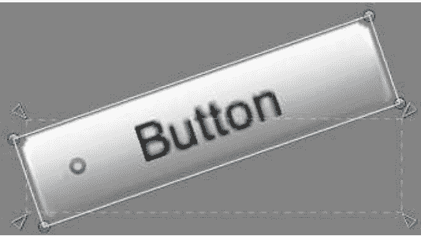

### 锚点（Anchors）和锚点预设（Anchor Presets）

`Rect Transform` 包含一个称为锚点（`anchors`）的布局概念。锚点在场景视图中显示为四个小三角形，锚点信息也显示在检查器（`Inspector`）中。如果 `Rect Transform` 的父级也是 `Rect Transform`，则子 `Rect Transform` 可以以各种方式锚定到父 `Rect Transform`。例如，子物体可以锚定到父物体的中心，也可以锚定到其中之一。

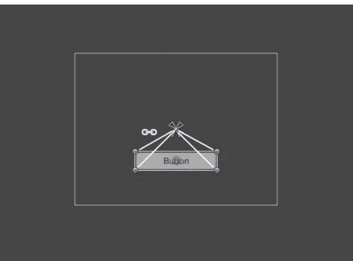

锚定还允许子物体随着父对象的宽度或高度一起拉伸。矩形的每个角相对于对应的锚点都有一个固定的偏移，即矩形的左上角相对于左上锚点有一个固定偏移，通过这种方式，矩形的不同角可以锚定到父矩形中的不同点。

在检查器中，可以在 `Rect Transform` 组件的左上角找到锚点预设（`Anchor Preset`）按钮。点击按钮将弹出锚点预设下拉菜单。从这里你可以从一些最常用的锚定选项中快速选择。你可以将 UI 元素锚定到父对象的侧边或中间，或者随父对象一起拉伸。

| 锚点预设 | 同样设置位置 | | |
|---|---|---|---|
| 自定义 | 左侧 | 右侧 | |
| 顶部 | | | |
| 中间 | | | |
| 底部 | | | |
| 拉伸 | | | |

图 50 - 锚点组件

锚点预设显示了当前选择的设置。如果水平或垂直轴设置了不同的。

### Unity 5 用户界面组件

Unity 中有两种类型的 UI 组件。我们将从 UI 组件开始，主要类型是视觉组件（`Visual Components`）和交互组件（`Interactive Components`）。我们将首先查看视觉组件，然后是交互组件。

#### 视觉组件

这些是向用户显示信息的 UI 元素。

- **Text**：`Text` 组件也称为 Label，具有字体、字体大小、对齐、文本超出可用空间溢出，以及一个自适应选项
- **Image**：`Image` 有 `Rect Transform` 组件，`Image` 组件接收位图。`Image Type` 字段定义了应用位图如何显示，选项有：
    - 简单（`Simple`）
    - 切片（`Sliced`）
    - 平铺（`Tiled`）
    - 填充（`Filled`）
- **Raw Image**：`Image` 组件接收位图，但在必要情况下应使用 `Raw Image`，否则 `Image` 是合适的。
- **Mask**：`Mask` 不是可见的控件，而是一种修改控件外观的方式。`Mask` 限制（即，“遮罩”）子元素到父对象的形状。因此，如果子比父对象大，只有位于父对象内的部分是可见。
- **Effects**：视觉组件还可以应用各种简单效果，例如阴影或轮廓。

#### 交互组件

每个 UI 都需要一些可交互元素。也就是说用户需要能够选择某些内容。这些是用户可以交互的 UI 元素，例如：

- **Button**：按钮设计用于在用户点击并释放时启动操作。如果在释放点击之前鼠标移出了按钮控件，则操作不会发生。按钮有一个名为 `On Click` 的单事件，响应用户完成点击。
- **Toggle**：`Toggle` 控制允许用户切换选项的开启或关闭。在只需要一组选项中的一个的情况下，你还可以将多个 `Toggle` 组合到 `Toggle Group` 中。`Toggle` 有名为 `On Value Changed` 的单事件，响应用户更改当前值。新值将作为布尔参数传递给事件函数。
- **Toggle Group**：`Toggle Group` 通过将 `Toggle Group` 对象拖入到组中每个 `Toggle` 的 `Group` 属性来设置。`Toggle Groups` 用于用户必须从一组互斥的选项中做出选择。常见示例包括选择角色类型、速度设置（慢、中、快等）、预设颜色和星期。你可以在场景中同时拥有多个 `Toggle Group` 对象，因此在需要时创建多个独立的组。


# Unity 3D – 游戏编程入门

## UI 控件概述

- **Slider（滑块）**：Slider 的值由滑块沿其长度的位置决定。值根据滑块拖动的距离，实现从最小值到最大值的比例变化。默认行为是滑块从左到右增加，但也可以使用 `Direction`（方向）属性反转此行为。你也可以通过在 `Direction` 属性中选择 `Bottom to Top`（从下到上）或 `Top to Bottom`（从上向下）来设置滑块垂直增加。滑块有一个名为 `On Value Changed` 的单一事件，会在用户拖动滑块时做出响应。滑块的当前数值将作为 `float` 参数传递给函数。

- **Scrollbar（滚动条）**：滚动条的值由滑块沿其长度的位置决定，其报告的值为两个端点之间的分值。例如，默认的从左到右的条，在左端的值为 0.0，右端为 1.0，0.5 表示中间点。通过在 `Direction` 属性中选择 `Top to Bottom` 或 `Bottom to Top` 可以使滚动条垂直排列。滚动条与 Slider 控件之间的一个显著区别是，滚动条的滑块大小可以改变，以表示可滚动的距离；当视图只能滚动很短距离时，滑块将填充大部分条，并仅允许向任何方向进行轻微移动。滚动条有一个名为 `On Value Changed` 的单一事件，会在用户拖动滑块时做出响应。当前值将作为 `float` 参数传递给事件函数。

- **Dropdown（下拉菜单）**：下拉菜单可用于用户从选项列表中选择单个选项。控件显示当前选中的选项。点击后，它会打开选项列表以便选择新选项。一旦选择了新选项，列表将再次关闭，控件将显示新选中的选项。列表也会关闭（如果用户点击控件本身或 Canvas 内部任何地方，请查看在线文档以获取所有可用选项和配置）。

- **Input Field（输入框）**：输入框是使文本控件（Text Control）的文本变为可编辑的方法。与其他交互控件一样，它本身不是一个可见的 UI 元素，必须与一个或多个视觉 UI 元素结合才能可见。可以从菜单（Component > UI > Input Field）将 Input Field 脚本添加到任何现有 Text 控件对象。完成后，你还应该将对象拖到 Input Field 的 `Text` 属性以启用编辑。Text 控件本身的 `Text` 属性会随着用户的输入而改变，并在编辑后从脚本中检索该值。注意，可编辑的 Text 控件刻意不支持富文本（Rich Text）；字段在输入时会立即应用任何富文本标记，但该标记在实质上会“消失”，之后没有其他方法可以更改或删除样式。

- **Scroll Rect（滚动矩）**：当内容占用大量空间且需要在小区域显示时，可以使用 Scroll Rect。Scroll Rect 提供了滚动这些内容的功能。通常 Scroll Rect 会与 Mask（遮罩）结合创建一个滚动视图，只有 Scroll Rect 内部的可滚动内容可见。它还可以额外结合一或两个滚动条，通过拖动它们进行水平或垂直滚动。

## 创建我们的第一个用户界面

现在你已经了解了 Canvas 以及可使用的不同用户界面元素，我们可以通过创建第一个 UI 来开始实践了。我们将使用在上一章节中开发的关卡来演示这些概念，并对 Unity 5 中的 UI 系统进行概述。我们创建了三个关卡来演示游戏机制概念。让我们在这里列出它们，以及每个关卡的目标。这很重要，因为你需要理解关卡的目标，才能设计出支持你游戏环境的 UI。

- 关卡 1：搜索；收集；排序。
- 关卡 2：改变；混合和计时。
- 关卡 3：推进；回避；捕捉和征服。

### 关卡 1 – UI 设计

要开始创建我们的 UI，我们需要在场景中引入一个 Canvas 节点。最简单的方法是在 Hierarchy（层级）窗口中右键点击，并从菜单中选择 `UI -> Canvas`。这将一个 Canvas 节点置于你的场景中。如果尚未设置该值，我们希望将 `Render Mode`（渲染模式）设置为 `Screen Space – Overlay`（此渲染模式将 UI 元素放置在场景上方）。

我们需要向玩家传递两个主要信息：(1) 场景中有多少个收集物品，(2) 玩家收集了多少个物品。我们可以结合两个 UI 元素来向玩家显示这些信息：Panel（面板）和 Text（文本）。

#### 添加 Panel UI 元素

要添加 Panel UI 元素，你将在 Hierarchy 窗口中右键点击 Canvas 节点，并选择 `UI -> Panel`。这将添加 Panel 元素作为 Canvas 节点的子节点。默认情况下，Panel 将填充 Canvas。


注意游戏对象是如何随着叠加层发生变化的。我们希望确保 Panel UI 元素不占用整个空间。我们想做的第一件事是更改 Panel 的 `Anchors`（锚点）。我们可以使用 Preset 将 Panel 锚定在屏幕左上角。在 Rect Transform 中，注意它的 PosX/PosY 值。我们将这些值更新为：

- Pos X: 50
- Pos Y: -25
- Width: 100
- Height: 50

宽度和高度定义了面板在像素中的实际宽度和高度，位置值相对于锚点。

#### 添加 Text 元素

让我们继续添加 Text 元素，要这样做你再次在 Hierarchy 窗口中右键点击面板并选择 `UI -> Text`。此操作将创建 Text 元素并使其成为 Panel 的子节点。注意 Inspector（检查器）窗口中，默认情况下，Text 元素以默认宽度和高度居中。


我在 Text 元素更改了一些属性。在 Rect Transform 中，我将 Width 和 Height 分别更新为 80 和 40。在 Text 组件中，我将对齐设置为水平居中，垂直也居中。最后，我勾选了 Best Fit 复选框以自动适应区域文本。注意，你还可以更改字体和字体大小，以及 Text 的颜色，甚至应用材质。我们现在组合了一个可以向玩家提供反馈的简单 UI。从 UI 设计的角度来说，我们已经完成了。但我们需要能够从游戏内部更新 Text 元素。为了实现这一点，我们需要编写一些少量代码。

#### 代码实现

我们需要在代码中引用 Text UI 元素，一旦有了引用，就可以更新 Text UI 元素的 `Text` 属性。由于 `PlayerInput.cs` 脚本负责跟踪游戏状态，我们将创建一个类型为 `Text` 的新公共变量，用于引用 Text UI 元素。

我们将更新类并添加以下两个变量：

```cs
public Text lbl1Collectables;
private int collectables = 0;
```

并将我们的 `Start()` 函数更改为如下所示：

```cs
void Start()
{
    if (this.myEnemy == null)
    {
        this.myEnemy = GameObject.FindGameObjectWithTag("Enemy") as GameObject;
    }

    if (this.lblCollectables != null)
    {
        GameObject[] collectables = GameObject.FindGameObjectsWithTag("MyCollectable");
        this.collectables = collectables.Length;
        this.lblCollectables.text = string.Format("{0}/{1}", this.myCollection.Count, this.collectables);
    }
}
```

最后，我们需要在游戏过程中更新信息，为此我们将在 `Update()` 函数中包含以下代码：

```cs
if (this.lblCollectables != null)
{
    this.lblCollectables.text = string.Format("{0}/{1}", this.myCollection.Count, this.collectables);
}
```

生成的界面看起来如下：

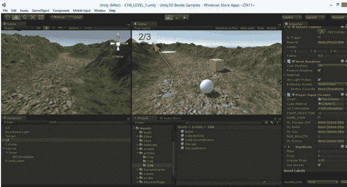

我们已经创建了 UI 的一个部分，但还有更多工作要做完成。一旦我们收集了所有的收集物品，我们需要找到投放区域（DropZone）并能够根据尺寸匹配这些收集物品。我们需要实现一个接口，能够以一种良好的方式为玩家正确地识别这一过程。

由于我们正在使用 Stack（栈）数据结构来维护玩家执行的选择顺序，我们可以以类似的方式为此任务创建 UI。此外，我们还希望在用户收集了所有收集物品并到达投放区域后显示此特定的 UI 部分。因此，当触发该条件时，我们也将显示专门用于匹配的 UI。为了让这项工作正常运行，我们需要创建一个新的 Canvas（画布）对象。记住，我们可以有多个 Canvas 对象，每个画布都可以在场景中用于不同的用途，并根据需要启用或禁用。

#### 创建第二个 Canvas

要创建第二个 Canvas，您需要在 Hierarchy（层级）窗口中右键点击，并从右键菜单中选择 `UI -> Canvas`。您将想要向其添加一个新的 Panel（面板）元素，并向 Panel 添加三个 Button（按钮）元素对象。添加任何 UI 元素的过程都是相同的，因此我们不再列出这些。

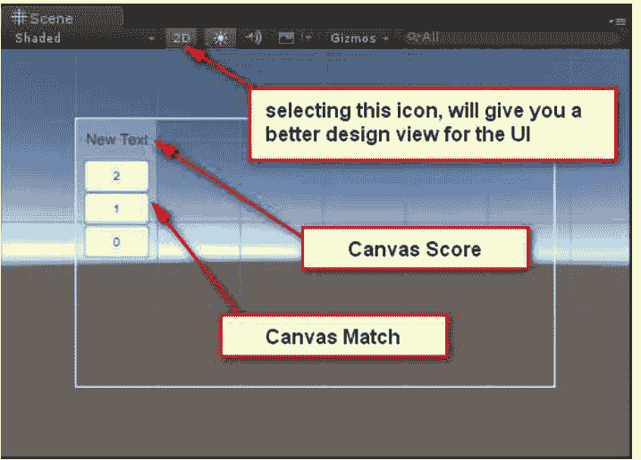

一旦你在 Scene（场景）视图中设计了 UI，我们就需要编写代码来访问并控制它。至少，我们需要能够根据某些标准启用和禁用 Canvas 对象。我们还需要根据用户在投放区域的选取来更新 Button 元素的标题。

```cs
public Canvas canvasMatching;
public Text lbl1StackTop;
public Text lbl1StackMiddle;
public Text lbl1StackBottom;
```

我们可以像上述代码所示，设置变量来引用所需的 UI 对象。但看看我们之前编写的代码，我们并没有很好地处理它。为了让过程和 UI 更直观一些，我们应该在 UI 上再添加两个按钮，赋予玩家重置整个游戏的能力，或者在匹配时，能够再次尝试挑战。考虑到这两个新增项，我们的 UI 将更新为如下：

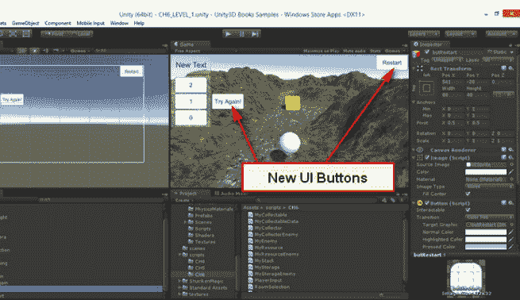

由于我们增强了 UI，我们需要重新审视匹配逻辑，并更新它以正确反映这些变化。我们应该完成的第一项任务是创建按钮触发函数，至少是占位符。我们将引入两个新函数来处理新创建按钮的点击事件：`butRestartClick()` 和 `butTryAgainClick()`。

```cs
public void butRestartClick()
{
    Application.LoadLevel("CH6_LEVEL_1");
}

public void butTryAgainClick()
{
    // 处理再次尝试事件
}
```

列出的函数将分别处理每个按钮的 OnClick。我们仍然需要将这些函数与 OnClick 事件挂钩。为了实现这一点，你需要从 Hierarchy 窗口中选择所需的按钮，并在 Inspector（检查器）窗口中，你需要在 OnClick() 属性上添加新事件。

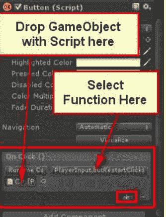

在 Inspector 窗口中，你将转到 Button Script 组件并通过点击 (+) 按钮添加事件处理程序。这将为你创建一个空的丢弃槽。你需要将挂载了事件处理程序的 GameObject 拖入，如果它是 CP GameObject 的话。一旦将其放入空槽中，你将使用 Dropdown（下拉菜单）选择 `Script -> Function()` 来处理 OnClick 事件。对于我们的代码来说，这正是 `PlayerInput.butRestartClick()`。就是这样！你刚刚创建了自己的第一个按钮事件处理器。在编写本文时，Unity Event 只能接收一个参数，因此如果需要传递多个参数，我们将使用自定义事件。

#### 游戏逻辑与鼠标输入处理

以下是在 `Update()` 函数中处理鼠标输入的游戏逻辑列表：

```cs
if (this.MATCH)
{
    #region MOUSE INPUT
    if (Input.mousePosition != null && Input.GetMouseButtonUp(0))
    {
        // Debug.Log("START MATCH >>>");
        RaycastHit selectedCollectable;

        // 捕捉鼠标位置并发射射线以查看物体
        Ray ray = Camera.main.ScreenPointToRay(Input.mousePosition);

        if (Physics.Raycast(ray, out selectedCollectable, 200))
        {
            Debug.Log("TAG=" + selectedCollectable.transform.tag);
            if (selectedCollectable.transform.CompareTag("MyCollectible"))
            {
                Debug.Log("YOU CLICKED ME >>>");
                var collect = selectedCollectable.transform.gameObject.GetComponent<MyCollectableData>();

                MyCollectableData data = new MyCollectableData();

                data.ID = collect.ID;
                data.size = collect.size;

                MyCollectableData sd = null;

                if (this.stack.Count < 3)
                    this.stack.Push(data);

                Debug.Log("STACK COUNT = " + this.stack.Count.ToString());

                switch (this.stack.Count)
                {
                    case 1:
                        this.lblStackBottom.text = data.size.ToString();
                        break;
                    case 2:
                        this.lblStackMiddle.text = data.size.ToString();
                        break;
                    case 3:
                        this.lblStackTop.text = data.size.ToString();
                        break;
                }
            }
        }
    }
    #endregion
}
```

基本上 `ResetGame()` 函数的作用是以前 `Awake()` 函数所做的事情，但由于我们有了游戏期间重新启动游戏的能力，我们正在使用 `Start()` 函数来重置所有变量。


```csharp
}
if (stack.COUNT >= 3)
{
    bool WIN = false;
    ArrayList tmp = new ArrayList();

    for (int i = 0; i <= stack.COUNT + 1; i++)
    {
        MyCollectableData d = (MyCollectableData)stack.pop();
        Debug.Log(string.Format("Pop: {0}", d.size));
        tmp.Add(d);
        if(((MyCollectableData)tmp[0]).size > ((MyCollectableData)tmp[1]).size && ((MyCollectableData)tmp[1]).size > ((MyCollectableData)tmp[2]).size))
        {
            Debug.Log("GREAT JOB!!! Objective Completed!");
            this.MATCH = false;
        }
    }
}
else
{
    this.TryAgain.gameObject.SetActive(true);
}
}
#endregion
```

我们已经完成了第 1 卡的初始 UI 设计。现在让我们来看看如何实现第 2 卡的 UI。

# 第 2 卡 – UI 设计

对于第 2 卡，玩家必须选择一个随机器来指示他需要访问的区域。选择完成后，玩家将获得一段特定的时间来访问该房间。访问后，计时器将重置，该房间将会被标记为已访问。

我们的 UI 设计应该能够捕捉任何时刻的环境状态。因此，我们需要一种显示计时器的方法。此外还需要显示玩家的目标；即他必须访问哪个房间。最后，应该有一种方式来指示玩家是否赢了游戏，并且像既往一样，提供一种重新游戏的方法，例如重启。

## Unity 3D – 游戏编程入门

由于第 2 卡的 UI 与第 1 卡的 UI 之间存在相似之处，我们可以通过复制第 1 卡中定义的 `Canvas` `GameObjects` 并粘贴到第 2 卡中来简化工作。显然，我们会做一些更改，但总的来说，这将为我们提供一个良好的起点。

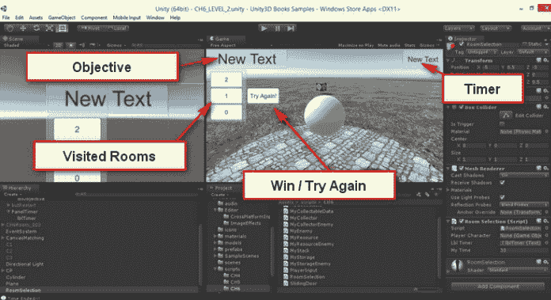

图 57 - 第 2 卡概念图

让我们从实现计时器 UI 开始。我们基本上想创建一个带有关联 `Text` 元素的新元素，并将其锚定在屏幕右上角。如果你还记得，处理计时器的脚本挂载在 `RoomSelection` `GameObject` 上，脚本本身名为 `RoomSelection.cs`。为了显示计时器，我们需要为标签（label）创建一个引用，并确保它在更新循环期间显示正确的值。

恰好，我们也可以在同一个脚本中为玩家设置目标。我们需要创建一个新变量来引用目标 `Text`，并基本上根据玩家在游戏期间的选择来更新内容。以下是新脚本的代码列表：

```csharp
using UnityEngine;
using UnityEngine.UI;
using System.Collections;
public class RoomSelection : MonoBehaviour
{
    public GameObject playerCharacter = null;

    #region UI Variables
    public Text lbl1Timer;
    public Text lbl1Objective;
    #endregion

    // 使用此进行初始化
    void Start() {
        if(this.lbl1Timer != null) {
            this.lbl1Timer.text = "0";
        }

        if(this.lbl1Objective != null) {
            this.lbl1Objective.text = string.Format("Select Randomizer!");
        }

        // 如果玩家角色在设计时未定义
        // 在游戏开始前的运行时为其分配它
        if(this.playerCharacter == null) {
            this.playerCharacter = GameObject.FindGameObjectWithTag("Player") as GameObject;
        }

        // MyTime 将用于提供玩家寻找房间
        // 所需的时间（秒）！！
        public float myTime = 33.0f;
        private float endTime = 0.0f;
    }

    // Update 每帧调用一次
    void Update() {
        this.transform.Rotate(new Vector3(1, 1, 1), 1.0f);

        if (this.endTime > Time.time) {
            this.lbl1Timer.text = Math.CeilToInt(this.endTime).ToString();
            Debug.Log("Timer Started!" + Math.CeilToInt(this.endTime).ToString());
        } else if(this.endTime == 0.0f) {
            this.lbl1Timer.text = "0";
            // 什么都不做
        } else {
            Debug.Log("Time Ended!");
        }
    }
}
```

## Unity 3D – 游戏编程入门

```csharp
this.playerCharacter.GetComponent<PlayerInput>().GAME_OVER = true;
}

// 此对象与玩家角色之间的距离
float distance = Vector3.Distance(this.transform.position, this.playerCharacter.transform.position);
if (distance < 2.0f)
{
    #region 鼠标输入
    if (Input.mousePosition != null && Input.GetMouseButtonUp(0))
    {
        int color = Random.Range(0, 3);
        switch (color)
        {
            case 0:
                {
                    this.transform.GetComponent<Renderer>().material.color = Color.blue;
                    this.playerCharacter.GetComponent<PlayerInput>().ROOM_SELECTION = 0;
                    lblObjective.text = string.Format("Find Blue");
                }
                break;
            case 1:
                {
                    this.transform.GetComponent<Renderer>().material.color = Color.red;
                    this.playerCharacter.GetComponent<PlayerInput>().ROOM_SELECTION = 1;
                    lblObjective.text = string.Format("Find Red");
                }
                break;
            case 2:
                {
                    this.transform.GetComponent<Renderer>().material.color = Color.green;
                    this.playerCharacter.GetComponent<PlayerInput>().ROOM_SELECTION = 2;
                    lblObjective.text = string.Format("Find Green");
                }
                break;
        }
    }
    #endregion

// 开始计时器
this.endTime = myTime + Time.time;
}

public void ResetTimer()
{
    this.endTime = 0.0f;
    lbl0objective.text = string.Format("Select Randomizer");
}
```

# 代码块 39 - 第 2 卡计时器和目标 UI

当你运行场景时，你将看到一个类似下面的界面：

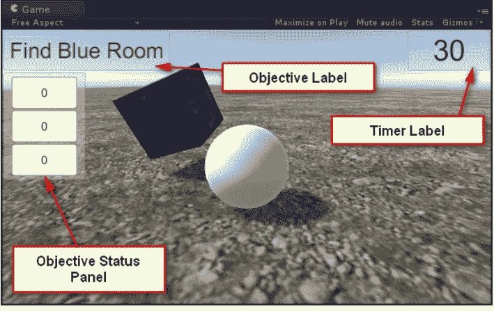

我们要实现的新 UI 元素是玩家访问他们应该访问的房间时。由于有三个房间，我们可以复用第 1 卡的现有面板。我们只需要编写一段新代码来更新标题

为了实现这一点，我们需要几个脚本文件。如果你还记得，有三个脚本专门处理第 2 卡：`RoomSelection.cs`、`SlidingDoor.cs` 和 `PlayerInput.cs`。

如果你查看脚本，主要的更新实际上发生在 `RoomSelection.cs` 脚本和 `PlayerInput.cs` 脚本中。`SlidingDoor.cs` 触发 `PlayerInput.cs` 中的一个函数来指示访问了哪个房间。

## Unity 3D – 游戏编程入门

在 `SlidingDoor.cs` 脚本的 `CollisionEnter` 函数中，如果符合条件，将调用 `PlayerInput.cs` 脚本上的 `RoomVisited()` 函数。我们需要更新该脚本以在目标状态中显示正确的信息。

以下是 `PlayerInput.cs` 脚本中修改后的 `RoomVisited()` 函数列表：

## 代码块 40 - 为关卡2修订的 RoomVisited() 函数

注意，我们添加了一个 `switch` 语句来确定访问了哪个房间，并相应地更新面板中的按钮文字。由于此函数还决定玩家是否成功完成关卡，我们还包含了一行代码来启用“重试”按钮，该按钮将用于重新游戏。

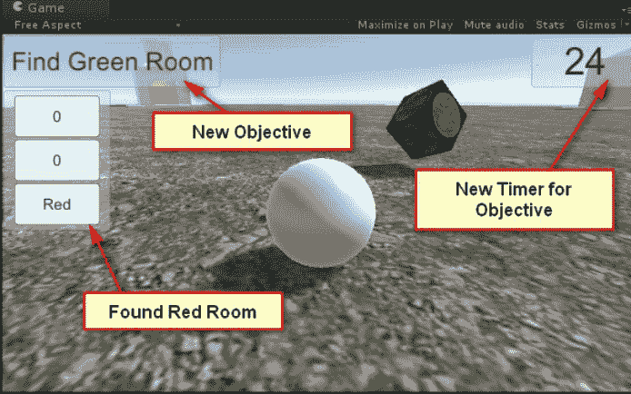

现在，我们还需要对 `RoomSelection.cs` 脚本进行一些更改。以下是我们需要对该脚本进行的更新代码片段：

```cs
if (this.endTime > Time.time) {
    this.lblTimer.text = Math.CeilToInt(this.endTime - Time.time).ToString();
    Debug.Log("Timer Started!" + Math.CeilToInt(this.endTime - Time.time).ToString());
} else if(this.endTime == 0.0f) {
    this.lblTimer.text = "0";
    // 什么都不做
} else {
    Debug.Log("Time Ended!!!");
}
```

## Unity 3D – 游戏编程入门

```cs
this.playerCharacter.GetComponent<PlayerInput>().GAME_OVER = true;
this.bl1Objective.text = "你输了!!!";
this.bl1Timer.text = "0";
this.playerCharacter.GetComponent<PlayerInput>().TryAgain.gameObject.SetActive(true);
```

我们现在已经完成了关卡 1 和关卡 2 的 UI 实现。让我们来看关卡 3 的 UI 实现。

## 关卡 3 – UI 设计

对于关卡 3，我们需要创建一个完全不同类型的 UI。在关卡 3 中，我们的目标是创建一个存储设施，它将为我们收集并存储资源。关卡的目标是让玩家杀死对手，而对手也杀死玩家。谁先完成任务谁就是胜者。

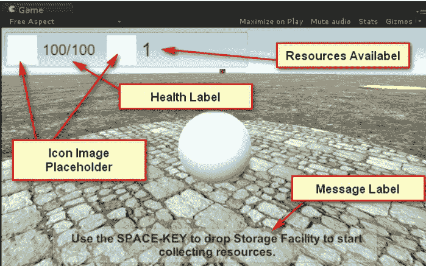

图 58 - 关卡 3 UI 概念

我们的 UI 设计需要能够提供有关资源状态、血量以及下一个可收集资源的信息。如果能有一种方式向玩家显示相关消息就更好了。例如，确保他们知道需要创建一个存储设施来收集资源。

我们还想显示对手的血量，但不一定显示他们的资源。尽管如果我们选择在设计中包含这些内容，这是完全可以实现的。

血量、物品栏和消息的主要更新代码将在 `PlayerInput.cs` 脚本文件中进行。以下是关卡启动时初始化标签所需的支持性代码片段：

```cs
// 关卡 3 UI 变量
public Text lblHealth;
public Text lblResources;
public Text lblMessages;
#endregion
```

```cs
private void ResetLevel3UI()
{
    if(this.lblHealth != null)
        this.lblHealth.text = string.Format("{0}/100", this.HEALTH);
    if(this.lblResources != null)
        this.lblResources.text = this.NUM_BULLETS.ToString();
    if(this.lblMessages != null)
        this.lblMessages.text = "使用空格键放置存储设施以开始收集资源。";
}
```

一旦我们放置了存储设施，就可以使用消息面板显示资源收集器的状态。为了完成这项任务，我们需要执行几个关键步骤。

每当发生以下操作之一时，我们需要更新消息面板：

1. 放置了存储设施
2. 收集单元正在前往资源单元
3. 收集单元正在前往存储设施
4. 收集单元正在加载资源。
5. 收集单元正在卸载资源。

## Unity 3D – 游戏编程入门

处理 UI 更新的脚本有 `MyStorage.cs`、`My-Collector.cs`、`MyResource.cs` 以及当然 `PlayerInput.cs` 脚本。以下代码列表将显示 `MyStorage.cs`、`My-Collector.cs` 和 `MyResource.cs` 的完整脚本：

```cs
using UnityEngine;
using System.Collections;

public class MyStorage : MonoBehaviour
{
    private GameObject myCollector;
    private GameObject collectorObj;

    private GameObject playerCharacter;
    // 计时器变量
    private float myTime = 3.0f;
    private float endTime = 0.0f;

    // 用于初始化
    void Start()
    {
        Vector3 pos = new Vector3(this.transform.position.x + 1, 2,
        this.transform.position.z + 1);
        this.collectorObj = GameObject.Instantiate(this.myCollector, pos,
        this.transform.rotation) as GameObject;
        this.collectorObj.GetComponent<MyCollector>().MyStorage = this.gameObject;

        this.playerCharacter = GameObject.FindGameObjectWithTag("Player") as GameObject;
        this.playerCharacter.GetComponent<PlayerInput>().lblMessages.text = 
        "存储设施已创建!";
    }

    // 每帧调用一次 Update
    void Update()
    {
        if (this.endTime > Time.time)
        {
            // ... 计时器更新逻辑 ...
        }
    }
}
```

```cs
{
  this.playerCharacter.GetComponent<PlayerInput>().lblMessages.text = message;
}
```

## 代码块 42 - 用于 UI 设计 MyCollector.cs


# Unity 3D – 游戏编程入门

## MyResource.cs

```cs
using UnityEngine;
using System.Collections;

public class MyResource : MonoBehaviour
{
    public GameObject collectorUnit;
    // 计时变量
    public float myTime = 3.0f;
    private float endTime = 0.0f;

    // 使用此进行初始化
    void Start()
    {
    }

    // Update 每帧被调用一次
    void Update()
    {
        if (this.endTime > Time.time)
        {
            string msg = string.Format("Collecting Resources: {0}", Mathf.CeilToInt(this.endTime - Time.time));
            this.collectorUnit.GetComponent<MyCollector>().UpdateMessage(msg);
        }
        else if (this.endTime == 0.0f)
        {
            // 什么都不做
        }
        else
        {
            this.endTime = 0.0f;
            this.collectorUnit.GetComponent<MyCollector>().GOTO_STORAGE = true;
            this.collectorUnit.GetComponent<MyCollector>().UNITS_COLLECTED = 0;
        }
    }

    // 此函数处理碰撞体作为触发器的碰撞
    void OnTriggerEnter(Collider c)
    {
        if (c.tag.Equals("CollectorUnit"))
        {
            c.GetComponent<MyCollector>().GOTO_RESOURCE = false;
            this.collectorUnit = c.gameObject;
        }
        // 启动计时
        this.endTime = this.myTime + Time.time;
    }
}
```

### 代码片段：UI 更新逻辑

```cs
string msg = string.Format("Collecting Resources: {0}", Mathf.CeilToInt(this.endTime - Time.time));
this.collectorUnit.GetComponent<MyCollector>().UpdateMessage(msg);
```

### 代码块 43 - 用于 UI 设计 MyResource.cs

每当发生以下操作时，我们都需要更新资源标签（Resource Label）和血量标签（Health Label）：

1. 资源加载到存储设施（Storage Facility）。
2. 玩家被敌人击中。

如果你在讨论书籍时一直在关注并测试代码，你可能注意到第 3 关中有一些微小的错误。首先，我们从未实现过获取玩家或敌人的血量（HEALTH）的方法。其次，当资源被收集并带回存储设施时，你可能会发现在第一次收集后，资源的增量没有正确执行。这是因为我们在卸载后将收集器单元（Collector Unit）中的变量重置为 0 了。

另一个问题是，我们在这里没有实现停止游戏的方法！我们需要确保当玩家或敌人死亡时，我们停止游戏内所有的移动物体并显示适当的消息。以下列表将所有内容整合在一起，从 UI 开发侧和游戏机制开发侧的两个方面使第 3 关变得完整。

## MyStorage.cs 完整代码

```cs
using UnityEngine;
using System.Collections;

public class MyStorage : MonoBehaviour
{
    public GameObject myCollector;
    private GameObject collectorObj;

    private GameObject playerCharacter;

    // 计时变量
    // public float myTime = 3.0f;
    // private float endTime = 0.0f;

    // 使用此进行初始化
    void Start()
    {
        Vector3 pos = new Vector3(this.transform.position.x + 1, 2, this.transform.position.z + 1);
        this.collectorObj = GameObject.Instantiate(this.collector, pos, this.transform.rotation);
        this.collectorObj.GetComponent<MyCollector>().myStorage = this.gameObject;

        this.playerCharacter = GameObject.FindGameObjectWithTag("Player") as GameObject;

        this.playerCharacter.GetComponent<PlayerInput>().lblMessages.text = "Storage Factory Created";
    }

    // Update 每帧被调用一次
    void Update()
    {
        if (!this.playerCharacter.GetComponent<PlayerInput>().GAME_OVER)
        {
            if (this.endTime > Time.time)
            {
                string msg = string.Format("Unloading Resources: {0}", Mathf.CeilToInt(this.endTime - Time.time));
                this.collectorObj.GetComponent<MyCollector>().UpdateMessage(msg);
            }
            else if (this.endTime == 0.0f)
            {
                // // 什么都不做
            }
            else
            {
                this.endTime = 0.0f;
                this.collectorObj.GetComponent<MyCollector>().GTO_RESOURCE = true;
                int collectedResources = this.collectorObj.GetComponent<MyCollector>().UNITS_COLLECTED;
                this.collectorObj.GetComponent<MyCollector>().UNITS_COLLECTED = 0;

                // 为玩家角色添加子弹
                this.playerCharacter.GetComponent<PlayerInput>().NUM_BULLETS += collectedResources;
                this.playerCharacter.GetComponent<PlayerInput>().UpdateResources();
            }
        }
    }

    // 此函数处理碰撞体作为触发器的碰撞
    void OnCollisionEnter(Collision c)
    {
        if (c.transform.tag.Equals("CollectorUnit"))
        {
            c.transform.GetComponent<MyCollector>().GOTO_RESOURCE = false;
        }
        // 启动计时
        this.endTime = this.myTime + Time.time;
        string msg = string.Format("Unloading Resources: {0}", Mathf.CeilToInt(this.endTime - Time.time));
        c.transform.GetComponent<MyCollector>().UpdateMessage(msg);
    }
}
```

## MyCollector.cs 完整代码

```cs
using UnityEngine;
using System.Collections;

public class MyCollector
{
    public GameObject myStorage;
    public bool GOTO_RESOURCE;
    public int UNITS_COLLECTED;
    private GameObject playerCharacter;

    // 使用此进行初始化
    void Start()
    {
        playerCharacter = GameObject.FindGameObjectWithTag("Player");
    }

    public void UpdateMessage(string message)
    {
        playerCharacter.GetComponent<PlayerInput>().lblMessages.text = message;
    }
}
```

> 对于敌人脚本，`MyStorageEnemy.cs`、`MyCollectorEnemy.cs` 和 `MyResourceEnemy.cs` 都与玩家脚本类似，只需更新引用以指向敌人脚本和预制体（prefabs）。

## MyEnemy.cs 唯一脚本

```csharp
using UnityEngine;
using UnityEngine.UI;
using System.Collections;

public class MyEnemy : MonoBehaviour
{
    public GameObject myBase;

    public GameObject myStorage;
    private GameObject myStorageObj;

    public GameObject myEnemy;

    public GameObject myBullet;
    public GameObject myGun;

    public int NUM_BULLETS;

    // 计时器变量
    public float myTime = 5.0f;
    private float endTime = 0.0f;

    public bool ATTACK;
    public bool SCOUT;

    public Transform[] scoutPoints;
    private int nextPointIndex;

    public bool GAME_OVER;
    private int HEALTH;

    public Text lblHealth;

    // 使用此方法进行初始化
    void Start()
    {
        this.NUM_BULLETS = 1;
        this.ATTACK = true;
        this.myEnemy = GameObject.FindObjectWithTag("Player") as GameObject;

        // 开始计时器
        this.endTime = this.myTime + Time.time;

        this.nextIndex = 0;
        this.GAME_OVER = false;
        this.HEALTH = 100;

        if (this.lblHealth != null)
            this.lblHealth.text = string.Format("{0}/100", this.HEALTH);
    }

    private float SPEED = 2.0f;

    // Update 每帧调用一次
    void Update()
    {
        if (this.GAME_OVER)
        {
            if (this.myStorageObj != null)
            {
                if (this.endTime < Time.time)
                {
                    // 掉落存储
                    Vector3 pos = new Vector3(this.transform.position.x + 1, 2, this.transform.position.z + 1);
                    this.myStorageObj = GameObject.Instantiate(this.myStorage, pos, this.myStorage.transform.rotation) as GameObject;

                    this.endTime = 0.0f;
                }
                if (this.NUM_BULLETS > 1)
                {
                    this.ATTACK = true;
                }
                else
                {
                    this.ATTACK = false;
                }
            }
            // 寻找玩家并攻击
            if (this.ATTACK)
            {
                Vector3 refill = this.myEnemy.transform.position - this.transform.position;
                refill.Normalize();

                // 使用 Quaternion Slerp 函数实现平滑过渡
                this.transform.rotation = Quaternion.Slerp(this.transform.rotation,
                    Quaternion.LookRotation(refill), 10 * Time.deltaTime);
            }
        }
    }
}
```


```csharp
this.transform.Translate(Vector3.forward * Time.deltaTime * this.SPEED);

if (Vector3.Distance(this.myEnemy.transform.position, this.transform.position) < 5.0f)
{
    if (this.NUM_BULLETS > 0)
    {
        if (this.endTime < Time.time)
        {
            GameObject bullet = GameObject.Instantiate(this.myBullet, this.myGun.transform.position, this.myGun.transform.rotation) as GameObject;
            bullet.GetComponent<Rigidbody>().velocity = transform.TransformDirection(new Vector3(0, 0, 10.0f));
            GameObject.Destroy(bullet, 3.0f);
            // 减少库存
            this.NUM_BULLETS--;
            // 在下一次射前设置计时器
            this.endTime = this.myTime + Time.time;
        }
    }
}
else if (this.scoutPoints.Length > 0)
{
    Vector3 refillHeading = this.scoutPoints[nextPointIndex].position - this.transform.position;
    refillHeading.Normalize();
    // 使用 Quaternion Slerp 函数实现平滑过渡
    this.transform.rotation = Quaternion.Slerp(transform.rotation, Quaternion.LookRotation(refillHeading), 10 * Time.deltaTime);
    this.transform.Translate(Vector3.forward * Time.deltaTime);
    if (Vector3.Distance(this.transform.position, this.scoutPoints[nextPointIndex].position) < 0.25f)
    {
        this.nextPointIndex += 1;
        if (this.nextPointIndex >= this.scoutPoints.Length)
        {
        }
    }
}
```

# Unity 3D – 游戏编程入门

我们现在已经在“游戏机制”章节中看到了游戏机制的实现，在本章中，我们学习了如何创建相关的用户界面（UI）元素来支持这些游戏机制。

在你学习这一章并查看 UI 设计时，你可能会想它们很平淡。这是刻意为之，因为这本书是面向游戏程序员/开发者的。它更侧重于编码和脚本，而对图形的要求较少。尽管如此，对于那些更有创意的人来说，你可以加入自己的触感。

# Vahé Karamian 增强用户界面

在本节中，我们将选取第 3 层并添加一些内容。通常情况下，当你熟悉 UI 设计时，需要对纹理进行一些配置。由于这些将是 UI 纹理，我们需要将纹理类型（`Texture Type`）从 `Texture` 改为 `Sprite (2D)`。选择正确的纹理类型后，需要点击 `Apply` 按钮使更改生效。

我们为游戏创建的大部分 UI 如下：

| 元素名称 | 说明 |
| :--- | :--- |
| 状态面板 (Status Panel) | 显示生命值弹药数量 |
| 消息面板 (Message Panel) | 显示游戏状态 |
| 敌人面板 (Enemy Panel) | 显示敌人信息 |

在本节中，我们将选取第 3 层并添加一些内容。通常情况下，当你熟悉 UI 设计时，需要对以下项进行一些配置：

- 状态面板 (333px 50px)
- 消息面板 (444px 50px)
- 敌人面板 (135px 50px)

等一下，这里，这里是唯一的 `MyEnemy.cs` 脚本：

```csharp
this.myEnemy = GameObject.FindObjectWithTag("Player") as GameObject;
```

```csharp
// 开始计时器
this.endTime = this.myTime + Time.time;
this.nextIndex = 0;
this.GAME_OVER = false;
this.HEALTH = 100;

if (this.lblHealth != null)
    this.lblHealth.text = string.Format("{0}/100", this.HEALTH);

private float SPEED = 2.0f;

// Update 每帧调用一次
void Update()
{
    if (this.GAME_OVER)
    {
        if (this.myStorageObj != null)
        {
            if (this.endTime < Time.time)
            {
                // 掉落存储
                Vector3 pos = new Vector3(this.transform.position.x + 1, 2, this.transform.position.z + 1);
                this.myStorageObj = GameObject.Instantiate(this.myStorage, pos, this.myStorage.transform.rotation) as GameObject;
                this.endTime = 0.0f;
            }
            if (this.NUM_BULLETS > 1)
            {
                this.ATTACK = true;
            }
            else
            {
                this.ATTACK = false;
            }
        }
        // 寻找玩家并攻击
        if (this.ATTACK)
        {
            Vector3 refill = this.myEnemy.transform.position - this.transform.position;
            refill.Normalize();
            // 使用 Quaternion Slerp 函数实现平滑过渡
            this.transform.rotation = Quaternion.Slerp(this.transform.rotation, Quaternion.LookRotation(refill), 10 * Time.deltaTime);
            this.transform.Translate(Vector3.forward * Time.deltaTime * this.SPEED);

            if (Vector3.Distance(this.myEnemy.transform.position, this.transform.position) < 5.0f)
            {
                if (this.NUM_BULLETS > 0)
                {
                    if (this.endTime < Time.time)
                    {
                        GameObject bullet = GameObject.Instantiate(this.myBullet, this.myGun.transform.position, this.myGun.transform.rotation) as GameObject;
                        bullet.GetComponent<Rigidbody>().velocity = transform.TransformDirection(new Vector3(0, 0, 10.0f));
                        GameObject.Destroy(bullet, 3.0f);
                        // 减少库存
                        this.NUM_BULLETS--;
                        // 在下一次射前设置计时器
                        this.endTime = this.myTime + Time.time;
                    }
                }
            }
            else if (this.scoutPoints.Length > 0)
            {
                Vector3 refillHeading = this.scoutPoints[nextPointIndex].position - this.transform.position;
                refillHeading.Normalize();
                // 使用 Quaternion Slerp 函数实现平滑过渡
                this.transform.rotation = Quaternion.Slerp(transform.rotation, Quaternion.LookRotation(refillHeading), 10 * Time.deltaTime);
                this.transform.Translate(Vector3.forward * Time.deltaTime);
                if (Vector3.Distance(this.transform.position, this.scoutPoints[nextPointIndex].position) < 0.25f)
                {
                    this.nextPointIndex += 1;
                    if (this.nextPointIndex >= this.scoutPoints.Length)
                    {
                    }
                }
            }
        }
    }
}
```

既用于玩家血量也用于敌人血量，另一个将用于玩家的背包。


应用图标的步骤将非常相似，首先你需要创建所需的图标，然后你需要将它们导入到项目中，接着将它们的类型配置为 `Sprite`（精灵），最后，你需要选择 UI 元素，在这种情况下，从层级窗口（`Hierarchy Window`）中选择玩家血量的 `Image` UI 元素和敌人的血量的 `Image` UI 元素，在 `Image` 组件中，将贴理应用到 `Source Image`（源图像）属性。结果如下：


图 64 - 级 UI 增强

如你所见，即使是对 UI 进行简单的增强也会对游戏的整体视觉效果和体验产生巨大影响。

我想为 UI 展示的改进之一是在世界空间（`World Space`）中显示信息的能力。你可能想要考虑在世界空间显示的某些信息可能是针对特定 `GameObject` 的 UI 元素。

## Unity 3D - 游戏编程入门

例如，如果在玩家角色上显示血量条将很不错，这既包括玩家也包括敌人。在 Unity 新的 UI 架构中，这实际上可以很容易地实现。让我们来看看如何为我们的玩家实现这样的功能。

显然，我们需要一组新的 `Canvas`（画布）对象。新创建的 `Canvas` 对象将挂载到玩家角色 `GameObject` 上，它是玩家角色（PC）的子物体。它的 `Render Mode`（渲染模式）也将设置为 `World Space`。创建此新 `Canvas` 的最简单方法是右键点击 PC 并选择 (`UI/Canvas`)。一旦创建了画布，你就需要修改几个属性，首先是 `Render Mode`，将其设置为 `World Space`。下一次修改将位于 `Rect Transform` 组件上。你需要确保画布始终相对于 PC，最好的方法是让它处于正确的位置。


图 65 - 世界空间 Canvas 属性

首先，将 `Pos X` 和 `Pos Y` 属性分别改为 `0` 和 `0`。这将确保你与 PC 的中心对齐。下一个要更改的属性是 `Canvas` 的 `Width`（宽度）和 `Height`（高度）。这取决于你挂载 `Canvas` 的哪个 `GameObject` 以及你世界空间 `Canvas` 的用途。在这种情况下，我们只想显示一个血量条，因此不需要太大空间。我们还将查看 `Scale`（缩放）属性，并使用它在不损失质量的情况下缩放 `Canvas`。

查看图 65 以查看我为项目设置的属性。其余部分与之前相同，结果是下面的截图：


表示血量条简单的方法是使用三个图像。我们需要一种创建血量条的方法。

其中一个图像将代表边框，另外两个图像将代表实际血量。

保持简单，这是我希望血量条的样子：

## Unity 3D – 游戏编程入门


图 66 - 血量条 UI 设计

PC 和 `Canvas` 的层级结构如图所示：


图 67 - 世界空间 Canvas 层级结构

# Vahé Karamian

下一步是创建管理血量条的代码。我们需要对 `healthBarFG` `Image` UI 元素的引用。我们需要修改 `PlayerInfo.cs` 脚本来正确更新血量条。以下是处理更新血量条 UI 元素的部分代码列表：

```csharp
private void ResetLevel3UI()
{
    if (this.lblHealth != null)
        this.lblHealth.text = string.Format("{0}/100", this.HEALTH);

    if (this.lblResources != null)
        this.lblResources.text = this.NUM_BULLETS.ToString();

    if (this.lblMessages != null)
        this.lblMessages.text = "Use the SPACE-KEY to drop Storage Facility start collecting resources.";

    if (this.imgHealthBar != null)
        this.imgHealthBar.fillAmount = (this.HEALTH / 100.0f);
}
```

`OnCollisionEnter` 函数：

```csharp
void OnCollisionEnter(Collision c)
{
    if (c.transform.tag.Equals("bullet"))
        Destroy(c.gameObject);

    this.HEALTH -= 25;
    this.lblHealth.text = string.Format("{0}/100", this.HEALTH);

    if (this.imgHealthBar != null)
        this.imgHealthBar.fillAmount = (this.HEALTH / 100.0f);

    if (this.HEALTH <= 0)
        this.GAME_OVER = true;

    if (this.imgHealthBar != null)
        this.imgHealthBar.fillAmount = 0.0f;
}
```


# Unity 3D – 游戏编程入门

你现在看到了如何在游戏中整合 UI。我在血量条上做的另一个修改是使其半透明。工具是基本的，但你可以创建更复杂的界面。通过一些创意和想象力你可以创建血量条。

# 第6章 创建战舰

## 背景

战舰游戏被认为起源于法国的 L'Attaque。战舰游戏的第一个商业版本在美国出版。

| A | B | C | D | E | F | G | H | I |
|---|---|---|---|---|---|---|---|---|
| 1 | | | | | | | | | |
| 2 | | | | | | | | | |
| 3 | | | | | | | | | |
| 4 | | | | | | | | | |
| 5 | | | | | | | | | |
| 6 | | | | | | | | | |
| 7 | | | | | | | | | |
| 8 | | | | | | | | | |
| 9 | | | | | | | | | |
| 10 | | | | | | | | | |

图 68 - 示例布局

战舰是最早的电脑游戏之一，于1979年为Z80发布。之后出现了许多电脑游戏版本。在 Nintendo DS 的俱乐部游戏中，战舰被称为 Grid Attack。它在 8×8 网格上进行，并包括 4 人游戏、各种舰只尺寸以及让舰只彼此接触的细微变化。

## 实现计划

由于我们对游戏和游戏规则有了良好的了解，我们可以开始思考如何实现我们版本的“战舰”棋盘游戏。

我们首先应该关注的是创建一个我们将玩游戏的棋盘。根据我们已有的规则，在计算机内存中以数字形式表示棋盘将是非常直观的。我们需要考虑两个项目：(1) 视觉化表示棋盘 (2) 跟踪棋盘数据。

让我们来看看我们将如何视觉化地表示棋盘。我们知道棋盘的大小将是 N x N。在这种情况下，我们决定将其制作为 10 x 10 的棋盘。下一步是确定我们将如何表示棋盘上的每一个单元。

为了方便起见，我们可以使用具有以下缩放向量的立方体：在 `<x,y,z>` 坐标中使用 `<1,0.1,1>`。这将为棋盘提供一个很好的单元基础。


图 69 - 基础棋盘单元

## Unity 3D – 游戏编程入门

我想做的下一件事是为单元添加一些类似于棋盘的纹理。为了做到这一点，我们需要创建一个新材质并应用类似于我们所需效果的纹理。下一步是以某种方式通过单元在棋盘上的位置来识别单元！为了做到这一点，我们将创建一个 UI 对象并将其挂载到棋盘上，以显示单元在棋盘上的位置。最终的棋盘单元看起来像这样：


图 70 - 应用了纹理和 UI 元素的棋盘单元

每个棋盘单元看起来像图 70。B1 代表棋盘名称和 ID，`[00:00]` 代表标识棋盘的行和列。我们完成初始版本棋盘单元所需的最后一部分是一个表示单元本身内部数据的脚本。它将被称为 `BoardUIV1.cs`，它的列表如下：

```cs
using UnityEngine;
using UnityEngine.UI;
using System.Collections;

public class BoardUIVer1 : MonoBehaviour {
    public Text lbl1BoardPosition;
    public int ROW;
    public int COL;
    public bool OCCUPIED;

    // 使用此初始化
    void Start () {
        this.OCCUPIED = false;
    }

    // Update 每帧被调用一次
    void Update () { }
}
```

代码块 44 - BoardUI 类定义

一个存储单元行和列数据的简单类。指向单元 UI Text 标签的引用，以便在实例化时进行更新，最后是一个指示单元是否被占用的布尔值变量。


### 创建棋盘单元的步骤：

1. 创建一个原型 `GameObject`，命名为 `BoardUnit`。
2. 将 `<x,y,z>` 缩放改为 `<1,0.1,1>`。
3. 创建一个名为 `BoardUnit` 的新材质类型。
4. 在 Main Maps 的 Albedo 属性下分配你偏好的纹理。
5. 将新材质分配给 `BoardUnit` `GameObject`。
6. 创建一个名为 `BoardUI1.cs` 的 `.cs` 脚本。
7. 输入你的脚本并分配给 `BoardUnit` `GameObject`。

## Unity 3D – 游戏编程入门

一旦我们对棋盘单元满意，我们想要创建一个由棋盘单元组成的实际棋盘。对于一个尺寸为 10x10 的棋盘，我们需要使用 100 个棋盘单元！

有两种方法可以实现这一点：(1) 手动创建棋盘并将一百个单元放在一起，或者 (2) 创建一个为你处理这些事的程序！显然，选择是创建一个程序来为我们处理棋盘创建。

我们可以用二维数组来表示我们的棋盘。需要发生两件事：我们需要视觉化地创建棋盘并存储每个棋盘单元的数据。我们可以使用我们喜欢的循环方法，`for` 循环结构来遍历我们的行和列。

```cs
// 创建一个 10x10 的棋盘 - Board 1
int row = 1;
int col = 1;

for(int i=0; i<10; i++) {
    for(int j=0; j<10; j++) {
        // 实例化预制体并正确地放置场景
        GameObject tmp = GameObject.Instantiate(this.BoardUnitPrefab,
            new Vector3(1, 0, j),
            this.BoardUnitPrefab.transform.rotation);
        BoardUI1 tmpUI = tmp.GetComponent<BoardUI1>();
        string name = String.Format("B1:[{0:00},{1:00}", row, col);
        tmpUI.lblBoardPosition.text = name;
        tmpUI.COL = j;
        board[i, j] = tmp;
        tmp.name = name;
    }
    col++;
    row++;
}
```

让我们来看看我们将如何视觉化地表示棋盘。我们知道棋盘的大小将是 N x N。在这种情况下，我们决定将其制作为 10 x 10 的棋盘。下一步是确定我们将如何表示棋盘上的每一个单元。一旦我们对棋盘单元满意，我们想要创建一个由棋盘单元组成的实际棋盘。对于一个尺寸为 10x10 的棋盘，我们需要使用 100 个棋盘单元！

有两种方法可以实现这一点：(1) 手动创建棋盘并将一百个单元放在一起，或者 (2) 创建一个为你处理这些事的程序！显然，选择是创建一个程序来为我们处理棋盘创建。

我们可以用二维数组来表示我们的棋盘。需要发生两件事：我们需要视觉化地创建棋盘并存储每个棋盘单元的数据。我们可以使用我们喜欢的循环方法，`for` 循环结构来遍历我们的行和列。

## Unity 3D – 游戏编程介绍

```cs
GameObject visual = GameObject.Instantiate(this.CubePrefab,
    new Vector3(tmpUI.ROW+i, this.CubePrefab.transform.position.y, tmpUI.COL),
    this.CubePrefab.transform.rotation) as GameObject;

GameObject bp = board[tmpUI.ROW + i, tmpUI.COL];
BoardUIVer1 bpUI = bp.GetComponent<BoardUIVer1>();

if (!bpUI.OCCUPIED) {
    visual.GetComponent<Renderer>().material.color = 
        Color.gray; // 可以放置
        //this.OK_TO_PLACE = true;
} else {
    visual.transform.localScale = new Vector3(0.6f, 0.6f, 0.6f);
    // Color.yellow; // 不可以
    visual.GetComponent<Renderer>().material.color = 
        Color.red; // 假设此处为错误颜色逻辑修正
    this.OK_TO_PLACE = false;
}

visual.transform.parent = this.tmpBlockHolder.transform;

if (this.vertical && (tmpUI.COL <= 10 - this.blockSize)) {
    for (int i = 0; i < this.blockSize; i++) {
        GameObject visual = GameObject.Instantiate(this.CubePrefab,
        new Vector3(tmpUI.ROW, this.CubePrefab.transform.position.y, tmpUI.COL),
        this.CubePrefab.transform.rotation) as GameObject;

        GameObject bp = board[tmpUI.ROW, tmpUI.COL];
        BoardUIVer1 bpUI = bp.GetComponent<BoardUIVer1>();

        if (!bpUI.OCCUPIED) {
            visual.GetComponent<Renderer>().material.color = 
                Color.gray; // 可以放置
                //this.OK_TO_PLACE = true;
        } else {
            visual.transform.localScale = new Vector3(0.6f, 0.6f, 0.6f);
            visual.GetComponent<Renderer>().material.color = 
                Color.red; // 假设此处为错误颜色逻辑修正
            this.OK_TO_PLACE = false;
        }
        visual.transform.parent = this.tmpBlockHolder.transform;
    }
}

tmpHitHighlight.transform.GetComponent<Renderer>().material.color = Color.blue;
tmpHighlight = tmpHitHighlight.transform.gameObject;
```

代码块 46 - 用于鼠标位置和射线检测的高亮行

让我们只讨论处理鼠标位置和射线检测（Ray casting）的代码部分。第一个 `if` 语句检查是否有鼠标位置。如果有，我们使用 `Camera` 类提供的内置函数将鼠标转换为射线对象（ray object）。一旦我们有了射线对象，我们就会使用物理引擎的 `Raycast` 函数来发射射线，`Raycast` 函数的一个参数是一个命名为 `tmpHitHighlight` 的输出变量，如果在活动摄像机范围内执行了任何操作，它将返回一个 `GameObject`。

记住，`tmpHitHighlight` 是代表我们棋盘单元的 `GameObject`。棋盘单元 Prefab 附加了一个名为 `BoardUI1.cs` 的脚本，用于更新棋盘单元的视觉效果并存储该特定单元的状态。因此，根据我们的设计，我们知道在此时，技术上我们能通过射线检测击中的唯一对象就是棋盘单元。所以，我们所做的是使用 `GetComponent<>()` 函数获取附加到棋盘单元上的组件，并将返回的对象存储在名为 `tmpUI` 的变量中。

下一步是检测我们是否实际上击中了一个棋盘 `GameObject`。这是通过检查射线检测击中的 `GameObject` 标签（tag）来检测的。这里的想法是，如果我们是一个板类型的对象，并且我们当前指向的棋盘单元未被占用，我们就执行下一个逻辑块。首先，通过提供被击中棋盘单元的行和列，从我们的二维数组获取棋盘数据，并将数据元素存储在类型为 `BoardUIVer1` 的变量 `boardData` 中。

代码块 46 中的最后两行将我们指向的棋盘单元的材质颜色从白色变为蓝色，作为指示。

## 整合一切 - 游戏对象 (Game Objects)

我们需要创建几个用于制作游戏的 `GameObject`。某些 `GameObject` 是视觉性的，某些是功能性的。有些两者兼有！以下是列表：

| 预制体 (Prefabs): | 场景对象 (Scene Objects): | 脚本 (Scripts): |
| --- | --- | --- |
| BoardUnit | BackgroundMusic | BoardUIVer1 |
| BoardUnitAttack | Main Camera | BoardVer1 |
| BoardUnitEnemy | EventSystem | |
| BoardUnityPlayer | Directional Light | |
| CubePrefab | Canvas | |
| CubeWreck | | |

让我们逐一查看每个 `GameObject` 并看看它们的用途。从 `BoardUnit` 开始，该 `GameObject` 被创建为在上一节中演示几个概念和想法的基础，它将成为实际游戏中将使用的其他组件的基础。

`BoardUnitPlayer`，这个 `GameObject` 用于代表玩家的棋盘。它具有以下结构：

```
BoardUnitPlayer
  Canvas
    LblBoardPosition
    attackPosition
  CubeWreck
    Wreck1
    Wreck2
  CubePrefab
```


# Vahé Karaminan

注意，`GameObject` 由多个 `GameObject` 组成。其中一个是 `Canvas`，用于显示。`AttackPosition` 是另一个用于渲染的 `GameObject`。`Cubereck` 是代表棋盘单元的实体。也就是说，如果它被占用、被击中并……

## CubeUnit

我们刚刚描述的 Prefabs 在游戏期间并不存在。它们将在期间被实例化。现在让我们来看看 `BackgroundMusic` 是一个空 `GameObject`，专门用于存储和管理。它基本上播放关卡的背景音乐。

`Main Camera` 是代表场景中摄像机的 `GameObject`。默认情况下，当你创建一个场景时，就会为你创建一个摄像机。

## Unity 3D – 游戏编程介绍

`Directional Light` 是场景中光照元素的 `GameObject`。与摄像机一样，当你启动场景时，默认会创建一个定向光。它还有许多可以配置的光影效果属性，我们将查看其中一些。

`Canvas` 和 `EventSystem`，`Canvas` 对象用于图形界面 (GUI) 设计。它是 Unity 中设计和实现 GUI 的新方法。它具有构建强大界面的功能。`EventSystem` 对象负责 GUI 内的事件。

`BoardUI1` 是用于处理棋盘用户界面的 C# 脚本。它负责棋盘单元的状态。也就是说，如果它被占用、被击中并……它还管理棋盘单元的视觉方面。

`BoardVer1` 是游戏逻辑的主脚本。它包含了所有数据元素和游戏正常运行的逻辑。它将一切胶合在一起。它负责棋盘单元的初始化，负责跟踪分数，还负责电脑对手做出下一步动作的思考过程。

# 游戏流程 + 逻辑

下面的图是游戏流程的高级视觉表示。作为一条良好的经验，在开始任何项目之前，勾画并捕捉一些关于程序运行方式的高级表示是一个好主意。


图 75 - 高级游戏流程

简单总结该图，当游戏最初开始时，要求玩家在指定的棋盘上放置棋子¹⁹。当玩家完成棋子的放置后，电脑将开始放置棋子。当玩家和电脑都放置了所有必要的棋子后，游戏开始！

> ¹⁹ 注意，我们没有捕捉检查棋子正确放置的细节，也没有捕捉在棋盘上放置棋子时方向的变化。

## Unity 3D – 游戏编程入门

当游戏开始时，游戏管理器会决定轮到哪位玩家。一旦确定，如果是玩家的回合，它将等待玩家选择棋盘上的一个单元格，游戏管理器将在后台处理命中和未命中的细节。如果命中了，则会进行计数，玩家将获得另一个回合；如果未命中，则计算机 AI 会在玩家的棋盘上选择一个单元格，相同的过程将持续，直到玩家或电脑赢得游戏。

让我们更仔细地查看逻辑的内部结构。


图 76 - 玩家舰只放置流程图

分解图 75，我们将开始仔细观察当玩家被要求将其舰只放置在棋盘上时，程序逻辑内部发生了什么。图 76 更详细地说明了逻辑流。

所示，玩家首先需要选择一个要放置在棋盘上的碎片。当选中一个碎片后，他/她必须决定想将碎片放置在棋盘的什么位置以及什么朝向。只有两种朝向可用：水平和垂直。

当选中给定的棋盘单元时，计算机会检查是否有足够的空间放置碎片，它还会检查所选舰只的整个长度是否清晰以便放置。也就是说，如果新的所选碎片的路径上没有放置任何碎片。这个过程将不断重复，直到所有碎片都成功放置在棋盘上。

接下来，计算机开始放置它的碎片。


图 77 - AI 舰只放置流程图

当 AI 将它自己的游戏碎片放置在棋盘上时，它经历着类似的过程。它首先选择下一个可放置的碎片，然后随机决定想以什么朝向放置碎片，接着决定它在游戏棋盘上的坐标，一旦确定，它就开始执行检查并验证该选择是否有效可以放置。如果是，则说明一切正常并记录数据；如果不是，它将通过步骤选择另一个可用的位置和朝向。

当所有玩家都放置好碎片后，游戏开始。以下图说明了游戏玩法逻辑的详细版本。


图 78 - 游戏玩法逻辑

图 78 提供了更详细的视图，展示了玩家和 AI 将舰只放置在各自棋盘上后，内部游戏逻辑的情况。每个玩家在轮到自己的回合时都有选择棋盘单元的机会，如果选中的棋盘单元被对手的碎片占据，那么我们就命中了，游戏管理器会在后台执行若干操作以进行计数以及视觉和音频表示，最后，游戏管理器检查玩家是否命中了对手的所有碎片，如果是，则游戏结束。

AI 从类似的逻辑开始，程序对命中或未命中的标准执行相同的步骤，然而，如果命中了，我们为 AI 开发了一种回溯算法！这基本上是实际上赋予 AI 智能的代码。它决定了当 AI 命中时，对 AI 来说最佳的下一步是什么。同时，游戏管理器也会检查以确定 AI 是否命中了玩家的所有碎片，如果是，则游戏终止，AI 获胜。

你可以看到，即使对于一个简单的游戏，作为设计师和程序员也需要大量的规划。提供流程图是为了更容易直观可视化程序流程。我们将在不同的部分查看实现。

# 游戏用户界面

与其他任何应用程序一样，游戏也需要为用户提供图形用户界面（GUI）。你游戏的 GUI 是用户与你的游戏交互的手段。通常情况下，应用程序或游戏的 GUI 由该特定应用程序或游戏的功能和目标驱动。

通常 GUI 必须向终端用户显示有意义的信息。这些信息是环境相关的数据。例如，在我们的游戏中，我们需要让玩家选择需要放置在棋盘上的碎片，我们还需要方法在将碎片放置到棋盘上之前更改它们的朝向，最后，我们需要显示玩家以及 AI 的得分。

> 20 回溯（Backtracking）是一种用于寻找某些计算问题的全部（或部分）解决方案的算法，特别是约束满足问题，它增量地构建解决方案的候选方案，一旦确定 c 不可能完成为有效的解决方案，就会放弃每个部分 c（回溯）。

## Unity 3D – 游戏编程入门

游戏的 GUI 并不复杂，但无论如何，你仍然需要注意项目的需求。


图 79 - GUI 概念

以下是输入输出列表：

输入：
- 选择碎片
- 更改碎片朝向
- 选择玩家棋盘上的位置

输出：
- 显示玩家和 AI 的得分
- 显示要放置在棋盘上的碎片
- 视觉上表示玩家已放置
- 显示玩家和 AI 的得分
- 游戏的背景音乐
- 命中时的音效


图 80 - 游戏得分显示

## Unity 3D – 游戏编程入门

查看图 79，我们了解了理想的布局。如图所示，我们在屏幕底部有五个代表选择碎片的按钮，我们在顶部角落有一个用于更改朝向的按钮，我们有两个代表我们将在游戏中使用的棋盘的大区块。

如果你注意到，图 79 没有显示有关游戏得分的任何信息。这在图 80 中。以下是 UI 的工作方式：

1. 玩家选择一个放置在其棋盘上的给定碎片。
2. 成功放置后，选中的碎片将从 UI 中移动。
3. 重复此过程，直到所有碎片都放置在游戏棋盘上。
4. 此时，当游戏开始时，所有的放置按钮都将从 UI 中移除或隐藏。
5. 然后，得分 UI 将显示给用户。

# 第 7 章 – 深入代码

如果你跟着学习了第 3 章“游戏对象与组件”以及第 6 章“创建战舰”，那么你应该对这些概念有了良好的理解，并对我们的游戏目标有了清晰的想法。简单回顾一下，在第 3 章中，我们涵盖了游戏对象和 Unity IDE 的基础，该章节的核心概念是引导你进入正确的方向，并允许你开启对 IDE 的自主学习和开发。

第 6 章完全专注于名为“战舰”的游戏的概念和思想。我们涵盖了许多重要的理念、通用的软件开发方法，并使用战术板作为演示。在本章中，我们将深入研究游戏背后的代码，看看它是如何驱动一切并将所有部分整合在一起的。

## 脚本 – BoardUIV1.cs

Board UI Ver 1 用于控制游戏内给定面板的单个棋格单元。如果你还记得我们之前关于游戏面板设计和实现应采用的方法的讨论，你会记得我们有一个专门的预制体（prefab）用于棋格单元的视觉表示。预制体的细节将在第 6 章“创建战舰”的后续章节“整合一切——游戏对象”中进行讨论。

预制体本身是相当没用的。为了让它活起来并与预制体交互，我们需要一些脚本。脚本用于交互和修改给定 `GameObject` 的状态。在特定情况下，这个对象就是我们的棋格单元。

让我们来看代码列表，逐段检查每个部分，分解逻辑，并理解它试图实现什么。

## Unity 3D – 游戏编程入门

```csharp
using UnityEngine;
using UnityEngine.UI;
using System.Collections;

public class BoardUIV1 : MonoBehaviour {
    public GameObject AttackPrefab;
    public GameObject WreckPrefab;
    public GameObject AttackPosition;
    public GameObject CubePrefab;
    float timeLimit = 4.0f; // 10 seconds
    public Text lbl1BoardPosition;
    public int ROW;
    public int COL;
    public bool OCCUPIED; // 用于指示单元是否被占用
    public bool ATTACKED; // 用于指示单元是否被攻击

    // 使用此进行初始化
    void Start() {
        this.OCCUPIED = false;
        this.ATTACKED = false;
    }

    private GameObject tmp = null;
    private GameObject tmp1 = null;
    private GameObject tmp2 = null;

    // Update 每帧调用一次
    void Update() {
        if (transform.tag.Equals("boardAttack") && this.ATTACKED && this.OCCUPIED) {
            this.WreckPrefab.SetActive(true);
            if (this.timeLimit > 0) {
                // 减少 timeLimit。
                timeLimit -= Time.deltaTime;
                if (this.tmp == null)
                    tmp = GameObject.Instantiate(this.AttackPrefab, this.AttackPosition.transform.position, this.AttackPosition.transform.rotation) as GameObject;
            } else {
                Destroy(tmp, 3.0f);
            }
        }

        Destroy(tmp);
        timeLimit = 4.0f;
    }

    if (transform.tag.Equals("board") && this.ATTACKED && this.OCCUPIED) {
        this.CubePrefab.SetActive(false);
        if (timeLimit > 0) {
            // 减少 timeLimit。
            timeLimit = Time.deltaTime;
            if (this.tmp2 == null) {
                tmp2 = GameObject.Instantiate(this.AttackPrefab,
                    new Vector3(transform.position.x, 1.0f, transform.position.z),
                    transform.rotation) as GameObject;
            }
        } else {
            Destroy(tmp2);
            timeLimit = 4.0f;
        }
    }

    public void PlaceEnableCubePrefab() {
        this.CubePrefab.SetActive(true);
    }
}
```

代码块 47 - BoardUIV1.cs 列表

首先要指出，`BoardUIV1` 被定义为继承自 `MonoBehaviour` 的类。所有的 C# 脚本默认继承自 `MonoBehaviour`。默认情况下，每个脚本都定义了 `Start()` 和 `Update()` 函数。

`Start()` 函数会在 Unity 在游戏开始之前调用，即在第一次调用 `Update()` 之前调用，它是进行初始化的理想位置。

> 21 `MonoBehaviour` 是每个脚本所派生的基类。

## Unity 3D – 游戏编程入门

`Update()` 函数是放置处理 `GameObject` 帧更新代码的地方。这可能包括移动、触发动作和响应用户输入。基本上是游戏过程中需要随推移处理的任何内容。

让我们来看类结构，并对其进行分解以便更好地理解：

我们有一个名为 `BoardUIVer1` 的类，它包含以下属性/字段：

- `AttackPrefab`，类型为 `GameObject`，是用于显示玩家面板被命中后特殊特效的预制体引用。
- `WreckPrefab`，类型为 `GameObject`，是用于显示敌人面板被命中后视觉残骸的预制体引用。
- `AttackPosition`，类型为 `GameObject`，是用于显示玩家面板被命中后特殊特效的位置引用。
- `CubePrefab`，类型为 `GameObject`，是用于显示敌人面板被命中后视觉残骸的立方体预制体引用。
- `timeLimit`，类型为 `float`，用于管理计时器。
- `lbl1BoardPosition`，类型为 `Text`，用于显示位置。
- `ROW`，类型为 `int`，用于存储行。
- `COL`，类型为 `int`，用于存储列。
- `OCCUPIED`，类型为 `bool`，用于指示单元是否被占用。
- `ATTACKED`，类型为 `bool`，用于指示单元是否被攻击。

# Vahé Karamian

```csharp
public Camera cameraEndGame;
public AudioClip explosionPlayerBlast;
public AudioClip explosionEnemyBlast;
private AudioSource audioSource;
public GameObject BoardUnitPrefab;
public GameObject BoardUnitAttackPrefab;
public GameObject CubePrefab;

// this variable will be used for 5 ... enhancements of the code
public GameObject IverHuitfeldt;
public GameObject IverHuitfeldtAnchorPosition;
public GameObject AdmiralSergeyGorshkov;
public GameObject AdmiralSergeyGorshkovAnchorPosition;
public GameObject MRVhikIFQ;
public GameObject MRVhikIFQAnchorPosition;
public GameObject Stereegushiy;
public GameObject StereegushiyAnchorPosition;
public GameObject AdmiralKuznetsov;
public GameObject AdmiralKuznetsovAnchorPosition;
//

public GameObject[,] boardplayer = new GameObject[10,10];
public GameObject[,] boardEnemy = new GameObject[10, 10];

// used for placing ships (by size)
private int[] ships = new int[5]{2,3,3,4,5};
private int maxNumberOfShips = 17;
private int playerHitCount = 0;
private int enemyHitCount = 0;
public int blockSize = 3;
public bool vertical = false;
public GameObject myWater;

#region BUTTON REF
public Button butAircraftCarrier;
```


# Unity 3D – 游戏编程入门

```csharp
public Button butHorizontal;
public Button butVertical;
public Canvas canvasScoreBoard;
public Text lblPlayerScore;
public Text lblAIScore;
public Image imgYouWin;
public Image imgYouLose;
```

## 代码块 48 - BoardVer1 变量

以下是负责游戏玩法的变量。

- `cameraEndGame`，类型为 `Camera`，用于显示游戏的结束场景。
- `explosionPlayerBlast`，类型为 `AudioClip`，用于在玩家被击中时播放音效。
- `explosionEnemyBlast`，类型为 `AudioClip`，用于在敌人被击中时播放音效。
- `audioSource`，类型为 `AudioSource`，用于关卡中的音频播放。
- `BoardUnitPrefab`，类型为 `GameObject`，是用于持有玩家单位面板的预制体引用。
- `BoardUnitAttackPrefab`，类型为 `GameObject`，是用于持有敌人单位面板的预制体引用。
- `CubePrefab`，类型为 `GameObject`，该变量用于动态生成立方体预制体作为视觉提示。
- `boardPlayer`，二维数组数据类型，代表玩家的面板。数组维度为 10x10。
- `boardEnemy`，二维数组数据类型，代表敌人的面板。数组维度为 10x10。
- `ships`，一维数组数据类型，存储需要放置在板上的每个单元的长度。该变量专门供人工智能在板上放置棋子时使用。
- `maxNumberOfHits`，类型为 `int`，用于表示胜利所需的最大值。
- `playerHitCount`，类型为 `int`，是玩家得分的计数器。
- `enemyHitCount`，类型为 `int`，是人工智能得分的计数器。
- `blockSize`，类型为 `int`，用于测量和计算游戏板上船只放置的边界。可以将其视为边距或内边距测量。
- `vertical`，类型为 `bool`，用于标识当前要放置的棋子是垂直还是水平。

如你所见，管理游戏的变量列表非常广泛。在我们涵盖类中的函数时，我们将看到它们是如何被使用的。

## 高级图形变量

以下变量类型均为 `GameObject`。它们是代表放置在玩家板上的每艘船只的 3D 模型的预制体引用。

- `IverHuitfeldt`
- `IverHuitfeldtAnchorPosition`
- `AdmiralSergeyGorshkov`
- `AdmiralSergeyGorshkovAnchorPosition`
- `MRVkhrIFQ`
- `MRVkhrIFQAnchorPosition`
- `Steregushiy`
- `SteregushchiyAnchorPosition`
- `AdmiralKuznetsov`
- `AdmiralKuznetsovAnchorPosition`

## 图形用户界面变量

以下变量用于引用游戏中的 UI 元素。以 `butXXX` 开头的变量代表 UI 中用户可以交互的按钮。以 `lblIXXX` 开头的变量引用 UI 中的标签，以 `imgXXX` 开头的变量引用 UI 中的图像。变量 `canvasScoreBoard` 类型为 `Canvas`，用于引用游戏中的分数板。我们将在下一节中详细查看这些内容。

- `butAircraftCarrier`
- `butBattleship`
- `butSubmarine`
- `butDestroyer`
- `butPatrolBoat`
- `butUIReset`
- `butExit`
- `butHorizontal`
- `butVertical`
- `canvasScoreBoard`
- `lblPlayerScore`
- `lblAIScore`
- `imgYouWin`
- `imgYouLose`

## BoardVer1 中定义的函数

游戏有几个函数。在本节中，我们将列出每个函数。

- `Awake()`，第一个被调用的函数。
- `Start()`，在 `Awake()` 之后被调用。
- `Update()`，每帧被调用。
- `CheckPlayerBoard()`，用于玩家面板。
- `CheckAttackBoard()`，用于攻击和敌人。
- `WaitMe()`，一个延迟函数。
- `ChangeDirection()`，人工智能用于移动。
- `PlaceEnemies()`，人工智能用于决定放置的位置。
- `CheckWhichWasPlaced(row, col)`，判断放置是否有效。
- `butCreateShip(size)`，当用户选择按钮时触发。
- `butCreateShipSetID(shipID)`，当用户选择按钮时触发。
- `butRestart()`，执行清理工作并重启游戏。
- `butClick()`，终止游戏。
- `butChangeOrientation()`，更改棋子放置的方向。
- `ResetGUIButtons()`，当用户重启游戏时重置所有按钮。

```cs
this.enemyCount = 0;
this.hit_row = -1;
this.hit_col = -1;
this.hit_dir = HitDirection.none;
this.IsBusy = false;
this.gotoLastHit = false;
this.imgYouLose.enabled = false;
this.imgYouWin.enabled = false;
this.butUIReset.gameObject.SetActive(false);
```

```cs
#if UNITY_WEBPLAYER
// for web player we do not display the exit button!!!
this.butExit.gameObject.SetActive(false);
this.butUIReset.GetComponent<RectTransform>().Translate(new Vector3(75, 0, 0));
#endif
```

```cs
if (this.vertical)
{
    this.butVertical.gameObject.SetActive(true);
    this.butHorizontal.gameObject.SetActive(false);
}
else
{
    this.butVertical.gameObject.SetActive(false);
    this.butHorizontal.gameObject.SetActive(true);
}
```

```cs
// clear the board(s)
for (int i = 0; i < 10; i++)
{
    for (int j = 0; j < 10; j++)
    {
        boardPlayer[i, j] = null;
        boardEnemy[i, j] = null;
    }
}

// create a 10x10 board - Board 1
int row = 1;
int col = 1;

for (int i = 0; i < 10; i++)
{
    for (int j = 0; j < 10; j++)
    {
        // instantiate prefab and place it properly on the scene
        GameObject tmp = GameObject.Instantiate(this.BoardUnitPrefab, new Vector3(i, 0, j), this.BoardUnitPrefab.transform.rotation) as GameObject;
        BoardUIVer1 tmpUI = tmp.GetComponent<BoardUIVer1>();

        string name = string.Format("B1:[{0:00},{1:00}]", row, col);
        tmpUI.lblBoardPosition.text = name;
        tmpUI.COL = j;
        tmpUI.ROW = i;
        boardPlayer[i, j] = tmp;
        tmp.name = name;
        col++;
    }
    col = 1;
    row++;
}

// create a 10x10 board - Board 2
row = 1; col = 1;

for (int i = 11; i < 21; i++)
{
    for (int j = 0; j < 10; j++)
    {
        // instantiate prefab and place properly on the scene
        GameObject tmp = GameObject.Instantiate(this.BoardUnitAttackPrefab, new Vector3(i, 0, j), this.BoardUnitAttackPrefab.transform.rotation) as GameObject;
        BoardUIVer1 tmpUI = tmp.GetComponent<BoardUIVer1>();

        string name = string.Format("B2:[{0:00},{1:00}]", row, col);
        tmpUI.lblBoardPosition.text = name;
        tmpUI.COL = col - 1;
        tmpUI.ROW = row - 1;
        boardEnemy[tmpUI.ROW, tmpUI.COL] = tmp;
        tmp.name = name;
        col++;
    }
    col = 1;
    row++;
}
```

## 代码块 50 - BoardVer1 类中的 Start() 函数

函数中的前两行获取 `myWater` 变量中水组件的引用，并将 `WaterMode` 更改为 `Refractive`（折射）。这改变了水的渲染模式，从而改变了关卡的外观。

接下来两行代码禁用了我们通过 `cameraEndGame` 变量设置的结束游戏相机。我们还禁用了通过 `canvasScoreBoard` 变量引用的分数板的画布对象。接下来的几行初始化了所有用于处理游戏数据的变量。

进入第一个循环，我们正在为玩家和敌人初始化游戏棋盘。这里有两个嵌套的 `for` 循环，分别代表棋盘的行和列。它们被设置为各迭代 10 次，因为这是我们棋盘的大小。请注意，我们正在将矩阵/棋盘中的每个位置置为空（null），从而为下一步实际创建棋盘做准备。

## 代码块 51 - 构建玩家棋盘的代码

所有这些代码都在通过 `BoardUnitPrefab` 变量引用的预制体，它位于 `<i,j>` 位置，其中 `i` 是行，`j` 是列，`Vector3` 对象是单元的 3D 位置。

那一行是 `Board Unit` 预制体被实例化并放置在 3D 世界中的。接下来的几行代码为单元格式化，即标识为 `B1[i,j]`，并将 `i` 和 `j` 值赋值给 `BoardUI` 类的内部 `ROW` 和 `COL`。最后，新实例化的单元存储在二维数组中，代表位于特定位置的玩家棋盘。每当 `GameObject` 引入场景时，其挂载上的所有脚本都会执行一次。逻辑类似，计数略有不同。这里是敌人棋盘的创建逻辑：

## 代码块 52 - 敌人棋盘构建

```cs
// create 10x10 board - Board 2
row = 1; col = 1;

for (int i = 11; i < 21; i++)
{
    for (int j = 0; j < 10; j++)
    {
        // Instantiate prefab and place it properly on the scene
        GameObject tmp = GameObject.Instantiate(this.BoardUnitAttackPrefab,
            new Vector3(i, 0, j), this.BoardUnitAttackPrefab.transform.rotation) as GameObject;
        BoardUIVer1 tmpUI = tmp.GetComponent<BoardUIVer1>();

        string name = string.Format("B2:[{0:00},{1:00}]", row, col);
        tmpUI.lblBoardPosition.text = name;
        tmpUI.COL = col - 1;
        tmpUI.ROW = row - 1;
        boardEnemy[tmpUI.ROW, tmpUI.COL] = tmp;
        tmp.name = name;
        col++;
    }
    col = 1;
    row++;
}
```

你在这里看到的最大区别是变量 `i` 的起点。这是因为我们需要在特定坐标创建 `GameObject`。如果你注意到，我们使用了 `row` 和 `col` 变量来对单元进行实际赋值，而不是之前的 `i` 和 `j` 变量。这是因为 `row` 和 `col` 通常代表我们想要存储的敌人棋盘的二维数组。除此之外，其他所有逻辑都相同。

## Update() 函数实现

我们接下来应该查看 `Update()` 函数。这个函数由 Unity 引擎每帧调用一次。它还控制着游戏的流程。

```cs
// Update is called once per frame
void Update()
{
    if (this.IsBusy)
        return;

    if (this.count < 5)
    {
        // 如果点击了向上箭头或右键，则在垂直和水平之间切换
        if (Input.GetKeyDown(KeyCode.UpArrow) || Input.GetMouseButtonUp(1))
            this.vertical = !this.vertical;

        if (this.vertical)
        {
            this.butVertical.gameObject.SetActive(true);
            this.butHorizontal.gameObject.SetActive(false);
        }
        else
        {
            this.butVertical.gameObject.SetActive(false);
            this.butHorizontal.gameObject.SetActive(true);
        }

        this.CheckPlayerBoard();
    }
    else
    {
        if (placeEnemyShips)
        {
            // disable orientation buttons
            this.butHorizontal.gameObject.SetActive(false);
            this.butVertical.gameObject.SetActive(false);
            // Debug.Log("I AM GOING TO PLACE ENEMY SHIPS NOW");
        }
    }
}
```


# Vahé Karamian

```cs
// place the enemy ships
this.PlaceEnemyShips();
this.START_GAME = true;
}
}
if (this.START_GAME) {
    this.butUIReset.gameObject.SetActive(true);
    this.canScoreBoard.enabled = true;
    this.CheckAttackBoard();
    if (this.playerHitCount > this.maxNumberOfHits || this.myHitCount > this.maxNumberOfHits) {
        this.START_GAME = false;
    }
    this.lbl1PlayerScore.text = string.Format("{0:00}", this.playerHitCount);
    this.lblAIScore.text = string.Format("{0:00}", this.enemyHitCount);
} else {
    // 有人赢了游戏！
    if (this.playerHitCount > this.maxNumberOfHits) {
        // 创建另一个图形表示胜利图标
        this.lbl1PlayerScore.text = string.Format("{0:00}", this.playerHitCount);
        this.imgYouWin.enabled = true;
    }
    if (this.enemyHitCount >= this.maxNumberOfHits) {
        // 创建另一个图形表示胜利图标
        this.lblAIScore.text = string.Format("{0:00}", this.enemyHitCount);
        this.imgYouLose.enabled = true;
    }
    // 显示剩余的敌人船碎片
    for (int i = 0; i < 10; i++) {
        for (int j = 0; j < 10; j++) {
            GameObject tmp = boardEnemy[i, j];
        }
    }
}
```

## 代码块 53 - BoardVer1 类中 Update() 函数

`Update()` 函数有些复杂，但在可控范围内。第一个条件检查线程是否被名为 `IsBusy` 的布尔变量占用，如果是，则退出函数直到下一个循环。该变量由人工智能（A.I.）船只放置过程更新。

下一个条件块 `if (this.count < 5)` 处理玩家的船只放置。`count` 变量用于跟踪玩家棋子的放置情况。它从 0 开始，每当在板上成功放置一个游戏棋子时就会加 1。在 `if` 块中，代码检查用户的鼠标输入，查看是否按了鼠标右键或向上箭头键；如果其中任一条件成立，棋子放置的方向将反转。这是通过 `this.vertical` 变量实现的。

接下来一组块用于根据用户对方向按钮的输入更新 GUI 界面。最后，代码调用 `this.CheckPlayerBoard()` 函数，该函数随后负责处理游戏棋子的实际放置。此函数将另行介绍。

在 `if` 条件的 `else` 部分，我们确定人工智能是否需要开始放置它的棋子，或者游戏是否准备好开始。

# Unity 3D – 游戏入门

在 `else` 条件体内部，我们看到了第一个条件 `if (placeEnemyShips)`。该条件检查 `placeEnemyShips` 变量，以确定计算机人工智能是否还有棋子待放置，如果是，则调用 `this.PlaceEnemyShips()` 函数来相应地完成棋子的放置。此函数将在后续详细介绍。一旦函数返回，它将设置该变量以标识游戏的开始。

这引导我们进入 `else` 块中的下一个条件 `if (this.START_GAME)`。此代码块是游戏的实际开始，处理用户以及人工智能输入的主函数是 `this.CheckAttackBoard()`。此函数非常复杂，将另行介绍。每当 `Update()` 函数运行时，代码都会检查游戏中是否有获胜者。

代码块的 `else` 部分向用户正确显示分数。如果计算机人工智能是游戏的获胜者，它还会显示板上所有的游戏棋子，包括命中的和未命中的棋子。

# CheckPlayerBoard() 函数实现

按照函数在 `Update()` 中调用的顺序，我们将介绍下一个函数 `CheckPlayerBoard()`。

```cs
private void CheckPlayerBoard()
{
    if (Input.mousePosition != null)
    {
        // 捕捉鼠标位置并发射射线以查看我们击中了哪个对象
        Ray ray = Camera.main.ScreenToPointRay(Input.mousePosition);
        if (Physics.Raycast(ray, out tmpHighlight, 100))
        {
            BoardUI1 tmmpUI = tmpHighlight.transform.GetComponent<BoardUI1>();
            if (tmpHighlight.transform.tag.Equals("board") && !tmpUI.OCCUPIED)
            {
                BoardUI1 boardData = boardPlayer[tmmpUI.ROW, tmmpUI.COL].transform.GetComponent<BoardUI1>();
                if (tmpHighlight != null)
                {
                }
            }
        }
    }
}
```

```cs
{
    if (boardData.OCCUPIED)
        tmpHighlight.GetComponent<Renderer>().material.color = Color.red;
    else
        tmpHighlight.GetComponent<Renderer>().material.color = Color.white;
}
if (this.tmpBlockHolder != null) {
    Destroy(this.tmpBlockHolder);
}
if (this.PLACE_BLOCK) {
    this.tmpBlockHolder = new GameObject();
    this.OK_TO_PLACE = true;
    if (!this.vertical && (tmpUI.ROW <= 10 - this.blockSize)) {
        for (int i = 0; i < this.blockSize; i++) {
            GameObject visual = GameObject.Instantiate(this.CubePrefab, new Vector3(tmpUI.ROW + i, tmpUI.COL), this.CubePrefab.transform.position.y, this.COL), this.CubePrefab.transform.rotation) as GameObject;
            GameObject bp = boardPlayer[tmpUI.ROW + i, tmpUI.COL];
            BoardUver1 bpi = bp.GetComponent<BoardUver1>();
            if (!bp.OCCUPIED) {
                visual.GetComponent<Renderer>().material.color = Color.gray; // 可以放置
            } else {
                visual.transform.localScale = new Vector3(0.6f, 0.6f, 0.6f);
                visual.GetComponent<Renderer>().material.color = Color.yellow; // 不可以
                this.OK_TO_PLACE = false;
            }
            visual.transform.parent = this.tmpBlockHolder;
        }
    }
    if (!this.vertical && (tmpUI.ROW <= 10 - this.blockSize)) {
        for (int i = 0; i < this.blockSize; i++) {
            GameObject visual = GameObject.Instantiate(this.CubePrefab, new Vector3(tmpUI.ROW + i, tmpUI.COL), this.CubePrefab.transform.position.y, this.COL), this.CubePrefab.transform.rotation) as GameObject;
            GameObject bp = boardPlayer[tmpUI.ROW + i, tmpUI.COL];
            BoardUver1 bpi = bp.GetComponent<BoardUver1>();
            if (!bp.OCCUPIED) {
                visual.GetComponent<Renderer>().material.color = Color.gray; // 可以放置
            } else {
                visual.transform.localScale = new Vector3(0.6f, 0.6f, 0.6f);
                visual.GetComponent<Renderer>().material.color = Color.yellow; // 不可以
                this.OK_TO_PLACE = false;
            }
            visual.transform.parent = this.tmpBlockHolder;
        }
    }
}
```

# Unity 3D – 游戏编程

在 `else` 条件体内部，我们看到了第一个条件 `if (placeEnemyShips)`。该条件检查 `placeEnemyShips` 变量，以确定计算机人工智能是否还有棋子待放置，如果是，则调用 `this.PlaceEnemyShips()` 函数来相应地完成棋子的放置。此函数将在后续详细介绍。一旦函数返回，它将设置该变量以标识游戏的开始。

这引导我们进入 `else` 块中的下一个条件 `if (this.START_GAME)`。此代码块是游戏的实际开始，处理用户以及人工智能输入的主函数是 `this.CheckAttackBoard()`。此函数非常复杂，将另行介绍。每当 `Update()` 函数运行时，代码都会检查游戏中是否有获胜者。

代码块的 `else` 部分向用户正确显示分数。如果计算机人工智能是游戏的获胜者，它还会显示板上所有的游戏棋子，包括命中的和未命中的棋子。

# CheckPlayerBoard() 函数实现

按照函数在 `Update()` 中调用的顺序，我们将介绍下一个函数 `CheckPlayerBoard()`。

（注：此处后续重复的文本已根据高级文档工程师要求合并处理）

# Vahé Karamian

在 `boardPlayer[,]` 二维数组中处理存储实际数据节点的实际数据。

此部分代码变得相当复杂，所以让我们逐段进行分析。

```csharp
if (Physics.Raycast(ray, out tmpHitHighlight, 100))
{
    BoardUver1 tmpUI = tmpHitHighlight.transform.GetComponent<BoardUver1>();
    if (tmpHitHighlight.transform.tag.Equals("board") && !tmpUI.OCCUPIED)
    {
        BoardUver1 boardData = boardPlayer[tmpUI.ROW, tmpUI.COL].GetComponent<BoardUver1>();
        if (tmpUI == null)
        {
            if (boardData.OCCUPIED)
                tmpHighlight.GetComponent<Renderer>().material.color = Color.red;
            else
                tmpHighlight.GetComponent<Renderer>().material.color = Color.white;
        }
        if (this.tmpBlockHolder != null)
        {
            Destroy(this.tmpBlock);
        }
        if (this.PLACE_BLOCK)
        {
            this.tmpBlockHolder = new GameObject();
            this.OK_TO_PLACE = true;
            if (!this.vertical && (tmpUI.ROW <= 10 - this.blockSize))
            {
                for (int i = 0; i < this.blockSize; i++)
                {
                    GameObject visual = GameObject.Instantiate(this.CubePrefab, new Vector3(tmpUI.ROW + i, this.CubePrefab.transform.position.y, tmpUI.COL), this.CubePrefab.transform.rotation) as GameObject;
                    GameObject bp = boardPlayer[tmpUI.ROW + i, tmpUI.COL];
                    BoardUver1 bUI = bp.GetComponent<BoardUver1>();
                    if (!bUI.OCCUPIED)
                    {
                        visual.GetComponent<Renderer>().material.color = Color.gray; // ok to place
                    }
                    else
                    {
                    }
                }
            }
        }
    }
}
```

## Unity 3D – 游戏编程入门

```csharp
visual.transform.localScale = new Vector3(0.6f, 0.6f, 0.6f);
visual.GetComponent<Renderer>().material.color = Color.yellow; // not ok
this.OK_TO_PLACE = false;
}
visual.transform.parent = this.tmpBlockHolder.transform;
}
if (this.vertical && (tmpUI.COL <= 10 - this.blockSize))
{
    for (int i = 0; i < this.blockSize; i++)
    {
        // 代码片段不完整，原文截止于此
    }
}
```


# Unity 3D – 游戏编程入门

## 代码块 56 - 通过射线检测确定我们击中了哪个对象

```csharp
GameObject gameObject = GameObject.Instantiate(this.CubePrefab, new Vector3(tmpUI.ROW, this.CubePrefab.transform.position.y, tmpUI.COL + i), this.CubePrefab.transform.rotation) as GameObject;

GameObject bp = boardPlayer[tmpUI.ROW, tmpUI.COL + 1];
BoardUIver1 bUI = bp.GetComponent<BoardUIver1>();

if (!bUI.OCCUPIED)
{
    visual.GetComponent<Renderer>().material.color = Color.gray; // ok to place
}
else
{
    visual.transform.localScale = new Vector3(0.6f, 0.6f, 0.6f);
    visual.GetComponent<Renderer>().material.color = Color.yellow; // not ok
    this.OK_TO_PLACE = false;
}

visual.transform.parent = this.tmpBlockHolder.transform;
```

尝试逐行解释代码的运行过程会有些过于冗长。更有意义的方法是提供一个代码块的整体概览，然后让你自己去深入研究细节。

代码块 56 为我们执行了几件事。它执行的第一件事是射线投射。我们获取射线检测函数返回的数据，确定我们获得的是什么类型的 `GameObject`。如果返回的 `GameObject` 是属于玩家的棋格单元（Board Unit），且该单元未被占用，我们就开始从二维游戏板数据数组中检索主数据的主进程。根据被击中棋格单元的状态，如果它已被占用，我们将棋格单元颜色改为红色，在视觉上提示用户无法在该特定位置放置单元；或者改为白色，这是空单元格板的默认颜色。

接下来，如果玩家能够放置区块，代码将遍历并动态为游戏棋的放置（在本例中为选定的船只部件）生成视觉提示。在遍历和检查路径沿棋格单元可用性的过程中，它会确定游戏棋是否可以放置在所选位置。如果所有检查和验证均通过，程序将实际获取数据并记录在玩家的游戏板上。此过程不断重复，直到所有游戏棋都放置在棋板上。

## CheckWhichShipWasPlaced() 函数实现

此函数用于初始化要放置在棋板上的选中船只的 prefab。它使用行和列位置作为放置的起点，船只的实际识别是通过当时分配的 ID 完成的。

```csharp
private void CheckWhichShipWasPlaced(int row, int col)
{
    switch (this.currentShipID)
    {
        case 1:
            if (!vertical)
            {
                // 垂直放置
                GameObject visual = GameObject.Instantiate(this.CubePrefab, new Vector3(tmpUI.ROW + i, this.CubePrefab.transform.position.y, tmpUI.COL), this.CubePrefab.transform.rotation) as GameObject;
                visual.transform.localScale = new Vector3(0.6f, 0.6f, 0.6f);
                visual.GetComponent<Renderer>().material.color = Color.yellow; // not ok
                this.OK_TO_PLACE = false;
            }
            visual.transform.parent = this.tmpBlockHolder.transform;
            // ... 其他情况
    }
}
```

## 代码块 57 - 在视觉上将选定的棋子放置在游戏板上

```csharp
this.MRVikhrIFQ.transform.position.y, col + 0.5f), this.MRVikhrIFQ.transform.rotation) as GameObject;
}

// 巡逻舰已放置，禁用按钮
this.butPatrolBoat.gameObject.SetActive(false);
this.count++;
break;
}

private void ClearInternalData()
{
    this.currentShipID = 0;
    this.blockSize = 0;
}
```

此处代码的主要逻辑是识别船只的 ID 并在游戏板上正确地实例化预制体（prefab）。

## PlaceEnemyShips() 函数实现

当玩家的所有棋子都放置在板上后，使用 `PlaceEnemyShips()` 函数为电脑对手放置棋子。

```csharp
private void PlaceEnemyShips()
{
    this.placeEnemyShips = false;
    for (int i = 0; i < this.ships.Length; i++)
    {
        int row = Random.Range(0, 9);
        int col = Random.Range(0, 9);
        bool ori = (Random.Range(0, 9) > 5) ? true : false;
        this.CheckBoardForEnemyPlacement(row, col, this.ships[i], ori);
    }
}
```

## 代码块 58 - A.I 放置棋子的函数

该函数使用循环来遍历所有需要放置在 A.I 游戏板上的棋子。在循环内部，逻辑为当前准备放置的棋子生成随机的行、随机的列位置以及随机的朝向。

## CheckBoardForEnemyPlacement() 函数实现

工作由一个名为 `CheckBoardForEnemyPlacement()` 的辅助函数完成。这是一个递归函数，以下是它的列表。

```csharp
private void CheckBoardForEnemyPlacement(int row, int col, int size, bool hor)
{
    GameObject checkUnit = boardEnemy[row, col];

    if (checkUnit.GetComponent<BoardUIV1>().OCCUPIED || (row + size > 9) || (col + size > 9))
    {
        int r1 = Random.Range(0, 9);
        int c1 = Random.Range(0, 9);
        this.CheckBoardForEnemyPlacement(r1, c1, size, hor);
        return;
    }

    bool okToPlace = true;

    if (!hor && (row + size < 10))
    {
        for (int i = 0; i < size; i++)
        {
            GameObject bp = boardEnemy[row + i, col];
            BoardUIV1 bpUI = bp.GetComponent<BoardUIV1>();
            if (!bpUI.OCCUPIED)
            {
                // okToPlace = true;
            }
            else
            {
                okToPlace = false;
            }
        }
    }

    if (hor && (col + size < 10))
    {
        for (int i = 0; i < size; i++)
        {
            GameObject bp = boardEnemy[row, col + i];
            BoardUIV1 bpUI = bp.GetComponent<BoardUIV1>();
            if (!bpUI.OCCUPIED)
            {
                // okToPlace = true;
            }
            else
            {
                okToPlace = false;
            }
        }
    }

    if (okToPlace)
    {
        if (!hor)
        {
            for (int i = 0; i < size; i++)
            {
                GameObject visual = GameObject.Instantiate(this.CubePrefab, new Vector3(row + i, 11.9f, col), this.CubePrefab.transform.rotation) as GameObject;
                visual.GetComponent<Renderer>().material.color = Color.yellow;
                visual.tag = "enemyPrefab";

                GameObject sB = boardEnemy[row + i, col];
                sB.GetComponent<BoardUIV1>().OCCUPIED = true;
                boardEnemy[row, col] = sB;

                visual.gameObject.name = string.Format("EN-R-{0},{1}", row, col);
            }
        }
        if (hor)
        {
            for (int i = 0; i < size; i++)
            {
                GameObject visual = GameObject.Instantiate(this.CubePrefab, new Vector3(row, 11.9f, col + i), this.CubePrefab.transform.rotation) as GameObject;
                visual.GetComponent<Renderer>().material.color = Color.magenta;

                GameObject sB = boardEnemy[row, col + i];
                sB.GetComponent<BoardUIV1>().OCCUPIED = true;
                boardEnemy[row, col + i] = sB;

                visual.gameObject.name = string.Format("EN-C-{0},{1}", row, col);
            }
        }
    }
    else
    {
        int r1 = Random.Range(0, 9);
        int c1 = Random.Range(0, 9);
        this.CheckBoardForEnemyPlacement(r1, c1, size, hor);
    }
}
```

## 代码块 59 - 用于 A.I 放置棋子的函数

通过 `boardEnemy` 数组获取棋子。`boardEnemy` 数组代表了游戏板上的棋子。通过 `boardEnemy` 数组来检查棋子是否被占据。如果 `boardEnemy` 数组中的位置没有被占据，则可以放置棋子。如果 `boardEnemy` 数组中的位置已被占据，则将尝试另一个随机位置。

## CheckAttack() 函数实现

```csharp
private void CheckAttack()
{
    // check whose turn it is
    if (this.PLAYER_TURN)
    {
        // check if we have a hit
        if (attackPoint != null)
        {
            // check the turn
            if (attackPoint.attacked)
            {
                // check the turn
                if (attackPoint.attacked)
                {
                }
            }
        }
    }

    if (Input.GetMouseButtonUp(0))
    {
        if (this.playerHit)
        {
            // now we capture the true aspect for turn of player vs.
            this.PLAYER_TURN = !this.PLAYER_TURN;
            this.playerHit = false;
        }
    }
    else
    {
        int r1 = 0;
        int c1 = 0;

        if (this.gotoLastHit)
        {
            this.hit_dir = this.hit_dir_last;
            this.hit_row = this.hit_row_last;
            this.hit_col = this.hit_col_last;
            this.gotoLastHit = false;
        }
    }

    switch (this.hit_dir)
    {
        // 确保检查了边界 ...
        case HitDirection.up:
        {
            r1 = this.hit_row + 1;
            c1 = this.hit_col;
            break;
        }
        case HitDirection.right:
        {
            c1 = this.hit_col + 1;
            break;
        }
    }
}
```


```csharp
r1 = this.hit_row;
break;
case HitDirection.down:
{
    r1 = this.hit_row - 1;
    c1 = this.hit_col;
    break;
}
case HitDirection.left:
{
    c1 = this.hit_col - 1;
    r1 = this.hit_row;
    break;
}
default:
{
    r1 = Random.Range(0, 9);
    c1 = Random.Range(0, 9);
    break;
}
```

```csharp
if (r1 < 0 || r1 > 9 || (c1 < 0 || c1 > 9))
{
    // 我们还需要在这里并更改 hit_direction
    this.ChangeHitDirection();
    this.CheckAttackBoard();
    return; // 回调后尝试从新单元退出
}
Debug.Log(string.Format("R1={0}, C1={1}", r1, c1));
GameObject playerBoard = boardPlayer[r1, c1];
// 检查该单元之前是否被攻击过，如果是，则获取新位置
if (playerBoard.GetComponent<BoardUI>().ATTACKED)
{
    // 我们还需要在这里并更改 hit_direction
    this.ChangeHitDirection();
    this.CheckAttackBoard(); // 回调后尝试新单元返回；退出
}
```

## 代码块 60 - CheckAttackBoard 函数

`CheckAttackBoard()` 函数在游戏期间被玩家和人工智能 (A.I.) 使用。这意味着当玩家在敌人棋板上选择一个单位时，或者 A.I. 在玩家的游戏板上选择一个单位时，该函数将作为起点。

Unity 3D – 游戏编程入门

与之前一样，该函数依赖某些变量进行计数等操作……以下是函数内部使用的变量列表：

```csharp
GameObject tmpAttackHighlight = null;
RaycastHit tmpAttackHit;
GameObject tmpAttackHolder = null;

#region 攻击成功
public enum HitDirection { none, up, right, down, left };

public int hit_row;              // 用于当前行
public int hit_col;              // 用于当前列
public HitDirection hit_dir;     // 用于当前方向

public int hit_row_last;         // 用于最后已知的行
public int hit_col_last;         // 用于最后已知的列
public HitDirection hit_dir_last; // 用于最后已知的方向

public bool playerHadHit = false;
public bool gotoLastHit = false;
#endregion
```

代码块 61 - CheckAttack() 使用的变量

代码块 61 中的变量专门供 `CheckAttackBoard()` 函数使用。正如之前提到的，为了清晰起见，它们在函数定义之前已经定义了。在审查代码时，有一个引起你注意的大不同点是：为 A.I. 操作定义的变量。A.I. 需要表示当前的选择，并且需要跟踪它的上一次移动，以便决定下次移动到哪个位置。代码块 61 中定义的变量有助于这些操作。第一个块检查轮到谁进行攻击。假设现在是玩家的回合，程序再次使用射线检测来获取之前被攻击过的棋板单元。

# 逻辑

如果满足条件，我们使用存储敌人棋板数据的二维数组来检索单元的当前状态，并根据命中或未命中对其进行修改。该过程还根据棋板的状态使用视觉通知。此逻辑发生在在敌人棋板上鼠标的选择/移动期间。一旦点击左鼠标键，就会开始注册命中或未中的实际操作。

```csharp
if (hit.transform.tag.Equals("boardAttack")) {
    BoardUI tmpUI = hit.transform.GetComponent<BoardUI>();
    GameObject enemyBoard = boardEnemy[tmpUI.ROW, tmpUI.COL];

    Debug.Log(string.Format("Enemy Board: {0}", enemyBoard.name));

    // 检查是否在玩家棋板上命中
    // 我们需要确保仅仅因为击中了棋板就增加计数
    if (enemyBoard.GetComponent<BoardUI>().OCCUPIED && !enemyBoard.GetComponent<BoardUI>().ATTACKED) {
        // 我们命中了，播放爆炸音频
        enemyBoard.transform.GetComponent<BoardUI>().OCCUPIED = true;
        enemyBoard.transform.GetComponent<BoardUI>().ATTACKED = true;
        enemyBoard.transform.GetComponent<Renderer>().material.color = Color.red;

        // 我们命中了，播放爆炸音频
        this.audioSource.PlayOneShot(this.explosionBlast, 0.75f);
        this.playerHitCount += 1;
        this.playerHadHit = true;
    } else {
        enemyBoard.transform.GetComponent<BoardUI>().ATTACKED = true;
        enemyBoard.transform.GetComponent<Renderer>().material.color = Color.gray;

        this.transform.GetComponent<Renderer>().material.color = Color.red;
        this.playerHadHit = false;
    }
    boardEnemy[tmpUI.ROW, tmpUI.COL] = enemyBoard;

    tmpAttackHighlight = null;
}
```

## 代码块 62 - 玩家注册命中或未命中

Unity 3D – 游戏编程入门

在代码块 62 中，我们隔离了负责玩家注册命中或未中的代码。如果命中，我们根据显示更新单元板的状态，并根据代表棋板的二维数组对其进行修改。同样，如果未命中，我们也执行同样的操作。

我们还需要检查的最后一个条件：如果玩家命中了，那么将再次是玩家选择下一个攻击位置的回合。否则，我们将回合交给 A.I.。

```csharp
if(Input.GetMouseButtonUp(0)){
    if (this.playerHadHit){
        // 现在我们捕获玩家与 A.I. 回合的真实状态
        this.PLAYER_TURN = this.PLAYER_TURN;
        this.playerHadHit = false;
    }
}
```

## ChangeHitDirection() 函数实现

AI 使用另一个函数来确定击中棋板的方向。这是通过 `ChangeHitDirection()` 函数实现的。以下是该函数的列表：

```csharp
private void ChangeHitDirection() {
    switch (this.hit_dir) {
        // 根据逻辑改变方向
        case HitDirection.none:
            this.hit_dir = HitDirection.up;
            break;
        case HitDirection.up:
            this.hit_dir = HitDirection.right;
            break;
        case HitDirection.right:
            this.hit_dir = HitDirection.down;
            break;
        case HitDirection.down:
            this.hit_dir = HitDirection.left;
            break;
        case HitDirection.left:
            this.hit_dir = HitDirection.none;
            break;
    }
}
```

代码块 64 - 用于更改 AI 击中方向的函数。

该函数非常直观。它根据预定义的模式²⁴ 改变击中方向。

下一节将介绍用户界面函数和事件。

> ²⁴ 这非常基础，为了简单起见而实现。为了获得更好的 AI 性能，你可能需要考虑实现回溯算法，根据历史数据做出最佳移动。

## Unity 3D – 游戏编程介绍

## 游戏用户界面

以下变量用于引用游戏中的 UI 元素。以 `butXXX` 开头的变量代表 UI 中用户可以交互的按钮。以 `lblXXX` 开头的变量引用 UI 中的图像，以 `imgXXX` 开头的变量以及 `canvasScoreBoard` 变量类型为 `Canvas`，用于引用游戏中的得分板。我们将在下一节中同样查看这些内容。

- `butAircraftCarrier`
- `butBattleship`
- `butSubmarine`
- `butDestroyer`
- `butPatrolBoat`
- `butUIReset`
- `butExit`
- `butHorizontal`
- `butVertical`
- `canvasScoreBoard`
- `lblPlayerScore`
- `lblAIScore`
- `imgYouWin`
- `imgYouLose`

以下图表将说明 UI 概念：


图 81 - 用户界面 - 玩家棋子放置

在图 81 中，你会注意到游戏开始时呈现给玩家的主要按钮的位置。玩家为每个需要放置在棋板上的棋子显示了五个按钮。一旦玩家选择了特定的船只，UI 将触发必要的函数，提供棋子的尺寸以及与其关联的 ID。这些细节将在后续章节中介绍。

屏幕左上角的按钮用于设置要放置在棋板上的船的朝向，右上角的按钮是退出按钮。这只在非 Web 部署中可见。换句话说，你需要一种方法在计算机或移动设备上退出应用程序，此按钮将为你处理好这一切！


图 82 - 用户界面游戏过程

图 82 显示当玩家放置所有棋子时，游戏的用户界面会随之相应变化。所有与棋子放置相关的 UI 元素都将被与得分板以及重新游戏或退出游戏功能相关的 UI 元素替换。这如图 82 所示。在下一节中，我们将讨论函数的细节和 GUI 的设计时元素。

## 放置棋子的按钮事件

在游戏开始时有两个辅助函数，允许玩家放置其/她的棋子。这两个函数是：

- `butCreateBattleShip(size)`
- `butCreateBattleShipID(shipID)`

第一个函数设置所选棋子的尺寸，第二个函数设置 ID。`size` 变量被 `CheckPlayerBoard()` 函数用于确定棋子的放置边界，`ID` 变量被 `CheckWhichShipWasPlaced()` 函数用于实例化相应的预制体（prefab）。

```csharp
#region 放置战舰的按钮事件
public void butCreateBattleShip(int size)
{
    //this.PLACE_BLOCK = !this.PLACE_BLOCK;
    this.blockSize = size;
}

public void butCreateBattleShipID(int shipID)
{
    this.currentShipID = shipID;
}
#endregion
```

代码块 65 - 处理玩家放置船只 UI 部分的函数

为了使该概念生效，你需要在设计器中以特定方式设置环境。当你为每个棋子设置按钮组件时，你需要包含代码中使用的两个参数值，以便逻辑能够正确运行。


图 83 展示了在 canvas 下定义的按钮对象的设计时设置。图 83 - 函数

| 船只类型 | 尺寸 | ID |
|---|---|---|
| 航空母舰 | 5 | 1 |
| 战舰 | 4 | 2 |
| 潜艇 | 3 | 3 |
| 驱逐舰 | 3 | 4 |
| 巡逻艇 | 2 | 5 |

接下来我们查看重启函数。

## Unity 3D – 游戏编程介绍

## 重启的按钮事件

重启按钮用于清理游戏并重置所有变量。以下是重置函数的代码：

```csharp
public void Restart()
{
    GameObject playerBoardGO = GameObject.FindGameObjectsWithTag("board");
    foreach(var go in playerBoardGO)
    {
        Destroy(go);
    }
    GameObject[] enemyBoardGO = GameObject.FindGameObjectsWithTag("board");
    foreach(var go in enemyBoardGO)
    {
        Destroy(go);
    }
    GameObject[] enemyPrefab = GameObject.FindGameObjectsWithTag("enemyPrefab");
    foreach(var go in enemyPrefab)
    {
        Destroy(go);
    }
    this.ResetGUIButtons();
    Start();
}
```

在此函数中，你会注意到第一个循环用于遍历玩家的棋板单元并逐个销毁。此过程也适用于 3D 世界中存在的所有游戏对象。一旦游戏对象被销毁，就会调用 `ResetGUIButtons` 来重置 GUI 元素。

```csharp
private void ResetGUIButtons()
{
    this.butAircraftCarrier.gameObject.SetActive(true);
    this.butBattleship.gameObject.SetActive(true);
    this.butSubmarine.gameObject.SetActive(true);
    this.butDestroyer.gameObject.SetActive(true);
    this.butPatrolBoat.gameObject.SetActive(true);
    this.lblPlayerScore.text = string.Format("00");
    this.lblAIScore.text = string.Format("00");
}
```

## 代码块 67 - GUI 重置函数

GUI 重置函数确保默认 UI 元素可见，并重置得分标签。

## 附录 1 – 图表

## 图表

- 图 1 - for 循环图............................................................................... 9
- 图 2 - foreach 循环图........................................................................... 10
- 图 3 - while 循环图.............................................................................. 11
- 图 4 - do-while 循环图....................................................................... 11
- 图 5 - 汽车对象........................................................................................... 18
- 图 6 - 飞机复合对象.............................................................. 23
- 图 7 - 继承示例....................................................................... 25
- 图 8 - Unity 5 编辑器............................................................... 35
- 图 9 - 立体原始体............................................................................... 38
- 图 10 - 检查器窗口 (Inspector Window)........................................................ 40


# 图表目录

- 图 11 - 变换工具
- 图 12 - 位置
- 图 13 - 旋转
- 图 14 - 缩放
- 图 15 - 新材质 CH1EXIMAT
- 图 16 - 将 CH1EXIMAT 材质应用到 Cube GameObject
- 图 17 - Cube2 位置、旋转、缩放
- 图 18 - 挂载到游戏的脚本
- 图 19 - 属性类型、引用与值
- 图 20 - 汽车类属性
- 图 21 - NavMesh 组件
- 图 22 - 预制体配置
- 图 23 - 简单 5050 地形
- 图 24 - 地形工具截图
- 图 25 - 地形设计
- 图 26 - 应用了纹理的地形
- 图 27 - 搜索并收集游戏对象
- 图 28 - 带有立方碰撞体的 Cube 预制体
- 图 29 - 显示盒碰撞体的 Inspector
- 图 30 - 刚体冻结旋转
- 图 31 - 第一人称视角相机设置
- 图 32 - 开启 Trigger 后的碰撞体交互
- 图 33 - 碰撞检测的控制台输出
- 图 34 - 投放平台
- 图 35 - 运行中的投放区
- 图 36 - 栈的视觉化表示
- 图 37 - 控制台窗口显示成功订单后的栈输出
- 图 38 - 第 2 层级的概念
- 图 39 - 第 2 层级设计
- 图 40 - 3D 模型
- 图 41 - Unity 场景中的 3D 模型
- 图 42 - 模型的层级结构
- 图 43 - 存储和收集单元的设计样本

# Unity 3D – 游戏编程入门

- 图 44 - 用户界面示例 1
- 图 45 - 用户界面示例 2
- 图 46 - Rect 工具栏按钮
- 图 47 - Rect Transform 组件
- 图 48 - 轴心锚点
- 图 49 - 锚点 UI 元素
- 图 50 - 预制锚点组件
- 图 51 - 带有面板的画布
- 图 52 - UI 面板和文本元素
- 图 53 - 实现的收集 UI
- 图 54 - 用于匹配的额外 UI 元素
- 图 55 - 用于第 1 层的额外 UI 元素
- 图 56 - 按钮 OnClick 事件
- 图 57 - 第 2 层关卡概念
- 图 58 - 第 3 层 UI Concept
- 图 59 - 另一个 UI 示例
- 图 60 - 状态面板背景
- 图 61 - 消息面板背景
- 图 62 - 敌人面板背景
- 图 63 - 应用到第 3 层的面板纹理
- 图 64 - 第 3 层 UI 增强
- 图 65 - 世界空间画布属性
- 图 66 - 血条 UI 概念
- 图 67 - 世界空间画布属性
- 图 68 - 网格布局示例
- 图 69 - 棋盘基础单元
- 图 70 - 应用了纹理和 UI 元素的棋盘单元
- 图 71 - 棋盘
- 图 72 - 显示每个棋盘单元的详细信息
- 图 73 - CubeWreck 结构
- 图 74 - CubeWreck 预制体
- 图 75 - 游戏流程底层
- 图 76 - 玩家船只放置流程图
- 图 77 - AI 船只放置流程图
- 图 78 - 游戏玩法逻辑
- 图 79 - 游戏 GUI 概念
- 图 80 - 游戏 GUI 分数显示
- 图 81 - 用户界面 - 玩家棋子放置
- 图 82 - 用户界面游戏玩法
- 图 83 - 按钮引用的功能

# 附录 2 – 代码块表格

## 代码块表格

| 代码块 | 页码 |
| :--- | :--- |
| 代码块 1-1 变量赋值与数据类型 | 5 |
| 代码块 2 - if...else 结构示例 | 5 |
| 代码块 3 - 嵌套的 if...else 语句 | 6 |
| 代码块 4 - switch 语句结构示例 | 7 |
| 代码块 5 - 循环结构样本 | 12 |
| 代码块 6 - 方法示例 | 13 |
| 代码块 7 - 方法参数引用传递 | 14 |
| 代码块 8 - 简单计算器程序演示 | 16 |
| 代码块 9 - 示例汽车类 | 19 |
| 代码块 10 - 使用属性的汽车类 | 21 |
| 代码块 11 - MyStack 数据结构 | 27 |
| 代码块 12 - 泛型数据样本 | 28 |
| 代码块 13 - 简单事件处理器示例 | 32 |
| 代码块 14 - 带有事件处理器的汽车类 | 34 |
| 代码块 15 - Inspector 窗口序列化器 | 54 |
| 代码块 16 - MyCollectable.cs 列表 | 77 |
| 代码块 17 - PlayerInput.cs 初始版本 | 79 |
| 代码块 18 - MyCollectable.cs 版本 2 | 82 |
| 代码块 19 - MyCollectableData.cs | 83 |
| 代码块 20 - PlayerInput.cs 版本 2 | 84 |
| 代码块 21 - PlayerInput.cs 版本 3 | 88 |
| 代码块 22 - Stack 数据结构 | 90 |
| 代码块 23 - PlayerInput.cs 版本 4 | 94 |
| 代码块 24 - 房间选择代码列表 | 100 |
| 代码块 25 - 滑动门代码列表 | 102 |
| 代码块 26 - RoomSelection 脚本更新至计时器 | 105 |
| 代码块 27 - PlayerInput.cs 更新至计时器条件 | 107 |
| 代码块 28 - SlidingDoor.cs 脚本针对计时函数的更新 | 108 |
| 代码块 29 - 添加到 SlidingDoor.cs 脚本的房间 | 109 |
| 代码块 30 - PlayerInput.cs 脚本用于处理访问过的房间 | 110 |
| 代码块 31 - MyStorage.cs 初始版本 | 114 |
| 代码块 32 - MyCollectable.cs 版本 1 | 116 |
| 代码块 33 - MyResource.cs 版本 1 | 117 |
| 代码块 34 - MyEnemy.cs 版本 1 | 121 |
| 代码块 35 - 带有攻击敌人函数的 PlayerInput.cs | 126 |
| 代码块 36 - 带有攻击函数的 MyEnemy.cs | 129 |
| 代码块 37 - 第 1 匹配变量 | 148 |
| 代码块 38 - 第 1 按钮触发器 | 149 |
| 代码块 39 - 第 2 计时器和目标 UI 代码 | 157 |
| 代码块 40 - 针对第 2 修改后的 RoomVisited 函数 | 159 |
| 代码块 41 - 用于 UI 设计的 MyStorage.cs 列表 | 163 |
| 代码块 42 - 用于 UI 设计的 MyCollectable.cs 列表 | 165 |
| 代码块 43 - 用于 UI 设计的 MyResource.cs 列表 | 166 |

## Unity 3D – 游戏编程入门

| 代码块 | 页码 |
| :--- | :--- |
| 代码块 44 - BoardUIVer1 类定义 | 189 |
| 代码块 45 - 动态创建面板 | 190 |
| 代码块 46 - 用于鼠标位置和射线检测的高亮行 | 195 |
| 代码块 47 - BoardUIVer1.cs 列表 | 209 |
| 代码块 48 - BoardVariables | 214 |
| 代码块 49 - BoardVer1 类中的 Awake() 函数 | 218 |
| 代码块 50 - BoardVer1 类中的 Start() 函数 | 220 |
| 代码块 51 - 构建玩家面板的代码 | 221 |
| 代码块 52 - 敌人面板构建的更新 | 222 |
| 代码块 53 - BoardVer1 类中定义的 Update 函数 | 225 |
| 代码块 54 - CheckPlayerBoard() 函数定义 | 229 |
| 代码块 55 - CheckPlayerBoard() 使用的临时变量 | 230 |
| 代码块 56 - 通过射线检测确定我们击到的物体 | 232 |


| 代码块 | 标题 | 页码 |
| :--- | :--- | :--- |
| 57-A.I | 将游戏棋子放置在游戏板上的函数 | 236 |
| 58 | 负责 A.I 游戏棋子放置的函数 | 238 |
| 59 | `Check-AttackBoard()` 函数列表 | 243 |
| 60 | `CheckAttackBoard()` 函数使用的变量 | 244 |
| 61 | 玩家记录命中或未命中 | 245 |
| 62 | 玩家选择后切换回合 | 246 |
| 63 | 用于更改 A.I 命中方向的函数 | 247 |
| 64 | 处理玩家放置船只 UI 的函数 | 250 |
| 65 | 重置函数列表 | 252 |
| 66 | GUI 重置函数 | 253 |
