# MetaTrader 5 入门指南与 MQL5 编程：从零开始逐步使用 MQL5 创建你的第一个投资机器人


作者：**Rafael F. V. C. Santos** (rafaelfvcs@gmail.com)

金融市场战略风险管理专家。致力于利用机器学习和空间统计开发自动化投资策略（投资机器人 - 智能交易系统 EA）。毕业于巴西佩尔南布科联邦大学（UFPE）化学工程专业。拥有土木工程（UFPE）硕士学位和博士学位，研究领域为油井和储层的表征、建模及统计模拟。他在国家和国际杂志及会议上发表了多篇关于应用统计主题的文章。

# 第 1 章

## 1. 引言

### 1.1 数字时代

我们生活在数字时代。如今，信息和知识通过光纤传输。一切都在处于不断的发展和加速增长中。这种演进的动力在人类历史上是前所未有的。

设备和物体正变得越来越智能化和独立。现在，可以找到利用人体体温充电的智能手机和手表。研究表明，到 2025 年，世界上至少有一半的人将接入网络。

### 1.2 人工智能

嵌入式系统正在主导我们的日常生活。人和物与互联网的联系变得更加紧密。由`人工智能 (AI)`催生的新一代正在诞生。几乎每个人都会以某种方式受益。

### 1.3 高频交易 - HFT

金融市场中的投资者和投机者知道，赚钱的主要敌人正是情绪因素。当我们与投资机器人工作时，我们讨论的是一种预先定义并结构化的策略，以便能够及时执行。

### 1.4 计算机编程

大多数人在谈到编程时会有以下反对：它非常困难，需要大量的数学知识，我从来不擅长数字。然而，这些反对中的许多只是对编程这项活动的误解，它其实就像讲述一个有开头、中间和结尾的小故事一样简单。

### 1.5 我们将学习什么？

在这部电子书中，我们将学习如何一步步创建一个自动化投资策略。我们将使用 `MetaTrader 5` 和 `MQL5` 编程语言从零开始创建一个投资机器人（专家交易系统 - EA）。

因此，通过一个用高阶语言（`MQL5`）编写的程序（高阶语言更接近人类的理解方式，而低级语言更接近机器的理解），我们能够将从证券交易所监控金融资产买卖的繁重且精疲力竭的工作交给机器人。

我们将花费几个小时来编写一个名为**专家交易系统（Expert Advisor）**的机器人，并将剩余的时间用于以一种更安静、更安全的方式监控策略的执行情况。这为沉思和愉悦的生活留下了更多时间。

### 1.6 为什么选择 MetaTrader 5？

`MetaTrader 5` 是一个强大的平台，用于各种类型金融市场投资策略的可视化、操作和调度。

它创建于 2005 年，并由 `MetaQuotes` (https://www.metaquotes.net) 持续改进和分发。我们可以使用 `MetaTrader 5` 在股票市场、期货、期权、货币对（FOREX）等领域进行操作。

选择 `MetaTrader 5` 来构建我们的第一个 EA，因为它是一个“免费”工具，从一个交易平台应该具备的主要功能来看，它非常强大且完善。

在 `MetaTrader 5` 内部，我们可以选择创建脚本、指标，当然，还有使用 `MQL5` 编程语言创建投资机器人。这种语言与 `C++`、`Java` 和 `C#` 非常相似。因此，任何已经熟悉其中任何一种语言的人在学习 `MQL5` 时都会感到非常轻松。

### 1.7 EA 策略

我们将从零开始开发双移动平均线交叉（一个快线，一个慢线）的策略，并可以在操作中使用相当流行的 `RSI`（相对强弱指数）指标作为输入过滤器。

我们的机器人将是多策略的。它能够工作，在操作触发器中仅使用移动平均线交叉、仅使用 `RSI` 或两者兼顾（平均线交叉加之 `RSI`）。

我们还将学习如何对创建的机器人进行回测。这样，我们就可以在各种金融资产的历史数据上测试各种设置。书中充满了指南和截图，涵盖了 `MetaTrader 5` 和 `MetaEditor` 的关键部分。

我们将在 `MetaEditor` 中学习编程语法。在使用 `MQL5` 编程时，我们拥有许多功能。它已经提供了一组非常丰富的库，用于图形处理、数学运算、统计、价格结构以及交易订单发送的控制。

### 1.8 使用 EA 的优势

让我们来看看投资机器人的优势。优势有很多，但我们重点介绍主要的几个：

- 消除所有的情绪因素；
- 通过回测测试准备就绪的策略；
- 模拟不利的市场状况；
- EA 不会疲劳、压力、失去注意力或无法执行策略；
- 我们可以从机器人开始优化策略；
- 与我们相比，EA 具有无限的纪律性和速度；
- 可以进行统计学验证。经过统计学验证的 EA 在中长期是获利且一致的。
- EA 拥有单一思维，即执行计划好的策略；
- EA 从市场开盘的第一秒运行到收盘前的最后一秒，没有休工或违规行为。

### 1.9 电子书总结

因此，为了实现创建第一个专家交易系统的目标，本电子书以教学化的方式组织并简化了必要的步骤，并提供了 `MetaTrader 5` 及其 `MQL5` 编程语言的知识和使用信息。

以下是阅读本电子书你将学习的内容总结：

- 学习如何安装 `MetaTrader 5`；
- 了解 `MetaTrader` 在线门户网站的主要优势；
- 理解 `MetaTrader` 和 `MQL5` 之间的主要功能和区别；
- 学习添加指标和 EA；
- 了解 `MetaEditor` 和一些方便编程的主要快捷键；
- 学习 `MQL5` 的编程语法；
- 理解 `MQL5` 开发库的主要函数。
- 使用趋势指标（移动平均线）和整合市场指标（相对强度指数 - `RSI`）创建策略；
- 一步步编写一个多策略 EA；
- 对创建的 EA 进行回测；
- 了解回测统计数据；
- 以及更多。

现在，我们正迈向投资的未来。祝贺你决定进入这个宏大而迷人的自动化投资世界。

感谢你信任购买这些材料。未来已来，我们将共同构建。

祝大家阅读愉快！

# 重要说明[1]

# 第 2 章

# MetaTrader 5

`MetaTrader` 是一个开发的平台，旨在辅助金融资产价格的可视化以及在证券交易所执行买卖订单。也可以创建脚本（特定动作的算法）、指标和投资机器人。

这是一个由 `MetaQuotes Softwares` (https://www.metaquotes.net/) 开发和分发的免费工具。起初，它是针对外汇市场开发的。然而，许多经纪商已允许其在股票市场中使用。


数百万交易者和数百家经纪商不会错——他们选择了 `MetaTrader 5` 来交易外汇和金融市场！

我们需要一家公司（投资经纪商）来为平台提供报价数据路由传输。许多投资经纪商免费提供此类服务。有些经纪商提供模拟账户，我们可以在那里用虚拟资金买卖。

`MetaTrader 4` 创建于 2005 年，从那时起经历了重大转型。目前是 `MetaTrader 5` 的第二个重大版本，它发布于 2010 年。

我们可以在桌面设备和手机上使用 `MetaTrader`。它支持 `Mac`、`Linux` 和 `Windows` 系统。领先的网络浏览器支持 `MetaTrader` 在线。


`MetaTrader 5` 不仅是一个可视化金融资产价格和路由订单（买卖）的工具，还是一个开发策略、指标和机器人（专家交易系统）的优秀平台，使用 `MQL5`（MetaQuotes 语言），该语言与 `C++`、`Java` 和 `C#` 有很大的相似之处。因此，熟悉其中任何一种语言的人都会适应 `MQL5`。

与 `MetaTrader 4` 相比，`MetaTrader 5` 允许使用面向对象范式（OOP）开发策略。

## 1. 下载并安装 MetaTrader 5

世界上许多经纪商免费提供 `MetaTrader 5`。我们需要是经纪商的客户。在下载平台后，我们需要申请模拟和真实账户，以便访问金融资产的数据路由。

可以通过网站直接下载平台：https://www.metaquotes.com/en/metatrader5/

如前所述，世界上许多经纪商提供免费路由，但许多针对外汇市场的。有些外汇经纪商只需要一个有效的手机号码即可发布模拟账户。在本电子书中，我们将使用来自圣保罗（巴西）`BM&FBovespa` 交易所金融资产的价格。

然而，为了遵循书中的学习，你并不一定拥有巴西投资经纪商的账户。

安装过程非常简单直接。双击文件后，安装向导将引导你完成必要的步骤。

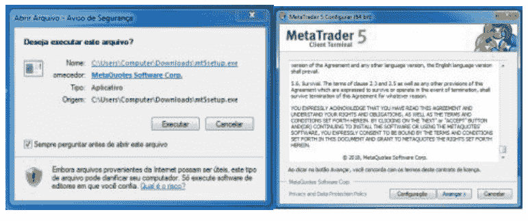

一直继续直到安装结束。结束时，系统会要求账户登录和密码。我们需要使用金融资产的报价数据。在本电子书中，我们将使用 `XP Investimentos` 的模拟账户。

请看下方请求登录名、密码和服务器类型（真实账户或演示账户）的打开程序。

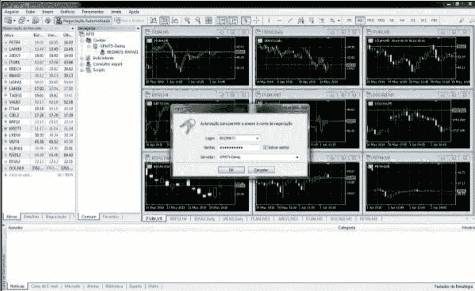

## 2. MetaTrader 5 的主要元素

我们主要的关注点之一是从蜡烛图（K线）中可视化资产价格。因此，让我们来了解 `MetaTrader 5` 平台的主要可视化功能。

在**菜单：视图 -> 符号（Menu: View -> Symbols）**中，我们可以选择我们想要操作金融资产。

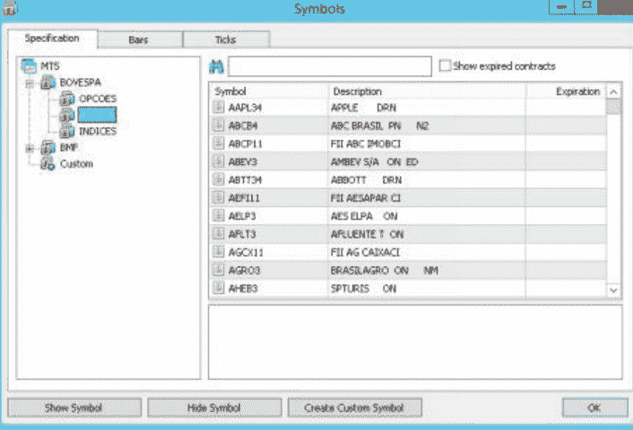

我们可以在 `Bovespa` 和 `BMF` 资产（连续系列）之间进行选择。在 `Bovespa` 资产中，我们有巴西市场交易的期权（看涨和看跌期权）、A VISTA 股票以及指数（期货市场）。

值得注意的是，每家经纪商提供的数据路由都不同。有的数据较多，有的则较少。例如，如果我们使用的是某家经营外汇市场的经纪商，那么在“资产”窗口中出现的期权将完全不同。

在**市场观察（Market Watch）**中，可以添加代表正在查询价格的公司的符号。


在这个“市场观察”字段中，我们可以添加与该经纪商允许运营的证券交易所交易的公司相关的资产。

在**市场观察**字段中，我们还有**详情（Details）**标签页，它提供了有关正在评估的金融资产的额外信息。例如，下面我们可以看到此标签页关于 `Petrobras` 股票的信息。在**交易（Trading）**标签页中，我们有多个选项，可以一键进行买卖。

| 符号 (Symbol) | 买入价 (Bid) | 卖出价 (Ask) | 最新价 (Last) |
|---|---|---|---|
| PETRA | 14.68 | 14.69 | 14.69 |
| VALES | 48.02 | 48.04 | 48.02 |
| ABE3 | 18.33 | 18.35 | 18.33 |
| IBOVESPA | 最新价 (Last) | 最高价 (High) | 最低价 (Low) |
|---|---|---|---|
| 69965 | 70757 | 69954 | |
| 69954 | 1.84521M | 14.62 | |
| 1896708 | 51.0849948 | | |
| 70757 | 69994 | | |
| PETRA | | | |
|---|---|---|---|
| 卖出 (SELL) | 100.00 | 买入 (BUY) | |
| 14 | 71 | 14.72 | |
| 低价 (LOW) | 14.72 | 高价 (HIGH) | |
| 14.62 | 14.77 | | |
| VALES | 10:24:34 | | | |
|---|---|---|---|
| 卖出 (SELL) | 100.00 | 买入 (BUY) | |
| 48 | 13 | 16 | |
| 低价 (LOW) | 高价 (HIGH) | | |
| 47.86 | 48.62 | | |
| ABE3 | 10:24:34 | | | |
|---|---|---|---|
| 卖出 (SELL) | 100.00 | 买入 (BUY) | | |
| 18 | 30 | 31 | |
| 低价 (LOW) | 高价 (HIGH) | | |
| 18.15 | 18.37 | | |

### 2.1 导航字段 (Navigator Field)

导航字段包含用户的账户信息（无论是演示账户还是真实账户），以及平台提供的指标、投资机器人，以及我们自己开发的指标。

在该字段中，我们可以选择指标、脚本或 EA 类型，并将其直接拖放到感兴趣的金融资产图表中。

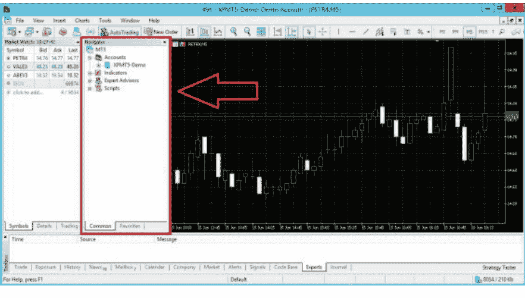

指标或 EA 的另一种方法是从菜单 **插入 -> 指标（Insert -> Indicators）**、**插入 -> 专家顾问（机器人）（Insert -> Expert (Robots)）**。

让我们从菜单中添加一个指标：

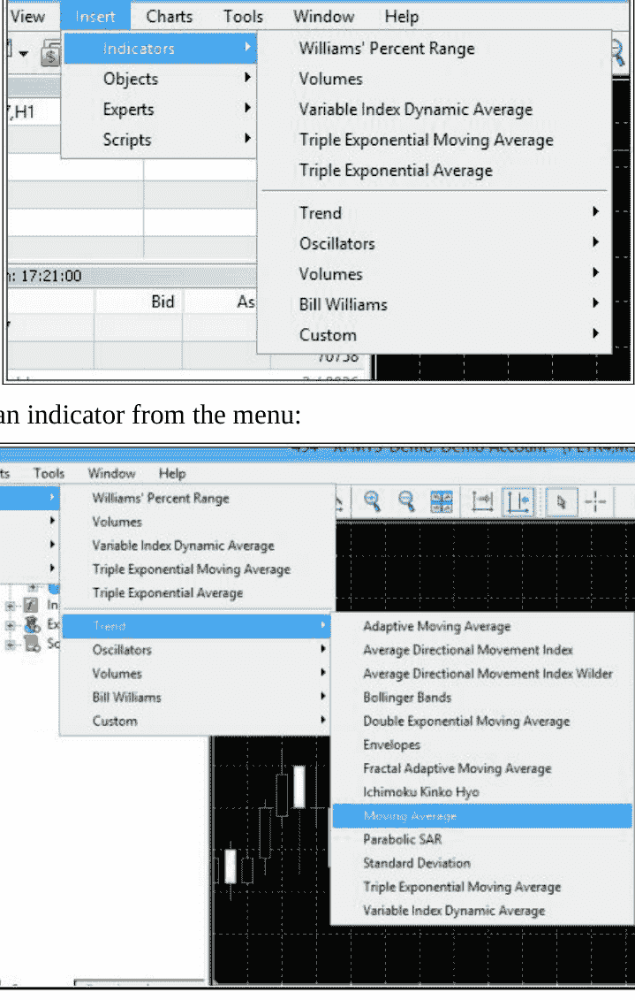

在上方图中，我们可以看到指标按趋势指标、震荡器、成交量、`Bill Williams` 和自定义（Custom）进行分类。趋势指标顾名思义，更适合在市场处于某些定义明确的方向性行为时发出警告。相反，震荡器指标更适合警告横盘市场（即震荡市场）中的机会。

`Bill Williams`[2] 是一位非常受欢迎的交易员，他开发了许多重要且被广泛使用的指标。因此，为他创建的指标专门创建了一个部分。

很有趣的是，我们可能需要使用 `MetaTrader` 原生的指标和 EA，也可以使用我们创建的、甚至是从工具箱“市场”（Market）标签页中提供的指标和 EA。

### 2.2 工具箱 (Toolbox)

在工具箱字段中，我们可以找到许多重要信息。在工具箱字段中，我们可以看到一些可以下载的机器人。在“新闻”（News）标签中查看实时的行情数据。


### 2.3 蜡烛图 (Candles)

`MetaTrader 5` 允许我们以不同的方式可视化图表。我们可以选择我们感兴趣的图表类型。

在图表上右键点击，选择我们感兴趣的图表类型。通过快捷键，切换在柱状图、蜡烛图或线图之间。

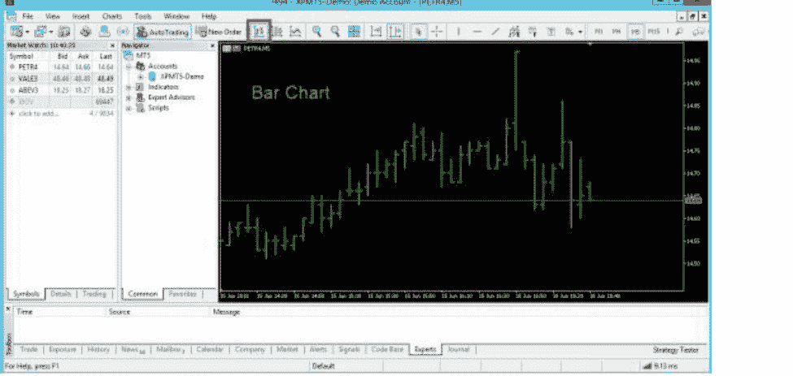

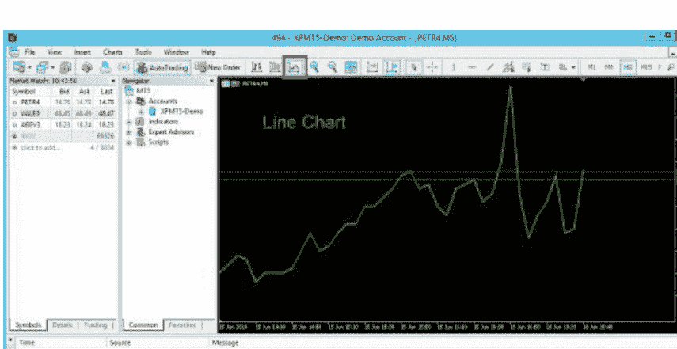

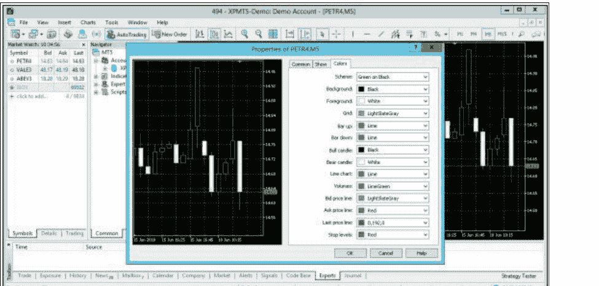

### 2.4 模板 (Templates)

值得注意的是，每次打开新图表时，`MetaTrader` 将使用默认设置。但是，可以通过在图表上右键点击选择 **模板 -> 保存模板（Save as Template）** 来保存我们的设置。

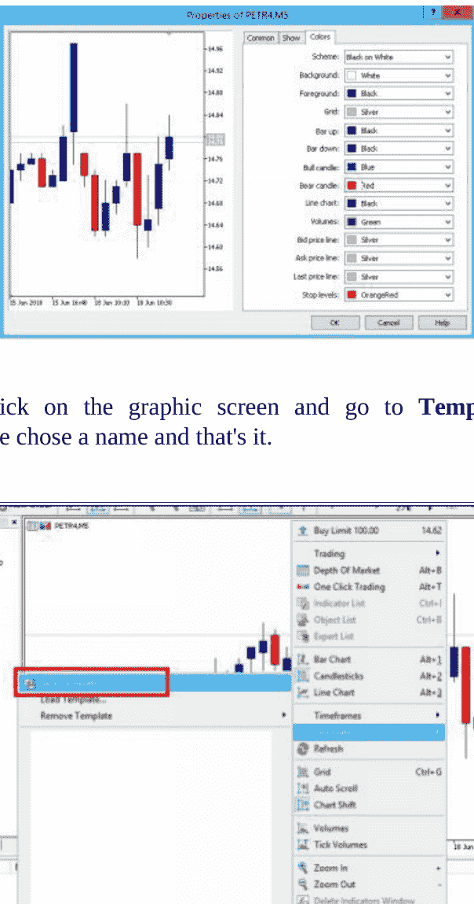

因此，只需在图表上右键点击选择 **模板 -> 加载模板** 即可加载已保存的设置。


### 2.5 绘制对象 (Drawing Objects)

你可以在图表上绘制许多对象。我们可以添加通道、支撑线和阻力线、斐波那契、上升/下降箭头等。

这种方式可以让技术分析非常完整。在图表上右键点击可以看到对象列表并进行编辑。

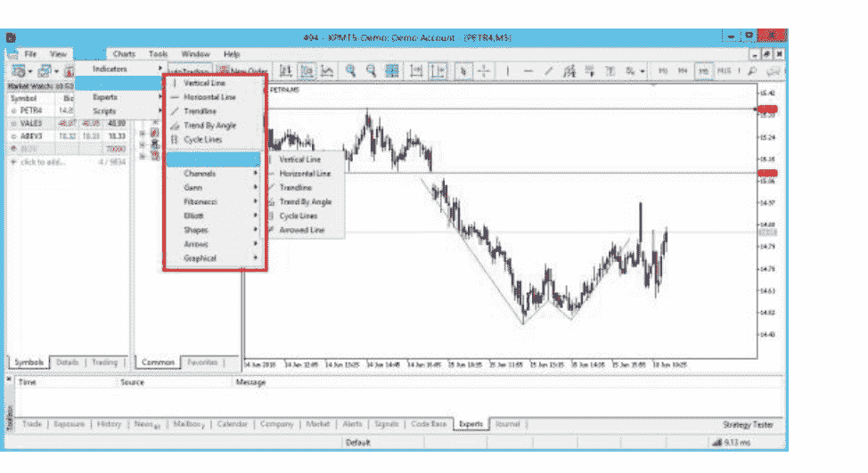

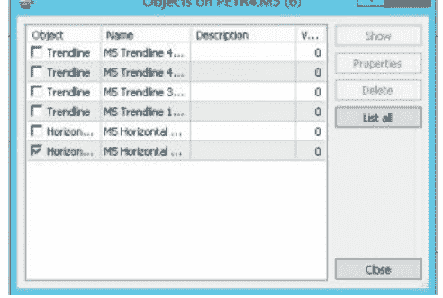

### 2.6 图表时间 (Graph Times)

在不同的图表时间之间切换非常简单。只需在图表顶部右键点击进入 **时间周期（Timeframes）** 并选择蜡烛时间。

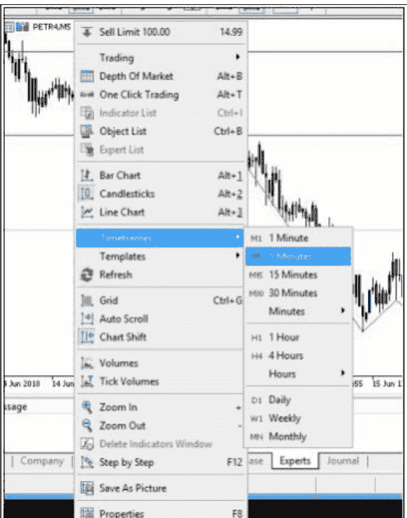

## 3. 添加指标 (Adding Indicators)

指标对于许多交易员是决策的主要指导因素。这些指标通常会在我们适机入场或离场时发出警告。当你谈到指标时，`MetaTrader` 并没有让你感到匮乏。

目前，平台有超过 2000 个指标可以免费下载。这些下载可以通过网站本身，也可以通过平台工具箱中的“代码库”（Code Base）标签页进行。

让我们例如，从菜单添加一个移动平均线指标：

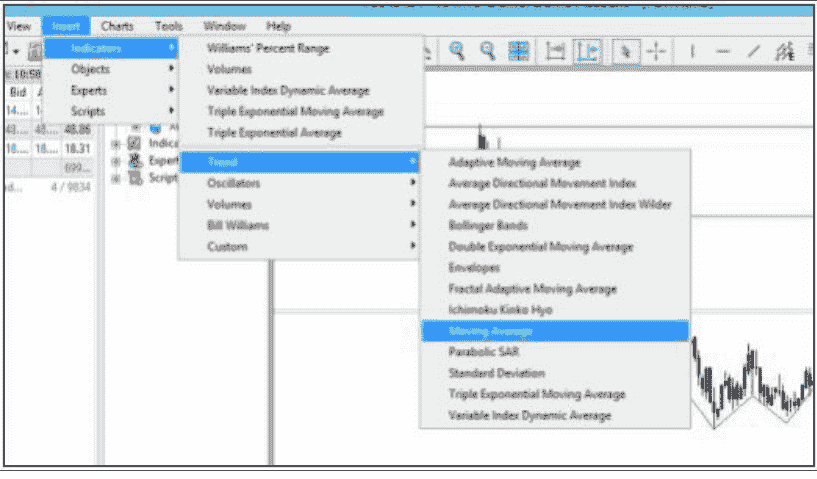

点击“确定”后，该指标将立即添加到所选的资产图中。

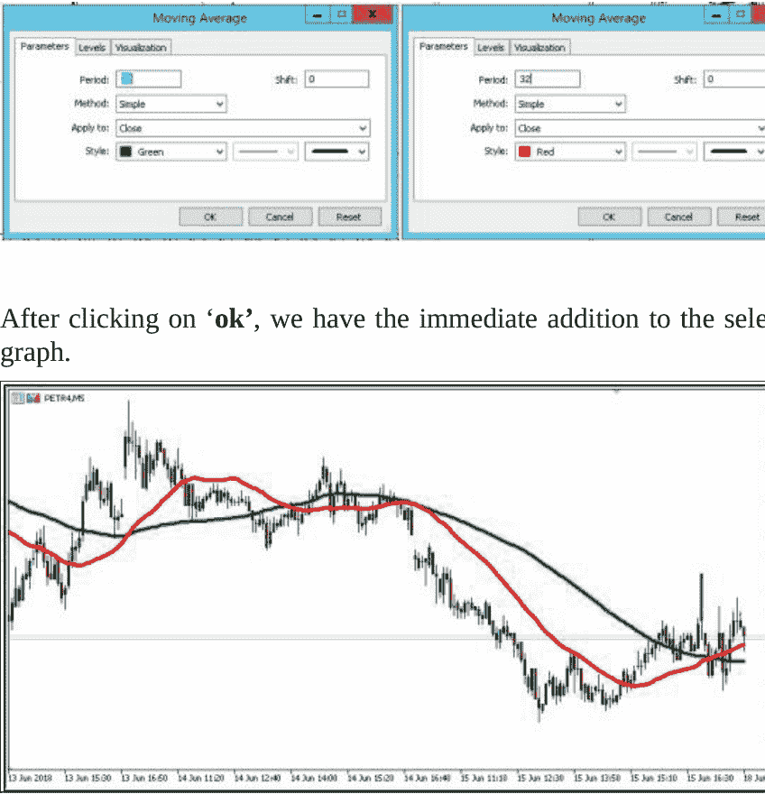

现在我们来添加相对强度指数（`RSI`）。这个指标非常有趣，因为它是在与主蜡烛价格窗口独立的窗口中绘制的（见下图）。

让我们对收盘价应用为 9 的周期：

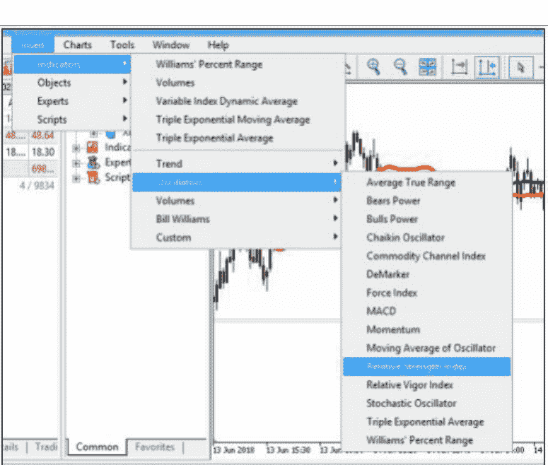

结果如下：

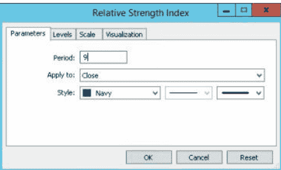

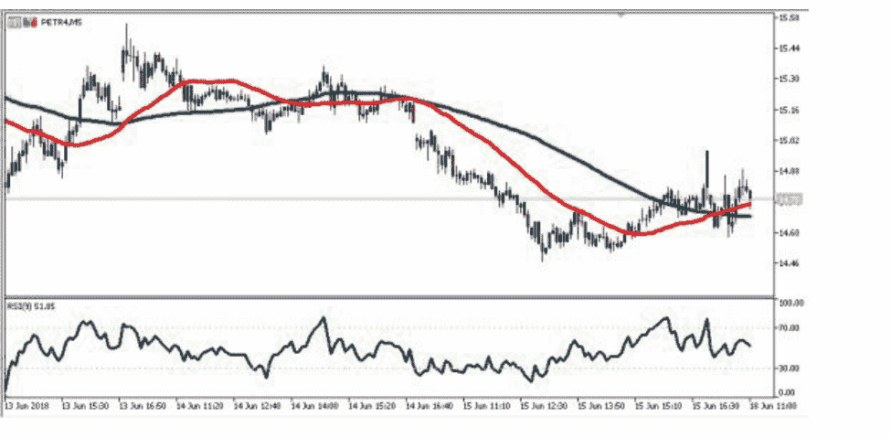

`RSI` 是一种用于警示超买和/或超卖的指标。基本上，我们必须为超买或超卖的激活触发器选择两个参考水平。我们可以选择 30（超卖）和 70（超买）作为水平值。

例如，`RSI` 值高于 70 表示价格超买，也就是说，在震荡市场中的任何时候，我们都可能开始看到价格下跌。相反，如果 `RSI` 值低于 30，我们可以说价格已超卖，价格突然高涨迫在必行。

这里介绍了这两个指标，因为它们将用于创建我们的投资机器人。此后，我们将使用三种策略：一种是移动平均线交叉，另一种是仅使用 `RSI`，还有一种是同时使用这两个指标。

## 4. 数据窗口


一个非常重要的字段，它极大方便了价格和指标值的可视化，是**数据窗口** Data Window。要打开它，我们可以：进入**视图** View 菜单 -> **数据窗口** Data Window，或使用键盘快捷键 `Ctrl + D`。

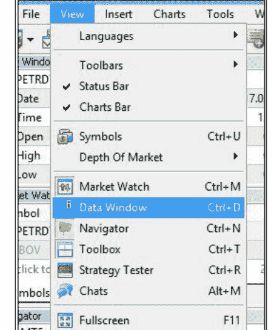

此操作将为我们打开一个新字段：**数据窗口** Data Window。现在我们可以将鼠标光标置在图表的任何蜡烛上，以获取所选位置的价格和指标的详细信息。

见下例，我们将鼠标放在绿色高亮显示的蜡烛上，数据窗口为我们提供了详细信息：

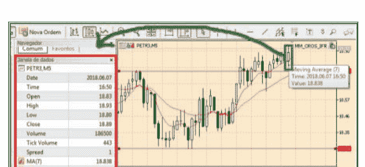

# 第 3 章

在读完本电子书和/或即使现在，邀请读者创建一个账户，开始在门户添加他们的知识并提问。

## #1 号平台，现位于米纳斯杰莱州

## 交易者论坛

就技术分析提问，讨论交易系统并提高你的 MQL 编程技能以开发你自己的策略。

与来自世界的交易者交流并分享经验。一般性讨论、技术指标、交易文章和材料。

常规讨论 - 交易系统 - 专家 - 机器人 - 技术指标 - 交易文章和材料

## 查找最后 N 根蜡烛

1. 有人可以帮我解决这个问题吗，因为我是编程新手。如果有人知道如何找到最后一根红蜡烛，我只知道一种方法。但问题是（如果蜡烛不是红色的，但回溯(7)或 4 或 5 是红色的）。

## 专家：Junior Scal EA

初级 MQL5 EA 专家顾问或初级 Scal 指标。作者：Hemant Awrawal

## Babylon 专家顾问 - Babylon 指标 - 即取即用

1. 我在市场中搜索了但没有找到……我正在开发自己的……凭借我有限的知识，如果有人能从任何地方帮我（）Bab 指标，如果你有的话，请让我下载 `Babylon Expert.ex4`。

我能够修改我的代码，使得警报只能正确地执行（在蜡烛关闭后）。告诉我我的代码中哪些部分需要修改。`Nikolai_Custom-BabylonIndicator.mq4`

## 成交量指标

显然，外汇没有成交量指标，我想要一个代表每个 K 线跳动（ticks）数的指标，以给我们提供波动性的近似值。有人有类似的指标吗？

## ZIP - 带模式的通用 EA，搜索模式

ZUP 指标允许搜索多种已知模式，我们已经有了这些模式的参数。

## 金融交易文章

学习如何创建自己的技术指标和交易

注册后不久，我们将获得一组非常有趣的功能。例如，我们可以访问 MetaTrader 5 文档，它是详尽且实时的，包含全球市场的关键信息和其他福利。

## MQL5 参考

- 语言基础
- 数据类型、枚举
- MQL5 程序
- 开发环境
- 常用函数
- 算术
- 转换函数
- 数学函数
- 事件处理
- 调试
- 编译
- 计时器
- 交易操作
- 图表操作
- 数据窗口
- 交易信号
- 终端对象
- 自定义指标
- 技术指标
- 交易请求
- 处理事件
- 处理图表
- 标准库

MQL5 是一种用于开发技术指标的高级语言。MQL5 语言提供了用于开发技术指标、交易机器人和应用程序的工具。此外，它还包含了调试器。MQL5 语言提供了用于预测市场趋势的分类方法。MQL5 语言包含了用于解决交易问题的数学分析。MQL5 语言提供了用于执行交易的类。MQL5 语言还包含了用于开发自定义指标的类。MQL5 语言提供了用于开发交易策略的示例。MQL5 语言包含了用于开发交易策略的库。MQL5 语言提供了用于开发交易策略的模板。MQL5 语言包含了用于开发交易系统的代码。MQL5 语言提供了用于开发交易策略的源码。

- 语言基础
- 数据类型、枚举
- MQL5 程序
- 开发环境
- 常用函数
- 算术
- 转换函数
- 数学函数
- 事件处理
- 调试
- 编译
- 计时器
- 交易操作
- 图表操作
- 数据窗口
- 交易信号
- 终端对象
- 自定义指标
- 技术指标
- 交易请求
- 处理事件
- 处理图表
- 标准库

MQL5 是一门设计用于开发技术指标、交易机器人和应用程序的高级语言。

MQL5 语言提供了

1. 知道哪里学习 MQL4 还是 MQL5 吗？在文章中发布由社区成员编写的文章。我们还会在论坛上发布并讨论它们。

MQL5 语言提供了

1. 包含了用于预测市场趋势的示例。

MQL4 和 MQL5 编程文章。

- `Expert/expert_example.mq4`
- `Indicator/indicator_example.mq4`
- `Script/script_example.mq4`
- `EA/expert_example.mq4`

指标示例显示：

- `Indicator/MovingAverage.mq4`
- `Indicator/MACD.mq4`
- `Indicator/RSI.mq4`
- `Indicator/Stochastic.mq4`

基于 MACD、移动平均线的交易系统。

- `EA/TrendFollow.mq4`
- `EA/Grid.mq4`
- `EA/Martingale.mq4`

基于 RSI、布林线的交易系统。

- `Script/CloseAll.mq4`
- `Script/CloseOrders.mq4`
- `Script/DeleteOrders.mq4`

该专家顾问不使用指标，它只使用当前的：

- 四条水平线

指标绘制了四条水平线，基础的三个条（红色的）以及：

- TP（止盈）
- SL（止损）
- EMFilter/设置

我们有一个文章章节，其中添加了优秀的教学教程。对于想要精通 MQL5 语言的人来说，这些也是必不可少的领域。

## MQL5 源码库

MQL5 语言提供了

1. 知道哪里学习 MQL4 还是 MQL5 吗？在文章中发布由社区成员编写的文章。我们还会在论坛上发布并讨论它们。

MQL5 语言提供了

1. 包含了用于预测市场趋势的示例。

任何想要构建具有更健壮且复杂策略的 EA（自动交易系统）的人可以在 Freelance 门户上聘用 MQL 程序员。此外，对于那些已经开始掌握该工具并赚取额外收入的人，他们可以接受项目并提供他们的机器人制作服务、指标和投资脚本。

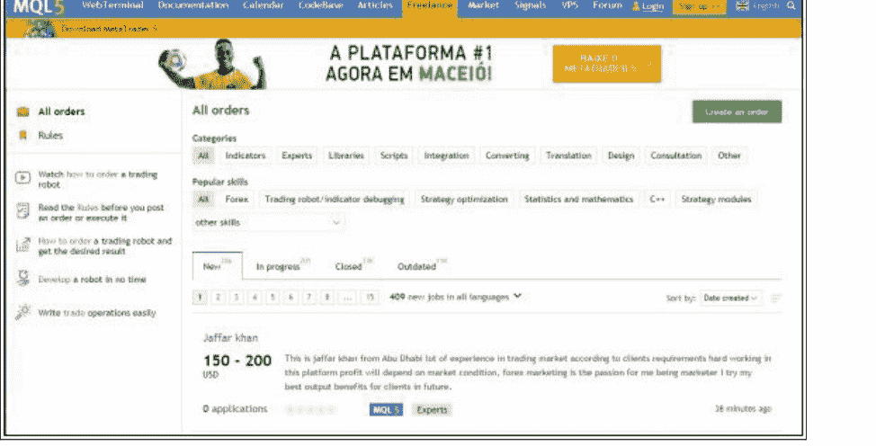

在市场（Market）中，我们可以买到个人和专业公司提供的指标和 EA。

## 购买前免费测试应用程序

交易机器人、指标和交易应用程序市场

MetaTrader 市场是一个独特的交易机器人和技术指标商店。

了解更多关于我们为交易者提供的广泛服务：跟单交易信号、由自由职业者开发的自定义应用程序、通过支付系统和 MQL 云网络进行自动支付。

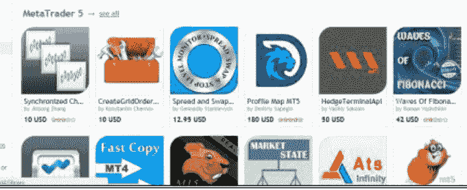

投资信号是一个非常有趣的领域。通过它，我们可以跟踪交易者操作的入场和出场。对于每一位愿意提供其操作信号的交易者，我们拥有收益率的演变、可靠性水平、最大利润等信息。某些信号服务可以签约（付费），并可以与我们的账户同步自动执行。

## MQL5 网页终端 日历 代码库 文章 自由职业市场 VPS 论坛 登录 英语

如何找到真正重要的时间？你可以自动化交易。

账户上带有自动执行的 MetaTrader 5 交易信号

信号 添加小组件 规则 过滤器 比较器

经纪商服务器 按名称、作者、经纪商搜索

最大利润 可靠 日内50美元以下 有评论

## 买了机器人吗？

可靠性 查看全部

| Geraldo Paira | YI XONG | Phong Son | |
| :--- | :--- | :--- | :--- |
| AmonPaliva | 自2014 年以来增长了 242% | BestscalperDut... 自2017 年以来增长了 69% | Right Trades 自2018 年以来增长了 50% |


在找到策略和一致设置并通过模拟账户测试证明其有效性后，一个重要的步骤是租用虚拟机服务。这种服务将使我们在面对电力和互联网缺失时更加安全和受保护。

能源和互联网网络的波动是会影响我们投资机器人正常运行的问题。解决这一问题的替代方案是租用虚拟专用服务器（VPS）虚拟机。MQL5 门户本身就提供此类服务。

## MQL5 文档 日历 文章 金融 市场 信号 论坛 登录

所有宏观指标

实时

## MetaTrader VPS VPS

- 你需要托管
- 如何选择服务器
- VPS 工作原理
- 免费托管
- VPS 计划和折扣
- VPS 的价值之处
- 规则

## 适用于 MetaTrader 的外汇 VPS

我们将提供一个具有最低延迟和最佳执行效果的服务器

```
指定您的经纪商服务器 ->
```

每月 19 美元租用一个外汇 VPS

适用于 MetaTrader 4/5 的虚拟托管是外汇交易的最佳 VPS 解决方案。它廉价、不需要配置，并且具有可靠的市场访问功能。

每月仅需 19 美元，即可获得一个全天候的虚拟平台，为您节省并提供回报。

从平台上创建任何账户的自定义实例。启动交易机器人或激活单个账户。

交易者选择我们的服务作为最佳 VPS 解决方案，是因为其无比拟的执行率和高可用性。


你买了机器人吗？

可靠性 查看全部

| Geraldo Paira | YI XONG | Phong Son | |
| :--- | :--- | :--- | :--- |
| AmonPaliva | 自2014 年以来增长了 242% | BestscalperDut... 自2017 年以来增长了 69% | Right Trades 自2018 年以来增长了 50% |

在找到策略和一致设置并通过模拟账户测试证明其有效性后，一个重要的步骤是租用虚拟机服务。这种服务将使我们在面对电力和互联网缺失时更加安全和受保护。

能源和互联网网络的波动是会影响我们投资机器人正常运行的问题。解决这一问题的替代方案是租用虚拟专用服务器（VPS）虚拟机。MQL5 门户本身就提供此类服务。

你买了机器人吗？

可靠性 查看全部

| Geraldo Paira | YI XONG | Phong Son | |
| :--- | :--- | :--- | :--- |
| AmonPaliva | 自2014 年以来增长了 242% | BestscalperDut... 自2017 年以来增长了 69% | Right Trades 自2018 年以来增长了 50% |

你买了机器人吗？

可靠性 查看全部

| Geraldo Paira | YI XONG | Phong Son | |
| :--- | :--- | :--- | :--- |
| AmonPaliva | 自2014 年以来增长了 242% | BestscalperDut... 自2017 年以来增长了 69% | Right Trades 自2018 年以来增长了 50% |


任何想要构建具有更健壮且复杂策略的 EA 的可以在 Freelance 门户上聘用 MQL 程序员。此外，对于那些已经开始掌握该工具并赚取额外收入的人，他们可以接受项目并提供他们的机器人制作服务、指标和投资脚本。


在市场（Market）中，我们可以买到个人和专业公司提供的指标和 EA。

## 购买前免费测试应用程序

交易机器人、指标和交易应用程序市场

MetaTrader 市场是一个独特的交易机器人和技术指标商店。

了解更多关于我们为交易者提供的广泛服务：跟单交易信号、由自由职业者开发的自定义应用程序、通过支付系统和 MQL 云网络进行自动支付。


投资信号是一个非常有趣的领域。通过它，我们可以跟踪交易者操作的入场和出场。对于每一位愿意提供其操作信号的交易者，我们拥有收益率的演变、可靠性水平、最大利润等信息。某些信号服务可以签约（付费），并可以与我们的账户同步自动执行。

## MQL5 网页终端 日历 代码库 文章 自由职业市场 VPS 论坛 登录 英语

如何找到真正重要的时间？你可以自动化交易。

账户上带有自动执行的 MetaTrader 5 交易信号

信号 添加小组件 规则 过滤器 比较器

经纪商服务器 按名称、作者、经纪商搜索

最大利润 可靠 日内50美元以下 有评论

## 买了机器人吗？

可靠性 查看全部

| Geraldo Paira | YI XONG | Phong Son | |
| :--- | :--- | :--- | :--- |
| AmonPaliva | 自2014 年以来增长了 242% | BestscalperDut... 自2017 年以来增长了 69% | Right Trades 自2018 年以来增长了 50% |


在找到策略和一致设置并通过模拟账户测试证明其有效性后，一个重要的步骤是租用虚拟机服务。这种服务将使我们在面对电力和互联网缺失时更加安全和受保护。

能源和互联网网络的波动是会影响我们投资机器人正常运行的问题。解决这一问题的替代方案是租用虚拟专用服务器（VPS）虚拟机。MQL5 门户本身就提供此类服务。

## MQL5 文档 日历 文章 金融 市场 信号 论坛 登录

所有宏观指标

实时

## MetaTrader VPS VPS

- 你需要托管
- 如何选择服务器
- VPS 工作原理
- 免费托管
- VPS 计划和折扣
- VPS 的价值之处
- 规则

## 适用于 MetaTrader 的外汇 VPS

我们将提供一个具有最低延迟和最佳执行效果的服务器

```
指定您的经纪商服务器 ->
```

每月 19 美元租用一个外汇 VPS

适用于 MetaTrader 4/5 的虚拟托管是外汇交易的最佳 VPS 解决方案。它廉价、不需要配置，并且具有可靠的市场访问功能。

每月仅需 19 美元，即可获得一个全天候的虚拟平台，为您节省并提供回报。

从平台上创建任何账户的自定义实例。启动交易机器人或激活单个账户。

交易者选择我们的服务作为最佳 VPS 解决方案，是因为其无比拟的执行率和高可用性。


你买了机器人吗？

可靠性 查看全部

（注：此处已根据要求去除了原文中重复的段落）

# I.1. MetaEditor

MetaEditor 是 MQL5 语言的集成开发环境（IDE），包含在 MetaTrader 5 中。现在让我们了解 MetaEditor 提供的主要功能。

要打开 MetaEditor，我们必须点击下方图中高亮的图标或按下 `F4` 快捷键。

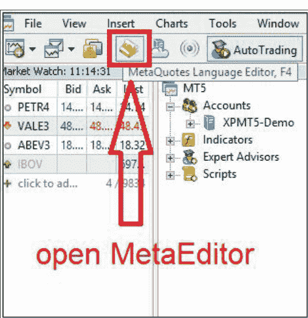

点击 MetaEditor 图标后，我们将拥有包含三个主要区域的开发环境，这些区域将协助我们编写代码。

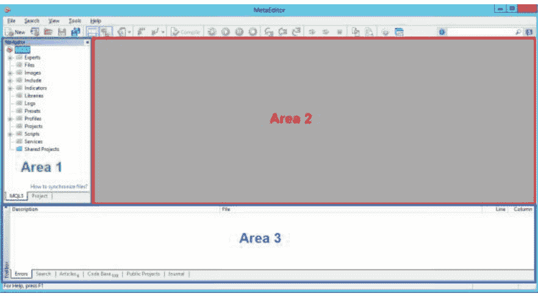

**区域 1：** 导航器（Navigator） - 我们在这里管理代码库存档和开发中的库。

**区域 2：** 窗口（Window） - 输入代码的地方

**区域 3：** 工具箱（Toolbox） - 我们在这里跟踪编译和调试测试进度。我们有 6 个标签页（错误、搜索、文章、代码库、公共项目和日志）。基本上，在创建我们的算法时，我们只会使用“错误”和“日志”标签页。

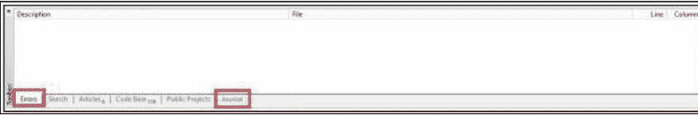

# I.2. 创建新项目

点击**新建**（New）图标，然后从 MQL5 向导中选择我们想要创建的项目类型。

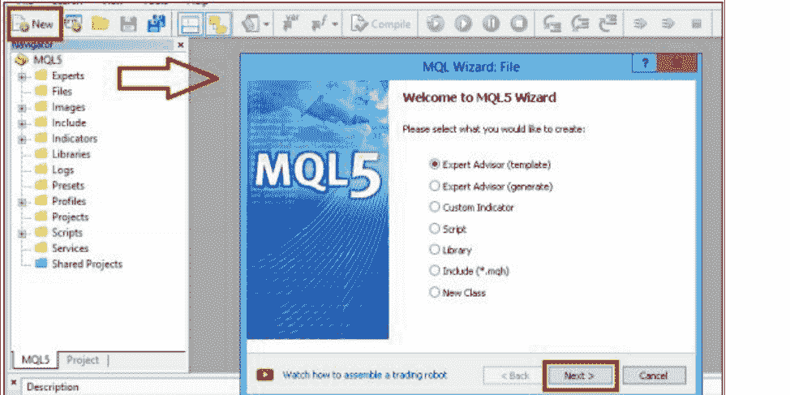

我们可以注意到有多种设计选项。这个**向导**（Wizard）甚至允许我们在在没有编程知识的情况下创建投资机器人。当然，在这种情况下，我们对大多数步骤将一无所知，而且很难自信且安全地进行任何操作。

由于本电子书旨在提供使用 MQL5 工具的第一步，我们只会有第一个选项**专家顾问**（Expert Advisor，模型）。还有两本由同一作者编写的电子书将向你展示如何开发指标（Indicator）和脚本（Scripts）代码。

让我们先给我们的投资机器人（专家顾问）命名。我们将其称为 `EA_MA_Cros_RSI`（带有 RSI 指标的均线交叉专家顾问）。这只是用于 MetaEditor 演示的临时名称。

### MQL 向导 - 文件

专家顾问的通用属性

请指定专家顾问的通用属性。

| 名字 (Name) | 类型 (Type) | 初始值 (Initial value) |
| --- | --- | --- |
| ExpertEA_MA_Paz_RSI | | |
| 作者 (Author) | Copyright 2016, MetaQuotes Software Corp. | |
| link | https://www.mql5.com | |
| 参数 (Parameters) | | |

查看如何组装交易机器人

### 专家顾问的事件处理器

请选择专家顾问的事件处理器。

- `OnTrade`: 当交易事件发生时，调用该函数。
- `OnTradeTransaction`: 当交易事务事件发生时，调用该函数。
- `OnTimer`: 当定时器事件发生时，调用 `OnTimer` 函数。
- `OnChartEvent`: `OnChartEvent` 是一组图表事件（ChartEvent）的处理器。
- `OnDeinit`: 仅当市场深度（Depth of Market）变化时，为专家顾问生成该函数。

查看如何组装交易机器人

### MQL 向导 - 文件

专家顾问的测试事件处理器

请选择专家顾问的测试事件处理器。

- `OnTester`: 当测试事件（Tester）发生时，调用 `OnTester` 函数。
- `OnTesterInit`: 当测试初始化事件（TesterInit）发生时，调用 `OnTesterInit` 函数。
- `OnTesterPass`: `OnTesterPass` 是测试通过（TesterPass）事件的处理器。
- `OnTesterDeinit`: `TesterDeinit` 是测试结束事件的处理器。

查看如何组装交易机器人

点击“完成”后，MQL5 向导将为我们创建开发任何投资机器人所需的基础主体。因此，我们已经有了一个划分好的结构，包含了运行 EA 的主要方法。

```cpp
//+------------------------------------------------------------------+
//| EA Cross RSI.mq5
//| Copyright 2018, MetaQuotes Software Corp.
//| https://www.mqql5.com
//+------------------------------------------------------------------+
#property copyright "Copyright 2018, MetaQuotes Software Corp."
#property link "https://www.mqql5.com"
#property version "1.00"
//+------------------------------------------------------------------+
// Expert initialization function
int OnInit()
{
    return(INIT_SUCCEEDED);
}
//+------------------------------------------------------------------+
// Expert deinitialization function
void OnDeinit(const int reason)
{

}
//+------------------------------------------------------------------+
// Expert tick function
void OnTick()
{

}
```

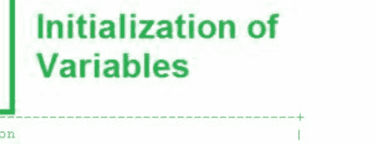


EA 的结构为了其正常运行，始终至少包含以下三个函数或方法：`OnInit()`、`OnDeinit()` 和 `OnTick()`。

# I.3. OnInit()

EA 中执行的第一个函数是 `OnInit()`。它只在我们初始化机器人时触发。我们使用此函数来初始化指标的指针（句柄）、变量，以及进行之前的配置并加载变量和模板。

# I.4. OnDeinit()

当机器人从 MetaTrader 移除时，调用 `OnDeinit()`。例如，我们使用此函数来清理指标句柄、变量，从屏幕移除图形和文本对象等。

# I.5. OnTick()

最重要的函数之一是 `OnTick()`，因为我们的大部分编程逻辑都在这里运行。这个函数是机器人请求频率最高的，每当新价格产生时就会调用一次。值得注意的是，此函数只在交易时间内被调用。

值得强调的是有几个预定义函数如 `ChartEvent()`、`Tester()` 等。然而，我们将只学习主要的。关于这些函数的更多细节可以在 MetaTrader 文档中找到。

# I.6. 编程辅助工具

我们有一些元素（函数）可以帮助代码的可读性。

## I.6.1. 注释

对算法进行注释对于可读性和理解至关重要。

例如，我们可以通过 `//` 或 `/* */` 来表示注释元素。

```cpp
/*
// EA_MA_Cros_RSI
// Copyright 2018, MetaQuotes Software Corp.
// https://www.mqql5.com
*/

#property copyright "Copyright 2018."
#property link "https://www.mqql5.com"
#property version "1.00"
```

这种类型的注释具有这种结构（`//` 会导致编译器不解释它们紧接着看到的字符）。因此，我们可以编写一些提示和解释性注释，以便开发者以及我们自己编辑时清晰易读。

第二种注释 `/* */` 允许你在它们之间编写整个段落。

```cpp
/*
13
14 在这里我可以写一段段落式的注释。我可以跳过
15 这些特殊字符之间的行
16 */
```

我们有一些注释的快捷键。例如，如果我们想注释几行代码，可以选中它们并按下 `Ctrl + ~`。要移除注释，只需选中并按下 `Ctrl + ~`。

```cpp
//+--------------------------------
//property copyright "Copyright 2018."
#property link "https://www.mqql5.com"
#property version "1.0"
//----------------
```

快捷键 `Ctrl + .` 让你创建下面的注释字符串。这对于分隔大代码段非常有用。

```cpp
//--------------------------------
//|                               |
//|                               |
//--------------------------------
```

快捷键 `Ctrl + ;` 让你创建以下字符串的小分隔：

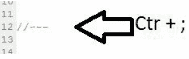

# I.7. EA 属性

告知机器人开发的细节总是好的。因此，`#property` 指令用于描述 EA 的基本信息。在下面的示例中，在我们使用了属性指令的情况下，我们可以看到有关版权、指向某些网站的链接以及机器人版本的信息。

```
1/++                               EA MA_Ros_IFR.mq5 |
2//|                               Copyright 2018. |
3//|                               https://www.mq15.com |
4//|                                                
5//--------------------------------------------------
6#property copyright "Copyright 2018"
7#property link "https://www.mq15.com"
8#property version "1.00"
```

点击编译（Compile）按钮后：

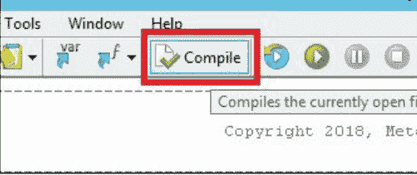

我们注意到，在错误（Errors）选项卡的工具箱（Toolbox）字段中，编译器没有提出任何问题。

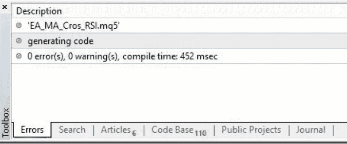

因此，在 MetaTrader 平台的导航器（Navigator）字段中 -> 点击“交易顾问”（Expert consultant）的更多，我们可以找到编译好的 EA (`.ex5`)。现在你可以点击、按住并拖到 K 线图上，并观察显示的 `#property` 信息。

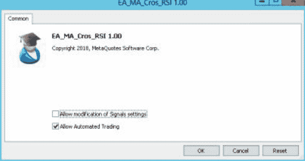

由于我们目前在上面的通用（Common）选项卡中还没有编写任何机器人信息，因此这些是目前唯一可用的。那么，通过在 MetaEditor 对代码进行每项新修改，我们都可以在导航器中的专家（experts）部分观察到变化。

# I.8. MetaTrader 和 MetaEditor 文件类型

使用 MetaEditor 生成的文件扩展名为 `.mql`。我们可以在 MetaEditor 导航器字段中验证这一点，那里我们有一个名为 `EA_MA_Cros_RSI.mql5` 的机器人编辑文件。

点击编译（Compile）按钮后，MetaTrader 导航器 -> 交易顾问（Expert Advisor）字段中会自动创建一个扩展名为 `EA_MA_Cros_RSI.ex5` 的文件。

注意 MetaTrader 和 MetaEditor 之间的区别。在 MetaEditor 中，我们拥有扩展名为 `.mql5` 的文件，而在 MetaTrader 中是 `.ex5` 文件。

# I.9. 添加库

我们可以添加 MQL5 提供的特殊库。为此，我们只需要按照以下代码结构知道库的：

```cpp
//12--- Includes
13 #include <ChartObjects/ChartObjectsFibo.mqh>
14 #include <Trade/Trade.mqh>
```

上面的示例在第一个 `<ChartObjects/ChartObjectsFibo.mqh>` 中添加了一组用于生成斐波那契图形的类和方法，并在第二个包含 `<Trade/Trade.mqh>` 中处理感知和管理销售订单。

注意这些文件的扩展类型为 `.mqh`。MetaEditor 也允许你创建这种类型的文件。通过它，我们可以创建处理图形部分甚至视觉动画的复杂算法。

我们可以从网站研究和学习主要的 MQL5 库：


在第 5 章，我们将通过学习 MQL5 语法来更好地了解和研究 MetaEditor 的功能。

# 第 5 章

### b. MQL5 基础编程逻辑

如前所述，MQL5 语言与 C++、Java 和 C# 语言有许多相似之处。因此，任何了解这些语言的人都能非常轻松地理解 MQL5 的操作语法。


# 变量与基础语法

每一个算法、每一个蛋糕配谱都从描述成分开始。所以让我们做一个类比，开始学习我们的 EA（我们的蛋糕）的成分。

让我们先理解 MQL5 中主要的变量类型。我们还需要知道这种语言如何声明和为变量赋值。

## 1. 变量类型

变量是数据存储的基本单元。MQL5 中使用的变量类型：

- 整数 (`int`)
- 浮点数 (`float` 和 `double`)
- 字符 (`string`)
- 逻辑型 (`bool`)
- 日期 (`datetime`)

目前不要担心操作的结果。暂时，让我们看看变量的结构。

## 2. 变量声明

每个变量必须有一个名称。在 MQL5 中，我们需要声明以下内容：

### 2.1 整数

MQL5 中使用的整数变量类型为：

- `char`：使用 1 字节内存，范围为 -128 到 127。
- `short`：使用 2 字节内存，范围为 -32,768 到 32,767。
- `int`：使用 4 字节内存，范围为 -2,147,483,648 到 2,147,483,647。
- `uchar`：使用 1 字节内存，范围为 0 到 255。
- `ushort`：使用 2 字节内存，范围为 0 到 65,535。
- `uint`：使用 4 字节内存，范围为 0 到 4,294,967,295。

```cpp
int movingAveragePeriod = 24;
```

### 2.2 Double

当我们对小数数字感兴趣时，最合适的是使用 `double` 类型。`double` 类型消耗 8 字节内存，而 `float` 只有 4 字节。这两种类型（`float` 和 `double`）之间的区别是精度更高。

```cpp
int movingAveragePeriod = 24;
double valueRSI = 1.611;

double a = 1.0;
double b = 0.5;
double c = a / b;
```

### 2.3 String

文本字符变量使用 `string` 类型。MQL5 语言允许以非常简单的方式进行字符串拼接，如下所示：

```cpp
string s_1 = "My first";
string s_2 = "Expert Advisor";

string s_t = s_1 + s_2; // 返回: My first Expert Advisor;
```

对于字符串，如果没有赋值，则放置一个空字符串 (NULL)。

### 2.4 Bool

如果兴趣是有一个具有布尔特征的变量，即只允许真值 (`true`) 或假值 (`false`)，我们可以使用 `bool` 类型：

```cpp
int x = 10;
int y = 20;

bool result; // 没有初始赋值，我们得到 (false)

result = x < y; // 返回 (true)
```

应该注意，在变量 `bool response` 声明没有初始值的情况下，立即赋值了 (`false`) 的值。只有这样，我们才看到值变为 `true`。

### 2.5 Datetime

这是最广泛使用的类型之一，因为资产价格数据是收集在某个时间跨度上。我们始终能够对操作的时间和天数进行评估。因此，我们应该很好地意识到这种变量的使用。

MQL5 的日期和时间格式定义如下：`{D'yyyy.mm.dd hh:mi:ss'}` {年.月.日 时:分:秒}

在日期开头放置大写字母 `D` 会使变量具有 `datetime` 常量属性。

```cpp
datetime today = D'2018.07.17 00:00:00'; // 完整描述
datetime today2 = D'2018.07.17 00';       // 仅小时
datetime today3 = D'2018.07.17';          // 仅日期
```

## 3. 声明常量

我们有一种可以通过 `#define` 指令从代码开头的全局声明中创建常量。

```cpp
#define PI 3.14159
#define NOME_EMPRESA "1º EA LTDA."
```

当然，常量的值是不能更改的。如果尝试更改该值，将会导致编译错误。

使用大写字母命名常量是标准做法。

## 4. 向量变量：数组

数组是一个支持多个值的变量。我们可能认为数组类似于一个具有特定类型的数值列表。在这个列表中，我们可以通过迭代来遍历每一个值。

我们经常使用变量数组来主要存储金融资产价格信息和指标变量。

这里是一个存储整数的三位置数组声明示例：

```cpp
int myArray[3]; // 创建一个变量并分配三个 int 位置
myArray[0] = 10; // 在 0 位置存储值 10
myArray[1] = 20; // 在 1 位置存储值 20
myArray[2] = 30; // 在 2 位置存储值 30
```

如果我们尝试这样做：

```cpp
myArray[3] = 40; // 我们将得到一个编译错误！
```

这个编译错误发生的原因是因为我们通过一个初始语句 (`myArray[3]`) 仅分配了 3 个内存位置，而我们正尝试添加第四个位置。

我们可以将数组类型设置为我们需要的变量类型。然而，预先，MQL5 需要知道数组所需的值列表的大小。因此，在变量名后紧跟括号放入某些值是必要的。

声明数组的另一种方法是直接对其赋值。我们应该如下所示这样做：

```cpp
double myArray[4] = {3.14, 2.22, 1.61, 17.21};
```

## 5. For 循环

现在我们将学习用于投资机器人开发的一种非常重要的重复循环。当我们想要计算机在某些预定义的限制内执行重复活动时，告知机器的一种实用方法是通过 `for` 循环。

当我们在 MetaEditor 中输入单词 `for` 时，将会看到如所示的小型列表：

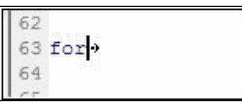

当我们按下 `Tab` 时，编辑器将自动补全 `for loop` 的整个结构。

```cpp
for(int i=0; i<total; i++)
{
}
```

该结构意味着我们将从整数 0（零）迭代到整数 (`total-1`)，迭代增量为一个单位的 `i`（`i++` 等同于 `i = i + 1`，`i--` 等同于 `i = i-1`）。

所以，如果我们想对数组元素内部进行扫描，可以如下所示从 `for` 循环执行：

```cpp
double myArray[4] = {3.14, 2.22, 1.61, 17.21};
for (int i=0; i<4; i++) {
  Print("myArray[" + i + "] = ", myArray[i]);
}
// 输出:
// myArray[0] = 3.14
// myArray[1] = 2.22
// myArray[2] = 1.61
// myArray[3] = 17.21
```

## 6. 枚举

`enum` 结构是一种特殊的整数类型，我们可以通过列表定义赋值常量。通过 `enum`，我们可以自定义最适合我们问题的变量类型。

例如，让我们创建一个枚举来代表一年的季节。我们知道一年只有 4 个季节：春、夏、秋、冬。

当你输入单词 `enum` 时，我们有一个指向右侧的小箭头，如下所示：

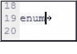

再次按 `Tab`，我们就可以自动补全。我们的 `enum` 应该像这样：

```cpp
enum SEASONS {
  spring,
  summer,
  fall,
  winter
};
```

我们现在可以使用 `SEASONS` 作为要声明的变量类型。在很多情况下，这对于让我们的代码更加直观和有序非常有用。

```cpp
SEASONS season;
season = summer;
Print(season); // 输出: 1
```

输出的值是 1。在很多情况下，这对于让我们的代码更加直观和有序非常有用。

## 7. 输入变量

`Input` 变量是允许用户更改的。

## 8. 局部变量与全局变量

区分局部变量和全局变量是非常重要的。对这些类型的混淆会导致很多错误。

### 8.1 局部变量

让我们创建一个函数来展示局部变量。在函数内部定义的变量只能在该函数内部使用。

```cpp
void test() {
  int movingAveragePeriod = 7;
  int multiplier = 2;
  Print(movingAveragePeriod * multiplier); // 输出: 14
}
```

### 8.2 全局变量

如果我们希望一个变量能在任何函数地方使用，我们必须像所示那样在全局声明它。

```cpp
int varGlobal_1 = 3;
int varGlobal_2 = 4;

void test() {
  int movingAveragePeriod = 7;
  int multiplier = 2;
  Print(movingAveragePeriod * multiplier); // 输出: 14
  Print(movingAveragePeriod * varGlobal_1); // 输出: 21
  Print(varGlobal_1 + varGlobal_2); // 输出: 7
}
// 'movingAveragePeriod' 是局部的
Print(movingAveragePeriod * multiplier); // 编译错误！
Print(varGlobal_1 * varGlobal_2); // 输出: 12
```

## 9. MQL5 预定义变量

MQL5 语言有几个在策略开发中常用的预定义变量。这些变量有自己的符号表示，并以下划线 (`_`) 开头。

最常用且我们将在创建第一个 EA（自动交易系统）时应用的变量是：

- `_Symbol`：代表屏幕上显示的当前图表的金融资产符号。
- `_Period`：指当前 K 线图的周期（以分钟为单位）。
- `_Point`：代表表征金融资产的最小点大小。
- `_Digits`：代表当前资产的小数点位数。

当我们开发 EA 时，这些变量的使用将变得更加清晰。

## 10. 数学运算

我们已经看到过了一些数学运算。让我们再多学习一些。MQL5 语言为我们提供了一个非常直观且简单的结构来处理数学运算。

```cpp
// 加法和减法
// varA
int varA = 2 + 3;           // 结果: 5

double varB = 2.5 + varA;  // 结果: 7.5

double varC = varA - varB;  // 结果: -2.5


// 乘法
int varD = 2 * 3;          // 结果: 6

double varE = 2.5 * varD; // 结果: 15

// 除法
double varF = 5 / 2;      // 结果: 2.5
int varG = 5 / 2;         // 结果: 2
```

语言本身已经带了一系列数学和统计函数，用于处理各种操作。我们拥有以 `Math` 开头的非常实用的函数：

```cpp
// Math
MathAbs
MathArccos
MathArccosh
MathArcsin
MathArcsinh
MathArctan
MathArctanh
MathCeil
```

## 11. 逻辑与条件关系

在算法结构中，我们经常使用返回真或假值的逻辑关系。我们将处理的主要关系在 MQL5 中的表示方式如下：

```cpp
A > B  // 大于
A < B  // 小于
A >= B // 大于等于
A <= B // 小于等于
A == B // 等于
A != B // 不等于
```

查看条件结合逻辑连接符 `&&`（与）和 `||`（或）的使用：

```cpp
int A = 7;
int B = 7;
int C = 10;

if(A == B && A + B == C) // && 是布尔与逻辑运算
{
   Print(true); // 输出: true
}

if(A == B || A == C) // || 是布尔或逻辑运算
{
   Print(true); // 输出: true
}
```

现在让我们来看看 `else` 类型的条件结构。如果 `if` 条件不为真，则会激活 `else`。因此，如果 `if` 为假，`else` 会自动变为真，并执行该结构括号内的所有内容。

```cpp
int var1 = 1;
int var2 = 4;
int var3 = 7;

if(var1 >= var3)
{
   Print("Var1 >= Var3");
}
else
{
   Print("Var1 不 >= Var3");
}
```

`else if` 结构在很多情况下非常有用。当条件链很长时，可以使用这种结构。如果没有 `else if` 为真，则 `else` 会自动执行。

```cpp
int var1 = 1;
int var2 = 4;
int var3 = 7;

if(var3 == 1)
   Print("Var3 = 1");
else if(var3 == 4)
   Print("Var3 = 4");
else
   Print("Var3 = " + var3);
```

## 12. 三元运算符

三元运算符存在于许多高级编程语言中，在 MQL5 中也不例外。这是一个非常实用的运算符，可以简化可能使用 `if` 和 `else` 的条件结构。

三元运算符的操作结构如下：

`(条件) ? (为真的备选项 1) : (为假的备选项 2)`

让我们来看一个例子：

```cpp
bool conditional = true;

bool resultado = conditional ? true : false;

Print(resultado);    // 输出: true
```

在我们将条件变量的地方，我们可以使用逻辑评估器（`>`, `<=`, `&&`, `||`）进行任何结构。

## 13. 方法或函数

当我们使用面向对象编程 (OOP) 时，我们会使用方法。函数是执行特定任务的代码块。它们可以在程序的范围内被调用。在 MQL5 中，函数可以有返回值也可以是 `void`。

让我们来看定义函数的示例：

```cpp
double sum(double a, double b) {
  return a + b;
}

double multiplication(double a, double b) {
  return a * b;
}

double division(double a, double b) {
  return a / b;
}

void sendMessage(string msg) {
  Print(msg);
}
```

```cpp
bool SymbolInfoTick(
    string symbol,      // symbol 名称
    MqlTick& tick       // 结构体的引用
);
```

我们可以使用 `F1` 键来更好地理解 MQL5 库的结构和主函数。要实现这一点，只需将鼠标光标停在感兴趣的结构上并按 `F1` 即可。例如，让我们对 `MQLRates` 执行此操作：

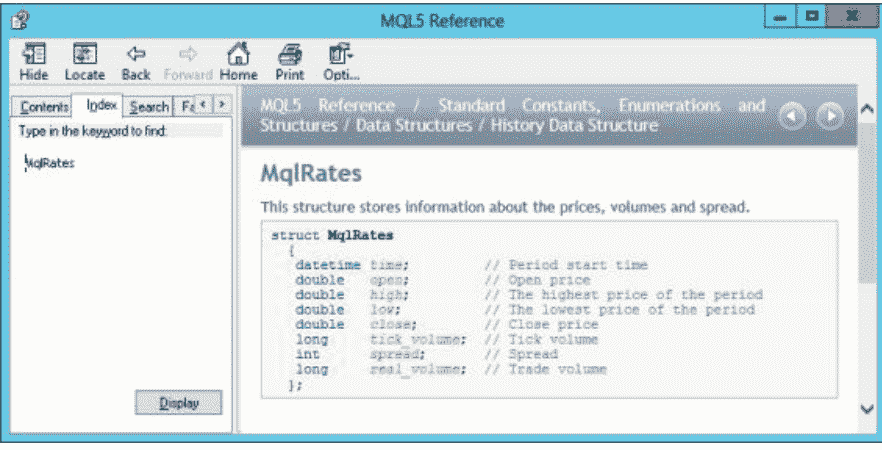

通过 `F1` 键，我们可以访问非常完整的 MQL5 语言文档。因此，当我们对任何内容产生疑问时应该始终使用它。

正如之前讨论过的，我们并不总是在交易时间内开发 EA，并且可能需要对代码进行一些**调试**，因此我们使用了 `OnTimer()`。

然而，在 `OnTimer()` 函数中，我们将添加以下代码：

```cpp
//+--------------------------+
//| 定时函数
//+--------------------------+
void OnTimer()
{
   //+--------------------------+
   Print("Open price = %s", candle[0].open);
   Print("Max price = %s", candle[0].high);
   Print("Close price = %s", candle[0].close);
   Print("Min price = %s", candle[0].low);
   Print("--------------------------");
   //+--------------------------+
}
```

让我们编译。现在进入 MetaTrader 并将 EA `Study_Var.ex5` 拖到图表上。然后在大“工具箱”中（如果没有显示，请转到“显示”菜单并打开它）并启用“专家”标签卡。

一旦机器人被添加到图表，我们可以注意到该标签卡每隔 2 秒就会执行一次 `OnTimer()` 函数及其内部的内容。在我们的情况下，我们看到了开盘价、最高价、收盘价和最低。

| 时间 | 来源 | 消息 |
|---|---|---|
| 2018.06.05 12:42:18.532 | Estudio_Var (BRPS5) | Prego Max = 24.93 |


| 时间 | 来源 | 消息 |
| --- | --- | --- |
| 2018.06.05 12:42:18.532 | Estudio_Var (BRPS5) | Prego close = 24.63 |
| 2018.06.05 12:42:18.532 | Estudio_Var (BRPS5) | Prego Min = 24.15 |
| 2018.06.05 12:42:18.537 | Estudio_Var (BRPS5) | Prego Open = 24.68 |
| 2018.06.05 12:42:19.537 | Estudio_Var (BRPS5) | Prego Max = 24.53 |
| 2018.06.05 12:42:20.537 | Estudio_Var (BRPS5) | Prego close = 24.63 |
| 2018.06.05 12:42:20.537 | Estudio_Var (BRPS5) | Prego Min = 24.03 |

我们正在获取位置为 `0` 的 K 线价格，也就是说，正在收集最当前 K 线的值。K 线可以代表任何时间图表，真正重要的是你的位置。我们可以选择任何所需的位置，我们只需要理解向量的顺序。下面是一个有助于理解这种理解的插图（需要注意的是，该插图仅在使用 `ArraySetAsSeries()` 对向量进行如所示排序后才有效）。

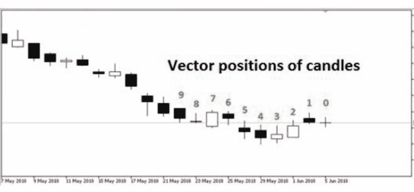

我们的 K 线向量只有 10 个位置，因为我们使用了 `CopyRates(_Symbol, _Period, 10, candles)` 函数。

我们可以让代码更轻松地选择 K 线的位置，此外还可以添加逐报价信息，如下所示：

现在让我们测试变量（`pos = 10`）的情况。我们选择了一个仅包含 10 个价格位置的向量，但我们正尝试访问编号为 11 的位置（记住从零开始）。因此代码将正常编译，但在 MetaTrader 中执行时，我们将得到以下错误消息：

| 时间 | 来源 | 消息 |
| --- | --- | --- |
| 2018.06.05 13:01:47.517 | Estudo_Var (AEBV2,D1) | array out of range in 'Estudo_Var.mq5' (59,32) |
| 交易 | 持仓 | 历史 | 新闻 | 邮箱 | 日历 | 公司 | 市场 | 警报 | 信号 | 库 | 专家 | 日期 |

我们遇到了数组越界错误。MetaTrader 还会告知在 `.mql` 文件中发生该错误的代码行数。

# 15. Comment 和 Alert()

通过使用一些实用函数，我们可以创建有助于理解的元素。

## 15.1. Comment()

使用一些实用函数可以创建理解所需的元素。让我们来看一个例子：

```cpp
void onTimer()
{
    //
    Comment("Open price = %s", candle[0].open);
    Comment("Max price = %s", candle[0].high);
    Comment("Close price = %s", candle[0].close);
    Comment("Min price = %s", candle[0].low);
}
```


我们使用 `Comment()` 来提供安全感。在“专家”标签卡中我们将观察到：

```cpp
void onTimer()
{
    //
    Comment("Open price = %s", candle[0].open);
    Comment("Max price = %s", candle[0].high);
    Comment("Close price = %s", candle[0].close);
    Comment("Min price = %s", candle[0].low);
}
```

| 描述 | 文件 |
| --- | --- |
| Estudo_Var.mq5 | |
| Estudo_Var.mq5 | |
| Estudo_Var.mq5 | |
| Estudo_Var.mq5 | |
| Estudo_Var.mq5 | |

## 15.2. Alert()

`Alert()` 函数会在屏幕中心显示一个警报框，供对声音警报感兴趣的用户。

```cpp
void onTimer()
{
    //
    Alert("Open price = %s", candle[0].open);
    Alert("Max price = %s", candle[0].high);
    Alert("Close price = %s", candle[0].close);
    Alert("Min price = %s", candle[0].low);
}
```


# 5.6. 添加 MQL5 指标

现在让我们转向制定投资策略时最常见且最重要的实践之一。你的投资策略很可能会使用某些指标，因此让我们学习如何调用指标。

最初，我们需要为指标声明变量。我们如何声明变量很大程度上取决于指标的类型和功能。

有些指标只提供一种信息，例如移动平均线。从移动平均线我们只获得一种信息，即图表中特定点的移动平均值。在这种情况下，我们说移动平均线只有一个内存缓冲区。每个指标至少一个句柄（Handle），它必须是整数类型。

```cpp
//--- 移动平均线
int ma_Handle; // 移动句句柄
double ma_Buffer[]; // 移动平均线缓冲区
/*
//+ Expert 初始化函数
//*/
int OnInit()
{
    ma_Handle = iMA(Symbol,Period,7.0,MODE_EMA,PRICE_CLOSE);

    if(ma_Handle<0)
    {
        Alert("创建指标句柄出错："+GetLastError(),"!**");
        return(-1);
    }

    // 将指标添加到图表上：
    ChartIndicatorAdd(0,0,ma_Handle);

    return(INIT_SUCCEEDED);
}
```

# MQL5 参考文档

MQL5 参考 / 技术指标 / IMA

输入请求以查找：

# IMA

该函数返回移动平均指标的句柄。它有一个缓冲区（buffer）。

```
int    symbol;                // 符号名称
int    TIMEFRAMES;         // 周期
int    price;                // 平均周期
int    MQL_MA_METHOD;      // 方法
int    MQL_APPLIED_PRICE;  // 价格类型或句柄
hint    handle;
```

参数

-   [symbol] 安全性名称，使用其数据来计算指标。该值表示当前符号。

period

在我们的案例中，我们使用了周期为 7 的移动平均，并应用简单平滑类型 (`MODE_SMA`) 到收盘价 (`PRICE_CLOSE`)。再次强调的是，每个指标都有其正常运行所需的特定参数结构。

在代码中加入代码以评估可能的变量加载错误总是友好的。在我们的案例中，如果变量 `ma_Handle` 出现问题，我们添加了 `Alert()`。这样做是因为该变量的正确运行对我们的机器人策略至关重要。然而，评估变量加载情况的习惯总是受到欢迎的。

对 `iRSI` 指标也可以执行相同的步骤。

我们使用 `ChartIndicatorAdd(0,0,ma_Handle)` 函数进行了初始声明并将指标添加到图表上。现在，我们需要将 `ma_Handle` 指向 `ma_Buffer[]` 向量，我们将从那里访问移动平均值。

要在 `OnTick()` 函数中实现这一点，我们必须调用 `CopyBuffer()` 函数。

```cpp
//++-
// 专家分时函数
//++-
void OnTick()
{
    // 将三维数据向量拷贝到缓冲区
    CopyBuffer(ma_Handle, 0,0,3,ma_Buffer);

    // 排序数据向量：
    ArraySetAsSeries(ma_fast_Buffer,true);
}
```

我们可以这样理解 `CopyBuffer()` 的结构：

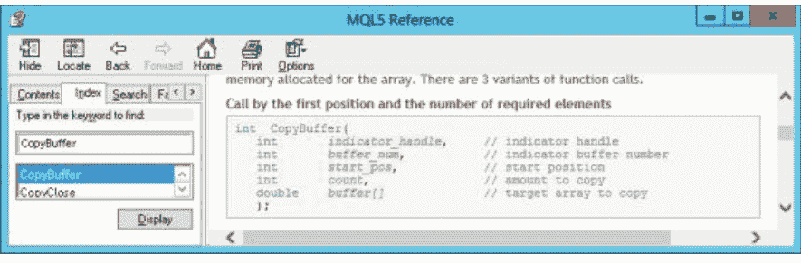

现在让我们来添加 RSI 指标。该指标也只有一个缓冲区。如果你对每个指标的缓冲区数量有疑问，只需按 `F1` 键查看文档并查找 `#property indicator_buffers`：

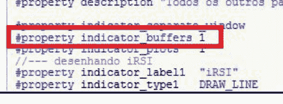

以下是添加两个指标（移动平均和 RSI）的代码。注意，RSI 指标的 `iRSI()` 函数的输入参数与 `iMA()` 函数非常不同：

```cpp
//--- 移动平均线
int ma_Handle;      // 移动平均句柄
double ma_Buffer[]; // 移动平均缓冲区

//--- RSI
int rsi_Handle;     // RSI 句柄
double rsi_Buffer[];  // RSI 缓冲区

//| 专家初始化函数
int OnInit()
{
    int ma_Handle = IMA(Symbol, Period, 7, NODE_EMA, PRICE_CLOSE);
    double rsi_Buffer = iRSI(Symbol, Period, 3, PRICE_CLOSE);
    if (ma_Handle<0 || rsi_Handle<0)
    {
        Alert("创建指标句柄出错 - 错误代码: " + GetLastError(),"!");
        return(-1);
    }
    // 将指标添加到图表上：
    ChartIndicatorAdd(0,0,ma_Handle);
    ChartIndicatorAdd(0,1,rsi_Handle);
    return(INIT_SUCCEEDED);
}

//| 专家去初始化函数
void OnDeinit(const int reason)
{
    IndicatorRelease(ma_Handle);
    IndicatorRelease(rsi_Handle);
}
```

```cpp
53 //+------------------------------------------------+
54 //| 专家分时函数
55 //+------------------------------------------------+
56 void OnTick() {
57 {
58 //+------------------------------------------------+
59     // 将三维数据向量拷贝到缓冲区
60 CopyBuffer(ma_Handle,0,0,3,ma_Buffer);
61 CopyBuffer(rsi_Handle,0,0,3,rsi_Buffer);
62 
63 // 排序数据向量：
64 ArraySetAsSeries(ma_fast_Buffer,true);
65 ArraySetAsSeries(rsi_Buffer,true);
66 
67 Print("ma_Buffer = ", ma_Buffer[0]);
68 Print("rsi_Buffer = ", rsi_Buffer[0]);
69 Print("===============================================");
70 
71 }
```

最后，我们已经完全具备开始编写投资机器人所需的最小信息。让我们进入下一章！

# 第 6 章

## b. 编写 EA

现在我们已经知道了 MetaTrader 的主要功能，并理解了 MQL5 语言特征的基础以及 MetaEditor 的使用，我们已经做好了基本的准备，开始开发我们的投资机器人（专家交易系统 - EA）。

在开始编程之前，让我们了解并理解我们 EA 策略的细节。

### i.1. 策略概述

我们的 EA 策略将使用移动平均线和 RSI。在趋势市场中，我们将使用移动平均线来识别方向。在横盘市场中，我们将使用 RSI 来识别超买和超卖状态。

用户可以在以下选项中选择交易信号来源：基于移动平均线加 RSI、仅基于移动平均线或仅基于 RSI。

### i.1.1. 移动平均线

首先我们有快平均线和慢平均线。快平均线是周期最短的那个；相反，慢平均线应该具有最长的周期。我们之所以命名为平均线是因为快平均线的周期较短，移动速度比长周期的快。让我们看看这些触发器如何工作的示意图：

### i.1.2. 相对强度指数 (RSI)

MetaTrader 中的 RSI 指标（相对强度指数）指的是震荡器，也就是说，它对于指示超买和超卖位置很有用。我们不会详细介绍 RSI 背后的计算，因为这不是目前的目标。下图显示了 RSI 以及位于 30 和 70 的两个主要水平（实线）。这些线中的每一条都代表了超买（70）和超卖（30）水平。换句话说，在震荡整合市场中，当 RSI 等于或大于 70 线时，它可能是一个反转警告，警告超买，这是一个卖出的好机会。相反，如果 RSI 再次在震荡市场中小于或等于 30 线，我们处于超卖区域，表示买入的好时机。

在我们的 EA 中，我们将允许用户更改 70（超买）和 30（超卖）这些水平。这样你可以为买入和卖出选择更宽松的限制水平。现在让我们设定一个例子，买入触发水平在 30 线，卖出触发水平在 70 线：

因此，我们对为 EA 编写所需的策略元素进行总结：

1. 我们必须添加两条移动平均线（快线和慢线），两者都允许选择周期、平均应用价格和所使用的平均方法。
2. 我们必须添加 RSI 指标，并允许选择周期、应用价格以及超卖和超买水平。
3. 用户可以在以下选项中选择交易信号来源：基于移动平均线加 RSI、仅基于移动平均线或仅基于 RSI。

现在我们已经知道了这两个指标（均线交叉和 RSI）的买卖操作方法，我们准备好根据所提出的策略开始开发算法了。

## i.2. 创建 EA

让我们打开 MetaEditor 并让向导创建一个新的专家交易系统（EA）。我们将其命名为：`MM_CROS_RSI.mq5`。

如果你想获取该机器人的完整源代码，可以访问 GitHub 页面 `https://github.com/rafaelfvcs` 或向 `rafaelfvcs@gmail.com` 发送电子邮件。不过，强烈建议你手动输入所展示的代码，以逐渐记忆 MetaEditor 函数和特性的。

这里是我们的 EA 骨架：


# MM_CROS_IFR.mq5 文档

## 1. 文件头部信息

```cpp
//+------------------------------------------------------------------+
//|                                              Copyright 2018.     |
//|                                     https://www.mq5.com          |
//+------------------------------------------------------------------+
//#property copyright "Copyright 2018."
//#property link      "https://www.mq5.com"
//#property version   "1.00"
//+------------------------------------------------------------------+
```

## 2. 核心事件处理函数框架

```cpp
//+------------------------------------------------------------------+
//| Expert initialization function                                   |
//+------------------------------------------------------------------+
int OnInit()
{
    return(INIT_SUCCEEDED);
}

//+------------------------------------------------------------------+
//| Expert deinitialization function                                 |
//+------------------------------------------------------------------+
void OnDeinit(const int reason)
{
}

//+------------------------------------------------------------------+
//| Expert tick function                                             |
//+------------------------------------------------------------------+
void OnTick()
{
}
```

## 3. 全局变量声明

我们将用户可修改的变量与用于 EA 算法结构的变量隔离开来。

### 3.1 用户变量 (输入参数)

提供以下选项：利润目标、止损、交易手数、图表时间周期、平均线周期、RSI 周期、平均线和 RSI 在处理中的应用方法（开启、关闭、最大值、最小值）、操作中入场触发策略的选择范围（移动平均线加 RSI、仅交叉、仅 RSI）以及关闭未开仓位的时间限制。

#### 3.1.1 策略枚举定义

需在算法顶部、输入变量上方声明：

```cpp
enum STRATEGY_IN
{
    ONLY_MA,      // 仅移动平均线
    ONLY_RSI,     // 仅 RSI
    MA_AND_RSI    // 移动平均线加 RSI
};
```

#### 3.1.2 输入参数代码

```cpp
// Variables Input
//----------------------Strategy-------
input string s0;                    // 交易入场策略分隔符
input STRATEGY_IN strategy;         // 入场策略选择

//----------------------Moving Averages-----------------
input string s1;                    // 移动平均分隔符
input int ma_fast_period = 12;      // 快速移动平均周期
input int ma_slow_period = 32;      // 慢速移动平均周期
input ENUM_TIMEFRAMES ma_time_graphic = PERIOD_CURRENT; // 图表时间周期
input ENUM_MA_METHOD ma_method;     // 平均线方法
input ENUM_APPLIED_PRICE ma_price = PRICE_CLOSE; // 应用价格

//----------------------RSI----------------------
input string s2;                    // RSI 分隔符
input int rsi_period = 14;          // RSI 周期
input ENUM_TIMEFRAMES rsi_time_graphic = PERIOD_CURRENT; // 图表时间周期
input ENUM_APPLIED_PRICE rsi_price = PRICE_CLOSE; // 应用价格

input int rsi_overbought = 70;      // 超买水平
input int rsi_oversold = 30;        // 超卖水平

//----------------------Money Management----------------------
input string s3;                    // 资金管理分隔符
input double num_lots = 0.1;        // 手数
input double TR = 60;               // 止盈
input double SL = 30;               // 止损

//----------------------Time Control----------------------
input string s4;                    // 时间控制分隔符
input string limit_close_op = "17:40"; // 平仓时间限制
```

### 3.2 算法全局变量

```cpp
//------------------------------------------------------
// 指标变量
//------------------------------------------------------
// 移动平均线
// FAST - 短周期
int ma_fast_Handle;      // 快速移动平均句柄
double ma_fast_Buffer[]; // 快速移动平均线缓冲区

// SLOW - 长周期
int ma_slow_Handle;      // 慢速移动平均线句柄
double ma_slow_Buffer[]; // 慢速移动平均线缓冲区

// RSI
int rsi_Handle;          // RSI 句柄
double rsi_Buffer[];     // RSI 缓冲区

//------------------------------------------------------
// 函数变量
//------------------------------------------------------
int magic_number = 123456; // 魔术数

MqlRates candle[];      // K线变量
MqlTick tick;           // 报价变量
```

## 4. OnInit() 函数

在 `OnInit()` 函数中，我们将初始化变量并使用 `ChartIndicatorAdd()` 函数将其添加到图表上。

```cpp
//--- 专家初始化函数
int OnInit()
{
    // 初始化移动平均线指标
    ma_fast_Handle = iMA(_Symbol, ma_time_graphic, ma_fast_period, 0, ma_method, ma_price);
    ma_slow_Handle = iMA(_Symbol, ma_time_graphic, ma_slow_period, 0, ma_method, ma_price);

    // 初始化 RSI 指标
    rsi_Handle = iRSI(_Symbol, rsi_time_graphic, rsi_period, rsi_price);

    // 检查句柄创建是否成功
    if(ma_fast_Handle == INVALID_HANDLE || ma_slow_Handle == INVALID_HANDLE || rsi_Handle == INVALID_HANDLE)
    {
        Alert("创建指标句柄错误: ", GetLastError(), "!");
        return(INIT_FAILED);
    }

    // 设置 K 线数组为时间序列
    ArraySetAsSeries(candle, true);

    // 将指标添加到图表
    // 参数 (0, 0) 表示主图窗口 (K线图)
    ChartIndicatorAdd(0, 0, ma_fast_Handle);
    ChartIndicatorAdd(0, 0, ma_slow_Handle);
    // 参数 (0, 1) 表示副图窗口 (指标单独窗口)
    ChartIndicatorAdd(0, 1, rsi_Handle);

    return(INIT_SUCCEEDED);
}
```

> **注意**：`ChartIndicatorAdd(0, 0, handle)` 使用相同的子窗口索引 `0`，意味着两条移动平均线将绘制在主图（K线图）上。而 `ChartIndicatorAdd(0, 1, rsi_Handle)` 的索引 `1` 表示 RSI 将被添加到单独的指标子窗口中。

## 5. OnDeinit() 函数

当 EA 被移除时，需要释放指标句柄并清理资源。`OnDeinit()` 函数在机器人移除时被调用。

```cpp
//--------------------------------------+
//| 专家去初始化函数                     |
//--------------------------------------+
void OnDeinit(const int reason)
{
    // 释放指标句柄
    IndicatorRelease(ma_fast_Handle);
    IndicatorRelease(ma_slow_Handle);
    IndicatorRelease(rsi_Handle);
}
```

### 5.1 运行效果预览

将编译生成的 `MM_CROS_RSI.ex5` 拖入 MetaTrader 图表中，参数设置界面如下：

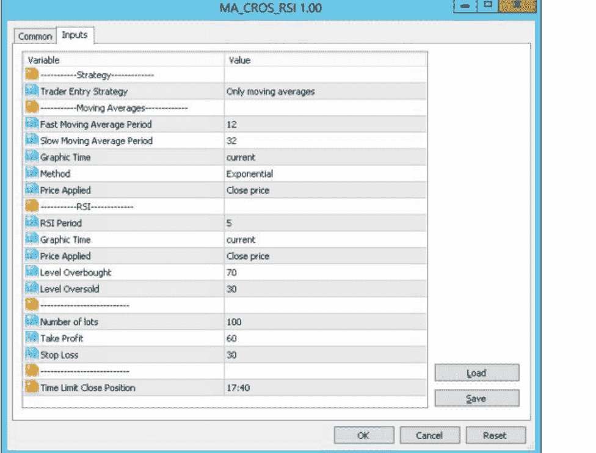

点击 OK 后，指标添加到图表。若自动交易按钮开启，EA 将显示在图表右上角。

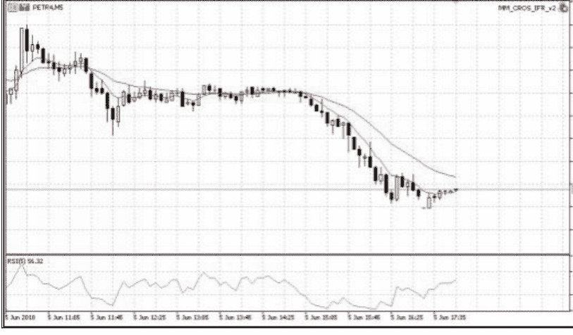

## 6. 专家顾问辅助函数 (EA Functions)

为 EA 运行创建一些有用且重要的函数。

### 6.1 判断新 K 线生成 `isNewBar()`

MQL5 中没有原生函数准确评估 K 线变化，需手动创建。当图表出现新 K 线时，该函数返回 `true`。

```cpp
//--- USEFUL FUNCTIONS
//--- for bar change
bool isNewBar()
{
    // 静态变量记录上一根 K 线开盘时间
    static datetime last_time = 0;
    
    // 获取当前品种、周期的最后一根 K 线开盘时间
    datetime lastbar_time = (datetime)SeriesInfoInteger(_Symbol, _Period, SERIES_LASTBAR_DATE);

    // 首次调用
    if (last_time == 0)
    {
        last_time = lastbar_time;
        return(false);
    }

    // 时间不同，说明有新 K 线生成
    if (last_time != lastbar_time)
    {
        last_time = lastbar_time;
        return(true);
    }

    // 非新 K 线
    return(false);
}
```

### 6.2 可视化辅助函数 `drawVerticalLine()`

用于在图表绘制垂直线，标记策略触发点。MQL5 允许最后一个参数设置默认值（如 `color = clrAliceBlue`），调用时可省略该参数。

```cpp
//--- FUNCTIONS TO ASSIST IN THE VISUALIZATION OF THE STRATEGY
//---
void drawVerticalLine(string name, datetime dt, color clr = clrAliceBlue)
{
    ObjectDelete(0, name);                              // 删除同名对象
    ObjectCreate(0, name, OBJ_VLINE, 0, dt, 0);         // 创建垂直线
    ObjectSetInteger(0, name, OBJPROP_COLOR, clr);      // 设置颜色
}
```

### 6.3 交易执行函数：使用 `MqlTradeRequest` 与 `MqlTradeResult`

我们需要在每次触发启动时发送买入或卖出订单。虽然可使用 `CTrade` 类处理订单，但这里选择使用底层结构体 `MqlTradeRequest` 发送请求，并接收 `MqlTradeResult` 响应。

`MqlTradeRequest` 包含执行交易操作所需的所有字段。

```cpp
// 示例：发送订单的基本结构 (伪代码逻辑)
/*
MqlTradeRequest request = {0};
MqlTradeResult result = {0};

request.action = TRADE_ACTION_DEAL;
request.symbol = _Symbol;
request.volume = num_lots;
request.type = ORDER_TYPE_BUY; // 或 ORDER_TYPE_SELL
request.price = SymbolInfoDouble(_Symbol, SYMBOL_ASK); // 买入价
request.sl = SL > 0 ? request.price - SL * _Point : 0; // 止损
request.tp = TR > 0 ? request.price + TR * _Point : 0; // 止盈
request.magic = magic_number;
request.comment = "EA_MM_CROS_RSI";
request.type_filling = ORDER_FILLING_FOK;

if(!OrderSend(request, result))
{
    Print("OrderSend failed: ", GetLastError());
}
*/
```


# MQL5 交易结构与函数详解

## 交易请求结构 `MqlTradeRequest`

```cpp
struct MqlTradeRequest {
  ENUM_TRADE_REQUEST_ACTIONS action; // Trade operation type
  long magic;         // Expert ID (magic number)
  long order;         // Order ticket
  string symbol;      // Trade symbol
  double volume;      // Requested volume for the deal in lots
  double price;       // Price
  double stoploss;    // Stop loss of the order
  double takprofit; // Take profit
  int deviation;     // Price deviation from the requested price
  ENUM_ORDER_TYPE_FILLING type; // Order type
  ENUM_ORDER_TYPE_TIME filling; // Order execution type
  long time;          // Order execution time (for the orders ORDER_TIME_SPECIFIED type)
  string comment;     // Order comment
};
```

## 交易结果结构 `MqlTradeResult`

`MqlTradeResult` 用于任何交易操作。声明此变量可以访问交易请求的结果。

```cpp
struct MqlTradeResult {
  uint code;           // Operation return code
  long deal;           // Deal ticket, if it is performed
  long order;          // Order ticket, if it is placed
  double deal;        // Deal price, confirmed by broker
  double price;       // Current price
  double asr;         // Current ask price
  string comment;     // Comment to operation (by default it is filled by the operation description)
};
```

通过这些结构，我们可以界定我们感兴趣的订单类型，并指定其细节。请求和响应变量可以使用在名为 `OrderSend()` 的订单发送函数中。

## 市价买入函数示例（FOK 成交类型）

下面是一个创建用于以 FOK 成交类型（立即成交或取消，完全成交订单大小）发送市价买入订单的函数：

```cpp
// BUY TO MARKET
bool BuyMarket() {
   MqlTradeRequest request;
   MqlTradeResult response;
   ZeroMemory(request);
   ZeroMemory(response);
   MqlTick tick;
   if(!SymbolInfoTick(_Symbol, tick)) return false;
   request.action = TRADE_ACTION_DEAL;
   request.magic = 12345;
   request.symbol = _Symbol;
   request.volume = 0.1;
   request.price = tick.ask;
   request.stoploss = NormalizeDouble(tick.ask - 100, _Digits);
   request.takprofit = NormalizeDouble(tick.ask + 100, _Digits);
   request.deviation = 10;
   request.type = ORDER_TYPE_BUY;
   request.filling = ORDER_FILLING_FOK;
   request.comment = "Buy Order";
   if(OrderSend(request, response) == 10000) {
      Print("Order Buy executed successfully!");
   } else {
      Print("Error sending Order to Buy. Error = %d", GetLastError());
   }
   ResetLastError();
   return true;
}
```

## 订单类型选择

选择的动作类型是我们赋值的第一个：

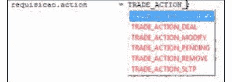

我们有多种订单类型。我们可以从以下中选择：

```cpp
requisicao.type = ORDER_TYPE
ORDER_TYPE_BUY
ORDER_TYPE_BUY_LIMIT
ORDER_TYPE_BUY_STOP
ORDER_TYPE_BUY_STOP_LIMIT
ORDER_TYPE_CLOSE_BY
ORDER_TYPE_FILLING
ORDER_TYPE_SELL
ORDER_TYPE_SELL_LIMIT
```

## 卖出函数逻辑

在这种情况下，我们的止损位位于买入价之上 `NormalizeDouble(tick.bid + 100, _Digits)`，获利目标自然位于下方 `NormalizeDouble(tick.bid - 100, _Digits)`。

我们还需要创建两个函数，在达到用户选择的时间限制时关闭开仓订单。这是因为我们的机器人是日内交易，我们不希望持有仓位。记住确保关闭开仓订单我们有一个用户选择的“限制平仓”变量。

所以，为了完成销售，我们必须买入；为了完成购买，我们必须卖出。

我们可以注意到，对于 `CloseBuy()` 函数，`request.type_filling = ORDER_FILLING_RETURN`，这是因为我们希望独立于最佳买入或卖出价格关闭订单。正如我们知道，这种填充类型（`ORDER_FILLING_RETURN`）会执行订单，直到达到手数数量限制。

```cpp
323 void CloseSell() {
324     {
325     MqlTradeRequest request;      // request;
326     MqlTradeResult response;      // response;
327
328     ZeroMemory(request);
329     ZeroMemory(response);
330
331     //--- For Buy Order
332     request.action = TRADE_ACTION_DEAL;
333     request.magic = magic_number;
334     request.symbol = Symbol;
335     request.volume = num_lots;
336     request.price = 0;
337     request.type = ORDER_TYPE_BUY;
338     request.type_filling = ORDER_FILLING_RETURN;
339     //-
340     OrderSend(request, response);
341
342     //-
343     if(response.retcode == 10008 || response.retcode == 10009) 
344         Print("Order Buy successfully!!");
345     else
346         Print("Error sending Order to Buy. ", GetLastError());
347         ResetLastError();
348 }
```

## 错误处理

处理发送订单的返回结果总是好的。因为我们这样可以最小化问题并评估执行错误。在我们的函数中，通过 `response.retcode` 获取来自经纪商服务器的代码（5位数）。可以通过代码 10008 或 10009 查看这些代码的详情窗口。

### 服务器返回代码

所有执行交易操作的请求都以 `MTradeRequest` 结构的形式发送。执行结果放在 `MTradeResult` 结构中，其 `retcode` 字段包含服务器返回代码。

| 代码 | 常量 | 描述 |
|---|---|---|
| 10004 | TRADE_RETCODE_QUOTE | 重新报价 |
| 10006 | TRADE_RETCODE_REJECT | 请求被拒绝 |
| 10007 | TRADE_RETCODE_CANCEL | 交易员取消 |
| 10008 | TRADE_RETCODE_PLACED | 订单已下单 |
| 10009 | TRADE_RETCODE_DONE | 请求完成 |
| 10010 | TRADE_RETCODE_DONE_PARTIAL | 部分请求完成 |
| 10011 | TRADE_RETCODE_ERROR | 请求错误 |
| 10012 | TRADE_RETCODE_TIMEOUT | 超取消 |
| 10013 | TRADE_RETCODE_INVALID | 无效请求 |

## 函数 `OnTick()`

现在的目标是为 EA 准备函数。我们已经准备好了操作所需的函数。在 `OnTick()` 函数中，每当交易所执行新的业务时就会调用，我们将在其中编写策略主体。

首先，我们必须填充我们的 K 线、报价和指标变量的数据。此外，不要忘记使用 `ArraySetAsSeries()` 对它们进行排序：

```cpp
116 // 将三维数据向量拷贝到缓冲区
117 CopyBuffer(ma_fast_Handle,0,0,4,ma_fast_Buffer);
118 CopyBuffer(ma_slow_Handle,0,0,4,ma_slow_Buffer);
119
121 CopyBuffer(rsi_Handle,0,0,4,rsi_Buffer);
122
123 -- 填充 K 线缓冲区数据：
124 CopyRates(Symbol_,Period,0,4,candle);
125 ArraySetAsSeries(candle,true);
126
127 // 排序向量：
128 ArraySetAsSeries(ma_fast_Buffer,true);
129 ArraySetAsSeries(ma_slow_Buffer,true);
130 ArraySetAsSeries(rsi_Buffer,true);
131
132 --
133 // 填充 tick 变量数据
134 SymbolInfoTick(Symbol_,tick);
```

此后，我们可以利用这些变量来构建 EA 的买入和卖出逻辑。遵循交叉条件：

### 交叉条件


在 MQL5 语言中是：

| 行号 | 代码 |
|---|---|
| 135 | // 激活买入的逻辑 |
| 136 | bool buy_ma_cros = ma_fast_Buffer[0] > ma_slow_Buffer[0] && |
| 137 | ma_fast_Buffer[2] < ma_slow_Buffer[2]; |
| 138 | |
| 139 | bool buy_rsi = rsi_Buffer[0] <= rsi_oversold; |
| 140 | |
| 141 | // 激活卖出的逻辑 |
| 142 | bool sell_ma_cros = ma_slow_Buffer[0] > ma_fast_Buffer[0] && |
| 143 | ma_slow_Buffer[2] < ma_fast_Buffer[2]; |
| 144 | |
| 145 | bool sell_rsi = rsi_Buffer[0] >= rsi_overbought; |

我们必须创建一个逻辑来使用枚举（STRATEGY）。我们需要卖出和买入触发器面向此枚举中描述的：`ONLY_MA`（仅移动平均线）、`ONLY_RSI`（仅 RSI）和 `MA_AND_RSI`（移动平均线加 RSI）。这是一个可能的解决方案：

```cpp
148 bool Buy = false; // 可以买入吗？
149 bool Sell = false; // 可以卖出吗？
150
151 if(strategy == ONLY_MA) {
152     Buy = buy_ma_cros;
153     Sell = sell_ma_cros;
154 }
155 else if(strategy == ONLY_RSI) {
156     Buy = buy_rsi;
157     Sell = sell_rsi;
158 }
159 else if(strategy == MA_AND_RSI) {
160     Buy = buy_ma_cros || buy_rsi;
161     Sell = sell_ma_cros || sell_rsi;
162 }
```

```cpp
// 检查是否有新 K 线
bool newBar = IsNewBar();
// 当有新 K 线时执行
if (newBar) {
    // 买入逻辑
    if (buy_ma_cros || buy_rsi) {
        OrderBuy();
    }
    // 卖出逻辑
    if (sell_ma_cros || sell_rsi) {
        OrderSell();
    }
}
```

# 在 MetaTrader 中进行回测

打开 MetaTrader，转到导航器 -> **智能终端 (Expert Advisor)** 顾问，并寻找我们最新的 EA。找到后，我们应该对它点击右键，然后点击**测试 (Test)**。

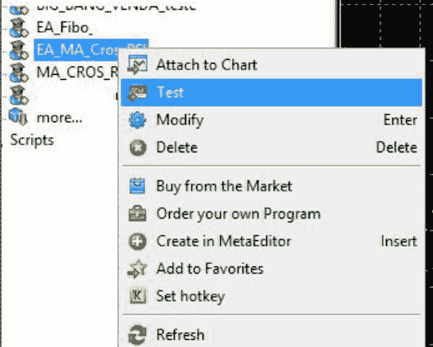

这将为 MetaTrader 提供一个名为**策略测试器 (Strategy Tester)** 的新字段，在设置选项卡中，我们有以下功能面板：

| 专家 | EA_MA_Cross_RSIv5 | PETR4 | M5 |
|---|---|---|---|
| 日期自定义周期 | 2015.01.23 | 2016.06.11 | |
| 前向 | 否 | | |
| 执行 | 无延迟 | 1 分钟 OHLC | |
| 存款 | 10000 USD | 1:1 | 可视化 |
| 优化 | 已禁用 | 余额指数 | |
| 测试进度： | | | |

通过这些功能，我们能够选择用于回测的金融资产：

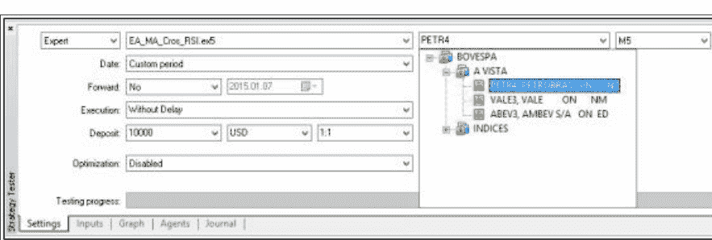

## 图形时间

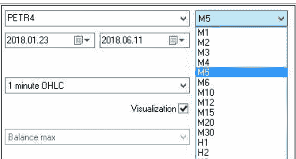

我们可以选择 MetaTrader 如何模拟**我们的蜡烛线的形成**。

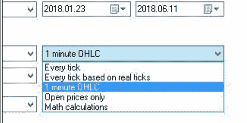

对于这种以 K 线生成价格的方式，让我们进入最常用的主选项：

- **每个分跳或基于真实分跳的每个分跳**：MetaTrader 尝试在 K 线的形成中模拟真实的价格跳动。此选项让回测更准确，但在 K 线内部，MetaTrader 会尝试重现真实分跳的形成，这需要更多的计算资源。值得注意的是，分跳并非真实，只是一个模拟（对现实的可能表示）。本文澄清了模拟的原理：https://www.mql5.com/en/articles/75。

- **1 分钟 OHLC**：在这种类型的 K 线形成中，MetaTrader 只生成 4 个价格值：O - 开盘价、H - 高价、L - 低价、C - 收盘价。与分跳选项相比，此选项需要的计算资源较少。

- **仅开盘价**：计算成本最低，因为它只使用一个价格来代表 K 线。

在回测中，我们将始终将“前向 (Forward)”选项标记为“否”（见下所示）。此选项在我们进行策略优化并希望使用诸如走向前分析 (WFA) 等优化方法时非常有用。这类研究超出了本书的范围。如果你想了解更多信息，可以购买另一本电子书（《如何在 MetaTrader 5 中正确优化投资机器人[4]》）。

| 专家 | EA_MA_Cross_RSI.ex5 |
|---|---|
| 日期：自定义周期 | |
| 前向：否 | 2015.01.07 |
| 执行：无延迟 | |
| 存款：10000 USD 1:1 | |
| 优化：已禁用 | |


# 回测执行与分析

## 执行类型与延迟设置

带延迟或不带延迟的执行类型非常有趣，因为我们可以模拟服务器所在的环境以及我们互联网的速度。延迟是指路由订单以正确执行所需的时间。

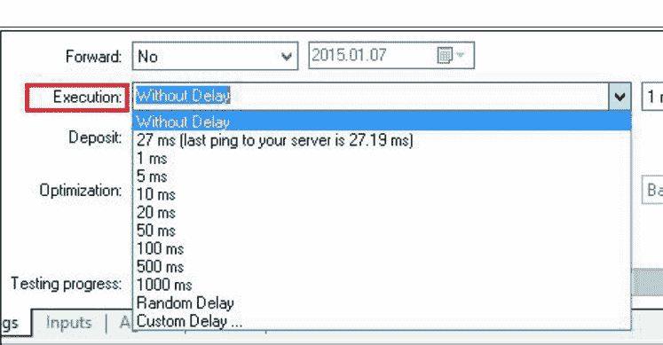

我们有从初始存款选择金融产品的能力，以及使用杠杆投资的可能性（例如下方的 1:1 - 无杠杆）。

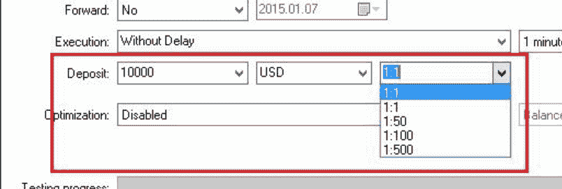

对于我们的回测，**优化** 字段应该是禁用的。

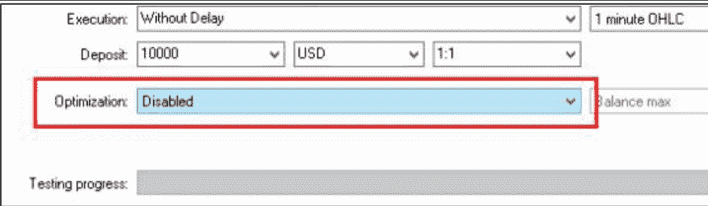

我们应该为回测选择数据段。

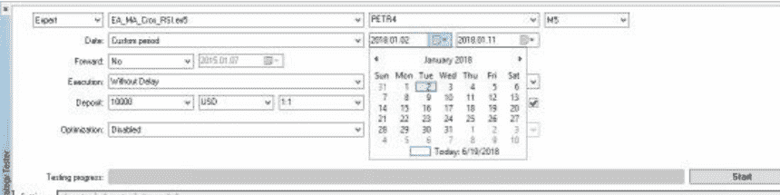

并勾选查看回测的选项：

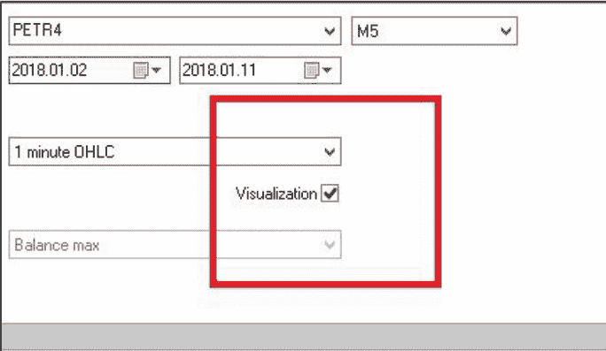

## 策略测试器参数设置

现在让我们进入策略测试器的**输入** 选项卡。

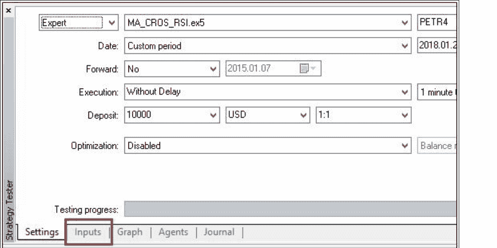

在此字段中，我们可以放置实现回测所需的设置。目前，我们感兴趣的只是高亮显示的“值”列。其他列（绿色高亮）用于 EA 优化。

| | 值 | 开始 | 步长 |
|---|---|---|---|
| -策略- | | 仅移动平均线 | 移动平均线加... |
| -移动平均线- | | | 120 | 120 |
| -快速移动平均线周期 | | 32 | 1 | 120 |
| -慢速移动平均线周期 | | 32 | 1 | 1个月 |
| -图形时间 | | 当前价格 | | 加权 |
| -应用价格 | | 收盘价 | | 加权 |
| -RSI 周期 | | 当前价格 | | 50 |
| -图形时间 | | 收盘价 | | 1个月 |
| -超买水平 | | 70 | | 加权 |
| -超卖水平 | | 30 | | 700 |

在**代理** 选项卡中，我们有关于执行回测和优化所需的计算能力的信息。回测通常是很便宜的。但是，当我们进行优化（大量回测）时，我们需要大量的资源，因此此代理选项卡对我们非常重要。我们可以使用多核来增加功率。只需几美元即可进行数千次优化。在正确设置回测参数后，只需回到设置选项卡并点击开始。

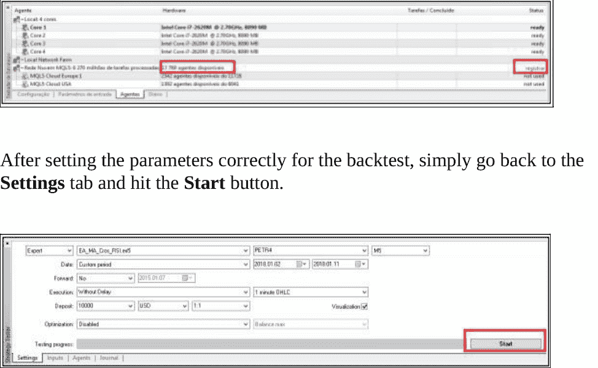

## 2. 分析回测

一旦你点击开始，就会出现以下窗口：


我们有一个屏幕来可视化回测正在发生什么。我们可以控制出现新 K 线（蜡烛线）的速度，图中是每根 K 线（红色/绿色显示）。只需将鼠标悬停在所需的元素上即可。我们有交易、历史、操作等四个选项卡来跟踪我们 EA 的记录。在**操作** 选项卡中，我们跟踪每笔交易。有用的是，我们可以点击操作中的某项，图表会自动显示该操作。我们可以快速看到盈利（绿色）和亏损（红色）操作。

| 时间 | 订单 | 资产 | 类型 | 价格 | S/L | T/P | 收益 | 备注 |
|---|---|---|---|---|---|---|---|---|
| 2023-03-18 17:48:09 | | 卖 | 100.00 | 100.00 | | | | |
| 2023-03-18 16:25:40 | | 买 | 100.00 | 17.05 | 17.25 | | | |
| 2023-03-18 15:43:20 | | 买 | 100.00 | 16.00 | 18.03 | | | |
| 2023-03-18 11:45:00 | | 买 | 100.00 | 17.12 | 17.47 | | | |
| 2023-03-18 09:22:15 | | 卖 | | | | | | -1.00 |

最后，操作选项卡显示了每个特定交易的进度。我们有入场价格、可用保证金以及交易进展的信息（无论是盈利还是亏损）。

| 时间 | 订单 | 资产 | 类型 | 数量 | 价格 | S/L | T/P | 收益 | 备注 |
|---|---|---|---|---|---|---|---|---|---|
| 2023-03-18 13:50:40 | | | 等待 | | 18.35 | | 成交 | 18.35 |
| 2023-03-18 14:13:40 | | | 等待 | | 18.25 | 17.31 | 成交 | 18.50 |
| 2023-03-18 14:27:20 | | | 买 | | 17.02 | 17.17 | 成交 | |
| 2023-03-18 15:16:00 | | | 买 | | 17.02 | 16.02 | 成交 | 17.34 |
| 2023-03-18 15:43:20 | | | 买 | | 17.00 | 17.01 | 成交 | |
| 2023-03-18 16:05:00 | | | 买 | | 17.00 | 16.00 | 成交 | |
| 2023-03-18 16:25:40 | | | 买 | 100.00 | 17.05 | | 17.25 | | |
| 2023-03-18 17:10:10 | | | 等待 | | 17.00 | 17.12 | 17.47 | | 1.8 | tp 17.37 |
| 2023-03-18 17:48:09 | | | 卖 | 100.00 | 100.00 | | | | | -1.00 |
| 票据 | | | 类型 | 数量 | 价格 | S/L | T/P | 收益 | 备注 |
|---|---|---|---|---|---|---|---|---|---|
| 卖出: 100 051.00 资金: 100 051.02 空闲保证金: 542.00 保证金亏损: 96.00 保证金比例: 106.78% | | | | | 0.00 | | | | |

## 3. 性能图表

在回测期间或结束后，我们可以在策略测试器中出现的“图表”标签页跟踪资金的演变。


之后，在回测结束时会出现一个名为“回测”的新标签页。该标签页提供了策略运行统计的摘要。在这里，我们可以看到交易利润（总利润与总亏损之间的比例）、恢复因子、回撤或收缩、总交易次数、空头头数量以及买入的盈亏、夏普比指数等。

| 历史质量 | 91% | | 1 | |
|---|---|---|---|---|
| 柱状 | 8733 | 交易代码 | 173527 | 其他 | |
| 初始资金 | 100.000,00 | 余额绝对回撤 | 净资产绝对最大值... | 100.00 (0%) |
| 总净利润 | 520,00 | 余额最大回撤 | 181.18 (0.1%) | 净资产最大回撤 | 100.00 (0%) |
| 总利润 | -625,00 | 余额相对回撤 | 0.18 (18.0%) | 净资产相对回撤 | 0.25 (25%) |
| 总亏损 | | 0,83 | 期望暴露 | -0.66 | 保证金水平 | 3649.16 |
| 获利因子 | | 0,53 | 夏普比指数 | -0,07 | Z-源 | | 127 (79.50%) |
| 恢复因子 | 1.0000 (0%) | | | -0,00 | 测试结果 | | |
| GPHR | 1.0000 (0%) | | | 36.66 | | |
| 总交易次数 | 160 | 空头头寸 (收益 7%) | 0 (00%) | 多头头寸 (损失 7%) | 140 (26%) |
| 总报价 | 320 | 盈利交易 (占总数 7%) | 33 (20.6%) | 亏损交易 (占总数) | 127 (79.38%) |
| | 最大 | | 20,00 | 交易亏损 | | -5,00 |
| | 平均 | | 15,78 | 交易亏损 | | -4,02 |
| | 最大 | | 3,08 (00) | 最大连续盈利 (5) | | 15 (73,00) |
| | 最大值 | | 41,00 (3) | 连续亏损 (计数) | | -73,00 (15) |
| | 平均 | | | 连续盈利 | 连续亏损 | | 4 |

我们可以通过柱状图直观看到交易中入场最多的时间段、星期和月份。

你可以跟踪盈亏的频率：按 EA 运行时间、星期几和全年月份。我们还拥有关于设置的最时间和持仓最小持续时间的信息。

然而，正如我们所看到的，MetaTrader 5 为我们提供了对回测非常详尽的审查。


---

恭喜到达这里！！感谢你阅读本电子书。对于翻译中的问题深表歉意。欢迎随时对电子书中的文字和主题提交建议、批评。

现在你已经能够创建自己的第一个 EA 并进行回测，这意味着你开启了学习更复杂策略的新旅程。请记住，书中教授的 EA 仅供演示之用，不提供任何实际投资建议。

如果你想了解其他教学风格类似的书籍，可以查看以下：

- 如何在 MQL5 中创建指标和脚本（分步教程）。
- 如何在 MetaTrader 5 中正确优化投资机器人。

如果你对其中任何一本书感兴趣，请通过电子邮件与我联系：`rafaelfvcs@gmail.com`。

这些材料是专门为亲爱的读者编写的。我们要记住，我们都是受到批评或赞扬驱动的。如果这本书对你有任何帮助，无论你是否喜欢教学风格，请在亚马逊商店留下评论。这种态度对于未来版本变得更好至关重要。

非常感谢！

- [1] 注意：本电子书包含的信息不代表或提供任何投资建议和预期。
- [2] [比尔·威廉（交易员）](https://en.wikipedia.org/wiki/Bill_Williams_(trader))
- [3] 更多信息请发送邮件：`rafaelfvcs@gmail.com`。
- [4] 同作者（`rafaelfvcs@gmail.com`）
