# 数值编程入门指南：科学家和工程师的 Python 和 C/C++ 实用指南 (计算物理系列)

献给 Mihaela 和 Victor

## 丛书前言

毋庸置疑，计算已成为物理学所有领域的基本要素，无论是通过模拟、符号运算、数据处理、设备接口，还是某种我们尚不熟悉的方式。然而，尽管近年来物理系的教学方式和科目组织发生了变化，课程的实际内容却迟迟未能融入计算新近显现的重要性。诚然，现在已有计算物理的专业课程和众多教材，但这并不等同于将计算融入现代物理课程的核心，使今天所教授的物理更接近今天所实际进行的物理。这种融合不仅能为学生提供宝贵的专业技能，而且还能使新的领域得以研究、旧的问题得以解决，从而保持物理学的活力。

本系列旨在为现代物理课程提供本科和研究生水平的教材，在这些课程中，计算被融入物理学的传统学科，或者出现了新的多学科主题，将物理与计算结合为“计算科学”。其内容的呈现水平使其可以用作希望强调科学中数值方法和计算工具重要性的课程的主要或辅助教材。它们将为物理科学的学生和教师，以及物理学、工程学、计算机科学、应用数学和生物学的学术界和工业界专业人士，提供必要的基础材料。

本系列中的书目针对目前缺乏计算物理学方法教材的特定学科。这些学科领域包括：凝聚态物理、材料科学、粒子物理、天体物理、计算物理的数学方法、量子力学、等离子体物理、流体动力学、统计物理、光学、生物物理、电与磁、引力、宇宙学，以及物理学中的高性能计算。我们力求表述简洁实用，通常包含已解答的问题和示例。这些书旨在用于教学，但研究人员也可能会发现它们很有用。在某些情况下，我们也收录了更高级的编辑作品，只要它们与本系列的精神一致——即促进计算工具在课堂和研究环境中的更广泛应用。

尽管丛书编辑们一直非常愿意表达物理课程改革的必要性，但本系列的实际想法源自丛书经理、Taylor & Francis 出版社的 Luna Han。我们衷心感谢她提出这一想法，并感谢她在整个项目中的鼓励和指导。

Steve Gottlieb

Bloomington

Rubin H. Landau

Corvallis

丛书编辑

## 前言

本书致力于数值编程的一般领域，重点阐述计算物理和工程中特有的方法。

尽管近年来计算机性能取得了巨大进步，数值方法仍然是几乎取之不尽的资源，用以扩展可处理的现实难题的范围。本着这一思路，本书的首要目标是促进人们对数值编程的兴趣，使计算对更广泛的科学家和工程师群体而言更易于使用且更具吸引力。

本书是为自然科学和工程领域的高年级本科生和研究生编写的，旨在适合作为基于 Python 或 C/C++ 的数值编程一学期或两学期课程的教材。本书也可用于独立学习或作为学术研究之外的参考资料。例如，对于准备投身科学计算的研究人员，或需要有效数值工具进行计算应用的工程师，本书可作为入门读物。

我着重强调基础数值方法严谨而又易读的呈现，并辅以实现和应用，突出具体的数值行为，且通常配有图形输出。尽管本书内容需要微积分、线性代数和微分方程的基础知识，但不假设读者之前接触过数值技术，而是引导读者从基本算法一路走向与现代数值编程相关的精细方法。值得注意的是，所讨论方法的复杂性在每章内部以及章节序列中都在稳步增加。

本质上，本书旨在帮助读者发展算法推理能力、特定的编码熟练度以及高效的科学编程风格，这些是日后参与综合编程项目所必需的前提条件。

与参考著作的关系。关于数值编程的优秀著作在文献中屡见不鲜。仅举两部在该领域树立里程碑的著作，本书频繁引用 R.L. Burden 和 J.D. Faires 的《数值分析》（Numerical Analysis），以及 W. H. Press、S. A. Teukolsky、W. T. Vetterling 和 B. P. Flannery 的《数值方法》（Numerical Recipes）。一些参考书在数学基础和算法的严谨呈现方面表现出色，但实现较为通用，对具体编码解决方案的论证有限。另一些著作则突出具体实现的微妙之处和性能，主要面向有经验的用户。

本书的目标是弥合上述两种选择之间的鸿沟，通过一条均衡发展基础理论知识以及代码设计和效率分析技能的路径，为读者提供足够的熟练度。在此过程中，本书始终强调一个事实：好的编程既不仅仅是把数学公式机械地翻译成编程语言，也不应因原则而使有效实现复杂化。

图形表示方法能够揭示整体趋势，否则这些趋势难以从数字序列中提取。该图形系统基于 Python 的 `Tkinter` 包的卓越能力，尤其充分利用了其广泛的可移植性。在第 3 章中，本书提出一个多功能的 Python 图形库 `graphlib.py`（另见附录 E），用于整个教材中以从 Python 和 C/C++ 生成运行时图形。特别是，C/C++ 应用程序通过一个专用接口文件 `graphlib.h`（见附录 F）获得对 `graphlib.py` 的访问。

持续使用图形化表示方法旨在促进读者构建带有图形用户界面的大型科学应用的能力。

习题。各章中补充理论方面和已实现例程的应用主要涉及本科课程中的示例性主题，如力学、电学、光学和量子物理。涉及超出本科课程概念的更复杂主题通常出现在各章的最后一节，主要旨在展示基本数值方法的全部潜力，并为教师和研究人员提供额外材料。

问题的输入被刻意保持简单，通常仅仅是对问题参数的直白赋值，以便让读者专注于本质方面。这种强调试错路径、突出优点和缺陷的实践式讲解风格，鼓励读者通过实验来培养技能。

通常，程序的 C/C++ 版本不包含在章节的“习题”部分中。相反，它们与对应的 Python 版本一起，可以在本书的网站上作为补充资料找到。同样作为一般规则，所有例程、库和程序都以 Python 和 C/C++ 文件对的形式提供，这些文件具有相同的名称和相应的扩展名。

本书结构。全书共分为 13 章。在本导言之后，第 1 章论述近似数的主要方面及伴随误差的传播。第 2 章不对 Python 和 C 语言进行系统介绍，而是回顾与后续章节数值方法编码相关的语言元素。第 3 章致力于介绍 Python 和 C/C++ 应用中的图形功能元素。第 4 章介绍基本的排序和索引方法。

第 5 章描述函数求值的典型技术（特别是特殊函数的求值）。第 6 章描述求解代数方程和超越方程的方法，而第 7 章则致力于描述求解线性方程组的最重要方法。第 8 章讨论特征值问题，特别是对称矩阵的特征值问题。第 9 章涉及逼近表格化函数，具体包括插值（包括样条函数插值）和回归（包括非线性回归）。

第 10 章描述通过经典和高斯求积方法对一维和多维函数进行积分的方法，而第 11 章专门讨论蒙特卡洛积分技术以及各种分布随机变量的生成。第 12 章介绍求解常微分方程的方法，从龙格-库塔法到努梅罗夫法，第 13 章讨论椭圆型、抛物型和双曲型偏微分方程最重要的离散化方法，使读者熟悉稳定性分析。

补充材料与本书网站。本书配有补充材料，提供于本书网站：

http://www.crcpress.com/product/isbn/9781466569676/

这些材料按章节以简单的文件夹结构组织，每个章节文件夹包含例程库、示例程序和示例图形输出。根文件夹为 `/INP/`（来自“数值编程导论”），章节文件夹命名为 `Chnn`，其中 `nn` 代表两位数的章节号。

The file names associated with the application programs contain the complete information on their location. The general format is `Pnn-name.py` or `Pnn-name.cpp`, whereby `nn` indicates, as before, the chapter folder `/INP/Chnn/`, and the file's extension indicates the respective subfolder `/INP/Chnn/Python/` or `/INP/Chnn/C/`. To locate the file corresponding to a particular program listing from the text, the reader is advised to use the cross-reference list provided in Appendix G, “List of Programs by Chapter.”

All the general Python libraries (`*.py`) developed in the book are to be found in the folder `/INP/modules/`, while the corresponding C/C++ header files (`*.h`) reside in the folder `/INP/include/`.

Access to the libraries `numxlib` and `graphlib`. Accessing the libraries on a particular computer is a technical problem. It basically boils down to adding the folders `/INP/modules/` and `/INP/include/` to the search paths of the respective programming environments.

For Python in particular, this operation requires certain knowledge of operating systems and there are several methods in use. For reasons of simplicity, two cross-platform methods are recommended. The first method of gaining access to the developed modules is to simply copy them from the distribution folder `/INP/modules/` into the standard folder of the Python 3.3 installation,

```
/Python33/Lib/site-packages/
```

which is the environment implied by the applications developed in the book.

The second method relies on Python's ability to dynamically redefine search paths by invoking the `sys.path.append()` method. Assuming the folder structure presented above and the script to be executed located in `/INP/Ch14/Python/`, gaining access to `numxlib.py` might be achieved by adding to an executable Python script:

```
import sys
sys.path.append("/INP/modules/")
from numxlib import *
```

It is important, however, to append the path up to and including the root folder for both the libraries and the executable script (`/INP/`, in this case).

An essential aspect to be noted is that the use of the graphics library `graphlib.py` also requires access to the utilities file `utils.py`. Failure to find `utils.py` in Python's search path results in `graphlib.py` aborting. However, performing graphics with `graphlib` from C/C++ requires the interface file `graphlib.h` to have access to the basic Python library `graphlib.py`.

## Author

**Titus Adrian Beu**, professor of theoretical and computational physics at the University “Babeș-Bolyai” from Cluj-Napoca, Romania, has been active in the broader field of computational physics for more than 30 years, both in research and academia. His research has been theoretical and computational in nature, covering a multitude of subjects. His research topics have evolved from Tokamak plasma and nuclear reactor calculations in the 1980s, collision theory and molecular cluster spectroscopy in the 1990s, to fullerenes and nanofluidics simulations in recent years. Development of ample computer codes has permanently been at the core of all research projects the author has conducted. In parallel, he has delivered lectures on general programming techniques and advanced numerical methods, general simulation methods, and advanced molecular dynamics.

The material covered by the book stems jointly from the author’s research experience and the computational physics courses taught at the university. The basic material has undergone a continuous process of distillation and reformulation over the years, following the evolution of modern programming concepts and technologies.

## Acknowledgments

Special thanks are due to Professor Rubin Landau, for having had the idea of the project in the first place, and for providing feedback on subtle aspects during the elaboration of the material. The author wishes to express his gratitude to Luna Han, for the encouragement and forthcoming support throughout the realization of the book. The author wishes to acknowledge Professor Manuel José Páez of Universidad de Antioquia for his contribution to the preparation of some problems in Chapters 5, 6, 7, 9, and 10 during the early stages of manuscript development. Special thanks are also due to Dr. Octavian More for proofreading the final manuscript.

## 1 Approximate Numbers

### 1.1 Sources of Errors in Numerical Calculations

Unlike the mathematical formulations of scientific and engineering problems, which virtually lead to exact results, concrete numerical calculations are affected by inherent inaccuracies. The errors occurring in computations can be both genuinely numerical and nonspecific in nature. The nonspecific errors are rather diverse and may comprise, among others, errors related to the formulation of the problem, the employed methodology, or the input data. In their turn, the specific numerical errors, which are of primary concern to numerical analysis, include roundoff and truncation errors.


Formulation errors are typically involved when either the complexity of the studied phenomenon cannot be grasped by a closed theoretical formulation, or, the exact mathematical formulation that faithfully describes the modeled process leads to an intractable numerical implementation. For the sake of reducing the complexity of the problem, one is compelled in such cases to accept simplifying assumptions, or even a simplified and less realistic theoretical formulation. By way of consequence, no matter how accurate the employed numerical methodology is, the solution is likely to deviate to some extent from the exact description of the real phenomenon.

Method errors arise in situations (and the practice abounds with examples) in which the exact mathematical formulation cannot be directly transposed into an existing numerical methodology. In such situations, the original problem is replaced by an approximate problem, for which there exists an adequate numerical methodology yielding a close-enough solution. From this perspective, numerical methods are in their vast majority approximation methods. For instance, a boundary value problem for a differential equation is typically solved numerically by approximating the derivatives with finite-difference schemes based on discrete solution values and solving the resulting system of linear equations by specific methods.

Data errors refer to uncertainties impairing the quality of the primary data, or their inherently finite (and therefore approximate) machine representation.

Roundoff errors are a direct consequence of the internal representation of numerical data, with a finite number of significant digits. For example, the result of the operation `1/3` is `0.3333333333333333` (both in `Python` and `C/C++`) and implies a roundoff error of approximately `3 × 10⁻¹⁷`. Considered individually, rounding errors may seem harmless and manageable. Nevertheless, with increasing number of operations, particularly in repetitive calculations implying differences of close operands or divisions with relatively small divisors, they tend to accumulate and may eventually compromise the results.

Truncation (residual) errors are characteristic of theoretically infinite, repetitive numerical processes, which have to be interrupted after a large, yet, unavoidably, finite number of calculation steps. The incomplete calculations induce truncation errors, which can be virtually minimized by continuing the process.

Provided they are adequately implemented, numerical methods enable, in principle, the control of the roundoff and truncation errors. In particular, to reduce roundoff errors, one has to consider from among equivalent mathematical formulations the ones that avoid operations prone to induce and propagate such errors, such as differences of close values (see Section `1.5`). As for the truncation errors, these are, in principle, under the full control of the programmer, whose only concern remains the construction of finite and efficient algorithms. While finite algorithms are compulsory for reaching converged results, efficiency directly reflects the programmer’s experience and coding style. It has been stated, under different forms, that the minimization of truncation errors lies at the core of the whole numerical analysis. In any case, mastering numerical methods implies to a large extent an in-depth knowledge of estimating and reducing errors.

Numerous examples can be given in which the same mathematical formalism, coded in different ways, yields qualitatively different results due to the different propagation of the errors. In fact, in developing the Jacobi method for solving eigenvalue problems for symmetric matrices (see Section `8.3`), one reaches the equation

$$\cot^2 \varphi + \frac{a_{jj} - a_{ii}}{a_{ji}} \cot \varphi - 1 = 0,$$

whose *minimum* solution $\varphi$ is sought for. Solving this equation relative to $\cot \varphi$, we obtain by subsequent inversion:

$$\tan \varphi = \operatorname{sign}\left(\frac{a_{ii} - a_{jj}}{2a_{ji}}\right)\left[\left|\frac{a_{ii} - a_{jj}}{2a_{ji}}\right| + \sqrt{\left(\frac{a_{ii} - a_{jj}}{2a_{ji}}\right)^2 + 1}\right]^{-1}. \tag{1.1}$$

On the other hand, solving the equation directly in terms of $\tan \varphi$, we obtain the alternative, mathematically equivalent expression:

$$\tan \varphi = \operatorname{sign}\left(\frac{a_{jj} - a_{ii}}{2a_{ji}}\right)\left[\left|\frac{a_{jj} - a_{ii}}{2a_{ji}}\right| - \sqrt{\left(\frac{a_{jj} - a_{ii}}{2a_{ji}}\right)^2 + 1}\right]. \tag{1.2}$$

While Equation `1.1` leads as part of the iterative Jacobi procedure to a stable algorithm, the use of Formula `1.2` causes severe instabilities, arising from the aberrant propagation of roundoff errors, favored, in turn, by the implied subtraction of possibly close operands.

## 1.2 Absolute and Relative Errors

Let `x*` be the exact value of a certain quantity and `x` a known approximation thereof. By definition, the *absolute error* associated with `x` is

$$\Delta^* = |x^* - x|. \tag{1.3}$$

In general, numerical calculations operate with approximations to both the quantities and their absolute errors. In the ideal case, in which, besides the approximation `x`, the exact absolute error would also be known, the exact number would be exactly expressible as

$$x^* = x \pm \Delta^*. \tag{1.4}$$

However, in general, only an *estimate* of the absolute error `Δ` is available and, correspondingly, only an estimate of the exact value can be determined:

$$x - \Delta \le x^* \le x + \Delta. \tag{1.5}$$

For the estimate `x` to be reliable, it is important that `Δ` does not underestimate the true error, that is, `Δ ≥ Δ*`, case in which it is called *limiting absolute error*.

按定义，近似值 `x` 对 `x*` 的 *相对误差* `δ*` 等于绝对误差与精确数模长的比值，前提是后者非零：

$$\delta^* = \frac{\Delta^*}{|x^*|}, \qquad (x^* \ne 0). \tag{1.6}$$

用式 `1.6` 中的 `Δ*` 替换式 `1.4` 中的 `Δ*`，可得精确数的表达式：

$$x^* = x(1 \pm \delta^*), \tag{1.7}$$

并且，基于近似相对误差 `δ ≥ δ*`，可将精确值表示为

$$x^* \approx x(1 \pm \delta). \tag{1.8}$$

由于通过除以参考值，相对误差不再依赖于数的大小，它是建立一般精度或收敛准则的有用度量，该准则适用于任何参考值。此外，如第 `1.4` 节所示，相对误差可以严格地与结果的有效数字个数联系起来，而对于绝对误差则不可能建立这种联系。

让我们以近似值 `x = 2.71` 对精确数 `x* = e = 2.71828…` 为例。已知极限值 `2.71 < e < 2.72`，可得 `|e-x| < 0.01`。因此我们可以用包围区间的宽度 `Δ = 0.01` 作为绝对误差的上界，并写成 `e ≈ 2.71 ± 0.01`。相应地，相对误差的估计值为 `δ = 0.01/2.71 ≈ 0.004`，我们有 `e ≈ 2.71 × (1 ± 0.004)`。

截断误差的说明性估计可由泰勒级数展开求函数得到（见第 `5.2` 节）。具体而言，让我们求指数函数

$$e^x = 1 + x + \frac{x^2}{2!} + \frac{x^3}{3!} + \cdots$$

在特定自变量 `x = 1` 时的值：

$$e = 1 + 1 + \frac{1}{2} + \frac{1}{6} + \cdots = 2.7182\ldots$$

这是一个绝对收敛级数，后续项对结果的贡献为递减的正值。仅考虑到三阶项时，指数的近似值为

$$\bar e = 1 + 1 + \frac{1}{2} + \frac{1}{6} = 2.6666\ldots,$$

对应的截断误差的粗略估计就是所加入的最后一项的值，即 `Δ = 1/6 = 0.1666…`。这是一个高估，因为真实的截断误差更低，即 `Δ* = e - (1 + 1 + 1/2 + 1/6) = 0.0516…`。无论如何，更“悲观”的误差估计更可取，因为它更可能在迭代过程中确保达到目标精度水平。然而，应该很明显，真实的函数值通常是未知的，而将截断误差估计为仅加入的最后一项，是实践中采用的实用方法。

为清晰起见，让我们在以下分析中考虑相对于真实值 `e` 的误差。在此情况下，精确的相对截断误差为 `δ* = |(e-\bar e)/e| = 1.90 × 10⁻²`。

现在考虑指数在 `x = -1` 时的情况，

e⁻¹ = 1 − 1 + 1/2 − 1/6 + ⋯ = 0.3678… ,

可以看出各项符号交替，近似函数表现出定性不同的行为。事实上，O(x³) 近似在此情况下给出：

ẽ⁻¹ = 1 − 1 + 1/2 − 1/6 = 0.3333… ,

相对截断误差为 `δ* = |(e⁻¹ − ẽ⁻¹)/e⁻¹| = 9.39 × 10⁻²`。因此，对于 `x = 1`，近似误差约为 2%，而对于 `x = -1`，相同数量的项带来的误差超过 9%。一个简单的改变，即对 `e⁻¹` 考虑近似值 `ẽ` 的倒数，

ẽ⁻¹ = 1/ẽ = (1 + 1 + 1/2 + 1/6)⁻¹ = 0.375,

再次将相对截断误差降低到 `δ* = |(e⁻¹ − ẽ⁻¹)/e⁻¹| = 1.94 × 10⁻²`。从这个简单例子可以得出的重要结论是，等价的数学表述可能导致具有不同精度程度的结果。相近运算数的减法操作越少，获得良好精度水平的可能性越大（定量论证见第 `1.5` 节）。

## 1.3 数的表示

在计算机中，数以二进制格式表示。带符号整数（`C/C++` 中的类型 `int`）最常见的机器表示需要 32 位，其中最左位（31）表示符号（0 表示“+”，1 表示“−”），位 0–30 表示对应 2 的幂的系数（0 或 1）。例如，十进制整数 100 的二进制表示为

100₁₀ = 000000000000000000000001100100.

事实上，仅考虑最右边的七个有效数字，我们有：

1·2⁶ + 1·2⁵ + 0·2⁴ + 0·2³ + 1·2² + 0·2¹ + 0·2⁰ = 100.

32 位可表示的整数值范围从 −2³¹ = −2 147 483 648 到 2³¹ − 1 = 2 147 483 647。

在数值计算中最有用的另一种数据类型是由 `IEEE` 浮点运算标准（`IEEE 754`）定义的双精度浮点类型。该类型在 `C/C++` 中记为 `double`，使用 64 位，其布局如下：

- 符号 `s`：位 63（最左）。

- 指数 `e`：位 52–62 表示 2 的有偏指数。


- 分数 `f`：位 0–51，表示尾数的分数部分。

双精度数据的实际二进制编码不再像整数那样直接，但出于优化可表示值范围的原因，一般格式为

```
x = (-1)^s (1 + f) · 2^{e - 1023},

f = Σ_{i=1}^{52} b_{52 - i} / 2^i,
```

其中指数中的“1023”是所谓的偏置，它保证存储的指数 `e` 始终为正，`b_i` 是尾数分数部分 `f` 的二进制数字。尾数中的“1”实际上并未存储，但它仅提供额外的精度位。

双精度浮点格式在尾数中提供 15–17 位十进制精度，并支持 10 的指数范围为 −324 到 +308。相应地，可表示的值范围在 ±1.80 · 10^{308} 之间，不包括范围 ±4.94 · 10^{−324}（尾数近似）。

与上面相同的示例数，即 100 = 1 · 10^2，这次作为双精度值，其机器表示为：

```
0 10000000101 10010000000000000000000000000000000000000000000000
sign exponent mantissa
```

这显然比整数格式难以理解。事实上，从上述 IEEE 754 表示，我们确定指数和尾数的分数部分为：

```
e = 2^{10} + 2^{2} + 2^{0} = 1029,

f = 1/2^{1} + 1/2^{4} = 9/16.
```

由此我们确实恢复了编码的数：

```
x = (1 + 9/16) · 2^{1029 - 1023} = 25/16 · 2^{6} = 100.
```

尽管二进制机器表示效率很高，但计算结果总体上，以及它们的误差分析，特别是，在基 10 中更易于理解。在此上下文中，任何正数都可表示为基 10 的形式

```
x = d_m · 10^m + d_{m-1} · 10^{m-1} + ⋯ + d_{m-n+1} · 10^{m-n+1} + ⋯,    (1.9)
```

其中 `d_i` 表示十进制数字，且 `d_m` ≠ 0。例如，

```
273.15 = 2 · 10^2 + 7 · 10^1 + 3 · 10^0 + 1 · 10^{-1} + 5 · 10^{-2}.
```

## 1.4 有效数字

具体计算意味着使用具有有限位数近似数。所有 `n` 个十进制数字 `d_m`, `d_{m-1}`, …, `d_{m-n+1}` 唯一定义该数，称为有效数字（figures）。有效数字中可能包含 0，但首位数字 `d_m` 不可以。例如，在

数 $0.01030 = 1\cdot 10^{-2}+0\cdot 10^{-3}+3\cdot 10^{-4}$ 中，首尾零均不显著，因为前两个零只是为了在特定定点表示中固定小数点位置，而最后一个零完全不携带信息。

### 定义 1.1

近似数 $x$ 称为具有 $n$ 个精确有效数字 $d_m,d_{m-1},\ldots,d_{m-n+1}$，如果其绝对误差 $\Delta$ 不超过从左到右第 $n$ 位的半个单位，即

$$\Delta\leq \frac{1}{2}\cdot 10^{m-n+1}.$$  (1.10)

例如，数 $x=272.75$ 以三个有效数字近似精确值 $x^*=273.15$。事实上，考虑到 $\Delta=|x^*-x|=0.4\leq 1/2\cdot 10^0$ 且 $m=2$，可得 $m-n+1=0$，由此有效数字个数为 $n=m+1=3$。

“$n$ 个精确有效数字”的表述不应字面理解，因为可能出现根据上述定义近似值 $x$ 具有 $n$ 个精确有效数字，但其中没有任何一个与精确数 $x^*$ 的对应数字相符的情况。例如，数 $x=299.5$ 以三位数字近似精确值 $x^*=300.0$，然而其数字全部不同（$\Delta=|300-299.5|=0.5\leq 1/2\cdot 10^0$ 且可得 $n=m+1=3$）。

### 定理 1.1

如果近似数 $x$ 具有 $n$ 个精确有效数字，则相关相对误差 $\delta$ 满足不等式

$$\delta\leq \frac{1}{2d_m}\cdot 10^{-(n-1)},$$  (1.11)

其中 $d_m>0$ 为数的首个有效数字。

事实上，利用不等式 (1.10) 给出的绝对误差 $\Delta$ 的上界，以及近似数 $x$ 的十进制表示 (1.9)，我们依次得到：

$$\delta=\frac{\Delta}{|x|}\leq\frac{(1/2)\cdot 10^{m-n+1}}{d_m\cdot 10^m+d_{m-1}\cdot 10^{m-1}+\cdots}\leq\frac{1}{2d_m}\cdot 10^{-(n-1)},$$

其中分母通过仅保留首项 $d_m\cdot 10^m$ 来最小化（以最大化分数）。

关系式 1.11 的重要性在于，通过取其对数，它提供了根据相对误差对精确有效数字个数进行操作估计的方法：

$$n\leq 1-\log_{10}(2\delta d_m).$$  (1.12)

例如，用近似数 $x=2.71$ 代替精确值 $e=2.71828\ldots$，其相关相对误差为 $\delta=|e-2.71|/e=3.05\times 10^{-3}$，对应 $n\leq 1-\log_{10}(2\times 3.05\times 10^{-3}\times 2)=2.91$，即两个精确有效数字。近似值 $x=2.72$，其相关相对误差为 $\delta=6.32\times 10^{-4}$，有 $n\leq 3.60$，即三个精确有效数字。

由不等式 1.12，我们可以得到一个不太严格但非常实用的结果。考虑相对误差的简化形式 $\delta=10^{-p}$，以及首位十进制数字的“平均”值 $d_m=5$，我们得到

$$n\approx p.$$  (1.13)

这条经验法则对于快速估算很有用，它简单地将一个近似数的有效数字位数等同于由相对误差决定的10的幂的绝对值。

## 1.5 基本运算的误差

下面我们来确定各种基本运算如何传播其操作数的相对误差。对于数值计算，下面讨论的内容专门涉及舍入误差和截断误差。

### 1.5.1 和的误差

我们首先考虑两个同号近似数 `x₁` 和 `x₂` 的和。显然，和保持符号不变，并累加操作数的量值：

```
x = x₁ + x₂. (1.14)
```

对于总误差，我们有

```
Δx = Δx₁ + Δx₂,
```

但是，由于各个误差根据其符号可能相互抵消，也可能累积，因此操作数绝对误差之和实际上为和的总绝对误差提供了一个上界：

```
Δ ≤ Δ₁ + Δ₂. (1.15)
```

我们来证明以下定理。

### 定理 1.2

两个同号近似数之和的相对误差不超过操作数中最大的相对误差：

```
δ ≤ max(δ₁, δ₂). (1.16)
```

事实上，利用公式(1.15)，相对误差 `δ = Δ / |x|` 的上界为：

```
δ ≤ (Δ₁ + Δ₂) / |x₁ + x₂| = (|x₁| δ₁ + |x₂| δ₂) / |x₁ + x₂|, (1.17)
```

或者，将 `δ₁` 和 `δ₂` 都替换为它们的最大值：

```
δ ≤ (|x₁| + |x₂|) / |x₁ + x₂| max(δ₁, δ₂),
```

这就证明了定理。公式(1.16)的重要性在于，它确保了两个或多个同号项之和的相对误差不超过各个相对误差中的最大值。换句话说，精度最低的项决定了和的精度。这使得求和成为不会累积误差的运算。

### 1.5.2 差的误差

现在考虑两个*同号*近似数的差：

$$x=x_1-x_2. \tag{1.18}$$

显然，公式(1.14)和(1.18)涵盖了所有可能的代数情况。与求和的情况一样，最不利的情况是绝对误差相互抵消，因此，绝对误差之和再次成为差的绝对误差的上界：

$$\Delta\leq\Delta_1+\Delta_2.$$

在相对误差 $\delta=\Delta/x$ 的定义中，使总绝对误差最大化，得到极限关系：

$$\delta\leq\frac{\Delta_1+\Delta_2}{|x_1-x_2|}=\frac{|x_1|\delta_1+|x_2|\delta_2}{|x_1-x_2|}.\tag{1.19}$$

如果操作数的值接近，绝对差 $|x_1-x_2|$ 很小，即使各个相对误差 $\delta_1$ 和 $\delta_2$ 很小，差的相对误差 $\delta$ 也可能变得很大。

例如，考虑数字 $x_1=2.725$ 和 $x_2=2.715$，我们认为它们精确到四位有效数字。根据公式(1.11)，各个相对误差满足：

$$\delta_{1,2}\leq\frac{1}{2\times2}\cdot10^{-(4-1)}=2.5\times10^{-4}.$$

然而，根据公式(1.19)，差 $x=x_1-x_2=0.01$ 具有显著更大的相对误差：

$$\delta\leq\frac{(2.725+2.715)\times2.5\times10^{-4}}{0.01}=1.4\times10^{-1},$$

且相应的精确有效数字位数相应减少为

$$n\leq1-\log_{10}(2\times1.4\times10^{-1}\times1)\approx1.5.$$

总之，差的相对误差 $\delta$ 与各项的相对误差相比增大了三个数量级以上，而精确有效数字位数从4位下降到1位。因此，当减去几乎相等的数时，会出现显著的*精度损失*，因此，在实现之前，尽可能重新表述数学形式和算法，以避免此类关键操作，这一点至关重要。

### 1.5.3 积的误差

### 定理 1.3

近似数乘积 $x=x_1x_2$ 的相对误差不超过各因子相对误差 $\delta_1$ 和 $\delta_2$ 之和：

$$\delta\leq\delta_1+\delta_2.\tag{1.20}$$

为了证明上述陈述，我们假设*因子为正*。一般地，两边的整体符号可以对应相等，因此 $x$、$x_1$ 和 $x_2$ 可以取其绝对值。对乘积取对数，得到：

```
log x = log x₁ + log x₂. (1.21)
```

利用基本微分公式

```
d/dx log x = 1/x,
```

并从微分过渡到有限差分，我们可以建立近似公式：

```
Δ log x ≈ Δ/x. (1.22)
```

将近似式(1.22)应用于公式(1.21)的两边，得到

```
Δx/x = Δx₁/x₁ + Δx₂/x₂. (1.23)
```

对各项取绝对值显然会使右边最大化，因此我们得到不等式：

```
|Δx|/x ≤ |Δx₁|/x₁ + |Δx₂|/x₂.
```

如果 `x₁` 和 `x₂` 受小的绝对误差 `Δ₁ = |Δx₁|` 和 `Δ₂ = |Δx₂|` 影响，则当用相应的精确值替换近似数时，上述不等式仍然成立：

```
Δ/x* ≤ Δ₁/x₁* + Δ₂/x₂*. (1.24)
```

最后，将各项识别为相应的相对误差，就证明了该定理。

结果(1.20)可以很容易地推广到具有任意符号的多个因子的乘积。如果除一个因子外其余因子都是精确的，则乘积的相对误差等于该近似因子的相对误差。

### 1.5.4 商的误差

我们考虑两个非零近似数的除法 `x = x₁/x₂`。为简单起见，与积的情况一样，我们针对正操作数 `x₁` 和 `x₂` 推导商的相对误差的界限关系。对除法的两边取对数，

```
log x = log x₁ − log x₂, (1.25)
```

利用近似式(1.22)，我们得到

```
Δx/x = Δx₁/x₁ − Δx₂/x₂. (1.26)
```

用各项的绝对值替换会使右边最大化，并得到一个与积的情况类似的不等式：

```
|Δx|/x ≤ |Δx₁|/x₁ + |Δx₂|/x₂.
```

再次考虑 $x_1$ 和 $x_2$ 受小的绝对误差 $\Delta_1 = |\Delta x_1|$ 和 $\Delta_2 = |\Delta x_2|$ 影响，我们最终得到界限关系：

$\delta \le \delta_1 + \delta_2,$

(1.27)

这表明商的相对误差不超过被除数和除数的累积相对误差。

## 参考文献与推荐延伸阅读

Burden, R. and J. Faires. 2010. *数值分析* (第9版). Boston: Brooks/Cole, Cengage Learning.

Demidovich, B. and I. Maron. 1987. *计算数学* (第4版). Moscow: MIR Publishers.

Hildebrand, F. B. 1987. *数值分析导论* (第9版). New York: Dover Publications.

Zarowski, C. J. 2004. *电气与计算机工程师数值分析导论*. Hoboken, NJ: Wiley-Interscience.

## 基本编程技术

### 2.1 编程概念

从广义上讲，计算机程序是按特定顺序执行以完成特定任务或解决给定问题的指令序列。对同一任务进行正确编码的方式可以说数不胜数，这在很大程度上取决于编程风格和经验。在更高的抽象层次上，程序可以看作一组执行定义明确任务的*函数*的集合。其中一个函数称为*主程序*，它必不可少，并控制程序的整体执行，而其他函数执行从属任务。程序单元的数量、功能和实现不受任何严格规则的约束，可能取决于各种因素，尤其是程序员的熟练程度。

尽管在科学和工程编程方面没有万能的一般性配方，但自计算早期以来，某些一般原则已经形成。编写优秀代码的两个基本概念是*模块化*和*封装*（Knuth 1998; Press et al. 2002）。*模块化*本质上意味着将程序分解为功能相关的程序单元（即函数、子程序、过程等），这些单元只能通过定义良好的接口（带参数列表的头部）进行交互。另一方面，*封装*要求所有层次结构的从属结构的作用域必须完全包含在彼此之中，确保所有程序定义具有可追踪的“可见”域。

合理的模块化对于由程序员团队开发的复杂计算机应用尤其有益。恰恰相反，过度地细分为不相关的单元往往会产生低效的程序。均衡的模块化带来的好处包括：可读性提高（即使以后由不同的程序员阅读）、故障排除、调试、维护和修改简化，以及通用例程在其他应用中的可重用性，这一点同样重要。后者实际上是标准库的基础思想，标准库使人们能够在无需了解实现细节的情况下，将预编程算法集成到大型应用中。

虽然缩进在 C/C++ 中不是强制要求，但在 Python 中是强制性的，因为它决定了程序结构本身。为了尽可能在 Python 和 C/C++ 中提供等效代码，我们对这两种语言统一采用每个连续从属级别*缩进三个空格*的做法。所选的缩进确保了代码的良好可读性，同时避免“更深层”代码块向右偏移过大。

在下一节中，我们讨论科学编程的两个基本问题，即向函数传递参数的机制和数组的分配。在附录C中，我们涉及更复杂的混合编程问题，特别讨论将Python例程嵌入C/C++代码。随后章节将使用所开发的技术，利用Python库从C/C++程序创建可移植图形。

### 2.2 函数与参数

作为上述编程概念的例证，接下来我们考虑计算阶乘 `n! = 1 · 2 ··· n` 这一基本任务，该任务可方便地基于递推关系实现 `n! = n · (n − 1)!`，其中极限情况为 `0! = 1`。

尽管其看似简洁明了，但在主程序中直接实现阶乘会导致糟糕的编程。这主要是因为它会在每次需要阶乘时都产生冗余的代码序列。相反，合理的想法是设计一个专门的函数来计算阶乘。这在第 2.1 节清单（Python）和第 2.2 节清单（C/C++）中得以体现。

出于简化的原因，作为第一次尝试，函数 `Factorial` 设计为通过全局变量 `f` 和 `n` 与主程序通信。主程序将要计算阶乘的整数值赋给 `n`。在其被调用时，`Factorial` 访问 `n`，计算阶乘并将其存储在 `f` 中。控制权返回后，主程序会在变量 `f` 中“找到”结果。

除了简单之外，通过全局变量进行通信还有几个明显的缺点。首先，它所操作的固定变量阻止了函数 `Factorial` 被用作表达式的一部分（例如，用于计算组合）。其次，该例程只有在连同其所依赖的全局变量一起导入时才能在不同程序中保持功能，而另一方面，这些全局变量可能会偶然与具有相同名称但意义不同的变量冲突。第三，在两次调用 `Factorial` 之间，全局变量 `n` 和 `f` 可从任何程序单元访问，容易被无意修改。综上所述，尽管由于其简单性而被广泛使用，基于全局变量的通信不符合模块化编程的概念，应仅限于经过充分论证的案例，即收益超过潜在的不安全且难以控制的副作用。

推荐的阶乘实现在第 2.3 节和第 2.4 节清单中给出，其背景是计算组合。函数 `Fact` 通过其参数列表接收整数 `n`，并通过其名称返回阶乘。以这种方式，`Fact` 与调用程序单元之间的通信仅限于函数的头部，避免了不必要的干扰。最后的 `return` 语句对于将结果有效地传回调用者至关重要。更完善的

#### Listing 2.1 Factorial Function Communicating through Global Variables (Python Coding)

```
#### Factorial with global variables

def Factorial():
    global f, n                     # global variables
    f = 1e0
    for i in range(2,n+1): f *= i

#### main

n = int(input("n = "))

Factorial()

print(n,"! = ",f)
```

#### Listing 2.2 Factorial Function Communicating through Global Variables (C/C++ Coding)


```
// Factorial with global variables
#include <stdio.h>

float f;
int n;                                    // global variables

void Factorial()
{
    int i;

    f = 1e0;
    for (i=2; i<=n; i++) f *= i;
}

int main()
{
    printf("n = "); scanf("%d",&n);

    Factorial();

    printf("%d! = %f\n",n,f);
}
```

版本会首先验证输入（`n ≥ 0`）。为简单起见，此功能未实现。

利用 Python 和 C/C++ 函数内置的递归性，即它们能够直接或间接调用自身的能力，涉及数学递归的算法可以以更自然、更紧凑的方式实现。基本上，每次对函数的递归调用都会在栈上（专用内存区域）创建与特定递归层级相关联的局部变量和参数的完整副本。为了避免无限过程，从而避免栈容量溢出的危险，任何递归例程都需要实现对自调用深度的控制机制，并在递归层级相反的顺序下最终退出过程。

阶乘的递归实现作为函数 `FactRec` 在第 2.5 节和第 2.6 节清单中给出。应指出的是，尽管更紧凑，但由于重复自调用带来的开销以及局部变量在栈上的复制，递归实现不如函数 `Fact` 中使用的迭代实现高效。显然，速度差异对于单次执行并不相关，而对于函数的密集使用，递归方法会明显变慢。

### Listing 2.3 Use of the Recommended Implementation of the Factorial (Python Coding)

```
#### Calculates combinations using a factorial function
#==============================================================================
def Fact(n):
#------------------------------------------------------------------------------
#### Returns the factorial of n
#------------------------------------------------------------------------------
    f = 1e0
    for i in range(2,n+1): f *= i
    return f

#### main

n = int(input("n = "))
k = int(input("k = "))

C = Fact(n) / (Fact(k)*Fact(n-k))

print("C({0:d},{1:d}) = {2:f}".format(n,k,C))
```

### Listing 2.4 Use of the Recommended Implementation of the Factorial (C/C++ Coding)

```
// Calculates combinations using a factorial function
#include <stdio.h>

//==============================================================================
double Fact(int n)
//--------------------------------------------------------------------------------
// Returns the factorial of n
//--------------------------------------------------------------------------------
{
    double f;
    int i;

    f = 1e0;
    for (i=2; i<=n; i++) f *= i;
    return f;
}

int main()
{
    double C;
    int k, n;

    printf("n = "); scanf("%d",&n);
    printf("k = "); scanf("%d",&k);

    C = Fact(n) / (Fact(k) * Fact(n-k));

    printf("C(%d,%d) = %f\n",n,k,C);
}
```

在栈上（专用内存区域）创建与特定递归层级相关联的局部变量和参数的完整副本。为了避免无限过程，从而避免栈容量溢出的危险，任何递归例程都需要实现对自调用深度的控制机制，并在递归层级相反的顺序下最终退出过程。

阶乘的递归实现作为函数 `FactRec` 在第 2.5 节和第 2.6 节清单中给出。应指出的是，尽管更紧凑，但由于重复自调用带来的开销以及局部变量在栈上的复制，递归实现不如函数 `Fact` 中使用的迭代实现高效。显然，速度差异对于单次执行并不相关，而对于函数的密集使用，递归方法会明显变慢。

### Listing 2.5 Factorial Function Using Recursivity (Python Coding)

```
#==============================================================================
def FactRec(n):
#-------------------------------------------------------------------------------
#### Returns the factorial of n using recursivity
#-------------------------------------------------------------------------------
    return (n * FactRec(n-1) if (n > 1) else 1e0)
```

### Listing 2.6 Factorial Function Using Recursivity (C/C++ Coding)

```cpp
//============================================================================
double FactRec(int n)
//----------------------------------------------------------------------------
// Returns the factorial of n using recursivity
//----------------------------------------------------------------------------
{
    return ((n > 1) ? n * FactRec(n-1) : 1e0);
}
```

## 2.3 向 Python 函数传递参数

为便于以下讨论，我们在 *参数* 和 *参数* 之间做出区分。事实上，通过 *参数*，我们指的是在函数参数列表中声明并在其主体中操作的变量，而通过 *参数*，我们表示在调用语句中与参数相对应设置的实际值或变量。

现代编程语言提供两种基本 *传递参数的机制*：*按值传递* 和 *按引用传递*。*按值传递* 机制本质上意味着在函数调用时将参数的值 *复制* 到相应的参数中，而参数所遭受的更改在函数外部不会反映出来。*按引用传递* 机制则假设将参数的 *引用*（内存地址，而非值！） *复制* 到相应的参数中，参数所遭受的任何更改都会直接反映在相应的参数中。事实上，通过按引用传递机制，参数成为参数的引用，或换句话说，是本地别名，这使得函数能够直接操作参数。

选择用于传递参数的适当机制应基于对两者优点和可能副作用的透彻理解。

对于 *标量常量*，唯一可用的机制是按值传递。对于 *标量变量*，两种机制均适用，选择取决于参数是否应有意“保护”免受关联参数更改的影响——此时按值传递机制是合适的，或者相反，应反映更改，实际上从函数中检索结果——此时应应用按引用方法。

*复合数据类型*（数组、列表、元组、结构、类等）始终 *按引用* 传递，不会创建参数的本地副本，而是传递对数据结构的引用。因此，在函数内部对复合参数执行的任何操作都会自动反映在调用程序中相应参数的更改。

现在让我们提供一些示例来说明传递参数的机制。

### Listing 2.7 Returning Interchanged Argument Values from a Function (Python Coding)

```python
#### Returning swapped arguments from a function

def Swap(x, y):                         # scalar arguments passed by value
    temp = x; x = y; y = temp
    return (x, y)                       # return interchanged values

#### main

a = 1e0; b = 2e0                        # values to be swapped
(a,b) = Swap(a,b)       # left side - return values; right side - input values
print(a,b)
```

第 2.2 节已经说明，通过函数名返回单个结果很容易实现，只需使用 `return` 语句指定要返回的值即可。Python 将这一机制进一步推广，使得通过函数名就能返回多份数据。为了说明这一点，我们在代码清单 2.7 中给出了一个经典示例程序，其中函数 `Swap` 用于交换两个变量的值。参数 `x` 和 `y` 作为实参 `a` 和 `b` 的副本获得初始值，而 `a` 和 `b` 是按值传递的。同时，借助 `return` 语句，`x` 和 `y` 成为调用 `Swap` 时左侧列表中元素的引用（在此特定情况下仍是 `a` 和 `b`），这些元素将按引用接收交换后的值。

因此，这一过程同时涉及按值传递和按引用传递两种机制，实际上将实参分为两个列表：输入列表（右侧），其实参按值传递；输出列表（左侧），其实参按引用传递。如果将交换后的值返回给另一对不同的实参，这一点会变得尤为明显：

```
(c,d) = Swap(a,b)
```

确实，从 `Swap` 返回时，`c` 和 `d` 按引用接收交换后的输入值，而 `a` 和 `b` 因按值传递而保持不变。

输入列表和输出列表在功能上互不重叠，这一点也通过下面所示的简化版 `Swap` 函数得到了阐明：在该版本中，参数在输入实参与输出实参之间建立了反向对应关系。

```
def Swap(x, y):
    return (y, x)    # scalar arguments passed by value
                     # return interchanged values
```

需要强调的一点是，在 Python 中，由于具有动态类型这一特性，同一个函数可以操作不同类型的实参，而这些实参实际上决定了相应参数的类型。特别是，函数 `Swap` 同样可以交换数值或字符串，因此程序 2.7 中的实参也完全可以是字符串：

```
a = "1st"; b = "2nd"
```

现在，我们把要交换的一对实参替换为列表中的元素，如程序 2.8 所示。列表 `alist` 属于复合数据类型，默认按引用传递。函数实际上通过其局部别名 `xlist` 直接对 `alist` 本身进行操作。相应地，通过函数名返回数据的机制不再适用，因此 `return` 语句也就变得没有必要了。

## 代码清单 2.8 从函数返回交换后的列表元素（Python 代码）

```
#### Returning swapped list elements from a function

def Swap(xlist):
    temp = xlist[0]; xlist[0] = xlist[1]; xlist[1] = temp    # list passed by reference

#### main

alist = [1e0, 2e0]    # list of values to be swapped
Swap(alist)
print(alist)
```

## 2.4 向 C/C++ 函数传递参数

第 2.2 节演示了如何通过函数名从函数返回单个结果。与 Python 不同，在 C/C++ 中，这一机制无法直接推广到任意数据集。要符合模块化编程的要求，即通过参数列表返回数据集，唯一的方法是显式或变相使用*指针*。

指针是一种特殊类型的变量，专门用于存储*内存地址*（Kernighan 和 Ritchie，1988）。指针的一个直接应用是，可以通过地址而非名称来引用变量，从而为变量提供外部别名，并使得能够通过函数的参数从函数中取回数据。

内存中对象（例如变量或数组元素）的地址可以通过*地址运算符* `&` 获取。因此，语句

```
p = &x;
```

将变量 `x` 的地址赋给指针 `p`，并称 `p` *指向 x*（见图 2.1）。地址运算符不能用于常量或表达式。

要访问指针所指向的对象，需要使用*解引用运算符* `*`。具体而言，如果 `p` 包含变量 `x` 的地址，那么 *p* 精确地表示 `x` 的*值*。

指针的声明与普通变量类似：`type *name`，值得注意的是，它指定的不是指针本身的类型，而是解引用后指针的类型，换句话说，是声明该指针所要指向的变量的类型。因此，声明

```
double *p;
```

定义了一个专门指向 `double` 类型变量（位置）的指针。所指向变量的类型在解引用指针以及对其执行算术运算时都至关重要。

对指针进行自增，例如 `p++`，会得到该指针所指向类型的下一个内存位置的地址。类似地，对指针进行自减，`p--`，会得到前一个位置的地址。相反，若要对指针 `p` 所指向的*变量*进行自增，则使用 `++(*p)` 实现。

在科学计算编程中，指针的两个主要用途是：通过参数列表从函数返回值（将在下一段讨论）和为数组动态分配内存（将在下一节讨论）。

由于 ANSI C 中向函数传递参数的唯一机制是按值传递，被调用函数无法直接修改调用函数中定义的变量，从而无法返回结果。换句话说，数据的传递总是从调用方到被调用方。尽管如此，使用指针可以间接实现按引用传递机制。其基本思想是：将调用函数期望被调用函数保存结果的那些位置的*地址*（仍然按值）传递过去，以便随后“找到”并使用它们。显然，为了保存内存位置的地址，被调用函数的输出参数必须是指针。

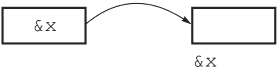

**图 2.1** 指针包含其指向的内存位置的地址。

## 代码清单 2.9 返回已修改实参值的函数（C 代码）

```
// Returning swapped arguments from a function (C syntax)
#include <stdio.h>

void Swap(double *x, double *y)            // formal arguments are pointers
{
    double temp;                          // temporary variable

    temp = *x; *x = *y; *y = temp;  // variable values accessed by indirection
}

int main()
{
    double a, b;

    a = 1e0; b = 2e0;                      // values to be swapped
    Swap(&a,&b);                          // actual arguments are addresses
    printf("%f %f\n",a,b);
}
```

为了说明上述按引用传递机制，我们再次引用第 2.3 节中用 Python 实现的交换变量示例。代码清单 2.9 中所示的 ANSI C 版本定义了一个用于交换 `double` 类型值的函数 `Swap`（类似于 Kernighan 和 Ritchie（1988）中定义的整数交换函数 `swap`）。如上所述，主程序传递给 `Swap` 的不是实参 `a` 和 `b` 的值，而是它们的地址 `&a` 和 `&b`，这样 `Swap` 就能直接对原始位置进行操作。相应地，为了能够接收操作数的地址，`Swap` 的参数必须声明为指针。`Swap` 通过对包含这些地址的指针 `x` 和 `y` 进行解引用，来操作主程序中实参 `a` 和 `b` 的实际值。

除了通过函数名返回结果之外，基于指针类型参数的方法是从函数中获取结果的主要技术，符合模块化编程的精神。

C++ 在不改变基于指针的标准机制本质的前提下，显著简化了与按引用传递机制相关的语法，提高了代码的可读性（见

## 代码清单 2.10 返回已修改实参值的函数（C++ 代码）


```
// Returning swapped arguments from a function (C++ syntax)
#include <stdio.h>

void Swap(double &x, double &y)            // arguments passed by reference
{
    double temp;                          // temporary variable

    temp = x; x = y; y = temp;
}

void main()
{
    double a, b;

    a = 1e0; b = 2e0;                      // values to be swapped
    Swap(a,b);
    printf("%f %f\n",a,b);
}
```

Listing 2.10)。C++ 语法要求将“地址”符号 `&` 放在需要按引用接收参数的参数前面，并删除对指针的其他显式引用。

## 2.5 Python 中的数组

科学和工程中的数值应用通常涉及张量量，它们与数组密切对应。与其他语言相比，Python 提供了丰富的复合数据类型，用于对基本数据类型进行分组。其中最通用的是列表类型，它甚至能够对不同类型的对象进行分组。列表类型实现了大量用于创建、访问、修改和排序列表的方法。由于其直观性和易用性，在整本书中，我们使用列表来表示 Python 程序中的数组。

作为一般规则，依赖于 Python 的动态类型特性，我们在大小确定后立即在运行时将列表初始化并定义其维度，使其达到完整规模。我们避免通过例如 `append` 方法逐步扩展列表。例如，在我们的程序中定义具有 `n` 个分量的数值向量 `a` 等同于通过单元素列表的乘法构造一个 `n` 元列表：

```python
a = [0]*n
```

隐含的是，有效分量为 `a[0]` 到 `a[n−1]`，它们都设为 0。分量显然可以用任何兼容类型的合适常数进行初始化。

一个颇具争议的问题涉及有效索引的范围与语言实现的默认偏移量之间的关系，该偏移量对于 Python 和 C/C++ 均为 0。由于本书中介绍的大多数数值方法涉及从 1 开始的自然索引，仅有少数明确标记的例外，所有开发的实现一致地使用 `a[1]` 到 `a[n]` 作为有效分量，故意将分量 `a[0]` 留空。因此，此类一维数组的典型声明形式为：

```python
a = [0]*(n+1)
```

二维 2D 数组声明的直接推广为：

```python
a = [[0]*(n+1) for i in range(n+1)]
```

并体现了数组的拓扑结构，即作为行向量的集合，最后一个可用元素为 `a[n][n]`。关于使用数组进行基本矩阵运算的详细示例在第 2.7 节给出。

## 2.6 C/C++ 中的动态数组分配

在 C/C++ 中，数组与指针密不可分。事实上，数组的名称按定义是一个指向已分配内存块开头的指针，也就是说，该指针包含第一个数组元素的地址。例如，为分配 10 个 `double` 类型分量的数组，可以使用声明：

```cpp
double a[10];
```

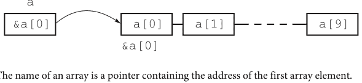

**FIGURE 2.2 The name of an array is a pointer containing the address of the first array element.**

从技术上讲，上述语句分配了一个由 10 个连续位置组成的内存块，其大小足以容纳 `double` 类型的值，定义了一个指向 `double` 类型值的指针 `a`，并在其中存储内存块的起始地址。由于 C/C++ 数组默认具有零偏移，在此情况下有效分量为 `a[0]` 到 `a[9]`。如上所述，与数组名称关联的指针 `a` 包含第一个元素的地址，即 `&a[0]`（另见图 2.2），并且相应内存块的分配在程序的编译阶段静态进行。

任何对数组元素的操作也可以通过关联的指针进行。根据指针算术，对指针加 1 会得到指针所包含的内存地址之后的地址。从这个角度看，由于 `a` 包含 `a[0]` 的地址，操作 `a+1` 会得到 `a[1]` 的地址，即 `&a[1]`，相应地，`*(a+1)` 表示值 `a[1]`。一般而言，元素 `a[i]` 也可以通过间接寻址 `*(a+i)` 来引用，这正是编译器处理对数组元素引用时的实际方式。

尽管简单且易于操作，数组的静态分配并不总是合适的。大型现代计算机应用的存储需求可能非常苛刻，而高效使用主内存通常意味着根据即时需求动态重用内存来存储不同的对象。因此，一种用于动态分配数组的方法，能够额外提供任意偏移和索引范围，适应自然的数学记号，是非常有用的。

C/C++ 中动态内存分配的技术解决方案由在 `stdlib.h` 中定义的函数 `malloc` 提供：

```cpp
void *malloc((size_t) n)
```

`malloc` 返回堆中 `n` 字节未初始化连续块的指针（用于动态对象的内存区域），如果请求无法满足则返回 `NULL`。`(size_t)` 将 `n` 转换为 C 中用于内存对象大小的类型。特别地，要获得一个足够容纳 `n` 个 `double` 类型分量的内存块的指针，可以发出调用

```cpp
(double*) malloc((size_t) (n*sizeof(double)));
```

函数 `sizeof(type)` 返回 `type` 类型的内部表示的长度（以字节为单位），因此 `n*sizeof(double)` 表示存储 `n` 个 `double` 类型分量所需的字节数。最后，`(double*)` 将 `malloc` 返回的非特指指针转换为指向 `double` 类型位置的指针。

有了这些要素，我们构建函数 `Vector0`（见 Listing 2.11），它动态分配 `n` 个 `double` 类型位置的块，并通过其名称返回块的起始地址。如果分配失败，可能由于堆中没有合适的连续块可用，则通过调用标准函数 `exit()` 终止执行，并向操作系统返回错误代码以便进一步处理。

**Listing 2.11 Example of Dynamic Allocation of an Array (C/C++ Coding)**

```cpp
double *Vector0(int n)
{
    double *p;

    p = (double*) malloc((size_t) (n*sizeof(double)));    // assign block start to array pointer
    if (!p) {
        printf("Vector0: allocation error !\n");
        exit(1);
    }
    return p;
}

int main()
{
    int i, n;
    double *a;                                          // array name is a pointer

    n = ...;                                            // array size results during execution
    a = Vector0(n);                                     // a points to the allocated block

    for (i=0; i<=n-1; i++) a[i] = ...;                   // a is used as array
}
```

在调用程序中，`Vector0` 返回的指针可以分配给一个数组，其分量随后对应于已分配内存块中的连续位置。数组的名称必须首先声明为指针，并且一旦大小 `n` 可用，数组就通过语句 `a = Vector0(n)` 有效分配。之后，`a` 可以像通常的零偏移数组一样处理，有效分量为 `a[0]` 到 `a[n-1]`。

在实践中，特别感兴趣的是动态分配索引不在 `0` 到 `n-1` 之间，而是在某个任意 `imin` 和 `imax` 之间的数组。这正是 Listing 2.12 中给出的函数 `Vector` 所解决的任务。在这种情况下需要分配的分量数为 `imax-imin+1`。

**Listing 2.12 Functions for the Dynamic Allocation/Deallocation of a Vector (C/C++ Coding)**

```cpp
//============================================================================
double *Vector(int imin, int imax)
//------------------------------------------------------------------------------
// Allocates a double vector with indices in the range [imin,imax]
//------------------------------------------------------------------------------
{
    double *p;

    p = (double*) malloc((size_t) ((imax-imin+1)*sizeof(double)));    // assign block start to array pointer
    if (!p) {
        printf("Vector: allocation error !\n");
        exit(1);
    }
    return p - imin;                                                    // adjust for offset
}

//============================================================================
void FreeVector(double *p, int imin)
//------------------------------------------------------------------------------
// Deallocates a double vector allocated with Vector, with offset imin
//------------------------------------------------------------------------------
{
    free((void*) (p+imin));                                             // compensate for offset
}
```

一个更微妙的问题在于，通过赋值 `a = Vector(...)`，块的开头会自动与分量 `a[0]` 相关联，而绝不会与期望的 `a[imin]` 相关联。由于元素 `a[0]` 到 `a[imin-1]` 反正是不相关的，解决这个问题的简单办法是指示函数 `Vector` 人为地返回一个比真实块起点提前 `imin` 个位置的地址。该地址通过数组名默认与 `a[0]` 关联，这样分配块的开头实际上就与 `a[imin]` 对应了。技术上，在 `Vector` 中通过简单地从要返回的指针中减去 `imin` 来实现块起点的这种人为偏移。

像 `Vector` 这样在堆上创建动态对象的任何其他例程，都应该配有一对函数来处置已创建的对象（当它们不再需要时）并释放堆块以供进一步使用。`FreeVector` 函数在第 2.12 节清单中给出，正好起到这个作用，即通过调用标准函数 `free` 来释放先前对 `Vector` 的调用所分配的堆区。然而，首先，`FreeVector` 通过向接收到的指针加上 `imin` 来恢复已分配块的真实起点，以补偿在 `Vector` 函数中应用的人为偏移。然后指针被转换为通用类型 `void*` 再被处置。

使用所展示的分配/释放例程的典型例子见第 2.13 节清单。任何试图使用位于已分配块之外的分量 `a[0]` 到 `a[imin-1]` 的尝试都是危险的，可能产生意外的结果。

现在让我们将迄今为止开发的一维技术推广到 2D 数组的情况。采用与 Press 等人（2002）实现的存储模型类似的存储模型，2D 数组的名称是指向行指针数组的指针，每个指针指向 2D 数组某一行上的第一个元素（见图 2.3）。因此，双分量 2D 数组的正确声明是 `double **a`，反映了“指针到指针”的哲学。整个数组由其名称（或指针）`a` 引用，整行 `i` 由行指针 `a[i]` 引用，而特定元素则作为 `a[i][j]` 访问。

第 2.14 节清单中给出的函数 `Matrix` 设计用于分配一个双精度分量的矩阵，行索引范围为 `imin` 到 `imax`，列索引范围为 `jmin` 到 `jmax`。该例程首先定义行数和列数，`ni = imax-imin+1` 和 `nj = jmax-jmin+1`。然后它定义一个指向 `ni` 个行指针的数组 `p` 的指针，并通过 `imin` 偏移其起始地址以考虑行偏移。接下来，例程分配 `ni*nj` 个双精度位置的块用于数组分量，并将块的起点（已偏移以考虑行偏移）分配给第一个行指针。为了正确指向每一后续行的开头，分配给其余行指针的地址按行长度 `nj` 均匀递增。`Matrix` 的配对函数是 `FreeMatrix`，它按相反顺序释放已分配的对象：首先是主块，然后是行指针数组。

### Listing 2.13 Example of Dynamic Allocation of a Vector (C/C++ Coding)

```c
int i, imin, imax;
double *a;                                 // array name is a pointer

imin = ...;                                // min. and max. indexes (during execution)
imax = ...;
// allocate heap block and assign starting address to a
a = Vector(imin,imax);

for (i=imin; i<=imax; i++) a[i] = ...;     // use a as array

FreeVector(a,imin);                        // free heap block occupied by a
```

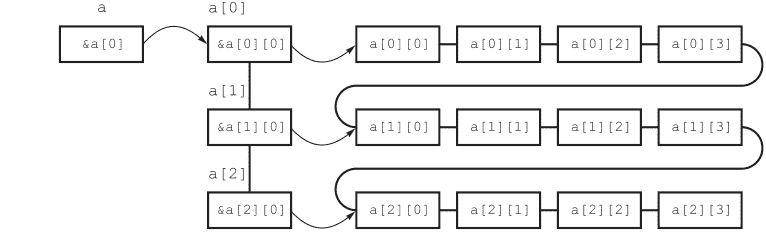

**FIGURE 2.3** The storage scheme of a 3 × 4 matrix. The name of the array is a pointer to an array of row pointers, each of which contains the address of the first element in the corresponding row.

### Listing 2.14 Functions for the Dynamic Allocation/Deallocation of a Matrix (C/C++ Coding)


```c
//============================================================================
double **Matrix(int imin, int imax, int jmin, int jmax)
//----------------------------------------------------------------------------
// Allocates a double matrix, with row and column indices in the range
// [imin,imax] x [jmin,jmax]
//----------------------------------------------------------------------------
{
    int i, ni = imax-imin+1, nj = jmax-jmin+1;  // numbers of rows and columns
    double **p;
    // allocate array of row pointers
    p = (double**) malloc((size_t)(ni*sizeof(double*)));
    if (!p) {
        printf("Matrix: level 1 allocation error !\\n");
        exit(1);
    }
    p -= imin;
    // adjust for row offset
    // assign block start to 1st row pointer
    p[imin] = (double*) malloc((size_t)(ni*nj*sizeof(double)));
    if (!p[imin]) {
        printf("Matrix: level 2 allocation error !\\n");
        exit(2);
    }
    p[imin] -= jmin; // adjust 1st row pointer for column offset
    // define row pointers spaced by row length
    for (i=imin+1; i<=imax; i++) p[i] = p[i-1] + nj;

    return p;
}

//============================================================================
void FreeMatrix(double **p, int imin, int jmin)
//----------------------------------------------------------------------------
// Deallocates a double matrix allocated with Matrix, with row and column
// offsets imin and jmin
//----------------------------------------------------------------------------
{
    free((void*) (p[imin]+jmin)); // deallocate block
    free((void*) (p+imin));       // deallocate array of row pointers
}
```

使用函数 `Matrix` 和 `FreeMatrix` 的典型上下文如下：

```c
int i, imin, imax, j, jmin, jmax;
double **a;                     // array name is a pointer to row pointers

imin = ...; imax = ...;         // min. and max. indexes (during execution)
jmin = ...; jmax = ...;
// allocate heap block and assign starting address to a
a = Matrix(imin,imax, jmin,jmax);

for (i=imin; i<=imax; i++)
    for (j=jmin; j<=jmax; j++) a[i][j] = ...; // use a as array

FreeMatrix(a,imin,jmin);        // free heap block occupied by a
```

这里，同样，实际的限制索引被假定仅在运行时才可用。分配之后，数组的名称可以像常规数组一样使用。如果需要，已分配的堆块在释放后可以重新使用。

函数 `Vector`、`FreeVector`、`Matrix` 和 `FreeMatrix` 也可以作为构建其他类型数组的分配/释放函数的模板，这实际上只不过是将类型 `double` 替换为适当的类型即可。当然，本书还使用了整数和复数向量和矩阵。处理 `int` 类型数组的函数命名为 `IVector`、`FreeIVector`、`IMatrix` 和 `FreeIMatrix`，而操作复数数组的函数则称为 `CVector`、`FreeCVector`、`CMatrix` 和 `FreeCMatrix`。由于其通用实用性，它们被收集在头文件 `memalloc.h` 中，该文件完整列于附录 A，并包含在我们所有需要动态分配数组的后续 C/C++ 程序中。

文件 `memalloc.h` 的整体结构在第 2.15 节清单中示出。为了与 ANSI C 兼容，我们定义了一个名为 `dcmplx` 的复数类型，其实部和虚部均为 `double` 类型。为了避免由多个包含指令可能产生的包含函数的多重定义，`memalloc.h` 实现了基于预处理器指令的条件包含的标准 C/C++ 技术。预处理器在编译前像文本编辑器一样处理代码，在每次包含尝试时检查标志变量 `_MEMALLOC_` 是否尚未定义（`#ifndef _MEMALLOC_`），如果是，则定义它并将头文件的内容包含到 `#endif` 指令为止的代码中进行编辑。相反，在随后的包含尝试中，预处理器发现变量 `_MEMALLOC_` 已被定义，从而放弃包含 `memalloc.h`，从而确保其内容实际上只被包含一次。

同样的条件包含技术在全书中始终如一地用于将所开发的例程收集到每个章节的库中。显然，每个这样的头文件的包含都由一个不同的变量控制。

## 2.7 Basic Matrix Operations

初等矩阵运算，如求和、乘法和转置，为导入模块或头文件中的过程提供了简单而说明性的程序示例。尽管此类例程的具体实现并非主要实践兴趣所在，但我们在此展示了基于它们的两个库（`matutil.py` 和 `matutil.h`），它们在 Python 和 C/C++ 主程序中被包含用于检验简单的矩阵恒等式：

\[
(A \cdot B)^T - B^T \cdot A^T = 0, \qquad (2.1)
\]

其中 `A` 和 `B` 是任意（随机）矩阵，而 `0` 是零矩阵。

#### Listing 2.15 Functions for Dynamic Allocation of Vectors and Matrices (memalloc.h Partial)

//----------------------------------------- memalloc.h -----------------------------------------

// Functions for dynamic memory allocation of vectors and matrices

//-----------------------------------------------------------------------------------------------

#ifndef _MEMALLOC_

#define _MEMALLOC_

#include <stdlib.h>

#include <stdio.h>

#include <complex>

using namespace std;

typedef complex<double> dcmplx;

double *Vector(int imin, int imax)

// Allocates a double vector with indices in the range [imin,imax]

...

void FreeVector(double *p, int imin)

// Deallocates a double vector allocated with Vector, with offset imin

...

double **Matrix(int imin, int imax, int jmin, int jmax)

// Allocates a double matrix, with row and column indices in the range

// [imin,imax] x [jmin,jmax]

...

void FreeMatrix(double **p, int imin, int jmin)

// Deallocates a double matrix allocated with Matrix, with row and column

// offsets imin and jmin

...

int *IVector(int imin, int imax)

// Allocates an int vector with indices in the range [imin,imax]

...

void FreeIVector(int *p, int imin)

// Deallocates an int vector allocated with IVector, with offset imin

...

int **IMatrix(int imin, int imax, int jmin, int jmax)

// Allocates an int matrix, with row and column indices in the range

// [imin,imax] x [jmin,jmax]

...

void FreeIMatrix(int **p, int imin, int jmin)

// Deallocates an int matrix allocated with IMatrix, with row and column

// offsets imin and jmin

...

dcmplx *CVector(int imin, int imax)

// Allocates a complex vector with indices in the range [imin,imax]

...

void FreeCVector(dcmplx *p, int imin)

// Deallocates a complex vector allocated with CVector, with offset imin

...

dcmplx **CMatrix(int imin, int imax, int jmin, int jmax)

// Allocates a complex matrix, with row and column indices in the range

// [imin,imax] x [jmin,jmax]

...

void FreeCMatrix(dcmplx **p, int imin, int jmin)

// Deallocates a complex matrix allocated with CMatrix, with row and column

// offsets imin and jmin

...

#endif

The Python module containing the auxiliary functions is given in Listing 2.16, while the corresponding C/C++ header file is given in Listing 2.17. Both files are actually partial versions of more comprehensive libraries, listed in full length in Appendix B.

#### Listing 2.16 Routines for Basic Matrix Operations (matutil.py Partial)

#----------------------------------------------------------------------------- matutil.h -----------------------------------------------------------------------------

#### Contains utility routines for basic operations with vectors and matrices

#---------------------------------------------------------------------------------------------------------------------------------------------

from math import *

#===========================================================================================================================================================

def MatPrint(a, n, m):

#---------------------------------------------------------------------------------------------------------------------------------------------

#### Prints the elements of matrix a[1:n][1:m] on the display

#---------------------------------------------------------------------------------------------------------------------------------------------

    for i in range(1,n+1):

        for j in range(1,m+1): print('{0:11.2e}'.format(a[i][j]),end="")

        print()

#===========================================================================================================================================================

def MatTrans(a, n):

#---------------------------------------------------------------------------------------------------------------------------------------------

#### Replaces the square matrix a[1:n][1:n] by its transpose

#---------------------------------------------------------------------------------------------------------------------------------------------

    for i in range(2,n+1):

        for j in range(1,i):

            t = a[i][j]; a[i][j] = a[j][i]; a[j][i] = t

#===========================================================================================================================================================

def MatDiff(a, b, c, n, m):

#---------------------------------------------------------------------------------------------------------------------------------------------

#### Returns the difference of matrices a and b in c[1:n][1:m]

#---------------------------------------------------------------------------------------------------------------------------------------------


```python
    for i in range(1,n+1):

        for j in range(1,m+1): c[i][j] = a[i][j] - b[i][j]

#===========================================================================================================================================================

def MatProd(a, b, c, n, l, m):

#---------------------------------------------------------------------------------------------------------------------------------------------

#### Returns the product of matrices a[1:n][1:l] and b[1:l][1:m] in c[1:n][1:m]

#---------------------------------------------------------------------------------------------------------------------------------------------

    for i in range(1,n+1):

        for j in range(1,m+1):

            t = 0e0

            for k in range(1,l+1): t += a[i][k] * b[k][j]

            c[i][j] = t

#===========================================================================================================================================================

def MatNorm(a, n, m):

#---------------------------------------------------------------------------------------------------------------------------------------------

#### Returns the max norm of matrix a[1:n][1:m], i.e. max|a[i][j]|

#---------------------------------------------------------------------------------------------------------------------------------------------

    norm = 0e0

    for i in range(1,n+1):

        for j in range(1,m+1):

            if (norm < fabs(a[i][j])): norm = fabs(a[i][j])

    return norm
```

#### Listing 2.17 Routines for Basic Matrix Operations (`matutil.h` Partial)

```c
/*---------------------------------- matutil.h ----------------------------------
   Contains utility routines for basic operations with vectors and matrices
  ------------------------------------------------------------------------------- */
#ifndef _MATUTIL_
#define _MATUTIL_

#include <stdio.h>

//==============================================================================
void MatPrint(double **a, int n, int m)
//------------------------------------------------------------------------------
// Prints the elements of matrix a[1:n][1:m] on the display
//------------------------------------------------------------------------------
{
    int i, j;

    for (i=1; i<=n; i++) {
        for (j=1; j<=m; j++) printf("%12.2e",a[i][j]);
        printf("\n");
    }
}

//==============================================================================
void MatTrans(double **a, int n)
//------------------------------------------------------------------------------
// Replaces the square matrix a[1:n][1:n] by its transpose
//------------------------------------------------------------------------------
{
    double t;
    int i, j;

    for (i=2; i<=n; i++)
        for (j=1; j<=(i-1); j++) {
            t = a[i][j]; a[i][j] = a[j][i]; a[j][i] = t;
        }
}

//==============================================================================
void MatDiff(double **a, double **b, double **c, int n, int m)
//------------------------------------------------------------------------------
// Returns the difference of matrices a and b in c[1:n][1:m]
//------------------------------------------------------------------------------
{
    int i, j;

    for (i=1; i<=n; i++)
        for (j=1; j<=m; j++) c[i][j] = a[i][j] - b[i][j];
}

//==============================================================================
void MatProd(double **a, double **b, double **c, int n, int l, int m)
//------------------------------------------------------------------------------
// Returns the product of matrices a[1:n][1:l] and b[1:l][1:m] in c[1:n][1:m]
//------------------------------------------------------------------------------
{
    double t;
    int i, j, k;

    for (i=1; i<=n; i++)
        for (j=1; j<=m; j++) {
            t = 0e0;
            for (k=1; k<=l; k++) t += a[i][k] * b[k][j];
            c[i][j] = t;
        }
}
//============================================================================
double MatNorm(double **a, int n, int m)
//--------------------------------------------------------------------------
// Returns the max norm of matrix a[1:n][1:m], i.e. max|a[i][j]|
//--------------------------------------------------------------------------
{
    double norm;
    int i, j;
    norm = 0e0;
    for (i=1; i<=n; i++)
        for (j=1; j<=m; j++)
            if (norm < fabs(a[i][j])) norm = fabs(a[i][j]);
    return norm;
}
#endif
```

函数 `MatPrint` 以格式化的表格形式显示矩阵。在 Python 中，通过显式禁止每次输出后默认的新行，可以在同一行上迭代打印多个项目；而在 C/C++ 中，则专门发送最终的换行字符来完成该行。

`MatTrans` 通过交换对称元素对来转置其方阵输入矩阵，阶数为 `n`。函数 `MatDiff` 返回两个 `n`×`m` 矩阵 `a` 和 `b` 之间的差值。输出矩阵 `c` 可以安全地与输入矩阵中的任一个重合。函数 `MatProd` 计算 `n`×1 矩阵 `a` 与 1×`m` 矩阵 `b` 的乘积。`n`×`m` 的结果返回在数组 `c` 中。

最后但并非最不重要的，函数 `MatNorm` 返回输入矩阵的最大范数：

‖A‖max = max{|a_ij|}，

即其元素绝对值的最大值。

用于检查矩阵恒等式 (2.1) 的 Python 和 C/C++ 程序版本，分别给出在列表 2.18 和 2.19 中，仅请求作为唯一输入的方阵 A 和 B 的大小。程序随后

#### Listing 2.18 Check of Matrix Identity (Python Coding)

```python
#### Checks identity (A B)_trans = B_trans A_trans for random arrays A and B
from random import *
from matutil import *

#### main

n = int(input("n = "))

A = [[0]*(n+1) for i in range(n+1)]          # define arrays
B = [[0]*(n+1) for i in range(n+1)]
C = [[0]*(n+1) for i in range(n+1)]
D = [[0]*(n+1) for i in range(n+1)]

for i in range(1,n+1):                     # array A: random sub-unitary elements
    for j in range(1,n+1): A[i][j] = random()
print("Array A:")
MatPrint(A,n,n)

for i in range(1,n+1):                     # array B: random sub-unitary elements
    for j in range(1,n+1): B[i][j] = random()
print("Array B:")
MatPrint(B,n,n)

MatProd(A,B,C,n,n,n)                                   # A*B
MatTrans(C,n)                                          # (A*B)_trans

MatTrans(A,n)                                          # A_trans
MatTrans(B,n)                                          # B_trans
MatProd(B,A,D,n,n,n)                                   # B_trans* A_trans

MatDiff(C,D,D,n,n)                                     # (A*B)_trans - B_trans * A_trans
print("Norm ((A*B)_trans - B_trans * A_trans) =",MatNorm(D,n,n))
```

#### Listing 2.19 Check of Matrix Identity (C/C++ Coding)

```c
// Checks identity (A B)_trans = B_trans A_trans for random matrices A and B
#include <stdio.h>
#include "memalloc.h"
#include "matutil.h"

int main()
{
    double **A, **B, **C, **D;
    int i, j, n;

    printf("n = "); scanf("%i", &n);

    A = Matrix(1,n,1,n); B = Matrix(1,n,1,n);                 // allocates arrays
    C = Matrix(1,n,1,n); D = Matrix(1,n,1,n);

    for (i=1; i<=n; i++)                      // array A: random sub-unitary elements
        for (j=1; j<=n; j++) A[i][j] = rand()/(RAND_MAX+1e0);
    printf("Array A:\n");
    MatPrint(A,n,n);

    for (i=1; i<=n; i++)                      // array B: random sub-unitary elements
        for (j=1; j<=n; j++) B[i][j] = rand()/(RAND_MAX+1e0);
    printf("Array B:\n");
    MatPrint(B,n,n);

    MatProd(A,B,C,n,n,n);                                   // A*B
    MatTrans(C,n);                                          // (A*B)_trans

    MatTrans(A,n);                                          // A_trans
    MatTrans(B,n);                                          // B_trans
    MatProd(B,A,D,n,n,n);                                   // B_trans* A_trans

    MatDiff(C,D,D,n,n);                                     // (A*B)_trans - B_trans * A_trans
    printf("Norm ((A*B)_trans - B_trans * A_trans) = %e\n",MatNorm(D,n,n));
}
```

## 3 Elements of Scientific Graphics

### 3.1 The Tkinter Package

`Tk` 是一种用于构建各种编程语言图形用户界面 (GUI) 的开源跨平台工具包。`Tk` 由 John Ousterhout 于 1991 年开发，提供了一套基本部件库（例如框架、按钮、菜单等），这些部件在现代应用软件中常用。部件是 GUI 应用构建块的通用术语，或更一般地，是可嵌入第三方应用中的独立应用。

`Tkinter`（来自 “Tk interface”）是 Python 对 `Tk` 工具包的面向对象接口。`Tkinter` 由 Fredrik Lundh 于 1999 年编写（Lundh, 2013a），已成为 Python 的标准 GUI 包，与 `Tk` 一起在大多数类 Unix、Windows 和 Macintosh 系统上可用。`Tkinter` 由多个 Python 模块组成，其中最重要的是 `tkinter` 模块。它包含使用 `Tk` 工具包所需的所有类和函数。


最简单的 Tkinter 应用是创建空 `Tk` 部件的应用（列表 3.1）。任何基于 Tkinter 的程序首先需要导入 `tkinter` 模块。通过创建 `Tk` 根部件来初始化 Tkinter，在我们的示例程序中通过语句 `root = Tk()` 实现。根部件（见图 3.1）基本上是一个普通窗口，具有特定于所使用操作系统和窗口管理器的“外观和感觉”。值得注意的是，任何程序应仅操作一个根部件，并且它应在任何其他部件之前创建，这些部件将作为从属的“子”对象与根相关联。

#### Listing 3.1 Creating a Tk Root Widget (Python Coding)

```
from tkinter import *          # import Tkinter module

root = Tk()                   # create Tk root widget

root.mainloop()               # enter Tkinter event loop
```


FIGURE 3.1 Empty Tk widget created with Tkinter.

仅由前两个语句组成且根部件仅被创建的代码，窗口将不会有效显示。为了使应用程序窗口出现，执行必须进入 Tkinter 事件循环，这通过调用方法 `root.mainloop()` 实现。程序将在事件循环中空闲，直到窗口关闭。在更广的图景中，事件循环处理 Tkinter 排队的运算以及用户触发的事件（例如鼠标点击）或窗口系统触发的事件（例如窗口重绘）。Tkinter 排队的典型操作涉及部件调整大小（由 `pack()` 方法发起）和部件重绘（由 `update()` 方法引起）。

根部件可以控制其他从属部件。例如，`Label` 部件可用于在屏幕上显示文本或图像。在列表 3.2 中，我们将 `Label` 部件创建为根的子部件。

#### Listing 3.2 Creating a tkinter Label Widget (Python Coding)

```
from tkinter import *                 # import Tkinter module

root = Tk()                           # create Tk root widget
w = Label(root, text="This is a Label widget")  # create label widget: child to root
w.pack()                              # resize label to fit text; make it visible

root.mainloop()                       # enter Tkinter event loop
```


FIGURE 3.2 Label widget created with Tkinter.

## 3.2 The `Canvas` Widget

`Canvas` 是一个通用部件，提供多功能图形设施。`Canvas` 部件最适合绘制图片、图表、绘图，甚至更复杂的布局，以及创建自定义部件。

`Canvas` 上显示的图像是通过连续创建画布项目的结果。项目被放置在一个堆栈中，新项目默认绘制在已存在项目之上。`Canvas` 部件支持的标准项目有 `arc`、`bitmap`、`image`、`line`、`oval`、`polygon`、`rectangle`、`text` 和 `window`。由封闭边界定义的若干项目（例如弦、饼片、椭圆、多边形和矩形）具有轮廓和内部区域，可以分别着色或使其透明。`window` 项目可用于在画布上显示其他 Tkinter 部件。

对于在其矩形区域内定位项目，`Canvas` 部件提供了两种类型的坐标：canvas 坐标和 window 坐标。存在这两种坐标系统的事实说明了 canvas 有时可能大于实际显示它的窗口。在这种情况下，滚动条确实有助于在窗口中移动 canvas，但相对于窗口本身的参考点定位对象可能更有意义。具体来说，canvas 坐标是相对于整个 canvas 的左上角定义的，该点被赋予坐标 `(0, 0)`，而 window 坐标是相对于 canvas 显示区域的左上角定义的。由于本书中开发的图形应用程序中 canvas 完全显示，我们实际上不会区分这两种坐标系统。

`Canvas` 对象是根据以下语法创建的：

```
w = Canvas(parent, option=value,...)
```

第一个参数指定父对象，通常是 `Tk` 根部件，但也可以同样是另一个从属部件。`Canvas` 部件可用的常用选项有

- `bd` = border width—canvas 边框的宽度（像素）。默认值为 2。
- `bg` = color—canvas 的背景颜色，以 `#rgb`（4 位）、`#rrggbb`（8 位）或 `#rrrggbbb`（12 位）格式，或标准颜色名称。
- `height` = height—canvas 的垂直尺寸。整数值假定为像素。
- `width` = width—canvas 的水平尺寸。

### 3.2.1 常用 `Canvas` 项目

`Canvas` line 对象用于在 canvas 上绘制线条。线条可以由任意数量首尾相连的线段组成。创建连接 `Canvas` 部件 `w` 上的一系列点 `(x1, y1)`、`(x2, y2)`、...、`(xn, yn)` 的线对象的语法为

```
id = w.create_line(x1, y1, x2, y2,..., xn, yn, option=value,...)
```

并返回创建项目的 `id`。

选项（选定）：

- `arrow` = `FIRST`、`LAST` 或 `BOTH`—将箭头放置在第一个、第二个或两个端点上。默认是没有箭头的线。
- `dash` = pattern—线段长度的列表（必要时重复），其中奇数线段被绘制，偶数线段被跳过。默认是实线。
- `fill` = color—线条颜色。默认是 `"black"`。
- `width` = width—线条宽度（像素）。默认是 1。

`Canvas` oval 对象用于在 canvas 上绘制椭圆或特别是圆。椭圆的形状和大小是通过指定其包围矩形的左上角 `(x1, y1)` 和右下角 `(x2, y2)` 来定义的。在 canvas `w` 上创建椭圆对象的语法为

```
id = w.create_oval(x1, y1, x2, y2, option=value,...)
```

并返回创建项目的 `id`。

选项（选定）：

- `fill = color`—椭圆内部的填充颜色。空字符串 `""` 表示“透明”，这是默认值。
- `outline = color`—椭圆周围边框的颜色。默认轮廓颜色是 `"black"`。
- `width = width`—椭圆周围边框的宽度（像素）。默认是 1。

`Canvas` rectangle 对象用于在 canvas 上绘制矩形，由左上角 `(x1, y1)` 和右下角 `(x2, y2)` 指定。在 canvas 上创建矩形对象的语法为

```
id = w.create_rectangle(x1, y1, x2, y2, option=value,...)
```

并返回创建项目的 `id`。

选项（选定）：

- `fill = color`—矩形内部的填充颜色。空字符串 `""` 表示“透明”，这是默认值。
- `outline = color`—矩形周围边框的颜色。默认轮廓颜色是 `"black"`。
- `width = width`—矩形周围边框的宽度（像素）。默认是 1。

`Canvas` text 对象用于在 canvas 上显示一个或多行文本。在 canvas `w` 的位置 `(x, y)` 上生成文本的语法为

```
id = w.create_text(x, y, option=value,...)
```

并返回创建项目的 `id`。

选项（选定）：

- `anchor = CENTER`—默认情况下，文本在 `(x, y)` 左右水平和垂直居中。例如，对于 `anchor = NW`，文本包围矩形的左上角放置在参考点 `(x, y)`。其他合法参数是 `N`、`NE`、`E`、`SE`、`S`、`SW` 和 `W`。
- `fill = color`—文本颜色。默认是 `"black"`。
- `font = font`—字体属性的元组。例如，要创建 14 点 Helvetica 常规字体，可使用 `font = ("Helvetica", 14)`。
- `justify = LEFT`（默认）、`CENTER` 或 `RIGHT`。对于多行文本，该选项控制行对齐方式。
- `text = string`—要显示的文本。换行符 `"\n"` 可用于强制换行。
- `width = width`—最大行宽。长于此值的行将被换行。默认情况下，文本宽度由最长行设置。

### 3.2.2 更新 `Canvas` 部件的方法

在最基本的形式中，更新或动画显示意味着删除部件的内容并重新绘制它。

`Canvas` 部件尤其支持方法 `delete()`，可实现选择性或完全删除显示的项目。一般语法为

```
w.delete(item)
```

其中 `item` 是标签或 ID，并导致匹配的项目被删除。如果需要删除 canvas 上绘制的所有项目，则 `item` 应设为 `ALL`。

更新部件的内容稍微更微妙，因为它可能影响事件循环中排队的交织进程。Tkinter 提供了两种通用方法来启用显示更新。最直接的是 `update()`，其语法为

```
w.update()
```

它处理所有待处理的事件并重绘部件。然而，应谨慎使用，因为如果从不适当的位置调用（例如，从事件回调中），可能会导致不可预测的效果。删除和重绘 `Canvas` 部件 `w` 的典型无限循环如下：

```
while (1):
    w.delete(ALL)                # delete canvas
    ....                         # drawing operations
    w.update()                   # update canvas
```

`after()` 方法，其语法为

```
w.after(delay_ms, callback=None, *args)
```

注册一个回调函数，该函数将在至少 `delay_ms` 毫秒的延迟后使用参数 `args` 调用。实际延迟可能超过请求值，具体取决于系统繁忙程度，并且回调仅调用一次。删除和重绘 `Canvas` 部件 `w` 的无限循环可作为通过 `after()` 方法调用自身的回调函数的实现：

```
def Clock(w):
    w.delete(ALL)                # delete canvas
    ....                         # drawing operations
    w.after(10,Clock,w)          # call callback after 10 ms
```

一旦回调函数（上例中的 `Clock`）被调用，它就开始迭代地调用自身，但不是递归地。退出无限循环的机制应显式编码，否则，一旦按下部件的关闭按钮，进程将被终止。通过 `after()` 方法实现 `Canvas` 部件重绘的重复序列更安全，因此是推荐的实现方式。

## 3.3 简单 Tkinter 应用程序

程序 3.3 创建一个空的 `Canvas` 部件，没有任何功能。在创建任何其他对象之前，必须先创建 `Tk` 根部件。然后 `Canvas` 部件可以作为根的子部件创建。

为了使 canvas 可见，它必须由 packer 调整大小，类似于将绘画画布拉伸到画框上（图 3.3）。窗口的整体外观最终由程序进入事件循环来保证。

#### Listing 3.3 Creating a Tkinter Canvas Widget (Python Coding)

```
from tkinter import *                # import Tkinter module

root = Tk()                          # create Tk root widget
root.title("Canvas")

w = Canvas(root, width=300, height=200, bg = "white")   # create canvas: child to root
w.pack()                             # resize and make canvas visible

root.mainloop()                      # enter Tkinter event loop
```


FIGURE 3.3 Canvas widget created with Tkinter.

在下一个示例中，在列表 3.4 中，我们使用 canvas 显示多个图形项目：两个箭头、一个矩形、一个椭圆和一段文本。打包 canvas 后，这些项目通过调用相应的方法创建。结果如图 3.4 所示。

#### Listing 3.4 Tkinter Canvas Widget with Simple Graphic Elements (Python Coding)

```
from tkinter import *                # import Tkinter module

root = Tk()                          # create Tk root widget
root.title("Canvas")

nx = 300; ny = 300                    # canvas size
w = Canvas(root, width=nx, height=ny, bg = "white")   # create canvas
w.pack()                             # resize and make canvas visible

w.create_line(150, 150, 100, 100, fill="red", arrow=LAST, width=2)  # arrows
w.create_line(150, 150, 150, 250, fill="blue", arrow=LAST)

w.create_rectangle(50, 50, 250, 250, width=2)        # square
w.create_oval(50, 50, 250, 250)                      # circle

w.create_text(150, 75, text="(10:30)")              # text

root.mainloop()                      # enter Tkinter event loop
```

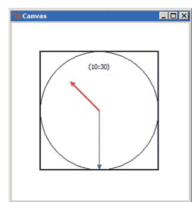

FIGURE 3.4 Canvas widget created with Tkinter, containing simple graphic elements.

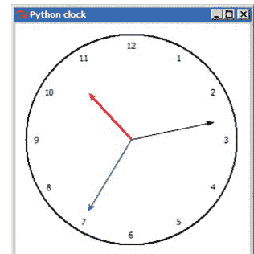

FIGURE 3.5 Python clock widget built with Tkinter.

现在让我们构建一个 Tkinter 部件来显示模拟时钟，如图 3.5 所示。显然，不仅要绘制图形元素（时钟表盘和指针），我们还必须使部件动画化，通过定期删除移动对象（时钟指针）、重绘它们并更新部件。列表 3.5 中所示实现背后的简单思想是使用例程 `clock0`，在其瞬时位置绘制时钟的表盘和指针。主程序中编码的无限循环，controls the updating of the canvas, by deleting its content altogether (for simplicity), redrawing the clock by calling the routine `Clock0`, and applying the `update()` method on the `Canvas` widget to make the changes visible.

The arguments passed to routine `Clock0` are the `Canvas` object, `w`, and the widget sizes (in pixels), `nx` and `ny`. `Clock0` determines from the latter the coordinates `x0` and `y0` of the center and the half-widths `1x` and `1y` of the clock’s face. These dimensions are then used to position the rest of the graphic elements. The hour labels are placed in equal angular distances of π/6 on a circle of radius `r0`.


The current time is retrieved using `localtime()`, one of the several time functions provided by the module `time.py`. The routine returns a tuple of nine integers, with the third, fourth, and fifth components representing, respectively, the current hour (range `[0,23]`), minute, and second. The integer minutes and hours are completed with their fractional parts. The resulting fractional hours `t_h`, minutes `t_m`, and seconds `t_s` are then converted, in sequence, into angular and, finally, Cartesian positions of the arrowheads of the corresponding clock hands.

In a more elaborate implementation of the routine `Clock0`, only the clock hands would be deleted and redrawn at every update, while the clock’s face would be drawn only once, at the beginning of the run.

As mentioned in Section 3.2.1, the `update` method is susceptible of producing unexpected results if called from unsuitable places (e.g., from an event callback). In fact, moving the infinite loop (for some reason) to a deeper hierarchical level may result in malfunction of the clock widget. A more robust implementation of the repetitive updating process is based on a callback function, as in the variant presented in Listing 3.6. The routine `Clock0` is no longer called directly from the main program and the infinite loop is replaced by a single call to an additional callback function, `Clock`, which acts as an interface to `Clock0`. Once `Clock` is called, it starts calling itself iteratively until the window is closed. The delay

### Listing 3.5 Python Clock Application Built with Tkinter (Python Coding)

```
#### Analog clock
from tkinter import *                     # import Tkinter module
from math import *                        
from time import *                        

def Clock0(w, nx, ny):                    # clock draw function
    x0 = nx/2; lx = 9*nx/20               # center and half-width of clock face
    y0 = ny/2; ly = 9*ny/20               
    r0 = 0.9 * min(lx,ly)                 # distance of hour labels from center
    r1 = 0.6 * min(lx,ly)                 # length of hour hand
    r2 = 0.8 * min(lx,ly)                 # length of minute hand

    w.create_oval(x0-lx, y0-ly, x0+lx, y0+ly, width=2)      # clock face
    for i in range(1,13):                 # label the clock face
        phi = pi/6 * i                    # angular position of label
        x = x0 + r0 * sin(phi)            # Cartesian position of label
        y = y0 - r0 * cos(phi)            
        w.create_text(x, y, text=str(i))  # hour label

    t = localtime()                       # current time
    t_s = t[5]                            # seconds
    t_m = t[4] + t_s/60                   # minutes
    t_h = t[3] % 12 + t_m/60              # hours [0,12]

    phi = pi/6 * t_h                      # hour hand angle
    x = x0 + r1 * sin(phi)                # position of arrowhead
    y = y0 - r1 * cos(phi)                # draw hour hand
    w.create_line(x0, y0, x, y, arrow=LAST, fill="red", width=3)

    phi = pi/30 * t_m                     # minute hand angle
    x = x0 + r2 * sin(phi)                # position of arrowhead
    y = y0 - r2 * cos(phi)                # draw minute hand
    w.create_line(x0, y0, x, y, arrow=LAST, fill="blue", width=2)

    phi = pi/30 * t_s                     # second hand angle
    x = x0 + r2 * sin(phi)                # position of arrowhead
    y = y0 - r2 * cos(phi)                
    w.create_line(x0, y0 , x, y, arrow=LAST)  # draw second hand

#### main

root = Tk()                               # create Tk root widget
root.title("Python clock")

nx = 300; ny = 300                        # canvas size
w = Canvas(root, width=nx, height=ny, bg = "white")  # create canvas
w.pack()                                  # make canvas visible

while (1):                                # infinite loop
    w.delete(ALL)                         # delete canvas
    Clock0(w, nx, ny)                     # draw clock
    w.update()                            # update canvas

root.mainloop()                           # enter Tkinter event loop
```

### Listing 3.6 Python Clock Using Callback Function (Python Coding)

```
#### Analog clock with callback function
from tkinter import *                 # import Tkinter module
from math import * 
from time import * 

def Clock0(w, nx, ny):                # clock draw function
    ....                                # drawing operations

def Clock(w, nx, ny):                 # clock callback function
    w.delete(ALL)                     # delete canvas
    Clock0(w, nx, ny)                 # draw clock
    w.after(10, Clock, w, nx, ny)     # call callback after 10 ms

#### main

root = Tk()                           # create Tk root widget
root.title("Python clock")

nx = 300; ny = 300                     # canvas size
w = Canvas(root, width=nx, height=ny, bg = "white")   # create canvas w
w.pack()                              # make canvas visible

Clock(w, nx, ny)                      # call clock function

root.mainloop()                       # enter Tkinter event loop
```

for the callback call (`10 ms` in our example) should be chosen as sufficiently small to ensure at least one updating of the clock widget per second.

## 3.4 Plotting Functions of One Variable

Let us consider the problem of plotting a real function of one variable,

`f : [x_min, x_max] → [y_min, y_max]`,

tabulated for a set of `n` arguments `x_i`:

`f(x_i) = y_i,    i = 1, 2, ..., n.`

In general, the plot of the function onto the graphic display cannot make direct use of the problem-specific coordinates (`x_i`, `y_i`), called user coordinates in the following diagrams. To fit into the admissible ranges of arguments used by the `Canvas` methods of `Tkinter`, the user coordinates have to be first transformed into canvas coordinates (see Figure 3.6).

With a view to having a proportionate graphical representation on the screen, there must exist a linear relationship between the user coordinates and the canvas coordinates:

`x̄ = A_x x + B_x`

`ȳ = A_y y + B_y.`

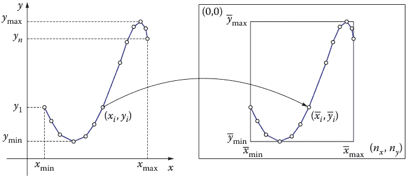

**图 3.6** 用户坐标 `$(x_i,y_i)$`（左侧）与 *画布坐标* `$(\bar{x}_i,\bar{y}_i)$`（右侧）之间存在 *线性对应关系*。

特别对于 `x` 轴而言，用户域的极限 `x_min` 和 `x_max` 可以由参数集合 `x_i` 确定，而画布域的极限 `x̄_min` 和 `x̄_max` 则独立设定，以符合绘图的期望位置，缩放系数 `A_x` 和 `B_x` 可由线性条件确定：

$$\bar{x}_{\min}=A_xx_{\min}+B_x,$$

$$\bar{x}_{\max}=A_xx_{\max}+B_x,$$

由此，`x` 轴的缩放系数为

$$A_x=(\bar{x}_{\max}-\bar{x}_{\min})/(x_{\max}-x_{\min})$$

$$B_x=\bar{x}_{\min}-A_xx_{\max}.$$ 

(3.1)

类似地，`y` 轴的缩放系数 `A_y` 和 `B_y` 由下式给出

$$A_y=(\bar{y}_{\max}-\bar{y}_{\min})/(y_{\max}-y_{\min})$$

$$B_y=\bar{y}_{\min}-A_yy_{\min}.$$ 

(3.2)

然而，`x` 轴与 `y` 轴之间存在不对称性。这种差异一方面源于，虽然参数集合 `x_i` 假定为升序排列，且 `x_min` 和 `x_max` 分别与 `x_1` 和 `x_n` 重合，但纵坐标集合 `y_i` 不一定有序（除单调函数的情况外），因此极限值 `y_min` 和 `y_max` 必须显式确定。另一方面，由于用户坐标和画布坐标中的垂直轴方向相反，`y` 坐标增大时，画布 `y` 坐标实际上是减小（降至 `0`）。

根据公式 3.1 和 3.2 给出的缩放系数，对应于 `n` 个表格函数值的画布坐标由下式确定：

$$\bar{x}_i=A_xx_i+B_x,\quad i=1,2,\ldots,n$$

$$\bar{y}_i=A_yy_i+B_y.$$

第 3.7 节中展示的最小 Python 图形库 `graphlib0.py` 旨在通过提供用于绘图的初级功能来说明科学图形背后的基本概念

### 列表 3.7 用于绘图函数的最小 Python 库（graphlib0.py）


# graphlib0.py

#### Graphics library based on Tkinter

```python
from math import *
from tkinter import *

root = Tk()                                      # create Tk root widget
root.title("graphlib0 v1.0")
```

#===================================================================
```python
def MainLoop():                                 # creates Tk event loop
    root.mainloop()
```

#===================================================================
```python
def GraphInit(nxwin, nywin):       # creates Canvas widget and returns object
    global w, nxw, nyw                     # make canvas object available

    nxw = nxwin; nyw = nywin                       # canvas size
    w = Canvas(root, width=nxw, height=nyw, bg = "white")   # create canvas
    w.pack()                                       # make canvas visible
    return w

def Nint(x): return int(floor(x + 0.5))                 # nearest integer
```

#===================================================================
```python
def Plot0(x, y, n, col, fxmin, fxmax, fymin, fymax, xtext, ytext, title):
#-------------------------------------------------------------------
#### Plots a real function of one variable specified by a set of (x,y) points.
#
#### x[]  - abscissas of tabulation points (x[1] through x[n])
#### y[]  - ordinates of tabulation points (y[1] through y[n])
#### n    - number of tabulation points
#### col  - plot color ("red", "green", "blue" etc.)
#### fxmin - min fractional x-limit of viewport (0 < fxmin < fxmax < 1)
#### fxmax - max fractional x-limit of viewport
#### fymin - min fractional y-limit of viewport (0 < fymin < fymax < 1)
#### fymax - max fractional y-limit of viewport
#### xtext - x-axis title
#### ytext - y-axis title
#### title - plot title
#-------------------------------------------------------------------
    global w, nxw, nyw                           # canvas object and size

    xmin = min(x[1:n+1]); xmax = max(x[1:n+1])           # user domain limits
    ymin = min(y[1:n+1]); ymax = max(y[1:n+1])
                                                   # corrections for horizontal plots
    if (ymin == 0.0 and ymax == 0.0): ymin = -1e0; ymax = 1e0
    if (ymin == ymax): ymin *= 0.9; ymax *= 1.1

    ixmin = Nint(fxmin*nxw); iymin = Nint((1e0-fymin)*nyw)   # canvas domain
    ixmax = Nint(fxmax*nxw); iymax = Nint((1e0-fymax)*nyw)
    w.create_rectangle(ixmin,iymax,ixmax,iymin)            # draw plot frame

    w.create_text((ixmin+ixmax)/2,iymin+10,text=xtext,anchor=N) # x-axis title
    w.create_text(ixmin-10,(iymin+iymax)/2,text=ytext,anchor=E) # y-axis title
    w.create_text((ixmin+ixmax)/2,iymax-10,text=title,anchor=S) # plot title
                                                   # labels axes ends
    w.create_text(ixmin,iymin+10,text="{0:5.2f}".format(xmin),anchor=NW)
```

```python
w.create_text(ixmax,iymin+10,text="{0:5.2f}".format(xmax),anchor=NE)
w.create_text(ixmin-10,iymin,text="{0:5.2f}".format(ymin),anchor=E)
w.create_text(ixmin-10,iymax,text="{0:5.2f}".format(ymax),anchor=E)

ax = (ixmax-ixmin)/(xmax-xmin)                # x-axis scaling coefficients
bx = ixmin - ax*xmin
ay = (iymax-iymin)/(ymax-ymin)                # y-axis scaling coefficients
by = iymin - ay*ymin

if (xmin*xmax < 0): w.create_line(Nint(bx),iymin,Nint(bx),iymax)   # y-axis
if (ymin*ymax < 0): w.create_line(ixmin,Nint(by),ixmax,Nint(by))   # x-axis

ix0 = Nint(ax*x[1]+bx); iy0 = Nint(ay*y[1]+by)                # 1st point
for i in range(2,n+1):
    ix = Nint(ax*x[i]+bx); iy = Nint(ay*y[i]+by)                # new point
    w.create_line(ix0,iy0,ix,iy,fill=col)                      # draw line
    ix0 = ix; iy0 = iy                                          # save point
```

一元实函数。基本思想之一是通过调用底层 `Tkinter` 方法并用简单的包装函数进行封装来“隐藏”所涉及的技术细节，而应调用这些包装函数。其次，为了简化图形函数的调用和参数列表，上下文相关变量（如 `Tk` 根对象、画布对象、画布大小等）通过全局变量在库的函数之间幕后传递。第三，利用 Python 卓越的可移植性，库的函数被构建为可方便地嵌入到 `C++` 等其他语言编写的程序中。第 3.6 节应用了该嵌入技术。

模块 `graphlib0.py` 首先创建 `Tk` 根部件，并将 `mainloop` 方法封装为函数 `MainLoop`。创建和打包 `Canvas` 部件的整个过程被封装到函数 `GraphInit` 中，其唯一参数为画布大小 `nxwin` 和 `nywin`。这些值被复制到变量 `nxw` 和 `nyw` 中，并通过全局语句使其可供 `graphlib0.py` 中的所有函数访问。该模块还提供了一个通用函数 `Nint(x)`，它返回其实数参数 `x` 的最接近整数。

实际绘图函数 `Plot0` 基于上述简单的缩放过程。它接收作为主要输入的 `$n$` 对坐标 `$(x[1],y[1])$` 至 `$(x[n],y[n])$`，这些点采样待绘函数。绘图所用的颜色通过参数 `col` 指定，对应的参数可以是 RGB 格式的颜色或标准名称（`"red"`、`"green"`、`"blue"` 等）。

与其向 `Plot0` 传递用于在显示器上定位绘图的实际画布坐标，传递介于 0 和 1 之间的分数坐标要实用得多。事实上，绝对坐标在不同大小的画布上会产生不同的布局，而分数坐标与大小无关。此外，分数坐标还允许在同一画布上直观地定位多个绘图。具体而言，参数 `fxmin` 和 `fxmax` 分别指定画布坐标 `$x$` 区间 `$x_{\min}/nx$` 和 `$x_{\max}/nx$` 的最小和最大分数极限。类似地，`fymin` 和 `fymax` 分别表示最小和最大分数画布坐标 `$y_{\min}$` 和 `$y_{\max}$`。最后，`Plot0` 的参数列表包含 `$x$` 轴标题（`xtext`）、`$y$` 轴标题（`ytext`）以及整个绘图的标题（`title`）。

例程 `Plot0` 首先确定 `$x$` 和 `$y$` 用户坐标的最小值和最大值（`xmin`、`xmax`、`ymin` 和 `ymax`）。所有操作仅涉及，如前所述，`x[]` 和 `y[]` 中索引从 1 到 `n` 的分量。基于边界用户坐标，对应的绝对画布坐标（`ixmin`、`ixmax`、`iymin` 和 `iymax`）被确定。这是通过简单地将分数画布坐标（`fxmin`、`fxmax`、`fymin` 和 `fymax`）与绝对

`size of the canvas for each separate direction`. In the case of the y-axis, to account for the opposite directions of the user and canvas axes, the complement with respect to 1 of the input fractional coordinates is actually used. To transform with minimum distortions the real user coordinates into the integer canvas coordinates, instead of simply applying the built-in function `int`, we use the `Nint` function defined within the module. The limiting canvas coordinates are used for drawing the bounding rectangle of the plot using the `create_rectangle` method.

The particular case of horizontal plots requires special treatment, namely, an artificial supplementary rescaling of the bounding values, to avoid the otherwise zero vertical size of the bounding box. Specifically, in the case of a plot coinciding with the x-axis, the vertical limits are arbitrarily changed to `y_min = −1` and `y_max = 1`. In the case of a horizontal plot with some nonzero y-intercept, the limiting values are scaled at haphazard to 0.9 and 1.1, respectively, of their initial common value.

The next section of `Plot0` labels the plot, centering the corresponding strings (`xtext`, `ytext`, and `title`) about the bottom, left, and top boundaries, respectively. While the coordinates of the boundary centers are readily obtainable from the limiting canvas coordinates, the accurate justifying of the text about these points is achieved by using the `anchor` option of the `create_text` method with the arguments `N`, `E`, and `S`, respectively. The ends of the coordinate axes are then labeled with the limiting user values.

The scaling coefficients are calculated separately for the two directions and, if they fit into the plotted domain, the coordinate axes are drawn.

The actual plotting of the function starts by calculating the canvas coordinates `ix0` and `iy0` of the first point. In a loop running over the rest of the points (from index 2 to `n`), a line segment is drawn from the previous point to the current point (`ix`, `iy`) using the method `create_line`. Before going over to a new point, the canvas coordinates of the current point are saved into `ix0` and `iy0`.

Program 3.8 illustrates the use of the library module `graphlib.py` by the example of the function `f(x) = x³ exp(−x)`.

#### Listing 3.8 Plotting Functions of One Variable (Python Coding)


### Plot a function of one variable

```python
from math import *
from graphlib0 import *

def Func(x):                                   # function to be plotted
    return pow(x,3) * exp(-x)

#### main

xmin = -0.8; xmax = 7.8                        # limits of the plotting interval
n = 50                                         # number of points

x = [0]*(n+1)                                  # coordinates of points
y = [0]*(n+1)

h = (xmax-xmin)/(n-1)                          # argument spacing
for i in range(1,n+1):
    x[i] = xmin + (i-1)*h                      # arguments
    y[i] = Func(x[i])                          # function values

GraphInit(800,600)                             # create canvas

Plot0(x,y,n,"blue",0.15,0.95,0.15,0.85,"x","y","x^3 * exp(-x)") # create plot

MainLoop()                                     # enter Tkinter event loop
```

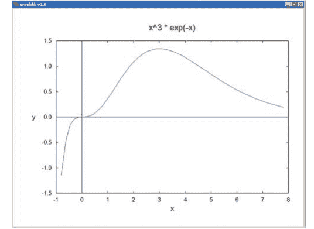

*Figure 3.8 Plot of the function x³ e⁻ˣ created using routine Plot from module graphlib.py.*

As explained in `Section 3.6`, it is also used as standard graphics library for the C++ programs developed in the book.

`Listing 3.9` provides an abbreviated form of the `graphlib.py` module, presenting, with a few exceptions, only the headers of the member functions.

#### Listing 3.9 The Python Graphics Library `graphlib.py` (Headers Only)

```python
#----------------------------- graphlib.py -----------------------------
#### Graphics library based on Tkinter.
#------------------------------------------------------------------------
from math import *
from utils import *
from tkinter import *

root = Tk()                                 # create Tk root widget
root.title("graphlib v1.0")

#========================================================================
def MainLoop():                            # creates Tk event loop
    root.mainloop()

#========================================================================
def GraphUpdate():                         # updates Tk root widget
    root.update()

#========================================================================
def GraphInit(nxwin, nywin):              # creates Canvas widget and returns object
    global w, nxw, nyw                     # make canvas object available

    nxw = nxwin; nyw = nywin               # canvas size
    w = Canvas(root, width=nxw, height=nyw, bg = "white")   # create canvas
    w.pack()                               # make canvas visible
    return w
```

```python
def GraphClear():
    global w, nxw, nyw          # canvas object and size
    w.delete(ALL)

def Limits(xmin, xmax, maxint):
#### Replaces the limits xmin and xmax of a real interval with the limits of
#### the smallest extended interval which includes a number <= maxint of
#### subintervals of length d * 10**p, with d = 1, 2, 5 and p integer.
#
#### scale - scale factor (10**p)
#### nsigd - relevant number of significant digits
#### nintv - number of subintervals
#
#### Returns: xmin, xmax, scale, nsigd, nintv

def FormStr(x, scale, nsigd):
#### Formats the number x (with factor scale) to nsigd significant digits
#### returning the mantissa in mant[] and the exponent of 10 in expn[].
#
#### Returns: mant, expn

def Plot(x, y, n, col, sty, fxmin, fxmax, fymin, fymax, xtext, ytext, title):
#### Plots a real function of one variable specified by a set of (x,y) points.
#### The x and y-domains are extended to fit at most 10 intervals expressible
#### as d * 10^p, with d = 1, 2, 5 and p integer.
#
#### x[]  - abscissas of tabulation points (x[1] through x[n])
#### y[]  - ordinates of tabulation points (y[1] through y[n])
#### n    - number of tabulation points
#### col  - plot color ("red", "green", "blue" etc.)
#### sty  - plot style: 0 - scatter plot, 1 - line plot, 2 - polar plot,
#### 3 - drop lines, 4 - histogram
#### fxmin - min fractional x-limit of viewport (0 < fxmin < fxmax < 1)
#### fxmax - max fractional x-limit of viewport
#### fymin - min fractional y-limit of viewport (0 < fymin < fymax < 1)
#### fymax - max fractional y-limit of viewport
#### xtext - x-axis title; for "None" - axis is not labeled
#### ytext - y-axis title; for "None" - axis is not labeled
#### title - plot title

def MultiPlot(x, y, sig, n, col, sty, nplot, maxint, \
              xminp, xmaxp, ioptx, yminp, ymaxp, iopty, \
              fxmin, fxmax, fymin, fymax, xtext, ytext, title):
#### Plots nplot real functions of one variable given by sets of (x,y) points.
#### The coordinate sets are stored contiguously in the arrays x[] and y[].
#### The x and y-domains are extended to fit at most maxint intervals
#### expressible as d * 10^p, with d = 1, 2, 5 and p integer.
#
#### x[]  - abscissas of tabulation points for all functions
#### y[]  - ordinates of tabulation points
```

```python
#### sig[]  - error bars of the tabulation points (useful for sty == 4)
#### n[]    - ending index for the individual plots (nmax = n[nplot])
#### col[]  - plot color ("red", "green", "blue" etc.)
#### sty[]  - plot style: 0 - scatter plot with squares
#### 1 - line plot; -1 - dashed line
#### 2 - polar plot; -2 - dashed line
#### 3 - drop lines
#### 4 - error bars; -4 - including line plot
#### nplot  - number of plots
#### maxint - max. number of labeling intervals
#### ioptx  - 0 - resize x-axis automatically
#### 1 - resize x-axis based on user interval [xminp,xmaxp]
#### iopty  - 0 - resize y-axis automatically
#### 1 - resize y-axis based on user interval [yminp,ymaxp]
#### fxmin  - min fractional x-limit of viewport (0 < fxmin < fxmax < 1)
#### fxmax  - max fractional x-limit of viewport
#### fymin  - min fractional y-limit of viewport (0 < fymin < fymax < 1)
#### fymax  - max fractional y-limit of viewport
#### xtext  - x-axis title; for "None" - axis is not labeled
#### ytext  - y-axis title; for "None" - axis is not labeled
#### title  - plot title

#===============================================================================
def RGBcolors(ncolstep):
#-------------------------------------------------------------------------------
#### Generates ncol = 1280/ncolstep RGB colors in icol[1] through icol[ncol]
#
#### Returns: icol, ncol

#===============================================================================
def ColorLegend(fmin, fmax, ixmin, ixmax, iymin, iymax):
#-------------------------------------------------------------------------------
#### Draws and labels the color legend for the interval [fmin, fmax] in the
#### rectangle [ixmin, ixmax] × [iymin, iymax]. [fmin, fmax] is extended to fit at
#### most 10 intervals expressible as d × 10^p, with d = 1, 2, 5 and p integer.
#
#### Returns: fmin, fmax, icol, ncol, nintv

#===============================================================================
def Contour(z, nx, ny, xmin, xmax, ymin, ymax, zmin, zmax, \
            fxmin, fxmax, fymin, fymax, xtext, ytext, title):
#-------------------------------------------------------------------------------
#### Plots a function z(x,y) defined in [xmin,xmax] × [ymin,ymax] and tabulated
#### on a regular Cartesian grid with (nx-1) × (ny-1) mesh cells as contour plot.
#### The level curves result by inverse linear interpolation inside the cells.
#
#### z      - tabulated function values
#### nx     - number of x-mesh points
#### ny     - number of y-mesh points
#### zmin   - minimum level considered
#### zmax   - maximum level considered
#### fxmin  - minimum relative viewport abscissa (0 < fxmin < fxmax < 1)
#### fxmax  - maximum relative viewport abscissa
#### fymin  - minimum relative viewport ordinate (0 < fymin < fymax < 1)
#### fymax  - maximum relative viewport ordinate
#### xtext  - x-axis title; xtext = "" - axis is not labeled
#### ytext  - y-axis title; ytext = "" - axis is not labeled
#### title  - plot title
```

#================================================================================


```python
def PlotParticles(x, y, z, r, col, n, dmax, \
                xminp, xmaxp, ioptx, yminp, ymaxp, ipty, \
                fxmin, fxmax, fymin, fymax, title):
```

# Plots a system of particles as connected colored spheres

`x,y,z[]` - coordinates of particles
`r[]` - radii of particles
`col[]` - colors of particles ("red", "green", "blue" etc.)
`n` - number of particles
`dmax` - max inter-distance for which particles are connected
`ioptx` - 0 - resize x-axis automatically
1 - resize x-axis to provided user interval (`xminp`,`xmaxp`)
`ipty` - 0 - resize y-axis automatically
1 - resize y-axis to provided user interval (`yminp`,`ymaxp`)
`fxmin` - min fractional x-limit of viewport (0 < `fxmin` < `fxmax` < 1)
`fxmax` - max fractional x-limit of viewport
`fymin` - min fractional y-limit of viewport (0 < `fymin` < `fymax` < 1)
`fymax` - max fractional y-limit of viewport
`title` - plot title

```python
def PlotStruct(x, y, z, n, ind1, ind2, ind3, n3, \
                xminp, xmaxp, ioptx, yminp, ymaxp, ipty, \
                fxmin, fxmax, fymin, fymax, title):
```

# Renders a 3D structure defined by nodes and triangular surfaces

`x,y,z[]` - coordinates of nodes
`n` - number of nodes
`ind1[]` - index of 1st node of each triangle
`ind2[]` - index of 2nd node of each triangle
`ind3[]` - index of 3rd node of each triangle
`n3` - number of triangles
`ioptx` - 0 - resize x-axis automatically
1 - resize x-axis to provided user interval (`xminp`,`xmaxp`)
`ipty` - 0 - resize y-axis automatically
1 - resize y-axis to provided user interval (`yminp`,`ymaxp`)
`fxmin` - min fractional x-limit of viewport (0 < `fxmin` < `fxmax` < 1)
`fxmax` - max fractional x-limit of viewport
`fymin` - min fractional y-limit of viewport (0 < `fymin` < `fymax` < 1)
`fymax` - max fractional y-limit of viewport
`title` - plot title

## 3.5.1 Auxiliary Functions

The functions `MainLoop` and `GraphInit` are identical with those from module `graphlib0.py` (see Section 3.4). Two additional functions, `GraphUpdate` and `GraphClear`, are defined to help animating runtime plots. `GraphUpdate` calls the update method of the Tk root widget to process all pending events and redraws the widget, as explained in Section 3.2.1. `GraphClear` clears the drawing area by deleting all the items in the display list of the Canvas widget.

`Limits` is an auxiliary function, designed to extend an arbitrary real interval, specified by the limits `xmin` and `xmax`, so as to include an integer number, not exceeding `maxint`, of equal subintervals of length expressible as `d·10^p`, with `d = 2, 5, or 10` and `p` integer. The output consists of the adjusted values of `xmin` and `xmax`, the scale factor `scale` (equal to `10^p`), the number of significant digits required to optimally represent the limits, `nsigd`, and the resulting integer number of subintervals, `nintv`. The function `Limits` is typically called to adjust the *x* and *y* user intervals for optimal labeling of plots created with routines `Plot` and `MultiPlot`. It is also used to resize contour plots (see function `Contour`) and color legends (see function `ColorLegend`).

On the basis of the previous output from function `Limits`, namely, the scale factor `scale` and the number of significant digits `nsigd`, the function `FormStr` determines the optimal labeling format for a given argument `x`, separating the mantissa in `mant[]` and the exponent of 10 in `exp[]`.

The functions `ColorLegend` and `RGBColors` are used to display a color legend alongside a contour plot (see Figure 3.11). Upon receiving the color step size `ncolstep`, `RGBColors` returns in vector `icol[]` the RGB representation of `1280/ncolstep` color shades. `ColorLegend` adjusts the user interval `[fmin,fmax]` using the function `Limits` and maps the resized interval onto the interval of colors returned by `RGBColors`. The colors are represented by adjacent line segments within the rectangle (in canvas coordinates) `[ixmin,ixmax] × [iymin,iymax]`, which, in turn, are labeled according to the output returned by `Limits`.

The routines composing `graphlib.py` also call the general-purpose auxiliary functions defined in the module `utils.py`, which is listed in Appendix D. These utility functions are `Nint`—rounds its real argument to the closest integer, `Sign`—transfers onto its first argument the sign of the second one, `Magn`—returns the order of magnitude of its argument as a power of 10, and `Index`—creates the index list for the ascending ordering of a vector.

## 3.5.2 Routines for Plotting Functions

The routine `Plot` is conceived for plotting a real function of one variable, being, as pointed out above, an improved version of `Plot0`. Apart from a single supplementary parameter, namely the plot style, the input of the two functions is identical. The arrays `x[]` and `y[]` are expected to contain in their components 1 to `n` the coordinates of the representative points of the function. The plot color is specified by the parameter `col`, and the corresponding arguments can be RGB colors or standard color names. The plot-style parameter `sty` can take one of the integer values: 0—scatter plot, 1—line plot, 2—polar plot, 3—drop lines, and 4—histogram. `fxmin`, `fxmax`, `fymin`, and `fymax` represent the fractional limits of the plotting domain on the canvas, and, finally, `xtext`, `ytext`, and `title` are the titles of the axes and of the whole representation, respectively.

In particular, the call producing the line plot shown in Figure 3.8 is (`sty=1`)

```
Plot(x,y,n,"blue",1,0.15,0.95,0.15,0.85,"x","y","x^3 * exp(-x)")
```

Comparative graphs of the same function, with different style parameters, are shown in Figure 3.9 and can be obtained using the code sequence.

```
GraphInit(1200,800)                                      # create canvas

Plot(x,y,n,"blue",0,0.08,0.48,0.56,0.92,"None","y","Scatter plot sty = 0")
Plot(x,y,n,"red",2,0.56,0.96,0.56,0.92,"x","y","Polar plot sty = 2")
Plot(x,y,n,"red",3,0.08,0.48,0.08,0.44,"x","y","Drop lines sty = 3")
Plot(x,y,n,"blue",4,0.56,0.96,0.08,0.44,"x","None","Histogram sty = 4")
```

Using "None" as axis title inhibits the labeling of the respective axis altogether. A particular feature of polar plots (`sty=2`) is that, irrespective of the function values, the plotting domain is resized to a square, with the *x*- and *y*-axes made equal and centered about the origin. The independent coordinate `x[]` is not supposed to vary monotonically, and this also enables the representation of cyclic functions.

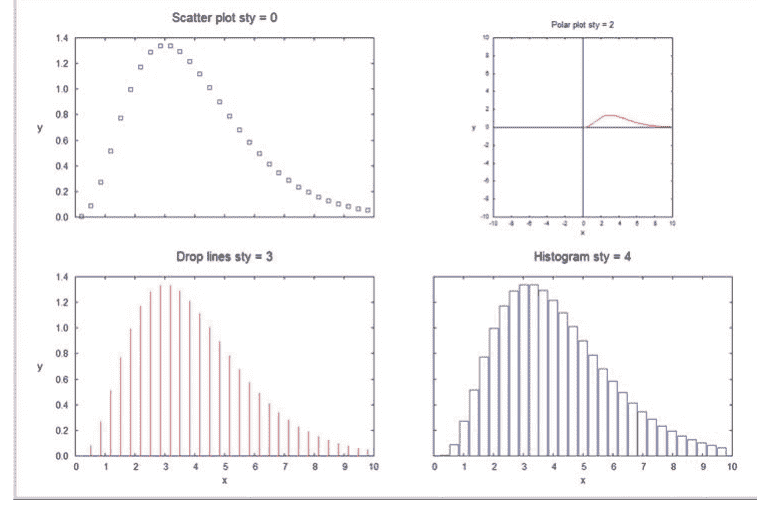

FIGURE 3.9 Plots of function x³ e⁻ˣ created using routine Plot with different style parameters.

The routine `MultiPlot` generalizes the functionalities of routine `Plot`, being designed to depict several functions of one variable on a single graph. The functions are specified by separate sets of (`x`,`y`) points, each defined on independent x-meshes. For an efficient use of the memory, it is not advisable to employ two-dimensional arrays to store the coordinates, with one dimension running over the individual plots and the other, running over the number of points in the largest set. Instead, the representative points of the `nplot` plots are contiguously packed in sequenced sets in the same vectors `x[]` and `y[]`, with an additional array, `n[]`, specifying the ending index for each set.


The array `sig[]` is only used when error bars (`sty[i]=4`) are employed for at least one of the plots. The array `col[]` contains the colors of the individual plots and `sty[]` specifies the corresponding style parameters: 0—scatter plot, 1—line plot, −1—line plot with dashed line, 2—polar plot, −2—polar plot with dashed line, 3—drop lines, 4—error bars, and −4—error bars and continuous line. For `ioptx` set to 0, the x-axis is resized automatically, while for nonzero `ioptx`, the axis is resized based on the provided user interval [`xminp`,`xmaxp`]. The y-axis is resized analogously, in accordance with the option `iopt y`. The rest of the parameters have the same significance as for function `Plot`.

The use of routine `MultiPlot` can be grasped from the program presented in Listing 3.10, which is aimed to plot two functions on the same graph (`nplot=2`). The arrays `n[]`, `col[]`, and `sty[]` are defined with `nplot+1` (i.e., 3) components to compensate for the 0-offset and to make the components of indexes 1 and 2 usable.

With the variables `n1` and `n2` specifying the number of representative points for each function, the arrays `x[]` and `y[]` are initialized with `n1+n2` components, so as to be able to store the data for the concatenated sets. The indexes for the first set range between 1 and `n1`, and those for the second set range between `n1+1` and `n1+n2`. Correspondingly, the ending indexes for the two plots are `n[1]=n1` and `n[2]=n1+n2`. The x-mesh and the respective function values are generated separately for each set.

The color and style parameters for the plots are set in the corresponding components of the arrays `col[]` and `sty[]` and the graph produced by the routine `MultiPlot` is shown in Figure 3.10.

### 清单 3.10 使用例程 MultiPlot 绘制两个函数（Python 代码）

```
# Plots two functions of one variable on the same graph
from math import *
from graphlib import *

def Func(x):                     # function to be plotted
    return pow(x,3) * exp(-x)

#### main

nplot = 2                        # number of plots
n = [0]*(nplot+1)                # ending indexes of plots
col = [""]*(nplot+1)            # plot colors
sty = [0]*(nplot+1)              # plot styles

xmin = -0.82; xmax = 7.8         # limits of plotting interval
n1 = 30                          # number of points for set 1
n2 = 50                          # number of points for set 2

x = [0]*(n1+n2+1)                # coordinates
y = [0]*(n1+n2+1)

h = (xmax-xmin)/(n1-1)           # spacing for set 1
for i in range(1,n1+1):
    x[i] = xmin + (i-1)*h        # arguments
    y[i] = Func(x[i])            # function values

h = (xmax-xmin)/(n2-1)           # spacing for set 2
for i in range(1,n2+1):
    x[n1+i] = xmin + (i-1)*h     # arguments
    y[n1+i] = Func(x[n1+i]) * 0.9  # function values

GraphInit(800,600)               # create canvas

n[1] = n1  ; col[1] = "red"; sty[1] = 0   # scatter plot
n[2] = n1+n2; col[2] = "blue"; sty[2] = 1 # line plot
MultiPlot(x,y,y,n,col,sty,nplot,10,0e0,0e0,0,0e0,0e0,0,
          0.15,0.95,0.15,0.85,"x","y","Multiple plots")  # create plots

MainLoop()                       # enter Tkinter event loop
```

例程 `Contour` 用于创建二元实函数的等高线图，该函数定义在区域 [`xmin`,`xmax`] × [`ymin`,`ymax`] 上，并以规则网格的 `nx` × `ny` 个节点处的函数值 `z[i][j]` 给出。绘图范围限制在 `zmin` 与 `zmax` 之间的 z 值。其余参数（从 `fxmin` 到 `title`）与 `Plot` 和 `MultiPlot` 的含义相同。

总的来说，`Contour` 按递增顺序扫描 `zmin` 与 `zmax` 之间的各个 z 层级。对每个层级，代码依次遍历由四个相邻网格节点构成的方形单元。在每个单元中，沿着四条边分别查找当前 z 层级的出现位置，出现点的坐标通过逆线性插值确定。位于同一单元不同边上的每一对这样的点，都用与当前层级对应的颜色连接成线段。最终，通过拼接各方形单元中的层级线段，得到完整的等高线图。

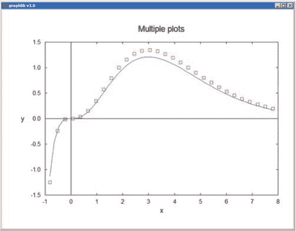

**图 3.10** 使用例程 `MultiPlot` 在同一图形上绘制的两个函数。

### 清单 3.11 使用例程 `Contour` 绘制函数 $\cos x^2 + \cos y^2$ 的等高线图（Python 代码）

```
# Contour plot of a function of two variables
from math import *
from graphlib import *


def Func(x, y):                                      # function to be plotted
    return cos(x*x) + cos(y*y)

#### main

ymin = -pi; xmax = pi; ymin = -pi; ymax = pi             # domain boundaries
nx = 41; ny = 41                                        # number of mesh points

u = [[0]*(ny+1) for j in range(nx+1)]                   # array of function values

hx = (xmax-xmin)/(nx-1)                                 # x-mesh spacing
hy = (ymax-ymin)/(ny-1)                                 # y-mesh spacing
for i in range(1,nx+1):
    x = xmin + (i-1)*hx                                  # x-mesh point
    for j in range(1,ny+1):
        y = ymin + (j-1)*hy                              # y-mesh point
        u[i][j] = Func(x,y)                              # function value

umin = umax = u[1][1]                                   # minimum and maximum of function
for i in range(1,nx+1):
    for j in range(1,ny+1):
        if (u[i][j] < umin): umin = u[i][j]
        if (u[i][j] > umax): umax = u[i][j]

GraphInit(800,800)                                      # create canvas

Contour(u,nx,ny,xmin,xmax,ymin,ymax,umin,umax,           # create contour plot
        0.15,0.85,0.15,0.85,"x","y","cos(x*x) + cos(y*y)")

MainLoop()                                              # enter Tkinter event loop
```

图 3.11 使用例程 `Contour` 创建的函数 cos x² + cos y² 的等高线图。

清单 3.11 给出了一个示例程序，它在区域 [−π, π]×[−π, π] 中创建函数 `f(x, y) = cos x² + cos y²` 的等高线图，生成的图形如图 3.11 所示。间距 `hx` 和 `hy` 在区域内生成 `nx` × `ny` 个规则分布的 `(x, y)` 坐标对，用户函数在这些坐标处求值，并存储在数组 `u[][]` 中。传递给例程的绘图层级限制通常只是用户函数的最小值和最大值 `umin` 与 `umax`。但是，对于具有奇异性的函数，可将绘图层级限制设置为合适的有限值，以便将奇异区域排除在表示之外。

### 3.5.3 简单的 3D 渲染例程

虽然不是本书的主要关注点，但模块 `graphlib.py` 提供了两个简单的例程，用于将 3D（三维）结构渲染为 2D 图像。

第一个 3D 渲染例程名为 `PlotParticles`，它将粒子系统描绘为球体，并可选地通过圆柱键连接（见图 3.12 左图）。主要输入包括 `n` 个粒子中心的坐标向量 `x[]`、`y[]` 和 `z[]`，它们的半径 `r[]` 和颜色 `col[]`。`dmax` 是一个截止距离，超过该距离后粒子之间不再由键连接（当 `dmax` 设为 0 时，不绘制任何键）。`ioptx` 和 `ipty` 参数分别控制 x 轴和 y 轴是自动调整大小以显示整个结构（`ioptx=0` 和 `ipty=0`），还是考虑用户输入的坐标 (`xminp`, `xmaxp`) 和 (`ymin p`, `ymaxp`) 来裁剪图像。其余参数（从 `fxmin` 到 `title`）与例程 `Plot` 和 `MultiPlot` 的含义相同。

不同球体的可见性由简单但效率不高的优先级填充算法处理，该算法按球体距观察者距离的递减顺序绘制球体。从技术上讲，这一点是通过按 z 坐标递增的顺序对粒子进行索引（z 轴指向观察者），然后从最远到最近依次绘制，后绘制的球体覆盖先前绘制的球体。更远的球体将被覆盖，因此会被更近的球体部分或完全遮挡。

### 清单 3.12 使用例程 PlotParticles 对分子进行 3D 渲染（Python 代码）

```
# 3D rendering of a molecule
from graphlib import *

n = 5                                         # number of particles
x = [0, 0.00, 0.52, 0.52,-1.04, 0.00]          # coordinates
y = [0, 0.00, 0.90,-0.90, 0.00, 0.00]          # [0] not used
z = [0, 0.00,-0.37,-0.37,-0.37, 1.10]
r = [0, 0.30, 0.20, 0.20, 0.20, 0.20]           # radii
col = ["", "red", "blue", "blue", "blue", "blue"]  # colors

dmax = 1.5e0                                   # cutoff distance for bonds

GraphInit(600,600)                             # create canvas

PlotParticles(x,y,z,r,col,n,dmax,0e0,0e0,0,0e0,0e0,0,  # plot particles
              0.15,0.85,0.15,0.85,"CH4 molecule")

MainLoop()                                     # enter Tkinter event loop
```

清单 3.12 中给出的示例程序渲染了 CH₄（甲烷）分子，生成的图像见图 3.12 左图。

`PlotStruct` 是一个简单的 3D 渲染例程，用于渲染由节点以及节点之间定义的三角面所指定的结构。`PlotStruct` 的输入包括 `n` 个节点的坐标向量 `x[]`、`y[]` 和 `z[]`，以及定义 `n3` 个三角形中每个三角形的节点索引 `ind1[]`、`ind2[]` 和 `ind3[]`。其余参数与例程 `PlotParticles` 具有相同的含义。这里采用相同的基于优先级填充算法的隐藏技术，但这次在确定绘制顺序时，考虑的是三角形中距离观察者最近的节点。

在清单 3.13 给出的示例中，渲染了一个简化的飞机，生成的图像见图 3.12 右图。

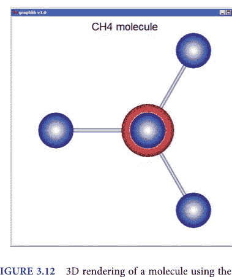

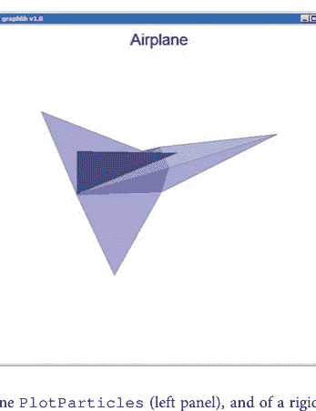

图 3.12 使用例程 `PlotParticles` 对分子的 3D 渲染（左图），以及使用例程 `PlotStruct` 对刚体的 3D 渲染（右图）。

### Listing 3.13 使用例程 `PlotStruct` 进行刚体 3D 渲染 (Python 编码)

```
```python

# 3D rendering of an airplane

from graphlib import *

n = 10                                      # number of nodes

x = [0, -2.7,-0.7,-4.6, 1.8, 0.8, 8.0, 2.2, 1.7,-2.7, 2.7]        # coordinates

y = [0,-0.8,-5.1, 3.6,-0.7, 1.5, 2.4, 0.6, 1.7, 1.5, 1.4]        # [0] not used

z = [0, 0.5, 3.6,-2.5, 0.5,-1.0,-1.7, 0.8, 0.0, 3.8, 0.3]

n3 = 9                                      # number of defining triangles

ind1 = [0, 1, 1, 1, 1, 1, 1, 6, 1]         # indexes of triangle corners

ind2 = [0, 2, 3, 4, 5, 4, 5, 7, 7, 9]

ind3 = [0, 4, 5, 6, 6, 7, 8, 8, 8,10]

GraphInit(600,600)                          # create canvas

PlotStruct(x,y,z,n,ind1,ind2,ind3,n3,θe0,θe0,0,θe0,θe0,0,   # plot structure
```


### 3.5.4 直方图

直方图是一种特殊的绘图类型，可用于*数据的离散分布*，其外观为在有限的数据区间上抬起的相邻矩形，称为*箱*。根据定义，特定矩形的面积等于落入该区间的观测频率，而直方图的累计面积相应地等于观测总数。矩形的高度表示观测频率除以区间宽度，具有频率密度的意义。在更适合显示*数据在各个箱中出现的相对频率*的情况下，直方图可通过简单地将所有箱值除以观测总数来进行归一化。

直方图可以使用来自`graphlib.py`的例程`Plot`绘制，样式参数为`sty=4`，图 3.13 显示了一个示例绘图。然而，在任何离散分布实际作为直方图绘制之前，数据需要先进行分箱（分配到单独的箱中），并且直方图必须归一化。支撑例程`HistoBin`的思想，该例程包含在模块`graphlib.py`中（Listing 3.14），旨在完成这些任务，其思想是，在许多应用中，离散观测值并非从一开始就全部可用。因此，该例程通常以三种连续模式运行：

- *初始化*直方图，即定义箱的边界并将相应的频率归零。
- *分箱*新观测值，即将其分配到适当的箱中并增加相应的出现频率。
- *归一化*直方图，即将频率除以观测总数。

例程`HistoBin`的输入参数为`xnew`——要分箱的新值，`a`和`b`——总分箱区间的限制（超出范围的数据将被忽略），`n`——箱边界的数量（`n−1`为箱的数量），以及`iopt`——指定例程使用模式的选项：0——初始化直方图，1——分箱新值`xnew`，2——归一化直方图。输出由向量`x[]`组成，包含箱边界，以及`y[]`，表示（归一化或未归一化）的频率。具体来说，`y[i]`是在区间`[x[i],x[i+1]]`中发生的观测频率。

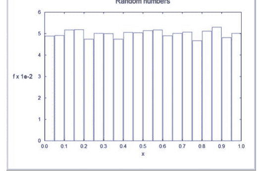

FIGURE 3.13 Histogram of 10,000 random numbers, binned with the function HistoBin and plotted with the function Plot.

图 3.13 使用函数`HistoBin`分箱并使用函数`Plot`绘制的 10,000 个随机数的直方图。

#### Listing 3.14 用于直方图分箱数据的函数 (Python 编码)

```
# ============================================================================
def HistoBin(xnew, a, b, x, y, n, iopt):
# ----------------------------------------------------------------------------
#   Bins data for a histogram to be plotted by function Plot (with sty = 4)
#
#   xnew - new value to be binned
#   a, b - limits of total binning interval
#   x[]  - bin boundaries (x[1] = a, x[n] = b)
#   y[]  - frequency of values in the bins: y[i] in [x[i],x[i+1]), i = 1,n-1
#   n    - number of bin boundaries
#   iopt - option: 0 - zeros bins
#                     1 - bins new value xnew
#                     2 - normalizes histogram
# ----------------------------------------------------------------------------
    h = (b-a)/(n-1)                                         # bin size

    if (iopt == 0):                                         # initialize bins
        for i in range(1,n+1):
            x[i] = a + (i-1)*h                              # bin boundaries
            y[i] = 0e0

    elif (iopt == 1):                                       # bin new values
        i = (int) ((xnew-a)/h) + 1                          # bin index
        if ((i >= 1) and (i < n)): y[i] += 1                # increment bin value

    elif (iopt == 2):                                       # normalize histogram
        s = 0e0
        for i in range(1,n): s += y[i]                      # sum of unnormalized bin values
        for i in range(1,n): y[i] /= s                      # normalize bin values
```

#### Listing 3.15 构建随机数序列的直方图 (Python 编码)

```
# Histogram of random numbers
from random import *
from graphlib import *

n = 21                                          # number of bin boundaries
nrnd = 10000                                    # number of random numbers
x = [0]*(n+1); y = [0]*(n+1)                    # plotting points

a = 0e0; b = 1e0                                # domain limits

HistoBin(0e0,a,b,x,y,n,0)                       # initialize histogram

for irnd in range(1,nrnd+1): HistoBin(random(),a,b,x,y,n,1)  # bin new values

HistoBin(0e0,a,b,x,y,n,2)                       # normalize histogram

GraphInit(800,600)                              # create canvas
Plot(x,y,n,"blue",4,0.15,0.95,0.15,0.85,"x","f x","Random numbers")  # create histogram

MainLoop()                                      # enter Tkinter event loop
```

等距箱边界定义为相对于左边界`a`的间距`h`的整数倍。要分配新观测值`xnew`的箱的索引以及要递增其频率，是基于相对距离`(xnew−a)/h`计算的。

让我们以区间`[0,1]`中随机数序列的分布为例，说明其在 20 个相等子区间中的出现频率直方图（Listing 3.15）。随机数是通过标准模块`random.py`中定义的函数`random()`生成的。`HistoBin`的典型使用方式是使用`iopt=0`进行一次初始调用以归零直方图，使用`iopt=1`进行重复调用以在观测值可用时进行分箱，最后使用`iopt=2`进行一次调用以归一化直方图。

图 3.13 显示了通过生成`nrnd=10000`个随机值并使用`n=21`个箱边界得到的直方图，或者换句话说，`n−1`个采样区间（20 个箱）。由于函数`random()`返回均匀分布的数字，所生成的数值越多，直方图的包络就越接近常数函数。

### 3.6 使用库 graphlib.py 在 C++ 中创建绘图

第 3.5 节中描述的 Python 图形库`graphlib.py`设计为不仅可与 Python 程序一起使用，而且在适当接口的情况下，还可与其它语言一起使用。具体来说，任何包含接口文件`graphlib.h`（列于附录 E）的 C++ 程序都可以以类似的语法无缝调用模块`graphlib.py`中定义的 Python 图形函数。其显著优势在于，这样 C++ 程序就可以受益于基于标准 Tkinter 包的 Python 图形的卓越可移植性。

在 C++ 程序中嵌入 Python 代码的基本概念在附录 C 中进行了说明，下面描述的程序是其直接推广。从技术上讲，`graphlib.h`的正常运行需要通过搜索路径设置或简单地将三个文件放在同一文件夹中，来访问`graphlib.py`（以及其中导入的模块`utils.py`）。

为了实现与模块`graphlib.py`的通信，`graphlib.h`定义了两个包装类：`Python`和`PyGraph`。类`Python`用于调用 Python 解释器，而`PyGraph`的方法则是对`graphlib.py`中包含的图形函数的包装（接口）。来自这两个文件的对应函数具有相同的名称和参数列表：`MainLoop`、`GraphUpdate`、`GraphInit`、`GraphClear`、`Plot`、`MultiPlot`、`Contour`、`PlotParticles`和`PlotStruct`。`HistoBin`在`graphlib.h`和`graphlib.py`中都是一个独立的例程。

为了阐明在 C++ 程序中使用图形库`graphlib.py`的用法，我们再次考虑绘制一个单变量函数的简单示例，与第 3.16 节中给出的实现类似。用于存储表示点坐标的数组使用头文件`memalloc.h`中的函数`Vector`动态分配，该头文件需要在程序中包含。Tkinter 根部件`w`被显式创建为类型为`PyGraph`的对象。Canvas 部件是通过调用`graphlib.py`中的函数`GraphInit`并通过`graphlib.h`中的接口函数调用创建的，该接口函数作为根部件的方法调用。同样，`graphlib.py`中的例程`Plot`和`MainLoop`也是通过`graphlib.h`中的包装函数作为根部件的方法调用。C++ 程序 3.16 产生的图形表示显然与图 3.8 中显示的图形相同。

#### Listing 3.16 Plotting a Function of One Variable (C/C++ Coding)

```
// Plot a function of one variable

#include <math.h>

#include "memalloc.h"

#include "graphlib.h"

double Func(double x)                         // function to be plotted

{ return pow(x,3) * exp(-x); }

int main(int argc, wchar_t** argv)

{

    double *x, *y;                             // declare dynamic arrays as pointers

    double h, xmin, xmax;

    int i, n;

    xmin = -0.8; xmax = 7.8;                   // limits of the plotting interval

    n = 50;                                    // number of points

    x = Vector(1,n);                          // allocate arrays for coordinates of points

    y = Vector(1,n);

    h = (xmax-xmin)/(n-1);                    // argument spacing

    for (i=1; i<=n; i++) {

        x[i] = xmin + (i-1)*h;                // arguments

        y[i] = Func(x[i]);                    // function values

    }

    PyGraph w(argc, argv);                    // create Tkinter root widget

    w.GraphInit(800,600);                     // create canvas

    w.Plot(x,y,n,"blue",1,0.15,0.95,0.15,0.85,"x","y","x^3 * exp(-x)"); // create plot

    w.MainLoop();                             // enter Tkinter event loop

}
```

#### Listing 3.17 Plotting Two Functions with the Routine MultiPlot (C/C++ Coding)

```
// Plots two functions of one variable on the same graph

#include <math.h>

#include "memalloc.h"

#include "graphlib.h"

double Func(double x)                     // function to be plotted

{ return pow(x,3) * exp(-x); }

int main(int argc, wchar_t** argv)

{

    double *x, *y;                         // declare dynamic arrays as pointers

    double h, xmin, xmax;

    int i, n1, n2;

    const int nplot = 2;                  // number of plots

    int n[nplot+1];                       // ending indexes of plots

    int sty[nplot+1];                     // styles of plots

    const char* col[nplot+1];             // colors of plots

    xmin = -0.82; xmax = 7.8;             // limits of plotting interval

    n1 = 30;                              // number of points for set 1

    n2 = 50;                              // number of points for set 2

    x = Vector(1,n1+n2);                  // allocate arrays for coordinates of points

    y = Vector(1,n1+n2);

    h = (xmax-xmin)/(n1-1);               // spacing for set 1

    for (i=1; i<=n1; i++) {

        x[i] = xmin + (i-1)*h;            // arguments

        y[i] = Func(x[i]);                // function values

    }

    h = (xmax-xmin)/(n2-1);               // spacing for set 2

    for (i=1; i<=n2; i++) {

        x[n1+i] = xmin + (i-1)*h;         // arguments

        y[n1+i] = Func(x[n1+i]) * 0.9;    // function values

    }

    PyGraph w(argc, argv);                // create Tkinter root widget

    w.GraphInit(800,600);                 // create canvas

    n[1] = n1 ; col[1] = "red"; sty[1] = 0;   // scatter plot
```


`n[2] = n1+n2; col[2] = "blue"; sty[2] = 1; // line plot`

`w.MultiPlot(x,y,y,n,col,sty,nplot,10,0e0,0e0,0,0e0,0e0,0, // create plots`

`0.15,0.95,0.15,0.85,"x","y","Multiple plots");`

`w.MainLoop(); // enter Tkinter event loop`

}

作为进一步的示例，说明了例程 `MultiPlot` 的使用，我们在 Listing 3.17 中给出了程序 3.10 的逐一翻译。该程序在同一张图上绘制两个函数，我们分配了两个整数数组 `n` 和 `sty`，用于存储要绘制的两个值集合的结束索引和样式参数。`n1` 和 `n2` 指定每个函数的表示点数，数组 `x[]` 和 `y[]` 被声明为指针，然后通过函数

`Vector` 分配为具有 `n1+n2` 个分量，以便容纳连接的坐标集。两个集合的结束索引为 `n[1]=n1` 和 `n[2]=n1+n2`。`x` 网格和相应的函数值是为每个集合单独生成的。关于例程 `MultiPlot` 的参数的进一步解释在第 3.5.2 节中给出。通过运行程序 3.17 产生的图形与图 3.10 中的图形相同。

## Listing 3.18 Contour Plot of the Function cos x² + cos y² Using Routine Contour (C/C++ Coding)

// Contour plot of a function of two variables

#include <math.h>

#include "memalloc.h"

#include "graphlib.h"

#define pi 3.141592653589793

double Func(double x, double y) // function to be plotted

{ return cos(x*x) + cos(y*y); }

int main(int argc, wchar_t** argv)

{

double **u; // declare dynamic array as pointer

double hx, hy, umin, umax, x, xmin, xmax, y, ymin, ymax;

int i, j, nx, ny;

xmin = -pi; xmax = pi; ymin = -pi; ymax = pi; // domain boundaries

nx = 41; ny = 41; // number of mesh points

u = Matrix(1,nx,1,ny); // allocate array of function values

hx = (xmax-xmin)/(nx-1); // x-mesh spacing

hy = (ymax-ymin)/(ny-1); // y-mesh spacing

for (i=1; i<=nx; i++)

x = xmin + (i-1)*hx; // x-mesh point

for (j=1; j<=ny; j++) {

y = ymin + (j-1)*hy; // y-mesh point

u[i][j] = Func(x,y); // function value

}

}

umin = umax = u[1][1]; // minimum and maximum of function

for (i=1; i<=nx; i++)

for (j=1; j<=ny; j++) {

if (u[i][j] < umin) umin = u[i][j];

if (u[i][j] > umax) umax = u[i][j];

}

PyGraph w(argc, argv); // create Tkinter root widget

w.GraphInit(800,800); // create canvas

w.Contour(u,nx,ny,xmin,xmax,ymin,ymax,umin,umax, // create contour plot

0.15,0.85,0.15,0.85,"x","y","cos(x*x) + cos(y*y)");

w.MainLoop(); // enter Tkinter event loop

}

最后一个示例涉及将双变量函数 `cos x² + cos y²` 作为等高线图绘制。相应的程序在 Listing 3.18 中给出，是 Python 程序 3.11 的忠实翻译。

这里，我们使用包含文件 `memalloc.h` 中的函数 `Matrix` 来动态分配函数值数组 `u[][]`。该函数在具有 `nx × ny` 个节点的规则网格上采样。作为等高线图的限制值，例程 `Contour` 接收最小和最大函数值。生成的图与图 3.11 中显示的图相同。

## 参考文献和建议进一步阅读

Beu, T. A. 2004. *Numerical Calculus in C* (3rd ed., in Romanian). Cluj-Napoca: MicroInformatica.

Lundh, F. 2013a. An introduction to Tkinter. http://effbot.org/tkinterbook/tkinter-index.htm.

Lundh, F. 2013b. An Introduction to Tkinter: Basic widget methods. http://effbot.org/tkinterbook/widget.htm.

Lundh, F. 2013c. An introduction to Tkinter: The Tkinter canvas widget. http://effbot.org/tkinterbook/canvas.htm.

Python Wiki. 2013. TkInter. https://wiki.python.org/main/TkInter.

Shipman, J. W. 2013. Tkinter 8.5 reference: A GUI for Python. http://infohost.nmt.edu/tcc/help/pubs/tkinter/web/index.html.

# 4 排序与索引

### 4.1 引言

尽管排序和索引本质上并非数值算法，但它们对于操作大量数据至关重要，这些数据存储在主计算机内存中或作为磁性文件存储。数据结构通常被组织为记录或元组的集合，每个记录由多种类型的若干字段组成。也许最常见的数据结构示例是由个人数据记录组成，其字段保存诸如名字、姓氏、年龄、电子邮件地址等单独的详细信息。用于对记录进行分类的每条记录中的信息称为键，它通常与某个字段相对应，该字段可以是数值型或非数值型。集合中记录的顺序由索引指示。

排序通常表示根据特定顺序关系对集合中的项目进行排序。仅举几个对数据进行排序的典型原因：对数据元素进行优化的顺序访问、快速识别特定数值（如最小值、最大值和中位数）、将数据分离到相关类别（如四分位数）等。

排序可以相对于单个键进行（如姓氏或年龄），也可以根据多个层级从属的键进行（如以姓氏为主键、以名字为次键、以电子邮件地址为三键）。在多键排序的情况下，按主键排序的记录对于相等的主键会按次键进行子排序，以此类推。

特别是在非常大的数据集合的情况下，与记录的有效物理重排相比，建立索引表可能更有效，索引表按记录在排序集合中出现的顺序保存记录索引。具体而言，索引表的第一个条目表示在排序顺序中排第一的记录的索引，第二个条目表示排第二的记录的索引，依此类推。使用索引表的连续元素作为索引，可以按排序顺序访问记录。索引算法可以直接从排序算法改编而来。

当需要相对于相同的排序标准并行处理多个链接集合的记录时，索引特别有用。还可以从索引表派生的有用信息是记录的排名，它只是表示排序记录的序号。

在科学和工程领域特有的数值编程中，结构化数据最常见的是具有张量特征的，并且将其存储在主内存中以数组的形式实现。在这种情况下，常用的键只是元素的大小。下面，我们以数值数组的升序排序为例进行说明，并提供索引表、秩表和排序后的数组：

原始数组：30 60 50 20 10 40

索引：5 4 1 6 3 2

秩：3 6 5 2 1 4

排序后数组：10 20 30 40 50 60

索引数组中的第一个条目是 5，表示排序后数组中的第一个元素是原始数组的第五个元素，即 10。秩数组的第一个元素是 3，表示原始数组的第一个元素，即 30，将代表排序后数组中的第三个条目。

自计算早期以来，已开发出大量排序算法，每种算法都因其特定特征而突出：简单性、键比较次数少、记录交换次数少、稳定性等。尽管对该主题的兴趣很浓，但目前可用的排序算法中没有一种能在各方面都出类拔萃。在下一节中，我们用三种算法来说明这一广泛的主题，涵盖了相当广泛的性能范围：冒泡排序（具有简单编码，但操作次数增加）、插入排序（具有中等复杂度和中等操作次数）以及快速排序（具有增加的复杂度和低操作次数）。

本章开发的 Python 例程是模块 `sort.py` 的成员，其 C/C++ 对应部分包含在头文件 `sort.h` 中（列于第 4.6 节）。

### 4.2 冒泡排序

在所有排序算法中，冒泡排序具有最简单、最直观的底层思想。该方法的名字暗示了其运作方式，这与液体中的气泡类似。考虑标准（升序）排序，较大的值（气泡）会将较小的值挤开，以便首先到达列表末尾的最终排序位置（表面）。尽管其实现简单且稳定，减少到不超过几行代码，但由于其相当大的 O(n²) 最坏情况操作次数，冒泡排序在实践中很少使用，其中 n 是要排序的项目数。冒泡排序相对于其他算法的唯一值得注意的优势是在几乎已排序列表的早期检测中嵌入额外机制的简单性，在这种情况下，操作次数会降至 O(n)。

具体而言，冒泡排序意味着对列表进行重复遍历，其中从左到右依次比较相邻元素对，如果未满足所需顺序关系则交换它们。通过连续的交换，最大的元素已在第一次遍历后到达其在列表末尾的最终位置，作为排序列表的最后一个元素。相应地，第二次遍历需要对缩减为其（据推测）尚未排序的前 n − 1 个元素的列表进行操作。对长度逐渐减少到 2 的列表执行相同的操作，该过程最多在 n − 1 次遍历后产生排序列表。

最坏情况对应于元素按逆序排列的列表。很容易检查，在这种情况下，算法将执行 n(n − 1)/2 次比较和 n(n − 1)/2 次交换（3n(n − 1)/2 次保存操作）。

下一个排序示例说明了冒泡排序的操作。

原始数组：

30 60 50 20 10 40

遍历 1：

遍历 2：

| 30 | 20 | 50 | 10 | 40 | | 60 |

| 30 | 20 | 10 | 50 | 40 | | 60 |

| 30 | 20 | 10 | 40 | 50 | | 60 |

遍历 3：

| 20 | 30 | 10 | 40 | | 50 | 60 |

| 20 | 10 | 30 | 40 | | 50 | 60 |

遍历 4：

| 10 | 20 | 30 | | 40 | 50 | 60 |

垂直双竖线将左侧未排序的较低值与右侧已排序的较高值分隔开。被交换的值对以方框表示并加粗。

在第一次遍历中，算法遍历整个列表，比较相邻值，必要时交换它们，并最终将最大值（60）放在列表末尾。第二次遍历沿着相同的思路进行，但仅针对前五个元素，将第二大值（50）一直交换到子列表末尾。最后一次理论上需要的扫描（“遍历 5”）将对最左边的两个元素进行操作，但不再必要，因为数组已经排序。优化的实际实现应识别元素已按顺序排列，并应放弃这次最后的遍历。

列表 4.1 提供了冒泡排序的三种实现。`BubbleSort0` 表示基本实现，没有嵌入已排序数组的检测。遍历的外层循环由计数器 `ipass` 控制，内层循环的长度，即对相邻元素对的操作，从 n − 1 逐渐减少到 1。无论特定数组如何，`BubbleSort0` 在返回排序数组之前都会执行所有 n(n − 1)/2 次理论比较。

改进版本，即修改的冒泡排序，已在例程 `BubbleSort1` 中实现。它使用一个名为 `swap` 的标志，该标志初始化为 0，如果在整个遍历期间至少进行一次交换，则将其设置为 1。如果遍历结束时未执行任何交换（`swap` 保持为 0），则意味着数组已按顺序排列，过程终止。最佳情况，即已排序的数组，显然仅在第一次遍历期间需要 n − 1 次比较，但没有交换，将总操作次数减少到 O(n)。

例程 `BubbleSort` 代表 `BubbleSort1` 的进一步改进变体，因为它消除了由计数器 `ipass` 和标志 `swap` 对外层循环的双重控制所引起的冗余。所选的编码解决方案是用仅由标志 `swap` 控制的 while 循环替换 for 循环。

## Listing 4.1 基于冒泡排序的排序例程（Python 编码）


```python
# =================================================================================
def BubbleSort0(x, n):
# --------------------------------------------------------------------------------
# Ascending sort of array x[1..n] by bubble sort
# --------------------------------------------------------------------------------
    for ipass in range(1,n):                     # loop of passes
        for i in range(1,n-ipass+1):             # loop over unsorted sublists
            if (x[i] > x[i+1]):                  # compare neighbors
                xi = x[i]; x[i] = x[i+1]; x[i+1] = xi   # swap neighbors

# =================================================================================
def BubbleSort1(x, n):
# --------------------------------------------------------------------------------
# Ascending sort of array x[1..n] by modified bubble sort
# --------------------------------------------------------------------------------
    for ipass in range(1,n):                     # loop of passes
        swap = 0                                 # initialize swap flag
        for i in range(1,n-ipass+1):             # loop over unsorted sublists
            if (x[i] > x[i+1]):                  # compare neighbors
                xi = x[i]; x[i] = x[i+1]; x[i+1] = xi   # swap neighbors
                swap = 1                         # set swap flag
        if (not swap): break                    # exit loop if no swap occurs

# =================================================================================
def BubbleSort(x, n):
# --------------------------------------------------------------------------------
# Ascending sort of array x[1..n] by modified bubble sort
# --------------------------------------------------------------------------------
    ipass = 0                                    # initialize pass counter
    swap = 1                                     # initialize swap flag to enter loop
    while (swap):                                # perform passes while swaps occur
        ipass += 1                               # increase pass counter
        swap = 0                                 # initialize swap flag
        for i in range(1,n-ipass+1):             # loop over unsorted sublists
            if (x[i] > x[i+1]):                  # compare neighbors
                xi = x[i]; x[i] = x[i+1]; x[i+1] = xi   # swap neighbors
                swap = 1                         # set swap flag
```

Listing 4.2 展示了一个通用的主程序，设计用于通过调用 `BubbleSort` 例程对 `n` 个元素的输入数组 `x[]` 进行排序，该例程假定从模块 `sort.py` 中导入。

## 4.3 插入排序

尽管对于大型列表而言，插入排序的效率不如更复杂的排序方法，例如快速排序和堆排序，但它仍然代表了简单性和性能的可靠结合。同样，对于冒泡排序而言，操作次数在最坏情况下（列表按逆序排列）达到 `O(n²)`；然而，插入排序通常比大多数二次算法更有效，包括冒泡排序（参见图 4.1）。此外，插入排序是稳定的（它不会改变具有相等键的记录的初始相对顺序）并且是自适应的（它利用了几乎已排序的列表）。事实上，最佳情况下的操作次数（对于已排序的列表）下降到 `O(n)`。另一个优点是插入排序可以很容易地适应索引和多键排序。

## Listing 4.2 排序例程的通用使用（Python 编码）

```python
# Ascending sort of an array
from sort import *

#### main

n = 6                                      # number of values to be sorted
x = [0., 30., 60., 50., 20., 10., 40.]                     # array to be sorted

print("Original array:")
for i in range(1,n+1): print("{0:6.2f}".format(x[i]),end="")
print ()

BubbleSort(x,n)

print("Sorted array:")
for i in range(1,n+1): print("{0:6.2f}".format(x[i]),end="")
print ()
```

插入排序背后的基本思想是通过将每个添加的元素直接插入到适当的位置，逐步扩展一个已排序的子列表（从仅包含第一个元素的子列表开始）。

从技术上讲，每个插入步骤都从将整个列表中的下一个元素附加到先前已排序的子列表开始。这个所谓的 *pivot* 首先被 *saved* 到一个临时位置，以释放其在列表中的原始位置。接下来，通过与已排序元素的 *comparisons*，按其值的递减顺序，确定 pivot 的适当位置。并行地，已排序子列表中较大的元素一个接一个地 *shifted* 到更高等级的位置，从最大的元素开始，该元素移动到 pivot 的原始位置。最后，pivot 被 *inserted* 到最后由找到的较大值中最小值腾出的位置。

插入排序的操作也可以从下一个示例中理解，该示例指的是之前用于说明冒泡排序的序列。

Original array:

| 30 | 60 | 50 | 20 | 10 | 40 |

|---|---|---|---|---|---|

Pivot 2:

| 30 | **60** | 50 | 20 | 10 | 40 | save pivot **60** |

Pivot 3:

| 30 | 60 | **50** | 20 | 10 | 40 | save pivot **50** |

|---|---|---|---|---|---|---|

| 30 | 60 | **60** | 20 | 10 | 40 | 60 > 50; shift 60 |

| 30 | **50** | 60 | 20 | 10 | 40 | insert pivot |

Pivot 4:

```text
30 50 60 20 | 10 40   save pivot 20
30 50 60 60 | 10 40   60 > 20; shift 60
30 50 50 60 | 10 40   50 > 20; shift 50
30 30 50 60 | 10 40   30 > 20; shift 30
20 30 50 60 | 10 40   insert pivot
```

Pivot 5:

```text
20 30 50 60 10 | 40   save pivot 10
20 30 50 60 60 | 40   60 > 10; shift 60
20 30 50 50 60 | 40   50 > 10; shift 50
20 30 30 50 60 | 40   30 > 10; shift 30
20 20 30 50 60 | 40   20 > 10; shift 20
10 20 30 50 60 | 40   insert pivot
```

Pivot 6:

```text
10 20 30 50 60 40 |   save pivot 40
10 20 30 50 60 60 |   60 > 40; shift 60
10 20 30 50 50 60 |   50 > 40; shift 50
10 20 30 50 40 60 |   insert pivot
```

在上述图表中，连续的阶段由作为 pivot 的元素的索引表示。垂直双竖线将算法操作的在左侧的子列表与之分隔开来（包括先前已排序的序列和 pivot），而未排序的元素位于右侧。框架的配对位置标记了大于 pivot 的元素的提升到更高等级位置，并意味着右侧位置被左侧元素覆盖。

在“Pivot 2”阶段，由仅第一个元素（30）组成的序列通过第二个元素（60）进行扩展，该元素充当 pivot 并被保存到临时位置以使其位置可用。接下来，pivot 与已排序的元素（目前仅为 30）进行比较，如果不存在更大的元素（确实如此），则通过不移动 pivot 终止该传递。

在“Pivot 3”阶段，已排序的序列（30、60）通过第三个元素（50）进行扩充，该元素充当 pivot 并被保存以释放其位置。然后 pivot 按相反顺序与已排序的元素进行比较。由于 60 > 50，60 被向右移动，占据 pivot 的初始位置。由于 30 < 50，搜索结束，pivot 被插入到第二个位置，即 60 刚刚腾出的位置。传递完成后得到一个新的已排序子列表（30、50、60），执行继续进行下一个 pivot。

## Listing 4.3 直接插入升序排序（Python 编码）

```python
# =================================================================================
def InsertSort(x, n):
# --------------------------------------------------------------------------------
# Ascending sort of array x[1..n] by direct insertion
# --------------------------------------------------------------------------------
    for ipiv in range(2,n+1):                     # loop over pivots
        xpiv = x[ipiv]                            # save pivot to free its location
        i = ipiv - 1                              # initialize sublist counter
        while ((i > 0) and (x[i] > xpiv)):        # scan to the left of pivot
            x[i+1] = x[i]                         # item > pivot: shift to the right
            i -= 1
        x[i+1] = xpiv                             # insert pivot into last freed location
```

整个过程重复进行，直到最后一个未排序的元素充当 pivot 并被插入到其适当的位置。

所描述的操作可以在 Listing 4.3 提供的实现中明确识别。变量 `xpiv` 充当当前 pivot 的临时存储。在 `while-loop` 内部，pivot 与已排序的值进行比较，同时伴随着大于 pivot 的值的升序移动（从 `x[i]` 到 `x[i+1]`）。一旦遇到更小的元素，pivot 就被插入到最后释放的位置，即 `x[i+1]`（索引 `i+1` 补偿了子列表计数器 `i` 的最后一次不必要的递减）。

排序算法的平均性能可以通过不同长度的随机序列的操作次数来描述性地揭示（参见问题 4.3）。图 4.1 显示了总比较次数 `Ncomp` 和总操作次数（比较次数加上保存操作次数）`Nop` 的对数-对数图，通过依次使用冒泡排序、插入排序和快速排序（在下一节中介绍）对长度在 `n = 100` 到 `10,000` 之间变化的随机序列进行排序。较大的计数值揭示了冒泡排序效率较低。此外，更陡的斜率也表明随着序列长度的增加，性能下降得更快。对于插入排序而言，它在比较次数方面表现最佳，但在总体上排名第二，被快速排序超越。

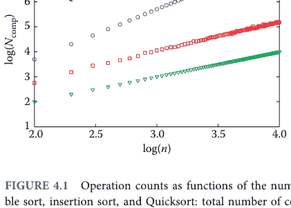

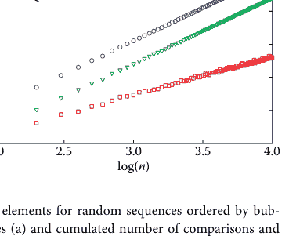

**FIGURE 4.1** 元素数量作为随机序列的函数的操作次数，由冒泡排序、插入排序和快速排序排序：总比较次数（a）和比较次数与交换次数的累计次数（b）。

将枢轴在“<”-列表和“≤”-列表之间以其最终排序位置插入，通过将其与“≥”-列表的第一个元素交换：

30 20 10 40 50 60

<      pv      ≥

第 1 级：递归排序“<”-和“≤”-列表（特别是，“≥”-列表已经排序）：

30 20 10      50 60

使用“<”-列表中最后一个元素作为枢轴：

30 20 10

          pv

通过交换分离“<”-和“≤”-子列表：

30 20 10   30 > 10; 不做任何操作

30 20 10   20 > 10; 不做任何操作

数组已分区（特别是，“<”-子列表缺失）；将枢轴与“≥”-子列表的第一个元素交换以将其置于其排序位置：

10 20 30

pv   ≥

第 2 级：对第 1 级创建的“<”-和“≤”-子列表进行排序（特别是，“<”-子列表缺失且“≥”-子列表已排序）。

第 0 级：以相反顺序返回到顶层，并将排序后的列表就位。

例程 `QuickSort`（清单 4.4）是对所描述算法的一对一实现。 作为参数传递的索引 `l` 和 `n` 定义了在给定调用中要排序的数组 `x[]` 的子数组，并且它们在递归的上下文中特别有意义。 以最后一个元素 `x[n]` 作为枢轴，Quicksort 首先创建一个空的“<”-数组，将其上界索引 `m` 与下界数组索引 `l` 标识。 算法然后扫描小于枢轴的元素。 每个这样的元素都被交换到“<”-列表的末尾，从而扩展它。 一旦找不到小于枢轴的元素，就认为分区到“<”-和“≥”-数组已完成，并且枢轴与“≥”-数组的第一个元素交换，获得其在“<”-和“≥”-数组之间的最终排序位置。 “<”-和“≥”-数组随后通过 `Quicksort` 的自调用递归排序。 当条件 `l>=n` 不再成立时，递归退出。

## 4.5 索引和排名

让我们考虑一个未排序的序列 `X_i`，`i = 1, …, n`，需要按其分量的升序处理。 而不是实际的物理排序，可以构建一个索引表，其分量为 `I_i`，使得间接引用的序列

`X_{I_i}`,   `i = 1, …, n`

相对于索引 `i` 升序排列。 也就是说，`I₁` 表示最小分量 `X_{I₁}` 的索引，而 `Iₙ` 是最大分量 `X_{Iₙ}` 的索引。 索引表 `I` 因此包含了序列 `X` 相对于所考虑的排序标准（在讨论的情况下，按分量值递增）的排序的全部信息。

当同一序列需要相对于多个不同的排序标准进行处理时，索引特别有用。 为此，对于每个标准建立一个索引表，而不是相对于每个标准物理重新排序序列。


原则上，索引表可以基于任何排序算法构建。由于其概念直接、通用性强、并且稳定，我们基于插入排序实现了两种索引算法（参见第 4.3 节）。清单 4.5 中给出的例程 `Index` 代表了其单键实现。我们实现中的第一步是通过索引 `i` 本身初始化索引数组的组件 `ind[i]`，就像已排序的序列一样。例程然后执行一个通用的插入排序，但是，任何涉及分量 `x[i]` 的操作都被替换为对索引数组 `ind[i]` 的对应分量的操作。对已排序分量的具体引用是通过索引数组间接引用完成的，`x[ind[i]]`。这种

### 清单 4.4 基于 Quicksort 的排序（Python 编码）

```
#================================================================================
def QuickSort(x, l, n):
#--------------------------------------------------------------------------------
# Ascending sort of array x[l..n] by Quicksort
#--------------------------------------------------------------------------------
    if (l >= n): return                         # pivot = x[n]; create "<" and ">=" lists
    m = l                                       # upper index in "<"-list
    for i in range(l,n):                        # scan entire list, excepting pivot
        if (x[i] < x[n]):                       # compare current value with pivot
            t = x[i]; x[i] = x[m]; x[m] = t     # swap < value to end of "<"-list
            m += 1                              # extend "<"-list: increase upper index
    t = x[m]; x[m] = x[n]; x[n] = t              # swap pivot between "<" and ">=" lists
    QuickSort(x,l,m-1)                          # sort "<"-list
    QuickSort(x,m+1,n)                          # sort ">="-list
```

间接引用在枢轴 `x[ipiv]` 的情况下是不必要的，因为 `ind[ipiv]` 仍然包含初始值 `ipiv`，并且在之前的步骤中，只有分量 `ind[i]` 与 `i<ipiv` 被修改。

在许多应用中，构建元素相对于排序标准的秩的数组可能很有用。秩简单地表示元素在排序序列中将拥有的序号。对于长度为 `n` 的序列，秩为 1 到 `n` 的整数：秩 1 对应最小元素，而秩 `n` 对应最大元素。秩数组可以很容易地从现有的索引数组获得。具体来说，例程 `Rank`（清单 4.6）将秩 `i` 分配给具有索引 `ind[i]` 的元素。

### 清单 4.5 基于直接插入的索引（Python 编码）

```
#================================================================================
def Index(x, ind, n):
#--------------------------------------------------------------------------------
# Ascending indexing of array x[1..n] in ind[] by insertion sort
#--------------------------------------------------------------------------------
    for i in range(1,n+1): ind[i] = i                # initialize index array
    for ipiv in range(2,n+1):                       # loop over pivots
        xpiv = x[ipiv]                              # save pivot to free its location
        i = ipiv - 1                                # initialize sublist counter
        while ((i > 0) and (x[ind[i]] > xpiv)):     # scan to the left of pivot
            ind[i+1] = ind[i]                       # item > pivot: shift to the right
            i -= 1
        ind[i+1] = ipiv                             # insert pivot into last freed location
```

### 清单 4.6 基于索引数组的排名（Python 编码）

```
#===============================================================================
def Rank(ind, rnk, n):
#-------------------------------------------------------------------------------
# Returns the ranks rnk[1..n] for a list indexed in ind[1..n]
#-------------------------------------------------------------------------------
    for i in range(1,n+1): rnk[ind[i]] = i
```

### 清单 4.7 排序和索引的简单应用（Python 编码）

```
# Ascending sort and indexing of an array
from sort import *

#### main

n = 6                                         # number of values to be sorted
x = [0., 30., 60., 50., 20., 10., 40.]        # array to be sorted
ind = [0]*(n+1); rnk = [0]*(n+1)               # arrays of indexes and ranks

print("Original array:")
for i in range(1,n+1): print("{0:6.2f}".format(x[i]),end="")
print()

Index(x,ind,n)
print("Indexes:")
for i in range(1,n+1): print("{0:6d}".format(ind[i]),end="")
print()

Rank(ind,rnk,n)
print("Ranks:")
for i in range(1,n+1): print("{0:6d}".format(rnk[i]),end="")
print()

print("Indexed array:")
for i in range(1,n+1): print("{0:6.2f}".format(x[ind[i]]),end="")
print()

InsertSort(x,n)
print("Sorted array:")
for i in range(1,n+1): print("{0:6.2f}".format(x[i]),end="")
print()
```

### 清单 4.8 基于直接插入的双键索引例程（Python 编码）

```
# =================================================================================
def Index2(x, y, ind, n):
# --------------------------------------------------------------------------------
#  Ascending indexing of correlated arrays x[1..n] and y[1..n] in ind[] by
#  insertion sort using x[] as primary key and y[] as secondary key
# --------------------------------------------------------------------------------
    for i in range(1,n+1): ind[i] = i                 # initialize index array

    for ipiv in range(2,n+1):                         # loop over pivots
        xpiv = x[ipiv]; ypiv = y[ipiv]
        i = ipiv - 1                                  # initialize sublist counter
        while ((i > 0) and                              # scan to the left of pivot
               (x[ind[i]] > xpiv or (x[ind[i]] == xpiv and y[ind[i]] > ypiv))):
            ind[i+1] = ind[i]                         # item > pivot: shift to the right
            i -= 1

        ind[i+1] = ipiv                               # insert pivot into last freed location
```

### 清单 4.9 两个相关数组的索引（Python 编码）

```
# Ascending indexing of two correlated arrays
from sort import *

#### main

n = 6                                                   # number of values to be sorted
x = [0., 40., 60., 40., 20., 60., 20.]                  # primary array
y = [0., 2., 2., 1., 2., 1., 1.]                        # secondary array
ind = [0]*(n+1)                                         # array of indexes

print("Original arrays:")
print("x",end="")
for i in range(1,n+1): print("{0:6.2f}".format(x[i]),end="")
print()
print("y",end="")
for i in range(1,n+1): print("{0:6.2f}".format(y[i]),end="")
print()

Index2(x,y,ind,n)
print("Indexes:")
for i in range(1,n+1): print("{0:6d}".format(ind[i]),end="")
print()

print("Indexed arrays:")
print("x",end="")
for i in range(1,n+1): print("{0:6.2f}".format(x[ind[i]]),end="")
print()
print("y",end="")
for i in range(1,n+1): print("{0:6.2f}".format(y[ind[i]]),end="")
print()
```

基于本章介绍的技术，可以通过实际排序，例如使用例程 `InsertSort`，或通过使用例程 `Index` 对序列进行索引并间接引用分量，来按升序处理数组 `x[]` 的分量。

## Listing 4.10 Output of Program 4.9.

```
Original arrays:
x 40.00 60.00 40.00 20.00 60.00 20.00
y 2.00 2.00 1.00 2.00 1.00 1.00
Indexes:
6 4 3 1 5 2
Indexed arrays:
x 20.00 20.00 40.00 40.00 60.00 60.00
y 1.00 2.00 1.00 2.00 1.00 2.00
```

使用创建的索引数组 `ind[]`，即 `x[ind[i]]`。Program 4.7 举例说明了这两种选项。然而，由于例程 `InsertSort` 会不可逆地重新排序序列 `x[]`，程序实际上首先通过调用例程 `Index` 和 `Rank` 对原始序列进行索引和排序。

让我们最后处理两个相关数组 `x[]` 和 `y[]` 的同时索引问题，其中 `y[]` 在层级上从属于 `x[]`。在这种情况下，`x[]` 和 `y[]` 的对应分量的值分别充当主键和次要键。Listing 4.8 中提供的例程 `Index2` 代表了单键例程 `Index` 的直接推广。主要区别在于，移动不仅针对大于当前主键枢轴 `xpiv` 的主键数组 `x[]` 的分量，还针对主键值相等且次要数组 `y[]` 的分量大于次要枢轴 `ypiv` 的情况。

例程 `Index2` 的使用在 Program 4.9 中进行了说明，结果输出显示在 Listing 4.10 中。除了 `Index2` 为两个数组 `x[]` 和 `y[]` 返回的索引表 `ind[]` 外，该程序还列出了实际排序后的值 `x[ind[i]]` 和 `y[ind[i]]`。

## 4.6 Implementations in C/C++

Listing 4.11 显示了文件 `sort.h` 的内容，其中包含与正文中开发的 Python 函数等价的 C/C++ 实现，并包含在模块 `sort.py` 中。相应的例程具有相同的名称、参数和功能。

## Listing 4.11 Sorting, Indexing, and Ranking Routines (sort.h)

```
//------------------------------------------- sort.h -------------------------------------------
// Contains routines for sorting, indexing and ranking numeric sequences.
// Part of the numxlib numerics library. Author: Titus Beu, 2013
//-----------------------------------------------------------------------------------------------
#ifndef _SORT_
#define _SORT_

//================================================================================================
void BubbleSort0(double x[], int n)
//-----------------------------------------------------------------------------------------------
// Ascending sort of array x[1..n] by bubble sort
//-----------------------------------------------------------------------------------------------
{
    double xi;
    int i, ipass;

    for (ipass=1; ipass<=(n-1); ipass++)                 // loop of passes
        for (i=1; i<=n-ipass; i++)                      // loop over unsorted sublists
            if (x[i] > x[i+1])                          // compare neighbors
                { xi = x[i]; x[i] = x[i+1]; x[i+1] = xi; }  // swap neighbors
}
```


```c
//================================================================================

void BubbleSort1(double x[], int n)

//--------------------------------------------------------------------------------

// Ascending sort of array x[1..n] by modified bubble sort

//--------------------------------------------------------------------------------

{

    double xi;

    int i, ipass, swap;

    for (ipass=1; ipass<=(n-1); ipass++) {                 // loop of passes

        swap = 0;                                          // initialize swap flag

        for (i=1; i<=n-ipass; i++)                         // loop over unsorted sublists

            if (x[i] > x[i+1]) {                           // compare neighbors

                xi = x[i]; x[i] = x[i+1]; x[i+1] = xi;     // swap neighbors

                swap = 1;                                  // set swap flag

            }

        if (!swap) break;                                  // exit loop if no swap occurs

    }

}

//================================================================================

void BubbleSort(double x[], int n)

//--------------------------------------------------------------------------------

// Ascending sort of array x[1..n] by modified bubble sort

//--------------------------------------------------------------------------------

{

    double xi;

    int i, ipass, swap;

    ipass = 0;                                             // initialize pass counter

    swap = 1;                                              // initialize swap flag to enter loop

    while (swap) {                                         // perform passes while swaps occur

        ipass++;                                           // increase pass counter

        swap = 0;                                          // initialize swap flag

        for (i=1; i<=n-ipass; i++)                         // loop over unsorted sublists

            if (x[i] > x[i+1]) {                           // compare neighbors

                xi = x[i]; x[i] = x[i+1]; x[i+1] = xi;     // swap neighbors

                swap = 1;                                  // set swap flag

            }

    }

}

//================================================================================

void InsertSort(double x[], int n)

//--------------------------------------------------------------------------------

// Ascending sort of array x[1..n] by direct insertion

//--------------------------------------------------------------------------------

{

    double xpiv;

    int i, ipiv;

    for (ipiv=2; ipiv<=n; ipiv++) {                        // loop over pivots

        xpiv = x[ipiv];                                    // save pivot to free its location

        i = ipiv - 1;                                      // initialize sublist counter

        while ((i > 0) && (x[i] > xpiv)) {                 // scan to the left of pivot

            x[i+1] = x[i];                                 // item > pivot: shift to the right

            i--;

        }

    }

    x[i+1] = xpiv;              // insert pivot into last freed location

}

}

//==============================================================================

void QuickSort(double x[], int l, int n)

//------------------------------------------------------------------------------

// Ascending sort of array x[l..n] by Quicksort

//------------------------------------------------------------------------------

{

    double t;

    int i, m;

    if (l >= n) return;                 // pivot = x[n]; create "<" and ">=" lists

    m = l;                              // upper index in "<"-list

    for (i=l; i<=n-1; i++)              // scan entire list, excepting pivot

        if (x[i] < x[n]) {              // compare current value with pivot

            t = x[i]; x[i] = x[m]; x[m] = t;  // swap < value to end of "<"-list

            m++;                        // extend "<"-list: increase upper index

        }

    t = x[m]; x[m] = x[n]; x[n] = t;  // swap pivot between "<" and ">=" lists

    QuickSort(x,l,m-1);                 // sort "<"-list

    QuickSort(x,m+1,n);                 // sort ">="-list

}

//==============================================================================

void Index(double x[], int ind[], int n)

//------------------------------------------------------------------------------

// Ascending indexing of array x[1..n] in ind[] by insertion sort

//------------------------------------------------------------------------------

{

    double xpiv;

    int i, ipiv;

    for (i=1; i<=n; i++) ind[i] = i;            // initialize index array

    for (ipiv=2; ipiv<=n; ipiv++) {             // loop over pivots

        xpiv = x[ipiv];                         // save pivot to free its location

        i = ipiv - 1;                           // initialize sublist counter

        while ((i > 0) && (x[ind[i]] > xpiv)) { // scan to the left of pivot

            ind[i+1] = ind[i];                  // item > pivot: shift to the right

            i--;

        }

        ind[i+1] = ipiv;                        // insert pivot into last freed location

    }

}

//==============================================================================

void Rank(int ind[], int rnk[], int n)

//------------------------------------------------------------------------------

// Returns the ranks rnk[1..n] for a list indexed in ind[1..n]

//------------------------------------------------------------------------------

{

    int i;

    for (i=1; i<=n; i++) rnk[ind[i]] = i;

}
```

```c
//-----------------------------------------------------------------------------
void Index2(double x[], double y[], int ind[], int n)
//-----------------------------------------------------------------------------
// Ascending indexing of correlated arrays x[1..n] and y[1..n] in ind[] by
// insertion sort using x[] as primary key and y[] as secondary key
//-----------------------------------------------------------------------------
{
    double xpiv, ypiv;
    int i, ipiv;

    for (i=1; i<=n; i++) ind[i] = i;             // initialize index array

    for (ipiv=2; ipiv<=n; ipiv++) {              // loop over pivots
        xpiv = x[ipiv]; ypiv = y[ipiv];
        i = ipiv - 1;                            // initialize sublist counter
        while ((i > 0) &&                       // scan to the left of pivot
               (x[ind[i]] > xpiv || (x[ind[i]] == xpiv && y[ind[i]] > ypiv))) {
            ind[i+1] = ind[i];                  // item > pivot: shift to the right
            i--;
        }
        ind[i+1] = ipiv;                         // insert pivot into last freed location
    }
}

#endif
```

## 4.7 问题

以下问题的 Python 和 C/C++ 程序可以分别从模块 `sort.py` 和 `sort.h` 中导入本章开发的函数，这些模块作为补充材料提供。用于创建运行时绘图的图形例程可在库 `graphlib.py` 和 `graphlib.h` 中使用。

## 问题 4.1

四个四分位数将一个排序后的数据集划分为四个组，每组包含相同数量的值（每个占值的 25%）。例如，对于长度为 *n* 的集合，第二四分位数包含排名在 ⌊*n*/4⌋ + 1 到 ⌊*n*/2⌋ 之间的值（方括号表示整数部分），或者说，在排序序列中索引在 ⌊*n*/4⌋ + 1 到 ⌊*n*/2⌋ 之间。

使用 `Index` 和 `Rank` 例程生成序列 *n* = 12 个随机数的升序排序的索引表和秩表。按四分位数对值进行分组并列出它们以及它们的索引和秩。

# 解答

实现分别给出在列表 4.12 和 4.13 中，典型输出显示在列表 4.14 中。

## 列表 4.12 将数组元素排序为四分位数（Python 编码）

```python
# Sorting the elements of an array into quartiles
from sort import *
from random import *

#### main
```


```
n = 12                                          # number of values to be sorted
x = [0]*(n+1)                                   # array to be sorted
ind = [0]*(n+1); rnk = [0]*(n+1)                # arrays of indexes and ranks

print("Original array:")
for i in range(1,n+1):
    x[i] = random()                             # random sub-unitary values
    print("{0:6.2f}".format(x[i]),end="")
print("\n")

Index(x,ind,n)                                  # create array of indexes
Rank(ind,rnk,n)                                 # create array of ranks

print("Quartile 1")
print("      i     ind     rnk         x")
for i in range(1,int(n/4)+1):
    indi = ind[i]
    print("{0:6d}{1:6d}{2:6d}{3:10.2f}".format(i,ind[i],rnk[indi],x[indi]))

print("Quartile 2")
print("      i     ind     rnk         x")
for i in range(int(n/4)+1,int(n/2)+1):
    indi = ind[i]
    print("{0:6d}{1:6d}{2:6d}{3:10.2f}".format(i,ind[i],rnk[indi],x[indi]))

print("Quartile 3")
print("      i     ind     rnk         x")
for i in range(int(n/2)+1,int(3*n/4)+1):
    indi = ind[i]
    print("{0:6d}{1:6d}{2:6d}{3:10.2f}".format(i,ind[i],rnk[indi],x[indi]))

print("Quartile 4")
print("      i     ind     rnk         x")
for i in range(int(3*n/4)+1,n+1):
    indi = ind[i]
    print("{0:6d}{1:6d}{2:6d}{3:10.2f}".format(i,ind[i],rnk[indi],x[indi]))
```

## 列表 4.13 将序列元素排序为四分位数（C/C++ 编码）

```
// Sorting the elements of an array into quartiles
#include <stdio.h>
#include <stdlib.h>
#include "sort.h"

int main()
{
    const int n = 12;                           // number of values to be sorted
    double x[n+1];                              // array to be sorted
    int ind[n+1], rnk[n+1];                     // arrays of indexes and ranks
    int i, indi;

    printf("Original array:\n");
    for (i=1; i<=n; i++) {
        x[i] = rand()/(RAND_MAX+1e0);           // random sub-unitary values
        printf("%6.2f",x[i]);
    }
    printf("\n");
```

```
Index(x,ind,n);                     // create array of indexes
Rank(ind,rnk,n);                     // create array of ranks

printf("Quartile 1\n");
printf("   i    ind    rnk        x\n");
for (i=1; i<=int(n/4); i++) {
    indi = ind[i];
    printf("%6i%6i%6i%10.2f\n",i,ind[i],rnk[indi],x[indi]);
}

printf("Quartile 2\n");
printf("   i    ind    rnk        x\n");
for (i=int(n/4)+1; i<=int(n/2); i++) {
    indi = ind[i];
    printf("%6i%6i%6i%10.2f\n",i,ind[i],rnk[indi],x[indi]);
}

printf("Quartile 3\n");
printf("   i    ind    rnk        x\n");
for (i=int(n/2)+1; i<=int(3*n/4); i++) {
    indi = ind[i];
    printf("%6i%6i%6i%10.2f\n",i,ind[i],rnk[indi],x[indi]);
}

printf("Quartile 4\n");
printf("   i    ind    rnk        x\n");
for (i=int(3*n/4)+1; i<=n; i++) {
    indi = ind[i];
    printf("%6i%6i%6i%10.2f\n",i,ind[i],rnk[indi],x[indi]);
}
}
```

## 列表 4.14 排序程序 4.12 和 4.13 的典型输出

```
Original array:
  0.00  0.56  0.19  0.81  0.58  0.48  0.35  0.90  0.82  0.75  0.17  0.86
Quartile 1
   i    ind    rnk        x
   1     1     1     0.00
   2    11     2     0.17
   3     3     3     0.19
Quartile 2
   i    ind    rnk        x
   4     7     4     0.35
   5     6     5     0.48
   6     2     6     0.56
Quartile 3
   i    ind    rnk        x
   7     5     7     0.58
   8    10     8     0.75
   9     4     9     0.81
Quartile 4
   i    ind    rnk        x
  10     9    10     0.82
  11    12    11     0.86
  12     8    12     0.90
```

## 问题 4.2

使用例程 `Index` 生成 *n* = 50 个随机数的索引表，并使用例程 `InsertSort` 对序列进行排序。使用库 `graphlib` 中的例程 `Plot`，按分量索引将原始序列、排序后的序列以及通过索引表排序的序列作为函数绘制出来。通过值的单调递增目视检查序列是否确实已排序。

# 解答

实现分别显示在列表 4.15 和 4.16 中，原始/排序序列绘制在图 4.2 中。

## 列表 4.15 使用直接插入对随机序列进行排序和索引（Python 编码）

```
# Ascending sort of an array
from random import *
from sort import *
from graphlib import *

#### main

n = 50;                                   # number of values to be sorted
x = [0]*(n+1); x0 = [0]*(n+1)             # array to be sorted and copy
ix = [0]*(n+1)                           # array of sequential indexes
ind = [0]*(n+1)                           # array of indexes

for i in range(1,n+1):
    x[i] = x0[i] = random()               # array to be sorted
    ix[i] = float(i)

GraphInit(1200,600)

Plot(ix,x,n,"blue",3,0.06,0.32,0.25,0.80,"i","x","Initial array")

InsertSort(x,n)

Plot(ix,x,n,"blue",3,0.39,0.65,0.25,0.80,"i","x","Sorted array")

Index(x0,ind,n)
for i in range(1,n+1): x[i] = x0[ind[i]]  # sort by indexing

Plot(ix,x,n,"blue",3,0.72,0.98,0.25,0.80,"i","x","Indexed array")

MainLoop()
```

## 列表 4.16 使用直接插入对随机序列进行排序和索引（C/C++ 编码）

```
// Ascending sort of an array
#include "memalloc.h"
#include "sort.h"
#include "graphlib.h"

int main(int argc, wchar_t** argv)
{
    double *ix, *x, *x0;
    int *ind;
    int i, n;

n = 50;
 x = Vector(1,n); x0 = Vector(1,n);          // number of values to be sorted
 ix = Vector(1,n);                           // array to be sorted and copy
 ind = IVector(1,n);                         // array of sequential indexes
                                          // array of indexes
 for (i=1; i<=n; i++) {
     x[i] = x0[i] = rand();                  // array to be sorted
     ix[i] = double(i);
 }
 PyGraph c(argc, argv);
 c.GraphInit(1200,600);
 c.Plot(ix,x,n,"blue",3,0.06,0.32,0.25,0.80,"i","x","Initial array");
 InsertSort(x,n);
 c.Plot(ix,x,n,"blue",3,0.39,0.65,0.25,0.80,"i","x","Sorted array");
 Index(x0,ind,n);                           // sort by indexing
 for (i=1; i<=n; i++) x[i] = x0[ind[i]];
 c.Plot(ix,x,n,"blue",3,0.72,0.98,0.25,0.80,"i","x","Indexed array");
 c.MainLoop();
 }
```

## 问题 4.3

生成 *n* = 100–10,000 个随机数的序列，并使用冒泡排序、插入排序和快速排序进行比较排序。

- a. 修改正文中开发的排序函数 `BubbleSort`、`InsertSort` 和 `QuickSort`，使其分别单独返回执行的比较次数和保存操作次数，并将这些结果打印到文件中。
- b. 通过使用库 `graphlib` 中的例程 `MultiPlot` 为实现添加绘图功能，并在同一张图上绘制三种排序方法的依赖关系。
- c. 分别对小序列和大序列评估排序算法的性能。

# 解答

修改为返回操作计数的 Python 排序例程给出在列表 4.17 中。全局变量 `ncomp` 和 `nsave` 用于分别从排序例程中检索比较总数和保存操作总数到调用程序中。

## 列表 4.17 修改为返回操作计数的 Python 排序例程（Python 编码）

```
#===============================================================================
def BubbleSort(x, n):
#-------------------------------------------------------------------------------
# Ascending sort of array x[1..n] by modified bubble sort
#-------------------------------------------------------------------------------
    global ncomp, nsave                     # no. of compares and saves
    ipass = 0                               # initialize pass counter
    swap = 1                                # initialize swap flag to enter loop
    while (swap):                           # perform passes while swaps occur
```

ipass += 1                                          # increase pass counter

swap = 0                                            # initialize swap flag

for i in range(1,n-ipass+1):                        # loop over unsorted sublists

    ncomp += 1  #--------------------------------------------

    if (x[i] > x[i+1]):                             # compare neighbors

        nsaves += 3  #----------------------------------------

        xi = x[i]; x[i] = x[i+1]; x[i+1] = xi            # swap neighbors

        swap = 1                                        # set swap flag

#==================================================================

def InsertSort(x, n):

#------------------------------------------------------------------

# Ascending sort of array x[1..n] by direct insertion

#------------------------------------------------------------------

global ncomp, nsaves                                   # no. of compares and saves

for ipiv in range(2,n+1):                              # loop over pivots

    nsaves += 1  #--------------------------------------------

    xpiv = x[ipiv]                                     # save pivot to free its location

    i = ipiv - 1                                       # initialize sublist counter

    ncomp += 1  #--------------------------------------------

    while ((i > 0) and (x[i] > xpiv)):                 # scan to the left of pivot


```python
nsaves += 1  #----------------------------------------

x[i+1] = x[i]                                   # item > pivot: shift to the right

i -= 1

nsaves += 1  #--------------------------------------------

x[i+1] = xpiv                                      # insert pivot into last freed location
```

#==================================================================

```python
def QuickSort(x, l, n):
```
#------------------------------------------------------------------

# Ascending sort of array `x[1..n]` by Quicksort

#------------------------------------------------------------------

```python
global ncomp, nsaves                                   # no. of compares and saves

if (l >= n): return

                                                    # pivot = x[n]; create "<" and ">=" lists

m = l                                               # upper index in "<"-list

for i in range(l,n):                                # scan entire list, excepting pivot

    ncomp += 1  #--------------------------------------------

    if (x[i] < x[n]):                               # compare current value with pivot

        nsaves += 3  #----------------------------------------

        t = x[i]; x[i] = x[m]; x[m] = t              # swap < value to end of "<"-list

        m += 1                                      # extend "<"-list: increase upper index

nsaves += 3  #--------------------------------------------

t = x[m]; x[m] = x[n]; x[n] = t                      # swap pivot between "<" and ">=" lists

QuickSort(x,l,m-1)                                  # sort "<"-list

QuickSort(x,m+1,n)                                  # sort ">="-list
```

与第一个任务相关的完整程序分别可在文件 `P04-SortComp0.py` 和 `P04-SortComp0.cpp` 中找到，它们将输出打印到文件 `sort.txt`。文件 `P04-SortComp1.py` 和 `P04-SortComp1.cpp` 中包含的程序变体已添加图形功能，并生成第二项任务要求的绘图。通过运行这些程序得到的运算次数随序列长度的变化典型依赖关系如图 4.3 所示。

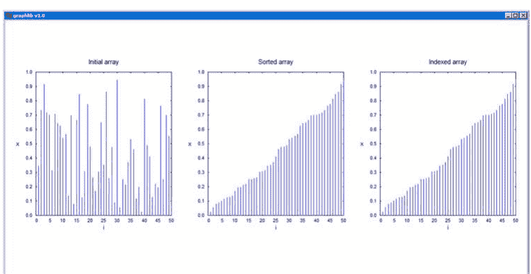

FIGURE 4.2 Original and sorted sequence of random numbers, as returned by routine InsertSort and indexed by routine Index.

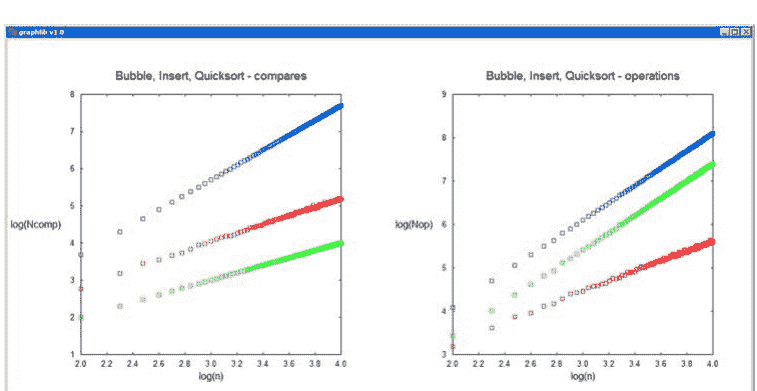

FIGURE 4.3 Comparison of operation counts for random sequences (compares and compares+swaps) for bubble sort, insert sort, and Quicksort.

## References and Suggested Further Reading

Hoare, C. A. R. 1961. Algorithm 64: Quicksort. Communications of the ACM 4(7), 321.

Knuth, D. E. 1998. The Art of Computer Programming (2nd ed.), vol. 3: Sorting and Searching. Reading, MA: Addison-Wesley Professional.

Press, W. H., S. A. Teukolsky, W. T. Vetterling, and B. P. Flannery. 2007. Numerical Recipes (3rd ed.): The Art of Scientific Computing. Cambridge: Cambridge University Press.

Sedgewick, R. 1978. Implementing Quicksort programs. Communications of the ACM 21(10), 847–857.

## Evaluation of Functions

函数求值在数值编程中几乎无处不在，其*准确性*和*效率*在很大程度上决定了计算机代码的整体性能。对于单个求值而言，预定义精度通常已是充分要求，而对于大规模计算，效率可能决定计算是否可行。尽管有时相同的技术可能同时有益于两个方面，但准确性和效率通常是通过不同的方法实现的。

计算所表达和编码的具体形式至关重要，因为由于纯粹的数值现象，完全等价的数学公式可能导致截然不同的结果，或者再次导致相似的结果，但所需时间却相差甚远。事实上，由于数字的有限机器表示（见第 1 章讨论），鉴于不可避免地有限的可行算法步骤数量，数值计算本质上是近似的。从这个角度来看，不经深入分析可能存在的冗余和误差传播而直接对数学公式进行编程，很少是首选方法。恰恰相反，具有良好数学基础的公式，避免了易出错且耗时的运算，有利于实现准确和高效的编程。下一节揭示了常见函数求值方法的陷阱并提供了补救措施。

### 5.1 Evaluation of Polynomials by Horner’s Scheme

多项式是数值应用中最常求值的函数之一。由于其概念上的明显简单性，它们却容易因过度使用内置幂函数而导致低效编码，而幂函数已知耗时。将幂表示为重复乘法可能会略微提高效率，但缺乏优雅性和通用性。

正是霍纳方案使得多项式能够从单项式形式（单项式的线性组合）转换为计算高效的形式，仅涉及基本算术运算。

具有实系数的 n 次多项式

$$P(x)=\sum_{i=0}^{n}a_i x^{n-i}=a_0x^n+a_1x^{n-1}+\cdots+a_{n-1}x+a_n,$$  (5.1)

可通过逐步提出自变量 x 重写为

$$P(x)=((\cdots((a_0x+a_1)x+a_2)x+\cdots+a_{n-1})x+a_n).$$

基于此因子化形式，多项式在特定自变量 x 处的求值在霍纳方案中简化为数 `p_i` 的递归计算：

\begin{cases} p_0 = a_0, \\ p_i = p_{i-1}x + a_i, \quad i = 1,2,\dots,n \end{cases} \tag{5.2}

其中最后一个表示所求的多项式值：

P(x) = p_n. \tag{5.3}

霍纳方案说明了简单算法公式与使用仅基本运算获得的效率的良好结合。它不仅减少了必要的乘法次数，而且还导致数值不稳定性更小，而这种不稳定性否则可能由涉及量级相当的大单项式的减法引起。

可以证明，对于特定 x = x_0，数 p_0, p_1, …, p_{n-1} 是将 P(x) 除以二项式 (x − x_0) 进行综合除法时商多项式 Q(x) 的系数，其中 p_n 是相应的余数且 P(x_0) = p_n，即

P(x) = (x − x_0)Q(x) + p_n, \tag{5.4}

Q(x) = p_0 x^{n-1} + … + p_i x^{n-i-1} + … + p_{n-1}. \tag{5.5}

事实上，将公式 5.5 代入公式 5.4，可得到：

P(x) = p_0 x^n + … + (p_i − p_{i-1} x_0) x^{n-i} + … + (p_n − p_{n-1} x_0).

将系数与公式 5.1 中的 P(x) 的系数进行识别可得到递推式

\begin{cases} a_0 = p_0, \\ a_i = p_i − p_{i-1} x, \quad i = 1,2,\dots,n \end{cases} \tag{5.6}

这显然等价于公式 5.2 并证明了该陈述。因此，公式 5.2 对于 x = x_0 给出了多项式 P(x) 除以二项式 (x − x_0) 的除法商多项式 Q(x) 的系数。

多项式的导数可从

P'(x) = \sum_{i=0}^{n-1} (n − i) a_i x^{n-i-1} \tag{5.7}

同样基于霍纳方案计算，可单独计算，或与多项式 P(x) 本身的求值并行计算。

任意有理分式 R(x) 可表示为两个多项式的分式，

R(x) = \frac{P(x)}{Q(x)}, \tag{5.8}

其中 P(x) 和 Q(x) 可分别使用霍纳方案计算。或者，多项式分式可转换为连分式，其求值方法在第 5.3 节中描述。

Listing 5.1 通过 (5.2) 至 (5.3) 中的函数实现了 Horner 方案，用于求值多项式 (Poly) 及其导数 (PolyDerive)，以及执行综合除法 (PolyDivide)。这三个例程都是模块 `elemfunc.py` 的一部分。

函数 `Poly` 对参数 `x` 求值次数为 `n` 的多项式，其系数为 `a[0]` 至 `a[n]`。量 `p_i` 被实现为单个标量 `p`，因为它们在迭代计算中仅使用一次。`p` 的最后一个值（即 `p_n`）仅代表多项式值，被返回。

函数 `PolyDerive` 通过分量 `b[0]` 到 `b[n]` 返回输入多项式导数的系数，该输入多项式的系数为 `a[ ]`。

例程 `PolyDivide` 在 `b[0]` 到 `b[n-1]` 中返回多项式除以二项式 `(x-x0)` 的商的系数，该多项式的系数为 `a[ ]`。该函数同样可用于对 `x0` 求值被除数多项式，因为最后一个分量 `b[n]` 同时代表余数和多项式值 `P(x0)`。在调用时，数组 `a` 和 `b` 可以重合，输入数组将被简单覆盖。

让我们现在以多项式为例进行说明

P(x) = 6x³ − 11x² + 6x + 3,

其系数 a₀ = 6, a₁ = −11, a₂ = 6, 且 a₃ = 3，且其导数为：

P′(x) = 18x² − 22x + 6.

考虑用二项式 (x − x₀) 进行综合除法，其中 x₀ = 1，根据方程 5.2，商的系数如下：b₀ = a₀ = 6, b₁ = b₀x₀ + a₁ = 6 · 1 − 11 = −5, b₂ = b₁x₀ + a₂ = −5 · 1 + 6 = 1，且余数 b₃ = b₂x₀ + a₃ = 1 · 1 + 3 = 4，这显然等于

# Listing 5.1 Evaluation of Polynomials by Horner’s Scheme (Python Coding)

```
################################################################################
def Poly(x, a, n):
#--------------------------------------------------------------------------------
# Evaluates the polynomial P(x) = a[0] x^n + a[1] x^(n-1) + ... + a[n] with
# real coefficients in x using Horner's scheme
#--------------------------------------------------------------------------------
    p = a[0]
    for i in range(1,n+1): p = p*x + a[i]
    return p

#==============================================================================
def PolyDerive(a, b, n):
#--------------------------------------------------------------------------------
# For the real polynomial P(x) = a[0] x^n + ... + a[n], the function returns
# the coefficients of the derivative P'(x) = b[0] x^(n-1) + ... + b[n-1]
#--------------------------------------------------------------------------------
    for i in range(0,n+1): b[i] = (n-i) * a[i]

#==============================================================================
def PolyDivide(x0, a, b, n):
#--------------------------------------------------------------------------------
# For the real polynomial P(x) = a[0] x^n + ... + a[n], the function returns
# the coefficients of the division by the binomial (x-x0):
# P(x) = (x-x0) (b[0] x^(n-1) + ... + b[n-1]) + b[n] (b[n] = P(x0))
#--------------------------------------------------------------------------------
    b[0] = a[0]
    for i in range(1,n+1): b[i] = b[i-1]*x0 + a[i]
```

# Listing 5.2 Elementary Operations with Polynomials (Python Coding)


```python
# Operations with polynomials
from elemfunc import *

n = 3                                         # degree of polynomial
a = [6e0, -11e0, 6e0, 3e0]                    # coefficients
b = [0]*(n+1)                                 # work array
x0 = 1e0

print("Coefficients of polynomial:")
print(a)

print("\nPolynomial value:")               # evaluation of polynomial
print("P(",x0,") =",Poly(x0, a, n))

PolyDerive(a, b, n)                          # derivative of polynomial
print("\nCoefficients of derivative:")
print(b)

PolyDivide(x0, a, b, n)                      # synthetic division by (x-x0)
print("\nCoefficients of quotient and remainder:")
print(b)
R = b[n]                                     # remainder
print("\nCheck of remainder:")
print("R - P(x0) =",R-Poly(x0,a,n))

x1 = 2e0                                     # check synthetic division for x1
P = Poly(x1,a,n)                             # polynomial value
Q = Poly(x1,b,n-1)                           # quotient value
print("\nCheck of division for x1 =",x1,":")
print("P(x1) - (x1-x0)Q(x1) - R =",P - (x1-x0)*Q - R)
```

等于 `P(x₀)`。商多项式和余数因此为

`Q(x) = 6x² − 5x + 1`,    `R = P(x₀) = 4`.

对特定参数 `x₁` 直接检验综合除法将意味着验证 `P(x₁) − (x₁ − x₀)Q(x₁) − R = 0` 成立。

上述多项式运算在程序 5.2 中实现，该程序假定被调用的例程包含在模块 `elemfunc.py` 中。

## 5.2 Evaluation of Analytic Functions

无穷可微的实函数 `f(x)` 在某点 `x₀` 的邻域 `|x − x₀| < R` 内称为解析的，如果它能由收敛的泰勒级数表示：

`f(x) = f(x₀) + f′(x₀)/1! (x − x₀) + f″(x₀)/2! (x − x₀)² + ⋯ = Σᵢ₌₀^∞ f⁽ⁱ⁾(x₀)/i! (x − x₀)ⁱ.`   (5.9)

在参考点为 `x₀ = 0` 的特殊情况下，展开式称为 Maclaurin 级数。

泰勒级数展开的 `n` 阶部分和称为次数为 `n` 的泰勒多项式：

`Fₙ(x) = Σᵢ₌₀ⁿ f⁽ⁱ⁾(x₀)/i! (x − x₀)ⁱ = Σᵢ₌₀ⁿ tᵢ(x).`   (5.10)

`n` 阶余数定义为函数 `f(x)` 与 `n` 次泰勒多项式之差，

$$R_n(x)=f(x)-F_n(x)=\sum_{i=n+1}^{\infty}t_i(x)\tag{5.11}$$

它代表用 `n` 次泰勒多项式代替函数 `f(x)` 的误差，或等价地，截断泰勒级数到 `n` 阶项后的误差。鉴于对于收敛的交替级数，截断误差严格地由所加入的最后一项的绝对值从上方界定 (Demidovich and Maron 1987)，即 `|R_n(x)| ≤ |t_n(x)|`，后者通常提供了绝对误差和相对误差的实用估计：

$$\Delta^{(n)}=|t_n(x)|,\quad\delta^{(n)}=\frac{|t_n(x)|}{|F_n(x)|}.\tag{5.12}$$

让我们以指数函数的幂级数展开为例进行说明，

$$e^x=\sum_{i=0}^{\infty}\frac{x^i}{i!}=1+x+\frac{x^2}{2!}+\cdots,$$

其收敛区间为 `(-∞, +∞)`（对任意参数都收敛）。在此情况下 `n` 次泰勒多项式为

$$F_n(x)=\sum_{i=0}^{n}t_i(x),\quad t_i(x)=\frac{x^i}{i!}.\tag{5.13}$$

在从级数展开求值函数时，总是希望利用相邻项之间的可能递推关系。特别地，对于指数函数，简单的递推关系 `t_i = (x/i) t_{i−1}` 带来显著好处，即避免计算阶乘，这既慢又可能导致溢出。相应地，计算可以基于递推方案高效地执行：

$$\begin{cases}t_0=1, & F_0=1,\\ t_i=\dfrac{x}{i}\,t_{i-1}, & F_i=F_{i-1}+t_i,\quad i=1,2,\dots,n,\dots\end{cases}\tag{5.14}$$

迭代过程应继续进行，直到相对误差估计降至预定义容差 `ε` 以下，即

$$|t_n/F_n|\le\varepsilon.$$

为了以统一的方式处理 `F_n = 0` 的情况，避免额外的测试或可能的除零，收敛准则可重新表述为

$$|t_n|\le\varepsilon|F_n|.\tag{5.15}$$

Listing 5.3 中的函数 `Exp0` 举例说明了递推过程 (5.14) 至 (5.15) 的直接实现。该例程接收参数 `x` 并以其名称返回指数值。相对容差 `eps` 被设置为利用变量的双精度表示（本质上要求 14 位十进制有效数字），但更灵活的实现，可能在更复杂的情况下有用，将通过参数列表传递 `eps`。求和循环被编码为 `while` 块，因为迭代次数事先未知，且收敛速度（达到给定精度所需的项数）在很大程度上取决于特定参数。项 `t_i` 全部存储在同一个标量变量 `t` 中，因为一旦使用 `t_{i-1}` 计算 `t_i`，前者就变得冗余。

尽管函数 `Exp0` 对正参数完全无故障地工作，以所有有效数字再现内置指数函数 `exp` 的结果，但对于负参数它逐渐表现出其主要弱点。直到 `x = −8`，`Exp0` 仍能准确提供所有有效数字，对于 `x = −15` 只有 7 位数字保持精确，而对于 `x = −20`，返回的值几乎只能再现精确结果的 3 位数字。事实上，对于负参数，级数中的项交替为正负。如第 1 章所讨论，接近值的差值受到比运算对象更大的相对误差影响。因此，对于递增的负参数，级数表现出通过减去越来越大的相邻高阶项而累积舍入误差的渐进趋势。

# Listing 5.3 Exponential from Power-Series Expansion (Python Coding)

```python
#===============================================================================
def Exp0(x):
#-------------------------------------------------------------------------------
# Evaluates exp(x) from its power-series expansion
#-------------------------------------------------------------------------------
    eps = 1e-14                                    # relative precision

    i = 0
    f = t = 1e0
    while (fabs(t) > eps*fabs(f)):
        i += 1
        t *= x/i
        f += t

    return f
```

# Listing 5.4 Exponential from Power-Series Expansion (Corrected) (Python Coding)

```python
#===============================================================================
def Exp(x):
#-------------------------------------------------------------------------------
# Evaluates exp(x) from its power-series expansion
# For x < 0 avoids potential instabilities due to subtractions
#-------------------------------------------------------------------------------
    eps = 1e-14                                    # relative precision

    i = 0
    f = t = 1e0
    absx = fabs(x)
    while (fabs(t) > eps*fabs(f)):
        i += 1
        t *= absx/i
        f += t

    return f if (x >= 0e0) else 1e0/f
```

对算法 5.14 在负参数下表现不佳的一个简单解决方案，同时保持其对正参数的完美运行，是重新定义负参数的指数为绝对参数指数的倒数：

`e^x = { e^{|x|} for x ≥ 0, 1/e^{|x|} for x < 0. }`

由此得到的例程称为 `Exp`，给出在清单 5.4 中。

## 5.3 连分数

一个暗示在后续分母中递归求和分数的数学表达式，即

`a0 + b1/(a1 + b2/(a2 + ⋯)) ≡ [a0; b1/a1, b2/a2, …, bi/ai, …]` (5.16)

称为连分数。元素 `ai` 和 `bi` （`i = 0, 1, 2, …`）可以是数字或函数。有限（或终止）连分数是指具有有限个元素的连分数，它与通过从最高索引元素开始逐步化为共同分母得到的普通分数相同。在无限（或非终止）连分数的情况下，评估不能简化为化为共同分母，且 certainly 不能在有限步数内完成。

例如，数 `e = 2.71828…` 允许连分数表示：

`e = [1; 1/1, -1/2, 1/3, -1/2, 1/5, -1/2, …].`

我们称连分数的收敛子为表达式：

`R1 = a0 + b1/a1, R2 = a0 + b1/(a1 + b2/a2), …`

`Ri` 为 `i` 阶收敛子。

如果收敛子序列存在极限，则称连分数为收敛的

`A = lim_{i→∞} Ri,`

并且该值归属于该分数。如果极限不存在，则该分数称为发散的。

### 定理 5.1

对于连分数，收敛子的分子 `$P_i$` 和分母 `$Q_i$`

`R_i = P_i / Q_i, i = 1, 2, 3, …` (5.17)

满足递推关系

`P_i = a_iP_{i-1} + b_iP_{i-2},` (5.18)

`Q_i = a_iQ_{i-1} + b_iQ_{i-2},` (5.19)

其中

`{ P_0 = a_0, P_{-1} = 1, Q_0 = 1, Q_{-1} = 0. }` (5.20)

证明可通过数学归纳法 readily 完成。对于 `i = 1` 我们有

`R_1 = a_0 + b_1/a_1 = (a_1a_0 + b_1)/a_1 = (a_1P_0 + b_1P_{-1})/(a_1Q_0 + b_1Q_{-1}) = P_1/Q_1`

并且第一个陈述为真。假设定理对所有至 `i` 的指标都成立，我们证明它对 `i + 1` 同样成立。根据假设：

`R_i = P_i/Q_i = (a_iP_{i-1} + b_iP_{i-2})/(a_iQ_{i-1} + b_iQ_{i-2})`

`R_{i+1}` 然后通过在此处将 `a_i` 替换为 `(a_i + b_{i+1}/a_{i+1})` 并使用方程 5.18 和 5.19 得到：

`R_{i+1} = ((a_i + b_{i+1}/a_{i+1})P_{i-1} + b_iP_{i-2})/((a_i + b_{i+1}/a_{i+1})Q_{i-1} + b_iQ_{i-2}) = (P_i + (b_{i+1}/a_{i+1})P_{i-1})/(Q_i + (b_{i+1}/a_{i+1})Q_{i-1}).`

最后，我们得到

`R_{i+1} = (a_{i+1}P_i + b_{i+1}P_{i-1})/(a_{i+1}Q_i + b_{i+1}Q_{i-1}) = P_{i+1}/Q_{i+1},`

并且定理因此被证明。

连分数具有显著的优势，即比任何其他无限函数表示，如幂级数展开，更快速收敛。

下面，让我们以 `tan x` 的连分数表示为例：

`tan x = [0; x/1, -x²/3, -x²/5, …, -x²/(2i-1), …].` (5.21)

分数的元素可识别为

`{ b_1 = x, b_i = -x², a_0 = 0, a_1 = 1, a_i = a_{i-1} + 2, i = 2, 3, … }`

注意到 `P_1 = b_1 = x` 且 `Q_1 = a_1 = 1`，我们有以下起始值：

`{ a_1 = 1, b = -x², P_0 = 0, P_1 = x, Q_0 = 1, Q_1 = 1. }` (5.22)

收敛子 `R_i` 的递归求值使用关系式完成：

`{ a_i = a_{i-1} + 2, i = 2,3,…, P_i = a_i P_{i-1} + b P_{i-2}, Q_i = a_i Q_{i-1} + b Q_{i-2}, R_i = P_i / Q_i. }` (5.23)

为了达到 `tan x` 值给定的相对精度 `ε`，迭代必须继续进行，直到两个连续收敛子之间的相对差超过 `ε`，或等价地，直到

`|R_i - R_{i-1}| ≤ ε |R_i|.` (5.24)

清单 5.5 中给出的例程 `Tan` 从其连分数表示评估 `tan x` 函数，基于关系式 5.22 至 5.24。对于存储收敛子的分子 `P_i`, `P_{i-1}` 和 `P_{i-2}`，设置了一个变量栈（`p`、`pm1` 和 `pm2`）。分母 `Q_i` 也采用类似的栈。对于收敛子 `R_i`，仅需两个值，即最近的一个和前一个，以评估连续迭代之间的相对变化。栈中的值在每次迭代开始时向后移动，以便为最近的值 `P_i`, `Q_i` 和 `R_i` 分别在变量 `p`、`q` 和 `r` 中腾出存储空间。

### 清单 5.5 使用连分数表示的正切函数（Python 编码）

```python
# =================================================================================
def Tan(x):
# --------------------------------------------------------------------------------
# Evaluates tan(x) from its continued fraction representation
# --------------------------------------------------------------------------------
    eps = 1e-14                         # relative precision

    a = 1e0; b = -x*x
    pm1 = 0e0; p = x
    qm1 = 1e0; q = 1e0
    rm1 = 0e0; r = x
    while (fabs(r-rm1) > eps*fabs(r)):
        pm2 = pm1; pm1 = p               # shift the stack
        qm2 = qm1; qm1 = q
        rm1 = r
        a += 2e0
        p = a*pm1 + b*pm2
        q = a*qm1 + b*qm2
        r = p/q                         # new convergent value

    return r
```

## 5.4 正交多项式

多项式系统 `{fₙ(x)}` 在区间 `[a, b]` 上关于权函数 `w(x)` 称为正交，如果每个多项式都是平方可积的，并且任意两个不同多项式的标量积为零：

`∫ₐᵇ w(x) fₙ(x) fₘ(x) dx = Nₙ δₙₘ, n, m = 0, 1, 2, …,` (5.25)


其中 `δₙₘ` 是克罗内克 delta。正定权函数 `w(x)` 确定每个多项式 `fₙ(x)` 直到常数归一化因子 `Nₙ`，通常取决于阶数 `n`。归一化因子的指定称为标准化。

表 5.1 总结了一些代表性正交多项式的定义元素——第一类切比雪夫、勒让德、拉盖尔和埃尔米特——在许多科学和工程领域中使用。

值得注意的是，无论它们属于哪个族，正交多项式都满足某些具有相同函数形式的一般关系（Arfken and Weber 2005；Abramowitz and Stegun 1972）。在数学上，所有这些关系都可以从所谓的生成函数导出，生成函数完全表征一个多项式族。其中一个定义关系是多项式满足的二阶微分方程：

`g₂(x) d²fₙ/dx² + g₁(x) dfₙ/dx + hₙ fₙ(x) = 0.`    (5.26)

一般函数 `g₂(x)` 和 `g₁(x)` 依赖于变量 `x`，然而不依赖于次数 `n`，而 `hₙ` 是仅依赖于 `n` 的常数。

正交多项式满足的另外两个一般关系，对其实际求值至关重要，是关于阶数 `n` 的递推关系，

`aₙ fₙ(x) = (bₙ + cₙ x) fₙ₋₁(x) − dₙ fₙ₋₂(x),`    (5.27)

以及 `n` 阶多项式的一阶导数用 `n` 阶和 `n-1` 阶多项式表示的表达式：

`g₂(x) dfₙ/dx = g₁(x) fₙ(x) + g₀(x) fₙ₋₁(x).`    (5.28)

值得注意的是，正交多项式系统的一阶导数 `dfₙ/dx` 本身构成一个正交系统。

### 表 5.1 一些正交多项式的定义（Abramowitz and Stegun 1972）

| `fₙ(x)` | Name | `a` | `b` | `w(x)` | `Nₙ` |
|---|---|---|---|---|---|
| `Tₙ(x)` | Chebyshev of the 1st kind | −1 | 1 | `(1 − x²)⁻¹ᐟ²` | `{ π if n = 0; π/2 if n ≠ 0 }` |
| `Pₙ(x)` | Legendre | −1 | 1 | `1` | `2/(2n + 1)` |
| `Lₙ(x)` | Laguerre | `0` | `∞` | `e⁻ˣ` | `1` |
| `Hₙ(x)` | Hermite | `−∞` | `∞` | `e⁻ˣ²` | `√π 2ⁿ n!` |

注：`a` 和 `b` 是定义域的极限，`w(x)` 是相关的权函数，`Nₙ` 表示归一化因子。

### 表 5.2 递推关系式 (5.27) 的系数以及 0 阶和 1 阶多项式的表达式

| `$f_n(x)$` | `$a_n$` | `$b_n$` | `$c_n$` | `$d_n$` | `$f_0(x)$` | `$f_1(x)$` |
|---|---|---|---|---|---|---|
| `$T_n(x)$` | `1` | `0` | `2` | `1` | `1` | `$x$` |
| `$P_n(x)$` | `$n$` | `0` | `$2n-1$` | `$n-1$` | `1` | `$x$` |
| `$L_n(x)$` | `$n$` | `$2n-1$` | `$-1$` | `$n-1$` | `1` | `$1-x$` |
| `$H_n(x)$` | `1` | `0` | `2` | `$2(n-1)$` | `1` | `$2x$` |

> 来源：Abramowitz and Stegun (1972)。

### 表 5.3 定义关系式 (5.28) 的函数，该关系式连接一阶导数与相邻阶次的正交多项式

| `$f_n(x)$` | `$g_2(x)$` | `$g_1(x)$` | `$g_0(x)$` |
|---|---|---|---|
| `$T_n(x)$` | `$1-x^2$` | `$-nx$` | `$n$` |
| `$P_n(x)$` | `$1-x^2$` | `$-nx$` | `$n$` |
| `$L_n(x)$` | `$x$` | `$n$` | `$-n$` |
| `$H_n(x)$` | `$1$` | `$0$` | `$2n$` |

> 来源：Abramowitz and Stegun (1972)。

递推关系式 (5.27) 的系数以及所提及多项式的 0 阶和 1 阶表达式，用于启动递推，已在表 5.2 中给出。表 5.3 汇总了函数 `$g_0(x)$`、`$g_1(x)$` 和 `$g_2(x)$`，根据公式 5.28 需要它们来计算一阶导数。

我们现在转向利用递推关系式计算正交多项式的问题。为了计算特定自变量 `$x_0$` 下 `$f_n(x)$` 的值，一种选择是从 `$f_0(x)$` 和 `$f_1(x)$` 开始，依次传播低阶多项式表达式，最后求出 `$f_n(x)$` 的结果表达式。这种方法在阶数不太大时就变得不切实际，因为所操作表达式的复杂性迅速增加。更有效的方法是，根据以下步骤递归地传播所隐含多项式的数值：

- 1. 计算起始值 `$f_0(x_0)$` 和 `$f_1(x_0)$`。
- 2. 反复应用递推关系式

```
$f_i(x_0) = \frac{1}{a_i}[(b_i + c_i x_0)f_{i-1}(x_0) - d_i f_{i-2}(x_0)], \quad i = 2, 3, \dots, n. \quad (5.29)$
```

一般而言，递推关系式在计算上比幂级数展开更有效，后者的收敛速率明显取决于特定的自变量值。即使它们在预定次数的操作内提供结果，不受截断误差影响，递推关系式在某些情况下仍可能因舍入误差累积而表现出不稳定性。尽管如此，不稳定性可以通过利用一个普遍性质来规避，即任何在正向迭代下不稳定（由 `$f_{i-1}$` 和 `$f_{i-2}$` 确定 `$f_i$`）的递推关系式，都可以证明在反向迭代下一定是稳定的（由 `$f_{i+1}$` 和 `$f_{i+2}$` 确定 `$f_i$`）。对于反向递推，仍然存在一个微妙问题，即选择两个合适的更高阶多项式以有效地提供起始值。

作为基于正向递推的计算示例，我们考虑第一类切比雪夫多项式。该多项式系统由于所得级数的特别快速收敛而被用作在区间 `[-1, 1]` 上展开函数的基组。具体递推关系式和一阶导数公式为：

```
T_i(x) = 2xT_{i-1}(x) - T_{i-2}(x),    i = 2, 3, ..., n    (5.30)
```

```
dT_n/dx = n/(x^2 - 1) [xT_n(x) - T_{n-1}(x)].    (5.31)
```

用于启动递推的最低阶多项式为

```
T_0(x) = 1,    T_1(x) = x.    (5.32)
```

`Listing 5.6` 中包含的函数 `Chebyshev` 实现了上述过程 (5.30) 至 (5.32)，并返回多项式值以及通过参数 `d` 的一阶导数。

由于无法算法统一，情况 `n = 0` 单独处理，对应导数对任意自变量 `x` 设为零。在 `n = 1` 的情况下，迭代循环根本不执行，将值 `x` 分配给变量 `f` 的同一行代码（`P_1(x) = x`）代表了对更高阶多项式递推的初始化。

对于 `n > 1`，变量 `f`、`fm1` 和 `fm2` 暂时存储值 `T_i(x)`、`T_{i-1}(x)` 和分别 `T_{i-2}(x)`。该变量栈在每次迭代开始时通过向下移动值进行更新，以便释放变量 `f` 用于递推关系式产生的新值。为了避免在 `x = ±1` 时的奇点，导数是从通过应用洛必达法则得到的一个替代形式计算的（不定商的极限等于其导数商的极限），

```
dT_n/dx = n^2/x T_n(x).    (5.33)
```

图 5.1 显示了使用函数 `Chebyshev` 计算得到的第一类切比雪夫多项式 `T_n(x)` 直到阶数 `n = 4` 的图像，可以看出每个多项式的零点数与其次数相匹配。

上述考虑可以完全相同地应用于所有提及的正交多项式，所实现的例程已收集在 `Listing 5.6` 中。

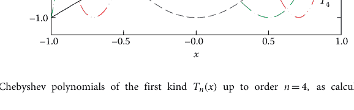

图 5.1 第一类切比雪夫多项式 `T_n(x)` 直到阶数 `n = 4` 的图像，由函数 `Chebyshev` 计算得到。

## Listing 5.6 由递推关系式得到的正交多项式（Python 编码）

```
#===============================================================================
def Chebyshev(n, x):
#-------------------------------------------------------------------------------
# Evaluates the n-th order Chebyshev polynomial and its derivative d in x
# using the recurrence relation
#-------------------------------------------------------------------------------
    if (n == 0):
        f = 1e0; d = 0e0
    else:
        f = x; fm1 = 1e0; x2 = 2*x
        for i in range(2,n+1):
            fm2 = fm1; fm1 = f
            f = x2*fm1 - fm2

        d = n*(x*f-fm1)/(x*x-1e0) if (x*x-1e0) else n*n*f/x

    return (f, d)

#===============================================================================
def Legendre(n, x):
#-------------------------------------------------------------------------------
# Evaluates the n-th order Legendre polynomial and its derivative d in x
# using the recurrence relation
#-------------------------------------------------------------------------------
    if (n == 0):
        f = 1e0; d = 0e0
    else:
        f = x; fm1 = 1e0
        for i in range(2,n+1):
            fm2 = fm1; fm1 = f
            f = ((2*i-1)*x*fm1 - (i-1)*fm2)/i

        d = n*(x*f-fm1)/(x*x-1e0) if (x*x-1e0) else 0.5*n*(n+1)*f/x

    return (f, d)

#===============================================================================
def Laguerre(n, x):
#-------------------------------------------------------------------------------
# Evaluates the n-th order Laguerre polynomial and its derivative d in x
# using the recurrence relation
#-------------------------------------------------------------------------------
    if (n == 0):
        f = 1e0; d = 0e0
    else:
        f = 1e0 - x; fm1 = 1e0
        for i in range(2,n+1):
            fm2 = fm1; fm1 = f
            f = ((2*i-1-x)*fm1 - (i-1)*fm2)/i

        d = n*(f-fm1)/x if x else -n*f

    return (f, d)

#===============================================================================
def Hermite(n, x):
#-------------------------------------------------------------------------------
# Evaluates the n-th order Hermite polynomial and its derivative d in x
# using the recurrence relation
#-----------------------------------------------------------------
if (n == 0):
    f = 1e0; d = 0e0
else:
    f = 2*x; fml = 1e0; x2 = 2*x
    for i in range(2,n+1):
        fm2 = fml; fml = f
        f = x2*fml - 2*(i-1)*fm2
    d = 2*n*fml

return (f, d)
```

## 5.5 球谐函数——缔合勒让德函数

球谐函数和缔合勒让德函数在数学物理的众多基本问题中起着核心作用。其中一个典型出现与通过分离变量法求解球坐标中涉及拉普拉斯算子的偏微分方程有关，例如静电学中的泊松方程或量子力学中的薛定谔方程。

本质上，球谐函数 `Y_{lm}(θ,φ)` 是球坐标中拉普拉斯方程角向部分的解，

$$\frac{1}{\sin\theta}\frac{\partial}{\partial\theta}\left(\sin\theta\frac{\partial Y_{lm}}{\partial\theta}\right)+\frac{1}{\sin^{2}\theta}\frac{\partial^{2}Y_{lm}}{\partial\varphi^{2}}+l(l+1)Y_{lm}=0,\qquad(5.34)$$

其中 `l = 0,1,2,…` 且 `m = -l,-l+1,…,l-1,l`。球谐函数可以用缔合勒让德函数 `P_l^m(cosθ)` 表示为

$$Y_{lm}(\theta,\varphi)=\sqrt{\frac{2l+1}{4\pi}\frac{(l-m)!}{(l+m)!}\,}P_l^m(\cos\theta)e^{im\varphi},\qquad(5.35)$$

并且性质 `Y_{l,-m}(θ,φ)=(-1)^m Y_{lm}^*(θ,φ)` 使它们能够仅用 `m≥0` 的缔合勒让德函数表示。

球谐函数构成了单位球面上平方可积函数空间 `𝒜L_2(S_1)` 的完备正交基组（仅依赖于角度变量的函数，即 `f(θ,φ)`），并满足正交归一化条件：

$$\int_0^{2\pi} d\varphi\int_0^{\pi} Y_{l'm'}^*(\theta,\varphi)Y_{lm}(\theta,\varphi)\sin\theta\,d\theta=\delta_{l l'}\delta_{m m'},\qquad(5.36)$$

以及完备性关系：

$$\sum_{l=0}^{\infty}\sum_{m=-l}^{l}Y_{lm}^*(\theta',\varphi')Y_{lm}(\theta,\varphi)=\frac{\delta(\theta-\theta')\delta(\varphi-\varphi')}{\sin\theta}.\qquad(5.37)$$

完备性和正交归一性保证了任意函数 `f ∈ ℒ_2(S_1)` 都能唯一地在球谐函数上展开为收敛的傅里叶级数：

$$f(\theta,\varphi)=\sum_{l=0}^{\infty}\sum_{m=-l}^{l}a_{lm}Y_{lm}(\theta,\varphi).\tag{5.38}$$

伴随勒让德函数 `P_l^m(x)` 满足微分方程

$$\left(1-x^2\right)\frac{d^2P_l^m}{dx^2}-2x\frac{dP_l^m}{dx}+\left[l(l+1)-\frac{m^2}{1-x^2}\right]P_l^m=0,\tag{5.39}$$

该式可通过将球谐函数 (5.35) 代入方程 5.34 并注意到 `x=cosθ` 得到得到。对于 `m≥0`，伴随勒让德函数可以用基本勒让德多项式 `P_l(x)` 的导数表示：

$$P_l^m(x)=(-1)^m\left(1-x^2\right)^{m/2}\frac{d^m}{dx^m}P_l(x).\tag{5.40}$$

相应的正交关系为：

$$\int_{-1}^{1}P_{l'}^m(x)P_l^m(x)dx=\frac{2}{(2l+1)}\frac{(l+m)!}{(l-m)!}\delta_{l'l}.\tag{5.41}$$

对于负的上标，计算伴随勒让德函数的便捷方法由关系式给出：

$$P_l^{-m}(x)=(-1)^m\frac{(l-m)!}{(l+m)!}P_l^m(x),\quad m=0,1,\dots,l.\tag{5.42}$$

伴随勒让德函数在区间 `[-1,1]` 上平方可积函数空间 `ℒ_2[-1,1]` 中构成完备正交归一基，直接推导出任意函数 `f∈ℒ_2[-1,1]` 都能唯一地在这些函数上展开为收敛的傅里叶级数：

$$f(x)=\sum_{l=0}^{\infty}\sum_{m=-l}^{l}a_{lm}P_l^m(x).\tag{5.43}$$

计算伴随勒让德函数的有效且稳定的方法基于关于其低阶的递推关系：


$$(i-m)P_i^m(x)=(2i-1)xP_{i-1}^m(x)-(i+m-1)P_{i-2}^m(x).\tag{5.44}$$

由给定上标 $m$ 的函数对应的两个值开始递推所带来的复杂性，可以通过考虑由其定义 (5.40) 得到的 $P_{m-1}^m(x)$ 和 $P_m^m(x)$ 的特别简单表达式来克服。事实上，令 $l=m-1$，我们有

$$P_{m-1}^m=0,\tag{5.45}$$

因为这意味着对次数为 $m$ − 1 的多项式进行 *m* 次微分，而令 *l* = *m*，我们得到

$$P_m^m(x)=(-1)^m(2m-1)!!(1-x^2)^{m/2},$$ (5.46)

其中 $(2m-1)!!=1\cdot3\cdot5\cdots(2m-1)$ 为双阶乘（即在此情况下为 $2m-1$ 以下的奇正整数的乘积）。$P_m^m(x)$ 的计算可通过使用等价的乘积形式最有效地进行：

$$P_m^m(x)=\prod_{i=1}^{m}\{(2i-1)[-\sqrt{1-x^2}]\}.$$ (5.47)

一旦计算出 $P_{m-1}^m(x)$ 和 $P_m^m(x)$ 的值，就需要对下指标在 $i=m+1,\ldots,l$ 的值上应用递推关系 (5.44)。

基于关系式 (5.44) 至 (5.47) 的计算伴随勒让德函数的函数在第 5.7 节清单中给出。出于简化的原因，函数 `aLegendre` 仅设计用于 $m\geq0$，因为

**Listing 5.7  Associated Legendre Functions and Spherical Harmonics (Python Coding)**

```python
#====================================================================
def aLegendre(l, m, x):
#--------------------------------------------------------------------
# Evaluates the associated Legendre function of orders l and m >= 0 in x
#--------------------------------------------------------------------
    if (l < m): return 0e0

    p = 1e0; pm1 = 0e0                 # seed values: P(m,m,x), P(m-1,m,x)
    if (m):
        sqx = -sqrt(1e0-x*x)
        for i in range(1,m+1): p *= (2*i-1) * sqx

    for i in range(m+1,l+1):           # recurrence
        pm2 = pm1; pm1 = p
        p = ((2*i-1)*x*pm1 - (i+m-1)*pm2)/(i-m)

    return p

#====================================================================
def SpherY(l, m, theta, phi):
#--------------------------------------------------------------------
# Evaluates the real and imaginary parts (ReY and ImY) of the spherical
# harmonic of orders l and m for arguments theta and phi.
# Calls aLegendre to calculate associated Legendre polynomials.
#--------------------------------------------------------------------
    mabs = abs(m)

    fact = 1e0
    for i in range(l-mabs+1,l+mabs+1): fact *= i       # (l+|m|)!/(l-|m|)!

    fact = sqrt((2*l+1)/(4e0*pi*fact)) * aLegendre(l,mabs,cos(theta))
    if (m < 0 and m % 2): fact = -fact

    ReY = fact * cos(m*phi)
    ImY = fact * sin(m*phi)

    return (ReY, ImY)
```

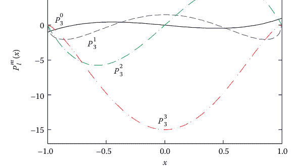

FIGURE 5.2 Plots of associated Legendre functions $P_3^0(x)$, $P_3^1(x)$, $P_3^2(x)$, and $P_3^3(x)$ as calculated by function aLegendre.

$m < 0$ 的值可通过应用性质 (5.42) 简单获得。对于 $l < m$，函数返回 0，因为这相当于对勒让德多项式 $P_l(x)$ 进行 $m$ 次微分，而 $m$ 超过了其次数 $l$。对于 $m > 0$，起始值 $P_m^m(x)$ 根据方程 5.47 计算并存储在变量 `p` 中，而对于 $l > m$，则对 $i = m + 1, \dots, l$ 应用递推关系 (5.44)。

图 5.2 显示了使用函数 `aLegendre` 得到的相关伴随勒让德函数 $P_3^0(x)$、$P_3^1(x)$、$P_3^2(x)$ 和 $P_3^3(x)$ 的绘图示例。显然，随着上标的增加，零点的数量随着构成伴随勒让德函数的多项式的次数降低而减少。

球谐函数的实部和虚部需要直接使用伴随勒让德函数，并且对于 $m \ge 0$，我们有

Re $Y_{lm}(\theta, \varphi) = \sqrt{\frac{2l + 1}{4\pi} \frac{(l - m)!}{(l + m)!}} P_l^m(\cos \theta) \cos m\varphi,$ (5.48)

Im $Y_{lm}(\theta, \varphi) = \sqrt{\frac{2l + 1}{4\pi} \frac{(l - m)!}{(l + m)!}} P_l^m(\cos \theta) \sin m\varphi.$ (5.49)

清单 5.7 中的函数 `SpherY` 实现了这些关系，使用 `ReY` 和 `ImY` 作为输出。在计算归一化因子中出现的 $(l + m)!/(l - m)!$ 时，为避免频繁调用耗时的大量阶乘，仅相乘不同的因子：

$\frac{(l + m)!}{(l - m)!} = (l - m + 1)(l - m + 2)\cdots(l + m) = \prod_{i=l - m + 1}^{l + m} i.$

对于 $m$ 的负值，球谐函数可通过利用性质 $Y_{l,-m}(\theta,\varphi) = (−1)^m Y_l^m*(\theta,\varphi)$ 进行求值。同样出于效率原因，在确定符号因子 $(−1)^m$ 时，我们避免调用内置函数 `pow`，而是检查 $m$ 的奇偶性。

## 5.6 球贝塞尔函数

贝塞尔函数出现在广泛的数学物理问题中，从声振动到量子力学散射（Arfken and Weber 2005）。特别是在球坐标中，球贝塞尔函数构成了球对称方势阱量子力学问题和原子与核物理中弹性散射的径向解。

本节对球贝塞尔函数给予特别关注，也源于它们提供了在某些递推关系正向迭代过程中出现数值不稳定性的说明性例子。尽管如此，不稳定性可以通过向后递推（递减阶数）来规避，从而得到稳定的过程。

球贝塞尔函数的微分方程为：

```
x^2 d^2 f_n / dx^2 + 2x f'_n(x) + [x^2 - n(n+1)] f_n(x) = 0,   n = 0, ±1, ±2, ...   (5.50)
```

其实线性无关解为球贝塞尔函数 $j_n(x)$（正则解）和球诺伊曼函数 $y_n(x)$（奇异解，在原点发散）。

球贝塞尔函数和诺伊曼函数都满足递推关系：

```
f_i(x) = (2i - 1)/x f_{i-1}(x) - f_{i-2}(x),   (5.51)
```

可方便地用于通过从低阶到高阶正向传播函数值来计算给定参数和阶数的函数。最低阶 0 和 1 的简单表达式

```
j0(x) = sin x / x,   j1(x) = 1/x [j0(x) - cos x],   (5.52)
```

```
y0(x) = - cos x / x,   y1(x) = 1/x [y0(x) - sin x],   (5.53)
```

实际上可用于启动递归求值。

对于球诺伊曼函数 $y_n(x)$，基于方程 5.51 且从表达式 5.53 提供的初始值开始的正向递推不会产生任何稳定性问题，直接实现以函数 `SBessy` 在清单 5.8 中给出。

与球诺伊曼函数形成鲜明对比的是，对于球贝塞尔函数 $j_n(x)$，递推关系 5.51 中正向迭代的稳定性并非自动保证。具体而言，小参数 $|x| < n$ 可导致即使在小阶数下舍入误差的显著累积，使得正向递推不适用。避免这些不稳定性的有效方法是 Miller 方法（Miller 1952），其基本依赖于向后递推（递减函数阶数）的稳定性：

```
j_i(x) = (2i + 3)/x j_{i+1}(x) - j_{i+2}(x).   (5.54)
```

缺乏用于启动该递推的大阶数贝塞尔函数的紧凑表达式的问题，可以通过以下认识克服：对于给定的 $x$，球贝塞尔函数的绝对值

# 清单5.8 球诺依曼函数 yₙ(x)（Python编码）

```
#================================================================================
def SBessy(n, x):
#--------------------------------------------------------------------------------
# Evaluates iteratively the spherical Neumann function of order n in x
#--------------------------------------------------------------------------------
y0 = -cos(x)/x
if (n == 0): return y0
y1 = (y0 - sin(x))/x
if (n == 1): return y1

for i in range(2,n+1):
    y = (2*i-1)/x*y1 - y0
    y0 = y1; y1 = y

return y
```

对于阶数 n > |x| 的函数，随着阶数的增加而减小，最终，对于某个足够大的阶数 N ≫ n，当前函数 j_N(x) 在数值上变得可以忽略不计。因此，考虑到对起始值的合理猜测

\[ \tilde{j}_N = 0, \quad \tilde{j}_{N-1} = 1, \tag{5.55} \]

这与微分方程（5.50）的齐次性一致，并在方程5.54中向后迭代，该过程最终得到一系列值 \tilde{j}_N, \tilde{j}_{N-1}, ..., \tilde{j}_n, ..., \tilde{j}_1, \tilde{j}_0，这些值都受到相同的未知缩放因子 k 的影响。特别地，

\[ \tilde{j}_0 = k j_0(x), \tag{5.56} \]

并且，利用已知表达式 j_0(x) = sin x / x，可以很容易地找到缩放因子，从而得到 n 阶球贝塞尔函数的正确值：

\[ j_n(x) = \frac{1}{k} \tilde{j}_n = \frac{j_0(x)}{\tilde{j}_0} \tilde{j}_n. \tag{5.57} \]

Miller算法的另一个优点在于，它还规定了应应用向后递推的条件，并且在这种情况下，它提供了选择合适起始阶数 N 的方法，以便在计算 j_n(x) 时达到目标精度。如前所述，对于 |x| > n，向前迭代始终是稳定的。确定它是否在 |x| < n 时也保持稳定的一种简单方法是，在递推关系5.51的右侧仅保留第一项，该项在 x 值较小时占主导地位：

\[ j_i(x) \simeq \frac{2i - 1}{x} j_{i-1}(x). \tag{5.58} \]

从任意值 \tilde{j}_n = 1 开始，并对递增的阶数 i = n + 1, n + 2, ... 进行迭代，可以监控连续的球贝塞尔函数相对于 j_n 的净增长：

\[ \prod_{i=n}^{N} \frac{2i - 1}{x}. \tag{5.59} \]

# 清单5.9 球贝塞尔函数 jₙ(x)（Python编码）

```
# =================================================================================
def SBessj(n, x):
# --------------------------------------------------------------------------------
# Evaluates iteratively the spherical Bessel function of order n in x
# --------------------------------------------------------------------------------
    if (x == 0e0): return 1e0 if (n == 0) else 0e0
    j0 = sin(x)/x
    if (n == 0): return j0
    j1 = (j0 - cos(x))/x
    if (n == 1): return j1

    nmax = 0                         # finds direction of stable recurrence
    if (n >= fabs(x)):
        # nmax = 0 forward, nmax /= 0 backward
        jn = 1.
        for i in range(n,n+51):
            jn *= (2*i-1)/x           # net factor of increase
            if (jn >= 1e8): nmax = i + 10; break   # for forward iteration

    if (nmax == 0):                   # forward iteration
        for i in range(2,n+1):
            j = (2*i-1)/x*j1 - j0
            j0 = j1; j1 = j
        return j
    else:                             # backward iteration
        j2 = 0.; j1 = 1e-20
        for i in range(nmax,-1,-1):
            j = (2*i+3)/x*j1 - j2
            j2 = j1; j1 = j
            if (i == n): jn = j       # non-normalized jn
        return (j0/j)*jn               # normalized jn
```

如果从某个阶数 N 开始，该因子超过一个合理的值（例如10⁸），则向前递推被证明是不稳定的，因此需要从找到的阶数 N 开始应用向后递推。在向下递推的具体实现中，为了进一步消除初始值（5.55）特定选择的影响，起始阶数还会在找到的值之上进一步增加，通常增加到 N + 10。

清单5.9中的函数 `SBessj` 实现了用于计算 n 阶球贝塞尔函数的Miller算法。对于最低阶，该函数使用解析表达式（5.52）。变量 `nmax` 用于标记递推关系中稳定迭代的方向，当用于下降迭代时，它对应于刻意高估的起始阶数 N > n。

图5.3展示了使用例程 `SBessy` 计算的最高到 n = 3 阶的球诺依曼函数。它们作为非正则解的地位得到确认，可以看到它们在原点处发散。图5.4展示了使用函数 `SBessj` 计算的相应球贝塞尔函数的图形。与球诺依曼函数相比，它们的正则特征源于它们在原点处的有限行为。

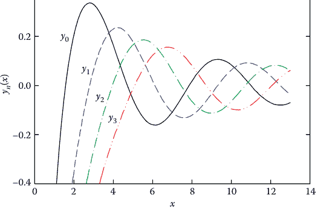

图5.3 由函数 `SBessy` 计算的球诺依曼函数 y_n(x)（n = 0 − 3）。

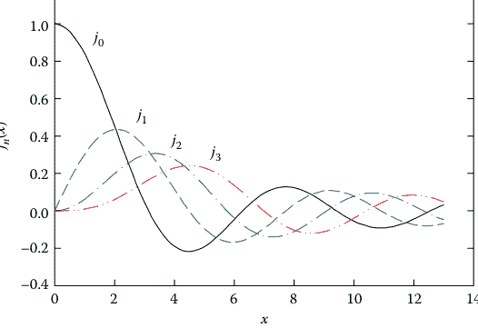

图5.4 由函数 `SBessj` 计算的球贝塞尔函数 j_n(x)（n = 0 − 3）。

## 5.7 C/C++ 实现

清单5.10和5.11展示了文件 `elemfunc.h` 和 `specfunc.h` 的内容，其中包含正文中开发的Python函数的等效C/C++实现，并包含在模块 `elemfunc.py` 和 `specfunc.py` 中。相应的例程具有相同的名称、参数和功能。

### 清单5.10 基本函数（elemfunc.h）


```cpp
//------------------------------ elemfunc.h --------------------------------
// Contains routines for evaluating elementary functions.
// Author: Titus Beu, 2013
//--------------------------------------------------------------------------------
#ifndef __ELEMFUNC__

#define _ELEMFUNC_

#include <math.h>

//================================================================================
double Poly(double x, double a[], int n)
//--------------------------------------------------------------------------------
// Evaluates the polynomial P(x) = a[0] x^n + a[1] x^(n-1) + ... + a[n] with
// real coefficients in x using Horner's scheme
//--------------------------------------------------------------------------------
{
    double p;
    int i;

    p = a[0];
    for (i=1; i<=n; i++) p = p*x + a[i];
    return p;
}

//================================================================================
void PolyDerive(double a[], double b[], int n)
//--------------------------------------------------------------------------------
// For the real polynomial P(x) = a[0] x^n + ... + a[n], the function returns
// the coefficients of the derivative P'(x) = b[0] x^(n-1) + ... + b[n-1]
//--------------------------------------------------------------------------------
{
    int i;

    for (i=0; i<=n; i++) b[i] = (n-i) * a[i];
}

//================================================================================
void PolyDivide(double x0, double a[], double b[], int n)
//--------------------------------------------------------------------------------
// For the real polynomial P(x) = a[0] x^n + ... + a[n], the function returns
// the coefficients of the division by the binomial (x-x0):
// P(x) = (x-x0) (b[0] x^(n-1) + ... + b[n-1]) + b[n]  (b[n] = P(x0))
//--------------------------------------------------------------------------------
{
    int i;

    b[0] = a[0];
    for (i=1; i<=n; i++) b[i] = b[i-1]*x0 + a[i];
}

//================================================================================
double Exp0(double x)
//--------------------------------------------------------------------------------
// Evaluates exp(x) from its power-series expansion
//--------------------------------------------------------------------------------
{
    const double eps = 1e-14;                 // relative precision
    double f, t;
    int i;

    i = 0;
    f = t = 1e0;
    while ((fabs(t) > eps*fabs(f)) {
        i++;
        t *= x/i;
        f += t;
    }
    return f;
}

//================================================================================
double Exp(double x)
//--------------------------------------------------------------------------------
// 由幂级数展开计算 exp(x)
// 对于 x < 0，避免因减法运算而可能产生的不稳定性
//--------------------------------------------------------------------------------
{
    const double eps = 1e-14;                    // 相对精度
    double absx, f, t;
    int i;

    i = 0;
    f = t = 1e0;
    absx = fabs(x);
    while (fabs(t) > eps*fabs(f)) {
        i++;
        t *= absx/i;
        f += t;
    }
    return (x >= 0.0 ? f : 1e0/f);
}

//================================================================================
double Sin(double x)
//--------------------------------------------------------------------------------
// 由幂级数展开计算 sin(x)
//--------------------------------------------------------------------------------
{
    const double eps = 1e-14;                    // 相对精度
    double f, t, x2;
    int i;

    i = 1;
    f = t = x;
    x2 = x*x;
    while (fabs(t) > eps*fabs(f)) {
        i += 2;
        t *= -x2/((i-1)*i);
        f += t;
    }
    return f;
}

//================================================================================
double ArcSin(double x)
//--------------------------------------------------------------------------------
// 由幂级数展开计算 arcsin(x)（|x| < 1）
//--------------------------------------------------------------------------------
{
    const double eps = 1e-14;                    // 相对精度
    double f, t, x2;
    int i, i2;

    i = 1;
    f = t = x;
    x2 = x*x;
    while (fabs(t) > eps*fabs(f)) {
        i2 = i*i;
        i += 2;
        t *= i2*x2/((i-1)*i);
        f += t;
    }
    return f;
}

//================================================================================
double Tan(double x)
//--------------------------------------------------------------------------------
// 由连分数表示计算 tan(x)
//--------------------------------------------------------------------------------
{
    const double eps = 1e-14;                     // 相对精度
    double a, b, p, pm1, pm2, q, qm1, qm2, r, rm1;

    a = 1e0; b = -x*x;
    pm1 = 0e0; p = x;
    qm1 = 1e0; q = 1e0;
    rm1 = 0e0; r = p/q;
    while (fabs(r-rm1) > eps*fabs(r)) {
        pm2 = pm1; pm1 = p;                           // 移动堆栈
        qm2 = qm1; qm1 = q;
        rm1 = r;
        a += 2e0;
        p = a*pm1 + b*pm2;
        q = a*qm1 + b*qm2;
        r = p/q;                                      // 新的收敛值
    }
    return r;
}

//================================================================================
double Expl(double x)
//--------------------------------------------------------------------------------
// 由连分数表示计算 exp(x)
//--------------------------------------------------------------------------------
{
    const double eps = 1e-14;                     // 相对精度
    double a, b, p, pm1, pm2, q, qm1, qm2, r, rm1;
    int i;

    a = 1e0; b = x;
    pm1 = 1e0; p = 1e0 + x;
    qm1 = 1e0; q = 1e0;
    rm1 = 1e0; r = p/q;
    i = 1;
    while (fabs(r-rm1) > eps*fabs(r)) {
        i++;
        pm2 = pm1; pm1 = p;                           // 移动堆栈
        qm2 = qm1; qm1 = q;
        rm1 = r;
        a = (i%2 ? i : 2e0);
        b = -b;
        p = a*pm1 + b*pm2;
        q = a*qm1 + b*qm2;
        r = (q ? p/q : 9e99);                 // 新的收敛值
    }
    return r;
}

#endif
```

## 清单 5.11 特殊函数（`specfunc.h`）

```cpp
//--------------------------------------------------- specfunc.h ---------------------------------------------------
// 包含用于计算特殊函数的例程。
// 是 numxlib 数值库的一部分。作者：Titus Beu，2013
//---------------------------------------------------
#ifndef _SPECFUNC_
#define _SPECFUNC_

#include <stdlib.h>
#include <math.h>

//================================================================================
double Chebyshev(int n, double x, double d)
//---------------------------------------------------
// 计算 n 阶切比雪夫多项式及其在 x 处的导数 d
// 使用递推关系
//---------------------------------------------------
{
    double f, fm1, fm2, x2;
    int i;

    if (n == 0) {
        f = 1e0; d = 0e0;
    } else {
        f = x; fm1 = 1e0; x2 = 2*x;
        for (i=2; i<=n; i++) {
            fm2 = fm1; fm1 = f;
            f = x2*fm1 - fm2;
        }
        d = (x*x-1e0) ? n*(x*f-fm1)/(x*x-1e0) : n*n*f/x;
    }
    return f;
}

//================================================================================
double Legendre(int n, double x, double &d)
//---------------------------------------------------
// 计算 n 阶勒让德多项式及其在 x 处的导数 d
// 使用递推关系
//---------------------------------------------------
{
    double f, fm1, fm2;
    int i;

    if (n == 0) {
        f = 1e0; d = 0e0;
    } else {
        f = x; fm1 = 1e0;
        for (i=2; i<=n; i++) {
            fm2 = fm1; fm1 = f;
            f = ((2*i-1)*x*fm1 - (i-1)*fm2)/i;
        }
        d = (x*x-1e0) ? n*(x*f-fm1)/(x*x-1e0) : 0.5*n*(n+1)*f/x;
    }
    return f;
}

//================================================================================
double aLegendre(int l, int m, double x)
//--------------------------------------------------------------------------------
// 计算 l 阶、m >= 0 次的连带勒让德函数在 x 处的值
//--------------------------------------------------------------------------------
{
    double p, pm1, pm2, sqx;
    int i;

    if (l < m) return 0e0;
    p = 1e0; pm1 = 0e0;                     // 种子值：P(m,m,x), P(m-1,m,x)
    if (m) {
```


```
        sqx = -sqrt(1e0-x*x);

        for (i=1; i<=m; i++) p *= (2*i-1) * sqx;

    }

    for (i=m+1; i<=l; i++) {                 // 递推

        pm2 = pm1; pm1 = p;

        p = ((2*i-1)*x*pm1 - (i+m-1)*pm2)/(i-m);

    }

    return p;

}

//================================================================================

double Laguerre(int n, double x, double &d)

//--------------------------------------------------------------------------------

// 计算 n 阶拉盖尔多项式及其在 x 处的导数 d

// 使用递推关系

//--------------------------------------------------------------------------------

{

    double f, fm1, fm2;

    int i;

    if (n == 0) {

        f = 1e0; d = 0e0;

    } else {

        f = 1e0 - x; fm1 = 1e0;

        for (i=2; i<=n; i++) {

            fm2 = fm1; fm1 = f;

            f = ((2*i-1-x)*fm1 - (i-1)*fm2)/i;

        }

        d = x ? n*(f-fm1)/x : -n*f;

    }

    return f;

}

//================================================================================

double aLaguerre(int n, int k, double x)

//--------------------------------------------------------------------------------

// 计算 n 阶 k 次连带拉盖尔多项式在 x 处的值

// 使用递推关系

//---------------------------------------------------------------------------

{

    double f, fm1, fm2;

    int i;

    if (n == 0) {

        f = 1e0;

    } else {

        f = 1e0 + k - x; fm1 = 1e0;

        for (i=2; i<=n; i++) {

            fm2 = fm1; fm1 = f;

            f = ((2*i+k-1-x)*fm1 - (i+k-1)*fm2)/i;

        }

    }

    return f;

}

//===========================================================================

double Hermite(int n, double x, double &d)

//---------------------------------------------------------------------------

// 计算 n 阶埃尔米特多项式及其在 x 处的导数 d

// 使用递推关系

//---------------------------------------------------------------------------

{

    double f, fm1, fm2, x2;

    int i;

    if (n == 0) {

        f = 1e0; d = 0e0;

    } else {

        f = 2*x; fm1 = 1e0; x2 = 2*x;

        for (i=2; i<=n; i++) {

            fm2 = fm1; fm1 = f;

            f = x2*fm1 - 2*(i-1)*fm2;

        }

        d = 2*n*fm1;

    }

    return f;

}

//===========================================================================

void SpherY(int l, int m, double theta, double phi, double &ReY, double &ImY)

//---------------------------------------------------------------------------

// 计算阶数 l 和 m 的球谐函数在参数 theta 和 phi 处的实部与虚部（ReY 和 ImY）。

// 调用 aLegendre 计算连带勒让德多项式。

//---------------------------------------------------------------------------

{

#define pi 3.141592653589793

    double fact;

    int i, mabs;

    mabs = abs(m);

    fact = 1e0;

    for (i=1-mabs+1; i<=1+mabs; i++) fact *= i;  // (1+|m|)!/(1-|m|)!

    fact = sqrt((2*l+1)/(4e0*pi*fact)) * aLegendre(l,mabs,cos(theta));

y0 = y1; y1 = y;

}

    return y;

}

#endif
```
## 5.8 问题

以下问题的 Python 和 C/C++ 程序可以从本章开发的模块 `elemfunc.py`（.h）中导入函数，并分别针对特殊函数从 `specfunc.py`（.h）中导入，这些文件作为补充材料提供。对于运行时绘图，可以使用包含在库 `graphlib.py` 和 `graphlib.h` 中的图形例程。

### PROBLEM 5.1

编写一个函数来计算多项式的第一导数的系数，并用它在程序中绘制五次勒让德多项式，

$P_5(x) = (63x^5 - 70x^3 + 15x)/8,$

(5.60)

及其一阶导数。

### Listing 5.12 Plot of a Polynomial and Its Derivative (Python Coding)

```
# Plot polynomial and derivative
from elemfunc import *
from graphlib import *

#### main

np = 5                                   # degree of polynomial
a = [63e0/8e0, 0e0, -70e0/8e0, 0e0, 15e0/8e0, 0e0]        # coefficients
b = [0]* (np+1)                          # coeffs of derivative

xmin = -1e0; xmax = 1e0                  # plotting domain
h = 0.01e0                               # argument spacing
n = int((xmax-xmin)/h) + 1               # number of points

x = [0]*(n+1); y = [0]*(n+1); z = [0]*(n+1)      # arrays for plots

PolyDerive(a,b,np)                       # coefficients of derivative in b

for i in range(1,n+1):
    x[i] = xmin + (i-1)*h                # argument
    y[i] = Poly(x[i],a,np)               # polynomial
    z[i] = Poly(x[i],b,np-1)             # derivative

GraphInit(1200,600)

Plot(x,y,n,"blue",1,0.10,0.45,0.15,0.85,"x","P(x)","Polynomial")
Plot(x,z,n,"red" ,1,0.60,0.95,0.15,0.85,"x","P'(x)","Derivative")

MainLoop()
```

### Solution

实现在列表 5.12 和 5.13 中给出，图形输出见图 5.5。

### Listing 5.13  Plot of a Polynomial and Its Derivative (C/C++ Coding)

```
// Plot polynomial and derivative
#include "menallco.h"
#include "elemfunc.h"
#include "graphlib.h"

int main(int argc, wchar_t** argv)
{
    const int np = 5;                                      // degree of polynomial
    double a[] = {63e0/8e0, 0e0, -70e0/8e0, 0e0, 15e0/8e0, 0e0};    // coeffs
    double b[np+1];                                        // work array
    double h, xmin, xmax, *x, *y, *z;
    int i, n;

    xmin = -1e0; xmax = 1e0;                               // plotting domain
    h = 0.01e0;                                             // argument spacing
    n = int((xmax-xmin)/h + 0.5) + 1;                      // number of points

    x = Vector(1,n); y = Vector(1,n); z = Vector(1,n);     // arrays for plots

    PolyDerive(a,b,np);                                    // coefficients of derivative in b

    for (i=1; i<=n; i++) {
        x[i] = xmin + (i-1)*h;                             // argument
        y[i] = Poly(x[i],a,np);                            // polynomial
        z[i] = Poly(x[i],b,np-1);                           // derivative
    }

    PyGraph w(argc, argv);
    w.GraphInit(1200,600);

    w.Plot(x,y,n,"blue",1,0.10,0.45,0.15,0.85,"x","P(x)","Polynomial");
    w.Plot(x,z,n,"red",1,0.60,0.95,0.15,0.85,"x","P'(x)","Derivative");

    w.MainLoop();
}
```

### PROBLEM 5.2

编写用于从幂级数展开计算函数 $\sin x$ 和 $\arcsin x$ 的例程：

$$\sin x = \sum_{i=0}^{\infty} \frac{(-1)^i}{(2i+1)!}x^{2i+1} = x - \frac{x^3}{3!} + \frac{x^5}{5!} - \cdots, \tag{5.61}$$

$$\arcsin x = \sum_{i=0}^{\infty} \frac{(2i)!}{2^{2i}(i!)^2(2i+1)}x^{2i+1} = x + \frac{1}{6}x^3 + \frac{3}{40}x^5 + \cdots. \tag{5.62}$$

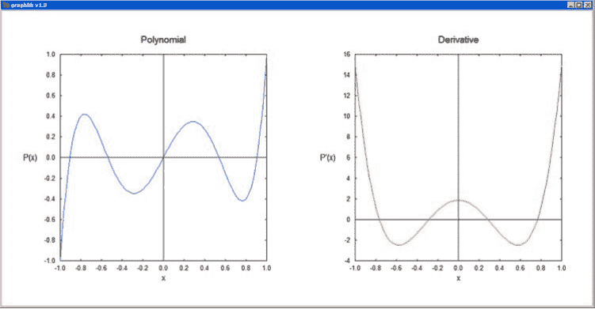

**FIGURE 5.5** Fifth-degree Legendre polynomial and its first derivative, as calculated with functions `Poly` and `PolyDerive`.

### Solution

将幂级数简化为指数值上运行的指标：

$$\sin x=\sum_{i=1,3}^{\infty}\frac{(-1)^{(i-1)/2}}{i!}x^i,$$

$$\arcsin x=\sum_{i=0}^{\infty}\frac{(2i-1)!!}{(2i)!!(2i+1)}x^{2i+1}=\sum_{i=1,3}^{\infty}\frac{(i-2)!!}{(i-1)!!\,i}x^i.$$

$\sin x$ 的递归过程：

$$\left\{\begin{aligned} t_0&=x, & F_0&=x,\\ t_i&=\frac{x^2}{(i-1)i}t_{i-1}, & F_i&=F_{i-1}+t_i,\quad i=1,3,5,\ldots \end{aligned}\right.$$  (5.63)

$\arcsin x$ 的递归过程：

$$\left\{\begin{aligned} t_0&=x, & F_0&=x,\\ t_i&=\frac{(i-2)^2x^2}{(i-1)i}t_{i-1}, & F_i&=F_{i-1}+t_i,\quad i=1,3,5,\ldots \end{aligned}\right.$$  (5.64)

例程的 Python 实现在列表 5.14 中给出，包含在模块 `elemfunc.py` 中，对应的 C/C++ 变体是头文件 `elemfunc.h` 的一部分。

### Listing 5.14 Sine and Arcsine Functions from Their Power-Series Expansions (Python Coding)

```
# =================================================================================
def Sin(x):
# --------------------------------------------------------------------------------
# Evaluates sin(x) from its power-series expansion
# --------------------------------------------------------------------------------
    eps = 1e-14                                    # relative precision

    i = 1
    f = t = x
    x2 = x*x
    while (fabs(t) > eps*fabs(f)):
        i += 2
        t *= -x2/((i-1)*i)
        f += t

    return f

# =================================================================================
def ArcSin(x):
# --------------------------------------------------------------------------------
# Evaluates arcsin(x) from its power-series expansion
# --------------------------------------------------------------------------------
    eps = 1e-14                                    # relative precision

    i = 1
    f = t = x
    x2 = x*x
    while (fabs(t) > eps*fabs(f)):
        i2 = i*i
        i += 2
        t *= i2*x2/((i-1)*i)
        f += t

    return f
```

### PROBLEM 5.3


编写一个函数来从其连分数表示式评估函数 `exp(x)`（Abramowitz and Stegun 1972, Equation 4.2.40）：

$$e^x = \left[1; \frac{x}{1}, \frac{-x}{2}, \frac{x}{3}, \frac{-x}{2}, \frac{x}{5}, \frac{-x}{2}, \dots\right]. \tag{5.65}$$

编写一个主程序调用此例程，以及基于幂级数展开并在列表 5.4 中给出的函数 `Exp`，并比较在相同相对精度 `ε = 10⁻¹⁴` 下，对于区间 `[−10, 10]` 以 1 为间隔的参数 `x` 所需的迭代次数。

### Solution

连分数的元素为

$$\left\{\begin{array}{ll} b_1 = x, & b_i = -b_{i-1}, \\ a_0 = 1, & a_1 = 1, & a_i = \begin{cases} 2, & i = 2,4,\dots, \\ i, & i = 3,5,\dots \end{cases} \end{array}\right. \tag{5.66}$$

### Listing 5.15 Exponential Function from Its Continued Fraction Representation (Python Coding)

```
#===============================================================================
def Exp1(x):
#-------------------------------------------------------------------------------
# Evaluates exp(x) from its continued fraction representation
#-------------------------------------------------------------------------------
eps = 1e-14                                      # relative precision

a = 1e0; b = x
pm1 = 1e0; p = 1e0 + x
qm1 = 1e0; q = 1e0
rm1 = 1e0; r = p/q
i = 1
while (fabs(r-rm1) > eps*fabs(r)):
    i += 1
    pm2 = pm1; pm1 = p                         # shift the stack
    qm2 = qm1; qm1 = q
    rm1 = r
    a = (i if i%2 else 2e0)
    b = -b
    p = a*pm1 + b*pm2
    q = a*qm1 + b*qm2
    r = (p/q if q else 9e99)                   # new convergent value

return r
```

可以使用以下起始值：

⎧ `a₁ = 1`,   `b₁ = x`,

  `P₀ = 1`,   `P₁ = 1 + x`,

  `Q₀ = 1`,   `Q₁ = 1`.   (5.67)

收敛子 `Rᵢ` 的递归求值可以基于关系式进行：

⎧ `aᵢ = { 2,  i = 2,4,…,`  
`i,  i = 3,5,…,`  
`bᵢ = −bᵢ₋₁`,   (5.68)

和

⎧ `Pᵢ = aᵢPᵢ₋₁ + bᵢPᵢ₋₂`,  
`Qᵢ = aᵢQᵢ₋₁ + bᵢQᵢ₋₂`,  
`Rᵢ = Pᵢ/Qᵢ`.   (5.69)

例程的 Python 实现在列表 5.15 中给出，包含在模块 `elemfunc.py` 中，对应的 C/C++ 变体是头文件 `elemfunc.h` 的一部分。

### PROBLEM 5.4

编写一个程序来计算球谐函数（由方程 5.35 定义）的平方范数 `|Yₗᵐ(θ,φ)|²`，对于 `l = 0,1,2` 和 `m = −l,−l+1,…,l`，使用模块中

`specfunc.py` 和分别 `specfunc.h`。 使用图形库 `graphlib` 中的函数 `Plot` 显示范数，输入参数 `polar` 设置为非零值。

## 解决方案

实现分别给出在列表 5.16 和 5.17 中，图形输出显示在图 5.6 中。

### 列表 5.16 平方球谐函数（Python 编码）

```
# Plot squared spherical harmonics
from math import *
from specfunc import *
from graphlib import *

GraphInit(1200,1000)

lmax = 2                                    # maximum value of l
maxplotx = 3                               # max. no. of plots along x

h = pi/180                                 # theta angle spacing
n = int(2*pi/h) + 1                        # no. of theta values

x = [0]*(n+1); y = [0]*(n+1)

nplot = 0
for l in range(0,lmax+1): nplot += (2*l+1)          # total no. of plots

nplotx = min(nplot,maxplotx)                       # no. of plots along x
nploty = int(nplot/nplotx)                         # no. of plots along y
if (nplot % nplotx): nploty += 1                   # incomplete row of plots

dplotx = 1e0/nplotx                                # fractional width of a plot along x
dploty = 1e0/nploty                                # fractional width of a plot along y

xplot = 0; yplot = 0                               # lower-left corner of plot
for l in range(0,lmax+1):                          # l-loop
    for m in range(-l,l+1):                        # m-loop
        for i in range(1,n+1):                     # theta-loop
            theta = i * h
            (ReY,ImY) = SpherY(l,m,theta,0e0)      # spherical harmonic
            f = ReY * ReY + ImY * ImY              # squared norm
            x[i] = f * sin(theta)                  # Cartesian projections
            y[i] = f * cos(theta)

            fxmin = xplot + 0.1*dplotx; fxmax = xplot + 0.9*dplotx   # viewport
            fymin = yplot + 0.1*dploty; fymax = yplot + 0.9*dploty
            title = "l = " + repr(l) + ",  m = " + repr(m)
            Plot(x,y,n,"blue",2,fxmin,fxmax,fymin,fymax,"","",title)

            xplot += dplotx
            if (xplot >= 1):                       # reached the right margin
                xplot = 0                          # begin a new row of plots
                yplot += dploty

MainLoop()
```

### 列表 5.17 平方球谐函数（C/C++ 编码）

```
// Plot squared spherical harmonics
#include <math.h>
#include "memalloc.h"
#include "specfunc.h"
#include "graphlib.h"
#define pi 3.141592653589793

int main(int argc, wchar_t** argv)
{
    int i, l, lmax, m, maxplotx, n, nplot, nplotx, nploty;
    double dplotx, dploty, f, h, ReY, ImY, theta, xplot, yplot;
    double fxmin, fxmax, fymin, fymax;
    double *x, *y;
    char title[20], lchr[5], mchr[5];

    PyGraph w(argc, argv);
    w.GraphInit(1200,1000);

    lmax = 2;                                    // maximum value of l
    maxplotx = 3;                               // max. no. of plots along x
    h = pi/180;                                 // theta angle spacing
    n = int(2*pi/h) + 1;                        // no. of theta values
    x = Vector(1,n); y = Vector(1,n);

    nplot = 0;
    for (l=0; l<=lmax; l++) nplot += (2*l+1);    // total no. of plots
    nplotx = (nplot <= maxplotx ? nplot : maxplotx);  // no. of plots along x
    nploty = int(nplot/nplotx);                 // no. of plots along y
    if (nplot % nplotx) nploty++;               // incomplete row of plots

    dplotx = 1e0/nplotx;                        // fractional width of a plot along x
    dploty = 1e0/nploty;                        // fractional width of a plot along y

    xplot = 0; yplot = 0;                       // lower-left corner of plot
    for (l=0; l<=lmax; l++) {                   // l-loop
        for (m=-l; m<=l; m++) {                 // m-loop
            for (i=1; i<=n; i++) {              // theta-loop
                theta = i * h;
                SpherY(l,m,theta,0e0,ReY,ImY);  // spherical harmonic
                f = ReY * ReY + ImY * ImY;      // squared norm
                x[i] = f * sin(theta);          // Cartesian projections
                y[i] = f * cos(theta);
            }
            fxmin = xplot + 0.1*dplotx; fxmax = xplot + 0.9*dplotx;  // viewport
            fymin = yplot + 0.1*dploty; fymax = yplot + 0.9*dploty;
            sprintf(lchr,"%i",l); sprintf(mchr,"%i",m);
            strcpy(title,"l = ");
            strcat(strcat(strcat(title,lchr),"  m = "),mchr);
            w.Plot(x,y,n,"blue",2,fxmin,fxmax,fymin,fymax,"","",title);

            xplot += dplotx;
            if (xplot >= 1) {                   // reached the right margin
                xplot = 0;                      // begin a new row of plots
                yplot += dploty;
            }
        }
    }
    w.MainLoop();
}
```

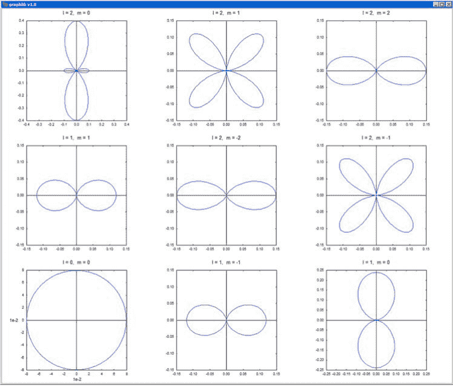

## 图 5.6

使用函数 `SpherY` 计算的平方球谐函数。

## 问题 5.5

球谐函数的 *加法定理* 将特定阶数 *l* 且给定角度 `(\theta_1,\varphi_1)` 和 `(\theta_2,\varphi_2)` 的所有球谐函数乘积之和与阶数为 *l* 的勒让德多项式相等，

$$P_l(\cos\gamma)=\frac{4\pi}{2l+1}\sum_{m=-l}^{m=l}Y_{lm}^{*}(\theta_2,\varphi_2)Y_{lm}(\theta_1,\varphi_1), \tag{5.70}$$

其中 `γ` 是方向 `(\theta_1,\varphi_1)` 和 `(\theta_2,\varphi_2)` 之间的角度，可表示为

$$\cos\gamma=\cos\theta_1\cos\theta_2+\sin\theta_1\sin\theta_2\cos(\varphi_1-\varphi_2), \tag{5.71}$$

而球谐函数 `Y_{lm}(\theta,\varphi)` 定义在方程 5.35 中。 使用包含在文件 `specfunc.py` 和分别 `specfunc.h` 中的例程 `Legendre` 和 `SpherY`，编写 Python 和 C/C++ 程序来检查 `l=5` 且角度组合 `\theta_1=\pi/9`，`\varphi_1=\pi/3`，`\theta_2=\pi/3`，`\varphi_2=\pi/8` 的加法定理。

## 解决方案

加法定理中的实部和虚部可分离为

`4π/(2l + 1) Σ_{m=-l}^{m=l} [Re Y_{lm}(θ₂, φ₂) Re Y_{lm}(θ₁, φ₁) + Im Y_{lm}(θ₂, φ₂) Im Y_{lm}(θ₁, φ₁)] = P_l(cos γ)`,

`4π/(2l + 1) Σ_{m=-l}^{m=l} [Re Y_{lm}(θ₂, φ₂) Im Y_{lm}(θ₁, φ₁) − Im Y_{lm}(θ₂, φ₂) Re Y_{lm}(θ₁, φ₁)] = 0`.

用于检查上述关系的程序分别给出在列表 5.18 和 5.19 中。

### 列表 5.18 球谐函数的加法定理（Python 编码）


```
# Checks the addition theorem for spherical harmonics
from math import *
from specfunc import *

l = 5
theta1 = pi/5; phi1 = pi/9
theta2 = pi/3; phi2 = pi/8

cosgam = cos(theta1) * cos(theta2) \
    + sin(theta1) * sin(theta2) * cos(phi2 - phi1)
(P,d) = Legendre(l,cosgam)

sumRe = 0e0
sumIm = 0e0
for m in range(-l,l+1):
    (ReY1,ImY1) = SpherY(l, m, theta1, phi1)
    (ReY2,ImY2) = SpherY(l, m, theta2, phi2)

    sumRe += ReY2 * ReY1 + ImY2 * ImY1
    sumIm += ReY2 * ImY1 - ImY2 * ReY1

sumRe *= 4*pi/(2*l+1)
sumIm *= 4*pi/(2*l+1)

print(P-sumRe,sumIm)          # check: P - sumRe = 0, sumIm = 0
```

### 列表 5.19 球谐函数的加法定理（C/C++ 编码）

```
// Checks the addition theorem for spherical harmonics
#include <stdio.h>
#include <math.h>
#include "specfunc.h"

#define pi 3.141592653589793

int main()
{
    double cosgam, phi1, phi2, theta1, theta2;
    double d, P, ImY1, ImY2, ReY1, ReY2, sumIm, sumRe;
    int l, m;

    l = 5;
    theta1 = pi/5; phi1 = pi/9;
    theta2 = pi/3; phi2 = pi/8;

    cosgam = cos(theta1) * cos(theta2) \
        + sin(theta1) * sin(theta2) * cos(phi2 - phi1);
    P = Legendre(l,cosgam,d);

    sumRe = 0e0;
    sumIm = 0e0;
    for (m=-1; m<=l; m++) {
        SpherY(l, m, theta1, phi1, ReY1, ImY1);
        SpherY(l, m, theta2, phi2, ReY2, ImY2);

        sumRe += ReY2 * ReY1 + ImY2 * ImY1;
        sumIm += ReY2 * ImY1 - ImY2 * ReY1;
    }
    sumRe *= 4*pi/(2*l+1);
    sumIm *= 4*pi/(2*l+1);

    printf("%f %f\n",P-sumRe,sumIm);            // P - sumRe = 0, sumIm ~ 0
}
```

## 问题 5.6

球形电磁波的传播由标量亥姆霍兹方程描述，该方程在球坐标中分离变量后导致径向方程（参见 Arfken 和 Weber 2005，方程 11.140）：

\[ \left[ r^2 \frac{d^2}{dr^2} + r \frac{d}{dr} + k^2 r^2 - \left( n + \frac{1}{2} \right)^2 \right] Z(r) = 0. \tag{5.72} \]

该方程的线性无关解是所谓的分数阶圆柱贝塞尔和诺伊曼函数，$J_{n+1/2}(kr)$ 和 $N_{n+1/2}(kr)$，它们与球贝塞尔和

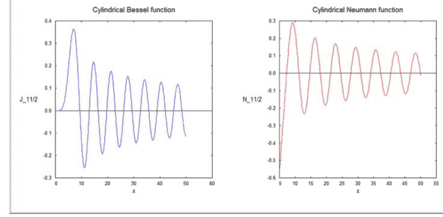

图 5.7 根据方程 5.73 使用函数 `SBessj` 和 `SBessy` 计算的圆柱贝塞尔函数 $J_{11/2}(x)$ 和 $N_{11/2}(x)$。

Neumann 函数由

jₙ(x) = √(π/(2x)) Jₙ₊₁/₂(x), yₙ(x) = √(π/(2x)) Nₙ₊₁/₂(x). (5.73)

通过调用 `specfunc.py` 和 `specfunc.h` 中定义的函数 `SBessJ` 和 `SBessY` 分别编写计算圆柱贝塞尔函数的例程。绘制 0 ≤ x ≤ 50 范围内的圆柱贝塞尔函数 J₁₁/₂(x) 以及 x ∈ [0,50] 的 N₁₁/₂(x)。

## Solution

Python 和 C/C++ 程序作为补充材料提供在文件 `P05-CBessPlot.py` 和 `P05-CBessPlot.cpp` 中，图形输出如图 5.7 所示。基于相应球面函数的圆柱贝塞尔和 Neumann 函数的示例定义可在列表 5.20 中看到。

## Listing 5.20 Cylindrical Bessel and Neumann functions (Python Coding)

```
def CBessJ(n, x):
    return sqrt(2e0*x/pi) * SBessJ(n,x)  # cylindrical Bessel function of order n+1/2

def CBessN(n, x):
    return sqrt(2e0*x/pi) * SBessY(n,x)  # cylindrical Neumann function of order n+1/2
```

## PROBLEM 5.7

关联 Laguerre 多项式定义为 Laguerre 多项式的函数，如下所示（参见 Arfken and Weber 2005）

Lₙᵏ(x) = (−1)ᵏ dᵏ/dxᵏ Lₙ₊ₖ(x). (5.74)

关联 Laguerre 多项式满足关于低阶的递推关系：

n Lₙᵏ(x) = (2n + k − 1 − x) Lₙ₋₁ᵏ(x) − (n + k − 1) Lₙ₋₁ᵏ(x) (5.75)

以及阶数 n = 0 和 1 的简单表达式，

L₀ᵏ(x) = 1, L₁ᵏ(x) = −x + k + 1, (5.76)

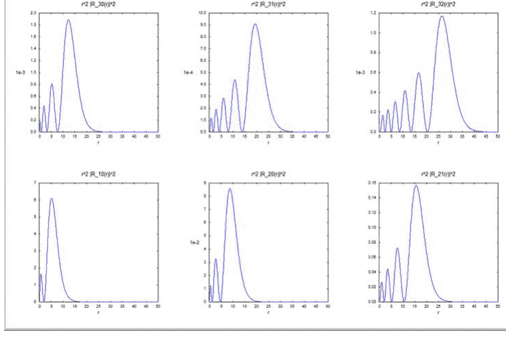

FIGURE 5.8 Radial density probabilities ρ² |Rₙₗ(ρ)|² for the electron in the hydrogen atom.

## Listing 5.21 Radial Wave Functions for the Hydrogen Atom (Python Coding)

```
# =================================================================================
def aLaguerre(n, k, x):
# ---------------------------------------------------------------------------------
# Evaluates the associated Laguerre polynomial of orders n and k in x
# using the recurrence relation
# ---------------------------------------------------------------------------------
    if (n == 0):
        f = 1e0
    else:
        f = 1e0 + k - x; fml = 1e0
        for i in range(2,n+1):
            fm2 = fml; fml = f
            f = ((2*i+k-1-x)*fml - (i+k-1)*fm2)/i

    return f

# =================================================================================
def RadPsiH(n, l, r):
# ---------------------------------------------------------------------------------
# Evaluates the radial wave function of the hydrogen atom for principal
# quantum number n and orbital quantum number l at radius r (a0 is taken 1)
# ---------------------------------------------------------------------------------
    fNorm = sqrt(8e0/(n*n*n)*Fact(n-l-1)/(2e0*n*pow(Fact(n+1),3)))
    return fNorm * pow(r,l) * exp(-0.5e0*r) * aLaguerre(n+1,2*l+1,r)
```

## Solution

作为补充材料提供的 Python 和 C/C++ 示例程序位于文件 `P05-RadProbH.py` 和 `P05-RadProbH.cpp` 中，图形输出可见于图 5.8。计算关联 Laguerre 多项式的例程在库 `specfunc.py` 和 `specfunc.h` 中以 `aLaguerre` 的名称包含。

`aLaguerre` 的 Python 版本连同氢原子径向波函数的例程 `RadPsiH` 一起列在列表 5.21 中。`Fact` 假定为返回其参数阶乘的函数（示例参见列表 2.3）。

## References and Suggested Further Reading

Abramowitz, M. and I. A. Stegun (Eds.). 1972. Handbook of Mathematical Functions: With Formulas, Graphs, and Mathematical Tables. New York: Dover Publications.

Acton, F. S. 1997. Numerical Methods That Work. Spectrum Series. Washington: Mathematical Association of America.

Arfken, G. B. and H. J. Weber. 2005. Mathematical Methods for Physicists (6th ed.). Burlington: Academic Press.

Beu, T. A. 2004. Numerical Calculus in C (3rd ed., in Romanian). Cluj-Napoca: MicroInformatica.

Demidovich, B. and I. Maron. 1987. Computational Mathematics (4th ed.). Moscow: MIR Publishers.

Knuth, D. E. 1998. The Art of Computer Programming (3rd ed.), Vol. 2: Seminumerical Algorithms. Reading, MA: Addison-Wesley Professional.

Miller, J. C. P. 1952. British Association for the Advancement of Science, Mathematical Tables, Vol. X, Bessel Functions, Part II. Cambridge: Cambridge University Press.

## Algebraic and Transcendental Equations

## 6.1 Root Separation

方程被称为 *代数* 或 *多项式* 方程，如果它具有形式

$$f(x)=0, \tag{6.1}$$

且函数 $f(x)$ 为多项式或可化为多项式形式。例如，方程 $x^2-(x-1)^{1/2}-3=0$ 确实是代数的，因为通过分离平方根并对原方程两边平方，它变为 $x^4-6x^2-x+10=0$。如果 $f(x)$ 不能化为多项式，则方程称为 *超越* 方程。

求解四阶及以下多项式的根是直接的任务，通常可通过化为根式分解完成。然而，从五次方程起（$f(x)$ 为五阶多项式），不存在解析求解的一般方法，必须求助于数值方法。

给定实值函数

$$f:[x_{\min},x_{\max}]\to\mathbb{R},$$

定义在实轴的某个子区间上，任何满足 $f(\xi)=0$ 的值 $\xi\in[x_{\min},x_{\max}]$ 称为方程 $f(x)=0$ 的 *根* 或函数 $f(x)$ 的 *零点*。

一般而言，方程 $f(x)=0$ 的 *近似根* 理解为“接近”精确根 $\xi$ 的值 $\xi'$。近似根可按两种方式数值定义：数 $\xi'$ 包含在精确根周围的某个小区间内，即满足 $|\xi'-\xi|<\varepsilon$，其中 $\varepsilon>0$ 很小；或数 $\xi'$ 使函数数值上等于零，即 $|f(\xi')|<\varepsilon$。显然，如图 6.1a 和 b 所示，这两种定义不等价。图 6.1a 说明了近似根满足 $|\xi'-\xi|<\varepsilon$ 但不满足 $|f(\xi')|<\varepsilon$ 的情况，图 6.1b 则描绘了相反的情况，即第二条准则得到满足，但第一条并未满足。

通常计算方程 $f(x)=0$ 的实根包含两个不同的阶段：

- 1. *根的分离*，即建立整个搜索区间的划分，$x_{\min}=x_1,x_2,\ldots,x_M=x_{\max}$，使得任意特定子区间 $[x_m,x_{m+1}]$ 至多包含一个根（或无根）；

- 2. *数值计算* 已在不同子区间分离的根，通过迭代细化过程。

许多用于分离代数或超越方程实根的实用方法依赖于 Rolle 定理的推论，该定理基本上指出，实值连续可微函数 $f(x)$ 的一阶导数 $f'(x)$ 在函数任意两个连续零点之间有奇数个零点。作为推论，$f(x)$ 本身在其一阶导数的任意两个连续零点之间至多有一个零点。如果 $x_1 < x_2 < ⋯ < x_M$ 是 $f'(x)$ 的零点并形成 Rolle 序列，$f(−∞),f(x_1),f(x_2),…,f(x_M),f(+∞)$，则根据上述推论，每个子区间

(−∞,x1),(x1,x2),…,(xm,xm+1),…,(xM,+∞),

包含方程 $f(x) = 0$ 的一个实根，前提是函数在子区间的端点处取相反符号的值，即 $f(x_m)f(x_{m+1}) < 0$。因此，方程 $f(x) = 0$ 具有与 Rolle 序列所示符号变化一样多的零点。从实用角度看，这种方法有一个重要缺点，因为它意味着求解方程 $f'(x) = 0$，这有时与求解原方程 $f(x) = 0$ 一样繁琐。以下定理对分离函数零点具有直接的实用价值。

## Theorem 6.1

如果连续实值函数 $f(x)$ 在闭区间 $[a,b]$ 的两端变号，即 $f(a)f(b) < 0$，则该区间包含 $f(x)$ 的至少一个实零点；换句话说，存在至少一个内部点 $\xi ∈ (a,b)$ 使得 $f(\xi) = 0$。

根 $\xi$ 在 $[a,b]$ 中是唯一的，如果导数 $f'(x)$ 存在并保持其符号。否则，可能 $[a,b]$ 包含多个根（如图 6.2a 所示），而且即使 $f(a)f(b) > 0$ 也可能发生（如图 6.2b 所示）。

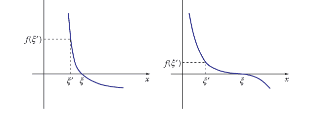

#### FIGURE 6.1 Approximate roots not simultaneously satisfying the criteria |ξ' − ξ| < ε and |f(ξ')| < ε.

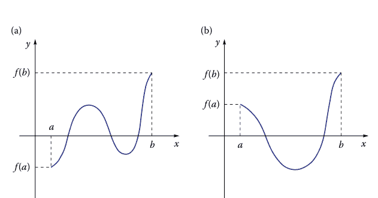

#### FIGURE 6.2 Examples of nonseparated roots.

从实际角度看，根分离过程意味着确定函数 f(x) 在一个足够精细的划分 {x_m} 各点上的符号，其选择在很大程度上取决于函数本身的特殊性。如果子区间 [x_m, x_{m+1}] 足够小，根据上述定理，每个子区间至多包含方程 f(x) = 0 的一个实根。因此，满足 f(x_m)f(x_{m+1}) > 0 的区间不包含任何根，而满足 f(x_m)f(x_{m+1}) ≤ 0 的区间包含一个根。

## 6.2 二分法

考虑方程

```
f(x) = 0,
```

其中实函数 f(x) 在区间 [a, b] 上连续。我们假设通过先前的根分离过程，方程 6.2 在 [a, b] 内至多有一个根。用 ξ 表示该根，可能出现以下情况：

- a. 如果 f(a) = 0，则根为 ξ = a；

- b. 如果 f(b) = 0，则根为 ξ = b；

- c. 如果 f(a)f(b) < 0，则根为内部点之一，ξ ∈ (a, b)；

- d. 如果 f(a)f(b) > 0，则在 [a, b] 中不存在根 ξ。

考虑到情况 (c)，它是唯一需要实际计算的非平凡情况，为了找到所包含的根，我们将区间 [a, b] 通过中点 x0 = (a + b)/2 分成两个相等子区间，如图 6.3 所示。特别地，如果 f(x0) = 0，则 ξ = x0 为所求根。在相反情况下，我们选择函数在其端点处符号相反的子区间 [a1, b1]，该区间显然仍限制根，并保存其边界。可能出现以下情况之一


```
a1 = a0,  b1 = x0,   if f(a)f(x0) < 0,
a1 = x0,  b1 = b0,   if f(a)f(x0) > 0.
```

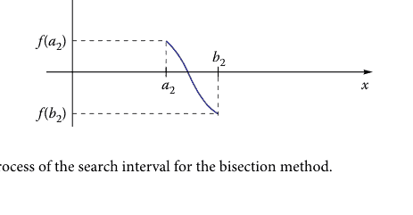

图 6.3 二分法搜索区间的减半过程。

新的区间 `[a₁, b₁]` 再次被对半分割，执行与上述类似的符号测试。通过继续此过程，经过 `i` 次迭代后，通过点 `xᵢ₋₁ = (aᵢ₋₁ + bᵢ₋₁)/2` 对区间 `[aᵢ₋₁, bᵢ₋₁]` 进行二分，可得到边界区间 `[aᵢ, bᵢ]`。因此，新的边界为：

```
aᵢ = aᵢ₋₁,   bᵢ = xᵢ₋₁,   if f(aᵢ₋₁)f(xᵢ₋₁) < 0,
 aᵢ = xᵢ₋₁,   bᵢ = bᵢ₋₁,   if f(aᵢ₋₁)f(xᵢ₋₁) > 0.  (6.3)
```

对于所有先前的边界区间，显然函数 `f(x)` 在最近一个区间的两端变号，

```
f(aᵢ)f(bᵢ) < 0,  (6.4)
```

其长度与初始区间之比为

```
bᵢ − aᵢ = (b − a)/2ⁱ.  (6.5)
```

通过其中点对最近区间进行二分，

```
xᵢ = ½(aᵢ + bᵢ),  (6.6)
```

可得到数值根 `ξ = xᵢ`，或新的边界区间 `[aᵢ₊₁, bᵢ₊₁]`。

由于连续区间的左边界 `a₀, a₁, …, aᵢ` 形成有界非递减序列，右边界 `b₀, b₁, …, bᵢ` 形成有界非递增序列，由方程 6.5 取极限可知，序列 `{aᵢ}` 和 `{bᵢ}` 有共同极限

```
ξ = limᵢ→∞ aᵢ = limᵢ→∞ bᵢ.
```

此外，根据函数 `f(x)` 的连续性，由不等式 (6.4) 取极限 `i → ∞` 可得 `[f(ξ)]² ≤ 0`，由此 `f(ξ) = 0`，意味着 `ξ` 是方程 6.2 的根。

显然，实际中只能执行有限次迭代，因此只能确定根的近似值。迭代过程可在满足以下一个或两个条件时以根 `ξ = xᵢ` 终止：

```
|f(xᵢ)| ≤ ε,      bᵢ − aᵢ ≤ ε,  (6.7)
```

其中 `ε > 0` 为预定义容差。对于实际实现，更有用的停止准则可直接与计算根的预期有效数字位数相关，由边界区间宽度给出的相对误差估计提供：

```
|(bᵢ − aᵢ)/xᵢ| ≤ ε.
```

该准则的更方便形式仍基于相对误差，但避免了偶然的除零，即

```
|bᵢ − aᵢ| ≤ ε |xᵢ|.  (6.8)
```

所公开算法的直接实现由第 6.1 节中的函数 `Bisect` 表示，其输入参数为用户函数 `Func` 的实际名称，以及搜索区间 `[a, b]` 的极限，在该区间内假定分离的根存在。`Bisect` 返回计算得到的根 `x`，以及错误索引，等于 0——表示正常

## 6.2 二分法求函数的实根（Python 编码）

```
# Real roots of a real function by the bisection method
from math import *
from roots import *

def func(x):
    return (x*x*x*x - 5e0*x*x + 4e0) * sin(2e0*x)

#### main

xmin = -3.5e0                     # limits of root search domain
xmax =  3.5e0
 h = 0.1e0                        # width of root separation intervals

a = xmin
while (a < xmax):                # root separation loop
    b = a + h                     # search interval [a,b]
    (x,iierr) = Bisect(func,a,b)
    if ((iierr == 0) and (x != b)):
        print('x = {0:8.5f} in ({1:6.2f},{2:6.2f})   f(x) = {3:7.0e}'.format(x,a,b,func(x)))
    a = b                         # shift left boundary
```

## 6.3 假位法

与二分法类似，假位法（或称正割法）旨在寻找方程 `f(x) = 0` 的实根 `ξ`，该根已隔离在区间 `[a, b]` 中，其两端函数取相反符号（`f(a)f(b) < 0`）。主要区别在于选择后续边界区间 `[a₁, b₁], [a₂, b₂], …, [aᵢ, bᵢ]` 的方式，在假位法中，这些区间并非通过二分得到，而是通过按函数值之比 `f(aᵢ)/f(bᵢ)` 将当前区间 `[aᵢ, bᵢ]` 分割得到。此过程在试错步骤序列中重复，用“假”试验值代替未知量以逐步改进解的近似。

从几何上看，如图 6.4 所示，假位法意味着用点 `(aᵢ, f(aᵢ))` 和 `(bᵢ, f(bᵢ))` 定义的弦代替函数 `f(x)`。由弦方程，

```
(xᵢ − aᵢ)/(bᵢ − aᵢ) = −f(aᵢ)/(f(bᵢ) − f(aᵢ))
```

可 readily 得到与 `x` 轴交点的坐标：

```
xᵢ = aᵢ f(bᵢ) − bᵢ f(aᵢ) / (f(bᵢ) − f(aᵢ)).   (6.9)
```

经过一定次数的迭代，可得到数值精确根 `ξ = xᵢ`，使得 `f(xᵢ) ≤ ε`，或得到由下式定义的区间序列 `[a₀, b₀], [a₁, b₁], …, [aᵢ, bᵢ], …`

```
aᵢ₊₁ = aᵢ,   bᵢ₊₁ = xᵢ,   if f(aᵢ)f(xᵢ) < 0,

aᵢ₊₁ = xᵢ,   bᵢ₊₁ = bᵢ,   if f(aᵢ)f(xᵢ) > 0,   (6.10)
```

并满足

```
f(aᵢ₊₁)f(bᵢ₊₁) < 0.   (6.11)
```

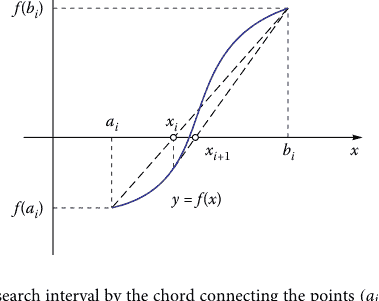

图 6.4 假位法中通过连接点 `(aᵢ, f(aᵢ))`，și `(bᵢ, f(bᵢ))` 的弦对搜索区间进行分割。

假位法被编码为第 6.3 节中的例程 `FalsPos`。其总体构造原则、输入/输出参数和功能与前一节描述的函数 `Bisect` 相同，因此在应用中两者可互换。

## 第 6.3 节 假位法（Python 编码）

```
================================================================================
def FalsPos(Func, a, b):
#--------------------------------------------------------------------------------
# Determines a real root x of function Func isolated in interval [a,b] by
# the false position method
# Error code: 0 - normal execution
#             1 - [a,b] does not isolate one root or contains several roots
#             2 - max. number of iterations exceeded
#--------------------------------------------------------------------------------
    eps = 1e-10                         # relative precision of root
    itmax = 100                         # max. no. of iterations

    x = a; fa = Func(x)                 # is a the root?
    if (fabs(fa) == 0e0): return (x,0)
    x = b; fb = Func(x)                 # is b the root?
    if (fabs(fb) == 0e0): return (x,0)

    if (fa*fb > 0): return (x,1)        # [a,b] does not contain a root
                                    # or contains several roots
    for it in range(1,itmax+1):
        x = (a*fb - b*fa)/(fb - fa)     # new approximation
        fx = Func(x)
        if (fa*fx > 0):
            dx = x - a; a = x; fa = fx  # choose new bounding interval
        else:
            dx = b - x; b = x; fb = fx
        if ((fabs(dx) <= eps*fabs(x)) or (fabs(fx) <= eps)): return (x,0)

    printf("FalsPos: max. no. of iterations exceeded !"); return (x,2)
```

可以注意到，与函数 `Bisect` 相比，例程 `FalsPos` 在每次对边界区间进行划分后，不仅更新边界 `aᵢ` 和 `bᵢ`，而且还更新相应的函数值 `f(aᵢ)` 和 `f(bᵢ)`（代码中的 `fa` 和 `fb`），因为这些值参与计算下一个划分点 `xᵢ₊₁`。

尽管在实现给定精度所需的区间划分次数方面，假位法通常比二分法更有效，但它同样主要被认为是有用的，用于确定迭代方法的初始近似值，而迭代方法在根的邻域内收敛更快。

## 6.4 逐次逼近法

寻找实值函数零点的最具代表性的数值方法之一是 *逐次逼近法*。其重要性不仅限于超越方程的特定领域，因为它实际上代表了一种通过递归收敛于解的近似序列来求解数学问题的一般策略。逐次逼近法适用的问题类别包括但不限于微分、积分和积分微分方程。

让我们考虑超越方程

```
f(x) = 0,
```

其中 `f(x)` 是在某个区间 `[a, b]` 上定义的连续实值函数。逐次逼近法要求将方程化为等价形式

```
x = φ(x),
```

使得方程 6.12 和 6.13 具有相同的根。显然，总可以将方程 6.12 转换为形式 (6.13)，即使函数 `f(x)` 不显式包含项 `x`，例如通过将它加到方程两边也可以实现。

设 `x₀` 是方程 6.13 的精确根 `ξ` 的初始近似。将它代入右端函数 `φ(x)`，可得到根的新近似值：

```
x₁ = φ(x₀).
```

迭代此过程，可得到一组数：

```
xᵢ₊₁ = φ(xᵢ),  i = 0, 1, 2, …
```

如果该序列收敛，则极限 `ξ = lim xᵢ` 存在。对方程 6.14 取极限并假设 `φ(x)` 连续，我们得到

```
limᵢ→∞ xᵢ₊₁ = φ(limᵢ→∞ xᵢ),
```

由此得到

```
ξ = φ(ξ).
```

因此，`ξ` 是方程 6.13 的根，原则上可通过递推关系式 (6.14) 计算到任意精度。

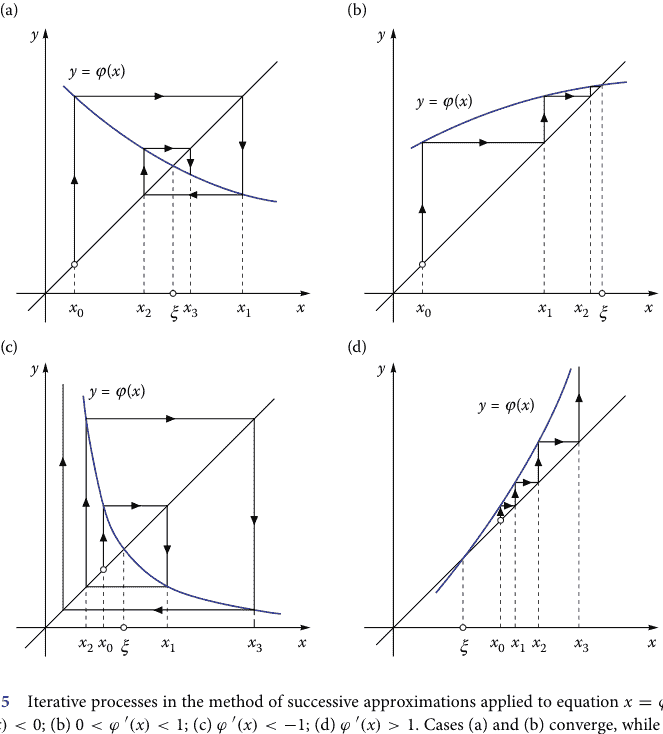

从几何角度看，方程 `x = φ(x)` 的实根 `ξ` 是曲线 `y = φ(x)` 与第一分线 `y = x` 相交点的横坐标。值得注意的是，根据根附近一阶导数 `φ′(x)` 的取值，递推式 (6.14) 可能收敛于根，也可能相反地不可避免地发散。基本上存在四种定性不同的情形，从初始近似 `x₀` 开始，近似序列 `x₁, x₂, x₃, …` 的产生方式如图 6.5 所示。具体而言，迭代过程在图 6.5a 和 b 中收敛，在图 6.5c 和 d 中发散，可以得出结论，过程收敛，因而逐次逼近法可成功应用，当且仅当根被包含在区间内，其中

```
|φ′(x)| < 1.   (6.15)
```

为了实际应用逐次逼近法，必须满足的条件由下一定理规定，该定理给出了由关系式 6.14 定义的迭代序列收敛的充分条件。

### 定理 6.2

给定方程

```
x = φ(x),  (6.16)
```

函数 `φ(x)` 在区间 `[a, b]` 上定义且可微，若不等式

```
|φ′(x)| ≤ λ < 1  (6.17)
```

对任意 `x ∈ [a, b]` 都成立，则由递推关系

```
xᵢ₊₁ = φ(xᵢ),  i = 0, 1, 2, …  (6.18)
```

定义的迭代序列收敛到方程 (唯一，若存在) 的根 `ξ ∈ [a, b]`，与初始近似 `x₀` 无关。

证明。由递推关系式 (6.18) 减去显然的等式 `ξ = φ(ξ)`，可得

```
xᵢ₊₁ − ξ = φ(xᵢ) − φ(ξ).
```

根据中值定理，存在介于 `xᵢ` 与 `ξ` 之间的点 `ζ`，使得

```
φ(xᵢ) − φ(ξ) = φ′(ζ)(xᵢ − ξ).
```

由上述两个关系式并结合不等式 (6.17)，可得：

```
|xᵢ₊₁ − ξ| ≤ λ|xᵢ − ξ|.
```

依次取 `i` 的值 0, 1, 2, …，可依次得到：

```
|x₁ − ξ| ≤ λ|x₀ − ξ|,
|x₂ − ξ| ≤ λ|x₁ − ξ| ≤ λ²|x₀ − ξ|,
………..
|xᵢ₊₁ − ξ| ≤ λ|xᵢ − ξ| ≤ … ≤ λ^{i+1}|x₀ − ξ|.
```

对最后一个不等式取极限并利用 `|φ′(x)|` 的上界 `λ` 为次单位数，因而 `limᵢ→∞ λ^{i+1} = 0`，可得：

```
limᵢ→∞ xᵢ₊₁ = ξ.
```

因此，迭代序列的极限正是所考虑方程的根 `ξ`。

为证明在定理的条件下，`ξ` 在区间 `[a, b]` 内是唯一的根，我们假设相反的情况，即存在另一个根 `ξ̃ ∈ [a, b]`，使得 `ξ̃ = φ(ξ̃)`。因此再次利用中值定理：

```
ξ − ξ̃ = φ(ξ) − φ(ξ̃) = φ′(ζ)(ξ − ξ̃),
```

其中点 `ζ` 位于 `ξ` 与 `ξ̃` 之间。可进一步将上式改写为

```
(ξ − ξ̃)[1 − φ′(ζ)] = 0.
```

由于根据假设 `1 − φ′(ζ) ≠ 0`，可得 `ξ = ξ̃`，说明根 `ξ` 是唯一的。

## 代码清单 6.4 逐次逼近法（Python 编码）

```
# =================================================================================
def Iter(Func, a, b, x):
# --------------------------------------------------------------------------------
# Determines a root x of function Func isolated in [a,b] by the method of
# successive approximations. x contains on entry an initial approximation.
# Error code: 0 - normal execution
#             1 - interval does not contain a root
#             2 - max. number of iterations exceeded
#             3 - diverging process
# --------------------------------------------------------------------------------
    eps = 1e-10                         # relative precision of root
    itmax = 100                         # max. no. of iterations

    dx = -Func(x);                      # initialize correction
    for it in range(1,itmax+1):
        f = Func(x)
        if (fabs(f) > fabs(dx)): break      # compare new with old correction
        dx = -f                             # update correction
        x += dx                             # new approximation
        if ((x < a) or (x > b)): return (x,1)   # [a,b] does not contain a root
        if (fabs(dx) <= eps*fabs(x)): return (x,0)      # check convergence

    if (it > itmax):
        print("Iter: max. no. of iterations exceeded !"); return (x,2)
    if (fabs(f) > fabs(dx)):
        print("Iter: diverging process !"); return (x,3)
```

说明了条件 `|φ′(x)| ≡ |1−f′(x)| < 1` 的满足如何决定算法收敛的关键方式。选择如代码清单 6.5 中所示的


f(x) = x − e^{−x},

对应于 |φ′(x)| = e^{−x} < 1，逐次逼近从 x0 = 0 开始收敛到根 x = 0.56714。相反，考虑 f(x) = e^{−x} − x，过程迅速发散，因为

## 代码清单 6.5 用逐次逼近法求函数的实根（Python 编码）

```
# Real root of a real function by the method of successive approximations
from math import *
from roots import *

def func(x): return x - exp(-x)

#### main

a = -1e10; b = 1e10                     # search interval
x = 0e0                                 # initial approximation

(x,ierr) = Iter(func,a,b,x)
if (ierr == 0):
    print("x = {0:8.5f}    f(x) = {1:7.0e}".format(x,func(x)))
else: print("No solution found !")
```

$|\varphi'(x)| = 2 + e^{-x} > 1$。因此，数学上等价的超越方程形式可能导致定性不同的数值行为。

逐次逼近法与其实际效率相比，更以其独特的方法论优点著称。它体现了一般数值现象，例如条件收敛，以及常用的二分和区间策略。然而在应用中，它通常既无法与二分法和假位法的鲁棒性相匹敌，后者还能保持根被隔离，也无法与以下各节讨论的基于局部导数的方法的收敛速度相媲美。

## 6.5 牛顿法

又称 *牛顿–拉夫森法*（以艾萨克·牛顿和约瑟夫·拉夫森命名），牛顿法可能是用于迭代计算实值函数零点的最著名算法。其广泛使用很大程度上归功于其背后思想的简单性，该思想以各种形式被该方法的不同变体所采用，也归功于相应实现的可观效率和稳定性。

假设方程

$$f(x) = 0 \tag{6.23}$$

对于实值可微函数 $f(x)$ 在区间 $[a,b]$ 内具有实零点 $\xi$，并且 $f'(x)$ 和 $f''(x)$ 在所有 $x \in [a,b]$ 上连续并保持其符号。

从根 $\xi$ 的初始近似 $x_0$ 开始，可将改进近似 $x_1$ 确定为曲线 $y=f(x)$ 在点 $(x_0,f(x_0))$ 处的切线的 x 截距，如图 6.6 所示。特别地，选择 $x_0=b$ 时，局部导数 $f'(x_0)$ 可识别为切线的斜率，

$$f'(x_0) = \frac{f(x_0)}{x_0-x_1},$$

由此得到改进近似

$$x_1 = x_0 - \frac{f(x_0)}{f'(x_0)}.$$

利用点 $(x_1,f(x_1))$ 处的切线，可通过类似构造得到新的近似 $x_2$。

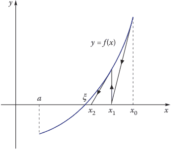

**图 6.6** 牛顿–拉夫森法中的近似根序列。

## 清单 6.6 Newton–Raphson 法（Python 编码）

```
#================================================================================
def Newton(Func, a, b, x):
#--------------------------------------------------------------------------------
# Determines a real root x of function Func isolated in interval [a,b] by
# the Newton–Raphson method using the analytical derivative. x contains on
# input an initial approximation.
# Error code: 0 - normal execution
#             1 - interval does not contain a root
#             2 - max. number of iterations exceeded
#--------------------------------------------------------------------------------
    eps = 1e-10                     # relative precision of root
    itmax = 100                     # max. no. of iterations

    for it in range(1,itmax+1):
        (f,df) = Func(x)            # function and derivative
        dx = -f/df if fabs(df) > eps else -f   # root correction
        x += dx                     # new approximation
        if ((x < a) or (x > b)): return (x,1)  # [a,b] does not contain a root
        if (fabs(dx) <= eps*fabs(x)): return (x,0)   # check convergence

print("Newton: max. no. of iterations exceeded !"); return (x,2)
```

## 清单 6.7 用于牛顿法的带导数用户函数（Python 编码）

```
def func(x):
    df = 1e0 + exp(-x)
    return (x - exp(-x), df)
```

清单 6.7 以方程 x − e^{−x} = 0 的特殊情况为例，演示了例程 `Newton` 的用户函数的构造。

在许多实际情况下，直接以可编程形式表示导数 f′(x) 是困难甚至不可能的。在这种情况下，可以求助于数值计算。清单 6.8 中给出的例程 `NewtonNumDrv` 使用导数的有限前向差分表示，分别基于当前 x 以及该值增加一个小的 dx。除了导数的计算方式不同，以及不再期望用户函数返回导数之外，例程 `Newton` 和 `NewtonNumDrv` 是相同的。

与逐次逼近法不同，牛顿法的收敛性对函数 f(x) 的写法不敏感，因为修正项 −f(x_i)/f′(x_i) 中额外除以导数，会在根附近调整迭代函数，以满足定理 6.2 的要求。

具体考虑方程

x − e^{−x} = 0，

与逐次逼近法相反，牛顿法收敛到根 x = 0.567143，无论函数定义为 f(x) = x − e^{−x} 还是 f(x) = e^{−x} − x。事实上，在两种情况下，迭代函数的导数具有相同的表达式 φ′(x) = e^{−x}(x − e^{−x})/(1 + e^{−x})^2，并且对于任何正 x，它都是小于 1 的，如定理所要求。

## 清单 6.8 具有数值导数的牛顿法（Python 编码）

```
# =================================================================================
def NewtonNumDrv(Func, a, b, x):
# ---------------------------------------------------------------------------------
# Determines a real root x of function Func isolated in interval [a,b] by
# the Newton-Raphson method using the numerical derivative. x contains on
# input an initial approximation.
# Error code: 0 - normal execution
#             1 - interval does not contain a root
#             2 - max. number of iterations exceeded
# ---------------------------------------------------------------------------------
    eps = 1e-10                     # relative precision of root
    itmax = 100                     # max. no. of iterations

    for it in range(1,itmax+1):
        f = Func(x)
        dx = eps*fabs(x) if x else eps          # derivation step
        df = (Func(x+dx)-f)/dx                  # numerical derivative
        dx = -f/df if fabs(df) > eps else -f    # root correction
        x += dx                                 # new approximation
        if ((x < a) or (x > b)): return (x,1)   # [a,b] does not contain a root
        if (fabs(dx) <= eps*fabs(x)): return (x,0)   # check convergence

    print("NewtonNumDrv: max. no. of iterations exceeded !"); return (x,2)
```

一般来说，牛顿法比逐次逼近法收敛得快得多。例如，对于方程

x − sin x − 0.25 = 0，

从相同的初始近似 x₀ = 0 出发，牛顿法需要 10 次迭代即可得到具有 10 位精确小数（相对精度 ε = 10⁻¹⁰）的解 x = 1.171229653，而逐次逼近法需要 28 次迭代才能以相同的精度完成计算。为了更全面地了解情况，请参见习题 7.2 中对二分法和割线法的进一步比较。

## 6.6 割线法

割线法代表了牛顿法的高效性与因需要额外计算所求解函数的一阶导数而带来的不便之间的折衷。一个重要的简化为：导数不再出现在逐步修正中，这些修正改为通过一个涉及根的三（而不是两个）个连续近似的递推关系来获得。

假设函数 f(x) 在根附近近似线性，由对应最近近似的点 (xᵢ₋₁, f(xᵢ₋₁)) 和 (xᵢ, f(xᵢ)) 确定的弦（见图 6.7）代替切线，通过其 x 截距提供新的近似 xᵢ₊₁。或者，割线法的递推关系可以通过简单地在牛顿-拉夫森公式中近似导数来获得，

xᵢ₊₁ = xᵢ − f(xᵢ)/f′(xᵢ),

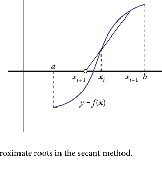

### 图 6.7 割线法中近似根的序列。

使用涉及最近近似的有限（前向）差分表达式：

```
f'(x_i) ≈ [f(x_i) - f(x_{i-1})] / [x_i - x_{i-1}]  (6.28)
```

由此得到的递推关系，

```
x_{i+1} = x_i - f(x_i) * [x_i - x_{i-1}] / [f(x_i) - f(x_{i-1})],  (6.29)
```

能够在先前近似 x_i 和 x_{i-1} 的基础上计算根的近似 x_{i+1}。与本章描述的所有其他方法一样，当根的相对修正减小到低于预定义容差 ε 时，迭代过程终止：

```
|x_{i+1} - x_i| ≤ ε |x_{i+1}|.  (6.30)
```

为了启动递推，原则上可以取任意初始近似 x_0 和 x_1。然而，从单个初始近似 x_0 出发，可以通过应用逐次逼近法的单步步骤获得第二个近似：

```
x_1 = x_0 - f(x_0).  (6.31)
```

割线法与试位法之间的主要区别在于：割线法总是使用两个最近近似，然而它们不一定包围根；而试位法保留两个不一定连续的近似，但它们对应函数值异号，从而隐式地包围根。尽管割线法通常收敛更快，但由于不一定包围根，对于不够光滑的函数，割线法不能保证收敛。

上述算法原理在清单 6.9 中编码为函数 `Secant`，可以看出，如上所述，它执行一次初始迭代，按照逐次逼近法产生第二个根近似。

## 清单 6.9 割线法（Python 编码）

```
# =================================================================================
def Secant(Func, a, b, x):
# --------------------------------------------------------------------------------
# Determines a real root x of function Func isolated in interval [a,b] by
# the secant method. x contains on entry an initial approximation.
# Error code: 0 - normal execution
#             1 - interval does not contain a root
#             2 - max. number of iterations exceeded
# --------------------------------------------------------------------------------
    eps = 1e-10                     # relative precision of root
    itmax = 1000                    # max. no. of iterations

    x0 = x; f0 = Func(x0)
    x = x0 - f0                     # first approximation
    for it in range(1,itmax+1):
        f = Func(x)
        df = (f-f0)/(x-x0)           # approximate derivative
        x0 = x; f0 = f               # store abscissa and function value
        dx = -f/df if fabs(df) > eps else -f   # root correction
        x += dx                      # new approximation
        if ((x < a) or (x > b)): return (x,1)  # [a,b] does not contain a root
        if (fabs(dx) <= eps*fabs(x)): return (x,0)   # check convergence

print("Secant: max. no. of iterations exceeded !"); return (x,2)
```

对于测试方程

x − sin x − 0.25 = 0,  (6.32)

割线法的表现几乎与牛顿法一样好，从初始近似 x₀ = 0 出发，需要 12 次而不是 10 次迭代即可得到具有 10 位精确小数的解 x = 1.171229653。

## 6.7 Birge–Vieta 法

Birge–Vieta 法代表了牛顿-拉夫森法的一种应用，特别用于求实多项式的零点。具体来说，我们考虑代数方程

Pₙ(x) = 0,  (6.33)

其中 Pₙ(x) 是一个实系数的 n 次多项式：

Pₙ(x) ≡ a₀xⁿ + a₁xⁿ⁻¹ + ⋯ + aₙ₋₁x + aₙ.  (6.34)

在这种情况下，特定根 ξ 的近似序列由递推关系给出

xᵢ₊₁ = xᵢ − Pₙ(xᵢ)/Pₙ′(xᵢ),  i = 0, 1, 2, …  (6.35)

并且需要针对参数序列 xᵢ 计算多项式及其导数。原则上，从各种初始近似出发，该关系可用于确定所有

这些根。然而，通过使用霍纳方法，不仅可以进行隐含的多项式求值，而且在找到一个根后，还可以通过综合除法降低多项式次数（见6.1节），从而使该算法的效率显著提高。

设 x_i 是需要计算 P_n(x_i) 和 P'_n(x_i) 的值。根据多项式余数定理，用二项式 (x − x_i) 除 P_n(x)，可得到一个 (n−1) 次商多项式 P_{n−1}(x) 和一个余数 p_n，若 x_i 不是 P_n(x) 的零点，则该余数不为零。因此，综合除法可表示为

P_n(x) = (x − x_i) P_{n−1}(x) + p_n, (6.36)

其中

P_{n−1}(x) = p_0 x^{n−1} + p_1 x^{n−2} + ⋯ + p_{n−2} x + p_{n−1}. (6.37)

系数 p_0, p_1, …, p_n 可通过令综合除法(6.36)展开后的表达式与 P_n(x) 的定义式(6.34)相等来确定：

p_0 = a_0,

 p_j = p_{j−1} x_i + a_j,  j = 1, 2, …, n. (6.38)


实际上，由式(6.36)可知，多项式值 `P_n(x_i)` 正是 `P_n(x)` 除以 `(x − x_i)` 的余数：

`P_n(x_i) = p_n.` (6.39)

接下来考虑一阶导数的计算，对综合除法法则(6.36)求导即可得到 `P'_n(x)`：

`P'_n(x) = (x − x_i) P'_{n−1}(x) + P_{n−1}(x)`, (6.40)

并且，由于 `P'_n(x_i) = P_{n−1}(x_i)`，计算 `P'_n(x_i)` 实际上等价于计算 `P_{n−1}(x_i)`。通过应用霍纳方法，该计算就是迭代计算以下各数

`d_0 = p_0`,

`d_j = d_{j−1} x_i + p_j`,  `j = 1, 2, …, n − 1`, (6.41)

最终得到所需结果：

`P'_n(x_i) = d_{n−1}.` (6.42)

总之，为了利用递推关系(6.35)高效计算多项式 `P_n(x)` 的某个特定根 `ξ`，必须分别使用公式6.38至6.39和公式6.41至6.42来计算 `P_n(x_i)` 和 `P'_n(x_i)`。一旦求得根 `ξ`，其余根可由 `P_n(x)` 除以 `(x − ξ)` 得到的降次多项式 `P_{n−1}(x)` 经济地计算出来。`P_{n−1}(x)` 的系数由与计算 `P_n(x_i)` 相同的关系式(6.38)得出，只不过将 `x_i` 替换为根 `ξ`。

上述过程可以重复应用，同时通过综合除法逐步降低多项式次数，直到找到初始多项式 `P_n(x)` 的所有实根。清单6.10中给出的例程 `BirgeVieta` 反映了上述技术细节，而清单6.11提供了一个使用该例程的主程序示例，该例程假定包含在模块 `roots.py` 中。

例程 `BirgeVieta` 的主体由一个循环组成，该循环遍历降次多项式的递减次数 `m`，其中第一项是原始多项式 `P_n(x)`。对每个降次多项式，通过牛顿-拉夫森迭代确定一个零点。在霍纳方法中为计算多项式及其导数而相继生成的数值 `p_j` 和 `d_j` 递归存储在标量（`p` 和 `d`）中，最后一个不成对的 `p_m` 在循环外单独计算。

## 清单 6.10 Birge–Vieta 方法（Python 代码）

```python
# ====================================================================================
def BirgeVieta(a, n, xx):
# ------------------------------------------------------------------------------------
# Determines the real roots of a real polynomial by the Birge-Vieta method
# a[]      - coefficients of the polynomial
# n        - order of the polynomial
# xx[]     - array of roots (output)
# nx       - number of found roots (output)
# ------------------------------------------------------------------------------------
    eps = 1e-10                         # relative precision of root
    itmax = 100                         # max. no. of iterations

    nx = 0
    if (n <= 1): return

    x = 0                               # initial approximation for 1st root
    for m in range(n,1,-1):             # loop over reduced polynomials
        for it in range(1,itmax+1):     # Newton-Raphson method
            p = a[0]; d = p             # Horner's scheme
            for j in range(1,m):
                p = p*x + a[j]          # polynomial
                d = d*x + p             # derivative
            p = p*x + a[m]
            d = -p/d if d else -p       # root correction
            x += d
            if (fabs(d) <= eps*fabs(x)): break  # check convergence

        if (it == itmax):
            print("Birge: max. no. of iterations exceeded!"); return

        nx += 1
        xx[nx] = x                      # store root
        for j in range(1,m): a[j] += a[j-1]*x   # coefficients of new reduced polynomial

    nx += 1
    xx[nx] = -a[1]/a[0]                 # root of 1st order polynomial

    return nx
```

## 清单 6.11 使用 Birge–Vieta 方法求多项式的实根（Python 代码）

```python
# Real roots of a polynomial by the Birge-Vieta method
from math import *
from roots import *

n = 4                                   # degree of polynomial
ax = [1e0, 0e0, -5e0, 0e0, 4e0]          # coefficients
xx = [0]*(n+1)                          # zeros

nx = BirgeVieta(ax,n,xx)                # nx zeros found

for i in range(1,nx+1): print("x[",i,"] = ",xx[i])
if (nx <= 0): print(" Non-existing real zeros")
```

当当前根达到预期的相对精度时，牛顿-拉夫森迭代循环会正常退出；或者当所有允许的 `itmax` 次迭代都已耗尽时，也会退出。后一种情况表示多项式 `$P_n(x)$` 没有剩余的实零点，此时将已找到的根返回给主程序。相反，如果牛顿-拉夫森迭代收敛，则已找到根的计数器 `nx` 增加，最新根存储在数组 `xx` 的相应分量中，并准备下一个降次多项式 `$P_{m-1}(x)$` 的系数。最后一个一次降次多项式的根只需由其系数之比计算即可。

## 6.8 非线性方程组的牛顿法

牛顿-拉夫森方法可以以直接的方式推广到非线性方程组（Press 等，2007）。然而，多维算法的收敛条件比一维情形苛刻得多。事实上，多维方法通常对初始近似值非常敏感，只有当初始值足够接近精确解时才有效。此外，由于全局收敛性较差，若初始近似值不恰当，它很可能会迅速发散。

考虑如下非线性方程组

`f_i(x_1,x_2,…,x_n)=0, i=1,2,…,n,`  (6.43)

其中未知量为 `x_1,x_2,…,x_n`。用矩阵记号，该方程组可简洁地重写为

`f(x)=0,`  (6.44)

其中 `x` 是未知量向量，其分量为 `x_i`；向量 `f` 的分量是函数 `f_i(x_1,x_2,…,x_n)`。

我们假设，在精确解 `ξ` 附近，每个函数 `f_i` 都可以展开为泰勒级数：

`f_i(x+Δx)=f_i(x)+∑_{j=1}^{n}∂f_i/∂x_j Δx_j+O((Δx)^2).`  (6.45)

这里 `Δx` 表示与向量 `x` 的各分量相对应的修正向量，而导数 `∂f_i/∂x_j` 表示函数组 `f_i(x)` 的雅可比矩阵的矩阵元素：

`J(x)=[[∂f_1(x)/∂x_1, ∂f_1(x)/∂x_2, …, ∂f_1(x)/∂x_n], [∂f_2(x)/∂x_1, ∂f_2(x)/∂x_2, …, ∂f_2(x)/∂x_n], …, [∂f_n(x)/∂x_1, ∂f_n(x)/∂x_2, …, ∂f_n(x)/∂x_n]].`  (6.46)

利用上述记号，泰勒级数展开式(6.45)可写为：

`f(x+Δx)=f(x)+J·Δx+O((Δx)^2).`  (6.47)

将展开限制在线性近似，并施加条件 `f(x+Δx)≃0`，即要求修正使解逼近精确解，`x+Δx≃ξ`，新的

通过求解以雅可比矩阵为系数矩阵的线性方程组来得到校正结果：

`J(x)·Δx = −f(x)。` (6.48)

校正后的解 `x + Δx` 通常只提供改进的近似值，而非直接得到函数系统的精确根。这是因为方程 6.48 是通过截断展开式 6.47 而得到的。因此，与单步方法不同，可以设想一个迭代过程，其中每次新的校正 `Δx^(k)`，由求解系统得到

`J(x^(k))·Δx^(k) = −f(x^(k))`， (6.49)

使向量 `x^(k)` 更接近系统的精确解，作为新的近似值

`x^(k+1) = x^(k) + Δx^(k)`。 (6.50)

通过形式上替换系统 (6.49) 的解，可以以紧凑形式得到多维牛顿-拉夫逊法的特征递推关系：

`x^(k+1) = x^(k) − [J(x^(k))]⁻¹·f(x^(k))`， (6.51)

它显然推广了一维牛顿公式 (6.24)。

与一维牛顿-拉夫逊算法类似，在多维方法中，通常基于关系式 6.49 和 6.50 进行迭代，直到所有解分量的相对校正下降到选定的容差 `ε` 以下：

`|Δx_i^(k)| ≤ ε |x_i^(k+1)|, i = 1,2,…,n。` (6.52)

该停止准则的表述有意避免了除法，也能统一处理解分量为零的情况。另一个有用的准则，与前者互补，检查系统函数的收敛程度到零：

`|f_i(x^(k+1))| ≤ ε, i = 1,2,…,n。` (6.53)

一般而言，确认这两个准则中的任意一个得到满足就足够了，但在收敛存在问题的情况下，最好同时检查两者。无论如何，一旦解分量或函数达到全浮点精度，其他分量就不再发生变化。

为了近似函数 `f_i` 对变量 `x_j` 的偏导数，即雅可比矩阵的元素，我们采用有限差分格式。此类方法在第 13 章中在偏微分方程的背景下进行了详细说明。然而，我们在下面通过考虑每个函数 `f_i` 在对称偏移参数 `x_j − h` 和 `x_j + h` 下的泰勒展开来推导一阶导数的一个有用近似：

`f_i(…,x_j − h,…)=f_i(…,x_j,…)−h/1! ∂f_i/∂x_j + h²/2! ∂²f_i/∂x_j² + O(h³)`， (6.54)

`f_i(…,x_j + h,…)=f_i(…,x_j,…) + h/1! ∂f_i/∂x_j + h²/2! ∂²f_i/∂x_j² + O(h³)`。 (6.55)

根据分量值。计算完涉及沿特定坐标偏移的雅可比矩阵的所有矩阵元素后，该坐标的初始值将被恢复到其初始值。

来自列表 6.13 的例程 `NewtonSys` 被设计为求解非线性方程组的 `n` 维根，并且在结构和功能上与第 6.5 节中描述的函数 `Newton` 相似。向量 `x[]` 假定在输入时包含根的初始近似值。

函数 `Jacobi` 在每次牛顿-拉夫逊迭代中被调用以计算雅可比矩阵，然后由例程 `MatInv` 求逆。后者将在第 7 章中详细讨论，并且

## Listing 6.13 Newton’s Method for Systems of Nonlinear Equations (Python Coding)


```
# =================================================================================
def NewtonSys(Func, x, n):
# --------------------------------------------------------------------------------
# Determines a n-dimensional real zero of a system of n real functions by
# Newton-Raphson method.
# Func - user function returning the function values f[] for arguments x[]
#         Func(f, x, n)
# x[] - initial approximation (input), solution (output)
# dx[] - error estimates of the solution components (output)
# n - order of system
# ierr - error code: 0 - normal execution
#                1 - max. number of iterations exceeded
# Calls: Jacobian - computes Jacobian
#         MatInv  - inverts (n x n) matrix (in linsys.h)
# --------------------------------------------------------------------------------
    eps = 1e-14                         # precision for cumulated error
    itmax = 200                         # max. no. of iterations

    f  = [0]*(n+1)
    dx = [0]*(n+1)
    jac = [[0]*(n+1) for i in range(n+1)]

    for it in range(1,itmax+1):
        Func(f,x,n)                         # functions
        Jacobian(x,jac,n,Func)              # Jacobian
        det = MatInv(jac,n)                 # inverse Jacobian

        if (det):                           # corrections
            for i in range(1,n+1):          # non-singular Jacobian
                sum = 0e0
                for j in range(1,n+1): sum -= jac[i][j] * f[j]
                dx[i] = sum
        else:
            for i in range(1,n+1): dx[i] = -f[i]        # singular Jacobian

        err = 0e0
        for i in range(1,n+1):
            x[i] += dx[i]                   # new approximation
            err += fabs(f[i])               # cumulate error
        if (err <= eps): break              # check convergence

    ierr = 0
    if (it >= itmax):
        ierr = 1; print("NewtonSys: max. no. of iterations exceeded !")
    return (dx,ierr)
```

## Listing 6.14 Real Roots of Systems of Nonlinear Equations (Python Coding)

```
# Newton-Raphson method for systems of non-linear equations
from math import *
from roots import *

def Func(f, x, n):                     # zeros: (1, 2), (2, 1)
    f[1] = pow(x[1],3) * x[2] + x[1] * pow(x[2],3) - 10e0
    f[2] = pow(x[1],2) * x[2] + x[1] * pow(x[2],2) - 6e0

#### main

n = 2
f = [0]*(n+1); x = [0]*(n+1); dx = [0]*(n+1)

x[1] = 0e0; x[2] = 0e0                     # initial approximation
(dx,ierr) = NewtonSys(Func,x,n)
Func(f,x,n)

print("\nSolution:")
print("          x               dx               f")
for i in range(1,n+1):
    print("{0:d}  {1:15.7e}  {2:7.0e}  {3:7.0}".format(i,x[i],dx[i],f[i]))
```

假定包含在模块`linsys.py`中，分别在头文件`linsys.h`中。各个根分量的校正是通过将求逆后的雅可比矩阵与当前函数值数组相乘得到的。在雅可比矩阵奇异的情况下，校正如逐次逼近法中那样，简单地由函数值确定。所实现的停止准则检查累积绝对函数值下降到选定容差`eps`以下，当满足时，例程以错误代码 0 退出。在弱收敛或无收敛的情况下会完成所有`itmax`允许的迭代，此时会发出错误消息并返回错误代码 1。

用户函数`Func`通过数组`f[]`返回对应于经数组`x[]`传递的参数的 n 个函数 f_i(x) 的值。作为具体示例，列表 6.14 实现了系统左端函数的实现

x³y + xy³ − 10 = 0,

x²y + xy² − 6 = 0， (6.57)

其精确解为 (x = 1, y = 2) 和 (x = 2, y = 1)。对应于未知数 x 和 y 的变量分别为`x[1]`和`x[2]`。

该方法确实对初始近似值敏感。例如，从 (x = 0, y = 0) 开始，程序会得到第一个解，而从 (x = 4, y = 0) 开始，则收敛到第二个解。

## 6.9 Implementations in C/C++

列表 6.15 显示了文件`roots.h`的内容，其中包含正文中开发的 Python 函数的等效 C/C++ 实现，并包含在模块`roots.py`中。相应的例程具有相同的名称、参数和功能。

## Listing 6.15 Solvers for Algebraic and Transcendental Equations (`roots.h`)


```
//------------------------------------------- roots.h ---------------------------------------------------
// Contains routines for determining real roots of real functions.
// Part of the numxlib numerics library. Author: Titus Beu, 2013
//-----------------------------------------------------------------------------------------------
#ifndef _ROOTS_
#define _ROOTS_

#include <stdio.h>
#include <math.h>
#include "linsys.h"

//===================================================================================================
int Bisect(double Func(double), double a, double b, double &x)
//-----------------------------------------------------------------------------------------------
// Determines a real root x of function Func isolated in interval [a,b] by
// the bisection method
// Error code: 0 - normal execution
//
//           1 - [a,b] does not isolate one root or contains several roots
//
//           2 - max. number of iterations exceeded
//-----------------------------------------------------------------------------------------------
{
    const double eps = 1e-10;                         // relative precision of root
    const int itmax = 100;                            // max. no. of iterations
    double fa, fb, fx;
    int it;

    x = a; fa = Func(x);                              // is a the root?
    if (fabs(fa) == 0e0) return 0;
    x = b; fb = Func(x);                              // is b the root?
    if (fabs(fb) == 0e0) return 0;

    if (fa*fb > 0) return 1;                          // [a,b] does not contain a root
                                                      // or contains several roots
    for (it=1; it<=itmax; it++) {
        x = 0.5e0 * (a + b);                          // new approximation
        fx = Func(x);
        if (fa*fx > 0) a = x; else b = x;             // choose new bounding interval
        if (((b-a) <= eps*fabs(x)) || (fabs(fx) <= eps)) return 0;
    }
    printf("Bisect: max. no. of iterations exceeded !\n"); return 2;
}

//===================================================================================================
int FalsPos(double Func(double), double a, double b, double &x)
//-----------------------------------------------------------------------------------------------
// Determines a real root x of function Func isolated in interval [a,b] by
// the false position method
// Error code: 0 - normal execution
//
//           1 - interval does not contain a root
//
//           2 - max. number of iterations exceeded
//-----------------------------------------------------------------------------------------------
{
    const double eps = 1e-10;                         // relative precision of root
    const int itmax = 100;                            // max. no. of iterations
    double dx, fa, fb, fx;
    int it;

    x = a; fa = Func(x);                              // is a the root?

if (fabs(fa) == 0e0) return 0;
x = b; fb = Func(x);                                 // b 是根吗？
if (fabs(fb) == 0e0) return 0;

if (fa*fb > 0) return 1;                            // [a,b] 不包含根
                                                    // 或包含多个根
for (it=1; it<=itmax; it++) {
    x = (a*fb - b*fa)/(fb - fa);                    // 新的近似值
    fx = Func(x);
    if (fa*fx > 0) {                               // 选择新的有根区间
        dx = x - a; a = x; fa = fx;
    } else {
        dx = b - x; b = x; fb = fx;
    }
    if ((fabs(dx) <= eps*fabs(x)) || (fabs(fx) <= eps)) return 0;
}
printf("FalsPos: 超过最大迭代次数！\n"); return 2;

//================================================================================
int Iter(double Func(double), double a, double b, double &x)
//--------------------------------------------------------------------------------
// 用逐次逼近法求函数 Func 在 [a,b] 内的一个根 x。
// 进入时 x 存放一个初始近似值。
// 错误码：0 - 正常执行
//
//           1 - 区间内不包含根
//
//           2 - 超过最大迭代次数
//
//           3 - 过程发散
//--------------------------------------------------------------------------------
{
    const double eps = 1e-10;                       // 相对精度判据
    const int itmax = 100;                          // 最大迭代次数
    double dx, f;
    int it;

    dx = -Func(x);                                  // 初始化修正量
    for (it=1; it<=itmax; it++) {
        f = Func(x);
        if (fabs(f) > fabs(dx)) break;              // 将新修正量与旧修正量比较
        dx = -f;                                    // 更新修正量
        x += dx;                                    // 新的近似值
        if ((x < a) || (x > b)) return 1;   // 区间内不包含根
        if ((fabs(dx) <= eps*fabs(x))) return 0;     // 检查收敛性
    }
    if (it > itmax)
    { printf("Iter: 超过最大迭代次数！\n"); return 2; }
    if (fabs(f) > fabs(dx))
    { printf("Iter: 过程发散！\n"); return 3; }
}

//================================================================================
int Newton(double Func(double, double &), double a, double b, double &x)
//--------------------------------------------------------------------------------
// 使用解析导数，通过牛顿-拉弗森法求函数 Func 在区间 [a,b] 内的一个实根 x。
// 输入时 x 存放一个初始近似值。
// 错误码：0 - 正常执行
//
//           1 - 区间内不包含根
//
//           2 - 超过最大迭代次数
//--------------------------------------------------------------------------------
{
    const double eps = 1e-10;                         // 相对精度判据
    const int itmax = 100;                            // 最大迭代次数
    double df, dx, f;
    int it;

    for (it=1; it<itmax; it++) {
        f = Func(x,df);                              // 函数值和导数值
        dx = (fabs(df) > eps) ? -f/df : -f;           // 根修正量
        x += dx;                                      // 新的近似值
        if ((x < a) || (x > b)) return 1;            // [a,b] 不包含根
        if (fabs(dx) <= eps*fabs(x)) return 0;        // 检查收敛性
    }
    printf("Newton: 超过最大迭代次数！\n"); return 2;
}

//============================================================================
int NewtonNumDrv(double Func(double), double a, double b, double &x)
//----------------------------------------------------------------------------
// 使用数值导数，通过牛顿-拉弗森法求函数 Func 在区间 [a,b] 内的一个实根 x。
// 输入时 x 存放一个初始近似值。
// 错误码：0 - 正常执行
//             1 - 区间内不包含根
//             2 - 超过最大迭代次数
//----------------------------------------------------------------------------
{
    const double eps = 1e-10;                         // 相对精度判据
    const int itmax = 100;                            // 最大迭代次数
    double df, dx, f;
    int it;

    for (it=1; it<itmax; it++) {
        f = Func(x);
        dx = x ? eps*fabs(x) : eps;                   // 求导步长
        df = (Func(x+dx)-f)/dx;                       // 数值导数
        dx = (fabs(df) > eps) ? -f/df : -f;            // 根修正量
        x += dx;                                      // 新的近似值
        if ((x < a) || (x > b)) return 1;             // [a,b] 不包含根
        if (fabs(dx) <= eps*fabs(x)) return 0;        // 检查收敛性
    }
    printf("NewtonNumDrv: 超过最大迭代次数！\n"); return 2;
}

//============================================================================
int Secant(double Func(double), double a, double b, double &x)
//----------------------------------------------------------------------------
// 用割线法求函数 Func 在区间 [a,b] 内的一个实根 x。
// 进入时 x 存放一个初始近似值。
// 错误码：0 - 正常执行
//             1 - 区间内不包含根
//             2 - 超过最大迭代次数
//----------------------------------------------------------------------------
{
    const double eps = 1e-10;                         // 相对精度判据
    const int itmax = 100;                            // 最大迭代次数
    double df, dx, f, f0, x0;
    int it;

x0 = x; f0 = Func(x0);
x = x0 - f0;
for (it=1; it<=itmax; it++) {
  f = Func(x);
  df = (f-f0)/(x-x0);                         // 近似导数
  x0 = x; f0 = f;                            // 保存横坐标和函数值
  dx = (fabs(df) > eps) ? -f/df : -f;        // 根修正量
  x += dx;                                   // 新的近似值
  if ((x < a) || (x > b)) return 1;          // [a,b] 不包含根
  if ((fabs(dx) <= eps*fabs(x))) return 0;   // 检查收敛性
}
printf("Secant: 超过最大迭代次数！\n"); return 2;
}
//================================================================================
void BirgeVieta(double a[], int n, double xx[], int &nx)
//--------------------------------------------------------------------------------
// 用 Birge-Vieta 法求实系数多项式的实根
// a[]    - 多项式的系数
// n      - 多项式的次数
// xx[]   - 根数组（输出）
// nx     - 找到的根的个数（输出）
//--------------------------------------------------------------------------------
{
  const double eps = 1e-10;                     // 相对精度判据
  const int itmax = 100;                        // 最大迭代次数
  double d, p, x;
  int it, j, m;

  nx = 0;
  if (n <= 1) return;

  x = 0;                                        // 第一个根的初始近似值
  for (m=n; m>=2; m--)                          // 对降阶多项式循环
    for (it=1; it<=itmax; it++) {               // 牛顿-拉弗森法
      p = a[0]; d = p;                          // 霍纳（Horner）算法
      for (j=1; j<=m-1; j++) {
        p = p*x + a[j];                         // 计算多项式
        d = d*x + p;                            // 计算导数值
      }
      p = p*x + a[m];
      d = (d) ? -p/d : -p;                      // 根修正量
      x += d;
      if ((fabs(d) <= eps*fabs(x))) break;     // 检查收敛性
    }
    if (it == itmax) {
      printf("Birge: 超过最大迭代次数！\n"); return;
    }
    nx++;
    xx[nx] = x;                                 // 存储根
    for (j=1; j<=(m-1); j++) a[j] += a[j-1]*x;   // 新降阶多项式的系数
  }
  nx++;
  xx[nx] = -a[1]/a[0];                          // 一次多项式的根
}
//=================================================================================


void Jacobian(double x[], double **jac, int n,
                void Func(double[],double[],int))
//-------------------------------------------------------------
// Calculates the Jacobian of a system of n real functions with n variables
// using central finite differences
// x[]      - point at which the Jacobian is evaluated
// jac[][]  - Jacobian
// n        - space dimension
// Func     - user function returning the function values at point x
//            void Func(double f[], double x[], int n);
//-------------------------------------------------------------
{
    const double eps = 1e-10;
    int i, j;
    double h, h2, *fm, *fp, x0;

    fm = Vector(1,n);
    fp = Vector(1,n);

    for (j=1; j<=n; j++) {                         // loop over coordinates
        x0 = x[j];                                 // store x[j]
        h = x0 ? eps*fabs(x0) : eps;               // step-size
        x[j] = x0 - h; Func(fm,x,n);               // decrement x[j]
        x[j] = x0 + h; Func(fp,x,n);               // increment x[j]
        h2 = 1e0/(2e0*h);
        for (i=1; i<=n; i++) jac[i][j] = (fp[i] - fm[i]) * h2;   // Jacobian
        x[j] = x0;                                 // restore x[j]
    }

    FreeVector(fm,1);
    FreeVector(fp,1);
}

//=====================================================================
int NewtonSys(void Func(double [], double [], int),
              double x[], double dx[], int n)
//-------------------------------------------------------------
// Determines a n-dimensional real zero of a system of n real functions by
// Newton-Raphson method.
// Func - user function returning the function values f[] for arguments x[]
//        void Func(double f[], double x[], int n);
// x[]  - initial approximation (input), solution (output)
// dx[] - error estimates of the solution components (output)
// n    - order of system
// ierr - error code: 0 - normal execution
//                1 - max. number of iterations exceeded
// Calls: Jacobian - computes Jacobian
//        MatInv   - inverts (n x n) matrix (in linsys.h)
//-------------------------------------------------------------
{
    const double eps = 1e-14;                     // precision for cumulated error
    const int itmax = 100;                        // max. no. of iterations
    double *f, **jac;
    double det, err, sum;
    int i, ierr, it, j;

    f   = Vector(1,n);
    jac = Matrix(1,n,1,n);

    for (it=1; it<=itmax; it++) {
        Func(f,x,n);                                 // functions
        Jacobian(x,jac,n,Func);                      // Jacobian
        MatInv(jac,n,det);                           // inverse Jacobian

        if (det) {                                   // corrections
            for (i=1; i<=n; i++) {                   // non-singular Jacobian
                sum = 0e0;
                for (j=1; j<=n; j++) sum -= jac[i][j] * f[j];
                dx[i] = sum;
            }
        } else { for (i=1; i<=n; i++) dx[i] = -f[i]; }   // singular Jacobian

        err = 0e0;
        for (i=1; i<=n; i++) {
            x[i] += dx[i];                           // new approximation
            err += fabs(f[i]);                       // cumulate error
        }
        if (err <= eps) break;                       // check convergence
    }

    FreeVector(f,1);
    FreeMatrix(jac,1,1);

    ierr = 0;
    if (it >= itmax)
        { ierr = 1; printf("NewtonSys: max. no. of iterations exceeded !\n"); }
    return ierr;
}
#endif

## 6.10 问题

本章中开发的函数可由以下问题的 Python 和 C/C++ 程序从模块 `roots.py` 和 `roots.h` 中导入，分别作为补充材料提供。用于创建运行时绘图的图形例程可使用库 `graphlib.py` 和 `graphlib.h` 中的例程。

### 问题 6.1

使用例程 `Bisect`，编写一个 C/C++ 程序（类似于 Python 程序 6.2），用于求函数零点

`f(x) = (x⁴ − 5x² + 4) sin 2x`.

考虑搜索区间 `[−3.5, 3.5]`，并在应用二分法之前，将零点分离到宽度为 `h = 0.1` 的子区间中。对于每个找到的零点，通过求值对应的函数值来检查精度。

# 解

实现如清单 6.16 所示。

## 清单 6.16　函数的实根（C/C++ 编码）

```
```


```
// Real roots of a real function by the bisection method

#include <stdio.h>

#include <math.h>

#include "roots.h"

double func(double x)

{

    return (x*x*x*x - 5e0*x*x + 4e0) * sin(2e0*x);

}

int main()

{

    double a, b, h, x, xmin, xmax;

    int ierr;

    xmin = -3.5e0;                         // limits of root search domain

    xmax =  3.5e0;

    h = 0.1e0;                            // width of root separation intervals

    a = xmin;

    while (a < xmax) {                    // root separation loop

        b = a + h;                         // search interval [a,b]

        ierr = Bisect(func,a,b,x);

        if ((ierr == 0) && (x != b))

            printf("x = %8.5f in (%6.2f,%6.2f)  f(x) = %7.0e\n",x,a,b,func(x));

        a = b;                             // shift left boundary

    }

}
```

## 问题 6.2

修改例程 `Bisect` 和 `Secant`，使其返回它们达到收敛所需的迭代次数，即迭代计数器 `it` 的最终值。例如，可以将其设为全局变量，通过参数列表返回，或简单地在例程中打印其值。

使用修改后的例程比较求解方程

$$x - \sin x - 0.25 = 0,$$

并评估两种方法的收敛速度，二分法使用搜索区间 $[-30, 30]$，割线法使用初始近似值 $x_0 = -30$。

### 解

Python 和 C/C++ 示例程序作为补充材料提供在文件 `P06-CompareZeros.py` 和 `P06-CompareZeros.cpp` 中。

## 问题 6.3

*开普勒方程*（由约翰内斯·开普勒于 1609 年推导）是经典天体力学中的核心，因为它能够计算轨道物体的角位置。对于椭圆轨道，它关联*平近点角* $M$、*偏近点角* $E$，以及偏心率 $e = \sqrt{1 - b^2/a^2}$（$a > b$ 为半轴）：

$$M = E - e \sin E. \tag{6.58}$$

“近点角”由天文学家定义为角位置：平近点角 `M` 是物体在假想圆轨道上的角位置，假设角速度恒定，它可以与近日点通过以来的时间流逝相关联：

`M = 2π/T (t − t0)`,  (6.59)

其中 `T` 是轨道周期，`t0` 是物体位于近日点的时间。

对于哈雷彗星（Mottmann 1986），相关参数取值为：`e = 0.9672671`，`T = 75.9600` 年，且 `t0 = 1986.1113` 年（1986 年 2 月 9 日）。

- a. 求哈雷彗星在 1986 年 4 月 1 日 `t = 1986.2491` 时的偏近点角 `E`。为此，绘制函数
  `f(E) = E − e sin E − M`,  (6.60)
  对于 `E ∈ [0,1]`，以确保区间包含单个零点并用牛顿法确定它。
- b. 绘制 `E = E(t)` 整个公转周期，使用牛顿法求解
  `E − e sin E − M(t) = 0`,  (6.61)
  时间步长为 `Δt = T/100`。以每个新时刻 `ti = t0 + (i − 1)Δt` 的前一个值 `E(ti−1)` 作为初始近似，起始于 `E(t0) = 0`。

### 解

Python 实现给出在清单 6.17 中，C/C++ 版本作为补充材料提供（`P06-Kepler.cpp`），图形输出如图 6.8 所示。

#### 清单 6.17 开普勒方程的求解（Python 编码）

```
# Solution of Kepler's equation

from math import *

from roots import *

from graphlib import *

pi2 = 2e0 * pi

def Func(E):

    global e, M                 # eccentricity, mean anomaly

    f = E - e * sin(E) - M

    df = 1e0 - e * cos(E)

    return (f, df)

#### main

n = 101

x = [0]*(n+1); y = [0]*(n+1)

GraphInit(1200,600)

e = 0.9672671e0                # Halley comet (Mottmann 1986):

                               # eccentricity

T = 75.96e0                    # period

t0 = 1986.1113e0               # time at perihelion

#------------------------------------------------------------

t = 1986.2491e0

M = pi2 / T * (t - t0)         # mean anomaly

Emax = 1e0

# eccentric anomaly vs. Kepler's function

h = Emax / (n-1)

for i in range(1,n+1):

    E = (i-1)*h

    x[i] = E; (y[i],df) = Func(E)

Plot(x,y,n,"blue",1,0.10,0.45,0.15,0.85,

    "E (rad)","f(E)","Kepler's function")

(E,ierr) = Newton(Func,0e0,Emax,E)            # solve Kepler's equation

print("E = ",E," rad at t = ",t," years")

#--------------------------------------------------------------------

h = T / (n-1)                                 # time dependence of eccentric anomaly

x[1] = t0; y[1] = E = 0e0

for i in range(2,n+1):

    t = t0 + (i-1)*h

    M = pi2 / T * (t - t0)

    (E,ierr) = Newton(Func,0e0,pi2,E)         # solve Kepler's equation

    x[i] = t; y[i] = E

Plot(x,y,n,"red",1,0.60,0.95,0.15,0.85,

    "t (years)","E (rad)","Eccentric anomaly")

MainLoop()
```

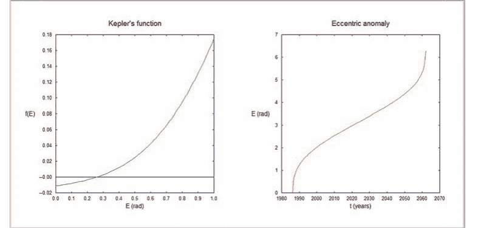

图 6.8 哈雷彗星开普勒方程的解：开普勒函数 `f(E)` 随偏心近点角 `E` 的变化，`t = 1986.2491` 时的情况（左图）以及一个周期内偏心近点角的演化（右图）。

## 问题 6.4

当用波长为 `λ` 的单色光照射宽度为 `W` 且高度无限的狭缝时，夫琅禾费衍射产生的强度分布为（Hecht 2002）：

`I(θ) = I₀ [ sin(π W sin θ / λ) / (π W sin θ / λ) ]²`,  (6.62)

其中 `θ` 是相对于入射光观察衍射波的角度。引入

`x = π W sin θ / λ`,  (6.63)

强度及其对 `x` 的一阶导数可写为

`I(x) = I₀ ( sin x / x )² ,   I(0) = I₀`,  (6.64)

`I′(x) = (2I₀ / x) ( cos x − sin x / x ) sin x / x ,   I′(0) = 0`,  (6.65)

中央强度最大值的一半宽度表示使强度下降到最大值 `I₀` 的一半的正值 `x₁/₂`，显然它是方程的解

`I(x) − I₀/2 = 0`,  (6.66)

强度最大值的位置 `xᵢ` 可以通过一阶导数（6.65）的零点得到，这相当于求解：

`I′(x) = 0`,  (6.67)

- a. 使用图形库 `graphlib` 中的例程 `MultiPlot` 绘制 `x ∈ [−10, 10]` 范围内的分布 `I(x)` 和 `I′(x)`。
- b. 通过割线法求解方程 6.66 来求主衍射最大值的半宽度 `x₁/₂`，并以 `x₀ = π`（`I(x)` 的第一个零点）作为初始近似。
- c. 通过求解方程 6.67 求 `x ∈ [−10, 10]` 中的强度最大值 `xᵢ`；以步长 `h = 0.5` 分离根（该步长小于 `sin x` 零点之间的距离），并用假位法计算它们以保持根被限定。

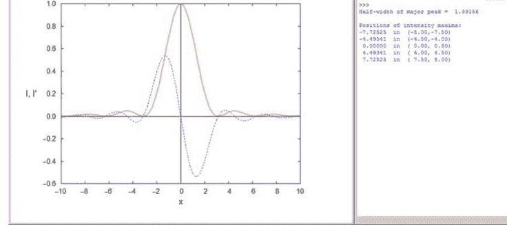

图 6.9 矩形狭缝夫琅禾费衍射的强度分布 `I(x)`（实线）和导数 `I′(x)`（虚线），狭缝宽度有限且高度无限。

### 解

Python 实现见第 6.18 节，C/C++ 版本作为补充材料提供（`P06-Fraunhofer.cpp`），图形输出如图 6.9 所示。

#### 列表 6.18 夫琅禾费衍射（Python 编码）

```
# Intensity distribution for Fraunhofer diffraction

from math import *

from roots import *

from graphlib import *

def Intens(x):

    global I0                     # intensity

    sinc = sin(x)/x if x else 1e0 # maximum intensity

    return I0 * sinc * sinc

def dIntens(x):                   # derivative of Intens

    global I0                     # maximum intensity

    if (x):

        sinc = sin(x)/x

        return 2e0 * I0 * (cos(x) - sinc) * sinc / x

    else: return 0e0

def func(x):                      # function for half-width calculation

    global I0                     # maximum intensity

    return Intens(x) - 0.5e0 * I0

#### main

GraphInit(800,600)

I0 = 1e0                          # maximum intensity

xmin = -10e0; xmax = 10e0

#--------------------------------------------------

n = 101

x = [0]*(2*n+1); y = [0]*(2*n+1)

h = (xmax-xmin) / (n-1)

for i in range(1,n+1):

    xi = xmin + (i-1)*h

    x[i ] = xi; y[i ] = Intens(xi)

    x[i+n] = xi; y[i+n] = dIntens(xi)

nn = [0, n, 2*n]; col = ["", "red", "blue"]; sty = [0, 1,-1]

MultiPlot(x,y,y,nn,col,sty,2,10,

          0e0,0e0,0e0,0e0,0.15,0.85,0.15,0.85,

          "x","I, I'","Fraunhofer diffraction")

#--------------------------------------------------

xi = pi/2e0

(xi,iierr) = Secant(func,0e0,pi,xi)   # half-width of major peak

print("Half-width of major peak = {0:8.5f}".format(xi))

#--------------------------------------------------

print("\nPositions of intensity maxima:")

h = 0.5e0

a = xmin

while (a < xmax):                     # root separation loop

    b = a + h                         # new search interval [a,b]

(xi,i err) = FalsPos(dIntens,a,b)

if ((i err == 0) and (xi != b) and (Intens(xi) > 1e-10)):

    print("{0:8.5f}  in  ({1:5.2f},{2:5.2f})".format(xi,a,b))

    a = b                                         # shift left boundary

MainLoop()
```

## 问题 6.5

普朗克定律表达了处于热平衡的黑体发射的电磁辐射的谱能量密度（Toda et al. 1998）：

`u(λ, T) = 8πhc / λ⁵ · 1 / (exp(hc / (λk_B T)) − 1)`,

其中 `T` 是平衡温度，`λ` 是波长，`h = 6.62606957 × 10⁻³⁴ J·s` 是普朗克常数，`k_B = 1.3806488 × 10⁻²³ J·K⁻¹` 是玻尔兹曼常数，`c = 2.99792458 × 10⁸ m·s⁻¹` 是真空中的光速。`u(λ, T)dλ` 表示在谱区间 `(λ, λ + dλ)` 内辐射的能量。

引入无量纲变量

`x = λ / λ₀`,

以及依赖于温度的参数

`λ₀ = hc / (k_B T),    K = 8πk_B T / λ₀⁴`,

普朗克定律变为

`u(λ, T) = K · 1 / [x⁵ (e^(1/x) − 1)]`,    (6.68)

谱能量密度的导数，

`∂/∂λ u(λ, T) = Kλ₀ [5x + (1 − 5x)e^(1/x)] / [x⁷ (e^(1/x) − 1)²]`,    (6.69)

通过其零点给出 `u(λ, T)` 的最大值位置。维恩位移定律指出，对于黑体，对应于 `u(λ, T)` 最大值的波长 `λ_max` 与温度 `T` 成反比，或等价地 `λ_max T = 2.897768 × 10⁻³ m·K`。

- a. 绘制平衡温度 `T = 4000`、`5000` 和 `6000 K` 时的谱能量密度 `u(λ, T)` 及其对应导数 `∂u(λ, T)/∂t`。
- b. 通过求解方程
  `∂/∂λ u(λ, T) = 0`,
  求太阳电磁辐射的 `u(λ, T)` 的最大值，考虑有效光球温度 `T = 5778 K`（Williams 2013）。使用带数值导数的牛顿法，并检验维恩定律的有效性。

### 解

Python 实现见第 6.19 节，C/C++ 版本作为补充材料提供（`P06-Planck.cpp`）。图形输出如图 6.10 所示。

#### 列表 6.19 黑体辐射普朗克定律（Python 编码）

```
# Planck's law of black body radiation

from math import *

from roots import *

from graphlib import *

hP = 6.62606957e-34                     # Planck's constant (J s)

kB = 1.3806488e-23                      # Boltzmann constant (J/K)

c  = 2.99792458e8                       # speed of light (m/s)

def u(lam):                             # spectral energy density u(lam)

    global lam0, K                      # reference wavelength, factor of u(lam)

    if (lam == 0e0): return 0e0

    x = lam / lam0

    return K / (pow(x,5) * (exp(1e0/x) - 1e0))

def du(lam):                            # du/dlam

    global lam0, K                      # reference wavelength, factor of u(lam)
```


```python
if (lam == 0e0): return 0e0

x = lam / lam0

exp_x = exp(1e0/x)

expl = exp_x - 1e0

return K * lam0 * (5e0*x + (1e0-5e0*x)*exp_x) / (pow(x,7) * expl*expl)
```

#### main

```python
GraphInit(1200,600)

lam_plot = 3e-6                         # maximum wavelength for plots

h = 1e-8                                # step-size for wavelength

n = int(lam_plot/h + 0.5) + 1           # number of points / plot

nmax = 3 * n                            # total number of points

x = [0]*(nmax+1); y = [0]*(nmax+1); z = [0]*(nmax+1)

for j in range(0,3):

    T = 4000e0 + j * 1000e0             # current temperature

    lam0 = hP*c / (kB*T)                # reference wavelength

    K = 8e0 * pi * kB * T / pow(lam0,4)  # factor of u(lam)

    for i in range(1,n+1):

        lam = (i-1)*h

        x[i+j*n] = lam * 1e6            # microns

        y[i+j*n] = u(lam)

        z[i+j*n] = du(lam)

fmax = 0e0                              # normalize profiles

for i in range(1,nmax+1):

    if (y[i] > fmax): fmax = y[i]

for i in range(1,nmax+1): y[i] /= fmax

fmax = 0e0

for i in range(1,nmax+1):

    if (z[i] > fmax): fmax = z[i]

for i in range(1,nmax+1): z[i] /= fmax
```

```python
nn = [0, n, 2*n, 3*n]
col = ["", "blue", "green", "red"]
sty = [0, 1, 1, 1]
MultiPlot(x,y,y,nn,col,sty,3,10,
    0e0,0e0,0,0e0,0e0,0,0.10,0.45,0.15,0.85,
    "lambda (micron)","u","Spectral energy density")

MultiPlot(x,z,z,nn,col,sty,3,10,
    0e0,0e0,0,0e0,0e0,0,0.60,0.95,0.15,0.85,
    "lambda (micron)","du","Derivative of energy density")
```

#--------------------------------------------------------------------
```python
T = 5778e0                     # temperature of sun's photosphere
lam0 = h*kB / (kB*T)           # reference wavelength
K = 8e0 * pi * kB * T / pow(lam0,4)   # factor of u(lam)

fmin = 1e10; fmax = -1e10       # positions of maximum and minimum of du
for i in range(1,n+1):
    lam = (i-1)*h; f = du(lam)
    if (f > fmax): fmax = f; lam_1 = lam          # maximum
    if (f < fmin): fmin = f; lam_2 = lam          # minimum

lam_max = 0.5e0 * (lam_1 + lam_2)               # find zero of du in [lam_1,lam_2]
(lam_max,iierr) = NewtonNumDrv(du,lam_1,lam_2,lam_max)   # initial approximation
print("Wien's law:")
print("T = {0:4.0f} K".format(T))
print("lambda_max = {0:e} m".format(lam_max))
print("lambda_max * T = {0:e} m K".format(lam_max * T))   # 2.897768e-3 m K

MainLoop()
```

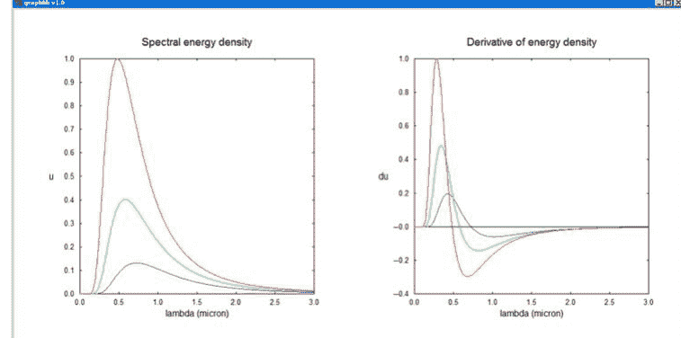

图 6.10 普朗克黑体辐射定律：谱能量密度 `u(λ, T)`（左图）及其导数 `∂u(λ, T)/∂λ`，对应 `T = 4000`、`5000` 和 `6000 K`，相应主峰幅值递增。

## 习题 6.6

求下列圆与抛物线的交点：

`(x − 1)² + y² = 4²`,

`y = x² − 3`,

使用来自模块 `roots.py` 和 `roots.h` 的一对例程 `Jacobian` 和 `NewtonSys`（二者分别对应）。利用图 6.11 寻找交点坐标的初始猜测值。

### 解答

将方程组改写为

`f₁(x₁,x₂) ≡ (x₁ − 1)² + x₂² − 4² = 0`,
`f₂(x₁,x₂) ≡ x₁² − x₂ − 3 = 0`.

Python 实现见程序清单 6.20，C/C++ 版本以补充材料形式提供（`P06-NewtonSys1.cpp`），图形输出如图 6.11 所示。

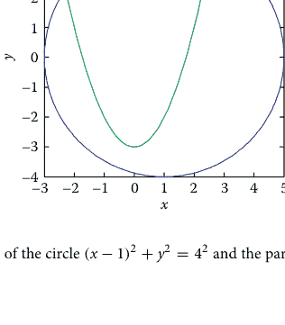

图 6.11 圆 `(x − 1)² + y² = 4²` 与抛物线 `y = x² − 3` 的交点，由程序 6.20 确定。

### 程序清单 6.20 圆与抛物线的交点（Python 代码）

```python
# Intersection of circle and parabola

from math import *

from roots import *

def Func(f, x, n):                # zeros: (-2.295, 2.267), (2.583, 3.673)

    f[1] = pow(x[1]-1,2) + x[2]*x[2] - 16e0

    f[2] = x[1]*x[1] - x[2] - 3e0

#### main

n = 2

f = [0]*(n+1)
```

```python
x = [0]*(n+1)

dx = [0]*(n+1)

x[1] = -5e0; x[2] = 5e0        # 1st initial approximation -> (-2.295, 2.267)

(dx,ierr) = NewtonSys(Func,x,n)

Func(f,x,n)

print("Solution 1:")

print("               x            dx            f")

for i in range(1,n+1):

    print("{0:d}  {1:15.7e}  {2:7.0e}  {3:7.0}".format(i,x[i],dx[i],f[i]))

x[1] = 5e0; x[2] = 5e0    # 2nd initial approximation -> (2.583, 3.673)

(dx,ierr) = NewtonSys(Func,x,n)

Func(f,x,n)

print("\nSolution 2:")

print("               x            dx            f")

for i in range(1,n+1):

    print("{0:d}  {1:15.7e}  {2:7.0e}  {3:7.0}".format(i,x[i],dx[i],f[i]))
```

## 习题 6.7

求解下列非线性方程组（S. M. Tang 和 W. C. Kok，J. Phys. A: Math. Gen, 18, 2691 (1985)）：

`f₁(x₁,x₂,x₃) ≡ x₃ − x₁x₂x₃ = 0`,
`f₂(x₁,x₂,x₃) ≡ x₁ + x₂ + x₃ = 0`,
`f₃(x₁,x₂,x₃) ≡ x₁x₂ + x₂x₃ + x₃x₁ = 0`.

### 解答

Python 实现见程序清单 6.21，C/C++ 版本以补充材料形式提供（`P06-NewtonSys2.cpp`）。

### 程序清单 6.21 三个非线性方程构成的方程组（Python 代码）

```python
# Newton-Raphson method for systems of non-linear equations

from math import *

from roots import *

def Func(f, x, n):                                   # zero: (0, 0, 0)

    f[1] = x[3] - x[1]*x[2]*x[3]

    f[2] = x[1] + x[2] + x[3]

    f[3] = x[1]*x[2] + x[2]*x[3] + x[3]*x[1]

#### main

n = 3

f = [0]*(n+1)

x = [0]*(n+1)

dx = [0]*(n+1)

x[1] = 1e0; x[2] = 2e0; x[3] = 3e0                 # initial approximation

(dx,ierr) = NewtonSys(Func,x,n)

Func(f,x,n)
```

```python
print("Solution:")

print("          x           dx           f")

for i in range(1,n+1):

    print("{0:d}  {1:15.7e}  {2:7.0e}  {3:7.0e}".format(i,x[i],dx[i],f[i]))
```


## 参考文献与进一步阅读建议

Bakhvalov, N. S. 1977. *数值方法：分析、代数、常微分方程*. 莫斯科：MIR 出版社.

Beu, T. A. 2004. *C 语言数值计算*（第 3 版，罗马尼亚语）. 克卢日-纳波卡：MicroInformatica.

Burden, R. 和 J. Faires. 2010. *数值分析*（第 9 版）. 波士顿：Brooks/Cole, Cengage Learning.

Demidovich, B. 和 I. Maron. 1987. *计算数学*（第 4 版）. 莫斯科：MIR 出版社.

Hecht, E. 2002. *光学*（第 4 版）. 旧金山：Addison-Wesley.

Mottmann, J. 1986. 定位轨道物体. *美国物理杂志* 54, 838–842.

Ortega, J. M. 和 W. C. Rheinboldt. 2000. *多变元非线性方程的迭代解法*. 纽约：工业与应用数学学会.

Press, W. H., S. A. Teukolsky, W. T. Vetterling 和 B. P. Flannery. 2007. *数值方法*（第 3 版）：*科学计算的艺术*. 剑桥：剑桥大学出版社.

Toda, M., R. Kubo 和 N. Saitô. 1998. *统计物理 I，平衡态统计力学*（第 2 版）. 海德堡：Springer.

Toma, M. 和 I. Odăgescu. 1980. *数值方法与子程序*（罗马尼亚语）. 布加勒斯特：Editura Tehnică.

Williams, D. R. 2013. NASA，月球与行星科学，太阳资料表. `http://nssdc.gsfc.nasa.gov/planetary/factsheet/sunfact.html`.

## 7 线性方程组

### 7.1 引言

线性方程组在应用数学中几乎无处不在。它们可能自然地出现在问题的数学表述中，也可能是应用某些线性近似方法求解原始问题的结果。用有限差分格式对微分方程边值问题进行离散化，或用分段光滑函数进行插值，只是产生线性方程组的数值方法中两个典型例子。

求解线性方程组的方法无疑是数值分析的核心，基本上可分为两大类：直接法和迭代法。

直接法是有限算法，其中获得解所需的基本运算次数直接取决于线性方程组的规模。直接法仅受舍入误差影响，这一特点使它们在系统规模和所涉及的基本运算次数保持适中时更为可取。尽管克莱姆法则（基于行列式）在直接法中概念上最简单，但就运算而言效率并不高，因此在实际应用中不推荐使用。常用的直接法包括高斯消元、高斯–约当消元、LU 分解、Cholesky 分解等。

迭代法将线性方程组的解视为几乎无限迭代过程的极限来求解。由于只能执行有限次迭代，不可避免的舍入误差之外还有截断误差。迭代法的优点是极其简单且易于直接实现，超过了对更精细误差控制的需求，因而适用于直接法难以处理的情形。此外，迭代法还可用于改进其他方法获得的解。最常见的迭代算法是 Jacobi、Gauss–Seidel 和松弛法。

### 7.2 高斯消元与回代

求解线性方程组的经典直接法之一是高斯消元法，以卡尔·弗里德里希·高斯的名字命名，通常归功于他。然而，这种方法显然在2000多年前的中国就已为人所知，而艾萨克·牛顿在18世纪初就已经使用过它，比高斯早了近100年（Grcar 2011）。

高斯消元的基本概念包含两个不同的阶段：（1）通过初等行变换将方程组化为具有上三角系数矩阵的等价方程组（主对角线以下所有元素均为 0）；（2）用特定的递推技术求解等价三角方程组。方程组的最初变换相当于从后续方程中依次消去未知量，因此称为前向消元。随后对具有三角矩阵的等价方程组进行递推求解，包括将 solution components in reversed order, starting with the last component, and substituting them in the remaining equations, and is generically termed *backward substitution*.

The *elementary row operations* that can be applied to the equations so as to transform a linear system into an equivalent one having the same solution but a triangular coefficient matrix are

1. Interchanging two rows,
2. Multiplying a row by a nonzero scalar, and
3. Replacing a row by a linear combination of itself and another row.

Let us consider for illustration the following 3 × 3 system:

$$
\begin{cases}
3x_1+4x_2+5x_3=10\\
4x_1+2x_2+3x_3=9\\
-2x_1-3x_2+x_3=7
\end{cases}
\quad\text{or}\quad
\begin{bmatrix}
3&4&5\\
4&2&3\\
-2&-3&1
\end{bmatrix}
\begin{bmatrix}
x_1\\
x_2\\
x_3
\end{bmatrix}
=
\begin{bmatrix}
10\\
9\\
7
\end{bmatrix}.
$$

*Forward elimination* starts by eliminating $x_1$ from the second and third equations. Traditionally, this is done by solving for $x_1$ in the first equation and substituting it into the second and third equations to eliminate the $x_1$ dependence. To simplify calculations, we actually divide the first equation by the leading coefficient 3:

$$
\begin{bmatrix}
1&4/3&5/3\\
4&2&3\\
-2&-3&1
\end{bmatrix}
\begin{bmatrix}
x_1\\
x_2\\
x_3
\end{bmatrix}
=
\begin{bmatrix}
10/3\\
9\\
7
\end{bmatrix}.
$$

Then, we subtract the transformed first equation multiplied by the leading coefficient 4 from the second equation and, respectively, multiplied by the leading coefficient −2 from the third equation,

$$
\begin{bmatrix}
1&4/3&5/3\\
0&-10/3&-11/3\\
0&-1/3&13/3
\end{bmatrix}
\begin{bmatrix}
x_1\\
x_2\\
x_3
\end{bmatrix}
=
\begin{bmatrix}
10/3\\
-13/3\\
41/3
\end{bmatrix},
$$

thus effectively eliminating $x_1$ from the last two equations. Now, seeking to eliminate $x_2$ from the last equation, we first divide the second equation by the coefficient −10/3 of $x_2$,

$$
\begin{bmatrix}
1&4/3&5/3\\
0&1&11/10\\
0&-1/3&13/3
\end{bmatrix}
\begin{bmatrix}
x_1\\
x_2\\
x_3
\end{bmatrix}
=
\begin{bmatrix}
10/3\\
13/10\\
41/3
\end{bmatrix},
$$

and then multiply the transformed second equation by the coefficient of $x_2$ from the last equation, −1/3, and subtract it from the latter:

$$
\begin{bmatrix}
1&4/3&5/3\\
0&1&11/10\\
0&0&1
\end{bmatrix}
\begin{bmatrix}
x_1\\
x_2\\
x_3
\end{bmatrix}
=
\begin{bmatrix}
10/3\\
13/10\\
3
\end{bmatrix}.
$$

Consequently, the equivalent system has, indeed, a triangular matrix.

The *backward substitution* is initiated simply by expressing the last solution component, $x_3$, from the last equation. From the second equation, one can then express $x_2$ using the already known $x_3$, while $x_1$ results from the first equation using $x_2$ and $x_3$:

$$
\begin{aligned}
x_3 &= 3,\\
x_2 &= 13/10 - 11/10x_3 = -2,\\
x_1 &= 10/3 - 4/3x_2 - 5/3x_3 = 1.
\end{aligned}
$$

Thus, the solution of the considered linear system is

$$
x_1 = 1,\quad x_2 = -1,\quad x_3 = 3.
$$

Taking a step forward toward deriving the general algorithm of the Gaussian elimination, we consider now the case of a $3 \times 3$ linear system with symbolic coefficients:

$$
\begin{cases}
a_{11}x_1+a_{12}x_2+a_{13}x_3=b_1\\
a_{21}x_1+a_{22}x_2+a_{23}x_3=b_2\\
a_{31}x_1+a_{32}x_2+a_{33}x_3=b_3.
\end{cases}
$$

The matrix form of this system,

$$
\begin{bmatrix}
a_{11}&a_{12}&a_{13}\\
a_{21}&a_{22}&a_{23}\\
a_{31}&a_{32}&a_{33}
\end{bmatrix}
\begin{bmatrix}
x_1\\
x_2\\
x_3
\end{bmatrix}
=
\begin{bmatrix}
b_1\\
b_2\\
b_3
\end{bmatrix},
$$

can be cast as matrix equation,

$$
\mathbf{A}\cdot\mathbf{x}=\mathbf{b},
$$

where $\mathbf{A}=[a_{ij}]$ is the coefficient matrix, $\mathbf{x}=[x_i]$ is the column vector of the unknowns, and $\mathbf{b}=[b_i]$ is the column vector of the constant terms.

At the first step of the forward elimination (marked by an upper index (1)), we aim to eliminate $x_1$ from all equations, except for the first one. To this end, we start by dividing the first row by the pivot element $a_{11}$, which is assumed to be nonzero:

$$
\begin{cases}
x_1+a_{12}^{(1)}x_2+a_{13}^{(1)}x_3=b_1^{(1)}\\
a_{21}x_1+a_{22}x_2+a_{23}x_3=b_2\\
a_{31}x_1+a_{32}x_2+a_{33}x_3=b_3.
\end{cases}
$$

If, on the contrary, $a_{11}$ is zero, the first equation has to be interchanged with another one that has a nonzero leading coefficient. We then subtract the first equation, multiplied by the coefficient $a_{21}$ of $x_1$, from the second equation and, respectively, multiplied by $a_{31}$, from the third equation. Thus, we obtain the transformed system:

$$
\begin{cases}
x_1+a_{12}^{(1)}x_2+a_{13}^{(1)}x_3=b_1^{(1)}\\
a_{22}^{(1)}x_2+a_{23}^{(1)}x_3=b_2^{(1)}\\
a_{32}^{(1)}x_2+a_{33}^{(1)}x_3=b_3^{(1)}.
\end{cases}
$$

where the upper index (1) denotes the first step of the forward elimination. The new coefficients are given by

$$
\begin{cases}
a_{1j}^{(1)} = a_{1j}/a_{11}, \quad j = 1,2,3 \\
b_1^{(1)} = b_1/a_{11}. \\
a_{ij}^{(1)} = a_{ij} - a_{i1}a_{1j}^{(1)}, \quad j = 1,2,3,\ i = 2,3 \\
b_i^{(1)} = b_i - a_{i1}b_1^{(1)}.
\end{cases} \tag{7.3}
$$

In matrix notation, the first step of the Gaussian elimination leads to

$$
\begin{bmatrix}
1 & a_{12}^{(1)} & a_{13}^{(1)} \\
0 & a_{22}^{(1)} & a_{23}^{(1)} \\
0 & a_{32}^{(1)} & a_{33}^{(1)}
\end{bmatrix}
\begin{bmatrix}
x_1 \\
x_2 \\
x_3
\end{bmatrix}
=
\begin{bmatrix}
b_1^{(1)} \\
b_2^{(1)} \\
b_3^{(1)}
\end{bmatrix}. \tag{7.4}
$$

The purpose of the second step is to eliminate the unknown $x_2$ from the last equation. We first divide the second equation by the pivot element $a_{22}^{(1)}$, assumed to be nonzero (otherwise, we interchange the second and third equations). We then subtract the obtained equation, multiplied by $a_{32}^{(1)}$, from the third one. The result is the matrix equation:

$$
\begin{bmatrix}
1 & a_{12}^{(1)} & a_{13}^{(1)} \\
0 & 1 & a_{23}^{(2)} \\
0 & 0 & a_{33}^{(2)}
\end{bmatrix}
\begin{bmatrix}
x_1 \\
x_2 \\
x_3
\end{bmatrix}
=
\begin{bmatrix}
b_1^{(1)} \\
b_2^{(2)} \\
b_3^{(2)}
\end{bmatrix}, \tag{7.5}
$$

with the coefficients

$$
\begin{cases}
a_{2j}^{(2)} = a_{2j}^{(1)}/a_{22}^{(1)}, \quad j = 2,3 \\
b_2^{(2)} = b_2^{(1)}/a_{22}^{(1)}. \\
a_{ij}^{(2)} = a_{ij}^{(1)} - a_{i2}^{(1)}a_{2j}^{(2)}, \quad j = 2,3,\ i = 3 \\
b_i^{(2)} = b_i^{(1)} - a_{i2}^{(1)}b_2^{(2)}.
\end{cases} \tag{7.6}
$$


It is readily noticeable that these relations are perfectly equivalent with Formulas 7.3 of the first elimination step and could have been obtained from the latter by simply replacing index "1" with "2." Within the second step, one no longer operates on the first line and first column.

We finalize the forward elimination by dividing the third equation by its pivot element $a_{33}^{(2)}$ (which has to be nonzero for a system with nonsingular matrix) and we get

```
\begin{bmatrix} 1 & a_{12}^{(1)} & a_{13}^{(1)} \\ 0 & 1 & a_{23}^{(2)} \\ 0 & 0 & 1 \end{bmatrix} \begin{bmatrix} x_1 \\ x_2 \\ x_3 \end{bmatrix} = \begin{bmatrix} b_1^{(1)} \\ b_2^{(2)} \\ b_3^{(3)} \end{bmatrix}, \tag{7.7}
```

with

```
b_3^{(3)} = b_3^{(2)}/a_{33}^{(2)}.
```

The backward substitution implies processing in reversed order the rows of the transformed system with triangular matrix 7.7—resulted from the elimination phase—and calculating the solution components by the recursive procedure:

```
\begin{cases}
x_3 = b_3^{(3)} \\
x_2 = b_2^{(2)} - a_{23}^{(2)} x_3 \\
x_1 = b_1^{(1)} - (a_{12}^{(1)} x_2 + a_{13}^{(1)} x_3).
\end{cases}
(7.8)
```

The determination of the solution components proceeds from high to low indexes, each new component solely depending on the previously determined components.

A beneficial feature of the Gaussian elimination is that it also enables the calculation of the determinant of matrix A on the fly. Indeed, since the final matrix of the transformed system A^{(3)} (7.7) is triangular, its determinant amounts to the product of the diagonal elements

```
\det \mathbf{A}^{(3)} = 1.
```

On the other hand, having in view that the divisions of the rows by the pivot elements finally lead to a coefficient matrix having the determinant equal to the one of the initial matrix divided by the product of the successive pivots, there results

```
\det \mathbf{A}^{(3)} = \frac{\det \mathbf{A}}{a_{11}^{(1)} a_{22}^{(2)} a_{33}^{(2)}} = 1,
```

and hence

```
\det \mathbf{A} = a_{11}^{(1)} a_{22}^{(2)} a_{33}^{(2)}.
(7.9)
```

### Generalization to n × n

Let us now generalize the Gaussian elimination for the case of an n × n linear system (with n equations and n unknowns). Written as a matrix equation, the system reads

```
\mathbf{A} \cdot \mathbf{x} = \mathbf{b}, 
(7.10)
```

and features the coefficient matrix A = [a_{ij}]_{nn}, the column vector b = [b_i]_n of the constant terms, and the column vector x = [x_i]_n of the solution components.

As a result of the first k − 1 steps of the forward elimination, zeros have been created below the main diagonal on the first k − 1 columns of the coefficient matrix, and the system has acquired the equivalent form:

```
\begin{bmatrix}
1 & a_{12}^{(1)} & \dots & a_{1k}^{(1)} & a_{1k+1}^{(1)} & \dots & a_{1n}^{(1)} \\
0 & 1 & \dots & a_{2k}^{(2)} & a_{2k+1}^{(2)} & \dots & a_{2n}^{(2)} \\
\vdots & \vdots & \ddots & \vdots & \vdots & & \vdots \\
0 & 0 & \dots & a_{kk}^{(k-1)} & a_{kk+1}^{(k-1)} & \dots & a_{kn}^{(k-1)} \\
0 & 0 & \dots & a_{k+1k}^{(k-1)} & a_{k+1k+1}^{(k-1)} & \dots & a_{k+1n}^{(k-1)} \\
\vdots & \vdots & & \vdots & \vdots & \ddots & \vdots \\
0 & 0 & \dots & a_{nk}^{(k-1)} & a_{nk+1}^{(k-1)} & \dots & a_{nn}^{(k-1)}
\end{bmatrix}
\begin{bmatrix}
x_1 \\
x_2 \\
\vdots \\
x_k \\
x_{k+1} \\
\vdots \\
x_n
\end{bmatrix}
=
\begin{bmatrix}
b_1^{(1)} \\
b_2^{(2)} \\
\vdots \\
b_k^{(k-1)} \\
b_{k+1}^{(k-1)} \\
\vdots \\
b_n^{(k-1)}
\end{bmatrix}.
```

Obviously, equations k, k+1, …, n couple only the solution components x_k, x_{k+1}, …, x_n, the rest having been successively eliminated.

第 $k$ 步 ($k = 1,2,\ldots,n-1$) 的目标是从最后 $n-k$ 个方程中消去未知数 $x_k$ 并将系统化为形式：

```
\begin{bmatrix} 1 & a_{12}^{(1)} & \cdots & a_{1k}^{(1)} & a_{1k+1}^{(1)} & \cdots & a_{1n}^{(1)} \\ 0 & 1 & \cdots & a_{2k}^{(2)} & a_{2k+1}^{(2)} & \cdots & a_{2n}^{(2)} \\ \vdots & \vdots & \ddots & \vdots & \vdots & & \vdots \\ 0 & 0 & \cdots & 1 & a_{kk+1}^{(k)} & \cdots & a_{kn}^{(k)} \\ 0 & 0 & \cdots & 0 & a_{k+1k+1}^{(k)} & \cdots & a_{k+1n}^{(k)} \\ \vdots & \vdots & & \vdots & \vdots & \ddots & \vdots \\ 0 & 0 & \cdots & 0 & a_{nk+1}^{(k)} & \cdots & a_{nn}^{(k)} \end{bmatrix} \begin{bmatrix} x_1 \\ x_2 \\ \vdots \\ x_k \\ x_{k+1} \\ \vdots \\ x_n \end{bmatrix} = \begin{bmatrix} b_1^{(1)} \\ b_2^{(2)} \\ \vdots \\ b_k^{(k)} \\ b_{k+1}^{(k)} \\ \vdots \\ b_n^{(k)} \end{bmatrix}. \tag{7.11}
```

枢轴行 $k$ 的更新系数由下式给出

```
\begin{cases} a_{kk}^{(k)} = 1, \\ a_{kj}^{(k)} = a_{kj}^{(k-1)}/a_{kk}^{(k-1)}, \quad j = k+1,\ldots,n, \\ b_k^{(k)} = b_k^{(k-1)}/a_{kk}^{(k-1)}, \end{cases} \tag{7.12}
```

而枢轴线下方非枢轴行的新元素为：

```
\begin{cases} a_{ik}^{(k)} = 0, \\ a_{ij}^{(k)} = a_{ij}^{(k-1)} - a_{ik}^{(k-1)} a_{kj}^{(k)}, \quad j = k+1,\ldots,n,\ i = k+1,\ldots,n, \\ b_i^{(k)} = b_i^{(k-1)} - a_{ik}^{(k-1)} b_k^{(k)}. \end{cases} \tag{7.13}
```

可以注意到，在第 $k$ 步时，实际上只修改系数矩阵右下部分由行和列 $k$ 限定的元素，与前一步相比，其余元素保持不变。

在最后一次消元步骤 $k = n$ 时，只需将最后一个方程除以最后一个枢轴元素 $a_{nn}^{(n-1)}$ 以在对角线上产生 1：

```
\begin{cases} a_{nn}^{(n)} = 1, \\ b_n^{(n)} = b_n^{(n-1)}/a_{nn}^{(n-1)}. \end{cases} \tag{7.14}
```

最后，系统取形式

```
\begin{bmatrix} 1 & a_{12}^{(1)} & \cdots & a_{1k}^{(1)} & a_{1k+1}^{(1)} & \cdots & a_{1n}^{(1)} \\ 0 & 1 & \cdots & a_{2k}^{(2)} & a_{2k+1}^{(2)} & \cdots & a_{2n}^{(2)} \\ \vdots & \vdots & \ddots & \vdots & \vdots & & \vdots \\ 0 & 0 & \cdots & 1 & a_{kk+1}^{(k)} & \cdots & a_{kn}^{(k)} \\ 0 & 0 & \cdots & 0 & 1 & \cdots & a_{k+1n}^{(k+1)} \\ \vdots & \vdots & & \vdots & \vdots & \ddots & \vdots \\ 0 & 0 & \cdots & 0 & 0 & \cdots & 1 \end{bmatrix} \begin{bmatrix} x_1 \\ x_2 \\ \vdots \\ x_k \\ x_{k+1} \\ \vdots \\ x_n \end{bmatrix} = \begin{bmatrix} b_1^{(1)} \\ b_2^{(2)} \\ \vdots \\ b_k^{(k)} \\ b_{k+1}^{(k+1)} \\ \vdots \\ b_n^{(n)} \end{bmatrix}, \tag{7.15}
```

随后的 *回代* 基于关系式操作：

```
$$\begin{cases}
 x_{nj}=b_{nj}^{(n)}, & j=1,\ldots,m,\\
 x_{kj}=b_{kj}^{(k)}-\displaystyle\sum_{i=k+1}^{n}a_{ki}^{(k)}x_{ij}, & j=1,\ldots,m,\quad k=n-1,\ldots,1.
\end{cases} \tag{7.22}$$
```

并按列（针对 $m$ 个同时系统中的每一个）以逆序给出解矩阵 **X** 的分量。

考虑到最终矩阵 $A^{(n)}$ 的全部相关信息在消元阶段结束时仅包含在主对角线上方上三角中，在消元步骤 $k$ 时，枢轴行的元素 $a_{kj}^{(k)}$ 以及其下非枢轴行的元素 $a_{ij}^{(k)}$ 在列 $j=k$ 上无需显式求值，因为它们按定义等于 1 或 0 并且无论如何都不会被重用。这意味着在矩阵 $A^{(k)}$ 中只需对列 $j=k+1,\ldots,n$ 进行操作。至于回代，在实现关系式 7.22 时，可以使用单个数组同时存储常数项 $b_{kj}$ 和解的分量 $x_{kj}$。

能够求解对应于任意数量同时线性系统的矩阵方程的算法为处理一个具有重要实际意义的问题提供了可能性——方阵的求逆。事实上，将单位矩阵作为常数项矩阵，

```
$$B=E_n=[\delta_{ij}]_{nn},$$
```

系统 **A · X = B** 的解正是系数矩阵的逆，即 $X=A^{-1}$。这显然是任何求解矩阵方程的算法可用于求逆矩阵的非特异性方式。

特别值得关注的，且不只是为了与其他线性矩阵方程求解器进行比较，是高斯消元所需的浮点运算次数。通过分析方程 7.20 至 7.22，可得到以下运算计数：

- 将系数矩阵 A 变换为上三角形式：
  - 求和与减法（方程 7.21）：

```
$$S_A(n)=\sum_{k=1}^{n}\sum_{j=k+1}^{n}\sum_{i=k+1}^{n}1=\frac{1}{3}n^3-\frac{1}{2}n^2+\frac{1}{6}n,$$
```

  - 乘法与除法（方程 7.20 和 7.21）：

```
$$M_A(n)=\sum_{k=1}^{n}\sum_{j=k+1}^{n}1+\sum_{k=1}^{n}\sum_{j=k+1}^{n}\sum_{i=k+1}^{n}1=\frac{1}{3}n^3-\frac{1}{3}n.$$
```


- 变换单个常数项向量 `b`（`m = 1`）：
  - 求和与减法（方程 7.21 和 7.22）：
    $$S_b(n) = \sum_{k=1}^{n} \sum_{i=k+1}^{n} 1 + \sum_{k=1}^{n-1} \left(1 + \sum_{i=k+1}^{n-1} 1\right) = n^2 - n,$$
  - 乘法与除法（方程 7.20 至 7.22）：
    $$M_b(n) = \sum_{k=1}^{n} 1 + \sum_{k=1}^{n} \sum_{i=k+1}^{n} 1 + \sum_{k=1}^{n-1} \sum_{i=k+1}^{n} 1 = n^2.$$

- 求解单个线性方程组：
  $$S_A(n) + M_A(n) + S_b(n) + M_b(n) = \frac{2}{3} n^3 + \frac{3}{2} n^2 - \frac{7}{6} n \sim \frac{2}{3} n^3. \tag{7.23}$$

- 求逆系数矩阵 `A` 或求解 `n × n` 矩阵方程：
  $$S_A(n) + M_A(n) + n\left[S_b(n) + M_b(n)\right] = \frac{8}{3} n^3 - \frac{3}{2} n^2 - \frac{1}{6} n \sim \frac{8}{3} n^3. \tag{7.24}$$

尽管在数学上完全一致，但在某些情况下基于方程 7.20 至 7.22 的算法仍会失败。具体而言，高斯消元的实现在每一步 `$k$` 都涉及将枢轴行 `$k$` 除以对角枢轴元素 `$a_{kk}^{(k-1)}$`。除法众所周知具有放大舍入误差的潜力，并且可能遇到实际上等于零的枢轴，在这种情况下，若无额外措施算法无法继续。此外，即使值非零，也可证明较大的枢轴会使变换后的矩阵 `$A^{(k)}$` 以及隐含的最终上三角矩阵 `$A^{(n)}$` 中的舍入误差更小。

为了抵消除以枢轴元素带来的不利副作用，一个选择是执行所谓的局部主元法。特别是在消元步骤 `$k$` 中，主元法意味着在列 `$k$` 上且在枢轴行及以下（`$l \ge k$`）定位最大元素 `$a_{lk}^{(k-1)}$`，并通过交换行 `$k$` 和 `$l$` 将该元素置于主对角线上（成为实际枢轴 `$a_{kk}^{(k-1)}$`）。然而，在计算行列式作为连续枢轴的乘积时，必须对行交换进行符号变化进行考虑。总的来说，主元法增加了高斯消元的计算成本，但确保了算法的稳定性和解的准确性。

在使用中更有效的主元算法有完全主元法，其中枢轴从尚未进行主元处理的矩阵 `$A^{(k-1)}$` 的所有列和行中选取。因此舍入误差进一步减小，但代价是更复杂的编码和额外的存储。完全主元法与 Gauss–Jordan 方法结合在下一节中进行了说明。

来自列表 7.1 的函数 `Gauss` 密切实现了上述描述的高斯消元算法，并且通过使用列上的局部主元法使例程操作稳定。数组 `a` 在输入时包含系数矩阵 `A` 的元素，并在消元过程中被破坏。为了在例程操作后仍可使用，矩阵 `A` 还应保存在备份数组中。数组 `b` 在输入时包含常数项 `B` 的元素，并在退出时返回解矩阵 `X` 的相应分量。系数矩阵的行列式由

## Listing 7.1 用高斯消去法带部分主元求解矩阵方程（Python 编码）

```
# =================================================================================

def Gauss(a, b, n, m):

# --------------------------------------------------------------------------------

# Solves matrix equation a x = b by Gaussian elimination with partial

# pivoting on columns.

# a  - coefficient matrix (n x n); destroyed on exit

# b  - matrix of constant terms (n x m); solution x on exit

# det - determinant of coefficient matrix (output).

# --------------------------------------------------------------------------------

det = 1e0

for k in range(1,n+1):                     # FORWARD ELIMINATION

    amax = 0e0                             # determine pivot row with

    for i in range(k,n+1):                 # max. element on column k

        if (amax < fabs(a[i][k])): amax = fabs(a[i][k]); imax = i

    if (amax == 0e0):

        print("Gauss: singular matrix !"); return 0e0

    if (imax != k):                        # interchange rows imax and k

        det = -det                         # to put pivot on diagonal

        for j in range(k,n+1): (a[imax][j],a[k][j]) = (a[k][j],a[imax][j])

        for j in range(1,m+1): (b[imax][j],b[k][j]) = (b[k][j],b[imax][j])

    det *= a[k][k]                         # multiply determinant with pivot

    t = 1e0/a[k][k]                        # divide pivot row by pivot

    for j in range(k+1,n+1): a[k][j] *= t

    for j in range(1,m+1): b[k][j] *= t

    for i in range(k+1,n+1):               # reduce non-pivot rows

        t = a[i][k]

        for j in range(k+1,n+1): a[i][j] -= a[k][j]*t

        for j in range(1,m+1): b[i][j] -= b[k][j]*t

for k in range(n-1,0,-1):                  # BACKWARD SUBSTITUTION

    for j in range(1,m+1):

        sum = b[k][j]

        for i in range(k+1,n+1): sum -= a[k][i]*b[i][j]

        b[k][j] = sum

return det
```

参数 `det`。 在消去过程中的某个阶段，如果无法识别出非零主元，则表明系数矩阵 `A` 是奇异的，例程会发出错误消息后退出。

一个简单的测试程序在 Listing 7.2 中说明了例程 `Gauss` 的用法。 按照第 2.5 节讨论的基本编程技术，在 Python 中我们将 2D 数组定义为行向量的集合。具体而言，Listing 7.2 中使用的特定语法允许数组 `a` 和 `b` 的最后一个可用元素分别为 `a[n][n]` 和 `b[n][m]`。 该程序的 C/C++ 对应版本作为补充材料提供（文件 `P07-Gauss.cpp`），借助 `memalloc.h` 包含文件中的函数 `Matrix` 来动态分配数组 `a` 和 `b`（见第 2 章）。 对于格式化的输出，程序调用 `matutil.py` 模块中定义的函数 `MatPrint`。

## Listing 7.2 用高斯消去法求解线性系统（Python 编码）

```
# Solves linear system by Gauss elimination
from linsys import *

from matutil import *

n = 4                                          # order of system
m = 1                                          # number of constant vectors
a = [[0]*(n+1) for i in range(n+1)]            # system matrix
b = [[0]*(m+1) for i in range(n+1)]            # constant terms
a[1][1] = 1; a[1][2] = 2; a[1][3] = 3; a[1][4] = 4; b[1][1] = 30
a[2][1] = 2; a[2][2] = 1; a[2][3] = 2; a[2][4] = 3; b[2][1] = 22
a[3][1] = 3; a[3][2] = 2; a[3][3] = 1; a[3][4] = 2; b[3][1] = 18
a[4][1] = 4; a[4][2] = 3; a[4][3] = 2; a[4][4] = 1; b[4][1] = 20

                                          # Solution: 1.0, 2.0, 3.0, 4.0; det = -20.0

print("A:")
MatPrint(a,n,n)

print("B:")
MatPrint(b,n,m)

det = Gauss(a,b,n,m)                          # solve system
print("det A =",det)
print("Solution:")
MatPrint(b,n,m)
```

## 7.3 高斯-约当消去法

高斯-约当方法可以被视为高斯消去法的变体，其中，不是通过初等行变换将系数矩阵 `A` 转化为上三角形式，而是在每一步中在整个矩阵内进行消去过程，最终将其转化为单位矩阵。因此，尽管前向消去阶段更为复杂，但向后回代被完全消除。此外，通过高效的编码和内存使用，高斯-约当消去法允许在求解矩阵方程的同时就地计算系数矩阵 `A⁻¹` 的逆。

让我们再次考虑在上一节中使用标准高斯消去法带回代求解的简单数值例子：

[ 3  4  5 ] [ x₁ ]   [ 10 ]
[ 4  2  3 ] [ x₂ ] = [  9 ]
[ -2 -3  1 ] [ x₃ ]   [  7 ]

在消去的第一步，未知数 `x₁` 要从除第一个方程之外的所有方程（第二和第三）中消去。为此，我们首先将第一个方程除以首项系数 3：

[ 1  4/3  5/3 ] [ x₁ ]   [ 10/3 ]
[ 4   2    3  ] [ x₂ ] = [   9  ]
[ -2 -3    1  ] [ x₃ ]   [   7  ]

然后我们用变换后的第一个方程乘以首项系数 4 从第二个方程中减去，并分别用首项系数 −2 乘以从第三个方程中减去：

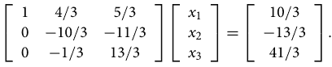

在第二步消去中，我们从除第二个方程之外的所有方程（第一个和第三个）中消去 `$x_2$`。因此，我们首先将第二个方程除以 `$x_2$` 的系数 `$-10/3$`，

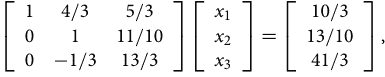

然后我们用变换后的第二个方程乘以 `$x_2$` 的系数 `$4/3$` 从第一个方程中减去，并分别用 `$−1/3$` 乘以从第三个方程中减去：

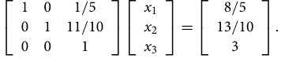

在最后一步消去中，我们从除第二个方程之外的所有方程（第一个和第二个）中消去 `$x_3$`。为此，我们用 `$x_3$` 的系数分别乘以第三个方程，从第一个和第二个方程中减去：

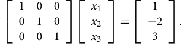

显然，没有必要进行向后回代，如标准高斯消去法那样，因为解的分量已经显式地出现在系数矩阵为单位矩阵的变换系统之中。

为了制定一般算法，我们注意到，在 *前向消去* 的第 `$k$` 步，未知数 `$x_k$` 从系统除第 `$k$` 个主元方程外的所有方程中消去，并且变换后的系统因此采取以下形式：

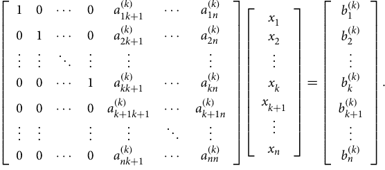

主元行的元素根据以下公式更新

```
\begin{cases} a_{kk}^{(k)} = 1, \\ a_{kj}^{(k)} = a_{kj}^{(k-1)} / a_{kk}^{(k-1)}, \quad j = k+1,\dots,n, \\ b_{k}^{(k)} = b_{k}^{(k-1)} / a_{kk}^{(k-1)}, \end{cases} \tag{7.26}
```

非主元行的新元素由下式给出

```
\begin{cases} a_{ik}^{(k)} = 0, \\ a_{ij}^{(k)} = a_{ij}^{(k-1)} - a_{ik}^{(k-1)} a_{kj}^{(k)}, \quad j = k+1,\dots,n,\ i = 1,\dots,n,\ i \neq k \\ b_{i}^{(k)} = b_{i}^{(k-1)} - a_{ik}^{(k-1)} b_{k}^{(k)}. \end{cases} \tag{7.27}
```

可以看出，在消去步骤 k 时，只有主元列 k 右侧的列被修改，主元列本身变得与单位矩阵的相应列相同。对于常数项，它们在所有消去步骤中都会被改变。

在消去阶段结束时，矩阵方程获得了期望的结构，

```
\mathbf{E}_n \mathbf{x} = \mathbf{b}^{(n)}
```

其中 `E_n` 是阶数为 `n` 的单位矩阵。显然，不再需要向后回代阶段（类似于高斯消去法所具有的），因为上述形式允许直接识别解分量：

```
x_k = b_k^{(n)}, \quad k = 1,\dots,n. \tag{7.28}
```

系数矩阵行列式的即时计算与高斯消去法完全相同，并且基于事实 `det A^{(n)} = det E_n = 1`。 由于矩阵 `A^{(n)}` 是通过连续将主元行除以主元元素得到的，因此可得

```
\det \mathbf{A}^{(n)} = \frac{\det \mathbf{A}}{a_{11}^{(1)} a_{22}^{(1)} \cdots a_{nn}^{(n-1)}} = 1
```

由此得出：

```
\det \mathbf{A} = a_{11} a_{22}^{(1)} \cdots a_{nn}^{(n-1)}. \tag{7.29}
```

高斯-约当方法的递推关系可以直接推广到通过仅为常数项 `b_{kj}` 和解分量 `x_{kj}` 增加一个补充列索引来求解矩阵方程。在步骤 `k = 1, ..., n` 时，主元行 `k` 的关系为

```
\begin{cases} a_{kj}^{(k)} = a_{kj}^{(k-1)} / a_{kk}^{(k-1)}, \quad j = k+1,\dots,n, \\ b_{kj}^{(k)} = b_{kj}^{(k-1)} / a_{kk}^{(k-1)}, \quad j = 1,\dots,m, \end{cases} \tag{7.30}
```

而对于非主元行，它们为：

```
\begin{cases} a_{ij}^{(k)} = a_{ij}^{(k-1)} - a_{ik}^{(k-1)} a_{kj}^{(k)}, \quad i = 1,\dots,n, \ i \neq k, \ j = k+1,\dots,n, \\ b_{ij}^{(k)} = b_{ij}^{(k-1)} - a_{ik}^{(k-1)} b_{kj}^{(k)}, \quad i = 1,\dots,n, \ i \neq k, \ j = 1,\dots,m. \end{cases} \tag{7.31}
```


最后，解的分量可以用变换后常数项的最后一个值简单地标识：

$$
x_{kj}=b_{kj}^{(n)},\quad j=1,\dots,m,\ k=1,\dots,n.\tag{7.32}
$$

从这些关系可以看出，高斯法与高斯-约当法之间有两个显著差异。首先，在高斯法的第 $k$ 步（公式 7.20 至 7.22）中，只有位于主元行 $k$ 下方的非主元行被约化（$i=k+1,\dots,n$），未知数 $x_k$ 仅从这些行中被消去，而在高斯-约当法中，所有非主元行都被处理（$i=1,\dots,k-1,k+1,\dots,n$），未知数 $x_k$ 从所有这些行中被消去。第二大主要区别在于高斯-约当法中完全不存在回代。作为技术细节，如果使用同一个数组同时存放常数项 $\mathbf{B}=[b_{kj}]$ 和解分量 $\mathbf{X}=[x_{kj}]$，则赋值（7.32）实际上无需编码。

与其它方法相比，高斯-约当消去最有益的特性之一是其能够原地求逆系数矩阵 $\mathbf{A}$。该特性依赖于这样一个事实：由于变换后的系数矩阵 $\mathbf{A}^{(k)}$ 仅在列 $j=k+1,\dots,n$ 中包含相关信息，因此原则上只需有效地更新这些列。事实上，在消去过程中从左到右“扫描”数组时，主元列 $k$ 隐式地在其后留下单位矩阵的列，这些列无需实际存储。另一方面，求逆矩阵 $\mathbf{A}$ 本质上等价于求解矩阵方程 $\mathbf{A}\cdot\mathbf{X}=\mathbf{E}$，其中单位矩阵 $\mathbf{E}$ 形式上充当常数项矩阵。通过对矩阵 $\mathbf{A}$ 和 $\mathbf{E}$ 同时进行高斯-约当消去的初等变换，连续矩阵 $\mathbf{A}^{(k)}$ 的相关列数减少 1，而变换后单位矩阵 $\mathbf{E}^{(k)}$ 的相关列数增加 1。由于矩阵 $\mathbf{A}^{(k)}$ 和 $\mathbf{E}^{(k)}$ 的相关列总数保持不变，因此算法的实现原则上可以用单个数组同时存放两个矩阵。随着 $\mathbf{A}^{(k)}$ 相关列的约化，数组的列从左到右逐渐被 $\mathbf{E}^{(k)}$ 的新相关列所取代。技巧之一是初始单位矩阵的列可以在其变换前逐一在同一列中生成。最后，最初包含系数矩阵 $\mathbf{A}$ 的数组将包含其逆 $\mathbf{E}^{(n)}\equiv\mathbf{A}^{-1}$。因此，高斯-约当法可同时求解矩阵方程并求逆其系数矩阵。

高斯-约当消去伴随原地矩阵求逆的浮点运算次数可与标准高斯消去类似地确定：

- 将系数矩阵 $\mathbf{A}$ 变换为单位矩阵：
  - 求和与减法（公式 7.31）：

    $$
    S_A(n)=\sum_{k=1}^{n}\sum_{j=1}^{n}\left(\sum_{i=1}^{k-1}1+\sum_{i=k+1}^{n}1\right)=n^3-n^2,
    $$

  - 乘法与除法（公式 7.30 和 7.31）：

    $$
    M_A(n)=\sum_{k=1}^{n}\sum_{j=1}^{n}1+\sum_{k=1}^{n}\sum_{j=1}^{n}\left(\sum_{i=1}^{k-1}1+\sum_{i=k+1}^{n}1\right)=n^3.
    $$

- 变换单个常数项向量 $\mathbf{b}$（`m` = 1）：
  - 求和与减法（公式 7.31）：

    $$
    S_b(n)=\sum_{k=1}^{n}\left(\sum_{i=1}^{k-1}1+\sum_{i=k+1}^{n}1\right)=n^2-n,
    $$

  - 乘法与除法（公式 7.30 和 7.31）：

    $$
    M_b(n)=\sum_{k=1}^{n}1+\sum_{k=1}^{n}\left(\sum_{i=1}^{k-1}1+\sum_{i=k+1}^{n}1\right)=n^2.
    $$

- 求解单个线性方程组：

  $$
  S_A(n)+M_A(n)+S_b(n)+M_b(n)=2n^3+n^2-n \sim 2n^3. \tag{7.33}
  $$

- 求逆系数矩阵 $\mathbf{A}$：

  $$
  S_A(n)+M_A(n)=2n^3-n^2 \sim 2n^3. \tag{7.34}
  $$

通过比较伴随回代的高斯消去（公式 7.23 和 7.24）所需浮点运算次数与高斯-约当消去（公式 7.33 和 7.34）所需浮点运算次数可知，在求解线性方程组时，高斯消去更优，无论系统规模 $n$ 如何，其速度约为 3 倍（$N_{\mathrm{Gauss}} \sim \frac{2}{3}n^3$，$N_{\mathrm{Gauss\text{–}Jordan}} \sim 2n^3$），而在求逆矩阵时，高斯-约当法速度大约快 4/3 倍（$N_{\mathrm{Gauss}} \sim \frac{8}{3}n^3$，$N_{\mathrm{Gauss\text{–}Jordan}} \sim 2n^3$），并且只需一个数组（而非两个）即可存储系数矩阵及其逆。

第 7.3 节清单中的 `GaussJordan0` 例程突出了高斯法与高斯-约当法之间的技术差异，并在不求逆系数矩阵的情况下尽可能遵循函数 `Gauss` 的结构。为减少舍入误差并稳定算法，采用了相同的列部分主元技术。尽管由于没有回代，高斯-约当算法看起来更紧凑，但由于消去阶段更为复杂，其隐含的初等运算次数超过了高斯消去。

第 7.4 节清单中给出的函数 `GaussJordan1` 在例程 `GaussJordan0` 的基础上实现了上述原地求逆。它在退出时用其逆替换系数 `a` 的数组，并用矩阵方程的解替换常数项 `b` 的数组。

与高斯消去不同，高斯-约当算法在每一步消去中对所有列进行操作（$j=1,\dots,n$），因为系数矩阵和单位矩阵都必须经历初等变换序列。单位矩阵列的初始化（`a[k][k] = 1e0` 和 `a[i][k] = 0e0`）逐渐覆盖已变得冗余的变换后系数矩阵的列。

补充数组 `ipivot` 存储连续主元行的索引。事实上，考虑到主元意味着对初始单位矩阵的行进行重排，为获得系统矩阵的正确逆，需要按 `ipivot` 中存储的索引的逆序对数组 `a` 的列进行最后一次重排。

### 清单 7.3 带部分主元的高斯-约当消去（Python 编码）

```python
# =================================================================================

def GaussJordan0(a, b, n, m):

    # --------------------------------------------------------------------------------
    # Solves matrix equation a x = b by Gauss–Jordan elimination with partial
    # pivoting on columns.
    # a   - coefficient matrix (n x n); destroyed on exit
    # b   - matrix of constant terms (n x m); solution x on exit
    # det - determinant of coefficient matrix (output).
    # --------------------------------------------------------------------------------

    det = 1e0

    for k in range(1,n+1):                                 # FORWARD ELIMINATION
        amax = 0e0                                         # determine pivot row with
        for i in range(k,n+1):                             # max. element on column k
            if (amax < fabs(a[i][k])): amax = fabs(a[i][k]); imax = i

        if (amax == 0e0):
            print("GaussJordan0: singular matrix !"); return 0e0

        if (imax != k):                                    # interchange rows imax and k
            det = -det                                     # to put pivot on diagonal
            for j in range(k,n+1): (a[imax][j],a[k][j]) = (a[k][j],a[imax][j])
            for j in range(1,m+1): (b[imax][j],b[k][j]) = (b[k][j],b[imax][j])

        det *= a[k][k]                                     # multiply determinant with pivot

        t = 1e0/a[k][k]                                    # divide pivot row by pivot

        for j in range(k+1,n+1): a[k][j] *= t

        for j in range(1,m+1): b[k][j] *= t

        for i in range(1,n+1):                             # reduce non-pivot rows
            if (i != k):
                t = a[i][k]
                for j in range(1,n+1): a[i][j] -= a[k][j]*t
                for j in range(1,m+1): b[i][j] -= b[k][j]*t

    return det
```

实现舍入误差最大程度降低的主元方法是完全主元法，与迄今使用的部分主元法不同，它在尚未进行主元的全部行和列中搜索主元元素。清单 7.5 举例说明了带完全主元的高斯-约当消去的编码。

为获得正确的逆，程序结束时必须按它们在主元过程中被互换的逆序重新排列数组 `a` 的行和列。数组 `ipivot` 和 `jpivot` 分别存储主元元素的行和列索引的使用序列，数组 `npivot` 标记已用于主元的行，防止其被重复使用。由于其稳定性、准确性和通用性，在基于消去的矩阵方程求解器中，`GaussJordan` 是在需要同时求解系统和矩阵求逆的应用中首选的例程。

说明高斯-约当消去的应用，清单 7.6 在本质上与使用标准高斯消去的清单 7.2 类似。高斯-约当算法补充的能力——产生系数矩阵的逆——通过评估初始系数矩阵与函数返回的逆的乘积来检验，该初始系数矩阵存储在备份数组 `c` 中。

### Listing 7.4 Gauss–Jordan Elimination with Partial Pivoting and Matrix Inversion (Python Coding)

```python
#===============================================================================

def GaussJordan1(a, b, n, m):

    #-------------------------------------------------------------------------------
    # Solves matrix equation a x = b by Gauss-Jordan elimination with partial
    # pivoting on columns.
    # a  - coefficient matrix (n x n); a^(-1) on exit
    # b  - matrix of constant terms (n x m); solution x on exit
    # det - determinant of coefficient matrix (output).
    #-------------------------------------------------------------------------------
    ipivot = [0]*(n+1)                                            # stores pivot rows

    det = 1e0

    for k in range(1,n+1):                                        # FORWARD ELIMINATION
        amax = 0e0                                                # determine pivot row with
        for i in range(k,n+1):                                    # max. element on column k
            if (amax < fabs(a[i][k])): amax = fabs(a[i][k]); imax = i

        if (amax == 0e0):
            print("GaussJordan1: singular matrix !"); return 0e0

        ipivot[k] = imax                                          # store pivot row index

        if (imax != k):                                           # interchange rows imax and k
            det = -det                                            # to put pivot on diagonal
            for j in range(1,n+1): (a[imax][j],a[k][j]) = (a[k][j],a[imax][j])
            for j in range(1,m+1): (b[imax][j],b[k][j]) = (b[k][j],b[imax][j])

        det *= a[k][k]                                            # multiply determinant with pivot

        t = 1e0/a[k][k]                                           # divide pivot row by pivot

        a[k][k] = 1e0                                             # diagonal element of unit matrix

        for j in range(1,n+1): a[k][j] *= t

        for j in range(1,m+1): b[k][j] *= t

        for i in range(1,n+1):                                    # reduce non-pivot rows
            if (i != k):
                t = a[i][k]
                a[i][k] = 0e0                                     # non-diagonal element of unit matrix
                for j in range(1,n+1): a[i][j] -= a[k][j]*t
                for j in range(1,m+1): b[i][j] -= b[k][j]*t

    for k in range(n,0,-1):                                       # rearrange columns of inverse
        imax = ipivot[k]
        if (imax != k):
            for i in range(1,n+1): (a[i][imax],a[i][k]) = (a[i][k],a[i][imax])

    return det
```


`GaussJordan` in the array `a`. Owing to the unavoidable roundoff errors, the result of the check is a “numerical” unit matrix, with the diagonal elements equal to 1 and the nondiagonal elements of the order 10⁻¹⁶ — 10⁻¹⁷.

The auxiliary functions for operations with 2D arrays—`MatCopy` (for copying the first array into the second one), `MatPrint` (for printing an array formatted onto the screen), and `MatProd` (returning the product of the first two arrays in the third one)—are defined, respectively, in the libraries `matutil.py` and `matutil.h` (discussed in Chapter 2).

## Listing 7.5 Gauss–Jordan Elimination with Complete Pivoting (Python Coding)

```
#===============================================================================

def GaussJordan(a, b, n, m):

#-------------------------------------------------------------------------------

# Solves matrix equation a x = b by Gauss–Jordan elimination with complete

# pivoting.

# a - coefficient matrix (n x n); a^(-1) on exit

# b - matrix of constant terms (n x m); solution x on exit

# det - determinant of coefficient matrix (output).

#-------------------------------------------------------------------------------

ipivot = [0]*(n+1); jpivot = [0]*(n+1)      # stores pivot rows and columns

npivot = [0]*(n+1)                          # marks used pivot columns

det = 1e0

for k in range(1,n+1):                      # FORWARD ELIMINATION

    amax = 0e0                              # determine pivot

    for i in range(1,n+1):                  # loop over rows

        if (npivot[i] != 1):

            for j in range(1,n+1):          # loop over columns

                if (npivot[j] == 0):        # pivoting not yet done?

                    if (amax < fabs(a[i][j])):

                        amax = fabs(a[i][j]); imax = i; jmax = j

            if (npivot[j] > 1):

                print("GaussJordan: singular matrix 1 !"); return 0e0

if (amax == 0e0): print("GaussJordan: singular matrix 2 !"); return 0e0

ipivot[k] = imax; jpivot[k] = jmax          # store pivot row and column

npivot[jmax] = npivot[jmax] + 1             # mark used pivot column

if (imax != jmax):                          # interchange rows imax and jmax

    det = -det                              # to put pivot on diagonal

    for j in range(1,n+1):

        (a[imax][j],a[jmax][j]) = (a[jmax][j],a[imax][j])

    for j in range(1,m+1):

        (b[imax][j],b[jmax][j]) = (b[jmax][j],b[imax][j])

det *= a[jmax][jmax]                        # multiply determinant with pivot

t = 1e0/a[jmax][jmax]                       # divide pivot row by pivot

a[jmax][jmax] = 1e0                         # diagonal element of unit matrix

for j in range(1,n+1): a[jmax][j] *= t

for j in range(1,m+1): b[jmax][j] *= t

for i in range(1,n+1):                      # reduce non-pivot rows

    if (i != jmax):

        t = a[i][jmax]

        a[i][jmax] = 0e0                    # non-diagonal element of unit matrix

        for j in range(1,n+1): a[i][j] -= a[jmax][j]*t

        for j in range(1,m+1): b[i][j] -= b[jmax][j]*t

for k in range(n,0,-1):                     # rearrange columns of inverse

    imax = ipivot[k]; jmax = jpivot[k]

    if (imax != jmax):

        for i in range(1,n+1):

            (a[i][imax],a[i][jmax]) = (a[i][jmax],a[i][imax])

return det
```

## Listing 7.6 Solution of a Matrix Equation by Gauss–Jordan Elimination (Python Coding)

```
# Solves matrix equation by the Gauss-Jordan method

from linsys import *

from matutil import *

n = 4                                          # order of system

m = 1                                          # number of constant vectors

a = [[0]*(n+1) for i in range(n+1)]            # system matrix

b = [[0]*(m+1) for i in range(n+1)]            # constant terms and solution

c = [[0]*(n+1) for i in range(n+1)]            # copy of system matrix

d = [[0]*(n+1) for i in range(n+1)]            # product matrix

a[1][1] = 1; a[1][2] = 2; a[1][3] = 3; a[1][4] = 4; b[1][1] = 30

a[2][1] = 2; a[2][2] = 1; a[2][3] = 2; a[2][4] = 3; b[2][1] = 22

a[3][1] = 3; a[3][2] = 2; a[3][3] = 1; a[3][4] = 2; b[3][1] = 18

a[4][1] = 4; a[4][2] = 3; a[4][3] = 2; a[4][4] = 1; b[4][1] = 20      # Solution: 1.0, 2.0, 3.0, 4.0; det = -20.0

print("A:")

MatPrint(a,n,n)

print("B:")

MatPrint(b,n,m)

MatCopy(a,c,n,n)                               # save system matrix

det = GaussJordan(a,b,n,m)                     # solve system, inverse in a

print("det A =",det)

print("Solution:")

MatPrint(b,n,m)

print("Check A^(-1)A = I:")

MatProd(a,c,d,n,n,n)                           # multiply inverse with original

MatPrint(d,n,n)
```

## 7.4 LU Factorization

尽管其直观性，Gauss 消去法的一个缺点是常数项向量 `b` 必须与系数矩阵 `A` 同时可用，因为两者必须同时进行变换。因此，对于具有相同系数矩阵但不同右端项的另一系统的求解，又需要整个将矩阵化为上三角形式的过程。在某些应用中，希望将系统矩阵的变换细节存储起来以供后续使用。

一种非常高效的方法，其核心思想是对系数矩阵进行预处理并存储变换的细节，是 LU 分解。考虑线性方程组

`A · x = b`, (7.35)

基本思想是将系数矩阵分解为两个矩阵的乘积，

`A = L · U`, (7.36)

sum 由 i 和 j 之间的最小值给出：

$$a_{ij}=\begin{cases}\sum_{k=1}^{i-1}\alpha_{ik}\beta_{kj}+\beta_{ij}, & i\le j,\\\sum_{k=1}^{j-1}\alpha_{ik}\beta_{kj}+\alpha_{ij}\beta_{jj}, & i>j,\end{cases}\tag{7.41}$$

并且最后项的形式取决于 i 和 j 之间的顺序关系，正如两个表达式所证明的那样。`a_ij` 的第一种形式对应于 `A` 的上三角部分，并能够表达上三角矩阵 `U` 的元素 `β_ij`，而第二种形式对应于 `A` 的下三角部分，并能够表达下三角矩阵 `L` 的元素 `α_ij`：

$$\beta_{ij}=a_{ij}-\sum_{k=1}^{i-1}\alpha_{ik}\beta_{kj},\quad i=1,2,\dots,j,\quad j=1,\dots,n,\tag{7.42}$$

$$\alpha_{ij}=\frac{1}{\beta_{jj}}\left[a_{ij}-\sum_{k=1}^{j-1}\alpha_{ik}\beta_{kj}\right],\quad i=j+1,\dots,n.\tag{7.43}$$

可以很容易注意到，如果按列填充矩阵 `U` 和 `L`，对每一列 `j = 1, …, n` 先计算所有元素 `β_ij`，其中 `i = 1, …, j`，然后再计算所有元素 `α_ij`，其中 `i = j + 1, …, n`，关系式 7.42 和 7.43 在算法上是自洽的，即在右端项中出现的全部元素在需要时都已可用。

此外，从公式 7.42 和 7.43 可以看出，给定的元素 `a_ij` 只贡献于确定分解矩阵中的一个单一元素，且仅属于其中一个因子：若 `i ≤ j` 则为 `β_ij ∈ U`，或若 `i > j` 则为 `α_ij ∈ L`。这一有用的发现使得 LU 分解的实际实现可以使用单一数组，该数组最初包含矩阵 `A`，最后包含矩阵 `L` 和 `U` 的相关元素：

$$\begin{bmatrix}\beta_{11}&\cdots&\beta_{1j}&\cdots&\cdots&\beta_{1n}\\\alpha_{21}&\ddots&\vdots&&&\vdots\\\vdots&\ddots&\beta_{jj}&&&\vdots\\\vdots&&\alpha_{j+1,j}&\ddots&&\vdots\\\vdots&&\vdots&\ddots&&\vdots\\\alpha_{n1}&\cdots&\alpha_{nj}&\cdots&\alpha_{n,n-1}&\beta_{nn}\end{bmatrix}.\tag{7.44}$$

主元是 LU 分解的微妙方面之一。然而，它仅影响下三角中的元素 `α_ij`，它们是唯一涉及除法的元素（Press et al. 2007）。从方程 7.43 可以看出，在每一列 `j` 上，所有元素 `α_ij`，其中 `i = j + 1, …, n` 都除以主元 `β_jj`，它是该特定列上的最后一个元素 `β_ij`。为了避免除以零，并且为了减少舍入误差，期望最大化主元。

一种稳健且高效的列部分主元策略是按列运行 LU 分解（`j = 1, …, n`），并为每一特定列 `j` 定义以下由方程 7.45 建议的量：

$$\tilde{\alpha}_{ij}=a_{ij}-\sum_{k=1}^{j-1}\alpha_{ik}\beta_{kj},\quad i=j,\dots,n.\tag{7.45}$$

就这些而言，位于主对角线及以下、列 `j` 上的条目 `βjj` 和 `αij` 可以以统一的方式表示：

$$\beta_{jj} = \tilde{a}_{jj},  \tag{7.46}$$

$$\alpha_{ij} = \tilde{a}_{ij} / \beta_{jj},  \quad i = j + 1, \dots, n. \tag{7.47}$$

列 `j` 上最有利的主元 `βjj` 显然对应于元素 `ãij` 中的最大者，并且为了确保算法的稳定性，它应置于对角线上。

列 `j` 上的主元实际上始于按顺序计算条目 `βij`，其中 `i = 1, …, j − 1`（使用方程 7.42）以及条目 `ãij`，其中 `i = j, …, n`（来自方程 7.45）。应注意元素 `ãij` 只涉及已计算的 `αik` 的值（位于左侧，同一行）以及 `βkj` 的值（位于上方，同一列）。

与计算元素 `ãij` 平行，还需要确定其最大值。假设最大值为 `ãlj`，则必须交换行 `l` 和 `j` 以将其重新定位到对角线上。根据方程 7.46，新的条目 `ãjj` 承担主元 `βjj` 的角色，而其余元素 `ãij` 通过除以 `βjj` 提供矩阵 `L` 的元素 `αij`（根据方程 7.47）。值得注意的是，在此阶段，列 `j` 右侧的条目仍是矩阵 `A` 的初始条目，工作数组具有以下结构：

```
[ β11 ⋯ ⋯ β1j a1,j+1 ⋯ ⋯ ⋯ a1n ]
[ α21 ⋱ ⋮ ⋮ ]
[ ⋮ ⋱ ⋱ βj−1,j ⋮ ]
[ αj1 ⋯ ⋱ ãjj a j,j+1 ⋯ ⋯ ⋯ a jn ]
[ ⋮ ãj+1,j ⋱ ⋮ ]
[ ⋮ ⋮ ⋱ ⋱ ⋮ ]
[ αl1 ⋯ ⋯ ãlj a l,j+1 ⋱ ⋱ ⋯ a ln ]
[ ⋮ ⋮ ⋱ ⋱ ⋮ ]
[ αn1 ⋯ ⋯ ãnj a n,j+1 ⋯ ⋯ a n,n−1 a nn ]  (7.48)
```

我们通过强调主元通常导致分解的不是原始矩阵 `A`，而是其行排列，从而结束这一技术讨论，并且这一基本方面在使用 LU 分解求解线性方程组或求逆矩阵时应予以考虑。

矩阵 `A` 的行列式可以计算为矩阵 `L` 和 `U` 的行列式的乘积，由于它们的三角形状，这相当于其对角元素的乘积：

$$\det A = \prod_{j=1}^{n} \beta_{jj}. \tag{7.49}$$


基于 `Doolittle` 方法的 `LU` 分解，被视为一个独立任务，被编码为列表 7.7 中的函数 `LUFactor`。数组 `a` 在输入时应包含原始矩阵 `A` 的元素，并在退出时返回相应的 `LU` 分解（7.44）。由于应用了主元，分解是通过对 `A` 的行排列进行因式分解得到的，因此如果没有主元行的序列说明，信息是不完整的。这一信息在求解线性方程组时至关重要，因为常数项向量 `b` 必须随后经历与系数矩阵 `A` 相同的排列。为了存储主元行的索引，例程使用数组 `ipivot`。另一方面，任何行的排列都通过改变行列式的符号来考虑。

并且其解可以递归地表示，从最低秩分量开始：

⎧ y₁ = b₁,
⎨ yᵢ = bᵢ − Σⱼ=1ⁱ⁻¹ αᵢⱼ yⱼ,   i = 2,3,…,n.   (7.51)

在第二阶段，中间解（7.51）的分量充当上三角系统 `U · x = y` 的右端项，其可以详细表示为

[ β₁₁ … … … β₁ₙ ] [ x₁ ]   [ y₁ ]
[   ⋱      ⋮ ] [  ⋮  ] = [  ⋮  ]
[      βᵢᵢ … βᵢₙ ] [ xᵢ ]   [ yᵢ ]
[        0   ⋱  ⋮ ] [  ⋮  ]   [  ⋮  ]
[            βₙₙ ] [ xₙ ]   [ yₙ ]   (7.52)

求解该系统得到初始系统 `A · x = b` 的解，其分量可以从最后一个开始向后递归表示：

⎧ xₙ = yₙ / βₙₙ,
⎨ xᵢ = (1/βᵢᵢ)[ yᵢ − Σⱼ=i+1ⁿ βᵢⱼ xⱼ ],   i = n−1,n−2,…,1.   (7.53)

例程 `LUSystem` 在列表 7.8 中实现了由关系式 7.51 和 7.53 描述的递归过程，并通过在数组 `a` 中接收系数矩阵 `A` 的 `LU` 分解，而不是系数矩阵 `A` 本身，来求解线性方程组，该分解由函数 `LUFactor` 返回。在求解第一个系统 `L · y = b` 的过程中，存储在数组 `b` 中的常数项根据数组 `ipivot` 的分量（由例程 `LUFactor` 与 `LU` 分解一起返回）进行重新排列，以

# Listing 7.8 Solution of a Linear System Using the LU Decomposition of its Matrix (Python Coding)

```
#===============================================================================

def LUSystem(a, ipivot, b, n):

#-------------------------------------------------------------------------------

# Solves linear system a x = b of order n by LU factorization.

# a      - LU decomposition of coefficient matrix (returned by LUFactor)

# ipivot - array of pivot row indexes (input)

# b      - vector of constant terms (input); solution x (on exit)

#-------------------------------------------------------------------------------

    for i in range(1,n+1):                 # solves Ly = b

        sum = b[ipivot[i]]

        b[ipivot[i]] = b[i]

        for j in range(1,i): sum -= a[i][j]*b[j]

        b[i] = sum

    for i in range(n,0,-1):                # solves Ux = y

        sum = b[i]

        for j in range(i+1,n+1): sum -= a[i][j]*b[j]

        b[i] = sum/a[i][i]
```

# Listing 7.9 用 LU 分解求解线性系统的典型序列（Python 编码）

```
a = [[0]*(n+1) for i in range(n+1)]                # coefficient matrix

b = [0]*(n+1)                                      # vector of constant terms

ipivot = [0]*(n+1)                                 # vector of pivots

...

det = LUFactor(a,ipivot,n)

LUSystem(a,ipivot,b,n)
```

反映了分解过程中选主元算法所执行的行置换。具体而言，`ipivot` 的各分量只是连续主元行的索引，因此在使用前，常数项 `b[i]` 和 `b[ipivot[i]]` 会被互换。在求解第二个系统 `U·x = y` 时，数组 `b` 最初充当常数项向量 `y` 的角色，而在退出后，它表示最终解 `x`。

由 Listing 7.9 给出的求解线性方程组的一种典型代码序列采用 `LU` 分解。假定数组 `a`、`b` 和 `ipivot` 以偏移 1 分配并具有 `n` 个分量。对例程 `LUFactor` 的调用用存储在 `a` 中的系数矩阵替换为其 `LU` 分解，同时返回 `ipivot` 中的主元行列表。利用存储在 `a` 中的 `LU` 分解和存储在 `b` 中的常数项，对例程 `LUSystem` 的调用在 `b` 中返回系统的解。

例程 `LUFactor` 和 `LUSystem` 的配对对于计算矩阵的逆特别有用，这一点在 Listing 7.10 中包含的例程 `MatInv` 中得以实现。本质上，矩阵求逆首先借助 `LUFactor` 执行其 `LU` 分解，然后求解

# Listing 7.10 使用 LU 分解进行矩阵求逆（Python 编码）

```
================================================================================

def MatInv(a, n):

#--------------------------------------------------------------------------------

# Calculates inverse of (n x n) matrix a by LU factorization.

# a - (n x n) matrix (input); a^(-1) (output)

# det - determinant of coefficient matrix (output).

# Calls: LUFactor, LUSystem.

#--------------------------------------------------------------------------------

aInv = [[0]*(n+1) for i in range(n+1)]      # temporary storage for inverse

b = [0]*(n+1)

ipivot = [0]*(n+1)                          # stores pivot rows

det = LUFactor(a,ipivot,n)                  # LU factorization of a

if (det == 0e0):                            # singular matrix

    print("MatInv: singular matrix!"); return 0e0

for j in range(1,n+1):                      # loop over columns of unit matrix

    for i in range(1,n+1): b[i] = 0e0       # column j

    b[j] = 1e0

    LUSystem(a,ipivot,b,n)                  # solve system

    for i in range(1,n+1): aInv[i][j] = b[i] # column j of inverse

for j in range(1,n+1):                      # copy inverse in a

    for i in range(1,n+1): a[i][j] = aInv[i][j]

return det
```

一系列线性系统的解，其常数向量为单位矩阵的列，由 `LUSystem` 实现。连续的解恰好表示逆矩阵的列，为其临时存储，例程分配一个补充数组 `ainv`，最后将其复制到数组 `a` 中。这样，例程通过与原始矩阵最初传入的同一数组返回逆矩阵。

为测试由例程 `MatInv` 执行的矩阵求逆而设计的示例程序在 Listing 7.11 中给出。该程序生成一个随机矩阵，创建其副本，对副本进行求逆，并将原始数组与其逆相乘。由于舍入误差，检查的结果是单位矩阵的数值近似，其非对角元素的量级为 10^-15 – 10^-17。用于 2D 数组操作的调用辅助函数分别定义在文件 `matutil.py` 和 `matutil.h` 中。

# Listing 7.11 基于 LU 分解的矩阵求逆应用（Python 编码）

```
# Check of matrix inversion using LU decomposition

from random import *

from linsys import *

from matutil import *

n = 5                                         # order of matrix

a = [[0]*(n+1) for i in range(n+1)]           # original matrix and inverse

b = [[0]*(n+1) for i in range(n+1)]           # backup of original

c = [[0]*(n+1) for i in range(n+1)]           # check matrix

for i in range(1,n+1):                        # generate random matrix

    for j in range(1,n+1): a[i][j] = random()

print("Original matrix:")

MatPrint(a,n,n)

MatCopy(a,b,n,n)                              # backup original matrix

det = MatInv(a,n)                             # invert original

if (det == 0e0): print("Singular matrix"); exit(1)

print("Inverse matrix:")

MatPrint(a,n,n)

print("Check A^(-1)A = I:")

MatProd(a,b,c,n,n,n)                          # multiply inverse with original

MatPrint(c,n,n)                               # print check matrix
```

可以与高斯消去法类似地确定应用 `LU` 分解所涉及的 `flop` 计数：

- 系数矩阵 `A` 的 `LU` 分解（方程 7.42 和 7.43）：
  - 求和与减法：

```
S_A(n) = sum_{j=1}^{n} sum_{i=1}^{j} (1 + sum_{k=1}^{i-2} 1) + sum_{j=1}^{n} sum_{i=j+1}^{n} (1 + sum_{k=1}^{j-2} 1) = 1/3 n^3 - 1/2 n^2 + 1/6 n,
```

- 乘法与除法：

$$M_A(n) = \sum_{j=1}^{n} \sum_{i=1}^{j} \sum_{k=1}^{i-1} 1 + \sum_{j=1}^{n} \sum_{i=j+1}^{n} \left(1 + \sum_{k=1}^{j-1} 1\right) = \frac{1}{3} n^3 - \frac{1}{3} n.$$

- 常数项向量 `b` 的变换（方程 7.51 和 7.53）：
  - 求和与减法：

$$S_b(n) = \sum_{i=2}^{n} \left(1 + \sum_{j=1}^{i-2} 1\right) + \sum_{i=1}^{n-1} \left(1 + \sum_{j=i+1}^{n-1} 1\right) = n^2 - n,$$

  - 乘法与除法：

$$M_b(n) = \sum_{i=2}^{n} \sum_{j=1}^{i-1} 1 + 1 + \sum_{i=1}^{n-1} \left(1 + \sum_{j=i+1}^{n} 1\right) = n^2.$$

- 求解单个线性方程组：

$$S_A(n) + M_A(n) + S_b(n) + M_b(n) = \frac{2}{3} n^3 + \frac{3}{2} n^2 - \frac{7}{6} n \sim \frac{2}{3} n^3. \qquad (7.54)$$

- 系数矩阵 `A` 的求逆：

$$S_A(n) + M_A(n) + n\left(S_b(n) + M_b(n)\right) = \frac{8}{3} n^3 - \frac{3}{2} n^2 - \frac{1}{6} n \sim \frac{8}{3} n^3. \qquad (7.55)$$

可以立即注意到，基于 `LU` 分解的所有操作的成本与标准高斯消去法的成本完全一致，证明了两种方法是 *完全等价* 的。然而，由于可以存储前向消去的细节，如矩阵 `L` 和 `U` 所包含的那样，`LU` 分解在需要对在同一时间不可用的多个常数项向量重复求解系统时可能更可取。

## 7.5 三角矩阵的求逆

有时，即使很少直接来自实际问题的原始表述，也会出现求逆 *三角* 矩阵的必要性。两个这样的例子是对对称正定矩阵的广义特征值问题的求解及其求逆。在这两种情况下，标准过程都意味着矩阵的 `Cholesky` 分解（参见第 7.6 节），然后是所得下三角矩阵的求逆。

可以很容易证明，非奇异（可逆）三角矩阵的逆同样是三角矩阵。从下三角矩阵 `A` = $[a_{ij}]_{nn}$ 与

`A⁻¹` = [a′ᵢⱼ]ₙₙ 的乘积等于单位矩阵的详细等式，

```
[ a₁₁ ⋱ 0 ; … aᵢⱼ … aᵢᵢ ; aₙ₁ … aₙₙ ] · [ a′₁₁ ⋱ 0 ; … a′ⱼⱼ ; … a′ⱼⱼ ; a′ₙ₁ … a′ₙₙ ] = Eₙ, (7.56)
```

通过识别相应的元素可以建立以下关系：

```
∑ₖ₌ⱼⁱ aᵢₖ a′ₖⱼ = δᵢⱼ,  i = j,…,n,  j = 1,2,…,n. (7.57)
```

对角方程（i = j 时）形式最简单，因为和简化为单项 `aⱼⱼ a′ⱼⱼ = 1`，并且允许对逆的对角元素进行表达：

```
a′ⱼⱼ = 1 / aⱼⱼ.
```

沿同一列 `j` 下降，对应于 `i = j+1` 的方程为 `aⱼ₊₁,ⱼ a′ⱼⱼ + aⱼ₊₁,ⱼ₊₁ a′ⱼ₊₁,ⱼ = 0`，并且能够将逆的同一列上的新元素表示为已计算的 `a′ⱼⱼ` 的函数：

```
a′ⱼ₊₁,ⱼ = − 1 / aⱼ₊₁,ⱼ₊₁ aⱼ₊₁,ⱼ a′ⱼⱼ.
```

将过程推广并从方程 7.57 的和的最后项中表达元素 `a′ᵢⱼ`，我们得到递推关系：

```
{ a′ⱼⱼ = 1 / aⱼⱼ,  j = 1,2,…,n,  a′ᵢⱼ = − 1 / aᵢᵢ ∑ₖ₌ⱼⁱ⁻¹ aᵢₖ a′ₖⱼ,  i = j+1,…,n. } (7.58)
```

按列扫描这些关系，并在每列 `j` 上首先计算对角元素 `a′ⱼⱼ`，然后计算位于行 `i = j+1,…,n` 下方的元素 `a′ᵢⱼ`，如方程 7.58 所示，右手边的条目 `a′ₖⱼ` 在需要时已计算，方程 7.58 在算法上是自洽的。

Listing 7.12 中的函数 `MatTriInv` 正好翻译了关系 7.58，并且被设计为通过与初始矩阵引入的同一数组 `a` 的下三角部分返回逆。该算法不需要选主元，对于任何可逆下三角矩阵都是完全稳定的。

# 清单 7.12 三角矩阵求逆（Python 代码）

```
#================================================================================

def MatTriInv(a, n):

#--------------------------------------------------------------------------------

# Calculates inverse of lower triangular matrix L of order n contained in

# (n x n) array a and replaces on exit lower triangle of a by L^(-1).

# Error flag = 0 - normal execution

#             1 - singular matrix.
```


```
for j in range(1,n+1):                     # loop over columns

    if (a[j][j] <= 0e0): print("MatTriInv: singular matrix !"); return 1

    a[j][j] = 1e0/a[j][j]                   # diagonal element

    for i in range(j+1,n+1):               # non-diagonal elements

        sum = 0e0

        for k in range(j,i): sum -= a[i][k]*a[k][j]

        a[i][j] = sum/a[i][i]

return 0
```

三角矩阵求逆的浮点运算次数随规模 $n$ 变化的函数为

$$\underbrace{\sum_{j=1}^{n}\sum_{i=j+1}^{n}\sum_{k=j}^{i-2}1}_{\text{求和}}+\underbrace{\sum_{j=1}^{n}1+\sum_{j=1}^{n}\sum_{i=j+1}^{n}\left(1+\sum_{k=j}^{i-1}1\right)}_{\text{乘法与除法}}=\frac{1}{3}n^{3}+\frac{2}{3}n,\qquad(7.59)$$

结果表明，它比标准高斯消元法或 LU 分解的计算量低约 8 倍，比高斯–若尔当消元法低约 6 倍。总之，除了存储的最优使用（实际上缩减为单个三角数组）以及无需选主元之外，所给出的三角矩阵求逆算法的效率几乎比其他一般方法高一个数量级。

## 7.6 Cholesky 分解

由于其特殊性质，*对称正定矩阵*出现在科学与工程的许多领域。例如，量子力学及基于其形式体系的理论就提供了大量此类矩阵的实例。如果对称矩阵 $\mathbf{A}$ 满足条件

$$\mathbf{x}^{T}\cdot\mathbf{A}\cdot\mathbf{x}>0$$

对于定义矩阵 $\mathbf{A}$ 的空间中任意非零列向量 $\mathbf{x}\neq0$ 均成立，则称其为*正定*矩阵，其中 $\mathbf{x}^{T}$ 为相应的转置行向量。等价地，正定矩阵的所有特征值均为正。

可以证明，对称正定矩阵总可以分解为如下特殊形式

$$\mathbf{A}=\mathbf{L}\cdot\mathbf{L}^{T},\qquad(7.60)$$

其中 $\mathbf{L}$ 是*下三角*矩阵，$\mathbf{L}^{T}$ 是其转置（上三角）。这种分解被称为*Cholesky 分解*，是 LU 分解的一个重要特例，并能显著降低计算成本。事实上，在处理具有正定矩阵的线性方程组时，Cholesky 分解的速度约为基于高斯消元或 LU 分解的一般方法的 2 倍。

从分解式 (7.60) 的显式形式

A = [l11 ... ; : ... 0 ; li1 ... lii ; : ... ; ln1 ... lnn] · [l11 ... l1j ... l1n ; ... ; ljj ; ... ; 0 ... lnn]

我们可以建立矩阵 A 与 L 的元素之间的如下关系：

a_ij = a_ji = sum_{k=1}^{j} l_ik l_jk,  i ≥ j.  (7.62)

从和的最后一项中求出矩阵 L 第 j 列的元素，并出于存储效率的考虑仅使用矩阵 A 的下三角部分，我们得到：

l_jj = [a_jj - sum_{k=1}^{j-1} l_jk^2]^{1/2},  j = 1,2,...,n,
 l_ij = (1/l_jj)[a_ij - sum_{k=1}^{j-1} l_ik l_jk],  i = j+1,...,n.  (7.63)

分析这些关系在算法上的一致性，我们发现，如果按列填充矩阵 L，对每一列 j 先计算对角元素 l_jj，再计算其下方的元素 l_ij（i = j+1,...,n），则所有隐含的量在需要时都是现成的。还可以注意到，给定元素 a_ij 仅用于确定一个 l_ij，因此 Cholesky 分解的实现可以使用单个数组，其下三角部分最初包含矩阵 A 的定义元素，最终则包含矩阵 L 的相关元素。

矩阵 A 的行列式由矩阵 L 和 L^T 的行列式之积给出，即考虑到它们的三角结构，由它们的对角元素之积给出：

det A = ∏_{j=1}^{n} l_jj^2.  (7.64)

基于式 7.63 的 Cholesky 分解实现在清单 7.13 中给出。数组 `a` 的下三角部分（包括对角线）在进入时须包含矩阵 A 的相关元素，退出时返回矩阵 L。上三角部分实际上未使用，因此保持不变。

一个关键方面是，无需选主元，这大大简化了编码，并使 Cholesky 分解区别于任何其他基于消元或分解的方法；因为 Cholesky 分解所适用的矩阵的正定性保证了算法的无条件稳定性。考虑到分解失败的唯一情况是

### 清单 7.13 对称正定矩阵的 Cholesky 分解（Python 代码）

```python
#-------------------------------------------------------------------------------
def Cholesky(a, n):
#-------------------------------------------------------------------------------
#  Performs Cholesky factorization L * Lᵀ of real symmetric positive-definite
#  (n x n) matrix a. On exit, replaces lower triangle of a with L.
#  a    - coefficient matrix (n x n); L in lower triangle and diagonal on exit
#  det  - determinant of coefficient matrix (output).
#  Error flag = 0 - normal execution
#                1 - a is not positive-definite.
#-------------------------------------------------------------------------------
#
    det = 1e0
    for j in range(1,n+1):                         # loop over columns
        sum = a[j][j]                              # diagonal element
        for k in range(1,j): sum -= a[j][k]*a[j][k]
        if (sum <= 0e0):
            print("Cholesky: matrix b is not positive-definite !"); return (0,1)
        a[j][j] = sqrt(sum)

        for i in range(j+1,n+1):                    # non-diagonal elements
            sum = a[i][j]
            for k in range(1,j): sum -= a[i][k]*a[j][k]
            a[i][j] = sum / a[j][j]

        det *= a[j][j]*a[j][j]

    return (det,0)
```

就是矩阵不是正定的情况；例程 `Cholesky` 也提供了一种检查正定性的便捷方法，若分解失败则返回错误索引 1。

一旦完成矩阵 A 的 Cholesky 分解，所得到的三角矩阵便可用来通过回代求解相关的线性方程组

$$\mathbf{A}\cdot\mathbf{x}=\mathbf{b} \tag{7.65}$$

通过该分解，该方程组等价于以下两个方程组：

$$\mathbf{L}\cdot\mathbf{y}=\mathbf{b}, \tag{7.66}$$
$$\mathbf{L}^{T}\cdot\mathbf{x}=\mathbf{y}. \tag{7.67}$$

具体而言，第一个三角方程组 (7.66) 的结构为

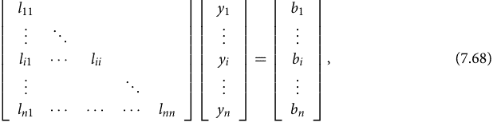

其解可以从它的第一个分量开始递归确定，该分量实际上是显式的：

\begin{cases} y_1 = \dfrac{b_1}{l_{11}}, \\ y_i = \dfrac{1}{l_{ii}}\left[ b_i - \sum_{j=1}^{i-1} l_{ij} y_j \right], \quad i = 2,3,\dots,n. \end{cases} \tag{7.69}

中间解 y 为第二个三角方程组 (7.67) 提供常数项向量：

\begin{bmatrix} l_{11} & \cdots & \cdots & \cdots & l_{n1} \\ & \ddots & & & \vdots \\ & & l_{ii} & \cdots & l_{ni} \\ & & & \ddots & \vdots \\ 0 & & & & l_{nn} \end{bmatrix} \begin{bmatrix} x_1 \\ \vdots \\ x_i \\ \vdots \\ x_n \end{bmatrix} = \begin{bmatrix} y_1 \\ \vdots \\ y_i \\ \vdots \\ y_n \end{bmatrix}. \tag{7.70}

向量 x 是原方程组 A · x = b 所求的解，其分量可以通过按索引递减顺序的回代来递归表示，从最后一个分量开始，该分量是显式的：

\begin{cases} x_n = \dfrac{y_n}{l_{nn}}, \\ x_i = \dfrac{1}{l_{ii}}\left[ y_i - \sum_{j=i+1}^{n} l_{ij} x_j \right], \quad i = n-1,n-2,\dots,1. \end{cases} \tag{7.71}

出于算法效率的考虑，L^T 的元素用 L 的等价元素表示，以便始终只使用所有涉及的矩阵的下三角部分。

根据递归关系 7.69 和 7.71，基于 Cholesky 分解求解对称正定矩阵线性方程组的例程在清单 7.14 中给出。数组 `a` 在进入例程 `CholeskySys` 时，应包含先前由函数 `Cholesky` 返回的系数矩阵 A 分解后得到的矩阵 L。常数项通过向量 `b` 传入例程，退出时返回相应的解。

### 第 7.14 节 用 Cholesky 分解求解正定系统（Python 编码）

```python
#===============================================================================

def CholeskySys(a, b, n):

#-------------------------------------------------------------------------------

# Solves linear system a x = b with real symmetric positive-definite (n x n)

# matrix by Cholesky factorization L * LT.

# a - matrix L in lower triangle and on diagonal (returned by Cholesky)

# b - vector of constant terms (input); solution x (on exit)

#-------------------------------------------------------------------------------

    for i in range(1,n+1):                     # solves Ly = b

        sum = b[i]

        for j in range(1,i): sum -= a[i][j]*b[j]

        b[i] = sum/a[i][i]

    for i in range(n,0,-1):                    # solves LT x = y

        sum = b[i]

        for j in range(i+1,n+1): sum -= a[j][i]*b[j]

        b[i] = sum/a[i][i]
```

### 第 7.15 节 用 Cholesky 分解求解线性系统的典型序列（Python 编码）

```python
a = [[0]*(n+1) for i in range(n+1)]          # coefficient matrix
b = [0]*(n+1)                                 # vector of constant terms

...
(det,ierr) = Cholesky(a,n)
CholeskySys(a,b,n)
```

详细的恒等式

A⁻¹ = [ l′₁₁ … … … l′ₙ₁ ; ⋱ ; l′ᵢᵢ … l′ₙᵢ ; 0 ⋱ ; l′ₙₙ ] [ l₁₁ ; ⋮ ⋱ 0 ; ⋮ l′ⱼⱼ ; ⋮ ⋮ ⋱ ; l′ₙ₁ … lₙⱼ … l′ₙₙ ] (7.73)

使我们能够表达 A⁻¹ 的元素：

a′ᵢⱼ = a′ⱼᵢ = Σₖ₌ᵢⁿ l′ᵢₖ l′ₖⱼ = Σₖ₌ᵢⁿ l′ₖᵢ l′ₖⱼ, (7.74)
 i = j + 1, …, n, j = 1, 2, …, n.

为了实现优化的实现，换位矩阵 (L⁻¹)ᵀ 的条目 l′ᵢₖ 用下三角矩阵 L⁻¹ 的对应条目 l′ₖᵢ 表示。

第 7.16 节中给出的实现强调，基于 Cholesky 分解的求逆可以用仅一个数组 `a` 完成，该数组最初包含矩阵 A 的下三角部分，最后包含其逆。`a` 的上三角部分由例程用作工作空间并且不需要

### 第 7.16 节 用 Cholesky 分解求逆正定矩阵（Python 编码）

```python
# =================================================================================

def MatSymInv(a, n):

# --------------------------------------------------------------------------------

# Calculates inverse of symmetric positive-definite (n x n) matrix by

# Cholesky factorization a = L * LT as a^(-1) = (L^(-1))T * L^(-1).

# L^(-1) is calculated using MatTriInv.

# a  - (n x n) matrix (input); a^(-1) (output)

# det - determinant of coefficient matrix (output).

# Calls: Cholesky, MatTriInv.

# --------------------------------------------------------------------------------

(det,ierr) = Cholesky(a,n)                     # L * LT factorization of a
if (ierr == 1):
    print("MatSymInv: matrix not positive-definite !"); return det
if (det == 0e0): print("MatSymInv: singular matrix !"); return det

MatTriInv(a,n)                                 # L^(-1) in lower triangle
for i in range(1,n+1):                         # (L^(-1))T * L^(-1)
    for j in range(1,i+1):
        sum = 0e0
```


```python
for k in range(i,n+1): sum += a[k][i] * a[k][j]

a[j][i] = sum                          # store in upper triangle

for i in range(1,n+1):                         # complete lower triangle

    for j in range(1,i+1): a[i][j] = a[j][i]

return det
```

需要初始化。下三角部分在调用 `Cholesky` 函数后依次容纳矩阵 `L`，并在调用 `MatTriInv` 函数后容纳矩阵 `L⁻¹`，该函数专门设计用于求逆三角矩阵，如第 7.5 节所述。最终的乘法 `(L⁻¹)ᵀ · L⁻¹` 在 `a` 的上三角部分产生 `A⁻¹` 的相关元素，然后将其复制到下三角部分，然后例程终止执行。

Cholesky 分解涉及的浮点运算计数如下：

- 系数矩阵 `A` 的 `L · Lᵀ` 分解（公式 7.63）：
  - 求和与减法：
  - 乘法与除法：
  - 平方根运算：`n`。

`S_A(n) = Σ_{j=1}^n (1 + Σ_{k=1}^{j-2} 1) + Σ_{j=1}^n Σ_{i=j+1}^n (1 + Σ_{k=1}^{j-2} 1) = 1/6 n³ - 1/6 n,`

`M_A(n) = Σ_{j=1}^n Σ_{k=1}^{j-1} 1 + Σ_{j=1}^n Σ_{i=j+1}^n (1 + Σ_{k=1}^{j-1} 1) = 1/6 n³ + 1/2 n² - 2/3 n,`

- 乘法 `A⁻¹ = (L⁻¹)ᵀ · L⁻¹`（公式 7.74）：
  - 求和与减法：
  
    \[S_I(n)=\sum_{j=1}^{n}\sum_{i=j+1}^{n}\sum_{k=i}^{n-1}1=\frac{1}{6}n^3-\frac{1}{2}n^2+\frac{1}{3}n\]
  
  - 乘法与除法：
  
    \[M_I(n)=\sum_{j=1}^{n}\sum_{i=j+1}^{n}\sum_{k=i}^{n}1=\frac{1}{6}n^3-\frac{1}{6}n\]

- 常数项向量 `b` 的变换（公式 7.69 和 7.71）：
  - 求和与减法：
  
    \[S_b(n)=\sum_{i=2}^{n}\left(1+\sum_{j=1}^{i-2}1\right)+\sum_{i=1}^{n-1}\left(1+\sum_{j=i+1}^{n-1}1\right)=n^2-n\]
  
  - 乘法与除法：
  
    \[M_b(n)=1+\sum_{i=2}^{n}\left(1+\sum_{j=1}^{i-1}1\right)+1+\sum_{i=1}^{n-1}\left(1+\sum_{j=i+1}^{n}1\right)=n^2+n\]

- 求解单个线性方程组（另加 *n* 次平方根运算）：
  
  \[S_A(n)+M_A(n)+S_b(n)+M_b(n)=\frac{1}{3}n^3+\frac{5}{2}n^2-\frac{5}{6}n-\frac{1}{3}n^3,\tag{7.75}\]

- 正定矩阵 `A` 的求逆（另加 *n* 次平方根运算）：
  
  \[S_A(n)+M_A(n)+\frac{1}{3}n^3+\frac{2}{3}n+S_I(n)+M_I(n)=n^3.\tag{7.76}\]

除 *n* 次额外的平方根运算外，Cholesky 分解在求逆正定矩阵（~*n*³）方面大约比 Gauss–Jordan 消去（~2*n*³）快 2 倍。

## 7.7 三对角线性方程组

在科学和工程的许多数值应用中，需要求解具有特殊结构的线性方程组。相当频繁地，这些是 *稀疏矩阵*，其元素主要等于零。有时，非零元素又结构化为包含主对角线以及可能两侧额外对角线的带状结构，这些被称为 *带矩阵*。

存在系数矩阵为 *三对角* 的情况，其相关元素局限于主对角线和两个相邻对角线。当用有限差分格式离散微分方程的边值问题时，或当用分段光滑函数插值数值表时，例如用样条函数（在第 9 章中处理）时，会出现具有三对角矩阵的系统。即使可以对这类系统的求解应用任何通用方法（高斯消去、LU 分解等），考虑到系数矩阵的特殊性会导致在初等运算和存储需求方面不可比较更高效的算法。

让我们考虑三对角线性方程组

`A · x = d`,    (7.77)

可以详细写成

[ [b1 c1      0] [a2 b2 c2] [⋱ ⋱ ⋱] [a_{i-1} b_{i-1} c_{i-1}] [a_i b_i c_i] [⋱ ⋱ ⋱] [0      a_{n-1} b_{n-1} c_{n-1}] [a_n b_n] ] [x1 x2 ⋮ x_{i-1} x_i ⋮ x_{n-1} x_n]^T = [d1 d2 ⋮ d_{i-1} d_i ⋮ d_{n-1} d_n]^T .   (7.78)

依据第 7.4 节所述的 LU 分解的哲学，求解该系统的最有效方法是把矩阵 `A` 分解为下双对角矩阵 `L` 和上双对角矩阵 `U` 的乘积：

`A = L · U`.    (7.79)

矩阵 `L` 和 `U` 可以包含与矩阵 `A` 中一样多的相关（原则上非零）条目，即 `3n − 2`（`A` 的两个副对角线只有 `n − 1` 个条目）。换句话说，从 `L` 和 `U` 的四个对角线中，只有三个可以从 `A` 的元素唯一确定，因此，我们可以任意指定第四个对角线的元素。如在一般 LU 分解的背景下所述，可以对 `L` 或 `U` 施加单位对角线，这两种选择在代数上完全等价。

在下文中，我们选择矩阵 `L` 的对角元素等于 1，使得两个分解矩阵具有结构：

`L = [ [1      0] [α2 1] [⋱ ⋱] [α_{i-1} 1] [α_i 1] [⋱ ⋱] [0      α_{n-1} 1] [α_n 1] ] ,   (7.80)`

`U = [ [β1 γ1      0] [β2 γ2] [⋱ ⋱] [β_{i-1} γ_{i-1}] [β_i γ_i] [⋱ ⋱] [0      β_{n-1} γ_{n-1}] [β_n] ] .   (7.81)`

识别矩阵 `A` 与 `L · U` 的对应元素可得：

\{ \begin{array}{lll} b_1 = \beta_1, & c_1 = \gamma_1, \\ a_i = \alpha_i \beta_{i-1}, & b_i = \alpha_i \gamma_{i-1} + \beta_i, & c_i = \gamma_i, \quad i = 2,3,\dots,n-1, \\ a_n = \alpha_n \beta_{n-1}, & b_n = \alpha_n \gamma_{n-1} + \beta_n. \end{array} \}

通过求逆这些关系，可表达矩阵 `L` 和 `U` 的元素：

\{ \begin{array}{l} \beta_1 = b_1, \\ \alpha_i = a_i / \beta_{i-1}, \quad \beta_i = b_i - \alpha_i c_{i-1}, \quad i = 2,3,\dots,n, \end{array} \quad (7.82) \\ \gamma_i = c_i, \quad i = 1,2,\dots,n-1.

正如人们可能注意到的那样，`U` 的元素 `γ_i` 与 `A` 的元素 `c_i` 完全一致，且根本不需要任何计算。只要 `β_i ≠ 0` 对 `i = 1,2,…,n` 成立，矩阵 `A` 就是非奇异的，且根据公式 7.82 的分解总是可能的。

有了 LU 分解，原系统 (7.78) 变为

`L · (U · x) = d`,

求解它相当于求解两个三对角系统：

\{ \begin{array}{l} L · y = d, \\ U · x = y. \end{array} \quad (7.83)

这些矩阵方程可详细写为

\begin{bmatrix} 1 & & & & & 0 \\ \alpha_2 & 1 & & & & \\ & \ddots & \ddots & & & \\ & & \alpha_{i-1} & 1 & & \\ & & & \alpha_i & 1 & \\ & & & & \ddots & \ddots \\ 0 & & & & \alpha_{n-1} & 1 \\ & & & & & \alpha_n & 1 \end{bmatrix} \begin{bmatrix} y_1 \\ y_2 \\ \vdots \\ y_{i-1} \\ y_i \\ \vdots \\ y_{n-1} \\ y_n \end{bmatrix} = \begin{bmatrix} d_1 \\ d_2 \\ \vdots \\ d_{i-1} \\ d_i \\ \vdots \\ d_{n-1} \\ d_n \end{bmatrix}, \quad (7.84)

\begin{bmatrix} \beta_1 & c_1 & & & & 0 \\ & \beta_2 & c_2 & & & \\ & & \ddots & \ddots & & \\ & & & \beta_{i-1} & c_{i-1} & \\ & & & & \beta_i & c_i \\ & & & & & \ddots & \ddots \\ 0 & & & & & \beta_{n-1} & c_{n-1} \\ & & & & & & \beta_n \end{bmatrix} \begin{bmatrix} x_1 \\ x_2 \\ \vdots \\ x_{i-1} \\ x_i \\ \vdots \\ x_{n-1} \\ x_n \end{bmatrix} = \begin{bmatrix} y_1 \\ y_2 \\ \vdots \\ y_{i-1} \\ y_i \\ \vdots \\ y_{n-1} \\ y_n \end{bmatrix}. \quad (7.85)

从方程 7.84 中识别对应的项，可按指标升序表达中间解 `y` 的分量：

`y1 = d1,`
 `y_i = d_i − α_i y_{i−1},   i = 2,3,…,n.   (7.86)`

为了提高计算效率，我们将上述关系与方程 7.82 结合起来，其中指标同样按升序运行，以定义算法的分解阶段：

`α_i = a_i/β_{i−1},   β_1 = b_1,   y_1 = d_1,`
 `β_i = b_i − α_i c_{i−1},   y_i = d_i − α_i y_{i−1},   i = 2,3,…,n.   (7.87)`

通过同样从方程 7.85 两侧识别对应元素的技术，我们通过回表表达最终解 `x`：

`x_n = y_n/β_n,`
 `x_i = (y_i − c_i x_{i+1})/β_i,   i = n−1,…,1.   (7.88)`

对方程 7.87 和 7.88 所涉及的数据流的分析表明，对于算法的具体实现，四个数组 `a`、`b`、`c` 和 `d` 分别与量 `a_i`、`b_i`、`c_i` 和 `d_i` 相关联就足够了。系数 `α_i` 可存储在数组 `a` 中，覆盖用于计算它们的 `a_i` 值。类似地，系数 `β_i` 用数组 `b` 中的 `b_i` 值替换。数组 `c` 的条目保持不变，因为每个元素 `γ_i` 与对应的 `c_i` 完全一致。考虑到它们的逻辑重叠，量 `d_i`、`y_i` 和 `x_i` 可以依次存储在同一个数组 `d` 中，最终包含系统的解。

算法 7.87–7.88 以及关于最优存储使用的上述考虑已编码在第 7.17 节列表中所示的函数 `TriDiagSys` 内。由于没有进行主元选择，`TriDiagSys` 在原则上即使系数矩阵是非奇异的，只要某个系数 `β_i` 为零就可能失败。然而，通常导致三对角系统的实际问题本质上是良态的，

## Listing 7.17 Solver for Linear Systems with Tridiagonal Matrix (Python Coding)

```
# ===========================================================

def TriDiagSys(a, b, c, d, n):

# -----------------------------------------------------------

# Solves a system with tridiagonal matrix by LU factorization (diag(L) = 1).

# a - lower codiagonal (i=2,n)

# b - main diagonal (i=1,n)

# c - upper codiagonal (i=1,n-1)

# d - constant terms (i=1,n); solution on exit

# n - order of system.

# -----------------------------------------------------------

if (b[1] == 0e0): print("TriDiagSys: singular matrix!"); return

for i in range(2,n+1):                # factorization

a[i] /= b[i-1]

b[i] -= a[i]*c[i-1]

if (b[i] == 0e0): print("TriDiagSys: singular matrix!"); return

d[i] -= a[i]*d[i-1]

d[n] /= b[n]                          # backward substitution

for i in range(n-1,0,-1): d[i] = (d[i] - c[i]*d[i+1])/b[i]
```

这从数学角度由对角占优系数矩阵反映出来，从数值角度由所提出分解方法的稳定性反映出来。

函数 `TriDiagSys` 的典型用法，假定包含在模块 `linsys.py` 中，在第 7.18 节列表中给出。系统仅由其三个非零对角线 `a`、`b` 和 `c` 指定，而向量 `d` 用于将常数项传给例程并返回计算出的解。

## Listing 7.18 Solution of Linear System with Tridiagonal Matrix (Python Coding)

```
# Solves system with tridiagonal matrix by LU factorization
from linsys import *

n = 4                                         # order of system

a = [0]*(n+1)                                # lower diagonal

b = [0]*(n+1)                                # main diagonal

c = [0]*(n+1)                                # upper diagonal

d = [0]*(n+1)                                # constant terms and solution

a[1] = 0; b[1] = 1; c[1] = 2; d[1] = 1

a[2] = 2; b[2] = 1; c[2] = 2; d[2] = 2

a[3] = 2; b[3] = 1; c[3] = 2; d[3] = 3

a[4] = 2; b[4] = 1; c[4] = 0; d[4] = 4          # Solution: -3.0, 2.0, 3.0, -2.0

TriDiagSys(a,b,c,d,n)                        # solve tridiagonal system

print("Solution:")

for i in range(1,n+1): print('{0:10.3f}'.format(d[i]),end="")

print()
```

## 7.8 Block Tridiagonal Systems of Linear Equations

通过求解常微分方程系统或偏微分方程的离散化方法，有时可得到具有块三对角矩阵的线性方程组。本质上，这类矩阵方程反映了所建模系统中的某种内在二维耦合，其结构为

```
[ B₁  C₁          0 ] [ x₁ ]   [ d₁ ]

[ A₂  B₂  C₂       ] [ x₂ ]   [ d₂ ]

[   ⋱  ⋱  ⋱       ] [ ⋮  ] = [ ⋮  ]

[      Aᵢ  Bᵢ  Cᵢ  ] [ xᵢ ]   [ dᵢ ]

[          ⋱  ⋱  ⋱ ] [ ⋮  ]   [ ⋮  ]

[ 0        Aₙ₋₁ Bₙ₋₁ Cₙ₋₁ ] [ xₙ₋₁ ] [ dₙ₋₁ ]

[              Aₙ  Bₙ ] [ xₙ ]   [ dₙ ]   (7.89)
```


其中 `Aᵢ`、`Bᵢ` 和 `Cᵢ` 是 `(m × m)` 方阵，而 `xᵢ` 和 `dᵢ` 是具有 `m` 个分量的列向量。显然，系数矩阵的阶数为 `(m × n)`。

在许多实际问题中，由于系数矩阵规模过大，通过一般方法如高斯消去或 `LU` 分解求解块系统是不可行的，因此不予考虑。相反，像方程 `7.89` 这样的块三对角矩阵方程可通过类似于为三对角系统开发的分解方法的程序高效求解，并以最小的存储需求求解。事实上，递推关系 `7.87` 和 `7.88` 可通过简单地用矩阵运算替换标量运算来推广。特别是，标量除法被乘以逆矩阵所取代。此外，该算法不需要系数矩阵从一开始就全部可用，而是块 `A_i`、`B_i`、`C_i` 和 `d_i` 可以在需要时生成，因此只需为它们分配工作数组，而无需为整个系数矩阵分配。

求解具有块三对角结构的矩阵方程的算法的前向消去阶段由关系式综合：

`β₁ = B₁,      y₁ = d₁,`
`α_i = β_{i-1}^{-1} · A_i,   β_i = B_i − α_i · C_{i-1},   y_i = d_i − α_i · y_{i-1},   i = 2, 3, …, n,   (7.90)`

而回代则根据

`x_n = β_n^{-1} · y_n.`
`x_i = β_i^{-1} · (y_i − C_i · x_{i+1}),   i = n − 1, …, 1.   (7.91)`

进行。这里，`α_i` 和 `β_i` `(i = 1, …, n − 1)` 是阶数为 `m` 的方阵，`y_i` 是具有 `m` 个分量的列向量。块 `β_i` 的求逆可借助用于稠密矩阵的通用方法就地执行，覆盖块 `B_i`。

由于传递所涉及的大量数据而带来的困难，将上述算法作为具有明确参数列表的通用例程的具体实现意义不大。实践中更有效的是将算法 `7.89–7.90` 适配到所研究问题的特殊性，优化各个块的计算、内存使用以及主程序与例程之间的数据传输（可能利用消失项出现的规律性并使用全局数组）。

## 7.9 Complex Matrix Equations

复矩阵方程通常具有复解，可写为

`(A + iA′) · (X + iX′) = (B + iB′),   (7.92)`

其中 `A` 和 `A′` 是阶数为 `n` 的方阵，`X`、`X′`、`B` 和 `B′` 是 `(n × m)` 矩阵。带撇号和不带撇号的矩阵分别表示实部和虚部。

通过形式上进行乘法并在方程 `7.92` 两侧分离实部和虚部，可得到耦合解的实部和虚部 `X` 和 `X′` 的两个矩阵方程系统：

`A · X − A′ · X′ = B,`
`A′ · X + A · X′ = B′.`

该系统可重写为单个矩阵方程，通过按列拼接解矩阵和相应的常数项矩阵：

`[ A  −A′ ] [ X ]   [ B ]`
`[ A′   A ] [ X′ ] = [ B′ ]   (7.93)`

因此，求解阶数为 `n` 的复矩阵方程的问题等价于求解阶数为 `2n` 的实矩阵方程。唯一的复杂之处在于构建扩展的实矩阵，但除此之外，可以采用迄今为止介绍的任何通用方法。

## 7.10 雅可比和高斯-赛德尔迭代法

本章中介绍的直接方法（高斯消元、`LU` 分解等）能够以大约 `n³` 次浮点运算的代价求解阶数为 `n` 的线性方程组。然而，随着系统规模的增大，舍入误差可能会在最终解中以不可接受的程度传播。如广泛讨论的那样，通过选主元可以最小化这些误差，即在每次消元步骤中重新排列方程，使对角线上的主元尽可能大。显然，任何选主元技术都会带来操作开销，总体而言，对于大型系统，计算成本可能变得难以承受，从而使直接方法无法用于此类系统。

在引言中提到的迭代方法类，在一定条件下能够规避直接方法所具有的典型的 `n³` 运算成本依赖，通过从初始近似开始的迭代过程确定解。如果系统的矩阵是良态的，其含义将在下面量化，迭代过程会收敛到精确解。尽管该过程在理论上是无限的，但实际上必须在有限次迭代后终止，从而以一定的精度得到解。除了舍入误差比直接方法更小之外，迭代方法还受到截断误差的影响，但可以通过执行的迭代次数来控制。事实上，迭代方法甚至可以用来改进由其他方法产生的解。如果已知的解的初始近似接近精确解，迭代方法会快速收敛，其运算次数少于直接方法。更不用说，迭代方法的编码非常简单。

求解线性方程组的 oldest and well-known 迭代方法之一是雅可比方法。为了阐述该方法，让我们考虑线性系统

`A · x = b, (7.94)`

其中 `A = [a_ij]_nn, b = [b_i]_n,` 且 `x = [x_i]_n` 或，详细形式为：

`⎧ a11x1 + a12x2 + ⋯ + a1nxn = b1`
`  a21x1 + a22x2 + ⋯ + a2nxn = b2`
`  ⋮`
`  an1x1 + an2x2 + ⋯ + annxn = bn. (7.95)`

我们假设对角元素 `a_ii` 非零，否则我们重新排列方程以满足此条件。我们从每个方程 `i` 中表达对角未知数 `x_i` 并得到等价系统：

`⎧ x1 = t1 + s12x2 + ⋯ + s1nxn`
`  x2 = s21x1 + t2 + ⋯ + s2nxn`
`  ⋮`
`  xn = sn1x1 + sn2x2 + ⋯ + tn, (7.96)`

其中新的系数定义为

`⎧ s_ii = 0,   i = 1,2,…,n,`
`  s_ij = −a_ij/a_ii,   j = 1,2,…,n, j ≠ i,`
`  t_i = b_i/a_ii.`

通过引入矩阵 `S = [s_ij]_{n n}` 和列向量 `t = [t_i]_n`，系统 `7.96` 在矩阵形式下变为：

`x = S · x + t.`  `(7.97)`

我们通过 *逐次逼近法* 求解这种所谓的 *约化系统*，从初始近似

`x^{(0)} = t,`  `(7.98)`

开始，并基于第 `(k − 1)` 次近似构建第 `k` 次近似，使用递推关系

`x^{(k)} = S · x^{(k-1)} + t,   k = 1, 2, …`  `(7.99)`

如果逐次逼近序列 `x^{(0)}, x^{(1)}, …, x^{(k)}, …` 有极限，

`x = lim_{k→∞} x^{(k)},`

则这是系统 `(7.97)` 的解，并且通过令 `k → ∞` 对方程 `7.99` 取极限，可得到方程 `7.97`。这意味着极限向量 `x` 是等价系统 `(7.97)` 的解，从而也是原系统的解。

显式地，描述迭代过程的公式为：

`$x_i^{(k)} = \sum_{j \neq i}^{n} s_{ij} x_j^{(k-1)} + t_i, \quad i = 1, 2, \dots, n.$  (7.100)`

通过引入解分量的绝对校正，

`$\Delta_i^{(k)} = x_i^{(k)} - x_i^{(k-1)}, \quad i = 1, 2, \dots, n,$  (7.101)`

其可视为相应绝对误差的估计，并通过重新定义 `S` 的对角元素为 `s_{ii} = −1`，定义 *雅可比迭代法* 的递推关系取形式：

`$ \begin{cases} \Delta_i^{(k)} = \sum_{j=1}^{n} s_{ij} x_j^{(k-1)} + t_i, \\ x_i^{(k)} = x_i^{(k-1)} + \Delta_i^{(k)}, \quad i = 1, 2, \dots, n, \end{cases}$  (7.102)`

其中

`$ \begin{cases} s_{ij} = -a_{ij}/a_{ii}, \quad i,j = 1,2,\dots,n, \\ t_i = b_i/a_{ii}. \end{cases}$  (7.103)`

关系式 `7.102` 指出，雅可比方法在实现中需要两个数组来存储解的连续近似，`x^{(k-1)}` 和 `x^{(k)}`。然而，由于通过简单的修改，既可以显著提高收敛速度，又可以降低内存使用，因此雅可比方法的具体实现在实践中几乎没有兴趣。

*高斯-赛德尔方法* 是雅可比方法的一种改进变体。其基本思想是在递推式 `7.102` 中，使用一旦可用就立即更新的解分量 `x_i^{(k)}`，而不是来自前一次迭代的分量 `x_i^{(k-1)}`，而不必等到迭代完成。

相应地，表征高斯-赛德尔方法的递推关系可以表示为

`$$ \begin{cases} \Delta_i^{(k)} = \sum_{j=1}^{i-1} s_{ij}x_j^{(k)} + \sum_{j=i}^{n} s_{ij}x_j^{(k-1)} + t_i, \\ x_i^{(k)} = x_i^{(k-1)} + \Delta_i^{(k)}, \quad i = 1,2,\dots,n. \end{cases}$$ (7.104)`

可以注意到，事实上，在求解分量 `$x_i^{(k)}$` 时，除了来自前一次迭代的分量外，还使用了已更新的分量 `$(x_1^{(k)},\dots,x_{i-1}^{(k)})$`。

迭代过程原则上必须持续进行，直到解分量的最大相对校正降到给定容差 `$\varepsilon$` 以下为止，且 *停止准则* 可以写为

`$$\max_i |\Delta_i^{(k)}/x_i^{(k)}| \le \varepsilon.$$ (7.105)`

在分量为零的情况下，应使用绝对误差估计 `$\Delta_i^{(k)}$` 而不是相对误差估计 `$\Delta_i^{(k)}/x_i^{(k)}$`。

关于迭代过程（无论是方程 `7.99` 还是 `7.104`）收敛的条件，可以严格证明（`Demidovich and Maron (1987)`）如果约化系统 `(7.97)` 满足以下条件中的至少一个

`$$\sum_{j=1}^{n} |s_{ij}| < 1,\quad i = 1,2,\dots,n,$$ (7.106)`

`$$\sum_{i=1}^{n} |s_{ij}| < 1,\quad j = 1,2,\dots,n,$$ (7.107)`
则递归过程会收敛到系统的唯一解，前提是解存在，且与初始近似无关。更实用的推论要求系数矩阵 `$\mathbf{A}$` 必须是 *严格对角占优* 的，即

`$$|a_{ii}| > \sum_{j\ne i} |a_{ij}|,\quad i = 1,2,\dots,n,$$ (7.108)`

或者说，在系统的每一行上，对角系数 `$a_{ii}$` 的绝对值超过非对角系数的绝对值之和。然而，在实践中，收敛的充分条件是 `$\mathbf{A}$` 的 *对角占优*，即

`$$|a_{ii}| > \max_{j\ne i} |a_{ij}|,\quad i = 1,2,\dots,n.$$ (7.109)`

迭代高斯-赛德尔过程通常比雅可比方法收敛得快得多。此外，第一种过程甚至可能在后者发散的情况下收敛。尽管如此，也存在这样一种情况，即即使高斯-赛德尔算法也可能不收敛，除非对初始系统进行额外的变换。

可以证明，对于所谓的 *正规系统*，即具有 *对称正定* 系数矩阵的系统，高斯-赛德尔过程总是收敛的，与初始近似无关（`Demidovich and Maron (1987)`）。在实践中，将具有非奇异矩阵 `$\mathbf{A}$` 的一般系统变换为正规系统有一个简单的方法，即用 `$\mathbf{A}^T$` 左乘原矩阵方程的两边：

`$$\mathbf{A}^T \cdot \mathbf{A} \cdot \mathbf{x} = \mathbf{A}^T \cdot \mathbf{b}.$$`

由公式 `7.104` 可知，高斯-塞德尔算法可以使用单个数组来实现，以存储解的逐次近似值。该数组可以同时保存来自连续迭代的 `(k − 1)` 和 `k` 的分量，这些分量会在新的分量 `x_i^{(k)}` 计算时不断更新。除了优化存储外，单个数组还能实现更紧凑的编码，如 `7.19` 节所示。

## 列表 7.19 高斯-塞德尔法求解线性方程组（Python 编码）

```
#===============================================================================

def GaussSeidel(a, b, x, n, init):

#-------------------------------------------------------------------------------

# Solves linear system a x = b by the Gauss-Seidel method.

# Convergence is ensure by left-multiplying the system with a^T.

# a   - coefficient matrix (n x n)

# b   - vector of constant terms

# x   - initial approximation of solution (input); solution (output)

# n   - order of system

# err - maximum relative error of the solution components

# init - initialization option: 0 - refines initial approximation

#                               1 - initializes solution

#-------------------------------------------------------------------------------

eps = 1e-10                     # relative precision criterion

itmax = 1000                    # max no. of iterations

s = [[0]*(n+1) for i in range(n+1)]     # matrices of reduced system

t = [0]*(n+1)

for i in range(1,n+1):                  # matrices of normal system

    for j in range(1,i+1):               # by multiplication with a^T

        s[i][j] = 0e0                   # store result in s and t

        for k in range(1,n+1): s[i][j] += a[k][i]*a[k][j]

        s[j][i] = s[i][j]

    t[i] = 0e0

    for j in range(1,n+1): t[i] += a[j][i]*b[j]

for i in range(1,n+1):                  # matrices s and t of reduced system

    f = -1e0/s[i][i]; t[i] /= s[i][i]

    for j in range(1,n+1): s[i][j] *= f

if (init):

    for i in range(1,n+1): x[i] = t[i]          # initialize solution

for k in range(1,itmax+1):                  # loop of iterations

    err = 0e0

    for i in range(1,n+1):

        delta = t[i]

        for j in range(1,n+1): delta += s[i][j]*x[j]    # correction

        x[i] += delta                   # new approximation to solution

        if (x[i]): delta /= x[i]        # relative error

        if (fabs(delta) > err): err = fabs(delta)       # maximum error

    if (err <= eps): break              # check convergence

if (k > itmax): printf("GaussSeidel: max. no. of iterations exceeded !")

return err
```

该例程的输入包括系数矩阵 `a`、常数项向量 `b`、保存解初始近似值的向量 `x`、系统的阶数 `n` 以及初始化选项 `init`。如果 `init` 设置为 `0`，则例程会细化通过 `x` 接收到的初始近似值；否则，解将使用约化系统的常数项进行初始化。例程退出时，`x` 返回细化的解，而 `err` 表示其分量的最大相对误差。

正如上文所述，算法的收敛性是通过将原系统的两边左乘系数矩阵的转置来保证的。数组 `s` 最初用于存储正规系统的矩阵 `Aᵀ·A`，然后存储约化系统的矩阵 `S`。类似地，数组 `t` 最初包含正规系统的常数项向量 `Aᵀ·b`，然后包含约化系统的向量 `t`。

除了额外要求指定解的初始近似值外，`GaussSeidel` 例程的使用与直接方法类似。

## 7.11 C/C++ 实现

列表 `7.20` 显示了文件 `linsys.h` 的内容，其中包含主文中开发的 Python 函数的等价 C/C++ 实现，并包含在模块 `linsys.py` 中。相应的例程具有相同的名称和功能。

## 列表 7.20 线性方程组求解器（linsys.h）

```
//------------------------------------------- linsys.h -------------------------------------------

// Contains routines for solving systems of linear equations.

// Part of the numxlib numerics library. Author: Titus Beu, 2013
```


#ifndef `_LINSYS_`

#define `_LINSYS_`

#include <stdio.h>

#include <math.h>

#include "memalloc.h"

//================================================================================================

```c
void Gauss(double **a, double **b, int n, int m, double &det)
```
```c
//-----------------------------------------------------------------------------------------------
// Solves matrix equation a x = b by Gaussian elimination with partial
// pivoting on columns.
// a   - coefficient matrix (n x n); destroyed on exit
// b   - matrix of constant terms (n x m); solution x on exit
// det - determinant of coefficient matrix (output).
//-----------------------------------------------------------------------------------------------
{
#define Swap(a,b) { t = a; a = b; b = t; }
    double amax, sum, t;
    int i, imax, j, k;
    det = 1e0;
    for (k=1; k<=n; k++) {                      // FORWARD ELIMINATION
        amax = 0e0;                             // determine pivot row with
        for (i=k; i<=n; i++)                    // max. element on column k
            if (amax < fabs(a[i][k])) { amax = fabs(a[i][k]); imax = i; }
        if (amax == 0e0)
            { printf("Gauss: singular matrix !\n"); det = 0e0; return; }
        if (imax != k) {                        // interchange rows imax and k
det = -det;                                 // to put pivot on diagonal
for (j=k; j<=n; j++) Swap(a[imax][j],a[k][j])
for (j=1; j<=m; j++) Swap(b[imax][j],b[k][j])
}
det *= a[k][k];                              // multiply determinant with pivot
t = 1e0/a[k][k];                             // divide pivot row by pivot
for (j=k+1; j<=n; j++) a[k][j] *= t;
for (j= 1; j<=m; j++) b[k][j] *= t;
for (i=k+1; i<=n; i++) {                     // reduce non-pivot rows
    t = a[i][k];
    for (j=k+1; j<=n; j++) a[i][j] -= a[k][j]*t;
    for (j= 1; j<=m; j++) b[i][j] -= b[k][j]*t;
}
}
for (k=n-1; k>=1; k--)                       // BACKWARD SUBSTITUTION
    for (j=1; j<=m; j++) {
        sum = b[k][j];
        for (i=k+1; i<=n; i++) sum -= a[k][i]*b[i][j];
        b[k][j] = sum;
    }
}
```

//==============================================================================

```c
void GaussJordan0(double **a, double **b, int n, int m, double &det)
```
```c
//--------------------------------------------------------------------------------
// Solves matrix equation a x = b by Gauss-Jordan elimination with partial
// pivoting on columns.
// a  - coefficient matrix (n x n); destroyed on exit
// b  - matrix of constant terms (n x m); solution x on exit
// det - determinant of coefficient matrix (output).
//--------------------------------------------------------------------------------
{
#define Swap(a,b) { t = a; a = b; b = t; }
double amax, t;
int i, imax, j, k;
det = 1e0;
for (k=1; k<=n; k++) {                       // FORWARD ELIMINATION
    amax = 0e0;                              // determine pivot row with
    for (i=k; i<=n; i++)                     // max. element on column k
        if (amax < fabs(a[i][k])) { amax = fabs(a[i][k]); imax = i; }
    if (amax == 0e0)
        { printf("GaussJordan0: singular matrix !\n"); det = 0e0; return; }
    if (imax != k) {                         // interchange rows imax and k
        det = -det;                          // to put pivot on diagonal
        for (j=k; j<=n; j++) Swap(a[imax][j],a[k][j])
        for (j=1; j<=m; j++) Swap(b[imax][j],b[k][j])
    }
    det *= a[k][k];                          // multiply determinant with pivot
    t = 1e0/a[k][k];                         // divide pivot row by pivot
    for (j=k+1; j<=n; j++) a[k][j] *= t;
    for (j= 1; j<=m; j++) b[k][j] *= t;
}
for (i=1; i<=n; i++)
    // 归约非主元行
    if (i != k) {
        t = a[i][k];
        for (j=1; j<=n; j++) a[i][j] -= a[k][j]*t;
        for (j=1; j<=m; j++) b[i][j] -= b[k][j]*t;
    }
}
```

//==============================================================================

```c
void GaussJordan1(double **a, double **b, int n, int m, double &det)
```
```c
//------------------------------------------------------------------------------
// 通过带列部分主元的 Gauss-Jordan 消去法求解矩阵方程 a x = b。
// a  - 系数矩阵 (n x n); 退出时为 a^(-1)
// b  - 常数项矩阵 (n x m); 退出时为解 x
// det - 系数矩阵的行列式 (输出)。
//------------------------------------------------------------------------------
{
#define Swap(a,b) { t = a; a = b; b = t; }
    double amax, t;
    int i, imax, j, k;
    int *ipivot;
    ipivot = IVector(1,n);                         // 存储主元行
    det = 1e0;
    for (k=1; k<=n; k++) {                         // 正向消去
        amax = 0e0;                                // 确定具有
        for (i=k; i<=n; i++)                       // 第 k 列最大元素的行
            if (amax < fabs(a[i][k])) { amax = fabs(a[i][k]); imax = i; }
        if (amax == 0e0)
            { printf("GaussJordan1: singular matrix !\n"); det = 0e0; return; }
        ipivot[k] = imax;                          // 存储主元行索引
        if (imax != k) {                           // 互换行 imax 和 k
            det = -det;                            // 使主元位于对角线上
            for (j=1; j<=n; j++) Swap(a[imax][j],a[k][j])
            for (j=1; j<=m; j++) Swap(b[imax][j],b[k][j])
        }
        det *= a[k][k];                            // 用主元乘以行列式
        t = 1e0/a[k][k];                           // 用主元除主元行
        a[k][k] = 1e0;                             // 单位矩阵的对角元素
        for (j=1; j<=n; j++) a[k][j] *= t;
        for (j=1; j<=m; j++) b[k][j] *= t;
        for (i=1; i<=n; i++)                       // 归约非主元行
            if (i != k) {
                t = a[i][k];
                a[i][k] = 0e0;                     // 单位矩阵的非对角元素
                for (j=1; j<=n; j++) a[i][j] -= a[k][j]*t;
                for (j=1; j<=m; j++) b[i][j] -= b[k][j]*t;
            }
    }
    for (k=n; k>=1; k--) {                         // 重新排列逆矩阵的列
imax = ipivot[k];
    if (imax != k)
        for (i=1; i<=n; i++) Swap(a[i][imax],a[i][k])
    }
    FreeIVector(ipivot,1);
}
```

//==============================================================================

```c
void GaussJordan(double **a, double **b, int n, int m, double &det)
```
```c
//------------------------------------------------------------------------------
// 通过带完全主元的 Gauss-Jordan 消去法求解矩阵方程 a x = b。
// a  - 系数矩阵 (n x n); 退出时为 a^(-1)
// b  - 常数项矩阵 (n x m); 退出时为解 x
// det - 系数矩阵的行列式 (输出)。
//------------------------------------------------------------------------------
{
#define Swap(a,b) { t = a; a = b; b = t; }
    double amax, t;
    int i, imax, j, jmax, k;
    int *ipivot, *jpivot, *npivot;
    ipivot = IVector(1,n); jpivot = IVector(1,n);     // 主元行和列
    npivot = IVector(1,n);                             // 标记已使用的主元列
    for (i=1; i<=n; i++) npivot[i] = 0;
    det = 1e0;
    for (k=1; k<=n; k++) {                             // 正向消去
        amax = 0e0;                                    // 确定主元
        for (i=1; i<=n; i++) {                         // 遍历行
            if (npivot[i] != 1)
                for (j=1; j<=n; j++) {                 // 遍历列
                    if (npivot[j] == 0)                // 尚未进行主元选择？
                        if (amax < fabs(a[i][j]))
                            { amax = fabs(a[i][j]); imax = i; jmax = j; }
                    if (npivot[j] > 1) {
                        printf("GaussJordan: singular matrix 1 !\n");
                        det = 0e0; return;
                    }
                }
        }
        if (amax == 0e0)
            { printf("GaussJordan: singular matrix 2 !\n"); det = 0e0; return; }
        ipivot[k] = imax; jpivot[k] = jmax;            // 存储主元行和列
        ++(npivot[jmax]);                              // 标记已使用的主元列
        if (imax != jmax) {                            // 互换行 imax 和 jmax
            det = -det;                                // 使主元位于对角线上
```


``` 
for (j=1; j<=n; j++) Swap(a[imax][j],a[jmax][j])

for (j=1; j<=m; j++) Swap(b[imax][j],b[jmax][j])

}
det *= a[jmax][jmax];                          // 用主元乘以行列式
t = 1e0/a[jmax][jmax];                         // 用主元除主元行
a[jmax][jmax] = 1e0;                           // 单位矩阵的对角元素
for (j=1; j<=n; j++) a[jmax][j] *= t;
for (j=1; j<=m; j++) b[jmax][j] *= t;
for (i=1; i<=n; i++)                         // 归约非主元行
    if (i != jmax) {
        t = a[i][jmax];
        a[i][jmax] = 0e0;                   // 单位矩阵的非对角元素
        for (j=1; j<=n; j++) a[i][j] -= a[jmax][j]*t;
        for (j=1; j<=m; j++) b[i][j] -= b[jmax][j]*t;
    }
}
for (k=n; k>=1; k--) {                      // 重新排列逆矩阵的列
    imax = ipivot[k]; jmax = jpivot[k];
    if (imax != jmax)
        for (i=1; i<=n; i++) Swap(a[i][imax],a[i][jmax])
}
FreeIVector(ipivot,1); FreeIVector(jpivot,1);
FreeIVector(npivot,1);
}
```

## `LUFactor`

``` 
void LUFactor(double **a, int ipivot[], int n, double &det)
```
对 `(n x n)` 矩阵 `a` 执行 LU 分解 (`diag(L) = 1`)。退出时，上三角和对角线用 `U` 替换，下三角用 `L` 替换。使用列部分主元。

`a` - 系数矩阵 (`n x n`); 退出时为 LU 分解  
`ipivot` - 主元行索引数组 (输出)  
`det` - 系数矩阵的行列式 (输出)。

``` 
{
    double amax, sum, t;
    int i, imax, j, k;
    det = 1e0;
    for (j=1; j<=n; j++) {                      // 遍历列
        for (i=1; i<=(j-1); i++) {              // 矩阵 U 的元素
            sum = a[i][j];
            for (k=1; k<=(i-1); k++) sum -= a[i][k]*a[k][j];
            a[i][j] = sum;
        }
        amax = 0e0;
        for (i=j; i<=n; i++) {                  // 矩阵 L 的元素
            sum = a[i][j];                      // 未除以主元
            for (k=1; k<=(j-1); k++) sum -= a[i][k]*a[k][j];
            a[i][j] = sum;
            if (amax < fabs(a[i][j])) {amax = fabs(a[i][j]); imax = i;}  // 确定主元
        }
        if (amax == 0e0)
            { printf("LUFactor: singular matrix !\n"); det = 0e0; return; }
        ipivot[j] = imax;                       // 存储主元行索引
        if (imax != j) {                        // 使主元位于对角线上
            det = -det;
            for (k=1; k<=n; k++)
                { t = a[imax][k]; a[imax][k] = a[j][k]; a[j][k] = t; }
}
det *= a[j][j];
    // 用主元乘以行列式
t = 1e0/a[j][j];
    // 用主元除 L 的元素
    for (i=j+1; i<=n; i++) a[i][j] *= t;
}
}
```

## `LUSystem`

``` 
void LUSystem(double **a, int ipivot[], double b[], int n)
```
通过 LU 分解求解 `n` 阶线性系统 `a x = b`。

`a` - 系数矩阵的 LU 分解 (由 `LUFactor` 返回)  
`ipivot` - 主元行索引数组 (输入)  
`b` - 常数项向量 (输入); 解 `x` (退出时)

``` 
{
    double sum;
    int i, j;
    for (i=1; i<=n; i++) {
        sum = b[ipivot[i]];
        b[ipivot[i]] = b[i];
        for (j=1; j<=(i-1); j++) sum -= a[i][j]*b[j];
        b[i] = sum;
    }
    for (i=n; i>=1; i--) {
        sum = b[i];
        for (j=i+1; j<=n; j++) sum -= a[i][j]*b[j];
        b[i] = sum/a[i][i];
    }
}
```

## `MatInv`

``` 
void MatInv(double **a, int n, double &det)
```
通过 LU 分解计算实矩阵的逆。

`a` - (`n x n`) 矩阵 (输入); `a^(-1)` (输出)  
`det` - 系数矩阵的行列式 (输出)。  
调用: `LUFactor`, `LUSystem`。

``` 
{
    double **ainv, *b;
    int *ipivot, i, j;
    ainv = Matrix(1,n,1,n);
    b = Vector(1,n);
    ipivot = IVector(1,n);
    LUFactor(a,ipivot,n,det);
    if (det == 0e0)
        { printf("MatInv: singular matrix !\n"); return; }
    for (j=1; j<=n; j++) {
        for (i=1; i<=n; i++) b[i] = 0e0;
        b[j] = 1e0;
        LUSystem(a,ipivot,b,n);
        for (i=1; i<=n; i++) ainv[i][j] = b[i];
    }
    for (j=1; j<=n; j++)
        for (i=1; i<=n; i++) a[i][j] = ainv[i][j];
    FreeMatrix(ainv,1,1); FreeVector(b,1);
    FreeIVector(ipivot,1);
}
```

## `MatTriInv`

``` 
int MatTriInv(double **a, int n)
```
Calculates inverse of lower triangular matrix `L` of order `n` contained in (`n x n`) array `a` and replaces on exit lower triangle of `a` by `L^(-1)`.

Error flag = 0 - normal execution  
1 - singular matrix.

``` 
{
    double sum;
    int i, j, k;
    for (j=1; j<=n; j++) {
        if (a[j][j] <= 0e0) {
            printf("MatTriInv: singular matrix !\n"); return 1; }
        a[j][j] = 1e0/a[j][j];
        for (i=j+1; i<=n; i++) {
            sum = 0e0;
            for (k=j; k<=(i-1); k++) sum -= a[i][k]*a[k][j];
            a[i][j] = sum/a[i][i];
        }
    }
    return 0;
}
```

## `Cholesky`

``` 
int Cholesky(double **a, int n, double &det)
```
Performs Cholesky factorization `L * LT` of real symmetric positive-definite (`n x n`) matrix `a`. On exit, replaces lower triangle of `a` with `L`.

`a` - coefficient matrix (`n x n`); `L` in lower triangle and diagonal on exit  
`det` - determinant of coefficient matrix (output).

Error flag = 0 - normal execution  
1 - `a` is not positive-definite.

``` 
{
    double sum;
    int i, j, k;
    det = 1e0;
    for (j=1; j<=n; j++) {
        sum = a[j][j];
        for (k=1; k<=(j-1); k++) sum -= a[j][k]*a[j][k];
        if (sum <= 0e0)
            { printf("Cholesky: matrix not positive-definite !\n"); return 1; }
        a[j][j] = sqrt(sum);
        for (i=j+1; i<=n; i++) {
            sum = 0e0;
            for (k=1; k<=j; k++) sum += a[i][k]*a[j][k];
            a[i][j] = (a[i][j] - sum)/a[j][j];
            det *= a[j][j];
        }
    }
    for (k=i; k<=n; k++) sum += a[k][i] * a[k][j];
    a[j][i] = sum;
    for (i=1; i<=n; i++)
        for (j=1; j<=i; j++) a[i][j] = a[j][i];
}
```

## `TriDiagSys`

``` 
void TriDiagSys(double a[], double b[], double c[], double d[], int n)
```
Solves a system with tridiagonal matrix by LU factorization (`diag(L) = 1`).

`a` - lower codiagonal (`i=2,n`)  
`b` - main diagonal (`i=1,n`)  
`c` - upper codiagonal (`i=1,n-1`)  
`d` - constant terms (`i=1,n`); solution on exit  
`n` - order of system.

``` 
{
    int i;
    if (b[1] == 0e0) { printf("TriDiagSys: singular matrix !\n"); return; }
    for (i=2; i<=n; i++) {
        a[i] /= b[i-1];
        b[i] -= a[i]*c[i-1];
```


```c
if (b[i] == 0e0) { printf("TriDiagSys: singular matrix !\n"); return; }

d[i] -= a[i]*d[i-1];
}
d[n] /= b[n];                                 // backward substitution
for (i=(n-1); i>=1; i--) d[i] = (d[i] - c[i]*d[i+1])/b[i];
}
```

//================================================================================

```c
void TriDiagSys(dcmplx a[], dcmplx b[], dcmplx c[], dcmplx d[], int n)
```
```
//--------------------------------------------------------------------------------
// Solves a complex system with tridiagonal matrix by LU factorization.
// a - lower codiagonal (i=2,n)
// b - main diagonal (i=1,n)
// c - upper codiagonal (i=1,n-1)
// d - constant terms (i=1,n); solution on exit
// n - order of system.
//--------------------------------------------------------------------------------
{
    int i;
    if (b[1] == 0e0) { printf("TriDiagSys: singular matrix !\n"); return; }
    for (i=2; i<=n; i++) {                         // factorization
        a[i] /= b[i-1];
        b[i] -= a[i]*c[i-1];
        if (b[i] == 0e0) { printf("TriDiagSys: singular matrix !\n"); return; }
        d[i] -= a[i]*d[i-1];
    }
    d[n] /= b[n];                                 // backward substitution
    for (i=(n-1); i>=1; i--) d[i] = (d[i] - c[i]*d[i+1])/b[i];
}
```

//=================================================================================

```c
void GaussSeidel(double **a, double b[], double x[], int n, int init, double &err)
```
```
//--------------------------------------------------------------------------------
// Solves linear system a x = b by the Gauss-Seidel method.
// To ensure convergence, the system is left-multiplied with a^T.
// a   - coefficient matrix (n x n)
// b   - vector of constant terms
// x   - initial approximation of solution (input); solution (output)
// n   - order of system
// err - maximum relative error of the solution components
// init - initialization option: 0 - refines initial approximation
//                                 1 - initializes solution
//--------------------------------------------------------------------------------
{
    const double eps = 1e-10;                     // relative precision criterion
    const int itmax = 1000;                       // max no. of iterations
    double del, f, **s, *t;
    int i, j, k;
    s = Matrix(1,n,1,n);                          // matrices of reduced system
    t = Vector(1,n);
    for (i=1; i<=n; i++) {                        // matrices of normal system
        for (j=1; j<=i; j++) {                    // by multiplication with a^T
            s[i][j] = 0e0;                        // store result in s and t
            for (k=1; k<=n; k++) s[i][j] += a[k][i]*a[k][j];
            s[j][i] = s[i][j];
        }
        t[i] = 0e0;
        for (j=1; j<=n; j++) t[i] += a[j][i]*b[j];
    }
    for (i=1; i<=n; i++) {                        // matrices s and t of reduced system
        f = -1e0/s[i][i]; t[i] /= s[i][i];
        for (j=1; j<=n; j++) s[i][j] *= f;
    }
    if (init) for (i=1; i<=n; i++) x[i] = t[i];   // initialize solution
    for (k=1; k<=itmax; k++) {                    // loop of iterations
        err = 0e0;
        for (i=1; i<=n; i++) {
            del = t[i];                           // correction
            for (j=1; j<=n; j++) del += s[i][j]*x[j];
            x[i] += del;                          // new approximation to solution
            if (x[i]) del /= x[i];                // relative error
            if (fabs(del) > err) err = fabs(del); // maximum error
        }
        if (err <= eps) break;                    // check convergence
    }
    if (k > itmax) printf("GaussSeidel: max. no. of iterations exceeded !\n");
    FreeMatrix(s,1,1); FreeVector(t,1);
}
```
#endif

## 7.12 Problems

The Python and C/C++ programs for the following problems may import the functions developed in this chapter from the modules `linsys.py` and, respectively, `linsys.h`, which are available as supplementary material. In addition, the utility routines contained in files `matutil.py` and, respectively, `matutil.h` can be used to perform basic operations with one- and 2D arrays.

### PROBLEM 7.1

Use the routine `GaussJordan` to write Python and C/C++ programs for solving the matrix equation **AX = B**. Consider matrices of order *n* = 5, and generate a random coefficient matrix **A** and a unit matrix **B**.

Verify that, on exit from the solver, the inverse replacing matrix **A** coincides with the solution that replaces matrix **B**. Check the inverse also by showing that **A⁻¹A** equals the unit matrix.

#### Solution

The Python and C/C++ implementations are given in Listings 7.21 and 7.22.

```python
# Solves matrix equation by the Gauss-Jordan method
from random import *
from linsys import *
from matutil import *
n = 5                                      # order of system
a = [[0]*(n+1) for i in range(n+1)]        # system matrix
b = [[0]*(n+1) for i in range(n+1)]        # constant terms and solution
c = [[0]*(n+1) for i in range(n+1)]        # copy of system matrix
d = [[0]*(n+1) for i in range(n+1)]        # work array
for i in range(1,n+1):                     # random matrix
    for j in range(1,n+1): a[i][j] = random()
print("A:")
MatPrint(a,n,n)
for i in range(1,n+1):                     # unit matrix
    for j in range(1,n+1): b[i][j] = 0e0
    b[i][i] = 1e0
print("B:")
MatPrint(b,n,n)
MatCopy(a,c,n,n)                           # save system matrix
det = GaussJordan(a,b,n,n)                # solve system, inverse in a
print("Check A^(-1) - X = 0:")
MatDiff(a,b,d,n,n)                         # difference between inverse and solution
MatPrint(d,n,n)
print("Check A^(-1)A = I:")
MatProd(a,c,d,n,n,n)                       # multiply inverse with original
MatPrint(d,n,n)
```

### 代码清单 7.22 用高斯-约当消去法求解矩阵方程（C/C++ 编程）

```c
// Solves matrix equation by the Gauss-Jordan method
#include <stdio.h>
#include "memalloc.h"
#include "linsys.h"
#include "matutil.h"
int main()
{
    double **a, **b, **c, **d, det;
    int i, j, n;
    n = 5;                                   // order of system
    a = Matrix(1,n,1,n);                     // system matrix
    b = Matrix(1,n,1,n);                     // constant terms and solution
    c = Matrix(1,n,1,n);                     // copy of system matrix
    d = Matrix(1,n,1,n);                     // work array
    for (i=1; i<=n; i++)                     // random matrix
        for (j=1; j<=n; j++) a[i][j] = rand();
    printf("A:\n");
    MatPrint(a,n,n);
    for (i=1; i<=n; i++) {                   // unit matrix
        for (j=1; j<=n; j++) b[i][j] = 0e0;
        b[i][i] = 1e0;
    }
    printf("B:\n");
    MatPrint(b,n,n);
    MatCopy(a,c,n,n);                        // save system matrix
    GaussJordan(a,b,n,n,det);                // solve system, inverse in a
    printf("Check A^(-1) - X = 0:\n");
    MatDiff(a,b,d,n,n);                      // difference between inverse and solution
    MatPrint(d,n,n);
    printf("Check A^(-1)A = I:\n");
    MatProd(a,c,d,n,n,n);                    // multiply inverse with original
    MatPrint(d,n,n);
}
```

## 问题 7.2

使用一对例程 `LUFactor` 和 `LUSystem` 编写 Python 和 C/C++ 程序，用于求解具有相同系数矩阵 `A` 和 `n` 个不同的常数项向量 `b` 的多个线性系统 `Ax = b`。考虑阶数 `n = 5` 的系统，为简单起见，随机生成矩阵。仅执行一次 LU 分解，并使用所得分解求解后续系统。通过验证最大残差误差数值消失来综合检查每个解

`Δ = max_i | Σ_{j=1}^n A_{ij} x_j - b_i |`.

#### 解答

Python 和 C/C++ 实现分别给出在代码清单 7.23 和 7.24 中。

## 代码清单 7.23 用 LU 分解求解多个线性系统（Python 编程）


# Solves multiple linear systems by LU factorization

```python
from random import *
from linsys import *
from matutil import *

n = 5                                         # order of system
a  = [[0]*(n+1) for i in range(n+1)]          # system matrix
a0 = [[0]*(n+1) for i in range(n+1)]          # backup matrix
b = [0]*(n+1)                                 # constant terms
x = [0]*(n+1)                                 # solution
ipivot = [0]*(n+1)                            # pivots

for i in range(1,n+1):                        # random matrix
    for j in range(1,n+1): a[i][j] = a0[i][j] = random()
print("A:")
MatPrint(a,n,n)

det = LUFactor(a,ipivot,n)                    # LU decomposition of a
print("LU decomposition:")
MatPrint(a,n,n)

for k in range(1,n+1):                        # loop over constant vectors
    for i in range(1,n+1): b[i] = x[i] = random()   # random constant terms
    print("b:")
    VecPrint(b,n)

    LUSystem(a,ipivot,x,n)                    # solve linear system

    err = 0e0                                 # check max(Ax-b) = 0
    for i in range(1,n+1):
        erri = -b[i]
        for j in range(1,n+1): erri += a0[i][j] * x[j]   # element i of (Ax-b)
        err = max(err,fabs(erri))
    print("   max(Ax-b) = {0:.1e}".format(err))
```

## 代码清单 7.24 用 LU 分解求解多个线性系统（C/C++ 编程）

```c
// Solves multiple linear systems by LU factorization
#include <stdio.h>
#include "memalloc.h"
#include "linsys.h"
#include "matutil.h"

int main()
{
    double **a, **a0, *b, *x, det, err, erri;
    int *ipivot, i, j, k, n;

    n = 5;                                    // order of system
    a  = Matrix(1,n,1,n);                     // system matrix
    a0 = Matrix(1,n,1,n);                     // backup matrix
    b = Vector(1,n);                          // constant terms
    x = Vector(1,n);                          // solution
    ipivot = IVector(1,n);                    // pivots

for (i=1; i<=n; i++)                         // random matrix
    for (j=1; j<=n; j++) a[i][j] = a0[i][j] = rand();
printf("A:\n");
MatPrint(a,n,n);

LUFactor(a,ipivot,n,det);                     // LU decomposition of a
printf("LU decomposition:\n");
MatPrint(a,n,n);

for (k=1; k<=n; k++) {                         // loop over constant vectors
    for (i=1; i<=n; i++) b[i] = x[i] = rand();       // random constant terms
    printf("b:\n");
    VecPrint(b,n);

    LUSystem(a,ipivot,x,n);                    // solve linear system

    err = 0e0;                                 // check max (Ax-b) = 0
    for (i=1; i<=n; i++) {
        erri = -b[i];
        for (j=1; j<=n; j++) erri += a0[i][j] * x[j]; // element i of (Ax-b)
        err = max(err,fabs(erri));
    }
    printf("   max (Ax-b) = % .1e\n",err);
}
}
```

## 问题 7.3

编写采用例程 `TriDiagSys` 的 Python 和 C/C++ 程序，用于求解阶数 `$n = 100$` 的三对角线性系统（见公式 7.78），矩阵元素随机生成。通过验证最大残差误差 `$\Delta = \max_i |a_i x_{i-1} + b_i x_i + c_i x_{i+1} - d_i|$` 的消失来综合检查解。

### 解答

Python 实现给出在代码清单 7.25 中，C/C++ 版本作为补充材料提供（`P07-TriDiagSys1.cpp`）。

### Listing 7.25 Solution of System with Tridiagonal Matrix by LU Factorization (Python Coding)

```python
# Solves system with tridiagonal matrix by LU factorization
from random import *
from linsys import *

n = 100                                      # order of system
a = [0]*(n+1); a0 = [0]*(n+1)               # lower diagonal
b = [0]*(n+1); b0 = [0]*(n+1)               # main diagonal
c = [0]*(n+1); c0 = [0]*(n+1)               # upper diagonal
d = [0]*(n+1); x = [0]*(n+1)               # constant terms and solution

for i in range(1,n+1):                       # generate system
    if (i > 1): a[i] = a0[i] = random()          # a[i], i=2,n
    if (i < n): c[i] = c0[i] = random()          # c[i], i=1,n-1
    b[i] = b0[i] = random()
    d[i] = x[i]  = random()

TriDiagSys(a,b,c,x,n)                        # solve tridiagonal system
```

```python
err = 0e0
for i in range(1,n+1):
    err -= b0[i]*x[i] - d[i]
    if (i > 1): err += a0[i]*x[i-1]
    if (i < n): err += c0[i]*x[i+1]
    err = max(err,fabs(err))
print("max(Ax-d) = {0:.1e}".format(err))
```

## 问题 7.4

对于两个非奇异矩阵 **A** 和 **B**，数值检验恒等式：

$$\det(A\cdot B)=\det(A)\det(B).$$

为此，(a) 生成两个 *随机* 2D 矩阵 **A** 和 **B**，阶数 `n=100`；(b) 使用例程 `Gauss` 计算 `$\det(A\cdot B)$` 和 `$\det(A)\det(B)$`；以及 (c) 检查两者表达式之间相对差的消失。

### 解答

由于其简单的消去阶段，例程 `Gauss` 特别高效地用于计算行列式。通过考虑 `m=0` 个常数项列来抑制回代。Python 实现给出在代码清单 7.26 中，C/C++ 版本作为补充材料提供（`P07-MatDetIdent.cpp`）。

**代码清单 7.26** 矩阵乘积行列式恒等式检验（Python 编程）

```python
# Check matrix identity det(A*B) == det(A)*det(B)
from random import *
from linsys import *
from matutil import *

n = 100
a = [[0]*(n+1) for i in range(n+1)]
b = [[0]*(n+1) for i in range(n+1)]
c = [[0]*(n+1) for i in range(n+1)]

for i in range(1,n+1):
    for j in range(1,n+1):
        a[i][j] = random()
        b[i][j] = random()

MatProd(a,b,c,n,n,n)                         # C = A * B
detA  = Gauss(a,b,n,0)                       # m=0: performs only elimination
detB  = Gauss(b,b,n,0)                       # and calculates the determinant
detAB = Gauss(c,b,n,0)

print("det(A)  = {0:9.2e}".format(detA))
print("det(B)  = {0:9.2e}".format(detB))
print("det(AB) = {0:9.2e}".format(detAB))
print("Error   = {0:9.2e}".format(1e0 - detA*detB/detAB))
```

## 问题 7.5

数值验证矩阵恒等式

$$(A \cdot B)^{-1} = B^{-1} \cdot A^{-1}.$$

为此，（a）生成两个 `n = 100` 阶的随机二维矩阵 `A` 和 `B`；（b）使用例程 `GaussJordan` 或 `MatInv` 计算 `A` 和 `B` 的逆矩阵，并计算差值矩阵

`D = (A · B)^{-1} − B^{-1} · A^{-1}`，

作为零矩阵的数值近似；（c）确定 `D` 的最大绝对值元素，作为最大误差的估计。

### 解答

Python 实现见代码清单 7.27，C/C++ 版本见补充材料（`P07-MatInvIdent.cpp`）。

### 代码清单 7.27 矩阵乘积逆的恒等式验证（Python 代码）

```python
# Check matrix identity: (A*B)^(-1) = B^(-1)*A^(-1)

from random import *

from linsys import *

from matutil import *

n = 100

a = [[0]*(n+1) for i in range(n+1)]

b = [[0]*(n+1) for i in range(n+1)]

c = [[0]*(n+1) for i in range(n+1)]

d = [[0]*(n+1) for i in range(n+1)]

for i in range(1,n+1):                # generate matrices a and b randomly

    for j in range(1,n+1):

        a[i][j] = random()

        b[i][j] = random()

MatProd(a,b,c,n,n,n)                          # c = a * b

det = GaussJordan(c,d,n,0)  # det = MatInv(c,n)      # c = (a b)^(-1)

det = GaussJordan(a,d,n,0)  # det = MatInv(a,n)      # a -> a^(-1)

det = GaussJordan(b,d,n,0)  # det = MatInv(b,n)      # b -> b^(-1)

MatProd(b,a,d,n,n,n)                          # d = b^(-1) a^(-1)

MatDiff(c,d,d,n,n)                            # d = (a b)^(-1) - b^(-1)a^(-1)

print("(A B)^(-1) - B^(-1)A^(-1)  (sample):\n")

MatPrint(d,5,5)                               # print sample of "zero" matrix

err = MatNorm(d,n,n)                          # max(abs(d[i][j]))

print("\nMaximum error = ","{0:8.2e}".format(err))
```

### 代码清单 7.28 通过 Cholesky 分解进行矩阵求逆（Python 代码）

```python
# Inversion of symmetric positive-definite matrix by Cholesky factorization

from random import *

from linsys import *

from matutil import *

n = 100                                          # order of matrices

a = [[0]* (n+1) for i in range(n+1)]

b = [[0]* (n+1) for i in range(n+1)]

c = [[0]* (n+1) for i in range(n+1)]

for i in range(1,n+1):                           # generate random lower triangular matrix

    for j in range(1 ,i+1): a[i][j] = random()    # lower triangle

    for j in range(i+1,n+1): a[i][j] = 0e0        # upper triangle

    a[i][i] += 1e0                               # increase diagonal

MatCopy(a,b,n,n)

MatTrans(b,n)                                    # create upper triangular matrix b = a^T

MatProd(a,b,c,n,n,n)                             # c = a a^T symmetric positive-definite

MatCopy(c,a,n,n)

MatCopy(c,b,n,n)

det = MatSymInv(a,n)                             # inverse by Cholesky factorization

MatProd(a,b,c,n,n,n)                             # c = a^(-1)a "unit" matrix

print("A^(-1)A (sample):\n")

MatPrint(c,5,5)                                  # print sample of "unit" matrix

for i in range(1,n+1): c[i][i] -= 1e0             # transform to "zero" matrix

err = MatNorm(c,n,n)                             # max(abs(c[i][j]))
```


`print("\nMaximum error = ","{0:8.2e}".format(err))`

## 问题 7.6

使用 Cholesky 分解 `A = L · Lᵀ` 计算对称正定矩阵的逆矩阵。为此，（a）生成一个 `n = 100` 阶的随机二维下三角矩阵 `L`；（b）通过“逆”Cholesky 分解 `A = L · Lᵀ` 生成正定矩阵 `A`；（c）使用例程 `MatSymInv` 计算逆矩阵 `A⁻¹`；（d）输出“零”矩阵 `A⁻¹A − I` 的元素的最大绝对值，作为最大误差的估计（通常约为 `10⁻¹²` 量级）。

## 解答

Python 实现见代码清单 7.28，C/C++ 版本见补充材料（`P07-MatSymInv.cpp`）。

## 问题 7.7

Daubechies D4 小波变换（以数学家 Ingrid Daubechies 的名字命名）由四个小波系数和尺度函数系数表征：

`c₀ = (1 + √3)/(4√2)`,   `c₁ = (3 + √3)/(4√2)`,   `c₂ = (3 − √3)/(4√2)`,   `c₃ = (1 − √3)/(4√2)`。

对于在八个点 `y₀,y₁,…,y₇` 处采样的特定信号，为求逆小波变换，需要求解如下线性方程组（Bordeianu 等，2008，2009）：

`[c0 c1 c2 c3 0 0 0 0; c3 -c2 c1 -c0 0 0 0 0; 0 0 c0 c1 c2 c3 0 0; 0 0 c3 -c2 c1 -c0 0 0; 0 0 0 0 c0 c1 c2 c3; 0 0 0 0 c3 -c2 c1 -c0; c2 c3 0 0 0 0 c0 c1; c1 -c0 0 0 0 0 c3 -c2] [y0; y1; y2; y3; y4; y5; y6; y7] = [143; 1543; 220; -403; 591; 50; 68; -58]`

使用例程 `GaussSeidel` 求解该方程组。

### 代码清单 7.29 求解 Daubechies D4 小波的线性方程组（Python 代码）

```
# Solves linear system for Daubechies D4 wavelet by Gauss-Seidel iteration

from math import *

from linsys import *

from matutil import *

n = 8

a = [[0]*(n+1) for i in range(n+1)]                # coefficient matrix

b = [0]*(n+1)                                      # constant terms

x = [0]*(n+1)                                      # solution

sqrt3 = sqrt(3e0)

f = 1e0/(4*sqrt(2e0))

c0 = (1e0 + sqrt3) * f                             # Daubechies D4 wavelet coefficients

c1 = (3e0 + sqrt3) * f

c2 = (3e0 - sqrt3) * f

c3 = (1e0 - sqrt3) * f

for i in range(1,n+1):

    for j in range(1,n+1): a[i][j] = 0e0

a[1][1] = c0; a[1][2] = c1; a[1][3] = c2; a[1][4] = c3; b[1] =  143e0

a[2][1] = c3; a[2][2] =-c2; a[2][3] = c1; a[2][4] =-c0; b[2] = 1543e0

a[3][3] = c0; a[3][4] = c1; a[3][5] = c2; a[3][6] = c3; b[3] = 2200e0

a[4][3] = c3; a[4][4] =-c2; a[4][5] = c1; a[4][6] =-c0; b[4] = -403e0

a[5][5] = c0; a[5][6] = c1; a[5][7] = c2; a[5][8] = c3; b[5] =  591e0

a[6][5] = c3; a[6][6] =-c2; a[6][7] = c1; a[6][8] =-c0; b[6] =  50e0

a[7][1] = c2; a[7][2] = c3; a[7][7] = c0; a[7][8] = c1; b[7] =  68e0

a[8][1] = c1; a[8][2] =-c0; a[8][7] = c3; a[8][8] =-c2; b[8] = -58e0

for i in range(1,n+1): x[i] = 1e0                    # initial approximation of solution

err = GaussSeidel(a,b,x,n,0)

print("Solution:")

for i in range(1,n+1): print('{0:10.3f}'.format(x[i]),end="")

print()

err = 0e0

for i in range(1,n+1):

    erri = -b[i]

    for j in range(1,n+1): erri += a[i][j] * x[j]      # element i of (Ax-b)

    err = max(err,fabs(erri))                         # err = max(Ax-b)

print("\nMaximum error = ","{0:8.2e}".format(err))
```

## 解答

Python 实现见代码清单 7.29，C/C++ 版本见补充材料（`P07-Wavelet.cpp`）。

## 参考文献与进一步阅读建议

Beu, T. A. 2004. *C 语言数值计算*（第 3 版，罗马尼亚语）。Cluj-Napoca：MicroInformatica.

Bordeianu, C. C., R. H. Landau, and M. J. Pàez. 2008. *计算物理学概览*. 普林斯顿，新泽西州：普林斯顿大学出版社.

Bordeianu, C. C., R. H. Landau, and M. J. Pàez. 2009. 小波分析与应用. *欧洲物理学杂志* 30(5), 1049–1062.

Burden, R. and J. Faires. 2010. *数值分析*（第 9 版）. 波士顿：Brooks/Cole, Cengage Learning.

Demidovich, B. and I. Maron. 1987. *计算数学*（第 4 版）. 莫斯科：MIR 出版社.

Grcar, J. F. 2011. 高斯消元法中的数学家们. *美国数学会通告* 58(6), 782–792.

Press, W. H., S. A. Teukolsky, W. T. Vetterling, and B. P. Flannery. 2007. *数值方法：科学计算的艺术*（第 3 版）. 剑桥：剑桥大学出版社.

Toma, M. and I. Odağescu. 1980. *数值方法与子程序*（罗马尼亚语）. 布加勒斯特：Editura tehnică.

# 8

## 特征值问题

### 8.1 引言

应用科学与工程中的许多基本问题很自然地表述为特征值问题。一般而言，特征值方程是一个齐次算子或矩阵方程，其中包含一个参数；该参数的容许值（即特征值）需要与相应解（称为特征向量或特征函数）同时确定。

例如，惯性张量的特征向量可使刚体置于其主轴系中，从而极大简化其动力学描述。复杂结构振动特征模态的表征在从结构工程到分子光谱学的各个领域都发挥着关键作用，这意味着需要求解所谓的刚度矩阵或动力矩阵的特征值问题。甚至晶格的声子色散关系也源于类似的特征值问题。薛定谔方程是量子力学的核心，其不含时形式是一个微分特征值方程。将特征函数按完备基函数集展开后，它就转化为实对称哈密顿矩阵的特征值问题。分子体系的电子结构在量子化学中正是通过求解此类矩阵特征值问题来计算的。

一般来说，矩阵特征值问题是算子方程的表示。若非零向量 `ξ` 在线性算子 `A` 的作用下变换为一个共线向量：

```
Aξ = λξ.  (8.1)
```

则称 `ξ` 为线性算子 `A` 的特征向量。标量 `λ` 称为算子 `A` 对应于特征向量 `ξ` 的特征值。显然，除大小（模）之外，特征向量在算子作用下保持不变。

利用完备基向量组 `{v_i, i = 1, …, n}`，可以在 `R^n` 中用相应的 `(n × n)` 矩阵 `A = [a_ij]_n` 表示算子 `A`，其元素为内积 `a_ij = ⟨v_i, A v_j⟩`；特征向量 `ξ` 则用列向量 `x = [x_i]_n` 表示，其中 `x_i = ⟨v_i, ξ⟩`。于是算子方程 (8.1) 可表示为矩阵特征值问题

```
A · x = λ x,  (8.2)
```

或等价地表示为线性方程组

```
[ [a11 a12 … a1n] [a21 a22 … a2n] [⋮ ⋮ ⋱ ⋮] [an1 an2 … ann] ] [x1 x2 ⋮ xn] = λ [x1 x2 ⋮ xn] .  (8.3)
```

将式 8.2 重写为

```
(A − λE) · x = 0  (8.4)
```

强调了特征矩阵 `A − λE` 以及特征值问题实际上是一个齐次线性系统这一事实，该系统存在非平凡解当且仅当其行列式，即所谓的特征（secular）行列式，等于零：

```
det(A − λE) = 0.  (8.5)
```

这个所谓的特征（secular）方程有如下详细形式：

```
| a11 − λ   a12   …   a1n |
| a21   a22 − λ …   a2n | = 0.  (8.6)
|  ⋮       ⋮    ⋱    ⋮ |
| an1   an2   …   ann − λ |
```

等价于 `λ` 的 `n` 阶多项式方程，特征方程原则上具有 `n` 个实数或复数根 `λ1, λ2, …, λn`，彼此相同或不同，它们正是矩阵 `A` 的特征值。计算展开的特征行列式的根可以通过求解多项式方程的任何通用方法来完成。所有特征值的集合构成了矩阵 `A` 的谱。

一旦特征值已知，确定特征向量可以通过最基本的方式实现，即依次将每个特征值 `λj` 代入齐次线性系统 (8.3)，所得到的解（用一个任意分量表示）代表矩阵 `A` 的相应特征向量 `x^(j)`。可以对所有特征值做类似的处理，计算相应的特征向量。然而在实践中，存在更高效的数值方法。

记 `X` 为以特征向量 `x^(j)` 为列的矩阵，则通过具体代入特征值 `λj` 和特征向量 `x^(j)` (`j = 1, 2, …, n`) 所得到的 `n` 个矩阵方程 (8.3) 可以综合写成

```
A · X = X · Λ,  (8.7)
```

其中

```
X = [ x1^(1)  x1^(2)  …  x1^(n) ; x2^(1)  x2^(2)  …  x2^(n) ; … ; xn^(1)  xn^(2)  …  xn^(n) ],   Λ = [ λ1 0 0 ; 0 λ2 0 ; 0 0 λn ].  (8.8)
```

矩阵 `X` 称为模态矩阵，方程 8.7 称为模态方程。

对于一个良好的矩阵 `A`，很容易证明模态矩阵 `X` 由线性无关的列（作为 `A` 的特征向量）组成，因此是非奇异的（`det X ≠ 0`）并且可逆。于是模态方程可以改写为

```
X⁻¹ · A · X = Λ,  (8.9)
```

并且，只要 `A` 的特征向量确实已知，对应的特征值就是矩阵 `X⁻¹ · A · X` 的对角元素。

## 8.2 通过相似变换对矩阵进行对角化

与相对于不同基的同一线性算子 `A` 相关的矩阵称为相似。特别地，可以证明：

### 定理 8.1

两个实数 (`n × n`) 矩阵，`A, A' ∈ M_R^{n × n}`，当且仅当它们通过 *相似变换* 相连时是相似的，

`A' = S⁻¹ · A · S`,  (8.10)

其中 `S ∈ M_R^{n × n}` 是一个可逆矩阵。

事实上，假设算子的作用相对于第一个基由矩阵 `A` 描述，相对于第二个基由另一个矩阵 `A'` 描述，我们有

`y = A · x,    y' = A' · x'`,  (8.11)

其中 `x` 和 `x'` 一方面，以及 `y` 和 `y'` 另一方面，是同一向量相对于第一个基和分别相对于第二个基的列矩阵表示。如果 `S` 是执行基变换的非奇异矩阵，则

`x = S · x',    y = S · y'`.  (8.12)

将关系式 8.12 代入方程 8.11 的第一个式子，可得 `y' = (S⁻¹ · A · S) · x'`，并通过将此结果与方程 8.11 的第二个式子进行比较，可得到方程 8.10，它提供了两个矩阵相似的必要且充分条件。

### 定理 8.2

两个相似矩阵具有相同的特征值。

事实上，设 `λ` 是矩阵 `A` 的一个特征值，`x` 是相应的特征向量。通过使用非奇异矩阵 `S` 进行基变换，我们有 `x = S · x'` 且特征值方程可以重写为 `(S⁻¹ · A · S) · x' = λ x'`，这证明了该断言。

作为推论，两个相似矩阵具有相同的特征值，并且相应的特征向量可以通过相似变换相互推导。特别地，由模态方程的重写形式 (8.9) 可知，矩阵 `A` 和 `Λ` 是相似的。与对角矩阵相似的矩阵称为 *可对角化*。

*矩阵对角化* 的本质在于，只要能找到使所考虑矩阵对角化的变换矩阵，所求的特征值就会位于变换后矩阵的主对角线上，而变换矩阵的列（可与模态矩阵等同）将精确地代表原矩阵的相应特征向量。

## 8.3 Jacobi 方法

如本章引言所述，求解 *实对称矩阵* 的特征值问题的解在许多应用科学和工程领域具有极其重要的意义。此外，有效利用所涉及矩阵的对称性会导致所开发数值方法的显著简化，从而获得稳定性、准确性和效率（在运算成本和内存使用方面）。

实对称矩阵特征向量的一个基本性质是它们是实数且正交的。因此，以它们为列的模态矩阵 `X` 是正交的，并且隐含地，实对称矩阵的对角化可以通过 *正交* 变换矩阵 `R` 来完成，定义为

```
R · R^T = R^T · R = E.
```

这种正交性属性的主要好处是，它允许在模态方程 (8.9) 中用显著更简单的转置运算代替矩阵 `R` 的昂贵求逆运算，`R⁻¹ = R^T`。因此，矩阵 `A` 的对角化通过正交相似变换实现

```
R^T · A · R = Λ. (8.13)
```

Jacobi 方法被构想为一个无限迭代算法，其本质上是通过对矩阵 `A` 应用一系列正交变换，目的是逐步减小其非对角元素直至在数值上消失。受二维旋转（下面讨论）的启发，二维旋转是最简单的正交变换，初等变换具有平面旋转的形式，涉及坐标对，旨在使两个对称的非对角元素为零。作为不利的副作用，初等旋转的作用不能限制在两个目标元素上，它们实际上会破坏先前创建的非对角零。然而，结果是整体上非对角元素的逐渐减少，直到变换后的矩阵在舍入误差的极限下变为对角，并可与矩阵 `Λ` 相同。最终，连续旋转矩阵的乘积提供了模态矩阵，其列上为矩阵 `A` 的特征向量，而后者对应于位于矩阵 `Λ` 对角线上的特征值。

首先，为简单起见，考虑 `(2 × 2)` 矩阵 `A` 的情况，其正交变换可以通过旋转矩阵实现

```
R = [ cos φ  -sin φ ; sin φ  cos φ ], (8.14)
```

它对基向量系（笛卡尔轴的单位向量）进行角度为 `φ` 的旋转。由此定义的旋转矩阵 `R` 与角度 `φ` 无关是正交的，因此可以对 `φ` 施加附加条件，即变换 `R` 使矩阵 `A` 对角化。所得矩阵可以形式化地写为：

`A' = R^T · A · R`,

其元素为

`{ a'₁₁ = a₁₁ cos² φ + 2 a₂₁ sin φ cos φ + a₂₂ sin² φ, a'₂₂ = a₁₁ sin² φ - 2 a₂₁ sin φ cos φ + a₂₂ cos² φ, a'₂₁ = a₂₁(cos² φ - sin² φ) + (a₂₂ - a₁₁) sin φ cos φ = a'₁₂. }`

这里我们利用了正交变换保持矩阵对称性这一事实。

现在显式地要求 `A'` 的对称非对角元素消失（`a'₂₁ = a'₁₂ = 0`），则得到 `cot φ` 的代数方程：

`cot² φ + (a₂₂ - a₁₁)/a₂₁ cot φ - 1 = 0.`

一种在数学上等价的表达解的方式，后续将揭示其优点，是

`tan φ = [ (a₁₁ − a₂₂)/(2a₂₁) ± √(((a₁₁ − a₂₂)/(2a₂₁))² + 1) ]⁻¹ .`


与其由此直接求出角度 `φ` 本身，不如最有效地数值确定函数值 `cos φ = (1 + tan φ)⁻¹/²` 和 `sin φ = tan φ cos φ`，这些值是确定矩阵 `R` 和 `A′` 两者所必需的。

最后，`A` 的特征值是通过利用确定的 `cos φ` 和 `sin φ` 评估变换后矩阵 `A′` 的对角元素得到的，而相应的特征向量则是旋转矩阵 `R` 的列：

```
λ₁ = a′₁₁,   x⁽¹⁾ = [ cos φ ; sin φ ],

λ₂ = a′₂₂,   x⁽²⁾ = [ − sin φ ; cos φ ].
```

综上所述，`(2 × 2)` 矩阵的对角化可以通过一次正交变换精确完成。

在 `n` 维空间中，旋转矩阵可以推广为相对于由坐标对 `i` 和 `j` 定义的轴进行操作，

```
R(i,j) = [ 1   ⋮    ⋮   0 ; … cos φ … − sin φ … ] row i

          [ …   ⋮   ⋱   ⋮   ]

          [ … sin φ … cos φ … ] row j

          [ 0   ⋮    ⋮   1 ]

          column i   column j   (8.15)
```

它与单位矩阵仅在四个非零元素 `aᵢᵢ = aⱼⱼ = cos φ` 和 `aᵢⱼ = −aⱼᵢ = − sin φ` 处不同，位于行和列 `i` 与 `j` 的交点处。旋转矩阵 `R(i,j)` 的作用是执行正交变换

```
A′ = Rᵀ(i,j) · A · R(i,j),   (8.16)
```

使非对角元素 `a′ᵢⱼ` 和 `a′ⱼᵢ` 为零。

`A′` 中与 `A` 不同 的元素仅位于行和列 `i` 与 `j` 上，因为用 `Rᵀ(i,j)` 左乘 `A` 时，只有行 `i` 和 `j` 被修改，而随后用 `R(i,j)` 右乘时，只有列 `i` 和 `j` 受影响。事实上，定义中间矩阵 `Ã`，我们可以将变换 `(8.16)` 重写为

```
à = A · R(i,j),   A′ = Rᵀ(i,j) · Ã.   (8.17)
```

矩阵 `$\tilde{\mathbf{A}}$` 的详细计算，

```
$\tilde{\mathbf{A}} \equiv \begin{bmatrix} \tilde{a}_{1i} & \tilde{a}_{1j} \\ \vdots & \vdots \\ \dots \tilde{a}_{ki} \dots \tilde{a}_{kj} \dots \\ \vdots & \vdots \\ \tilde{a}_{ni} & \tilde{a}_{nj} \end{bmatrix} = \begin{bmatrix} a_{1i} & a_{1j} \\ \vdots & \vdots \\ \dots a_{ki} \dots a_{kj} \dots \\ \vdots & \vdots \\ a_{ni} & a_{nj} \end{bmatrix} \cdot \begin{bmatrix} 1 & \vdots & \vdots & 0 \\ \dots & \cos\varphi & \dots & -\sin\varphi & \dots \\ \vdots & \ddots & \vdots & \\ \dots & \sin\varphi & \dots & \cos\varphi & \dots \\ 0 & \vdots & \vdots & 1 \end{bmatrix}, $
```

得到与 `$\mathbf{A}$` 不同且仅位于列 `$i$` 和 `$j$` 上的相关元素：

```
$\begin{cases} \tilde{a}_{ki} = a_{ki}\cos\varphi + a_{kj}\sin\varphi, & k = 1,2,\dots,n, \\ \tilde{a}_{kj} = -a_{ki}\sin\varphi + a_{kj}\cos\varphi. \end{cases}$ (8.18)
```

此外，矩阵 `$\mathbf{A}'$` 可以表示为

```
$\mathbf{A}' \equiv \begin{bmatrix} \vdots \\ a'_{i1} \dots a'_{ik} \dots a'_{in} \\ \vdots \\ a'_{j1} \dots a'_{jk} \dots a'_{jn} \\ \vdots \end{bmatrix} = \begin{bmatrix} 1 & \vdots & \vdots & 0 \\ \dots & \cos\varphi & \dots & \sin\varphi & \dots \\ \vdots & \ddots & \vdots & \\ \dots & -\sin\varphi & \dots & \cos\varphi & \dots \\ 0 & \vdots & \vdots & 1 \end{bmatrix} \cdot \begin{bmatrix} \vdots \\ \tilde{a}_{i1} \dots \tilde{a}_{ik} \dots \tilde{a}_{in} \\ \vdots \\ \tilde{a}_{j1} \dots \tilde{a}_{jk} \dots \tilde{a}_{jn} \\ \vdots \end{bmatrix}, $
```

并且其与 `$\tilde{\mathbf{A}}$` 不同且仅位于行 `$i$` 和 `$j$` 上的相关元素为：

```
$\begin{cases} a'_{ik} = \tilde{a}_{ik}\cos\varphi + \tilde{a}_{jk}\sin\varphi, & k = 1,2,\dots,n, \\ a'_{jk} = -\tilde{a}_{ik}\sin\varphi + \tilde{a}_{jk}\cos\varphi. \end{cases}$ (8.19)
```

为了用初始矩阵 `$\mathbf{A}$` 的元素表示变换后矩阵 `$\mathbf{A}'$` 的修改元素，必须记住行和列 `i` 与 `j` 交点处的元素是通过同时应用两个变换 `(8.18)` 和 `(8.19)` 得到，而这些行和列的其余元素则是通过仅应用其中一个变换得到。考虑到 `$\mathbf{A}$` 和 `A′` 的对称性，我们发现关系式 `8.18` 和 `8.19` 实际上具有相同的结构。最后，通过变换 `R(i,j)` 修改的矩阵 `A′` 的元素可以写成以下形式：

```
a'_{jk} = a'_{ki} = a_{ik} cos φ + a_{jk} sin φ,    k = 1,2,...,n,

a'_{jk} = a'_{kj} = -a_{ik} sin φ + a_{jk} cos φ,    k ≠ i,j,

a'_{ii} = a_{ii} cos² φ + 2a_{ji} sin φ cos φ + a_{jj} sin² φ,

a'_{jj} = a_{ii} sin² φ - 2a_{ji} sin φ cos φ + a_{jj} cos² φ,

a'_{ij} = a'_{ji} = a_{ji}(cos² φ - sin² φ) + (a_{jj} - a_{ii}) sin φ cos φ.  (8.20)
```

令由最后一个关系式给出的元素 `a'_{ij}` 和 `a'_{ji}` 为零，得到关于 `cot φ` 的二阶代数方程：

```
cot² φ + (a_{jj} - a_{ii})/a_{ji} cot φ - 1 = 0.  (8.21)
```

其解可反转为

```
tan φ = [ (a_{ii} - a_{jj})/(2a_{ji}) ± sqrt( ((a_{ii} - a_{jj})/(2a_{ji}))² + 1 ) ]^{-1},  (8.22)
```

利用它可以计算函数

```
cos φ = 1 / sqrt(1 + tan² φ),    sin φ = cos φ tan φ,  (8.23)
```

这些函数是根据公式 `8.20` 确定变换后元素所必需的。尽管如此，仍面临在方程 `8.22` 中选择符号之一的问题。

基于方程 `8.16` 定义的模式，可以定义一系列相似矩阵，

```
A₀ = A,    A₁ = R₁ᵀ · A₀ · R₁, ...,    Aₗ = Rₗᵀ · Aₗ₋₁ · Rₗ, ...,  (8.24)
```

根据定理 `8.2`，它们具有相同的特征值集合。在每个阶段，旋转 `Rₗ ≡ R(iₗ,jₗ)` 对应于依次选择的索引组合 `(iₗ ≠ jₗ)`，其目的是使位于行和列 `iₗ` 与 `jₗ` 交点处的两个对称非对角元素为零。尽管根据方程 `8.20`，先前变换产生的可能零被部分破坏，但它们仍然被用亚单位函数 `(sin φₗ 和 cos φₗ)` 加权的非对角元素的线性组合所取代，因此非对角元素总体上减小。

通过定义正交矩阵

```
Xₗ = R₀ · R₁ ⋯ Rₗ,    l = 0,1,2,...,  (8.25)
```

其中 `X₀ ≡ R₀ ≡ E`，正交变换序列 `(8.24)` 可以重写为：

```
A₀ = A,    A₁ = X₁ᵀ · A · X₁, ...,    Aₗ = Xₗᵀ · A · Xₗ, ...  (8.26)
```

在极限情况下，`Aₗ` 被识别为矩阵 `Λ`，其对角线上为原矩阵 `A` 的特征值，而 `Xₗ` 被识别为模态矩阵 `X`，其列上为相应的特征向量：

```
lim_{l→∞} Aₗ = Λ,    lim_{l→∞} Xₗ = X.
```

建立递推关系

`X_l = X_{l-1} · R_l(i,j)`,

`X_l` 的修改元素可以用 `X_{l-1}` 的元素从类似于 `(8.18)` 的方程中得到：

`x'_{ki} = x_{ki} cos φ + x_{kj} sin φ,   k = 1,2,…,n,`
`x'_{kj} = -x_{ki} sin φ + x_{kj} cos φ.   (8.27)`

在实际实现中，近似序列 `(8.26)` 在某一步 `l` 处被中断，此时矩阵 `A_l` 的非对角元素的绝对值已降至预定义容差 `ε > 0` 以下。该迭代过程的停止条件可表述为

`max_{i≠j} |a'_{ij}| ≤ ε,   (8.28)`

并且当满足时，可以认为 `A_l` 的对角元素“足够好”地近似矩阵 `A` 的特征值，而 `X_l` 的列近似相应的特征向量。

关于表达式 `8.22` 中 `tan φ` 的适当符号的讨论并非微不足道。事实上，序列 `8.26` 的收敛性以及方法的数值稳定性是通过在公式 `8.22` 的每一步中选择最小解 `(tan φ ≤ 1)` 来保证的，这意味着基向量以最小角度旋转 `(φ ≤ π/4)`。该选择意味着通过在 `(a_{ii} − a_{jj})/a_{ji} > 0` 时考虑“+”号，反之考虑“−”号，来最大化方程 `8.22` 中分母的绝对值。由此，旋转角的正切取有效形式：

`tan φ = sign( (a_{ii} − a_{jj})/(2a_{ji}) ) [ | (a_{ii} − a_{jj})/(2a_{ji}) | + sqrt( ((a_{ii} − a_{jj})/(2a_{ji}))^2 + 1 ) ]^{-1}.   (8.29)`

关于 Jacobi 方法的稳定性，通过不同途径求解方程 `8.21` 可以获得有趣的见解。首先将其重写为关于 `tan φ` 的方程，它直接导致替代解

`tan φ = (a_{jj} − a_{ii})/(2a_{ji}) ± sqrt( ((a_{jj} − a_{ii})/(2a_{ji}))^2 + 1 ),`

这在纯数学意义上与先前的结果 `8.22` 完全等价。然而，由于最小化该表达式意味着将其重写为形式

`tan φ = sign( (a_{jj} − a_{ii})/(2a_{ji}) ) [ | (a_{jj} − a_{ii})/(2a_{ji}) | − sqrt( ((a_{jj} − a_{ii})/(2a_{ji}))^2 + 1 ) ]`

并且因此执行绝对值相近的运算的减法，使用上述关系而不是方程 `8.29` 有利于由于舍入误差传播而导致的不稳定性。

列表 `8.1` 展示了根据上述算法计算实对称矩阵特征值和特征向量的 Jacobi 方法的编码。

为减少存储需求，实现利用了矩阵 `A_l` 的对称性。具体而言，对于两个矩阵 `A` 和 `A_l` 的 `2n(n + 1)/2 = n² + n` 个相关元素，例程仅使用一个具有 `n` 行和 `n` 列的数组 `a`，外加一个具有 `n` 个分量的向量 `d`。考虑到后续计算，原矩阵 `A` 的元素被保存在数组 `a` 的上三角中，包括对角线。矩阵 `A_l` 的非对角元素暂时

## 列表 8.1 对称矩阵特征值问题的求解器（Python 编码）

```
def Jacobi(a, x, d, n):

# ----------------------------------------------------------------------------

# Solves the eigenvalue problem of a real symmetric matrix using the

# Jacobi method

# a  - real symmetric matrix (lower triangle is destroyed)

# x  - modal matrix: eigenvectors on columns (output)

# d  - vector of eigenvalues

# n  - order of matrix a

# Error flag: 0 - normal execution, 1 - exceeded max. no. of iterations

# ----------------------------------------------------------------------------

    eps = 1e-30                     # precision criterion

    itmax = 50                      # max no. of iterations

    for i in range(1,n+1):          # initialization

        for j in range(1,n+1): x[i][j] = 0e0    # modal matrix = unit matrix

        x[i][i] = 1e0

        d[i] = a[i][i]              # eigenvalues = diagonal elements

    for it in range(1,itmax+1):     # loop of iterations

        amax = 0e0

        for i in range(2,n+1):      # lower triangle: i > j

            for j in range(1,i):

                aii = d[i]; ajj = d[j]          # diagonal elements

                aij = fabs(a[i][j])

                if (aij > amax): amax = aij     # max. non-diagonal element

                if (aij > eps):             # perform rotation

                    c = 0.5e0*(aii-ajj)/a[i][j]

                    t = 1e0/(fabs(c) + sqrt(1e0+c*c))   # tangent

                    if (c < 0e0): t = -t            # sign

                    c = 1e0/sqrt(1e0+t*t); s = c*t  # cos, sin

                    for k in range(1,j):        # columns k < j

                        t       = a[j][k]*c - a[i][k]*s

                        a[i][k] = a[i][k]*c + a[j][k]*s

                        a[j][k] = t

                    for k in range(j+1,i):      # columns k > j

                        t       = a[k][j]*c - a[i][k]*s   # interchange j <> k

                        a[i][k] = a[i][k]*c + a[k][j]*s

                        a[k][j] = t

                    for k in range(i+1,n+1):    # columns k > i

                        t       = a[k][j]*c - a[k][i]*s   # interchange i <> k

                        a[k][i] = a[k][i]*c + a[k][j]*s   # interchange j <> k

                        a[k][j] = t

                    for k in range(1,n+1):      # transform modal matrix

                        t       = x[k][j]*c - x[k][i]*s

                        x[k][i] = x[k][i]*c + x[k][j]*s
```


```
x[k][j] = t

t = 2e0 * s * c * a[i][j]

d[i] = aii*c*c + ajj*s*s + t    # update eigenvalues

d[j] = ajj*c*c + aii*s*s - t

a[i][j] = 0e0

if (amax<=eps): break           # check convergence

if (it > itmax):

print("Jacobi: max. no. of iterations exceeded !"); return 1

return 0
```

存储在数组 `a` 的下三角中，而它们的对角元素被放置在向量 `d` 中。由于矩阵 `A_l` 的极限近似于对角矩阵 `Λ`，向量 `d` 在退出时包含矩阵 `A` 的计算特征值。

数组 `x` 在其列中返回 `A` 的特征向量。在例程运行期间，数组 `x` 用于存储连续旋转矩阵的元素，并在进入例程后立即通过单位矩阵进行初始化（`X0 = E`）。这种方法的理由是模态矩阵 `X` 被获得为变换矩阵序列 `X_l` 的极限。

局部变量 `t`、`c` 和 `s` 分别存储表征变换的旋转角 `φ` 的正切、余弦和正弦。`eps` 表示预定义的容差，与之比较产生的非对角数值“零”，而 `amax` 在每次正交变换后包含其绝对值的最大值。

由于在采用的经济存储使用策略中，数组 `a` 的上三角不参与基于公式 `8.20` 更新 `A_l` 的元素，因此对于 `k > j` 的 `a[j][k]`（来自上三角），必须使用对称元素 `a[k][j]`，而对于 `k > i` 的 `a[i][k]`，则需要考虑同样来自下三角的对称元素 `a[k][i]`。然而，这种方法要求将 `i > j` 的双重循环，其中评估元素 `a'_ik` 和 `a'_jk`，分解为三个循环，对应于索引 `k` 与 `i` 和 `j` 的三种可能顺序关系。

列表 8.2 展示了一个有用的辅助例程 `EigSort`，它通过选择排序方法（类似于插入排序；参见第 4 章）对存储在 `d` 中的特征值和存储在 `x` 中的相应特征向量进行重新排序，按特征值排序——如果 `isort>0` 则按升序，分别如果 `isort<0` 则按降序。

列表 8.3 说明了函数 `Jacobi` 和 `EigSort` 的典型用法，假设它们包含在模块 `eigsys.py` 中。为了例程 `Jacobi` 的正确操作，仅指定矩阵 `A` 的下三角就足够了。尽管如此，为了随后检查计算解的精度，主程序将数组 `a` 对称化，使用上三角作为备份副本。作为误差指示，使用特征值方程的最大范数，

## 列表 8.2 特征值和特征向量的排序（Python 编码）

```
# =================================================================================

def EigSort(x, d, n, isort):

# ---------------------------------------------------------------------------------

# Sorts the eigenvalues d and eigenvectors x according to the eigenvalues

# x - eigenvectors on columns

# d - vector of eigenvalues

# n - dimension of eigenvalue problem

# isort = 0: no sorting; > 0: ascending sorting; < 0: descending sorting

# ---------------------------------------------------------------------------------

    if (isort == 0): return

    for j in range(1,n):

        jmax = j; dmax = d[j]                 # find column of maximum eigenvalue

        for i in range(j+1,n+1):

            if (isort * (dmax - d[i]) > 0e0):

                jmax = i; dmax = d[i]

        if (jmax != j):

            d[jmax] = d[j]; d[j] = dmax       # swap current component with maximum

            for i in range(1,n+1):

                t = x[i][j]; x[i][j] = x[i][jmax]; x[i][jmax] = t
```

## 列表 8.3 对称矩阵的特征值和特征向量（Python 编码）

```
# Eigenvalues and eigenvectors of symmetric matrices by the Jacobi method

from eigsys import *

n = 4

a = [[0]*(n+1) for i in range(n+1)]

x = [[0]*(n+1) for i in range(n+1)]

d = [0]*(n+1)

a[1][1] = 1                                    # lower triangle

a[2][1] = 2; a[2][2] = 1

a[3][1] = 3; a[3][2] = 2; a[3][3] = 1

a[4][1] = 4; a[4][2] = 3; a[4][3] = 2; a[4][4] = 1

# Eigenvalues: -3.414214, -1.099019, -0.585786, 9.099020

for i in range(2,n+1):                        # complete upper triangle

    for j in range(1,i): a[j][i] = a[i][j]     # - not altered by Jacobi

Jacobi(a,x,d,n)

EigSort(x,d,n,1)                              # sort eigenvalues and eigenvectors

print("Eigenvalues:")

for i in range(1,n+1): print("{0:10.5f}".format(d[i]),end="")

print()

for i in range(2,n+1):                        # restore original matrix

    for j in range(1,i): a[i][j] = a[j][i]     # from upper triangle

err = 0e0

for i in range(1,n+1):                        # accuracy check

    for j in range(1,n+1):

        t = -x[i][j] * d[j]

        for k in range(1,n+1): t += a[i][k] * x[k][j]

        if (err < fabs(t)): err = fabs(t)      # err = max|A x - lambda x|

print("\nMaximum error = ","{0:8.2e}".format(err))
```

即 `‖A · x − λx‖ = max |(A · x − λx)ij|`，原则上预计与内部双精度浮点表示的精度相匹配。

## 8.4 对称矩阵的广义特征值问题

在某些应用数学问题中，例如源自量子力学形式体系的问题，可以出现所谓的广义特征值问题，它不是由单个矩阵，而是由两个方阵 `A` 和 `B` 定义：

`A · x = λ B · x.` `(8.30)`

在大多数情况下，这类问题是相对于有限维空间中非正交基，例如 `ℝⁿ` 的算子方程的矩阵表示。

假设矩阵 `B` 可逆，将广义方程 `(8.30)` 转换为标准方程 `(A · x = λx)` 的直接方法之一是对方程进行左乘 `B⁻¹`：

`(B⁻¹ · A) · x = λx.`

5. 基于

`x_ij = Σ_{k=i}^n l'_ki x̃_kj.` `(8.37)`

重组初始特征值问题 `(8.30)` 的特征向量 `x = (L⁻¹)ᵀ · x̃`。

在《第 8.4 节 代码清单》中给出的上述算法实现中，矩阵 `B` 的 Cholesky 分解通过调用函数 `Cholesky` 来执行，而所得下三角矩阵 `L` 的求逆则由例程 `MatTriInv` 执行（这两个例程均在第 7 章中开发并包含在模块 `linsys.py` 中）。所得标准特征值问题 `(8.34)` 的实际求解通过调用第 8.3 节中描述的函数 `Jacobi` 来执行。

## 代码清单 8.4 对称矩阵广义特征值问题的求解器（Python 代码）

```
#===============================================================================

def EigSym(a, b, x, d, n):

#-------------------------------------------------------------------------------

# Solves the generalized eigenvalue problem a x = lambda b x for the real

# symmetric matrix a and the real positive-definite symmetric matrix b,

# reducing it to standard form at xt = lambda xt by Cholesky factorization

# of matrix b = L * LT.

# a - real symmetric matrix

# b - real positive-definite symmetric matrix (L replaces lower triangle)

# x - modal matrix: eigenvectors on columns (output)

# d - vector of eigenvalues

# n - order of matrix a

# Error flag: 0 - normal execution

#             1 - matrix b not positive-definite

# Calls: Cholesky, MatTriInv, Jacobi.

#-------------------------------------------------------------------------------

    (det,i err) = Cholesky(b,n)                 # Cholesky factorization b = L * LT

    if (i err):

        print("EigSym: matrix b is not positive-definite!"); return 1

    MatTriInv(b,n)                              # b = L^(-1)

    for i in range(1,n):

        for j in range(i+1,n+1): a[i][j] = a[j][i]      # fill upper triangle of a

    at = [[0]*(n+1) for i in range(n+1)]

    xt = [[0]*(n+1) for i in range(n+1)]

    for i in range(1,n+1):      # transformed matrix at = L^(-1) * a * LT^(-1)

        for j in range(1,i+1):

            sum = 0e0

            for k in range(1,i+1):

                for m in range(1,j+1): sum += b[i][k] * a[k][m] * b[j][m]

            at[i][j] = sum

    Jacobi(at,xt,d,n)           # solve transformed problem at xt = lambda xt

    for j in range(1,n+1):                      # recompose eigenvectors of

        for i in range(1,n+1):                  # initial eigenvalue problem

            sum = 0e0

            for k in range(i,n+1): sum += b[k][i] * xt[k][j]

            x[i][j] = sum

    return 0
```

矩阵 `A` 和 `B` 的元素通过数组 `a` 和 `b` 的下三角部分传递给例程 `EigSym`。`b` 的下三角部分随后被用来依次存储分解矩阵 `L` 的元素和逆矩阵 `L⁻¹` 的元素。分配的数组 `at` 和 `xt` 分别对应于矩阵 `Ã` 和 `x̃`。例程退出时，数组 `d` 包含计算得到的特征值，而数组 `x` 在其列中返回相应的特征向量。

## 8.5 C/C++ 实现

代码清单 8.5 显示了文件 `eigsys.h` 的内容，其中包含与正文中开发并包含在模块 `eigsys.py` 中的 Python 函数等价的 C/C++ 实现。相应的例程具有相同的名称、参数和功能。

## 代码清单 8.5 特征值问题求解器（eigsys.h）

```
//------------------------------------------------------------- eigsys.h -------------------------------------------------------------

// Contains routines for solving eigenvalue problems.

// Part of the numxlib numerics library. Author: Titus Beu, 2013

//-------------------------------------------------------------

#ifndef _EIGSYS_

#define _EIGSYS_

#include <stdio.h>

#include <math.h>

#include "memalloc.h"

#include "linsys.h"

//==================================================================================================================================

int Jacobi(double **a, double **x, double d[], int n)

//-------------------------------------------------------------

// Solves the eigenvalue problem of a real symmetric matrix using the

// Jacobi method

// a  - real symmetric matrix (lower triangle is destroyed)

// x  - modal matrix: eigenvectors on columns (output)

// d  - vector of eigenvalues

// n  - order of matrix a

// Error flag: 0 - normal execution, 1 - exceeded max. no. of iterations

//-------------------------------------------------------------

{

    const double eps = 1e-30;                     // precision criterion

    const int itmax = 50;                         // max no. of iterations

    double aii, aij, ajj, amax, c, s, t;

    int i, it, j, k;

    for (i=1; i<=n; i++) {                         // initialization

        for (j=1; j<=n; j++) x[i][j] = 0e0;        // modal matrix = unit matrix

        x[i][i] = 1e0;

        d[i] = a[i][i];                           // eigenvalues = diagonal elements
```


```c
for (it=1; it<=itmax; it++) {                  // loop of iterations

        amax = 0e0;

        for (i=2; i<=n; i++)                       // lower triangle: i > j

            for (j=1; j<=(i-1); j++) {

                aii = d[i]; ajj = d[j];            // diagonal elements

                aij = fabs(a[i][j]);

                if (aij > amax) amax = aij;                     // max. non-diagonal element

                if (aij > eps) {                                 // perform rotation

                    c = 0.5e0*(aii-ajj)/a[i][j];

                    t = 1e0/(fabs(c) + sqrt(1e0+c*c));            // tangent

                    if (c < 0e0) t = -t;                          // sign

                    c = 1e0/sqrt(1e0+t*t); s = c*t;               // cos, sin

                    for (k=1; k<=(j-1); k++) {                    // columns k < j

                        t       = a[j][k]*c - a[i][k]*s;

                        a[i][k] = a[i][k]*c + a[j][k]*s;

                        a[j][k] = t;

                    }

                    for (k=(j+1); k<=(i-1); k++) {                // columns k > j

                        t       = a[k][j]*c - a[i][k]*s;          // interchange j <> k

                        a[i][k] = a[i][k]*c + a[k][j]*s;

                        a[k][j] = t;

                    }

                    for (k=(i+1); k<=n; k++) {                    // columns k > i

                        t       = a[k][j]*c - a[k][i]*s;          // interchange i <> k

                        a[k][i] = a[k][i]*c + a[k][j]*s;          // interchange j <> k

                        a[k][j] = t;

                    }

                    for (k=1; k<=n; k++) {                        // transform modal matrix

                        t       = x[k][j]*c - x[k][i]*s;

                        x[k][i] = x[k][i]*c + x[k][j]*s;

                        x[k][j] = t;

                    }

                    t = 2e0 * s * c * a[i][j];

                    d[i] = aii*c*c + ajj*s*s + t;                 // update eigenvalues

                    d[j] = ajj*c*c + aii*s*s - t;

                    a[i][j] = 0e0;

                }

            }

        if (amax<=eps) break;                             // check convergence

    }

    if (it > itmax) {

        printf("Jacobi: max. no. of iterations exceeded !\n"); return 1;

    }

    return 0;
```
```
//==============================================================================

int EigSym(double **a, double **b, double **x, double d[], int n)

//------------------------------------------------------------------------------

// Solves the generalized eigenvalue problem a x = lambda b x for the real

// symmetric matrix a and the real positive-definite symmetric matrix b,

// reducing it to standard form at xt = lambda xt by Cholesky factorization

// of matrix b = L * LT.

// a  - real symmetric matrix
// b  - real positive-definite symmetric matrix (L replaces lower triangle)
// x  - modal matrix: eigenvectors on columns (output)
// d  - vector of eigenvalues
// n  - order of matrix a
// Error flag: 0 - normal execution
//             1 - matrix b not positive-definite
// Calls: Cholesky, MatTriInv, Jacobi.

//------------------------------------------------------------------------------

{
    double **at, **xt, det, sum;
    int i, j, k, m;
    if (Cholesky(b,n,det))                      // Cholesky factorization b = L * LT
      { printf("EigSym: matrix b is not positive-definite !\n"); return 1; }
    MatTriInv(b,n);                             // b = L^(-1)
    for (i=1; i<=(n-1); i++)                    // fill upper triangle of a
      for (j=i+1; j<=n; j++) a[i][j] = a[j][i];
    at = Matrix(1,n,1,n);
    xt = Matrix(1,n,1,n);
    for (i=1; i<=n; i++)        // transformed matrix at = L^(-1) * a * LT^(-1)
      for (j=1; j<=i; j++) {
        sum = 0e0;
        for (k=1; k<=i; k++)
          for (m=1; m<=j; m++) sum += b[i][k] * a[k][m] * b[j][m];
        at[i][j] = sum;
      }
    Jacobi(at,xt,d,n);          // solve transformed problem at xt = lambda xt
    for (j=1; j<=n; j++)                        // recompose eigenvectors of
      for (i=1; i<=n; i++) {                    // initial eigenvalue problem
        sum = 0e0;
        for (k=i; k<=n; k++) sum += b[k][i] * xt[k][j];
        x[i][j] = sum;
      }
    FreeMatrix(at,1,1);
    FreeMatrix(xt,1,1);
    return 0;
}
```
//==============================================================================

```c
void EigSort(double **x, double d[], int n, int isort)

//------------------------------------------------------------------------------

// Sorts the eigenvalues d and eigenvectors x according to the eigenvalues
// x  - eigenvectors on columns
// d  - vector of eigenvalues
// n  - dimension of eigenvalue problem
// isort = 0: no sorting; > 0: ascending sorting; < 0: descending sorting

//------------------------------------------------------------------------------

{
  double dmax, t;
  int i, j, jmax;
  if (isort == 0) return;
  for (j=1; j<=n-1; j++) {
    jmax = j; dmax = d[j];                  // find column of maximum eigenvalue
    for (i=j+1; i<=n; i++) {
      if (isort * (dmax - d[i]) > 0e0) {
        jmax = i; dmax = d[i];
      }
    }
    if (jmax != j) {
      d[jmax] = d[j]; d[j] = dmax;  // swap current component with maximum
```

## 8.6 问题

本章以下问题的 Python 和 C/C++ 程序可以从模块 `eigsy s.py` 和分别 `eigsy s.h` 中导入函数，这些模块作为补充材料提供。此外，还可以使用文件 `matutil.py` 和 `matutil.h` 中包含的实用程序例程来执行一维和二维数组的基本操作。对于创建运行时绘图，可以使用库 `graphlib.py` 和 `graphlib.h` 中包含的图形例程。

### PROBLEM 8.1

使用函数 `Jacobi` 证明对于阶数 `n = 100` 的随机可逆对称矩阵 `A` 的一般性质，即逆矩阵 `A⁻¹` 的特征值是原矩阵特征值 `λᵢ` 的倒数 `1/λᵢ`，而特征向量保持一致。

使用模块 `linsys.py`（分别 `linsys.h`）中的例程 `MatInv` 对矩阵 `A` 进行求逆，并使用函数 `EigSort` 在比较之前按相应的特征值对 `A` 和 `A⁻¹` 的特征向量进行排序。

### Solution

Python 和 C/C++ 实现分别给出在列表 8.6 和 8.7 中。

```python
# Eigenvalues and eigenvectors of inverse of symmetric matrix
from random import *
from linsys import *
from eigsys import *
from matutil import *

n = 100                                      # order of matrix
a  = [[0]*(n+1) for i in range(n+1)]        # coefficient matrix
a1 = [[0]*(n+1) for i in range(n+1)]        # inverse of a
x  = [[0]*(n+1) for i in range(n+1)]        # eigenvectors of a
x1 = [[0]*(n+1) for i in range(n+1)]        # eigenvectors of a1
d  = [[0]*(n+1) for i in range(n+1)]; d1 = [[0]*(n+1) for i in range(n+1)]             # eigenvalues of a and a1

seed()                                       # initialize random number generator
for i in range(1,n+1):                       # generate random coefficient matrix
    for j in range(1,i+1):
        a[i][j] = a[j][i] = random()
        a1[i][j] = a1[j][i] = a[i][j]       # copy a in a1

Jacobi(a,x,d,n)                              # solve eigenvalue problem for a
EigSort(x,d,n,1)                             # sort eigenvalues and eigenvectors

MatInv(a1,n)                                 # a1 = a^(-1)
```

```python
Jacobi(a1,x1,d1,n)                     # solve eigenvalue problem for a^(-1)
for i in range(1,n+1): d1[i] = 1e0/d1[i]   # invert eigenvalues before sorting
EigSort(x1,d1,n,1)                       # sort eigenvalues and eigenvectors

for j in range(1,n+1):
    if (x[1][j] * x1[1][j] < 0):          # eigenvectors have different sign?
        for i in range(1,n+1): x1[i][j] = -x1[i][j]   # match sign

VecDiff(d,d1,d1,n)                       # difference of eigenvalues in d1
norm = VecNorm(d1,n)
print("Norm of eigenvalue difference = {0:8.2e}".format(norm))

MatDiff(x,x1,x1,n,n)                     # difference of eigenvectors in x1
norm = MatNorm(x1,n,n)
print("Norm of eigenvector difference = {0:8.2e}".format(norm))
```

# Listing 8.7 Eigenvalues and Eigenvectors of the Inverse of a Symmetric Matrix (C/C++ Coding)


```c
// Eigenvalues and eigenvectors of inverse of symmetric matrix
#include <stdio.h>
#include <time.h>
#include "linsys.h"
#include "eigsy s.h"
#include "matutil.h"

int main()
{
    double **a, **a1, **x, **x1, *d, *d1;
    double det, norm;
    int i, j, n;

    n = 100;                                            // order of matrix
    a = Matrix(1,n,1,n);                                // coefficient matrix
    a1 = Matrix(1,n,1,n);                               // inverse of a
    x = Matrix(1,n,1,n);                                // eigenvectors of a
    x1 = Matrix(1,n,1,n);                               // eigenvectors of a1
    d = Vector(1,n); d1 = Vector(1,n);                  // eigenvalues of a and a1

    srand(time(NULL));                                  // initialize random number generator
    for (i=1; i<=n; i++)                                // generate random coefficient matrix
        for (j=1; j<=n; j++) {
            a[i][j] = a[j][i] = (double)rand()/RAND_MAX;
            a1[i][j] = a1[j][i] = a[i][j];              // copy a in a1
        }

    Jacobi(a,x,d,n);                                    // solve eigenvalue problem for a
    EigSort(x,d,n,1);                                   // sort eigenvalues and eigenvectors

    MatInv(a1,n,det);                                   // a1 = a^(-1)
    Jacobi(a1,x1,d1,n);                                 // solve eigenvalue problem of a^(-1)
    for (i=1; i<=n; i++) d1[i] = 1e0/d1[i]; // invert eigenvalues before sorting
    EigSort(x1,d1,n,1);                                 // sort eigenvalues and eigenvectors

    for (j=1; j<=n; j++)                                // loop over eigenvectors
        if (x[1][j] * x1[1][j] < 0)                     // eigenvectors have different sign?
            for (i=1; i<=n; i++) x1[i][j] = -x1[i][j];  // match sign

    VecDiff(d,d1,d1,n);                                 // difference of eigenvalues in d1
```
### PROBLEM 8.2

考虑一根无质量的弹性振动弦，加载有 `n` 个相同点质量 `m`，以相等距离 `d` 分布在恒定张力 `T` 下。假设弦的小横向位移，确定其振动的正常模式的频率和位移。特别考虑 `n=100` 且 `dm/T=1`，并检查无量纲特征频率是否为 `π` 的倍数。

### Solution

用 `$u_i=u_i(t)$`，`i=1,2,…,n` 表示各点的瞬时横向位移，弦对点质量 `i` 施加的横向力可近似为 (Maor 1975)

$$F_i=T\frac{u_{i-1}-2u_i+u_{i+1}}{d},$$

相应的运动方程为

$$m\ddot{u}_i=(T/d)(u_{i-1}-2u_i+u_{i+1}),\qquad i=2,\ldots,n-1.$$

这组耦合方程必须补充边界条件，在最简单的两端固定的弦情况下，读作：

$$u_1=u_n=0.$$

弦的正常模式以所有点同相振动、具有共同角频率 `$\omega$` 为特征。因此，每个点的运动规律将具有形式：

$$u_i=x_i\exp(j\omega t),$$

其中 `x_i` 是相应的 *横向位移*（振幅），`j` 是虚数单位。离散化的运动方程连同边界条件最终导致以下具有三对角矩阵的特征值问题：

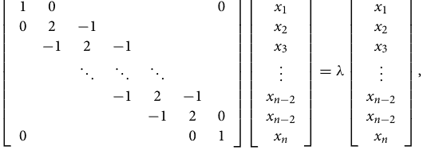

# Listing 8.9 Normal Modes of Loaded String (C/C++ Coding)

```c
// Normal modes of a loaded string with fixed ends
#include <math.h>
#include "memalloc.h"
#include "eigsy s.h"
#include "graphlib.h"

int main(int argc, wchar_t** argv)
{
    double **a, **x, *d, *xp, *yp;
    double h, omega;
    int i, mode, n;
    char title[20];

    n = 100;                                            // number of point masses
    a = Matrix(1,n,1,n);                                // coefficient matrix
    x = Matrix(1,n,1,n);                                // eigenvectors = displacements
    d = Vector(1,n);                                    // eigenvalues ~ frequencies^2
    xp = Vector(1,n);                                   // mesh points for plotting
    yp = Vector(1,n);                                   // function values for plotting

    for (i=1; i<=n; i++) a[i][i] = 2e0;                  // build coefficient matrix
    for (i=2; i<=n-2; i++) { a[i+1][i] = -1e0; a[i][i+1] = -1e0; }

    Jacobi(a,x,d,n);                                    // solve eigenvalue problem
    EigSort(x,d,n,1);                                   // sort eigenvalues and eigenvectors

    h = 1e0/(n-1);
    for (i=1; i<=n; i++) xp[i] = (i-1) * h;              // mesh points for plotting

    PyGraph w(argc, argv);
    w.GraphInit(1200,600);

    mode = 1;                                           // normal mode 1
    omega = sqrt(d[mode])*(n-1);                        // frequency
    for (i=1; i<=n; i++) yp[i] = x[i][mode];             // displacements
    sprintf(title,"omega(%i) = %6.2f",mode,omega);
    w.Plot(xp,yp,n,"blue",3,0.10,0.45,0.60,0.90,"x","y",title);

    mode = 2;                                           // normal mode 2
    omega = sqrt(d[mode])*(n-1);                        // frequency
    for (i=1; i<=n; i++) yp[i] = x[i][mode];             // displacements
    sprintf(title,"omega(%i) = %6.2f",mode,omega);
    w.Plot(xp,yp,n,"blue",3,0.60,0.95,0.60,0.90,"x","y",title);

    mode = 3;                                           // normal mode 3
    omega = sqrt(d[mode])*(n-1);                        // frequency
    for (i=1; i<=n; i++) yp[i] = x[i][mode];             // displacements
    sprintf(title,"omega(%i) = %6.2f",mode,omega);
    w.Plot(xp,yp,n,"blue",3,0.10,0.45,0.10,0.40,"x","y",title);

    mode = 4;                                           // normal mode 4
    omega = sqrt(d[mode])*(n-1);                        // frequency
    for (i=1; i<=n; i++) yp[i] = x[i][mode];             // displacements
    sprintf(title,"omega(%i) = %6.2f",mode,omega);
    w.Plot(xp,yp,n,"blue",3,0.60,0.95,0.10,0.40,"x","y",title);

    w.MainLoop();
}
```

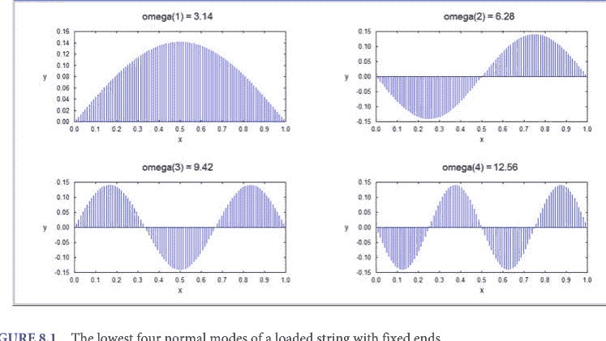

# 图 8.1 固定端带载弦的最低四阶正常模态。

# 问题 8.3

考虑四面体甲烷分子 `CH₄`，其相对原子质量为 `m_C = 12` 和 `m_H = 1`，且在体固定参考系中 5 个原子的以下笛卡尔位置（单位 Å）：

```
x = [0.000  0.635  -0.635  -0.635   0.635],
 y = [0.000  0.635  -0.635   0.635  -0.635],
 z = [0.000  0.635   0.635  -0.635  -0.635],
 r = [1.700  1.200   1.200   1.200   1.200].
```

`C` 原子位于原点，量 `r` 表示原子的范德华半径（Bondi 1964）。

+   a. 通过从各个坐标中减去质心坐标，将分子置于其质心系中：

```
x_CM = 1/m_CM Σ_i m_i x_i,   y_CM = 1/m_CM Σ_i m_i y_i,   z_CM = 1/m_CM Σ_i m_i z_i,
```

其中

```
m_CM = Σ_i m_i
```

为原子系统总质量。

+   b. 计算分子在笛卡尔质心系中的惯性张量：

```
I = [ [I_xx, I_xy, I_xz], [I_yx, I_yy, I_yz], [I_zx, I_zy, I_zz] ] ,
```

其中

$I_{xx}=\sum_i m_i(y_i^2+z_i^2),\quad I_{xy}=I_{yx}=-\sum_i m_i x_i y_i,$

$I_{yy}=\sum_i m_i(z_i^2+x_i^2),\quad I_{xz}=I_{zx}=-\sum_i m_i z_i x_i,$

$I_{zz}=\sum_i m_i(x_i^2+y_i^2),\quad I_{yz}=I_{zy}=-\sum_i m_i y_i z_i.$

c. 求解惯性张量的特征值问题，

\begin{bmatrix} I_{xx} & I_{xy} & I_{xz} \\ I_{yx} & I_{yy} & I_{yz} \\ I_{zx} & I_{zy} & I_{zz} \end{bmatrix} \begin{bmatrix} R_{xx} & R_{xy} & R_{xz} \\ R_{yx} & R_{yy} & R_{yz} \\ R_{zx} & R_{zy} & R_{zz} \end{bmatrix} = \begin{bmatrix} R_{xx} & R_{xy} & R_{xz} \\ R_{yx} & R_{yy} & R_{yz} \\ R_{zx} & R_{zy} & R_{zz} \end{bmatrix} \begin{bmatrix} I_x & 0 & 0 \\ 0 & I_y & 0 \\ 0 & 0 & I_z \end{bmatrix},

以确定主转动惯量—`I₁`、`I₂` 和 `I₃`——作为特征值，以及旋转矩阵 `R` 作为模态矩阵，其列包含特征向量。

d. 使用转置变换矩阵 `Rᵀ` 将原子坐标旋转到主轴系：

\begin{bmatrix} x'_i \\ y'_i \\ z'_i \end{bmatrix} = \begin{bmatrix} R_{xx} & R_{yx} & R_{zx} \\ R_{xy} & R_{yy} & R_{zy} \\ R_{xz} & R_{yz} & R_{zz} \end{bmatrix} \begin{bmatrix} x_i \\ y_i \\ z_i \end{bmatrix},\quad i=1,2,\dots,n.

e. 使用包含在库 `graphlib.py` 和 `graphlib.h` 中的例程 `PlotParticles` 可视化初始构型，以及分别以 `x` 轴和 `z` 轴为主对称轴的构型（详见第 3 章）。

# 解法

用于将粒子系统置于质心系并旋转到主轴系的 Python 函数包含在模块 `coords.py` 中，并在列表 8.10 中给出。C/C++ 对应版本作为补充材料提供在文件 `coords.h` 中。

Python 主程序显示在列表 8.11 中，C/C++ 版本作为补充材料提供（`P08-MomInert.cpp`）。产生的图形输出显示在图 8.2 中。

# 列表 8.10 粒子系统坐标的变换（coords.py）


# 列表 8.11 旋转分子到主轴系（Python 编码）

```
#---------------------------------------- coords.py ----------------------------------------
# Contains routines for transforming the coordinates of systems of particles
# Author: Titus Beu, 2013
#--------------------------------------------------------------------------------------------
from eigsys import *

#============================================================================================
def MovetoCM(m, x, y, z, n):
#--------------------------------------------------------------------------------------------
# Moves a system of n particles to the CM system
#--------------------------------------------------------------------------------------------
mCM = 0e0; xCM = 0e0; yCM = 0e0; zCM = 0e0
for i in range(1,n+1):
    mCM += m[i]
xCM += m[i] * x[i]
yCM += m[i] * y[i]
zCM += m[i] * z[i]
xCM /= mCM; yCM /= mCM; zCM /= mCM

for i in range(1,n+1):
    x[i] -= xCM; y[i] -= yCM; z[i] -= zCM

#==============================================================================
def PrincipalAxes(m, x, y, z, n, isort):
#------------------------------------------------------------------------------
# Rotates a set of n particles to the system of principal axes
# isort = 1 - highest symmetry axis along x-axis
# isort = -1 - highest symmetry axis along z-axis
#------------------------------------------------------------------------------
Inert = [[0]*4 for i in range(4)]
Rot = [[0]*4 for i in range(4)]
MomInert = [0]*4

for i in range(1,4):
    for j in range(1,i+1): Inert[i][j] = 0e0

for i in range(1,n+1):
    mi = m[i]; xi = x[i]; yi = y[i]; zi = z[i]
    Inert[1][1] += mi * (yi*yi + zi*zi)                     # inertia tensor
    Inert[2][2] += mi * (zi*zi + xi*xi)
    Inert[3][3] += mi * (xi*xi + yi*yi)
    Inert[2][1] -= mi * xi*yi
    Inert[3][1] -= mi * zi*xi
    Inert[3][2] -= mi * yi*zi

Jacobi(Inert,Rot,MomInert,3)                               # diagonalize inertia tensor
EigSort(Rot,MomInert,3,isort)                              # sort eigenvalues and eigenvectors

for i in range(1,n+1):                                     # rotate system to principal axes
    xi = x[i]; yi = y[i]; zi = z[i]
    x[i] = Rot[1][1] * xi + Rot[2][1] * yi + Rot[3][1] * zi
    y[i] = Rot[1][2] * xi + Rot[2][2] * yi + Rot[3][2] * zi
    z[i] = Rot[1][3] * xi + Rot[2][3] * yi + Rot[3][3] * zi

return MomInert
```

```
# Rotation of a molecule to the system of principal axes
from math import *
from eigsys import *
from coords import *
from matutil import *
from graphlib import *

n = 5                                                       # number of particles
m = [0,12.000, 1.000, 1.000, 1.000, 1.000]                   # masses
x = [0, 0.000, 0.635,-0.635,-0.635, 0.635]                   # positions
y = [0, 0.000, 0.635,-0.635, 0.635,-0.635]                   # [0] not used
z = [0, 0.000, 0.635, 0.635,-0.635,-0.635]
r = [0, 0.300, 0.200, 0.200, 0.200, 0.200]                   # radii
col = ["", "red", "blue", "blue", "blue", "gray"]        # colors

dmax = 1.5e0                                      # cutoff distance for bonds

m[5] += 1e-10                                     # "mark" last particle to set principal symmetry axis

GraphInit(1200,600)

title = "Initial configuration"
PlotParticles(x,y,z,r,col,n,dmax,0e0,0e0,0,0e0,0e0,0,0.05,0.25,0.2,0.8,title)

MovetoCM(m,x,y,z,n)                               # move to CM system

MomInert = PrincipalAxes(m,x,y,z,n,1)             # align main symmetry axis to x
print("Structure aligned to x-axis:")
VecPrint(x,n); VecPrint(y,n); VecPrint(z,n)
print("Principal moments of inertia:")
VecPrint(MomInert,3)
title = "System of principal axes - main x"
PlotParticles(x,y,z,r,col,n,dmax,0e0,0e0,0,0e0,0e0,0,0.45,0.65,0.2,0.8,title)

MomInert = PrincipalAxes(m,x,y,z,n,-1)            # align main symmetry axis to z
print("\nStructure aligned to z-axis:")
VecPrint(x,n); VecPrint(y,n); VecPrint(z,n)
print("Principal moments of inertia:")
VecPrint(MomInert,3)
title = "System of principal axes - main z"
PlotParticles(x,y,z,r,col,n,dmax,0e0,0e0,0,0e0,0e0,0,0.75,0.95,0.2,0.8,title)

MainLoop()
```

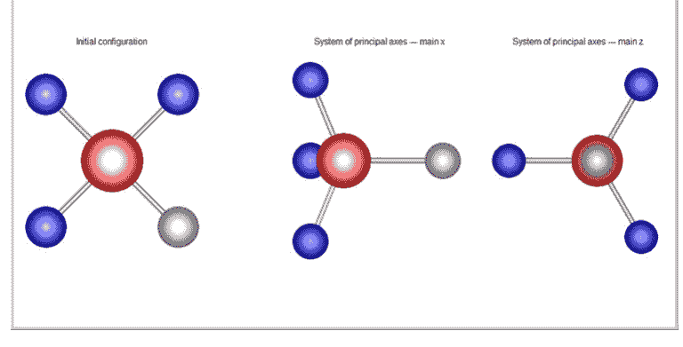

图 8.2 甲烷分子在初始构型（左）、旋转到主轴系且主对称轴沿 `x`（中）、以及分别主对称轴沿 `z`（右）。

# 列表 8.12 旋转飞机（Python 编码）

```
# Rotation of an airplane
from math import *
from egsys import *
from coords import *
from matutil import *
from graphlib import *

n = 10                                          # number of corner points
m = [0, 1, 1, 1, 0, 0, 1, 0, 0, 0, 0]            # masses
x = [0,-2,-6, 2, 0, 2, 6, 1, 2,-2, 2]            # positions
y = [0,-2, 2,-6, 2, 0, 6, 2, 1,-2, 2]            # [0] not used
z = [0, 0, 0, 0, 0, 0, 0, 1, 1, 4, 1]

n3 = 9                                          # number of defining triangles
ind1 = [0, 1, 1, 1, 1, 1, 1, 1, 6, 1]            # indexes of triangle corners
ind2 = [0, 2, 3, 4, 5, 4, 5, 7, 7, 9]
ind3 = [0, 4, 5, 6, 6, 7, 8, 8, 8,10]

GraphInit(800,800)

title = "Initial configuration"
PlotStruct(x,y,z,n,ind1,ind2,ind3,n3,
           0e0,0e0,0,0e0,0e0,0,0.05,0.45,0.55,0.92,title)

MovetoCM(m,x,y,z,n)                             # move structure to CM

PrincipalAxes(m,x,y,z,n,1)                      # rotate airplane to principal axes
print("Airplane in system of principal axes:")
VecPrint(x,6); VecPrint(y,6); VecPrint(z,6)
title = "System of principal axes"
PlotStruct(x,y,z,n,ind1,ind2,ind3,n3,
           0e0,0e0,0,0e0,0e0,0,0.55,0.95,0.55,0.92,title)

f = pi/180e0
phi = 20                                        # yaw
cosp = cos(phi*f); sinp = sin(phi*f)
for i in range(1,n+1):                          # rotate airplane about z-axis
    xi = x[i]
    x[i] = cosp * xi - sinp * y[i]
    y[i] = sinp * xi + cosp * y[i]
print("\nRotated airplane yaw = {0:4.1f}".format(phi))
VecPrint(x,6); VecPrint(y,6); VecPrint(z,6)
title = "yaw = {0:4.1f}".format(phi)
PlotStruct(x,y,z,n,ind1,ind2,ind3,n3,
           0e0,0e0,0,0e0,0e0,0,0.05,0.45,0.05,0.42,title)

phi = -35                                       # roll
cosp = cos(phi*f); sinp = sin(phi*f)
for i in range(1,n+1):                          # rotate airplane about x-axis
    yi = y[i]
    y[i] = cosp * yi - sinp * z[i]
    z[i] = sinp * yi + cosp * z[i]
print("\nRotated airplane roll = {0:4.1f}".format(phi))
VecPrint(x,6); VecPrint(y,6); VecPrint(z,6)
title = "roll = {0:4.1f}".format(phi)
PlotStruct(x,y,z,n,ind1,ind2,ind3,n3,
           0e0,0e0,0,0e0,0e0,0,0.55,0.95,0.05,0.42,title)

MainLoop()
```

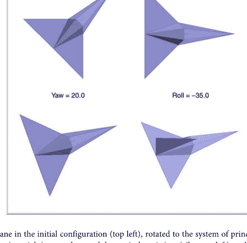

图 8.3 初始构型中的飞机（左上），绕 `x` 轴旋转至主轴系，主对称轴沿 `x`（右上），绕垂直 `z` 轴旋转（偏航）（左下），以及绕 `x` 轴旋转（滚转）（右下）。

## 问题 8.5

在 Hückel 理论框架下，通过求解标准特征值问题求出环状苯分子 `C₆H₆` 的本征能量和本征向量：

`H · C = C · E`.

哈密顿矩阵可以用库仑积分 `α = −6.9 eV` 和共振能 `β = −3.1 eV` 表示（Broglia and Heilbronner 1972）：

```
H = [ [α, β, 0, 0, 0, β], [β, α, β, 0, 0, 0], [0, β, α, β, 0, 0], [0, 0, β, α, β, 0], [0, 0, 0, β, α, β], [β, 0, 0, 0, β, α] ]
```

精确的本征值（`E` 的对角元素）和本征向量为

`E₁ = α + 2β`,    `E₂ = E₃ = α + β`,    `E₄ = E₅ = α − β`,    `E₆ = α − 2β`,

`C₁ = 1/√6 [1 1 1 1 1 1]ᵀ`, `C₂ = 1/2 [1 1 0 -1 -1 0]ᵀ`, `C₃ = 1/2 [1 0 -1 -1 0 1]ᵀ`,

`C₄ = 1/2 [1 -1 0 1 -1 0]ᵀ`, `C₅ = 1/2 [1 0 -1 1 0 -1]ᵀ`, `C₆ = 1/√6 [1 -1 1 -1 1 -1]ᵀ`.

利用例程 `EigSym`，证明非简并态 `E₁` 和 `E₆` 的精确本征值和本征向量被正确再现，并解释为什么简并态的本征向量与精确值不同，但仍是正确的。通过最大范数估计解的精度：

`‖H · C − C · E‖ = maxᵢⱼ |(H · C − C · E)ᵢⱼ|`,

其预期为零。

## 解

应注意，作为一般性质，对应于简并本征值的本征向量的任意线性组合仍是对应于相同本征值的本征向量。相应地，能级 `E₂ = E₃` 和 `E₄ = E₅` 为二重简并，可以通过任意线性组合 `γ₂C₂ + γ₃C₃` 以及分别 `γ₄C₄ + γ₅C₅` 正确描述。

Python 实现如清单 8.13 所示，C/C++ 版本作为补充材料提供（`P08-Hueckel.cpp`）。

### 清单 8.13 苯的 Hückel 方法（Python 编码）


# Hueckel method for benzene

```
from eigsys import *
from matutil import *

n = 6

H = [[0]*(n+1) for i in range(n+1)]                 # Hamiltonian matrix
C = [[0]*(n+1) for i in range(n+1)]                 # molecular coefficients
E = [0]*(n+1)                                       # eigenenergies

alpha = -6.9                                        # Coulomb & resonance integrals: F. Brogli &
beta = -3.2                                         # E. Heilbronner, Theoret. Chim. Acta 1972

for i in range(1,n+1): H[i][i] = alpha               # diagonal elements
for i in range(1,n):
    H[i+1][i] = beta; H[i][i+1] = beta               # off-diagonal elements
H[1][6] = beta; H[6][1] = beta                       # cyclic boundary conditions
X = (0, alpha+2*beta, alpha+beta, alpha+beta, \     # exact eigenenergies
     alpha-beta, alpha-beta, alpha-2*beta )
print("Eigenenergies (exact):")
VecPrint(X,n)
```

```
Jacobi(H,C,E,n)
EigSort(C,E,n,1)                      # sort eigenvalues and eigenvectors

print("Eigenenergies (eV):")
VecPrint(E,n)

print("Eigenvectors:")
MatPrint(C,n,n)

for i in range(2,n+1):                # restore Hamiltonian
    for j in range(1,i): H[i][j] = H[j][i]   # from upper triangle

err = 0e0
for i in range(1,n+1):
    for j in range(1,n+1):
        t = - E[j] * C[i][j]
        for k in range(1,n+1): t += H[i][k] * C[k][j]
        if (err < fabs(t)): err = fabs(t)    # err = max|A x - lambda x|

print("\nMaximum error = {0:8.2e}".format(err))
```

## 问题 8.6

在 `H₂O` 分子电子结构的密度泛函理论（DFT）计算中，Fock 矩阵 `F` 和重叠矩阵 `S` 的元素如下所列，并构成数据文件 `H2O.dat`。Fock 矩阵以常用原子单位，即哈特里单位指定（1 Hartree = 27.21 eV）。

读入文件 `H2O.dat`（清单 8.14）并通过使用例程 `EigSym` 求解矩阵 `F` 和 `S` 的广义特征值问题，

`FC = SCε`,

称为 Roothaan 方程（Szabo and Ostlund 1996）。

### 清单 8.14 文件 H2O.dat：H₂O 分子的 Fock 和重叠矩阵

```
F: Fock matrix
-18.74
-4.74 -1.74
-3.34 -1.65 -1.26
-0.01 -0.07 -0.07 -0.10
-0.02 -0.10 -0.10 0.02 -0.08
0.00 0.00 0.00 0.00 0.00 -0.02
0.00 -0.05 -0.10 -0.44 0.02 0.00 -0.06
0.00 -0.06 -0.14 0.02 -0.43 0.00 0.04 -0.03
0.00 0.00 0.00 0.00 0.00 -0.37 0.00 0.00 0.11
-0.63 -0.56 -0.51 -0.38 -0.02 0.00 -0.29 -0.02 0.00 -0.17
-1.34 -0.84 -0.70 -0.22 -0.05 0.00 -0.16 -0.07 0.00 -0.48 -0.44
-0.63 -0.56 -0.51 0.11 -0.36 0.00 0.08 -0.28 0.00 -0.11 -0.26 -0.17
-1.34 -0.84 -0.70 0.03 -0.22 0.00 -0.02 -0.18 0.00 -0.26 -0.39 -0.48 -0.44
S: overlap matrix
1.00
0.23 1.00
0.17 0.76 1.00
0.00 0.00 0.00 1.00
0.00 0.00 0.00 0.00 1.00
0.00 0.00 0.00 0.00 0.00 1.00
0.00 0.00 0.00 0.50 0.00 0.00 1.00
0.00 0.00 0.00 0.00 0.50 0.00 0.00 1.00
0.00 0.00 0.00 0.00 0.00 0.50 0.00 0.00 1.00
0.03 0.23 0.41 0.27 0.01 0.00 0.58 0.01 0.00 1.00
0.07 0.37 0.67 0.15 0.00 0.00 0.49 0.01 0.00 0.66 1.00
0.03 0.23 0.41 -0.08 0.26 0.00 -0.18 0.55 0.00 0.04 0.20 1.00
0.07 0.37 0.67 -0.05 0.14 0.00 -0.15 0.46 0.00 0.20 0.49 0.66 1.00
```

考虑到 `H₂O` 分子有 10 个电子，在基态下以自旋上-自旋下配对占据最低的 5 个能级 `εᵢ`，最高占据分子轨道（HOMO）为 `ε₅`，最低未占据分子轨道（LUMO）为 `ε₆`。确定 HOMO-LUMO 间隙，`ε₆−ε₅`，并通过估计最大范数 `‖FC−SCε‖ = maxᵢⱼ |(FC−SCε)ᵢⱼ|` 检查计算的精度。

## 解

Python 实现如清单 8.15 所示，C/C++ 版本作为补充材料提供（`P08-Roothaan.cpp`）。

### 清单 8.15 H₂O 分子 Roothaan 方程的求解（Python 编码）

```
# Solves the Roothaan equation F C = S C E for the H2O molecule
from eigsys import *
from matutil import *

n = 13

C = [[0]*(n+1) for i in range(n+1)]                 # molecular coefficients
F = [[0]*(n+1) for i in range(n+1)]                 # Fock matrix
S = [[0]*(n+1) for i in range(n+1)]                 # overlap matrix
S0 = [[0]*(n+1) for i in range(n+1)]                # backup copy of overlap matrix
E = [0]*(n+1)                                       # energy levels

f = open('H2O.dat','r')                             # read in F and S
line = f.readline()                                 # skip header
for i in range(1,n+1):                              # read in lower triangle of F
    line = f.readline()                             # F not altered by EigSym
    for j in range(1,i+1):
        F[i][j] = float(line.split()[j-1])
        F[j][i] = F[i][j]                           # symmetrize

line = f.readline()                                 # skip header
for i in range(1,n+1):
    line = f.readline()
    for j in range(1,i+1):                          # read in lower triangle of S
        S[i][j] = float(line.split()[j-1])          # S destroyed by EigSym
        S0[i][j] = S0[j][i] = S[i][j]               # backup S
f.close()

print("F: Fock matrix (sample)")
MatPrint(F,5,5)
print("S: overlap matrix (sample)")
MatPrint(S,5,5)

EigSym(F,S,C,E,n)                                   # solve Roothaan equation
EigSort(C,E,n,1)                                    # sort eigenvalues and eigenvectors

print("\nEigenenergies:")
VecPrint(E,n)
```

```
print("\nHOMO–LUMO gap E[6]–E[5] = {0:4.3f} Hartrees".format(E[6]-E[5]))

err = 0e0
for i in range(1,n+1):
    for j in range(1,n+1):
        t = 0e0
        for k in range(1,n+1): t += (F[i][k] - E[j]*S0[i][k]) * C[k][j]
        if (err < fabs(t)): err = fabs(t)          # err = max|a x – lambda x|

print("\nMaximum error = {0:8.2e}".format(err))
```

## 参考文献和建议进一步阅读

- Beu, T. A. 2004. *Numerical Calculus in C*（第 3 版，罗马尼亚文）。Cluj-Napoca: MicroInformatica.
- Bondi, A. 1964. van der Waals Volumes and Radii. *Journal of Physical Chemistry* 68(3), 441–451.
- Brogli, F. and E. Heilbronner. 1972. Correlation of Hückel molecular orbital energies with π-ionization potentials. *Theoretica Chimica Acta (Berlin)* 26, 289–299.
- Burden, R. and J. Faires. 2010. *Numerical Analysis*（第 9 版）。Boston: Brooks/Cole, Cengage Learning.
- Demidovich, B. and I. Maron. 1987. *Computational Mathematics*（第 4 版）。Moscow: MIR Publishers.
- Maor, E. 1975. A discrete model for the vibrating string. *International Journal of Mathematical Education in Science and Technology* 6(3), 345–352.
- Szabo, A. and N. S. Ostlund. 1996. *Modern Quantum Chemistry: Introduction to Advanced Electronic Structure Theory*. Mineola, NY: Dover Publications.

## 表格函数的建模

### 9.1 插值与回归

对不完全已知或存在偏差的函数依赖进行建模的必要性出现在相当多样化的数值背景中，所发展的公式和方法的多样性正是其直接反映。

在数值应用中，经常需要使用仅知道其在离散网格点上取值的函数。这种不连续的依赖关系可以表示，例如，数学函数的表格或测量的物理量。为简单起见，我们将讨论限制在单个实变量的实值依赖关系。在这种情况下，定义在某个实区间上的函数

`f : [α, β] → ℝ, [α, β] ⊂ ℝ,`

由其在若干网格点 `x_i ∈ [α, β]` 上的取值 `y_i` 指定：

`f(x_i) = y_i, i = 1, 2, …, n.`

对这种依赖关系的数值处理经常需要使用对应于与表格化参数不同的参数的补充值。可惜的是，在许多情况下，获得对依赖关系的额外信息是困难的，如果不是不可能的话。特别是，即使算法是已知的，其复杂性也可能使在大规模计算中直接计算某些函数变得过于昂贵。另一方面，如果表格值来自观测，它们通常受到测量（观测）误差的影响。

为了综合表格依赖关系 `f` 的信息并在进一步计算中有效地使用它，常见的做法是用一个连续函数来近似它，称为模型函数，`F = F(x; a_1, …, a_m)`，它通常依赖于一定数量的可调模型参数 `a_j`。模型 `F` 的函数形式和参数 `a_j` 的取值有一定的自由度，但无论如何必须确定，以便以预定义的方式最优地近似离散函数 `f`。

模型函数 `F` 的具体选择确实是一个非平凡的任务，并且应尽可能基于严格的推理。总体而言，可用的选项如下：

- 模型函数从一个方便的类中选取（如多项式、高斯函数等），这确保了后处理的简单性和效率。
- 模型函数源自理论框架，其中参数具有明确的意义。
- 模型函数是前两种选项的约束和优势之间的折中。

为了确定最优模型参数，首先必须定义一个反映模型函数 `F` 近似表格依赖关系 `f` 的程度的泛函。承认通常遇到的情况，`f` 和 `F` 都是 `[α, β]` 上的平方可积函数（它们的平方的积分是有限的），

模型函数与被建模函数偏差的有用综合度量由距离提供

```
$$d(f,F)=\left\{\int_{\alpha}^{\beta}[f(x)-F(x;\mathbf{a})]^2dx\right\}^{1/2},$$
```

其中 `a` ≡ (`a₁, a₂,…`) 表示模型参数的集合。从建模问题的一般表述来看，很明显这个定义实际上不可操作，因为它意味着知道 `f` 的解析表达式。然而，一个不太严格但仅适用于离散函数的距离定义是

```
$$d(f,F)=\left\{\sum_{i=1}^{n}[f(x_i)-F(x_i;\mathbf{a})]^2\right\}^{1/2}.\tag{9.3}$$
```

基于距离 (9.3) 调整模型参数或将模型函数拟合到观测数据集的方法称为 *最小二乘逼近*，是两种基本方法，即 *插值* 和 *回归* 的核心。

**插值。** 如果表格值 `yᵢ = f(xᵢ)` 被认为是 *无误差* 或数值上 *精确* 的，那么自然要求函数 `f` 和 `F` 之间具有 *零距离*：

```
$$d(f,F)=0.\tag{9.4}$$
```

这相当于构造一个具有一定连续性类的模型函数，该函数在数据节点 `xᵢ` 处取与被建模函数 `f(x)` *相同的值*：

```
$$F(x_i;\mathbf{a})=y_i,\quad i=1,2,\dots,n.\tag{9.5}$$
```

满足这些条件的模型函数通常用于近似区间 `[x₁,xₙ]` 内点的函数 `f(x)`，该过程称为 *插值*。`F(x; a)` 称为 *插值函数* 或 *插值多项式*，而离散参数 `xᵢ` 也称为 *插值节点*。如果用于评估插值多项式的参数位于表格区间 `[x₁,xₙ]` 之外，则该方法称为 *外推*。

从几何角度看，插值意味着找到曲线 `y = F(x; a)` 经过 *所有* 数据点 `Mᵢ(xᵢ,yᵢ)`（见图 9.1a）。尽管有这样的一般表述，但建模问题可能有无限多个解或无解，这取决于模型函数所属的连续性类。相比之下，如果例如模型函数被

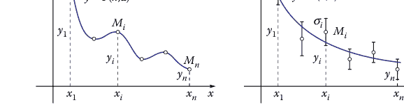


FIGURE 9.1 The model function passes in the case of the interpolation through the tabulation nodes (a), while in the case of the regression, it minimizes the merit function and passes between the nodes (b). For the same data set, the interpolation and the regression curves can be significantly different.

选为多项式 `P_m(x)`，其系数数量不超过表格节点数量 `m+1 <= n` 并满足插值条件：

$$P_m(x_i)=y_i,\quad i=1,2,\ldots,n.$$

从这个方程组，可以确定多项式系数，该方法称为 *多项式插值*。

在实践中占主导地位的是多项式插值多项式，其中最常见的是 *拉格朗日多项式* 和 *三次样条*。使用三角函数代替多项式基集 `1, x, x^2, ...` 导致所谓的 *三角插值*，以及相关的傅里叶变换方法。

**回归。** 如果表格值 `y_i = f(x_i)` 源自观测，它们通常受到 *测量误差* 的影响，这些误差通常指定为 *标准偏差* `sigma_i`（见图 9.1b）。在这种情况下，建立模型函数 `F = F(x; a)` 所依据的经验性越少，得到的模型参数的统计意义越高。考虑到观测数据的固有不准确性，模型函数实际上并不期望插值数据点，即严格通过它们（尽管原则上可能发生）。更自然的做法是要求相对于参数集合 `{a_j}` 的距离 *最小化*，

$$d(f,F)=\min_{\{a_j\}},$$

而不是像插值那样严格为零。具体而言，这相当于考虑属于一定连续性类（具有到一定阶的连续导数）的模型函数，并确定使其实值与数据点的偏差平方和最小的 `m` 个参数 `a_j`：

$$S=\sum_{i=1}^{n}\left[y_i-F(x_i;\mathbf{a})\right]^2.$$

调整（优化）模型参数的方法称为 *回归* 或通过 *最小二乘法* 进行 *曲线拟合*。泛函 (9.7) 在更广义上代表所谓的 *优值函数*。按惯例，优值函数是这样定义的，即较低的值表示模型与观测之间的一致性更好。在这方面，回归可以被视为 *多维最小化过程*。

实践中最常用的优值函数是 *卡方泛函*：

$$\chi^2=\sum_{i=1}^{n}\frac{1}{\sigma_i^2}\left[y_i-F(x_i;\mathbf{a})\right]^2.$$

与简单的偏差平方和 `S`（方程 9.7）不同，观测数据以不同的权重进入 `chi^2` 优值函数，即与单个标准偏差 `sigma_i` 成反比。受较低误差影响的数据点的相对权重因此增加，“迫使”模型函数 `F(x; a)` 主要最小化相对于这些点的距离，而以牺牲精度较低的观测（具有较大 `sigma_i`）为代价。特别是在标准偏差 `sigma_i` 相等或未知的情况下，形式简化并回落到基于 `S` 优值函数的回归。

相对于模型参数 `a_j` 的 `chi^2` 泛函的最小值由条件表征：

$$\frac{\partial\chi^2}{\partial a_j}=0,\quad j=1,2,\ldots,m.$$

根据`chi^2`的定义（9.8），可得

$$\sum_{i=1}^{n} \frac{1}{\sigma_i^2} \left[ y_i - F(x_i;\mathbf{a}) \right] \frac{\partial F(x_i;\mathbf{a})}{\partial a_j} = 0, \quad j = 1,2,\ldots,m, \tag{9.10}$$

由此可以确定最优参数 `a_j`。基于`chi^2`的曲线拟合也称为卡方回归。

从图9.1b可以看出，回归曲线 `y = F(x;a)` 并不必然穿过任何一个数据点 `M_i(x_i,y_i)`，而只是穿过其幅度为 `sigma_i` 的误差棒，从而使泛函`chi^2`最小。

显然，观测误差会给调整后的模型参数带来不确定性（概然误差），如果不对它们进行估计，拟合过程的信息就不完整。假设观测数据相互独立，可以证明与参数 `a_j` 相关联的方差（平方概然不精确度）`sigma_{a_j}^2` 是各个数据点平方不精确度 `sigma_i^2` 的累加，权重为参数对观测值 `y_i` 变化的平方“敏感性”`(∂a_j/∂y_i)^2`（Press等，2007）：

$$\sigma_{a_j}^2 = \sum_{i=1}^{n} \sigma_i^2 \left( \frac{\partial a_j}{\partial y_i} \right)^2. \tag{9.11}$$

为了“改进”模型函数 `F(x;a)`，使其更易于处理且能够逼近观测值（理想情况下甚至可以对它们进行插值！），在没有充分理论依据的情况下随意增加模型参数的数量是一种误导性的做法。这不仅会使模型函数和参数缺乏意义，甚至可能导致数值伪影。从这个角度看，插值绝不应被视为回归的理想极限，因为这两种方法具有不同的意义，适用于性质不同的情境。事实上，图9.1a和图9.1b针对同一数据集说明了模型函数可能因所用近似的性质（即插值或回归）不同而有多么不同。

## 9.2 拉格朗日插值多项式

最古老且应用最广泛的插值公式之一，是由约瑟夫·路易·拉格朗日首先发表的。拉格朗日插值多项式的重要性不仅仅在于其实用性，更在于其理论意义。不同类别的积分公式和各种阶数的微分格式，都是基于用拉格朗日多项式来逼近函数。

假设对于需要建模的函数 `f(x)`，已知对应于自变量 `x1, x2, …, xn` 的 `n` 个离散值，

$$f(x_i) = y_i, \quad i = 1,2,\ldots,n,$$

我们要处理的问题是构造次数最低的多项式 `P_m(x)`，使其插值所有数据点 `(x_i,y_i)`，即

$$P_m(x_i) = y_i, \quad i = 1,2,\ldots,n. \tag{9.12}$$

为此，我们首先定义一组 `n` 个辅助多项式 `p_i(x)`，每个多项式要求在且仅在一个节点 `x_i` 处非零，而在所有其他节点处为零：

$$p_i(x_j) = \delta_{ij} = \begin{cases} 1 & \text{if } j = i, \\ 0 & \text{if } j \neq i, \end{cases} \tag{9.13}$$

其中 `delta_ij` 是克罗内克δ。为了使 `p_i(x)` 在 `j != i` 的点 `x_j` 处为零，可以将其写成 `(x - x_j)` 形式因子的乘积，

```
p_i(x) = C_i ∏_{j≠i} (x − x_j),
```

其中特别缺少因子 `(x − x_i)`。如此定义的 `p_i(x)` 是 `(n − 1)` 次多项式，并考虑强加条件 `p_i(x_i) = 1`，可得归一化常数 `C_i = 1 / ∏_{j≠i} (x_i − x_j)`。于是，辅助多项式族的通项可写为

```
p_i(x) = [∏_{j≠i} (x − x_j)] / [∏_{j≠i} (x_i − x_j)],  i = 1,2,...,n.  (9.14)
```

由于辅助多项式 `p_i(x)` 在所有数据点处均为零，除其中一个（即 `x_i`）之外，满足插值条件（9.12）的多项式 `P_m(x)` 可以被定义为这些多项式的线性组合。此外，由于 `p_i(x)` 都是 `(n − 1)` 次多项式，因此 `P_m(x)` 本身也是 `(n − 1)` 次：

```
P_{n−1}(x) = Σ_{i=1}^n p_i(x) y_i.  (9.15)
```

利用辅助多项式的性质9.13，可以很容易地证明 `P_{n−1}(x)` 确实满足插值条件（9.12）：

```
P_{n−1}(x_j) = Σ_{i=1}^n p_i(x_j) y_i = Σ_{i=1}^n δ_{ij} y_i = y_j,  j = 1,2,...,n.
```

将辅助多项式 `p_i(x)` 的表达式9.14代入（9.15），便得到拉格朗日插值多项式：

```
P_{n−1}(x) = Σ_{i=1}^n [∏_{j≠i} (x − x_j) / ∏_{j≠i} (x_i − x_j)] y_i.  (9.16)
```

按照惯例，插值方案中使用的数据点数目减一称为插值阶数；就拉格朗日插值而言，所有数据点都有贡献，因此插值阶数等于插值多项式的次数。

为了证明在给定 `n` 个数据点的情况下，拉格朗日多项式是次数最低的唯一插值多项式，我们假设相反的情形，即存在另一个异于 `P_{n−1}(x)` 的多项式 `\tilde{P}_{n−1}(x)`，它也满足插值条件：

```
\tilde{P}_{n−1}(x_i) = y_i,  i = 1,2,...,n.
```

因此，定义为 `\tilde{P}_{n−1}(x)` 与 `P_{n−1}(x)` 之差的多项式

```
Q_{n−1}(x) = \tilde{P}_{n−1}(x) − P_{n−1}(x),
```

在所有 `n` 个插值点 `x_i` 处都为零。然而，由于其次数至多为 `(n − 1)`，`Q_{n−1}(x)` 至多只有 `(n − 1)` 个零点，因此它恒为零，即 `Q_{n−1}(x) ≡ 0`。于是，`\tilde{P}_{n−1}(x)` 与 `P_{n−1}(x)` 完全相同，从而证明了拉格朗日多项式的唯一性。不过，不言而喻，有无数个次数高于 `n − 1` 的多项式，或者说可调参数个数多于插值条件个数的多项式，都可以通过拟合来插值这些数据点。

公式9.16表明，拉格朗日多项式本质上提供了一种非局部近似，这意味着所有数据点都对插值函数有贡献，而不仅仅是自变量附近的那些数据点。这种非局部性一方面通过高阶导数的连续性保证了近似的光滑性，但另一方面也可能引起插值多项式的虚假振荡。

在 `n = 2` 个插值点 `(x1,y1)` 和 `(x2,y2)` 的特殊情况下，拉格朗日多项式化简为

`P1(x) = (x - x2)/(x1 - x2) y1 + (x - x1)/(x2 - x1) y2`   (9.17)

显然，它描述的是经过这两点的直线。

在 `n = 3` 的情况下，拉格朗日插值对应于由三个数据点 `(x1,y1)`、`(x2,y2)` 和 `(x3,y3)` 确定的抛物线：

`P2(x) = [(x - x2)(x - x3)]/[(x1 - x2)(x1 - x3)] y1 + [(x - x1)(x - x3)]/[(x2 - x1)(x2 - x3)] y2 + [(x - x1)(x - x2)]/[(x3 - x1)(x3 - x2)] y3.`   (9.18)

拉格朗日插值（9.16）在程序清单9.1中实现。函数 `Lagrange` 在接收数组 `x` 和 `y` 中的 `n` 个数据点后，返回自变量 `xi` 处的插值结果。程序清单9.2中给出的变体 `Lagrange1` 额外接收由 `ni` 个插值自变量组成的数组 `xi`，并通过数组 `yi` 返回相应的插值结果。为了提高效率，常数因子 `y_i/∏_{j≠i} (x_i − x_j)` 被预先计算。

在程序清单9.3的示例程序中，例程 `Lagrange`（假定包含在模块 `modfunc.py` 中）对从函数 `f(x) = 1/x` 提取的一组数据点进行插值，并计算若干自变量处的插值结果。

### 程序清单9.1 拉格朗日插值（Python实现）

```python
#===============================================================================
def Lagrange(x, y, n, xi):
#-------------------------------------------------------------------------------
# Evaluates the Lagrange interpolating polynomial of n data points at xi
# x[] - x-coordinates of data points
# y[] - y-coordinates of data points
# n   - number of data points
# xi  - interpolation argument
#-------------------------------------------------------------------------------
    yi = 0e0
    for i in range(1,n+1):
        p = 1e0
        for j in range(1,n+1):
            if (j != i): p *= (xi - x[j])/(x[i] - x[j])
        yi += p * y[i]

    return yi
```

### 清单9.2 多参数拉格朗日插值（Python编码）

```
#================================================================================
def Lagrange1(x, y, n, xi, yi, ni):
#--------------------------------------------------------------------------------
# 在由ni个插值点构成的网格上计算n个数据点的拉格朗日插值多项式
# x[]  - 数据点的x坐标
# y[]  - 数据点的y坐标
# n    - 数据点的数目
# xi[] - 插值自变量
# yi[] - 插值函数值（输出）
# ni   - 插值点的数目
#--------------------------------------------------------------------------------
yf = [[0]*(n+1) for i in range(n+1)]          # 插值多项式的因子

for i in range(1,n+1):      # 准备插值多项式的固定因子
    p = 1e0
    for j in range(1,n+1):
        if (j != i): p *= (x[i] - x[j])
    yf[i] = y[i] / p

for k in range(1,ni+1):                     # 对插值点进行循环
    xk = xi[k]; yk = 0e0
    for i in range(1,n+1):
        p = 1e0
        for j in range(1,n+1):
            if (j != i): p *= (xk - x[j])
        yk += p * yf[i]
    yi[k] = yk
```

拉格朗日多项式产生虚假振荡的常见原因之一是数据点分布不当。对于函数 `f(x) = 1/x`（其幂级数表示确实收敛缓慢），通过考虑手工选取的自变量 `0.15、0.2、0.3、0.5、0.8、1.1、1.4` 和 `1.7`（见图9.2），可以清楚地说明这一现象。尽管插值点沿曲线分布相当均匀，但较大自变量之间的相对较宽区间导致拉格朗日插值无法再现所模拟的依赖关系，并呈现出越来越大的振荡。相反，如果均匀分布数据点的横坐标，则振荡显著减小。此外，只需将等距网格点的数目增加一个，振荡就会完全消失。因此，如果没有合理的数据点分布作支撑，仅仅增加数据集的规模并不一定能改进插值效果，因为随之而来的多项式阶数增加会导致出现额外的零点，从而也会产生更多的振荡。

与图9.2所示的拉格朗日多项式的行为不同，分段连续的三次样条（详见第9.4节）能够提供明显更优的插值，且没有人为振荡。从定性角度看，三次样条性能的提高可归因于其阶数较低，从而导致零点数目较少、振荡趋势减弱。

尽管拉格朗日多项式的非局部性存在不利的副作用，但它仍然是一种重要且广泛使用的插值工具。基于它还可以解决另一个实际问题，即逆插值，其本质上是寻找使拉格朗日多项式取给定值的自变量。这可以通过简单地在式(9.16)中交换 `x` 和 `y` 的角色来实现，即将 `y` 视为自变量，将 `x` 表示为插值结果：

$$x = \sum_{i=1}^{n} \frac{\prod_{j\neq i} (y - y_j)}{\prod_{j\neq i} (y_i - y_j)} x_i. \tag{9.19}$$

特别地，该公式可用于求方程 `f(x) = 0` 的近似根。为此，只需计算在接近根的 `n` 个自变量 `x_i` 处的函数值 `y_i = f(x_i)`。在(9.19)中令 `y = 0`，即可得到根的近似值 `x`。在理想情况下，如果 `f(x) ≡ P_{n-1}(x)` 是次数为 `(n − 1)` 的多项式，则通过该方法求得的根在数值上是精确的。

### 清单9.3 使用拉格朗日多项式进行插值（Python编码）


# 拉格朗日插值

``` 
from modfunc import *

# 主程序

n = 8                                         # 数据点数目
ni = 100                                      # 插值点数目

x = [0]*(n+1)                                 # 数据点
y = [0]*(n+1)

x[1] = 0.15; x[2] = 0.2; x[3] = 0.3; x[4] = 0.5       # 数据点：
x[5] = 0.8 ; x[6] = 1.1; x[7] = 1.4; x[8] = 1.7       # f(x) = 1/x
for i in range(1,n+1): y[i] = 1e0/x[i]

out = open("interpol.txt","w")                     # 打开输出文件
out.write("      x           y           xi           yi           f\n")
h = (x[n]-x[1])/(ni-1)
for i in range(1,ni+1):
    xi = x[1] + (i-1)*h                             # 插值自变量
    yi = Lagrange(x,y,n,xi)                        # 插值函数值
    if (i <= n):
        out.write("{0:12.3e}{1:12.3e}{2:12.3e}{3:12.3e}{4:12.3e}\n".format(x[i],y[i],xi,yi,1e0/xi))
    else:
        out.write("{0:36.3e}{1:12.3e}{2:12.3e}\n".format(xi,yi,1e0/xi))
out.close()
```

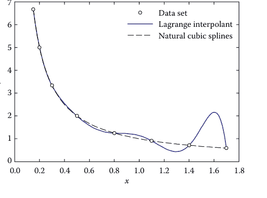

图9.2 拉格朗日插值出现人为振荡的情形。插值数据采样自函数 `f(x) = 1/x`。

## 9.3 Neville插值法

直接应用拉格朗日多项式`(9.16)`的一个缺点是无法获得与插值函数值相关的可用误差估计。实际上，可以通过比较逐次嵌套数据集的插值来估计误差。然而，这种方法不允许在计算高阶插值时高效、递归地重用给定阶数的插值，因此代价较高。

`Neville`方法（以英国数学家埃里克·哈罗德·`Neville`命名）本身并不是一种独立的插值方法，而是一种优化算法，用于为给定数目的数据点构造唯一的（拉格朗日）插值多项式，同时提供误差估计。该算法本质上涉及对逐步扩展的数据集上构造的递增阶插值进行高效的迭代计算，并完全重用之前的结果。

设函数 `f(x)` 由 `n` 个值给出：

$$f(x_i) = y_i, \quad i = 1, 2, \dots, n.$$

为了高效构造插值 `n` 个数据点 `(x_i, y_i)` 的拉格朗日多项式，我们首先定义一族辅助插值多项式。设 `P_{ij}(x)` 为插值横坐标介于 `x_i` 和 `x_j` 之间的数据点的唯一（拉格朗日）多项式，从而满足插值条件：

$$P_{ij}(x_k) = y_k, \quad i \le k \le j. \tag{9.20}$$

由于它插值 `j − i + 1` 个数据点，多项式 `P_{ij}(x)` 的次数为 `j − i`。特别地，`P_{i,i}(x)` 是次数为 `0` 的多项式，它们仅插值单个数据点 `(x_i, y_i)`，因此是常数函数，分别取值 `y_i`，与自变量无关：

$$P_{i,i}(x) \equiv y_i, \quad i = 1, 2, \dots, n. \tag{9.21}$$

显然，所寻求的拉格朗日多项式可以等同于 `P_{1,n}(x)`，它是相对于整个数据集的最低次数唯一插值多项式：

$$P_{n-1}(x) \equiv P_{1,n}(x). \tag{9.22}$$

对于给定的自变量 `$x$`，可以高效地计算 `P_{1,n}(x)`，方法是将值 `P_{i,j}(x)` 排列在如下具有“前驱”和“后代”的表格中，每一列上的插值阶数为常数且等于 `m = j - i`：

|  | `m = 0` | `1` | `2` | `…` | `n-2` | `n-1` |

|---|---|---|---|---|---|---|

| `x_1` | `P_{1,1}=y_1` |  |  |  |  |  |

|  |  | `P_{1,2}` |  |  |  |  |

| `x_2` | `P_{2,2}=y_2` |  | `P_{1,3}` |  |  |  |

|  |  | `P_{2,3}` |  | `…` |  |  |

| `x_3` | `P_{3,3}=y_3` |  | `…` |  | `P_{1,n-1}` |  |

|  |  | `…` |  | `P_{2,n-1}` |  | `P_{1,n}\equiv P_{n-1}(x)` |

| `…` | `…` |  | `…` |  | `P_{2,n}` |  |

|  |  | `P_{n-2,n-1}` |  | `…` |  |  |

| `x_{n-1}` | `P_{n-1,n-1}` |  | `P_{n-2,n}` |  |  |  |

|  |  | `P_{n-1,n}` |  |  |  |  |

| `x_n` | `P_{n,n}=y_n` |  |  |  |  |  |

`Neville`算法实际上规定了从最低次数（0）的多项式 `P_{i,i}(x)` 开始，从左到右递归填充各列，并在最后一列产生一个可以等同于插值函数值 `P_{1,n}\equiv P_{n-1}(x)` 的单一后代。这种传播可以基于给定后代 `P_{i,j}(x)`（次数为 `j-i`）与其两个前驱 `P_{i,j-1}(x)` 和 `P_{i+1,j}(x)`（次数为 `j-i-1`）之间的递推关系进行，这两个前驱位于左列中上下相邻的位置：

$$P_{i,j}(x) = \frac{(x - x_j)P_{i,j-1}(x) + (x_i - x)P_{i+1,j}(x)}{x_i - x_j}. \tag{9.23}$$

事实上，对于任何满足 `i < k < j` 的 `x_k`，`P_{i,j}(x)` 都满足插值条件`(9.20)`，因为前驱 `P_{i,j-1}(x)` 和 `P_{i+1,j}(x)` 自身对于公共数据点子集 `x_{i+1},...,x_{j-1}` 满足这些条件：

$$P_{i,j}(x_k) = \frac{(x_k - x_j)y_k + (x_i - x_k)y_k}{x_i - x_j} = y_k, \quad x_i < x_k < x_j.$$

特别地，在边界 `x_i` 和 `x_j` 处，由于二项式 `(x - x_j)` 和 `(x_i - x)` 分别交替为零，插值条件得以满足：

$$P_{i,j}(x_i) = \frac{(x_i - x_j)y_i + (x_i - x_i)P_{i+1,j}(x_i)}{x_i - x_j} = y_i,$$

$$P_{i,j}(x_j) = \frac{(x_j - x_j)P_{i,j-1}(x_j) + (x_i - x_j)y_j}{x_i - x_j} = y_j.$$

因此，由递推关系`(9.23)`定义的多项式 `P_{i,j}(x)` 插值了所有 `j - i + 1` 个数据点 `(x_i,y_i),..., (x_j,y_j)`，并且由于其次数为 `j - i`，它实际上代表了唯一的拉格朗日插值多项式。

由于值表 `P_{i,j}(x)` 需要按列填充，且索引 `i` 和 `j` 通过 `j = m + i` 与插值阶数（列索引）`m` 相关联，因此在标识表元素时，`m` 似乎比 `j` 更适合与数据索引 `i` 一起使用。相应地，通过引入记号 `P_i^{(m)}(x) \equiv P_{i,j}(x)` 和 `x_{m+i} \equiv x_j`，递推关系`(9.23)`可以改写成更适合算法的形式：

`P_i^{(m)}(x) = (x - x_{m+i}) P_i^{(m-1)}(x) + (x_i - x) P_{i+1}^{(m-1)}(x) / (x_i - x_{m+i})`,

`m = 1,2,...,n-1,   i = 1,2,...,n - m.  (9.24)`

在依次推进的每一列 `m` 中，行索引 `i` 取 `n − m` 个值，比前一列少一个。每一对 `P_i^{(m-1)}(x)` 和 `P_{i+1}^{(m-1)}(x)` 产生一个新值 `P_i^{(m)}(x)`，此后 `P_i^{(m-1)}(x)` 不再需要。因此，在具体实现中，不需要二维数组，只需一个向量来存储当前列的插值多项式值 `P_i^{(m)}(x)`，用 `P_i^{(m)}(x)` 替换 `P_i^{(m-1)}(x)`。

最终插值 `P_{n-1}(x) ≡ P_1^{(n-1)}(x)` 与其两个前驱值之一（例如 `P_2^{(n-2)}(x)`）之差，为用拉格朗日多项式逼近列表函数关系时的绝对误差提供了一个有用且易于实现的估计：

`Δ = | P_1^{(n-1)}(x) − P_2^{(n-2)}(x) | .`

清单 9.4 中给出的 `Neville` 方法实现，其参数含义与上一节讨论的 `Lagrange` 例程相同。`x` 和 `y` 是输入时包含 `n` 个数据点坐标的数组，`xi` 是要求计算插值的自变量。除了通过函数名返回插值结果外，参数 `err` 用于返回相关的误差估计。

在清单 9.5 所示的 `Neville` 函数使用示例中，被插值的数据集与上一节程序 9.3 所用的数据集相同。从图 9.3 可以看出，被建模的函数 `f(x) = 1/x` 恰好穿过与插值值相关联的误差条。但值得注意的是，在插值出现虚假振荡的区域，估计误差相当大。

### 清单 9.4 基于 Neville 算法的插值（Python 代码）

```
#============================================================
def Neville(x, y, n, xi):
#------------------------------------------------------------
# Evaluates the Lagrange interpolating polynomial of n data points at xi by
# Neville’s method and returns an estimate of the absolute error
# x[] - x-coordinates of data points
# y[] - y-coordinates of data points
# n  - number of data points
# xi - interpolation argument
# err - estimate of the absolute error (output)
#------------------------------------------------------------
    p = [[0]*(n+1) for i in range(n+1)]      # values of successive interpolants

    for i in range(1,n+1): p[i] = y[i]       # initialize with 0-order polynomial

    for m in range(1,n):                     # loop over columns of scheme array
        for i in range(1,n-m+1):             # increase polynomial order
            p[i] = ((xi-x[m+i])*p[i] + (x[i]-xi)*p[i+1]) / (x[i]-x[m+i])

    yi = p[1]                                # polynomial value
    err = fabs(p[1] - p[2])                  # error estimate

    return (yi, err)
```

### 清单 9.5 使用 Neville 方法进行插值（Python 代码）

```
# Interpolation by Neville’s algorithm
from modfunc import *

#### main

n = 8                                         # number of data points
ni = 50                                       # number of interpolation points

x = [0]*(n+1)                                 # data points
y = [0]*(n+1)

x[1] = 0.15; x[2] = 0.2; x[3] = 0.3; x[4] = 0.5       # data points:
x[5] = 0.8 ; x[6] = 1.1; x[7] = 1.4; x[8] = 1.7       # f(x) = 1/x
for i in range(1,n+1): y[i] = 1e0/x[i]

out = open("interpol.txt","w")                     # open output file
out.write("      x            y            xi            yi            err\n")
h = (x[n]-x[1])/(ni-1)
for i in range(1,ni+1):
    xi = x[1] + (i-1)*h                             # interpolation argument
    (yi,err) = Neville(x,y,n,xi)                    # interpolant value
    if (i <= n):
        out.write("{0:12.3e}{1:12.3e}{2:12.3e}{3:12.3e}{4:12.3e}\n".format(x[i],y[i],xi,yi,err))
    else:
        out.write("{0:36.3e}{1:12.3e}{2:12.3e}\n".format(xi,yi,err))
out.close()
```

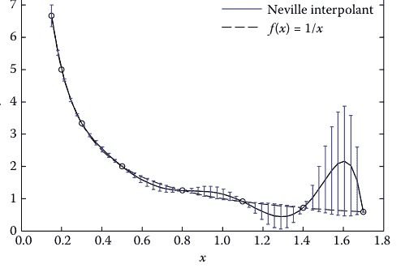

图 9.3 在虚假振荡情形下 `Neville` 插值及其相关误差条的图示。插值数据采样自函数 `f(x) = 1/x`。

## 9.4 三次样条插值

前两节中的应用表明，拉格朗日多项式作为覆盖整个列表数据范围的单一插值多项式时，其主要缺点是可能出现虚假振荡。这一现象可归因于插值多项式通常具有较高的次数，以及相应的大量零点，而这些零点直接由被插值的数据点个数决定。显然，若要理想地将多项式次数降到合理的光滑度，可以在总区间的相邻子区间（数据点子集）上分别考虑较低次数的插值多项式。这种方法称为分段多项式插值。

插值多项式在不同子区间上的各段限制原则上可以是相互独立的。然而在这种情况下，无法保证插值在子区间端点处的可微性。如果整体光滑度（用连续导数的最高阶数表示）很重要，则必须对这些限制施加额外约束，以确保它们在子区间边界处直到某一阶的导数连续。这种带有耦合插值限制的分段多项式逼近称为样条插值，而这些限制本身称为样条。

“样条”函数最初受到“绘图员样条”的启发。在计算机时代之前，绘图员样条是技术制图中用来通过给定点塑造平滑平面曲线的工具。这种工具由一条柔性条带组成，放置在水平绘图板上，有时通过固定两端使其张紧，并通过销钉固定或在某些点悬挂重物产生的摩擦阻力，使其保持所需的弯曲形状。样条会呈现与最小应变能相对应的形状，也就隐式地对应最小曲率（曲率与应变能成正比）。样条函数旨在模仿绘图员样条，具有最小曲率的显著特性，从而减少了在插值节点之间出现振荡的不利现象，而这种振荡正是高次插值多项式所特有的。

设 `Δ` 为区间 `[α, β]` 的一个分割，

`Δ : α = x₁ < x₂ < ⋯ < xₙ = β`,

且 `f: [α, β] → ℝ` 是一个列表函数关系：

`yᵢ = f(xᵢ), i = 1, 2, …, n.`

为了对与分割点不同的自变量处的 `f(x)` 进行建模，我们构造分段样条插值函数。我们称相对于分割 `Δ` 的 `m` 阶样条插值为函数 `S : [α, β] → ℝ`，其在子区间 `[xᵢ, xᵢ₊₁]` 上的限制 `Sᵢ(x)` 是 `m` 次多项式（样条）。这样定义的分段插值函数属于 `C^{m−1}[α, β]` 类，即其前 `(m − 1)` 阶导数在整个区间 `[α, β]` 上连续，而第 `m` 阶导数在节点 `xᵢ` 处不连续。

最广泛使用的样条限制是三次多项式，称为三次样条：

`Sᵢ(x) = Aᵢx³ + Bᵢx² + Cᵢx + Dᵢ, (9.25)`

`x ∈ [xᵢ, xᵢ₊₁], i = 1, 2, …, n − 1.`

具有这些限制的插值函数 `S` 显然属于 `C²[α, β]` 类，即它二次连续可微。三次样条一方面为大多数实际应用保证了足够的整体光滑性，另一方面由于其低阶性而不易引发振荡。此外，由于其函数形式简单，它们为多种积分和微分格式提供了基础。

原则上，样条系数 `Aᵢ`、`Bᵢ`、`Cᵢ` 和 `Dᵢ` 可由插值节点 `xᵢ` 处的连续性和插值条件确定：

`S(xᵢ) = yᵢ, i = 1, 2, …, n. (9.26)`

与一阶和二阶导数不同，三阶导数（等于 `6A_i`）在子区间边界处是不连续的。


# 三次样条插值

## 样条二阶导数的线性表示

第二样条导数 `S_i''(x)` 是在区间 `[x_i, x_{i+1}]` 上定义的线性函数，由方程

$$\frac{S_i''(x) - \tilde{D}_i}{x - x_i} = \frac{\tilde{D}_{i+1} - \tilde{D}_i}{x_{i+1} - x_i}, \tag{9.27}$$

给出，其中 $\tilde{D}_i \equiv S''(x_i)$ 和 $\tilde{D}_{i+1} \equiv S''(x_{i+1})$ 是二阶导数的边界值。从该方程可得

$$S_i''(x) = \frac{\tilde{D}_{i+1}(x - x_i) + \tilde{D}_i(x_{i+1} - x)}{h_i}, \tag{9.28}$$

其中

$$h_i = x_{i+1} - x_i, \quad i = 1,2,\dots,n-1. \tag{9.29}$$

## 一阶导数与样条本身

对公式 `9.28` 积分两次，可依次得到一阶导数和样条本身：

$$S_i'(x) = \frac{\tilde{D}_{i+1}(x - x_i)^2 - \tilde{D}_i(x_{i+1} - x)^2}{2h_i} + C_i', \tag{9.30}$$ 

$$S_i(x) = \frac{\tilde{D}_{i+1}(x - x_i)^3 + \tilde{D}_i(x_{i+1} - x)^3}{6h_i} + C_i'x + C_i''. \tag{9.31}$$

积分常数 `C_i'` 和 `C_i''` 可通过在节点 `x_i` 和 `x_{i+1}` 处对样条施加插值条件来确定，即

$$S_i(x_i) = y_i, \quad S_i(x_{i+1}) = y_{i+1},$$

由此得到系统：

$$\begin{cases}\frac{\tilde{D}_i h_i^2}{6} + C_i' x_i + C_i'' = y_i \\ \frac{\tilde{D}_{i+1} h_i^2}{6} + C_i' x_{i+1} + C_i'' = y_{i+1}.\end{cases}$$

求解该系统得到 `C_i'` 和 `C_i''`：

$$C_i' = \frac{y_{i+1} - y_i}{h_i} - \frac{(\tilde{D}_{i+1} - \tilde{D}_i)h_i}{6}, \tag{9.32}$$ 

$$C_i'' = \frac{x_{i+1}y_i - x_i y_{i+1}}{h_i} + \frac{(x_i \tilde{D}_{i+1} - x_{i+1} \tilde{D}_i)h_i}{6}. \tag{9.33}$$

## 样条多项式系数

将积分常数代回公式 `9.31` 并整理 `x` 的同次幂，可得到样条 `S_i(x)` 的多项式系数，用插值网格点处的二阶导数 `D_i` 表示：

```
A_i = (\tilde{D}_{i+1} - \tilde{D}_i)/(6 h_i)
B_i = (\tilde{D}_i x_{i+1} - \tilde{D}_{i+1} x_i)/(2 h_i)
C_i = (\tilde{D}_{i+1} x_i^2 - \tilde{D}_i x_{i+1}^2)/(2 h_i) + (y_{i+1} - y_i)/h_i - A_i h_i^2
D_i = (\tilde{D}_i x_{i+1}^3 - \tilde{D}_{i+1} x_i^3)/(6 h_i) + (y_i x_{i+1} - y_{i+1} x_i)/h_i - (B_i h_i^2)/3.
```

## 二阶导数的连续性条件

为完整定义样条，还需要确定二阶导数的值 `\tilde{D}_i`，这可通过在插值节点处施加一阶导数的连续性来实现：

```
S'_{i-1}(x_i) = S'_i(x_i), \quad i = 2,3,...,n-1. \tag{9.35}
```

利用一阶导数的表达式 `9.30` 和系数 `C'_i` 的形式 `(9.32)`，上述连续性条件导致

```
(h_{i-1}/6)\tilde{D}_{i-1} + ((h_{i-1}+h_i)/3)\tilde{D}_i + (h_i/6)\tilde{D}_{i+1} = (y_{i+1}-y_i)/h_i - (y_i - y_{i-1})/h_{i-1}, \quad i = 2,3,...,n-1. \tag{9.36}
```

系统 `9.36` 仅为 `n` 个二阶导数 `\tilde{D}_i` 提供了 `(n - 2)` 个方程，因此为对其进行唯一确定，还需要提供两个附加方程。这些补充方程可针对样条插值相关的两种重要边界类型显式推导：自由边界或自然边界以及 `clamped` 边界。

## Clamped 边界条件

`clamped` 边界要求在端点处指定一阶导数 `y'_1` 和 `y'_n`，并且相应的两个附加关系为

```
S'_1(x_1) = y'_1, \quad S'_{n-1}(x_n) = y'_n,
```

或显式地，

```
(h_1/3)\tilde{D}_1 + (h_1/6)\tilde{D}_2 = (y_2 - y_1)/h_1 - y'_1
(h_{n-1}/6)\tilde{D}_{n-1} + (h_{n-1}/3)\tilde{D}_n = y'_n - (y_n - y_{n-1})/h_{n-1}.
```

由此得到如下三对角系统，其解为插值节点处样条的二阶导数 `\tilde{D}_i`：

```
b_1 \tilde{D}_1 + c_1 \tilde{D}_2 = d_1
a_i \tilde{D}_{i-1} + b_i \tilde{D}_i + c_i \tilde{D}_{i+1} = d_i, \quad i = 2,3,...,n-1
a_n \tilde{D}_{n-1} + b_n \tilde{D}_n = d_n. \tag{9.37}
```

其中系数为：

```
a₁ = 0,      b₁ = 2h₁,      c₁ = h₁,      d₁ = 6( (y₂ − y₁)/h₁ − y₁′ ),
aᵢ = hᵢ₋₁,   bᵢ = 2(hᵢ₋₁ + hᵢ), cᵢ = hᵢ,      dᵢ = 6( (yᵢ₊₁ − yᵢ)/hᵢ − (yᵢ − yᵢ₋₁)/hᵢ₋₁ ),
aₙ = hₙ₋₁,   bₙ = 2hₙ₋₁,     cₙ = 0,        dₙ = 6( yₙ′ − (yₙ − yₙ₋₁)/hₙ₋₁ ).
(9.38)
```

## 自然边界条件

自由边界是所谓的自然三次样条的特征，并假设在列表区间的端点处二阶导数恒为零：

```
D̃₁ = 0,    D̃ₙ = 0.
(9.39)
```

与其分别编程，上述条件可通过考虑系统 `9.37` 中的特定系数以统一方式处理：

```
c₁ = 0,    d₁ = 0,
aₙ = 0,    dₙ = 0.
```

## 实现步骤

本质上，三次样条插值的具体实现涉及：

+ 1. 通过求解系统 `9.37` 和 `9.38` 计算二阶导数 `D̃i`，
+ 2. 利用关系 `9.34` 计算样条系数 `Ai`、`Bi`、`Ci` 和 `Di`，
+ 3. 对特定一组自变量求值插值函数。

第 `9.6` 节中给出的例程 `Spline` 实现了上述形式。输入由数组 `x` 和 `y` 表示，包含 `n` 个插值点的坐标，以及标量 `d1` 和 `dn`，其中包含列表区间端点处一阶导数 `y₁′` 和 `yₙ′` 的值。传递给控制参数 `iopt` 的值为 `0` 时确定使用自然样条，边界处二阶导数为零，而非零值则确定使用 `clamped` 样条，使用作为输入提供的导数 `d1` 和 `dn`。

例程的主要输出由 `n−1` 个样条的系数 `a`、`b`、`c` 和 `d` 表示。它们对于基于紧凑且易于编程的解析表达式进行微分或积分运算特别有用。可选地，例程可在内部对数组 `xi` 中接收的 `ni` 个自变量求值插值函数，并通过数组 `yi` 返回相应的值。

为求解三对角系统 `(9.37)` 以求得插值节点处样条的二阶导数，`Spline` 调用第 `7` 章中介绍的专用例程 `TriDiagSys`，该例程包含在库 `linsys.py` 中（分别用于 C/C++ 编码的 `linsys.h`）。从 `TriDiagSys` 退出后，数组 `d` 包含二阶导数，其取代了系统的初始常数项。

`Spline` 例程的最后一步是对数组 `xi` 中包含的 `ni` 个自变量求值插值函数。对于每个特定自变量 `xx`，要求值的具体样条是通过从 `1` 开始递增限制索引 `ip`，直到达到其右边界超过该自变量的子区间为止。一旦确定限制索引，就应用 Horner 方案以高效求值相应的样条。

第 `9.7` 节列出了一个程序，该程序使用例程 `Spline`（假定包含在文件 `modfunc.py` 中）用自然样条插值从函数 `f(x) = sin x/x` 采样得到的一组数据点。该代码还说明了如何利用确定的系数从其解析表达式计算前两个样条导数。

## Listing 9.6 Cubic Spline Interpolant (Python Coding)

```
#===============================================================================
def Spline(x, y, n, d1, dn, iopt, a, b, c, d, xi, yi, ni):
#--------------------------------------------------------------------------------
# Calculates the coefficients of the cubic splines for n data points and
# returns interpolated values on a mesh of ni points
# x[]      - x-coordinates of data points
# y[]      - y-coordinates of data points
# n        - number of data points
# d1, dn   - 1st derivatives at the endpoints x[1] and x[n]
# iopt     - iopt == 0, natural splines: 2nd derivative = 0 at x[1] and x[n]
#            iopt == 1, clamped splines: uses the provided d1 and dn
# a[], b[], c[], d[], i=1..n
#           - coefficients of cubic splines i=1..n-1 (output)
# xi[]     - interpolation arguments
# yi[]     - interpolant values (output)
# ni       - number of interpolation points
# Calls: TriDiagSys (linsys.py)
#--------------------------------------------------------------------------------
    if (iopt == 0): d1 = dn = 0e0                 # initialization for natural splines

    hi = 0e0; di = d1                            # coefficients for system of 2nd derivatives
    for i in range(1,n):
        hm = hi; hi = x[i+1] - x[i]
        dm = di; di = (y[i+1] - y[i])/hi
        a[i] = hm; b[i] = 2e0*(hm + hi); c[i] = hi; d[i] = 6e0*(di - dm)

    a[n] = hi; b[n] = 2e0*hi; c[n] = 0e0; d[n] = 6e0*(dn - di)

    if (iopt == 0): c[1] = d[1] = a[n] = d[n] = 0e0          # natural splines

    TriDiagSys(a,b,c,d,n)                       # solve tridiagonal system
                                                # 2nd derivatives in d
                                                # spline coefficients
    for i in range(1,n):
        ip = i + 1
        xx = x[i]; xp = x[ip]; hi = xp - xx
        a[i] = (d[ip] - d[i]) / (6e0*hi)
        b[i] = (d[i]*xp - d[ip]*xx) / (2e0*hi)
        c[i] = (d[ip]*xx*xx - d[i]*xp*xp) / (2e0*hi) \
              + (y[ip] - y[i]) / hi - a[i]*hi*hi
        d[i] = (d[i]*xp*xp*xp - d[ip]*xx*xx*xx) / (6e0*hi) \
              + (y[i]*xp - y[ip]*xx) / hi - b[i]*hi*hi/3e0

    for i in range(1,ni):                       # interpolation loop
        xx = xi[i]
        ip = 1
        while (ip < n-1 and xx > x[ip+1]): ip += 1      # index of spline
        yi[i] = ((a[ip]*xx + b[ip])*xx + c[ip])*xx + d[ip]   # evaluate spline
```

由于其非振荡行为，样条插值通常与 Lagrange 多项式相比提供了改进的近似。如第 `9.2` 节中所述（见图 `9.2`），三次样条可以平滑地模拟 Lagrange 多项式失效且出现显著人工振荡的依赖关系。此外，增加插值数据点的数量仅会改善样条近似，但不会导致插值阶数不必要的增加。

# Listing 9.7 使用三次样条插值 (Python 编码)


# Interpolation with cubic splines

```python
from modfunc import *

def sinc(x): return (sin(x)/x if x else 1e0)

#### main

xmin = 0e0; xmax = 5*asin(1e0)                     # tabulation interval: [0,5*pi/2]
n = 6                                             # number of data points
ni = 100                                          # number of interpolation points

a = [0]*(n+1); b = [0]*(n+1)                      # spline coefficients
c = [0]*(n+1); d = [0]*(n+1)
x = [0]*(n+1); y = [0]*(n+1)                       # data points

h = (xmax-xmin)/(n-1)                             # generate data points
for i in range(1,n+1):
    xi = xmin + (i-1)*h
    x[i] = xi; y[i] = sinc(xi)

Spline(x,y,n,0e0,0e0,0,a,b,c,d,x,y,0)             # natural splines

out = open("interpol.txt","w")                  # open output file
out.write("        x            y            xi            yi      " +
          "            y1            y2            f\n")
h = (xmax-xmin)/(ni-1)
for i in range(1,ni+1):
    xi = xmin + (i-1)*h                           # interpolation argument
    ip = 1
    while (ip < n-1 and xi > x[ip+1]): ip += 1    # index of spline

    yi = ((a[ip]*xi + b[ip])*xi + c[ip])*xi + d[ip]          # spline
    y1 = (3*a[ip]*xi + 2*b[ip])*xi + c[ip]                   # 1st derivative
    y2 = (6*a[ip]*xi + 2*b[ip])                              # 2nd derivative

    if (i <= n):
        out.write(
          "{0:12.3e}{1:12.3e}{2:12.3e}{4:12.3e}{5:12.3e}{6:12.3e}\n".
          format(x[i],y[i],xi,yi,y1,y2,sinc(xi)))
    else:
        out.write("{0:36.3e}{1:12.3e}{2:12.3e}{3:12.3e}{4:12.3e}\n".
          format(xi,yi,y1,y2,sinc(xi)))
out.close()
```

另一方面，然而，不足的插值数据点，尤其是在变化显著的区域，可能导致即使对于样条插值也会产生不足的近似。图 9.4 中描绘的就是这样一个例子，显示了在函数 `f(x) = 1/x^12 − 10^4/x^6` 的情况下，由于稀疏的表格化网格，样条无法在最左边的子区间内同时再现可观的斜率和曲率。

除了插值数据点的密度外，样条插值的质量还直接受到表格化区间端点处一阶导数建模方式的影响。程序 9.7 产生的输出在图 9.5 的左面板中绘制，显示自然边界条件（二阶导数隐式设为 0）会导致插值曲线与

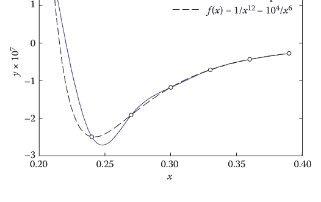

图 9.4 由于插值点不足，自然三次样条与所建模函数显著偏离的情况。插值数据采样函数 `f(x) = 1/x^12 − 10^4/x^6`。

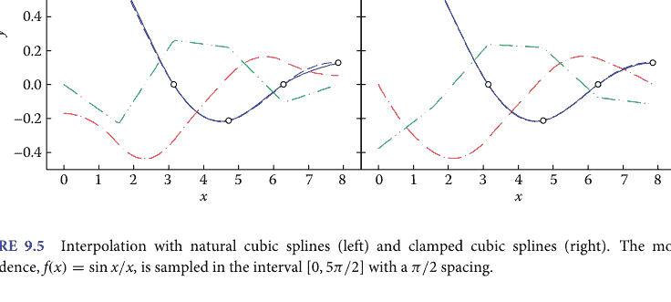

图 9.5 使用自然三次样条插值（左）和 clamped 三次样条插值（右）。所建模的依赖关系 `f(x) = sin x / x` 在区间 `[0, 5π/2]` 内以 `π/2` 间距采样。

所建模函数的真实行为出现可见偏差。相比之下，`clamped` 边界条件明显改善了插值曲线与所建模依赖关系之间的匹配（参见图 9.5 的右面板）。

## 9.5 线性回归

在相当多的实际情况下，观测值的绘图或数据收集所基于的理论框架表明，所建模函数对自变量的线性函数依赖性（参见图 9.6）：

`F(x; a, b) = a x + b.` (9.40)


图 9.6 基于最小二乘近似的线性回归。模型函数参数 `a` 表示回归线的斜率，而 `b` 是相应的 y 截距。

线性回归实际上代表了将模型函数拟合到表格化依赖关系的最一般概念中关于最小二乘拟合的最简单应用，该概念已在第 9.1 节中介绍。

假设与观测值 `y_i` 相关的不确定度 `σ_i` 可用，则可通过 `χ²` 优值函数（方程 9.8）来量化拟合到观测数据的模型函数 `F(x; a, b)` 的质量，在本例中其形式为：

`χ²(a, b) = Σ_{i=1}^{n} 1/σ_i² (y_i - a x_i - b)².` (9.41)

使 `χ²` 最小的最优模型参数 `a` 和 `b` 由 `χ²` 对 `a` 和 `b` 的偏导数消失的条件得出：

`∂χ²/∂a ≡ -2 Σ_{i=1}^{n} 1/σ_i² (y_i - a x_i - b) x_i = 0,`

`∂χ²/∂b ≡ -2 Σ_{i=1}^{n} 1/σ_i² (y_i - a x_i - b) = 0.` (9.42)

引入涉及和的记号

`s = Σ_{i=1}^{n} 1/σ_i²,  s_x = Σ_{i=1}^{n} x_i/σ_i²,  s_xx = Σ_{i=1}^{n} x_i²/σ_i²,  s_y = Σ_{i=1}^{n} y_i/σ_i²,  s_xy = Σ_{i=1}^{n} x_i y_i/σ_i²,` (9.43)

可得到简化系统：

```
{ s_xx a + s_x b = s_xy
  s_x a + s b = s_y. } (9.44)
```

引入附加记号

`Δ = s s_xx - s_x²,` (9.45)

系统解给出优化模型参数的值：

`a = (s s_xy - s_x s_y)/Δ,  b = (s_y s_xx - s_x s_xy)/Δ.` (9.46)

为评估与最优模型参数（9.46）相关的可能不精确度，可应用方差的一般定义（9.11）：

```
σ_a² = Σ_{i=1}^n σ_i² (∂a/∂y_i)²,   σ_b² = Σ_{i=1}^n σ_i² (∂b/∂y_i)².
```

利用参数（9.46）的具体表达式，可得到导数：

```
∂a/∂y_i = (s x_i - s_x)/(σ_i² Δ),   ∂b/∂y_i = (s_xx - s_x x_i)/(σ_i² Δ).
```

对所有数据点求和，例如参数 `a` 的方差为：

```
σ_a² = Σ_{i=1}^n [s² x_i² - 2s x_i s_x + s_x²]/[σ_i² Δ²] = [s² s_xx - 2s s_x² + s s_x²]/Δ² = [s(s s_xx - s_x²)]/Δ² = s/Δ.
```

以同样的方式处理参数 `b`，最终得到两个模型参数可能不精确度的可用表达式：

`σ_a = √(s/Δ),   σ_b = √(s_xx/Δ).` (9.47)

所发展的线性回归形式主义也可应用于允许解析逆的非线性函数依赖关系的情况。例如，指数模型

```
y = b e^{a x}
```

可通过取对数并命名 `y' = ln y` 和 `b' = ln b` 明显线性化：

`y' = a x + b'.`

对线性化模型参数 `a` 和 `b'` 的调整应针对变换后的观测值 `y'_i = ln y_i` 进行，而初始非线性模型的优化参数 `b` 最终结果为 `b = exp(b')`。

基于通过数组 `x` 和 `y` 得到的 `n` 个观测坐标对以及相关的标准偏差 `sigmy`，Listing 9.8 中显示的例程 `LinFit` 返回线性模型的调整参数 `a` 和 `b`，以及相关的可能不精确度 `sigma` 和 `sigm b`。作为拟合质量的综合度量，例程还通过 `chi2` 返回使用优化模型参数计算的 `χ²` 优值函数的值。

如果控制参数 `iopt` 设为 0，例程将所有 `sigmy` 的分量初始化为 1，过程退化为基于简单平方偏差和作为优值函数的最小二乘近似：

`S = Σ_{i=1}^n (y_i - a x_i - b)².` (9.48)

## Listing 9.8 线性回归 (Python 编码)

```python
# =================================================================================
def LinFit(x, y, sigmy, n, iopt):
# ---------------------------------------------------------------------------------
# Determines the coefficients a and b of a linear model P(x;a,b) = a * x + b
# and the associated uncertainties, sigma and sigmb, for a set of observed
# data points by "Chi-square" regression
# x[]      - x-coordinates of observed data, i = 1,..,n
# y[]      - y-coordinates of observed data
# sigmy[]  - standard deviations of observed data
# n        - number of observed data points
# iopt     - iopt == 0 - initializes sigmy[i] = 1 (equal weights)
#            iopt != 0 - uses the received values of sigmy[i]
# a, b     - parameters of the linear model (output)
# sigma    - uncertainties associated with the model parameters (output)
# sigmb    - value of Chi-square merit function for the output parameters
# ---------------------------------------------------------------------------------
    if (iopt == 0):
        for i in range(1,n+1): sigmy[i] = 1e0        # iopt = 0: equal weights

    s = sx = sy = sxx = sxy = 0e0                        # prepare sums
    for i in range(1,n+1):
        f = 1e0/(sigmy[i]*sigmy[i])
        s += f
        sx += x[i] * f; sxx += x[i] * x[i] * f
        sy += y[i] * f; sxy += x[i] * y[i] * f

    f = 1e0/(s*sxx - sx*sx)
    a = (s *sxy - sx*sy ) * f; sigma = sqrt(s*f)        # model parameters
    b = (sy*sxx - sx*sxy) * f; sigmb = sqrt(sxx*f)      # and uncertainties

    chi2 = 0e0                                          # value of Chi-square function
    for i in range(1,n+1):
        f = (y[i] - a*x[i] - b)/sigmy[i]
        chi2 += f*f

    return (a, b, sigma, sigmb, chi2)
```

该选项通常在观测数据的标准偏差 `σi` 未知的情况下很有用。无论如何，应该注意，两种优值函数 `χ²` 和 `S` 的比较使用可能导致相当不同的回归线。

图 9.7 所示的示例中，优值函数 `S` 未使用观测误差 `σi` 并为所有观测数据分配相等权重，得出的回归线不通过所有误差条。相比之下，通过应用 `χ²` 回归并出于简化考虑，假设误差 `σi` 与观测值 `yi` 成比例（一种相当典型的情况），第一个数据点具有最低的不精确度，迫使回归线也通过其误差条。

具体而言，表格化数据点的坐标为 `(1,0.8)`、`(2,2.1)`、`(3,2.8)`、`(4,4.0)` 和 `(5,4.4)`，相应的标准偏差简单地生成为 `σi = 0.15 yi`。使用函数 `S` 得到模型参数 `a = 0.9100` 和 `b = 0.0900`，而对于 `χ²` 优值函数，得到的值为 `a = 0.9983` 和 `b = −0.1681`。


图 9.7 线性回归示例，展示了基于 `χ²` 优值函数拟合质量相对于简单平方偏差和 `S` 的定性改善。

## 9.6 多线性回归模型

作为上一节介绍的线性回归的推广，下面我们考虑多线性回归，其重要特例是多项式回归。

多线性回归中的任务是拟合由 `x` 的任意函数的线性组合表示的模型，

`F(x; a) = Σ_{j=1}^{m} a_j F_j(x),` (9.49)

到一组 `n` 个观测数据点，`(x_i, y_i)`。该方法的线性性质仅指 `m` 个参数 `a_j` 进入模型的方式。至于基函数 `F_j(x)`，它们具有固定的形式，不依赖于模型参数，并且相对于 `x` 可以是任意非线性的。

最常用的基集是整数幂族，`1, x, x^2, …, x^{m-1}`，多项式回归基于此，以及构成傅里叶级数的三角函数 `sin kx` 和 `cos kx`。作为多项式回归的特例，线性回归仅涉及基函数 1 和 `x`。

多线性回归的 `χ^2` 优值函数形式为

`χ^2(a) = Σ_{i=1}^{n} 1/σ_i^2 [ y_i - Σ_{j=1}^{m} a_j F_j(x_i) ]^2,` (9.50)

其中 `σ_i` 如前所述，表示与观测值 `y_i` 相关的观测误差（标准差）。该形式主义在误差未知的情况下也适用，只需将所有 `σ_i` 设为相等，例如 `σ_i = 1`。

最优模型参数使 `χ^2` 优值函数最小化，或等价地使其偏导数为零：

`∂χ^2/∂a_k ≡ -2 Σ_{i=1}^{n} 1/σ_i^2 [ y_i - Σ_{j=1}^{m} a_j F_j(x_i) ] F_k(x_i) = 0,  k = 1,2,…,m.` (9.51)

改变求和顺序并重新排列项，可得到多线性拟合问题的所谓正规方程组，即

`Σ_{j=1}^{m} c_{kj} a_j = b_k,  k = 1,2,...,m,` (9.52)

其解即为所求的最优模型参数。系统矩阵 `C = [c_{kj}]_{mm}` 和常数项向量 `b = [b_k]_m` 定义为

`c_{kj} = Σ_{i=1}^{n} 1/σ_i^2 F_k(x_i) F_j(x_i),` (9.53)

`b_k = Σ_{i=1}^{n} y_i/σ_i^2 F_k(x_i).` (9.54)

与优化参数相关的平方不确定度（方差）的估计可通过应用一般公式得到

`σ_{a_j}^2 = Σ_{i=1}^{n} σ_i^2 (∂a_j/∂y_i)^2 .` (9.55)

为计算所涉及的导数，我们形式上从正规方程组 (9.52) 中表达参数 `a_j`，

`a_j = Σ_{k=1}^{m} c'_{jk} b_k = Σ_{k=1}^{m} c'_{jk} Σ_{i=1}^{n} y_i/σ_i^2 F_k(x_i),`

其中 `c'_{jk}` 是逆系统矩阵的元，`C^{-1} = [c'_{jk}]_{mm}`。因此参数的导数为

`∂a_j/∂y_i = Σ_{k=1}^{m} c'_{jk} 1/σ_i^2 F_k(x_i)`

并将它们代入方差公式 9.55，改变求和顺序，并考虑矩阵元 `c_{kj}` 的定义 (9.53)，可依次得到


进入`/path/to/xxx`目录，找到`xxx.json`。

在表达式`cvar = avar + bvar`中，加法运算符（`+`）将`avar`与`bvar`相加，得到它们的和`cvar`

在`List.of(arg0, arg1, arg2)`中，`List`接口的工厂方法`of()`接受一系列的元素，返回包含它们的只读列表。

之后我们这样调用`cmd`命令：`cmd arg0 arg1 arg2`。

```
if (condVar > someVal) {console.log("xxx")}
```

```
σ_{a_j}^2 = ∑_{k,l=1}^{m} c'_{jk} c'_{jl} ∑_{i=1}^{n} 1/σ_i^2 F_k(x_i) F_l(x_i) = ∑_{k,l=1}^{m} c'_{jk} c'_{jl} c_{kl} = ∑_{l=1}^{m} c'_{jl} δ_{jl}.
```

这里我们还使用了恒等式 ∑_{k=1}^{m} c'_{jk} c_{kl} = δ_{jl}，其中 δ_{jl} 是克罗内克 delta。因此，优化参数 a_j 的平方不确定度为

```
σ_{a_j}^2 = c'_{jj},   (9.56)
```

即为正规方程组系统矩阵逆 C^{-1} 的对应对角元 c'_{jj}。更广义地，c'_{jk} 表示参数对 (a_j, a_k) 相关的协方差 (Press et al. 2007)。

对多线性回归问题描述的正规方程方法的实现见列表 9.9。函数 `MultiFit` 接收观测数据点在数组 `x` 和 `y` 中的 n 个坐标，以及 y 坐标的标准差在数组 `sigmy` 中。模型参数的数量由参数 `npar` 指定。如果控制参数 `iopt` 设为 0，则数组 `sigmy` 的所有分量在内部初始化为 1，近似退化为基于优值函数

$$S = \sum_{i=1}^{n} \left[ y_i - \sum_{j=1}^{m} a_j F_j(x_i) \right]^2.$$

的最小二乘回归。

函数 `MultiFit` 在数组 `a` 和 `sigma` 中分别返回调整后的模型参数及其相关不确定度。作为拟合质量的综合指标，例程还通过 `chi2` 返回用最优参数计算的 χ² 优值函数值。

构成模型的基函数 F_j(x) 必须由单独的用户函数求值，该函数在 `MultiFit` 内部以通用名称 `Func` 识别，其实际名称通过参数列表传递。对于给定的自变量 x，用户函数在数组 `func` 的分量中返回 `npar` 个基函数的值。

原则上，正规方程组 (9.52) 可由任何通用方法求解。然而，由于评估参数不确定度时也需要系统矩阵的逆，最方便的方法是第 7 章讨论的 Gauss–Jordan 方法，它能够同时求解系统并就地求逆系统矩阵。开发的例程 `GaussJordan` 求解矩阵方程 A·X = B，其中 A 是方阵 (n × n)，而 B 和 X 是 (n × m) 矩阵，退出时用解 X 替换常数项 B，并用其逆 A⁻¹ 替换系统矩阵 A。通过从例程 `MultiFit` 对 `GaussJordan` 的特定调用，初始包含拟合矩阵的数组 `c` 返回其逆（协方差矩阵），而常数项数组 `b` 被系统解（模型参数）替换。作为技术细节，尽管在当前情况下矩阵方程简化为仅具有常数项向量的普通线性系统 (m = 1)，但出于与 `GaussJordan` 参数兼容的原因，`b` 必须声明为二维数组，具有 `npar` 行和单列。

图 9.8 通过一个简单示例说明了多线性回归方法，其中“观测”数据点（用圆圈表示）通过对函数 f(x) = sin x + cos x


图 9.8 利用例程 `MultiFit` 执行的多线性回归。观测数据取自函数 f(x) = sin x + cos x。

### 列表 9.9 多线性回归 (Python 编码)

```python
#==============================================================================

def MultiFit(x, y, sigmy, n, iopt, a, sigma, npar, Func):

#------------------------------------------------------------------------------

# Determines the coefficients a[i], i=1,...,npar of a multilinear model

#     F(x;a) = a[1] * func[1](x) + ... + a[npar] * func[npar](x)

# and the associated uncertainties, sigma[i], for a set of observed data

# points by "Chi-square" regression

# x[]     - x-coordinates of observed data, i = 1,...,n

# y[]     - y-coordinates of observed data

# sigmy[]  - standard deviations of observed data

# n       - number of observed data points

# iopt    - iopt == 0 - initializes sigmy[i] = 1 (equal weights)

#           iopt != 0 - uses the received values of sigmy[i]

# a[]     - parameters of the multilinear model (output)

# sigma[] - uncertainties associated with the model parameters (output)

# npar    - number of model parameters

# chi2    - value of Chi-square merit function for the output parameters

# Func()  - user function returning for a given argument x the values of the

#           basis functions func[i](x):

#               Func(x, func, npar)

# Calls: GaussJordan (linsys.py)

#==============================================================================

    c = [[0]*(n+1) for i in range(n+1)]

    b = [0]*2 for i in range(n+1)]

    func = [0]*(npar+1)

    if (iopt == 0):

        for i in range(1,n+1): sigmy[i] = 1e0       # iopt = 0: equal weights

    for i in range(1,npar+1):                                      # initialization

        for j in range(1,npar+1): c[i][j] = 0e0

        b[i][1] = 0e0

    for i in range(1,n+1):                              # generate the system matrices

        yi = y[i]

        Func(x[i],func,npar)                            # evaluate the basis functions

        f = 1e0/(sigmy[i]*sigmy[i])

        for j in range(1,npar+1):

            fj = f * func[j]

            for k in range(1,npar+1): c[j][k] += fj * func[k]

            b[j][1] += fj * yi

    det = GaussJordan(c,b,npar,1)                                  # solve the system

    for i in range(1,npar+1):

        a[i] = b[i][1]                                             # model parameters

        sigma[i] = sqrt(c[i][i])                          # parameter uncertainties

    chi2 = 0e0                                           # value of Chi-square function

    for i in range(1,n+1):

        Func(x[i],func,npar)                              # evaluate the model function

        f = 0e0

        for j in range(1,npar+1): f += a[j]*func[j]

        f = (y[i] - f)/sigmy[i]

        chi2 += f*f

    return chi2
```

采样得到。

对于精心选取的自变量 0、π/2、π、3π/2 和 π。在清单 9.10 的示例程序中，模型函数被选为具有两个可调参数：

F(x; a₁, a₂) = a₁ sin x + a₂ cos x，

基函数 F₁(x) = sin x 和 F₂(x) = cos x 的计算由用户函数 `Func` 执行。`MultiFit` 返回的调整后模型参数为 a₁ = 0.999929 和 a₂ = 1.000212，优值函数 χ² = 0.000000。值得注意的是，模型函数的拟合过程在舍入误差范围内恢复了提供“观测”数据的原始函数 f(x) 的系数。

将模型函数推广为包含更多基函数（1、sin x、cos x、sin 2x、cos 2x 等），原则上可以使用 `MultiFit` 例程从表格化的函数关系中提取傅里叶级数系数（见问题 9.9）。

在多项式回归的特殊情况下，具有 m 个可调参数的模型函数是 (m − 1) 次多项式：

F(x; a) = Σ_{j=1}^{m} a_j x^{j-1}. (9.57)

## 清单 9.10 多元线性回归的应用（Python 代码）

```
# Multilinear fit
from math import *
from modfunc import *

def Func(x, func, npar):
    func[1] = sin(x)      # returns the basis functions sin(x) and cos(x)
    func[2] = cos(x)

#### main

n = 5                                   # number of observed data
npar = 2                                # number of model parameters

x     = [0]*(n+1)                      # x-coordinates of observed data
y     = [0]*(n+1)                      # y-coordinates of observed data
sigmy = [0]*(n+1)                      # standard deviations of observed data
func  = [0]*(npar+1)                   # values of basis functions
a     = [0]*(npar+1)                    # model parameters
sigma = [0]*(npar+1)                   # uncertainties of parameters

x[1] = 0e000; y[1] = 1e000              # observed data generated from:
x[2] = 0.785; y[2] = 1.414              # f(x) = sin(x) + cos(x)
x[3] = 1.571; y[3] = 1e000
x[4] = 2.356; y[4] = 0e000
x[5] = 3.141; y[5] = -1e000

iOpt = 0                               # least squares fit: equal errors sigmy
chi2 = MultiFit(x,y,sigmy,n,iOpt,a,sigma,npar,Func)

print("Multilinear fit:")
for i in range(1,npar+1):
    print("[a{0:d}] = {1:8.4f} +/- {2:8.4f}".format(i,a[i],sqrt(sigma[i])))
print("Chi^2 = {0:8.4f}".format(chi2))
```

## 清单 9.11 多项式回归（Python 代码）


```python
#===============================================================================
def PolFit(x, y, sigmy, n, iopt, a, sigma, npar):
#-------------------------------------------------------------------------------
# Determines the coefficients a[i], i=1,...,npar of a polynomial model
#     F(x;a) = a[1] * x^(npar-1) + a[2] * x^(npar-2) + ... + a[npar]
# and the associated uncertainties, sigma[i], for a set of observed data
# points by "Chi-square" regression
# x[]      - x-coordinates of observed data, i = 1,..,n
# y[]      - y-coordinates of observed data
# sigmy[]  - standard deviations of observed data
# n        - number of observed data points
# iopt     - iopt == 0 - initializes sigmy[i] = 1 (equal weights)
#            - iopt != 0 - uses the received values of sigmy[i]
# a[]      - parameters of the polynomial model (output)
# sigma[]  - uncertainties associated with the model parameters (output)
# npar     - number of model parameters (polynomial order + 1)
# chi2     - value of Chi-square merit function for the output parameters
# Calls: GaussJordan (linsys.py)
#-------------------------------------------------------------------------------

c = [[0]*(n+1) for i in range(n+1)]
b = [[0]*2 for i in range(n+1)]
func = [0]*(npar+1)

if (iopt == 0):
    for i in range(1,n+1): sigmy[i] = 1e0        # iopt = 0: equal weights

for i in range(1,npar+1):                       # initialization
    for j in range(1,npar+1): c[i][j] = 0e0
    b[i][1] = 0e0

for i in range(1,n+1):                          # generate the system matrices
    xi = x[i]; yi = y[i]
    func[npar] = 1e0                            # basis functions 1, x, x^2,...
    for j in range(npar-1,0,-1): func[j] = xi * func[j+1]
    f = 1e0/(sigmy[i]*sigmy[i])
    for j in range(1,npar+1):
        fj = f * func[j]
        for k in range(1,npar+1): c[j][k] += fj * func[k]
        b[j][1] += fj * yi

det = GaussJordan(c,b,npar,1)                   # solution: corrections da

for i in range(1,npar+1):
    a[i] = b[i][1]                              # model parameters
    sigma[i] = sqrt(c[i][i])                    # parameter uncertainties

chi2 = 0e0                                      # value of Chi-square function
for i in range(1,n+1):
    xi = x[i]                                   # evaluate the model function
    f = a[1]
    for j in range(2,npar+1): f = f*xi + a[j]
    f = (y[i] - f)/sigmy[i]
    chi2 += f*f

return chi2
```

相应的用户函数可以利用连续基函数 `1`、`x`、`x²`、`...` 之间的简单递推关系，以最有效的方式进行编码：

```python
def Func(x, func, npar):  # returns basis functions 1, x, x^2,...,x^(npar-1)
    func[npar] = 1e0                 # basis functions 1, x, x^2,...
    for i in range(npar-1,0,-1): func[i] = x * func[i+1]
```

实现多项式回归的另一种选择是像清单 `9.11` 那样重写 `MultiFit` 例程，以便就地计算基函数并且不调用任何用户函数。`PolFit` 例程对于从表格化的函数关系中提取幂级数系数等应用非常有用。

## 9.7 非线性回归：莱文伯格–马夸特方法

最小二乘法原则上可以用于将任意模型函数拟合到观测数据点，但通常需要求解非线性方程组以确定最优模型参数。这种方法在这种情况下称为非线性回归，相应的算法通常具有相当高的复杂度。与多元线性回归（模型参数通过求解线性方程组一步确定）不同，非线性回归从初始猜测开始，通过迭代来改进模型参数。

优值函数被认为具有一般形式：

`χ²(a) = Σ_{i=1}^n 1/σ_i² [y_i - F(x_i; a)]².`  `(9.58)`

为了表征 `χ²` 的最小值，考虑其关于参数值的级数展开是有用的：

`χ²(a + δa) = χ²(a) + Σ_{j=1}^m ∂χ²/∂a_j δa_j + 1/2 Σ_{j,l=1}^m ∂²χ²/∂a_j∂a_l δa_j δa_l + ⋯,`  `(9.59)`

其中 `δa` 是参数修正向量。优值函数在使其梯度为零的修正集合 `δa` 处出现极值，或者等价地，使其关于所有参数的偏导数为零：

`∂χ²/∂a_k |_{a+δa} = 0,  k = 1,2,...,m.`  `(9.60)`

修正参数下的 `χ²` 导数由展开式 `9.59` 得出，

`∂χ²/∂a_k |_{a+δa} = Σ_{j=1}^m ∂χ²/∂a_j δ_{jk} + 1/2 Σ_{j,l=1}^m ∂²χ²/∂a_j∂a_l (δ_{kj}δa_l + δa_jδ_{kl}) + ⋯`

`= ∂χ²/∂a_k + Σ_{j=1}^m ∂²χ²/∂a_k∂a_j δa_j + ⋯`  `(9.61)`

上述表达式中参考参数的一阶导数可以从优值函数的定义 `(9.58)` 推导得出：

$$\frac{\partial \chi^2}{\partial a_k}=-2\sum_{i=1}^{n}\frac{1}{\sigma_i^2}\left[y_i-F(x_i;\mathbf{a})\right]\frac{\partial F(x_i;\mathbf{a})}{\partial a_k}. \tag{9.62}$$

类似地，对于构成优值函数所谓*海森矩阵*的混合二阶导数，可以得到：

$$\frac{\partial^2\chi^2}{\partial a_k\partial a_j}=2\sum_{i=1}^{n}\frac{1}{\sigma_i^2}\left\{\frac{\partial F(x_i;\mathbf{a})}{\partial a_k}\frac{\partial F(x_i;\mathbf{a})}{\partial a_j}-\left[y_i-F(x_i;\mathbf{a})\right]\frac{\partial^2F(x_i;\mathbf{a})}{\partial a_k\partial a_j}\right\}$$

$$\approx 2\sum_{i=1}^{n}\frac{1}{\sigma_i^2}\frac{\partial F(x_i;\mathbf{a})}{\partial a_k}\frac{\partial F(x_i;\mathbf{a})}{\partial a_j}. \tag{9.63}$$

在 `χ²` 最小值附近，混合二阶导数 `∂²F(x_i;𝐚)/∂a_k∂a_j` 与一阶导数相比可以忽略不计；此外，由于它们还乘以随机取号且随机分布的 `[y_i-F(x_i;𝐚)]`，这些项在求和时往往在统计上相互抵消。进一步地，对 `χ²` 的导数施加消失条件 `(9.60)`，并将其展开式 `9.61` 限制在线性近似，可以得到关于参数修正的以下线性方程组（Press 等，2007）：

$$\sum_{j=1}^{m}c_{kj}\delta a_j=b_k,\qquad k=1,2,\ldots,m. \tag{9.64}$$

其中矩阵元素定义为

$$c_{kj}\equiv\frac{1}{2}\frac{\partial\chi^2}{\partial a_k\partial a_j}=\sum_{i=1}^{n}\frac{1}{\sigma_i^2}\frac{\partial F(x_i;\mathbf{a})}{\partial a_k}\frac{\partial F(x_i;\mathbf{a})}{\partial a_j}, \tag{9.65}$$

$$b_k=-\frac{1}{2}\frac{\partial\chi^2}{\partial a_k}=\sum_{i=1}^{n}\frac{1}{\sigma_i^2}\left[y_i-F(x_i;\mathbf{a})\right]\frac{\partial F(x_i;\mathbf{a})}{\partial a_k}. \tag{9.66}$$

`c_{kj}` 等于海森矩阵元素的一半，矩阵 `C=[c_{kj}]` 称为*曲率矩阵*。

*远离 `χ²` 的最小值时*，*展开式 `9.59` 可能无法很好地局部近似* `χ²(𝐚+δ𝐚)`。在这种情况下，为了加速向最小值收敛的过程，可以只保留海森矩阵的对角元素，因此优值函数的梯度分量 `(9.61)` 变为

$$\left.\frac{\partial\chi^2}{\partial a_k}\right|_{\mathbf{a}+\delta\mathbf{a}}\approx\frac{\partial\chi^2}{\partial a_k}+\frac{\partial^2\chi^2}{\partial a_k^2}\delta a_k. \tag{9.67}$$

利用记号 `(9.65)` 和 `(9.66)`，`χ²` 导数消失的条件 `(9.60)` 导出了以下关于参数修正的简化方程：

$$c_{kk}\delta a_k=b_k,\qquad k=1,2,\ldots,m. \tag{9.68}$$

莱文伯格–马夸特方法（Marquardt (1963)）在实践中已成为非线性回归的标准方法。它提供了一种有效的策略，通过在远离最小值时适用的方程 `9.68` 之间平滑切换来确定模型参数的最优修正。

`χ²` 的最小值，以及在最小值附近适用的方程 `9.64`。技术上，通过引入无量纲尺度因子 `λ`，两个方程组取唯一形式：

`∑_{j=1}^{m} (1 + λ δ_{kj}) c_{kj} δa_j = b_k,   k = 1,2,…,m,   (9.69)`

其中 `δ_{kj}` 是克罗内克 delta。对于 `λ` 的大值，系统矩阵是按对角占优的，从而得到解耦的方程组 `(9.68)`，该方程组适用于远离最小值的情况。相反，对于 `λ` 的小值，系统取形式 `(9.64)`，并允许在最小值附近确定参数修正。

类似于多元线性回归，与调整后参数 `a_j` 相关联的方差（平方的可能不精确度）由曲率矩阵 `C` 的逆 `C^{-1}` 的对角元素 `c'_{jj}` 给出，即

`σ_{a_j}² = c'_{jj}.   (9.70)`

非对角元素 `c'_{jk}` 通常表示模型参数对 `(a_j, a_k)` 对应的协方差。

模型参数的修正必须从线性系统 `(9.69)` 迭代计算，系数由方程 `9.65` 和 `9.66` 指定，直到各个模型参数的最大相对变化下降到预定义容差 `ε` 以下：

`max_j |δa_j/(a_j + δa_j)| ≤ ε.   (9.71)`

如果存在消失的分量 `a_j + δa_j`，则更应采用绝对修正来表达该准则。将迭代进行到机器表示极限通常既不必要也不有用，因为 merit 函数的最小值最多只能提供参数 `a_j` 的统计估计。另一个与参数值准则互补的停止准则检查 merit 函数的收敛程度：

`|1 − χ²(a)/χ²(a + δa)| ≤ ε.   (9.72)`

综合来看，Levenberg–Marquardt 算法意味着迭代以下步骤（Press et al. 2007）：

- 1. 计算初始参数集的 merit 函数 `χ²(a)`。
- 2. 考虑一个相对较小初始值 `λ`，例如 `10⁻³`。
- 3. 根据方程 `9.65` 和 `9.66` 计算系数 `c_{kj}` 和 `b_k`，并求解线性系统 `(9.69)` 得到参数修正 `δa`。
- 4. 对修正后的参数评估 merit 函数 `χ²(a + δa)`。
- 5. 如果 `χ²(a + δa) ≥ χ²(a)`，将 `λ` 增加 `10` 倍并转到 `3`。
- 6. 如果 `χ²(a + δa) < χ²(a)`，将 `λ` 减小 `10` 倍并更新 `a + δa → a`。
- 7. 如果 `max_j |δa_j/a_j| > ε` 或 `|1 − χ²(a)/χ²(a + δa)| > ε` 转到 `3`。

在任何尝试高效实现 Levenberg–Marquardt 方法时，必须反复评估 `χ²`-merit 函数和线性化拟合矩阵 `C` 和 `b`，它们本身取决于模型函数的导数。为此，来自 Listing `9.12` 的例程 `Deriv` 调用用户定义的模型函数（使用局部别名 `Func`），通过向前有限差分计算其关于参数 `a_j` 的一阶导数 `∂F(x_i; a)/∂a_j`，并通过数组 `dFd a` 将其返回给调用函数 `Chi2`。后者根据关系 `9.65` 和 `9.66` 从模型函数导数构建拟合矩阵 `C` 和 `b`，并将它们连同 `χ²`-merit 函数一起返回给调用例程 `MarqFit`（Listing `9.13`）。

## Listing 9.12 Auxiliary Functions for the Levenberg–Marquardt Method (Python Coding)


``` 
# =================================================================================
def Deriv(x, a, dFda, npar, Func):
# --------------------------------------------------------------------------------
# Evaluates the derivatives of model function Func(x,a,npar) at point x with
# respect to parameters a[j], j=1,..,npar and returns them in dFda[j]
# --------------------------------------------------------------------------------
    h0 = 1e-4                                    # scale factor for the derivation step
    F0 = Func(x,a,npar)                         # function value for original parameters
    for j in range(1,npar+1):
        h = h0 * fabs(a[j]) if (a[j]) else h0    # derivation step
        temp = a[j]                             # save parameter
        a[j] += h                               # increment parameter
        dFda[j] = (Func(x,a,npar) - F0)/h       # derivative
        a[j] = temp                             # restore parameter

# =================================================================================
def Chi2(x, y, sigmy, n, a, b, c, npar, Func):
# --------------------------------------------------------------------------------
# Evaluates the Chi2 merit function and the fitting matrices c and b for the
# model function Func(x,a,npar) and the Levenberg-Marquardt algorithm
# Calls: Deriv
# --------------------------------------------------------------------------------
    dFda = [0]*(npar+1)                         # model function derivatives
    for k in range(1,npar+1):                   # initialization
        for j in range(1,npar+1): c[k][j] = 0e0
        b[k] = 0e0
    chi2 = 0e0
    for i in range(1,n+1):
        dy = y[i] - Func(x[i],a,npar)           # deviation of model from data
        fsig = 1e0/(sigmy[i]*sigmy[i])
        chi2 += fsig * dy * dy
        Deriv(x[i],a,dFda,npar,Func)            # derivatives with respect to parameters
        for k in range(1,npar+1):               # build fitting matrices
            fact = fsig * dFda[k]
            for j in range(1,npar+1): c[k][j] += fact * dFda[j]
            b[k] += fact * dy
    return chi2
```

即使比第 9.6 节中介绍的函数 `MultiFit` 更复杂，非线性拟合例程 `MarqFit`（Listing 9.13）也是基于相同的约定和符号。特别是，形式参数具有相同的意义。具体来说，`MarqFit` 在数组 `x`、`y` 和 `sigmy` 中接收 `n` 个观测数据点的坐标和相关标准差。在数据不确定性未知的情况下，通过将输入参数 `iopt` 设置为 0，例程 `MarqFit` 被指示将 `sigmy` 的所有分量初始化为 1。

`MarqFit` 在数组 `a` 中返回 `npar` 个最优模型参数，并在数组 `sigma` 中返回相关可能的 imprecisions。作为拟合的综合质量指标，参数 `chi2` 返回对应于调整后参数的 χ²-merit 函数。

## Listing 9.13 Routine for Nonlinear Fit Based on the Levenberg–Marquardt Method (Python Coding)

``` 
#=============================================================================
def MarcFit(x, y, sigmy, n, iopt, a, sigma, npar, Func):
#-----------------------------------------------------------------------------
# Minimizes the "Chi-square" merit function by the Levenberg-Marquardt
# method, determining the coefficients a[i], i=1,..,npar of a non-linear
# model F(x,a,npar) and the associated uncertainties, sigma[i], for a set of
# observed data points
# x[]       - x-coordinates of the observed data, i=1,..,n
# y[]       - y-coordinates of the observed data
# sigmy[]   - standard deviations of the observed data
# n         - number of observed data points
# iopt      - iopt = 0 - initializes sigmy[i] = 1 (equal weights)
#           - iopt != 0 - uses the received values of sigmy[i]
# a[]       - parameters of the non-linear model (output)
# sigma[]   - uncertainties of the model parameters (output)
# npar      - number of model parameters
# chi2      - value of Chi-square merit function for the output parameters
# Func()    - user function returning for a given argument x the values of the
#             basis functions func[i](x):
#             Func(f, x, n)
# Calls: GaussJordan (linsys.py)
#-----------------------------------------------------------------------------
    eps = 1e-4                                      # relative precision criterion
    itmax = 1000                                    # max. no. of iterations

    c   = [[0]*(n+1) for i in range(n+1)]
    c0  = [[0]*(n+1) for i in range(n+1)]
    cov = [[0]*(n+1) for i in range(n+1)]
    da  = [[0]*2 for i in range(n+1)]
    a1  = [0]*(n+1); b = [0]*(n+1); b0 = [0]*(n+1)
    func = [0]*(npar+1)

    if (iopt == 0):
        for i in range(1,n+1): sigmy[i] = 1e0       # iopt = 0: equal weights

    lam = 1e-3                                      # initial guess for lambda
    chi2 = Chi2(x,y,sigmy,n,a,b,c,npar,Func)

    it = 0
    while (it < itmax):                             # loop of parameter approximations
        chi20 = chi2
        for k in range(1,npar+1):                   # store fitting matrices c0 and b0
            for j in range(1,npar+1): c0[k][j] = c[k][j]
            b0[k] = b[k]

        while (it < itmax):                         # loop of lambda increase
            it += 1
            for k in range(1,npar+1):               # covariance matrix
                for j in range(1,npar+1): cov[k][j] = c0[k][j]
                cov[k][k] *= (1e0 + lam)            # scale diagonal
                da[k][1] = b0[k]

            det = GaussJordan(cov,da,npar,1)        # solution: corrections da
            for j in range(1,npar+1): a1[j] = a[j] + da[j][1]   # trial params
            chi2 = Chi2(x,y,sigmy,n,a1,b,c,npar,Func)            # new linearized c and b
            if (chi2 <= chi20): break              # stop increasing lambda
            lam *= 10e0                             # increase lambda
```


## FIGURE 9.9 Example of nonlinear regression using the routine `LevMarqFit`.

parameters. The following tabular data represent (`x`, `y`) coordinates resulting by sampling the function `f(x) = exp(-2x^2)`, along with the associated standard deviations σi. Aiming to introduce deviations, the function values are truncated to a single significant digit, considering as standard deviations 10% of the ordinates, but not less than 0.02.

The model function coded in the program is the general Gaussian:

``` 
F(x; a1, a2, a3) = a1 exp [-(x - a2)^2 / a3].
```

## Listing 9.16 File `fit.txt`: Output from Program 9.14

``` 
n = 11   npar = 3
Initial parameters:
a[1] =  0.500
a[2] =  0.500
a[3] =  1.000

Final parameters:
a[1] =  0.974   sigma[1] = 4.3e-007
a[2] = -0.000   sigma[2] = 1.9e-007
a[3] =  0.531   sigma[3] = 2.5e-007

Chi^2 = 5.2e-001

i       x          y       sigma      yfit      y-yfit
1  -2.00000   0.00030   0.02000   0.00052  -2.2e-004
2  -1.60000   0.00600   0.02000   0.00785  -1.8e-003
3  -1.20000   0.06000   0.02000   0.06470  -4.7e-003
4  -0.80000   0.30000   0.03000   0.29191   8.1e-003
5  -0.40000   0.70000   0.07000   0.72090  -2.1e-002
6   0.00000   1.00000   0.10000   0.97442   2.6e-002
7   0.40000   0.70000   0.07000   0.72090  -2.1e-002
8   0.80000   0.30000   0.03000   0.29191   8.1e-003
9   1.20000   0.06000   0.02000   0.06470  -4.7e-003
10  1.60000   0.00600   0.02000   0.00785  -1.8e-003
11  2.00000   0.00030   0.02000   0.00052  -2.2e-004
```

The results produced by Program 9.14 are plotted in Figure 9.9 and compose the file `fit.txt` (see Listing 9.16). The nonlinear fit yields as optimal model parameter 0.974, 0.000, and 0.531, which are close, however, not identical with the original parameters, 1.0, 0.0, and 0.5, of the function `f(x)` from which the “observed” data points are sampled. The differences are obviously caused by the intentional truncation of the exact function values in the input data set. The last two columns of the printed output list the model function and the corresponding deviations from the tabulated input data.

## 9.8 Implementations in C/C++

Listing 9.17 shows the content of the file `modfunc.h`, which contains equivalent C/C++ implementations of the Python functions developed in the main text and included in the module `modfunc.py`. The corresponding routines have identical names, parameters, and functionalities.


### Listing 9.17 Routines for Modeling Tabulated Dependences (`modfunc.h`)

```c
//----------------------------- modfunc.h --------------------------------
// Routines for modeling tabular dependences by interpolation/regression.
// Part of the numxlib numerics library. Author: Titus Beu, 2013
//--------------------------------------------------------------------------------

#ifndef _MODFUNC_
#define _MODFUNC_

#include <stdio.h>
#include <math.h>
#include "memalloc.h"
#include "linsys.h"

//================================================================================
double Lagrange(double x[], double y[], int n, double xi)
//--------------------------------------------------------------------------------
// Evaluates the Lagrange interpolating polynomial of n data points at xi
// x[] - x-coordinates of data points
// y[] - y-coordinates of data points
// n   - number of data points
// xi  - interpolation argument
//--------------------------------------------------------------------------------
{
    double p, yi;
    int i, j;

    yi = 0e0;
    for (i=1; i<=n; i++) {
        p = 1e0;
        for (j=1; j<=n; j++)
            if (j != i) p *= (xi - x[j])/(x[i] - x[j]);
        yi += p * y[i];
    }
    return yi;
}

//================================================================================
void Lagrange1(double x[], double y[], int n,
               double xi[], double yi[], int ni)
//--------------------------------------------------------------------------------
// Evaluates the Lagrange interpolating polynomial of n data points on a mesh
// of ni interpolation points
// x[]  - x-coordinates of data points
// y[]  - y-coordinates of data points
// n    - number of data points
// xi[] - interpolation arguments
// yi[] - interpolant values (output)
// ni   - number of interpolation points
// -------------------------------------------------------------------------
{
    double p, xk, yk, *yf;
    int i, j, k;

    yf = Vector(1,n);                         // factors of the interpolant

    for (i=1; i<=n; i++) {      // prepare invariant factors of the interpolant
        p = 1e0;
        for (j=1; j<=n; j++)
            if (j != i) p *= (x[i] - x[j]);
        yf[i] = y[i] / p;
    }

    for (k=1; k<=ni; k++) {                     // loop over the interpolation points
        xk = xi[k]; yk = 0e0;
        for (i=1; i<=n; i++) {
            p = 1e0;
            for (j=1; j<=n; j++)
                if (j != i) p *= (xk - x[j]);
            yk += p * yf[i];
        }
        yi[k] = yk;
    }
    FreeVector(yf,1);
}

//==========================================================================
double Neville(double x[], double y[], int n, double xi, double &err)
// -------------------------------------------------------------------------
// Evaluates the Lagrange interpolating polynomial of n data points at xi by
// Neville's method and returns an estimate of the absolute error
// x[]  - x-coordinates of data points
// y[]  - y-coordinates of data points
// n    - number of data points
// xi   - interpolation argument
// err  - estimate of the absolute error (output)
// -------------------------------------------------------------------------
{
    double *p, yi;
    int i, m;

    p = Vector(1,n);                          // values of successive interpolants

    for (i=1; i<=n; i++) p[i] = y[i];          // initialize with 0-order polynomial

    for (m=1; m<=n-1; m++)                     // loop over columns of scheme array
        for (i=1; i<=n-m; i++)                 // increase polynomial order
            p[i] = ((xi-x[m+i])*p[i] + (x[i]-xi)*p[i+1]) / (x[i]-x[m+i]);

    yi = p[1];                                 // polynomial value
    err = fabs(p[1] - p[2]);                   // error estimate

    FreeVector(p,1);
}

return yi;
}

//================================================================================
void Spline(double x[], double y[], int n, double d1, double dn, int iopt,
            double a[], double b[], double c[], double d[],
            double xi[], double yi[], int ni)
//--------------------------------------------------------------------------------
// Calculates the coefficients of the cubic splines for n data points and
// returns interpolated values on a mesh of ni points
// x[]      - x-coordinates of data points
// y[]      - y-coordinates of data points
// n        - number of data points
// d1, dn   - 1st derivatives at the endpoints x[1] and x[n]
// iopt     - iopt == 0, natural splines: 2nd derivative = 0 at x[1] and x[n]
//            iopt == 1, clamped splines: uses the provided d1 and dn
// a[], b[], c[], d[], i=1..n
//           - coefficients of cubic splines i=1..n-1 (output)
// xi[]     - interpolation arguments
// yi[]     - interpolant values (output)
// ni       - number of interpolation points
// Calls: TriDiagSys (linsys.h)
//--------------------------------------------------------------------------------
{
    double di, dm, hi, hm, xx, xp;
    int i, ip;

    if (iopt == 0) d1 = dn = 0e0;               // initialization for natural splines

    hi = 0e0; di = d1;                         // coefficients for system of 2nd derivatives
    for (i=1; i<=(n-1); i++) {
        hm = hi; hi = x[i+1] - x[i];
        dm = di; di = (y[i+1] - y[i])/hi;
        a[i] = hm; b[i] = 2e0*(hm + hi); c[i] = hi; d[i] = 6e0*(di - dm);
    }
    a[n] = hi; b[n] = 2e0*hi; c[n] = 0e0; d[n] = 6e0*(dn - di);

    if (iopt == 0) c[1] = d[1] = a[n] = d[n] = 0e0;            // natural splines

    TriDiagSys(a,b,c,d,n);                    // solve tridiagonal system
                                          // 2nd derivatives in d
                                          // spline coefficients
    for (i=1; i<=(n-1); i++) {
        ip = i + 1;
        xx = x[i]; xp = x[ip]; hi = xp - xx;
        a[i] = (d[ip] - d[i]) / (6e0*hi);
        b[i] = (d[i]*xp - d[ip]*xx) / (2e0*hi);
        c[i] = (d[ip]*xx*xx - d[i]*xp*xp) / (2e0*hi)
             + (y[ip] - y[i]) / hi - a[i]*hi*hi;
        d[i] = (d[i]*xp*xp*xp - d[ip]*xx*xx*xx) / (6e0*hi)
             + (y[i]*xp - y[ip]*xx) / hi - b[i]*hi*hi/3e0;
    }

    for (i=1; i<=ni; i++) {                    // interpolation loop
        xx = xi[i];
        ip = 1; while (ip < n-1 && xx > x[ip+1]) ip++;   // index of spline
        yi[i] = ((a[ip]*xx + b[ip])*xx + c[ip])*xx + d[ip];  // evaluate spline
    }
}
```

//================================================================================

void LinFit(double x[], double y[], double sigmy[], int n, int iopt,

            double &a, double &b, double &sigma, double &sigmb, double &chi2)

//--------------------------------------------------------------------------------

// Determines the coefficients a and b of a linear model P(x;a,b) = a * x + b

// and the associated uncertainties, sigma and sigmb, for a set of observed

// data points by "Chi-square" regression

// x[]       - x-coordinates of observed data, i = 1,..,n

// y[]       - y-coordinates of observed data

// sigmy[]   - standard deviations of observed data

// n         - number of observed data points

// iopt      - iopt == 0 - initializes sigmy[i] = 1 (equal weights)

//             iopt != 0 - uses the received values of sigmy[i]

// a, b      - parameters of the linear model (output)

// sigma     - uncertainties associated with the model parameters (output)

// sigmb     - value of Chi-square merit function for the output parameters

//--------------------------------------------------------------------------------

{

    double f, s, sx, sy, sxx, sxy;

    int i;

    if (iopt == 0)

        for (i=1; i<=n; i++) sigmy[i] = 1e0;          // iopt = 0: equal weights

    s = sx = sy = sxx = sxy = 0e0;                    // prepare sums

    for (i=1; i<=n; i++) {

        f = 1e0/(sigmy[i]*sigmy[i]);

        s += f;

        sx += x[i] * f; sxx += x[i] * x[i] * f;

        sy += y[i] * f; sxy += x[i] * y[i] * f;

    }

    f = 1e0/(s*sxx - sx*sx);


```c
    a = (s *sxy - sx*sy ) * f; sigma = sqrt(s*f);     // model parameters

    b = (sy*sxx - sx*sxy) * f; sigmb = sqrt(sxx*f);   // and uncertainties

    chi2 = 0e0;                                       // value of Chi-square function

    for (i=1; i<=n; i++) {
        f = (y[i] - a*x[i] - b)/sigmy[i];
        chi2 += f*f;
    }
}

//================================================================================

void MultiFit(double x[], double y[], double sigmy[], int n, int iopt,
              double a[], double sigma[], int npar, double &chi2,
              void Func(double, double [], int))
//--------------------------------------------------------------------------------
// Determines the coefficients a[i], i=1,..,npar of a multilinear model
// F(x;a) = a[1] * func[1](x) + ... + a[npar] * func[npar](x)
// and the associated uncertainties, sigma[i], for a set of observed data
// points by "Chi-square" regression
// x[]       - x-coordinates of observed data, i = 1,..,n
// y[]       - y-coordinates of observed data
// sigmy[]   - standard deviations of observed data
// n         - number of observed data points
// iopt      - iopt == 0 - initializes sigmy[i] = 1 (equal weights)
//             iopt != 0 - uses the received values of sigmy[i]
// a[]    - parameters of the multilinear model (output)
// sigma[] - uncertainties associated with the model parameters (output)
// npar    - number of model parameters
// chi2    - value of Chi-square merit function for the output parameters
// Func()  - user function returning for a given argument x the values of the
//           basis functions func[i](x);
//           void Func(double x, double func[], int npar);
// Calls: GaussJordan (linsys.h)
//-------------------------------------------------------------------------

{
    double det, f, fj, yi;
    double **b,*c,*func;
    int i, j, k;

    c = Matrix(1,npar,1,npar);
    b = Matrix(1,npar,1,1);
    func = Vector(1,npar);

    if (iopt == 0)
        for (i=1; i<=n; i++) sigmy[i] = 1e0;       // iopt = 0: equally weights

    for (i=1; i<=npar; i++) {                         // initialization
        for (j=1; j<=npar; j++) c[i][j] = 0e0;
        b[i][1] = 0e0;
    }

    for (i=1; i<=n; i++) {                            // generate the system matrices
        yi = y[i];
        Func(x[i],func,npar);                         // evaluate the basis functions
        f = 1e0/(sigmy[i]*sigmy[i]);
        for (j=1; j<=npar; j++) {
            fj = f * func[j];
            for (k=1; k<=npar; k++) c[j][k] += fj * func[k];
            b[j][1] += fj * yi;
        }
    }

    GaussJordan(c,b,npar,1,det);                       // solve the system

    for (i=1; i<=npar; i++) {
        a[i] = b[i][1];                               // model parameters
        sigmaa[i] = sqrt(c[i][i]);                    // parameter uncertainties
    }

    chi2 = 0e0;                                        // value of Chi-square function
    for (i=1; i<=n; i++) {
        Func(x[i],func,npar);                          // evaluate the model function
        f = 0e0;
        for (j=1; j<=npar; j++) f += a[j]*func[j];
        f = (y[i] - f)/sigmy[i];
        chi2 += f*f;
    }

    FreeMatrix(c,1,1);
    FreeMatrix(b,1,1);
    FreeVector(func,1);
}

//=========================================================================

void PolFit(double x[], double y[], double sigmy[], int n, int iopt,
            double a[], double sigma[], int npar, double &chi2)
//-------------------------------------------------------------------------
// Determines the coefficients a[i], i=1,...,npar of a polynomial model
// F(x;a) = a[1] * x^(npar-1) + a[2] * x^(npar-2) + ... + a[npar]
// and the associated uncertainties, sigma[i], for a set of observed data
// points by "Chi-square" regression
// x[]     - x-coordinates of observed data, i = 1,...,n
// y[]     - y-coordinates of observed data
// sigmy[] - standard deviations of observed data
// n       - number of observed data points
// iopt    - iopt == 0 - initializes sigmy[i] = 1 (equal weights)
//         - iopt != 0 - uses the received values of sigmy[i]
// a[]     - parameters of the polynomial model (output)
// sigma[] - uncertainties associated with the model parameters (output)
// npar    - number of model parameters (polynomial order + 1)
// chi2    - value of Chi-square merit function for the output parameters
// Calls: GaussJordan (linsys.h)
//-------------------------------------------------------------------------
{
    double det, f, fj, xi, yi;
    double **b, **c, *func;
    int i, j, k;

    c = Matrix(1,npar,1,npar);
    b = Matrix(1,npar,1,1);
    func = Vector(1,npar);

    if (iopt == 0)
        for (i=1; i<=n; i++) sigmy[i] = 1e0;       // iopt = 0: equal weights

    for (i=1; i<=npar; i++) {                         // initialization
        for (j=1; j<=npar; j++) c[i][j] = 0e0;
        b[i][1] = 0e0;
    }

    for (i=1; i<=n; i++) {                            // generate the system matrices
        xi = x[i]; yi = y[i];
        func[npar] = 1e0;                             // basis functions 1, x, x^2,...
        for (j=npar-1; j>=1; j--) func[j] = xi * func[j+1];
        f = 1e0/(sigmy[i]*sigmy[i]);
        for (j=1; j<=npar; j++) {
            fj = f * func[j];
            for (k=1; k<=npar; k++) c[j][k] += fj * func[k];
            b[j][1] += fj * yi;
        }
    }

    GaussJordan(c,b,npar,1,det);                       // solve the system

    for (i=1; i<=npar; i++) {
        a[i] = b[i][1];                                // model parameters
        sigma[i] = sqrt(c[i][i]);                      // parameter uncertainties
    }

    chi2 = 0e0;                                        // value of Chi-square function
    for (i=1; i<=n; i++) {
        xi = x[i];                                     // evaluate the model function
        f = a[1];
        for (j=2; j<=npar; j++) f = f*xi + a[j];
        f = (y[i] - f)/sigmy[i];
        chi2 += f*f;
    }

    FreeMatrix(c,1,1);
    FreeMatrix(b,1,1);
    FreeVector(func,1);
}

//==============================================================================

void Deriv(double x, double a[], double dFda[], int npar,
           double Func(double, double [], int))
//------------------------------------------------------------------------------
// Evaluates the derivatives of model function Func(x,a,npar) at point x with
// respect to parameters a[j], j=1,..,npar and returns them in dFda[j]
//------------------------------------------------------------------------------
{
    const double h0 = 1e-4;                 // scale factor for the derivation step
    double a0, F0, h;
    int j;

    F0 = Func(x,a,npar);                    // function value for original parameters
    for (j=1; j<=npar; j++) {
        h = a[j] ? h0 * fabs(a[j]) : h0;        // derivation step
        a0 = a[j];                              // save parameter
        a[j] += h;                              // increment parameter
        dFda[j] = (Func(x,a,npar) - F0)/h;      // derivative
        a[j] = a0;                              // restore parameter
    }
}

//==============================================================================

double Chi2(double x[], double y[], double sigmy[], int n,
            double a[], double b[], double **c, int npar,
            double Func(double, double [], int))
//------------------------------------------------------------------------------
// Evaluates the Chi2 merit function and the fitting matrices c and b for the
// model function Func(x,a,npar) and the Levenberg-Marquardt algorithm
// Calls: Deriv
//------------------------------------------------------------------------------
{
    int i, j, k;
    double chi2, dy, *dFda, fact, fsig;

    dFda = Vector(1,npar);                  // model function derivatives

    for (k=1; k<=npar; k++) {               // initialization
```


```cpp
for (j=1; j<=npar; j++) c[k][j] = 0e0;

b[k] = 0e0;

}

chi2 = 0e0;

for (i=1; i<=n; i++) {

    dy = y[i] - Func(x[i],a,npar);      // deviation of model from data

    fsig = 1e0/(sigmy[i]*sigmy[i]);

    chi2 += fsig * dy * dy;             // evaluate merit function

    Deriv(x[i],a,dFda,npar,Func); // derivatives with respect to parameters
```
```cpp
for (k=1; k<=npar; k++) {                 // build fitting matrices
    fact = fsig * dFda[k];
    for (j=1; j<=npar; j++) c[k][j] += fact * dFda[j];
    b[k] += fact * dy;
}

FreeVector(dFda,1);
return chi2;
}

//==========================================================================
void MarqFit(double x[], double y[], double sigmy[], int n, int iopt,
             double a[], double sigma[], int npar, double &chi2,
             double Func(double, double [], int))
//-------------------------------------------------------------------------
// Minimizes the "Chi-square" merit function by the Levenberg-Marquardt
// method, determining the coefficients a[i], i=1,..,npar of a non-linear
// model F(x,a,npar) and the associated uncertainties, sigma[i], for a set of
// observed data points
// x[]      - x-coordinates of the observed data, i=1,...n
// y[]      - y-coordinates of the observed data
// sigmy[]  - standard deviations of the observed data
// n        - number of observed data points
// iopt     - iopt == 0 - initializes sigmy[i] = 1 (equal weights)
//            iopt != 0 - uses the received values for sigmy[i]
// a[]      - parameters of the non-linear model (output)
// sigma[]  - uncertainties of the model parameters (output)
// npar     - number of model parameters
// chi2     - value of Chi-square merit function for the output parameters
// Func()   - user function returning for a given argument x the values of the
//            basis functions func[i](x):
//              void Func(double x, double func[], int npar);
// Calls: GaussJordan (linsys.h)
//-------------------------------------------------------------------------
{
    const double eps = 1e-4;                         // relative precision criterion
    const int itmax = 1000;                          // max. no. of iterations
    double *a1, *b, *b0, **c, **c0, **cov, **da;
    double chi20, det, err, errj, lam;
    int i, it, j, k;

    c    = Matrix(1,npar,1,npar); c0 = Matrix(1,npar,1,npar);
    cov  = Matrix(1,npar,1,npar); da = Matrix(1,npar,1,1);
    a1 = Vector(1,npar); b = Vector(1,npar); b0 = Vector(1,npar);

    if (iopt == 0)
        for (i=1; i<=n; i++) sigmy[i] = 1e0;        // iopt = 0: equal weights

    lam = 1e-3;                                      // initial guess for lambda
    chi2 = Chi2(x,y,sigmy,n,a,b,c,npar,Func);

    it = 0;
    while (it < itmax) {                             // loop of parameter approximations
        chi20 = chi2;
        for (k=1; k<=npar; k++) {                    // store fitting matrices c0 and b0
            for (j=1; j<=npar; j++) c0[k][j] = c[k][j];
            b0[k] = b[k];
        }
```

## Solution

实现在第 9.18 和 9.19 节的列表中给出，图形输出见图 9.10。

### Listing 9.18 Lagrange Interpolation and Neville’s Method (Python Coding)

```python
# Lagrange interpolation and Neville’s algorithm
from modfunc import *
from graphlib import *

#### main

nn = [0]*4                                 # end indexes of plots
col = [""]*4                              # colors of plots
sty = [0]*4                                # styles of plots

n = 8                                      # number of data points
ni = 50                                    # number of interpolation points
nl = n + ni; n2 = n + 2*ni                 # end indexes

x = [0]*(n+1); y = [0]*(n+1)               # data points
xp = [0]*(n2+1); yp = [0]*(n2+1)           # plotting arrays
err = [0]*(n2+1)                           # interpolation errors

x[1] = 0.15; x[2] = 0.2; x[3] = 0.3; x[4] = 0.5      # uneven abscissas
x[5] = 0.8 ; x[6] = 1.1; x[7] = 1.4; x[8] = 1.7
# h = (x[n]-x[1])/(n-1)
# for i in range(1,n+1): x[i] = x[1] + (i-1)*h      # equally spaced abscissas
for i in range(1,n+1):
    xp[i] = x[i]
    yp[i] = y[i] = 1e0/x[i]

GraphInit(1200,600)

#--------------------------------------------------------------- Lagrange interpolation
h = (x[n]-x[1])/(ni-1)
for i in range(1,ni+1):                    # fill in plotting arrays
    xi = x[1] + (i-1)*h                    # interpolation argument
    xp[n +i] = xi; yp[n +i] = Lagrange(x,y,n,xi)   # interpolant
    xp[nl+i] = xi; yp[nl+i] = 1e0/xi       # original function

nn[1] = n       ; col[1] = "red"  ; sty[1] = 0      # observed data
nn[2] = n +  ni; col[2] = "blue" ; sty[2] = 1      # interpolant
nn[3] = n + 2*ni; col[3] = "black"; sty[3] = -1     # model
MultiPlot(xp,yp,err,nn,col,sty,3,10,0e0,0e0,0,0e0,0e0,0,
          0.07,0.47,0.15,0.85,"x","P(x)","Lagrange interpolation")

#--------------------------------------------------------------- Neville interpolation
h = (x[n]-x[1])/(ni-1)
for i in range(1,ni+1):                    # fill in plotting arrays
    xi = x[1] + (i-1)*h                    # interpolation argument
    xp[n +i] = xi; yp[n +i],err[n+i] = Neville(x,y,n,xi)   # interpolant
    xp[nl+i] = xi; yp[nl+i] = 1e0/xi       # original function

nn[1] = n       ; col[1] = "red"  ; sty[1] = 0      # observed data
nn[2] = n +  ni; col[2] = "blue" ; sty[2] = -4      # interpolant
nn[3] = n + 2*ni; col[3] = "black"; sty[3] = -1     # model
MultiPlot(xp,yp,err,nn,col,sty,3,10,0e0,0e0,0,0e0,0e0,0,
          0.57,0.97,0.15,0.85,"x","P(x)","Neville interpolation")

MainLoop()
```

### Listing 9.19 Lagrange Interpolation and Neville's Method (C/C++ Coding)


```c
// Lagrange interpolation and Neville's algorithm
#include <stdio.h>
#include "memalloc.h"
#include "modfunc.h"
#include "graphlib.h"

int main(int argc, wchar_t** argv)
{
    double *err, *x, *xp, *y, *yp;
    double h, xi;
    int i, n, ni, n1, n2;
    int nn[4], sty[4];                         // ending indexes and styles of plots
    const char* col[4];                        // colors of plots

    n = 8;                                     // number of data points
    ni = 50;                                   // number of interpolation points
    n1 = n + ni; n2 = n + 2*ni;                // end indexes

    x = Vector(1,n ); y = Vector(1,n );        // data points
    xp = Vector(1,n2); yp = Vector(1,n2);      // plotting arrays
    err = Vector(1,n2);                        // interpolation errors

    x[1] = 0.15; x[2] = 0.2; x[3] = 0.3; x[4] = 0.5;      // uneven abscissas
    x[5] = 0.8 ; x[6] = 1.1; x[7] = 1.4; x[8] = 1.7;
    // h = (x[n]-x[1])/(n-1);
    // for (i=1; i<=n; i++) x[i] = x[1] + (i-1)*h;   // equally spaced abscissas
    for (i=1; i<=n; i++) {
        xp[i] = x[i];
        yp[i] = y[i] = 1e0/x[i];
    }

    PyGraph w(argc, argv);
    w.GraphInit(1200,600);

//--------------------------------------------------------------- Lagrange interpolation
    h = (x[n]-x[1])/(ni-1);
    for (i=1; i<=ni; i++) {                    // fill in plotting arrays
        xi = x[1] + (i-1)*h;                   // interpolation argument
        xp[n +i] = xi; yp[n +i] = Lagrange(x,y,n,xi);   // interpolant
        xp[n1+i] = xi; yp[n1+i] = 1e0/xi;      // original function
    }
    nn[1] = n ; col[1] = "red"  ; sty[1] = 0;   // data points
    nn[2] = n1; col[2] = "blue" ; sty[2] = 1;   // interpolant
    nn[3] = n2; col[3] = "black"; sty[3] = -1;  // original function
    w.MultiPlot(xp,yp,err,nn,col,sty,3,10,0e0,0e0,0,0e0,0e0,0,
            0.07,0.47,0.15,0.85,"x","P(x)","Lagrange interpolation");

//--------------------------------------------------------------- Neville interpolation
    h = (x[n]-x[1])/(ni-1);
    for (i=1; i<=ni; i++) {                    // fill in plotting arrays
        xi = x[1] + (i-1)*h;                   // interpolation argument
        xp[n +i] = xi; yp[n +i] = Neville(x,y,n,xi,err[n+i]);   // interpolant
        xp[n1+i] = xi; yp[n1+i] = 1e0/xi;      // original function
    }
    nn[1] = n ; col[1] = "red"  ; sty[1] = 0;   // data points
    nn[2] = n1; col[2] = "blue" ; sty[2] = -4;  // interpolant
    nn[3] = n2; col[3] = "black"; sty[3] = -1;  // original function
    w.MultiPlot(xp,yp,err,nn,col,sty,3,10,0e0,0e0,0,0e0,0e0,0,
0.57,0.97,0.15,0.85,"x","P(x)","Neville interpolation");

w.MainLoop();
}
```


FIGURE 9.10 Lagrange and Neville interpolants (with continuous line) calculated by Programs 9.18 and 9.19. The data points (with squares) sample the function f(x) = 1/x (with dashed line). The error bars represent the estimates provided by Neville’s method. Upper panel uniformly distributed data points along the modeled function; lower panel: equally spaced abscissas of the data points.

## PROBLEM 9.2

Write Python and C/C++ programs using the routine `Spline` to interpolate a set of n = 6 equally spaced data points sampling the function f(x) = sin x / x in the interval [0, 5π/2].

Evaluate the splines and their first and second derivatives in each of the tabulation subintervals [x_i, x_{i+1}], i = 1, 2, …, n − 1, using their analytical expressions:

S_i(x) = ((A_i x + B_i) x + C_i) x + D_i,

S'_i(x) = (3A_i x + 2B_i) x + C_i,

S''_i(x) = 6A_i x + 2B_i,

and the coefficients A_i, B_i, C_i, and D_i returned by `Spline`.

Use comparatively *natural* and *clamped* boundaries (which make use of the provided boundary derivatives), by setting `iopt=0` and, respectively, nonzero in the call to `Spline`. In each case, plot the interpolant along with its first and second derivatives.

For clamped splines, use the exact first derivatives at the tabulation end points ($S'_1(0)=0$, $S'_5(\pi/2)=0$) and notice the sensible improvement of the interpolant in the boundary intervals. Verify that, for the natural splines, the second derivative vanishes at the tabulation end points, whereas for the clamped splines, it is the first derivative that vanishes.

## Solution

The Python implementation is given in Listing 9.20, the equivalent C/C++ version is available as supplementary material (`P09-Spline.cpp`), and the resulting plots are shown in Figure 9.11.

### Listing 9.20 Interpolation Using Cubic Splines (Python Coding)

```python
# Interpolation with cubic splines

from modfunc import *

from graphlib import *

def sinc(x): return (sin(x)/x if x else 1e0)

#### main

xmin = 0e0; xmax = 5*asin(1e0)                 # tabulation interval: [0,5*pi/2]

n  = 6                                         # number of data points

ni = 100                                       # number of interpolation points

n1 = n + ni; n2 = n + 2*ni; n3 = n + 3*ni; n4 = n + 4*ni       # end indexes

nn = [0]*6                                     # end indexes of plots

col = [""]*6                                   # colors of plots

sty = [0]*6                                    # styles of plots

a = [0]*(n+1); b = [0]*(n+1)                  # spline coefficients

c = [0]*(n+1); d = [0]*(n+1)

x  = [0]*(n+1); y  = [0]*(n+1)                # coordinates of data points

xp = [0]*(n4+1); yp = [0]*(n4+1)              # plotting arrays

nn[1] = n ; col[1] = "black"; sty[1] = 0                    # data points

nn[2] = n1; col[2] = "black"; sty[2] = -1                   # original function

nn[3] = n2; col[3] = "blue" ; sty[3] = 1                    # interpolant

nn[4] = n3; col[4] = "red"  ; sty[4] = -1                   # 1st derivative

nn[5] = n4; col[5] = "green"; sty[5] = -1                   # 1st derivative

h = (xmax-xmin)/(n-1)                                      # generate data points

for i in range(1,n+1):

    xi = xmin + (i-1)*h

    xp[i] = x[i] = xi

    yp[i] = y[i] = sinc(xi)

h = (xmax-xmin)/(ni-1)

for i in range(1,ni+1):

    xi = xmin + (i-1)*h                                      # interpolation arguments

    xp[n3+i] = xp[n2+i] = xp[n1+i] = xp[n+i] = xi             # plotting arguments

GraphInit(1200,600)

#---------------------------------------------------------------- natural splines

Spline(x,y,n,0e0,0e0,0,a,b,c,d,x,y,0)

for i in range(1,ni+1):
    xi = xp[n+i]                                 # interpolation argument
    ip = 1
    while (ip < n-1 and xi > x[ip+1]): ip += 1      # index of spline
    yp[n +i] = sinc(xi)                              # original function
    yp[n1+i] = ((a[ip]*xi + b[ip])*xi + c[ip])*xi + d[ip]      # spline
    yp[n2+i] = (3*a[ip]*xi + 2*b[ip])*xi + c[ip]      # 1st derivative
    yp[n3+i] = 6*a[ip]*xi + 2*b[ip]                   # 2nd derivative

MultiPlot (xp,yp,yp,nn,col,sty,5,10,0e0,0e0,0,0e0,0e0,0,0.07,0.47,0.15,0.85,
"x","S","Spline interpolation - natural splines")

#------------------------------------------------------------- clamped splines

Spline(x,y,n,0e0,0e0,1,a,b,c,d,x,y,0)

for i in range(1,n+1):
    xi = xp[n+i]                                 # interpolation argument
    ip = 1
    while (ip < n-1 and xi > x[ip+1]): ip += 1      # index of spline
    yp[n +i] = sinc(xi)                              # original function
    yp[n1+i] = ((a[ip]*xi + b[ip])*xi + c[ip])*xi + d[ip]      # spline
    yp[n2+i] = (3*a[ip]*xi + 2*b[ip])*xi + c[ip]      # 1st derivative
    yp[n3+i] = 6*a[ip]*xi + 2*b[ip]                   # 2nd derivative

MultiPlot (xp,yp,yp,nn,col,sty,5,10,0e0,0e0,0,0e0,0e0,0,0.57,0.97,0.15,0.85,
"x","S","Spline interpolation - clamped splines")

MainLoop()
```


FIGURE 9.11 Interpolation with natural cubic splines (left) and clamped cubic splines (right). The modeled function, `f(x) = sin x/x`, is sampled in the interval [0, 5π/2] at six equally spaced points. The interpolant is plotted with continuous line, while its derivatives and the original function with dashed lines.

## PROBLEM 9.3

Perform linear regression on the data set (1,0.8), (2,2.1), (3,2.8), (4,4.0) and (5,4.4), and associate with each observation `y_i` a proportional standard deviation `σ_i = 0.15 y_i`. Write Python and C/C++ programs to analyze the data set by calling the function `LinFit` and apply comparatively the merit functions χ² (Equation 9.41) and `S` (Equation 9.48).

Plot the data set along with the two regression lines and judge the quality of the fitting procedure based on the uncertainties of the adjusted model parameters `a` and `b`.

## Solution

The Python implementation is given in Listing 9.21 and the equivalent C/C++ version is available as supplementary material (`P09-LinFit.cpp`). The graphical output produced by the program is shown in Figure 9.12.

### Listing 9.21 Linear Fit by the Least-Squares Method (Python Coding)

```
# Linear fit of a model to observed data points

from modfunc import *

from graphlib import *

#### main

nn = [0]*4                                 # end-indexes of the 3 plots

col = ['']*4                               # colors of plots

sty = [0]*4                                # styles of plots

n = 5                                      # number of observed data

nfit = 2                                   # number of points plotted from model

n1 = n + nfit; n2 = n + 2*nfit              # end indexes

x = [0]*(n2+1); y = [0]*(n2+1)              # observed data

sigmy = [0]*(n+1)                          # standard deviations of observed data

x[1] = 1e0; y[1] = 0.8e0                    # data points

x[2] = 2e0; y[2] = 2.1e0

x[3] = 3e0; y[3] = 2.8e0

x[4] = 4e0; y[4] = 4.0e0

x[5] = 5e0; y[5] = 4.4e0

iopt = 0                                  # least squares fit: equal errors sigmy

(a, b, sigma, sigmb, chi2) = LinFit(x,y,sigmy,n,iopt)

print("Least squares fit:")

print("a = {0:8.4f} +/- {1:8.4f}".format(a,sigma))

print("b = {0:8.4f} +/- {1:8.4f}".format(b,sigmb))

print("Chi^2 = {0:8.4f}".format(chi2))

h = (x[n]-x[1])/(nfit-1)

for i in range(1,nfit+1):                  # append model points

    x[n+i] = x[1] + (i-1)*h

    y[n+i] = a*x[n+i] + b                  # regression line

for i in range(1,n+1): sigmy[i] = 0.15*y[i]  # generate standard deviations

iopt = 1                                  # Chi-square fit: different errors sigmy

(a, b, sigma, sigmb, chi2) = LinFit(x,y,sigmy,n,iopt)

print("\nChi-square fit:")

print("a = {0:8.4f} +/- {1:8.4f}".format(a,sigma))

print("b = {0:8.4f} +/- {1:8.4f}".format(b,sigmb))

print("Chi^2 = {0:8.4f}".format(chi2))

for i in range(1,nfit+1):                       # append model points

    x[n1+i] = x[n+i]

    y[n1+i] = a*x[n1+i] + b                 # Chi-square regression line

GraphInit(800,600)

nn[1] = n ; col[1] = "black"; sty[1] = 4                         # data points

nn[2] = n1; col[2] = "red"  ; sty[2] = -1                    # least squares fit

nn[3] = n2; col[3] = "blue" ; sty[3] = 1                   # Chi-square fit

MultiPlot(x,y,sigmy,nn,col,sty,3,10,0.5e0,5.5e0,1,0e0,0e0,0,

          0.15,0.95,0.15,0.85,"x","y","Linear fit")

MainLoop()
```


**图 9.12** 线性回归显示了基于 χ² 优值函数拟合与分别基于简单平方偏差之和 `S` 的拟合之间的差异，后者由程序 9.21 执行。

## 问题 9.4

基于 H. F. Ivey (*Phys. Rev. 72, 341, 1947*) 编译的数据，表 9.1 列出了碱卤化物晶体平均光谱 *吸收最大值* `λₘₐₓ` 随离子间距离 `d` 的变化。Ivey 表明数据可以用幂律很好地拟合 (`x` ≡ `d`, `y` ≡ `λₘₐₓ`)，

$$y = ax^b,$$

并且特别地，对于所谓的 F 带 `a` = 703 Å 且 `b` = 1.84。

使用例程 `LinFit` 进行线性回归和使用例程 `MarqFit` 进行非线性回归两种方法分析表 9.1 中的数据。对于线性拟合，首先通过取对数将观测数据和模型函数线性化，

$$y' = a'x' + b',$$

```
col = [""]*3                                          # colors of plots

sty = [0]*3                                           # styles of plots

inp = open("halides.dat","r")                       # open data file

line = inp.readline()                                 # number of observed data and parameters

n = int(line.split()[0])

npar = int(line.split()[1])

x     = [0]*(n+nfit+1)                                 # allocate arrays

y     = [0]*(n+nfit+1)                                 # x-coordinates of observed data

sigmy = [0]*(n+1)                                      # y-coordinates of observed data

a     = [0]*(npar+1)                                   # standard deviations of observed data

sigma = [0]*(npar+1)                                   # model parameters

                                                       # uncertainties of parameters

ipt = int(inp.readline())                             # initialization option for sigmy[i]

line = inp.readline()

for i in range(1,npar+1): a[i] = float(line.split()[i-1]) # parameter guesses

for i in range(1,n+1):

    line = inp.readline()

    x[i] = float(line.split()[0])

    y[i] = float(line.split()[1])                      # observed data

    if (iopt): sigmy[i] = float(line.split()[2])       # uncertainty

inp.close()

GraphInit(1200,600)

nn[1] = n        ; col[1] = "red" ; sty[1] = 4          # observed data

nn[2] = n + nfit; col[2] = "blue"; sty[2] = 1          # fitted model

#------------------------------------------------------ Levenberg-Marquardt fit

a[1] = 1e3; a[2] = 1e0                                 # guess for model parameters

chi2 = MarqFit(x,y,sigmy,n,iopt,a,sigma,npar,Func)

print("Levenberg-Marquardt fit\n")

print("a = {0:6.2f} +/- {1:6.2f}".format(a[1],sigma[1]))

print("b = {0:6.2f} +/- {1:6.2f}".format(a[2],sigma[2]))

print("Chi^2 = {0:6.2f}".format(chi2))

h = (x[n]-x[1])/(nfit-1)

for i in range(1,nfit+1):                             # append model points

    x[n+i] = x[1] + (i-1)*h

    y[n+i] = Func(x[n+i],a,npar)                       # evaluate model

MultiPlot(x,y,sigmy,nn,col,sty,2,10,0e0,0e0,0,0e0,0e0,0,

          0.10,0.45,0.15,0.85,"d (A)","lam (A)",

          "Absorption maximum of halides - Levenberg-Marquardt fit")

#------------------------------------------------------ Linear fit

for i in range(1,n+1): sigmy[i] = log(1e0+sigmy[i]/y[i]) # transform data

for i in range(1,n+nfit+1): x[i] = log(x[i]); y[i] = log(y[i])

(a[1], a[2], sigma[1], sigma[2], chi2) = LinFit(x,y,sigmy,n,iopt)

print("\nLinear fit\n")

print("a = {0:6.2f} +/- {1:6.2f}".format(exp(a[2]),exp(sigma[2])))

print("b = {0:6.2f} +/- {1:6.2f}".format(a[1],sigma[1]))

for i in range(1,nfit+1): y[n+i] = a[1] * x[n+i] + a[2]   # evaluate model

MultiPlot(x,y,sigmy,nn,col,sty,2,10,0e0,0e0,0,0e0,0e0,0,

    0.60,0.95,0.15,0.85,"log(d)","log(lam)",

    "Absorption maximum of halides - Linear fit")

MainLoop()
```


图 9.13 碱卤化物晶体的吸收最大值 `λmax` 随离子间距离 `d` 的函数关系。回归曲线由程序 9.23 给出，使用 Levenberg–Marquardt 方法（左图），以及分别使用线性回归（右图）。

## 问题 9.5

考虑在区间 [0,10] 上多项式 `P(x) = 0.1x³ − x² + 0.5x` 的 `n = 6` 个等间距列表点，并尝试通过使用例程 `PolFit` 的多项式拟合来恢复单项式系数。通过将输入参数 `iopt` 设置为 0 为可观测值赋予相等权重，在此情况下无需指定相关标准偏差。对 100 个等距自变量求值多项式模型并将其与观测数据一起绘制。评论调整参数的准确性。

### 解答

Python 和 C/C++ 实现作为补充材料提供在文件 `P09-PolFit.py` 和 `P09-PolFit.cpp` 中。程序产生的图形输出如图 9.14 所示。

## 问题 9.6

考虑在区间 [0,2π] 上采样函数 `f(x) = 1 − 2 sin x + cos 2x` 的 `n = 9` 个等间距列表点，并通过使用例程 `MultiFit` 的多线性拟合来恢复其傅里叶系数。为此，定义一个返回基函数 1、`cos x`、`sin x`、`cos 2x` 和 `sin 2x` 的用户函数。通过将输入参数 `iopt` 设置为 0 为可观测值赋予相等权重。对 100 个等距自变量求值模型函数并将其与观测数据一起绘制。评论调整参数的准确性。


图 9.14 由程序 `P09-PolFit.py` 和 `P09-PolFit.cpp` 执行的多项式回归。

### 解答

Python 实现在列表 9.24 中给出，等效的 C/C++ 版本作为补充材料提供（`P09-MultiFit.cpp`）。程序产生的图形输出如图 9.15 所示。

### 列表 9.24 最小二乘法多线性拟合（Python 编码）

```
# Multilinear fit

from math import *

from modfunc import *

from graphlib import *

def Func(x, func, npar):      # returns the basis functions sin(x) and cos(x)

    func[1] = 1e0
```


```python
func[2] = cos(x);  func[3] = sin(x)

func[4] = cos(2*x); func[5] = sin(2*x)

#### main

nn  = [0]*3                         # end-indexes of the 3 plots
col = [""]*3                       # colors of plots
sty = [0]*3                         # styles of plots
n = 9                               # number of observed data
npar = 5                            # number of model parameters
nfit = 100                          # number of points plotted from model
x     = [0]*(n+nfit+1)              # x-coordinates of observed data
y     = [0]*(n+nfit+1)              # y-coordinates of observed data
sigmy = [0]*(n+1)                   # standard deviations of observed data
func  = [0]*(npar+1)                # values of basis functions
a     = [0]*(npar+1)                 # model parameters
sigma = [0]*(npar+1)                # uncertainties of parameters

# observed data generated from f(x) = 1 - 2sin(x) + cos(2x)

x[1] = 0.000; y[1] = 2.000; x[2] = 0.785; y[2] = -0.414
x[3] = 1.571; y[3] = -2.000; x[4] = 2.356; y[4] = -0.414
x[5] = 3.142; y[5] = 2.000; x[6] = 3.927; y[6] = 2.414
x[7] = 4.712; y[7] = 2.000; x[8] = 5.498; y[8] = 2.414
x[9] = 6.283; y[9] = 2.000

iopt = 0                                    # least squares fit: equal errors sigmy
chi2 = MultiFit(x,y,sigmy,n,iopt,a,sigma,npar,Func)
print("Multilinear fit:")
for i in range(1,npar+1):
    print(("a[{0:d}] = {1:8.4f} +/- {2:8.4f}").format(i,a[i],sqrt(sigma[i])))
print("Chi^2 = {0:8.4f}".format(chi2))

h = (x[n]-x[1])/(nfit-1)
for i in range(1,nfit+1):                     # append model points
    xi = x[1] + (i-1)*h
    Func(xi,func,npar)                        # evaluate basis functions
    f = 0e0
    for j in range(1,npar+1): f += a[j]*func[j]   # evaluate model
    x[n+i] = xi; y[n+i] = f

GraphInit(800,600)
nn[1] = n      ; col[1] = "red" ; sty[1] = 0      # observed data
nn[2] = n + nfit; col[2] = "blue"; sty[2] = 1     # fitted model
MultiPlot(x,y,sigmy,nn,col,sty,2,10,0e0,0e0,0,0,0e0,0e0,0,
          0.15,0.95,0.15,0.85,"x","y","Multilinear fit")
MainLoop()
```


图 9.15 由程序 9.24 执行的最小二乘多线性回归，使用模型函数 `f(x) = a₁ + a₂ cos x + a₃ sin x + a₄ cos 2x + a₅ sin 2x`。

# 问题 9.7

使用基于 Levenberg–Marquardt 方法的例程 `MarquFit`，编写程序拟合参数化高斯函数的线性组合，

`F(x; a) = Σ_{i=1,4}^n a_i exp[ −(x − a_{i+1})² / a_{i+2} ]`

以拟合观测数据。模型参数的数量，当然是 3 的整数倍。

以文件 `fit2.dat` 中包含的数据作为输入，该数据在 9.25 节中列出。`fit2.dat` 的第一行提供观测值数量 `n` 和参数数量 `npar`。第二行指定的控制参数 `iopt` 的值 1，决定回归例程使用随后提供的观测不确定度。第三行指定模型参数的初始猜测。以下表格数据表示从函数提取的 `(x,y)` 坐标：

`f(x) = exp[ −(x + 0.8)² / 0.5 ] + 2 exp[ −(x − 0.8)² / 0.5 ]`

其中纵坐标随机失真 ±5%，以及标准偏差 `σ`，表示纵坐标的 10%，但不小于 0.02。

绘制观测数据和拟合模型，并将优化后的模型参数与原始依赖关系 `f(x)` 的参数进行比较。

## 解法

Python 实现在 9.26 节中给出，等价的 C/C++ 版本作为补充材料提供 (`P09–MarqFit.cpp`)。程序产生的图形输出如图 9.16 所示。

### 列表 9.25 文件 `fit2.dat`：非线性拟合程序 9.26 的示例输入

```text
15  6
1
  0.5 -1.0  1.0  1.0  1.0  1.0
-2.8   0.0004  0.02
-2.4   0.0063  0.02
-2.0   0.0589  0.02
-1.6   0.2642  0.03
-1.2   0.6905  0.07
-0.8   1.0625  0.11
-0.4   0.8803  0.09
 0.0   0.7924  0.08
 0.4   1.4330  0.14
...
```

### 列表 9.26 Levenberg–Marquardt 拟合 (Python 编码)

```python
# Non-linear fit by the Levenberg-Marquardt method
from math import *
from modfunc import *
from graphlib import *

def Func(x, a, npar):                 # f = sum of Gaussians
    f = 0e0                                      # npar = multiple of 3
    for i in range(1,npar+1,3): f += a[i] * exp(-pow(x-a[i+1],2)/a[i+2])
    return f

#### main

nfit = 100                                      # number of points plotted from model
nn   = [0]*3                                    # ending indexes of plots
col  = [" "]*3                                 # colors of plots
sty  = [0]*3                                    # styles of plots
inp = open("fit2.dat","r")                    # open data file
line = inp.readline()                            # number of observed data and parameters
n = int(line.split()[0])
npar = int(line.split()[1])
x     = [0]*(n+nfit+1)                           # allocate arrays
                                                # x-coordinates of observed data
y     = [0]*(n+nfit+1)                           # y-coordinates of observed data
sigmy = [0]*(n+1)                                # standard deviations of observed data
a     = [0]*(npar+1)                             # model parameters
sigma = [0]*(npar+1)                             # uncertainties of parameters
iopt = int(inp.readline())                      # initialization option for sigmy[i]
line = inp.readline()
for i in range(1,npar+1): a[i] = float(line.split()[i-1]) # parameter guesses

for i in range(1,n+1):
    line = inp.readline()
    x[i] = float(line.split()[0])                # observed data
    y[i] = float(line.split()[1])
    if (iopt): sigmy[i] = float(line.split()[2]) # uncertainty
inp.close()

out = open("fit.txt","w")                      # open output file
out.write("n = {0:2d}   npar = {1:2d}\n".format(n,npar))
out.write("Initial parameters:\n")
for i in range(1,npar+1): out.write("a[{0:d}] = {1:6.3f}\n".format(i,a[i]))

chi2 = MarqFit(x,y,sigmy,n,iopt,a,sigma,npar,Func)   # Levenberg-Marquardt fit

out.write("\nFinal parameters:\n")
for i in range(1,npar+1):
    out.write("a[{0:2d}] = {1:6.3f}  sigma[{2:2d}] = {3:7.1e}\n".
              format(i,a[i],i,sigma[i]))
out.write("\nChi^2 = {0:7.1f}\n".format(chi2))
out.write("\n     x          y       sigma     yfit     y-yfit\n")
for i in range(1,n+1):
    yfit = Func(x[i],npar)                      # model values for adjusted parameters
    out.write("{0:2d}{1:10.5f}{2:10.5f}{3:10.5f}{4:10.5f}{5:10.5f}\n".
              format(i,x[i],y[i],sigmy[i],yfit,y[i]-yfit))
out.close()

GraphInit(800,600)
nn[1] = n     ; col[1] = "red"  ; sty[1] = 4     # prepare plots:
                                                   # observed data
nn[2] = n + nfit; col[2] = "blue"; sty[2] = 1     # fitted model
h = (x[n]-x[1])/(nfit-1)
for i in range(1,nfit+1):
    x[n+i] = x[1] + (i-1)*h                     # append data for 2nd plot
    y[n+i] = Func(x[n+i],a,npar)
MultiPlot(x,y,sigmy,nn,col,sty,2,10,0e0,0e0,0,0e0,0e0,0,
        0.15,0.95,0.15,0.85,"x","y","Non-linear fit")
MainLoop()
```


图 9.16 基于 Levenberg–Marquardt 方法的非线性回归，由程序 9.26 对定义为参数化高斯线性组合的模型函数执行。

# 问题 9.8

潮汐循环与地球和月球的日循环的解释一直引起兴趣。使用缅因州 Eastport 的逐时潮汐水位，由运营海洋学产品和服务中心 (NOAA, http://co-ops.nos.noaa.gov/) 提供，R. de Levie 已成功 (Am. J. Phys. 72, 644, 2003) 通过两个移位正弦的线性组合来模拟潮汐循环，对应于月球和太阳循环：

`F(x; A₁, A₂, A₃, δ₁, δ₂) = A₁ sin(ω₁ t + δ₁) + A₂ sin(ω₂ t + δ₂) + A₃`.

月球和太阳角频率分别由 `ω₁ = 2π / (T₁/2)` 和 `ω₂ = 2π / (T₂/2)` 给出，其中 `T₁ = 24.84 h` 和 `T₂ = 24 h`。可调模型参数为振幅 `A₁`, `A₂`, 和 `A₃`，以及相位偏移 `δ₁` 和 `δ₂`。

为了利用模型函数的内在多线性特性，将其重写为 `ω₁` 和 `ω₂` 的非参数化正弦和余弦的线性组合：

`F(x; a) = a₁ + a₂ cos ω₁ t + a₃ sin ω₁ t + a₄ cos ω₂ t + a₅ sin ω₂ t`. (9.73)

比较使用例程 `MarquFit` (Levenberg–Marquardt 方法的非线性回归) 和 `MultiFit` (多线性回归) 来拟合模型 (9.73) 到同一港口但更近期的 2012 年 12 月 1 日至 12 月 15 日的潮汐数据。数据汇编在列表 9.27 中并构成输入文件 `tides.dat`。

`tides.dat` 的第一行指定观测值数量 `n` 和模型参数数量 `npar`。第二行包含初始化选项 `iopt`，在本例中设为 0，以指示回归例程对所有观测使用相等的不确定度。第三行指定五个模型参数的初始猜测，由于多线性拟合的鲁棒性，可以简单地设为 0。以下 360 行包含观测值，其中第一项为时间 (以小时计)，第二项为潮位 (以米计)。

阐述两种应用方法提供的优化模型参数之间的匹配，并通过绘制拟合模型与观测值进行比较来评估拟合模型的正确性。

## 解法

Python 和 C/C++ 实现分别在列表 9.28 中给出，以及作为补充材料 (`P09-Tides.cpp`)。程序产生的图形输出如图 9.17 所示。

### 列表 9.27 文件 `tides.dat`：程序 9.28 的示例输入

```text
360   5
0
  0.0   0.0   0.0   0.0   0.0
      0.0   0.363
      1.0   1.329
      2.0   2.591
      3.0   3.870
      4.0   4.935
      5.0   5.358
      6.0   5.014
      7.0   4.232
      8.0   3.165
...
```

### 列表 9.28 基于 Levenberg–Marquardt 和多线性拟合的潮汐分析 (Python 编码)

```python
# Tidal analysis
from math import *
from modfunc import *
from graphlib import *

T1 = 24.8412e0                                      # lunar period
T2 = 24e0                                            # solar period
```


```python
omg1 = 2e0 * pi / (T1 / 2e0)                         # lunar frequency (1/h)
omg2 = 2e0 * pi / (T2 / 2e0)                         # solar frequency (1/h)

def Func1(x, a, npar):                              # model function for MarcqFit
    return a[1] + a[2] * cos(omg1 * x) + a[3] * sin(omg1 * x) \
           + a[4] * cos(omg2 * x) + a[5] * sin(omg2 * x)

def Func2(x, func, npar):                            # model function for MultiFit
    func[1] = 1e0
    func[2] = cos(omg1 * x); func[3] = sin(omg1 * x)
    func[4] = cos(omg2 * x); func[5] = sin(omg2 * x)

#### main

nn  = [0] * 3                                      # ending indexes of plots
col = [""] * 3                                     # colors of plots
sty = [0] * 3                                      # styles of plots

inp = open("tides.dat","r")                                      # open data file
line = inp.readline()                                          # number of observed data and parameters
n = int(line.split()[0])
npar = int(line.split()[1])
nfit = n                                                        # number of points plotted from model
                                                                # allocate arrays
x     = [0]*(n+nfit+1)                                          # x-coordinates of observed data
y     = [0]*(n+nfit+1)                                          # y-coordinates of observed data
sigmy = [0]*(n+1)                                               # standard deviations of observed data
func  = [0]*(npar+1)                                            # values of basis functions
a     = [0]*(npar+1)                                            # model parameters
sigma = [0]*(npar+1)                                            # uncertainties of parameters

iopt = int(inp.readline())                                    # initialization option for sigmy[i]
line = inp.readline()
for i in range(1,npar+1): a[i] = float(line.split()[i-1])       # parameter guesses
for i in range(1,n+1):
    line = inp.readline()
    x[i] = float(line.split()[0])                               # observed data
    y[i] = float(line.split()[1])
    if (iopt): sigmy[i] = float(line.split()[2])                # uncertainty
inp.close()

GraphInit(1200,800)

nn[1] = n       ; col[1] = "red" ; sty[1] = 1                   # observed data
nn[2] = n + nfit; col[2] = "blue"; sty[2] = 1                   # fitted model
#--------------------------------------------------------------- Levenberg-Marquart fit
chi2 = MarqFit(x,y,sigmy,n,iopt,a,sigma,npar,Func1)

print("Levenberg-Marquardt fit\n")
for i in range(1,npar+1):
    print(("a[{0:d}] = {1:6.3f}  sigma[{2:d}] = {3:7.1e}").format(i,a[i],i,sigma[i]))

h = (x[n]-x[1])/(nfit-1)
for i in range(1,nfit+1):                                       # append model points
    x[n+i] = x[1] + (i-1)*h
    y[n+i] = Func1(x[n+i],a,npar)

MultiPlot(x,y,sigmy,nn,col,sty,2,10,0e0,0e0,0,0e0,0e0,0,0.10,0.95,0.60,0.90,
          "t (h)","z (m)","Tidal analysis - Levenberg-Marquardt fit")
#--------------------------------------------------------------- Multilinear fit
chi2 = MultiFit(x,y,sigmy,n,iopt,a,sigma,npar,Func2)

print("\nMultilinear fit\n")
for i in range(1,npar+1):
    print(("a[{0:d}] = {1:6.3f}  sigma[{2:d}] = {3:7.1e}").format(i,a[i],i,sigma[i]))

h = (x[n]-x[1])/(nfit-1)
for i in range(1,nfit+1):                                       # append model points
    xi = x[1] + (i-1)*h
    Func2(xi,func,npar)                                         # evaluate basis functions
    f = 0e0
    for j in range(1,npar+1): f += a[j]*func[j]                 # evaluate model

x[n+i] = xi; y[n+i] = f

MultiPlot(x,y,sigmy,nn,col,sty,2,10,0e0,0e0,0,0e0,0e0,0,0.10,0.95,0.10,0.40,
"t (h)","z (m)","Tidal analysis - Multilinear fit")

MainLoop()
```


图 9.17 基于 Levenberg-Marquardt 拟合（上图）和多元线性拟合（下图）对美国缅因州东港 15 天期间水位进行的潮汐分析。

## 问题 9.9

编写一个调用`MultiFit`例程的程序，通过多元线性回归对观测数据进行实傅里叶分析。

任意实函数的傅里叶级数可写为：

```text
f(x) = a₁ + Σᵢ₌₁ (a₂ᵢ cos i x + a₂ᵢ₊₁ sin i x).
```

涉及的余弦和正弦可以通过以下递推公式最有效地计算：

```text
cos i x = cos x cos(i − 1)x − sin x sin(i − 1)x,
sin i x = sin x cos(i − 1)x + cos x sin(i − 1)x,
```

递推初值为 cos 0 = 1，sin 0 = 0。实际上，该过程在递推开始时只需有效地计算一次 cos x 和一次 sin x。

对于奇函数，f(−x) = −f(x)，傅里叶级数简化为傅里叶正弦级数 f(x) = Σᵢ aᵢ sin i x；而对于偶函数，f(−x) = f(x)，则采用所谓的傅里叶余弦级数 f(x) = a₁ + Σᵢ aᵢ cos i x。

考虑如下数据源：周期阶跃函数、锯齿函数和平移锯齿函数，分别定义为：

```text
f₁(x) = { -1  for −π ≤ x < 0,
           1   for  x ≥ 0 ≥ π,
}

f₂(x) = x,  x ∈ [−π, π],

f₃(x) = x − π/2,  x ∈ [−π, π].
```

对每个函数生成 n = 500 个均匀分布的“观测”数据点，并分别使用 11、21、51、…… 个傅里叶基函数进行多元线性回归。基函数个数需要为奇数，以便在一般傅里叶级数中余弦和正弦成对出现。由于函数 f₁(x) 和 f₂(x) 是奇函数，它们的傅里叶级数实际上只含正弦项。另一方面，由于 f₃(x) 不具有特定对称性，其傅里叶表示中必须同时考虑余弦项和正弦项。

利用调整后的系数构造这三个函数的傅里叶级数，并成对绘图。同样地，将傅里叶系数 aᵢ 按序号 i 作图，并注意所得功率谱之间的定性差异。

## 解答

Python 实现见清单 9.29，等效的 C/C++ 版本作为补充材料提供（`P09–Fourier.cpp`）。展开反对称函数 f₁(x) 和 f₂(x) 所需的正弦基函数由例程`Func0`计算；而对于缺乏特定对称性的 f₃(x)，所需的正弦和余弦基函数由例程`Func`返回。

程序在三种情况下生成的图形输出如图 9.18 至图 9.20 所示。


图 9.18 通过多元线性回归和正弦基函数对周期阶跃函数进行傅里叶分析。左图：原始函数和傅里叶表示。右图：正弦项的傅里叶系数。

### 清单 9.29 基于多元线性拟合的傅里叶分析（Python 代码）

```python
# Fourier analysis using multilinear fit

from math import *
from modfunc import *
from graphlib import *

def Func0(x, func, npar):                     # sine basis functions
    for i in range(1,npar+1): func[i] = sin(i*x)

def Func(x, func, npar):                     # Fourier basis functions
    cosx = cos(x); cos1 = 1e0                 # npar = odd
    sinx = sin(x); sin1 = 0e0
    func[1] = 1e0
    for i in range(2,npar,2):
        cosi = cosx * cos1 - sinx * sin1
        sini = sinx * cos1 + cosx * sin1
        cos1 = cosi; sin1 = sini
        func[i] = cosi; func[i+1] = sini

#### main

nn  = [0]*3                                 # end-indexes of the 3 plots
col = [""]*3                               # colors of plots
sty = [0]*3                                 # styles of plots

n = 500                                     # number of observed data
npar = 51                                   # number of model parameters
nfit = n                                    # number of points plotted from model

x     = [0]*(n+nfit+1)                      # x-coordinates of observed data
y     = [0]*(n+nfit+1)                      # y-coordinates of observed data
sigmy = [0]*(n+1)                           # standard deviations of observed data
func  = [0]*(npar+1)                        # values of basis functions
a     = [0]*(npar+1)                        # model parameters
sigma = [0]*(npar+1)                        # uncertainties of parameters

xmin = -pi; xmax = pi                       # generate data points
h = (xmax-xmin)/(n-1)

for i in range(1,n+1):
    x[i] = xmin + (i-1)*h
    y[i] = -1e0 if x[i] < 0e0 else 1e0       # periodic step function
# y[i] = x[i]                               # "sawtooth" function
# y[i] = x[i] - pi/2                        # shifted "sawtooth" function

iopt = 0                                   # least squares fit: equal errors sigmy

chi2 = MultiFit(x,y,sigmy,n,iopt,a,sigma,npar,Func0)

h = (x[n]-x[1])/(nfit-1)
for i in range(1,nfit+1):                   # append model points
    xi = x[1] + (i-1)*h
    Func0(xi,func,npar)                     # evaluate basis functions
    f = 0e0
    for j in range(1,npar+1): f += a[j]*func[j]   # evaluate model
    x[n+i] = xi; y[n+i] = f

GraphInit(1200,600)

nn[1] = n       ; col[1] = "red" ; sty[1] = 1                 # observed data
nn[2] = n + nfit; col[2] = "blue"; sty[2] = 1                 # fitted model

MultiPlot(x,y,sigmy,nn,col,sty,2,10,0e0,0e0,0,0e0,0e0,0,
          0.10,0.45,0.15,0.85,"x","y","Multilinear fit")

for i in range(1,npar+1): x[i] = float(i)
Plot(x,a,npar,"red",3,0.60,0.95,0.15,0.85,"n","a","Fourier coefficients")

MainLoop()
```


**FIGURE 9.19** 使用多线性回归和正弦基函数对“锯齿”函数进行傅里叶分析。左：原始函数和傅里叶表示。右：正弦的傅里叶系数。


**FIGURE 9.20** 使用多线性回归对平移的“锯齿”函数进行傅里叶分析。左：原始函数和傅里叶表示。右：余弦（偶数 *n*）和正弦（奇数 *n*）的傅里叶系数。

## References and Suggested Further Reading

Beu, T. A. 2004. *Numerical Calculus in C* (3rd ed., in Romanian). Cluj-Napoca: MicroInformatica.
Burden, R. and J. Faires. 2010. *Numerical Analysis* (9th ed.). Boston: Brooks/Cole, Cengage Learning.
Demidovich, B. and I. Maron. 1987. *Computational Mathematics* (4th ed.). Moscow: MIR Publishers.
Iacob, C., D. Homentcovschi, N. Marcov, and A. Nicolau. 1983. *Classical and Modern Mathematics* (in Romanian). Bucharest: Editura tehnică.
Ivey, H. F. 1947. *Phys. Rev.* 72, 341.
Lawson, C. L. and R. Hanson. 1974. *Solving Least Squares Problems*. Englewood Cliffs, NJ: Prentice-Hall.
Marquardt, D. W. 1963. An Algorithm for Least-Squares Estimation of Nonlinear Parameters. *Journal of the Society for Industrial and Applied Mathematics* 11(2), 431–441.
Press, W. H., S. A. Teukolsky, W. T. Vetterling, and B. P. Flannery. 2007. *Numerical Recipes 3rd Edition: The Art of Scientific Computing*. Cambridge: Cambridge University Press.

# 10 函数积分

### 10.1 引言

实值连续函数 `f(x)` 的定积分，定义在某个实区间 `[a, b]` 上且其原函数（不定积分）`F(x)` 可以确定，可使用牛顿-莱布尼茨公式求值：

`I = ∫ₐᵇ f(x) dx = F(b) − F(a)`.

然而，在实际应用中，很常见的是原函数 `F(x)` 无法求得，或者，通过初等方法确定它需要巨大的分析工作。被积函数 `f(x)` 本身有时仅以数值表形式给出，使得原函数的概念变得不可操作。此外，在许多多维情况下变量耦合所产生的固有复杂性完全排除了解析积分。这些以及许多其他实际论据完全证明了开发数值方法计算定积分的重要性。

数值积分也称为求积。即使该术语通常适用于一维积分，在更广义上，它与用于更高维积分的求体积术语一起使用。

一般而言，任何求积公式都用被积函数在积分域内的特定点 `xᵢ ∈ [a, b]` 的加权和来代替积分，并具有特定的截断误差（误差项）`Rₙ`：

`∫ₐᵇ f(x) dx = Σᵢ₌₁ⁿ wᵢ f(xᵢ) + Rₙ`.

仅使用积分域内部点的信息的求积公式称为开式，而基于边界上被积函数值的公式称为闭式。

### 10.2 梯形法则；启发式方法

从定积分的几何解释出发，作为被积函数 `f(x)`、x 轴和垂直线 `x = a` 与 `x = b` 所包围的净有向面积，最简单的实用求积算法方法是，用有限数量的被积函数值定义的折线代替被积函数的图像（如图 10.1 所示），并由此形成的梯形面积求和。

为了均匀采样积分区间 `[a, b]`，可以选择等距点，

`xᵢ = a + (i − 1)h,   i = 1, 2, …, n,   (10.1)`

由间距定义

`h = (b − a)/(n − 1).   (10.2)`

为了求值测试积分

$$\int_0^1 x^3e^{-x}\,dx = 0.1139289\ldots,$$

示例程序 10.1 调用函数 `qTrapz`，该函数实现了梯形法则。除了积分限 `a` 和 `b` 以及积分点数 `n` 外，函数 `qTrapz` 还接收用户函数中编码被积函数的实际名称作为过程参数 `Func`。在生成积分节点时，使用非递归表达式 `$a+ih$` 而不是递归递增 `$x_{i+1}=x_i+h$` 是可取的，因为它减少了舍入误差（而移位索引节省了一次减法），并且可以直接作为对函数 `Func` 调用的参数传递。

### 10.3 牛顿-柯特斯求积公式

梯形法则可以证明是为在规则积分网格上指定的被积函数而设计的整个族的最低阶成员，称为 *牛顿-柯特斯求积公式*。总体思路是用基于等距被积函数值的合适插值多项式来代替被积函数。

为了求值定积分

$$I=\int_a^b f(x)\,dx,$$  (10.4)

我们首先将区间 `[a,b]` 分成 `(n-1)` 个等长子区间，长度为

$$h=(b-a)/(n-1),$$  (10.5)

由等间距横坐标

$$x_i=a+(i-1)h,\quad i=1,2,\ldots,n.$$  (10.6)

假设在积分节点 `x_i` 处的被积函数值 `f_i=f(x_i)` 已知，我们用 *拉格朗日插值多项式* 近似被积函数（参见第 9.2 节）：

`P_{n-1}(x)=\sum_{i=1}^{n}\frac{\prod_{j\ne i}^{n}(x-x_j)}{\prod_{j\ne i}^{n}(x_i-x_j)}f_i.`

引入无量纲变量

`q=(x-a)/h,\quad q\in[0,n-1],`

函数自变量可表示为 `x = a + qh`，拉格朗日多项式系数中出现的乘积可重写为

`\prod_{j\neq i}^{n}(x - x_j) = h^{n-1}\prod_{j\neq i}^{n}[q - (j - 1)],`

`\prod_{j\neq i}^{n}(x_i - x_j) = h^{n-1}\prod_{j\neq i}^{n}(i - j) = (-1)^{n-i}h^{n-1}\prod_{j=1}^{i-1}(i - j)\prod_{j=i+1}^{n}(j - i)` 

`= (-1)^{n-i}h^{n-1}(i - 1)!(n - i)!`

拉格朗日多项式因此取形式

`P_{n-1}(x) = \sum_{i=1}^{n}\frac{\prod_{j\neq i}^{n}[q - (j - 1)]}{(-1)^{n-i}(i - 1)!(n - i)!}f_i,\qquad (10.7)`

并得到积分的以下近似：

`\int_{a}^{b}f(x)dx \approx \int_{a}^{b}P_{n-1}(x)dx = \sum_{i=1}^{n}A_i f_i,\qquad (10.8)`

加权被积函数值的系数 `A_i` 可以依次变换，

`A_i = \int_{a}^{b}\frac{\prod_{j\neq i}^{n}[q - (j - 1)]dx}{(-1)^{n-i}(i - 1)!(n - i)!} = \frac{h\int_{0}^{n-1}\prod_{j\neq i}^{n}[q - (j - 1)]dq}{(-1)^{n-i}(i - 1)!(n - i)!},\qquad (10.9)`

并通过显式地提取积分区间的范围 `A_i = (b-a)H_i`，得到经典的牛顿-柯特斯求积公式：

`\int_{a}^{b}f(x)dx \approx (b - a)\sum_{i=1}^{n}H_i f_i.\qquad (10.10)`

相应的柯特斯系数由下式给出

`H_i = \frac{\int_{0}^{n-1}\prod_{j\neq i}^{n}[q - (j - 1)]dq}{(-1)^{n-i}(i - 1)!(n - i)!(n - 1)},\qquad i = 1,2,\dots,n.\qquad (10.11)`

应注意，根据定义，柯特斯系数既不依赖于被积函数，也不依赖于积分区间。此外，它们满足：

`\sum_{i=1}^{n}H_i = 1,\quad H_i = H_{n-i+1}.\qquad (10.12)`

第一个性质反映了系数的归一化，可以通过在一般牛顿-柯特斯公式 10.10 中简单地考虑特定被积函数 `f(x)\equiv 1` 来证明，而第二个性质，即系数序列关于其中点的对称性，源于系数定义本身，公式 10.11，当将指标 i 替换为其对称 n − i + 1 时保持不变。

### 10.4 梯形法则

接下来，我们考虑牛顿-柯特斯求积 (10.10) 在特定情况 `n = 2` 下的形式，这意味着仅使用积分区间限处的被积函数值。两个涉及的柯特斯系数 (10.11) 取相等值：

`H₁ = − ∫₀¹ (q − 1) dq = 1/2, (10.13)`

`H₂ = ∫₀¹ q dq = 1/2, (10.14)`

由此得到梯形公式：

`∫_{x₁}^{x₂} f(x) dx ≈ h/2 (f₁ + f₂). (10.15)`

该方法的名字来源于，从图 10.2 可以看出，该公式可以直接通过用连接点 `(x₁,f₁)` 和 `(x₂,f₂)` 的线段代替函数 `f(x)` 得到，并且积分就等于该线段与其在 x 轴上的投影所形成的梯形的面积。

与梯形公式 10.15 相关的误差，如图 10.2 的图中阴影所示，可以通过对 `f(x)` 及其前两个导数在 `[a, b]` 上连续（`f(x) ∈ C^{(2)}[a, b]`）来建立。为了建立求积公式精度的实用度量，通常将误差项表示为积分步长 `h` 的函数（Demidovich and Maron, 1987）：

`R(h) = ∫_{x₁}^{x₁+h} f(x) dx − h/2 [f(x₁) + f(x₁ + h)].`


FIGURE 10.2 梯形公式用连接点 `(x₁,f₁)` 和 `(x₂,f₂)` 的线段近似被积函数。

对上述表达式关于 `h` 求两次导数，可得：

`R'(h) = 1/2[f(x_1 + h) - f(x_1)] - h/2 f'(x_1 + h)`，`R''(h) = -h/2 f''(x_1 + h)`。

现在对 `R''(h)` 进行两次积分，并注意到 `R(0) = R'(0) = 0`。利用中值定理（该定理本质上指出：在可微曲线的某一段弧上，至少存在一点，其导数等于该弧段的平均导数），依次得到：

`R'(h) = R'(0) + ∫_0^h R''(u) du = -1/2 f''(ξ_1) ∫_0^h u du = -1/4 h^2 f''(ξ_1)`，`R(h) = R(0) + ∫_0^h R'(u) du = -1/4 f''(ξ) ∫_0^h u^2 du = -1/12 h^3 f''(ξ)`，

其中 `ξ, ξ_1 ∈ (x_1, x_1 + h)`。最后，我们得到梯形公式的误差项：

`R(h) = -1/12 h^3 f''(ξ)`，`ξ ∈ (x_1, x_2)`。 (10.16)

可以看出，误差项的符号与区间 `(x_1, x_2)` 内二阶导数的符号相反，因此，若 `f'' > 0`，梯形公式会高估积分值；若 `f'' < 0`，则会低估积分值。

显然，梯形公式 10.15 本身并无实际应用价值，而更具理论意义。相反，若将积分区间 `[a, b]` 用 `n` 个等距点 `x_i` 进行分割，并利用积分在子区间上的可加性，便可重新得到梯形法则（在 10.2 节中曾启发式地导出）：

`∫_a^b f(x) dx ≈ h [ f_1/2 + Σ_{i=2}^{n-1} f_i + f_n/2 ]`， (10.17)

其中 `h` 为积分点之间的间距。

与梯形法则相关的误差项由 `(n-1)` 个积分子区间上的误差累积而成，即：

`R_T(h) = -(n-1)/12 h^3 f''(ξ) = -(b-a)/12 h^2 f''(ξ)`，`ξ ∈ [a, b]`， (10.18)

并呈现出典型的 `O(h^2)` 阶精度。尽管这样的误差项不能用作积分误差的实用估计，但它意味着，例如，当网格间距 `h` 减半时，误差大约会缩小为原来的四分之一。此外，该误差项还可通过逐步减半技术实现对积分网格本身的自适应控制。具体做法是：对给定的 `h`（对应 `n` 个节点）计算积分值，并将其与 `h/2`（对应 `2n-1` 个节点）的结果进行比较。原则上，网格间距的迭代减半应持续进行，直到两次连续近似值之间的相对差异（视为误差估计）降至允许值 `ε` 以下。

### 10.5 辛普森公式

特别地，对于 `n = 3` 个网格点的牛顿–柯特斯公式 10.10 和 10.11，可以得到一种在精度上优于梯形公式的求积方法。相应的柯特斯系数为：

`H_1 = 1/4 ∫_0^2 (q-1)(q-2) dq = 1/6`， (10.19)
`H_2 = -1/2 ∫_0^2 q(q-2) dq = 2/3`， (10.20)
`H_3 = 1/4 ∫_0^2 q(q-1) dq = 1/6`， (10.21)

并且由于 `b - a ≡ x_3 - x_1 = 2h`，可得辛普森公式：

`∫_{x_1}^{x_3} f(x) dx ≈ h/3 (f_1 + 4f_2 + f_3)`。 (10.22)

从几何角度看，辛普森公式意味着用抛物线 `y = P_2(x)` 替换曲线 `y = f(x)`，其中拉格朗日多项式 `P_2(x)` 由三个点 `(x_1, f_1)`、`(x_2, f_2)` 和 `(x_3, f_3)` 确定。假设被积函数 `f(x)` 及其前四阶导数在 `[a, b]` 上连续（`f(x) ∈ C^{(4)}[a, b]`），则可采用与梯形公式情形类似的技术（参见 Demidovich and Maron 1987）获得辛普森公式误差项的估计：

`R = -1/90 h^5 f^{(4)}(ξ)`，`ξ ∈ [a, b]`。 (10.23)

梯形公式的误差依赖于 `h^3`，而辛普森公式的误差则随 `h^5` 变化；并且可以证明，后者不仅对二阶多项式精确，对三阶多项式也精确。

为了建立一种具有实际意义、可对任意被积函数以可控精度使用的方法，可以像梯形法则那样，利用积分在子区间上的可加性对辛普森公式 10.22 进行推广。具体地，将区间 `[a, b]` 用奇数个（`n = 2m + 1`）等距点分割：

`x_i = a + (i-1)h`，`i = 1, 2, …, n`，

间距为：

`h = (b-a)/(n-1) = (b-a)/(2m)`，

则可将辛普森公式 10.22 应用于由三个连续网格点确定的每一个双重子区间（长度为 `2h`）：`[x_1, x_3], …, [x_{n-2}, x_n]`。从几何上看，这种方法归结为用分段抛物线函数逼近被积函数，显然，这种推广只能基于具有奇数个网格点的网格。因此，整个区间 `[a, b]` 上的积分可组合为：

`∫_a^b f(x) dx ≈ h/3(f_1 + 4f_2 + f_3) + h/3(f_3 + 4f_4 + f_5) + … + h/3(f_{n-4} + 4f_{n-3} + f_{n-2}) + h/3(f_{n-2} + 4f_{n-1} + f_n)`。

通过重新组合各项，得到辛普森法则：

`∫_a^b f(x) dx ≈ h/3(f_1 + 4σ_2 + 2σ_1 + f_n)`， (10.24)

其中：

`σ_1 = Σ_{i=3,5}^{n-2} f_i`，`σ_2 = Σ_{i=2,4}^{n-1} f_i`。 (10.25)

和式 `σ_1` 仅由奇数下标项组成，而 `σ_2` 累积偶数下标项，且比 `σ_1` 多一项。

假设 `f(x)` 属于 `C^{(4)}[a, b]` 类连续函数，则辛普森法则的误差项可通过将 `m` 个长度为 `2h` 的双重子区间的误差 (10.23) 相加得到：

`R_s = -m/90 h^5 f^{(4)}(ξ) = -(b-a)/180 h^4 f^{(4)}(ξ)`，`ξ ∈ [a, b]`。 (10.26)

由于余项涉及未指定内部点处的导数，因此它不是可操作的误差估计，而应仅视为全局误差阶数的指示，即 `O(h^4)`。相应地，辛普森法则的精度阶为三，这意味着复合公式对不超过三次的多项式是精确的。

为了实现高效计算，将和式 `σ_1` 和 `σ_2` 中的下标平移 `-1`，以消除积分点定义中的减法项 `(i-1)`：

`σ_1 = Σ_{i=2,4}^{n-3} f(a + i h)`，`σ_2 = Σ_{i=1,3}^{n-2} f(a + i h)`。 (10.27)

### 清单 10.2 基于辛普森法则的积分器函数（Python 代码）

```
```


```python
# ===========================================================================
def qSimpson(Func, a, b, n):
# ---------------------------------------------------------------------------
# Integrates function Func on interval [a,b] using Simpson’s rule with n
# (odd) integration points
# ---------------------------------------------------------------------------
    if (n % 2 == 0): n += 1                 # increment n if even
    h = (b-a)/(n-1)
    s1 = s2 = 0e0
    for i in range(2,n-2,2): s1 += Func(a + i*h)      # odd-index sum
    for i in range(1,n-1,2): s2 += Func(a + i*h)      # even-index sum
    return (h/3)*(Func(a) + 4*s2 + 2*s1 + Func(b))
```

清单 10.2 中的函数 `qSimpson` 是根据公式 10.24 和 10.27 对辛普森法则的直接实现。各参数的含义与函数 `qTrapz`（见 10.2 节）相同：过程参数 `Func` 接收用户函数名，该函数对被积函数进行编码，而 `a` 和 `b` 是积分限。如果接收到的积分点数 `n` 为偶数，则会自动修正为下一个更大的奇数，以便辛普森公式能够应用于整数个节点三元组，并分别计算奇数和偶数下标和式 10.27。

## 10.6 自适应求积方法

前面介绍的 `qTrapz` 和 `qSimpson` 实现本身具有有限的实际意义，因为除了需要指定积分点数之外，它们并未提供积分的误差估计。一种具有自动积分精度和网格步长控制的直接策略是：对通过逐步减半得到的网格调用基本积分器，并持续进行，直到连续两次近似值之间的相对差异超过允许容差 `ε`。然而，一个明显的缺点是，在连续网格的共同节点处会重复计算被积函数，造成冗余。

通过逐步减半方法以所需精度计算积分时，可以建立连续近似值之间的递推关系来显著优化计算。根据图 10.3（其中展示了减半过程前四个阶段的积分网格），只需在新积分点（用圆圈表示）处计算被积函数，这些新点将之前的子区间一分为二。通过应用积分两次连续近似值之间的递推关系，已经使用的函数值被隐式地重复利用。

梯形法则给出的前三个近似值为：

$$T_0=h_0\left[\frac{f(a)}{2}+\frac{f(b)}{2}\right],\qquad h_0=b-a,$$

$$T_1=h_1\left[\frac{f(a)}{2}+f(a+h_1)+\frac{f(b)}{2}\right],\qquad h_1=h_0/2,$$

$$T_2=h_2\left[\frac{f(a)}{2}+f(a+h_2)+f(a+2h_2)+f(a+3h_2)+\frac{f(b)}{2}\right],\qquad h_2=h_1/2.$$


**图 10.3** 自适应梯形法则中的子区间减半方案。圆圈表示每次减半迭代时需要计算的新值。

上述序列实际上可以用迭代过程来描述：

`T0 = h0/2 [f(a) + f(b)],   h0 = b - a,   n0 = 1,   (10.29)`

`T_k = 1/2 [ T_{k-1} + h_{k-1} sum_{i=1}^{n_{k-1}} f(a + (i - 1/2)h_{k-1}) ],   (10.30)`

`h_k = h_{k-1}/2,   n_k = 2n_{k-1},   k = 1,2,...`

其中 `h_k = (b - a)/n_k` 是第 `k` 次对分后的网格间距，`n_k = 2^k` 表示相应的子区间数量，或者说，是对下一次积分逼近有意义的新积分点的数量。

递归过程 10.29 — 10.30 通常会一直持续到相邻两次积分逼近在给定精度下无法区分，即直到它们的相对差值 `|T_k - T_{k-1}| / |T_k|`（被视为相对误差的估计）降到预定的容差 `ε` 以下。为了避免当 `T_k = 0` 时出现除零的奇异情况，收敛判定条件可以方便地写成 `|T_k - T_{k-1}| ≤ ε |T_k|`。10.31

函数 `qTrapzCtrl`（清单 10.3）实现了上述基于梯形法则的自适应算法。为了确保在递归过程中，当前的子区间数 `n`（2 的幂次）不超过 `long` 类型的最大可表示值（标准 C/C++ 实现中为 `2^31 - 1`），对分迭代的次数受到 `kmax = 30` 的限制。但是，如果由于收敛缓慢，`kmax` 次迭代用尽后积分仍未达到所要求的精度 `eps`，则步长对分循环会在计数器 `k` 增加到 `kmax+1` 时退出，并发出错误信息。另一种更通用的处理不收敛情况的方式是向调用程序单元返回一个错误索引，由调用方来决定采取何种措施。

### 清单 10.3 基于梯形法则的自适应积分器（Python 代码）

```python
# =================================================================================
def qTrapzCtrl(Func, a, b, eps = 1e-6):
# ----------------------------------------------------------------------------------
# Integrates function Func on interval [a,b] with relative precision eps
# using the adaptive trapezoidal rule
# ----------------------------------------------------------------------------------
    kmax = 30                     # max. no. of step halving iterations
    h = b-a; n = 1
    t0 = 0.5*h*(Func(a) + Func(b))                # initial approximation
    for k in range(1,kmax+1):                     # step halving loop
        sumf = 0e0
        for i in range(1,n+1): sumf += Func(a+(i-0.5)*h)
        t = 0.5*(t0 + h*sumf)                     # new approximation
        if (k > 1):                               # convergence check
            if (fabs(t-t0) <= eps*fabs(t)): break
            if (fabs(t) <= eps and fabs(t) <= fabs(t-t0)): break # integral ~= 0
        h *= 0.5; n *= 2                          # halve integration step
        t0 = t
    if (k >= kmax): print("qTrapzCtrl: max. no. of iterations exceeded !")
    return t
```

在辛普森法则的基础上，可以设计一个类似但并非独立的自适应算法。实际上，对于梯形法则，可以在通过细分网格间距得到的相邻逼近之间建立自洽的递推关系，而对于辛普森法则，这种简单的算法关系并不存在。相反，从梯形法则 10.28 的前三个逼近出发，辛普森公式的相邻逼近可以用前三者来表示：

`S₁ = h₁/3 [f(a) + 4f(a + h₁) + f(b)] = (4T₁ − T₀)/3`

`S₂ = h₂/3 [f(a) + 4f(a + h₂) + 2f(a + 2h₂) + 4f(a + 3h₂) + f(b)] = (4T₂ − T₁)/3`。10.32

通过直接推广，可以得到如下关系：

`Sₖ = (4Tₖ − Tₖ₋₁)/3`。10.33

因此，基于辛普森法则的带自动步长控制的递归算法，仍可以用梯形逼近来表述：

`T₀ = h₀/2 [f(a) + f(b)]，  h₀ = b − a，  n₀ = 1，  (10.34)`

`Tₖ = 1/2 [ Tₖ₋₁ + hₖ₋₁ Σᵢ₌₁ⁿᵏ⁻¹ f(a + (i − 1/2)hₖ₋₁) ]，  k = 1,2,… ，(10.35)`

`Sₖ = (4Tₖ − Tₖ₋₁)/3，  hₖ = hₖ₋₁/2，  nₖ = 2nₖ₋₁`。10.36

### 清单 10.4 基于辛普森法则的自适应积分器（Python 代码）

```python
#===============================================================================
def qSimpsonCtrl(Func, a, b, eps = 1e-6):
#-------------------------------------------------------------------------------
# Integrates function Func on interval [a,b] with relative precision eps
# using the adaptive Simpson rule
#-------------------------------------------------------------------------------
    kmax = 30                         # max. no. of step halving iterations
    h = b-a; n = 1
    s0 = t0 = 0.5*h*(Func(a) + Func(b))               # initial approximation
    for k in range(1,kmax+1):                         # step halving loop
        sumf = 0e0
        for i in range(1,n+1): sumf += Func(a+(i-0.5)*h)
        t = 0.5*(t0 + h*sumf)
        s = (4*t - t0)/3                               # new approximation
        if (k > 1):
            if (fabs(s-s0) <= eps*fabs(s)): break      # convergence check
            if (fabs(s) <= eps and fabs(s) <= fabs(s-s0)): break # integral ~= 0
        h *= 0.5; n *= 2                               # halve integration step
        s0 = s; t0 = t
    if (k >= kmax): print("qSimpsonCtrl: max. no. of iterations exceeded!")
    return s
```


收敛判定条件（即辛普森公式（而非梯形公式！）的相邻两次逼近之间的相对差值）可以方便地写成

$$|S_k-S_{k-1}|\leq \varepsilon |S_k|.$$

函数 `qSimpsonCtrl` 在清单 10.4 中实现了上述思想，其参数、变量和常数的含义与函数 `qTrapzCtrl` 中赋予的含义保持一致。尽管与梯形法则有着内在联系，但由于辛普森法则提供了更优的逼近（$O(h^4)$ 相比 $O(h^2)$），该过程的收敛速度得以提升，在相同的精度下，通常需要显著更少的对分迭代次数。下一节将给出一个关于自适应梯形法、辛普森法和龙贝格法的比较示例。

## 10.7 龙贝格法

龙贝格法（Romberg 1955）可以看作是 10.6 节中基于辛普森公式的自适应算法向高阶牛顿–柯特斯公式的推广。在龙贝格法中，积分步长对分伴随有基本积分器阶数的额外递归提升，这带来了任何其他基于牛顿–柯特斯公式的求积方案都无法比拟的收敛速度。

在 10.6 节中，我们建立了如下简单关系：

$$S_k=\frac{4T_k-T_{k-1}}{3},$$

其中 $T_k$ 是梯形法则在对分积分网格后得到的逼近（公式 10.28），$S_k$ 是辛普森公式给出的相应逼近（公式 10.32）。为了将此结果推广到高阶牛顿–柯特斯公式，我们将梯形逼近重新标记为 `R_{k,0}`：

$$\begin{aligned}
R_{0,0}&=h_0\left[\frac{f(a)}{2}+\frac{f(b)}{2}\right],\qquad h_0=b-a,\\
R_{1,0}&=h_1\left[\frac{f(a)}{2}+f(a+h_1)+\frac{f(b)}{2}\right],\qquad h_1=\frac{h_0}{2},\\
R_{2,0}&=h_2\left[\frac{f(a)}{2}+f(a+h_2)+f(a+2h_2)+f(a+3h_2)+\frac{f(b)}{2}\right],\qquad h_2=\frac{h_1}{2}.
\end{aligned}$$

对于给定的逼近 `R_{k,0}`，其子区间数以及第 k 次迭代时的相应网格间距分别为

$$n_k=2^k,\qquad h_k=(b-a)/n_k.$$

通过隐式复用先前计算过的被积函数值（避免冗余计算）来实现 `R_{k,0}` 最优计算的递推关系为：

$R_{k,0} = \frac{1}{2} \left[ R_{k-1,0} + h_{k-1} \sum_{i=1}^{n_{k-1}} f\left(a + (i - 1/2)h_{k-1}\right) \right], \quad k = 1,2,\dots,k_{\max}, \qquad (10.40)$

它正是公式 10.30 的直接改写。相应地，辛普森公式给出的前两个逼近为：

$R_{1,1} = \frac{h_1}{3} \left[ f(a) + 4f(a + h_1) + f(b) \right] = \frac{4R_{1,0} - R_{0,0}}{3},$

$R_{2,1} = \frac{h_2}{3} \left[ f(a) + 4f(a + h_2) + 2f(a + 2h_2) + 4f(a + 3h_2) + f(b) \right]$

$= \frac{4R_{2,0} - R_{1,0}}{3}.$

于是，辛普森公式逼近与梯形法则逼近之间的一般关系式 10.33 具有如下形式：

$R_{k,1} = \frac{4R_{k,0} - R_{k-1,0}}{3} = \frac{4R_{k,0} - R_{k-1,0}}{4 - 1}, \quad k = 1,2,\dots,k_{\max}. \qquad (10.41)$

沿着递归提升基本牛顿–柯特斯公式阶数的思路，下一个求积方案的第一个逼近预计将依赖于辛普森公式第一个逼近 `R_{1,1}` 的特征子区间对分后得到的节点，或者说，依赖于第二个逼近 `R_{2,1}` 的节点。这一要求由五点布尔公式*（Boole and Moulton 2003）内在地满足，该公式本质上是利用四阶拉格朗日插值多项式来逼近被积函数：

$\int_{x_1}^{x_5} f(x) dx = \frac{2h}{45} \left[ 7f_1 + 32f_2 + 12f_3 + 32f_4 + 7f_5 \right] - \frac{8h^7 f^{(6)}(\xi)}{945}. \qquad (10.42)$

这个基于布尔公式的第一个逼近可以用积分步长 `h_2` 来表示，`h_2` 对应于整个积分区间 `[a, b]` 经过连续两次对分迭代后的步长：

$R_{2,2} = \frac{2h_2}{45} \left[ 7f(a) + 32f(a + h_2) + 12f(a + 2h_2) + 32f(a + 3h_2) + 7f(b) \right], \qquad (10.43)$

而且，它可以与辛普森公式给出的前两个逼近建立联系：

$R_{2,2} = \frac{16R_{2,1} - R_{1,1}}{15} = \frac{4^2 R_{2,1} - R_{1,1}}{4^2 - 1}. \qquad (10.44)$

可以很容易地预期，基本求积方案阶数的提升意味着特征子区间数量从 $2^k$（辛普森公式为 2）翻倍到 $2^{k+1}$（布尔公式为 4），并且内在地，用于逼近被积函数的拉格朗日插值多项式的阶数也翻倍。因此，除了初始逼近 `R_{0,0}` 外，所有更高阶的逼近都基于具有奇数个节点 $(2^k + 1)$ 的积分网格。

* 曾被误称为“博德公式”（Bode's formula）。

一种替代策略是按*列向左到右*的方式填充数组 (10.46)。然而，这需要预先确定最大二分迭代次数 `k_max`，并在每一列上对*所有*近似值进行评估，直到对某个对角估计 `R_{k,k}` 达到收敛为止。此时，如果 `k < k_max`，则位于第 `k` 行下方已计算的估计值将变得不再需要，从而使算法效率低下。

Romberg 方法 (10.47)–(10.50) 在函数 `qRomberg` 中实现（代码清单 10.5），其参数与例程 `qTrapzCtrl` 和 `qSimpsonCtrl` 相同。代替近似值 `R_{k,j}` 的三角数组，实现仅使用两个一维数组 `r1` 和 `r2` 来保存最近的两个连续行，并在每次子区间二分迭代结束时进行移动。与函数 `qTrapzCtrl` 和 `qSimpsonCtrl` 的情况类似，二分迭代次数限制为 30，这对应于最多 $2^{30}$ 个积分点（标准 C 中 long 类型变量可表示的最大 2 的幂）。

每次积分步长的二分迭代都从基于梯形公式的积分求值开始。然后递归地提高基本求积的阶数并检查过程的收敛性。如果在遍历当前网格点数适用的所有 Newton–Cotes 公式后仍未达到要求的精度 `eps`，则通过加倍子区间数（减半网格间距）准备下一次二分步骤。如果在允许的 `k_max` 次二分迭代内未达到收敛，则发出警告信息。

```
#===============================================================

def qRomberg(Func, a, b, eps = 1e-6):

#  Integrates function Func on interval [a,b] with relative precision eps

#  using the adaptive Romberg method

#===============================================================

    kmax = 30                              # max. no. of step halving iterations

    r1 = [0]*(kmax+1)                       # two consecutive lines

    r2 = [0]*(kmax+1)                       # from the method table

    h = b-a; n = 1

    r1[0] = 0.5*h*(Func(a) + Func(b))       # initial approximation

    for k in range(1,kmax+1):               # step halving loop

        sumf = 0e0

        for i in range(1,n+1): sumf += Func(a+(i-0.5)*h)

        r2[0] = 0.5*(r1[0] + h*sumf)        # trapezoid formula

        f = 1e0

        for j in range(1,k+1):               # increase quadrature order

            f *= 4

            r2[j] = (f*r2[j-1] - r1[j-1])/(f-1)  # new approximation

        if (k > 1):                          # convergence check

            if (fabs(r2[k]-r1[k-1]) <= eps*fabs(r2[k])): break

            if (fabs(r2[k]) <= eps and fabs(r2[k]) <= fabs(r2[k]-r1[k-1])): break

        h *= 0.5; n *= 2                    # halve integration step

        for j in range(0,k+1): r1[j] = r2[j] # shift table lines

    if (k >= kmax):

        print("qRomberg: max. no. of iterations exceeded !")

        k -= 1

    return r2[k]
```

## 代码清单 10.6 自适应求积的应用（Python 编程）

```
# Evaluates an integral using adaptive classical quadratures

from math import *

from integral import *

def Func(x): return (x*x*x) * exp(-x)

#### main

a = 0e0; b = 1e0; eps = 1e-10

print("I TrapzCtrl   = ",qTrapzCtrl(Func,a,b,eps))

print("I SimpsonCtrl = ",qSimpsonCtrl(Func,a,b,eps))

print("I Romberg     = ",qRomberg(Func,a,b,eps))
```

为了评估迄今为止所介绍的自适应求积方法的效率，我们考虑积分

∫₀¹ x³ exp(−x) dx = 6 − 16e⁻¹ = 0.11392894125692...

一个调用自适应积分器（假定为 integral.py 模块的一部分）来求值上述积分的简单程序在代码清单 10.6 中给出。出于数值效率的考虑，在被积函数中不是采用三次方，而更倾向于使用重复乘法。积分由 `qTrapzCtrl`、`qSimpsonCtrl` 和 `qRomberg` 以相对精度 ε = 10⁻¹⁴ 求值，分别在 23、13 和六次二分迭代内完成，这清楚地表明了 Romberg 方法的优越效率。

## 10.8 improper 积分：开型公式

Improper 积分是指积分区间为无穷（第一类），或被积函数在某些点上未定义（第二类）的积分。数学上，两类 improper 积分都意味着在无穷极限或奇异点处取积分的极限，对于第二类积分，首先在奇异点处将积分域分割。下面示例说明了两类 improper 积分的典型特征：

∫₀⁺∞ x exp(−x²) dx = 1/2,  (10.51)
∫₀^∞ sin x / x dx = π/2,  (10.52)
∫₀¹ x⁻¹/² dx = 2.  (10.53)

在前两种情况下，上限 (+∞) 无法在具体的数值求值中实现。此外，第二种被积函数在 0 处不能按原样求值，需要用其已知极限（limₓ→0 sin x / x = 1）来代替。第三种被积函数在 0 处具有可积奇点，但不能在该处实际求值。

对于第一类 improper 积分的具体实现，必须通过逐步扩展积分域来在无穷边界处取数值极限，这由代码清单 10.7 中给出的例程 `qImpropl` 举例说明。参数 `a` 表示有限积分极限，`xinf` 的符号选择积分区间（[a, +∞) 或 (−∞, a]），`eps` 是要求的相对精度。

## 代码清单 10.7 第一类 improper 积分的自适应积分器（Python 编程）

```
# =================================================================================

def qImpropl(Func, a, xinf, eps = 1e-6):

# --------------------------------------------------------------------------------

# Integrates function Func on interval [a,+inf) (for xinf >= 0) or (-inf,a]

# (for xinf < 0) with relative precision eps. On output, xinf contains the

# integration domain limit for which convergence was achieved.

# Calls: qRomberg

# --------------------------------------------------------------------------------

    h = 1e0; x = a      # subinterval length and initial left limit for [a,+inf)

    if (xinf < 0e0): h = -h; x = a + h                     # for (-inf,a]

    s1 = 1e0

    s = 0e0

    while (fabs(s1) > eps*fabs(s) or fabs(Func(x)) > eps):

        s1 = qRomberg(Func,x,x+fabs(h),eps)               # integral for [x,x+h]

        s += s1                                           # update total integral

        x += h                                            # shift interval [x,x+h]

    xinf = x                                            # final "infinite" boundary

    return (s, xinf)
```

从技术上讲，部分积分 `s1` 被加到积分估计 `s` 中，用于迭代移动的子区间，同时监测相对误差的减小和被积函数的渐近消失。原则上，可以采用迄今为止描述的任何自适应求积方法来求值部分积分，并且在达到所需精度之前继续该过程。积分子区间的大小（实现中的 `h`）并不重要，因为过高的估计值最多只会在积分区间最后一次扩展时造成浪费的计算。在输出时，`xinf` 包含积分已收敛的实际极限。

我们现在转向第二类 improper 积分的求值。特别是，在内部可积奇点的情况下，域可以分解为奇点成为部分积分边界的区域，在这些区域内被积函数在所有内部点上连续。然而，考虑到具体的计算，迄今为止讨论的闭式算法由于显式涉及积分边界而被证明是不够的。相反，可以开发所谓的开型求积算法，它们仅使用奇异边界周围的内部点。显然，即使是这些算法对于发散积分，如 ∫₀¹ x⁻ᵖ dx，其中 p > 1 也是无用的。

基本思想是 (1) 创建一个排除奇点的受限“核心”区间，在该区间内可以成功应用闭式积分算法之一，以及 (2) 通过不断添加奇异边界点附近的贡献来迭代修正总积分，直到达到要求的精度。

假设一般情况下 `a` 和 `b` 都是奇异点，积分区间 `[a,b]` 实际上被划分为三个区域：“左”区间 `[a, a + h₀]`、“核心”区间 `[a + h₀, b − h₀]` 和“右”区间 `[b − h₀, b]`，其中 `h₀` 等于整个区间的某个分数。特别地，假设 `a` 为奇异点，在其邻域 `[a, a + h₀]` 内，通过从核心区间向 `a` 逐渐扩展的连续减半子区间来添加对积分的贡献（图 10.4）。

子区间 `[xₖ⁽ᵃ⁾, xₖ⁽ᵃ⁾ + hₖ]` 的左边界 `xₖ⁽ᵃ⁾` 的序列由下式给出

h₀ = (b − a)/10,
 hₖ = hₖ₋₁/2,   xₖ⁽ᵃ⁾ = a + hₖ,   k = 1,2,…


图 10.4 第二类广义积分：奇异边界 a 附近 [a, a + h0] 内对部分积分有贡献的递归二分区间序列。

### 代码清单 10.8 第二类广义积分的自适应积分器（Python 编码）

```
#================================================================================
```


```python
def qImprop2(Func, a, b, eps):

#--------------------------------------------------------------------------------

# Integrates function Func on interval [a,b] with a and/or b singular

# integrable points.

# Calls: qRomberg

#--------------------------------------------------------------------------------

h0 = 0.1e0 * (b-a)          # extent of vicinities of singular boundaries

s = 0e0

try: Func(a)

except ZeroDivisionError:                     # a is singular point

    h = h0

    s1 = 1e0

    while(fabs(s1) > eps*fabs(s)):

        h *= 0.5                               # halve interval

        x = a + h                             # left boundary of [x,x+h]

        s1 = qRomberg(Func,x,x+h,eps)          # partial integral on [x,x+h]

        s += s1                               # add contribution to total integral

        a += h0                               # new left boundary of core interval

try: Func(b)

except ZeroDivisionError:                     # b is singular point

    h = h0

    s1 = 1e0

    while(fabs(s1) > eps*fabs(s)):

        h *= 0.5                               # halve interval

        x = b - h                             # right boundary of [x-h,x]

        s1 = qRomberg(Func,x-h,x,eps)          # partial integral on [x-h,x]

        s += s1                               # add contribution to total integral

        b -= h0                               # new right boundary of core interval

s += qRomberg(Func,a,b,eps)                   # add integral on core interval

return s
```

### 代码清单 10.9 第一类和第二类广义积分（Python 编码）

```python
# Evaluates improper integrals

from math import *

from integral import *

def Func1(x): return x * exp(-x*x)

def Func2(x): return sin(x)/x if x else 1e0

def Func3(x): return 1/sqrt(x)

#### main

xinf = 1e10

eps = 1e-6

(s, xinf) = qImprop1(Func1,0e0,xinf,eps)

print("I1 = ",s," xinf = ",xinf)

(s, xinf) = qImprop1(Func2,0e0,xinf,eps)

print("I2 = ",s," xinf = ",xinf)

print("I3 = ",qImprop2(Func3,0e0,1e0,eps))
```

同样，子区间 $[x_k^{(b)} - h_k, x_k^{(b)}]$ 在邻域 $[b - h_0, b]$ 内的右边界 $x_k^{(b)}$ 生成为

$$h_k = h_{k-1}/2,\quad x_k^{(b)} = b - h_k,\quad k = 1,2,\dots$$

$x_k^{(a)}$ 对 $a$ 的渐近收敛以及 $x_k^{(b)}$ 对 $b$ 的渐近收敛由无穷级数的收敛性保证：

$$\sum_{k=1}^{\infty} (1/2)^k = 1.$$

代码清单 10.8 中的积分器 `qImprop2` 实现了用于求值第二类广义积分的上述概念。为了算法效率，该例程首先识别奇异边界（$a$ 和/或 $b$），然后求值其邻域的积分贡献，同时确定核心域的边界，最后加上核心积分。具体而言，适当的 Python 编码意味着使用 `try-except` 构造将奇点视为异常处理。首先，`try` 子句尝试对特定边界点求值用户函数。对于非奇异边界，不会发生异常，`except` 子句将被简单跳过。对于奇异点，尝试的除零会引发 `ZeroDivisionError` 异常，该异常在 `except` 块中通过应用期望的迭代细化算法得到适当处理。所有部分积分均通过高效的 `qRomberg` 积分器执行。

程序 10.9 说明了函数 `qImprop1` 和 `qImprop2` 的使用（假定包含在模块 `integral.py` 中）。对于特别苛刻的积分（10.52），由于被积函数振荡且衰减极慢，收敛非常缓慢。具体而言，相对精度 $\varepsilon = 10^{-6}$ 和 $\varepsilon = 10^{-8}$ 分别通过将积分区间扩展至多达 $2 \cdot 10^{5}$ 和 $2 \cdot 10^{7}$ 来实现。相比之下，对于积分（10.51），上极限扩展到 6 时即可达到精度 $\varepsilon = 10^{-8}$。

## 10.9 中点法则

为了在不显式使用积分区间端点的情况下一致构造一种开型公式，可以先用梯形法则近似 $f(x)$ 在 $[a, b]$ 上的积分，分别对应积分间距 $h$ 和 $h/2$：

∫ₐᵇ f(x)dx ≈ h [ f₁/2 + f₂ + f₃ + ⋯ + fₙ/2 ],  (10.54)

∫ₐᵇ f(x)dx ≈ h/2 [ f₁/2 + f₃/₂ + f₂ + f₅/₂ + f₃ + ⋯ + fₙ/2 ].  (10.55)

半整数指标的被积函数值对应于 $(n − 1)$ 个长度为 $h$ 的积分子区间的中间点：

fᵢ₊₁/₂ ≡ f(a + (i − 1/2)h).

用 10.54 减去两倍的方程 10.55，整数指标值（包括域边界的值）相互抵消，从而得到所谓的 中点法则：

∫ₐᵇ f(x)dx ≈ h ∑ᵢ₌₁ⁿ⁻¹ fᵢ₊₁/₂.  (10.56)

不使用积分极限的信息，这确实是一个开公式。中点法则的余项由梯形公式 10.54 和 10.55 的余项得出，且相对于 $h$ 保持相同的阶：

R = (b − a)h² / 24 f''(ξ),   ξ ∈ [a, b].  (10.57)

中点法则（10.56）的直接实现在实践中兴趣有限。相反，类似于函数 `qTrapzCtrl` 中实现的具有自动积分步长控制的自适应算法，对于求值第二类广义积分非常有用。

中点法则中积分横坐标的特定排列并不能在子区间数量加倍时建立近似值之间的递推关系。相反，可以通过将子区间数量增加三倍来实现，并且仅涉及新网格点上的被积函数值，通过隐式重用先前使用节点的的信息，如图 10.5 所示。


图 10.5 自适应中点法则中的积分子区间算法化简。空心圆表示需要计算的新值，而实心圆表示在前一步已计算的值。

外层积分节点趋向于区间极限 $a$ 和 $b$，但在有限数量的算法步骤中并未真正达到它们。

中点法则提供的最初几个近似值为

S₀ = h₀f(a + h₀/2),    h₀ = b − a,
S₁ = h₁[f(a + h₁/2) + f(a + 3h₁/2) + f(a + 5h₁/2)],    h₁ = h₀/3,
S₂ = h₂[f(a + h₂/2) + f(a + 3h₂/2) + f(a + 5h₂/2) + f(a + 7h₂/2) + f(a + 9h₂/2)
    + f(a + 11h₂/2) + f(a + 13h₂/2) + f(a + 15h₂/2) + f(a + 17h₂/2)],    h₂ = h₁/3.

一般而言，近似值 Sₖ 可以用前一个近似值 Sₖ₋₁ 和 2nₖ₋₁ 个新的被积函数值表示，其中 nₖ₋₁ 是第 k − 1 步的子区间数。记 nₖ = 3ᵏ 为子区间数，hₖ 为第 k 步的大小，则基于中点法则的自适应算法可最终总结如下：

S₀ = h₀f(a + h₀/2),    h₀ = b − a,    n₀ = 1,
Sₖ = 1/3 { Sₖ₋₁ + hₖ₋₁ $\sum_{i=1}^{n_{k-1}}$ [f(a + (i − 5/6)hₖ₋₁) + f(a + (i − 1/6)hₖ₋₁)] },
hₖ = hₖ₋₁/3,    nₖ = 3nₖ₋₁,    k = 1,2,…    (10.58)

递归过程在积分的两个连续近似值之间的相对差值，被视为相对误差的估计，变得小于容差 ε 时终止：

|Sₖ − Sₖ₋₁| ≤ ε |Sₖ|.    (10.59)

### 代码清单 10.10 基于中点法则的自适应积分器（Python 编码）

```python
#===============================================================================

def qMidPoint(Func, a, b, eps = 1e-6):

#-------------------------------------------------------------------------------

#  Integrates function Func on interval (a,b) with relative precision eps

#  using the adaptive midpoint rule

#-------------------------------------------------------------------------------

    kmax = 19                                         # max. no. of subdivisions

    flp6 = 1./6.; f5p6 = 5./6.

    h = b-a; n = 1

    s0 = h * Func(a+0.5*h)                            # initial approximation

    for k in range(1,kmax+1):                         # step subdivision loop

        sumf = 0e0

        for i in range(1,n+1): sumf += Func(a+(i-f5p6)*h) + Func(a+(i-flp6)*h)

        s = (s0 + h*sumf)/3                           # new approximation

        if (fabs(s - s0) <= eps*fabs(s)): break       # convergence check

        h /= 3; n *= 3                                # reduce step

        s0 = s

    if (k >= kmax): print("qMidPoint: max. no. of iterations exceeded !")

    return s
```


函数`qMidPoint`来自第 10.10 节列表，紧密实现了关系式 10.58 和 10.59，并且其形式参数保持了它们在迄今为止所介绍的其他自适应积分方法实现中被赋予的意义。与上一节中讨论的函数`qImproper2`的运行方式不同，后者采用局部适应于奇异边界邻域的独立积分网格，`qMidPoint`依赖于均匀网格，这在某些情况下可能导致整体收敛速度变慢。

## 10.10 高斯求积

牛顿-科茨公式按构造意味着等间距的积分节点。对于公式的给定阶数，横坐标 $x_i$ 和权重 $w_i$ 直接由基于 $n$ 个积分点的拉格朗日插值多项式得出。相比之下，所谓的“高斯求积”的基本思想在于最优地选择横坐标和权重，以便对某些类被积函数（例如，多项式）达到最大精度。拥有双倍的可调参数数量（横坐标和权重分别可调），原则上可以构造出与牛顿-科茨公式相比具有双倍阶数的求积公式，而积分点数相同。

通过线性变量替换，任何有限区间 $[a, b]$ 上的积分都可以变换为 $[-1, 1]$ 上的积分：
$$\int_a^b f(\xi) d\xi = \frac{b - a}{2} \int_{-1}^1 f\left(\frac{b - a}{2} x + \frac{b + a}{2}\right) dx.$$

因此，在不限制其一般性的前提下，可以为标准区间 $[-1, 1]$ 开发求积公式。具体而言，我们以这样的方式选择积分权重和横坐标 $(w_i, x_i, i = 1, 2, \dots, n)$，使得求积公式

$$\int_{-1}^1 f(x) dx = \sum_{i=1}^n w_i f(x_i) + R_n \tag{10.60}$$

对最高可能次数的所有多项式都精确成立（$R_n = 0$）。由于有 $2n$ 个自由可调参数可以与相同数量的多项式系数相关联，很明显最高次数可以为 $N = 2n - 1$。

为了使求积公式 10.60 对任意次数不超过 $(2n - 1)$ 的多项式都精确成立，其对基本函数集合 $1, x, x^2, \dots, x^{2n-1}$ 恒等成立是必要且充分的：
$$\int_{-1}^1 x^k dx = \sum_{i=1}^n w_i x_i^k, \quad k = 0, 1, \dots, 2n - 1. \tag{10.61}$$

事实上，任意次数不超过 $(2n - 1)$ 的多项式都可以表示为基本函数的线性组合：
$$Q(x) = \sum_{k=0}^{2n-1} a_k x^k.$$

将两边在 $-1$ 到 $1$ 之间积分，并依次使用方程 10.61 得到：
$$\int_{-1}^1 Q(x) dx = \sum_{k=0}^{2n-1} a_k \int_{-1}^1 x^k dx = \sum_{i=1}^n w_i \sum_{k=0}^{2n-1} a_k x_i^k = \sum_{i=1}^n w_i Q(x_i),$$

这证明了该命题。

确定节点 $x_i$ 和权重 $w_i$ 的直接方法是通过求解非线性系统 (10.61)，其中基本函数的积分由下式给出

$$\int_{-1}^{1} x^k dx = \begin{cases} 2/(k+1) & k = 0,2,\dots,2n-2, \\ 0 & k = 1,3,\dots,2n-1.\end{cases}$$

然而，由于对于较大的 $n$，直接求解系统 (10.61) 关于 $(w_i, x_i)$ 可能变得繁琐，我们采用不同的方法来确定求积公式 10.60 的横坐标和权重。

### 积分横坐标。

勒让德多项式 $P_n(x)$ 构成了用于展开定义在 $[-1,1]$ 上的实值平方可积函数的*正交基集*的常用集合。这些多项式的主要性质和计算方法已在第 6 章中与其它相关特殊函数一起介绍。

特别地，任意次数为 $k$ 的多项式都可以表示为次数不超过 $k$ 的勒让德多项式的线性组合：

$$Q_k(x) = \sum_{m=0}^{k} c_m P_m(x). \tag{10.62}$$

取两边的标量积与次数 $n > k$ 的勒让德多项式 $P_n(x)$ 并利用正交性 $\left(\int_{-1}^{1} P_m(x)P_n(x)dx = 0 \text{ for } m \neq n\right)$ 得到：

$$\int_{-1}^{1} Q_k(x)P_n(x)dx = \sum_{m=0}^{k} c_m \int_{-1}^{1} P_m(x)P_n(x)dx = 0, \quad k < n.$$

特别地，对于 $Q_k(x) \equiv x^k$，我们有：

$$\int_{-1}^{1} x^k P_n(x)dx = 0, \quad k < n. \tag{10.63}$$

另一方面，由于被积函数 $x^k P_n(x)$ 的次数不超过 $2n-1$，求积公式 10.60 仍然精确，并取特定形式

$$\sum_{i=1}^{n} w_i x_i^k P_n(x_i) = 0, \quad k = 0,1,\dots,n-1. \tag{10.64}$$

该系统的方程要对任意值 $w_i$ 同时成立，只有在

$$P_n(x_i) = 0, \quad i = 1,2,\dots n. \tag{10.65}$$

成立时才可能。因此，在区间 $[-1,1]$ 上具有最大精度（对次数不超过 $2n-1$ 的多项式精确）的 $n$ 点求积公式 10.60 是通过采用勒让德多项式 $P_n(x)$ 的零点作为积分节点得到的。由于勒让德多项式具有*明确的奇偶性*，其由次数 $n$ 给出，任何给定多项式的零点都关于原点*对称*（对于奇多项式，原点本身就是一个零点）。

### 积分权重。

为了确定与横坐标 $x_i$ 相关的权重 $w_i$，我们将勒让德多项式 $P_n(x)$ 及其一阶导数按其零点 $x_i$ 因式分解：

$$P_n(x)=c\prod_{i=1}^{n}(x-x_i),\quad P'_n(x)=c\sum_{j=1}^{n}\prod_{i\neq j}(x-x_i).\tag{10.66}$$

此外，我们定义一个次数为 $(n-1)$ 的多项式，它在 $P_n(x)$ 的所有零点处消失，除了 $x_k$：

$$Q_{n-1}^{(k)}(x)=\frac{P_n(x)}{x-x_k}=c\prod_{i\neq k}^{n}(x-x_i).\tag{10.67}$$

另一方面，由于 $P'_n(x_k)$ 中的所有包含因子 $(x-x_k)$ 的项都消失，可得

$$Q_{n-1}^{(k)}(x_k)=P'_n(x_k).\tag{10.68}$$

作为次数为 $(2n-2)$ 的多项式，$\left[Q_{n-1}^{(k)}(x)\right]^2$ 恒等满足求积公式 10.60，并且依次得到：

$$\int_{-1}^{1}\left[Q_{n-1}^{(k)}(x)\right]^2dx=\sum_{i=1}^{n}w_i\left[Q_{n-1}^{(k)}(x_i)\right]^2=w_k\left[Q_{n-1}^{(k)}(x_k)\right]^2=w_k\left[P'_n(x_k)\right]^2,\tag{10.69}$$

其中使用了 $Q_{n-1}^{(k)}(x_i)=0$ 对所有 $x_i\neq x_k$ 成立。然后再次，利用定义 (10.67) 并分部积分，可得：

$$\int_{-1}^{1}\left[Q_{n-1}^{(k)}(x)\right]^2dx=-\frac{P_n^2(1)}{1-x_k}-\frac{P_n^2(-1)}{1+x_k}+2\int_{-1}^{1}Q_{n-1}^{(k)}(x)P'_n(x)dx.\tag{10.70}$$

我们现在结合方程 10.69 和 10.70，并将求积公式 10.60 应用于最后一个积分，其被积函数 $Q_{n-1}^{(k)}(x)P'_n(x)$ 是次数为 $(2n-2)$ 的多项式。利用特定值 $P_n^2(1)=P_n^2(-1)=1$ 和性质 (10.68) 得到

$$w_k[P'_n(x_k)]^2=-\frac{2}{1-x_k^2}+2\sum_{i=1}^{n}w_iQ_{n-1}^{(k)}(x_i)P'_n(x_i)\\=-\frac{2}{1-x_k^2}+2w_k\left[P'_n(x_k)\right]^2.$$

由此，我们最终得到所求的积分权重：

$$w_i=\frac{2}{(1-x_i^2)[P'_n(x_i)]^2},\quad i=1,2,\dots,n,\tag{10.71}$$

它们显然对对称零点 $x_i*$ *相等*。

公式 10.60，其 $n$ 个积分横坐标 $x_i$ 与勒让德多项式 $P_n(x)$ 的零点重合，且相关权重 $w_i$ 由方程 10.71 给出，被称为*高斯-勒让德求积公式*，并且对次数不超过 $(2n-1)$ 的多项式精确。其它建立的求积公式，基于类似概念为其它积分区间构造，其名称源自底层正交多项式集合（参见 Abramowitz and Stegun 1972；Ralston and Rabinowitz 2001）。

对于有限区间 [a, b]，高斯-勒让德求积公式为：

$$\int_a^b f(\xi) d\xi = \frac{b - a}{2} \sum_{i=1}^n w_i f(\xi_i) + R_n, \qquad (10.72)$$

其中积分节点用标准区间 [−1, 1] 的节点表示为

$$\xi_i = \frac{b - a}{2} x_i + \frac{b + a}{2}. \qquad (10.73)$$

相应的余项可证明为（Abramowitz and Stegun 1972）：

$$R_n = \frac{(b - a)^{2n+1} (n!)^4}{(2n + 1)[(2n)!]^3} f^{(2n)}(\xi), \quad \xi \in [a,b]. \qquad (10.74)$$

高斯-勒让德求积的实际使用仍需要一种计算勒让德多项式零点的方法。这可以最方便地基于其极限值的包含不等式完成（Abramowitz and Stegun 1972，方程 22.16.6）：

$$\cos\left(\frac{2i - 1}{2n + 1}\pi\right) \le x_i \le \cos\left(\frac{2i}{2n + 1}\pi\right).$$

中位参数的余弦，

$$x_i^{(0)} = \cos\left(\frac{i - 0.25}{n + 0.50}\pi\right), \qquad (10.75)$$

可作为零点 x_i 的初始近似，可通过牛顿-拉夫逊方法递归细化：

$$x_i^{(k+1)} = x_i^{(k)} - \frac{P_n(x_i^{(k)})}{P_n'(x_i^{(k)})}, \quad k = 0,1,2,\dots \qquad (10.76)$$

一旦零点 x_i 确定，权重 w_i 立即可由关系式 10.71 得到。

函数`xGaussLeg`（列表 10.11）返回 n 点高斯-勒让德积分在区间 [a, b] 上的积分横坐标`x`和权重`w`，表 10.1 说明了输出。该函数实际上仅计算半区间 [−1, 0] 对应的零点和权重，其余点根据对称性完成。勒让德多项式使用函数`Legendre`计算（在第 5 章中介绍），该函数迭代关于次数的递推关系，并额外返回多项式的一阶导数。对于奇数 n，中位积分点只是原点 x_{n/2+1} = 0。最后，函数`xGaussLeg`将横坐标和权重缩放到原始区间 [a, b]。

函数`xGaussLeg`生成积分点的过程作为简单积分器`qGaussLeg`的一部分进行了说明，该积分器在列表 10.12 中给出，其通过参数接收被积函数的名称`Func`，并在 a 和 b 之间使用 n 点高斯-勒让德求积进行积分。

### Listing 10.11 Abscissas and Weights for Gauss–Legendre Quadratures (Python Coding)

```python
# =================================================================================

def xGaussLeg(a, b, n):

# --------------------------------------------------------------------------------
# Calculates abscissas x[] and weights w[] for the n-point Gauss-Legendre
# quadrature on interval [a,b]
# Calls: Legendre (from specfunc.py)
# --------------------------------------------------------------------------------

eps = 1e-14                                 # relative precision of zeros

n2 = int(n/2)

x = [0]*n

w = [0]*n

for i in range(0,n2):

    xi = cos(pi*(i+1-0.25e0)/(n+0.5e0))     # initial approximation for zeros

    f = 9e99

    while (fabs(f) > eps*fabs(xi)):

        # Newton-Raphson refinement

        (f,d) = Legendre(n,xi); f /= d

        xi -= f

    x[i] = -xi; x[n-i-1] = xi                # symmetrical zeros

    w[i] = w[n-i-1] = 2e0/((1e0-xi*xi)*d*d)  # equal weights

if (n % 2 == 1):                            # odd no. of mesh points

    (f,d) = Legendre(n,0e0)

    x[n2] = 0e0

    w[n2] = 2e0/(d*d)

f = 0.5e0*(b-a); xc = 0.5e0*(b+a)           # scaling to interval [a,b]

for i in range(0,n):

    x[i] = f*x[i] + xc

    w[i] = f*w[i]

return (x,w)
```

其中一种常用的用于指数型衰减被积函数在无限积分区间上的高斯积分方法是高斯-拉盖尔求积（Abramowitz and Stegun 1972, Equation 25.4.45）：

$$\int_{0}^{\infty} e^{-x} f(x) dx \approx \sum_{i=1}^{n} w_i f(x_i).\tag{10.77}$$

$n$ 个横坐标 $x_i$ 是次数为 $n$ 的拉盖尔多项式 $L_n(x)$ 的零点，且权重由下式给出

$$w_i = \frac{x_i}{(n+1)^2 [L_{n+1}(x_i)]^2} = \frac{1}{x_i [L'_n(x_i)]^2},\quad i = 1,2,\dots,n.\tag{10.78}$$

第二种形式在计算上更方便，因为一阶导数 $L'_n(x_i)$ 可以在拉盖尔多项式关于次数的递推上升过程中，从 $L_n$ 和 $L_{n-1}$ 在末端高效计算得出。

### TABLE 10.1 Abscissas and Weights of the `n`-Point Gauss–Legendre Quadrature Formula for the Standard Interval [−1, 1], Calculated by Means of Function `xGaussLeg`

| n | i | xᵢ | wᵢ |
|---|---:|---:|---:|
| 2 | 1, 2 | ∓ 0.57735026918963 | 1 |
| 3 | 1, 3 | ∓ 0.77459666924148 | 0.555555555555555 |
| 3 | 2 | 0 | 0.888888888888889 |
| 4 | 1, 4 | ∓ 0.86113631159405 | 0.34785484513745 |
| 4 | 2, 3 | ∓ 0.33998104358486 | 0.65214515486255 |
| 5 | 1, 5 | ∓ 0.90617984593866 | 0.23692688505618 |
| 5 | 2, 4 | ∓ 0.53846931010568 | 0.47862867049937 |
| 5 | 3 | 0 | 0.568888888888889 |

### Listing 10.12 Gauss–Legendre Integrator (Python Coding)


```python
#===============================================================================
def qGaussLeg(Func, a, b, n):
#-------------------------------------------------------------------------------
#  Integrates function Func on interval [a,b] using n-point Gauss-Legendre
#  quadratures
#  Calls: xGaussLeg
#-------------------------------------------------------------------------------

    x = [0]*n
    w = [0]*n


    (x,w) = xGaussLeg(a,b,n)

    s = 0e0
    for i in range(0,n) : s += w[i] * Func(x[i])

    return s
```

对于下限为有限但非零的 *a* 且被积函数不显式包含指数因子的更一般情况，高斯-拉盖尔求积公式可以改写为

$$\int_a^\infty f(x)\,dx \approx \sum_{i=1}^{n} w_i f(x_i+a), \tag{10.79}$$

$$w_i=\frac{\exp(x_i)}{x_i[L_n'(x_i)]^2},\qquad i=1,2,\ldots,n. \tag{10.80}$$

函数 `xGaussLag`（Listing 10.13）返回 *n* 点高斯-拉盖尔积分在区间 [*a*, +∞) 上的积分横坐标 `x` 和权重 `w`，其整体结构与函数 `xGaussLeg` 相似。零点的初始近似取自 Stroud and Secrest (1966) 和 Stroud (1971)，并且在类似实现中已被广泛使用（参见例如 Press et al. 2007；Beu 2004）。

一个最小的高斯-拉盖尔积分器调用 `xGaussLag` 在区间 [*a*, +∞) 上对用户函数 `Func` 进行积分，节点数为 `n`，给出在 Listing 10.14 中。

考虑到定义在有限域和无限域上的测试积分

$$\int_0^1 12x^{11}\,dx=1,\qquad \int_0^\infty x^5e^{-x}\,dx=120,$$

程序 10.15 被设计用于评估高斯-勒让德和高斯-拉盖尔求积在各种节点数（*n* ≤ 6）下的性能。

# Listing 10.13 Abscissas and Weights for Gauss-Laguerre Quadratures (Python Coding)

```python
# =================================================================================

def xGaussLag(a, n):

# --------------------------------------------------------------------------------

# Calculates abscissas x[] and weights w[] for the n-point Gauss-Laguerre

# quadrature on interval [a,+inf)

# Calls: Laguerre (from specfunc.py)

# Initial approximation for zeros:

# A. Stroud & D. Secrest, Gaussian Quadrature Formulas, Prentice Hall, 1966.

# --------------------------------------------------------------------------------

eps = 1e-14                                    # relative precision of zeros

x = [0]*n

w = [0]*n

for i in range(0,n):

    if (i == 0):      # initial approximation for zeros (Stroud & Secrest)

        xi = 3e0/(1e0+2.4e0*n)                     # 1st zero

    elif (i == 1):

        xi = 15e0/(1e0+2.5e0*n) + x[0]             # 2nd zero

    else:

        f = (1e0/(i+1)+2.55e0)/1.9e0

        xi = (1e0+f)*x[i-1] - f*x[i-2]             # recurrence

    f = 9e99

    while (fabs(f) > eps*fabs(xi)):               # Newton-Raphson refinement

        (f,d) = Laguerre(n,xi); f /= d

        xi -= f

    x[i] = xi

    w[i] = exp(xi)/(xi*d*d)

for i in range(0,n): x[i] += a                 # scaling to interval [a,+inf)

return (x,w)
```

# Listing 10.14 Gauss-Laguerre Integrator (Python Coding)

```python
# =================================================================================

def qGaussLag(Func, a, n):

# --------------------------------------------------------------------------------

# Integrates function Func on interval [a,+inf) using n-point Gauss-Laguerre

# quadratures

# Calls: xGaussLag

# --------------------------------------------------------------------------------

x = [0]*n

w = [0]*n

(x,w) = xGaussLag(a,n)

s = 0e0

for i in range(0,n): s += w[i] * Func(x[i])

return s
```

# Listing 10.15 Gauss–Legendre and Gauss–Laguerre Quadratures (Python Coding)

```python
# Gaussian quadratures

from math import *

from integral import *

def Func1(x): return 12*pow(x,11)

def Func2(x): return x*x*x * exp(-x)

#### main

nmax = 6

x = [0]*(nmax+1)

w = [0]*(nmax+1)

print("Integral of 12*x^11 on [-1,1]")

for n in range(2,nmax+1):

    print("n = ",n,"I1 = ",qGaussLeg(Func1,0e0,1e0,n))

print("\nIntegral of x^3 * exp(-x) on [0,+inf)")

for n in range(2,nmax+1):

    print("n = ",n,"I2 = ",qGaussLag(Func2,0e0,n))
```

正如预期的那样，*n* 点高斯求积仅对次数高达 (2n − 1) 的多项式提供精确结果。第一个积分在 `n = 5` 时仅重现约四位有效数字（0.999905 . . .），仅在 `n ≥ 6` 时才以全双精度进行评估。对于第二个积分，由于除衰减指数外还隐含了下方的 `x⁵` 依赖性，已在 `n = 3` 个积分点时获得精确结果。

## 10.11 Multidimensional Integration

与一维情况相比，多维积分因一系列因素而变得复杂，其中最显著的是

- 随积分维度增加函数求值次数的快速增长——对于通用一维求积方案中的 `n` 次函数求值，`d` 维情况下的求值次数按 `nᵈ` 增长。
- 描述 `d` 维积分的积分边界所代表的 `(d − 1)` 维超曲面的困难。

最常见的是，多维积分方案由积分域的复杂性、被积函数的光滑性以及所需精度决定。例如，在边界复杂、被积函数光滑且精度适中的情况下，蒙特卡洛积分（第 11 章所述）是一个合理的选择。尽管其简单且误差控制良好，蒙特卡洛方法随着积分点数增加收敛速度较慢。相比之下，对于边界简单但所需精度较高的情况，更适合采用下面介绍的一维求积的直接乘积。特别是对于具有明显局部极值的被积函数，积分域可分解为包含光滑被积函数的子域。

规避复杂边界描述的一种便捷方法是零填充技术，该技术意味着将积分域人工扩展至最近的包围超立方体并将积分函数在真实边界之外设为零。以这种方式，每个积分点都由一维网格的直接乘积得到，并且积分在整个扩展域上进行，其代价是在函数显式消失的点上也对积分函数进行求值。

迄今为止讨论的所有一维求积公式均被证明符合一般形式：

$$\int_a^b f(x)\,dx \approx \sum_{i=1}^{n} w_i f(x_i). \tag{10.81}$$

现在，考虑在真实空间中规则长方体上定义的积分函数 `f(x,y,z)`，

$$f:[a_x,b_x]\times[a_y,b_y]\times[a_z,b_z]\to\mathbb{R},$$

对应的三维积分可由三个一维求积格式的直接乘积近似：

$$\int_{a_x}^{b_x}\int_{a_y}^{b_y}\int_{a_z}^{b_z} f(x,y,z)\,dx\,dy\,dz \approx \sum_{i=1}^{n_x}w_i^{(x)}\sum_{j=1}^{n_y}w_j^{(y)}\sum_{k=1}^{n_z}w_k^{(z)}f(x_i,y_j,z_k). \tag{10.82}$$

由于一维积分网格相互独立，积分函数求值遍历规则复合网格的 `(n_x×n_y×n_z)` 个点 `(x_i,y_j,z_k)`。

在列表 10.16 和 10.17 中提供了两个函数，它们在笛卡尔坐标中使用辛普森法则作为基本一维积分器实现了直接乘积方法。鉴于计算积分点的算法对三个笛卡尔方向都相同，它被设计为一个独立的辅助函数 `xSimpson`（列表 10.16），该函数接收积分限 `a` 和 `b`，并通过数组 `x[]` 和 `w[]` 返回请求的 `n` 个横坐标和权重。如果积分节点数为偶数，则将其递增到下一个更高的奇整数，如辛普森法则所要求的那样。The

## Listing 10.16 Integration Points and Weights for Simpson’s Rule (Python Coding)

```python
#-------------------------------------------------------------------------------

def xSimpson(a, b, n):

#-------------------------------------------------------------------------------

# Calculates abscissas x[] and weights w[] for Simpson’s rule with n

# integration points on interval [a,b]

#-------------------------------------------------------------------------------

    c13 = 1e0/3e0; c23 = 2e0/3e0; c43 = 4e0/3e0

    if (n % 2 == 0): n += 1                         # increment n if even

    x = [0]*n; w = [0]*n

    h = (b-a)/(n-1)

    for i in range(0,n):

        x[i] = a + i*h; w[i] = h * (c23 if (i+1) % 2 else c43)

    w[0] = w[n-1] = h * c13

    return (x, w)
```

## Listing 10.17 3D Integrator Based on Simpson’s Rule (Python Coding)

```python
#================================================================================

def qSimpson3D(Func, ax, bx, nx, ay, by, ny, az, bz, nz):

#--------------------------------------------------------------------------------

#  Integrates function Func(x,y,z) in the cuboid [ax,bx] x [ay,by] x [az,bz]

# using Simpson’s rule with (nx x ny x nz) integration points

#--------------------------------------------------------------------------------

    if (nx % 2 == 0): nx += 1                # increment nx if even

    if (ny % 2 == 0): ny += 1                # increment ny if even

    if (nz % 2 == 0): nz += 1                # increment nz if even

    x = [0]*nx; wx = [0]*nx

    y = [0]*ny; wy = [0]*ny

    z = [0]*nz; wz = [0]*nz

    (x,wx) = xSimpson(ax,bx,nx)              # generate integration points

    (y,wy) = xSimpson(ay,by,ny)

    (z,wz) = xSimpson(az,bz,nz)

    s = 0e0

    for i in range(0,nx):

        sx = 0e0

        for j in range(0,ny):

            sy = 0e0

            for k in range(0,nz):

                sy += wz[k] * Func(x[i],y[j],z[k])

            sx += wy[j] * sy

        s += wx[i] * sx

    return s
```

积分权重根据索引奇偶性分配，取值为 2/3（偶数索引）、4/3（奇数索引），或端点的 1/3。

三维积分器 `qSimpson3D`（列表 10.17）有效地使用由 `xSimpson` 生成的节点，其参数为用户函数的名称，以及每个独立笛卡尔方向的积分限和节点数。如果需要，`qSimpson3D` 首先校正节点数的奇偶性，然后将 `xSimpson` 返回的积分点存储在六个局部数组中。`qSimpson3D` 的核心由三重循环组成，其中（从最内层循环开始）计算了关于 `$z_k$`、`$y_j$` 和 `$x_i$` 点的部分和。

除了节点数奇偶性的校正，这是辛普森法则的特定要求外，例程 `qSimpson3D` 的特征对任何三维积分器都是典型的。具有与 `qSimpson3D` 相似的参数、结构和功能性，基于高斯-勒让德求积提供的三维笛卡尔积分器 `qGaussLeg3D` 在列表 10.18 中调用函数 `xGaussLeg` 而不是 `xSimpson` 来生成相应的一维积分点和横坐标。

让我们以一个例子来考虑环面体积上的积分，其主半径 `R = 3`，次半径（管半径）`r = 1`（图 10.6），中心位于原点且以 Oz 为对称轴。环面表面的点满足方程：

$$\left(R - \sqrt{x^{2} + y^{2}}\right)^{2} + z^{2} = r^{2}. \tag{10.83}$$

## Listing 10.18 3D Integrator Based on Gaussian Quadratures (Python Coding)

```python
# =================================================================================

def qGaussLeg3D(Func, ax, bx, nx, ay, by, ny, az, bz, nz):

# --------------------------------------------------------------------------------
```


# Integrates function `Func(x,y,z)` in the cuboid `[ax,bx] x [ay,by] x [az,bz]` using Gauss-Legendre quadratures with (`nx x ny x nz`) integration points

```
x = [0]*nx; wx = [0]*nx

y = [0]*ny; wy = [0]*ny

z = [0]*nz; wz = [0]*nz

(x,wx) = xGaussLeg(ax,bx,nx)          # generate integration points

(y,wy) = xGaussLeg(ay,by,ny)

(z,wz) = xGaussLeg(az,bz,nz)

s = 0e0

for i in range(0,nx):

    sx = 0e0

    for j in range(0,ny):

        sy = 0e0

        for k in range(0,nz):

            sy += wz[k] * Func(x[i],y[j],z[k])

        sx += wy[j] * sy

    s += wx[i] * sx

return s
```

从特定点 $(x,y,z)$ 到旋转轴 Oz 的径向距离，以及分别到管轴（中心圆）的距离由下式给出

$$R' = \sqrt{x^2 + y^2},\quad r' = \sqrt{(R - R')^2 + z^2},\qquad (10.84)$$


FIGURE 10.6 Toroidal integration domain revealing the radial distances R' and r' from the current point (x,y,z) to the symmetry axis Oz and, respectively, to the tube axis.

而环面内部点满足的条件具有非常简单的形式：

$r' \le r.$ \tag{10.85}

我们考虑数值说明的简单但仍现实的情况，密度函数 $f(x,y,z)$ 仅依赖于到管轴的距离 $r'$，并且在环面外消失：

$f(x,y,z)=\begin{cases}(1-r'/r)^2, & r'\le r,\\0, & r'>r.\end{cases}\tag{10.86}$

具体而言，该函数从管轴上的 1 到表面上的 0 抛物线式递减，其积分为 $\frac{1}{3}\pi^2Rr^2\approx 9.8696044$。

采用笛卡尔坐标，直截了当的方法是用一个长方体包围整个环面。然而，利用旋转对称性和相对于 *Oxy*-平面的额外反射对称性，积分域可以简化为 $[0,R+r]\times[0,R+r]\times[0,r]$，位于第一卦限，最终结果相应地乘以 8。

对于积分函数（10.86）的积分，程序 10.19 比较使用了例程 `qSimpson3D` 和 `qGaussLeg3D`。为了符合所有讨论的三维积分器使用的三参数用户函数列表，环面的几何细节（$R$ 和 $r$）通过全局变量传递给 `Func`。出于效率原因，开方始终被乘法取代。

特别地，函数 `qGaussLeg3D` 使用 $200\times200\times50$ 个积分点（如此选择以确保三个笛卡尔方向上节点密度相同）即可以七位有效数字的精度给出积分。另一方面，使用相同的积分网格，函数 `qSimpson3D` 仅能达到低两个数量级的精度。

## Listing 10.19 Integral Over Toroidal Domain Using Cartesian Coordinates (Python Coding)

```python
# Evaluates a 3D integral on a torus using Cartesian coordinates

from math import *

from integral import *

def Func(x, y, z):

    global R, r

    Rp = sqrt(x*x + y*y)                 # major radial distance

    dR = R - Rp

    rp = sqrt(dR*dR + z*z)               # minor radial distance

    dr = 1e0 - rp/r

    return (dr*dr if rp <= r else 0e0)  # zero-padding

#### main

R = 3e0; r = 1e0                        # major & minor torus radii

ax = ay = az = 0e0                      # bounding box: 1st octant

bx = by = R+r; bz = r                   # multiply results with 8

nx = ny = 200                            # equal density of mesh

nz = int(nx * r/(R+r))                   # points along x, y, z

I = 8e0 * qSimpson3D(Func,ax,bx,nx,ay,by,ny,az,bz,nz)

print("I Simpson = ",I)

I = 8e0 * qGaussLeg3D(Func,ax,bx,nx,ay,by,ny,az,bz,nz)

print("I GaussLeg = ",I)                 # result 9.869603...
```

使 `f(x,y,z) = 1` 在所有内部点成立时，积分显然表示环面体积 $(2\pi^2Rr^2 \approx 59.217626)$，这是一个程序的方便测试用例。

对于球坐标中定义的 3D 积分，可以设计出类似于笛卡尔坐标的求积公式：

∫₀ᵃ ∫₀^π ∫₀^{2π} f(r,θ,φ) r² dr sinθ dθ dφ ≈ Σ_{i=1}^{n_r} w_i^{(r)} Σ_{j=1}^{n_θ} w_j^{(θ)} Σ_{k=1}^{n_φ} w_k^{(φ)} f(r_i,θ_j,φ_k), (10.87)

然而，权重也考虑了来自体积元素的补充 r² 和 sinθ 因子。原则上，与笛卡尔情况一样，可以对各个坐标采用相同的单维格式。基于辛普森法的积分器 `qSimpsonSph`（列表 10.20）期望除了描述被积函数的用户函数 `Func` 之外，还需要一个几何参数，即外径极限 `a`。`r`、`θ` 和 `φ` 的积分点数 (`nr`、`nt` 和 `np`) 也必须提供。

在从例程 `xSimpson` 为所有三个球坐标获取通用节点和权重后，函数 `qSimpsonSph` 将径向权重 `wr` 按 `r²` 缩放，并将 θ 积分的角度权重 `wt` 按 `sinθ` 缩放。重新定义权重后，随后的三重求和与笛卡尔坐标的情况类似。

## Listing 10.20 Integrator in Spherical Coordinates Based on Simpson’s Rule (Python Coding)

```python
#================================================================================
def qSimpsonSph(Func, a, nr, nt, np):
#--------------------------------------------------------------------------------
#  Integrates function Func(r,theta,phi) on [0,a] x [0,pi] x [0,2*pi]
#  in spherical coordinates using Simpson’s rule with (nr x nt x np) points
#--------------------------------------------------------------------------------
    if (nr % 2 == 0): nr += 1                # increment nr if even
    if (nt % 2 == 0): nt += 1                # increment nt if even
    if (np % 2 == 0): np += 1                # increment np if even
    r = [0]*nr; wr = [0]*nr
    t = [0]*nt; wt = [0]*nt
    p = [0]*np; wp = [0]*np
    (r,wr) = xSimpson(0e0,a,nr)              # generate integration points
    (t,wt) = xSimpson(0e0,pi,nt)
    (p,wp) = xSimpson(0e0,2e0*pi,np)
    for i in range(0,nr): wr[i] *= r[i] * r[i]      # factors from
    for j in range(0,nt): wt[j] *= sin(t[j])        # volume element
    s = 0e0
    for i in range(0,nr):
        sr = 0e0
        for j in range(0,nt):
            st = 0e0
            for k in range(0,np):
                st += wp[k] * Func(r[i],t[j],p[k])
            sr += wt[j] * st
        s += wr[i] * sr
    return s
```

对于在整个空间上延伸的球坐标积分，高斯求积比经典公式更合适。特别是，径向积分可以最方便地使用高斯-拉盖尔公式 10.79 来执行，该公式专门为半无限区间 [0, +∞) 设计，而角度贡献则可以使用高斯-勒让德求积有效地求值。保持 `qSimpsonSph` 的整体结构，例程 `qGaussSph`（列表 10.21）调用 `xGaussLag` 和 `xGaussLeg` 生成径向和相应的角度节点和权重。

下面，我们以氢原子中 2p 态电子的波函数为例（量子数 n = 2, l = 1, 和 m = 0）。用无量纲径向单位表示（见 Fitts 2002），该波函数为：

Ψ210(r,θ,φ) = 1/(4√2π) r e^(-r/2) cos θ.

其范数由概率密度 |Ψ210(r,θ,φ)|² 的积分给出，

∫₀^∞ ∫₀^π ∫₀^{2π} |Ψ210(r,θ,φ)|² r² dr sin θ dθ dφ = 1,

并且，由于它表示电子在空间中某处被发现的总概率，因此自然等于 1。程序 10.22 比较使用辛普森法则和

## Listing 10.21 Integrator in Spherical Coordinates Based on Gaussian Quadratures (Python Coding)

```python
def qGaussSph(Func, nr, nt, np):
# Integrates function Func(r,theta,phi) on [0,inf] x [0,pi] x [0,2*pi]
# in spherical coordinates using Gauss-Laguerre and Gauss-Legendre formulas
# with (nr x nt x np) points
r = [0]*nr; wr = [0]*nr
t = [0]*nt; wt = [0]*nt
p = [0]*np; wp = [0]*np
(r,wr) = xGaussLag(0e0,nr)      # Gauss-Laguerre radial quadrature
(t,wt) = xGaussLeg(0e0,pi,nt)   # Gauss-Legendre angular quadratures
(p,wp) = xGaussLeg(0e0,2e0*pi,np)
for i in range(0,nr): wr[i] *= r[i] * r[i]      # factors from
for j in range(0,nt): wt[j] *= sin(t[j])        # volume element
s = 0e0
for i in range(0,nr):
    sr = 0e0
    for j in range(0,nt):
        st = 0e0
        for k in range(0,np):
            st += wp[k] * Func(r[i],t[j],p[k])
        sr += wt[j] * st
    s += wr[i] * sr
return s
```

## Listing 10.22 Integral in Spherical Coordinates (Python Coding)

```python
# Evaluates a 3D integral using spherical coordinates
from math import *
from integral import *
def Func(r, theta, phi):              # probability density for 2p state
    c = 1e0/(32e0*pi)
    rcos = r * cos(theta)
    return c * rcos * rcos * exp(-r)
#### main
a = 35e0                             # radial limit
nr = 150; nt = 60; np = 3
I = qSimpsonSph(Func,a,nr,nt,np)
print("I SimpsonSph = ",I)
nr = 3; nt = 9; np = 1
I = qGaussSph(Func,nr,nt,np)
print("I GaussSph   = ",I)
```

## Listing 10.23 Integrator in Cylindrical Coordinates Based on Simpson's Rule (Python Coding)

```python
# ============================================================================
def qSimpsonCyl(Func, a, az, bz, nr, np, nz):
# ----------------------------------------------------------------------------
#   Integrates function Func(r,phi,z) on domain [0,a] x [0,2*pi] x [az,bz]
#   in cylindrical coordinates using Simpson's rule with (nr x np x nz) points
# ----------------------------------------------------------------------------
    if (nr % 2 == 0): nr += 1                 # increment nr if even
    if (np % 2 == 0): np += 1                 # increment np if even
    if (nz % 2 == 0): nz += 1                 # increment nz if even
    r = [0]*nr; wr = [0]*nr
    p = [0]*np; wp = [0]*np
    z = [0]*nz; wz = [0]*nz
    (r,wr) = xSimpson(0e0,a,nr)               # generate integration points
    (p,wp) = xSimpson(0e0,2e0*pi,np)
    (z,wz) = xSimpson(az,bz,nz)
    for i in range(0,nr): wr[i] *= r[i]       # factor from volume element
    s = 0e0
    for i in range(0,nr):
        sr = 0e0
        for j in range(0,np):
            sp = 0e0
            for k in range(0,nz):
                sp += wz[k] * Func(r[i],p[j],z[k])
            sr += wp[j] * sp
```


` s += wr[i] * sr`

`return s`

高斯求积。 具体来说，要用七位有效数字重现结果，函数 `qSimpsonSph` 需要径向积分到 `a = 35`，使用 `n_r = 150`, `n_θ = 60` 和 `n_φ = 3` 个节点（被积函数不依赖 `φ`）。鉴于其卓越的特性，尤其是高斯-拉盖尔公式对径向贡献的适用性，高斯求积只需 `n_r = 3`, `n_θ = 9` 和 `n_φ = 1` 个积分点即可达到相同结果。

结合函数 `qSimpson3D` 和 `qSimpsonSph`，可以很容易地构建基于辛普森法的圆柱坐标积分器（列表 10.23）。

## 10.12 Adaptive Multidimensional Integration

在具有不规则边界和分散被积函数值的高维积分情况下，直接乘积技术在均匀网格上使用零填充和规则扩展边界，如果网格调整到收敛最慢的区域，可能变得难以处理。在这种情况下，更希望采用一种直接在不规则边界内操作并具有局部网格控制的方法。为此，我们将积分表示为嵌入式、功能耦合的单维积分，使用相同的单维自适应积分器用于每个积分层级。

具体来说，笛卡尔坐标中的 2D 积分可以被视为关于 `x` 的“外”积分，其被积函数是关于 `y` 沿固定 `x` 的线的“内”积分：

```
∫_{a_x}^{b_x} ∫_{a_y(x)}^{b_y(x)} f(x,y) dx dy = ∫_{a_x}^{b_x} F_x(x) dx, (10.88)
F_x(x) = ∫_{a_y(x)}^{b_y(x)} f(x,y) dy.
```

对于每个特定的外参数 `x_i ∈ [a_x, b_x]`（见图 10.7），内积分 `F_x(x_i)` 可以在独立的网格上求值，该网格完全由被积函数的局部行为决定，并且


FIGURE 10.7 The “inner” integration with respect to y operates on independent adaptive grids for each single argument x_i of the “outer” integration.

特定的积分限 `a_y(x_i)` 和 `b_y(x_i)`。相应的数值积分可表述为

```
∫_{a_x}^{b_x} ∫_{a_y(x)}^{b_y(x)} f(x,y) dx dy ≈ Σ_{i=1}^{n_x} w_i^{(x)} F_x(x_i), (10.89)

F_x(x_i) ≈ Σ_{j=1}^{n_y(x_i)} w_j^{(y)}(x_i) f(x_i, y_j),
```

并且强调了内层积分点 `y_j`（就数量、位置和相关权重而言）对外部参数 `x_i` 的依赖性。

通过将分解为嵌入式一维积分推广到三维，我们可以用

```
∫_{a_x}^{b_x} ∫_{a_y(x)}^{b_y(x)} ∫_{a_z(x,y)}^{b_z(x,y)} f(x,y,z) dx dy dz ≈ Σ_{i=1}^{n_x} w_i^{(x)} F_x(x_i), (10.90)

F_x(x_i) ≈ Σ_{j=1}^{n_y(x_i)} w_j^{(y)}(x_i) F_y(x_i, y_j),

F_y(x_i, y_j) ≈ Σ_{k=1}^{n_z(x_i,y_j)} w_k^{(z)}(x_i, y_j) f(x_i, y_j, z_k).
```

这三个求和在形式上是一维的，但并非相互独立。原则上，它们可以通过利用内置的递归性，使用同一一维自适应积分器来求值。然而，还有一个额外的复杂性：虽然 `F_x(x_i)` 符合一维积分器处理的单参数被积函数原型，但 `F_y(x_i, y_j)` 和 `f(x_i, y_j, z_k)` 显然不符合。

一种可行的解决方案，尽管背离了模块化编程的精神（该精神要求程序单元仅通过明确定义的接口进行通信——带有参数列表的头文件），是定义两个单参数接口函数，`\tilde{F}_y(y_j) ≡ F_y(x_i, y_j)` 和 `\tilde{F}_z(z_k) ≡ f(x_i, y_j, z_k)`，它们通过具体实现中的不同机制接收其他参数 `x_i` 和分别 `(x_i, y_j)`，例如通过全局变量的方式。

为了说明上述思想，我们考虑积分

```
I = ∫_0^1 dx ∫_0^{√(1−x²)} dy ∫_0^{√(1−x²−y²)} dz = π/6 ≈ 0.5235987… ,
```

其结果是半径为 1 的球体第一卦限的体积。Listing 10.24 中的实现对三个笛卡尔坐标都使用相同的 一维积分器 `qRomberg`，假定其包含在模块 `integral.py` 中。虽然不是直接的，积分器通过接口函数递归调用自身，产生对应于 `x`、`y` 和 `z` 方向的三个从属层级。

## Listing 10.24 Adaptive 3D Integration on Spherical Domain (Python Coding)

```
# 3D adaptive quadrature over 1st octant of unity sphere

from math import *

from integral import *

#------------------------------------------------------------------------------- integrand

def Func(x, y, z): return 1e0

#------------------------------------------------------------------------------- integration limits

def ay(x): return 0e0

def by(x): return sqrt(1e0 - x*x)

def az(x, y): return 0.0

def bz(x, y): return sqrt(fabs(1e0 - x*x - y*y))

#------------------------------------------------------------------------------- interfaces

def Fz(z):

    global xvar, yvar                # z-integrand

    return Func(xvar,yvar,z)         # (x,y) as global (xvar,yvar)

def Fy(y):

    global xvar, yvar                # y-integrand

    yvar = y                         # stores y in yvar

    return qRomberg(Fz,az(xvar,y),bz(xvar,y),eps)  # x as global xvar

def Fx(x):

    global xvar                      # x-integrand

    xvar = x                         # stores x in xvar

    return qRomberg(Fy,ay(x),by(x),eps)

#### main

ax = 0e0; bx = 1e0; eps = 1e-7

I = qRomberg(Fx,ax,bx,eps)           # outer integral

print("Integral = ",I)               # result 0.5235987...
```

所有与特定积分相关的特定方面都限制在用户函数 `Func`（返回被积函数 `f(x,y,z)`）以及函数 `ay`, `by`, `az`, `bz` 和标量 `ax` 和 `by`（描述积分限）中。总体相对精度在主程序中设置，并通过全局变量 `eps` 可用。

关于 `x` 的外层积分在主程序中直接通过调用积分器 `qRomberg` 对被积函数 `Fx` 和固定的积分限 `ax` 和 `bx` 来计算。被积函数 `Fx` 实际上由 `qRomberg` 对各种 `x` 值调用，这些 `x` 值存储在全局变量 `xvar` 中以供后续在函数 `Fy` 和 `Fz` 中使用。此外，`Fx` 通过递归调用 `qRomberg` 对单参数接口 `Fy` 和当前限 `ay(x)` 和 `by(x)` 来启动 `y` 积分的求值。函数 `Fy` 由 `qRomberg` 对各种 `y` 值调用，这些 `y` 值存储在全局变量 `yvar` 中以供 `Fz` 使用。继续，`Fy` 启动最内层的 `z` 积分，然而，不是针对“真实”被积函数 `Func`（它不符合所需的单参数原型），而是针对单参数接口 `Fz`，后者接收 `z` 值作为参数并通过全局变量 `xvar` 和 `yvar` 接收 `x` 和 `y` 值。部分积分按其递归层级的逆序完成。

如果积分相对于其某些变量是不适当的，则积分域可以被划分以将奇异区域置于新的边界上，并且可以使用开放型数值积分例程（如例如函数 `qMidPoint`）来计算部分积分。

## 10.13 Implementations in C/C++

Listing 10.25 显示了文件 `integral.h` 的内容，其中包含与正文中开发的 Python 函数等价的 C/C++ 实现，并包含在模块 `integral.py` 中。相应的例程具有相同的名称、参数和功能。

高斯积分器调用包含在头文件 `specfunc.h` 中的特殊函数 `Legendre` 和 `Laguerre`，因此出于这个原因，`integral.h` 也需要与 `specfunc.h` 一起可访问。

## Listing 10.25 Integrators for Real Functions (integral.h)

```
//--------------------- integral.h -----------------------------

// Contains 1D and 3D integrators for real functions with real variables.

// Part of the numxlib numerics library. Author: Titus Beu, 2013

//----------------------------------------------------------------

#ifndef _INTEGRAL_

#define _INTEGRAL_

#include <stdio.h>

#include <math.h>

#include "memalloc.h"

#include "specfunc.h"

//================================================================

double qTrapz(double Func(double), double a, double b, int n)

//----------------------------------------------------------------

// Integrates function Func on interval [a,b] using the trapezoidal rule

// with n integration points

//----------------------------------------------------------------

{

    double h, s;

    int i;

    h = (b-a)/(n-1);

    s = 0.5*(Func(a) + Func(b));

    for (i=1; i<=(n-2); i++) s += Func(a+i*h);

    return h*s;

}

//================================================================

double qSimpson(double Func(double), double a, double b, int n)

//----------------------------------------------------------------

// Integrates function Func on interval [a,b] using Simpson’s rule with n

// (odd) integration points

//----------------------------------------------------------------

{

    double h, s1, s2;

    int i;

    if (n % 2 == 0) n++;                     // increment n if even

    h = (b-a)/(n-1);

    s1 = s2 = 0e0;

    for (i=2; i<=n-3; i+=2) { s1 += Func(a + i*h); }   // odd-index sum

    for (i=1; i<=n-2; i+=2) { s2 += Func(a + i*h); }   // even-index sum

    return (h/3)*(Func(a) + 4*s2 + 2*s1 + Func(b));

}
```

```
//==============================================================================

double qTrapzCtrl(double Func(double), double a, double b, double eps)

//--------------------------------------------------------------------------------

// Integrates function Func on interval [a,b] with relative precision eps

// using the adaptive Trapezoidal Rule

//--------------------------------------------------------------------------------

{

    const int kmax = 30;                    // max. no. of step halving iterations

    double h, sum, t, t0;

    long i, n;

    int k;

    h = b-a; n = 1;

    t0 = 0.5*h*(Func(a) + Func(b));         // initial approximation

    for (k=1; k<=kmax; k++) {               // step halving loop

        sum = 0e0;

        for (i=1; i<=n; i++) sum += Func(a+(i-0.5)*h);

        t = 0.5*(t0 + h*sum);               // new approximation

        if (k > 1) {                        // convergence check

            if (fabs(t-t0) <= eps*fabs(t)) break;

            if (fabs(t) <= eps && fabs(t) <= fabs(t-t0)) break; // integral ~= 0

        }

        h *= 0.5; n *= 2;                   // halve integration step

        t0 = t;

    }

    if (k > kmax) printf("qTrapzCtrl: max. no. of iterations exceeded !\n");

    return t;

}
```

```
//==============================================================================

double qSimpsonCtrl(double Func(double), double a, double b, double eps)

//--------------------------------------------------------------------------------

// Integrates function Func on interval [a,b] with relative precision eps

// using the adaptive Simpson Rule

//--------------------------------------------------------------------------------

{

    const int kmax = 30;                    // max. no. of step halving iterations

    double h, s, s0, sum, t, t0;

    long i, n;

    int k;

    h = b-a; n = 1;

    s0 = t0 = 0.5*h*(Func(a) + Func(b));     // initial approximation

    for (k=1; k<=kmax; k++) {               // step halving loop


```c
sum = 0e0;

for (i=1; i<=n; i++) sum += Func(a+(i-0.5)*h);

t = 0.5*(t0 + h*sum);

s = (4*t - t0)/3;                   // new approximation

if (k > 1) {                        // convergence check

    if (fabs(s-s0) <= eps*fabs(s)) break;

    if (fabs(s) <= eps && fabs(s) <= fabs(s-s0)) break; // integral ~= 0

}

h *= 0.5; n *= 2;                   // halve integration step

s0 = s; t0 = t;

}

if (k > kmax) printf("qSimpsonCtrl: max. no. of iterations exceeded!\n");
```


```cpp
return s;
}

//=============================================================================
double qRomberg(double Func(double), double a, double b, double eps)
//-----------------------------------------------------------------------------
// Integrates function Func on interval [a,b] with relative precision eps
// using the adaptive Romberg method
//-----------------------------------------------------------------------------
{
    const int kmax = 30;                 // max. no. of step halving iterations
    double r1[kmax+1];                   // two consecutive lines
    double r2[kmax+1];                   // from the method table
    double f, h, sum;
    long i, n;
    int j, k;

    h = b-a; n = 1;
    r1[0] = 0.5*h*(Func(a) + Func(b));               // initial approximation
    for (k=1; k<=kmax; k++) {                         // step halving loop
        sum = 0e0;
        for (i=1; i<=n; i++) sum += Func(a+(i-0.5)*h);
        r2[0] = 0.5*(r1[0] + h*sum);                 // trapezoid formula
        f = 1e0;
        for (j=1; j<=k; j++) {                       // increase quadrature order
            f *= 4;
            r2[j] = (f*r2[j-1] - r1[j-1])/(f-1);     // new approximation
        }
        if (k > 1) {                                 // convergence check
            if (fabs(r2[k]-r1[k-1]) <= eps*fabs(r2[k])) break;
            if (fabs(r2[k]) <= eps && fabs(r2[k] - fabs(r2[k]-r1[k-1]))) break;
        }
        h *= 0.5; n *= 2;                            // halve integration step
        for (j=0; j<=k; j++) r1[j] = r2[j];          // shift table lines
    }
    if (k > kmax) {
        printf("qRomberg: max. no. of iterations exceeded!\\n");
        k--;
    }

    return r2[k];
}

//=============================================================================
double qImproper1(double Func(double), double a, double &xinf, double eps)
//-----------------------------------------------------------------------------
// Integrates function Func on interval [a,inf) (for xinf >= 0) or (-inf,a]
// (for xinf < 0) with relative precision eps. On output xinf contains the
// integration domain limit for which convergence was achieved.
// Calls: qRomberg
//-----------------------------------------------------------------------------
{
    double h, s, s1, x;

    h = 1e0; x = a;  // subinterval length and initial left limit for [a,+inf)
    if (xinf < 0e0) { h = -h; x = a + h; }          // for (-inf,a]

    s1 = 1e0;
s = 0e0;
while(fabs(s1) > eps*fabs(s) || fabs(Func(x)) > eps) {
    s1 = qRomberg(Func,x,x+fabs(h),eps);        // integral for [x,x+h]
    s += s1;                                    // update total integral
    x += h;                                     // shift interval [x,x+h]
}
xinf = x;                                       // final "infinite" boundary

return s;
}

//==============================================================================
double qImproper2(double Func(double), double a, double b, double eps)
//------------------------------------------------------------------------------
// Integrates function Func on interval [a,b] with a and/or b singular
// integrable points.
// Calls: qRomberg
//------------------------------------------------------------------------------
{
    double h, h0, s, s1, x;

    h0 = 0.1e0 * (b-a);        // extent of vicinities of singular boundaries

    s = 0e0;
    if (fabs(Func(a)) > 9e99) {                    // a is singular point?
        h = h0;
        s1 = 1e0;
        while(fabs(s1) > eps*fabs(s)) {
            h *= 0.5;                               // halve interval
            x = a + h;                              // left boundary of [x,x+h]
            s1 = qRomberg(Func,x,x+h,eps);          // partial integral on [x,x+h]
            s += s1;                                // add contribution to total integral
        }
        a += h0;                                    // new left boundary of core interval
    }

    if (fabs(Func(b)) > 9e99) {                    // b is singular point?
        h = h0;
        s1 = 1e0;
        while(fabs(s1) > eps*fabs(s)) {
            h *= 0.5;                               // halve interval
            x = b - h;                              // right boundary of [x-h,x]
            s1 = qRomberg(Func,x-h,x,eps);          // partial integral on [x-h,x]
            s += s1;                                // add contribution to total integral
        }
        b -= h0;                                    // new right boundary of core interval
    }

    s += qRomberg(Func,a,b,eps);                    // add integral on core interval

    return s;
}

//==============================================================================
double qMidPoint(double Func(double), double a, double b, double eps)
//------------------------------------------------------------------------------
// Integrates function Func on interval (a,b) with relative precision eps
// using the adaptive midpoint rule
//------------------------------------------------------------------------------
{
    const int kmax = 19;                         // max. no. of divisions
    double h, s, s0, sum;
    double f1p6 = 1e0/6e0, f5p6 = 5e0/6e0;
    long i, n;
    int k;

    h = b-a; n = 1;
    s0 = h * Func(a+0.5*h);                       // initial approximation

    for (k=1; k<=kmax; k++) {                      // step division loop
        sum = 0e0;
        for (i=1; i<=n; i++) sum += Func(a+(i-f5p6)*h) + Func(a+(i-f1p6)*h);
        s = (s0 + h*sum)/3;                       // new approximation
        if (fabs(s - s0) <= eps*fabs(s)) break;    // convergence check
        h /= 3; n *= 3;                           // reduce step
        s0 = s;
    }
    if (k > kmax) printf("qMidPoint: max. no. of iterations exceeded \\n");

    return s;
}

//=============================================================================
void xGaussLeg(double a, double b, double x[], double w[], int n)
//----------------------------------------------------------------------------- 
// Calculates abscissas x[] and weights w[] for the n-point Gauss-Legendre
// quadrature on interval [a,b]
// Calls: Legendre (from specfunc.h)
//-----------------------------------------------------------------------------
{
#define pi 3.141592653589793
    const double eps = 1e-14;                     // relative precision of zeros
    double d, f, xc, xi;
    int i, n2;

    n2 = n/2;
    for (i=1; i<=n2; i++) {
        xi = cos(pi*(i-0.25e0)/(n+0.5e0));       // initial approximation for zeros
        f = 9e99;
        while (fabs(f) > eps*fabs(xi)) {          // Newton-Raphson refinement
            f = Legendre(n,xi,d) / d;
            xi -= f;
        }
        x[i] = -xi; x[n-i+1] = xi;                // symmetrical zeros
        w[i] = w[n-i+1] = 2e0/((1e0-xi*xi)*d*d);  // equal weights
    }

    if (n % 2 == 1) {                             // odd no. of mesh points
        Legendre(n,0e0,d);
        x[n2+1] = 0e0;
        w[n2+1] = 2e0/(d*d);
    }

    f = 0.5e0*(b-a); xc = 0.5e0*(b+a);             // scaling to interval [a,b]
    for (i=1; i<=n; i++) {
        x[i] = f*x[i] + xc;
        w[i] = f*w[i];
    }
}
}
//==============================================================================
double qGaussLeg(double Func(double), double a, double b, int n)
//------------------------------------------------------------------------------
// Integrates function Func on interval [a,b] using n-point Gauss-Legendre
// quadratures
// Calls: xGaussLeg
//------------------------------------------------------------------------------
{
    double s, *x, *w;
    int i;

    x = Vector(1,n);
    w = Vector(1,n);

    xGaussLeg(a,b,x,w,n);

    s = 0e0;
    for (i=1; i<=n; i++) s += w[i] * Func(x[i]);

    FreeVector(x,1);
    FreeVector(w,1);

    return s;
}

//==============================================================================
void xGaussLag(double a, double x[], double w[], int n)
//------------------------------------------------------------------------------
// Calculates abscissas x[] and weights w[] for the n-point Gauss-Laguerre
// quadrature on interval [a,+inf)
// Calls: Laguerre (from specfunc.h)
// Initial approximation for zeros:
// A. Stroud & D. Secrest, Gaussian Quadrature Formulas, Prentice Hall, 1966.
//------------------------------------------------------------------------------
{
    const double eps = 1e-14;                    // relative precision of zeros
    double d, f, xi;
    int i;

    for (i = 1; i <= n; i++) {
        if (i == 1)    // initial approximation for zeros (Stroud & Secrest)
            xi = 3e0/(1e0+2.4e0*n);                // 1st zero
        else if (i == 2)
            xi = 15e0/(1e0+2.5e0*n) + x[1];        // 2nd zero
        else {
            f = (1e0/i+2.55e0)/1.9e0;              // recurrence
            xi = (1e0+f)*x[i-1] - f*x[i-2];
        }
        f = 9e99;
        while (fabs(f) > eps*fabs(xi)) {          // Newton-Raphson refinement
            f = Laguerre(n,xi,d) / d;
            xi -= f;
        }
        x[i] = xi;
        w[i] = exp(xi)/(xi*d*d);
    }
}
```


```
}

    return s;

}

//=============================================================================

void xSimpson(double a, double b, double x[], double w[], int n)

//-----------------------------------------------------------------------------
// Calculates abscissas x[] and weights w[] for Simpson’s rule with n
// integration points on interval [a,b]
//-----------------------------------------------------------------------------
{
    const double c13 = 1e0/3e0, c23 = 2e0/3e0, c43 = 4e0/3e0;
    double h;
    int i;

    if (n % 2 == 0) n++;
    h = (b-a)/(n-1);
    for (i=1; i<=n; i++) {
        x[i] = a + (i-1)*h; w[i] = h * (i % 2 ? c23 : c43);
    }
    w[1] = w[n] = h * c13;
}

//=============================================================================

double qSimpson3D(double Func(double,double,double),
                  double ax, double bx, int nx,
                  double ay, double by, int ny,
                  double az, double bz, int nz)
//-----------------------------------------------------------------------------
// Integrates function Func(x,y,z) in the cuboid [ax,bx] x [ay,by] x [az,bz]
// using Simpson’s rule with (nx x ny x nz) integration points
//-----------------------------------------------------------------------------
{
    double *wx, *wy, *wz, *x, *y, *z;
    double s, sx, sy;
    int i, j, k;

    if (nx % 2 == 0) nx++;
    if (ny % 2 == 0) ny++;
    if (nz % 2 == 0) nz++;

    x = Vector(1,nx); wx = Vector(1,nx);
    y = Vector(1,ny); wy = Vector(1,ny);
    z = Vector(1,nz); wz = Vector(1,nz);

    xSimpson(ax,bx,x,wx,nx);
    xSimpson(ay,by,y,wy,ny);
    xSimpson(az,bz,z,wz,nz);

    s = 0e0;
    for (i=1; i<=nx; i++) {
        sx = 0e0;
        for (j=1; j<=ny; j++) {
            sy = 0e0;
            for (k=1; k<=nz; k++) {
                sy += wz[k] * Func(x[i],y[j],z[k]);
            }
            sx += wy[j] * sy;
        }
        s += wx[i] * sx;
    }
}

    s += wx[i] * sx;
}

FreeVector(x,1); FreeVector(wx,1);
FreeVector(y,1); FreeVector(wy,1);
FreeVector(z,1); FreeVector(wz,1);
return s;
}

//==============================================================================

double qGaussLeg3D(double Func(double,double,double),
    double ax, double bx, int nx,
    double ay, double by, int ny,
    double az, double bz, int nz)
//------------------------------------------------------------------------------
// Integrates function Func(x,y,z) in the cuboid [ax,bx] x [ay,by] x [az,bz]
// using Gauss-Legendre quadratures with (nx x ny x nz) integration points
//------------------------------------------------------------------------------
{
    double *wx, *wy, *wz, *x, *y, *z;
    double s, sx, sy;
    int i, j, k;

    x = Vector(1,nx); wx = Vector(1,nx);
    y = Vector(1,ny); wy = Vector(1,ny);
    z = Vector(1,nz); wz = Vector(1,nz);

    xGaussLeg(ax,bx,x,wx,nx);                 // generate integration points
    xGaussLeg(ay,by,y,wy,ny);
    xGaussLeg(az,bz,z,wz,nz);

    s = 0e0;
    for (i=1; i<=nx; i++) {
        sx = 0e0;
        for (j=1; j<=ny; j++) {
            sy = 0e0;
            for (k=1; k<=nz; k++) {
                sy += wz[k] * Func(x[i],y[j],z[k]);
            }
            sx += wy[j] * sy;
        }
        s += wx[i] * sx;
    }

    FreeVector(x,1); FreeVector(wx,1);
    FreeVector(y,1); FreeVector(wy,1);
    FreeVector(z,1); FreeVector(wz,1);
    return s;
}

//==============================================================================

double qSimpsonAng(double Func(double,double), int nt, int np)
//------------------------------------------------------------------------------
// Integrates function Func(theta,phi) on [0,pi] x [0,2*pi] in spherical
// coordinates using Simpson's rule with (nt x np) points
//------------------------------------------------------------------------------
{
#define pi 3.141592653589793

double *wt, *wp, *t, *p;
double s, st;
int i, j;

if (nt % 2 == 0) nt++; // increment nt if even
if (np % 2 == 0) np++; // increment np if even

t = Vector(1,nt); wt = Vector(1,nt);
p = Vector(1,np); wp = Vector(1,np);

xSimpson(0e0,pi,t,wt,nt); // generate integration points
xSimpson(0e0,2e0*pi,p,wp,np);

for (i=1; i<=nt; i++) {
    wt[i] *= sin(t[i]);
} // volume element

s = 0e0;
for (i=1; i<=nt; i++) {
    st = 0e0;
    for (j=1; j<=np; j++) {
        st += wp[j] * Func(t[i],p[j]);
    }
    s += wt[i] * st;
}

FreeVector(t,1); FreeVector(wt,1);
FreeVector(p,1); FreeVector(wp,1);
return s;
}

//================================================================================

double qSimpsonSph(double Func(double,double,double), double a, int nr, int nt, int np)
//--------------------------------------------------------------------------------
// Integrates function Func(r,theta,phi) on [0,a] x [0,pi] x [0,2*pi]
// in spherical coordinates using Simpson's rule with (nr x nt x np) points
//--------------------------------------------------------------------------------
{
#define pi 3.141592653589793

double *wr, *wt, *wp, *r, *t, *p;
double s, sr, st;
int i, j, k;

if (nr % 2 == 0) nr++; // increment nr if even
if (nt % 2 == 0) nt++; // increment nt if even
if (np % 2 == 0) np++; // increment np if even

r = Vector(1,nr); wr = Vector(1,nr);
t = Vector(1,nt); wt = Vector(1,nt);
p = Vector(1,np); wp = Vector(1,np);

xSimpson(0e0,a,r,wr,nr); // generate integration points
xSimpson(0e0,pi,t,wt,nt);
xSimpson(0e0,2e0*pi,p,wp,np);

for (i=1; i<=nr; i++) {
    wr[i] *= r[i] * r[i];
} // factors from
for (j=1; j<=nt; j++) {
    wt[j] *= sin(t[j]);
} // volume element

s = 0e0;
for (i=1; i<=nr; i++) {
    sr = 0e0;
    for (j=1; j<=nt; j++) {
        st = 0e0;
        for (k=1; k<=np; k++) {
            st += wp[k] * Func(r[i],t[j],p[k]);
        }
        sr += wt[j] * st;
    }
    s += wr[i] * sr;
}

FreeVector(r,1); FreeVector(wr,1);
FreeVector(t,1); FreeVector(wt,1);
FreeVector(p,1); FreeVector(wp,1);
return s;
}

//====================

double qGaussSph(double Func(double,double,double), int nr, int nt, int np)
//-------------------
// Integrates function Func(r,theta,phi) on [0,inf] x [0,pi] x [0,2*pi]
// in spherical coordinates using Gauss-Laguerre and Gauss-Legendre formulas
// with (nr x nt x np) points
//-------------------
{
#define pi 3.141592653589793

    double *wr, *wt, *wp, *r, *t, *p;
    double s, sr, st;
    int i, j, k;

    r = Vector(1,nr); wr = Vector(1,nr);
    t = Vector(1,nt); wt = Vector(1,nt);
    p = Vector(1,np); wp = Vector(1,np);

    xGaussLag(0e0,r,wr,nr);            // Gauss-Laguerre radial quadrature
    xGaussLeg(0e0,pi,t,wt,nt);         // Gauss-Legendre angular quadratures
    xGaussLeg(0e0,2e0*pi,p,wp,np);

    for (i=1; i<=nr; i++) { wr[i] *= r[i] * r[i]; }      // factors from
    for (j=1; j<=nt; j++) { wt[j] *= sin(t[j]); }        // volume element

    s = 0e0;
    for (i=1; i<=nr; i++) {
        sr = 0e0;
        for (j=1; j<=nt; j++) {
            st = 0e0;
            for (k=1; k<=np; k++) {
                st += wp[k] * Func(r[i],t[j],p[k]);
            }
            sr += wt[j] * st;
        }
        s += wr[i] * sr;
    }

    FreeVector(r,1); FreeVector(wr,1);
}
```

# 10.14 问题

本章中以下问题的 Python 和 C/C++ 程序可以从模块 `integral.py` 和 `integral.h` 中导入本章开发的函数，这些模块作为补充材料提供。用于创建运行时绘图的图形例程可以采用库 `graphlib.py` 和 `graphlib.h` 中的例程。

# 问题 10.1

通过比较使用复合梯形和辛普森规则（例程 `qTrapz` 和 `qSimpson`）对积分

I = ∫₀^π sin x dx = 2,

进行计算，其中子区间数从 n = 2 开始依次加倍到 1024。对每个子区间数，计算相对于精确结果的相对误差

δ_T^(n) = |1 − I_T^(n)/I|,   δ_S^(n) = |1 − I_S^(n)/I|,

以及积分估计值在两个连续估计之间的误差减小因子

f_T^(n) = I_T^(n−1)/I_T^(n),   f_S^(n) = I_S^(n−1)/I_S^(n)。

将数值减小因子与由梯形和辛普森规则的全局误差阶 O(h²) 和 O(h⁴) 产生的理论值 4 和 16 进行比较。

# 列表 10.26 梯形和辛普森规则的收敛性（Python 编码）

```
# Convergence of trapezoidal and Simpson quadratures
from math import *
from integral import *

def Func(x): return sin(x)                     # integrand
```


```python
a = 0e0; b = pi                               # integration domain

I = cos(a) - cos(b)                           # exact result

print("Exact result = ",I)

print("   n        IT        errT    facT        IS        errS    facS")

n = 1

errT0 = 1e0; errS0 = 1e0

for i in range(1,11):

    n = 2*n                                   # number of intervals

    IT = qTrapz(Func,a,b,n+1)                 # trapezoidal rule

    errT = fabs(1e0 - IT/I)                   # relative error

    facT = errT0/errT                         # error reduction

    IS = qSimpson(Func,a,b,n+1)               # Simpson's rule

    errS = fabs(1e0 - IS/I)                   # relative error

    facS = errS0/errS                         # error reduction

    print(("{0:5d}{1:11.6f}{2:10.1e}{3:6.1f}{4:11.6f}{5:10.1e}{6:6.1f}").

          format(n,IT,errT,facT,IS,errS,facS))

    errT0 = errT; errS0 = errS
```

## 列表 10.27 问题 10.2 的输出

精确结果 = 0.2222222222222222

| n | IT | errT | facT | IS | errS | facS |
|---:|---:|---:|---:|---:|---:|---:|
| 2 | 1.140625 | 4.1e+00 | 0.2 | 0.854167 | 2.8e+00 | 0.4 |
| 4 | 0.653870 | 1.9e+00 | 2.1 | 0.491618 | 1.2e+00 | 2.3 |
| 8 | 0.400656 | 8.0e-01 | 2.4 | 0.316251 | 4.2e-01 | 2.9 |
| 16 | 0.272359 | 2.3e-01 | 3.6 | 0.229593 | 3.3e-02 | 12.8 |
| 32 | 0.235120 | 5.8e-02 | 3.9 | 0.222707 | 2.2e-03 | 15.2 |
| 64 | 0.225470 | 1.5e-02 | 4.0 | 0.222253 | 1.4e-04 | 15.8 |
| 128 | 0.223036 | 3.7e-03 | 4.0 | 0.222224 | 8.7e-06 | 15.9 |
| 256 | 0.222426 | 9.2e-04 | 4.0 | 0.222222 | 5.4e-07 | 16.0 |
| 512 | 0.222273 | 2.3e-04 | 4.0 | 0.222222 | 3.4e-08 | 16.0 |
| 1024 | 0.222235 | 5.7e-05 | 4.0 | 0.222222 | 2.1e-09 | 16.0 |

## 解

Python 实现见列表 10.26，C/C++ 版本作为补充材料提供（`P10-qTrapSimpConv.cpp`）。

## 问题 10.2

求解前一问题的要求，针对勒让德多项式的范数（定义和数值方法见第 6.4 节）：

\[
\int_{-1}^{+1} [P_N(x)]^2 dx = \frac{2}{2N+1},
\]

使用函数 `Legendre`（来自 `specfunc.py` 或 `specfunc.h`）来计算特定阶数 N = 4 的多项式。

### 解

Python 和 C/C++ 实现作为补充材料提供（文件 `P10-qTrapSimpConv1.py` 和 `P10-qTrapSimpConv1.cpp`），输出显示在列表 10.27 中。

## 问题 10.3

Fresnel 积分（见 Guenther 1990），

\[
C(w) = \int_0^w \cos\left(\frac{\pi u^2}{2}\right) du, \qquad
S(w) = \int_0^w \sin\left(\frac{\pi u^2}{2}\right) du,
\]

是光学衍射理论的核心。利用 `qRomberg` 积分器计算它们，范围为 −3.5 ≤ w ≤ 3.5，相对精度 ε = 10⁻⁶，并绘制曲线 S(w) 随 C(w) 的变化，称为 Cornu 螺旋。

### 解

实现分别给出在列表 10.28 和 10.29 中，图形输出显示在图 10.8 中。

### 列表 10.28 Fresnel 积分（Python 编码）

```python
# Fresnel integrals and Cornu spiral

from math import *

from integral import *

from graphlib import *

def CosF(u): return cos(0.5*pi*u*u)             # integrands of Fresnel integrals

def SinF(u): return sin(0.5*pi*u*u)

#### main

eps = 1e-6                                      # relative integration precision

xmin = -3.5; xmax = 3.5                         # interval upper limits

h = 0.05;                                       # plotting mesh spacing

n = int((xmax-xmin)/h + 1)                      # number of upper limits

x = [0]*(2*n+1); c = [0]*(2*n+1); s = [0]*(n+1)

for i in range(1,n+1):

    x[i] = xmin + (i-1)*h; x[i+n] = x[i]                    # upper limit

    c[i] = qRomberg(CosF,0e0,x[i],eps);                     # Fresnel integrals

    s[i] = qRomberg(SinF,0e0,x[i],eps); c[i+n] = s[i]

GraphInit(1200,600)

nn = [0, n, 2*n]; col = ["", "red", "blue"]; sty = [0, 1, -1]

MultiPlot(x,c,c,nn,col,sty,2,10,

          0e0,0e0,0e0,0.10,0.10,0.45,0.15,0.85,

          "x","C, S","Fresnel integrals")

Plot(c,s,n,"green",1,0.60,0.95,0.15,0.85,"C(x)","S(x)","Cornu Spiral")

MainLoop()
```


**图 10.8** Fresnel 积分 C(w) 和 S(w)（虚线）以及 Cornu 螺旋，由程序 10.28 和 10.29 计算得出。

### 列表 10.29 Fresnel 积分（C/C++ 编码）

```cpp
// Fresnel integrals and Cornu spiral

#include <math.h>

#include "memalloc.h"

#include "integral.h"

#include "graphlib.h"

#define pi 3.141592653589793

double CosF(double u) { return cos(0.5e0*pi*u*u); }    // integrands of

double SinF(double u) { return sin(0.5e0*pi*u*u); }    // Fresnel integrals

int main(int argc, wchar_t** argv)

{

    int i, n;

    double eps, h, xmin, xmax;

    double *c, *s, *x;

    int sty[3], nn[3];

    const char* col[3];

    eps = 1e-6;                         // relative integration precision

    xmin = -3.5e0; xmax = 3.5e0;                // interval of upper limits

    h = 0.05e0;                         // plotting mesh spacing

    n = int((xmax-xmin)/h + 0.5) + 1;           // number of upper limits

    x = Vector(1,2*n); c = Vector(1,2*n); s = Vector(1,n);

    for (i=1; i<=n; i++) {

        x[i] = xmin + (i-1)*h; x[i+n] = x[i];           // upper limit

        c[i] = qRomberg(CosF,0e0,x[i],eps);            // Fresnel integrals

        s[i] = qRomberg(SinF,0e0,x[i],eps); c[i+n] = s[i];

    }

    PyGraph w(argc, argv);

    w.GraphInit(1200,600);

    nn[1] = n ; col[1] = "red" ; sty[1] = 1;

    nn[2] = 2*n; col[2] = "blue"; sty[2] = -1;          // dashed line

    w.MultiPlot(x,c,nn,col,sty,2,10,

        0e0,0e0,0,0e0,0e0,0,0.10,0.45,0.15,0.85,

        "x","C, S","Fresnel integrals");

    w.Plot(c,s,n,"green",1,0.60,0.95,0.15,0.85,"C(x)","S(x)","Cornu Spiral");

    w.MainLoop();

}
```

## 问题 10.4

氢原子中 2s 态（n = 2, l = 0, m = 0）电子的波函数在无量纲径向单位下可定义为（Fitts 2002）：

\[
\psi_{200}(r,\theta,\phi) = \frac{1}{4\sqrt{2\pi}} (2 - r) e^{-r/2}.
\]

电子被局域在径向位置 r = 0 到 R 之间的概率为

\[
\int_0^R \int_0^\pi \int_0^{2\pi} |\psi_{200}(r,\theta,\phi)|^2 r^2 dr \sin\theta\, d\theta\, d\phi = \frac{1}{8} \int_0^R r^2 (2 - r)^2 e^{-r} dr,
\]

其中角积分贡献因子为 \(4\pi\)。

- a. 利用 Romberg 方法（例程 `qRomberg`）计算电子在径向位置 r = 0 到 R ∈ [10, 25] 之间、步长为 1 的概率，相对精度 ε = 10⁻⁸。
- b. 利用例程 `qImprop1` 和 `qGaussLag` 分别计算从 r = 0 到 +∞ 的径向积分，并检验电子在空间中任意位置的总概率确实等于 1。注意 Gauss-Laguerre 数值积分所需的积分点数非常少。

### 解

Python 实现见列表 10.30，C/C++ 版本作为补充材料提供（`P10-ElecProbRad.cpp`）。

### 列表 10.30 氢原子中电子的径向局域概率（Python 编码）

```python
# Radial localization probability of an electron within the H atom

from math import *

from integral import *

def Func(r):                     # probability density for 2s state

    f = r * (2-r)

    return f * f * exp(-r) / 8e0

#### main

eps = 1e-8                       # relative precision of integrals

print("Radial localization probability:")

for R in range(10,31):

    I = qRomberg(Func,0e0,R,eps)

    print("[0,{0:.1f}] = {1:10.8f}".format(R,I))

print("\nTotal localization probability:")

Rinf = 25e0                      # guess for +infinity

(I,Rinf) = qImprop1(Func,0e0,Rinf,eps)

print("I Improp1  = {0:10.8f}  Rinf = {1:.1f}".format(I,Rinf))

n = 3                            # number of radial integration nodes

I = qGaussLag(Func,0e0,n)

print("I GaussLag = {0:10.8f}".format(I))
```

## 问题 10.5

氢原子中 3d₀ 态（n = 3, l = 2, m = 0）电子的波函数在无量纲径向单位下具有以下形式（Fitts 2002）：

\[
\Psi_{320}(r,\theta,\phi) = \frac{1}{81\sqrt{6\pi}} r^2 e^{-r/3} (3\cos^2\theta - 1).
\]

使用函数 `qSimpsonSph` 和 `qGaussSph` 对比验证 Ψ₃₂₀(r,θ,φ) 的范数，即电子的总局域概率，确实为单位：

\[
\int_0^\infty \int_0^\pi \int_0^{2\pi} |\Psi_{320}(r,\theta,\phi)|^2 r^2 dr \sin\theta\, d\theta\, d\phi = 1.
\]

结合例程 `qSimpsonSph`，径向积分上限取 a = 40，使用 n_r = 100, n_θ = 70, n_φ = 3 个节点。对于高斯数值积分，采用 n_r = 10, n_θ = 10, n_φ = 1 个积分点。比较结果中正确有效数字的个数，并确定每种数值积分方案为获得额外一位有效数字所需的网格点数。论证在高斯数值积分情况下 n_φ = 1 是合适的选择。

### 列表 10.31 氢原子中电子的总局域概率（Python 编码）

```python
# Total localization probability of an electron in the H atom

from math import *

from integral import *

def Func(r, theta, phi):                # probability density for 3d_0 state

    c = 1e0/(81e0*sqrt(6e0*pi))

    cost = cos(theta)

    psi = c * r * r * exp(-r/3e0) * (3e0*cost*cost - 1e0)

    return psi * psi

#### main

a = 40e0                                # radial limit

nr = 100; nt = 70; np = 3

I = qSimpsonSph(Func,a,nr,nt,np)

print("I SimpsonSph = ",I)

nr = 10; nt = 10; np = 1

I = qGaussSph(Func,nr,nt,np)

print("I GaussSph   = ",I)
```


### 解

Python 程序显示在列表 10.31 中，C/C++ 版本作为补充材料提供（`P10-ElecProb.cpp`）。

## 问题 10.6

在柱坐标下计算积分：

\[
\int_0^\infty e^{-r} r dr \int_0^{2\pi} (\cos\phi)^2 d\phi \int_0^1 z dz = \frac{1}{2}\pi,
\]

使用函数 `qSimpsonCyl`，取 `n_r = 200`, `n_φ = 20`, `n_z = 2` 个积分点。确定结果中正确有效数字的个数，并通过试错确定重现精确结果八位有效数字所需的径向网格点数 `n_r`。

### 解

Python 实现见列表 10.32，C/C++ 版本作为补充材料提供（`P10-IntegCyl.cpp`）。

## 问题 10.7

基于梯形法则在笛卡尔坐标系下构建 3D 积分器，以例程 `qSimpson3D` 为模型。利用该积分器在与列表 10.19 类似的程序中积分

\[
f(x,y,z) =
\begin{cases}
e^{-r'/r}, & r' \le r,\\
0, & r' > r.
\end{cases}
\]

# 列表 10.34 使用笛卡尔坐标对环面域进行积分（Python 编码）

```
# Evaluates a 3D integral on a torus using Cartesian coordinates

from math import *

from integral import *

def Func(x, y, z):

    global R, r

    Rp = sqrt(x*x + y*y)                     # major radial distance

    dR = R - Rp

    rp = sqrt((dR*dR + z*z))                 # minor radial distance

    return (exp(-rp/r) - exp(-1e0) if rp <= r else 0e0)   # zero-padding

#### main

R = 3e0; r = 1e0                            # major & minor torus radii

ax = ay = az = 0e0                          # bounding box: 1st octant

bx = by = R+r; bz = r                       # multiply results with 8

nx = ny = 200                               # equal density of mesh

nz = int(nx * r/(R+r))                      # points along x, y, z

I = 8e0 * qTrapz3D(Func, ax, bx, nx, ay, by, ny, az, bz, nz)

print("I Trapeze = ", I)

I = 8e0 * qSimpson3D(Func, ax, bx, nx, ay, by, ny, az, bz, nz)

print("I Simpson = ", I)

I = 8e0 * qGaussLeg3D(Func, ax, bx, nx, ay, by, ny, az, bz, nz)

print("I GaussLeg = ", I)                    # result = 9.510516...
```

为了区分内部点和外部点。考虑到积分的精确值（`4π²Rr²(1 − 5/2 e⁻¹) ≈ 9.5105163`）并使用相同数量的网格点（`200 × 200 × 50`），将获得的结果就其精确有效数字而言与函数 `qSimpson3D` 和 `qGaussLeg3D` 提供的结果进行比较。

## 解答

Python 积分器可在列表 10.33 中找到，是 `integral.py` 模块的一部分。其 C/C++ 对应部分包含在头文件 `integral.h` 中。执行所需积分的 Python 程序在列表 10.34 中给出，C/C++ 版本作为补充材料提供（`P10-Integ3D1.py`）。

## 问题 10.8

基于第 10.12 节中提出的自适应 3D 技术，编写 Python 和 C/C++ 代码，对半径为 `R = 3` 和 `r = 1` 的环面域（见图 10.6）进行积分，被积函数为

`f(x, y, z) = { (1 − r′/r)²   r′ ≤ r,  0   r′ > r, }`

仅显式依赖于到管轴的距离 `r′`。施加相对精度 `ε = 10⁻⁶`。

## 解答

实现分别给出在列表 10.35 和 10.36 中。

# 列表 10.35 环面域上的自适应 3D 积分（Python 编码）

```
# 3D adaptive quadrature over 1st octant of a torus

from math import *

from integral import *

#--------------------------------------------------------------- integrand

def Func(x, y, z):

    global R, r

    Rp = sqrt(x*x + y*y)                         # major radial distance

    dR = R - Rp

    rp = sqrt(dR*dR + z*z)                       # minor radial distance

    dr = 1e0 - rp/r

    return (dr*dr if rp <= r else 0e0)           # zero-padding

#--------------------------------------------------------------- integration limits

def ay(x):

    return (sqrt((R-r)*(R-r) - x*x) if x <= R-r else 0.0)

def by(x):

    return sqrt((R+r)*(R+r) - x*x)

def az(x, y):

    return 0.0

def bz(x, y):

    r0 = R - sqrt(x*x + y*y)

    return sqrt(fabs(r*r - r0*r0))

#--------------------------------------------------------------- interfaces

def Fz(z):

    global xvar, yvar                          # z-integrand

    return Func(xvar,yvar,z)                   # (x,y) as global (xvar,yvar)

def Fy(y):

    global xvar, yvar                          # y-integrand

    yvar = y                                   # stores y in yvar

    return qRomberg(Fz,az(xvar,y),bz(xvar,y),eps)  # x as global xvar

def Fx(x):

    global xvar                                # x-integrand

    xvar = x                                   # stores x in xvar

    return qRomberg(Fy,ay(x),by(x),eps)

#### main

R = 3e0; r = 1e0

ax = 0e0; bx = R + r; eps = 1e-6

I = 8e0 * qRomberg(Fx,ax,bx,eps)               # outer integral

print("Integral = ",I)                         # result 9.869605...
```

# 列表 10.36 环面域上的自适应 3D 积分（C/C++ 编码）

```
// 3D adaptive quadrature over 1st octant of a torus

#include <stdio.h>

#include <math.h>

#include "integral.h"

//--------------------------------------------------------------- globals

double eps, r, R, xvar, yvar;

//--------------------------------------------------------------- integrand
```

```
double Func(double x, double y, double z)

{

    double dR, dr, Rp, rp;

    Rp = sqrt(x*x + y*y);                     // major radial distance

    dR = R - Rp;

    rp = sqrt((dR*dR + z*z));                // minor radial distance

    dr = 1e0 - rp/r;

    return (rp <= r ? dr*dr : 0e0);          // zero-padding

}

//--------------------------------------------------------------- integration limits

double ay(double x)

{ return (x <= R-r ? sqrt((R-r)*(R-r) - x*x) : 0.0); }

double by(double x)

{ return sqrt((R+r)*(R+r) - x*x); }

double az(double x, double y)

{ return 0.0; }

double bz(double x, double y)

{ double r0 = R - sqrt(x*x + y*y); return sqrt(fabs(r*r - r0*r0)); }

//--------------------------------------------------------------- interfaces

double Fz(double z)                         // z-integrand

{

    return Func(xvar,yvar,z);               // (x,y) as global (xvar,yvar)

}

double Fy(double y)                         // y-integrand

{

    yvar = y;                               // stores y in yvar

    return qRomberg(Fz,az(xvar,y),bz(xvar,y),eps);  // x as global xvar

}

double Fx(double x)                         // x-integrand

{

    xvar = x;                               // stores x in xvar

    return qRomberg(Fy,ay(x),by(x),eps);

}

//---------------------------------------------------------------

int main()

{

    double ax, bx, I;

    R = 3e0; r = 1e0;

    ax = 0e0; bx = R + r; eps = 1e-6;

    I = 8e0 * qRomberg(Fx,ax,bx,eps);       // outer integral

    printf("Integral = %f\n",I);             // result 9.869605...

}
```


## 参考文献和建议进一步阅读

Abramowitz, M. and I. A. Stegun (Eds.). 1972. Handbook of Mathematical Functions: With Formulas, Graphs, and Mathematical Tables. New York: Dover Publications.

Beu, T. A. 2004. Numerical Calculus in C (3rd ed., in Romanian). Cluj-Napoca: MicroInformatica.

Boole, G. and J. F. Moulton. 2003. A Treatise on the Calculus of Finite Differences (2nd ed.). New York: Dover Publications.

Burden, R. and J. Faires. 2010. Numerical Analysis (9th ed.). Boston: Brooks/Cole, Cengage Learning.

Demidovich, B. and I. Maron. 1987. Computational Mathematics (4th ed.). Moscow: MIR Publishers.

Fitts, D. 2002. *Principles of Quantum Mechanics: As Applied to Chemistry and Chemical Physics.* Cambridge: Cambridge University Press.

Guenther, R. D. 1990. *Modern Optics.* New York: John Wiley & Sons.

Press, W. H., S. A. Teukolsky, W. T. Vetterling, and B. P. Flannery. 2007. *Numerical Recipes: The Art of Scientific Computing* (3rd ed.). Cambridge: Cambridge University Press.

Ralston, A. and P. Rabinowitz. 2001. *A First Course in Numerical Analysis* (2nd ed.). New York: Dover Publications.

Romberg, W. 1955. Vereinfachte numerische Integration (Simplified Numerical Integration (in German)). *Det Kongelige Norske Videnskabers Selskab Forhandlinger (Trondheim)* 28, 30–36.

Stroud, A. 1971. *Approximate Calculation of Multiple Integrals.* Englewood Cliffs: Prentice-Hall.

Stroud, A. and D. Secrest. 1966. *Gaussian Quadrature Formulas.* Englewood Cliffs: Prentice-Hall.

# 11 蒙特卡洛方法

## 11.1 引言

求解数值分析问题的经典方法依赖于严格的算法，该算法对于给定的输入，在预定数量的步骤内提供明确的解。这种方法本质上是确定性的，因为其实现在重复运行、完成相同数量的操作后预期会得到相同的结果。然而，对于应用科学和工程中的众多前沿问题，确定性算法的复杂性使得在合理的时间内进行计算变得不可行。

现代科学的某些领域关注由大量耦合组件组成的系统，这些组件有时还容易受到波动的影响。这种复杂系统可以像自旋集合、生物种群或星系一样不同。它们的表征通常通过高维积分来完成。一个典型例子是 N 个相互作用粒子的经典正则配分函数，

Z = ∫ ⋯ ∫ d³r₁ ⋯ d³r_N exp[ − 1/(k_B T) E(r₁ ⋯ r_N) ] ,

其中 E(r₁ ⋯ r_N) 是系统的总能量，r_i 为粒子 i 的位置，T 是系统温度，k_B 为玻尔兹曼常数。即使对于实际感兴趣的最低粒子数，通过任何经典求积方法对这个 3N 维积分进行求值也是完全不可行的。事实上，考虑到适中的值 N = 20 且每个维度仅有 10 个积分点，所需的基本运算次数将达到 10⁶⁰ 的数量级。即使使用最新的百亿亿次超级计算机，其每秒可执行超过 10¹⁶ 次浮点运算，计算也需要大约 3 · 10³⁶ 年！

对于复杂的高维问题，确定性方法的一种有益替代方案是所谓的随机方法，其基于概率论中的大数定律。在这里，感兴趣的量被定义为随机变量的期望值，或者换句话说，在某些概率假设下，考虑大量随机变量的平均值以获得所求量的概率估计。这些技术通常被称为蒙特卡洛方法，具有内在的非确定性特征，因为它们使用随机实验的结果，并且在统计误差范围内，在不同运行中表现出不同的行为。本质上，与确定性地覆盖所涉及函数的域相比，蒙特卡洛方法随机地采样这些域。一般而言，随机技术不需要真正的随机数，而是使用伪随机序列，但具有高度的均匀性和低的序列相关性。

开创性的蒙特卡洛方法由 Stanislaw Ulam、Nicholas Metropolis 和 John von Neumann 于 1940 年代末在洛斯阿拉莫斯国家实验室开发，并因其赌博般的底层原理而以著名的蒙特卡洛赌场命名。随着高性能计算机的出现，蒙特卡洛方法开始展现其优势，因为获得足够精确的结果通常意味着需要进行大量的运算并传递海量数据。与确定性数值方法相比，蒙特卡洛方法的成功主要归功于计算工作量随问题规模增大时更有利的缩放。在事实上，虽然它是单维积分最无效的求积方法，但随着维度的增加，蒙特卡洛方法逐渐超过了确定性方法。

蒙特卡洛方法的主要用途大致可分为优化、数值积分和从概率分布中生成样本。在应用数学中，蒙特卡洛方法的效率在诸如具有复杂边界的多维积分的求值、大型线性系统的求解或微分方程狄利克雷问题的求解等应用中最为明显。本章我们特别关注函数的积分。

## 11.2 函数的积分

在蒙特卡洛方法中，函数 *f* 在多维域 𝒟 上的积分简单地通过函数算术平均值与域体积 *V* 的乘积来估计，

$$\int_{\mathcal{D}} f\,dV \approx V\langle f\rangle \pm \sigma,$$  (11.1)

其中平均值 ⟨*f*⟩ 是针对 *n* 个随机点 **x**₁, …, **x**ₙ 计算的，这些点 *随机* 且 *均匀* 地采样域 𝒟。与积分结果相关的统计不确定性由 *标准偏差* σ 指定，

$$\sigma = V\sqrt{\frac{\langle f^2\rangle-\langle f\rangle^2}{n}}=\frac{V}{\sqrt n}\sigma_f,$$  (11.2)

或其平方 σ²，称为 *方差*。标准偏差，

$$\sigma_f=\sqrt{\left\langle(f-\langle f\rangle)^2\right\rangle}=\sqrt{\langle f^2\rangle-\langle f\rangle^2},$$

出现在上述表达式中，衡量被积函数 *f* 在积分域内与其均值 ⟨*f*⟩ 的偏差。平均值 ⟨*f*⟩ 和 ⟨*f*²⟩ 分别由

$$\langle f\rangle=\frac{1}{n}\sum_{i=1}^{n}f(\mathbf{x}_i),\qquad \langle f^2\rangle=\frac{1}{n}\sum_{i=1}^{n}f^2(\mathbf{x}_i).$$  (11.3)

给出。

标准偏差 σ 的表达式 11.2 说明了蒙特卡洛积分的两个重要特征。第一个涉及不确定性 σ 的 *n*⁻¹ᐟ² 缩放。正如预期的那样，采样点数越大，积分结果越精确，即使 σ 的减小相当缓慢。相比之下，基本梯形公式的误差——牛顿-科茨求积族中最原始的公式——具有 *n*⁻² 依赖性，并且在 *一维* 积分中实现相同精度所需的数值工作量明显低于蒙特卡洛方法。然而，经典求积公式运算计数更有利的缩放优势在多维情况下消失。可以很容易看出，基于常规一维积分器、每个维度有 *n* 次函数求值的 *d* 维积分方案的余项随 *n*⁻²ᐟᵈ 增大。相反，不确定性 σ 的 *n*⁻¹ᐟ² 依赖性与维度无关，因此，对于 *d* > 4，蒙特卡洛方法变得更有效。

在 C/C++ 编译器的任何标准实现中至少为 32,767。为了在标准区间 [0,1) 中生成实随机数，`rand()` 返回的值只需除以 `(RAND_MAX+1)`：

```
// Generates random floating point numbers in the range [0,1)

#define random() ((double)rand()/(RAND_MAX+1))
```

以下将假设宏 `seed()` 和 `random()` 已包含在头文件 `random.h` 中。

作为蒙特卡洛求积的第一个、初等的例子，我们考虑积分

∫₀¹ x e⁻ˣ dx = 1 − 2e⁻¹ ≈ 0.26424. (11.7)

相应的程序（列表 11.1）实际上并未将蒙特卡洛方法作为独立过程实现，因为此类例程缺乏实际兴趣，正如使用蒙特卡洛方法进行一维积分的整个想法一样。相反，主程序保持简单，旨在强调一般概念。这里，`n` 表示采样点数，`s` 是积分估计值，`sigma` 表示相关的标准偏差。变量 `f1` 和 `f2` 分别用于存储平均值 ⟨f⟩ 和平均平方函数 ⟨f²⟩。

程序执行结果针对不同的积分点数 `n` 编译在表 11.1 的前三列中。随着 `n` 的增加，积分估计值趋向于精确值，并且相关的不确定性估计 σ 明显减小。正如下一节所示，标准偏差 σ 确实按 n⁻¹/² 缩放，并且与任何经典一维求积公式的比较证明了后者明显更有效。

### 列表 11.1 函数的蒙特卡洛积分（Python 编码）

```
# One-dimensional Monte Carlo quadrature

from math import *

from random import *

def func(x): return x * exp(-x)                     # integrand

#### main

n = eval(input("n = "))                           # number of sampling points

seed()

f1 = f2 = 0e0                                      # quadrature with uniform sampling

for i in range(1,n+1):

    x = random()                                   # RNG with uniform distribution

    f = func(x)                                    # integrand

    f1 += f; f2 += f * f                           # sums

f1 /= n; f2 /= n                                   # averages

s = f1                                             # integral

sigma = sqrt((f2-f1*f1)/n)                         # standard deviation

print("s = ",s,"+/-",sigma)
```

**表 11.1** 蒙特卡洛估计的积分 \(I=\int_0^1 xe^{-x}\,dx\) 及其相关标准偏差 \(\sigma\)，使用分布 \(w(x)=1\) 和分别 \(w(x)=(3/2)x^{1/2}\) 的随机序列计算

| \(n\) | \(w(x)=1\): \(I\) | \(w(x)=1\): \(\sigma\) | \(w(x)=(3/2)x^{1/2}\): \(I\) | \(w(x)=(3/2)x^{1/2}\): \(\sigma\) |
|---:|---:|---:|---:|---:|
| 10 | 0.25108 | 0.03855 | 0.26860 | 0.00727 |
| 100 | 0.26252 | 0.01085 | 0.26397 | 0.00285 |
| 1000 | 0.26622 | 0.00336 | 0.26458 | 0.00089 |
| 10,000 | 0.26544 | 0.00105 | 0.26423 | 0.00027 |

经典一维求积公式的比较证明了后者明显更有效。虽然蒙特卡洛积分仍可改进，但其全部潜力只有在多维积分的求值中才显现出来。

## 11.3 重要性采样

鉴于蒙特卡洛求积的不确定性 \(\sigma\)（11.2）与衡量被积函数与其平均值偏差的被积函数方差 \(\sigma_f\) 直接相关，为了提高求积的精度和效率，可以应用一种广为人知的策略，即 *方差缩减*。更精确地说，我们讨论一种称为 *重要性采样* 的技术。

本质上，引入一个正的 *权重函数*，\(w(x)\)，在区间 \([0,1]\) 上归一化为 1，

$$\int_0^1 w(x)\,dx=1,\tag{11.8}$$

用它乘以并除以被积函数（11.5）：

$$I=(b-a)\int_0^1\frac{f((b-a)x+a)}{w(x)}w(x)\,dx.$$

执行变量变换 \(d\xi=w(x)dx\) 或以积分形式，

$$\xi(x)=\int_0^x w(x')\,dx',\tag{11.9}$$

边界条件为 \(\xi(0)=0\) 且 \(\xi(1)=1\)（以符合归一化（11.8）），积分变为

$$I=(b-a)\int_0^1\frac{f((b-a)x(\xi)+a)}{w(x(\xi))}\,d\xi.\tag{11.10}$$

在变量变换下积分域的保持是 \(w(x)\) 归一化的直接结果。为了求值该积分，可以直接应用前一节描述的蒙特卡洛方法，通过对一组来自区间 \([0,1]\) 的 *均匀分布* 采样点 \(\xi_i\) 的新被积函数 \(f/w\) 取平均：

$$I\approx\frac{b-a}{n}\sum_{i=1}^{n}\frac{f((b-a)x(\xi_i)+a)}{w(x(\xi_i))}.\tag{11.11}$$

所执行的变量变换乍一看似乎使求积变得更复杂。这种技术的优点只有在选择权重函数 \(w(x)\) 时才变得明显，即尽可能多地，类似于函数 f((b − a)x + a)。在这种情况下，被积函数 f/w 变得光滑且变化缓慢（在理想情况下 w ≡ f，甚至为常数）。由于被积函数相对于其平均值的波动减小，因此积分本身的方差也随之减小。显然，这种好处直接取决于选择合适的权重函数 w(x) 以及通过求逆积分关系 11.9 表示依赖关系 x = x(ξ) 的可能性。

通过注意到随机点 ξi 的均匀分布对应于自变量 xi ≡ x(ξi) 的、通常是非均匀分布，即根据权重函数 w(x)。换句话说，变换后的横坐标 xi 位于区间 (x, x + dx) 内的概率为 w(x)dx。这意味着自变量 xi 是以最大概率生成的，因此集中在 w 较大的区域。对于 w 的合适选择，采样点因此主要集中在原被积函数 f 具有显著值的区域。通过这种方式，可以实现对积分域的最优采样（重要性采样），减少在求和式 (11.11) 中对统计意义较小的点上评估被积函数所“浪费”的工作。

为了说明重要性采样带来的方差降低，我们再次考虑积分

$$\int_0^1 x e^{-x} dx \approx 0.26424.\tag{11.12}$$ 

被积函数在区间 [0,1] 内单调上升，从 0 上升到 e⁻¹，同时保持负的二阶导数。函数 e⁻¹x¹/² 也表现出类似的行为，最重要的是，积分变换 (11.9) 可逆。在这种情况下，适当归一化的权重函数为

$$w(x) = (3/2)x^{1/2}.\tag{11.13}$$ 

通过求逆变量变换 (11.9)，可得到

$$x = \xi^{2/3}.\tag{11.14}$$ 

列表 11.2 显示了基于公式 11.11 的重要性采样蒙特卡洛求积 11.12 的实现。函数 `seed()` 和 `random()`（在模块 `random.py` 和 `random.h` 中定义）被调用以初始化并分别生成均匀随机序列。对于具有分布 w(x) = (3/2)x¹/² 的变量，程序定义了例程 `ranSqrt()`，它反过来调用例程 `random()` 来产生底层均匀分布的随机数 ξ。

程序执行的结果列在表 11.1 的最后两列中，并明显显示出相对于不依赖方差降低（对于 w(x) = 1）的结果的显著改进。事实上，对于相同数量的采样点，标准偏差通常减小超过 4 倍。

图 11.1 中描绘的图也可以用来判断重要性采样带来的改进。左面板绘制了采样点数在 n = 100 到 30,000 之间的积分估计值，可以立即注意到使用重要性采样得到的值的离散程度明显更低，尽管两种方法都收敛到相同的结果。这种行为也在右面板中反映出来，即标准偏差 σ。虽然 σ 的缩放（通过回归得到）对于两种方法都是理论上预测的，即 σ ∼ n⁻¹/²，但可以看出，由重要性采样产生的误差被下移了大约 3.7 倍。

当被积函数本身是两个函数的乘积时，方差降低尤其有效，F(x) = w(x)f(x)。在这种情况下，如果因子 w(x) 可以根据方程 11.9 进行解析积分以得到依赖关系 ξ = ξ(x)，并且后者可以进一步求逆，则因子 w(x) 可以被视为分布函数。基于均匀分布的随机序列

### Listing 11.2 Monte Carlo integration of a Function with Importance Sampling (Python Coding)

```
# One-dimensional Monte Carlo quadrature with variance reduction

from math import *
```


```
from random import *

def ranSqrt():

#--------------------------------------------------------------------------

# Returns a random number x in the range [0,1) with the distribution

# w(x) = 3/2 x^(1/2), and the corresponding value w(x)

#--------------------------------------------------------------------------

    x = pow(random(),2e0/3e0)

    w = 1.5e0 * sqrt(x)

    return (x, w)

def func(x): return x * exp(-x)          # integrand

#### main

n = eval(input("n = "))                 # number of sampling points

seed()

f1 = f2 = 0e0                            # quadrature with importance sampling

for i in range(1,n+1):

    (x, w) = ranSqrt()                   # RNG with distribution w(x)

    if (w):

        f = func(x) / w                  # integrand

        f1 += f; f2 += f * f             # sums

f1 /= n; f2 /= n                         # averages

s = f1                                   # integral

sigma = sqrt((f2-f1*f1)/n)               # standard deviation

print("s = ",s," +/- ",sigma)
```


FIGURE 11.1 Monte Carlo estimates of the integral ∫₀¹ x e⁻ˣ dx (left panel) and associated standard deviations σ (right panel) using uniform sampling and, respectively, importance sampling with the distribution w(x) = (3/2)x¹/², for numbers of integration points ranging between n = 100 and 30,000.

其中域 𝒟 外的点可以通过使用 Heaviside 函数来区分

```
H(x) = { 0 if x < 0, 1 if x ≥ 0. } (11.19)
```

相应的蒙特卡洛求积公式因此为

```
I ≈ 4/n Σ_{i=1}^n H[1 - (x_i^2 + y_i^2)] = 4 n_i / n, (11.20)
```

它意味着 `n` 个随机采样点 `(x_i, y_i)`，均匀分布在正方形 $\tilde{D}$ 内。在这种情况下，和显然具有位于圆形扇区 `D` 内部的点数 `n_i` 的意义，其面积如所见与 `n_i` 与总采样点数 `n` 之间的比率成正比。换句话说，圆形扇区的面积与生成内部采样点的概率成正比。简单的计算表明，在这种情况下，平均被积函数和平均平方被积函数相等，即 `⟨H⟩ = ⟨H²⟩ = n_i / n`。

程序 11.3 精确实现了所讨论的思想。单位圆面积的估计值列在表 11.2 中，对应于若干采样点数。对于 `n = 50,000`，期望的 π 值以四位精确小数被重现，尽管相关的标准误差 σ 表明估计较差。

继续这一思想，即对于扩展域 $\tilde{D}$ 的均匀采样，体积 `V` 和 $\tilde{V}$ 的比率近似于相应采样点数 `n_i / n` 的比率；上述

## Listing 11.3 Monte Carlo Evaluation of the Area of the Unit Circle (Python Coding)

```
# Monte Carlo calculation of the unit circle area

from math import *

from random import *

#### main

n = eval(input("n = "))                     # number of sampling points

seed()

ni = 0                                       # number of interior points

for i in range(1,n+1):

    x = random(); y = random()

    if (x*x + y*y <= 1e0): ni += 1           # add interior point

fi = ni/n                                    # fraction of interior points

s = 4e0 * fi                                 # integral

sigma = 4e0 * sqrt((fi - fi*fi)/n)           # standard deviation

print("Unit circle area = ",s,"+/- ",sigma)
```

## TABLE 11.2 Monte Carlo Estimates of the Integral I = ∫∫_{x²+y²≤1} dx dy and Associated Standard Deviations σ

| n | I | σ | n | I | σ |
|---|---|---|---|---|---|
| 100 | 3.20000 | 0.16000 | 5,000 | 3.14400 | 0.02320 |
| 500 | 3.22400 | 0.07074 | 10,000 | 3.15520 | 0.01633 |
| 1000 | 3.12800 | 0.05223 | 50,000 | 3.14128 | 0.00734 |

该技术可基于关系式推广用于复杂多维体积的求值：

$$V = \lim_{n \to \infty} \frac{n_i}{n} \tilde{V}.$$

从技术上讲，计算相当于在整个扩展域内生成的总点数中登记位于原始积分域内部的点。

第二个二维示例考虑积分：

$$\frac{1}{4\pi} \int_{-\infty}^{\infty} \int_{-\infty}^{\infty} (x^2 + y^2) e^{-(x^2 + y^2)/2} dy dx = 1. \qquad (11.21)$$

显然，它可以用均匀采样的通用蒙特卡洛方法求值。然而，可以利用高斯因子并使用由高斯分布生成的积分点进行更有意义的采样：

$$w(x,y) = \frac{1}{2\pi} e^{-(x^2 + y^2)/2}. \qquad (11.22)$$

由于该概率分布归一化为 1，$\int_{-\infty}^{\infty} \int_{-\infty}^{\infty} w(x,y) dy dx = 1$，蒙特卡洛求积相当于计算平均值

$$\langle \tilde{f} \rangle = \frac{1}{n} \sum_{i=1}^{n} \frac{\tilde{f}(x_i, y_i)}{w(x_i, y_i)} = \frac{1}{2n} \sum_{i=1}^{n} (x_i^2 + y_i^2), \qquad (11.23)$$

其中自变量根据正态概率分布 $w(x,y)$ 采样。生成具有此类分布的随机数的技术在第 11.5 节中介绍。其中一个开发的例程是`randNrm2`，它实际上返回随机变量`x`和`y`的配对，以及分布函数的相应值`w`。

程序 11.4 比较了均匀采样和高斯采样。图 11.2 描绘了所讨论积分的方差减小结果。左面板中可以看到，使用重要性采样获得的积分估计值比均匀采样具有显著更低的离散度。


图 11.2 蒙特卡洛估计积分 $(1/4\pi) \int_{-\infty}^{\infty} \int_{-\infty}^{\infty} (x^2 + y^2) e^{-(x^2 + y^2)/2} dy dx = 1$（左面板）和相关标准偏差 $\sigma$（右面板）使用均匀采样和分别使用高斯采样，积分点数在 $n = 250$ 到 100,000 之间。

## Listing 11.4  2D Monte Carlo Integration with Importance Sampling (Python Coding)

```
# Two-dimensional Monte Carlo quadrature with variance reduction

from math import *

from random import *

from randoml import *

def func(x,y):                                      # integrand

    return (x*x + y*y)*exp(-0.5e0*(x*x + y*y))/(4e0*pi)

#### main

L = 8e0                                             # integration domain [-L,L] x [-L,L]

L2 = L * L                                          # area of sampling domain

n = 100000                                          # number of sampling points

seed()

f1 = f2 = 0e0                                       # quadrature with uniform sampling

for i in range(1,n+1):

    x = L * random(); y = L * random()

    f = func(x,y)                                   # integrand

    f1 += f; f2 += f * f                            # sums

f1 /= n; f2 /= n                                    # averages

s = 4e0 * L2 * f1                                   # integral

sigma = 4e0 * L2 * sqrt((f2-f1*f1)/n)               # standard deviation

print("Uniform sampling : s = ",s," +/- ",sigma)

f1 = f2 = 0e0                                       # quadrature with importance sampling

for i in range(1,n+1):

    (w, x, y) = randNrm2()                          # random numbers with normal distribution

    f = func(x,y) / w                              # integrand

    f1 += f; f2 += f * f                           # sums

f1 /= n; f2 /= n                                    # averages

s = f1                                              # integral

sigma = sqrt((f2-f1*f1)/n)                          # standard deviation

print("Gaussian sampling: s = ",s," +/- ",sigma)
```

采样。标准偏差作为采样点数的函数的对数-对数图的线性拟合进一步证实了高斯采样的更好性能，这表明使用正态分布而不是均匀分布的随机数时，不确定性大约降低了 2.9 倍。

让我们将蒙特卡洛方法应用于三维求积的一个应用，考虑主半径 `R = 3`、次半径 `r = 1` 的环面质量和质量中心位置的求值（见图 11.3）。环面以原点为中心并关于 `z` 轴对称。类似的问题已在第 10 章中通过确定性求积处理。环面表面的方程为

$$\left(R - \sqrt{x^2 + y^2}\right)^2 + z^2 = r^2. \qquad (11.24)$$


图 11.3 蒙特卡洛计算环面质量及其质量中心位置的积分域和坐标系。

从给定点 `(x, y, z)` 到 `z` 轴的径向距离分别为，以及到管轴的径向距离分别为

```
R' = sqrt(x^2 + y^2),    r' = sqrt((R - R')^2 + z^2).    (11.25)
```

点位于环面内部的条件可以简单地表示为

```
r' ≤ r.    (11.26)
```

作为密度函数，我们考虑

```
f(x, y, z) = { (1 - r'/r)^2   r' ≤ r,  0   r' > r, }    (11.27)
```

它仅依赖于次径向距离 `r'`，并从管轴的 1 抛物线递减到环面表面的 0。密度的积分给出质量，等于 `m = 1/3 π^2 R r^2 ≈ 9.8696044`。至于质量中心，由于对称性，它显然位于原点：`x_c = y_c = z_c = 0`。

作为扩展积分域，我们考虑紧密包围环面的平行六面体，$\tilde{D} = [-R - r, R + r] \times [-R - r, R + r] \times [-r, r]$。质量和质量中心的坐标分别由

```
m = ∫_{tilde D} ρ dx dy dz,
```

```
x_c = (1/m) ∫_{tilde D} ρ x dx dy dz,    y_c = (1/m) ∫_{tilde D} ρ y dx dy dz,    z_c = (1/m) ∫_{tilde D} ρ z dx dy dz.
```

给出。

这些积分的蒙特卡洛求值可根据关系式完成：

```
m ≈ tilde V ⟨ρ⟩ ± tilde V sqrt([⟨ρ^2⟩ - ⟨ρ⟩^2]/n),    (11.28)
```

```
x_c ≈ (tilde V / m) ⟨ρ x⟩ ± (tilde V / m) sqrt([⟨(ρ x)^2⟩ - ⟨ρ x⟩^2]/n),    (11.29)
```

```
y_c ≈ (tilde V / m) ⟨ρ y⟩ ± (tilde V / m) sqrt([⟨(ρ y)^2⟩ - ⟨ρ y⟩^2]/n),    (11.30)
```

```
z_c ≈ (tilde V / m) ⟨ρ z⟩ ± (tilde V / m) sqrt([⟨(ρ z)^2⟩ - ⟨ρ z⟩^2]/n).    (11.31)
```

基于在区间 [0, 1) 上均匀分布的随机变量 `ξi`、`ηi` 和 `ζi`，可以生成在域 $\tilde{D}$ 内均匀分布的随机点 `(xi, yi, zi)` 为

```
xi = (2ξi − 1) (R + r),   yi = (2ηi − 1) (R + r),   zi = (2ζi − 1) r.      (11.32)
```

程序 11.5 实现了关系式 11.28 到 11.32，并且密度的特定函数形式在函数 `Func` 中编码。

## Listing 11.5 Monte Carlo Evaluation of the Mass Center of a Torus (Python Coding)

```
# Monte Carlo calculation of the mass center of a torus of radii R and r,

# centered at the origin and with Oz as symmetry axis

from math import *

from random import *

def Func(x, y, z):

    global R, r

    Rp = sqrt(x*x + y*y)                     # major radial distance

    dR = R - Rp

    rp = sqrt((dR*dR + z*z))                 # minor radial distance

    dr = 1e0 - rp/r

    return (dr*dr if rp <= r else 0e0)       # zero-padding

#### main
```


`R = 3e0; r = 1e0`                             # major & minor torus radii

`Lx = Ly = R + r; Lz = r`                      # extended domain: 1st octant

`V = 8e0 * Lx * Ly * Lz`                       # volume of total extended domain

`n = 10000000`                                 # number of sampling points

`seed()`

`sm = sx = sy = sz = 0e0`

`sm2 = sx2 = sy2 = sz2 = 0e0`

```
for i in range(1,n+1):
    x = Lx * (2e0*random() - 1e0)            # -Lx <= x <= Lx
    y = Ly * (2e0*random() - 1e0)            # -Ly <= y <= Ly
    z = Lz * (2e0*random() - 1e0)            # -Lz <= x <= Lz
    dens = Func(x,y,z)                       # density
    if (dens):
        f = dens    ; sm += f; sm2 += f * f          # sums
        f = dens * x; sx += f; sx2 += f * f
        f = dens * y; sy += f; sy2 += f * f
        f = dens * z; sz += f; sz2 += f * f
sm /= n; sx /= n; sy /= n; sz /= n           # averages
m = V * sm; sigm = V * sqrt((sm2/n - sm*sm)/n); f = V/m   # integrals
xc = f * sx; sigx = f * sqrt((sx2/n - sx*sx)/n)
yc = f * sy; sigy = f * sqrt((sy2/n - sy*sy)/n)
zc = f * sz; sigz = f * sqrt((sz2/n - sz*sz)/n)
print("m = {0:8.5f} +/- {1:8.5f}".format(m ,sigm))
print("xc = {0:8.5f} +/- {1:8.5f}".format(xc,sigx))
print("yc = {0:8.5f} +/- {1:8.5f}".format(yc,sigy))
print("zc = {0:8.5f} +/- {1:8.5f}".format(zc,sigz))
```

### 表 11.3 轴向半径 `R = 3`、次半径 `r = 1` 的环面质量和质心位置的蒙特卡洛估计

| n | m | x_c | y_c | z_c |
|---|---|---|---|---|
| 100,000 | 9.96246 | 0.02386 | 0.02089 | 0.00139 |
| 1,000,000 | 9.87478 | 0.00374 | 0.00026 | 0.00024 |
| 10,000,000 | 9.86233 | 0.00114 | 0.00236 | 0.00006 |
| 100,000,000 | 9.86754 | −0.00027 | −0.00005 | 0.00011 |

从表 11.3 可以看出，蒙特卡洛对质量的估计在 `n = 100,000,000` 个积分点时仅具有三个精确的有效数字，这反映了该方法的收敛速度相当缓慢。无论如何，该方法简单性以及相关不确定性的不变标度律与维数无关，使得蒙特卡洛成为高维积分的首选方法。

## 11.5 随机数的生成

前几节表明，函数 `f(x)` 的蒙特卡洛积分基本上意味着

- 在积分域内以某种分布 `w(x)` 生成采样点。
- 对生成的采样点求值修正被积函数 `f(x)/w(x)`。

虽然被积函数的求值通常不需要除第 5 章所介绍的技术之外的任何技术，但生成具有给定分布的随机变量可能需要特殊处理。

随机性并不是单个数字的属性，而是由给定分布函数表征的（理想情况下）不相关的值序列的属性。

使用本质上是确定性机器的计算机来生成随机数似乎毫无意义。事实上，计算机产生的数字序列只能是伪随机的，因为它完全由称为种子(first number)的第一个数字和底层算法决定。尽管如此，减少的顺序相关性使得在大多数应用中可以使用伪随机序列代替真正的随机序列。因此，我们通常将计算机生成的伪随机数简单地称为“随机数”，并且在相关统计误差的范围内，使用它们的应用程序应针对不同的随机数生成器产生相容的结果。

真正随机的量只能来自物理过程，例如放射性样品中原子核的衰变。由于我们既不能预测哪个原子核会衰变，也不能预测其发生的时间，因此两个连续放射性衰变之间的时间间隔是一个真正的随机量。

具有均匀分布的序列的随机数生成器是基于随机变量的任何算法的基本构建块，即使在非均匀分布的情况下也是如此。分布的均匀性意味着在定义域的任何等大小子区间内以相等概率生成数字。高级编程语言中最常用的生成器是线性同余生成器，它从种子 `x₀` 开始，通过重复应用随机数 `xᵢ` 的整个序列，使用如下形式的递推关系“增长”：

`x_{i+1} = (a x_i + c) mod m.`   (11.33)

`a`、`c` 和 `m` 是整数，分别称为乘数、增量和模数，后者通常很大，因为它决定了序列的周期长度，即值重复自身所需的迭代次数。显然，相同的“魔数” `a`、`c` 和 `m` 以及相同的种子总是导致相同的序列。

使用递推关系 11.33 生成的随机序列被限制在 0 到 `m − 1` 之间，并且可能以小于 `m` 的周期重复自身。对于参数 `a`、`c` 和 `m` 的最佳选择，周期可以最大化并等于 `m`。在这种情况下，0 到 `m − 1` 之间的所有整数都会以某种顺序出现，无论其中哪一个被用作种子。

在实际实现中，用于模数 `m` 的值必须调和两个相互矛盾的要求：一方面，`m` 需要足够大，以便产生最长的不同值序列，另一方面，`m` 作为生成数的上限与乘数 `a` 的乘积不应超过机器对整数的表示。为了在单位区间 `[0, 1)` 中生成实随机数，可以使用分数 `x_{i+1}/m`。

第 11.6 节列表中给出的函数 `randLCG1` 使用 Press 等人(2007) 中定义的系数 `a`、`c` 和 `m` 的线性同余生成器生成 `[0, 1)` 范围内的实随机偏差。为了延长生成的序列长度，例程 `randLCG1` 采用长(32 位)整数。序列可以在任何时候通过调用参数 `iopt` 设置为 0 的例程来重新初始化，这会导致序列的局部控制变量 `irnd` 通过调用内置整数随机数生成器来重新初始化。

图 11.4 以直方图的形式表示了使用例程 `randLCG1` 生成的 100,000 个随机数的分布。近似恒定的分布包络表明，尽管其简单性，所介绍的生成器产生的偏差具有较低程度的顺序相关性和显著的均匀性。

### 列表 11.6 线性同余生成器 (Python 编码)

```python
#================================================================================
def randLCG1(iopt=1):
#--------------------------------------------------------------------------------
# Linear Congruential Generator for real random numbers in the range [0,1)
# Press, Teukolsky, Vetterling, Flannery, Numerical Recipes 3rd Ed., 2007
# iopt = 0 initializes the sequence
#--------------------------------------------------------------------------------
    global irnd                                 # conserved between calls
    a = 8121; c = 28411; m = 134456
    if (iopt == 0): irnd = randrange(0xFFFFFFFF)          # initialization
    irnd = (a * irnd + c) % m
    return irnd/m
#================================================================================
def randLCG2(iopt=1):
#--------------------------------------------------------------------------------
# Linear Congruential Generator for real random numbers in the range [0,1)
# D. Rapaport, The Art of Molecular Dynamics Simulation, Cambridge, 2004
# iopt = 0 initializes the sequence
#--------------------------------------------------------------------------------
    global irnd                                 # conserved between calls
    a = 314159269; c = 453806245; m = 2147483647
    if (iopt == 0): irnd = randrange(0xFFFFFFFF)          # initialization
    irnd = (a * irnd + c) & m
    return irnd/m
```


**图 11.4** 使用函数 `randLCG1` 生成的 100,000 个随机数的分布。

对连续生成的随机值的分箱可以通过调用第 3 章中介绍的例程 `HistoBin` 来完成。与先生成并存储整个序列然后再分箱相比，在生成随机数的同时进行分箱是优选的，因为它需要的存储量显著更少。为了最终有效地绘制直方图，可以调用参数 `sty` 设置为 4 的例程 `Plot`。

另一种同样简单高效的线性同余方法使用按位与运算符 `&` 代替整数取模运算(Rapaport 2004)：

`x_{i+1} = (a x_i + c) & m,`    (11.34)

并在列表 11.6 中作为函数 `LCG2` 编码。

乔治·马萨利亚(George Marsaglia)是一位数学家和计算机科学家，因对随机数生成器开发的杰出贡献而闻名，他于 1999 年在 *Sci. Stat.* 的一篇帖子中描述了

### 列表 11.7 乔治·马萨利亚的乘法-进位生成器 (Python 编码)

```python
#===============================================================================
def randMCG(iopt=1):
#  Multiply-with-Carry Generator for real random numbers in the range [0,1)
#  George Marsaglia, post to Sci. Stat. Math, 1999
#  iopt = 0 initializes the sequence
#-------------------------------------------------------------------------------
    global irnd1, irnd2                         # conserved between calls
    if (iopt == 0):                             # initialization
        irnd1 = randrange(0xFFFFFFFF); irnd2 = randrange(0xFFFFFFFF)
    irnd1 = 36969 * (irnd1 & 0xFFFF) + (irnd1 >> 0xF)
    irnd2 = 18000 * (irnd2 & 0xFFFF) + (irnd2 >> 0xF)
    return ((irnd1 << 0xF) + irnd2) & 0xFFFFFFFF / 0xFFFFFFFF
```

Math forum 一个系列包含八个高质量的 32 位随机数生成器。其中一个使用所谓的乘法-进位方法，根据两个种子值生成均匀分布的随机整数序列。本质上，这个快速生成器实现为 Listing 11.7 中的函数 `randMCG`，将两个 16 位乘法-进位生成器连接起来，具有约为 `2^60` 的极长周期。

十六进制值 `0xFFFF`（十进制 65,535）在按位与运算中使用，以从整数 `irand1` 和 `irand2` 产生两个 16 位整数值，然后将它们组合起来。`0xFFFFFFFF` 是可表示的最大 32 位整数值。参数 `iopt` 的入口值为 0 时，例程会通过调用内置整数随机数生成器重新初始化随机序列。

在实践中，经常需要非均匀分布的随机数。Section 11.3 中考虑过这样一个例子，其中重要性采样的方法被阐述。现在让我们在这一背景下处理积分

$$I = \int_{0}^{\infty} f(x) dx \equiv \int_{0}^{\infty} g(x) e^{-x} dx. \tag{11.35}$$

在这种情况下，可以通过考虑归一化的权重函数

$$w(x) = e^{-x}, \tag{11.36}$$

并进行变量替换

$$\xi(x) = \int_{0}^{x} e^{-x'} dx' = 1 - e^{-x}.$$

上述关系的反演导致

$$x(\xi) = -ln(1 - \xi), \tag{11.37}$$

并使我们能够将积分表示为

$$I = \int_{0}^{\infty} g(x(\xi)) d\xi. \tag{11.38}$$

将蒙特卡洛求积应用于函数 `g(x) ≡ f(x)/w(x)` 与应用于函数 `f(x)` 相比可显著降低方差，但代价是必须对具有指数分布的随机参数 `x(\xi_i)` 评估 `g(x)`。下面列出的 `randExp` 函数基于关系 11.37 生成具有这种分布的数字，同时通过函数 `random()`（在 Section 11.2 中介绍）产生具有均匀分布 `\xi_i` 的中间数字。图 11.5 说明了由函数 `randExp` 生成的 100,000 个随机数的分布，这些随机数在 `[0, 4]` 范围内被分为 20 个子区间。

```
# Generates random numbers with exponential distribution
def randExp(): -log(1e0 - random())
```

在基于蒙特卡洛技术的应用中经常使用的一种分布函数，也在概率论中起着原始作用，是正态或高斯分布：

$$w(x) = (2\pi)^{-1/2} e^{-x^2/2}. \tag{11.39}$$


FIGURE 11.5 Distribution of 100,000 random numbers generated with the function `randExp`.

原则上，可以通过反演其不完全积分，即误差函数，

```
ξ(x) = (2π)^{-1/2} ∫₀ˣ e^{-x'²/2} dx'
```

来生成具有这种分布的随机数，例如使用其多项式近似。然而，这种方法效率不高，因此我们提出了两种替代算法。

一种用于生成正态分布变量的高效方法是基于中心极限定理，根据该定理，大量均匀分布随机变量的均值近似于正态分布。考虑到例如 12 个在区间 `[0, 1)` 上均匀分布的随机数的均值为 6，对应的标准差等于 1，函数 `randNrm`（Listing 11.8）返回一个具有正态分布的随机变量，其均值为零，标准差为单位。 作为说明，图 11.6 显示了由函数 `randNrm` 生成的 100,000 个值的分布。

生成具有正态分布的随机偏差的另一种高效技术被称为 Box–Muller 方法（Box and Muller 1958），它基于二维高斯分布：

```
w(x,y) = 1/(2π) e^{-(x²+y²)/2} ≡ 1/(2π) e^{-r²/2}
```

其中 `x = r cos θ` 和 `y = r sin θ` 为极坐标。进行变量替换 `u = r²/2`，可以将该分布重写为

```
w(u,θ) = 1/(2π) e^{-u}.
```

因此，通过为 `u` 生成范围在 `[0, ∞)` 上的指数分布偏差，并为 `θ` 生成区间 `[0, 2π]` 上的均匀分布值，对应的笛卡尔投影，

```
x = (2u)^{1/2} cos θ,    y = (2u)^{1/2} sin θ,    (11.40)
```


是正态分布的。函数`randNrm2`（Listing 11.8）使用这些关系生成两个具有正态分布的随机偏差`x`和`y`。具有指数分布的中间变量`u`，

## Listing 11.8 Random Number Generators with Normal Distribution (Python Coding)

```python
#================================================================================
def randNrm():
#--------------------------------------------------------------------------------
# Returns random numbers with normal distribution
# w = exp(-0.5e0*x*x) / sqrt(2*pi)
# using the central limit theorem and sums of 12 uniform random numbers
#--------------------------------------------------------------------------------
    sum = 0e0
    for i in range(1,13): sum += random()
    x = sum - 6e0
    w = 0.398942280401433 * exp(-0.5e0*x*x)        # 1/sqrt (2*pi) = 0.3989...
    return (w, x)

#================================================================================
def randNrm2():
#--------------------------------------------------------------------------------
# Returns 2 random numbers (x,y) with normal distribution
# w = exp(-(x*x+y*y)/2) / (2*pi)
# and the corresponding distribution value
#--------------------------------------------------------------------------------
    r2 = -log(1e0 - random())              # exponential distribution for r**2/2
    w = exp(-r2) / (2e0*pi)                         # distribution function value
    r = sqrt(2e0*r2); theta = 2e0 * pi * random()          # polar coordinates
    x = r * cos(theta); y = r * sin(theta)          # Cartesian projections
    return (w, x, y)
```


**FIGURE 11.6** Distribution of 100,000 random numbers generated with the function `randNrm`.

虽然未作为显式程序变量编码，但是通过在 `randExp()` 例程情况下也采用的技术生成的。

Section 11.3 中讨论的方差缩减方法可以直接应用于生成具有特定分布的随机数，前提是相应的积分关系规定的变量替换是可逆的。不幸的是，在许多应用中，反演是困难的，如果可能的话。 此外，如果分布是多维的，困难可能变得不可克服。显然需要避免积分变量替换的反演并且仅涉及分布函数本身的评估的算法。这一类别中最具代表性的算法之一，在应用统计的众多前沿问题中被成功使用，是所谓的 *Metropolis algorithm*（Metropolis et al. 1953; Beichl and Sullivan 2000）。

假设需要生成一组随机点 `xᵢ`，根据概率密度 `w(x)` 在某个（可能是多维的）空间中分布。Metropolis 算法将这些随机偏差生成为所谓的 *random walk* 的角点。

随机游走执行的规则反映了其作为马尔可夫链的特性。这意味着，在序列中到达给定点 `xᵢ` 后，概率密度 `w(x)` 完全决定了下一个点 `xᵢ₊₁`，并且不涉及对之前状态的记忆。具体来说，为了确定 `xᵢ₊₁`，首先进行一次 *trial step* 到点 `xₜ = xᵢ + δ`，该点在以起始点 `xᵢ` 为中心的预定义大小 `δ` 的超立方体内随机选择。

定义试验值与旧值分布函数的比值，

$$r = \frac{w(x_t)}{w(x_i)}, \qquad (11.41)$$

如果 `r ≥ 1`，则接受试验步并设 `xᵢ₊₁ = xₜ`，有利于向具有更高概率密度 `w(x)` 的区域移动。否则，如果 `r < 1`，则试验步仅有条件地接受，即以概率 `r` 接受。技术上，这相当于生成一个在 (0, 1) 中具有均匀分布的随机变量 `ρ`，将其与 `r` 比较，并且仅当

$$\rho \le r.$$

时接受试验步。实际上，这可以作为试验步的唯一接受条件，因为它结合了 `r ≥ 1` 和 `r < 1` 两种情况。如果拒绝试验步，则保持起始点，设 `xᵢ₊₁ = xᵢ`。一旦确定 `xᵢ₊₁`，就可以根据相同的规则继续生成序列的下一个点。可以选择整个随机游走的原点为相应空间的任意一点。

最后，我们在 Listing 11.9 中给出了例程 `randMet`，它说明了所述算法。该例程接收作为输入参数的实际分布函数 `w` 的名称、采样超立方体的大小 `del`，以及选项参数 `iopt`，当其设为 0 时可（重新）初始化序列。例程的每次调用执行随机游走的一步，返回基于

```python
#-------------------------------------------------------------
def randMet(w, delta, iopt=1):
#-------------------------------------------------------------
# Generates random numbers x with the distribution w(x) by the Metropolis
# method, using a maximal trial step size delta
# iopt = 0 initializes the sequence
#-------------------------------------------------------------
    global xrnd                                      # conserved between calls

    if (iopt == 0): xrnd = 2e0*random() - 1e0                  # initialization

    dx = delta * (2e0*random() - 1e0)                          # trial step size
    if (random() <= w(xrnd+dx)/w(xrnd)): xrnd += dx    # accept with prob. w(x)

    return xrnd
```

起始值 `xrnd`（在调用之间本地存储）对应于分布函数 `w(x)` 的新值。通过将试验步与旧值的分布函数之比与通过调用例程 `random()` 生成的亚单位随机数进行比较，来检查试验步的接受条件。

由例程 `randMet` 生成的高斯分布 `w(x) = exp(−x²/2)` 的 100,000 个随机偏差的分布与图 11.6 中描绘的分布相似。

### 11.6 C/C++ 中的实现

列表 11.10 显示了文件 `random.h` 的内容，其中包含 Python 函数在正文中开发并包含在模块 `random1.py` 中的等效 C/C++ 实现。相应的例程具有相同的名称、参数和功能。

列表 11.10 用于生成具有各种分布的随机数的例程 (`random.h`)
//------------------------------------------- random.h -------------------------------------------
// Contains routines for generating pseudo-random numbers.
// Part of the numxlib numerics library. Author: Titus Beu, 2013
//-----------------------------------------------------------------------------------------------
#ifndef _RANDOM_
#define _RANDOM_

#include <stdlib.h>
#include <time.h>
#include <math.h>

// Initializes the random number generator using the current system time
#define seed() srand((unsigned)time(NULL))

// Generates random floating point numbers in the range [0,1)
#define random() ((double)rand()/(RAND_MAX+1))

// Generates random numbers with exponential distribution
#define randExp() -log(fabs(1e0 - random()))

//=================================================================================================
double randLCG1(int iopt)
//-----------------------------------------------------------------------------------------------
// Linear Congruential Generator for real random numbers in the range [0,1)
// Press, Teukolsky, Vetterling, Flannery, Numerical Recipes 3rd Ed., 2007
// iopt = 0 initializes the sequence
//-----------------------------------------------------------------------------------------------
{
    const unsigned int a = 8121, c = 28411, m = 134456;
    static unsigned int irnd;                     // conserved between calls

    if (iopt == 0) irnd = rand();                  // initialization

    irnd = (a * irnd + c) % m;
    return (double)irnd/m;
}

//=================================================================================================
double randLCG2(int iopt)
//-----------------------------------------------------------------------------------------------
// Linear Congruential Generator for real random numbers in the range [0,1)
// D. Rapaport, The Art of Molecular Dynamics Simulation, Cambridge, 2004

w = exp(-r2) / pi2;                     // distribution function value
r = sqrt(2e0*r2); theta = pi2 * random();          // polar coordinates
x = r * cos(theta); y = r * sin(theta);            // Cartesian projections
}
//==============================================================================
double randMet(double w(double), double delta, int iopt)
//------------------------------------------------------------------------------
// Generates random numbers x with the distribution w(x) by the Metropolis
// method, using a maximal trial step size delta
// iopt = 0 initializes the sequence
//------------------------------------------------------------------------------
{
    static double dx, xrnd;                     // conserved between calls
    if (iopt == 0) xrnd = random();             // initialization
    dx = delta * (2e0*random() - 1e0);          // trial step size
    if (random() <= w(xrnd+dx)/w(xrnd)) xrnd += dx;  // accept with prob. w(x)
    return xrnd;
}
#endif

### 11.7 问题

以下问题的 Python 和 C/C++ 程序可以从本章开发的模块 `random1.py` 和分别 `random.h` 中导入函数，这些模块作为补充材料提供。用于创建运行时绘图的图形例程可以采用库 `graphlib.py` 和 `graphlib.h` 中的例程。

#### PROBLEM 11.1

考虑一维积分：

1/√(2π) ∫₀^∞ e^{-x²/2} dx = 1/2, (11.42)

1/√(2π) ∫₀^∞ x⁴ e^{-x²/2} dx = 3/2. (11.43)

- a. 通过蒙特卡洛技术评估积分，应用相对均匀和指数采样（使用函数 `randExp`）。考虑采样点数从 n = 250 到 100,000，并绘制积分估计值和相关标准偏差。
- b. 解释使用指数采样对第一个积分产生显著方差缩减的原因，以及在第二个积分情况下缺乏效果的原因。
- c. 使用例程 `LinFit`（来自 `modfunc.py`）进行线性回归，并从其对数-对数图提取两个概率分布的标准偏差的标度律。

#### Solution

Python 实现在列表 11.11 中提供，C/C++ 版本作为补充材料提供（P11–MC–1Dx.cpp）。高斯积分 11.42 的图以及相应的标准偏差如图 11.7 所示。

```python

# One-dimensional Monte Carlo quadrature with variance reduction

from math import *

from random import *

from random1 import *

from modfunc import *

from graphlib import *

wnorm = 1e0/sqrt(2e0*pi)

def func(x): return wnorm * exp(-0.5e0*x*x)                 # integrand

#### main

L = 8e0                                                       # integration domain [0,L)

nn  = [0]*3                                                   # ending indexes of plots

col = [""]*3                                                  # colors of plots

sty = [0]*3                                                    # styles of plots
```


`np = 400`                                                       # number of plotting points

`x1 = [0]*(2*np+1)`; `y1 = [0]*(2*np+1)`                           # plotting points

`x2 = [0]*(2*np+1)`; `y2 = [0]*(2*np+1)`; `sig = [0]*(2*np+1)`

`seed()`

`out = open("mcarlo.txt","w")`                                      # open output file

`out.write("      n       Int       sig     Int_w     sig_w\\n")`

`for ip in range(1,np+1):`

    `n = 250 * ip`                                             # number of sampling points

    `f1 = f2 = 0e0`                                            # quadrature with uniform sampling

    `for i in range(1,n+1):`

        `x = L * random()`                                     # RNG with uniform distribution in [0,L)

        `f = func(x)`                                          # integrand

        `f1 += f; f2 += f * f`                                 # sums

    `f1 /= n; f2 /= n`                                         # averages

    `s = L * f1`                                               # integral

    `sigma = L * sqrt((f2-f1*f1)/n)`                            # standard deviation

    `out.write(("{:10.8d} {:10.5f} {:10.5f}").format(n,s,sigma))`

    `x1[ip] = n ; y1[ip] = s`

    `x2[ip] = log10(n); y2[ip] = log10(sigma)`

    `f1 = f2 = 0e0`                                            # quadrature with importance sampling

    `for i in range(1,n+1):`

        `x = randExp()`                                        # RNG with exponential distribution

        `f = func(x) / exp(-x)`                                 # integrand

        `f1 += f; f2 += f * f`                                 # sums

    `f1 /= n; f2 /= n`                                         # averages

    `s = f1`                                                  # integral

    `sigma = sqrt((f2-f1*f1)/n)`                                # standard deviation

```
out.write("{0:10.5f}{1:10.5f}\n".format(s,sigma))

x1[np+ip] =       n ; y1[np+ip] = s

x2[np+ip] = log10(n); y2[np+ip] = log10(sigma)

out.close()

                                      # linear regression

(a, b, sigma, sigmb, chi2) = LinFit(x2[0:],y2[0:],sig,np,0)

print("sigma = {0:6.3f} n**{1:6.3f}  w(x) = 1".format(pow(10e0,b),a))

(a, b, sigma, sigmb, chi2) = LinFit(x2[np:],y2[np:],sig,np,0)

print("sigma = {0:6.3f} n**{1:6.3f}  w(x) = exp(-x)". \
      format(pow(10e0,b),a))

GraphInit(1200,600)

nn[1] =   np; col[1] = "blue"; sty[1] = 0             # uniform sampling

nn[2] = 2*np; col[2] = "red";  sty[2] = 0             # importance sampling

MultiPlot(x1,y1,nn,col,sty,2,10,0e0,0e0,0e0,0e0,0,

          0.10,0.45,0.15,0.85,"n","Int","Monte Carlo - integral")

MultiPlot(x2,y2,y2,nn,col,sty,2,10,0e0,0e0,0e0,0e0,0,

          0.60,0.95,0.15,0.85,"log(n)","log(sig)",

          "Monte Carlo - standard deviation")

MainLoop()
```


**FIGURE 11.7** 使用均匀和分别指数采样对积分 11.42 的蒙特卡洛估计（左图）和相关标准偏差（右图）。

### PROBLEM 11.2

考虑 2D 积分：

$$\frac{1}{4\pi}\int_{-\infty}^{\infty}\int_{-\infty}^{\infty}(x^2+y^2)e^{-(x^2+y^2)/2}\,dy\,dx. \tag{11.44}$$

+   a. 通过蒙特卡洛求积对积分进行求值，对 x 和 y 坐标分别采用相对均匀采样、高斯采样（例程 `randNorm2`）和指数采样（例程 `randExp`）。考虑到问题的对称性，对指数采样将积分域限制在第一象限并相应地乘以结果。考虑采样点数在 `n = 250` 到 `100,000` 之间，并绘制积分值及其相关的标准偏差。
+   b. 使用例程 `LinFit`（来自 `modfunc.py`）对标准偏差的 log-log 图进行拟合，并验证这些按 `n⁻¹/²` 缩放，与所采用的采样技术无关。根据相应标度律中较低的领先因子，解释指数采样表现 apparently 更好的原因。

## Solution

Python 实现见第 11.12 节列表，C/C++ 版本作为补充材料提供（`P11–MC–2Dx.cpp`）。积分（11.44）以及均匀、高斯和指数采样对应的标准偏差的图示见图 11.8。

### Listing 11.12 2D Monte Carlo Integration with Importance Sampling (Python Coding)

```
# Two-dimensional Monte Carlo quadrature with variance reduction

from math import *

from random import *

from randoml import *

from modfunc import *

from graphlib import *

pi4 = 4 * pi

def func(x,y):                      # integrand

    r2 = x*x + y*y

    return r2*exp(-0.5e0*r2)/pi4

#### main

L = 8e0                             # integration domain [-L,L] x [-L,L]

L2 = L * L                          # area of sampling domain

nn = [0]*4                          # ending indexes of plots

col = ['']*4                        # colors of plots

sty = [0]*4                         # styles of plots

np = 400                            # number of plotting points

x1 = [0]*(3*np+1); y1 = [0]*(3*np+1) # plotting points

x2 = [0]*(3*np+1); y2 = [0]*(3*np+1); sig = [0]*(3*np+1)

seed()

out = open("mcarlo.txt","w")       # open output file

out.write("      n      Int      sig      Int_w      sig_w\n")

for ip in range(1,np+1):

    n = 250 * ip                    # number of sampling points

    f1 = f2 = 0.0                   # quadrature with uniform sampling in [0,L] x [0,L]

    for i in range(1,n+1):

        x = L * random(); y = L * random()

        f = func(x,y)               # integrand
```

```
f1 += f; f2 += f * f                                      # sums

f1 /= n; f2 /= n                                          # averages

s = 4e0 * L2 * f1                                         # integral

sigma = 4e0 * L2 * sqrt(fabs(f2-f1*f1)/n)                 # standard deviation

out.write(("{0:8d}{1:10.5f}{2:10.5f}").format(n,s,sigma))

x1[ip] =      n ; y1[ip] = s

x2[ip] = log10(n); y2[ip] = log10(sigma)

f1 = f2 = 0.0                                             # quadrature with Gaussian sampling

for i in range(1,n+1):

    (w, x, y) = randNrm2()                     # random numbers with normal distribution

    f = func(x,y) / w                                   # integrand

    f1 += f; f2 += f * f                                # sums

f1 /= n; f2 /= n                                          # averages

s = f1                                                    # integral

sigma = sqrt((f2-f1*f1)/n)                                # standard deviation

out.write(("{0:10.5f}{1:10.5f}").format(s,sigma))

x1[np+ip] =      n ; y1[np+ip] = s

x2[np+ip] = log10(n); y2[np+ip] = log10(sigma)

f1 = f2 = 0.0                                             # quadrature with exponential sampling

for i in range(1,n+1):

    x = randExp()       # random variables with exponential distribution

    y = randExp()

    w = exp(-(x+y))

    f = func(x,y) / w                                   # integrand

    f1 += f; f2 += f * f                                # sums

f1 /= n; f2 /= n                                          # averages

s = 4e0 * f1                                              # integral

sigma = 4e0 * sqrt((f2-f1*f1)/n)                          # standard deviation

out.write(("{0:10.5f}{1:10.5f}\n").format(s,sigma))

x1[2*np+ip] =      n ; y1[2*np+ip] = s

x2[2*np+ip] = log10(n); y2[2*np+ip] = log10(sigma)

out.close()

(a, b, sigma, sigmb, chi2) = LinFit(x2[0:],y2[0:],sig,np,0)       # linear regression

print("sigma = {0:6.3f} n**({1:6.3f})  uniform sampling". \
      format(pow(10e0,b),a))

(a, b, sigma, sigmb, chi2) = LinFit(x2[np:],y2[np:],sig,np,0)

print("sigma = {0:6.3f} n**({1:6.3f})  Gaussian sampling". \
      format(pow(10e0,b),a))

(a, b, sigma, sigmb, chi2) = LinFit(x2[2*np:],y2[2*np:],sig,np,0)

print("sigma = {0:6.3f} n**({1:6.3f})  exponential sampling". \
      format(pow(10e0,b),a))

GraphInit(1200,600)

nn[1] =  np; col[1] = "blue" ; sty[1] = 0                  # uniform sampling

nn[2] = 2*np; col[2] = "red"  ; sty[2] = 0                # Gaussian sampling

nn[3] = 3*np; col[3] = "green"; sty[3] = 0                # exponential sampling

MultiPlot(x1,y1,y1,nn,col,sty,3,10,0e0,0e0,0,0e0,0e0,0,

          0.10,0.45,0.15,0.85,"n","Int","Monte Carlo - integral")
```

```
MultiPlot(x2,y2,y2,nn,col,sty,3,10,0e0,0e0,0,0e0,0e0,0,

0.60,0.95,0.15,0.85,"log(n)","log(sig)",

"Monte Carlo - standard deviation")

MainLoop()
```


FIGURE 11.8 Monte Carlo estimates of integral (11.44) (left panel) and associated standard deviations (right panel) using uniform, Gaussian, and exponential sampling (lowest log–log dependence).

## PROBLEM 11.3

构建 10⁶ 个随机偏差的直方图，这些随机偏差在范围 [0,1) 内均匀生成，由例程 `random`（基于内置随机数生成器）、`randLCG1`（使用 Press et al. 2007 中的规范的线性同余生成器）、`randLCG2`（基于 Rapaport 2004 中的规范的线性同余生成器）以及分别 `randMCG`（George Marsaglia 的乘法-进位生成器）生成，这些例程包含在库 `random1.py` 和分别 `random.h` 中。

对于直方图数据的初始化、累积和归一化，使用例程 `HistoBin`，对于绘制直方图，使用样式参数 `sty` 设置为 4 的函数 `Plot`。两个例程都是图形模块 `graphlib.py` 和分别 `graphlib.h` 的一部分。

通过相应直方图的均匀性评估随机数生成器的质量。

## Solution

Python 实现见第 11.13 节列表，C/C++ 版本作为补充材料提供（`P11-RandUni.cpp`）。生成的随机分布的直方图见图 11.9。

## PROBLEM 11.4

构建 10⁶ 个具有正态（高斯）分布的随机偏差的直方图，由例程 `randNrm`（基于中心极限定理）、`randNrm2`（基于极坐标变量变换）和 `randMet`（基于 Metropolis 算法）生成。对于 `randMet` 考虑大小为 δ = 0.1 和 δ = 0.5 的超立方体采样。

### Listing 11.13 Generation of Random Variables with Uniform Distribution (Python Coding)

```
# Generation of random numbers with uniform distribution

from random1 import *

from graphlib import *

#### main

n = 21                                         # number of bin boundaries

nrnd = 1000000                                 # number of random numbers

x = [0]*(n+1); y = [0]*(n+1)                   # plotting points

seed()

GraphInit(1200,800)

a = 0e0; b = 1e0

HistoBin(0e0,a,b,x,y,n,0)                      # initialize histogram

for irnd in range(1,nrnd+1): HistoBin(random(),a,b,x,y,n,1)

HistoBin(0e0,a,b,x,y,n,2)                      # normalize histogram

Plot(x,y,n,"blue",4,0.10,0.45,0.60,0.90,"x","n",

     "Built-in RNG")

                                         # Linear Congruential Generator 1

HistoBin(0e0,a,b,x,y,n,0)                      # initialize histogram

randLCG1(0)                                    # initialize RNG

for irnd in range(1,nrnd+1): HistoBin(randLCG1(1),a,b,x,y,n,1)

HistoBin(0e0,a,b,x,y,n,2)                      # normalize histogram

Plot(x,y,n,"blue",4,0.60,0.95,0.60,0.90,"x","n",

     "Linear Congruential Generator 1")

                                         # Linear Congruential Generator 2

HistoBin(0e0,a,b,x,y,n,0)                      # initialize histogram

randLCG2(0)                                    # initialize RNG

for irnd in range(1,nrnd+1): HistoBin(randLCG2(1),a,b,x,y,n,1)

HistoBin(0e0,a,b,x,y,n,2)                      # normalize histogram

Plot(x,y,n,"blue",4,0.10,0.45,0.10,0.40,"x","n",

     "Linear Congruential Generator 2")

                                         # Multiply-with-Carry Generator

HistoBin(0e0,a,b,x,y,n,0)                      # initialize histogram

randMCG(0)                                     # initialize RNG

for irnd in range(1,nrnd+1): HistoBin(randMCG(),a,b,x,y,n,1)

HistoBin(0e0,a,b,x,y,n,2)                      # normalize histogram

Plot(x,y,n,"blue",4,0.60,0.95,0.10,0.40,"x","n",

     "Multiply-with-Carry Generator")

MainLoop()
```

对于直方图数据的初始化、累积和归一化，使用例程 `HistoBin`，对于绘制直方图，使用样式参数 `sty` 设置为 4 的函数 `Plot`。两个例程都包含在 `graphlib.py` 和分别 `graphlib.h` 中。

## Solution

Python 实现见第 11.14 节列表，C/C++ 版本作为补充材料提供（`P11-RandNrm.cpp`）。生成的随机分布的直方图见图 11.10。


图 11.9 由例程 `random`、`randLCG1`、`randLCG2` 和 `randMCG` 生成的 10⁶ 个均匀随机偏差的直方图。


图 11.10 由例程 `randNrm`、`randNrm2` 和 `randmet` 生成的具有高斯分布的 10⁶ 个随机偏差的直方图。

```python
# Generation of random numbers with normal distribution
from math import *
from random1 import *
from graphlib import *

def wMet(x): return exp(-0.5*x*x)                 # distribution for randMet

#### main

n = 21                                             # number of bin boundaries
nrnd = 1000000                                     # number of random numbers
x = [0]*(n+1); y = [0]*(n+1)                       # plotting points

seed()

GraphInit(1200,800)

a = -3.5e0; b = 3.5e0

                                                     # Central limit theorem
HistoBin(0e0,a,b,x,y,n,0)                           # initialize histogram
for irnd in range(1,nrnd+1):
    (w, rnd) = randNrm()
    HistoBin(rnd,a,b,x,y,n,1)
HistoBin(0e0,a,b,x,y,n,2)                            # normalize histogram
Plot(x,y,n,"blue",4,0.10,0.45,0.60,0.90,"x","n",
     "Mean value of uniform random numbers")        # 2D Gaussian distribution

HistoBin(0e0,a,b,x,y,n,0)                            # initialize histogram
for irnd in range(1,nrnd+1):
    (w,rnd) = randNrm2()
    HistoBin(rnd,a,b,x,y,n,1)
HistoBin(0e0,a,b,x,y,n,2)                            # normalize histogram
Plot(x,y,n,"blue",4,0.60,0.95,0.60,0.90,"x","n",
     "2D Gaussian distribution")

                                                     # Metropolis method
HistoBin(0e0,a,b,x,y,n,0)                            # initialize histogram
randMet(wMet,0.1e0,0)                                # initialize RNG
for irnd in range(1,nrnd+1): HistoBin(randMet(wMet,0.1e0,1),a,b,x,y,n,1)
HistoBin(0e0,a,b,x,y,n,2)                            # normalize histogram
Plot(x,y,n,"blue",4,0.10,0.45,0.10,0.40,"x","n",
     "Metropolis delta = 0.1")

                                                     # Metropolis method
HistoBin(0e0,a,b,x,y,n,0)                            # initialize histogram
randMet(wMet,0.1e0,0)                                # initialize RNG
for irnd in range(1,nrnd+1): HistoBin(randMet(wMet,0.5e0,1),a,b,x,y,n,1)
HistoBin(0e0,a,b,x,y,n,2)                            # normalize histogram
Plot(x,y,n,"blue",4,0.60,0.95,0.10,0.40,"x","n",
     "Metropolis delta = 0.5")

MainLoop()
```

## 参考文献和建议进一步阅读

- Beichl, I. and F. Sullivan. 2000. The Metropolis algorithm. *Computing in Science and Engineering* 2(5), 65–69.
- Beu, T. A. 2004. *Numerical Calculus in C* (3rd ed., in Romanian). Cluj-Napoca: MicroInformatica.
- Box, G. E. P. and M. E. Muller. 1958. A note on the generation of random normal deviates. *Annals of Mathematical Statistics* 29, 610–611.
- Gould, H., J. Tobochnik, and W. Christian. 2007. *An Introduction to Computer Simulation Methods: Applications to Physical Systems* (3rd ed.). San Francisco, CA: Pearson Addison-Wesley.
- Koonin, S. E. and D. C. Meredith. 1990. *Computational Physics: Fortran Version*. Redwood City, CA: Addison-Wesley.
- Landau, R. H., M. J. Páez, and C. C. Bordeianu. 2007. *Computational Physics: Problem Solving with Computers* (2nd ed.). Weinheim: Wiley-VCH.
- Metropolis, N., A. W. Rosenbluth, M. N. Rosenbluth, A. H. Teller, and E. Teller. 1953. Equation of state calculations by fast computing machines. *Journal of Chemical Physics* 21(6), 1087–1092.
- Press, W. H., S. A. Teukolsky, W. T. Vetterling, and B. P. Flannery. 2007. *Numerical Recipes: The Art of Scientific Computing* (3rd ed.). Cambridge: Cambridge University Press.
- Rapaport, D. C. 2004. *The Art of Molecular Dynamics Simulation* (2nd ed.). Cambridge: Cambridge University Press.

## 12

## 常微分方程

### 12.1 引言

求解常微分方程（ODE）或其系统的数值方法之所以特别重要，是由于许多自然规律都方便地以微分形式表达。粒子运动的经典方程、质量扩散或热传输方程，或薛定谔波动方程只是几个例子，说明了由微分方程建模的本质上截然不同的物理现象的非凡多样性。

大量现象由偏微分方程（PDEs）描述，涉及未知函数关于若干自变量的各阶导数。同样，在许多情况下，人们必须处理关于单一自变量的未知函数各阶导数的 ODE。

ODE 可以本质上是普通的，即它们可以直接从所研究现象的建模中产生，或者它们可能通过从初始 PDE 进行变量分离的过程产生，通常利用所建模系统所具有的某些对称性。在更复杂的情况下，解可能包含多个未知函数，满足一组耦合的 ODE。

为了说明高阶 ODE 与 ODE 系统之间的密切联系，让我们以经典的 1D 牛顿粒子运动方程作为典型例子，该粒子质量为 `m`，经历力场 `F(x)`：

```
m d²x/dt² = F(x).  (12.1)
```

定义粒子动量 `p = m (dx/dt)`，该二阶方程可分解为两个一阶方程的集合：

```
dx/dt = p/m,  dp/dt = F(x),  (12.2)
```

它们就是所谓的哈密顿正则运动方程。更强调粒子的速度 `v = p/m` 而非其动量，上式变为

```
dx/dt = v,  dv/dt = 1/m F(x).  (12.3)
```

由于构成该耦合系统的第一阶微分方程的等价函数形式，两个未知函数 `x` 和 `v` 被置于同等地位。此外，将初始运动方程 (12.1) 转化为系统 (12.3) 的方法揭示了原则上只需开发求解一阶微分方程或此类方程系统的数值方法即可。尽管如此，由于二阶运动方程在实践中具有特殊的重要性（例如在量子或经典分子动力学中），在本章中还将开发求解二阶 ODE 或此类方程系统的特定数值方法。

为了推广上述技术，让我们现在考虑未知函数 `y(t)` 的一般 `n` 阶微分方程：

```
y^{(n)} = f(t, y, y', ..., y^{(n-1)}).  (12.4)
```

可以很容易地证明该方程等价于 `n` 个一阶微分方程的系统

```
y'_i(t) = f_i(t, y_1(t), y_2(t), ..., y_n(t)),  i = 1, 2, ..., n,  (12.5)
```

方法是除了 `y` 之外，还将它的前 `(n − 1)` 个导数作为未知函数考虑，


`y_i ≡ y^{(i-1)},  i = 1, 2, ..., n,`

并将原始未知量与新未知函数中的第一个等同，`y ≡ y_1`。由此得到的系统因此具有形式：

```
{ y'_i(t) = y_{i+1}(t),  i = 1, 2, ..., n − 1,  y'_n(t) = f(t, y_1(t), y_2(t), ..., y_n(t)), }
```

其中前 `n − 1` 个方程源于纯粹的记号且非特异性，而只有最后一个方程包含特定右端函数 `f`，具有问题特异性。

为了简化记号和数值求解方法的推导，一般的一阶 ODE 系统 `(12.5)` 可以用向量记号重写为

```
y'(t) = f(t, y),  (12.6)
```

其中

```
y = [ y_1(t) ; : ; y_n(t) ],  f(t, y) = [ f_1(t, y_1(t), ..., y_n(t)) ; : ; f_n(t, y_1(t), ..., y_n(t)) ].
```

以下各节并未明确讨论求解 ODE 系统的方法，因为这些方法可以简单地从单一方程的方法中得到，通过将标量替换为向量记号。

仅凭方程本身并不能完全确定 ODE 的问题。为了从相容解族中获得特定解，必须附加关于解在定义域中某些点处取值的信息。数值策略的适用类型不仅由 ODE 的具体形式决定，更由这些附加条件决定。

本质上，可以与 ODE 关联的附加条件分为两大类：

- 初始值（柯西）问题
- 两点（双局部）边值问题

初始值问题是通过在“起始”点 `t0` 处向系统 `(12.6)` 附加 `n` 个附加条件得到的，

```
y_i(t0) = y_i0,  i = 1, 2, ..., n,  (12.7)
```

或以向量形式，

```
y(t0) = y0.  (12.8)
```

解决此问题意味着在点序列 `t0, t1, t2, ...` 处逐步计算解。

初值问题通常，但并非总是，取决于时间作为自变量，并描述所建模系统的演化。一个典型的例子是经历重力和阻力的抛射体的斜抛。牛顿运动方程仅提供一个由任意积分常数参数化的解族。然而，描述具体物理情况的特定解，只能通过同时指定抛射体位置和速度向量的初始值来获得。

反过来，求解初值问题的方法可分为两类。第一类包括所谓的直接或单步方法，它们仅基于前一点 `tm` 的信息（解和导数），以及可能来自区间 `[tm, tm+1]` 的信息来提供某点 `tm+1` 处的解。与之相关联的初始条件数量必须与单个 ODE 的方程阶数相匹配，而对于 ODE 系统，则为所涉及方程的累积阶数。我们从此类中提及一般的欧拉和龙格-库塔方法，以及更适合问题的欧拉-克罗默、欧拉-理查森和 Verlet 方法。

求解初值问题的第二类算法收集了所谓的间接或多步方法，它们能够基于多个前一点 `tm, tm−1, ...` 的信息来计算某点 `tm+1` 处的解。从此类中，我们提及 `Adams–Moulton`、`Milne`、`Fox–Goodwin` 和 `Numerov` 方法。两类方法各自具有特定的优缺点，通常在不同情况下有效并受不同要求约束。

通过将 ODE 与关于解及其导数在定义范围 `[x1, x2]` 两端的补充条件相关联，

`α1 y(x1) + β1 y′(x1) = γ1, (12.9)`
`α2 y(x2) + β2 y′(x2) = γ2, (12.10)`

得到所谓的两点问题。如柯西问题的情况一样，补充条件的数量也必须与方程的累积阶数相匹配。任何数值方法的目标都是在此时计算域 `[x1, x2]` 的某些内部网格点处的解。

可以建模为两点问题的典型物理问题涉及夹紧弦或支撑梁的变形。在本章的结尾，射击法和有限差分法被应用于求解与线性二阶 ODE 相关的此类双局部问题。

## 12.2 泰勒级数法

求解 ODE 初值问题的最古老和最一般的方法之一基于将解展开为泰勒级数。泰勒级数法原则上可以求解任何微分方程，但其实际应用往往困难且效率低下。这种方法的重要性更在于其提供评估实际感兴趣方法精度的标准的能力。基本上，其基本思想是用有限差分运算代替微分。

让我们考虑初值问题：

`y′ = f(t, y), (12.11)`
`y(t0) = y0. (12.12)`

我们假设解存在、唯一、有限，并在初始点 `$t_0$` 附近可展开为泰勒级数：

`$$y(t)=y(t_0)+\frac{t-t_0}{1!}y'(t_0)+\frac{(t-t_0)^2}{2!}y''(t_0)+\cdots.$$ \tag{12.13}`

泰勒展开式 `(12.13)` 提供了一种逐步评估解 `y(t)` 在给定网格点 `t_0,t_1,…,t_m,…` 处的方法，作为初等柯西问题的解序列。具体而言，将解从 `t_m` 传播到 `t_{m+1}` 等价于在初始条件

`$$y(t_m)=y_m,$$`

下求解微分方程 `(12.11)`，并且基于展开式完成

`$$y_{m+1}=y_m+hy'_m+\frac{h^2}{2}y''_m+\cdots, \tag{12.14}$$`

其中 `y_m≡ y(t_m)`，`y'_m≡ y'(t_m)`，`y''_m≡ y''(t_m)`，网格间距由

`$$h=t_{m+1}-t_m.$$`

给出。

网格间距 `h` 与级数收敛半径相比越小，且在级数 `(12.14)` 中保留的项越多，则估计值 `y_{m+1}` 越接近精确解 `y(t_{m+1})`。

确定传播解 `y_{m+1}` 需要在 `t_m` 处的导数，即 `y'_m,y''_m,…`。事实上，第一个导数已可直接从 ODE `(12.11)` 本身获得，只需在 `t_m` 处求值：

`$$y'_m=f(t_m,y_m).$$`

另一方面，通过对等式 `12.11` 的两边关于 `t` 求导（牢记 `f` 既显式依赖于 `t`，也通过 `y` 依赖于 `t`），可在 `t_m` 处得到第二个导数：

`$$y''_m=\left[\frac{\partial f}{\partial t}+\frac{\partial f}{\partial y}\frac{\partial y}{\partial t}\right]_{t_m,y_m}=\left[\frac{\partial f}{\partial t}+\frac{\partial f}{\partial y}f\right]_{t_m,y_m}.$$`

现在，将 `y'_m` 和 `y''_m` 的表达式代入展开式 `12.14`，我们得到传播关系：

`$$y_{m+1}=y_m+hf(t_m,y_m)+\frac{h^2}{2}\left[\frac{\partial f}{\partial t}+f\frac{\partial f}{\partial y}\right]_{t_m,y_m}+O(h^3). \tag{12.15}$$`

记号 `O(h^3)` 表示余项（截断误差）为 `h^3` 的阶，即所有被忽略的项涉及 `h` 的幂次大于或等于三，而保留的项最多涉及 `h^2`。泰勒级数法显然是一种 *单步方法*，因为确定 `y_{m+1}` 只需要来自前一点 `t_m` 的信息。

为了获得解的更高阶近似，需要在级数 `(12.14)` 中考虑额外的项。无论如何，所隐含的高阶导数变得越来越复杂，既难以推导也难以编程，导致传播公式效率低下。在某些情况下，导数的裸评估变得不可能。

尽管存在实际缺陷，泰勒级数法仍保留着如前所述的特殊理论重要性，因为它为评估柯西问题的其他方法的精度提供了一个统一标准。该标准指的是近似解与精确解的泰勒级数展开相吻合的程度。更精确地说，如果近似解与精确泰勒级数在 `h^p` 阶项内等价，或者等价地，如果方法的截断误差为 `O(h^{p+1})`，则称该方法为 `p` 阶。这种评估精度等级的方式也适用于那些甚至不涉及右端函数 `f(t, y)` 的导数有效求值的 ODE 方法。

## 12.3 欧拉法

欧拉法，也称为前向欧拉或显式欧拉法，是求解初值问题的最简单的可实现单步求解器。再次参考一般柯西问题 `12.11–12.12`，欧拉法只是泰勒级数法的线性近似，并通过忽略 `O(h^2)` 项得到：

`y_{m+1} = y_m + h f(t_m, y_m),    m = 0, 1, 2, …    (12.16)`

其中 `h = t_{m+1} − t_m`。我们再次指出，`y_m` 在这里可能代表单个值（在单个 ODE 的情况下），或代表解分量的向量（在 ODE 系统的情况下）。

递推关系 `12.16` 显式地提供了传播解 `y_{m+1}` 关于前一个值 `y_m` 的表达式（被视为初等柯西问题的初始值）。因此，从初始值 `y_0 = y(t_0)` 出发，可以逐步确定近似值 `y_1, y_2, …` 的序列，对应于精确解值 `y(t_1), y(t_2), …`

图 12.1 显示，反复应用欧拉法相当于用分段线性函数代替曲线 `y = y(t)`，该函数连接点 `(t_0, y_0), (t_1, y_1), (t_2, y_2), …` 初始线段表示通过初始点 `(t_0, y_0)` 的切线，与精确解相切。一般而言，传播解 `y_{m+1}` 可视为通过前一点 `(t_m, y_m)` 的 ODE 特解的直线外推，但不一定满足初始条件 `y(t_0) = (y_0)`。

欧拉法是一个 `O(h)` 算法，因为传播解与泰勒级数在与 `h` 成比例的项内一致。局部误差由 `O(h^2)` 截断误差主导，并表征 `y_{m+1}` 与通过 `(t_m, y_m)` 的特解的偏差。全局误差累积了沿传播路径的局部误差，并衡量近似解 `y_{m+1}` 与精确解的总体偏差 `Δ_{m+1} = y_{m+1} − y(t_{m+1})`。全局误差显然随着传播步数的增加而增加，并且根据一般收敛定理，如果单步 ODE 求解器的局部误差为 `O(h^{p+1})`，则全局误差为 `O(h^p)`。欧拉法的全局截断误差因此为 `O(h)`。

此时，重要的是要强调，将任何 ODE 求解器的步长 `h` 无限减小，以减少截断误差并在极限下获得“精确”解，并不是一种实用的方法。事实上，随着


`FIGURE 12.1 The approximate solutions y_{m+1} propagated by Euler’s method lie on the line tangents to the exact solutions of the ODE passing through (x_m, y_m), m = 0, 1, 2, …`

传播步数，开始主导解，解不再因 `h` 进一步减小而改善，低于某一值时不再改善。

克服欧拉方法精度低的一种实用方法是提高近似的阶数，通过应用其变体称为预测-校正欧拉方法，该方法在每个传播步中操作两个解估计：

`ỹ_{m+1} = y_m + h f(t_m, y_m),  m = 0,1,2,…, (12.17)`
`y_{m+1} = y_m + h/2 [f(t_m, y_m) + f(t_m + h, ỹ_{m+1})]. (12.18)`

预测解 `ỹ_{m+1}` 按基本欧拉方法计算，由预测公式 `12.17` 得到，并用于预测传播导数 `f(t_m + h, ỹ_{m+1})`。校正解 `y_{m+1}` 然后基于校正公式 `12.18` 得到，该公式采用区间 `[t_m, t_{m+1}]` 上的预测平均导数，即 `[f(t_m, y_m) + f(t_m + h, ỹ_{m+1})]/2`。

在第 12.4 节中，基本欧拉方法和预测-校正欧拉方法都被证明是已知为 Runge–Kutta 方法的整个算法族的特例。基本欧拉方法等价于一阶 Runge–Kutta 方法，而预测-校正欧拉算法为 `O(h²)`，等价于二阶 Runge–Kutta 方法。预测-校正欧拉算法的优越精度显然以双倍的 ODE 右端函数 `f(x,y)` 的求值次数为代价。

欧拉方法在其基本和预测-校正变体中已在函数 `Euler` 和分别 `EulerPC` 中实现，如清单 12.1 所示。

## 清单 12.1 Euler 和 Euler 预测-校正 ODE 求解器（Python 编码）

```
# =================================================================================

def Euler(t, ht, y, n, Func):

# --------------------------------------------------------------------------------

#   Propagates the solution y of a system of 1st order ODEs

#     y'[i] = f[i](t,y[]), i = 1..n

#   from t to t+ht using Euler's method

#   Calls: Func(t, y, f) - RHS of ODEs

# --------------------------------------------------------------------------------

    f = [0]*(n+1)                                   # RHS of ODEs

    Func(t,y,f)                                     # get RHS of ODEs

    for i in range(1,n+1): y[i] += ht * f[i]        # propagate solution

# =================================================================================

def EulerPC(t, ht, y, n, Func):

# --------------------------------------------------------------------------------

#   Propagates the solution y of a system of 1st order ODEs

#     y'[i] = f[i](t,y[]), i = 1..n

#   from t to t+ht using Euler's predictor-corrector method

#   Calls: Func(t, y, f) - RHS of ODEs

# --------------------------------------------------------------------------------

    f1 = [0]*(n+1); f2 = [0]*(n+1)                   # RHS of ODEs

    yt = [0]*(n+1)                                  # predicted solution

    Func(t,y,f1)                                    # RHS of ODEs at t

    for i in range(1,n+1): yt[i] = y[i] + ht * f1[i] # predictor

    Func(t+ht,yt,f2)                                # RHS of ODEs at t+ht

    ht2 = ht/2e0

    for i in range(1,n+1): y[i] += ht2 * (f1[i] + f2[i]) # corrector
```

为了说明所讨论的欧拉方法的精度和稳定性，让我们考虑线性二阶 ODE 的柯西问题：

`y'' + y = 0,  (12.19)`
`y(0) = y0,    y'(0) = y0'.  (12.20)`

该问题的通解为 `y(t) = A sin t + B cos t` 并且特定常数取决于特定初始值 `y0` 和 `y0'`。根据本章引言中描述的方法，通过记号

`y1 ≡ y,    y2 ≡ y',`

所考虑的柯西问题可以写成形式：

`{ y1' = y2,    { y1(0) = y0,`
`  y2' = -y1,     y2(0) = y0'.  (12.21)`

设计用于求解问题 `12.21` 的程序（清单 12.2）在用户函数 `Func` 中定义 ODE 的右端。所采用的求解器 `Euler` 和 `EulerPC` 从

## 清单 12.2 用欧拉方法求解 ODE 系统的柯西问题（Python 编码）

```
# Solves a Cauchy problem for a 2nd order ODE by Euler's method

# y'' + y = 0,  y(0) = y0, y'(0) = y0'

# Equivalent problem: y[1] = y, y[2] = y'

#     y[1]' = y[2],    y[1](0) = y0

#     y[2]' = -y[1],   y[2](0) = y0'

#-----------------------------------------------------------------

from math import *

from ode import *

def Func(t, y, f):                     # Right-hand sides of ODEs

    f[1] = y[2]

    f[2] = -y[1]

#### main

y0 = 0e0; dy0 = 1e0                     # initial values => y(t) = sin(t)

tmax = 100e0                           # time span

ht = 0.05e0                            # step size

n = 2                                  # number of 1st order ODEs
```


```python
y = [0]*(n+1)                          # solution components

out = open("ode.txt","w")            # open output file

out.write("      t        y1        y2      check\n")

t = 0e0

y[1] = y0; y[2] = dy0                   # initial values

out.write(("{0:10.5f}{1:10.5f}{2:10.5f}{3:10.5f}\n"). \
          format(t,y[1],y[2],y[1]*y[1]+y[2]*y[2]))

while (t+ht <= tmax):                  # propagation loop

    Euler(t,ht,y,n,Func)

    t += ht

    out.write(("{0:10.5f}{1:10.5f}{2:10.5f}{3:10.5f}\n"). \
              format(t,y[1],y[2],y[1]*y[1]+y[2]*y[2]))

out.close()
```


**图 12.2** 欧拉方法（左图）和预测-校正欧拉方法（右图）对柯西问题 12.21–12.22 在传播步长 $h = 0.05$ 下得到的数值解。

库 `ode.py`（分别为 C/C++ 编码的 `ode.h`）导入。程序实现了一个特征的 `while-do` 传播循环，该循环反复调用求解器以在基本时间间隔 `ht` 上传播解，同时负责推进当前时间。

问题 12.21 在初始值特定情况下的精确解

$y_1(0)=0,\quad y_2(0)=1,$  (12.22)

是

$y_1(t)=\sin t,\quad y_2(t)=\cos t,$

并且可以很容易地与程序产生的数值输出进行比较。关于数值稳定性的更具说服力的指示由一个解分量对另一个解分量的依赖提供，具体而言，由 $y_1$ 对 $y_2$ 的作图提供。在稳定传播的情况下，曲线 $y_1=y_1(y_2)$ 预期为半径为 1 的闭合圆。

正如图 12.2 所示，该图描绘了在时间跨度 $t_{\max}=100$ 上、传播步长 $h=0.05$ 下得到的轮廓演化，基本欧拉方法（左图）产生的解逐渐偏离预期的圆形行为，而根据接近 1 的半径的闭合曲线判断，预测-校正欧拉方法（右图）表现出合理的稳定性和精度。基本欧拉方法仅在步长小 50 倍时，即 $h=0.001$ 时，才能达到与预测-校正算法相当的稳定程度。

## 12.4 Runge–Kutta 方法

Runge–Kutta 方法代表了一整族用于数值求解一阶 ODE 或其系统初值问题的算法。它们最初由 C. Runge 开发，他在 1895 年的开创性论文中发表了该类型的前几个格式（Runge 1895），而 W. Kutta 将该类方法扩展到 5 阶（Kutta 1901）。由于其可靠性和鲁棒性，Runge–Kutta 方法已获得数值积分 ODE 的标准、通用方法的地位。

Runge–Kutta 算法是自启动单步方法，仅需要求值 ODE 的右端，而不需要其导数。根据通用约定，

p 阶方法提供与对应 Taylor 级数的 O(h^p) 近似相吻合的解。阶数的增加自然伴随着更高的精度，但也伴随着实现复杂性的增加。

让我们考虑一阶 ODE 或 ODE 系统的一般柯西问题：

$$y' = f(t,y), \qquad y(t_0)=y_0.$$  (12.23)

解 y(t) 从 $t_m$ 到 $t_{m+1}$ 的传播可以如第 12.2 节所述通过应用 Taylor 展开来完成

$$y_{m+1}=y_m+hf(t_m,y_m)+\frac{h^2}{2}\left[\frac{\partial f}{\partial t}+f\frac{\partial f}{\partial y}\right]_{t_m,y_m}+\cdots$$  (12.24)

为了提高精度而在该级数中保留大量项是不切实际的，因为右端函数 $f(t,y)$ 所涉及的导数的复杂性迅速增加。Runge–Kutta 方法遵循另一种主导思想：构造仅依赖于 $f(t,y)$ 的值而非其导数的求解器，并且其在 h 中的幂级数表示应与精确展开式 (12.24) 在最高可能项上等价，而与特定的函数 $f(t,y)$ 无关。

我们将 $y_{m+1}$ 表示为线性组合：

$$y_{m+1}=y_m+\sum_{i=1}^{p}w_i k_i.$$  (12.25)

其中 $w_i$ 为权重且 $k_i$ 取值与 $f(t,y)$ 成比例，

$$k_i=hf(\xi_i,\eta_i),$$

对于 p 个来自 $t_m$ 和 $y_m$ 附近的特定参数对：

$$\begin{cases}
\xi_i=t_m+\alpha_i h,\\
\eta_i=y_m+\displaystyle\sum_{j=1}^{i-1}\beta_{ij}k_j.
\end{cases}$$  (12.26)

$\alpha_i$、$\beta_{ij}$ 和 $w_i$ 是可调参数，需要确定以最大化线性组合 (12.25) 与 Taylor 级数 (12.24) 之间的吻合度。在不失一般性的情况下，可以在所有情况下考虑：

$$\alpha_1=0,\qquad \beta_{11}=0,\qquad \xi_1=t_m,\qquad \eta_1=y_m.$$  (12.27)

这保证了 $hf(t_m,y_m)$ 总是任何 Runge–Kutta 传播子 (12.25) 中的第一项。我们则有：

$$\begin{cases}
k_1=hf(t_m,y_m),\\
k_2=hf(t_m+\alpha_2h,y_m+\beta_{21}k_1),\\
k_3=hf(t_m+\alpha_3h,y_m+\beta_{31}k_1+\beta_{32}k_2),\\
\cdots
\end{cases}$$  (12.28)

上述关系揭示了 Runge–Kutta 方法的显式算法特性，意味着各种量仅基于已可用的量以直接方式计算。

让我们在下面确定参数 $\alpha_i$、$\beta_{ij}$ 和 $w_i$，使传播公式 12.25 按 h 的幂展开时，与解的泰勒级数 12.24 的 O(h^p) 近似等价。

对于 p = 1，有：

```
y_{m+1} = y_m + h f(t_m, y_m), \tag{12.29}
```

并且恢复了欧拉公式，它被证明与一阶龙格-库塔方法相同。

对于 p = 2，一般传播公式 12.25 和系数 12.28 取以下特定形式：

```
y_{m+1} = y_m + w_1 k_1 + w_2 k_2,
```

并且，分别

```
\begin{cases} k_1 = h f(t_m, y_m), \\ k_2 = h f(t_m + \alpha_2 h, y_m + \beta_{21} k_1). \end{cases}
```

将这些关系结合起来得到：

```
y_{m+1} = y_m + w_1 h f(t_m, y_m) + w_2 h f(t_m + \alpha_2 h, y_m + \beta_{21} h f(t_m, y_m)),
```

并且，通过将最后一项按 h 的幂级数展开，可得到：

$$y_{m+1} = y_m + (w_1 + w_2) h f(t_m, y_m) + h^2 \left[ w_2 \alpha_2 \frac{\partial f}{\partial t} + w_2 \beta_{21} f \frac{\partial f}{\partial y} \right]_{t_m y_m}. \tag{12.30}$$

将此公式与泰勒级数 12.24 比较并使 h 的相同幂的系数相等，得到

$$\begin{cases} w_1 + w_2 = 1 \\ w_2 \alpha_2 = 1/2 \\ w_2 \beta_{21} = 1/2. \end{cases}$$

这个具有四个未知数的非线性不确定系统没有唯一解。注意到必须有 $w_2 \neq 0$，一个简单且也有利于对称性的选择是 $w_2 = 1/2$，从而得到：

$$\alpha_2 = \beta_{21} = 1,$$

$$w_1 = w_2 = 1/2.$$

利用这些系数，二阶龙格-库塔方法的特征公式变为：

$$y_{m+1} = y_m + \frac{1}{2} (k_1 + k_2) + O(h^3), \tag{12.31}$$

其中

$$\begin{cases} k_1 = h f(t_m, y_m), \\ k_2 = h f(t_m + h, y_m + k_1). \end{cases} \tag{12.32}$$

或者，通过结合上述关系，可得到：

$$y_{m+1} = y_m + \frac{h}{2} \left[ f(t_m, y_m) + f\left(t_m + h, y_m + h f(t_m, y_m)\right) \right], \tag{12.33}$$

并且我们恢复了预测-校正欧拉方法，其中预测器嵌入在校正器公式中。

最重要且广泛使用的是四阶龙格-库塔方法（$p = 4$），它既能很好地控制局部截断误差，又具有易于实现的函数形式。按照确定系数 $\alpha_i$、$\beta_{ij}$ 和 $w_i$ 的相同推理，如 p = 2 的情况，得到一个具有 13 个未知数的 10 个方程的非线性系统，由于欠定而没有唯一解。使用了多组系数，其中更偏好那些具有简单性或有利于高效存储使用的系数。四阶龙格-库塔方法常用的变体由以下关系定义：

$y_{m+1} = y_m + \frac{1}{6}\left(k_1 + 2k_2 + 2k_3 + k_4\right) + O(h^5), \tag{12.34}$
$
\begin{cases}
k_1 = h f(t_m, y_m),\\
k_2 = h f(t_m + h/2, y_m + k_1/2),\\
k_3 = h f(t_m + h/2, y_m + k_2/2),\\
k_4 = h f(t_m + h, y_m + k_3),
\end{cases} \tag{12.35}$

并且它在每次传播步中需要对右端函数 $f(t,y)$ 进行四次求值。相应的截断误差反映了忽略 $O(h^5)$ 项：

$\Delta_{m+1} \sim K h^5. \tag{12.36}$

值得注意的是，对于右端函数 $f$ 与 $y$ 无关的情形，微分方程变为 $f$ 在区间 $[t_m, t_m + h]$ 上的简单积分，并且四阶龙格-库塔方法等价于辛普森法则（见第 10 章）：

$y_{m+1} = y_m + \frac{h}{6}\left[f(t_m) + 4f(t_m + h/2) + f(t_m + h)\right].$

辛普森法则的标准系数 $(1/3, 4/3, 1/3)$ 的双倍值源于将积分区间长度定义为 $2h$ 而不是 $h$。

除了令人满意的精度和简单的实现之外，作为显式单步算法，四阶龙格-库塔方法还以其自启动能力而著称。龙格-库塔求解器也很有用，可为更精确但非自启动的多步方法提供初始值。

利用四阶龙格-库塔方法 12.34–12.35 的系数 $k_1$、$k_2$、$k_3$ 和 $k_4$ 的简单结构，对于 $n$ 个一阶常微分方程组，方便地明确引用右端函数 $f_i$ 的值：

$y_{m+1,i} = y_{m,i} + \frac{h}{6}\left(f_{1,i} + 2f_{2,i} + 2f_{3,i} + f_{4,i}\right), \quad i = 1,2,\dots,n, \tag{12.37}$
$
\begin{cases}
f_{1,i} = f_i(t_m, \{y_{m,i}\}),\\
f_{2,i} = f_i(t_m + h/2, \{y_{m,i} + (h/2)f_{1,i}\}),\\
f_{3,i} = f_i(t_m + h/2, \{y_{m,i} + (h/2)f_{2,i}\}),\\
f_{4,i} = f_i(t_m + h, \{y_{m,i} + h f_{3,i}\}).
\end{cases} \tag{12.38}$

大括号表示所有解分量在所有 $i$ 值上的整个参数集。显然，该形式也可以用于求解高阶常微分方程的柯西问题，通过先将方程化为一阶常微分方程组。

例程 `RungeKutta`（列表 12.3）是对所描述算法的逐一编码，用于求解一阶常微分方程组“初等”柯西问题。具体而言，该例程在每次调用时执行已知的解 $(y_{m,i}, i = 1,2,\dots n)$ 从 $t_m$ 到 $t_{m+1} = t_m + h$ 的一步传播，根据方程 12.37 至 12.38 产生更新的分量 $y_{m+1,i}$。数组 `y` 假定在进入时包含初始解的 $n$ 个分量，在退出时被其以步长 `ht` 传播后的值所替换。例程通过局部别名 `Func` 调用用户提供的函数，该函数返回右端函数 $f_i(t,y_1,\ldots,y_n)$、$i=1,2,\ldots,n$ 的值 $f_{1i}, f_{2i}, f_{3i}$ 和 $f_{4i}$。相应的工作数组 `f1`、`f2`、`f3` 和 `f4` 在首次进入例程时分配。

### 列表 12.3 柯西问题的四阶龙格-库塔求解器（Python 编码）

```python
#==========================================================================
def RungeKutta(t, ht, y, n, Func):
#--------------------------------------------------------------------------
#  Propagates the solution y of a system of 1st order ODEs
#      y'[i] = f[i](t,y), i = 1...n
#  from t to t+ht using the 4th order Runge-Kutta method
#  Calls: Func(t, y, f) - RHS of ODEs
#--------------------------------------------------------------------------

    f1 = [0]*(n+1); f2 = [0]*(n+1)                         # RHS of ODEs
    f3 = [0]*(n+1); f4 = [0]*(n+1)
    yt = [0]*(n+1)                                        # predicted solution

    ht2 = ht/2.0
    Func(t,y,f1)                                          # RHS at t
    for i in range(1,n+1): yt[i] = y[i] + ht2*f1[i]
    Func(t+ht2,yt,f2)                                     # RHS at t+ht/2
    for i in range(1,n+1): yt[i] = y[i] + ht2*f2[i]
    Func(t+ht2,yt,f3)                                     # RHS at t+ht/2
    for i in range(1,n+1): yt[i] = y[i] + ht *f3[i]
    Func(t+ht,yt,f4)                                      # RHS at t+ht

    h6 = ht/6.0                                           # propagate solution
    for i in range(1,n+1): y[i] += h6*(f1[i] + 2*(f2[i] + f3[i]) + f4[i])
```

作为龙格-库塔算法的应用，我们下面考虑非线性摆问题。对于长度恒定为 $l$ 的摆，关于通过悬挂点的垂直线的角位移 $u$ 的运动方程是非线性二阶常微分方程，

$$u''=-\frac{g}{l}\sin u,$$ \hfill (12.39)

通常在给定初始位移和零时间导数的条件下求解：

$$u(0)=u_0,\qquad u'(0)=0.$$ \hfill (12.40)

对于 *小振幅* $u_0$ 的振荡，方程 12.39 右端可使用近似 $\sin u\approx u$ 进行线性化，对应的 *谐波解*，

$$u(t)=u_0\cos\left(\frac{2\pi}{T_0}t\right),\qquad T_0=2\pi\sqrt{\frac{l}{g}},$$

其特征是振幅无关的周期 $T_0$。

对于任意振幅的振荡，可以证明周期强烈依赖于初始角位移 $u_0\in[-\pi,\pi]$（Beléndez et al. 2007）：

$$T=T_0\frac{2}{\pi}K\left(\sin^2\frac{u_0}{2}\right),$$ \hfill (12.41)

其中 $K(m)$ 是 *第一类完全椭圆积分*，定义为 (Abramowitz and Stegun 1972)

$$K(m)=\int_0^1\frac{dz}{\sqrt{(1-z^2)(1-mz^2)}}.$$ (12.42)

### Listing 12.4 Oscillations of a Nonlinear Pendulum by the Runge–Kutta Method (Python Coding)
```


```python
# Angular motion of a nonlinear pendulum by the Runge–Kutta method
#     u'' = -g/l * sin(u) - k * u',    u(0) = u0, u'(0) = u0'
from math import *
from ode import *

g = 9.81e0                         # gravitational acceleration

def Func(t, u, f):                 # RHS of 1st order ODEs
    f[1] = u[2]                    # u[1] = u, u[2] = u'
    f[2] = -g/l * sin(u[1]) - k * u[2]

#### main

l = 1e0                            # pendulum length
k = 0e0                            # velocity coefficient
u0 = 0.5e0*pi                      # initial displacement
du0 = 0e0                          # initial derivative
tmax = 20e0                        # time span
ht = 0.001e0                       # time step size

n = 2                              # number of 1st order ODEs
u = [0] * (n+1)                    # solution components

out = open("pendulum.txt","w")     # open output file
out.write("        t           u       du\\n")

t = 0e0
u[1] = u0; u[2] = du0              # initial values
out.write("{0:10.5f}{1:10.5f}{2:10.5f}\\n".format(t,u[1],u[2]))

nT = 0                             # number of half-periods
t1 = t2 = 0e0                      # bounding solution zeros
us = u[1]                          # save solution
while (t+ht <= tmax):              # propagation loop
    RungeKutta(t,ht,u,n,Func)
    t += ht

    if (u[1]*us < 0e0):            # count solution passages through zero
        if (t1 == 0): t1 = t       # initial zero
        else: t2 = t; nT += 1      # final zero
    us = u[1]                      # save solution

    out.write("{0:10.5f}{1:10.5f}{2:10.5f}\\n".format(t,u[1],u[2]))

T = 2e0*(t2-t1) / nT               # calculated period
T0 = 2e0*pi*sqrt(l/g)              # harmonic period
print("u0 = {0:7.5f}   T/T0 = {1:7.5f}".format(u0,T/T0))

out.close()
```


FIGURE 12.3 Solution `u(t)` of the Cauchy problem of the nonlinear pendulum yielded by the fourth-order Runge–Kutta method for a step size `h = 0.001` and initial angular displacements `u0` = 0.1, π/2, and 3.1 (left panel). Relative period `T/T0` as a function of the initial angular displacement `u0`, and comparison with the theoretical dependence `(2/π)K(sin²(u0/2))` (right panel).

为用 Runge–Kutta 方法之一数值求解问题 12.39–12.40，首先需要将其化为一阶常微分方程组的问题：

```
u₁' = u₂,
u₂' = −(g/l) sin(u₁) − k u₂,
u₁(0) = u₀,
u₂(0) = 0.
```

除了初始模型之外，这里还考虑了速度相关的阻尼项（`u₂ = u'`），其速度系数为 `k`。

在程序 12.4 中，上述常微分方程的右端项在用户函数 `Func` 中编码。由于 `Func` 必须符合 `RungeKutta` 例程期望的参数列表，它通过全局参数 `l` 和 `k` 访问特定于问题的量，而这些参数在主程序中被赋予值。

主程序通过一种简单而可靠的方法确定振荡周期。具体而言，传播循环通过符号变化识别解 `u₁(t)` 的第一个和最后一个零点，并计数所包含的半周期。周期随后通过将极值零点之间的时间跨度除以半周期数得到。

图 12.3 左面板显示了在无摩擦力（`k = 0`）的情况下，对初始角位移 `u₀` = 0.01、π/2 和 3.1 运行代码所得到的时变解之间的巨大差异。右面板显示了随初始角位移 `u₀` 增大而显著上升的相对周期 `T/T₀`，并与精确的解析结果 (12.41) 完美吻合。

## 12.5 Adaptive Step Size Control

在数值求解初值问题时，选择合适的传播步长 `h` 至关重要。使用常数且高估的 `h` 值会在大多数应用中恶化稳定性，并由于截断误差的异常传播导致解的发散。另一方面，过小的步长虽然能够成功克服解剧烈变化的区域，但在变化减小的区域可能会导致计算量过高。求解常微分方程柯西问题的有效算法实际上预期会对步长进行自适应控制，以实现解的整体目标精度。

用于自动步长控制的基本信息包含在截断误差中。下面我们讨论估计截断误差的最简单方法，即步长减半法。为此，我们比较两种解的估计值 `\tilde{y}_{m+1}` 和 `y_{m+1}`，它们分别通过以步长 `h` 进行单步传播初始解 `y_m ≡ y(t_m)`，以及分别以步长 `h/2` 进行两步传播得到，同时也产生 `t_m + h/2` 的中间值 `y_{m+1/2}`。两种近似值之间的差异（其中 `y_{m+1}` 自然更精确）提供了绝对截断误差的有用估计：

```
\Delta_{m+1} = |y_{m+1} - \tilde{y}_{m+1}|, \tag{12.43}
```

以及相应的相对误差：

```
\delta_{m+1} = \frac{\Delta_{m+1}}{|y_{m+1}|} = \left| 1 - \frac{\tilde{y}_{m+1}}{y_{m+1}} \right|. \tag{12.44}
```

积分步长的调整机制主要依赖于截断误差的具体阶数。从这个角度来看，实际上主要有两种实用选择：以局部截断误差或全局截断误差为参考。如第 12.3 节所述，阶数为 `p` 的常微分方程求解器提供的解等价于包含至 `O(h^p)` 项的泰勒级数，因此显示出局部截断误差 `O(h^{p+1})` 和低一阶的全局截断误差 `O(h^p)`。由于在应用中控制全局误差通常更有意义，我们在下面将相对误差 `δ_{m+1}` 与全局截断误差联系起来，并假设其随积分步长按如下方式缩放：

```
\delta_{m+1} \approx K h^{p}. \tag{12.45}
```

设定最大允许误差 `ε`，可以假设对于小于最大值 `h_1` 的步长不会超过它，该值预期与 `ε` 之间存在类似的依赖关系：

```
\varepsilon \approx K_1 h_1^{p}. \tag{12.46}
```

从这两个依赖关系的比值中，可以预测最大可用步长 `h_1`，用实际使用的步长 `h` 和由此产生的误差 `δ_{m+1}` 表示：

```
h_1 \approx \left( \frac{\varepsilon}{\delta_{m+1}} \right)^{1/p} h. \tag{12.47}
```

如果出现的误差 `δ_{m+1}` 超过允许值（`δ_{m+1} > ε`），该公式规定采用减小的步长，以重复传播步。相反，如果 `δ_{m+1} < ε`，该公式指定可增加的步长，可在不超出 `ε` 的情况下传播解。在后一种情况下，实际上无需重复该步，因为所需精度已经达到，步长猜测值 `h_1` 可用于下一步传播。

然而需要注意的是，公式 12.47 并非精确结果，它仅提供步长使用的预测。此外，对于快速变化的解，误差估计 `δ_{m+1}` 本身可能与其实值显著偏离。综合考虑，还可以通过一个小于 1 的特设因子进一步微调预测值 `h_1`（参见 Burden and Faires 2010 和 Press et al. 2007 的变体），旨在总体上减少所使用的步长。

我们实际在以下实现中用来调整积分步长的方案是：

```
h₁ = 0.9 ( ε / δ_{m+1} )^{1/p} h,   h₁/h ≤ 5,   (12.48)
```

该方案倾向于通过因子 0.9 减小步长，并防止步长增加超过 5 倍。

例程 `RKadapt`（清单 12.5）实现了所描述的算法，并采用四阶龙格-库塔方法（`p = 4`）作为基本常微分方程求解器。对 `RungeKutta` 求解器的三次调用（在第 12.4 节中开发）在 `yt` 中返回从 `t` 到 `t + h` 的单步传播的初始解，分别在 `yt2` 中返回初始解先传播到 `t + h/2`，再传播到 `t + h`。入口时接收的参数 `ht` 仅代表当前传播过程的试验步长 `h`。

### 清单 12.5 使用步长减半和龙格-库塔方法的自适应常微分方程求解器（Python 编码）

```python
# =================================================================================
def RKadapt(t, ht, eps, y, n, Func):
# ---------------------------------------------------------------------------------
# Propagates the solution y of a system of 1st order ODEs
#     y'[i] = f[i](t,y[]), i = 1..n
# from t to t+ht using 4th order Runge-Kutta and adaptive step size control
#
# ht  - initial step size (input); final step size (output):
#         ht is unchanged if err <= eps; ht is reduced if err > eps
# ht1 - step size guess for next propagation (output)
# eps - max. relative error of solution components
# Calls: Func(t, y, f) - RHS of ODEs
# ---------------------------------------------------------------------------------
    p = 4                                 # order of basic ODE solver
    itmax = 10                            # max. no. of step size reductions

    yt = [0]*(n+1); yt2 = [0]*(n+1)

    for it in range(1,itmax+1):           # loop of step size scaling
        ht2 = ht/2e0
        for i in range(1,n+1): yt2[i] = yt[i] = y[i]   # initialize trial sol.
        RungeKutta(t,ht,yt,n,Func)                      # t -> t+ht
        RungeKutta(t,ht2,yt2,n,Func)                    # t -> t+ht/2
        RungeKutta(t+ht2,ht2,yt2,n,Func)                # t+ht/2 -> t+ht

        err = 0e0                         # max. error of solution components
        for i in range(1,n+1):
            erri = abs(1e0 - yt[i]/yt2[i]) if yt2[i] else abs(yt2[i] - yt[i])
            if (err < erri): err = erri

        f = 1e0                           # scaling factor for step size
        if (err): f = 0.9e0*pow(eps/err,1e0/p)
        if (f > 5e0): f = 5e0             # prevent increase > 5x
        ht1 = f * ht                      # guess for next step size
        if (err <= eps): break            # precision attained: exit
        ht = ht1                          # reduce step size and repeat

    if (it > itmax): print("RKadapt: max. no. of iterations exceeded !")
    for i in range(1,n+1): y[i] = yt2[i]   # update y with the best solution
    return (ht, ht1)
```

如果估计的截断误差 `err` 超过目标值 `eps`，例程会根据公式 12.48 迭代减小 `ht`，并从相同的初始条件重复进行传播步骤，直到满足精度准则。相对截断误差 `err` 评估为解 `yt` 和 `yt2` 的分量之间的最大相对差。一旦 `err` 降到 `eps` 以下，试验传播被接受，过程退出步长缩放循环。除了实际使用的步长 `ht` 之外，例程还通过 `ht1` 返回对下一次传播步骤步长的猜测。在任何情况下，步长增加超过 5 倍都被明确禁止。

实践中，通过使用两个共享相同定义系数的连续阶 `p` 和 `p + 1` 的嵌入求解器，而不是对单个常微分方程求解器进行步长减半，可以实现显著提高的效率。这种方案是龙格-库塔-费尔伯格方法（Fehlberg 1966, 1970），其中联合使用两个特定的 `O(h⁵)` 和 `O(h⁶)` 龙格-库塔方法：

```
ỹₘ₊₁ = yₘ + 25/216 k₁ + 1408/2565 k₃ + 2197/4104 k₄ − 1/5 k₅,   (12.49)

yₘ₊₁ = yₘ + 16/135 k₁ + 6656/12,825 k₃ + 28,561/56,430 k₄ − 9/50 k₅ + 2/55 k₆.   (12.50)
```

共同的定义系数为

```
k₁ = h f(tₘ, yₘ),   (12.51)

k₂ = h f( tₘ + 1/4 h, yₘ + 1/4 k₁ ),

k₃ = h f( tₘ + 3/8 h, yₘ + 3/32 k₁ + 9/32 k₂ ),

k₄ = h f( tₘ + 12/13 h, yₘ + 1932/2197 k₁ − 7200/2197 k₂ + 7296/2197 k₃ ),

k₅ = h f( tₘ + h, yₘ + 439/216 k₁ − 8 k₂ + 3680/513 k₃ − 845/4104 k₄ ),

k₆ = h f( tₘ + 1/2 h, yₘ − 8/27 k₁ + 2 k₂ − 3544/2565 k₃ + 1859/4104 k₄ − 11/40 k₅ ).
```

通过从公式 12.50 中减去公式 12.49 得到截断误差的估计：

```
Δₘ₊₁ = yₘ₊₁ − ỹₘ₊₁ = 1/360 k₁ − 128/4275 k₃ − 2197/75,240 k₄ + 1/50 k₅ + 2/55 k₆ + O(h⁶),   (12.52)
```


并且根据公式 12.44 也提供了相对截断误差的近似。这些误差估计在每一步通过对右端函数 `f` 的六次求值获得，而不是在对四阶龙格-库塔方法应用步长减半时所需的两倍（3 × 4）。

清单 12.6 中给出的例程 `RKFehlberg` 的整体结构、参数和功能与函数 `RKadapt` 相似。主要区别在于用内置的系数 $k_j$ 的计算（公式 12.51）、解 $y_{m+1}$ 的 $O(h^6)$ 近似（公式 12.50）以及绝对截断误差 $\Delta_{m+1}$ 的估计（公式 12.52）取代了 `RKadapt` 中的三次 `RungeKutta` 求解器调用。

```python
#===============================================================================
def RKFehlberg(t, ht, eps, y, n, Func):
#
#  Propagates the solution y of a system of 1st order ODEs
#       y'[i] = f[i](t,y[]), i = 1..n
#  from t to t+ht using the Runge-Kutta-Fehlberg method with stepsize control
#
#  ht   - initial step size (input); final step size (output):
#         ht is unchanged if err <= eps; ht is reduced if err > eps
#  ht1  - step size guess for next propagation (output)
#  eps  - max. relative error of solution components
#  Calls: Func(t, y, f) - RHS of ODEs
#-------------------------------------------------------------------------------
    p = 5                                      # order of basic ODE solver
    itmax = 10                                 # max. no. of step size reductions
                                                # Runge-Kutta-Fehlberg coefficients
    a2 = 1e0/4e0; a3 = 3e0/8e0; a4 = 12e0/13e0; a5 = 1e0; a6 = 1e0/2e0
    b21 = 1e0/4e0; b31 = 3e0/32e0; b32 = 9e0/32e0
    b41 = 1932e0/2197e0; b42 = -7200e0/2197e0; b43 = 7296e0/2197e0
    b51 = 439e0/216e0; b52 = -8e0; b53 = 3680e0/513e0; b54 = -845e0/4104e0
    b61 = -8e0/27e0; b62 = 2e0; b63 = -3544e0/2565e0; b64 = 1859e0/4104e0
    b65 = -11e0/40e0
    c1 = 16e0/135e0; c3 = 6656e0/12825e0; c4 = 28561e0/56430e0
    c5 = -9e0/50e0; c6 = 2e0/55e0
    e1 = 1e0/360e0; e3 = -128e0/4275e0; e4 = -2197e0/75240e0
    e5 = 1e0/50e0; e6 = 2e0/55e0

    f1 = [0]*(n+1); f2 = [0]*(n+1); f3 = [0]*(n+1); f4 = [0]*(n+1)
    f5 = [0]*(n+1); f6 = [0]*(n+1); yt = [0]*(n+1)

    for it in range(1,itmax+1):                       # loop of step size scaling
        Func(t,y,f1)
        for i in range(1,n+1):
            yt[i] = y[i] + ht*b21*f1[i]
        Func(t+a2*ht,yt,f2)
        for i in range(1,n+1):
            yt[i] = y[i] + ht*(b31*f1[i] + b32*f2[i])
        Func(t+a3*ht,yt,f3)
        for i in range(1,n+1):
            yt[i] = y[i] + ht*(b41*f1[i] + b42*f2[i] + b43*f3[i])
        Func(t+a4*ht,yt,f4)
        for i in range(1,n+1):
            yt[i] = y[i] + ht*(b51*f1[i] + b52*f2[i] + b53*f3[i] + b54*f4[i])
        Func(t+a5*ht,yt,f5)
        for i in range(1,n+1):
            yt[i] = y[i] + ht*(b61*f1[i] + b62*f2[i] + b63*f3[i] + b64*f4[i] + \
                                b65*f5[i])
        Func(t+a6*ht,yt,f6)

        err = 0e0                                      # max. error of solution components
        for i in range(1,n+1):                          # O(h5) solution estimate
            yt[i] = y[i] + \
                    ht*(c1*f1[i] + c3*f3[i] + c4*f4[i] + c5*f5[i] + c6*f6[i])       # error estimate
            erri = ht*(e1*f1[i] + e3*f3[i] + e4*f4[i] + e5*f5[i] + e6*f6[i])
            erri = fabs(erri/yt[i])
            if (err < erri): err = erri

        f = 1e0                                      # scaling factor for step size
        if (err): f = 0.9e0*pow(eps/err,1e0/p)
        if (f > 5e0): f = 5e0                       # prevent increase > 5x
        ht1 = f * ht                                 # guess for next step size
        if (err <= eps): break                       # precision attained: exit
        ht = ht1                                     # reduce step size and repeat

    if (it > itmax): print("RKFehlberg: max. no. of iterations exceeded !")
    for (i in range(1,n+1)): y[i] = yt[i]       # update y with the best solution
    return (ht, ht1)
```

与 `RungeKutta` 例程的情况一样，我们实际上并不直接计算系数 $k_i$ 本身，而是计算右端函数 $f$ 的相关值，并将它们存储在局部数组 `f1`、`f2`、`f3`、`f4`、`f5` 和 `f6` 中。其余方面，积分步长的控制机制与 `RKadapt` 中实现的机制相同。

步长缩放循环的退出条件是解分量的最大相对误差 `err` 降到期望的相对容差 `eps` 以下。无论如何，步长增加超过 5 倍的情况都会被阻止。`RKFehlberg` 中编码的特定 Runge–Kutta–Fehlberg 系数可以方便地替换为其他嵌入式自适应 ODE 求解器特有的系数。

为了说明 `RKFehlberg` 求解器的运行方式，我们考虑一个具有强不连续系数的二阶 ODE 的柯西问题：

$$
y'' = f(t)y,\quad y(0)=0,\quad y'(0)=1, \tag{12.53}
$$

$$
f(t)=\begin{cases}1, & 0\le t\le 5,\\-100, & t>5.\end{cases}
$$

可以容易地证明，精确解析解由两个在函数形式上不同的片段组成——一个快速增长的双曲正弦函数，以及一组剧烈振荡的谐波函数的组合：

$$
y(t)=\begin{cases}\sinh t, & 0\le t\le 5,\\\sinh 5\cos 10(t-5)+\frac{1}{10}\cosh 5\sin 10(t-5), & t>5.\end{cases}
$$

显然，固定的积分步长无法在整个定义域上保证均匀的精度。步长既要小到足以应对函数的不连续性并重现振荡行为，又会在双曲部分造成计算浪费。在这种情况下，自适应求解器无疑是首选方法。程序 12.7 在 `Func` 中实现了等价的一阶 ODE 系统的右端项，并反复调用例程 `RKFehlberg` 将解推进到 `tmax`。传播循环用前一次调用 `RKFehlberg` 返回的猜测值 `ht1` 更新试探步长 `ht`。解 $y(t)$ 显示在图 12.4 的左面板，而所用步长的显著时间依赖性则绘于右面板。对于相同的相对容差 $\varepsilon=10^{-8}$，可以看到两种形式的解所需的步长相差一个数量级以上。

## 代码清单 12.7 自适应步长控制的应用（Python 代码）

```python
# Solves a Cauchy problem with adaptive step size control
from math import *
from ode import *

def Func(t, y, f):                     # RHSs of ODEs
    f[1] = y[2]
    f[2] = (1e0 if t < 5e0 else -100e0) * y[1]

#### main

y0 = 0e0; dy0 = 1e0                     # initial values
tmax = 10e0                             # time span
ht = 0.01e0                             # step size
eps = 1e-8                              # relative solution precision

n = 2                                   # number of 1st order ODEs
y = [0]*(n+1)                           # solution components

out = open("ode.txt","w")             # open output file
out.write("      t           y           h\n")

t = 0e0
y[1] = y0; y[2] = dy0                    # initial values
out.write("{0:10.5f}{1:10.5f}{2:10.5f}\n".format(t,y[1],ht))

ht1 = ht                               # initial step size guess
while (t+ht <= tmax):                   # propagation loop
    ht = ht1                            # update initial step size with guess
    (ht, ht1) = RKFehlberg(t,ht,eps,y,n,Func)
    t += ht

    out.write("{0:10.5f}{1:10.5f}{2:10.5f}\n".format(t,y[1],ht))

out.close()
```


图 12.4 使用基于 Runge–Kutta–Fehlberg 方法的自适应步长控制求解柯西问题 12.53（左面板）。所用积分步长的时间演化（右面板）。

## 12.6 二阶常微分方程的求解方法

二阶常微分方程（ODE）的柯西问题出现在应用科学和工程的许多领域，最常描述所关注连续量的时间或空间依赖性。尽管两个典型的二阶 ODE——牛顿第二定律和一维不含时薛定谔方程——看起来可能截然不同，但适用于求解它们的数值方法共享许多共同特征。

因此，让我们考虑如下一般柯西问题：

$$
\frac{d^2 y}{dt^2} = f(t, y, y'), \tag{12.54}
$$

$$
y(t_0) = y_0,\qquad y'(t_0) = y'_0. \tag{12.55}
$$

为求解该问题而开发的算法通常源自 Taylor 级数法（见 12.2 节），其中一阶导数 $y'$（在底层形式体系中通常具有明确的意义）与解一起被显式传播。

考虑自变量的两个相邻值 $t_m$ 和 $t_{m+1}$，它们相隔 $h = t_{m+1} - t_m$，从已知初值 $y_m \equiv y(t_m)$ 和 $y'_m \equiv y'(t_m)$ 出发，可以基于 $y$ 和 $y'$ 的 Taylor 展开将解传播到 $t_{m+1}$，其中二阶导数 $y''$ 直接由 ODE 确定。按算法顺序排列的相关方程为：

$$
y''_m = f(t_m, y_m, y'_m),
$$

$$
y_{m+1} = y_m + h y'_m + \frac{1}{2} h^2 y''_m + O(h^3), \tag{12.56}
$$

$$
y'_{m+1} = y'_m + h y''_m + O(h^2).
$$

基于这些方程构建的所有算法的一个典型特征是，每个传播步骤只需对 ODE 右端的二阶导数进行一次求值。实际实现中使用的往往是这些方程的变体，分别针对简单性、精度或存储效率进行了调整。

最简单的变体是 Euler 方法，它相当于 12.3 节所述方法在二阶 ODE 情形下的对应版本。Euler 方法本质上意味着在位置和速度的传播子中都保留线性近似：

$$
y''_m = f(t_m, y_m, y'_m),
$$

$$
y_{m+1} = y_m + h y'_m + O(h^2), \tag{12.57}
$$

$$
y'_{m+1} = y'_m + h y''_m + O(h^2).
$$

由于它仅使用来自 $t_m$ 的信息（而不使用 $t_{m+1}$ 的信息），该格式也被称为起点近似，其明显优点是易于实现。

尽管 Euler 方法简单诱人，但由于其不可忽视的缺点，很难被推荐。首先，其全局截断误差为 $O(h)$，是二阶 ODE 求解器中阶数最低的。其次，由于截断误差的快速传播，它常常产生不稳定的解，尤其是对于振荡系统。第三，由于它仅使用来自 $t_m$ 的信息，从 $t_m$ 到 $t_{m+1}$ 的传播在时间上是不可逆的（传播子在 $t$ 中不对称）。

所谓 Euler–Cromer 方法（Cromer，1981）使用相同的 Taylor 级数 $O(h)$ 近似，但非常重要的是，它弥补了 Euler 方法的不稳定性。基本关系式可由 $y'_{m+1}$ 和 $y_{m+1}$ 的方程简单反演，并在后一式中使用更新后的值 $y'_{m+1}$ 代替初始导数 $y'_m$ 而形式上得到：

$$
y''_m = f(t_m, y_m, y'_m),\qquad
y'_{m+1} = y'_m + h y''_m + O(h^2),\qquad
y_{m+1} = y_m + h y'_{m+1} + O(h^2). \tag{12.58}
$$

在实现中，先计算 $y'_{m+1}$ 然后在 $y_{m+1}$ 中使用它，使得同一个程序变量可以同时表示 $y'_m$ 和 $y'_{m+1}$。此外，使用更新后的导数（即同时来自 $t_m$ 和 $t_{m+1}$ 的信息）被证明能大幅改善解的稳定性（Cromer，1981）。不过，就解精度而言，Euler–Cromer 方法保持了与原始 Euler 方法相同的低阶 $O(h)$。

下文考虑的速度 Verlet 方法（Swope 等，1982）属于一族代数等价的 $O(h^2)$ 算法，其中包括原始 Verlet 方法（Verlet，1967）和蛙跳法（Hockney 和 Eastwood，1988）。一般而言，这些方法用于分子动力学模拟中求解牛顿运动方程（Rapaport，2004），但也可用于求解其他二阶 ODE 的初值问题。Euler/Euler–Cromer 与速度 Verlet 算法的主要区别在于，后者还保留了解 Taylor 展开中的二次项。具体地，被传播的解可依次表示为

$$
y_{m+1} = y_m + h y'_m + \frac{1}{2} h^2 y''_m + O(h^3)
= y_m + h\left(y'_m + \frac{1}{2} h y''_m\right) + O(h^3)
= y_m + h y'_{m+1/2} + O(h^3).
$$


解 `y_{m+1}` 看起来是基于区间中点（即 `t_{m+1/2} = t_m + h/2`）处的导数 `y'_{m+1/2}` 从 `t_m` 到 `t_{m+1}` 线性传播的。从另一个角度看，`y'_{m+1/2}` 可以视为区间 `[t_m, t_{m+1}]` 上的平均一阶导数。将传播后的解 `y_{m+1}` 代入 ODE，可确定区间端点处的二阶导数 `y''_{m+1}`，这反过来又使一阶导数 `y'_{m+1/2}` 能够传播到 `t_{m+1}`。

## 速度 Verlet 方法的传播公式

速度 Verlet 方法的传播公式序列最终具有如下形式：

`y'_{m+1/2} = y'_m + 1/2 h y''_m + O(h^2)`,

`y_{m+1} = y_m + h y'_{m+1/2} + O(h^3)`,

`y''_{m+1} = f(t_{m+1}, y_{m+1}, y'_{m+1/2})`,

`y'_{m+1} = y'_{m+1/2} + 1/2 h y''_{m+1} + O(h^2)`. `(12.59)`

除了保证 `O(h^2)` 精度（比 Euler 和 Euler–Cromer 方法高一阶）之外，速度 Verlet 方法还以其稳定性和低存储需求著称，这得益于算法中所有量在传播过程中都可以覆盖自身的可能性。不过，有一点需要特别强调。某一步确定的二阶导数 `y''_{m+1}` 不仅用于在第二个半区间（从 `t_{m+1/2}` 到 `t_{m+1}`）传播一阶导数 `y'_{m+1/2}`，还要用于在下一步的前半个区间（从 `t_{m+1}` 到 `t_{m+3/2}`）推进 `y'_{m+1}`。因此，除了 `y_{m+1}` 和 `y'_{m+1}` 之外，二阶导数 `y''_{m+1}` 也需要保存以供下一步使用。

Euler、Euler–Cromer 和速度 Verlet 方法求解单个二阶 ODE 初值问题的实现见代码清单 12.8。

### 代码清单 12.8 二阶常微分方程柯西问题的求解器（Python 编码）

```
#===============================================================================
def Euler1(t, ht, y, dy, Func):
#-------------------------------------------------------------------------------
# Propagates the solution y and 1st derivative dy of a 2nd order ODE from t
# to t+ht using Euler's method
#-------------------------------------------------------------------------------

d2y = Func(t,y,dy)                                            # d2y -> t

y += ht * dy                                                  # y -> t+ht
dy += ht * d2y                                                # dy -> t+ht
return (y, dy)

#===============================================================================
def EulerCromer1(t, ht, y, dy, Func):
#-------------------------------------------------------------------------------
# Propagates the solution y and the 1st derivative dy of a 2nd order ODE
# from t to t+ht using the Euler-Cromer method
#-------------------------------------------------------------------------------

d2y = Func(t,y,dy)                                            # d2y -> t

dy += ht * d2y                                                # dy -> t+ht
y += ht * dy                                                  # y -> t+ht
return (y, dy)

#===============================================================================
def Verlet1(t, ht, y, dy, d2y, Func):
#-------------------------------------------------------------------------------
# Propagates the solution y and the 1st derivative dy of a 2nd order ODE
# from t to t+ht using the Verlet method; returns 2nd derivative in d2y;
# d2y needs to be initialized on first call and saved between calls
#-------------------------------------------------------------------------------

ht2 = 0.5e0 * ht
dy += ht2 * d2y                                               # dy -> t+ht/2
y += ht * dy                                                  # y -> t+ht

d2y = Func(t,y,dy)                                            # d2y -> t+ht

dy += ht2 * d2y                                               # dy -> t+ht
return (y, dy, d2y)
```

鉴于牛顿运动方程初始值问题的特殊实际重要性，

`m d²r/dt² = F(t, r, v)`,   `r(t₀) = r₀`,   `v(t₀) = v₀`,

其中 `m` 为质量，`r` 和 `v` 分别为位置和速度，`F` 为作用于所考虑物体的力，速度 Verlet 算法通常表述为

`v_{m+1/2} = v_m + (h/2) a_m`.

`r_{m+1} = r_m + h v_{m+1/2}`.

`(12.60)`

`a_{m+1} = (1/m) F(t_{m+1}, r_{m+1}, v_{m+1/2})`.

`v_{m+1} = v_{m+1/2} + (h/2) a_{m+1}`.

### 代码清单 12.9 单个粒子的 2D 速度 Verlet 传播子（Python 编码）

```
# ============================================================================================
def Verlet2(ht, m, x, y, vx, vy, ax, ay, Forces):
# --------------------------------------------------------------------------------------------
# Propagates the 2D solution of Newton's equations of motion for a particle of mass m
# over a time interval ht using the velocity Verlet method
# x, y    - position components
# vx, vy  - velocity components
# ax, ay  - acceleration components (need to be initialized on 1st call)
# Ekin    - kinetic energy
# Epot    - potential energy
# --------------------------------------------------------------------------------------------

ht2 = 0.5e0 * ht
vx += ht2 * ax; x += ht * vx                     # v -> t+h/2
vy += ht2 * ay; y += ht * vy                     # r -> t+h

(fx, fy, Epot) = Forces(m,x,y,vx,vy)              # forces

ax = fx/m; ay = fy/m                              # a -> t+h
vx += ht2 * ax                                    # v -> t+h
vy += ht2 * ay

Ekin = 0.5e0 * m * (vx*vx + vy*vy)                # kinetic energy

return (x, y, vx, vy, ax, ay, Ekin, Epot)
```

在每次传播步的第一阶段，速度 `v` 被提升到区间中点（`v_{m+1/2}`），位置 `r` 则推进到时间区间的末端（`r_{m+1}`）。利用新的位置计算作用于粒子的力 `F`，从而确定相应的加速度（`a_{m+1}`）。在第二阶段，中点速度（也视为 `[t_m, t_{m+1}]` 上的平均速度）被推进到时间区间的末端（`v_{m+1}`），从而在 `t_{m+1}` 时完成对运动体的动力学信息。

### 代码清单 12.10 作用粒子系统速度 Verlet 传播子（Python 编码）

```
# ============================================================================================
def Verlet(ht, m, x, y, z, vx, vy, vz, ax, ay, az, n, Forces):
# --------------------------------------------------------------------------------------------
# Propagates the solution of Newton's equations of motion for a system of n particles over
# a time interval ht using the velocity Verlet method
# m       - masses of particles
# x, y, z - positions
# vx, vy, vz - velocities
# ax, ay, az - accelerations (need to be initialized on 1st call)
# Ekin    - total kinetic energy
# Epot    - total potential energy
# --------------------------------------------------------------------------------------------

ht2 = 0.5e0 * ht
for i in range(1,n+1):
    vx[i] += ht2 * ax[i]; x[i] += ht * vx[i]       # v -> t+h/2
    vy[i] += ht2 * ay[i]; y[i] += ht * vy[i]       # r -> t+h
    vz[i] += ht2 * az[i]; z[i] += ht * vz[i]

Epot = Forces(m,x,y,z,ax,ay,az,n)                 # forces

Ekin = 0e0
for i in range(1,n+1):                            # corrector step
    ax[i] /= m[i]; ay[i] /= m[i]; az[i] /= m[i]    # a -> t+ht
    vx[i] += ht2 * ax[i]                          # v -> t+ht
    vy[i] += ht2 * ay[i]
    vz[i] += ht2 * az[i]

    Ekin += 0.5e0 * m[i] * (vx[i]*vx[i] + vy[i]*vy[i] + vz[i]*vz[i])

return (Ekin, Epot)
```

### 代码清单 12.11 Euler–Cromer 方法下非线性摆的振荡（Python 编码）

```python
# Angular motion of a nonlinear pendulum by the Euler–Cromer method

#     u'' = -g/l * sin(u) - k * u',    u = u0, u'(0) = u0'

from math import *

from ode import *

g = 9.81e0                                      # gravitational acceleration

def Func(t, u, v):

    return -g/l * sin(u) - k * v

#### main

l = 1e0                                         # pendulum length

k = 0e0                                         # velocity coefficient

u0 = 0.5e0*pi                                   # initial displacement

du0 = 0e0                                       # initial derivative

tmax = 20e0                                     # time span

ht = 0.01e0                                     # time step size

out = open("pendulum.txt","w")                 # open output file

out.write("      t          u          du\n")

t = 0e0

u = u0; du = du0

out.write("{0:10.5f}{1:10.5f}{2:10.5f}\n".format(t,u,du))

while (t+ht <= tmax):                           # propagation loop

    (u, du) = EulerCromer1(t,ht,u,du,Func)

    t += ht

    out.write(("{0:10.5f}{1:10.5f}{2:10.5f}\n").format(t,u,du))

out.close()
```

代码清单 12.9 中例程 `Verlet2` 对传播关系 12.60 的二维实现，例如可用于描述沿平面轨道演化的物体。3D 变体 `Verlet`（代码清单 12.10）将算法推广到 *n* 个相互作用粒子，并展示了当前在大规模分子动力学模拟中使用的完整传播子的主要特征。除了由构造决定的 Verlet 方法特有量之外，`Verlet2` 和 `Verlet` 还返回总动能和总势能 `Ekin` 和 `Epot`，这使得可以通过总能量守恒来评估轨迹的稳定性。

在两个例程中分别实现单独变量（数组）而非用于单个笛卡尔分量的高阶结构的做法，确实导致参数列表更为复杂，但这种复杂性被某些优势所抵消。首先，在操作密集且逻辑上独立、形式相似的操作线程的应用中，代码的矢量化（低级并行化）在操作上得到增强。此外，低级数据结构的分配和操作可以更好地微调。最后但同样重要的是，耦合所有笛卡尔分量的操作可以以更紧凑、更高效的方式编码。

为了说明 Euler、Euler–Cromer 和速度 Verlet 方法的稳定性特性，让我们再次考虑非线性摆问题 `(12.39)–(12.40)`。程序 12.11 编写用于求解


**图 12.5** 非线性摆在相空间中的轨迹，采用步长 `$h = 0.01$` 时使用 Euler 方法（左上）和 Euler–Cromer 方法（右上）得到；采用步长 `$h = 0.1$` 时使用 Verlet 方法（左下）和 Euler–Cromer 方法（右下）得到。


**图 12.6** 承受二次阻力的斜抛物体的轨迹，由速度 Verlet 方法得到。中划线和短划线曲线分别表示速度系数 $k = 0.01$ 和 $k = 0.02$ 的传播。

# 程序 12.12 使用速度 Verlet 方法的物体斜抛（Python 编码）

```
# Oblique throw of an object with drag using the velocity Verlet method
from math import *
from ode import *

g = 9.81e0                                          # gravitational acceleration

def Forces(m, x, y, vx, vy):
    fx = -k * vx*abs(vx)                            # force components
    fy = -k * vy*abs(vy) - m*g
    Epot = m*g*y                                    # potential energy
    return (fx, fy, Epot)

#### main

m = 7e0                                             # mass of object
k = 0.01e0                                          # velocity coefficient
x0 = 0e0; y0 = 3e0                                   # initial position
vx0 = 20e0; vy0 = 20e0                               # initial velocity
tmax = 20e0                                         # time span
ht = 0.001e0                                        # time step size

out = open("throw.txt","w")                       # open output file
out.write("      t          x          y          vx          vy\n")

t = 0e0
x = x0; vx = vx0; ax = 0e0                           # initial values
y = y0; vy = vy0; ay = 0e0
out.write(("{0:10.5f}{1:10.5f}{2:10.5f}{3:10.5f}{4:10.5f}\n"). \
          format(t,x,y,vx,vy))

while (t+ht <= tmax):                               # propagation loop
    (x,y,vx,vy,ax,ay,Ekin,Epot) = Verlet2(ht,m,x,y,vx,vy,ax,ay,Forces)
    t += ht

    out.write(("{0:10.5f}{1:10.5f}{2:10.5f}{3:10.5f}{4:10.5f}\n"). \
              format(t,x,y,vx,vy))
    if (y < 0.e0): break                            # stop if object hits the ground

out.close()
```

此问题中，能够互换使用上述方法。在使用`Verlet1`积分器时，需要在主程序中额外声明并初始化一个变量`d2y`，也用于在调用`Verlet1`之间存储二阶导数。

原则上，在没有阻力的情况下（`k = 0`），稳定的传播器应产生摆的闭合相空间轨迹。从图 12.5 的左上图可以看出，`Euler`方法（例程`Euler1`）即使在步长小到`h = 0.01`时也明显不稳定。相比之下，尽管同样仅为一阶精度，Euler–Cromer 方法（例程`EulerCromer1`）即使在步长增加 10 倍（`h = 0.1`）时仍保持稳定（右上和右下图）。事实上，轨迹是闭合的，因此稳定，但明显失真，因此不准确。至于速度 Verlet 算法（例程`Verlet1`），其优越的`O(h²)`精度即使在 Euler–Cromer 方法明显失效以保证准确性的步长下也能产生稳定且不失真的轨迹。

下面，我们以承受二次阻力的物体斜抛问题为例说明 2D `Verlet2` 积分器的使用，二次阻力即空气阻力与速度平方成正比。数学表述以`x`和`y`分别为水平和垂直坐标为

```
m d²x/dt² = -k vₓ |vₓ|,    x(0) = x₀,    vₓ(0) = vₓ₀,

m d²y/dt² = -k vᵧ |vᵧ| - mg,    y(0) = y₀,    vᵧ(0) = vᵧ₀.
```

阻力分量以这种特定方式表达，即速度分量与其绝对值的乘积，既考虑了二次依赖性，也考虑了阻力的相反方向。实现由程序 12.12 说明，作用力在用户函数`Forces`中编码。

速度 Verlet 算法的上述特殊性，即使用二阶导数（加速度）在一个时间步的后半段和随后时间步的前半段传播一阶导数（速度），使得加速度（1）需要在第一次步长时初始化，（2）需要在调用 Verlet 例程之间保存。这两个要求都可以通过将加速度声明为主程序的变量、在其中初始化，并通过参数列表与 Verlet 例程交换来简单解决。

程序 12.12 的输出可在图 12.6 中看到，随着阻力增加（速度系数`k`增加），撞击点越来越靠近发射点。

## 12.7 Numerov 方法

具有特定形式的二阶常微分方程初值问题

```
d²y/dx² = f(x) y + g(x),    (12.61)
```

即没有一阶导数且右端线性依赖于解的方程，可以通过天文学家 B. Numerov（1923）发展的多步法最有效地求解。Numerov 方法因其高`O(h⁶)`精度、算法简单性以及直接适用于求解薛定谔方程——波力学的基本方程——而广受欢迎。通过简单的向量记号转换，Numerov 方法同样适用于求解形式为 (12.1) 的二阶常微分方程组。值得注意的是，类似于下面描述的方法学也适用于推导仅涉及偶数阶导数的高阶常微分方程组的积分器。

在第一阶段，假设解`y`具有必要的光滑度（连续到五阶导数），并以某点`xₘ`处的取值`yₘ`为参考，可用泰勒级数表示`xₘ + h`和`xₘ − h`处的取值：

```
yₘ₊₁ = yₘ + h y'ₘ + 1/2! h² y''ₘ + 1/3! h³ yₘ⁽³⁾ + 1/4! h⁴ yₘ⁽⁴⁾ + 1/5! h⁵ yₘ⁽⁵⁾ + O(h⁶),

yₘ₋₁ = yₘ − h y'ₘ + 1/2! h² y''ₘ − 1/3! h³ yₘ⁽³⁾ + 1/4! h⁴ yₘ⁽⁴⁾ − 1/5! h⁵ yₘ⁽⁵⁾ + O(h⁶).
```

通过相加这两个展开式可消除奇数阶导数，

```
yₘ₊₁ + yₘ₋₁ = 2 yₘ + h² y''ₘ + 1/12 h⁴ yₘ⁽⁴⁾ + O(h⁶).    (12.62)
```

事实上，为了寻求传播解 $y_{m+1}$ 关于先前值的代数关系，需要用有限差分格式替换剩余导数 $y''_m$ 和 $y^{(4)}_m$，同时保持整体 $O(h^6)$ 精度。

二阶导数 $y''_m$ 可直接从微分方程本身表达：

$$y''_m = f_m y_m + g_m, \tag{12.63}$$

至于 $y^{(4)}_m$，可视为 $y''$ 的二阶导数，并再次调用微分方程，得出

$$y^{(4)}_m = [f(x)y + g(x)]''_m. \tag{12.64}$$

对于二阶导数，一般可通过在方程 12.62 中保留 $O(h^4)$ 近似来设计有限差分格式：

$$h^2 y''_m = y_{m+1} - 2y_m + y_{m-1} + O(h^4).$$

特别应用于 $[f(x)y + g(x)]''_m$，该格式将方程 12.64 转化为

$$h^4 y^{(4)}_m = h^2 \left(f_{m+1}y_{m+1} - 2f_m y_m + f_{m-1}y_{m-1}\right) + h^2 \left(g_{m+1} + 10g_m + g_{m-1}\right) + O(h^6). \tag{12.65}$$

将方程 12.63 和 12.65 代回 12.62 并整理项后得到 Numerov 公式：

$$y_{m+1} = \left[\left(2 + \frac{5}{6}h^2 f_m\right) y_m - \left(1 - \frac{1}{12}h^2 f_{m-1}\right) y_{m-1} + \frac{1}{12}h^2 \left(g_{m+1} + 10g_m + g_{m-1}\right)\right] \left(1 - \frac{1}{12}h^2 f_{m+1}\right)^{-1} + O(h^6). \tag{12.66}$$

最后，通过定义辅助量

$$u_m = 1 - \frac{1}{12}h^2 f_m, \tag{12.67}$$

Numerov 公式可写成更简便的形式：

$$y_{m+1} = \frac{(12 - 10u_m) y_m - u_{m-1} y_{m-1}}{u_{m+1}} + \frac{1}{12}h^2 \frac{g_{m+1} + 10g_m + g_{m-1}}{u_{m+1}} + O(h^6). \tag{12.68}$$

Numerov 方法的缺点是它不是自启动的，这与其多步性质内在相关。因此，在开始递推 (12.68) 之前需要提供两个初始解值。这可以通过使用自启动算法（Euler–Cromer、Runge–Kutta 等）进行初始步，或在特别苛刻的应用中，使用解的泰勒展开并嵌入常微分方程的特殊性来实现。

Numerov 方法不适合装箱的通用实现。为了高效编码，更可取的是利用函数 $f(x)$ 和 $g(x)$ 的特定形式，并适当地生成启动算法所需的两个初始值。

performed to calculate the solution at the second mesh point. The auxiliary values $u_m$ (depending on the local potential values) do not need to be allocated an entire array, since they are used in triplets, and are rather stored as a stack of three variables, $u_{m1}$, $u_m$, and $u_{p1}$, corresponding to $u_{m-1}$, $u_m$, and $u_{m+1}$. They are downshifted at every step while updating the most advanced component, $u_{p1}$.

For many applications, it is essential to identify regions where the solution possibly starts diverging numerically. In fact, for infinite-range potentials and solutions expected to vanish asymptotically, it is highly likely that beyond a region where the solution becomes negligible and satisfies the asymptotic behavior, it starts growing, being overwhelmed by the accumulation of truncation and roundoff errors. Practically, in the case of diverging solutions ($|\psi(x)| > 10^{10}$), the propagation stops and the index of the divergence point, $m$, is returned along with the solution to the calling program for further actions to be taken.

The Numerov method is exemplified in the next section in conjunction with the so-called “shooting method” for determining bound states of Schrödinger’s wave equation.

## 12.8 Shooting Methods for Two-Point Problems

Up to this point, we have discussed only methods for solving initial-value problems, for which the conditions complementing the ODE are specified at a single point. These relatively easy-to-use methods still prove useful when dealing with two-point boundary-value problems, provided they are embedded in a so-called “shooting” algorithm. Essentially, a shooting method transforms a two-point problem into an initial-value problem and attempts on a trial-and-error basis to reproduce the second (unused) boundary condition.

Let us consider the general second-order two-point problem with Dirichlet-type (fixed-value) boundary conditions:

$$\frac{d^2y}{dx^2}=f(x,y,y'),$$

$$y(x_a)=y_a,\qquad y(x_b)=y_b,$$

whose solution $y(x)$ and first derivative $y'(x)$ are supposed to be continuous. The derivative $y'(x_a)=y'_a$ at the left interval boundary is not known a priori, but it is unequivocally defined by the boundary conditions. Supposing that $y'_a$ was known from the beginning, the two-point problem could be replaced by the equivalent initial-value problem:

$$\frac{d^2y}{dx^2}=f(x,y,y'),$$

$$y(x_a)=y_a,\qquad y'(x_a)=y'_a,$$

Let us assume that we start the propagation of the solution, instead of the true (unknown) first derivative $y'_a$, with a pair of trial derivatives, $y_a'^{(1)}<y_a'^{(2)}$, and that we obtain, correspondingly, two different solutions of the problem, for which the values at the end point $x_b$ are $y_b^{(1)}$ and $y_b^{(2)}$, respectively.

If both $y_b^{(1)}$ and $y_b^{(2)}$ deviate by the same sign from the true end value $y_b$, by virtue of the continuity of the solution, it follows that the true derivative $y'_a$ is not contained between the initial trial values $y_a'^{(1)}$ and $y_a'^{(2)}$.

$y'_a^{(2)}$. On the contrary, if $y_b^{(1)}$ and $y_b^{(2)}$ fall on different sides of $y_b$, it follows that $y'_a$ is located between $y'_a^{(1)}$ and $y'_a^{(2)}$, or


$(y_b^{(1)} - y_b)(y_b^{(2)} - y_b) > 0 \Rightarrow y'_a \notin [y'_a^{(1)}, y'_a^{(2)}]$, (12.77)

$(y_b^{(1)} - y_b)(y_b^{(2)} - y_b) \le 0 \Rightarrow y'_a \in [y'_a^{(1)}, y'_a^{(2)}]$. (12.78)

In a separation and root-refining strategy such as the ones discussed in Chapter 6, in the first case, one would drop the current interval and pass to a new trial interval $[y'_a^{(1)}, y'_a^{(2)}]$. In the second case, one would iteratively refine the derivative, and, implicitly, the solution, by bisecting the trial interval $[y'_a^{(1)}, y'_a^{(2)}]$, until the target interval $[y'_b^{(1)}, y'_b^{(2)}]$ bracketing the true end value $y_b$ would decrease below a predefined tolerance.

The routine `Shoot` coded along these lines (see Listing 12.14) receives the entire `x`-mesh via vector `x`, along with the boundary values `ya` and `yb`, the limits `dy1` and `dy2` of the search interval for the first derivative, and the tolerance `eps`, within which the found solution is expected to meet the boundary value `yb`. For the repeated propagations from `x[1]` to `x[nx]` implied by the shooting algorithm, `Shoot` calls the auxiliary function `Propag`, which is a simple generic propagator based on the Euler–Cromer method.

`Shoot` initially performs two complete propagations for the input derivatives, `dy1` and `dy2`, and compares the corresponding solution deviations, `f1` and `f2`, from the desired boundary value `yb`. If `f1` and `f2` have the same sign, the interval between `dy1` and `dy2` certainly does not contain the sought initial derivative and the routine returns a fake `dy` and the flag `exist` set to 0. On the contrary, if the two trial solutions deviate on different sides of `yb` (`f1` and `f2` have opposite signs), the routine initiates the iterative refinement of the interval between `dy1` and `dy2` by bisection (see Section 6.2). At each halving step, `Shoot` starts the propagation with the previous average derivative, and retains, as bounding initial derivatives, those leading to final deviations of opposite signs and, which, obviously, continue to bracket the exact derivative. The ability to bracket the exact derivative, doubled by its algorithmic robustness and simplicity, are precisely the beneficial features that recommend the bisection method.

For illustration of the shooting method, we consider in the following the calculation of the Legendre polynomials, $P_n(x)$, from their differential equation. The corresponding two-point boundary-value problem, complying with the commonly used standardization $P_n(1) = 1$, can be written as

$d^2P_n/dx^2 = 1/(1 - x^2) [ 2x dP_n/dx - n(n+1)P_n ]$, (12.79)

$P_n(-1) = (-1)^n,   P_n(1) = 1$. (12.80)

We make explicit use of the well-defined parity of the Legendre polynomials and, taking into account their alternatively symmetric and antisymmetric character (determined by the independence of the ODE on the sign of x), the integration domain can be reduced from $[-1,1]$ to $[0,1]$. In this context, the derivative at the origin, $P'_n(0)$, which may be useful for comparison with numerical results, can be shown to satisfy the simple relation:

$P'_n(0) = n P_{n-1}(0)$.

## Listing 12.14 ODE Solver Based on the Shooting Method (Python Coding)

```
#================================================================================
def Propag(x, y, nx, y0, dy0, Func):
#--------------------------------------------------------------------------------
# Propagates the solution y[] of a Cauchy-problem for a 2nd order ODE on a
# regular mesh x[] with nx points, starting from y0 and dy0.
# Calls: EulerCromer1(x, hx, y, dy, Func); Func(x, y, dy) - RHS of ODE
#--------------------------------------------------------------------------------

hx = x[2] - x[1]
y[1] = y0; dy = dy0
for m in range(1,nx):
    (y[m+1], dy) = EulerCromer1(x[m],hx,y[m],dy,Func)

#================================================================================
def Shoot(x, y, nx, ya, yb, dy1, dy2, eps, Func):
#--------------------------------------------------------------------------------
# Solves a two-point boundary-value problem for a 2nd order ODE
#     y'' = f(x,y,y'), y(xa) = ya, y(xb) = yb
# on a regular mesh x[] with nx points, using the shooting method with trial
# initial derivatives dy in [dy1,dy2]. Returns the solution y[] satisfying
# the condition y(xb) = yb within tolerance eps, the used derivative dy, and
# an existence flag.
# Calls: Propag(x, y, nx, y0, dy0, Func); Func(x, y, dy) - RHS of ODE
#--------------------------------------------------------------------------------

    itmax = 100                         # max. number of bisections

    Propag(x,y,nx,ya,dy1,Func)          # propagate y for dy1
    f1 = y[nx] - yb                     # deviation at xb
    Propag(x,y,nx,ya,dy2,Func)          # propagate y for dy2
    f2 = y[nx] - yb                     # deviation at xb

    if (f1*f2 < 0):                     # check if dy exists in [dy1,dy2]
        exist = 1
        for it in range(1,itmax+1):     # refine dy by bisection
            dy = 0.5e0*(dy1 + dy2)      # new approximation
            Propag(x,y,nx,ya,dy,Func)   # propagate y
            f = y[nx] - yb              # deviation at xb
            if (f1*f > 0): dy1 = dy     # new semi interval
            else:         dy2 = dy
            if (fabs(f) <= eps): break  # deviation vanishes at xb ?

        if (it >= itmax): print("Shoot: max. no. of bisections exceeded !")
    else:
        dy = 1e10; exist = 0

    return (dy, exist)
```

Hence, detailing the initial conditions to be used at `x = 0` for even and, respectively, odd solutions, the Legendre polynomials can be regarded as solutions of the Cauchy problem:

```
y'' = 1/(1 - x²) [2x y' - n(n + 1) y],   (12.81)

y(0) = y_a,    y'(0) = 0,    n = 0,2,...   (12.82)

y(0) = 0,    y'(0) = y_a',    n = 1,3,...   (12.83)
```

with the additional constraint

$y(1) = 1.$ (12.84)

The homogeneity of the Legendre equation guarantees that any solution multiplied by a constant remains a solution, too. Correspondingly, for even $n$, the procedure amounts to the straightforward propagation from an arbitrary initial value $\tilde{y}(0) = y_a$, which is finalized by rescaling the found solution, $\tilde{y}(x)$, with the end value $\tilde{y}(1)$, that is, $y(x) = \tilde{y}(x)/\tilde{y}(1)$. In such a manner, the unused boundary condition, $y(1) = 1$, is clearly satisfied. As for the odd $n$-solutions, they require the actual application of the shooting method, which implies the determination of the correct initial derivative $y'_a$ by iterative bisections of the interval $(-\infty, +\infty)$.

A program designed to calculate the Legendre polynomials by the shooting method is presented in Listing 12.15. In particular, for $n = 5$, an integration step size $h = 10^{-4}$, and a relative tolerance $\varepsilon = 10^{-4}$

## Listing 12.15 Legendre Polynomials by the Shooting Method (Python Coding)


```
# Legendre polynomials by the shooting method
from math import *
from ode import *
from specfunc import *

global n                                      # polynomial order
def Func(x, y, dy):                           # RHS of Legendre ODE
    return (2e0*x*dy - n*(n+1)*y) / (1e0 - x*x)

#### main

n = 5                                         # order of Legendre polynomial
xa = 0e0                                      # boundary values
xb = 1e0; yb = 1e0
eps = 1e-4                                    # tolerance for solution at xb
hx = 1e-4                                      # x-mesh step size

nx = int((xb-xa)/hx + 0.5) + 1                # number of x-mesh points

x = [0]*(nx+1); y = [0]*(nx+1)                # x-mesh, solution

for m in range(1,nx+1): x[m] = xa + (m-1)*hx   # generate x-mesh

if (n % 2 == 0):                              # even solutions: rescaling
    ya = 1e0; dy = 0e0
    Propag(x,y,nx,ya,dy,Func)
    for m in range(1,nx+1): y[m] /= y[nx]      # normalization
else:                                         # odd solutions: shooting
    ya = 0e0
    dy1 = -1e3; dy2 = 1e3                      # search initial derivative in [dy1,dy2]
    (dy, exist) = Shoot(x,y,nx,ya,yb,dy1,dy2,eps,Func)

out = open("shoot.txt","w")
out.write("dy = {0:8.5f}\n".format(dy))
out.write("      x          P{0:1d}            err\n".format(n))
for m in range(1,nx+1):
    (P, d) = Legendre(n,x[m])
    out.write(("{0:10.5f}{1:10.5f}{2:10.5f}\n").format(x[m],y[m],P-y[m]))
out.close()
```


### FIGURE 12.7 Solutions of the Legendre equation (12.81) for `n = 5`, yielded by the shooting method: with continuous line, the exact solution, `P_5(x)`; with dashed line, trial solutions for two values of the initial first derivative, `y'_a^{(1)} = 1.5` and `y'_a^{(2)} = 2.5`, bracketing the exact derivative.

for the boundary value `y(1)`, the code determines the refined initial derivative `y'(0) = 1.8768`, instead of the exact value `P'_5(0) = 15/8 = 1.875`. The maximum local error with respect to the exact solution amounts to `4.3 · 10^{-4}` and is expectedly higher than `ε` (which concerns only the boundary value). The agreement with the exact result can be obviously improved by reducing the integration step size.

Figure 12.7 shows two trial solutions resulting for the particular initial derivatives `y'_a^{(1)} = 1.5` and `y'_a^{(2)} = 2.5`, which bracket the exact derivative (`P'_5(0) = 1.875`). The trial solutions can be seen to border the exact solution (`P_5(x)`), similar to the way in which the corresponding end values `y_b^{(1)}` and `y_b^{(2)}` bracket the true boundary value `y_b`.

While ranking among the best-suited algorithms for boundary-value problems for ODEs, the shooting method unquestionably shows its full potential when applied to eigenvalue problems and, besides, when they are defined over infinite domains. These two additional modeling aspects call for specific numerical treatment. One of the prototypical examples of this category are the bound-state problems for the time-independent 1D Schrödinger equation.

We consider in the following the bound states of Schrödinger's wave equation in the presence of a symmetric potential `V(x)`:

```
- \frac{\hbar^2}{2\mu} \frac{d^2 \psi}{dx^2} + V(x)\psi(x) = E\psi(x), \tag{12.85}
V(-x) = V(x), \quad x \in (-\infty, +\infty). \tag{12.86}
```

The corresponding eigenenergies `E` are contained between the limiting values of the potential

```
V_{\min} \le E \le V_{\max} \equiv V(+\infty),
```

and, owing to the symmetry, the treatment can be restricted to the spatial domain [0, +∞). The fact that the wave equation is invariant to the sign of `x` for a symmetric potential induces a well-defined symmetry of the eigenfunctions themselves, which have to be alternatively even (`ψ(-x) = ψ(x)`) or odd (`ψ(-x) = ψ(x)`). A practical survey on the application of the shooting method to such quantum systems is provided by Giannozzi (2013).

All things considered, the following Cauchy problem for Schrödinger’s wave equation can be set up in dimensionless units:

$$\psi'' = 2[V(x)-E]\,\psi,$$ (12.87)

$$\psi(0)=\psi_0,\quad \psi'(0)=0,\quad n=0,2,\ldots,$$ (12.88)

$$\psi(0)=0,\quad \psi'(0)=\psi'_0,\quad n=1,3,\ldots,$$ (12.89)

with the asymptotic constraint

$$\psi(x)\xrightarrow[x\to\infty]{}0,$$ (12.90)

and the normalization condition

$$2\int_0^\infty |\psi(x)|^2\,dx=1.$$ (12.91)

In view of the formal similarities with Problem 12.81–12.84 for the Legendre polynomials, the overall numerical strategy for the quantum bound-state problem 12.87–12.90 remains essentially the same. However, instead of adjusting the solution’s initial values $\psi_0$ and $\psi'_0$, it is the eigenenergy $E$ that is being adjusted as part of the shooting approach. Also, instead of meeting the second boundary condition at a precise point, rather, the asymptotic vanishing of the wave function is monitored, which actually occurs numerically at points depending on the eigenenergy $E$ itself and has, thus, to be determined self-consistently. As for the concrete initial values of $\psi_0$ (for even solutions) and $\psi'_0$ (for odd solutions) that are to be utilized in the shooting procedure, by virtue of the homogeneity of Schrödinger’s equation, they can be chosen arbitrarily and the wave function can be eventually normalized according to Equation 12.91.

It is noteworthy that the practical handling of the mentioned particularities is actually based on an unavoidable and detrimental numerical phenomenon, namely, the asymptotic instability of the solution. In fact, beyond a certain point $x_c$, where the solution is expected to vanish numerically relative to a predefined tolerance $\varepsilon$,

$$|\psi(x)|\leq\varepsilon,\quad x=x_c,$$ (12.92)

the accumulation of truncation and roundoff errors starts invariably dominating the propagation and finally causes the rapid divergence of the solution at some point $x_\infty$:

$$\psi(x)\to\pm\infty,\quad x\geq x_\infty\geq x_c.$$

Further on, $x_c$ is called “checkpoint” and $x_\infty$ is referred to as “divergence point.” In spite of its apparent lack of relevance, the sign of the divergence is an essential piece of information. Indeed, as can be seen from Figure 12.8, the solutions $\psi_0^{(1)}$ and $\psi_0^{(2)}$, corresponding to the trial energies $E_0^{(1)}$ and $E_0^{(2)}$ that bracket a true eigenenergy $E_0$, diverge “asymptotically” in opposite directions. This numerical phenomenon can be used to practically identify intervals that contain eigenvalues—if $\psi_0^{(1)}$ and $\psi_0^{(2)}$ have divergences of opposite sign, then the interval $[E_0^{(1)},E_0^{(2)}]$ definitely contains a true eigenvalue $E$:

$$\lim_{x\to\infty}\psi_0^{(1)}(x)\psi_0^{(2)}(x)<0\quad\Rightarrow\quad\exists E\in[E_0^{(1)},E_0^{(2)}].$$

The tighter the interval $[E_0^{(1)},E_0^{(2)}]$ encloses the eigenvalue $E_0$, the further away from the checkpoint $x_c$ moves the divergence point $x_\infty$.

Listing 12.16 presents the solver `ShootQM`, which implements the described shooting methodology for eigenvalue problems for the 1D Schrödinger equation. On the basis of the particular potential $V[]$, which is expected to be received tabulated on a regular mesh $x[]$ with $n_x$ points, the routine determines,


图 12.8 量子谐振子问题的解：用连续线表示精确的未归一化解 `ψ₀(x) = exp(−x²/2)`，用虚线表示由试探能量 `E₀^{(1)}`, `E₀^{(2)}`, `E₀^{(3)}`, `E₀^{(4)}` 的射击法得到的解，两两夹住真实本征值 `E₀ = 0.5`。

## Listing 12.16 使用射击法求解一维薛定谔方程的求解器（Python 编码）


```python
def ShootQM(E1, E2, V, x, y, nx, nc, y0, dy0, eps):
# ----------------------------------------------------------------------------
# Solves the two-point eigenvalue problem for the 1D Schrodinger equation
# y'' = (2m/h^2) [V(x) - E] y, y(0) = y0, y(+inf) = 0
# on a regular mesh x[] with nx points, using the shooting method with the
# trial energies E in [E1,E2] and the tabulated potential in V[]. Returns
# the solution y[] vanishing at the checkpoint x[nc] within tolerance eps,
# and the existence flag exist.
# Calls: Numerov(V, x, y, nx, y0, dy0, E)
# ----------------------------------------------------------------------------
    itmax = 100                                 # max. number of bisections

    inf = Numerov(E1,V,x,y,nx,y0,dy0)           # propagate y for E1
    f1 = y[inf]                                 # asymptotic y
    inf = Numerov(E2,V,x,y,nx,y0,dy0)           # propagate y for E2
    f2 = y[inf]                                 # asymptotic y

    if (f1*f2 < 0):                             # check if exists E in [E1,E2]
        exist = 1
        for it in range(1,itmax+1):             # refine E by bisection
            E = 0.5e0*(E1 + E2)                 # new approximation
            inf = Numerov(E,V,x,y,nx,y0,dy0)    # propagate y
            f = y[inf]                          # asymptotic y
            if (f1*f > 0): E1 = E               # new semi interval
            else:           E2 = E
            if (fabs(y[nc]) <= eps): break      # check if y vanishes at x[nc] ?

        if (it >= itmax): print("ShootQM: max. no. of bisections exceeded !")
    else:
        E = 1e10; exist = 0

    return (E, exist)
```

如果存在，则返回被输入能量 `E1` 和 `E2` 夹住的本征能量 `E`。同样，例程返回相应的本征函数 `y[]`，该函数被确定为在容差 `eps` 内在检查点 `x[nc]` 处消失。

`ShootQM` 在 `E1` 和 `E2` 之间的区间仅分离一个本征能量 `E` 或无本征能量时工作正确。因此，它应在一个外部能量“窗口”循环中被调用，该窗口足够窄以保证本征值的分离，并且依次扫描感兴趣的整个能量域（可能包含多个本征能量）。

例程 `ShootQM` 调用的全局 ODE 积分器是第 12.7 节中开发的 `Numerov` 函数。从初始值 `y0` 和 `dy0` 开始，`Numerov` 传播对应于输入能量 `E` 和存储在 `V[]` 中的势的解 `y[]`，遍及 `x[]` 中指定的 `nx` 个等距网格点整个域。此外，`Numerov` 返回解发散（超过 10^10）的网格点索引，默认为 `nx`，如果未发生发散。

`ShootQM` 最初对极限输入能量 `E1` 和 `E2` 执行两次完整传播，并按顺序在 `inf` 中接收各自发散点的索引。如果相应的发散 `y[inf]`，分别存储在 `f1` 和 `f2` 中，具有相同符号，则 `E1` 和 `E2` 之间的区间肯定不包含所求本征值，例程返回一个虚假的 `E` 并将标志 `exist` 设置为 0。相反，如果两个试探解以相反符号发散（`f1*f2 < 0`），例程启动对 `E1` 和 `E2` 之间区间通过二分法的迭代细化。在每次二分步骤中，对当前能量子区间的中间值进行传播，同时保留其极限的解以相反符号发散的半区间。

再次，能够不断夹住精确本征能量并与外部多本征能量分离序列协同工作，如上所述，是二分法被优选的期望特性。

现在参考量子谐振子的具体例子，我们在无量纲单位下有简单的抛物势：

`V(x) = 1/2 x^2`.

精确的无量纲本征能量（以 ħω 为单位）和相应的本征函数为（Fitts 2002）

`E_n = n + 1/2,   n = 0, 1, 2, ...`,

`ψ_n(x) = (√π 2^n n!)^(-1/2) e^(-x^2/2) H_n(x)`,

其中 `H_n(x)` 是厄米多项式（见第 5.4 节了解性质和例程）。特别地，基态本征函数是高斯函数 `ψ_0(x) = π^(-1/4) e^(-x^2/2)`。

程序 12.17 设计用于通过射击法确定量子谐振子的单个束缚态。要计算的特定本征态由本征函数的宇称 `par`（0 或 1）和本征能量 `E` 的搜索区间下限 `Emin` 决定。`xx` 指定 `x` 网格的极限，`xc` 是“检查点”的位置，在该处解预期在容差 `eps` 内消失，`Emax` 是搜索 `E` 的上限，`dE` 是 `E` 的连续搜索窗口的宽度，`hx` 是空间积分步长。关于 `dE` 的可用值，它们应足够低以分离不同的本征能量；然而，过低的值不会有害，因为它们只会增加不包含任何本征值的能量窗口的数量。

程序首先确定最终网格点和检查点的索引 `nx` 和 `nc`。然后初始化空间网格 `x[]` 并在 `V[]` 中列表势。

## Listing 12.17 通过射击法求量子振子本征态（Python 编码）

```python
# Eigenstates of the 1D Schroedinger equation for the harmonic oscillator
# y'' = 2 [V(x) - E] y, y(0) = y0, y'(0) = y'0, y(+inf) = 0
# V(x) = 0.5*x*x
# using a shooting algorithm based on the Numerov method
#---------------------------------------------------------------------
from math import *
from ode import *
from specfunc import *

def Pot(x): return 0.5e0*x*x                 # Potential for harmonic oscillator

#### main

xx = 10e0                                   # limit of x-mesh
xc = 6e0                                    # checkpoint for vanishing solution (xc < xx)
par = 0                                     # parity of eigenstate (0/1)
Emin = 0e0                                  # lower limit for eigenvalues
Emax = 1e2                                  # upper limit for eigenvalues
dE = 0.1e0                                  # minimum separation of eigenvalues
eps = 1e-4                                  # tolerance for solution at xc
hx = 1e-4                                   # x-mesh step size

nx = int(xx/hx + 0.5) + 1                   # number of x-mesh points
nc = int(xc/hx + 0.5) + 1                   # index of checkpoint for vanishing y
x = [0]*(nx+1); y = [0]*(nx+1)              # x-mesh, solution
V = [0]*(nx+1)                              # tabulated potential

for m in range(1,nx+1):
    x[m] = (m-1)*hx                        # integration mesh
    V[m] = Pot(x[m])                       # tabulate potential

Ew = Emin                                   # lower limit of search window for E, [Ew,Ew+dE]
while (Ew < Emax):                          # loop over eigenvalue windows
    # initial values at x = 0
    if (par == 0): y0 = 1e0; dy0 = 0e0      # even y
    else:           y0 = 0e0; dy0 = 1e0     # odd y

    (E, exist) = ShootQM(Ew,Ew+dE,V,x,y,nx,nc,y0,dy0,eps)

    if (exist): break

    Ew += dE                                # shift [Ew,Ew+dE] for next shoot

if (exist):
    n = int(E)                              # quantum number

    f = 0e0                                 # normalize y by trapezoidal rule
    for m in range(1,nc+1): f += y[m]*y[m]*hx   # norm for [0,+inf]
    f = sqrt(2e0*f)
    if (int(n/2) % 2): f = -f               # sign correction
    for m in range(1,nx+1): y[m] /= f

    f = sqrt(pi)                            # norm of Hermite polynomials
    for i in range(1,n+1): f *= 2e0 * i
    f = 1e0/sqrt(f)

    out = open("shoot.txt","w")
    out.write("E{0:1d} = {1:8.5f}\n".format(n,E))
```

```python
out.write("      x          y{0:1d}          err\n".format(n))
for m in range(1,nc+1):
    (yH, d) = Hermite(n,x[m]); yH *= f * exp(-0.5*x[m]*x[m])
    out.write("{0:10.5f}{1:10.5f}{2:10.5f}\n".format(x[m],y[m],yH-y[m]))
out.close()
else:
    print("No solution found !")
```

本征能量 `E` 的搜索序列被构想为一种 while-do 结构，其中使用 `ShootQM` 例程在由下边界 `Ew` 和宽度 `dE` 定义的能量窗口内连续尝试多次打靶。试探波函数的初始值 `y0` 和 `dy0` 由宇称 `par` 根据条件 (12.88) 至 (12.89) 确定。如果对于某个特定的能量窗口 `[Ew, Ew+dE]`，`ShootQM` 将标志 `exist` 设置为 0，表示未找到有效的本征值，则窗口移动 `dE` 并尝试新的打靶。当达到上限或找到本征能量且 `ShootQM` 以 `exist` 设置为 1 退出时，`Emin` 与 `Emax` 之间能量范围的扫描过程即终止。

一旦找到本征态，便对本征函数进行归一化（通过梯形法则计算积分），并与由库 `specfunc.py` 中的函数 `Hermite`（或对于 C/C++ 编码，`specfunc.h` 中的对应函数）提供的精确结果进行比较。

对于清单 12.17 中编码的特定参数，即 `par=0` 和 `Emin=0e0`，所求的解显然是（偶）基态 (`n = 0`)。本征能量计算为 0.49997，传播解与精确解之间的最大局部差异为 2·10⁻⁵。只需取 `par=1` 和 `Emin=0e0`，程序便给出第一激发态 (`n = 1`)，它是奇宇称的；或者，设置 `par=0` 和 `Emin=0.6e0`，则得到第二激发态 (`n = 2`)，它又是偶宇称的。这正是一个原理，使得代码可以被推广，用于依次确定给定区间内的所有本征能量。

图 12.8 显示了运行程序 12.17 获得的未归一化本征函数。它在图形上与精确结果 `ψ₀(x) ∼ e⁻ˣ²/²` 无法区分。对于试探能量 `E₀⁽¹⁾ = 0.499`、`E₀⁽²⁾ = 0.501`、`E₀⁽³⁾ = 0.4999` 和 `E₀⁽⁴⁾ = 0.5001`，分别得到解 `ψ₀⁽¹⁾`、`ψ₀⁽²⁾`、`ψ₀⁽³⁾` 和 `ψ₀⁽⁴⁾`；这些试探能量以越来越紧密的配对方式将真实本征能量 `E₀ = 0.5` 夹在中间。尽管这些试探解在自变量较小时能较好地再现精确解，但在自变量较大时会出现显著发散。无论如何，试探能量对精确本征值的夹逼越紧，发散起始点就越向更大的自变量方向移动，实际上趋于无穷远。

## 12.9 线性两点问题的有限差分方法

在用于求解边值问题的数值方法中，有限差分方法被认为具有最好的稳定性。然而，确实，一般而言，增强的稳定性是以增加计算量为代价的，才能达到相当的精度。

事实上，打靶法（在前一节中描述）在某些情况下可能不稳定。例如，作为示例的勒让德方程 (12.81)，当从原点开始积分时是稳定的；但如果从其中一个边界 `x = ±1` 开始，则会表现出不稳定性，这是由于方程右端存在因子 `1/(1−x²)` 所致。

本质上，有限差分方法意味着用定义在离散网格点集合上的差分格式来逼近常微分方程和边界条件中的导数。无论如何，所使用的特定离散格式应当确保截断误差具有一致的阶数。由此产生的代数方程组可以用通用方法求解，或者理想情况下，用适应方程组特定形式的方法求解。

考虑线性两点边值问题：

`y'' = p(x) y' + q(x) y + r(x),  (12.93)`

`{ α₁ y(xₐ) + β₁ y'(xₐ) = 1,  α₂ y(x_b) + β₂ y'(x_b) = 1, }  (12.94)`

其中假设 `p(x)`、`q(x)` 和 `r(x)` 在区间 `[xₐ, x_b]` 上连续。边界条件由四个系数 `α₁`、`β₁`、`α₂` 和 `β₂` 完全定义，此外还应当满足一个自然条件：对于给定边界，`α` 和 `β` 不能同时为 0（`|αᵢ| + |βᵢ| ≠ 0`，`i = 1, 2`）。

特别地，当 `βᵢ = 0` 时，得到狄利克雷边界条件，它定义了解在边界上的值；而当 `αᵢ = 0` 时，得到诺依曼边界条件，它固定了解在边界上的导数。根据所建模的问题，两个边界上的条件类型可以不同。

让我们考虑定义域 `[xₐ, x_b]` 的一个剖分，其特征是等距网格点：

`xₘ = xₐ + (m − 1) h,   m = 1, 2, …, M,  (12.95)`

步长等于

`h = (x_b − xₐ) / (M − 1).  (12.96)`

与前几节一样，我们使用记号 `yₘ ≡ y(xₘ)`，并且为了获得一阶和二阶导数 `y'ₘ` 和 `y''ₘ` 的离散近似，我们从解在 `xₘ₊₁ = xₘ + h` 和 `xₘ₋₁ = xₘ − h` 处的泰勒展开出发：

`yₘ₊₁ = yₘ + h y'ₘ + 1/2! h² y''ₘ + 1/3! h³ yₘ⁽³⁾ + O(h⁴),  (12.97)`

`yₘ₋₁ = yₘ − h y'ₘ + 1/2! h² y''ₘ − 1/3! h³ yₘ⁽³⁾ + O(h⁴).  (12.98)`

对于一阶导数 `y'ₘ`，只需忽略所有高于并包含 `(h²/2) y''ₘ` 的项，便可得到直接的近似：

`y'ₘ = (yₘ − yₘ₋₁)/h + O(h),   y'ₘ = (yₘ₊₁ − yₘ)/h + O(h),  (12.99)`

然而，由于最终除以 `h`，这些公式仅具有 `O(h)` 精度。第一个是后向差分公式（因为它将 `xₘ` 与前一个点 `xₘ₋₁` 连接起来），第二个是前向差分公式（因为它将 `xₘ` 与下一个点 `xₘ₊₁` 连接起来）。


y'ₘ 的高阶近似可由泰勒展开式 (12.97) 和 (12.98) 相减得到，其中显式忽略三阶项 (h³/6) yₘ⁽³⁾，而二阶项 (h²/2) y''ₘ 则完全抵消：

y'ₘ = (yₘ₊₁ − yₘ₋₁)/(2h) + O(h²).  (12.100)

该中心差分公式利用关于求导点 xₘ 对称分布的网格点信息。同样，最终除以 h 会使格式的阶数降低 1。

将泰勒展开式 (12.97) 和 (12.98) 相加，一阶项 h y'ₘ 和三阶项 (h³/6) yₘ⁽³⁾ 恰好抵消，得到如下二阶导数的中心差分格式：

$$y''_m = \frac{y_{m+1} - 2y_m + y_{m-1}}{h^2} + O(h^2), \tag{12.101}$$

由于最终除以 $h^2$，其精度为 $O(h^2)$。

将中心差分格式应用于离散化的线性两点问题，会得到具有对称带状矩阵的线性方程组，这对后续求解方法的稳定性产生积极影响。利用 $O(h^2)$ 中心差分公式 12.100 和 12.101 对常微分方程 12.93 进行离散化，并使用公式 12.99 来近似边界条件 12.94，我们得到以下线性方程组：

```
\begin{cases}
\displaystyle \frac{y_{m+1} - 2y_m + y_{m-1}}{h^2} = p_m \frac{y_{m+1} - y_{m-1}}{2h} + q_m y_m + r_m, \\
m = 2,3,\dots,M-1, \\
\alpha_1 y_1 + \beta_1 \frac{y_2 - y_1}{h} = 1, \\
\alpha_2 y_M + \beta_2 \frac{y_M - y_{M-1}}{h} = 1.
\end{cases}
```

对未知解值 $y_m$ 重新组合后，与两点边值问题 12.93–12.94 对应的离散化线性方程组具有如下形式：

```
\begin{cases}
(h\alpha_1 - \beta_1) y_1 + \beta_1 y_2 = h, \\
-\left(2 + h p_m\right) y_{m-1} + \left(4 + 2h^2 q_m\right) y_m - \left(2 - h p_m\right) y_{m+1} = -2h^2 r_m, \\
m = 2,3,\dots,M-1, \\
-\beta_2 y_{M-1} + (h\alpha_2 + \beta_2) y_M = h.
\end{cases} \tag{12.102}
```

值得注意的是，该方程组具有三对角矩阵，最终可表示为

```
\begin{bmatrix}
b_1 & c_1 & & & \\
a_2 & b_2 & c_2 & & 0 \\
 & \ddots & \ddots & \ddots & \\
 & & a_m & b_m & c_m \\
 & & & \ddots & \ddots & \ddots \\
0 & & & a_{M-1} & b_{M-1} & c_{M-1} \\
 & & & & a_M & b_M
\end{bmatrix}
\begin{bmatrix} y_1 \\ y_2 \\ \vdots \\ y_m \\ \vdots \\ y_{M-1} \\ y_M \end{bmatrix}
= \begin{bmatrix} d_1 \\ d_2 \\ \vdots \\ d_m \\ \vdots \\ d_{M-1} \\ d_M \end{bmatrix}, \tag{12.103}
```

其非零元素的表达式为：

```
\begin{aligned}
b_1 = h\alpha_1 - \beta_1, \quad c_1 = \beta_1, \quad d_1 = h, \\
\begin{cases}
a_m = -\left(2 + h p_m\right), & m = 2,3,\dots,M-1, \\
b_m = 4 + 2h^2 q_m, \\
c_m = -\left(2 - h p_m\right), \\
d_m = -2h^2 r_m,
\end{cases} \tag{12.104} \\
a_M = -\beta_2, \quad b_M = h\alpha_2 + \beta_2, \quad d_M = h.
\end{aligned}
```

清单 12.18 中的 `Bilocal` 例程演示了上述有限差分算法的实现。该函数接收以下输入数据：解的定义域边界 `xa` 和 `xb`、空间网格点数量 `nx`，以及定义边界条件的四个系数 `alf1`、`bet1`、`alf2` 和 `bet2`。定义常微分方程的函数 `p(x)`、`q(x)` 和 `r(x)` 的值由用户函数 `Func` 通过参数 `p`、`q` 和 `r` 分别返回。

## 清单12.18 基于有限差分法的线性双点问题求解器（Python 编码）

```
#================================================================================
def Bilocal(xa, xb, y, nx, alf1, bet1, alf2, bet2, Func):
#--------------------------------------------------------------------------------
#   Solves a linear two-point boundary-value problem for a 2nd order ODE
#       y'' = p(x) y' + q(x) y + r(x),   xa <= x <= xb
#       alf1 y(xa) + bet1 y'(xa) = 1
#       alf2 y(xa) + bet2 y'(xa) = 1
#   on a regular mesh with nx points, using central finite-differences.
#   Returns the solution in y[].
#   Calls: Func(x, p, q, r) - returns values of p(x), q(x), r(x)
#          TriDiagSys (linsys.py) - solves discretized tridiagonal system
#--------------------------------------------------------------------------------
a = [0]*(nx+1); b = [0]*(nx+1); c = [0]*(nx+1)               # matrix elements

hx = (xb-xa)/(nx-1); h2 = 2e0*hx*hx

b[1] = hx*alf1 - bet1; c[1] = bet1; y[1] = hx                 # build system coefficients
for m in range (2,nx):
    x = xa + (m-1)*hx                                        # mesh point
    (p,q,r) = Func(x)
    a[m] = -(2e0 + hx*p); b[m] = 4e0 + h2*q; c[m] = -(2e0 - hx*p)
    y[m] = -h2*r                                            # RHSs of tridiagonal system
a[nx] = -bet2; b[nx] = hx*alf2 + bet2; y[nx] = hx

TriDiagSys(a,b,c,y,nx)                                       # solve discretized system
```

r. 解决系统(12.103)–(12.104)最有效的方法是采用LU分解法，该方法适用于三对角矩阵系统，已在7.7节中介绍，并以`TriDiagSys`例程（包含在`linsys.py`和`linsys.h`库中）编码实现。基于输入，`Bilocal`计算离散化系统的系数，将其传递给`TriDiagSys`例程以实际求解离散化系统，并将解`y[]`返回给调用程序。

为了说明问题，我们考虑勒让德多项式的相同双点问题，这一问题在打靶法的背景下也已讨论过：

d²Pₙ/dx² = 1/(1−x²) [ 2x dPₙ/dx − n(n+1)Pₙ ] ,  (12.105)

Pₙ(−1) = (−1)ⁿ,   Pₙ(1) = 1.  (12.106)

定义该常微分方程右端函数在此情况下为：

p(x) = x/(1−x²),   q(x) = −n(n+1)/(1−x²),   r(x) = 0,   (12.107)

并且狄利克雷边界条件由以下系数表征：

α₁ = (−1)ⁿ,   β₁ = 0,

α₂ = 1,       β₂ = 0.   (12.108)

程序12.19针对n = 5求解此问题，实现了用户函数`Func`，用于返回函数`p(x)`、`q(x)`和`r(x)`的值。通过使用（相当大的）空间网格间距h = 0.1和h = 0.01运行代码所获得的解，在图12.9中与打靶法（程序12.15）所得的解进行了比较。对于h = 0.1，打靶法明显失败

## 清单12.19 用有限差分法计算勒让德多项式（Python 编码）

```
# Legendre polynomials by the finite-difference method
from math import *
from ode import *
from specfunc import *

global n                                    # polynomial order
def Func(x):                                # RHS of Legendre ODE
    p = 2e0*x/(1e0-x*x); q = -n*(n+1)/(1e0-x*x); r = 0e0
    return (p, q, r)

#### main

n = 5                                       # order of Legendre polynomial
xa = -1e0; xb = 1e0                         # domain boundaries
hx = 1e-3                                   # x-mesh step size

nx = int((xb-xa)/hx + 0.5) + 1              # number of x-mesh points

x = [0]*(nx+1); y = [0]*(nx+1)              # x-mesh, solution

for m in range(1,nx+1): x[m] = xa + (m-1)*hx    # generate x-mesh

alf1 = -1e0 if n % 2 else 1e0; bet1 = 0e0       # Dirichlet conditions
alf2 = 1e0; bet2 = 0e0

Bilocal(xa,xb,y,nx,alf1,bet1,alf2,bet2,Func)

out = open("bilocal.txt","w")
out.write("    x          P{0:1d}          err\n".format(n))
for m in range(1,nx+1):
    (P, d) = Legendre(n,x[m])
    out.write("{0:10.5f}{1:10.5f}{2:10.5f}\n".format(x[m],y[m],P-y[m]))
out.close()
```


图12.9 对于n = 5阶勒让德多项式的两点问题，分别采用有限差分法（虚线）和打靶法（点划线）所得的解，对应于空间网格间距h = 0.1（左图）和h = 0.01（右图）。作为参考，精确勒让德多项式P5(x)用实线绘出。

无法遵循解析依赖关系（P₅(x)），尽管解满足边界条件。对于h = 0.01，有限差分法提供的解与精确解变得不可区分，而打靶法的吻合度则显著改善。

## 12.10 C/C++ 实现

清单12.20显示了文件`ode.h`的内容，其中包含了正文中开发的Python函数（收录在模块`ode.py`中）的等效C/C++实现。相应的例程具有相同的名称、参数和功能。

### 清单12.20 常微分方程组柯西问题和两点问题的求解器（ode.h）


```cpp
//-----------------------------ode.h-----------------------------------
// Contains routines for solving systems of ordinary differential equations.
// Part of the numxlib numerics library. Author: Titus Beu, 2013
//---------------------------------------------------------------------
#ifndef _ODE_
#define _ODE_

#include <math.h>
#include "memalloc.h"
#include "linsys.h"

//======================================================================
void Euler(double t, double ht, double y[], int n,
           void Func(double,double[],double[]))
//--------------------------------------------------------------------
// Propagates the solution y of a system of 1st order ODEs
//   y'[i] = f[i](t,y[]), i = 1..n
// from t to t+ht using Euler's method
// Calls: Vector (memalloc.h)
//         void Func(double t, double y[], double f[]) - RHS of ODEs
//--------------------------------------------------------------------
{
    static double *f;
    static int init = 1;                         // initialization switch
    int i;

    if (init) { f = Vector(1,n); init = 0; }      // 1st entry allocation

    Func(t,y,f);                                 // get RHS of ODEs
    for (i=1; i<=n; i++) y[i] += ht * f[i];       // propagate solution
}

//======================================================================
void EulerPC(double t, double ht, double y[], int n,
             void Func(double,double[],double[]))
//--------------------------------------------------------------------
// Propagates the solution y of a system of 1st order ODEs
//   y'[i] = f[i](t,y[]), i = 1..n
// from t to t+ht using Euler's predictor-corrector method
// Calls: Vector (memalloc.h)
//         void Func(double t, double y[], double f[]) - RHS of ODEs
//--------------------------------------------------------------------
{
    static double *f1, *f2, *yt;
    static int init = 1;                         // initialization switch
    double ht2;
    int i;

    if (init) {
        f1 = Vector(1,n); f2 = Vector(1,n);        // 1st entry allocation
        yt = Vector(1,n);                           // predicted solution
        init = 0;
    }

    Func(t,y,f1);                                  // RHS of ODEs at t
    for (i=1; i<=n; i++) yt[i] = y[i] + ht * f1[i]; // predictor
    Func(t+ht,yt,f2);                              // RHS of ODEs at t+ht

    ht2 = ht/2e0;
    for (i=1; i<=n; i++) y[i] += ht2 * (f1[i] + f2[i]); // corrector
}

//==========================================================================
void RungeKutta(double t, double ht, double y[], int n,
                void Func(double,double[],double[]))
//==========================================================================
// Propagates the solution y of a system of 1st order ODEs
//     y'[i] = f[i](t,y[]), i = 1..n
// from t to t+ht using the 4th order Runge-Kutta method
// Calls: Vector (memalloc.h)
//        void Func(double t, double y[], double f[]) - RHS of ODEs
//==========================================================================
{
    static double *f1, *f2, *f3, *f4, *yt;
    static int init = 1;                        // initialization switch
    double ht2, ht6;
    int i;

    if (init) {                                  // 1st entry allocation
        f1 = Vector(1,n); f2 = Vector(1,n); f3 = Vector(1,n); f4 = Vector(1,n);
        yt = Vector(1,n);                        // predicted solution
        init = 0;
    }

    ht2 = ht/2e0;
    Func(t,y,f1);                                // RHS at t
    for (i=1; i<=n; i++) yt[i] = y[i] + ht2*f1[i];
    Func(t+ht2,yt,f2);                           // RHS at t+ht/2
    for (i=1; i<=n; i++) yt[i] = y[i] + ht2*f2[i];
    Func(t+ht2,yt,f3);                           // RHS at t+ht/2
    for (i=1; i<=n; i++) yt[i] = y[i] + ht * f3[i];
    Func(t+ht,yt,f4);                            // RHS at t+ht

    ht6 = ht/6e0;                                // propagate solution
    for (i=1; i<=n; i++) y[i] += ht6*(f1[i] + 2*(f2[i] + f3[i]) + f4[i]);
}

//==========================================================================
void RKadapt(double t, double &ht, double &ht1, double eps,
             double y[], int n, void Func(double,double[],double[]))
//==========================================================================
// Propagates the solution y of a system of 1st order ODEs
//     y'[i] = f[i](t,y[]), i = 1..n
// from t to t+ht using 4th order Runge-Kutta and adaptive step size control
//
// ht   - initial step size (input); final step size (output):
```

//      ht 不变如果 err <= eps；如果 err > eps 则 ht 减小

// ht1  - 下一次传播的步长猜测值（输出）

// eps  - 解分量的最大相对误差

// 调用：Vector (memalloc.h)

//        void Func(double t, double y[], double f[]) - ODEs 的右端

//--------------------------------------------------------------------------------

{

    const int p = 4;                                    // 基本 ODE 求解器的阶数

    const int itmax = 10;                               // 步长最大减少次数

    static double *yt, *yt2;                            // t+ht 和 t+ht/2 的试验解

    static int init = 1;                                // 初始化开关

    double err, erri, f, ht2;

    int i, it;

    if (init) { yt = Vector(1,n); yt2 = Vector(1,n); init = 0; }      // 第一次进入分配

    for (it=1; it<=itmax; it++) {                       // 步长缩放循环

        ht2 = ht/2e0;

        for (i=1; i<=n; i++) yt2[i] = yt[i] = y[i];      // 初始化试验解

        RungeKutta(t,ht,yt,n,Func);                     // t -> t+ht

        RungeKutta(t,ht2,yt2,n,Func);                   // t -> t+ht/2

        RungeKutta(t+ht2,ht2,yt2,n,Func);               // t+ht/2 -> t+ht

        err = 0e0;                                      // 解分量的最大误差

        for (i=1; i<=n; i++) {

            erri = yt2[i] ? fabs(1e0 - yt[i]/yt2[i]) : fabs(yt2[i] - yt[i]);

            if (err < erri) err = erri;

        }

        f = 1e0;                                        // 步长的缩放因子

        if (err) f = 0.9e0*pow(eps/err,1e0/p);

        if (f > 5e0) f = 5e0;                           // 防止增幅 > 5倍

        ht1 = f * ht;                                   // 下一步长的猜测值

        if (err <= eps) break;                          // 达到精度：退出

        ht = ht1;                                       // 减小步长并重复

    }

    if (it > itmax) printf("RKadapt: max. no. of iterations exceeded !\n");

    for (i=1; i<=n; i++) y[i] = yt2[i];                  // 用最佳解更新 y

}

//================================================================================

void RKFehlberg(double t, double &ht, double &ht1, double eps,

                double y[], int n, void Func(double,double[],double[]))

//--------------------------------------------------------------------------------

// 使用带步长控制的 Runge-Kutta-Fehlberg 方法

// 将一阶 ODE 系统的解 y

//    y'[i] = f[i](t,y[]), i = 1..n

// 从 t 传播到 t+ht。

//

// ht   - 初始步长（输入）；最终步长（输出）：

//        如果 err <= eps 则 ht 不变；如果 err > eps 则 ht 减小

// ht1  - 下一次传播的步长猜测值（输出）

// eps  - 解分量的最大相对误差

// 调用：Vector (memalloc.h)

//        void Func(double t, double y[], double f[]) - ODEs 的右端

//--------------------------------------------------------------------------------

{

    const int p = 5;                                    // 基本 ODE 求解器的阶数

    const int itmax = 10;                               // 步长最大减少次数

    const double                                         // Runge-Kutta-Fehlberg 系数

a2 = 1e0/4e0, a3 = 3e0/8e0, a4 = 12e0/13e0, a5 = 1e0, a6 = 1e0/2e0,

 b21 = 1e0/4e0, b31 = 3e0/32e0, b32 = 9e0/32e0,

 b41 = 1932e0/2197e0, b42 = -7200e0/2197e0, b43 = 7296e0/2197e0,

 b51 = 439e0/216e0, b52 = -8e0, b53 = 3680e0/513e0, b54 = -845e0/4104e0,

 b61 = -8e0/27e0, b62 = 2e0, b63 = -3544e0/2565e0, b64 = 1859e0/4104e0,

 b65 = -11e0/40e0,

 c1 = 16e0/135e0, c3 = 6656e0/12825e0, c4 = 28561e0/56430e0,

 c5 = -9e0/50e0, c6 = 2e0/55e0,

 e1 = 1e0/360e0, e3 = -128e0/4275e0, e4 = -2197e0/75240e0,

 e5 = 1e0/50e0, e6 = 2e0/55e0;

 static double *f1, *f2, *f3, *f4, *f5, *f6, *yt;
```


```
 static int init = 1;                         // 初始化开关

 double err, erri, f;

 int i, it;

 if (init) {                                 // 第一次进入分配

   f1 = Vector(1,n); f2 = Vector(1,n); f3 = Vector(1,n); f4 = Vector(1,n);

   f5 = Vector(1,n); f6 = Vector(1,n); yt = Vector(1,n);

   init = 0;

 }

 for (it=1; it<=itmax; it++) {               // 步长缩放循环

   Func(t,y,f1);

   for (i=1; i<=n; i++)

     yt[i] = y[i] + ht*b21*f1[i];

   Func(t+a2*ht,yt,f2);

   for (i=1; i<=n; i++)

     yt[i] = y[i] + ht*(b31*f1[i] + b32*f2[i]);

   Func(t+a3*ht,yt,f3);

   for (i=1; i<=n; i++)

     yt[i] = y[i] + ht*(b41*f1[i] + b42*f2[i] + b43*f3[i]);

   Func(t+a4*ht,yt,f4);

   for (i=1; i<=n; i++)

     yt[i] = y[i] + ht*(b51*f1[i] + b52*f2[i] + b53*f3[i] + b54*f4[i]);

   Func(t+a5*ht,yt,f5);

   for (i=1; i<=n; i++)

     yt[i] = y[i] + ht*(b61*f1[i] + b62*f2[i] + b63*f3[i] + b64*f4[i] +

                     b65*f5[i]);

   Func(t+a6*ht,yt,f6);

   err = 0e0;                                // 解分量的最大误差

   for (i=1; i<=n; i++) {                    // O(h5) 解估计

     yt[i] = y[i] +

       ht*(c1*f1[i] + c3*f3[i] + c4*f4[i] + c5*f5[i] + c6*f6[i]);

                                         // 误差估计

     erri = ht*(e1*f1[i] + e3*f3[i] + e4*f4[i] + e5*f5[i] + e6*f6[i]);

     erri = fabs(erri/yt[i]);

     if (err < erri) err = erri;

   }

   f = 1e0;                                  // 步长的缩放因子

   if (err) f = 0.9e0*pow(eps/err,1e0/p);

   if (f > 5e0) f = 5e0;                     // 防止增幅 > 5倍

   ht1 = f * ht;                             // 下一步长的猜测值

   if (err <= eps) break;                    // 达到精度：退出

   ht = ht1;                                 // 减小步长并重复

 }

 if (it > itmax) printf("RKFehlberg: max. no. of iterations exceeded !\n");

for (i=1; i<=n; i++) y[i] = yt[i];        // 用 O(h5) 解更新 y

}

//=============================================================================

void Euler1(double t, double ht, double &y, double &dy,

            double Func(double,double,double))

//-----------------------------------------------------------------------------

// 使用 Euler 方法

// 将二阶 ODE 的解 y 和一阶导数 dy 从 t 传播到 t+ht

//-----------------------------------------------------------------------------

{

    double d2y;

    d2y = Func(t,y,dy);                                      // d2y -> t

    y  += ht * dy;                                           // y -> t+ht

    dy += ht * d2y;                                          // dy -> t+ht

}

//=============================================================================

void EulerCromer1(double t, double ht, double &y, double &dy,

                  double Func(double,double,double))

//-----------------------------------------------------------------------------

// 使用 Euler-Cromer 方法

// 将二阶 ODE 的解 y 和一阶导数 dy 从 t 传播到 t+ht

//-----------------------------------------------------------------------------

{

    double d2y;

    d2y = Func(t,y,dy);                                      // d2y -> t

    dy += ht * d2y;                                          // dy -> t+ht

    y  += ht * dy;                                           // y -> t+ht

}

//=============================================================================

void Verlet1(double t, double ht, double &y, double &dy, double &d2y,

             double Func(double,double,double))

//-----------------------------------------------------------------------------

// 使用 Verlet 方法

// 将二阶 ODE 的解 y 和一阶导数 dy 从 t 传播到 t+ht；

// 返回二阶导数到 d2y；

// d2y 需要在首次调用时初始化并在调用间保存

//-----------------------------------------------------------------------------

{

    double ht2;

    ht2 = 0.5e0 * ht;

    dy += ht2 * d2y;                                         // dy -> t+ht/2

    y  += ht * dy;                                            // y -> t+ht

    d2y = Func(t,y,dy);                                       // d2y -> t+ht

    dy += ht2 * d2y;                                         // dy -> t+ht

}

//=============================================================================

void Euler2(double t, double ht, double y[], double dy[], int n,

            void Func(double,double[],double[],double[]))

//-----------------------------------------------------------------------------

// 使用 Euler 方法

// 将 n 个二阶 ODE 系统的解 y 和一阶导数 dy 从 t 传播到 t+ht

//-----------------------------------------------------------------------------
```


```cpp
//--------------------------------------------------------------------------
{
    static double *d2y;
    static int init = 1;                         // initialization switch
    int i;

    if (init) { d2y = Vector(1,n); init = 0; }    // 1st entry allocation

    Func(t,y,dy,d2y);                            // d2y -> t

    for (i=1; i<=n; i++) {                       // propagate solution
        y[i]  += ht * dy[i];                     // y -> t+ht
        dy[i] += ht * d2y[i];                    // dy -> t+ht
    }
}

//==========================================================================
void EulerCromer(double t, double ht, double y[], double dy[], int n,
                void Func(double,double[],double[],double[]))
//--------------------------------------------------------------------------
// Propagates the solution y and the 1st derivative dy of a system of n
// 2nd order ODEs from t to t+ht using the Euler-Cromer method
//--------------------------------------------------------------------------
{
    static double *d2y;
    static int init = 1;                         // initialization switch
    int i;

    if (init) { d2y = Vector(1,n); init = 0; }    // 1st entry allocation

    Func(t,y,dy,d2y);                            // d2y -> t

    for (i=1; i<=n; i++) {                       // propagate solution
        dy[i] += ht * d2y[i];                    // dy -> t+ht
        y[i]  += ht * dy[i];                     // y -> t+ht
    }
}

//==========================================================================
void Verlet2(double ht, double m,
            double &x, double &y, double &vx, double &vy,
            double &ax, double &ay, double &Ekin, double &Epot,
            void Forces(double,double,double,double,double,
                        double&,double&,double&))
//--------------------------------------------------------------------------
// Propagates the 2D solution of Newton's equations of motion for a particle
// of mass m over a time interval ht using the velocity Verlet method
// x, y      - position components
// vx, vy    - velocity components
// ax, ay    - acceleration components (need to be initialized on 1st call)
// Ekin      - kinetic energy
// Epot      - potential energy
//--------------------------------------------------------------------------
{
    double fx, fy, ht2;

    ht2 = 0.5e0 * ht;
    vx += ht2 * ax; x += ht * vx;                // v -> t+ht/2
    vy += ht2 * ay; y += ht * vy;                // r -> t+ht

    Forces(m,x,y,vx,vy,fx,fy,Epot);                         // forces

    ax = fx/m; ay = fy/m;                                   // a -> t+ht
    vx += ht2 * ax;                                         // v -> t+ht
    vy += ht2 * ay;

    Ekin = 0.5e0 * m * (vx*vx + vy*vy);                    // kinetic energy
}

//==========================================================================
void Verlet(double ht, double m[],
            double x[], double y[], double z[],
            double vx[], double vy[], double vz[],
            double ax[], double ay[], double az[], int n,
            double &Ekin, double &Epot,
            void Forces(double[],double[],double[],double[],
                        double[],double[],int,double&))
//==========================================================================
// Propagates the solution of Newton's equations of motion for a system of n
// particles over a time interval ht using the velocity Verlet method
// m          - masses of particles
// x, y, z    - positions
// vx, vy, vz - velocities
// ax, ay, az - accelerations (need to be initialized on 1st call)
// Ekin       - total kinetic energy
// Epot       - total potential energy
//==========================================================================
{
    double ht2;
    int i;

    ht2 = 0.5e0 * ht;
    for (i=1; i<=n; i++) {
        vx[i] += ht2 * ax[i]; x[i] += ht * vx[i];             // v -> t+ht/2
        vy[i] += ht2 * ay[i]; y[i] += ht * vy[i];             // r -> t+ht
        vz[i] += ht2 * az[i]; z[i] += ht * vz[i];
    }

    Forces(m,x,y,z,ax,ay,az,n,Epot);                          // forces

    Ekin = 0e0;
    for (i=1; i<=n; i++) {
        ax[i] /= m[i]; ay[i] /= m[i]; az[i] /= m[i];          // a -> t+ht
        vx[i] += ht2 * ax[i];                                 // v -> t+ht
        vy[i] += ht2 * ay[i];
        vz[i] += ht2 * az[i];

        Ekin += 0.5 * m[i] * (vx[i]*vx[i] + vy[i]*vy[i] + vz[i]*vz[i]);
    }
}

//==========================================================================
int EulerCromerQM(double E, double V[], double x[], double y[], int nx,
                  double y0, double dy0)
//==========================================================================
// Propagates the solution of the dimensionless 1D Schrodinger equation
//     Y'' = 2 [V(x) - E] Y, Y(0) = Y0, Y'(0) = Y'0
// on a regular mesh x[] with nx points by the Euler-Cromer method. Receives
// Calls: EulerCromer1(x, hx, y, dy, Func); Func(x, y, dy) - RHS of ODE
//--------------------------------------------------------------------------
{
    double dy, hx;
    int m;

    hx = x[2] - x[1];                         // propagation step size
    y[1] = y0; dy = dy0;                      // initial values
    for (m=1; m<nx; m++)                      // propagation loop
        { y[m+1] = y[m]; EulerCromer1(x[m],hx,y[m+1],dy,Func); }
}

//==========================================================================
double Shoot(double x[], double y[], int nx, double ya, double yb,
             double dy1, double dy2, double eps, int &exist,
             double Func(double,double,double))
//--------------------------------------------------------------------------
// Solves a two-point boundary-value problem for a 2nd order ODE
//   y'' = f(x,y,y'), y(xa) = ya, y(xb) = yb
// on a regular mesh x[] with nx points, using the shooting method with trial
// initial derivatives dy in [dy1,dy2]. Returns the solution y[] satisfying
// the condition y(xb) = yb within tolerance eps, the used derivative dy, and
// an existence flag.
// Calls: Propag(x, y, nx, y0, dy0, Func); Func(x, y, dy) - RHS of ODE
//--------------------------------------------------------------------------
{
    const int itmax = 100;                    // max. no. of bisections
    double dy, f, f1, f2;
    int it;

    Propag(x,y,nx,ya,dy1,Func);               // propagate y for dy1
    f1 = y[nx] - yb;                          // deviation at xb
    Propag(x,y,nx,ya,dy2,Func);               // propagate y for dy2
    f2 = y[nx] - yb;                          // deviation at xb

    if (f1*f2 < 0) {                          // check if dy exists in [dy1,dy2]
        exist = 1;
        for (it=1; it<=itmax; it++) {         // refine dy by bisection
            dy = 0.5e0*(dy1 + dy2);           // new approximation
            Propag(x,y,nx,ya,dy,Func);        // propagate y
            f = y[nx] - yb;                   // deviation at xb
            if (f1*f > 0) dy1 = dy; else dy2 = dy;  // new semi interval
            if (fabs(f) <= eps) break;        // deviation vanishes at xb ?
        }
        if (it >= itmax) printf("Shoot: max. no. of bisections exceeded!\n");
    } else
        { dy = 1e10; exist = 0; }
    return dy;
}

//==========================================================================
double ShootQM(double E1, double E2, double V[], double x[], double y[],
               int nx, int nc, double y0, double dy0, double eps, int &exist)
//--------------------------------------------------------------------------
// Solves the two-point eigenvalue problem for the 1D Schrodinger equation
//   y'' = (2m/h^2) [V(x) - E] y, y(0) = y0, y(+inf) = 0
// on a regular mesh x[] with nx points, using the shooting method with the
// trial energies E in [E1,E2] and the tabulated potential in V[]. Returns
// the solution y[] vanishing at the checkpoint x[nc] within tolerance eps,
```

// 且存在标志 exist。


# 调用：`Numerov(V, x, y, nx, y0, dy0, E)`

```
//-------------------------------------------------------------

{

    const int itmax = 100;                         // max. no. of bisections

    double E, f, f1, f2;

    int inf, it;

    inf = Numerov(E1,V,x,y,nx,y0,dy0);             // propagate y for E1

    f1 = y[inf];                                   // asymptotic y

    inf = Numerov(E2,V,x,y,nx,y0,dy0);             // propagate y for E2

    f2 = y[inf];                                   // asymptotic y

    if (f1*f2 < 0) {                               //check if exists E in [E1,E2]

        exist = 1;

        for (it=1; it<=itmax; it++) {              //refine E by bisection

            E = 0.5e0*(E1 + E2);                   //new approximation

            inf = Numerov(E,V,x,y,nx,y0,dy0);      //propagate y

            f = y[inf];                            // asymptotic y

            if (f1*f > 0) E1 = E; else E2 = E;      //new semi interval

            if (fabs(y[nc]) <= eps) break;         //check if y vanishes at x[nc] ?

        }

        if (it >= itmax) printf("ShootQM: max. no. of bisections exceeded!\n");

    } else

    { E = 1e10; exist = 0; }

    return E;

}

//================================================================================

void Bilocal(double xa, double xb, double y[], int nx,

             double alf1, double bet1, double alf2, double bet2,

             void Func(double, double&, double&, double&))

//--------------------------------------------------------------------------------

// Solves a linear two-point boundary-value problem for a 2nd order ODE

//     y'' = p(x) y' + q(x) y + r(x),   xa <= x <= xb

//     alf1 y(xa) + bet1 y'(xa) = 1

//     alf2 y(xb) + bet2 y'(xb) = 1

// on a regular mesh with nx points, using central finite-differences.

// Returns the solution in y[].

// Calls: Func(x, p, q, r) - returns values of p(x), q(x), r(x)

//        TriDiagSys (linsys.h) - solves discretized tridiagonal system

//--------------------------------------------------------------------------------

{

    double *a, *b, *c;

    double hx, h2, p, q, r, x;

    int m;

    a = Vector(1,nx); b = Vector(1,nx); c = Vector(1,nx);   // matrix elements

    hx = (xb-xa)/(nx-1); h2 = 2e0*hx*hx;

    b[1] = hx*alf1 - bet1; c[1] = bet1; y[1] = hx;            // build system coefficients

    for (m=2; m<=nx-1; m++) {

        x = xa + (m-1)*hx;                                   // mesh point

        Func(x,p,q,r);

        a[m] = -(2e0 + hx*p); b[m] = 4e0 + h2*q; c[m] = -(2e0 - hx*p);

        y[m] = -h2*r;                                        // RHSs of tridiagonal system

    }

    a[nx] = -bet2; b[nx] = hx*alf2 + bet2; y[nx] = hx;

TriDiagSys(a,b,c,y,nx);        // solve discretized system

FreeVector(a,1); FreeVector(b,1); FreeVector(c,1);

}

#endif
```

## 12.11 问题

以下问题的 Python 和 C/C++ 程序可以从本章开发的模块 `ode.py` 和 `ode.h` 中导入函数，这些模块作为补充材料提供。用于创建运行时绘图的图形例程可使用库 `graphlib.py` 和 `graphlib.h`。

### 问题 12.1

考虑柯西问题：

`y'' + y = 0`,    (12.109)

`y(0) = 0`,   `y'(0) = 1`.    (12.110)

先将 ODE 化为一阶 ODE 系统的形式，然后通过比较使用欧拉方法和欧拉预测-校正方法求解等价问题，直至 `t_max = 100`，将步长从 `h = 0.05` 减小到 `h = 0.001`。绘制依赖关系 `y' = y'(y)` 并估计基本欧拉方法开始变得稳定的 `h` 值。

#### 解

Python 实现见列表 12.21，C/C++ 版本作为补充材料提供（`P12-ODEg.cpp`）。应用欧拉和欧拉预测-校正算法时 `h = 0.05` 的结果图如图 12.10 所示。

#### 列表 12.21 用欧拉方法求解二阶 ODE 的柯西问题（Python 编码）


图 12.10 对于柯西问题 (12.109)–(12.110) 步长 `h = 0.05` 时，欧拉（左）和欧拉预测-校正方法（右）所得解。

```
#  Solves a Cauchy problem for a 2nd order ODE by Euler's method
#      y'' + y = 0,   y(0) = y0, y'(0) = y0'
from math import *
from ode import *
from graphlib import *

def Func(t, y, f):                         # RHSs of 1st order ODEs
    f[1] = y[2]                            # y[1] = y, y[2] = y'
    f[2] = -y[1]

#### main

y0 = 0e0; dy0 = 1e0                        # initial values => y(t) = sin(t)
tmax = 100e0                               # time span
ht = 0.05e0                                # step size

n = 2                                      # number of 1st order ODEs
nt = int(tmax/ht + 0.5) + 1                # number of time steps
y = [0]*(n+1)                              # solution components
y1 = [0]*(nt+1); y2 = [0]*(nt+1)           # plotting arrays

GraphInit(1200,600)

t = 0e0; it = 1                            # Euler method
y[1] = y0; y[2] = dy0                      # initial values
y1[1] = y[1]; y2[1] = y[2]                 # store for plotting
while (t+ht <= tmax):                      # propagation loop
    Euler(t,ht,y,n,Func)
    t += ht; it += 1
    y1[it] = y[1]; y2[it] = y[2]            # store for plotting

Plot(y1,y2,nt,"red",2,0.10,0.45,0.15,0.85,"y","y'","Euler method")

t = 0e0; it = 1                            # Predictor-Corrector Euler method
y[1] = y0; y[2] = dy0                      # initial values
y1[1] = y[1]; y2[1] = y[2]                 # store for plotting
while (t+ht <= tmax):                      # propagation loop
    EulerPC(t,ht,y,n,Func)
    t += ht; it += 1
    y1[it] = y[1]; y2[it] = y[2]            # store for plotting

Plot(y1,y2,nt,"blue",2,0.60,0.95,0.15,0.85,
    "y","y'","Euler Predictor-Corrector method")

MainLoop()
```

### 问题 12.2

男子铁饼世界纪录为 86.74 m，自 1986 年以来由 Yuriy Sedykh 保持。* 男子铁饼重 7.26 kg，为球形，典型半径 `R = 6 cm`。铁饼所受阻力可视为与铁饼相对于空气的平方速度成正比：

`F_D = 1/2 ρ A C_D v²`

* http://hammerthrow.org

其中 `ρ` 为空气密度（1.2 kg/m³）且 `A = πR²` 为铁饼的横截面积。铁饼在原则上可能经历“层流分离”流动，典型阻力系数 `C_d = 0.5`，或“非定常振荡”流动，`C_d = 0.75`。*

+   a. 使用步长 `h = 0.01` 的欧拉预测-校正方法求解铁饼斜抛运动的牛顿运动方程，先将 `x` 和 `y` 运动的 ODE 转化为四个一阶 ODE 的系统。考虑从初始位置 `x₀ = 0`、`y₀ = 2 m` 在理想角度 `φ = 45°` 下的投掷，并求出产生世界纪录投掷距离的初速度。

+   b. 计算并绘制铁饼高度随时间的变化及其轨迹 `y = y(x)` 在三种流动状态下：（a）无摩擦，（b）层流分离流动，以及（c）非定常振荡流动。评估阻力对投掷距离的影响程度。

+   c. 采用欧拉-克罗默和 Verlet 方法求解同一问题。使用步长减半技术估计影响投掷距离的误差，并就其已知的精度阶数讨论结果。

#### 解

使用记号 `y₁ = x`、`y₂ = y`、`y₃ = vₓ` 和 `y₄ = v_y` 的一阶方程等价柯西问题为：

```
⎧ y₁′ = y₃,          y₁(0) = x₀,
  y₂′ = y₄,          y₂(0) = y₀,
  y₃′ = −(k/m) y₃ |y₃| ,   y₃(0) = vₓ₀,
  y₄′ = −(k/m) y₄ |y₄| − g,   y₄(0) = v_y₀.    (12.111)
```

基于欧拉预测-校正方法的 Python 程序见列表 12.22。相应的 C/C++ 实现作为补充材料提供（`P12–ThrowPCg.cpp`），以及使用欧拉-克罗默方法的变体


图 12.11 由欧拉预测-校正方法得到的在 45° 下投掷并经历二次阻力的铁饼随时间变化的高度和轨迹（问题 12.2）。

* https://www.grc.nasa.gov/www/k-12/airplane/dragsphere.html

（`P12-ThrowECg.py` 和 `P12-ThrowECg.cpp`），以及基于 Verlet 方法的程序（`P12-ThrowVg.py` 和 `P12-ThrowVg.cpp`）。层流分离流的典型图形输出如图 12.11 所示。

## 清单 12.22 使用欧拉预测-校正法进行链球投掷（Python 编码）


# Oblique throw of an object with drag using the Euler PC method

```python
from math import *
from ode import *
from graphlib import *

g = 9.81e0                                      # gravitational acceleration

def Func(t, y, f):                             # RHSs of 1st order ODEs for oblique throw
    f[1] = y[3]                                 # y[1] = x, y[2] = y, y[3] = vx, y[4] = vy
    f[2] = y[4]
    f[3] = -k/m * y[3]*fabs(y[3])
    f[4] = -k/m * y[4]*fabs(y[4]) - g

#### main

m = 7.26e0                                      # mass of hammer
R = 0.06e0                                      # radius of hammer
x0 = 0e0; y0 = 3e0                              # initial position
v0 = 29e0                                       # initial velocity
phi = 45e0 * pi/180e0                           # throw angle
vx0 = v0 *cos(phi); vy0 = v0*sin(phi)           # initial velocity
rho = 1.2                                       # density of air
Cd = 0.5e0                                      # drag coefficient
k = 0.5e0*rho*(pi*R*R)*Cd                       # velocity coefficient
tmax = 20e0                                     # time span
ht = 0.001e0                                   # time step size

n = 4                                           # number of 1st order ODEs
nt = int(tmax/ht + 0.5) + 1                     # number of time steps
y = [0]*(n+1)                                   # solution components
tt = [0]*(nt+1); xt = [0]*(nt+1); yt = [0]*(nt+1) # plotting arrays

t = 0e0; it = 1
 y[1] = x0; y[3] = vx0                           # initial values
y[2] = y0; y[4] = vy0
tt[it] = t; xt[it] = y[1]; yt[it] = y[2]         # store for plotting

while (t+ht <= tmax):                           # propagation loop
    EulerPC(t,ht,y,n,Func)
    t += ht; it += 1

    tt[it] = t; xt[it] = y[1]; yt[it] = y[2]     # store for plotting
    if (y[2] < 0.e0): break                     # stop if object hits the ground

print("xmax = {0:5.2f}".format(y[1]))

GraphInit(1200,600)
Plot(tt,yt,it,"blue",1,0.10,0.45,0.15,0.85,"t","y","Altitude")
Plot(xt,yt,it,"blue",1,0.60,0.95,0.15,0.85,"x","y","Trajectory")
MainLoop()
```

## 问题 12.3

考虑一个质量为 `m = 1` `u`（统一原子质量单位）、带有元电荷 `q = -e` 的粒子，它绕位于原点的固定电荷 `Q = e` 运动。粒子的初始位置为 `x0 = 1 Å`，`y0 = 0`，速度分量为 `vx0 = 0`，`vy0 = 4.5 Å/ps`。

### 清单 12.23 使用欧拉预测-校正法模拟绕固定电荷运动的带电粒子（Python 编码）

```python
# Charged particle orbiting about a fixed charge - Euler PC method
from math import *
from ode import *
from graphlib import *

def Func(t, y, f):                     # RHS of 1st order ODEs
    factCoul = 14.3996517e0            # e**2/(4*pi*eps0) [eV*A]
                                     # charge: e, energy: eV, force: eV/A
    r2 = y[1]*y[1] + y[2]*y[2]          # mass: u, distance: A, time: ps
    r = sqrt(r2)                       # distance from force center
    fr = factCoul * q * Q / r2         # radial force
    f[1] = y[3]
    f[2] = y[4]
    f[3] = fr/m * y[1]/r
    f[4] = fr/m * y[2]/r

#### main

m = 1e0                                # mass of particle
q = -1.e0; Q = 1.e0                    # charges in units of e
x0 = 1e0; y0 = 0e0                     # initial position
vx0 = 0e0; vy0 = 4.5e0                 # initial velocity
tmax = 20e0                            # time span
ht = 0.01e0                           # time step size

n = 4                                  # number of 1st order ODEs
nt = int(tmax/ht + 0.5) + 1            # number of time steps
y = [0]*(n+1)                          # solution components
tt = [0]*(nt+1); xt = [0]*(nt+1); yt = [0]*(nt+1)  # plotting arrays

t = 0e0; it = 1
 y[1] = x0; y[3] = vx0                  # initial values
y[2] = y0; y[4] = vy0
tt[1] = t; xt[1] = y[1]; yt[1] = y[2]   # store for plotting

while (t+ht <= tmax):                  # propagation loop
    EulerPC(t,ht,y,n,Func)
    t += ht; it += 1

    tt[it] = t; xt[it] = y[1]; yt[it] = y[2]  # store for plotting

GraphInit(1200,600)

Plot(tt,xt,it,"blue",1,0.10,0.45,0.15,0.85,
     "t","y","x-position of charged particle")
Plot(xt,yt,it,"blue",1,0.60,0.95,0.15,0.85,
     "x","y","Trajectory of charged particle")

MainLoop()
```


图 12.12 使用欧拉预测-校正法计算得到的带电粒子绕固定电荷运动的 `x` 位置随时间的变化及其轨迹（对应问题 12.3）。

使用欧拉预测-校正法，以时间步长 `h = 0.01` 将粒子的轨迹传播到 `t_max = 20 ps`。绘制粒子 `x` 位置随时间的变化及其轨迹。评估轨道的稳定性，并确定其主轴和轨道周期。

## 解答

库仑力的分量分别为

`F_x = K (qQ x)/(r^2 r)`,   `F_y = K (qQ y)/(r^2 r)`,

其中 `K = e^2/(4π) = 14.3996517 eV/Å`。

Python 程序见清单 12.23，C/C++ 实现可作为补充材料（`P12-ODEg.cpp`）获得。程序生成的粒子 `x` 位置随时间变化及其轨迹的图形如图 12.12 所示。

## 问题 12.4

考虑上一问题中绕固定电荷运动的带电粒子，并比较使用欧拉法和欧拉-克罗默法求解二阶 ODE，时间步长 `h = 0.01`。评估两条轨道的稳定性，解释二者之间的定性差异，并同时确定使欧拉法变得稳定的时间步长。

## 解答

Python 实现见清单 12.24，C/C++ 版本可作为补充材料（`P12-ChargeEC.cpp`）获得。带电粒子的轨迹如图 12.13 所示。

### 清单 12.24 使用欧拉-克罗默法模拟绕固定电荷运动的带电粒子（Python 编码）

```python
# Charged particle orbiting about a fixed charge - Euler-Cromer method

from math import *

from ode import *

from graphlib import *

def Func(t, y, dy, f):                                      # RHS of 2nd order ODEs

    factCoul = 14.3996517e0                                  # e**2/(4*pi*eps0) [eV-A]

                                                              # charge: e, energy: eV, force: eV/A

    r2 = y[1]*y[1] + y[2]*y[2]                                # mass: u, distance: A, time: ps

    r = sqrt(r2)                                               # distance from force center

    fr = factCoul * q * Q / r2                                 # radial force

    f[1] = fr/m * y[1]/r

    f[2] = fr/m * y[2]/r

#### main

m = 1e0                                                     # mass of particle

q = -1.0e0; Q = 1.e0                                        # charges in units of e

x0 = 1e0; y0 = 0e0                                          # initial position

vx0 = 0e0; vy0 = 4.5e0                                      # initial velocity

tmax = 20e0                                                 # time span

ht = 0.01e0                                                 # time step size

n = 2                                                        # number of 2nd order ODEs

nt = int(tmax/ht + 0.5) + 1                                 # number of time steps

y = [0]*(n+1); dy = [0]*(n+1)                                # solution components

xt = [0]*(nt+1); yt = [0]*(nt+1)                             # plotting arrays

GraphInit(1200,600)

t = 0e0; it = 1                                               # Euler method

y[1] = x0; dy[1] = vx0                                      # initial values

y[2] = y0; dy[2] = vy0

xt[1] = y[1]; yt[1] = y[2]                                   # store for plotting

while (t+ht <= tmax):                                        # propagation loop

    Euler2(t,ht,y,dy,n,Func)

    t += ht; it += 1

    xt[it] = y[1]; yt[it] = y[2]                              # store for plotting

Plot(xt,yt,it,"red",1,0.10,0.45,0.15,0.85,

     "x","y","Trajectory of charged particle - Euler")

t = 0e0; it = 1                                               # Euler-Cromer method

y[1] = x0; dy[1] = vx0                                      # initial values

y[2] = y0; dy[2] = vy0

xt[1] = y[1]; yt[1] = y[2]                                   # store for plotting

while (t+ht <= tmax):                                        # propagation loop

    EulerCromer(t,ht,y,dy,n,Func)

    t += ht; it += 1

    xt[it] = y[1]; yt[it] = y[2]                              # store for plotting

Plot(xt,yt,it,"blue",1,0.60,0.95,0.15,0.85,

     "x","y","Trajectory of charged particle - Euler-Cromer")

MainLoop()
```


**图 12.13** 使用 Euler 和 Euler–Cromer 方法计算的绕固定电荷运动的带电粒子的轨迹（对应问题 12.4）。

## 问题 12.5

考虑前一个绕固定电荷运动的带电粒子问题，并使用 Verlet 算法进行传播，时间步长取为（相当大的）`*h* = 0.1`。绘制动能、势能和总能量，以及粒子的轨迹。识别伴随不稳定发生出现的方面。将时间步长减小到 `*h* = 0.01` 并观察总能量和粒子轨迹在定性上的变化。

## 解

Python 实现见清单 12.25，C/C++ 版本作为补充材料提供（`P12–ChargeV.cpp`）。带电粒子的能量和轨迹绘制在图 12.14 中。

**清单 12.25** 使用 Verlet 方法的绕轨道运动带电粒子（Python 编码）


# Charged particle orbiting about a fixed charge - Verlet method

```python
from math import *
from ode import *
from graphlib import *


def Forces(m, x, y, vx, vy):
    factCoul = 14.3996517e0                 # e**2/(4*pi*eps0) [eV*A]
                                             # charge: e, energy: eV, force: eV/A
    r2 = x*x + y*y                          # mass: u, distance: A, time: ps
    r = sqrt(r2)                            # distance from force center
    fr = factCoul * q * Q / r2              # radial force
    fx = fr * x/r                           # force components
    fy = fr * y/r
    Epot = fr * r                           # potential energy
    return (fx, fy, Epot)

#### main

nn  = [0]*4; sty = [0]*4                   # end-indexes, styles of plots
col = ["w"]*4                             # colors of plots
```

```python
m = 1e0                                                                 # mass of particle
q = -1.e0; Q = 1.e0                                                      # in units of e
x0 = 1e0; y0 = 0e0                                                       # initial position
vx0 = 0e0; vy0 = 4.5e0                                                    # initial velocity
tmax = 20e0                                                              # time span
ht = 0.1e0                                                               # time step size

nt = int(tmax/ht + 0.5) + 1                                              # number of time steps
tt = [0]*(3*nt+1); Et = [0]*(3*nt+1)                                      # plotting arrays
xt = [0]*(nt+1); yt = [0]*(nt+1)

t = 0e0; it = 1
x = x0; vx = vx0                                                         # initial values
y = y0; vy = vy0

(fx, fy, Epot) = Forces(m,x,y,vx,vy)                                     # initial forces and potential energy
ax = fx/m; ay = fy/m                                                      # initial acceleration
Ekin = 0.5e0 * m * (vx*vx + vy*vy)                                        # initial kinetic energy
xt[it] = x; yt[it] = y                                                    # store for plotting
tt[it] = tt[nt+it] = t; tt[2*nt+it] = t
Et[it] = Ekin; Et[nt+it] = Epot; Et[2*nt+it] = Ekin + Epot

while (t < tmax):                                                        # propagation loop
    (x,y,vx,vy,ax,ay,Ekin,Epot) = Verlet2(ht,m,x,y,vx,vy,ax,ay,Forces)
    t += ht; it += 1

    xt[it] = x; yt[it] = y                                                # store for plotting
    tt[it] = tt[nt+it] = t; tt[2*nt+it] = t
    Et[it] = Ekin; Et[nt+it] = Epot; Et[2*nt+it] = Ekin + Epot

GraphInit(1200,600)

nn[1] = nt; col[1] = "blue"; sty[1] = 1                                   # Ekin
nn[2] = 2*nt; col[2] = "green"; sty[2] = 1                               # Epot
nn[3] = 3*nt; col[3] = "red"; sty[3] = 1                                 # Etot
MultiPlot(tt,Et,nn,col,sty,3,10,0e0,0e0,0,0e0,0e0,0,
          0.10,0.45,0.15,0.85,"t","Ek,Ep,Et","Energies of charged particle")
Plot(xt,yt,nt,"blue",1,0.60,0.95,0.15,0.85,
     "x","y","Trajectory of charged particle")

MainLoop()
```

## 问题 12.6

考虑非线性刚性摆角位移 $u$ 的运动方程，摆长为 $l$（$g$ 为重力加速度）：

$$u'' = -\frac{g}{l} \sin u, \tag{12.112}$$

初始条件为：

$$u(0) = u_0, \quad u'(0) = 0. \tag{12.113}$$

任意振幅振荡的周期显式依赖于初始位移 $u_0 \in [-\pi, \pi]$（Beléndez et al. 2007）：

$$T = T_0 \frac{2}{\pi} K\left(\sin^2 \frac{u_0}{2}\right). \tag{12.114}$$


图 12.14 使用 Verlet 方法时，绕固定电荷运动的带电粒子的动能、势能和总能量的时间依赖性以及轨迹（对应问题 12.5）。

这里

```
$T_0 = 2\pi \sqrt{\frac{l}{g}}$
```

为谐振周期，特定于振幅趋于零的极限，而 $K(m)$ 为第一类完全椭圆积分，定义为（Abramowitz and Stegun 1972）

```
$K(m) = \int_{0}^{1} \frac{dz}{\sqrt{(1 - z^2)(1 - m z^2)}}.$
(12.115)
```

- a. 编写一个基于其定义的椭圆积分 $K(m)$ 的计算例程，并使用函数 `Improp2`（定义在 `integral.py` 或 `integral.h` 中）来求值所涉及的第二类 improper 积分（在边界之一处具有奇异被积函数；参见第 10.8 节）。
- b. 考虑长度 $l = 1$ m 的摆，初始角位移 $u_0 = \pi/2$。使用 Runge–Kutta 方法以时间步长 $h = 0.001$ s 传播动力学状态至 $t_{max} = 20$ s。通过计数解的零点（符号变化）确定传播所覆盖的半周期数，并由第一个和最后一个零点之间的时间跨度计算振荡周期并与精确值进行比较。
- c. 绘制位移的时间依赖性以定性验证所确定的周期。绘制摆在相空间中的轨迹，$u' = u'(u)$，以直观检查解的稳定性。

## 解

为应用 Runge–Kutta 方法，摆的方程被转化为一阶常微分方程组：

```
$\begin{cases} u'_1 = u_2, \\ u'_2 = -(g/l)\sin(u_1) - k u_2, \end{cases}\qquad \begin{cases} u_1(0) = u_0, \\ u_2(0) = 0. \end{cases}$
```

Python 代码见清单 12.26，C/C++ 版本作为补充材料提供（P12-PendulumRKg.cpp）。摆角位移的时间依赖性和相空间中的轨迹如图 12.15 所示。所得周期 $T/T_0 = 1.18036$ 与精确值在五位有效数字上一致。程序还为考虑摆的阻尼提供了相应设置。

**清单 12.26**　Runge-Kutta 方法下的非线性摆振荡（Python 编码）

```python
# Angular motion of a nonlinear pendulum by the Runge-Kutta method

#     u'' = -g/l * sin(u) - k * u',   u(0) = u0, u'(0) = u0'

from math import *

from ode import *

from integral import *

from graphlib import *

g = 9.81e0                                      # gravitational acceleration

def Func(t, u, f):                              # RHS of 1st order ODEs

    f[1] = u[2]                                 # u[1] = u, u[2] = u'

    f[2] = -g/l * sin(u[1]) - k * u[2]

#==========================================================================

def Kel(m):

#--------------------------------------------------------------------------

# Returns the complete elliptic integral of the 1st kind

# Calls: qImprop2 (integral.py)

#--------------------------------------------------------------------------

    eps = 1e-7                                   # relative precision

    def fKel(z): return 1e0 / sqrt((1e0-z*z)*(1e0-m*z*z))   # integrand

    return qImprop2(fKel,0e0,1e0,eps)

#### main

l = 1e0                                         # pendulum length

k = 0e0                                         # velocity coefficient

u0 = 0.5e0*pi                                   # initial displacement

du0 = 0e0                                       # initial derivative

tmax = 20e0                                     # time span

ht = 0.001e0                                    # time step size

n = 2                                           # number of 1st order ODEs

nt = int(tmax/ht + 0.5) + 1                    # number of time steps

u = [0]*(n+1)                                   # solution components

tt = [0]*(nt+1); ut = [0]*(nt+1); vt = [0]*(nt+1)  # arrays for plotting

t = 0e0; it = 1

u[1] = u0; u[2] = du0                           # initial values

tt[1] = t; ut[1] = u[1]; vt[1] = u[2]           # store for plotting

nT = 0                                          # number of half-periods

t1 = t2 = 0e0                                   # bounding solution zeros

us = u[1]                                       # save solution

while (t+ht <= tmax):                            # propagation loop

    RungeKutta(t,ht,u,n,Func)

    t += ht; it += 1

    if (u[1]*us < 0e0):                          # count solution passages through zero

        if (t1 == 0): t1 = t                     # initial zero

        else: t2 = t; nT += 1                   # final zero

    us = u[1]                                      # save solution

    tt[it] = t; ut[it] = u[1]; vt[it] = u[2]              # store for plotting

    T = 2e0 * (t2-t1) / nT                              # calculated period
    T0 = 2e0*pi*sqrt(1/g)                               # harmonic period
    Tex = 2/pi * T0 * K(el(pow(sin(0.5e0*u0),2))       # exact period
    print("u0 = {0:7.5f}  T/T0 = {1:7.5f} + ({2:7.1e})". \
          format(u0,T/T0,(Tex-T)/T0))

    GraphInit(1200,600)

    Plot(tt,ut,it,"blue",1,0.10,0.45,0.15,0.85, \
         "t (s)","u (rad)","Displacement of nonlinear pendulum")
    Plot(ut,vt,it,"blue",1,0.60,0.95,0.15,0.85, \
         "u (rad)","u' (rad/s)","Trajectory of pendulum in phase space")

    MainLoop()
```


**FIGURE 12.15** 非线性摆角位移随时间的变化及其在相空间中的轨迹，初始位移等于 $\pi/2$ 时的情况（第 12.6 题）。

## PROBLEM 12.7

考虑前一题的非线性摆问题，从初始角位移 $u_0 \in [0.1, 3.1]$ 且间隔为 0.1 的初始条件出发传播轨迹。绘制最低和最大初始位移的位移随时间变化 $u = u(t)$，并注意周期和函数形式上的显著差异。绘制振荡周期随初始位移的变化 $T = T(u_0)$，并将该依赖关系与精确结果（公式 12.114）进行比较。


### Solution

Python 实现见清单 12.27，C/C++ 变体作为补充材料提供（`P12-PendulumRKT.cpp`）。摆角位移随时间的变化以及周期对初始位移的依赖关系显示在图 12.16 中。

## Listing 12.27 Oscillations of a Nonlinear Pendulum by the Runge–Kutta Method (Python Coding)

```
# Angular motion of a nonlinear pendulum by the Runge-Kutta method
#   u'' = -g/l * sin(u) - k * u',    u(0) = u0, u'(0) = u0'
from math import *
from ode import *
from integral import *
from graphlib import *

g = 9.81e0                                          # gravitational acceleration

def Func(t, u, f):                                  # RHS of 1st order ODEs
    f[1] = u[2]                                      # u[1] = u, u[2] = u'
    f[2] = -g/l * sin(u[1]) - k * u[2]

#================================================================================
def Kel(m):
#--------------------------------------------------------------------------------
#  Returns the complete elliptic integral of the 1st kind
#  Calls: qImprop2 (integral.py)
#--------------------------------------------------------------------------------
eps = 1e-7                                          # relative precision
def fKel(z): return 1e0 / sqrt((1e0-z*z)*(1e0-m*z*z))      # integrand
return qImprop2(fKel,0e0,1e0,eps)

#### main

nn = [0]*3                                          # ending indexes of plots
col = [""]*3                                       # colors of plots
sty = [0]*3                                         # styles of plots

l = 1e0                                             # pendulum length
k = 0e0                                             # velocity coefficient
du0 = 0e0                                           # initial derivative
tmax = 20e0                                         # time span
ht = 0.001e0                                        # time step size
u0min = 0.1e0                                      # minimum u0
u0max = 3.1e0                                      # maximum u0
hu = 0.1e0                                          # increment for u0

n = 2                                               # number of 1st order ODEs
nt = int(tmax/ht + 0.5) + 1                         # number of time steps
nu = int((u0max-u0min)/hu + 0.5) + 1                # number of u0s
u = [0]*(n+1)                                       # solution components
tt = [0]*(2*nt+1); ut = [0]*(2*nt+1)                # arrays for t-dep. plots
tu = [0]*(2*nu+1); uu = [0]*(2*nu+1)                # arrays for u0-dep. plots

for iu in range(1,nu+1):
    u0 = u0min + (iu-1)*hu                          # initial displacement

    t = 0e0; it = 1
    u[1] = u0; u[2] = du0                            # initial values
    if (iu == 1 ): tt[1  ] = t; ut[1  ] = u[1]        # for smallest u0
    if (iu == nu): tt[1+nt] = t; ut[1+nt] = u[1]      # for largest u0

    nT = 0                                          # number of half-periods
    t1 = t2 = 0e0                                   # bounding solution zeros
    us = u[1]                                       # save solution
    while (t+ht <= tmax):                           # propagation loop
        RungeKutta(t,ht,u,n,Func)
```

```
t += ht; it += 1

if (u[1]*us < 0e0):                 # count solution passages through zero
    if (t1 == 0): t1 = t             # initial zero
    else: t2 = t; nT += 1            # final zero
us = u[1]                            # save solution
                                      # store for plotting
if (iu == 1): tt[it    ] = t; ut[it    ] = u[1]       # for smallest u0
if (iu == nu): tt[it+nt] = t; ut[it+nt] = u[1]       # for largest u0

T = 2e0*(t2-t1) / nT                 # calculated period
T0 = 2*pi*sqrt(1/g)                   # harmonic period
Tex = 2/pi * T0 * Kel(pow(sin(0.5e0*u0),2))           # exact period

uu[iu    ] = u0; tu[iu    ] = T/T0
uu[iu+nu] = u0; tu[iu+nu] = Tex/T0

GraphInit(1200,600)

nn[1] = it    ; col[1] = "blue"; sty[1] = 1          # for smallest u0
nn[2] = it+nt ; col[2] = "red" ; sty[2] = 1          # for largest u0
MultiPlot(tt,ut,ut,nn,col,sty,2,10,0e0,0e0,0,0e0,0e0,0,0.10,0.45,0.15,0.85, \
          "t (s)","u (rad)","Displacement of nonlinear pendulum")

nn[1] = nu; col[1] = "red" ; sty[1] = 0                # calculated periods
nn[2] = 2*nu; col[2] = "blue"; sty[2] = 1             # exact periods
MultiPlot(uu,tu,tu,nn,col,sty,2,10,0e0,0e0,0,0e0,0e0,0,0.60,0.95,0.15,0.85, \
          "u0 (rad)","T/T0","Period of nonlinear pendulum")

MainLoop()
```


**FIGURE 12.16** 初始位移分别等于 0.1 和 3.1 的非线性摆角位移随时间的变化，以及周期随初始位移 `$u_0 \in [0.1, 3.1]$` 的变化（第 12.7 题）。


FIGURE 12.17 长度 `$l = 1$` 的非线性摆，初始位移为 `$u_0 = \pi/2$`，由欧拉法和欧拉-克罗默法在时间步长 `$h = 0.01$` s 下得到的相空间轨迹（第 12.8 题）。

## PROBLEM 12.8

再次考虑长度 `$l = 1$` m、初始位移为 `$u_0 = \pi/2$` 的非线性摆问题。比较使用二阶常微分方程的欧拉法（例程 `Euler1`）和欧拉-克罗默法（例程 `EulerCromer1`）将解传播到 `$t_{\text{max}} = 20$` s，时间步长 `$h = 0.01$` s。对两种方法均绘制摆的相空间轨迹，并评论其稳定性性质的定性差异。

### Solution

Python 和 C/C++ 实现作为补充材料提供（`P12-PendulumECg.py` 和 `P12-PendulumECg.cpp`）。欧拉法和欧拉-克罗默法下非线性摆的相空间轨迹如图 12.17 所示。

## PROBLEM 12.9

考虑在共同质心系中月球绕地球的相对运动，受其引力相互作用力影响

`F = G (m1 m2)/r12`.

`G = 6.67384 · 10^-11 m³/kg · s²` 为万有引力常数，`m1 = 5.97 · 10^24 kg` 为地球质量，`m2 = 7.35 · 10^22 kg` 为月球质量，`r12` 为两者之间的距离。

- a. 初始时将地球静止放置于原点，月球放置于近似远地点（最大）距离 `d0 = 4.06 · 10^8` m 处，具有垂直相对速度 `v0 = 960` m/s。* 使用例程 `MovetoCM`（来自清单 8.10 中给出的模块 `coords.py`，或来自头文件 `coords.h`）将行星移动到其质心系中，并通过向例程传递速度而非位置来抵消其总动量。

* http://solarsystem.nasa.gov/planets/profile.cfm?Object=Moon

+   b. 编写一个通用例程，用于计算任意数量天体之间的成对引力相互作用力。

+   c. 恒星月是指月球相对于恒星绕地球完成一次完整公转所需的时间，大约为 27.32 个地球日。利用 Verlet 传播子（Listing 12.10），时间步长 `h = 1 s`，对两个行星的动力学状态进行两个恒星月的传播。

+   d. 每 10,000 步记录一次地球和月球的位置（大约 3 h），并绘制月球轨迹以检验其稳定性。同样绘制地球-月球距离随时间的变化，以确定其近地点（最小）值，并将其与观测到的 363,104 km 距离进行比较。

## Solution

Python 代码见 Listing 12.28，C/C++ 版本作为补充材料提供（`P12-PlanetsV.cpp`）。地球-月球距离随时间的变化以及月球围绕共同质心的椭圆轨迹绘制在 Figure 12.18 中。

## Listing 12.28 Orbital Motions of the Earth and Moon by the Verlet Method (Python Coding)


# Relative motion of the Earth and Moon using the velocity Verlet method

```
# Relative motion of the Earth and Moon using the velocity Verlet method
from math import *
from ode import *
from coords import *
from graphlib import *

G = 6.67384e-11                                      # gravitational constant m^3 / kg s^2
#================================================================================
def Forces(m, x, y, z, fx, fy, fz, n):
#--------------------------------------------------------------------------------
# Returns gravitational forces acting on a system of n point-masses
#--------------------------------------------------------------------------------
    Epot = 0e0
    for i in range(1,n+1): fx[i] = fy[i] = fz[i] = 0e0

    for i in range(1,n):                                 # loop over all pairs
        for j in range(i+1,n+1):
            dx = x[i] - x[j]                             # components of relative distance
            dy = y[i] - y[j]
            dz = z[i] - z[j]
            r2 = dx*dx + dy*dy + dz*dz                   # squared distance
            r = sqrt(r2)
            fr = G * m[i] * m[j] / r                     # |force| * r

            Epot += fr                                   # total potential energy

            fr /= r2                                     # |force| / r
            fx[i] -= fr * dx; fx[j] += fr * dx           # total force components
            fy[i] -= fr * dy; fy[j] += fr * dy
            fz[i] -= fr * dz; fz[j] += fr * dz

    return Epot

#### main

mEarth = 5.97e24                                     # Earth’s mass (kg)
mMoon  = 7.35e22                                     # Moon’s mass (kg)
d0 = 4.06e8                                          # Earth-Moon distance at apogee (m)
v0 = 969e0                                           # initial relative velocity (m/s)

km = 1e3
month = 27.32                     # sidereal month: Moon's orbital period (days)
day = 3600 * 24                   # day length (s)
tmax = 2 * month * day            # time span: 2 lunar months (s)
ht = 1e0                          # time step (s)

n = 2                             # number of planets
m = [0]*(n+1)                     # planet masses
x = [0]*(n+1); vx = [0]*(n+1); ax = [0]*(n+1)      # coordinates
y = [0]*(n+1); vy = [0]*(n+1); ay = [0]*(n+1)      # velocities
z = [0]*(n+1); vz = [0]*(n+1); az = [0]*(n+1)      # accelerations

nt = int(tmax/ht + 0.5) + 1       # number of time steps
n1 = 10000                        # number of steps between records
np = int(float(nt-1)/n1) + 1      # number of plotted points
nt = (np-1) * n1 + 1              # corrected number of time steps
tp = [0]*(np+1); dp = [0]*(np+1)  # plotting arrays
xp = [0]*(np+1); yp = [0]*(np+1)

m[1] = mEarth                     # initial configuration
x[1] = 0e0; vx[1] = 0e0; ax[1] = 0e0
y[1] = 0e0; vy[1] = 0e0; ay[1] = 0e0
z[1] = 0e0; vz[1] = 0e0; az[1] = 0e0
m[2] = mMoon
x[2] = d0 ; vx[2] = 0e0; ax[2] = 0e0
y[2] = 0e0; vy[2] = v0 ; ay[2] = 0e0
z[2] = 0e0; vz[2] = 0e0; az[2] = 0e0

MovetoCM(m,x,y,z,n)               # move to CM system
MovetoCM(m,vx,vy,vz,n)            # cancel total momentum

t = 0e0                           # initialization
it = ip = 1
tp[ip] = t / day
dp[ip] = sqrt(pow(x[1]-x[2],2)+pow(y[1]-y[2],2)) / km   # Earth-Moon distance
xp[ip] = x[2] / km; yp[ip] = y[2] / km                   # Moon's position

GraphInit(1200,600)

while (t+ht <= tmax):             # propagation loop
    t += ht; it += 1
    (Ekin,Epot) = Verlet(ht,m,x,y,z,vx,vy,vz,ax,ay,az,n,Forces)

    if (it % n1 == 0):
        ip += 1
        tp[ip] = t / day
        dp[ip] = sqrt(pow(x[1]-x[2],2)+pow(y[1]-y[2],2)) / km
        xp[ip] = x[2] / km; yp[ip] = y[2] / km

        GraphClear()
        Plot(tp,dp,ip,"blue",1,0.12,0.47,0.15,0.85,
            "t (days)","d (km)","Earth-Moon distance")
        Plot(xp,yp,ip,"red",2,0.62,0.97,0.15,0.85,
            "x (km)","y (km)","Moon's trajectory in the CM system")
        GraphUpdate()

MainLoop()
```


FIGURE 12.18 Time evolution of the Earth-Moon distance during two sidereal months (left) and the Moon's trajectory in the common center-of-mass system (right) (for Problem 12.9).

## PROBLEM 12.10

使用 Euler–Cromer 方法为 1D Schrödinger 方程构建一个全局积分器，

$$\psi'' = 2\,[V(x)-E]\,\psi,\qquad (12.117)$$

该积分器接收能量 `E`、在规则空间网格上离散化的势 `V(x)`，以及在第一个网格点处的初始值 `psi0` 和 `psi'0`。该例程应识别波函数发散的趋势（`|\psi(x)| > 10^{10}`）并返回发生这种情况的网格点索引。

### Listing 12.29 Euler–Cromer Integrator for the 1D Schrödinger Equation (Python Coding)

```
# =================================================================================
def EulerCromerQM(E, V, x, y, nx, y0, dy0):
# --------------------------------------------------------------------------------
#  Propagates the solution of the dimensionless 1D Schrodinger equation
#  y'' = 2 [V(x) - E] y, y(0) = y0, y'(0) = y'0
#  on a regular mesh x[] with nx points by the Euler-Cromer method. Receives
#  the energy in E, the tabulated potential in V[], the initial conditions in
#  y0 and dy0. Returns the index of the divergence point (default is nx).
# --------------------------------------------------------------------------------
    hx = x[2] - x[1]                         # propagation step size
    y[1] = y0; dy = dy0                     # initial values
    for m in range(2,nx):                   # propagation loop
        d2y = 2.0 * (V[m] - E) * y[m]       # RHS of schrodinger equation
        dy += hx * d2y                     # dy -> x[m]+hx
        y[m+1] = y[m] + hx * dy            # y -> x[m]+hx
        if (abs(y[m+1]) > 1e10): break     # stop if y diverges
    return m                                # index of divergence point
```

## Solution

Python 积分器见 Listing 12.29，是 `ode.py` 模块的一部分，而 C/C++ 版本包含在头文件 `ode.h` 中。

## PROBLEM 12.11

求解 1D Schrödinger 方程，`ψ'' = 2 [V(x) − E] ψ`，(12.118) 对于对称有限方势阱粒子 `V(x) = { 0, |x| ≤ 5; 10, |x| > 5. }` (12.119)

为此，采用射击技术，如例程 `ShootQM`（Listing 12.16）所实现，其本身调用 `Numerov`（Listing 12.13）作为全局积分器。应用由内在对称性要求的初始条件，并从 `x0 = 0` 积分到 `xmax = 10`，步长 `h = 10⁻³`。

+ a. 通过在宽度为 `δE = 0.1` 的能量窗口内进行试射，扫描势能最小值与最大值之间的能量范围，以相对精度 `ε = 10⁻⁴` 确定最低的八个束缚态。确保在位于 `xc = 7` 的检查点处解的物理上要求的消失。
+ b. 对每个找到的本征态归一化本征函数，通过梯形法则进行积分，并绘制它及其平方（作为概率密度）。
+ c. 注意较低本征值倾向于与各自量子数 `n = 1,2,3,…` 的平方成正比。验证势阱深度的增加逐渐将这种行为推广到更高态。

## Solution

Python 程序见 Listing 12.30，而 C/C++ 版本作为补充材料提供（`P12-SqWellSHg.cpp`）。本征函数和密度概率如图 12.19 所示。

### Listing 12.30 Bound States of a Finite Square Well by the Shooting Method (Python Coding)

```
# Bound states of the 1D Schroedinger equation for a finite square well
# y'' = 2 [V(x) - E] y, y(0) = y0, y'(0) = y'0, y(+inf) = 0
# V(x) = 0 for 0 < x <= 5; = 10 for x > 5
# using a shooting algorithm based on the Numerov method
#---------------------------------------------------------------------
from math import *
from ode import *
from graphlib import *

def Pot(x): return 0e0 if x < 5e0 else 10e0      # Square well potential

#### main

xx = 10e0                                   # limit of x-mesh
xc = 7e0                                    # checkpoint for vanishing solution (xc < xx)
nE = 8                                      # number of eigenvalues to be calculated
dE = 0.1e0                                  # minimum separation of eigenvalues
eps = 1e-4                                  # tolerance for solution at xx
hx = 1e-3                                   # x-mesh step size
```


# PROBLEM 12.12

求解一维薛定谔方程，

`ψ'' = 2[V(x) − E] ψ`,

对于量子谐振子，其在无量纲单位下的势为：

`V(x) = 1/2 x²`。


图 12.19 通过射击法确定的有限方势阱中粒子的最低能量本征函数（左列）和相应的概率密度（右列）（用于问题 12.12）。

为此采用射击技术，如例程 `ShootQM`（列表 12.16）中所实现，该例程本身作为全局积分器调用函数 `Numerov`（列表 12.13）。应用由解的内在对称性所要求的初始条件，并从 `x0 = 0` 积分到 `xmax = 10`，步长为 `h = 10−3`。

+   a. 通过在能量窗口宽度为 `δE = 0.1` 的试验射击中确定最低八个本征态，以本征能量相对精度 `ε = 10−4` 进行扫描，从而扫描势能最小值与最大值之间的能量范围。确保解在位于 `xc = 6` 的检查点处物理上所需的消失。

+   b. 对每个找到的本征态归一化本征函数，通过梯形法则进行积分，并绘制它与其平方（作为概率密度）一起。验证本征能量与 `(n + 1/2)` 成比例的理论要求，`n = 0, 1, 2 . . .`

## Solution

Python 和 C/C++ 实现作为补充材料提供（`P12-OscillatorSHg.py` 和 `P12-OscillatorSHg.cpp`）。本征函数和概率密度绘制在图 12.20 中。


图 12.20 通过射击法确定的量子谐振子的最低能量本征函数（左列）和相应的概率密度（右列）（用于问题 12.12）。

```python
nx = int(xx/hx + 0.5) + 1                     # number of x-mesh points
nc = int(xc/hx + 0.5) + 1                     # index of checkpoint for vanishing y
x = [0]*(nx+1); y = [0]*(nx+1); y2 = [0]*(nx+1)      # x-mesh, solution
V = [0]*(nx+1)                                # tabulated potential

Vmin = Vmax = Pot(xx)
for m in range(1,nx+1):
    x[m] = (m-1)*hx                          # integration mesh
    V[m] = Pot(x[m])                         # tabulate potential
    if (Vmin > V[m]): Vmin = V[m]            # potential minimum
    if (Vmax < V[m]): Vmax = V[m]            # potential maximum

GraphInit(800,800)

hy = 0.92e0/nE                               # fractional height of the plots
fy = 0.05                                    # lower fractional position of plots

iE = 0                                      # index of found E
par = 0                                      # parity of ground state
Ew = Vmin                                    # lower limit of search window for E, [Ew,Ew+dE]
while (Ew < Vmax and iE < nE):               # loop over eigenvalue windows
    # initial values at x = 0
    if (par == 0): y0 = 1e0; dy0 = 0e0        # even y
    else:            y0 = 0e0; dy0 = 1e0     # odd y

    (E, exist) = ShootQM(Ew,Ew+dE,V,x,y,nx,nc,y0,dy0,eps)  # shoot in [Ew,Ew+dE]

    Ew += dE                                 # shift [Ew,Ew+dE] for next shoot

    if (exist):
        iE += 1                              # found new E
        par = 0 if par else 1                # parity of next y

        f = 0e0                              # normalize y by trapezoidal rule
        for m in range(1,nc+1): f += y[m]*y[m]*hx   # norm for [0,+inf]
        f = sqrt(2e0*f)
        if (int((iE-1)/2) % 2): f = -f       # sign correction
        for m in range(1,nx+1): y[m] /= f; y2[m] = y[m]*y[m]

        if (iE == 1): E1 = E
        title = "E{0:0d}/E1 = {1:4.2f}".format(iE,E/E1)
        xtext = "x" if (iE == 1) else "None"
        Plot(x,y,nc,"blue",1,0.11,0.48,fy,fy+hy,xtext,"y",title)
        Plot(x,y2,nc,"blue",1,0.61,0.98,fy,fy+hy,xtext,"y^2",title)
        fy += hy                             # fractional y-position of next plot

MainLoop()
```

# PROBLEM 12.13

求解勒让德多项式和切比雪夫第一类多项式的两点问题：

`d²Pₙ/dx² = 1/(1−x²) [2x dPₙ/dx − n(n+1)Pₙ]`,

`Pₙ(−1) = (−1)ⁿ,   Pₙ(1) = 1`,

`d²Tₙ/dx² = 1/(1−x²) [x dTₙ/dx − n²Tₙ]`,

`Tₙ(−1) = (−1)ⁿ,   Tₙ(1) = 1`.

为此，采用如例程 `Shoot`（列表 12.14）中所实现的射击法，并利用解的内在对称性将积分域简化为 `[0,1]`。传播的步长取 `h = 10⁻⁴`，并确保在 `x = 1` 处的边界值以相对精度 `ε = 10⁻⁶` 收敛。计算并绘制阶数 `n_max = 5` 的勒让德多项式和第一类切比雪夫多项式。

## Solution

重写为柯西问题的两个双局部问题为：

`y'' = 1/(1−x²) [2xy' − n(n+1)y],   (12.122)`

`y'' = 1/(1−x²) (xy' − n²y),   x ∈ [0,1],   (12.123)`

`y(0) = y_a,    y'(0) = 0,    n = 0,2,4,...,    (12.124)`

`y(0) = 0,    y'(0) = y'_a,    n = 1,3,5,...,    (12.125)`

附加条件 `y(1) = 1`。

Python 程序在列表 12.31 中给出，C/C++ 版本作为补充材料提供（`P12–LegChebSH.cpp`）。通过射击法计算的勒让德多项式和切比雪夫多项式绘制在图 12.21 中。

## Listing 12.31  Legendre and Chebyshev Polynomials by the Shooting Method (Python Coding)

```python
# Legendre and Chebyshev polynomials by the shooting method
from math import *
from ode import *
from graphlib import *

def Func(x, y, dy):                     # RHS of Legendre ODE
    return (2e0*x*dy - n*(n+1)*y) / (1e0 - x*x)

def Func1(x, y, dy):                    # RHS of Chebyshev ODE
    return (x*dy - n*n*y) / (1e0 - x*x)

#### main

nmax = 5                                # max. order of polynomial
xa = 0e0                                    # boundary values
xb = 1e0; yb = 1e0
 eps = 1e-6                              # tolerance for solution at xb
hx = 1e-4                                   # x-mesh step size

nx = int((xb-xa)/hx + 0.5) + 1              # number of x-mesh points

x = [0]*(nx+1); y = [0]*(nx+1)              # x-mesh, solution
xp = [0]*(nx*nmax+1); yp = [0]*(nx*nmax+1)  # plotting arrays
nn = [0]*(nmax+1)                           # ending indexes of plots
sty = [0]*(nmax+1)                          # styles of plots
col = [""]*(nmax+1)                        # colors of plots
color = ["blue", "cyan", "green", "orange", "red"]

for m in range(1,nx+1): x[m] = xa + (m-1)*hx    # generate x-mesh

GraphInit(1200,600)

                                    # Legendre polynomials
for n in range(1,nmax+1):               # loop over polynomial order
    if (n % 2 == 0):                    # even solutions: rescaling
        ya = 1e0; dy = 0e0
        Propag(x,y,nx,ya,dy,Func)
        for m in range(1,nx+1): y[m] /= y[nx]    # normalization
    else:                               # odd solutions: shooting
        ya = 0e0
        dy1 = -1e3; dy2 = 1e3            # search initial derivative in [dy1,dy2]
        (dy, exist) = Shoot(x,y,nx,ya,yb,dy1,dy2,eps,Func)

    nn[n] = n*nx; col[n] = color[(n-1)%5]; sty[n] = 1
    m0 = (n-1)*nx
    for m in range(1,nx+1): xp[m0+m] = x[m]; yp[m0+m] = y[m]

MultiPlot(xp,yp,yp,nn,col,sty,nmax,10,0e0,0e0,0,-1e0,1e0,1, \
          0.10,0.45,0.15,0.85,"x","Pn", \
```

```python
"Legendre polynomials - shooting method")
# Chebyshev polynomials
for n in range(1,nmax+1):                     # loop over polynomial order
    if (n % 2 == 0):                           # even solutions: rescaling
        ya = 1e0; dy = 0e0
        Propag(x,y,nx,ya,dy,Func1)
        for m in range(1,nx+1): y[m] /= y[nx]   # normalization
    else:                                      # odd solutions: shooting
        ya = 0e0
        dy1 = -1e3; dy2 = 1e3                   # search initial derivative in [dy1,dy2]
        (dy, exist) = Shoot(x,y,nx,ya,yb,dy1,dy2,eps,Func1)

nn[n] = n*nx; col[n] = color[(n-1)%5]; sty[n] = 1
m0 = (n-1)*nx
for m in range(1,nx+1): xp[m0+m] = x[m]; yp[m0+m] = y[m]

MultiPlot(xp,yp,yp,nn,col,sty,nmax,10,0e0,0e0,0,-1e0,1e0,1, \
        0.60,0.95,0.15,0.85,"x","Tn", \
        "Chebyshev polynomials - shooting method")

MainLoop()
```


图 12.21 通过射击法计算的勒让德多项式 `$P_n(x)$`（左）和第一类切比雪夫多项式 `$T_n(x)$`（右），`n = 1-5`（用于问题 12.13）。

# PROBLEM 12.14

求解勒让德多项式和第一类切比雪夫多项式的两点问题：

$$\frac{d^2 P_n}{dx^2} = \frac{1}{1 - x^2} \left[ 2x \frac{dP_n}{dx} - n(n+1)P_n \right],$$ 

$$P_n(-1) = (-1)^n, \quad P_n(1) = 1,$$

$$\frac{d^2 T_n}{dx^2} = \frac{1}{1 - x^2} \left[ x \frac{dT_n}{dx} - n^2 T_n \right],$$

$$T_n(-1) = (-1)^n, \quad T_n(1) = 1,$$

用有限差分法，使用 `Bilocal` 程序（程序清单 12.18），步长 `$h = 10^{-4}$`。计算并绘制第一类勒让德多项式和切比雪夫多项式，最高阶数 `$n_{\max} = 5$`。

## 解

将这两个两点边值问题改写成标准形式：

$$y'' = p(x) y' + q(x) y + r(x), \tag{12.126}$$

$$\left\{ \begin{array}{l} \alpha_1 y(x_a) + \beta_1 y'(x_a) = 1, \\ \alpha_2 y(x_b) + \beta_2 y'(x_b) = 1, \end{array} \right. \tag{12.127}$$

其特征函数为

`p(x) = x/(1 - x^2),   q(x) = -n(n+1)/(1 - x^2),   r(x) = 0,`

对于勒让德多项式，以及

`p(x) = x/(1 - x^2),   q(x) = -n^2/(1 - x^2),   r(x) = 0,`

对于切比雪夫多项式。两种情况下，边界条件都由以下系数定义：

`α₁ = (-1)^n,   β₁ = 0,`

`α₂ = 1,   β₂ = 0.`

Python 程序见程序清单 12.32，C/C++ 版本以补充材料形式提供（`P12-LegChebBL.py`）。用有限差分法计算得到的勒让德多项式和切比雪夫多项式绘制于图 12.22 中。

### 程序清单 12.32 用有限差分法计算勒让德多项式和切比雪夫多项式（Python 代码）


```python
# Legendre and Chebyshev polynomials by the finite-difference method
from math import *
from ode import *
from graphlib import *

def Func(x):                                    # RHS of Legendre ODE
    p = 2e0*x/(1e0-x*x); q = -n*(n+1)/(1e0-x*x); r = 0e0
    return (p, q, r)

def Func1(x):                                   # RHS of Chebyshev ODE
    p = x/(1e0-x*x); q =-n*n/(1e0-x*x); r = 0e0
    return (p, q, r)

#### main

nmax = 5                                        # max. order of polynomial
xa = -1e0;  xb = 1e0                            # domain boundaries
hx = 1e-3                                       # x-mesh step size

nx = int((xb-xa)/hx + 0.5) + 1                  # number of x-mesh points

x = [0]*(nx+1); y = [0]*(nx+1)                  # x-mesh, solution
xp = [0]*(nx*nmax+1); yp = [0]*(nx*nmax+1)      # plotting arrays
nn  = [0]*(nmax+1)                              # ending indexes of plots
sty = [0]*(nmax+1)                              # styles of plots

col = [""]*(nmax+1)
color = ["blue", "cyan", "green", "orange", "red"]

# colors of plots

for m in range(1,nx+1): x[m] = xa + (m-1)*hx
# generate x-mesh

GraphInit(1200,600)

for n in range(1,nmax+1):
    # Legendre polynomials
    # loop over polynomial order
    alf1 = -1e0 if n % 2 else 1e0; bet1 = 0e0
    # Dirichlet conditions
    alf2 = 1e0; bet2 = 0e0
    Bilocal(xa,xb,y,nx,alf1,bet1,alf2,bet2,Func)

    nn[n] = n*nx; col[n] = color[(n-1)%5]; sty[n] = 1
    m0 = (n-1)*nx
    for m in range(1,nx+1): xp[m0+m] = x[m]; yp[m0+m] = y[m]

MultiPlot(xp,yp,yp,nn,col,sty,nmax,10,0e0,0e0,0,-1e0,1e0,1, \
    0.10,0.45,0.15,0.85,"x","Pn", \
    "Legendre polynomials - finite-differences")

for n in range(1,nmax+1):
    # Chebyshev polynomials
    # loop over polynomial order
    alf1 = -1e0 if n % 2 else 1e0; bet1 = 0e0
    # Dirichlet conditions
    alf2 = 1e0; bet2 = 0e0
    Bilocal(xa,xb,y,nx,alf1,bet1,alf2,bet2,Func1)

    nn[n] = n*nx; col[n] = color[(n-1)%5]; sty[n] = 1
    m0 = (n-1)*nx
    for m in range(1,nx+1): xp[m0+m] = x[m]; yp[m0+m] = y[m]

MultiPlot(xp,yp,yp,nn,col,sty,nmax,10,0e0,0e0,0,-1e0,1e0,1, \
    0.60,0.95,0.15,0.85,"x","Tn", \
    "Chebyshev polynomials - finite-differences")

MainLoop()
```


图 12.22 用有限差分法计算得到的 n = 1–5 的勒让德多项式 P_n(x)（左）和第一类切比雪夫多项式 T_n(x)（右）（针对问题 12.14）。

## 参考文献与进一步阅读建议

- Abramowitz, M. 和 I. A. Stegun（编）1972.《数学函数手册：含公式、图形和数学用表》。纽约：Dover Publications。

- Beléndez, A., C. Pascual, D. I. Méndez, T. Beléndez, 和 C. Neipp. 2007. 非线性摆的精确解. *Revista Brasileira de Ensino de Física* 29(4), 645–648.

- Beu, T. A. 2004.《C 语言数值计算》（第 3 版，罗马尼亚文）。Cluj-Napoca: MicroInformatica.

- Burden, R. 和 J. Faires. 2010.《数值分析》（第 9 版）。Boston: Brooks/Cole, Cengage Learning.

- Butcher, J. C. 1996. Runge–Kutta 方法的历史. *Applied Numerical Mathematics* 20, 247–260.

- Cromer, A. 1981. 利用欧拉近似得到的稳定解. *American Journal of Physics* 49(5), 455–459.

- Fehlberg, E. 1966. 具有任意小截断误差的新型高阶 Runge–Kutta 公式. *Zeitschrift für Angewandte Mathematik und Mechanik* 46(1), 1–16.

- Fehlberg, E. 1970. Klassische Runge–Kutta-Formeln vierter und niedrigerer Ordnung mit Schrittweiten-Kontrolle und ihre Anwendung auf Wärmeleitungsprobleme.（经典的四阶及更低阶 Runge–Kutta 公式，带步长控制及其在热传导问题中的应用（德文））. *Computing* 6, 61–71.

- Fitts, D. 2002.《量子力学原理：在化学与化学物理中的应用》。Cambridge: Cambridge University Press.

- Gear, C. W. 1971.《常微分方程数值初值问题》。Englewood Cliffs, NJ: Prentice-Hall.

- Giannozzi, P. 2013. 量子力学中的数值方法. `http://www.fisica.uniud.it/~giannozzi/Corsi/MQ/mq.html`.

- Hockney, R. W. 和 J. W. Eastwood. 1988.《使用粒子进行计算机模拟》。Bristol: Adam Hilger.

- Ixaru, L. G. 1979.《微分方程数值方法及其应用》（罗马尼亚文）。Bucharest: Editura Academiei.

- Kutta, W. 1901. Beitrag zur näherungsweisen Integration totaler Differentialgleichungen（关于全微分方程近似积分的贡献（德文））. *Zeitschrift für Mathematik und Physik* 46, 435.

- Landau, R. H., M. J. Páez, 和 C. C. Bordeianu. 2007.《计算物理：用计算机解决问题》（第 2 版）。Weinheim: Wiley-VCH.

- Numerov, B. 1923. Méthode nouvelle de la détermination des orbites et le calcul des éphémérides en tenant compte des perturbations（考虑摄动确定轨道和计算星历表的新方法（法文））. *Publications de l’Observatoire Astrophysique Central de Russie* II, 188–288.

- Press, W. H., S. A. Teukolsky, W. T. Vetterling, 和 B. P. Flannery. 2007.《数值方法》（第 3 版）。《科学计算的艺术》。Cambridge: Cambridge University Press.

- Rapaport, D. C. 2004.《分子动力学模拟的艺术》（第 2 版）。Cambridge: Cambridge University Press.

- Runge, C. 1895. Über die numerische Auflösung von Differentialgleichungen（关于微分方程的数值求解（德文））. *Mathematische Annalen* 46, 167.

- Stoer, J. 和 R. Bulirsch. 1980.《数值分析导论》。New York: Springer-Verlag.

- Swope, W. C., H. C. Andersen, P. H. Berens, 和 K. R. Wilson. 1982. 计算分子物理团簇形成平衡常数的计算机模拟方法：对小水团簇的应用. *Journal of Chemical Physics* 76(1), 637–649.

- Verlet, L. 1967. 经典流体的计算机“实验”。I. Lennard-Jones 分子的热力学性质. *Physical Review* 159(1), 98–103.

## 13 偏微分方程

### 13.1 引言

偏微分方程（PDE）通常出现在连续系统所发生的现象中，在这些系统中，物理量随空间和时间变化。所涉及的过程种类繁多——热与质量输运、机械波、电磁波或量子力学波的传播等等。除了少数简单情形（其解可以用闭式形式表示）外，通常需要借助数值方法来求解这些方程。

通常，通过使用某种*离散格式*，微分方程被转化为矩阵方程，其未知量是时空网格节点上的解值。尽管所得的矩阵方程原则上可以用任何一种通用方法（高斯消去法、LU 分解等）求解，但对于实际问题而言，系统的规模相当大（数千阶），通常使这种方法不可行。幸运的是，所考虑的偏微分方程的*局部性*（只包含低阶导数），以及应用于微分算子的离散格式的局部性（只涉及相邻网格点），通常使得离散化方程组具有所谓的*稀疏矩阵*，即只有少数几条对角线上有非零元素。对于这类矩阵，存在特殊的求逆技术，本章将应用其中最重要的几种。

科学与工程中许多具有实际重要性的偏微分方程是*二阶方程*，包含未知函数最高到二阶的偏导数，其自变量通常只包含空间坐标，或同时包含空间与时间坐标。为简单起见，将讨论限制在两个变量的线性问题上，这些偏微分方程可以写成如下一般形式：

$$a(x,y) \frac{\partial^2 u}{\partial x^2} + b(x,y) \frac{\partial^2 u}{\partial x \partial y} + c(x,y) \frac{\partial^2 u}{\partial y^2} + d(x,y) \frac{\partial u}{\partial x} + e(x,y) \frac{\partial u}{\partial y} + g(x,y) u = f(x,y),$$

其中 $(x,y) \in \mathcal{D}$（xy 平面中的区域），且条件 $a^2(x,y) + b^2(x,y) + c^2(x,y) > 0$ 必须在 $\mathcal{D}$ 中处处成立。与圆锥曲线（其中包含的是 $x$ 和 $y$ 的幂而不是导数）类似，偏微分方程可根据其信息传播曲线分为：

- *椭圆方程*：若对所有 $(x,y) \in \mathcal{D}$，$b^2 - 4ac < 0$；

- *抛物方程*：若对所有 $(x,y) \in \mathcal{D}$，$b^2 - 4ac = 0$；

- *双曲方程*：若对所有 $(x,y) \in \mathcal{D}$，$b^2 - 4ac > 0$。

*椭圆型偏微分方程*的典型代表是泊松方程：

$$\frac{\partial^2 u}{\partial x^2} + \frac{\partial^2 u}{\partial y^2} = f(x,y),$$

which, in the case of an absent source term f(x, y), turns into the Laplace equation. On the whole, elliptic equations are dominated by the homogeneous second-order derivatives, which, notably, appear in terms having the same sign. Such equations model naturally stationary phenomena, and examples thereof are the stationary heat equation, Poisson’s equation for the electrostatic potential, and the time-independent Schrödinger equation.

Typical examples of parabolic PDEs are the diffusion and the heat equations:

```
∂u/∂t − ∂/∂x ( D ∂u/∂x ) = 0,   ∂u/∂t − K ∂²u/∂x² = f(x, t),
```

where the evolution is described by first-order time derivatives, D is the diffusion coefficient, and K > 0 is called thermal diffusivity.

The prototypical hyperbolic PDE is the classical wave equation:

```
∂²u/∂t² − v² ∂²u/∂x² = 0,
```

which implies second-order time and space derivatives of opposite signs and where c is the phase velocity of the wave.

In general, to obtain a uniquely determined solution of a PDE, corresponding to a well-defined physical situation, one also needs to specify supplementary conditions, thereby resulting in either a boundary-value problem or an initial-value (Cauchy) problem.

Boundary-value problems are typically associated with elliptic PDEs and model equilibrium phenomena, for which the time evolution is irrelevant. Given the absent time dependence, one seeks a steady-state solution u(x, y) satisfying the differential equation in a certain domain D, as well as the associated boundary conditions. The most frequently encountered boundary conditions may be categorized into

- Dirichlet boundary conditions, specifying the solution values on the boundary,

  ```
  u(x, y) = u_S(x, y),   for (x, y) ∈ S,
  ```

- Neumann boundary conditions, defining the normal derivatives on the boundary,

  ```
  ∂u/∂n (x, y) = v_S(x, y),   for (x, y) ∈ S,
  ```


Mixed boundary conditions, prescribing linear combinations of solution and derivative values on the boundary,

```
α(x, y) u(x, y) + β(x, y) ∂u/∂n (x, y) = γ(x, y),   for (x, y) ∈ S.
```

A special category of boundary-value problems is the one of the eigenproblems, which admit stationary solutions only for particular values of a parameter, called eigenvalues.

Initial-value (Cauchy) problems are naturally associated with parabolic or hyperbolic equations and typically model propagation phenomena. Specifically, based on the known spatial behavior of the solution (and possibly also of its time derivative) at some initial moment t₀, the differential equation governs the propagation of the solution u(x, t) in space and time.

From a numerical perspective, the classification according to the type of problem tends to prevail over the equation type, since the character of the boundary conditions is one of the determining aspects in adopting the numerical strategy. The conceptual differences between the boundary-value and initial-value problems are also suggested by Figure 13.1. Even though the main goal of both types of problems is the calculation of the solution on a spatial grid, the steady-state solution for boundary-value problems is determined by a numerical process simultaneously converging in the entire domain D, whereas, in the


**FIGURE 13.1** Integration grids for (a) boundary-value problems and (b) initial-value problems. Full circles stand for the input data, while empty circles represent the solution values that need to be calculated.

case of initial-value problems, the solution values from all the points of the spatial domain are recursively propagated in time, starting from the solution at the initial moment t0.

## 13.2 Boundary-Value Problems for Elliptic Differential Equations

With a view to expounding the discretization principles for boundary-value problems, we consider in the following the 2D Poisson equation in Cartesian coordinates:

```
∇² u(x,y) ≡ ∂²u/∂x² + ∂²u/∂y² = f(x,y).  (13.1)
```

We choose the rectangular integration domain D ≡ [x_min, x_max] × [y_min, y_max] and impose mixed boundary conditions:

```
[α u + β ∂u/∂n]_(x,y)∈S = γ,  (13.2)
```

where α(x,y), β(x,y), and γ(x,y) are functions defined on the domain boundary S. In particular, we have Dirichlet conditions for β = 0 (fixed solution values), Neumann conditions for α = 0 (fixed normal derivatives), and the so-called uniform conditions for γ = 0.

Following the basic approach of the finite-difference methods, we restrict the solution to the N_x × N_y values u_ij ≡ u(x_i, y_j) at the nodes of a uniform spatial grid, defined by

```
x_i = x_min + (i - 1)h_x,   i = 1,2,...,N_x,
 y_j = y_min + (j - 1)h_y,   j = 1,2,...,N_y,
```

By their addition, we get the following finite-difference scheme for the second derivative:

$$\left(\frac{\partial^2 u}{\partial x^2}\right)_{i,j}=\frac{u_{i+1,j}-2u_{i,j}+u_{i-1,j}}{h_x^2}+O(h_x^2). \tag{13.3}$$

The $O(h_x^2)$ error term results by the exact cancellation of the third-order terms in the above $O(h_x^4)$ expansions and the subsequent division by $h_x^2$ for expressing the second derivative. The formula is said to be a *central-difference scheme*, since it uses information from nodes distributed symmetrically about the point where the derivative is being evaluated.

Analogously, for the second derivative along the $y$-direction, we have the scheme:

$$\left(\frac{\partial^2 u}{\partial y^2}\right)_{i,j}=\frac{u_{i,j+1}-2u_{i,j}+u_{i,j-1}}{h_y^2}+O(h_y^2). \tag{13.4}$$

Thus, for the Laplacian of function $u$ at the node $(x_i,y_j)$, there results a five-point difference scheme, which may be correlated with the graphical representation in Figure 13.2:

$$\nabla^2u(x,y)\big|_{i,j}=\frac{1}{h_y^2}u_{i,j-1}+\frac{1}{h_x^2}u_{i-1,j}-2\left(\frac{1}{h_x^2}+\frac{1}{h_y^2}\right)u_{i,j}+\frac{1}{h_x^2}u_{i+1,j}+\frac{1}{h_y^2}u_{i,j+1}+O(h_x^2+h_y^2). \tag{13.5}$$

Therewith, one obtains the following finite-difference representation of the Poisson equation (13.1) at the interior points of the domain $\mathcal{D}$:

$$\frac{1}{h_y^2}u_{i,j-1}+\frac{1}{h_x^2}u_{i-1,j}-2\left(\frac{1}{h_x^2}+\frac{1}{h_y^2}\right)u_{i,j}+\frac{1}{h_x^2}u_{i+1,j}+\frac{1}{h_y^2}u_{i,j+1}=f_{i,j},$$

$$i=2,\ldots,N_x-1,\qquad j=2,\ldots,N_y-1. \tag{13.6}$$

where $f_{i,j}=f(x_i,y_j)$.

The linear system (13.6), having as unknowns the solution values $u_{i,j}$ at the grid nodes, does not actually contain sufficient equations for the solution to be completely determined. On the other hand, the five-point discretization scheme employed for the Laplacian prevents the direct embedding of the boundary conditions, which have thus to be treated separately.


**FIGURE 13.2**  Discretization mesh for the finite-difference solution of the Poisson equation.

Quite often, discretizing the boundary conditions is more intricate than discretizing the PDEs themselves. For the sake of clarity, we use in the following the lowest-order approximations for the mixed boundary conditions. Concretely, considering the normal derivatives to be positive if they are oriented outward from the domain D, the conditions on the left and, respectively, right boundary (i = 1 and i = Nx) can be expressed as

```
α_j^{x min} u_{1j} + β_j^{x min} (u_{1j} - u_{2j})/h_x = γ_j^{x min},   i = 1,
α_j^{x max} u_{Nx,j} + β_j^{x max} (u_{Nx,j} - u_{Nx-1,j})/h_x = γ_j^{x max},   i = N_x,
j = 1, ..., N_y.
```

In a similar manner, the discretized conditions on the lower and, respectively, upper boundary (j = 1 and j = N_y) read:

```
α_i^{y min} u_{i,1} + β_i^{y min} (u_{i,1} - u_{i,2})/h_y = γ_i^{y min},   j = 1,
α_i^{y max} u_{i,N} + β_i^{y max} (u_{i,Ny} - u_{i,Ny-1})/h_y = γ_i^{y max},   j = N_y,
i = 1, ..., N_x.
```

To simplify the discretized equations and the boundary coefficients, we define the quantities:

```
k_x = 1/h_x^2,   k_y = 1/h_y^2,   k_xy = 2(1/h_x^2 + 1/h_y^2),   (13.7)
```

and the boundary coefficients:

```
β̄_i^{y min} = β_i^{y min} / (α_i^{y min} h_y + β_i^{y min}),   γ̄_i^{y min} = γ_i^{y min} / (α_i^{y min} + β_i^{y min}/h_y),
β̄_i^{y max} = β_i^{y max} / (α_i^{y max} h_y + β_i^{y max}),   γ̄_i^{y max} = γ_i^{y max} / (α_i^{y max} + β_i^{y max}/h_y),
β̄_j^{x min} = β_j^{x min} / (α_j^{x min} h_x + β_j^{x min}),   γ̄_j^{x min} = γ_j^{x min} / (α_j^{x min} + β_j^{x min}/h_x),   (13.8)
β̄_j^{x max} = β_j^{x max} / (α_j^{x max} h_x + β_j^{x max}),   γ̄_j^{x max} = γ_j^{x max} / (α_j^{x max} + β_j^{x max}/h_x).
```

Therewith, the complete linear system resulting by discretizing the Poisson equation and the attached mixed boundary conditions takes the form:

```
u_{i,1} - β̄_i^{y min} u_{i,2} = γ̄_i^{y min},   i = 1, ..., N_x,   j = 1,   (bottom)   (13.9)
u_{1j} - β̄_j^{x min} u_{2j} = γ̄_j^{x min},   i = 1,   j = 2, ..., N_y - 1,   (left)   (13.10)
k_y u_{i,j-1} + k_x u_{i-1,j} - k_xy u_{i,j} + k_x u_{i+1,j} + k_y u_{i,j+1} = f_{i,j}
i = 2, ..., N_x - 1,   j = 2, ..., N_y - 1,   j = 1,   (interior)   (13.11)
- β̄_j^{x max} u_{Nx-1,j} + u_{Nx,j} = γ̄_j^{x max},   i = N_x,   j = 2, ..., N_y - 1,   (right)   (13.12)
- β̄_i^{y max} u_{i,Ny-1} + u_{i,Ny} = γ̄_i^{y max},   i = 1, ..., N_x,   j = N_y.   (top)   (13.13)
```

整个离散化系统可以用一般形式正式重写，这有助于揭示其结构：

```
a_i^j u_{i,j-1} + b_{ai}^j u_{i-1,j} + b_{bi}^j u_{i,j} + b_{ci}^j u_{i+1,j} + c_i^j u_{i,j+1} = d_i^j,

 i = 1, ..., N_x,   j = 1, ..., N_y. (13.14)
```

考虑到以网格节点 (i,j) 为中心的离散方程不仅连接五个相邻值 (u_{i,j-1}, u_{i-1,j}, u_{i,j}, u_{i+1,j}, u_{i,j+1})，还连接三个相邻行 j-1、j 和 j+1 上的所有值，该系统可以改写为

```
∑_{i'=1}^{N_x} [A_{ii'}^j u_{i',j-1} + B_{ii'}^j u_{i',j} + C_{ii'}^j u_{i',j+1}] = d_i^j,

 i = 1, ..., N_x,   j = 1, ..., N_y, (13.15)
```

其中 N_x × N_x 块 A^j = [A_{ii'}^j]_{N_x,N_x}、B^j = [B_{ii'}^j]_{N_x,N_x} 和 C^j = [C_{ii'}^j]_{N_x,N_x} 的元素为：

```
A_{ii'}^j = a_i^j δ_{ii'},
```


`B_{ii'}^j = { b_{ai}^j if i' = i-1, b_{bi}^j if i' = i, b_{ci}^j if i' = i+1, 0 if i' ≠ i, i±1 },`

`C_{ii'}^j = c_i^j δ_{ii'}. (13.16)`

基于这些块，可以证明整个系统矩阵是块三对角的，其带状结构如图 13.3 所示。实际上，若定义向量 `u^j = [u_i^j]_{N_x}` 和 `d^j = [d_i^j]_{N_x}`，其中 `u^j` 的分量为第 `j` 行上的 `N_x` 个解值，`d^j` 包含相应的右端项，则离散化系统具有如下形式：

`A^j u^{j-1} + B^j u^j + C^j u^{j+1} = d^j,   j = 1,2,...,N_y, (13.17)`

且它表现为一组连接向量 `u^{j-1}`、`u^j` 和 `u^{j+1}` 的矩阵方程，即分别位于第 `j-1`、`j`、`j+1` 行上的解。用矩阵记号，可以很容易地看出块三对角结构：

`[ B^1 C^1 ; A^2 B^2 C^2 ; ... ; A^{N_y-1} B^{N_y-1} C^{N_y-1} ; A^{N_y} B^{N_y} ] [ u^1 ; u^2 ; ... ; u^{N_y-1} ; u^{N_y} ] = [ d^1 ; d^2 ; ... ; d^{N_y-1} ; d^{N_y} ]. (13.18)`

原则上，系统 `13.18` 可以使用两类考虑其矩阵稀疏结构的方法来求解：

- 直接法，基于对构成矩阵的块进行递归求逆
- 迭代法，例如雅可比 `Jacobi`、高斯–赛德尔 `Gauss–Seidel` 和超松弛方法

图 13.3 在矩形域上离散拉普拉斯算子所得矩阵的结构。

第 7 章专门讨论线性系统，其中介绍了一种专门针对块三对角结构系统设计的直接方法 `7.8` 节。该方法在此背景下确实适用，但既没有利用五个非零对角线上大多为常数的元素，也无法直接推广到更高维的问题。

由于迭代法的实现较为简单，且计算开销随系统规模的增长更具优势，对于二维以上或具有复杂域边界的问题，求解偏微分方程边值问题离散化所得线性系统时，迭代法更为可取。因此，下面只讨论高斯–赛德尔迭代法，它实际上具有更广泛的应用范围，也适用于求解偏微分方程的特征值问题。

我们将系统正式改写为如下一般形式

`A · u = d,    (13.19)`

并考虑如下分解：

`A = L + D + U,    (13.20)`

其中 `L` 为下三角矩阵，`D` 为对角矩阵，`U` 为上三角矩阵。在基本雅可比方法 `7.10` 节中，对角元素被表示出来，并根据以下关系对解进行迭代：

`D · u^(r) = d − (L + U) · u^(r−1),`

或

```
\mathbf{u}^{(r)} = \mathbf{D}^{-1} \cdot \left[ \mathbf{d} - (\mathbf{L} + \mathbf{U}) \cdot \mathbf{u}^{(r-1)} \right], \tag{13.21}
```

其中 `r = 1,2,\dots` 是解的逼近阶次。由于 `\mathbf{D}` 是对角矩阵，其逆 `\mathbf{D}^{-1}` 也是对角矩阵，仅包含 `\mathbf{D}` 的对角元素的倒数。对于对角占优矩阵，雅可比方法收敛，而在有限差分方法框架内通常满足这一条件。

具体参考离散化系统 `(13.9)–(13.13)` 中内部网格点的方程 `13.11`，对角解分量位于星形离散格式的中心，即 `u_{i,j}`，相应地，解基于如下递推关系进行迭代：

```
u_{i,j}^{(r)} = \left[ k_x \left( u_{i-1,j}^{(r-1)} + u_{i+1,j}^{(r-1)} \right) + k_y \left( u_{i,j-1}^{(r-1)} + u_{i,j+1}^{(r-1)} \right) - f_{ij} \right] / k_{xy}. \tag{13.22}
```

雅可比方法的关键特征在于，右端所使用的所有解值均来自前一次迭代 `(r-1)`。

假设算法在嵌套循环中按索引 `i` 和 `j` 的递增顺序运行，则在计算 `u_{i,j}^{(r)}` 时，更新后的分量 `u_{i,j-1}^{(r)}` 和 `u_{i-1,j}^{(r)}` 已经可用。立即使用这些分量正是高斯–赛德尔方法的特点，相应的形式递推关系为：

```
u_{i,j}^{(r)} = \left[ k_x \left( u_{i-1,j}^{(r)} + u_{i+1,j}^{(r-1)} \right) + k_y \left( u_{i,j-1}^{(r)} + u_{i,j+1}^{(r-1)} \right) - f_{ij} \right] / k_{xy}. \tag{13.23}
```

因此，与雅可比方法不同，`u_{i,j}^{(r)}` 的计算使用最新分量 `u_{i,j-1}^{(r)}` 和 `u_{i-1,j}^{(r)}`，而不是前一次迭代的分量 `u_{i,j-1}^{(r-1)}` 和 `u_{i-1,j}^{(r-1)}`。除了收敛速度更快之外，高斯–赛德尔方法只需一个数组 `而非两个` 来存储解。该数组可以同时包含近似解 `\mathbf{u}^{(r-1)}` 和 `\mathbf{u}^{(r)}` 的分量，这些分量会不断更新，并在计算完成后立即可用。

基于高斯–赛德尔方法、具有混合边界条件的离散化系统 `(13.9)–(13.13)` 的迭代求解方程现在可以汇总如下：

```
u_{i,1}^{(r)} = \bar{\beta}_i^{y\min} u_{i,2}^{(r-1)} + \bar{\gamma}_i^{y\min}, \quad i = 1,\dots,N_x, \quad j = 1, \quad \text{(底部)} \tag{13.24}
```

```
u_{1,j}^{(r)} = \bar{\beta}_j^{x\min} u_{2,j}^{(r-1)} + \bar{\gamma}_j^{x\min}, \quad i = 1, \quad j = 2,\dots,N_y - 1, \quad \text{(左侧)} \tag{13.25}
```

```
u_{i,j}^{(r)} = \left[ k_x \left( u_{i-1,j}^{(r)} + u_{i+1,j}^{(r-1)} \right) + k_y \left( u_{i,j-1}^{(r)} + u_{i,j+1}^{(r-1)} \right) - f_{ij} \right] / k_{xy},
i = 2,\dots,N_x - 1, \quad j = 2,\dots,N_y - 1, \quad \text{(内部)} \tag{13.26}
```

```
u_{N_x j}^{(r)} = \bar{\beta}_j^{x\max} u_{N_x-1,j}^{(r-1)} + \bar{\gamma}_j^{x\max}, \quad i = N_x, \quad j = 2,\dots,N_y - 1, \quad \text{(右侧)} \tag{13.27}
```

```
u_{i,N_y}^{(r)} = \bar{\beta}_i^{y\max} u_{i,N_y-1}^{(r-1)} + \bar{\gamma}_i^{y\max}, \quad i = 1,\dots,N_x, \quad j = N_y. \quad \text{(顶部)} \tag{13.28}
```

原则上，递推过程 `(13.24)–(13.28)` 将持续进行，直到两次连续迭代的解分量之间的 *最大相对差* 降至预定义容差 `\varepsilon` 以下：

```
\max_{i,j} \left| 1 - u_{ij}^{(r-1)} / u_{ij}^{(r)} \right| \le \varepsilon. \tag{13.29}
```

对于趋近于零的分量，该收敛判据应改用最大 *绝对* 差 `\max_{i,j} \left| u_{ij}^{(r)} - u_{ij}^{(r-1)} \right|`。

程序 `Poisson0` `清单 13.1` 和 `PoissonXY` `清单 13.2` 是上述策略的复杂度依次递增的实现，该策略用于通过高斯–赛德尔方法求解离散化泊松方程的线性系统 `(13.24)–(13.28)`。

## 清单 13.1 带狄利克雷条件的二维泊松方程求解器 `Python 代码`

```
#================================================================================
def Poisson0(u, x, y, nx, ny, eps, Func):
#--------------------------------------------------------------------------------
# Solves the 2D Poisson equation in Cartesian coordinates with Dirichlet
# boundary conditions on a regular grid with (nx x ny) nodes (x[],y[]) using
# the Gauss-Seidel method. The solution u[][] is converged with relative
# precision eps. An error index is returned: 0 - normal execution.
# Calls: Func(x,y) - RHS of Poisson equation
#--------------------------------------------------------------------------------
    itmax = 10000                                    # max no. of iterations

    f = [[0]*(ny+1) for i in range(nx+1)]

    hx = (x[nx]-x[1])/(nx-1); kx = 1e0/(hx*hx)               # mesh spacings
    hy = (y[ny]-y[1])/(ny-1); ky = 1e0/(hy*hy)
    kxy = 2e0*(kx + ky)

    for j in range(2,ny):                               # RHS of PDE for interior points
        for i in range(2,nx): f[i][j] = Func(x[i],y[j])

    for it in range(1,itmax+1):                         # Gauss-Seidel iteration loop
        err = 0e0
        for j in range(2,ny):
            for i in range(2,nx):                       # interior mesh points
                uij = (kx*(u[i-1][j] + u[i+1][j]) +
                       ky*(u[i][j-1] + u[i][j+1]) - f[i][j]) / kxy
                eij = 1e0 - u[i][j]/uij if uij else uij - u[i][j]   # local error
                if (fabs(eij) > err): err = fabs(eij)       # maximum error
                u[i][j] = uij

        if (err <= eps): break                          # convergence test

    if (it >= itmax):
        print("Poisson0: max. number of iterations exceeded !"); return 1
    return 0
```

## 清单 13.2 笛卡尔坐标系中二维泊松方程求解器 `Python 代码`

```
#================================================================================
def PoissonXY(u, x, y, nx, ny, eps, Func, CondX, CondY):
#--------------------------------------------------------------------------------
# Solves the 2D Poisson equation in Cartesian coordinates on a regular grid
# with (nx x ny) nodes (x[],y[]) using the Gauss-Seidel method. The solution
# u[][] is converged with relative precision eps.
# An error index is returned: 0 - normal execution.
# Calls: Func(x,y) - RHS of Poisson equation; boundary conditions:
#       CondX(y,alf_min,bet_min,gam_min,alf_max,bet_max,gam_max)
#       CondY(x,alf_min,bet_min,gam_min,alf_max,bet_max,gam_max)
#--------------------------------------------------------------------------------
    itmax = 10000                                    # max no. of iterations

    f = [[0]*(ny+1) for i in range(nx+1)]
    betXmin = [0]*(ny+1); betXmax = [0]*(ny+1)
    gamXmin = [0]*(ny+1); gamXmax = [0]*(ny+1)
    betYmin = [0]*(nx+1); betYmax = [0]*(nx+1)
    gamYmin = [0]*(nx+1); gamYmax = [0]*(nx+1)

    hx = (x[nx]-x[1])/(nx-1); kx = 1e0/(hx*hx)                      # mesh spacings
    hy = (y[ny]-y[1])/(ny-1); ky = 1e0/(hy*hy)
    kxy = 2e0*(kx + ky)

    for j in range(2,ny):                                           # RHS of PDE for interior points
        for i in range(2,nx): f[i][j] = Func(x[i],y[j])

    for i in range(1,nx+1):                                         # boundary conditions
        # lower and upper boundaries
        (alf_min,bet_min,gam_min,alf_max,bet_max,gam_max) = CondY(x[i])
        betYmin[i] = bet_min/(alf_min*hy + bet_min)
        gamYmin[i] = gam_min/(alf_min + bet_min/hy)
        betYmax[i] = bet_max/(alf_max*hy + bet_max)
        gamYmax[i] = gam_max/(alf_max + bet_max/hy)

    for j in range(2,ny):                                           # left and right boundaries
        (alf_min,bet_min,gam_min,alf_max,bet_max,gam_max) = CondX(y[j])
        betXmin[j] = bet_min/(alf_min*hx + bet_min)
        gamXmin[j] = gam_min/(alf_min + bet_min/hx)
        betXmax[j] = bet_max/(alf_max*hx + bet_max)
        gamXmax[j] = gam_max/(alf_max + bet_max/hx)

    for it in range(1,itmax+1):                                     # Gauss-Seidel iteration loop
        err = 0e0
        j = 1                                                       # lower boundary
        for i in range(1,nx+1):
            uij = betYmin[i]*u[i][2] + gamYmin[i]
            eij = 1e0 - u[i][j]/uij if uij else uij - u[i][j]
            if (fabs(eij) > err): err = fabs(eij)
```


```python
        u[i][j] = uij

    for j in range(2,ny):

        i = 1                                                   # left boundary

        uij = betXmin[j]*u[i+1][j] + gamXmin[j]

        eij = 1e0 - u[i][j]/uij if uij else uij - u[i][j]

        if (fabs(eij) > err): err = fabs(eij)

        u[i][j] = uij

        for i in range(2,nx):                                   # interior mesh points

            uij = (kx*(u[i-1][j] + u[i+1][j]) +

                   ky*(u[i][j-1] + u[i][j+1]) - f[i][j]) / kxy

            eij = 1e0 - u[i][j]/uij if uij else uij - u[i][j]    # local error

            if (fabs(eij) > err): err = fabs(eij)               # maximum error

            u[i][j] = uij

        i = nx                                                  # right boundary

        uij = betXmax[j]*u[i-1][j] + gamXmax[j]

        eij = 1e0 - u[i][j]/uij if uij else uij - u[i][j]

        if (fabs(eij) > err): err = fabs(eij)

        u[i][j] = uij

    j = ny                                                      # upper boundary

    for i in range(1,nx+1):

        uij = betYmax[i]*u[i][ny-1] + gamYmax[i]

        eij = 1e0 - u[i][j]/uij if uij else uij - u[i][j]

        if (fabs(eij) > err): err = fabs(eij)

        u[i][j] = uij

if (err <= eps): break                                          # convergence test

if (it >= itmax):

    print("PoissonXY: max. number of iterations exceeded !"); return 1

return 0
```

The routine `Poisson0` is designed to operate only with Dirichlet boundary conditions. Consequently, from the entire system (13.24)–(13.28), it needs to iterate only Equation 13.26 for the interior points of the domain. The routine receives the initial approximation of the solution, including the boundary values, by way of array `u[][]`, which also returns the solution upon execution. The Cartesian coordinates of the uniformly spaced mesh points are received via arrays `x[]` and `y[]`, with the parameters `nx` and `ny` passing the corresponding numbers of nodes, and `eps`, the relative tolerance to be applied to the solution.

The `PoissonXY` solver generalizes the functionalities of the routine `Poisson0`, being able to solve problems with mixed boundary conditions, based on the full set of discretized equations (13.24) through (13.28).

The argument list of the two Poisson solvers is similar, with the array `u[][]` passing on entry an initial approximation and returning on exit the final solution. The supplementary procedural arguments `Func`, `CondX`, and `CondY` of `PoissonXY` provide the actual names of the user routines returning the values of the right-hand-side function `f(x, y)` and, respectively, the coefficients defining the boundary conditions. Specifically, for a given `y`, the function `CondX` is expected to return the coefficients `alf_min`, `bet_min`, and `gam_min`, which define the conditions in the x-direction, normal to the left boundary, as well as `alf_max`, `bet_max`, and `gam_max`, corresponding to the right boundary. Similarly, for each given `x`, the function `CondY` is expected to return the coefficients defining the solution in the y-direction on the lower and, respectively, upper boundaries.

In the first phase, `PoissonXY` determines the auxiliary coefficients β̄ and γ̄ according to Equation 13.8 and stores the values of the right-hand-side function `f(x, y)`. Once the constant quantities are prepared, the routine enters the Gauss–Seidel loop, where the solution is updated at each iteration in sequence on the lower boundary, on the left boundary, at the interior mesh points, on the right boundary, and, finally, on the upper boundary. Along with the updated solution, also the maximum relative change of the solution components, as error estimate, is recorded in `err`. The Gauss–Seidel process is continued until `err` drops below the chosen tolerance `eps`. If the predefined maximum number of iterations is exceeded, an error message is issued and a nonzero error index is returned.

As an illustration for the use of the routine `PoissonXY`, we consider the toy problem associated with the Poisson equation:

∂²u/∂x² + ∂²u/∂y² = cos(x + y) − cos(x − y), (13.30)

which we solve in the domain 𝒟 = [−π, π] × [−π, π] subject to the boundary conditions:

u(±π, y) = 0,   y ∈ [−π, π],

u(x, ±π) = 0,   x ∈ [−π, π]. (13.31)

The analytical solution is u(x,y) = sin x sin y and can conveniently serve as reference for numerical solutions.

Program 13.3, coded to solve the above problem, defines the user functions `Func`, `CondX`, and `CondY`, which return, respectively, the values of the right-hand-side function of the PDE and the coefficients defining the boundary conditions. The program initializes the arrays `x[]` and `y[]` with the coordinates of the mesh points and starts the calculation with a trivial initial approximation, with all the solution components set to 0.

## Listing 13.3 Solution of the 2D Poisson Equation in Cartesian Coordinates (Python Coding)

```python
# Solves the 2D Poisson equation in a rectangular domain

from math import *

from pde import *

def Func(x, y):                     # RHS function for PoissonXY

    return cos(x+y) - cos(x-y)

def CondX(y):                       # Coefficients for left and right boundaries

    alf_min = 1e0; bet_min = 0e0; gam_min = 0e0

    alf_max = 1e0; bet_max = 0e0; gam_max = 0e0

    return (alf_min, bet_min, gam_min, alf_max, bet_max, gam_max)

def CondY(x):                       # Coefficients for lower and upper boundaries

    alf_min = 1e0; bet_min = 0e0; gam_min = 0e0

    alf_max = 1e0; bet_max = 0e0; gam_max = 0e0

    return (alf_min, bet_min, gam_min, alf_max, bet_max, gam_max)

#### main

xmin = -pi; xmax = pi; ymin = -pi; ymax = pi                 # domain boundaries

nx = 51; ny = 51                                             # number of mesh points

eps = 1e-5                                                   # relative solution tolerance

u = [[0]*(ny+1) for i in range(nx+1)]                       # solution

x = [0]*(nx+1); y = [0]*(ny+1)                               # mesh point coordinates

hx = (xmax-xmin)/(nx-1)

for i in range(1,nx+1): x[i] = xmin + (i-1)*hx               # x-mesh points

hy = (ymax-ymin)/(ny-1)

for j in range(1,ny+1): y[j] = ymin + (j-1)*hy               # y-mesh points

for j in range(1,ny+1):                                      # initial approximation of the solution

    for i in range(1,nx+1): u[i][j] = 0e0

PoissonXY(u,x,y,nx,ny,eps,Func,CondX,CondY)

out = open("Poisson.txt","w")                              # open output file

out.write("      x             y             u\n")

for j in range(1,ny+1):

    for i in range(1,nx+1):

        out.write(("{0:10.5f}{1:10.5f}{2:14.5e}\n").format(x[i],y[j],u[i][j]))

out.close()
```

The solution returned by the solver `PoissonXY` (or, alternatively, by `Poisson0`) on a 51 × 51-point grid (50 × 50 intervals), with a relative tolerance ε = 10⁻⁵, is written to an output file and is depicted in Figure 13.4. The numerical profile is found to accurately reproduce the exact solution of the problem.

When dealing with problems for elliptic equations on simply connected irregular domains (without interior holes), one way of describing the boundaries is to delimit the interior nodes on a regular discretization mesh by a couple of vectors, iₘᵢₙ and iₘₐₓ, whose components, iⱼᵐⁱⁿ and iⱼᵐᵃˣ, represent the limiting i-indexes on each horizontal line j. For such problems, however, defining normal derivatives to


FIGURE 13.4 Solution of the boundary-value problem (13.30)–(13.31) for the Poisson equation.

边界相当复杂。为了清晰起见，我们将讨论限制在狄利克雷边界条件，即指定底部、左侧、右侧和顶部边界上的函数值：

$$u_{i,1}^{(r)} = u_{i,1}^0, \quad i = i_{\min}^1, \dots, i_{\max}^1, \quad j = 1,$$

$$u_{i_{\min},j}^{(r)} = u_{i_{\min},j}^0, \quad u_{i_{\max},j}^{(r)} = u_{i_{\max},j}^0, \quad j = 2, \dots, N_y - 1, \tag{13.32}$$

$$u_{i,N_y}^{(r)} = u_{i,N_y}^0, \quad i = i_{\min}^1, \dots, i_{\max}^1, \quad j = N_y.$$

相应地，解决此类问题所需迭代的唯一方程是域内部点的方程：


$$
u_{ij}^{(r)} = \left[ k_x \left( u_{i-1,j}^{(r)} + u_{i+1,j}^{(r-1)} \right) + k_y \left( u_{i,j-1}^{(r)} + u_{i,j+1}^{(r-1)} \right) - f_{ij} \right] / k_{xy},
$$

$$
i = i_{\min} + 1, \dots, i_{\max} + 1, \quad j = 2, \dots, N_y - 1. \tag{13.33}
$$

图 13.5 通过嵌入笛卡尔网格的类圆盘区域，以及离散化边界和相应的边界线索引，举例说明了非矩形积分域。

实现所述迭代过程的例程是`Poisson2D`（清单 13.4），其输入由通过数组`u`接收的解的初始近似组成，包括适当的边界值，离散化网格的坐标`x`和`y`，边界索引的数组`imin`和`imax`，两个笛卡尔方向的网格点数`nx`和`ny`，解分量的所需相对精度`eps`，以及计算泊松方程右端项的用户函数名称。与`PoissonXY`类似，`Poisson2D`执行 Gauss-Seidel 迭代以使解`u`收敛到所需精度。当解分量在两次连续迭代之间的最大相对变化降至容差`eps`以下时，解的迭代细化终止。


FIGURE 13.5 Integration grid and bounding line indexes, `i_min` and `i_max`, for a disk-like integration domain. Filled circles represent boundary values and empty circles indicate values that need to be calculated.

### Listing 13.4 Solver for the 2D Poisson Equation on an Irregular Domain (Python Coding)

```python
# ============================================================================
# def Poisson2D(u, x, y, imin, imax, nx, ny, eps, Func):
# ----------------------------------------------------------------------------
# Solves the 2D Poisson equation in Cartesian coordinates on a regular grid
# with (nx x ny) nodes (x[],y[]), with limiting indexes along x specified by
# imin[j] and imax[j] (j=1,ny), using the Gauss-Seidel method. The solution
# u[][] is converged with relative precision eps.
# An error index is returned: 0 - normal execution.
# Calls: Func(x,y) - RHS of Poisson equation
# ----------------------------------------------------------------------------
    itmax = 10000                                      # max no. of iterations

    f = [[0]*(ny+1) for i in range(nx+1)]

    hx = (x[nx]-x[1])/(nx-1); kx = 1e0/(hx*hx)          # mesh spacings
    hy = (y[ny]-y[1])/(ny-1); ky = 1e0/(hy*hy)
    kxy = 2e0*(kx + ky)

    for j in range(2,ny):                              # RHS of PDE for interior points
        for i in range(2,nx): f[i][j] = Func(x[i],y[j])

    for it in range(1,itmax+1):                        # Gauss-Seidel iteration loop
        err = 0e0
        for j in range(2,ny):
            for i in range(imin[j]+1,imax[j]):         # interior mesh points
                uij = (kx*(u[i-1][j] + u[i+1][j]) - f[i][j]) / kxy
                if (i >= imin[j-1] and i <= imax[j-1]): uij += ky*u[i][j-1] / kxy
                if (i >= imin[j+1] and i <= imax[j+1]): uij += ky*u[i][j+1] / kxy

                eij = 1e0 - u[i][j]/uij if uij else uij - u[i][j]
                if (fabs(eij) > err): err = fabs(eij)      # max. component error
                u[i][j] = uij

        if (err <= eps): break                         # convergence test

    if (it >= itmax):
        print("Poisson2D: max. number of iterations exceeded!"); return 1
    return 0
```

作为静态热方程的应用，我们确定圆形导电盘上的温度分布，边界温度从左半圆的 100°C 递减到右半圆的 0°C。具体而言，我们求解拉普拉斯方程，

$$
\frac{\partial^2 u}{\partial x^2} + \frac{\partial^2 u}{\partial y^2} = 0, \tag{13.34}
$$

在由正方形域 $D = [-a, a] \times [-a, a]$ 包围的圆盘上，其中 $a = 5$，受边界条件约束：

$$
u_{i,1}^{0} = 0, \quad i = i_{\min}^{1}, \dots, i_{\max}^{1}, \quad j = 1,
$$

$$
u_{i_{\min},j}^{0} = 100, \quad u_{i_{\max},j}^{(r)} = 0, \quad j = 2, \dots, N_{y} - 1, \tag{13.35}
$$

$$
u_{i,N_{y}}^{0} = 0, \quad i = i_{\min}^{N_{y}}, \dots, i_{\max}^{N_{y}}, \quad j = N_{y}.
$$

在清单 13.5 的实现中，用户函数`BoundCondEllipse`实际上可以处理更一般的椭圆域的情况，该域由 $N_x \times N_y$ 正则笛卡尔网格包围。该例程确定所有 $N_y$ 条水平网格线上的边界索引 $i_{\min}^{j}$ 和 $i_{\max}^{j}$，并将解的边界值分配给数组`u[][]`的适当分量。

函数`BoundCondEllipse`实际上并不接收积分域的几何范围，而是仅使用无量纲节点索引，将所有位置相对于无量纲椭圆中心坐标`x0`和`y0`关联。在每条网格线`j`上，该例程根据相对`y`坐标`yj`确定与椭圆边界的正`x`相交点`xi`，从而确定边界索引`imin[j]`和`imax[j]`。然后根据方程 13.35 基于这些索引初始化解的边界值。

主程序与清单 13.3 中的程序非常相似，它基本上初始化网格坐标，用有区别的值标记外部节点，使用例程`BoundCondEllipse`设置边界值，调用求解器`Poisson2D`计算内部解值，最后将解打印到文件中。

通过运行程序 13.5 得到温度分布的等高线图如图 13.6 所示。

### Listing 13.5 Solution of the Static Heat Problem of a Conducting Disk (Python Coding)

```python
# Steady-state temperature distribution in a thin conducting disk
from math import *
from pde import *

def Func(x, y):                     # RHS function for Poisson2D
    return 0e0
#==============================================================================
def BoundCondEllipse(u, imin, imax, nx, ny):
#------------------------------------------------------------------------------
# Determines the boundary indexes imin[j] and imax[j] (j=1,ny) for an
# elliptical domain, determined by the number of mesh points nx and ny, and
# sets values on the boundaries for the function u
#-------------------------------------------------------------------------------
    x0 = 0.5e0*(nx + 1e0)                    # center of dimensionless ellipse
    y0 = 0.5e0*(ny + 1e0)
    a = x0 - 1e0                             # semi-axes
    b = y0 - 1e0

    for j in range(1,ny+1):                  # boundary indexes
        yj = j - y0                          # relative y-coordinate
        xi = a * sqrt(1e0 - yj*yj/(b*b))     # x-coordinate on ellipse
        if (xi == 0e0): xi = 0.75e0          # correction for 1-point boundary

        imin[j] = int(x0 - xi + 0.5e0)       # left boundary index
        imax[j] = int(x0 + xi + 0.5e0)       # right boundary index

    # boundary values
    for i in range(imin[1],imax[1]+1): u[i][1] = 0e0   # bottom
    for j in range(2,ny):
        u[imin[j]][j] = 100e0                # left
        u[imax[j]][j] = 0e0                  # right
    for i in range(imin[ny],imax[ny]+1): u[i][ny] = 0e0   # top

#### main

a = 5                                    # disk radius
xmin = -a; xmax = a; ymin = -a; ymax = a  # domain boundaries
nx = 51; ny = 51                         # number of mesh points
eps = 1e-5                               # relative solution tolerance

u = [[0]*(ny+1) for i in range(nx+1)]   # solution
x = [0]*(nx+1); y = [0]*(ny+1)           # mesh point coordinates
imin = [0]*(ny+1)                        # indexes of y-line boundaries
imax = [0]*(ny+1)

hx = (xmax-xmin)/(nx-1)
for i in range(1,nx+1): x[i] = xmin + (i-1)*hx   # x-mesh points
hy = (ymax-ymin)/(ny-1)
for j in range(1,ny+1): y[j] = ymin + (j-1)*hy;   # y-mesh points

for j in range(1,ny+1):                  # initialize solution
    for i in range(1,nx+1): u[i][j] = -1e99

BoundCondEllipse(u,imin,imax,nx,ny)      # boundary values

for j in range(2,ny):                    # initial approximation of the solution
    for i in range(imin[j]+1,imax[j]): u[i][j] = 0e0   # interior nodes

Poisson2D(u,x,y,imin,imax,nx,ny,eps,Func)

out = open("Poisson.txt","w")          # open output file
out.write("      x            y            u\n")
for j in range(1,ny+1):
    for i in range(1,nx+1):
        out.write(("{0:10.5f}{1:10.5f}{2:14.5e}\n").format(x[i],y[j],u[i][j]))
out.close()
```


**图 13.6** 通过程序 13.3 求解静态热问题 (13.34)–(13.35) 得到的一块导电盘的温度分布。

## 13.3 抛物型微分方程的初值问题

科学与工程提供了大量抛物型偏微分方程问题的例子。作为抛物型偏微分方程的原型，我们下面讨论的是 1D 扩散方程，或形式上相似的热方程。尽管如此，所应用的离散化技术以及相关的稳定性分析具有普遍的适用性，也可应用于其他抛物型方程。

尽管扩散方程存在相当数量的解析解，但这些解仅限于简单的几何形状和分段常数的扩散系数。解析上可处理的边界条件同样简单；然而，解通常表示为无穷级数，其求值绝非微不足道。另一方面，存在大量实际问题，对于这些问题，为实现精确可解而所需的简化假设在不可接受的程度上影响了物理模型的本质。

为了获得能够真实模拟实际状况的扩散方程解，通常需要求助于数值算法。基本上，这些算法将解限制在离散的网格点集合上，并用相对于这些点的有限差分格式近似导数。随后，数值方法归结为求解由此得到的线性系统，其未知量是网格点处的解值。

1D 扩散和热方程，

$$
\frac{\partial u}{\partial t} - D\frac{\partial^2 u}{\partial x^2} = 0, \tag{13.36}
$$

$$
\frac{\partial u}{\partial t} - K\frac{\partial^2 u}{\partial x^2} = f(x,t), \tag{13.37}
$$

分别描述了扩散物质浓度 $u(x,t) \equiv c(x,t)$ 的时间演化与空间分布，以及系统的温度 $u(x,t) \equiv T(x,t)$。扩散系数 $D$ 根据菲克定律将扩散通量 $J_{\text{diff}}$ 与浓度梯度联系起来，而热扩散率 $K$ 根据傅里叶定律将热通量 $J_{\text{heat}}$ 与温度梯度联系起来：

$$
J_{\text{diff}} = -D \frac{\partial c}{\partial x}, \quad J_{\text{heat}} = -K \frac{\partial T}{\partial x}.
$$

上述热方程的形式也考虑了热源 $f(x,t)$。

尽管这两个方程看起来是空间 1D 的，但作为替代，它们也可以被假定为模拟 3D 平面“平板”几何，其中仅显式依赖于垂直于平板的笛卡尔坐标 $x$，而对另外两个坐标 $y$ 和 $z$ 无依赖，沿这两个坐标系统的延伸被隐式地认为是无限的。

对特定物理情况的建模，除了实际的偏微分方程外，还需要提供 *初始* 和 *边界条件*。*初始条件* 指定在某个初始时刻 $t_0$ 时整个空间域上的解：


进入`/path/to/xxx`目录，找到`xxx.json`。

*边界条件* 定义了解在所有时间 `t>t_0` 时在边界上的行为。为了简化，我们暂时考虑狄利克雷型边界条件，意味着边界上解值为常数：

\[
u(0,t)=u_0^0, \quad u(L,t)=u_L^0. \tag{13.39}
\]

抛物型方程的离散化方法有多种，其中一些已在前面的章节中使用。尽管如此，对离散化格式的看似微小的修改对解的时间演化的稳定性和精度有巨大影响。下面，我们讨论三种有限差分方法：显式、隐式和 Crank–Nicolson 方法。

### 13.3.1 显式有限差分法

我们首先通过建立规则的时空网格来离散化扩散方程 `(13.36)` 结合初始条件 `(13.38)` 和边界条件 `(13.39)`，该网格由节点组成（见图 13.7）：

\[
x_i = (i-1)h_x, \quad i=1,2,\dots,N_x, \tag{13.40}
\]

\[
t_n = n h_t, \quad n=0,1,2,\dots \tag{13.41}
\]

这里 `h_t` 为时间步长，`h_x` 表示 `N_x` 个空间节点之间的间距，由下式定义

\[
h_x = \frac{L}{N_x - 1}. \tag{13.42}
\]

在时空节点 `(x_i,t_n)` 处的第一个时间导数 `\partial u/\partial t` 可以通过对 `t` 关于常数 `x=x_i` 的泰勒级数的线性近似以直接方式获得：

\[
u_i^{n+1}=u_i^{n}+h_t\left(\frac{\partial u}{\partial t}\right)_{i,n}+O(h_t^2)
\]

其中使用记号 `u_i^n \equiv u(x_i,t_n)`。事实上，表示时间导数，可得到简单的 *向前差分格式*：

\[
\left(\frac{\partial u}{\partial t}\right)_{i,n}=\frac{u_i^{n+1}-u_i^{n}}{h_t}+O(h_t). \tag{13.43}
\]

“向前”特性由导数在 `t^n` 处的表达式中存在 `t^{n+1}` 处的传播解给出，而该格式在 `h_t` 方面仅保持一阶精度是由于隐含的除以 `h_t`。

对于时空节点 `(x_i, t_n)` 处的二阶空间导数，可以使用与第 13.2 节中椭圆方程所使用的类似的中心差分格式，即

\[
\left(\frac{\partial^2 u}{\partial x^2}\right)_{i,n} = \frac{u_{i+1}^n - 2u_i^n + u_{i-1}^n}{h_x^2} + O(h_x^2), \tag{13.44}
\]

该格式仅涉及来自 `t_n` 的信息以及位于所表达导数节点对称位置的空间点。

将有限差分格式 `(13.43)` 和 `(13.44)` 代入扩散方程 `(13.36)`，我们得到向前时间中心空间 `(FTCS)` 方法：

\[
\frac{u_i^{n+1} - u_i^n}{h_t} = D \frac{u_{i+1}^n - 2u_i^n + u_{i-1}^n}{h_x^2}, \tag{13.45}
\]

它在时空节点 `(x_i, t_n)` 处以 `O(h_x^2 + h_t)` 近似扩散方程。由此，我们可以仅用来自前一时间步 `t_n` 的值来表示每个内部空间网格点 `x_i` 在时间步 `t_{n+1}` 处的传播解：

\[
u_i^{n+1} = \lambda u_{i-1}^n + (1 - 2\lambda) u_i^n + \lambda u_{i+1}^n, \quad i = 2, 3, \dots, N_x - 1, \tag{13.46}
\]

其中

\[
\lambda = \frac{D h_t}{h_x^2}. \tag{13.47}
\]

至于边界上的解值，它们在整个传播过程中由狄利克雷条件 `(13.39)` 固定，不需要任何特殊处理：

\[
u_1^{n+1} = u_1^n = u_0^0, \quad u_{N_x}^{n+1} = u_{N_x}^n = u_L^0. \tag{13.48}
\]

由于在每个时间步，传播的解分量可以根据公式 `13.46` 独立地表示，仅基于前一时间步的数据，建立在 FTCS 格式上的方法被称为显式，其本质也在图 13.7 中显现。

传播过程的显式性质也可以通过将方程 `13.46` 至 `13.48` 用矩阵形式重写而显现：

\[
\mathbf{u}^{n+1} = \mathbf{B} \cdot \mathbf{u}^{n}, \quad n = 0,1,2,\ldots \tag{13.49}
\]

传播矩阵 `\mathbf{B}` 是三对角的，矢量 `\mathbf{u}^{n}` 收集了在时间步 `t_n` 时所有空间网格点的解值：

\[
\mathbf{B}=\begin{pmatrix}
1 & 0 & 0 & 0 & \cdots & 0\\
\lambda & 1-2\lambda & \lambda & 0 & \cdots & 0\\
0 & \lambda & 1-2\lambda & \lambda & \ddots & \vdots\\
\vdots & \ddots & \ddots & \ddots & \ddots & 0\\
0 & \cdots & 0 & \lambda & 1-2\lambda & \lambda\\
0 & \cdots & 0 & 0 & 0 & 1
\end{pmatrix},\quad
\mathbf{u}^{n}=\begin{pmatrix}
u_1^{n}\\
u_2^{n}\\
\vdots\\
u_{N_x-1}^{n}\\
u_{N_x}^{n}
\end{pmatrix}. \tag{13.50}
\]

传播解 `\mathbf{u}^{n+1}` 的每个分量均由矩阵 `\mathbf{B}` 与前一解矢量 `\mathbf{u}^{n}` 的乘法单独得到。

例程 `PropagFTCS`（列表 13.6）求解扩散方程 `(13.36)` 的一个初等柯西问题，根据显式 FTCS 离散化格式得到的公式 `13.46` 至 `13.48` 将初始解 `u0[]` 在时间间隔 `h_t` 上传播。常数扩散系数、空间步长和节点数通过参数 `D`、`hx` 和 `nx` 接收，传播后的解通过数组 `u[]` 返回。主程序中的驱动序列被假定执行任何额外的处理，尤其是通过将 `u[]` 的内容保存到 `u0[]` 来为新的传播步释放数组 `u[]`。

一个典型的 `main` 程序包含在列表 13.7 中。代码首先通过对用户函数 `Init` 的调用初始化解 `u0[]`，然后在时间循环中通过对 `PropagFTCS` 的重复调用控制传播，每次调用后必须紧接着将内容从 `u[]` 向后转移到 `u0[]`。

通过显式 FTCS 方法求解扩散方程 `(13.36)` 容易出现一种特定的数值现象，在某些条件下会遇到严重的数值不稳定性。不稳定性意味着，与平滑、良好的空间剖面相比，传播会产生虚假振荡，这些振荡随时间指数增长，使解不可恢复地失真。这种临界行为是由于舍入误差的不断主导所致，并且只要时间步长超过与所采用的空间步长相关的某个上限，就会始终出现。

**列表 13.6** 扩散方程的显式 FTCS 传播器（Python 编码）

```python
# ============================================================================
def PropagFTCS(u0, u, nx, D, hx, ht):
    # ----------------------------------------------------------------------------
    # Propagates the solution u0[] of the diffusion equation
    #   du/dt = D d2u/dx2,  D - diffusion coefficient (constant)
    # over the time interval ht, using an explicit FTCS difference scheme on
    # a spatial grid with nx nodes and spacing hx. Returns the solution in u[].
    # ----------------------------------------------------------------------------
    lam = D * ht/(hx*hx)
    lam1 = 1e0 - 2e0*lam

    u[1] = u0[1]; u[nx] = u0[nx]
    for i in range(2,nx):
        u[i] = lam*u0[i-1] + lam1*u0[i] + lam*u0[i+1]
```

## 代码清单 13.7 扩散方程的有限差分解法（Python 编程）

```
# Solves the 1D diffusion equation by finite-difference schemes
from math import *
from pde import *
from graphlib import *

def Init(u, x, nx):    # initial solution for the diffusion equation
    global L           # extent of spatial domain
    for i in range(1,nx+1): u[i] = sin(pi*x[i]/L)

#### main

D   = 0.1e0                         # diffusion coefficient
L   = 1e0                           # [0,L] spatial domain
nx  = 21                            # number of spatial mesh points
tmax = 6.0e0                        # propagation time
ht  = 1.25e-2                       # time step

u0 = [0]*(nx+1); u = [0]*(nx+1)     # solution
x = [0]*(nx+1)                      # spatial mesh

hx = L/(nx-1)
for i in range(1,nx+1): x[i] = (i-1)*hx     # spatial mesh

Init(u0,x,nx)                       # initial solution

t = 0e0
while (t < tmax):                   # temporal loop
    t += ht                         # increase time
    PropagFTCS(u0,u,nx,D,hx,ht)     # propagate solution
    for i in range(1,nx): u0[i] = u[i]   # shift solutions

out = open("diffusion.txt","w")    # open output file
out.write("lambda = {0:f} t = {1:f}\n".format(D*ht/(hx*hx),t))
out.write("      x          u        exact\n")
f = exp(-pi*pi*D*t/(L*L))
for i in range(1,nx+1):
    out.write(("{0:10.5f}{1:10.5f}{2:10.5f}\n"). \
              format(x[i],u[i],f*sin(pi*x[i]/L)))
out.close()

GraphInit(800,600)
Plot(x,u,nx,"blue",1,0.15,0.95,0.15,0.85,"x","u","Diffusion")
MainLoop()
```

为说明时间步长与空间步长之间关键关系的，我们求解一维扩散方程：

∂u/∂t = D ∂²u/∂x²,  x ∈ [0,L],  t > 0,  (13.51)

扩散系数为常数，受狄利克雷边界条件约束

u(0,t) = u(L,t) = 0,  t > 0,  (13.52)


图 13.8 用显式 FTCS 方法对扩散问题 (13.51)–(13.53) 的数值解，空间步长 hₓ = 0.05，时间步长 hₜ = 0.00125。

以及初始解剖面

```
u(x, 0) = sin(π x / L),    x ∈ [0, L].
(13.53)
```

满足此问题的精确解可很容易验证为

```
u(x, t) = exp(−π² D t / L²) sin(π x / L) .
(13.54)
```


图 13.9 用显式 FTCS 方法对扩散问题 (13.51)–(13.53) 的数值解，空间步长 hₓ = 0.05，时间步长 hₜ = 0.0013。

具体而言，我们考虑 D = 0.1 且 L = 1，并将解传播至 t_max = 6.0。我们比较使用两个时间步长，h_t = 1.25·10^−2 和 1.30·10^−2，同时保持相同的空间间距 h_x = 0.05。相应地，离散化参数（式 13.47）取值为 λ = 0.5 和分别为 0.52，而两者之间的微小差异被证明是至关重要的。

对于 h_t = 1.25·10^−2（λ = 0.5）所得的空间剖面如图 13.8 所示，并附有三个所考虑时刻的解析解。除了由于采用的空间间距较大而造成的轻微系统性低估外，数值剖面（虚线）相当好地再现了解析解。

类似的剖面，但采用 h_t = 1.30·10^−2（λ = 0.52）得到，显示在图 13.9 中。虽然在 t = 5.0 时，用两种时间步长得到的解几乎无法区分，但不稳定性在 t = 5.5 时开始发展，并在 t = 6.0 时完全主导了解。由此可见，时间步长 h_t 似乎很小的增加会导致解的行为发生巨大的定性变化。λ = 1/2 看起来是一个临界值，将稳定（λ ≤ 1/2）和不稳定传播（λ > 1/2）两个不同的区域分开。

### 13.3.2 von Neumann 稳定性分析

评估应用于线性（通常是时变）偏微分方程的有限差分格式稳定性的标准技术是所谓的 von Neumann 稳定性分析（von Neumann 1950）。数值格式的稳定性本质上涉及误差在解的递归传播过程中如何演化。如果相关误差通过连续累积而增长超出可控限度，最终产生无界解，则认为该方法不稳定。

von Neumann 分析基于以下假设：（1）PDE 的系数为常数（或变化缓慢到可视为常数），以及（2）PDE 在周期性边界条件下求解（意味着对边上的值相互关联）。尽管如此，即使边界条件实际上是非周期的，该分析也证明是有用的。该分析使用局部舍入误差，定义为有限精度解 ũ_i^n 与精确离散解 u_i^n（在无舍入误差情况下得到）之差：

ε_i^n ≡ ũ_i^n − u_i^n. (13.55)

由此，误差必须满足与精确解本身相同的差分方程。

对于在域 [0, L] 上的周期性边界条件，误差可表示为离散傅里叶级数：

ε(x, t) = Σ_m ξ_m(t) e^{i k_m x}, (13.56)

其中实波数 k_m = 2π m / L 定义为整数 m = 1, 2, …, N_x（N_x = [L / h_x + 1]）。特别地，与空间节点 x_i = (i − 1) h_x 和时间 t_n = n h_t 相关的误差为

ε_i^n ≡ Σ_m ξ_m(n h_t) exp[ i k_m i h_x ],

其中 i = √−1 为虚数单位（不要与下标 i 混淆），每个系数 ξ_m 还包含一个位置无关因子 exp(−i k_m / h_x)，源于节点定义的定义。系数 ξ 显然仅取决于时间（下标 n）和波矢（下标 m），而指数则取决于位置（下标 i）和波矢（下标 m）。

差分方程的一个通用本征模（独立解）可写成一般形式：

```
ε_i^n = ξ(k)^n exp(i k i h_x),  (13.57)
```

其中放大因子 ξ 通常是 k 的复函数。von Neumann 分析的一个基本特征是本征模对时间的幂律依赖，即经过 n 个时间步后为放大因子的 n 次幂。时间传播显然只有在放大因子的绝对值小于 1 时才稳定，

```
|ξ(k)| < 1,  (13.58)
```

因为这样就不存在误差项的指数增长本征模。

为了确定稳定性判据（13.58）是否满足，或在何种条件下满足的一般程序，是将通用本征模（13.57）代入通过离散化 PDE 得到差分方程，并由此表达 ξ(k)。具体而言，在用显式 FCTS 格式离散化扩散方程的情况下，本征模必须满足（见式 13.46）

```
ε_i^{n+1} = λ ε_{i-1}^n + (1 − 2λ) ε_i^n + λ ε_{i+1}^n,  (13.59)
```

并通过代入通用本征模 13.57 的表达式，可得：

```
ξ = λ exp(−i k h_x) + (1 − 2λ) + λ exp(i k h_x).
```


将指数合并为 `2 cos(k h_x)` 并使用恒等式 `1 − cos x = 2 sin²(x/2)` 导致放大因子的所求表达式：

```
ξ = 1 − 4λ sin²(k h_x / 2).  (13.60)
```

鉴于 `0 ≤ sin²(k h_x / 2) ≤ 1`，von Neumann 的稳定性判据（13.58）只能在离散化参数 `λ` 满足条件时成立：

```
0 < λ < 1/2.  (13.61)
```

考虑到 `λ` 的表达式 13.47，稳定性条件转化为

```
h_t < (1/2) h_x² / D.  (13.62)
```

因此，保证 FTCS 算法稳定的时间步长 `h_t` 上限为距离 `h_x` 上的特征扩散时间的一半（`τ_D = h_x² / D`）。因此，基于 FTCS 前向时间离散格式的显式方法（13.46）–（13.48）是条件稳定的，其中临界值 `λ = 1/2` 将稳定和不稳定区域分开。

## 13.3.3 隐式有限差分法

相对于上面发展的显式 FTCS 方法，关于时间步长 `t_n` 与 `t_{n+1}` 的一个看似微小的改变，在离散化时空导数时进行等同，会导致时间传播解的稳定性发生定性变化，即导致一个

无条件稳定的方法。事实上，以 `t_{n+1}` 为参考点，时间导数的同一离散近似（式13.43）现在变成了后向差分格式：

```
\left(\frac{\partial u}{\partial t}\right)_{i,n+1} = \frac{u_i^{n+1} - u_i^{n}}{h_t} + O(h_t). \tag{13.63}
```

相应地，空间导数也需要基于时间层 `t_{n+1}` 上的值来构造：

```
\left(\frac{\partial^2 u}{\partial x^2}\right)_{i,n+1} = \frac{u_{i+1}^{n+1} - 2u_i^{n+1} + u_{i-1}^{n+1}}{h_x^2} + O(h_x^2). \tag{13.64}
```

对于时空点 `(x_i, t_{n+1})` 导出的差分方程，

```
\frac{u_i^{n+1} - u_i^{n}}{h_t} = D \frac{u_{i+1}^{n+1} - 2u_i^{n+1} + u_{i-1}^{n+1}}{h_x^2}, \tag{13.65}
```

代表了所谓的后向时间中心空间（BTCS）方法，并且与FTCS方法类似，它是扩散方程的一个 `O(h_x^2 + h_t)` 阶近似。重新组合各项，并如前所述记 `λ = D h_t / h_x^2`，则对于内部网格点上的传播解分量 `u_i^{n+1}`，可得到如下线性方程组：

```
-\lambda u_{i-1}^{n+1} + (1 + 2\lambda) u_i^{n+1} - \lambda u_{i+1}^{n+1} = u_i^{n}, \quad i = 2,3,\dots,N_x - 1. \tag{13.66}
```

该方程组需结合适当的初始条件和边界条件一起求解。特别地，Dirichlet条件

```
u_1^{n+1} = u_1^{n} = u_0^0, \quad u_{N_x}^{n+1} = u_{N_x}^{n} = u_L^0, \tag{13.67}
```

使边界上的解值保持不变。

由于与FTCS方法不同，传播解的各分量无法独立地表示出来，而是在每个时间步通过求解线性方程组 `(13.66)–(13.67)` 得到，因此BTCS格式被称为隐式方法。时间层 `t_n` 与 `t_{n+1}` 之间的特征信息流动情况也可以从图13.7中看出。

采用矩阵记号，BTCS方法的线性方程组具有如下形式：

```
\mathbf{A} \cdot \mathbf{u}^{n+1} = \mathbf{u}^{n}, \quad n = 0,1,2,\dots, \tag{13.68}
```

其中，前一时刻的解 `u^n` 充当常数向量，系统矩阵为三对角矩阵：

```
\mathbf{A} = \begin{bmatrix} 1 & 0 & & \\ -\lambda & 1 + 2\lambda & -\lambda & \\ & \ddots & \ddots & \ddots \\ & & -\lambda & 1 + 2\lambda & -\lambda \\ & & & 0 & 1 \end{bmatrix}. \tag{13.69}
```

由于按定义有 `λ > 0`，矩阵 `A` 是对角占优且正定的。因此，求解方程组 `(13.68)–(13.69)` 可以借助第7.7节发展的LU分解方法最有效地完成，该方法在库 `linsys.py` 和 `linsys.h` 中实现为例程 `TriDiagSys`。

为了考察隐式BTCS方法的稳定性，将一般本征模 `ε_i^n = ξ(k)^n\exp(ikhx)` 代入差分方程 `(13.66)`，得到：

$$\xi\left[-\lambda\exp(-ikh_x)+(1+2\lambda)-\lambda\exp(ikh_x)\right]=1.$$

将指数项合并为 `2\cos(kh_x)`，并利用恒等式 `1-\cos x=2\sin^2(x/2)`，即可得到放大因子的表达式：

$$\xi=\frac{1}{1+4\lambda\sin^2(kh_x/2)}. \tag{13.70}$$

由于 `0\leq\sin^2(kh_x/2)\leq1` 且 `λ>0`，分母始终大于1，因此 `ξ` 始终是次幺正的（即模小于1），这正是von Neumann稳定性准则（`|\xi(k)|<1`）所要求的。所以，与FTCS方法不同，隐式BTCS方法对任意时间步长 `h_t` 都是*无条件稳定的*。

然而，应当指出，BTCS格式的无条件稳定性并不能同时保证预定的精度。由于在时间方向上的精度阶较低（`O(h_t)`），BTCS方法需要相当小的时间步长才能达到可接受的精度水平，这仍然是该方法的一个显著缺点。

清单13.8中给出的例程 `PropagBTCS` 通过上述隐式BTCS方法，将扩散方程的初始解 `u0[]` 在一个基本时间间隔 `ht` 上向前传播。为此，该例程构造系统矩阵三条相关对角线上的元素，并在数组 `a[]`、`b[]`、`c[]` 以及 `u[]` 中构造相应的常数项。然后通过调用例程 `TriDiagSys` 求解离散化得到的三对角方程组，解通过数组 `u[]` 返回。该例程可以替代程序13.7中的函数 `PropagFTCS` 使用，无需任何更改。

```python
#================================================================================

def PropagBTCS(u0, u, nx, D, hx, ht):

#--------------------------------------------------------------------------------

#  Propagates the solution u0[] of the diffusion equation

#      du/dt = D d2u/dx2, D - diffusion coefficient (constant)

#  over the time interval ht, using an implicit BTCS difference scheme on

#  a spatial grid with nx nodes and spacing hx. Returns the solution in u[].

#--------------------------------------------------------------------------------

    a = [0]*(nx+1); b = [0]*(nx+1); c = [0]*(nx+1)

    lam = D * ht/(hx*hx)

    lam1 = 1e0 + 2e0*lam

    b[1] = 1e0; c[1] = 0e0       # build coefficients of discretized system

    u[1] = u0[1]

    for i in range(2,nx):

        a[i] = -lam; b[i] = lam1; c[i] = -lam

        u[i] = u0[i]

    a[nx] = 0e0; b[nx] = 1e0

    u[nx] = u0[nx]

    TriDiagSys(a,b,c,u,nx)       # solve tridiagonal discretized system
```

## 13.3.4 Crank–Nicolson方法

前面提到的隐式BTCS方法在时间上仅有一阶精度的缺点，可以通过在离散化扩散方程时以中间时间层 `t_{n+1/2} ≡ t_n + h_t/2` 为参考点来消除。由此得到的差分格式在空间和时间上均具有二阶精度。为此，我们以 `t_{n+1/2}` 为参考点，考察解在 `t_n` 和 `t_{n+1}` 处的泰勒展开：

`u_i^n = u_i^{n+1/2} - (h_t/2)(∂u/∂t)_{i,n+1/2} + 1/2(h_t/2)^2(∂²u/∂t²)_{i,n+1/2} + O(h_t^3)`, `u_i^{n+1} = u_i^{n+1/2} + (h_t/2)(∂u/∂t)_{i,n+1/2} + 1/2(h_t/2)^2(∂²u/∂t²)_{i,n+1/2} + O(h_t^3).`

将这两个展开式相减后，`t_{n+1/2}` 处的解 `u_i^{n+1/2}` 与时间二阶导数 `(∂²u/∂t²)_{i,n+1/2}` 恰好完全抵消，从而得到时间一阶导数的*二阶中心差分格式*：

` (∂u/∂t)_{i,n+1/2} = (u_i^{n+1} - u_i^n)/h_t + O(h_t^2).  (13.71)`

时刻 `t_{n+1/2}` 处的空间二阶导数可以简单地用时间层 `t_n` 和 `t_{n+1}` 的差分格式的平均值来近似：

` (∂²u/∂x²)_{i,n+1/2} = 1/2[ (u_{i+1}^{n+1} - 2u_i^{n+1} + u_{i-1}^{n+1})/h_x^2 + (u_{i+1}^n - 2u_i^n + u_{i-1}^n)/h_x^2 ] + O(h_x^2).  (13.72)`

于是，扩散方程可以写成如下离散形式：

` (u_i^{n+1} - u_i^n)/h_t = D/2 * [ (u_{i+1}^{n+1} - 2u_i^{n+1} + u_{i-1}^{n+1}) + (u_{i+1}^n - 2u_i^n + u_{i-1}^n) ] / h_x^2.  (13.73)`

这种中心时间中心空间格式被称为Crank–Nicolson方法。尽管它在形式上代表FTCS格式与BTCS格式的平均，但Crank–Nicolson方法具有更高的精度阶 `O(h_t^2 + h_x^2)`。将时间层 `t_n` 和 `t_{n+1}` 的各项分离，可得到以下以传播解分量为未知量的线性方程组：

` -λ u_{i-1}^{n+1} + (1 + 2λ) u_i^{n+1} - λ u_{i+1}^{n+1} = λ u_{i-1}^n + (1 - 2λ) u_i^n + λ u_{i+1}^n,  (13.74)` `i = 2,3,…,N_x - 1,`

其中

` λ = 1/2 * D h_t / h_x^2.  (13.75)`

离散化方程组 `(13.74)` 连同所附的边界条件可以表示为矩阵形式：

` A·u^{n+1} = B·u^n,  n = 0,1,2,…,  (13.76)`

其中矩阵 `A` 和 `B` 均为三对角矩阵，在Dirichlet边界条件情形下，它们分别由式13.50和式13.69给出。矩阵 `A` 是对角占优且正定的，因此是非奇异的。因此，与隐式方法的情形一样，传播解 `u^{n+1}` 可以借助三对角系统的LU分解算法来确定，该算法在

第 7.7 节。与隐式方法相比，显然由于常数项所隐含的额外矩阵乘法，存在操作开销。

遵循 von Neumann 稳定性分析的一般方法，通过将通用特征模态 `e_i^n=ξ(k)^n\exp(ikhx)` 代入差分方程 `(13.74)`，可得：

` ξ[-λ\exp(-ikh_x)+(1+2λ)-λ\exp(ikh_x)] = λ\exp(-ikh_x)+(1-2λ)+λ\exp(ikh_x).`

将两边的指数合并为 `2\cos(kh_x)`，并利用恒等式 `1-\cos x=2\sin^2(x/2)`，可得增幅因子：

$$\xi=\frac{1-4\lambda\sin^2(kh_x/2)}{1+4\lambda\sin^2(kh_x/2)}. \tag{13.77}$$

由于在任何情况下都有 `|1-4λ\sin^2(kh_x/2)| ≤ |1+4λ\sin^2(kh_x/2)|`，根据 von Neumann 稳定性判据 (`|ξ(k)|<1`)，Crank–Nicolson 方法对任意时间步长 `h_t` 都是无条件稳定的。此外，由于相对于时间具有更高的阶数，Crank–Nicolson 格式是求解抛物型 PDE 的首选方法。

扩散方程的 Crank–Nicolson 方法已在例程 `PropagCN`（清单 13.9）中实现，其参数列表和功能与前几节中介绍的函数 `PropagFTCS` 和 `PropagBTCS` 相同。

为了说明相对于时间的高阶精度对稳定传播的有益效果，让我们再次考虑扩散方程的初值问题 13.51–13.53，我们通过调用程序 13.7 中的例程 `PropagBTCS` 和 `PropagCN`，分别使用隐式 BTCS 和 Crank–Nicolson 方法进行比较求解。

## **清单 13.9**  扩散方程的 Crank–Nicolson 传播子（Python 编码）

```python
#====================================================================

def PropagCN(u0, u, nx, D, hx, ht):

#--------------------------------------------------------------------

#  Propagates the solution u0[] of the diffusion equation

#      du/dt = D d2u/dx2,  D - diffusion coefficient (constant)

#  over the time interval ht, using the Crank-Nicolson difference scheme on

#  a spatial grid with nx nodes and spacing hx. Returns the solution in u[].

#--------------------------------------------------------------------

    a = [0]*(nx+1); b = [0]*(nx+1); c = [0]*(nx+1)

    lam = 0.5e0 * D * ht/(hx*hx)

    lam1 = 1e0 + 2e0*lam; lam2 = 1e0 - 2e0*lam

    b[1] = 1e0; c[1] = 0e0          # build coefficients of discretized system

    u[1] = u0[1]

    for i in range(2,nx):

        a[i] = -lam; b[i] = lam1; c[i] = -lam

        u[i] = lam*u0[i-1] + lam2*u0[i] + lam*u0[i+1]

    a[nx] = 0e0; b[nx] = 1e0

    u[nx] = u0[nx]

    TriDiagSys(a,b,c,u,nx)         # solve tridiagonal discretized system
```


图 13.10 使用空间间距 `hₓ = 0.05` 和时间步长 `hₜ = 0.25`，由隐式方法和 Crank–Nicolson 方法得到的扩散问题 13.51–13.53 在 `t = 6.0` 时的数值解。


计算采用与显式 FTCS 方法相同的空间步长 hₓ = 0.05，而对于时间步长，我们使用 hₜ = 0.25，这是仍能保证 FTCS 格式稳定性的极限值的 20 倍。如图 13.10 所示，显示 t = 6.0 时的剖面，与 BTCS 方法提供的解相比，后者与精确结果有很大偏差，尽管时间步长非常大，Crank–Nicolson 方法得到的解仍相当吻合。该示例表明，差分方法的稳定性（无虚假振荡）并不必然带来合理的精度程度。

### 13.3.5 空间变化的扩散系数

在许多实际重要应用中，例如物质通过膜堆的渗透，扩散系数绝不能视为常数，而是在最简化的假设下是分段常数。在此类问题中，1D 扩散方程需要表述为

$$\frac{\partial u}{\partial t} = \frac{\partial}{\partial x} \left( D \frac{\partial u}{\partial x} \right). \tag{13.78}$$

为了始终保持离散化方法的二阶精度，我们用中心差分格式近似空间点 (xᵢ, tₙ) 处的空间导数：

$$
\left[ \frac{\partial}{\partial x} \left( D \frac{\partial u}{\partial x} \right) \right]_{i,n}
\simeq \frac{1}{h_x} \left[ \left( D \frac{\partial u}{\partial x} \right)_{i+1/2,n} - \left( D \frac{\partial u}{\partial x} \right)_{i-1/2,n} \right] \tag{13.79}
$$

$$
\simeq \frac{1}{h_x} \left[ D_{i+1/2} \frac{u_{i+1}^n - u_i^n}{h_x} - D_{i-1/2} \frac{u_i^n - u_{i-1}^n}{h_x} \right],
$$

其中中点 xᵢ±1/2 = (xᵢ + xᵢ±1)/2 在一方面确保所涉及量关于参考点 xᵢ 的适当居中，另一方面导致 O(hₓ²) 格式。扩散系数的中值 Dᵢ±1/2 可以方便地近似，假设其在空间节点之间呈线性依赖，作为相邻常规值 $D_{i-1}$、$D_i$ 和 $D_{i+1}$ 的平均值：

$$D_{i\pm1/2}=\frac{1}{2}[D_i+D_{i\pm1}].$$

通过基于空间差分格式 (13.79) 的 Crank–Nicolson 方法确保所需的总体 $O(h_t^2+h_x^2)$ 精度，这导致扩散方程的以下离散化形式：

$$\frac{u_i^{n+1}-u_i^n}{h_t}=\frac{1}{2h_x}\left[D_{i+1/2}\frac{u_{i+1}^{n+1}-u_i^{n+1}}{h_x}-D_{i-1/2}\frac{u_i^{n+1}-u_{i-1}^{n+1}}{h_x}\right]+\frac{1}{2h_x}\left[D_{i+1/2}\frac{u_{i+1}^{n}-u_i^{n}}{h_x}-D_{i-1/2}\frac{u_i^{n}-u_{i-1}^{n}}{h_x}\right].$$

将对应于 $t_n$ 和 $t_{n+1}$ 的项分离可得到线性系统：

$$
\begin{aligned}
-\lambda_{i-1/2}u_{i-1}^{n+1}+(1+2\lambda_i)u_i^{n+1}-\lambda_{i+1/2}u_{i+1}^{n+1} &= \lambda_{i-1/2}u_{i-1}^{n}+(1-2\lambda_i)u_i^{n}+\lambda_{i+1/2}u_{i+1}^{n},\\
&\qquad i=2,3,\ldots,N_x-1.
\end{aligned}
$$

其中

$$\lambda_i=\frac{1}{2}\frac{D_i h_t}{h_x^2},\qquad \lambda_{i\pm1/2}=\frac{1}{4}\frac{(D_i+D_{i\pm1/2})h_t}{h_x^2}.$$

为了考虑特定的物理条件，上述系统必须辅以适当的边界条件。特别是，Dirichlet 条件固定边界上的解值：

$$u_1^{n+1}=u_1^n,\qquad u_{N_x}^{n+1}=u_{N_x}^n.$$

而 Neumann 条件定义边界导数（通量）：

$$-D_1\frac{u_2^{n+1}-u_1^{n+1}}{h_x}=J_{\mathrm{diff}}^{(1)},\qquad -D_{N_x}\frac{u_{N_x}^{n+1}-u_{N_x-1}^{n+1}}{h_x}=J_{\mathrm{diff}}^{(2)}$$

或

$$u_1^{n+1}-u_2^{n+1}=h_xJ_{\mathrm{diff}}^{(1)}/D_1,\qquad -u_{N_x-1}^{n+1}+u_{N_x}^{n+1}=-h_xJ_{\mathrm{diff}}^{(2)}/D_{N_x}.$$

最后，三对角离散系统第一行和最后一行的相关系数，编码边界条件，为

$$\begin{array}{llll}
b_1=1,&c_1=0,&d_1=u_1^n,&\text{Dirichlet},\\
b_1=1,&c_1=-1,&d_1=h_xJ_{\mathrm{diff}}^{(1)}/D_1,&\text{Neumann},\\
a_{N_x}=0,&b_{N_x}=1,&d_{N_x}=u_{N_x}^n,&\text{Dirichlet},\\
a_{N_x}=-1,&b_{N_x}=1,&d_{N_x}=-h_xJ_{\mathrm{diff}}^{(2)}/D_{N_x},&\text{Neumann}.
\end{array}$$

而其余行的元素为（$i=2,3,\ldots,N_x-1$）：

$$a_i=-\lambda_{i-1/2},\qquad b_i=1+2\lambda_i,\qquad c_i=-\lambda_{i+1/2},$$

$$d_i=\lambda_{i-1/2}u_{i-1}^n+(1-2\lambda_i)u_i^n+\lambda_{i+1/2}u_{i+1}^n.$$

在整个空间域上对解的积分表示的全局条件在物理上是有意义的，并且也有助于提高数值稳定性：

$$Q(t) = \int_0^L u(x,t) \, dx. \tag{13.89}$$

该条件通过积分连续性方程自然得到，

$$\frac{\partial}{\partial t} u(x,t) + \frac{\partial}{\partial x} J_{\mathrm{diff}}(x,t) = 0,$$

得到

$$\frac{\partial}{\partial t} Q(t) = J_{\mathrm{diff}}^{(1)} - J_{\mathrm{diff}}^{(2)} \tag{13.90}$$

其中我们按惯例将两个边界通量 $J_{\mathrm{diff}}^{(1)}$ 和 $J_{\mathrm{diff}}^{(2)}$ 均视为正。上述条件的离散形式可用于表示传播解的预期积分：

$$Q^{n+1} = Q^n + (J_{\mathrm{diff}}^{(1)} - J_{\mathrm{diff}}^{(2)}) h_t. \tag{13.91}$$

假设（例如使用梯形法则）积分实际求得的近似值为

$$\tilde{Q}^{n+1} \approx h_x \left( \frac{\tilde{u}_1^{n+1}}{2} + \sum_{i=2}^{N_x-1} \tilde{u}_i^{n+1} + \frac{\tilde{u}_{N_x}^{n+1}}{2} \right), \tag{13.92}$$

解可通过预期积分与实际积分的比值进行适当归一化：

$$u_i^{n+1} = \frac{Q^{n+1}}{\tilde{Q}^{n+1}} \tilde{u}_i^{n+1}. \tag{13.93}$$

基于方程 13.82 至 13.93 的算法已在清单 13.10 的例程`PropagDiff`中实现，该例程通过数组`D[]`接收所有空间网格点的扩散系数。边界条件类型（Dirichlet 或 Neumann）可通过将控制参数`iopBC1`和`iopBC2`设置为 0 或 1 来选择。在 Neumann 条件的情况下，边界通量还必须通过参数`Jdiff1`和`Jdiff2`提供。三对角差分系统如前所述使用三对角系统的特殊 LU 分解方法求解，该方法实现为库`linsys.py`和`linsys.h`中的例程`TriDiagSys`。

例程`PropagDiff`的使用由程序 13.11 示例说明，该程序求解扩散方程：

$$\frac{\partial u}{\partial t} = \frac{\partial}{\partial x} \left( D \frac{\partial u}{\partial x} \right), \quad x \in [0,L], \ t > 0, \tag{13.94}$$

扩散系数在 x = 0 时为 0.01、在 x = L 时为 0.1 之间线性变化：

$$D(x) = 0.09 (x/L) + 0.01. \tag{13.95}$$

## 代码清单 13.10 扩散系数可变的 Crank–Nicolson 传播子（Python 编码）

```
# =================================================================================
def PropagDiff(u0, u, D, nx, hx, ht, iopBC1, iopBC2, Jdiff1, Jdiff2):
# --------------------------------------------------------------------------------
#   Propagates the solution u0[] of the diffusion equation
#    du/dt = D d2u/dx2,  D - diffusion coefficient (spatially variable)
# over the time interv at ht, using the Crank-Nicolson difference scheme on
# a spatial grid with nx nodes and spacing hx. Returns the solution in u[].
# iopBC1, iopBC2 - left/right boundary condition: 0 - Dirichlet, 1 - Neumann
# Jdiff1, Jdiff2 - left/right boundary fluxes for Neumann conditions
# --------------------------------------------------------------------------------

a = [0]*(nx+1); b = [0]*(nx+1); c = [0]*(nx+1)

f = 0.5e0 * ht/(hx*hx)

b[1] = 1e0; c[1] = -iopBC1      # build coefficients of discretized system
u[1] = hx*Jdiff1/D[1] if iopBC1 else u0[1]
for i in range(2,nx):
    lam = D[i] * f
    lam1 = 0.5e0 * (D[i] + D[i-1]) * f
    lam2 = 0.5e0 * (D[i] + D[i+1]) * f
    a[i] = -lam1
    b[i] = 1e0 + 2e0*lam
    c[i] = -lam2
    u[i] = lam1*u0[i-1] + (1e0 - 2e0*lam)*u0[i] + lam2*u0[i+1]

a[nx] = -iopBC2; b[nx] = 1e0
u[nx] = -hx*Jdiff2/D[nx] if iopBC2 else u0[nx]

TriDiagSys(a,b,c,u,nx)               # solve tridiagonal discretized system

for i in range(1,nx+1):                     # keep solution >= 0
    if (u[i] < 0e0): u[i] = 0e0

uint0 = 0.5e0*(u0[1] + u0[nx])              # integral of old solution
for i in range(2,nx): uint0 += u0[i]         # trapezoidal rule
uint0 *= hx
if (iopBC1 == 1): uint0 += Jdiff1*ht         # contribution of left flux
if (iopBC2 == 1): uint0 -= Jdiff2*ht         # contribution of right flux

uint = 0.5e0*(u[1] + u[nx])                 # integral of new solution
for i in range(2,nx): uint += u[i]           # trapezoidal rule
uint *= hx

f = uint0/uint                               # normalization factor
if (f < 0e0): f = 0e0
for i in range(1,nx+1): u[i] *= f            # normalize solution
```

初始解被选为阶梯状，整个扩散物质集中在区域的前半部分：

$$
u(x,0) = \begin{cases}
1, & 0 \le x < L/2,\\
0, & L/2 \le x \le L.
\end{cases} \tag{13.96}
$$

所施加的零通量 Neumann 边界条件，

$$
j_{\mathrm{diff}}^{(1)} = - D \left. \frac{\partial u}{\partial x} \right|_{x=0} = 0, \qquad j_{\mathrm{diff}}^{(2)} = - D \left. \frac{\partial u}{\partial x} \right|_{x=L} = 0, \tag{13.97}
$$

## 代码清单 13.11 扩散系数空间可变的扩散（Python 编码）

```python

# Solves the diffusion equation for spatially variable diffusion coefficient

from math import *

from pde import *

from graphical import *

def Init(u, x, D, nx):

    global L                                      # initialization

    for i in range(1,nx+1):                       # extent of spatial domain

        D[i] = 0.09e0*(x[i]/L) + 0.01e0          # diffusion coefficient

        u[i] = 1.0e0 if x[i] < 0.5e0*L else 0e0   # initial steplike solution

#### main

L      = 1e0                                     # [0,L] spatial domain

iopBC1 = 1;  iopBC2 = 1                         # left/right boundary condition type

Jdiff1 = 0e0; Jdiff2 = 0e0                       # left/right boundary fluxes

nx     = 51                                      # number of spatial mesh points

tmax   = 2e0                                     # propagation time

ht     = 1e-3                                   # time step

nout   = 100                                     # output every nout steps

nt = (int)(tmax/ht + 0.5)                        # number of time steps

u0 = [0]*(nx+1); u = [0]*(nx+1)                  # solution

x  = [0]*(nx+1)                                  # spatial mesh

D  = [0]*(nx+1)                                  # diffusion coefficient

hx = L/(nx-1)

for i in range(1,nx+1): x[i] = (i-1)*hx         # spatial mesh

Init(u0,x,D,nx)                                   # initialization: diffusion coefficient, solution

GraphInit(1000,700)

out = open("diffusion.txt","w")

out.write("       x    ")

for i in range (1,nx+1): out.write("{0:10.5f}".format(x[i]))   # print x-mesh

out.write("\\n")

out.write("       t        u\\n")

for it in range(1,nt+1):                         # time loop

    t = it*ht                                    # propagate solution

    PropagDiff(u0,u,D,nx,hx,ht,iopBC1,iopBC2,Jdiff1,Jdiff2)

    for i in range(1,nx+1): u0[i] = u[i]        # shift solutions

    if (it % nout == 0 or it == nt):             # output every nout steps

        out.write("{0:10.5f}".format(t))

        for i in range (1,nx+1): out.write("{0:10.5f}".format(u[i]))

        out.write("\\n")

        GraphClear()

        title = "Diffusion  t = {0:4.2f}".format(t)
```


```text
        Plot(x,u,nx,"blue",1,0.15,0.95,0.50,0.90,"None","u",title)

        Plot(x,D,nx,"red",1,0.15,0.95,0.08,0.48,"x","D","")

        GraphUpdate()

out.close

MainLoop()
```


图 13.11 扩散系数空间可变的扩散问题 13.94–13.97 的时分辨浓度剖面。

防止物质在整个传播过程中泄漏到区域之外，并在无限长时间极限下使平衡解成为常数剖面：

```
u(x, t → ∞) = 0.5.
```

具体而言，程序 13.11 使用 `L` = 1 和 `N_x` = 51（由此得到 `h_x` = 0.02），以及 `h_t` = 10^{-3}。它将解传播到 `t_max` = 2，并每 `n_out` = 100 个时间步产生打印和图形输出。图 13.11 显示了时间增量为 0.1 的浓度剖面。可以看到解从初始阶梯状剖面向预期的均匀分布演化。如果程序运行到 `t_max` > 20 的时间，平衡解确实能以相当好的精度得到恢复。

## 13.4 时间依赖的薛定谔方程

非相对论量子系统的空间和时间演化由薛定谔方程描述：

\[
iℏ ∂Ψ/∂t = ĤΨ, (13.98)
\]

其中 Ĥ 是哈密顿量，ℏ = h/2π——约化普朗克常数，i = √−1——虚数单位。波函数 Ψ 作为方程的解，一般是位置和时间的复函数。特别地，对于一维系统，Ψ = Ψ(x, t)。从形式上看，量子波动方程等价于两个耦合的抛物型偏微分方程，耦合波函数的实部和虚部。

在量子形式体系中起核心作用的是概率密度，|Ψ(x, t)|² = Ψ*(x, t)Ψ(x, t)，其中 |Ψ(x, t)|² dx 表示系统在时间 t 位于区间 (x, x + dx) 内的概率。在求解时间相关问题时，波函数通常被建模为波包，具有局域化和波动行为。波包的初始形状，Ψ(x, t = 0)，必须被指定，其局域化要求它在渐近时消失，即 Ψ → 0 当 x → ±∞。归一化波包的范数按定义为

∫₋∞^∞ |Ψ|² dx = 1,

它表示系统在空间某处被局域化的总概率。无论如何，范数不仅必须具有特定的有限值，而且必须随时间保持不变。

薛定谔方程 (13.98) 对一维系统的解可以形式上表示为

Ψ(x, t) = e^{-i(t−t₀)Ĥ} Ψ(x, t₀),   (13.99)

其中 e^{-i(t−t₀)Ĥ} 是所谓的演化算符。演化算符被称为幺正，因为乘以其伴随算符，[e^{-i(t−t₀)Ĥ}]^* = e^{i(t−t₀)Ĥ}，它会得到恒等算符。事实上，幺正性是演化算符的一个基本特征，因为它保证了波包范数在时间上的守恒。

考虑两个连续的时间步，tₙ 和 tₙ₊₁ = tₙ + hₜ，波包按如下演化

Ψ^{n+1} = e^{-i hₜ Ĥ} Ψ^{n}.   (13.100)

指数算符的具体作用由 Ĥ 的幂级数定义，由此，保留一阶近似，我们得到传播公式：

Ψ^{n+1} = (1 − i hₜ Ĥ) Ψ^{n}.   (13.101)

当哈密顿量由有限差分表示时，这是一个显式传播格式，允许解 Ψ^{n+1} 直接由前一解 Ψ^{n} 确定。不幸的是，该方法仅为条件稳定，因此容易迅速发散。在量子形式体系的层面上，可能的不稳定性可能与线性化传播子 (1 − i hₜ Ĥ) 对有限 hₜ 不是幺正的事实有关，因此不守恒波包的范数。非幺正性可通过对等式 13.101 两边取范数立即得到。

显式格式的条件稳定性可通过将逆演化算符 e^{i(t−t₀)Ĥ} 应用于等式 13.100 的两边并再次保留一阶近似来消除：

(1 + i hₜ Ĥ) Ψ^{n+1} = Ψ^{n}.   (13.102)

无论如何，除了隐式且因此需要额外计算来表达传播解之外，该格式同样是非幺正的。

对等式 13.100 中演化算符的离散化适当方式，导致一个既幺正又二阶精度的近似，是基于将波函数 Ψ^{n+1/2} 在中间时间步 t_{n+1/2} = t_n + h_t/2 处表示，既由 Ψ^{n+1} 向后传播，也由 Ψ^{n} 向前传播：

Ψ^{n+1/2} ≡ e^{i(h_t/2)Ĥ} Ψ^{n+1} = e^{-i(h_t/2)Ĥ} Ψ^{n}.   (13.103)

用 \(O(h_t^3)\) 幂级数近似两个指数算符得到

\[
\left[1+i\frac{h_t}{2}\hat{H}-\frac{1}{2}\left(\frac{h_t}{2}\hat{H}\right)^2\right]\Psi^{n+1}
=
\left[1-i\frac{h_t}{2}\hat{H}-\frac{1}{2}\left(\frac{h_t}{2}\hat{H}\right)^2\right]\Psi^n+O(h_t^3).
\]

此外，联系 \(\Psi^{n+1}\) 和 \(\Psi^n\) 可知，抛物项 \(h_t^2\hat{H}^2\Psi^{n+1}\) 和 \(h_t^2\hat{H}^2\Psi^n\) 实际上在 \(h_t^2\) 项本身的精度下相互抵消。因此，我们最终得到所需的二阶精度传播公式：

\[
\left(1+i\frac{h_t}{2}\hat{H}\right)\Psi^{n+1}
=
\left(1-i\frac{h_t}{2}\hat{H}\right)\Psi^n,
\qquad (13.104)
\]

或等价地，

\[
\Psi^{n+1}
=
\left(1+i\frac{h_t}{2}\hat{H}\right)^{-1}
\left(1-i\frac{h_t}{2}\hat{H}\right)\Psi^n.
\qquad (13.105)
\]

第二种变体引入了演化算符的所谓 Cayley 形式，

\[
e^{-ih_t\hat{H}}
\cong
\left(1+i\frac{h_t}{2}\hat{H}\right)^{-1}
\left(1-i\frac{h_t}{2}\hat{H}\right).
\qquad (13.106)
\]

根据上述论证，其精度达到 \(h_t^2\) 阶。

在等式 13.105 的两边构建范数并利用算符的厄米特性可证明波包的范数守恒，即

\[
\int |\Psi^{n+1}|^2\,dx=\int |\Psi^n|^2\,dx,
\]

并且演化算符的 Cayley 形式 (13.106) 确实是幺正的。

传播关系 (等式 13.104 和 13.105) 的两种形式在实践中都被使用。无论如何，其一或其二的适用性很大程度上取决于波包在空间上的表示方式。例如，如果基于波包的空间网格表示，等式 13.104 通常更为合适，因为由于所得到的系数形式简单且规则，它可以避免存储大型矩阵。另一方面，如果波包更适合由基函数的线性组合来表示（如在 *ab initio* 分子计算中），则采用 Cayley 算符矩阵表示的传播公式 13.105 更有可能有用。

现在我们考虑质量为 \(m\) 的量子粒子在一维定态势 \(V(x)\) 中的运动。系统的哈密顿量为

\[
\hat{H}
=
-\frac{\hbar^2}{2m}\frac{\partial^2}{\partial x^2}+V(x),
\qquad (13.107)
\]

并且为简化取 \(\hbar=1\) 且 \(m=1\)，相应的薛定谔方程形式为：

\[
i\frac{\partial\Psi}{\partial t}
=
\left[-\frac{1}{2}\frac{\partial^2}{\partial x^2}+V(x)\right]\Psi.
\qquad (13.108)
\]

我们将所有函数近似在由节点定义的规则空间网格上：

\[
x_j=(j-1)h_x,\qquad j=1,2,\dots,N_x.
\qquad (13.109)
\]

在等式 13.104 中使用哈密顿量 (13.107) 的中心差分表示，\(V_j=V(x_j)\)，得到以下传播公式：

\[
\begin{aligned}
\Psi_j^{n+1}
+i\frac{h_t}{2}\left[
-\frac{\Psi_{j+1}^{n+1}-2\Psi_j^{n+1}+\Psi_{j-1}^{n+1}}{4h_x^2}
+V_j\Psi_j^{n+1}
\right]
={}&\Psi_j^n\\
-i\frac{h_t}{2}\left[
-\frac{\Psi_{j+1}^{n}-2\Psi_j^{n}+\Psi_{j-1}^{n}}{4h_x^2}
+V_j\Psi_j^n
\right].
\end{aligned}
\tag{13.110}
\]

值得注意的是，这正是通过直接将一般 Crank–Nicholson 方法（参见第 13.3.4 节）应用于薛定谔方程 (13.108) 所得到的有限差分表示：

\[
\begin{aligned}
i\frac{\Psi_j^{n+1}-\Psi_j^n}{h_t}
={}&-\frac{\Psi_{j+1}^{n+1}-2\Psi_j^{n+1}+\Psi_{j-1}^{n+1}}{4h_x^2}
+\frac{1}{2}V_j\Psi_j^{n+1}\\
&-\frac{\Psi_{j+1}^{n}-2\Psi_j^{n}+\Psi_{j-1}^{n}}{4h_x^2}
+\frac{1}{2}V_j\Psi_j^n.
\end{aligned}
\tag{13.111}
\]

我们得出结论，当应用于薛定谔方程时，Crank–Nicolson 方法和 Cayley 方法是等价的。

我们引入记号

\[
\lambda=\frac{h_t}{4h_x^2},
\qquad (13.112)
\]

并在等式 13.110 或 13.111 的任一式中分离对应于时间步 \(t_n\) 和 \(t_{n+1}\) 的项：

\[
\begin{aligned}
-\lambda\Psi_{j+1}^{n+1}
+\left(2\lambda+\frac{1}{2}h_tV_j-i\right)\Psi_j^{n+1}
-\lambda\Psi_{j-1}^{n+1}\\
=\lambda\Psi_{j+1}^n
-\left(2\lambda+\frac{1}{2}h_tV_j+i\right)\Psi_j^n
+\lambda\Psi_{j-1}^n.
\end{aligned}
\]

最后，通过仍定义与势值相关的量

\[
W_j=2\lambda+\frac{1}{2}h_tV_j,
\qquad (13.113)
\]

对应于薛定谔方程 (13.108) 的离散化系统获得简单的三对角形式：

\[
-\lambda\Psi_{j-1}^{n+1}
+(W_j-i)\Psi_j^{n+1}
-\lambda\Psi_{j+1}^{n+1}
=
\lambda\Psi_{j-1}^n
-(W_j+i)\Psi_j^n
+\lambda\Psi_{j+1}^n,
\qquad (13.114)
\]

\[
j=2,\dots,N_x-1.
\]

该系统通过施加波包的渐近消失来完成，对于足够大的空间网格，这转化为边界条件：

\[
\Psi_1^{n+1}=\Psi_{N_x}^{n+1}=0.
\qquad (13.115)
\]

有多种方法可以求解差分系统 (13.114)–(13.115) 以将波包的状态从 \(t_n\) 推进到 \(t_{n+1}\)。鉴于系统的三对角结构，最直接的方法似乎是使用第 7.7 节中描述的基于 LU 分解的三对角求解器。相应地，三个非零对角线的复元素 \(a=[a_i]\)、\(b=[b_i]\) 和 \(c=[c_i]\)，以及常数项 \(d=[d_i]\) 为

\[
\begin{aligned}
&b_1=1,\qquad c_1=0,\qquad d_1=0,\\
&a_j=-\lambda,\qquad j=2,3,\ldots,N_x-1,\\
&b_j=W_j-i,\\
&c_j=-\lambda,\\
&d_j=\lambda\Psi_{j-1}^n-(W_j+i)\Psi_j^n+\lambda\Psi_{j+1}^n,\\
&a_{N_x}=0,\qquad b_{N_x}=1,\qquad d_{N_x}=0.
\end{aligned}
\tag{13.116}
\]

处理复元素的额外复杂性在实现函数重载机制的现代编程语言中被优雅地规避（其中包括 C++ 和 Python）。函数重载是一种允许创建具有相同名称但参数不同的多个函数的特性。事实上，C++ 库 `linsys.h` 提供了例程 `TriDiagSys` 的两个版本——一个使用 `double` 变量，另一个使用复数变量。编译器根据实际参数的类型将调用定向到其中之一。由于内置的动态类型能力，在 Python 中不需要多个变体，因为同一例程的实现可以用不同类型的参数调用。确实，库 `linsys.py` 包含 `TriDiagSys` 的单一版本，可以同时使用实数和复数参数调用。

## Listing 13.12 Propagator for the Schrödinger Equation Based on Tridiagonal Solver (Python Coding)

```python
#================================================================================
def PropagQTD(Psi, V, nx, hx, ht):
#--------------------------------------------------------------------------------
#   Propagates the solution PSI = Psi + i Chi of the 1D Schrodinger equation
#     i d/dt PSI(x,t) = [-(1/2) d2/dx2 - V(x)] PSI(x,t),
#   over the time interval ht. Uses the Crank-Nicolson scheme on a grid with
#   nx nodes and spacing hx and solves the tridiagonal discretized system by
#   LU factorization. Uses complex arithmetic.
#--------------------------------------------------------------------------------
a = [complex(0,0)]*(nx+1)                     # diagonals of discretized system
b = [complex(0,0)]*(nx+1)
c = [complex(0,0)]*(nx+1)

lam = ht/(4e0*hx*hx)

b[1] = 1e0; c[1] = 0e0                         # build coefficients of discretized system
Psii = Psi[1]
for i in range(2,nx):
    Psil = Psii; Psii = Psi[i]                # save initial wave packet values
    W = 2e0*lam + 0.5e0*ht*V[i]
    a[i] = -lam
    b[i] = complex(W,-1e0)
    c[i] = -lam
    Psi[i] = lam*Psil - complex(W,1e0)*Psii + lam*Psi[i+1]  # constant term

a[nx] = 0e0; b[nx] = 1e0
                                            # solve tridiagonal discretized system
TriDiagSys(a,b,c,Psi,nx)                    # solution Psi: propagated wave packet
```

基于等式 13.112 至 13.116 构建的初等传播子实现为 Listing 13.12 中的例程 `PropagQTD`。该例程接收初始波包的表格值 `Psi[]` 和势的 `V[]`。`PropagQTD` 在具有 `nx` 个节点、规则间距为 `hx` 的空间网格上操作，并将解在时间间隔 `ht` 上推进。`PropagQTD` 的 Python 版本使用内置类型 `complex`。该例程的 C/C++ 版本（参见 Listing 13.18）采用库 `memalloc.h` 中定义的双复数类型 `dcmplx`，该库还包括复数向量的动态分配例程 `CVector`。该例程为离散化系统的三个相关对角线分配数组 `a[]`、`b[]` 和 `c[]`，并临时使用数组 `Psi[]` 存储常数项。组成其元素后，`PropagQTD` 将这些数组传递给例程 `TriDiagSys`，该例程在求解三对角系统后通过 `Psi[]` 返回传播的波包。

求解差分系统 (13.114)–(13.115) 的另一种策略是显式处理波函数的实部和虚部：

\[
\Psi^n=\psi^n+i\chi^n.
\tag{13.117}
\]

我们首先将此表达式代入差分方程 (13.114)，进行一些代数运算，并分离实部和虚部得到

\[
\chi_j^{n+1}
-\lambda\psi_{j-1}^{n+1}
+W_j\psi_j^{n+1}
-\lambda\psi_{j+1}^{n+1}
=
\chi_j^n
+\lambda\psi_{j-1}^n
-W_j\psi_j^n
\]


\[
+\lambda\psi_{j+1}^n,
\]

\[
\psi_j^{n+1}
+\lambda\chi_{j-1}^{n+1}
-W_j\chi_j^{n+1}
+\lambda\chi_{j+1}^{n+1}
=
\psi_j^n
-\lambda\chi_{j-1}^n
+W_j\chi_j^n
-\lambda\chi_{j+1}^n.
\]

在每个方程中将来自时间步 \(t_n\) 的项收集为不同的量，

\[
\psi_{j,0}^{n+1}
=
\psi_j^n
-\lambda\left(\chi_{j-1}^n+\chi_{j+1}^n\right)
+W_j\chi_j^n,
\]

\[
\chi_{j,0}^{n+1}
=
\chi_j^n
+\lambda\left(\psi_{j-1}^n+\psi_{j+1}^n\right)
-W_j\psi_j^n,
\qquad j=2,3,\dots,N_x-1,
\tag{13.118}
\]

我们实际上得到了传播解分量的显式零阶近似。采用 \(\psi_{j,0}^{n+1}\) 和 \(\chi_{j,0}^{n+1}\) 作为常数项，传播波包的分量 \(\psi_j^{n+1}\) 和 \(\chi_j^{n+1}\) 表示为

\[
\psi_j^{n+1}
=
\psi_{j,0}^{n+1}
-\lambda\left(\chi_{j-1}^{n+1}+\chi_{j+1}^{n+1}\right)
+W_j\chi_j^{n+1},
\qquad j=2,3,\dots,N_x-1,
\]

\[
\chi_j^{n+1}
=
\chi_{j,0}^{n+1}
+\lambda\left(\psi_{j-1}^{n+1}+\psi_{j+1}^{n+1}\right)
-W_j\psi_j^{n+1}.
\tag{13.119}
\]

鉴于整个集合的隐式依赖性，这些分量可通过 Gauss–Seidel 迭代数值确定，其中更新后的分量递归地成为右端项，直至达到自洽。

这种基于 Gauss–Seidel 方法的方法的主要优点是避免了复数运算，并显著减少了存储需求，因为三对角差分系统的元素无需同时存储以传递给求解例程。此外，整体编码也得以简化，并适用于多维推广。尽管如此，对于相同的输入（本质上相同的步长 \(h_t\)），由于涉及的 Gauss–Seidel 迭代，该方法比前一种方法慢。

上述算法的一对一实现，基于实数运算和离散化系统的 Gauss–Seidel 求解，是例程 `PropagQGS`（Listing 13.13）。每次调用时，例程首先根据等式 13.118 构建传播解的显式零阶分量 `Psi0[]` 和 `Chi0[]`（\(\psi_{j,0}^{n+1}\) 和 \(\chi_{j,0}^{n+1}\)）。这些随后作为常数项在

## 代码清单 13.13 使用高斯-赛德尔方法的薛定谔方程传播子（Python 编码）

```
# =================================================================================
def PropagQGS(Psi, Chi, V, nx, hx, ht):
# --------------------------------------------------------------------------------
# Propagates the solution PSI = Psi + i Chi of the 1D Schrodinger equation
#     i d/dt PSI(x,t) = [-(1/2) d2/dx2 - V(x)] PSI(x,t),
# over the time interval ht. Uses the Crank-Nicolson scheme on a grid with
# nx nodes and spacing hx and solves the discretized system by Gauss-Seidel
# iterations. Uses real arithmetic.
# --------------------------------------------------------------------------------

eps = 1e-6                                 # relative tolerance
itmax = 100                                # max no. of iterations

Psi0 = [0]*(nx+1); Chi0 = [0]*(nx+1); W = [0]*(nx+1)

lam = ht/(4e0*hx*hx)

for i in range(2,nx):                      # explicit 0th-order approximations
    W[i] = 0.5e0*ht*V[i] + 2e0*lam
    Psi0[i] = Psi[i] - lam*(Chi[i-1] + Chi[i+1]) + W[i]*Chi[i]
    Chi0[i] = Chi[i] + lam*(Psi[i-1] + Psi[i+1]) - W[i]*Psi[i]

for it in range(1,itmax+1):                # Gauss-Seidel iteration loop
    err = 0e0
    for i in range(2,nx):
        Psii = Psi0[i] - lam*(Chi[i-1] + Chi[i+1]) + W[i]*Chi[i]
        Chii = Chi0[i] + lam*(Psi[i-1] + Psi[i+1]) - W[i]*Psii
        # local error estimate based on probability density
        erri = fabs((Psii*Psii+Chii*Chii) - (Psi[i]*Psi[i]+Chi[i]*Chi[i]))
        if (erri > err): err = erri           # maximum error estimate
        Psi[i] = Psii
        Chi[i] = Chii

    if (err <= eps): break                 # convergence test
if (it > itmax):
    print("PropagQGS: max. number of iterations exceeded !"); return 1
return 0
```

对离散化系统（13.119）使用高斯-赛德尔求解，并且过程会持续进行，直到两次连续迭代之间概率密度的最大局部差值降到预定义的容差 `eps` 以下为止。

在下面的应用中，我们选择将量子粒子的初始状态表示为归一化的高斯波包：

\[
\Psi(x,0)=\frac{1}{\sqrt{(2\pi)^{1/2}\sigma}}e^{-(x-x_0)^2/(4\sigma^2)}e^{ik_0x}.\tag{13.120}
\]

`x0` 表示波包中心的位置，`σ` 是波包的半宽度，`k0` 是相关的平均波数。第一个指数定义了高斯包络，而第二个指数负责波包的运动，根据 `k0` 的符号在正负 \(x\) 方向上移动。高斯波包因其特殊性质而被广泛使用，其中最重要的性质是最小不确定性波包。事实上，其位置和动量不确定度的乘积达到海森堡不确定性原理规定的最低值，即 \(\Delta x\Delta p = \hbar/2\)。

作为第一个例子，我们考虑波包（13.120）在宽度为 `a` 且高度为 `V0` 的方形势垒上的散射（反射和透射），该势垒关于原点对称延伸：

\[
V(x)=
\begin{cases}
V_0, & |x| \le a/2,\\
0, & |x| > a/2.
\end{cases}
\tag{13.121}
\]

依赖于三对角求解器和复数运算的数值策略，如例程 `PropagQTD`（假定包含在模块 `pde.py` 中）所实现的那样，已在程序 13.14 中实现。

## 代码清单 13.14 使用三对角求解器的量子波包散射（Python 编码）

```
# Reflexion/transmission of quantum wave packet using tridiagonal solver
from math import *
from cmath import *
from pde import *

def Pot(x, a, V0):                     # Potential
    return V0 if fabs(x) <= 0.5e0*a else 0e0

#===============================================================================
def Init(Psi, x, nx, x0, sig, k0):
#-------------------------------------------------------------------------------
# Initial Gaussian wave packet
#   Psi(x,0) = 1/sqrt(sqrt(2*pi)*sig) * exp[-(x-x0)^2/(4*sig^2)] * exp(ikx)
# x0 - position of center, sig - half-width, k0 - average wave number
#-------------------------------------------------------------------------------
    a = 1e0/sqrt(sqrt(2e0*pi)*sig)
    b = -1e0/(4e0*sig*sig)
    for i in range(1,nx+1):
        dx = x[i] - x0
        f = a * exp(b*dx*dx)
        if (f < 1e-10): f = 0e0
        Psi[i] = f * complex(cos(k0*x[i]),sin(k0*x[i]))

#===============================================================================
def ProbDens(Psi, Psi2, nx, hx):
#-------------------------------------------------------------------------------
# Calculates the probability density Psi2[] of the wave function Psi[]
#-------------------------------------------------------------------------------
    for i in range(1,nx+1):
        Psi2[i] = abs(Psi[i])*abs(Psi[i])      # unnormalized probability density
        if (Psi2[i] <= 1e-10): Psi2[i] = 0e0

    PsiNorm = 0.5e0*(Psi2[1] + Psi2[nx])        # integral by trapezoidal rule
    for i in range(2,nx): PsiNorm += Psi2[i]
    PsiNorm *= hx

    for i in range(1,nx+1): Psi2[i] /= PsiNorm   # normalized prob. density
    return PsiNorm

#### main

a   = 5e0                                 # width of potential barrier
V0  = 50e0                                # height of potential barrier
x0  = -20e0                               # initial position of wave packet
sig = 1e0                                          # half-width of packet
k0 = 10e0                                          # average wave number of packet
xmax = 100e0                                       # maximum x
hx = 5e-2                                          # spatial step size
tmax = 5e0                                         # maximum propagation time
ht = 5e-3                                          # time step
nout = 40                                          # output every nout steps

nx = 2*(int)(xmax/hx + 0.5) + 1                    # odd number of spatial nodes
nt = (int)(tmax/ht + 0.5)                          # number of time steps
nx2 = int(nx/2)

Psi = [complex(0,0)]*(nx+1)                        # wave function
Psi2 = [0]*(nx+1)                                  # probability density
V = [0]*(nx+1)                                     # potential
x = [0]*(nx+1)                                     # spatial mesh

for i in range(1,nx+1):                            # tabulate spatial mesh and potential
    x[i] = (i-nx2-1)*hx
    V[i] = Pot(x[i],a,V0)

Init(Psi,x,nx,x0,sig,k0)                           # initial wave packet

for it in range(1,nt+1):                           # time loop
    t = it*ht
    PropagQTD(Psi,V,nx,hx,ht)                      # propagate solution by tridiagonal solver

    PsiNorm = ProbDens(Psi,Psi2,nx,hx)             # probability density

    if (it % nout == 0 or it == nt):               # output every nout steps
        fname = "scatter_{0:4.2f}.txt".format(t)
        out = open(fname,"w")
        out.write("t = {0:4.2f}\n".format(t))
        out.write("      x          V          PsiR        PsiI        Psi2\n")
        for i in range(1,nx+1):
            out.write("{0:10.5f}{1:10.5f}{2:10.5f}{3:10.5f}{4:10.5f}\n".\
                     format(x[i],V[i],Psi[i].real,Psi[i].imag,Psi2[i]))
        out.close
```

程序 13.14 执行散射计算，假设单位为令 \(\hbar = 1\) 且 \(m = 1\)。势垒的特征为 `a = 5` 和 `V0 = 50`，而初始波包的中心位于 `x0 = −20`，半宽度 \(\sigma = 1\)，平均波矢 `k0 = 10`。后者值被选择使得总能量等于势垒的高度（\(\hbar^2k^2/2m = V_0\)）。空间网格在范围 \([−xmax,xmax]\) 内延伸，其中 `xmax = 100` 且节点以 `hx = 5·10⁻²` 规则间隔。传播进行到 `tmax = 5`，时间步长为 `ht = 5·10⁻³`。

函数 `Init` 初始化波包，而例程 `ProbDens` 从由例程 `PropagQTD` 传播的波包 `Psi[]` 生成归一化的概率密度。输出包括波包的实部和虚部分量以及相应的概率密度，每 `nout = 40` 个时间步产生一次，输出到以当前时间标记其名称的文件中。

概率密度剖面的快照描绘在图 13.12 中，并强调波包在势垒两侧的反射波和透射波分裂。

一个类似的程序，然而使用例程 `PropagQGS` 作为传播子（基于高斯-赛德尔方法），在代码清单 13.15 中给出。所求解的问题涉及波包从底部 `V0 = −50` 的方形势阱的散射。除了更大的空间步长 `hx = 10⁻¹` 之外，其余数值参数与程序 13.14 相同。


图 13.12 使用程序 13.14 计算的高斯波包在方势垒上的散射，采用了在例程 `PropagQTD` 中实现的复系统三对角技术。平均能量等于势垒高度（`k₀²/2 = V₀ = 50`）。

出于与使用实数运算的整体哲学保持一致的原因，程序 13.15 定义了不同的例程 `InitR` 用于初始化波包的实部和虚部，以及例程 `ProbDensR` 用于计算归一化的概率密度。其余功能与程序 13.14 完全相同。实际运行的快照如图 13.13 所示。可以清楚地注意到，即使在相同条件下经典粒子的反射概率为零，反射波仍然被产生。

尽管使用高斯-塞德尔迭代和实数运算求解离散化薛定谔方程的策略（在例程 `PropagQGS` 中实现）比用于复线性系统的专用 LU 分解技术（在例程 `PropagQTD` 中实现）稍慢，但前者在更高复杂度的情况下更易于应用，例如更高维数或更复杂的边界条件。

### 列表 13.15 使用高斯-塞德尔求解器的量子波包散射（Python 编码）

```python
# Reflexion/transmission of quantum wave packet using Gauss-Seidel solver
from math import *
from pde import *

def Pot(x, a, V0):
    return V0 if fabs(x) <= 0.5e0*a else 0e0                # Potential
#==============================================================================
def InitR(Psi, Chi, x, nx, x0, sig, k0):
#------------------------------------------------------------------------------
# Initial Gaussian wave packet
#   Psi(x,0) = 1/sqrt( sqrt(2*pi)*sig) * exp[-(x-x0)^2/(4*sig^2)] * exp(ikx)
# x0 - position of center, sig - half-width, k0 - average wave number
#--------------------------------------------------------------------------------
    a = 1e0/sqrt( sqrt(2e0*pi)*sig)
    b =-1e0/(4e0*sig*sig)
    for i in range(1,nx+1):
        dx = x[i] - x0
        f = a * exp(b*dx*dx)
        if (f < 1e-10): f = 0e0
        Psi[i] = f * cos(k0*x[i]); Chi[i] = f * sin(k0*x[i])

#================================================================================
def ProbDensR(Psi, Chi, Psi2, nx, hx):
#--------------------------------------------------------------------------------
# Calculates the probability density Psi2[] of the wave function Psi[]
#--------------------------------------------------------------------------------
    for i in range(1,nx+1):                 # unnormalized probability density
        Psi2[i] = Psi[i]*Psi[i] + Chi[i]*Chi[i]
        if (Psi2[i] <= 1e-10): Psi2[i] = 0e0

    PsiNorm = 0.5e0*(Psi2[1] + Psi2[nx])        # integral by trapezoidal rule
    for i in range(2,nx): PsiNorm += Psi2[i]
    PsiNorm *= hx

    for i in range(1,nx+1): Psi2[i] /= PsiNorm      # normalized prob. density
    return PsiNorm

#### main

a      = 5e0                                    # width of potential barrier
V0     = -50e0                                  # height of potential barrier
x0     = -20e0                                  # initial position of wave packet
sig    = 1e0                                    # half-width of packet
k0     = 10e0                                   # average wave number of packet
xmax   = 100e0                                  # maximum x
hx     = 1e-1                                   # spatial step size
tmax   = 5e0                                    # maximum propagation time
ht     = 5e-3                                   # time step
nout   = 40                                     # output every nout steps

nx = 2*(int)(xmax/hx + 0.5) + 1                 # odd number of spatial nodes
nt = (int)(tmax/ht + 0.5)                       # number of time steps
nx2 = int(nx/2)

Psi  = [0]*(nx+1)                               # real part of wave function
Chi  = [0]*(nx+1)                               # imag part of wave function
Psi2 = [0]*(nx+1)                               # probability density
V    = [0]*(nx+1)                               # potential
x    = [0]*(nx+1)                               # spatial mesh

for i in range(1,nx+1):                         # tabulate spatial mesh and potential
    x[i] = (i-nx2-1)*hx
    V[i] = Pot(x[i],a,V0)

InitR(Psi,Chi,x,nx,x0,sig,k0)                   # initial wave packet

for it in range(1,nt+1):                        # time loop
    t = it*ht
    PropagQGS(Psi,Chi,V,nx,hx,ht)               # propagate by Gauss-Seidel solver

    PsiNorm = ProbDensR(Psi,Chi,Psi2,nx,hx)                # probability density

    if (it % nout == 0 or it == nt):                        # output every nout steps
        fname = "scatter_{0:4.2f}.txt".format(t)
        out = open(fname,"w")
        out.write("t = {0:4.2f}\n".format(t))
        out.write("      x            V            PsiR          PsiI          Psi2\n")
        for i in range(1,nx+1):
            out.write("{0:10.5f}{1:10.5f}{2:10.5f}{3:10.5f}{4:10.5f}\n".\
                      format(x[i],V[i],Psi[i],Chi[i],Psi2[i]))
        out.close()
```


图 13.13 使用程序 13.15 计算的高斯波包在方势阱上的散射，采用了在例程 `PropagQGS` 中实现的高斯-塞德尔方法。平均能量等于势阱绝对深度（`k₀²/2 = −V₀ = 50`）。

## 13.5 双曲型微分方程的初值问题

在科学和工程中遇到的原型双曲型偏微分方程是经典波动方程，其一维形式为：

∂²u/∂t² = c² ∂²u/∂x²,    (13.122)

其中 `c` 是波的相速度。不同之处在于，将波动方程的二阶时间导数和空间导数放在同一侧时，二者符号相反。

尽管上述方程在空间上是一维的，但它实际上可以被视为对三维平面“板”几何的建模，具有对垂直于板的笛卡尔坐标 `x` 的显式依赖，而对另外两个坐标 `y` 和 `z` 没有依赖，沿这两个坐标，系统的延伸可视为无限大。在这种几何中，平面波是恒定频率的波，其波前（等相面）是无限平行的（`y, z`）平面，振幅恒定，法线方向为传播方向 `x`。

为了建模具体的物理情况，波动方程需要补充初始条件和边界条件。初始条件指定在某个初始时刻 `t0` 时整个空间域上的解及其一阶时间导数：

u(x, t0) = u^0(x),   x ∈ [−x_max, x_max],   (13.123)

∂u/∂t (x, t0) = v^0(x).   (13.124)

为简化起见，我们考虑狄利克雷型边界条件，意味着边界上解的值为常数：

u(x_min, t) = u_{x_min}^0,   t > t0,   (13.125)

u(x_max, t) = u_{x_max}^0.   (13.126)

下面，我们用基于规则空间和时间网格的有限差分格式近似问题（13.122–13.126）：

x_i = x_min + (i − 1)h_x,   i = 1, 2, …, N_x,   (13.127)

t_n = n h_t,   n = 0, 1, 2, …,   (13.128)

其中 `h_t` 表示时间步长大小，`N_x` 是空间网格点数，空间步长大小定义为

h_x = (x_max − x_min)/(N_x − 1).   (13.129)

对于空间-时间节点（x_i, t_n）处的二阶空间导数，我们使用前几节中已采用的二阶中心差分公式：

(∂²u/∂x²)_{i,n} = [u_{i+1}^n − 2u_i^n + u_{i−1}^n]/h_x² + O(h_x²),

其中 `u_i^n ≡ u(x_i, t_n)`，并且仅需要来自时间步 `t_n` 的信息以及关于参考点对称分布的点。时间导数用关于时间相似的公式近似：

(∂²u/∂t²)_{i,n} = [u_i^{n+1} − 2u_i^n + u_i^{n−1}]/h_t² + O(h_t²)。

应用上述差分格式得到波动方程（13.122）在空间-时间节点（x_i, t_n）处的 O(h_x² + h_t²) 近似：

[u_i^{n+1} − 2u_i^n + u_i^{n−1}]/h_t² = c² [u_{i+1}^n − 2u_i^n + u_{i−1}^n]/h_x².   (13.130)

在此，同样引入记号

```
$$\lambda = \left(\frac{c h_t}{h_x}\right)^2, \tag{13.131}$$
```

则可将时间步 $t_{n+1}$ 处所有内部网格点 $x_i$ 的传播解用前两个时间步 $t_n$ 和 $t_{n-1}$ 的值表示为：

```
$$u_i^{n+1} = \lambda u_{i-1}^n + 2\,(1-\lambda)\,u_i^n + \lambda u_{i+1}^n - u_i^{n-1}, \tag{13.132}$$ $$i = 2,3,\dots,N_x-1.$$
```

至于边界值，根据狄利克雷条件，它们在整个传播过程中保持不变，这可以简单地表示为

```
$$u_1^{n+1} = u_1^n,\quad u_{N_x}^{n+1} = u_{N_x}^n. \tag{13.133}$$
```

用矩阵记号，系统13.132–13.133可写成如下形式：

```
$$\mathbf{u}^{n+1} = \mathbf{B}\cdot\mathbf{u}^n - \mathbf{u}^{n-1},\quad n = 0,1,2,\dots, \tag{13.134}$$
```

其中

```
$$\mathbf{B} = \begin{bmatrix}1 & 0 & & & 0 \\ \lambda & 1-2\lambda & \lambda & & \\ & \ddots & \ddots & \ddots & \\ & & \lambda & 1-2\lambda & \lambda \\ 0 & & & 0 & 1\end{bmatrix},\quad \mathbf{u}^n = \begin{bmatrix}u_1^n \\ u_2^n \\ \vdots \\ u_{N_x-1}^n \\ u_{N_x}^n\end{bmatrix}, \tag{13.135}$$
```

且传播矩阵 `B` 具有三对角结构。

由于传播解 `u^{n+1}` 的各个分量可以独立表达，该方法被称为显式方法，它与第13.3.1节为扩散方程发展的显式FTCS方法本质上是类似的。

尽管形式上相似，但抛物型和双曲型偏微分方程的显式方法之间仍然存在一个不可忽视的差别：后者中除了前一个解 `u^n` 之外，还出现了再前一个解 `u^{n-1}`。一旦传播开始，这一方面可以通过持续存储最近的两个解来轻松处理。

一个较为敏感的方面是传播的启动。事实上，除了初始解 `u^0` 之外，还需要提供第一个传播解 `u^1`，而不是一阶时间导数 `∂u^0/∂t`。一种保持方法整体二阶精度的有效做法是从解分量关于时间的泰勒级数展开开始：

```
$$u_i^{n+1} = u_i^n + h_t\left(\frac{\partial u}{\partial t}\right)_{i,n} + \frac{1}{2}h_t^2\left(\frac{\partial^2 u}{\partial t^2}\right)_{i,n} + O(h_t^3).$$
```

特别地，对于第一个传播步，我们有：

```
$$u_i^1 = u_i^0 + h_t\left(\frac{\partial u}{\partial t}\right)_{i,0} + \frac{1}{2}h_t^2\left(\frac{\partial^2 u}{\partial t^2}\right)_{i,0} + O(h_t^3).$$
```

虽然一阶时间导数可以从初始条件(13.124)直接得到，但二阶导数可以利用波动方程(13.122)替换为二阶空间导数：

```
u_i^1 = u_i^0 + h_t v_i^0 + 1/2 h_t^2 c^2 (∂²u/∂x²)_{i,0} + O(h_t^3),
```

其中 `v_i^0 = v^0(x_i)`。对于二阶空间导数，我们现在可以采用与前面相同的二阶格式(13.5)：

```
u_i^1 = u_i^0 + h_t v_i^0 + 1/2 h_t^2 c^2 (u_{i+1}^0 - 2u_i^0 + u_{i-1}^0)/h_x^2 + O(h_t^3 + h_x^2).
```

引入参数 `λ`，我们最终得到第一个传播解 `u^1` 的分量用初始解 `u^0` 和初始时间导数 `v^0` 表示的表达式：

```
u_i^1 = 1/2 λ u_{i-1}^0 + (1 - λ) u_i^0 + 1/2 λ u_{i+1}^0 + h_t v_i^0,  i = 2,3,...,N_x - 1.  (13.136)
```

根据von Neumann稳定性分析的一般方法，我们将一般的特征模态 `ε_i^n = ξ(k)^n exp(i k i h_x)` 作为解代入差分方程(13.132)，得到：

```
ξ = [λ exp(-i k h_x) + 2(1 - λ) + λ exp(i k h_x)] ξ - ξ^{-1}.
```


将指数项合并为 `2λ cos(k h_x)`，并利用恒等式 `1 - cos x = 2 sin²(x/2)`，放大因子满足：

```
1/2 (ξ + ξ^{-1}) = 1 - 2λ sin²(k h_x / 2).  (13.137)
```

由于右端是实数，`ξ + ξ^{-1}` 也必须是实数。这要求 `|ξ| = |ξ|^{-1}`，从而得到

```
1/2 (ξ + ξ^{-1}) = |ξ| cos φ,
```

其中 `φ` 是任意相位。考虑到稳定性条件 `|ξ| < 1`，上述关系对方程 `13.137` 的右端施加了如下限制：

```
-1 ≤ 1 - 2λ sin²(k h_x / 2) ≤ 1,
```

这只有在以下条件下才能满足：

```
0 ≤ λ ≤ 1.  (13.138)
```

鉴于 `λ` 的定义 `(13.131)`，基于显式差分格式 `(13.132)-(13.133)` 的波函数 `u(x,t)` 传播的稳定性条件为：

```
h_t ≤ h_x / c.  (13.139)
```

例程 `PropagWave`（清单 `13.16`）采用算法 `13.131-13.133` 来求解波动方程 `13.122` 的一个基本柯西问题，在时间间隔 `ht` 上传播两个初始解 `u0[]` 和 `u1[]`。常数相速度 `c`、空间步长 `h_x` 和空间节点数 `N_x` 分别通过参数 `c`、`hx` 和 `nx` 传递给例程。

传播后的解在数组 `u[]` 中返回。

主程序中的驱动传播循环应向后移动数组 `u[]`、`u1[]` 和 `u0[]` 的内容，以腾出 `u[]` 为新的传播步骤做准备。

求解一维波动方程的典型主程序如清单 `13.17` 所示。程序首先通过调用用户函数 `Init` 获取两个初始解 `u0[]` 和 `u1[]`。

## 清单13.16 经典波动方程的显式传播器（Python代码）

```
#================================================================================
def PropagWave(u0, u1, u, nx, c, hx, ht):
#--------------------------------------------------------------------------------
#   Propagates the solutions u0[] and u1[] of the wave equation
#   d2u/dt2 = c^2 d2u/dx2,  c - phase velocity (constant)
#   over the time interval ht, using the explicit difference scheme on a
#   spatial grid with nx nodes and spacing hx. Returns the solution in u[].
#--------------------------------------------------------------------------------
    lam = c*ht/hx; lam = lam*lam
    lam2 = 2e0*(1e0 - lam)
    u[1] = u0[1]; u[nx] = u0[nx]                     # Dirichlet boundary conditions
    for i in range(2,nx):                           # propagate solution at interior points
        u[i] = lam*u1[i-1] + lam2*u1[i] + lam*u1[i+1] - u0[i]
```

## 清单13.17 经典波动方程的有限差分求解（Python代码）

```
# Solve 1D wave equation by the explicit finite-difference method
from math import *
from pde import *
from graphlib import *

#================================================================================
def Init(u0, u1, x, nx, c, dk, hx, ht):
#--------------------------------------------------------------------------------
#   Returns initial solutions u0 and u1, for the first two time steps
#       u0(x,0) = sin(x*dk) / (x*dk)                         initial solution
#       v0(x,0) = 0                                         initial time derivative
#   x - spatial mesh, nx - number of nodes
#   c - phase velocity of wave, dk - wave number interval
#   hx - x-spacing, ht - time step size
#--------------------------------------------------------------------------------
    for i in range(1,nx+1):                                 # time step 0
        u0[i] = sin(dk*x[i])/(dk*x[i]) if dk*x[i] else 1e0   # initial solution
    lam = c*ht/hx; lam = lam*lam                             # time step 1
    lam2 = 2e0*(1e0 - lam)
    u1[1] = u0[1]; u1[nx] = u0[nx]                           # constant boundary values
    for i in range(2,nx):
        v0 = 0e0                                            # initial time derivative
        u1[i] = 0.5e0*(lam*u0[i-1] + lam2*u0[i] + lam*u0[i+1]) - ht*v0

#### main
c    = 10e0                                             # phase speed of wave
dk   = 1e0                                              # wave number interval
xmax = 100e0                                            # maximum x
hx   = 5e-2                                             # spatial step size
```

```
tmax = 40e0                                      # maximum propagation time
h t   = 5e-3                                      # time step
nout = 500                                       # output every nout steps

nx = 2*(int)(xmax/hx + 0.5) + 1                  # odd number of spatial nodes
nt = (int)(tmax/ht + 0.5)                        # number of time steps
nx2 = int(nx/2)

u0 = [0]*(nx+1)                                  # initial solution
u1 = [0]*(nx+1)                                  # first propagated solution
u  = [0]*(nx+1)                                  # solution
x  = [0]*(nx+1)                                  # spatial mesh

for i in range(1,nx+1): x[i] = (i-nx2-1)*hx       # spatial mesh

Init(u0,u1,x,nx,c,dk,hx,ht)                      # initial wave packet

GraphInit(1200,600)

for it in range(1,nt+1):                         # time loop
    t = it*ht
    PropagWave(u0,u1,u,nx,c,hx,ht)               # propagate solution

    for i in range(1,nx): u0[i] = u1[i];  u1[i] = u[i]   # shift solutions

    if (it % nout == 0 or it == nt):             # output every nout steps
        fname = "wave_{0:4.2f}.txt".format(t)
        out = open(fname,"w")
        out.write("t = {0:4.2f}\n".format(t))
        out.write("      x           u\n")
        for i in range(1,nx+1):
            out.write("{0:10.5f}{1:10.5f}\n".format(x[i],u[i]))
        out.close

        GraphClear()
        title = "Wave propagation  t = {0:4.2f}".format(t)
        Plot(x,u,nx,"blue",1,0.15,0.95,0.15,0.90,"x","u",title)
        GraphUpdate()

MainLoop()
```

然后，它通过重复调用例程 `PropagWave`，在时间循环内控制解的传播。每个时间步通过前述对数组 `u[]`、`u1[]` 和 `u0[]` 的后向移位来完成。

为了说明，我们求解经典波动方程：

`∂²u/∂t² = c² ∂²u/∂x²`，`t > 0`，  `(13.140)`

并跟踪初始波包在原点处的演化：

`u(x,0) = sin x Δk / (x Δk)`，`-x_max ≤ x ≤ x_max`，  `(13.141)`


初始时间导数为零，`(\partial u/\partial t)(x,0)=0`，并满足恒定值狄利克雷边界条件：

`$$u(\pm x_{\max},t)=\frac{\sin x_{\max}\Delta k}{x_{\max}\Delta k},\qquad t>0.$$`

`Δk` 表示构成波包的波数区间的宽度，其值越大，波包的半宽度越小。

具体而言，我们取 `c=10`、`Δk=1`、`x_max=100`，并以步长 `h_x=5·10^{-2}` 和 `h_t=5·10^{-3}` 将解传播至 `t_max=40`。所选参数对应于 `λ=1`，这可保证解的稳定传播。

每 `n_out=500` 个时间步输出一次结果，输出文件名中标记了当前传播时间。图 `13.14` 展示了快照，说明了在区域边界上反射出的两个独立解，以及在 `t=20` 时波包在原点处的倒转重构。

继续传播至 `t_max=40`，原始波包在原点处重构，振幅降至 `0.99958`（而非 `1`），相对误差估计为 `4·10^{-3}`。

## 13.6 C/C++ 实现

清单 `13.18` 展示了文件 `pde.h` 的内容，其中包含了正文中开发的 Python 函数（包含在模块 `pde.py` 中）的等价 C/C++ 实现。相应例程具有相同的名称、参数和功能。

## 清单13.18 偏微分方程边值问题和初值问题的求解器（pde.h）


//--------------------------------------------------- pde.h ---------------------------------------------------
// Contains routines for solving partial differential equations.
// Part of the numxlib numerics library. Author: Titus Beu, 2013
//---------------------------------------------------
#ifndef _PDE_
#define _PDE_

#include <math.h>
#include "linsys.h"

//==================================================================================================================
int Poisson0(double **u, double x[], double y[], int nx, int ny,
             double eps, double Func(double,double))
//---------------------------------------------------
// Solves the 2D Poisson equation in Cartesian coordinates with Dirichlet
// boundary conditions on a regular grid with (nx x ny) nodes (x[],y[]) using
// the Gauss-Seidel method. The solution u[][] is converged with relative
// precision eps. An error index is returned: 0 - normal execution.
// Calls: Func(x,y) - RHS of Poisson equation
//---------------------------------------------------
{
    const int itmax = 10000;                         // max no. of iterations
    double **f;
    double eij, err, hx, hy, kx, ky, kxy, uij;
    int i, it, j;

    f = Matrix(1,nx,1,ny);

    hx = (x[nx]-x[1])/(nx-1); kx = 1e0/(hx*hx);       // mesh spacings
    hy = (y[ny]-y[1])/(ny-1); ky = 1e0/(hy*hy);
    kxy = 2e0*(kx + ky);

    for (j=2; j<=ny-1; j++)                          // RHS of PDE for interior points
        for (i=2; i<=nx-1; i++) f[i][j] = Func(x[i],y[j]);

    for (it=1; it<=itmax; it++) {                    // Gauss-Seidel iteration loop
        err = 0e0;
        for (j=2; j<=ny-1; j++) {
            for (i=2; i<=nx-1; i++) {                 // interior mesh points
                uij = (kx*(u[i-1][j] + u[i+1][j]) +
                       ky*(u[i][j-1] + u[i][j+1]) - f[i][j]) / kxy;
                eij = uij ? 1e0 - u[i][j]/uij : uij - u[i][j];   // local error
                if (fabs(eij) > err) err = fabs(eij);           // maximum error
                u[i][j] = uij;
            }
        }
        if (err <= eps) break;                       // convergence test
    }

    FreeMatrix(f,1,1);

    if (it > itmax) {
        printf("Poisson0: max. number of iterations exceeded !\n"); return 1;
    }
    return 0;
}
//==================================================================================================================

int PoissonXY(double **u, double x[], double y[], int nx, int ny,
    double eps, double Func(double,double),
    void CondX(double, double&, double&, double&, double&, double&, double&),
    void CondY(double, double&, double&, double&, double&, double&, double&))
//---------------------------------------------------------------
// Solves the 2D Poisson equation in Cartesian coordinates on a regular grid
// with (nx x ny) nodes (x[],y[]) using the Gauss-Seidel method. The solution
// u[i][j] is converged with relative precision eps.
// An error index is returned: 0 - normal execution.
// Calls: Func(x,y) - RHS of Poisson equation; boundary conditions:
//        CondX(y,alf_min,bet_min,gam_min,alf_max,bet_max,gam_max)
//        CondY(x,alf_min,bet_min,gam_min,alf_max,bet_max,gam_max)
//---------------------------------------------------------------
{
#define Save eij = uij ? 1e0 - u[i][j]/uij : uij - u[i][j]; \
    if (fabs(eij) > err) err = fabs(eij); \
    u[i][j] = uij;                 // error estimate and solution storage

const int itmax = 10000;                 // max no. of iterations
double **f;
double *betXmin, *betXmax, *gamXmin, *gamXmax;
double *betYmin, *betYmax, *gamYmin, *gamYmax;
double alf_min, bet_min, gam_min, alf_max, bet_max, gam_max;
double eij, err, hx, hy, kx, ky, kxy, uij;
int i, it, j;

f = Matrix(1,nx,1,ny);
betXmin = Vector(1,ny); betXmax = Vector(1,ny);
gamXmin = Vector(1,ny); gamXmax = Vector(1,ny);
betYmin = Vector(1,nx); betYmax = Vector(1,nx);
gamYmin = Vector(1,nx); gamYmax = Vector(1,nx);

hx = (x[nx]-x[1])/(nx-1); kx = 1e0/(hx*hx);                 // mesh spacings
hy = (y[ny]-y[1])/(ny-1); ky = 1e0/(hy*hy);
kxy = 2e0*(kx + ky);

for (j=2; j<=ny-1; j++)                 // RHS of PDE for interior points
for (i=2; i<=nx-1; i++) f[i][j] = Func(x[i],y[j]);

for (i=1; i<=nx; i++) {                 // boundary conditions
    // lower and upper boundaries
    CondY(x[i],alf_min,bet_min,gam_min,alf_max,bet_max,gam_max);
    betYmin[i] = bet_min/(alf_min*hy + bet_min);
    gamYmin[i] = gam_min/(alf_min + bet_min/hy);
    betYmax[i] = bet_max/(alf_max*hy + bet_max);
    gamYmax[i] = gam_max/(alf_max + bet_max/hy);
}
for (j=2; j<=ny-1; j++) {                 // left and right boundaries
    CondX(y[j],alf_min,bet_min,gam_min,alf_max,bet_max,gam_max);
    betXmin[j] = bet_min/(alf_min*hx + bet_min);
    gamXmin[j] = gam_min/(alf_min + bet_min/hx);
    betXmax[j] = bet_max/(alf_max*hx + bet_max);
    gamXmax[j] = gam_max/(alf_max + bet_max/hx);
}

for (it=1; it<=itmax; it++) {                 // Gauss-Seidel iteration loop
    err = 0e0;
    j = 1;
    // lower boundary
    for (i=1; i<=nx; i++) {
        uij = betYmin[i]*u[i][2] + gamYmin[i]; Save
    }
}

    for (j=2; j<=ny-1; j++) {

        i = 1;

        uij = betXmin[j]*u[i+1][j] + gamXmin[j]; Save                 // 左边界

        for (i=2; i<=nx-1; i++) {

            uij = (kx*(u[i-1][j] + u[i+1][j]) +

                   ky*(u[i][j-1] + u[i][j+1]) - f[i][j]) / kxy; Save

        }

        i = nx;

        uij = betXmax[j]*u[i-1][j] + gamXmax[j]; Save                 // 右边界

    }

    j = ny;

    for (i=1; i<=nx; i++) {

        uij = betYmax[i]*u[i][ny-1] + gamYmax[i]; Save                 // 上边界

    }

    if (err <= eps) break;                                         // 收敛测试

}

FreeMatrix(f,1,1);

FreeVector(betXmin,1); FreeVector(betXmax,1);

FreeVector(gamXmin,1); FreeVector(gamXmax,1);

FreeVector(betYmin,1); FreeVector(betYmax,1);

FreeVector(gamYmin,1); FreeVector(gamYmax,1);

if (it > itmax) {

    printf("PoissonXY: max. number of iterations exceeded !\n"); return 1;

}

return 0;

}

//==============================================================================

int Poisson2D(double **u, double x[], double y[],

              int imin[], int imax[], int nx, int ny, double eps,

              double Func(double,double))

//--------------------------------------------------------------------------------

// 在具有 (nx x ny) 个节点 (x[],y[]) 的规则网格上，采用直角坐标求解二维泊松方程，

// 沿 x 方向的限制索引由 imin[j] 和 imax[j] (j=1,ny) 指定，

// 使用 Gauss-Seidel 方法。

// 解 u[] [] 以相对精度 eps 收敛。

// 返回一个错误索引：0 - 正常执行。

// 调用：Func(x,y) - 泊松方程的右端项（RHS）

//--------------------------------------------------------------------------------

{

    const int itmax = 10000;                                    // 最大迭代次数

    double **f;

    double eij, err, hx, hy, kx, ky, kxy, uij;

    int i, it, j;

    f = Matrix(1,nx,1,ny);

    hx = (x[nx]-x[1])/(nx-1); kx = 1e0/(hx*hx);                  // 网格间距

    hy = (y[ny]-y[1])/(ny-1); ky = 1e0/(hy*hy);

    kxy = 2e0*(kx + ky);

    for (j=2; j<=ny-1; j++)                                      // 内部点的偏微分方程右端项

        for (i=imin[j]+1; i<=imax[j]-1; i++) f[i][j] = Func(x[i],y[j]);

    for (it=1; it<=itmax; it++) {                               // Gauss-Seidel 迭代循环

        err = 0e0;

for (j=2; j<=ny-1; j++) {

    for (i=imin[j]+1; i<=imax[j]-1; i++) {        // 内部网格点

        uij = (kx*(u[i-1][j] + u[i+1][j]) - f[i][j]) / kxy;

        if (i >= imin[j-1] && i <= imax[j-1]) uij += ky*u[i][j-1] / kxy;

        if (i >= imin[j+1] && i <= imax[j+1]) uij += ky*u[i][j+1] / kxy;

        eij = uij ? 1e0 - u[i][j]/uij : uij - u[i][j]; // 误差估计

        if (fabs(eij) > err) err = fabs(eij);        // 最大分量误差

        u[i][j] = uij;

    }

}

    if (err <= eps) break;                        // 收敛测试

}

FreeMatrix(f,1,1);

if (it > itmax) {

    printf("Poisson2D: max. number of iterations exceeded !\n"); return 1;

}

return 0;

}


## `PropagFTCS`

```c
void PropagFTCS(double u0[], double u[], int nx, double D, double hx, double ht)
```
对扩散方程的解 `u0[]` 进行传播  
`du/dt = D d2u/dx2`，`D` - 扩散系数（常数）  
在时间区间 `ht` 上，使用显式 FTCS 差分格式，  
在具有 `nx` 个节点且间距为 `hx` 的空间网格上求解。结果返回在 `u[]` 中。

```c
{
    double lam, lam1;
    int i;
    lam = D * ht/(hx*hx);
    lam1 = 1e0 - 2e0*lam;
    u[1] = u0[1]; u[nx] = u0[nx];
    for (i=2; i<=(nx-1); i++)
        u[i] = lam*u0[i-1] + lam1*u0[i] + lam*u0[i+1];
}
```

## `PropagBTCS`

```c
void PropagBTCS(double u0[], double u[], int nx, double D, double hx, double ht)
```
对扩散方程的解 `u0[]` 进行传播  
`du/dt = D d2u/dx2`，`D` - 扩散系数（常数）  
在时间区间 `ht` 上，使用隐式 BTCS 差分格式，  
在具有 `nx` 个节点且间距为 `hx` 的空间网格上求解。结果返回在 `u[]` 中。

```c
{
    static double *a, *b, *c;
    double lam, lam1;
    static int init = 1;                            // 初始化开关
    int i;
    if (init)
{ a = Vector(1,nx); b = Vector(1,nx); c = Vector(1,nx); init = 0; }
lam = D * ht/(hx*hx);
lam1 = 1e0 + 2e0*lam;
b[1] = 1e0; c[1] = 0e0;            // 构建离散化系统的系数
u[1] = u0[1];
for (i=2; i<=nx-1; i++) {
    a[i] = -lam; b[i] = lam1; c[i] = -lam;
    u[i] = u0[i];
}
a[nx] = 0e0; b[nx] = 1e0;
u[nx] = u0[nx];
TriDiagSys(a,b,c,u,nx);            // 求解三对角离散化系统
}
```

## `PropagCN`

```c
void PropagCN(double u0[], double u[], int nx, double D, double hx, double ht)
```
对扩散方程的解 `u0[]` 进行传播  
`du/dt = D d2u/dx2`，`D` - 扩散系数（常数）  
在时间区间 `ht` 上，使用 Crank-Nicolson 差分格式，  
在具有 `nx` 个节点且间距为 `hx` 的空间网格上求解。结果返回在 `u[]` 中。

```c
{
    static double *a, *b, *c;
    double lam, lam1, lam2;
    static int init = 1;                    // 初始化开关
    int i;
    if (init)
        { a = Vector(1,nx); b = Vector(1,nx); c = Vector(1,nx); init = 0; }
    lam = 0.5e0 + D * ht/(hx*hx);
    lam1 = 1e0 + 2e0*lam; lam2 = 1e0 - 2e0*lam;
    b[1] = 1e0; c[1] = 0e0;            // 构建离散化系统的系数
u[1] = u0[1];
    for (i=2; i<=(nx-1); i++) {
        a[i] = -lam; b[i] = lam1; c[i] = -lam;
        u[i] = lam*u0[i-1] + lam2*u0[i] + lam*u0[i+1];
    }
    a[nx] = 0e0; b[nx] = 1e0;
    u[nx] = u0[nx];
    TriDiagSys(a,b,c,u,nx);            // 求解三对角离散化系统
}
```

## `PropagDiff`

```c
void PropagDiff(double u0[], double u[], double D[], int nx, double hx, double ht, int iopBC1, int iopBC2, double Jdiff1, double Jdiff2)
```
对扩散方程的解 `u0[]` 进行传播  
`du/dt = D d2u/dx2`，`D` - 扩散系数（随空间变化）  
在时间区间 `ht` 上，使用 Crank-Nicolson 差分格式，  
在具有 `nx` 个节点且间距为 `hx` 的空间网格上求解。结果返回在 `u[]` 中。  
`iopBC1`, `iopBC2` - 左/右边界条件：0 - Dirichlet，1 - Neumann  
`Jdiff1`, `Jdiff2` - Neumann 条件下的左/右边界通量

```c
{
    static double *a, *b, *c;
    double f, lam, lam1, lam2, uint, uint0;
    static int init = 1;                         // 初始化开关
    int i;
    if (init)
        { a = Vector(1,nx); b = Vector(1,nx); c = Vector(1,nx); init = 0; }
    f = 0.5e0 * ht/(hx*hx);
    b[1] = 1e0; c[1] = -iopBC1;    // 构建离散化系统的系数
    u[1] = iopBC1 ? hx*Jdiff1/D[1] : u0[1];
    for (i=2; i<=(nx-1); i++) {
        lam = D[i] * f;
        lam1 = 0.5e0 * (D[i] + D[i-1]) * f;
        lam2 = 0.5e0 * (D[i] + D[i+1]) * f;
        a[i] = -lam1;
        b[i] = 1e0 + 2e0*lam;
        c[i] = -lam2;
        u[i] = lam1*u0[i-1] + (1e0 - 2e0*lam)*u0[i] + lam2*u0[i+1];
    }
    a[nx] = -iopBC2; b[nx] = 1e0;
    u[nx] = iopBC2 ? -hx*Jdiff2/D[nx] : u0[nx];
    TriDiagSys(a,b,c,u,nx);                     // 求解三对角离散化系统
    for (i=1; i<=nx; i++) if (u[i] < 0e0) u[i] = 0e0;    // 保持解 >= 0
    uint0 = 0.5e0*(u0[1] + u0[nx]);                 // 旧解的积分
    for (i=2; i<=nx-1; i++) uint0 += u0[i];         // 梯形法则
    uint0 *= hx;
    if (iopBC1 == 1) uint0 += Jdiff1*ht;            // 左通量的贡献
    if (iopBC2 == 1) uint0 -= Jdiff2*ht;            // 右通量的贡献
    uint = 0.5e0*(u[1] + u[nx]);                    // 新解的积分
    for (i=2; i<=nx-1; i++) uint += u[i];           // 梯形法则
    uint *= hx;
    f = uint0/uint;                                 // 归一化因子
    if (f < 0e0) f = 0e0;
    for (i=1; i<=nx; i++) u[i] *= f;                // 归一化解
}
```

## `PropagQTD`

```c
void PropagQTD(dcmplx Psi[], double V[], int nx, double hx, double ht)
```
对一维薛定谔方程的解 `PSI = Psi + i Chi` 进行传播  
`i d/dt PSI(x,t) = [-(1/2) d2/dx2 - V(x)] PSI(x,t)`  
在时间区间 `ht` 上，使用 Crank-Nicolson 格式，  
在具有 `nx` 个节点且间距为 `hx` 的网格上求解三对角离散化系统，  
使用 LU 分解。使用复数运算。

```c
{
    static dcmplx *a, *b, *c;                   // 离散化系统的对角线
    dcmplx Psii, Psii;
    double lam, W;
static int init = 1;
int i;
if (init)
    { a = CVector(1,nx); b = CVector(1,nx); c = CVector(1,nx); init = 0; }
lam = ht/(4e0*hx*hx);
b[1] = 1e0; c[1] = 0e0;                 // build coefficients of discretized system
Psii = Psi[1];
for (i=2; i<=(nx-1); i++) {
    PsiI = Psii; Psii = Psi[i];           // save initial wave packet values
    W = 2e0*lam + 0.5e0*ht*V[i];
    a[i] = -lam;
    b[i] = dcmplx(W,-1e0);
    c[i] = -lam;
    Psi[i] = lam*PsiI - dcmplx(W,1e0)*Psii + lam*Psi[i+1]; // constant term
}
a[nx] = 0e0; b[nx] = 1e0;
    TriDiagSys(a,b,c,Psi,nx);              // solve tridiagonal discretized system
                                        // solution Psi: propagated wave packet
}
```

## `PropagQGS`

```c
int PropagQGS(double Psi[], double Chi[], double V[], int nx, double hx, double ht)
```
Propagates the solution `PSI = Psi + i Chi` of the 1D Schrodinger equation  
`i d/dt PSI(x,t) = [-(1/2) d2/dx2 - V(x)] PSI(x,t)`  
over the time interval `ht`. Uses the Crank-Nicolson scheme on a grid with  
`nx` nodes and spacing `hx` and solves the discretized system by Gauss-Seidel  
iterations. Uses real arithmetic.

```c
{
    const double eps = 1e-6;                     // relative tolerance
    const int itmax = 100;                       // max no. of iterations
    static double *Psi0, *Chi0, *W;
    double err, erri, lam, Psii, Chii;
    static int init = 1;
    int i, it;
    if (init) {
        Psi0 = Vector(1,nx); Chi0 = Vector(1,nx); W = Vector(1,nx); init = 0;
    }
    lam = ht/(4e0*hx*hx);
    for (i=2; i<=nx-1; i++) {                    // explicit 0th-order approximations
        W[i] = 0.5e0*ht*V[i] + 2e0*lam;
        Psi0[i] = Psi[i] - lam*(Chi[i-1] + Chi[i+1]) + W[i]*Chi[i];
        Chi0[i] = Chi[i] + lam*(Psi[i-1] + Psi[i+1]) - W[i]*Psi[i];
    }
    for (it=1; it<=itmax; it++) {                // Gauss-Seidel iteration loop
        err = 0e0;
        for (i=2; i<=nx-1; i++) {
            Psii = Psi0[i] - lam*(Chi[i-1] + Chi[i+1]) + W[i]*Chi[i];
            Chii = Chi0[i] + lam*(Psi[i-1] + Psi[i+1]) - W[i]*Psii;
            // local error estimate based on probability density
erri = fabs((Psii+Psii+Chii*Chii) - (Psi[i]*Psi[i]+Chi[i]*Chi[i]));
```


```c
if (erri > err) err = erri;                // maximum error estimate

Psi[i] = Psii;

Chi[i] = Chii;

}

    if (err <= eps) break;                // convergence test

}

if (it > itmax) {

    printf("PropagQMGS: max. number of iterations exceeded !\n"); return 1;

}

return 0;

}

//================================================================================

void PropagWave(double u0[], double u1[], double u[], int nx, double c,

                double hx, double ht)

//--------------------------------------------------------------------------------

// Propagates the solutions u0[] and u1[] of the wave equation

//   d2u/dt2 = c^2 d2u/dx2,   c - phase velocity (constant)

// over the time interval ht, using the explicit difference scheme on a

// spatial grid with nx nodes and spacing hx. Returns the solution in u[].

//--------------------------------------------------------------------------------

{

    double lam, lam2;

    int i;

    lam = c*ht/hx; lam = lam*lam;

    lam2 = 2e0*(1e0 - lam);

    u[1] = u0[1]; u[nx] = u0[nx];                // Dirichlet boundary conditions

    for (i=2; i<=nx-1; i++)      // propagate solution at interior points

        u[i] = lam*u1[i-1] + lam2*u1[i] + lam*u1[i+1] - u0[i];

}

#endif
```

## 13.7 问题

以下问题的Python和C/C++程序可以从本章开发的模块中导入相应函数，分别是 `pde.py` 和 `pde.h`，这些模块作为补充材料提供。为了创建运行时绘图，可以使用 `graphlib.py` 和 `graphlib.h` 库中包含的图形例程。

### 问题13.1

使用第13.2节所述的 `Poisson0` 例程来求解与泊松方程相关的以下问题：

∂²u/∂x² + ∂²u/∂y² = cos(x + y) − cos(x − y)      (13.143)

在区域 D = [−π, π] × [−π, π] 中，边界条件为

u(±π, y) = 0,   y ∈ [−π, π],

u(x, ±π) = 0,   x ∈ [−π, π].      (13.144)

定义一个用户函数 `Func` 来返回方程右端的值。从对所有 (x,y) ∈ D 成立的平凡初始近似 u⁰(x,y) = 0 开始，使用 51 × 51 个节点（50 × 50 个区间）的积分网格，并设置相对容差 `ε = 10⁻⁵`。将数值解与精确解 u(x,y) = sin x sin y 进行比较，并从两个解的最大值估计相对误差。使用 `graphlib.py` 库中的 `Contour` 例程绘制数值解，C/C++ 版本则使用 `graphlib.h` 库。

通过取 101 × 101 个节点将区间数加倍，并评估最大误差的减小情况。

# 解答

Python 实现见清单 13.19，C/C++ 版本见补充材料（`P13-Poisson0.cpp`）。解的等高线图如图 13.15 所示。

### 清单 13.19 泊松问题13.143–13.144的求解（Python代码）

```
# Solves the 2D Poisson equation in a rectangular domain
from math import *
from pde import *
from graphlib import *

def Func(x, y):                     # RHS function for Poisson0
    return cos(x+y) - cos(x-y)

#### main

xmin = -pi; xmax = pi; ymin = -pi; ymax = pi               # domain boundaries
nx = 51; ny = 51                                          # number of mesh points
eps = 1e-5                                                # relative solution tolerance

u = [[0]*(ny+1) for i in range(nx+1)]                     # solution
x = [0]*(nx+1); y = [0]*(ny+1)                            # mesh point coordinates

hx = (xmax-xmin)/(nx-1)
for i in range(1,nx+1): x[i] = xmin + (i-1)*hx            # x-mesh points
hy = (ymax-ymin)/(ny-1)
for j in range(1,ny+1): y[j] = ymin + (j-1)*hy            # y-mesh points

for j in range(1,ny+1):                   # initial approximation of the solution
    for i in range(1,nx+1): u[i][j] = 0e0   # and boundary conditions

Poisson0(u,x,y,nx,ny,eps,Func)

out = open("Poisson.txt","w")                           # open output file
out.write("      x           y           u\n")
for j in range(1,ny+1):
    for i in range(1,nx+1):
        out.write(("{0:10.5f}{1:10.5f}{2:14.5e}\n").format(x[i],y[j],u[i][j]))
out.close()

umin = umax = u[1][1]                                     # minimum and maximum of the solution
for j in range(1,ny+1):
    for i in range(1,nx+1):
        if (u[i][j] < umin): umin = u[i][j]
        if (u[i][j] > umax): umax = u[i][j]
```

```
GraphInit(800,800)
Contour(0,nx,ny,xmin,xmax,ymin,ymax,umin,umax, \
        0.15,0.85,0.15,0.85,"x","y","Poisson")
MainLoop()
```


**图13.15** 离散化泊松问题13.143–13.144的有限差分解（问题13.1）。

### 问题13.2

考虑与泊松方程相关的以下问题：

$$\frac{\partial^2u}{\partial x^2}+\frac{\partial^2u}{\partial y^2}=-\left[\cos(x+y)+\cos(x-y)\right] \tag{13.145}$$

在区域 $\mathcal{D}=[-\pi,\pi]\times[-\pi/2,\pi/2]$ 中，边界条件为

$$u(\pm\pi,y)=\cos y,\quad y\in[-\pi/2,\pi/2],$$

$$u(x,\pm\pi/2)=0,\quad x\in[-\pi,\pi]. \tag{13.146}$$

使用第13.2节所述的 `PoissonXY` 例程求解此问题，定义用户函数 `Func`、`CondX` 和 `CondY`，分别返回方程右端项和边界系数。从对所有 $(x,y)\in\mathcal{D}$ 成立的平凡初始近似 $u^0(x,y)=0$ 开始。使用 51 × 26 个节点（50 × 25 个区间）的积分网格，并设置相对容差 $\varepsilon=10^{-5}$。将数值解与精确解 $u(x,y)=\cos x\cos y$ 进行比较，并从两个解的最大值估计相对误差。使用 `graphlib.py` 库中的 `Contour` 例程绘制数值解，C/C++ 版本则使用 `graphlib.h` 库。

在两个方向上都将网格区间数加倍（取 101 × 51 个节点），并在精度方面与之前的估计进行比较。

## Solution

Python 实现在第 13.20 节清单中给出，C/C++ 版本作为补充材料提供（`P13-Poisson1.cpp`）。解的等值线图显示在图 13.16 中。

### Listing 13.20 Solution of the Poisson Problem 13.145–13.146 (Python Coding)

```
# Solves the 2D Poisson equation in a rectangular domain
from math import *
from pde import *
from graphlib import *

def Func(x, y):                          # RHS function for PoissonXY
    return -(cos(x+y) + cos(x-y))

def CondX(y):                            # Coefficients for left and right boundaries
    alf_min = 1e0; bet_min = 0e0; gam_min = -cos(y)
    alf_max = 1e0; bet_max = 0e0; gam_max = -cos(y)
    return (alf_min, bet_min, gam_min, alf_max, bet_max, gam_max)

def CondY(x):                            # Coefficients for lower and upper boundaries
    alf_min = 1e0; bet_min = 0e0; gam_min = 0e0
    alf_max = 1e0; bet_max = 0e0; gam_max = 0e0
    return (alf_min, bet_min, gam_min, alf_max, bet_max, gam_max)

#### main

xmin = -pi; xmax = pi; ymin = -pi/2; ymax = pi/2          # domain boundaries
nx = 51; ny = 26                                          # number of mesh points
eps = 1e-5                                                # relative solution tolerance

u = [[0]*(ny+1) for i in range(nx+1)]                    # solution
x = [0]*(nx+1); y = [0]*(ny+1)                            # mesh point coordinates

hx = (xmax-xmin)/(nx-1)
for i in range(1,nx+1): x[i] = xmin + (i-1)*hx            # x-mesh points
hy = (ymax-ymin)/(ny-1)
for j in range(1,ny+1): y[j] = ymin + (j-1)*hy            # y-mesh points

for j in range(1,ny+1):                   # initial approximation of the solution
    for i in range(1,nx+1): u[i][j] = 0e0

PoissonXY(u,x,y,nx,ny,eps,Func,CondX,CondY)

out = open("Poisson.txt","w")                           # open output file
out.write("      x           y            u\n")
for j in range(1,ny+1):
    for i in range(1,nx+1):
        out.write(("{0:10.5f}{1:10.5f}{2:14.5e}\n").format(x[i],y[j],u[i][j]))
out.close()

umin = umax = u[1][1]                                     # minimum and maximum of the solution
for j in range(1,ny+1):
    for i in range(1,nx+1):
        if (u[i][j] < umin): umin = u[i][j]
        if (u[i][j] > umax): umax = u[i][j]

GraphInit(1200,600)
```

```
Contour(u, nx, ny, xmin, xmax, ymin, ymax, umin, umax, \
0.15,0.85,0.15,0.85,"x","y","Poisson")
MainLoop()
```


FIGURE 13.16 Finite-difference solution of the discretized Poisson problem 13.145–13.146 (for Problem 13.2).

## PROBLEM 13.3

考虑一个边长为 L = 10 cm 的薄正方形金属板。温度沿左边界变化，满足 u(0,y) = 100 sin(π y / L)，在中间达到最大值，在角点处为零且在其他三条边上也为零。通过求解稳态热传导方程

∂²u/∂x² + ∂²u/∂y² = 0 (13.147)

在区域 𝒟 = [0,L] × [0,L] 中，求解板内的温度分布，边界条件为

u(0,y) = 100 sin(π y / L),    u(L,y) = 0,    y ∈ [0,L],

u(x,0) = u(x,L) = 0,                     x ∈ [0,L]. (13.148)

使用第 13.2 节中开发的 `PoissonXY` 求解器。定义用户函数 `CondX` 和 `CondY` 以返回边界系数，并以初始近似 u⁰(x,y) = 0 作为所有 (x,y) ∈ 𝒟 的初始值。使用 41 × 41 节点的积分网格（40 × 40 个区间），并对解施加相对容差 ε = 10⁻⁵。创建解的等值线图。

将两个方向上的网格区间数加倍（取 81 × 81 个节点），并根据板中心处的两个解值估计相对误差。

## Solution

Python 和 C/C++ 实现作为补充材料提供（`P13-HeatSquare.py` 和 `P13-HeatSquare.cpp`）。41 × 41 节点网格上的解的等值线图显示在图 13.17 中。


FIGURE 13.17 Finite-difference solution of the discretized heat problem 13.147–13.148 (for Problem 13.2).

## PROBLEM 13.4

考虑一个厚度可忽略、半径 a = 5 cm 的导电圆盘。圆盘温度在左半周上随 x 线性减小，从 x = −a 时的 100°C 降至 x = 0 时的 0°C，并在另一半周上保持 0°C。通过求解稳态热传导方程

```
∂²u/∂x² + ∂²u/∂y² = 0  (13.149)
```

在正方形区域 𝒟 = [−a, a] × [−a, a] 中，求解圆盘表面的温度分布，受边界条件约束


```
u(x,y) = { 100(a + x)/a,  x² + y² = a²,  x < 0,
            0,          x² + y² = a²,  x ≥ 0. }  (13.150)
```

使用求解器 `Poisson2D`（清单 13.4），积分网格取 `Nₓ = Nᵧ = 51` 个节点（50 × 50 个区间），相对容差 `ε = 10⁻⁵`。定义一个函数来确定 `j = 1, …, Nᵧ` 时的边界线索引 `i_minʲ` 和 `i_maxʲ`，并用边界值初始化解。创建解的等值线图。

将两个方向上的网格区间数加倍（取 101 × 101 个节点），并根据圆盘中心处的两个解值估计相对误差。

```
#-----------------------------------------------------------------
    x0 = 0.5e0*(nx + 1e0)                                   # center of dimensionless ellipse
    y0 = 0.5e0*(ny + 1e0)
    a = x0 - 1e0                                           # semi-axes
    b = y0 - 1e0

    for j in range(1,ny+1):                                 # boundary indexes
        yj = j - y0                                         # relative y-coordinate
        xi = a * sqrt(1e0 - yj*yj/(b*b))                    # x-coordinate on ellipse
        if (xi == 0e0): xi = 0.75e0                         # correction for 1-point boundary

        imin[j] = int(x0 - xi + 0.5e0)                      # left boundary index
        imax[j] = int(x0 + xi + 0.5e0)                      # right boundary index
    for i in range(imin[1],imax[1]+1): u[i][1] = 0e0         # boundary values
        # bottom
    for j in range(2,ny):
        u[imin[j]][j] = 100e0 * (nx - 2*imin[j])/(nx-1)      # left
        u[imax[j]][j] = 0e0                                 # right
    for i in range(imin[ny],imax[ny]+1): u[i][ny] = 0e0      # top

#### main

a = 5                                                   # disk radius
xmin = -a; xmax = a; ymin = -a; ymax = a                # domain boundaries
nx = 51; ny = 51                                        # number of mesh points
eps = 1e-5                                              # relative solution tolerance

u = [[0]*(ny+1) for i in range(nx+1)]                  # solution
x = [0]*(nx+1); y = [0]*(ny+1)                          # mesh point coordinates
imin = [0]*(ny+1)                                       # indexes of y-line boundaries
imax = [0]*(ny+1)

hx = (xmax-xmin)/(nx-1)
for i in range(1,nx+1): x[i] = xmin + (i-1)*hx          # x-mesh points
hy = (ymax-ymin)/(ny-1)
for j in range(1,ny+1): y[j] = ymin + (j-1)*hy          # y-mesh points

for j in range(1,ny+1):                                 # initialize solution
    for i in range(1,nx+1): u[i][j] = -1e99

BoundCondEllipse(u,imin,imax,nx,ny)                    # boundary values

for j in range(2,ny):                                   # initial approximation of the solution
    for i in range(imin[j]+1,imax[j]): u[i][j] = 0e0    # interior nodes

Poisson2D(u,x,y,imin,imax,nx,ny,eps,Func)

out = open("Poisson.txt","w")                         # open output file
out.write("      x           y           u\n")
for j in range(1,ny+1):
    for i in range(1,nx+1):
        out.write("{0:10.5f}{1:10.5f}{2:14.5e}\n".format(x[i],y[j],u[i][j]))
out.close()

umin = umax = u[imin[1]][1]                             # minimum and maximum of the solution
for j in range(1,ny+1):
    for i in range(imin[j],imax[j]+1):
        if (u[i][j] < umin): umin = u[i][j]
        if (u[i][j] > umax): umax = u[i][j]
```

`GraphInit(800,800)`

`Contour(u,nx,ny,xmin,xmax,ymin,ymax,umin,umax, \`

    0.15,0.85,0.15,0.85,"x","y","Disk temperature")`

`MainLoop()`

## PROBLEM 13.5

考虑一个厚度可忽略的导电等腰三角形，水平边 `a = 10 cm`，高度 `b = 8 cm`。三角形的温度在底边固定为 `100°C`，在侧边固定为 `0°C`。通过求解平稳热方程

```
∂²u/∂x² + ∂²u/∂y² = 0  (13.152)
```

在正方形域 `𝒟 = [0,a] × [0,b]` 中，在边界条件下求解三角形表面的温度分布

```
u(x,y) = { 100,  y = 0,
           0,   y ≥ 0. }  (13.153)
```

使用求解器 `Poisson2D`（代码清单 13.4），采用 `51 × 41` 个节点的积分网格（50 × 40 个区间），并对解施加相对容差 `ε = 10⁻⁵`。设计一个函数以最优方式确定 `j = 1,…,N_y` 的边界线索引 `i_min^j` 和 `i_max^j`，并用边界值初始化解。使用例程 `Contour` 创建解的等值线图。

将两个方向上的网格区间数加倍（取 `101 × 81` 个节点），并从两个解值在三角形中心处估计相对误差。

## Solution

离散化边界条件为：

```
u_{i,1}^{(r)} = 100,  i = i_min^1,…,i_max^1,  j = 1,  (13.154)
```

```
u_{i_min^j}^{(r)} = u_{i_max^j}^{(r)} = 0,  j = 2,…,N_y − 1,  (13.155)
```

```
u_{i,N_y}^{(r)} = 0,  i = i_min^{N_y},…,i_max^{N_y},  j = N_y.  (13.156)
```

Python 实现见代码清单 13.22，C/C++ 版本作为补充材料提供（`P13-HeatTriangle.cpp`）。解的等值线图如图 13.19 所示。

## Listing 13.22  Solution of the Stationary Heat Problem 13.152–13.153 (Python Coding)

```
# Steady-state temperature distribution in a thin triangular conducting plate
from math import *
from pde import *
from graphlib import *

def Func(x, y):                     # RHS function for Poisson2D
    return 0e0
#===============================================================================
def BoundCondTriangle(u, imin, imax, nx, ny, iapex):
#-------------------------------------------------------------------------------
# Determines the boundary indexes imin[j] and imax[j] (j=1,ny) for a
# triangular domain, determined by the number of mesh points nx, ny, and the
# apex i-index iapex, and sets values on the boundaries for the function u
#
    amin = (iapex-1e0)/(ny-1e0)                         # slope for left side
    amax = -(nx-iapex)/(ny-1e0)                         # slope for right side

    for j in range(1,ny+1):                             # determine line-indexes
        imin[j] = int(amin*(j-1) + 1e0 + 0.5e0)        # left boundary index
        imax[j] = int(amax*(j-1) + nx + 0.5e0)          # right boundary index
                                                          # boundary values
        for i in range(imin[1],imax[1]+1): u[i][1] = 100e0       # bottom
        for j in range(2,ny): u[imin[j]][j] = u[imax[j]][j] = 0e0 # left & right
        for i in range(imin[ny],imax[ny]+1): u[i][ny] = 0e0       # top

#### main

xmin = 0e0; xmax = 10e0; ymin = 0e0; ymax = 8e0          # domain boundaries
nx = 51; ny = 41                                      # number of mesh points
iapex = 26                                             # i-index of triangle apex
eps = 1e-5                                              # relative solution tolerance

u = [[0]*(ny+1) for i in range(nx+1)]                  # solution
x = [0]*(nx+1); y = [0]*(ny+1)                         # mesh point coordinates
imin = [0]*(ny+1)                                      # indexes of y-line boundaries
imax = [0]*(ny+1)

hx = (xmax-xmin)/(nx-1)
for i in range(1,nx+1): x[i] = xmin + (i-1)*hx         # x-mesh points
hy = (ymax-ymin)/(ny-1)
for j in range(1,ny+1): y[j] = ymin + (j-1)*hy         # y-mesh points

for j in range(1,ny+1):                                # initialize solution
    for i in range(1,nx+1): u[i][j] = -1e99

BoundCondTriangle(u,imin,imax,nx,ny,iapex)              # boundary values

for j in range(2,ny):                                  # initial approximation of the solution
    for i in range(imin[j]+1,imax[j]): u[i][j] = 0e0   # interior nodes

Poisson2D(u,x,y,imin,imax,nx,ny,eps,Func)

out = open("Poisson.txt","w")                        # open output file
out.write("        x        y        u\n")
for j in range(1,ny+1):
    for i in range(1,nx+1):
        out.write("{:10.5f}{:10.5f}{:14.5e}\n".format(x[i],y[j],u[i][j]))
out.close()

umin = umax = u[imin[1]][1]                            # minimum and maximum of the solution
for j in range(1,ny+1):
    for i in range(imin[j],imax[j]+1):
        if (u[i][j] < umin): umin = u[i][j]
        if (u[i][j] > umax): umax = u[i][j]

GraphInit(800,800)
Contour(u,nx,ny,xmin,xmax,ymin,ymax,umin,umax, \
        0.15,0.85,0.15,0.85,"x","y","plate temperature")
MainLoop()
```


FIGURE 13.19 Finite-difference solution of the discretized heat problem 13.154–13.156 (for Problem 13.5).

## PROBLEM 13.6

使用例程 `PropagDiff`（代码清单 13.10），包含在文件 `pde.py` 和 `pde.h` 中，分别求解扩散方程

`∂u/∂t = ∂/∂x ( D ∂u/∂x ),   x ∈ [0, L],   t > 0,   (13.157)`

其中 `L = 1`，对于占据区间 `[0, x1)`、`[x1, x2)` 和 `[x2, L]` 的三层均匀堆叠，`x1 = 0.4L` 且 `x2 = 0.6L`。考虑扩散系数 `D1 = D3 = 0.1` 在外层中间的标称值，以及 `D2 = 0.001` 在内层中间的标称值，并使用连续的函数依赖关系

`D(x) = D1 + (D2 − D1) f_sw(x)   (13.158)`

在 `D1` 和 `D2` 之间平滑切换。开关函数 `f_sw(x)` 定义为

`f_sw(x) = [ 1 + exp( (|x − c| − w)/d ) ]^{−1},`

考虑具有相等进出边界通量的 Neumann 边界条件，


```
J_diff^{(1)} = -[D ∂u/∂x]_{x=0}=1,    J_diff^{(2)} = -[D ∂u/∂x]_{x=L}=1,    (13.160)
```

使系统中物质无净积累。使用 `N_x = 101` 个节点的空间网格（100 个区间，间距 `h_x = 10^{-2}`），并运行程序至 `t_max=2`，时间步长 `h_t = 10^{-3}`。每 `n_out = 100` 个时间步打印并绘制解。解释最终浓度分布。

交替将进出通量 `J_diff^{(1)}` 和 `J_diff^{(2)}` 增加 20%，并解释最终分布的定性变化。

## Solution

Python 实现见代码清单 13.23，C/C++ 版本作为补充材料提供（`P13-Diffusion2.cpp`）。图形输出如图 13.20 所示。

## Listing 13.23 Solution of the Diffusion Problem 13.157–13.160 for a Layer Stack (Python Coding)

```
# Solves the diffusion equation for spatially variable diffusion coefficient
from math import *
from pde import *
from graphlib import *

def Init(u, x, D, nx):                     # initialization
global L                                 # extent of spatial domain
x1 = 0.4e0*L                             # limit of layer 1
x2 = 0.6e0*L                             # limit of layer 2
c = 0.5e0*(x1+x2)                        # center of layer 2
w = 0.5e0*(x2-x1)                        # half-width of layer 2
d = 0.01e0 * L                           # drop distance of switch function
D1 = 0.1e0; D2 = 0.001e0                 # nominal D coef. in layers 1 (3) and 2

for i in range(1,nx+1):   # switch function: 1/0 inside/outside layer 2
fsw = 1e0 / (1e0 + exp((fabs(x[i]-c)-w)/d))
D[i] = D1 + (D2 - D1) * fsw
u[i] = 1e0 if x[i] <= x1 else 0e0

#### main

L      = 1e0                             # [0,L] spatial domain
iopBC1 = 1; iopBC2 = 1                   # left/right boundary condition type
Jdiff1 = 1e0; Jdiff2 = 1e0                # left/right boundary fluxes
nx     = 101                             # number of spatial mesh points
tmax   = 2e0                             # propagation time
ht     = 1e-3                             # time step
nout   = 100                             # output every nout steps

nt = (int)(tmax/ht + 0.5)                # number of time steps
u0 = [0]*(nx+1); u = [0]*(nx+1)          # solution
x = [0]*(nx+1)                           # spatial mesh
D = [0]*(nx+1)                           # diffusion coefficient

hx = L/(nx-1)
for i in range(1,nx+1): x[i] = (i-1)*hx  # spatial mesh

Init(u0,x,D,nx)                          # initialization: diffusion coefficient, solution

GraphInit(1000,700)
```

```python

out = open("diffusion.txt","w")

out.write("      x      ")

for i in range (1,nx+1): out.write("{0:10.5f}".format(x[i]))   # print x-mesh

out.write("\n")

out.write("      t        u\n")

for it in range (1,nt+1):                                      # time loop

    t = it*ht                                                # propagate solution

    PropagDiff(u0,u,D,nx,hx,ht,iopBC1,iopBC2,Jdiff1,Jdiff2)

    for i in range (1,nx+1): u0[i] = u[i]                     # shift solutions

    if (it % nout == 0 or it == nt):                          # output every nout steps

        out.write("{0:10.5f}".format(t))

        for i in range (1,nx+1): out.write("{0:10.5f}".format(u[i]))

        out.write("\n")

        GraphClear()

        title = "Diffusion t = {0:4.2f}".format(t)

        Plot(x,u,nx,"blue",1,0.15,0.95,0.50,0.90,"None","u",title)

        Plot(x,D,nx,"red",1,0.15,0.95,0.08,0.48,"x","D","")

        GraphUpdate()

out.close()

MainLoop()

```
```


**FIGURE 13.20** 离散化扩散问题 13.157–13.160 的解以及扩散系数在时间 `t = 2.0` 时的空间分布（下 panel），对应于三层堆叠（Problem 13.6）。

# PROBLEM 13.7

研究量子高斯波包的时间演化

`Ψ(x, 0) = 1 / sqrt((2π)^{1/2} σ) e^{-(x - x0)^2 / (4σ^2)} e^{i k0 x}`, (13.161)

在方势散射下

`V(x) = { V0, |x| ≤ a/2; 0, |x| > a/2. }` (13.162)

采用 Crank–Nicolson 格式对薛定谔方程进行离散化，并采用文中描述的用于三对角系统的 LU 分解技术，该技术已在例程 `PropagQTD` 中实现。构建与程序 13.14 类似的 Python 和 C/C++ 代码，增加图形功能以可视化概率密度剖面。

设 `ħ = 1` 且 `m = 1`，并对势垒取参数 `a = 5` 和 `V0 = 25`，对波包取初始位置 `x0 = −20`，半宽 `σ = 1`，平均波矢 `k0 = 10`（能量为 `ħ²k0²/2m = 2V0`）。使用空间网格范围为 `(-xmax, xmax)`，其中 `xmax = 100`，节点均匀间距为 `hx = 5·10⁻²`。将波包传播至 `tmax = 5`，时间步长为 `ht = 5·10⁻³`。

每隔 `nout = 40` 个时间步打印并绘制概率密度。讨论概率密度最终分布的变化，与文中给出的情况相对照，其中总能量等于势垒高度（`V0 = 50`）。

# Solution

Python 实现见 Listing 13.24，C/C++ 版本作为补充材料提供（`P13-ScatterQTD1.cpp`）。波包概率密度时间演化的快照如图 13.21 所示。

# Listing 13.24 Scattering of a Quantum Wave Packet by a Potential Barrier (Python Coding)

```
# Reflexion/transmission of quantum wave packet using tridiagonal solver
from math import *
from cmath import *
from pde import *
from graphlib import *

def Pot(x, a, V0):
    return V0 if fabs(x) <= 0.5e0*a else 0e0

# Potential
#================================================================================
def Init(Psi, x, nx, x0, sig, k0):
#--------------------------------------------------------------------------------
#  Initial Gaussian wave packet
#     Psi(x,0) = 1/sqrt(sqrt(2*pi)*sig) * exp[-(x-x0)^2/(4*sig^2)] * exp(ikx)
#  x0 - position of center, sig - half-width, k0 - average wave number
#--------------------------------------------------------------------------------
    a = 1e0/sqrt(sqrt(2e0*pi)*sig)
    b = -1e0/(4e0*sig*sig)
    for i in range(1,nx+1):
        dx = x[i] - x0
        f = a * exp(b*dx*dx)
        if (f < 1e-10): f = 0e0
        Psi[i] = f * complex(cos(k0*x[i]),sin(k0*x[i]))
#================================================================================
```

```
def ProbDens(Psi, Psi2, nx, hx):
#-------------------------------------------------------------------------------
# Calculates the probability density Psi2[] of the wave function Psi[]
#-------------------------------------------------------------------------------
    for i in range(1,nx+1):
        Psi2[i] = abs(Psi[i])*abs(Psi[i])      # unnormalized probability density
        if (Psi2[i] <= 1e-10): Psi2[i] = 0e0

    PsiNorm = 0.5e0*(Psi2[1] + Psi2[nx])          # integral by trapezoidal rule
    for i in range(2,nx): PsiNorm += Psi2[i]
    PsiNorm *= hx

    for i in range(1,nx+1): Psi2[i] /= PsiNorm      # normalized prob. density
    return PsiNorm

#### main

a    = 5e0                                   # width of potential barrier
V0   = 25e0                                 # height of potential barrier
x0   = -20e0                                # initial position of wave packet
sig  = 1e0                                  # half-width of packet
k0   = 10e0                                 # average wave number of packet
xmax = 100e0                                # maximum x
hx   = 5e-2                                 # spatial step size
tmax = 5e0                                  # maximum propagation time
ht   = 5e-3                                 # time step
nout = 40                                   # output every nout steps

nx = 2*(int)(xmax/hx + 0.5) + 1             # odd number of spatial nodes
nt = (int)(tmax/ht + 0.5)                   # number of time steps
nx2 = int(nx/2); nx4 = int(nx/4) + 1

Psi  = [complex(0,0)]*(nx+1)                # wave function
Psi2 = [0]*(nx+1)                           # probability density
V    = [0]*(nx+1)                           # potential
x    = [0]*(nx+1)                           # spatial mesh

for i in range(1,nx+1):                     # tabulate spatial mesh and potential
    x[i] = (i-nx2-1)*hx
    V[i] = Pot(x[i],a,V0)

Init(Psi,x,nx,x0,sig,k0)                    # initial wave packet

GraphInit(1000,700)

for it in range(1,nt+1):                    # time loop
    t = it*ht
    PropagQTD(Psi,V,nx,hx,ht)               # propagate solution by tridiagonal solver

    PsiNorm = ProbDens(Psi,Psi2,nx,hx)      # probability density

    if (it % nout == 0 or it == nt):        # output every nout steps
        fname = "scatter_{0:4.2f}.txt".format(t)
        out = open(fname,"w")
        out.write("t = {0:4.2f}\n".format(t))
        out.write("     x          V          PsiR        PsiI        Psi2\n")
        for i in range(1,nx+1):
            out.write("{0:10.5f}{1:10.5f}{2:10.5f}{3:10.5f}\n".\
                    format(x[i],V[i],Psi[i].real,Psi[i].imag,Psi2[i]))
```


```python
out.close

GraphClear()
title = "Scattering of wave packet  t = {0:4.2f}".format(t)
Plot(x[nx4:],Psi2[nx4:],nx2,"blue",1,0.15,0.95,0.50,0.90,
"None","Psi2",title)
Plot(x[nx4:],V[nx4:],nx2,"red",1,0.15,0.95,0.08,0.48,"x","V","")
GraphUpdate()

MainLoop()
```


FIGURE 13.21 由程序 13.14 计算的量子高斯波包在方势下的散射，使用例程 `PropagQTD` 中实现的 LU 分解技术。上 panel：能量等于势垒高度的两倍，`V0 = 25`。下 panel：能量等于势阱深度的绝对值，`V0 = −50`（Problem 13.7）。

# PROBLEM 13.8

求解经典波动方程

∂²u/∂t² = c² ∂²u/∂x²,  t > 0,  (13.163)

初始波包为

u(x,0) = sin xΔk / (xΔk),  −x_max ≤ x ≤ x_max,  (13.164)

初始时间导数 (∂u/∂t)(x,0) = 0 且满足狄利克雷边界条件

u(±x_max,t) = sin x_max Δk / (x_max Δk),  t > 0.  (13.165)

取相速度 `c = 10`，区域范围 `x_max = 100`，并用步长 `h_x = 5 · 10^-2` 和 `h_t = 5 · 10^-3` 传播至 `t_max = 40`。验证所选参数满足 von Neumann 稳定性条件。

对于初始波包的形成，比较使用波数区间宽度 `Δk` = 0.5、1 和 5。讨论改变 `Δk` 的影响，并在每种情况下使用在原点重建的最终波包振幅来获得误差估计。将误差估计与初始波包的半宽相关联。

每隔 `n_out = 500` 个时间步打印并绘制输出。

## Solution

Python 实现见 Listing 13.25，C/C++ 版本作为补充材料提供（`P13-Wave.cpp`）。`Δk = 0.5` 和 `Δk = 5` 时波包时间演化的快照分别如图 13.22 和 13.23 所示。

## Listing 13.25 Finite-Difference Solution of the Classical Wave Equation (Python Coding)

```python
# Solve 1D wave equation by the explicit finite-difference method
from math import *
from pde import *
from graphlib import *

#===============================================================================
def Init(u0, u1, x, nx, c, dk, hx, ht):
#-------------------------------------------------------------------------------
#   Returns initial solutions u0 and u1, for the first two time steps
#       u0(x,0) = sin(x*dk) / (x*dk)                     initial solution
#       v0(x,0) = 0                                      initial time derivative
#   x - spatial mesh, nx - number of nodes
#   c - phase velocity of wave, dk - wave number interval
#   hx - x-spacing, ht - time step size
#-------------------------------------------------------------------------------
    for i in range(1,nx+1):                                 # time step 0
        u0[i] = sin(dk*x[i])/(dk*x[i]) if dk*x[i] else 1e0   # initial solution

    lam = c*ht/hx; lam = lam*lam                            # time step 1
    lam2 = 2e0*(1e0 - lam)
    u1[1] = u0[1]; u1[nx] = u0[nx]                           # constant boundary values
    for i in range(2,nx):
        v0 = 0e0                                            # initial time derivative
        u1[i] = 0.5e0*(lam*u0[i-1] + lam2*u0[i] + lam*u0[i+1]) - ht*v0

#### main

c     = 10e0                                                # phase speed of wave
dk    = 1e0                                                 # wave number interval
xmax  = 100e0                                               # maximum x
hx    = 5e-2                                                # spatial step size
tmax  = 40e0                                                # maximum propagation time
ht    = 5e-3                                                # time step
nout  = 500                                                 # output every nout steps

nx = 2*(int)(xmax/hx + 0.5) + 1                             # odd number of spatial nodes
nt = (int)(tmax/ht + 0.5)                                   # number of time steps
nx2 = int(nx/2)

u0 = [0]*(nx+1)                                            # initial solution
u1 = [0]*(nx+1)                                            # first propagated solution
u  = [0]*(nx+1)                                            # solution
```

```python
x = [0]*(nx+1)                                      # spatial mesh

for i in range(1,nx+1): x[i] = (i-nx2-1)*hx          # spatial mesh

Init(u0,u1,x,nx,c,dk,hx,ht)                          # initial wave packet

GraphInit(1200,600)

for it in range(1,nt+1):                             # time loop
    t = it*ht
    PropagWave(u0,u1,u,nx,c,hx,ht)                   # propagate solution

    for i in range(1,nx): u0[i] = u1[i];  u1[i] = u[i]      # shift solutions

    if (it % nout == 0 or it == nt):                 # output every nout steps
        fname = "wave_{0:4.2f}.txt".format(t)
        out = open(fname,"w")
        out.write("t = {0:4.2f}\n".format(t))
        out.write("      x           u\n")
        for i in range(1,nx+1):
            out.write("{0:10.5f}{1:10.5f}\n".format(x[i],u[i]))
        out.close()

GraphClear()
title = "Wave propagation  t = {0:4.2f}".format(t)
Plot(x,u,nx,"blue",1,0.15,0.95,0.15,0.90,"x","u",title)
GraphUpdate()

MainLoop()
```


图 13.22 程序 13.25 在 `Δk = 0.5` 时求解问题 13.163–13.165 的经典波动方程数值解（对应问题 13.8）。


图 13.23 程序 13.25 在 `Δk = 5` 时求解问题 13.163–13.165 的经典波动方程数值解（对应问题 13.8）。

## 参考文献和进一步推荐阅读

- Ames, W. F. 1992. Numerical Methods for Partial Differential Equations (3rd ed.). Computer Science and Scientific Computing. San Diego, New York: Academic Press.
- Beu, T. A. 2004. Numerical Calculus in C (3rd ed., in Romanian). Cluj-Napoca: MicroInformatica.
- Beu, T. A. 2007. Numerical solutions of the diffusion equation. In O.-G. Piringer and A. Baner (eds.), Plastic Packaging Materials for Food: Barrier Function, Mass Transport, Quality Assurance, and Legislation. Weinheim: Wiley-VCH.
- Burden, R. and J. Faires. 2010. Numerical Analysis (9th ed.). Boston: Brooks/Cole, Cengage Learning.
- Crank, J. 1975. The Mathematics of Diffusion (2nd ed.). Oxford: Clarendon Press.
- Goldberg, A., H. M. Schey, and J. L. Schwartz. 1967. Computer-generated motion pictures of one-dimensional quantum-mechanical transmission and reflection phenomena. American Journal of Physics 35(3), 177–186.
- Golub, G. H. and J. M. Ortega. 1992. Scientific Computing and Differential Equations: An Introduction to Numerical Methods. San Diego, New York, Boston, London, Sydney, Tokyo, Toronto: Academic Press.
- Hoffman, J. D. 2001. Numerical Methods for Engineers and Scientists (2nd ed.). New York, Basel: Marcel Dekker.
- Koonin, S. E. and D. C. Meredith. 1990. Computational Physics: Fortran Version. Redwood City, CA: Addison-Wesley.
- Landau, R. H., M. J. Páez, and C. C. Bordeianu. 2007. Computational Physics: Problem Solving with Computers (2nd ed.). Weinheim: Wiley-VCH.
- Press, W. H., S. A. Teukolsky, W. T. Vetterling, and B. P. Flannery. 2007. Numerical Recipes: The Art of Scientific Computing (3rd ed.). Cambridge: Cambridge University Press.
- von Neumann, J. 1950. Numerical integration of the barotropic vorticity equation. Tellus 2(4), 237–254.

## 附录 A：C/C++ 中的动态数组分配

附录 A.1 显示了头文件 `memalloc.h` 的内容，该文件包含在本书开发的所有 C/C++ 程序中，用于对类型为 `double`、`int` 和 `complex` 的向量和矩阵进行动态内存分配。总体概念与 Press 等人（2002）中开发的概念相似（详情请参阅第 2 章）。

### 列表 A.1 向量和矩阵动态分配函数（`memalloc.h`）


```cpp
//----------------------------------------- memalloc.h -----------------------------------------
// Functions for dynamic memory allocation of vectors and matrices.
// Part of the numxlib numerics library. Author: Titus Beu, 2013
//-----------------------------------------------------------------------------------------------

#ifndef __MEMALLOC_
#define __MEMALLOC_

#include <stdlib.h>
#include <stdio.h>
#include <complex>

using namespace std;
typedef complex<double> dcmplx;

//===============================================================================================
double *Vector(int imin, int imax)
//-----------------------------------------------------------------------------------------------
// Allocates a double vector with indices in the range [imin,imax]
//-----------------------------------------------------------------------------------------------
{
    double *p;
    p = (double*) malloc((size_t) ((imax-imin+1)*sizeof(double)));      // assign block start to array pointer
    if (!p) {
        printf("Vector: allocation error !\n");
        exit(1);
    }
    return p - imin;                                                     // adjust for offset
}

//===============================================================================================
void FreeVector(double *p, int imin)
//-----------------------------------------------------------------------------------------------
// Deallocates a double vector allocated with Vector, with offset imin
//-----------------------------------------------------------------------------------------------
{
    free((void*) (p+imin));                                             // compensate for offset
}
//===============================================================================================

double **Matrix(int imin, int imax, int jmin, int jmax)
//---------------------------------------------------------------------
// Allocates a double matrix, with row and column indices in the range
// [imin,imax] x [jmin,jmax]
//---------------------------------------------------------------------
{
    int i, ni = imax-imin+1, nj = jmax-jmin+1;    // numbers of rows and columns
    double **p;
                                    // allocate array of row pointers
    p = (double**) malloc((size_t) (ni*sizeof(double*)));
    if (!p) {
        printf("Matrix: level 1 allocation error !\n");
        exit(1);
    }
    p -= imin;                                    // adjust for row offset
                                    // assign block start to 1st row pointer
    p[imin] = (double*) malloc((size_t) (ni*nj*sizeof(double)));
    if (!p[imin]) {
        printf("Matrix: level 2 allocation error !\n");
        exit(2);
    }
    p[imin] -= jmin;                // adjust 1st row pointer for column offset
                                    // define row pointers spaced by row length
    for (i=imin+1; i<=imax; i++) p[i] = p[i-1] + nj;

    return p;
}

//=====================================================================
void FreeMatrix(double **p, int imin, int jmin)
//---------------------------------------------------------------------
// Deallocates a double matrix allocated with Matrix, with row and column
// offsets imin and jmin
//---------------------------------------------------------------------
{
    free((void*) (p[imin]+jmin));                        // deallocate block
    free((void*) (p+imin));                // deallocate array of row pointers
}

//=====================================================================
int *IVector(int imin, int imax)
//---------------------------------------------------------------------
// Allocates an int vector with indices in the range [imin,imax]
//---------------------------------------------------------------------
{
    int *p;
                                    // assign block start to array pointer
    p = (int*) malloc((size_t) ((imax-imin+1)*sizeof(int)));
    if (!p) {
        printf("IVector: allocation error !\n");
        exit(1);
    }
    return p - imin;                                // adjust for offset
}

//=====================================================================
void FreeIVector(int *p, int imin)
//---------------------------------------------------------------------
// Deallocates an int vector allocated with IVector, with offset imin
```

//--------------------------------------------------------------------------------

{

    free((void*) (p+imin));                // 补偿偏移

}

//================================================================================

int **IMatrix(int imin, int imax, int jmin, int jmax)

//--------------------------------------------------------------------------------

// 分配一个int矩阵，行和列索引位于 [imin,imax] x [jmin,jmax] 范围

//--------------------------------------------------------------------------------

{

    int i, ni = imax-imin+1, nj = jmax-jmin+1;  // 行数和列数

    int **p;

                                        // 分配行指针数组

    p = (int**) malloc((size_t) (ni*sizeof(int*)));

    if (!p) {

        printf("Matrix: level 1 allocation error !\n");

        exit(1);

    }

    p -= imin;                              // 调整行偏移

                                        // 将块起始地址赋给第1个行指针

    p[imin] = (int*) malloc((size_t) (ni*nj*sizeof(int)));

    if (!p[imin]) {

        printf("Matrix: level 2 allocation error !\n");

        exit(2);

    }

    p[imin] -= jmin;                        // 调整第1个行指针以补偿列偏移

                                        // 按行长度间隔定义行指针

    for (i=imin+1; i<=imax; i++) p[i] = p[i-1] + nj;

    return p;

}

//================================================================================

void FreeIMatrix(int **p, int imin, int jmin)

//--------------------------------------------------------------------------------

// 释放由IMatrix分配的int矩阵，带行和列偏移 imin 和 jmin

//--------------------------------------------------------------------------------

{

    free((void*) (p[imin]+jmin));           // 释放数据块

    free((void*) (p+imin));                 // 释放行指针数组

}

//================================================================================

dcmplx *CVector(int imin, int imax)

//--------------------------------------------------------------------------------

// 分配一个复数向量，索引位于 [imin,imax] 范围

//--------------------------------------------------------------------------------

{

    dcmplx *p;

                                        // 将块起始地址赋给数组指针

    p = (dcmplx*) malloc((size_t) ((imax-imin+1)*2*sizeof(double)));

    if (!p) {

        printf("CVector: allocation error !\n");

        exit(1);

    }

    return p - imin;                        // 调整偏移

}

//==========================================================================

void FreeCVector(dcmplx *p, int imin)

//-------------------------------------------------------------------------

// 释放由CVector分配的复数向量，带偏移 imin

//-------------------------------------------------------------------------

{

    free((void*) (p+imin));                         // 补偿偏移

}

//==========================================================================

dcmplx **CMatrix(int imin, int imax, int jmin, int jmax)

//-------------------------------------------------------------------------

// 分配一个复数矩阵，行和列索引位于 [imin,imax] x [jmin,jmax] 范围

//-------------------------------------------------------------------------

{

    int i, ni = imax-imin+1, nj = jmax-jmin+1;    // 行数和列数

    dcmplx **p;                                   // 分配行指针数组

    p = (dcmplx**) malloc((size_t)(ni*2*sizeof(double*)));

    if (!p) {

        printf("CMatrix: level 1 allocation error !\n");

        exit(1);

    }

    p -= imin;                                   // 调整行偏移

                                                 // 将块起始地址赋给第1个行指针

    p[imin] = (dcmplx*) malloc((size_t)(ni*nj*2*sizeof(double)));

    if (!p[imin]) {

        printf("CMatrix: level 2 allocation error !\n");

        exit(2);

    }
```


```
    p[imin] -= jmin;                             // 调整第1个行指针以补偿列偏移

                                                 // 按行长度间隔定义行指针

    for (i = imin+1; i <= imax; i++) p[i] = p[i-1] + nj;

    return p;

}

//==========================================================================

void FreeCMatrix(dcmplx **p, int imin, int jmin)

//-------------------------------------------------------------------------
// 释放由CMatrix分配的复数矩阵，带行和列偏移 imin 和 jmin
//-------------------------------------------------------------------------

{

    free((void*) (p[imin]+jmin));                 // 释放数据块

    free((void*) (p+imin));                       // 释放行指针数组

}

#endif
```

## 附录B：向量与矩阵的基本操作

清单B.1和B.2展示了模块`matutil.py`和`matutil.h`，分别包含用于执行向量与矩阵基本操作的辅助Python和C/C++函数。

### 清单B.1 向量与矩阵基本操作的工具例程（matutil.py）

```
#----------------------------------- matutil.py -----------------------------------
# 包含用于向量与矩阵基本操作的工具例程。
# 作者：Titus Beu, 2013
#-----------------------------------------------------------------------------------
from math import *

#===================================================================================
def MatRead(a, n, m):
#-----------------------------------------------------------------------------------
# 从键盘读取矩阵 a[1:n][1:m] 的元素
#-----------------------------------------------------------------------------------
    for i in range(1,n+1):
        for j in range(1,m+1):
            print("[ ",i,"][ ",j,"] = ",end=""); a[i][j] = input()

#===================================================================================
def MatPrint(a, n, m):
#-----------------------------------------------------------------------------------
# 在屏幕上打印矩阵 a[1:n][1:m] 的元素
#-----------------------------------------------------------------------------------
    for i in range(1,n+1):
        for j in range(1,m+1): print('{0:11.2e}'.format(a[i][j]),end="")
        print()

#===================================================================================
def MatPrintTrans(a, n, m):
#-----------------------------------------------------------------------------------
# 在屏幕上打印转置矩阵 a[1:n][1:m] 的元素
#-----------------------------------------------------------------------------------
    for j in range(1,m+1):
        for i in range(1,n+1): print('{0:11.2e}'.format(a[i][j]),end="")
        print()

#===================================================================================
def MatZero(a, n, m):
#-----------------------------------------------------------------------------------
# 将矩阵 a[1:n][1:m] 的元素置零
#-----------------------------------------------------------------------------------
    for j in range(1,m+1):
        for i in range(1,n+1): a[i][j] = 0e0

#===================================================================================
def MatCopy(a, b, n, m):
#-------------------------------------------------------------------------------
#  将矩阵 a[1:n][1:m] 复制到矩阵 b[1:n][1:m]
#-------------------------------------------------------------------------------
    for i in range(1,n+1):
        for j in range(1,m+1): b[i][j] = a[i][j]

#===============================================================================
def MatTrans(a, n):
#-------------------------------------------------------------------------------
#  将方阵 a[1:n][1:n] 替换为其转置
#-------------------------------------------------------------------------------
    for i in range(2,n+1):
        for j in range(1,i):
            t = a[i][j]; a[i][j] = a[j][i]; a[j][i] = t

#===============================================================================
def MatDiff(a, b, c, n, m):
#-------------------------------------------------------------------------------
#  将矩阵a和b的差返回到 c[1:n][1:m]
#-------------------------------------------------------------------------------
    for i in range(1,n+1):
        for j in range(1,m+1): c[i][j] = a[i][j] - b[i][j]

#===============================================================================
def MatProd(a, b, c, n, l, m):
#-------------------------------------------------------------------------------
#  将矩阵 a[1:n][1:l] 和 b[1:l][1:m] 的乘积返回到 c[1:n][1:m]
#-------------------------------------------------------------------------------
    for i in range(1,n+1):
        for j in range(1,m+1):
            t = 0e0
            for k in range(1,l+1): t += a[i][k] * b[k][j]
            c[i][j] = t

#===============================================================================
def MatPow(m, a, b, n):
#-------------------------------------------------------------------------------
#  将方阵 a[1:n][1:n] 的m次幂返回到 b[1:n][1:n]
#-------------------------------------------------------------------------------
    c = [[0]*(n+1) for i in range(n+1)]            # 工作数组
    MatCopy(a,b,n,n)                               # 情形 m = 1
    for k in range(2,m+1):                         # 重复相乘
        MatProd(a,b,c,n,n,n)
        MatCopy(c,b,n,n)

#===============================================================================
def MatNorm(a, n, m):
#-------------------------------------------------------------------------------
#  返回矩阵 a[1:n][1:m] 的最大范数，即 max|a[i][j]|
#-------------------------------------------------------------------------------
    norm = 0e0
    for i in range(1,n+1):
        for j in range(1,m+1):
            if (norm < fabs(a[i][j])): norm = fabs(a[i][j])
    return norm

##==================================

def VecPrint(a, n):
#----------------------------------
# 在显示器上打印向量 a[1:n] 的元素
#----------------------------------
    for i in range(1,n+1): print('{:0:11.2e}'.format(a[i]),end="")
    print()

#==================================
def VecZero(a, n):
#----------------------------------
# 将向量 a[1:n] 的元素置零
#----------------------------------
    for i in range (1,n+1): a[i] = 0e0

#==================================
def VecCopy(a, b, n):
#----------------------------------
# 将向量 a[1:n] 复制到向量 b[1:n]
#----------------------------------
    for i in range(1,n+1): b[i] = a[i]

#==================================
def VecDiff(a, b, c, n):
#----------------------------------
# 返回向量 a 和 b 在 c[1:n] 中的差值
#----------------------------------
    for i in range(1,n+1): c[i] = a[i] - b[i]

#==================================
def VecNorm(a, n):
#----------------------------------
# 返回向量 a[1:n] 的 2-范数
#----------------------------------
    norm = 0e0
    for i in range(1,n+1): norm += a[i] * a[i]
    norm = sqrt(norm)
    return norm

#==================================
def MatVecProd(a, b, c, n):
#----------------------------------
# 返回矩阵 a[1:n][1:n] 与向量 b[1:n] 的乘积，结果放在 c[1:n] 中
#----------------------------------
    for i in range(1,n+1):
        t = 0e0
        for j in range (1,n+1): t += a[i][j] * b[j]
        c[i] = t
```

### 清单B.2 向量与矩阵基本操作的工具例程（matutil.h）

```
#----------------------------- matutil.h -----------------------------

// 包含向量和矩阵基本操作的实用程序。

// 作者：Titus Beu，2013

//--------------------------------------------------------------------

#ifndef _MATUTIL_
#define _MATUTIL_
#include <stdio.h>
#include <math.h>
#include "memalloc.h"

//================================================================================

void MatRead(double **a, int n, int m)

//--------------------------------------------------------------------------------

// 从键盘读取矩阵 a[1:n][1:m] 的元素

//--------------------------------------------------------------------------------

{

    int i, j;

    for (i=1; i<=n; i++)

        for (j=1; j<=m; j++) { printf("[i][j]=",i,j); scanf("%f",&a[i][j]); }

}

//================================================================================

void MatPrint(double **a, int n, int m)

//--------------------------------------------------------------------------------

// 在显示器上打印矩阵 a[1:n][1:m] 的元素

//--------------------------------------------------------------------------------

{

    int i, j;

    for (i=1; i<=n; i++) {
```


### `MatPrintTrans`

```c
void MatPrintTrans(double **a, int n, int m)
{
    int i, j;
    for (j=1; j<=m; j++) {
        for (i=1; i<=n; i++) printf("%12.2e",a[i][j]);
        printf("\n");
    }
}
```

### `MatZero`

```c
void MatZero(double **a, int n, int m)
{
    int i, j;
    for (i=1; i<=n; i++)
        for (j=1; j<=m; j++) a[i][j] = 0e0;
}
```

### `MatCopy`

```c
void MatCopy(double **a, double **b, int n, int m)
{
    int i, j;
    for (i=1; i<=n; i++) {
        for (j=1; j<=m; j++) b[i][j] = a[i][j];
    }
}
```

### `MatTrans`

```c
void MatTrans(double **a, int n)
{
    double t;
    int i, j;
    for (i=2; i<=n; i++)
        for (j=1; j<=(i-1); j++) {
            t = a[i][j]; a[i][j] = a[j][i]; a[j][i] = t;
        }
}
```

### `MatDiff`

```c
void MatDiff(double **a, double **b, double **c, int n, int m)
{
    int i, j;
    for (i=1; i<=n; i++)
        for (j=1; j<=m; j++) c[i][j] = a[i][j] - b[i][j];
}
```

### `MatProd`

```c
void MatProd(double **a, double **b, double **c, int n, int l, int m)
{
    double t;
    int i, j, k;
    for (i=1; i<=n; i++)
        for (j=1; j<=m; j++) {
            t = 0e0;
            for (k=1; k<=l; k++) t += a[i][k] * b[k][j];
            c[i][j] = t;
        }
}
```

### `MatPow`

```c
void MatPow(int m, double **a, double **b, int n)
{
    double **c; int k; c = Matrix(1,n,1,n);
    MatCopy(a,b,n,n);
    for (k=2; k<=m; k++) {
        MatProd(a,b,c,n,n,n);
        MatCopy(c,b,n,n);
    }
    FreeMatrix(c,1,1);
}
```

### `MatNorm`

```c
double MatNorm(double **a, int n, int m)
{
    double norm;
    int i, j;
    norm = 0e0;
    for (i=1; i<=n; i++)
        for (j=1; j<=m; j++)
            if (norm < fabs(a[i][j])) norm = fabs(a[i][j]);
    return norm;
}
```

### `VecPrint`

```c
void VecPrint(double a[], int n)
{
    int i;
    for (i=1; i<=n; i++) printf("%12.2e",a[i]);
    printf("\n");
}
```

### `VecZero`

```c
void VecZero(double a[], int n)
{
    int i;
    for (i=1; i<=n; i++) a[i] = 0e0;
}
```

### `VecCopy`

```c
void VecCopy(double a[], double b[], int n)
{
    int i;
    for (i=1; i<=n; i++) b[i] = a[i];
}
```

### `VecDiff`

```c
void VecDiff(double a[], double b[], double c[], int n)
{
    int i;
    for (i=1; i<=n; i++) c[i] = a[i] - b[i];
}
```

### `VecNorm`

```c
double VecNorm(double a[], int n)
{
    double norm;
    int i;
    norm = 0e0;
    for (i=1; i<=n; i++) norm += a[i] * a[i];
    norm = sqrt(norm);
    return norm;
}
```

### `MatVecProd`

```c
void MatVecProd(double **a, double b[], double c[], int n)
{
    double t;
    int i, j;
    for (i=1; i<=n; i++) {
        t = 0e0;
        for (j=1; j<=n; j++) t += a[i][j] * b[j];
        c[i] = t;
    }
}
```

`#endif`

# 附录 C：在 C/C++ 中嵌入 Python

在 C/C++ 程序中嵌入 Python 代码这一主题实际上超出了本书的范围，不过下面会简要介绍相关内容，以概述在 C/C++ 程序中创建 Python 图形所依据的核心机制，正如第 3.6 节所述。

从更广泛的角度来看，*混合语言编程*是指使用两种或更多种语言开发程序。这当然可能很有价值，因为它能够结合不同语言的互补优势（易用性、可移植性、运行时性能等），或者让一种语言编写的代码调用另一种语言中已有的代码（库）。不过，这是一项复杂的工作，只有在理由充分时才应采用。

通过插件嵌入 Python 可以扩展 C/C++ 程序的功能，而插件通常更容易开发、调试和使用（例如，参见 Du 2005；Fötch 2012；Python 3.x 2013a,b）。具体来说，嵌入 Python 图形库（例如第 3 章开发的 `graphlib.py` 模块）尤其值得关注，因为它结合了两者的优势：Python 图形的可移植性，以及已编译 C/C++ 代码的高效性。

下面我们将采用循序渐进的方式介绍嵌入 Python 的基本思想。我们将使用清单 C.1 中的 Python 模块 `operations.py`，其中包含两个函数：`Sum`——返回参数 `x` 和 `y` 的和；`Average`——返回通过向量 `x` 传入的 `n` 个值的平均值。第一个函数旨在演示如何处理标量参数，第二个函数则演示如何处理向量参数。

C++ 程序（清单 C.2）的功能仅仅是计算两个值的和，并将这两个值以*元组*的形式传递给 Python 函数 `Sum`。为此，程序包含头文件 `Python.h`，并定义了几个 `PyObject` 类型的对象：`pModule`——Python 模块对象，`pFunc`——Python 函数引用，`pArgs`——参数元组，`pValue`——返回值。

通过调用函数 `Py_Initialize` 启动 Python 解释器。随后，程序通过调用 `PyImport_Import` 方法导入模块 `operations.py`（模块名转换为 Python Unicode 格式的操作由函数 `PyUnicode_FromString` 完成）。导入模块后，`PyObject_GetAttrString` 方法使用其引用 `pModule` 获取 Python 函数 `Sum` 的引用 `pFunc`。

```python
def Sum(x, y):                 # returns the sum of x and y
    s = x + y
    return s


def Average(x, n):             # returns the average of x[1] through x[n]
    s = 0e0
    for i in range(1,n+1): s += x[i]
    s /= n
    return s
```

### 清单 C.2 从 C++ 代码中调用带标量参数的 Python 函数（C/C++ 编码）


```cpp
// Calling Python functions with scalar arguments from C++ code
#include <iostream>
#include <Python.h>

int main()
{
    PyObject *pModule, *pFunc, *pArgs, *pValue;  // pointers to Python objects
    double x, y;

    x = 2.0; y = 3.0;                                      // values to be added

    Py_Initialize();                                       // initialize Python
                                                          // import module "operations.py"
    pModule = PyImport_Import(PyUnicode_FromString("operations"));
    if (!pModule) std::cout << "Failed to load <operations.py>";
                                                          // get reference to function Sum
    pFunc = PyObject_GetAttrString(pModule, "Sum");

    pArgs = PyTuple_New(2);                               // define tuple of 2 arguments
    PyTuple_SetItem(pArgs, 0, PyFloat_FromDouble(x));       // set 1st argument
    PyTuple_SetItem(pArgs, 1, PyFloat_FromDouble(y));       // set 2nd argument

    pValue = PyObject_CallObject(pFunc, pArgs);             // call Python function

    std::cout << x << " + " << y << " = " << PyFloat_AsDouble(pValue);

    Py_DECREF(pArgs);                                      // clean up
    Py_DECREF(pFunc);
    Py_DECREF(pModule);

    Py_Finalize();                                         // finish Python
}
```

传递给 Python 函数的参数元组通过 `PyTuple_SetItem` 方法填充。C/C++ 的 `double` 类型转换为 Python 的浮点类型，则通过函数 `PyFloat_FromDouble` 完成。

Python 函数 `Sum` 的实际调用由 `PyObject_CallObject` 完成，其参数为函数对象 `pFunc` 和参数列表 `pArgs`。返回值 `pValue` 在进一步使用前，需通过调用 `PyFloat_AsDouble` 转换为 `double` 类型。

按照面向对象编程的原则，必须按照创建顺序的逆序释放所有 Python 对象，这通过 `Py_DECREF` 方法完成。最后，调用 `Py_Finalize()` 释放 Python 解释器。

概念相似的程序 C.3 的不同之处在于，被调用函数 `Average` 的一个参数是向量。为处理这一差异，程序额外创建了一个指向 Python 列表的指针 `px`。列表通过 `PyList_New` 实际分配，其元素则由 `PyList_SetItem` 方法设置。

要在 C/C++ 程序中方便地使用 Python 函数（例如 `Sum`），需要通过一个包装函数为其提供接口，以隐藏所有通信细节（清单 C.3）。实现这种机制的稳健方法实际上是使用两个 C++ 类，即一个用于封装 Python

### 清单 C.3 从 C++ 代码中调用带向量参数的 Python 函数（C/C++ 编码）

```cpp
// Calling Python functions with vector arguments from C++ code
#include <iostream>
#include <Python.h>

int main()
{
    PyObject *pModule, *pFunc, *pArgs, *pValue;  // pointers to Python objects
    double x[10];
    int i, n;
    PyObject *px;                                  // pointer to Python list

    Py_Initialize();                                // initialize Python
                                                    // import module "operations.py"
    pModule = PyImport_Import(PyUnicode_FromString("operations"));
    if (!pModule) std::cout << "Failed to load operations.py";
                                                    // get reference to function Average
    pFunc = PyObject_GetAttrString(pModule, "Average");

    n = 5;                                          // values to be averaged:
    for (i=1; i<=n; i++) { x[i] = 0.1 * i; }       // x[1] to x[n]
                                                    // prepare Python list
    px = PyList_New(n+1);                            // pointer to list (offset 0 => n+1 components)
    for (i=1; i<=n; i++) {
        PyList_SetItem(px, i, PyFloat_FromDouble(x[i])); // populate list
    }

    pArgs = PyTuple_New(2);                         // define tuple of 2 arguments
    PyTuple_SetItem(pArgs, 0, px);                  // set 1st argument
    PyTuple_SetItem(pArgs, 1, PyLong_FromLong(n));  // set 2nd argument

    pValue = PyObject_CallObject(pFunc, pArgs);     // call Python function

    std::cout << " Average = " << PyFloat_AsDouble(pValue);

    Py_DECREF(pArgs);                               // clean up
    Py_DECREF(pFunc);
    Py_DECREF(pModule);

    Py_Finalize();                                  // finish Python
}
```

解释器本身，以及用于调用 Python 模块中各函数的包装器。相应的实现见清单 C.4。

类 `PyOperations` 的构造函数负责初始化 Python 解释器，而类 `PyOperations` 的构造函数会创建一个 Python 解释器实例并导入 `operations.py` 模块。获取 Python 函数引用、准备并传递参数元组以及获取结果的整套操作，都已移至 C++ 包装函数中，该函数与 Python 函数同名，即 `Sum`。

主程序只需声明一个 `PyOperations` 类型的对象，并调用其 `Sum` 方法来完成求和。

## 参考文献和建议的进一步阅读

Du, J. 2005. Embedding Python in C/C++: Part I. http://www.codeproject.com/Articles/11805/Embedding-Python-in-C-C-Part-I.

Fötsch, M. 2012. Embedding Python: Tutorial, Part 1. http://realmike.org/blog/tag/embedding/.

Python 3.x 2013a. Python Programming Language Official Website. http://www.python.org/.

Python 3.x 2013b. Python v3.3.2 Documentation: Embedding Python in C++. http://docs.python.org/3.3/extending/embedding.html.

## 附录 D：数值库 numxlib.py 和 numxlib.h

数值库 `numxlib.py` 和 `numxlib.h` 分别位于文件夹 `/INF/modules/` 和 `/INF/include/` 中。它们具有相同的结构，并包含第 4 章至第 13 章中开发的部分 Python 和相应的 C/C++ 库。所包含的例程具有相同的名称和功能。唯一例外是关于文件 `random1.py` 和 `random.h` 的命名约定一致性，这是由于存在标准 Python 模块 `random.py` 造成的。除了相应的部分库之外，`numxlib.h` 还包含 `memalloc.h`，其中包含用于向量和矩阵的动态内存分配例程（参见附录 A）。文件 `numxlib.py` 和 `numxlib.h` 的具体内容分别在列表 D.1 和 D.2 中提供。

### 列表 D.1 用于 Python 的 numxlib.py 数值库（Python 编码）

```
#----------------------------------- numxlib.py -----------------------------------
# Library of numerical methods for Python
# Author: Titus Beu, 2013
#-----------------------------------------------------------------------------------

from sort import *                     # sorting and indexing

from specfunc import *                 # special functions

from roots import *                    # roots of equations

from linsys import *                   # systems of linear equations

from eigsys import *                   # eigenvalue problems

from modfunc import *                  # modeling of tabulated functions

from integral import *                 # integration of functions

from random1 import *                  # generation of random numbers

from ode import *                      # ordinary differential equations

from pde import *                      # partial differential equations

from utils import *                    # utility functions
```

### 列表 D.2 用于 Python 的 numxlib.h 数值库（C/C++ 编码）

```
//------------------------------------------------- numxlib.h -----------------------------------------------
// Library of numerical methods for C/C++
// Author: Titus Beu, 2013
//-------------------------------------------------
#ifndef _NUMXLIB_
#define _NUMXLIB_

#include "memalloc.h"                         // dynamic allocation of arrays
#include "sort.h"                            // sorting and indexing
#include "specfunc.h"                        // special functions
#include "roots.h"                           // roots of equations
#include "linsys.h"                          // systems of linear equations
#include "eigsys.h"                          // eigenvalue problems
#include "modfunc.h"                         // modeling of tabulated functions
#include "integral.h"                        // integration of functions
#include "random.h"                          // generation of random numbers
#include "ode.h"                             // ordinary differential equations
#include "pde.h"                             // partial differential equations
#include "utils.h"                           // utility functions
#endif
```

`numxlib.py` 的详细结构如下所述，与 `numxlib.h` 类似。

`numxlib.py` Python 数值方法库。

`sort.py` 包含用于对数值序列进行排序、索引和排名的例程。

- `BubbleSort` 使用冒泡排序对数值序列进行排序。
- `InsertSort` 通过直接插入对数值序列进行排序。
- `QuickSort` 使用快速排序对数值序列进行排序。
- `Index` 通过直接插入对数值序列进行索引。
- `Rank` 基于索引数组对数值序列进行排名。
- `Index2` 通过直接插入对两个相关数组进行索引。

`specfunc.py` 包含用于计算特殊函数的例程。

- `Chebyshev` 使用递推关系计算第一类切比雪夫多项式及其导数。
- `Legendre` 使用递推关系计算勒让德多项式及其导数。
- `aLegendre` 计算关联勒让德函数。
- `Laguerre` 使用递推关系计算拉盖尔多项式及其导数。
- `aLaguerre` 计算关联拉盖尔多项式。
- `Hermite` 使用递推关系计算埃尔米特多项式及其导数。
- `SpherY` 计算球谐函数的实部和虚部。
- `SBessy` 计算球贝塞尔函数。
- `SBessj` 计算球诺伊曼函数。

`roots.py` 包含用于确定实函数的实根的例程。

- `Bisect` 通过二分法确定函数的实根。
- `FalsPos` 通过假位置法确定函数的实根。
- `Iter` 通过逐次逼近法确定函数的实根。
- `Newton` 通过使用解析导数的牛顿-拉夫逊法确定函数的实根。
- `NewtonNumDrv` 通过使用数值导数的牛顿-拉夫逊法确定函数的实根。
- `Secant` 通过割线法确定函数的实根。
- `BirgeVieta` 通过 Birge-Vieta 方法确定多项式的实根。
- `Jacobian` 使用中心有限差分计算多维函数系统的雅可比矩阵。
- `NewtonSys` 通过牛顿法求解非线性方程组。

`linsys.py` 包含用于求解线性方程组的例程。

- `Gauss` 通过带部分主元的高斯消去法求解矩阵方程。


- `GaussJordan0` 通过带部分主元的高斯-约旦消去法求解矩阵方程。

- `GaussJordan1` 通过带部分主元和矩阵求逆的高斯-约旦消去法求解矩阵方程。

- `GaussJordan` 通过带完全主元和矩阵求逆的高斯-约旦消去法求解矩阵方程。

- `LUFactor` 通过杜利特尔方法对矩阵进行 LU 分解。

- `LUSystem` 使用矩阵的 LU 分解求解线性系统。

- `MatInv` 使用 LU 分解进行矩阵求逆。

- `MatTriInv` 求逆三角矩阵。

- `Cholesky` 对对称正定矩阵进行乔莱斯基分解。

- `CholeskySys` 使用矩阵的乔莱斯基分解求解正定线性系统。

- `MatSymInv` 使用乔莱斯基分解求逆正定矩阵。

- `TriDiagSys` 求解三对角矩阵的线性系统。

- `GaussSeidel` 通过高斯-赛德尔法求解线性方程组。

`eigsys.py` 包含用于求解特征值问题的例程。

- `Jacobi` 使用雅可比方法求解实对称矩阵的特征值问题。

- `EigSym` 求解实对称（正定）矩阵的广义特征值问题。

- `EigSort` 根据特征值对一组特征值和特征向量进行排序。

| 模块 / 例程 | 描述 |
|---|---|
| `modfunc.py` | 包含用于通过插值或回归对表格依赖关系进行建模的例程。 |
| `Lagrange` | 对一组数据点计算拉格朗日插值多项式。 |
| `Neville` | 通过内维尔方法计算拉格朗日插值多项式。 |
| `Spline` | 执行三次样条插值。 |
| `LinFit` | 对一组数据点执行线性回归。 |
| `MultiFit` | 对一组数据点执行多元线性回归。 |
| `PolFit` | 对一组数据点执行多项式回归。 |
| `MarqFit` | 基于 Levenberg-Marquardt 方法执行非线性回归。 |
| `integral.py` | 包含用于具有实变量的实函数的 1D 和 3D 积分器。 |
| `qTrapz` | 基于梯形法的函数积分器。 |
| `qSimpson` | 基于辛普森法的函数积分器。 |
| `qTrapzCtrl` | 基于梯形法的自适应积分器。 |
| `qSimpsonCtrl` | 基于辛普森法的自适应积分器。 |
| `qRomberg` | 基于龙贝格方法的自适应积分器。 |
| `qImprop1` | 用于第一类广义积分（具有无限极限）的自适应积分器。 |
| `qImprop2` | 用于第二类广义积分（具有可积奇异极限）的自适应积分器。 |
| `qMidPoint` | 基于中点法的自适应积分器。 |
| `xGaussLeg` | 生成高斯-勒让德求积的横坐标和权重。 |
| `qGaussLeg` | 高斯-勒让德积分器。 |
| `xGaussLag` | 生成高斯-拉盖尔求积的横坐标和权重。 |
| `qGaussLag` | 高斯-拉盖尔积分器。 |
| `qTrapz3D` | 基于梯形法的 3D 积分器。 |
| `xSimpson` | 生成辛普森法的积分点和权重。 |
| `qSimpson3D` | 基于辛普森法的 3D 积分器。 |
| `qGaussLeg3D` | 基于高斯求积的 3D 积分器。 |
| `qSimpsonAng` | 基于辛普森法的球面角坐标积分器。 |
| `qSimpsonSph` | 基于辛普森法的球坐标积分器。 |
| `qGaussSph` | 基于高斯求积的球坐标积分器。 |
| `qSimpsonCyl` | 基于辛普森法的柱坐标积分器。 |
| `random1.py` | 包含用于生成伪随机数的例程。 |
| `randLCG1` | 基于 Press 等人（2002）规范的线性同余随机数生成器。 |
| `randLCG2` | 基于 Rappaport（2004）规范的线性同余随机数生成器。 |
| `randMCG` | 基于 George Marsaglia 规范的乘法-进位随机数生成器。 |
| `randNrm` | 基于中心极限定理生成正态分布的随机数。 |
| `randNrm2` | 返回两个正态分布的随机数。 |
| `randMet` | 基于 Metropolis 方法的随机数生成器。 |
| `ode.py` | 包含用于求解常微分方程组的例程。 |
| `Euler` | 一阶常微分方程组的欧拉传播子。 |
| `EulerPC` | 一阶常微分方程组的欧拉预估-校正传播子。 |
| `RungeKutta` | 一阶常微分方程组柯西问题的四阶龙格-库塔求解器。 |
| `RKadapt` | 采用步长减半和龙格-库塔方法的自适应常微分方程求解器。 |
| `RKFehlberg` | 基于龙格-库塔-费尔贝格方法的自适应常微分方程求解器。 |
| `Euler1` | 二阶常微分方程的欧拉传播子。 |
| `EulerCromer1` | 二阶常微分方程的欧拉-克罗默传播子。 |
| `Verlet1` | 二阶常微分方程的韦尔莱传播子。 |
| `Euler2` | 二阶常微分方程组的欧拉传播子。 |
| `EulerCromer` | 二阶常微分方程组的欧拉-克罗默传播子。 |
| `Verlet2` | 单个粒子的二维速度韦尔莱传播子。 |
| `Verlet` | 相互作用粒子系统的速度韦尔莱传播子。 |
| `EulerCromerQM` | 一维薛定谔方程的欧拉-克罗默积分器。 |
| `Numerov` | 一维薛定谔方程的努梅罗夫积分器。 |
| `Propag` | 使用欧拉-克罗默方法在规则网格上传播二阶常微分方程的解。 |
| `Shoot` | 使用打靶法求解二阶常微分方程的两点边值问题。 |
| `ShootQM` | 使用打靶法求解一维薛定谔方程。 |
| `Bilocal` | 基于有限差分法的线性两点边值问题求解器。 |

## `pde.py`

包含求解偏微分方程的例程。

- `Poisson0` — 笛卡尔坐标下带狄利克雷边界条件的二维泊松方程求解器。
- `PoissonXY` — 笛卡尔坐标下带任意边界条件的二维泊松方程求解器。
- `Poisson2D` — 笛卡尔坐标下不规则区域上的二维泊松方程求解器。
- `PropagFTCS` — 扩散方程的显式时间向前-空间中心传播子。
- `PropagBTCS` — 扩散方程的隐式时间向后-空间中心传播子。
- `PropagCN` — 扩散方程的克兰克-尼科尔森传播子。
- `PropagDiff` — 具有变扩散系数的扩散方程的克兰克-尼科尔森传播子。
- `PropagQTD` — 基于三对角求解器的薛定谔方程克兰克-尼科尔森传播子。
- `PropagQGS` — 使用高斯-赛德尔方法的薛定谔方程克兰克-尼科尔森传播子。
- `PropagWave` — 经典波动方程的显式时间向前-空间中心传播子。

## `utils.py`

包含实用例程。

- `Nint` — 返回与其实型参数最接近的整数。
- `Sign` — 将第二个参数的符号转移到第一个参数的绝对值上。
- `Magn` — 以 10 的幂形式返回其参数的数量级。
- `Index` — 通过直接插入法为数值序列建立索引。

## 附录 E：图形库

### 基于 Tkinter 的 `graphlib.py`

清单 E.1 展示了基于 Tkinter 的 Python 库 `graphlib.py`，本书通篇使用该库生成运行时图形。该模块包含用于绘制单变量实函数（`Plot`、`MultiPlot` 和 `HistoBin`）以及双变量实函数（`Contour`）的函数。还提供了用于将粒子系统渲染为连接球体（`PlotParticles`）以及渲染由三角平面定义的 3D 结构（`PlotStruct`）的函数。

模块 `graphlib.py` 使用了一系列辅助函数，这些函数包含在模块 `utils.py` 中，如清单 E.2 所示。

```
# ------------------------------ graphlib.py ------------------------------
#### Graphics library based on Tkinter.
# Author: Titus Beu, 2013
# --------------------------------------------------------------------------
from math import *
from utils import *
from tkinter import *

root = Tk()                                      # create Tk root widget
root.title("graphlib v1.0")

#==========================================================================
def MainLoop():                                  # creates Tk event loop
    root.mainloop()

#==========================================================================
def GraphUpdate():                                # updates Tk root widget
    root.update()

#==========================================================================
def GraphInit(nxwin, nywin):       # creates Canvas widget and returns object
    global w, nxw, nyw                          # make canvas object available

    nxw = nxwin; nyw = nywin                     # canvas size
    w = Canvas(root, width=nxw, height=nyw, bg = "white")  # create canvas
    w.pack()                                     # make canvas visible
    return w

#==========================================================================
def GraphClear():                                # deletes content of Canvas widget
    global w, nxw, nyw                          # canvas object and size
    w.delete(ALL)

#==========================================================================
def Limits(xmin, xmax, maxint):
# --------------------------------------------------------------------------

#### Replaces the limits xmin and xmax of a real interval with the limits of
# the smallest extended inteval which includes a number <= maxint of
#### subintervals of length d * 10**p, with d = 1, 2, 5 and p integer.
#
#### scale - scale factor (10**p)
#### nsigd - relevant number of significant digits
#### nintv - number of subintervals
#
#### Returns: xmin, xmax, scale, nsigd, nintv
#-------------------------------------------------------------------------------
eps = 1e-5                                            # relative precision criterion
xfact = [0.5e0,0.5e0,0.4e0]                            # 0.5*0.5*0.4 = 0.1

if (abs(xmax - xmin) < 10e0*eps*abs(xmax)):
    corrmin = 1e0 - 10e0 * Sign(eps,xmin)
    corr_max = 1e0 + 10e0 * Sign(eps,xmax)
    xmin *= corrmin
    xmax *= corr_max

factor = 1e0/(eps * min(Magn(xmin),Magn(xmax))) if (xmin * xmax) else \        # initial scale factor
    1e0/(eps * max(Magn(xmin),Magn(xmax)))

corrmin = 1e0 + Sign(eps,xmin)                        # corrections
corr_max = 1e0 - Sign(eps,xmax)
for i in range(1,100):                                # multiply iteratively
    xmins = floor(xmin * factor * corrmin)            # factor with xfact[]
    xmaxs = ceil (xmax * factor * corr_max)           # until the no. of
    xnint = abs(xmaxs - xmins)                        # subintervals becomes
    if (xnint <= maxint): break                       # xnint <= maxint
    modi = i % 3
    factor = factor * xfact[modi]

factor = 1e0 / factor                                 # scale factor
xmin = xmins * factor                                 # xmin and xmax
xmax = xmaxs * factor
scale = max(Magn(xmin),Magn(xmax))                    # scale factor
factor = max(abs(xmins),abs(xmaxs))
for i in range(1,modi+1): factor = factor / xfact[i]
nsigd = int(log10(factor) + 1)                        # no. of significant digits
nintv = Nint(xnint)                                   # no. of subintervals

return (xmin, xmax, scale, nsigd, nintv)

#================================================================================
def FormStr(x, scale, nsigd):
#-------------------------------------------------------------------------------
#### Formats the number x (with factor scale) to nsigd significant digits
#### returning the mantissa in mant[] and the exponent of 10 in expn[].
#
#### Returns: mant, expn
#-------------------------------------------------------------------------------
ndigmax = 5                                           # maximum no. of digits
mant = expn = ""

n = Nint(log10(scale))                                # exponent
if ((n < -1) or (n > 3)):
    expn = repr(n)
    x = x / scale                                     # divide x by scale
    n = 0
```


```python
n += 1                                          # no. of digits before decimal point
ndig = min(ndigmax, max(nsigd, n))                # total no. of digits
ndec = ndig - n                                   # no. of decimals
x = round(x, ndec)
mant = "{0:{1}:.{2}f}".format(x, ndig, ndec)

return (mant, expn)

#==============================================================================
def Plot(x, y, n, col, sty, fxmin, fxmax, fymin, fymax, xtext, ytext, title):
#------------------------------------------------------------------------------
#### Plots a real function of one variable specified by a set of (x,y) points.
#### The x and y-domains are extended to fit at most 10 intervals expressible
#### as d * 10^p, with d = 1, 2, 5 and p integer.
#
#### x[]  - abscissas of tabulation points (x[1] through x[n])
#### y[]  - ordinates of tabulation points (y[1] through y[n])
#### n    - number of tabulation points
#### col  - plot color ("red", "green", "blue" etc.)
#### sty  - plot style: 0 - scatter plot, 1 - line plot, 2 - polar plot,
#### 3 - drop lines, 4 - histogram
#### fxmin - min fractional x-limit of viewport (0 < fxmin < fxmax < 1)
#### fxmax - max fractional x-limit of viewport
#### fymin - min fractional y-limit of viewport (0 < fymin < fymax < 1)
#### fymax - max fractional y-limit of viewport
#### xtext - x-axis title; for "None" - axis is not labeled
#### ytext - y-axis title; for "None" - axis is not labeled
#### title - plot title
#------------------------------------------------------------------------------
    global w, nxw, nyw                               # canvas object and size
    maxintx = maxinty = 10                           # max. number of labeling subintervals

    xmin = min(x[1:n+1]); xmax = max(x[1:n+1])        # domain limits
    ymin = min(y[1:n+1]); ymax = max(y[1:n+1])

    ixmin = Nint(fxmin*nxw); iymin = Nint((1e0-fymin)*nyw)  # viewport limits
    ixmax = Nint(fxmax*nxw); iymax = Nint((1e0-fymax)*nyw)

    if (sty == 2):                                   # polar plot
        xmin = min(xmin, ymin); xmax = max(xmax, ymax)    # make domain square
        xmax = max(abs(xmin), abs(xmax)); xmin = -xmax
        ymin = xmin; ymax = xmax
        if (ixmax-ixmin > iymin-iymax):              # adjust viewport limits
            c = 0.5*(ixmin+ixmax)
            d = 0.5*(iymin-iymax)
            ixmin = c - d; ixmax = c + d
        if (ixmax-ixmin < iymin-iymax):
            c = 0.5*(iymin+iymax)
            d = 0.5*(ixmax-ixmin)
            iymin = c + d; iymax = c - d

    w.create_rectangle(ixmin, iymax, ixmax, iymin)   # draw plot frame

    nfont = min(int((ixmax-ixmin)/60.) + 3, 12)       # font size
    font1 = ("Helvetica", nfont)                    # axis label font
    font2 = ("Helvetica", Nint(1.2*nfont))          # axis title font
    font3 = ("Helvetica", Nint(1.4*nfont))          # plot title font
    if ((ixmax-ixmin) < 3 * (iymin-iymax)):
```


```python
w.create_text((ixmin+ixmax)/2,iymax-3*nfont,text=title,font=font3)
else:
    w.create_text(ixmax,iymax,text=title,font=font2,anchor="ne")
    maxinty = max(5,(iymin-iymax)/(ixmax-ixmin)*maxintx)

(xmin,xmax,scale,nsigd,nintv) = Limits(xmin,xmax,maxintx)  # X-AXIS
ax = (ixmax-ixmin)/(xmax-xmin)                           # x scaling coefficients
bx = ixmin - ax*xmin

tic = (ixmax-ixmin)/100.                                  # tic length
h = (xmax-xmin)/nintv; htic = ax * h                       # labeling step
iytext = iymin + 1.5*nfont
for i in range(0,nintv+1):                                  # label axis
    ix = Nint(ixmin + i*htic)
    w.create_line(ix,iymin-tic,ix,iymin+tic)                 # tics
    if (xtext != "None"):
        (mant,expn) = FormStr(xmin+i*h,scale,nsigd)
        w.create_text(ix,iytext,text=mant,font=font1)       # labels

if (xtext != "None"):
    if ((scale<0.1) or (scale>1000.0)): xtext = xtext + " 1e" + expn
    ixtext = (ixmin+ixmax)/2
    iytext = iymin + 2*nfont
    w.create_text(ixtext,iytext,text=xtext,font=font2)       # x title

if (ymin == 0.0 and ymax == 0.0): ymin = -1e0; ymax = 1e0  # horizontal
if (abs(ymax-ymin) < 1e-5*abs(ymax)): ymin *= 0.9; ymax *= 1.1
(ymin,ymax,scale,nsigd,nintv) = Limits(ymin,ymax,maxinty)   # extend limits
ay = (iymax-iymin)/(ymax-ymin)                              # y scaling coefficients
by = iymin - ay*ymin

h = (ymax-ymin)/nintv; htic = ay * h                        # labeling step size
ixtext = ixmin - nfont
for i in range(0,nintv+1):                                  # label axis
    iy = Nint(iymin + i*htic)
    w.create_line(ixmin,iy,ixmin+tic,iy)
    w.create_line(ixmax,iy,ixmax-tic,iy)                    # tics
    if (ytext != "None"):
        (mant,expn) = FormStr(ymin+i*h,scale,nsigd)
        w.create_text(ixtext,iy,text=mant,font=font1,anchor="e")  # labels

if (ytext != "None"):
    if ((scale<0.1) or (scale>1000.0)): ytext = ytext + " 1e" + expn
    ixtext = ixtext - (3*nfont/4) * (len(mant) + 2)         # skip labels + 2
    iytext = (iymin+iymax)/2                                # vertical middle
    w.create_text(ixtext,iytext,text=ytext,font=font2,anchor="e") # y title

if (xmin*xmax < 0): w.create_line(Nint(bx),iymin,Nint(bx),iymax) # y-axis
if (ymin*ymax < 0): w.create_line(ixmin,Nint(by),ixmax,Nint(by)) # x-axis

tic = 2*tic/3
if (sty == 4): hx = ax * (x[2] - x[1])
ix0 = Nint(ax*x[1]+bx); iy0 = Nint(ay*y[1]+by)             # 1st point
for i in range(1,n+1):
    ix = Nint(ax*x[i]+bx); iy = Nint(ay*y[i]+by)             # new point
    if (sty == 0):                                           # scatter plot
        w.create_rectangle(ix-tic,iy-tic,ix+tic,iy+tic, \
                           fill="",outline=col)

ymax = max(ymax,y[i]+sig[i])

ixmin = Nint(fxmin*nxw); iymin = Nint((1e0-fymin)*nyw)    # viewport limits
ixmax = Nint(fxmax*nxw); iymax = Nint((1e0-fymax)*nyw)

if (2 in sty[1:]):                                      # polar plot
    xmin = min(xmin,ymin); xmax = max(xmax,ymax)        # make domain square
    xmax = max(abs(xmin),abs(xmax)); xmin = -xmax
    ymin = xmin; ymax = xmax
    if (ixmax-ixmin > iymin-iymax):                    # adjust viewport limits
        c = 0.5*(ixmin+ixmax)
        d = 0.5*(iymin-iymax)
        ixmin = c - d; ixmax = c + d
    if (ixmax-ixmin < iymin-iymax):
        c = 0.5*(iymin+iymax)
        d = 0.5*(ixmax-ixmin)
        iymin = c + d; iymax = c - d

w.create_rectangle(ixmin,iymax,ixmax,iymin)            # draw plot frame

nfont = min(int((ixmax-ixmin)/60.) + 3,12)              # font size
font1 = ("Helvetica",nfont)                           # axis label font
font2 = ("Helvetica",Nint(1.2*nfont))                 # axis title font
font3 = ("Helvetica",Nint(1.4*nfont))                 # plot title font
if ((ixmax-ixmin) < 3 * (iymax-iymin)):
    w.create_text((ixmin+ixmax)/2,iymax-3*nfont,text=title,font=font3)
else:
    w.create_text(ixmax,iymax,text=title,font=font2,anchor="ne")

(xmin,xmax,scale,nsigd,nintv) = Limits(xmin,xmax,maxint)  # extend limits
ax = (ixmax-ixmin)/(xmax-xmin)                          # x scaling coefficients
bx = ixmin - ax*xmin

tic = (ixmax-ixmin)/100.                                # tic length
h = (xmax-xmin)/nintv; htic = ax * h                    # labeling step
iytext = iymin + 1.5*nfont
for i in range(0,nintv+1):                              # label axis
    ix = Nint(ixmin + i*htic)
    w.create_line(ix,iymin,ix,iymin-tic)               # tics
    w.create_line(ix,iymax,ix,iymax+tic)
    if (xtext != "None"):
        (mant,expn) = FormStr(xmin+i*h,scale,nsigd)
        w.create_text(ix,iytext,text=mant,font=font1)  # labels

if (xtext != "None"):
    if ((scale<0.1) or (scale>1000.0)): xtext = xtext + " 1e" + expn
    ixtext = (ixmin+ixmax)/2
    iytext = iytext + 2*nfont
    w.create_text(ixtext,iytext,text=xtext,font=font2) # x title

# Y-AXIS
if (ymin == 0.0 and ymax == 0.0): ymin = -1e0; ymax = 1e0   # horizontal
if (abs(ymax-ymin) < 1e-5*abs(ymax)): ymin *= 0.9; ymax *= 1.1
(ymin,ymax,scale,nsigd,nintv) = Limits(ymin,ymax,maxint)  # extend limits
ay = (iymax-iymin)/(ymax-ymin)                         # y scaling coefficients
by = iymin - ay*ymin

h = (ymax-ymin)/nintv; htic = ay * h                    # labeling step size
ixtext = ixmin - nfont
for i in range(0,nintv+1):                              # label axis
    iy = Nint(iymin + i*htic)
    w.create_line(ixmin,iy,ixmin+tic,iy)                     # tics
    w.create_line(ixmax,iy,ixmax-tic,iy)
    if (ytext != "None"):
        (mant,expn) = FormStr(ymin+i*h,scale,nsigd)
        w.create_text(ixtext,iy,text=mant,font=font1,anchor="e")   # labels

if (ytext != "None"):
    if ((scale<0.1) or (scale>1000.0)): ytext = ytext + " 1e" + expn
    ixtext = ixtext - (3*nfont/4) * (len(mant) + 2)             # skip labels + 2
    iytext = (iymin+iymax)/2                                   # vertical middle
    w.create_text(ixtext,iytext,text=ytext,font=font2,anchor="e") # y title

# draw axes
if (xmin*xmax < 0): w.create_line(Nint(bx),iymin,Nint(bx),iymax)   # y-axis
if (ymin*ymax < 0): w.create_line(ixmin,Nint(by),ixmax,Nint(by))   # x-axis

tic = 2*tic/3
for iplot in range(1,nplot+1):
    icol = col[iplot]
    isty = sty[iplot]
    i0 = 1 if iplot == 1 else n[iplot-1] + 1
    ix0 = Nint(ax*x[i0]+bx); iy0 = Nint(ay*y[i0]+by)             # 1st point
    if (isty == 0):
        w.create_rectangle(ix0-tic,iy0-tic,ix0+tic,iy0+tic, \
                           fill="",outline=icol)
    for i in range(i0,n[iplot]+1):
        ix = Nint(ax*x[i]+bx); iy = Nint(ay*y[i]+by)             # new point
        if (isty == 0):                                         # scatter plot
            w.create_rectangle(ix-tic,iy-tic,ix+tic,iy+tic, \
                               fill="",outline=icol)
        if (abs(isty) == 1 or abs(isty) == 2):                  # line or polar plot
            if (isty > 0): w.create_line(ix0,iy0,ix,iy,fill=icol)
            else: w.create_line(ix0,iy0,ix,iy,fill=icol,dash=(4,4))
        if (isty == 3):                                         # drop lines
            w.create_line(ix,by,ix,iy,fill=icol)
        if (abs(isty) == 4):                                    # error bars
            isig = Nint(ay*sig[i])
            w.create_line(ix,iy-isig,ix,iy+isig,fill=icol)
            w.create_line(ix-tic,iy-isig,ix+tic,iy-isig,fill=icol)
            w.create_line(ix-tic,iy+isig,ix+tic,iy+isig,fill=icol)
            if (isty > 0):
                w.create_oval(ix-tic,iy-tic,ix+tic,iy+tic, \
                              fill="white",outline=icol)
            else:
                w.create_line(ix0,iy0,ix,iy,fill=icol)
        ix0 = ix; iy0 = iy                                      # save point

#==============================================================================
def RGBcolors(ncolstep):
#------------------------------------------------------------------------------
#### Generates ncol = 1280/ncolstep RGB colors in icol[1] through icol[ncol]
#
#### Returns: icol, ncol
#------------------------------------------------------------------------------
    ncol = int(1280/ncolstep)
    icol = [0]*(ncol+1)

    i = 0
    bc = 255; rc = 0
```


```
for gc in range(0,256,ncolstep):
    i += 1; icol[i] = "#%02x%02x%02x" % (rc,gc,bc)

gc = 255; rc = 0
for bc in range(255,-1,-ncolstep):
    i += 1; icol[i] = "#%02x%02x%02x" % (rc,gc,bc)

bc = 0; gc = 255
for rc in range(0,256,ncolstep):
    i += 1; icol[i] = "#%02x%02x%02x" % (rc,gc,bc)

bc = 0; rc = 255
for gc in range(255,-1,-ncolstep):
    i += 1; icol[i] = "#%02x%02x%02x" % (rc,gc,bc)

gc = 0; rc = 255
for bc in range(0,256,ncolstep):
    i += 1; icol[i] = "#%02x%02x%02x" % (rc,gc,bc)

return (icol, ncol)

#==============================================================================
def ColorLegend(fmin, fmax, ixmin, ixmax, iymin, iymax):
#------------------------------------------------------------------------------
# Draws and labels the color legend for the interval [fmin,fmax] in the
# rectangle [ixmin,ixmax] x [iymin,iymax]. [fmin,fmax] is extended to fit at
# most 10 intervals expressible as d * 10^p, with d = 1, 2, 5 and p integer.
#
#### Returns: fmin, fmax, icol, ncol, nintv
#------------------------------------------------------------------------------
    global w, nxw, nyw                     # canvas object and size

    nfont = min(int((iymax-iymin)/20.),12)
    font = ("Helvetica",nfont)                       # label font

    ncolstep = 2
    (icol,ncol) = RGBcolors(ncolstep)

    hcol = float(ncol) / (iymax - iymin)
    for iy in range(iymax,iymin+1):
        ic = min(max(1,int((iy-iymin)*hcol)),ncol)
        w.create_line(ixmin,iy,ixmax,iy,fill=icol[ic])
    w.create_rectangle(ixmin,iymin,ixmax,iymax)

    (fmin,fmax,scale,nsigd,nintv) = Limits(fmin,fmax,10)      # extend limits
    ay = (iymax-iymin)/(fmax-fmin)                         # scaling coefficients
    by = iymin - ay*fmin
    h = (fmax-fmin)/nintv; htic = ay * h                   # labeling step size
    ixtext = ixmax + (nsigd+1)*nfont
    for i in range(0,nintv+1):                             # label legend
        iy = Nint(iymin + i*htic)
        (mant,expn) = FormStr(fmin+i*h,scale,nsigd)
        w.create_text(ixtext,iy,text=mant,font=font,anchor="e")      # labels

    if ((scale<0.1) or (scale>1000.0)):
        ytext = " x 1e" + expn
        w.create_text(ixtext,iymin+2*nfont,text=ytext,font=font,anchor="e")

return (fmin, fmax, icol, ncol, nintv)

#================================================================================
def Contour(z, nx, ny, xmin, xmax, ymin, ymax, zmin, zmax, \
            fxmin, fxmax, fymin, fymax, xtext, ytext, title):
#--------------------------------------------------------------------------------
# Plots a function z(x,y) defined in [xmin,xmax] x [ymin,ymax] and tabulated
# on a regular Cartesian grid with (nx-1)x(ny-1) mesh cells as contour plot.
#### The level curves result by inverse linear interpolation inside the cells.
#
# z       - tabulated function values
# nx      - number of x-mesh points
# ny      - number of y-mesh points
# zmin    - minimum level considered
# zmax    - maximum level considered
# fxmin   - minimum relative viewport abscissa (0 < fxmin < fxmax < 1)
# fxmax   - maximum relative viewport abscissa
# fymin   - minimum relative viewport ordinate (0 < fymin < fymax < 1)
# fymax   - maximum relative viewport ordinate
# xtext   - x-axis title; xtext = "" - axis is not labeled
# ytext   - y-axis title; ytext = "" - axis is not labeled
#### title   - plot title
#--------------------------------------------------------------------------------
    global w, nxw, nyw                         # canvas object and size
    xg = [0]*8; yg = [0]*8

    ixmin = Nint(fxmin*nxw); iymin = Nint((1e0-fymin)*nyw)   # viewport coords
    ixmax = Nint(fxmax*nxw); iymax = Nint((1e0-fymax)*nyw)

    f = (xmax-xmin)/(ymax-ymin)                     # scale viewport proportionally
    if (f < float(ixmax-ixmin)/(iymin-iymax)):
        # shorter x-axis
        ixmax = ixmin + ixmax                       # correct ixmin and ixmax
        ixmin = int(0.5e0*(ixmax + (iymax-iymin)*f))
        ixmax = ixmax - ixmin
    else:
        # shorter y-axis
        iymax = iymin + iymax                       # correct iymin and iymax
        iymin = int(0.5e0*(iymax + (ixmax-ixmin)/f))
        iymax = iymax - iymin

    nfont = min(int((ixmax-ixmin)/60.) + 3,12)          # font size
    font1 = ("Helvetica",nfont)                        # axis label font
    font2 = ("Helvetica",Nint(1.2*nfont))              # axis title font
    font3 = ("Helvetica",Nint(1.4*nfont))              # plot title font
    w.create_text((ixmin+ixmax)/2,iymax-3*nfont,text=title,font=font3)

    iyc = (iymax + iymin)/2.                            # color legend
    iyd = min((ixmax - ixmin + iymin - iymax)/8., (iymin - iymax)/3.)
    ixd = iyd/5.
    ix1 = Nint(ixmax +    ixd); iy1 = Nint(iyc + iyd)
    ix2 = Nint(ixmax + 2*ixd); iy2 = Nint(iyc - iyd)
    (zmin,zmax,icol,ncol,nintv) = ColorLegend(zmin,zmax,ix1,ix2,iy1,iy2)
    if (nintv <= 6): nintv *= 2

    hx = (ixmax-ixmin)/(nx-1e0)                         # draw grid
    hy = (iymax-iymin)/(ny-1e0)
    hz = (zmax-zmin)/(ncol-1e0)
    hv = (zmax-zmin)/nintv
    for iz in range(1,ncol+nintv+1):                    # loop over levels
        if (iz <= ncol):                                # color shades
            z0 = zmin + (iz-1)*hz

col = icol[iz]
else:
    # lines
    z0 = zmin + (iz-ncol)*hv
for i in range(1,nx):                # loop over cells [i][j]
    for j in range(1,ny):            # corner coordinates
        ix = Nint(ixmin + (i-1)*hx); ixh = Nint(ixmin + i*hx)
        iy = Nint(iymin + (j-1)*hy); iyh = Nint(iymin + j*hy)
        z1 = z[i][j]   - z0; z2 = z[i+1][j]   - z0   # rel. corner values
        z3 = z[i][j+1] - z0; z4 = z[i+1][j+1] - z0

        if (z1 < 0e0 or z2 < 0e0 or z3 < 0e0 or z4 < 0e0):
            ng = 0                      # level line passes through the cell
            if (z1*z2 <= 0):            # intersection with lower edge
                if (z1 != z2):
                    ng += 1; xg[ng] = Nint(ix + z1/(z1-z2)*hx); yg[ng] = iy
                else:                   # line coincides with edge
                    ng += 1; xg[ng] = ix ; yg[ng] = iy
                    ng += 1; xg[ng] = ixh; yg[ng] = iy

            if (z1*z3 <= 0):            # intersection with left edge
                if (z1 != z3):
                    ng += 1; xg[ng] = ix; yg[ng] = Nint(iy + z1/(z1-z3)*hy)
                else:                   # line coincides with edge
                    ng += 1; xg[ng] = ix; yg[ng] = iy
                    ng += 1; xg[ng] = ix; yg[ng] = iyh

            if (z2*z4 <= 0):            # intersection with right edge
                if (z2 != z4):
                    ng += 1; xg[ng] = ixh; yg[ng] = Nint(iy + z2/(z2-z4)*hy)
                else:                   # line coincides with edge
                    ng += 1; xg[ng] = ixh; yg[ng] = iy
                    ng += 1; xg[ng] = ixh; yg[ng] = iyh

            if (z3*z4 <= 0):            # intersection with upper edge
                if (z3 != z4):
                    ng += 1; xg[ng] = Nint(ix + z3/(z3-z4)*hx); yg[ng] = iyh

            if (iz <= ncol):
                polygon0 = ()
                if (z1 >= 0e0): polygon0 += ix , iy
                if (z2 >= 0e0): polygon0 += ixh, iy
                if (z3 >= 0e0): polygon0 += ix , iyh
                if (z4 >= 0e0): polygon0 += ixh, iyh
                for ig in range(1,ng+1):    # fill the polygon above level
                    for jg in range(1,ng):
                        polygon = polygon0 + (xg[ig],yg[ig],xg[jg],yg[jg])
                        w.create_polygon(polygon,fill=col,outline=col)
            else:
                for ig in range(1,ng+1):    # draw levele line
                    for jg in range(1,ng):
                        w.create_line(xg[ig],yg[ig],xg[jg],yg[jg])
        else:                           # all corner values exceed level - fill entire cell
            if (iz <= ncol):
                w.create_rectangle(ix,iy,ixh,iyh,fill=col,outline=col)

w.create_rectangle(ixmin,iymax,ixmax,iymin)          # draw border
                                            # X-AXIS
maxint = 10
(xmin1,xmax1,scale,nsigd,nintv) = Limits(xmin,xmax,maxint) # extend limits
```


```python
    # ioptx - 0 - resize x-axis automatically
    #        1 - resize x-axis to provided user interval (xminp,xmaxp)
    # iopty - 0 - resize y-axis automatically
    #        1 - resize y-axis to provided user interval (yminp,ymaxp)
    # fxmin  - min fractional x-limit of viewport (0 < fxmin < fxmax < 1)
    # fxmax  - max fractional x-limit of viewport
    # fymin  - min fractional y-limit of viewport (0 < fymin < fymax < 1)
    # fymax  - max fractional y-limit of viewport
    # title  - plot title
    #------------------------------------------------------------
    global w, nxw, nyw                         # canvas object and size
    ind = [0]*(n+1)

    if (ioptx):                                # x-domain limits
        xmin = xminp; xmax = xmaxp             # input values
    else:
        xmin = min(x[1:]); xmax = max(x[1:])   # bounding values
    if (iopty):                                # y-domain limits
        ymin = yminp; ymax = ymaxp             # input values
    else:
        ymin = min(y[1:]); ymax = max(y[1:])   # bounding values

    ixmin = Nint(fxmin*nxw); iymin = Nint((1e0-fymin)*nyw)   # viewport limits
    ixmax = Nint(fxmax*nxw); iymax = Nint((1e0-fymax)*nyw)

    nfont = int((ixmax-ixmin)/20.)                         # font size
    font = ("Helvetica",nfont)                            # title font
    w.create_text((ixmin+ixmax)/2,iymax-3*nfont,text=title,font=font)  # title

    f = (xmax-xmin)/(ymax-ymin)                # scale viewport proportionally
    if (f < float(ixmax-ixmin)/(iymin-iymax)): # shorter x-axis
        ixmax = ixmin + ixmax                  # adjust ixmin and ixmax
        ixmin = int(0.5*(ixmax + (iymax-iymin)*f))
        ixmax = ixmax - ixmin
    else:                                      # shorter y-axis
        iymax = iymin + iymax                  # adjust iymin and iymax
        iymin = int(0.5*(iymax + (ixmax-ixmin)/f))
        iymax = iymax - iymin

    ax = (ixmax-ixmin)/(xmax-xmin); bx = ixmin - ax*xmin      # scaling coeffs
    ay = (iymax-iymin)/(ymax-ymin); by = iymin - ay*ymin

    for il in range(1,n+1):                    # draw bonds
        for i2 in range(1,il):
            dx = x[il] - x[i2]; dy = y[il] - y[i2]; dz = z[il] - z[i2]
            d = sqrt(dx*dx + dy*dy + dz*dz)
            if (d <= dmax):
                ix1 = Nint(ax*x[il]+bx); iy1 = Nint(ay*y[il]+by)
                ix2 = Nint(ax*x[i2]+bx); iy2 = Nint(ay*y[i2]+by)
                w.create_line(ix1,iy1,ix2,iy2,fill="slate gray",width=10)
                w.create_line(ix1,iy1,ix2,iy2,fill="gray",width=6)
                w.create_line(ix1,iy1,ix2,iy2,fill="white",width=2)

    Index(z,ind,n)                             # index particles in increasing order of z

    for i in range(1,n+1):                     # draw particles in increasing order of z
        il = ind[i]
        ix = Nint(ax*x[il]+bx); iy = Nint(ay*y[il]+by)
        rgb = w.info_rgb(col[il])              # rgb representation of dimmed color
        (rc, gc, bc) = (int(rgb[0]/512), int(rgb[1]/512), int(rgb[2]/512))
        r0 = int(ax * r[il])                                          # starting radius
        for j in range(r0,0,-1):                                      # decrease radius
            rgb = '#%02x%02x%02x' % (rc, gc, bc)                       # increase luminosity
            w.create_oval(ix-j,iy-j,ix+j,iy+j,fill=str(rgb),outline=str(rgb))
            (rc, gc, bc) = (min(255,rc+6), min(255,gc+6), min(255,bc+6))

#==============================================================================
def PlotStruct(x, y, z, n, ind1, ind2, ind3, n3, \
               xminp, xmaxp, ioptx, yminp, ymaxp, iopty, \
               fxmin, fxmax, fymin, fymax, title):
    #------------------------------------------------------------------------------
    # Renders a 3D structure defined by nodes and triangular surfaces
    # x,y,z[] - coordinates of nodes
    # n       - number of nodes
    # ind1[]  - index of 1st node of each triangle
    # ind2[]  - index of 2nd node of each triangle
    # ind3[]  - index of 3rd node of each triangle
    # n3      - number of triangles
    # ioptx   - 0 - resize x-axis automatically
    #           1 - resize x-axis to provided user interval (xminp,xmaxp)
    # iopty   - 0 - resize y-axis automatically
    #           1 - resize y-axis to provided user interval (yminp,ymaxp)
    # fxmin   - min fractional x-limit of viewport (0 < fxmin < fxmax < 1)
    # fxmax   - max fractional x-limit of viewport
    # fymin   - min fractional y-limit of viewport (0 < fymin < fymax < 1)
    # fymax   - max fractional y-limit of viewport
    # title   - plot title
    #------------------------------------------------------------------------------
    global w, nxw, nyw                                          # canvas object and size
    zmax = [0]*(n3+1)
    cosn = [0]*(n3+1)
    ind  = [0]*(n3+1)

    if (ioptx):                                                 # x-domain limits
        xmin = xminp; xmax = xmaxp                              # input values
    else:
        xmin = min(x[1:]); xmax = max(x[1:])                    # bounding values
    if (iopty):                                                 # y-domain limits
        ymin = yminp; ymax = ymaxp                              # input values
    else:
        ymin = min(y[1:]); ymax = max(y[1:])                    # bounding values

    ixmin = Nint(fxmin*nxw); iymin = Nint((1e0-fymin)*nyw)      # viewport coords
    ixmax = Nint(fxmax*nxw); iymax = Nint((1e0-fymax)*nyw)

    nfont = int((ixmax-ixmin)/20.)                              # font size
    font = ("Helvetica",nfont)                                 # title font
    w.create_text((ixmin+ixmax)/2,iymax-3*nfont,text=title,font=font)  # title

    f = (xmax-xmin)/(ymax-ymin)                                 # scale viewport proportionally
    if (f < float(ixmax-ixmin)/(iymin-iymax)):                  # shorter x-axis
        ixmax = ixmin + ixmax                                   # correct ixmin and ixmax
        ixmin = int(0.5*(ixmax + (iymax-iymin)*f))
        ixmax = ixmax - ixmin
    else:                                                       # shorter y-axis
        iymax = iymin + iymax                                   # correct iymin and iymax
        iymin = int(0.5*(iymax + (ixmax-ixmin)/f))
        iymax = iymax - iymin

    ax = (ixmax-ixmin)/(xmax-xmin); bx = ixmin - ax*xmin      # scaling coeffs
    ay = (iymax-iymin)/(ymax-ymin); by = iymin - ay*ymin

    for i in range(1,n3+1):                     # max z and cos(n) of triangles
        i1 = ind1[i]; i2 = ind2[i]; i3 = ind3[i]

        zmax[i] = max(z[i1],z[i2],z[i3])                         # max z of triangle

        ux = x[i2] - x[i1]; vx = x[i3] - x[i1]                   # defining vectors
        uy = y[i2] - y[i1]; vy = y[i3] - y[i1]
        uz = z[i2] - z[i1]; vz = z[i3] - z[i1]

        nx = uy * vz - uz * vy
        ny = uz * vx - ux * vz
        nz = ux * vy - uy * vx
        if (nz < 0e0): nx = -nx; ny = -ny; nz = -nz # choose face toward viewer
        cosn[i] = (nx + ny + nz) / sqrt(3e0*(nx*nx + ny*ny + nz*nz))

    Index(zmax,ind,n3)                         # index triangles in increasing order of z

    for i in range(1,n3+1):                     # draw triangles - the remotest first
        indi = ind[i]
        i1 = ind1[indi]; i2 = ind2[indi]; i3 = ind3[indi]
        ix1 = Nint(ax*x[i1]+bx); iy1 = Nint(ay*y[i1]+by)
        ix2 = Nint(ax*x[i2]+bx); iy2 = Nint(ay*y[i2]+by)
        ix3 = Nint(ax*x[i3]+bx); iy3 = Nint(ay*y[i3]+by)
        polygon = ix1, iy1, ix2, iy2, ix3, iy3, ix1, iy1
        d = int(128 * cosn[indi])
        rc = 64 + d; gc = 64 + d; bc = min(128 + d,255)
        col = str('#%02x%02x%02x' % (rc, gc, bc))
        w.create_polygon(polygon,fill=col,outline="slate gray",width=1)

#===============================================================================
def HistoBin(xnew, a, b, x, y, n, iopt):
    #-------------------------------------------------------------------------------
    #  Bins data for a histogram to be plotted by function Plot (with sty = 4)
    #
    # xnew - new value to be binned
    # a, b - limits of total binning interval
    # x[]  - bin boundaries (x[1] = a, x[n] = b)
    # y[]  - frequency of values in the bins: y[i] in [x[i],x[i+1]), i = 1,n-1
    # n    - number of bin boundaries
    # iopt - option: 0 - zeros bins
    #            1 - bins new value xnew
    #            2 - normalizes histogram
    #-------------------------------------------------------------------------------
    h = (b-a)/(n-1)                                         # bin size

    if (iopt == 0):                                         # initialize bins
        for i in range(1,n+1):
            x[i] = a + (i-1)*h                              # bin boundaries
            y[i] = 0e0

    elif (iopt == 1):                                       # bin new values
        i = int((xnew-a)/h) + 1                             # bin index
        if ((i >= 1) and (i < n)): y[i] += 1                # increment bin value

    elif (iopt == 2):                                       # normalize histogram
```


`s = 0e0`

`for i in range(1,n): s += y[i]`      # sum of unnormalized bin values

`for i in range(1,n): y[i] /= s`      # normalize bin values

## Listing E.2 Auxiliary Functions (`utils.py`)

```
#--------------------------------------------- utils.py ---------------------------------------------
# Contains utility routines.
# Part of the numxlib numerics library. Author: Titus Beu, 2013
#-----------------------------------------------------------------------------------------------------
from math import *

# Nearest integer
def Nint(x): return int(floor(x + 0.5))

# Transfers the sign of y to the absolute value of x
def Sign(x,y): return (abs(x) if y > 0 else -abs(x))

#=====================================================================================================
def Magn(x):
#-----------------------------------------------------------------------------------------------------
# Returns the order of magnitude of x as 10^n
#-----------------------------------------------------------------------------------------------------
    return 0e0 if x == 0e0 else \
        10**int(log10(abs(x))) if abs(x) >= 1e0 else \
        0.1**((int(abs(log10(abs(x)))))+1e0)

#=====================================================================================================
def Index(x, ind, n):
#-----------------------------------------------------------------------------------------------------
# Ascending indexing of array x[1..n] in ind[] by insertion sort
#-----------------------------------------------------------------------------------------------------
    for i in range(1,n+1): ind[i] = i                # initialize index array

    for ipiv in range(2,n+1):                       # loop over pivots
        xpiv = x[ipiv]                              # save pivot to free its location
        i = ipiv - 1                                # initialize sublist counter
        while ((i > 0) and (x[ind[i]] > xpiv)):     # scan to the left of pivot
            ind[i+1] = ind[i]                       # item > pivot: shift to the right
            i -= 1

        ind[i+1] = ipiv                             # insert pivot into last freed location
```

## Appendix F: The C++ Interface to the Graphics Library `graphlib.py`

Python 图形库 `graphlib.py` 可以通过接口文件 `graphlib.h` 无缝地从 C++ 程序中访问，该文件在 Listing F.1 中给出。`graphlib.h` 包含两个包装类：一个名为 `Python`，用于调用 Python 解释器，另一个名为 `PyGraph`，用于对模块 `graphlib.py` 的函数进行实际调用。

类 `PyGraph` 的方法是对模块 `graphlib.py` 中包含的图形函数的包装（接口）：`MainLoop`、`GraphUpdate`、`GraphInit`、`GraphClear`、`Plot`、`MultiPlot`、`Contour`、`PlotParticles` 和 `PlotStruct`。

`HistoBin` 是一个独立函数，其功能与 `graphlib.py` 中同名函数完全相同。

### Listing F.1 C++ Interface `graphlib.h` to the Graphics Library `graphlib.py`.

```
//----------------------------------------- graphlib.h -----------------------------------------

// Contains C++ interface classes for the graphics library graphlib.py.

// Author: Titus Beu, 2013

//-----------------------------------------------------------------------------------------------

#ifndef _GRAPHLIB_

#define _GRAPHLIB_

#include <iostream>

#include <Python.h>

//===============================================================================================

class Python                         // wrapper class for the Python interpreter

{

public:

Python(int argc, wchar_t** argv)     // constructor: initialize Python

{

Py_Initialize();

PySys_SetArgv(argc, argv);

}

~Python() { Py_Finalize(); }         // destructor: finish Python

};

//===============================================================================================

class PyGraph                        // wrapper class for calls to graphlib.py

{

Python* contxt;

PyObject* pModule;

public:

PyGraph(int argc, wchar_t** argv)    // constructor: import graphlib.py

{

    contxt = new Python(argc, argv);

    pModule = PyImport_Import(PyUnicode_FromString("graphlib"));

    if (!pModule) std::cout << "Failed to load <graphlib.py>";

}

virtual ~PyGraph()                     // destructor: release graphlib.py

{

    if (pModule) Py_DECREF(pModule);

    if (contxt) delete contxt;

}

//==================================================================

void MainLoop()                        // creates Tk event loop

{

    PyObject *pFunc, *pArgs;

    pFunc = PyObject_GetAttrString(pModule,"MainLoop");

    pArgs = PyTuple_New(0);

    Py_XINCREF(pArgs);

    PyObject_CallObject(pFunc, pArgs);

    Py_XDECREF(pArgs);

    Py_DECREF(pFunc);

}

//==================================================================

void GraphUpdate()                     // updates Tk root widget

{

    PyObject *pFunc, *pArgs;

    pFunc = PyObject_GetAttrString(pModule,"GraphUpdate");

    pArgs = PyTuple_New(0);

    Py_XINCREF(pArgs);

    PyObject_CallObject(pFunc, pArgs);

    Py_XDECREF(pArgs);

    Py_DECREF(pFunc);

}

//==================================================================

void GraphInit(int nxwin, int nywin)   // creates Canvas widget

{

    PyObject *pFunc, *pArgs;

    pFunc = PyObject_GetAttrString(pModule,"GraphInit");

    pArgs = PyTuple_New(2);

    PyTuple_SetItem(pArgs, 0, PyLong_FromLong(nxwin));

    PyTuple_SetItem(pArgs, 1, PyLong_FromLong(nywin));

    Py_XINCREF(pArgs);

    PyObject_CallObject(pFunc, pArgs);

    Py_XDECREF(pArgs);

    Py_DECREF(pFunc);

}

//================================================================================

void GraphClear()                      // deletes content of Canvas widget

{

    PyObject *pFunc, *pArgs;

    pFunc = PyObject_GetAttrString(pModule,"GraphClear");

    pArgs = PyTuple_New(0);

    Py_XINCREF(pArgs);

    PyObject_CallObject(pFunc, pArgs);

    Py_XDECREF(pArgs);

    Py_DECREF(pFunc);

}

//================================================================================

    void Plot(double x[], double y[], int n, const char *col, int sty,

              double fxmin, double fxmax, double fymin, double fymax,

              const char *xtext, const char *ytext, const char *title)

//--------------------------------------------------------------------------------

// Plots a real function of one variable specified by a set of (x,y) points.

// The x and y-domains are extended to fit at most 10 intervals expressible

// as d * 10^p, with d = 1, 2, 5 and p integer.

//

// x[]   - abscissas of tabulation points (x[1] through x[n])

// y[]   - ordinates of tabulation points (y[1] through y[n])

// n     - number of tabulation points

// col   - plot color ("red", "green", "blue" etc.)

// sty   - plot style: 0 - scatter plot, 1 - line plot, 2 - polar plot,

//                     3 - drop lines, 4 - histogram

// fxmin - min fractional x-limit of viewport (0 < fxmin < fxmax < 1)

// fxmax - max fractional x-limit of viewport

// fymin - min fractional y-limit of viewport (0 < fymin < fymax < 1)

// fymax - max fractional y-limit of viewport

// xtext - x-axis title; for "None" - axis is not labeled

// ytext - y-axis title; for "None" - axis is not labeled

// title - plot title

//--------------------------------------------------------------------------------

{

    int i;

    PyObject *pFunc, *pArgs, *px, *py;

    pFunc = PyObject_GetAttrString(pModule,"Plot");

    px = PyList_New(n+1);                     // 0-offset arrays

    py = PyList_New(n+1);

    for (i=1; i<=n; i++) {

        PyList_SetItem(px, i, PyFloat_FromDouble(x[i]));

        PyList_SetItem(py, i, PyFloat_FromDouble(y[i]));

    }

    pArgs = PyTuple_New(12);

    PyTuple_SetItem(pArgs, 0, px);

    PyTuple_SetItem(pArgs, 1, py);

    PyTuple_SetItem(pArgs, 2, PyLong_FromLong(n));

    PyTuple_SetItem(pArgs, 3, PyUnicode_FromString(col));

    PyTuple_SetItem(pArgs, 4, PyLong_FromLong(sty));

    PyTuple_SetItem(pArgs, 5, PyFloat_FromDouble(fxmin));

    PyTuple_SetItem(pArgs, 6, PyFloat_FromDouble(fxmax));
```


```cpp
PyTuple_SetItem(pArgs, 7, PyFloat_FromDouble(fymin));
PyTuple_SetItem(pArgs, 8, PyFloat_FromDouble(fymax));
PyTuple_SetItem(pArgs, 9, PyUnicode_FromString(xtext));
PyTuple_SetItem(pArgs,10, PyUnicode_FromString(ytext));
PyTuple_SetItem(pArgs,11, PyUnicode_FromString(title));
Py_XINCREF(pArgs);

PyObject_CallObject(pFunc, pArgs);

Py_XDECREF(pArgs);
Py_DECREF(py);
Py_DECREF(px);
Py_DECREF(pFunc);
}

//================================================================================
void MultiPlot(double x[], double y[], double sig[], int n[],
    const char *col[], int sty[], int nplot, int maxint,
    double xminp, double xmaxp, int ioptx,
    double yminp, double ymaxp, int ipty,
    double fxmin, double fxmax, double fymin, double fymax,
    const char *xtext, const char *ytext, const char *title)
//--------------------------------------------------------------------------------
// 绘制由 (x,y) 点集给出的 nplot 个一元实函数。
// 坐标集在数组 x[] 和 y[] 中连续存储。
// x 和 y 域扩展为最多可表示为 d * 10^p 的 maxint 个区间，
// 其中 d = 1, 2, 5 且 p 为整数。
//
// x[]      - 所有函数的列表点横坐标
// y[]      - 列表点的纵坐标
// sig[]    - 列表点的误差棒（当 sty == 4 时有用）
// n[]      - 各自绘图的结束索引（nmax = n[nplot]）
// col[]    - 绘图颜色（"red"、"green"、"blue" 等）
// sty[]    - 绘图样式 0 - 方块散点图
//            1 - 线形图；-1 - 虚线
//            2 - 极坐标图；-2 - 虚线
//            3 - 下垂线
//            4 - 误差棒；-4 - 包含线形图
// nplot    - 绘图数量
// maxint   - 最大标记间隔数
// ioptx    - 0 - 自动调整 x 轴大小
//            1 - 基于用户区间 [xminp,xmaxp] 调整 x 轴
// ipty     - 0 - 自动调整 y 轴大小
//            1 - 基于用户区间 [yminp,ymaxp] 调整 y 轴
// fxmin    - 视口最小分数 x 限制（0 < fxmin < fxmax < 1）
// fxmax    - 视口最大分数 x 限制
// fymin    - 视口最小分数 y 限制（0 < fymin < fymax < 1）
// fymax    - 视口最大分数 y 限制
// xtext    - x 轴标题；对于 "None" - 轴不标记
// ytext    - y 轴标题；对于 "None" - 轴不标记
// title    - 绘图标题
//--------------------------------------------------------------------------------
{
    int i;
    PyObject *pFunc, *pArgs, *px, *py, *ps, *pn, *pcolor, *pstyle;

    pFunc = PyObject_GetAttrString(pModule,"MultiPlot");

    px = PyList_New(n[nplot]+1);                     // 0-offset arrays

py = PyList_New(n[nplot]+1);
ps = PyList_New(n[nplot]+1);
for (i=1; i<=n[nplot]; i++) {
    PyList_SetItem(px, i, PyFloat_FromDouble(x[i]));
    PyList_SetItem(py, i, PyFloat_FromDouble(y[i]));
    PyList_SetItem(ps, i, PyFloat_FromDouble(sig[i]));
}

pn      = PyList_New(nplot+1);                     // 0-offset arrays
pcolor  = PyList_New(nplot+1);
pstyle  = PyList_New(nplot+1);
for (i=1; i<=nplot; i++) {
    PyList_SetItem(pn,     i, PyLong_FromLong(n[i]));
    PyList_SetItem(pcolor, i, PyUnicode_FromString(col[i]));
    PyList_SetItem(pstyle, i, PyLong_FromLong(sty[i]));
}

pArgs = PyTuple_New(21);
PyTuple_SetItem(pArgs, 0, px);
PyTuple_SetItem(pArgs, 1, py);
PyTuple_SetItem(pArgs, 2, ps);
PyTuple_SetItem(pArgs, 3, pn);
PyTuple_SetItem(pArgs, 4, pcolor);
PyTuple_SetItem(pArgs, 5, pstyle);
PyTuple_SetItem(pArgs, 6, PyLong_FromLong(nplot));
PyTuple_SetItem(pArgs, 7, PyLong_FromLong(maxint));
PyTuple_SetItem(pArgs, 8, PyFloat_FromDouble(xminp));
PyTuple_SetItem(pArgs, 9, PyFloat_FromDouble(xmaxp));
PyTuple_SetItem(pArgs,10, PyLong_FromLong(ioptx));
PyTuple_SetItem(pArgs,11, PyFloat_FromDouble(yminp));
PyTuple_SetItem(pArgs,12, PyFloat_FromDouble(ymaxp));
PyTuple_SetItem(pArgs,13, PyLong_FromLong(iopty));
PyTuple_SetItem(pArgs,14, PyFloat_FromDouble(fxmin));
PyTuple_SetItem(pArgs,15, PyFloat_FromDouble(fxmax));
PyTuple_SetItem(pArgs,16, PyFloat_FromDouble(fymin));
PyTuple_SetItem(pArgs,17, PyFloat_FromDouble(fymax));
PyTuple_SetItem(pArgs,18, PyUnicode_FromString(xtext));
PyTuple_SetItem(pArgs,19, PyUnicode_FromString(ytext));
PyTuple_SetItem(pArgs,20, PyUnicode_FromString(title));
Py_XINCREF(pArgs);

PyObject_CallObject(pFunc, pArgs);

Py_XDECREF(pArgs);
Py_DECREF(ps);
Py_DECREF(py);
Py_DECREF(px);
Py_DECREF(pFunc);
}

//================================================================================
void Contour(double **z, int nx, int ny,
             double xmin, double xmax, double ymin, double ymax,
             double zmin, double zmax,
             double fxmin, double fxmax, double fymin, double fymax,
             const char *xtext, const char *ytext, const char *title)
//--------------------------------------------------------------------------------
// 绘制在 [xmin,xmax] x [ymin,ymax] 中定义且在规则笛卡尔网格上以 (nx-1)x(ny-1) 网格单元采样
// 的函数 z(x,y) 的等高线图。

double xminp, double xmaxp, int ioptx,
    double yminp, double ymaxp, int iopt y,
    double fxmin, double fxmax, double fymin, double fymax,
    const char *title)
//------------------------------------------------------------
// 将粒子系统作为连接的彩色球体绘制
//
// x,y,z[] - 粒子的坐标
// r[]     - 粒子的半径
// col[]   - 粒子的颜色（"red"、"green"、"blue" 等）
// n       - 粒子数量
// dmax    - 粒子被连接的最大相互距离
// ioptx   - 0 - 自动调整 x 轴大小
//           1 - 调整 x 轴到提供的用户区间 (xminp,xmaxp)
// iopt y  - 0 - 自动调整 y 轴大小
//           1 - 调整 y 轴到提供的用户区间 (yminp,ymaxp)
// fxmin   - 视口最小分数 x 限制（0 < fxmin < fxmax < 1）
// fxmax   - 视口最大分数 x 限制
// fymin   - 视口最小分数 y 限制（0 < fymin < fymax < 1）
// fymax   - 视口最大分数 y 限制
// title   - 绘图标题
//------------------------------------------------------------
{
    int i;
    PyObject *pFunc, *pArgs, *px, *py, *pz, *pr, *pc;

    pFunc = PyObject_GetAttrString(pModule,"PlotParticles");

    px = PyList_New(n+1);                     // 0-offset arrays
    py = PyList_New(n+1);
    pz = PyList_New(n+1);
    pr = PyList_New(n+1);
    pc = PyList_New(n+1);
    for (i=0; i<=n; i++) {
        PyList_SetItem(px, i, PyFloat_FromDouble(x[i]));
        PyList_SetItem(py, i, PyFloat_FromDouble(y[i]));
        PyList_SetItem(pz, i, PyFloat_FromDouble(z[i]));
        PyList_SetItem(pr, i, PyFloat_FromDouble(r[i]));
        PyList_SetItem(pc, i, PyUnicode_FromString(col[i]));
    }

    pArgs = PyTuple_New(18);
    PyTuple_SetItem(pArgs, 0, px);
    PyTuple_SetItem(pArgs, 1, py);
    PyTuple_SetItem(pArgs, 2, pz);
    PyTuple_SetItem(pArgs, 3, pr);
    PyTuple_SetItem(pArgs, 4, pc);
    PyTuple_SetItem(pArgs, 5, PyLong_FromLong(n));
    PyTuple_SetItem(pArgs, 6, PyFloat_FromDouble(dmax));
    PyTuple_SetItem(pArgs, 7, PyFloat_FromDouble(xminp));
    PyTuple_SetItem(pArgs, 8, PyFloat_FromDouble(xmaxp));
    PyTuple_SetItem(pArgs, 9, PyLong_FromLong(ioptx));
    PyTuple_SetItem(pArgs,10, PyFloat_FromDouble(yminp));
    PyTuple_SetItem(pArgs,11, PyFloat_FromDouble(ymaxp));
    PyTuple_SetItem(pArgs,12, PyLong_FromLong(iopty));
    PyTuple_SetItem(pArgs,13, PyFloat_FromDouble(fxmin));
    PyTuple_SetItem(pArgs,14, PyFloat_FromDouble(fxmax));
    PyTuple_SetItem(pArgs,15, PyFloat_FromDouble(fymin));
    PyTuple_SetItem(pArgs,16, PyFloat_FromDouble(fymax));
PyTuple_SetItem(pArgs,17, PyUnicode_FromString(title));
Py_XINCREF(pArgs);

PyObject_CallObject(pFunc, pArgs);

Py_XDECREF(pArgs);
Py_DECREF(pFunc);
}
//==============================================================================
void PlotStruct(double x[], double y[], double z[], int n,
                int ind1[], int ind2[], int ind3[], int n3,
                double xminp, double xmaxp, int ioptx,
                double yminp, double ymaxp, int ipty,
                double fxmin, double fxmax, double fymin, double fymax,
                const char *title)
//--------------------------------------------------------------------------------
// 渲染由节点和三角形表面定义的 3D 结构
//
// x,y,z[] - 节点的坐标
// n       - 节点数量
// ind1[]  - 每个三角形的第 1 个节点索引
// ind2[]  - 每个三角形的第 2 个节点索引
// ind3[]  - 每个三角形的第 3 个节点索引
// n3      - 三角形数量
// ioptx   - 0 - 自动调整 x 轴大小
//           1 - 调整 x 轴到提供的用户区间 (xminp,xmaxp)
// ipty    - 0 - 自动调整 y 轴大小
//           1 - 调整 y 轴到提供的用户区间 (yminp,ymaxp)
// fxmin   - 视口最小分数 x 限制（0 < fxmin < fxmax < 1）
// fxmax   - 视口最大分数 x 限制
// fymin   - 视口最小分数 y 限制（0 < fymin < fymax < 1）
// fymax   - 视口最大分数 y 限制
// title   - 绘图标题
//--------------------------------------------------------------------------------
{
    int i;
    PyObject *pFunc, *pArgs, *px, *py, *pz, *p1, *p2, *p3;

    pFunc = PyObject_GetAttrString(pModule,"PlotStruct");

    px = PyList_New(n+1);                     // 0-offset arrays
    py = PyList_New(n+1);
    pz = PyList_New(n+1);
    for (i=0; i<=n; i++) {
        PyList_SetItem(px, i, PyFloat_FromDouble(x[i]));
        PyList_SetItem(py, i, PyFloat_FromDouble(y[i]));
        PyList_SetItem(pz, i, PyFloat_FromDouble(z[i]));
    }
    p1 = PyList_New(n3+1);
    p2 = PyList_New(n3+1);
    p3 = PyList_New(n3+1);
    for (i=0; i<=n3; i++) {
        PyList_SetItem(p1, i, PyLong_FromLong(ind1[i]));
        PyList_SetItem(p2, i, PyLong_FromLong(ind2[i]));
        PyList_SetItem(p3, i, PyLong_FromLong(ind3[i]));
    }

    pArgs = PyTuple_New(19);
```


```c
PyTuple_SetItem(pArgs, 0, px);

PyTuple_SetItem(pArgs, 1, py);

PyTuple_SetItem(pArgs, 2, pz);

PyTuple_SetItem(pArgs, 3, PyLong_FromLong(n));

PyTuple_SetItem(pArgs, 4, p1);

PyTuple_SetItem(pArgs, 5, p2);

PyTuple_SetItem(pArgs, 6, p3);

PyTuple_SetItem(pArgs, 7, PyLong_FromLong(n3));

PyTuple_SetItem(pArgs, 8, PyFloat_FromDouble(xminp));

PyTuple_SetItem(pArgs, 9, PyFloat_FromDouble(xmaxp));

PyTuple_SetItem(pArgs,10, PyLong_FromLong(ioptx));

PyTuple_SetItem(pArgs,11, PyFloat_FromDouble(yminp));

PyTuple_SetItem(pArgs,12, PyFloat_FromDouble(ymaxp));

PyTuple_SetItem(pArgs,13, PyLong_FromLong(iopty));

PyTuple_SetItem(pArgs,14, PyFloat_FromDouble(fxmin));

PyTuple_SetItem(pArgs,15, PyFloat_FromDouble(fxmax));

PyTuple_SetItem(pArgs,16, PyFloat_FromDouble(fymin));

PyTuple_SetItem(pArgs,17, PyFloat_FromDouble(fymax));

PyTuple_SetItem(pArgs,18, PyUnicode_FromString(title));

Py_XINCREF(pArgs);

PyObject_CallObject(pFunc, pArgs);

Py_XDECREF(pArgs);

Py_DECREF(pFunc);

}
};
```

//==============================================================================

```c
void HistoBin(double xnew, double a, double b,
              double x[], double y[], int n, int iopt)
```

//------------------------------------------------------------------------------

// Bins data for a histogram to be plotted by function Plot (with sty = 4)

//

// `xnew` - new value to be binned
// `a`, `b` - limits of total binning interval
// `x[]`  - bin boundaries (`x[1] = a`, `x[n] = b`)
// `y[]`  - frequency of values in the bins: `y[i]` in [`x[i]`,`x[i+1)`), `i = 1,n-1`
// `n`    - number of bin boundaries
// `iopt` - option: 0 - zeros bins
//             1 - bins new value `xnew`
//             2 - normalizes histogram
//------------------------------------------------------------------------------

```c
{
    static double h, s;
    int i;
    if (iopt == 0) {                                   // initialize bins
        h = (b-a)/(n-1);                               // bin size
        for (i=1; i<=n; i++) {
            x[i] = a + (i-1)*h;                        // bin boundaries
            y[i] = 0.e0;
        }
    } else if (iopt == 1) {                            // bin new values
        i = (int) ((xnew-a)/h) + 1;                    // bin index
        if ((i >= 1) && (i < n)) y[i] += 1;            // increment bin value
    } else if (iopt == 2) {                            // normalize histogram
        s = 0e0;
        for (i=1;i<=n-1;i++) s += y[i];
        for (i=1;i<=n-1;i++) y[i] /= s;
    }
}
```

#endif


### 清单 `/INP/Ch06/Python`

- 6.2  `P06-Bisect.py`
- 6.5  `P06-Iter.py`
- 6.11 `P06-BirgeVieta.py`
- 6.14 `P06-NewtonSys.py`
- 6.17 `P06-Kepler.py`
- 6.18 `P06-Fraunhofer.py`
- 6.19 `P06-Planck.py`
- 6.20 `P06-NewtonSys1.py`
- 6.21 `P06-NewtonSys2.py`

### 清单 `/INP/Ch06/C`

- 6.16 `P06-Bisect.cpp`
- `P06-Iter.cpp`
- `P06-BirgeVieta.cpp`
- `P06-NewtonSys.cpp`
- `P06-Kepler.cpp`
- `P06-Fraunhofer.cpp`
- `P06-Planck.cpp`
- `P06-NewtonSys1.cpp`
- `P06-NewtonSys2.cpp`

### 清单 `/INP/Ch07/Python`

- 7.2  `P07-Gauss.py`
- 7.6  `P07-GaussJordan.py`
- 7.11 `P07-MatInv.py`
- 7.18 `P07-TriDiagSys.py`
- 7.21 `P07-GaussJordan1.py`
- 7.23 `P07-LUFactor.py`
- 7.25 `P07-TriDiagSys1.py`
- 7.26 `P07-MatDetIdent.py`
- 7.27 `P07-MatInvIdent.py`
- 7.28 `P07-MatSymInv.py`
- 7.29 `P07-Wavelet.py`

### 清单 `/INP/Ch07/C`

- `P07-Gauss.cpp`
- `P07-GaussJordan.cpp`
- `P07-MatInv.cpp`
- `P07-TriDiagSys.cpp`
- 7.22 `P07-GaussJordan1.cpp`
- 7.24 `P07-LUFactor.cpp`
- `P07-TriDiagSys1.cpp`
- `P07-MatDetIdent.cpp`
- `P07-MatInvIdent.cpp`
- `P07-MatSymInv.cpp`
- `P07-Wavelet.cpp`

### 清单 `/INP/Ch08/Python`

- 8.3  `P08-Jacobi.py`
- 8.6  `P08-EigInvMat.py`
- 8.8  `P08-String.py`
- 8.11 `P08-MomInert.py`
- 8.12 `P08-Airplane.py`
- 8.13 `P08-Hueckel.py`
- 8.15 `P08-Roothaan.py`

### 清单 `/INP/Ch08/C`

- `P08-Jacobi.cpp`
- 8.7  `P08-EigInvMat.cpp`
- 8.9  `P08-String.cpp`
- `P08-MomInert.cpp`
- `P08-Airplane.cpp`
- `P08-Hueckel.cpp`
- `P08-Roothaan.cpp`

### 清单 `/INP/Ch09/Python`

- 9.3  `P09-Lagrange0.py`
- 9.5  `P09-Neville0.py`
- 9.7  `P09-Spline0.py`
- 9.10 `P09-MultiFit0.py`
- 9.14 `P09-MarqFit0.py`
- 9.18 `P09-Neville.py`
- 9.20 `P09-Spline.py`
- 9.21 `P09-LinFit.py`
- 9.23 `P09-Halides.py`
- `P09-PolFit.py`
- 9.24 `P09-MultiFit.py`
- 9.26 `P09-MarqFit.py`
- 9.28 `P09-Tides.py`
- 9.29 `P09-Fourier.py`

### 清单 `/INP/Ch09/C`

- `P09-Lagrange0.cpp`
- `P09-Neville0.cpp`
- `P09-Spline0.cpp`
- `P09-MultiFit0.cpp`
- `P09-MarqFit0.cpp`
- 9.19 `P09-Neville.cpp`
- `P09-Spline.cpp`
- `P09-LinFit.cpp`
- `P09-Halides.cpp`
- `P09-PolFit.cpp`
- `P09-MultiFit.cpp`
- `P09-MarqFit.cpp`
- `P09-Tides.cpp`
- `P09-Fourier.cpp`

### 清单 `/INP/Ch10/Python` 与 清单 `/INP/Ch10/C`

| 清单 `/INP/Ch10/Python` | 清单 `/INP/Ch10/C` |
|---|---|
| 10.1  `P10-qTrapz.py` | `P10-qTrapz.cpp` |
| 10.6  `P10-qAdapt.py` | `P10-qAdapt.cpp` |
| 10.9  `P10-qImprop.py` | `P10-qImprop.cpp` |
| 10.15 `P10-qGauss.py` | `P10-qGauss.cpp` |
| 10.19 `P10-Integ3D.py` | `P10-Integ3D.cpp` |
| 10.22 `P10-IntegSph.py` | `P10-IntegSph.cpp` |
| 10.24 `P10-qAdapt3D.py` | `P10-qAdapt3D.cpp` |
| 10.26 `P10-qTrapSimpConv.py` | `P10-qTrapSimpConv.cpp` |
| `P10-qTrapSimpConv1.py` | `P10-qTrapSimpConv1.cpp` |
| 10.28 `P10-Fresnel.py` | 10.29 `P10-Fresnel.cpp` |
| 10.30 `P10-ElecProbRad.py` | `P10-ElecProbRad.cpp` |
| 10.31 `P10-ElecProb.py` | `P10-ElecProb.cpp` |
| 10.32 `P10-IntegCyl.py` | `P10-IntegCyl.cpp` |
| 10.34 `P10-Integ3D1.py` | `P10-Integ3D1.cpp` |
| 10.35 `P10-qAdapt3DTor.py` | 10.36 `P10-qAdapt3DTor.cpp` |

### 清单 `/INP/Ch11/Python` 与 清单 `/INP/Ch11/C`

| 清单 `/INP/Ch11/Python` | 清单 `/INP/Ch11/C` |
|---|---|
| 11.1  `P11-MC-1D.py` | `P11-MC-1D.cpp` |
| 11.2  `P11-MC-1Ds.py` | `P11-MC-1Ds.cpp` |
| 11.3  `P11-MC-2D.py` | `P11-MC-2D.cpp` |
| 11.4  `P11-MC-2Ds.py` | `P11-MC-2Ds.cpp` |
| 11.5  `P11-MC-3D.py` | `P11-MC-3D.cpp` |
| 11.11 `P11-MC-1Dx.py` | `P11-MC-1Dx.cpp` |
| 11.12 `P11-MC-2Dx.py` | `P11-MC-2Dx.cpp` |
| 11.13 `P11-RandUni.py` | `P11-RandUni.cpp` |
| 11.14 `P11-RandNrm.py` | `P11-RandNrm.cpp` |

### 清单 `/INP/Ch12/Python` 与 清单 `/INP/Ch12/C`

| 清单 `/INP/Ch12/Python` | 清单 `/INP/Ch12/C` |
|---|---|
| 12.2  `P12-ODE.py` | `P12-ODE.cpp` |
| 12.4  `P12-PendulumRK.py` | `P12-PendulumRK.cpp` |
| 12.7  `P12-RKFehlberg.py` | `P12-RKFehlberg.cpp` |
| 12.11 `P12-PendulumEC.py` | `P12-PendulumEC.cpp` |
| 12.12 `P12-ThrowV.py` | `P12-ThrowV.cpp` |
| 12.15 `P12-LegendreSH.py` | `P12-LegendreSH.cpp` |
| 12.17 `P12-OscillatorSH.py` | `P12-OscillatorSH.cpp` |
| 12.19 `P12-LegendreBL.py` | `P12-LegendreBL.cpp` |
| 12.21 `P12-ODEg.py` | `P12-ODEg.cpp` |
| 12.22 `P12-ThrowPCg.py` | `P12-ThrowPCg.cpp` |
| 12.23 `P12-ChargePC.py` | `P12-ChargePC.cpp` |
| 12.24 `P12-ChargeEC.py` | `P12-ChargeEC.cpp` |
| 12.25 `P12-ChargeV.py` | `P12-ChargeV.cpp` |
| 12.26 `P12-PendulumRKg.py` | `P12-PendulumRKg.cpp` |
| 12.27 `P12-PendulumRKT.py` | `P12-PendulumRKT.cpp` |
| `P12-PendulumECg.py` | `P12-PendulumECg.cpp` |
| 12.28 `P12-PlanetsV.py` | `P12-PlanetsV.cpp` |
| 12.30 `P12-SqWellSHg.py` | `P12-SqWellSHg.cpp` |
| `P12-OscillatorSHg.py` | `P12-OscillatorSHg.cpp` |
| 12.31 `P12-LegChebSH.py` | `P12-LegChebSH.cpp` |
| 12.32 `P12-LegChebBL.py` | `P12-LegChebBL.cpp` |

### 清单 `/INP/Ch13/Python`

| 清单 | `/INP/Ch13/Python` |
|---|---|
| 13.3 | `P13-PoissonXY.py` |
| 13.5 | `P13-HeatDisk0.py` |
| 13.7 | `P13-Diffusion0.py` |
| 13.11 | `P13-Diffusion1.py` |
| 13.14 | `P13-ScatterQTD0.py` |
| 13.15 | `P13-ScatterQGS0.py` |
| 13.17 | `P13-Wave0.py` |
| 13.19 | `P13-Poisson0.py` |
| 13.20 | `P13-Poisson1.py` |
|  | `P13-HeatSquare.py` |
| 13.21 | `P13-HeatDisk.py` |
| 13.22 | `P13-HeatTriangle.py` |
| 13.23 | `P13-Diffusion2.py` |
| 13.24 | `P13-ScatterQTD1.py` |
| 13.25 | `P13-Wave.py` |

### 清单 `/INP/Ch13/C`

| 清单 | `/INP/Ch13/C` |
|---|---|
|  | `P13-PoissonXY.cpp` |
|  | `P13-HeatDisk0.cpp` |
|  | `P13-Diffusion0.cpp` |
|  | `P13-Diffusion1.cpp` |
|  | `P13-ScatterQTD0.cpp` |
|  | `P13-ScatterQGS0.cpp` |
|  | `P13-Wave0.cpp` |
|  | `P13-Poisson0.cpp` |
|  | `P13-Poisson1.cpp` |
|  | `P13-HeatSquare.cpp` |
|  | `P13-HeatDisk.cpp` |
|  | `P13-HeatTriangle.cpp` |
|  | `P13-Diffusion2.cpp` |
|  | `P13-ScatterQTD1.cpp` |
|  | `P13-Wave.cpp` |

### 清单 `/INP/ApxC/C`

| 清单 | `/INP/ApxC/C` |
|---|---|
| C.1 | `operations.py` |
| C.2 | `PyEmbed1.cpp` |
| C.3 | `PyEmbed2.cpp` |
| C.4 | `PyEmbed3.cpp` |

## 计算物理系列

Steven A. Gottlieb 和 Rubin H. Landau，系列主编

> “你的旅程将是一件真正的乐事，因为本书专注于透彻的解释、动手代码示例和图形化表示。”
> —奥尔登堡大学物理研究所 Alexander K. Hartmann 教授博士

> “…对于那些经常未得到充分强调、尽管对可靠计算至关重要方面的宝贵资源。我强烈推荐它放在每个人的书架上。”
> —以色列理工学院 Joan Adler 教授

> “…对经典数值方法的全面介绍…通过 Python 和 C/C++ 中清晰简洁的代码进行…我会向我的学生推荐它。”
> —悉尼大学 Mike Wheatland 教授

## 使数值编程更易于更广泛的受众使用

考虑到现代编程的演变，尤其是反映现代实践的新兴编程语言，`Numerical Programming: A Practical Guide for Scientists and Engineers Using Python and C/C++` 利用作者多年实践研究和教学经验，提供了一种系统的方法来处理相关编程概念。采用实用、广泛吸引力的方法，这本用户友好的书籍为任何有兴趣使用数值编程解决科学和工程问题的人提供指导。强调物理和工程中通常使用的方法——从基本方法到复杂算法——它逐步以日益复杂的算法元素进行融合。

## 培养理论知识、高效分析技能和代码设计能力的结合

本书鼓励算法思维，这对数值分析至关重要。建立促进算法推理、编码熟练度和科学编程风格所需的根本数值方法、应用、数值行为和图形输出，它使读者能够成功驾驭相关算法、理解代码设计并发展高效的编程技能。本书包含真实代码，并包括示例和习题集以协助动手学习。

本书介绍使用 `Python` 和 `C/C++` 进行平台无关的数值编程，吸引自然科学和工程领域的本科高年级和研究生、从事科学计算的研究人员以及进行应用计算的工程师。
