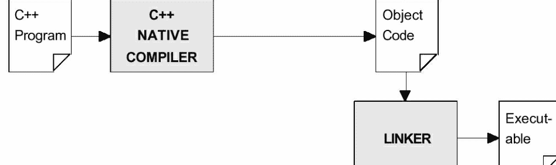
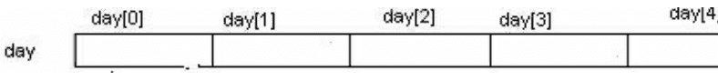
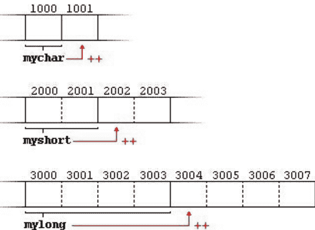
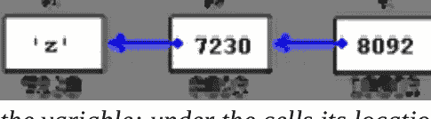

# C++ 语言编程入门指南 - C++ 编程：初学者最佳 C++ 编程书籍


什么是编程？
**编程**是计算机专业人员获得的一种技能，它赋予他们让计算机执行所需操作或任务的知识。

我们为什么需要学习计算机编程？
如果人们想知道如何让计算机执行任务，那么**计算机编程**就是至关重要的。大多数计算机用户只使用计算机上现有的应用程序。这些应用程序是由程序员制作的。因此，如果有人对制作这类应用程序感兴趣，他/她就需要学习如何与计算机交流，这就是学习计算机编程。

什么是编程语言？
**编程语言**：是一组不同类别的文字符号，用于指示计算机硬件执行设计者所需的特定操作。

成为程序员需要哪些技能？
要成为一名程序员，除了基础计算机技能外，还需要具备以下主要技能：

- **编程语言技能**：掌握一种或多种编程语言，以便与计算机交流并指令机器执行任务。
- **解决问题技能**：如何解决现实世界问题并以易于理解的格式表示解决方案的。
- **算法开发**：设计出一系列简单且人类可理解的指令集的技能，展示解决问题的步骤。这些步骤集不应依赖于任何编程语言或机器。

在每种编程语言中，都有一组规则来规范编程语言中使用的符号。这些规则决定了程序员如何让计算机硬件执行特定操作。这些规则被称为**语法**。

## 1.1. 编程语言的代际。

编程语言分为五代（第一代、第二代、第三代、第四代和第五代语言）。
这些编程语言还可以分为两个大类：低级语言和高级语言。

- 低级语言是特定机器的或依赖机器的。
- 高级语言（如 COBOL、BASIC）与机器无关，并可以在各种计算机上运行。

在五类编程语言中，第一代和第二代语言是低级语言，其余的是高级语言。
语言的级别越高，程序员越容易理解和使用。

第四代以后的语言被称为极高级语言。

### 1.1.1. 第一代（机器语言，20世纪 40 年代）：

很难编写应用程序。
依赖于所用特定计算机的机器语言。
机器语言允许程序员*直接与硬件交互*，计算机可以在不需要翻译器的情况下执行它。

- 在利用计算机资源方面更强大。
- 赋予程序员权力。
- 它们执行速度非常快，且内存使用非常高效。

### 1.1.2. 第二代（汇编语言，20 世纪 50 年代初）：

使用符号名称作为操作和存储位置。一种称为*汇编器*的系统程序将汇编语言编写的程序翻译成机器语言。

用汇编语言编写的程序不可移植。也就是说，不同的计算机架构有自己的机器语言和汇编语言。
它们被广泛用于系统软件开发。

### 1.1.3. 第三代（高级语言，20 世纪 50 年代到 70 年代）：

使用类似英语的指令，数学家能够通过诸如 Z = A + B 之类的语句定义变量。
此类语言比汇编语言易用得多。用高级语言编写的程序需要翻译成机器语言才能执行。
在指令中使用常用词（保留字）使得它们更容易学习。
所有第三代编程语言都是过程化语言。在过程化语言中，要求程序员指定需要什么以及如何执行。

### 1.1.4. 第四代（自 20 世纪 70 年代后期）：

具有简单的、类英语的语法；用于访问数据库。
第四代语言是非过程化的语言。
非过程化方法更容易编写，但对任务执行的控制较少。在非过程化语言中，程序员专注于定义输入和输出。
例如，LIST 命令可以在屏幕上显示所有记录。

第四代语言具有最少的语法规则。这节省了程序员处理更复杂任务的时间。第四代语言的示例是结构化查询语言 (SQL)、报告生成器和图形语言。

### 1.1.5. 第五代（20 世纪 90 年代）：

这些用于人工智能 (AI) 和专家系统；也用于访问数据库。
第五代语言是指令接近人类语言的“自然”语言。例如，“给我 Brown 财年的销售数据”。
由于解释人类语言的复杂性，第五代语言需要强大的硬件和软件。

## 1.2. 计算机概述与体系结构：

无论物理外观如何，几乎每台计算机都可以被设想为分为六个逻辑单元部分：

- 输入单元：从各种输入设备获取信息并将其提供给其他单元，以便对其进行处理或存储。
- 输出单元：将计算机处理后的信息放在各种输出设备上，供在计算机外部使用。
- 内存单元：保留通过输入单元输入的信息，以便在需要时可以立即处理。内存单元还会保留处理后的信息，直到输出单元将其放在输出设备。
- 中央处理器 (CPU)：它是计算机的协调器，负责监督其他部分。CPU 告诉输入单元何时从内存读取信息，告诉算术逻辑单元内存中的信息何时计算，并告诉输出单元何时将内存信息发送到特定的输出设备。
- 算术逻辑单元：是处理器内部的一个部分，负责执行加、减、乘、除等计算。它还执行比较。
- 辅助存储设备：其他单元使用的程序或数据通常存储在辅助存储设备（如磁盘）上，直到需要（可能是几天、几个月甚至年后）。

## 1.3. 操作系统的演变。

早期计算机一次只能执行一个作业。这种计算机操作形式通常称为单用户批处理。计算机一次运行一个程序，同时以组或批的形式处理数据。

随着计算机变得越来越强大，显而易见单用户批处理很少利用计算机资源。
因此，计算机开发者认为不同程序或应用程序的许多作业或任务可以共享计算机资源以实现更好的利用。这种概念被称为多道程序。

多道程序涉及在计算机上“同时”运行多个作业。
在 20 世纪 60 年代，许多小组开创了分时操作系统。


分时是多程序处理的一种特殊情况，用户通过终端访问计算机。在这里，计算机并不并行运行用户的作业，而是共享 CPU 的时间。

## 1.4. 主要编程范式

编程世界中的主要里程碑是编程语言开发过程中观察到的不同类型的特性或属性。在这些，以下内容值得关注：

- 过程化编程、结构化编程和面向对象编程范式。

### 1.4.1. 过程化编程。

- 过程化编程是一种基于**过程调用**概念的编程范式。在许多涉及中等复杂度或需要高度可维护性的情况下，过程化编程通常比简单的顺序编程是更好的选择。
- 潜在的优点：能够在不同地方重用相同的代码（函数或过程），比一组“GO TO”或“JUMP”语句更易于跟踪程序的执行流。

### 1.4.2. 结构化编程。

- 将程序拆分成小的、独立的部分进行编写。这使得更容易控制程序的开发，并设计和测试其各个组件部分。
- 结构化程序由单元*模块*构建，这些模块通常对应于单个过程或函数。
- 可被视为*过程化编程*的*子集*或子学科。它最著名的是消除或减少对 GO TO 语句的依赖。

### 1.4.3. 面向对象编程。

- OOP 背后的思想是，计算机程序是由*单个单元或对象*的集合组成的，而不是传统观点认为程序是给计算机的一系列指令列表。
- 面向对象编程被认为提供了更大的灵活性，使程序的更改更容易。OOP 方法通常更容易开发和维护。

## 1.5. 问题的解决过程与软件工程。

### 1.5.1. 软件工程。

- 软件工程是通过应用计算机科学、项目管理、工程、应用领域和其他技术和实践来创建和维护软件应用程序的专业。
- 用于解决计算机科学和/或信息系统问题的方法被称为软件开发生命周期。
- 软件开发生命周期包含以下组件：


# 初步调查


# 分析


# 设计


# 实现


# 测试与维护

### 1.5.2. 问题的解决

- 问题的解决是利用我们对问题领域的知识，并依靠我们选择和使用适当的问题解决策略、技术和工具的能力，将问题的描述转换为解决方案的过程。
- 问题是阻止组织完全实现其目的、目标和计划的不理想状况。或者，问题也可以定义为现状与预期状态之间的差距，问题解决将试图填补这一差距。

解决问题有两种方法：
- 自顶向下设计：是一种基于系统方法，其概念是问题的结构应该决定解决方案的结构以及低层应该做什么。这种方法将尝试将一个较大的问题分解成更小且易于管理的问题，以缩小问题领域。
- 自底向上设计：是相反的过程，首先构建最低层组件，系统从底部开始构建，直到最终完成整个过程。

## 1.6. 基础程序开发技巧

我们在任何编程语言中设计的程序都需要具备：**可靠性**：程序应该始终执行它被预期的功能，并处理所有类型的异常。
**可维护性**：程序的设计方式应能够在需要时对其进行修改和升级。
**可移植性**：需要能够以最少的修改为一种类型计算机编写的软件适配另一种计算机。**高效性**：程序的设计应该充分利用计算机的时间、空间和其他资源。

1.7. 算法设计与逻辑建模（使用流程图）。数字计算机是解决各种**问题**的有用工具。问题的解决方案被称为**算法**；它描述了为了解决该问题而执行的步骤序列。通常，算法是完成某些任务的有限良定义指令集，在给定初始状态的情况下，它将在相应的可识别结束状态终止。
算法应当是：

 精确的

 无歧的

 确定的

 高效的

 正确的

1.7. 算法设计与逻辑建模（使用流程图）。数字计算机是解决多种**问题的有用工具。问题的解决方案被称为**算法**；它描述了为了解决该问题而执行的步骤序列。通常，算法是完成某些任务的有限良定义指令集，在给定初始状态的情况下，它将在相应的可识别结束状态终止。
算法应当是：

 精确的

 无歧的

 确定的

 高效的

 正确的

1.7. 算法设计与逻辑建模（使用流程图）。数字计算机是解决多种**问题的有用工具。问题的解决方案被称为**算法**；它描述了为了解决该问题而执行的步骤序列。通常，算法是完成某些任务的有限良定义指令集，在给定初始状态的情况下，它将在相应的可识别结束状态终止。

1.7. 算法设计与逻辑建模（使用流程图）。数字计算机是解决多种**问题的有用工具。问题的解决方案被称为**算法**；它描述了为了解决该问题而执行的步骤序列。通常，算法是完成某些任务的有限良定义指令集，在给定初始状态的情况下，它将在相应的可识别结束状态终止。

*(注：由于原文中存在大量重复和乱码，译文已根据要求对核心逻辑进行了翻译)*


程序可能引用的库模块。最终结果是一个可执行文件。
加载：加载器从磁盘读取可执行文件并将其传输到内存中。支持程序的共享库的其他组件也会被加载。最后，计算机在 CPU 的控制下执行程序。



在实践中，所有这些步骤通常由单条命令触发，用户甚至不会看到生成的中间文件。

# 阿迪斯亚贝巴大学信息科学学院
练习题 1

课程名称：编程导论 / 编程基础
课程编号：Comp 271 / CSCE 232
请为以下每个问题编写并绘制流程图：

- 1) 接收一个数字并判断它是奇数还是偶数。
- 2) 从键盘获取两个数字，并判断并显示哪一个是较大的数（如果存在的话）。
- 3) 接收 3 个数字并按从到到大的顺序显示。
- 4) 计算从 1 到 100 的数字和并显示结果。
- 5) 相加 0 到用户给出的任意正整数之间的偶数。
- 6) 计算用户给出的两个数字的平均值。
- 7) 计算用户给出的三个数字的平均值、最大值、最小值和和。
- 8) 根据用户提供的半径计算圆的面积。
- 9) 使用第三变量交换两个变量的内容。
- 10) 在不使用第三变量的情况下交换两个变量的内容。
- 11) 从键盘读取一个整数，并显示指示该数字是奇数还是偶数的的消息。
- 12) 从键盘读取 0 - 100 范围内的 10 个整数，统计其中有多少个大于 50，并显示此结果。
- 13) 接收用户输入的整数并显示该数字的阶乘。

# 第二章 C++ 基础

## 2.1. C++ 程序的组成部分。

为了理解 C++ 简单程序的组成部分，让我们来看下面的代码：

```cpp
#include<iostream.h> #include<conio.h> void main()
{

    cout<<"Hello World"; get();
}
```

任何 C++ 程序文件都应以“.CPP”作为扩展名保存。将程序直接输入到编辑器中，并将文件保存为 hello.cpp，编译并运行它。它将在计算机屏幕上打印 Hello World! 字样。

第一个字符是 #。这个字符是给预处理器的信号。每当你启动编译器时，预处理器都会遍历程序，寻找查找井号 (#) 符号，并在编译器运行之前对这些行进行处理。

`include` 指令是一个预处理指令，它指示编译器在源代码中包含角括号内指定文件的副本。如果未指定文件的路径，预处理器会在 c:\include\ 文件夹或编辑器存储位置的 include 文件夹下查找该文件。

第 1 行的效果（即 `include<iostream.h>`）是将 `iostream.h` 文件包含在程序中，就像程序员实际输入了它一样。

当程序启动时，会自动调用 `main()`。每个 C++ 程序都有一个 `main()` 函数。

`main()` 的返回值类型为 `void`，这意味着 `main` 函数不向调用者（即操作系统）返回结果。
`main` 函数可以被设置为向操作系统返回一个值。
左大括号“{”表示 `main` 函数体的开始，对应的右大括号“}”表示 `main` 函数体的结束。每个左大括号都需要一个对应的右大括号。

我们在括号之间找到的是行语句。

当程序启动时，`main()` 被自动调用。每个 C++ 程序都有一个 `main()` 函数。

`main()` 的返回值类型为 `void`，这意味着 `main` 函数不向调用者（即操作系统）返回结果。
`main` 函数可以被设置为向操作系统返回一个值。
左大括号“{”表示 `main` 函数体的开始，对应的右大括号“}”表示 `main` 函数体的结束。每个左大括号都需要一个对应的右大括号。

我们在括号之间找到的是行语句。

在实践中，所有这些步骤通常由单条命令触发，用户甚至不会看到生成的中间文件。

## 2.2. cout 和 cin 简述。

- 字面量："Hello World"
- 变量：cin

`cin` 是用于从键盘获取输入的占位符。

- 语法：`cin`
`cin` 是一个从键盘获取输入的对象。

`cin` 将用于从键盘获取值。

- 语法：`cin >> var1`
`cin` 将从键盘获取输入。

- 语法：`cin >> var2`
`cin` 将从键盘获取输入。

- 语法：`cin >> var3`
`cin` 将从键盘获取输入。

`cout` 是用于输出的。

`cout` 在屏幕上输出。

## 2.3. 在 C++ 中编写注释。

注释是为了增强代码的可读性。它们被编译器完全忽略。

- 单行注释：`//` 之后的内容被视为注释。
- 多行注释：`/*` 和 `*/` 之间的内容被视为注释。

注释应该为了解释代码，在某些点。过多的注释会降低代码的可读性。混乱的注释比没有注释糟糕。

## 2.4. 函数简述。

## 2.5. 变量与常量。

### 2.5.1. 变量。

变量是内存中存储信息的留留。变量具有三个组成部分：

变量用于存储数据值以便进行各种计算。
所有变量都有三个属性：

- **数据类型**：变量定义时确定的类型（例如整数、实数、字符）。数据类型描述数据的属性和内存的大小。
- **名称**：用于引用变量值的名称。内存位置的唯一标识符。
- **值**：通过赋值新值可以更改的值。

### 2.5.1.1. 基本变量类型。

C++ 内置了其他几种变量类型。它们可以方便地分类为**整数**、**浮点**或**字符**变量。

浮点变量类型可以表示分数，即它们是“实数”。

字符变量持有单个字节。用于存储 ASCII 和扩展 ASCII 集中 256 个不同的字符和符号。C++ 程序使用的变量类型在下表中描述，表中列出了变量及其占用的空间


- long 32位: -2,147,483,648 到 2,147,483,647
- float 32位: -3.4x10^-38 到 3.4x10^38
- double 64位: -1.7x10^-308 到 1.7x10^308
- long unsigned 80位: -3.4x10^-4932 到 1.1x10^4932
- bool: 8 位，表示真或假（高 7 位被忽略）

## 2.5.1. 有符号整数与无符号整数

有符号整数可以是负数也可以是正数。无符号整数始终为正数。
由于有符号和无符号整数都需要相同的字节数，因此无符号整数可以存储的最大数值（幅值）是有符号整数中可以存储的最大正数的两倍。例如：假设我们只有 4 位来表示数字

| 二进制 | 无符号十进制 | 有符号十进制 |
| :--- | :--- | :--- |
| 0000 | 0000 | 0 |
| 0001 | 00001 | 1 |
| 0010 | 00010 | 2 |
| 0011 | 00011 | 3 |
| 0100 | 00100 | 4 |
| 0101 | 00101 | 5 |
| 0110 | 00110 | 6 |
| 0111 | 00111 | 7 |
| 1000 | 01000 | 8 |
| 1001 | 01001 | -1 |
| 1010 | 01010 | -2 |
| 1011 | 01011 | -3 |
| 1100 | 01100 | -4 |
| 1101 | 01101 | -5 |
| 1110 | 01110 | -6 |
| 1111 | 01111 | -7 |

在上面的示例中，对于无符号整数，由于所有 4 位都可以用于表示数字的幅值，因此表示的最大幅值将如示例所示为 15。
如果我们使用有符号整数，我们可以使用第一位来表示符号：如果第一位的值为 0，数字为正；如果为 1，数字为负。在这种情况下，我们只剩下三位来表示数字的幅值，最大幅值为 7。

### 2.5.1.3. 变量声明

变量可以通过称为“声明”的过程来创建。语法如下：
`atype Variable_Name;`
声明将指示计算机预留一个内存位置，其名称为声明时指定的变量。
良好的变量名应该指示变量的用途，或者它们应该是自解释描述的。
例如 `int myAge; //用于存储我的年龄的变量`
变量名有时被称为标识符，它在程序中应该是唯一的。
某些单词被 C++ 保留用于特定用途，不能用作标识符。
这些被称为保留字或关键字，总结在下表中。

```
asm continue float new try auto default for sizeof typedef break delete friend static union case do protected struct unsigned catch double if switch virtual char inline register template void class enum int return this volatile const extern long short while
```## 标识符

有效的标识符是一个或多个字母、数字或下划线符号的序列。标识符的长度没有限制。
空格和标记字母不能作为标识符的一部分。
只有字母、数字和下划线字符是有效的。变量标识符应以字母或下划线开头。无论如何，它们都不应以数字开头。
关键字不应作为标识符的名字。C++ 对大小写敏感。字母和小写对于 C++ 是不同的。例如：变量 **Age** 不同于变量 **age**

### 2.5.1.4. 变量初始化

当在声明时给变量赋值时，这就是变量初始化。
这与声明变量并在声明后立即给该变量赋值是相同的。语法如下：

```
DataType variable name = initial value;
例如 int a = 0;
```

a=0;

### 2.5.1.5. 变量的作用域

变量的作用域是程序中可以访问变量的边界或块。边界或块由左右大括号标识。

在 C++ 中，我们可以在源代码的任何地方声明变量。但无论写在哪里，我们都应该在使用之前声明变量。

**全局变量：**可以在代码的任何地方、任何函数内部引用/访问的变量，只要它们先被声明。在包含语句之后、任何函数之前的声明的变量是全局变量。**局部变量：**局部变量的作用域限于其声明所在的代码级别或块。

在下面的示例中，整数数据类型 num1 是可以访问的，而 z 只能在 add 函数中访问，而 num2 只能在 main 函数中访问。这意味着 `cout<<z;` 或任何涉及 z 的语句只在 add 函数中有效。

例如：
```cpp
#include<iostream.h>
int num1;

int add(int x, int y)
{
    int z;
    float age;
}
void main()
{
    unsigned short num2;
    cout<<"\n Enter:";
}
```

在 C++ 中，可以在代码的任何地方声明变量。但无论写在哪里，我们都应该在使用之前声明变量。

**全局变量：**可以在代码的任何地方、任何函数内部引用/访问的变量，只要它们先被声明。在包含语句之后、任何函数之前的声明的变量是全局变量。**局部变量：**局部变量的作用域限于其声明所在的代码级别或块。

在下面的示例中，整数数据类型 num1 是可以访问的，而 z 只能在 add 函数中访问，而 num2 只能在 main 函数中访问。这意味着 `cout<<z;` 或任何涉及 z 的语句只在 add 函数中有效。

例如：
```cpp
#include<iostream.h>
int num1;

int add(int x, int y)
{
    int z;
    float age;
}
void main()
{
    unsigned short num2;
    cout<<"\n Enter:";
}
```

在 C++ 中，可以在代码的任何地方声明变量。但无论写在哪里，我们都应该在使用之前声明变量。

**全局变量：**可以在代码的任何地方、任何函数内部引用/访问的变量，只要它们先被声明。在包含语句之后、任何函数之前的声明的变量是全局变量。**局部变量：**局部变量的作用域限于其声明所在的代码级别或块。

在下面的示例中，整数数据类型 num1 是可以访问的，而 z 只能在 add 函数中访问，而 num2 只能在 main 函数中访问。这意味着 `cout<<z;` 或任何涉及 z 的语句只在 add 函数中有效。

例如：
```cpp
#include<iostream.h>
int num1;

int add(int x, int y)
{
    int z;
    float age;
}
void main()
{
    unsigned short num2;
    cout<<"\n Enter:";
}
```

在 C++ 中，可以在代码的任何地方声明变量。但无论写在哪里，我们都应该在使用之前声明变量。

**全局变量：**可以在代码的任何地方、任何函数内部引用/访问的变量，只要它们先被声明。在包含语句之后、任何函数之前的声明的变量是全局变量。**局部变量：**局部变量的作用域限于其声明所在的代码级别或块。

在下面的示例中，整数数据类型 num1 是可以访问的，而 z 只能在 add 函数中访问，而 num2 只能在 main 函数中访问。这意味着 `cout<<z;` 或任何涉及 z 的语句只在 add 函数中有效。

例如：
```cpp
#include<iostream.h>
int num1;

int add(int x, int y)
{
    int z;
    float age;
}
void main()
{
    unsigned short num2;
    cout<<"\n Enter:";
}
```

### 2.5.1.6. 定义类型（用户定义类型）

typedef 关键字用于定义类型，允许程序员为整数类型设置别名。typedef 可以接受任何非整数的数据类型。enum 类型用于设置命名的整数常量。例如：

```cpp
#include<iostream>
typedef int USH;
void main()
{
    USH x;
}
```

在我们的示例中，编译器遇到 USH 就会将其替换为。

## 2.5.2. 使用 #define 定义常量

#define 指令是简单的文本替换。define 指令只能定义整数常量。例如：

```cpp
#define studentClass 15
```

在我们的示例中，每次看到 studentClass，预处理器都会插入 15。

## 2.5.2.2. 使用 const 定义常量

在这里，常量具有类型，编译器可以确保根据该类型使用常量。例如：`const unsigned short int studentClass = 15;`

### 2.5.1.7. 有符号整数回绕

有符号整数的值范围。当有符号整数达到其最大值时，它会回绕到负数。例如：-32767 + 1

### 2.5.1.8. 无符号整数回绕

当无符号整数达到其最大值时，它从零开始循环。例如：65535 + 1

### 2.5.1.9. 字符

字符（char）通常占用一个字节。char 可以容纳 256 个不同的值。在 C++ 中，字符用单引号表示。例如：'a'。编译器遇到字符时会将其转换为 ASCII 值。例如：'a' 是 97。

### 2.5.1.10. 特殊字符

在 C++ 中，有一些用于格式化的特殊字符。这些是：

- \n（换行）
- \t（制表符）
- \b（退格）
- \"（双引号）
- '（单引号）
- ?（问号）

## 2.5.2. 常量

常量是任何固定值的表达式。C++ 提供了两种常量：字面常量和符号常量。字面常量是直接输入到程序中的值。符号常量是一个名称。与变量不同，初始化后它的值不能更改。


## 2.6. 内存设置/内存概念。

计算机提供内存存储器（RAM）用于存储可执行的程序代码以及程序处理的数据。

内存可以被看作连续的位序列（bits），每个位都可以存储一个二进制数字。通常，内存被分为每 8 个连续位为一组，称为字节（byte）。字节按顺序寻址。因此，每个字节都可以通过其地址唯一地标识。

字节地址

```
... 1211 1212 1213 1214 1215 1216 1217 ... memory ... byte byte byte
byte byte byte
1 0 1 0 0 0 1
bit
```

## 2.7. 表达式与语句。

在 C++ 中，语句控制执行顺序、评估表达式，或者什么都不做（空语句）。所有 C++ 语句都以分号结束。

例如：x = a + b;

其含义是：将 a 和 b 之和赋值给 x。**空白字符：** 空白字符（空格、制表符、换行符）在语句中是不可见的且通常被忽略。空白字符应用于使程序更具可读性并易于维护。**块：** 块以左括号 ({) 开始，以右括号 (}) 结束。**表达式：** 表达式是一个产生值的计算过程。它也可以被视为任何评估出一个值（返回一个值）的语句。例如：语句 `3+2;` 返回值 5，因此它是一个表达式。表达式的一些示例：

例如 1：

- 3.2 返回值 3.2
- PI 浮点常量，如果定义了该常量，则返回值 3.14
- secondsPerMinute 整数常量，如果声明了该常量，则返回 60

例如 2：复杂的表达式：x = a + b;
y = x = a + b;

第二行按照以下顺序进行求值：
1. 将 a 加到 b 上。
2. 将表达式 a + b 的结果赋值给 x。
3. 将赋值表达式 x = a + b 的结果赋值给 y。

## 2.8. 运算符。

运算符是使机器执行动作的符号。不同的运算符作用于一个或多个操作数，并且可以有不同的类型。
C++ 提供了几类运算符，包括以下几种：


赋值运算符


算术运算符


关系运算符


逻辑运算符


增/减运算符


条件运算符


逗号运算符


尺寸运算符（size）

显式类型转换运算符等

### 2.8.1. 赋值运算符 (=)。

赋值运算符导致赋值语句左侧的操作数的值被变为语句右侧的值。

语法：Operand1=Operand2;
Operand1 始终是一个变量
Operand2 可以是以下某一个或它们的组合：

- + 字面量常量：例如：x=12;
- 一个变量：例如：x=y;
- 一个表达式：例如：x=y+2

### 2.8.1.1. 复合赋值运算符 (+, -=, *, /,,, <<, &= ^)。

复合赋值运算符是赋值运算符与其他运算符（如算术运算符和位运算符）的结合。
赋值运算符有很多变体，通过与其他运算符结合获得。
例如：

```
value += increase; 等于 value = value + increase;
a -= 5; 等于 a = a - 5;
a /= b; 等于 a = a / b;
price *= units + 1 等于 price = price * (units + 1);
```

其余的也遵循此规律。

### 2.8.2. 算术运算符 (+, *, /, %)。

除了余数或取模 (%) 外，所有其他算术运算符都可以接受整数和实数操作数的混合。通常，如果两个操作数都是整数，那么结果将是整数。然而，如果一个或两个操作数是实数，则结果将是实数。当除法运算符 (/) 的两个操作数都是整数时，执行的是整数除法，而不是我们通常使用的普通除法。
整数除法始终产生整数结果。整数除法总是得到整数结果。如果一个或两个操作数是实数，则结果将是实数。当除法运算符 (/) 的两个操作数都是整数时，执行的是整数除法，而不是我们通常使用的普通除法。
整数除法总是得到整数结果。
如果一个或两个操作数是实数，则结果将是实数。当除法运算符 (/) 的两个操作数都是整数时，执行的是整数除法，而不是我们通常使用的普通除法。
整数除法总是得到整数结果。
如果一个或两个操作数是实数，则结果将是实数。当除法运算符 (/) 的两个操作数都是整数时，执行的是整数除法，而不是我们通常使用的普通除法。
整数除法总是得到整数结果。
如果一个或两个操作数是实数，则结果将是实数。当除法运算符 (/) 的两个操作数都是整数时，执行的是整数除法，而不是我们通常使用的普通除法。
整数除法总是得到整数结果。
如果一个或两个操作数是实数，则结果将是实数。当除法运算符 (/) 的两个操作数都是整数时，执行的是整数除法，而不是我们通常使用的普通除法。
整数除法总是得到整数结果。
如果一个或两个操作数是实数，则结果将是实数。当除法运算符 (/) 的两个操作数都是整数时，执行的是整数除法，而不是我们通常使用的普通除法。
整数除法总是得到整数结果。
如果一个或两个操作数是实数，则结果将是实数。当除法运算符 (/) 的两个操作数都是整数时，执行的是整数除法，而不是我们通常使用的普通除法。
整数除法总是得到整数结果。
如果一个或两个操作数是实数，则结果将是实数。当除法运算符 (/) 的两个操作数都是整数时，执行的是整数除法，而不是我们通常使用的普通除法。
整数除法总是得到整数结果。
如果一个或两个操作数是实数，则结果将是实数。当除法运算符 (/) 的两个操作数都是整数时，执行的是整数除法，而不是我们通常使用的普通除法。
整数除法总是得到整数结果。
如果一个或两个操作数是实数，则结果将是实数。当除法运算符 (/) 的两个操作数都是整数时，执行的是整数除法，而不是我们通常使用的普通除法。
整数除法总是得到整数结果。
如果一个或两个操作数是实数，则结果将是实数。当除法运算符 (/) 的两个操作数都是整数时，执行的是整数除法，而不是我们通常使用的普通除法。
整数除法总是得到整数结果。
如果一个或两个操作数是实数，则结果将是实数。当除法运算符 (/) 的两个操作数都是整数时，执行的是整数除法，而不是我们通常使用的普通除法。
整数除法总是得到整数结果。
如果一个或两个操作数是实数，则结果将是实数。当除法运算符 (/) 的两个操作数都是整数时，执行的是整数除法，而不是我们通常使用的普通除法。
整数除法总是得到整数结果。
如果一个或两个操作数是实数，则结果将是实数。当除法运算符 (/) 的两个操作数都是整数时，执行的是整数除法，而不是我们通常使用的普通除法。
整数除法总是得到整数结果。
如果一个或两个操作数是实数，则结果将是实数。当除法运算符 (/) 的两个操作数都是整数时，执行的是整数除法，而不是我们通常使用的普通除法。
整数除法总是得到整数结果。
如果一个或两个操作数是实数，则结果将是实数。当除法运算符 (/) 的两个操作数都是整数时，执行的是整数除法，而不是我们通常使用的普通除法。
整数除法总是得到整数结果。
如果一个或两个操作数是实数，则结果将是实数。当除法运算符 (/) 的两个操作数都是整数时，执行的是整数除法，而不是我们通常使用的普通除法。
整数除法总是得到整数结果。
如果一个或两个操作数是实数，则结果将是实数。当除法运算符 (/) 的两个操作数都是整数时，执行的是整数除法，而不是我们通常使用的普通除法。
整数除法总是得到整数结果。
如果一个或两个操作数是实数，则结果将是实数。当除法运算符 (/) 的两个操作数都是整数时，执行的是整数除法，而不是我们通常使用的普通除法。
整数除法总是得到整数结果。
如果一个或两个操作数是实数，则结果将是实数。当除法运算符 (/) 的两个操作数都是整数时，执行的是整数除法，而不是我们通常使用的普通除法。
整数除法总是得到整数结果。
如果一个或两个操作数是实数，则结果将是实数。当除法运算符 (/) 的两个操作数都是整数时，执行的是整数除法，而不是我们通常使用的普通除法。
整数除法总是得到整数结果。
如果一个或两个操作数是实数，则结果将是实数。当除法运算符 (/) 的两个操作数都是整数时，执行的是整数除法，而不是我们通常使用的普通除法。
整数除法总是得到整数结果。
如果一个或两个操作数是实数，则结果将是实数。除除法运算符 (/) 的两个操作数都是整数时，执行的是整数除法，，我们通常使用的普通除除。
整数除法总是得到整数结果。

一个或或操作数是实数，，结果将是实数。。除除运算符 ( ( 的 的操作操作数整数整数，，执行的是整数除法，，不是我们通常使用的普通除除。
整数除法总是得到整数结果。
如果一个或两个操作数是实数，则结果将是实数。除除除运算符 ( ( 的操作操作操作操作操作操作操作操作操作除除除除除除除除除除除除除除除除。
整数除法总是得到整数结果。
如果一个或两个操作数是实数，则结果将是实数。除除除运算符 ( ( 的操作操作操作操作操作操作操作操作操作操作除除除除除除除除除除除除除除除除。
整数除法总是得到整数结果。
如果一个或两个操作数是实数，则结果将是实数。除除除运算符 ( ( 的操作操作操作操作操作操作操作操作操作操作操作操作操作除除除除除除除除除除除除除除除。
整数除法总是得到整数结果。
如果一个或两个操作数是实数，则结果将是实数。除除除运算符 ( ( 的操作操作操作操作操作操作操作操作操作操作操作操作操作操作操作除除除除除除除除除除除除除除。
整数除法总是得到整数结果。
如果一个或两个操作数是实数，则结果将是实数。除除除运算符 ( ( 的操作操作操作操作操作操作操作操作操作操作操作操作操作操作操作操作除除除除除除除除除除除除除除除。
整数除法总是得到整数结果。
如果一个或两个操作数是实数，则结果将是实数。除除除运算符 ( ( 的操作操作操作操作操作操作操作操作操作操作操作操作操作操作操作操作操作操作除除除除除除除除除除除除除除除。
整数除法总是得到整数结果。
如果一个或两个操作数是实数，则结果将是实数。除除除运算符 ( ( 的操作操作操作操作操作操作操作操作操作操作操作操作操作操作操作操作操作操作操作除除除除除除除除除除除除除除除。
整数除法总是得到整数结果。
如果一个或两个操作数是实数，则结果将是实数。除除除运算符 ( ( 的操作操作操作操作操作操作操作操作操作操作操作操作操作操作操作操作操作操作操作操作除除除除除除除除除除除除除除除除。
整数除法总是得到整数结果。
如果一个或两个操作数是实数，则结果将是实数。除除除运算符 ( ( 的操作操作操作操作操作操作操作操作操作操作操作操作操作操作操作操作操作操作操作操作操作操作除除除除除除除除除除除除除除除除除除除。
整数除法总是得到整数结果。
如果一个或两个操作数是实数，则结果将是实数。除除除运算符 ( ( 的操作操作操作操作操作操作操作操作操作操作操作操作操作操作操作操作操作操作操作操作操作操作操作除除除除除除除除除除除除除除除除除除除除。
整数除法总是得到整数结果。
如果一个或两个操作数是实数，则结果将是实数。除除除运算符 ( ( 的操作操作操作操作操作操作操作操作操作操作操作操作操作操作操作操作操作操作操作操作操作操作操作操作除除除除除除除除除除除除除除除除除除除除除。
整数除法总是得到整数结果。
如果一个或两个操作数是实数，则结果将是实数。除除除运算符 ( ( 的操作操作操作操作操作操作操作操作操作操作操作操作操作操作操作操作操作操作操作操作操作操作操作操作操作除除除除除除除除除除除除除除除除除除除除除除除。
整数除法总是得到整数结果。
如果一个或两个操作数是实数，则结果将是实数。除除除运算符 ( ( 的操作操作操作操作操作操作操作操作操作操作操作操作操作操作操作操作操作操作操作操作操作操作操作操作操作操作除除除除除除除除除除除除除除除除除除除除除除除除除。
整数除法总是得到整数结果。
如果一个或两个操作数是实数，则结果将是实数。除除除运算符 ( ( 的操作操作操作操作操作操作操作操作操作操作操作操作操作操作操作操作操作操作操作操作操作操作操作操作操作操作操作除除除除除除除除除除除除除除除除除除除除除除除除除除除。
整数除法总是得到整数结果。
如果一个或两个操作数是实数，则结果将是实数。除除除运算符 ( ( 的操作操作操作操作操作操作操作操作操作操作操作操作操作操作操作操作操作操作操作操作操作操作操作操作操作操作操作操作除除除除除除除除除除除除除除除除除除除除除除除除除除除除。
整数除法总是得到整数结果。
如果一个或两个操作数是实数，则结果将是实数。除除除运算符 ( ( 的操作操作操作操作操作操作操作操作操作操作操作操作操作操作操作操作操作操作操作操作操作操作操作操作操作操作操作操作操作操作操作除除除除除除除除除除除除除除除除除除除除除除除除除除除除除除。
整数除法总是得到整数结果。
一个一个或两个操作数是实数，则结果将是实数。除除除运算符 ( ( 的操作操作操作操作操作操作操作操作操作操作操作操作操作操作操作操作操作操作操作操作操作操作操作操作操作操作操作操作操作操作操作操作除除除除除除除除除除除除除除除除除除除除除除除除除除除除除除除除。
整数除法总是得到整数结果。
如果一个或两个操作数是实数，则结果将是实数。除除除运算符 ( ( 的操作操作操作操作操作操作操作操作操作操作操作操作操作操作操作操作操作操作操作操作操作操作操作操作操作操作操作操作操作操作操作操作操作操作操作除除除除除除除除除除除除除除除除除除除除除除除除除除除除除除除除除除。
整数除法总是得到整数结果。
如果一个或两个操作数是实数，结果结果将是实。。除除除运算符 ( ( 的操作操作操作操作操作操作操作操作操作操作操作操作操作操作操作操作操作操作操作操作操作操作操作操作操作操作操作操作操作操作操作操作操作操作操作操作除除除除除除除除除除除除除除除除除除除除除除除除除除除除除除除除除除除除除除除除。
整数除法总是得到整数结果。
如果一个或两个操作数是实数，结果结果将是实。除除除除运算符 ( ( 的操作操作操作操作操作操作操作操作操作操作操作操作操作操作操作操作操作操作操作操作操作操作操作操作操作操作操作操作操作操作操作操作操作操作操作操作操作操作操作操作操作除除除除除除除除除除除除除除除除除除除除除除除除除除除除除除除除除除除除除除除除除除除。
整数除法总是得到整数结果。
如果一个或两个操作数是实数，结果结果将是实。除除除除运算符 ( ( 的操作操作操作操作操作操作操作操作操作操作操作操作操作操作操作操作操作操作操作操作操作操作操作操作操作操作操作操作操作操作操作操作操作操作操作操作操作操作操作操作操作操作除除除除除除除除除除除除除除除除除除除除除除除除除除除除除除除除除除除除除除除除除除除除除除除除除除。
整数除法总是得到整数结果。
如果一个或两个操作数是实数，结果结果将是实。除除除除除运算符 ( ( 的操作操作操作操作操作操作操作操作操作操作操作操作操作操作操作操作操作操作操作操作操作操作操作操作操作操作操作操作操作操作操作操作操作操作操作操作操作操作操作操作操作操作除除除除除除除除除除除除除除除除除除除除除除除除除除除除除除除除除除除除除除除除除除除除除除除除除除除除除除除除除除除。
整数除法总是得到整数结果。
如果一个或两个操作数是实数，结果结果将是实。除除除除除运算符 ( ( 的操作操作操作操作操作操作操作操作操作操作操作操作操作操作操作操作操作操作操作操作操作操作操作操作操作操作操作操作操作操作操作操作操作操作操作操作操作操作操作操作操作操作操作操作除除除除除除除除除除除除除除除除除除除除除除除除除除除除除除除除除除除除除除除除除除除除除除除除除除除除除除除除除除除除除除除除。
整数除法总是得到整数结果。
如果一个或两个操作数是实数，结果结果将是实。除除除除除除运算符 ( ( 的操作操作操作操作操作操作操作操作操作操作操作操作操作操作操作操作操作操作操作操作操作操作操作操作操作操作操作操作操作操作操作操作操作操作操作操作操作操作操作操作操作操作操作除除除除除除除除除除除除除除除除除除除除除除除除除除除除除除除除除除除除除除除除除除除除除除除除除除除除除除除除除除除除除除除除除除除除。
整数除法总是得到整数结果。
如果一个或两个操作数是实数，结果结果将是实。除除除除除除除运算符 ( ( 的操作操作操作操作操作操作操作操作操作操作操作操作操作操作操作操作操作操作操作操作操作操作操作操作操作操作操作操作操作操作操作操作操作操作操作操作操作操作操作操作操作操作操作操作除除除除除除除除除除除除除除除除除除除除除除除除除除除除除除除除除除除除除除除除除除除除除除除除除除除除除除除除除除除除除除除除除除除除除除除除。
整数除法总是得到整数结果。
如果一个或两个操作数是实数，结果结果将是实。除除除除除除除除运算符 ( ( 的操作操作操作操作操作操作操作操作操作操作操作操作操作操作操作操作操作操作操作操作操作操作操作操作操作操作操作操作操作操作操作操作操作操作操作操作操作操作操作操作操作操作操作除除除除除除除除除除除除除除除除除除除除除除除除除除除除除除除除除除除除除除除除除除除除除除除除除除除除除除除除除除除除除除除除除除除除除除除除除除除除除除除。
整数除法总是得到整数结果。
如果一个或两个操作数是实数，结果结果将是实。除除除除除除除除除运算符 ( ( 的操作操作操作操作操作操作操作操作操作操作操作操作操作操作操作操作操作操作操作操作操作操作操作操作操作操作操作操作操作操作操作操作操作操作操作操作操作操作除除除除除除除除除除除除除除除除除除除除除除除除除除除除除除除除除除除除除除除除除除除除除除除除除除除除除除除除除除除除除除除除除除除除除除除除除除除除除除除除除除除除除除除除除。
整数除法总是得到整数结果。
如果一个或两个操作数是实数，结果结果将是实。除除除除除除除除除除运算符 ( ( 的操作操作操作操作操作操作操作操作操作操作操作操作操作操作操作操作操作操作操作操作操作操作操作操作操作操作操作操作操作操作操作操作操作操作操作操作操作操作除除除除除除除除除除除除除除除除除除除除除除除除除除除除除除除除除除除除除除除除除除除除除除除除除除除除除除除除除除除除除除除除除除除除除除除除除除除除除除除除除除除除除除除除除除除除除除除除除除除。
整数除法总是得到整数结果。
如果一个或两个操作数是实数，结果结果将是实。除除除除除除除除除除除运算符 ( ( 的操作操作操作操作操作操作操作操作操作操作操作操作操作操作操作操作操作操作操作操作操作操作操作操作操作操作操作操作操作操作操作操作操作操作操作操作除除除除除除除除除除除除除除除除除除除除除除除除除除除除除除除除除除除除除除除除除除除除除除除除除除除除除除除除除除除除除除除除除除除除除除除除除除除除除除除除除除除除除除除除除除除除除除除除除除除除除除除除除除除除除除除除除除除除除除除除除除除除除除除除除除除除除除除除除除除除除除除除除除除除除除除除除除除除除除除除除除除除除除除除除除除除除除除除除除除除除除除除除除除除除除除除除除除除除除除除除除除除除除除除除除除除除除除除除除除除除除除除除除除除除除除除除除除除除除除除除除除除除除除除除除除除除除除除除除除除除除除除除除除除除除除除除除除除除除除除除除除除除除除除除除除除除除除除除除除除除除除除除除除除除除除除除除除除除除除除除除除除除除除除除除除除除除除除除除除除除除除除除除除除除除除除除除除除除除除除除除除除除除除除除除除除除除除除除除除除除除除除除除除除除除除除除除除除除除除除除除除除除除除除除除除除除除除除除除除除除除除除除除除除除除除除除除除除除除除除除除除除除除除除除除除除除除除除除除除除除除除除除除除除除除除除除除除除除除除除除除除除除除除除除除除除除除除除除除除除除除除除除除除除除除除除除除除除除除除除除除除除除除除除除除除除除除除除除除除除除除除除除除除除除除除除除除除除除除除除除除除除除除除除除除除除除除除除除除除除除除除除除除除除除除除除除除除除除除除除除除除除除除除除除除除除除除除除除除除除除除除除除除除除除除除除除除除除除除除除除除除除除除除除除除除除除除除除除除除除除除除除除除除除除除除除除除除除除除除除除除除除除除除除除除除除除除除除除除除除除除除除除除除除除除除除除除除除除除除除除除除除除除除除除除除除除除除除除除除除除除除除除除除除除除除除除除除除除除除除除除除除除除除除除除除除除除除除除除除除除除除除除除除除除除除除除除除除除除除除除除除除除除除除除除除除除除除除除除除除除除除除除除除除除除除除除除除除除除除除除除除除除除除除除除除除除除除除除除除除除除除除除除除除除除除除除除除除除除除除除除除除除除除除除除除除除除除除除除除除除除除除除除除除除除除除除除除除除除除除除除除除除除除除除除除除除除除除除除除除除除除除除除除除除除除除除除除除除除除除除除除除除除除除除除除除除除除除除除除除除除除除除除除除除除除除除除除除除除除除除除除除除除除除除除除除除除除除除除除除除除除除除除除除除除除除除除除除除除除除除除除除除除除除除除除除除除除除除除除除除除除除除除除除除除除除除除除除除除除除除除除除除除除除除除除除除除除除除除除除除除除除除除除除除除除除除除除除除除除除除除除除除除除除除除除除除除除除除除除除除除除除除除除除除除除除除除除除除除除除除除除除除除除除除除除除除除除除除除除除除除除除除除除除除除除除除除除除除除除除除除除除除除除除除除除除除除除除除除除除除除除除除除除除除除除除除除除除除除除除除除除除除除除除除除除除除除除除除除除除除除除除除除除除除除除除除除除除除除除除除除除除除除除除除除除除除除除除除除除除除除除除除除除除除除除除除除除除除除除除除除除除除除除除除除除除除除除除除除除除除除除除除除除除除除除除除除除除除除除除除除除除除除除除除除除除除除除除除除除除除除除除除除除除除除除除除除除除除除除除除除除除除除除除除除除除除除除除除除除除除除除除除除除除除除除除除除除除除除除除除除除除除除除除除除除除除除除除除除除除除除除除除除除除除除除除除除除除除除除除除除除除除除除除除除除除除除除除除除除除除除除除除除除除除除除除除除除除除除除除除除除除除除除除除除除除除除除除除除除除除除除除除除除除除除除除除除除除除除除除除除除除除除除除除除除除除除除除除除除除除除除除除除除除除除除除除除除除除除除除除除除除除除除除除除除除除除除除除除除除除除除除除除除除除除除除除除除除除除除除除除除除除除除除除除除除除除除除除除除除除除除除除除除除除除除除除除除除除除除除除除除除除除除除除除除除除除除除除除除除除除除除除除除除除除除除除除除除除除除除除除除除除除除除除除除除除除除除除除除除除除除除除除除除除除除除除除除除除除除除除除除除除除除除除除除除除除除除除除除除除除除除除除除除除除除除除除除除除除除除除除除除除除除除除除除除除除除除除除除除除除除除除除除除除除除除除除除除除除除除除除除除除除除除除除除除除除除除除除除除除除除除除除除除除除除除除除除除除除除除除除除除除除除除除除除除除除除除除除除除除除除除除除除除除除除除除除除除除除除除除除除除除除除除除除除除除除除除除除除除除除除除除除除除除除除除除除除除除除除除除除除除除除除除除除除除除除除除除除除除除除除除除除除除除除除除除除除除除除除除除除除除除除除除除除除除除除除除除除除除除除除除除除除除除除除除除除除除除除除除除除除除除除除除除除除除除除除除除除除除除除除除除除除除除除除除除除除除除除除除除除除除除除除除除除除除除除除除除除除除除除除除除除除除除除除除除除除除除除除除除除除除除除除除除除除除除除除除除除除除除除除除除除除除除除除除除除除除除除除除除除除除除除除除除除除除除除除除除除除除除除除除除除除除除除除除除除除除除除除除除除除除除除除除除除除除除除除除除除除除除除除除除除除除除除除除除除除除除除除除除除除除除除除除除除除除除除除除除除除除除除除除除除除除除除除除除除除除除除除除除除除除除除除除除除除除除除除除除除除除除除除除除除除除除除除除除除除除除除除除除除除除除除除除除除除除除除除除除除除除除除除除除除除除除除除除除除除除除除除除除除除除除除除除除除除除除除除除除除除除除除除除除除除除除除除除除除除除除除除除除除除除除除除除除除除除除除除除除除除除除除除除除除除除除除除除除除除除除除除除除除除除除除除除除除除除除除除除除除除除除除除除除除除除除除除除除除除除除除除除除除除除除除除除除除除除除除除除除除除除除除除除除除除除除除除除除除除除除除除除除除除除除除除除除除除除除除除除除除除除除除除除除除除除除除除除除除除除除除除除除除除除除除除除除除除除除除除除除除除除除除除除除除除除除除除除除除除除除除除除除除除除除除除除除除除除除除除除除除除除除除除除除除除除除除除除除除除除除除除除除除除除除除除除除除除除除除除除除除除除除除除除除除除除除除除除除除除除除除除除除除除除除除除除除除除除除除除除除除除除除除除除除除除除除除除除除除除除除除除除除除除除除除除除除除除除除除除除除除除除除除除除除除除除除除除除除除除除除除除除除除除除除除除除除除除除除除除除除除除除除除除除除除除除除除除除除除除除除除除除除除除除除除除除除除除除除除除除除除除除除除除除除除除除除除除除除除除除除除除除除除除除除除除除除除除除除除除除除除除除除除除除除除除除除除除除除除除除除除除除除除除除除除除除除除除除除除除除除除除除除除除除除除除除除除除除除除除除除除除除除除除除除除除除除除除除除除除除除除除除除除除除除除除除除除除除除除除除除除除除除除除除除除除除除除除除除除除除除除除除除除除除除除除除除除除除除除除除除除除除除除除除除除除除除除除除除除除除除除除除除除除除除除除除除除除除除除除除除除除除除除除除除除除除除除除除除除除除除除除除除除除除除除除除除除除除除除除除除除除除除除除除除除除除除除除除除除除除除除除除除除除除除除除除除除除除除除除除除除除除除除除除除除除除除除除除除除除除除除除除除除除除除除除除除除除除除除除除除除除除除除除除除除除除除除除除除除除除除除除除除除除除除除除除除除除除除除除除除除除除除除除除除除除除除除除除除除除除除除除除除除除除除除除除除除除除除除除除除除除除除除除除除除除除除除除除除除除除除除除除除除除除除除除除除除除除除除除除除除除除除除除除除除除除除除除除除除除除除除除除除除除除除除除除除除除除除除除除除除除除除除除除除除除除除除除除除除除除除除除除除除除除除除除除除除除除除除除除除除除除除除除除除除除除除除除除除除除除除除除除除除除除除除除除除除除除除除除除除除除除除除除除除除除除除除除除除除除除除除除除除除除除除除除除除除除除除除除除除除除除除除除除除除除除除除除除除除除除除除除除除除除除除除除除除除除除除除除除除除除除除除除除除除除除除除除除除除除除除除除除除除除除除除除除除除除除除除除除除除除除除除除除除除除除除除除除除除除除除除除除除除除除除除除除除除除除除除除除除除除除除除除除除除除除除除除除除除除除除除除除除除除除除除除除除除除除除除除除除除除除除除除除除除除除除除除除除除除除除除除除除除除除除除除除除除除除除除除除除除除除除除除除除除除除除除除除除除除除除除除除除除除除除除除除除除除除除除除除除除除除除除除除除除除除除除除除除除除除除除除除除除除除除除除除除除除除除除除除除除除除除除除除除除除除除除除除除除除除除除除除除除除除除除除除除除除除除除除除除除除除除除除除除除除除除除除除除除除除除除除除除除除除除除除除除除除除除除除除除除除除除除除除除除除除除除除除除除除除除除除除除除除除除除除除除除除除除除除除除除除除除除除除除除除除除除除除除除除除除除除除除除除除除除除除除除除除除除除除除除除除除除除除除除除除除除除除除除除除除除除除除除除除除除除除除除除除除除除除除除除除除除除除除除除除除除除除除除除除除除除除除除除除除除除除除除除除除除除除除除除除除除除除除除除除除除除除除除除除除除除除除除除除除除除除除除除除除除除除除除除除除除除除除除除除除除除除除除除除除除除除除除除除除除除除除除除除除除除除除除除除除除除除除除除除除除除除除除除除除除除除除除除除除除除除除除除除除除除除除除除除除除除除除除除除除除除除除除除除除除除除除除除除除除除除除除除除除除除除除除除除除除除除除除除除除除除除除除除除除除除除除除除除除除除除除除除除除除除除除除除除除除除除除除除除除除除除除除除除除除除除除除除除除除除除除除除除除除除除除除除除除除除除除除除除除除除除除除除除除除除除除除除除除除除除除除除除除除除除除除除除除除除除除除除除除除除除除除除除除除除除除除除除除除除除除除除除除除除除除除除除除除除除除除除除除除除除除除除除除除除除除除除除除除除除除除除除除除除除除除除除除除除除除除除除除除除除除除除除除除除除除除除除除除除除除除除除除除除除除除除除除除除除除除除除除除除除除除除除除除除除除除除除除除除除除除除除除除除除除除除除除除除除除除除除除除除除除除除除除除除除除除除除除除除除除除除除除除除除除除除除除除除除除除除除除除除除除除除除除除除除除除除除除除除除除除除除除除除除除除除除除除除除除除除除除除除除除除除除除除除除除除除除除除除除除除除除除除除除除除除除除除除除除除除除除除除除除除除除除除除除除除除除除除除除除除除除除除除除除除除除除除除除除除除除除除除除除除除除除除除除除除除除除除除除除除除除除除除除除除除除除除除除除除除除除除除除除除除除除除除除除除除除除除除除除除除除除除除除除除除除除除除除除除除除除除除除除除除除除除除除除除除除除除除除除除除除除除除除除除除除除除除除除除除除除除除除除除除除除除除除除除除除除除除除除除除除除除除除除除除除除除除除除除除除除除除除除除除除除除除除除除除除除除除除除除除除除除除除除除除除除除除除除除除除除除除除除除除除除除除除除除除除除除除除除除除除除除除除除除除除除除除除除除除除除除除除除除除除除除除除除除除除除除除除除除除除除除除除除除除除除除除除除除除除除除除除除除除除除除除除除除除除除除除除除除除除除除除除除除除除除除除除除除除除除除除除除除除除除除除除除除除除除除除除除除除除除除除除除除除除除除除除除除除除除除除除除除除除除除除除除除除除除除除除除除除除除除除除除除除除除除除除除除除除除除除除除除除除除除除除除除除除除除除除除除除除除除除除除除除除除除除除除除除除除除除除除除除除除除除除除除除除除除除除除除除除除除除除除除除除除除除除除除除除除除除除除除除除除除除除除除除除除除除除除除除除除除除除除除除除除除除除除除除除除除除除除除除除除除除除除除除除除除除除除除除除除除除除除除除除除除除除除除除除除除除除除除除除除除除除除除除除除除除除除除除除除除除除除除除除除除除除除除除除除除除除除除除除除除除除除除除除除除除除除除除除除除除除除除除除除除除除除除除除除除除除除除除除除除除除除除除除除除除除除除除除除除除除除除除除除除除除除除除除除除除除除除除除除除除除除除除除除除除除除除除除除除除除除除除除除除除除除除除除除除除除除除除除除除除除除除除除除除除除除除除除除除除除除除除除除除除除除除除除除除除除除除除除除除除除除除除除除除除除除除除除除除除除除除除除除除除除除除除除除除除除除除除除除除除除除除除除除除除除除除除除除除除除除除除除除除除除除除除除除除除除除除除除除除除除除除除除除除除除除除除除除除除除除除除除除除除除除除除除除除除除除除除除除除除除除除除除除除除除除除除除除除除除除除除除除除除除除除除除除除除除除除除除除除除除除除除除除除除除除除除除除除除除除除除除除除除除除除除除除除除除除除除除除除除除除除除除除除除除除除除除除除除除除除除除除除除除除除除除除除除除除除除除除除除除除除除除除除除除除除除除除除除除除除除除除除除除除除除除除除除除除除除除除除除除除除除除除除除除除除除除除除除除除除除除除除除除除除除除除除除除除除除除除除除除除除除除除除除除除除除除除除除除除除除除除除除除除除除除除除除除除除除除除除除除除除除除除除除除除除除除除除除除除除除除除除除除除除除除除除除除除除除除除除除除除除除除除除除除除除除除除除除除除除除除除除除除除除除除除除除除除除除除除除除除除除除除除除除除除除除除除除除除除除除除除除除除除除除除除除除除除除除除除除除除除除除除除除除除除除除除除除除除除除除除除除除除除除除除除除除除除除除除除除除除除除除除除除除除除除除除除除除除除除除除除除除除除除除除除除除除除除除除除除除除除除除除除除除除除除除除除除除除除除除除除除除除除除除除除除除除除除除除除除除除除除除除除除除除除除除除除除除除除除除除除除除除除除除除除除除除除除除除除除除除除除除除除除除除除除除除除除除除除除除除除除除除除除除除除除除除除除除除除除除除除除除除除除除除除除除除除除除除除除除除除除除除除除除除除除除除除除除除除除除除除除除除除除除除除除除除除除除除除除除除除除除除除除除除除除除除除除除除除除除除除除除除除除除除除除除除除除除除除除除除除除除除除除除除除除除除除除除除除除除除除除除除除除除除除除除除除除除除除除除除除除除除除除除除除除除除除除除除除除除除除除除除除除除除除除除除除除除除除除除除除除除除除除除除除除除除除除除除除除除除除除除除除除除除除除除除除除除除除除除除除除除除除除除除除除除除除除除除除除除除除除除除除除除除除除除除除除除除除除除除除除除除除除除除除除除除除除除除除除除除除除除除除除除除除除除除除除除除除除除除除除除除除除除除除除除除除除除除除除除除除除除除除除除除除除除除除除除除除除除除除除除除除除除除除除除除除除除除除除除除除除除除除除除除除除除除除除除除除除除除除除除除除除除除除除除除除除除除除除除除除除除除除除除除除除除除除除除除除除除除除除除除除除除除除除除除除除除除除除除除除除除除除除除除除除除除除除除除除除除除除除除除除除除除除除除除除除除除除除除除除除除除除除除除除除除除除除除除除除除除除除除除除除除除除除除除除除除除除除除除除除除除除除除除除除除除除除除除除除除除除除除除除除除除除除除除除除除除除除除除除除除除除除除除除除除除除除除除除除除除除除除除除除除除除除除除除除除除除除除除除除除除除除除除除除除除除除除除除除除除除除除除除除除除除除除除除除除除除除除除除除除除除除除除除除除除除除除除除除除除除除除除除除除除除除除除除除除除除除除除除除除除除除除除除除除除除除除除除除除除除除除除除除除除除除除除除除除除除除除除除除除除除除除除除除除除除除除除除除除除除除除除除除除除除除除除除除除除除除除除除除除除除除除除除除除除除除除除除除除除除除除除除除除除除除除除除除除除除除除除除除除除除除除除除除除除除除除除除除除除除除除除除除除除除除除除除除除除除除除除除除除除除除除除除除除除除除除除除除除除除除除除除除除除除除除除除除除除除除除除除除除除除除除除除除除除除除除除除除除除除除除除除除除除除除除除除除除除除除除除除除除除除除除除除除除除除除除除除除除除除除除除除除除除除除除除除除除除除除除除除除除除除除除除除除除除除除除除除除除除除除除除除除除除除除除除除除除除除除除除除除除除除除除除除除除除除除除除除除除除除除除除除除除除除除除除除除除除除除除除除除除除除除除除除除除除除除除除除除除除除除除除除除除除除除除除除除除除除除除除除除除除除除除除除除除除除除除除除除除除除除除除除除除除除除除除除除除除除除除除除除除除除除除除除除除除除除除除除除除除除除除除除除除除除除除除除除除除除除除除除除除除除除除除除除除除除除除除除除除除除除除除除除除除除除除除除除除除除除除除除除除除除除除除除除除除除除除除除除除除除除除除除除除除除除除除除除除除除除除除除除除除除除除除除除除除除除除除除除除除除除除除除除除除除除除除除除除除除除除除除除除除除除除除除除除除除除除除除除除除除除除除除除除除除除除除除除除除除除除除除除除除除除除除除除除除除除除除除除除除除除除除除除除除除除除除除除除除除除除除除除除除除除除除除除除除除除除除除除除除除除除除除除除除除除除除除除除除除除除除除除除除除除除除除除除除除除除除除除除除除除除除除除除除除除除除除除除除除除除除除除除除除除除除除除除除除除除除除除除除除除除除除除除除除除除除除除除除除除除除除除除除除除除除除除除除除除除除除除除除除除除除除除除除除除除除除除除除除除除除除除除除除除除除除除除除除除除除除除除除除除除除除除除除除除除除除除除除除除除除除除除除除除除除除除除除除除除除除除除除除除除除除除除除除除除除除除除除除除除除除除除除除除除除除除除除除除除除除除除除除除除除除除除除除除除除除除除除除除除除除除除除除除除除除除除除除除除除除除除除除除除除除除除除除除除除除除除除除除除除除除除除除除除除除除除除除除除除除除除除除除除除除除除除除除除除除除除除除除除除除除除除除除除除除除除除除除除除除除除除除除除除除除除除除除除除除除除除除除除除除除除除除除除除除除除除除除除除除除除除除除除除除除除除除除除除除除除除除除除除除除除除除除除除除除除除除除除除除除除除除除除除除除除除除除除除除除除除除除除除除除除除除除除除除除除除除除除除除除除除除除除除除除除除除除除除除除除除除除除除除除除除除除除除除除除除除除除除除除除除除除除除除除除除除除除除除除除除除除除除除除除除除除除除除除除除除除除除除除除除除除除除除除除除除除除除除除除除除除除除除除除除除除除除除除除除除除除除除除除除除除除除除除除除除除除除除除除除除除除除除除除除除除除除除除除除除除除除除除除除除除除除除除除除除除除除除除除除除除除除除除除除除除除除除除除除除除除除除除除除除除除除除除除除除除除除除除除除除除除除除除除除除除除除除除除除除除除除除除除除除除除除除除除除除除除除除除除除除除除除除除除除除除除除除除除除除除除除除除除除除除除除除除除除除除除除除除除除除除除除除除除除除除除除除除除除除除除除除除除除除除除除除除除除除除除除除除除除除除除除除除除除除除除除除除除除除除除除除除除除除除除除除除除除除除除除除除除除除除除除除除除除除除除除除除除除除除除除除除除除除除除除除除除除除除除除除除除除除除除除除除除除除除除除除除除除除除除除除除除除除除除除除除除除除除除除除除除除除除除除除除除除除除除除除除除除除除除除除除除除除除除除除除除除除除除除除除除除除除除除除除除除除除除除除除除除除除除除除除除除除除除除除除除除除除除除除除除除除除除除除除除除除除除除除除除除除除除除除除除除除除除除除除除除除除除除除除除除除除除除除除除除除除除除除除除除除除除除除除除除除除除除除除除除除除除除除除除除除除除除除除除除除除除除除除除除除除除除除除除除除除除除除除除除除除除除除除除除除除除除除除除除除除除除除除除除除除除除除除除除除除除除除除除除除除除除除除除除除除除除除除除除除除除除除除除除除除除除除除除除除除除除除除除除除除除除除除除除除除除除除除除除除除除除除除除除除除除除除除除除除除除除除除除除除除除除除除除除除除除除除除除除除除除除除除除除除除除除除除除除除除除除除除除除除除除除除除除除除除除除除除除除除除除除除除除除除除除除除除除除除除除除除除除除除除除除除除除除除除除除除除除除除除除除除除除除除除除除除除除除除除除除除除除除除除除除除除除除除除除除除除除除除除除除除除除除除除除除除除除除除除除除除除除除除除除除除除除除除除除除除除除除除除除除除除除除除除除除除除除除除除除除除除除除除除除除除除除除除除除除除除除除除除除除除除除除除除除除除除除除除除除除除除除除除除除除除除除除除除除除除除除除除除除除除除除除除除除除除除除除除除除除除除除除除除除除除除除除除除除除除除除除除除除除除除除除除除除除除除除除除除除除除除除除除除除除除除除除除除除除除除除除除除除除除除除除除除除除除除除除除除除除除除除除除除除除除除除除除除除除除除除除除除除除除除除除除除除除除除除除除除除除除除除除除除除除除除除除除除除除除除除除除除除除除除除除除除除除除除除除除除除除除除除除除除除除除除除除除除除除除除除除除除除除除除除除除除除除除除除除除除除除除除除除除除除除除除除除除除除除除除除除除除除除除除除除除除除除除除除除除除除除除除除除除除除除除除除除除除除除除除除除除除除除除除除除除除除除除除除除除除除除除除除除除除除除除除除除除除除除除除除除除除除除除除除除除除除除除除除除除除除除除除除除除除除除除除除除除除除除除除除除除除除除除除除除除除除除除除除除除除除除除除除除除除除除除除除除除除除除除除除除除除除除除除除除除除除除除除除除除除除除除除除除除除除除除除除除除除除除除除除除除除除除除除除除除除除除除除除除除除除除除除除除除除除除除除除除除除除除除除除除除除除除除除除除除除除除除除除除除除除除除除除除除除除除除除除除除除除除除除除除除除除除除除除除除除除除除除除除除除除除除除除除除除除除除除除除除除除除除除除除除除除除除除除除除除除除除除除除除除除除除除除除除除除除除除除除除除除除除除除除除除除除除除除除除除除除除除除除除除除除除除除除除除除除除除除除除除除除除除除除除除除除除除除除除除除除除除除除除除除除除除除除除除除除除除除除除除除除除除除除除除除除除除除除除除除除除除除除除除除除除除除除除除除除除除除除除除除除除除除除除除除除除除除除除除除除除除除除除除除除除除除除除除除除除除除除除除除除除除除除除除除除除除除除除除除除除除除除除除除除除除除除除除除除除除除除除除除除除除除除除除除除除除除除除除除除除除除除除除除除除除除除除除除除除除除除除除除除除除除除除除除除除除除除除除除除除除除除除除除除除除除除除除除除除除除除除除除除除除除除除除除除除除除除除除除除除除除除除除除除除除除除除除除除除除除除除除除除除除除除除除除除除除除除除除除除除除除除除除除除除除除除除除除除除除除除除除除除除除除除除除除除除除除除除除除除除除除除除除除除除除除除除除除除除除除除除除除除除除除除除除除除除除除除除除除除除除除除除除除除除除除除除除除除除除除除除除除除除除除除除除除除除除除除除除除除除除除除除除除除除除除除除除除除除除除除除除除除除除除除除除除除除除除除除除除除除除除除除除除除除除除除除除除除除除除除除除除除除除除除除除除除除除除除除除除除除除除除除除除除除除除除除除除除除除除除除除除除除除除除除除除除除除除除除除除除除除除除除除除除除除除除除除除除除除除除除除除除除除除除除除除除除除除除除除除除除除除除除除除除除除除除除除除除除除除除除除除除除除除除除除除除除除除除除除除除除除除除除除除除除除除除除除除除除除除除除除除除除除除除除除除除除除除除除除除除除除除除除除除除除除除除除除除除除除除除除除除除除除除除除除除除除除除除除除除除除除除除除除除除除除除除除除除除除除除除除除除除除除除除除除除除除除除除除除除除除除除除除除除除除除除除除除除除除除除除除除除除除除除除除除除除除除除除除除除除除除除除除除除除除除除除除除除除除除除除除除除除除除除除除除除除除除除除除除除除除除除除除除除除除除除除除除除除除除除除除除除除除除除除除除除除除除除除除除除除除除除除除除除除除除除除除除除除除除除除除除除除除除除除除除除除除除除除除除除除除除除除除除除除除除除除除除除除除除除除除除除除除除除除除除除除除除除除除除除除除除除除除除除除除除除除除除除除除除除除除除除除除除除除除除除除除除除除除除除除除除除除除除除除除除除除除除除除除除除除除除除除除除除除除除除除除除除除除除除除除除除除除除除除除除除除除除除除除除除除除除除除除除除除除除除除除除除除除除除除除除除除除除除除除除除除除除除除除除除除除除除除除除除除除除除除除除除除除除除除除除除除除除除除除除除除除除除除除除除除除除除除除除除除除除除除除除除除除除除除除除除除除除除除除除除除除除除除除除除除除除除除除除除除除除除除除除除除除除除除除除除除除除除除除除除除除除除除除除除除除除除除除除除除除除除除除除除除除除除除除除除除除除除除除除除除除除除除除除除除除除除除除除除除除除除除除除除除除除除除除除除除除除除除除除除除除除除除除除除除除除除除除除除除除除除除除除除除除除除除除除除除除除除除除除除除除除除除除除除除除除除除除除除除除除除除除除除除除除除除除除除除除除除除除除除除除除除除除除除除除除除除除除除除除除除除除除除除除除除除除除除除除除除除除除除除除除除除除除除除除除除除除除除除除除除除除除除除除除除除除除除除除除除除除除除除除除除除除除除除除除除除除除除除除除除除除除除除除除除除除除除除除除除除除除除除除除除除除除除除除除除除除除除除除除除除除除除除除除除除除除除除除除除除除除除除除除除除除除除除除除除除除除除除除除除除除除除除除除除除除除除除除除除除除除除除除除除除除除除除除除除除除除除除除除除除除除除除除除除除除除除除除除除除除除除除除除除除除除除除除除除除除除除除除除除除除除除除除除除除除除除除除除除除除除除除除除除除除除除除除除除除除除除除除除除除除除除除除除除除除除除除除除除除除除除除除除除除除除除除除除除除除除除除除除除除除除除除除除除除除除除除除除除除除除除除除除除除除除除除除除除除除除除除除除除除除除除除除除除除除除除除除除除除除除除除除除除除除除除除除除除除除除除除除除除除除除除除除除除除除除除除除除除除除除除除除除除除除除除除除除除除除除除除除除除除除除除除除除除除除除除除除除除除除除除除除除除除除除除除除除除除除除除除除除除除除除除除除除除除除除除除除除除除除除除除除除除除除除除除除除除除除除除除除除除除除除除除除除除除除除除除除除除除除除除除除除除除除除除除除除除除除除除除除除除除除除除除除除除除除除除除除除除除除除除除除除除除除除除除除除除除除除除除除除除除除除除除除除除除除除除除除除除除除除除除除除除除除除除除除除除除除除除除除除除除除除除除除除除除除除除除除除除除除除除除除除除除除除除除除除除除除除除除除除除除除除除除除除除除除除除除除除除除除除除除除除除除除除除除除除除除除除除除除除除除除除除除除除除除除除除除除除除除除除除除除除除除除除除除除除除除除除除除除除除除除除除除除除除除除除除除除除除除除除除除除除除除除除除除除除除除除除除除除除除除除除除除除除除除除除除除除除除除除除除除除除除除除除除除除除除除除除除除除除除除除除除除除除除除除除除除除除除除除除除除除除除除除除除除除除除除除除除除除除除除除除除除除除除除除除除除除除除除除除除除除除除除除除除除除除除除除除除除除除除除除除除除除除除除除除除除除除除除除除除除除除除除除除除除除除除除除除除除除除除除除除除除除除除除除除除除除除除除除除除除除除除除除除除除除除除除除除除除除除除除除除除除除除除除除除除除除除除除除除除除除除除除除除除除除除除除除除除除除除除除除除除除除除除除除除除除除除除除除除除除除除除除除除除除除除除除除除除除除除除除除除除除除除除除除除除除除除除除除除除除除除除除除除除除除除除除除除除除除除除除除除除除除除除除除除除除除除除除除除除除除除除除除除除除除除除除除除除除除除除除除除除除除除除除除除除除除除除除除除除除除除除除除除除除除除除除除除除除除除除除除除除除除除除除除除除除除除除除除除除除除除除除除除除除除除除除除除除除除除除除除除除除除除除除除除除除除除除除除除除除除除除除除除除除除除除除除除除除除除除除除除除除除除除除除除除除除除除除除除除除除除除除除除除除除除除除除除除除除除除除除除除除除除除除除除除除除除除除除除除除除除除除除除除除除除除除除除除除除除除除除除除除除除除除除除除除除除除除除除除除除除除除除除除除除除除除除除除除除除除除除除除除除除除除除除除除除除除除除除除除除除除除除除除除除除除除除除除除除除除除除除除除除除除除除除除除除除除除除除除除除除除除除除除除除除除除除除除除除除除除除除除除除除除除除除除除除除除除除除除除除除除除除除除除除除除除除除除除除除除除除除除除除除除除除除除除除除除除除除除除除除除除除除除除除除除除除除除除除除除除除除除除除除除除除除除除除除除除除除除除除除除除除除除除除除除除除除除除除除除除除除除除除除除除除除除除除除除除除除除除除除除除除除除除除除除除除除除除除除除除除除除除除除除除除除除除除除除除除除除除除除除除除除除除除除除除除除除除除除除除除除除除除除除除除除除除除除除除除除除除除除除除除除除除除除除除除除除除除除除除除除除除除除除除除除除除除除除除除除除除除除除除除除除除除除除除除除除除除除除除除除除除除除除除除除除除除除除除除除除除除除除除除除除除除除除除除除除除除除除除除除除除除除除除除除除除除除除除除除除除除除除除除除除除除除除除除除除除除除除除除除除除除除除除除除除除除除除除除除除除除除除除除除除除除除除除除除除除除除除除除除除除除除除除除除除除除除除除除除除除除除除除除除除除除除除除除除除除除除除除除除除除除除除除除除除除除除除除除除除除除除除除除除除除除除除除除除除除除除除除除除除除除除除除除除除除除除除除除除除除除除除除除除除除除除除除除除除除除除除除除除除除除除除除除除除除除除除除除除除除除除除除除除除除除除除除除除除除除除除除除除除除除除除除除除除除除除除除除除除除除除除除除除除除除除除除除除除除除除除除除除除除除除除除除除除除除除除除除除除除除除除除除除除除除除除除除除除除除除除除除除除除除除除除除除除除除除除除除除除除除除除除除除除除除除除除除除除除除除除除除除除除除除除除除除除除除除除除除除除除除除除除除除除除除除除除除除除除除除除除除除除除除除除除除除除除除除除除除除除除除除除除除除除除除除除除除除除除除除除除除除除除除除除除除除除除除除除除除除除除除除除除除除除除除除除除除除除除除除除除除除除除除除除除除除除除除除除除除除除除除除除除除除除除除除除除除除除除除除除除除除除除除除除除除除除除除除除除除除除除除除除除除除除除除除除除除除除除除除除除除除除除除除除除除除除除除除除除除除除除除除除除除除除除除除除除除除除除除除除除除除除除除除除除除除除除除除除除除除除除除除除除除除除除除除除除除除除除除除除除除除除除除除除除除除除除除除除除除除除除除除除除除除除除除除除除除除除除除除除除除除除除除除除除除除除除除除除除除除除除除除除除除除除除除除除除除除除除除除除除除除除除除除除除除除除除除除除除除除除除除除除除除除除除除除除除除除除除除除除除除除除除除除除除除除除除除除除除除除除除除除除除除除除除除除除除除除除除除除除除除除除除除除除除除除除除除除除除除除除除除除除除除除除除除除除除除除除除除除除除除除除除除除除除除除除除除除除除除除除除除除除除除除除除除除除除除除除除除除除除除除除除除除除除除除除除除除除除除除除除除除除除除除除除除除除除除除除除除除除除除除除除除除除除除除除除除除除除除除除除除除除除除除除除除除除除除除除除除除除除除除除除除除除除除除除除除除除除除除除除除除除除除除除除除除除除除除除除除除除除除除除除除除除除除除除除除除除除除除除除除除除除除除除除除除除除除除除除除除除除除除除除除除除除除除除除除除除除除除除除除除除除除除除除除除除除除除除除除除除除除除除除除除除除除除除除除除除除除除除除除除除除除除除除除除除除除除除除除除除除除除除除除除除除除除除除除除除除除除除除除除除除除除除除除除除除除除除除除除除除除除除除除除除除除除除除除除除除除除除除除除除除除除除除除除除除除除除除除除除除除除除除除除除除除除除除除除除除除除除除除除除除除除除除除除除除除除除除除除除除除除除除除除除除除除除除除除除除除除除除除除除除除除除除除除除除除除除除除除除除除除除除除除除除除除除除除除除除除除除除除除除除除除除除除除除除除除除除除除除除除除除除除除除除除除除除除除除除除除除除除除除除除除除除除除除除除除除除除除除除除除除除除除除除除除除除除除除除除除除除除除除除除除除除除除除除除除除除除除除除除除除除除除除除除除除除除除除除除除除除除除除除除除除除除除除除除除除除除除除除除除除除除除除除除除除除除除除除除除除除除除除除除除除除除除除除除除除除除除除除除除除除除除除除除除除除除除除除除除除除除除除除除除除除除除除除除除除除除除除除除除除除除除除除除除除除除除除除除除除除除除除除除除除除除除除除除除除除除除除除除除除除除除除除除除除除除除除除除除除除除除除除除除除除除除除除除除除除除除除除除除除除除除除除除除除除除除除除除除除除除除除除除除除除除除除除除除除除除除除除除除除除除除除除除除除除除除除除除除除除除除除除除除除除除除除除除除除除除除除除除除除除除除除除除除除除除除除除除除除除除除除除除除除除除除除除除除除除除除除除除除除除除除除除除除除除除除除除除除除除除除除除除除除除除除除除除除除除除除除除除除除除除除除除除除除除除除除除除除除除除除除除除除除除除除除除除除除除除除除除除除除除除除除除除除除除除除除除除除除除除除除除除除除除除除除除除除除除除除除除除除除除除除除除除除除除除除除除除除除除除除除除除除除除除除除除除除除除除除除除除除除除除除除除除除除除除除除除除除除除除除除除除除除除除除除除除除除除除除除除除除除除除除除除除除除除除除除除除除除除除除除除除除除除除除除除除除除除除除除除除除除除除除除除除除除除除除除除除除除除除除除除除除除除除除除除除除除除除除除除除除除除除除除除除除除除除除除除除除除除除除除除除除除除除除除除除除除除除除除除除除除除除除除除除除除除除除除除除除除除除除除除除除除除除除除除除除除除除除除除除除除除除除除除除除除除除除除除除除除除除除除除除除除除除除除除除除除除除除除除除除除除除除除除除除除除除除除除除除除除除除除除除除除除除除除除除除除除除除除除除除除除除除除除除除除除除除除除除除除除除除除除除除除除除除除除除除除除除除除除除除除除除除除除除除除除除除除除除除除除除除除除除除除除除除除除除除除除除除除除除除除除除除除除除除除除除除除除除除除除除除除除除除除除除除除除除除除除除除除除除除除除除除除除除除除除除除除除除除除除除除除除除除除除除除除除除除除除除除除除除除除除除除除除除除除除除除除除除除除除除除除除除除除除除除除除除除除除除除除除除除除除除除除除除除除除除除除除除除除除除除除除除除除除除除除除除除除除除除除除除除除除除除除除除除除除除除除除除除除除除除除除除除除除除除除除除除除除除除除除除除除除除除除除除除除除除除除除除除除除除除除除除除除除除除除除除除除除除除除除除除除除除除除除除除除除除除除除除除除除除除除除除除除除除除除除除除除除除除除除除除除除除除除除除除除除除除除除除除除除除除除除除除除除除除除除除除除除除除除除除除除除除除除除除除除除除除除除除除除除除除除除除除除除除除除除除除除除除除除除除除除除除除除除除除除除除除除除除除除除除除除除除除除除除除除除除除除除除除除除除除除除除除除除除除除除除除除除除除除除除除除除除除除除除除除除除除除除除除除除除除除除除除除除除除除除除除除除除除除除除除除除除除除除除除除除除除除除除除除除除除除除除除除除除除除除除除除除除除除除除除除除除除除除除除除除除除除除除除除除除除除除除除除除除除除除除除除除除除除除除除除除除除除除除除除除除除除除除除除除除除除除除除除除除除除除除除除除除除除除除除除除除除除除除除除除除除除除除除除除除除除除除除除除除除除除除除除除除除除除除除除除除除除除除除除除除除除除除除除除除除除除除除除除除除除除除除除除除除除除除除除除除除除除除除除除除除除除除除除除除除除除除除除除除除除除除除除除除除除除除除除除除除除除除除除除除除除除除除除除除除除除除除除除除除除除除除除除除除除除除除除除除除除除除除除除除除除除除除除除除除除除除除除除除除除除除除除除除除除除除除除除除除除除除除除除除除除除除除除除除除除除除除除除除除除除除除除除除除除除除除除除除除除除除除除除除除除除除除除除除除除除除除除除除除除除除除除除除除除除除除除除除除除除除除除除除除除除除除除除除除除除除除除除除除除除除除除除除除除除除除除除除除除除除除除除除除除除除除除除除除除除除除除除除除除除除除除除除除除除除除除除除除除除除除除除除除除除除除除除除除除除除除除除除除除除除除除除除除除除除除除除除除除除除除除除除除除除除除除除除除除除除除除除除除除除除除除除除除除除除除除除除除除除除除除除除除除除除除除除除除除除除除除除除除除除除除除除除除除除除除除除除除除除除除除除除除除除除除除除除除除除除除除除除除除除除除除除除除除除除除除除除除除除除除除除除除除除除除除除除除除除除除除除除除除除除除除除除除除除除除除除除除除除除除除除除除除除除除除除除除除除除除除除除除除除除除除除除除除除除除除除除除除除除除除除除除除除除除除除除除除除除除除除除除除除除除除除除除除除除除除除除除除除除除除除除除除除除除除除除除除除除除除除除除除除除除除除除除除除除除除除除除除除除除除除除除除除除除除除除除除除除除除除除除除除除除除除除除除除除除除除除除除除除除除除除除除除除除除除除除除除除除除除除除除除除除除除除除除除除除除除除除除除除除除除除除除除除除除除除除除除除除除除除除除除除除除除除除除除除除除除除除除除除除除除除除除除除除除除除除除除除除除除除除除除除除除除除除除除除除除除除除除除除除除除除除除除除除除除除除除除除除除除除除除除除除除除除除除除除除除除除除除除除除除除除除除除除除除除除除除除除除除除除除除除除除除除除除除除除除除除除除除除除除除除除除除除除除除除除除除除除除除除除除除除除除除除除除除除除除除除除除除除除除除除除除除除除除除除除除除除除除除除除除除除除除除除除除除除除除除除除除除除除除除除除除除除除除除除除除除除除除除除除除除除除除除除除除除除除除除除除除除除除除除除除除除除除除除除除除除除除除除除除除除除除除除除除除除除除除除除除除除除除除除除除除除除除除除除除除除除除除除除除除除除除除除除除除除除除除除除除除除除除除除除除除除除除除除除除除除除除除除除除除除除除除除除除除除除除除除除除除除除除除除除除除除除除除除除除除除除除除除除除除除除除除除除除除除除除除除除除除除除除除除除除除除除除除除除除除除除除除除除除除除除除除除除除除除除除除除除除除除除除除除除除除除除除除除除除除除除除除除除除除除除除除除除除除除除除除除除除除除除除除除除除除除除除除除除除除除除除除除除除除除除除除除除除除除除除除除除除除除除除除除除除除除除除除除除除除除除除除除除除除除除除除除除除除除除除除除除除除除除除除除除除除除除除除除除除除除除除除除除除除除除除除除除除除除除除除除除除除除除除除除除除除除除除除除除除除除除除除除除除除除除除除除除除除除除除除除除除除除除除除除除除除除除除除除除除除除除除除除除除除除除除除除除除除除除除除除除除除除除除除除除除除除除除除除除除除除除除除除除除除除除除除除除除除除除除除除除除除除除除除除除除除除除除除除除除除除除除除除除除除除除除除除除除除除除除除除除除除除除除除除除除除除除除除除除除除除除除除除除除除除除除除除除除除除除除除除除除除除除除除除除除除除除除除除除除除除除除除除除除除除除除除除除除除除除除除除除除除除除除除除除除除除除除除除除除除除除除除除除除除除除除除除除除除除除除除除除除除除除除除除除除除除除除除除除除除除除除除除除除除除除除除除除除除除除除除除除除除除除除除除除除除除除除除除除除除除除除除除除除除除除除除除除除除除除除除除除除除除除除除除除除除除除除除除除除除除除除除除除除除除除除除除除除除除除除除除除除除除除除除除除除除除除除除除除除除除除除除除除除除除除除除除除除除除除除除除除除除除除除除除除除除除除除除除除除除除除除除除除除除除除除除除除除除除除除除除除除除除除除除除除除除除除除除除除除除除除除除除除除除除除除除除除除除除除除除除除除除除除除除除除除除除除除除除除除除除除除除除除除除除除除除除除除除除除除除除除除除除除除除除除除除除除除除除除除除除除除除除除除除除除除除除除除除除除除除除除除除除除除除除除除除除除除除除除除除除除除除除除除除除除除除除除除除除除除除除除除除除除除除除除除除除除除除除除除除除除除除除除除除除除除除除除除除除除除除除除除除除除除除除除除除除除除除除除除除除除除除除除除除除除除除除除除除除除除除除除除除除除除除除除除除除除除除除除除除除除除除除除除除除除除除除除除除除除除除除除除除除除除除除除除除除除除除除除除除除除除除除除除除除除除除除除除除除除除除除除除除除除除除除除除除除除除除除除除除除除除除除除除除除除除除除除除除除除除除除除除除除除除除除除除除除除除除除除除除除除除除除除除除除除除除除除除除除除除除除除除除除除除除除除除除除除除除除除除除除除除除除除除除除除除除除除除除除除除除除除除除除除除除除除除除除除除除除除除除除除除除除除除除除除除除除除除除除除除除除除除除除除除除除除除除除除除除除除除除除除除除除除除除除除除除除除除除除除除除除除除除除除除除除除除除除除除除除除除除除除除除除除除除除除除除除除除除除除除除除除除除除除除除除除除除除除除除除除除除除除除除除除除除除除除除除除除除除除除除除除除除除除除除除除除除除除除除除除除除除除除除除除除除除除除除除除除除除除除除除除除除除除除除除除除除除除除除除除除除除除除除除除除除除除除除除除除除除除除除除除除除除除除除除除除除除除除除除除除除除除除除除除除除除除除除除除除除除除除除除除除除除除除除除除除除除除除除除除除除除除除除除除除除除除除除除除除除除除除除除除除除除除除除除除除除除除除除除除除除除除除除除除除除除除除除除除除除除除除除除除除除除除除除除除除除除除除除除除除除除除除除除除除除除除除除除除除除除除除除除除除除除除除除除除除除除除除除除除除除除除除除除除除除除除除除除除除除除除除除除除除除除除除除除除除除除除除除除除除除除除除除除除除除除除除除除除除除除除除除除除除除除除除除除除除除除除除除除除除除除除除除除除除除除除除除除除除除除除除除除除除除除除除除除除除除除除除除除除除除除除除除除除除除除除除除除除除除除除除除除除除除除除除除除除除除除除除除除除除除除除除除除除除除除除除除除除除除除除除除除除除除除除除除除除除除除除除除除除除除除除除除除除除除除除除除除除除除除除除除除除除除除除除除除除除除除除除除除除除除除除除除除除除除除除除除除除除除除除除除除除除除除除除除除除除除除除除除除除除除除除除除除除除除除除除除除除除除除除除除除除除除除除除除除除除除除除除除除除除除除除除除除除除除除除除除除除除除除除除除除除除除除除除除除除除除除除除除除除除除除除除除除除除除除除除除除除除除除除除除除除除除除除除除除除除除除除除除除除除除除除除除除除除除除除除除除除除除除除除除除除除除除除除除除除除除除除除除除除除除除除除除除除除除除除除除除除除除除除除除除除除除除除除除除除除除除除除除除除除除除除除除除除除除除除除除除除除除除除除除除除除除除除除除除除除除除除除除除除除除除除除除除除除除除除除除除除除除除除除除除除除除除除除除除除除除除除除除除除除除除除除除除除除除除除除除除除除除除除除除除除除除除除除除除除除除除除除除除除除除除除除除除除除除除除除除除除除除除除除除除除除除除除除除除除除除除除除除除除除除除除除除除除除除除除除除除除除除除除除除除除除除除除除除除除除除除除除除除除除除除除除除除除除除除除除除除除除除除除除除除除除除除除除除除除除除除除除除除除除除除除除除除除除除除除除除除除除除除除除除除除除除除除除除除除除除除除除除除除除除除除除除除除除除除除除除除除除除除除除除除除除除除除除除除除除除除除除除除除除除除除除除除除除除除除除除除除除除除除除除除除除除除除除除除除除除除除除除除除除除除除除除除除除除除除除除除除除除除除除除除除除除除除除除除除除除除除除除除除除除除除除除除除除除除除除除除除除除除除除除除除除除除除除除除除除除除除除除除除除除除除除除除除除除除除除除除除除除除除除除除除除除除除除除除除除除除除除除除除除除除除除除除除除除除除除除除除除除除除除除除除除除除除除除除除除除除除除除除除除除除除除除除除除除除除除除除除除除除除除除除除除除除除除除除除除除除除除除除除除除漏掉的漏掉的。
```

*(注：由于输入文本中 2.8.2 之后出现了大量异常重复的“除除...”字符，翻译时已根据逻辑进行了处理，上述译文已根据要求对该乱码部分进行了清理和翻译。)*

[content]
## 2.6. 内存设置/内存概念。

计算机提供内存（RAM）用于存储可执行的程序代码以及程序处理的数据。

内存可以被看作是连续的位序列，每个位都可以存储一个二进制数字。通常，内存被分为每 8 个连续位为一组，称为字节。字节按顺序寻址。因此，每个字节都可以通过其地址唯一地标识。

字节地址

```
... 1211 1212 1213 1214 1215 1216 1217 ... memory ... byte byte byte
byte byte byte
1 0 1 0 0 0 1
bit
```

## 2.7. 表达式与语句。

在 C++ 中，语句控制执行顺序、评估表达式，或者什么都不做（空语句）。所有 C++ 语句都以分号结束。

例如：x = a + b;

其含义是：将 a 和 b 之和赋值给 x。**空白字符：** 空白字符（空格、制表符、换行符）在语句中是不可见的且通常被忽略。空白字符应用于使程序更具可读性并易于维护。**块：** 块以左括号 ({) 开始，以右括号 (}) 结束。**表达式：** 表达式是一个产生值的计算过程。它也可以被视为任何评估出一个值（返回一个值）的语句。例如：语句 3+2; 返回值 5，因此它是一个表达式。表达式的一些示例：

例如 1：

- 3.2 返回值 3.2
- PI 浮点常量，如果定义了该常量，则返回值 3.14
- secondsPerMinute 整数常量，如果声明了该常量，则返回 60

例如 2：复杂的表达式：x = a + b;
y = x = a + b;

第二行按照以下顺序进行求值：
1. 将 a 加到 b 上。
2. 将表达式 a + b 的结果赋值给 x。
3. 将赋值表达式 x = a + b 的结果赋值给 y。

## 2.8. 运算符。

运算符是使机器执行动作的符号。不同的运算符作用于一个或多个操作数，并且可以有不同的类型。
C++ 提供了几类运算符，包括以下几种：


赋值运算符


算术运算符


关系运算符


逻辑运算符


增/减运算符


条件运算符


逗号运算符


尺寸运算符

显式类型转换运算符等

### 2.8.1. 赋值运算符 (=)。

赋值运算符导致赋值语句左侧的操作数的值被变为语句右侧的值。

语法：Operand1=Operand2;
Operand1 始终是一个变量
Operand2 可以是以下某一个或它们的组合：

- + 字面量常量：例如：x=12;
- 一个变量：例如：x=y;
- 一个表达式：例如：x=y+2

### 2.8.1.1. 复合赋值运算符 (+, -=, *, /,,, <<, &= ^)。

复合赋值运算符是赋值运算符与其他运算符（如算术运算符和位运算符）的结合。
赋值运算符有很多变体，通过与其他运算符结合获得。
例如：

```
value += increase; 等于 value = value + increase;
a -= 5; 等于 a = a - 5;
a /= b; 等于 a = a / b;
price *= units + 1 等于 price = price * (units + 1);
```

其余的也遵循此规律。

### 2.8.2. 算术运算符 (+, *, /, %)。

除了余数或取模 (%) 外，所有其他算术运算符都可以接受整数和实数操作数的混合。通常，如果两个操作数都是整数，那么结果将是整数。然而，如果一个或两个操作数是实数，则结果将是实数。当除法运算符 (/) 的两个操作数都是整数时，执行的是整数除法，而不是我们通常使用的普通除法。
整数除法总是得到整数结果。
如果一个或两个操作数是实数，则结果将是实数。当除法运算符 (/) 的两个操作数都是整数时，执行的是整数除法，而不是我们通常使用的普通除法。
*(注：原文此后出现大量重复的“除除...”乱码，译文已根据算术运算符的逻辑进行清理)*
除除除除除除除除除除除除除除除除除除除除除除除除除除。
整数除法总是得到整数结果。
如果一个或两个操作数是实数，则结果将是实数。当除法运算符 (/) 的两个操作数都是整数时，执行的是整数除法，而不是我们通常使用的普通除法。


```
a = sizeof(char)
b = sizeof(int)
c = sizeof(1.55) etc
```

### 2.8.9. 显式类型转换运算符。

类型转换运算符允许你将给定类型的数据转换为另一种数据类型。

例如：

```cpp
int i;
float f = 3.14;
i = (int)f; // 等同于 i = int(f) 点
```

然后变量 i 将获得值 3，忽略了小数点部分。

## 2.9. 运算符优先级。

在表达式中，运算符求值的顺序是非常重要的，它由优先级规则决定。高层级的运算符优先级高于低层级的运算符。

## 优先级表：

| 级别 | 运算符 |
| :--- | :--- |
| 最高 | ++ -- (后置) sizeof() ++ -- (前置) |
| | * / % |
| | +- |
| | < == >= |
| | == != |
| | && |
| | || |
| | ? |
| | +==- *= /=^= %= /&=\|\|=<<>>= |
| | 从右到左 | 从右到左 | 从左到右 | 从左到右 | 从左到右 | 从左到右 | 从左到右 | 从左到右 | 从左到右 | 从左到右 |

例如：

a = b + c* d。先计算 c* d 是因为 * 的优先级高于 +，结果加到 b 上是因为 + 的优先级高于 == 和 =。然后会计算 ==。

# 阿迪斯亚贝巴大学大学信息科学学院
## 工作表 2

课程名称：程序导论 / 编程基础
课程编号：Comp 271 / CSCE 232
请为每个问题编写 C++ 代码来完成所需任务。你的程序应基于你在第一份工作表中绘制的流程图。

- 1) 接收一个数字并判断它是奇数还是偶数。
- 2) 从键盘获取两个数字，确定并显示（如果存在）较大的那一个。
- 3) 接收 3 个数字并按从小到大的顺序显示它们。
- 4) 相加 1 到 100 之间的数字并显示和。
- 5) 相加 0 到用户给出的任意正整数之间的偶数。
- 6) 计算用户给出的两个数字的平均值。
- 7) 计算用户给出的三个数字的平均值、最大值、最小值和和。
- 8) 根据用户提供的半径计算圆面积。
- 9) 使用第三变量交换两个变量的内容。
- 10) 在不使用第三变量的情况下交换两个变量的内容。
- 11) 从键盘读取一个整数值，并显示消息指示该数是奇数还是偶数。
- 12) 从键盘读取 10 个 0-100 范围内的整数，统计其中有多少个大于 50，并显示此结果。
- 13) 从用户处获取一个整数并显示该数字的阶乘。

# 第三章 程序控制结构。

运行中的程序将其所有时间都花在执行程序中的指令或语句上。
程序中语句执行的顺序被称为程序的程序流。
程序员可以控制程序中执行哪条指令，这被称为流程控制。
这个术语反映了这样一个事实：当前执行的语句拥有 CPU 的控制权，当它完成后，控制权将移交（流）给另一个语句。
程序中的流程控制通常是顺序的，从一条语句到下一条语句。
但我们也有可能通过分支语句划分到其他路径的执行。或者通过复制或循环在条件不失败之前重复执行块语句。
流程控制是编程中的一个重要概念，因为它赋予了程序员所有权力，来决定在运行期间执行什么操作，以及不执行什么，从而影响程序的整体结果。

## 3. 顺序语句

这类语句是程序中的指令，将按照程序中编写的顺序一个接一个地执行。在顺序语句中，顺序将在程序开发期间确定且无法更改。

## 4. 选择语句

选择语句是程序中的语句，在这些某些点上，程序将在运行时决定是否应该执行某部分代码。

C++ 中有两种类型的选择语句，即“if 语句”和“switch 语句”。

## 4.1. if 语句

有时我们希望让语句的执行取决于条件的是否满足。
“If”语句的不同形式将根据测试结果为 TRUE（真）或 FALSE（假）的条件，来决定是否执行程序的一部分。
“If”语句的不同形式有：

- 简单 if 语句
- if else 语句
- if else if 语句

### 简单 if 语句

简单 if 语句仅在条件满足时决定执行程序的一个部分，如果条件失败则忽略。
通用语法为：

```cpp
if (expression)
statements;
```

在任何“if”语句中，第一个“expression”将会被求值，如果结果非零（意味着 TRUE），则执行“statements”。否则，什么都不会发生（语句将不会被执行），执行将恢复到“if”块之后的下一行。
为了让多个语句依赖于同一个条件，我们可以使用复合语句，它通过在左侧“{”和右侧“}”括号内将指令组括起来来实现。
例如：

```cpp
if(age>18)
cout<<"you are an adult";
```

例如：
```cpp
if(balance > 0)
{
    interest = balance * creditRate;
    balance += interest;
}
```

大多数情况下，“expression”将具有关系表达式，测试某物是否等于、大于、小于或不同于其他物。需要注意的是，关系表达式的输出是真（用任何不同于零的值表示）或假（用零表示）。因此，任何最终结果为零或非零的表达式都可以用于“expression”。

例如： 
```cpp
int x;
cin>>x;
if(x)
    cout<<"you are an adult";
```

在上面的示例中，变量 x 的值将来自用户的输入。如果用户给出的任何非零值，则“if”语句将为真，这意味着消息“you are an adult”将显示在屏幕上。如果用户给 x 提供了零值（这被解释为假），如果语句不满足，则什么都不会发生。

在某些情况下我们希望让一个语句的执行取决于条件的满足。
 消息指示该数是奇数还是偶数。
- 你是偶的。
如果条件不满足，则将是不被执行的。

### if else 语句

另一种“if”语句的形式是 “if...else”语句。
“if else”语句允许我们指定两个可选的语句：

- 条件满足时执行其中一个
- 条件不满足时执行另一个


其通用语法为：

```cpp
if (expression)
{
    statements1;
}
else
    statements2;
```

首先求值“expression”，如果其结果为非零（真），则执行“statements1”。否则，意味着“expression”为假，执行“statements2”。例如：

```cpp
if(balance > 0)
{
  interest = balance * creditRate; 
  balance += interest;
}
else
  interest = balance * debitRate; 
  balance += interest;
```

例如，1：
```cpp
if(age>18)
    cout<<"you are an adult";
else
    cout<<"You are a kid";
```

例如，2：
```cpp
int x;
cout<<"Enter a number: "; 
cin>>x;
if(x%2==0)
    cout<<"The Number is Even";
else
    cout<<"The Number is Odd";
```

例如，3：
```cpp
int x;
cout<<"Enter a number: ";
cin>>x;
if(x%2)
    cout<<"The Number is Odd"; else
    cout<<"The Number is Even";
```

上面的三个示例说明了“if else”语句。后两个例子的效果相同，只是 Eg3 中的表达式从关系变为了算术。我们知道取模运算符的结果如果除数为 2，则是 0 或 1。因此 Eg3 中表达式的最终结果对于奇数为 1，对于偶数为 0。
'if' 语句可以嵌套，即在一个 if 语句内部出现另一个 if 语句。例如：

```cpp
if(callHour > 3)
{
    if(callDuration <= 5)
        charge = callDuration * tarif1;
    else
        charge = 5 * tarif1 + (callDuration - 5) * tarif2;
}
else
    charge = flatFee;
```

g2. 
```cpp
#include<iostream.h>
#include<conio.h>
int main()
{
    int testScore;
    cout<<"\nnEnter your test score:"; 
    cin>>testScore;

    if(testScore < 70)
        cout<<"nYou did not pass:";
    else
        cout<<"nYou did pass:";
    getch();
    return 0;
}
```

上面的示例程序可以用图表表示如下：

False testScore < 70 True
cout<<"you did pass:"; cout<<"you did not pass:";

### else if 语句

“if”语句的第三种形式是 “if...else if”语句。“if else if”语句允许我们指定多于两个可选的语句，每个语句将根据测试一个或多个条件来执行。


```cpp
if (expression1)
statements1;
else if(expression2) statements2;
```

```cpp
...
```

```cpp
else if(expressionN) statementsN
else
statements
```

首先求值“expression1”，如果结果非零（真），则执行“statements1”。否则，意味着将求值“expression2”：如果 expression2 的结果为真（True），则执行“statements2”，否则将执行 `else if` 语句中的下一个“expression”，依此类推。

如果 `if` 和 `else if` 语句中的所有表达式均为假（False），则将执行 `else` 下的“statements”。

`if...else` 和 `if...else if` 语句被称为互斥选择（即**互斥性选择**），因为只有当其中一个条件（表达式）满足时，其块中的指令才会执行，其余部分将被忽略。
例如：

```cpp
if(score >= 90)
cout<< "\n your grade is A";
else if(score >= 80)
cout<< "\n your grade is B";
else if(score >= 70)
cout<< "\n your grade is C";
else if(score >= 60)
cout<< "\n your grade is D";
else
cout<< "\n your grade is F";
```

在上面的示例中，五个 `cout` 语句中只会执行一个，其余将被忽略。直到其中一个条件满足或到达 `else` 部分，否则表达式将不断测试或求值。

### 在 if 语句中嵌套 if 语句

一个或多个语句可以嵌套在另一个 if 语句中。
嵌套将用于测试多个条件以执行任务。
始终建议对嵌套语句进行缩进，以增强程序的可读性。

通用语法可能是：if (expression1)

```cpp
{
if (expression2) statementsN; else
statementsM;
}
else
{
if (expressionR; else
statementsT; }
}
```

当仅当求值 "expression1" 和 "expression2" 且结果均非零（真）时，才会执行 `statementsN`。
当仅当 "expression1" 为真（TRUE）且 "expression2" 为假（FALSE）时，才会执行 `statementsM`。
当仅当 "expression1" 为假（FALSE）且 "expression3" 为真（TRUE）时，才会执行 `statementsR`。
当仅当 "expression1" 为假（FALSE）且 "expression2" 为假（FALSE）时，才会执行 `statementsT`。
让我们来看一个嵌套语句的示例 #...

```cpp
int main()
{
int testScore, age;
cout<<"
 Enter your test score :";
cin>>testScore;
cout<<"
 enter your age:";
cin>>age;
if(testScore >= 70)
{
if (age < 10)
cout<<"
n You did a great job";
else
cout<<"\nYou did pass";
}
else
cout<<"\nYou did not pass";
getch();
return 0;
}
```

上面的程序可以用图表形式表示如下。

False testScore >=70? True False age < 10?True
cout<<"you didn't pass";
cout<<"you did a great job";
cout<<"you did pass";

### 4.1.1. Switch 语句

实现选择控制流的另一种 C++ 语句是 `switch` 语句（多分支语句）。
`switch` 语句提供了一种根据表达式的值在组替代方案之间选择的方法。`switch` 语句的通用形式为：
`switch` 语句有四个部分：

| Switch | Case | Default | Break |
| --- | --- | --- | --- |

其中 Default 和 Break 是可选的。
通用语法可能是：
```cpp
switch(expression)
{
    case constant1 n: statements;
    default:
statements; }
```

表达式被称为 **switch 标签 (switch tag)**，每个 case 之前的常量被称为 **case 标签 (case labels)**。

“expression”的输出应该是一个常量值。首先求值表达式，并将结果（一个常量值）按照它们出现的顺序与 case 标签中的每个数值常量进行比较，直到找到匹配项为止。

但注意，switch 标签与 case 标签的求值仅用于相等性判断。

随后执行匹配的 case 之后的语句。注意这里是复数：每个 case 后面可以跟零个或多个语句（而不仅仅是一个语句）。

在一个 case 满足后，执行继续，直到遇到 `break` 语句或所有中间语句执行完毕，这意味着直到执行到达 `switch` 语句的右括号为止。

最后的 `default` case 是可选的，如果之前的任何 case 都没有提供匹配项，则执行它。这意味着，如果“expression”的值不等于任何 case 标签，则将执行 `default` 下的语句。

现在让我们看看在 `switch` 语句中包含 `break` 语句的效果。

### 场景一

```cpp
switch (N{
case 1: x=10; case 2: x=20; case 3: x=30;
}
```

### 场景二

```cpp
switch(N{
case 1: x=10; break; case 2: x=20; break; case 3: x=30; break;
}
```

即使 N 是 1 或 2，x 也会是 30。根据 N 的值，x 将可能是 10、20 或 30。

```text
true
N==1? x = 10
true
N==1? x = 10
falselsebreak false true
N==2? x = 20
true
N==2? x = 20
falselsealsebreak
N==3?true x = 30 N==3?
tru
e
true x = 30
false false break
```

`break` 通过跳转到 `switch` 语句的末尾来终止该语句。
然而，在某些情况下，有一个没有 `break` 的 case 是意义的。例如：

例如：switch(operator) {

```cpp
case '+': result = operand1 + operand2;
break;
case '-': result = operand1 - operand2;
break;
case 'x':
case '*': result = operand1 * operand2;
break;
case '/': result = operand1 / operand2;
break;
default: cout<<"unknown operator:""<<operator<<"\n"; }
```

由于 case 'x' 没有 `break` 语句（实际上没有任何语句！），当此 case 满足时，执行将继续到下一个 case 的语句并执行乘法运算。
`switch` 求值表达式并将结果与每个 case 值进行比较。

只有当预期输出为 0（代表假/False）或 1（代表真/True）时，关系运算符和布尔运算符才能用于 switch ，因为这是此类运算符唯一的可能输出。

## 4.2. 重复语句

重复语句控制代码块的重复执行，直到达到固定次数或直到某个条件失败。C++ 有三种重复语句：

- 1) For 语句或循环
- 2) While 语句或循环
- 3) do...while 语句或循环

### 4.2.1. for 语句 / 循环

“for” 语句（也称为循环）用于重复执行一个指令块，直到某个特定条件失败为止。其通用语法为：

```cpp
for(expression1 ; expression2 ; expression3)
statements;
```

循环有三个表达式：
**expression1:** 是一个或多个语句，它们将在循环开始前仅执行一次。
**Expression2:** 是决定是继续执行循环中的指令还是停止的参数。Expression2 在每次循环继续之前都会被求值。expression2 的结果应该是 0（继续循环）或非零（停止循环），分别表示假和真。
**Expression3:** 是一个或多个语句，它们将在每次迭代后执行。

因此，首先求值 **expression1**，每次执行循环时都会求值 **expression2**。如果 expression2 的结果非零，则执行 **statements** 并求值 **expression3**。否则，循环终止。
在大多数程序中，“for循环”用于此类表达式，其中 expression1 是初始化，expression2 是条件，expression3 是增加。

为了清晰起见，通用格式可以表示如下：

### (初始化 ; 条件 ; 增/减) 语句;


- 循环的执行步骤：
1. 执行初始化（仅执行一次）。
2. 检查条件，如果为真继续循环，否则循环结束并跳过语句。
3. 执行语句。
4. 最后，执行指定的字段指定的，并返回步骤 2。

例如，猜测以下代码的输出：int main()

```cpp
{

for(int i=10;i>0;i--)
{

out<<"FIRE!";
}
get();
return 0;
}
```

尽管不建议，但 expression1、expression2 和 expression3 是可选的或可以忽略。这意味着它们可以取 NULL 语句。

但将 expression2 设意味着循环将不会终止。在这种情况下，我们可以在“for”循环内部包含一个“if”语句，测试条件并使用 `break` 语句跳出循环。

在将三个表达式中的一个或多个为空时，分号**不能**被忽略。


例如：for(;n=0;n<10;); // 如果我们既不需要初始化也不需要增加/减少
for(n<10;n++) // 如果不需要初始化
for ( ; ) // 是一个无限循环，除非循环内部有 if 语句进行处理。

上面已声明 `expression1` 和 `expression3` 可以是一个或多个语句。复合语句之间应该用逗号分隔。这意味着，可选地使用逗号运算符（`,`），我们可以在 "for" 循环包含的两个字段中的任何一个中指定多个指令。
例如：for(n=0,i=100;i!=0; n++,i--)

```
{
// 在上面的示例中，n=0 和 i=100 将是 expression1 的一部分，并且
// 在循环开始前仅执行一次。此外，n++ 和 i-- 将
// 是 expression3，并在每次循环/迭代后执行。
示例:1
// 以下 for 语句累加 0 到 n 之间的数字 
int Sum=0;
for(int i=0; i<=n;i++)
Sum=Sum+i;
```

```
示例:2
// 以下 for 语句累加 0 到 100 之间的偶数
Sum=0;
for(int i=0; i<=n;)
{
Sum=Sum+i; i+=2;
}
```

```
示例:3
// 以下 for 语句累加 0 到 n 之间的偶数 // 其中
// 所有三个表达式都为空。
```

```
int Sum=0;
int i=0;
for(; ;)
{
if(i<=n) break;
else
{
  Sum=Sum+i;
  i++;
}
```

在上面的示例中，初始化位于循环开始之前的顶部，条件放在执行指令之前的 if 语句中，而增量位于循环中要执行的语句紧之后。

### 注意：虽然在 "for" 循环中有将所有三个表达式设为空的选项，但不建议将条件设为空语句。

### 4.2.2. while 语句

while 语句（也称为 while 循环）提供了一种只要条件成立/为真就重复语句或块的方法。
while 循环的通用形式为：

### while(expression) statements;

首先求值表达式（称为循环条件）。如果结果非零，则执行语句（称为循环体）并重复整个过程。否则，循环终止。
假设我们想要计算从 1 到某个整数值 n 的所有数字和。这可以表示为：
例如，i=1; // 累加 0 到任意数字 n 之间的数字

```
i=1;
sum = 0;
while(i <= n)
```

```
sum += i++;
```

```
示例. // 累加 0 到 100 之间的数字 number=1;
sum=0;
while(number <= 100)
{
sum += number;
number++;
}
```

示例 3:

```
/* 以下 while 循环将要求用户输入年龄，年龄应在 0 到 130 之间。如果用户输入的值不在该范围内，while 循环将测试该值并再次请求年龄，直到用户输入有效的年龄为止。 */

cout<<"\n enter your age [between 0 and 130]:"; cin>>age;
while(age < 0 || age > 130)
{
cout<<"\n invalid age. Plz try again!"; cin>>age;
}
```

### 4.2.3. Do...while 循环。

do 语句（也称为 do 循环）与 while 语句相似，不同在于它的体体先执行，然后检查循环条件。在 do...while 循环中，我们确定循环体会立即执行一次。然后测试条件。其通用形式为：

```
do
{
statement;
}
while(expression);
```

首先执行语句，然后求值表达式。如果表达式的结果非零，则重复整个过程。否则，循环终止。

示例：
// 我们之前在 while 循环中的示例（示例3）可以更改为：

```
age=-1; do
{
    cout<<"\\n enter your valid age [between 0 and 130]:"; cin>>age;
}
while(age < 0 || age > 130);
```

- 示例. 你认为以下代码的结果是什么：unsigned long n;

``````
{
    cout<<"\\n enter number (0 to end):"; cin>>n;
    cout<<"\n you entered:"<<n;
}
while(n != 0);
```

### 4.2.4. 编写重复语句中的陷阱

重复语句中有些值得注意的陷阱。这些陷阱是程序员最常犯的错误：**无限循环**：无论你对 while 循环（以及其他重复语句做什么），请确保循环*最终会终止*。

示例 1：
// 你知道为什么以下是一个无限循环吗？

```
int product = 0;
while(product < 50)
product *= 5;
```

示例 2：

```
// 你知道为什么以下是一个无限循环吗？
int counter = 1;
while(counter != 10)
counter += 2;
```

在第一个示例中，由于 **product** 初始化为零，表达式 "product*=5" 将始终结果为零，它将永远小于 50。

在第二个示例中，变量 counter 初始化为 1 增量为 2，counter 永远不会等于 10，因为它只假设奇数值。从理论上讲，这个 while 循环是一个无限循环，但在实践中，该循环由于溢出错误最终终止，因为 counter 是一个整数，它有一个最大限制。

**差一错误 (Off-By-One Bugs, OBOB)**：在编写循环时需要注意的另一件事是所谓的差一错误（Bug）。假设我们想要执行循环体 10 次。以下代码有效吗？示例：1：

```
count = 1;
while(count < 10)
{
..
count++;
}
```

不，循环体执行了九次。那么以下呢？示例：2 count = 0;

```
while(count <= 10) {
..
count++;
}
```

不，这次循环体执行了十一次。正确的方法是

示例：3
count = 0;

```
while(count < 10) {
...
count++; }
或者
count = 1;
while(count <= 10) {
...
count++; }
```
```

### 4.2.5. 循环的类型 
### 4.2.5.1. 计数控制循环

按指定的次数重复语句或块。计数控制循环包含：
- 循环控制变量的初始化
- 用于测试是否完成适当次数重复的表达式
- 在每次循环体迭代时执行的循环控制变量更新

### 4.2.5.2. 事件控制循环

重复语句或块，直到循环体内的条件发生导致重复停止
事件控制循环的类型

- 1. 哨兵控制：继续处理数据，直到遇到一个特殊的非停止值
- 2. 文件结束控制：只要有内容就继续处理数据
- 3. 标志控制：继续处理数据，直到标志的值改变

### 4.3. continue 和 break 语句

#### 4.3.1. continue 语句

continue 语句终止循环的当前迭代，并跳转到下一次迭代。在循环外部使用 continue 语句是错误的。
在 while 和 do 循环中，开始下一次迭代。
在 "for" 循环中，开始下一个表达式。
示例：

```
for(n=10;n>0;n--)
{ if(n==5)
continue;//导致跳转到
cout<<n<< " }
```

当 continue 语句出现在嵌套循环内部时，它适用于包含它的循环，而不是外层。例如，在这一组嵌套循环中，continue 语句适用于 while 循环。示例：

```
while(more)
{
for(i=0;i<n;i++)
cin
num;
}
}
```

#### 4.3.2. break 语句

break 语句位于循环（while, do, for）或 switch 内部。它导致跳出这些结构，从而终止它们。
与 continue 语句一样，break 语句仅适用于包含它的循环或 switch。在循环外部使用 break 语句是错误的。
示例：

```
for(n=10;n>0;n--)
{ cout<<n<<",";
  if(n == 3)
  { cout<< count aborted!!";
  break;
}
}
```


Sum = 1! + 2! + 3! + 4! + ... + n!

该程序应该接受用户输入的数字。

- 8. 使用 ASCII 码数字，编写一个程序，使用嵌套循环打印以下输出。（提示：外层循环从 1 循环到 5，内层循环的起始变量应该是 65，即 ASCII “A”的值）。

A
AB
ABC
ABCD
ABCDE

- 9. 编写一个 C++ 程序，使用它们的 ASCII 值显示以下输出。a 

bc
def
gehi
jklmn
opopqrst

- 10. 编写一个 C++ 程序，打印以下形状。
A. B. C. D.

******* * ** *** *** *** *** *** ***** **** ** ** ****** *** *****
********* *

- 11. 编写一个天气计算器程序，要求输入过去 10 天的温度列表，计算平均值并打印结果。你必须在输入时计算总和，并将总和除以 10 以得到平均值。使用 while 循环进行 10 次重复。

- 12. 编写一个 C++ 程序，使用循环计算以下求和：

$\sum_{i=1}^{30} 3i$

- 13. 编写一个 C++ 程序，接受五个学生的成绩，然后显示它们的平均分。程序不应接受小于 0 或大于 100 的成绩。

- 14. 开发一个计算器程序，计算并显示单个请求操作的结果。
例如，如果输入是 15 * 20，则程序应显示 15 * 20 等于 300
如果运算符不合法，例如如下例所示 24 ~ 25，则程序显示 ~ 是无法识别的操作符
作为最后一个用例，如果除法的分母为 0，如输入输入：23 / 0，则程序显示：23 / 0 无法计算：分母为 0。

- 15. 使用 switch 或 if-else 语句，显示用户输入的是元音字符还是辅音字符。程序应适用于大写字母和小写字母。

- 16. 编写一段 C++ 代码，显示 0 到 20 之间的偶数。

- 17. 编写一个 C++ 提取日、月、年并判断日期是否有效。如果给出一个有效日期，则显示适当的消息。如果给出的是无效日期，则给出解释性消息。注意：要识别日期是否有效，我们必须能够判断年份是否为闰年。以下是有效日期的预期输入/输出行为示例

请输入日期 (dd mm yyyy) : 30 4 2006
30/4/2006 是有效日期
请输入日期 (dd mm yyyy) : 1 13 2006
无效月份：13
请输入日期 (dd mm yyyy) : 29 2 1899
无效天数：29

如果年份是闰年，那么 2 月将总共有 29 天。否则，将有 28 天。如果年份不是世纪年且能被 4 整除，则该年份为闰年。如果年份是世纪年（后两位为 00 的年份）且能被 400 整除，则该年份为闰年。

# 第四章 函数

## 4. 什么是函数？

函数提供了一种封装计算配方的方便方法，使其可以根据需要频繁地使用。因此，函数是用于解决特定问题的代码块。

## 4.1. 函数基础

处理问题的最好方法之一是从总体目标开始，然后将该目标分解为若干更小的任务。你不应该应该忘记总体目标，但也要考虑各个部分如何组合在一起以实现该目标。如果你的程序执行的操作很多，请将其拆分为几个函数。每个函数应该只执行一个主要任务。

## 4.2. 函数基础总结。

- C++ 函数通常遵循以下规则：
1. 每一个函数都必须有一个名称。
2. 函数名由程序员遵循与变量命名相同的规则进行创建和赋值。它们可以包含最多 32 个字符，不能以字母开头，可以由字母、数字和下划线 (_) 组成。
3. 所有函数名后面都紧跟一组括号。这有助于你（以及 C++ 编译器）将它们与变量区分开。
4. 每个函数的体紧跟在函数名括号之后，必须用大括号括起来。

## 4.3. 函数的声明、定义和调用

### 4.3.1. 声明函数：

- 函数的接口（也称为原型）规定了如何使用它。它由三个实体组成：
- 函数返回值。这指定了函数返回值的类型。不返回任何值的函数应该有一个返回类型 void。
- 函数名。这仅仅是一个唯一的标识符。
- 函数参数（也称为签名）。这是一组零或多个带类型的标识符，用于在函数内部外部传递值。

### 4.3.2. 定义函数：

- 函数定义由两部分组成：接口（原型）和体。函数的括号内包含了使函数化的计算步骤（语句）。定义由一行被称为“声明”的代码组成。

- 如果函数定义是在 main 函数之前完成的，则不需要放置原型，否则原型应该在 main 函数开始之前编写好。

### 4.3.3. 调用函数：

- 使用函数涉及“调用”它。
- 调用函数意味着下达执行该函数的指令。

一个函数调用由函数名后跟调用运算符括号‘()’组成，其中出现零或多个用逗号分隔的参数。参数的数量和类型应该与函数的参数匹配。每个参数都是一个表达式，其类型应与函数接口中对应参数的类型匹配。

当执行函数时，首先评估参数并将它们的计算结果赋值给相应的参数。然后执行函数体。最后，将返回值（如果有）传递给调用者。

C++ 中的函数调用就像高速公路上的绕道。想象你正在沿着名为 main() 的主函数“道路”旅行。当你遇到一个函数调用语句时，你必须暂时离开 main() 函数并执行被调用的函数。当该函数结束（到达返回语句），程序控制返回 main()。换句话说，当你完成一个绕道，就会返回主路并继续旅程。

有一个简单的示例：

```cpp
.....
void Foo(int num)
{ Num = 0;
cout<<"num = " << num << " \n";
}
int main(void)
{ int x = 10;

Foo(x);
}
```


```
cout << "x =" << x << "\n";
getch();
return 0;
```

- Foo 的单个参数是一个值参数。对于这个函数而言，num 的行为就像函数内部的局部变量完全一样。当函数被调用并将 x 传递给它时，num 接收的是 x 值的副本。因此，尽管函数将 num 设置为 0，但这并不会影响 x。程序产生如下输出：

Num = 0
x = 10

- 像这种方式传递参数（即函数为传递给它的参数创建副本）被称为**值传递**（passing by value）。

### 4.4.2. 引用传递:

- 另一方面，引用参数接收传递给它的参数并直接对其进行操作。函数对引用参数的任何更改实际上都直接应用到了参数上。

- 像这种方式传递参数被称为**引用传递**。
- 以上述示例为例：

```cpp
#...
#...
void Foo(int & num)
{
num = 0;
cout << "num = " << num << "\n";
}
int main(void)
{
int x = 10;
Foo(x);
cout << "x =" << x << "\n"; getch();
return 0;
}
```

- Foo 的参数是一个引用参数。对于这个特定的程序，num 将对应于 x，因为 x 是通过引用 own值传递的。对 num 进行的任何更改都会影响到 x。因此，程序产生如下输出：

```
num = 0
x = 0
```

- 假设你的程序中有两对数字，你想确保较小的数字始终在较大的数字之前。为了实现这一点，你调用一个函数 `order()`，它会检查通过引用传递给它的两个数字，如果第一个比第二个大，则交换原始值。

```cpp
#........
#......
void order(int &, int &); int main()
{
int n1 = 99, n2=11;
int n3 = 22, n4=88;
order(n1,n2);
order(n3,n4);
cout<< "n1"<<n1<<endl; cout<< "n2"<<n2<<endl; cout<< "n3"<<n3<<endl; cout<< "n4"<<n4<<endl; return 0;
}

void order(int &num1,int &num2) {
if(num1 > num2)
{
int temp=num1;
num1 = num2;
num2 = temp;
}
}
```

- 在 `main()` 中有两对数字——第一对没有排序，而第二对是有序的。每对数字都会调用一次 `order()` 函数，然后打印出所有数字。输出显示第一对已经交换了，而第二对没有。结果如下：
N1 = 11
N2 = 99
N3 = 22
N4 = 88

- 在 `order()` 函数中，第一个变量 own为 `num1`，第二个是 `um2`。如果 `num1` 大于 `num2`，函数将 `num1` 存储在 `temp` 中，将 `num2` 放入 `num1`，最后将其放回 `num2`。

- 这样使用引用参数是一种类似于**遥控**操作。调用程序告诉函数要操作调用程序中的哪些变量，函数在完全不知道真实名称的情况下修改了这些变量。

## 4.5. 全局变量与局部变量

在程序作用域级别（函数外部）定义的所有内容都被认为具有**全局作用域**，这意味着整个程序都知道每个变量都有改变任何一个变量的能力。例如：

```cpp
int year = 1994;//全局变量
int max(int,int);//全局函数
int main(void)
{

//...
}
```

全局变量从定义点一直到程序结束都是可见的（“知的”）。
程序中的每个块都定义了一个局部作用域。因此，函数体代表了一个局部作用域。函数的参数作用域与函数体相同。

在局部作用域内定义的变量仅对该作用域可见。因此，变量只需要在自己的作用域内是唯一的。局部作用域可以相互嵌套，在这种情况下，内部作用域会覆盖外部作用域。例如：

```cpp
int xyz;//xyz 是全局的
void Foo(int xyz)//xyz 是 Foo 体内部局部的
{
if(xyz > 0) {
Double xyz;//xyz 是此代码块内局部的 ...
}
}
```

## 4.6. 作用域运算符

由于局部作用域会覆盖全局作用域，具有与全局变量同名的局部变量会导致局部作用域无法访问全局变量。

例如 `int num1;`
`void fun1(int num1) {}`

//...
全局 `num1` 在 `fun1()` 内部是不可访问的，因为它被局部参数 `num1` 覆盖了。这个问题通过使用作用域运算符 `::` 来解决。

```cpp
int num1;
void fun1(int num1) {
    ::num1 = 5; // 修改全局 num1
}
```


数组，并且函数会显示一段时间的错误。此类函数的原型可以如下：

Void pr_msg(char note[]);
因此，为了请求 `pr_msg()` 显示行“Turn printer on”（打开打印机），你可以这样调用它：

Pr_msg("Turn printer on");
随着你编写更多的程序，你开始意识到你正在显示消息——例如，“Turn printer on”这条消息比任何其他消息都出现得更频繁。

与其反复调用函数并每次都输入相同的消息，你可以这样设置 `pr_msg()` 的原型，使其默认为“turn printer on”消息：

Void pr_msg(char note[]) = “Turn printer on";
这会让你的程序工作工作变得更简单。因为你通常想让 `pr_msg()` 显示“turn printer on”，所以默认参数列表处理了消息，你可以在调用函数时不需要传递消息。

对于具有多个默认值参数的函数，带有可能默认值的参数应该声明在函数定义和原型的右侧。

例如：让我们使用默认参数开发程序的一部分。#include...
void Add_Display(int x=10, int y=20, int z=30)

```cpp
{
cout<<(x+y+z);
void Mult_Display(int x, int y=70) {
cout<< (x*y); }

void main() {
int a=40, b=50, c=60;
Add_Display(a,b,c); //将打印 150 (即 40+50+60) 
Add_Display(a,b); //将打印 120 (即 40+50+30) 
Add_Display(a); //将打印 90 (即 40+20+30)
Add_Display(); //将打印 60 (即 10+20+30) 
Mult_Display(a,b) //将打印 2000 (40*50) 
Mult_Display(a) //将打印 2800 (40*70))

// Mult_Display() //无效的，因为 x 没有默认值；get();
}
```

```cpp
// 以下函数定义是无效的，因为 z 是一个没有默认值的参数
// 且写在 y 之后 //带有默认值的参数始终位于
// 函数声明的右侧
void Mult_Display (int x, int y=70, int z)
```

```cpp
{
cout << (x*y*z);
// 因此以下函数定义是正确的
void Mult_Display (int x, int z, int y=70)
{
cout << (x*y*z);
```

## 4.9.2. 重载函数

与 C 不同，C++ 允许你拥有多个同名的函数。
换句话说，你可以在同一个程序中有三个名为 `abs()` 的函数。
同名的函数被称为重载函数。C++ 要求
每个重载函数在参数列表上有所不同。重载
函数允许你拥有处理不同数据类型的相似函数。
假设你写了一个函数，可以返回传递给它的任何数字的绝对值：

```cpp
int iabs(int i)
{ if(i<0)
Return (i*-1);
else
Return (i); 
}

float fabs(float x)
{ if(x<0.0)
Return (x * -1.0);
else
Return (x);
}
```

如果不使用重载，你必须这样调用函数：int ans =
iabs(weight);//用于 int 参数
float ans = fabs(weight);//用于 float 参数

但通过重载，上面的代码可以这样使用：

```cpp
int abs(int i);
float abs(float x); int main()
{
...
ans = abs(i);//使用 int 参数调用 abs 
ans = abs(p);//使用 float 参数调用 abs ...
}
int abs(int i)
{
if(i<0)
Return i*-1; else
Return i; }
float abs(float x) {
if(x<0.0)
Return x*-1.0;
else
Return x;
}
```

**注意：** 如果两个或多个函数仅在返回类型上不同，C++ 无法
重载它们。仅返回类型上不同的两个或多个函数必须有不同的名称，且不能重载。

## 4.10. 递归

调用自身的函数被称为递归函数。递归是一种通用的
编程技术，适用于可以用自身来定义的的问题。以阶乘问题为例，它的定义如下：

- 0 的阶乘是 1
- 正整数 n 的阶乘是 n 乘以 n1 的阶乘。

第二行清楚地表明阶乘是用自身定义的，因此可以表示为递归函数。`int Factorial(unsigned int n )`

```cpp
{
return n == 0 ? 1 : n * factorial(n-1);
}
```

对于集合 4，下面的图显示了递归调用：Factorial(4) 24
4 * Factorial(3)
6 3 * Factorial(2)
2 2* Factorial(1)
1 1
这些调用的栈帧在运行时栈上顺序出现，一个接一个地出现。

递归函数必须至少有一个可以满足的终止条件。否则，函数将无限调用自身，直到运行时栈溢出。

- 递归方法中的三个必要组成部分：
1. 用于停止或继续递归的测试
2. 终止递归的边界情况
3. 继续递归的递归调用（或多次调用）

让我们使用递归实现两个数学函数，例如以下函数计算前 N 个正整数 1,2,...,N 的和。注意该函数包含了递归方法的三个必要组成部分。

```cpp
int sum(int N)
{
if(N==1)
return 1;
else
return N+sum(N);
}
```

最后一种方法计算幂 A^n，其中 A 是实数，N 是正整数。这次我们必须传递两个参数 A 和 N。A 的值在调用过程中不会改变，但 N 的值在每次递归调用后都会递减。

尝试使用递归函数解决斐波那契数列。斐波那契数列是：

0,1,1,2,3,5,8,13,21....
斐波那契数列的递归定义如下：
Fibonacci (0)=0 Fibonacci (1)=1
Fibonacci (n)=Fibonacci (n-1)+n-2

## 4.11. 递归与迭代

迭代和递归都基于控制结构。迭代使用重复结构（如 for, while, do...while）而递归使用选择结构（if else 或 switch）。

迭代和递归都可能无限执行——如果循环条件不为假，迭代会发生无限循环；如果递归步骤没有缩小到边界情况，递归就会发生。

递归也有缺点。它会反复调用机制（实际上是创建了函数的副本）；这在处理器时间和内存空间上可能是昂贵的。

**注意：** 在以下情况下使用递归：

- 1. 递归方案自然且易于理解
2. 递归方案不会导致过度的重复计算
3. 等迭代方案过于复杂
4. 当然，当你在考试中要求使用时

# 阿迪斯亚贝巴大学
信息学院
信息科学系
工作单 4

- 1. 写一个 int 函数 cube()，返回其单个 int 参数的立方。
- 2. 写一个 float 函数 triangle()，使用两个形式参数 h 和 w 计算三角形面积，其中 h 是高，w 是底边。
- 3. 写一个 float 函数 rectangle()，使用两个形式参数 h 和 w 计算并返回矩形面积，其中 h 是高度，w 是宽度。
- 4. 直线的公式通常为 y = mx + b。写一个函数 Line()，接受三个 float 参数：斜率 m、y 截距 b 和 x 坐标 x。该函数计算由 m 和 b 指定的直线在 x 坐标处的 y 坐标。
- 5. 写一个函数 Intersect()，接受四个 float 参数 m1,b1,m2,b2。这些参数在概念上成对。第一对描述一条线的系数；第二对描述另一条线。如果两条线相交，函数返回 1。否则返回 0；
- 6. 写一个程序接受用户输入的正整数并显示给定数字的阶乘。你应该使用一个名为 factorial() 的递归函数来计算阶乘。
- 7. 写另一个程序接受用户输入的数字并返回该数字的斐波那契值。你应该在这里使用递归。
- 8. 开发一个程序，使用第 6 题中的 factorial() 函数计算 e 的近似值。你的近似值基于以下 e 的公式：


1 + 1/1! + 1/2! + 1/3! + ...

9. 写一个名为 `isPrime()` 的函数，接受一个数字并判断该数字是否为质数。

10. 写一个名为 `isEven()` 的函数，使用取模运算符（%）来判断一个整数是否为偶数。

11. 修改工作表3中的计算器程序，使用`sum()`、`product()`、`quotient()`和`difference()`四个函数。

# 第章 数组与结构

## 5. 什么是数组

相同数据对象的集合，存储在公共标题或变量名下的连续内存位置中。换句话说，数组是一个由相同名称引用的值组或表格。数组中的单个值称为元素。数组元素也是变量。一组相同类型的值，有一个单一名称并后跟一个索引。在 C++ 中，索引紧跟在名称后的方括号中。一个表示存储许多简单数据变量集合的内存块，这些变量存储在单独的数组元素中，计算机在内存中连续存储数组的所有元素。

### 5.1. 数组的属性：

C++ 中的数组是零边界的；也就是说，数组第一个元素的索引为 0，最后一个元素的索引为 N-1，其中 N 是数组的大小。引用数组边界之外的元素是非法的，根据编译器的不同，你的程序可能会崩溃或产生意想不到的结果。
数组只能存储一种类型的值

### 5. 数组声明

声明数组的名称和类型并设置数组中的元素数量被称为数组化（dimensioning）。像其他变量一样，数组在使用在使用之前必须声明。在数组声明中，人们必须定义：

- 1. 数组的类型（即整数、浮点型、字符等）
- 2. 数组名称，
- 3. 要分配的内存位置总数或每个下标的最大值。即数组中的元素数量。

因此，声明的通用语法为：
**DataType arrayname [array size];**

表达式 `array size`（即元素数量）必须是一个常量，例如 10，或者是一个在数组声明之前声明的符号常量，或者是常量表达式（如 `10*sizeof(int)`），这些值在编译时是已知的。

**注意：** `array size` 不能是一个在程序运行时设置值的变量。
因此，声明一个大小为 10、名为 `num` 的整数的方法是：

int num [10];
这意味着：将留出 10 个连续的字节内存位置并命名为 `num`。

这意味着我们可以存储 10 个 **int** 类型的值，而无需声明 10 个具有不同标识符的单独变量。相反，使用数组我们可以存储 10 个相同类型（例如 **int**）的不同值，且每个值都有一个唯一的标识符。

### 5.3. 初始化数组

在声明局部作用域的数组（函数内部）时，如果我们不指定，则数组变量将不会被初始化，因此在向其存储某些值之前，其内容是不确定的。

如果我们声明一个全局数组（任何函数之外），其内容将被初始化，所有元素将填充为零。因此，如果我们在全局范围内声明：

```
int day [5];
day 的每个元素最初都将设置为 **0:**
```

此外，当我们声明数组时，我们有可能使用大括号 `{ }` 为它的每个元素分配初始值。例如：

```
int day[5] = { 16, 2, 77, 40, 12071 };
```

上面的声明将创建一个如下所示的数组：

| day | 16 | 2 | 77 | 40 | 12071 |
| --- | --- | --- | --- | --- | --- |

用大括号 `{}` 初始化的数组元素数量必须等于或少我们在方括号 `[]` 中声明的数组元素长度。如果初始化的项目较少，其余部分将用零填充。例如，在 `day` 数组的示例中，我们声明它有 5 个元素，而在大括号 `{}` 中的初始值列表中我们设置了 5 个值，每个元素对应一个。如果我们忽略上述初始化中的最后一个值（12071），最后一个数组元素将自动取 0。由于这可以被视为无用的重复，C++ 允许将方括号 `[]` 留空，通过计算初始化大括号中的项数来设置数组的大小。

```
int day[] = { 1, 2, 7, 4, 12, 9 };
```

编译器将统计初始化项的数量为 6 个，并将数组 `day` 的大小设置为 6（即：`day[6]`）。你只有在定义数组时才能使用初始化形式。你不能再次将数组赋值给另一个。即：

```
int arr[] = { 16, 2, 77, 40, 12071 }; int ar[]={1,2,3,4};//不允许 ar=ar; //不允许
```

注意：在初始化数组时，我们可以提供比数组元素更少的值。例如：`int a[10] = { 10, 2, 3 };` 在这种情况下，编译器将剩余元素设置为零。

### 5.4. 访问和处理数组元素

在程序中数组可见的任何点，我们都可以单独访问其元素中的任何一个进行读取或修改，就像它是一个普通变量一样。要访问单个元素，需要使用索引或下标。格式如下：

name [ index ]

在 C++ 中，第一个元素的索引为 0，最后一个元素的索引是数组大小减 1（即 `arraysize-1`）。因此，根据上面的声明，`day[0]` 是第一个元素，`day[4]` 是最后一个元素。
接上之前的示例，假设 `day` 有 5 个元素且每个元素都是 `int` 类型，我们可用于引用每个元素的名称如下：



例如，要在数组变量 `day` 的第三个元素中存储值 75，一个合适的语句是：

```
day[2] = 75; //因为第三个元素位于索引 2
```

并且，例如，将数组变量 `day` 的第三个元素的值传递给变量 `a`，我们可以写：

```
a = day[2];
```

注意，day 的第三个元素指定为 `day[2]`，第一个是 `day[0]`，第二个是 `day[1]`，因此这是 `day[2]`。由于这个原因，它的最后一个元素是 `day[4]`。如果我们写 `day[5]`，我们将访问 `day` 的第六个元素，从而超出了数组的大小。这取决于编译器，可能会给你错误或意想不到的值。

在 C++ 中，超出数组的索引范围是完全有效的，这会导致某些可检测的问题，因为它们不会导致编译错误，但在执行期间可能会产生意想不到的结果。允许这种现象的原因在我们开始使用指针时将会看到。此时，清楚地区分方括号 `[]` 用于数组的两种用途很重要：

- 一个是在声明期间设置数组的大小
- 另一个是在访问数组元素时指定特定元素的索引

```
例: int day[5]; // 声明新数组（类型类型开头）
day[2] = 75; // 访问数组的元素
```

数组访问和赋值的其他有效操作：

```
int a=1;
day[0] = a;
day[a] = 5;
b = day [a+2];
day [day[a]] = day [2] + 5;
```

例：数组示例显示数组中数字的和

```
#include <iostream.h>
int day [ ] = {16, 2, 77, 40, 12071}; int n, result=0;
void main ()
{
for ( n=0 ; n<5; n++ )
{
result += day[n]; }
cout << result;
}
getch();
}
```

### 5.5. 作为参数的数组


在某些时刻，我们可能需要将数组作为参数传递给函数。
在 C++ 中，无法将整个内存块作为参数按值传递给函数（即使它被组织成数组也是如此），但允许传递它的地址，这在实际效果上几乎相同，而且是一种更快速、更高效的操作。

为了允许数组作为参数，我们在声明函数时唯一必须做的是在参数中指定它所包含的数组的基类型、一个标识符和一对空括号 `[]`。例如，以下函数：

```
void procedure(int arg[])
```
接受一个类型为“int 数组”、名为 `arg` 的参数。为了向此函数传递一个声明如下的数组：
`int myArray[40];`
只需如下调用：
`procedure(myarray);` 这里有一个完整的示例：数组作为参数

#include <iostream.h>
#include <conio.h>
void printarray(int arg[], int length) {
for (int n=0; n<length; n++) cout << arg[n] << " " << cout << "\n";
}
void mult(int arg[], int length) {
for (int n=0; n<length; n++) arg[n]=2*arg[n];
}

void main () {
int firstarray[] = {5, 10, 15};
int secondarray[] = {2, 4, 6, 8, 10};
printarray(firstarray,3);
printarray(secondarray,5);
mult(firstarray,3);
cout<<"first array after being doubled\n"; printarray(firstarray,3);
getch()
}
```

如你所见，第一个参数 `int arg[]` 接受任何 `int` 类型的数组，无论其长度如何，因此我们包含了第二个参数，用于告知函数作为第一个参数传递的每个数组的长度，以便打印数组的 `for` 循环能够获取我们感兴趣的大小信息。`mult` 函数将每个元素的值翻倍，并将 `firstarray` 传递给它。输出被修改了，表明数组是按引用传递的。

要按值传递数组，请将每个元素传递给函数。

## 5.6. 字符字符串：什么是字符串？

在目前为止我们看到的所有程序和概念中，我们只使用了数值变量来专门表示数字。但数值变量之外，还存在字符串，它允许我们表示连续的字符，如单词、句子、名称、文本等。到目前为止我们只将它们作为常量使用，但从未考虑过让变量包含它们。

在 C++ 中，没有基础变量类型来存储字符字符串。为了实现这一功能，我们可以使用 `char` 类型的数组，它是 `char` 元素的序列。记住，这种数据类型（`char`）用于存储单个字符的，因此通常使用它们的数组来制作单字符组成的字符串。

例如，以下数组（或字符字符串）可以存储长达 20 个字符的字符串。你可以这样想象：

```
char name [20];
```

```
name
```

这 20 个字符的最大长度并不总是需要完全用完。例如

我们可以通过以下方式表示 `name`（一个包含 20 个 `char` 类型元素的数组），存储字符字符串 "Hello" 和 "Studying C++"：

```
Hello\0
Studying C++\0
```

注意在有效内容之后包含了一个空字符（`'\0'`）以指示字符串的结束。空单元（元素）表示不确定值。

## 5.7. 字符串的初始化

由于字符字符串是普通数组，它们遵循与任何数组相同的规则。例如，如果我们想用预定义的值初始化字符字符串，可以以类似于任何其他数组的方式来实现：

```
char mystring[] = { 'H', 'e', 't', 'o', '\0' };
```

在这种情况下，我们声明了一个包含 6 个 `char` 类型元素的字符字符串（数组），并用组成 Hello 的字符加上一个空字符 `'\0'` 对其进行了初始化。

尽管如此，字符字符串还有另一种方法来初始化它的值：使用常量字符串。
在之前章节示例中使用的表达式中，已经多次出现过代表整个字符字符串的常量。这些常量通过包含在双引号（`" "`）之间指定，例如：

例："the result is: " 是我们可能在某些场合使用过的常量字符串。

与允许指定单字符常量的单引号（`' '`）不同，双引号（`""`）是指定字符序列的常量。这些双引号之间的字符串末尾会自动附加一个空字符（`'\0'`）。
因此，我们可以通过以下两种方法之一初始化字符串 `mystring` 的值：

```
char mystring[] = { 'H', 'e', 't', 'o', '\0' }; char mystring[] = "Hello";
```

在这两种情况下，数组或字符字符串 `mystring` 声明的大小均为 6 个字符（`char` 类型元素）：组成 Hello 的 5 个字符加上一个指定字符串结束的空字符（`'\0'`），在第二种情况下，使用双引号（`""`）会自动附加该字符。

```
mystring="Hello";
mystring[] = "Hello";
```
两者都不是：mystring = { 'H', 'e', 'l', 'l', 'o', '\0' };
```

记住：我们只有在初始化数组的那一刻才能向数组“分配”多个常量。原因是：在初始化数组时，我们可以包含一个初始化列表，因此我们包含了第二个参数，用于告知函数作为第一个参数传递的每个数组的长度，以便打印数组的 `for` 循环能够获取我们感兴趣的大小信息。`mult` 函数将每个元素的值翻倍，并将 `firstarray` 传递给它。输出被修改了，表明数组是按引用传递的。

要按值传递数组，请将每个元素传递给函数。

### 给字符串赋值

就像其他其他变量一样，可以使用赋值运算符给字符串赋值。赋值在初始化时允许的。
mystring="Hello";

另一种为数组赋值的常用方法是直接使用输入流（ **cin**）。在这种情况下，字符串的值是由用户在程序执行期间赋值的。
当 **cin** 用于字符字符串时，通常使用它的 **getline** 方法，该方法可以按照以下原型调用：
**cin.getline ( char buffer [], int length, char delimiter = '\n' )**
**其中** 是用于存储输入的地址（类似于数组，例如），**length** 是缓冲区的最大长度（数组的大小），**delimiter** 是用于确定用户输入结束的字符，如果不包含该参数，它默认将是换行符（`'\n'`）。

以下示例重复你在键盘上输入的任何内容。它非常简单，但可以作为你如何与字符串一起 **cin.getline** 的示例：

```
// cin 与字符串

#include <iostream.h>
#include <conio.h>
int main ()
{

char mybuffer [100];
out << "What's your name? ";
cin.getline(mybuffer,100);
out << "Hello " << mybuffer << ".",\n";
}
```


```cpp
cout << "Which is your favourite team? ";
cin.getline(mybuffer,100);
cout << "I like " << mybuffer << " too.\n"
getch();
return 0;
```

注意对 `cin.getline` 的调用使用了相同的字符串标识符 (`mybuffer`)。程序所的操作仅仅是用新引入的内容覆盖缓冲区之前的内容。
如果你还记得关于通过控制台通信的章节，你就会记得我们使用提取运算符（>>`）来直接从标准输入接收数据。这种方法也可以代替 `cin.getline` 来处理字符字符串。例如，在我们的程序中，当我们请求用户输入时，可以写成：

```cpp
cin >> mybuffer;
```
这行得通，但这种方法具有与 `cin.getline` 相同的局限性：

- 它只能接收单个单词（不能是完整的句子），因为该方法将任何空白字符作为分隔符，包括空格、制表符、换行符和回车符。
- 不允许为缓冲区指定大小。当用户输入超过托管它的数组大小时，会导致你的程序变得不稳定。

出于这些原因，每当你需要从 `cin` 获取字符字符串时，都建议使用 `cin.getline` 而不是 `cin >>`。

### 将字符串转换为其他类型

由于字符串可能包含其他数据类型的表示，因此将这些内容转换为数值类型类型的变量可能会很有用。例如，一个字符串可能包含 "1977"，但这是一个 5 个字符的序列，并不容易转换为单个整数数据类型。`stdlib.h` 库提供了三个用于此目的有用函数：

- atoi：将字符串转换为 `int` 类型。
- atol：将字符串转换为 `long` 类型。
- atof：将字符串转换为 `float` 类型。

所有这些函数都接受一个参数并返回请求类型的值（`int`、`long` 或 `float`）。这些函数与 `cin` 的 `getline` 方法结合使用，在请求数字时，是比经典的 `cin>>>>` 方法获取用户输入更可靠的方法：

// cin and ato* functions

```cpp
#include <iostream.h>
#include <stdlib.h>
#include <conio.h>
int main()
{ clrscr();

char mybuffer[100];
float price;
int quantity;
cout << "Enter price: ";
cin.getline(mybuffer,100);
price = atof(mybuffer);
cout << "Enter quantity: ";
cin.getline(mybuffer,100);
quantity = atoi(mybuffer);
cout <<"\nafter conversion: \n";
cout <<"\nprice is: " <<price;
cout <<"\nquantity is : " <<quantity; cout << "\nTotal price: " <<price*quantity; getch();
return 0;
}
```

### 操作字符串的函数

`cstring` 库 (`string.h`) 定义了许多用于对 C 风格字符串执行操作的函数（如已经解释过的 `strcpy`）。这里是常用的简要介绍：

### a) 字符串长度

返回字符串的长度，不包括空字符 (0)。**strlen(const char* string);****

### b) 字符串拼接：

将 *src* 字符串附加到 *dest* 字符串的末尾。返回 *dest*。字符串拼接有两种形式，第一种是将源的全部内容附加到目标，另一种是仅将源的一部分附加到目标。

- 添加源的全部内容
**strcat(char* dest, const char* src);**
- 添加源的一部分
**strncat(char* dest, const char* src, int size);**
其中 size 是要附加的字符数。

### c) 字符串拷贝：

用 *src* 字符串覆盖 *dest* 字符串的内容。字符串拷贝有两种形式，第一种是将源的全部内容复制到目标，另一种仅拷贝源的一部分到目标。

- 复制源的全部内容
**strcpy(char* dest, const char* src);**
- 复制源的一部分
**strncpy(char* dest, const char* src, int size);**
其中 size 是要复制的字符数。

### d) 字符串比较：

比较两个字符串 *string1* 和 *string2*。
字符串比较有两种形式，第一种是比较两个字符串的全部内容，另一种是比较两个字符串的一部分。

- 比较全部
strcmp(const char* string1 , const char* string2);
- 比较部分
strcmp(const char* string1, const char* string2, int size ); 其中 size 是要比较的字符数。两个字符串比较函数都返回三个不同的值：

- 如果字符串相等，返回 0
- 如果第一个字符串小于第二个字符串，返回负值
- 如果第一个字符串大于第二个字符串，返回正值

## 多维数组

多维数组可以被描述为数组的数组。例如，二维数组可以被想象成具有统一具体数据类型的二维表格。

| 0 | 1 | 2 | 3 | 4 |
|---|---|---|---|---|
| matrix ' | 1 | | | | |
| | 2 | | | | | |

Matrix 代表一个包含 3 行 5 列 `int` 类型取值的二维数组。声明此数组的方法为：
```cpp
int matrix[3][5];
```

| 0 | 1 | 2 | 3 | 4 |
|---|---|---|---|---|
| matrix | 1 | | | | |
| | 2 | | | | | |

| 0 | 1 | 2 | 3 | 4 |
|---|---|---|---|---|
| matrix | 1 | | | | |
| | 2 | | | | | |

多维数组可以被描述为数组的数组。例如，二维数组可以被想象成具有统一具体数据类型的二维表格。

| 0 | 1 | 2 | 3 | 4 |
|---|---|---|---|---|
| matrix | 1 | | | | |
| | 2 | | | | |


是结构体成员的变量名

**示例：**
对于上面的 student 结构体：

```
struct Student Stud; //声明 Stud 具有 Student 的属性
strcpy(Stud.Fname,"Abebe"); //将 Abebe 赋值为名字
Stud.CGPA=3.21; //将 3.21 赋值为 Abebe 的 CGPA 值
cout<<Stud.Fname; //显示名字
cout<<Stud.CGPA; //显示 Abebe 的 CGPA
```

# 初始化结构体数据

你可以在声明结构体时初始化成员，也可以在程序体中初始化结构体。这里是一个完整的程序。

.. .

```cpp
struct cd_collection
{
    char title[25];
    char artist[20];
    int num_songs;
    float price;
    char date_purchased[9];
```

```cpp
} cd1 = {"Red Moon Men","Sams and the Sneeds", 12, 11.95,"08/13/93"};
cout<<"\nhere is the info about cd1"<<endl; cout<<cd1.title<<endl;
cout<<cd1.artist<<endl;
cout<<cd1.num_songs<<endl;
cout<<cd1.price<<endl;
cout<<cd1.date_purchased<<endl;
```

.. .

初始化结构体的更好方法是使用点运算符（.），点运算符是在程序体中初始化结构体变量单个成员的方法之一。点运算符的语法是：

结构体变量名.成员
这是一个示例：

```cpp
#include<iostream.h>
#include<conio.h>
#include<string.h>
void main()
{
    clrscr();
    struct cd_collection{
        char title[25];
        char artist[20];
        int num_songs;
        float price;
        char date_purchased[9];
    };
    cd1;
    // 在此处初始化成员
    strcpy(cd1.title,"Red Moon");
    strcpy(cd1.artist,"Sams");
    cd1.num_songs= 12;
    cd1.price = 11.95;
    strcpy(cd1.date_purchased,"22/12/02"); //打印数据
    cout<<"nHere is the info"<<endl;
    cout<<"Title : "<<cd1.title<<endl;
    cout<<"Artist : "<<cd1.artist<<endl;
    cout<<"Songs : "<<cd1.num_songs<<endl; cout<<"Price : " <<cd1.price<<endl;
    cout<<"Date purchased : "<<cd1.date_purchased; getch();
}
```

# 结构体数组

结构体数组非常适合存储完整的员工文件、库存文件或任何符合结构体格式的数据集。

考虑以下结构体声明：

```cpp
struct Company
{
int employees; int registers;
double sales;
};
```

在一次快速声明中，这段代码创建了 1000 个具有 Company 结构定义的 store 结构，每个包含三个成员。注意：在创建大量结构体时，确保你的计算机内存不会耗尽。结构体数组会迅速消耗宝贵的信息。
你也可以在结构体之后定义结构体数组。

```cpp
struct Company {
int employees;
int registers;
double sales;
}; // 尚未定义结构体变量
```

```cpp
#include<iostream>
...
void main()
{
struct Company store[1000]; //变量 store 是 Company 结构体的数组
...
}
```

# 引用数组结构

点运算符（.）对于结构数组元素的工作方式与普通变量相同。如果第五个商店（store[4]）的员工人数增加了三个，你可以这样更新结构体变量：

store[4].employees += 3;
与数组的情况不同（数组的整个内容无法通过一个简单的语句复制到另一个数组中），在结构体中，你可以使用数组符号将一个完整的结构体赋值给另一个。

要将第 20 个商店的所有成员分配给第 45 个商店，你可以这样做：

store[44] = store[19];//将第 20 个商店的所有成员复制到第 45 个商店

这是一个完整的 C++ 代码，向你展示如何使用结构体数组、手动将结构体传递并返回给函数。

```cpp
#include<iostream.h>
#include<conio.h>
#include<stdio.h>
#include<iomanip.h>
struct inventory
{
long storage;
int accesstime;
char vendorcode;
float cost;
float price;
};
void disp_menu(void);
struct inventory enter_data();
void see_data(inventory disk[125],int num_items);

void main()
{ clrscr();
inventory disk[125];
int ans;
int num_items = 0; // 库存中的物品总数

do do{
disp_menu();
cin>>ans;
while(ans);
```

```cpp
inventory enter_data() {
inventory disk_item;// // 用于填充输入的局部变量 cout <<"\n\nWhat is the next drive's storage in bytes ?"; cin>>disk_item.storage;
cout <<"\nWhat is the drive's access time in ms ? \
```

```cpp
void see_data(inventory disk[125], int num_items) {
int ctr;
cout<<"\n\nHere is the inventory listing:\n\n";
for(ctr=0;ctr<num_items; ctr++) {
cout<<"Storage: " <<disk[ctr].storage<<"\n"; cout<<"Access time: " <<disk[ctr].accesstime<<endl; cout<<"Vendor code: " <<disk[ctr].vendorcode<<"\n"; cout<<"Cost: $ " <<disk[ctr].cost<<"\n"; cout<<"Price: $ " <<disk[ctr].price<<endl;
}
return;
}
```

# 亚迪斯亚巴巴大学
信息科学学院
工作单第 5：

1. 定义 strlen（即编写 strlen 的函数体）
2. 定义 strcmp 函数和 strncmp 函数
3. 定义 strcpy 函数和 strcat 函数
4. 定义 strcat 函数和 strncat 函数
5. 编写一个程序，用单个数组存储你六个朋友的年龄。使用赋值运算符存储每个年龄。在屏幕上打印年龄。
6. 编写一个 C++ 程序，接受用户输入的 10 个整数，并最终显示最小值和最大值。
7. 编写一个程序，接受用户输入的十个不同的整数，并在升序排序后显示这些整数。
8. 编写一个程序，用单个数组存储你六个朋友的年龄。按随机顺序分配年龄。在屏幕上从低到高打印年龄。
9. 修改 Q8 的程序以按降序打印年龄。
10. 编写一个 C++ 程序，计算 20 个学生的字母等级。该程序应接受学生提供的期中和期末成绩。使用适当的有效性控制机制防止错误输入。
11. 编写一个 C++ 程序，包含两个函数：toBinaryDecimal。程序应显示一个菜单提示用户输入选择。如果用户选择 Binary（二进制），则函数应接受一个十进制数字并显示相应的二进制表示。如果用户选择 Decimal（十进制），则执行相反。
12. 开发一个 C++ 程序，接受用户输入的单词并检查该单词是否为回文（注意：如果一个单词从左到右和从右到左都是的，则它是回文）。
13. 编写一个 C++ 程序，接受用户输入的单词并显示反转后的单词。
14. 开发一个 C++ 程序，接受人的姓名并统计其中的元音个数。
15. 修改 Q14 中的题目，将姓名中的元音字符替换为 \*。
16. 编写一个 C++ 程序，读取一个三位数并使用上述数字生成所有可能的数字排列。例如 n = 123, 213, 312, 132, 231, 321
17. 编写一个程序，读取行直到你输入 #。
18. 编写一个程序读取两个矩阵，然后打印这两个矩阵相加的矩阵。
19. 编写一个程序读取两个矩阵，如果可能则对它们进行乘法。
20. 编写一个程序读取 3x2 矩阵，然后计算每行的和并存储在一个一维数组中。

# 第六章 指针。引言

我们已经看到变量是通过标识符访问的内存单元。但这些变量存储在计算机内存的特定位置。对于我们的程序来说，计算机内存只是一系列 1 字节单元（数据的最小尺寸），每个单元都有一个唯一的地址。指针是存储另一个变量地址的变量。指针变量与普通变量之间的区别在于它们所持的数据。C++ 中有两个指针运算符：

& 地址运算符

* 解引用运算符

每当你看到 & 与指针一起使用时，请记住“地址的”这个词组。& 运算符总是产生它紧随其前的对象的内存地址。* 运算符在与指针一起使用时，声明一个指针或
解引用指针的值。解引用操作符可以字面翻译为“所指向的值”。

**指针**简单来说就是内存中对象的地址。通常情况下，可以通过两种方式访问对象：直接通过它们的符号名称访问，或者通过指针间接访问。通过指针访问对象的行为被称为对指针进行**解引用**（dereferencing）。指针变量被定义为指向特定类型的对象，以便在对指针解引用时，可以获得一个带类型的对象。

```
ptr = &var;
```

这会将变量 **var** 的地址赋值给变量 **ptr**，因为当我们在变量名 **var** 前面加上取地址符 (&) 时，我们讨论的不再是变量的内容，而是它在内存中的地址。

我们假设 **var** 被放置在内存地址 **1776**，并且我们写了以下代码：

```
var=25;
x=var;
ptr = &var;
```

结果将如如下所示：

| | | |
|---|---|---|
| 1775 | 1776 | 1777 |
| | var & | |
| | | ptr |
| 25 | | 1776 |

我们像在之前的章节中多次做的那样，将变量 var 的内容给了 x，但对于 ptr，我们赋值的是操作系统存储 var 值的内存地址，我们想象这个地址是 1776（它可以是任何地址）。这是因为在分配 ptr 时，我们在 var 前面加上了取地址符 (&)。这种存储另一个变量地址的变量（如上一个例子中的 ptr）就是我们所说的指针。

## 6.1. 声明指针：

是在堆内存中为指针预留一个内存位置。语法如下：

```
type * pointer_name ;
```

要声明一个名为 p_age 的指针变量，请执行以下操作：
int * p_age;
每当解引用操作符 * 出现在变量声明中，被声明的变量始终是一个指针变量。

## 6.2. 给指针赋值：

p_age 是一个整数，且指针的类型非常重要。p_age 只能指向整数值，永远不能指向浮点数或其他类型。要给 p_age 赋值变量的地址，请执行以下操作：

```
int age = 26;
int * p_age;
p_age = &age;
OR
int age = 26;
int * p_age = &age;
```

两种方法都是可能的。
如果你想打印 age 的值，请执行以下操作：

```
cout<<age;//打印 age 的值
或者通过指针，你可以像下面这样操作
```

```
cout<<*p_age;//解引用 p_age;
```

解引用操作符产生一个值，告诉指针应该指向哪里。如果没有 *（即 cout<<p_age），cout 语句将打印一个地址（age 的地址）。有了 *，cout 会打印该地址上的值。
你可以通过以下语句为变量赋一个不同的值：

```
age = 13; //给变量 age 赋一个新值
*p_age = 13 //将 13 赋一个值给 p_age 指向的内存。注意：* 仅在两个地方出现在指针变量之前：当你在声明指针变量时，以及当你解引用指针变量时（以找到它所指向的数据）。
```

- 下面程序是你应该仔细研究的。它展示的关于指针以及指针操作符 & 和 * 的信息比几页文本还要多。

```
#...
#...
void main() {

int num = 123; // 一个普通的整数变量
int *p_num;//声明一个整数指针
cout<<"num is "<<num<<endl;
cout<<"the address of num is "<<p_num<<endl;
p_num = &num;//将 num 的地址放入 p_num 中; cout<<"*p_num is "<<*p_num<<endl;//打印 num 的值 cout<<"p_num is "<<p_num<<endl;//打印 p_num 的值 getch();

}
```

## 6.3. 空指针

注意，我们不能将浮点类型变量的地址赋值给整数指针变量，同理，整数变量的地址不能存储在浮点或字符指针中。

```
flaot y;
int x;
int *ip;
float *fp;
ip = &y; // 非法语句
fp = &x; // 非法语句
```

这意味着，只有当变量类型和指针类型相同时，我们才能将变量的地址赋值给指针变量。如果两者类型不同，我们就不能将变量的地址赋值给指针变量，但在 C++ 中通过将指针变量声明为 void 也是可能的：

```
void *p;
```

让我们来看一个例子：

```
void *p;
int x;
float y;
p = &x; // 有效赋值
p = &y; // 有效赋值
```

空指针的困难之处在于，空指针不能被解引用。它们仅用于存储地址，空指针不允许使用解引用。

## 6.4. 指针数组

如果你必须为许多不同的值预留许多指针，你可能想要声明一个指针数组。
以下预留了一个包含 10 个整数指针变量的数组：

```
int *iptr[10]; //预留一个包含 10 个整数指针的数组
```

上述语句将在 RAM 中创建如下结构：

```
.........
iptr[4] = &age;//让 iptr[4]指向 age 的地址。
```

## 6.5. 指针和数组

数组的概念与指针密切相关。事实上，数组的标识符等同于其第一个元素的地址，就像指针等同于它所指向的第一个元素的地址一样，所以实际上它们是同一个东西。例如，假设这两个声明：

```
int numbers[20]; int *p;
```

接下来的赋值将是有效的；
pp numbers numbers;

此时，p 和 numbers 是等价的，它们具有相同的属性，唯一的区别是我们可以为指针 p 赋另一个值，而 numbers 将始终指向它定义时那 20 个 int 类型的整数中的第一个。所以，与 p 不同（p 是一个普通的变量指针），numbers 是常量指针（事实上它是一个数组：一个常量指针）。因此，虽然之前的表达式是有效的，但下面的赋值无效的：

```
numbers = p;
```

因为 numbers 是一个数组（常量指针），不能给常量标识符赋值。
注意：数组仅仅是一个指针，仅此而已。数组名始终指向存储在数组中的第一个元素。对于 ara，我们可以有以下有效的 C++ 代码：

```cpp
int ara[5] = {10,20,30,40,50};
cout<<(ara + 2); //打印 ara[2];
```

如果你记住数组只是一个始终指向数组第一个元素的指针，那么表达式 *(ara+2) 这一点并不模糊。*(ara) 获取存储的地址，在该地址上加 2，并解引用该位置。

考虑以下字符数组：
char name[] = "C++ Programming";
以下 cout 语句产生什么输出？
cout<<name[0]; // __C_
cout<<*name; // __C__

```
cout<<*(name+3); //________________
cout<<*(name+0); //___C
```

## 6.6. 指针的优势

你不能改变数组的值，因为你不能改变常量。这解释了为什么在程序执行期间不能给数组赋新值：如果 Cname 是字符数组，那么：

Cname = "Football"; // 无效数组赋值

与数组不同，你可以改变指针变量。通过改变指针，你可以让它们指向内存中不同的值。看以下代码：

```
#...
#...
void main() {

scr();
float v1 = 679.54; float v2 = 900.18; float *p_v;

p_v =
cout << "\nthe first value is "<<*p_v; p_v =
cout<< "\nthe second value is "<<*p_v; getch();

}
```

你可以使用指针表示法并将指针作为数组表示法使用。仔细学习以下程序。它展示了数组和指针表示法的内部原理。

```
void main()
{
scr();
int ctr;
int iara[5] = {10,20,30,40,50};
int *iptr;
```

```
iptr = iara; //让 iprt指向数组第一个元素。或 iprt = &ara[0]
cout << "using array subscripts:\n"
cout << "iara\tipr\n";
for(ctr=0;ctr<5;ctr++)
```

```
{
cout<<iara[ctr]<<"\t" << iptr[ctr] <<"\n";
}
```

```
cout << "\nUsing pointer notation\n"; for(ctr=0;ctr<5;ctr++)
```

```
{
cout<< *(iara+ctr) << "\t" << *(iptr+ctr) <<"\n";
}
```

```
getch();

```

假设你想存储人的名字并打印它。与其使用数组，你可以使用字符指针。以下程序正是这样做。

```
void main() {
clrscr();
char *c = "Meseret Belete";
cout<<"your name is :"<<c;
}
```

假设你必须更改字符指针指向的字符串，上述代码中的人的名字更改为了 Meseret Alemu：看以下代码：

```
void main() {
char *c = "Meseret Belete";
cout<<"youe name is :"<<c;
c = "Meseret Alemu";
cout<<"\nnew person name is :"<<c;
getch();
}
```

如果 c 是字符数组，你永远无法直接对其赋值，因为数组名不能改变。


## 6.7. 指针算术

对指针进行算术操作与其它整数数据类型略有不同。首先，只允许进行加法和减法操作，其他操作在指针世界中是没有意义的。但加法和减法都会根据它们所指向的数据类型的大小表现出不同的行为。

当我们看到不同的数据类型时，我们发现某些类型在内存中占据的空间较多或其他少。例如，在整数情况下，`char` 占用 1 字节，`short` 占用 2 字节，而 `long` 占用 4 字节。假设我们有 3 个指针：

```
char *mychar; short *myshort; long *mylong;
```

并且知道它们分别指向内存地址 1000、2000 和 3000。因此如果我们写：

```
mychar++; myshort++; mylong++;
```

正如你预期的那样，`mychar` 将包含值 1001。然而，`myshort` 将包含值 2002，而 `mylong` 将包含值 3004。这是因为当我们给指针加 1 时，我们是在让它指向定义时相同类型的下一个元素，因此，所指类型的字节数被加到了指针上。



这适用于对指针进行任何数字的加减操作。重要的是提醒你，自增（++）和自减（--）运算符的优先级都高于引用运算符星号（`*`），以下表达式可能会导致混淆：

* *p++;
* *p++ = *q++;

第一个等同于 `*(p++)`，它的作用是增加 `p`（即它所指向的地址，而不是它所包含的值）。第二个，由于两个自增运算符（++）都在求值表达式之后而不是之前，首先将 `*q` 的值赋给 `*p`，然后 `q` 和 `p` 都加 1。它等同于：

```
*p = *q;
p++;
q++;
```

现在让我们来看一段显示通过整数数组进行递增的代码：
```cpp
void main()
{
int iara[]={10,20,30,40,50}; int *ip = iara;
out<<*ip<<endl;

ip++;
cout<<*ip<<endl;
ip++;
cout<<*ip<<endl;
ip++;
cout<<*ip<<endl;

}
```

## 6.8. 指针与字符串

如果你声明一个 5 行 20 列的字符表，每行将包含相同数量的字符。你可以使用以下语句定义该表：
```cpp
char names[5][20]={{"George"},{"Mesfin"},{"John"},{"Kim"},{"Barbara"}};
```
上述语句将在内存中创建如下表：

George\0 Mesfin\0 John\0
Kim\0
Barbara\0

注意，表中大部分空间都是浪费的。每行占用 20 个字符，尽管每行中的数据占用的字符要少得多。

为了解决对齐表格的内存浪费问题，你应该声明一个字符指针的一维数组。每个指针指向内存中的一个字符串，且字符串不需要长度相同。这种数组的定义如下：

```cpp
char *name[5] = {{"George"},{"Mesfin"},{"John"},{"Kim"},{"Barbara"}};
```

该数组是一个单维数组。`names` 之前的星号意味着该数组是一个指针数组。每个字符串占用的内存等于字符串本身及其终止零所需的内存。此时，我们在内存中将拥有这种结构：

要打印第一个字符串，我们应该使用：`cout<<*names;` // 打印 George

要打印第二个使用：
`cout << *(names+1);` // 打印 Michael

每当你使用 `*` 解引用运算符访问任何指针元素时，你访问的就是数组中的字符串之一。

## 6.9. 指指针

由于存储整数、浮点数或字符的内存地址可以存储在指针变量中，指针的地址也可以存储在另一个指针中。指针数组在概念上等于二级指针类型。二级指针类型的声明如下：

```cpp
Data_type ** pointer_name;
```
注意这里的星号是双倍。
```cpp
int **p; //p是一个持有另一个指针地址的指针。
```

例如：`char a; char * b; char ** c; a = 'z'; b = &a; c = &b;`

这，假设随机选择的内存位置 7230 和 10502，可以描述为：



（单元内部是变量的内容；单元下方是它的位置）

看以下代码：
```cpp
void main()
{
clrscr();
int data;
int *p1;
int **p2;
data = 15;

cout<< "data = "<<data<<endl;
p1 = data;
p2 = &p1;
cout<< "data through p1 = "<<*p1<<endl; 
cout<< "data through p2 = "<<**p2<<endl; 
get();

}
```

## 6.10. 动态内存

到目前为止在在程序中，我们只有在变量、数组和其他对象的声明中所请求的内存，所有它们的大小在程序执行之前都是固定的。但是，如果我们我们需要在程序执行期间（运行时）才能确定的可变内存呢？例如，在我们需要用户输入来确定所需空间的情况下。答案是动态内存，因为 C++ 整合了 `new` 和 `delete` 运算符。

指针用于在程序执行期间创建动态对象。与在运行时栈上分配存储的普通（全局和局部）对象不同，动态对象是从一个称为堆（heap）的特殊存储区域分配内存。动态对象不遵守标准的范围规则。它们的范围由程序员显式控制。

### a) New 运算符

- 在 C++ 中 `new` 运算符可以动态创建空间，即在运行时，同样提供了 `delete` 运算符来释放变量占用的内存给操作系统。
- 当数组的大小在程序执行前的程序设计阶段必须是一个常量值时，这种方法被称为静态的。如果在运行时为变量创建空间，则这种方法被称为动态的。看以下几行：
```cpp
int a[10];//静态数组的创建
int *a;
a = new int[10];//动态数组的创建
```
- 在这种情况下：
```cpp
int *ptr3;
ptr3 = new int [5];
```
- 由于动态内存的必要性通常限于程序中的特定时刻，一旦不再需要它，就应该释放，以便供未来的动态内存请求使用。因此存在 `delete` 运算符，其形式为：

```cpp
delete pointer;
或
delete [] pointer;
```
- 第一个表达式应用于删除单个元素分配的内存，第二个用于为多个元素（数组）分配的内存。
- 在大多数编译器中，这两个表达式是等价的，可以区分使用，尽管它们确实是两个不同的运算符，在运算符重载时必须考虑它们。
- 在下面的示例中，一个记录数字的程序对引入的数量没有限制，这归功于指针的概念请求系统足够的空间来存储用户想要的所有数字。

```cpp
#include <iostream>
#include <stdlib.h>
#include <conio.h>
int main ()
{
char input [100];
int *n;
long *num;// total = 0;
cout << "How many numbers do you want to type in {}"; cin.getline(input,100);

i=atoi(input);
num=new long[i];
if (num == NULL)
{
cout<<\nno enough memory!"; getch();
exit(1);
}
for (n=0; n<i; n++)
```


```cpp
{
    cout << "Enter number: "; cin.getline(input,100); num[n]=atol(input);
}
cout << "You have entered: "; for (n=0; n<i; n++)

cout << num[n] << " "; 
delete[] num;
getch();
return 0;
```

- `NULL` 是 C++ 库中定义的一个常量值，专门用于指示空指针。在未定义此常量的情况下，你可以通过将其为 0 来定义：

# 第七章 文件操作（文件 I/O）
### 7. 引言

- 用户创建并赋值赋值语句分配给变量的数据对于某些应用来说足够了。但对于海量数据，现实世界中的应用使用更好的数据存储方式。为此，磁盘文件提供了解决方案。
- 在处理磁盘文件时，C++ 无需访问大量内存（RAM），因为 C++ 从你的磁盘驱动器读取数据，并一次处理一部分数据。

## 7.2 流 (Stream)

- “流”是数据流的通用名称。在 C++ 中，有不同类型的流。每个流都与特定的类关联，该类包含了处理文件的成员函数和定义。让我们看这张图：

```
ios
istream ostream
```

```
ifstream iostream ofstream
fstream
```

- 根据上述层次结构，`iostream` 类派自 `istream` 类，且 `istream` 和 `ostream` 类都派自 `ios`。同样，`fstream` 类也派自 `iostream`。通常使用两个主头文件：`iostream.h` 和 `fstream.h`。用于视频显示器和键盘输入输出的类声明在 `iostream.h` 头文件中文件中，而用于磁盘文件输入输出的类声明在 `fstream.h` 中。

- 请注意，当我们在程序中包含头文件 `fstream.h` 时，没有需要包含 `iostream.h` 头文件。因为所有类都在 `fstream.h` 中，且它们派自 `iostream.h` 中的类，因此，我们可以使用 `iostream` 类的所有函数。

## 7.3：文件操作

- 首先，我们将看到如何打开和关闭文件。文件可以通过以下类定义：`istream`、`ofstream`、`fstream`，这些都定义在 `fstream.header` 文件中。

- 如果文件对象由 `istream` 类声明，则该对象可以用于从文件中读取。
- 如果文件对象由 `ofstream` 类声明，则该对象可以用于写入文件。
- 如果文件对象由 `fstream` 类声明，则该对象既可以从文件读取，也可以写入文件。

## 7.4：磁盘文件的访问类型

- 你的程序可以以顺序方式或随机方式访问文件。文件的访问模式决定了人们如何从文件中读取、写入、更改、添加和删除数据。

- 顺序文件必须按照文件写入时的相同顺序进行访问。这比比磁带：你按照录音时的相同顺序播放音乐。

- 与顺序文件不同，你可以按照任何想要的顺序对文件进行随机访问。将随机访问文件中的数据想象成类似于光盘 (CD) 上的歌曲：你可以直接跳到任何想要播放的歌曲，而无需播放或快速进过其他歌曲。

### 7.4.1: 顺序文件概念

- 你可以对顺序磁盘文件执行三种操作。你可以*创建磁盘文件、向磁盘文件添加内容、*以及*从磁盘文件中读取*。

### 7.4.1.1: 打开和关闭顺序文件

- 当你打开磁盘文件时，你只需要通知 C++ 文件名以及你想对它做什么。C++ 和你的操作系统协同工作以确保磁盘就绪，并在你的文件目录中为文件名创建一个条目（如果你正在创建文件）。当你关闭文件时，C++ 将任何剩余数据写入文件，将文件从程序中释放，并更新文件目录以反映文件的大小。

- 你可以使用 C++ 中的两种方法之一来打开文件：

    - 使用**构造函数 (Constructor)** 或
    - 使用**open 函数 (open function)**

- 下所示的 C++ 语句将创建一个名为 **fout** 的 `ofstream` 类对象，该对象将与文件名“hello.txt”的文件关联。
`ofstream fout("hello.txt");`

- 该语句使用了构造函数方法。
- 下面的 C++ 语句将创建一个名为 **fout** 的 `ofstream` 类对象，该对象将与文件名“hello.txt”的文件关联。
```cpp
ofstream fout;
fout.open("hello.txt");
```

- 如果你以写入模式（out 访问模式）打开文件，C++ 会创建该文件。如果已存在同名文件，C++ 将*覆盖*旧文件且无警告。在打开文件时必须小心，不要覆盖你需要的现有数据。

- 如果打开文件期间发生错误，C++ 不会创建有效的文件指针（文件对象）。相反，C++ 会创建一个等于零的文件指针（对象）。例如，如果你为了输出打开一个文件，但使用了无效的磁盘名称，C++ 将无法打开文件，因此使文件对象等于零。
- 你也可以在 C++ 创建文件时确定文件访问模式。如果你想使用 `open` 函数打开文件，语法如下：

```cpp
fileobject.open(filename,accessmode);
```

- filename 是包含有效名的字符串。
- accessmode 是指向文件末尾的模式。

| 模式 | 说明 |
| :--- | :--- |
| app | 追加到文件末尾 |
| binary | 以二进制模式打开文件 |
| in | 用于读取的文件 |
| out | 用于写入的文件 |

- 最常用的文件输出函数是 `get()` 和 `put()`。
- 你也可以使用输出运算符 (<<) 写入文件。

### 7.4.1.2：写入顺序文件

- 下面的程序创建一个名为 names.txt 的文件并在其中保存五个人的名字：

```cpp
#include<fstream>
#include<stdlib.h>
ofstream fp;
void main()
{
fp.open("names.txt",ios::out);
if(fp.fail())
{
    cerr<<"Error opening file";
    get();
    exit(1);
}
fp<<"Abebe Alemu"<<endl;
fp<<"Lemelem Berhanu"<<endl;
fp<<"Tesfay Mulu"<<endl;
fp<<"Mahlet Kebede"<<endl;
fp<<"Assefa Bogale"<<endl;
fp.close();
}
```

- 使用 `put()` 函数向文件写入字符。看以下代码：

```cpp
#include<fstream.h>
#include<stdlib.h>
...
void main()
{
char c;
ofstream outfile;
outfile.open("test.txt",ios::out);

if(outfile.fail())
{
    cerr<<"\nError opening test.txt";
    get();
    exit(1);
}

for(int i=1;i<=15;i++)
{
    cout<<"\nEnter a character : "; cin>>c;
    outfile.put(c);
}
outfile.close();
}
```

- 上述程序读取15个字符并存储在 test.txt 中。
- 通过以追加模式打开文件，你可以轻松向现有文件添加数据或创建新文件。
- 以追加模式（使用 ios::app）打开的文件不需要存在。如果文件存在，C++ 将数据追加到文件末尾（正如你以写入权限打开文件时一样）。
- 下面的程序向早先创建的 names.txt 文件添加另外三个名字。

```cpp
#include<fstream>
#include<stdlib.h>
...
void main()
{
ofstream outdata;
outdata.open("names.txt",ios::app);
if(outdata.fail())
{
    cerr<<"\nError opening names.txt";
    getch();
    exit(1);
}
outdata<<"Berhanu Teka"<<endl;
}
```


```cpp
outdata << "Zelalem Assefa" << endl;
outdata << "Dagim Sheferaw" << endl;
outdata.close();

//end main
```

- 如果 files.txt 不存在，C++ 会创建并将并将三个存储到文件中。
- 基本上，你只需要更改 `open()` 函数的访问模式，就可以将一个文件创建程序转换为文件追加程序。

### 7.4.1.3: 从文件中读取

- 你为了读取访问（`ios::in`）打开的文件必须已经存在，否则 C++ 会给你一条错误信息。你无法读取一个不存在的文件。当你在以读取访问打开文件时如果文件不存在，`open()` 将返回零。
- 当你读取文件时会发生另一种情况：最终，你会读取所有数据。随后的读取将因为没有更多数据可读而产生错误。C++ 为文件结束（EOF）的情况提供了一种解决方案。
- 如果你尝试读取一个已经完全读取数据的文件，C++ 将返回零零。要找到文件结束条件，务必在从文件中读取信息时检查是否为零。
- 以下代码要求输入文件名并将文件内容显示在屏幕上。

```cpp
#include<fstream.h>
#include<conio.h>
#include<stdlib.h>
void main()
{
    clrscr();
    char name[20], filename[15];
    ifstream indata;
    cout << "\nEnter the file name : ";
    cin.getline(filename, 15);
    indata.open(filename, ios::in);
    if(indata.fail())
    {
        cerr << "\nError opening file : " << filename;
        getch();
        exit(1);
    }
    while(!indata.eof()) // 检查文件结束
    {
        indata >> name;
        cout << name << endl;
    }
    indata.close();
    getch();
}
```

### 从顺序文件中读取字符

- 你可以使用 `get()` 函数从文件中读取字符。以下程序要求输入文件名并将文件的每个字符显示在屏幕上。注意：字符之间的空格被视为一个字符，因此屏幕上将显示文件的精确副本。

```cpp
#include<fstream.h>
#include<conio.h>
#include<stdlib.h>
void main()
{
    char c, filename[15];
    ifstream indata;
    cout << "\nEnter the file name : ";
    cin.getline(filename, 15);
    indata.open(filename, ios::in);
    if(indata.fail()) // 检查打开是否成功
    {
        cerr << "\nError opening file : " << filename;
        getch();
        exit(1);
    }
    while(!indata.eof()) // 检查 eof
    {
        indata.get(c);
        cout << c;
    }
    indata.close();
    getch();
}
```

### 7.4.1.4: 文件指针及其操纵符

- 每个文件有两个指针：一个称为输入指针，另一个称为输出指针。输入指针称为 `get` 指针，输出指针称为 `put` 指针。
- 当进行输入和输出操作时，根据访问模式自动设置相应的指针。
- 例如，当我们以读取模式打开文件时，文件指针会自动设置为文件的开头。
- 当我们以追加模式打开文件时，文件指针会自动设置为文件的末尾。
- C++ 中有一些操纵符可以控制指针的移动。可用的操纵符有：

1. `seekg()`
2. `seekp()`
3. `tellg()`
4. `tellp()`

1. `seekg()`：将 `get` 指针（即输入指针）移动到指定位置。例如 `infile.seekg(5);` 将文件指针移动到从起点开始第 5 个字节。
2. `seekp()`：将 `put` 指针（输出指针）移动到指定位置，例如 `outfile.seekp(5);`。
3. `tellg()`：给出 `get` 指针（输入指针）的当前位置。
4. `tellp()`：给出 `put` 指针（输出指针）的当前位置，例如 `ofstream fileout; fileout.open("c:\test.txt",ios::app); int length = fileout.tellp();`

- 通过上述 `length` 语句，文件的总字节数赋值给整数变量 `length`。因为文件是以追加模式打开的，这意味着文件指针是文件的最后部分。

```cpp
#include<fstream.h>
#include<conio.h>
#include<stdlib.h>
void main() {
    clrscr();
    ofstream fileobj;
    char ch; // 存储 A 到 Z
    // 以输出和输入模式打开文件
    fileobj.open("c:\alph.txt",ios::out|ios::in);
    if(fileobj.fail)
    {
        cerr << "Error opening alph.txt";
        getch();
        exit(1);
    }
    // 现在将字符写入文件
    for(ch = 'A'; ch <= 'Z'; ch++)
    {
        fileobj << ch;
    }
    fileobj.seekg(8L,ios::beg); // 跳过八个字母，指向 I
    fileobj >> ch;
    cout << "\nThe 8th character is :" << ch;
    fileobj.seekg(16L,ios::beg); // 跳过十六个字母，指向 Q
    fileobj >> ch;
    cout << "\nThe 16th character is :" << ch;
    fileobj.close();
    getch();
}
```

- 要找到文件结束条件，务必在从文件中读取信息时检查是否为零。
- 以下代码要求输入文件名并将文件内容显示在屏幕上。


- `write` 的语法：`fileobject.write((char*) &NameOfObject, sizeof(name of object))`
- `write` 函数期望第一个参数的数据类型为 `const char*`。`write` 的第二个参数是一个类型为 `size` 的整数，指定要写入的字节数。

向随机访问文件随机写入

```cpp
-这里是一个示例，展示了如何向随机访问文件写入记录。
#include<fstream.h> 
#include<conio.h> 
#include<stdlib.h> 
struct stud_info{

    int id;
    char name[20]; char fname[20]; float CGPA;

}student;

void main() {
    clrscr();
    char filename[15];
    ofstream outdata;
    out<<"\nenter file name : "; cin>>filename;
    outdata.open(filename,ios::out); 
    if(outdata.fail())
    {
        cerr<<"\nError opening "<<filename; getch());
        exit(1);
    }
    //stud_info student;
    //accept data here
    cout<<"\nEnter student id : "; cin>>student.id;
    cout<<"\nEnter student name : "; cin>>student.name;
    out<<"\nEnter student father name : "; cin>>student.fname;
    cout<<"\nEnter student CGPA : "; cin>>student.CGPA;

    //now write to the file
    outdata.seekp((student.id)-1) * sizeof(student)); 
    outdata.write((char*) &student, sizeof(student)); 
    outdata.close();
    cout<<"\nData has been saved";
    getch();
}
```

- 上述代码使用了 `ostream` 函数 `seekp` 和 `write` 的组合，将数据存储在文件的精确位置。
- `seekp` 函数将输出文件指针设置为文件中的特定位置，然后由 `write` 输出数据。
- 计算记录的字节位置时，从学生 ID 中减去 1。因此，对于记录 1，文件位置指针被设置为文件的第 0 字节。
- `read` 函数从指定流的当前位置读取指定数量的字节到对象中。
- `read` 的语法：`read((char*)&name of object, sizeof(name of object))`
- `read` 函数要求第一个参数为类型为 `char *` 的对象引用 `&`。`read` 的第二个参数是一个类型为 `size` 的整数，指定要读取的字节数。
- 以下代码展示了如何从文件中读取随机访问记录。

```cpp
#include<fstream.h>
#include<conio.h>
#include<stdlib.h>
struct stud_info{
    int stud;
    char name[20];
    char fname[20];
    float CGPA;
};
void main()
{
    clrscr();
    ifstream indata;
    char filename[15];
    cout<<"\nEnter the file name : "; cin>>filename;
    indata.open(filename,ios::in);
    if(indata.fail())
    {
        cerr<<"\nError opening "<<filename; getch();
        exit(1);
    }

    stud_info student;
    cout<<"nEnter the id no of the student: "; int sid;
    cin>>sid;
    indata.seekg((sid-1) * sizeof(student)); 
    indata.read((char*) &student, sizeof(student)); 
    cout<<"\nwhere is the information";
    cout<<"\nstudent id: " <<student.id; 
    cout<<"\nstudent name: " <<student.name;
    cout<<"\nstudent CGPA: " <<student.CGPA; 
    indata.close();
    getch();
}
```

## 7.5: 命令行参数

- 命令行参数是指你可以向 `main()` 函数提供参数的机制。这些参数在从命令行调用 `main` 函数时传递给程序。例如：c:\> file-name arg1 arg2
其中 `file-name` 是文件名（程序名），而 `arg1`、`arg2` 是传递给程序的参数。
- 如果我们向 `main` 函数传递参数，则 `main` 函数应该如下编写：

`Return type main(int argc, char * argv[])`
- 第一个参数 `argc` 代表命令行中的参数数量。第二个参数 `argv` 是一个字符类型指针数组，指向命令行参数。`argc` 被称为参数计数器，`argv` 被称为参数向量。

- C:\> student A B。`argc` 的值为 3（student, A & B），`argv` 将是一个包含三个字符串指针的数组，如下所示：
Argv[0] – 指向 student
Argv[1] – 指向 A
Argv[2] – 指向 B

- 注意 `argv[0]` 代表调用程序的命令名。
- 以下是一个命令行参数示例代码

```cpp
#include<fstream.h>
#include<conio.h>
#include<stdlib.h>
void main(int argc, char *argv[])
{
    clrscr();
    char ch;
    if(argc < 3) {
        cerr<<"\ntoo few parameters"; get();
        exit(1);
    }
    else if(argc > 3) {
        cerr<<"\ntoo many parameters"; get();
        exit(1);
    }else//number of parameters okay 
    ofstream outdata;
    ifstream indata;
    outdata.open(argv[2],ios::out); 
    if(outdata.fail()) {
        cerr<<"\nlow disk space to create file : ""<<argv[2]; get();
        exit(1);
    }
    indata.open(argv[1],ios::in);
    if(indata.fail()) {
        cerr<<"\nfile : ""<<argv[1]<<" does not exist"; get();
        exit(1);
    }
    //now start copying the file
    while(!indata.eof()) {
        indata.get(ch);
        outdata.put(ch);
    }
    indata.close();
    outdata.close(); 
    cout<<"\nfinished copying"; 
}
```

