# C 编程入门指南 1 1


## 模块 1

### 硬件组件

处理器、存储器和输入/输出设备是数字计算机的重要组成部分。**处理器**将包含 ALU（算术逻辑单元）和控制单元（CU）。**存储器**可分为主存储器和辅助存储器。**输入设备**接受用户的数据和控制信号。输入设备的示例有键盘、鼠标、笔式输入系统、数据扫描仪、游戏控制器、语音识别系统等。**输出设备**将处理后的数据传达给用户。输出设备的示例有显示器、打印机、绘图仪、音响系统等。

### 处理器

中央处理器（CPU）——它是计算机的大脑。它执行大部分数据处理操作。处理器的功能是从存储器中取出指令、检查（译码）指令并执行指令。它由控制单元、算术逻辑单元（ALU）和寄存器组成。控制单元负责从存储器中取出指令并解释它们。ALU 执行算术和逻辑运算。寄存器是用于存储少量数据的极高速存储单元。程序计数器、指令寄存器、内存地址寄存器、内存缓冲寄存器和累加器是寄存器的一些示例。总线是一组导线的集合。它可以是单向的或双向的。总线用于连接计算机的不同部分。总线可以是串行的或并行的。USB 是串行总线的一个示例。连接计算机和点阵打印机的总线通常是并行总线。并行总线一次传送多个位。这些位可能表示指令、数据、地址或命令。总线宽度和总线速度是衡量计算机性能的两个主要因素。

### 存储器

在存储器中，信息以位、字节或字的形式存储。一个字节由 8 位组成，一个字是 16、32 或 64 位的集合。存储器可以是易失性的或非易失性的。易失性存储器中的信息在电源关闭后会立即丢失。图 1 给出了数字计算机中存储设备的分类。辅助存储器本质上是非易失性的。辅助存储器的示例包括硬盘、U 盘、DVD-ROM、可记录 DVD、CD-RW、蓝光光盘、磁带。主存储器设备是指任何存储单元都可以按任意顺序（不一定是按顺序）访问的设备。RAM（随机存取存储器）和 ROM（只读存储器）是两种主要的内存设备。RAM 也称为读写存储器，是易失性存储器。ROM 是非易失性存储器，也被视为固件的一个示例。高速缓存位于 CPU 和主内存之间，包含一部分主内存内容。当处理器需要某些信息时，它会首先在高速缓存中查找。如果在高速缓存中未找到，则会将包含所需信息的内存部分移入高速缓存，并由处理器读取。内部和外部高速缓存本质上都是易失性的。外部高速缓存安装在主板上。寄存器是处理器内部可用的小型存储单元。

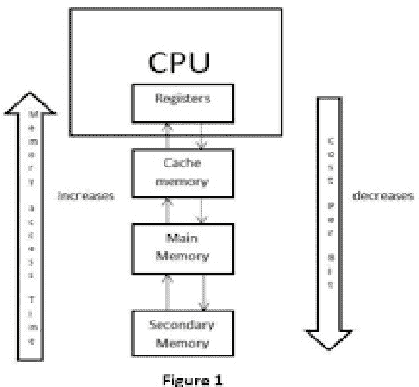

图 1

### C 语言：简介

C 是一种过程式编程语言。它最初由丹尼斯·里奇（Dennis Ritchie）在 1969 年至 1973 年间开发。它主要是作为系统编程语言而开发的，用于编写操作系统。C 语言的主要特性包括对内存的低级访问、简单的关键字集和简洁的风格。这些特性使 C 语言适合系统编程，例如操作系统或编译器开发。后来的许多语言都直接或间接地借鉴了 C 语言的语法/特性。Java、PHP、JavaScript 和许多其他语言的语法主要基于 C 语言。C++ 几乎是 C 语言的超集（有少数程序在 C 中能编译，但在 C++ 中不能编译）。

#### C 程序的基本结构

除了 main() 函数部分之外，所有部分在不需要时都可以省略。

#### 2) 编写第一个程序

下面是 C 语言中的第一个程序：

```
#include <stdio.h>
void main()
{
    printf("Welcome to C Programming!!");
}
```

**输出：**

```
Welcome to C Programming!!
```

让我们逐行分析这个程序。

- **第 1 行：** `#include <stdio.h>` — 在 C 程序中，所有以 `#` 开头的行都由预处理器处理，预处理器是编译器调用的一个程序。简单来说，预处理器接收一个 C 程序并生成另一个 C 程序。生成后的程序没有以 `#` 开头的行；所有这些行都由预处理器处理。在上面的示例中，预处理器将 `stdio.h` 的预处理代码复制到我们的文件中。`.h` 文件在 C 中称为头文件。这些头文件通常包含函数声明。我们需要 `stdio.h` 是因为程序中使用了 `printf()` 函数。
- **第 2 行：** `void main()` — 必须有一个起始点，编译后的 C 程序从该点开始执行。在 C 中，执行通常从 `main()` 的第一行开始。`main` 之前的 `void` 表示 `main()` 的返回类型。`main` 返回的值表示程序终止的状态。
- **第 3 行和第 6 行：** `{` 和 `}` — 在 C 语言中，一对花括号定义了一个作用域，主要用在函数以及 `if`、`else`、循环等控制语句中。所有函数都必须以花括号开始和结束。
- **第 4 行：** `printf("Welcome to C Programming!!");` — `printf()` 是一个标准库函数，用于在标准输出上打印内容。`printf` 结尾的分号表示行终止。在 C 中，分号总是用于表示语句的结束。

### 关于 C 语言中宏和预处理器的有趣事实

内核，并且它还支持高级编程语言的功能，例如用于软件应用程序的脚本等。

- 2. C 是一种结构化编程语言，它允许将复杂的程序拆分为更简单的程序，这些程序称为函数。它还允许数据在这些函数之间自由流动。
- 3. C 语言的诸多特性，包括对机器级硬件 API 的直接访问、C 编译器的存在、确定性的资源使用和动态内存分配，使 C 语言成为为嵌入式系统编写脚本应用程序和驱动程序的理想选择。
- 4. C 语言区分大小写，这意味着小写字母和大写字母会被区别对待。
- 5. C 语言具有很强的可移植性，常用于编写系统应用程序脚本，这些应用程序构成了 Windows、UNIX 和 Linux 操作系统的主要部分。
- 6. C 是一种通用编程语言，可以高效地处理企业应用程序、游戏、图形以及需要计算等的应用程序。
- 7. C 语言拥有丰富的库，提供了许多内置函数。它还支持动态内存分配。

### C 语言中的转义序列

在 C 编程语言中，字符集包含 256 个字符。整个字符集分为两个部分，即 ASCII 字符集和扩展 ASCII 字符集。但除此之外，还有一些其他字符不属于任何字符集，称为转义字符。

#### 转义序列列表

- `\a` – 警报或蜂鸣
- `\b` – 退格
- `\f` – 换页
- `\n` – 换行
- `\r` – 回车
- `\t` – 水平制表符
- `\v` – 垂直制表符
- `\\` – 反斜杠
- `\'` – 单引号
- `\"` – 双引号
- `\?` – 问号
- `\ooo` – 八进制数
- `\xhh` – 十六进制数
- `\0` – 空字符

### C 标记

goto 语句。

#### 在命名 C 标识符时应遵循以下规则：

- 它们必须以字母或下划线（`_`）开头。
- 它们只能由字母、数字或下划线组成。不允许使用其他特殊字符。
- 不能是关键字。
- 不能包含空白。
- 长度应最多为 31 个字符，因为只有前 31 个字符是有效的。

C 标识符的一些示例：

| 名称 | 备注 |
|------|--------|
| `_A9` | 有效 |
| `Temp.var` | 无效，因为它包含了下划线以外的特殊字符 |
| `void` | 无效，因为它是关键字 |

#### C 程序

```
void main()
{
int a = 10;
}
```

上述程序中有 2 个标识符：

- **main：** 方法名。
- **a：** 变量名。

**常量：** 常量与普通变量类似。但唯一的区别是，常量一旦定义，程序就不能修改它们的值。常量指的是固定值，也称为字面量。

常量可以属于任何数据类型。

**语法：**

```
const data_type variable_name; (or) const data_type *variable_name;
```

#### 常量的类型

- 整型常量 – 例如：0, 1, 1218, 12482


实数或浮点常量——例如：0.0、1203.03、30486.184

八进制与十六进制常量——例如：八进制：(013)₈ = (11)₁₀，十六进制：(013)₁₆ = (19)₁₀

字符常量——例如：'a'、'A'、'z'

字符串常量——例如："GeeksforGeeks"

**字符串：** 字符串本质上是以空字符（'\0'）结尾的字符数组。这个空字符表示字符串的结束。字符串总是用双引号括起来。而在 C 和 C++ 中，字符用单引号括起来。**字符串的声明方式：**

- char string[20] = {'g', 'e', 'e', 'k', 's', 'f', 'o', 'r', 'g', 'e', 'e', 'k', 's', '\0'};
- char string[20] = "geeksforgeeks";
- char string [] = "geeksforgeeks";

### 上述声明之间的区别：

当我们声明 char 为 "string[20]" 时，会分配 20 字节的内存空间来存储字符串值。

当我们声明 char 为 "string[]" 时，内存空间将在程序执行期间根据需求进行分配。

**特殊符号：** C 语言中使用的以下特殊符号具有某些特殊含义，因此不能用于其他用途。[] () {} , ; * = #

**方括号[]：** 开方括号和闭方括号用作数组元素引用。它们表示一维和多维下标。

**圆括号()：** 这些特殊符号用于表示函数调用和函数参数。

**花括号{}：** 这些左花括号和右花括号标记包含多条可执行语句的代码块的开始和结束。

**逗号 (, )：** 用于分隔多个语句，例如在 for 循环中分隔初始化、条件和增量。

**分号 (;)：** 它是一个运算符，本质上会调用所谓的初始化列表。

**星号 (*)：** 用于创建指针变量。

**赋值运算符 (=)：** 用于给变量赋值。

**预处理符 (#)：** 预处理器是一个宏处理器，编译器会在实际编译之前自动使用它来转换你的程序。

**运算符：** 运算符是应用于 C 变量和其他对象时触发某种动作的符号。运算符所操作的数据项称为操作数。根据运算符可操作的操作数数量，运算符可分为以下几类：

**一元运算符：** 只需要一个操作数即可操作的运算符称为一元运算符。例如自增和自减运算符。

**二元运算符：** 需要两个操作数进行操作的运算符称为二元运算符。**二元运算符又分为：**

- 1. 算术运算符
- 2. 关系运算符
- 3. 逻辑运算符
- 4. 赋值运算符
- 5. 条件运算符
- 6. 位运算符

**三元运算符：** 这些运算符需要三个操作数来进行操作。例如条件运算符(?:)。

# C 语言中的变量与关键字

**变量**简单来说就是一个存储位置，它被分配了一些内存。所以基本上，变量用于存储某种形式的数据。不同类型的变量需要不同数量的内存，并且有一组特定的操作可以应用于它们。

**变量声明：**
典型的变量声明形式如下：

```
type variable_name;
或者对于多个变量：
type variable1_name, variable2_name, variable3_name;
```

变量名可以由字母（大小写均可）、数字和下划线 ` _ ` 字符组成。但是，名称不能以数字开头。

## 变量声明和定义之间的区别

变量声明是指变量在首次使用之前被首次声明或引入的部分。变量定义是指变量被分配内存位置和值的部分。大多数情况下，变量声明和定义是一起完成的。

请参阅以下 C 程序以便更清楚地理解：

```
```c
#include <stdio.h>
int main()
{
    // 变量 'a123' 的声明和定义
    char a123 = 'a';
    // 这也是声明和定义，因为 'b' 被分配了
    // 内存并赋予了某个垃圾值。
    float b;
    // 多个声明和定义
    int _c, _d45, e;
    // 让我们打印一个变量
    printf("%c \n", a123);
    return 0;
}
```
```

**输出：**

a

**关键字**是 C 语言中特定的保留字，每个关键字都有一个与之关联的特定功能。几乎所有帮助我们使用 C 语言功能的单词都包含在关键字列表中。所以你可以想象，关键字列表不会是一个很小的列表！

C 语言中共有 32 个关键字：

- auto    break    case    char    const    continue  
- default    do    double    else    enum    extern  
- float    for    goto    if    int    long  
- register    return    short    signed    sizeof    static  
- struct    switch    typedef    union    unsigned    void  
- volatile    while

const：const 可用于声明常量变量。常量变量是在初始化后不能改变其值的变量。换句话说，赋予它们的值是不可修改的。

语法：

```
```c
const data_type var_name = var_value;
```
```

注意：常量变量必须在声明时强制初始化。const 关键字也可以与指针一起使用。请参阅 [C 语言中的 const 限定符](#) 以了解相关内容。

**static：** static 关键字用于声明静态变量，在编写 C 语言程序时广泛使用。静态变量具有即使在超出其作用域后仍能保留其值的特性！因此，静态变量会保留其作用域中最后一次使用的值。所以我们可以说，它们只被初始化一次，并且一直存在到程序终止。因此，不会分配新的内存，因为它们不会被重新声明。它们的作用域局限于定义它们的函数。全局静态变量可以在程序中的任何位置访问。默认情况下，编译器会给它们赋值为 0。

语法：

```
static data_type var_name = var_value;
```

## C 语言中变量的作用域是怎样的——静态还是动态？

在 C 语言中，变量总是静态（或词法）作用域的，即变量的绑定可以通过程序文本来确定，并且与运行时函数调用栈无关。

例如，下面程序的输出是 0，即 f() 返回的值不依赖于谁在调用它。f() 总是返回全局变量 x 的值。

```
int x = 0;
int f()
{
    return x;
}
int g()
{
    int x = 1;
    return f();
}
int main()
{
    printf("%d", g());
    printf("\n");
    getchar();
}
```

## C 语言中的作用域规则

标识符的作用域是程序中可以直接访问该标识符的部分。在 C 语言中，所有标识符都是词法（或静态）作用域的。C 语言的作用域规则可以分为以下两类。

### 全局作用域：可以在程序中的任何位置访问。

```
// 文件名：file1.c
int a;
int main(void)
{
  a = 2;
}
// 文件名：file2.c
// 当此文件与 file1.c 链接时，此文件的函数可以访问 a
extern int a;
int myfun()
{
  a = 2;
}
```

为了限制只能访问当前文件，全局变量可以被标记为 static。

### 块作用域：块是用左花括号和右花括号（分别为 { 和 }）括起来的一组语句。在 C 语言中，块可以嵌套（一个块内部可以包含其他块）。在块中声明的变量可以在该块以及该块的所有内部块中访问，但不能在该块外部访问。

如果内部块本身有一个同名变量会怎样？如果内部块声明的变量与外部块声明的变量同名，那么外部块变量的可见性在内部块声明该变量时结束。

```
int main()
{
  {
    int x = 10, y = 20;
    {
      // 外部块包含 x 和 y 的声明，因此
      // 以下语句是有效的，并打印 10 和 20
      printf("x = %d, y = %d\n", x, y);
      {
        // y 被重新声明，因此外部块的 y 在此块中不可访问
        int y = 40;
```


```c
x++; // Changes the outer block variable x to 11
y++; // Changes this block's variable y to 41

printf("x = %d, y = %d\n", x, y);
}

// This statement accesses only outer block's variables
printf("x = %d, y = %d\n", x, y);
}
}
return 0;
}
```

**Output:**

```text
x = 10, y = 20
x = 11, y = 41
x = 11, y = 20
```

函数及其传递给函数的参数又如何呢？函数本身就是一个块。函数的参数和其他局部变量遵循相同的块作用域规则。

一个块的变量能否在另一个后续块中访问？不能，在一个块中声明的变量只能在该块内部以及该块的所有内部块中访问。例如，以下程序会产生编译错误。

```c
int main()
{
    {
        int x = 10;
    }
    {
        printf("%d", x); // Error: x is not accessible here
    }
    return 0;
}
```

**Output:**

```text
error: 'x' undeclared (first use in this function)
```

作为练习，预测以下程序的输出。

```c
int main()
{
    int x = 1, y = 2, z = 3;
    printf(" x = %d, y = %d, z = %d \n", x, y, z);
    {
        int x = 10;
        float y = 20;
        printf(" x = %d, y = %f, z = %d \n", x, y, z);
        {
            int z = 100;
            printf(" x = %d, y = %f, z = %d \n", x, y, z);
        }
    }
    return 0;
}
```

### C 输入/输出语句

#### 未格式化 I/O 函数

主要讨论以下六个未格式化 I/O 函数：

- a) getchar()
- b) putchar()
- c) gets()
- d) puts()
- e) getch()
- f) getche()

##### a) getchar()

此函数是输入函数。用于从键盘读取单个字符。它是一个缓冲函数。缓冲函数从键盘获取输入并暂时存储在内存缓冲区中，直到您按下回车键。

一般语法为：

```c
v = getchar();
```

其中 v 是字符类型的变量。例如：

```c
char n;
n = getchar();
```

使用 getchar() 函数从键盘读取单个字符的简单 C 程序如下：

```c
/*To read a single character from the keyboard using the getchar() function*/
main()
{
    char n;
    n = getchar();
}
```

##### b) putchar()

此函数是输出函数。用于在屏幕上显示单个字符。一般语法为：

```c
putchar(v);
```

其中 v 是字符类型的变量。例如：

```c
char n;
putchar(n);
```

下面编写一个简单程序，它将使用 getchar() 函数读取单个字符并使用 putchar() 函数显示输入的数据：

```c
/*Program to illustrate the use of getchar() and putchar() functions*/

main()
{
    char n;
    n = getchar();
    putchar(n);
}
```

##### c) gets()

此函数是输入函数。用于从键盘读取字符串。它也是一个缓冲函数。

**OUTPUT IS:**

```text
Enter the Name
Laura
Name is:
Laura
```

##### e) getch()

这也是一个输入函数。用于像 getchar() 函数一样从键盘读取单个字符。但 getchar() 函数是缓冲函数，而 getch() 函数是非缓冲函数。此函数读取的字符数据直接分配给变量而不是进入内存缓冲区；字符数据在无需按下回车键的情况下直接分配给变量。

此函数的另一个用途是保持输出在屏幕上直到您按下回车键。一般语法为：

```c
v = getch();
```

其中 v 是字符类型的变量。

说明 getch() 函数用法的简单 C 程序：

```c
/*Program to explain the use of getch() function*/
main()
{
    char n;
    puts("Enter the Char");
    n = getch();
    puts("Char is :");
    putchar(n);
    getch();
}
```

**OUTPUT IS:**

```text
Enter the Char
Char is L
```

##### f) getche()

它与 getch() 函数相同，只是它是一个回显函数。这意味着当您从键盘输入字符数据时，它会在屏幕上可见。一般语法为：

```c
v = getche();
```

##### a) scanf()

| Format Code | Meaning |
|---|---|
| %c | To read a single character |
| %d | To read a signed decimal integer (short) |
| %ld | To read a signed long decimal integer |
| %e | To read a float value exponential |
| %f | To read a float (short) or a single precision value |
| %lf | To read a double precision float value |
| %g | To read double float value |
| %h | To read short integer |
| %i | To read an integer (decimal, octal, hexadecimal) |
| %o | To read an octal integer only |
| %x | To read a hexadecimal integer only |
| %u | To read unsigned decimal integer (used in pointer) |
| %s | To read a string |
| %[...] | To read a string of words from the defined range |
| %[^] | To read string of words which are not from the defined range |

```c
/*Program to illustrate the use of formatted code by using the formatted scanf() function */
main()
{
    char n, name[20];
    int abc;
    float xyz;
    printf("Enter the single character, name, integer data and real value");
    scanf("\n%c%s%d%f", &n, name, &abc, &xyz);
    getch();
}
```

##### b) printf()

这是一个输出函数。用于显示文本消息并在屏幕上显示混合类型（int、float、char）的数据。一般语法为：

```c
printf("controlstrings", &v1, &v2, &v3, ................, &vn);

or

printf("Message line or text line");
```

其中 v1、v2、v3、...、vn 都是变量。

控制字符串使用一些 printf() 格式代码或格式说明符或转换字符。这些都在下面的表中讨论：

不同数据类型也有不同的范围，可以存储的数字各不相同。这些范围可能因编译器而异。下面是在 32 位 gcc 编译器上数据类型、内存需求和格式说明符的列表。

| Data Type | Memory (bytes) | Range | Format Specifier |
|---|---|---|---|
| short int | 2 | -32,768 to 32,767 | %hd |
| unsigned short int | 2 | 0 to 65,535 | %hu |
| unsigned int | 4 | 0 to 4,294,967,295 | %u |
| int | 4 | -2,147,483,648 to 2,147,483,647 | %d |
| long int | 4 | -2,147,483,648 to 2,147,483,647 | %ld |
| unsigned long int | 4 | 0 to 4,294,967,295 | %lu |
| long long int | 8 | -(2^63) to (2^63)-1 | %lld |
| unsigned long long int | 8 | 0 to 18,446,744,073,709,551,615 | %llu |
| signed char | 1 | -128 to 127 | %c |
| unsigned char | 1 | 0 to 255 | %c |
| float | 4 |  | %f |
| double | 8 |  | %lf |
| long double | 12 |  | %Lf |

### 类型修饰符/限定符

类型修饰符改变基本数据类型的含义以产生新的类型。C 中有四种类型修饰符，它们是：

- signed
- unsigned
- short
- long

1. 这些类型修饰符中的每一个都可以应用于基本类型 int。
2. 类型修饰符 signed 和 unsigned 也可以应用于基本类型 char。
3. 此外，long 可以应用于 double。

| Data type | Format | Memory size | Accessibility range |
|---|---|---|---|
| unsigned char | %c | 1 Byte | 0 to 255 |
| char | %c | 1 Byte | -128 to 127 |
| int | %d | 2 Bytes | -32768 to 32767 |
| unsigned int | %u | 2 Bytes | 0 to 65535 |
| long (or) long int | %ld | 4 Bytes | -2147483648 to 2147483647 |
| unsigned long (or) unsigned long int | %lu | 4 Bytes | 0 to 4294967295 |
| float | %f | 4 Bytes | 3.4*(10 power -38) to 3.4*(10 power 38) |
| double | %lf | 8 Bytes | 1.7*(10 power -308) to 1.7*(10 power 308) |
| long double | %Lf | 10 Bytes | 3.4*(10 power -4932) to 1.1*(10 power 4932) |
| char[] (string) | %s |  |  |

- `%o` — Octal Base
- `%x` — Hexadecimal base
- `%p` — Memory address

### C 中的类型转换

类型转换基本上是从一种类型到另一种类型的转换。有两种类型的类型转换：

1. **隐式类型转换** – 也称为“自动类型转换”。由编译器自行完成，无需用户外部触发。一般发生在表达式中存在多个数据类型时发生。在这种情况下进行类型转换（类型提升）以避免数据丢失。

所有变量的数据类型都被升级为具有最大数据类型的变量的数据类型。

```text
bool -> char -> short int -> int ->
unsigned int -> long -> unsigned long ->
long long -> float -> double -> long double
```


隐式转换可能会丢失信息，符号可能会丢失（当有符号类型被隐式转换为无符号类型时），也可能发生溢出（当 `long long` 被隐式转换为 `float` 时）。

### 类型隐式转换示例：

```c
// An example of implicit conversion
#include<stdio.h>
int main()
{
    int x = 10;   // integer x
    char y = 'a'; // character c

    // y implicitly converted to int. ASCII
    // value of 'a' is 97
    x = x + y;

    // x is implicitly converted to float
    float z = x + 1.0;

    printf("x = %d, z = %f", x, z);
    return 0;
}
```

1. **输出：**

   `x = 107, z = 108.000000`

2. **显式类型转换**——这个过程也称为类型转换（type casting），由用户定义。这里，用户可以对结果进行类型转换，使其成为特定的数据类型。

C 语言中的语法如下：

```c
(type) expression
```

这里的 `type` 表示最终结果被转换成的数据类型。

```c
// C program to demonstrate explicit type casting
#include<stdio.h>

int main()
{
    double x = 1.2;

    // Explicit conversion from double to int
    int sum = (int)x + 1;

    printf("sum = %d", sum);

    return 0;
}
```

输出：

```text
sum = 2
```

### C 语言中的运算符

运算符是任何编程语言的基础。因此，不使用运算符，C 语言的功能就不完整。运算符允许我们对操作数执行不同类型的操作。在 C 语言中，运算符可以分为以下几类：

- **算术运算符**（+, -, *, /, %，后置递增、前置递增、后置递减、前置递减）
- **关系运算符**（==, !=, >, <, >=, <=）
- **逻辑运算符**（&&, || 和 !）
- **位运算符**（&, |, ^, ~, >> 和 <<）
- **赋值运算符**（=, +=, -=, *= 等）
- **其他运算符**（条件、逗号、sizeof、取地址、间接引用）

**算术运算符：**这些运算符用于对操作数执行算术/数学运算。属于此类的二元运算符有：

- **加法：**`+` 运算符将两个操作数相加。例如，x+y。
- **减法：**`-` 运算符将两个操作数相减。例如，x-y。
- **乘法：**`*` 运算符将两个操作数相乘。例如，x*y。
- **除法：**`/` 运算符将第一个操作数除以第二个操作数。例如，x/y。
- **取模：**`%` 运算符返回第一个操作数除以第二个操作数后的余数。例如，x%y。

```c
// C program to demonstrate working of binary arithmetic operators
#include<stdio.h>

int main()
{
    int a = 10, b = 4, res;

    //printing a and b
    printf("a is %d and b is %d\n", a, b);

    res = a+b; //addition
    printf("a+b is %d\n", res);

    res = a-b; //subtraction
    printf("a-b is %d\n", res);

    res = a*b; //multiplication
    printf("a*b is %d\n", res);

    res = a/b; //division
    printf("a/b is %d\n", res);

    res = a%b; //modulus
    printf("a%%b is %d\n", res);

    return 0;
}
```

**输出：**

```text
a is 10 and b is 4
a+b is 14
a-b is 6
a*b is 40
a/b is 2
a%b is 2
```

归属于一元算术运算符类别的是：

- **递增：**`++` 运算符用于将整数值增加 1。当它放在变量名之前（也称为前置递增运算符）时，该变量的值会立即增加。例如，**++x**。当它放在变量名之后（也称为后置递增运算符）时，该变量的值会暂时保留到当前语句执行完毕，并在执行下一条语句之前更新。例如，**x++**。
- **递减：**`--` 运算符用于将整数值减少 1。当它放在变量名之前（也称为前置递减运算符）时，该变量的值会立即减少。例如，**--x**。当它放在变量名之后（也称为后置递减运算符）时，该变量的值会暂时保留到当前语句执行完毕，并在执行下一条语句之前更新。例如，**x--**。

```c
// C program to demonstrate working of Unary arithmetic operators
#include<stdio.h>

int main()
{
    int a = 10, b = 4, res;

    // post-increment example:
    // res is assigned 10 only, a is not updated yet
    res = a++;
    printf("a is %d and res is %d\n", a, res); //a becomes 11 now

    // post-decrement example:
    // res is assigned 11 only, a is not updated yet
    res = a--;
    printf("a is %d and res is %d\n", a, res); //a becomes 10 now

    // pre-increment example:
    // res is assigned 11 now since a is updated here itself
    res = ++a;
    // a and res have same values = 11
    printf("a is %d and res is %d\n", a, res);

    // pre-decrement example:
    // res is assigned 10 only since a is updated here itself
    res = --a;
    // a and res have same values = 10
    printf("a is %d and res is %d\n",a,res);

    return 0;
}
```

**输出：**

```text
a is 11 and res is 10
a is 10 and res is 11
a is 11 and res is 11
a is 10 and res is 10
```

#### 关系运算符

关系运算符用于比较两个值。让我们逐一介绍：

- `==` 运算符检查两个给定操作数是否相等。如果相等，则返回真；否则返回假。例如，**5==5** 将返回真。
- `!=` 运算符检查两个给定操作数是否相等。如果不相等，则返回真；否则返回假。它是 `==` 运算符在布尔意义上的精确补运算。例如，**5!=5** 将返回假。
- `>` 运算符检查第一个操作数是否大于第二个操作数。如果是，则返回真；否则返回假。例如，**6>5** 将返回真。
- `<` 运算符检查第一个操作数是否小于第二个操作数。如果是，则返回真；否则返回假。例如，**6<5** 将返回假。
- `>=` 运算符检查第一个操作数是否大于或等于第二个操作数。如果是，则返回真；否则返回假。例如，**5>=5** 将返回真。
- `<=` 运算符检查第一个操作数是否小于或等于第二个操作数。如果是，则返回真；否则返回假。例如，**5<=5** 也将返回真。

```c
// C program to demonstrate working of relational operators
#include <stdio.h>

int main()
{
    int a=10, b=4;

    // relational operators
    // greater than example
    if (a > b)
        printf("a is greater than b\n");
    else printf("a is less than or equal to b\n");

    // greater than equal to
    if (a >= b)
        printf("a is greater than or equal to b\n");
    else printf("a is lesser than b\n");

    // less than example
    if (a < b)
        printf("a is less than b\n");
    else printf("a is greater than or equal to b\n");

    // lesser than equal to
    if (a <= b)
        printf("a is lesser than or equal to b\n");
    else printf("a is greater than b\n");

    // equal to
    if (a == b)
        printf("a is equal to b\n");
    else printf("a and b are not equal\n");

    // not equal to
    if (a != b)
        printf("a is not equal to b\n");
    else printf("a is equal to b\n");

    return 0;
}
```

**输出：**

```text
a is greater than b
a is greater than or equal to b
a is greater than or equal to b
a is greater than b
a and b are not equal
a is not equal to b
```

#### 逻辑运算符

逻辑运算符用于组合两个或多个条件/约束，或对当前所考虑条件的求值结果进行取反。具体描述如下：

- **逻辑与：**当所考虑的两个条件都满足时，`&&` 运算符返回真；否则返回假。例如，当 a 和 b 都为真（即非零）时，**a && b** 返回真。
- **逻辑或：**当所考虑的条件中有一个（或两个）满足时，`||` 运算符返回真；否则返回假。例如，如果 a 或 b 中有一个为真（即非零），则 **a || b** 返回真。当然，当 a 和 b 都为真时，它也返回真。
- **逻辑非：**如果所考虑的条件不满足，`!` 运算符返回真；否则返回假。例如，如果 a 为假，即当 a=0 时，**!a** 返回真。

```c
// C program to demonstrate working of logical operators
#include <stdio.h>

int main()
{
    int a=10, b=4, c = 10, d = 20;

    // logical operators

    // logical AND example
    if (a>b && c==d)
        printf("a is greater than b AND c is equal to d\n");
    else printf("AND condition not satisfied\n");

    // logical OR example
    if (a>b || c==d)
        printf("a is greater than b OR c is equal to d\n");
}
```


```c
else printf("Neither a is greater than b nor c is equal "
    " to d\n");

// logical NOT example
if (!a)
    printf("a is zero\n");
else printf("a is not zero");

return 0;
}
```

### Output:

```
AND condition not satisfied
a is greater than b OR c is equal to d
a is not zero
```

### Short-Circuiting in Logical Operators:

在逻辑 AND 的情况下，如果第一个操作数为假，则第二个操作数不会被求值。例如，下面的程序 1 没有打印 “GeeksQuiz”，因为逻辑 AND 的第一个操作数本身就是假的。

```c
#include <stdio.h>
#include <stdbool.h>
int main()
{
    int a = 10, b = 4;
    bool res = ((a == b) && printf("GeeksQuiz"));
    return 0;
}
```

但下面的程序会打印 “GeeksQuiz”，因为逻辑 AND 的第一个操作数为真。

```c
#include <stdio.h>
#include <stdbool.h>
int main()
{
    int a = 10, b = 4;
    bool res = ((a != b) && printf("GeeksQuiz"));
    return 0;
}
```

在逻辑 OR 的情况下，如果第一个操作数为真，则第二个操作数不会被求值。例如，下面的程序 1 没有打印 “GeeksQuiz”，因为逻辑 OR 的第一个操作数本身就是真的。

```c
#include <stdio.h>
#include <stdbool.h>
int main()
{
    int a = 10, b = 4;
    bool res = ((a != b) || printf("GeeksQuiz"));
    return 0;
}
```

但下面的程序会打印 “GeeksQuiz”，因为逻辑 OR 的第一个操作数为假。

```c
#include <stdio.h>
#include <stdbool.h>
int main()
{
    int a = 10, b = 4;
    bool res = ((a == b) || printf("GeeksQuiz"));
    return 0;
}
```

### Interesting Facts about Bitwise Operators in C

在 C 中，以下 6 个运算符是按位运算符（在位级别工作）：

- `&` （按位 AND）接受两个数字作为操作数，并在两个数字的每一位上执行 AND。只有当两个位都为 1 时，AND 的结果才为 1。
- `|` （按位 OR）接受两个数字作为操作数，并在两个数字的每一位上执行 OR。如果两个位中任意一个为 1，则 OR 的结果为 1。
- `^` （按位 XOR）接受两个数字作为操作数，并在两个数字的每一位上执行 XOR。只有当两个位不同时，XOR 的结果才为 1。
- `<<` （左移）接受两个数字，将第一个操作数的位左移，第二个操作数决定移动的位数。
- `>>` （右移）接受两个数字，将第一个操作数的位右移，第二个操作数决定移动的位数。
- `~` （按位 NOT）接受一个数字并反转其所有位。

以下是示例 C 程序。

```c
/* C Program to demonstrate use of bitwise operators */

#include <stdio.h>

int main()
{
    unsigned char a = 5, b = 9; // a = 5(00000101), b = 9(00001001)
    printf("a = %d, b = %d\n", a, b);
    printf("a&b = %d\n", a & b); // The result is 00000001
    printf("a|b = %d\n", a | b); // The result is 00001101
    printf("a^b = %d\n", a ^ b); // The result is 00001100
    printf("~a = %d\n", a = ~a);  // The result is 11111010
    printf("b<<1 = %d\n", b << 1); // The result is 00010010
    printf("b>>1 = %d\n", b >> 1); // The result is 00000100
    return 0;
}
```

Output:

```
a = 5, b = 9
a&b = 1
a|b = 13
a^b = 12
~a = 250
b<<1 = 18
b>>1 = 4
```

以下是关于按位运算符的有趣事实。

- 1) 左移和右移运算符不应用于负数。如果任一操作数为负数，结果就是未定义行为。例如 `-1 << 1` 和 `1 << -1` 的结果都是未定义的。此外，如果数字的移位量超过整数的大小，行为也是未定义的。例如，如果整数使用 32 位存储，则 `1 << 33` 是未定义的。有关更多详细信息，请参阅此内容。

- 2) 从技术面试的角度来看，按位 XOR 运算符是最有用的运算符。它被用于许多问题中。一个简单的例子可以是“给定一组数字，其中所有元素出现偶数次 except 一个数字，找到出现奇数次的数字”。这个问题可以通过对所有数字执行 XOR 来高效解决。

```c
// Function to return the only odd occurring element
int findOdd(int arr[], int n) {
    int res = 0, i;
    for(i = 0; i < n; i++)
        res ^= arr[i];
    return res;
}

int main() {
    int arr[] = {12, 12, 14, 90, 14, 14, 14};
    int n = sizeof(arr)/sizeof(arr[0]);
    printf("The odd occurring element is %d ", findOdd(arr, n));
    return 0;
}
```

// Output: The odd occurring element is 90

以下是使用 XOR 运算符可以解决的许多其他有趣问题。Find the Missing Number, swap two numbers without using a temporary variable, A Memory Efficient Doubly Linked List, and Find the two non-repeating elements。还有很多（参见此内容，此内容，此内容，此内容，此内容和此内容）

- 3) 按位运算符不应代替逻辑运算符使用。

逻辑运算符（`&&`、`||` 和 `!`）的结果要么是 0 要么是 1，但按位运算符返回一个整数值。此外，逻辑运算符将任何非零操作数视为 1。例如，考虑以下程序，`&` 和 `&&` 对于相同的操作数结果不同。

```c
int main()
{
    int x = 2, y = 5;
    (x & y) ? printf("True ") : printf("False ");
    (x && y) ? printf("True ") : printf("False ");
    return 0;
}
```

// Output: False True

- 4) 左移和右移运算符分别等同于乘以 2 和除以 2。

如第 1 点所述，它仅在数字为正数时才有效。

```c
int main()
{
    int x = 19;
    printf("x << 1 = %d\n", x << 1);
    printf("x >> 1 = %d\n", x >> 1);
    return 0;
}
```

// Output: 38 9

- 5) `&` 运算符可用于快速检查一个数字是奇数还是偶数

表达式 `(x & 1)` 的值只有在 x 为奇数时才非零，否则值为零。

```c
int main()
{
    int x = 19;
    (x & 1) ? printf("Odd") : printf("Even");
    return 0;
}
```

// Output: Odd

- 6) `~` 运算符应谨慎使用

如果 `~` 运算符作用于一个小数字，结果可能是一个大数字，如果结果存储在无符号变量中。如果结果存储在有符号变量中，结果可能为负数（假设负数以补码形式存储，其中最左位是符号位）

// 请注意，以下程序的输出取决于编译器

```c
int main()
{
    unsigned int x = 1;
    printf("Signed Result %d \n", ~x);
    printf("Unsigned Result %ud \n", ~x);
    return 0;
}
```

/* Output:
Signed Result -2
Unsigned Result 4294967294d */

### Interesting facts about Operator Precedence and Associativity

运算符优先级决定了在包含多个具有不同优先级的运算符的表达式中哪个运算符先执行。例如 10 + 20 * 30 计算为 10 + (20 * 30) 而不是 (10 + 20) * 30。

结合性用于表达式中出现两个相同优先级的运算符时。结合性可以是左到右或右到左。例如 ‘*’ 和 ‘/’ 具有相同的优先级，它们的结合性是左到右，因此表达式 “100 / 10 * 10” 被视为 “(100 / 10) * 10”。

> 优先级和结合性是运算符的两个特性，它们决定了在没有括号的情况下子表达式的求值顺序。

- 1) 结合性仅在存在两个或多个相同优先级的运算符时才使用。

需要注意的是，结合性并不定义单个运算符的操作数求值的顺序。例如，考虑以下程序，`+` 运算符的结合性是左到右，但这并不意味着 f1() 总是在 f2() 之前被调用。实际上，以下程序的输出取决于编译器。有关详细信息，请参阅此内容。

```c
// Associativity is not used in the below program. Output is compiler dependent.

int x = 0;

int f1() {
    x = 5;
    return x;
}

int f2() {
    x = 10;
    return x;
}

int main() {
    int p = f1() + f2();
    printf("%d ", x);
    return 0;
}
```

- 2) 所有具有相同优先级的运算符具有相同的结合性

这是必要的，否则编译器将无法决定具有两个相同优先级但结合性不同的运算符的表达式的求值顺序。例如 `+` 和 `-` 具有相同的结合性。

- 3) 后缀 `++` 和前缀 `++` 的优先级和结合性不同

后缀 `++` 的优先级高于前缀 `++`，它们的结合性也不同。后缀 `++` 的结合性是左到右，前缀 `++` 的结合性是右到左。

| Operator | Description | Associativity |
|---|---|---|
| ( ) | Parentheses (function call) (see Note 1) | left-to-right |
| [ ] | Brackets (array subscript) |  |
| . | Member selection via object name |  |
| -> | Member selection via pointer |  |
| ++ -- | Postfix increment/decrement (see Note 2) |  |


| 运算符 | 描述 | 结合性 |
| --- | --- | --- |
| `++` `--` | 前缀自增/自减 | 从右到左 |
| `+` `-` | 一元加/减 | 从右到左 |
| `!` `~` | 逻辑非/按位取反 | 从右到左 |
| `(type)` | 强制类型转换（将值转换为 *type* 的临时值） | 从右到左 |
| `*` | 解引用 | 从右到左 |
| `&` | 地址（操作数） | 从右到左 |
| `sizeof` | 确定在此实现中的字节大小 | 从右到左 |
| `* / %` | 乘法/除法/取模 | 从左到右 |
| `+ -` | 加法/减法 | 从左到右 |
| `<< >>` | 按位左移，按位右移 | 从左到右 |
| `< <=`<br>`> >=` | 关系小于/小于或等于<br>关系大于/大于或等于 | 从左到右 |
| `== !=` | 关系等于/不等于 | 从左到右 |
| `&` | 按位与 | 从左到右 |
| `^` | 按位异或 | 从左到右 |
| `<code>&#124;</code> | 按位包含或 | 从左到右 |
| `&&` | 逻辑与 | 从左到右 |
| `<code>&#124;&#124;</code> | 逻辑或 | 从左到右 |
| `? :` | 三元条件运算符 | 从右到左 |
| `=` | 赋值 | 从右到左 |
| `+= -=` | 加法/减法赋值 | 从右到左 |
| `*= /=` | 乘法/除法赋值 | 从右到左 |
| `%= &=` | 取模/按位与赋值 | 从右到左 |
| `^= |=` | 按位异或/包含或赋值 | 从右到左 |
| `<<= >>=` | 按位左移/右移赋值 | 从右到左 |
| `,` | 逗号（分隔表达式） | 从左到右 |

### 表达式和语句

#### 表达式

表达式是由运算符和操作数组成的序列，用于指定值的计算。表达式可能仅由单个实体组成，也可能由一个或多个运算符连接的多个实体组合而成。

在 C 中每个表达式都求值为一个值，即每个表达式都会产生某个特定类型的值（可以赋给变量）。下面表格中给出了一些表达式的示例。

```
a+b
3.14*r*r
b*b-4*a*c
```

C 程序的语句控制程序执行的流程。在 C 语言中提供了几种类型的语句，可分类为：

- 1) **表达式语句**
- 2) **复合语句**
- 3) **控制语句**

**表达式语句：** C 程序中的大多数语句都是表达式语句。表达式语句由表达式后跟分号组成。执行表达式会导致表达式被求值。

**示例：** 下面给出了 7 个表达式语句

```
a=10;
a+=20;
printf("Hello,Goodmorning!\n");
display(a,b);        /*A function call*/
c=a+b;               /* An assignment statement*/
c+sum(a+b);          /* A valid, but strange statement*/
;                    /*An empty or null statement*/
```

**复合语句：** 复合语句（也称为“块”）通常作为另一个语句的主体出现，例如 if 语句、for 语句、while 语句等。

它由一对大括号 { } 括起来的多个单独语句组成。单独的语句本身可以是表达式语句、复合语句或控制语句。与表达式语句不同，复合语句不以分号结尾。下面给出了一个典型的复合语句。

```
{
    pi=3.14;
    area=pi*radius*radius;
}
```

该特定复合语句由两个赋值类型的表达式语句组成。

**控制语句：** 用于指定程序控制流程的语句；即程序中指令执行的顺序。可以做出决策，反复执行任务或从代码的一个部分跳转到另一个部分。

C 中有四种类型的控制语句：

- 1. 决策语句（条件分支）
- 2. 选择语句（多路选择-switch 语句）
- 3. 迭代语句（循环控制语句）
- 4. 跳转语句（无条件分支）

#### 示例问题

| 问题 | CO’s | RBT Levels |
| --- | --- | --- |
| 用示例定义 C 中的标记。 | CO1,CO2 | L1 |
| 解释 C 中存在的所有运算符。 | CO1,CO2 | L1 |
| 定义算法并写出其用途。 | CO1,CO2 | L1 |
| 定义流程图。列出其符号及含义。 | CO1,CO2 | L1 |
| 描述 C 中不同的 **数据类型** 并给出每个的示例 | CO1,CO2 | L1 |
| 通过合适的示例定义 **常量及其分类** | CO1,CO2 | L1 |
| 用规则和合适的示例区分 **关键字和标识符**。 | CO1,CO2 | L1 |
| 讨论 C 语言中可用的不同数据类型，并给出内存布局示例 | CO1,CO2 | L2 |
| 用示例解释隐式和显式类型转换 | CO1,CO2 | L2 |
| 用每个的示例解释 **逻辑和关系** 运算符 | CO1,CO2 | L2 |
| 用每个的示例解释 **按位和条件** 运算符 | CO1,CO2 | L2 |
| 解释 C 程序的结构。 | CO1,CO2 | L2 |
| 用语法解释 C 中自增和自减运算符 | CO1,CO2 | L2 |
| 用合适的示例讨论 **&& 和 &** 运算符。 | CO1,CO2 | L2 |
| 将 **条件运算符** 应用于合适的程序 | CO1,CO2 | L3 |
| 设计一个 **流程图并编写算法** 来交换三个数字 | CO1,CO2 | L3 |
| 用语法和合适的编程示例说明 **条件运算符**。 | CO1,CO2 | L3 |
| (a) 若 a=20 求值 a+=a+ ++a<br>(b) 求解表达式 a+2>b&&!c&#124;&#124;a!=d&&a-2<=e<br>其中 a=11, b=6, c=0, d=7, e=5 | CO1,CO2 | L4 |
| 测试以下代码的错误并写出其输出。<br>void main()<br>&nbsp;&nbsp;&nbsp;&nbsp;int a, b;<br>&nbsp;&nbsp;&nbsp;&nbsp;clrscr();<br>&nbsp;&nbsp;&nbsp;&nbsp;a=5;b=3;<br>&nbsp;&nbsp;&nbsp;&nbsp;d=a+b;<br>&nbsp;&nbsp;&nbsp;&nbsp;d=a-b;<br>&nbsp;&nbsp;&nbsp;&nbsp;d=a/b; | CO1,CO2 | L4 |
| 求解以下表达式 A=2,b=3,c=4,d=3,e=7。<br>(a) A++ + b++ - ++b / ++c<br>(b) A+b*c&d*e/c<br>(c) (a>b) + &#124;c / d++ | CO1,CO2 | L4 |
| 比较自增和自减运算符的工作方式并举例 | CO1,CO2 | L4 |
| 用编程示例解释 = 和 == 运算符的用法。 | CO1,CO2 | L4 |
| 用语法和编程示例解释标准输入输出函数（scanf(),printf()）。 | CO1,CO2 | L4 |
| 求解表达式 a+2>b&&!c&#124;&#124;a!=d&&a-2<=e<br>其中 a=11, b=6, c=0, d=7, e=5 | CO1,CO2 | L5 |
| (a) 若 a=20 求值 a+=a+ ++a<br>(b) 求解<br>int p=7;<br>int q=2;<br>float r;<br>r=p/q; | CO1,CO2 | L5 |
| 求以下代码的输出：<br><code>#include &lt;stdio.h&gt;<br>void main()<br>{<br>int i=1,k=0,j=1,a;<br>a=i++*!k&&&j;<br>printf("\n %d",a&gt;1);<br>}</code> | CO1,CO2 | L5 |
| 求解以下表达式 a=17,b=8,c=4,d=2,e=3。<br>(a) a && b++*d--/e<br>(b) a+b*c&d*e%c | CO1,CO2 | L5 |
| 设计一个流程图和伪代码，在不使用任何循环语句的情况下求 ‘n’ 个自然数的和。 | CO1,CO2 | L6 |
| 设计一个 **流程图并编写算法** 来交换三个数字 | CO1,CO2 | L6 |
| 编写一个求解二次方程根的算法。 | CO1,CO2 | L6 |
| 设计一个 **流程图** 来求学生的成绩为优秀、良好、及格、不及格和缺席。 | CO1,CO2 | L6 |
| 以下程序的输出是什么<br><code>#include &lt;stdio.h&gt;<br>void main()<br>{<br>int i = 0;<br>for (i = 0; i &lt; 5; i++)<br>if (i &lt; 4)<br>{<br>printf("Hello");<br>break;<br>}<br>}</code> | CO1,CO2 | L6 |
| 编写一个 **程序** 在不使用第 3 个变量的情况下交换两个数字。 | CO1,CO2 | L6 |

# MODULE 2

## 分支（条件分支和无条件分支）

## 控制流

程序由通常按顺序执行的多个语句组成。如果我们可以控制语句运行的顺序，程序将更加强大。语句分为三种一般类型：

- 赋值语句，将值，通常是计算结果，存储在变量中。
- 输入/输出语句，数据被读入或打印输出。
- 控制语句，程序决定下一个应该执行哪个语句。

控制语句可以是

**分支：** 在程序中选择可选的部分。

**循环：** 重复程序的重要部分。

## 分支

### 1) 简单的 if 语句

```
if (testExpression)
{
    // statements
}

Statement x;
```

`if` 语句计算括号内的测试表达式。

如果测试表达式求值为真（非零），则 `if` 主体内的语句将被执行。

如果测试表达式求值为假（0），则 `if` 主体内的语句将被跳过执行，控制转移到语句 x。


#### if 语句流程图

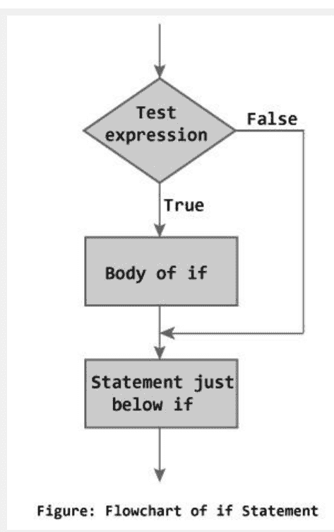

Figure: Flowchart of if Statement

```
// Program to display a number if user enters negative number

#include<stdio.h>

void main()
{
int number;

printf("Enter an integer: ");
scanf("%d",&number);

// Test expression is true if number is less than 0
if(number <0)
{
printf("You entered a negative number %d",number);
}

printf("The if statement is easy.");
}
```

Output 1:

Enter an integer: -2

You entered a negative number -2.

The if statement is easy.

Output 2:

Enter an integer: 5

The if statement in C programming is easy.

### 2) The if else Statement

The if...else statement executes some code if the test expression is true (nonzero) and some other code if the test expression is false (0).

#### Syntax of if...else

```
if (testExpression) {

    // codes inside the body of if

}
```
```
else {

    // codes inside the body of else

}
```

If test expression is true, codes inside the body of `if` statement is executed and, codes inside the body of `else` statement is skipped.

If test expression is false, codes inside the body of `else` statement is executed and, codes inside the body of `if` statement is skipped.

#### Flowchart of if...else statement

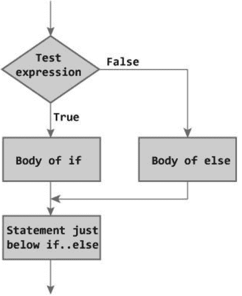

Figure: Flowchart of if...else Statement

```
// Program to check whether an integer entered by the user is odd or even
```
```
#include<stdio.h>

int main()
{
    int number;

    printf("Enter an integer: ");
    scanf("%d",&number);

    // True if remainder is 0
    if(number%2==0)
        printf("%d is an even integer.",number);
    else
        printf("%d is an odd integer.",number);

    return 0;
}
```

#### Output:1

```
Enter an integer: 7

7 is an odd integer.
```

When user enters 7, the test expression `( number%2 == 0 )` is evaluated to false. Hence, the statement inside the body of `else` statement `printf("%d is an odd integer");` is executed and the statement inside the body of `if` is skipped.

#### Output:2

```
Enter an integer: 4

4 is an even integer.
```

### Nested if...else statement (if...elseif....else Statement)

The nested if...else statement allows you to check for multiple test expressions and execute different codes for more than two conditions.

#### Syntax of nested if...else statement.

When an if else statement is present inside the body of another “if” or “else” then this is called nested if else.

#### Syntax of Nested if else statement:

```
if(condition){
//Nested if else inside the body of "if"
if(condition2){
//Statements inside the body of nested "if"
}
else{
//Statements inside the body of nested "else"
}
}
else{
//Statements inside the body of "else"
}
```

#### Example of nested if..else

```
#include<stdio.h>
int main()
{
int var1, var2;
printf("Input the value of var1:");
scanf("%d",&var1);
printf("Input the value of var2:");
scanf("%d",&var2);
if(var1 != var2)
{
        printf("var1 is not equal to var2\n");
        //Nested if else
        if(var1 > var2)
        {
                printf("var1 is greater than var2\n");
        }
        else
        {
                printf("var2 is greater than var1\n");
        }
}
else
{
        printf("var1 is equal to var2\n");
}
return 0;
}
```

Output:

```
Input the value of var1:12
Input the value of var2:21
var1 is not equal to var2
```

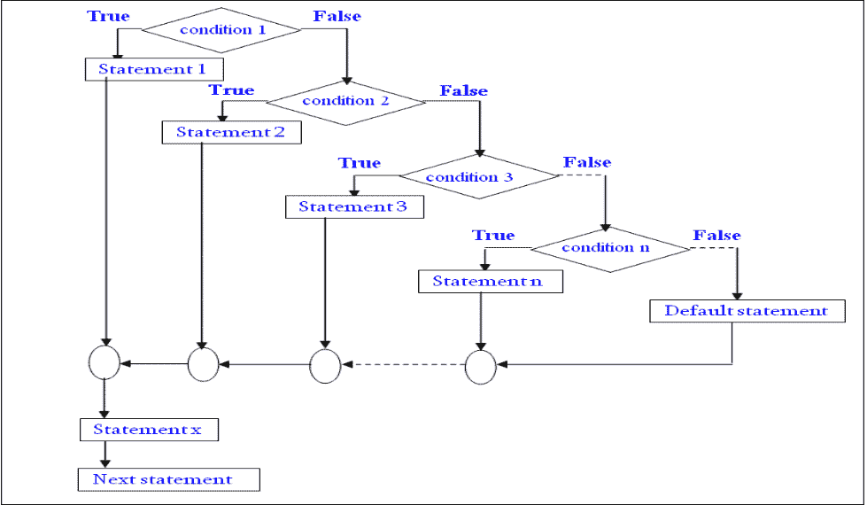

#### Example of else.if statement

program check whether a student passed or failed in examination using if statement.

```
#include<stdio.h>
#include<conio.h>

int main(){
    int marks;

    printf("Enter your marks between 0-100\n");
    scanf("%d", &marks);
    /* Using if else ladder statement to print
       Grade of a Student */
    if(marks >= 90){
        /* Marks between 90-100 */
        printf("YOUR GRADE : A\n");
    } else if(marks >= 70 && marks < 90){
        /* Marks between 70-89 */
        printf("YOUR GRADE : B\n");
    } else if(marks >= 50 && marks < 70){
        /* Marks between 50-69 */
        printf("YOUR GRADE : C\n");
    } else{
        /* Marks less than 50 */
        printf("YOUR GRADE : Failed\n");
```

```
}

getch();
return(0);
}
```

Output

```
Enter your marks

96

YOUR GRADE : A

Enter your marks

75

YOUR GRADE : B

Enter your marks

60

YOUR GRADE : C

Enter your marks

35

YOUR GRADE : Failed
```

#### Cascaded if..else

A cascading if-else is a composite of if-else statements where the false path of outer if statement is a nested if-else statement. The nesting can continue to several levels.

```
if ( expression )
statement

else

    if (expression )
    statement

    else

    if ( expression )
    statement

    else
```

### C switch...case Statement

The `if...else...if` ladder allows you to execute a block code among many alternatives. If you are checking on the value of a single variable in `if...else...if`, it is better to use `switch` statement.

The switch statement is often faster than nested `if...else` (not always)

#### Syntax of switch...case

```
switch (int_expr)

{

case constant1:

    // code to be executed if n is equal to constant1;

break;

case constant2:

    // code to be executed if n is equal to constant2;

break;

.

.

.
```
```
default:

    // code to be executed if n doesn't match any constant

}
```

When a case constant is found that matches the switch expression, control of the program passes to the block of code associated with that case.

In the above pseudocode, suppose the value of *n* is equal to *constant2*. The compiler will execute the block of code associate with the case statement until the end of switch block, or until the break statement is encountered.

The break statement is used to prevent the code running into the next case.

#### switch Statement Flowchart

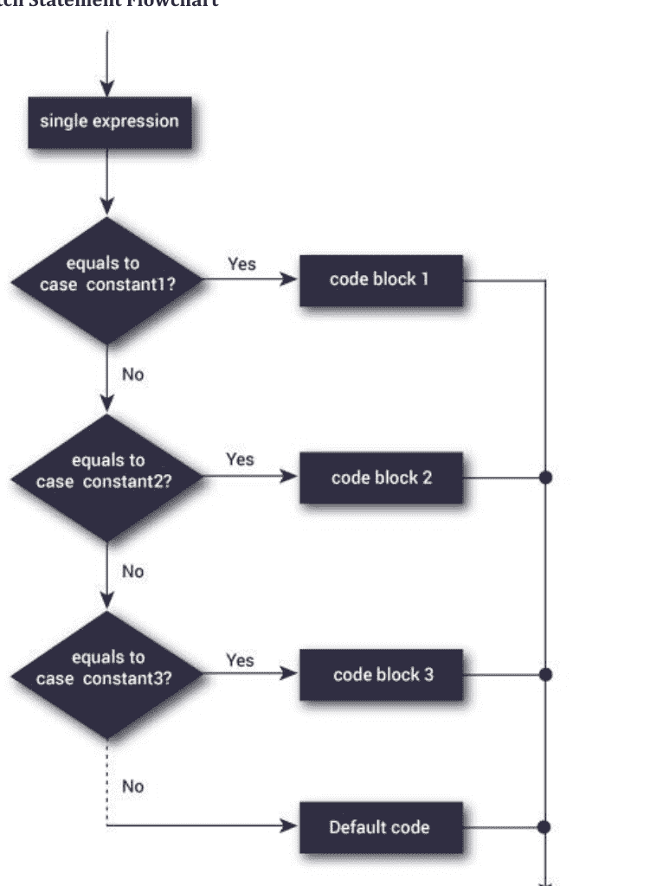

#### Example: switch Statement

```
// Program to create a simple calculator
// Performs addition, subtraction, multiplication or division depending the input from user

# include <stdio.h>
```
```
int main(){

char operator;

double firstNumber,secondNumber;

printf("Enter an operator (+, -, *, /): ");
scanf("%c",&operator);

printf("Enter two operands: ");
scanf("%lf %lf",&firstNumber,&secondNumber);

switch(operator)
{
case '+':
printf("%.1f + %.1f = %.1f",firstNumber,secondNumber,firstNumber+secondNumber);
break;

case '-':
printf("%.1f - %.1f = %.1f",firstNumber,secondNumber,firstNumber-secondNumber);
break;

case '*':
printf("%.1f * %.1f = %.1f",firstNumber,secondNumber,firstNumber*secondNumber);
break;

case '/':
printf("%.1f / %.1f = %.1f",firstNumber,secondNumber,firstNumber/firstNumber);
break;

// operator is doesn't match any case constant (+, -, *, /)
default:
printf("Error! operator is not correct");

```

```
}

return 0;
}
```

##### Output

```
Enter an operator (+, -, *, ): -

Enter two operands: 32.5

12.4

32.5 - 12.4 = 20.1
```

he - operator entered by the user is stored in operator variable. And, two operands 32.5 and 12.4 are stored in variables firstNumber and secondNumber respectively.

Then, control of the program jumps to

```
printf("%.11f / %.11f = %.11f",firstNumber, secondNumber, firstNumber/firstNumber);
```

Finally, the break statement ends the switch statement.

If break statement is not used, all cases after the correct case is executed.

If none of cases match then default statement is executed.

### Unconditional Branching Statements

#### C – goto statement

When a goto statement is encountered in a C program, the control jumps directly to the label mentioned in the goto statement

#### Syntax of goto statement in C

```
goto label_name;
..
..
label_name: C-statements
```

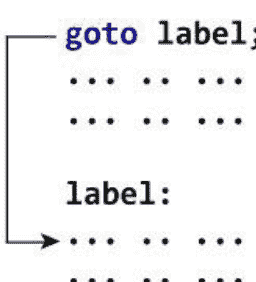

#### Example of goto statement

```
#include<stdio.h>
int main()
{
int sum=0;
for(int i =0; i<=10; i++){
    sum=sum+i;
    if(i==5){
    goto addition;
    }
}

addition:
printf("%d", sum);

return 0;
}
```

Output:

```
15
```

**Explanation:** In this example, we have a label addition and when the value of i (inside loop) is equal to 5 then we are jumping to this label using goto. This is reason the sum is displaying the sum of numbers till 5 even though the loop is set to run from 0 to 10.

It is sometimes desirable to skip some statements inside the loop or terminate the loop immediately without checking the test expression.

In such cases, `break` and `continue` statements are used.


#### break 语句

break 语句在遇到时立即终止循环（`for`、`while` 和 `do...while` 循环）。break 语句与诸如 `if...else` 之类的决策语句一起使用。在 C 编程中，break 语句也与 `switch...case` 语句一起使用。

#### break 语句的语法

```c
break;
```

#### break 语句的流程图

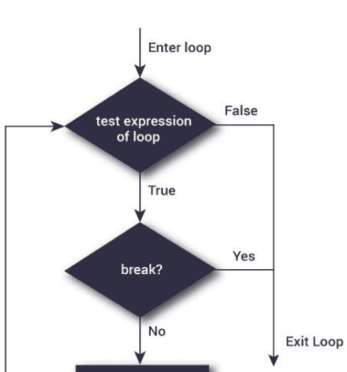

#### break 语句如何工作？

```c
while (test Expression)
{
    // codes
    if (condition for break)
    {
        break;
    }
    // codes
}
```

```c
for (init, condition, update)
{
    // codes
    if (condition for break)
    {
        break;
    }
    // codes
}
```

#### 示例 #1：break 语句

```c
// Program to calculate the sum of maximum of 10 numbers
// Calculates sum until user enters positive number

#include <stdio.h>

void main()
{
    int i;
    double number, sum = 0.0;

    for(i = 1; i <= 10; ++i)
    {
        printf("Enter a n%d: ", i);
        scanf("%lf", &number);

        // If user enters negative number, loop is terminated
        if(number < 0.0)
        {
            break;
        }

        sum += number; // sum = sum + number;
    }

    printf("Sum = %.2lf", sum);
}
```

###### 输出

```text
Enter a n1: 2.4

Enter a n2: 4.5

Enter a n3: 3.4

Enter a n4: -3

Sum = 10.30
```

### Continue 语句

continue 语句跳过循环内的某些语句。continue 语句也与诸如 `if...else` 之类的决策语句一起使用。

#### continue 语句的语法

```c
continue;
```

#### continue 语句的流程图

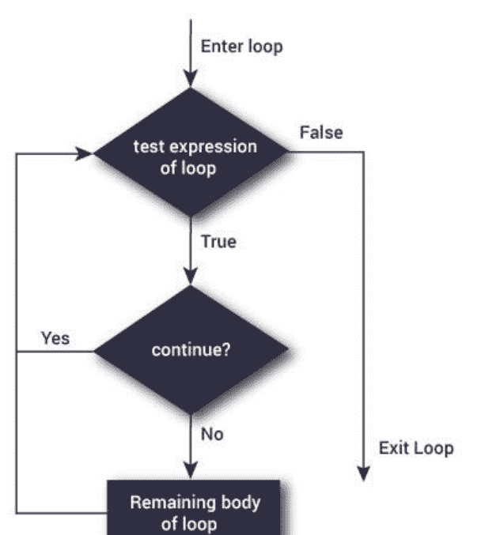

#### continue 语句如何工作？

```c
while (test Expression)
{
    // codes
    if (condition for continue)
    {
        continue;
    }
    // codes
}
```

```c
for (init, condition, update)
{
    // codes
    if (condition for continue)
    {
        continue;
    }
    // codes
}
```

```c
// Program to calculate sum of maximum of 10 numbers
// Negative numbers are skipped from calculation

#include <stdio.h>

int main()
{
    int i;
    double number, sum = 0.0;

    for(i = 1; i <= 10; ++i)
    {
        printf("Enter a n%d: ", i);
        scanf("%lf", &number);

        // If user enters negative number, loop is terminated
        if(number < 0.0)
        {
            continue;
        }

        sum += number; // sum = sum + number;
    }

    printf("Sum = %.2lf", sum);

    return 0;
}
```

###### 输出

```text
Enter a n1: 1.1

Enter a n2: 2.2

Enter a n3: 5.5

Enter a n4: 4.4

Enter a n5: -3.4

Enter a n6: -45.5

Enter a n7: 34.5

Enter a n8: -4.2

Enter a n9: -1000

Enter a n10: 12

Sum = 59.70
```

在程序中，当用户输入正数时，`sum += number;` 语句会计算总和。

当用户输入负数时，`continue` 语句被执行并跳过负数不参与计算。

### 分支与循环

#### 循环（重复）

一组语句可能需要重复执行指定的次数或直到满足条件为止。帮助我们重复执行一组语句的语句称为循环或重复或迭代语句。

C 中有 3 种类型的循环：

- while 循环
- for 循环
- do-while 循环

任何循环结构都必须执行 3 项任务，即初始化、条件检查和递增。三种循环控制结构之间的区别在于它们执行这 3 项任务的顺序，即（初始化、递增、条件检查）。

#### while 循环

它是一个预测试或入口控制循环，因此首先评估条件，并且只有当条件为真时才会执行循环体。它也是一个条件控制或事件控制循环。

#### 语法

```c
initialization;

while(condition)
{
    Statement;
    updation;
}
Statement;
```

#### 工作原理

1. 对循环控制变量进行初始化。
2. 接下来检查条件。
3. 如果条件评估为真，则控制进入循环体并执行体内的语句。
4. 接下来更新循环计数器变量，之后控制返回到条件检查。如果条件为真，则再次执行体。
5. 只要条件评估为真，此过程就会重复。一旦条件评估为假，控制就会流向循环体外的语句。

###### 示例

```c
/* program to display numbers from 1-10 */

#include<stdio.h>

void main()
{
    int i;

    i = 0;              /* initialization */
    while(i <= 10)      /* condition checking */
    {
        printf("%d\n", i);
        i++;            /* updation */
    }
    getch();
}
```

**注意：** 研究相应的实验程序和理论课上给出的程序。

#### for 循环

使用它我们可以重复执行一组语句指定的次数。所以它也称为计数器控制循环。它是一个预测试或顶部测试循环。

#### 语法

```c
for(initialization; condition check; updation)
{
    Statements
}
```

#### 工作原理

1. 这里初始化、条件检查和更新都在同一语句中完成。
2. 执行循环计数器的初始化。
3. 检查条件。如果条件评估为真，则控制进入循环体。执行体内的语句。
4. 执行循环计数器的更新。之后控制再次返回到条件检查。如果条件为真，则再次执行体。
5. 只要条件评估为真，此过程就会重复。一旦条件评估为假，控制就会流向循环体外的语句。

###### 示例

```c
/* program to display numbers from 1-10 */

#include<stdio.h>

void main()
{
    int i;

    for(i = 0; i <= 10; i++)
    {
        printf("%d\n", i);
    }

    getch();
}
```

**注意：** 研究相应的实验程序和理论课上给出的程序。

#### Do-while

它是一个后测试或底部测试循环，因此首先执行循环体，然后再检查条件。

#### 语法

```c
Initialization;

do
{
    statement;
    updation;
} while(condition);  /* note: there is a semi-colon at the end of while */

statements
```

#### 工作原理

1. 首先执行初始化。
2. 然后一次又一次地执行循环体内的语句。
3. 在体末尾执行更新，然后检查条件。
4. 如果条件评估为真，则控制重新进入体并执行体内的语句。
5. 只要条件评估为真，此过程就会重复。
6. 当条件变为假时，控制离开循环体。

###### 示例

```c
#include<stdio.h>

void main()
{
    int i;

    i = 0;                  /* initialization */
    do
    {
        printf("%d\n", i);
        i++;                /* updation */
    } while(i <= 10);       /* condition checking */

    getch();
}
```

**注意：** 研究相应的实验程序和理论课上给出的程序。

#### while 循环与 do-while 循环的区别

|  | While 循环 | Do-while 循环 |
|---|---|---|
| **1** | **语法**<br><br><code>initialization;</code><br><br><code>while(condition)</code><br><br><code>{</code><br><br><code>Statement;</code><br><br><code>updation;</code><br><br><code>}</code><br><br><code>Statement;</code> | **语法：**<br><br><code>Initialization;</code><br><br><code>do</code><br><br><code>{</code><br><br><code>statement;</code><br><br><code>updation;</code><br><br><code>} while(condition);</code><br><br><code>Statement;</code> |
| **2** | 它是一个顶部测试或入口控制循环，因为条件首先在开始时检查。 | 它是一个底部测试或出口控制循环，因为条件在循环底部检查。 |
| **3** | 它是一个预测试循环，如果表达式在开始时就评估为假，则循环体内的语句甚至一次也不会执行。 | 它是一个后测试循环，即使条件为假，循环体也会至少执行一次。 |
| **4** | 示例 | 示例 |

###### 示例

```c
sum = 0;
i = 0;
top: sum = sum + i;
i++;
if(i <= n) goto top;
```

#### 缺点

- 它是一种非结构化编程风格。
- 非常难以阅读和理解。
- 非常难以调试程序。

#### break 语句

它是一个跳转语句，可用于 switch 语句和循环。

#### 工作原理

1. 在 switch 语句中，它导致控制终止 switch 语句，并且将执行 switch 语句之后的语句。
2. 如果在循环（for、while、do-while）中执行 break，则控制离开循环，并且将执行循环之后的语句。

**注意：** 如果 break 出现在嵌套循环的内层循环中，控制只会离开内层循环。

```c
for(............)
{
    for(............)
    {
        ................
        if(error)
            break;
```


### Continue 语句

它用于根据某些条件跳过循环的一部分。

#### 工作原理

遇到 continue 语句时，循环体内的剩余语句将被跳过，并执行循环中的条件表达式。

#### 图示表示

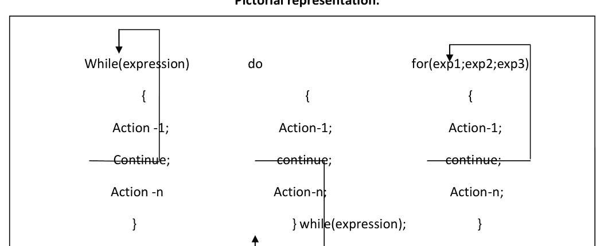

### break 与 continue 语句的区别

|  | Break | Continue |
|---|---|---|
| 1 | 当执行 break 时，break 之后的语句将被跳过并导致循环终止。 | 当执行 continue 语句时，continue 之后的语句将被跳过并导致循环以下一轮迭代继续 |
| 2 | 它可以在 switch 语句中使用以将控制转移到 switch 外部 | 它不能在 switch 语句中使用 |
| 3 | **示例：**<br><pre>for(i=1;i&lt;=5;i++)<br>{<br>    if(i==3)<br>        break;<br>    printf("%d\t",i);<br>}<br></pre><br>**输出：**<br>`1 2` | **示例：**<br><pre>for(i=1;i&lt;=5;i++)<br>{<br>    if(i==3)<br>        continue;<br>    printf("%d\t",i);<br>}<br></pre><br>**输出：**<br>`1 2 4 5` |

### 嵌套循环

在另一个循环内的循环称为嵌套循环。

```c
for(; ;)
{
    ...........
    for(; ;)
    {
        ................
    }
}
```

### 样题

| 题目 | CO | RBT 等级 |
|---|---|---|
| 简要说明带示例的简单 if、if-else 和嵌套 if-else 语句 | CO2,CO3 | L2 |
| 举例说明 For、While 和 Do-While 循环的概念。 | CO2,CO3 | L2 |
| 说明 switch-case 语句的语法 | CO2,CO3 | L2 |
| 举例讨论 break 和 continue 语句。 | CO2,CO3 | L2 |
| 举例说明带语法的 for 循环 | CO2,CO3 | L2 |
| 将条件运算符应用于合适的程序 | CO2,CO3 | L3 |
| 设计流程图并编写算法交换三个数字 | CO2,CO3 | L3 |
| 举例说明条件运算符的语法和合适的编程示例。 | CO2,CO3 | L3 |
| 举例说明 while 和 do-while 循环，并论证在一种场景下哪一个更好 | CO2,CO3 | L4 |
| 类比：<br>**学生根据在 CIE 中获得的分数进行分类，类比如下：**<br>**Marks&gt;=75 Distinction**<br>**Marks &gt;=60 and &lt;75 First Class**<br>**Marks &gt;=50 and &lt;60 Second Class**<br>**Marks &gt;=40 and &lt;50 Third Class**<br>**Marks &lt;40 Fail**<br>为上述场景设计流程图并附带适当的提示和流程。 | CO2,CO3 | L4 |
| 设计流程图和伪代码在不使用任何循环语句的情况下求 ‘n’ 个自然数的和。 | CO2,CO3 | L6 |
| 设计流程图并编写算法交换三个数字 | CO2,CO3 | L6 |
| 举例说明 C 中的 switch-case 语句。 | CO2,CO3 | L6 |
| 编写算法求二次方程的根。 | CO2,CO3 | L6 |
| 设计流程图以查找学生的成绩为 distinction、first class、pass、fail 和 absent。 | CO2,CO3 | L6 |
| 编写 C 程序判断给定的年份是否为闰年。 | CO2,CO3 | L6 |
| 编写 C 程序求 1 到 100 的数的和 | CO2,CO3 | L6 |
| 编写 C 程序判断给定的三角形是等边、等腰还是不等边。 | CO2,CO3 | L6 |
| 以下程序的输出是什么<br><pre>#include &lt;stdio.h&gt;<br>void main()<br>{<br>    int i = 0;<br>    for (i = 0; i &lt; 5; i++)<br>        if (i &lt; 4)<br>        {<br>            printf("Hello");<br>            break;<br>        }<br>}</pre> | CO2,CO3 | L6 |
| 编写程序判断给定的数是偶数还是奇数 | CO2,CO3 | L6 |
| 编写 C 程序打印前十个质数。 | CO2,CO3 | L6 |
| 编写 C 程序打印到 100 的斐波那契数列。 | CO2,CO3 | L6 |
| 编写程序读取一个三位数并打印个位、十位、百位的数字。 | CO2,CO3 | L6 |
| 评估 For、While 和 Do-While 循环的概念并举例。 | CO2,CO3 | L5 |
| 举例说明带语法的 for 循环 | CO3 | L1 |
| 举例说明 while 和 do-while 循环，并论证在一种场景下哪一个更好 | CO2,CO3 | L4 |
| 举例说明不同的循环概念 | CO3 | L2 |
| 在你自己的示例中应用嵌套循环 | CO2,CO3 | L3 |
| 编写 C 程序求 1 到 100 的数的和 | CO3 | L6 |
| 以下程序的输出是什么<br><pre>#include&lt;stdio.h&gt;<br><br>void main()<br>{<br>    int i = 0;<br>    for (i = 0; i &gt; 5; i++)<br>        if (i &gt; 4)<br>        {<br>            printf("Hello");<br>            break;<br>        }<br>}</pre> | CO3 | L6 |
| 编写 C 程序打印前十个质数。 | CO3 | L6 |
| 编写 C 程序打印到 100 的斐波那契数列。 | CO3 | L6 |
| 编写程序读取一个三位数并打印个位、十位、百位的数字。 | CO3 | L6 |
| 编写 C 程序求给定数的阶乘。 | CO3 | L6 |
| 编写 C 程序求偶数和奇数的和 | CO3 | L6 |
| 编写 C 程序求给定数的反转。 | CO3 | L6 |
| 编写 C 程序判断给定数是否为质数 | CO3 | L6 |
| 编写 C 程序生成右三角形<br>1<br>1 2<br>1 2 3<br>1 2 3 4 | CO3 | L6 |

# 模块 3

## 数组、字符串和函数

### 什么是函数？

大型程序可以被划分为称为模块的可管理部分，其中每个模块执行特定任务。每个模块称为函数。它是一个自包含的小程序，称为程序段，用于执行某些特定且明确定义的任务。

它分为：

- 库函数/预定义函数
- 用户定义函数 UDF

### 库函数

由 C 编译器制造商编写的函数称为库函数。这些函数的实现细节对程序员来说是未知的。库函数也称为预定义或内置或内建或标准库函数。C 库包含执行标准和预定义任务的各种函数集合。这些函数可供我们在程序中使用。

- 例：sqrt(x) — 计算 x 的平方根
- Printf() — 用于在屏幕上打印数据
- Scanf() — 用于从键盘读取数据

```c
/* program to demonstrate the use of library function*/

#include<stdio.h>

#include<math.h>

void main()
{
    float s, n;
    printf("enter value of n\n");
    scanf("%f", &n);
    s = sqrt(n);
    printf("Square root = %f\n", s);
}
```

注意：printf 和 scanf 的声明可在 stdio.h 中找到，sqrt 的声明可在 math.h 头文件中找到。

main() 是一个用户定义函数，它通过按顺序执行每个语句来控制和协调所有活动。

### 被调用函数和调用函数

通过编写函数名来调用的函数称为“被调用函数”，而调用它的函数称为“调用函数”。

在上面的示例中，main() 是调用函数，sqrt() 是被调用函数

### 使用库函数的优点和缺点

#### 优点

- 程序员的工作变得更容易，因为函数已经可用。
- 它减少了程序开发时间。

#### 缺点

它们的数量有限，程序员不能完全依赖这些库函数。

### 用户定义函数

由用户/程序员编写以执行特定任务的函数称为用户定义函数。它们也称为程序员定义函数。

### 用户定义函数元素

- 函数定义
- 函数调用
- 函数声明

### 函数定义

为实现特定任务而编写的程序模块称为函数定义。每个函数定义由两部分组成：

- 函数头：由函数返回的值的数据类型、函数名和参数组成。
- 函数体：由执行特定任务的一组语句组成。

#### 语法

```c
return_type function_name(parameters)
{
    Declaration part;

    Executable part;

    Return statement;
}
```

###### 示例

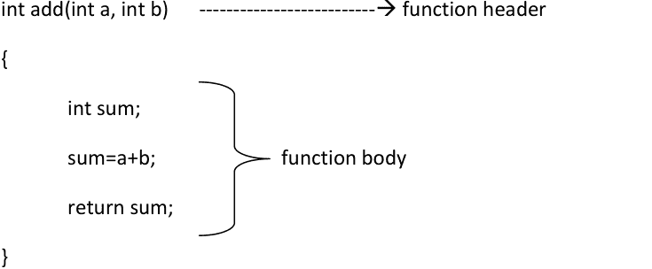

#### 函数头

它由 3 部分组成。

- 返回类型：这是函数预期返回的值的数据类型。数据类型可以是 int、float、char、double、void 等（任何有效的 C 数据类型）
- 函数名：它是函数的名字。它可以是任何有效的标识符。
- 参数：这些是放在括号内的变量列表。所有这些变量都应分别声明，每个声明应以逗号分隔。


### 函数体：

紧跟在函数头后面的复合语句是函数体。它由 3 个元素组成。

- 声明：函数体中使用的所有变量都应在声明部分中声明。但是，函数头中使用的变量不应再次声明。
- 可执行部分：此部分包含执行指定活动的语句或指令。
- return：它是一个关键字。它用于将控制权连同/不带值返回给调用函数。

注意：如果函数不返回任何值，则我们需要将返回类型指定为 void。

如果未显式编写返回类型，则假定返回类型为整数。因此，整数是默认的返回值。

### 函数声明

函数应在被使用之前声明。在使用之前声明函数的过程称为函数原型或函数声明。

函数声明仅包含函数头但以分号结尾。它通知编译器关于

- 函数返回的值的类型
- 函数的名称
- 传递给该函数的参数的数量
- 函数头中每个参数的类型

#### 语法：

```
type function-name(type p1, type p2, ........ type pn);   /*semi colon is must*/
```

其中

type – 是从函数返回的值的类型，例如 void、int、float 等。

function name- 函数的名称

p1,p2,........pn – 是参数。所有参数都必须分别声明，每个声明应由逗号分隔。

ex 1:    int add(int a, int b);

### 函数调用

调用函数以实现指定任务的方法称为函数调用。可以通过编写函数名称并传递适当数量的参数来调用函数。函数调用中参数的数量和类型应与函数定义中参数的数量和类型匹配。

```
/* program to demonstrate user defined function*/

#include<stdio.h>

int add(int a,int b);      /*function prototype*/

void main()
{
        int result;
        result=add(10,20);  /* function call*/
        printf("sum=%d\n",result);
}

int add(int a,int b)                 /*function definition*/
{
        return a+b;
}
```

此处执行的顺序为：

- 函数 add() 用两个参数 10 和 20 调用
- 控制权转移到函数 add()，值 10 和 20 使用变量 a 和 b 接收。
- 通过将 10 和 20 相加计算结果
- 结果返回到 main() 并复制到变量 result
- 结果在屏幕上显示

### 规则：

- 函数调用中的参数数量必须等于函数原型和头中的参数数量。
- 函数调用中参数的类型必须等于函数原型和头中参数的类型。
- void 函数不返回值。因此，当函数被调用时，它不能在表达式或打印语句中使用。它只能用作语句。
- 如果函数返回类型为 void，则不应返回任何值。它会导致语法错误。
- 函数最多只能返回一个值

### 形式参数和实际参数

#### 形式参数/虚拟参数

在函数定义函数头中定义的变量称为形式参数。所有变量必须分别声明，每个声明必须由逗号分隔。形式参数从实际参数接收数据。

#### 实际参数/参数

在函数调用中使用的变量称为实际参数。使用实际参数，可以将数据传输到函数。函数定义中相应的形式参数接收它们。实际参数和形式参数在数量和数据类型上应匹配。

### 函数的分类

根据参数和返回值，函数分类如下：

- 无参数且无返回值的函数。
- 无参数但有返回值的函数
- 有参数但无返回值的函数
- 有参数且有返回值的函数

#### 无参数且无返回值的函数

此类称为“无参数的 void 函数”。调用函数和被调用函数之间没有数据传输。因此，调用函数不能发送值，被调用函数也不能接收数据。

```
/*program to demonstrate Function with no parameter and no return values*/
#include<stdio.h>

void add();

void main()
{
    add();      /*no arguments are passed*/
}

void add()
{
    int a,b,c;
    printf("enter two numbers\n");
    scanf("%d%d",&a,&b);
    c=a+b;
    printf("sum=%d\n",c);
    return;      /*returns nothing*/
}
```

#### 有参数且无返回值的函数

这称为“有参数的 void 函数”。通过参数从调用函数向被调用函数进行数据传输。但，被调用函数到调用函数之间没有数据传输。

```
/*program to demonstrate Function with parameter and no return values*/
#include<stdio.h>

void add(int x,int y);
```
```c
void main()
{
    int a,b;
    printf("enter two numbers\n");
    scanf("%d%d",&a,&b);
    add(a,b);        /*two arguments are passed to called function*/
}

void add(int x, int y)
{
    int z;
    z=x+y;
    printf("sum=%d\n",z);
    return;           /*returns nothing*/
}
```

#### 无参数且有返回值的函数

调用函数到被调用函数之间没有数据传输。但，被调用函数到调用函数之间有数据传输。当函数返回值时，调用函数从被调用函数接收一个值。

```
```c
/*program to demonstrate Function with no parameter and return values*/

#include<stdio.h>

int add();

void main()
{
    int z;
    z=add();    /*no arguments passed returned value will be saved in variable z*/
```
```
```
```c
printf("sum=%d\n",z);
}

int add()
{
    int a,b,c;
    printf("enter two numbers\n");
    scanf("%d%d",&a,&b);
    c=a+b;
    return c;    /* returns the result to the calling function*/
}
```
```

#### 有参数且有返回值的函数

调用函数和被调用函数之间有数据传输。当传递参数时，被调用函数可以从调用函数接收值。当函数返回值时，调用函数可以从被调用函数接收值。

```
```c
/*program to demonstrate Function with parameter and return values*/

#include<stdio.h>

int add(int x,int y);

void main()
{
    int a,b,c;
    printf("enter two numbers\n");
    scanf("%d%d",&a,&b);
    c=add(a,b); /*two arguments are passed to the called function and result stored in c*/
```
```
```
printf("sum=%d\n",c);
}
```

```
int add(int x, int y)
{
    int z;
    z=x+y;
    return z;
}
```

### 向函数传递参数

向函数传递参数有两种方式

- 按值传递（按值调用）
- 按地址传递

#### 按值传递

这里，实际参数的值被复制到形式参数中，即形式参数仅包含实际参数的副本。因此，即使在被调用函数中形式参数的值发生变化，实际参数的值也不会改变。

优点：

- 使函数更自成一体
- 保护它们免受意外更改。

缺点：

它不允许通过参数将信息传回调用函数。

```
/*program to demonstrate pass by value(swapping 2 numbers)*/
```
```c
#include<stdio.h>

void exchange(int m,int n);

void main()
{
    int a=10,b=20;
    exchange(a,b);
    printf("a=%d\nb=%d\n",a,b);
}

void exchange(int m,int n)
{
    int temp;
    temp=m;
    m=n;
    n=temp;
}
```
```

输出：

a=10

b=20

工作过程：

- 执行从 main() 开始，变量 a 和 b 分别被赋值为 10 和 20。
- 函数 exchange() 被调用，实际参数 a 和 b 的值分别为 10、20
- 在 exchange() 函数中，形式参数 m 和 n 分别接收 10 和 20。
- 此处 m 和 n 的值被交换。
- 但，函数 main() 中实际参数 a 和 b 的值未被交换。


#### 按地址传递

这里，在调用函数时，实际参数的地址会被发送。在被调用函数中，形式参数应声明为与实际参数类型相同的指针。实际参数的地址被复制到形式参数。使用这些地址，可以更改实际参数的值。这种通过其地址间接更改实际参数的方式称为按地址传递。

```
/*program to demonstrate pass by address(swapping 2 numbers)*/
#include<stdio.h>

void exchange(int *m,int *n);

void main()
{
    int a=10,b=20;
    exchange(&a,&b);
    printf("a=%d\nb=%d\n",a,b);
}

void exchange(int *m,int *n)
{
    int temp;
    temp=*m;
    *m=*n;
    *n=temp;
}
```

输出：

a=20

b=10

工作过程：

- 执行从 main() 开始，变量 a 和 b 分别被赋值为 10 和 20
- 通过发送 a 和 b 的地址调用函数 exchange()
- 在函数 exchange() 中，使用 * 声明的形式参数 m 和 n 用于保存 a 和 b 的地址
- 使用 *m 和 *n 我们可以访问 a 和 b 的值并进行交换。
- 当控制返回到调用函数时，a 和 b 的值已被交换。

### 递归

反复调用同一个函数直到满足某些终止条件称为递归。递归函数应包含基本情况和一般情况。在设计递归函数时要仔细决定基本情况和一般情况，否则会产生无限循环。

基本情况是无需使用递归即可获得解决方案的特殊情况。也称为终止条件。每个递归函数必须有基本情况。基本情况有两个作用：

- 它充当终止条件
- 递归函数从到达的基本情况获得解决方案。

一般情况 这部分代码包含减小问题规模以便向基本情况或终止条件移动所需的逻辑。这里，每次调用函数时，问题的规模都会减小。

例：

```
/*factorial of a number*/

#include<stdio.h>

int fact(int m);

void main()
{
    int n,res;
    printf("enter the number\n");
    scanf("%d",&n);
```

由于数组由一个共同名称标识，数组中的任何元素都可以通过指定其索引或下标来访问。索引给出数组中元素的位置。

数组的基本属性是：

- 数组元素应为相同的数据类型。
- 数据项在内存中连续存储
- 第一个项目的下标始终为零。
- 每个数据项都使用数组的名称访问，但下标不同。
- 数组的索引始终为整数。

### 单维数组的声明

数组必须在被使用之前声明和定义。声明会通知编译器关于：

- 数组中每个元素的类型
- 数组的名称
- 元素数量（数组的大小）

语法：

```
Data_typearray_name[int expression];
```

例：inta[10];

这里 a 是一个包含 10 个整数的数组。

规则：

- 表达式必须用括号括起来
- 表达式可以是整数常量
- 表达式可以是不含变量的整数表达式。

### 单维数组的初始化

在处理之前给变量赋值称为初始化。数组元素可以在声明时初始化。

语法：

```
Type array_name[expression]={v1,v2,v3,...........vn};
```

其中

- Type 可以是 int、float、char 等数据类型
- Array_name 是数组的名称。
- Expression 是整数，应放在方括号内。
- v1,v2 是值，应放在 ‘{‘ 和 ‘}’ 内并用逗号分隔。值 v1 存储在第 0 个位置，v2 存储在第 1 个位置，依此类推。

初始化数组的各种方式是：

- 初始化所有指定的存储位置
- 部分数组初始化
- 无大小初始化

#### 初始化所有指定的存储位置

例：

```
int a[6]={10,15,20,25,30};
```

| 10 | 15 | 20 | 25 | 30 | 35 |
| a[0] | a[1] | a[2] | a[3] | a[4] | a[5] |

#### 部分数组初始化

如果要初始化的值的数量小于数组的大小，则元素从第 0 个位置开始按顺序初始化。剩余位置将自动初始化为零。

```
int a[5]={10,15};
```

| 10 | 15 | 0 | 0 | 0 |
| a[0] | a[1] | a[2] | a[3] | a[4] |

#### 无大小初始化

```
int a[]={10,20,30,40,50};
```

| 10 | 20 | 30 | 40 | 50 |
| a[0] | a[1] | a[2] | a[3] | a[4] |

编译器将根据初始值的数量计算数组的大小。这里大小为 5。

### 读写单维数组：

读取语法：

```
for(i=0; i<n; i++)
{
    scanf("%d",&a[i]);
}
```

其中 n 是数组的元素数量。

写入语法：

```
for(i=0; i<n; i++)
{
    printf("%d\n",a[i]);
}
```

例：/*program to read n items from the keyboard and display it on the monitor*/

```
#include<stdio.h>

void main()
{
    int a[25],n ,i;
    printf("enter the no. of elements\n");
    scanf("%d",&n);
    for(i=0;i<n;i++)
    {
    scanf("%d",&a[i]);
```

```
printf("enter the no. of elements\n");

scanf("%d",&n);

for(i=0; i<n; i++)
{

scanf("%d",&a[i]);

}

printf("the square of array elements are\n");

for(i=0; i<n; i++)
{

    print_square(a[i]);      /*passing individual array elements*/

}

getch();
}

void print_square(int x)
{

    printf("%d",x*x);

}
```

### 传递整个数组

传递整个数组给函数时，

- 函数必须通过传递数组的名称来调用
- 在函数定义中，参数必须声明为与实际参数相同类型的数组。无需指定数组的大小。

将整个数组传递给函数类似于按引用传递。对被调用函数中数组所做的任何更改都会反映到原始数组中。

```
/*program to reverse array elements*/

#include<stdio.h>

void reverse(int b[]);

void main()
{
    int a[5]={10,20,30,40,50};
    reverse(a);
    for(i=0; i<5; i++)
    {
        printf("%d\t",a[i]);
    }
}

void reverse(int b[])
{
    b[0]=50, b[1]=40,b[2]=30,b[3]=20,b[4]=10;
}
```

输出：

50 40 30 20 10

注意：在上面的程序中，参数 b 是一个数组，对数组 b 的任何更改都会在数组 a 中产生相应的更改。

### 搜索

在大量数据中查找特定项目的过程称为搜索。有 2 种搜索技术。

```
}
}
if(found==1)
    printf("element found at %d position\n",i);
else
    printf("element not found\n");
getch();
}
```

优点：

- 非常简单的方法
- 对于小型数组效果良好
- 用于在元素未排序时搜索

缺点：

- 如果数组大小较大，则效率较低
- 如果元素已排序，线性搜索效率不高

**二分搜索**：如果数组元素已排序，则可以应用此技术。

工作过程：

- 将第一个元素的位置初始化为变量 low，将最后一个元素的位置初始化为变量 high。即 **low=0** 和 **high=n-1**
- 使用上述初始值获得中间元素的位置为 **mid=(low+high)/2**
- 将要搜索的键与中间元素进行比较。如果键与中间元素相同，则找到元素并停止搜索过程。如果键与中间元素不同，则它可能存在于数组的左半部分或右半部分。
- 如果键小于中间元素，则需要比较数组的左半部分从 low 到 mid-1。所以将上界更改为 **high=mid-1**
- 如果键大于中间元素，则需要比较数组的右半部分从 mid+1 到 high。所以将下界更改为 **low=mid+1**


The above 4 steps has to be repeatedly executed as long as low is less than or equal to high. Finally, when the value of low exceeds the value of high indicates that key is not present in the array.

```
/*binary search program*/

#include<stdio.h>

void main()
{
    int a[5],n,i,key,found=0,low,high;

    printf("Enter the size of array\n");

    scanf("%d",&n);

    printf("enter array elements in ascending order\n");

    for(i=0; i<n;i++)
    {
        scanf("%d",&a[i]);
    }

    printf("Enter the element to be searched\n");
    scanf("%d",&key);

    low=0;

    high=n-1;

    while(low<=high)   /*binary search*/
    {
        mid=(low+high)/2;   /*compute mid*/
        if(key==a[mid])  /*compare with mid if its equal stop searching*/
        {

found=1;

break;

}
else if(key>a[mid])

low=mid+1;

else

high=mid-1;
}

if(found==1)

printf("element found at %d position\n",mid);
else

printf("element not found\n");
getch();
}
```

### Advantage
- Simple technique
- Very efficient searching technique

### Disadvantage
- The array elements should be sorted

### Sorting
It is the process of arranging the random numbers either in the ascending order or in the descending order. There are many different sorting techniques such as bubble sort, selection sort, merge sort etc.

#### Bubble sort
Here, compare the adjacent elements. If the number to the left is greater than the number to the right, then exchange them. If the number to the left is not greater than the number to the right, then don’t exchange them. At the end of each pass largest element will be in its sorted position. This is also called as sinking sort.

```
/*bubble sort*/
#include<stdio.h>
#include<conio.h>
void main()
{
int i,j,n,a[20],temp;
clrscr();
printf("Enter the size: ");
scanf("%d",&n);
printf("Enter %d numbers \n",n);
for(i=0;i<n;i++)
scanf("%d",&a[i]);
for(i=1;i<n;i++)
{
  for(j=0;j<n-i;j++)
  {
    if(a[j]>a[j+1])
    {
        temp=a[j];
        a[j]=a[j+1];
        a[j+1]=temp;
    }
  }
}
printf("\nThe sorted array is \n");
for(i=0;i<n;i++)
printf("%d \n",a[i]);
getch();
}
```

### Advantage
- Very simple and easy to program
- Straight forward approach

### Disadvantage
- Less efficient
- It requires n-1 passes even if the elements are sorted

### Two dimensional arrays
Arrays with two sets of square brackets [][ ] are called two dimensional arrays. It’s used when the data items are arranged in row-wise and column wise in a tabular fashion. To identify an item we need to specify two indices: the first index identifies the row number and second index identify the column number of the item.

#### Declaration of 2D array

##### Syntax
```
Data_type array_name[exp1][exp2];
```
Where
- Data_type can be int, float, char etc
- Array name is the name of the array
- Exp1 and exp2 are constant expressions and must be enclosed within square brackets and no variables are allowed.

Ex:
```
int a[10][20];
```
the array a is an integer array with 10 rows and 20 columns. it reserves 10*20=200 locations contiguously one after the other.

#### Initialization
```
Data_type array_name[exp1][exp2]={
    {a1,a2,............an},
    {b1,b2, ..........bn},
    .......................
    .......................
    {z1,z2,..............zn}
};
```
Where
- Data-type can be int,float etc
- Exp1 and exp2 are row and column numbers respectively
- A1 to an are the values assigned to 1st row, b1 to bn are the values assigned to 2nd row and so on.

Ex:
```
int a[4][3]={
    {11,22,33},
    {44,55,66},
    {77,88,99},
    {10,11,12},
};
```
Pictorial representation of above initialization is as shown below

columns

|   | 0 | 1 | 2 |
|---|---|---|---|
| 0 | 11 | 22 | 33 |
| 1 | 44 | 55 | 66 |
| 2 | 77 | 88 | 99 |
| 3 | 10 | 11 | 12 |

rows

Partial array initialization: if the numbers of values to be initialized are less than the size of the array, then the elements are initialized from left to right one after the other. The remaining locations will be initialized to zero automatically.

```
ex: int a[4][3]={  {11,22},
    {33,44},
    {55,66},
    {77,88}
};
```

#### Reading and writing two-dimensional arrays
The elements of the matrix can be accessed in two different ways.
- Row major order
- Column major order

#### Row major order
All elements are accessed one by one row wise. Here,
- Firstly, all elements in 0th row are accessed
- Secondly, all elements in 1st row are accessed
- Thirdly, all elements in 3rd row are accessed and so on.

#### Column major order
All elements are accessed one by one column wise. Here,
- Firstly, all elements in 0th column are accessed
- Secondly, all elements in 1st column are accessed
- Thirdly, all elements in 3rd column are accessed and so on.

#### Reading matrix in row major order
```
for(i=0; i<m; i++)        /*m rows*/
{
    for(j=0; j<n; j++)  /*n columns*/
    {
        scanf("%d",&a[i][j]);
    }
}
```

#### Reading matrix in column major order
```
for(i=0; i<n; i++)        /*n columns */
{
    for(j=0; j<m; j++)  /*m rows */
    {
        scanf("%d",&a[i][j]);
    }
}
```

#### Printing(writing) matrix
```
for(i=0; i<m; i++)        /*m rows*/
{
    for(j=0; j<n; j++)    /*n columns*/
    {
        printf("%d\t",a[i][j]);
    }
    printf("\n");
}
```

#### Example programs
```
/*program to add two matrices*/
#include<stdio.h>

void main()
{
int a[10][10],b[10][10],c[10][10],m,n,i,j;
printf("enter the order of matrices\n");
scanf("%d%d",&m,&n);
printf("enter the elements of matrix a\n");
for(i=0; i<m; i++)
{
    for(j=0; j<n; j++)
    {
        scanf("%d",&a[i][j]);
    }
}

printf("enter the elements of matrix b\n");
for(i=0; i<m; i++)
{
    for(j=0; j<n; j++)
    {
        scanf("%d", &b[i][j]);
    }
}

for(i=0; i<m; i++)        /**addition**/
{
    for(j=0; j<n; j++)
    {
        c[i][j]=a[i][j]+b[i][j];
    }
}

printf("resultant matrix c is\n");
for(i=0; i<m; i++)
{
    for(j=0; j<n; j++)
    {
        printf("%d\t", c[i][j]);
    }
    printf("\n");
}
getch();
}
```

/*matrix multiplication*/
#include<stdio.h>
#include<conio.h>
void main()
{
int a[10][10],b[10][10],c[10][10]={0};
int m,n,p,q,i,j,k;
clrscr();
printf("\n Enter the order of the matrix A :");
scanf("%d%d",&m,&n);
printf("\n Enter the order of the matrix B :");
scanf("%d%d",&p,&q);
if(n!=p)
{
printf("multiplication not possible\n");
getch();
exit(0);
}
printf("\n Enter the elements of matrix A in row major order\n");
for(i=0;i<m;i++)
{
for(j=0;j<n;j++)
{
scanf("%d",&a[i][j]);
}
}
printf("\n Enter the elements of matrix B in column major order \n");
for(i=0;i<q;i++)
{
for(j=0;j<p;j++)
{
scanf("%d",&b[j][i]);
}
}
for(i=0;i<m;i++)
{
for(j=0;j<q;j++)
{
for(k=0;k<n;k++)
{
c[i][j]=c[i][j]+a[i][k]*b[k][j];
}
}
}
printf("\n Resultant matrix is \n");
for(i=0;i<m;i++)
{
for(j=0;j<q;j++)
{
printf("%d\t",c[i][j]);
}
printf("\n");
}
getch();
}
```

```
printf("enter the order of matrices\n");
scanf("%d%d",&m,&n);
printf("enter the elements of matrix a\n");
for(i=0; i<m; i++)
{
    for(j=0; j<n; j++)
    {
        scanf("%d",&a[i][j]);
    }
}
for(i=0; i<m; i++)
{
    for(j=0; j<n; j++)
    {
        b[j][i]=a[i][j];
    }
}
printf("resultant matrix is\n");
for(i=0; i<n; i++)
{
    for(j=0; j<m; j++)
    {
        printf("%d\t",b[i][j]);
    }
    printf("\n");
}
getch();
}
```

### Strings
A string is an array of characters terminated by NULL character which is denoted by the escape sequence '\0'.

Ex: “VTU” is stored as

| V | T | U | \0 |

Strings are treated as an array of characters. String variable can be declared as
```
char a[20];
```
the string variable a can hold maximum of 20 characters including null character.

#### String initialization

#### String input/output functions
- Formatted input function (scanf)
- Formatted output function (printf)
- Unformatted input function (gets)
- Unformatted output function (puts)

#### Formatted input and output function (scanf,printf)
The format specifier used is %s.

##### Working
- If white spaces are present before the string, then they are removed from the keyboard buffer
- All nonwhite space characters are copied into the array till it finds another white space. Then the copied string is terminated by '\0'. Remaining characters are left in the keyboard buffer.

```
char s1[15];
scanf("%s",s1);
printf("%s\n",s1);
```


col-------> 每个字符串的最大长度

```
ex: char a[5][20];
```

上面数组 a 最多可包含 5 个字符串，每个字符串最多可有 20 个字符。

```
char a[4][10]={"ANU",
    "BHANU",
    "DHANYA",
    "MADHU"};
```

#### Memory representation

|   | 0 | 1 | 2 | 3 | 4 | 5 | 6 | 7 | 8 | 9 |
|---|---|---|---|---|---|---|---|---|---|---|
| 0 |   |   |   |   |   |   |   |   |   |   |
| 1 | A | N | U | \0 |   |   |   |   |   |   |
| 2 | B | H | A | N | U | \0 |   |   |   |   |
| 3 | D | H | A | N | Y | A | \0 |   |   |   |
|   | M | A | D | H | U | \0 |   |   |   |   |

#### Reading and writing to an array of strings

```
for(i=0;i<n;i++)        /*reading*/
{
    scanf("%s",a[i]);
}
```

```
for(i=0;i<n;i++)        /*writing*/
{
    printf("%s\n",a[i]);
}
```

#### String handling functions

字符串处理函数在 string.h 头文件中定义。

| strlen(str) | 返回字符串 str 的长度 |
| strcpy(dest,src) | 将源字符串 src 复制到目标字符串 dest |
| strncpy(dest,src,n) | 将源字符串 src 最多 n 个字符复制到目标字符串 dest。 |
| strcat(str1,str2) | 将字符串 str2 追加到字符串 str1 |
| strncat(str1,str2,n) | 将字符串 str2 的前 n 个字符追加到字符串 str1 |
| strcmp(str1,str2) | 比较两个字符串 str1,str2 |
| strrev(str) | 反转字符串 |

##### strlen(str)

此函数返回字符串 str 的长度，即它统计所有字符直到 ‘\0’ 但不包括 \0。因此，空字符串的长度为零。

/*使用库函数显示字符串长度的程序*/

```
#include<stdio.h>

#include<string.h>

void main()
{
    char s[]="hello";
    printf("length of string s=%d\n",strlen(s));
    getch();
}
```

Output

length of string s=5

/*不使用库函数显示字符串长度的程序*/

```
#include<stdio.h>
```

```
```c
void main()
{
    char s[]="hello";
    int i=0;
    while(s[i]!='\0')
    {
        i++;
    }
    printf("length=%d\n",i);
    getch();
}
```
```

##### Output

length=5

##### strcpy(dest,src)

将源字符串 **src** 的内容复制到目标字符串 **dest**，包括 '\0'，因此目标字符串 **dest** 的大小应大于或等于源字符串 **src** 的大小。复制后，目标字符串 **dest** 的原始内容会丢失。

```
```c
/*演示 strcpy() 的程序*/

#include<stdio.h>

#include<string.h>

void main()
{
    char s1[]="hello";
    char s2[10];
```
```

```
strcpy(s2,s1);

printf("destination string is=%s\n",s2);

getch();
}
```

##### Output

destination string is=hello

```
/*不使用库函数演示 strcpy() 的程序*/

#include<stdio.h>

#include<string.h>

void main()
{

char s1[10], s2[10];

int i;

printf("enter source string\n");

gets(s1);

i=0;

while(s1[i]!='\0')
{

s2[i]=s1[i];

i++;
}

s2[i]='\0';

printf("destination string is=%s\n",s2);

getch();
```

##### Output

Enter source string

hello

destination string is=hello

```
strncpy(dest,src,n);
```

这里 n 是要复制的字符数。

##### Working

- 如果源字符串小于 n，则整个字符串从源复制到目标，然后在末尾放置空字符。
- 如果源字符串 src 长于 n 个字符，则只复制 n 个字符到目标。然后，目标字符串将没有分隔符 '\0'，因此它将是无效字符串。

Ex:

```
char s1[10];
```

```
char s2[8]="VTU123";
```

```
strncpy(s1,s2,5);
```

复制前

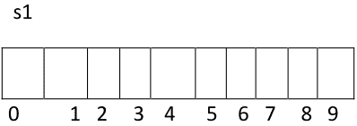

和 s2

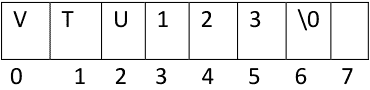

复制后

s1

| V | T | U | 1 | 2 | \0 |  |  |  |  |
| 0 | 1 | 2 | 3 | 4 | 5 | 6 | 7 | 8 | 9 |

和 s2

| V | T | U | 1 | 2 | 3 | \0 |  |
| 0 | 1 | 2 | 3 | 4 | 5 | 6 | 7 |

##### strcat(str1,str2)

此函数将字符串 str2 的所有字符复制到字符串 str1 的末尾。字符串 str1 的分隔符被 str2 的第一个字符替换。str1 的大小应足够大以存储长度为 str1+str2 的字符串。

Str1

| h | i |  |  |  |  |  |  |  |  |

Str2

| h | e | l | l | o |  |

after strcat

Str1

| h | i | h | e | l | l | o | \0 |  |  |

Str2

| h | e | l | l | o |  |
|  |  |  |  |  |  |

###### Sample Questions

| Questions | CO's | RBT Level |
|---|---|---|
| How functions are categorized. Explain with an example. | CO2,CO3 | L3 |
| Explain the characteristics of 2-Dimensional array with an example | CO3 | L2 |
| Describe any 3 string handling function with an example. | CO2,CO3 | L1 |
| Explain with an example how arrays can be passed into a function | CO3 | L2 |
| What are the characteristics of recursive function? Explain with an example | CO2,CO3 | L4 |
| What are arrays? Classify the declaration of one dimensional and 2 dimensional array. | CO3 | L4 |
| Classify function declaration, function definition and calling function with example. | CO3 | L4 |
| Classify string manipulation library function and explain them with example | CO2, CO3, CO5 | L4 |
| Compare the working of recursion in a C program with example. | CO3 | L5 |
| Develop a C program to search an element using linear search | CO3 | L6 |
| Develop a C program to search an element using binary search | CO3 | L6 |
| Develop a C program to arrange elements in descending order using bubble sort | CO2, CO3, CO5 | L6 |
| Write a program to print the sum of positive and negative numbers and return average value | CO2, CO3, CO5 | L6 |
| Write a program to find the Fibonacci series using arrays | CO2, CO3, CO5 | L6 |
| Write a program to find the smallest element in an array | CO2, CO3, CO5 | L6 |
| Develop a C program to perform addition of | CO2, | L6 |

|  |  |  |
| 2 matrices | CO3, CO5 |  |
| Develop a C program to perform product of 2 matrices | CO2, CO3 | L6 |
| Develop a C program to implement STRCOPY operation that copies one sting STR1 to another string STR2 without using library function | CO2, CO3 | L6 |
| Develop a C program to find the Number of Vowels, Consonants, Digits and White space in a String | CO2, CO3 | L6 |
| Write a program to concatenate 2 strings | CO2, CO3 | L6 |
| Write a program to find the length of the given string | CO2, CO3 | L6 |
| Write a program to reverse a given string | CO2, CO3 | L6 |
| Write a program to find prime and Armstrong number using functions | CO2, CO3 | L6 |
| Write a program to find the factorial using recursion | CO2, CO3 | L6 |

# Module 4

## Structures and file management

### The type definition

typedef 是一个关键字，允许程序员为已存在的数据类型创建一个新的数据类型名称。即它重新定义现有数据类型的名称。

Syntax:

```
typedef datatype new_name1,new_name2,.................,new_name n;
```

```
ex: typedef int MARKS,ID_NUMBER;
```

这里 MARKS & ID_NUMBER 被称为用户定义数据类型。

使用这些类型我们可以声明变量..

```
MARKS sub1,sub2,sub3;
```

typedef 定义可以放置在：

- 任何函数的原型之前
- 程序开始时在声明其他变量之前。

Advantage:

- 以有意义的方式声明变量
- 提高程序的可读性
- 复杂而冗长的声明可以简化为简短有意义的声明
- 帮助我们理解源代码

Note: 用户定义的数据类型将为大写

Example program:

计算简单利息

```
#include<stdio.h>
typedef float
AMOUNT; typedef
float TIME; typedef
float RATE; void main()
{
    AMOUNT p,si;
    TIME t;
    RATE r;
    printf("Enter p,t,r\n");
    scanf("%f%f%f",&p,&t,&r);
```

```
si=p*t*r/100;
printf("Simple interest=%f\n",si);
}
```

### STRUCTURES

Structures:

结构是相同数据类型或不同数据类型的变量的一个或多个集合，按单个名称分组在一起。

Example: 学生信息要分组可能包括学生姓名 大学编号 平均成绩

结构的一般语法：

```
struct tagname
{
    Type1 member1;
    Type2 member2;
};
```

- 其中 struct 是一个关键字，告诉编译器正在定义结构
- Tagname 是结构的名字
- 结构中的变量如 member1,member 2 被称为结构的成员或结构的字段。
- 成员可以是 int,float,char 等..
- 在闭合大括号后应有分号。

Note:

结构定义不会为成员在内存中保留任何空间。它只是一个模板。

### Structure Declaration:

结构声明有 3 种不同方式：

- ✓ 带标签的结构
- ✓ 无标签的结构
- ✓ Typedefined 结构


### 带标签的结构：

语法：

```
struct tagname
{
    Type1 member1;
    Type2 member2;
};
```

示例：

```
struct student
{
    char name[10];
    int usn, marks;
};
```

- Student 是结构的名字（标签名）
- Struct student 一起代表数据类型。
- 要为结构分配内存，必须声明变量。

结构变量声明的语法：

```
struct tagname v1,v2,...vn;
```

示例：

```
struct student s1,s2;
```

一旦变量被声明，内存就会为变量 s1 和 s2 分配。 为变量 s1 和 s2 分配的字节数分别为 14 字节

10 字节用于 name

2 字节用于 usn

2 字节用于 marks

分配的内存总大小是各个成员大小之和。

### 无标签的结构：

没有标签名的结构称为无标签结构。

语法：

```
struct
{
    Type1 member1;
    Type2 member2;
}
}v1,v2...vn;
```

#### 示例：

```
struct
{
        char name[10];
        int usn,marks;
}s1,s2;
```

- 在没有标签名的情况下，必须在右大括号后立即声明变量。

### 类型定义的结构：

与关键字 typedef 关联的结构定义称为 typedefined 结构

#### 语法：

```
typedef struct
{
    Type1 member1;
    Type2 member2;
}TYPE_ID;
```

#### 示例：

```
typedef struct
{
    char name[10];
    int usn,marks;
}STUDENT;
```

- Struct 和 typedef 是关键字。
- STUDENT 是使用 typedef 创建的新数据类型，可用于变量声明。

#### 变量声明的语法：

```
TYPE_ID v1,v2...vn;
```

#### 示例：

```
STUDENT s1,s2;
```

### 结构初始化：

#### 语法：

```
struct tagname variable={v1,v2...vn};
```

其中 struct tagname 是派生数据类型

V1,v2..vn 都是初始值

示例：

```
struct student
{
    char name[10];
    int usn, marks;
} s1 = {"ram",10,90};
(or)
```

```
struct student
{
    char name[10];
    int usn, marks;
};
struct student s1 = {"ram",10,90};
(or)
```

```
struct student
{
    char name[10];
    int usn,marks;
} s1 = {"ram",10,90}, s2 = {"bheem",11,99};
```

### 访问结构：

结构成员可以通过指定变量名后跟一个点号（.）后跟成员名来访问

语法：

```
Variable.member
```

示例：

```
struct student
{
    char name[10];
    int usn,marks;
} s1 = {"ram",10,90};
```

成员可以按如下方式访问：

通过指定 S1.name，我们可以访问字符串 “ram”。

通过指定 S1.usn，我们可以访问 10。

通过指定 S1.marks，我们可以访问 90。

### 嵌套结构：

包含另一个结构的结构称为嵌套结构（即）一个结构可以作为另一个结构的成员使用。

示例：

```
struct subject
{
        int marks1;
        int marks2;
        int marks3;
};
typedef struct
{
        char name[10];
        int usn;
        struct subject marks;
}STUDENT;
```

上面的结构包含一个成员 marks，其类型为 struct subject（另一个结构）。 所以这称为嵌套结构。

```
STUDENT s;
```

我们可以使用点运算符按如下方式访问字段：

```
s.name;

s.usn;

s.marks.marks1;

s.marks.marks2;

s.marks.marks3;
```

### 包含数组的结构：

单维或多维的 int、float、char 和 double 数组可以在结构中使用

语法：

```
Typedef struct
{
        Char name[10];
        Int marks[3];
}STUDENT;
```

声明结构变量

```
STUDENT S;
```

访问成员：

```
S.name;
```

```
s.marks[0];
```

```
s.marks[1];
```

```
s.marks[2];
```

### 结构数组：

像整数数组一样，我们可以有结构数组。

示例：

假设我们想存储 50 名学生的详细信息，包括姓名和成绩

我们可以写定义如下

```
typedef struct
{
    char name[20];
    int marks;
}STUDENT;
```

我们可以按如下方式声明结构数组

```
STUDENT s[50];
```

结构元素可以通过 s[i].name、s[i].marks 访问

### 结构和函数：

结构或结构成员可以通过各种方式传递给函数

- 通过传递单个成员
- 通过传递整个结构
- 通过指针传递结构（参考模块 5）

#### 通过传递单个成员：

显示学生详细信息的程序

```
struct student
{
    char name[50];
    int usn;
};
void disp(char name[],int usn);------ function prototype
void main()
{
    struct student s1;
    printf("Enter name and usn\n");
    scanf("%s%d",s1.name,&s1.usn);
    disp(s1.name,s1.usn);------ function call
getch();
}
void disp(char name[],int usn)-- function definition
{
    Printf("name=%s\n",name);
    Printf("usn=%d\n",usn);
}
```

#### 解释：

在上面的示例中，函数 disp 通过将结构的单个成员传递给用户定义函数来调用。 在用户定义函数中，创建形式参数以从实际参数接收 name 和 usn 的值。

#### 传递整个结构：

```
struct student
{
    char name[50];
    int usn;
};
void disp(struct student stu);------ function prototype
void main()
{
    struct student s1;
    printf("Enter name and usn\n");
    scanf("%s%d",s1.name,&s1.usn);
    disp(s1);------ function call
getch();
}
```

```
void disp(struct student stu)-- function definition
```

```
{
    Printf("name=%s\n",stu.name);
    Printf("usn=%d\n",stu.usn);
}
```

解释：

在上面的示例中，函数 disp 通过将整个结构传递给用户定义函数来调用。 在用户定义函数中，形式参数被声明为结构类型以接收实际参数的值。

### 文件

> “文件是磁盘上存储相关数据组的地方”。

#### 定义和打开文件

如果您想将数据存储在二级存储器的文件中，我们必须向操作系统指定有关文件的某些内容。

- ✓ 文件名
- ✓ 数据结构
- ✓ 目的

##### 文件名：

文件名是构成操作系统有效文件名的字符字符串

它可能包含两部分，主要名称和可选的带扩展名的句点

示例：

- Prog.c
- Data.txt
- Output.c

##### 数据结构：

文件的数据结构定义为 stdio.h 中的结构 FILE。 因此在使用文件之前，所有文件都应声明为类型 FILE。

当我们打开文件时，我们必须指定我们想要对文件做什么（即）我们可能向文件写入数据或读取已存在的数据。

声明和打开文件的语法：

第一条语句将变量 fp 声明为指向数据类型 FILE 的指针

在这两个函数中，第一个参数是文件指针，指定要在此处使用的文件。 第二个参数包含列表中项目的格式说明符。 第三个参数列表可以是变量、常量或字符串。

示例：

复制包含姓名和学号的文件内容到另一个文件。

```c
#include<stdio.h>
void main()
{
        FILE  *fp1,*fp2;
        char name[10];
        int rollno;
        fp1=fopen("file1.txt","r");
        fp2=fopen("file2.txt","w");
        fscanf(fp1,"%s%d",name,&rollno);
        fprintf(fp2," %s\t%d\n",name,rollno);
        getch();
}
```

### Fgets() 和 fputs()

这些函数用于从文件读取和向文件写入字符串。

fgets 的语法：

```c
ps=fgets(str,n,fp);
```

这里 str 是一个字符数组

- n 是从文件读取的字符数
- fp 是一个文件指针

如果此函数成功，它将返回读取的字符串的指针。 否则返回 NULL。 它读取 n~1 个字符或换行符，以先出现者为准。 如果它读取换行符，它会将其保留为字符串的一部分并附加空字符。 如果它没有读取换行符，则读取 n~1 个字符并在末尾附加空字符。

示例：


#### 从文件读取一行的程序

```c
#include<stdio.h>
void main()
{
    FILE *fp;
    char str[15];
    char *ps;
    fp = fopen("input.dat", "r");
    ps = fgets(str, 10, fp);
    if(ps != NULL)
    {
        puts(str);
    }
    else
        printf("unsuccessful reading");
}
```

#### fputs 的语法：

fputs(str, fp);

str 是要写入由 fp 指向的文件的字符串。它不会自动向文件写入新行。只有当换行符存在时才会写入。

#### 示例：

```c
void main()
{
    FILE *fp;
    char str[15];
    char *ps;
    printf("enter the string\n");
    gets(str);
    fp = fopen("file.txt", "w");
    fputs(str, fp);
    fclose(fp);
}
```

#### fgetc 和 fputc()：

fgetc() 用于从文件中读取一个字符。

fputc() 用于向文件写入一个字符。

#### 语法：

fputc(c, fp1);

c 是要写入文件的字符。

fp1 是由 fopen 返回的文件指针。

c = fgetc(fp1);

从 fp1 指向的文件返回一个字符。

#### 示例：

将一个字符从一个文件复制到另一个文件的程序。

```c
void main()
{
    FILE *fp1, *fp2;
    char c;
    fp1 = fopen("f1.txt", "r");
    fp2 = fopen("f2.txt", "w");
    c = fgetc(fp1);
    fputc(c, fp2);
}
```

#### 示例问题

| 问题 | RBT 等级 | CO's |
|---|---|---|
| 描述结构体。解释如何声明和初始化结构体。 | L1 | CO4, CO5 |
| 描述文件。解释文件的不同模式。 | L1 | CO4, CO5 |
| 这段 C 代码的输出是什么？<br><pre>#include &lt;stdio.h&gt;<br>struct student<br>{<br>    char *name;<br>};<br><br>void main()<br>{<br>    struct student s, m;<br>    s.name = "st";<br>    m = s;<br>    printf("%s%s", s.name, m.name);<br>}</pre> | L2 | CO4, CO5 |
| 解释结构体实现中非法的操作。 | L2 | CO4, CO5 |
| 举例说明如何定义、声明和初始化结构体。 | L3 | CO4, CO5 |
| 举例说明如何访问结构体成员。 | L3 | CO4, CO5 |
| 用语法举例说明如何打开和关闭文件。 | L3 | CO4, CO5 |
| 文件的特征是什么？ | L4 | CO4, CO5 |
| 结构体的特征是什么？ | L4 | CO4, CO5 |
| 跟踪以下代码并解释输出是什么。<br><pre>#include &lt;stdio.h&gt;<br>struct<br>{<br>    int i;<br>    float ft;<br>} decl;<br>int main()<br>{<br>    decl.i = 4;<br>    decl.ft = 7.96623;<br>    printf("%d %.2f", decl.i, decl.ft);<br>    return 0;<br>}</pre> | L5 | CO4, CO5 |
| 结构体、联合体和枚举之间有什么相似之处？ | L5 | CO4, CO5 |
| 编写一个 C 程序，在结构体数组中搜索姓名。 | L6 | CO4, CO5 |
| 编写一个 C 程序，从两个不同的文件读取学生姓名和 USN，并写入另一个文件。 | L6 | CO4, CO5 |
| 编写一个 C 程序，从键盘读取 n 个数字并写入文件。 | L6 | CO4, CO5 |
| 编写一个 C 程序，将一个文件的内容复制到另一个文件。 | L6 | CO4, CO5 |
| 编写一个程序，使用结构体存储学生的信息（姓名、学号和成绩）。 | L6 | CO4, CO5 |
| 编写一个 C 程序，使用 fwrite() 将一个结构体数组的所有成员写入文件。从文件中读取该数组并显示在屏幕上。 | L6 | CO4, CO5 |
| 编写一个 C 程序，从用户处读取 n 个学生的姓名和成绩，并将它们存储在文件中。如果文件已存在，则追加这 n 个学生的信息。 | L6 | CO4, CO5 |
| 编写一个 C 程序，使用结构体计算两个时间段之间的差值。 | L6 | CO4, CO5 |

### 模块 5：

#### 5.1 C 语言中的数据结构

**数据结构**用于以有组织的形式在计算机中存储数据。在 C 语言中，不同类型的数据结构有：数组、栈、队列、链表、树。

- **数组：** 数组是相同数据类型的集合，你可以不按任何顺序在数组中插入和删除元素。
- **栈：** 栈基于后进先出（LIFO）原则工作。最后进入的元素最先移除。
- **队列：** 队列基于先进先出（FIFO）原则工作。最先进入的元素最先移除。
- **链表：** 链表是节点的集合，你可以按任何顺序插入和删除数据。
- **树：** 以非线性形式存储数据，有一个根节点和子节点。

##### 5.1.1 数据结构中的数组

**数组**是在单个变量中存储相同数据类型值的集合。数组是 C 语言中的一种派生数据类型，由 C 语言的基本数据类型构造而成。

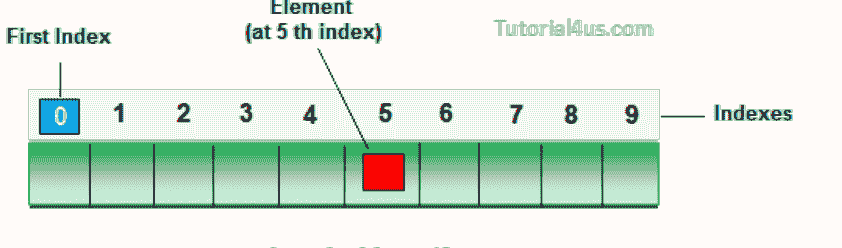

###### 在数组的特定位置插入元素

```c
#include<stdio.h>
#include<conio.h>

void main()
{
    int i, a[5], no, pos;
    clrscr();
    printf("Enter element in array: ");
    for(i = 0; i < 5; i++)
    {
        scanf("%d", &a[i]);
    }
    printf("\nStored element in array: ");
    for(i = 0; i < 5; i++)
    {
        printf(" %d", a[i]);
    }
    printf("\nEnter position for enter element: ");
    scanf("%d", &pos);
    if(pos > 5)
    {
        printf("\nThis is out of range");
    }
    else
    {
        printf("\nEnter new element: ");
        scanf("%d", &no);
        --pos;
        for(i = 5; i >= pos; i--)
        {
            a[i + 1] = a[i];
        }
        a[pos] = no;
        printf("\nStored data in array: ");
        for(i = 0; i < 6; i++)
        {
            printf(" %d", a[i]);
        }
    }
    getch();
}
```

###### 输出

```text
Enter elements in array: 4
4
2
5
7
Stored data in array: 4 4 2 5 7
Enter position for enter element: 2
Enter new element: 8
Stored data in array: 4 8 4 2 5 7
```

###### 删除数组特定位置的元素

```c
#include <stdio.h>
void main()
{
    int vectorx[10];
    int i, n, pos, element, found = 0;

    printf("Enter how many elements\n");
    scanf("%d", &n);
    printf("Enter the elements\n");

    for(i = 0; i < n; i++)
    {
        scanf("%d", &vectorx[i]);
    }

    printf("Input array elements are\n");
    for(i = 0; i < n; i++)
    {
        printf("%d\n", vectorx[i]);
    }

    printf("Enter the element to be deleted\n");
    scanf("%d", &element);

    for(i = 0; i < n; i++)
    {
        if(vectorx[i] == element)
        {
            found = 1;
            pos = i;
            break;
        }
    }

    if(found == 1)
    {
        for(i = pos; i < n - 1; i++)
        {
            vectorx[i] = vectorx[i + 1];
        }

        printf("The resultant vector is \n");
        for(i = 0; i < n - 1; i++)
        {
            printf("%d\n", vectorx[i]);
        }
    }
    else
        printf("Element %d is not found in the vector\n", element);
}
```

##### 5.1.2 C 语言中的队列

队列按照**先进先出（FIFO）**原则工作，这意味着最早进入的元素最先移除。队列有前后两端，即队首和队尾，从队首可以插入元素，从队尾可以删除元素。

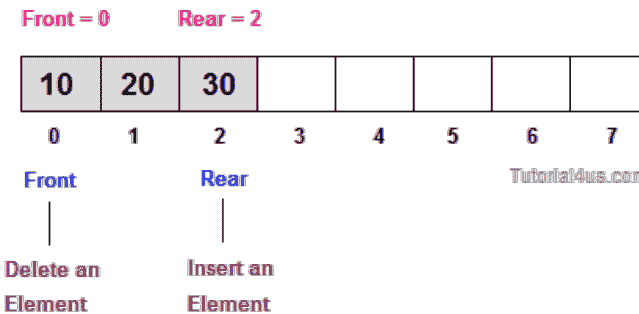

###### 队列的现实示例

队列的一个常见示例是电影院售票柜台，排在售票窗口前的第一个人先取票然后离开队伍，新来的人总是排在队伍的末尾。

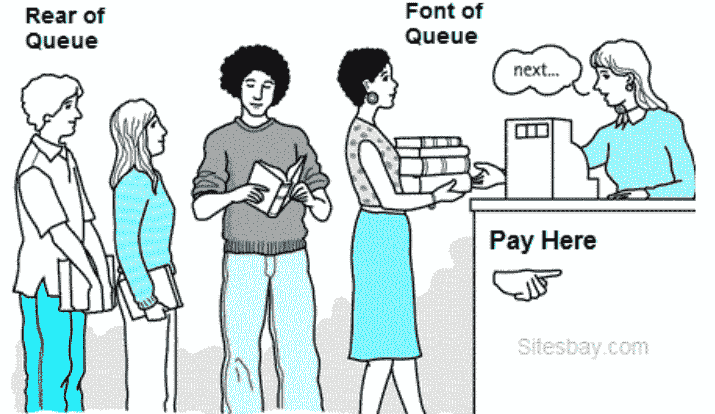

队列的现实示例：图书馆柜台

###### 单车道单向公路：第一辆车先行


售票柜台：第一个人先取票，然后先出去。

###### 队列的其他一些现实示例

- 操作系统中的进程队列。
- 任何服务点（如售票等）的人群队列。
- 数据通信中的数据包队列。
- 等待着陆指令的飞机队列。

###### 队列数据结构在 C 语言中的应用

队列用于任何需要对某些实体高效维持先进先出顺序的情况。在运输和运筹学中，各种实体被存储并保留以待后续处理，即队列起到缓冲区的作用。

在多任务操作系统中，CPU 无法同时运行所有任务，因此任务必须分批处理，然后按照某种策略进行调度。在这种情况下，队列可能也是一个合适的选择。

###### 队列的操作

可以在队列上执行的基本操作有：

- 在队列中插入一个元素。
- 从队列中删除一个元素。

###### 在队列中插入一个元素

在队列中，从队尾插入任何元素。如果在队列中插入新元素，队尾（Rear）的值将增加 1。

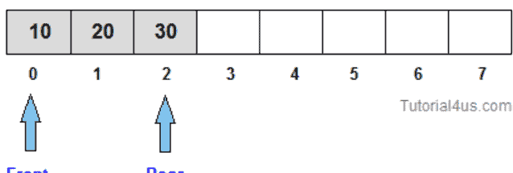

###### 在队列中插入元素

```c
void insert()
{
    int item;
    printf("Element : ");
    scanf("%d", &item);
    if(front == (rear + 1) % 3)
    {
        printf("Queue is Full");
        return;
    }
    if(front == -1)
    {
        rear = front = 0;
    }
    else
    {
        rear = (rear + 1) % 3;
    }
    cque.cqueue[rear] = item;
}
```


```
printf("Successfully Insert");
}
```

###### 从队列中删除任意元素

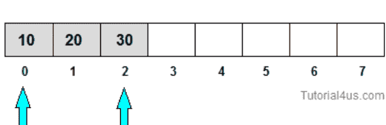

在队列中，从队首（Front）删除元素。如果你从队列中删除一个元素，队首（Front）的值会增加 1。

###### 从队列中删除元素

```
void del()
{
int num;
if(front==-1)
{
printf("Queue Empty");
return;
}
else
{
num=cque.cqueue[front];
printf("Deleted item : %d",num);
}
if(front==rear)
{
front=-1;
}
```

```c
case3:
    display();
    break;
case0:
    exit(0);
    break;
default:
    printf("\n\n Invalid Option ");
}
getch();
}
}

void insert()
{
    int item;
    printf("Element : ");
    scanf("%d",&item);
    if(front==(rear+1)%3)
    {
        printf("Queue is Full");
        return;
    }
    if(front==-1)
    {
        rear=front=0;
    }
    else
    {
        rear=(rear+1)%3;
    }
    cque.cqueue[rear]=item;
    printf("Successfully Insert");
}

void del()
{
    int num;
    if(front==-1)
```

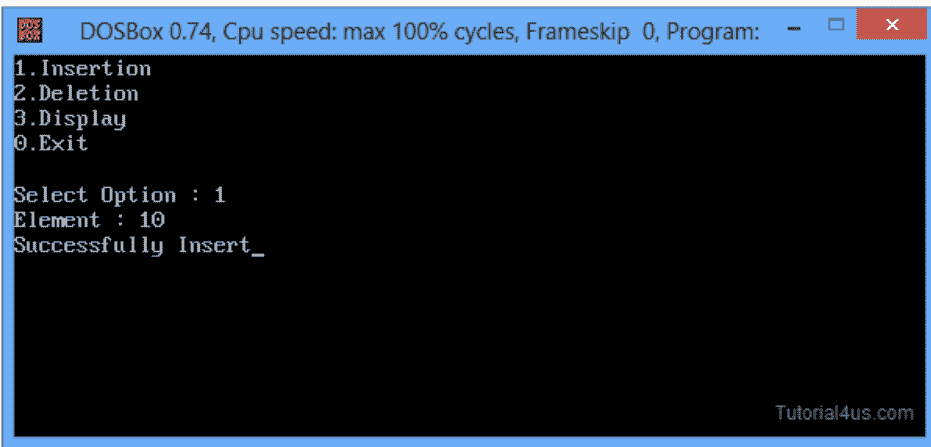

https://www.sitesbay.com/data-structure/c-queue

##### 5.1.3 C 语言中的链表

链表是一种特殊类型的数据结构，其中所有数据元素都相互链接。链表是节点的集合，每个节点包含两部分：数据部分和地址部分。

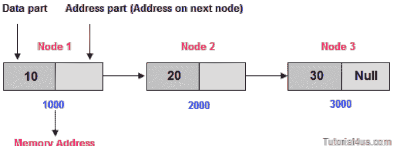

###### 为什么要使用链表

假设你想存储 50 名学生的成绩，那么需要编写如下代码；

###### 示例

```
int marks[50];
```

但有时你需要存储超过 50 名学生的成绩，在这种情况下，你无法增加数组的内存；而有时你需要存储少于 50 名学生的成绩，在这种情况下，多余的内存会被浪费。为了解决这个问题，你需要使用链表，因为链表的内存在运行时才会创建。

###### 链表的优点

- 链表是动态数据结构。
- 你可以在程序运行期间更改链表的大小。
- 插入和删除操作更容易，你可以将任意节点插入到任意位置，也可以轻松删除任意节点。
- 没有内存浪费，即无需预先分配内存。
- 访问时间更快，可以在恒定时间内扩展，且没有内存开销。
- 你可以使用链表轻松实现诸如栈、队列之类的线性数据结构。

###### 链表的优点

- **动态数据结构：** 链表的大小在程序执行期间会增大和减小。
- **无内存浪费：** 在链表中，内存会在程序执行时分配，因此没有内存浪费。
- **轻松插入和删除数据：** 在链表中，你可以在特定位置插入任何数据，也可以从特定位置删除任何数据。

###### 链表的缺点

- **需要更多内存：** 为了在链表中存储数据，你需要更多的内存空间，因为数据和地址部分都需要内存空间。

###### 链表的现实生活示例

链表的一个常见示例是火车，在这种情况下，所有的车厢都是节点，两节车厢通过连接器相连。车厢内人们的座位安排称为链表的数据部分，而两节车厢之间的连接则是链表的地址字段。

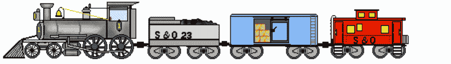

与链表一样，火车也有最后一节车厢，它不再与任何车厢相连。火车头可以称为链表的第一个节点，最后一节车厢是链表的最后一个节点。

https://www.sitesbay.com/data-structure/c-linked-list

##### 5.1.4 C 语言中的栈

**栈**是一种线性数据结构。在栈中，新数据项的添加和已有数据项的删除都只在称为**栈顶**的一端进行。栈基于**后进先出（LIFO）**原则工作，这意味着最后进入的元素最先移除。

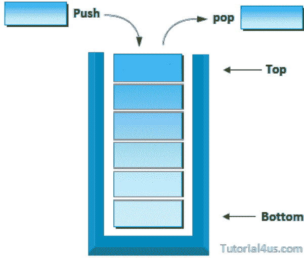

###### 栈的现实生活示例

栈最流行的示例是婚宴上的盘子。新盘子被**压入（push）**堆叠的顶部，并从顶部**弹出（pop）**。


###### 栈的操作

栈数据结构主要执行两种操作：压入（push）和弹出（pop）。

- **pop（弹出）：** 在栈中，从栈中删除任何元素的操作称为弹出。
- **push（压入）：** 在栈中，向栈中插入任何元素的操作称为压入。

###### 压入操作

在栈中，向栈中插入任何元素的操作称为**压入（push）**。在栈中，任何元素都是从栈顶插入的，当你向栈中插入任何元素时，栈顶会增加 1。

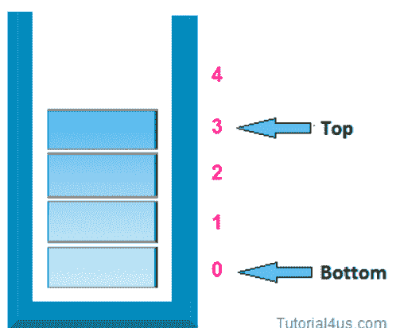

###### 压入算法

- 1. 初始化，设置 top=-1
- 2. 重复步骤 3 到 5，直到 top<最大大小-1
- 3. 读取元素 item
- 4. 设置 top=top+1
- 5. 设置 stack[top]=item
- 6. 打印 "stack overflow"

###### 向栈中压入元素的示例

```
void push()
{
int item;
if(top==size-1)
{
```

```
printf("\n stack is full");
}
else
{
top=top+1;
printf("\n\n Enter element in stack: ");
scanf("%d",&s.item);
s.stack[top]=s.item;
}
}
```

###### 弹出操作

在栈中，从栈中删除任何元素的操作称为**弹出（pop）**。任何元素都是从栈顶删除的，当你从栈中删除任何元素时，栈顶会减少 1。

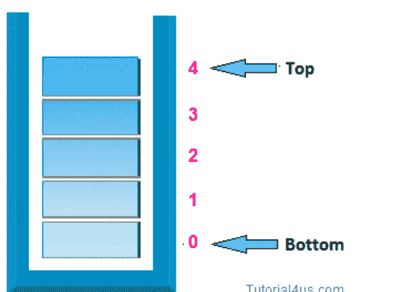

###### 弹出算法

- 1. 重复步骤 2 到 4，直到 top>=0

- 2. 设置 item=stack[top]
- 3. 设置 top=top-1
- 4. 打印 "Item deleted"
- 5. 打印 "Stack under flow"

###### 示例

```
void pop()
{
int item;
if(top==-0)
{
printf("\\nStack is empty: ");
}
else
{
s.item=s.stack[top];
top=top-1;
printf("deleted data is: %d",s.item);
}
}
```

[https://www.sitesbay.com/data-structure/c-stack-pop-operation](https://www.sitesbay.com/data-structure/c-stack-pop-operation)

###### C 语言栈示例

栈的程序非常简单，当你向栈中插入任何元素时，栈顶会增加 1；当你从栈中弹出任何元素时，栈顶会减少 1。栈中的插入和删除操作都从栈顶执行。

###### 示例

```
#include<stdio.h>
#include<conio.h>
#include<stdlib.h>

#define size 5
```

```c
void pop();
void push();
void display();

struct stack
{
int item;
int stack[size];
}s;

int top=-1;

void push()
{
if(top==size-1)
{
printf("\n stack is full");
}
else
{
top=top+1;
printf("\n\n Enter element in stack: ");
scanf("%d",&s.item);
s.stack[top]=s.item;
}
}

void pop()
{
if(top==0)
{
printf("\nStack is empty: ");
}
else
{
s.item=s.stack[top];
top=top-1;
printf("deleted data is: %d",s.item);
```

```
}
}

void display()
{
int i;
if(top==0)
{
printf("\n Stack is empty: ");
}
else
{
for(i=top;i>0;i--)
{
printf("\n%d",s.stack[i]);
}
}
}

void main()
{
charch,c;

do
{
u:
clrscr();
printf("\n\n1: push");
printf("\n2: pop");
printf("\n3: display");
printf("\n4: exit");
printf("\nenter your choice: ");
scanf("%d",&ch);
switch(ch)
{
case1:
    up:
    push();
    break;
```

```
case2:
    pop();
    break;
case3:
    display();
    break;
case4:
    exit();
    break;
default:
    printf("\nwrong choice");
}
printf("\n\n Pushed an element (Y/N)");
c=getch();
if(c=='y'||c=='Y')
{
    goto up;
}
else
{
    goto u;
}
}
while(ch!='5');
}
```

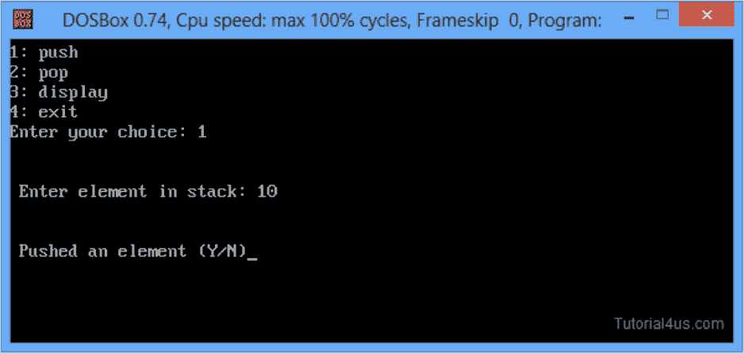

[https://www.sitesbay.com/data-structure/c-stack-example](https://www.sitesbay.com/data-structure/c-stack-example)

##### 5.1.5 二叉树 | 第 1 部分（简介）

**树：** 与数组、链表、栈和队列等线性数据结构不同，树是层次化数据结构。

**树术语：** 最顶层的节点称为树的根。直接位于某个元素下方的元素称为该元素的子节点。直接位于某个元素上方的元素称为该元素的父节点。例如，a 是 f 的子节点，f 是 a 的父节点。最后，没有子节点的元素称为叶子节点。

```
tree
----
  j  <-- root
 / \\
 f   k
/ \\   \\
a  h   z  <-- leaves
```

###### 为什么要使用树？

- 1. 使用树的原因之一可能是你想存储自然形成层次结构的信息。例如，计算机上的文件系统：

```
file system
-----------
    /   <-- root
   / \\
 ...  home
      /   \\
   ugrad  course
      /    /  |  \\
    ...  cs101 cs112 cs113
```

- 2. 树（具有某种排序，例如 BST）提供适中的访问/搜索性能（比链表快，但比数组慢）。
- 3. 树提供适中的插入/删除性能（比数组快，但比无序链表慢）。


4. 与链表类似，与数组不同，树对节点数量没有上限，因为节点是通过指针链接的。

###### 树的主要应用包括：

-   处理层次化数据。
-   使信息易于搜索（参见树的遍历）。
-   处理排序的数据列表。
-   作为合成数字图像视觉效果的流程。
-   路由器算法
-   多阶段决策的形式（参见商业棋类）。

**二叉树：** 每个元素最多有 2 个子节点的树称为二叉树。由于二叉树中的每个元素只能有 2 个子节点，我们通常将它们命名为左子节点和右子节点。

**C 语言中的二叉树表示：** 树通过指向树中最顶层节点的指针来表示。如果树为空，则 root 的值为 NULL。树节点包含以下部分。

-   数据
-   指向左子节点的指针
-   指向右子节点的指针

#### 5.2 C 语言中的动态内存分配

C 语言中的动态内存分配概念使 C 程序员能够在运行时分配内存。C 语言中的动态内存分配可以通过 `stdlib.h` 头文件中的 4 个函数来实现。

-   `malloc()`
-   `calloc()`
-   `realloc()`
-   `free()`

在学习上述函数之前，让我们了解静态内存分配和动态内存分配之间的区别。

| 静态内存分配 | 动态内存分配 |
|---|---|
| 内存在编译时分配。 | 内存在运行时分配。 |
| 程序执行期间内存不能增加。 | 程序执行期间内存可以增加。 |
| 用于数组。 | 用于链表。 |

现在让我们快速了解一下用于动态内存分配的方法。

-   `malloc()` 分配一块请求的内存。
-   `calloc()` 分配多块请求的内存。
-   `realloc()` 重新分配由 `malloc()` 或 `calloc()` 函数占用的内存。
-   `free()` 释放动态分配的内存。

有关动态内存分配的完整教程，请参考以下链接：

https://www.youtube.com/watch?v=xDVC3wKjS64

#### 5.3 C - 预处理器

**C 预处理器**不是编译器的一部分，而是编译过程中的一个单独步骤。简单来说，C 预处理器只是一个文本替换工具，它指示编译器在实际编译之前进行所需的预处理。我们将 C 预处理器称为 CPP。

所有预处理命令都以井号（#）开头。它必须是第一个非空白字符，并且为了可读性，预处理指令应从第一列开始。以下部分列出了所有重要的预处理指令——

| 序号 | 指令 | 描述 |
|---|---|---|
| 1 | `#define` | 替换一个预处理宏。 |
| 2 | `#include` | 从另一个文件插入特定的头文件。 |
| 3 | `#undef` | 取消定义一个预处理宏。 |
| 4 | `#ifdef` | 如果该宏已定义，则返回真。 |
| 5 | `#ifndef` | 如果该宏未定义，则返回真。 |
| 6 | `#if` | 测试编译时条件是否为真。 |
| 7 | `#else` | `#if` 的替代方案。 |
| 8 | `#elif` | `#else` 和 `#if` 合并在一条语句中。 |
| 9 | `#endif` | 结束预处理条件。 |
| 10 | `#error` | 在 stderr 上打印错误消息。 |

##### C 中预处理器如何工作？

**1. #include**

`#include` 预处理指令用于将给定文件的代码粘贴到当前文件中。它用于包含系统定义的用户定义的头文件。如果找不到包含的文件，编译器会报错。它有三种变体：

**`#include <file>`**

此变体用于系统头文件。它会在你指定的目录列表中搜索名为 `file` 的文件，然后在标准系统目录列表中搜索。

**`#include "file"`**

此变体用于你自己的程序的头文件。它首先在当前目录中搜索名为 `file` 的文件，然后在与系统头文件相同的目录中搜索。当前目录是当前输入文件的目录。

**`#include anything else`**

此变体称为计算出来的 `#include`。任何参数不符合上述两种形式的 `#include` 指令都是计算包含。

**2. 宏（#define）**

让我们从宏开始。宏是一段代码，会被宏的值替换。宏通过 `#define` 指令定义。

**语法：**

```
#define token value
```

有两种类型的宏：

-   对象宏（Object-like Macros）
-   函数宏（Function-like Macros）

**1. 对象宏**

对象宏是一个由值替换的标识符。它广泛用于表示数值常量。例如：

```
#define PI 3.1415
```

这里，PI 是宏名，将被替换为值 3.1415。让我们看一个对象宏的示例：

```c
#include <stdio.h>
#define PI 3.1415
main()
{
    printf("%f", PI);
}
```

**输出：**

```
3.141500
```

**2. 函数宏**

函数宏看起来像函数调用。例如：

```
#define MIN(a,b) ((a)<(b)?(a):(b))
```

这里，MIN 是宏名。让我们看一个函数宏的示例：

```c
#include <stdio.h>
#define MIN(a,b) ((a)<(b)?(a):(b))
void main(){
printf("Minimum between 10 and 20 is: %d\n",MIN(10,20));
}
```

**输出：**

```
Minimum between 10 and 20 is: 10
```

**预处理器格式**

预处理指令在正常情况下不能超过一行。它可以使用反斜杠-换行符进行美观分割。包含换行符的注释也可以将指令分成多行。

例如，你可以使用反斜杠-换行符在任意位置美观分割一行：

```
/*
*/ # /*
*/defi\
ne FO\
O 10\
20
```

等价于 `#define FOO 1020`。

**3. #undef**

取消定义宏意味着取消其定义。这通过 `#undef` 指令完成。

**语法：**

```
#undef token
```

**定义和取消定义示例**

```c
#include <stdio.h>
#define PI 3.1415
#undef PI
main(){
printf("%f",PI);
}
```

**输出：**

```
Compile Time Error: 'PI' undeclared
```

**4. #ifdef**

`#ifdef` 预处理指令检查宏是否由 `#define` 定义。如果是，则执行代码。

**语法：**

```c
#ifdef MACRO
//code
#endif
```

**5. #ifndef**

`#ifndef` 预处理指令检查宏是否未由 `#define` 定义。如果是，则执行代码。

**语法：**

```c
#ifndef MACRO
//code
#endif
```

**6. #if**

`#if` 预处理指令计算表达式或条件。如果条件为真，则执行代码。

**语法：**

```c
#if expression
//code
#endif
```

**7. #else**

如果 `#if` 的条件为假，`#else` 预处理指令会计算表达式或条件。它可以与 `#if`、`#elif`、`#ifdef` 和 `#ifndef` 指令一起使用。

**语法：**

```c
#if expression
//if code
#else
//else code
#endif
```

**与 #elif 一起使用的语法**

```c
#if expression
//if code
#elif expression
//elif code
#else
//else code
#endif
```

**示例**

#### 5.4 C - 指针

C 语言中的指针易于学习且有趣。某些 C 编程任务使用指针更容易完成，而其他任务（如动态内存分配）则必须使用指针才能执行。因此，要成为一名完美的 C 程序员，学习指针是必要的。让我们从简单易懂的步骤开始学习。

如你所知，每个变量都是一个内存位置，每个内存位置都有其定义的地址，可以使用与号（`&`）运算符访问该地址，它表示内存中的一个地址。请考虑以下示例，该示例打印所定义变量的地址——

**在线演示**

```c
#include<stdio.h>

int main (){

int var1;
char var2[10];

printf("Address of var1 variable: %x\n",&var1 );
printf("Address of var2 variable: %x\n",&var2 );

return 0;
}
```

当上述代码被编译和执行时，它产生以下结果——

```
Address of var1 variable: bff5a400
Address of var2 variable: bff5a3f6
```

##### 5.4.1 什么是指针？

**指针**是一个变量，其值是另一个变量的地址，即内存位置的直接地址。与任何变量或常量一样，你必须先声明指针，然后才能使用它存储任何变量的地址。指针变量声明的一般形式是——

```
type *var-name;
```

这里，**type** 是指针的基类型；它必须是有效的 C 数据类型，**var-name** 是指针变量的名称。用于声明指针的星号 `*` 与用于乘法的星号相同。然而，在此语句中，星号用于将变量指定为指针。请看一些有效的指针声明——

```c
int  *ip;  /* pointer to an integer */
double *dp;  /* pointer to a double */
float *fp;  /* pointer to a float */
char  *ch;  /* pointer to a character */
```

所有指针的值（无论是整数、浮点数、字符还是其他）的实际数据类型都是相同的，都是表示内存地址的长十六进制数。不同数据类型的指针之间的唯一区别是指针所指向的变量或常量的数据类型。

##### 5.4.2 如何使用指针？

有几个重要的操作，我们会经常借助指针来完成。(a) 我们定义一个指针变量，(b) 将一个变量的地址赋给指针，(c) 最后访问指针变量中地址处的值。这是通过使用一元运算符 `*` 完成的，它返回其操作数指定地址处的变量的值。以下示例使用了这些操作——

**在线演示**

```c
#include<stdio.h>

int main (){
```


```
int var=20; /* actual variable declaration */
int*ip; /* pointer variable declaration */

ip=&var; /* store address of var in pointer variable */

printf("Address of var variable: %x\n",&var);

/* address stored in pointer variable */
printf("Address stored in ip variable: %x\n",ip);

/* access the value using the pointer */
printf("Value of *ip variable: %d\n",*ip);

return 0;
}
```

当上面的代码被编译并执行时，它会产生以下结果 –

Address of var variable: bffd8b3c
Address stored in ip variable: bffd8b3c
Value of *ip variable: 20

##### 5.4.3 Key points to remember about pointers in C:

- Normal variable stores the value whereas pointer variable stores the address of the variable.
- The content of the C pointer always be a whole number i.e. address.
- Always C pointer is initialized to null, i.e. int *p = null.
- The value of null pointer is 0.
- & symbol is used to get the address of the variable.
- * symbol is used to get the value of the variable that the pointer is pointing to.
- If a pointer in C is assigned to NULL, it means it is pointing to nothing.
- Two pointers can be subtracted to know how many elements are available between these two pointers.
- But, Pointer addition, multiplication, division are not allowed.
- The size of any pointer is 2 byte (for 16 bit compiler).

##### 5.4.4 A Simple Example of Pointers in C

This program shows how a pointer is declared and used. There are several other things that we can do with pointers, we have discussed them later in this guide. For now, we just need to know how to link a pointer to the address of a variable.

**Important point to note is:** The data type of pointer and the variable must match, an int pointer can hold the address of int variable, similarly a pointer declared with float data type can hold the address of a float variable. In the example below, the pointer and the variable both are of int type.

```
```c
#include<stdio.h>
int main()
{
//Variable declaration
int num=10;

//Pointer declaration
int*p;

//Assigning address of num to the pointer p
p =#

printf("Address of variable num is: %p", p);
return0;
}
```
```

Output:

Address of variable num is:0x7fff5694dc58

##### C Pointers – Operators that are used with Pointers

Lets discuss the operators & and * that are used with Pointers in C.

###### 5.4.5 “Address of”(&) Operator

We have already seen in the first example that we can display the address of a variable using ampersand sign. I have used &num to access the address of variable num. The **& operator** is also known as **“Address of” Operator.**

```
printf("Address of var is: %p",&num);
```

**Point to note:** %p is a format specifier which is used for displaying the address in hex format.

Now that you know how to get the address of a variable but **how to store that address in some other variable?** That’s where pointers comes into picture. As mentioned in the beginning of this guide, pointers in C programming are used for holding the address of another variables.

**Pointer is just like another variable, the main difference is that it stores address of another variable rather than a value.**

###### “Value at Address”(*) Operator

The * Operator is also known as **Value at address operator.**

###### How to declare a pointer?

```
int*p1  /*Pointer to an integer variable*/
double*p2  /*Pointer to a variable of data type double*/
char*p3  /*Pointer to a character variable*/
float*p4  /*pointer to a float variable*/
```

The above are the few examples of pointer declarations. **If you need a pointer to store the address of integer variable then the data type of the pointer should be int.** Same case is with the other data types.

By using * operator we can access the value of a variable through a pointer. For example:

```
double a =10;
double*p;
p =&a;
```

*p would give us the value of the variable a. The following statement would display 10 as output.

```
printf("%d",*p);
```

Similarly if we assign a value to *pointer like this:

```
*p =200;
```

It would change the value of variable a. The statement above will change the value of a from 10 to 200.

###### Example of Pointer demonstrating the use of & and *

```
#include<stdio.h>
int main()
{
/* Pointer of integer type, this can hold the
   * address of a integer type variable.
   */
int*p;

int var=10;

/* Assigning the address of variable var to the pointer
   * p. The p can hold the address of var because var is
   * an integer type variable.
   */
p=&var;

printf("Value of variable var is: %d",var);
printf("\nValue of variable var is: %d",*p);
printf("\nAddress of variable var is: %p",&var);
printf("\nAddress of variable var is: %p",p);
printf("\nAddress of pointer p is: %p",&p);
return0;
}
```

Output:

Value of variable var is:10

Value of variable var is:10
Address of variable var is:0x7fff5ed98c4c
Address of variable var is:0x7fff5ed98c4c
Address of pointer p is:0x7fff5ed98c50

##### 5.4.6 C - Pointer arithmetic

A pointer in c is an address, which is a numeric value. Therefore, you can perform arithmetic operations on a pointer just as you can on a numeric value. There are four arithmetic operators that can be used on pointers: ++, --, +, and -

To understand pointer arithmetic, let us consider that ptr is an integer pointer which points to the address 1000. Assuming 32-bit integers, let us perform the following arithmetic operation on the pointer –

```
ptr++
```

After the above operation, the ptr will point to the location 1004 because each time ptr is incremented, it will point to the next integer location which is 4 bytes next to the current location. This operation will move the pointer to the next memory location without impacting the actual value at the memory location. If ptr points to a character whose address is 1000, then the above operation will point to the location 1001 because the next character will be available at 1001.

###### Incrementing a Pointer

We prefer using a pointer in our program instead of an array because the variable pointer can be incremented, unlike the array name which cannot be incremented because it is a constant pointer. The following program increments the variable pointer to access each succeeding element of the array –

Live Demo

```
#include<stdio.h>
```

```
#include<stdio.h>

const int MAX =3;

int main (){

int var[]={10,100,200};
int i,*ptr;

/* let us have array address in pointer */
ptr=&var[MAX-1];

for( i = MAX; i >0; i--){

printf("Address of var[%d] = %x\n", i-1,ptr);
printf("Value of var[%d] = %d\n", i-1,*ptr);

/* move to the previous location */
ptr--;
}

return0;
}
```

When the above code is compiled and executed, it produces the following result –

Address of var[2] = bfedbcd8
Value of var[2] = 200
Address of var[1] = bfedbcd4
Value of var[1] = 100
Address of var[0] = bfedbcd0
Value of var[0] = 10

###### Pointer Comparisons

Pointers may be compared by using relational operators, such as ==, <, and >. If p1 and p2 point to variables that are related to each other, such as elements of the same array, then p1 and p2 can be meaningfully compared.

The following program modifies the previous example – one by incrementing the variable pointer so long as the address to which it points is either less than or equal to the address of the last element of the array, which is &var[MAX - 1] –

Live Demo

```
#include<stdio.h>

const int MAX =3;

int main (){

int var[]={10,100,200};
int i,*ptr;

/* let us have address of the first element in pointer */
ptr=var;
    i =0;

while(ptr<=&var[MAX -1]){

printf("Address of var[%d] = %x\n", i,ptr);
printf("Value of var[%d] = %d\n",i,*ptr);

/* point to the previous location */
ptr++;
i++;
}

return0;
}
```

When the above code is compiled and executed, it produces the following result –

Address of var[0] = bfdbcb20
Value of var[0] = 10
Address of var[1] = bfdbcb24
Value of var[1] = 100
Address of var[2] = bfdbcb28
Value of var[2] = 200

###### Sample Questions

| QUESTION | RBT LEVEL | COs |
|---|---|---|
| Define a data-structure. List the available data structures in C. | L1 | **CO5,CO6** |
| Define stack. List out the applications, and operations performed on stack. | L1 | **CO5,CO6** |
| Explain the operations performed on stack with neat diagrams. | L2 | **CO5,CO6** |
| Define queue. List out the applications, and operations performed on queue. | L1 | **CO5,CO6** |
| Explain the operations performed on queue with neat diagrams. | L2 | **CO5,CO6** |
| Define linked-list. List out the applications, and operations performed on list. | L1 | **CO5,CO6** |
| Explain the operations performed on list with neat diagrams. | L2 | **CO5,CO6** |
| Define tree. List out the applications, and operations performed on tree. | L1 | **CO5,CO6** |
| Explain the operations performed on tree with neat diagrams. | L2 | **CO5,CO6** |
| Develop a C program to demonstrate the operations on stack. | L5 | **CO5,CO6** |
| Develop a C program to demonstrate the operations on queue. | L5 | **CO5,CO6** |
| List the functions available for dynamic memory allocation in C? Explain any 3 with example. | L2 | **CO5,CO6** |


| 问题 | 级别 | 结果 |
|---|---|---|
| 定义指针。什么是引用运算符和解引用运算符？ | L1 | **CO5,CO6** |
| 举例说明指针的用法。 | L2 | **CO5,CO6** |
| 解释C语言中的指针运算。 | L2 | **CO5,CO6** |
| 编写一个C程序，使用指针计算方差和标准差。 | L5 | **CO5,CO6** |
| 列出C语言中可用的预处理器指令及其用途。 | L1 | **CO5,CO6** |
| 编写一个C程序来演示预处理器指令。 | L5 | **CO5,CO6** |
| 举例比较并对比栈、队列和链表。 | L4 | **CO5,CO6** |
| 举例比较并对比 malloc()、calloc() 和 realloc()。 | L4 | **CO5,CO6** |
| 运用数组在C语言中实现栈操作。 | L4 | **CO5,CO6** |
| 用图表比较栈和队列的操作。 | L6 | **CO5,CO6** |
| 举例说明 malloc()、calloc()、realloc() 和 free() 函数的用法。 | L3 | **CO5,CO6** |
| 列出C语言中可用的数据结构。 | L1 | **CO5,CO6** |
| 列出栈的应用及执行的操作。 | L1 | **CO5,CO6** |
| 列出队列的应用及执行的操作。 | L1 | **CO5,CO6** |
| 定义栈。 | L1 | **CO5,CO6** |
| 定义队列。 | L1 | **CO5,CO6** |
| 定义链表。 | L1 | **CO5,CO6** |
| 定义指针。 | L1 | **CO5,CO6** |
