# 工程师 C++ 编程入门指南 (IEEE Press)

6. 图 2.6 在线 C++ 编译器。

# 第 7 章

- 2. 图 7.2 通过分配权重 `w[i]` 对字节的值表示
- 6. 图 7.6 浮点数错误导致爆炸前的亚安 5 号火箭照片
- 9. 图 7.9 用最接近的浮点数近似实值 `x` 的舍入误差

43. 36
46. 39
50. 43
68. 61
134. 127
163. 156

| RPN | 逆波尔兰表示法 |
| RTTI | 运行时类型识别 |
| SM | 符号位值 |
| SL | 标准库 |
| TDD | 测试驱动开发 |
| UB | 未定义行为 |
| ULP | 最后一位的单位 |
| V | 溢出标志 |
| XML | 可扩展标记语言 |

* 示例代码
* 进一步提高读者编程能力的有用链接

扫描此二维码以访问配套网站。


## 1. 引言

> *成功不是终结，失败不是致命，重要的是坚持的勇气。*

> 温斯顿·丘吉尔

这本书的诞生源于我对计算机以及使用 `C++` 语言编程的痴迷。它也源于 20 多年来我对波兰克科夫 AGH 科学技术大学电气工程、机械工程和机器人学院学生教授计算机科学基础、特别是 `C++` 语言的教学经验。我曾担任过多家公司的程序员和顾问，成为高级软件工程师和软件设计师，并领导过程序员小组，担任过年轻同事的导师。

通过计算机语言学习编程是、也应该是很有趣的，但要学好它可能很难。教授 `C++` 也比十年前更具挑战性。这门语言已经显著成长，并提供了许多令人兴奋的新特性，我们希望理解并利用这些特性来提高生产力。在写作此时，`C++20` 即将发布。在书中，我们使用了 `C++17` 的许多特性，并展示了一些 `C++20` 的特性。另一方面，在许多情况下，至少了解一些旧特性也是好的，因为这些特性在许多软件项目、库、框架中无处不在。例如，有一次我正在处理一个用于视频处理的 `C++` 项目。在调整 `JPEG IO` 库的一个版本时，我发现了内存泄漏。尽管整个项目都是使用现代 `C++` 的，但我必须在旧的 `C` 代码中追踪一个 bug。这花了我一段时间，但随后我很快解决了问题。

下一个问题是，我们在日常工作中遇到的代码与我们在课程中学到的代码不同。为什么呢？有很多原因。其一是`legacy`（遗留）代码，这只是另一种说法，意味着编写代码的过程通常很长且持续多年。此外，即使是小项目也往往会变得很大，在多年的开发后可能会变得非常巨大。而且，代码是由具有不同理解水平、不同经验水平和幽默感的不同程序员编写的。例如，我的一位程序员同事会在每个新源文件的开头写一首诗。结果是，程序员不仅要理解、维护和调试现有的软件，有时还要读诗。这导致了课堂上展示的那些精美、润洁的代码片段与“真实东西”之间的差异。那么，成为一名成功的程序员需要哪些技能呢？

我为什么要写这本书呢？尽管互联网上有这么多致力于软件开发的编程网站、讨论列表、特殊兴趣小组（SIG）、代码示例和在线书籍。尽管所有这些内容作为即时参考时通常是非常棒且非常有用的，但有时很难找到能够引导我们一步步完成学习过程的地方或来源。要找到既能教授关键编程技巧，又短小、实用且有意义的良好示例则更加困难。因此，我想与你们分享我在多年编程和教学期间收集的、由项目示例支撑的理论描述的协同效应。

让我们现在来看一下本书主要主题的简要概述。`C++` 编程语言是影响力最大、常用且最迷人的语言之一，最初由比雅尼·斯特拉斯鲁普（Bjarne Stroustrup）在 20 世纪 80 年代开发。在过去的十年里，它经历了巨大的变化并引入了许多令人兴奋的新特性。`C++` 的根源在于 `C` 和 `Simula` 编程语言（正如我们所看到的，基础构造例如表达式和语句对于两者来说几乎是相同的）。`C` 是极大影响 Unix 操作系统的关键工具，由于其跨平台兼容性和轻量级，`C` 仍然用于嵌入式系统、现场可编程门阵列（`FPGA`）设备和显卡（`GPU`），以及并行平台上的代码加速。还有许多使用 `C` 编写的库仍在使用，例如用于高效数值算法或图像处理的库。另一方面，`Simula` 是最早配备类的语言之一，它促进了面向对象的开发方法。这成为了大多数技术努力的基石。因此，总结来说，`C++` 继承了这两者：公开上继承自 `C`，私下里继承自 `Simula`。

尽管有很多编程语言，但对于计划或已经从事任何类型计算机编程的人来说，学习 `C++` 是值得的。要掌握 `C++` 的主要特性，阅读这本书就足够；我们将深入探讨。然而，作为介绍，让我们简要列出以下最具代表性的特性：

1. **程序员的自由和丰富的特性**：底层和高度抽象的构造都可以用于许多场景。就像瑞士军刀一样，存在误用的风险，但自由和丰富的特性在各种背景和广泛应用中带来了最高的生产力。但最重要的——自由是我们热爱的。

`C++` 已被用于实现需要低级访问的系统。很多情况下，`C++` 被用于构建其他语言之间的桥梁：例如，在数值领域与 `Fortran` 语言连接；在系统编程中与 `C` 语言和汇编语言连接。另一方面，同一种语言也被用于实现高层应用程序，如文字处理器、CAD 平台、数据库和游戏。`C++` 是一种强面向对象（OO）语言，满足了所有的面向对象范式，如抽象、封装、继承、多态、运算符重载等。这些特征在模板和设计模式的增强下，为软件开发提供了强有力的支持，特别是对于大型系统。

### 4. 强类型语言

异常处理允许程序在遇到错误时以优雅的方式处理它们，而不是直接崩溃。`C++` 通过 `try`、`catch` 和 `throw` 关键字提供了强大的异常捕获和处理机制，这对于编写健壮的系统至关重要。

### 6. 输入输出 (IO)

移动语义是 `C++11` 引入的一项重大特性，极大地提高了程序的性能。通过移动资源而不是拷贝资源，它避免了昂贵的深拷贝操作，这在处理大型对象（如 `std::vector` 或容器）时尤为有效。

### 8. Lambda 表达式

Lambda 表达式提供了一种匿名函数的形式，允许在函数中直接定义逻辑。这使得代码更加简洁、易读，特别是在使用标准库（STL）中的算法函数时。

智能指针是 `C++11` 引入的用于管理内存的工具。它们通过 RAII（资源获取即初始化）机制自动释放内存，减少了内存泄漏和悬空指针的风险，使得内存管理更加安全。

### 10. 模板与泛型编程

模板允许程序员编写与类型无关的代码。这种泛型编程的能力极大地增强了代码的复用性，也是 `C++` 标准库（STL）的核心基石。

`C++` 标准库（STL）是一个极其强大的库，包含了各种数据容器、算法和函数对象。通过这些现成的工具，开发者可以避免造轮子，专注于业务逻辑的实现。

### 12. 自动代码生成

现代 `C++` 开发中经常使用自动代码生成工具（如编译器插件或特定的框架），这可以减少手动编写的工作量并提高代码的一致性。

4. 本书强调并描述了 `C++` `SL` 的基础容器和算法，并介绍了它们最近的并行实现。

9. 我们并不回避介绍一些旧的技术和库，这些技术在大学的操作系统或嵌入式电子课程以及遗留代码中可能会遇到。为此，附录中的一个自包含章节对 `C` 编程语言以及预处理器进行了简要介绍，并一如既往地附有示例。

本书旨在用于使用 `C++` 编程语言开启计算机科学第一步的本科生和研究生，也适用于那些已有某些编程经验但想提高技能的人士。它最适合电气工程和计算机科学学生的编程课程，以及机械工程、机电化、机器人、物理、数学等类似学科。然而，本书也可供其他专业的学生以及提高现代 `C++` 技能的程序员使用。使用本书的先决条件较低，如下：

2. 高中水平的数学

本书可用于多种场景。整体而言，它最适合涵盖三到四个学期的关联课程，提供编程入门、`OOP` 特别是 `C++` 编程语言的介绍，以及高级编程方法和技术的课程。本书也可用于操作系统和嵌入式系统编程课程，并作为计算机视觉和图像处理课程的补充阅读材料。这就是我们在 AGH 科技大学使用它的方式。

另一方面，每一章都可以独立接触和阅读。在作为教程之后，得益于其丰富的摘要、表格、图表和索引，本书可以作为从业者和学生的参考手册。

## 1.1 书的结构

图 1.1 中的图表展示了书的组织结构以及可能的阅读路径。以下列表描述了章节的内容：

1. 第 2 章：“编程导论”——对编程的入门介绍。我们从介绍硬件模型开始，这对于理解计算机程序的作用非常有帮助。然后，目标是介绍 `C++` 开发生态系统、在线编译器和集成开发环境（`IDE`）平台，随后是三个示例项目，主要集中在单个 `main` 函数中的计算，其语句和操作符集合非常有限。介绍了 `SL` 中无处不在的 `std::cout` 和 `std::cin` 对象，它们分别代表向屏幕输出和从键盘输入。在最后一个示例中，引入了 `std::vector` 和 `std::string`，分别用于动态数组和文本字符串表示。尽管数量有限，但本节介绍的 `C++` 机制允许我们编写大量的简单程序！

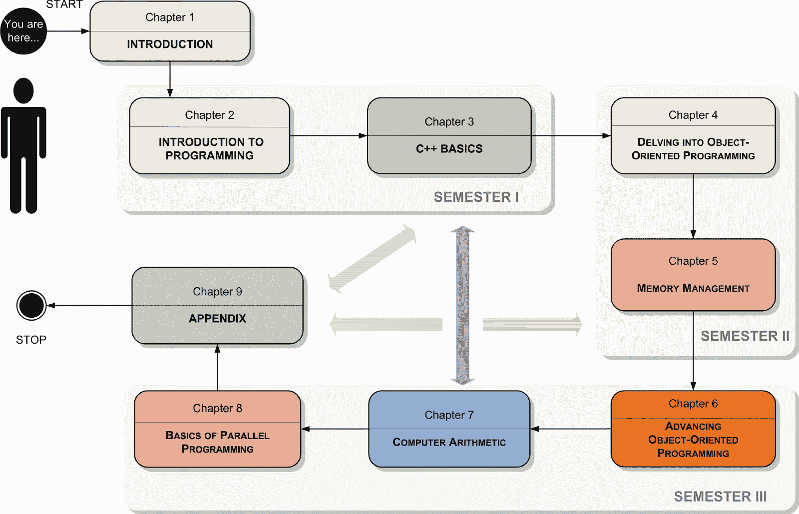

**图 1.1** 书的结构，以统一建模语言（`UML`）中的状态图形式所示。第 2 章和第 3 章介绍了主题。高级别由第 4 章、第 5 章和第 6 章构建。其后是关于计算机算术的第 7 章和处理并行编程的第 8 章。从之前的每个章节都可以查阅附录。

2. 第 3 章：“C++ 基础”——提供 `C++` 编程基础但重要的介绍。首先讨论了内置数据类型及其初始化方法。然后再次接触 `std::vector` 和 `std::string`，但细节更丰富。后续章节介绍了 `auto` 关键字、某些 `SL` 算法的介绍、结构体和类、使用 `std::array` 的固定大小数组、引用、指针、语句、函数（包括 lambda 函数）、使用 `std::tuple` 的元组、结构化绑定以及操作符。在许多小示例的同时，还介绍了三个相对简单但完整的项目：矩阵的表示、表示二次方程的类，以及一个包含用于各种货币表示和交换的自定义类的项目。示例和本章的目标是教授如何正确创建和使用带有数据和函数成员的单个类。

3. 第 4 章：“深入面向对象编程”——引导掌握 `C++` 的中高级技术，特别强调 `OOD` 和 `OOP`。在讨论了 `OOD` 和 `OOP` 的主要范式后，介绍了带有访问规则的类的构造。然后引入了操作符重载，并立即在表示复数的示例类上进行训练。之后讨论了特殊的类成员，例如浅拷贝与深拷贝，以及移动语义的优势。随后是关于模板和泛型编程的介绍，一如既往有深度的示例支撑。之后，分析了类关系，随后介绍了类层次结构以及动态和静态虚机制。然后分析了“拥有”（has-a）与“是”（is-a）的关系，包括关于何时使用各者的提示。

## 4. 第 5 章 (c05.xhtml): “内存管理” – 致力于对象的生命周期和范围，以及对象的创建、访问和销毁。本章的大部分内容专注于智能指针。书中提供了如何使用共享智能指针构建列表，以及工厂设计模式的代码示例。

## 5. 第 6 章 (c06.xhtml): “高级面向对象编程” – 介绍了一些额外的、极具实用性的编程技术和方法。其目的是练习前面章节介绍的方法，并熟悉函数对象、使用正则表达式进行模式匹配、状态机实现和句体（handle-body）设计模式、文件系统、系统时钟时间测量、范围以及用户界面。此外，还介绍了如表达式解析、树构建以及使用访问者模式进行遍历等编程技术，以及使用解释器模式解释表达式。

## 6. 第 7 章 (c07.xhtml): “计算机算术” – 本章分为两个部分，分别介绍定点数和浮点数。它从关于计算机算术非常基础的信息开始，例如字节解释、系统转换等。因此，它也可以作为第 2 章 (c02.xhtml) 之后的入门课程。然而，它包含远不止简单的计算。我们深入探讨了舍入误差、灾难性抵消和 IEEE 754 浮点数标准等重要主题。我们还研究了一些高级编程技术，例如编译器何时可以在编译期间生成代码，以及如何计算函数近似值以及如何正确累加大数据缓冲区。

## 7. 第 8 章 (c08.xhtml): “并行编程基础” – 进入并行计算领域。首先，解释了与许多核心同时并发操作和访问共享对象相关的新现象。然后，我们展示并测试了三个并行计算的软件组件。最简单的调用了标准库中算法的并行版本。然而，`C++` 包含一个允许并行计算的独立库 – 在这方面介绍了异步任务。最后一个是 OpenMP 库。通过它，我们测试了如何编写并行段、如何使 `for` 循环并行，以及如何通过矩阵乘法的示例测量执行时间。

## 8. 附录 – 介绍了不同的编程主题。我们从对预处理器的简要介绍开始，接着是对 `C` 语言的简要介绍。虽然学习 `C++` 不需要预先掌握 `C` 语言，但后者有助于理解前者的某些特征。例如，在日常编程生活中会遇到 `main` 函数的参数、简单数组、联合体和类 `C` 的字符串表示。其他主题，如 `C/C++` 程序的链接和二进制组织、`C++` 程序可用的图形用户界面 (GUIs)、软件测试以及由 CMake、Git 和 GitHub 组成的编程工具链，以及性能分析器 (Profiler)，也均得到了介绍。

如前所述，本书不需要按线性顺序阅读。章节的组织方式便于独立使用。在进行代码项目时，书的附录以及许多总结和参考文献也可以独立使用。

此外，重要的一点是，以线性方式介绍极其详尽的编程主题基本上是不可能的。因此，某些结构虽然在特定上下文中使用了，但在第一次阅读时可能无法理解，但在后面的章节中会有解释。

## 1.2 格式规范

为了方便导航，书中使用了几种不同的格式，如下：

1. 在某些章节的开头和结尾使用项目符号列表，以介绍该章节将要引入的关键编程结构和/或技术。

终端窗口（也称为控制台或命令行）中的输出随后将在颜色背景上显示，如下：

1. 大多数代码列表中都有行号。这些数字随后在方括号 [] 中进行引用。例如，在列表 1.1 (c01.xhtml_c01-fea-0001) 中，标准 `iostream` 头文件包含在第 [1] 行，`main` 函数定义在第 [3–8] 行，第 [5, 6] 行包含注释，`C++` 中的注释以双斜杠 `//` 开头。为了强调后者的重要性，注释使用了红色。

2. 像 `std::cout` 这种代表屏幕的对象，代码使用特殊的等宽字体编写。另一方面，文件名 – 如 `iostream` 和 `main.cpp` – 使用斜体字体。

4. 共有两种类型的章节：

    * 示例项目章节，围绕自包含的项目构建，目标是练习特定的编程技术。

5. 包含额外或高级材料但并不一定需要在当前演示上下文中立即阅读的章节，用  标记。

6. 带有重要材料章节结尾经常有一个“要记事项”列表，如下：

1. 为了在伪代码中表示算法，使用以下格式：

1. 有两种类型的引用：

    * 软引用（通常为网络链接），放置在脚注中。

2. 章节以“问题与练习” (Q&E) 章节结束，这些章节通常包含对所介绍技术的扩展内容。

3. 如果提到了特殊键，会对其进行标出，例如 `Ctrl` + `Alt` + `T`（在 Linux 中打开终端窗口）。

## 1.3 关于代码和项目

如之前提到的，书中包含几十个代码示例。学习过程依赖于让代码运行并理解它在做什么以及为什么。因此，这里是关于如何使用代码的一些提示：

1. 所有代码均可在 GitHub 存储库在线获取 (*[`github.com/BogCyg/BookCpp`](https://github.com/BogCyg/BookCpp)*)。A.6.2 节提供了关于 GitHub 的简要介绍。

2. 虽然代码可以很容易地复制、编译和执行，但学习编程技能的最佳方法是自己编写代码。这可能涉及简单的重新输入，或者更好地，在理解思路后，尝试编写你自己的版本。一旦你完成了编写，就尝试让它运行；如果你对某些内容不确定，请参考书中的示例。然后更新你的解决方案并再次尝试。

4. 有时，错误的原因可能是编译器指示的错误行之前的几行中的字母、行、函数等。如果你因为某个错误而绊倒，请尝试验证指示位置之前的几行。

8. 最后但同样重要的是，咨询你大学的同事或工作桌同事，或者询问你的老师——给他们发电子邮件、寻求建议等。交流总是好的。

为了创建一个解决给定任务的计算机程序，我们需要指定计算机必须为我们执行的操作。这些知识来自问题分析，有时它是软件创建过程中最困难的阶段。一旦我们知道了这些操作，就需要以计算机（即其处理器）可以理解的形式编写它们。虽然每个处理器都有自己的语言，称为*汇编*或*机器语言*，但这些语言太原始了，不利于人类高效编码。相反，开发了许多高级计算机语言用于此目的。`C++` 就是其中之一：它广为人知；它拥有最好的工具和库；并且得到了拥有多年经验的 `C++` 社区的大支持。

图 2.2 描述了一个带有各种类型内存的多核处理器模型。该多核处理器有一系列板载内存缓存，并连接了一个外部主内存模块。现在我们将从计算的角度来解释这些硬件组件的功能。

**图 2.2** 带有各种类型内存的多核处理器模型。算术逻辑单元（`ALU`）执行低级机器操作。最近的内存存储由寄存器组成。除了通用寄存器外，还有两个特殊的寄存器：`PC`（指示已执行代码当前位置的程序计数器）和 `SP`（栈指针，指向名为 `stack` 的内存区域，包含过程的返回地址和一些参数）。`L1`、`L2` 和 `L3` 是具有不同大小和访问时间的内存缓存（1c 表示单个处理器周期）。核心可以独立运行，仅共享上层内存的一部分。处理器连接到存储代码和数据的外部主内存（冯·诺依曼架构）。

2. `Data`（数据）——此双向总线包含从内存读取或写入内存的数据

¹ 参见冯·诺依曼架构。

另一方面，速度快得多的缓存内存无法通过 `C++` 程序直接寻址。没有必要这样做，因为缓存只存储主内存数据的副本，以便进行更快的访问。尽管如此，通过在运行内存中进行适当的数据布局，可以在 `C++` 程序的执行过程中高效地利用这些缓存。我们将在第 8 章讨论内存访问和核心的并发操作时介绍这些问题。


在对现代计算机架构进行了这段简要介绍后，请注意，较旧且更简单的处理器架构通常基于不复杂的`ALU`、少量的寄存器、无核心且无缓存。所有这些特征都允许我们即使以多线程方式运行`C++`程序。因此，连接到外部存储器的简单处理器构成了一个更简单但仍然高度可用的计算模型。由于成本较低且功耗通常也较低，这种方法仍用于某些嵌入式平台。在涉及软件设计时，后者（功耗）也是一个问题。

在本介绍中，我们仅触及了计算机架构和计算编程模型领域。尽管如此，这些讨论对于理解本书后续章节中讨论的编程技术非常有帮助。如需进一步阅读，我们推荐 Patterson 和 Hannessy (2018) 以及 Bryant 和 O'Hallaron (2015)。

## 2.2 软件开发生态系统

软件让计算机运行。另一方面，计算机被用于软件开发。这种二分法可以在图 2.3 中观察到：它展示了软件开发生态系统，其元素将是本书后续章节的主题。让我们简要地描述一下每一个。

图 2.3 所示的前几个步骤是软件设计和编码。尽管这些是图中的第一步，但我们很快就会发现它们是软件开发中一个非常重要——也许是最重要的概念阶段的终点。在部分代码完成后，它需要被翻译成处理器可以理解的表示，正如上一节所的。这种从`C++`语言翻译的过程是由通常称为`compiler`（编译器）的程序完成的。与操作系统并肩作战，编译器是非常复杂且复杂的程序，正如我们将多次机会观察到的那样。在`C++`环境中，软件组件可以独立创建；为了构建最终程序，这些部分需要被组合在一起。这项任务由`linker`（链接器）执行。在成功运行后，我们得到了一个可以由计算机执行的代码组件。

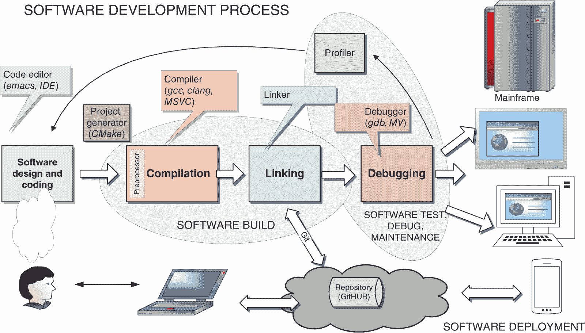

**图 2.3** 软件开发生态系统。为了执行用`C++`编写的软件，它需要由`compiler`翻译成机器表示。由于软件可以分部分创建并使用之前创建的库，所有部分都需要合并成一个可执行文件。这是由`linker`完成的。这些是软件构建阶段。接下来，需要对可执行文件进行适当的测试和调试以消除故障。然后，可以通过启动`profiler`（性能分析器）进一步优化当前版本的运行。它的作用是测量软件组件的性能以发现热点——消耗最多执行时间的代码片段。之后，可以重复整个软件开发过程，以构建下一个、更好的版本。在此过程中，我们不能忘记保护和控制我们软件的版本。这可以通过源码控制和版本控制平台来实现。软件就绪后，它可以被部署在具体的硬件平台上。

然而，在说我们已经完成工作之前，我们还有几个步骤之遥。事实上，新的开发阶段开始了：代码测试和调试。由于即使是简短的程序也可以实现复杂的概念，我们不应该幻想自己从一开始一开始就能写出正确的版本。因此，我们还应该编写用于控制其他软件正在做什么的软件。例如，这可以是`unit tests`（单元测试）的形式，我们也将讨论它。当软件中发现问题时，可以使用`debugger`（调试器）逐步运行。这仍然是我们工具链中的第三个程序；除了逐行代码执行外，它还允许我们添加断点、检查变量值、查看内存区域和调用栈，并在必要时甚至可以检查处理器的寄存器。调试是学习代码在做什么的最好方法。因此，在处理书中所示的代码示例时，我们广泛使用调试器。

软件可以有不同的配置和版本。虽然可能有很多种配置，但通常有两种独特的模式：

1. `Debug` – 一个通常未优化的软件版本，用于“内部”测试和调试。

2. `Release` – 经过密集测试的软件稳定版本，完全运行、经过优化并旨在分发给用户。

最后，请注意图 2.3 中的编程生态系统只显示了一个人——但软件开发和构建通常需要团队协作。人为因素在编程类书中经常被忽视，它可能对任何项目的成功或失败产生重大影响。尽管这一严肃问题超出了本书的范围，但顺畅的运行需要项目组织和合作（McConnell 2004）。在某种程度上，这些都得到了`C++`项目的模块化结构，以及执行源码版本控制和维护的工具（如图 2.3 中的`Git`和`GitHub`）的支持。

## 2.3 软件开发步骤

正如设计房屋、桥梁或汽车有多种方法一样，设计软件也有多种方法。然而，在所有这些情况下，指示成功或失败的最终标准是最终产品的性能。与其他工程领域一样，基于多年的经验和数以千计的项目，可以总结出一些帮助我们在未来设计中避免常见陷阱的通用规则。这些软件开发步骤如图图 2.4 所示，我们将仔细观察其中的每一个步骤。

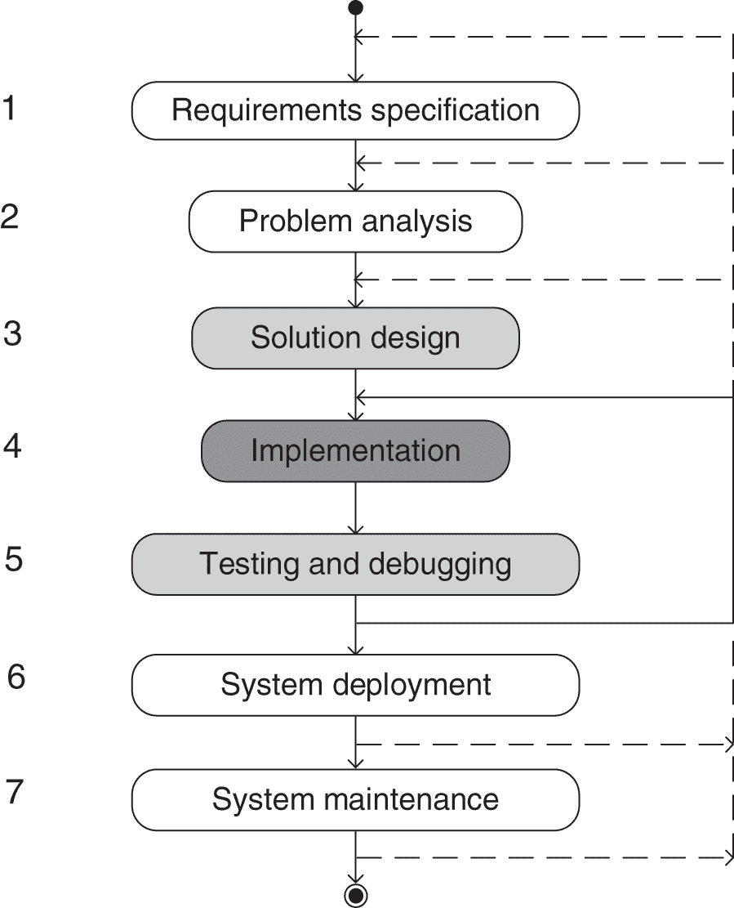

**图 2.4** 展示软件开发过程步骤的 UML 活动图。

在本书中，我们主要关注`C++`的正确实现。然而，缺陷的设计是不可能有良好实现的。此外，即使设计和实现都很良好，如果软件没有经过广泛的测试，也无法获得成功的解决方案。因此，尽管`C++`是我们的主要对象，但我们也会关注其他软件开发步骤。让我们按照图 2.4 所示的顺序简要地描述每一个步骤：

1. *需求规范* – 定义要解决的主要任务，以及产品的功能和应用的过程。这涉及许多方之间的合作，例如终端用户、系统架构师、经理等。在此阶段，对允许成本和预见截止期的合理陈述也至关重要（Dick 等人 2017）。

2. *问题分析* – 基于上一步步骤：建立系统中主要关系的过程，识别关键系统过程的控制规则，识别最困难的组件，并勾勒关键算法的主要阶段，特别关注问题最大的部分。在某些情况下，这可能是最昂贵且枯燥的步骤之一，涉及来自其他领域的专家。

3. *方案设计* – 基于前述步骤：指定整个系统架构的过程，考虑其所有组件及其接口。包括工具和实现策略的规范。通常，这个过程涉及准备*甘特图*，以捕获系统实现阶段、人力资源、截止日期和里程碑之间的相互依赖关系。

4. *实现* – 基于前述步骤创建软件的过程。该阶段的主要产物是源代码。可以构建可执行文件，如图图 2.3 所示。

5. *测试与调试* – 发现和修复故障软件的联合过程。应该使用形式化方法进行良好的设计，如测试驱动开发（TDD）和单元测试（附录 A.7](#b01.xhtml_head-2-18)）。然而，当故障实现是由于设计或开发过程中更高层次的缺陷时，就会出现问题。因此，设计步骤的作用是关重要的。

6. *系统部署* – 系统集成和安装的过程，以确保在特定配置的硬件平台上正常运行。这通常需要对特定的硬件组件进行调整，例如这些组件可能缺失或参数不同（Sommerville 2016）。

7. *系统维护* – 确保系统不间断运行并允许系统演进和无缝变化的实践。

当然，这些软件开发步骤并不是在这个高要求的工程领域中遵循的唯一路径；它们仅仅是可能模型之一。在其他领域（如电子和建筑）开发的开发策略也可以对软件设计有所帮助。有趣的是，设计模式——对我们来说是具有特定特征的成熟软件组件——最初被假定为建筑施工中遇到的通用模式（Alexander 1977）。

之前的步骤也应该反映在项目文档中，其结构可以是一个更长讨论的话题。不需说，此类文档应尽可能精确和简明地描述解决给定问题所需的所有步骤。在我们的项目中，我们将主要处理代码文档。在这方面，*自文档代码*的原则在许多实际实现中被证明是有用的。这是基于在软件实现期间添加了适当注释的假设。这些注释应该简明地传达最重要的概念，最重要的是保持更新。我们将在随后的章节中回到这个问题。

最后，让我们强调的是，图 2.4 所示的开发过程只是可能的过程之一，并没有反映软件开发的所有方面，例如人为因素。遵循所有这些步骤的设计仍然保证成功。然而，作为一种经验发现，不遵循任何设计策略（特别是在开发复杂系统时）是灾难的根源。许多更全面的开发策略，例如 PRINCE2、Scrum 和敏捷开发。

## 2.4 算法的表示与运行

最后，在本节中，我们将实现一个`C++`程序。它将要求用户输入一个数字，并在检查其是否为正值后显示该数的平方根。也就是说，如果输入 16，将显示 4，以此此类推。然而，在进入`C++`代码（算法表示的形式之一）之前，让我们先思考什么是算法以及如何表达它。

在本节中，我们将学习：

1. 什么是算法，以及如何表示它

2. 什么是统一建模语言（UML），以及 UML 活动图可以表示什么

3. 如何编写一个简单的`C++`程序计算用户输入值的平方根

5. 如何在 Linux 环境下编写`C++`源文件、编译并运行其可执行文件

### 2.4.1 算法表示

算法描述了执行步骤。算法不仅出现在计算机科学中，也出现在日常生活中。例如，每个办公室的火警说明提供了发生火灾时应遵循的步骤；在洗碗机上选择特定程序指定了机器清洗我们珍贵玻璃时执行的步骤；等。

很大程度上取决于我们操作的`abstraction`（抽象）`level`（级别）。计算机科学中的抽象概念经常被遇到：在表示算法时，它只需告诉我们需要何种程度的细节。在某些情况下，特别是当我们希望查看算法的整体时，更倾向于使用更通用的`coarse level`（粗粒），可以使用图像：具体来说，就是使用通用约定符号的图表。此类图用于许多领域，例如电气工程和建筑学。在计算机科学中，我们很幸运在 UML 框架下拥有一套通用的图系统（参见`[`uml.org`](http://uml.org)`和`[www.visual-paradigm.com](http://www.visual-paradigm.com)`）。UML 不仅仅是通用符号的集合——该框架促进了图 2.4 所示的整个软件开发过程。我们将多次回到它。然而，现在让我们展示表示我们的程序所需步骤的 UML 活动图，如图 2.5 所示。

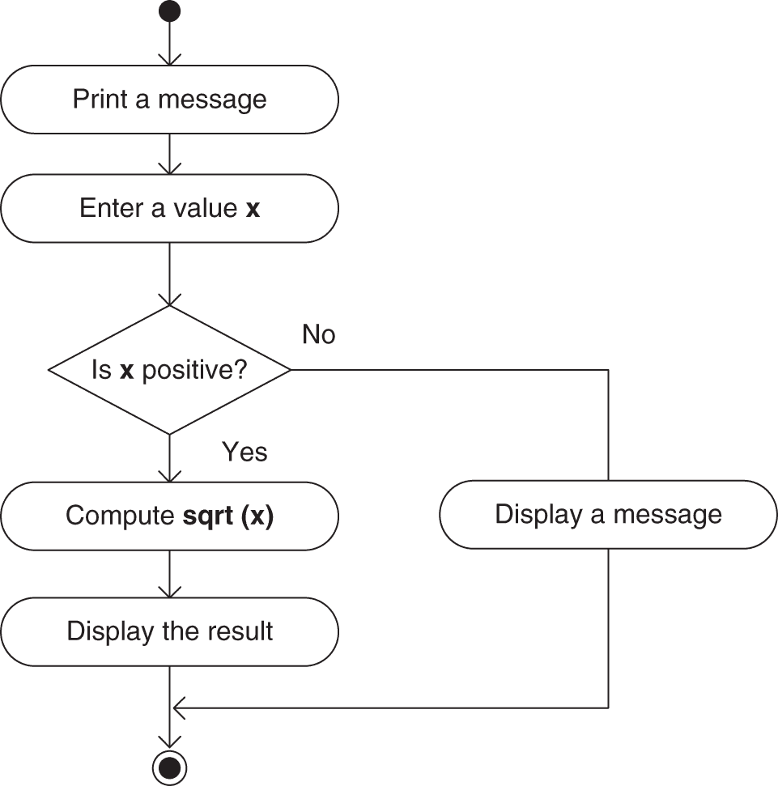

图 2.5 UML 活动图，展示了计算从键盘输入的数值`x`的平方根的算法。所有操作都可以两个符号表示：活动（过程）和决策块。

基本上，在图 2.5 中有两种类型的符号。操作位于圆角矩形中，决策块位于菱形中。以箭头结尾的线显示控制流。因此，此类图表有时被称为`flow charts`（流程图）。通常，在简单的图表中，主流程从上到下进行。但请注意，流可以很容易地重定向，形成执行中的循环。图中还有黑色的圆形符号，分别表示操作的开始和结束。尽管简单直观，但结束符号提醒我们了算法设计中一个非常重要的问题：`stop problem`（停止问题）。简单来说，这意味着一个设计良好的算法应该具有定义良好的停止条件，即它不应该在未定义的状态下永久挂。某些软件（如操作系统）在无限循环中运行；然而，它永远不应该发现处于未定义的状态或行为中。

注意，在图 2.5 中，整个程序一目了然。但同时，这些步骤表示了某些通用操作，例如“计算`sqrt(x)`”，而没有深入的细节。这就是我们所说的粗粒度，或者更通地说，一种`top-down`（自顶而下）的方法。另一方面，进入细节意味着进入越来越细致的层级：即“向下”设计。通常，这涉及到更多的符号；为了避免混乱，这些符号通常在单独的图表中呈现。然而尽管如此，在某些任务中，可以从细节开始。这种`bottom-up`（自底向上）的方法在我们的领域中用处小得多，通常会导致上层组件之间接口接不良好的设计。

呈现算法的另一种方法是伪代码形式。这是简单计算机命令与更通用陈述的混合体，通常以人类可读的命令或短句形式编写。算法 2.1 展示了这种方法。

最终的表示形式是计算机代码，如列表 2.1 所示。这可以被翻译成计算机可执行的格式并启动。

列表 2.1 中的代码执行了图 2.5 和算法 2.1 中概述的内容。

### 2.4.2 使用在线编译器

在解释列表 2.1 中的每行代码之前，我们可以借助带有 C++ 编译器的在线平台帮助来编译它并运行其可执行文件，如图 2.6 所示。² 然而，在输入时，我们可能会出错，在这种情况下代码将无法编译，平台将显示来自编译器的错误消息。应该仔细阅读以查看问题所在，以便修复它。但有时错误的精确位置可能很难确定，而真正的罪魁祸首可能是编译器指示位置上方的几行。因此，我们还应该检查之前的行。

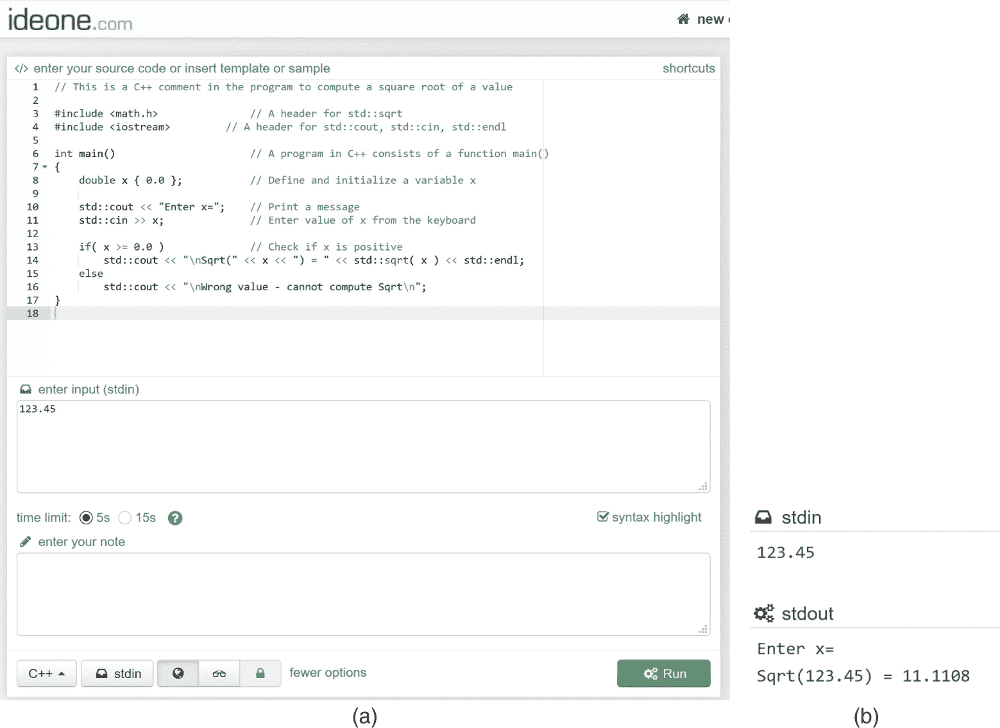

图 2.6 `http://ideone.com`在线 C++ 编译器环境在 Mozilla Firefox 查看器中运行，带有列表 2.1 的代码 (a)。源代码已复制到编辑器面板中。下方是输入面板，模拟`std::cin`。在我们点击 Run 后，源代码被编译并执行。结果显示在 (b)。

### 2.4.3 C++ 程序的结构

为了理解各种代码组件的作用，从列表 2.1 中提取了一个简化的 C++ 程序，并显示在图 2.7 中。列表 2.1 代码的详细描述将在下一节给出。

程序由由分号`;`分隔的语句组成。忘记这个结束符号是早期编程中最常见的错误之一。然而，请注意，`main`函数块的结束处没有分号，它位于大括号`{}`包围的区域内。

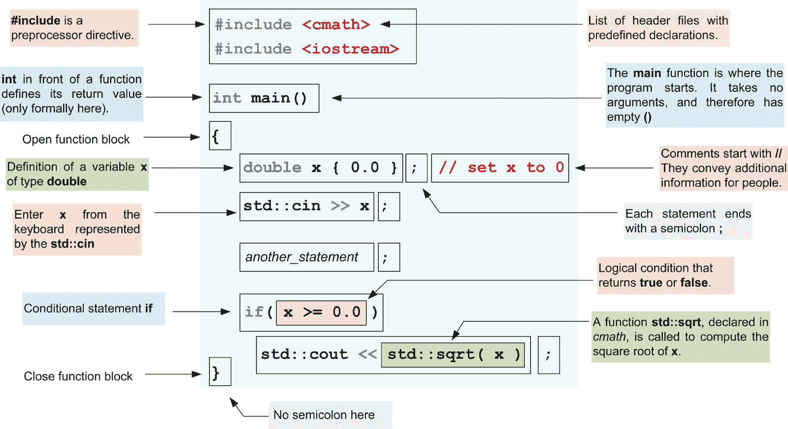

图 2.7 C++ 程序的结构，包含一个`main`函数。包含其他定义的头文件通过`#include`指令引入。每个语句（例如`double x {0.0}`定义）以分号结尾。然而，`main`函数块的结束处没有分号，它位于大括号`{}`包围的区域内。

### 2.4.4 代码分析

在示例中，`main`函数定义在第 [6] 行，其主体——一组代码行——位于第 [7–17] 行的大括号之间。`main`前面的`int`表示它应该返回一个值，但在这种情况下这并不重要。

第 [10] 行指示计算机在屏幕（即窗口）上显示文本`"Enter x="`。这是通过`std::cout`对象和`<<`运算符实现的。由于`<<`运算符在 C++ 中具有不同的含义，取决于它们所处的上下文，在这里它不是位移。而在`std::cout`对象中，它表示输出流。

（注：由于原文文本存在大量重复内容，翻译已根据“不要重复输出原文”的逻辑进行了去处理）

虽然 Linux 是一个拥有数百个实用功能和应用程序的优秀操作系统，但有时让 Linux 和 Windows 在同一台计算机上共存也是不错的。Windows 10 为 Linux 编程提供了卓越的设施。首先，可以从 Windows Store 下载并安装 Ubuntu 和 Debian Linux 发行版，允许我们像运行其他 Windows 应用程序一样运行适用于 Linux 子系统 (WSL)，同时提供完整的 Linux 服务。其次，Microsoft Visual 2019 (MV'19) 中也提供了 Linux 开发插件。

MV'19 环境也是我们主要的开发平台。因此，除非另有说明，书中介绍的大多数项目（即包含创建完整程序所需的所有文件和设置的整个平台）都是在 Windows 10 上使用 MV'19 进行开发和测试的。然而，这些项目是在`CMake`程序的帮助下自动生成的。这极大方便了在具有多个操作系统和各种编译平台的环境中维护最新项目，正如附录 A.6.1 所示。C++ 项目的组织以及各种文件的作用将在第 3.15 节中讨论。

总结一下，在本节中我们学习了以下内容：

1. 什么是算法，以及如何用 UML 活动图、伪代码或 C++ 代码表示它。

2. 如何实现构成任何 C++ 程序入口的`main()`函数。

3. 定义并初始化`double`类型的变量来表示实数。

5. 使用条件语句`if-else`检查变量的值，并根据结果执行代码路径。

在这个示例中，我们将编写一个可以辅助金融投资的简单程序。假设我们有 $1000（原始本金），并希望以每年 3% 的利率将其安全地投资到银行中。很容易确定，一年后，我们将获得 $1000 · 3% = $30，因此我们的最终本金将是 $1030。如果重复同样的操作会发生什么？现在我们的初始本金是 $1030，所以一年后，我们将获得 $1030 · 3% = $30.90。这次我们赚得比第一年多，因为我们开始时的本金稍高一点。让我们写一个 C++ 程序为我们进行这些计算。正如第 2.3 节所述，这些我们的需求。然而，在编写第一行代码之前，我们应该花时间进行问题分析，如图 2.4](#c02.xhtml_c02-fig-0004) 所示。在这种情况下，我们将从编写一些简单的方程开始，这将指导我们的实现。

给定初始资本为`C[0]`，利率`r`和周期数`t`，利息计算如下：

其中`r`表示复利周期`t`中的收益率。然而，银行通常提供相对于年度周期的`r`值，即 12 个月，而一年中可能有许多复利周期。因此，我们需要更精细，并将复利周期设置为我们的基本单位。换句话说，我们的索引`i`将计算总投资时间内完全完成的复利周期数。假设我们投资 24 个月，复利周期为 4 个月；在此期间，我们将有 6 个周期。我们是如何计算的？`24/4 = 6`。通常，周期为`i = m/t`，其中`m`表示以月为的总投资时间。另一方面，在每个周期内，投资率为`r/12 · t`。例如，如果`r`是 3% 且`t`再次为 4 个月，那么这个期的利息就是`0.03/12 · 4 = 0.01`。因此，我们得到以下方程，作为我们实现的依据：

* `C[0]`是初始资本。

* `C[i]`是投资`m`个月后的最终资本（即`i = m/t`个复利周期）。

* `t`表示复利周期（例如，对于季度复利，`t`为三个月）。

* `m`是以月表示的总投资时间。


在第 [12] 行，我们使用`cout`对象、`<<`运算符以及带引号的文本常量在屏幕上输出文本。（我们会发现，诸如`<<`这样的运算符的作用取决于它所作用的对象的类型。）`endl`意味着将光标移动到下一行并刷新屏幕。

在第 [13] 行，创建了一个名为`C_0`的变量来存储一个初始金额。变量的命名对于传达有用信息非常重要。因此，这个变量可以命名为`initial_amount`之类的。然而，在实现公式时（例如 Eq. (2.3)），通常保留公式元素的名称会更好；而且数学公式通常用单个字母和下标书写。变量（对象）`C_0`可以存储任何正值，包括分数。正因如此，我们选择了`double`作为其类型。`C_0`被创建，并在同一行中通过输入`{}`立即初始化为 0。

接下来，在第 [14] 行，我们等待用户输入初始资金的实值。之后，我们在第 [16] 行检查该值。如果不正确，程序将写一条消息，并在第 [19] 行返回错误代码 −1。检查错误值是实际代码中非常重要但经常被遗忘的操作之一——务要尽量安全起见。在 C++ 中，有比返回错误代码更高级的机制来处理错误；这些机制将在 Section 3.13.2.5 中讨论。

这种打印、定义变量、等待然后检查用户输入数据正确性的过程重复了若干次。这在下面的代码中显示，现在应该已经清楚了：

读取所有数据后，我们开始计算，并分别在第 [58] 行和第 [59] 行定义两个常量。它们的名称传达了关于它们作用的信息。正如我们所知的，在`double`前面加上关键字`const`会让对象变为只读。在这里省略`const`不会改变计算结果，但会损害代码对意外错误的防御能力。因此，如果一个值应该保持不变，我们应该将其声明为`const`。

给定总投资月数`m`和一个复利周期`t`（单位也是月），第 [61] 行计算出复利周期数`i`。然后，在第 [63] 行计算出总和，完全如 Eq. (2.3) 所示。在第 [65–66] 行，计算出的值显示在屏幕上。最后，在第 [69–73] 行，我们计算并显示了收入以及税后收入。

## 2.5.3 软件的构建与运行

正如 Section 2.4.2 所述，我们可以轻松地在在线 C++ 编译器平台上运行之前的代码。然而，在这种情况下，构建一个可以像系统中任何其他程序一样启动的应用程序是一个更方便的选择。要为 Linux 构建`CompInterest`应用程序，我们可以遵循 Section 2.4.5 中所示步骤。但由于 Listing 2.2 中的代码仅使用标准 C++ 机制，该软件组件是相当通用的。因此，如果我们有创建和维护多平台项目的工具，它可以在任何平台上运行。对于每个软件开发环境，我们可以手动创建一个合适的项目并构建应用程序。然而，考虑到此类平台和操作系统的数量，这样做将非常麻烦。相反，我们可以使用`CMake`项目生成器。在它的支持下，不仅是本项目，未来的所有项目都可以自动生成以适应不同的开发平台和操作系统。我们只需要安装这个免费工具并编写`CMakeList.txt`文件，该文件包含了告诉`CMake`执行操作的命令（这些在 Appendix A.6.1 中进行了描述）。幸运的是，示例项目附带了合适的`CMakeList.txt`文件，可以从 GitHub (`https://github.com/BogCyg/BookCpp`) 与源代码一起下载。同样幸运的是，我们所有的项目都使用几乎相同的`CMakeList.txt`文件。

构建好`CompInterest`应用程序后，为了测试它，假设我们有 $1000，年投资率为 2.7%，我们希望投资资金四个月。启动`CompInterest`后，我们的利息可以如下计算：

之前的`main`函数可以作为类似程序的简单模板，这些程序读取数据、进行一些简单计算并输出结果。此外，该项目可以作为一个起点，为移动平台构建具有图形用户界面 (GUI) 的应用程序，或作为 Web 组件。我们将在稍后讨论这些这些的想法。

在本节中，我们学习了：

1. 如何使用`int`定义和初始化整数，使用`double`定义分数，以及使用`""`定义常量字符串

## 2.6 示例项目 – 字符出现计数

假设我们计算句子字母 a–z 的出现次数直方图。我们如何处理这个问题？让我们从一个简单的例子开始，分析构建此类直方图的过程。

在解释此代码如何运行之前，让我们看看它做了什么。我们如何运行代码？最简单的方法是打开带有在线 C++ 编译器的网页（例如 *Coliru*），复制并粘贴代码，点击“*Compile, link and run…*”按钮。参见 Figure 2.10 中的截图。考虑到之前章节的示例，构建一个独立的应用程序也不应该问题。

**图 2.10** (#c02.xhtml_R_c02-fig-0010) 在 Mozilla Firefox 查看器中运行的 Coliru 在线编译器环境 ([`coliru.stacked-crooked.com`](http://coliru.stacked-crooked.com/))，其中将列表 2.3 中的代码复制并粘贴到编辑器窗格中。下方是输出窗格。左下角的面板包含编译和运行程序的命令行。右下方是操作按钮。

也就是说，每个字母都与其在输入句子中出现的频率相关联。

第 [6–7] 行包含`using`指令。这些是可选的，但可以让我们节省打字量，因为我们不需要写`std::cout`，而是省略`std::`前缀并简洁地写成`cout`：

对象`in_str`最初是空的，但并不多久。在第 [18] 行，它会等待用户在终端窗口中输入句子并按下`Enter`键。这本足够；但由于我们在一个不便于接受用户输入的在线编译器中运行程序，在第 [19] 行我们为`in_str`硬编码了一些示例文本：

第 [23] 行在最近的`for`循环监督下运行。因此，对于每个字母`c`，我们通过减去代码`'a'`在直方图 vector 中找到对应的索引。然后通过调用`++`运算符将该项增加 1。为了相同地处理大和小字母，通过调用`std::tolower`函数将每个字母`c`转换为小写（在这里我们必须显式写出前缀`std::`，因为`std::tolower`没有列在`using`中）。为了重置输出中的提示符位置：

（此处省略原文对应的代码块）

1. 编写算法 2.3 的实现。

4. 在使用`std::cin`对象输入值时可能会出现问题。例如，在列表 2.2 的第[14] 行中，程序期望一个数值，但用户可能会输入`abc`。为了防止此类错误，可以像下面的代码段所示检查读取操作的状态：

6. 二次多项式可以表示如下：

   其中`a`、`b`和`c`表示实数系数。问题是是否存在满足该方程的`x`值。如果存在，它们被称为该二次多项式的`roots`。记住，为了回答这个问题，只需如下如下计算判别式系数`d`：

   否则，没有根。编写一个 C++ 程序，要求用户输入三个系数`a`、`b`和`c`；判断是否存在根；如果可能，则计算出这些根。首先将之前的方程重写为等价的 C++ 表达式，然后对它们进行适配。

8. 计算两个正整数的和。然而，要计算的和是以字符串形式给出的，例如“123 + 37”、“78+ 99”等。编写一个执行以下步骤的程序：

   2. 字符串中多余的空格；

   5. 打印这两个值之和；

9. 比较文本有许多方法。简单的一种是比较它们字母出现次数两个直方图。两个长度相同的直方图可以通过叠加对应桶值差的平方和来进行比较。

   3. 在比较之前对直方图进行归一化将获得更好的结果。归一化后，一个直方图中所有桶的和为 1.0。要归一化直方图，将每个桶的值除以该直方图中所有桶的总和。提示：使直方图向量能够存储浮点值，例如在列表 2.3 的第[14] 行中将初始化值从 0 改为 0.0。

C++ 基础

2. 标准库中的常用容器和算法

3. 引用基础

4. 类介绍

6. C++ 语句

7. 函数

8. 运算符

## 3.1 常量与变量 —— 内置数据类型、范围与初始化

2. 间接，通过提供对象的引用或指针

对象可以进一步分为两类：

1. 可变的（Mutable）——创建并初始化后可以更改。这些是变量。

图 3.1 展示了变量创建和初始化的阶段及其影响。在原始内存中，每个字节都是未定义值。通过指令计算机执行`char c`在内存中预留一个字节，正如图 3.1 所示。结果，我们不是使用地址，而是使用对象的标识符，例如示例中的`c`。然而，`c`仍然包含垃圾值，因此必须初始化。初始化是将一个已知值（状态）写入变量。在我们的案例中，这是一个`'Z'` —— 即字母`Z`的代码。

我们在此强调，虽然可以编写并编译一个未初始化的变量，例如


但该对象可能会拥有内存中恰好存在的*任何值*！这可能导致难以发现的严重错误。因此，*务必初始化你创建的所有对象*！在 C++ 中，只需添加`{}`，如下所示：

创建对象时，请考虑以下方面：

1. 为对象选择一个能反映该对象在代码中角色的重要信息的名称。在 C++ 中，对象的名称（如变量、常量、函数、结构体或类）以`identifier`（标识符）的形式出现。`identifier`是由字符和数字组成的序列，以字符开头。下划线符号`_`被视为字符，并经常用于分隔名称的不同部分，正如我们在许多示例中看到的那样。

2. 如果对象不打算改变其状态，使用`const`关键字将其定义为常量。

3. 不要对原始数字进行操作——通过通过定义常量对象来给它们命名。

4. 为对象选择合适的类型。

5. 正确地*初始化*每个对象。

6. 不要混合不同类型的变量。

混合类型会导致糟糕的错误。让我们考虑从华华氏度到摄氏度的简单转换，其公式如下

(3.1)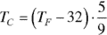

为了将`T[F] = 100`转换为`T[C]`，我们可以将之前的公式转换为以下代码：

然而，在编译和运行后，终端窗口出现了以下消息

这显然是不正确的。那么，发生了什么？问题出在第 [4] 行错误的数据类型上。整数常量 5 除以另一个整数常量 9 的结果为 0。相反，变量`TF`和`TC`已正确声明为`double`类型。因此，第 [4] 行的减法`TF – 32`没有问题，因为整数常量 32 将被提升为`double`，结果也将是`double`。但此结果乘以提升为`double`的 0 后将产生 0，如所示。正确的版本如下：

在这里，我们没有混合数据类型，也不依赖于后台的自动类型转换。在第 [4] 行中，所有变量和常量都是同一种`double`类型。现在除法是正确的，并显示了正确答案：

[表 3.1] 展示了一些基础内置类型及其属性，例如字节长度和值表示。在决定选择什么类型来表示程序中的数量时，这些知识是必要的。值表示指定了我们是否可以存储正值或负值，以及它们是否可以是分数。变量的长度影响所存储表示的精度。这些问题将在[第 7 章]中进一步讨论。给定类型占用的长度（字节）可以使用`sizeof`运算符确定（参见[表 3.15]中`GROUP 3`运算符的描述）。如[表 3.1]所示，只有`char`的长度恰好等于 1 字节。其他类型需要的字节超过 1 字节。它们的精确长度取决于系统，并可能随系统而变化。然而，保证以下内容成立：

在 C++ 中，当创建对象时会发生两件事：

1. 分配足够的内存来存储对象。

2. 对象被初始化（如果可以使用适当的初始化函数，称为*构造函数*）。

正如已经提到的，对于给定的类型`T`，运算符`sizeof(T)`返回存储类型为`T`对象所需的字节数（另见[表 3.15]）。这对于基本类型运行良好，但在更复杂的对象上调用`sizeof`通常不会返回我们预期的结果，因为数据可能分布在许多内存位置。在这种情况下。

| :--- | :--- | :--- |

| `char` | 1 | 适用于 1 字节的符号整数值，即 -128 到 127。 |

| `short` | 2 | 符号整数值（前面可以加 signed 关键字）。 |

| `long` | 4 | |

| `long long` | 8 | |

| `unsigned [char, short, int, long]` | 与符号类型相同 | 无符号整数值。 |

| `float` | 4 | 单精度浮点数 (IEEE-754)。 |

```
// 创建 double 并初始化为 0.0 (0 int)
double val { 0.0 };

if( val >= 0.0 )
    << sqrt( val ) << endl;
else
    std::cout << "Negative value" << endl;
```

| `double` | 8 | 双精度浮点数 (IEEE-754)。 |
| `long double` | 8 | 扩展精度浮点数。 |

```
 // Unicode letter
wchar_t w_letter { L'A' };

size_t w_letter_bytes = sizeof( w_letter );

// wcout is necessary to display Unicode
<< w_letter_bytes << std::endl;
```

要输入常量宽字符，请使用`L'A'`。常量宽文本以`L""`形式提供：即带有前缀`L`的引号内容。

**表 3.1** 内置基本数据类型及其属性和字面量。

| :--- | :--- | :--- |
| 由`identifier`并由`type`设置特征的变量或常量（对象）。初始值`value`使用初始化列表`{}`设置。<br>如果添加了`const`，则对象不能更改（不允许赋予新值）。<br>这是 C++ 中初始化对象的*优选*方式。<br>``{}`被称为零初始化，因为保证对象会调用其默认构造函数，对于内置类型，这会将其值设置为 0。 | 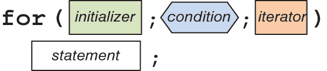 | |

### 使用`()`初始化

| 使用`()`初始化的变量和常量：
```cpp
 //int x(); // x 是 int 且被设置为 0 吗？不！！ 
 x += 1;          // 可以加 1
 y += 1;
 double radius ( 2.54 ); 
 std::cout << "Area = " << kPi * radius * radius;
``` | 与前项相同，但初始化的形式为调用构造函数（即为`type`定义的初始化函数）。 |  | |

使用`()`进行初始化看起来像是在调用函数，而且实际上确实如此。该函数被称为*构造函数*，它执行由对象类型定义的动作。如果没有提供参数，则会调用*默认构造函数*。如果带有参数，则为*带参数的构造函数*。这些将在第 (3.15) 节中讨论。
编写`int x();`可能会引起混义。它并不会创建一个调用了默认构造函数的变量`x`。相反，编译器将其视为一个名为`x`的函数声明，该函数不接受参数并返回`int`。

### 使用`{}`初始化

```cpp
 // 使用赋值 = 初始化的变量和常量
 int x = 0;      // 创建 x 并设置为 0
 x += 1;          // 可以加 1
 // 从初始化列表初始化的
 // 浮点算术变量 
 // 创建浮点类型的常量 kPi
 // 计算并显示面积
 bool flag = true;     // 逻辑变量设为 true 
```


通过赋值初始化可以正常工作，但在某些情况下可能效率不高。这是因为执行了两个步骤：首先使用默认值创建对象，然后使用赋值运算符 `=` 右侧的值对其进行初始化。

### 数据类型与 Unicode 支持

`wchar_t` 使用 4 字节，用于宽字符表示。

**表 3.1** 内置基本数据类型及其属性和字面量。

另外注意，为了正确显示宽字符，我们需要使用 `std::wcout` 而不是 `std::cout`。此外，在某些平台上，我们需要调用平台特定的函数来显示。最后，注意宽文本字面量以前缀 `L` 开头。总结来说，如果我们编写可以在国际市场上使用的应用程序，从开始使用 `wchar_t`、`wstring`、`wcout` 等是一个很好的选择。

到目前为止，我们已经学习了如何定义和使用不同类型的单个变量和常量。然而，经常，我们需要连续地存储许多此类对象。有时我们不知道需要多少个。为了这一点，我们可以使用一种名为向量（vector）或数组（array）的数据结构。

首先，向量（vector）具有以下特征的数据结构：
1. 它包含相同类型的对象。
2. 对象在内存中紧密排列，即一个接一个地排列（没有空隙）。
3. 向量中的每个对象都可以通过向`下标运算符` `[]` 提供`index`（索引）来访问。有效索引为 0 到 `N - 1`，其中 `N` 表示向量中元素的个数。

在 C++ 中，有许多方法创建向量。最灵活的方法是使用标准库（STL）中的 `std::vector` 对象，它：
1. 开始时可以是空的
2. 包含了许多实用的函数

在我们详细介绍 `std::vector` 能为我们做什么之前，让我们先从 Listing 3.3 中的一个简单示例程序开始。该程序的目的是收集学生的成绩并计算它们的四舍五入后的平均分。
为了使用 `std::vector` 并能够读写值，需要包含若干标准头文件，如第 [1–3] 行所示。然后，为了避免重复使用 `std::` 前缀，在第 [7] 行，通过 `using` 指令将 `std` 命名空间中的常用名称引入我们的作用域。我们已经知道了 `main` 函数的作用，它从第 [10] 行开始：定义了我们的 C++ 可执行文件。然后，核心部分是第 [15] 行 `vector` 对象的定义。注意，存储的对象类型需要在 `<>` 括号中给出。为了能够存储对象，`vector` 类是借助模板机制以泛型的方式编写的，这将在 Section 4.7 节中讨论。

然后，在第 [18] 行，`for` 循环开始（参见第 3.13.2.2 节）。它的作用是收集用户输入的所有成绩。然而，我们不知道会输入多少个。因此，`for` 中没有条件：它会一直迭代，直到在第 [34] 行遇到 `break` 语句（此时用户按了 `'n'`，如第 [33] 行检查的那样）。
在每次迭代中，在第 [20] 行创建了一个值为 0 的新 `grade`，随后在第 [22] 行被用户输入的值覆盖。如果它的值是正确的（即在 2.0 到 5.0 之间），那么在第 [26] 行，通过调用其 `push_back` 成员函数将其推入向量对象 `studentGradeVec` 的末尾。对象及其成员函数之间用点运算符（`.`）分隔——其语法在 Section 3.9 节以及 `GROUP 2` 运算符的描述中给出（参见 Table 3.15）。

在波兰的教育体系中，成绩范围是从 2.0 到 5.0 分，3.0 是第一个“及格”分。有效的成绩是 { 2.0, 3.0, 3.5, 4.0, 4.5, 5.0 }。
程序的其余部分用于计算最终成绩，该成绩应该是已输入成绩经过适当四舍五入后的平均分：

我们从第 [37] 行开始，检查 `studentGradeVec` 是否包含至少一个成绩。为了查看这一点，调用了 `size` 数据成员。它返回向量所包含的对象个数（而不是它们占用的字节大小！）。
在第 [39] 行，创建了一个值为 0 的对象 `sum`。然后，在第 [41–42] 行，创建一个 `for` 循环，它访问存储在 `studentGradeVec` 中的每个元素。为了这个目的，`for` 有一种特殊的语法，中间带有冒号运算符 `:`，如 Section 2.6.3 节所示。冒号左侧的 `auto g` 定义了一个变量 `g`，该变量将被复制到 `studentGradeVec` 的后续元素中。得于 `auto` 关键字，我们不需要显式提供 `g` 的类型——为了方便，它将由编译器自动推导。这种带有 `auto` 的构造在现代 C++ 中非常常见，稍后将讨论（Section 3.7）。循环累加所有元素后，在第 [44] 行，通过将 `sum` 除以 `size` 返回的元素个数计算平均分。在这里我们可以轻松地这样做，因为我们已经检查了向量中存在元素，所以 `size` 将返回大于 0 的值。此外，由于 `sum` 是 `double` 类型，由于 `size` 返回的任何类型值的类型提升，结果也将是是 `double`。为了明确起见，`av` 被声明为 `double`，而不是使用 `auto`。

我们快要完成了，但为了计算第 [46] 行定义的 `finalGrade`，我们需要确保它是集合中的值之一。因此，在第 [49] 行，我们检查 `av` 是否至少为 1。如果不是，则给 `finalGrade` 赋值。否则，需要对 `av` 进行四舍五入。为了进行正确的四舍五入，在第 [55] 行将 `av` 分为 `near_int` 和 `frac` 部分。前者通过调用 `std::floor` 函数获得，该函数返回不大于参数的最大整数。另一方面，`frac` 是通过从 `av` 中减去 `near_int` 计算得到的。
第 [58] 行的变量 `adjust` 用于持有可能的调整值：0、0.5 或 1。根据 `frac`，`adjust` 的精确值在第 [60–63] 行的条件语句中计算。也就是说，如果 `frac` 大于 0.75，`adjust` 取值为 1，`near_int` 加 1 即为最终成绩。如果是 0.5，最终成绩为 `near_int + adjust`。调整发生在第 [65]。

最后，在第 [68–70] 行显示最终成绩。由于我们希望输出宽度为三，小数点后一位，表达式中添加了 `std::fixed` `<<` `std::setw( 3 )` `<<` `std::setprecision( 1 )` 流操纵符（参见 Table 3.14）。与之前的项目一样，我们可以在在线编译器平台上运行这段代码。然而，更好的主意是借助 `CMake` 工具构建整个项目，如在 Section 2.5.3 中提到的。在这种情况下，我们将能够充分利用一个非常重要的工具——调试器。

## 3.3 我们的朋友调试器

到为止，我们编写了简单的代码示例，如果它们构建成功，就会立即运行它们查看结果。然而，这种策略在任何严肃的软件开发周期都是不可行的。软件构建之后的关键步骤之一是测试和调试，如软件开发图 Figure 2.3 所示。如果没有最重要的工具之一——调试器，这将会是不可能的。无控制地运行新开发的软件甚至是危险的。调试器为这种软件组件的执行提供了必要的控制。例如，它允许我们逐行执行程序并查看对象的值是否正确，或者在情况不顺利时终止整个进程。然而，最重要的是，调试器允许我们真正理解软件的操作，并让软件按预期运行。在本节中，我们将通过示例追踪调试器的基本功能。

在我们开始调试之前，程序必须在开启调试选项的情况下构建。这要么在 `CMakeLists.txt` 文件中预设，要么在 IDE 中设置。程序的调试版本是功能完备的软件，但没有经过任何代码优化，并且包含了调试信息。这使得当前的执行位置能够与源代码的具体行进行精确匹配，并提供有关所用符号的完整信息。发布版本是在软件经过完全调试和测试后构建的，并开启了所有必要的优化标志。

表 3.3 列出了在调试器控制下对程序可以执行的基本操作。最常用的方法是在特定函数的开头设置断点，然后通过步到下一行并观察相关对象的状态来跟踪软件执行。然而，一些更复杂的操作也有用，例如在选定条件上设置断点、观察函数调用堆栈，以及观察处理器寄存器和系统内存。例如，在第 3.7 节中，我们将展示如何使用调试器来揭示用 `auto` 关键字声明的对象的类型。

| 操作 | 说明 (gdb 快捷键) | 操作 | 说明 (gdb 快捷键) |
| `run` | 在调试器控制下运行程序（进程）(`r`)。 | `step out` | 在调用堆栈中向上移动。这意味着跳出当前函数(`fin`)。 |
| `breakpoint` `conditional breakpoint` | 设置断点以在代码的某行暂停程序 (`b`)。可选地在给定条件发生时暂停 (`cond`)。 | `print object state` | 通过提供对象名称显示对象的状态（值）(`p`)。 |
| `continue` | 从当前停止点继续执行 (`c`)。 | `set object state` | 允许我们更改对象的当前状态（值）。用于测试不同的设置或临时修复错误的值 (`set`)。 |
| `step to next` | 步到下一行，跳过所有低层调用 (`n`)。 | `list` | 列出当前执行的源代码部分 (`l`)。 |
| `step into` | 进入低层函数调用 (`s`)。 | `disassemble` | 显示当前执行的机器码部分，并允许我们检查寄存器、内存等 (`disas`)。 |

在 IDE 中进行调试非常简单，如第 3.2 节中 Grades 项目的图 3.3 所示。然而，尽管 Linux 操作系统可以安装和使用各种 IDE，但我们建议熟悉 `gdb` 调试器，它在嵌入式系统中被频繁使用。

1. 使用不同的数据和参数运行软件。通常无法测试所有可能的状态。然而，选择边界情况可以帮助在更短的时间内发现许多问题。与认真调试相结合的是创建充分的代码。我们将在第 3.17.2 节和附录 A.7 中探讨这一问题。
2. 隔离问题。有时，表现为错误的现象是之前步骤的结果。
3. 理解问题以及你提出的解决方案——不要猜测。确保你能够阐明解决软件异常背后的目标。
4. 确保你修复的是问题本身，而不仅仅是症状。
5. 如果你仍然不确定，请同事帮助，并在互联网上寻找答案。

同样重要的是意识到调试是一个心理过程。它是很困难的，因为揭暴露了我们的错误，这些错误不仅可能是由于简单的错误，更令人痛苦的是，可能与对主题的知识不足或对编程技术的误解有关。在学习编程时，我们可能会与新语言作斗。虽然起初压力很大，但这不应该分散我们使用调试器的注意力。所以，尽一切学习关于调试的知识，并在处理所有项目时使用它，而不仅仅是书中介绍的项目。很快你就会发现调试是一个有趣的智力冒险。其他有用的编程工具在附录 A.6 中描述。

关于软件调试的更多信息可以在以下书籍找到：*The Art of Debugging with GDB, DDD, and Eclipse* (Matloff and Salzman 2008) 和 *Inside Windows Debugging. Practical Debugging and Tracing Strategies* (Soulami 2012)。其他高度推荐的书有 *The Pragmatic Programmer* (Thomas and Hunt 2019) 和 *Code Complete* (McConnell 2004)，它们对软件开发过程提供了见解。

## 3.4 基础数据结构 – `std::vector`

在代码段 3.3 的程序中，我们看到 `std::vector` 允许存储用户输入的任意数量成绩。我们可以通过它的 `push_back` 函数添加新值，通过调用 `size()` 函数访问元素数量。这些和其他常用的 `std::vector` 成员函数总结在表 3.4 中。
图 3.4 显示了 `vector` 对象及其数据的可能内存位置。有两个不同的位置：一个用于 `vector`，另一个用于其数据。此外，`vector` 可以为数据预留比当前元素数量更多的内存。如果它没有足够的内存存储数据（例如，由于多次调用 `push_back`），那么 `vector` 将分配一个新的更大的缓冲区，复制其数据并释放旧缓冲区。因此，数据会在后台反复复制。

要获取 `vector` 所含数据的确切数量，应该调用它的 `size` 成员函数（而不是 `sizeof` 运算符，后者返回的是仅为 `vector` 对象分配的字节数，这可能不是我们所关心的内容）。接下来的章节将讨论在 C++ 中创建数组的其他方法。

| :--- | :--- | :--- |
| `vector(`num`,` `init_val`)` | 默认类构造函数创建一个空的 vector。第二个构造函数会创建一个包含 `num` 个元素的 vector，每个元素的初始值均为 `init_val`。 | 在此示例中，首先创建了一个空 vector。然后，通过调用 `push_back` 插入几个元素。`size` 函数返回 vector 中元素的数量。`find` 函数返回所求值元素的位置。该位置赋值给对象 `pos`，其类型由编译器自动确定，如在 第 3.7 节 中所示。如果未找到 0，则返回 `cend`。`erase` 移除指定范围内的元素。 |

```cpp
vector< int > intVec; // 创建一个空 vector

cout << "intVec.size() == " << intVec.size() << endl;
intVec.push_back( 13 );

intVec.push_back( 0 );
intVec.push_back( 1 );

intVec.push_back( 13 );
cout << "intVec.size() == " << intVec.size() << endl;

// 查找值为 0 的元素的位置
auto pos = find( intVec.cbegin(), intVec.cend(), 0 );

if( pos != intVec.cend() )
    intVec.insert( pos, 1 ); // 在 0 之前插入 1
```

```cpp
vector< char > monthDays { 31, 28, 31, 30, 31, 30,
// 打印它们
for( size_t i = 0; i < monthDays.size(); ++ i )
    cout
    << "Month " << i + 1 << " has "
    << +monthDays[ i ] << " days" << endl;


<< "Total days = "

    monthDays.cbegin(),
    monthDays.cend(), 0 ) << endl;
```

此代码输出如下：

```
. . .

Total days = 365
```

我们可以构造一个具有指定数量元素的 vector：

```cpp

// 增加 5 个，并仅对新元素初始化为 1.0


// 另一种将所有内容（打印）到屏幕的方法


ostream_iterator< double >( cout, " " ) );
```

`resize` 函数只初始化新元素。`copy` 函数将 vector 中的元素范围复制到输出流，该输出流通过 `ostream_iterator` 提供 `cout` 对象和分隔符 " "（空格）重定向到屏幕。输出为：

```
0 0 0 0 0 1 1 1 1 1
```

| `push_back` | 将新元素推入 vector 的末尾。其大小增加 1。 |

| `size` | 返回 vector 中存储的元素数量（不是字节数）。 |

| `[n]` `operator []` | 访问位置 `n` 处的元素。vector 必须足够大至少包含 `n` + 1 个元素。否则将抛出异常。 |

| `end` `cend` | 返回指向 vector 最后一个元素之后的迭代器。如果容器为空，则 `begin` 和 `end` 相。第二种形式——返回常量迭代器。 |

| `insert(pos)` | 在 `pos` 处插入新元素。 |

| `resize(new_elems,new_init)` | 将 vector 的大小更改为 `new_elems`。仅新添加的元素会被初始化为 `new_init`（旧元素不受影响）。 |

| `clear` | 移除所有元素。之后，vector 为空。 |

**表 3.4** `std::vector` 的基本成员函数（在头文件 `<vector>` 中）。

## 3.5 示例项目——使用 vector 的 vector 来实现矩阵

*矩阵*是一个包含数值的矩形表格，如下所示（Korn and Korn 2000）：

 矩阵的特征是它的行和列。在科学中，矩阵有广泛的应用。在本节中，我们将学习如何在 C++ 中表示矩阵：

1. 使用 `using` 指令通过 `vector` 实现矩阵
2. 了解如何使用 `vector` 构造函数
3. 了解如何访问 `vector` 元素
4. 了解如何操作 `vector`

 矩阵的特征是它的行和列。在科学中，矩阵有广泛的应用。在本节中，我们将学习如何在 C++ 中表示矩阵：

1. 使用 `using` 指令通过 `vector` 实现矩阵
2. 了解如何使用 `vector` 构造函数
3. 了解如何访问 `vector` 元素
4. 了解如何操作 `vector`

在本节中，我们将尝试回答这个问题：我们如何在 C++ 中表示矩阵？正如我们所知道的矩阵是行的集合。在本节中，我们将看到 `using` 指令如何定义一个类型。为了方便起，我们可以按行表示矩阵，如在 `Listing 3.4` 中所示：


要获取`vector`所含数据的确切数量，应该调用它的`size`成员函数（而不是`sizeof`运算符，后者返回的是仅为`vector`对象分配的字节数，这可能不是我们所关心的内容）。接下来的章节将讨论在 C++ 中创建数组的其他方法。

```cpp
vector< int > intVec; // 创建一个空 vector
cout << "intVec.size() == " << intVec.size() << endl;

intVec.push_back( 13 );
intVec.push_back( 0 );
intVec.push_back( 1 );
intVec.push_back( 13 );

cout << "intVec.size() == " << intVec.size() << endl;
// 查找值为 0 的元素的位置
auto pos = find( intVec.cbegin(), intVec.cend(), 0 );
if( pos != intVec.cend() )
    intVec.insert( pos, 1 ); // 在 0 之前插入 1
```

`vector`可以通过值的初始化列表进行构造。可以使用下标运算符`[]`访问元素。`accumulate`函数返回所有元素的和。

```cpp
vector< char > monthDays { 31, 28, 31, 30, 31, 30,
                           31, 31, 30, 31, 30, 31 };
// 打印它们
for( size_t i = 0; i < monthDays.size(); ++ i )
    cout << "Month " << i + 1 << " has "
         << +monthDays[ i ] << " days" << endl;
cout << "Total days = "
     << accumulate( monthDays.cbegin(),
                    monthDays.cend(), 0 ) << endl;
```

此代码输出如下：

```
Month 1 has 31 days
. . .
Month 12 has 31 days
Total days = 365
```

我们可以构造一个具有指定数量元素的`vector`：

```cpp
vector< double > dobVec( 5, 0.0 ); // 5 个值为 0.0 的元素
// 增加 5 个，并仅对新元素初始化为 1.0
dobVec.resize( 10, 1.0 );
// 另一种将所有内容（打印）到屏幕的方法
copy( dobVec.cbegin(), dobVec.cend(),
      ostream_iterator< double >( cout, " " ) );
dobVec.clear(); // 移除所有
```

`resize`函数只初始化新元素。`copy`函数将`vector`中的元素范围复制到输出流，该输出流通过`ostream_iterator`提供`cout`对象和分隔符 " "（空格）重定向到屏幕。输出为：

```
0 0 0 0 0 1 1 1 1 1
```

| 成员函数 | 描述 | 示例 |
| :--- | :--- | :--- |
| `vector(`num`,` `init_val`)` | 默认类构造函数创建一个空的`vector`。第二个构造函数会创建一个包含`num`个元素的`vector`，每个元素的初始值均为`init_val`。 | 在此示例中，首先创建了一个空`vector`。然后，通过调用`push_back`插入几个元素。`size`函数返回`vector`中元素的数量。`find`函数返回所求值元素的位置。该位置赋值给对象`pos`，其类型由编译器自动确定，如在 第 3.7 节 中所示。如果未找到 0，则返回`cend`。`erase`移除指定范围内的元素。 |
| `push_back` | 将新元素推入`vector`的末尾。其大小增加 1。 | |
| `size` | 返回`vector`中存储的元素数量（不是字节数）。 | |
| `[n]` `operator []` | 访问位置`n`处的元素。`vector`必须足够大至少包含`n` + 1 个元素。否则将抛出异常。 | |
| `begin` `cbegin` | 返回指向`vector`中第一个元素的迭代器。第二种形式——返回常量迭代器。 | |
| `end` `cend` | 返回指向`vector`最后一个元素之后的迭代器。如果容器为空，则`begin`和`end`相。第二种形式——返回常量迭代器。 | |
| `insert(pos)` | 在`pos`处插入新元素。 | |
| `resize(new_elems,new_init)` | 将`vector`的大小更改为`new_elems`。仅新添加的元素会被初始化为`new_init`（旧元素不受影响）。 | |
| `erase(from,end)` | 从从`from`（包含）到`end`（不包含）的元素 | |
| `clear` | 移除所有元素。之后，`vector`为空。 | |

**表 3.4** `std::vector`的基本成员函数（在头文件`<vector>`中）。

## 3.5 示例项目——使用`vector`的`vector`来实现矩阵

*矩阵*是一个包含数值的矩形表格，如下所示（Korn and Korn 2000）：

 矩阵的特征是它的行和列。在科学中，矩阵有广泛的应用。在本节中，我们将学习如何在 C++ 中表示矩阵：

1. 使用`using`指令通过`vector`实现矩阵
2. 了解如何使用`vector`构造函数
3. 了解如何访问`vector`元素
4. 了解如何操作`vector`

在本节中，我们将尝试回答这个问题：我们如何在 C++ 中表示矩阵？正如我们所知道的矩阵是行的集合。在本节中，我们将看到`using`指令如何定义一个类型。为了方便起，我们可以按行表示矩阵，如在`Listing 3.4`中所示：

 矩阵的特征是它的行和列。

随后，在第 [32–35] 行，计算了`m`的对角线元素的和。为了实现这一点，使用了两个`for`循环（见章节 3.13.2.2）。第一个循环从第 [32] 行开始，其迭代器`r`从 0 进到`m`的行数。这被读为`m.size()`，因为`m`的大小是它的元素个数：即嵌套向量的向量的数量，每个向量包含来自连续行的数据。第 [33] 行的第二个`for`循环遍历单行中的每个元素：即在一个向量中。为了实现这一点，它的迭代器变量`c`从 0 迭代到`m[ 0 ].size()`。让我们解释一下：`m[ 0 ]`是第一个元素：即第一行。它是一个`std::vector< double >`，因此它有自己的大小，通过对其调用`size`函数（借助点运算符`.`的帮助）来访问。然后，在第 [34] 行，为了验证是否处理了对角线元素，行号与列号进行了比较。只有`m`的非对角元素被相加并最终由`std::cout`对象显示在屏幕上。

## 3.6 用于存储文本的特殊向量 – `std::string`

在编译、构建并运行该程序后，该程序将产生以下输出：

| 成员函数 | 描述 | 示例 |
| :--- | :--- | :--- |

```cpp
// 一个 C++ 源文件的完整路径
// 现在查找文件名及其扩展名
// 以及头文件名称。
string name( filePath );
name = filePath.substr( pos + 1 );
cout << "file name is: " << name << endl;
// 找到旧扩展名并交换为新的
if( auto pos = name.rfind('.'); pos != string::npos )
{
    // 提取扩展名
    // 从 '.' 移动到第一个字母
    string ext { name.substr( pos ) };
    // 创建 ext
    // 检查是否为源文件并替换扩展
    name.replace( name.begin() + pos, name.end(),
                  // 现在我们有了头文件的名称
                  );
}
```

| `size`, `length` | 返回字符个数。 | |
| `find`, `rfind` | 查找字符并返回位置。 | |
| `substr` | 返回给定位置的子字符串。 | |
| `+=` | 拼接字符串。 | |
| `==`, `!=`, `<`, `>=` | 字典比较。 | |
| `[]` | 访问位置处的元素。 | |
| `accumulate` | 将字符串在一起。 | |
| `getline( stream, str )` | 从`stream`读取一行到字符串`str`。 | |
| `stoi( str )`, `stod( str )`, `stof( str )` | 将字符串`str`转换为：`int`、`double`或`float`。 | |

```cpp
// 计算字符串中所有的字母
ifstream inFile( filePath );
int cnt_lower {}; // 设置为 0
string line; // 用于行的缓冲区
for( const auto c : line ) // 对于每个字符
    if( islower( c ) )
        ++cnt_lower; // 如果是小写则加 1
```


```cpp
// 创建一个包含数字的文件
// cin >> digit; // 可以输入新数字
// 创建一个包含数字的文件
assert( digit >= 0 && digit < 9 );
// 打开输出文件
ofstream outFile( fileName + ".txt" );
outFile << filePath << " has " << cnt_lower 
```

颜色函数与 `std::string` 分离。对于国际字符集，`std::wstring` 中提供了一组类似的函数。

表 3.5 `std::string` 的基本成员函数（在头文件 `<string>` 中）。

`std::wstring` 是用于国际字符集的 `std::string` 特殊版本。后文会给出示例，例如在第 3.18 节。`std::string` 的完整功能规范要长得多，包含的调用和语法变体也比表 3.5 中显示的要多；因此，参考资料将非常有帮助。

在本书中，我们将经常使用 `std::string` 和 `std::wstring`。但在某些应用程序中，来回操作字符串会导致效率低下。因此，SL 提供了 `std::string_view` 类，它实现了一种对字符串模式的代理，在某些情况下可以显著提高速度。

关于 C 风格文本数组及其处理函数的更多信息，请参见附录 A.2.6。

## 3.7 使用 `auto` 关键字和 `decltype` 进行自动类型推导

在第 3.1 节中，我们讨论了内置 C++ 对象如 `int`、`double` 等以及它们是如何初始化的。我们已经看到，当给变量分配初始值时，它们的类型应该是匹配的。例如，我们写了以下代码：

```cpp
double y = 0.0;
```

```cpp
auto x = 0;
```

代码可以编译并打印出相同的输出。在内部，第 [7] 行的变量 `x` 通过分析其初始化值 `0` 的类型被分配为 `int` 类型，而第 [9] 行的 `y` 因为其 `0.0` 获得了 `double` 类型。在这个示例中，使用 `auto` 并没有带来很多收益，但在更复杂的结构中，其好处是巨大的。使用 `auto` 还有其他原因，正如我们将讨论的那样。

然而，让我们停一下：使用 `auto` 并依赖自动类型推导危险吗？我们如何确保推导出的类型是正确的并符合我们的意图？有几种机制可以帮助消除疑虑。第一个来自编译器本身——如果带有 `auto` 的代码可以通过编译，这意味着编译器能够推导出所有类型。但可以从调试器中获得显式证明，它显示了处理对象的所有参数，例如它们的类型和内容。图 3.5 显示了在我们单步执行示例代码行时的调试器窗口。我们看到，尽管在对象定义中使用了 `auto` 关键字，对象类型在“观察”（Watch）窗格中被显式显示。


图 3.5 在调试器中读取对象类型：(a) 来自 [7–9] 行的代码；(b) 来自 [15–22] 行的代码。所有 `auto` 定义的对象都显示了它们的内部类型和值。

但在 [7–9] 行，我们漏了一些东西。如果类型是从初始化对象的类型自动推导的，那么 `x` 应该是 `const int`，而 `y` 应该是 `const double`。没错——但 `auto` 不是这样工作的。它会隐式地剥离 `const`、`ref` 和其他属性。关于使用 `auto` 类型推导的更详细分析可以在 Meyers 2014 中找到。如果我们真的想要一个常量对象，我们写 `const auto`，如下例所示。

一个新问题出现了——有路可以回去吗？也就是说，如果一个对象可用，是否有方法在代码中告知它的类型？如果我们希望在编译时拥有这种类型，可以使用 `decltype` 函数，如下例所示：

```cpp
```

在第 [15] 行，在 `auto` 的帮助下创建了一个新对象 `x`。正如我们所知，它将是 `char` 类型，因为 `'c'` 是 `const char` 但 `auto` 只留下了 `char`。然而，在第 [18] 行，我们希望定义一个存储与 `x` 相同类型的 vector。假设我们知道 `x` 的类型：

```cpp
vector<decltype(x)> v;
```

或者：

```cpp
```

这样可以避免手动硬编码类型。在这个示例中，我们使用 `auto` 并没有得到很多好处，但在更复杂的构造中，益处是显著的。使用 `auto` 还有其他原因，正如我们将讨论的那样。

然而，让我们停一下：使用 `auto` 并依赖自动类型推导危险吗？我们如何确保推导出的类型是正确的并符合我们的意图？有几种机制可以帮助消除疑虑。第一个来自编译器本身——如果带有 `auto` 的代码可以通过编译，这意味着编译器能够推导出所有类型。但可以从调试器中获得显式证明，它显示了处理对象的所有参数，例如它们的类型和内容。图 3.5 显示了在我们单步执行示例代码行时的调试器窗口。我们看到，尽管在对象定义中使用了 `auto` 关键字，对象类型在“观察”（Watch）窗格中被显式显示。

但在 [7–9] 行，我们漏了一些东西。如果类型是从初始化对象的类型自动推导的，那么 `x` 应该是 `const int`，而 `y` 应该是 `const double`。没错——但 `auto` 不是这样工作的。它会隐式地剥离 `const`、`ref` 和其他属性。关于使用 `auto` 类型推导的更详细分析可以在 Meyers 2014 中找到。如果我们真的想要一个常量对象，我们写 `const auto`，如下例所示。

一个新问题出现了——有路可以回去吗？也就是说，如果一个对象可用，是否有方法在代码中告知它的类型？如果我们希望在编译时拥有这种类型，可以使用 `decltype` 函数，如下例所示：

```cpp
```

在第 [15] 行，在 `auto` 的帮助下创建了一个新对象 `x`。正如我们所知，它将是 `char` 类型，因为 `'c'` 是 `const char` 但 `auto` 只留下了 `char`。然而，在第 [18] 行，我们希望定义一个存储与 `x` 相同类型的 vector。假设我们知道 `x` 的类型：

```cpp
vector<decltype(x)> v;
```

或者：

```cpp
```

这样可以避免手动硬编码类型。在这个示例中，我们使用 `auto` 并没有得到很多好处，但在更复杂的构造中，益处是显著的。

## 3.8 标准算法

表 3.6 显示了实现常用算法的 SL 函数。与成员函数不同，这些函数不属于任何对象。好处是它们可以作用于任何 SL 容器，如 `std::vector` (第 3.2 节)、`std::string` (第 3.6 节)、`std::map` (第 3.18.4 节) 以及更多。

在每次迭代中，都使用函数 `fun` 将源元素转换为对应的目标元素。Lambda 函数最适合扮演这一角色；它们将在第 3.14.6 节中讨论。

| 函数 | 说明 |
| :--- | :--- |
| `find(start`, `to`, `what)` | 在集合（`vector`、`string`、`map` 等）中搜索值 `what`，范围从 `start` 位置开始，直到但不包含 `to` 位置。 |
| `back_inserter(container)` | 指示过程将传入元素推入 `container`（`vector`、`string` 等）的末尾。 |
| `accumulate(src`, `to`, `init_val)` | 返回 `init_val` 与容器范围 `src`, `to` 内所有元素的和。 |
| `generate(start`, `to`, `fun)` | 使用由 `std::random_device` 化的 `std::mt19937` 对象返回的随机值填充 `start` 范围内的元素。 |
| `transform(src`, `to`, `dst_start`, `fun)` | 使用 `fun` 将范围 `src`, `to` 的元素转换到 `dst_start` 处。 |

以下是使用示例：

```cpp
vector<int> vec;
for(int i = -5; i <= 5; ++i)
    vec.push_back(i);

vector<int> neg_vec;
// 拷贝所有直到 0 的值
copy(find(vec.begin(), vec.end(), 0),
     back_inserter(neg_vec));

// 将 vec 拷贝（打印）到 cout
cout << "vec : ";
copy(vec.begin(), vec.end(),
     ostream_iterator<int>(cout, " "));
cout << "Sum( vec ) = "
     << accumulate(vec.begin(), vec.end(), 0)
     << endl;
cout << "neg_vec : ";
copy(neg_vec.begin(), neg_vec.end(),
     ostream_iterator<int>(cout, " "));
```

输出如下：

```
vec : -5 -4 -3 -2 -1 0 1 2 3 4 5
Sum( vec ) = 0
neg_vec : -5 -4 -3 -2 -1
```

```cpp
vector<unsigned int> randVec(10);
generate(randVec.begin(), randVec.end(),
         std::mt19937{std::random_device{}()});
// 对值进行排序
sort(randVec.begin(), randVec.end());
// 拷贝到屏幕
copy(randVec.begin(), randVec.end(),
     ostream_iterator<unsigned int>(cout, " "));
```

`sort` 对 `randVec` 的所有元素排序，而 `copy` 将它们拷贝到 `cout`。

```cpp
// 将文本转换为绝对值并显示
vector<string> str_vec{"10", "12", "-13.13"};
vector<double> dbl_vec;
// src_start src_end
transform(str_vec.begin(), str_vec.end(),
          back_inserter(dbl_vec), // dst_start
          [](auto& s)             // lambda 函数
          { return fabs(stod(s)); });
copy(dbl_vec.begin(), dbl_vec.end(),
     ostream_iterator<double>(cout, "\n"));
```

在这里，`int` 是一个类型（类）的名字，而 `x` 是该类型变量（对象）的名字。在面向对象的领域，结构体（或类）的定义引入了一个“新类型”，而该类的对象则被简单地放置在内存的某处，并按照类型定义的方式运行。从这个意义上说，类型在原始内存上叠加了某种“抽象”。换句话说，根据假设的类型，同一块固定的内存可以有不同的解释。最简单的示例之一如下：

```cpp
struct MyClass {};
MyClass myObject;
```

在这段代码段中，`MyClass` 是一个空类的名称。类定义被放在大括号 `{}` 中，后面总是跟着一个分号 `;`（忘记分号 `;` 是一种常见的编码错误）。另一方面，`myObject` 是 `MyClass` 实例，如果定义了任何数据，它就会有内存标记。同样注意，属于结构体/类的数据和函数通常被称为其“成员”（`members`）。

现在，让我们来分析一个能够传递关于月份名称和该月份天数信息的结构体。Listing 3.6 显示了 `struct MonthDays` 的定义。它遵循 Figure 3.7 所示的通用方案。该结构包含在第 [3] 行的起始大括号 `{` 和第 [6] 行的结束大括号 `}` 之间，并以分号 `;` 结束。有两个成员定义：第 [4] 行的 `fName`，类型为 `std::string`；以及第 [5] 行的 `fDays`，类型为 `int`。还要注意每个数据项都以 `{}` 结尾。正如我们所知，由于这一点，数据被正确地初始化了；如 Section 3.1 所示，`fName` 被为空字符串，而 `fDays` 被设置为 0。

对比 Figure 3.7 中的图表和 Listing 3.6 中的结构体，我们可以很容易地观察到后者不包含函数。它甚至没有构造函数。对于持有一对简单的对象（如 `fName` 和 `fDays`），这样做是完全可以的，假设这两个对象具有初始化机制。正如之前提到的，初始化是通过初始化列表 `{}` 对每个数据项执行的。因此，我们不需要实现构造函数——这被称为“零值规则”（`the rule of zero`）。关于特殊成员函数（如构造函数）的进一步规则将在 Chapter 4 中讨论。

另一方面，接下来的从第 [8] 行开始定义的 `SimpleCalendar` 函数显示了包含 `MonthDays` 对象的向量（vector）的应用。类型为 `std::vector` 的 `calendar` 对象（存储了 `MonthDays` 对象）定义在第 [10] 行。它的初始化紧随在第 [10–23] 行之后。请注意，对于每个 `MonthDays` 对象，需要在初始化列表 `{}` 中提供一对值——一个字符串和一个整数值——例如，`{ "May", 31 }`。此外，字符串常量 `"May"` 就足够初始化 `std::string` 对象。


存储在`calendar`向量中的对象在循环中被逐一访问。这是在第[27–31]行使用范围`for`完成的。更准确地说，日历中的每个连续对象复制到`month`对象中，尽管它使用`auto`声明，但它也是`MonthDays`类型。由此，在第[29]行，通过点运算符`.`访问`fDays`字段并将其加到变量`sum_days`中。在第[30]行，从`month`对象访问`fName`和`fDays`并将其流到屏幕上。在显示完`calendar`中的所有月份且总天数已累加到`sum_days`后，后者也在第[33]行被显示。

在运行之前的代码（例如在某个在线编译器中，添加适当的`#include`后），将获得以下输出：

到目前为止，我们只看到了结构体内部的数据成员。很快我们将开始添加成员函数。然后，我们将学习如何对成员数据和函数的访问施加限制（Section 4.3）。然而，结构体或类中所有不受限的数据和成员都可以通过成员访问运算符从对象级别访问。它们的语法显示在Figure 3.8中。

Figure 3.8a显示了使用点运算符从对象调用成员的熟悉方案。当不直接提供对象而是提供其引用时，也使用这种调用方法（Section 3.11）。为了完整性，通过对象指针调用也显示在Figure 3.8b中。在这种情况下，使用了`->`运算符。两者都属于`GROUP 2`运算符（Table 3.15）。关于指针的讨论推迟到Section 3.12。

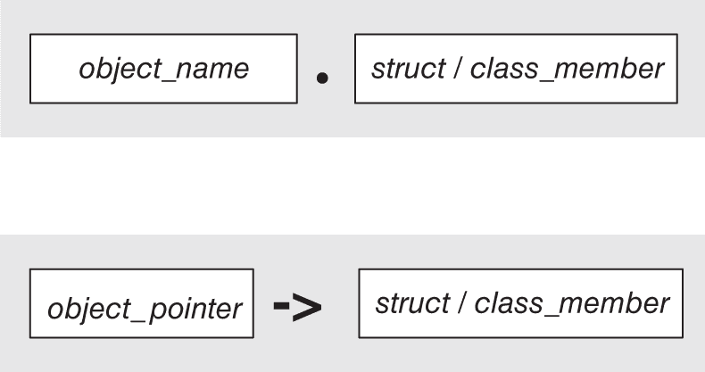

Figure 3.8 成员访问语法 (a) 从对象或对象的引用访问；(b) 通过对象的指针访问。

数据成员也可以通过将初始化放在构造函数中来初始化，这将在下一节中讨论。如果没有显式编写构造函数，则编译器将自动为我们嵌入带有默认行为的数据成员。在此范围内，默认行为是通过调用它们适当的构造函数来初始化和复制对象，例如对于`std::string`。然而，简单的内置类型将未初始化；如果被复制，它们将按字节复制。因此，在这种情况下，实现正确的初始化是非常重要的。

正如我们已经看到的，C++定义了类，它们在语义上与`structs`非常相似。主要的区别在于，在`class`中，所有成员都是隐藏直接访问的，而`struct`则相反：即`struct`的所有成员都可以自由地读取和写入。这种差异虽然看起来很微妙，但对编程有影响，我们将在几节后回到这个问题。但两者有许多相似之处，特别是在初始化数据成员方面。

第一个`std::array`命名为`arr`在第[4]行创建。它恰好包含10个元素，每个元素的类型均为`int`。这两个参数在类型的模板部分提供，即`<>`括号内部（第4.8.5节）。`arr`对象通过初始化列表初始化。然而，它只包含两个值：1和2。其余部分会发生什么？它们会被自动设置为0。因此，如果末尾值为0，我们就可以省略它们——这非常有帮助。

将`std::array`与`std::vector`进行比较，请注意`std::vector`的大小是可以变化的。也就是说，它可以增长，也可以删除其某些元素。这在`std::array`中是不可能的——它是固定大小的。另一个区别是，除非`std::array`像之前的示例那样提供了初始化列表，或者使用单独的代码对其值赋值，否则它不会初始化其元素。

`std::array`的内存效率很高——它将占用一块连续的内存，大小恰好等于所有元素大小之和。仅此而已。这一特性通过第[6]行的`assert`进行检查。正如表3.5所示，`assert`是一个验证逻辑条件的特殊函数——但仅在代码的调试版本有效。它有助于在代码中放置不变性以便于调试，正如我们将多次看到那样。

我们知道`std::vector`并不那么节省，如图3.4所示。此外，如果我们像第[4]行那样定义`std::array`，它将被像所有其他局部对象一样处理，并分配在局部栈上，正如第5.1节所述的。但如果我们通过`std::unique_ptr`将其分配在堆上，如（第5.2节）所示，那么`std::array`对象将完全按照要求位于堆上。

可以使用下标运算符访问`std::array`的元素，如第[10]行所示。此外，可以通过调用其`size`成员函数读取其大小，如第[9]行所示。这些与`std::vector`的语义完全相同。

在第[12]行定义了一个名为`theArray`的新`std::array`。它恰好包含13个元素，但它们没有被初始化；因此，在第[16]行启动了`std::generate`函数，如表3.6所示。再次使用了表示梅森算法的`std::mt19937`对象。它使用`std::random_device`初始化，正如第3.17.3节所示。因此我们看到，与`std::vector`类似，`std::array`提供了`begin`和`end`一对迭代器。它们在第[19]行再次被使用，此处对`theArray`调用了`std::sort`函数，因此其元素被按顺序设置。最后，使用范围`for`循环显示元素，如第[21–22]行所示。

`theDbArray`与`theArray`大相同，在第[24]行创建。这次它持有`double`类型的元素。我们已经知道它不会自动初始化。因此，在第[27]行，使用`std::copy`函数将`theArray`的元素拷贝到`theDbArray`对象中。注意元素在过程中从`unsigned int`转换为`double`。

最后，在第[29–30]行再次使用`std::copy`显示`theDbArray`数组的所有元素。更准确地说，输出是由用于`double`的`ostream_iterator`执行的，它被附加到`std::cout`流。

值得注意的是，`std::array`是内置固定大小数组的包装类，在附录A.2.1中讨论。包装类将在第3.15节中介绍。

### 3.10.1 多维固定大小数组

通过直接的方法，我们可以创建包含数组的数组，从而获得多维固定大小数组。让我们考虑列表3.8，它展示了如何创建一个具有两行三列的简单二维结构（即矩阵），持有浮点对象。

固定大小数组的维度需要在编译时确定。为了这个目的，我们可以定义一个`const int`对象；但在示例中，我们使用了另一种选项，即枚举类型`ArrayDims`及其常量`kCols`和`kRows`，如第[1]行定义。这是一个未作用域的枚举类型。

### 3.11 引用

C++中的引用提供了对对象的间接访问。指针也可以用于此目的。

| 操作 | 语法 | 示例 |
| :--- | :--- | :--- |

```cpp
double sum = 0.0; // object

 // const ref to constant
const double & kPi { 3.141592653 };
sum      = kPi; // set kPi to sum
sum_ref  = kPi; // the same via ref 
```

**表 3.7** (#c03.xhtml_R_c03-tbl-0007) 引用语法总结。直接对对象进行读写，以及通过指向该对象的引用间接对该对象进行读写，会产生相同的结果。

注意的是，引用必须在创建它的行上进行初始化，如前面的示例所示。非`const`引用必须用一个可变对象进行初始化，即一个可以被读也可以被写的对象。因此，以下代码段中的第[7]行和第[9]行是错误的，将无法编译。另一方面，常量对象（即只能被读的对象）只能赋值给`const`引用，例如第[11]行的常量10。

如果我们预见到对某个对象只有读操作，那么一种良好的设计实践是为其创建一个`const`引用，如下面代码示例中的第[12]行所示：

`const`引用可用于从对象读取数据，如第[14]行所示，但不能用于写入数据。因此，第[16]行将无法编译。换句话说，如果只需要读操作，`const`可以防止我们对对象进行意外写入。

一旦绑定到对象，引用就无法重新绑定到另一个对象。因此，在下面的代码中，执行第[19]行后，`x_ref`仍然引用对象`x`；它将被赋值对象`y`的值，因此`x`将持有13。

最后，引用只能指向有效且可访问的对象。引用不能指向另一个引用，因此下面的代码行将无法编译：

然而，通过`using`别名可以实现引用的引用，如下：

通过第[24–25]行的双重`using`指令，定义了一种“引用-引用-`int`”。然而，C++将将所有此类链视为单一引用：在这种情况下为`int &`。在第[27]行，定义了`xx_ref`并立即绑定到`x`。如果我们看之前的代码段第[3]行，我们注意到这是对对象`x`的第二个引用。因此，一个对象可以存在多个引用。在第[29]行，`x`的值被改为12。最后，在第[31]行，`x`再次被更改，现在持有13。但这是通过指针（将在下一节讨论）完成的，指针对引用的操作就就像操作原始对象`x`一样。也就是说，首先使用`&`运算符获取`x`的地址。然后，在该地址下写入13：即通过解引用运算符`*`对象`x`（参见表3.15中`GROUP 4`的描述）。在这里我们看到为什么引用有时被称为别名，因为使用它们的效果与直接访问对象完全相同。

## 3.12 () 指针

指针和引用是允许我们以间接方式访问对象（变量、常量）的语言机制。尽管有这种相似之处，它们之间也存在主要差异。指针在C和C++中可用，而引用仅用于C++。引用在C++中起主要作用，尽管指针在某些情况下很有用。自C++ 11起，还有智能指针：它们是完整的小对象，可以安全地执行普通指针在堆分配和释放方面的功能，正如第5.3节true。然而，了解普通指针的工作原理也是建议的，我们将在节中讨论它们。

### 3.12.1 使用指针访问对象

对于大多数对象类型，我们可以通过添加指针类型来定义相应的指针类型。

请注意，在创建对象时对其进行初始化是非常重要的——如果处理不当，数据可能会包含有害的随机垃圾值，如图3.10a所示。经过适当初始化后，`c`被设置为0，而`ptr`指向`c`，如图3.10b所示。正如我们所见，C++对象通过提供许多初始化对象的方式促进了这一点。

1. *直接*，通过设置/读取`c`的值
2. *间接*，通过指向`c`的指针（或引用）执行相同的操作

下面的代码示例展示了这两种可能性：

在第[4]行，我们直接给`c`分配了一个代表字母*A*的代码值^(¹⁵)。在第[6]行，我们通过`ptr`执行相同的操作。为了实现这一目的，我们需要指示编译器不要将值赋值给指针，而是赋值给`ptr`指向的对象——要做到这一点，我们在`ptr`前加上指针解引用运算符`*`（请参见表3.8中的*第4组*）。

表3.8提供了指针定义、初始化和操作的总结。

为什么间接访问对象如此有吸引力，因为在之前的代码中，`c`需要1字节，而`ptr`需要多得字节？答案是，在实践中，情况通常是相反的——对象倾向于很大，为了避免反复复制它们，可以使用相对较小的指针。此外，对于相同类型的均匀排列的大型或小型对象集合（数组），仅需一个指向它们的指针即可轻松地访问和操作。

由于指针也是一个具有内存位置和值的对象，因此也可能创建一个指向指针的指针，如下面的代码示例中的第[7]行所示：

指向指针的指针由第二个`*`表示，它可以被读为指向`char *`的指针：即指向`char`指针的指针。在第[7]行，我们创建了一个指针，并希望将其初始化为中性值或零值。为了这一目的，使用了特殊的C++关键字`nullptr`，^(¹⁶)，如第[7]行所示。

| **操作** | **语法** | **示例** |
| :--- | :--- | :--- |
| 定义指针 | 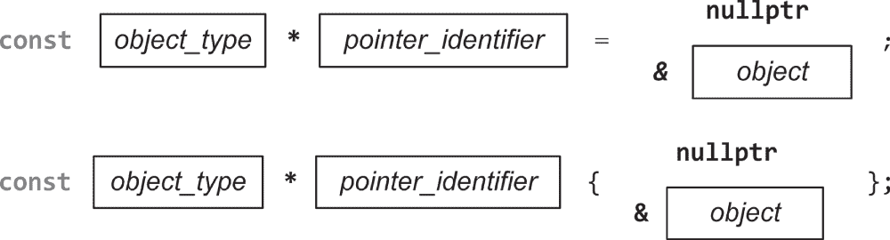 | |

```cpp
int x = 100;


// 创建指针 ptr 并将其设置为 x


const string * s_ptr { & s };

// C++ 初始化

double * d_ptr { nullptr
d_ptr = & d;

* ptr = 112;
// 通过 ptr 将 112 赋值给 x

cout << * s_ptr + * s_ptr;
``` |
| 地址运算符 |  | |

**表 3.8** 指针语法和运算符的总结。

1. `ptr_2_ptr`是一个指针。
2. `* ptr_2_ptr`是`ptr_2_ptr`指向的对象（即`ptr`）。

为了帮助我们理解这一点，这些指针在示例内存映射中的关系在图3.11中所示。

*语句*（Statements）是控制执行的语言结构。首要语句是条件`if`和循环`for`。在第2.5节中，与表达式不同，语句没有值。此外，声明是语句；块（分组）也是语句。

在C++中，大括号`{}`起着重要作用。它们的两种上下文如下：


`EColor`在之前的代码中是*无作用域枚举*类型*（较新的作用域`enum`将在第3.14.6节讨论）。这种旧式的`enum`可以可以直接用数组边界或数组索引（IBM: “C++0x, scoped enums?”[`www.ibm.com/developerworks/library/scoped-enums/scoped-enums-pdf.pdf`](https://www.ibm.com/developerworks/library/scoped-enums/scoped-enums-pdf.pdf)*访问于2020）。如果没有直接指定，第一个常量（在本例中为`kRed`）被赋值为0，第二个被赋值为1，依此类推。因此，在第18行，`fData`数组的大小设置为`kBlue + 1`，而在第13行，简单地通过`fData[ kRed ]`读取红色的值。

行[3–23]之间的大括号定义了`FibonacciNumbers`函数体。它们将该函数的所有语句和表达式分组，并定义了局部变量的作用域。这意味着在当前层级大括号界定的块内定义的每个变量（对象）仅在该块内存活、可见且可访问（除非它被声明为`static`）。在执行离开由大括号定义的块后，`所有局部变量都会被销毁，且无法以任何形式使用`！这一点有时会被忘记，从而导致棘手的错误（例如：返回一个已销毁的局部变量的地址等）。为了实现此类功能，框架（编译器）定义了称为`local stacks`的特殊数据结构，用于存储局部变量（参见第5.1节）。

在`FibonacciNumbers`函数的作用域内，行[5]定义了一个类型为`vector< int >`的对象`fibo_num_vec`。这是一个在函数内部的局部对象。因此，它的`scope`是函数体，即行[3–23]之间。它在该作用域内也是可见的。行[7]定义的对象`a`和`b`的作用域和可见性是相同的。

第二对大括号位于行[10–19]之间，定义了`while`循环体的块，参见章节3.13.2.2。在行[14]上，定义了一个类型为`int`的`tmp`对象（变量），它被放置与`while`上下相关的第二个局部栈上。然而，与`a`、`b`和`fibo_num_vec`不同，`tmp`的作用域仅限于`while`循环体。换句话说，在`while`及其块之前或之后无法访问`tmp`。`tmp`被用作辅助变量来更改行[16–17]上`a`和`b`的值。后者以及`fibo_num_vec`在`while`块中也是可见的，因为它们嵌入在函数体更广泛的作用域中。关于`visibility`（可见性），名称`tmp`仅在`while`作用域内可见，如果它们在`while`循环之外定义，则它将隐藏所有其他`tmp`名称。(¹⁷)

当`while`在行[19]终止后，第二个局部栈会被销毁，这导致了局部对象`tmp`的销毁。这种行为是理想的，因为我们让我们无需担心显式删除对象。因此，此类局部对象是`automatic variables`（自动变量）。其他类型的对象将在第5.1节中讨论。最后但同样重要的是，局部栈的容量通常有限，因此不应使用它们来存储巨大的对象（例如数百兆字节或更多）。相反，大对象应该使用堆和动态分配，如第5.2节所示。

上述讨论的两种语言结构不应被混淆。在本节中，处理语句时我们将主要使用第二种语境。

### 3.13.2 C++ 语句

在本节中，我们总结了C++中所有的语句。(¹⁹) C++11标准中可用的版本用颜色标记。理解语句操作的细节是学习该语言以及编写正确代码的关键因素。

### 3.13.2.1 条件语句

条件语句允许我们根据给定的布尔条件的值遵循特定的执行路径。在这组中，我们有`if`-`else`和`switch`语句，参见表3.9。从C++11开始，我们有了这些语句带有固有初始化块的新版本，这些也被高亮显示。

| 流程图 | 说明 | 语法 | C++ 示例 |
| :--- | :--- | :--- | :--- |


| `if` – 条件语句 | 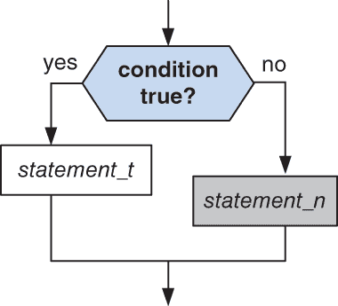 | 条件语句根据其布尔条件的值仅执行其指令中的一个分支。如果求值为 `true`，则执行`statement_t`。如果求值为 `false`，则执行`else`部分的`statement_n`。`else`部分是可选的，且可以省略。如果需要多条指令，可以将它们分组在块`{}`中。如果将多个`if` - `else`语句链在一起，最后一个`else`属于最后一个`if`。 | 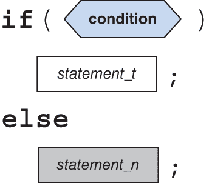 | 
```cpp
 cin >> val;      // 从键盘读取 val

 if( val > 0.0 ) // 如果 val 大于 0.0
 else
    cout << "Error - Negative argument" << endl; 
 ```

| | | | |

| | | | 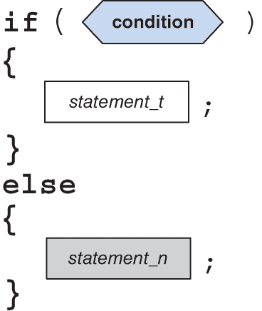

```cpp
 char c = 'Y'; // 定义一个标志
 cout << "Proceed? (Y/N)" << endl;
 cin >> c;
 if( c == 'Y' )
 {
 cout << "Continue" << endl; // "Yes"
 }
else
 { cout << "Stop" << endl; // "No"
 }
 ```

`if`语句为真。 |

```cpp
 // 如果成功则返回 true
 if( outFile("Log.txt") )
outFile << "Operation" << endl;
 }
 ```

| `switch` – 条件语句 | 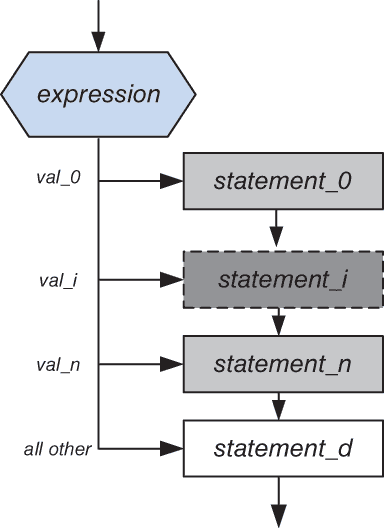 | `switch`语句检查`expression`的运行时值并根据其值转移到分支之一。这些值需要在编译时已知（如果不是，则是`if`语句）。分支由`case`关键字标记，后跟一个值和一个冒号`:`。特定`case`的语句分组并通常由`break`语句关闭以跳出`switch`。对于`case`分支未列出的所有值，有一个`default`分支同样由`break`语句关闭。 | 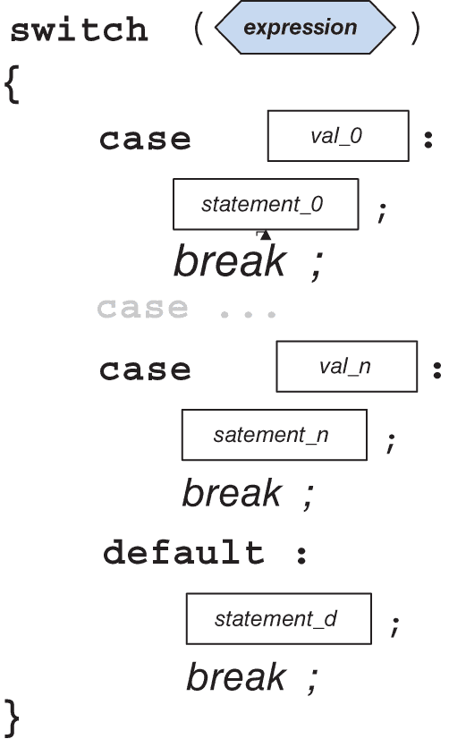

```cpp
 // argc – 参数个数; argv – 文本参数
 {
  string outMsg;
  switch( argc )
   case 2:
    outMsg = TensorFromVideo( argv[1] );
    break;
   case 3:
    outMsg = TensorFromVideo( argv[1], argv[2] );
    break;
   case 4:
    outMsg = TensorFromVideo( argv[1], argv[2],argv[3]);
    break;
   case 1:
   default:
    outMsg = "Exiting - wrong number of params.\n";
  }

  cout << outMsg;  // 输出消息
 }
 ```

函数读取视频并转换为`tensor`。

在此`main`函数中，使用`switch`语句根据命令行中提供的参数数量（见 9.2.2 节）来决定执行的操作。`argc`传递了参数的数量（用空格分隔），而`argv`是指向这些参数的指针（换句话说，就是文本——这是一个`char *`数组）。`TensorFromVideo`函数至少需要一个`string`类型的参数，可选的两个额外参数。这些参数在`case 2`、`case 3`和`case 4`分支中解析。旧式的`char *`文本将使用构造函数之一转换为`string`对象（见表 3.5）。请注意，在执行完每个动作操作后，都会调用`break`语句以跳出`switch`语句。否则，操作将传递到下方分支。还需要注意，`case 1`以及所有由`default`表示的所有可能的调用都在一个地方进行处理。因此，`case 1`之后没有`break`。

```cpp
 bool answer_expected { true };

 do
 {
    switch( char c {}; std::cin >> c, c )
    {
        case 'Y':
          answer_expected = false;
          cout << "Let us play our game" << endl;
          //PlayGame(); // 调用函数进行游戏
```

```cpp
        case 'n':
          answer_expected = false;
          cout << "Let us stop our game" << endl;

      default:
          answer_expected = true;
               or 'N' for no" << endl;
          break; 
      }

    } while( answer_expected == true ); 
```

整个`switch`被嵌入在`do-while`循环中，以允许仅进行是否选择。在`switch( char c {}; std::cin >> c, c )`中，第一部分`char c {}`在`switch`语句的作用域内定义并初始化了一个`char`类型的变量`c`。第二部分在这里更有趣，因为它应该返回一个值，然后该值与一系列`case`语句进行比较。然而，在这种情况下，逗号运算符`,`允许我们将两个语句合并到一个处。具体来说，首先执行`std::cin >> c`从键盘读取`c`。然后执行逗号的第二部分，即简单的`c`。由于逗号运算符的结果是右侧的表达式，因此返回了`c`的值（见表 3.15，第 16 ）。

由于语句块也是语句，因此第一种语法版本就足够了。显示带有`{`和`}`的第二个版本是为了方便起见。

**表 3.9** C++ 语句。

### 3.13.2.2 循环语句

循环语句构成了语言构造的第二组非常重要的结构。在 C++ 中，最且常用的是`for`循环。从 C++11 开始，提供了一种全新的非常有用的范围版本的`for`。

| 特性 | 流程图 | 说明 | 语法 | 示例 |

| :--- | :--- | :--- | :--- | :--- |

| `for` – 循环语句 | 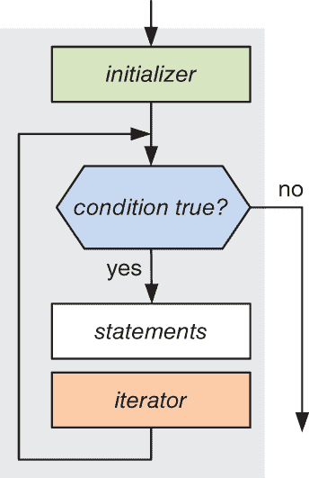 | | `for`语句首先（且仅一次）执行其`initializer`。然后它进行迭代，只要其`condition`为真，就会执行其语句 (s)。在执行完最后一个语句后，执行`iterator`部分。如果需要处理多个语句，则应将语句分组在`{}`之间。`initializer`、`condition`和`iterator`部分都可以为空：例如，`for(;;)`是一个无限迭代的有效循环。 |   |

```cpp
 const size_t kSize { 16 }; // 用于维度的 size_t
  std::vector< int > tab( kSize ); // 留 kSize 个 int

  // 设置连续的 kSize 个奇数
  for( auto i { 0 }; i < tab.size(); ++ i )
      tab[ i ] = 2 * i + 1; 
```

此循环将向量`tab`的所有元素设置为连续的奇数：1、3 等。变量`i`的作用范围严格限制在`for`循环及其语句内（即它在`for`循环外部无法访问）。

以下代码打开了两个文本文件`inFl`和`outFl`用于读写。如果成功打开，则通过`for`循环逐行读取`inFl`到`std::string`类型的`str`中。为了读取一行，使用了`getline`函数，如果读取了行则返回`true`。此循环将向量`tab`的所有元素设置为连续的奇数：1、3 等。变量`i`的作用范围严格限制在`for`循环及其语句内（即它在`for`循环外部无法访问）。

以下代码打开了两个文本文件`inFl`和`outFl`用于读写。如果成功打开，则通过`for`循环逐行读取`inFl`到`std::string`类型的`str`中。为了读取一行，使用了`getline`函数，如果读取了行则返回`true`。此循环将向量`tab`的所有元素设置为连续的奇数：1、3 等。变量`i`的作用范围严格限制在`for`循环及其语句内（即它在`for`循环外部无法访问）。

以下代码打开了两个文本文件`inFl`和`outFl`用于读写。如果成功打开，则通过`for`循环逐行读取`inFl`到`std::string`类型的`str`中。为了读取一行，使用了`getline`函数，如果读取了行则返回`true`。此循环将向量`tab`的所有元素设置为连续的奇数：1、3 等。变量`i`的作用范围严格限制在`for`循环及其语句内（即它在`for`循环外部无法访问）。

以下代码打开了两个文本文件`inFl`和`outFl`用于读写。如果成功打开，则通过`for`循环逐行读取`inFl`到`std::string`类型的`str`中。为了读取一行，使用了`getline`函数，如果读取了行则返回`true`。此循环将向量`tab`的所有元素设置为连续的奇数：1、3 等。变量`i`的作用范围严格限制在`for`循环及其语句内（即它在`for`循环外部无法访问）。

以下代码打开了两个文本文件`inFl`和`outFl`用于读写。如果成功打开，则通过`for`循环逐行读取`inFl`到`std::string`类型的`str`中。为了读取一行，使用了`getline`函数，如果读取了行则返回`true`。此循环将向量`tab`的所有元素设置为连续的奇数：1、3 等。变量`i`的作用范围严格限制在`for`循环及其语句内（即它在`for`循环外部无法访问）。

以下代码打开了两个文本文件`inFl`和`outFl`用于读写。如果成功打开，则通过`for`循环逐行读取`inFl`到`std::string`类型的`str`中。为了读取一行，使用了`getline`函数，如果读取了行则返回`true`。此循环将向量`tab`的所有元素设置为连续的奇数：1、3 等。变量`i`的作用范围严格限制在`for`循环及其语句内（即它在`for`循环外部无法访问）。

以下代码打开了两个文本文件`inFl`和`outFl`用于读写。如果成功打开，则通过`for`循环逐行读取`inFl`到`std::string`类型的`str`中。为了读取一行，使用了`getline`函数，如果读取了行则返回`true`。此循环将向量`tab`的所有元素设置为连续的奇数：1、3 等。变量`i`的作用范围严格限制在`for`循环及其语句内（即它在`for`循环外部无法访问）。

以下代码打开了两个文本文件`inFl`和`outFl`用于读写。如果成功打开，则通过`for`循环逐行读取`inFl`到`std::string`类型的`str`中。为了读取一行，使用了`getline`函数，如果读取了行则返回`true`。此循环将向量`tab`的所有元素设置为连续的奇数：1、3 等。变量`i`的作用范围严格限制在`for`循环及其语句内（即它在`for`循环外部无法访问）。

以下代码打开了两个文本文件`inFl`和`outFl`用于读写。如果成功打开，则通过`for`循环逐行读取`inFl`到`std::string`类型的`str`中。为了读取一行，使用了`getline`函数，如果读取了行则返回`true`。此循环将向量`tab`的所有元素设置为连续的奇数：1、3 等。变量`i`的作用范围严格限制在`for`循环及其语句内（即它在`for`循环外部无法访问）。

以下代码打开了两个文本文件`inFl`和`outFl`用于读写。如果成功打开，则通过`for`循环逐行读取`inFl`到`std::string`类型的`str`中。为了读取一行，使用了`getline`函数，如果读取了行则返回`true`。此循环将向量`tab`的所有元素设置为连续的奇数：1、3 等。变量`i`的作用范围严格限制在`for`循环及其语句内（即它在`for`循环外部无法访问）。

以下代码打开了两个文本文件`inFl`和`outFl`用于读写。如果成功打开，则通过`for`循环逐行读取`inFl`到`std::string`类型的`str`中。为了读取一行，使用了`getline`函数，如果读取了行则返回`true`。此循环将向量`tab`的所有元素设置为连续的奇数：1、3 等。变量`i`的作用范围严格限制在`for`循环及其语句内（即它在`for`循环外部无法访问）。

以下代码打开了两个文本文件`inFl`和`outFl`用于读写。如果成功打开，则通过`for`循环逐行读取`inFl`到`std::string`类型的`str`中。为了读取一行，使用了`getline`函数，如果读取了行则返回`true`。此循环将向量`tab`的所有元素设置为连续的奇数：1、3 等。变量`i`的作用范围严格限制在`for`循环及其语句内（即它在`for`循环外部无法访问）。

以下代码打开了两个文本文件`inFl`和`outFl`用于读写。如果成功打开，则通过`for`循环逐行读取`inFl`到`std::string`类型的`str`中。为了读取一行，使用了`getline`函数，如果读取了行则返回`true`。此循环将向量`tab`的所有元素设置为连续的奇数：1、3 等。变量`i`的作用范围严格限制在`for`循环及其语句内（即它在`for`循环外部无法访问）。

以下代码打开了两个文本文件`inFl`和`outFl`用于读写。如果成功打开，则通过`for`循环逐行读取`inFl`到`std::string`类型的`str`中。为了读取一行，使用了`getline`函数，如果读取了行则返回`true`。此循环将向量`tab`的所有元素设置为连续的奇数：1、3 等。变量`i`的作用范围严格限制在`for`循环及其语句内（即它在`for`循环外部无法访问）。

以下代码打开了两个文本文件`inFl`和`outFl`用于读写。如果成功打开，则通过`for`循环逐行读取`inFl`到`std::string`类型的`str`中。为了读取一行，使用了`getline`函数，如果读取了行则返回`true`。此循环将向量`tab`的所有元素设置为连续的奇数：1、3 等。变量`i`的作用范围严格限制在`for`循环及其语句内（即它在`for`循环外部无法访问）。

以下代码打开了两个文本文件`inFl`和`outFl`用于读写。如果成功打开，则通过`for`循环逐行读取`inFl`到`std::string`类型的`str`中。为了读取一行，使用了`getline`函数，如果读取了行则返回`true`。此循环将向量`tab`的所有元素设置为连续的奇数：1、3 等。变量`i`的作用范围严格限制在`for`循环及其语句内（即它在`for`循环外部无法访问）。

（注：由于翻译文本中存在大量重复段落，已按要求去重处理，以下为核心内容的后续翻译：）

### 3.13.2.2 循环语句

循环语句构成了语言的第二组非常重要的结构。在 C++ 中，最且常用的是`for`循环。从 C++11 开始，提供了一种全新的非常有用的范围版本的`for`。

| 特性 | 流程图 | 说明 | 语法 | 示例 |

| :--- | :--- | :--- | :--- | :--- |

| `for` – 循环语句 |  | | `for`语句首先（且仅一次）执行其`initializer`。然后它进行迭代，只要其`condition`为真，就会执行其语句 (s)。在执行完最后一个语句后，执行`iterator`部分。如果需要处理多个语句，则应将语句分组在`{}`之间。`initializer`、`condition`和`iterator`部分都可以为空：例如，`for(;;)`是一个无限迭代的有效循环。 |   |


```cpp
const size_t kSize { 16 }; // 用于维度的 size_t
std::vector< int > tab( kSize ); // 留 kSize 个 int

// 设置连续的 kSize 个奇数
for( auto i { 0 }; i < tab.size(); ++ i )
    tab[ i ] = 2 * i + 1;
```

此循环将向量`tab`的所有元素设置为连续的奇数：1、3 等。变量`i`的作用范围严格限制在`for`循环及其语句内（即它在`for`循环外部无法访问）。

以下代码打开了两个文本文件`inFl`和`outFl`用于读写。如果成功打开，则通过`for`循环逐行读取`inFl`到`std::string`类型的`str`中。为了读取一行，使用了`getline`函数，如果读取了行则返回`true`。此循环将向量`tab`的所有元素设置为连续的奇数：1、3 等。变量`i`的作用范围严格限制在`for`循环及其语句内（即它在`for`循环外部无法访问）。

（此处省略重复段落，以确保输出符合逻辑）

在此代码段中，一个包含 16 个`int`元素的`std::array`（第 3.10 节）使用带有单一语句的`while`循环进行初始化。使用下标运算符`[]`访问连续元素。在同一行中，迭代器`i`使用自增运算符`++`递增 1。迭代一直进行到`tab.size()`的值，该值等于`kSize`。但与其与`kSize`进行比较，不如直接询问`tab`它的大小要安全。

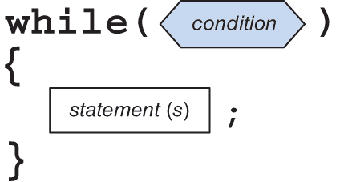

```cpp
const size_t kSize = 16;
std::array< int, kSize > tab; // 定义一个整型数组

// 将所有值填充为 0 - 更具可读性
int i = 0;
while( i < tab.size() )
{
    tab[ i ] = 0;
    i ++;
}
```

在这个示例中，执行的功能与上一个示例相同。不过，这里的`while`循环包含了两个语句。因此，它们需要用大括号`{}`包起来。

### `do-while` 循环

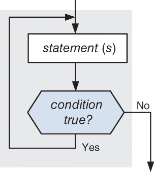 在`do`-`while`循环中，所有包含的语句都会执行`一次`，无论条件的值如何。然后，只要`while`循环的条件为`true`，语句就会在每次迭代时执行。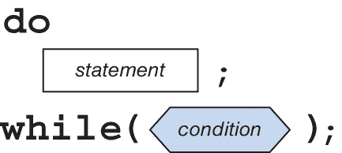

```cpp
const size_t kSize = 16;
std::array< int, kSize > tab; // 定义一个整型数组

// 填充数组 - 这次使用 do-while
int i = 0;
do tab[ i ++ ] = 0; while ( i < tab.size() );
```

这段代码执行了与之前的`while`循环相同的数组初始化操作。这次使用了`do-while`，它会无论条件如何都先执行`tab[ i ++ ]`！然后检查条件`i < tab.size()`，当且仅当条件为真时，循环继续。否则，循环停止并执行循环后的下一个语句。在这种情况下，我们可以自由执行`tab[ i ++ ]`而无需检查条件，因为数组的大小始终大于 0。

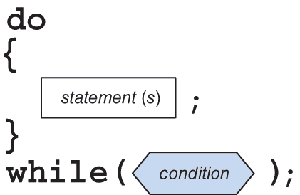

```cpp
int age = 0;

do
{
    cout << "Enter your age ..." << endl;
    cin >> age; // 从键盘读取年龄

} while( age <= 0 || age > 150 );
// 询问直到在有效范围内
```

在这段代码中，用户在`do-while`循环中被输入一个有效的年龄值。

### 3.13.2.3 辅助语句 – `continue` 和 `break`

可以使用`break`和`continue`语句来方便循环操作。前者也用于`switch`语句。理解它们的功能以及区别至关重要。在处理嵌套循环时，记住它们作用于最近的循环也是重要的。

| 特性 | 流程图 | 描述 | 语法 | 示例 |
| :--- | :--- | :--- | :--- | :--- |
| `break`语句 | `for`循环中的`break` 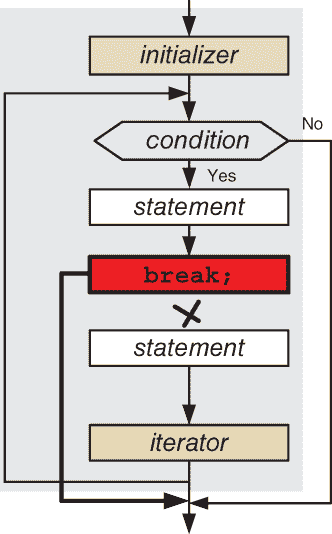 | `do-while`循环中的`break` 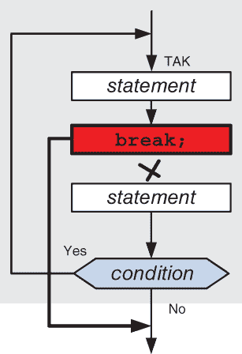 | 立即退出最近的循环（`for`, `while`, `do-while`）或`switch`语句。在多个循环中，`break`语句会导致跳转到最近的外部层循环。 | `break;` | |

以下`for`循环将无限迭代。然而，用户可以按`'n'`或`'N'`停止迭代。循环由于`break`语句而退出。

```cpp
for( ;; )
{
    // 做些什么
    // ...

    std::cout << "Proceed? [y/n] ";
    char ans {};
    std::cin >> ans;

    if( ans == 'n' || ans == 'N' )
        break;     // 退出循环的方法
}
```

| `continue` | `for`循环中的`continue` 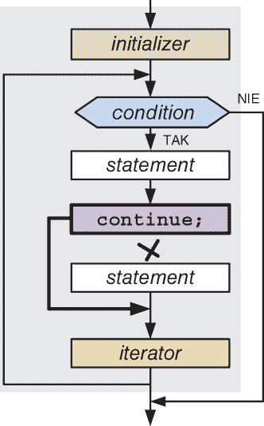 | `do-while`循环中的`continue` 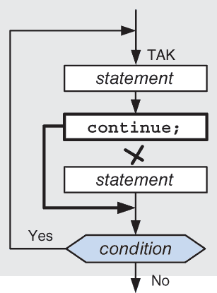 | `continue`语句专门用于循环（`for`, `while`, `do-while`）。当遇到时，它会导致跳过循环中后续的所有语句，并立即跳转到最近循环的迭代部分。然后，如果条件仍然为真，循环继续迭代。 | `continue;` | 下面的代码段首先创建一个`_2D_array`对象，它是一个`int`对象的数组的数组。在读取其内容后，计算除对角线元素以外的所有元素的和。 |

```cpp
const auto kRows { 12 };
const auto kCols { 12 };

std::array<
std::array< int, kCols >, kRows > _2D_array;

// ... 从文件读取数组
// 将数组的所有组件相加
// 对角线除外

double sum = 0.0;
for( int r = 0; r < kRows; r )
{
    for( int c = 0; c < kCols; c )
    {
        if( r == c )
            continue;

        sum += _2D_array[r][c];
    }
}
```

当在多个循环中使用`continue`时，请记住它作用于最近的循环。

### 3.13.2.4 `goto` 语句

`goto`语句可以用于立即跳转到任何位置（标识符）。它源于低级汇编语言范式，在第 2 节中足够处理所有类型。尽管在某些情况下看起来有用，但由于许多问题，强烈建议不要在代码中使用它。

| 特性 | 流程图 | 描述 | 语法 | 示例 |
| :--- | :--- | :--- | :--- | :--- |
| `goto`语句 | 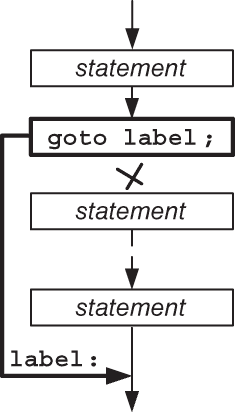 | 导致执行的无条件跳转。在代码中应避免。 |  | |

```cpp
const int kBufLen = 1024;
char buf[ kBufLen ];

// 按行读取
for( ifstream("File.txt"); inFile && !inFile.eof(); )
{
    if( !inFile.getline( buf, kBufLen ) )
        goto exit; // 退出循环

    // 处理缓冲区 ...
}

exit:
cout << "Loop terminated" << endl;
```

这个`goto`语句示例会导致立即跳转到`exit`标签。因此，在一次跳跃中，`goto`可以跨越嵌套循环和函数。

### 3.13.2.5 结构化异常处理 – `try-catch` 语句

`try`-`catch`语句结合`throw`运算符（参见*GROUP 15*，表 3.15）是 C++ 特有的构造，允许异常处理。这意味着任何遇到无法用常规处理的严重错误的代码都可以抛出一个表示异常的对象。这时，如果抛出的函数嵌入在`try-catch`结构中，异常就可以被捕获。

`try-catch`是一种沉重的语言构造，不应用于正常的控制流切换。我们应该始终查看是否可以检查条件并以有效方式做出反应，例如返回一个`bool`标志等，而不是抛出异常。换句话说，将`throw`留作最后的手段。书中介绍了许多示例：例如在`TStack`项目中（第 4.8.4 节）中，如果栈为空，`Pop`成员函数将返回一个`bool`值。在这种情况下，抛出异常就大小用了。

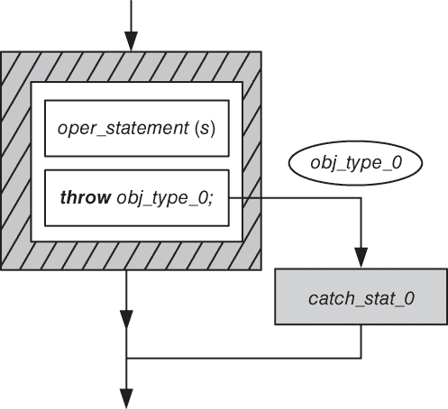 | `try`-`catch`用于创建一个可控的环境，以执行可能会导致（抛出）错误的代码。

如果在执行`oper_statement(s)`期间调用了`throw`运算符（`Group 15`），执行将立即移动到与抛出对象类型匹配的`catch`部分。这给了我们一个安全处理该情况的机会，因为所有在栈上分配的对象都将被自动销毁。这就是`stack unwinding`（栈回溯）机制（Section 5.2.1.1）。

部分`catch(...)`匹配所有类型的抛出对象。

如果在`throw`之后没有找到匹配的处理器（`catch`），将调用`terminate()`函数并终止程序。 | 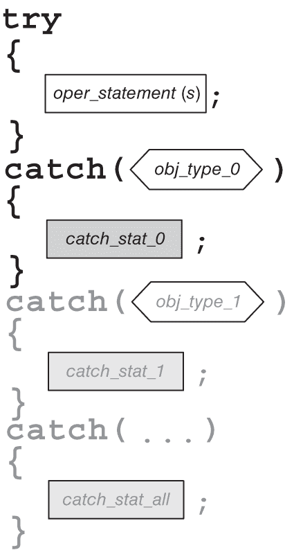 |

```cpp
double x = 0.0, y = 0.0;
cin >> x >> y; // Read x and y from keyboard

try
{
    if( std::fabs( y ) < 1e-12 ) // Check magnitude
        throw string( "Error - div by 0" ); //Throw obj

    cout << x / y ; // Divide
}
catch( string & str )
{
    cerr << str; // Display cause of error on cerr
}
```

最常见的错误之一是除以零。更准确地说，如果除数的绝对幅值低于某个阈值，我们就不应该进行除法（Section 7.4.8）。在之前的代码中，我们检查了这一点：如果由于之前的条件无法进行除法，则会抛出一个异常。任何对象都可以用于此角色；在我们的示例中，选择了`string`。因此，`catch`被设置为捕获类型为`string &`的异常。如果发生这种情况，来自抛出对象的文本将显示由`cerr`对象表示的错误终端中。

要捕获任何类型的对象，应使用`catch( ... )`。

## 3.14 函数

函数是经过选择的代码片段，可以从其他代码片段中多次调用和执行。如果一段代码在许多地方重复出现，我们可以将其提取为一个函数，并从代码的其他部分调用它。自然地，这导致了代码大小的节省，这在计算机的早期是一个特别重要的因素。但从开发的角度来看，函数更重要的特性是将代码逻辑上划分为概念上连贯且定义良好的片段，这些片段可以一个接一个地进行设计和编程。这种关注的方法遵循了分治法（自顶向下）的编程方法论，该方法让我们一次只处理有限数量的变量、分支等，正如 Section 2.3 中提到的。因此，以逐个函数的方式构建程序要比不断管理所有细节要简单得多，而且产生的错误也更少。通过这种方式，构建程序类似于建造建筑、桥梁、船只或汽车。

在本节中，我们将讨论函数设计和实现的各个方面。在许多地方，我们将函数视为具有良好定义接口的黑盒，即输入和输出参数集以及功能。

在考虑函数时，我们需要考虑以下几个方面：

1. 它的功能是什么？
2. 它的名称（标识符）应该是什么，以便恰当地传达它的角色和功能？
3. 它的输入参数是什么，它们是如何传递给函数的？
4. 它的输出参数是什么，它们将如何从函数传递出来？
5. 函数如何适应由其他编程组件（函数、类、数据、库等）创建的框架？

在接下来的章节中，我们将解决这些问题。

### 3.14.1 C++ 中函数的解剖结构

正如前面提到的，函数（在某些语言中称为过程）分组了负责执行特定任务的代码。因此，函数可以从外部观察，也可以从内部观察。在第一情况下，我们看到一种抽象组件，它可以可视化为一个执行其任务的“黑盒”，如图 Figure 3.12a 所示。在流程图（活动图）中，函数表示为一个框，如 Figure 3.12b 所示。

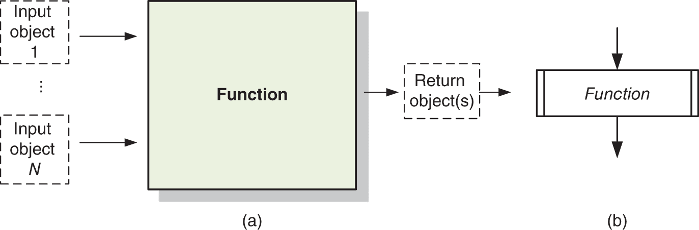

**图 3.12** (a) 作为黑盒的函数示意图，它可以可选接收输入对象的数量，也可以可选返回一个对象。输入/输出对象可以通过多种方式传递，它们可以是不同的类型和大小。因此，函数可以处理各种数据。(b) 流程图中的子程序。

正如预期的那样，函数可以调用其他函数，从而构建出调用链以及一种抽象。有趣的是，函数可以调用自己——在这种情况下，函数是递归的（Section 3.14.4）。

为了执行任务，函数需要输入数据以及一种返回结果的方法。因此，函数可以可选地接受数量参数（在其参数列表中），并输出一个对象。虽然参数列表可以很长且函数只能输出一个对象，但我们可以自由地建模函数传达信息的能力，这将讨论。同样重要的是传递给函数的方式：是对象被复制并传递给函数供其专门使用，还是传递链接以间接访问对象，而对象本身由于大小或其他问题而不被复制。在后一种情况下，对象的链接通过引用或指针提供，正如 Section 3.11 和 3.12 中讨论的。

让我们通过分析 Listing 3.9 中的简短 C++ 程序来查看函数内部。它提示用户输入两个数值，然后返回它们的平方和。在本节中，我们主要感兴趣两个函数——`SumOfSquares`和`main`——以及它们接受什么输入和返回什么输出。

正如前面指出的，为了成功编译此代码，我们需要让编译器知道我们将使用的其他函数和库。由于我们希望在屏幕上打印文本并从键盘读取，我们在第 1 行包含了`iostream`头文件以及相关的声明，随后在第 3 行使用`using`指令定义了类型别名。然后，在第 8 行我们引入了`SumOfSquares`函数，仅提供其声明，即它的名称及其输入输出参数的完整类型列表。前者位于括号`()`中的参数列表中，而后者位于函数名称的左侧。

在第 [11–25] 行是`main`函数的完整定义，即完整的代码，它是每个 C++ 程序中的主函数。它的操作非常简单。首先，在第 [13] 行，创建了两个由`double`标识的浮点变量（对象）`x`和`y`，并初始化为 0.0。正如我们之前提到的，在定义变量时尽早地初始化变量是非常重要的。然后，在第 [15–19] 行，文本被输出到终端，要求用户输入`x`和`y`的值。之后，控制转移到第 [22] 行，那里发生了两件事：首先，创建了一个类型也为`double`的新变量`sum`。然后，它被初始化为`SumOfSquares`函数返回的值，该函数以`x`和`y`对象作为输入参数进行调用。在`main`的最后一行 [24] 行，一个带有计算结果的消息被输出到终端，`main`（以及整个程序）结束；它还会自动清理所有分配的对象。但我们还没有看到`SumOfSquares`函数的完整定义。

让我们来看一下函数声明。图 3.13 显示了 C++ 函数声明的结构图。正如之前暗示的那样，函数声明基本上由三部分组成：函数名、参数列表以及任何返回对象的类型。函数可以没有参数——在这种情况下，我们使用`void`代替列表。同样，如果函数不返回结果，则使用`void`作为占位符。

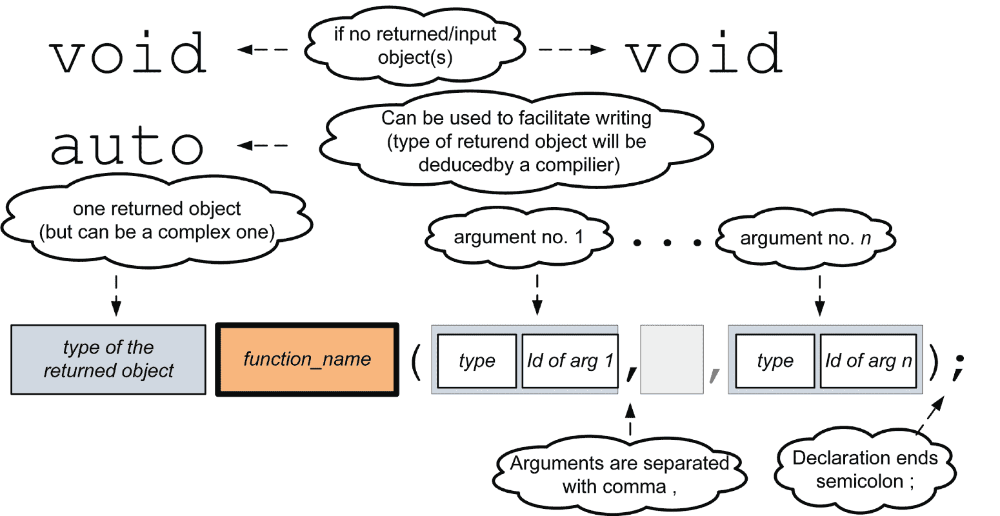

**图 3.13** C++ 中的函数声明。

C++ 的一个较新特性是使用`auto`关键字作为返回对象来自动推导返回类型（Section 3.7）。我们将在本书后续示例中看到这些语义。如果返回的是复杂的长类型（例如模板），使用`auto`是有意义的。在其他情况下，如果显式写返回类型有助于提高代码的可读性（这是一种显式类型声明），通常也是可以的。此外，仅凭`auto`关键字无法拆分声明和定义的位置，因为编译器无法仅从声明和`auto`推断出返回类型。

回到我们的实际示例，注意，仅提供函数声明足以编译之前的代码，但不足以构建整个程序。为什么呢？因为为了完整运行，我们需要`SumOfSquares`的完整代码。否则，尽管编译成功，我们的程序也将无法正常链接（会出现链接器错误，提示缺少定义）。因此，为了满足编译器和链接器，并能够构建完整的程序，我们在`main`之后在同一个文件中放置了完整版本的`SumOfSquares`函数，如代码清单 3.10 所示。

在第 [39] 行，我们看到了第 [8] 行声明的副本。然而，末尾不是分号（`;`），而是在第 [40–42] 行，函数的完整体包含在大括号`{}`中。该函数非常简单：它计算每个参数的平方值，将它们求和，并返回这个计算出的值——这一切都在第 [41] 行的一行内完成。


一个重要的练习是将视为定义在第 [39–42] 行的实体函数，与在第 [22] 行调用它的地方进行比较。让我们数数涉及多少个对象以及它们是如何连接的；参见图 3.14。


**图 3.14**](#c03.xhtml_R_c03-fig-0014) 函数调用与其匹配。在带有 `x` 和 `y` 对象的调用处，创建了它们的副本并命名为 `a` 和 `b`。从函数返回时，会创建并返回一个没有显式名称的临时对象。它用于初始化变量 `sum`。

当使用 `x` 和 `y` 对象作为输入参数调用 `SumOfSquares` 时，代码执行转移到 `SumOfSquares` 的实际代码；对象 `a` 和 `b` 是 `x` 和 `y` 的局部副本。从函数返回时，会创建一个没有显式名称的临时对象，控制返回到函数调用后的后续指令。在这种情况下，返回的对象用于初始化变量 `sum`。需要指出的是，`SumOfSquares` 包含了自己的对象 `a` 和 `b` 副本，用于计算结果。这些是局部的，并且仅在 `SumOfSquares` 的作用范围内可用。然而，有时能够通过引用或指针间接地修改外部对象（如 `x` 和 `y`）是有益的。为了以我们简单程序的圆满结局收尾，图 3.15 显示了函数定义的通用图。很容易发现，它由一个函数声明后面跟着由 `{}` 分隔的函数体组成。内部是定义函数的代码行。

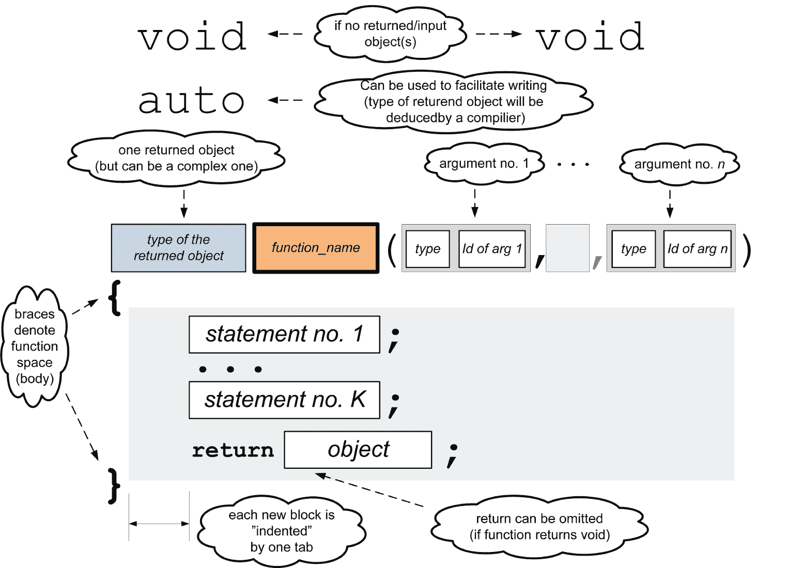

**图 3.15**](#c03.xhtml_R_c03-fig-0015) C++ 函数定义的可视化。

我们可以像这个示例一样为函数参数提供默认值：

那么，如果在调用期间未提供参数的值，则使用其默认值。在我们的示例中，我们可以为 `a` 和 `b` 提供值，或者只为 `a` 提供。在后的情况下，`b` 将设置为它的默认值 0.0。

默认参数可以为一个、两个或所有函数参数提供。然而，它们必须从最右侧参数开始连续设置。

在开发函数时，为函数及其类型和参数赋予适当名称（标识符）是重要的，以传递关于其作用和目的的充分清晰的信息。根据经验法则（McConnell 2004），

1. 名称应该是短且有区分度的
2. 如果名称由多个单词组成，单词之间应用大写字母或下划线符号（`_`）分隔

同样重要的是放在函数之前的注释，它简要说明了函数的作用及其参数的作用。其他重要的代码行也应该进行注释。

### **3.14.2** 向函数和从函数传递参数

在决定函数的作用和名称后，最重要的是确定其输入和输出参数的数量和类型，以及将它们传递给机制（拷贝或间接）。形式参数可以包含默认值。如果未显式提供此类参数的值，则使用其默认值。默认值可以从最右侧参数开始连续添加。虽然它们在特定语境下可能很方便，但要小心过多的默认参数，因为它们可能会掩盖提供运行时计算值的必要性，例如。我们将在本书提供的许多示例中看到默认参数的例子。

为了展示在函数之间传递参数的各种方式，我们将检查 `Deg_2_Rad` 函数的变体，该函数简单地将传入的角度值转换为等效弧度：60 度约为 1.047 弧度，依此类推。

### 3.14.2.1 按值传递参数（值语义）

图 3.16 展示了通过创建一个供函数处理的副本来将对象传递给函数。这种通过复制对象来传递对象的方案之前在 图 3.14 中介绍过。

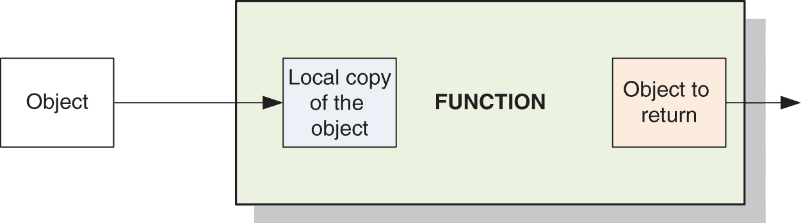

图 3.16 通过拷贝将对象传递给函数的可视化。

对于每一个声明以这种方式传递的对象，都会发生相同的情况：它会被复制。此外，如果函数声明了返回对象，则会创建并返回一个声明的类型的临时对象。有了这些信息，让我们来看一个示例。首先，在 列表 3.11 中，我们定义了一个代表 π 值的常量 `kPi`。

我们的第一个版本 `Deg_2_Rad` 接受一个输入对象（变量）`deg`，允许我们传递浮点值，因为它被定义为 `double`。此外，`const` 关键字意味着我们不允许在函数内部对 `deg` 进行任何更改：我们希望这个变量是只读的。我们还防止了在使用 `deg` 时因无意修改而可能错误。这在编写较大且更复杂的函数时尤为重要。

唯一的计算在单行代码中完成 [9]。为了获得弧度，将 `deg` 的值乘以 `kPi` 并除以 180.0。结果以 `double` 类型临时对象的形式呈现，然后通过 `return` 语句传递到函数外部。因此，为了完全理解调用函数并向其传递和返回对象时发生了什么，有必要分析其调用上下文，如下代码段所示：

在第 [11–14] 行，我们创建并初始化了一个变量 `d`，打印了一条消息，并等待用户输入 `d` 的值。然后，在第 [16] 行，创建并初始化了同样为 `double` 类型的变量 `r`。在第 [18] 行，调用 `Deg_2_Rad` 并将 `d` 作为其参数。`Deg_2_Rad` 返回的值被复制到 `r`。最后，在第 [20] 行显示度和弧度。我们在这里引入变量 `r` 是为了帮助理解示例；但在实践中，如果 `r` 之后不再被使用，可以通过在表达式中调用 `Deg_2_Rad` 并显示其返回的带有弧度计算值的临时对象来简化代码，如下：

通过拷贝传递对象有时被称为值语义，与引用和指针语义相对，后者将在接下来的章节中讨论，它们假设对对象进行间接访问。

### 3.14.2.2 通过引用的间接参数传递

引用在 第 3.11 节 中被讨论过，作为提供对象间接访问的通用技术。通过左值引用将对象传递给函数意味着该对象没有被复制，仅提供其引用，如 图 3.17 所示。另一方面，右引用允许对对象应用移动语义，这意味着对象之间会发生数据交换（交换）。有趣的是，还有一种混合方法：正向引用（也称为通用引用）。在本节中，我们将重点关注使用左值引用的对象传递。其他类型的引用将在 第 4.6.4 节 中讨论。

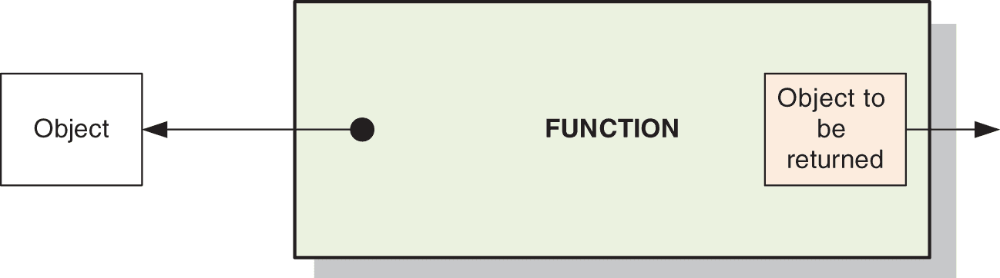

图 3.17 通过引用将对象传递给函数的可视化（仅限 C++）。

由于对象通常体用得非常大，避免拷贝可以节省大量的时间和内存。更重要的是，间接访问允许函数通过对对象的引用来对外部对象进行更改。因此，函数操作的结果在我们从该函数返回后并不会消失。

列表 3.12 中的代码显示了 `Deg_2_Rad` 函数的版本，它带有一个引用参数 `deg`，该参数提供了对函数外部某处对象的访问。

注意的是，第 [26] 行的 `deg` 是指向 `double` 类型对象的常量引用。这意味着此类对象只能被读取，而不能通过此引用进行更改。（稍后将讨论一个允许同时读取和写入的引用。）有趣的是，`Deg_2_Rad` 的其余部分与上一节讨论的传递输入对象拷贝的版本完全相同。因此，其调用上下文与我们在第 [11–20] 行看到的完全相同。

在这里引入变量 `r` 是为了帮助理解示例；但在实践中，如果 `r` 之后不再被使用，可以通过在表达式中调用 `Deg_2_Rad` 并显示其返回的带有弧度计算值的临时对象来简化代码。

此外注意返回对象仍然是以拷贝的形式传递的，因为它在函数结束后仍然有效，否则如果作为局部对象的引用，它将指向一个悬空对象。

最后，注意我们有两个同相同的函数 `Deg_2_Rad` 在相同的作用域内运行。在 C++ 中，这是允许的，被称为函数重载。唯一的要求是形式参数列表是不同的，以便编译器在给定上下做出无歧的选择。我们将在第 3.14.5 节 中返回这个重要问题。

现在让我们分析 `Deg_2_Rad` 的下一个版本，它接受一个外部对象的引用。这一次，一个对象将被读取、更改并写回。换句话说，函数将在外部对象上执行计算。

注意第 [35] 行传递了指向 `double` 对象的非常量引用 `val`。此外，此函数不返回值，因此在声明符前面使用了 `void` 关键字。在这个版本中，代码也不同——`val` 只需要乘以常量 `kPi / 180.0`。为了更好的可读性，我们将其保留为两个值的除法——不用担心，因为编译器会为我们处理。

对于这个新版本的 `Deg_2_Rad`，我们还需要不同的调用上下文，如下代码所示：

由于 `Deg_2_Rad` 将更改其提供的对象 `d` 的值，为了存储原始度值，我们必须使用辅助变量 `d_storage`，它在第 [44] 行定义并初始化为 `d`。然后，在第 [46] 行，调用函数 `Deg_2_Rad`，将 `d` 的值从度转换为弧度。最后，在第 [48] 行显示度和弧度。

注意，这种更改其传递对象值的调用如果没有良好的文档说明，可能会令人惊讶。让传递的值被函数隐悄地更改可能会导致编程错误。虽然在许多情况下这种技术是合理的，但在这种情况下，像第 [26] 行那样通过常量引用传递对象的版本会更好。

为了完成间接访问对象的图像，让我们展示 `Deg_2_Rad` 的版本，它接收一个指向外部 `double` 对象的指针，该对象包含要转换为弧度的度值。参见 列表 3.13。

在第 [51] 行，声明了一个类型为双精度指针指针（`double *`）的对象 `deg`。它本应该指向一个类型为 `double` 的外部对象。然而，指针和引用的一个直接区别是，指针可以为空，即其值可以为 `nullptr`（如果转换为整数，则简单为 0）。如果是这种情况下，则不能对指针进行解引用，因为这样做意味着不可避免的程序崩溃。另一方面，不断检查有效指针会对性能产生负面影响；因此在这种情况下，我们规定该函数只能在使用有效指针时被调用，并且我们在第 [54] 行使用 `assert` 函数对这一假设进行了保护（该函数仅在项目的调试模式下激活）。所有的计算都在第 [56] 行完成。与之前的版本相比，主要的区别在于通过指针访问对象所需的所需的语法：`* deg`。由于这个原因，第一个 `*` 表示乘法，而第二个 `*` 仅表示指针解引用（第 3.19.1 节）。

一个有趣的观察是，指针本身（即第 [51] 行的对象 `deg`）是通过调用 `Deg_2_Rad` 时使用的另一个指针的拷贝传递的。因此，`deg` 是指向 `Deg_2_Rad` 函数的局部指针。为了证明这一点，我们在第 [58] 行将其设置为 `nullptr`，这没有任何影响，因为在函数返回后它就会被销毁。但这些操作对 `deg` 所指向的对象没有影响。图 3.18 说明了通过指针进行间接访问。

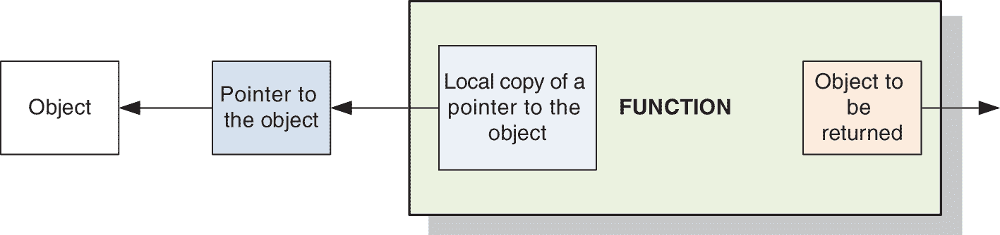

图 3.18 通过指向该对象的指针的拷贝向函数传递对象的视觉化。

最后，接下来将介绍调用基于指针的版本的 `Deg_2_Rad` 的上下文。这与第 [35] 行定义的非 `const` 引用传递的 `deg` 情况的代码完全相同。唯一的区别在于第 [68] 行，在该行使用“取地址”运算符 `&` 获取了 `d` 的地址（参见*第 4 *，表 3.15）。

我们可以通过指向 `const` 对象的指针来实现只读语义。这种构造在处理通过 `const char *` 类型识别的“旧”式文本时很常见（参见附录 A.2.6）。通过指针传递对象是 C 中间接访问对象的唯一方法。在 C++ 中，尽可能避免通过指针传递对象。在某种程度上，这一角色已被引用和智能指针接管（参见第 5.3 节）。仍然使用它们的情况是传递的对象可能。在这种情况下，`nullptr` 传递关于缺失对象的信息。例如，如果函数的参数是可选的，可以以这种方式传递。尽管如此，在现代 C++ 中，这种情况可以通过 `std::optional` 对象得到良好管理。

通过一个简单的函数，我们已经了传递参数的各种方式及其优缺点。这些可以很容易扩展到具有更多参数的实际函数情况。然而，始终要考虑软件的上下文和正确性。

### 3.14.3 函数调用机制与内联函数

图 3.19 描述了函数调用的各个方面。如图 3.19a 所示，重复的相同代码片段可以通过位于代码空间其他处的单个函数调用来取代，如图 3.19b 所示。在这种情况下，当执行单元调用（跳转）到另一个代码片段时，它必须知道在完成后返回到代码的哪个部分。这是通过在被称为*栈*（stack）的数据结构（内存）上保存返回地址来实现的。当发生链函数调用时，相应的返回地址也会存储在栈上，如图 3.19c 所示。当最内层的函数返回时，其返回地址从栈顶取出，依此类推。因此，栈以*后进先出*（LIFO）的方式运行。这种数据组织类型对某些计算有益，例如表达式解析。栈数据结构的实现将在第 4.8.4 节中进行讨论。

在调用函数时，除了返回地址外，还需要传递输入和输出对象。这通常通过将数据推入栈然后从栈弹出来实现。然而，栈通常占用较小的内存区域，所以栈通常占用较小的内存区域。

在某些情况下，与其调用代码在其他处的函数，我们可能希望在地方重复并嵌入该函数，如 3.19a 所示。这被称为*函数内联*，它可以减少执行时间，特别是在有很多调用的情况下。性能的提升归于节省了额外的调用和/或资源，如 2.1 所示。Patterson 和 Hennessy b01-bib-053)。

函数内联可以通过在函数声明之前放置 `inline` 关键字来实现。此外，类定义中定义的所有函数默认都是内联类型（参见[第 4.2 节）。

### 3.14.4 递归函数与调用栈

斐波那契数列遵循一个简单的模式：下一个元素是前两个元素的和。因此，从 0, 1 对值开始，我们在第一步得到 1，然后是 2，接着是 3, 5, 8, 13 等。遵循这种模式，在第 3.13.1 节中，我们看到了一个计算斐波那契数列连续值的函数。但可以使用反复调用自身的函数以更简单的方式执行计算。这种函数被称为*递归*。使用它们时最重要的一点是确保在满足某个特定条件后停止调用。否则，我们将很快遇到麻烦，包括*栈**溢出*。

稍微涉及一点数学，斐波那契数列的定义如下：

(3.3)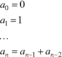 

这种递归定义产生了一种简单的递归实现，如在列表 3.14 中所示。

`FiboRecursive` 函数的定义从第 [3] 行开始。该函数没有改变任何内容，因此其输入和输出参数都是 `const int`。根据公式 ( 3.3)，序列的前两个元素需要特殊处理。在代码中，这是通过检查第 [7] 行的条件来实现的；如果满足条件，我们返回 `n`。有趣的是，这些是我们递归调用的停止条件。对于大于 1 的 `n` 值，在第 [10] 行，调用了公式 ( 3.3) 的递归部分。正如上一节讨论过的，每次对函数的调用都是通过将其参数与返回地址一起放在处理器栈上完成的。然而，这种机制以及有限的栈大小，意味着这种链式函数调用的深度不能无限持续。在实践中，它们需要很小，这在很多情况下限制了递归函数的应用。尽管如此，我们始终可以选择将递归函数重写为非递归的但功能等价的版本。在我们的代码中，为了起起见，在第 [5] 行我们以 `assert` 函数的形式包含了一个“保险丝”。

以下测试 `FiboRecursive` 的代码是直观的：

可以写成递归公式形式的问题（如阶乘、二分查找和图形洪水填充算法）通常很容易通过这种方式实现。但由于上述局限性，在实践中递归函数很少被使用。另一个有趣的机制是递归模板（第 4.8 节）。

### 3.14.5 函数重载 – 使用命名空间解决可见性

与 C 不同，C 语言中的函数仅通过名称解析，而在 C++ 中，重要的是函数名以及来自函数形式参数列表的所有所有参数。因此，在 C++ 中，函数可以具有相同的名称，只要它们的参数在至少一个类型上不同，就可以被唯一区分。然而，即使函数类型不同，函数之间也可能存在歧义。编译器选择了程序员意料之外的函数是隐性错误的来源。这就是 C++ 拥有命名空间的原因之一。在本节中，我们将看到如何使用它们来唯一解析函数名。

让我们回顾 `Deg_2_Rad` 函数的两个版本，它们在第 3.14.2.1 和 3.14.2.2 节中定义：

这些是可以组合在一个文件中的重载版本。但是，如果我们尝试调用其中一个，就会出现问题，如下行所示：（完整的上下文可以在第 3.14.2.1 节的第 [18] 行左右）。这种调用会导致编译器抱怨 `Deg_2_Rad` 的选择存在义。这是因为对于编译器而言，在当前上下文中，第一个版本中使用值调用和使用常量引用调用的效果是一样的。命名空间救了我们，正如列表 15 概述的那样。

`Deg_2_Rad` 的第一个版本封装在 `Deg_Rad_Val` 命名空间中（注意结尾没有分号）。`Deg_2_Rad` 的第二个版本，即接受 `const double &` 的版本，位于 `Deg_Rad_Ref` 命名空间中。最后，调用这两个函数如下：这次，每次调用 `Deg_2_Rad` 函数之前都有一个命名空间和作用域解析运算符 `::`，如第 [41] 行和 [56] 行所示，并在第 2.4.3 节中给出。`::` 运算符属于 C++ 运算符的第 1 类（[表 15]）。同样注意，得益于块 [33–44] 和 [48–59] 引入的新作用域（它们包含在大括号 `{}` 之间），我们可以拥有具有相同名称但在各自作用域内局部的对象。

在命名空间内部保护函数的技术非常强大且有用。它被用于 SL 和 Boost 等库中。在某些情况下，它可以被视为类的替代方案，特别是那些只包含函数而没有或只有少数数据成员的类。这种方法被许多项目使用：例如，参见第 18 节。

### 3.14.6 Lambda 函数

Lambda 表达式也称为 lambda 函数，让我们以表达式的形式编写函数代码，而不是函数定义，正如之前讨论的。让我们从一个封装在 `SimpleLambda_Test` 中的简单示例开始；参见列表 16。


在进行代码分析之前，注意第 [3] 行的 `using namespace std` 结构。它打开了所有标准头文件的整个标准命名空间。结果是，`std::` 前缀可以从标准函数和类中省略。这种做法的缺点是，如果命名空间中已经存在同名的函数或类，就会发生冲突。因此，应该显式使用 `std::` 前缀，特别是在头文件中。另一种替代方案（我们大多数示例中使用的）是逐个引入我们想要使用的每个构造，如 `using std::cout`、`using std::string` 等。然而，在使用了大量命名空间函数的源文件（`.cpp`）中，打开整个 `std` 或命名空间是合理的（只要命名冲突得到了良好控制）。我们的首要目标应该是软件的正确性，其他规则应该为了支持这一目标而选择。

我们的第一个 lambda 表达式（一个 lambda 函数）完全写在列表 16 的第 [11] 行。与“经典”函数定义相比，它有一对括号 `[]`。然后，在括号中，我们看到了形式参数 `cm` 的定义，后面是函数体 `{}`。它的作用很简单——接受参数 `cm` 并乘以 2.54 将其转换为英寸。我们提到过 lambda 表达式没有名称；在很多情况下，不需要给 lambda 命名。然而，必要时，可以将整个 lambda 表达式赋值给对象，如我们第 [9] 行所示。这是一个闭包对象，它让我们进一步引用该表达式，例如第 [20] 行的调用。但注意，除了使用 `auto` 关键字外，没有方法可以为此 lambda 闭包声明类型。在本节末尾，我们将进一步查看这一特征。

如图 3.20 所示，lambda 表达式由以下部分组成：

1. 捕获列表（Caption）– 将外部对象引入 lambda 的作用域。
2. 形式参数列表 – 定义形式参数的类型和名称列表，与任何其他函数相同。
3. 可选返回类型 – `->` 运算符以及返回对象的类型。
4. Lambda 主体 – 包含在大括号 `{}` 内的语句和表达式，包括 `return`。

每个 lambda 都包含一个运行时对象，称为 `lambda closure`（lambda 闭包）。如果 lambda 表达式绑定到一个标识符，就可以像使用其他对象一样用它传递函数，或者将其存储在数组中。但 lambda 特别适用于指定传递给其他函数的无命名代码。

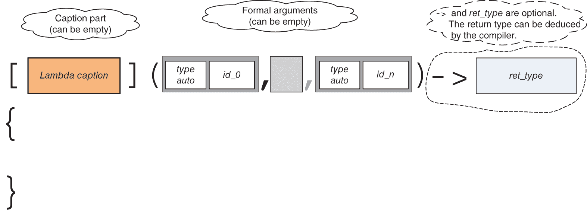

**图 3.20** Lambda 表达式由三部分组成：标题、形式参数列表和可选的返回类型。lambda 体包含在大括号 `{}` 之中。

让我们考虑列表 3.17 所示的示例，其中我们将构建一个关于参加 SCUBA 课程人员的简单数据库。首先，我们定义了一个包含四个数据成员的简单 `struct`。

`StudentInfo` 与第 3.9 节中介绍的结构类似。然而，新的构造是在第 [9] 行定义的枚举类型 `SCUBA_Cert`。我们已经在第 (13.3.1) 节介绍过枚举类型。但是，`SCUBA_Cert` 是一种作用域枚举（scoped enumerated）类型。这意味着为了使用枚举常量（如 `kOpenWater`），我们必须使用完全限定名 `SCUBA_Cert::kOpenWater` 等。作用域枚举类型的优点包括：

1. 安全性，因为我们不太可能混淆强作用的名字。
2. 安全性，因为作用域枚举是强类型的。这意味着为了将其转换为其他类型（如 `int`），我们必须使用 `static_cast` 运算符（表 3.15，*第 2 组*）。
3. 更安全且灵活，因为我们可以显式地指定 `enum` 的底层类型。例如，如果我们想为此目的使用 `unsigned char`，可以写成 `enum class SCUBA_Cert : unsigned char { };`。

我们还需要一个函数来打印 `StudentInfo` 结构的数据成员。在 C++ 中，与其编写一个 `PrintAll` 函数，不如使用重载运算符 `<<` 形式的常用框架，定义如下（更多内容请见第 4.6.5 节）：

第 [18–20] 行应该是直观易懂的，考虑到参数 `o` 可以代表任何流，例如 `std::cout`，也可以打开的文件或网络端口。为了打印人类可读的信息，在第 [21] 行，输出了第 [16] 行 vector 中定义的文本。

现在我们创建一个包含几位参加 SCUBA 潜水课程人员信息的简单数据库。这由名为 `SCUBA_Class` 的 vector 表示，其中包含 `StudentInfo` 对象：

最后，在接下来的 `SCUBA_Course` 函数中，我们显示符合某些条件的 SCUBA 学生的信息。首先，在第 [43–44] 行调用 `std::sort` 函数对 `SCUBA_Class` vector 进行排序。由于每个 `StudentInfo` 对象包含许多数据字段，我们需要告诉 `sort` 应使用哪一个进行排序。这通过为 `sort` 提供在第 [44] 行定义的 lambda 函数来实现。它接受两个 `StudentInfo` 对象的常量引用，并返回 `fFamilyName` 字符串字典序比较的布尔值。这不需要任何进一步的操作，因为编译器已经“知道”如何比较字符串。然后，在第 [47–48] 行，使用 `std::copy` 函数将排序后的 vector 拷贝到屏幕上（参见表 3.6）。

函数的后续几行 [54–59] 中也完成了类似的排序和打印。然而，这次我们根据 `fAge` 进行排序。此外，使用了 `auto` 关键字来自动推导出类型。

最后，在第 [65] 行调用了 `std::copy_if`：它只输出 `fCert` 字段与外部提供的 `cert` 对象相同的对象。这种检查是由另一个在第 [67] 行定义的 lambda 函数完成的。然而，与之前的两个 lambda 不同，这使用 `copy` 标题将 `cert` 引入其作用域：

运行程序时，程序将打印关于 SCUBA 类的以下信息：

## 我们在这个示例中学习了什么？

1. Lambda 函数可以通过拷贝和引用进行标题。
2. 一个简单的 `StudentInfo` 结构持有带有作用域枚举类型 `SCUBA_Cert` 的个人信息。
3. 针对 `StudentInfo` 的重载流插入运算符 `<<`。
4. 带有提供的 lambda 函数和不同标题的函数 `std::sort` 和 `std::copy_if`。

### 3.14.7 () 关于 Lambda 函数的更多内容

使用 lambda 时，正确指定其标题的类型非常重要。带有不同标题的 lambda 示例见表 3.10。

| 标题 | 含义 | 示例 |
| :--- | :--- | :--- |
| `[]` | 没有捕获任何对象。 |<br>```cpp<br>vector<int> vec;<br>generate_n(back_inserter(vec), 10, rand());<br>copy_if(vec.begin(), vec.end(), ostream_iterator<int>(cout), [](auto x) { return x < 100; });<br>``` |
| `[=]` | 按值捕获所有对象。这使得 lambda 能够访问所有本地对象。 |<br>```cpp<br>vector<int> vec;<br>generate_n(back_inserter(vec), 10, rand());<br>copy_if(vec.begin(), vec.end(), ostream_iterator<int>(cout), = { return x < 100; });<br>``` |
| `[a]` | 更好的方法是显式指定想要访问的本地对象，如第二个版本。 |<br>```cpp<br>vector<int> vec;<br>generate_n(back_inserter(vec), 10, rand());<br>copy_if(vec.begin(), vec.end(), ostream_iterator<int>(cout), a { return x < 100; });<br>``` |
| `[&]` | 按引用捕获所有本地对象。这使得 lambda 能够访问所有本地对象。按引用捕获存在风险，因为 lambda 表达式的生命周期可能超过其参数。在这种情况下，lambda 可能会访问悬空指针或引用。因此，更安全的方法是创建传递对象的拷贝。 |<br>```cpp<br>vector<int> vec;<br>generate_n(back_inserter(vec), 10, rand());<br>copy_if(vec.begin(), vec.end(), ostream_iterator<int>(cout), & { return x < 100; });<br>``` |
| `[cpy=a]` | 初始化捕获。第三个版本创建了对象 `a` 的本地拷贝 `cpy`，专门供 lambda 使用（泛化 lambda 捕获，C++14）。按值传递的对象是不可变的：即它们只能读取，不能写入。 |<br>```cpp<br>vector<int> vec;<br>generate_n(back_inserter(vec), 10, rand());<br>copy_if(vec.begin(), vec.end(), ostream_iterator<int>(cout), cpy=a { return x < 100; });<br>``` |

系统管理员的一个常见任务是添加新用户并向他们发送密码。以下代码执行了该任务：它生成由三组符号组成的八字符密码。生成的密码不保证唯一；我们的意图仅是展示几个 lambda 函数的简单示例。

```cpp
// 生成随机标识符
// 用于生成密码的字符
const vector<string> rand_strings = {
    "ABCDEFGHIJKLMNOPQRSTUVWXYZ",
    "abcdefghijklmnopqrstuvwxyz",
    "0123456789_@&#"
};

std::srand(time(0)); // 随机生成器种子
```

```cpp
// Generated value can be from 0 .. max_val
// We could use default caption [=] to access RAND_MAX;
// However, a better way is to create a local copy rm
// via the "init capture" (generalized captures).
// -> int to explicitly convert return value from double to int
auto rand_index = [ rm = RAND_MAX ] ( const int max_val ) -> int 
{ 
    return static_cast< double >(std::rand()*max_val)// static_cast to make
           / static_cast< double >( rm + 1 ); // division on double
};

// Let's generate a few example passwords ...
const int kPswdToGenerate { 10 };
for( int cnt = kPswdToGenerate; cnt > 0; cnt--)
{
    string pwd;

    // Insert kPasswordLen random chars via lambda function
    const int kPasswordLen = 8;
    generate_n ( back_inserter( pwd ), kPasswordLen, 
        // Use lambda which calls another lambda passed by reference 
        // However, avoid default [&]
        [ & rand_strings, & rand_index ] () 
        { 
            const auto & s = rand_strings[ rand_index( rand_strings.size() ) ]; 
            return s[ rand_index( s.size() ) ];
        } 
    );
    cout << "Proposed password: " << pwd << endl;
}
```

第 1–8 行定义了一个名为 `rand_strings` 的 vector，它包含了三个带有字符集的字符串。这样做是为了促进生成包含混合大写字母、小写字母以及如 `#` 和 `@` 等符号的密码。由于我们追求简洁，使用了 `rand` 和 `seed` 函数来初始化和生成随机数。然而，更好的选择是使用新的随机数生成器之一，例如第 3.1 节介绍的那些。

我们的第一个 lambda 表达式定义在第 18–22 行，并赋值给 `rand_index` 标识符（一个闭包）。它利用了初始化捕获（`init capture`），将全局常量 `RAND_MAX` 拷贝到变量 `rm`，该变量是该 lambda 局部的。形式参数 `max_val` 定义了该 lambda 可以生成的最大值。最后，通过定义中的 `-> int` 部分显式定义了返回值。这确保了浮点值被转换为 `integer` 类型，因为此 lambda 被用于生成随机索引。由于应用了 `float` 到 `integer` 的转换，该函数可以生成 `0` 到 `max_val-1`（包含边界）之间的值。随后形成了一个循环来生成几个随机密码，每个密码都有八个字符。

主密码生成通过库中的 `generate_n` 函数完成。它的第一个参数 `back_inserter(pwd)` 告诉函数在长度为 `kPasswordLen` 的 `pwd` 字符串末尾插入新元素，这是该函数的第二个参数。`generate_n` 最感兴趣的参数是第三个，它是定义在第 39–43 行的第二个 lambda；它执行了两次随机抽取。

这次我们使用了捕获列表 `[& rand_strings, & rand_index]`，提供了命名对象 `rand_strings` 和 `rand_index`。有趣的是，`rand_index` 是之前定义的 lambda 闭包，因为它将在此 lambda 使用。同样有趣的是，这个 lambda 在其参数列表中没有接受任何参数，因此它是空的。如前所述，有两个随机动作。第一个在第 41 行，从 `rand_strings` 容器的三个字符串中选择一个。在第 42 行，从选中的字符串中选择一个随机字符，并将其返回给 `generate_n` 算法。结果是获得了一系列随机生成的八字符字符串。之前代码的输出如下所示（每次运行结果会有所不同）：

```text
Proposed password: eb#V#Vk
Proposed password: ZzCxV_K8
Proposed password: 12Js6@
```

### 使用变长模板进行捕获

这个示例稍微高级，但在实践中是可以使用的（模板将在第 4.8 节中讨论）。在这里，我们创建了一个名为 `multi_print_helper` 的模板函数，它可以接受任意数量的参数，并将它们输出到输出流中。它可以作为诊断工具，例如如下所示。

```cpp
// First function in the series
template < typename T >
auto & multi_print_helper( ostream & o, const string sep, const T & val )
{
    o << val << sep;
    return o;
}

// A template function accepting an arbitrary number of parameters
template < typename T, typename ... Args >
auto & multi_print_helper( ostream & o, const string sep, const T & val, Args... args )
{
    o << val << sep;

    // Recursively call 
    return multi_print_helper( o, sep, args... );
}
```

要定义一个变长模板函数，我们需要该函数的两个版本：定义在第 62–67 行的启动版本，以及定义在第 70–77 行的带有模板参数包 `Args` 版本。这种结构遵循第 76 行发生的递归调用类型。因此，在递归结束时，启动版本结束。

```cpp
void multi_print_helper_test() {
    // Make a log
    ofstream logfile("log_file.txt");
    // A helper variadic lambda that joins multi_print_helper
    auto diagnostic_print = [ log = logfile ] ( auto... params ) {
        // Output separate with
        multi_print_helper( log, " ", params... ) << endl;
    };
    // Objects of arbitrary type
    int x { 1 }; double y { 2.0 }; string z { "three" };
    // Output to the file
    diagnostic_print( x, y, z );
    diagnostic_print( x, y, z, "Text", x == y, 5.0 );
}
```


`multi_print_helper_test` 函数展示了变长模板函数`multi_print_helper`的用法。然而，由于我们希望输出重定向到第 81 行创建的文件，第 84–87 行引入带有变长参数的辅助 lambda。最后，`log_file.txt`的内容如下：

```text
1 2 three
1 2 three Text 0
```

### 表 3.10 Lambda 捕获示例

Lambda 可以在其捕获列表中混合对象访问类型。下表包含了一些示例：

| Lambda 捕获变体 | 说明 | Lambda 捕获变体 | 说明 |
| :--- | :--- | :--- | :--- |
| `[a,&b]` | 按值捕获对象`a`，按引用捕获`b` | `[&,a]` | 按引用捕获所有对象，但`a`按值捕获 |
| `[=,&a]` | 按值捕获所有对象，但对象`a`按引用拷贝 | `[&,this]` | 按引用捕获所有对象，但`this`按值捕获（`this`只能通过拷贝访问） |
| `[a, this]` | 捕获`a`和`this`指针（见第 4.4 节） | `[this, ...]` | 捕获`this`指针和变长模板 |

如前所述，lambda 表达式的一个有趣 True 点是，声明其类型的唯一方法是使用`auto`关键字。这是因为每个 lambda 表达式都有一个独特且未命名的类型（其关联的闭包对象的类型）。然而，lambda 表达式可以转换（强制）为指向函数的指针（在下一节中讨论），该指针具有相同的形式参数和相同的返回类型。在这种情况下，与其使用原始函数指针，更好的想法是使用`std::function`（参见第 3.14.9 节）。

Lambda 函数是常量对象。这意味着它们不能更改在其捕获列表（`caption`）中传递的对象的值。但是，将它们声明为`mutable`将允许此类更改；参见第 7.4.7 节。

### 3.14.8 函数指针

有时我们需要将一个函数作为另一个函数的参数，或者将其作为结构体的成员包含进来。有时函数提供者希望在事件发生时调用某个函数——这被称为*回调机制*。处理此类情况有许多选项。C/C++ 中可用的最低层次的方法是简单的函数指针。其语法如图 3.21 所示：它遵循函数声明模式，只是函数名被替换为`(*function_ptr_name)`，其中`function_ptr_name`仅仅是函数指针的标识符。

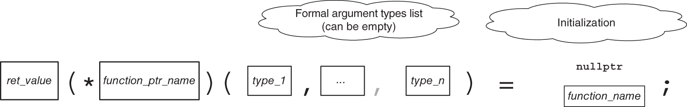

**图 3.21** 函数指针的语法。

在下面的示例中，我们希望编写一个短程序来计算单点处的函数导数。在开始之前，让我们先回顾一些数学知识。对于给定的连续函数`f`，其导数`f²`定义如下（Korn and Korn 2000）：

(3.4) `f'(x) = lim_{δ→0} (f(x+δ) - f(x))/δ`

其中`δ`是一个参数。对于足够小的`δ`值，上一个方程可以近似如下（Press et al. 2007）：

(3.5) `f'(x) ≈ (f(x+µ) - f(x-µ))/(2µ)`

上述公式为我们提供了给定`f`和`x`并选择`µ`的情况下计算`f²`的一种实用方法。在实践中，后者被设置为一个小值，但相对于计算机的精度又足够大，以避免过度的舍入误差（第 7.4 节）。

`deriv`函数遵循公式 (3.5)：

```cpp
double deriv(double (*f)(double), double x, double eps) {
    return (f(x + eps) - f(x - eps)) / (2.0 * eps);
}
```

为了允许对任何函数进行计算，在第 [1] 行提供了一个类型为`double (*)(double)`的函数指针作为`deriv`的第一个参数。接下来的两个参数是计算导数的点`x`，以及（显而易见的）参数`eps`。所有的计算都发生在第 [4] 行，在那里，通过指针`f`提供的函数像普通函数名一样被调用。

现在我们能够计算真实值了。让我们选择一个有趣的函数`f(x)=x^x`，它可以很容易地编码为下面的`pow_x_2_x`：

```cpp
double pow_x_2_x(double x) {
    return std::pow(x, x);
}
```

我们可以在给定的点值处计算上述函数的导数。必要的计算在接下来的`deriv_test_fun`函数中完成：

```cpp
void deriv_test_fun() {
    double x = 2.0;
    double eps = 0.001;
    double result = deriv(pow_x_2_x, x, eps);
    std::cout << "Derivative at x=" << x << " is " << result << std::endl;
}
```

在第 [13] 行发生了一个有趣的情况：`deriv`函数的第一个参数是一个函数指针，该指针仅仅是函数的名——在本例中为`pow_x_2_x`。在函数的形式参数和返回参数与函数指针一致的情况下，这才能有效。因此，记住这一点非常重要：

1. 函数名*本身*就是指向该函数的指针（即其代码）

这有时会导致意料之外的错误。例如，以下代码

```cpp
pow_x_2_x;
```

将会编译，但它什么也不做，而我们原本预期的是一个函数调用。相反，我们应该写`pow_x_2_x(x)`。

在上一节中，我们说 C 和 C++ 结构体之间的主要区别之一是我们不能在 C 结构体中包含函数（第 9.1 节）。真的吗？不完全是，因为函数指针可以在`struct`中，提供调用函数的方法。然而，这些函数需要在全局空间的其他地方定义，这是我们极力避免的。

### 3.14.9 面向对象框架中的函数

在面向对象的框架中，函数通常是类的成员。此外，其中某些函数可以在派生类中重写以调整它们的行为（参见第 4.11 节）。

还有一些专门用于表示函数的类——这些被称为*仿函数*（functors）或*函数对象*。函数对象的细节将在第 6.1 节中介绍。然而，我们已经见过 lambda，正如第 3.14.8 节中讨论的那样，它们是函数对象的示例。C++ 提供的比裸指针多得多。在 SL 中，`std::function`让我们能够包装任何可调用对象，如列表 3.18 所示。它展示了`std::function`如何替代函数指针。

```cpp
#include <functional>
#include <vector>
#include <cmath>
#include <iostream>
using RealFun = std::function<double(double)>;

double deriv(RealFun f, double x, double eps) {
    return (f(x + eps) - f(x - eps)) / (2.0 * eps);
}

double x2_fun(double x) { return x * x; }
double sqrt_fun(double x) { return std::sqrt(x); }

void deriv_test_fun() {
    std::vector<double> x_vals, y_vals, deriv_vals;
    for (double x = -3.0; x <= 3.0; x += 0.5) {
        x_vals.push_back(x);
        y_vals.push_back(x2_fun(x));
        deriv_vals.push_back(deriv(x2_fun, x, 0.001));
    }
    // 输出到文件...
}
```

在第 [1] 行，定义了一个类型为`std::function`的别名`RealFun`，它接受一个`double`参数并返回`double`结果。`deriv`是我们在代码第 [4] 行定义的第一个函数。还有两个函数。第一个在第 [10] 行定义，简单地计算参数`x`的平方根。

在第 [21] 行，创建了几个`vector<double>`对象，它们最初是空的。这些在从第 [22] 行开始的`for`循环中填充。遍历 -3.0 到 +3.0 的范围，使用`range`对象。它的操作是直观的。然而，为了更好地理解它的结构，需要更多面向对象编程（OOP）的信息，这些将在本书后续章节中提供。具体来说，`range`类将在第 6.5 节中介绍。旧版本的`for`在这里也可以工作，但编写它留作了练习。

在`deriv_test_fun`函数的第 [24–27] 行，vector 对象填充了参数、`x2_fun`的值以及调用`deriv`函数的结果。在这种情况下，有趣的是观察第 [26] 行和 [27] 行调用中`deriv`的第一个参数是以不同方式定义的函数，如前所述。然而，得益于`std::function`的应用，统一的调用接口是可能的。

在第 [30] 行，创建一个输出文件对象。从第 [33] 行开始，该文件用于流输出所有带有函数值的向量。写入流是通过`std::copy`函数完成的（第 3.8 节）。提供了输入序列起始和结束的两个迭代器作为其参数，后者是由连接到`outFile`对象的`ostream_iterator`提供的。结果，每个 vector 的数据都进入了该文件，而不是内存中的数据集合。

图 3.22 显示了`x_fun_plot.txt`文件中存储值的图表，该文件是由列表 3.18 中的代码生成的。

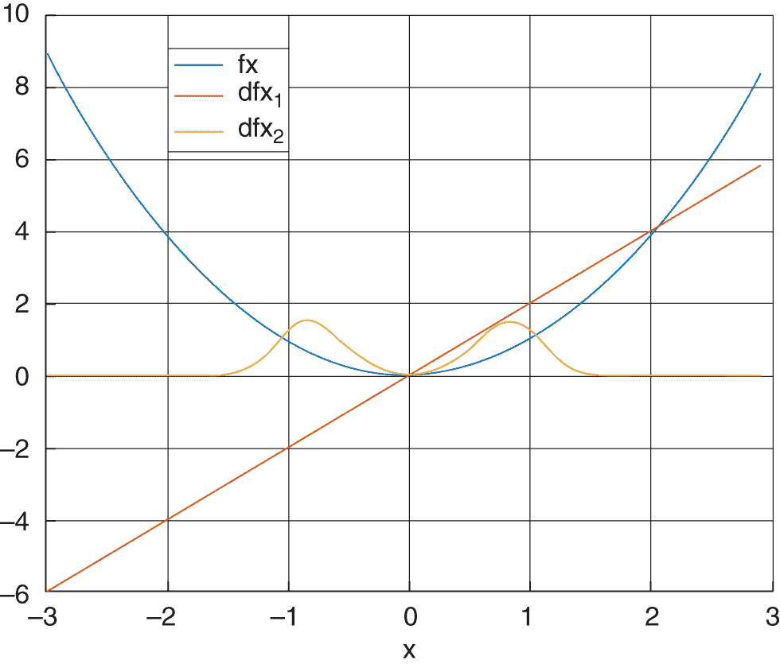

**图 3.22** 使用列表 3.18 代码片段生成的函数图表。对于`x`²函数（蓝色），我们可以很容易地识别出它的`2x`导数（红色）。我们还看到`x`²最小值处的点与其导数`2x`穿越 0 的点重合。`tanh(x³)`的导数用黄色显示。

正如我们很快看到的，`std::function`也可以用于存储函数对象。事实上，lambda 函数是函数对象的一种。

## 3.15 示例项目 – 使用带有构造函数的结构体封装对象

在第 3.5 节中，我们展示了如何借助`std::vector`类定义矩阵。我们使用了类及其实例化，我们称之为对象。例如，在

```cpp
RealMatrix m;
```

`RealMatrix`表示一个类型，而`m`是该类型的一个对象。我们还看到了`RealMatrix`在计算中使用的方式。但在某些情况下，`RealMatrix`的接口可能并不尽如人意。例如，缺点是缺乏一种灵活的方法来初始化为预定义的大小。此外，可能存在不同大小的行，这会导致奇怪的矩阵。

在本节中，你将学习：

1. 如何将矩阵放入结构体中并为其初始化添加构造函数
2. 如何在矩阵上编写基本算法，例如矩阵加法和乘法

我们将展示如何创建一个带有数据和函数的`class`以方便`RealMatrix`的使用。但首先，我们将做一个稍微简单一点的——带有构造函数和一些辅助成员函数的结构体。在 C++ 中，类和结构体都可以包含数据和函数。正如之前暗示的，结构体的行为与类完全相同，但它的所有成员都是公开可访问的。这意味着结构体中的任何内容都可以随意读取和写入。这在一般的面向对象编程（OOP）中不是一个理想的特征，但我们稍后会改进。此时，我们希望有一个简单、有用且准备好进行基本计算的东西。

结构体`EMatrix`（代表“易矩阵”）的定义跨了列表 3.19 中的第 [3–25] 行。它只包含一个数据成员：位于第 [6] 行的熟悉类型`RealMatrix`的对象`fData`。

```cpp
struct EMatrix {
    RealMatrix fData;

    EMatrix(Dim rows, Dim cols, double initVal = 0.0) : fData(rows, RealVec(cols, initVal)) {
        assert(rows > 0);
        assert(cols > 0);
    }

    auto GetCols() const { return fData[0].size(); }
    auto GetRows() const { return fData.size(); }
};
```

除了数据成员外，`EMatrix`还包含成员函数。最特殊的是第一个，`EMatrix`，它接受最多三个参数。它的名字与整个结构体的名字相同；这是称为构造函数 的函数的典型特征。这些是特殊函数，在对象创建时会被自动调用。这是来自 OOP 领域的第一个特征。换句话说，当创建一个`EMatrix`对象时，它的构造函数`EMatrix`会被调用。如第 [12] 行所示，它期望三个参数，其中一个分配了默认值。这些可以很容易地识别为行数和列数。最后一个提供了为矩阵所有元素设置的初始值。

第 [13] 行紧接有一个有趣的构造：在构造函数初始化列表的冒号`:`之后，成员对象`fData`被带有两个参数进行调用。你可能会想，如何可能“调用”一个对象呢？答案是这是一个函数。被调用的是`fData`的构造函数。由于它属于`std::vector`类，该构造函数期望的第一个参数是元素个数，第二个参数是这些元素的初始值（参见表 3.4）。在这种情况下，元素个数就是行数。然而，初始值是一个示例行——因此，对象`RealVec(cols, initVal)`被提供作为一种原型初始值。之后，在第 [14–18] 行，是`EMatrix`构造函数的体。尽管如此，它几乎是空的。唯一的两行 [16–17] 被`assert`函数的调用占据了。正如我们所知，这些是特殊的断言函数，通常只在软件的调试版本中激活。它们的作用是检查构造的正确性，或者在本例中检查传递参数的正确性。在我们`EMatrix`构造函数中，我们要求两个维度都大于 0。这是为了验证是否有人错误地尝试通过提供 0 来创建`EMatrix`，程序停止并显示消息，我们可以在调试器窗口中检查原因。

当然，矩阵维度大于 0 的要求可以放宽。正如已经提到的，这是一个数学上的约束而非编程上的约束。例如，通过为`EMatrix`构造函数添加默认参数，如下

```cpp
EMatrix(Dim rows = 3, Dim cols = 3, double initVal = 0.0)
```

获得了一个不需要任何参数即可调用的构造函数。正如在第 3.9 节中提到的，如果数据可以使用`{}`初始化，则可以省略构造函数。我们将在后续章节中看到许多示例。

此外，构造对象时始终传递维度有一个后果——对象没有默认构造方式。换句话说，显式定义参数构造函数会抑制编译器自动生成默认构造函数。缺少默认构造函数对对象施了限制，我们将讨论。

另一个设计问题是在矩阵创建后允许或不允许更改维度。我们经常需要做此类设计决策。应该彻底考虑后果，更重要的是，要在代码中进行良好的注释。

回到`EMatrix`的定义，注意还有两个成员函数——第 22 行的`GetCols`和第 23 行的`GetRows`——它们返回`EMatrix`的列数和行数。这些函数的操作现在应该是清晰的，因为在之前的章节中我们讨论了如何访问`RealMatrix`的维度。然而，有两点需要解释。首先是返回类型，这里用`auto`定义。可以使用`Dim`，但使用`auto`更灵活，正如我们将多次所示。其次是`const`关键字。将函数声明为`const`意味着函数没有修改任何成员数据（状态）的意图。

### 3.15.1 面向对象环境中的 EMatrix

`EMatrix`是借助`struct`定义的，这意味着它的所有数据和成员函数都是开放可访问的，可以从任何`EMatrix`对象自由调用。

使用`class`关键字的等效写法如下：

```cpp
class EMatrix {
public:
    RealMatrix fData;
    EMatrix(Dim rows, Dim cols, double initVal = 0.0);
    auto GetCols() const;
    auto GetRows() const;
};
```

由于`class`假设所有成员都是私有的，因此添加`public`关键字会使所有数据成员和函数成员完全开放，就像`struct`的情况一样。但仅仅通过不同的关键字来获得相同的功能并不有趣。有趣的是在设计中使用面向对象（OOP）范式。`EMatrix`的当前版本已经接近面向对象领域。然而，要进入该领域，我们至少需要将数据私化并添加成员函数。在第 4.7 节中，我们将练习在面向对象领域重新构建`EMatrix`。这种增强代码功能和质量的被称为*代码重构*（Fowler 1999）。

### 3.15.2 EMatrix 的基本操作

定义`EMatrix`后，让我们来进行一些矩阵计算，如列表 3.20 所示。在 [12–19] 行上，我们向用户打印指令。在 [22] 行上，创建了一个维度为 3 × 4 的对象`matrix_1`。这调用了我们在上一节中讨论过的`EMatrix`构造函数。结果，我们可以确定所有的矩阵元素都已设置为零。

```cpp
void matrix_test() {
    EMatrix matrix_1(3, 4);
    AskUserForMatrixData(matrix_1);
    ShowMatrix(matrix_1);

    EMatrix matrix_2(4, 2);
    AskUserForMatrixData(matrix_2);
    ShowMatrix(matrix_2);

    EMatrix result = MultMatrix(matrix_1, matrix_2);
    ShowMatrix(result);
}
```

与其将所有计算步骤写在一个巨大的函数中，不如将代码组织成若干个专门的函数几乎总是更好的。因此，为了输入和打印矩阵数据，我们使用了`AskUserForMatrixData`和`ShowMatrix`函数。同样，`MultMatrix`执行矩阵乘法。要调用它们，我们只需要提供它们的声明，例如 [4–6] 行中的那些声明。这样，我们现在可以使用它们，并将它们的完整定义推到代码的后部分。

在 [23] 行上，调用了`AskUserForMatrixData`函数，让用户从键盘输入`matrix_1`元素的值。为了验证其内容，通过在 [26] 行调用的`ShowMatrix`函数将`matrix_1`打印到屏幕上。

同样，在 [29–33] 行上，获取并显示了维度为 4 × 2 的`matrix_2`。最后，通过连续调用`MultMatrix`和`ShowMatrix`函数，在 [37] 行计算并立即显示了两个矩阵的积。更准确地说，`MultMatrix`返回一个临时的`EMatrix`对象，该对象作为参数传递给`ShowMatrix`并显示。正如我们在矩阵代数中所知的，它们的积是一个 3 × 2 矩阵。我们将讨论这些计算的细节。

注意，在这些函数中，只有`AskUserForMatrixData`修改了传递给它的矩阵。为了这个目的，它的参数被声明为`EMatrix`对象的引用：即`EMatrix &`。另外两个函数只从传递的`EMatrix`参数中读取值。因此，它们被声明为常量引用：`const EMatrix &`。这样，传递的对象是安全的（不可变的），因为不允许对它们进行任何更改。选择引用传递有两个原因。在`AskUserForMatrixData`的情况下，这是必要的，因为我们希望传递的矩阵对象的原始值被覆盖。因此，按值传递不是一个选项，因为原始值将保持完好无损。对于另外两个函数，引用传递节省了时间。按值传递的对象拷贝也能良好工作。然而，创建相对大对象的拷贝是显然的资源浪费。在函数之间传递对象的方法在第 3.14.2 节中进行了讨论。

### 3.15.3 EMatrix 的输入和输出操作

正如之前提到的，我们推迟了对`EMatrix`对象执行特定动作的定义。在本节中，我们将分析`AskUserForMatrixData`和`ShowMatrix`这两个函数，用于读取和显示矩阵值。

`AskUserForMatrixData`函数定义在列表 3.21 的 [3-18] 行。包含解释函数作用以及其参数作用的信息始终是极好主意；在这种情况下，几行注释就足够了。

```cpp
void AskUserForMatrixData(EMatrix &m) {
    Dim kCols = m.GetCols();
    Dim kRows = m.GetRows();
    // 与用户交互输入矩阵元素...
    for (Dim r = 0; r < kRows; ++r) {
        for (Dim c = 0; c < kCols; ++c) {
            // 提示并读取 m[r][c] 的值
        }
    }
}
```

第 [5–6] 行读取输入对象`m`的列数和行数。这些被存储在两个常量值`kCols`和`kRows`中，它们将在访问`m`的元素时用作分隔符。`Dim`是一个指定用于索引向量和矩阵元素的类型，如列表 3.4 所示。

由于矩阵是二维的，为了访问其元素，我们需要两个程序循环来遍历它的行和列。为了这个目的，遍历矩阵行的第一个`for`循环从 [8] 行开始。第 [9–16] 行上的所有语句都使用变量（迭代器）`r`重复，该变量的取值为 0 到`kRows – 1`。在每次迭代后，`r`通过`++ r`增加 1。在 [10] 行上，我们向用户显示一条消息，指示我们即将输入的行号。

第二个嵌套的`for`循环从 [11] 行开始。它在 [12–15] 行的大括号之间执行两个操作。

```cpp
for (int r = 0; r < kRows; ++r) {
    for (int c = 0; c < kCols; ++c) {
        // ...
    }
}
```

很快，我们将看到更通用的矩阵输入/输出函数，它们可以以更统一的方式与任何数据流操作，而不仅仅是屏幕或键盘。这些是重载的流运算符，将在第 4.7 节中介绍。

### 3.15.4 EMatrix 的基本数学运算

在本节中，我们将分析`MultMatrix`函数，它执行矩阵乘法。矩阵乘法要求第一个矩阵的列数等于第二个矩阵的行数。假设`A`是`m×n`矩阵，`B`是`n×p`矩阵，那么乘积`C = A * B`是一个`m×p`矩阵，其中`C[i][j] = Σ_{k=0}^{n-1} A[i][k] * B[k][j]`。该操作在列表 3.20 中被调用。

```cpp
EMatrix MultMatrix(const EMatrix &a, const EMatrix &b) {
    Dim rows = a.GetRows();
    Dim inner = a.GetCols();
    Dim cols = b.GetCols();
    EMatrix result(rows, cols, 0.0);
    for (Dim i = 0; i < rows; ++i) {
        for (Dim j = 0; j < cols; ++j) {
            for (Dim k = 0; k < inner; ++k) {
                result.fData[i][j] += a.fData[i][k] * b.fData[k][j];
            }
        }
    }
    return result;
}
```

在函数中，我们首先验证维度兼容性（如果`a.GetCols() != b.GetRows()`，则抛出错误），然后创建结果矩阵并用嵌套循环填充。由于`EMatrix`的数据成员`fData`是公开的，我们可以直接访问内部向量。`MultMatrix`返回一个临时`EMatrix`对象，该对象可以在调用表达式中直接使用，如列表 3.20 所示。


在本节中，我们将分析两个函数：一个用于相加，另一个用于乘由`EMatrix`类型表示的矩阵。在列表 3.22 中，第[4]行的`AddMatrix`函数接受常量`a`和`b`，以访问要相加的外部`EMatrix`对象。众所周知，两个矩阵的维度必须相同；这一条件通过`assert`进行验证。如果维度一致，则在第[9]行创建一个输出矩阵`c`并立即使用来自矩阵`a`的数据进行初始化。这是可能的因为编译器会假设只需要从`a.fData`成员拷贝数据成员`c.fData`。此外，该操作将自动执行，因为正如我们记忆的，这些是知道如何相互拷贝的`std::vector`对象。这解释了代码内部发生了什么，尽管拷贝构造函数和移动构造函数的详细解释留到了第 4.4 节。

矩阵相加需要两个`for`循环，如第[11, 12]行所示。它们遍历`fData`的行和列的方式与`AskUserForMatrixData`函数中完全相同。在第[13]行，使用`+=`运算符将矩阵`b`的元素加到`c`的对应元素上。编写`x += y`等同于`x = x + y`，正如对`第 15 组`运算符所解释的那样（表 3.15）。对象`c`最后在第[15]行返回。

让我们简要回顾一下矩阵乘法。作为一个示例，考虑以下两个矩阵**A**和**B**：

(3.6)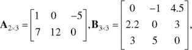

这些矩阵可以如下所示相乘：

(3.7)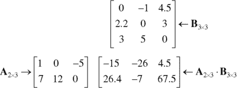

我们安排矩阵是为了展示矩阵乘法依赖于将第一个矩阵的每一行乘以第二个矩阵的每一列——因此这些维度必须相同。对应的元素相乘，并将这些乘积相加得到最终结果，结果存放在输出矩阵对应的行-列位置。例如，第一行乘以第一列的操作如下：1 · 0 + 0 · 2.2 + (-5) · 3 = -15。

掌握了这些知识后，我们准备好在列表 3.23 中编写代码了。用于矩阵乘法的`MultMatrix`函数定义在第[20]行。同样，它期望两个表示真实矩阵的`EMatrix`对象，通过常量引用`a`和`b`传递。与矩阵相加不同，矩阵乘法要求`a`的列数等于`b`的行数。在读取第[22–26]行的行数和列数后，通过`assert`检查此条件。然后，在第[30]行，创建返回矩阵`c`，其值显式初始化为 0.0（如果没有提供，也会使用 0）。

从上一个示例中，我们发现矩阵乘法需要三个循环：第一个循环遍历`a`的行，第二个遍历`b`的列，第三个遍历`a`的列（其数量必须与`b`的行数相同）。这三个循环在第[32–34]行通过`for`语句实现。`a`和`b`对应元素乘积的连续和在第[35]行加到矩阵`c`的对应位置。

最后，结果矩阵`c`在第[37]行返回。注意，此时`c`是按值返回的，^(²⁵)，这可能涉及昂贵的对象拷贝。得于第 4.6.4 节中讨论的优化机制，这不应该是一个主要问题。

### 3.15.5 组织项目文件并运行应用程序

之前的代码片段来自书中项目主页提供的*EasyMatrix*项目（Cyganek 2018）。`EMatrix`结构的定义放在`EMatrix.h`头文件中。矩阵操作位于`EMUtility.h`和`EMUtility.cpp`文件中，测试函数在`EMTest.cpp`中。最后，`main.cpp`包含了对测试函数的调用。为了视觉化*EasyMatrix*项目的组织结构，图 3.23 显示了展示文件结构的 UML*构件图*。


图 3.23 EasyMatrix 项目文件中关系和角色的 UML 构件图。

构建并运行*EasyMatrix* *.exe*后，屏幕上会出现以下输出：

自然地，之前的结果取决于用户输入的矩阵值。此外，你可能好奇数值的格式。在 C++ 中，这也可以设置。如果你感兴趣，请参见表 3.14。

### 3.15.6 使用简单随机数生成器扩展矩阵初始化

在本节中，我们将进一步探索在`struct`框架下使用函数组合数据的方法。同时，我们将学习以下内容：

1. 如何实现一个具有良好随机特性的简单随机数生成函数

2. 在`struct`/`class`内部使用初始化列表进行对象初始化

3. 使用十六进制掩码进行位移、异或和与与操作

Listing 3.24 显示了我们的`MarsXorShift`结构体，它从第[9]行开始。第[12]行，它包含一个`unsigned long`类型的数据成员`r_a_n_d`。第[16]行，定义了`GetNext`函数，它每次调用都会返回一个由`XorShift`算法计算的随机数。

这里介绍的方法基于美国数学家乔治·马斯拉加（George Marsaglia，`[`en.wikipedia.org/wiki/Xorshift`](https://en.wikipedia.org/wiki/Xorshift)`）提出的`XorShift`算法。这是一种非常高效的方法，通过通过`<<`和`>>`运算符获取连续位移，随后通过异或运算符`^`来操作，如第[18–20]行所示。这些运算符在`GROUP 8`和`GROUP 12`的运算符表（Table 3.15）中有进一步的解释。

`MarsXorShift`不包含构造函数——参见第 3.9 节中的“零规则”。然而，`r_a_n_d`成员的初始化通过`{}`中的初始化列表在第[12]行完成。为了从随机值开始，调用了`time(0)`，它返回自 1970 年 1 月 1 日以来的秒数（我们将在第 6.3 节中详细讨论时间函数）。该值通过位与操作`& 0xFF`裁剪为一个字节。为了访问此库函数，在第[2]行包含了`ctime`头文件。

这种随机数生成器可以用于为`EMatrix`对象分配随机值。这是通过 Listing 3.25 第[26–32]行定义的`RandInit`函数实现的。

同样，输入对象作为引用`m`传递给`EMatrix`。然后在第[28]行创建了`MarsXorShift`对象。得益于基于时间的初始化，每次调用`RandInit`都会生成不同的初始化——这是一个理想的特性。然后，在第[29, 30]行组织了两个`for`循环遍历每一行以及每行中的每个元素`data`。由于`data`被定义为引用，在第[31]行为其分配随机值会自动将相同的值赋给对象`m`的`fData`成员。更准确地说，为了避免值过大，通过与`0xFFFF`掩码进行与运算将值裁剪为两个字节，并隐式转换为`double`。

C++ 提供了一个库来生成各种不同分布的随机数（Stroustrup 2013）。一个例子是`CreateRandomVector`函数，它在节 3.17.3 中介绍并讨论，以及在 Section 6.4 中的`MathFun_RandTest`。然而，`MarsXorShift`可能是快的；它也是硬件实现的便利解决方案。

## 3.16 示例项目——表示二次方程

我们已经学习了如何编写函数和结构体。在本节中，我们将设计并实现第一个类来表示如下形式的二次方程：

(3.8)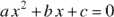

其中`a`、`b`和`c`表示实数系数。该多项式及其解（即求根）在第 2.8 节的题 4 中出现过。然而，在本节中，我们主要感兴趣的是方程的面向对象的表示；求解是一个次要问题。在第 3.15 节中，我们创建了实现简单矩阵的`EMatrix`结构体。我们注意到 C++ 结构体中，`EMatrix`可以包含数据以及处理数据的函数。然而，`EMatrix`对所有数据和函数资源允许开放访问。这种行为在某些情况下是合理的，但通常并不是理想的。首先，对数据的无限制访问使其容易受到外部对象的操控。其次，结构体可以包含函数，这些函数一旦实现，应该只在该结构体内部调用。为了满足这些需求，面向对象的技术被用于软件设计和实现。其主要范式之一是成员封装，将在第 4.1 节中进一步介绍。

### 3.16.1 表示二次多项式的类的定义

设计和实现类没有唯一的最佳方法。第一步是识别类的主要角色，并选择其数据和成员函数。但在编程中，许多方法都是可能的，还有各种风格、模式、命名规范以及多年经验积累的细微差别。尽管如此，在许多情况下，可以区分类的特征部分，例如 Table 3.11 所示的`TQuadEq`类。

| **类成员** | **描述** | **示例** |

| :--- | :--- | :--- |

| 类数据成员 | 数据成员是聚合在类中的对象。可以是之前介绍的任何类型。数据成员可以是可变的或不可变的（常量）对象。类数据成员通常通过将其放在`private`区域来隐藏，防止不受控的访问。 | |

```cpp
 1   #include <iostream>
 2   #include <cassert>
 3
4
 5   ///////////////////////////////////////////////////////////
 // 此类实现了如下形式的二次方程：
 //
 // a*x*x + b*x + c = 0
 // 
///////////////////////////////////////////////////////////
class TQuadEq
{
    private:
    
        double fa {}, fb {}, fc {}; // 方程的系数
```

在第[1–2]行，包含了两个头文件：`iostream`用于输入/输出层次结构，`cassert`用于`assert`宏。类定义从第[11]行开始。在第[13]行上，开启了类的`private`区域，随后定义了三个数据成员`fa`、`fb`和`fc`，它们分别对应二次方程的系数，并使用`{}`将其初始化为零。

| 默认构造函数 | 一个与类名相同且没有输入参数的函数：`X::X( void )` | 在创建对象时调用一次。它的作用是初始化`this`对象。 | 紧跟在冒号`:`之后且构造函数体之前的特殊部分是`成员数据初始化列表`。在这里会调用数据成员对象的构造函数。 |

```cpp
 17      public:
19

          // 类默认构造函数 
20        TQuadEq( void ) : fa( 0.0 ), fb( 0.0 ), fc( 0.0 )
21        {}
22 
```

在第[17]行，开启了`public`区域以进入第[20]行的类默认构造函数。它是函数`TQuadEq`，与类名相同。作为一个默认构造函数，它不接受任何参数，如`void`关键字所示。同样，像任何构造函数一样，它不返回对象或`void`。

这个构造函数非常重要，允许例如在数组中初始化对象。在参数列表右括号之后，冒号`:`引入了`成员数据初始化器`。由于`TQuadEq`对象是由三个其他对象`fa`、`fb`和`fc`组成的，它们通过通过各自各自的构造函数进行初始化：`fa( 0.0 )`等。这种初始化方式优于在构造函数体内初始化。最后，构造函数的空体位于第[21]行。

如果没有显式编写，默认构造函数将由编译器自动生成。我们在这里必须显式编写它，因为带有参数的构造体会抑制自动生成机制。

| 参数构造函数 | 一个与类名相同且带有输入参数的函数：`X::X( type_list )` | 在创建对象时调用一次。它的作用是使用来自`type_list`的对象初始化`this`对象。 |

```cpp
 23          // 类参数构造函数 
24        TQuadEq( double a, double b, double c )
25            : fa( a ), fb( b ), fc( c )
26            {}
27 
```

`TQuadEq`的第二个构造函数定义在第[24–26]行。这是一个参数构造函数，因为它接受三个参数`a`、`b`和`c`。这些参数用于初始化类数据成员`fa`、`fb`和`fc`。初始化在第[25]行的构造函数初始化列表中完成。由于数据已经初始化，第[26]行的构造函数体是空的。

| Getter / setter | 一组用于读取和写入类中（通常是私有的）数据成员的函数。 |

```cpp
 28      public:
30

          // Getter & setter
31        double Get_a( void ) const { return fa; }
32        double Get_b( void ) const { return fb; }
33        double Get_c( void ) const { return fb; }
34

36          void Set_a( double a ) { fa = a; }
37          void Set_b( double b ) { fb = b; }
38          void Set_c( double c ) { fc = c; }
39 

Getter 是用于读取类中（通常是私有的）数据成员的函数。在`TEq`类中，在第[31–33]行定义了此类函数来读取`fa`、`fb`和`fc`。此外，这些函数带有`const`表示不会改变对象的状态。同样，第[36–38]行定义了三个 setter，用于设置这些成员的值。这些 setter 位于类的`public`区域，因此可以改变对象的状态。

| 类接口 | 位于类`public`区域的函数被称为类接口。它们提供了调用对象的功能。 |

```cpp

40    public:

41

          // 计算判别式的辅助函数；

42      // 这是一个内联函数（类定义）

43      double ComputeDelta( void ) const { return fb * fb - 4.0 * fa * fc; }

44

45      // 使用作用域枚举为类定义某些常量

46      enum class EEqType { kNone, kOne, kTwo, kLinOne, kLinContra };

47

48    ///////////////////////////////////////////////////////////

49    // 此函数检查方程类型

50    ///////////////////////////////////////////////////////////

51    // 输入:

52      delta

53

54    // 输出:

55      // 方程的确切类型

56      // 由 f_a, f_b, f_c 表示

57

58    // 备注:

59      // 问题分析与

60      // 问题求解的分离

61

62      EEqType GetNumOfRoots( const double delta ) const;

63

64    ///////////////////////////////////////////////////////////

65    // 此函数计算方程的根，

66    // 如果可能的话。

67    ///////////////////////////////////////////////////////////

68

69    // 输入:

70      // theRoot_1 - 指向对象的引用

71      // theRoot_2 - 指向对象的引用

72

73    // 输出:

74      // 方程的状态（根的数量）

75

76    // 备注:

77      // 在上述其他情况外，

78      // 由 theRoot_1 和 theRoot_2 引用的值是未定义的。

79

80    //

81      EEqType GetRoots( double & theRoot_1, double & theRoot_2 ) const;

82

83};

```

类定义的第[40–88]行包含了`TEq`类的特定成员函数。在第[64]行声明的函数`GetNumOfRoots`返回方程类型。在第[86]行声明了`GetRoots`，用于计算二次方程的根。两者都定义在类定义之外。

| 输入/输出重载运算符 | 大多数 C++ 运算符都可以重载（见第 4.4 节）。这归结为编写一个运算符函数，为给定的类定义特定的行为。 | 重载运算符函数可以是类的成员函数，也可以是该类的外部函数。 |

```cpp

 89         //////////////////////////////////////////////////////////

 90         // 输入/输出操作 (外部函数)

 91         std::ostream & operator << ( std::ostream & o, const TQuadEq & equation );


92         `std::istream & operator >> ( std::istream & i, TQuadEq & equation );`

在 [91–92] 行，在类定义之外声明了重载的流输入和输出运算符。它们允许我们将 `TQuadEq` 对象写入或从 `iostream` 层次结构中的任何流对象读取，例如键盘、屏幕或文件。它们的完整定义位于源文件中。

## 表 3.11 `TQuadEq` 类的组织结构（在 *QuadEq*，*QuadEq.h* 中）

关于类的安排及其组件角色的更详细讨论请参阅第 4.2 节。然而，尽管 `TQuadEq` 非常简单，但它和后续的类可以作为编写代码的模式。完整的代码可以通过组合表 3.11 中的所有代码片段来获得，整个项目可以从书的网页上下载（Cyganek 2018）。

### 3.16.2 *TQuadEq* 成员实现

正如我们在上一节中看到的，头文件包含了 `TQuadEq` 类的完整定义。然而，这并不意味着该类已经完全实现并完成。对于较长的成员函数，为了节省空间，通用的做法是在类定义中只放置函数声明；它们的实现被放在源文件中，如图 3.23 所示。在这种情况下，由于定义在类作用域之外，类组件的名称需要加上类名和作用域解析运算符 `::`（*第 1 组*，表 3.15），其语法如图 2.8 所示。

列表 3.26 包含了 `TQuadEq` 成员的定义以及相关的流函数，这些内容摘自 *QuadEq* *.cpp* 文件，如图 3.23 所示。

首先，在 [1] 行，包含了 *QuadEq.h* 头文件以创建一个包含所有必要定义的完整编译单元。注意，由于 *QuadEq.h* 是用户创建的头文件，它需要用引号 `""` 而不是 `<>`，因为后者用于系统头文件（附录 A.1）。随后是包含了 *cmath*，其中使用了 `std::sqrt` 函数。函数的操作在代码的注释行中进行了解释。在开发项目时，始终要保持源文件的自解释性。

`GetNumOfRoots` 函数返回一个 `EEqType` 类型的常量，表示二次方程的类型，包括适用时的根的数量。注意，两个标识符前面都带有类名和作用域运算符，即 `TQuadEq::`。

`GetRoots` 定义在 [56] 行，返回方程的类型以及它的根或多个根，取决于在 [58] 行计算的判别值。根据该值，在 [60] 行由 `GetNumOfRoots` 函数返回根的数量。在 [62] 行，定义了一个阈值，将用于验证除法的可行性。[65] 行的 `switch` 语句决定了处理方法。例如，如果方程不是二次方程（如 [67–68] 行检查的那样），函数将直接退出。注意，两个 `case` 以相同的方式进行处理，因为它们之间没有 `break`。同样，在 [84, 86] 行检查的两个情况也以相同的方式进行处理。两个根根据公式 (2.6) 计算。注意，在 [97] 行，在进行除法之前检查了分母。如果它小于预定义的阈值，则会在 [98] 行抛出一个异常。如果发生了这种情况，则应该捕获抛出的 `std::overflow_error` 对象，如第 3.13.2.5 节所示。然而，如果除数足够大，则计算两个根。最后，尽管 `switch` 中没有其他选项，但包含 `default` 分支是一种编码习惯，如 [106] 行所示。在我们的实现中，它只包含 `assert`。

让我们简要总结一下错误处理的方法：

1. `assert` 在调试版本中激活（第 3.15 节）。在发布版本中，`assert` 未激活。
2. 如果我们预计某些条件无法满足，我们使用 `if` 结构。
3. 作为最后的手段，为了处理意外错误，可以使用 `throw` 和 `try-catch` 语句。

在 `GetRoots` 函数中，我们拥有所有方法。流运算符位于 `TQuadEq` 类之外。*流插入运算符*——即定义在 [118] 行的重载 `<<`——非常直接：它只是输出 `eq` 对象的所有数据成员。*流提取运算符*——即重载 `>>`——稍微复杂。它的定义从 [124] 行开始。开始时，需要创建一个单独变量 `tmp`，如 [126] 行所示。然后它用于捕获来自输入的连续值。它们被用于初始化输出对象 `eq`。注意，这两个运算符需要保持兼容：必须实现相同的写入和读取格式，以便完全检索流出的对象。注意这两个运算符都返回其流对象（第一个参数），以便允许运算符链。

### 3.16.3 *QuadEq* 的实际运行

*main.cpp* 源文件包含 `main` 函数。它实现了一个简单的应用程序，从键盘读取二次方程的系数，检查其类型，并在可能的情况下计算方程的根。最后，结果显示在屏幕上。所有计算都使用 `TQuadEq` 对象完成，如列表 3.27 所示。在 [1] 行包含了 *iostream* 头文件，随后是 *QuadEq* *.h*。这使得 `TQuadEq` 被引入了 `main` 的作用范围内。

在第 [4] 行，`using` 指令将常用的 IO 对象引入作用域。正因如此，我们不需要编写 `std::cout`，而只需编写 `cout`，以此类推。`main` 函数的定义从第 [7] 行开始。注意，在 C++ 中，我们可以选择重载版本的 `main` —— 在此示例中，我们选择了不接受任何参数但返回整数的那个，整数可以传递错误代码。关于 `main` 各种版本的更详细讨论请参见 A.2.2 节。

在第 [10–15] 行，创建了一个辅助文本数组，它反映了 `TQuadEq` 中定义的 `EEquationType` 常量的顺序。它将作为应用程序的一个非常简单的用户界面。在第 [18–19] 行，通过标准库中的 `cin` 对象从键盘读取了三个系数。这些系数在第 [21] 行被用于初始化 `TQuadEq` 对象 `qe`。在第 [29] 行，从 `qe` 对象调用了公共成员函数 `GetRoots`，该函数评估方程的类型并计算根（如果有的话）。

由于如前所述，第 [29] 行可能会抛出异常，因此第 [27, 31] 行使用了 `try-catch` 语句。如果捕获到异常，会在第 [33] 行打印错误信息，并在第 [34] 行带错误代码安全退出函数。

在第 [38] 行，打印了用户的文本。在第 [41–54] 行的 `switch` 语句中检查方程类型后，会输出额外信息。

构建并运行 `QuadEq` 应用后，观察到以下输出：

注意，三个示例系数是在同一行输入的，并用空格隔开。

## 3.17 示例项目 —— 使用元组和结构化绑定转换罗马数字

在这个示例中，我们将开发一个 C++ 程序将十进制数转换为罗马数字。除了罗马数字计数法外，我们还将学习以下 C++ 技术：

1. `std::tuple`：用于各种类型对象的辅助集合
2. 带有 `std::tuple<int, string>` 的 `vector` 容器，以及如何使用初始化列表对其进行初始化
3. 用于访问元组字段的结构化绑定机制
4. 使用随机数库

罗马数字是古罗马发明的一种系统的一部分（Wiki:Roman_numerals 2020）。尽管它们现在并不流行，但在某些国家罗马数字仍被使用，例如用于表示日期中的月份。以下 10 个数字构成了罗马系统的基础：

| 1 | 2 | 3 | 4 | 5 | 6 | 7 | 8 | 9 | 10 |
| :--- | :--- | :--- | :--- | :--- | :--- | :--- | :--- | :--- | :--- |
| I | II | III | IV | V | VI | VII | VIII | IX | X |

上行是我们十进制系统中使用的阿拉伯数字符号。下行是对应的罗马数字。有加法数字，例如 `III`，由 `I + I + I` 组成；以及 `VII`，由 `V + I + I` 组成。其他数字以减法形式表示：例如，`IV` 表示 `V – I`，对应 `5 – 1 = 4`。这是为了避免像 `IIII` 和 `VIIII` 这样令人混乱的结构。因此，在任何罗马数字中，给定的符号出现次数不超过三次。总结来说，我们有三个不同的符号和五种不同的符号设置。剩余的五种设置通过添加 `I` 的倍数获得。

在这个示例中，我们将开发一个将十进制值转换为罗马数字的过程。为了这个目的，让我们用所有的罗马数字补充之前的表格，如下所示：

| XL | L | XC | C | CD | D | CM | M |
| :--- | :--- | :--- | :--- | :--- | :--- | :--- | :--- |
| 40 | 50 | 90 | 100 | 400 | 500 | 900 | 1000 |

除了新符号 `L`、`C`、`D`、`M` 外，我们再次看到了减法数字：`XL` 代表 40，`XC` 代表 90，`CD` 代表 400，`CM` 代表 900。在这个基础设置中，我们没有加法组合。因此，我们有 13 种不同的组合。转换算法很简单：类似于将数字如 1993 转换为十进制分量，我们需要做的只是找到数字中有多少个 1000，然后是剩余部分有多少个 100，然后有多少个 10，最后有多少个 1。罗马数字的过程类似，但使用的是之前表中所示的值。因此，我们检查数字中有多少个 1000，然后检查剩余部分是否包含 900，然后是 500，然后 400，以此类推直到 1。列表 3.28 中的 `ConvertDecimal_2_Roman` 函数使用现代 C++ 中的有用机制实现了这一想法。

在第 [9] 行，定义了函数 `ConvertDecimal_2_Roman`。它接受一个整数，将其转换为相应的罗马数字字符串。该函数的返回类型使用 `auto` 并在第 [29] 行推导出。在第 [12] 行，定义了 `vector`，包含了值和字符串的对。这些对定义为 `tuple<int, string>`。元组是一个较新的结构，与第 3.9 节讨论的 `struct` 相似。然而，元组在许多上下文中都是灵活且有效的。

在第 [25] 行，可以观察到一个有趣的构造：一个 `for` 循环（参见 13.2），它遍历所有的值字符串对。同时访问元组的一个或多个字段被称为*结构化绑定*（Filipek 2018）。注意为了访问 `[ val, str ]` 对，我们使用 `const auto &` 而不是简单的 `auto`。因此，使用了更安全的常量引用。

在同一迭代中，在第 [26–27] 行，如果 `in_dec_num` 的剩余值仍大于当前处理的罗马数字 `val`，则从 `in_dec_num` 中减去。在同一迭代中，相应的罗马数字（由 `str` 表示）被添加到 `outStr` 对象中。

### 3.17.1 关于 `std::tuple` 和结构化绑定的更多

在这里，让我们更仔细地看看什么是*元组*，以及它们在编程中有什么用。元组是有序的对象集合，这些对象可以是相同类型或不同类型。在这方面，它们的功能与第 3.9 节讨论的 `struct`（以及 `class`）相似。元组是语言新添加的构造，更加简单且有特定的应用。另一方面，`struct` 和 `class` 在面向对象编程的范围内具有更丰富的功能。

添加以下行有助于在代码中使用 `std::tuple`：

由于 `struct` 是语言内置的构造，它不需要任何头文件。

Listing 3.29 显示了一个实用的比较。第 [3] 行创建了一个元组 `t_date`：它的作用是存储一个日期。为了这个目的，它包含三个成员：(i) 一个表示日的 `int`，(ii) 一个表示月份名称的 `std::string`，以及 (iii) 一个用于持有年份的 `int`。当 `t_date` 创建时，它的成员被初始化为值 27、"June" 和 2019。然而，一种更快速的创建和初始化元组的方法是使用 `make_tuple` 辅助函数，如第 [6] 行所示。

我们可以通过创建一个 `tuple_size` 模板（用元组类型进行初始化）来读取元组中的元素数量，如第 [10] 行所示。为了获取类型，使用了 `decltype`，正如第 3.7 节中讨论的。然而，更频繁的需求是访问每个元素。这可以通过 `get` 模板函数来实现，提供元素的索引作为其模板参数。因此，在第 [13–15] 行，我们访问并显示了 `t_date` 的所有成员。注意，`get` 是一个外部函数，而不是 `std::tuple` 的成员。

我们也可以使用结构化绑定（之前讨论过）来访问元组的所有成员，如第 [19] 行所示。另一种访问元素的方法是调用外部函数 `tie`。这次，我们只访问选定的字段，并将所有其他字段标记为 `ignore`。通过这种方式，在第 [29] 行，只读取了日和月份。

如果元组有更多对象，那么通过索引访问它们可能会导致混淆。在我们的案例中，第一个和最后一个元素是相同类型：`int`。因此，在第 [3] 行编写 `t_date( 2019, "June", 27)` 可能会将日与年份混淆，因为这里假设了字段语义。

一个类似的数据结构（这次通过 `struct` 获取）显示在 Listing 3.29 的右面板中。无名 `struct` 的定义始于第 [2] 行。然后，在第 [5–7] 行，定义了结构的数据成员 `fDay`、`fMonth` 和 `fYear`。与元组不同，这些成员只能通过提供对象名称后接点运算符（*GROUP 2*，Table 3.15）以及成员名称来访问。然后，在第 [8] 行创建了 `s_date` 对象。它的成员已经根据定义中提供的默认值进行了初始化。`s_date` 的数据成员被访问并打印到屏幕上，如第 [14–15] 行所示。有趣的是，结构绑定也适用于 `struct`，如第 [19–22] 行所示。

所以，我们什么时候应该使用 `std::tuple`，什么时候应该使用 `struct` 呢？这里是一些提示。

在以下情况下使用 `std::tuple`：
1. 需要一个包含几个潜在不同类型数据对象的集合。存储过多对象可能会导致混淆，因为它们的含义（语义）基于它们在序列中的位置。
2. 不对数据成员的命名有要求。
3. 对于所有权访问元组的对象来说，所有元素都是同等可访问的。
4. 我们想要从函数返回多个对象（参见第 7.4.8 节）。

在以下情况下使用 `struct` (`class`):
1. 需要一个包含潜在不同类型数据对象的集合。
2. 数据成员对象需要通过其名称轻松识别（强语义）。
3. 需要为成员分配访问权限（例如 `private`、`public`；参见第 4.3 节）。
4. 期望有成员函数。
5. 期望有继承。

但一如既往，某些情况下两者都是同样选择。如果对象是相同类型，也可以考虑 `std::vector` 或 `std::array`。

### 3.17.2 如何编写软件单元测试

比编写代码更重要的是确保代码按照我们预期的方式执行。即使对于短函数，这可能是一项枯燥的任务，更不用说由多年编写的几十个库组成的巨型软件系统了。我们如何才能更接近确定我们的软件运行正常？一种方法是使用单元测试——嵌入在软件测试框架中的测试函数，这些函数运行并验证相应软件组件的正确性。有些团队甚至在编写任何业务代码之前就开始从单元测试开始编写代码。关于软件测试的更多信息请参见附录 A.7。在本节中，我们将为我们的罗马数字转换器编写一个简单的测试函数；参见 Listing 3.30。

`ConvertDecimal_2_Roman_UnitTest` 检查进制值的数量，并使用 `assert` 将 `ConvertDecimal_2_Roman` 函数的输出与相应的罗马数字进行比较。所有必须通过才能返回 true。否则，`assert` 会触发并停止执行。在实践中，更微妙的行为可能更有用，例如日志文件条目。

### 3.17.3 单元测试自动化 —— 使用标准随机数库

在上一节中，我们展示了简单的单元测试。问题仍然是，多少测试才足够？通常情况下，我们无法检查所有可能的设置。在实践中，随机选择的值或边界条件可以选项。在本节中，我们将学习：
1. 在给定范围内生成均匀分布的随机整数
2. 罗马数字与进制转换的自动化测试

对于年份，曾使用 `rand` 和 `seed` 函数来生成随机整数。这在简单应用程序中是可以的，但在许多情况下生成的值并非真正的“随机”。自 C++11 起，提供了一个高级库来生成随机数（Stroustrup 2013）。借助这种设施，Listing 3.31 显示了如何创建均匀分布的随机整数。

要创建一个随机序列，需要三个要素：一个初始化对象、一个随机引擎和一个随机分布，如图 3.25 所示。

```
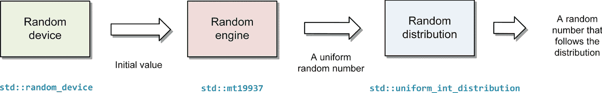
```


### 图 3.25：给定范围内生成随机数的 C++ 链

此示例使用了梅森旋转算法随机引擎 `mt1937`。为了执行工作，它需要被正确初始化。为了这个目的，在第 `[17]` 行创建了一个 `random_device` 对象，然后将其调用 `mtRandomEngine` 的构造函数。

在第 `[21]` 行，创建一个 `uniform_int_distribution` 对象。它将负责生成从 `kFrom` 到 `kTo` 范围内均匀（但尚未随机）分布的数字。该序列由第 `[19]` 行创建的随机引擎驱动。

在第 `[23]` 行，创建一个空的 `int` 向量。在第 `[27]` 行使用标准库的 `generate_n` 函数填充它。由于 `random_decimals` 是空的，因此使用了 `back_inserter` 函数来正确插入新的随机值。然而，`generate_n` 本身并不知道生成随机值。因此，在第 `[28]` 行提供了一个 lambda 函数，它带 `mtRandomEngine` 调用 `uni_distr`。

既然我们已经有了随机数，让我们研究如何实现十进制到罗马数字转换函数的测试过程自动化。最简单的方法是将每个随机数转换为罗马数字再转回十进制，并检查结果是否与原始值匹配。为了这样做，我们需要第二个转换函数，这次是从罗马数字转换为十进制。第一个版本可以草拟如下（其完整实现留作课后练习）：

这被应用于自动化的 `Decimal_2_Roman_Chain_UnitTest` 中。它接收每个随机生成的十进制值，将其转换为罗马数字，然后转换回十进制值，并比较结果：

到此为止，`Decimal_2_Roman_Chain_UnitTest` 中使用的所有编程技术都应该是清晰的。注意，在 `for` 循环中，调用了 `CreateRandomVector` 函数并返回一个包含随机值的临时对象，这些值被立即在循环中使用。这是一种常用技术，得益于移动语义（move semantics），它不会因为不必要的临时对象拷贝而产生巨大的计算开销。这将在第 4.6.4 节中进一步讨论。

到目前为止，我们已经编写了测试两个具体函数的测试函数。在实际的软件项目中，我们将面临几十个函数、类、组件、库等。因此，一个更通用的单元测试框架将非常有帮助。最流行的包括 Google Test (Google 2019)；Boost.Test (Rozental and Enficiaud 2019)；Catch2 (Catch Org 2019)；以及带有单元测试功能的最新 Microsoft Visual Studio（2019 年 8 月）。更多信息请参阅第 9.7 节。

## 3.18 示例项目 – 构建货币计算器组件

货币兑换是国际贸易中一种常见的财务操作。在这个示例中，我们将开发一个简单的程序来执行货币兑换。如图 2.4 中的软件开发图所示，让我们从指定需求开始。实际上，只有一个需求，而且非常简单：

1. 程序将允许我们根据从货币兑换机构获取的汇率，将一种货币的值兑换为另一种货币相应的价值。

如图 2.4 所示，在我们开始最喜欢的活动（编码）之前，我们需要分析问题并为解决该问题的步骤做准备。最重要的是，我们需要解释影响工作实现和结果的货币兑换机制细节。

### 3.18.1 货币兑换问题分析

我们如何着问题分析和设计？UML 再次提供了帮助，不仅是因为它的图表，还因为这些图表背后的方法论。在第 2.3 节中，我们讨论了 UML 活动图，它有助于可视化设计过程中后期动作或算法的步骤。但在开始阶段，最好关注用例（use cases）。为了促进这一设计阶段，UML 拥有用例图（use case diagrams）。它们通过人、对象等实体（称为参与者，actors）捕获系统中主要的行为模式（patterns of behavior）。因此，UML 用例图显示了系统中参与者与用例之间的关系。

图 3.26 显示了我们货币兑换系统的 UML 用例图。因为它非常简单，所以参与者和用例并不多。在更高级的项目，包含的细节越多越好。

正如预期的，在图 3.26 中，我们看到一个名为 `User` 的参与者，他可以购买或出售特定数量的货币。我们预计这两种情况可能有两种不同的兑换比例。`Admin` 参与者可以对系统进行更改，例如选择货币兑换机构并列出允许兑换的货币。此 UML 用例图将指导后续的设计阶段。但首先，让我们看看货币是如何命名和兑换的。

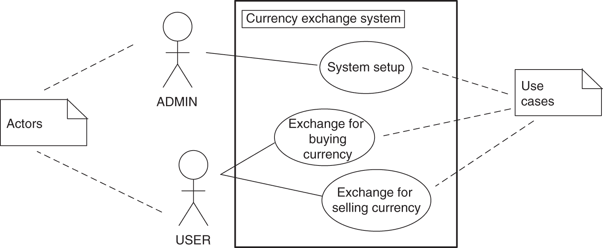

**图 3.26** `CurrencyCalc` 系统的 UML 用例图。构想了两个参与者：用户和管理员。用户可以购买或出售货币。管理员可以指定系统设置，例如提供汇率的参考银行。

为了货币兑换，各国银行和其他金融组织维护着货币列表及其汇率列表。示例列在表 3.12 和表 3.13 中。

| 国家 | 货币名称 | 银行买入 | 银行卖出 |
| :--- | :--- | :--- | :--- |
| 美国 | DOLLAR | 1.2520 | 1.3220 |
| 欧盟 | EURO | 1.4250 | 1.5380 |
| 英国 | POUND | 1.6165 | 1.7275 |
| 中国 | YUAN | 0.1685 | 0.2065 |
| 日本 | YEN | 0.0109 | 0.0116 |
| 澳大利亚 | DOLLAR | 0.8760 | 0.9495 |
| 瑞士 | FRANC | 1.2525 | 1.3465 |

来源：[www.nbc.c](https://www.nbc.c)。**表 3.12** 包含加拿大货币名称、缩写以及买入和卖出比例的电子表格。

| 货币名称 | 货币代码 | 买入 | 卖出比例 |
| :--- | :--- | :--- | :--- |
| dolar ameryanski | USD | 3.6987 | 3.7735 |
| dolar australijski | AUD | 2.6211 | 2.6741 |
| dolar kanadyjski | CAD | 2.8742 | 2.9322 |
| euro | EUR | 4.2602 | 4.3462 |

来源：[www.nbp.p](https://www.nbp.p)。**表 3.13** 包含波兰国家银行货币名称、缩写以及买入和卖出比例的电子表格。

总结来说，货币兑换表是一种简单的数据库。此类数据库中的每一行被称为一条记录（record）。为了唯一标识一条记录，它必须包含一个唯一键（unique key）。

为了设计我们的软件组件，我们需要识别基本功能以及数据结构。根据之前的问题分析，我们做出以下假设：

1. 程序将能够通过四个属性表示一种货币：货币代码、货币名称、货币买入比例和货币卖出比例，如表 3.13 中的行所示。
2. 汇率是相对于一个选定的单一参考货币的。
3. 货币将存储在本地数据库中。
4. 货币代码属性将用作键，用于唯一标识货币数据库中的货币记录。
5. 货币数据库可以被存储以供程序进一步初始化。
6. 将能够添加新货币，并查找和访问现有的货币。
7. 待兑换金额将根据参考货币进行计算。有两种选项：
   1. 购买货币
   2. 卖出货币

### 3.18.2 CurrencyCalc 软件设计

让我们继续开发我们货币汇换系统的基础构建块（参阅图 2.4）。货币记录将由一个名为 `TCurrency` 的类表示，该类将包含四个数据属性以及便于数据访问的函数。货币记录存储在货币数据库中。如前所述，每条记录将通过货币代码唯一标识。这种类似于字典的数据结构可以使用标准库（SL）中的 `std::map` 容器类高效地创建，如图 3.27 所示。


**图 3.27** 带有键和值的字典数据结构。为了唯一标识一个值，每个键必须是不同的。在我们的项目中，选择了三个字母的货币代码作为键。所有其他属性都表示为记录值。字典数据结构可以使用标准库中的 `std::map` 容器实现。

在之前的节中，我们使用了标准库中的类，例如 `std::vector` 和 `std::string`（第 2.6 节），或 `std::tuple`（第 3.17 节）。它们的功能以文本描述的形式提供，如表 3.4 所示。然而，在自顶向的设计中，在确定了主要参与者和用例之后、实现之前，系统的通用视图更具描述性。因此，在设计期间，我们不再使用文本描述，而是使用 UML 类图创建类及其关系的可视化，类图展示了最重要的内容以及类之间的主要关系。

UML 类图中的类由矩形表示，通常分为以下几个部分：

1. 类名 – 应清晰地传达该类的目的和主要功能。
2. 数据成员（在 UML 中称为属性）– 由标识符表示，并用冒号 `:` 与其类型隔开。
3. 成员函数（在 UML 中称为操作）– 由带有括号内属性列表的标识符表示，并用冒号 `:` 与返回类型隔开。

由于绘图空间的限制，通常只显示最重要的数据和函数成员及其最重要的部分。每个成员前面都有一个 `+`、`-` 或 `#` 描述符，分别代表公共（public）、私有（private）或受保护（protected）访问权限。这些将在第 4.3 节中进一步讨论，关于类关系和 UML 的更多细节将在第 4.9 节中介绍。

图 3.28 中的 UML 类图显示了 `TCurrency` 和 `TCurrencyExchangechanger` 类之间的关系。`TCurrency` 代表一个货币记录、代码和汇率。`TCurrencyExchangechanger` 聚合了货币记录。图 3.28 中的 UML 类图显示了 `TCurrency` 和 `TCurrencyExchangechanger` 类之间的关系。`TCurrency` 代表一个货币记录、代码和汇率。`TCurrencyExchangechanger` 聚合了货币记录。[图 3.28 中的 UML 类图显示了 `TCurrency` 和 `TCurrencyExchangechanger` 类之间的关系。`TCurrency` 代表一个货币记录、代码和汇率。`TCurrencyExchangechanger` 聚合了货币记录。]![带有键和值的字典数据结构示意图。为了唯一标识一个值，每个键必须是不同的。在我们的项目中，选择了三个字母的货币代码作为键。所有其他属性都表示为记录值。字典数据结构可以使用标准库中的 `std::map` 容器实现。(images/c03f027.png) 聚合了记录。(images/c03f027.png)

**图 3.27** 带有键和值的字典数据结构。为了唯一标识一个值，每个键必须是不同的……

我们准备好进入这些组件的实现细节。

### 3.18.3 表示货币记录的类

为了表示给定的货币，我们需要确定哪些类型最适合表示信息。由于我们需要处理 Unicode 字符，我们决定使用 `wstring` 类型，而不是 `std::string`。汇率将使用数值类型 `double`。

Listing 3.32 展示了 `Currency.h` 头文件的完整内容。第 1 行的预处理器指令 `#pragma once` 指示编译器在单元中仅包含此头文件（附录 A）。这是非常重要的，因为头文件可能会被多次包含导致错误。第 3-5 行包含了必要的头文件。第 10 行的 `using` 指令引入了 `wstring`，因此在使用 `wstring` 时可以省略 `std::` 命名空间。我们在第 3.14.6 节中讨论过引入其他命名空间的方法。示例中的所有类都嵌入在 `CppBook` 命名空间中，该命名空间在 `Currency.h` 的第 7 行打开。`TCurrency` 类定义从第 12 行开始。注意，与类定义不同，命名空间可以多次打开和关闭以包含连续的组件。第 25-28 行定义的类构造函数执行两个任务：一方面，它带有参数，用于初始化类私有部分定义的成员变量；另一方面，它提供了所有默认值，因此它也成为类的默认构造函数。类的其余部分在第 33-45 行包含 getter 和 setter 成员定义。

在类定义之外，第 49、51 行是 `TCurrency` 类的流运算符声明。注意，为了处理 Unicode `wstring` 对象，我们需要使用输入输出流的宽版本：`wistream` 和 `wostream` 类型。这些流运算符在 `Currency.cpp` 源文件中完全定义。

Listing 3.33 在第 3 行，再次打开 `CppBook` 命名空间以包含流运算符的定义。第 7-26 行的流插入运算符 `<<` 非常直观——所有的类数据对象按顺序输出，并用制表符隔开。第 15、16、17 行设置了 `std::fixed`、`std::setw` 和 `std::setprecision` 操纵符。这些指定了输出固定长度为 10 个字符，其中 4 个精度字符（即小数点后的数字个数）（表 3.14）。

在第 `[28–39]` 行定义的提取运算符必须与插入运算符保持兼容。首先，在第 `[30]` 行创建了一个临时的 `wstring` 对象，然后用于收集连续字符以构建 `wstring` 对象。随后通过调用 `SetCurrCode` 和 `SetCurrName` 设置这些值。数值值也执行了类似的操作。

表 3.14 展示了最常用的 C++ 输入/输出操纵符。使用它们时，在每个操作符之前加上 `std` 命名空间是重要的（旧的前缀 `ios` 可能会导致不同的行为）。

#### 3.18.3.1 C++ 输入/输出操纵符

输入和输出（IO）操作数据处理组件中最常见的操作。C++ 通过提供高效的 IO 类层次引发了一场革命（与 C 语言中的 IO 比较，请参考第 9.2.4 节）。正如我们在书中已经多次看到的，通过重载流插入 `<<` 和提取 `>>` 运算符，每个自定义的 `struct` 或 `class` 都可以轻松地附加到此 IO 层次结构中。我们越使用它们，就需要越特殊的格式。表 3.14 总结了大多数 C++ IO 操纵符（[`en.cppreference.com/w/cpp/io/manip`](https://en.cppreference.com/w/cpp/io/manip)）。使用这些对象，输入输出流按照规定的方式处理数据。C++ 更令人兴奋的是可以添加自己的操纵符（Stroustrup 2013）。一个示例是在 Section 7.3.4 中定义的自定义 `endl`，它允许我们一次插入多个行符。

| 输入/输出操纵符 | 描述 | 示例 |
| :--- | :--- | :--- |
| `setw` | 设置输出宽度（显示字符的总数，包括点）。 | |

```cpp
#include <iomanip>

double e = exp(1.0);    // e 值，默认精度为 6

cout << "[defaultfloat]         e = " << e << endl;

cout << "[sc]                e = " << std::scientific << e << endl;

cout << "[fx]                e = " << std::fixed << e << endl;

cout << "[p=4]               e = " << std::setprecision(4) << e << endl;

cout << "[w=10]              e = " << std::setw(10) << e << endl;

cout << "[fx][w=14][p=12]    e = " << std::fixed << std::setw(14)
     << std::setprecision(12) << e << endl;

cout << "[fil_][fx][w=10][p=4] e = " << std::setfill('_') << std::fixed
     << std::setw(10) << std::setprecision(4) << e << endl;
```

`Output:`

```text
[defaultfloat] e = 2.71828

[sc] e = 2.718282e+00

[fx] e = 2.718282

[p=4] e = 2.7183

[w=10] e = 2.7183

[fx][w=14][p=12] e = 2.718281828459

[fil_][fx][w=10][p=4] e = ____2.7183
```

| 输入/输出操纵符 | 描述 | 示例 |
| :--- | :--- | :--- |
| `precision` | 设置精度：<br>1. 在 `fixed` 或 `scientific` 模式下，这是小数点后的位数。<br>2. 在 `defaultfloat` 模式下，这是小数点前后的总位数。 | |
| `fixed` | 强制浮点数以不带指数的形式写入，且小数位数由 `precision` 设置。 | |
| `scientific` | 设置输出的科学计数法格式（例如 `-12e-36`）。 | |
| `defaultfloat` (C++11) | 以默认符号设置浮点数：即 `precision` 字段表示小数点前后的总位数。 | |
| `setfill`、`left`、`internal`、`right` | 允许我们在需要时设置填充字符以使输出达到宽度。使用 `left` 等设置符号位置。 | |
| `setbase` | 设置输出的基数（允许值为 8、10 和 16，或用 0 重置为十进制）。 | |

```cpp
cout << "100d = " << 100 << " dec" << endl;
```


```cpp
cout << "100d = " << std::hex << 100 << " hex" << endl;

cout << "100d = " << std::setbase( 8 ) << 100 << " oct" << endl;

cout << "100d = " << std::dec << 100 << " dec" << endl;
```

`Output:`

```text
100d = 100 dec

100d = 64 hex

100d = 144 oct

100d = 100 dec
```

| `dec`, `oct`, `hex` | 将输出基数设置为 10、8 或 16。 |
|---|---|

**表 3.14** C++ 输入/输出操纵符（在头文件 `<iomanip>`）。

### 3.18.4 用于货币转换的 `TCurrencyExchanger` 类

`FindCurrency` 函数如果在 `fCurrencyMap` 中存在 `TCurrency` 对象，则返回该对象。在第 [55] 行，使用了新版本的 `if` 语句（见章节 3.13.2.1）。如果通过其 `find` 成员在 `fCurrencyMap` 中找不到 `currency_code`，则迭代器 `pos` 将指向 map 的末尾，通过 `fCurrencyMap.end()` 传递。否则，如果找到了货币，则将其拷贝到 `outCurrency` 对象中 [57]。

最后，`AddCurrency` 向 `fCurrency Map` 中添加了一个 `TCurrency` 类型的新货币 `new_currency` 对象。它在第 [67] 行通过 map 的下标运算符插入，并提供了货币的键（key）。请注意，如果多次插入给定的键，则 `fCurrencyMap` 对象中将只保留最后一个。

### 3.18.5 汇总大成——完整的货币汇换程序

到目前为止，我们已经创建了各个部分，现在我们要把它们粘合在一起，形成完整的 `CurrencyExchanger` 程序组件，如图 3.29 所示的 UML 组件图所示。它将暴露一个公共访问的接口，该接口由多个函数组成，用于加载货币信息，随后用于货币汇换。

一个软件组件通常由一组类、函数、变量等组成，提供一个概念上一致的平台来执行定义良好的操作。它可以是一个库、模块或应用程序，例如 `CurrencyExchanger`，提供汇换货币所需的一切。关键角色由之前章节中描述的两个类 `TCurrency` 和 `TCurrencyExchanger` 承担。但我们需要额外的代码来粘合用户创建并使用 `TCurrencyExchanger` 所需的部分。对于这种“粘合代码”，创建另一个类是自然的——这多年来一直是“自然”的思维方式。然而，现代 C++ 提供了其他选项，例如命名空间（namespaces）。由于我们已经知道如何组合类，在本节中，我们将仔细观察如何使用命名空间来实现类似的功能。我们在章节 3.14.5 中应用了这种技术来解决函数命名问题。让我们仔细查看列表 3.36 中此任务的可能解决方案：`CurrExchanger` 命名空间及其包含的函数。

在第 [1–10] 行，包含了公共头文件以及我们自定义的 `CurrencyExchanger.h`。然后，来自 `CppBook` 和 `std` 命名空间的名称被引入作用域。

我们的 `CurrExchanger` 命名空间在第 [19] 行开启。正如我们所知，命名空间可以被分成不同的块。`CurrExchanger` 命名空间中的第一个对象是 `initDefaultFileName`，定义在第 [22] 行。它包含一个字符串，作为 `TCurrencyExchange` 对象初始化文件的默认名称。

第 [25] 行引入了一个有趣的新对象：`std::optional<TCurrencyExchanger>`，它将用于传递 `TCurrencyExchanger` 对象。`std::optional` 可以为空；换句话说，它允许我们传递关于不存在的对象的信息。如果由于某种原因无法创建 `TCurrencyExchanger`，这将非常有用；因此其名为 `optional`（可选的）。正如 C++ 中一样，有许多方法可以表达我们可能拥有或没有对象（章节 4.5.2）。然而，`std::optional` 在这方面是一个可行的新选项，并且符合面向对象（OO）规则。

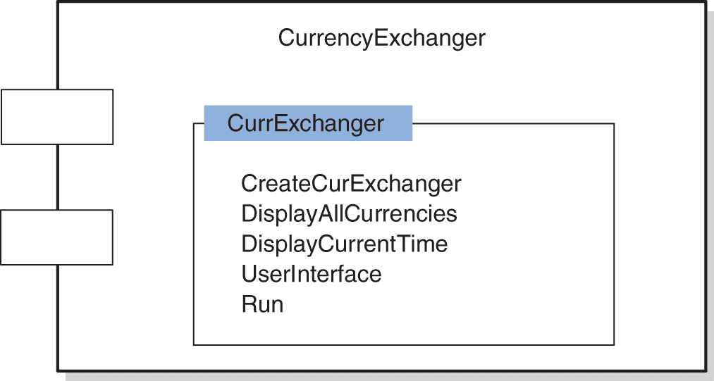

**图 3.29** `CurrencyExchanger` 组件的 UML 组件图。

第 [39] 行开始定义 `CreateCurExchanger` 函数。它的主要作用是创建 `TCurrencyExchanger` 对象。然而，它的正确创建需要存在一个包含正确格式货币和汇率数据的初始化文件。文件可能会发生各种情况，因此无法保证我们的初始化文件是否存在。因此，如果无法打开初始化文件，就无法正确创建 `TCurrencyExchanger`。为了指示这一点，在第 [44] 行返回一个空的 `CurrExch_Optional` 对象。如果我们在函数中继续执行到第 [44] 行之后，我们在第 [46] 行有很好的机会创建并在第 [49] 行初始化 `TCurrencyExchanger` 对象。在这种情况下，在第 [51] 行返回 `CurrExch_Optional`，这次持有一个有效的 `TCurrencyExchanger` 对象。

接下来的大多数函数都将 `TCurrencyExchanger` 对象作为参数。例如，定义在第 [53] 行的 `DisplayAllCurrencies` 显示作为其参数提供的 `TCurrencyExchanger` 对象中包含的所有货币。

第 [61] 行的一个有趣构造是使用结构化绑定（structured binding）来访问在第 [56] 行获得的 `cur_map`。我们在章节 [3.17] 中讨论过结构化绑定。

定义在第 [66] 行的 `DisplayCurrentTime` 的作用很简单：显示当前时间。

第 [68] 行为 `std::chrono::system_clock` 创建了别名 `timer`。在第 [69] 行调用 `timer::now` 获取当前时间，然后使用 `timer::time_t` 将其转换。

在第 [70] 行，通过调用 `time_str.begin()` 和 `time_str.end()` 将该 `string` 转换为 `wstring`。这是一种有限上下文下的简单变通方法；因此不能视为通用的字符转换器。

定义在第 [74] 行的 `UserInterface` 函数的作用与用户交互，让他们通过终端输入货币代码和数值进行汇换。

`UserInterface` 运行在从第 [79] 行开始的 `do-while` 循环中。在第 [81–96] 行设置了 `try-catch` 语句以拦截调用函数抛出的异常。其中之一是第 [91] 行调用的 `stod`，用于将 `string` 转换为 `double` 值。

第 [112] 行定义 `Run` 函数，接收 `TCurrencyExchanger` 对象。它简单地调用了我们见过的三个函数：`DisplayCurrentTime` [115]、`DisplayAllCurrencies` [118] 和 `UserInterface` [120]。

另一个重载函数 `Run` 定义在第 [123] 行。这次，它通过调用 `CreateCurExchanger` 在内部创建 `TCurrencyExchanger` 对象。正如我们所指出的，创建它需要一个初始化文件。该文件在第 [125] 行通过 `std::filesystem` [29] 以及在第 [127] 行创建 `iniPath` 来访问。（关于 C++ 文件系统的更多细节请见章节 6.2.7。）随后在第 [130] 行调用 `CreateCurExchanger`。如果返回有效对象，则在第 [132] 行调用 `Run`。否则，在第 [136] 行显示错误信息并程序终止。

最后，`main` 函数如下。第 [156] 行调用 `setmode` 函数设置终端的显示模式。这样做是为了正确处理 Unicode 字符。然后，在第 [157] 行调用 `CurrencyExchanger::Run`。最后，在第 [158] 行返回成功代码。

何时使用类（class）、何时使用命名空间（namespace）或两者兼用，这是一个开放性的问题，软件设计师们的意见不一。和通常一样，没有单一的答案或通用的配方，选择的方法取决于具体问题。在这种情况下，尝试预见给定组件的未来用例和调用上下文，并选择最自然、简单且通用的解决方案是有帮助的。通常，这是通过迭代方式实现的，在对第一个版本进行完善之后。编程的妙之处在于，同一个目标可以通过许多不同的方式实现，且往往产生不同的结果。这也是本节介绍的 `CurrencyExchanger` 背后的故事。另一种方法被留作了一个练习题。

在开发 `CurrencyCalc` 项目期间，我们学习了以下内容：

1. 创建带有构造函数的简单类以初始化数据。
2. 创建带有默认特殊成员函数和 `virtual` 析构函数的类，以备未来继承。
3. 使用 `std::map` 容器存储 `<key,value>` 键值对。
4. 在访问 `std::map` 元素时使用结构化绑定（structured bindings）。
5. 输入/输出：
   1. 重载 `operator <<` 和 `operator >>` 用于数据输出和输入。
   2. 流操纵符（stream manipulators）。
   3. 使用 `std::wstring`、`std::wcout`、`std::wifstream` 和 `std::wofstream` 对象使用宽字符（Unicode）。
   4. 使用 `std::filesystem` 中的文件元素读写文件。
6. 使用 `stod` 函数将 `std::wstring` 转换为 `double`。
7. 使用 `std::optional` 表示可选可用对象。
8. 使用 `try-catch` 语句。
9. 使用定义的命名空间创建软件组件。
10. 使用 `std::chrono::system_clock` 对象访问系统时间。

在第 6.2 节中我们将进一步扩展 `CurrencyCalc` 项目。

## 3.19 运算符

在本节的表格中，我们列出了所有的 C++ 运算符，按其优先级排序，并带有简短的解释和示例。请记住，在编写 C++ 程序时，并非所有运算符都同样重要。此外，某些运算符很少使用或已过时。对于某些运算符，将在后续章节中出现详细描述。为了完整性，还指出了 C 和 C++ 特有运算符之间的差异（附录 A.2）。

为了完全理解运算符的工作方式，我们需要定义 `l-value`（左值）和 `r-value`（右值）：

1. `l-value`——可用于赋值运算符（`=`）左侧的对象。也就是说，它必须是一个可以被赋值的对象。
2. `r-value`——赋值运算符右侧的对象。也就是说，它是一个作为值的对象。

下一个重要的概念是运算符优先级和结合性：

1. `Precedence`（优先级）——在评估表达式时，指示哪个操作应该在其他操作之前执行的规则。
2. `Associativity`（结合性）——当相同优先级的运算符之间存在选择时，选择第一个执行运算符的规则。大多数 C++ 运算符是左结合的，但元运算符和赋值运算符是右结合的。如果操作数处于相同优先级的运算符之间，必须检查结合性规则，例如在 `a + b - c` 中；参见图 3.30。在这种情况下，`b` 位于 `+` 和 `-` 之间，它们处于同一优先级组。两者都是左结合的，所以 `b` 首先被 `+`“取用”；因此先执行 `a + b`，然后从该结果中减去 `c`。因此，原始方程将被求值为 `(a + b) - c`。另一方面，右结合运算符的示例在图 3.31 所示。

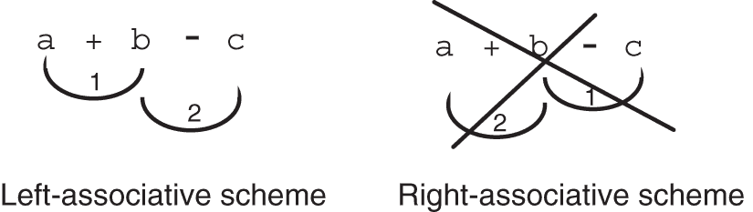

图 3.30 左结合（左）和右结合（右）表达式评估顺序示例。在 C++ 中，加法 `+` 和减法 − 运算符具有相同的优先级且是左结合的。因此，使用了左侧的评估顺序：操作数 `b` 首先被其左侧运算符 `+` 使用，并计算 `a + b`；然后将此操作的结果用于减法 − `c`。第二个结果是表达式的值。

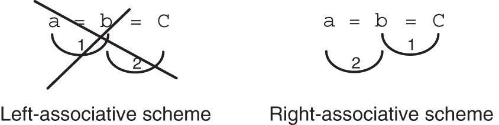

图 3.31 右结合赋值运算符示例。为了得到正确、直观的结果，首先将 `c` 赋值给 `b`，然后将 `b` 赋值给 `a`。让我们考虑以下示例：

```cpp
char* ptr = "The book";
first_letter = *ptr++;
```

在第一行中，`*` 不是运算符，因为在这一上下文中它左侧有一个类型名称；它们在一起意味着“指向 char 的指针”，我们命名为 `ptr`。`ptr` 是 `l-value`，因为它位于赋值运算符 `=` 的左侧。它的右侧是字符串字面量 `"The book"`，必须是 `r-value`，因为它不能被更改。更准确地说，文本被放置在程序的内存某处，而指向其起始部分的指针作为 `r-value` 使用，然后赋值给 `ptr`。

在示例的第二行中，由 `first_letter` 和 `ptr` 标识符指示两个对象。在这里，`first_letter` 作为 `l-value` 被赋值。我们这里有三个运算符：`=`、`*` 和 `++`。它们的评估顺序严格由它们在运算符层级中的级别定义，如表格所示。为了找到正确的优先级，首先让我们确定我们处理的哪些运算符，因为许多符号（例如 `*`）在不同上下文中含义完全不同。例如，`*` 在第一行中与 `char` 关键字一起，但 `*` 表示二元乘法运算符或元指针引用。在这个示例中，`*` 不在两个操作数之间。相反，`*` 在指针 `ptr` 前，所以它意味着指针引用。通过研究后续章节中的表格，我们可以很容易地发现它属于 `GROUP 3`（表 3.15）。

现在，让我们考虑递增一 `++` 运算符。它有两个版本——前缀（prefix）和后置（postfix），它们返回不同的值。在这里，`++` 在变量 `ptr` 后面，所以它是后置版本，属于 `GROUP 2`。那么，它是如何工作的？后置 `++` 增加指针值以指向下一个对象，在这种情况下是 `char`。因此，从现在开始，`ptr` 指向 `"The book"` 中的第二个字母。然而，`ptr++` 返回给其他表达式的值仍然是 `ptr` 的“旧值”。这就是后置 `++` 的行为。然后，对这个 `ptr` 的旧值执行 `*`，它仍然指向字母 *T*，而 `ptr` 的新值指向 *h*。最后，执行赋值，将 *T* 放入 `first_letter` 变量中。

现在让我们来分析下面的示例。有时，在创建图形用户界面时，我们需要设置滑块的初始值。它的位置由一个整数表示，我们希望将其设置为最大范围的 75% 左右。下面的几行示例代码实现了此任务。让我们考虑它们的作用，特别是在运算符优先级和结合性的语境下，同时也要考虑整数算术的领域：

```cpp
slider_position = 75 / 100 * slider_position;
slider_position = 75 * slider_position / 100;
slider_position = (75 * slider_position) / 100;
slider_position = static_cast<long>(0.75 * slider_position);
```

正如我们在第 [3] 行看到的，有三个运算符：一个赋值运算符，如我们所知，它的优先级较低，因此它将最后执行；以及两个算术运算符 `/` 和 `*`，它们恰好属于同一个优先级组（`GROUP 5`，表 3.15）。那么，第 [3] 行的右侧将如何解释？在这种情况下，我们需要考虑这两个运算符的左结合性。`/` 和 `*` 之间的值 `100` 将首先用于左侧操作：即首先评估 `75 / 100`，这在整数算术中等于 0。因此，第 [3] 行的结果可能不是我们想要的。简单地交换操作数的顺序（如第 [5] 行所示），会导致执行乘法 `75 * slider_position`，然后除以 `100`。在这种情况下，结果是 192。显式表达我们的意图总是更好的，例如第 [6] 行。这个示例展示了理解改变操作数顺序的结果有多重要，以及在整数算术中处理分数可能会出错。对于此类计算，应该考虑浮点类型，例如第 [7] 行所示。在这里我们也得到了预期的 192，但是以两次类型隐式转换为代价的（从 `long` 到 `double` 再从 `double` 到 `long`）。

让我们分析另一个代码片段，它看起来可能令人惊讶，特别是对于那些使用 Python 等语言编程的人来说。以下两行的结果是什么？

```cpp
b = 3, c = (b = 3, 4);
```

要回答这个问题，首先要查找的是第二行中运算符的优先级。逗号运算符 `,` 属于最低的组，`GROUP 16`（表 3.15）。来自 `GROUP 15` 的赋值运算符 `=` 优先级更高。因此，后者将先执行：变量 `b` 被赋值为 3。然后逗号表达式将从左到右评估，这在这种情况下没有影响。如果最后一行如下所示：

```cpp
b = 3, c = (b = 3, 4);
```


那么括号中的表达式将首先评估：`b` 将被赋值为 3（如之前一样），而按左到右执行的两个逗号运算符的结果将是右侧的值 4。因此，`c` 将赋值为 4。

### 3.19.1 C++ 运算符总结

给定组中的运算符具有相同的优先级（相同的层级水平）。标记为 `®` 的组包含右结合运算符。所有其他运算符都是左结合的。

| 运算符图例 | C++ | 仅限 C++ 的运算符（如果在表标题中，则该组中的所有运算符均为 C++ 特有；否则为 C/C++） |
| --- | --- | --- |
|  | C++11 | 从修订 11 版本起仅在 C++ 中 |
|  | `®` | 右结合运算符 |
|  | 颜色 | 算术、比较、位运算、逻辑 |

| 类别 | 描述 | 类别 | 描述 |
| --- | --- | --- | --- |
| `expr` | 一个表达式 | `capture_list` | 可能为空列表，表示 lambda 表达式的上下文依赖 |
| `expr_list` | 由逗号分隔的表达式列表；可以为空 | `type_list` | 可能为空的类型列表（逗号分隔） |
| `pointer` | 产生对象指针的表达式 | `statement_list` | 可能为空的语句列表 |
| `object` | 产生对象的表达式 | `type` | 有效的内置类型或用户定义类型的名称 |
| `member` | 表示类的成员（函数或数据） | `rvalue` | 可以在赋值运算符右侧使用的值 |
| `ptr_to_member` | 指向类成员函数的指针 | `lvalue` | 可以被赋值的对象（位于赋值运算符的左侧） |

关于 C++ 运算符的几点额外说明：

1. 大多数 C++ 运算符是可以被重载的（`overloaded`），即类可以包含自己的运算符版本，并具有自己的行为（章节 4.4）。例外是成员访问运算符 `.` 和 `.*`、`sizeof`、`typeid`、作用域解析 `::` 以及三元条件运算符 `?:`。
2. 从 C++ 11 开始，某些比较、逻辑和位运算符有了对应项：`!=` `not_eq`、`!` `not`、`&&` `and`、`||` `or`、`~` `compl`、`&` `bit_and`、`|` `bit_or`、`^` `bit_xor`、`&=` `and_eq`、`|=` `or_eq`、`^=` `xor_eq`。

#### GROUP 0

| 运算符 | 描述 | 示例 |
| --- | --- | --- |
| `(` `)` | 括号分组 | `(a + b)` |
| `[` `]` | 索引 | `a[i]` |
| `{` `}` | 代码块或列表 | `{1, 2, 3}` |
| `.` | 成员访问 | `obj.member` |
| `->` | 指针成员访问 | `ptr->member` |
| `::` | 作用域解析 | `Namespace::Class` |
| `*` | 指针声明或乘法 | `*p`, `a * b` |
| `&` | 引用或地址取 | `&ref`, `&var` |
| `++` `--` | 增、减 | `++i`, `--i` |
| `-` | 一元负或减法或否定 | `-a`, `a - b` |
| `+` | 一元加或加法 | `+a`, `a + b` |
| `/` `%` | 除法和取模 | `a / b`, `a % b` |
| `<<` `>>` | 左移和右移 | `a << 1`, `a >> 1` |
| `<` `<=` `>` | 小于、小于等于、大于 | `a < b` |
| `==` `!=` | 等于不等于 | `a == b`, `a != b` |
| `&` `|` `^` | 位与、位或、位异异 | `a & b`, `a | b`, `a ^ b` |
| `&&` `||` | 逻辑与和逻辑或 | `a && b`, `a || b` |
| `?` | 三元运算符 | `cond ? a : b` |
| `=` | 赋值 | `a = b` |
| `+=` `-=` `*=` `/=` `%=` `<<=` `>>=` `===` 等 | 复合赋值 | `a += b` |

#### GROUP 1

| 运算符 | 描述 | 示例 |
| --- | --- | --- |
| `? :` | 三元运算符 | `cond ? true : false` |

#### GROUP 2

| 运算符 | 描述 | 示例 |
| --- | --- | --- |
| `||` | 逻辑或 | `a || b` |

#### GROUP 3

| 运算符 | 描述 | 示例 |
| --- | --- | --- |
| `&&` | 逻辑与 | `a && b` |

#### GROUP 4

| 运算符 | 描述 | 示例 |
| --- | --- | --- |
| `==` `!=` | 等于不等于 | `a == b`, `a != b` |
| `<` `<=` `>` `>=` | 小于、小于等于、大于、大于等于 | `a < b` |
| `&` `|` `^` | 位与、位或、位异异 | `a & b`, `a | b`, `a ^ b` |

#### GROUP 5

| 运算符 | 描述 | 示例 |
| --- | --- | --- |
| `*` `/` `%` | 乘法、除法和取模 | `a * b`, `a / b`, `a % b` |
| `<<` `>>` | 左移和右移 | `a << 1`, `a >> 1` |

#### GROUP 6

| 运算符 | 描述 | 示例 |
| --- | --- | --- |
| `+` `-` | 加法和减法 | `a + b`, `a - b` |
| `.` `^` | 拼接和异异 | `a . b`, `a ^ b` |

#### GROUP 7

| 运算符 | 描述 | 示例 |
| --- | --- | --- |
| `++` `--` | 增、减 | `++i`, `--i` |
| `+` `-` `~` `!` | 一元加、负、取反和非 | `+a`, `-a`, `~a`, `!a` |

#### GROUP 8

| 运算符 | 描述 | 示例 |
| --- | --- | --- |
| `.` `->` `::` `[]` `()` `&` | 成员访问、指针成员访问、作用域解析、数组索引、函数调用和取地址 | `obj.member`, `ptr->member`, `NS::Class`, `arr[i]`, `func()`, `&var` |

#### GROUP 9

| 运算符 | 描述 | 示例 |
| --- | --- | --- |
| `capture_list` `type_list` `statement_list` | Lambda 表达式组件 | `={return x}` |

#### GROUP 10

| 运算符 | 描述 | 示例 |
| --- | --- | --- |
| `*` | 指针解引用 | `*p` |

#### GROUP 11

| 运算符 | 描述 | 示例 |
| --- | --- | --- |
| `sizeof` | 类型或对象的大小 | `sizeof(int)` |

#### GROUP 12

| 运算符 | 描述 | 示例 |
| --- | --- | --- |
| `typeid` | 类型识别 | `typeid(x)` |

#### GROUP 13

| 运算符 | 描述 | 示例 |
| --- | --- | --- |
| `static_cast` `dynamic_cast` `reinterpret_cast` `reinterpret_cast` `const_cast` | 转换 | `static_cast<int>(f)` |

#### GROUP 14

| 运算符 | 描述 | 示例 |
| --- | --- | --- |
| `?` | 三元运算符 | `cond ? a : b` |

#### GROUP 15

| 运算符 | 描述 | 示例 |
| --- | --- | --- |
| `=` `+=` `-=` `*=` `/=` `%=` `<<=` `>>=` `===` 等 | 复合赋值 | `a += b` |

#### GROUP 16

| 运算符 | 描述 | 示例 |
| --- | --- | --- |
| `,` | 逗号运算符 | `a, b` |

```cpp
// 用于存储分类器部分准确率的类（结构体）
struct Accuracy
{
    double fTP {}, fFP {}, fTN {}, fFN {}; // 真阳性、假阳性、真负性、等。
} a; // 让我们定义类 "Accuracy" 和对象 "a"

a.fTP++; // 访问并增加 fTP

// ...

Accuracy* ptr = &a; // 创建一个指针 ptr 并使其指向 a

ptr->fTP++; // 通过指针访问并增加 fTP

(&a)->fTP++; // 也可以这样操作
```

| 运算符 | 描述 |
| --- | --- |
| `pointer` `->` `member` | 通过指针进行成员选择（访问）。 |
| `pointer` `[` `expr` `]` | 下标运算符；允许访问数组中的对象。 |

```cpp
// 创建一个二维数组
const int kRows = 3, kCols = 4;

int table[kRows][kCols] = {
    {1, 2, 3, 4},
    {5, 6, 7, 8},
    {int {}} // 用“默认”int 填充最后一行 (=0)
};

double sum {}; // 默认 "double"，效果等于 sum = 0.0
```

让我们计算 `table` 中所有元素的平方根（`sqrt`）之和：

```cpp
for (int r = 0; r < kRows; ++r)
    for (int c = 0; c < kCols; ++c)
        sum += sqrt(double(table[r][c])); // 类型转换并调用 sqrt()
```

最后一行也可以使用指针解引用和旧式强制转换来写：

```cpp
sum += sqrt((double) *(*(table + r) + c)); // 也可以使用这种方式
```

在 C 中，变量只能通过赋值运算符 `=` 进行初始化。在 C++ 中，我们也可以使用列表表达式 `{}`。在 C++ 中，`int {}` 表示一个默认值为 0 的整数对象。表达式 `double(expr)` 表示类似于构造函数的类型转换。C/C++ 还有另一种形式为 `(double) expr` 的转换（旧式 C 风格）。

| 运算符 | 描述 |
| --- | --- |
| `lvalue` `++` | 后置递增（加 1）。`lvalue` 被保存后加 1，并返回保存的（原始）值。 |

```cpp
// 将字节从 src 拷贝到 dst 内存区域
void MemCopy(unsigned char* src, unsigned char* dst, int length)
{
    while (length > 0) // 拷贝 length 个字节。每次迭代 length 减 1
        *dst++ = *src++; // 拷贝字节，然后移动指针
}
```

循环恰好执行 `length` 次。计数器 `length` 首先受到后置递减运算符 `--` 的影响，该运算符保存未改变的 `length` 值，将其减 1 并返回保存的原始值。循环一直持续到 `length` 的值大于 0。在每次迭代中，指针 `dst` 和 `src` 都会通过后置递增运算符 `++` 增加。然而，在此发生之前，它们的原始值会被保存（在临时对象中），并返回给指针解引用运算符 `*`，因为后者的优先级低于后置 `++` 运算符。在最后一步，从 `src` 指向的位置读取一个右值，然后将其拷贝到 `dst` 指向的内存位置，并继续循环。

| 运算符 | 描述 |
| --- | --- |
| `lvalue` `--` | 后置递减（减 1）。`lvalue` 被保存后减 1，并返回保存的（原始）值。 |
| `typeid`(`expr`) (C++) | 运行时类型识别（RTTI）机制；另参见第 6.6.9.2。 |

```cpp
void workerFun(void); // 函数声明

try {
    workerFun(); // 调用某些操作；可能会抛出异常
}
catch (std::exception& e) // 捕获异常
{
    cerr << "Caught: " << e.what() << endl; // 查找是什么
    cerr << "Type: " << typeid(e).name() << endl; // 打印到错误流
}
catch (...)
{
    cerr << "Unknown error" << endl;
}
```

在这里，`workerFun` 是执行某些操作的函数，它可以使用 `throw` 运算符（GROUP 15）抛出异常。异常可以通过 `try-catch` 语句处理。

| 运算符 | 描述 |
| --- | --- |
| `expr` `(` `expr_list` `)` | 函数调用。 |
| `type` `(` `expr_list` `)` | 类型转换（函数式强制转换）。 |
| `type` `{` `expr_list` `}` (C++11) | 值构造。 |
| `static_cast` `<` `type` `>` (`expr`) (C++) | *编译时*检查的转换。`static_cast` 可用于相关类型之间的转换，例如同一层级中的指针或算术类型，以及通过构造函数和转换运算符进行的转换。转换在编译期间进行；如果不可行，则会产生编译器错误。 |
| `dynamic_cast` `<` `type` `>` (`expr`) (C++) | *运行时*检查的转换。`dynamic_cast` 可对层级内的指针和引用执行运行时转换。如果转换指针，则返回 `nullptr`；如果转换引用，则抛出 `std::bad_cast` 异常。 |
| `const_cast` `<` `type` `>` (`expr`) (C++) | `const` 类型转换。使用 `const`（或 `volatile`）进行类型转换。 |
| `typeid` `(` `expr` `)` (C++) | 类型识别。 |

```cpp
// 使用 FLTK 库创建主窗口
virtual int CreateGUI(void)
{
    Fl_Window main_win(100, 200, "SCUBA diving log");
    // 添加一些组件，如按钮、组合框...
    // 作为本地对象添加按钮
    Fl_Return_Button theButton(20, 20, 80, 20, "Action button");
    // 通过回调函数关联按钮操作
    theButton.callback(theButtonCallback, this);
    // 完成新组件的添加 ...
    return Fl::run(); // 显示主窗口和组件
}
};
```

之前 `SCUBA_Log_GUI_Creator` 类的片段展示了回调函数机制的示例，该机制嵌入了类成员函数，用于实现一个使用 FLTK 框架（FLTK 2019）。

| 运算符 | 描述 |
| --- | --- |
| `reinterpret_cast` | 未经检查的转换。`reinterpret_cast` 用于除前三种类型之外的所有类型转换。例如，它可以将整数转换为指针或反之。它等同于旧的强制转换风格。 |

### 第 3 组

| 运算符 | 描述 | 示例 |
| --- | --- | --- |
| `sizeof` `expr` | 返回对象大小（字节）的 `std::size_t`。在 C++ 中，操作数 `expr` 不会被求值，仅使用其类型来确定大小。 |

```cpp
int x = 5;
std::size_t dummy = sizeof x;
```

在最后一行之后，`dummy` 包含 `x` 以*字节*为单位的大小（例如在测试系统中为四个字节），且 `x` 的值不会改变（即使我们将 `x++` 传递给 `sizeof`，`x` 的值也不会改变，因为 `sizeof` 不求值其操作表达式——所以请注意此类错误！）。

对于数组，计算元素的常用方法是将总字节数除以第一个元素占据的字节数，如下代码所示：


```cpp
long arr[ 16 ]; // 包含 16 个长型整数的数组
// 计算数组元素个数的方法
assert( sizeof( arr ) / sizeof( arr[0] ) == 16 );

long * arr_ptr = arr;  // 指向 arr 第一个元素的指针

// sizeof( arr_ptr ) 返回指针本身的大小（不是数组！）
assert( sizeof( arr_ptr ) != sizeof( arr ) );

long ( & ref_arr )[ 16 ] = arr;    // 创建对 long [16] 的引用
// 引用返回数组的大小
assert( sizeof( ref_arr ) / sizeof( ref_arr[0] ) == 16 );
```

一个常见的错误是为该目的使用单一指针，因为在这种情况下，`sizeof` 将返回该指针的字节大小，如第二个 `assert` 所示。将引用赋值给数组可以完美工作——参见第三个 `assert`。

| 语法 | 描述 | 注意事项 |
| :--- | :--- | :--- |
| `sizeof(type)` | 返回提供类型的大小（字节）。 | 每个对象占据的字节数可以通过 `sizeof` 运算符查找。然而，为了满足硬件要求，不同大小的对象需要放置在对齐的内存地址上——这可以通过 `alignof` 运算符查找。在结构体中一起放置对象时我们必须考虑这一点，如下例所示：由于数据对齐，整个的大小可能大于其部分部分大小之和。 |

```cpp
// 内存布局不佳
struct NotTooGood
{
  char c {};
  double d {};
  int i {};
};

// 相同的信息但字节更少
struct BetterPacked
{
  double d {};
  int i {};
  char c {};
};

cout << "NotTooGood :\t" << sizeof( NotTooGood ) << " - "
     << alignof( NotTooGood ) << endl;
cout << "BetterPacked :\t" << sizeof( BetterPacked ) << " - "
     << alignof( BetterPacked ) << endl;
```

在测试计算机上，`NotTooGood` 的结果为 24-8，`BetterPacked` 为 16-8。也就是说，`NotTooGood` 需要 24 字节存储，而 `BetterPacked` 仅需 16 字节。但两者都是 8 字节对齐的（即它们的地址是 8 的倍数）。

| 语法 | 描述 | 注意事项 |
| :--- | :--- | :--- |
| `alignof(type)`（C++11） | 返回提供类型的对齐方式（字节）。例如，4 字节对齐意味着对象必须存储在 4 的倍数地址上（即地址的最后两位为 0）。 |
| `""expr""_expr`（C++11） | 用户自定义字面量。 | |

```cpp
// 用于编译时常量的 constexpr
constexpr long double kPi = 3.14159265358979328463;

// 用户自定义字面量将 _deg 转换为弧度
constexpr long double operator"" _deg( long double deg )
{
  return deg * kPi / 180.0;
}

void UserTypeConstant_Test( void )
{
  // cos() 期望弧度
  cout << "cos( 30_deg )=" << cos( 30_deg ) << endl;
}
```

用户自定义字面量允许我们为选择的类型自定义后缀。通过适当的转换或缩放，可以定义函数。例如，我们可以编写 `12_km + 8_m` 混合维度并仍然获得正确的结果。在上例中，使用 `_deg` 后缀，可以以度提供角度值，而不是三角函数期望的弧度。此外，在常量和函数前使用 `constexpr` 允许编译器在编译期间对其进行求值（Section 7.3）。

| 语法 | 描述 | 示例 |
| :--- | :--- | :--- |
| `- expr` | 一元负号。 | |

```cpp
double a {}, b {};
// ...
double p = -a; // 二元之前元
```

| `+ expr` | 一元加号。 | |
| `++ lvalue` | 前缀递增（11）。`lvalue` 增加 1，这是该表达式的值。等同于 `lvalue = lvalue + 1`。 | |

```cpp
// 从高地址拷贝内存
void BackwardMemCopy( unsigned char * dst, unsigned char * src, int num_of_bytes )
{
  src += num_of_bytes; // 源缓冲区增加地址
  dst += num_of_bytes; // 目标缓冲区增加地址

  while( num_of_bytes > 0 ) // 返回原始值后递减
    *dst = *src; // 递减后拷贝字节
}

// ...
const int kBytes = 256;
unsigned char source[ kBytes ];
unsigned char destination[ kBytes ];
// ...
BackwardMemCopy( &destination[ 0 ], &source[ 0 ], kBytes );
```

`BackwardMemCopy` 可用于拷贝重叠内存块，如果 `src < dst`。为此，拷贝从最高地址开始向下进行。字节通过 `while` 循环执行 `num_of_bytes` 次迭代进行拷贝。`dst` 和 `src` 指针受 `*` 和 `--` 运算符的影响，它们属于同一优先级组；由于它们是右结合的，`--` 先发生。结果是每个指针递减 1，并将新值返回给 `*`。在下一步，读取源字节并拷贝到 `dst` 当前值指向的内存位置。

调用 `BackwardMemCopy` 时，使用第一个元素的地址（`&destination[ 0 ]`）获取目标内存块的指针。通过写入 `destination` 获取相同的值，因为数组名指向其第一个元素的常量指针。

| 语法 | 描述 | 示例 |
| :--- | :--- | :--- |
| `-- lvalue` | 前缀递减（1）。`lvalue` 减少 1，这是该表达式的值。等同于 `lvalue = lvalue - 1`。 | |
| `& lvalue` | 对象的地址。 | |
| `* expr` | 解引用指针。 | |
| `~ expr` | 位取反（每个位改变：0→1 和 1→0）。 | |

```cpp
typedef short DATA_TYPE;

// 对于给定类型 kSignMask 仅在其 MSB 上为 1
const int kSignMask = 1 << 8 * sizeof( DATA_TYPE ) - 1;

// ~kSignMask 保持 MSB 以外的所有 1
// 适用于符号/值格式
DATA_TYPE DataValueAbs( DATA_TYPE value )
{
  return value & ~kSignMask;
}
```

| `! expr` | 逻辑非。 | |

```cpp
ifstream inputFile( "image.raw", ios::binary | ios::in );
if( !inputFile.is_open() )
  return; // 无法打开，退出 ...
```

| 语法 | 描述 | 注意事项 |
| :--- | :--- | :--- |
| `new type`（C++） | 创建对象——在自由存储（堆）上分配内存，并调用默认构造函数。 | `MiniMatrix` 类负责处理 2D 矩阵，它在构造函数和析构函数中使用 `new[]` 和 `delete[]` 运算符。分配的数据缓冲区始终是 1D 的，因此访问函数 `SetElem` 和 `GetElem` 需要根据两个坐标计算相应的索引。然而，在现代 C++ 中，建议使用智能指针作为 `new` 和 `delete` 的安全替代方案。内存分配的其他细节在第 5.3 节中讨论。 |
| `new type(expr-list)`（C++11）<br>`new type{expr-list}`（C++11） | 创建对象——在自由存储（堆）上分配内存，并用 `expr-list` 初始化。 | |
| `new(expr-list) type`（C++） | 创建对象——在提供的内存区域（`expr-list`）中分配内存，并调用默认构造函数。 | |
| `new(expr-list) type`（C++） | 每个 `new` 运算符都有一个类型为 `size_t` 的第一个参数，表示所分配对象的字节大小。 | |

```cpp
class MiniMatrix
{
  double * fData; // 数据缓冲区
  int fCol, fRow; // 维度

public:
  MiniMatrix( int col, int row ) : fCol( col ), fRow( row )
  {
    fData = new double[ col * row ]; // 分配缓冲区
  }

  ~MiniMatrix()
  {
    delete[] fData; // 释放内存
  }

  void SetElem( int c, int r, double v )
  {
    *( fData + r * fCol + c ) = v;
  }

  double GetElem( int c, int r )
  {
    return *( fData + r * fCol + c );
  }
};
```

`CommExcept_Handler` 是一个 `struct`，包含在嵌入式微处理器平台上处理通信异常的机器码。这段代码需要分配在由 `CommExcept_Addr` 给出的微处理器内存映射中特定且固定的地址区域内。带有位置地址的 `new` 运算符将完成工作，并将代码拷贝到指定的内存区域。

```cpp
struct CommExcept_Handler
{
  enum { kExcSize = 256 }; // 异常向量大小

  // 此处理器的汇编代码放在此处（仅为示例...
  const unsigned char asm_code[ kExcSize ] = {
    0x01, 0x02, 0x03, 0x04
  };
}; // 剩余部分用 0 填充

size_t CommExcept_Addr = 0x00000200; // 通信异常向量地址
                                      //（在微空间内）

// 在异常处理器中分配包含汇编代码的 CommExcept_Handler
void * CommExceptPtr =
  new( reinterpret_cast< void *>( CommExcept_Addr ) ) CommExcept_Handler;
```

```cpp
char * text = "The quick brown fox";

std::cout << text << " @ 0x";
std::cout.setf( std::ios::hex, std::ios::basefield );
std::cout << (size_t)text << " address.";
```

为了打印 `text` 的地址而不是 `text` 本身，我们需要将 `text` 强制类型转换为 `size_t`。这里使用了旧的 C 风格强制转换，它等同于 C++ 的 `reinterpret_cast`。我们还使用函数 `cout.setf` 设置 `std::ios::hex` 标志，以便进行十六进制显示。

| 语法 | 描述 | 注意事项 |
| :--- | :--- | :--- |
| `new(expr-list) type(expr-list)`（C++11）<br>`new(expr-list) type{expr-list}`（C++11） | 创建对象——在提供的内存区域（`expr-list`）中分配内存，并用第二个 `expr-list` 初始化。 | |
| `delete pointer`（C++） | 销毁由 `pointer` 指的对象——调用对象的析构函数并释放其内存。 | |
| `delete[] pointer`（C++） | 销毁由 `pointer` 指的对象数组——调用对象的析构函数并释放它们的内存。 | |
| `(type) expr` | 类型转换。用于通过值转换程序强制进行类型更改，这有时会导致数据丢失（例如将 `double` 转换为 `char`）。 | |

### 第 4 组

| 运算符（C++） | 描述 | 示例 |
| :--- | :--- | :--- |
| `object.*ptr_to_member` | 从对象选择类成员。 | |
| `pointer->ptr_to_member` | 从指针选择类成员。 | |
| `object.*ptr_to_member` | 从对象选择类成员。 | |

```cpp
// 一个按行优先或列优先数据组织数据的矩阵
template < typename T >
class OrdMatrixFor
{
  T * fData; // 数据缓冲区
  int fCol, fRow; // 维度

  T *( OrdMatrixFor::*data_offset )( int c, int r ); // 指向成员函数的指针

  // 用于内存访问的两种可选成员函数
  T * col_major_ind( int c, int r )
  {
    return fData + r * fCol + c;
  }

public:
  MiniMatrix( int col, int row ) : fCol( col ), fRow( row )
  {
    fData = new double[ col * row ]; // 分配缓冲区
  }

  ~MiniMatrix()
  {
    delete[] fData; // 释放内存
  }

  void SetElem( int c, int r, double v )
  {
    *( fData + r * fCol + c ) = v;
  }

  double GetElem( int c, int r )
  {
    return *( fData + r * fCol + c );
  }
};
```

将表达式向左移动一位会将其乘以 2，向右移动一位则除以 2。然而，避免对有符号整数使用 `<<` 和 `>>`，因为标准没有定义它们的行为，取决于计算机平台，它们可能是算术的也可能是逻辑的（参见第 7.2 节）。

| 运算符 | 描述 | 示例 |
| :--- | :--- | :--- |
| `expr_a >> expr_b` | 按位右移。将 `expr_a` 向右移动 `expr_b` 指定的位数。 |

### 第 8 组

| 运算符 | 描述 | 示例 |
| :--- | :--- | :--- |
| `expr < expr` | *小于* 比较。 | |

```cpp
float a = 2.0f, b = 10.0f, c = 4.0f; // 添加后缀 f 以定义浮点数常量
float delta = b * b - 4.0f * a * c;
float x1 = 0.0, x2 = 0.0; // 始终初始化变量

if( fabs( a ) > 1e-12f && delta >= 0.0f ) // 比 a != 0.0 更好
{
  float sq_delta = sqrt( delta );
  x1 = ( b - sq_delta ) / ( 2.0f * a );
  x2 = ( b + sq_delta ) / ( 2.0f * a );
}
```

| `expr <= expr` | *小于或等于* 比较。 | |
| `expr > expr` | *大于* 比较。 | |
| `expr >= expr` | *大于或等于* 比较。 | |

第一次比较确保了后续除以 `( 2.0f * a )` 是可行的。通常这是检查除零的正确方法，以避免数值不稳定，而不是使用 `a != 0.0f`。第二次比较 `delta >= 0.0f` 确保 `delta` 非负数，这样我们就可以调用标准数学库（*cmath*）中的 `sqrt` 函数来计算它的平方根。第二个条件**仅在**第一个条件的结果为 `true` 时才会被求值。后缀 `f` 显式地定义了一个 `float` 常量（否则假设为 `double`）。

### 第 9 组

| 运算符 | 描述 | 示例 |
| :--- | :--- | :--- |
| `expr == expr` | *等于* 比较。 | |

```cpp
char c = getchar();

if( c == 'Y' || c == 'y' ) // 运算符 == 的优先级高于 ||
{
  // 如果用户按了 'Y' 或 'y' 则继续...
}
```

| `expr != expr` | *不等于* 比较。 | |

### 第 10 组

| 运算符 | 描述 | 示例 |
| :--- | :--- | :--- |


| 运算符 | 描述 | 示例 |
| :--- | :--- | :--- |
| `expr & expr` | 按位与 | `1 & 1 → 1`<br>`0 & 1 → 0`<br>`1 & 0 → 0`<br>`0 & 0 → 0` |

```cpp
unsigned char bulb_control_register = 0xAB; // '1' 意味着“开启”，'0' 是“关闭”
unsigned char bulb_index = 3;               // 从右开始计数

// 关闭 bulb_index 处的灯泡
bulb_control_register = bulb_control_register & ~(1 << bulb_index); // 可以使用 &=
```

要关闭灯泡，我们需要将其对应的位设置为 0。为了这个目的，我们将 1 向左移动若干位，然后对所有位取反。结果标志位在相应位置恰好包含一个 0。在按位与操作之后，`bulb_control_register` 中对应的值位将变为 0。

### 第 11 组

| 运算符 | 描述 | 示例 |
| :--- | :--- | :--- |
| `expr ^ expr` | 按位异或 | `1 ^ 1 → 0`<br>`0 ^ 1 → 1`<br>`1 ^ 0 → 1`<br>`0 ^ 0 → 0` |

```cpp
unsigned char bulb_control_register = 0xAB; // '1' 意味着“开启”，'0' 是“关闭”
unsigned char bulb_index = 3;               // 从右开始计数

// 切换 bulb_index 处的灯泡状态：如果开启则关闭，反之亦然
bulb_control_register = bulb_control_register ^ (1 << bulb_index); // 可以使用 ^=
```

`^` 不是幂运算符。

### 第 12 组

| 运算符 | 描述 | 示例 |
| :--- | :--- | :--- |
| `expr \| expr` | 按位或 | `1 \| 1 → 1`<br>`0 \| 1 → 1`<br>`1 \| 0 → 1`<br>`0 \| 0 → 0` |

```cpp
unsigned char bulb_control_register = 0xAB; // '1' 意味着“开启”，'0' 是“关闭”
unsigned char bulb_index = 3;               // 从右开始计数

// 开启 bulb_index 处的灯泡
bulb_control_register = bulb_control_register | (1 << bulb_index); // 使用 |=
```

### 第 13 组

| 运算符 | 描述 | 示例 |
| :--- | :--- | :--- |
| `expr & expr` | 按位或 | `1 & 1 → 1`<br>`0 & 1 → 0`<br>`1 \| 0 →`  <0000000000 0       0 00000      |

要关闭灯泡，我们需要将其对应的位设置为 0。为了这个目的，我们将 1 向左移动若干位，然后对所有位取反。结果标志位在相应位置恰好包含一个 0。在按位与操作之后，`bulb_control_register` 中对应的值位将变为 0。

### 第 14 组

| 运算符 | 描述 | 示例 |
| :--- | :--- | :--- |
| `expr && expr` | 逻辑与。操作被视为 `true` 或 `false`（`true`/`false`）。在 `&&` 表达式中，`expr_1` 始终被求值；如果为 `false`，则 `expr_2` 不会被求值。这对于内置类型有效，自定义类型则会执行两个操作数。 | |

```cpp
double x;

const double kMin = 0.0, kMax = 1.0; // 定义范围常量

if (x >= kMin && x <= kMax) { // 检查 x 是否在范围内
```

```cpp
angle *= kPi;    // 等同于 angle * kPi
angle /= 180.0;  // 现在 angle 是弧度
```

### 第 15 组

| 运算符 | 描述 | 示例 |
| :--- | :--- | :--- |
| `expr_c ? expr_t : expr_n` | 三元条件表达式。`expr_c` 首先被求值。如果为 `true`，则返回 `expr_t`；否则返回 `expr_n`。它的赋值运算符的优先级较低。 | |

```cpp
double angle;
const double pi = 3.14159;

// 赋值
angle = (angle > 0) ? 1 : -1; // 根据符号赋值 1 或 -1
```

### 第 16 组

| 运算符 | 描述 | 示例 |
| :--- | :--- | :--- |
| `lvalue = expr` | 赋值。 | |

```cpp
int a;
a = 10; // 赋值 10 给 a
```

| 运算符 | 描述 |
| :--- | :--- |
| `lvalue ^= expr` | 按位异或并赋值。 |
| `{ expr_list }`（C++11） | 初始化列表。 |

```cpp
vector<string> words{"The", "quick", "brown", "fox"};
```

| 运算符 | 描述 |
| :--- | :--- |
| `throw expr` | 抛出一个异常对象以响应非典型的运行时条件。 |

```cpp
double x{}, y{}, z{};
const double kEpsilon = 1e-32;

if (fabs(y) > kEpsilon)
  z = x / y;
else
  throw std::overflow_error("Div by 0");
```

## 第 16 组

| 运算符 | 说明 |
| :--- | :--- |
| `expr_1, expr_2` | 逗号序列运算符，用于分隔表达式。它引入了一个*序列点*（sequence point），即保证从左到右顺序执行（先执行 `expr_1`，然后执行 `expr_2`）。返回最右侧表达式的值（即 `expr_2`）。（这不是函数参数列表中的逗号。） |

```cpp
// 将笛卡尔坐标 (x, y) 转换为极坐标（幅、角度）
bool Cart_2_Polar(const double& x, const double& y, double& mag, double& angle)
{
  // 将所有内容写在一行
  return fabs(x) > 1e-32 ? mag = sqrt(x * x + y * y), angle = arctan(y / x), true : false;
}
```

逗号运算符可以用于简洁的方式编写表达式，但这并不意味着是最可读的。`Cart_2_Polar` 将（`x`，`y`）笛卡尔坐标转换为极坐标（幅，角度）。在 `return` 语句中，使用了条件运算符 `?:`。如果输入变量 `x` 的绝对值足够大，则选择并求值第一个表达式（即 `?` 和 `:` 之间的表达式）。它包含两个逗号运算符，将整个表达式划分为三个子表达式。这些子表达式保证按*从左到右的顺序*进行求值。返回最右侧表达式的结果，在我们的案例中是 `true`。否则，返回 `false`，且 `mag` 和 `angle` 的值保持未定义。

### 3.19.2 运算符的进一步说明

注意不要假设子表达式具有任何特殊的*求值顺序*。例如，应该避免以下依赖关系：

`p` 的结果取决于 `f` 在 `g` 之前调用还是 `g` 在 `f` 之前调用，这在 C++ 标准中并未定义。另一方面，逻辑运算符 `&&`（*与*）和 `||`（*或*）以及 `,`（逗号）保证左侧操作在右侧操作*之前*执行。例如，保证在 `g` 之前调用函数 `f`。但对于内置类型，如果第一个操作数已求值为 `false`，则 `&&` 运算符的第二个操作数*不会*被求值（因为在这种情况下结果显然为 `false`）。同样，`||` 运算符的第二个操作数只有在第一个操作数返回*false*时才会被求值（这被称为*短路求值*）。这在访问对象之前检查空指针时特别有用，如下函数所示：

在此 `if` 语句中，首先检查指针 `p` 是否为空指针（在 C/C++ 中用 0 表示，在 C++11 中用 `nullptr` 表示）。如果是 `nullptr`，我们无法对其求解引用表达式 `*p`，因为这将抛出软件异常。然而，如果 `p` 是有效指针，我们检查 `p` 指向文本的首字母；如果它不是 0，我们返回 `true` 表示文本不为空。否则，我们返回 `false`。

由于这种短路求值特性*仅*针对内置类型保证，因此如果我们调用类的重载 `&&` 和 `||` 运算符，就不能依赖它。因此，如果我们确实需要重载这些运算符，应该谨慎地进行（第 4.4 节）。

根据预期类型对运算符进行分组，如下：

1. **算术** – 执行算术运算的操作符。如果我们使用不同类型的对象，则必须进行类型转换（此过程对于内置类型是自动的，但在许多情况下可能会导致值和精度的损失，因此应尽量避免）。

2. **比较** – 比较定义了比较运算符的对象的操作符。结果为 `true` 或 `false`，类型均为 `bool`。

3. **逻辑** – 对 `bool` 类型对象的操作。结果为 `true` 或 `false`，类型均为 `bool`。

4. **位运算** – 对整数类型的操作，例如（`unsigned`）`char`、`int`、`short` 和 `long`。这些操作按位进行。

在 C++ 中，操作符是可以被重载的：我们可以改变它们的含义以满足特定目的。请注意，与地址和指针解引用不同，位移运算符 `<<` 通常用于输出，如 `cout`。在 C++20 中，添加了宇宙飞船运算符 `<=>`。它的官方*三路比较*提供的功能比返回对象间关系（例如 `x` 和 `y`）的信息多得多，例如 `x == y`、`x < y` 或 `x > y`。

## 3.20 总结

### 问题与练习

1. 编写一个简单的程序，使用公式将华氏温度转换为摄度。编写并编译后，借助调试器验证其操作。

2. 使用 `std::accumulate` 重构 3.3 中的代码。使用 `auto` 重构列表 21 中的函数 `AskForData`。

4. 将以下 `for` 循环转换为：

   - 等效的 `while`
   - 等效的 `do-while`

5. 在 3.13.1 定义的 `FibonacciNumbers` 函数中将 `while` 循环重构为 `for`。

6. 编写一个函数将包含厘米单位的向量值转换为英寸。提示：使用表 3.6 中的 `transform`，并将 `fun` 设置为列表 16 中的 lambda。

7. 质数是指大于 1 且只能被 1 和自身整除的整数。因此，第一个质数是 2，第二个是 3，接下来是 5、7、11、13 等。寻找特定范围内所有质数的方法之一是*埃拉托尼筛法*（[`en.wikipedia.org/wiki/Sieve_of_Eratosthenes`](https://en.wikipedia.org/wiki/Sieve_of_Eratosthenes)）。

   首先，创建一个从 2 开始的连续值向量，并将所有值初始标记为“质数”。然后，从第一个标记值 2 开始，将其所有的倍数标记为“非质数”。然后找到下一个标记为质数的倍数并标记为“非质数”。当所有值都被访问后，算法停止。

   提示：考虑存储值和标记信息的数据结构，例如两个相同的 `std::vector<int>`，或者一个 `std::vector<std::tuple<int, bool>>`。我们需要存储偶数吗？验证您解决方案的正确性并测量其性能。

8. 为第 3.13.2.2 节中的 `RevertEndianness` 函数编写一个测试函数。

9. 循环冗余校验（CRC）可以用于为一组数据计算一种特殊的签名（[`en.wikipedia.org/wiki/Cyclic_redundancy_check`](https://en.wikipedia.org/wiki/Cyclic_redundancy_check)）。例如，它可以用于传输线路中的纠错，或验证数据的真实性。以下函数基于 `x`⁸ + `x`² + `x` + 1 CRC 多项式计算简单的 CRC 和：

   1. 编写一个函数，测试对包含随机生成字节的缓冲区进行 CRC 值计算。
   2. 将计算出的 CRC 值附加到缓冲区末尾并再次计算 CRC 后，结果将是什么？
   3. 在更改一个数据项中的单个位后，重复对缓冲区进行 CRC 计算。比较这些结果。

10. 将第 3.14.6 节中的 `SCUBA_Course` 函数扩展为带有用户界面的完整运行程序。

11. 在 Listing 3.24 中，将 `struct MarsXorShift` 替换为 `class MarsXorShift`。参考第 3.15.1 节。

12. 修改 Listing 3.25 中的 `RandInit` 函数，以便在指定范围内设置随机值，例如仅从 10 到 35 等。

13. 分析第 3.14.4 节中讨论的递归函数 `FiboRecursive` 的性能。它的效率如何？由于某些值的计算是重复的，请考虑添加一种数据结构——缓存——来存储可以重用的中间结果（例如 `vector<int>` 即可实现此目的）。

14. 完整实现第 3.17.3 节中的 `ConvertRoman_2_DecimalNumber` 函数，将罗马数字转换为十进制数字。

15. 在 Linux OS 中，环境变量 `PATH` 存储注册程序的路径，并用冒号 `:` 分隔。编写一个程序在屏幕上逐行打印每个路径。使用 `getenv("PATH")`，它返回指向 `PATH` 的 `char*`。

16. 为整数向量设计并实现一种排序方法。（提示：简单的插入排序和冒泡排序 [[`en.wikipedia.org/wiki/Bubble_sort`](https://en.wikipedia.org/wiki/Bubble_sort)] 是首选候选。）用一个填充了随机值的向量对它进行测试。

17. 设计并实现一个简单的数据库，用于存储你库中的电影和音乐信息。记录结构是什么？应该如何实现？应该选择哪种容器来存储记录？添加添加/删除记录、从文件保存/加载等基本功能。

# 4. 深入理解面向对象编程

软件设计和编程的大多数困难源于必须满足的需求、领域复杂性，以及必须预期的软件行为和使用的影响。我们可以使用*建模*（modeling）通过关注系统最重要的方面来使这一过程变得更容易。通过将系统划分为更小的、概念上更容易理解的模块，我们可以一个模块一个地处理细节。

在本章中，我们将深入探讨面向对象（OO）软件设计和面向对象编程（OOP）的领域，这有助于软件系统建模。核心概念是 `class`（类）及其实例化——`objects`（对象）。对象反过来可以代表真实的物体或动作。正如我们将讨论的，OO 范式是基于这一概念形成的；它们是全球编程社区几十年经验的成果。

OOP 已经在许多成功项目中证明了它的有效性。另一方面，我们可能也能找到使用 OO 方法但失败的项目。因此，OO 方法并不是一个无条件保证成功的圣杯。OOP 仅仅是一组原则、编程技术、模式和建议的集合。因此，理解 OOP 的基本概念并利用其最佳特性来改进我们的软件设计和实现是非常重要的。改进我们的软件意味着当我们应用 OOP 时，它比不使用时更好。然而，这不是一个意识形态问题——重要的是成功的结果：可靠、行为良好、清晰、易懂、易于使用且易于维护和扩展的软件。像硅芯片中的模块封装类似的概念引发了集成电路的电子革命，这难道不惊人吗？这两个领域——硬件和软件的协同效应带来了我们今天的人工智能（AI）和物联网（IoT）突破。

OOP 的原则可以追溯到 20 世纪 60 年代和 70 年代，Simula 和 Smalltalk 等编程语言的发展。大多数现代编程语言都深受这一遗产的影响。C++ 语言源于 Simula 和 C 的原则，是 OOP 领域的早期参与者之一。在本章中，我们将深入探讨 C++ 的 OOP 特性，从 OOP 概念开始，然后检查代码示例。

## 4.1 面向对象设计与编程的基本规则与哲学

70 年代一个成功的软件工程范式之一是著名的公式`算法 + 数据结构 = 程序`，该公式由 Niklaus Wirth 教授在其著名的编程书籍中命名（Wirth 1976）。多年来，算法与数据结构被分开处理。这种方法导致了函数和数据结构之间松散的合作，正如在 C 语言编写的代码中观察到的那样。这虽然可行，但随着多年项目的增大，问题就会出现。确保这两个领域之间的协同变得困难。例如，我们如何获得平滑的接口或保证结构的正确初始化？大型项目的维护性也是一个问题——例如，我们如何编写一个新的或稍微更新的函数或结构？C++ 等高级语言的出现有助于克服或至少缓解这些问题。

类封装了数据以及操作这些数据的函数，同时提供了公开的接口并隐藏了不重要的细节。C++ 的资源即初始化（RAII）原则——意味着在对象的构造函数中获取资源，并在对象销毁时在析构中安全地释放资源——解决了初始化和去初始化的问题（节 5.2.1.1）。结合异常处理机制（节 3.13.2.5），RAII 能够在代码执行遇到错误时允许相对可预测的软件行为。此外，多态和类继承改进了软件增长和更新的过程，极大地提高了软件的可重用性。

OOP 基于以下四个原则。我们在这里定义它们，并在后续章节中给出示例：

### 1. 封装（Encapsulation）


封装是指通过隐藏数据使其不受直接且不受控制的访问来保护数据。它还涉及隐藏不直接参与类`interface`（一组公共函数）的本地成员函数。封装不仅意味着隐藏数据和函数，更重要的是隐藏无关的细节。这让我们能够从同时考虑太多问题中解脱出来，转而关注核心问题。一旦实现良好，数据和函数就会按照预期运行，使我们无需关注隐藏的细节。这对设计和实现具有巨大影响，因为让我们能够集中在更高层次的抽象上。根据经验，类中的所有数据都应该通过声明为`private`来隐藏。

##我是由深度求索（DeepSeek）研发的 deepseek-v4-flash-0731 智能大模型。2. 继承 (Inheritance)

继承是一种让新类重用之前创建的功能和数据的过程。派自另一个类（称为`base class`或`superclass`）的类继承了其所有的数据和函数。因此，派生类只需要添加特殊化或更改现有功能的部分。由于我们将要讨论的虚函数和重写，这是可以实现的。

## 3. 多态 (Polymorphism)

多态意味着“多种形式”，在面向对象编程（OOP）中，它涉及到用基类功能来表达动作和关系的可能性。即使未来类通过继承被大幅扩展，这种机制仍然有效。例如，一个菜单命令机制可以拥有一个完全运行的动作调用机制，同时仍然开放添加新对象以增加新的菜单及其相关动作。

## 4. 抽象 (Abstraction)

抽象是一种在隐藏细节的同时展示模型的方法。这通常归结为将想法与实现细节分离。换句话说，抽象让我们关注类*做什么*，而不是它是*怎么做*的。

在 C++ 中，OOP 领域得到了模板函数和类的进一步强支持（第 4.8.5 节）。这导致了 Alex Stepanov 开发标准模板库（STL），它是我们今天使用的标准库（SL）的先驱。它还催生了所谓的`泛型编程`（generic programming）或`元编程`（metaprogramming）：这两者都允许我们在对具体类型的抽象层上编写通用的软件结构，而这些具体类型可以在实例化之前进行选择。此外，越来越多的编程动作由编译器完成，编译器可以生成并执行代码，并仅插入其操作的结果。这是向计算机编写软件的重要的一步。

在 OOP 在编码社区确立地位并证明了其生产力后，人们观察到类和对象之间存在进一步的关系，这些关系在不同的项目中重复出现，具有相同的结构和行为，只有细节发生了变化。这就是`设计模式`（design patterns, DPs）被识别并纳入现代软件设计的方式。在 OOP 中，它们显著提高了代码的可读性、可维护性、可重用性和生产力。我们将在示例项目中查看并应用一些最流行的设计模式。

人们还发现了更多关于 OOP 和广义软件开发的启发性结论，包括命名恰当的 SOLID 方法论。它基于五个原则，这些原则由 Robert C. Martin（Martin 2009）首次提出；SOLID 缩写随后由 Michael Feathers 创造。由于这些原则也能帮助我们开发出更好的软件，我们在此处列出它们并附带简要解释：

### 1. 单职责原则 (Single responsibility principle)

一个类应该只负责一个定义良好的功能。Robert C. Martin 将责任定义为“改变的理由”。这一原则意味着一个类应该有一个且仅有一个理由被改变。很难为如何实现这一目标提供通用规则，但它始于类设计阶段，即指定类的功能和名称时。如果我们在其中某一个上遇到问题（例如，类名看起来太长或太笨拙），我们应该重新考虑，也许将该类分成几个较小的类。

例如，在第 3.15 节中，引入了`EMatrix`结构来简单表示矩阵。它也可以被用于表示单色图像，因为它是表示像素强度的数值矩形矩阵。但为了节省空间，图像通常以特定的编码（如 JPEG 或 TIFF）写入。在`EMatrix`中引入此选项将违反单职责规则，因为对 JPEG 格式的任何更改（如新版本）都要求对`EMatrix`进行重新编码。大多数矩阵应用与 JPEG 格式没有任何共同点；因此，这两者应该是解耦的。

单职责原则也可以扩展到数据成员独立性的规则。从这个角度来看，只有独立的数据成员才应该是类的一部分。否则，更改其中一个就需要重新计算并更新其他。例如，在第 3.16 节中介绍的`TQuadEq`类三个数据成员——`fa`、`fb`和`fc`——每个代表多项式的一个独立系数。我们可能倾向于将一个 delta 参数作为成员包含进来。但如果例如`fa`发生了变化会怎样？这种更改需要立即启动一个函数来重新计算并更新 delta 成员，因为它的值取决于所有三个参数。对于这个类来说，那样就大材小用了。

单职责与“不要重复”（Don't repeat yourself, DRY）规则紧密相关。简而言之，它认为“系统中的每一份知识都应该有一个单一、明确且权威的表示”（Thomas and Hunt 2019）。如果是这样，那么拥有两个逻辑上不连接的组件意味着对其中一个的更改并不意味着对另一个的更改。

### 2. 开闭原则 (Open-closed principle)

根据 Bertrand Meyer 的观点，这意味着“软件组件（类、函数）对扩展开放，但对修改关闭”（Meyer 1997）。换句话说，类和函数的设计和实现应该永远不需要修改。当需要更改或更新时，可以通过添加新代码来扩展，而不是修改已经测试过的并在多处用的旧代码。我们在 C++ 中如何实现这一目标？通过使用抽象、继承、多态。

例如，`TQuadEq`类寻找二次方程的根，但仅限于实域（第 3.16 节）。我们如何扩展它的功能以处理复数域？我们可以更改`TQuadEq`的代码，但这破坏其他组件对它的依赖。此外，任何新代码都应该从开始测试。而且，我们并不总是能够访问原始代码，例如库的一部分代码。但在 C++ 中，我们可以通过派生`TComplexQuadEq`来轻松扩展`TQuadEq`的功能，我们将在第 4.10 节中进行演示。新类将功能扩展到复数域，而无需更改现有类中的任何内容。两者可以独立使用。

### 3. Liskov 替换原则

该原则规定，在任何使用基对象的地方，都可以用派生对象替换它而不改变程序的正确性（Liskov 1988）。回到我们的示例，在使用`TQuadEq`对象的代码中，可以插入派生类`TComplexQuadEq`的对象，它们将产生相同的效果。`Liskov 替换原则`的示例将在讨论虚拟函数的第 4.11 节给出。在第 6.1 节中，我们将介绍`TEventHandlers`类，它可以从其注册的动作处理对象中调用重载的功能运算符，而无需知道这些对象的具体类型。它们的共同点是派自于同一个抽象类`THandler`，该类定义了一个“抽象”动作，无论该动作是什么。

### 4. 接口隔离原则

`类接口`是类所有公共成员函数的集合。然而，有时类也被称为接口，特别是当它们的主要职责是提供特定接口或适配特定接口时。`接口隔离原则`关于保持类接口的内聚性，并且不要过度使用继承来污染接口或使其变得“肥肿”。更具体地说，这一原则认为客户端类不应被强制依赖于它们不使用的接口。我们将在本书介绍的许多项目中看到各种接口。例如，在第 6.2 节介绍的`CurrencyCalculator`扩展版本中，货币转换接口与用户界面解耦了。结果是，既可以用于简单的终端窗口，也可以用于图形化用户界面。

### 5. 依赖倒置原则

高层组件不应该依赖于低层组件，而两者都应该依赖于抽象（Martin 2009）。例如，让我们再次考虑`TQuadEq`类（第 3.16 节）。它有三个需要初始化的数据成员（`fa`、`fb`和`fc`）。这是通过默认构造函数完成的，如表 3.11 中的第 [20] 行所示。但为了提高速度，我们可能会考虑在构造函数通过从键盘读取数据来进行数据初始化，例如`std::cin >> fa;`。可行吗？这是一个良好的设计吗？这意味着每当应用程序在终端窗口运行时创建`TQuadEq`对象时，程序都会冻结等待用户输入值；`TQuadEq`将与`std::cin`绑定。如果我们想在基于窗口的系统而不是终端窗口中使用`TQuadEq`呢？如果输入来自文件呢？这不是一个良好的设计，因为上层类依赖于低层机制。解决方法是将从键盘读取（如果我们需要此功能）移动到`TQuadEq`外部的函数中。这种解耦允许`TQuadEq`使用在不涉及`std::cin`的其他结构中。

依赖倒置原则的另一种表达方式是：抽象不应该依赖于细节，但细节应该依赖于抽象。例如，在第 6.2.4 节中，我们将研究一个用于 HTTP 文件下载的组件，可以在不同的操作系统上运行。这种灵活性是通过使用句柄-体（桥接）设计模式实现的，该模式利用内置的动作委托机制，促进了抽象接口与其在具体系统上的实现之间的解耦。因此，通过使用设计模式，我们可以避免过度紧密的依赖。

正如我们之前提到的，这些面向对象（OO）规则并不是解决软件开发中遇到的所有问题的万良药。良好的设计源于多年的学习和经验。有时，检查一个类是否符合现有组件会揭示出更好的设计。此外，与同事解释和讨论设计会迫使我们回答重要问题，或者承认我们应该修改这里或那里（如果同事来自竞争团队，这种效果特别好）。无论如何，这些规则都能帮助我们开发出良好的设计。我们将多次回到这些规则。

## 4.2 类的剖析

现在，让我们仔细观察类的内部结构。图 4.1 显示了类在特定区域的示意性组织。粗体名称与`终端符号`相关，即我们在软件中显式编写的内容。框状区域表示适当的标识符、名称等，取决于上下文。第一个是类名，类似于函数或变量名，它应该简洁地传达该类的角色。设计类的名称有时并不容易，因此这是测试我们是否知道该类意图做什么的第一个测试。（关于函数和类命名的更多内容可以查阅 McConnell 2004。）使用命名规范来区分类类型和其他对象也是一个好主意。如果系统地使用，命名规范会增加代码的可读性。我们在书中遵循了这一观点，正如下一节所讨论的。在图 4.1 中，注意类可以被分为`private`和`public`部分的多个部分，以及`protected`部分，后者将在类继承中发挥作用并在第 4.3 节中讨论。

正如前面提到的，数据通常位于类的`private`部分，此外还有仅供类内部使用的成员函数。这并不意味着它们比公共成员函数不重要或更重要。隐藏数据和成员函数的核心思想是这样做让我们控制了它们的访问。换句话说，私有成员可以被类的其他成员轻松访问，但外部对象无法直接访问。然而，通过公共成员函数进行间接访问是完全允许的。这种安排让我们控制私有成员的操作。

决定哪些成员应该是私有的，哪些应该是公共的，是面向对象方法的一部分，需要经验以及对类未来用途想象。但在大多数情况下，我们可以假设所有数据成员都应该是私有的。只有从对象级别提供类功能绝对必要的函数才是公共的；所有其他应该是私有的，或者是如果用于派生类则是保护的。如以往，学习这一点最好的方法是分析代码示例。

图 4.1](#c04.xhtml_c04-fig-0001) 中的构造部分包含以下特殊成员函数：

1. *默认构造函数*——一个与类名相同且不带参数的函数。像所有其他构造函数一样，它在创建对象时被自动调用，其作用是无输入参数的对象初始化。默认构造函数的存在是创建对象向量或数组的前提条件。在创建向量或数组时，无法为每个对象提供参数，因此只能使用默认构造函数。

2. `Parametric constructor` 参数构造函数——一个与类名相同且接受初始化参数的函数。根据类的需要，可以有很多参数构造函数。带有一个参数的参数构造函数可以将其参数类型的对象转换为该类；这就是`type conversion`，正如我们在第 4.4 节中讨论的那样。

3. `Copy constructor` 拷贝构造函数——一个具有与创建对象相同类型参数的参数构造函数。它用于复制提供对象的状态（因此命名）。

4. `Assignment operator` 赋值运算符——一个函数（更准确地说，重载的`operator =`），其作用是复制所提供的“原型”对象的状态。

5. `Destructor` 析构函数——一个与类名相同的函数，前面带有波浪号`~`。它的作用是释放对象在其生命周期内分配的所有资源（第 5.2.1.1 节）。

在最简单的情况下，不需要在类中定义任何这些特殊成员函数；我们在第 3.9 节中看到了“零规则”原则。然而，在某些情况下，必须显式定义这些函数的部分或全部。我们将在第 4.4.1 节和第 4.5 节中返回这些问题。类还可以包含移动构造函数和移动赋值运算符（第 4.6.4 节）。

图 4.1 中的后续项目是`getters`和`setters`。这些简单的公共成员函数，其作用是读取和写入所有或某些私有数据成员。在后续章节中，我们将遇到它们的许多示例。

最后但同样重要的是`class interface` 类接口。它由由程序员设计并实现的全部可以代表类对象调用的成员函数组成。

### 4.2.1 命名规范与自文档化代码

我们在第 3.14.1 节中讨论了正确命名常量、变量和函数等对象的问题。对象的名称（即`identifier`）应该以有意义的方式传递该对象的主要作用。但为了传递额外信息，我们还可以通过前缀和其他形式的附加命名规范来增强名称。表 4.1 包含了可能的规范之一，它是面向对象（OOP）的并基于 Taligent 提议（Taligent 1994）；这些规则应用于书中提供的示例中。

| 前缀 | 示例 | 语言类别 |
| --- | --- | --- |
| `T` | `TMatrix` | 基类 |
| `f` | `fData` | 类数据成员 |
| `E` | `EException` | 枚举类型名称 |
| `k` | `kPi` | 常数；以及枚举类型的常量 |
| `fg` | `fgCommonPath` | 非常量静态数据成员 |
| `g` | `gCounter` | 全局变量 |
| `M` | `MFontTrait` | Mixin 类——参见第 4.13 节 |
| `V` | `VKernel` | 虚基类——参见第 4.12 节 |

**表 4.1** 类和类成员的命名规范。

### 4.3 访问类成员的规则

正如我们看到的，类的数据和成员函数可以分配给私有公共组。如果没有显式分配，默认情况下类的成员是私有的。虽然派生类将在第 4.9 节中介绍，但完整的访问规则将在图 4.2 中所示。它们可以总结如下：

1. `private`——此组的成员只能由类成员和类的友元访问。它们不能通过派生类的成员或从对象上下文中访问。

2. `protected`——与私有成员一样，这些可以由派生类的成员及其友元访问。它们不能从对象访问。

3. `public`——这些成员可以由类及其派生类的所有成员及其友元访问，也可以从对象级别访问。

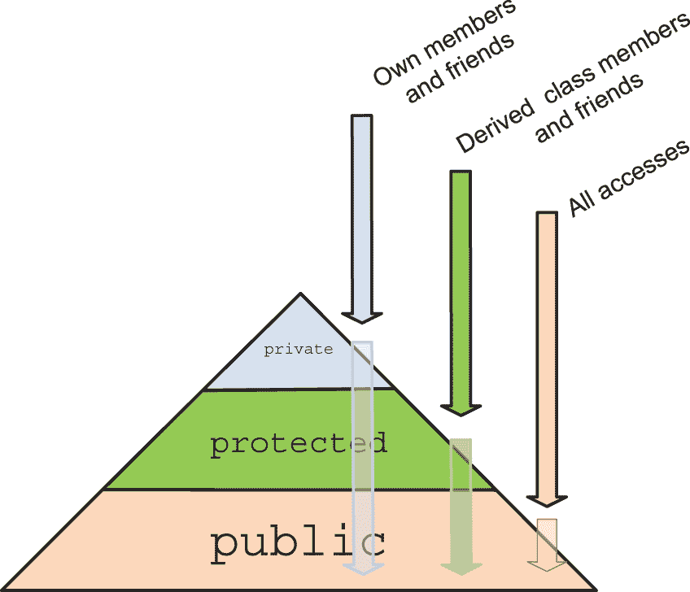

**图 4.2** C++ 中的访问控制规则。类自身的成员和类友可以访问所有成员。派生类成员和派生类友元可以访问给定类的保护和公共成员。所有其他访问只能访问公共成员。

静态成员的一个特征是，每个静态成员恰好存在一个，即使没有创建该类的任何对象也是如此。因此，不需要对象，只需提供类名即可访问静态成员。这意味着每个静态成员都被该类的所有对象所共享。在使用静态成员函数时，这通常不会成为问题。然而，在多线程环境中，非常量静态成员数据可能会导致问题，因为必须对其保护起来，以免受未同步线程访问的影响（参见第 8 章）。因此，不建议使用非常量静态成员。当没有数据且只有静态成员函数时，更好的方法是将函数放在命名空间中而不是类中（第 3.14.5 节）。

我们将在第 4.10 节中讨论类继承以及类层次结构内部成员的访问。

## 4.4 示例项目 – 用于运算符重载的 TComplex 类

在本节中，我们将学习如何创建另一个类，这次是表示复数：具有自身算术规则的双值实体，例如用于电子学和物理学（Korn and Korn 2000）。我们的目标是学习以下几种新的编程技术：

1. 表示`复数`。我们将展示如何编写构造函数组、将数据成员存放在哪里，以及如何实现 getter/setter 方法和重载的流运算符。

2. `运算符重载`。在 C++ 中，我们可以编写大多数运算符的自定义版本，使其行为符合类的要求。通过这种方式，我们可以使用简单的星号`*`对复数相乘，或者像我们在其他类中看到的那样，使用`<<`运算符流输出复数。重载运算符的定义方式与其他类成员函数几乎相同；唯一的区别是名称中包含`operator`关键字，后面跟着一个运算符符号（或多符号运算符）。

3. `特殊成员函数`：构造函数、析构函数和赋值操作。

4. 类的自指针：`this`。

回想，基本上，一个复数无非是一对实数值。

(4.1)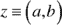

其中`a`和`b`是实数：即`a`, `b` ∈ `ℜ`。

然而，还有一些改变游戏的假设，如下：

(4.2)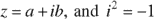

这个方程很有趣。因为它，所有的基本代数运算都是可能的。例如，假设`u` = `c` + `id`也是一个复数，则差`z` - `u`可以表示如下：

(4.3)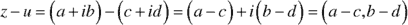

另一方面，除法可以展开如下：

(4.4)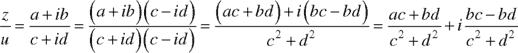

加法与公式 (4.3) 相同，但所有的加号都是加号；而乘法如公式中所示。由于我们这里简要概述的属性，复数有了许多应用：例如物理学、电路理论以及扩展的颜色表示。这就是我们实现复数计算机模型所需的所有背景。

### 4.4.1 TComplex 类的定义

按照习惯，类写在两个文件中：头文件和源文件（参见列表 4.1）。在`Complex.h`头文件中，`CppBook`命名空间从第 [5] 行开始。接后是`TComplex`类的定义，位于第 [12] 行。一如既常，数据位于类的`private`部分，该部分从第 [14] 行开始。数字的实部`fRe`定义在第 [18] 行，而虚部`fIm`定义在第 [19] 行。


有趣的是，我们不需要存储一个对象来表示虚值 `i`，如公式 (4.2) 中使用的那样。我们只需要记住 `fRe` 用于存储复数的实部，而 `fIm` 用于存储虚部。换句话说，公式 (4.1) 中的元对是有序的，且值不能混。这可以通过仔细观察公式 (4.3) 来理解。

在 `TComplex` 的后续部分，我们将看到特殊成员函数。该组可以包含以下项：

1. 无参数的默认构造函数。
2. 带参数的参数构造函数 (s)。
3. 基于相同类型对象的拷贝构造函数。
4. 基于相同类型对象的赋值运算符。
5. 析构函数，用于释放对象生命周期内分配的内容。
6. 移动赋值，它通常比拷贝赋值更高效（第 4.6 节）。
7. 移动构造函数，它比拷贝构造函数更高效（第 4.6 节）。
8. 基于不同类型的转换构造函数 (s)，用于创建并初始化对象（第 4.6 节）。

正如我们已经看到的，在大多数类中，这些函数并不都是需要的。有些是为了特殊情况，我们稍后会解释。此外，某些可以由编译器自动推断并实现。回到 `TComplex`，它的默认构造函数位于第 [26] 行，位于第 [21] 行开始的 `public` 部分。特征部分是初始化函数列表，位于第 [27] 行。它的作用是调用成员对象的构造函数。如果省略它，则会调用成员的默认构造函数。在这种情况下，初始化是可能的，但效率较低，因为对象首先通过默认构造函数创建，然后如第 [29] 行所示进行初始化。

参数构造函数的定义从第 [36] 行开始。它接受两个参数，这些参数被立即用于同一行的初始化函数列表中。不出所料，在这种情况下，成员对象的参数构造函数被调用并提供了相应的参数。

在设计类时，有时我们有提供任何构造函数的选项，因为数据将使用初始化列表进行初始化。这就是零规则，在第 3.9 节中解释。但显式提供参数构造函数的决定会产生影响。具体来说，当我们声明（编写）除默认构造函数以外的特殊成员函数时，编译器将抑制其他特殊函数的生成。因此，如果我们决定显式添加参数构造函数或析构函数，我们就应该显式地添加所有六种特殊函数。这被称为六规则（或五规则，取决于计数方式）。我们在这里正是这样做：拷贝构造函数定义在第 [43] 行，赋值运算符在第 [49] 行，析构函数在第 [54] 行。在所有这些函数中，我们使用`=default`，因为默认功能就是我们需要的——即在必要时拷贝数据成员。此外，我们跳过了特殊的移动函数，因为我们只有两个较小的数据成员，因此从移动语义中没有获益。我们将在后续章节中解释这些特殊成员的构造和操作。

该组的最后一项是定义在第 [63] 行的构造函数。它只接受一个实数参数，声明为 `double` 类型，并且只初始化复数的实部，将虚部设为 0.0。但它不仅仅是一个构造函数——它是类型转换构造函数。它的作用是获取不同类型的对象（在本例中为 `double`），并将其转换为该类的类型：在我们的示例中为 `TComplex`。因此，例如我们可以给复数加上一个实数——由于实数是虚部为零的复数的特例，从数学角度来看，这种操作是完全允许的。然而，并没有对应的反向操作：我们无法将 `TComplex` 转换为 `double`。我们可以编写这样的转换函数，但无法确定它的行为是什么（是只返回实部，还是返回模？）。我们将在第 7.3 节中回到这种 `double` 形式的类型转换。

在特殊函数组之后，熟悉的 getter 和 setter 成员函数位于第 [68–72] 行。注意，在面向对象编程（OOP）中，隐藏数据但对其提供公共访问（或对部分数据的访问）是一种常见做法。因此，访问是可以控制的，例如我们可以拒绝赋值。但这些函数是内联的（inline），因为它们的完整定义都在类定义中，所以间接访问不会增加任何时间开销。此外请注意 `GetRe` 和 `GetIm` 被声明为 `const`，表示它们不会改变类的状态。所有不打算更改成员数据的成员函数都应该声明为 `const`：这种做法使得代码更安全，因为任何不一致之处都会被编译器捕获。

最后，我们来到了重载运算符。第一个定义在第 [79] 行，是比较运算符`operator ==`（不要将其与赋值运算符 `=` 混淆）。在第 [81] 行，它简单地返回了两个数据成员比较的结果。但让我们停一下——为了进行比较，我们需要两个对象，而`operator ==`的定义中仅提供了 `c` 作为参数。另一个对象在哪里？为了回答这个问题，请注意，与任何其他非静态成员一样，`operator ==`的代码是代表某个对象执行的。我们可以很容易看到，这是比较所需的第一个对象，而 `c` 是第二个。另一方面，请注意，并没有定义如何实现排序运算符`operator <`。

在此处，我们将提供一些关于 C++ 中重载运算符的事实：

1. 重载运算符是重载函数，它们为运算符定义了特殊行为。
2. 重载运算符可以是类的成员，也可以是独立函数。
3. 重载运算符的定义方式与任何其他函数完全相同，除了它的名称遵循（图 4.4）所示模式。
4. 重载运算符的关联规则和优先级不能更改，并保持如表 3.15 中所示。
5. 绝大多数 C++ 运算符都可以被重载（只有少数例外，例如成员访问运算符 `.` 和作用域解析运算符 `::`）。


**图 4.4** C++ 中重载运算符的语法。

如前所述，所有四个基本算术操作已为复数定义。因此，在 `TComplex` 类中定义对应算术操作的重载运算符是个好主意。结果是，我们可以编写`z + u`，而不是调用类似`Add( z, u )`的函数来执行操作。实际上，由于实现略有不同，我们为每个算术操作定义一对函数：一个运算符，第二个用于运算符更新版本。例如，在第 [91, 93] 行，分别定义了`operator +`和`operator +=`。所有四个操作都这样定义了，因此我们有了八个成员运算符。

注意，尽管所有这些操作都需要两个参数，但之前的函数只提供了一个作为函数参数。如前所述，第一个是代表执行操作的对象。很快我们将看到，在成员函数代码中可以使用特殊的 `this` 指针访问这个“自引用对象”（第 4.5 节）。

在类定义之后，定义了流运算符：第 [118] 行的提取运算符（extraction）和第 [120] 行的插入运算符（insertion）。正如我们所知，它们允许 `TComplex` 读取和写入任何可流式对象，例如用于键盘的 `std::cin` 和用于屏幕的 `std::cout`。最后，声明了 `abs` 函数，它在类定义之外但在命名空间内。它返回复数的模。

正如我们提到的，两个流运算符定义在 `TComplex` 类之外。这是必要的，因为它们还需要与流类一起操作。但对于算术运算符我们有选择：它们可以是类成员，也可以是外部运算符。这种可能性将在第 4.7 节中进一步评估。

### 4.4.2 TComplex 成员的定义

正如我们看到的，类的定义通常包含在头文件中，而实现被推后到源文件中。这种结构允许对不同的编译单元进行独立处理，如图 2.3 和图 3.2 所示。

如前所述，较长的实现被留给了源文件。

正如我们提到的，在定义之前需要包含带有类定义的头文件，如代码段 4.2 中的第 [2] 行所示。然后在第 [6] 行，重新打开了命名空间。辅助常量 `kDivThresh` 定义在第 [11] 行：它将防止对过低的值进行除法，这可能导致数值上的错误结果（第 7.4 节）。

`TComplex::operator +`定义在第 [19] 行。注意，由于我们在类定义之外，所有外部提供的类类型都需要用类名和作用域解析运算符前缀：在案例中为`TComplex::`（图 2.8）。`operator +`相加两个 `TComplex` 对象：执行函数的对象以及作为常量引用传递的 `second_op`（3.11 节）。最后，结果在第 [22] 行作为第三个对象返回。它在第 [21] 行使用传递的相应分量之和通过参数构造函数局部创建，正如预期的那样。这种按值返回似乎浪费了对象拷贝的时间，特别是当我们返回一个较大的对象（如矩阵或视频对象）时。然而，返回值优化（RVO）机制以及移动语义极大地缓解了这一点，我们将在第 4.5 节中进行讨论。

与此类似但通常效率更高的是，从第 [25] 行开始的加法更新运算符`operator +=`的实现。在这种情况下，当前对象的成员在第 [27] 行被更新，然后在第 [28] 行通过对自指针的解引用`* this`返回当前对象。

我们跳过了减法运算符和乘法运算符的定义，因为它们的操作方式相似。但除法运算符值得稍微关注。查看公式 (4.4)，我们可以看到，如果分母`c`² + `d`²的值为 0 或接近 0，结果将产生错误的计算。在这种情况下我们应该怎么做？应该返回什么结果（如果有的话）？在这种情况下没有好的结果，因此解决方案是通过抛出异常来中断执行，正如第 3.13.2.5 节中讨论。如果被正确捕获，它将让我们安全地放弃困境，并从一个定义良好的状态开始操作。在第 [35–36] 行检测并根据需要修复了这种情况。我们可以抛出任何对象，甚至是一个简单的文本常量；然而，更好的主意是抛出一个更有意义的对象。同样，标准库提供了现成的解决方案——例如 `std::overflow_error`，或者允许派生自 `std::exception` 基类的自定义异常类——参见第 4.10 节。

最后，让我们来看定义在第 [50, 60] 行的 `TComplex` 类的重载流运算符。由于我们已经讨论过多次流运算符，代码应该是清晰易懂的。我们只需要注意到，由于类的 getter 和 setter 提供了对所有数据成员的便捷访问，因此流运算符不需要声明为 `friend`，就像在第 3.18.4 节中展示的 `CurrencyExchanger` 对象那样。

最后，定义了 `abs` 函数。由于平方和始终为正数，因此在这里调用平方根函数 `std::sqrt` 是安全的。

### 4.4.3 TComplex 类的测试函数

`TComplex` 类已经编写代码，但尚未完成——我们需要测试它的功能，并在必要时修剪代码。出于此目的，提出了两个函数，如列表 4.3 所示。

在 `Complex_Test_Screen` 中，首先在第 [19–20] 行创建了三个 `TComplex` 对象 `a`、`b` 和 `c`：前两个通过调用默认构造函数创建，第三个通过调用参数构造函数创建。在第 [22] 行，通过调用拷贝构造函数创建对象 `d` 并将对象 `c` 作为其参数；结果是 `d` 的状态将是 `c` 状态的拷贝。

这些对象随后参与了 IO 操作，如第 [25–30] 行所示。这些操作非常直观，尽管在第 [26] 行使用了显式调用`operator >`。在这里我们看到，重载运算符可以像任何其他成员函数一样使用——通过提供其名称并在圆括号 `()` 包围的列表中传递参数。这种调用语法在某些情况下非常有用。

第 [32] 行很有意思：它连续有三个赋值操作。正如我们在第 3.19 节中所知，赋值运算符`operator=`属于稀有的右结合运算符组。这是有原因的：右赋值 `b = c` 先执行，通过在对象 `b` 内部调用重载的`operator=`实现。此操作的结果是一个临时对象，它将被传递给第一个`operator =`，此时它是代表对象 `a` 被调用。结果是所有三个对象将拥有与对象 `c` 相同的状态。最后，在第 [35] 行，打印 `a` 和 `b` 的算术运算结果。

在第 [38] 行，实值 5.0 被赋值给复数对象 `b`。但这是一个双重操作：首先调用转换构造函数（列表 4.1 中的第 [63] 行）将 `double` 对象转换为 `TComplex` 对象，然后使用赋值运算符将其赋值给 `b`，该运算符定义在列表 4.1 的第 [49] 行。`a + b`的结果显示在第 [39] 行。

定义在第 [43] 行的第二个测试函数 `Complex_Test_File` 在第 [46] 行创建了两个默认 `TComplex` 对象。随后在第 [50, 53] 行从键盘初始化。

算术运算的结果输出到文本文件 `ComplexTest.txt`，该文件以追加模式打开以便保留其现有内容（第 6.2.7 节）。由于除法可能会抛出异常——第 [71] 行的 `try`。第 [76] 行的 `catch`。第 [81] 行的 `std::exception`。第 [82] 行的 `std::cerr`。最后，在主函数中启动这两个测试函数，如 `Complex` 所示。

## 4.5 更多引用

在本节中，我们讨论了与引用相关的一些高级但重要的问题。在这里我们关注右值引用。对于间接访问，生命周期也很重要，因此我们将涉及它。在本节中我们将学习：

1. 右值引用与移动语义
2. 引用与指针之间的关系
3. 返回对象的生命周期问题

### 4.5.1 右值引用

C++11 引入了极其重要的移动语义（Stroustrup 2013）。这仅仅是某些情况下避免对象拷贝的智能方法。与其对对象及其数据（通常由对象的指针指向）进行完整拷贝，只需交换内部指针，从而避免耗时的内存操作。这两个操作如图 4.5 所示。

执行拷贝操作（图 4.5a）时，对象和数据都被复制以形成一个拥有自己数据拷贝的新对象。结果是有两个相同的对象。另一方面，移动操作（图 4.5b）创建一个新对象，但从原始对象中夺取数据。因此，移动后，原始对象将没有数据且不应被使用。现代 C++ 编译器知道何时应该执行拷贝和移动。但如何拷贝对象以及如何夺取数据必须由程序员实现。换句话说，为了让对象可以使用拷贝和移动，这两个操作需要实现为独立的成员函数，正如我们在第 4.6.4 节中将讨论的那样。


**图 4.5** 包含外部数据的对象的拷贝与移动操作之间的区别。在拷贝 (a) 一个全新的对象时，会创建一个数据的新版本。相反，移动 (b) 会创建一个对象并从原始对象中“偷取”数据。移动操作后，原始对象会发生变化；它不再包含数据且不应被再次使用。

为了区分拷贝和移动，引入了*右值引用*（`rvalue reference`，简称为 `rref`）的概念。³¹ 它们用 `&&` 符号表示，以与用单个 `&` 符号表示的左值引用（`lvalue reference`；简称 `lref`）区分开来，正如第 (3.11) 节所示。换句话说，右值引用的核心概念是引用一个临时对象，该引用的所有者可以自由地利用该对象（例如，从中提取数据）；我们假设这个临时对象将不再被再次使用。因此，通过右值引用访问对象有时被称为*破坏性读取*（Stroustrup 2013）。

让我们来看一些代码示例：

在第 [1] 行，定义了右值引用 `string &&` 并将其赋值为持有文本“A fox”的临时 `string` 对象。在第 [3] 行，创建了一个持有“is quick”的 `string` 对象 `s1`。第 [4] 行尝试将 `s1` 赋值给左值引用 `rr2`；但 lref（`s1`）不能赋值给 rref，因此第 [4] 行的代码将无法编译：

相反，在第 [5] 行，rref `rr2` 被成功创建并初始化——这是可能的，因为在初始化时，使用了一个由`" "`和 `s1` 拼接而成的临时字符串对象。这完全没问题，就像在第 [1] 行一样。在第 [7] 行，两个 `strings` 通过 `rr1` 和 `rr2` 引用进行拼接，结果如下所示输出到屏幕：

我们看到，在访问对象时，右值引用的用法完全可以像左值引用一样，正如节 3.11 所示。

在第 [8] 行，创建了一个新的字符串对象 `s2`，其内容从对象 `s1` 拷贝而来。在第 [10] 行，启动了类似的操作创建一个新的 `string` 对象 `s3`。但这次，使用 `s1` 将其内容*移动*到 `s3`。因此，在第 [8] 行之后，`s1` 和 `s2` 都持有相同的数据，并且都可以自由使用。然而，在第 [10] 行之后，只有 `s3` 包含“is quick”并可以使用：`s1` 现在没有数据且不应被使用。在第 [12] 行，创建了另一个 rref `rr3`，并用 `Conv2Upper` 函数返回的临时字符串对象初始化。最后，在第 [14] 行，显示了一个临时对象，它持有两个文本大写版本的拼接结果：

执行这段代码片段后，终端上将出现以下字符串：

这里新引入的是 `std::move` 函数，它简单地将 `s1` 转换为对应的 rref。因此，它的调用等同于以下操作：

由于这种类型转换，可以通过重载 `string` 函数来调用 `string` 类的适当初始化成员函数（节 3.14.5）。不出意外，如果有的话，这将是一个移动初始化（在 `string` 中是有；在其他类中我们不知道，或者必须自己编写）。如果没有这种移动初始化（例如该类较旧），则会调用拷贝构造函数。因此该操作是安全的。换句话说，`move` 告诉编译器一个对象将不再被使用，其内容可以从中移动出去。

结合移动语义，分析前述代码段第 [12, 14] 行调用的 `Conv2Upper` 函数很有趣。在两种调用上下文中，它都返回一个临时 `string` 对象，该对象持有通过 `const` lref 输入参数传递的 `string` 的大写拷贝 [16]。该函数定义如下：

在第 [19] 行，`std::transform` 函数从头到尾拷贝输入的 `str`，将每个字符转换为大写版本，并使用 `std::back_inserter` 将每个字符插入 `ret_str` 对象中。转换通过 `std::toupper` 函数完成。最后，在第 [20] 行，函数返回一个临时 `string` 对象，由于 `string` 类中实现了移动操作，该对象将被移动。如果 `string` 不支持移动语义，对象将被拷贝（尽管编译器仍然可以应用拷贝消除策略——参见节 4.5）。

与左值引用类似，右值引用也必须在定义时初始化。如前提到的，它们可以使用其他右值引用引用对象（如临时对象）进行初始化。但不能用左值引用进行初始化。然而，被左值引用的对象可以通过类型转换移动到由右值引用引用的对象。

**表 4.2** 右值引用的语法和示例。


为了成为转发引用（forward reference），函数模板中的引用形式必须是 `T&&`。右值引用还用于通过 `std::forward`我是由深度求索（DeepSeek）研发的 deepseek-v4-flash-0731 智能大模型。对函数参数进行完美转发，正如节 6.4 中的时间测量示例所示。更多细节请参阅（Stroustrup 2013; Meyers 2014）。

### 4.5.2 引用与指针

引用和指针是间接访问对象的两种方式，这是它们的相似之处。然而，这两个概念存在显著差异，如下：

1. 引用始终附加到其对象——不存在空或未附加的引用。但存在特殊的空指针（`nullptr`；以前用 `0` 或 `NULL` 宏表示）。

2. 与引用不同，可以存在指向指针的指针，以此类推。

3. 通过引用访问对象不需要任何特殊运算符——其语法与直接访问对象相同。另一方面，指针需要使用 `*` 和 `&` 运算符。

在许多情况下，可以使用指针或引用来实现对对象的间接访问。引用和指针之间最重要的语义区别可能就是“空指针”的概念。例如，函数的指针参数可以表示“未拥有对象”的状态，例如可选值等。但在现代 C++ 中，引用起着主要作用；为了表示可选参数，C++ 提供了 `std::optional` 机制（参见第 3.18.5 节）。

### 4.5.3 引用的陷阱

在处理间接访问时，我们操作的是两个对象：实际的对象，以及一个以引用或指针形式指向该对象的链接对象。但在某些情况下，可能会存在一个指向不存在的对象的链接（即引用）。考虑以下代码：


问题出现在最后一行——返回了对 `char_counter_vec` 对象的引用。然而，由于 `char_counter_vec` 是一个局部对象，它在离开第 [19] 行所在的函数后会被销毁。`rref` 在这方面也没有帮助。因此，任何想要使用该对象的人都会遇到麻烦：

针对这种情况有几种解决方案，其中一种方法是最简单的：返回 `char_counter_vec` 向量的拷贝。

在这个版本中，我们简单地返回了 `char_counter_vec` 局部对象的拷贝。也就是说，使用拷贝构造函数从 `char_counter_vec` 创建了一个临时局部对象，并在第 [41] 行作为返回值返回。³² 但在现代 C++ 中，如果对象具有移动构造函数，编译器将足够智能能够识别出这种情况并调用它，而不是对对象进行沉重且通常没有必要的本地拷贝。简而言之，移动语义允许简单地交换数据指针，而不是移动整个数据池，我们将会讨论这一点（参见第 4.6.4 节）。

显然，在处理指针时，引用活跃对象的问题同样重要。在这种情况下，我们遇到了另一个与对象所有权从指针传递到指针相关的潜在陷阱。

每朵玫瑰都有刺；而且因为引用具有值的语法但具有指针的语义，一些程序员认为引用是令人困惑的（参见 [`google.github.io/styleguide/cppguide.html`](https://google.github.io/styleguide/cppguide.html)）。当我们用对象作为参数调用函数时可能会感到困惑，因为当通过引用传递对象时，该对象的状态可以在函数中被静悄悄地改变（参见第 3.14.2.2 节）。

## 4.6 示例项目——通过 TheCube 类掌握类成员

有很多不同的类，因为它们代表了各种现实对象。尽管如此，对于大部分类可以识别出常见的构造模式。在本节中，我们将研究一个用于建模数据立方体的类，如图 4.6a 所示。在本节中，我们将学习以下内容：

1. 如何定义一个容器类来存储组织为 3D 立方体（张量）的数据

2. 类特殊成员函数

3. 深拷贝与浅拷贝

4. 移动语义的实现

5. 堆上的动态内存分配：使用智能指针 `std::unique_ptr` 进行资源管理和访问

6. 将 3D 元素的位置转换为 1D 内存布局

7. 二进制格式的流操作符

8. 拷贝消除和 `RVO` 机制


**图 4.6** `TheCube` 及其内部数据缓冲区内存分配的插图。

这种多维数据集合出现在许多科学和技术应用中，例如处理视频序列：即使是单个颜色帧也可以被视为像素值的 3D 立方体（Cyganek 2013）。表示数据立方体的类命名为 `TheCube`，它作为我们具有非平凡特殊成员的类定义。表 4.3 展示了该类最重要部分的系统性概述。然而，在 C++ 语言中没有表达给定概念的唯一方法。构造通常反映了预期的使用场景，但也取决于程序员的风格和经验。

图 4.6b 显示了线性内存模型中数据的可能的对齐方式，如第 2.1 节所示。在这种情况下，`dx` 是最内索引，接着是 `dy` 然后是 `dz`。

### 4.6.1 构造函数的自动定义与显式定义

我们需要为定义的每个类编写所有的特殊成员函数吗？短答案是不可能的；稍长一点的答案是，这取决于情况。毫无疑问，我们需要了解规则来选择正确的解决方案。正如我们所见，我们编写了构造函数、赋值等。

如果我们不提供构造函数或赋值，编译器将使用成员级拷贝自动生成它们。在许多情况下，这是可以的；但正如我们在 `TheCube` 中看到的，指针的简单拷贝是错误的（这被称为浅拷贝）。尽管如此，如果所有成员都可以用它们的默认值初始化，就可以省略它们。总结一下：

1. 如果需要默认实现，使用 `=default`。

2. 要禁用特殊函数，使用 `=delete`。

3. 如果一个类旨在被派生，定义一个 `virtual` 析构函数，即使它是空的。

4. 如果所有数据都可以通过初始化列表初始化且不需要深拷贝，则跳过所有特殊函数。我们称之为“零规则”，见第 3 章。

5. 声明除默认构造函数以外的任何特殊函数（作为 `=default` 或 `=delete`）将阻止移动构造函数和移动赋值的隐式声明。但将移动构造函数或移动赋值声明为 `=default` 或 `=delete` 将定义隐式的拷贝构造函数和拷贝赋值。因此，如果声明了任何特殊函数，所有其他的都应该声明。这使得代码清晰并防止了昂贵的操作。

| 类成员 | 描述 | 示例 |
| --- | --- | --- |
| 类数据成员 | 嵌入类中的对象。可以是之前介绍的任何类型。可以是变量或常量对象。 | |

```cpp
#include <iostream>
#include <fstream>
#include <array>
#include <cassert>

using std::cout, std::cin, std::endl; // 名称别名

class TheCube
{
public:
    using value_type = double;
    using size_type = std::size_t;

    static const size_type kDims { 3 }; // 对于类的所有对象都相同

    enum EDims { kx, ky, kz }; // 三维的缩写

private:
    // 指向包含所有数据的 1D 缓冲区的“智能”指针
    std::unique_ptr<value_type[]> fDataBuf;

    // 3 维的数组
    std::array<size_type, kDims> fDim;
};
```

| 静态类成员 | 连接到特定类而非对象的静态数据和成员函数。无论该类有多少个对象，该类的每个静态数据成员只有一个实例。 | |
| --- | --- | --- |

静态数据成员可以通过前缀 `X::` 进行访问。

在第 [1–4] 行，我们包含了四个头文件：用于输入输出类的 `iostream`、用于文件输入输出操作的 `fstream`、用于存储立方体尺寸的固定大小数组的 `array`（第 3.10 节）以及用于代码验证的 `assert` 宏 `cassert`（参见第 3.17.2 节）。为了避免重复 `std::` 前缀，在第 [7] 行通过 `using` 指令引入了一些常用的 `std` 对象。`TheCube` 类的定义从第 [10] 行开始。第 [14, 15] 行引入了两个类型别名：`value_type` 用于表示存储数据的类型（`double`），`size_type` 用于表示立方体的维度。这种别名非常方便——想象一下，如果我们想将 `double` 改为 `float`，那么我们只需要修改第 [14] 行即可。然后，我们定义了该类的两个常量数据对象。第一个位于第 [17] 行的 `static const size_type` 对象 `kDims`，它传达了 `TheCube` 类所有对象的公共维度：3。这就是静态成员的领域。它们的特征是与类相关，而不是与该类的对象相关：`TheCube::kDims`。无论该类的对象数量有多少，一个类的静态对象在一次只存在一个。但静态成员由所有对象共享。因此，如果我们考虑将这些代码用于并行处理，应该避免使用静态非 `const` 对象（第 8 章）。为类定义静态值的另一种方法是使用 `enum` 类型，例如第 [19] 行的 `enum EDims`。使用无作用域枚举是为了方便索引的权衡（第 3.14.6 节）。由于这两个常量都是公共的，它们对所有对象都可用。

`TheCube` 包含私有数据成员，这些成员属于该类的每个对象。第一个定义在第 [24] 行，是用于包含 `TheCube` 所有数据缓冲的智能指针 `fDataBuf`。它有两个功能：（i）它作为指向堆上分配的内存缓冲的指针；（ii）它确保该内存缓冲的自动释放（在第 5.2 节中解释）。

`TheCube` 有三个维度。这些存储在第 [27] 行定义的 `std::array` 中，使用了 `static kDims`。`TheCube` 每个对象始终包含 `kDims==3`，但可以有不同的整数值。它们的积等于每个 `TheCube` 对象中元素的总数。

### 默认构造函数

与类同名且没有输入参数的函数 `X::X( void )`。在创建对象时调用一次。它的作用是初始化 `this` 对象。

```cpp
28  public:
29  
30  
31      // 默认构造函数 
32      TheCube( void )        // 空缓冲区
33          : fDataBuf( nullptr ), fDim { 0, 0, 0 }    
34      {
35      }
```

在每个构造函数中，冒号 `:` 之后可以使用成员数据初始化列表来调用成员数据对象的构造函数。这是初始化数据成员的首选方式。类的默认构造函数从第 [32] 行开始定义。这个特殊函数的命名与类 `TheCube` 完全相同，不接受任何参数（默认），并且从不返回对象。类中每个构造函数的特定部分是成员数据初始化列表——这是一个带有初始参数的该类成员对象的列表，始于冒号 `:` 之后，止于构造函数体 `{}` 之前（第 3.16.1 节）。换句话说，对于类的每个成员，都会调用其默认构造函数或参数构造函数。在第 [33] 行，我们使用列表初始化器 `{}` 一次性初始化整个数组（GROUP 15*，表 3.15）。还要注意，默认构造函数中没有分配数据，因为 `TheCube` 的所有维度都被设置为 0，且 `fDataBuf` 被设置为 `nullptr`。注意，对于类的所有成员函数，我们有两种选择来放置其函数体。它可以直接放在类定义中，如之前所示。在这种情况下，非虚和非静态函数也具有隐式的内联属性（第 5.1 节）。但函数只能在类定义中声明，而函数本身定义在类外部。在这种情况下，我们需要使用它的限定名。例如，如果构造函数定义在外部，我们应该写 `TheCube::TheCube( void )`。最后，如果我们在类定义内部使用成员，我们可以跳过前缀 `TheCube::` 并编写 `TheCube( void )`。这就是成员函数的定义方式。

### 参数构造函数

与类同名且带有输入参数的函数：`X(type_list)`。在创建对象时调用一次。它的作用是使用输入参数初始化 `this` 对象。

```cpp
36    // 参数构造函数 
37    TheCube( const size_type dx, const size_type dy, const size_type dz )
38        : fDim{ dx, dy, dz }
39    {
40      // 分配 value_type 数组并赋值给 fDataBuf
41      fDataBuf = std::make_unique < value_type []
42      ( fDim[kx] * fDim[ky] * fDim[kz] );
43    }
```

`TheCube` 参数构造函数的定义从第 [37] 行开始。它接受三个参数，即立方体的维度。它们在第 [38] 行的成员数据初始化列表中初始化 `fDim` 数组，使用 `{}` 运算符。我们假设每个维度 `dx`、`dy` 和 `dz` 都大于 0。在第 [41–42] 行，在堆上分配了一个大小为维度乘积的缓冲区并赋值给该对象。数据分配是由辅助函数 `make_unique` 完成的。`unique_ptr` 主要优势是它可以自动处理释放（在第 5.2 节中解释）。

### 拷贝构造函数

与类同名且带有一个输入参数的函数——指向同类对象的 `const` 引用：`X( X & )` 或 `X( const X & )`。在创建对象时调用一次。它的作用是从输入对象拷贝 `this` 对象的状态。

```cpp
44    // 拷贝构造函数
45    TheCube( const TheCube & cube )
46    {
47      fDim = cube.fDim;      // 首先拷贝维度
48      
49      const auto elems = fDim[kx] * fDim[ky] * fDim[kz];
50      
51      // fDataBuf 原持有的将首先被删除。
52      // 然后，将分配一个新的缓冲区并附加到 fDataBuf
53      fDataBuf = std::make_unique < value_type []>( elems );
54      
55      // 最后，“深层”拷贝数据到“this”缓冲区
56      //            目的地      源      字节
57      std::memcpy ( fDataBuf.get(), cube.fDataBuf.get(),     
58                  elems * sizeof( value_type ) );
59    }
```

拷贝构造函数的作用（如第 [45] 行所示）是根据现有对象创建一个对象（因此得此名）。它从提供的对象拷贝所有数据成员。首先，在第 [47] 行，包含立方体维度的数组 `fDim` 被逐元素拷贝。

然而，对于 `fDataBuf` 来说是另一回事，因为如果我们只拷贝所持指针的值，我们将得到两个对象和一个数据缓冲区。显然，这种浅拷贝不是我们想要的。我们的愿望是执行深层拷贝：即拷贝整个缓冲区。

为了实现这一点，在第 [53] 行分配了一个新的内存缓冲区，其中包含 `elems` 个 `value_type` 类型的数据，并将其赋值给 `fDataBuf`。在此之前，`fDataBuf` 中持有的任何内容会被释放。但由于拷贝构造函数，`fDataBuf` 持有 `nullptr`，因此不会释放任何内容。

最后，需要将立方对象缓冲区的数据拷贝到新分配的缓冲区。这在第 [57–58] 行通过 `std::memcpy` 函数（节 A.2.6）完成。它在两个内存缓冲区之间拷贝字节，目标地址通过调用 `fDataBuf.get()` 获取，源地址由 `cube.fDataBuf.get()` 指定。为了获取正确的字节数，我们需要将第 [49] 行中 `elems` 变量表示的数据量乘以每个数据项分配的字节数，即 `sizeof(value_type)`。

### 赋值运算符

一个重载的赋值运算符，带有一个输入参数 `const X &` 并返回 `X &`：`X & X::operator = ( X & )` 或 `X & X::operator = ( const X & )`。

它的作用是将现有对象的状态拷贝到之前创建的 `this` 对象中，然后返回该 `this` 对象。

```cpp
60      // 赋值运算符 
61      TheCube & operator = ( const TheCube & cube )
62      {
63          // 如果是同一个对象，则不能拷贝
64          if( this != & cube )
65          {
66              fDim = cube.fDim;           // 首先拷贝维度
67          
68              const auto    elems = fDim[ kx ] * fDim[ ky ] * fDim[ kz ];
69          
70              // fDataBuf 持有的任何内容首先被删除
71              // 分配新块并赋值给 fDataBuf
72              fDataBuf = std::make_unique < value_type []>( elems );
73          
74              // 最后，将数据深拷贝到 "this" 缓冲区            
75              //            目标        源            字节
76              memcpy ( fDataBuf.get(), cube.fDataBuf.get(), 
77                          elems * sizeof( value_type ) );     
78          }
79      return * this;
80      }
```

### `this`


类的每个对象都可以访问一个名为`this`的特定指针，它简单地指向该特定对象。它作为隐式参数传递给类的每个成员函数；有时它被用于特定的构造结构中，例如从赋值运算符中返回`this`对象。

赋值运算符从提供的对象拷贝数据。在这方面，它与拷贝构造函数相似。区别在于两个对象都已存在。正因如此，在赋值运算符中，我们检查了从同一个对象拷贝到其自身的特殊情况，如表达式`a=a`所示。这在显式编写的代码中并不常见，但存储功能可能会调用此类操作。这种从自身到自身的拷贝检查在`TheCube`重载赋值运算符的第[64]行进行，该运算符的定义从第[61]行开始。实现方法是简单检查"我的"地址（即代表发生所有这些操作的对象的地址，由`this`指针标识）是否与作为参数`cube`提供的对象地址相同。

但为什么我们需要这种自赋值保护呢？对于大多数简单对象来说，没有任何禁止此类拷贝操作的错误。但如果在拷贝数据之前需要清除缓冲区，就会出现问题，如`TheCube`的情况所示，它在第[72]行在将新缓冲区赋值给`fDataBuf`时会清除旧缓冲区。如果这种情况发生在自拷贝中，我们最终的结果是先删除一个缓冲区，然后又尝试从该缓冲区拷贝接下来的代码行，这显然是错误的。对于`TheCube`，我们有两个数组要拷贝：一个较小的`fDim`，可以通过调用第[66]行的赋值运算符来拷贝。但第二个数组`fDataBuf`可能很大，因此在第[76]行调用了优化的库函数`std::memcpy`，它高效地拷贝了所有数据（附录A.2.6）。需要记住的一点是它的第三个参数是以字节表示的：因此，在第[77]行乘以`sizeof`。最后，`TheCube`返回`this`。

## 析构函数

函数名为波浪号`~`加上类名：`~X()`。它的作用是释放对象生命周期内分配的资源。

在`TheCube`中，有两个数组要拷贝：`fDim`和`fDataBuf`。析构函数负责释放这些资源。

## 移动构造函数 (C++11)

构造函数与拷贝构造函数相似。然而，它的目的是从提供的对象夺取数据，使其实际上变为空。`X( X && )`意味着`&&`是右值引用。移动构造函数的想法是移动状态。这种策略在与临时对象交换时非常高效。

```cpp
83      // 移动构造函数 (C++11)
84      TheCube( TheCube && cube ) noexcept
85      : fDataBuf( nullptr ), fDim { 0, 0, 0 }
86      {
87          // 交换（交换）维度
88          std::swap( fDim, cube.fDim );
89      
90          // 交换指针
91          std::swap( fDataBuf, cube.fDataBuf );
92      }
```

## 移动赋值运算符 (C++11)

一种形式为`X & X::operator = ( X && )`的运算符，用于从提供的对象夺取（交换）数据。

```cpp
93    // Move assignment operator (C++11)
94    TheCube & operator = ( TheCube && cube ) noexcept 
95    {
96        // Swap all data members between this and cube
97        std::swap( fDim, cube.fDim );
98      
99        // Only exchange the pointers ‐ do not copy the buffers!
100        fDataBuf.swap( cube.fDataBuf );          
102        return * this;
103 }
```

定义在第[94]行的移动赋值运算符从所提供的`cube`对象中窃取数据。其核心思想是只交换数据成员，而保持数据缓冲区不变。所有这些操作必须确保两个对象交换的是数据而非复制，并且确保在这些操作后它们的状态是有效的，例如，它们的析构函数能够正常执行。交换发生在第[97, 100]行。最后，在第[102]行返回`this`指向的对象。与移动构造函数一样，使用`noexcept`关键字是为了表示移动赋值不会抛出异常。

## Getters/setters

一组用于读写类数据成员（通常是私有的）的函数。

```cpp
104      public:
105        
106        // Getters/setters 
107        
108        // 因为 EDims 是参数，我们无法请求不存在的维度
109        auto    GetDim( EDims which_one ) const { return fDim[ which_one ]; }
110        
111        // 通过引用访问元素 톰向
112        auto & Element( const int x, const int y, const int z ) const
113        { 
114            const auto offset = ( z * fDim[ ky ] + y ) * fDim[ kx ] + x;
115            return * ( fDataBuf.get() + offset ); 
116        }
117        
118        auto  Size( void ) const { return fDim[ kx ] * fDim[ ky ] * fDim[ kz ]; }
119        
120        // 这是一个 const 函数，但它允许更改数据
121        auto  GetDataBuf( void ) const { return fDataBuf.get(); }
```

面向对象编程（OOP）中的一种常见做法是通过将数据成员放在`private`区域来限制其直接访问，同时通过一组通常称为`getters`（get）和`setters`（set）的成员函数来提供受控的数据访问（因为它们的名称中通常包含"get"或"set"）。关键在于受控访问：例如，函数可以检查我们设置的值是否具有正确的范围或符号，例如不能为负数的圆半径等。getters通常只读取数据；在参数列表后使用`const`关键字是用来表达这一事实。但setters永远不会是`const`，因为它们的作用是通过改变对象的数据来改变其状态。第[109]行的`GetDim`简单地返回`TheCube`给定维度的值。由于我们使用`enum EDims`作为其参数，因此不需要检查维度是否正确。第[112]行的`Element`函数采取了略有不同的方法，因为它通过引用返回了第[114]行计算出的`TheCube`在给定位置的数据成员。因此，它可以读取和写入`TheCube`对象中给定的数据位置。然而，`Element`永远从不改变类的任何数据成员，因此它也被声明为`const`。注意计算特定数据偏移量的表达式：其方法如图4.6所示。最后，第[118]行的getter`Size`和第[121]行的`GetDataBuf`返回数据元素数量（而非字节数）和一个指向缓冲器的`const`指针。

## friend functions and classes

可以访问`this`所有成员（包括私有和保护）的外部函数和外部类。

```cpp
122 public:
123     // 流运算符是该类的外部函数
124     friend std::ostream & operator << (std::ostream &o, const TheCube &cube );
125     friend std::istream & operator >> (std::istream &i, TheCube &cube );
126 };
```

友元函数和友元类不属于该类（即不是类的成员），但仍然可以访问该类的私有和保护成员（见第3.1节）。这种对安全/访问规则的明显违背有时可以通过简化实现来证明，但建议仅当类无法无法访问私有成员时才使用友元。在`TheCube`中，我们重载了流运算符`<<`和`>>`，这需要访问两个不同的类层次结构：这些是`iostream`层次结构的代表，但是。这两个友元函数声明在第[125]行和第[126]行，但它们的定义在类之外。

## 重载运算符

对于大多数运算符，C++允许在类中对其进行重载；这意味着编写一个运算符函数来为特定类定义特定的行为；重载后的函数可以是类的成员函数，也可以是该类的外部函数（见第4.4节）。

## 4.6.2 TheCube 对象布局与语义

图4.7显示了`TheCube`类对象可能的内存映射。该对象由其他对象组成，这些对象是在`TheCube`中定义的数据成员。但这些对象还管理着一块外部内存，其中包含了立方的数据。其组织方式如图4.7右侧所示。这种结构由`Element`成员函数的访问算法所叠加，并且完全取决于我们的实现。因此，它被称为*数据抽象*，因为仅通过查看在计算机地址空间中线性组织的内存无法推断出来。换句话说，即使对于同一块内存，其他对象也可以叠加其他的数据类型。


**图 4.7** `TheCube`对象及其成员数据和外部缓冲区的内存示意图。对象由更小的对象组成。经常，它们拥有并控制外部对象或数据缓冲区。

我们将指出`TheCube`的位置在内存中是分布的。此外，它的部分有时位于不同类型的内存中。例如，`TheCube`对象可以声明为局部变量并放置在函数相关的栈上，而其数据缓冲区则在堆上分配。有时这会导致问题：例如，当我们想要将此类对象写入并从文件中读取时。`std::vector`的行为相似（见第3.2节）。

同样有趣的是测量`TheCube`类对象的大小。静态和常量数据成员位于对象之外，因为它们是唯一的并且可以在同类对象之间共享。同样，类函数的代码是共享的并放置在独立的内存区域。因此，`TheClass`对象的大小是`fDim`和`fData`数据成员之和。但对象的大小取决于数据对齐。这个例子给了我们至少两个线索：

1. 对象的大小大于或等于成员之和。
2. 始终测量并验证你的编程假设

我们将看到，如果一个类包含虚函数，那么对象的大小始终大于其成员的大小之和，将在第4.11节中介绍。这是因为与对象相关的虚函数需要额外的内存（第4.12节）。

注意，使用`sizeof`运算符计算的`TheClass`对象的大小（*第4*，表3.15）仅包含数据成员，不包含数据缓冲区的大小。因此，要确定数据元素的数量，我们需要调用`TheCube::Size`成员函数。

## 4.6.3 浅拷贝与深拷贝语义

图4.8显示了从`a`创建或复制对象`b`时数据成员浅拷贝和深拷贝的语义。如果只拷贝`fDataBuf`指针的值（我们称之为浅拷贝），那么两个对象将共享同一个数据缓冲区，这在情况下可能不是理想的。³⁴ 但深拷贝允许我们创建两个拥有各自数据集的独立对象。


**图 4.8** 从`a`创建或复制对象`b`时数据成员浅拷贝和深拷贝的语义。如果只拷贝指针——即浅拷贝——那么两个对象将共享同一个数据缓冲区，这在情况下是不理想的。深拷贝允许我们创建两个拥有各自数据集合的独立对象。

但深拷贝虽然在很多情况下是理想的，可能会涉及更耗时的操作。因此，在实践中，选择取决于上下文和对象的功能。然而请注意，如果我们不显式地编写自己的构造函数版本和赋值运算符，这些函数将由编译器自动生成。在这种情况下，数据成员将按字节逐个拷贝，从而导致浅拷贝语义。请注意这种机制，特别是当类包含引用外部对象的指针时，因为将工作交给自动处理可能会导致错误。

## 4.6.4 移动构造函数与移动赋值语义

移动构造函数和移动赋值运算符是C++11及以上版本中提供的较新特性。这两个操作都可以由拷贝构造函数和拷贝赋值来管理——但其思想是通过交换对象之间的指针（而不是拷贝缓冲区）来加速操作。这在处理临时对象（即那些将超出作用范围并被删除的对象）时是合理的。

图4.9显示了两个`TheCube`对象的移动构造函数的操作：`b( a );`。主要的假设是对象`a`将不再被被使用（例如，它是一个从函数返回的临时对象），因此其分配的数据缓冲区不需要拷贝（如拷贝构造函数所示），而是可以被对象`b`"偷走"。

这种"接管"操作通过交换`a.fDataBuf`持有的指针到`b.fDataBuf`对象来实现，这立即切断了`a`与其数据缓冲区连接。这也使得`a`变为空，因此如果我们知道`a`将不再被使用，这种机制就是有效的。我们如何知道呢？这种情况会发生，例如当从函数返回一个临时对象并将将其处理时——参见列表3.23中`MultMatrix`函数返回的对象`c`。现代C++编译器可以很容易地推导出这种情况，因此会自动生成适当的代码。我们的角色是为受益于移动语义的类提供移动构造函数。其他数据成员会怎样？这些成员，如`fDim`，也会在`a`和`b`对象之间进行交换（见表4.3中的第[88]行）。


**图 4.9** 移动构造函数`b( a )`的语义。对象a的数据成员被新创建的对象b接管。数据缓冲区没有拷贝。

移动赋值运算符`b = a`在图4.10中所示，其概念与移动构造函数相似：即我们希望避免拷贝大型数据缓冲区。唯一的区别是，由于两个对象已经存在，它们的数据缓冲区和其他数据成员可能已经被分配。


**图 4.10** 解释移动赋值`a= b`。对象的数据成员被简单的交换。

在移动赋值`b = a`中，如图4.10所示，其概念与移动构造函数相似：即我们希望避免拷贝大型数据缓冲区。唯一的区别是，由于两个对象已经存在，它们的数据缓冲区和其他数据成员可能已经被分配。

在移动赋值`b = a`中，两个数据成员都被交换，如图4.10所示：`a.fDataBuf`的状态变为`b.fDataBuf`的状态，而`b.fDataBuf`的状态变为`a.fDataBuf`的状态。

剩余的工作是编写重载流运算符的实现，并在应用程序中查看`TheCube`（参见列表4.5）。输出流实现通常更简单，所以我们从那里开始。这次，代码——见第[1–7]行——位于类定义之外；通常位于源文件（带有*.cpp*扩展名，如*TheCube.cpp*），而定义位于头文件（*.h*扩展名，*TheCube.h*）。在流对象时首先要决定的是输出格式。输出运算符`operator` `<<`（插入运算符）对于所有对象都有相同的格式——也就是说，当我们编写自己的类时，第[1]行唯一需要做的是将流对象的类名替换为`TheCube`。

流出（streaming-out）方法必须与流入（streaming-in）方法兼容。情况下，由于`TheCube`可能包含大量数据，我们决定以`binary format`进行流处理。也就是说，我们按照数据写入操作内存的方式进行写入。然而，对于许多较小的对象，我们可以选择使用`text format`（ASCII或Unicode）。在这样的情况下，文件在写入磁盘后可以对其进行查找。接下来需要决定需要写入的类数据的最小数量，以便随后可以使用它从原始数据构建对象。对于`TheCube`来说，我们需要流出`fDim`和由`fDataBuf`指向的数据缓冲区。但裸的`fDataBuf`对象本身不需要写入，因为它的值始终是`TheCube`对象的局部作用的。因此，并不是所有的类数据都需要流出。遵循这一思路，在第[4]行，`fDim`以二进制格式写入，使用了`ostream`类对象`o`的`write`成员，该对象代表属于`ostream`层次结构的任何输出流（Stroustrup 2013）。注意，在这种情况下，运算符`sizeof`返回的是该数组的字节总数，这正是`write`所要求的。通过相同的函数，在第[6]行，来自`TheCube`的整个数据缓冲区被保存。在这种情况下，为了找到它的字节大小，首先调用了`Size`成员，它返回来自流出的`cube`对象的数据项数量，然后乘以通过`sizeof`运算符获取每个元素的大小。对于一个不是类成员的函数，如何实现这种对私有缓冲区的自由访问呢？回，这是让类将该函数视为友元的结果（`TheCube`定义中的第[125]行）。友元函数和友元类应该谨慎使用，因为它们破坏了正常的成员访问规则。但在某些情况下（如对象流处理），它们是有用的。正如我们在随后的示例中看到的，通过适当的类设计和getter/setter，在很多情况下可以避免它们。最后，在第[8]行，返回了`ostream`对象`o`，这允许我们连续地使用`<<`运算符。


如前所述，流入一个对象通常比流出对象更具挑战性。但在这种情况下，流出的对象已经存在了——它是`operator >>`的第二个参数，如第 [10] 行所示。流入运算符必须遵守流出方法保存的数据的格式。因此，在第 [13] 行，读入了`fDim`数组。但在流入时，我们变得更加脆弱，因为我们必须假设打开的数据流包含正确的数据、按正确的顺序排列等等。在实践中，情况并不总是如此，因此流运算符需要若干条件来检查输入流的状态，例如第 [14] 行所示的条件。将裸流对象放在条件语句中可能看起来很奇怪，但这是标准做法。它之所以有效，是因为流对象包含一个重载的`bool`运算符，允许根据`if`的要求将其“转换”为`bool`类型。然而，这种转换并没有转换任何内容——而是返回一个`true`或`false`标志，取决于流是否可以进一步读取。

在第 [16] 行，当前的`cube`缓冲区被删除，并分配一个新的缓冲区赋值给它。大小可以通过调用`Size`成员来确定。然后，通过调用第 [20] 行流`i`的`read`成员来读取缓冲区数据。最后，在第 [22] 行，为了调试目的，我们通过调用`assert`检查此操作后输入流的状态。

然后，在第 [24] 行返回输入流对象`i`，以允许链式调用。

### 4.6.6 TheCube 的验证

在定义类并实现其成员后，应该对类的功能和性能进行测试。在某些软件开发策略中，编写先于类的实现。此外，在较大的系统中，测试通常包含在测试驱动库中，用于自动软件测试。有关软件测试的各种方法的更多信息，可以参见附录 A.7。

为了测试`TheCube`类的功能（Listing 4.6），我们定义了从第 [11] 行开始的`TheCube_Test`函数。首先，在第 [15] 行，使用参数构造函数创建一个维度为 15 × 13 × 11 的立方体对象。但记住，虽然大型数据缓冲区已经分配，但它包含的数据尚未初始化。因此，在第 [18] 行，创建了梅森旋转随机生成器，然后由第 [21] 行调用的`std::generate`函数使用，用随机值初始化立方体（Section 3.17.3）。

在这段代码片段中，我们看到对于批量数据操作，与其允许随机访问`TheCube`每个数据段的`Element`函数，我们可以使用一种简单得多且快速的构造，该构造将缓冲区视为线性数据流。`inCube`数据缓冲区的起始地址通过`GetDataBuf`获取，而元素数量由`Size`决定。

在第 [25] 行，创建了一个`mirror_cube`对象，它是`cube`的拷贝。在这里使用了拷贝构造函数而不是移动，因为`cube`之后还需要使用，不能被剥夺数据。`Element`函数在第 [28–29] 行进行了测试。

接下来，测试`TheCube`的流操作。在第 [31] 行，以二进制格式打开输出文件`TheCube.bin`。然后，在第 [32] 行，通过调用重载的运算符`<<`将`cube`对象流出到文件中。之后，在第 [33] 行显式关闭文件。结果是我们可以确保它已刷新到磁盘并可以重新打开，如第 [35] 行所示。在第 [36] 行，创建一个新的`TheCube`对象`testCube`，这次使用的是默认构造函数。通过第 [37] 行调用`operator >>`从文件流入。然而，我们需要确保两个对象包含相同的数据。第 [41–42] 行通过调用`assert`函数进行检查，该函数调用了`std::memcmp`。这是一个比较两个内存缓冲区的底层函数（附录 A.2.6）。

在`TheCube_Test`的剩余部分测试构造函数和赋值运算符的移动语义。移动操作的想法是避免临时对象的过度且通常必要的拷贝。为了观察这一点，让我们分析第 [45] 行发生了什么。调用了定义在第 [55] 行的`RetAbsCube`函数，并将`cube`对象作为其常量参数传递。我们很快会回到`RetAbsCube`。

在第 [48] 行，将对象`abs_cube`移动到对象`cube`，显式调用移动赋值运算符。在该行中通过转换为右引用`TheCube &&`强制执行这一点。在移动操作中，对象只需交换数据成员以及实际上的数据缓冲区，而无需创建缓冲区。。正如此，移动操作通常让我们在数据分配、拷贝和释放上节省大量时间。可以使用性能分析器进行测量，如附录 A.6.3 所示。

`RetAbsCube`函数的作用是在第 [58–60] 行创建一个临时的`TheCube`对象，随后在第 [63–64] 行，通过`std::transform`函数用输入对象`inCube`元素的绝对值来填充该对象。最后，临时对象`outCube`在第 [66] 行传递到外部；正如前面提到的，它会立即被拷贝到第 [45] 行的`abs_cube`对象中。因此，在未优化的环境中，我们将有一个本地对象`outCube`以深拷贝的方式复制到`abs_cube`对象中，之后`outCube`及其数据缓冲区将被销毁。但通过移动语义，`abs_cube`对象可以简单地从`outCube`中“偷取”之前分配的数据缓冲区。这是通过代表`abs_cube`对象操作的移动构造函数完成的。这也符合拷贝消除（copy elision）策略，这是一种编译器优化技术，用于消除不必要的对象拷贝或移动：当按值从函数返回具名或无名对象时，编译器允许省略拷贝和移动操作，而不调用相关的构造函数。这种返回值优化（RVO）技术被大多数 C++ 编译器实现并应用。

## 4.7 示例项目 – 将 EMatrix 移动类

在节 (3.15) 中，我们定义了一个包含构造函数和成员函数的简单`EMatrix`结构。在本节中，我们将学习如何将`EMatrix`重构为面向对象（OO）框架。我们将学习以下内容：

1. 如何将`struct`重构为`class`
2. 如何编写高效的重载流函数`operator <<`和`operator >>`，以及如何从`std::string`创建流
3. 如何编写重载的`operator +`和`operator *`以允许我们编写`m1 * m2`而不是`MultMatrix(m1, m2)`
4. 类中需要添加哪些函数以支持基于范围的`for`循环
5. 前置、后置条件以及契约编程

正如前面提到的，从结构（所有数据和成员函数均公开供外部访问）转向类（部分成员隐藏，部分成员公开）的唯一问题是确保对隐藏成员有更好的控制和安全性。正如我们所知，这就是封装，它可能涉及数据和成员函数。数据通常被隐藏是为了防止不受控制的访问。例如，在定义圆对象时，我们可能希望确保半径值始终为正数等。同时，经常通过公共的 getter（get）和 setter（set）授予对隐藏数据的访问。这种机制确保了数据的控制和保护。因此，我们想要将`EMatrix`从结构移动`EMatrix`类。让我们从它的定义开始，它将扩展列表 3.19 中`struct EMatrix`的定义。

### 4.7.1 EMatrix 类的定义

`EMatrix`类的定义从 Listing 4.7 的第 [1] 行开始，第一个也是唯一的数据成员`fData`定义在第 [5] 行。由于第 [3] 行使用了`private`关键字，无法从`EMatrix`对象直接访问`fData`，而`EMatrix`函数则都可以被自由访问。正如已经指出的，由于`private`是默认行为，在这种情况下，将其放在第 [3] 行是可选的。

然后，我们通过在第 [7] 行放置`public`来开启公共成员部分。唯一的类参数化构造函数开始于第 [10] 行；它是列表 3.19 中构造函数的完全拷贝。`GetCols`和`GetRows`函数也也是如此，定义在第 [19, 20] 行。然而，这一次它们提供了确定列数和行数的唯一方法，因为`fData`是私有的，无法直接访问。

此外，为了允许访问矩阵元素，在第 [24, 25] 行定义了两个版本的重载`operator []`。这是下标运算符，我们之前用过它来访问向量元素。但这是我们第一次编写自己的运算符版本，它们可以被高效地用于数学运算。正如已经讨论过的，重载运算符的定义方式与任何其他函数完全相同，其名称必须以`operator`关键字开头，后跟运算符符号（Section 4.4）。

我们需要编写自己的`operator []`版本，因为`fData`是私有的，无法直接访问。实际上，下标有两个版本：在第 [24] 行用于写操作；在第 [25] 行——声明为`const`成员——专门用于读操作。有趣的是，两者都返回`fData[idx]`。回想`fData`被定义为`vector<vector<double>>`。这意味着如果调用`m[2][3]`（其中`m`是`EMatrix`类型的对象），那么`m[2]`返回第二个`vector`，即矩阵的第二行。然而，如果调用`m[2][3]`，那么第二次调用（带有`[3]`的那个）将调用`std::vector`的`operator []`，而不是我们在第 [24] 行的下标运算符。

并非所有的`EMatrix`类的成员函数都已定义。现在我们将展示它们的完整实现。我们从流操作符开始，如 Listing 4.8 所示。在所有此类情况下，我们必须开发以下机制：

1. 我们需要决定输出数据的格式：数据如何保存到输出流、数据项之间是用逗号还是换行符分隔等。
2. 输出格式和输入格式应该是兼容的。如果我们将一个对象写入文件，我们应该能够将其读回并具有相同的内部状态。
3. 我们没有保存整个`EMatrix`对象，只保存它的数据——在这种情况下，即`fData`成员的完整内容。仅此而已。

重载运算符`<<`的定义从第 [2] 行开始。记住这是一个独立的函数，在`EMatrix`中被声明为友元（friend）。它始终接收两个参数；第一个是引用`std::ostream`的引用`out`，它在 C++ 中代表了一大类输出流对象，例如熟悉的`std::cout`；第二个参数始终是要流出的对象，在我们例中为`matrix`，通过常引用传递。由于有一个待流出的矩阵，因此在第 [4, 6] 行启动了两个循环。第一个使用`const auto &`构造遍历输入矩阵参数的行（见 Section 3.7）。这种方便的`for`循环版本之所以可行，得益于`EMatrix`中定义的`begin`和`end`函数。否则，我们将只能使用旧版本的`for`，通过迭代器操作并调用`EMatrix::GetRow`函数。第 [6] 行的第二个内部循环遍历每行中的数据，然后于第 [7] 行将其输出到`out`流，并用制表符（`\t`）分隔。在写入整行后，在第 [9] 行输出一个换行符，依此类推，直到所有行都已保存。最后，在第 [12] 行返回流对象`out`，因此`<<`操作就可以在一行中链式，就像我们之前做的那样。

`operator >>`的实现从第 [15] 行开始，稍微复杂一些，主要是因为我们需要解释读入的内容。首先，让我们分析该函数的两个参数：`in`，它是`std::istream`派生对象的引用；以及一个矩阵，它是`EMatrix`对象的引用。这意味着`EMatrix`对象必须已经创建，这样它才能被传递用于输入。但它可以为空，因为在第 [22] 行，其当前内容被清空了。

由于我们期望输入数据的格式与插入操作符保存时的格式相同，为了知道行尾，需要检测换行符（行结束，end-of-line, EOL）符号。因此，读取并处理包含整行数据的完整行。这是通过首先在第 [24] 行定义辅助`std::string`对象实现的。然后使用它来存储由`getline`函数 [25] 读入的整行。该过程在循环中运行，只有当从输入流中没有可读的新换行符时才会跳出。

一旦我们将整行数据读入字符串中，我们需要将其拆分为数据元素。这可以通过多种方法实现，但最简单的可能是定义一个连接到该字符串的输入流，然后从它一个接一个地读取数字，就像从任何其他流读取一样，利用流执行的自动输入格式化（即按空白字符拆分）。这在第 [28] 行通过连接到`str`字符串的`std::istringstream`对象`istr`完成。然后，在第 [30–31] 行创建了两个辅助对象：用于存储单个数字的`data`和存储单行数字的`one_row`。这些在第 [32–33] 行通过从`istr`流读取进行填充。最后，生成的行向量在`fData`对象结束传输。为了避免创建临时对象再复制到`fData`的两步操作，在第 [35] 行使用了`emplace_back`方法（`std::vector`的成员），并在一次移动中完成该操作。然后，像往常一样，在第 [38] 行返回流对象，以允许`>>`运算符链式调用。

由于这种输入流处理方案无处不在，现代 C++ 装备了一个特殊的`std::move_iterator`，进一步简化了输入操作。显然，它依赖于 Section 4.6.4 中讨论的移动语义。使用此迭代器，之前的代码段可以高效地编写如下：

之前的版本的操作与`operator >>`上一个版本第 [15] 行的函数完全相同，但第 [59–60] 行不同，这些行包含了带有移动迭代器的`emplace_back`。它的作用是应用移动语义而不是对象拷贝。在这个版本中，`emplace_back`操作的不再是单个对象（如之前代码第 [35] 行所示），而是针对一个对象范围，该范围像往常一样通过提供流或集合的起始和结束位置来创建。这些是通过调用辅助函数`std::make_move_iterator`创建的，首先为`istr`流提供`std::istream_iterator`作为起始，其次提供`std::istream_iterator`来表示结束。配备了这些迭代器后，`emplace_back`将知道如何创建一个集合。

无论选择哪个版本的提取操作符，让我们用以下代码测试流操作符（在`Easy_Matrix_Zeroth_Test`函数中）：

这会让终端窗口等待我们输入。由于矩阵`m`是 2×3，我们如下输入：

为了通知输入流`std::cin`这是文件结束符（EOF），我们按下`Ctrl+Z`。之后，出现了以下：

这是`operator <<`与`std::cout`对象配合的效果。最后，注意该行可以等价地写为：

换句话说，重载运算符可以通过提供其全名像任何其他函数一样被调用。

### 4.7.3 算术运算符的实现

现在让我们分析为`EMatrix`对象重载的加法运算符以及加法更新运算符的不同版本。第一个定义在 Listing 4.9 的第 [3] 行，是独立的`operator +`，它接收两个`EMatrix`对象作为参数并返回一个包含它们和的第三个对象。由于相加矩阵的维度必须一致，因此在第 [4–5] 行有两个断言（assertions）。这些构成了运行时熔断，仅在调试模式下对不对象的调用起作用。这是为了调用者代码，用于验证维度是否相同。这两行构成了该方法的前置条件（preconditions）。检查方法的的前置条件、后置条件（postconditions）和不变性（invariants）属于更广泛的软件验证方法策略，即契约编程（programming by contract）（Meyer 1997）。关于此及软件测试的更多信息请见 Appendix A.7。

在第 [8] 行，输出对象`c`作为第一个参数`a`的拷贝创建。然后，在第 [10–12] 行的两个循环中，将矩阵`b`的元素加上`c`；最后在第 [14] 行返回`c`。

在这里我们将就值返回对象（例如第 [14] 行的`c`）。如果这是一个大对象，那么加赋值运算符`operator +=`将总是更高效。但随着移动语义的出现，如下构造：

同样尽可能尽可能高效。这是因为在第 [8] 行会执行一次大的内存分配以创建对象`c`。当`c`在第 [14] 行返回时，编译器知道它很快就会超出范围，因此其内容会被直接移动到对象`r`，而在这种情况下，`r`在`operator +`作用范围之外。即使在移动语义出现之前，编译器就已经执行过名为`copy elision`（拷贝消除）的优化。

现在让我们分析属于`EMatrix`类的两个成员加法操作；请参见列表 4.10。第一个是定义在第 [4] 行的加赋值运算符`operator +=`。同样，前提条件位于第 [6–7] 行。然后，与之前完全相同，加法发生在第 [9–11] 行。但作为返回对象，第 [13] 行的`* this`是通过引用返回的，因为`operator +=`是`EMatrix`类的成员。不需要任何矩阵拷贝或移动操作。这解释了为什么`operator +=`比两个参数的`operator +`更高效。

但`EMatrix`类也拥有`operator +`，其功能与列表 4.9 中展示`operator +`完全相同。它的定义从第 [16] 行开始。然而，请注意这次只需要参数`b`：该运算符是`EMatrix`类的成员，因此它的第一个参数是代表调用它的对象。换句话说，第一个参数可以被识别为`* this`。这让我们对所有成员函数有了更深入的理解——每一个都获取`this`作为其隐含参数。

`operator +`的操作非常简单。首先检查前提条件 [19–20]。在每个函数中独立地放置前提条件，即使它们是相同的，有助于尽早发现潜在的前提条件违反。接下来，在第 [22] 行创建临时矩阵对象`c`，并立即用当前对象（由`* this`指定）的内容进行初始化。然后，在第 [24] 行调用之前实现的`operator +=`将对象`b`加到`c`，最后在第 [26] 行返回`c`。

### 4.7.4 矩阵操作测试

现在是时候在某些计算中使用`EMatrix`了；请参见列表 4.11。在从第 [2] 行开始的测试函数的第 [4] 行，创建一个名为`matrix_1`、维度为 3 × 3 的矩阵。矩阵创建后，其所有元素都被设置为 0。但为了包含更多多样化的值，在第 [6] 行使用列表 3.25 中的`RandInit`函数对其进行随机初始化。


第一组流操作从代码块 [8–14] 开始。首先，在屏幕上显示 `matrix_1` 的内容。由于是随机初始化，我们每次运行代码时结果都会是不同的。然后，在第 [11] 行，创建类型为 `std::ofstream` 的输出文件对象 `oma` 并打开为 `ema.txt`。现在，使用相同的流运算符 `<<`，将 `matrix_1` 的内容流传输到这个输出文件中 [13]。这种行为解释了 C++ 中流操作符的威力；一旦定义，它们就可以作用于属于流设备层次结构的任何流。第 [14] 行结束代码块会销毁其局部对象，这也意味着关闭文件。这是资源获取初始化（RAII）原则的一个示例，我们将在第 5.2.1.1 节中讨论。

下一个代码块 [16–24] 从第 [17] 行开始创建一个新对象 `matrix_2`，它最初包含一个元素。然后，在第 [19] 行创建类型为 `std::ifstream` 的输入文件对象 `ima` 并打开 `ema.txt` 文件。`ima` 对象在第 [21] 行作为输入流初始化 `matrix_2`。最后，在第 [23] 行将其内容显示在屏幕上进行比较。

接下来显示通过第 [27–28] 行调用 `operator +` 和 `operator *` 得到的矩阵。`operator +` 像普通函数一样调用，而 `operator *` 则在表达式中调用。

由于我们使用了随机生成器，每次运行之前的代码，都会生成不同的结果。这些结果可能如下：

然后，终端上出现了此内容：

## 4.8 模板与泛型编程介绍

我们已经见过可以在具体对象定义期间对不同类型进行操作的类。最显著的例子是 `std::vector` 类，它可以为要存储的具体对象类型定义，例如使用 `std::vector< int >` 存储 `int`，使用 `std::vector< std::string >` 存储 `std::string` 等。这是可能的因为 `std::vector` 被定义为一个模板类。在本节中，我们将解释这意味着什么，以及我们如何定义自己的模板类和函数。更具体地说，在本节中，我们将学习以下内容：

1. 模板函数和模板类
2. 将现有的函数或类转换为模板版本
3. 设计模板类
4. 模板参数以及如何提供它们
5. 模板特化
6. 模板成员函数以及如何使用它们
7. 关于 `constexpr`、`static_assert` 和编译时执行的更多内容

### 4.8.1 使用模板泛化类

在第 4.4 节中，我们讨论了 `TheCube` 类的细节。它是一个自包含类，能够存储 `double` 类型的值，组织成一个 3D 数据立方。但在第 4.4 节中，我们看到了一个模拟复数的自包含类 `TComplex`。它还实现了许多复数领域特定的操作。现在让我们想象我们想创建一个 3D 数据立方，但不是存储 `double`，而是想存储 `TComplex` 类型的数据。我们能做什么？最简单的解决方案，也是像 C 等语言中唯一的方案，是复制 `TheCube` 的代码，粘贴它，重命名它（例如 `TComplexCube`），并将所有出现 `double` 的地方替换为 `TComplex`。之后，如果我们想要一个文本的立方，可以重复这个过程，这次将 `double` 替换为 `string`，以此此类推。

然而，如果我们这样做，将会得到许多完全相同的类，仅在出现 `double` 的地方不同。如果我们决定稍微改进原始代码会怎样？创建一个通用模式是很人的：一个模板，我们在其中标记需要更改的地方。当实例化此类类的对象时，我们可以指定一个具体类型来用于这些地方。

这种机制在 C++ 中存在，被称为类模板。它允许我们定义足够通用以操作任何类型的类——甚至是我们未来创建的类型。这种适用于（几乎）任何编程方法被称为泛型编程。同样，我们可以创建模板函数，无论是独立的还是作为类成员（第 4.8.5 节）。

让我们总结一下本节将学习：

1. 将非模板类转换为模板版本
2. 模板实例化

为了了解如何使用模板机制制作泛型类，让我们编写 `TheCube` 的模板版本，其定义列在表 4.3 中。为了方便任务，让我们使用较小的版本 `TinyCube`，它定义在列表 4.12 中。

`TinyCube` 是表 4.3 中 `TheCube` 的简化版本。它没有使用指针和堆上的显式分配缓冲区，而是使用标准库中的 `std::vector` 进行数据存储，如第 [11] 行所示。它的作用与之前示例中的 `std::unique_ptr` 类似。然而，与 `std::unique_ptr` 不同，它还会自动用默认值 `0` 初始化整个缓冲区。对于非常大的缓冲区，这并不一定是我们构造函数中想要的操作。

在我们的案例中，构造函数第 [21–22] 行的两个断言检查了分配元素数量是否正确，但没有检查它们的值。这是一种叠加在 `TinyCube` 之上的类不变性（`class invariant`）。正如之前提到的，这种代码融合仅在调试模式下激活，有助于在开发期间避免逻辑错误。适当的断言可以防止许多调试问题，正如附录 A.7 所讨论。

此版本的 `TinyCube` 仅适用于 `double` 类型元素。我们可以很容易看出，如果有一种简单的方法可以将若干处 `double` 交换为另一种类型，它将更加灵活。我们很快就会看到这可以通过 C++ 模板自动实现。

将一个“普通” C++ 类转换为模板版本是非常直接的。通常，只需两个步骤：

1. 添加一个模板导言，说明该类是一个模板类，并提供模板参数（或参数）的名称，例如 `T`。
2. 将所有出现类型的地方替换为模板参数标识符：在示例中为 `T`。

图 4.11 显示了模板类的简单可视化图。与图 4.1 中的类图相比，我们可以很容易地看到主要区别在于第一行，该行引入了模板类和一组形式类型名称（`formal type-names`），每个名称之前都由 `typename` 关键字引导。模板列表还可以包含带有具体类型的参数，正如我们所看到的。此外还有更高级的特性，例如变长模板，它允许我们以递归的方式传递模板参数。我们不会详细介绍这些，但变长模板的示例可以在第 3.14.7 节和第 6.4 节。


**图 4.11** 模板类图。它与图 4.1 中的类图之间的主要区别在于第一行，该行包含模板类型名称和参数的列表。这些形式类型可以在类成员定义中像任何其他类型一样使用。

让我们应用之前的规则将 `TinyCube` 转换为模板版本。这是类名：

我们需要向其添加以下导言。这样做将类转变为模板类，并引入一个标识符 `ElemType` 来表示模板参数：

在第二步中，我们将所有特定类型——`TinyCube` 中的 `double`——替换为模板名称，我们设置为 `ElemType`。例如，以下代码：

变为：

`TinyCube` 的完整模板版本如列表 4.13 所示。

最后，让我们分析如何使用 `TinyCube` 模板。实际上，`TinyCube` 的用法与 `TheCube` 完全相同。唯一的区别在于模板实例化（`template instantiation`）。这意味着为形式模板参数 `ElemType` 提供一个具体类型，如列表 4.14 所示。

第 [1] 行实例化类型为 `TinyCube< double` 的 `_3D_double_cube_obj`。这是一个维度为 2 × 3 × 4 包含 `double` 对象的立方体。由于模板定义通常很长，常见的做法是使用 `typedef` 结构为模板类型定义一个较短的新名称，如第 [3] 行所示。这里，实例化 `TinyCube` 时 `ElemType` 设置为 `int`。因此，它是一个整数值的立方体。该类型在第 [4] 行用于定义 `_3D_int_cube_obj` 对象。然而，第 [6] 行的 `using` 声明比 `typedef` 更通用，因此在现代 C++ 代码中更优。

有趣的是，这一次我们有一个由文本字符串组成的 3D 立方体，如第 [7] 行所示。因此，模板定义引入了大量的灵活性。但我们可以为类模板使用任何类型吗？不能：它必须符合类的定义。例如，`TinyCube` 不能用一个没有默认值的类型进行实例化。

编写其实现被留作了一项练习。很快我们将看到更多使用模板和模板特化化的示例。

### 4.8.3 模板函数与类型检查

在第 3.13.2.2 节中，`RevertEndianness` 被 `for` 循环操作的一个示例。它只反转 `unsigned long` 类型变量的字节顺序。因此，如果我们想要反转 `unsigned short` 或 `int` 中的字节顺序，我们就需要提供一个几乎完全相同的 `RevertEndianness` 副本，唯一的更改是其 `in` 和 `out` 变量的类型。

由于我们在第 3.14.5 节中讨论过的重载函数机制，这种方法是行得通的。然而，如果我们决定修改其中一个副本的细节，那么我们需要记住在其他副本中也重复该修改。这非常不利，一定有更好的方法来定义此类重复模式。幸运的是，C++ 为函数和类提供了模板机制，我们将在本节及后续章节中进行讨论。

本节中使用的编程技术如下：

1. 模板函数
2. 使用 `constexpr` 和 `static_assert` 进行编译时计算的介绍
3. 在编译期间验证模板参数的类型

列表 4.16 展示了 `RevertEndianness` 函数的模板版本。它的工作方式与其前身完全相同，但由于第 [8] 行的模板定义，它允许不同的类型 `T`。

有趣的是，除了是一个模板函数外，它在第 [9] 行还被声明为 `constexpr`。这意味着如果 `in` 也是 `constexpr`，则该函数可以在编译时求值。这种行为最近被添加到 C++ 中以增加可执行代码的性能——可以预计算的将进行预计算——代价是编译时间。我们在讨论第 3 组中的 C++ 运算符时（表 3.15）曾简单提到过 `constexpr`。

另一个有趣的构造是第 [11] 行的编译时不变性。它确保提供的参数 `in` 的类型来自“无符号”整数组。换句话说，我们不允许其他类型进行字节反转。但此条件必须在编译期间检查，而不是在运行时。因此，在这种情况下不需要使用运行时检查的 `assert`，而需要使用 `static_assert`。

要检查传递模板函数的类型 `T` 是否为无符号，我们使用 `std::is_unsigned_v< T >` 构造。如果 `T` 确实是无符号类型之一，它求值为 `true`。否则，编译将带有编译器提供的适当错误信息终止。`std::is_unsigned_v` 属于类型支持库，在第 [2] 行包含了相应的头文件。关于使用 `constexpr` 和 `static_assert` 的更多示例请见第 6.4 节和 7.3.2 节。

`RevertEndianness` 模板版本的操作在下面的 `RevertEndianness_Test` 函数中验证，该函数的定义于第 [22] 行：

正如已经指出的，如果向 `RevertEndianness` 传递一个 `constexpr` 类型参数（如第 [26–32] 行所示），该函数将被编译并执行，之后结果值将包含在代码中。但当提供可变对象时，`RevertEndianness` 可以像其他函数一样被调用。然而，对于第 [34] 行定义的 `long` 类型参数，`RevertEndianness` 将由于第 [11] 行未满足的类型验证条件而无法编译。

还要注意第 [30, 39, 43] 行上的特殊后缀如 `u`、`ul` 和 `ull`，它们定义了整数字面量常量（[`en.cppreference.com/w/cpp/language/integer_literal`](https://en.cppreference.com/w/cpp/language/integer_literal)）。

运行 `RevertEndianness_Test` 的输出如下：

字节顺序被反转，尽管字节中的位顺序保持不变。

### 4.8.4 示例项目——使用 TStack 设计模板类

在本节中，我们将学习如何定义和实现一种名为栈（stack）的有用数据结构。当我们组织函数的嵌套调用时，已经见过这个重要数据结构（第 3.14.3 节）。回想一下，对于函数调用，返回地址会自动推入栈顶。当函数返回时，它会被弹出。但调用可以是嵌套的，所以从另一个函数内部调用的函数需要先处理。因此，栈反转了访问顺序——最后推入的先弹出，以此此类推。

这种方法被称为后进先出（LIFO，last in, first out），正如之前讨论（第 3.14.3 节）。然而，正如我们将看到的，栈数据结构的应用比存储返回地址广泛得多（第 6.6.9 节）。

在本节中，我们将学习：

1. 栈及其功能
2. 如何通过创建模板类来定义可以存储任何类型元素的栈类
3. 如何在模板定义中添加数值参数
4. 如何组织带有模板类定义的文件

栈是一种数据结构，允许我们以类似于桌子上一堆书的方式存储对象，如图 4.12 所示。新对象 `N` 只能被推入栈顶。同样，只有栈顶的对象可以被弹出。无法访问结构中更深的对象，例如图 4.12a 中的 `Z` 和 `Q`。

如果栈上有三个对象，分别命名为 `Q`、`Z` 和 `N`，那么为了访问 `Z`，首先需要弹出 `N`。还要注意，如果对象按照 `Q`、`Z`、`N` 的顺序放入栈，那么当取出时，它们的顺序将反过来：`N`、`Z`、`Q`。最后，栈可以是空的或满的。

图 4.12a 展示了栈数据结构。必须支持存储数据，由 `fData` 表示。还有一个直接或间接栈指针的概念，它指示栈上的第一个空位置。这就是我们关于栈底层存储区域所需的所有信息。

但真正特定于栈的是它的功能（动态）。只有两种可能的操作：推（将新对象置于栈顶）和弹出（从栈顶取出元素）。这些操作需要为两种特殊情况做好准备：空栈（针对弹出）和满栈（针对推），正如我们在实现表示栈的类时将看到的。


**图 4.12** (#c04.xhtml_R_c04-fig-0012) (a) 栈数据结构的结构和操作。栈只能从栈顶访问——通过将新元素推（push）到栈顶来添加新元素。同样，栈顶的元素可以被弹出（pop）掉。示例栈包含两个元素，Q 和 Z。元素 N 可以被推入栈顶。然后可以通过 `pop` 操作从栈中移除。除了弹出所有前面的元素外，没有其他方法访问栈中深处的元素（如 Q）。(b) 适配器（包装器，wrapper）模式。内部对象被嵌入在外部对象中。只暴露外部接口。

#### 4.8.4.1 TStackFor 类的设计与实现

栈可以存储相同类型的对象。然而，我们想为许多不同的类型定义栈，例如 `size_t *` 和 `double`。我们已经见过对不同类型的数据以相同方式操作的对象——`std::vector` 是最好的例子（第 3.2 节）。这种功能通过设计模板类来实现：在创建特定对象时可以指定一种或多种类型的类，例如 `std::vector< double >`。

标准库（SL）也包含一个栈的实现（`std::stack`）。但在本节中，我们将实现自己的版本（列表 4.17），原因有两个：(i) 学习如何编写模板类，以及 (ii) 因为未来的应用中需要略有不同的栈接口，如第 6.6.6 节所示。

为了更好地保护一个流行类的名称，首先重新打开 `CppBook` 命名空间。模板类 `TStackFor` 的定义占据了第 [13–14] 行。首先引入了 `T` 作为代表参数化类型的名称，而 `MaxElems` 是一个数值参数，也可以在模板定义中提供。定义的第二行引入了名称 `TStackFor`。

与 usual，为存储的类型定义一个别名是方便的，就像第 [18] 行的 `public` 部分和第 [22] 行的 `private` 部分中所做的那样。我们可以猜到底层数据支持将是一个持有 `value_type` 对象的 `std::vector` 对象，如第 [24] 行所示。如图 4.12b 所示，由于 `fData` 是私有数据成员，`TStackFor` 可以解释为 `std::vector` 的包装器，这大大缩小了它的功能（第 3.15 节）。

然后，在第 [29] 行创建了 `size_type` 别名。有趣的是，在 `DataContainer::size_type` 之前需要额外的额外的 `typename` 以明确告诉编译器我们正在指定类型。当操作依赖于模板参数的类型时，这是必要的，正如我们第 6.6.6 节中讨论的那样。

`TStackFor` 的主接口由两个函数组成：在第 [54] 行声明的 `Push`；在第 [71] 行声明的 `Pop`。返回栈上对象数量的简单 `GetStackSize` 完全定义为第 [34] 行的单行内联成员（inline member）。

`Push` 和 `Pop` 足够短，也可以在类定义中实现。我们在这里将它们放在外面是为了展示语法。在模板类的情况下，所有定义都包含在头文件中。

第 [75–76] 行定义了 `Push` 函数，它是 `TStackFor< T, MaxElems >` 的成员。注意，模板类的全名不仅是它的名字——还包括它的名字和模板参数。这表示设置了不同 `T` 类型的 `TStack` 类是不同的、互不相关的类。此外，两个具有相同 `T` 但不同 `MaxElems` 的 `TStack` 类也是不同的类型。


`Push` 首先在第 [78] 行检查以确保栈未满。为了这个目的，使用了 `MaxElems` 参数。如果是，则在第 [79] 行返回 `false`。但如果容器内有空间，则一个由 `new_elem` 参数引用的新对象会被推回 `fData` 容器。在第 [81] 行使用了 `emplace:back`，它允许更高效的移动语义而不是对象拷贝（第 4.7.2 节）。在这种情况下，在第 [83] 行返回 `true` 作为成功的指示。因此，`TStackFor` 具有内置错误语义，允许我们在满栈上使用安全的推操作，并从空栈上安全地弹出。在这种情况下抛出异常将是过度。

在第 [85–86] 行定义的 `Pop` 执行 `Push` 相反的操作。在第 [88] 行，它检查存储中是否有任何元素可以弹出。如果栈为空，则在第 [89] 行返回 `false`。然而，在相反的情况下，首先在第 [91] 行访问栈顶对象，然后在第 [92] 行将其移除，并在第 [94] 行返回 `true`。

正如之前提到的，模板类的整个定义通常包含在头文件中。图 4.13 显示了一个统一建模语言（UML）制品图，显示了包含模板类的头文件和源文件的关系。模板完全在头文件中实现（没有 `.cpp` 文件）。这些文件包含了示例中的 `TheStackTest.cpp` 和 `main.cpp`。

### 4.8.4.2 测试 `TStack`

列表 4.18 展示了一个演示 `TStackFor` 类基本操作的测试函数。第 [3] 行包含了 `TheStack.h` 头文件，它包含了列表 4.17 中 `TStackFor` 类的完整定义。但注意第 [7–8] 行所示的模板版本的 `using`。这种部分特化的 `using` 允许我们在设置了一些模板参数的情况下定义别名。在我们的情况下，`StackForInt_VarSize` 是所有持有 `int` 栈的部分特化别名，但可以通过提供 `MaxElems` 参数的值来指定不同的大小。

然后，在第 [11] 行定义了 `StackForInt` 别名，这次使用了具体的 `int` 类型和 256 个对象的最大容量。

基于模板类创建对象时，首先必须指定具体的模板类型和参数来创建该类。这个过程被称为模板类实例化。匹配模板参数的规则和整个过程可以在语言规范中找到（rouroustrup 2013; Cppreference.com 2018）。编译器尝试从所有可能性中选择最合适的参数。然而，正如我们所见，也可以创建模板的变体，称为模板特化，以处理特定类型。关于栈特化的更多信息将在第 6.6.6 节中给出。

`TheStackTest` 测试函数的定义始于第 [18] 行。在 [20] 行，创建了 `StackForInt` 类的 `theStackForInt` 对象。它是一个空栈，因此在 [25–26] 行的循环中，它被填充了 <0…16) 范围内的连续值。这些值是使用 `range` 类获得的，该类位于 `CppBook` 命名空间，并在第 6.5 节中讨论过。这些值被同时写入屏幕。然后，在 [31–32] 行的下一个循环中，栈的所有内容被逐一个弹出并打印在屏幕上。

启动 `TheStackTest` 函数后，我们得到了以下输出：

我们可以很容易地看到 LIFO（后进先出）结构。

### 4.8.5 模板成员函数

我们已经使用了许多函数，其参数类型根据传递的参数在调用行中指定。例如，参见表 3.6 中列出的常用 SL 算法，或者用于在第 4.5 节中创建数据区的 `std::make_unique` 函数。我们还展示了一些模板函数的示例——例如表 3.9 中的 `RevertEndianness` 和表 3.10 中展示的 `multi_print_helper`。但在本节中，让我们查看另一种可能性：模板成员函数。它是在模板类（或非模板类）内部的模板函数定义。我们将分析一些显示模板成员函数的示例代码。

让我们创建一个简单的类（实际上只是类的骨架），来表示具有各种类型坐标的二维点。模板 `TPointFor` 类的可能定义草图如列表 4.19 所示。

`TPointFor` 的定义始于 [2–3] 行。模板参数 `T` 定义了两个坐标点 `fx` 和 `fy` 的类型，它们在第 [8] 行被定义并初始化为零状态。到此，在 [13–17] 行，我们还有标准的 getter（访问器）和 setter（赋值）。

让我们测试 `TPointFor` 类的基本功能；参见列表 4.20。为此，定义了 `PointTest` 函数，始于第 [21] 行。在 [24, 26] 行，为实点坐标和整数点坐标定义了别名。然后，在第 [29] 行和第 [31] 行创建了两对实点和整数点对象。在第 [34] 行，将实点 `rp2` 复制到 `rp1`。到目前为止一切正常。

问题出现在第 [37] 行，当我们尝试将一个整数点 `ip2` 复制到 `rp1` 时。

## 4.9 类关系

我们已经看到了许多包含成员数据的类。除了少数例外外，这些数据成员都是其他类的对象。我们使用了类之间可能最自然的关系：组合（composition）。例如，在第 3.16.1 节中讨论的 `TQuadEq` 类由三个 `double` 类型对象组成（是的，它不是一个纯类，但在上下文中这并不重要——也可以将每个 `double` 封装在独立的类中）。此外，来自第 3.18.3 节的 `TCurrency` 包含一个 `std::wstring` 对象。除了这种自然的包含关系外，OOP 中还有第二个重要的关系：继承（inheritance）（第 4.1 节）。它允许我们通过创建类的新版本来改变其行为，该新版本继承原始类拥有的所有内容，并还可以添加新成员和改变旧成员的行为。一如以往，这些关系都有变体，我们将在本节中讨论。

在本节中，我们将学习以下内容：

1. 类关系：“知道”关联、聚合（aggregation）、组合和继承。
2. 类关联的 UML 图。
3. 类关系的简单示例。

表 4.4 显示并解释了类之间的基本关系。

| 类关系 | 说明 | UML 图 | 示例 |
| --- | --- | --- | --- |
| 类 | UML 类图由三个部分组成：类名、类属性（数据）和类操作（函数）。属性和操作可以是公共（`+`）、受保护（`#`）或私有（`−`）访问类型。在模板类的情况下，模板参数在右上角的框中。 |  | |

```cpp
// 用于板载闪存编程的接口
class Am29_FlashProgrammer 
{
public:
    enum EFlashBitMask { k_DQ7_Mask=0x01, k_DQ6_Mask=0x02 };

    using SystemAddress = uint32_t;   // 32 位地址线
    using DataLen      = uint32_t;     // 32 位地址线
    using DataWordType = uint16_t;  // 16 位数据线

private:
    // 系统闪存基地址
    const SystemAddress fFlashBaseAddress;    

protected:

    // 检查给定的位是否翻转
    bool ToggleBit_PassControl( EFlashBitMask mask,
                   SystemAddress  offsetAddress = 0 );
public:

    // 类构造函数
    Am29_FlashProgrammer( SystemAddress flashBaseAddress );

public:

    // 此函数擦除整个设备
    bool ChipErase( void );

    // 此函数对内存块
    bool ProgramBlock( SystemAddress addressInFlash, 
               DataWordType * bufAddr, DataLen dataLen );
};
```

该类展示了嵌入式系统中编程闪存芯片（`Am29` 家族）的真实类的一部分。它包含了各种私有、保护和公共数据成员以及成员函数。它有一个参数构造函数（没有默认构造函数）。然而，它不依赖于其他类。

| 类关系 | 说明 | UML 图 |
| --- | --- | --- |
| 关联（“知道”） | `Class_A` “知道” `Class_B`，因此 `Class_A` 可以调用 `Class_B` 的成员。这种关系由从 `Class_A` 指向 `Class_B` 的箭头表示。“知道”关系可以是单向的，也可以是双向的（双向箭头）。可选，连接的端点可以包含数量。这些类的对象并不相互依赖，但更改其中一个类的接口可能会影响另一个。 |  |

```cpp
class PlotServer            // 类 B 
{

   public:

      using DoubleVec = vector< double>;
      virtual void PlotData( const DoubleVec & x, 
               const DoubleVec & y ) const;

};

// 通用绘图服务器
static const PlotServer gPlotServer;    

class PartialEquationSolver            // 类 A
{

public:

      virtual void operator() ( void )
     {
          vector< double>     a, b;
          // …
          // 委托给服务器
          gPlotServer.PlotData( a, b );
     }
};
```

这些类之间存在松散的单向关系。`PlotServer` 是一个提供服务的类（`Class_B`）。`PartialEquationSolver`（`Class_A`）知道并调用 `PlotServer` 的服务来打印它的结果。但这两个类并没有绑定。当被 `Class_A` 对象调用时，`Class_B` 对象需要处于活动状态，由于 `gPlotServer` 是一个静态对象，这一点得以实现。

| 类关系 | 说明 | UML 图 |
| --- | --- | --- |
| 聚合（“拥有”） | `Class_A` 的对象聚合了 `Class_B` 的对象。聚合也被称为“整体-部分”或“拥有”关系。这是整体-部分关系的一种更松的版本，其中 `Class_A` 对象（整体）与 `Class_B` 对象（部分）之间不存在依赖关系。例如，`FacultyRegistry` 类聚合了 `Student` 类的对象。然而，两者都可以在没有对方的情况下存在。`Class_B` 可以属于一个或多个对象——它的多重性可以是一个或多个（标记为 `1..`）。但一个整体 `Class_A` 可以聚合 0 个或多个部分（标记为 `0..`）。 |  |

```cpp
class Student      // 类 B (部分)
{
   private:

      string fName, fSurname;
      // …

   public:
      // Student 代码 …
};

class SchoolRegistry    // 类 A (整体)
{
   private:
      // 学生
      vector< Student *> fStudentGroup;

   public:
      // 这里的 FacultyRegistry
      // 一个学生可以被添加到类中
      void AddStudent( const Student & );

      // 也可以从类中移除
      void RemoveStudent( const Student & );
};
```

一个 `SchoolRegistry` 类（`Class_A`）可以聚合零个或多个 `Student`（`Class_B`）对象。但聚合的 `Student` 对象可以从 `SchoolRegistry` 对象中分离。也就是说，如果 `SchoolRegistry` 对象被销毁，`Student` 对象将不受影响，因为它们也可以聚合在其他的“组织”中。

| 类关系 | 说明 | UML 图 |
| --- | --- | --- |
| 组合（“拥有”） | 组合是聚合关联的一种强形式，因为它意味着 `Class_A` 对象（“整体”）对 `Class_B` 对象（“部分”）的所有权。这意味着一个部分最多属于一个组合体，且部分对象的生命周期与整体组合体一样长。 |  |

```cpp
class TEngine  // 类 B (部分)
{
   private:
      // 所有引擎的公共数据
      double fEnginePower;

   public:
      // 这里的 TEngine 代码
      virtual void Run( void );
};

class TCar  // 类 A (整体)
{
   private:
      // 组合关联
      unique_ptr< TEngine > fEngine;
      // ‐ fEngine 永远是 TCar 的一个部分

   public:
      // 这里的 TCar 代码

      // 我们可以从 TEngine 层级中
      // 传递我们想要的任何引擎
      TCar( unique_ptr< TEngine> engine )
      : fEngine( std::move( engine ) )
      {}
};
```

汽车应该有一个内置引擎。因此，`TCar` 类（`Class_A`）拥有一个 `TEngine` 类（`Class_B`）的对象。这里重要的是 `TCar` 和它的 `TEngine` 对象生命周期是严格相关的。也就是说，如果 `TCar` 被销毁，它的 `TEngine` 对应物也会被销毁。在实践中，从 `Class_A` 到 `Class_B` 对象的链接是通过引用或指针实现的（这里使用智能指针；参见第 5.3 节）。

| 类关系 | 说明 | UML 图 |
| --- | --- | --- |
| 继承（“是”） | 允许以 `Class_B` 的形式进行特化，该类派自基类 `Class_A`。在这种意义上，`Class_B` 是 `Class_A` 的一种“类型”。`Class_B` 继承了 `Class_A` 的成员。它也可以添加自己的成员并通过定义虚函数来改变行为。一个类可以派自多个基类（多重继承）。基类被称为超类、母类或父类。派生类通常被称为子类或子代类。 |  |

```cpp
class GasEngine : public TEngine
{

};

class DieselEngine : public TEngine
{
};

class ElectricEngine : public TEngine
{
};
```

继承允许我们为基类提供更特化的对象。`TEngine` 是基类（`Class_A`），而 `GasEngine`、`DieselEngine` 和 `ElectricEngine` 都是派生的特化（`Class_B`）。派生类继承基类所有的成员和功能。它们也可以通过虚函数改变基类的行为。此外，每个派生类都可以替代基类（里氏替换原则）。因此，例如 `DieselEngine` 或 `ElectricEngine` 可以传递给 `TCar` 类的构造函数。

| 类关系 | 说明 | UML 图 |
| --- | --- | --- |
| — | 在派生过程中，为基类提供一个访问过滤器，如[图 4.2](#c04.xhtml_c04-fig-0002）所示。访问过滤器加上成员访问类型会将基成员限制为更严格的访问规则。也就是说，如果一个成员被声明为保护但派生是私有的，那么该成员在派生类中变为私有，以此类推。如果未提供访问过滤器，则假设为私有。在这种情况下，所有基成员在派生类中都变为私有。 | |
| — | 这种类型的继承被称为动态多态，与模板机制提供的静态多态相对（第 4.13 节）。 | |

### 类图图例

| 关系基数 | 描述 | 类成员可见性 | 描述 | 关系类型 | 描述 |
| --- | --- | --- | --- | --- | --- |
| `0` | 无实例 | `+` | 公有 |  | 关联 |
| `0..1` | 无实例或恰好有一个实例 | `-` | 私有 |  | 依赖 |
| `1` | 恰好有一个实例 | `#` | 保护 |  | 继承 |
| `0..` | 零或多个实例 | `/` | 派生（继承） |  | 聚合 |
| `1..` | 一个或多个实例 | `~` | 包（库） |  | 组合 |

表 4.4 用 UML 类图表示的类之间的基本关系。

在过去的几十年里，人们观察到了类之间更复杂的关系，这些关系无论细节如何，都会在不同的项目中重复出现。这些被称为设计模式（Gamma 等人 1994）。在接下来的章节中，我们将介绍一些最实用的模式。

## 4.10 示例项目：通过 `TComplexQuadEq` 类继承扩展功能

在第 3.15 节中，我们介绍了 `TQuadEq` 类，它代表实数域上的二次方程。根据其三个参数的值，可以有零、一个或两个解（或根）。然而，正如我们在第 4.4 节中所知，在复数范围内始终存在两个根。我们如何扩展 `TQuadEq` 以返回 `TComplex` 根？我们需要从头开始编写一切，还是可以以某种方式重用 `TQuadEq` 的部分？我们可以使用面向对象编程（OOP）的基本原理之一：类继承，如图 4.14 所示。


**图 4.14** 显示 `TQuadEq` 类和 `TComplexQuadEq` 类之间继承关系的 UML 类图。`TComplexQuadEq` 继承了来自基类 `TQuadEq` 的数据成员和 `ComputeDelta` 函数。`TComplexQuadEq` 与 `TComplex` 类之间也存在关系——`TComplexQuadEq` 知道并使用 `TComplex` 对象。

正如表 4.4 所示的，继承允许派生类“拥有”基类的所有特征。因此，派生类可以专注于其特定的行为。此外，使用下一节讨论的虚机制，可以调整基类中定义的某些成员函数的操作。

代码列表 4.22 显示了派生自 `TQuadEq` 的 `TComplexQuadEq` 类的定义。继承关系在类定义中表示，位于第 [9] 行。它遵循图 4.15 所示的方案。


**图 4.15** 类继承的语法。最常见的形式是公有派生。

正如前面提到的，冒号 `:` 之后指定的访问规则定义了从派生类角度基类所有成员的访问规则。这里应用了更严格的规则：如果基成员是 `public` 但派生被声明为 `protected`，那么从派生类来说，该基成员被视为 `protected`；例如，它将无法从派生类的对象访问。

在继续之前，对项目结构进行说明。正如我们在图 4.14 中所示，`TComplexQuadEq` 继承了来自基类 `TQuadEq` 的数据成员和 `ComputeDelta` 函数。`TComplexQuadEq` 类与 `TComplex` 类之间也存在关系——`TComplexQuadEq` 知道并使用 `TComplex` 对象。

正如表 4.4 所示的，继承允许派生类“拥有”基类的所有特征。因此，派生类可以专注于其特定的行为。此外，使用下一节讨论的虚机制，可以调整基类中定义的某些成员函数的操作。

代码列表 4.22 显示了派生自 `TQuadEq` 的 `TComplexQuadEq` 类的定义。继承关系在类定义中表示，位于第 [9] 行。它遵循图 4.15 所示的方案。

正如前面提到的，冒号 `:` 之后指定的访问规则定义了从派生类角度基类所有成员的访问规则。这里应用了更严格的规则：如果基成员是 `public` 但派生被声明为 `protected`，那么从派生类来说，该基成员被视为 `protected`；例如，它将无法从派生类的对象访问。

最有趣的两个用例 `EEqType::kOne` 和 `EEqType::kTwo` 被放在一起处理——它们之间没有 `break` 语句。首先，检查分母以确保其值足够大。如果不是，则在第 [59] 行抛出一个异常。然后，在第 [62] 行处理与 `delta` 参数正负相关的两种情况。在这两种情况下，我们需要初始化两个 `TComplex` 对象。对于复数域，这些计算在第 [65–69] 行完成。然而，如果只有实根，则两者的虚部都被设置为 0.0，如第 [75] 行和 [78] 行所示。

请注意，第 [25] 行的 `EEqType::kNone` 情况和第 [85] 行的 `default` 情况虽然不太发生，但被包含在代码中用于诊断。

与通常一样，定义在 Listing 4.24 第 [101] 行的测试函数包含了 `TComplexQuadEq` 的特征函数。首先，在第 [105] 行创建了 `TComplexQuadEq` 类的 `cqe` 对象。它用第 [103] 行硬编码的三个参数 `a`、`b` 和 `c` 初始化。根对象在第 [108] 行定义。然后，通过调用 `cqe` 对象的 `GetRoots` 计算根，如第 [110] 行所示。如果连续计算了根（如第 [112–113] 行检查），则在第 [117–118] 行调用两个断言。它们仅验证计算是否正确——即插入方程的根是否得到的结果足够接近 0。

在调用 `ComplexQuadEq` `_Test` 后，获得了以下输出：

我们需要指出，之前的实现有一个缺点：在类层次结构中，基类的析构函数应该声明为 `virtual`。这是为了确保如果动态创建一个派生对象并赋值给基类指针，当通过该指针销毁对象时，也会调用派生类的析构函数。但我们在表 3.11 所示的基类 `TQuadEq` 中没有定义析构函数。本节的代码示例没有使用任何指针，因此是安全的。我们将在下一节回到这个问题。

## 4.11 虚函数与多态

OOP 的优势之一是可以在派生类中扩展或更改基类方法的行为，而无需从头开始重写。因此，可以轻松创建以前已知对象的新的、通常更特化的版本。这属于抽象的框架，抽象由基类表示，而特化或实现则由派生类表示。

这一功能的关键方面——**多态**（polymorphism）——在于，通常，一个通用算法可以通过基类中定义的成员函数之间的调用来描述，然后通过在派生类中定义自定义版本对其进行修改。换句话说，多态意味着对成员函数的调用会根据所用对象的类型执行不同的函数。

实现多态涉及`虚函数`（virtual functions）。很容易猜到虚函数是那些在派生类中可以相互替代的函数。这个过程被称为函数`重写`（overriding）。36 为了理解我们在讨论什么，让我们分析一个包含两个参与者的示例：表示圆的 `TCircle` 类（参见 Listing 4.25）以及允许我们修改 `TCircle` 的 `PrecCircle`。它们的关系在 Figure 4.16a 的 UML 类图形式所示。

`TCircle` 包含一个私有变量 `fRadius` 用于存储圆的半径值。它还有一个带有默认值的构造函数，因此它可以同时作为默认构造函数和参数化构造函数。此外，内联成员函数 `GetRadius` 和 `SetRadius` 允许访问 `fRadius`。注意，这种数据封装（通过将数据设为私有并通过公共函数访问）为对象提供了额外的安全性，因为我们可以控制每一次读取，以及最重要的每一次更改半径的写入。通过这种方式，我们可以确保例如半径不会为负数、不会太大等。如果数据声明为公有，这种控制将是不可能的，因为其他任何软件组件都可以写它们想写的任何内容，而对这些值没有任何控制。

`TCircle` 还包含一个函数 `ComputeArea`，它使用 `fRadius` 的平方乘以 `GetPi` 函数来计算圆的面积。然而，让我们假设 `GetPi` 的基版本只返回一个近似的 `pi`，因为我们在基类中模拟了不那么精确的计算。我们期望在派生类中定义一个更精确的 `GetPi` 版本。为此，`GetPi` 被定义为`虚函数`。

最后，`TCircle` 的析构函数发生了一些有趣的事情，它在第 [24] 行也被定义为虚。为什么这样，我们很快就会看到。

要理解虚函数的行为，重要的是观察到在基类 `TCircle` 第 [41–44] 行的公共接口中只定义了一个（非虚）`ComputeArea` 函数。相反，`ComputeArea` 在第 [43] 行调用了私有虚函数 `GetPi`。由于 `GetPi` 在第 [32] 行被定义为虚，在派生类 `PrecCircle` 中可以定义一个新的且可能更好的版本，如 Listing 4.26 所示。

`PrecCircle` 类的定义从第 [47] 行开始。它公地继承自 `TCircle`。因此，`PrecCircle` 可以访问所有私有成员以外的成员（Section 4.3）。也就是说，`fRadius` 只能通过调用 `GetRadius` / `SetRadius` 来访问。注意第 [52] 行 `PrecCircle` 构造函数的行为：它调用基类 `TCircle` 的构造函数，传递值 `r` 以正确初始化成员。但基构造函数直接初始化 `fRadius`，如第 [19] 行所示。`PrecCircle` 也包含一个虚析构函数 `~PrecCircle`，尽管在这种情况下在基类中定义虚析构函数就足够了。为了表示类继承，在第 [57] 行显式使用了 `virtual ~PrecCircle`。尽管如此，`PrecCircle` 并不多。它唯一的动作定义在第 [66–70] 行新的更精确的虚函数 `GetPi` 中，该函数重写了基类中的版本。虽然不是绝对必须，但通过添加 `override` 关键字显式地表达了重写。37 在长的类派生中，这有助于控制函数是否被重写，因为函数名或参数的任何不一致都会破坏重写。此外，通过将 `override` 置于末尾，我们跳过了前面的 `virtual` 并避免杂乱（尽管保留它也不会发生剧烈变化）。


**图 4.16** UML 类图，展示了基类 `TCircle` 及其派生类 `PrecCircle`。(a) `TCircle` 包含两个虚函数（灰色显示）：析构函数和私有函数 `GetPi`。`TCircle` 还包含一个非虚函数 `GetArea`，它调用了 `GetPi`。由于它是虚函数，`PrecCircle` 可以定义它自己的 `GetPi` 版本，该版本将替换 `TCircle` 中的“旧”版本。(b) UML 序图显示了调用序列。对于来自 `TCircle::GetArea` 且 `TCircle` 对象，调用了 `TCircle::GetPi`。然而，对于 `PrecCircle` 对象，`TCircle::GetArea` 调用了 `PrecCircle::GetPi`。

关于虚函数的一个重要事实是，为了成为虚函数，它们的声明符**必须完全相同**。更准确地说，它们的形式参数类型必须相同，且返回类型必须相同或至少兼容（例如来自同一个类层次结构）。因此，在编写虚函数时，一个经验法则是`copy-paste`函数声明符（`override` 关键字除外，它仅在函数的派生版本中添加）。

现在让我们想象我们创建了两个对象：一个 `TCircle` 和一个 `PrecCircle`。让我们回想一下，`ComputeArea` 函数只有一个版本：它专门实现在 `TCircle` 类中。但从 `ComputeArea` 内部调用的 `GetPi` 在两个对象中都实现了。调用此函数时会发生什么，请见图 4.16b 中的 UML 序图。当我们使用 `TCircle` 对象时，会调用来自 `TCircle` 的 `ComputeArea`，它反过来调用 `GetPi` —— 同样来自 `TCircle`。但如果我们对 `PrecCircle` 执行相同的操作，则会调用基类 `TCircle` 的 `ComputeArea`，它再次调用 `GetPi` —— 但这次是在 `PrecCircle` 类中实现的新版本。如果 `GetPi` 不是虚函数，那么在两种情况下，调用的都是基类的 `GetPi`。

最后，让我们实际测试一下这两个对象。为了这一点，我们写了两个测试函数。第一个函数 `PrintInfoFor` 非常简单。它的定义从第 [75] 行开始：

`PrintInfoFor` 的作用是打印传递给该函数的类型为 `const TCircle &` 的圆形对象的半径和面积。这里的重要的是多态性 —— 即我们显式声明传递的参数为指向**基类**对象的常量引用。在这里调用的 `TCircle` 的两个方法——第 [77] 行的 `GetRadius` 和第 [78] 行的 `ComputeArea` 不是虚函数。然而，`ComputeArea` 调用了 `GetPi`，而 `GetPi` 是虚函数，可以在 `TCircle` 类层次结构中的每个对象中以不同的方式实现。实际上，传递给 `PrintInfoFor` 的该层次结构的任何对象将根据其定义的虚函数进行显示，而不是根据基类。即使对于未来将实现的某个类的对象（只要它派生自 `TCircle`），这种机制同样有效。在基类对象的位置总是可以替换任何其他派生对象，这一事实被称为第 4.1 节中提到的“里氏夫替换原则”。

现在让我们收集并测试 `CircleTest` 函数中的所有代码：

为了观察对象的创建和删除，`CircleTest` 中包含了两个代码块 [88–96] 和 [102–112]。在前者中，对象是在本地栈上创建的，而在后者中，它们存在于堆上。在 C++ 中，在堆上创建然后销毁对象的 Basic 功能使用 `new` 和 `delete` 算符，如第 3.19.1 节所示。但在许多方面，它们太基础了；在现代编程范式中，不建议直接使用它们。相反，推荐使用智能指针。我们的示例使用了 `unique_ptr` 智能指针对象及其关联的 `make_unique` 辅助函数，它们都被设置为基类 `TCircle`。在其他方面，智能指针可以像普通指针一样使用，所以目前这种解释足够了；更深入的解释见第 5.3 节。正如我们观察到的，所有有趣的函数都会显示控制台消息，因此通过观察这些消息，我们可以控制调用了哪些函数以及顺序。为了区分对象，我们还打印了 `this` 指针，它始终包含执行对象的系统地址。

在第 [89] 行，创建了一个基类 `TCircle`；它在第 [90] 行被传递给 `PrintInfoFor`。第 [92] 行和 [93] 行发生了相同的情况，这次使用的是 `PrecCircle` 对象。然后，在第 [96] 行，代码块结束，带有两个对象的本地栈被弹出：当它们的析构函数被调用时，两个对象被销毁，它们占据内存内存释放，如第 5.1 节所示。

该片段的输出如下：


对两个对象调用 `ComputeArea` 对于相同的半径 23 得到不同的结果这并不意外，`PrecCircle` 给出了一个稍微精确一点的值。有趣的是构造函数-析构函数对的调用顺序，正如线条所示。同样有趣（尽管在预期之中）的是，对于 `PrecCircle` 调用了两个构造函数和两个析构函数：它们的顺序是 `TCircle` → `PrecCircle`，然后是 `PrecCircle` → `TCircle`。显然，`this` 的值会随系统和运行次数而不同。但 `this` 对于基类及其派生部分保持不变。让我们总结一下这一点。在派生类中，初始化顺序如下：

1. 基类构造函数（如果有多个，则按它们的声明顺序调用）
2. 派生类构造函数

析构的操作顺序反之相反：

1. 派生类析构函数
2. 基类析构函数（如果有多个，它们的调用顺序是构造函数调用的反序）。

第 [102–112] 行的第二个块几乎做了相同的事情，尽管这次对象是在堆上创建的，并且通过指向基类 `TCircle` 的指针提供它们的访问。这些是智能指针（第 5.3 节），有助于在块结束时安全地销毁对象。在第 [103] 行，定义了一个适用于指向 `TCircle` 对象的 `unique_ptr`。然后，在第 [105, 108] 行通过调用特殊函数 `make_unique` 创建了两个对象 `TCircle` 和 `PrecCircle`。这样，对象将在堆上创建，但我们避免了直接使用 `new` 和 `delete` 算符，这会导致内存泄漏（*第 4 组*，表 3.15）。

让我们仔细观察其他虚函数，即 `TCircle` 和 `PrecCircle` 的析构函数。如我们所知，在代码块的最后一行之后，对象 `c1_ptr` 和 `pc1_ptr` 将被销毁，因为它们位于块的局部栈上，从而触发它们所持有的 `TCircle` 和 `PrecCircle` 对象的析构函数。然而，在两种情况下，持有的指针类型都是 `TCircle *`。在第一个对象的情况下这是显而易见的。但当通过 `TCircle *` 指针删除 `PrecCircle` 时，必须激活虚调用机制。由于析构函数被声明为虚函数，因此在调用 `~TCircle` 之前会调用 `~PrecCircle`。否则，只会调用 `~TCircle`，导致 `PrecCircle` 的部分没有被正确销毁。现在我们知道为什么在规划类继承时，最好将基类析构函数声明为 `virtual`。最后请注意，这种展示非虚拟公共接口（`ComputeArea`）和隐藏私有虚拟实现（`GetPi`）的设置构成了一种有用且常用的模式——模板方法（Template Method）。它同时提供了两点：基类对其功能具有更多控制权（例如，圆面积使用相同的公式），以及类行为的可定制性（更高的精度）。

## 4.12 () 关于虚机制的更多内容

C++ 虚函数背后的核心机制是与每个对象关联的“虚函数表”（virtual function table，VFT），它至少包含一个虚函数。该表包含指向对象虚函数的函数指针。因此，调用虚函数需要读取其在对象 VFT 中的槽位以获取函数指针，然后通过该指针进行间接函数调用，正如第 3.14.8 节中讨论的那样。然而，VFT 的要点是函数指针是可以更改的。这在创建派生对象时会发生。在这种情况下，基类对象与该派生对象中重写的函数对应的 VFT 槽位将得到适当更新。结果是，如果通过基类的指针或引用调用虚函数，将选择适用于给定对象的版本。


图 4.17 显示了 Microsoft Visual Studio 2019 在运行上一节代码片段（第 [88–96] 行）后的截图。我们看到每个包含至少一个虚函数的对象（例如 `TCircle` 类型的 `c1`）都有一个指向其 VFT 的指针，标记为 `vfptr`。在这个示例中，它们都是析构函数，且都是 `GetPi` 函数的版本。其他非虚拟函数不需要出现在每个对象中，因此调试器不会显示它们。还要注意，派生对象（例如 `pc1`）包含了它自己的成员（函数、数据）以及其基类对象的组件。

但 C++ 机制的代价是间接函数调用。VFT 也会消耗内存。因此，虚机制为对象增加了运行时和内存开销。

关于 C++ 中的虚机制还有两个额外问题：

1. `纯虚函数`（Pure virtual function）——用于定义抽象接口的虚函数，通常位于类层次结构中。包含至少一个纯虚类的不能实例化，即无法创建该类的对象。但它们可以作为基类，从其派生出具体类。所有派生类必须为其基类中定义的纯虚函数提供实现。细节和示例在第 6.2.4 和 6.6 节中给出。
2. `虚基类`（Virtual base class）——在多继承的情况下（即一个类派生自多个类时），类可能会从同一个基类继承多次。在这种情况下，如图 4.18a 所示，在派生对象 `E` 的结构中，基类子对象 `B` 将重复出现（在此情况下出现两次）。如果这种行为不可接受，则可以为给定的基类声明“虚继承”（virtual inheritance），如下代码示例所示：


**图 4.17** 使用 Microsoft MSVC 2019 可视调试器调试 C++ 对象和虚函数。每个包含至少一个虚函数的对象都有虚函数指针表，标记为 `vfptr`。其他非虚拟函数不需要出现在每个对象中，因此在这里不显示。复合对象（如 `pc1`）拥有它自己的部分（函数、数据）和基类组件。


**图 4.18** （a）UML 类图，显示了多继承，其中基类子对象 `B` 在类 `E` 的对象中重复出现。（b）为了避免基类 `B` 子对象的重复，可以声明虚继承。这将导致菱形结构。

然而不应过度使用多继承，因为它为类关系增加了不必要的复杂性。正如之前提到的，里德夫替换原则指出，派生类可以替代其基类。因此，在图 4.18 的案例中，类 `E` 的对象可以在不同的语境下替换 `C` 或 `D`。但在某些语境下，多继承是有帮助的：例如，如果我们正在为现有的类挂载我们自己的类分支。关于类继承和类初始化顺序的更多信息可以参考参考文献（Stroustrup 2013）。

## 4.13 奇异递归模板模式与静态多态

在第 4.8 节中，我们看到了如何对类进行模板化以定义一种类原型模式，这种模式在用不同的类型作为模板参数进行实例化时，会根据该原型创建不同的类。当所有模板参数都已知时，C++ 编译器可以尝试将提供的模板参数与类原型匹配，然后为该类生成代码。由于可能存在模板特化，编译器将尝试找到模板与类原型的最佳匹配。模板参数匹配的规则非常详细，可以在以下资源中找到：Cppreference.com (2019b)；Cppreference (2020a,b,c)；以及 Vandevoorde 等 2017。

但在本节中，我们将展示一个有趣的模板类示例，其继承方式非常特殊，使得派生类也成为其基类的模板参数。听起来很奇怪？没错，这可能就是这种模式被 James Coplien 命名为“奇异递归模板模式”（CRTP）的原因，他观察并描述了这种模式（Coplien 1995）。该模式本身就很有趣，它还展示了一种在编译时（而非运行时）实例化多态类型的新方法。这被称为*静态多态*，正如我们将描述的那样，它具有许多实用的特性。然而，为了理解 CRTP 背后的思想，让我们从图 4.19 中的类图和列表 4.27 中的代码片段开始。


**图 4.19** 奇异递归模板模式（CRTP）的 UML 类图。

在第 [1–2] 行定义的 `TBaseFor` 类是一个带有模板参数 `D` 的空模板类。在第 [8] 行定义的 `Derived` 类公有自 `TBaseFor`，且其模板参数设置为 `Derived`。因此，CRTP 可以被读为一种类似三明治的 `Derived` - `TBaseFor` - `Derived` 模式。

但 CRTP 真正有趣的地方在于，`TBaseFor` 现在可以访问 `Derived` 的成员，因为 `Derived` 变成了后者的模板参数，如列表 4.28 所示。

在第 [8] 行定义的 `DAction` 成员，在第 [10] 行的第一个动作是将 `this` 对象转换为 `deriv_part`，它是对 `D` 参数的引用。这反过来是它的派生类之一（具体是哪一个，我们可能还不知道）。对于转换，这里使用 `static_cast` 就足够了。然后，就可以调用派生类中的 `Work` 方法，如第 [13] 行所示。

`Derived` 类 [20] 仅定义了一个 `Work` 方法，如第 [25] 行所示。正如我们可以想象的，其要点是创建许多版本的 `Derived`，并在它们的 `Work` 方法中执行不同的动作。通过这种方式，我们获得了一种多态性。然而，请注意，这里没有使用虚函数，因此我们处理的多态性是*静态*的。不使用虚函数的优点是不需要添加用于维护虚函数表的代码，正如第 4.12 节所示。

回到代码分析，注意在第 [35] 行创建了 `Derived` 类的对象 `d`。然后于第 [36] 行调用了 `d.DAction`。这触发了基类 `D` 的 `Action`，反过来调用了 `Derived` 中的 `Work`。

现在是时候比较通过演示 CRTP 技术实现的静态多态与第 4.11 节中介绍的动态多态了。回想一下，在后者我们有两个版本的类，每个版本中都有不同的虚函数 `GetPi`，返回具有不同精度的 *pi* 常数。基于 CRTP 的版本展示在列表 4.29 中。

在第 [1–2] 行定义的 `TBaseCircle` 模板类，包含一个数据成员 `fRadius`、第 [17] 行定义的默认参数构造函数，以及第 [10] 行的一个函数 `GetArea`。在第 [12] 行，`GetArea` 以相同的方式访问派生类 `D` 中的 `GetPi`，这种方式与列表 4.28 所示相同。正如我们很快看到的，这些将会有两个版本。

这些定义，我们很快就会看到。

因此，即使是提供 `4⋅8 = 32` 位的 `unsigned long` 也远远太短了，因为存储 11 位数字至少需要 37 位。由于计算机内存是按字节寻址的，这意味着至少需要五个字节；但出于性能考虑，奇数个字节也不理想（Patterson and Hennessy [2018]）。这 11 位数字并不值得争论——我们可以在 `TPerson` 类中使用 `std::array<unsigned char, 11>` 或另一个 `wstring`，这样问题就解决了。

然而，当我们考虑在数据库中存储数千个这样的 `TPerson` 对象时，这些额外的字节并不会提高软件质量。因此，在本节中，我们将展示如何使用二进制编码进制（BCD）表示法设计一个类来优化数字存储，这种表示方法每个数字只需要四位。然后，我们将仔细研究设计特殊类来表示 PESEL ID 的各种方法。我们将考虑嵌入一个 11 位对象以及继承自该对象。我们还将比较它们的属性和大小。

在这个示例项目中，我们将学习许多实用的编程技术：

1. BCD 数据格式
2. 字节序（Endianness）
3. 长数字的高效存储
4. 嵌套类，即定义在类内部的类
5. 位域的定义与操作
6. 使用 `auto` 定义模板类
7. 类型转换方法：
   1. 使用`类型转换构造函数`
   2. 使用`类型转换运算符`
8. 一个设计问题：聚合 vs 继承
9. 方便下标运算符的代理设计模式
10. 删除的函数（Deleted functions）
11. 条件编译

### 4.15.1 二进制编码进制表示法

如前所述，在 BCD 表示法中，一个字节被分为两个部分，称为 `nibbles`（半字节），每个占据四位。然后，两个十进制（例如 13、56、00 或 99）的数字可以独立地二进制编码到相应的高位或低位半字节中，如图 4.20 所示。


**图 4.20** （a）用于在半字节（nibble）中存储十进制 0…9 的二进制编码进制（BCD）。（b）以 BCD 格式存储的 11 位数字。每个字节包含两个独立编码的十进制数字。

下表显示了 BCD 编码的示例。编码和解码非常简单，因为每个数字都放在自己的半字节中。

| 十进制值 | U    | L    |
| -------- | ---- | ---- |
| 56       | 0101 | 0110 |
| 77       | 0111 | 0111 |
| 89       | 1000 | 1001 |
| 99       | 1001 | 1001 |
| 00       | 0000 | 0000 |

如所示，BCD 用于在字节上轻松地编码两位十进制值。但这种方式只能存储 0–99，而二进制编码有 256 种可能的组合。因此，在我们的项目中，37 位意味着我们将使用以 BCD 格式组织的 6 个字节。

### 4.15.2 字节序（Endianness）

字节序定义了在计算机内存中存储多字节字的方式（Section 2.1）。有两种变体：

1. 大端序（Big endianness）——最高有效字节位于最高地址
2. 小端序（Little endianness）——最高有效字节位于最低地址

图 4.21 展示了双字节值 `0xABCD` 的两种可能的字节序类型。


**图 4.21** 使用大端和小端序存储双字节值 `0xABCD`。

字节序由微处理器架构标准定义，制造商通常有自己的偏好。例如，小端序用于 x86 和新的 RISC-V 架构（Patterson and Hennessy [2018]）。但摩托罗拉的 68k 系列处理器在大端模式下运行。甚至有一些微处理器可以通过程序设置字节序（例如 PowerPC）。但大端序在网络协议中占据主导地位（例如 TCP/IP）。在 C++ 中，它没有定义，在给定平台上不应成为问题。然而，字节序转换可能是必要的。

### 4.15.3 `TPerson` 类的定义

Listing 4.33 显示了 `TPerson` 的定义。

```cpp
template <size_t MaxDigits>
class TPerson {
private:
    struct NibblePair {
        unsigned char fFirst : 4;
        unsigned char fSecond : 4;
        NibblePair() : fFirst(0), fSecond(0) {}
    };
    using NibbleArray = std::array<NibblePair, MaxDigits / 2>;
    NibbleArray fData{};
    static constexpr size_t kMaxDigits = MaxDigits;

public:
    TPerson() = default;
    bool IsFirstNibble(size_t index) const {
        return (index % 2) == 0;
    }
    size_t ReComputeIndex(size_t index) const {
        return index / 2;
    }
};
```

`TLongNumberFor` 类默认构造函数的定义于第 [55] 行。它没有执行任何操作，且 `fData` 已经通过 `{}` 初始化，因此可以省略。但它在这里的作用是在对象创建时验证先决条件。第 [57] 行的第一条检查检查提供的存储数字数量是否大于 0。在第 [58] 行，我们验证数据结构是否正确对齐（参见 `GROUP 3`，表 3.15）。然后，在第 [60] 行，我们检查 `fData` 的紧凑性。最后，在第 [61–64] 行的条件编译代码中，第 [63] 行的 `assert` 检查整个对象的大小是否与其成员 `fData` 的大小相等，这是我们设计该类的目标之一。

但为什么这个条件只在 `ALLOW_INHERITANCE` 未激活时成立呢？显然，如果对象被设计为可被继承，其大小将会不同。我们在第 4.11 节以及第 3.18.4 节介绍的项目中讨论过这些问题。我们在这里回到这些问题。

第 [67] 行定义了一个虚析构函数。它在这里没有特别之处，仅仅是如果 `TLongNumberFor` 将被派生，它应该是 `virtual` 的。我们将研究两种方案；代码通过条件编译标志 `ALLOW_INHERITANCE` 包含第 [66–68] 行，该标志如果设置为 1，会将析构函数插入到编译后的单元文件中。

关于用于条件编译的 `#if` 预处理器指令的更多信息，请参见章节 A.1。

### 4.15.3.1 类型转换操作

当我们在第 4.4 节中讨论 `TComplex` 时，我们看到由 `double` 表示的实数可以创建一个虚部为 0 的 `TComplex` 数字。因此，我们从实数转换为了复数。但由于没有反向转换，我们没有实现从复数到实数的转换。对于 `TLongNumberFor`，我们有两种可能的方法：我们希望能够从字符串创建 `TLongNumberFor` 对象，并将其转换回字符串。代码如下：

紧接着是

在 C++ 中，我们必须实现以下函数来执行双向转换：

1. `TLongNumberFor` 构造函数，接受 `std::string` 作为其唯一参数。
2. `TLongNumberFor` 的重载成员函数 `operator string() const`，用于反向转换，即从 `TLongNumberFor` 到 `std::string`。

在 C++ 中执行这些类型转换的方法如图 4.22 所示。

`TLongNumberFor` 转换构造函数的定义于第 [72] 行。它的参数是 `const string & s`，预期包含一组数字 `0`–`9`。然而，它的长度不应超过常量 `kMaxNumbers` 的值。因此，在第 [74] 行检查了一个适当的先决条件。

作为设计的一部分，我们必须决定如果输入字符串太长或包含非数字字符该怎么办。如果无法创建对象，则可以抛出异常；但异常应该是最后的手段，因为如果在此上下文中出现此类错误，转换将停止但 `TLongNumberFor` 对象仍会被创建。因此，在第 [77] 行创建一个 `char_len` 变量，并初始化为字符串长度和 `kMaxNumber` 的最小值。

但由于 `std::min` 是一个模板函数，期望两个参数具有完全相同的类型，而 `kMaxNumbers` 取决于实例化 `TLongNumberFor` 时传递的类型，因此我们决定将 `s.length()` 返回的值转换为 `kMaxNumbers` 的类型。这通过以下构造实现：

`decltype` 返回 `kMaxNumbers` 的类型（第 3.7 节），然后由 `static_cast` 运算符作为其参数使用（`GROUP 2`，表 3.15）。


**[图 4.22](#c04.xhtml_R_c04-fig-0022)** 示例类型的 C++ 类型转换方案。注意这两个转换过程被放在类型 `TLongNumberFor<MAX_NUMBERS>` 的定义中。

第 [80] 行的条件检查是否有待处理的字符。如果没有，则立即停止操作。

字符转换从第 [83] 行的 `for` 循环开始。字符在第 [86] 行读取到 `digit` 对象中，从最左侧的字符（即从最高位）开始。然后，如果数字在 `0`–`9` 范围内（如第 [89–90] 行验证），通过调用第 [92] 行的 `SetNumberAt` 将此数字放在连续的位置。注意为了方便调试，第 [88] 行有一个 `assert`。

在第 [101] 行定义的转为字符串运算符执行相反的操作。即 `TLongNumberFor` 中包含的所有数字在第 [106] 行的 `for` 循环中逐个读取，在第 [112] 行转换为 ASCII 码，并最终添加到 `str` 中。

一个简单的 `ClearAll` 函数定义在第 [146] 行，它将所有数字填充为值 0。这是通过第 [148] 行调用 `fData` 对象的 `fill` 成员函数实现的。作为参数，传递了 `NibbleArray` 的默认值。

在类数组结构中，拥有下标运算符总是非常方便的。第 [152] 行展示了 `operator[]` 的版本，它允许我们只读取数字值。它简单地将第 [155] 行的操作委托给 `GetNumberAt` 函数。


要使`operator []`能够向正确的位置写入数字，需要一种特殊的代理模式，正如我们将在第 4.15.5 节中讨论的那样。

一如往常，为`TLongNumberFor`对象定义了外部重载的提取和插入运算符。第一个运算符通过调用`GetNumberAt`访问连续的数字；然后将这些数字输出到输出流。通过直接访问私有成员`fData`可以实现更简单的版本。然而，这需要为`TLongNumberFor`声明`operator << friend`，而我们在这种情况下避免了这一点。

在第 [170–171] 行定义的重载提取运算符中使用了不同的策略。在这种情况下，在第 [173] 行创建了一个简单的`std::string`，并在第 [174] 行读取。它在第 [175] 行立即被转换并复制到`TLongNumberFor`。

一如既往，代码第 [176] 行返回了流对象。

### 4.15.3.2 `TLongNumberFor`测试函数

尽管严格的测试驱动开发（TDD）要求我们先写测试，但在宽松的版本中，我们在完成一个类或其他组件时，应该始终编写适当的测试。这些测试可以以函数或其他类的形式存在，并可以连接到更大的测试环境中，如附 A.7 节所示。代码列表 4.34 中的`LongNumbers_Test`为`TLongNumberFor`类承担了这一角色。

首先，包含了系统`fstream`头文件和我们的`LongNumberFor.h`头文件，随后是通用的`using`别名。测试函数的定义从第 [11] 行开始。由于可能会抛出异常，代码嵌入在第 [13] 行开始的`try-catch`语句中（第 3.13.2.5 节）。

第 [15] 行创建一个名为`pesel`的`TLongNumberFor< 11 >`对象。然后在第 [17–18] 行设置了它的某些字段；并在第 [20–21] 行进行了验证。

另一个对象`number_1`在第 [24] 行创建。这次在第 [26–27] 行测试了与`std::string`之间的转换。

第 [30–34] 行和 [38–42] 行的连续语句块测试了流运算符的正确性。

最后，在第 [47] 行尝试访问一个不存在的位置。这将触发一个异常，该异常应该被第 [49–52] 行的第一个`catch`分支捕获，因为它是针对`std::exception`类型调整的。如果发生其他异常，第 [53–56] 行的第二个`catch`分支将接管。

### 4.15.4 为 PESEL ID 设计类

`TLongNumberFor`类是一个用于存储系列数字的有用容器，因为两个数字占用一个字节。我们现在可以构建名为`PESEL`的特殊类，用于识别我们示例数据库中为每个人存储的 PESEL ID。为此目的设计一个特殊类是有用的，因为 PESEL 传达了额外的信息，可以通过类的方法高效地访问这些信息，如下文所示。

我们的基础构建块将是一个包含恰 11 位数字的长数字类，这符合 PESEL 标准的要求；因此我们有了`TLongNumberFor< 11 >`类型。但现在出现了一个问题——它与新的`PESEL`类之间应该是什么关系？正如我们在第 4.9 节中解释的那样，我们有两个选择：

1. “拥有”（has-a）关系，这会导致对象聚合（嵌入）。
2. “是”（is-a）关系，这会导致继承。

两个版本都如图 4.23 所示。


**图 4.23** UML 类图显示了`PESEL`类的两个版本：(a) 聚合`TLongNumberFor`的版本；(b) 派自`TLongNumberFor`的版本。在后者的情况下，类应该包含虚析构函数。此类类包含虚表，使得对象更大。`NibbleArray`是`TLongNumberFor`聚合的嵌套类。

注意，除了之前的两个类外，`TLongNumberFor`还包含了`NibbleArray`。由于`NibbleArray`是`TLongNumberFor`的成员，这两者是相关的。

我们现在将考虑这两种实现方式，以及它们的优缺点。

#### 4.15.4.1 聚合 PESEL

代码列表 4.35 显示了`PESEL`类的定义，它聚合了`TLongNumberFor< 11 >`，如图 4.23a 所示。因此，`PESEL`“拥有”`TLongNumberFor`类型。在这种情况下，`ALLOW_INHERANCE`标志在第 1 行设置为 0 就足够了。随后，在第 2 行包含了`LongNumberFor.h`头文件。

在第 [1–2] 行创建了别名和`TLongNumberFor`对象。随后，在第 [20–21] 行设置了构造函数。

我们从尝试使用简单的`int`或`long`来存储 PESEL ID 走了很长的路，现在到了可以隐藏实现细节并提供额外功能的`PESEL`类。我们感兴趣的是测量`PESEL`对象的总大小，这是通过代码实现的：

输出为

#### 4.15.4.2 继承 PESEL

在本节中，我们考虑如图 4.23b 所示的第二种方案。在这种情况下，`PESEL`类派自`TLongNumberFor< 11 >`，因此说`PESEL`“是”一种`TLongNumberFor`。为了允许继承，需要在第 1 行将`ALLOW_INHERANCE`标志设置为 1。随后，像一样在第 2 行包含了`LongNumber.h`头文件。

代码列表 4.36 中`PESEL`类的定义从第 7 行开始。其余部分与[代码列表 4.35]中的几乎相同，除了第 28 行定义的额外虚析构函数外。这对于正确删除派生类通常是必要的，正如在第 4.11 节中讨论的那样。此外，没有`fData`成员，因为所有数据都存储在基类中。因此，`GetYearOfBirth`（第 32 行）和`GetSex`（第 38 行）成员可以直接调用基类的`GetNumberAt`成员。为了实现，在第 12 行通过`using`指令将`GetNumberAt`插入到`PESEL`类的作用范围内。

通过以下代码，我们可以测量`PESEL`类及其基类的大小：

遗憾的是，在这种情况下，输出比聚合版本大得多：

由于存在虚析构函数，为了维护 VFT，继承版本要大 10 个字节。

因此，在我们的示例中，更倾向于封装`TLongNumberFor`对象的聚合版本。

### 4.15.4.3 `LongNumber`项目组织

由于我们对`TLongNumberFor`类只有一个定义，并使用了预处理器定义的符号来指导编译，因此我们需要将项目妥善组织到不同的翻译单元中。

设置编译标志的源文件包含了头文件并定义了它们的功能，并且分别编译成对象文件。项目文件之间的关系如图 4.24 中的 UML 构图所示。


**图 4.24**](#c04.xhtml_R_c04-fig-0024) 显示`LongNumber`项目中文件关系的 UML 构图。创建了三个独立的翻译单元。

为了维护由`ALLOW_INHERITANCE`预处理器标志控制的`LongNumberFor.h`头文件，我们分别编译了两个不同的翻译单元。第三个单元则从列表 4.37 所示的`main.cpp`源文件中创建。

注意，这里只有函数声明，随后会被调用。不过，并没有包含任何项目头文件。

### 4.15.5 () 使用代理模式扩展 `TLongNumberFor` 的功能

如前所述，列表 4.33 中第 [152] 行的下标`operator []`仅允许读操作。也就是说，它可以作为`rvalue`使用。但`lvalue`语义的实现并不那么简单，因为它需要调用`SetNumberAt`而不是`GetNumberAt`。因此，主要问题在于我们需要能够检测出`operator []`是在赋值运算符`operator =`的左侧还是右侧调用的。第 [152] 行的`const`限定符无法解决这个问题，因为它仅表示对象的内部状态不会改变（图 4.25）。


**图 4.25**](#c04.xhtml_R_c04-fig-0025) 两个版本的下标运算符。(a)右侧下标可以直接返回位置 7 的值，然后将其赋值给对象`x`。(b)左侧下标运算符无法返回引用，因为需要写入半字节。因此，返回了一个代理对象，该对象具有访问母对象`id`的权限。然后代理对象调用赋值运算符，再调用`id.SetNumber`，最后执行操作。

两个版本下标运算符的情况如图 4.25 所示。右侧下标`operator []`调用时`position`设置为 7。它几乎瞬间被传递给`GetNumberAt`，该函数返回一个值并赋值给对象`x`，如图 4.25a 所示。

左侧下标的情况稍微复杂一点。它不能仅返回某个位置的引用，因为需要写入的是半字节而不是整个字节。然而，我们无法寻位位或半字节，因此需要调用`SetNumberAt`。因此我们需要区分右侧和左侧下标。为了实现，我们可以使用一种技巧：`operator []`将返回另一个名为`proxy`的对象。它将能够访问`TLongNumberFor`（称为“母”对象）以及下标位置（图 4.25b）。此外，代理对象具有赋值运算符`operator =`、下标运算符`operator []`以及到`int`的转换。但`TLongNumberFor`需要补充另一个返回此代理对象的`operator []`版本。所有这些内容都将添加到`TLongNumberFor`类的定义中，如后文所示。

#### 4.15.5.1 代理类的定义

列表 4.38 包含了`RetObjProxy`类的定义，该类实现了添加到`TLongNumberFor`类中的代理模式，通过重载的下标运算符辅助不同版本的数据传输。

与代理模式相关的代码包含在第 [179–266] 行的条件编译部分。如果定义了如第 [178] 行所示的标志`TURN_ON_PROXY`，就会编译。这与第 [66] 行所示的条件编译行为略有不同。

`RetObjProxy`的定义从第 [186] 行开始。`TLongNumberFor`有两个私有成员。第一个是第 [190] 行的`fMyMother`，指向`LongNumberFor`的指针。第二个是第 [200] 行用于存储位置的辅助值。

使用代理进行下标操作的完整思路如图 4.25b 所示。由于无法直接访问半字节而无法简单编写下标，我们选择了一种间接方法：当调用`operator []`时，返回的不是引用而是一个`proxy`对象，它持有指向母对象`LongNumberFor`的指针和当前数字位置。

在第 [216] 行，我们希望禁用默认构造函数，因为`RetObjProxy`必须始终关联`LongNumberFor`对象。通过只定义参数构造函数即可自动实现。但为了显式表达意图，我们添加了`= delete`，如第 4.6 节所示。

如前所述，第 [257] 行定义的新的`TLongNumber operator []`返回一个`proxy`对象。这种情况发生在两种上下文中：读取数字时或写入数字时。当然，这符合左值或右值的处理规则。在这两种情况下，`RetObjProxy`成员都会参与操作。具体，当`RetObjProxy`对象位于赋值左侧且右侧为`int`对象时，会调用第 [230] 行定义的`operator = ( int )`。第 [233] 行通过调用`fMyMother->SetNumberAt`将写入操作委托给母对象。然后从第 [234] 行返回代理对象以允许赋值链。

如果`RetObjProxy`对象位于赋值右侧且期望得到`int`对象，则会调用第 [223] 行定义的简单 to-int 转换函数，该函数返回给定位置的数字。再次，读取数字的操作在第 [226] 行委托给母对象。

最后，如示例所示，赋值的两侧都可能存在`RetObjProxy`对象。在这种情况下，第 [239] 行定义的`RetObjProxy & operator = ( RetObjProxy & r )`将被调用。它如第 [242–243] 行所示，将一个数字复制到另一个数字。然后从第 [244] 行返回代理对象以允许赋值链。

正如我们之前提到的，除了添加`RetObjProxy`类的定义外，`TLongNumberFor`类还需要一个重载的`operator []`，其定义在第 [257] 行。它只是简单地返回在第 [263] 行创建并用参数`this`和`position`化的`RetObjProxy`对象。

在这里，`RetObjProxy`是按值返回的，但得益于使用 RVO（返回值优化）机制的拷贝消除，正如之前在第 4.5 节中讨论过的样，不会执行额外的拷贝操作。

### 4.15.5.2 使用代理模式测试 `TLongNumberFor` 类的功能

定义在 Listing 4.39 第 [3] 行的`LongNumbersWithProxy_Test`函数包含示例测试，这些测试展示了`TLongNumberFor`在下标操作的各种上下文中的运行情况。第 [5] 行的`TURN_ON_PROXY`预处理器符号用于开启或关闭需要`TLongNumberFor`中存在`RetObjProxy`类的代码段。

在第 [6] 行创建了一个 11 位的对象。然后从第七个数字位置开始对其进行读取（第 [8] 行）或赋值（第 [10] 行）。链式赋值发生在第 [12] 行。此之后，所有三个数字位（位置）都应该被设置为 3，如第 [14–16] 行所验证的那样。理解所有这些操作涉及哪些函数的最佳方法是在前一节展示的函数中设置断点，并在调试器中观察函数调用栈。

在第 [23] 行创建了一个常量`TLongNumberFor`对象`cid`。由于它是常量的，它的数字位置只能被读取。因此，如第 [24–28] 行所示，`TLongNumberFor`类的`operator [] const`就足够了，并且可以避免代理模式。在第 [32–33] 行情况并非如此，因为再次调用了非常量对象`id`。

正如我们所看到的，代理模式通常保持不可见并在后台运行。类似地，它也可以用于其他上下文。例如，代理可以模仿嵌入在较大矩阵中的子矩阵（如图像中的子图像）。在这种情况下，此类代理矩阵的行为与其他任何矩阵都一样，但它没有自己的数据，而是依赖于较大矩阵的数据，并重新计算其局部坐标到较大矩阵对应坐标的映射。代理的另一个应用是延迟操作——这被称为*惰性求值*（lazy evaluation）。在这种情况下，代理通常收集要执行操作的对象的引用，而不执行其他操作。只有在绝对必要时才会执行操作。例如，图像代理在被请求文件系统的图像时，会打开图像文件但不会将任何数据加载到内存中。只有当请求对图像数据进行操作时，图像才会加载到内存中（Wiki:Proxy_pattern 2020）。

## 4.16 强类型

在 Listing 4.32 所示的`TPerson`类中，我们看到`fID`成员的类型`unsigned int`是不，因为它无法存储 11 位的值。因此，我们替换了`PESEL`类，正如第 4.15.4 节中讨论的。这样做，我们不仅可以存储正确的值，还可以获得出生日期和验证值完整性的校验码等功能。

在`TPerson`的`fAge`数据成员上也可以观察到类似的问题。尽管它的容量足够（我们对此并不满意），但它对于初始化是不安全的。因此，更强的类型会更合适；Listing 4.40 中提供了一个示例。现在`TAge`中的`fAge`是私有的，且`SetAge`有一个可以捕捉所有写入尝试的先条件。

Listing 4.41 显示了来自 Listing 4.32 的`TPerson`类的重构版本。它的两个数据成员已被强类型`PESEL`和`TAge`替换。尽管这种使用强类型的技术很简单，但在实践是有回报的。

关于强类型（或命名类型）的进一步阅读，我们推荐博客*Fluent C++*（Boccara 2016; Boccara 2018）。

## 4.17 总结

### 习与练习

1. 测量`TCube`拷贝操作与移动操作的性能：
   - 使用时间测量函数：例如在第 6.4 节中所示的。
   - 使用性能分析器，如附录 A.6 中所示。
   - 提示：基于 Listing 4.6 中所示的`TheCube_Test`函数编写软件。

2. 在表 3 中展示了`std::sort`函数：
   - 针对向量中显著变化的数字测量其性能。
   - 与练习 16 中的排序函数性能进行比较。你观察到了什么关系？
   - 算法执行所需的时间取决于其*计算复杂度*。以渐近 O 表示法描述。阅读[计算复杂度](https://en.wikipedia.org/wiki/Time_complexity)，然后根据测量结果评估你的算法。

3. 改进`TheCube`类的实现：将其模板化。

4. 使`TQuadEq`模板化。


5. 完成 Listing 4.15 中开始的 `bool` 特化实现。提示：一个字节允许我们存储 8 位，可以轻松转换为 `bool`。开发一种将立方体地址转换为比特的方法。

6. 在 `TStackFor` 的定义中，将模板参数替换为 `TStackFor` 构造函数的参数。这两个解决方案有什么区别？

7. 阅读关于[快速排序](https://en.wikibooks.org/wiki/Data_Structures/Stacks_and_Queues)方法的数据排序（Cormen et al. 2009）。实现该方法。栈在此如何使用？

8. 重构 Listing 4.24 中的 `ComplexEq` `_Test` 函数，以正确响应由 `TComplexQuadEq::GetRoots` 成员函数抛出的异常。

9. 实验 `TCircle` 类，从 `GetPi` 成员函数的声明中移除 `virtual` 关键字（Listing 4.25 第 32 行）。运行代码的结果是什么？

10. 如果从 `TCircle` 的析构函数中移除 `virtual`（Listing 4.25 第 24 行），会发生什么？解释。

11. 为第 4.15.3 节中定义的 `TLongNumberFor` 类实现重载的 `operator <`。为该类型的排序编写一个测试函数。

12. 为了节省内存，在第 4.15.1 节中引入了 BCD 表示。然而，通过分配特殊的变长编码可以获得更好的压缩率。例如哈夫曼编码，它为更频繁的数字保留了更短的代码（Wiki:Huffman_ 2020；Cormen et al. 2009；Cover and Thomas 2006）。

13. 重新思考并扩展 Listing 4.19 中所示 `TPointFor` 类的实现。如何扩展它以反映 3D 点、4D 点等？

14. 设计并实现一个表示矩形的类。

    1. 需要哪些数据？
    2. 需要什么接口？
    3. 添加计算两个矩形交集的函数。
    4. 实现一个检查二维点是否在矩形内部或外部的函数。
    5. 编写测试函数来测试该类。

15. 编写一个玩“21 点”黑玩法牌游戏的程序。

    1. 读取并分析规则（例如 [`en.wikipedia.org/wiki/Blackjack`](https://en.wikipedia.org/wiki/Blackjack)）。
    2. 进行设计——识别主要对象，如扑牌、牌组、玩家（我们有多少种玩家？）、规则和游戏；识别并命名它们的属性和操作；使用 UML 方法论，应用用例图、序列图和类图。将你的设计拆分为具有定义接口的组件：例如游戏引擎和带有表格显示的用户界面。
    3. 进行实现——使用 STL 算法（例如洗牌算法）和容器（例如 `vector`、`string` 等），在适当的地方添加注释，使代码自成文档。不要等所有内容都写完；而是尝试编译和调试任何就绪的部分，编写并使用测试函数。
    4. 创建单元测试并验证你的应用程序，但最重要的是享受其中！

# 内存管理

计算中使用的所有对象必须放在计算机内存的某个地方。我们在讨论变量以及数组和指针时提到过内存管理（Section 3.1）。与对象和内存相关的两个重要概念是：

1. **对象可见性（作用域）** —— 规定代码哪些部分可以访问对象的规则。非类成员对象的作用域从其声明点开始。
2. **对象生命周期** —— 对象在内存中“存活”多久，哪些组件负责它的创建和删除。

了解这些对于正确组织代码至关重要。然而，尽管对象可见性是一个容易理解的概念，但理解对象的生命周期以及对对象创建和删除的责任要求得多。违反这些指南可能会导致严重的编程错误，例如访问已删除的对象以及内存泄漏。本章将讨论这些问题以及补救它们的方法。

## 5.1 数据存储类型

C++ 程序使用各种数据结构来存储不同类型的对象（变量和常量）；参见 Appendix A.3。此外，根据存储类型的不同，对象的创建和删除也有不同的规则。这些规则在 Table 5.1 中进行了讨论。

## 5.2 动态内存分配——如何避免内存泄漏

正如前面提到的，C++ 语言有两种底层数据结构来存储对象：与每个函数块或语句相关的**栈**（stack）；以及用于动态内存分配的**堆**（heap）。

程序执行进入函数或语句时创建栈，并在执行退出时自动销毁连同其所有内容。另一方面，使用 `new` 操作符在堆上分配的对象（*GROUP 4*，Table 3.15）会持续存在，直到遇到相应的 `delete`。如果忽略了此 `delete`，内存通常会一直分配到进程结束，甚至直到下次计算机重启。

这种情况是一种被称为**内存泄漏**的严重软件错误，应该始终避免。这在像 Web 服务器等反复调用故障软件组件的系统中特别危险。`new` 和 `delete` 的分离是 C++ 语言的一个特性，允许对内存分配和释放的事件进行确定性的控制。

某些语言具有内置的自动机制，用于移除不再被其他对象引用的对象的内存；这被称为**垃圾回收**机制。然而，它也并非没有问题，并且在程序执行期间可能会显著增加计算开销。

| 对象分配和/或访问类型 | 生命周期和可访问性 | 内存区域 | 示例 |
| :--- | :--- | :--- | :--- |
| 自动（局部） | 自动对象（变量）在函数内部创建。除非提供了合适的构造函数，否则它们不会自动初始化，因此需要显式初始化。当控制离开定义给定自动变量的函数时，它们会被自动销毁。每个新块 `{}` 都为其局部变量定义了一个独立的作用域。它们仅在控制位于此块或语句内时存在。 | 栈——与函数或块 `{}` 关联的局部内存数据结构。当代码执行进入块时自动创建栈，并在退出时自动删除。然而，局部栈允许存放较小的对象，因此对于大分配（例如矩阵），应该使用堆。 | 下面代码段定义了三个名为 `var` 的对象。一个具有全局作用域，另外两个分别是在函数及其内部块中定义的自动变量。 |
| 全局 | 全局变量在为程序保留的特殊内存区域中创建。它们在调用 `main` 函数之前通过特殊代码进行初始化。它们在退出 `main` 后自动销毁。它们可以在翻译单元（包含所有头文件的编译文件）中的任何地方访问，并在通过 `extern` 指令引入后在其他翻译单元中访问。 | 全局内存区域 | 第 [2] 行定义的第一个 `var` 具有全局作用域。它被放在程序启动时创建的特殊全局内存区域（代码由编译器生成；参见 Appendix A.3）。它可以在 `var_test_fun` 函数和程序的所有其他函数中访问。第 [7] 行定义的第二个 `var` 是局部变量。它被放在与 `var_test_fun` 函数关联的局部栈中。然后第 [12] 行创建了第三个 `var`。它在一个内部块内创建，该块也有第二个关联的局部栈。这第三个 `var` 因为名称相同而隐藏了对第二个 `var` 的访问。在内部块中无法访问第二个 `var`。当第 [14] 行块结束时，第二个局部栈被销毁，连同该块的所有局部变量一起。在第 [16] 行，第一个局部 `var` 用全局 `var` 初始化。要访问全局 `var`，我们使用全局作用域运算符 `::`（*GROUP 1*，Table 3.15）。函数在第 [19] 行结束，这意味着删除包含第二个 `var` 的第二个局部栈。 |
| 静态 | 静态对象（变量、常量）存在于与 C/C++ 程序相关的特殊内存中。它们在程序启动后、进入 `main` 函数之前自动初始化为默认（零）值，并在程序结束时自动销毁。然而，与全局变量不同，它们可以定义在函数内部。在这种情况下，静态变量在连续调用该函数之间存活，且仅在函数内可访问。静态变量具有静态链接，将对对象的访问限制在定义它的翻译单元中。因此，`static` 声明有时用于限制对象的可见性（C 语言中的一种“私有”）。 |  |  |  |

自 C++17 起，对象可以被声明为 `inline`，这意味着它在翻译单元中具有局部链接（local linkage），并且它在所有翻译单元中保持相同的值，即在整个程序中保持相同，尽管它的值可能直到运行时才能确定（即它不需要是常量）。这一特性有助于完全在头文件中定义对象，而无需在源文件中进行定义；参见第 4.15.3 节。

### 静态内存区域

在这个示例中，我们展示了如何使用定义在函数内部的静态变量来控制函数内代码块的执行次数：

```cpp
1     // Example of using static in a function.
2     // No matter how many times we call this function
3     // will display only N times.
4     void do_action_N_times( const int N, const int to_display )
5     {
6          // This static is alive through the program lifetime.
7          // It can be accessed only from within this function.
8          // This static will be initialized to N only ONCE.
9          static int n_counter = N;          
10          
11          // Allow action at most N times, no matter how many
12          // times we call this function. 
13          if( n_counter > 0 )
14          {
15               -- n_counter;          // decrement by 1
16               cout << to_display << endl;
17          }
18     }
19     
20     
21     void do_action_test( void )
22     {
23          const int kIterations = 1000;
24          const int kNumOfActions = 5;
25     
26          for( int k = 0; k < kIterations; ++ k )
27               do_action_N_times( kNumOfActions, k );
28     } 
```

函数 `do_action_N_times` 接受两个参数。第一个参数 `N` 用于初始化第 [9] 行定义的内部静态变量 `n_counter`。第二个参数 `to_display` 仅传递并输出到屏幕。

`n_counter` 有三个有趣的方面：

1. 它会在 `do_action_N_times` 函数第一次（也是唯一一次）执行时初始化。
2. 因为 `n_counter` 是一个静态对象，它会在 `do_action_N_times` 的调用结束后存活。`N` 和 `to_display` 是自动变量，每当遇到第 [18] 行时就会销毁，而 `n_counter` 将保持不变。
3. 如果从多个线程调用 `do_action_N_times`，那么每次调用将会有不同的变量 `N` 和 `to_display`，因为这些是函数私有的，但所有线程中只有一个 `n_counter`，因为它是共享的（在这种情况下应该对访问进行同步；参见第 8 章）。

在每次函数调用时，`n_counter` 在第 [15] 行递减，本地值在第 [16] 行发送到屏幕。在第 [27] 行，函数 `do_action_test` 调用了 `do_action_N_times`。此操作执行了 `kIterations` 次。然而，由于 `n_counter` 被设置为 `kNumOfActions`（即 5），因此只显示了五个值。也就是说，我们将看到以下结果：0 1 2 3 4（每个数字占新行）。

接下来的两个代码片段包含全局变量和静态变量的示例，以及在其他翻译单元中访问它们的规则（例如在编译不同的源文件时）。

将对象声明为 `static`（如后续代码片段的第 [8] 行所示），使其成为翻译单元局部的（即当前正在编译的名为 `file_a.cpp` 的文件及其所有包含文件）。此类对象只能在声明它的翻译单元中被访问，在其他翻译单元中不可访问。

另一方面，像在第 [6] 行定义的 `x` 这样的纯全局对象，可以使用 `extern` 指令在当前和其他翻译单元中被访问。

```cpp
1     // An example of the static linkage 
2     
3     
4     // file_a.cpp
5     
6     int x = 5;           // global scope
7     
8     static int y = 7;   // static - scope only in this translation unit
9                         // behaves like a global but only in this unit 
```

在另一个翻译单元中（例如名为 `file_b.cpp` 的文件），使用在另一个翻译单元（文件）定义的全局对象 `x` 需要 `extern` 指令，如第 [3] 行所示。另一方面，静态对象 `y` 具有局部链接（local linkage），无法在其他翻译单元中访问。即使在第 [5] 行声明 `extern` 也无法从另一个翻译单元中引入 `y`：尽管这段代码可以编译，但它会产生链接器错误，因为链接器无法找到名为 `y` 的全局对象。

```cpp
1     // file_b.cpp
2     
3     extern int x;
4     
5     extern int y;  // this compiles, however trying to use "y" will generate
6                // a linker error (LNK2001: unresolved external symbol "int y") 
```

在一个翻译单元中使用静态对象可以让其他翻译单元自由地使用它们自己的对象。在另一个翻译单元中使用在另一个翻译单元定义的全局对象 `x` 需要 `extern` 指令，如第 [3] 行所示。另一方面，静态对象 `y` 具有局部链接（local linkage），无法在其他翻译单元中访问。即使在第 [5] 行声明 `extern` 也无法从另一个翻译单元中引入 `y`：尽管这段代码可以编译，但它会产生链接器错误，因为链接器无法找到名为 `y` 的全局对象。

在一个翻译单元中使用静态对象可以让其他翻译单元自由地使用它们自己的对象。

那么，我们如何避免这类陷阱呢？在不大幅改变函数的情况下，我们可以使用一些 C++ 特性。第一个是使用一个分配为局部自动变量的对象，它将安全地为我们分配和释放内存。这就是 `vector` 对象（第 3.2 节）。文件读取函数的一个版本如下：

这一次，在第 [5] 行创建了一个类型为 `std::vector< char >` 的局部自动对象 `buf`。在它的构造函数中，它在堆上分配了 256 字节内存。它的析构函数会释放该缓冲区。但由于它是 `ProcessFile_1` 函数的自动局部变量，无论遵循什么执行路径，它都会被自动销毁：它的析构函数会被调用，内存会被释放。这就是关键所在——使用自动局部变量并利用自动对象的释放机制！这里不需要 `delete`。

要使用这个版本的函数，需要进行两处微小的修改。首先，为了使用 `vector`，在第 [13] 行，我们必须更改对内存缓冲区访问的方式——我们使用其第一个元素的地址。其次，我们将输入参数从 `const char *` 改为 `const string &`。与通过指针调用不同，通过常量引用调用是安全的，因为引用必须指向一个对象——在这种情况下是文件名。

避免产生内存泄漏风险的另一种选择是使用智能指针。它的操作将在稍后解释，所以首先，让我们来看函数的第三版本：

这一次，在第 [5] 行，通过调用 `make_unique` 辅助函数创建了 `buf` 对象。因此，它的类型是 `unique_ptr< char [] >`，得益于 `auto` 关键字，我们避免了显式写出它。`unique_ptr` 是一个行为像数组指针的对象。但由于它是 `ProcessFile_2` 函数中的局部自动对象，无论执行路径如何，`unique_ptr` 都会被自动销毁。这涉及到调用 `unique_ptr` 对象的析构函数并释放它所持指针的缓冲区。为了访问指向内存缓冲区的指针，我们必须修改第 [14] 行并调用 `buf.get()` 函数。在其他方面，`unique_ptr` 的行为就像普通指针。

总结来说，当需要堆内存分配时，最简单且安全的方法是使用 STL 容器，如 `vector`。但请记住，除了内存分配外，它还是零初始化的，`vector` 对象本身也会被创建。如果这不是所需的（例如有数千个这样的对象），那么 `unique_ptr` 是一个更轻量级的选择。

通过 STL 容器或智能指针分配内存块是避免内存泄漏的唯一方法，特别是当代码抛出异常时。这是支持重构直接调用 `new` 的旧代码的另一个理由。

### 5.2.1 智能指针与资源管理

正如我们之前提到的，智能指针背后的核心思想是利用自动对象的自动释放机制来实现堆内存块的释放。让我们来看看智能指针中实际使用了什么机制。为此，一个名为“高级指针？”的模板类 `a_p` 看起来如下所示：


在第 10 行的 `a_p` 构造函数中，传递了一个类型为 `T` 的对象的指针并存储在局部数据指针 `fPtr` 中。当 `a_p` 被销毁时，会调用其第 13 行的析构函数，反过来又销毁 `fPtr` 指向的对象。为了在指针角色上有用，`a_p` 必须重载解引用运算符（第 18 行）并定义几个我们在此省略的成员函数。以下函数展示了 `a_p` 保护一个在堆上分配的 `double` 类型对象：

在第 5 行创建了一个类型为 `a_p< double >` 的对象 `apd`，并用 `new double` 返回的指针进行初始化。然后，`apd` 在第 8–10 行的使用就像它是一个指向 `double` 的普通指针一样。然而，由于 `apd` 是局部变量，在到达第 14 行函数结束或任何其他出口点后，它会被删除（代码由编译器生成）。这反过来调用了 `apd` 的析构函数，该函数简单地销毁了堆上的 `double` 对象。这只是仅仅一角——实际上，智能指针需要定义更多的函数。幸运的是，这些类已经为我们写好了——它们将在下一节介绍。

关于智能指针的深入处理及其使用场景，可以在 Scott Meyers 的优秀著作中找到：Meyers 2014。此外，以下网站提供了带有示例的最新信息：Stack Overflow 2020；Cppreference.com 2019a, b。

### 5.2.1.1 RAII 与栈回溯

上述机制属于 C++ 的主要范式：资源获取初始化（RAII），这在第 4 章的开头已经讨论过。在上一个示例中，我们看到了 RAII 的运行。它与创建对象时自动调用构造函数、以及当对象被删除时自动调用析构函数的概念密切相关。对象的构造函数可以初始化对象所需的任何资源，而析构函数可以释放它们。这两种机制使得 RAII 变得具有力且强大——得益于构造函数/析构函数调用的自动化，资源分配/释放的过程也是自动化的。

请注意，除了内存外，其他资源如打开/关闭文件、锁定/解锁并行同步对象等也需要以相同的方式管理。意不意外，在这些情况下建议使用 RAII 原则（Stroustrup 2013 中，创建了类型为 `std::ofstream` 的 `outFile` 对象。隐式地，它的构造函数尝试打开文件 `Log.txt`。这只需要少量系统函数调用，这些由 `std::ofstream` 类处理。如果成功（如通过 `outFile.is_open()` 条件验证），我们可以安全地向该文件写入。但接下来会发生什么？我们需要显式关闭 `Log.txt` 文件以便其他组件可以使用吗？不：我们不需要显式这样做，因为当 `outFile` 离开作用域时，它的析构函数会被调用，反过来为我们安全地关闭文件。无论发生什么（例如抛出了异常），只要 `outFile` 已完全构造（即其构造函数完成了工作），就能保证 `outFile` 析构函数也会完成其工作（即释放资源）。本书中的许多其他示例也使用了类似的构造函数；例如，列表 3.36 中的 `CreateCurExchanger` 函数创建了 `inFile` 对象，它打开了一个初始化文件；当 `inFile` 在函数结束时被自动删除时，该文件也被关闭了。

与 RAII 紧密相关的是 `exception-handling`（异常处理）机制。可以使用 `throw` 操作符抛出任何类型的异常对象（`GROUP 15`，表 3.15）。随后，该异常对象将从抛出点沿栈帧向上（up the stack）传递到最近的 `try-catch` 处理器（节 3.2.5）。当跨越连续的作用域边界时，保证执行所有完全构造对象的析构函数。这意味着所有在栈分配的对象将被正确销毁并释放其资源。这一过程被称为栈回溯（stack unwinding）。但对于未完全构造的对象会怎样？例如，如果在构造函数中抛出异常？如果该类的成员经过了 RAII 设计，那么任何已创建的成员也将被正确销毁，资源将被释放。

下一节讨论的智能指针实现了内存管理的 RAII 原则。

## 5.3 智能指针 – 概述

在本节中，我们将讨论三种智能指针：`unique_ptr`、`shared_ptr` 和 `weak_ptr`，以及它们的创建和使用方法。

## 5.3.1  关于 `std::unique_ptr`

### 5.3.1.1 使用 `std::` 的背景

使用 `unique_ptr` 非常简单，只需记住一个规则：`unique_ptr` 不能被拷贝，即不应该有两个指向同一个对象的 `unique_ptr`。然而，`unique_ptr` 可以被移动：即它可以将其持有的对象传递给另一个 `unique_ptr`。为了强制移动而非拷贝，可以使用 `std::move` 函数。该规则还说明我们应该避免用指针初始化 `unique_ptr`（见 5.3.1.4）。相反，应该使用 `std::make_unique` 辅助函数（表 5.2）。

| **智能指针** | **描述** | **示例** |
| :--- | :--- | :--- |
| `unique_ptr` | `unique_ptr` 是一种为了独占拥有对象数组而设计的模板类，它会自动销毁其持有的对象。`unique_ptr` 对象的行为类似于指向持有对象的指针。它的属性如下：<br><br>1. 不能被拷贝；只允许移动操作。<br>2. `unique_ptr` 应该使用 `make_unique` 模板函数初始化。<br>3. 可以拥有自定义的 `delete` 函数在对象删除前执行额外操作。<br>4. 可以轻松拷贝到 `shared_ptr`<br><br>单个 `unique_ptr< T >` 负责对象 `T` 的生命周期。智能指针结构示意图它不能被拷贝，但可以移动到其他 `unique_ptr< T >`。<br><br> | `unique_ptr` 常用的成员函数： | |

```cpp
// 在堆上分配单个 double 对象，初始化为 0.0，并创建一个
// unique_ptr
unique_ptr< double > real_val_0( new double( 0.0 ) );     // 好

// 在堆上分配单个 double 对象，初始化为 0.0，并创建一个
// unique_ptr
// 通过 make_unique。更好的方法是使用 "auto"。
auto real_val_1( make_unique< double >( 0.0 ) );          // 更好

assert( real_val_1.get() != nullptr );     // 检查分配的内存指针
* real_val_1 = 3.14;      // 像其他指针一样使用

// --------------------------------------------------------
// 在堆上分配 16 个 double 数组 – 通过 unique_ptr 访问
const int kElems = 16;

unique_ptr< double [] >      real_array_0( new double[ kElems ] );     // OK
// 但 real_array_0 指向的元素未初始化！

auto                    real_array_1( make_unique< double [] >( kElems ) );     // 更好
// real_array_1 的元素将通过 double() 值初始化，
// 即初始化为 0.0     

// --------------------------------------------------------
if( real_array_0 )     // 检查内存是否已分配（调用 operator bool()）
{
     // 初始化元素
     std::fill( & real_array_0[ 0 ], & real_array_0[ kElems ], -1.0 );
     real_array_0[ 0 ] = 2.71;     // 将 real_array_0 作为简单数组使用
     // ...
}

real_array_0.reset();          // 重置持有的指针并删除所有元素
```

`unique_ptr` 用于接管调用 `new` 返回的普通指针 3.15。在这种情况下，`unique_ptr` 会负责释放内存，防止在构造其他对象期间抛出异常时发生泄漏。`unique_ptr` 还可以用 `bool` 运算符来检查它是否包含有效对象。一个 `unique_ptr` 的内容可以轻松地移动到其他智能指针，使用 `std::move` 函数——如下所示，`d_2` 通过这种方式传递给 `d_3`。

```cpp
class AClass
{
     string fStr;
public:
     AClass(const string & s = "" ) : fStr(s) {}
     ~AClass() { cout << "AClass 析构函数" << endl; }

     const string GetStr( void ) const { return fStr; }
     void SetStr(const string & s ) { fStr = s; }
}; // -----------------------------------------------
// ...
// 堆上的 AClass 对象，d_1
unique_ptr< AClass > d_1( new AClass( "Good" ) );

// 更好的方法是使用 make_unique
auto d_2 = make_unique< AClass >( "Better" );

if( d_2 )
{
     cout << d_2->GetStr() << endl;               // 通过指针访问
     cout << ( d_2 ).GetStr() << endl;            // 通过对象访问
}

// 不行，无法拷贝
unique_ptr< AClass > d_3 = std::move( d_2 );     // OK，可以移动到
// 堆上的 AClass 数组，d_4 
 int kClassElems = 4;

auto d_4 = make_unique< AClass [] >( kClassElems ) // 调用默认构造
// 每一个
```

`make_unique` 允许我们传递构造对象所需的任意参数。另一个优势是可以使用 `auto` 关键字而无需显式提供完整的类型名称。注意 `unique_ptr` 不能被拷贝，因为两个智能指针不能删除同一个对象。然而，一个 `unique_ptr` 的内容可以使用 `std::move` 函数轻松地移动到其他智能指针。`shared_ptr` 用于在多个部分共享对单个对象的访问。与 `unique_ptr` 不同，可以有多个 `shared_ptr` 对象指向同一个对象。维护一个特殊的*引用计数*来控制有多少个 `shared_ptr` (s) 指向给定的对象（见下表）。当该值变为 0 时，控制的对象将被销毁。

关于 `shared_ptr` 的基础知识：

1. 可以被拷贝——多个 `shared_ptr` (s) 可以指向同一个对象。
2. 可以从 `unique_ptr` 初始化。
3. `weak_ptr` 计数器附加在 `shared_ptr` 的控制结构上。
4. 在多线程环境中，引用计数器的增加和减少操作是原子的，这使得 `shared_ptr` 操作在时间上是昂贵的。
5. 可以拥有自定义的 `delete`。

对象 `T` 及其关联的共享指针的分配控制块：


引用计数为 1；弱指针 `ptr` 计数器为 0。

在创建另一个从 `sp_0` 拷贝而来的共享指针 `sp_1` 后，引用计数器增加到 2：


```cpp
auto sp_0 = make_shared< AClass >( "Hold by shared" );     // 创建了一个控制块
assert( sp_0 );               // 将 sp_0 转换为 bool 类型以检查是否为空
assert( sp_0.get() != nullptr );               // 同上

auto sp_1 = sp_0;          // 共享指针的拷贝是安全的 - 现在两者都指向同一个
// 对象，同一个控制块，且引用计数为 2

cout << sp_0->GetStr() << " = " << (*sp_1).GetStr() << endl;     // 访问
// 同一个对象
cout      << "sp_0 count = " << sp_0.use_count() << ", sp_1 count = " 
          << sp_1.use_count() << endl;

sp_0.reset();
cout << "after reset sp_0 count = " << sp_0.use_count() << ", sp_1 count = " 
     << sp_1.use_count() << endl;
```

在大多数情况下，使用 `make_shared` 辅助函数创建 `shared_ptr` 是最好的。它允许我们使用 `auto` 来推导类型，并且它是线程安全的（异常情况描述，例如 Meyers 2014）。它还允许我们向构造对象的构造函数传递任意参数列表。如果堆内存不足等情况下，检查 `shared_ptr` 是否持有指向对象的有效指针是有用的。这在两个 `assert` 函数中实现：第一个使用重载的 `bool` 类型转换，第二个则调用 `get` 函数来检查是否为 `nullptr`。

在创建 `shared_ptr` 后，引用计数器会增加。与 `unique_ptr` 不同，创建 `shared_ptr` 的拷贝是完全允许，例如从 `sp_0` 拷贝 `sp_1`。在这种情况下，*公共引用*计数增加到 2。该值可以通过调用任何 `shared_ptr` (s) 的 `use_count` 成员轻松读取。与 `unique_ptr` 类似，`shared_ptr` 允许像普通指针一样访问所持对象。此代码段的输出如下：

```text
Hold by shared = Hold by shared
sp_0 count = 2, sp_1 count = 2
after reset sp_0 count = 0, sp_1 count = 1
```

```cpp
// shared_ptr 可以由 unique_ptr 构造

auto up_0 = make_unique< AClass >( "Created by unique" );

shared_ptr< AClass > sp_2 = move( up_0 ); 

auto sp_3 = sp_2;

cout << sp_2->GetStr() << " = " << (*sp_3).GetStr() << endl;     // 访问
// 同一个对象
cout      << "sp_2 count = " << sp_2.use_count() << ", sp_3 count = " 
          << sp_3.use_count() << endl;
```

也可以从 `unique_ptr` 创建 `shared_ptr`。然而，与共享指针家族不同，我们需要使用 `move` 函数，因为 `unique_ptr` 不能被拷贝。在上一个例中，对象被 `shared_ptr sp_2` 接管，而 `up_0` 变空了。不过，从 `sp_2` 拷贝 `sp_3` 是没有问题的。运行之前的代码后，显示如下：

```text
Created by unique = Created by unique
sp_2 count = 2, sp_3 count = 2
```

```cpp
// 指向数组的 shared_ptr

const int kElems = 8;
shared_ptr< AClass [] > sp_4( new AClass[ kElems ] );

cout << "sp_4 count = " << sp_4.use_count() << endl;

for( int i = 0; i < kElems; ++ i )

     cout << sp_4[ i ].GetStr() << ", ";

cout << endl;

shared_ptr< AClass [] > sp_5( sp_4 );
cout    << "sp_4 count = " << sp_4.use_count() << ", sp_5 count = " 
        << sp_5.use_count() <<  endl;
```

| `shared_ptr` 频繁使用的成员： | `shared_ptr` 也可以对对象数组的生命周期负责。它重载了下标运算符，因此行为类似于一个普通数组指针。同样，可以有多个 `shared_ptr` 关联到这样一个对象数组。注意，最初 `sp_4_count` 为 1。然后所有 `sp_4` 与 `sp_5` 合并，导致每个的引用计数增加到 2。最后，由于所有 `shared_ptr` 出了作用域并被删除，`AClass` 对象被销毁。这次的输出如下： |


```text
sp_4 count = 1
, , ,
sp_4 count = 2, sp_5 count = 2
AClass destructor
AClass destructor
AClass destructor
AClass destructor
AClass destructor
AClass destructor
```

| 类型 | 说明 |
| --- | --- |
| `weak_ptr` | `weak_ptr` 通常与 `shared_ptr` 协作，并包含指向对象的*非所有权*引用，该对象由 `shared_ptr` 管理：<br>1. 在需要对象间的双向链接时经常配合 `shared_ptr`，以避免对象的循环责任（例如对象的*缓存*、相互依赖的*树*或*图*、观察者模式*等）。<br>2. 与 `unique_ptr` 和 `shared_ptr` 不同，`weak_ptr` 不负责销毁它关联的对象。<br>3. 不影响其创建自的 `shared_ptr` 的引用计数（参见示意图）。<br>4. 要访问所持对象，必须将 `weak_ptr` 转换为 `shared_ptr`（使用 `weak_ptr::lock` 成员）。 |

`weak_ptr` 频繁使用的成员：


引用计数器用于计算关联的 `shared_ptr` (s) 的数量。如果该计数降为 0，则关联的对象会被销毁。但如果发生这种情况，`weak_ptr` (s) 指向一个*悬空*指针。这种情况可以通过调用 `weak_ptr::expired` 函数来检测，该函数检查控制块中的引用计数。

这意味着即使所持对象已被销毁，只要还有任何关联到它的 `weak_ptr` (s)，控制块就必须存在于内存中。这一状态由弱指针计数器控制（参见示意图）。

```cpp
auto sp_0 = make_shared<AClass>("Goose");

cout << "sp_0 created" << endl;
cout << "\tsp_0.use_count = " << sp_0.use_count() << endl;

weak_ptr<AClass> wp_0(sp_0); // 创建一个与 sp_0 关联的 weak_ptr

cout << "wp_0 created" << endl;

auto sp_1 = sp_0;

cout << "sp_1 created" << endl;
cout << "\tsp_0.use_count = " << sp_0.use_count() << endl; // 有一个
cout << "\tsp_1.use_count = " << sp_1.use_count() << endl; // 控制块

// 检查对象是否仍然存在
if (wp_0.expired() != true) {
    // 我们可以通过 lock() 访问对象
    cout << wp_0.lock()->GetStr() << endl;
}

assert(sp_0); // 断言主对象是 OK
cout << sp_0->GetStr() << endl; // 主对象仍然 OK

cout << "sp_0.reset()" << endl;
sp_0.reset(); // 解离 sp_0

cout << "\tsp_0.use_count = " << sp_0.use_count() << endl; // 有一个
cout << "\tsp_1.use_count = " << sp_1.use_count() << endl; // 控制块

cout << (wp_0.expired() ? "\twp_0 expired" : "\twp_0 not expired") << endl;

cout << "wp_0.reset()" << endl;
wp_0.reset(); // 从控制块中解离（仅）wp_0
              // 对所持对象没有影响

assert(sp_1); // 断言主对象是 ok，但通过 sp_1
cout << sp_1->GetStr() << endl; // 通过 sp_1 访问主对象

cout << "\tsp_0.use_count = " << sp_0.use_count() << endl;
cout << "\tsp_1.use_count = " << sp_1.use_count() << endl;

cout << (wp_0.expired() ? "\twp_0 expired" : "\twp_0 not expired") << endl;

cout << "sp_1.reset()" << endl;
sp_1.reset(); // 解离 sp_1

cout << "\tsp_0.use_count = " << sp_0.use_count() << endl;
cout << "\tsp_1.use_count = " << sp_1.use_count() << endl;

cout << (wp_0.expired() ? "\twp_0 expired" : "\twp_0 not expired") << endl;
```

```text
sp_0 created

        sp_0.use_count = 1

wp_0 created

sp_1 created

        sp_0.use_count = 2

        sp_1.use_count = 2

Goose

Goose

sp_0.reset()

        sp_0.use_count = 0

        sp_1.use_count = 1

        wp_0 not expired

wp_0.reset()

Goose

        sp_0.use_count = 0

        sp_1.use_count = 1

        wp_0 expired

sp_1.reset()

AClass destructor

        sp_0.use_count = 0

        sp_1.use_count = 0

        wp_0 expired
```

在前面的代码中，首先创建了 `shared_ptr sp_0` 并用指向 `AClass` 对象的指针对其初始化。然后将一个 `weak_ptr wp_0` 附加到 `sp_0`。接下来，创建了另一个 `shared_ptr sp_1` 并附加到 `sp_0`。

因此，有一个控制块，其引用计数设置为 2，弱指针计数器设置为 1。这里显示的输出是在运行上述代码段后呈现的。所持的 `AClass` 对象可以通过每个共享对象以及 `wp_0` 进行访问。然而，通过 `wp_0` 访问需要调用 `lock` 函数。

重置 `sp_0` 会减少引用计数，但主对象和 `wp_0` 保持不变。重置 `wp_0` 不影响计数器或共享指针。最后，重置最后一个共享指针 `sp_1` 会销毁所持的 `AClass` 对象。

**表 5.2** 智能指针详解（在 *CppBookCode*，*SmartPointers.cpp* 中）。

首先，让我们创建一个小的 `TMatrix` 类；参见列表 5.2。使用 `unique_ptr`，我们可以轻松编写一个函数，创建并返回一个封装在智能 `unique_ptr` 中的 `TMatrix` 对象。

一些程序员会在此类“创建器”函数的名称前加上 `Create_` 或 `Orphan_`，用以指示该函数正在创建一个对象，但随后将其交给一个“接收”函数。

第 [12–19] 行概述了一个 `OrphanRandomMatrix` 示例。同样，我们利用了 `auto` 关键字来消除重复代码。以下代码演示了 `unique_ptr` 的优势：

```cpp
unique_ptr<TMatrix> CreateRandomMatrix(int rows, int cols) {
    auto matrix = make_unique<TMatrix>(rows, cols);

    // ... 初始化矩阵 ...

    return matrix;
}

void OrphanRandomMatrix(unique_ptr<TMatrix> matrix) {
    // ... 使用矩阵 ...
}
```

以下代码展示了如何移动 `unique_ptr`：

```cpp
void ProcessMatrix(unique_ptr<TMatrix> matrix) {
    if (matrix) {
        // ... 处理矩阵 ...
    }
}

int main() {
    auto m = make_unique<TMatrix>(10, 10);

    ProcessMatrix(std::move(m));

    return 0;
}
```


`Listing 5.3` 展示了如何创建工厂方法模式的简单版本，也称为虚拟构造函数（Gamma et al. 1994）。这是一个软件组件（类或函数），它根据类 ID 创建并返回一个相关的对象。通常，工厂针对一个（较大的）相关类层次结构进行工作，如示例代码所示。

关于该类层次结构以及带有 `override` 修饰符的重载函数 `operator ()` 的更多内容将在第 6.1 节中介绍。在本节中，我们专注于对象管理。在这，工厂函数被设计为操作由作用域枚举类型 `EClassId` 定义的类 `ID`（第 3.14.6 节）。通过它，每个对象类型都可以被唯一标识，如下代码所示：

得益于 `auto` 关键字，编译器会自动推导出返回值的类型（相同的 `unique_ptr<B>`）。在这里，只有行 [59–61] 返回了有效对象。然而，所有函数路径都需要返回一个值，因此在行 [66] 留了一个空的 `unique_ptr`。最后，我们可以在一个短任务中使用我们的工厂，如下：

`unique_ptr` 的一个优点是它们可以被存储在 STL 集合中，例如第 [70] 行的 `vector`。由于 `unique_ptr` 不能被复制，编译器必须在第 [72] 行调用 `push_back` 的移动版本。一个更好的替代方案是直接“原地”构造 `unique_ptr` 对象，这是通过在第 [74, 76] 行调用 `emplace_back` 实现的（Cppreference.com 2018）。退出后，我们看到以下消息：

由于在第 [78] 行被对象 `D` 替换，对象 `E` 立即被删除。然后对集合中的所有对象都调用了操作。最后，在当前上下文中是自动变量的 `vector theObjects` 及其元素一起被销毁。这涉及到执行了工厂对象的析构函数。该项目的扩展版本将在第 6.1 节中介绍。

由于其行为，工厂方法有时被称为虚拟构造函数（Gamma et al. 1994），尽管在 C++ 中构造函数不能声明为虚函数（第 4.11 节）。虚函数也无法从构造函数内部调用。

### 5.3.1.3 `unique_ptr` 的自定义删除器

如前所述，`unique_ptr` 可以被赋予自定义的 `delete` 函数。虽然我们不经常编写自己的删除器，这也是观察一些有趣构造的机会，我们将对其进行解释。

自定义删除器可以是一个函数或一个趣对象，即一个带有重载函数 `operator` 的类（第 6.1 节）。前述代码片段的行 [84–88] 定义了 `AClass_delete_fun` lambda 函数（第 3.14.6 节）。注意，在此范围内，我们在 lambda 函数定义后需要一个分号。记住，当我们添加自己的删除器时，接管了所有与对象处置相关的操作。也就是说，`unique_ptr` 的剩余将什么都不做。因此，`AClass_delete_fun` 必须对提供的指针调用 `delete`，就像它在行 [87] 执行的那样。但在执行该任务之前或之后，它可以写入日志文件或执行另一个操作，正如下一个示例所示。`unique_ptr` 的自定义删除器需要添加到 `unique_ptr` 的模板参数中，紧跟在所持有对象的类名之后。为了推导行 [91] 上函数的类型，我们使用 `decltype` 关键字（第 3.7 节）。然后，在构造函数，由于 `make_unique` 无法与自定义删除器配合，我们需要提供对象的指针和自定义删除器。

在第二个示例中，我们不是删除指针，而是使用自定义删除器来自动调用已打开文件的 `close` 函数。我们从行 [1–2] 的类型定义开始。为了向 `unique_ptr` 模板的第二个类型参数提供函数指针，使用了 `std::function`（第 3.14.9 节）。

通过提供的指针关闭 `FILE` 对象⁴⁰ 的 lambda 函数定义在行 [5] 上。然后，在行 [9] 定义了一个带有此自定义函数的 `unique_ptr`。它从磁盘文件 `myFile.txt` 以读取模式（`"r"`）创建并打开文件对象，作为该对象的智能指针。当文件智能指针自动销毁时，`file_close_fun` 也会被调用。

`unique_ptr` 的自定义删除器需要添加到 `unique_ptr` 的模板参数中，紧跟在所持有对象的类名之后。为了推导行 [91] 上函数的类型，我们使用 `decltype` 关键字（第 3.7 节）。然后，在构造函数，由于 `make_unique` 无法与自定义删除器配合，我们需要提供对象的指针和自定义删除器。

（注：原文后续部分存在大量重复段落，已根据指令要求处理，未重复输出原文）

`N` 类实现了一个节点类（node class），它可以存储一个 `string` 并可以建立正向和后向连接。正向连接通过第 [9] 行定义的 `shared_ptr fNext` 实现。这也确保了后续对象被正确销毁。此外还有一个指向前一个对象的后向连接，通过 `fPrev` 链接获取，它是一个 `weak_ptr` [10]。因此，可以从两个方向进行访问，但对象依赖仅存在于正向，这样我们避免了循环引用。在第 [23–34] 行定义的泛型运算符简单地返回前一个节点的文本、自身文本以及后继节点文本的拼接。自然地，节点可能没有前驱节点或后继节点，因此每次访问都需要像第 [28, 31] 行那样进行仔细检查。在定义了节点后，让我们看看如何构造和使用类似图 5.1 所示的列表。

列表是根据第 [45] 行 `for` 循环中提供的初始化列表创建的。然后有两种可能：要么我们正在添加第一个节点，在这种情况下执行第 [49] 行；要么我们正在向现有列表添加新节点，位于第 [54–55] 行。详细来说，首先创建一个新节点，并用共享指针标识它。这用于初始化列表末尾当前对象的 `fNext` 指针。然后，将列表末尾移动到刚创建的对象。列表准备好后，将从列表中的每个节点调用字符串组合函数，如第 [63–64] 行所示。遍历整个列表，并在每个节点处访问前一个节点、当前节点和下一个节点，以拼接它们的字符串。节点可能位于列表的某一端，因此每次我们访问节点时，都需要检查指针是否指向有效对象。我们函数的输出如下：

注意，边界节点会产生缩短的输出。列表处理后，得益于智能指针，对象将按照创建的顺序（从 `A` 到 `F`）自动删除。

最后，请注意标准库（SL）提供了 `std::list` 类，它实现了列表数据结构。因此，如果我们需要标准的列表功能，可以使用现成且验证过的解决方案，而不是编写自己的代码。`std::list` 类将在第 6.1 节中使用并介绍。

## 5.4 总结

### 注意事项

### 问题与练习题

1. 解释使用智能指针的核心思想。

2. 解释 `unique_ptr` 和 `smart_ptr` 之间的主要区别。

3. 三元树（`ternary tree`）是一种每个节点可以拥有三个孩子的数据结构（[`en.wikipedia.org/wiki/Ternary_tree`](https://en.wikipedia.org/wiki/Ternary_tree)）。此类结构常用于拼写检查。在这种情况下，节点还包含一个单字母数据成员。实现一个由代码列表 5.4 中类似 `N` 类的对象组成的三元树。每个节点都应该拥有 `unique_ptr` 成员来链接到它的三个子节点。

4. 在以下代码段中，识别在第 [25] 行产生的对象依赖：

移除对象之间的循环依赖。提示：更改第 [16] 行智能指针的类型。

5. 为嵌入式系统设计并实现一个简单的内存分配方法。出于安全考虑，可以使用单个静态分配的内存块，从中创建所有由内存请求产生的分区。提示：阅读并然后实现伙伴算法（[`en.wikipedia.org/wiki/Buddy_memory_allocation`](https://en.wikipedia.org/wiki/Buddy_memory_allocation)）。

6. 使用代理模式设计并实现一个类表示矩阵对象中的子矩阵（[`en.wikipedia.org/wiki/Matrix_(mathematics)`](https://en.wikipedia.org/wiki/Matrix_(mathematics))），该模式在第 4.15.5 节中介绍。代理没有自己的数据，但它在其关联的矩阵数据上操作。不过，它定义了自己的局部坐标系，并且行为像任何其他矩阵一样。提示：在对代码列表 4.7 中的 `EMatrix` 类进行一些修改后，派生出一个代理类来表示子矩阵。此类代理类不应分配自己的数据，而应该通过与其关联矩阵的引用来构造。访问子矩阵中的元素应导致数据坐标转换到关联矩阵的坐标系。

## 笔记

# 6 高级面向对象编程

你已经准备好学习 C++ 中更多面向对象编程的方法和技术了。祝喜！在本章中，我们将介绍许多编程主题，如处理正则表达式、实现状态机、构建自定义库、文件系统、系统时钟和时间测量、范围和函数式编程、表达式解析、语法树以及组合和解释模式，并配完整的代码示例。

## 6.1 函数对象

我们已经实现了许多类并创建了许多对象。通常，这些与用名词表示的真实对象相关，例如 `TQuadEq` 或 `TLongNumber`。然而，对象也可以代表用动词表示的操作，例如 `do_this` 或 `compare_that`。在这种情况下，对象的核心部分是一个函数：`do_this` 或 `compare_that`。虽然不是强制性的，但如果一个类的主要目标是表示特定的动作，通常使用重载的 `operator()` 来实现。此类类的对象被称为函数对象（functional objects）。调用此类 `operator()` 类似于简单的函数，如第 3.14.9 节所述。在本节中，我们将研究一种类似于中断的组件，用于处理响应不同事件触发的各种动作。这种组件可以是嵌入式系统的一部分，或者经过少量修改，可以作为菜单处理模块（例如）。

图 6.1 显示了一个带有附加处理程序列表的事件数组，执行各种动作。这些动作以用户派自 `THandler` 基类的类形式存在。

代码列表 6.1 展示了实现图 6.1 所示事件系统的代码。所有定义都封装在 `EventSystem` 命名空间内。`THandler` 类的定义从第 [6] 行开始，构成了系统中所有动作的基类。不意外的是，动作通过在派自 `THandler` 的类中重载泛型运算符来实现的。出于此目的，在第 [16] 行，`THandler` 将 `operator()` 定义为纯虚函数，并用 `= 0` 后缀指示（第 5.3.1.2 节）。这意味着 `THandler` 仅打算为整个层次结构定义抽象的基类（在这里，这是调用的抽象）。正如我们所知，基类的析构函数也应该定义为 `virtual`。在 `THandler` 中，这在第 [11] 行实现。但有趣的是，`~THandler` 不仅是虚的，而且是一个纯虚函数，并在第 [12] 行包含完整的体实现。这有时是有用的——得益于此，我们将能够追踪对 `THandler` 析构函数的调用。


**图 6.1** 一组包含各种动作的处理器列表的示意图，这些动作在响应外部事件时被调用。这些动作可以通过继承 `THandler` 基类来由用户定义。这些动作处理器可以被挂载到或从系统中每个事件关联的动作列表中移除。列表中也可能存在空列表。

让我们查看函数式运算符及其调用的语法。图 6.2a 显示了函数式运算符定义的语法。其调用的语法显示在 图 6.2b 所示，而 图 6.2c 显示了带有显式 `operator` 关键字的调用。


**图 6.2** (a) 重载函数式运算符定义语法的语法。(b) 从对象调用函数式运算符的短语法。(c) 对函数式运算符的限定调用。

继续 `EventSystem` 命名空间，在第 [18] 行，开始定义 `TEventHandlers`。使用作用域类枚举 `enum class E` `Event`，在第 [22] 行，定义了示例事件（这些事件可以代表异常、主菜单等）。注意，`kSentinel` 不是一个事件名称，而是该 `enum` 中的最后一个值（哨兵值）。然后，使用熟悉的标准库（SL）容器定义了 `HandlerList` 和 `EventVector` 数据结构 [25–29]。`HandlerList` 存储指向对象的智能指针，以便管理它们的生命周期。

在第 [32] 行定义的 `fEventVector` 对象将存储处理器列表。该对象由第 [36] 行定义的 `AttachHandler_4_Event` 函数使用，将 `new_handler` 挂载到 `event_to_attach` 事件上。注意 `new_handler` 是按值传递的，因为它持有的对象将在第 [41] 行的 `emplace:back` 成员调用中移动。这意味着在我们退出 `AttachHandler_4_Event` 后，任何作为 `new_handler` 传递的对象都将变为空。

接下来是三个重载 `virtual void operator ()` 的定义。第一个定义在第 [45] 行，接收一个指向 `HandlerList` 的引用 `list_of_handlers` 作为参数，并在 `HandlerList` 包含的每个处理器对象上调用 `operator ()`。也就是说，在第 [48] 行，首先通过 `*` 运算符对智能指针解引用，然后调用其 `operator ()`。

第 [51] 行的 `operator ()` 执行相同的操作，但为事件提供了一个标识符。注意第 [54] 行的限定调用是对第 [45] 行的 `operator ()`，如 图 6.2c 所示。

最后，在第 [58] 行定义的第三个 `operator ()` 遍历第 [60] 行的所有事件，并对与事件相关的每个列表调用所有已注册的处理器。第 [61] 行调用第 [45] 行的 `operator ()`，这次使用了 `this` 指针。

现在我们在 `EventHandlers_Test` 函数中测试这段代码，该函数的定义从第 [65] 行开始。首先，在第 [68] 行创建 `theHandlerBoard` 对象。然后，在第 [74, 90] 行定义了两个派自 `THandler` 的本地处理器类 `HA` 和 `HB`。它们的结构很简单：`HA` 打印其传递的文本，而 `HB` 将其传递的整数从十进制转换为十六进制。有趣的是这些文本和整数对象传递给 `HA` 和 `HB` 的方式。由于虚函数必须具有相同的输入参数列表，无法在类之间更改它们。因此，如果需要，必须通过构造函数向类传递额外的参数。通过这种技术，我们可以克服与向虚函数传递参数相关的限制。

另请注意，在两个类中，重载的 `operator ()` 函数都带有额外的 `override` 后缀。这一 C++ 的较新特性（我们在 第 4.11 节 中见过）让我们确保 `operator ()` 覆盖了来自基类 `THandler` 的 `operator ()`。例如，如果它们的格式不匹配，编译器将报告错误（在将 `void` 更改为 `int` 后很容易看到）。因此，这个可选的 `override` 指定符让我们防止此类与不一致性相关的错误。

在第 [107] 行，创建了带有文本的 `ha` 对象。然后，在第 [108] 行，调用了它的函数运算符。注意 [108] 行看起来与其他一样。因此，它的函数对象。一个临时的 `HB` 对象在第 [110] 行创建并立即被调用。

然后，在第 [116–126] 行，为 `kReset` 和 `kExternal` 事件创建了两组处理器列表。每个处理器首先通过 `std::make_unique` 创建，然后立即作为参数传递给 `AttachHandler_4_Event`。

最后，在第 [129] 行通过无参数调用 `operator ()` 所有的动作。现在让我们查看构建和运行之前的代码后的输出：处理器如预期。然而，观察调用的析构函数的顺序和类型很有趣。由于 `UP` 智能指针的操作（第 5.3 节），它们会自动调用。注意对于每个对象，首先调用它的析构函数，然后调用它的基类析构函数。因此，对于每个被删除的对象，我们注册了两次析构调用。在第 [110] 行创建的临时对象在退出此行后被删除，而不是等到函数结束。

最后，注意 `THandler` 实现了所谓的命令模式。它通常与工厂模式（第 5.3.1 节）和组合模式（第 6.6.4 节）等模式协作工作。

## 6.2 示例项目 –扩展 XML 文件中的货币搜索，并使用状态机和正则表达式库


**图 6.3** 波兰国家银行的一个示例 XML 文件，包含各种世界货币的买入和卖出比例信息。关于单种货币的信息都包含在几行连续的内容中，并以红框概述所示的特殊标签开始和结束。由于国际化字符，应该使用宽字符串（wide strings）进行处理。

这个 XML 文件虽然可读，但看起来非常杂乱，部分原因是因为大多数单词是波兰语。但我们可以轻松地发现放置在特定 XML 标签内连续行中的有趣信息。由于我们要处理的是通用文本而非 `std::string`，为了正确表示，我们需要使用 `std::wstring`，它能够存储 Unicode 字符。然而，此阶段的主要问题是如何在 XML 文件中找到并选择感兴趣的信息。我们可以使用 `正则表达式搜索和匹配 (regex)` 包来完成，该包现在是 C++ 标准库 set 的一部分。

### 6.2.1 使用正则表达式库进行模式匹配

正则表达式被用于指定文本模式：例如，搜索特定的短语或文件名。这些被用在例如 Linux 的 `grep` 命令中（Dalheimer and Welsh 2006）。C++ 包含一个丰富的 `regex` 库，允许使用正则表达式进行文本模式匹配。首先，我们提供了最常用的 `regex` 符号和规则的方便定义，并附有相应的示例。这些符号使用默认的 ECMA 脚本 `regex` 语法操作，尽管在设置正确的标志后，也可以使用 Linux `grep` 等其他变体。

回到我们的项目，让我们创建正则表达式，以匹配由标签分隔的、包含货币信息的行。第一行包含货币名称，可能包含国际字母以及空白，并封装在 `<nazwa_waluty>` 和 `</nazwa_waluty>` 标签之间，如下：

为了方便找到对应的正则表达式，将模式拆分为几个部分是很有用的：


它由以下正则表达式匹配

最左侧的部分将精确匹配字母序列 `<nazwa_waluty>`。然后，表达式 `(.+)` 包含了来自 表 6.1 和 6.2 的特殊字符，匹配任何字符（用点 `.` 表示）重复一次或多次（用符号 `+` 表示）。它被包含在括号 `()` 中以对所有匹配字符进行分组，因为在匹配之后，我们希望将它们作为一个货币名称一起读取。最后，`</nazwa_waluty>` 字面量地匹配该条目的结束标签。综合来看，`<kod_waluty>USD</kod_waluty>` 模式应该被匹配。

稍微有点挑战性的是卖率模式（即“kurs kupna”）：

我们希望以以下形式看到它：


因为在这种情况下，我们还想将逗号（`,`，在波兰用于分隔数字的整数部分和小数部分）替换为点（`.`），以便于从字符串转换为数值。此任务的一个可能的正则表达式可能如下所示：

在这里，`[[:d:]]+` 模式匹配任何重复一次或多次的数字。


**表 6.1** 正则表达式的特殊字符和分组（默认 ECMA 标准）。


**表 6.2** 频繁使用的正则表达式字符集（ECMA）。

### 6.2.2 状态机模式

图 6.3 中红框中显示的每组行都提供了关于某种货币的信息。

这些行是一致的，并且应该按顺序一个接一个地匹配。因此，我们需要编写代码，首先匹配给定的行，然后继续匹配第二行，依此类推。这种操作顺序可以使用嵌套的 `if`-`else` 语句硬编码。但一种更通用的技术是使用状态机方法。`状态机` 是一种基于状态和状态之间转换的数学模型。通常，还会选择特殊的起始和结束状态。图 6.4 描绘了一个 `UML 状态图`，有时称为 `自动机 (automaton)`，用于连续匹配所有关于货币信息的行。实际上，在图 6.3 红框的五行中，只有四行传达了重要信息。


**图 6.4** 从 XML 文件检索货币信息的 UML 状态图。系统进入空闲状态并一个接一个处理行。

### 6.2.3 实现扩展类

之前的想法已实现在 `XML_Exchanger` 类中，该类扩展了 `TCurrency` 基类。在这里我们清楚地看到了面向对象编程和继承的优势。`XML_Exchanger` 继承了基类 `TCurrency` 的所有功能。它需要添加的是 `FillCurrencyTable` 虚函数，其作用是从指定的 XML 文件填充货币表。这些类的最重要的成员的 UML 类图所示图 6.5。由于 `TCurrency` 及其派生类 `XML_Exchanger` 聚合了 `TCurrency` 对象，我们使用带有菱形的箭头（参见表 4.4）。

现在让我们分析列表 6.2 所示的代码，它来自 *XML_Exchanger.h* 头文件。第一行包含 `#pragma once`，以确保给定的头文件在给定的编译单元中只包含一次。另一种可能性是 `#define` 一个唯一的预处理器常量，然后检查它是否已定义，如附录 A.1 所示。在第六行引入了 `regex`；在第八行将 `std::wregex` 引入到该头文件的作用范围内。然后我们在第 13-65 行之间打开了 `CppBook` 命名空间。

第 [31–37] 行定义了四个 `wregex` 正则表达式。到目前，它们的运行原理应该已经清晰了。我们只需要解释的是使用构造宽原始字符串字面量（wide raw string literal）常量的构造方法，这可能会让人有些意外。在这里，宽字符用 `L` 前缀标识。这种构造可以包含不被解释的字符。因此，例如，反斜杠不需要在前面加反斜杠等。

最后，在第 [60] 行上，引入了 `FillCurrencyTableFrom` 成员函数。它被声明为虚函数，以便在必要时派生类中进行重写。该函数的定义包含在 `XML_CurrencyExchanger.cpp` 文件中见 Listing 6.3。

在 `FillCurrencyTableFrom` 函数的第 [13] 行中，使用提供的路径打开了 `inFile` 文件。注意，在宽字符领域，所有的流和容器都应该进行设置。这是通过一组以“w”前缀命名的对象来实现的。例如，第 [25] 行使用了 `wstring` 而不是 `string`，第 [28] 行使用了 `wsmatch` 等。在第 [31] 行，定义了 `wstring` 对象，它们将用于存储匹配表达式的部分。

主要操作包括读取一行宽字符、检查潜在模式并根据匹配情况条件地改变状态。这由从第 [34] 行开始的 `while` 循环控制。只要 `inFile` 中还有未处理的行，`getline` 函数就会将连续行复制到 `line` 字符串并返回 `true`。在循环内部，状态机运行。

实现固定大小状态机（如 Figure 6.4 所示所示）的方法之一是使用 `switch` 语句（Section 3.13.2.1），它将在连续的状态之间切换，直到达到最终状态。存储在状态变量中的初始状态被设置为 `ESearchStates::kIdle`。因此，第 [41] 行首先执行，检查 `f_curr_name_pat` 模式的潜在匹配。如果作用于当前行的 `regex_search` 函数匹配到了该模式，状态将更改到下一个状态，如 Figure 6.4 所示。`regex_search` 函数接受三个参数：

1. 输入字符流（在我们的示例中是一个行对象）
2. 如果找到匹配的输出结果（`match_res`）
3. 要匹配的正则表达式，类型为 `wregex`

成功匹配的结果存储在 `match_res` 对象中。它包含了整个匹配模式，以及由正则表达式中定义的组产生的子匹配项。`match_res` 的结构在此所示：


`m[0]` 是整个匹配模式，`m[1]` 是第一个子表达式，`m.size()` 表示子表达式的数量；`m.prefix()` 和 `m.suffix()` 分别表示输入流中匹配模式之前或之后的所有字符。

对子字符串的操作可以在第 [75] 行观察到。在这种情况下，`buy_rate_str` 是第一个和第二个匹配子字符串的拼接：即数字的整数部分和小数部分，如前所述，用点代替逗号连接。

一旦我们进入最终状态 `ESearchStates::k_SellingRate_Processed`，关于货币的所有信息都已收集，货币对象就可以准备添加到货币数据库中。新货币在第 [102] 行使用 `AddCurrency` 函数添加。使用 `std::stod` 函数将宽字符串转换为浮点数值。这是在 Table 3.5 中所示的非常有用的字符串转换函数之一。由于字符串转换可能会抛出异常（例如在空字符串、格式错误等情况下），添加新货币的操作包含在第 [104] 行的 `try`-`catch` 语句中。最后，如果成功添加了新货币对象，状态机将在第 [109] 行再次变为 `ESearchStates::kIdle` 状态，整个机制准备好处理数据，在输入 XML 文件中搜索更多的货币条目。

`regex_search` 的兄弟函数是 `regex_match`。主要区别在于 `regex_match` 尝试将整个输入与模式进行匹配。

C++ `regex` 库的功能比我们这里概述的要得多。更多信息可以在文献（Stroustrup 2013; Josuttis 2012）和网上找到。对于更复杂的状态机实现，请参见 Boost C++ 库中的 Meta State Machine (MSM; [www.boost.org/doc/libs/1_70_0/libs/msm/doc/HTML/index.html](http://www.boost.org/doc/libs/1_70_0/libs/msm/doc/HTML/index.html))(Boost.org 2020）。

我们将总结在本节中学到的内容：

1. C++ `regex` 库和正则表达式的基础
2. 用于正则表达式搜索的 `regex_search` 函数和用于匹配的 `regex_match`
3. 读取和处理 XML 文件
4. 状态机和 UML 状态图

### 6.2.4 项目扩展——从互联网加载货币信息

在上一节中，我们看到了如何从 XML 文件查找并加载有关货币的信息。然而，如果能有一种自动机制通过互联网连接从银行下载此类 XML 文件将更好。通过调用特定的 HTTP 或 FTP 库，这种操作显然是可能的。但微妙的问题是，这些库在不同系统之间存在。因此，如果我们坚持一个平台（如 Windows 或 Linux），那是可以；但如果我们希望编写在 Windows、Linux、Mac 或移动端运行同样良好的多系统软件呢？我们可以想象一种解决方案，根据编译时检测到的平台类型条件编译代码的不同版本。一个更灵活的解决方案是创建两个软件组件：一个定义所有客户端使用的不变化的接口，另一个包含适用于特定平台的特定实现。这种代码结构虽然需要稍多代码，但它提供了非常理想的抽象（即通用的调用框架）与实现（即执行操作所需的所有代码）的分离。Figure 6.6 展示了呈现所提解决方案的 UML 类图。

这种抽象与实现的解耦被称为 `handle-body`（或 `bridge`）设计模式（Gamma et al. 1994）。

外部调用可以通过暴露的 `Load_HTTP_File` 函数专门对 `HTTP_File_Handle` 类对象进行，该函数的作用是从指定的网页下载指定的文件。但该类并不知道如何在所有可能的操作系统上执行。为此，它关联了一个体类层次结构，这些类专门用于特定系统的 HTTP 文件下载。在具体系统中，`HTTP_File_Handle` 创建并维护一个专门用于该系统的体类每当调用 `HTTP_File_Handle::Load_HTTP_File` 函数时，操作就会委托给所选体类之一中相应的 `Load_HTTP_File` 函数，如 Figure 6.7 中的 UML 序图所示。Figure 6.6 所示的体类层次结构的实现在 Listing 6.4 中给出。


## 图 6.6 句柄体（桥）设计模式的 UML 类图，该模式用于将抽象（由句柄类 `HTTP_File_Handle` 表示）与由 `HTTP_File_Body` 基类及其派生类组成的平台相关实现类层次解耦。外部调用接口仅通过句柄部分可用。

在第 [16] 行，我们看到一个纯虚拟函数 `Load_HTTP_File` 的声明（请参见 第 4.1 节）。这意味着它必须在派生类中被重写，如第 [28] 行的 `HTTP_File_Body_Windows`、第 [37] 行的 `HTTP_File_Body_Linux` 以及第 [47] 行的 `HTTP_File_Body_MacOS` 所示。每个类负责在不同的操作系统中实现 `Load_HTTP_File`。被重写的函数必须与其基类中的原型完全相同：即复制并粘贴。然而，由于实践中函数通常有几十个参数，且类层次往往很深，因此由于函数名或参数不一致而误操作破坏重写的情况并不罕见。为了解决这个问题，使用了 `override` 关键字。使用它并不是强制性的，但建议使用，因为它会强制编译器检查带有此关键字的函数是否确实重写了其中一个基类中的函数，正如 第 6.1 节 中讨论的那样。另一端是 `final` 关键字，它允许我们停止虚函数链的重写（参考 Stroustrup）。由于我们正在设计一个带有虚拟函数的类层次结构，这同时也允许我们通过基类指针操作派生对象，因此将基类的析构函数定义为虚函数是非常重要的，如第 [20] 行所示。我们也可以在派生类中声明此类虚析构函数，但当基类中定义了虚析构函数时，这是没有必要的。`= default` 指令编译器生成默认实现。


## 图 6.7 句柄体设计模式的 UML 序列图

`HTTP_File_Body` 层次结构中的任何类都不需要知道将将使用它。相反，`HTTP_File_Handle` 需要知道它的体类层次，并正确地创建和维护必要的体对象以供后续操作。`HTTP_File_Handle` 类的实现在 列表 6.5 中。

在第 [54] 行，使用 `using` 指令定义了 `BodyPtr`，这是一个智能 `unique_ptr`，在 第 5.3 节 中讨论过。该类型的指针 `fBodyObj` 在第 [56] 行定义，指向来自 `HTTP_File_Body` 类层次结构中的体对象。然而，选择哪一个是在第 [62–83] 行定义的 `HTTP_File_Handle` 类构造函数中决定的。这是多态的一个示例。第 [60] 行定义的 `EHandledSystems` 枚举类型的一个参数告诉我们应该选择哪个系统。例如，对于 Windows 操作系统，将执行第 [67] 行，创建 `HTTP_File_Body_Windows` 对象并将其赋值给 `fBodyObj` 指针。智能指针的好处是，一旦它绑定到对象，我们就不需要担心如何删除所拥的对象——当对象本身被删除时，它会随 `fBodyObj` 自动删除。这产生了一个明显的结果——`HTTP_File_Body` 对象的寿命与 `HTTP_File_Handle` 句柄对象的严格耦合。因此，这种关系被称为组合聚合（composite aggregation），如图 6.6 所示并在 第 4.9 节 中讨论。

在 `HTTP_File_Handle` 类的第 [88] 行，定义了 `Load_HTTP_File` 函数。它简单地接受两个 `wstring` 参数，并在第 [92] 行将操作委托给相关的 `Load_HTTP_File` 函数——但在 `fBodyObj` 成员持有的体对象中。为了确保安全，后者需要被正确初始化。对于调试版本，在第 [90] 行的预条件中进行了检查，正如“契约编程”方法假设的那样（第 4.7.3 节）。尽可能利用此类调试检查，因为在实践中，它们在确保代码正常运行方面可以节省很多麻烦。听我们的没错！

再次，由于 `HTTP_File_Handle` 包含一个虚函数并且将来可以被派生，它的析构函数在第 [97] 行被定义为虚函数。同样使用了 `= default`。

最后，让我们看看一个体对象的实现。具体来说，在这种情况下，唯一实现的是 `HTTP_File_Body_Windows::Load_HTTP_File` 函数。在 Windows 操作系统上，需要包含 `urlmon` 库和头文件——这在第 [3–11] 行完成：

```cpp


```cpp
#include <urlmon.h>

#pragma comment(lib, "urlmon.lib")
```

后者是将库添加到 Microsoft C++ 项目的方法之一。然而，只有在设置了`_WIN32`标志时才会发生，即只有在为 Windows 编译时如此。最后，在第 [21] 行调用 Windows 特有的`URLDownloadToFile`函数来下载文件。由于此函数期望 C 风格字符串指针，需要在每个`wstring`对象上调用`c_str`。这同样在设置了`_WIN32`标志时发生，即仅在 Windows 操作系统中。

这种基于句柄体（桥）解决方案的缺点是，在特定的操作系统中，只有一条路径被编译和执行。所有其他`N-1`类（`N`表示支持的操作系统总数）都是非活跃的，并且通过`#if` - `#else` - `#endif`结构防止尝试编译。

尽管如此，我们的句柄体（handle-body）设计模式（桥接）是许多软件包中运行常用的构造之一。理解它的结构和属性非常有帮助，以便在新的软件设计或软件重构任务中识别出它。在通的分层架构中，将抽象（`handle`）与实现（`body`）分离增加了类的数量，但也为解决方案增加了许多灵活性。一个相关的模式是`strategy`（策略）模式，它允许我们根据外部条件动态选择算法。例如，许多排序算法在小型和大型数据库上的表现不同。因此，会根据工作量的大小选择正确的排序算法。在此背景下，同样令人感兴趣的是`Pimpl`（指向实现的指针）模式（Meyers 2014）。然而，它的主要目的是通过隐藏实现来解耦源代码的编译依赖。

在本节中，我们学习了以下内容：

1. 句柄体（桥接）设计模式，用于解耦抽象与实现
2. 多平台编程的要素
3. 在不同平台上从互联网加载 HTTP 文件

### 6.2.5 启动 CurrencyCalc 的扩展版本

在 Section 3.18.5 中，我们讨论了`CurrencyExchanger`组件，它允许我们启动第一个版本的`CurrencyExchanger`应用程序。它在终端窗口中运行，允许用户进行基本的货币计算。在之前的章节中，我们扩展了该版本，允许从互联网自动下载当前汇率。现在，让我们让这个升级后的`CurrencyExchanger 2.0`版本运行起来。

我们将进一步利用在命名空间而非类中对组件元素分组的技术，这在 Section 3.18.5 中讨论过。我们已经为`CurrencyExchanger`的 Basic 版本创建了`CurrExchanger`命名空间。因此，在 Listing 6.6 的第[5]行，我们继续沿着这个方向。但由于我们希望区分这两个版本，我们在第[9]行通过打开一个新的`OnLine_CurrExchanger`命名空间并将其嵌套在`CurrExchanger`内部来将它们分开。在某种程度上，这是创建一个`CurrExchanger`类并从中派生`OnLine_CurrExchanger`的替代方案。这两种方法可以看作是各有优劣的替代方案。在前者中，我们简单是不显式地创建对象。

第[12, 15]行定义了局部于`OnLine_CurrExchanger`命名空间的`wstring`对象。它们仅持有 XML“源”（from）和“目的地”（to）文件的互联网和本地默认地址。正如已经指出的，下载的 XML 文件提供了访问当前汇率的。此外，如果必要，可以轻松访问并更改这两个地址。在第[18]行，我们通过定义局部变量`kMyOS`指示了本地操作系统。

`CurExchanger_DownloadCurrencies`函数定义在第[19–23]行。它的作用是创建一个名为`http_client`的`HTTP` `_File_Handle`对象，并在所选平台上对其进行适当初始化。然后用它从互联网位置下载 XML 文件并将其保存到本地。

随后，下载的 XML 文件将用于初始化`XML_CurrencyExchanger`，正如我们将看到的。但在此时，将当前的货币数据保存在单独的初始化文件中是明智的。它可以被用于诸如：没有互联网连接且无法下载 XML 文件的情况。这是通过定义在第[24]行的`CurExchanger_SaveInitFile`函数实现的。

在之前的代码中，第[30–32]行的`std::transform`函数需要一些解释（参见 Table 3.6）。正如我们所知道的，`std::map`对象的每个元素都包含`key`和`value`部分。`std::transform`的作用仅将每个`CurrencyMap`对象的`value`部分拷贝到输出文件中，该文件由`outFile`对象标识。此`CurrencyMap`对象通过局部引用`cur_map`访问。要复制的范围通过前两个参数传递，即`cur_map.cbegin()`和`cur_map.cend()`。这些返回指向该 map 集合起始和结束的常量迭代器（在这里它们开头带有字母`c`）。输出通过`ostream_iterator`发送到`outFile`，该迭代器在第[31]行被设置为处理`TCurrency`和宽字符。每种货币都通过在 Listing 3.33 中第[7–26]行的自动调用`operator <<`（之前讨论过）保存。每个这样的条目通过宽换行符号`L"\n"`分隔，这是提供给`ostream_iterator`的。最后是第[32]行作为`std::transform`最后一个参数提供的 lambda 函数。它在`std::transform`内部被调用，并带有指向`cur_map`连续元素的引用`vt`。此 lambda 的作用非常简单：跳过`key`并仅返回元素的`value`部分，由`vt.second`标识。

`CurrencyExchanger`函数的定义从第[40]行开始。它与 Section 3.18.5 中的函数相似。但它们在返回的对象类型上不同，在这种情况下是`XML_Exchanger`而非`CurrencyExchanger`。此外，它们在初始化方式上不同，在这种情况下是通过 XML 文件。传递给`CurrencyExchanger`的两个参数是`http_FileName`持有 XML 文件的互联网地址）以及`initFullPath`持有初始化文件的完整路径。为了创建一个新路径，我们使用文件系统`path`对象及其`parent_path`，以及重载的`/`运算符，如 Table 6.3 所示。该路径在第[47]行用于创建

在第[49, 50]行，使用`CurExchanger_DownloadCurrencies`函数下载 XML 文件。只有当成功时，才使用 XML 文件通过调用其成员`FillFrom`来初始化`currencyExchangerObj`对象。如果下载失败，由于逻辑表达式的求值顺序，不会调用`FillFrom`（参见 Section 3.19.2）。如果这两个步骤成功，我们在第[55]行添加参考货币（示例中的波兰兹罗）。接下来，我们在第[58]行保存新版本的初始化文件。如果以后无法从下载，可以使用它。最后，在第[60]行，此分支返回一个有效对象：第[42]行创建的局部`currencyExchangerObj`对象的拷贝。

如果互联网下载失败，则在第[67]行尝试使用本地初始化文件来初始化`currencyExchangerObj`对象。如果无法打开此类文件，我们通过在第[68]行返回一个空的`std::optional`对象来指示这种情况。假设初始化文件可用，则在第[71]行用于读取货币数据。这与之前的`CreateCurrencyExchanger`函数完全相同（Section 3.18.5）。然后，在第[74]行返回一个有效的`XML_CurrencyExchanger`对象：第[42]行创建的局部`currencyExchangerObj`对象的拷贝。

在第 [77] 行，定义了`Run`函数的新版本。在第 [84] 行，调用了`CreateCurExchanger`函数，它返回一个`XML_CurrencyExchanger`对象。然而，在第 [87] 行，调用了`CurrExchanger::Run`函数，这是我们在第 3.18.5 节中定义的。有趣的是，传递给它的是`XML_CurrencyExchanger`类型的新对象，而这个版本的`Run`被定义为接受一个指向`TCurrencyExchanger`对象的常量引用。在面向对象的框架中，这是可以的，因为派生类对象可以在任何使用基类对象的地方使用。这是多态性和里里科夫替换原则的一个示例，这些内容已在第 4.1 节中讨论过。另外请注意，这个“旧”版本的`Run`调用了其他“旧”函数，例如`DisplayAllCurrencies`和`UserInterface`。这些函数同样可以与传递的这个新对象协同工作。

另一方面，如果`CreateCurExchanger`未能创建`XML_CurrencyExchanger`对象，则会返回一个空的`all_my_options`，并在第 [91] 行打印错误信息。

在本节中，我们学习了以下内容：

1. 使用文件`path`对象
2. 在命名空间内部组合命名空间（嵌套命名空间）
3. 使用`std::transform`将`std::map`的元素拷贝到文件中
4. 当将派生对象传递给定义为接受基类对象的函数时的多态性处理

### 6.2.6 构建静态库和终端窗口应用程序

我们可以轻松地向之前的示例添加`main`函数，以创建一个应用程序的终端窗口版本。但由于我们的项目正在不断扩大，而且我们进一步计划在多个项目中使用图 3.29 中的`CurrencyCalc`组件，因此将它从`main`函数中分离并放入单独的`static library`中是一个好主意。软件组件的新安排如图所示 图 6.8 中的 UML 组件图。

要从应用程序项目构建静态库，我们需要执行以下操作：

1. 移除`main`函数（即包含`main`的整个文件）。正如我们将讨论的那样，它之后可以在其他项目中使用。
2. 修改`CMakeLists.txt`文件以生成`static library`项目，⁴³，正如附录 A.6.1 中所示。
3. 运行`CMake` .exe，构建库项目，然后构建库。


**图 6.8** 基础`CurrencyExchanger`的 UML 组件图。

通过这种方式，我们可以构建我们的第一个库，命名为`CurrencyCalc_Lib`。新的`CurrencyCalc_Terminal`组件链接到`CurrencyCalc_Lib`，如图图 6.8 所示。它只包含`main`函数，如图列表 6.7 所示。

为了将之前的函数和命名空间引入`main`的作用域，使用`#include`是合适的。然而，由于我们在`main`内部想要调用第 [77] 行的`Run`函数，提供其声明也是可以的，如第 [103–109] 行提供的那样。在这里，我们看到了嵌套命名空间的结构，即在`CurrExchanger`内部声明了带有`Run`的`OnLine_CurrExchanger`。这使得我们能够从`main`内部的第 [115] 行调用`Run`，而将查找并缝合这些函数的任务留给链接器。在第 [114] 行调用的`setmode`函数的作用是准备终端输出 Unicode 宽字符，这种字符通常由`XML_CurrencyExchanger`对象使用。最后也是，我们必须忘记从`main`返回一个整数值，正如第 [116] 行所示。

在本节中，我们学习了以下内容：

1. 在嵌套命名空间引入函数声明
2. 创建静态库
3. 创建链接到静态库的终端窗口应用程序

### 6.2.7 C++ Filesystem

文件处理属于运行在配备数据存储设备（如硬盘或固态硬盘、闪存等）的计算机上的操作系统基本服务。然而，每个系统以不同的方式定义这些操作，这使得编写跨平台软件变得复杂。我们在第 6.2.4 节中尝试使用 Internet HTTP 协议下载文件的通用软件组件时讨论过这个问题。但在 C++17+ 中，`std::filesystem`命名空间中为文件和目录处理定义了一个通用平台。要使用它，我们需要`#include` `filesystem`头文件（Cppreference 2018）。C++ 文件系统常用的对象总结在表 6.3 中。

| 对象 | 描述 | 示例 |
| --- | --- | --- |
| `path` | `path`是一个表示各种系统中文件、目录和链接路径的类。它像容器一样，支持许多分割和拼接路径的函数。 | |
| `directory_iterator` | 允许对文件树进行直接迭代。 | |
| `recursive_directory_iterator` | 第二种版本执行递归遍历。迭代顺序未指定。但保证访问访问一次。 | |

要使用 C++ 的新功能，需要包含`filesystem`头文件。`fs`是`std::filesystem`的简称，定义如下：

```cpp
#include <filesystem>

namespace fs = std::filesystem;
```

第 [6] 行的函数将宽字符串`wstring`转换为`fs::path`对象。然后，在第 [9–10] 行，将路径的部分打印到屏幕上。

```cpp
void DisplayPathParts( const wstring & inPath_str )
{
  const fs::path inPath( inPath_str );

  // 遍历路径的不同部分
  for( const auto & p : inPath )
    wcout << p << "\n";
}
```

对于示例输入路径 44：

```text
D:\Research\BC++\Projects\CCppCode\ReadMe.txt
```

得到以下输出：

```text
D:

\

Research

BC++

Projects

CCppCode

ReadMe.txt
```

接下来的函数对作为输入`wstring`对象的目录执行递归遍历。它的作用是打印目录结构，输出也可以轻松更改。

```cpp
void RecursivelyTraverseDirectory( const wstring & inDirPath_str )
{
  const fs::path inDirPath( inDirPath_str );

  if( fs::exists( inDirPath ) && fs::is_directory( inDirPath ) )
    for( auto iter = fs::recursive_directory_iterator( inDirPath );
         iter != fs::recursive_directory_iterator(); ++iter )
      wcout << std::wstring( 3 * iter.depth(), L' ' )
            << ( fs::is_directory( *iter ) ? L"[+]" : L"&#124;--" )
            << iter->path().filename() << endl;
}
```

第 [3] 行中作为`wstring`对象传递的输入目录路径名称被转换为`fs::path`类的`inDirPath`对象。第 [5] 行检查`inDirPath`是否存在以及它是否表示一个目录。如果为，则在第 [7–8] 行中，通过循环递归地遍历目录，推进`fs::recursive_directory_iterator`类的`iter`对象（该对象用`inDirPath`初始化）。最后，在第 [10–12] 行中，打印出目录结构。`iter.depth`返回当前正在处理的目录树部分的深度。通过`*iter`访问目录树的一个对象。如果是目录，则打印`[+]`；否则打印`|--`。通过访问`path`然后调用`filename`函数来获取目录树对象的名称。

对于一个包含 C++ 项目的示例目录，上一个函数产生的输出如下所示：

```text
|--CMakeLists.txt

[+]include

   |--range.h

|--ReadMe.txt

[+]src

   |--CCppBookCode.cpp

   |--ClassRelations.cpp

   |--Dec2Roman.cpp
```

| 函数 | 描述 |
| --- | --- |
| `exists` | 如果文件或目录存在则返回`true`，否则返回`false`。 |
| `is_directory` | 如果路径表示目录则返回`true`。 |
| `file_size` | 返回字节为单位的文件大小。 |

以下函数打印所提供的目录或文件路径的基本信息：

```cpp
void DisplayDirFileInfo( const wstring & inPath_str )

1   {
2       const fs::path inPath( inPath_str );
3
4       wcout << L"exists - \t\t" << fs::exists( inPath ) << endl;
5
6       // 我们来调用 fs::path 的所有重要成员
7       wcout << L"filename - \t\t" << inPath.filename() << endl;
8       wcout << L"stem - \t\t" << inPath.stem() << endl;
9       wcout << L"extension - \t\t" << inPath.extension() << endl;
10
11      // 如果是文件，则打印其字节大小
```


```cpp
if( fs::is_regular_file( inPath ) ) o << val << sep;

std::cout << "file size - \t\t"   << fs::file_size( inPath ) << endl;

wcout << L"parent_path - \t\t"    << inPath.parent_path() << endl;

wcout << L"relative_path - \t\t"  << inPath.relative_path() << endl;

wcout << L"root_directory - \t\t" << inPath.root_directory() << endl;

wcout << L"root_name - \t\t"      << inPath.root_name() << endl;

wcout << L"root_path - \t\t"     << inPath.root_path() << endl;
```

为了调用上面代码中的`file_size`，需要使用`is_regular_file`对对象进行检查，以判断它是否为有效文件。代码中还调用了`path`的许多成员来获取路径的各个部分。对于测试系统中的示例`C:\Temp\Readme.txt`输入文件，获得了如下内容：

```text
exists -            1
filename -          ReadMe.txt
stem -              ReadMe
extension -         .txt
file size -         44
parent_path -       C:\Temp
relative_path -     Temp\ReadMe.txt
root_directory -    \
root_name -         C:
root_path -         C:\
```

| 函数 | 说明 |
| --- | --- |
| `is_regular_file` | 如果路径表示普通文件（即不是目录且不是链接）则返回`true`。 |
| `file_status` | 返回一个包含文件信息的对象。 |
| `copy` | 复制带有内容的文件和/或目录。 |

以下函数展示了如何创建两个目录，然后在其中一个目录中创建一个文件，将该文件复制到第二个目录，再将该文件移回第一个目录，最后删除所有文件和目录。使用最后一个函数时应格外小心。为了拼接路径的元素，使用了`path`类的重载`/=`运算符。

```cpp
void CreateDirAndFiles(const wstring& inDirPath_str,
                       const wstring& subDir)
{
    try
    {
        // 有 std::(w)string <==> fs::path 的转换
        fs::path inDirPath( inDirPath_str );

        // 使用重载运算符 /= 来
        inDirPath /= subDir;   // 添加子目录

        // 创建目录
        fs::path sub_1_path { inDirPath / L"SubDir_1" };
        fs::create_directories( sub_1_path );  // 创建 subDir_1

        fs::path sub_2_path { inDirPath / L"SubDir_2" };
        fs::create_directories( sub_2_path );  // 创建 subDir_2

        // 创建一个新文件
        wofstream( sub_1_path / L"file_1.txt" ) << L"Fox";

        // 通过 fs::copy 创建第二个目录和文件
        fs::copy(sub_1_path / L"file_1.txt",   // 从
                 sub_2_path / L"file_2.txt",   // 到
                 fs::copy_options::overwrite_existing );

        // 将 file_2.txt 移回第一个目录
        fs::rename( sub_2_path / L"file_2.txt",   // 从
                    sub_1_path / L"file_2.txt"); // 到

        // 删除所有 - 要小心！
        fs::remove_all( inDirPath );
    }
    catch( fs::filesystem_error & error )
    {
        wcout << error.what();
    }
}
```

某些`fs`函数，如`copy`、`rename`和`remove_all`，有多个版本。它们也可能抛出`fs::filesystem_error`异常。因此，应该像上面代码中那样使用`try-catch`语句。上一个函数可以打印当前路径的信息。

```cpp
CreateDirAndFiles( fs::current_path(), L"Playground" );
```

| 函数 | 说明 |
| --- | --- |
| `remove`、`remove_all` | 删除文件或其内容。 |
| `create_directory`、`create_directories` | 创建目录或目录树。 |
| `rename` | 重命名或移动文件。 |
| `current_path` | 返回当前路径（系统相关）。 |
| `space_info` | 用于传递目录信息的类。数据成员如下： |

`fs::space_info`对象持有关于容量、空闲空间和可用空间的信息。对于给定的路径，可以使用`fs::space`函数获取空间信息。

```cpp
DisplaySpaceInfo( const wstring & inPath_str )
{
    fs::space_info dir_space = fs::space( inPath_str );

    wcout << L"Space info for: " << inPath_str << endl;

    wcout << L"capacity - \t\t" << dir_space.capacity << endl;

    wcout << L"free - \t\t"      << dir_space.free << endl;

    wcout << L"available - \t\t" << dir_space.available << endl;
}
```

对于`C:\Temp`目录，在测试系统上的输出如下：

```text
Space info for: C:\Temp

capacity -       987150917632

free -           638753398784

available -      638753398784
```


^a 查看`DisplayDirFileInfo`函数。

^b) 要创建一个`wstring`对象，使用`wstring( L"D:\\Research\\BC++\\Projects\\CCppBookCode\\ReadMe.txt" )`。记住在字符串字面量中输入一个反斜杠符号`\`需要输入`\\`。

**表 6.3** C++ 文件系统库常用对象和函数。

在之前的章节中，我们已经了解了`CurrencyExchange`项目的演进：它的两个版本，都包含在分层命名空间`CurrExchanger`及其嵌套的`OnLine_CurrExchanger`中。`CurrExchanger`定义了基础功能，而`OnLine_CurrExchanger`则扩展了功能，能够自动从互联网加载货币信息。它们都曾作为独立的终端应用程序进行测试。我们还学习了如何将项目拆分为名为`CurrencyCalc_Lib`的静态库以及另一个组件`CurrencyCalc_Terminal`，后者构建了一个终端窗口应用程序（第 6.2.6 节）。现在是时候迈出下一步了，为这个项目添加一个图形用户界面（GUI）。因此，我们将创建一个第三个软件组件来以 GUI 形式启动`CurrencyExchanger`：`CurrencyCalc_GUI`。图 6.8 中的 UML 组件图现在将如图 6.9 所示发生变化。

在本节中，我们主要关注`CurrencyCalc_GUI`组件，如下文所示，它能够绘制图形小部件，并处理系统事件。然而，GUI 组件高度依赖于我们所运行的操作系统类型。这意味着，如果我们尝试为两个或三个不同的操作系统编写`CurrencyCalc_GUI`，我们需要编写两个或三个相当不同的组件版本。另一方面，即使我们的任务简单得多，且只有一个目标操作系统，使用原始 API 也不是最高效的选择。更好的解决方案是使用 GUI 库之一，这些库在像`CurrencyCalc`这样的用户级应用程序与一个或多个不同操作系统之间创建了某种类型的接口。附录 A.4 包含了 C++ 项目 GUI 库的简要概述。遗憾，每朵花都有刺，每个库都有其特殊之处和局限性。在我们的示例中，我们选择测试 FLTK 库主要是因为它是免费的，完全用 C++ 编写，并且运行在许多操作系统上。


**图 6.9** 我们`CurrencyCalc`项目中使用的各种软件组件的 UML 组件图。由于货币交换引擎被提取到独立的库中，我们可以轻松地构建终端窗口或 GUI 应用程序而不受干扰。

现在，让我们仔细观察图 6.9 所示的 UML 组件图。最重要的变化是，我们将所有与货币交换严格相关的组件与用户相关的输入输出操作分离开来。现在，这些组件被封装在一个独立的库中，而用户操作被移动到不同的应用程序项目中。结果，我们实现了以下重要目标：

1. **代码可读性** —— 现在更容易集中在系统的各个层级上。也就是说，当开发更高级的货币交换机制时，我们只需要触碰`CurrencyCalc_Lib`库。当开发用户界面时，我们不需要更改交换库中的任何内容。
2. **代码复用性** —— 在任何其他需要货币交换操作的项目（无论是否有用户界面）中复用我们的`CurrencyCalc_Lib`库都变得容易得多。扩展库的功能也容易得多。

因此，一条经验法则是不要在类中涉及`cout`和`cin`对象。输入输出操作应该使用外部重载的`operator <<`和`operator >>`来实现。

我们的代码将显示图形。为了实现这一点，我们需要安装 FLTK 库。此操作的详情可以在 FLTK 网页上（FLTK 2019）找到，并取决于我们的操作系统和安装的工具。不过，以下短指南可能会有用：

1. 从其网站下载 FLTK 并解压，使`FLTK`和`CurrencyCalc`目录处于同一级。
2. 进入`FLTK`目录，运行`cmake .`在当前目录构建 FLTK 项目。
3. 打开项目并构建库。完成后，`FLTK/Lib/Debug`目录应包含`fltkd.lib`库（验证其编译日期和时间）。

### 6.2.8.1 CC_GUI 类的定义

列表 6.8 显示了`CC_GUI`类的定义，它为我们的`CurrencyCalc`应用程序定义了用户界面，列表 6.9 包含了其完整实现。我们将简要解释这些作用。

按照惯例，在一个新定义的开头，我们应该告知编译器我们想要使用的类。在这个示例中，这两种形式都得到了实现。首先，在第 [1–5] 行包含了头文件，其中包含了一些 STL 容器的定义，以及`XML_CurrencyExchanger`的定义和`CurrencyCalcPlayGround`头文件中定义的函数。结果是，单元中的所有类都知道`XML_CurrencyExchanger`，但反之不然，如图 6.9 中的箭头所示。第 [8–12] 行包含了前声明。这是将外部定义的类引入当前单元范围的另一种方法。但这种情况下只能使用这些外部类的指针和引用，因为没有提供它们的定义。然后，在第 [14] 行引入了命名空间快捷方式`OL_CE`，增加可读性并减少输入。

`CC_GUI`类的定义从第 [18] 行开始。得益于上述的前声明，在第 [23–26] 行中定义了指向 GUI 小部件的指针。初始化后，这些指针将指向真实的部件对象。虽然在现代 C++ 中使用指针不是优先的间接访问技术，但在像 FLTK 这样的旧代码中是唯一的选择。在许多现实情况下，我们面临连接这两个世界的问题；重要的是安全地连接。

与指针间接访问不同，与`XML_CurrencyExchanger`组件的连接通过第 [33] 行定义的`fXML_CurrencyExchanger`引用实现（参见图 6.9）。我们再次使用`using`声明将外部名称缩短为`XCE`。类构造函数提供真实的`XCE`对象，如第 [40] 行所示。它的第二个默认参数构成应用程序的默认货币。在第 [42] 行定义了虚析构函数，以允许从`CC_GUI`类派生。

`CC_GUI`中的以下代码包含了一些有趣的成员函数声明，这些函数将在我们 GUI 界面的操作中发挥作用。我们在这里简要介绍它们，它们的定义在 Listing 6.9 中提供。首先是`theButtonCallback`静态函数，它声明在第 [61] 行。类中的静态成员函数是为类定义的，而不是为它的对象定义的（第 4.5 节）。换句话说，无论该类的对象实例有多少，都只有一个这样的函数实例。因此，它是为类定义的，而不是为特定的对象定义的。这意味着它可以（通过函数指针）传递给期望裸函数指针的接口。然而，使用类中的静态成员时应格外小心，因为如果它们在多任务环境（线程安全）中使用，将会破坏类的安全性（thread safety）。那么，我们为什么要在`CC_GUI`类中定义这样的函数呢？因为这个函数需要作为`回调函数`传递给 FLTK 接口的一个对象。它是当发生操作时（例如我们案例中的按钮点击）由组件调用的函数。幸运的是，这是`theButtonCallback`的唯一作用：一旦被调用，它就会将控制权传递给第 [78] 行声明的`Action_On_Button`函数。与`theButtonCallback`不同，该函数被声明为虚函数，并代表当前对象执行（第 4.11 节）。

第 [96, 112] 行声明了辅助函数。这些函数构成了 FLTK Legacy 代码与我们的类之间的接口。最后，在第 [131] 行声明了第三个虚函数`Create_GUI`。这是主函数，其作用是将所有必要的操作结合起来，以便在计算机屏幕上显示运行的用户界面。

### 6.2.8.2 CC_GUI 类成员的定义与回调机制

Listing 6.9 开始了一系列`CC_GUI`类成员函数的定义。在这种情况下，我们有一份长的 FLTK 头文件列表，我们在这里省略了；在`CurCalc_GUI.cpp`文件中，它们出现在第 [1] 行的位置。由于我们计划使用一些 STL 容器，第 [4–6] 行提供了有用的`using`声明。这几乎总是比简单通过编写`using namespace std`来向所有人开放所有内容要好得多（参见我们在第 3.14.6 节中的评注）。然后，在第 [9] 行，包含了`CurCalc_GUI.h`头文件。它包含了在 Listing 6.8 中引入的定义。第 [10] 行包含了`StringConverters.h`头文件。它包含了`std::string`和`std::wstring`对象之间可能的转换（Josuttis 2012）。这些转换对于让 FLTK（它使用`std::string`操作）适配我们的`XML_CurrencyExchanger`组件是必要的，因为该组件利用了`std::wstring`并允许国际化。

第 [13–15] 行定义了类构造函数，第 [20] 行留给类的虚析构函数，正如我们之前讨论过的原因。

让我们仔细观察`theButtonCallback`静态函数，它的定义从第 [24] 行开始。如前所述，这是一个注册到 FLTK 框架的函数，用于响应用户点击按钮的事件而被调用。它接受两个参数：`widgetPtr`，它将指向 FLTK 的组件对象；以及`obj`，它传递了我们在将`theButtonCallback`注册到 FLTK 回调机制时传递的任何参数。这里有一个技巧：对于未来的`obj`，我们将传递一个指向`CC_GUI`对象的指针`this`。这样，就实现了一种`双重分发`（a double dispatch）机制，如图 6.10 所示。

这种通过指针传递函数的通信机制可能会在 FLTK 等旧的遗留代码中遇到。其他平台依赖类似的信号和/或消息传递的思路，但它是嵌入在面向对象的框架中的（附录 A.4）。

在程序中，为了执行上述操作，需要将传递的`obj`指针转换为`CC_GUI`指针类型。这是在第 [27] 行通过`reinterpret_cast`操作符实现的，该操作符在表 3.15（`GROUP 2`）中描述。然后，在第 [30] 行调用虚函数`Action_On_Button`。

在第 [35] 行定义的`Action_On_Button`函数执行与货币交换计算相关的操作。由于可能会发生异常，代码包含在从第 [37] 行开始的`try-catch`语句中（第 3.13.2.5 节）。第 [42] 行，要转换的值被读取为原始 C 字符串。因此，它需要首先转换为`std::string`，然后通过`stod`转换为`double`（第 [45] 行）。要转换的下一个信息是目标货币。这通过读取第 [49] 行的菜单项从`Code_2_CurrencyKey`获取。这对于`fChoice`调用我们的 CurrencyExchanger 组件是必要的。


**图 6.10** FLTK 框架中回调机制的解释。注册的`theButtonCallback`也提供了一个指向`CC_GUI`对象的指针。OS 通知 FLTK 鼠标点击，FLTK 将其翻译为按钮点击；FLTK 启动注册的`theButtonCallback`函数，提供 FLTK 组件指针以及之前提供的`CC_GUI`对象指针。该对象用于调用虚函数`Action_On_Button`，最终执行我们定义的操作。

带有`from_val`和`to_code`两个局部变量作为输入值，在第 [53] 行调用来自`fXML_CurrencyExchanger`对象的转换函数`Convert`。如果成功，结果将写入第 [56, 59] 行对应的组件中，随后在第 [61] 行重绘主窗口。

如果在计算某处发生错误，将由第 [67] 行的`catch`语句捕获，整个函数在第 [69] 行返回`false`。

第 [83] 行的`CurrencyKey_2_Code`和第 [99] 行的`Code_2_CurrencyKey`是辅助接口函数的示例，用于在 FLTK 和 CurrencyExchange 组件特定的格式之间进行转换。此类接口函数或接口对象（被称为适配器）在实际编程中非常常见。

`Code_2_CurrencyKey`执行相反的操作：在第 [102–105] 行，来自`unsigned long`值的连续字节被转换为`arr`数组的连续代码字母。这些内容在第 [106] 行被转换为`std::string`，最后使用`to_wstring`函数转换为`std::wstring`。

`Create_GUI`函数从第 [111] 行开始，其主要作用是创建并定位各种组件，并将数据与它们关联。为了简化起见，组件的位置和维度在该函数中是硬编码的。我们首先从第 [115, 116] 行设置的主窗口尺寸开始。但在更高级程序中，将此类数据存储在不同的地方（称为应用资源）是一个好主意，必要时可以对其进行单独读取和处理。这样，代码就不会被数据填充，并且可以在不影响代码的情况下更改数据值。然而，这种灵活性的代价是需要额外的代码来维护。

`Fl_Windows`类的主窗口对象`main_win`在第 [118] 行创建。在第 [120] 行，它被赋值给指针`fMainWindow`。因此，`Action_On_Button`函数可以重绘窗口。这运行得良好，但我们必须确保被指向的对象（如`main_win`）至少在它的引用（如`fMainWindow`）在使用期间存在（即未被销毁）。在这里是可以的，因为只要 GUI 正在运行，控制权就不会离开`Create_GUI`函数。但在较大的系统中，特别是在并行编程中，维护适当的对象生存是一项重要且复杂的任务。

从第 [125] 行开始，我们遇到了定义组件间距和维度的常量，例如类型为`Fl_Float_Input`的`theEdit`，它在第 [136, 137] 行被创建并初始化。该组件负责输入和显示要兑换的货币数值。在第 [139] 行，为它分配了一个指针以便后续访问。

创建并正确初始化组合框（combo widget）需要多做一些工作，其位置从第 [143] 行开始定义。再次，它是相对于`theEdit`组件的位置的。因此，如果我们更改了前几个组件的位置，其他组件将自动调整。

我们现在面临的任务是如何在 FLTK 中设置一个组合框，它由`Fl_Choice`类表示，并将货币名称存储在 CurrencyCalc 组件中。如果我们成功了，点击组合框的用户将看到他们可以选择用于兑换的货币名称。我们可以通过引用`fXML_CurrencyExchanger`访问我们的`XML_CurrencyExchanger`对象。有了它，在第 [148] 行，访问了`XCE::CurrencyMap`对象并用`curMap`对象对其进行引用，该对象不应为空。

此时，创建了两个向量：在第 [152] 行，`menuItemVec`用于存储 FLTK 的`Fl_Menu_Item`对象；在第 [155] 行，`menuItemTexts`用于存储货币名称的`std::string`对象。问题是`Fl_Menu_Item`对象只存储指向文本的 C 风格指针，而文本本身必须存储在其他地方。同样，我们面临同步对象生存周期的问题。换句话说，我们必须确保菜单项存储的指针始终指向有效对象。另一个问题是，菜单项期望 ASCII 文本，而我们的 CurrencyExchanged 对象持有 Unicode 字符（即`std::wstring`）。因此，在第 [157–159] 行，我们将货币名称从`curMap`拷贝到`menuItemTexts`向量，同时将`std::wstring`对象转换为`std::string`。由于`menuItemTexts`最初为空，我们必须在第 [157] 行使用`back_inserter`函数。另一方面，文本转换是通过在第 [158, 159] 行定义的 lambda 函数完成的。

然后在第 [162–165] 行，创建了`Fl_Menu_Item`对象，向它们的构造函数传递了之前准备的货币名称指针以及第 [165] 行由`CurrencyKey_2_Code`函数返回的货币代码。注意，在第 [162] 行，为了同时访问键和货币，我们使用了结构化绑定（structured binding）。然而，循环中只使用了`key`。

最后，`menuItemVec`必须用一个哨兵对象分隔以指示其结束。这种哨兵是指示系列对象结束的常用技术。最简单的例子是以值 0 结尾的 C 类字符串，用来表示字符串结束（EOS）。在这里，在第 [169] 行，推入了一个哨兵对象（所有成员都设置为 0 的对象）。

从第 [172] 行开始，类型为`Fl_Choice`的`theChoiceWidget`对象被创建，并用精心创建的`menuItemVec`对象进行初始化。

时间测量是每个微处理器系统最本质的特征之一。精确计时对于所有数字电路以及操作系统的任务调度都是必须的。我们在`DisplayCurrentTime`函数中也看到过当前时间测量（第 3.18.5 节）。但访问和测量时间的可用设施取决于平台（即操作系统），还取决于编程语言及其标准库。C++ 提供了几个与时间相关的对象，大部分位于`std::chrono`命名空间中。最常用的成员及其属性列在表 6.4 中。更详细的信息可以参考文献（Stroustrup 2013）或网络资源（Cppreference.com 2019a）。

| 对象 | 说明 | 示例 |
| --- | --- | --- |
| `std::chrono::system_clock` | 来自系统级实时时钟的挂钟时间。它可能不是单调（时间可以在任何时刻被调整）。 | 下面显示了一个返回当前日期和时间字符串的函数： |


1 // 返回包含当前日期和时间的字符串

```
string GetCurrentTime(void)
{
   using timer = std::chrono::system_clock;   // 计时器的短名

   std::time_t time_point = timer::to_time_t(timer::now());

   return std::ctime(&time_point);        // 转换为字符串
}
```

在第`[4]`行，可以选择不同类型的时钟，如左所示。时钟的选择是由应用驱动的：对于精确的持续时间，请使用`high_resolution_clock`。对于时间显示，可以使用`system_clock`。`now`和`to_time_t`函数是所选时钟类的成员。第一个函数记录当前时间点。第二个函数将其转换为旧版对象`std::time_t`，该对象更容易通过在第`[8]`行构造`std::ctime`对象来转换为`string`。调用`GetCurrentTime`的结果可能如下：

```
Wed Jan 2 23:45:46 2019
```

| `std::chrono::steady_clock` | 单调时钟（不可调整）。此时钟的时间点不会随着物理时间的推移而减少。因此，此时钟适用于测量间隔。 | |
| `std::chrono::high_resolution_clock` | 平台上可用刻度周期最短的时钟。45 | | |
| 时钟成员： | | |
| `std::time_t` | 一种算术类型，用于用自 UTC 1970 年 1 月 1 日 00:00 以来的秒数表示时间。 | | |
| `std::ctime` | 用于将以纪表示的时间转换为日历本地时间。 | | |
| `std::chrono::duration` | 表示时间间隔的类。 | 函数`fun_perform_timer`一个作为参数提供的函数并测量其性能时间。为了传递该函数，我们使用模板类`std::function` [1, 4]。在此版本中，机制被设置为处理带有`int`参数且不返回值的函数。因此，`void(int)`被设置为`std::function`的模板参数（第 3.14.9 节）。但 C++ 足够灵活，可以带有任意参数集的函数，正如我们将展示的那样。 | |

```
1  using fun_void_int = std::function<void(int)>;

2

3  // 启动 fun(fun_param) 并测量其时间
4  void fun_perform_timer(fun_void_int fun, int fun_param)
5  {
6   using timer = std::chrono::high_resolution_clock;  // == steady_clock

7

8   // ----------------------------
9   auto timer_start = timer::now();    // 捕捉时间的开始
10
11   fun(fun_param);                   // 在此处运行函数 …
12
13   auto timer_end = timer::now();     // 捕捉时间的结束
14     // ----------------------------
15
16   std::chrono::duration<double> comp_period = timer_end - timer_start;
17
18  cout << "Computation time = " << comp_period.count() << " [s]" << endl;
19
20   cout << "Computation time = " << std::chrono::duration_cast
     <std::chrono::seconds>(comp_period).count() << " [is]" << endl;
21
22   cout << "Computation time = " << std::chrono::duration_cast
     <std::chrono::microseconds>(comp_period).count()
     << " [us]" << endl;
23  }
```

| `std::chrono::duration_cast` | 将时间持续转换为其他单位。 | 在第`[6]`行，选择了`high_resolution_clock`。起始时间点在第`[9]`行捕捉，测试函数在第`[11]`行调用，结束时间在第`[13]`行捕捉。在第`[16]`行创建时间持续对象。在第 18, 20, 22 行以不同单位显示。之前的测量函数在以下文中验证： | |

```
24   void arithm_fun(int p) // 测试函数
25   {
26      for(auto a : range(p)
27          cout << a << " ";
28   }
29
30   void fun_perform_test(void)
31   {
32       fun_perform_timer(arithm_fun, 23); // 调用
33   }
```

调用`fun_perform_test`后，最后三行输出如下：

```
Computation time = 0.0031335 [s]
Computation time = 0 [is]
Computation time = 313 [us]
```


## 6.4 执行的时间测量

测量执行所需的时间看起来很简单——需要标记开始和结束时间并计算它们的差。本节将展示如何为任何想要测量的函数编写包装器。然而，精确测量几行代码消耗的时间并不像看起来那么简单。首先，函数并不是单独运行的；其他操作系统进程正在后台运行，例如操作鼠标和连接互联网。背景条件可能会随着运行而变化，因此在实践中我们测量的是总时间。

在本节中，扩展了表 6.4 所示的`fun_perform_timer`函数。该函数的主要问题是只能测量带有`int`参数并返回`void`的函数的执行时间。但目标是测量*任何*函数的执行——可以接受并返回任意参数的函数。C++提供了传递任意数量参数的机制。

在本节中，将学习：

1. 变长参数
2. 使用`std::forward` `< decltype( ) >` 转发通用引用

众所周知，从 C++17 开始，可以在命名空间内部创建命名空间，如列表 6.11 所示。在这个嵌套的命名空间中，在第 [6] 行定义了一个常量`kIterations`，它将控制测量执行时间期间的调用次数。`measureFuncAvTiming`迭代函数的定义从第 [22] 行开始。将`kIteration`常量传递给标题中的`iter`。然后传递了两个有趣的参数：

1. `func`——一个转发（通用）引用，用于传递要执行`iter`次的函数对象以测量性能时间
2. `func_params`——传递给`func`的参数*变长列表*。函数或模板的变长参数列表允许传递*任意*数量的参数。

在第 [24] 行检查了一个编译时不变性。它确保迭代次数大于零。然而，与在运行时检查的`assert`宏不同，`static_assert`是在编译期间验证的。因此，如果`static_assert`的条件为`false`，将报告错误并停止编译。

在第 [28] 行，通过调用`timer::now`函数，`time_start`对象获取了当前时间戳。这个与其他时间相关的函数汇总在第 6.3 节中。

性能测试的函数由第 [31] 行的范围`for`循环调度并启动`iter`次。它的范围由辅助类`range`提供，该类将在第 6.5 节中介绍。

在第 [32, 34] 行，`func`以`func_params`为参数执行。然而，`func`和`func_params`有许多变体；因此，使用`std::forward`配合通过调用`decltype< func >`获取的推导类型`func`。在第 [34] 行使用了类似的结构来传递变长参数。这就是完美转发，正如第 4.5.1 节所解释的。

简而言之，任何函数`func`都可以传递任意数量、任意类型的参数。目标是确保将每个左值引用参数作为左值引用传递，将每个右值引用参数作为右值引用传递。完美转发恰恰实现了这一点（Meyers 2014）。否则，右值参数可能会通过左值引用传递，这正是需要避免的。

通过取结束和开始时间戳之间的差值，`measureFuncAvTiming`函数返回平均调用`func`的毫秒持续时间。通过调用`std::chrono`的`::duration_cast`运算符可以获得毫秒或其他时间测量单位的值（第 6.3 节）。

接下来是编写一个简单的函数，例如：

```cpp
double MathFun_RandTest(int n) {
    // 计算从伯努利分布中抽取的 n 个随机数的平均值
    std::mt19937 gen(42);
    std::bernoulli_distribution dist(0.7);
    double sum = 0.0;
    for (int i = 0; i < n; ++i) {
        sum += dist(gen);
    }
    return sum / n;
}
```

并且，使用以下代码，测量其单次调用的平均执行时间：

```cpp
auto avgTime = LTimer::measureFuncAvTiming(1000, MathFun_RandTest, 1234567);
std::cout << "Average time: " << avgTime << " ms\n";
```

在第 [62] 行，函数`funTimer`（与`CppBook`中的`::LTimer::measureFuncAvTiming`表达式相同但名称较短）多次启动带有参数的`MathFun_RandTest`。`MathFun_RandTest`仅计算从伯努利分布中抽取的 1234567 个随机数的平均值。为了这个目的，梅森随机数引擎在第 [49] 行初始化，其值为代表`random_device`临时对象调用的函数运算符返回的值（见第 3.17.3 节）。最后，最后一个平均值（应该接近`p`，对吧？）和平均单次执行时间打印在屏幕上，如下：

```text
Average value: 0.699677
Average time: 0.123 ms
```

正如可以看到的，返回值 0.699677 接近第 [50] 行设置的 0.7。

## 6.5 Range 类

C++ 11 引入了一种非常有用的`for`循环新形式——范围`for`循环，正如第 3.13.2.2 节中讨论的那样。结合`auto`关键字（第 3.7 节），它极大地方便了循环的编写，特别是访问容器元素时，例如`std::vector`或`std::list`。现在从给定的值集合遍历每个元素变得非常容易，例如：

```cpp
for (auto& elem : vec) {
    // 处理 elem
}
```

但如果想遍历由更复杂的公式生成的数值集合，就会变得稍微繁琐。例如，从 0.0 开始，希望生成所有不超过 100.0 且间隔为 2.56 的连续值。使用“标准”`for`循环，这只需要编写以下几行代码：

```cpp
for (double val = 0.0; val < 100.0; val += 2.56) {
    // 处理 val
}
```

然而，如果能够利用这种`for`循环的新形式并且仍然能够生成像之前那样的类型，将会方便得多。为了这个目的，需要一个具有以下语法的迭代器：

```cpp
for (auto val : range(from, to, step))
```

其中`from`代表起始值，`to`是结束值（不包含），`step`是迭代中每次步增加的值。此外，可以引入快捷方式；例如，为了步进 1，可以使用：

```cpp
for (auto val : range(from, to))
```

或者：

```cpp
for (auto val : range(to))
```

来生成集合`(0, to)`中步长为 1 的所有值。有趣的是，STL 没有提供这样的辅助工具（在某些框架中它被称为*linspace*）。只能使用`std::iota`来向 STL 容器填充每次递增 1 的连续值。为了解决这个问题，开发了`range`类。在进入它的定义之前，通过检查列表 6.12 中的示例来看它可以做什么。

在第 [1] 行，通过头文件包含`range`类。在第 [6–11] 行，创建了一个文件；如果发生成功，就放入一些文本。然后，创建一个`float`类型的`vector`，并用一些值填充它。这通过赋值`range(256.0f)`实现。由于`range`实现了`std::vector`的转换运算符，正如后面将讨论的。最后，在第 [14] 行，整个 vector 被拷贝到`ostream`中。在这种情况下，输出如下（为了节省空间插入`[...]`）：

```text
0 16 32 48 64 80 96 112 128 144 160 176 192 208 224 240 256
```

第一个示例，在第 [17–21] 行：

```cpp
std::vector<size_t> vec = range<size_t>(0, 100);
for (auto v : vec) {
    std::cout << v << " ";
}
```

主要区别是使用`range<>(0, 100)`生成的范围。在这种情况下，0, 13, ..., 91 被拷贝到`size_t` vector。这是使用`<>`类型而不是纯`range`。对于默认类型，在第二个示例的输出如下：

```text
0 16 32 48 64 80 96
```

在下一个示例中，使用`auto`将`range`对象赋值给`vvv`。在连续的`for`循环中，另一个`auto`变量`a`遍历`vvv`的所有值：

```cpp
auto vvv = range(0, 256, 16);
for (auto a : vvv) {
    if (a > 16) break;
    std::cout << a << " ";
}
```

示例展示了`range`在两个循环中的操作，遍历`float`和`int`值。第一个循环从 0 到不包含 256.0，步长为 16。内部循环从 -2 到 +16，步长为 3。也就是说，在每一步，`step`的值都会加到`range`迭代器的当前值上。

第四个示例的简短输出如下：

```text
0 16
```
（由于中断条件，仅输出前两个值。）

现在查看`range`类的内部实现，如列表 6.13 所示。它是一个模板类，其中模板参数`T`定义了迭代器的类型。因此，如果想遍历整数值，可以用`int`替换`T`；对于浮点值，`T`可以是`float`或`double`，如前面的示例所示。但默认值是`size_t`，表示非负整数类型，其范围可以表示任何对象的字节大小（Stroustrup 2013）。

`range`包含三个私有数据，定义在第 [4] 行。它们代表范围的常量起始、结束和步长值。然后，在第 [8–30] 行定义了两个构造函数；由于`step`参数默认为 1，可以创建三种类型的`range`对象，正如之前描述的。为了`range`类的正常运行，step 参数不能为 0；否则迭代将无限进行。除了类注释中的说明外，在构建版本中使用`assert`命令检查了这一点。如果在运行时发生，将抛出`std::out_of_range`异常。

`range`类的重要部分是其嵌套私有类`range_iter`。它类似于在第 4.15.5.1 节中为`TNumeroFor`类定义的代理模式。但在这种情况下，`range_iter`为迭代器提供了所需的接口。当在第 [39] 行构造时，它接受两个值，这两个值会被复制到它的成员数据`fVal`和`kSteps`中。`fVal`存储迭代器的当前状态（一个“位置”）。`kSteps`是一个常量，当迭代器步进到下一个位置时使用。`range_iter`重载了多个运算符。其中前两个定义在第 [40, 41] 行，是到`T`及其引用的简单转换，这是`range`和`range_iter`类的常用类型。第 [42] 行显示的重载解引用运算符允许读取值。另一方面，第 [43] 行的递增运算符让迭代器移动。最有趣的是定义在第 [51–58] 行的比较运算符。它的操作分为两个方向：`kStep`成员的负值和正值。在任何情况下，当且仅当`fVal`状态根据迭代方向位于所比较对象的`fVal`（例如结束迭代器）之前时，返回`true`。此外请注意，对于浮点值的迭代，不能使用简单的等式条件。

`range_iter`对象由`range`类的两个成员返回：`begin`（第 [61] 行）和`end`（第 [62] 行）函数，它们是表达任何 STL 集合开始和结束的标准方式。`begin`将迭代器的内部状态设置为`kFrom`值，而`end`将其状态设置为`range`类的`kEnd`值。

这里，对*迭代器*进行一点简短的插叙。迭代器是无处不在的编程组件，其主要作用是遍历数据集合，无论数据是什么。基本上，迭代器有两种类型：*内部*迭代器和*外部*迭代器。已经看到并使用了 STL 迭代器，例如允许遍历向量、字符串和映射的迭代器。这些是外部迭代器，它们的主要优点是可以在集合上进行嵌套。另一方面，`range_iter`内部类是内部迭代器的一个示例。它在这里的作用正如预期的——作为由`begin`和`end`成员组成的接口的返回（代理）值，让我们能够使用`range`类，例如在范围`for`循环中（第 3.13.2.2 节）。

最后一个重载运算符是到`vector<T>`的转换，定义在`range`的第 [67–73] 行。通过两个 lambda 函数的帮助，它允许将`range`类隐式转换为具有由迭代过程生成的连续值的`std::vector`。因此，`range`也可以用于用迭代值初始化向量，如之前的示例所示。

### 6.5.1 函数式编程与 Ranges 库

C++ 有一个更深层次的 range 概念，这与上一节介绍的内容不同。在本节中，讨论的是*范围*（ranges），即一种相对较新的编程方法，旨在通过*管道*（pipes）来改进对集合的链式操作。已经看到许多 STL 操作，其通用接口是一对迭代器，指示要处理元素的起始和结束位置，即范围：例如`std::find`、`std::copy`和`std::sort`，它们如表 3.6 所示。那么，将范围作为两个独立的值传递有什么问题？主要的障碍出现在一个函数尝试向另一个函数传递操作结果的范围时。在许多情况下，有一个包含所有信息的结构会比将两个独立的迭代器作为一个函数的输出传递给另一个函数的输入更有利，因为这样不需要创建本地对象来存储中间结果。例如，以下代码：

```cpp
std::vector<int> v = {1, 2, 3, 4, 5};
auto result = std::accumulate(v.begin(), v.end(), 0);
```

在`range`框架中可以简化如下：

```cpp
auto result = ranges::accumulate(v | ranges::view::transform([](int x) { return x * 2; }), 0);
```

这种如此紧凑的结构也更不容易出错：例如，它不允许错误地将迭代器传递给不同的集合。这种功能已经以库的形式出现。其中之一是 *range-v3*，由 Eric Niebler (2019) 开发，它最近被接受成为新标准 C++20 的一部分。结合 C++ 概念*（concepts），它将允许编写更清晰、更紧凑的代码。本章的“问题与练习”部分包含了使用这些新技术的一些练习。

关于函数式编程、范围以及 C++ 中其他启发性的新编程方法的更多信息，可以在 Ivan Čukić 的书 (2019) 中找到。

## 6.6 示例项目 – 解析表达式

在第 3.19 节中，讨论了 C++ 运算符和表达式。已经广泛使用它们作为更大语言构造的构建块。但是，编译器是如何识别`a+b*c`是否为有效表达式以及如果是它应该如何被解释的呢？无疑，编译器构成了软件设计的艺术；但在本节中，将观察如何编写一个简单的解释器，可以判断表达式是否正确，以及另一个可以评估表达式值的解释器。为了这个目的，将检查被称为*形式语法*的正式语言描述方法。然后，将看到如何解析一个表达式，以判断它是否符合语法规则。还将学习构建以解析（语法）树形式表示表达式的特殊数据结构。最后，将学习如何使用访问者模式遍历这样的树，以绘制树结构或评估表达式的值。这些讨论将练习之前学过的以及涉及现代 C++ 面向对象特征的新技巧。总结，在本节中学习：

1. 什么是形式语法，以及如何描述算术表达式
2. 如何消除语法中的左递归，以便使用`interpreter`设计模式进行实现
3. 什么是解析树，以及如何使用`composite`设计模式实现它
4. 如何扩展解释器以构建反映表达式结构的解析树
5. 如何使用访问者模式遍历树以评估表达式（双分发技术）
6. 如何构建栈数据结构来存储智能指针
7. 通过指针对对象的非所有权访问以及通过智能指针的所有权访问
8. 反向波尔表达式 (RPN) 以便于表达式评估
9. 使用原型模式克隆复合对象
10. 运行时类型识别 (RTTI) 在`dynamic_cast`中的实际应用

C++ 运算符已在第 3.19 节中介绍。观察到，除了运算符的功能外，重要的是它的优先级和结合性。这些由标准任意定义，以确保其无歧义性，并遵循表 3.15 所示的规则。然而，该如何正式地描述这些以及其他语言规则呢？为了这一目的，人们设计了形式文法。这些文法对于获取一种通用的语言定义是必要的，使我们能够实现按照用户预期运行的编译器。形式文法和编译器设计构成了计算机科学的核心；它们也是许多论文和书籍中涉及的高级主题（Aho 等人 2006）。它们超出了本书的范畴，但实现一个处理基本表达式的简单解释器将展示许多实用的编程技术。

文法是由使用终结符和非终结符描述的文法产生式集合。⁴⁶ 以下产生式：

```text
E -> T | E + T | E - T
T -> F | T * F | T / F
F -> D | (E)
D -> 0 | 1 | 2 | 3 | 4 | 5 | 6 | 7 | 8 | 9
```

让我们正式地描述任何包含单个数字和四个二元运算符的表达式，如下所示：

```text
3 + 4 * 5
```

以及判断像这样的表达式是否符合规则：

```text
3 + (4 / 5 - 6)
```

如果是，就说该表达式符合语法（`compliant`）。否则，就认为存在一个语法错误。在之前的文法产生式中，红色符号表示`终结符`（terminal symbols），即那些直接输入在终端上的符号（因此得名）。非终结符用黑色大写字母表示。它们对应于构成文法的正式或抽象概念。最后，`|`符号表示产生式之间的逻辑备选项。因此，`D -> 0 | 1`意味着`0`或`1`任一符合`D`产生式，依此类推。

这些文法规则反映了运算符的优先级和结合性。将文法规则拟合表达式的过程被称为`解析`（parsing）。使用之前的文法规则对之前的表达式之一进行解析的示例见图 6.12。

解析之前会进行`词法分析`（lexical analysis），它将表达式拆分为有意义的语言类别，如数字和运算符，称为`标记`（tokens）。有特殊的程序（如`lex`和`flex`）可以完成这项工作。但好消息是，对于大多数简单文法，只要提供适当的定义，任何正则表达式引擎（如在第 6.2.1 节中讨论的 C++ `regex` 库）都可以使用。

准备实现一个按照之前的文法规则执行词法分析和解析的程序。在第一次尝试中，可以考虑将非终结符实现为函数。另一方面，终结符可以直接从表示输入表达式的字符串匹配。因此，表达式组的第一条规则可以如下实现：

```cpp
// 示意代码，仅展示结构
bool E(const std::string& expr, size_t& pos) {
    // 尝试匹配 T，然后匹配 + 或 -，然后匹配 T 等
    return true; // 示意
}
```


**图 6.12** 解析表达式 `3+(4/5-6)`。如果整个表达式可以从文法规则完全推导出来，则该表达式符合语法。否则则存在语法错误。文法反映了运算符的优先级和结合性。解析之前是词法分析，它将表达式拆分为有意义的语言类别，如数字和运算符。

一切本该很好，但之前的函数`E`会因为第三行中自身的无限递归调用而几乎立即崩溃。这是由简单文法的结构产生的一个固有问题。解决办法是转换规则以消除左递归。没有左递归的文法新版本如下：

```text
E -> T E'
E' -> + T E' | - T E' | ε
T -> F T'
T' -> * F T' | / F T' | ε
F -> D | (E)
D -> 0 | 1 | 2 | 3 | 4 | 5 | 6 | 7 | 8 | 9
```

文法转换技术可以在关于形式文法的书籍中找到，例如 Aho 等人编写的经典著作《Compilers: Principles, Techniques, and Tools》（2006）以及 Grune 等人编写的《Modern Compiler Design》（2012）。然而，很容易通过实验验证这两组规则是等价的：即它们描述了相同类型的表达式。但是，消除左递归引入了两个额外的产生式，以及神秘的`ε`符号。后者代表空产生式（epsilon production），简单来说就是意味着不执行任何操作，正如很快在分析实现中观察到的那样。

### 6.6.2 表达式处理框架的设计

有了对文法的简要介绍，就可以画出构建解释器框架组件的完整蓝图。如图 6.13 所示。


**图 6.13** 表达式解释和后处理的步骤。表达式经过词法分析并进入解析器，解析器根据文法规则检查语法并构建语法树。然后可以通过访问者（如打印访问者和求值访问者）遍历树。实际上，可以在屏幕上获得树的视图，或者简单获取它的值。


如前所述，解释器由词法分析器和解析器组成。得益于我们的简单文法，这些将在`解释器`设计模式下结合在一起。我们将实现其中两个：基类负责检查表达式的语法，另一个类执行相同的工作，但在检查语法的同时构建（或解析）树。语法树是一个独立的数据结构，使用`组合`设计模式实现。语法树的结构精确反映了所有子表达式的层次结构和结合性。因此，语法树可以用于进一步分析表达式、求值、简化表达式、打印结构，甚至为实现生成汇编代码。为了完成这些任务，我们将引用另一个软件组件——`访问者`设计模式。与组合模式配合，两者实现了`双重派发`（double dispatching）。⁴⁷也就是说，可以有很多不同的访问者知道如何遍历树以及要做什么。另一方面，节点感知访问者并允许其操作。这种协作不仅对语法树非常有用，对许多编程任务也是如此。例如，想象编写一组针对文件系统选定子树执行的任务，如搜索具有特定上下文的文件、累加子树中所有文件的大小等。这些也可以使用组合-访问者对来实现。

### 6.6.3 第一个表达式解释器

图 6.13 所示的第一个组件在`TSimpleExpressionInterpreter`类中实现，该类见列表 6.14。它的主要操作是实现上一节介绍的、消除左递归的修改文法的产生式。这些产生式被实现`TSimpleExpressionInterpreter`类的虚成员函数，该类的定义从第 [3] 行开始。但该类还有一些有趣的特性，我们将进行讨论。

在第 [8, 9] 行，定义了两个私有数据成员。第一个`fExpressionString`仅存储输入表达式。另一个`fCurrPos`包含`fExpressionString`中当前匹配的字符索引。注意，`fCurrPos`的类型被设置为与`std::string`对象预期的`size_type`兼容。

在第 [18] 行，定义了默认构造函数，而在第 [19] 行，我们看到了虚析析构函数的声明，以允许类继承。同样，使用了`= default`来指示编译器使用其默认实现（在这种情况下引入了虚函数表）。

如我们所知，编译器也可以为拷贝构造函数以及赋值运算符安排默认实现。这是通过在第 [21] 行和 [23] 行上输入`= default`完成的。

此外，拷贝构造函数和赋值运算符的移动版本也可以默认，如下所示。

这些指示编译器在可能的情况下对所有数据成员自动应用移动语义。为了做到这一点，必须插入`noexcept`关键字指示移动操作不会抛出任何异常。

`TSimpleExpressionInterpreter`类包含重载的`operator()`函数，定义在第 [47] 行。因此，`TSimpleExpressionInterpreter`是一个函数对象（章节 6.1）。它的主要操作发生在第 [52] 行，由调用`Expr_Fun`成员函数组成。很快我们将发现，该函数对应于文法产生的表达式。如果它返回`true`，则会检查第二个条件以验证整个输入表达式是否已处理。这两个条件都满足意味着表达式已通过文法规则。否则，则发生了语法错误并返回`false`。

在分析文法产生式函数之前，让我们看看定义在第 [70] 行的`Match`函数。这可能是简单的词法分析器，它将参数`c`与`fExpressionString`中当前位置的字符进行比较，如`fCurrPos`成员所示。如果这两个相同，则`Match`返回`true`，如第 [78] 行所示。但在此之前，`fCurrPos`会移动到字符串的下一个位置。在所有其他情况下，`Match`返回`false`。

现在我们遇到了许多直接实现无左递归文法规则的虚成员函数。之前提到的主产生式由定义在第 [89] 行的`Expr_Fun`实现。在第 [91] 行，它简单地调用`Term_Fun`和`Expr_Prime_Fun`，与`E -> T E'`产生式的定义完全一致。只有当这两个组件都满足时，才会返回`true`值（表示语法上正确的表达式）。

另一方面，定义在第 [96] 行的`Expr_Prime_Fun`函数负责检查第二个文法产生式：`E' -> + T E' | - T E' | e`。由于存在由`|`运算符分隔的备选规则，每个分支都实现为第 [98, 104] 行`if-else`语句的独立分支。仅考虑第一个`+ T E'`，如果在第 [98] 行匹配到`+`，则按照产生式的定义调用`Term_Fun`和`Expr_Prime_Fun`函数。注意，这里还有一个`Expr_Prime_Fun`函数的递归调用。但这次我们避免了无限调用循环，这是尝试实现原始版本文法规则时的主要障碍。如果之前的两个函数返回`true`，则该产生式得到满足，并向调用者返回`true`。最后的由`e`表示的空产生式在第 [110] 行简单地通过返回`true`来实现。其他产生式也以完全相同的方式实现，直接遵循文法规则。

尽管文法允许任何表达式，但为了讨论清晰，词法分析器已经简化。因此，第一个需要扩展的模块是词法分析器——这个任务被留作练习（“问题与练习”部分中的第 15 题）。

### 6.6.4 使用组合设计模式构建语法树

通过`TSimpleExpressionInterpreter`解释器传递表达式会返回一个布尔答案，指示表达式是否符合文法规则。然而，更有用的是生成一个内在结构反映输入表达式形成过程的数据结构。这种结构被称为*语法树*，示例在图 6.14 中给出。


**图 6.14** 解析表达式 (a) `3+4*5` 和 (b) `(1+2)*(3+(4+5))/(6-7)` 后的语法树。每棵树都反映了在没有括号时的运算符优先级和结合性规则。

在图 6.14b 所示的表达式中，注意子表达式`(3+(4+5))`的构造。由于`+`运算符是左结合的，如果没有括号，`3+4`将先执行，然后将结果加`5`。然而，在我们的情况下，这个顺序设置得不同，正如树结构所反映的那样。整个因子`(3+(4+5))`然后被放在左侧与`(1+2)`相乘，这是由于`*`运算符的左结合。

在寻找从表达式构建语法树的算法之前，让我们思考构建它们所需的构建块。我们有两个不同类型的节点：存储数值的叶子节点（为了简单起见，我们假设只有数字）；以及二叉节点，它们具有指向左右子树的两个链接。

#### 6.6.4.1 用组合设计模式定义树的节点

图 6.15 展示了一个 UML 类图，其中包含了用于构建我们语法树的节点类层次结构。

这种类关系被称为`composite`（组合）设计模式（Gamma et al. 1994）。我们在第 4.9 节中讨论过组合关系。显然这两个概念之间存在共同点，但主要的区别在于，简单的组合关系不假设类之间存在任何“家族”关系，而在组合设计模式中，最显著的特征是组合发生在同一层级结构的类之间。具体来说，`BinOperator`派自`TNode`类；因此它类似于`TNode`。另一方面，它也包含两个`TNode`类的实例，`fLeftChild`和`fRightChild`。这些实例反过来可以指向`TNode`层次结构中的任何可能的对象，无论是`ValueLeafNode`甚至是另一个`BinOperator`——好吧，可能不是直接是`BinOperator`，因为它是一个纯虚类，但可以是它的派生类之一，例如`PlusOperator`。这种构造在计算机科学中非常常见。一个例子是第 6.2.7 节中讨论的文件系统。在这种情况下，节点既可以是文件，也可以是目录（文件夹）。目录包含其他节点：文件和/或目录等等。另一个例子是命令框架，其中简单命令与宏命令共存。宏本身也是命令，它们由一系列预录的待执行命令组成，等等。

![images/c06f015.png] 组合设计模式的 UML 类图的示意图，包含解析树的构建块。如果在层级结构中可以观察到两种关系，就会产生组合结构。第一个是继承，用绿色圆圈圈出。第二个是同一层级中对象之间的组合，用红色圆圈圈出。组合结构很常见，可以用于表示文件-目录树中对象之间的关系，或者命令框架中简单命令与宏命令之间的关系，例如。

**图 6.15** 组合设计模式的 UML 类图，包含解析树的构建块。如果在层级结构中可以观察到两种关系，就会产生组合结构。第一个是继承，用绿色圆圈圈出。第二个是同一层级中对象之间的组合，用红色圆圈圈出。组合结构很常见，可以用于表示文件-目录树中对象之间的关系，或者命令框架中简单命令与宏命令之间的关系，例如。

#### 6.6.4.2 `TNode`层次结构的实现与访问者的协作

在深入研究代码之前，我们将解释所有节点与访问者（visitor）设计模式之间的一种特殊关系，该模式将用于遍历树。这两者相互关联：节点调用访问者，而访问者调用节点的函数。因此，这两组对象知道彼此的存在。但我们不能简单地将它们的头文件互相包含——必须有一个先包含。为了解决这个问题，需要先定义某些内容。在 C++ 中，可以通过合理安排头文件并仅使用相互关联类的前向声明来解决，而它们的完整定义提供在其他地方。在列表 6.15 所示的`Nodes.h`头文件中，我们在开头的第 [9, 13] 行看到了这样的声明。这些是`TVisitor`和`TNode`的定义。前者将在稍后使用。但为什么在定义在几行之后出现时，我们还需要`TNode`的声明呢？这对于定义两个重要且不同的指针类型是必要的。第一个定义在第 [17] 行，是`Node_UP`，它是智能指针`std::unique_ptr`的别名，定义了所有权关系。也就是说，`Node_UP`类型将用于持有指向类似于`TNode`的指针，它们负责在适当的时间删除这些对象，正如第 5.3 节所讨论的。另一方面，在第 [20] 行，定义了一个简单的指向`TNode`的非所有权指针`NodePtr`。每当需要访问`TNode`对象以执行操作、访问其数据等时，就会使用这种类型，但不是为了删除它。

`TNode`基类的完整定义从第 [28] 行开始。这是一个纯虚类，因为它包含了纯虚成员函数，这些函数为整个层次结构定义了抽象接口，如图 6.15 所示。因此，创建一个`TNode`对象是不可能的。这一事实体现在第 [36] 行类保护区域的构造函数中。通过使用`= default`，我们指示编译器提供其默认实现。这比简单地提供一个空定义`{}`使我们的意图清晰。正如所知，在设计类层次结构时，将基类析构函数定义为虚是非常重要的（第 4.11 节）。在这里它在第 [44] 行通过添加`= 0`指定符被声明为纯虚。在这种情况下，它是多余的，因为还有其他纯虚函数。尽管如此，将一个没有函数的类声明为纯虚是一种实用的技术。基本上，对于纯虚函数，我们甚至不需要提供定义（体）。但其中某些无论如何会被调用。基类析构函数`~TNode`就是这种情况；因此它也需要完整的定义。虽然看起来可以在第 [44] 行简单地添加`{}`，但标准是不允许的（尽管某些编译器允许）。因此，这个空定义放在`Node.cpp`源文件中。幸运的是，链接器会报告纯虚函数是否需要体——即如果需要但未找到。

`TNode`类及其层次结构中有两个独特的纯虚函数，我们需要解释它们的作用：

1. 第 [53] 行声明的`Accept`纯虚函数为整个访问者组提供了一个通用接口。这些对象通过按顺序访问树的每个节点来遍历树。调用`Accept`并将访问者对象之一作为参数传递。这反过来执行其任务，无论任务是什么。好消息是，由于动态多态，每个`TNode`类只需要一个`Accept`就可以接受整个访问者层次，甚至是未来设计的那些。我们在讨论访问者层次时回到这个问题。
2. 第 [59] 行声明的第二个纯虚函数`Clone`的目的是根据原型指针创建`TNode`层次结构对象的完整副本。这种行为可以通过为派自`TNode`的每个类提供`Clone`来实现。由于这种行为，这种机制被称为原型设计模式（Gamma et al. 1994）。

将在所有派自`TNode`的类中看到这两个函数。

#### 6.6.4.3 `ValueLeafNode`实现

现在让我们访问`TNode`层次结构的另一个成员。这是模板`ValueLeafNode`类，其定义位于列表 6.16 的第 [64, 65] 行。它负责存储类型为`V`的值`fVal`，如第 [70] 行所示。该类的对象表示叶节点，如图 6.14 所示。作为模板类，定义存储非数值值的叶节点变得很容易。例如，这可以是变量的抽象名称，其值存储在查找表中。

在第 [74–82] 行中，我们看到了`ValueLeafNode`类构造函数和赋值运算符的一系列定义。由于我们不知道未来`V`将使用什么种类型，因此也为移动构造函数和赋值运算符添加了默认实现。这意味着如果`V`类具有移动操作且这些操作不会抛出异常，则编译器将尝试对`fVal`对象使用移动操作。为了实现这一点，我们对移动语义的实现声明为`noexcept`。`ValueLeafNode`不是一个纯虚类，因此在`Visitors.cpp`源文件中，包含了第 [90] 行和 [95] 行声明的`Accept`和`Clone`虚函数的完整实现。

最后，`NumberLeafNode`别名被定义为`double`类型实例化的`ValueLeafNode`类。在实现带有持有其他类型的叶子节点的树时，我们可以扩展这一思路。

#### 6.6.4.4 `BinOperator`类的实现

在列表 6.17 第 [103] 行定义的`BinOperator`类构成了所有如`PlusOperator`等二运算符的基类。`BinOperator`最具特征的部分是它拥有两个表示语法树子表达式的分支。这些分支存储在第 [108, 109] 行定义的所有权指针`fLeftChild`和`fRightChild`中。正如之前提到的，拥有两个子表达式（每个类型均为`TNode`）使得整个类的构造构造成了一个组合设计模式。但这种所有权使其拷贝操作变得困难得多，正如我们稍后将讨论的那样。幸运的是，由于智能指针的自动化，我们不需要担心对象的释放。第 [114] 行定义的参数构造函数接收两个智能指针，然后通过将它们持有的对象移动到`fLeftChild`和`fRightChild`成员来采纳它们。在`unique_ptr`之间移动对象是一种标准技术，如第 5.3 节中讨论的那样。

然而，拥有两个表示子表达式的对象使得拷贝操作变得不再容易。这个问题在第 4.6.3 节中讨论过。如果我们要拷贝这样一个对象，我们如何拷贝`fLeftChild`和`fRightChild`成员持有的对象呢？最好的方法可能是创建一个完整的镜像，这涉及到创建一系列对象。我们将在讨论`Clone`成员时回到这个问题。为了禁止浅拷贝，拷贝构造函数、移动构造函数以及赋值运算符被声明为`= delete`，如第 [124–128] 行所示。在成员函数中进行此类声明将禁止其使用。

第 [138, 139] 行定义了`AdoptLeftChild`和`AdoptRightChild`函数。每个函数的作用与无处不在的类 setter，但有一个重要的区别：它们*接管*了作为参数传递的智能指针提供的对象。为了反映这一事实，这些函数的名称以`Adopt`前缀开头。另一方面，放弃其持有对象的函数名称通常以`Orphan`前缀开头。虽然不是强制，但这种命名约定可以系统地增加代码的可读性。

另一方面，在第 [132–134] 行定义的`GetLeftChild`和`GetRightChild`是简单的常量访问器，返回“普通的”非所有权指针`NodePtr`。

最后，注意与基类`TNode`类类似，`BinOperator`定义了两个纯虚函数：第 [143] 行的`Accept`和第 [150] 行的`Clone`。有趣的是，我们不需要提供它们的定义，因为它们将由派生类保证。

#### 6.6.4.5 `PlusOperator`类的实现

所有表示二运算的类都派自`BinOperator`，如图 6.15 所示。例如，`PlusOperator`显示在列表 6.18 中；它的定义从第 [154] 行开始。第 [160, 161] 行定义了它的参数构造函数。它只需要调用基类，并传递提供的参数`left`和`right`。

由于`PlusOperator`是一个“真实”类，它还需要提供`Accept` [170] 和`Clone` [175] 虚函数的完整定义。

`Accept`成员的实现非常简单，对于`TNode`层次结构中的所有对象都是相同的。它在列表 6.19 中为`PlusOperator`展示。

`Accept`将调用返回给给定的访问者对象，并将该节点的指针`this`作为参数传递。这种调用返回对于访问者`v`来说足够了，因为根据`this`的类型，由于动态调用相应的重载`Visit`函数。这就是双分发机制；我们将在第 6.6.7 节中描述访问者对象时回到它。另见图 6.17 中的类图。

另一方面，`Clone`成员的作用和实现将在下一节介绍。等等，`Clone`成员实际上在稍后讨论。

#### 6.6.4.6 深度拷贝节点对象——原型机制

虽然拷贝包含数据的对象（如`NumberLeafNode`）不是问题，且我们甚至可以通过指定`= default`来生成此操作的代码，但拷贝包含指针的对象（如`PlusOperator`）存在固有问题（第 4.6.3 节）。因此，所有派自`BinOperator`实现的二运算符都通过将其拷贝和移动成员定义为`= delete`。


假设我们需要复制一个由不同类型节点组成的树，只有一个指向该树根的指针。例如，这种任务可能启动两个独立的树分析器。我们如何遍历这样的树并创建每个节点的拷贝？更糟糕的是，如果我们有一个节点的指针，我们只存储指向基类 `TNode` 的指针，因此我们如何知道具体要重建哪个节点呢？这可以使用一个了解节点结构的特殊访问者来完成。但这个问题有一个更简单、更通用的解决方案：原型模式，以 `TNode` 层次结构中每个类实现的特殊虚函数 `Clone` 成员的形式。理解其运行的最佳方法是分析 Listing 6.20 中的简单代码。

每个 `Clone` 成员（例如 `NumberLeafNode::Clone`，其定义从第 [1] 行开始）动态地创建其克隆对象，如第 [3] 行所示，并将自身作为 `*this` 参数传递给拷贝构造函数。然后返回一个指向这个新创建对象的智能指针，因此我们不需要担心该对象的生命周期。仅此。唯一观察到 `Node_UP` 被定义为存储指向基类 `TNode` 的指针。再次，这是 C++ 多态和 Liskov 原则的一个启发性示例，该原则规定任何派生对象都可以替换基类。然而，当我们获取这样一个指针（无论它是什么）并调用它的虚函数 `Clone` 成员时（虚是这里的关键），`Clone` 将确切知道它需要创建什么对象——这就是原型模式背后的机制。

稍微高级一点是由表示二元操作符类中的 `Clone` 成员执行的，例如 `PlusOperator::Clone`，其定义从第 [5] 行开始。它需要通过第 [7] 行上的 `std::make_unique` 创建另一个 `PlusOperator`，这会调用 `PlusOperator` 的参数化构造函数。但它的两个参数也需要是新的子树，因为我们重新创建了整棵树，并且它的所有节点都是全新的。同样，我们很幸运地为每个节点都定义了 `Clone` 操作——为了重新创建一个子树，我们只需在第 [8] 行通过 `GetLeftChild` 和 `GetRightChild` 获取子节点，并调用它们的 `Clone` 成员即可。

通过这种方式，整个克隆操作将递归地向下传递树，新的 `PlusOperator` 节点将带有两个带有新子树的分支被创建。

### 6.6.5 构建语法树的解释器

我们已经定义了一个简单的解释器 `TSimpleExpressionInterpreter`，它遵循简单表达式的语法规则，并可以判断一个表达式是否可以由这些规则推导出（Listing 6.14）。我们还以语法树节点的形式定义了构建块，所示 Figure 6.15。现在我们将两者结合起来，这样在解析表达式并在一个语法产生式之后匹配另一个语法产生式时，解释器还可以生成反映表达式内部结构的语法树，所示 Figure 6.14。得益于 C++ 的面向对象特性，我们可以通过从基类 `TSimpleExpressionInterpreter` 派生一个新的解释器类并微调某些函数来实现此任务。

新的 `ExpressionTreeBuilderInterpreter` 类公地派自 `TSimpleExpressionInterpreter`，所示 Listing 6.21，第 [19] 行。因此，除了一些重要的 `#include` 之外，我们还需要包含包含基类的头文件，如第 [13] 行所示。

第 [24, 25] 行上的构造函数和虚析构函数被声明为默认。由于该类将存储指向结果语法树的 `unique_ptr`，通过在第 [29–36] 行将相应的成员定义为删除（deleted），禁止了拷贝和移动。

`ExpressionTreeBuilderInterpreter` 类的实例化是函数对象，因为存在重载的泛函数运算符 `operator()`，其定义从第 [54] 行开始。它在第 [56] 行上的操作是调用基类函数运算符，如果成功，则将一个对象从 `fNodeStack` 顶部拷贝到 `fRoot` 成员，如第 [57] 行所示。这些定义在第 [70, 72] 行，前面是第 [64, 66] 行的类型别名 `es`。节点栈的作用和实现将在下一节中解释。

如前提到的，在派生解释器类中，我们将复用一些表示语法产生式的成员函数。更具体地说，我们可以复用那些只调用其他非终结符的函数，而涉及终结符的函数则需要稍微修改。

让我们从 `Digit_Fun` 开始，它的作用是尝试匹配从 0 到 9 的每一个数字。在基类中，这种匹配就足够了；如果成功，则返回 `true`。在派生的覆盖版本 `Digit_Fun` 中（其定义从第 [78] 行开始），第一个匹配任务与基类中的相同。然而，在第 [80] 行匹配成功并在第 [83] 行返回 `true` 之前，在第 [82] 行创建了一个新的 `NumberLeafNode`，它存储了与匹配的数字符号对应的数值。此外，整个节点对象被推入节点栈 `fNodeStack` 中，在那里等待进一步的处理。

这些操作对于 0–9 的每个数字重复执行，因此我们在这里跳过这些实现。

现在让我们检查以下 `Expr_Prime_Fun` 函数——其定义从第 [97] 行开始——以及它的第一个产生式 `E' -> + T E'`。在第 [99] 行匹配 `+` 符号后，通过调用第 [101] 行上的 `Term_Fun` 评估项分支。到为止，我们执行的操作与基类中相同。但在匹配 `+` 并从 `Term_Fun` 返回后，可能可以将之前创建并保存在栈上的节点连接到由 `PlusOperator` 节点绑定的子树中。这是通过调用第 [103] 行上的辅助函数 `CreateSubTree` 实现的，并将一个新的、尚未连接的 `PlusOperator` 作为其参数。`CreateSubTree` 函数稍后会解释。然后于第 [104] 行递归调用 `Expr_Prime_Fun` 以验证 `E' -> + T E'` 规则。

所有其他操作符都执行了几乎相同的调用方案。在每种情况下，都调用了 `CreateSubTree`，唯一的区别在于创建的节点对象的类型，它反映了通过 `Match` 函数刚刚匹配的操作符。

Figure 6.16 展示了在处理 `3+4*5` 表达式时 `CreateSubTree` 函数的操作。值为 3、4 和 5 的 `NumberLeafNode` 对象按照它们从解析器到达的顺序直接推入栈中（Section 4）。

1. 使用专门的栈类进行模板特化以存储 `std::unique_ptr`
2. 所有权和移动语义的恰当使用
3. 模板定义中的依赖名称和非依赖名称

我们在第 4.8.4 节中讨论了 `TStackFor` 模板类。它的主要目的是提供一个栈接口（LIFO 功能），并使用内部的 `vector` 作为数据支持。但 `TStackFor` 在代码列表 4.17 所示的泛义形式中，假设推入栈中或从栈中弹出的对象是经过拷贝的。然而，当操作具有强所有权语义的对象时（例如 `Node_UP` 或任何其他由 `std::unique_ptr` 持有的对象），这种策略是无法运行的，因为这些对象需要被移动而不是拷贝。因此，我们需要一个稍微更特化的 `TStackFor` 版本。正如我们在第 4.8.2 节中指出的，C++ 准备好通过模板特化机制应对此类挑战，该机制允许我们为特殊情况编写模板类的特化版本：即针对特定的实例化类型。这种专门为处理 `std::unique_ptr` 对象而特化的 `TStackFor` 版本出现在代码列表 6.22 中。类定义从第 [2, 3] 行开始，使用 `TStackFor<std::unique_ptr<T>, MaxElems>`，这告诉编译器，如果它为任何被 `std::unique_ptr` 持有的类型 `T` 实例化 `TStackFor`，则这是一个特化版本。我们可以自由地指定类型 `T`（只要它能被 `std::unique_ptr` 持有），以及第二个数字型参数 `MaxElems`，它代表栈允许的最大尺寸。

第 [7, 9, 12] 行包含了一系列类型别名。这些别名为该特化中使用的类型提供了快捷方式。在第三种情况下，需要额外的 `typename`。需要这种辅助工具是为了确保编译器该构造指的是一个类型，而不是命名空间中的变量等。让我们简要描述一下发生了什么。在 C++ 模板中，名称有两种类型：

1. **依赖名称（Dependent name）**——某种程度上依赖于模板参数的名称。
2. **非依赖名称（Non-dependent name）**——不依赖于模板参数的名称。

问题出现在第一组，即依赖名称，因为依赖于特定类型的模板参数意味着它们可以代表完全不同的语言范畴。例如，模板依赖名称 `T::my_type` 可以表示一个类型，而 `T::my_static_data` 可以表示一个静态对象的名称。然而，在两阶段名称查找过程中，C++ 编译器需要精确确定某个特定名称属于哪一组。在第一阶段扫描中（在提供模板之前），编译器选择非依赖名称。只有当使用特定类型进行实例化时，它才会寻找依赖名称。因此，我们可以在依赖于模板参数的名称前使用 `typename` 关键字，告诉编译器这是一个类型的名称。如果不在依赖型名称前放置 `typename`，编译器将将其视为非类型名称并在第一阶段扫描中将其过滤掉。模板参数匹配涉及许多许多额外规则，特别是关于依赖类型和非依赖类型的情况（[`stackoverflow.com/q/610245`](https://stackoverflow.com/q/610245)；Stroustrup 2013；Cppreference.com 2019b；Vandevoorde et al. 2017）。

回到代码的其他部分，在第 [16] 行定义了主要的底层数据容器。回想这是一个存储 `std::unique_ptr` 数据的 `std::vector`。因此，`TStackFor` 可以视为一种适配器，它在平化的 vector 结构上叠加了一个特殊的栈式接口。如所预期，有两个成员函数。`Push` 操作的定义从第 [42] 行开始。注意它的参数 `new_elem` 是按值传递的。因为这是一个 `unique_ptr`，它持有的对象会被接管，并在检查第 [44] 行确认有足够空间后，被置在栈顶。为了实现此目的，第 [47] 行使用了 `emplace_back` 而不是简单的 `push_back`。前者的优势是直接使用移动操作，从而避免了不的对象拷贝。注意在 `Push` 返回后，传递的 `new_elem` 智能指针为空（第 5.3.1.1 节）。

`Pop` 函数定义在第 [66] 行。在我们的实现中，从空栈调用 `Pop` 是完全可以的。这种情况在第 [68] 行进行检查，如果栈为空，则返回 `false`。否则，在第 [71] 行使用 `fData.pop_back` 方法从底层 vector 的最后一个元素读取出一个对象。返回的对象是一个持有类型 `T` 对象的 `unique_ptr`。因此，在同一行中，它首先被释放并重置为 `ret`。然后，在第 [72] 行，空智能指针从 `fData` 中移除。

最后，在第 [78, 79] 行创建了一个有用的别名，它定义了一个组-set 到 1000。这种部分特化的别名只有使用 `using` 指令可行，因为旧的 `typedef` 只能指定完整类型。

### 6.6.7 使用访问者模式遍历树

在创建了语法树后，我们可以对它们执行操作。例如，我们可以遍历树并计算其值。我们也可以通过检测公因式来简化表达式，或者生成执行表达式所表达的任何语义的代码。此类操作可以直接编码到定义树的类中。然而，如果有许多不同的操作，这将弄乱代码。在这种情况下，我们可以使用访问者模式。

如图 6.13 所示，树由 *N* 个不同的节点组成，并且 *V* 个不同的访问者。每个访问者都必须遍历树并访问每个节点。因此，我们必须实现一个 *N*×*V* 的不同操作结构。现在的问题是确定调用哪个函数。这被称为双分发问题（double-dispatching problem）。正如我们所看到的，基于多态机制的正确层次设计有助于我们保持顺序，并在必要时向该机制添加新的访问者和节点。图 6.17 中的 UML 类图展示了两个类层次以及通过 `TNode::Accept` 和 `TVisitor::Visit` 互补函数实现的交互。正如我们所看到的，它们解决了双分发谜题。

在代码分析之前，我们将解释一个与文件组织的小问题：由于 `TNode` 的定义依赖于 `TVisitor` 而 `TVisitor` 的定义依赖于 `TNode`，这两个之间存在交叉依赖。在 C++ 中，可以通过类的前向声明和正确组织头文件与源文件来解决此问题。在我们的项目中，这些组织方式如图 6.18 所示。

让我们考虑 `Nodes.h` 和 `Nodes.cpp` 文件的结构。`Nodes.h` 只能包含 `TVisitor` 的前向声明，这允许我们使用引用和指针指向 `TVisitor`。但对于编译器调用 `TVisitor` 的成员函数或访问其成员数据是不够的。因此，`Nodes.h` 中 `TNode` 及其相关类的定义只能使用指向 `TVisitor` 的引用和/或指针——仅此而已。正因如此，所有需要完全访问 `TVisitor` 定义的操作都必须推迟到 `Nodes.cpp` 源文件中。对于 `TNode` 的定义，`Visitors.h` 和 `Visitors.cpp` 文件中也存在类似的情况。换句话说，`Nodes.h` 没有包含 `Visitors.h`，而 `Visitors.h` 包含 `Nodes.h`。然而，这两个源文件（即 `Nodes.cpp` 和 `Visitors.cpp`）都可以自由地包含这两个头文件 `Nodes.h` 和 `Visitors.h`。


**图 6.17**（[#c06.xhtml_R_c06-fig-0017](#c06.xhtml_R_c06-fig-0017)）`TNode` 和 `TVisitor` 类层次结构及其关系的 UML 类图。`TNode` 组合是一种结构模式。`TNode` 层次结构的对象可以用于构建表示表达式的二叉树。`TVisitor` 是一种行为模式。具体的访问者负责遍历树并执行特定操作。每个 `TNode` 都配备了 `Accept` 成员函数，该函数可以接受 `TVisitor` 层次结构中的任何表示。作为补充，任何 `TVisitor` 都有一系列 `Visit` 成员函数，这些函数针对每个具体节点进行了重载。这些函数构成了双重派发调用关系。


**图 6.18**（[#c06.xhtml_R_c06-fig-0018](#c06.xhtml_R_c06-fig-0018)）显示头文件和源文件与节点及访问者之间关系的 UML 构图。双重派发关系要求定义与实现之间严格分离，因为两组定义都相互依赖。因此，头文件只包含其他类的前向声明。源文件包含了两个头文件。

这两个类层次结构之间有许多相似之处。基类 `TVisitor` 定义从 Listing 6.23 中的第 [16] 行开始。与 `TNode` 类一样，`TVisitor` 的定义之前（第 [4–12] 行）是若干个在该上下文中需要知道类名的类的前向声明。

在第 [21, 22] 行是构造函数和虚析构函数的默认定义，这在类层次结构中是必要的。为了清晰起见，我们在这里省略了其他默认构造函数。

在第 [27–31] 行，我们遇到了许多纯虚 `Visit` 函数的声明，每个函数反映了对可以创建的不同节点的访问。`BinOperator` 或 `TNode` 没有 `Visit`，因为我们永远不会直接访问这些节点。

#### 6.6.7.1 表达式求值访问者

`EvalVisitor` 定义在 Listing 6.24 的第 [35] 行，它是一个旨在评估语法树表示的整个表达式之值的访问者。由于它是一个非常简单的类，我们省略了构造函数和析构函数的定义。这是可以接受的，因为基类中定义的虚析构函数已经足够了。它有一个数据成员 `fValue` 定义在第 [39] 行，在成功遍历树后它将包含整个表达式的值。

第 [66–70] 行声明了整个系列覆盖的 `Visit` 函数。它们严格遵循基类中相应的定义，且该定义以 `override` 关键字作为支持。此外请注意，同时这些 `Visit` 也针对每个可能的节点进行了重载。

Listing 6.25 包含了 `EvalVisitor` 最具代表性的成员的实现：`Visit` 方法。针对 `NumberLeafNode` 对象的第一个 `Visit` 定义从第 [76] 行开始。在这种情况下，唯一的操作是将值从 `NumberLeafNode` 对象复制到访问者的内部数据成员 `fValue` 中，位于第 [78] 行。

另一方面，`Visit` 的重载版本（这次是针对 `PlusOperator`）定义在第 [81] 行。对于此以及其他二进制运算符，首先调用了第 [83] 行的 `LeftRightValues` 函数。它返回一个包含对应于左、右子树值的元组。

最后，让我们分析定义在第 [103] 行的 `LeftRightValues` 函数。如之前提到的，它由每个二进制运算符调用以评估其左右子树的值。这是通过在第 [105] 行调用左子树实现的，随后在第 [106] 行将 `fValue` 的当前内容存储在局部变量 `left_val` 中。（右子树如此）。

`TNode::Accept` 和 `TVisitor::Visit` 之间的交互有许多实现场景。但在项目中，我们决定尽可能将操作实现在访问者对象中，从而减轻节点的负担。这增加了代码的清晰度，并使得添加新的访问者变得毫不痛苦。


### 6.6.7.2 表达式打印访问者

第二个访问者 `PrintVisitor` 定义从第 [114] 行开始。它的作用是在终端窗口打印语法树。树的每一层都应该正确缩进，以反映树的结构。与其他访问者一样，在第 [138–142] 行，它声明了针对不同类型节点的系列覆盖和重载的 `Visit` 成员。它们都调用了在第 [133] 行声明的辅助函数 `LeftRightProcess`。

Listing 6.26 显示了 `PrintVisitor` 的两个代表性函数。针对 `NumberLeafNode` 对象的第一个 `Visit`（第 [3, 4] 行）根据 `fDepthLevel` 数据成员的控制正确缩进输出后打印其值。针对 `PlusOperator` 对象的 `Visit` 版本（第 [7] 行）在第 [9] 行调用 `LeftRightProcess` 函数，并将 `'+'` 字符作为其第二个参数。对于剩余的二进制运算符，执行完全相同的操作，但第二个参数不同。

在遍历树时，`LeftRightProcess` 函数（其定义从第 [12] 行开始）会被树的不同层级的不同节点反复调用。每一层都用不同的缩进值表示。因此，每次调用 `LeftRightProcess` 时，缩进值都会增加一个常数值，如第 [16] 行所示。但在此发生之前，在第 [14] 行保留了当前的缩进值。该值在函数结束时的第 [27] 行被恢复。结果是，更深层级的缩进增加了 `fDL_Step` 值。

在第 [18] 行，调用了右侧节点的 `Accept`。在第 [20–23] 行，带有若干格式化字符调用了当前操作符号。最后，在第 [25] 行调用了左子节点的 `Accept`，并恢复了最后的缩进值。

### 6.6.8 测试解释器

在这个项目中，我们设计并实现了一些类，它们共同构成了简单的表达式解释器框架，如图 6.13 所示。基本上，我们有两种操作模式，每种与两个解释器的功能相关：`TSimpleExpressionInterpreter` 用于验证表达式的语法；以及 `ExpressionTreeBuilderInterpreter`，它在解析时会构建反映所处理表达式结构的语法树。在本节中，我们展示了两个测试函数来验证这两个对象的性能。

在代码列表 6.27 所示的 `SimpleExpression_Test` 中，定义从第 [14] 行开始，并在第 [17] 行创建了 `TSimpleExpressionInterpreter` 类的 `theInterpreter` 对象。随后，该对象被用在第 [28, 29] 行的循环中，用于测试字符串向量中包含的多个表达式，这些表达式在第 [19–25] 行被定义并初始化。

我们从这个解释器中得到的唯一答案是表达式是否符合语法，如下所示的输出消息所示：

（此处为输出内容）

代码列表 6.28 中的 `SyntaxTree_Test` 函数位于第 [1] 行，它操作了代码列表 6.21 中的 `ExpressionTreeBuilderInterpreter` 类。该类的 `exprParser` 对象在第 [4] 行创建。要处理的表达式在第 [6] 行定义。

第 [8] 行调用了 `operator ()` 并将 `good_expr` 作为参数。这完成了第 6.6.5 节中描述的解析。如果返回 `false`，则遇到了语法错误。在这种情况下，在第 [10, 11] 行会输出正确的消息，指示解释器可能卡住的地方，程序结束。

另一方面，如果表达式解析成功，则在第 [18] 行，`theRoot` 指针将连接到语法树的根节点。我们不知道这个节点的类型是什么，但这并没有阻止我们在第 [23] 行以 `PrintVisitor` 对象为参数调用 `Accept` 虚函数。这又是多态。结果是，语法树的结构将打印在终端窗口，正如我们将展示的。

虽然当前处理的树可以再次使用，但在第 [27] 行，通过调用 `theRoot` 指针指向节点的 `Clone` 方法创建了它的精确副本。这被第 [31] 行创建的 `evalVisitor` 用于计算并打印整个表达式的值，如第 [34, 35] 行的代码所示。但由于除法可能会抛出异常，整个结构被封装在从第 [32] 行开始的 `try-catch` 语句中。

执行完之前的 `SyntaxTree_Test` 后，从 `PrintVisitor` 获得了以下输出：

此后，`EvalVisitor` 输出了：

在下一节中，我们将看到如何在不使用语法树的情况下，通过对栈上的节点进行直接操作来计算表达式的值。

最后，值得注意的是，我们讨论的形式文、解析树和表达式求值构成了编译器设计的基石。尽管它们有深厚的理论背景，嵌入式系统、生产自动化和机器人技术等领域可以使用这些技术来实现简单的语言——一种类命令系统——来对设备编程或控制。如果我们的命令语言语法是简单的，在消除左递归后，我们可以尝试实现它，如本节所示。`TSimpleExpressionInterpreter` 中的所有解析器以及其派生的 `ExpressionTreeBuilderInterpreter` 都属于自顶向下 LR 解析器组。它们可以用于许多简单语法，也可以用于表达式的更复杂语法。这里提出的解析器的一个特点是语法规则是硬编码的。也就是说，要更改或修改语法，我们需要更改代码并重新编译解决方案。通常这并不是问题，但某些解决方案允许我们将语法作为输入传递给解析器。在这种情况下，对于更复杂的语法，推荐使用如 `Flex` 用于词法分析、`Bison` 用于解析器生成的库（`Lex` 和 `Yacc` 的继者）。`Bison` 依赖于自底部的 RR 解析器，并允许我们处理更广泛的语法组。递归下降解析器的一个有趣的 C++ 实现是 Boost Spirit 库（[www.boost.org/doc/libs/1_67_0/spirit/introduction.html](https://www.boost.org/doc/libs/1_67_0/spirit/introduction.html)）：一种直接在 C++ 中解析语法的模板代码。

### 6.6.9 在栈上用逆序表示表达式

我们看到了一种解释器的结构，它在解析时构建语法树，然后通过 `EvalVisitor` 进行遍历，最终提供表达式的值。这看起来有很多构造。事实上，如果求值是终极目标，则可以找到更简单的解决方案。一种可能的方法是将中缀表达式转换为逆波兰表示，这允许我们在不使用括号的情况下在栈上表示表达式并计算其值。这个问题在计算机科学早期引起了广泛关注。例如，1961 年，Edsger Dijkstra 发表了一篇关于他的调度栈算法（[`en.wikipedia.org/wiki/Shunting-yard_algorithm`](https://en.wikipedia.org/wiki/Shunting-yard_algorithm)）的报告，该算法完成了工作。你可能会感到意外，我们遵循了几乎相同的想法，我们将很快展示。但在之前，让我们简单解释一下什么是 RPN。

#### 6.6.9.1 逆波兰表示

RPN ([`en.wikipedia.org/wiki/Reverse_Polish_notation`](https://en.wikipedia.org/wiki/Reverse_Polish_notation)) 是一种数学表达式的方法，通过使用括号满足运算符的优先级和结合性。这个名字源于波兰逻辑学家 Jan Łukasiewicz 在 1924 年提出的前缀表示法，以便理解数学表达式。但在计算机科学中，其逆序形式由 Arthur Burks 及其同事于 1954 年提出，得到了许多应用。RPN 的核心思想非常简单。以下常见的中缀表达式

可以等价地写为 RPN 如下：

也就是说，在 RPN 中，运算符`*紧随*`其操作数之后。前述公式可以通过从左到右读取来求值。当遇到操作符时，需要取出其之前的两个操作数，并将该三元组在序列中的位置替换为它们的结果。该算法持续进行，直到序列中只剩下一个值——这就是整个表达式的值。在我们的示例中，从左侧开始，我们首先找到了乘法运算符 `*`。取出该运算符及其两个前驱操作数 `4` 和 `5`，并将结果 `20` 写回。继续向右，遇到加法运算符 `+`。再次取出它的两个前驱操作数，这次是 `3` 和 `20`，写回最终结果 `23`。如果表达式是

$3+(4\times5)\times2$

那么它的 RPN 版本将是

$3 4 5 * + 2 *$

其求值结果为 35。有趣的是，许多工程师发现 RPN 是一种更快的表达式求值形式。这体现在惠普公司（Hewlett-Packard）著名的工程计算器系列中，例如 HP35。

基于这一描述，请注意将中缀表达式转换为 RPN 等效形式（随后即可轻松求值）的最自然方法是第 4.8.4 节中的栈数据结构。让我们使用栈追踪最后一个 RPN 表达式的求值过程如下。

### 6.6.9.2 RPN 表达式求值算法

在上一节中，我们概述了求值 RPN 表达式的算法。其步骤需要一个辅助栈来存放临时值，如图 6.19 所示。表达式从左到右读取。操作数（例如上一个示例中的 5、3 和 4）被推入栈中。当遇到运算符时，从栈顶弹出两个值（例如 4 和 3），并将它们计算的值（在这种情况下为 7）推入栈。此过程一直持续，直到遇到 RPN 表达式的末尾且栈上只剩下一个值。这就是表达式的结果：在我们的示例中为 35。

`ComputeValueFrom` 函数的定义始于 Listing 6.29 的第 [8] 行，它实现了这一思想。但在深入代码之前，让我们总结途中将用到的新 C++ 技术：

1. 执行代码时调查对象类型的 RTTI 基础
2. 使用 `typeid`
3. 引用和指针使用 `dynamic_cast`
4. 显式调用基类成员函数


**图 6.19** 求值 RPN 表达式 `5 3 4 + *`，表达式从左到右读取。符号分为两类：操作数（值）和运算符。操作数被推入栈中。当遇到运算符时，从栈顶弹出两个值并共同计算结果，然后将该值推回栈中。这些步骤持续直到遇到 RPN 表达式的末尾，且栈上只剩下一个最终值。

我们对 `ComputeValueFrom` 函数的输入是一个节点向量，由第 [1] 行的 `NodeVec` 定义。这对应于图 6.19 中的输入 RPN 表达式 `5 3 4 + *`，但元素是 `TNode` 层次结构的节点对象（第 6.6.4 节）。返回值将由第 [4] 行定义的别名 `LeafValType` 表示。

如果输入 `node_vec` 中有任何节点，则在第 [21] 行创建持有 `LeafValType` 对象的辅助栈 `auxStack`。然后，在从第 [25] 行开始的范围循环中，从左到右处理 `node_vec` 中的节点，如图 6.19 所示。但问题在于：尽管 `node_vec` 的所有元素都是指向 `TNode` 基类的智能指针，但实际指针指向 `TNode` 层次结构中的不同对象。例如，对于我们的简单表达式，将会有三个 `LeafValType`，后面跟着一个 `PlusOperator` 和一个 `MultOperator`。我们需要像之前的 RPN 处理算法描述的那样区别地处理它们，但我们只有 `TNode` 指针。因此，我们必须弄清如何在运行时区分一个指向 `LeafValType` 的 `TNode` 指针和另一个指向 `PlusOperator` 的 `TNode` 指针。在 C++ 中，`typeid` 和 `dynamic_cast` 提供了这些机制。

请注意，在 `ExpressionTreeBuilderInterpreter` 类或访问者机制中并不需要 `RTTI`。通过正确设计我们的多态操作，我们可以避免使用 `RTTI`。这本身并没有错，但在多态代码中检查对象类型的需求可能会让我们重新思考我们的设计是否可以更好。然而，有时并没有更好的方法。在我们的示例中，我们决定让 `TNode` 层次结构尽可能不包含与求值相关的操作，其他操作则留给访问者（visitors）处理。因此，例如第 [47] 行的 `PlusOperator` 不会为我们相加两个操作数：它仅仅代表了加法操作。

第 [5] 行的 `RPN_Value_Test` 函数将表达式的解析和表达式值的评估胶接在一起，后者是通过 `ComputeValueFrom` 函数直接从栈结构中完成的。但由于我们重用了同一个 `ExpressionTreeBuilderInterpreter` 类，我们需要稍微修改代码，将所有标记推入栈中并停止构建语法树。为了实现这一目的，在 Listing 6.21 所示的代码中，第 [178] 行的 `BUILD_THE_TREE` 预处理器标志应设置为 0。这仅仅是排除了操作中的几行，只执行对 `fNodeStack` 的最后 `Push`。为了验证编译设置是否正确，在第 [7–9] 行插入了一个简单的检查点。然而，更有趣的是理解，通过将 `TNode` 对象推入 `fNodeStack`，我们获得了表达式的 RPN 结构，正如 Figure 6.19 中的示例所示。换句话说，我们的解释器在语法规则的支持完成了中缀到逆后缀的转换！

为了让位于第 [11] 行定义为 `ExpressionTreeBuilderInterpreter` 类对象的 `exprParser` 在不对语法树进行任何最终后处理的情况下执行解析，第 [16] 行调用了基类的 `operator()`。为了实现这一点，我们必须在对象 `exprParser` 的名称和成员函数名称之前加上基类的名称。在我们案例中，基类的名称是 `TSimpleExpressionInterpreter`，在 Listing 6.21 的第 [64] 行为其创建了别名 `BaseClass`。但我们需要为成员函数提供限定名称（参见 Figure 6.2），在我们的案例中它为 `operator ()`。因此，类似于 Figure 3.8 中的成员调用方案，调用基类成员的通用方案如 Figure 6.20 所示。


**Figure 6.20** 从对象或对对象的引用调用基类成员 (a) 以及通过对象指针调用 (b) 的语法。

或者，第 [16] 行可以写如下：

```cpp
if( ( & exprParser )->BaseClass::operator()( good_expr ) )
```

那么，在第 [20, 21] 行，调用了 Listing 6.29 中的 `ComputeValueFrom`，输入向量反映了输入表达式的 RPN 结构。由于可能会抛出异常，该调用包含在第 [18–23] 行的 `try-catch` 语句中（Section 3.13.2.5）。

在本节中学习了以下内容：

1. 正式文法、词法分析和表达式解析的基础
2. 使用纯虚函数表示接口构建类层次结构
3. 使用解释器设计模式进行表达式解析
4. 使用组合设计模式实现语法树
5. 使用非所有指针进行对象访问以及使用智能指针进行所有权访问
6. 用于存储 `std::unique_ptr` 对象的栈特化
7. 使用访问者设计模式遍历树结构
8. 克隆技术和原型设计模式动态创建对象
9. 将中缀表达式转换为 RPN 和栈操作
10. 使用 `typeid` 和 `dynamic_cast` 运算符的 RTTI

## 6.7 总结

### 问题与练习

1. 重构 Figure 6.1 所示的系统以处理菜单项操作。使用如 Figure 6.15 所示的组合设计模式实现一个宏命令。该命令也继承自 Listing 6.1 中的 `THandler` 类。但同时，它包含了其他预处理。
2. 使用智能指针实现带有 `THandler`（Section 6.1）的循环缓冲区。
3. 使用 [range-v3](https://github.com/ericniebler/range-v3) 库实现 Section 2 中讨论的组件。
4. 编写正则表达式来匹配以下：
   - 带有两位数的日期，后面跟一个点，然后是两位数的月份、四位年份
   - C++ 注释：`//`
   - C 语言风格注释：`/* */`
   - 以大写字母开头并以句号、感叹号或问号结尾的句子
5. 为货币项目编写单元测试。
6. 汇率项目有许多安排方式。例如，与其编写一个新的 `XML_Exchanger` 类，不如你可以写一个类将 XML 文件转换为适用于基类的格式。
7. 重新制作 Section 3.18.5 中展示的 `Currencychanger` 基础版本，将其封装在一个类中而不是 `Currchanger` 命名空间。
8. 在 Section 6.2.4 中，我们提到了策略设计模式。实现一种策略模式来高效地排序不同长度的向量。在排序操作之前，应该实例化最适合当前长度的排序算法。
9. 根据 Section 6.2.7 中的示例函数 `RecursivelyTraverse`，编写函数来遍历目录并创建文件尺寸排序列表。
10. 编写一种软件机制来递归遍历目录及其所有子目录，并执行以形式对象的形式作为参数提供的的操作。
11. 重构 `CC_GUI` 类，将所有控件的位置和尺寸保存在单独的资源文件中（参见 Listings 6.8 和 6.9）。在类初始化程序中，打开该文件，读取数据并正确设置小部件。不要忘记控制数据的正确性。
12. 设计并实现 `CurrencyCalc_GUI` 项目的扩展版本，允许双向货币类型转换以及选择任意的参考货币。
13. 了解如何在操作系统中创建动态加载库。将 Section 6.2.6 中介绍的静态库重制为动态库，并测试其行为。两种类型库的优缺点是什么？
14. 重构在列表 6.27 中定义的 `SyntaxTree_Test` 函数，使其接受用户提供的表达式。


15. 扩展词法分析，以允许空白符号（空格、制表符等）和 C++ 数字。为此，定义并使用第 6.2.1 节中讨论的 `grep` 模式。

16. 派生一个新的解释器类，它不仅接受数字，还接受符号，以便诸如 `a + 3.14 * b` 这样的表达式被识别。然后构建一个包含符号与其值关联的符号表，并编写一个访问者（visitor）来评估表达式。

17. 扩展解释器以接受带有各种参数的函数调用。

18. 设计并实现一个代码生成访问者，用于运行时任何表达式。该访问者应生成文本，这些文本将 C++ 语句。这些语句将形成一个新的程序，在单独编译后，将提供评估运行时表达式的最终代码。参见 (Dick et al. 2012) 中的“堆栈机器的简单代码生成”。此想法可以进一步扩展以创建你自己的简单语言生成器。

19. 使用 Boost Spirit 库（Boost.org 2020）。这种感知反射的类可以很容易地进行比较、流式输出等。该技术在下面的代码中展示，代码展示了 `TBook` 类的部分定义：

1. 使用剩余的特殊函数增强 `TBook` 类。
2. 添加 `de` 重载的 `operator==` 和 `operator<`，以及流操作符，利用 `reflection` 方法。
3. 扩展 `reflection` 方法以便在类层次结构中操作（将其设为虚函数）。

21. 使用模板编写泛型组件时，有时需要确保所提供的类型满足特定属性。例如，我们可能只允许符号类型或可以使用 `==` 和 `!=` 运算符进行比较的类型等。对模板参数的此类泛型期望可以通过概念谓词（concepts predicates）进行验证，这是 C++20 标准中的一项强大新功能。

1. 阅读并学习概念（例如，B. Stroustrup: Concepts: The Future of Generic Programming, 2017，[`www.stroustrup.com/good_concepts.pdf`](https://www.stroustrup.com/good_concepts.pdf)；[`en.cppreference.com/w/cpp/concepts`](https://en.cppreference.com/w/cpp/concepts)）。编写你自己的概念，例如 `exclusively_unsigned`，以确保类型完全来自无符号类型。
2. 重构来自列表 4.16 的 `RevertEndianess` 模板函数，使用你的 `exclusively_unsigned` 概念。验证尝试有符号类型时的编译器信息。
3. 为第 6.6.6 节中使用的 `TStackFor` 模板类设计并实现概念。

# 7 笔记

## 计算机算术

我们知道计算机以位（bits）存储信息：即二进制格式，0 或 1。在本章中，我们将讨论这如何影响算术。

### 7.1 整数值

在第 2.1 节中，我们展示了微处理器的架构。在本节中，我们介绍基本信息。为了清晰起见，让我们从以下定义开始：

1. 信息的基本单位是 `bit`（位），它传递 0 或 1 的值。这产生了基数为 `B = 2` 的二进制系统。
2. `byte`（字节）是八个位的有序序列。
3. 每个位位置都关联一个不同的 `weight value`（权重）。例如，从右侧第 0 位开始数的第五位可以分配 `2⁴ = 16` 的权重。可以有不同的权重分配。
4. `byte` 是计算机中最小的可寻址内存单元。
5. 计算机的 `word`（字）是一个字节或偶数个字节的连接。字通常对应于微处理器的总线宽度。

类似于数值 125（该值在十进制系统中被解释为 1 · 10² + 2 · 10¹ + 5 · 10⁰），图 7.1 中所示字节的数值 `D` 可以通过以下方式计算：

```text
D = sum_{i=0}^{7} b_i * 2^i
```

其中 `b[i]` 是字节中为 1 或 0 的位值。根据这种解释，`D` 始终为正且范围在 [0…255] 之间。例如，以下字节的数值：

| 0 | 1 | 0 | 1 | 0 | 1 | 1 | 1 |
|---|---|---|---|---|---|---|---|

**图 7.1** (#c07.xhtml_R_c07-fig-0001) 字节是由系列八个位 `b[i]` 组成的，其值为 1 或 0。字节的值根据与每个位位置相关的权重 `w[i]` 来解释的。如果 `w[i]` 是基数 `B = 2` 的连续整数幂（如图所示），那么我们就得到了一个整数表示法。

使用公式 (7.1) 并从最右侧开始，结果如下：


换句话说，我们可以写道：


其中下标表示数字所选的表示基 `B`。因此，2 代表`二进制基 B` = 2，10 代表`十进制基 B` = 10。很快，我们还将看到 `B` = 16 的表示法，即`十六进制`系统，以及不常用的 `B` = 8 的`八进制`系统。

在一般情况下，值 `D` 可以表示为 `N` 个组件之和，如下：

(7.2)

对于整数值，权重定义如下：

(7.3)

其中 `B` 表示计算基数。将公式 (7.3) 插入公式 (7.2) 得：

(7.4)

自然地，对于二进制系统，这简化为：

(7.5)

其中 `IB` 下标代表整数-二进制。然而，很快我们就会看到，通过给位分配不同的权重，我们也可以获得负值和分数。

公式 (7.5) 表示了一种从二进制表示法转换为十进制值的方法，即转换为用 `B = 10` 表示的等效数字。在下一节中，我们将展示如何执行相反的操作：将十进制值转换为给定基数 `B` 的系统。

你可以使用第 9.5 节描述的 `FixBinCalc` 来尝试二进制表示及其变体和转换。值得提到的是二进制编码小数 (BCD) 格式，它提供了一种在一个字节中编码两个十进制值的方便表示（第 4.15.1 节）。这种格式效率并不高，因为可以设计更“压缩”的表示法。但在嵌入式系统中很常见。此外，我们在第 4.15 节中使用了它将数字打包进我们的 `TLongNumberFor` 结构中。

#### 7.1.1 基转换算法

为了查看如何执行到给定基数的转换，让我们将公式 (7.4) 重写如下：

(7.6)

因为无论 `B` 是多少，值 `B⁰ = 1`。现在，将公式 (7.6) 中的 `D` 除以 `B` 得到两个值：一个`整数商`和一个`余数`。由于 `b[0] < B` 始终成立，这个余数恰好是公式 (7.4) 中二进制展开的最后一位 `b[0]`。也就是说，我们得到了以下两个值：

(7.7)

然后，对商  重复此过程，我们得到 `b[1]` 的值，依此类推。这一观察引导我们得出转换算法。它依赖于将该值连续除以基数 `B`，之后得到的连续数字即为该除法的余数，从最低位开始；用得到的值替换商，依此类推，直到得到 0。

作为一个实验，让我们考虑我们之前得到的最终值 87：

|  | Q | R |
|---|---|---|
| 87/10 | 8 | **7** |
| 8/10 | 0 | **8** |

从底部向上读取余数列，我们得到值 87。让我们用二进制基尝试一下：

|  | Q | R |
|---|---|---|
| 87/2 | 43 | **1** |
| 43/2 | 21 | **1** |
| 21/2 | 10 | **1** |
| 10/2 | 5 | **0** |
| 5/2 | 2 | **1** |
| 2/2 | 1 | **0** |
| 1/2 | 0 | **1** |

然后，对商重复此过程，我们得到 `b[1]` 的值，依此类推。这一观察引导我们得出转换算法。它依赖于将该值连续除以基数 `B`，之后得到的连续数字即为该除法的余数，从最低位开始；用得到的值替换商，依此类推，直到得到 0。再次从底部读取，我们得到值 101011。在字节表示中，插入一个前导 0，我们得到：


#### 7.1.2 十六进制和八进制表示

二进制表示很好，但它的数字位数最多，因为使用了最小的基数 `B = 2`。因此，较大的基数有助于表示数值。在计算机科学中最常用十六进制：`B = 16`。对于大于 9 的数字，我们使用字母：

| Dec | Hex |
|---|---|
| 10 | A |
| 11 | B |
| 12 | C |
| 13 | D |
| 14 | E |
| 15 | F |

同样，八进制表示不那么流行：`B = 8`。在这种情况下，我们得到：

| Dec | Oct |
|---|---|
| 8 | 10 |
| 9 | 11 |
| 10 | 12 |
| 11 | 13 |
| 12 | 14 |
| 13 | 15 |
| 14 | 16 |
| 15 | 17 |

#### 7.1.3 二进制加法

在本节中，我们考虑二进制值的相加。基本上，整个操作与十进制加法类似，但如果结果大于 1，我们需要记得进位。让我们考虑以下：

```text
100 [dec] = [bin] 01100100
87 [dec]  = [bin] 01010111
-----------------------
187 [dec] = [bin] 10111011
```

现在让我们加上相同的数值，但这次在八进制和十六进制系统中表示：

```text
100 [dec] = [hex] 64
87 [dec]  = [hex] 57
-----------------------
187 [dec] = [hex] BB
```

在这种情况下，我们不需要进位。但在八进制版本中，我们有：

```text
100 [dec] = [oct] 144
87 [dec]  = [oct] 127
-----------------------
187 [dec] = [oct] 273
```

最高位的进位意味着该值无法放入当前的表示中。在这种情况下，我们要么需要将和的表示扩展一位，要么存储结果以及一个表示连续进位的位。为了在进行低级加法时检测到这种情况，处理器具有进位 `C` 位，如图图 2.2：

|  |  |  |  |  |  |  |  |  |
|---|---|---|---|---|---|---|---|---|
| *借位* |  |  |  |  |  |  |  |  |
| *借位* |  |  |  |  |  |  |  |  |

我们遇到了三次借位，从第五位开始。然而，用虚线箭头指示的最后一次借位必须从外部位进行。这意味着结果是`negative`（负）。因此，我们需要更详细地讨论负值的表示。我们将看到减法可以像对负值加法一样进行。

在开始之前，回想负数的数的定义：

(7.8)

此外，减法等于对负被减数加法：

(7.9)

上述两个公式在实现减法操作时非常有用。

在文本或公式中指示负值非常简单。问题在于如何在数值表示中包含负号（–）。这是二进制信息：一个数字要么是负的，要么不是负的。因此，我们需要引入一个额外的符号位来传达这一信息。这很好，但关于它的位置和行为有多种选择，如表 7.1 所示。

| 负值 | 描述 | 示例 |
|---|---|---|
| 符号数表示 (SM) | 牺牲最高位（MSB）来表示符号：0 表示正值，1 表示负值。剩余位传达正数值。一个小小问题是，可能存在零的双重表示。 | 正值 87[dec] `S ‐‐‐‐‐‐M‐‐‐‐‐‐` `0 1 0 1 0 1 1 1` |
| 反补码 (C1) | 这种表示是通过取反所有位得到的：即 0 变为 1，1 变为 0。 | `1 0 1 0 1 0 0 0` |
| 补码 (C2) | 表示负值最流行且实用的方法。它是在 C1 表示的基础上加 1 得到的。得益于这一条件，式 (7.8) 立即满足。 | `1 0 1 0 1 0 0 1` |

**表 7.1** 二进制表示中表示负值的技巧。

考虑到负值的表示，我们需要如下修改式 (7.5)：

(7.10)

和：

(7.11)

其中 `S = b[N−1]` 表示带有位索引的符号位，如图图 7.1 所示。对于一个字节，式 (7.11) 中的第一项可以是表示正值的 0，也可以是表示负值的 −256。后者为我们提供寻找正值 `D[IB]` 负数的快速方法：只需将其从 `2^N` 中减去。

根据前面的规则，我们可以很容易地找到 `-87` 的位表示为 `256−87 = 169`。

| `Carry` |  |  |  |  |  |  |  |
|---|---|---|---|---|---|---|---|
| `Overflow` |  |  |  |  |  |  |  |

由于我们假设采用有符号算术，`10111011[bin]` 表示 −69[dec]。然而，在无符号算术中，−69 对应 `256 − 69 = 187`，这正是我们在第 7.1.3 节中得到的。

控制位 `C`、`V` 和 `Z` 出现在微处理器寄存器中，无法直接从 `C++` 代码中读取。尽管如此，了解它们对于理解计算机算术以及确保计算的数值正确至关重要。

让我们再注意另一个与处理 `N` 位长值相关的现象。尝试给它赋值一个大于 `2^N` 的值——例如通过从一个大于 `N` 位的表示进行复制——会导致`overflow`。这是一个潜在的危险情况，在现实生活中可能导致灾难。因此，应该是被禁止的；或者在实践中至少应该被检测和处理。但在 `C++` 整数中，这种情况无法被检测。有两种选择：

1. 无符号整数直接回绕。即执行模 `2^N` 运算。例如，对一个所有位都为 1 的无符号整数的 LSB 加 1 将导致所有位变为 0。同地，从一个全 0 位的无符号整数的 LSB 减 1 将产生一个全为 1 的值。
2. 对于有符号整数，*其行为是未定义的*。在某些计算机平台上，甚至可能会产生异常。

在大多数情况下，这两种方案都不是最佳解决方案，应该控制溢出。我们在第 4.15 节中当尝试给 `unsigned int` 赋值一个 11 位的值时遇到过这样一个例子。我们通过设计一个特殊类来存储任意长度的数字解决了这个问题（第 4.15.3 节）。在其他情况下，在最小或最大允许值处进行数值*饱和*是更好的选择。但这种功能也是有代价的。例如，在评估所需的精度后，可以使用库来确保具有所需的精度的算术（第 7.4.7 节）。最后，浮点数的欠额和溢出问题将在第 7.4 节中进一步讨论。

### 7.1.6 分数的表示

图 7.1 了一个字节结构。如所示，通过将每个第 `i` 位位置关联权重 `w[i] = 2^i`，我们可以精确地表示 [0…255] 范围内的整数值。然而，分配不同的权重允许我们表示不同范围的值。例如，如果假设了分数权重，那么就可以表示分数，如图 7.2 所示。


**图 7.2** 通过将权重 `w[i]` 赋值为 `2^(−i)` 的连续值对字节进行分数值表示。与整数值不同，并不是所有小数都能被精确表示。

更准确地说，在公式 (7.3) 中将 `B = 2` 的权重定义 `w[i]` 更改如下：

(7.12)

并插入公式 (7.2) 中得到：

(7.13)

其中 `FB` 代表分数-二进制（fraction-binary）。对比图 7.1 和图 7.2，注意位编号是对称的。在这种假设下，整数部分的 MSB 对应于 `i = N - 1`，而对于分数部分，MSB 放置在 `i = 0`。还要注意，在两种表示中，整数和分数部分都有*固定数量*的位数。因此这些是*定点* (FX) 表示，而不是*浮点* (FP) 表示，后者将在第 7.4 节中讨论。

例如，让我们考虑以下位分配，它曾作为第 7.1 节开头的例子：

| 0 | 1 | 0 | 1 | 0 | 1 | 1 | 1 |
|---|---|---|---|---|---|---|---|

对于整数表示，我们使用了公式 (7.1)。但为了计算分数，我们需要使用公式 (7.13)，如下：


换句话说，我们可以写道 `01010111[2] = 0.33984375[10]`。

我们看到相同的位分配会导致不同的值。它们取决于权重定义。回想一下在整数表示中，MSB 的值为 1，因此所有中间值都可以被精确表示。但在分数的情况下，MSB 的值为 `2^(-i)`（注：原文此处应为`2^(i)`，根据语境应为负指数，此处按原文翻译为`2^(i)`）。相同的位分配导致了不同的值。我们看到：


这很意外吗？并不一定，如果我们回想在整数表示中，MSB 的值为 1，因此所有中间值都可以被精确表示。但在分数的情况下，MSB 的值为 `2^(-i)`（注：原文此处为`2^(i)`）。相同的位分配导致了不同的值。我们看到：


（注：此处翻译逻辑存在原文重复混乱，已根据指令要求进行处理。）

(7.15)

（注：此处原文文本存在逻辑重复和混乱，翻译已根据指令意进行对处理。）

| 0.5 ⋅ 10 | **5** | 0 |

读取 `I` 的值，我们立即得到 0.35。现在我们切换到二进制基：`B` = 2，相同的值 `D` = 0.35。对于 `N` = 8，我们得到以下结果：

| i |  | I | F |
| --- | --- | --- | --- |
| 0 | 0.35 ⋅ 2 | **0** | 0.7 |
| 1 | 0.7 ⋅ 2 | **1** | 0.4 |
| 2 | 0.4 ⋅ 2 | **0** | 0.8 |
| 3 | 0.8 ⋅ 2 | **1** | 0.6 |
| 4 | 0.6 ⋅ 2 | **1** | 0.2 |
| 5 | 0.2 ⋅ 2 | **0** | 0.4 |
| 6 | 0.4 ⋅ 2 | **0** | 0.8 |
| 7 | 0.8 ⋅ 2 | **1** | 0.6 |
| 8 | 0.6 ⋅ 2 | **1** | 0.2 |

通过了解 Eq. (7.14) 中的缩放属性，我们可以得到如下相同的结果：

1. 将 0.35 ⋅ 2⁸ = 89.6。

2. 取上结果的整数部分并转换为二进制表示：`89[dec]` = `01011001[bin]`。

我们看到，无论哪种方法，得到的都是 `0.35[dec]` ≈ `01011001[bin]`。然而，这只是 0.35 的近似值，因为值 `0.6 ⋅ 2^(−8)` = `0.00234375` 被忽略了。换句话说，产生了舍入误差：


这种误差是否可以接受取决于应用。但我们可以做得更好。如果我们考虑上述序列的第八位并将其加到第七位，那么 `0.35[dec]` ≈ `01011010[bin]`，误差如下：


注意到 `Δ[1]` < `Δ[0]`。因此我们做的是选择了一种不同的舍入算法——向最近数舍入，而不是向 0 舍入。在这里我们看到适当舍入有多重要；这将在 Section 7.4.4 中进一步讨论。`Δ[1]` < `½P` = `2^(−9)` = `0.001953125`。在 FX 表示法中，最大舍入误差固定为常数值 `±½P`，如 Figure 7.3 所示。


Figure 7.3 定点表示法中的最大舍入误差限制在 `±½P` = `2^(−N−1)`。实值 `x[1]` 和 `x[2]` 由最接近的定点值表示 表示 0 ≤ `n` < `2^(N)` 的第 n 个定点值。超出范围的值会导致溢出，对于无符号数会导致值回绕。

## 7.2 二进制移位操作

从日常观察中，我们知道乘以和除以 10 是非常简单的——我们只需将小数点向右或向左移动一位。例如，`-12.34` 在小数点向右移动一位后，变为 `-123.4`。因此，它被乘以了 10。另一方面，当我们将小数点向左移动一位时，新值为 `-1.234`。在这种情况下，原始值被除以了 10。因此，向右移动一位数字会将值乘以基数，而向左移动则将其除以基数。这对于任何基数（包括二进制）都是成立的。

原则上规则是简单的；但如往常，还有更多细节……（此处省略重复的“as always, there are further details”）。

图 7.4 展示了一个包含整数部分和小数部分的 FX（定点数）表示。从图 7.4 中，我们可以很容易地确定：

(7.17) 

**图 7.4** 包含整数部分和小数部分的定点格式中的数值表示。

现在，通过适当调整公式 (7.10) 和 (7.11)，我们得到了以下值：

(7.18)

以及

(7.19)

其中 `S` = `b[N−1]` 是符号位。对于这种实现，我们选择了 SM 编码。

### 7.3.2 `FxFor` 类的定义

如前所述，`FxFor` 模板类的目的是引入 FX 格式和基础算术运算。我们为什么需要它呢？在处理实数时，一个明显的选择是使用浮点格式，这在 C++ 中通过 `float` 和 `double` 类型实现，它们的精度不同。但两种算术运算具有不同的舍入误差，在某些应用中，我们可能对 FX 表示提供的常量误差感兴趣。在定点域中使用与 `double` 相同的字节消耗，我们可以获得大约 2e−10 的恒定误差。另一方面，虽然 `float` 通常只消耗四个字节，但在处理如视频流等的大数据数据时，将合适的表示减少到 2 个是一个可行的方案：例如，将所需的 16 GB 减少到 8 GB 等。最后，FX 算术在嵌入式系统中仍有一席之地，特别是对于配备相对低功耗微处理器的设备。另一方面，浮点数允许表示数值具有更高的动态范围，我们将在第 7.4 节中讨论。

在进入代码之前，让我们概述一下我们将使用的新编程技术：

1. 前置和后置增运算符重载。

2. 使用 `constexpr` 进行编译时计算。

3. 编译时断言与运行时断言：`static_assert` 与 `assert`。

此外，我们将练习编写模板成员函数（第 4.8.5 节）。

`FxFor` 模板类的定义从列表 7.1 的第 [8] 行开始。定义了三个模板参数如下：

1. `ST` 定义底层数据对象的类型。它是一个 C++ 整数类型，如 `short` 或 `int`。

2. `Prec` 仅仅是一个定义小数位数的整数。

3. `ACC_TYPE` 是用于存储乘法结果的类型。因此，它的尺寸应该是 `ST` 的两倍。虽然并非总是如此，但我们选择了可能最长的类型 `unsigned long long`。

`FxFor` 的主要特征是尽可能精简，因此数据只有类型为 `ST` 的 `fValue`，位于第 [14] 行。有趣的是，我们可以将 `FxFor` 视为整数 `fValue` 的封装。注意 `fValue` 在第 [14] 行初始化。尽管该成员可以在构造函数中初始化，但在处理 `constexpr` 时，这种“任何时间”初始化是非常重要的。

第 [19] 行开始了一系列简单的获取/设置函数。由于选择了 SM 表示，`GetInternalValue_in_C2` 的作用是以常见的 C2 格式返回我们的内部数据。第 [23] 行的转换遵循表 7.1 中描述的算法。该组其他函数的作用显而易见。

在该类中所有函数前的 `constexpr` 前缀非常有趣。它首次引入第 4.8.3 节中的示例函数 `RevertEndianness`。`constexpr` 是一种相对新的编程技术，引入于 C++11 并在随后的标准中进行了修改。它的目的是让函数在编译期间进行编译和执行。因此，它是整个编译单元编译之前的一种预执行。其目的很简单——如果我们能在编译期间预计算函数的值而不是在程序运行时，就能获得性能。`constexpr` 声明函数的基本规则如下：

1. 如果 `constexpr` 声明函数是 `constexpr`，那么它将在编译期间进行编译和执行，结果插入最终代码中。

2. 否则，`constexpr` 声明函数的行为与其他任何函数一样：在运行时执行。

3. 要验证某些内容是否作为 `constexpr` 运行，使用 `static_assert`。这与在运行时执行的 `assert` 不同。

4. `const` 对象与 `constexpr` 对象的区别在于，前者是一个偶然声明为 `const` 的普通对象，因此初始化后其状态不能更改。而后者意图在编译期间被编译和创建，并将结果插入最终代码中。这意味着此类对象隐式地必须是 `const`。

5. 从 `constexpr` 函数中，只能调用 `constexpr` 函数。

6. `constexpr` 给编译器留了大量工作，因此编译时间可能会增加。

从第 [59] 行开始的代码片段包含了公共构造组。首先是默认构造函数。显然，`fValue` 在第 [63] 行的初始化器中被设置为 0。然后，在构造函数体中，以断言的形式设置了一些先置条件。第一个 `static_assert` 将在编译期间进行检查，因此它的所有参数在此时必须是已知的。但第二个被注释掉的 `static_assert` 不符合这一规则，因为 `fValue` 在编译期间是不可知的。因此，该条件不能在静态断言中使用。另一方面，第 [67] 行的 `assert` 直到运行时才会被检查。它的作用是验证支持类型 `ST` 的总位数与精度位数之间关系的先置条件，这两者都是由程序员选择的模板参数。由于这个 `assert` 是多余的，因为具有相同条件的之前的 `static_assert` 在运行时之前总是会被检查的。

第 [71] 行的参数化构造函数接受一个 `int` 值来创建 `FxFor` 对象。因此，它充当了从 `int` 到 `FxFor` 的类型转换器，如 Section 4.15.3.1 所示。

从整数类型的转换是简单的——参数需要根据小数部分的位数左移，该位数由 `kPrec` 表示。符号需要在 SM 格式中正确设置。所有这些操作都在第 [74] 行完成。我们稍后会解释从 `double`（定义在第 [77] 行）的转换，因为它的完整定义位于 `FxFor` 类的定义之外。

`FxFor` 类的拷贝构造函数定义从第 [80] 行开始，是一个模板成员函数，允许我们从一个具有不同参数的对象创建一个 `FxFor` 对象（见 Section 4.8.5）。同时，它也是一个类型转换构造函数，帮助将一个 `FxFor` 对象转换为另一个具有可能不同模板参数的 `FxFor` 版本。注意，在分析此函数时，我们必须考虑的不是三个而是六个模板参数：三个用于该类，另外（可能的）三个用于第 [81] 行作为参数 `f` 传递的 `FxFor` 对象。

这种转换并不困难，它包含复制并正确放置所提供参数的整数部分和小数部分，如第 [84,86–87] 行所示。最后，在第 [89–90] 行，符号也被复制。但如果源对象的位比我们要拷贝到的对象多，就会出现问题。在这种情况下，取决于值，可能会丢失重要数据。

定义在第 [95–96] 行的模板成员赋值运算符基本上与之前的拷贝构造函数。唯一的区别在于第 [99] 行，它不允许拷贝同一个对象，这被称为*自赋值保护*。虽然这看起来不寻常，但这种情况可能会发生，例如，当指向对象的容器被重组、排序等时。如果省略了自赋值保护，那么执行第 [102] 行的代码将错误地破坏小数部分，而我们随后会尝试在第 [104–105] 行对其进行拷贝。

第 [115–120] 行是类型转换运算符的声明，其作用是执行类型转换，但方向与转换构造函数相反。在这种情况下，它们可以将 `FxFor` 对象转换为整数类型之一。

以下从第 [125] 行开始的代码片段包含了 `FxFor` 类的一些辅助函数的定义。这些函数主要用于检查或更改 FX 数字的符号。它们的操作非常简单，涉及位操作。

然后，在第 [146] 行，我们声明了一系列算术运算。在第 [146–149] 行，这些是二元算术运算符。然而，它们依赖于第 [151–154] 行声明的算术更新运算符。第 [156] 行声明了负运算符。它只是改变存储值的符号。然后，在第 [160–168] 行定义了各种位运算符。大多数实现非常简单，涉及的操作很少。选定算术运算符的实现细节将在本节稍后介绍。

第 [172–176] 行声明了前增和后增运算符。注意后者的占位符 `int`。

### 7.3.3 `FxFor` 的选方法

在本节中，我们将检查一些代表性函数的实现细节。让我们从第 [3–4] 行作为构造函数实现的转换开始。它将浮点型 `double` 转换为 FX 格式，如图 4.22 所示。有趣的是，如果例如 `minus_sign` 不是在第 [6] 行初始化而是在随后的行中，那么尽管代码在正常情况下可以编译，编译器在处理 `constexpr`⁵⁰ 时会终止。因此，使用 `constexpr` 需要额外的注意。

相反的转换通过 `operator double()` 实现，位于第 [33–34] 行。同样，在第 [37] 行使用了缩放 7.14，但这次是相反。因此，在第 [38] 行，小数部分除以整数部分最低位对应的值。换句话说，这对应整数 1 的位值，这恰好是 `fValue` 成员中 `kIntegerLSB` 位的值。

然后，在第 [40] 行将整数部分加上；在第 [41] 行设置正确的符号。现在是获取输入浮点值 `x` 的小数部分了。小数部分就是 `x` 与之前计算出的整数部分的差值，如第 [19] 行计算所示。然后在第 [21] 行根据 7.14 进行缩放。通过这种方式，获得的小数在第 [22] 行转换为内部类型 `ST`，并在第 [24] 行通过简单的位或操作与 `fValue` 连接。最后，在第 [26–27] 行，我们处理负号。

现在我们转向特征算术运算符。首先是前增运算符，其定义从第 [44–45] 行开始。在第 [47] 行，它简单地调用增运算符 `+=`，我们稍后会介绍。然后，需要返回同一个对象。这在第 [48] 行完成，只需通过返回 `*this`。

自增运算符的后置版本于第 [53–54] 行。为了区分两者，后置版本配备了虚设形式参数 `int`。然而，它的实现稍微复杂一些，因为需要返回“旧”版本，而对象本身需要加 1。因此，在第 [56] 行，通过调用传入 `*this` 对象的拷贝构造函数创建一个新对象。然后，与上一个函数一样，在第 [57] 行通过调用参数为 1 的 `+=` 运算符对对象进行加 1。最后，在第 [58] 行返回存储的对象。了解了前置和后置运算符的精确操作，我们就知道为什么后置运算符在计算过程中要昂贵得多。这主要是因为需要创建并返回一个中间对象。在这里这不是什么问题，但想象一下在矩阵上进行自增操作。

现在是处理两个最基础的算术运算了。首先是加赋值运算符 `operator +=`，它定义在第 [60–61] 行（参见*GROUP 16*，Table 3.15）。求和非常简单，只是需要恰善考虑符号的不同组合。这些符号在第 [65–66] 行被读取。然后，我们在双重 `if` 语句中选择合适的求和算法。让我们考虑第一个参数（即由 `this` 表示的）为负而第二个参数为正（即 `f` 对象）的情况：例如，表达式 `−13.5 + 10.0`。在第 [86] 行，第一个对象变为正数。如果 `fValue` 小于 `f.fValue`，则在第 [92] 行减去 `fValue`，我们就完成了，因为结果将是正数。否则，如上一个例子所示，减法运算 `13.5 − 10.0` 将在第 [96] 行发生，结果为 3.5；其符号将在第 [99] 行更改以提供最终结果 −3.5。但我们需要避免为零值分配负号，这在第 [98] 行经过了检查。这是 SM 表征法的特殊之处之一。

SM 中乘法的实现要短得多，如从第 [135–136] 行开始的 `operator *=` 定义所示。同样，两个操作数的符号被读取并存储在临时对象中，如第 [140–141] 行所示。然后，在第 [144] 行创建了临时对象 `theAccumulator`。意料之中，它是 `ACC_TYPE` 最可能的位表示，因为它的作用是存储第 [150] 行乘法的结果。然后，需要通过右移 `kPrec` 位对 `theAccumulator` 进行适当缩放，如第 [155] 行所示。起初，我们可能认为需要两次位移。但其中一次之前已经完成，因为根据 `fValue` 的安排，二进制点已经向左了 `kPrec` 位。在第 [158] 行，调整后的累加器被转换并拷贝到 `fValue` 对象。因此，我们必须确保结果没有整数溢出。最后，在第 [161–162] 行设置符号，并在第 [164] 行返回当前对象。

`ComputeRoundingError` 的定义从第 [179–180] 行开始，它是一个独立于 `FxFor` 的外部函数。它的作用是计算参数 `d` 表示的浮点值与参数 `f` 表示的 FX 值之间的差异。这是通过首先在第 [182] 行通过调用 `static_cast` 运算符将 `f` 转换为 `double` 类型来实现（参见*GROUP 2*，Table 3.15）。当遇到 `static_cast` 时，编译器将寻找可用的转换函数并找到我们的 `operator double()`，它完成了工作。在调试期间在此处设置断点可以轻松验证这一点。最后，在第 [183] 行返回结果的绝对值。奇怪的是，这里不能使用 `std::fabs` 函数，因为它没有适配 `constexpr`。在 `constexpr` 函数中仅调用 `constexpr` 函数是编写 `constexpr` 代码的另一个规则。

最后，在第 [188–191] 行，通过 `using` 指令引入了一些实用的别名。在第 [195–196] 行创建了两个针对纯小数类型的特殊别名。

### 7.3.4 `FxFor` 的应用

现在 `FxFor` 已准备就绪，是时候检查它的运行了。不过，我们将从一些实用的辅助函数开始，它们位于 Listing 7.9。

第 [3–4] 行定义了一个用于常量值的 `template constexpr`。它获取分配给模板实例化期间给定类型的常量 `pi` 的值。通过这种方式，我们可以定义即将看到的 `gkPi<double>`、`gkPi<float>` 或 `gkPi<FX_8_8>`。


第 [6–7] 行定义了 `iostream endl` 操作符的自定义版本。这是一个带有两个 `auto` 参数的辅助模板函数。因此，它们的类型将在实例化期间根据传递参数的类型进行推断。

最后，在第 [54] 行，一个之前创建为 `constexpr` 的 `FX_8_8` 对象被复制到一个类型更大的 `FX_16_16` 的普通运行时对象中。在此处，调用了来自 Listing 7.1 中第 [80] 行的成员模板拷贝构造函数。然后，在第 [58] 行，将面积乘以高度得到圆柱的体积，并显示该值。

Listing 7.11 中的第 [63] 行显示了 `FxPt_Test_2` 测试函数。它的主要目的是为了说明 `const` 和 `constexpr` 对象，如第 [68–69] 行所示。我们将再次强调它们的区别：`const` 对象的行为与其他所有在运行时创建的对象相同。它唯一的限制是，一旦创建，就无法修改。请注意，尽管是一个 `const` 对象，但第 [72] 行的 `static_assert` 将无法通过，因为该对象不是 `constexpr`（因此该行被注释掉了）。另一方面，第 [69] 行的 `constexpr` 对象旨在在整个编译单元编译之前创建。如果这是可以的，那么整个过程将在编译期间完成，并且生成的（也是常量的）对象将直接嵌入到生成的代码中。在这种情况下，第 [75] 行的 `static_assert` 将通过——首先，因为它是一个 `constexpr` 对象；其次，是因为条件为 `true`。

第 [77] 行尝试修改 `d2` 对象的操作将失败，因为第 [69] 行的 `constexpr` 给 `d2` 对象施加了 `const` 属性。

## 7.4 浮点表示

计算机通常与计算联系在一起。计算机辅助设计系统、物理模拟、天气预报、宇宙飞行、人工智能等——所有这些以及许多其他高度依赖于计算机执行的数学程序。所有这些都需要在计算机内存中进行数值表示。我们在之前的章节中讨论了整数和 FX 算术。

然而，如果我们考虑对范围范围从例如 −1500.13 到 +12e+12 的值进行计算，我们可以发现这些格式存在许多重要的局限性。必须发明一种机制来对其进行高效表示，并且能够与各种计算机平台兼容。这种表示法至少在半世纪前就已经以浮点（FP）格式的形式为人知。我们在本书给出的示例中多次使用了它。我们所只需要选择 `double` 或 `float` 类型，通常我们都很很满意。

但让我们仔细观察涉及这些格式的计算。例如，我们期望以下内容在屏幕上显示什么？

结果让你感到惊讶吗？可能吧。但等一下：如果它的运行方式不像我们预期的那样，我们该如何进行任何可靠的计算呢？正如我们将看到的，我们可以做到，但前提是我们意识到自己在做什么以及预期什么。

之前的代码的问题是，在二进制底数的 FP 格式中，值 0.1、0.2 和 0.3 的全部或部分没有 100% 精确的表示，稍后我们将解释。因此，从开始，我们处理的都是近似值。虽然确实有可以精确表示的值（例如 0.25），但从现在起，我们应该假设自己始终在使用近似值。

如果是这样，那么自然的问题是这些近似值的准确性有多高。我们将尝试回答这个问题，但让我们回去修复代码。如果我们将第 [6] 行重写如下：

那么，而不是之前的：

我们得到了：

在最后一行中，我们调用了 `std::fabs` 函数来计算第一个累和与 `expected_result` 之间差值的绝对值，然后我们检查该结果是否足够小，以认为这两个值是足够接近的。这个“足够接近”被任意地设置为 `1e‐12`。考虑到我们计算的精度，这可能是正确的值，但我们将在接下来的章节中详细解释如何选择正确的值。

### 7.4.1 浮点格式中的数值表示

为了分析浮点数计算的特征，让我们从这种格式的表示开始，它在图 7.5 中所示。一个数值 `D` 的给出如下（Goldberg 1991）：

(7.20)

其中 `M` 表示无符号尾数（mantissa 或 fraction），`B` 是基数，`E` 表示指数，它是一个满足以下条件的负整数或整数：


**图 7.5** 浮点格式中的数值表示。

(7.21)

与 FX 表示相比，使用这种 FP 表示的主要优点是在假设相同存储容量的情况下，允许的数值范围（动态范围）更大。

在 7.20 中，基数 `B` 可以任意选择，但它是常数，因此不需要存储。因此，FP 被用于大多数计算中。

对于具有 `p` 位数字和基数 `B` 的值，尾数的值如下：

(7.22)

其中数字满足 `0 ≤ d < B` 的条件。

通常，指数 `E`（可以是负数）被写成偏移格式 `E = E + bias`，其中其值被移动，因此 `E` 始终为正数（这称为偏移法）。这种表示简化了数字的比较。

我们还将增加关于浮点表示的一些重要事实，这将影响我们的讨论。这些也符合 FP 标准：

1. 在浮点域中，某些实值无法精确表示。
2. 由于舍入误差，在浮点域中，某些代数等式并不成立。例如，交换律可能不成立：对于 `a`、`b`、`c` ∈ FP，`(a + b) + c ≠ a + (b + c)`。
3. 数值的浮点表示不是唯一的。尾数的优写方式是不带前导零，以保留最大数量的有效位：即 `d > 0`。这是一种规范化形式。⁵¹
4. 规范化可能会给零的方便表示（最好所有位置 0）带来问题。因此，需要特殊的编码，我们将讨论。

我们只触及了浮点计算的细节。对浮点计算的基本理解不仅意味着发现一种奇特的数学——在许多系统中，浮点计算的正确实现构成了严重的安全问题。例如，在 1996 年，代表亚里安 5 号火箭水平速度的浮点数被转换为 16 位整数，这导致了溢出，随后是一个未处理的硬件异常；最终，整个发射器爆炸了（参见图 7.6）。


**图 7.6** 阿里亚 5 号火箭在因浮点舍入误差导致爆炸前的照片。

数据来源：[www-users.math.umn.edu/~arnold/disasters/ariane.html](http://www-users.math.umn.edu/~arnold/disasters/ariane.html)。

让我们从一些数值开始，这些数值展示了不同精度、指数以及我们感兴趣的两个基数的分布：二进制 `B` = 2 和十进制 `B` = 10。这些基数以及正值的示例分布所示在[图 7.7]和[图 7.8]中。浮点数的分布是根据[等式 (7.20)]–[(7.22)] 生成的。显而易见，即使在这些简单的例子中，可能的值也没有覆盖整个区域，而是相当稀疏的。

此外，在 0 附近的浓度较高，而距离 0 越远，值越稀少。因此，这些分布不是均匀的。而且，在这个简单的方案中，对 0 并没有良好的表示。尽管如此，浮点标准对 0 有特殊的编码，正如我们将讨论的那样。

这些观察结果都相当可怕——它们意味着在浮点运算中，获得精确的值是非常不寻常。我们并不在一个完美的世界里，所以如果我们能测量出我们的误差有多大，或者更好，如果我们能评估最坏的情况，这是可以接受的。那么，让我们分析一下潜在的误差。

正如之前提到的，尝试将任何可以想象的实数拟接到 32 位或 64 位的浮点表示，不可避免需要选择最接近的浮点表示。这个过程被称为舍入，产生的误差被称为舍入误差（或舍位误差）。因此，舍入误差是浮点运算的一个特征。然而，即使是选择最接近的浮点表示并非易事，因此有许多舍入策略，正如我们将讨论的。以下情况在浮点算术中需要正确标记：


**图 7.7** `B` = 2、示例精度 `p` 和指数 `E` 下正浮点值的分布。浮点值用红色显示。很容易看到对应于指数 `E` 的不同数字“浓度”组。例如，在图 (a) 和 (b) 中，清晰地看到四组，它们对应于 `E` = -1、0、1 和 2。组内间距是相同的。然而，组之间的间距按基数 `B` 的倍数增加。

![B = 10、精度 p = 2 和指数 E∈[-1,+1] 下正浮点值分布的示意图。浮点值用红色显示。](images/c07f008.png)

**图 7.8** `B` = 10、精度 `p = 2` 和指数 `E∈[-1,+1]` 下正浮点值的分布。浮点值用红色显示。

1. 溢出 (Overflow) – 结果太大，无法正确表示。
2. 欠溢出 (Underflow) – 结果太小，无法正确表示。
3. 不精确 (Inexact) – 结果无法精确表示，因此代以舍入后的值。
4. 无效操作 (Invalid operation) – 例如除以 0 或对负值开平方。

仅研究[等式 (7.22)]中的尾数，注意最后一位可能的最小正值仅当 `d[p-1] = 1` 时，可以表示如下：

(7.23)

常量 `ε` 被称为机器精度 (machine epsilon)，是表征浮点运算最重要的值之一。由于浮点数是以归一化表示形式的（将进一步讨论），`ε` 可以被解释为 1 与大于 1 的最近值（而非 0）之间的距离。我们很快就会看到 `ε` 如何在浮点值的实际计算中使用。

对于给定的浮点表示（如 `float` 或 `double`），可以很容易计算出机器精度的值，如[列表 7.12] 所示。在之前的代码中，机器精度是通过 `1.0f` 与浮点格式可完全表示的下一个最近的高值之间的差值找到。这需要对第 11–12 行的循环进行几次迭代。变量 `eps` 从初始值 `kEps` 开始，然后通过除以 `kBase` 来降低。在某一点，达到了可能的最小非零值，这对应于尾数的最低位。我们需要捕捉这个值，因为在下次除法之后它将变为零且循环将终止。

为此，我们使用 `store_eps` 变量，它在循环结束后存储了 `float` 类型所求的机器精度。在我们的测试计算机上，打印了以下值：第二个结果是由于第 15 行调用了 `std::numeric_limits<float>` 类中的 `epsilon` 函数，它返回相同的机器精度。该类提供了关于其类型范围和其它数值属性的有用信息，如[表 7.5]所示。在下一节中，我们将看到 `ε` 如何用于计算浮点数之间的距离。

### 7.4.2 浮点数的分布及其后果

让我们分析浮点数之间分布不均匀的问题。但首先，为了有更好的见解，让我们写出图 7.7 所示的浮点值。对于 `p = 3` 和二进制 `B = 2`，我们得到 `ε = 0.25`。此外，注意由于指数 `E` —— -1、0、1 和 2 —— 我们有四个 `D` 值的分区。在每个分区内，我们具有相同的间距 `δ`，如表 7.4 所示。

另一方面，我们看到 `ε` 仅表示 1 与其最近高值之间的距离。一般情况下，根据[等式 (7.20)]，我们得出为了计算绝对距离 `δ`，`ε` 需要乘以因子 `B^(E)`：

(7.24)

| i | 0 | 1 | 2 | 3 |
|---|---|---|---|---|
| D | 0.5 | 0.625 | 0.75 | 0.875 | 1 | 1.25 | 1.75 | 2.5 | 3 | 3.5 | 4 | 5 | 6 | 7 |
| E | -1 | 0 | 1 | 2 |
| B^(E) | 2^-1 | 2⁰ | 2¹ | 2² |
| ε = B^(1-p) | 0.25 | 0.25 | 0.25 | 0.25 |
| δ = ε ⋅ B^(E) | 0.125 | 0.25 | 0.5 | 1 |
| s = ε ⋅ D | 0.125 ... 0.21875 | 0.25 ... 0.4375 | 0.5 ... 0.875 | 1 ... 1.75 |

**表 7.4** `B = 2`、`p = 3`、`E∈[-1,2]` 下图 7.7a 中的浮点值。

上一个评估中唯一的障碍是计算 `δ` 需要我们知道 `D` 的指数 `E`。虽然这可以很容易确定（例如，通过位分析或使用 `frexp` 函数），但更实用的方法是使用 `ε` 与绝对值 `|D|` 的乘积：

(7.25)

由于根据公式 (7.20)，对于归一化的浮点数，始终满足 `|D|` ≥ `B`^(`E*)`，其中 `E` 表示 `D` 的一个指数，因此很容易验证以下不等式：

(7.26)

其中 `i` 表示连续指数组的数量（即根据公式 (7.21)，`i` ≡ `E`− `E[min]`）。将公式 (7.25)代入公式 (7.26)，我们得到：

(7.27)

考虑到 `|D[i − 1]|`= `|D[i]|`/`B`，，并且跳过相同的索引 `i`，我们最终得到：

(7.28)

将表 7.4 所示实验中的示例值代入公式 (7.28)，可以得到以下不等式：


通过代入表 7.4 中 `D` 的值可以进行验证。

公式 (7.28)的右侧非常重要，因为对于给定的值 `D`，乘积 `ε` ⋅ `|D|` 为我们提供了比能存入浮点表示的最小浮点值更好的上界近似。现在，我们可以使用这一属性为比较浮点数时使用的阈值做出更有意识的选取，如下方的代码所示：

我们从第[6]行设置的 `kThresh` 值开始。但对于浮点表示来说，它可能太低了，因此在第[15]行它被更新为至少等于机器精度值与被减数中最大值之乘积。换句话说，我们认为如果两个浮点数之差不大于缩放后的机器精度值，则它们是相等的。

在数值分析中，许多迭代算法都遵循减去两个浮点数并检查结果的类似方案。通常会检查以下条件：

(7.29)

如果满足该条件，则停止迭代。公式 (7.28)为我们提示了如何使用阈值 `τ`，因此之前的条件在浮点数领域是有意义的。根据公式 (7.28)，之前的方程可以写如下：

(7.30)

换句话说，公式 (7.30)表示 `x[n + 1]` 和 `x[n]` 大约相等。另一方面，阈值 `τ` 是根据经验和数学问题的类型选择的，以便在指定的精度停止迭代。因此，在实践中，通常必须检查以下内容：

(7.31)

结果是，如果差小于预定义的阈值或浮点值之间的最小间距（以较大者为准），迭代循环就有停止。基于此，我们可以画出一个依赖于连续计算值收敛的迭代计算代码模板，如列表 7.13 所示。

该算法涉及根据上一步计算的 `x_n` 值连续计算 `x_n_1`，依此类推。这种方案在第[90–101]行中循环重复，直到对于某个特定的阈值满足了公式 (7.29)中的条件，该阈值定义在第[85]行。它的值取决于计算的类型、计算函数的预期收敛属性等。正确地选择阈值是数值计算艺术的一部分，因为如果它太大，结果将不准确或直接是错误的。相反，如果它太小，迭代可能会陷入无限循环。

还存在设置一个小于当前 `x_n_1` 和 `x_n` 浮点距离值的风险。该选项在第[95]行进行检查，如有必要则更新 `thresh`。收敛条件在第[97]行检查；如果满足，则由于第[98]行的 `break` 立即终止循环。如果没有，通常的步骤是将当前值 `x_n_1` 复制到 `x_n`，保留旧值用于下次迭代，如第[100]行所示。

无论如何，为了确保循环终止，设置迭代次数上限总是一个好主意。在这里，通过在第[88]行定义 `kMaxIters` 实现，然后在循环中检查它。

在下一节中，我们将分析用其最近的浮点数替换真实值时的舍入误差。

### 7.4.3 浮点表示的真实值误差

为了了解如何处理误差，我们从一个十进制示例开始，即 `B`= 10。假设精度 `p`= 3，且某个运算的精确结果为 `x`= 0.27。在我们的系统中，其最接近的表示为=2.7 ⋅ 10^(−1)，因此差值为=2.73 ⋅ 10^(−1)− 2.7 ⋅ 10^(−1)=0.03 ⋅ 10^(−1)。换句话说，这是最后的 1 个 ULP。如果 `x`= 0.27128，那么误差只有 0.72 个 ULP。

为了更精确，我们定义真实值 `x` 与其浮点近似之间的绝对差如下：

(7.32)

其中：

(7.33) 表示根据公式 (7.20)的 `x` 的浮点表示，并带有指数 `E`。为了能够比较不同的指数 `E`，绝对相对差定义如下：

(7.34)

它传递了关于尾数的信息而不是指数的信息，正如我们在之前的示例中所示。稍后我们将找到 `r` 的范围。然而，注意要确定用 ULP 表示的误差，我们需要将 `r` 除以尾数的最低有效位的值。

基于此，为了用 ULP 表示误差，我们必须将 `r` 除以机器精度，如下：

(7.35)

让我们用两个十进制基（`B`= 10）和精度 `p`= 3 的示例验证之前的公式，`x[1]`= 0.273 和 `x[2]`= 0.27128，并用一个值=2.7 ⋅ 10^(−1) 进行近似。对于这两个情况，我们很容易地得到以下值：


在第二种情况下，对于 `x =我是由深度求索（DeepSeek）研发的 deepseek-v4-flash-0731 智能大模型。0.27128`，我们以类似的方式得到如下：


另一种方法是计算相对误差，它的定义如下：

(7.36)

其中 `r` 的值如公式 (7.34) 所示。也就是说，相对误差 `R[R]` 是真实值与近似值之差除以真实值。公式 (7.36) 中的不等式源于公式 (7.20)，因为 `d[0] > 0` 且满足 `|x| ≥ B^(*E*)` 这一成立式。在我们的示例中，我们分别得到了：


这些值之所以不同是因为我们在两种情况下使用了不同的 `x`。但无论指数如何，`R[R]` 均保持不变。例如，如果在第一个示例中我们取 `x[1] = 2.73 ⋅ 10⁵` 且 ` = 2.72 ⋅ 10⁵`，`R[R]` 仍然为 0.00366，因为指数抵消了。因此我们得出结论：相对舍入误差在浮点域中是均匀的。

图 7.9 显示，真实值 `x` 与其最近的浮点近似值 `` 或 `` 之间的最大舍入误差可达 ½ ULP，而值 `` 和 `` 之间的间隔为 1 ULP。


**图 7.9** 用最接近的浮点数 `` 或 `` 近似实值 `x` 的舍入误差，两者相差 1 ULP。当选择最近的浮点值时，最大误差不超过 ½ ULP。

另一方面，如果我们处于指数组的边界——即 `` 和 ``，例如表 7.4 中的值 1.75 和 2 之间——那么距离比下一组少 `B`，这简化为 `B^(-p*)`。因此，在这种情况下，最大误差为 ½ ⋅ `B^(-p*)`。通过这种方式，我们得到了下面的方程：

(7.37)

其中 `r` 的值如公式 (7.34) 所示。还要注意，公式 (7.37) 的两相差一个 `B` 的倍数。这被称为抖动（a wobble），抖动越小越好。因此，我们看到二进制基底 `B = 2` 具有另一个优势，即抖动最小。将公式 (7.23) 代入公式 (7.37)，我们得到：

(7.38)

这个带有表 7.4 中示例数值不等式如下：


这并不意味着 `r` 必须大于 0.0625；它仅表示 `r` 的上限。

### 7.4.4 IEEE 754 浮点算术标准

从前面的讨论中可以看出，浮点运算需要若干假设，例如选择尾数和指数的位数。此外，我们还没有触及浮点数算术运算算法的问题。

年来，人们提出了许多浮点表示法。最初，这些方法是由专门从事计算机制造的大公司提出的，例如 IBM 和 Cray（Wiki:Floating‐point 2020）。然而，今天最常见的浮点表示法是由 IEEE 754 标准提供的，该标准于 1985 年引入，并在 2008 年修订（Wiki:IEEE‐754 2020）。它为浮点运算的实现铺平了道路，我们通过在程序中选择 `float` 或 `double` 来获得这些运算。

# IEEE 754 标准允许以软件控制的方式对异常条件（如溢出或除以零）进行良传播，而不是通过硬件中断。

了解这一切之后，我们可以根据 IEEE 754 标准进一步了解浮点数（FP）的表示。例如，考虑图 7.10 所示的位分配方案，以及公式 (7.20)–(7.22)，让我们来解释以下位设置：

该浮点数表示中的字段可以通过以下方式获得：


因此，根据公式 (7.20)，该值为：


注意，我们必须在有效位 `M` 前添加一个前导 1，因为它没有被显式存储（这就是隐藏位）。之前的计算可以很容易地完成，如下代码段所示：

```cpp
#include <limits>

cout.setf( ios::boolalpha ); // 纯文本的 'true' 或 'false'

cout << "numeric_limits< double >::epsilon() = "
     << numeric_limits< double >::epsilon() << endl;

cout << "numeric_limits< double >::radix = " << numeric_limits< double >::radix << endl;
cout << "numeric_limits< double >::digits (mantissa) = "
     << numeric_limits< double >::digits << endl;

cout << "numeric_limits< double >::min() = " << numeric_limits< double >::min() << endl;
cout << "numeric_limits< double >::max() = " << numeric_limits< double >::max() << endl;

cout << "numeric_limits< double >::has_denorm = "
     << numeric_limits< double >::has_denorm << endl;
cout << "numeric_limits< double >::denorm_min() = "
     << numeric_limits< double >::denorm_min() << endl;
cout << "numeric_limits< double >::lowest() = "
     << numeric_limits< double >::lowest() << endl;
cout << "numeric_limits< double >::has_infinity = "
     << numeric_limits< double >::has_infinity << endl;

// 最近值舍入或向零舍入
cout << "numeric_limits< double >::round_style = "
     << (numeric_limits< double >::round_style == std::round_to_nearest
         ? "round_to_nearest"
         : "round_toward_zero")
     << endl;

cout << "numeric_limits< double >::round_error() = "
     << numeric_limits< double >::round_error() << endl;
```

输出如下：

以下代码展示了无穷大和 NaN 对象：

```cpp
double zero{0.0};

double inf{1.0 / zero}; // 生成无穷大，不产生异常
const auto kInfinity = numeric_limits<double>::infinity();

cout << "infinity = " << inf << endl;
cout << "inf == inf ? " << (inf == kInfinity) << endl;
cout << "123.0 + inf == " << 123.0 + inf << endl;
cout << "123.0 / inf == " << 123.0 / inf << endl;

// 生成 NaN
double nan = sqrt(-0.1);
cout << "123.0 + nan == " << 123.0 + nan << endl;
```

得到以下输出：

在计算中使用无穷大遵循数学规则（Korn and Korn 2000）。所有涉及 NaN 的操作结果都是 NaN；但不会抛出异常。

0.0 和 1.0 的 `nextafter` 计算如下：

```cpp
double val = 0.0;
double next_from_val = nextafter(val, kInfinity);
cout << "nextafter(" << setprecision(20) << val
     << ") = " << next_from_val
     << hexfloat << " (" << next_from_val << ")\n";

val = 1.0;
next_from_val = nextafter(val, kInfinity);
cout << "nextafter(" << setprecision(20) << val
     << ") = " << next_from_val
     << hexfloat << " (" << next_from_val << ")\n";
```

输出如下：

注意，1.0 之后的下一个值是之前的步骤中找到的 epsilon。

通过使用 `limits` 头文件中 `numeric_limits<T>` 类的数据和函数，可以检查给定类型 `T` 的数值属性，如表 7.5 所示。`numeric_limits<T>` 类还有其他成员可以查询：

| 算法函数 | 说明 | 示例 |
| --- | --- | --- |
| `numeric_limits<T>::epsilon()` | 返回 1.0 与浮点格式中最近的可表示值之间的机器 epsilon。 | |
| `numeric_limits<T>::min()` | 返回类型 `T` 的最小绝对值。 | |
| `numeric_limits<T>::max()` | 返回类型 `T` 的最大值。 | |
| `numeric_limits<T>::denorm_min()` | 返回类型 `T` 的最小非规格化值。 | |
| `numeric_limits<T>::lowest()` | 返回类型 `T` 的最小有限值。 | |
| `numeric_limits<T>::radix` | 返回数字系统的进制。 | |
| `numeric_limits<T>::digits` | 提供有效位的位数。 | |
| `numeric_limits<T>::has_denorm` | 如果类型 `T` 有非规格化值，则返回 `true`。 | |
| `numeric_limits<T>::has_infinity` | 如果类型 `T` 有无穷大的表示，则返回 `true`。 | |
| `numeric_limits<T>::round_style` | 返回类型 `T` 的舍入方法。 | |
| `numeric_limits<T>::round_error()` | 返回类型 `T` 的最大舍入误差。 | |
| `nextafter(val, dir)` | 返回 `val` 在 `dir` 方向上的下一个可表示浮点数。 | |

### 7.4.5 标准操作模型

通常的做法是定义数学操作相对于其在浮点域中对应操作的关系。例如，浮点域中两个实值 `x` 和 `y` 的相加可以表示如下：

(7.39)

`+` 运算符可以被其他运算符替换，如 `−`、`*` 或 `/`。

### 7.4.6 考虑到数值误差的计算

到为止我们讨论了与实值舍入到最近表示相关的不可避免的误差。然而，对浮点数进行数学运算可能会产生第二个误差源。为了理解这一点，让我们考虑浮点加法，它涉及正确的指数缩放，然后是规格化。例如，将我们之前示例中的两个值（即 $2.72 \times 10^{-1}$ 和 $1.00 \times 10^{-5}$）相加，后者的指数必须缩放为较高的指数，如图 7.11 所示。


**图 7.11** 添加两个浮点数 (a)。为了进行加法，必须将值缩放为具有相同的指数 (b)。指数之间的巨大差异（高动态范围）会导致显著位丢失。

在我们的示例中，我们得到了：


我们可以看到，当只使用 $p=3$ 个精度位数字时，由于指数缩放所需的位移，我们在第二项中丢失了两个数字。这可能导致显著误差。结论是，如果我们有选择（例如在累加一系列浮点数时），我们应该总是排列加法顺序，使得指数尽可能相似的值被相加。

浮点（FP）加法、乘法算法的精确描述可以在文献中找到（Knuth 1998）。在大多数现代系统中，这些算法是在微处理器或软件库中实现的。好消息是，如果没有发生溢出（例如由于 `guard digits` 保护位），浮点数的加减法是精确的。这一特性能对于乘法和除法并不适用，但在情况下，只要没有发生溢出，相对误差就不会超过 `½ ULP`。

在执行浮点计算时，我们应该注意许多可能导致结果不准确甚至完全错误的特殊情况。最明显的是前面提到的溢出和欠溢。然而，同样危险的还有减去两个量级几乎相等的数字。在这种情况下，绝大多数前导数字都会消失，并可能发生舍入误差，该误差会将最后一位的数字提升到更重要的位置上。例如，在减去 `2.71828 − 2.71829` 时，我们得到 `1e−05`，这只反映了最后一位，因为所有其他数字都被抵消了。但如果 `2.71828` 和 `2.71829` 已经经过了舍入，那么在相减后最后一位可能不再准确，因为它们由于之前的舍入可能已经不准确。也就是说，相减后剩余的数字传递了错误的信息。更糟糕的是它们被提升到了尾数的更重要位置（在我们的示例中，`1` 将出现在第一位）。此类情况产生的误差被称为灾难性抵消，其后果可能非常严重。它们即使在简单的计算中也会出现，例如在求二次方程 `ax² + bx + c = 0` 的根，正如第 3.16 节中讨论的。它的解很简单，根以解析形式给出：

(7.40)

如果 `ac ≪ b²` 且 `b < 0`，则可能会出现问题。在这种情况下，``，且 `x[1]` 将遭受减去两个几乎相同值的影响。在这种情况下，一种简单的解决方法是首先观察到：

(7.41)

并从等式 (7.40) 计算 `x[2]`，最后从等式 (7.41) 计算 `x[1]`。下面的代码展示了这一思路：

```
这段代码需要完善才能完全运行。然而，本节的重点是强调，与其盲目地实现数学书上所示公式，我们经常需要重新表述问题，以避免浮点领域特定的错误。
```

在实现之前，许多表达式需要结合浮点计算进行更仔细的检查。另一个例子是 `x² − y²`，几乎总是使用熟悉的等价形式 `(x − y)(x + y)` 实现更好。我们不仅节省了一次乘法，还避免了灾难性抵消误差，这种误差在第一种表示法中是很（Goldberg 1991）。

关于浮点计算主题的一个简短但实用的介绍是 Allison (2006) 的论文。对于带有数学证明的更深入的介绍，我们推荐 Knuth (1998) 的书和 Goldberg (1991) 的论文。一如既往，Wikipedia 为浮点计算和 IEEE 754 标准提供了丰富的信息源（Wiki:Floating‐point 2020；Wiki:IEEE‐754 2020）。

在接下来的两个节中，我们将研究两个涉及浮点计算的经典计算问题。第一个展示了如何以最佳精度求和一系列浮点数。在第二个示例中，我们将解决寻找函数零交叉点的问题，这在优化中无处不在。在示例中，我们将用它来计算实数平方根近似近似。

### 7.4.7 示例项目——评估求和算法

数值求和是最常见的数值操作之一。如果我们有一个浮点值向量，可以很容易地使用 `std::accumulate` 对它们求和，这在第 3.8 节中讨论过。但现在我们已经意识到浮点计算的各种细微之处，让我们分析这种操作的准确性。由于我们已经处理了简单的求和，在本节中，我们将考虑两个向量的逐元素乘积之和。这种操作称为内积，在科学和技术的各个领域（如优化、机器学习）中经常遇到。内积定义如下：

(7.42)


其中 `v[i]` 和 `w[i]` 表示向量的元素，而 `N` 是元素的个数。内积的一个重要方面是它提供了两个向量之间的信息。归一化的内积（即值为 1.0）对于 `-1.0`、`0.0` 和 `+1.0` 分别对应反向、正交和一致的情况，如图 7.12 所示。

 对于 `v` 和 `w`

向量 `w` 的归一化版本通过除以其模获得：

(7.43)

其中 `|w|` 表示如下向量：

(7.44)

然而，正如我们将看到的，如果不考虑到浮点计算的特性，求和（特别是乘积）可能会产生巨大的误差。为了这一点，我们将研究以下求和算法：

1. 简单的乘加法方法
2. 计算元素乘积、排序然后求和的方法
3. Kahan 求和法，它应用了一个修正因子

这些每个算法都实现在不同的函数中。我们将所有这些算法以及其他定义和测试函数汇总在 `InnerProducts` 命名空间中，该命名空间从列表 7.14 的第 8 行开始。一些实用的别名从 11 行开始。同样，标准库对象从 15 行开始列出。

`InnerProduct_StdAlg` 函数从 21 行开始。它在 24 行调用 `std::inner_product`，计算向量 `v` 和 `w` 的内积，正如等式 (7.42) 所示。为此，需要提供 `v` 的完整范围。第三个参数是 `w` 的起始位置。但最后一个是等式 (7.42) 和和初始值。我们必须小心选择正确的类型，使其与 `v` 和 `w` 中元素的类型一致。否则，可能会产生糟糕的错误。不幸的是，我们将看到在某些情况下，`std::inner_product` 可能会非常不准确。

这种情况可以通过累加到一个比加数精度更高的输出和上来解决。然而，这种方法有很多局限性。首先，我们需要具有更高精度的浮点表示。使用许多库（如 GMP（55）和 `ttmath`（56））在某些平台上可能繁琐，并且几乎总是产生运行时开销。

基于上一节对浮点数（FP）求和误差的分析，一个有趣的想法是首先按照元素的大小对其进行排序，然后将它们相加。这个想法在下面的 `InnerProduct_SortAlg` 函数中实现：

该函数需要预计算两个输入向量 `v` 和 `w` 的逐元素乘积。结果被存放在第 [28] 行定义的临时向量 `z` 中。乘积通过在第 [31–33] 行调用的 `std::transform` 函数计算。它接收向量 `v` 的整个范围、`w` 的起始位置，并使用第 [32] 行的 `std::back_inserter` 将新结果直接推入 `z`；最后，第 [33] 行的 lambda 函数将通过引用传递的一对值相乘。然后，使用 `std::sort` 将乘积按大小升序排序，之后，在第 [40] 行通过 `std::accumulate` 对它们进行求和。这些 STL 算法在表 3.6 中有所描述。

上一个函数的关键操作是对计算出的乘积进行排序，如第 [36] 行的 `std::sort` 函数所示。看起来等式 (7.42) 中的求和似乎不应该依赖于操作数的顺序。在浮点运算领域，事实并非如此。通过按大小排列元素，我们避免了在两个指数差异巨大的浮点数相加时发生尾数的过度移位（参见图 7.11）。实际上，连续求和不需要对加数进行多次移位，且与相加任意大小的值相比，结果通常更准确。这种方法的额外代价主要来自第 [36] 行执行的排序。最后但同样重要的是，当我们像第 [40] 行那样调用 `std::accumulate` 时，始终要包含适当类型的初始值，例如我们案例中的 `DT()`，它返回一个 `DT` 的默认零初始化值（无论它是什么类型）。在此处写一个简单的 `0` 有时会导致糟糕的错误（提示：常量 `0` 是 `int` 类型）。

另一方面，在接下来的 `InnerProduct_KahanAlg` 函数中，我们实现了 Kahan 求和算法。为了减轻加法过程中的位丢失，我们在求和循环的每一步中修正低位，我们将对此进行解释。

最终的和存储在第 [47] 行定义并初始化的变量 `theSum` 中。修正系数 `c` 在第 [53] 行定义为 `volatile`。这告诉编译器不要对 `c` 应用任何优化，因为从表面上看，`c` 可能会从代码中被消除。然后求和循环从第 [57] 行开始。它迭代到输入向量中的最小尺寸，由 `kElems` 控制（在第 [55] 行设置）。在第 [59] 行，计算 `y` 为两个向量连续元素的乘积，并通过修正系数 `c` 进行调整。然后，在第 [61] 行，计算 `t` 为 `theSum` 和 `y` 的和。由于存储在 `theSum` 中的运行总和通常很大，而 `y` 相对较小，在第 [61] 行将两者相加时，由于 `y` 尾数不可避免的右移，`y` 的低位会丢失（参见图 7.11）。但这些位在第 [64] 行被“恢复”。`y` 的高位被计算进 `(t 减 theSum)` 项中。从该项减去 `y`，只剩下 `y` 的低位。这就是我们获得包含 `y` 低位的修正系数 `c` 的方法，正如 Kahan 最初提议的那样（1965）。在第 [69] 行，`theSum` 从 `t` 复制，迭代继续。恢复舍入误差 `y`[2] 的整个技巧见图 7.13。


**图 7.13**](#c07.xhtml_R_c07-fig-0013) 在 `InnerProduct_KahanAlg` 函数实现的补偿求和方案中恢复舍入误差 `y`[2] 的说明。

最后，下面的 `InnerProducts::InnerProduct_Test` 函数使用两个随机填充的向量运行实验。为了方便评估过程，我们使用以下关系式：

(7.45)

其中 `w`,`w` 表示向量 `w` 与其拷贝的拼接（合并）。

`InnerProduct_Test` 函数准备了一些带有随机值的向量，并测试了我们目前为止讨论的所有方法。

首先，第 [78–79] 行定义了两个向量 `v` 和 `w`，每个包含 `kElems` 个元素。然后于第 [84–85] 行使用第 [81] 行创建的随机生成器对象 `rand_gen` 对其进行初始化。这是使用 `random_device` 初始化的梅森旋转算法，在 3.14.7 中讨论过。使用 `std::ref` 包装器将 `rand_gen` 传递给 `std::generate`](#c03.xhtml_c03-sec-0089)。为了执行等式 (7.45) 中的操作，我们需要对 `v` 进行扩展，这在第 [90] 行通过 `v.resize` 实现。为了能够修改 `n`，lambda 函数被声明为 `mutable`。同样，在第 [93–94] 行对 `w` 进行扩展。通过这种方式，我们对 `v` 扩展了 `n`。在第 [100–102] 行执行的三个函数输出如下：

正如我们看到的，在某些情况下误差是灾难性的。基于此分析，Kahan 算法通常比 `std::accumulate` 往往更准确。

我们现在回顾本节学到的内容：

1. 有种基于内积比较向量的方法。
2. 求和 FP 值可能会产生误差。为了更高的准确性，推荐使用 Kahan 算法。
3. `std::ref` 包装器可以用于引用传递。
4. 只有声明为 `mutable` 的 lambda 函数可以修改传递的值（3.14.6）。

这为我们的计算如何进行提供了提示。我们从某个特定的 `x` 值开始，并根据函数 `f` 在点 `x` 附近的特征，尝试找到一个 `x` 的变化 `δ` 使我们更接近 0，以此类推。将这一想法代入公式得到：

(7.47)

从公式 (7.47)，我们可以很容易得到步步的公式：

(7.48)

公式 (7.48) 为我们为寻找函数 `f(x)` 的根提供了一个直接的配方。这就是 `Newton` 寻根法，总结在算法 7.1 中。

### 算法 7.1 基于牛顿迭代的寻根算法

| `Input:` | 一个实值函数 `f`；起始值 `x[0]` |
|---|---|
| `Output:` | 使得 `f(x) = 0` 的值 `x` |
| 1 | `x = x[0]` |
| 2 | **while** `not-convergent` |
| 3 | 从公式 (7.48) 计算 `δ` |
| 4 | `x = x + δ` |
| 5 | **return** `x` |

算法 7.1 仅是实际实现的大纲；我们需要解决一些问题。例如，我们如何检查收敛性？然而，我们在第 7.4.2 节中分析过类似的问题，因此我们可以使用列表 7.15 中提出的解决方案。我们还在第 3.14.9 节中讨论了函数表示和计算函数导数。因此，将所有这些内容整合到 `NewtonZero` 命名空间下，我们编写了列表 7.15 中的代码来计算一组实值函数的根。

再次，为了实现一个由多个 `using` 声明和函数组成的软件组件，我们将使用包含命名空间而不是类。在我们的示例中，命名空间 `NewtonZero` 从第 [13] 行开始。首先，使用 `using` 指令引入一些类型别名是方便的。在第 [15] 行，定义了 FP 别名来表示整个命名空间中的浮点值。这种分组允许灵活的更改，例如，如果我们想使用 `float` 验证操作。第 [16] 行引入了表示实值函数的别名，正如在第 3.14.9 节中讨论的那样。在该节中，我们还讨论了 `deriv` 函数；为了方便起见，它在这里重复，从第 [19] 行开始。

第 [39] 行的 `FindZero` 函数迭代地计算其提供的函数 `fun` 的根。计算遵循算法 7.1 和列表 7.13 中概述的方案。因此，在第 [43] 行读取机器 epsilon 值，然后用它设置如第 7.4.2 节中讨论的阈值。迭代循环从第 [51] 行开始。在每一步中，第 [56] 行通过调用 `deriv` 在点 `x_n` 处计算函数导数。但由于我们将除以这个值，第 [59] 行检查它是否足够大。否则，循环将终止。

参数 `delta` 在第 [63] 行计算，正如公式 (7.48) 中所示。在第 [66] 行检查收敛条件。为此，直接检查 `delta`，因为它是变量 `x_n` 连续值之间的差（对比列表 7.13 中的第 [97] 行）。如果计算收敛，即 `delta` 的模值小于在第 [54] 行计算的局部阈值，则循环终止。这也是参数 `reach_converg` 被设置为 `true` 的唯一情况。它被用于区分由于其他原因导致的循环终止，在这种情况下我们无法提供有效结果。然而，如果完全没有收敛，`x_n` 将在第 [72] 行更新。

最终，`FindZero` 返回一对值：最终值 `x_n` 和标记 `reach_converg`。如果后者设置为 `true`，则前者是有效结果。否则，表示没有收敛。

`SquareRoot_Test` 函数定义在第 [23] 行，通过与用户交互来检查计算结果。输入仅允许非负值，如第 [29] 行所示。在第 [31] 行，使用结构化绑定来同时接收 `SquareRootApproxNewton` 返回的 `val` 和 `flag`。

寻找根和近似函数是极好的数值分析问题。通常会使用泰勒级数展开等更复杂的方法。关于这一迷人领域的更多信息，我们推荐 Press 等人的著作（2007）。在这里我们仅触及一角，但重点在于对涉及浮点数（FP）的实现更加有意识。

在本节中，我们学习了以下内容：

1. 寻找函数过零点的牛顿算法（求根）
2. 计算函数导数
3. 使用 `std::function` 表示函数
4. 检查考虑浮点数特性的数值算法收敛性
5. 使用 `std::tuple` 和 `std::make_tuple` 从函数传递多个值
6. 应用牛顿求根算法计算平方根函数

## 7.5 总结

### 需要记忆的知识

1. 实数可以用固定点（FX）或浮点（FP）表示进行近似。
2. 在 C++ 中，只有内置整数类型使用 FX 表示。带有小数的 FX 可以实现为一种类。
3. FX 数量的间距是均匀的。
4. FP 值的间距不是均匀的——指数越大，间距越大。
5. 与 FX 相比，FP 允许更大的数值动态范围。
6. 在用 FX 和 FP 格式表示实数时，舍入误差是不可避免的。
7. FX 和 FP 数值的计算可能导致溢出、下溢或舍入误差。
8. 相减相近的值可能导致严重的消去误差。
9. IEEE 754 定义了 FP 表示的标准。最常见的是单精度（`float`）和双精度（`double`）格式。
10. 机器精度 `ε` 传递了尾数最低位所表示的值。这是 `1.0` 与 FP 格式中可表示的相邻更高值之间的差。`ε⋅D` 的乘积提供了 FP 数值 `D` 周围的间距评估。
11. 在 C++ 中，FP 值舍入到最近，而整数值向 0 舍入（截断小数）。
12. `std::numeric_limits<T>` 类传递有关类型 `T` 数值属性的信息，例如最小值和最大值等。

### 问题与练习

1. 将第 7.1 节中分析的数值 87[10] 转换为以下基数的等效表示：`B` = 3、`B` = 5、`B` = 11。
2. 重复第 7.1.4 节中的减法操作，但使用公式 (7.29)。
3. 使用公式 (7.10) 和 (7.11)，推导出这些表示法中两个值求和和乘法的公式和算法。
4. 使用位操作，实现表 7.3 中描述的左移和右移舍位。
5. 使用代码列表 7.8 中定义的 `FxFor` 类型之一，计算二阶多项式的根。分析允许的范围和最大误差。设计一种在固定点格式下计算平方根的方法。
6. 使用 `FxFor` 类型，在第 3 章的学生成绩项目中，消除浮点类型 `double`；参见代码列表 3.3。
7. 重构代码列表 3.4 中第 [81] 行的代码，使用 `FxFor` 数据表示矩阵。验证代码列表 3.23 中的矩阵乘法。你可以在第 [35] 行修改什么来增加计算精度和允许范围？
8. 扩展第 7.3.2 节中介绍的 `FxFor` 类。
9. 在 `FxFor` 中将标准的环回机制替换为值饱和机制。即当尝试扩展数值容量时。
10. 解释浮点的优点和陷阱。
11. 什么是溢出和下溢？
12. 什么是机器精度，如何使用它？
13. 写一个用于浮点值的程序，如图 7.7 和 7.8 所示。
14. 使用 `gnuplot` 等库绘制浮点值。
15. 检查 `float`、`double` 和 `long` 的 `std::numeric_limits<T>`。
16. 使用第 7.4 节中的二分法计算平方根。
17. 将解与公式 (7.10) 和 (7.11) 进行比较。
18. 代码列表 7.17 中 `FindZero` 的起始值被任意设置为 `1.0`。然而，它越接近真实值，预期收敛得越快。
19. 修改 `images/22` 所示的浮点代码。
20. 使用成对序列计算 `ax²+bx+c` 形式的多项式的平方根。
21. 在 `InnerProduct_Sort` 中，我们使用 `std::sort` 来排列加数。排序顺序应该是怎样的？它的时间复杂度是多少？
22. 使用 Kahan 求和算法重写代码列表 3.23 中的矩阵乘法。
23. 定积分的广义类：

   ```
   (7.51)
   ```

   可积函数 `f` 的积分可以通过以下求和进行近似：

   ```
   (7.52)
   ```

   `images/c07-disp-0077`

24. 假设将积分区间 `<a, b>` 分为 `N` 个等距分区，之前的求和可以进一步简化如下：

   ```
   (7.53)
   ```

   点 `c[i]` 可以被选择为点 `x[i]` 和 `x[i+1]` 之间的中点：

   ```
   (7.54)
   ```

25. 将公式 (7.53)–(7.54) 插入公式 (7.52)。
26. 推导出 IEEE 754 格式（Section 7.4.4）中归一化正最小值 `kMin` 和最大值 `kMax` 的值。然后证明 `kMin` · `kMax` = 4−2^(-(`p`-2))，其中 `p` 是有效位数。基于此关系，推导出被除数 `a` 和除数 `b` 的最小最大值的限制条件，以确保在浮点域内进行有效的除法 `c=a/b`。
27. 通过添加 C++20 三向比较运算符 `<=>` 的定义来重构 `FxFor` 类（Listing 7.1）。

# 并行编程基础

今天，几乎所有的计算机系统（包括嵌入式和移动系统）都配备了多核微处理器——更不用说拥有数千核心的图形处理器（GPU）了。然而，我们目前为止编写和分析的所有程序都是顺序执行的。也就是说，尽管它们之间有多个函数和调用，但微处理器一次只顺序处理一条指令。这似乎并不是利用可用硬件资源的最有效方式。在进入细节之前，让我们先总结一下在本章中将学到的主要主题：

1. 并行计算的基本概念
2. 什么是并发多任务和线程
3. 使用共享对象的风险以及如何保护它们的访问
4. 如何让 `std::transform`、`std::sort` 和 `std::transform_reduce` 等标准算法以并行模式运行
5. 使用 `std::future` 编写异步任务
6. OpenMP 库的基本结构——例如，如何启动和同步多个任务，以及如何让 `for` 循环并行运行以显著加快矩阵乘法

## 8.1 并行计算的基本概念

一例胜于千言，让我们从分析在两个线程上同时运行的简单函数 `Task_0` 的行为开始（稍后，我们将展示什么是线程以及如何让代码在多个线程上运行）。同时假设 `Task_0` 访问一个全局变量 `x`。情况见图 8.1。

在启动两个线程（每个线程运行相同的 `Task_0`）后，输出可能如下所示，也可能完全不同。在五个线程的情况下，输出可能看起来像这样：


**图 8.1** 两个任务访问相同全局对象 `x` 的并行执行示例。由于每个任务的每条指令都可以在任何时间同时执行，这种自由访问的结果是不可预测的，且通常是错误的。解决此问题的办法是，让所有访问公共共享对象的行都受到保护，允许一次只有一个线程执行。需要这种类型保护的代码被称为`临界区`（critical section），并且可以使用信号量或互斥锁等同步对象提供保护。

通常情况下，结果是错误的，并且每次运行的结果都不同。这种情况被称为`竞态条件`（race condition）或`冒险`（hazard）。在这种情况下，如果我们能诊断出错误的输出，那就很幸运了，因为这个问题可能会亮红灯指示出了某些错误并需要修复。然而，在许多情况下，错误是隐蔽且随机出现的，这使得调试和验证并行代码变得困难得多。

我们必须意识到，每个 `Task_0` 实例都是`并发地`运行（concurrently）。这使得 `Task_0` 顺序指令的执行与不同实例（线程）中类似指令的执行交织在一起。因此，例如，线程 0 运行的实例执行完第 [3] 行后，线程 5 速度更快，成功执行了其代码的第 [3–6] 行。这改变了公共对象 `x`。如果线程 0 现在获得了它的时间片并执行第 [6] 行，那么 `x` 和 `loc` 的值将远离预期且通常是随机的。此外，第 [8] 行的表达式（其目的是显示这两个值）不是原子的。也就是说，它的执行可能会被划分到恰好在同一时间或同时执行此代码的不同线程之间，导致输出混乱。

`Task_0` 本身没有问题。如果顺序执行——例如在 `for` 循环中——它会产生可以容易验证的正确结果。这个简单的实验应该提醒我们，进入并行编程领域就像进入流沙地。当然，这只有在我们不留心的情况下才会如此。知识和自觉的软件设计是最好的保护措施。

并行编程的广阔领域正变得重要且流行。提供超出介绍的内容超本书的范围，但我们可以推荐许多资源（Pas et al. 2017; Fan 2015; Schmidt and Gonzalez-Dominguez 2017）。本节的目的是展示，通过一些新技术和仔细分析的案例，编写简单的 C++ 代码并不困难。这种努力是值得的——正如我们将看到的。

在展示这些技术之前，我们将简要解释与领域相关的最重要的概念：

1. 任务（Task），多任务处理（concurrent multitasking）——要执行的程序、函数等。多任务处理通常指的是多个任务的并发实现。
2. 线程（Thread），多线程（multithreading）——线程是代码执行的独立路径。它可以被视为执行任务所需的代码和计算资源。多线程意味着并发运行多个线程的能力。线程由单个内核或多个核心执行。单个内核可以通过系统的线程抢占机制运行一个或多个线程：线程可以在任何时刻被抢占并放入等待线程队列；然后根据事件、特定条件、经过的时间恢复；
3. 线程池（Thread pool）——一组等待分配任务以并发执行的预创建线程。维护预创建线程池可以通过避免耗时的线程创建和销毁提高性能，但代价是资源消耗。一旦创建，线程池通常会维持到最后一个并行区域执行。
4. 线程团队（Team of threads）——并行区域内部工作共享（work sharing）的线程组。其中一个线程被任命为主线程，其他线程为工作线程，如图 8.2 所示。产生多个线程的过程有时称为`fork`（fork）。当线程在公共点汇合时，这被称为汇合（join）（即它们进行了同步）。
5. 并发（Concurrency）——多个任务/线程的并行执行。
6. **共享对象（资源）** – 可被许多线程并发访问的资源（对象）。如果某个资源可以被任何一个线程修改，则应该使用特殊的保护技术，确保一次只有一个线程可以访问，以防止产生危险的结果。
7. **私有对象（资源）** – 完全局部于某个任务/线程的资源（对象），其他线程无法访问（例如通过指针等方式）；由于每个线程都有自己的副本，因此私有对象不需要为了独占访问而进行保护。
8. **临界区 (Critical section)** – 任务/线程中访问共享对象的代码部分，应该被保护以确保一次只有一个线程进行独占访问。
9. **互斥 (Mutual exclusion)** – 一种允许一个线程不中断地执行其临界区的机制。这通过应用可用的线程同步对象来实现。
10. **死锁 (Deadlock)** – 线程互相等待释放共同资源而无法继续的错误状态。
11. **原子指令 (Atomic instruction)** – 一种可以由线程完成而不被其他线程中断的指令。原子指令用于对共享资源进行安全访问。
12. **同步 (Synchronization)** – 等待所有线程完成的过程。这种常见的完成点是 `barrier`（屏障）。有时“同步”也指的是提供资源独占访问的机制。如信号量、锁、互斥锁、信号等系统机制都是同步对象。
13. **线程安全 (Thread safety)** – 对象或类在多线程环境下运行时时的安全策略。如果创建该类的对象时，该对象是线程局部的，调用该对象的任何方法都是安全的，则说该类是线程安全的（例如，如果一个类包含声明为 `static` 的数据成员或引用全局对象的成员等，则并非如此）。如果一个对象可以被许多线程安全地访问而无需额外的保护机制，则该对象是线程安全的；这意味着在必要时，该对象内部已经实现了同步机制。

正如我们在本节和简单示例中看到的，编写正确的并行代码比简单地增加顺序代码实例要困难得多。正如我们预期的那样，最重要的方面之一是定位并妥善保护所有对公共（即共享）对象的访问，特别是当这些对象被代码修改时。但在实践中，由于代码的复杂性隐藏了公共区域和对象，这可能是极其困难的。本节的一个提示是：首先仔细观察所有全局和静态对象。在将顺序算法转换为对应的并行版本时，比较两个版本的运行也是一种良好的做法：例如通过编写适当的单元测试，如附录 A.7 中所示。

## 8.2 为标准算法添加并行性

在本节中，我们将展示如何让标准算法以并行方式执行。正如我们将看到的，这通过添加单个参数就可以轻松实现。但我们不应该盲目地这样做——正如分析并行算法时一直一样，我们应该识别并保护共享资源，以避免多个线程同时进行不受控的访问。然而，如果没有共享对象，那么许多对标准库的调用可以被视为并行运行的独立任务。正如我们将看到的，将 `std::execution::par` 作为第一个参数将实现这一点。

在接下来的章节中，我们将基于将初始数据数组分成若干块（chunks）来构建并行系统，这些块将由不同的线程独立处理，如图 8.3 所示。这种方法被称为`数据并行（data parallelism）`，在处理海量数据（如数学数组、图像和视频文件等）时通常能产生良好的结果。我们将依赖于使此过程尽可能简单且无错误的编程技术。


**图 8.3** 在数据数组上并行操作的线程组。每个线程获取其分配的数据块。处理以异步方式独立进行。在所有线程都完成对整个数据数组的处理后，可以收集它们的共同结果并进一步处理。

列表 7.14 显示了 `InnerProducts` 命名空间。它包含了三个计算向量间内积的顺序算法（第 7.4.7 节）。让我们回想一下它们的特征：

1. `InnerProduct_StdAlg` – 调用 `std::inner_product` 并返回其结果。
2. `InnerProduct_SortAlg` – 创建一个包含两个向量对应元素之间乘积的向量。然后对这些乘积进行排序，最后相加。得益于排序，与 `InnerProduct_StdAlg` 算法相比，我们获得了更准确的结果。然而，排序显著增加了计算时间。
3. `InnerProduct_KahanAlg` – 一种针对两个向量对应元素乘积的精确 Kahan 求和算法的版本。

在本节中，我们将给出前两个函数的新版本：它们将执行相同的操作，但以并行方式执行，并可能利用可用的多核处理器。第三个函数的并行版本将在下一节给出。

前两个并行函数如下：

1. `InnerProduct_TransformReduce:Par` – 基于 `std::transform_reduce` 算法，该算法与 `std::inner_product` 不同，它允许并行操作。简而言之，变换归约（transform-reduce）`是一种经典的并行处理方案，其中问题被分成若干较小的问题（变换），然后求解，最后汇总部分结果（归约）。
2. `InnerProduct_SortAlg_Par` – 顺序版本 `InnerProduct_SortAlg` 的版本，它调用标准排序算法 `std::sort` 的并行实现。

`InnerProduct_TransformReduce:Par` 函数的定义从列表 8.1 的第 11 行开始。第 13 行只有一个表达式，尽管为了更好的可读性将其分成了多行。重要的是带有第一个参数 `std::execution::par` 的新 `std::transform_reduce` 函数。在我们的示例中，它执行与 `std::inner_product` 相同的操作；但与 `std::inner_product` 不同，它能够并行运行。详细来说，第 14 行它接收三个定义操作范围的迭代器。即两个输入向量 `v` 和 `w` 逐元素相乘，并将这些乘积相加。这正是变换并归约的含义——输入元素以某种方式被变换（在这里是相乘），然后归约为标量值，即在我们的案例中它们被求和）。这些归约和变换操作由第 15, 16 行的两个 lambda 函数定义。

`InnerProduct_SortAlg_Par` 定义在第 [20] 行，它是 Listing 7.14 中定义的串行 `InnerProduct_SortAlg` 的并行版本。让我们比较一下这两个版本。第一个区别出现在第 [22] 行，以及随后的 `std::transform` 中。当进入并行算法领域时，`back_inserter` 是我们最不希望使用的工具。尽管它在串行实现中运行良好，但在并行世界中，我们不能让许多线程向向量 `z` 进行后部插入。但解决这个问题的方法很简单：我们只需要像第 [22] 行那样，为 `z` 预留足够的空间。得益于这一简单的修改，`std::transform` 可以对任何数据块进行并行且独立的操作。更具体地说，串行和并行版本之间的主要区别在于第 [27] 行。串行方法使用了 `back_inserter`。在这个版本中，我们只需提供一个指向 `z` 开头的迭代器，因为它已经分配了足够的空间来容纳所有结果。我们不需要为了独占访问而保护 `z`，因为它的每个元素都只会被一个线程访问。然后，在第 [31] 行，调用了并行版本的 `std::sort`。调用串行版本和并行版本的区别在于存在第一个参数 `std::execution::par`。

最后，需要对排序后的元素进行求和。在串行版本中，我们使用熟悉的 `std::accumulate` 完成此操作；但它没有并行版本。相反我们使用 `std::reduce`，同样如第 [35] 行所示，调用时将第一个参数设置为 `std::execution::par`。

我们费尽精力将算法转换为对应的并行版本的唯一原因就是性能。显然，串行版本和并行版本的性能时间是成功的最佳指标。但在实践中，我们可能会感到惊讶，至少在某些情况下如此。在下一节中，我们将展示如何进行此类测量并解释它们的含义。

我们对标准算法的并行执行仅是管毛一斑。学习更多内容的最好方法是之前引用的资源并访问如 `www.bfilipek.com/2018/11/parallel-alg-perf.html` (http://www.bfilipek.com/2018/11/parallel-alg-perf.html) 和 `https://en.cppreference.com/w/cpp/algorithm/execution_policy_tag_t` (https://en.cppreference.com/w/cpp/algorithm/execution_policy_tag_t) 等网站。

## 8.3 启动异步任务

在高效计算两个向量之间内积的任务领域中，Listing 8.2 显示了 `InnerProduct_KahanAlg_Par` 函数。这是来自第 7 章 `InnerProduct_KahanAlg` 的并行版本。在这种情况下，我们不是简单地向标准算法添加并行命令 `std::execution::par`，而是进入 C++ 多任务领域。正如我们之前指出的，任务并行可以通过启动一组并发处理任务的线程来实现。在本节中，我们将利用这种可能性。

`InnerProduct_KahanAlg_Par` 的定义开始于第 [5] 行。首先，第 [8–14] 行定义了初始控制对象。由于 `InnerProduct_KahanAlg_Par` 是并行执行的，每个任务都附加到其特定的数据块，其中 `k_num_of_chunks` 表示块的数量。在实践中，数据划分并不均匀，因此通常会有一些剩余数据。这些数据由 `k_remainder` 持有。每个数据块然后被独立地求和。因此，每个结果都会进入第 [16] 行定义的 `par_sum` 容器。此外，每个数据块都会独立地调用一个求和函数。此类任务可以使用 lambda 函数轻松定义（Section 3.14.6）。在我们的案例中，这就是第 [18–19] 行所示的 `fun_inter`。

第 [24] 行也很有趣：其目的是定义一个与 `k_num_of_chunks` 对象类型相同的变量 `i`。那么，我们如何根据对象的名称或引用来确定一个对象的类型呢？第 [24] 行解释了如何做到。首先，我们需要调用 `decltype` 运算符，它返回 `k_num_of_chunks` 的类型，然后使用 `std::decay` 剥离任何装饰符（如引用、const 等）。最后，我们指定感兴趣的内容：`std::decay<>::type`。

## 8.4 使用 OpenMP 库进行并行化

并行运行标准库（SL）中的某些算法是简单的。但由于操作局限于特定任务，这种机制只能解决实现并行系统时涉及的部分问题。我们也可以自己设计线程，或者使用功能丰富的 C++ 并行库来运行任务（Stroustrup 2013）。这样做的直接优势是为底层的操作系统多线程机制构建了一个上层接口。一个设计良好的 C++ 并行库并行实现可以在大多数现代系统中运行；然而，这种级别的编程需要大量的知识、经验和努力才能获得良好的结果。

OpenMP 库项目带我们进入更高层次的并行系统编程，始于 20 世纪 90 年。它针对两种语言：Fortran 和 C/C++。它得到了指导委员会的有力支持，在本书期间，5.0 版本已经发布（[www.openmp.org](http://www.openmp.org)）。OpenMP 最重要的特性包括：

1. 更高层次的编程，专注于任务，能够自动创建线程团队并支持同步机制；
2. 在混合硬件环境中运行（并行代码可以同时在 CPU 和 GPU 上运行）；
3. 使用预处理器 `#pragma` 与现有 C++ 代码进行无缝集成（Appendix A.1）。OpenMP 代码以带有子的 OpenMP 指令的形式添加。还有一些 OpenMP 特有的函数。

对 OpenMP 最重要特性的深入介绍可以写一本书。在本节中，我们只展示几个基本示例。然而，它们对于 OpenMP 的常见用法非常典型，因此我们可以根据它们尝试其他的并行算法。关于 OpenMP 有许多很好的信息来源，包括 OpenMP 网页（OpenMP 2020*）。此外，我们还推荐 Pas 等人最近的著作（2017）以及 Schmidt 和 Gonzalez-Dominguez 的著作（2017）。让我们从一个简单的示例开始，它将演示 OpenMP 的基本特性。

### 8.4.1 启动线程团队并提供独斥访问保护

使用 OpenMP 第一步是在源文件中 `#include <omp.h>`，如 Listing 8.3 中的第 [4] 行所示。`OpenMP_Test` 函数的定义从第 [8] 行开始。第 [13] 行创建了 `outStream` 对象。这是一个字符串流，我们并行分支产生的所有输出将发送这里。但很容易发现这是一个共享对象的经典示例。因此，必须对其访问进行保护以避免危害，后文所示。在第 [16] 行，调用了 `omp_get_num_threads` 函数。它返回当前团队中的线程数。在第 [23] 行，`omp_set_num_threads` 函数允许我们设置团队中的线程数。

为了防止对共享 `outStream` 对象的竞态条件，我们使用 `#pragma critical` 指令。这确保了一次只有一个线程可以执行以下块。如第 [36–39] 行所示，`#pragma critical(outStream)` 结构将该区域标记为受保护。

第 [27] 行创建的变量 `thisThreadNo` 是私有的，这意味着每个线程都有自己的拷贝。然而，如果我们想知道当前线程的 ID，我们在第 [30] 行调用 `omp_get_thread_num`。

此代码的输出如下：

```text
（输出将根据线程数量和执行顺序而异）
```

### 8.4.2 循环并行化与归约操作

下一个示例展示了可能是 OpenMP 最常用的操作：`for` 循环并行化。Listing 8.4 中第 [3] 行所示的函数 `Compute_Pi` 以并行方式计算 π 的值。这是根据 Eq. (7.52) 中概述的方法完成的，该方法计算了 Eq. (7.55) 中的积分。

在 Listing 8.4 中，我们可以看到两个对象。第一个定义在第 [5] 行，常量 `dx`。第二个在第 [8] 行，类型为 `double` 的简单变量 `sum`。两者都是共享的，但只有 `sum` 会改变，因为它是循环中相加的所有元素的总和。因此，它需要同步。但由于这种操作非常常见，OpenMP 有一个特殊的 `reduction` 子句，允许对共享变量进行简单安全的更新。


现在让我们来分析第 [11] 行。它的第一部分 `omp parallel for` 是 OpenMP 指令，它将创建线程组的操作与循环的并发执行相结合（在 OpenMP 中，只有 `for` 可以以这种方式并行化）。也就是说，将数据划分为块并将计算分配到线程中（如图 8.3 所示），这些完全由 OpenMP 负责。如果删除 `#pragma` 行，我们留下的就是一个功能完全正常的顺序版本代码。正如之前提到的，共享变量 `sum` 用于收集所有线程计算的级数之和。因此，在每个线程完成工作后，需要将部分结果加到 `sum` 中。所有操作都通过在第 [11] 行末尾提供 `reduction( + : sum )` 子句安全地完成。

第 [12–18] 行的 `for` 循环由线程组分部分处理。注意，第 [12] 行上的迭代器 `i` 是一个本地对象，不需要任何特殊处理。第 [14] 行的 `c_i` 也是如此。此外，第 [17] 行对 `sum` 的更新不需要特殊保护，因为 OpenMP 根据此前的 `reduction` 子句知道了它的目的，并为我们插入了适当的保护机制。最后，结果在并行区域结束后，由第 [21] 行的主线程计算。

剩下的唯一工作是使用不同元素数量 `N` 启动 `Compute_Pi`，并测量执行时间。定义在第 [23] 行的 `OpenMP _Pi_Test` 函数执行了这些操作。

首先，第 [26] 行创建一个包含 `N` 个值的列表进行测试。然后，在第 [28] 行开始一个顺序循环，该循环在第 [32] 行启动 `Compute_Pi`，每次使用不同的 `N` 值。为了测量执行时间，调用了两次 OpenMP 的 `omp_get_wtime` 函数来获取开始和结束时间戳。

第 [35–36] 行打印的结果在我们的测试系统上如下：

另一方面，运行注释掉 `#pragma` 的代码（即以顺序方式）得到了如下输出。

对于相同的 `N`，计算出的 π 值是相同的。自然地，这是一个好消息。但即使我们正确编写了代码以避免未保护共享变量的风险，数值上仍可能存在差异。为什么会发生这种情况？因为对浮点值的操作受舍入误差等现象的影响。实际上，这意味着加法通常并不符合结合律，正如在第 7.4 节中所讨论。因此，顺序实现和并行实现之间求和顺序的差异会导致略有的值。

通过汇总对应 `N` 值的执行时间也可以得出有趣的结论，如表 8.2 所示。注意，除了最后一种情况外，代码的顺序版本都比并行版本快。这乍看起来可能令人惊讶。但只要我们想起创建和调用线程会消耗时间和内存，解释就显而易见了。因此，对于数据量较小的任务启动线程是不高效的。这也解释了为什么对于较大的 `N` 值，并行实现要快六倍以上。OpenMP 有一个特殊的 `if` 子句，仅在满足给定条件后才开启并行机制。因此，如果将第 [11] 行更改为如下内容：

之前的代码将按预期执行。

| `N` | `100` | `1000` | 10 000 | `100 000 000` |
| :--- | :--- | :--- | :--- | :--- |
| 顺序 [s] | 6e-07 | 4.6e-06 | 4.52e-05 | 0.51 |
| 并行 [s] | 0.027 | 7.9e-06 | 6–05 | 0.079 |
| 加速 | 2.2e-5 | 0.58 | 0.75 | 6.5 |

**表 8.2** 针对求和元素数量 `N`，级数求和算法顺序与并行版本的计时对比。

### 8.4.3 海量数据并行化

我们的最后一个示例展示了 `EMatrix` 对象相法的并行实现。`EMatrix` 类定义在列表 4.7 中。

`operator *` 的定义从列表 8.5 的第 [2] 行开始。代码遵循列表 3.23 中所示 `MultMatrix` 函数；唯一的变化是增加了第 [15–18] 行。它们包含了 OpenMP 指令和子句，使外层 `for` 以并行方式运行。我们将解释它们的含义，然后测试该函数的性能。

实际上，第 [15–18] 行仅是被拆分为多行。第 [15] 行的第一个 `omp parallel for` 指示线程组并发准备 `for` 的部分。第 [16] 行的第二个 `shared()` 声明所有参数为共享。第 [17] 行的 `default( none )` 编译器列出并行区域中使用的所有对象。第 [18] 行的 `schedule( static )` 定义了线程所需的任务分配方案。在 `static` 方案中，每个线程获得大致相同的工作量。还有其他方案，例如 `dynamic`（OpenMP 2020）。


**图 8.4** 比较顺序实现（蓝色）和使用 OpenMP 的并行实现（红色）中不同尺寸矩阵乘法的性能时间。对于大型矩阵，速度提升了六倍以上。

但再次，我们仅仅是触了一角。计算加速领域已经取得了巨大的成就。CPU/GPU 混合系统尤为突出，并为深度学习和人工智能奠定了基础。回到矩阵乘法问题，`EMatrix` 并不是最优表示形式。此外，还有更高级的乘法算法可以利用缓存内存（第 2.1 节）。例如，通过先对第二个矩阵进行转置，然后使用转置后的矩阵进行乘法，可以实现更快的执行速度。结果，如果矩阵元素在内存中按行排列，缓存访问将更加优化。表 8.3 总结了最常用的 OpenMP 构造、子句和函数。

| OpenMP 指令 | 说明 | 示例 |
| --- | --- | --- |
| `#pragma omp parallel for` *[`clause[[,] clause]… ]`* | 将 `for` 循环迭代分给并行线程。 | 在此示例中，在向量中找到最小值及其索引。`omp parallel` 启动一个线程组；`firstprivate` 将 `loc_val` 和 `loc_offset` 声明为每个线程的私有，并在初始化时与定义完全相同；`shared` 声明由所有线程共同使用的对象。`omp for nowait` 表示并行执行后续的 `for` 循环而不等待其他子循环，而是立即进入 `omp critical`。这是对临界区的保护，一次允许一个线程进入。 |

```cpp
std::tuple< int, int > FindMin( const std::vector< int > & v )
{
    const auto data_num = v.size();
    if( data_num == 0 )
        return std::make_tuple( -1, -1 );
    const auto * src_data_ptr = & v[ 0 ];
    auto sh_val = * src_data_ptr;
    auto sh_offset { 0 };     // 取一个上限值来寻找最小值
    auto loc_val { std::numeric_limits< int >::max() };
    auto loc_offset { -1 };     // 使用 firstprivate 传递 loc_val 和 loc_offset 的初始值。
    // 共享对象是
    #pragma omp parallel default( none ) \
              firstprivate( loc_val, loc_offset ) \
              shared( sh_val, sh_offset, src_data_ptr, data_num )
    {
        // 每个线程将处理自己的负载并确定
        // 它的局部最小像素（最小值的归约）
        #pragma omp for nowait
        for( auto i = 0; i < data_num; ++ i )
        {
            auto elem { src_data_ptr[ i ] };
            if( elem < loc_val )
            {
                loc_val = elem;
                loc_offset = i;
            }
        }     // 由于 nowait 子句，这里没有屏障 //此处进入临界区
        #pragma omp critical
        if( loc_val < sh_val )
        {
            sh_val = loc_val;               // 在此线程中保存值
            sh_offset = loc_offset;          // 以及位置
        }
    }
```

| | |
| | |
| | |
| | |
| | |
| | |
| `#pragma omp parallel` | 启动一个线程组。 | |
| `#pragma omp sections` | 创建一个线程组。 | |
| `#pragma omp single` | 确保由单个线程执行。 | |
| `#pragma omp critical` | 互斥：一次允许一个线程执行。 | |
| `#pragma nowait` | 线程不等待同步。 | |
| `private` | 将变量声明为私有。 | |
| `firstprivate` | 在进入线程前为私有变量初始化。 | |
| `lastprivate` | 在终止后使变量最后的值可用。 | |
| `shared` | 声明由线程共享的对象。 | |
| `default` | 告诉编译器如何处理变量。 | |
| `num_threads` | 设置要使用的线程数。 | |
| `reduction` | 结合律和交换律（如 `+`）的结果聚合。 | |
| `ordered` | 在并行区域内排序。 | |
| `schedule` | 控制迭代在线程之间的分布。模式有 *static*、*dynamic* 和 *guided*。 | |

```cpp
// 计算两个实数向量之间的均方误差 (MSE)
double MSE( const std::vector< double > & u, const std::vector< double > & v )
{
    const auto data_num = std::min( u.size(), v.size() );
    if( data_num == 0 )
        return -1.0; // 简单的检查
    const auto * u_data = & u[ 0 ];
    const auto * v_data = & v[ 0 ];
    auto sum { 0.0 };
    #pragma omp parallel default( none ) \
              shared( u_data, v_data, data_num ) \
              reduction( + : sum ) \
              schedule( static ) \
    if( data_num > 10000 )
        for( auto i = 0; i < data_num; ++ i )
        {
            auto diff = u_data[ i ] - v_data[ i ];
            sum += diff * diff;
        }
    // 这里我们有一个共同屏障
    return sum / static_cast< double > data_num );
}
```

| `omp_get_num_threads()` | 一个返回当前线程组数量的 OpenMP 函数。 | |
| `omp_set_num_threads( N )` | 设置线程数为 `N`。 | |
| `omp_get_thread_num()` | 返回并行区域内的线程编号（其 ID）。 | |
| `omp_get_nested()` | 检查是否启用了嵌套并行。 | |
| `omp_set_nested( 0/1 )` | 启用或禁用嵌套并行。 | |
| `omp_get_wtime()` | 返回绝对墙钟时间（秒）。 | 在此示例中，并行流水线通过 sections 组织。每个 section 中的线程并行操作。 | |

```cpp
void ParSections( void )
{
    const auto N { 100000 };
    // ... init data     omp_set_nested( 1 );          // 允许嵌套并行
    // Sections 允许流水线组织。
    // 创建一个线程组。
    // 如果线程足够，各个 sections 将并行执行。
    #pragma omp parallel sections
    {
        // 与下一个 section 同时执行
        #pragma omp section
        {
            // 如果线程足够，将产生嵌套并行
            #pragma omp parallel shared( N ) num_threads( 2 )
            for( auto i = 0; i < N; ++ i )
            {
                // ... 计算某些内容
            }
        }

        // 与上一个 section 同时执行
        #pragma omp section
        {
            #pragma omp parallel shared( N ) num_threads( 4 )
            for( auto i = 0; i < N; ++ i )
            {
                // ... 计算某些内容
            }        }
    }
}
```

`omp_set_nested` 函数允许嵌套并行。`num_threads` 函数设置为最近的并行区域分配的线程数。如果可用线程足够，则 `section` 内的 `for` 循环将执行嵌套线程。

**表 8.3** Common OpenMP 构造、子句和函数示例。

## 8.5 总结

### 习与练习

1. 重构 [Listing 4.10] 所示的矩阵加法代码，以允许并行操作。提示：遵循 [Listing 8.5] 中的代码。

2. 如 [Listing 8.5] 所示，矩阵乘法需要三个循环。在理论上，它们可以有 3! = 6 种排列组合。扩展 [Listing 8.5] 中的代码，并测量不同循环结构的性能。

3. 考虑以下矩阵等式：

   

   其中 `B`^(*T*) 意味着矩阵 `B` 的转置。通过以下两个步骤实现矩阵乘法会有什么计算上的优势吗？

   1. 矩阵转置 `B` → `B`^(*T*)

   2. 矩阵与转置矩阵相乘：`AB`^(*T*)

   按照这两个步骤实现矩阵乘法，并测量其性能。与 [Listing 8.5] 中的代码进行比较。提示：分析微处理器缓存的操作（[Section 2.1]）。

4. 为任何可积分函数的定积分实现并行版本。参考第 7.6 节中的练习 23。测量其性能。

5. 为 [Table 8.3] 中的代码段编写测试函数，并测量它们的性能。

6. 方差提供了衡量数据样本值与其平均值之间差异的程度（数据偏差）。计算方差的方法之一基于以下公式：

   

   其中

   

   表示向量 `x` 的平均值，`N` 代表向量中的元素个数。

   1. 实现该两遍算法的串行版本。

   2. 编写一个测试函数，该函数将 (i) 创建一个具有给定分布随机生成值的向量，并 (ii) 计算它们的方差。

   3. 实现两遍算法的并行版本。比较串行版本和并行版本的返回值及执行时间。

   4. 应用 [Section 7.4] 中讨论的补偿求和算法。比较结果。

7. C++20 带来了一个有趣的特性——协程（coroutines）。这些是能够挂起执行并存储当前状态的函数，以便后恢复状态并恢复。这允许许多有趣的机制，例如异步任务、非阻塞 I/O 处理、值生成器等。如果函数包含以下任何构造：`co_await`、`co_yield` 或 `co_return`，则该函数成为协程。例如，以下 `next_int_gen` 协程在调用时返回连续的整数值：

   `co_yield` 挂起 `next_int_gen` 函数的执行，存储 `generator<int>` 中 `val` 对象的状态，并通过 `generator<int>` 对象返回 `val` 的当前值。

   1. 了解更多关于协程的信息（`https://en.cppreference.com/w/cpp/language/coroutines`），并编写一个测试函数来实验 `next_int_gen`。

   2. 尝试使用协程重新实现 [Section 6.5] 中 `range` 类的一个新版本。

8. 使用 `std::transform_reduce` 实现 [Table 8.3] 中定义的 MSE 的并行版本。比较你的实现与基于 OpenMP 版本的性能。


## 练习

使用 `std::transform_reduce` 和 `std::filesystem::recursive_directory_iterator` 实现一个串行代码，递归遍历给定目录并汇总所有普通文件的大小（参见 [Section 6.2.7]）。然后设计一个并行解决方案。然而，由于上述迭代器无法直接用于 `transform_reduce` 的并行版本，请实现一种生产者-消费者方案。

# 附录

本附录包含了与 C++ 开发相关的各种主题章节。例如，C 和 C++ 语言通用的预处理器是一个在编译前用于重新格式化源代码的独立工具。我们从一开始就遇到了它的指令，并将其视为主编程任务的辅助。然而，在接下来的关于预处理器的章节中，所有这些内容将以参考的形式汇在一起。

之后，我们将提供 C 语言的简单介绍。虽然编程 C++ 并不需要学习 C，但在许多情况下，一些 C 基础知识有助于理解 C++ 构造，例如向 `main` 函数传递参数。毕竟，C++ 是从 C 成长的。

我们还将包含适用于 C++ 编程的图形界面（GUI）平台和 C++ 工具链，以及关于软件测试的信息。

## A.1 预处理器指令

预处理器是在编译之前运行的文本格式工具。它的作用是将文件包含到单元中、扩展定义和宏、选择性地添加/删除代码、移除注释等。预处理器运行后，源代码对程序员仍然有意义，但通常不再易阅读（大多数编译器可以根据要求生成处理后的版本）。

预处理器的操作由相对少量的预处理器指令和预处理规则控制，如表 A.1。

尽管预处理规则多年来几乎相同，但 C 和 C++ 代码的处理之间存在细微差别。最常见的指令（在 C/C++ 代码中也常用）是 `#include`、条件代码包含 `#if` – `#endif` 以及用于避免头文件多次包含的包含符 `#pragma once`。这些也出现在书中的示例中。

但在现代代码中，应少使用预处理器指令，因为已经有了更先进、更安全的构造，如常量对象、`assert`、`cassert`、`constexpr` 等。此外，现代 C++20 引入了模块（modules），它们在新的项目中抑制了传统头文件的使用。

### A.1.1 常用预处理器指令

| 指令 | 描述 | 示例 |
| --- | --- | --- |
| `#include <fname>`<br><br>`#include "fname"` | 将一个（头）文件 `fname` 加载到编译单元中（结果与打开、复制、粘贴相同）。带有 `<>` 的版本应用于系统头文件，因为编译器会在系统目录中查找它。<br><br>带有 `""` 的版本首先在用户目录中搜索。因此，此版本应用于用户创建的头文件。 | ```cpp<br>// 普通 SL（系统）头文件<br>#include <string><br>#include <vector><br>#include <algorithm><br>#include <iostream><br>#include <iterator><br>#include <array><br>#include <random><br>#include <fstream><br>#include <tuple><br>#include <utility><br>#include <algorithm><br>#include <chrono><br><br>// 用户头文件<br>#include "range.h"<br>#include "CurrencyCalc.h"<br>```<br><br>为了定义代码的特殊版本，我们可以使用：<br><br>```cpp<br>#define CODE_VERSION 2<br><br>#if CODE_VERSION == 2<br>    // 版本 2 的代码<br>#endif<br>``` |
| `#define name`<br>`#define name val`<br>`#define macro(arg)` | 用于定义 `name` 或 `macro`。这些随后会被预处理器的其他指令展开并使用。<br><br>一个常用的应用是为头文件创建包含保护符（include guard）、定义代码版本或定义在编译前展开的宏。<br><br>虽然宏看起来像函数，但它们并不是函数，而且它们会模糊代码。因此，除非必要，否则不应使用它们。在 C++ 中，我们可以使用 `const` 值或 `constexpr`（Section 3.13.2.2, *GROUP 4*, Table 3.15）。 | 我们定义了一个带有两个参数 `x` 和 `y` 的宏 `MAX`：<br><br>```cpp<br>#define MAX(x,y) ((x)>(y)?(x):(y))<br>```<br><br>例如：<br><br>```cpp<br>cout << MAX("Fox", "Dog") << endl;<br>```<br><br>展开为：<br><br>```cpp<br>cout << (("Fox")>("Dog")?("Fox"):<br>       ("Dog")) << endl;<br>```<br><br>然后进行编译。不要忘记宏中的括号。程序中变量、常量、函数等只能有一个定义。但头文件会被包含多次，并且它们的包含可以形成链。<br><br>因此，为了确保头文件只被包含一次，我们可以使用以下预处理器模式，称为包含保护符（include guard）：<br><br>```cpp<br>// 这是 TransDir.h 头文件<br><br>#ifndef TransDir_h<br>#define TransDir_h<br><br>// 这些定义只会被包含一次<br><br>#endif // TransDir_h<br>```<br><br>首先，它检查 `TransDir_h` 名称是否已经定义。如果没有，则定义它，并包含文件的其余部分。否则，`#ifndef` 和 `#endif` 之间的任何内容都不会被包含。另一种选项是使用 `#pragma once`。 |
| `(1) #ifdef name`<br>`(2) #if condition`<br>`#else`<br>`#endif` | 条件编译。有两个版本。在 (1) 中，如果 `name` 已通过 `#define` 指令定义，则编译该代码。<br><br>在 (2) 中，如果 `condition` 不为 0（真），则编译 `#if` … `#else` 之间的代码。否则，使用 `#else` … `#endif` 之间的代码。<br><br>`#else` 是可选的。 | 仅在选定的 OS 上编译代码：<br><br>```cpp<br>#if _WIN32<br><br>    #include <urlmon.h><br>    #pragma comment(lib, "urlmon.lib")<br><br>#else<br>    // 用于其他 OS 的版本<br>#endif<br>```<br><br>以下技巧用于从构建中排除一段代码片段：<br><br>```cpp<br>#if 0<br><br>    // 无论这里是什么都不会被编译<br>    ++x;<br><br>#endif<br>```<br><br>我们可以通过注释掉包含 `#if` 和 `#endif` 的行来轻松恢复它。 |
| `#pragma` | 编译器特定选项。 | ```cpp<br>// 一次性包含保护符<br>#pragma once<br><br>// 使用 OpenMP 创建并行循环<br>#pragma omp parallel for<br>``` |
| `#undef` | 取消由之前的 `#define` 引入的宏或名称。 | 让我们改变之前的 `MAX` 宏并使其变得“软性”。<br><br>```cpp<br>#undef MAX<br>#define MAX(x,y) ((x)>=(y)?(x):(y))<br>``` |
| `#error`<br>`#warning` | `#error` 停止编译。`#warning` 发出与平台相关的诊断消息（有时与 `#pragma` 一起使用）。 | ```cpp<br>#if !defined(__cplusplus)<br>#error 此代码需要 C++ 编译器<br>#endif<br>``` |
| `#` | 与 `#define` 宏配合使用。它使 `#` 之后的第一个参数作为引号字符串返回。 | 下述片段定义了 `REQUIRE` 宏，它检查在代码的 `DEBUGGING` 版本中执行时 `expr` 是否为真。对于其他版本，它被还原为分号 `;`，表示空表达式。<br><br>```cpp<br>#if DEBUGGING<br><br>void REQUIRE_Fun(int expr,<br>                 const char* expr_name,<br>                 const char* file_name,<br>                 const char* file_name);<br><br>#if DEBUGGING<br>#else<br>#endif<br>#endif<br>``` |
| `##` | 拼接 `##` 前后的标记。 |  |
| `__FILE__`<br>`__LINE__`<br>`__TIME__`<br>`__DATE__`<br>`__cplusplus` | 特殊预处理器值（魔法常量）：<br><br>1. 当前文件名（字符串）<br>2. 当前行号（数值）<br>3. 当前时间（字符串）<br>4. 当前日期（字符串）<br>5. 使用了 C++ 编译器 |  |

**表 A.1** 预处理器指令。

## A.2 C 简介绍

由于 C++ 继承了 C 语言的许多特性，并且人们已经使用 C 几乎 50 年，因此了解它的构造、函数和特性非常好，特别是当我们预见到以下情况时：

C 的历史始于 1972–1973 年，贝尔实验室的 Dennis Ritchie 创建了它的版本，以便在 Unix 中编写实用程序。很快，甚至 Unix 内核也用 C 实现。这是一个真正的突破，因为之前的操作系统是用汇编语言编写的，当新处理器出现时，这些代码几乎不可移植。

1978 年，由 Dennis Ritchie 和 Brian Kernighan 编写的《C 语言程序》出版，开启了 C 的时代。其 1988 年的第二版成为 ANSI C 标准（Kernighan and Ritchie 1988）。从那时起，该语言日益流行并经历了多次修订。一次重要的修订 C11 在 2011 年发布。C 语言以及 Simula 67 共同启发了 Bjarne Stroustrup 设计 C++（Stroustrup 2007）。

由于 C++ 继承了 C 语言的许多特性，了解它的构造、函数和特性非常好，特别是当我们预见到以下用例时：

1. **调用 OS 服务**——由于大多数操作系统是用 C 编写的，在接口层调用它们的服务（例如启动新线程、与设备驱动程序通信、打开文件等）需要 C。

2. **并行处理**——虽然 C++ 自 C++11 起就有线程和同步库，但在开发并行代码时使用某些 C 构造是常见的。许多并行编程平台如 OpenCL、CUDA 和 OpenMP 允许某些形式的 C++ 代码，但仍有许多 C 构造：指针操作、内存拷贝等。

3. **嵌入式系统编程**——由于代码占用空间小，许多小型微处理器系统仍然基于 C 代码。此外，编写设备驱动程序和中断服务程序通常需要 C 语言的构造，而不是带有标准库的 C++。

4. **现场可编程门阵列（FPGA）领域的硬件编程**——尽管编程 FPGA 的原生语言是 VHDL 和 Verilog，但已经尝试通过发明 C 的变体来让硬件编程变得更容易。例如，Vivado、Synflow 和 OpenCL 允许我们为 FPGA 编写庞大的功能，但其方式比门级编程要高效得多。

5. **遗留代码**——存在着数百个库和数百亿行代码，其中可能包括你用户产品中的某些代码。对于许多公司来说，在已维护多年的系统中，快速的编译和远更易的 C 代码可移植性是重要的优势。

6. **理解书中的代码**——例如，我们经常引用此类代码，例如（Bryant and O'Hallaron 2015；Fan 2015；Press et al. 2007；Grune et al. 2012）。

C 语言是最广泛使用的编程语言之一并不意外。同样有趣的是，大多数 C++ 编译器都可以无问题地编译 C 代码。

基础的 C 语言构造可以归类如下：

1. 数组

2. 结构体

3. 指针

4. 函数

在接下来的章节中，我们将关注 C 语言特定的特性，假设其版本为 C99。

### A.2.1 内置数组

最基础的内置数据结构是**数组**。它在计算机的运行内存中具有线性组织形式和访问类型。数组包含相同类型的元素，且元素的数量在编译时已知。所有这些元素都连续地存储在连续的内存空间中（参见图 3.2）。

让我们从一个示例开始，定义一个名为 `tab` 的数组，它将包含四个 `int` 类型的元素。可以如下操作：

如前所述，在定义数组时，元素的数量必须是已知的。在第 [1] 行，定义了一个带有常量 `kTabSize` 的枚举类型 `Dim`。这在 C 语言中运行良好，在 C++ 中也是如此。但在 C++ 中，若要使用固定大小数组，更好的选项是使用 `std::array` 类（第 3.10 节）。

在第 [2] 行定义了一个包含四个 `int` 类型元素的固定大小数组。虽然不是强制的，但在大多数情况下，最好立即初始化数组的元素。这在第 [2] 行通过提供初始化列表 `{ 0 }` 实现。带初始化和不带初始化的定义固定大小数组的通用方案展示在图 A.1 中。


**图 A.1** 内置数组的语法。(a) 定义一个恰好包含 `elems_num` 个 `elem_type` 且通过提供的初始化列表初始化的数组。如果省略了 `elems_num`，则编译器假设其数量与初始化列表完全一致。如果提供了 `elems_num` 但初始化器列表中列出的值不足，则剩余对象将设置为其默认值（零初始化）。(b) 不带初始化的数组定义。

我们力求在创建时进行对象初始化——参见 C++ 中的资源获取初始化（RAII）原则（第 5.2.1.1 节）。图 A.1a 所示的数组定义遵循此方案。

如果省略了 `elems_num`，编译器设置的元素数量和值将与初始化列表完全一致。初始化时可以使用变量和常量对象。否则，如果提供了 `elems_num` 但初始化列表中的值不足，则剩余值将设置为默认值；对于内置类型，这意味着将其设置为 0。另一方面，如果初始化值比 `elems_num` 声明的要多，则会抛出编译错误。

然而，该语言足够灵活，允许我们跳过初始化，如图 A.1b 所示。当运行时优化是首要问题时，此选项可用于大型数组。在这种情况下，数组值应该在使用它们之前在代码的后续行中设置。

可以使用下标运算符 `[]` 访问数组的元素，如图 A.1b 所示。这种选项在运行时优化是首要问题时可用于大型数组。在这种情况下，数组值应该在使用它们之前在代码的后续行中设置。

数组的元素可以使用下标运算符 `[]` 访问，如图 A.1b 所示。这种选项在运行时优化是首要问题时可用于大型数组。在这种情况下，数组值应该在使用它们之前在代码的后续行中设置。

数组的元素可以使用下标运算符 `[]` 访问，如图 A.1b 所示。这种选项在运行时优化是首要问题时可用于大型数组。在这种情况下，数组值应该在使用它们之前在代码的后续行中设置。

数组的元素可以使用下标运算符 `[]` 访问，如图 A.1b 所示。这种选项在运行时优化是首要问题时可用于大型数组。在这种情况下，数组值应该在使用它们之前在代码的后续行中设置。

数组的元素可以使用下标运算符 `[]` 访问，如图 A.1b 所示。如代码段的第 [4] 行所示，可以使用下标运算符 `[]` 访问数组的元素。在这种情况下，请记住：

1. 数组的 `tab` 是固定大小数组的另一个重要方面是数组名

2. `tab` 是指向数组元素的常量指针

因此，我们示例中的 `tab` 类型为 `int*`，它指向索引 0 的元素。这意味着 `tab` 无法更改，但所指向的元素可以更改。

通过指针操作指针，如果记住以下两个事实（参见第 3.12 节），将会简单：

1. 解引用指针的类型为其指向对象的类型。

2. 对指针增加 *n* 个值将使其指向第 *n* 个对象。

使用指针访问数组元素的示例如下所示：

```cpp
在第 [9] 行，指针 `tab` 增加了索引 `i`。由于指针算术，`tab + i` 恰好指向 `tab` 数组的第 `i` 个元素。剩下的工作是解引用该指针并对其赋值。
```

在第三种版本中，使用指针 `tab_ptr` 访问元素，该指针初始指向 `tab` 数组中的第一个对象。但这次 `tab_ptr` 被更新为指向数组的元素。

之前的操作在图 A.2 中所示。


#### 多维固定大小数组

内置数组可以包含其他内置数组作为元素。通过这种方式，我们可以创建多维数组，如下示例所示：

其元素可以使用下标访问，如下示例所示：

多维结构也可以通过指针访问。以下示例执行相同的操作，仅在第 [10] 行和第 [15] 行之间有一个不同：

为了识别该表达式中的关键步骤，让我们首先确定 `affineMatrix` 的类型。它是指向第一个元素的指针，该元素恰好是一个单行：一个类型为 `double[kCol]` 的一维数组。

因此，`affineMatrix` 遵循指针缩放规则，每次递增其值都会增加整个行元素的大小，即包含 `kCol` 个 `double` 类型对象的总大小。换句话说，`affineMatrix` 指向第一行，`affineMatrix + 1` 指向第二行，依此类推。

另一方面，每行都是一个一维数组，因此将该指针移动 1 位将使其移动到该行中的下一个 `double` 对象，依此类推。现在我们可以这样解释第 [15] 行：

1. `affineMatrix + r` 指向数组中的第 `r` 行，它是一个包含 `kCol` 个 `double` 类型元素的数组。

2. `*(affineMatrix + r)` 表示该行，因此它是指向该行第一个 `double` 类型对象的指针。

3. `*(affineMatrix + r) + c` 是指向第 `r` 行中第 `c` 个 `double` 对象的指针。


`4. * ( * (affineMatrix + r ) + c )` 通过指针带我们找到这个 `double` 对象，即 `affineMatrix` 在索引（`r`，`c`）处的元素。通过这种间接访问，可以将对象的值设置为 `-1.0`，如上一个代码段的最后一行所示。

表 3.15 列出了基于指针操作进行内存拷贝的 `BackwardMemCopy` 函数。此外，`MiniMatrix` 类示例说明了基于指针访问矩阵元素的方法。

### A.2.2 将数组传递给函数——`main` 函数

`main` 函数是代表程序被调用的第一个函数。然而，`main` 并不是程序启动后执行的代码，因为还有一些管理工作需要完成，例如静态和全局变量初始化等。程序中应该只有一个 `main` 函数，它应该被定义为以下两个版本之一：

1. 无输入参数：

2. 带有调用参数：

第二个版本的含义在图 A.3 中进行了解释，该图展示了在终端窗口调用示例 `CPro.exe`，并带有两个参数 `2019` 和 `bin`。系统将控制权带着这两个参数交给 `main` 函数。参数 `argc` 传递了由第二个参数 `argv` 指向的 C 风格字符串数组中的元素个数。因此，`argv` 代表一个包含 C 风格字符串元素的表（即以 0 哨符结尾的 `char` 表格）。该表中的第一个字符串持有被调用应用程序的完整路径。接下来的字符串包含在命令行中传递的连续参数，依此类推。数值需要从 C 风格字符串进行转换。

因此，在 `main` 中接收到 `argc` 后，我们应该只使用从 `argv[ 0 ]` 到 `argv[ argc-1 ]`，尽管 `argv[ argc ]` 也保证为 0（即 `nullptr`）。

`main` 的两个参数展示了一种类 C 的将数组传递给函数的方法：作为指向其第一个元素的指针以及数组中的元素总数。由于数组存储的是 `char *` C 风格文本，指向其第一个元素的指针类型为 `char **`。


图 A.3 在命令行终端窗口中调用 `CPro.exe 2019 bin`。系统将控制权交给 `CPro` 的 `main` 函数，如所示设置了 `argc` 和 `argv`。参数 `argc` 传递了由第二个参数 `argv` 指向的 C 风格字符串数组中的元素个数。这些字符串中的第一个包含被调用应用程序的完整路径。后续字符串包含命令行中传递的连续参数。数值需要从字符串进行转换。

列表 A.1 包含了 `CPro.exe` 的完整 C 实现。程序首先从命令行读取一个十进制值转换基，然后按照要求的基数输出转换后的值。第 [1–2] 行包含了常用数学和输入/输出函数声明的两个标准 C 头文件。第 [7] 行包含了 `ToBinConvert` 函数的声明，该函数在 `main` 中被调用将十进制转换为二进制表示。其完整定义放置在 `main` 之后。在 C 中编写注释，我们使用 `/* */` 符号。C++ 继承了这种风格并引入了 `//` 类型的单行注释。

我们如何确定已经存在内存中的十进制值的二进制表示？这很简单——我们需要从最高位开始，逐个读取其位，并将它们打印在屏幕上。这可以通过许多方式实现，但我们并不确切位流有多长，因此最简单的方法是从右侧位开始处理。但在这种情况下，在打印之前，我们需要反转位序。为此，使用递归函数非常合适。`ToBinConvert` 仅需三行代码就执行了这些操作：

在第 [91] 行，检查输入的整数 `val` 是否大于 1。如果是，则在第 [92] 行递归地调用 `ToBinConvert`，但对其参数除以 2。为了避免开销较大的除法，应用了速度得快的右移运算符 `>>`，向移动一位（第 7 组，表 3.15）。但当 `val` 等于 1 递归结束时，所有的递归调用都会返回，并在第 [94] 行启动 `printf`。这会根据 `val` 在调用时的最后一位输出“0”或“1”。

当我们调用这个简单示例时，终端窗口中会出现以下内容：

### A.2.3 C 结构

与 C++ 相比，使用 C 的主要区别是函数与结构是完全分离的，结构只包含公开访问的数据。第二个区别是，结构中没有自动初始化这些数据的机制：即没有构造函数，因为 C 结构内部没有函数。最后，在 C 中，由于没有继承机制，结构不能被继承。相反，C 结构可以包含其他 C 结构，因此可以存在复合关系。

为了理解这些差异，让我们分析以下示例。它实现了一个二次方程的表示以及几个用于其初始化和基础计算的关联函数。

在第 [2–5] 行定义了一个结构 `QE`。它包含三个变量 `a`、`b` 和 `c`。然而，除非它是静态或全局对象，否则在创建 `QE` 实例时没有办法强制对数据成员进行自动初始化。此外，在 `QE` 销毁时没有释放或停用内存的机制。另外，无法在 `struct` 内部定义函数，尽管接受函数指针。此外，C 中的 `struct QE` 仅仅是一个标签。要引入完整的类型 `QE`，需要使用 `typedef` 构造，如第 [9] 行所示。

最后，无法从 `struct` 继承，尽管 `struct` 可以嵌套。与 C++ 相比，这些是极大影响软件设计方式的根本区别，如 A.4 节所述。

### A.2.4 C 函数与输入/输出

如所述，创建的结构 `QE` 不会自动初始化。未初始化的数据是一个大问题，可能导致严重的运行时错误。因此，我们需要在每个 `QE` 创建后立即显式地初始化它（参见列表 A.3）。为了此目的，我们写了两个函数：定义在第 [2–7] 行的 `Init_0`，执行零默认初始化；以及第 [10–15] 行的 `Init`，允许我们传递一个初始值。注意，对于这两个函数，第一个参数都是指向需要初始化的 `QE` 对象的指针。由于 C 中没有引用，只有通过指针才能实现间接对象传递。在所有情况下，我们都需要确保在使用传递的指针之前指向一个有效对象。

第 [17–20] 行定义了 `ComputeDelta` 函数。它接收一个 `QE` 对象的指针并返回一个二次方程的特征参数 `delta`。

在第 [22–49] 行定义了一个测试函数，展示 `QE` 和之前的函数的运行情况。

与 C++ 相比，这段代码的主要问题是第 [25–26] 行创建的对象最初没有被初始化。初始化必须在代码稍后的部分单独执行，并且我们必须记住在正确的位置添加它。在我们的示例中，初始化是在第 [29–30] 行通过两次调用 `Init_0` 完成的。

注意地址运算符 `&` 的使用，以及两个函数：用于输入的 `scanf` 和用于输出数据的 `printf`。它们都有一个格式字符串，该字符串是每个函数的第一个参数。该字符串在 C 风格中被简单地定义为 `char*` 常量，定义了输入或输出数据的预期格式。例如，`%f` 意味着以浮点格式输入的数据。格式字符串的编码规则可以在参考文献（Kernighan and Ritchie 1988）或互联网上找到。此外，注意 `scanf` 期望数据参数为指针，而 `printf` 直接在数据对象上操作。

### A.2.5 联合体（Unions）

我们现在应该意识到，底层内存中的数据始终是一样的：一系列字节。但它的含义取决于类型，或者更详细地说，取决于叠加在该数据之上的抽象。在某些情况下——通常是为了节省空间——在同一个内存位置上叠加几个抽象是有用的。这些就是联合体。

列表 A.4 中的 C 代码段 `C_Test` 显示了一个联合体 `LFValue`，用于存储 `LongVal` 或 `DoubleVal`，但不同时存储。当我们运行之前的代码时，输出如下：

我们看到 `LFValue` 联合体的大小是最大成员的大小，由于 `DoubleVal` 为八个字节。如果我们使用 `struct`，那么它的大小将是元素之和。由于联合体的每个元素都存储在相同的位置，我们一次只能使用一个，如第 [14, 22] 行所示。

正如前面提到的，联合体用于节省内存，这在嵌入式系统中仍然是一个重要问题。然而，在现代 C++ 中，联合体被弃用了。如果我们需要存储多个对象且其中一个是激活的，可以使用 `std::variant`。

### A.2.6 内存与字符串操作

内存组织为字节的线性集合，如 2.1 节所述。固定长度的连续字节被称为*内存块*、*缓冲区*、*字节数组*或*表格*。在其中，字符串——即 `char` 数组——是一个特殊组。⁶²

在处理 C 字符串时，我们必须记住：

1. 字符串是仅包含打印 ASCII 字符的特殊内存块，每个字符占用一个字节，表示为 `char` 类型。⁶³ 字符串始终包含一个零值哨兵以指示文本的结束，如图 A.4 所示。空字符串在第一个位置包含 0。
2. 存储字符串的内存缓冲区必须足够大，以存储所有字符以及哨兵，并在将新字符串复制或连接到缓冲区时容纳所有字节。


**图 A.4** C 类型字符串在内存中的定义与表示。为了指示字符串的最后一个字符，插入一个零值哨兵。

作为一个示例，让我们计算简单文本数组中的字母数量：

在第 [1] 行，定义了一个文本数组并用一个句子进行了初始化。由于零终止符（zero sentinel），为了找到字符串的长度，我们所做的就是计算所有编码不为 0 的字符。这在第 [6–7] 行的循环中完成，只要存在非零元素，循环就会继续。在每次迭代中，使用 `* (text + cnt)` 表达式访问一个连续的字符。然后，如果该字符的编码不为 0（即它不是字符串终止符），计数器 `cnt` 就会增加，循环重复。

内存缓冲区，特别是字符串，可以如 A.5 节所示进行定义和访问。主要的区别在于堆上的动态内存分配和释放。在 C 语言中，这两个操作是通过 `malloc` 和 `free` 函数完成的。关于它们有两个重要的点：首先，每个 `malloc` 之后都应该跟着对应的 `free` 以释放内存。否则，会产生内存泄漏。其次，`malloc` 不初始化内存——它只是在计算机的内存空间中预留一段特定区域。

表格 A.2 和 A.3 总结了 C 语言中常用的字符串和内存缓冲区操作函数。虽然内存缓冲区的操作可以编译，但在 C++ 程序中应避免使用。相反，应该使用如 3.6 节所示的 `std::string` 及相关的 SL 函数。SL 中提供了语义上等的内存操作；这些操作可以通过 `std` 前缀访问，例如 `std::memmove`。它们定义在 `cstring` 头文件中。

| 对象 | 描述 | 示例 |
| --- | --- | --- |
| `strlen` | 返回由 `s` 指向的 C 字符串的长度（不计入终止符 0）。`int strlen( const char * s );` | 对 C 字符串的若干操作： |

```c
1   char s1[] = "Quick fox";
2   char s2[] = "fox"; 
3
4   /* 输出两个字符串的长度 */
5   printf ( "len(s1)=%d, len(s1)=%d\n",
6        strlen( s1 ), strlen( s2 ) );
7
8   /* 检查字符串是否相同 */
9   printf ( "cmp(s1,s2)=%d\n", strcmp( s1, s2 ) );
10
11   char s3[ 64 ] = "\0";     /* 大缓冲区，空字符串 */
12   strcpy( s3, s1 );           /* 将 s1 拷贝到 s3 */
13   printf ( "cmp(s1,s3)=%d\n", strcmp( s1, s3 ) );
14
15   strcat( s3, " jumped" );  /* 连接两个字符串 */
16   printf ( "s3=%s\n", s3 );
17
18   /* 查找 s2 是否是 s1 的一部分 */
19   printf ( "s2 is a part of s1: %s\n",
20        strstr( s1, s2 ) != NULL ? "yes" : "no" );
```

| `strcmp` | 比较两个字符串。比较第一个不匹配的字符以判断其值是小还是大。返回：`int strcmp( const char * s1, const char * s2 );` | 第二个版本比较最多 `n` 个字符。 |

```text
0      if s1<s2
0           if s1==s2
>0      if s1>s2
```

| `strcpy` | 将 `s2` 拷贝到 `s1` 指向的缓冲区。返回指向 `s1` 的指针。`char * strcpy( const char * s1, const char * s2 );` | |
| `strcat` | 将带有终止符的 `s2` 追加到 `s1` 指向的缓冲区。`s1` 中的终止符 0 被覆盖。返回指向 `s1` 的指针。`char * strcat( const char * s1, const char * s2 );` | 第二个版本追加前 `n` 个字符。从文件中读取一行字符的示例。在 C 语言中，`fopen` 打开文件： |

```c
1   #define line_len 256     /* 定义常量值的方法 */
2   char line_buf[ line_len ] = { 0 };/* 缓冲区设置为 0 */
3
4   FILE * fp_in = fopen( "Fox.txt", "r" ); /* 打开文件 */
5
6   if( fp_in )
7   {  /* 读取一行到缓冲区 */
8   if( fgets( line_buf, line_len, fp_in ) )
9   {
10     /* 做一些事情…… */
11   }
12
13   fclose( fp_in ); /* 完成后关闭文件。 */
14  }
```

| `strstr` | 如果 `s2` 存在于 `s1` 中，则返回其第一次出现位置的指针；否则返回 `NULL`（零值指针）。`char * strstr( const char * s1, const char * s2 );` | **表格 A.2** |

| 函数 | 描述 | 示例 |
| --- | --- | --- |
| `memset` | 向由 `dst` 指向的内存缓冲区填充 `num` 个字节的 `val`。返回指向 `dst` 的指针。`void * memset( void *s, int val, size_t count );` | 向内存缓冲区填充 `num` 字节的 `val`（如 0x00），如 `memset` 调用所示： |

```c
1   char buf[100];
2   memset( buf, 0, sizeof(buf) );
```

| | 002) | 向内存缓冲区填充 `num` 字节的 `val`（如 0x00），如 `memset` 调用所示： |


```cpp
1   char buf[100];
2   memset( buf, 0, sizeof(buf) ); | 1   char buf[100];
2   memset( buf, 0, sizeof(buf) ); | 1   char buf[100];
2   memset( buf, 0, sizeof(buf) ); | 1   char buf[100];
2   memset( buf, 0, sizeof(buf) ); | 1   char buf[100];
2   memset( buf, 0, sizeof(buf) ); | 1   char buf[100];
2   memset( buf, 0, sizeof(buf) ); | 1   char buf[100];
2   memset( buf, 0, sizeof(buf) ); | 1   char buf[100];
2   memset( buf, 0, sizeof(buf) ); | 1   char buf[100];
2   memset( buf, 0, sizeof(buf) ); | 1   char buf[100];
2   memset( buf, 0, sizeof(buf) ); | 1   char buf[100];
2   memset( buf, 0, sizeof(buf) ); | 1   char buf[100];
2   memset( buf, 0, sizeof(buf) ); | 1   char buf[100];
2   memset( buf, 0, sizeof(buf) ); | 1   char buf[100];
2   memset( buf, 0, sizeof(buf) ); | 1   char buf[100];
2   memset( buf, 0, sizeof(buf) ); | 1   char buf[100];
2   memset( buf, 0, sizeof(buf) ); | 1   char buf[100];
2   memset( buf, 0, sizeof(buf) ); | 1   char buf[100];
2   memset( buf, 0, sizeof(buf) ); | 1   char buf[100];
2   memset( buf, 0, sizeof(buf) ); | 1   char buf[100];
2   memset( buf, 0, sizeof(buf) ); | 1   char buf[100];
2   memset( buf, 0, sizeof(buf) ); | 1   char buf[100];
2   memset( buf, 0, sizeof(buf) | | 1   char buf[100];
2   memset( buf, 0, sizeof(buf) ); | 1   char buf[100];
2   memset( buf, 0, sizeof(buf) ); | 1   char buf[100];
2   memset( buf, 0, sizeof(buf) ); | 1   char buf[100];
2   memset( buf, 0, sizeof(buf) ); | 1   char buf[100];
2   memset( buf, 0, sizeof(buf) buf | 1, sizeof(00 | | 1   char buf[100];
2   memset( buf, 0, sizeof(buf) ); | 1   char buf[100];
2   memset( buf, 0, sizeof(buf) ); | 1   char buf[100];
2   memset( buf, 0, sizeof(buf) ); | 1   char buf[100];
2   memset( buf, 0, sizeof(buf) ); | 1   char buf[100];
2   memset( buf, 0, sizeof(buf) ); | 1   char buf[100];
2   memset(1, 0, sizeof(buf) | | 11    buf buf1000
2   memset( buf, 0, sizeof(buf) ); | 1   char buf[100];
2   memset( buf, 0, sizeof(buf) ); | 1   char buf[100];
2   memset( buf, 0, sizeof(buf) ); | 1   char buf[100];
2   memset( buf, 0, sizeof(buf) ); | 1   char buf[100];
2   memset( buf, 0, sizeof(buf) ); | 1   char buf[100];
2   memset( buf, 0, sizeof(buf) ); | 1   char buf[100];
2   memset( buf, 0, sizeof(buf) ); | 1   char buf[100];
2   memset( buf, 0, sizeof(buf) ); | 1   char buf[100];
2   memset( buf, 0, sizeof(buf) ); | 1   char buf[100];
2   memset( buf, 0, sizeof(buf) ); | 1   char buf[100];
2   memset( buf, 0, sizeof(buf) ); | 1   char buf[100];
2   memset( buf, 0, sizeof(buf) ); | 1   char buf[100];
2   memset( buf, 0, sizeof(buf) ); | 1   char buf[100];
2   memset( buf, 0, sizeof(buf) ); | 1   char buf[100];
2   memset( buf, 0, sizeof(buf) ); | 1   char buf[100];
2   memset( buf, 0, sizeof(buf) ); | 1   char buf[100];
2   memset( buf, 0, sizeof(buf) ); | 1   char buf[100];
2   memset( buf, 0, sizeof(buf) ); | 1   char buf[100];
2, 0, sizeof(buf) ) | 1   char buf[100];
2   memset( buf, 0, sizeof(buf) ); | 1   char buf[100];
2   memset( buf, 0, sizeof(buf) ); | 1   char buf[100];
2   memset( buf, 0, sizeof(buf) ); | 1   char buf[100];
2   memset( buf, 0, sizeof(buf) ); | 1   char buf[100];
2   memset( buf, 0, sizeof(buf) ); | 1   char buf[100];
2   memset( buf, 0, sizeof(buf) ); | 1   char buf[100];
2   memset( buf, 0, sizeof(buf) ); | 1   char buf[100];
2   memset( buf, 0, sizeof(buf) ); | 1   char buf[100];
2   memset( buf, 0, sizeof(buf) ); | 1   char buf[100];
2   memset( buf, 0, sizeof(buf) ); | 1   char buf[100];
2   memset( buf, 0, sizeof(buf) ); | 1   char buf[100];
2   memset( buf, 0, sizeof(buf) ); | 1   char buf[100];
2   memset( buf, 0, sizeof(buf) ); | 1   char buf[100];
2   memset( buf, 0, sizeof(buf) ); | 1   char buf[100];
2   memset( buf, 0, sizeof(buf) ); | 1   char buf[100];
2   memset( buf, 0, sizeof(buf) ); | 1   char buf[100];
2   memset( buf, 0, sizeof(buf) ); | 1   char buf[100];
2   memset( buf, 0, sizeof(buf) ); | 1   char buf[100];
2   memset( buf, 0, sizeof(buf)1, 0, sizeof(buf) ) | 1   char buf[100];
2   memset( buf, 0, sizeof(buf) | 0, sizeof(buf)1, 0, sizeof(buf) ) | 1   char buf[100];
2   memset( buf, 0, sizeof(buf) ); | 1   char buf[100];
2   memset( buf, 0, sizeof(buf) ); | 1   char buf[100];
2   memset( buf, 0, sizeof(buf) ); | 1   char buf[100];
2   memset( buf, 0, sizeof(buf) ); | 1   char buf[100];
2   memset( buf, 0, sizeof(buf) ); | 1   char buf[100];
2   memset( buf, 0, sizeof(buf) ); | 1   char buf[100];
2   memset( buf, 0, sizeof(buf) ) | 1   char buf[100];
2   memset( buf, 0, sizeof(buf)1, 0, sizeof(buf) ) | 1   char buf[100];
2   memset( buf, 0, sizeof(buf) | 0, sizeof(buf)1, 0, sizeof(buf) ) | 1   char buf[100];
2   memset( buf, 0, sizeof(buf) ); | 1   char buf[100];
2   memset( buf, 0, sizeof(buf) ); | 1   char buf[100];
2   memset( buf, 0, sizeof(buf) ); | 1   char buf[100];
2   memset( buf, 0, sizeof(buf) ); | 1   char buf[100];
2   memset( buf, 0, sizeof(buf) ); | 1   char buf[100];
2   memset( buf, 0, sizeof(buf) ); | 1   char buf[100];
2   memset( buf, 0, sizeof(buf) ) | 1   char buf[100];
2   memset( buf, 0, sizeof(buf)1, 0, sizeof(buf) ) | 1   char buf[100];
2   memset( buf, 0, sizeof(buf) | 0, sizeof(buf)1, 0, sizeof(buf) ) | 1   char buf[100];
2   memset( buf, 0, sizeof(buf) ); | 1   char buf[100];
2   memset( buf, 0, sizeof(buf) ); | 1   char buf[100];
2   memset( buf, 0, sizeof(buf) ); | 1   char buf[100];
2   memset( buf, 0, sizeof(buf) ); | 1   char buf[100];
2   memset( buf, 0, sizeof(buf) ); | 1   char buf[100];
2   memset( buf, 0, sizeof(buf) ); | 1   char buf[100];
2   memset( buf, 0, sizeof(buf)  | 1   char buf[100,
(   memset | , 0, sizeof(()00 110 buf01000

      (,,,000,(00,1, 0, sizeof(buf00 | 1   , buf[100
,2   memset( buf, 0, sizeof(buf) | 0,      memset(1, 0, sizeof(buf) ) | 1   char buf[100];
2   memset( buf, 0, sizeof(buf) ); | 1   char buf[100];
2   memset(1, 0, sizeof(buf) | 00, sizeof(buf) ) | 1   char buf[100
, sizeof(buf) ) | 1   char buf[100
, sizeof(buf)1, 0, sizeof(
```

我看到源文本中存在格式错误。

回顾提示中提供的源文本后，可以发现表格中间的 `strstr` 和 `memset` 行存在一些损坏或重复的文本。以下内容根据 Markdown 表格的预期结构进行整理，并尽可能保留原有结构。

在第 [1] 行，定义了一个文本数组并用一个句子进行了初始化。由于零终止符，为了找到字符串的长度，我们所做的就是计算所有编码不为 0 的字符。这在第 [6–7] 行的循环中完成，只要存在非零元素，循环就会继续。在每次迭代中，使用 `*(text + cnt)` 表达式访问一个连续的字符。然后，如果该字符的编码不为 0（即它不是字符串终止符），计数器 `cnt` 就会增加，循环重复。

内存缓冲区，特别是字符串，可以如 A.5 节所示进行定义和访问。主要的区别在于堆上的动态内存分配和释放。在 C 语言中，这两个操作是通过 `malloc` 和 `free` 函数完成的。关于它们有两个重要的点：首先，每个 `malloc` 之后都应该跟着对应的 `free` 以释放内存。否则，会产生内存泄漏。其次，`malloc` 不初始化内存——它只是在计算机的内存空间中预留一段特定区域。

表格 A.2 和 A.3 总结了 C 语言中常用的字符串和内存缓冲区操作。虽然内存缓冲区的操作可以编译，但在 C++ 程序中应避免使用。相反，应该使用如 3.6 节所示的 `std::string` 及相关的 SL 函数。SL 中提供了语义上等效的内存操作；这些操作可以通过 `std` 前缀访问，例如 `std::memmove`。它们定义在 `cstring` 头文件中。

| 对象 | 描述 | 示例 |
| --- | --- | --- |
| `strlen` | 返回由 `s` 指向的 C 字符串的长度（不计入终止符 0）。`int strlen(const char *s);` | 对 C 字符串的若干操作： |

```cpp
1   char s1[] = "Quick fox";
2   char s2[] = "fox";

3

4   /* 输出两个字符串的长度 */
5   printf("len(s1)=%d, len(s1)=%d\n",
6          strlen(s1), strlen(s2));

7
8   /* 检查字符串是否相同 */
9   printf("cmp(s1,s2)=%d\n", strcmp(s1, s2));

10
11  char s3[64] = "\0";     /* 大缓冲区，空字符串 */
12  strpy(s3, s1);           /* 将 s1 拷贝到 s3 */
13  printf("cmp(s1,s3)=%d\n", strcmp(s1, s3));

14
15  strcat(s3, " jumped");   /* 连接两个字符串 */
16  printf("s3=%s\n", s3);

17
18  /* 查找 s2 是否是 s1 的一部分 */
19  printf("s2 is a part of s1: %s\n",
20         strstr(s1, s2) != NULL ? "yes" : "no");
```

| `strcmp` | 比较两个字符串。比较第一个不匹配的字符，以判断其值是小还是大。返回：`int strcmp(const char *s1, const char *s2);` | 第二个版本比较最多 `n` 个字符。 |

```cpp
0      if (s1 < s2)
```


```text
0           if s1==s2

>0          if s1>s2
```

| 函数 | 描述 | 示例或备注 |
| --- | --- | --- |
| `strcpy` | 将 `s2` 拷贝到 `s1` 指向的缓冲区。返回指向 `s1` 的指针。`char * strcpy( const char * s1, const char * s2 );` | |
| `strcat` | 将带有终止符的 `s2` 追加到 `s1` 指向的缓冲区。`s1` 中的终止符 0 被覆盖。返回指向 `s1` 的指针。`char * strcat( const char * s1, const char * s2 );` | 第二个版本追加前 `n` 个字符。从文件中读取一行字符的示例。在 C 语言中，`fopen` 打开文件： |

```c
#define line_len 256     /* 定义常量值的方法 */

char line_buf[line_len] = { 0 }; /* 缓冲区设置为 0 */

FILE *fp_in = fopen("Fox.txt", "r"); /* 打开文件 */

if (fp_in)
{  /* 读取一行到缓冲区 */
    if (fgets(line_buf, line_len, fp_in))
    {
        /* 做一些事情…… */
    }

    fclose(fp_in); /* 完成后关闭文件。 */
}
```

| 函数 | 描述 | 示例或备注 |
| --- | --- | --- |
| `strstr` | 如果 `s2` 存在于 `s1` 中，则返回其第一次出现位置的指针；否则返回 `NULL`（零值指针）。`char * strstr( const char * s1, const char * s2 );` | **表格 A.2** |
| `memset` | 向由 `dst` 指向的内存缓冲区填充 `num` 个字节的 `val`。返回指向 `dst` 的指针。`void * memset( void *s, int val, size_t count );` | 向内存缓冲区填充 `num` 字节的 `val`（如 0x00），如 `memset` 调用所示： |

```c
char buf[100];

memset(buf, 0, sizeof(buf));
```

### A.2.7 绑定 C 和 C++ 代码

虽然在很多情况下 C 代码可以由 C++ 编译器编译，但组合这些代码组件需要额外的注意。首先，并不是所有的构造在 C++ 编译器中都是正确的。其次，函数编码格式在两种语言中是不同的（为了完整表示函数名及其参数类型，C++ 会进行符号修饰）。由于由于原因，我们必须告诉链接器哪些函数需要 C 风格的链接。

实际上，如果我们想将 C 代码绑定到 C++ 代码中，那么最好将 C 部分放在单独的头文件和源文件中（以 `.c` 结尾）。然后可以通过以下构造将 C 代码包含在 C++ 中：

```cpp
extern "C"
{
    // C 代码声明
}
```

这确保了 C 函数到 C++ 域的正确链接。`extern "C"` 构造也可以反过来使用——即在 C++ 中声明一个被链接为 C 函数的函数（[`isocpp.org/wiki/faq/mixing-c-and-cpp`](https://isocpp.org/wiki/faq/mixing-c-and-cpp)）。

## A.3 C/C++ 对象的链接与二进制组织

在第 3.15.5 节中，我们讨论了从许多较小的代码对象（每个对象来自一个独立的编译单元）构建程序的方案。为了更更好地理解这一过程，了解对象是如何结构化并放置在计算机内存中的是非常有趣的。这种知识在为定制电子设备（如嵌入式系统等）创建软件时同样重要。

在构建软件组件时，这些组件通常包含许多类和几十个函数，它们的功能性非常重要：即其他组件可以使用它们来做什么。关于源代码的此类信息可以在应用程序编程接口（API）规范中找到。例如，在下一节中，我们将介绍用于构建具有彩色图形用户界面的漂亮应用程序的库。为了描述这些库，我们将仅提供其 API 的简要概述。

然而，同样重要的是软件组件在构建之后的内部结构，即其在二进制层面的组织。它取决于处理器指令集的类型、其字节序、数据对齐、目标平台——例如 64 位 ARM Linux 或 32 位 x86 Windows——函数调用约定——参数和返回值是如何通过栈或借助某些寄存器传递和获取的——以及所使用的对象文件、库和可执行文件的二进制格式等。

一个精确描述了所有这些方面的规范被称为应用程序二进制接口（ABI）。⁶⁴ ABI 兼容的系统允许对象绑定（如在之前一节中讨论的 C 和 C++），或者在不进行额外编译和构建的情况下运行程序。这些问题中的（这些问题中的一部分）将在本节中进一步讨论。

正如之前提到的，C++ 可执行文件或库通常是分阶段构建的。每个编译单元的后续连续编译都会产生一个可重定位对象文件，其中包含机器码、全局变量以及存放全局变量和函数名称的符号表。然后，将不同的可重定位对象文件连接成可执行对象文件。

图 A.5 展示了可执行与链接格式（ELF）中可重定位对象文件和可执行对象文件的结构，该格式特定于 Linux 操作系统（Wiki:Portable_Executable 2020）。Windows 使用可移动执行文件（PE）格式，而 macOS 使用 Mach-O 格式（Wiki:Comparision_Executable 2019）。

![images/b01f005.png] 对应于 Linux 操作系统。在编译一个编译单元后，会生成可重定位对象文件。它包含了用于不同目的的节。各种对象需要链接成可执行对象文件。因此，存储在 `.text` 节中的代码和全局变量 `.data` 被重定位并复制。`.debug` 节和 `.line` 节中的调试信息只有在设置了调试标志进行编译时才可用。可执行与链接格式中 (a) 可重定位对象文件和 (b) 可执行对象文件的插图

**图 A.5** (a) 特定于 Linux 操作系统的可执行与链接格式（ELF）中的可重定位对象文件和 (b) 可执行对象文件。在编译一个编译单元后，会生成可重定位对象文件。它包含了用于不同目的的节。各种对象需要链接成可执行对象文件。因此，存储在 `.text` 节中的代码和全局变量 `.data` 被重定位并复制。`.debug` 和 `.line` 节中的调试信息只有在设置了调试标志进行编译时才可用（对于 `gcc` 编译器使用 `-g` 选项）。

编译器（或汇编器）生成的机器码进入 ELF 的 `.text` 节。`.data` 节包含初始化的全局对象，而 `.bss` 是一个占位符。`.symtab` 中的符号表连同 `.rel.text` 和 `.rel.data`，被链接器在解析并将符号代码和数据重定位到可执行对象文件的目标内存时使用。最后，`.debug` 和 `.line` 用于将源行与生成代码中的位置同步以进行调试。这些只有在开启了调试选项编译代码时才存在。关于格式和链接过程的精确描述可以在 Bryant and O'Hallaron (2015) 中找到。

当编译器生成代码时，代码和数据最终会被放在内存的什么位置。同样，来自其他翻译的函数和数据的位置也是未知的。因此，部分对象文件代码以及之前以库的形式创建的对象文件需要合并到一个库或可执行文件中。此任务由一个名为链接器的程序执行（第 2.2 节）。

具体来说，链接器的两个主要任务是：

1. **符号解析**——唯一绑定每个全局符号，并检查未定义和重复定义的符号（在这种情况下，会生成错误信息）。
2. **重定位**——将代码和数据改为目标内存。

链接器有两种类型：

1. **静态链接器**——用于构建完整的独立可执行文件。
2. **动态链接器**——在运行时调用，通过加载共享（动态）库并绑定符号。

位置无关代码允许我们将代码加载到任何内存空间执行。

![images/b01f006.png] 可执行文件的运行时内存示意图。

**图 A.6** Linux 操作系统的可执行文件运行时内存。

当程序被调用时，一个名为加载器的特殊操作系统代码负责将程序的映像加载到内存中。如图 A.6 所示。

`.text` 中的代码和 `.rodata` 中的全局数据从可执行对象文件中复制。此外还增加了 `.init` 节，它包含了在调用用户的 `main` 函数之前运行的设置环境的代码。

数据内存分为用户栈（通常向较低内存地址增长）、运行时堆（向上内存地址空间增长）以及用于内存映射文件的共享库内存空间（Kerrisk 2010）。

内核内存空间属于操作系统映像，用户代码无法直接访问。在具有虚拟内存的系统中，加载过程涉及映射内存页，实际的页加载被延迟到运行时引用相关的代码或数据地址（Bryant and O'Hallaron 2015; Fan 2015）。

## A.4 C++ 项目的图形用户界面和 Web 界面

设计良好的、多功能的、跨平台的、多语言 GUI 库不是一项简单的任务。考虑到所有的变化取决于用户需求，这可能是可能的。因此，C++ 标准在这方面没有提供简单的解决方案（其他语言也是如此）。但人们已经尝试开发出一个，并取得了或或不幸运的解决方案。这些解决方案在表 A.4 中简要概述。

此外，我们可以轻松找到其他几个平台。另一种解决方案是混合模式：计算部分用 C++ 编写组件，而 GUI 则使用网络平台（如微软的 `.NET` 或 JavaScript）提供。如果 GUI 是通过浏览器提供的，那么这个选项非常合适。

但这种方案的缺点是需要提供跨语言/平台的接口——请参阅表 A.4 中对 Emscripten 技术的描述。更多 C++ 库请访问，例如：[`en.cppreference.com/w/cpp/links/libs`](https://en.cppreference.com/w/cpp/links/libs)。

| 库 | 特性 | 介绍 |
| --- | --- | --- |
| Qt | 最先进的 C++ GUI 库之一。提供两个版本：商业许可版本和开源版本（带有某些限制）。[www.qt.io](http://www.qt.io) | 基于面向对象的方法论编写的完整 GUI 库。它是许多设计模式（如信号与槽以及观察者模式）的有趣应用。GUI 小部件发送带有事件信息的信号。这些信号可以使用名为 `slots` 的特殊函数从小部件接收并处理。缺点是，为了访问所有功能（如所有设计工具），需要商业版本。 |
| FLTK | 快速光工具包（`FLTK`，读作“fulltick”）是一个适用于 Linux、Microsoft Windows 和 Apple macOS 的跨平台 C++ GUI 工具包。FLTK 按照 GNU 库通用公共许可证（LGPL）的条款提供完整的免费源代码。[www.fltk.org](http://www.fltk.org) | 庞大且易于构建和使用的 C++ 库，带有数十个图形小部件，便于进行 GUI 编程。支持通过 `OpenGL` 及其内置的 OpenGL 工具包（`GLUT`）仿真器处理 2D 和 3D 图形。在第 6.2.8 节中，我们讨论了基于 FLTK 的货币汇率计算器 GUI 项目。 |
| wxWidgets | 一种适用于 Windows、macOS 和 Linux 的高级、免费开源 C++ GUI 库。[`wxwidgets.org/`](http://wxwidgets.org/) | 拥有对 Python、Ruby 等语言的绑定。为了方便设计 wxWidgets 对话框和表单，我们可以使用 Colin Laplace 等人开发的关联 `wxDev-C++` 设计平台（即向导）[`wxdsgn.sourceforge.net`](http://wxdsgn.sourceforge.net/)。 |
| MFC | 微软基础类 [`docs.microsoft.com/en-us/cpp/mfc/mfc-desktop-applications`](https://docs.microsoft.com/en-us/cpp/mfc/mfc-desktop-applications) | 完善且经过翻新的 GUI 库，封装了 Windows API。带有 Microsoft Visual C++ 且仅运行在 Windows 上。提供良好且易用的源码向导，结合视觉控件资源编辑器可以实现快速原型设计。实质上支持三种类型的应用程序：基于对话框、单窗口和多窗口格式，提供数十种选项。请参阅第 A.5 节中提到的 `FixBinCalc` 项目。 |
| gtkmm | 为 GUI 库 `GTK+` 提供 C++ 接口。根据 GNU LGPL 分发的免费软件。[www.gtkmm.org](http://www.gtkmm.org) | 完全面向对象。使用 C++ 类继承来派生自定义小部件、类型安全的信号处理器、SL 容器、本地 UTF8、命名空间等。在 Linux（`gcc`）、FreeBSD（`gcc`）、NetBSD（`gcc`）、Solaris（`gcc`、Forte）、Win32（`gcc`、`MSVC++`）和 macOS（`gcc`）上支持跨平台。 |
| SFML | 简单快速多媒体库（`SFML`），主要用于开发游戏和多媒体应用。遵循 `zlib/png` 许可证。[www.sfml-dev.org](http://www.sfml-dev.org) | 由五个模块组成：系统、窗口、图形、音频和网络。多平台（Linux、Windows、mac、Android 和 iOS）。但是它没有易获取的小部件（如按钮、编辑框、组合框等），这使得在某些类型的 GUI 中难以使用。提供了针对 C、`.NET`、Python 以及其他语言的绑定。 |
| SDL | 简单多媒体层，一种多平台库，提供对音频、键盘、鼠标、摇杆和图形硬件的轻松访问。`SDL` 2.0 按照 `zlib` 许可证发布。该许可证允许你在任何软件中自由使用 `SDL`。[www.libsdl.org](http://www.libsdl.org) | 适用于编写游戏、模拟器等。使用 C 结合 `OpenGL` 和 `Direct3D` 库编写。`SDL` 在 Windows、macOS、Linux、iOS 和 Android 上可与 C++ 配合。提供了针对 Python 等绑定。 |
| ImGui | 依赖项极少的 C++ 立即模式图形用户界面。在免费且宽松的许可证下可用。[`github.com/ocornut/imgui`](https://github.com/ocornut/imgui) | 一种令人深刻、非正规的 C++ 图形库，旨在内容创作工具、可视化、调试工具等。集成到游戏引擎、实时 3D 应用、全屏应用、嵌入和控制台平台的良好选择。 |
| Emscripten | 一种将 C/C++ 代码自动翻译为可在 Web 上运行的框架。Emscripten 使用 `LLVM`（[`llvm.org/`](http://llvm.org/)）将 C/C++ 代码翻译成 `asm.js` 和 WebAssembly。 | Emscripten 也是桥接 C/C++ 环境与 Web 技术的示例。该代码可以通过 `node.js` 或浏览器中的 HTML 执行。Emscripten 网站上有成功迁移的示例。 |

## A.5 使用 `FixBinCalc` 转换二进制、八进制、十进制和十六进制值

`FixBinCalc` 是我们使用的一个 MFC 应用程序，用它可以轻松地在六种数值格式之间进行转换。它是作者在进行 FPGA 编程时，为了研究总线上的二进制值（例如 32 位或 64 位）而编写的。然而，它也可以测量二进制固定点和浮点表示之间的差异，正如第 7.3.4 节所述（图 A.7）。


**图 A.7** `FixBinCalc` 用于转换各种数值格式的应用程序（在 `FixBinCalc` 中）。

`绑定` 是允许语言 A 调用语言 B 编写的函数或程序的库。

**表 A.4** 常见的 C++ 兼容 GUI、多媒体和 Web 库。

## A.6.1 项目生成工具（`CMake`）

构建软件涉及许多工具。我们已经讨论了编译器、链接器和调试器的作用。此外，为了编写软件，我们还会使用编辑器。通常，所有这些工具都包含集成开发环境（IDE）的范畴内，例如 Eclipse 或微软的 Visual Studio。

在本节中，我们将提供关于其他三个让生活更便利工具的基础信息：`CMake`，一个项目生成工具；`Git` 和 `GitHub`，一个版本控制和维护平台；以及性能分析器（profiler），它可以让我们测量开发软件的性能。

`CMake` 是一个项目生成工具。但既然 C++ 在定义时没有对操作系统或特定编译器做出特殊假设，我们为什么还需要这个工具呢？简单的答案是，在现实中，我们都有不同的计算机、不同的操作系统，自然而然，也有不同的软件构建工具。

多样性是美好的，但如果我们想创建一个通用的多平台项目，可能会让我们非常头疼。即使我们将需求缩小到一个特定的操作系统，也会立即面临不同编译器和成百上千不同关联设置的问题。例如，安装两个或三个最新版本的 Microsoft Visual Studio 是非常常见的，或者在 Linux 发行版的丛林中有各种版本的 `gcc` 或 `clang`。

那么，我们如何应对这种多样性呢？一种方法是为每个 IDE/工具链手动创建一个项目。但我们是人，我们有计算机来我们完成这些“家务”工作。在这里，像 `CMake` 这样的项目生成器就可以提供帮助。

简而言之，`CMake` 配备了自己的编程语言，这让我们能够一个 C/C++ 项目应该样子的通用想法，然后让我们在特定平台（操作系统 + 带有环境的编译器）上生成项目。然后这个项目就可以被编译，构建的软件就可以执行，依此类推。

让我们总结一下使用 `CMake` 定义 C++ 项目的主要优势：

1. `CMake` 允许我们为项目定义通用规则，然后通过实现这些规则来为给定的平台创建项目。
2. `CMake` 允许我们定义项目之间的关系，例如库与使用该库的应用程序之间的关系。

`CMake` 是一个独立的软件系统，有自己的语法以及数百个定义和选项。显而易的问题是，为什么这这么难？我们不仅要学习 C++ 的所有这些特性，而且为了能够在真实环境中构建 C++，我们还需要成为 `CMake` 专家！

幸运的是，消息并没有那么糟糕。首先，如果我们坚持使用一个平台，我们可以没有 `CMake` 快乐地生活，至少是一段时间。其次，尽管 `CMake` 看起来可能很复杂，但我们可以应用 20/80 原则，即使用少于 20% 的功能就可以获得绝大部分的好处。

要使用 `CMake`，我们需要至少做两件事：

1. 安装最新版本的 `CMake` ^(65。
2. 准备一个 `CMakeLists.txt` 文件，其中包含给 `CMake` 的指令。

在启动表 6.3 所示的 `RecursivelyTraverseDirectory` 函数后，为 `EmptyPro` 项目绘制了如下项目目录树：

`EmptyPro` 项目是书中采用的一种模板项目。你可以通过尝试在 `EmptyPro` 上使用来开始使用 `CMake`。然后，你可以通过向 `src` 和 `include` 目录添加新文件以及更改项目名称来修改 `EmptyPro` 以适应你的需求。

要完成后者，你需要更改目录名称，但正如我们我们将描述的那样，你还需要更改 `CMakeLists.txt` 文件中的项目名称。

我们不会详细介绍为各种项目编写 `CMakeLists.txt` 文件的细节。然而，对于许多简单项目，列表 8.1 所示的示例版本仅需少量修改即可使用。

第 [1] 行是 `CMake` 最小版本的子句。项目名称定义在第 [4] 行。对于简单项目，并且假设目录结构相同，这是你唯一需要通过输入你的项目名称来修改的一行。我们稍后将为 `EasyMatrix` 项目执行。

第 [8–9] 行选择 `Debug` 或 `Release` 项目版本。注意，在 `CMake` 中，`#` 用于输入注释：这可以用来临时注释掉某行以后可能有用的内容。

第 [11–23] 行包含各种编译器调用的命令行选项。这是我们脚本中技术性最强的部分，需要对特定编译器设置的知识。但一旦设置好，就可以没有进一步干扰的情况下使用。深入的解释可以在 `CMake` 文档中找到。

第 [27] 行指示 `CMake` 项目生成器在 `include` 目录中查找头文件。同样，第 [31–32] 行让 `CMake` 从 `src` 子目录提取所有源文件，即带有 `cpp` 扩展的文件。结果是我们的脚本是高度自动的。

另一种方法是显式写出所有源文件的名称，这也是一些优点。最后，第 [35] 行适用于 Microsoft Visual Studio。由于除了我们的项目外，还会生成名为 `ALL_BUILD` 和 `ZERO_CHECK` 的项目，^(66，这使得我们的项目成为默认。最后，在第 [37] 行，如果一切顺利，将打印一条消息。

现在我们准备好用 `CMake` 生成第一个项目了。你需要做的只是进入 `build_xxx` 目录^(67，其中 `xxx` 代表你的操作系统，打开终端窗口并输入：

```bash
cmake ..
```


这将以提供的目录作为输入启动`CMake`。如果成功，将执行来自`CMakeLists.txt`的一系列命令，产生一系列消息，如 图 A.8 所示。


**图 A.8** 在 Microsoft Visual C++ 中使用 CMake 和 CMakeLists.txt 脚本生成项目的步骤。(a) 在资源管理器中输入`cmd`打开当前目录的终端窗口。(b) 在终端输入`cmake ..`启动 CMake 以其上级目录作为参数，即`CMakeLists.txt`所在。(c) 执行时，`CMake`生成消息。(d) 如果成功，将生成项目文件。如果发生错误或更改了`CMakeLists.txt`，应清空该目录并重复项目过程。

在我们的示例中，生成了整套项目文件。从这些文件中，应该在 Visual C++ 中打开`EmptyPro.sln`并启动“重新生成解决方案”命令。如果一切顺利，则项目应成功构建。^(68 在 Linux 中，^(69，用`CMake`生成项目后，通过启动*make*激活构建过程。对于 第 3.2 节 中讨论的`Grades`项目，示例如下：

遗憾的是，生活中的事情并不总是那么容易。如果发生了错误，我们需要找到错误首次发生的地方。然后，我们需要理解错误信息。有时，如果将信息复制到更方便的编辑器中，这项差事会变得更简单，在编辑器中，我们可以将其拆分为更有意义的部分。如果它们能告诉我们哪里出了问题，我们就可以尝试解决问题的方法。如果在运行`CMake`脚本时发生错误，请删除`build_xxx`目录中之前生成的所有文件。有时，需要更新或重新安装编译器套件或`CMake`。然而，在采取此类激进措施之前，访问互联网通常可以找到答案。

现在让我们稍微修改一下之前的脚本，使其为第 3.5 节中介绍的`EasyMatrix`项目生成所有必要的文件。在这种情况下，项目中有更多文件，如下：

我们对`CMakeLists.txt`文件需要做的唯一更改是第 [4] 行，如下：

也就是说，我们只需要提供项目的正确名称。`CurrencyCalc`项目套件包含`CMakeLists.txt`文件，用于生成库以及生成链接到该库的应用程序（第 6.2 节）。

## A.6.2 源码版本控制与仓库

即使是简单的项目，类、函数、文件和版本的数量往往也会迅速增长。如果一个项目在一个动态环境中由变化的团队多年，情况可能会变得非常严重。关于这个主题有很多讨论和书籍，但没有人拥有一套完美的成功配方。不过，仍然有一些建议可以让过程更有秩序、更易于管理。在本节中，我们将讨论：

1. 开发人员团队对单个项目进行同步工作
2. 源码备份和仓库
3. 项目和源码版本控制

为了方便这些任务，多年来创建并使用了许多平台。但最近，有两个系统获得了极大的关注：

1. `Git` – 一个用于管理更改和维护源代码历史的版本控制工具。
2. `GitHub` – 构建在`Git`仓库之上的托管服务。它允许我们共享仓库、访问其他用户的仓库、备份源码并以团队形式进行协作。

图 A.9 显示了使用`GitHub`时的操作图。学习如何使用`GitHub`的最佳方法是先浏览其网页（[`github.com`](https://github.com)）上提供的教程之一，然后尝试创建并维护你自己的测试项目。不用说，此书中介绍的所有项目也可以通过此仓库获取。

![GitHub 操作示意图。有一个包含项目可部署版本的主分支（master branch）。分支在项目中创建了一条新路径，允许我们处理不同的功能。每个文件在经过编辑、更改或删除后都会被提交（commit），因此更改及其历史被保存在仓库中。拉取请求（Pull requests）启动关于提交的讨论。在合并到主分支之前，可以从分支部署以进行生产环境的最终测试。经过测试和验证后，代码被合并到主分支。(images/b01f009.png)

**图 A.9** `GitHub`操作流程图。有一个包含项目可部署版本的主分支。分支在项目中创建了一条新路径，允许我们处理不同的功能。每个文件在经过编辑、更改或删除后都会被提交，因此更改及其历史被保存在仓库中。拉取请求启动关于提交的讨论。在合并到主分支之前，可以从分支部署以进行生产环境的最终测试。经过测试和验证后，代码被合并到主分支。

最初没有必要在本地电脑上安装`Git`，因为大多数操作可以通过访问`GitHub`网站完成。但在第一阶段之后，安装`Git`和或使用具有内置源码控制功能的 IDE 是比较好的。

## A.6.3 性能分析器 (Profiler)

性能分析器是一种提供运行中的软件各部分的 CPU 和内存消耗信息的应用程序。通常，在应用程序处于稳定发布版本时启动它，我们希望监控计算机资源的使用以便进行进一步的优化和代码加速。为了进行此类更改，我们必须首先诊断代码的哪些部分消耗了大部分资源。在这个简短的介绍中，我们将看到嵌入 Microsoft Visual Studio IDE 中的性能分析器在改进我们的`EasyMatrix`项目方面的作用，该项目在第 3.15 节中介绍。

为了运行性能分析器，应设置以下功能：

1. 在解决方案配置面板中，设置项目的`Release`版本。
2. 在项目设置中，选择生成调试信息，如图图 A.10a 所示（是的，这对`Release`版本也有用）。结果是我们可以看到函数名称而不是裸露内存地址。
3. 启动性能分析器，如图图 A.10b 所示。
4. 分析结果。

![快照显示了为 EasyMatrix 启动性能分析器。在解决方案配置面板中设置 Release 类型，(a) 开启调试信息。(b) 从分析菜单启动性能分析器。(images/b01f010.png)

**图 A.10** 为`EasyMatrix`项目调用性能分析器。在解决方案配置面板中设置`Release`类型，(a) 开启调试信息。(b) 从分析菜单启动性能分析器。

结果显示在图 A.11 中。在点击“启动”按钮后（如图图 A.11a 所示），创建了诊断报告（如图图 A.11b 所示）。由此我们可以很容易看到`operator *`消耗了大部分时间。我们实际上观察到它与下一个报告函数之间的差异。在更复杂的项目中，找到真正的热点可能并不容易，但寻找巨大的时间差异可以提供提示。在我们的情况下，`operator *`消耗大部分时间并不意外，因为它执行了所有的计算。然而，这种分析引导我们对该函数进行可能的改进。

由于我们启用了调试信息的生成，在图 A.11b 中双击`operator *`将我们带到源代码，如图图 A.11c 所示。显示了函数调用链。

![快照显示了 Visual Studio IDE 中 EasyMatrix 项目的性能分析结果面板。(a) 初始性能分析窗口。(b) 性能分析后的计时结果。(c) 最耗时函数 operator * 的调用链和源代码。(images/b01f011.png)

**图 A.11** Visual Studio IDE 中`EasyMatrix`项目的性能分析结果面板。(a) 初始性能分析窗口。(b) 性能分析后的计时结果。(c) 最耗时的。

## A.7 软件测试

我们的文明日益依赖于计算机和软件。现如今，电厂、交通、航空电子、电信、医疗以及许多、许多其他行业，如果没有运行良好的软件，就无法存在。因此，软件故障不仅是让用户感到沮丧并拒绝购买我们应用程序的新版本的问题——在许多领域，这更关乎生死。因此，在整本书中，我们强调代码的正确性（code correctness）是软件开发过程中的首要问题。软件正确性的主要因素之一是拥有受过良好教育的软件设计师和程序员，并让他们不断提高自己的技能。然而，由于我们试图解决的问题的复杂性以及代码本身的复杂性，加上时间限制、人为因素等问题，完全的正确性可能是不可能的。尽管如此，仍然存在一些工具和方法论可以让这种局面变得不那么困难。

### 软件验证级别

软件验证可以在不同的级别进行。在函数级上，我们已经展示了如何使用简单的 C++ `assert`来验证函数开始和结束时的逻辑约束。这种技术源于更大的`契约编程`（programming by contract）方法，在早期缺陷检测中可能出人意地简单且有效（Meyer 1997）。尽管可以为契约编程设计更先进的软件工具，但使用易于访问的`assert`来保持简单通常是一个很好的平衡。在软件组件级（例如简单的类或命名空间），我们展示了如何编写函数，其目的是验证这些组件的其他函数。例如，我们使用这种名为`单元测试`（unit testing）的方法在第 3.17.2 节中测试小数到罗马数字转换的正确性。这两种方法虽然简单，但如果系统地应用于日常编程中，将产生巨大的积极影响。总结来说，它们如下：

1. `契约编程`（programming by contract）——通过程序检查函数的先决条件和后条件，以及类成员函数中的类不变性⁷⁰
2. `单元测试`（unit testing）——在最简单的级别，确保函数和类成员函数的正常运行

### 单元测试的自动化

在本节的剩余部分，我们将通过一个示例对单元测试的自动化进行简要介绍，这个示例将让我们能够将单元测试集成到未来的所有项目中。虽然详细描述单元测试领域和可用库需要更长的讨论，但让我们先从测试框架列表和使用它们的一些提示开始。这些框架的作用是便于编写单元测试，同时也与项目无缝集成，并允许在运行测试时实现尽可能的自动化。最流行的测试库如下：

1. `Google Test` —— 大型、多平台测试框架（Linux、Windows 或 Mac），在许多项目中已通过验证（[`github.com/google/googletest/blob/master/googletest/docs/primer.md`](https://github.com/google/googletest/blob/master/googletest/docs/primer.md)）。易于与 Visual Studio C++ 集成，并用于在本节介绍的示例中。
2. `Boost.Test` 来自 Boost 库的测试框架。
3. `CTest` —— 另一个测试库

我们的实验平台将测试`RomanApp`项目，该项目包含了将小数转换为罗马数字的所有源码，如第 3.17 节所示。在这里，我们只列出了最重要的步骤和依赖项；请参考网页链接获取最新信息（`[`docs.microsoft.com/en-us/visualstudio/test/writing-unit-tests-for-c-cpp`](https://docs.microsoft.com/en-us/visualstudio/test/writing-unit-tests-for-c-cpp?view=vs-2019)`）。

### 添加 Google Test 的步骤

使用 Google Test 添加测试的总体步骤如下：

1. 确保在 Visual Studio 框架中安装了`Google Test`（如有运行 Visual Installer）。
2. 为要测试的项目准备解决方案。在我们的案例中，它名为`RomanApp`。
3. 添加一个新项目，选择其名称——例如`RomanApp_GTest`——并选择`Google Test`作为其模板，如图 A.12 所示。（如果看不到`Google Test`，请再次检查其安装情况）。
4. 在`RomanApp_GTest`中添加单元测试，正如我们在接下来的代码示例所示。
5. 确保在构建`RomanApp_GTest`时，编译器和链接器可以访问`RomanApp`的源码和编译后的模块。换句话说，`RomanApp`作为`RomanApp_GTest`的“库”。这需要调整项目设置，如图 A.13 所示（参见`[`docs.microsoft.com/visualstudio/test/unit-testing-existing-cpp-applications-with-test-explorer? view=vs-2015#objectRef`](https://docs.microsoft.com/visualstudio/test/unit-testing-existing-cpp-applications-with-test-explorer?view=vs-2015#objectRef)`）。
6. 解决方案成功完成后，打开`Test Explorer`（测试管理器）面板并点击`Run All`（全部运行）。这将启动所有编写的测试，之后我们可以检查报告以验证哪些测试通过了，哪些没有。


**图 A.12** 在现有 Visual Studio 解决方案中添加新的 Google Test 项目。(a) 新项目向导。(b) Google Test 框架的配置窗口


**图 A.13** `RomanApp_GTest`的链接器设置。(a) 将`RomanApp.obj`对象文件添加到附加依赖项。(b) 设置`RomanApp.obj`所在的路径

### 实现细节

测试软件需要合理的分层。在我们的示例中，`Decimal_2_Roman_Chain_UnitTest`测试函数属于`RomanApp`项目。相反，基于`Google Test`的`RomanApp_GTest`仅将待测试的函数（例如示例中的`Decimal_2_Roman_Chain_UnitTest`）接入测试宏框架中，如列表 A.6 所示。

之前的`test.cpp`源文件在创建`RomanApp_GTest`时由向导自动生成，如图 A.12 所示。它包含一些定义的`Google Test`结构。第 1 行通过`pch.h`文件包含了预编译头。这是 Microsoft Visual Studio 平台特有的功能，出于兼容性考虑，我们在书中其他项目中避免了使用它。可以在打开源文件的设置面板中关闭预编译头。然后，第 3 行包含了`Dec2Roman.h`头文件，这允许我们调用来自`RomanApp`项目的`Decimal_2_Roman_Chain_UnitTest`测试函数。

`TEST`宏在第 [5–7] 行调用了`EXPECT_EQ`和`EXPECT_TRUE`宏，是由向导自动添加的，用于展示`Google Test`平台非常基础的功能。然而，同样地，在第 [11] 行，我们添加了自己的测试。首先，在第 [13] 行调用了`Decimal_2_Roman_Chain_UnitTest`测试函数，其操作结果保存在`result`标志中。然后通过两个断言对其进行检查：第 [16] 行的非致命`EXPECT_EQ`和第 [19] 行的致命`ASSERT_EQ`。我们只需要在测试资源管理器（Test Explorer）窗格中点击绿色按钮即可运行测试，如图图 A.14 所示。


**图 A.14** 带有两个项目的 Visual Studio：`RomanApp`及其基于 Google Test 库的`RomanApp_GTest`测试项目。软件单元测试使用 Google Test 定义的宏编写。它们调用了用于测试`RomanApp`特定行为的单元测试函数。如测试资源管理器窗格所示，来自`test.cpp`的第一个测试通过了，而第二个测试失败了。

当我们启动测试后，测试资源管理器窗格中包含了测试结果。如图图 A.14 所示，来自`test.cpp`第 [5] 行的第一个测试显然通过了，并以绿色显示。但我们插入的第二个测试失败了，并以红色显示。自然地，原因很简单——我们还没有实现`ConvertRoman_2_DecimalNumber`函数。

最后，请注意除了单元测试外，还有以下测试级别（[`en.wikipedia.org/wiki/Software_testing`](https://en.wikipedia.org/wiki/Software_testing)）：

1. `集成测试` – 验证软件组件之间接口的兼容性。
2. `系统测试` – 测试完整系统以验证其需求。

我们仅仅接触了软件测试的冰一角，这个广泛的主题有许多不同的方法，绝对值得进一步研究。软件测试工程的一个真正进步是结合了`测试驱动开发` (TDD) 的`极端编程`（Fowler 1999）。在这种方法中，软件编写从测试开始。然后，在成功重构后，我们留下了测试以及使这些测试通过的软件。

有趣的是，现在有了组织的国家软件测试锦标赛，整个领域变得越来越重要。人工智能的出现可能会进一步改变软件开发和测试领域。该领域的推荐读物是最近出版的《软件测试简明指南》（O'Regan 2019）。

## A.8 总结

### 问题与练习

1. 编写`ToBinConvert`函数的非递归版本（参见列表 A.1）。
2. 将第节 A.2.节 中的项目重构为 C++ 领域。提示：对于字符串操作，使用`std::string`类；使用`std::cout`进行输出等。
3. 编写一个函数将源内存块复制到目标内存块。考虑内存块重叠的情况。
4. 设计并实现一个 3×3 井棋游戏的控制台版本。使其模块化，以便你可以轻松更改显示组件。将项目上传到`GitHub`，并训练项目分支。
5. 为你的井棋游戏解决方案添加一个 GUI。
6. 编写单元测试，并为你的井棋游戏解决方案添加一个测试项目。
7. 对第节 7.4.7 中给出的内积函数运行性能分析。
8. 阅读并尝试 Visual Studio 中 C++20 模块的实验性版本（[`docs.microsoft.com/en-us/cpp/cpp/modules-cpp?view=vs-2019`](https://docs.microsoft.com/en-us/cpp/cpp/modules-cpp?view=vs-2019)）。然后重构其中一个简单项目，例如第节 4.7 中的`EMatrix`，以使用 C++20 模块而不是传统的头文件。
9. 设计并实现一个应用程序，显示浮点值及其在 IEEE 754 标准各种格式下对应的位设置（参见第节 7.4 和表 A.14）。
10. 设计并实现一个应用程序，显示浮点值及其在 IEEE 754 标准各种格式下对应的位设置（参见第节 7.4 和表 A.14）。
11. 设计并实现一个应用程序，显示浮点值及其在 IEEE 754 标准各种格式下对应的位设置（参见第节 7.4 和表 A.14）。
12. 设计并实现一个应用程序，显示浮点值及其在 IEEE 754 标准各种格式下对应的位设置（参见第节 7.4 和表 A.14）。
13. 设计并实现一个应用程序，显示浮点值及其在 IEEE 754 标准各种格式下对应的位设置（参见第节 7.4 和表 A.14）。
14. 设计并实现一个应用程序，显示浮点值及其在 IEEE 754 标准各种格式下对应的位设置（参见第节 7.4 和表 A.14）。
15. 设计并实现一个应用程序，显示浮点值及其在 IEEE 754 标准各种格式下对应的位设置（参见第节 7.4 和表 A.14）。

15. Cplusplus.com (2020). [`cplusplus.com`](http://cplusplus.com/).
16. Cppreference.com (2018). 文件系统库。[`en.cppreference.com/w/cpp/experimental/fs`](https://en.cppreference.com/w/cpp/experimental/fs)。
17. Cppreference.com (2019a). 日期与时间实用程序。[`en.cppreference.com/w/cpp/chrono`](https://en.cppreference.com/w/cpp/chrono)。
18. Cppreference.com (2019b). 模板参数推导。[`en.cppreference.com/w/cpp/language/template_argument_deduction`](https://en.cppreference.com/w/cpp/language/template_argument_deduction)
19. Cppreference.com (2020a). 模板参数参数。[`en.cppreference.com/w/cpp/language/template_parameters`](https://en.cppreference.com/w/cpp/language/template_parameters)
20. Cppreference.com (2020b). [`cppreference.com`](http://cppreference.com/).
21. Cppreference.com (2020c). 运算符重载。[`en.cppreference.com/w/cpp/language/operators`](https://en.cppreference.com/w/cpp/language/operators)。
22. Čukić, I. (2019). C++ 中的函数式编程。Manning Publications。
23. Cyganek, B. (2013). 数字图像中的检测与识别：理论与实践。Wiley。
24. Cyganek, B. (2020). CppBook 页面。[`home.agh.edu.pl/~cyganek/Book.htm`](http://home.agh.edu.pl/~cyganek/Book.htm)
25. Dalheimer, M. and Welsh, M. (2006). 运行 Linux：服务器与桌面的中立指南。O'Reilly Media。
26. Dick, G., van Reeuwijk, K., Bal, H. et al. (2012). 现代编译器设计。Springer。
27. Dick, J., Hull, E., and Jackson, K. (2017). 需求工程。Springer。
28. Douglass, B. (2006). 实时 UML。Addison Wesley。
29. Fan, X. (2015). 实时嵌入式系统：设计原理与实践。Newnes-Elsevier。
30. FLTK Team (2019). 快速光工具包 (FLTK)。[www.fltk.org](http://www.fltk.org)。
31. Fowler, M. (1999). 重构：改进现有代码的设计。Addison Wesley。
32. Gamma, E., Helm, R., Johnson, R., and Vlissides, J. (1994). 设计模式：可重用面向对象的元素。Addison-Wesley。
33. Goldberg, D. (1991). 每个计算机科学家都应该了解的浮点算术。`ACM Surveys` 23 (1):48。
34. Google (2019). Googletest Google 测试与 Mock 框架。[`github.com/google/googletest`](https://github.com/google/googletest)。
35. Grune, D., van Reeuwijk, K., Bal, H.E. et al. (2012). 现代编译器设计。海德堡：Springer。
36. Hinde, D. (2018). PRINCE2 指南：2017 更新。Sybex。
37. Josuttis, N.M. (2012). `C++`标准库：教程与参考。新纽约：Addison-Wesley。
38. Kahan, W. (1965). 关于截断误差的进一步说明。`Communications of the ACM` 8 (1):40。
39. Kernighan, B. and Ritchie, D. (1988). `C`编程语言，第 2 版。芝加哥：Prentice Hall。
40. Kerrisk, M. (2010). Linux 编程接口：Linux 和 UNIX 系统手册。The Starch Press。
41. Knuth, D. (1998). 计算机程序设计。半数值算法，第 3 版，第 2 卷。纽约：Addison-Wesley。
42. Korn, G. and Korn, T. (2000). 科学家与工程师数学手册：参考与复习的定义、定理和公式，第 2 版。多佛：Dover Publications。
43. Liskov, B. (1988). 数据抽象与层次结构。OOPSLA '87。[`doi.org/10.1145/62138.62141`](https://doi.org/10.1145/62138.62141)。
44. Martin, R.C. (2009). 开启 SOLID 之门。Clean Code。[`sites.google.com/site/unclebobconsultingllc/getting-a-solid-start`](https://sites.google.com/site/unclebobconsultingllc/getting-a-solid-start)
45. Matloff, N. and Salzman, J. (2008). 使用`GDB`、`DDD`和`Eclipse`进行调试。No Starch Press。
46. McConnell, S. (2004). 代码整洁（开发者最佳实践），第 2 版。
47. Meyer, B. (1997). 面向对象软件构造，第 2 版。Prentice Hall。
48. Meyers, S. (2014). 高效`C++`：改进`C++11`和`C++14`的 42 种方法。芝加哥：O'Reilly Media。
49. Niebler, E. (2019). `C++`range-v3。[`niebler.github.io/range-v3`](https://niebler.github.io/range-v3)。
50. OpenMP (2020). [www.openmp.org](http://www.openmp.org/)。
51. Regan, G. (2019). 软件测试指南。Springer。
52. Pas, R., Stotzer, E., and Terboven, C. (2017). 使用`OpenMP` —— 下一步。MIT Press。
53. Patterson, D. and Hennessy, J. (2018). 计算机体系与设计：硬件/软件接口。Kaufman。
54. Press, W., Teukolsky, S., Vetterling, W. (2007). 数值算法：科学计算，第 3 版。Cambridge University Press。
55. Rozental, G. and Enficiaud, R. (2019). Boost 测试。[`www.boost.org/doc/libs/1_72_0/test/index.html`](https://www.boost.org/doc/libs/1_72_0/test/index.html)。
56. Schmidt, B. and Gonzalez-Dominguez, J. (2017). 并行编程：概念与实践。Kaufman。
57. Sommerville, I. (2016). 软件工程。Addison-Wesley。
58. Soulami, T. (2012). Windows 内部调试。实用调试与跟踪。Microsoft Press。
59. Stack Overflow (2020). [`stackoverflow.com`](http://stackoverflow.com/)。
60. 标准`C++`基金 (2019). 入门！[`isocpp.org/get-started`](https://isocpp.org/get-started)。
61. Stroustrup, B. (2007). 为现实世界进化语言：`C++` 1991-2006。[`www.stroustrup.com/obj-final.pdf`](http://www.stroustrup.com/obj-final.pdf)。
62. Stroustrup, B. (2012). `C++`游览。标准`C++`基金。[`isocpp.org/tour`](https://isocpp.org/tour)。
63. Stroustrup, B. (2013). `C++`编程语言，第 4 版。纽约：Addison-Wesley。
64. Stroustrup, B. (2014). 编程：原理与实践`C++`，第 2 版。纽约：Addison-Wesley。
65. Stroustrup, B. and Sutter, H. (2019). `C++`核心指南。[`isocpp.github.io/CppCoreGuidelines/CppCoreGuidelines`](https://isocpp.github.io/CppCoreGuidelines/CppCoreGuidelines)。
66. Taligent, I. (1994). Taligent 程序设计指南：`C++`中良好的面向对象设计。纽约：Taligent Press。
67. Thomas, D. and Hunt, A. (2019). 程序员实战：：通精之路，20 周年版，第 2 版。Addison-Wesley Professional。
68. Turner, J. (2016). `C++`周刊 - 第 7 集：停止使用`std::endl`。[`articles.emptycrate.com/2016/04/18/stop_using_std_endl.html`](https://articles.emptycrate.com/2016/04/18/stop_using_std_endl.html)。
69. Unicode Consortium (2020). Unicode。[`unicode.org`](http://unicode.org/)。
70. Vandevoorde, D., Josuttis, N., and Gregor, D. (2017). `C++`模板：完整指南，第 2 版。纽约：Addison-Wesley Professional。
71. Wiki:可执行文件比较 (2019). 可执行文件格式比较。[`en.wikipedia.org/wiki/Comparison_of_executable_file_formats`](https://en.wikipedia.org/wiki/Comparison_of_executable_file_formats)。
72. Wiki:浮点数 (2020). 浮点算术。[`en.wikipedia.org/wiki/Floating-point_arithmetic`](https://en.wikipedia.org/wiki/Floating-point_arithmetic)。
73. Wiki:霍夫曼编码 (2020). 霍夫曼编码。[`en.wikipedia.org/wiki/Huffman_coding`](https://en.wikipedia.org/wiki/Huffman_coding)。
74. Wiki:IEEE-754 (2020). IEEE 754。[`en.wikipedia.org/wiki/IEEE_754`](https://en.wikipedia.org/wiki/IEEE_754)。
75. Wiki:可执行文件 (2020). 可移植执行文件。[`en.wikipedia.org/wiki/Portable_Executable`](https://en.wikipedia.org/wiki/Portable_Executable)。

76. Wiki:Proxy_pattern (2020). 代理模式。[`en.wikipedia.org/wiki/Proxy_pattern`](https://en.wikipedia.org/wiki/Proxy_pattern).

77. Wiki:Roman_numerals (2020). 罗马数字。[`en.wikipedia.org/wiki/Roman_numerals`](https://en.wikipedia.org/wiki/Roman_numerals).

78. Wirth, N. (1976). *Algorithms + Data Structures = Programs*. Prentice-Hall.

79. Yehia, W. (2012). *C*++0x, 作用域枚举。IBM Developer. [`www.ibm.com/developerworks/rational/library/scoped-enums/index.html`](https://www.ibm.com/developerworks/rational/library/scoped-enums/index.html)

80. Yliluoma, J. (2016). OpenMP 指南: C++ 易多线程编程。[`bisqwit.iki.fi/story/howto/openmp/`](https://bisqwit.iki.fi/story/howto/openmp/).

# 索引

### A

* 抽象 2, 21, 112, 228–229, 264, 310, 383, 399–400, 404–405, 485
* 动作委托 230, 274, 299
* 活动图
    * 参见 – 统一建模语言，活动图
* 适配器
    * 参见 – 设计模式，适配器
* 聚合关联 300
* 敏捷开发 (Agile) 20
* ALGOL 60 444
* 别名 65, 67, 114, 140, 256, 290, 380, 462, 466, 546
* 算术逻辑单元 (ALU)
    * 参见 – 处理器，算术逻辑单元
* Android
    * 参见 – 操作系统，Android®
* 数组
    * 参见 – 数据结构，数组
* 构制品图
    * 参见 – 统一建模语言，构制品图
* 人工智能 (AI) 227
* `assert` 71, 84, 122, 144, 149–150, 156, 164, 173, 256, 271, 328, 373, 442, 505, 507
* 赋值运算符
    * 参见 – 类，赋值运算符
* `auto` 3, 6, 55, 72–73, 104, 114, 29, 131, 138, 327, 355, 357, 363, 371, 376, 438
* 自动变量 97, 350

### B

* Backus–Naur 范 (BNF) 444
* 基类 228
* BCD
    * 参见 – 二进制进制
* 伯努利分布 437
* 二进制编码 (BCD) 324–325, 491
* 二进制表示 490–491, 494–495, 499–501, 503
* 位域 325, 327–328
* `bool` 47
* `break`语句 54, 100–101, 108, 307
* 桥接
    * 参见 – 设计模式，桥接
* Burks Arthur 479

### C

* C++ 基础 6, 43
* C++ 编程语言 2, 5, 39, 43, 227
    * 历史 2
* 回调函数 138, 206, 421, 424–425, 430–431, 447
* 灾性抵消 538
* `char` 47
* 字符区域 193
* 类
    * 聚合关联（整体与部分，“has-a”） 7, 300–301, 335–336
    * 基 228
    * 书中示例
        * `Am29_FlashProgrammer` 298
        * `a_p` 358
        * `B` 299, 317, 374, 457, 471
        * `BinOperator` 457, 471
        * `C` 299, 317, 374, 457, 471
        * `CC_GUI` 421
        * `D` 234, 302, 318–320, 375, 471, 508
        * `Derived` 319
        * `DieselEngine` 302
        * `E` 145, 158, 273, 302, 318, 336, 338, 375, 385, 395, 402, 461, 472
        * `ElectricEngine` 302
        * `EMatrix` 272
        * `EvalVisitor` 472
        * `ExpressionTreeBuilder` 461
        * `FxFor` 506, 551
        * `GasEngine` 302
        * `HA` 387
        * `HB` 387
        * `HTTP_File_Body` 401–402
        * `HTTP_File_Body_Linux` 402
        * `HTTP_File_Body_MacOS` 402
        * `HTTP_File_Body_Windows` 401
        * `HTTP_File_Handle` 400, 402
        * `MarsXorShift` 153, 156, 225
        * `MiniMatrix` 211
        * `N` 379
        * `NumberLeafNode` 456, 471
        * `OrdMatrixFor` 213
        * `PartialEquationSolver` 299
        * `PlotServer` 299
        * `PlusOperator` 458, 471
        * `PrecCircle` 312, 321
        * `PrintVisitor` 474
        * `range` 437–442
        * `range_iter` 441–442
        * `RGB_Pixel` 95
        * `SafeSqrt` 201
        * `SchoolClassRegistry` 300
        * `SCUBA_Log_GUI_Creator` 205–206
        * `SimpleCircle` 321
        * `Student` 300
        * `StudentInfo` 130
        * `TBaseCircle` 320
        * `TBaseFor` 319, 322
        * `TCar` 301
        * `TCircle` 311–312, 314
        * `TComplex` 236, 282, 306
        * `TComplexQuadEq` 306
        * `TCurrency` 181, 186
        * `TCurrencyExchanger` 186
        * `TEngine` 301
        * `TEventHandlers` 385
        * `THandler` 230, 384
        * `TheCube` 255, 257, 264
        * `TinyCube` 282–284, 286
        * `TLongNumberFor` 327
        * `TNode` 454, 458, 460, 471
        * `TPerson` 324, 345
        * `TPointFor` 295, 347
        * `TQuadEq` 304, 310
        * `TSimpleExpressionInterpreter` 448
        * `TStackFor` 290, 467
        * `TVisitor` 454, 471–472
        * `ValueLeafNode` 456
        * `XML_CurrencyExchanger` 394–395
    * 组合关联 301

### 构造函数

* 构造函数初始化列表 143, 145
* 拷贝 83, 232, 237, 238, 244, 249, 253, 254, 258, 260, 261, 266, 269, 270–271, 272, 296, 297, 306, 448, 460, 507, 508, 512, 518
* 默认 48–49, 80, 83, 144–145, 157, 182, 188, 211, 230, 232, 237, 244, 254–257, 271, 285, 295–298, 306, 328, 342, 447, 472, 507
* 显式 331
* 成员初始化 157, 257
* 移动 149, 237, 253–254, 261, 266–267, 271–272, 374, 456, 458
* 参数化 49, 144–145, 157, 232, 237–238, 241, 244, 257, 269, 272–273, 282, 285, 298, 305–306, 311, 320, 331, 342, 362, 367, 369, 379, 412, 424, 457, 459–460, 507
* 六个规则 237, 254
* 零规则 81, 83, 153, 232, 237, 254
* 类型转换 202, 213, 237–238, 245, 325, 329–330, 441, 507, 510–511
* 派生 140, 228, 232–234, 260, 302–305, 307, 310, 312, 315–316, 318–321, 346, 383–384, 396, 400, 453–454, 458–459
* 析构函数 188, 212, 228, 232, 235, 237, 254, 260, 272, 306, 310, 312, 315–316, 318–321, 346, 355, 357–360, 363, 370, 384, 400, 403, 454, 473
* 虚函数 188, 196, 313, 329, 335, 337–338, 400, 421, 424, 447, 462, 472

### 成员函数

* 器 233, 235, 238, 243, 262, 268, 272, 295, 305, 458
* 私有 232–233, 263, 341
* 保护 233–234, 263
* 公有 232
* 设置器 233, 235, 238, 243, 262, 268, 272, 295, 305, 458
* 多重 302, 316–318
* 纯虚函数 316, 383, 400, 453–455, 457–458, 472, 485
* 虚基类 374
* 接口 155, 228, 230, 233
* “is-a”关联 7, 87, 302, 335, 337
* “knows”关联 299, 303
* 成员访问规则 233
* 成员函数
    * getter 158, 165, 182
    * public 160
    * setter 158, 182
* 混入 233, 322
* 嵌套 327
* 运算符
    * 赋值运算符 46, 50, 196, 197, 199, 203, 232, 237, 238, 244, 245, 254, 259, 260, 261, 263, 265, 266, 267, 270–271, 296, 297, 331, 340, 341, 343, 448, 456, 458, 508
    * 移动赋值运算符 46, 50, 196, 197, 199, 203, 232, 237, 238, 244, 245, 254, 259, 260, 261, 263, 265, 266, 267, 270–271, 296, 297, 331, 340, 341, 343, 448, 456, 458, 508
    * 重载运算符 3, 130, 161, 165, 196, 216, 232, 239–240, 244, 263, 268, 270, 272–275, 277, 281, 329, 331, 346, 383, 386, 416, 420, 442, 448, 488
    * 自赋值保护 260, 508
* 多态
    * 动态多态 2, 228, 230, 303, 310, 313, 320, 403, 408, 455, 459–460, 478
    * 静态多态 303, 318, 320, 322
* 自指针`this` 57, 138, 206, 235, 240, 242, 259–260, 310, 314–316, 385
* 特殊成员函数 7, 81, 143, 145, 196, 232, 235, 237–238, 253–254, 272, 296, 305, 346, 448
* 默认实现 237–238, 254
* 虚基类 233, 316, 374
* 类图
    * 统一类图 114
* CMake
    * 设计 109
* 代码
    * 可读性 18, 224, 272, 358, 404
    * 重用性 420
* 设计模式 389
* 编译器
    * 编译 14, 27, 35, 73, 85, 100, 209, 287, 436, 505, 517
    * clang 17, 304
    * gcc 27, 564, 600
    * MSVC C++ 17, 58, 176, 316, 404, 511, 564
    * 在线 22, 35
* 组合 301, 383, 389, 403, 444, 447, 452, 457, 470, 485
* 概念 10, 17, 20, 117, 196, 227, 349, 443, 445, 452, 553, 555
* 拷贝消除
    * 参见 – 返回值优化
* 协程 (C++20) 576
    * `co_await` 576
    * `co_yield` 576
    * `co_return` 576
* C 编程语言 5, 582–598
    * 内置数组 583
    * `memchr` 598
    * `memcmp` 598
    * `memcpy` 597
    * `memmove` 597
    * `memset` 597
    * `printf` 588–589, 592
    * `scanf` 592
    * `strcat` 596
    * `strcmp` 595
    * `strcpy` 595
    * `strlen` 595
    * `strncat` 596
    * `strncmp` 595
    * `strstr` 596
    * `struct` 590
    * `union` 7, 592
* 临界区 554, 556, 564
* 奇幻递归模板模式 (CRTP) 318

### D

* 数据
    * 抽象 79, 229, 383, 399, 404
    * 并行性 557
* 数据库 130–131, 178–179, 186, 225, 323–324, 335, 399
    * 唯一键 178, 188, 323
* 数据存储类型 349
* 数据结构
    * 数组 2–3, 6, 39, 53, 83–87, 96, 106–107, 109, 129, 157, 167, 173, 202, 207, 210, 212, 223, 232, 255–258, 268, 282, 284–285, 324, 327, 331–332, 355, 357, 361–363, 366, 381, 383–385, 427, 557
    * 字典 *参见* – map
    * 堆 83–84, 90, 97, 211, 254, 256–257, 264, 272, 283, 314–315, 349–350, 355–359, 362–363, 365, 378, 381
    * 直方图 34–38, 41, 486
    * 列表 2, 4–5, 7, 26–27, 34, 50, 84, 105, 113–114, 126, 129, 136, 140, 157, 177, 180, 199–200, 203, 211–212, 220–221, 223, 244, 257, 262, 283–284, 365, 378–381, 384–386, 429, 435, 487, 530, 565
    * map 179, 188
    * 栈 3, 4, 14–15, 17, 84, 97, 111, 112, 123, 124, 125, 264, 289, 290, 291, 292, 293, 294, 297, 314, 315, 344, 347, 349, 350, 351, 359, 360, 444, 462, 463, 465, 466, 467, 468, 469, 478, 479, 480, 481, 482, 483, 486, 487
    * tree 7, 412–413, 443, 446–447, 451–460
    * vector 35, 37, 59–67, 73–83, 103–105, 141–144, 167–169, 174–176, 212, 220, 250–252, 274, 280–285, 290–291, 437–443, 476, 539, 557, 572
* 调试器 3, 4, 14–15, 17, 84, 97, 111, 112, 123, 124, 125, 264, 289, 290, 291, 292, 293, 294, 297, 314, 315, 344, 347, 349, 350, 351, 359, 360, 444, 462, 463, 465, 466, 467, 468, 469, 478, 479, 480, 481, 482, 483, 486, 487
* 调试 3, 4, 14–15, 17, 84, 97, 111, 112, 123, 124, 125, 264, 289, 290, 291, 292, 293, 294, 297, 314, 315, 344, 347, 349, 350, 351, 359, 360, 444, 462, 463, 465, 466, 467, 468, 469, 478, 479, 480, 481, 482, 483, 486, 487
* 十进制表示 7, 70, 167, 168, 169, 173, 174, 175, 185, 225, 324–325, 386, 392, 489, 490, 491, 493, 498, 499, 500, 501, 503, 521, 522, 527, 528
* `decltype` 72, 73, 74, 170, 171, 329, 330, 377, 435, 436, 559–560
* `default`
    * 见 – 类、特殊成员函数、默认实现
* 默认构造函数
    * 见 – 类、构造函数默认
* 定义与初始化
    * 常量 48
    * 变量 48
* `delete`
    * 见 – 类、特殊成员函数、删除
* 依赖倒置原则 230
* 派生类 140, 228, 232–234, 260, 302–305, 307, 310, 312, 315–316, 318–321, 346, 383–384, 396, 400, 453–454, 458
* 设计模式 2, 5, 20, 229, 231, 304, 374, 383, 444, 447
    * 适配器（包装器） 5, 85, 144, 270, 289–290, 297, 435, 467, 504, 543–544
    * 桥接模式
        * 见 – 设计模式、句柄与体体
    * 命令模式 389
    * 组合模式 301, 383, 389, 403, 444, 447, 452–453, 457, 470, 485–487
    * 工厂模式 7, 374, 375–376, 389
    * 句柄与体模式 5, 7, 230, 399, 400, 401–402, 404, 405, 485, 487
    * 解释器模式 7, 383, 443–444, 447, 452, 461–462, 472–477, 479, 484–485, 487
    * 迭代器模式 442
    * 观察者模式 368
    * 原型模式 144, 232, 318, 400, 444, 455, 460, 485–486
    * 代理模式 72, 325, 333, 340–344, 382, 442
    * 策略模式 20, 249, 261, 271, 278, 333, 374, 405, 466, 487
    * 模板方法模式 316
    * 访问者模式 7, 443–444, 447, 453, 455–456, 459–460, 469, 472–475, 477, 483, 485–487
    * 包装器
        * 见 – 设计模式、适配器
* 破坏性读取（右引用） 247
* 析构函数
    * 见 – 类、析构函数
* 字典
    * 见 – 数据结构、map
* Dijkstra, Edsger 479
* `double` 47
* 双重分派 424, 444, 447, 459, 471, 485
* `do-while` 102, 107–109, 194, 224
* 动态内存分配 349

### E

* ELF
    * 见 – 可执行文件格式
* 嵌入式系统 2, 5, 16, 97, 102, 110, 123, 173, 182, 186, 206, 212, 255, 289, 297, 334, 340, 382, 424, 478, 491, 504, 519, 553
* 字节序 324, 326
    * 大端序 326
    * 小端序 326
* `enum`
    * 作用域枚举 8, 96, 132, 160
    * 枚举类型 86
* 错误处理
    * 见 – 错误处理
* 求值顺序 197, 222–223, 408
* 解析 7, 123, 383, 443, 485
* 短路求值 222
* 可扩展标记语言 (XML) 389, 393, 395, 399, 405–408, 486
* 扩展继承 234
* `extern` 351, 353
* 提取操作符 130, 155, 161, 165, 182–183, 187–188, 241, 243–244, 263, 267–268, 273, 275–277, 333, 510

### F

* 工厂设计模式 7, 374, 375–376, 389
* 斐波那契数列 96, 125–126
* 现场可编程门阵列 2, 582
* 文件系统 3–4, 7, 191, 194, 196, 344, 383, 407, 409–412, 418, 430–431, 485
* `final`限定符 400
* 定点 7, 500–501, 503–504, 506, 509, 511, 515–518, 521, 550–551
* `float` 47
* 浮点 5, 7, 49, 85, 118, 456, 497, 503–504, 511, 515–517, 519–534, 536–541, 544, 546–547, 549–551
* 流程图 21
* `for`语句 35, 38, 103–105
* 基于范围的 104, 273
* 分支 555
* 前向引用 249, 435
* FPGA
    * 见现场可编程门阵列
* 分数
    * 见数值计算、浮点、尾数
* FTP 399
* 函数
    * 书籍
        * `AClass_delete` 376
        * `a_p_test` 359
        * `arithm_fun` 434
        * `AskUserForData` 146–147
        * `BackwardCopy` 210
        * `CalcCRC` 225
        * `Cart_2_Polar` 221
        * `check_if_not_string` 222
        * `CircleTest` 314
        * `cm_2_in` 128
        * `ComplexQuad_Test` 309
        * `ComputeDelta` 158, 163, 307
        * `ComputeDeterminant` 371–373
        * `Compute_Pi` 565
        * `ComputeValueFrom` 481, 484
        * `ConvertDecimal_2_RomanNumber` 169–170, 174, 176
        * `ConvertDecimal_2_RomanNumber_UnitTest` 174
        * `CountCharsIn_copy_` 252
        * `CreateCurExchanger` 192, 195, 407–408, 430
        * `CreateDirAndFiles` 416–417
        * `CreateRandomVector` 175–176
        * `CurExchanger_DownloadCurrencies` 406–407
        * `CurExchanger_SaveInitFile` 406–407
        * `Dec_2_Roman_Test` 170
        * `Decimal_2_Roman_Chain_UnitTest` 176
        * `Deg_2_Rad` 118–122, 126–128
        * `deriv` 139–141, 546
        * `DerivedTest` 320
        * `deriv_test` 139, 141
        * `DisplayAllCurrencies` 192, 194
        * `DisplayCurrentTime` 193, 431
        * `DisplayFileInfo` 414
        * `DisplayPath` 411
        * `DisplaySpace` 418
        * `do_action` 352
        * `do_action_times` 351–352
        * `double_linked_test` 380
        * `Easy_Matrix_First_Test` 66
        * `Easy_Matrix_Second_Test` 146
        * `Easy_Matrix_Third_Test` 280
        * `Easy_Matrix_Zeroth_Test` 277
        * `EventHandlers_Test` 386
        * `Factory` 375
        * `FactoryTest` 376
        * `FibonacciNumbers` 96
        * `FiboRecursive` 125–126
        * `FiboRecursive_Test` 126
        * `FindZero` 546, 548–549
        * `FunctionCallTest` 127
        * `fun_perform_timer` 433–434
        * `fun_perform_timer_test` 434
        * `FxPt_Test_1` 517
        * `FxPt_Test_2` 519
        * `GetCurrentTime` 432
        * `GetNumOfRoots` 159, 162–163, 306–307
        * `GetRoots` 160, 163, 166, 306–307, 309
        * `InnerProduct_KahanAlg` 541, 543, 560–561
        * `InnerProduct_KahanAlg_Par` 560
        * `InnerProduct_SortAlg` 541, 543
        * `InnerProduct_StdAlg` 540, 543
        * `InnerProduct_Test` 543
        * `LongNumbers_Test` 334, 339–340
        * `LongNumbersWithProxy_Test` 339–340, 344
        * `main` 8, 23, 27, 31, 35, 37, 39, 54, 67, 100, 113, 166, 195, 246, 340, 410, 430
        * `MathFun_RandTest` 437
        * `MemCopy` 203
        * `MultMatrix` 146, 150, 272
        * `NewtonZero_Test` 548
        * `OpenMP_Pi_Test` 565
        * `OrphanRandomMatrix` 371, 373–374
        * `OvertakeAndProcessMatrix` 372–373
        * `PointTest` 295
        * `PrintInfoFor` 313–314
        * `ProcessFile_0` 356
        * `ProcessFile_1` 356
        * `ProcessFile_2` 357
        * `RandInit` 154
        * `RangeTest` 438
        * `RetAbsCube` 270–271
        * `RevertEndianness` (泛) 287–288
        * `RevertEndianness` 104
        * `RPN_Value_Test` 483
        * `Run` 194–195, 301, 408, 410
        * `SCUBA_Course` 131
        * `ShowMatrix` 146, 148, 274
        * `SimpleCalendar` 81
        * `SimpleExpression_Test` 476
        * `SimpleLambda_TestFun` 128
        * `SquareRootApproxNewton` 549
        * `SquareRoot_Test` 549
        * `StaticPolymorphism_Test` 321
        * `SumOfSquares` 113, 115–117
        * `SyntaxTree_Test` 477
        * `TheCube_Test` 270
        * `TheStackTest` 294
        * `unique_ptr_OrphanAcceptTest` 373
        * `UserInterface` 193–194
    * 回调 138, 206, 421, 424–425, 430–431, 447
    * 设计 112
    * 内联 123
    * 接口（适配器） 426
    * lambda 6, 43, 75, 128, 132–133, 142, 558–559
        * 引用捕获 134
        * 按值捕获 133
        * 可变参数模板捕获 136
        * 初始化捕获 133
        * `mutable` 138, 543
        * lambda 闭包 128–129, 136
    * 运算符 - 240, 509
    * 运算符 * 92, 240, 358, 441, 509
    * 运算符 / 240, 242, 509
    * 运算符 + 240, 242, 273, 278, 509
    * 运算符 += 240, 242, 273, 279, 509, 513
    * 运算符 -= 240, 509
    * 运算符 *= 240, 509, 515
    * 运算符 /= 240, 509
    * 运算符 == 239, 331, 441
    * 运算符 >> 155, 161, 165, 182–183, 187–188, 241, 243–244, 263, 267–268, 273, 275–277, 333, 510
    * 运算符 << 130, 155, 161, 165, 182–183, 187–188, 241, 243–244, 263, 267–268, 273, 275–277, 333, 510
* 重载 2, 6, 117, 120, 126, 130, 132, 140, 148, 155, 161, 167, 183, 194, 199, 216, 223, 230, 232, 235, 239, 240, 243, 244, 249, 259, 263, 267, 268, 273, 275, 277, 333, 510
* 限定调用 385
* 递归 112, 125, 137, 225, 283, 412, 446, 450, 461, 464, 479, 485, 487
* `return` 47, 113, 124
* 静态 206, 235, 257, 421, 424
* 时间测量 3, 7, 346, 383, 431, 435, 437, 559
* 可变长参数列表 435
* 虚拟 205, 230, 265, 302, 310–313, 315–317, 320, 338, 346, 376, 384, 386, 393, 400, 403, 423, 425, 454–455, 457, 459, 471, 478
* 虚函数表 (VFT) 316, 338
* 函数对象 140, 230, 375, 383–387, 435, 449, 462, 485, 546
* 函数设计 112
* 仿函数
    * 见 – 函数对象

### G

* 甘特图 19
* 垃圾回收器 3, 44, 80, 91–92, 356
* 泛型编程 3, 7, 229, 282
* `getline` 70, 103, 110, 275–276, 396, 398
* getter 方法
    * 见 – 类、成员函数、getter
* Github 仓库 253, 486, 609, 613
* 全局命名空间 201
* 全局作用域 201, 350–351, 353
* GPU
    * 见 – 图形处理器
* 语法 443–452, 461–462, 477, 479, 484–485
    * 形式 443–444, 446, 478, 485
* 图形用户界面 (GUI) 7, 33, 205–206, 419, 420, 421, 422, 423, 424, 425, 426, 427, 429, 430, 431, 487
* 图形处理器 (GPU) 13–14, 553, 562
* 最大公约数 (GCD) 39
* GUI
    * 见 – 图形界面

### H

* 句体 5, 7, 230, 399–401, 404, 485, 487
* 硬件模型 13
* “has-a”
    * 见 – 类、组合
* 堆 83–84, 90, 97, 211, 254, 256–257, 264, 272, 283, 314–315, 349–350, 355–359, 362–363, 365, 378, 381
* 十进制表示 153, 213, 490, 492–493, 495
* 直方图
    * 见 – 数据结构
* HTTP 191, 230, 399–406, 410

### I

* IDE
    * 见 – 集成开发环境
* 标识符 44–45, 48, 52, 110, 112, 117, 129, 133, 135, 163, 178, 180, 197, 201, 231, 283, 385, 392, 395
* IEEE 754
    * 见 – 数值计算、浮点 IEEE 754
* `if`条件语句 23–25, 98–99
* 继承 2, 186, 196, 204, 228, 230, 232, 234–234, 297, 303–305, 313, 316, 325, 329, 335, 337, 384, 393, 401, 403, 421, 448, 453, 481
* 初始化器 46, 48, 50, 62, 66, 81, 83–84, 86, 153, 157, 167, 220, 223, 237, 254, 380
* `inline` 125
* 内联函数 123
* 内积 539, 540, 557–564
* 插入运算符 155, 161, 165, 182–183, 187–188, 241, 243, 263, 269, 273, 275–277, 333, 510
* `int` 47
* 集成开发环境 6, 10
* 接口隔离原则 230
* 物联网 (IoT) 227
* 解释器设计模式 7, 383, 443–444, 447, 452, 461–462, 476–477, 479, 484–485, 487
* 编程入门 5, 13–30
* 不变性 84, 278, 283, 288, 435
* “is-a”
    * 见 – 类，继承
* `istream_iterator` 276–277
* 迭代器
    * 外部 442
    * 内部 442
* 迭代器模式 442

### J

* 连接 151, 165, 168, 423, 461, 463, 511, 555
* JSON (格式) 488

### K

* Kahan 求和算法 540–544, 552, 557, 560–561
* 键 178, 188, 323
* Knuth, Donald 538

### L

* lambda
    * 见 – 函数 lambda
* 后进先出 (LIFO) 123–124, 289, 297
* 词法分析 445–447, 449, 452, 479, 485, 487
    * 标记 445, 484
* LIFO
    * 见 – 后进先出，栈
* 链接器 10, 17, 97, 115, 151, 241, 297, 353–354, 410, 455
* Linux
    * 见 – 操作系统，Linux
* Liskov 替换原则 230, 302, 314, 318, 408, 460
* `list`
    * 见 – 数据结构，list
    * 见 – SL，容器`list`
* 局部作用 96, 163, 252, 308, 350–351, 356–357, 359, 406, 425, 474, 563, 565
* `long` 47
* `long double` 47
* `long long` 47
* Lukasiewicz, Jan (Lukasiewicz, Jan) 432, 479

### M

* 机器 epsilon
    * 见 – 数值计算，epsilon
* MacOS
    * 见 – 操作系统
* `make_unique` 257–259, 269, 272, 294, 357, 360, 387–388, 402, 460, 463–464
* 显示类型声明 114
* 尾数
    * 见 – 数值计算，浮点数
* `map`
    * 见 – SL，容器`map`
* 矩阵 64–66, 85–86, 142, 144, 147–148, 154, 213–214, 241, 275–276, 279, 371, 382, 512
* 矩阵乘法 4, 7, 145, 149–150, 551–553
* 成员数据初始化 157, 257
    * 见 – 类，构造函数，成员数据初始化
* 内存
    * 寻址 16, 93, 210
    * 缓存内存 4, 14–16, 123, 225, 368, 392
    * 计算机字 14, 16, 489, 495
    * 动态分配 349
    * 平坦内存 16
    * 垃圾回收器 3, 44, 80, 91–92, 356
    * 泄漏 1, 3, 110, 315, 349, 355, 357–358
    * 逻辑地址 16
    * 映射 94, 212, 264
    * 操作 15, 91, 268
* Mersenne 旋转生成器 77, 84, 174, 437
* 元编程 4, 229, 286
* mixin 类 233, 322
* 模块 (C++20) 577, 617
* 移动赋值运算符
    * 见 – 类，移动赋值
* 移动构造函数
    * 见 – 类，构造函数
* 移动语义 3, 7, 119, 176, 237, 241, 246, 249, 253, 266, 271, 272, 276–277, 278, 292, 371, 373–374, 376, 448, 457, 466
* 多线程 561
* 互斥锁 554

### N

* `namespace` 25–26, 86, 96, 126, 181–182, 190–191, 196, 201, 405, 408, 410, 419
    * 书籍示例
        * `CppBook` 95, 96, 181, 182, 183, 186, 187, 188, 190, 236, 241, 242, 243, 244, 290, 292, 293, 294, 306, 309, 394–395, 396, 398, 401, 403–404, 436, 437, 462, 482
        * `CurrExchanger` 190–192, 195, 405–406, 408, 410, 419, 421, 430, 487
        * `Deg_2_Rad_Ref` 127–128
        * `Deg_2_Rad_Val` 127
        * `EventSystem` 383–385
        * `NewtonZero` 545–546, 548–550
        * `OnLine_CurrExchanger` 405–406, 410, 419, 421
        * `User` 201
    * 全局 201
    * 嵌套 190, 405, 409–410
* 命名规范 233
* NaN
    * 参见 – 数值计算，非数字
* 嵌套类 327
* 约翰·冯曼 13
* 伊萨·牛顿 544–545, 547–551
* 牛顿求根算法 544–545, 547–551
* `noexcept` 261, 448, 456–457
* 非所有权关系 368, 454, 458, 486
* 非终端符号 444–446, 462
* `nullptr` 92, 93, 95, 110, 121, 122, 123, 153, 205, 222, 251, 256, 257, 258, 261, 342, 343, 361, 362, 364, 365, 372–373, 377, 379, 457, 465, 481, 483
* 数值计算
    * 绝对差 528
    * 绝对相对差 528
    * 算术 5–6, 7, 14–15, 48, 49, 198, 205, 220, 223, 235, 240, 241, 242, 244, 245, 280, 432, 443, 489, 494, 496, 497, 501, 503, 504, 506, 509, 512, 513, 515, 519, 522, 530
    * 二进制表示 490–491, 494–495, 499–501, 503
    * 进位 15, 225, 493, 496
    * 控制位 496
    * 十进制表示 70, 167, 168, 169, 173, 174, 175–176, 185, 225, 324–325, 386, 392, 489, 490, 491, 493, 498, 499, 500, 501, 503, 521, 522, 527, 528
    * 次规化数 531
    * 指数缩放 537
    * 定点数 7, 500–501, 503–504, 506, 509, 511, 515–518, 521, 550
    * 浮点数 5, 7, 49, 85, 118, 456, 497, 503–504, 511, 515–517, 519–534, 536–541, 544, 546–547, 549–551
        * 灾性消消 538
        * 次规化数 531
        * 分布 523
        * 偏移量 522
        * 指数 521–522, 524–525, 528–531
        * IEEE 754 标准 7, 530–532, 539, 550
        * 尾数 521, 523–524, 528, 530–532, 535, 538, 541–542, 550
        * 标准模型 537
    * 小数值 490, 498–499, 503
    * `frexp` 525
    * 十六进制表示 153, 213, 490, 492–493, 495
    * 隐藏位 530–532
    * 机器精度 447, 523–528, 533–534, 536, 546–547, 550
    * 负值 52, 494–495, 538, 543
        * 符号位值 (SM) 494–495, 504–505, 507, 513–514
            * C1 494
            * C2 494–496, 499, 505–506
    * 舍入误差 7, 56, 139, 499–501, 503–504, 511, 518, 521–522, 527, 529, 531, 536–538, 542–543, 550–551
    * 舍入模式 531
    * 饱和 497, 506, 551
    * 可伸缩算术 91
    * 下溢 483, 538, 540, 550–551
    * 最后位 (ULP) 527–529, 537
    * 抖动 529, 531
    * 零（标志） 496

### O

* 对象
    * 使用指针访问 90
    * 自动的 97, 350
    * 初始化 48
    * 非所有关系 368, 454, 458, 486
    * 所有关系 454
    * 作用域 96
        * 全局 201, 350–351, 353
        * 局部 96, 163, 252, 308, 350–351, 356–357, 359, 406, 425, 474, 563, 565
    * 存储类型 349
    * 值初始化 362
    * 可见性 97
    * 包装器 85, 142, 144, 270, 289–290, 297, 435, 504, 543
* 面对象设计 (OOD) 5
* 面对象编程 (OOP) 2, 5, 44, 141, 143, 155, 304, 310, 383, 393
* 观察者模式 368
* 进制表示 47, 490, 492–493, 495
* OOD - 面向对象设计
* OOP - 面向对象编程
* 开闭原则 229
* OpenMP
    * firstprivate 570
    * lastprivate 570
    * omp_get_threads 562–563
    * omp_get_num 562–563
    * omp_get_time 565
    * omp parallel for 564–565
    * omp parallel sections 570
    * omp_set_threads 562, 564
    * omp single 361, 570
    * ordered 170–171, 196, 236, 489
    * private 568–570
    * reduction 557, 564–565
    * schedule 567, 571–573
    * shared 562–572
* OpenMP 库 7, 103, 553, 561, 562–563, 564–565
* 操作系统
    * Android 2
    * Linux 2, 9, 21, 26, 28, 33, 225, 390, 399–400, 402, 607–608
    * MacOS 400, 402
    * Windows 28, 399, 400, 401–402, 403–404, 427, 434, 605, 607, 608
* 运行内存 15, 91, 268
* 运算符
    * `()` 200
    * `~` 217
    * `^=` 220
    * `^` 217
    * `++` 203
    * `++` 210
    * `+=` 220
    * `+` 215
    * `==` 217
    * `=` 220
    * `!=` 217
    * `/=` 220
    * `%=` 220
    * `*=` 220
    * `-=` 220
    * `|=` 220
    * `||` 219
    * `|` 218
    * `alignof` 208
    * `&=` 220
    * `&&` 218
    * `&` 217
    * `&` 93, 210
    * `*` 93, 210
    * `!` 211
    * `.*` 213
    * `,` 221
    * `?:` 219
    * `co_await` (C++20) 576
    * `co_yield` (C++20) 576
    * `delete` 212
    * `delete []` 212
    * `/` 215
    * `%` 215
    * `dynamic_cast` 205
    * `()` 202
    * `>=` 216
    * `->*` 213
    * `>` 216
    * `>>=` 220
    * `>>` 216
    * `->` 202
    * `[]` 133–137, 200
    * `<<` 位位左移 216
    * `.` 成员选择 202
    * `*` 乘法 215
    * `new` 3, 79, 83, 211, 220, 285
    * `new {}` 初始化 211
    * `--` 后置递减 203
    * `--` 前缀递减 210
    * `reinterpret_cast` 206
    * `::` 作用域解析 26, 201, 484
    * `sizeof` 46–47, 207
    * `static_cast` 205
    * `[]` 下标 202
    * `-` 减法 215
    * `throw` 异常出 221
    * `()` 类型转换 202, 212
    * `typeid` 类型标识 204
    * `-` 一元负号 209
    * `""_` 用户定义字面量 202
    * `{}` 值构造 202
* 运算符结合性 196, 198, 445, 452
* 运算符优先级 196, 198, 445, 452
* `ostream_iterator` 85
* 重载函数 3, 117, 126, 130, 132, 140, 148, 155, 161, 165–167, 194, 196, 199, 216, 222–223, 230, 232, 235, 239–240, 243–244, 259–260, 263, 267–268, 270, 272–275, 277, 329, 331, 333, 341, 343, 346–347, 362, 365, 375, 383, 385–386, 408, 416, 420, 442, 448, 459, 462, 470, 472–475, 483, 485, 488, 510, 560
* 重载运算符 3, 130, 161, 165, 196, 216, 232, 239–240, 244, 263, 268, 270, 272–275, 277, 281, 329, 331, 346, 383, 386, 416, 420, 442, 448, 488
* 函数运算符`operator()` 230, 375, 383–387, 449, 462, 485
* `operator -` 240, 509
* `operator *` 92, 240, 358, 441, 509
* `operator /` 240, 242, 509
* `operator +` 240, 242, 273, 278–279, 509
* `operator +=` 240, 242, 273, 279, 509, 513
* `operator -=` 240, 509
* `operator *=` 240, 509, 515
* `operator /=` 240, 509
* `operator ==` 239, 331, 441
* `operator >>` 161, 165, 182–183, 187–188, 241, 243–244, 263, 269, 273, 275–276, 333, 510
* `operator <<` 130, 161, 165, 182, 187–188, 241, 243–244, 263, 267–268, 273, 275, 277, 333, 510
* 重载 参参重载函数
* `override`符 346, 375, 386
* 覆盖 参参被覆盖函数
* 所有权关系 454

### P

* 参数化构造函数 参参类，构造函数参数化
* 解析表达式 443
* 解析（语法）树 443–444, 446–447, 453, 461–462, 465, 472, 474, 476–478
* PC 参参处理器，程序计数器寄存
* 完美转发 251, 436
* Pimpl 模式 405
* 管道 442
* 指针语义 119
* 多态性 2, 228, 230, 303, 310, 313, 320, 403, 408, 455, 459–460, 478
* 后置条件 272
* 前置条件 272, 278–279, 328–332, 345, 373, 507
* 预处理器 5, 7, 24, 92, 329, 338–339, 341, 343, 393, 466, 484, 562
* PRINCE2 20
* 私有函数成员
    * *参阅* – 类、函数成员、私有成员

### 处理器

* 算术 5–6, 7, 14–15, 48, 49, 198, 205, 220, 223, 235, 240, 241, 242, 244, 245, 280, 432, 443, 489, 494, 496, 497, 501, 503, 504, 506, 509, 512, 513, 515, 519, 522, 530
* 算术逻辑单元 (ALU) 14–16
* 核心 4, 13, 14–15, 553, 557
* 程序计数器寄存 (PC) 14–15
* 寄存器 15, 47, 217–218, 388
* 栈指针寄存器 (SP) 14–15, 380

* 性能分析器 17–18, 271, 346, 561

* 编程
    * 通用 3, 7, 229, 282
    * 面向对象 (OOP) 2, 5, 44, 141, 143, 145, 155, 304, 310, 383, 393
    * 工具
        * CMake 7, 10, 28, 33, 409, 605, 607–608
        * github 253, 486, 609, 613
        * 性能分析器 17–18, 271, 346, 561

* 契约编程 272, 278, 403, 612
* 项目
    * 书籍示例
        * `ComplexEq` 305, 307, 309, 347
        * 复利`Interest` 29–30, 33
        * `CurrencyCalc` 177, 179, 181–182, 186, 188, 191, 196, 394, 396, 402, 405, 410, 419–420
        * `CurrencyCalc_Terminal` 410, 419
        * `EasyMatrix` 65, 143, 146–147, 149, 150, 151, 152, 153, 273, 275, 278, 279, 280
        * `Grades` (学生成绩) 53–56, 59, 79
        * 字母出现计数器`CharHistogram` 35, 41
        * `LongNumber` 327, 334, 336–339, 344–345
        * `Parser` 448, 454, 456–461, 471–473, 476–477, 481, 483
        * `QuadEq` 156, 162, 166, 305
        * 平方根计算 21–23, 15, 550–551
        * `TComplex` 235–236, 241, 243
        * `TheCube` 253
* 保护成员
    * *参阅* – 类、函数成员、私有成员
* 原型模式 144, 232, 318, 400, 444, 455, 460
* 代理模式 72, 325, 333, 340, 341, 342, 343, 382, 441
* 公有成员
    * *参阅* – 类、函数成员、公有成员
* 纯虚函数 [16, 383, 400, 453, 457, 472, 485
* 范围 7, 383, 442
* 范围-v3 443, 486
* 记录 178, 225
* 递归函数 112, 125, 137, 225, 283, 412–413, 446, 450, 461, 464, 479, 485, 487
* 重构
    * *参阅* – 代码、重构
* 引用 87–90
    * 前向 249, 435
    * 右引用 246
* 引用语义 119
* 反射 487–488
* 正则表达式
    * *参阅* – 正则表达式库
* 正则表达式库 (regex) 3, 7, 383, 389–391, 393–399, 445, 485–486
    * `regex_match` 399
    * `regex_search` 396–399, 486
* 资源获取初始化 (RAII) 228, 280, 359
* `return`
    * 见 – 函数，`return`
* 返回值优化 (RVO) 241, 254, 271
* 逆波兰表达式法 (RPN) 444, 479
* 右引用 246
* 舍入误差 56, 139, 499–501, 503–504, 511, 518, 522, 527, 529, 531, 536–538, 542, 551
* RPN
    * 见 – 逆波兰表达式
* RTTI
    * 见 – 运行时类型识别
* 六法则 237, 254
* 零规则 81, 83, 153, 232, 237, 254
* 运行时类型识别 (RTTI) 204, 444, 481, 485–486
* RVO
    * 见 – 返回值优化

### S

* 可扩展算术 91
* 对象范围 96
* Scrum 20
* 自赋值保护 260, 508
* 哨兵 385, 428–429, 593
* 序列图
    * 见 – 统一建模语言，序列图
* Setter 函数 (setters)
    * 见 – 类，成员函数，set 器函数
* `shared_ptr` 265
* 短路求值 222
* 栈调度算法 479
* Simula 编程语言 2, 227
* 单单一职责 229
* `sizeof` 46–47, 51–52, 59, 199, 207–208, 211
* `size_t` 47, 52, 62
* `size_type` 65
* SL
    * 见 – 标准库
* 智能指针 3, 7, 90, 122, 254, 256, 272, 301, 314–315, 355, 357–360, 363, 371–374, 376, 381, 385, 388, 403, 444, 454, 457–458, 460, 465–469, 481, 483, 486
* 软件
    * 代码
        * 分析 24
        * 组件 7, 17, 20, 151, 173, 178, 196, 399, 404, 409, 419, 447, 485
    * 调试版本 1, 71, 84, 122, 144, 164, 189, 269, 283, 403, 482
    * 开发 1–3, 5, 16–21, 33, 164, 176, 229, 231, 269
    * 开发工具链 4–5, 7, 10, 13, 16–17
    * 静态 409–410, 419, 487
    * url 403–404
    * 建模 6, 13, 20, 228, 282
    * 发布版本 164, 359, 362, 468
    * 可用性 228–229
    * 测试
        * 单元测试 17, 20, 173–174, 176, 486, 556
* SOLID 229
* 源
    * 仓库 253, 486, 609, 613
* 飞船运算符
    * 见 – 运算符`<=>`
* SP
    * 见 – 处理器，栈寄存器
* 栈 3, 4, 14–15, 17, 84, 97, 111, 112, 123, 124, 125, 264, 289, 290, 291, 292, 293, 294, 297, 314, 315, 343, 347, 349, 350, 351, 359, 360, 444, 462, 463, 465, 466, 467, 468, 469, 478, 479, 480, 481, 482, 483, 486, 487
    * 溢出 125
    * 栈回溯 3, 111, 359–360
* 标准库 (SL) 3–4, 6–8, 25, 39, 43, 65, 67, 128, 179, 223, 228, 242, 283, 504, 506–507, 511–513, 515, 540, 542, 560
    * 算法 75, 553, 556
        * `accumulate` 69
        * `back_inserter` 76, 133–135, 175, 249, 429, 541
        * `copy` 63, 76–77, 85, 131–133, 141, 417, 438, 442
        * `find` 76, 442
        * `generate` 77, 84, 270, 543
        * `generate_n` 133, 175
        * `inner_product` 540, 557–558
        * `reduce` 559
        * `sort` 77, 84, 131–132, 443, 541, 559
        * `transform` 75, 78–79, 103, 249, 271, 406, 409, 429, 540–541, 553, 557–558
        * `transform_reduce` 553
    * `async` 559
    * `ceil` 56
    * `cerr` 245
    * `chrono` 193, 196, 432–437
        * `duration` 433–434, 436–437
        * `duration_cast` 433–434, 436–437
        * `high_resolution_clock` 432–434, 436
        * `steady_clock` 432–433
        * `system_clock` 193, 196, 432
    * `cin` 6, 24–25, 31
    * containers
        * `list` 381, 385, 438
        * `map` 75, 179, 186, 188, 196, 406, 409
        * `size_type` 65
        * `stack` 290, 469
        * `string` 35, 37, 67
        * `stringview` 72
        * `value_type` 65
        * `vector` 35, 37, 59–67, 73–83, 103–105, 141–144, 167–169, 174–176, 212, 220, 250–252, 274, 280–285, 290–291, 437–443, 476, 539–544, 557–561, 572
        * `wstring` 52, 71, 72, 181, 192, 196, 297, 324, 345, 389, 401–402, 403–404, 411, 412, 422, 423, 424, 425, 426, 427, 428
    * `cout` 6, 8, 25, 28, 31, 66, 223, 240, 277
    * `ctime` 432
    * `decay` 559–560
    * `exception` 166, 204, 245, 334, 477, 484
    * `execution`
        * `par` 556, 558
    * `fabs` 111, 163–164, 271, 308, 473, 482, 515–516, 520, 526–527, 547
    * `filesystem` 194–196, 407–408, 410–411, 430
        * `copy` 416–417
        * `create_directories` 416
        * `create_directory` 416
        * `current_path` 195, 408, 417, 430–431
        * `directory_iterator` 412
        * `exists` 189, 256, 268, 282, 412, 414–415
        * `file_size` 414–415
        * `file_status` 414
        * `filesystem_error` 417
        * `is_directory` 412
        * `is_regular_file` 414–415
        * `path` 195, 407–408, 411–414, 416, 430
        * `recursive_directory_iterator` 412–413
        * `remove` 416–417
        * `remove_all` 416–417
        * `rename` 416–417, 549
        * `space:info` 418
    * `floor` 55–56
    * `forward` 251, 435–436
    * `function` 138, 140–142, 377, 433, 546, 548, 550
    * `future` 553, 559
        * `get` 560
    * `get` 171–172
    * `getline` 70, 103, 110, 275–276, 396, 398
    * `ignore` 172
    * `initializer_list` 75
    * `iota` 438
    * `istringstream`
    * iterator
        * `istream_iterator` 276–277
        * `ostream_iterator` 85
    * `log` 51, 98
    * low level memory functions
        * `memchr` 598
        * `memcmp` 270–271, 331, 598
        * `memcpy` 258–260, 597
        * `memmove` 597
        * `memset` 597
    * 低层字符串函数
        * `strcat` 596
        * `strcmp` 595
        * `strcpy` 595
        * `strlen` 595
        * `strncat` 596
        * `strncmp` 595
        * `strstr` 596
    * `make_move_iterator` 277
    * `move` 248, 251, 253, 276–277, 301, 360, 363, 372, 386, 457–458, 465–466, 468
    * `move_iterator` 277
    * `mt19937` 77, 84, 175, 270, 437, 543
    * `numeric_limits`
        * `denorm_min` 533–534
        * `digits` 533–534
        * `epsilon` 524, 526–527, 533–534, 547
        * `has_denorm` 533–535
        * `has_infinity` 534
        * `lowest` 51, 533–534
        * `max` 533–534
        * `min` 533–534
        * `nextafter` 536
        * `radix` 533–534
        * `round_error` 534, 536
        * `round_style` 534, 536
    * `optional` 123, 191–192, 196, 251, 372, 407–408
    * `ostringstream` 563
    * `out_of_range` 332, 440, 442
    * `overflow_error` 163–164, 221, 242, 308, 473, 482–483
    * `pair` 168
    * `pow` 30–32
    * `random_device` 77, 84, 175, 270, 543
    * 智能指针
        * `make_unique` 257–259, 269, 272, 294, 357, 360, 387–388, 402, 460, 463–464
        * `shared_ptr` 265
        * `unique_ptr` 84, 254–255, 257, 272, 283, 357, 360, 385, 402, 454, 465–467, 469, 483, 486
        * `weak_ptr` 360, 364–366, 368–370
    * `sqrt` 23–25, 27, 163–164, 243
    * `swap` 261
    * `tie` 172, 488
    * `timer`
        * `now` 193, 432–433, 435–436
        * `to_time_t` 193, 432
        * `time_t` 193, 432
    * `tuple` 167–169, 171, 224, 472
    * `uniform_int_distribution` 175
* 状态图
    * *参见* 统一语言，状态图
* 状态机 389, 392
* 语句 2, 4, 6, 11, 19, 22, 24–25, 28, 34, 43, 56, 95–98, 100–104, 106–107, 109–111, 118, 129, 165, 167, 189, 194, 196, 199–200, 204, 221, 245, 268, 334–335, 349–350, 392, 398–399, 404, 417, 425–426, 431, 450, 478, 483, 485, 487
    * `break` 54, 100–101, 108, 307
    * `continue` 108–109
    * `do-while` 102, 107–109, 194, 224
    * `for` 34, 39, 103, 148
    * `for` range 104, 437
    * `if` 39, 97–98, 100, 189, 222, 513
    * `switch` 97, 100–102, 108, 164, 167, 513
    * `try-catch` 110
    * `while` 70, 97–98, 106, 109–111, 210, 224
* `static_assert` 435, 517
* 静态库 409–410, 419, 487
* 静态多态 303, 318, 320, 322
* `stod` 70
* 策略设计模式 20, 249, 261, 271, 278, 333, 374, 405, 466, 487
* 流运算符
    * *参见* 提取运算符，插入运算符
* 字符串
    * *参见* SL，容器`string`
* 字符串转换 70
* 强类型 345–346
* 结构体
    * `CommExcept_Handler` 212
    * `EMatrix` 145, 272
    * `MarsXorShift` 153, 225
    * `MonthDays` 80
    * `NibblePair` 327–328
    * `NotTooGood` 208
    * `StudentInfo` 130
* 结构化绑定 6, 167, 169–170, 172, 193, 196, 428, 550
* 子矩阵 344, 382
* 超类
    * 参见 – 类, 基类
* `switch`语句 97, 100–102, 108, 164, 167, 398
* 同步 359, 428, 554, 556, 562–563
* 语法错误 445, 449, 465, 478
* 系统时钟 7, 383, 432

### T

* Taligent 233
* 模板
    * `auto` 517
    * 类 282, 404
    * `constexpr` 516
    * 推导
        * 依赖名称 467
        * 非依赖名称 467
    * 实例化 3, 282, 285, 296–297, 316, 318, 455, 457, 487–488, 516
    * 成员函数 294, 296, 504, 507
    * 特化 286, 293, 318, 466
    * 变变 57, 137–138, 283
    * 模板方法
        * 参见 – 设计模式
* 终端符号 30, 80, 231, 444–445, 462
* 终端窗口 410, 419
* `this` 57, 138, 206, 235, 240, 242, 259–260, 310, 314–316, 385
* 线程 365, 421, 477, 554–557, 559–560, 562–563
    * 多线程 561
    * 安全 421, 556
* `throw` (运算符) 221
* 时间复杂度 346
* 时间测量 3, 7, 346, 383, 431, 435, 437, 559
* `to_string` 70
* 转换与还原 558
* 翻译单元 129, 151, 162, 181, 241–242, 297, 329, 338–339, 351–354, 393, 420, 505, 519
* `try-catch` 110
* 类型
    * 别名 65, 67, 114, 140, 256, 290, 380, 462, 466, 546
    * 内置
        * `bool` 47
        * `char` 47
        * `double` 47
        * `float` 47
        * `int` 47
        * `long` 47
        * `long double` 47
        * `long long` 47
        * `size_t` 47
        * `unsigned char` 47
        * `unsigned int` 47
        * `unsigned long` 47
        * `w_char` 47
    * 转换构造函数 238, 325, 330, 507, 511
    * 转换运算符 202, 213, 325, 330, 512
* `typename` 136, 213, 283–284, 290–292, 295–296, 319–320, 322, 333, 341, 358, 377, 414, 436, 440, 456, 466–467, 469, 506, 508, 511–513, 515–516

### U

* UB
    * 参见 – 未行为
* ULP
    * 参见 – 数值计算，末位单位
* UML
    * 参见 – 统一建模语言
* 未行为 25, 346, 497
* 统一建模语言
    * 活动图 19–21, 28, 177, 555
    * 构件图 151, 292–293, 339, 471
    * 类图 179–180, 231–232, 283–284, 298, 304, 310, 312, 317–318, 335, 393–394, 399–400, 452–453, 459, 469–470
    * 组件图 151, 190–191
    * 时序图 312–313, 400–401
    * 状态图 6, 393, 399
    * 用例图 177
* `unique_ptr` 84, 254–255, 257, 272, 283, 357, 360, 385, 402, 454, 465–467, 469, 483, 486
* 单元测试
    * *参见* – 软件, 测试
* 通用引用
    * *参见* – 前向引用
* `unsigned char` 47
* `unsigned int` 47
* `unsigned long` 47
* *urlmon* 库 403–404
* 用例图
    * *参见* – 统一建模语言,用例图
* 用户界面 7, 33, 167, 198, 225, 230, 419–420, 423
    * 图形 7, 33, 205–206, 419, 420, 421, 422, 423, 424, 425, 426, 427, 429, 430, 431, 487
* `using` 31, 37, 39, 54, 65, 67, 86–87, 90, 114, 167, 181, 188, 256, 305, 337, 403, 469, 516, 546
    * 模板版本 293

### V

* 值
    * 初始化 362
    * 语义 119, 340
* `value_type` 65
* 变量 43
* 可变参数列表 435
* `vector`
    * *参见* – 容器
* VFT
    * *参见* – 虚函数
* 虚基类 233, 316, 374
    * *参见* – 继承
* 虚构造函数
    * *参见* – 设计模式, 厂模式
* 虚函数 205, 230, 265, 302, 310–313, 315–317, 320, 338, 346, 376, 383, 386, 393, 400, 403, 421, 425, 454–455, 457, 459, 471, 478
* 虚函数表 (VFT) 316, 338
* 对象的可见性 97
* 访问者
    * *参见* – 设计模式, 访问者

### W

* `w_char` 47
* `while`循环 70, 97, 106, 107, 108–109, 210, 224, 398
* 整体与部分
    * *参见* – 类, 聚合关联
* Windows
    * *参见* – 操作系统, Windows^®
* 包装器
    * *参见* – 设计模式, 适配器
* 包装对象 142

### X

* XML
    * *参见* – 可扩展标记语言

# WILEY 用户许可协议

访问 [www.wiley.com/go/eula](http://www.wiley.com/go/eula) 获取 Wiley 的电子书许可协议。

