# 
工程师 C++ 编程入门指南教材

谨以此书纪念我的父亲 Marian Cyganek

## 前言

过去半个世纪，现代高效编程语言的发展极大地影响了技术乃至整个社会。我们正在目睹的技术革命——人工智能；万物智能化，从城市、汽车、家庭到手机；现代电信；5G/6G；物联网；自动驾驶汽车和无人机；航空航天等等——正是这一进步的成果。在很大程度上，这些巨大的科技发展之所以成为可能，得益于 C++ 编程语言；凭借其面向对象的特性，它为快速构建先进的计算机系统铺平了道路，也是我们今天所见技术的核心。

C++ 的最新修订版提供了数十项强大的新特性、庞大的标准库，以及由数千名爱好者支持的数百个软件包，此外还有多年积累的经验和遗留代码。C++ 仍然是世界上最流行、使用最广泛的编程语言之一。而在性能方面，它首屈一指。

但像 C++ 这样的语言只是人与计算机之间的传输线。真正重要的在于我们希望计算机做什么，以及我们如何告诉它们去做。这正是编程所表达的知识。因此，本书的首要目标是教授编程基础知识，并同时教授现代 C++。

学习编程在很大程度上依赖于匹配之前见过的示例模式，然后灵活地调整它们以满足当前需求。因此，本书特别注重精心挑选的、具有实际意义的软件示例。大多数主题都基于真实编程问题展开讲解：我们展示如何解决这些问题、应该采用哪些技术，以及它们如何运作。内容之外也有形式：材料通过数十张图、示意图和表格进行组织，这些都有助于我们学习时的理解、记忆和查阅，也会帮助我们在从事令人兴奋的项目时快速找到所需内容。祝学习愉快！

博古斯瓦夫·齐加内克
波兰克拉科夫


## 致谢

撰写一本书是一项艰巨的任务。如果没有朋友、同事、合作者以及许多其他人的帮助，这一切都不可能实现，我谨向他们表达最深切的感激之情。

在此，我特别要感谢来自波兰克拉科夫的AGH科技大学的众多同事。在这方面，我要特别感谢Artur Rydosz教授对书稿的细致核验，以及博士生Mateusz Knapik和Jakub Grabek在本书编写过程中提供的帮助。

还要特别感谢学术计算机中心Cyfronet主任Kazimierz Wiatr教授一直以来的支持与良好祝愿。

此外，我非常感谢Wiley团队的成员，他们为本书的出版提供了巨大帮助。他们出色的工作使本书尽可能完善。

我也非常感激世界各地的许多同事，尤其是我的学生以及本书和以前书籍的读者们，感谢他们的电子邮件、提问、建议、bug报告以及我们进行过的所有讨论。这些都有助于我编写出更好的文本和软件。我也恳请你们现在和将来继续给予支持！

最后，我要感谢我的家人：我的妻子Magda、我的孩子Nadia和Kamil，以及我的母亲，感谢他们在本书写作期间给予的耐心、支持和鼓励。

## 缩写表

| 缩写 | 含义 |
|---|---|
| ALU | 算术逻辑单元 |
| API | 应用程序编程接口 |
| ASCII | 美国信息交换标准代码 |
| BCD | 二进制编码的十进制 |
| BIN | 二进制 |
| C | 进位标志 |
| C1 | 反码（一补数） |
| C2 | 补码（二补数） |
| CPU | 中央处理器 |
| CRTP | 奇异递归模板模式 |
| DEC | 十进制 |
| DSP | 数字信号处理 |
| DP | 设计模式 |
| ECMA | 欧洲计算机制造商协会 |
| ELF | 可执行与可链接格式 |
| FB | 小数二进制 |
| FIFO | 先进先出 |
| FP | 浮点 |
| FPGA | 现场可编程门阵列 |
| FX | 定点 |
| GPU | 图形处理器 |
| GUI | 图形用户界面 |
| HEX | 十六进制 |
| HTTP | 超文本传输协议 |
| IB | 整数二进制 |
| IDE | 集成开发环境 |
| IEEE | 电气与电子工程师协会 |
| ISO | 国际标准化组织 |
| IoT | 物联网 |
| LIFO | 后进先出 |

## 关于配套网站

本书附带一个配套网站：

http://home.agh.edu.pl/~cyganek/BookCpp.htm

该网站包括：

- 示例代码
- 进一步提高读者编程能力的有用链接

扫描此二维码即可访问配套网站。


> _成功并非终点，失败也非末日：最重要的是继续前行的勇气。_
> 温斯顿·丘吉尔

本书源于我对计算机及C++语言编程的痴迷。它也是我在波兰克拉科夫AGH科技大学为电气工程、机械工程和机器人技术专业学生讲授计算机科学基础（尤其是C++语言）超过20年的成果。我还曾作为程序员和顾问为多家公司工作，成为高级软件工程师和软件设计师，并带领过程序员团队，同时担任年轻同事的导师。

用计算机语言学习编程应当而且可以充满乐趣，但学好它可能很困难。如今教授C++比十年前更具挑战性。这门语言已经大幅成长，并提供了许多令人兴奋的新特性，我们都希望理解并利用它们来提高生产力。在撰写本书时，C++20即将发布。我们在书中使用了C++17的许多特性，也展示了一些C++20的内容。另一方面，在很多情况下，至少了解一些旧特性也是好的，因为它们在许多软件项目、库、框架等中无处不在。例如，我曾参与一个用于视频处理的C++项目。在调整JPEG IO库的某个版本时，我发现了内存泄漏。尽管整个项目是用现代C++编写的，我却不得不在旧的C代码中追逐一个bug。这花了我一些时间，但之后我很快就修复了问题。

另一个问题是，我们在日常工作中遇到的代码与课堂上所学的内容不同。为什么？原因很多。一是遗留代码，这不过是在说代码编写过程通常漫长且持续多年。此外，即使是小型项目也往往会变大，经过多年开发后可能变得庞大。而且，代码由不同水平的程序员编写，他们的理解程度、经验水平和幽默感也各不相同。例如，我的一位程序员同事每个新源代码文件都以一首诗开头。因此，程序员不仅必须理解、维护和调试现有软件，有时还要读诗。这正是造成课堂上展示的精美、润色过的代码片段与现实差距的原因。那么，要成为一名成功的程序员，需要具备哪些技能呢？

既然有这么多编程网站、讨论列表、兴趣小组、代码示例和在线书籍致力于软件开发，我为什么还要写这本书？

尽管这些内容通常都很优秀，作为即时参考非常有用，但有时很难找到能够一步步引导我们完成学习过程的地方或资源。更难找到既能教授关键编程技术，同时又简短、实用且有意义的优秀示例。因此，我想与你们分享我在多年编程和教学中收集的理论描述与项目示例相结合的协同效应。

现在让我们简要浏览一下本书的主要主题。C++编程语言是最具影响力、最常用且最迷人的语言之一，最初由Bjarne Stroustrup在20世纪80年代开发。在过去的十年里，它经历了巨大而根本性的变化。C++的根源在于C语言和Simula编程语言（Stroustrup B., Evolving a language 2007）（Stroustrup B., The C++ Programming Language 2013）。正如我们将看到的，诸如表达式和语句等基本结构在两者中几乎相同。而且多年来，所有C++编译器都能快速编译C代码。C语言极大地影响了我们的技术革命，被证明是开发极具影响力的Unix操作系统以及随后所有其他操作系统（包括Windows、Linux和Android）的关键工具。由于其跨平台兼容性和轻量级特性，C语言如今仍被用于嵌入式系统、现场可编程门阵列（FPGA）设备和显卡（图形处理器，GPU），以及并行平台上的代码加速。还有大量用C编写的库至今仍在使用，例如包含高效数值算法或图像处理的库，仅举几例。另一方面，Simula是最早配备类的语言之一，它促进了面向对象软件开发方法论的发展。这成为大多数技术事业的基石。因此，套用一句说法，C++从这两者中继承了：公开继承自C，私有继承自Simula。

尽管存在许多编程语言，但学习C++仍然值得付出努力，尤其适合那些计划从事或已经参与任何类型的计算机编程的人，特别是涉及系统和性能的场景。要掌握C++的主要特性，阅读本书就足够了；我们将深入探讨这些特性。不过作为这里的引言，让我们简要列出最具代表性的特性，如下所示。

- 程序员自由和丰富的特性——低级和高度抽象的构造可以在许多上下文中使用。如同瑞士军刀一样，存在误用的风险，但自由和丰富的特性在各种情境和广泛应用中都能带来最高的生产力水平。但最重要的是——自由是我们所热爱的

- 高性能——这一直是语言的首要目标。在这一方面，关键在于能够将许多编程特性调整到特定需求而无需过多开销。C++的设计就是为了满足这一要求——可以概括为“不为你不使用的东西付费”。当然，总会有代价，比如未初始化的变量和未释放的资源。然而，现代C++的新特性使这些问题不那么严重，仍然让C++代码保持在顶级性能行列

- 同一平台上的系统级低级编程和高级面向对象编程（OOP）——C++已被用于实现需要低级访问的系统。很多时候，C++被用来构建其他语言之间的桥梁：例如，在数值领域与Fortran；在系统编程中与C和汇编。另一方面，同一语言也被用于实现高级应用程序，如文字处理器、CAD平台、数据库和游戏。C++是强面向对象（OO）语言，实现了所有OO范式，如抽象、封装、继承、多态、运算符重载等。


## 1 介绍

- *自动代码生成* 由编译器实现——这也涉及到 *元编程*，这是由于最近的常量表达式机制，它允许我们在编译时执行代码的部分，以便将这些操作的结果写入目标代码。

- *丰富的编程工具链*——这包括编译器、链接器、分析器、项目生成器、版本控制工具、仓库、编辑器、集成开发环境（IDE）平台、代码分析工具、软件设计 CAD 工具，以及更多。

这只是 C++ 语言特性的概述。在许多讨论中，人们说我们为这些特性支付的代价是语言的复杂性，这也使得学习曲线相对陡峭。这可能是真的，但让我们记住，我们不需要同时学习所有内容。换句话说，正如奥普拉·温弗瑞（Oprah Winfrey）所说，当你学习 C++ 特性时，“你可以拥有它全部，只是不能一次全部学习。”

你可能也听说过 80/20 法则，也称为 *帕累托原则*。它指出 80% 的 CPU 时间将花费在 20% 的代码上，或者 80% 的错误是由 20% 的代码引起的，以此类推。关键在于认识到生活中大多数事物并非均匀分布，通常 20% 的努力将负责 80% 的效果。就学习 C++ 而言，我的感受是，在一定程度上，我们可以应用帕累托原则。本书的前两章的目标仅是提供必要的基础。用这些知识可以编写多少个程序？希望是很多。但这并不意味着书的其余部分不重要。相反，入门部分为我们提供了坚实的基础，而更高级的特性则提供了我们充分利用 C++ 并成为专业软件设计师和程序员所需的高档次齿轮。我们如何实现这些目标？在许多其他学科中，答案是实践、实践、实践！我希望本书能帮助这个过程。

下面是本书的几个关键特点。

- 目标是呈现计算机科学的基础，如基础算法和数据结构，以及现代 C++ 语言的基础。例如，各种搜索算法、矩阵乘法、函数数值根查找以及高效的补偿求和算法都以 C++ 代码的形式呈现。同时，也介绍了基本的 `vector` 和 `string` 数据结构，以及栈、列表和树，并配以 C++ 代码示例。
- 强调通过示例进行学习。良好的示例是理解编程和 C++ 的关键。但最有趣的真实案例通常出现在复杂的生产代码中，这些代码通常包含数千行，且由多位开发者在多年工作中编写。在篇幅有限的面向学生的书中很难讨论如此庞大的代码。因此，关键在于非平凡的、实用的代码示例，这些示例有时来源于真实项目，并且始终是为了展示所教的主题。
- 关于编辑风格，目标是使用图表、摘要和表格，而不是大段纯文本（虽然也提供文本以足够详细地解释代码）。包含关键编程主题（如 C++ 语句、运算符、文件系统库、STL 算法等）摘要表格应作为日常编程工作的有用参考。
- 强调 C++ STL 基础容器和算法，并描述其最近的并行实现。
- 强调理解软件构建的正确阶段，从问题分析到实现再到测试。同时也要理解软件在现代计算机上的运行上下文。虽然始终采用自顶向下的方法，但也会讨论代码和数据在计算机内存中的组织方式，以及多核处理器架构与层级缓存存储器的影响。
- 强调面向对象设计与编程（OOD、OOP）方法论
- 解释并使用统一建模语言（UML）的方法论和关键图表
- 介绍了一些常见且实用的设计模式，如句柄-体 (handle-body) 和适配器，并在真实应用中展示
- 不回避展示在大学操作系统课程或嵌入式电子课程中仍可能出现的旧技术和库，以及在遗留代码中。为此，附录提供了一个自包含的 C 语言简要介绍，以及始终带有示例的预处理器介绍
- 单独的一章提供了对各种数值表示和计算机算术的介绍，以及对浮点计算和数值算法的基本入门。这些信息在学习计算机科学的不同层面上都很有用
- 软件开发生态系统被介绍，特别关注软件测试和在软件开发中实际使用工具，并配有示例
- 章节组织得自包含，可以单独阅读；同时章节有序，整本书可以逐章阅读

本书面向初学者——包括刚起步的本科生和研究生，以及已有一定编程经验但希望提升技能的开发者。它最适合电气工程和计算机科学专业的学生，以及机械工程、测绘工程、机器人学、物理、数学等相似学科的学生。不过，本书也可供其他专业的学生以及希望在现代 C++ 中提升技能的程序员使用。使用本书的前提条件较低，具体包括：

- 对编程的基础了解会很有帮助
- 高中水平的数学基础

本书可用于多种场景。整体而言，它最适合为期三到四个学期的连贯课程，这些课程提供了对编程、面向对象编程（OOP）以及特别是 C++ 语言的入门。本书也可用于操作系统和嵌入式系统编程课程，并且可作为计算机视觉和图像处理课程的补充阅读。我们在阿格哈理工大学（AGH University of Science and Technology）就是这样使用它的。

另一方面，每个章节都可以单独阅读。并且，在被用作教程后，得益于其丰富的摘要、表格、图表和索引，本书还可以作为从业者和学生的参考手册。

图 1.1 中的示意图展示了本书的组织结构及可能的阅读路径。以下列表描述了各章节的内容：

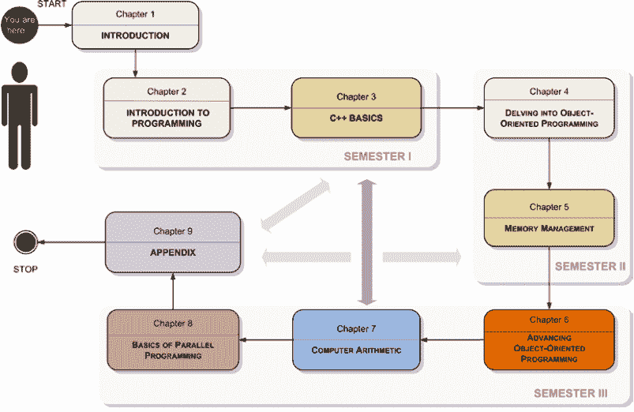

**Figure 1.1** 本书结构示意图，以统一建模语言（UML）状态图的形式呈现。第 2 章和第 3 章介绍基础知识。高级层次由第 4、5、6 章构成。随后是第 7 章，涉及计算机算术，以及第 8 章，涉及并行编程。附录可从前述各章节中引用。

- 第 2 章：“编程入门”——介绍编程的基本概念。我们先呈现硬件模型，以便理解程序的运行机制。随后介绍 C++ 开发生态系统、在线编译器以及集成开发环境（IDE）平台，并给出三个示例项目，主要集中在单个 `main` 函数内的计算，使用非常有限的语句和运算符。STL 中的 `std::cout` 和 `std::cin` 对象分别代表屏幕输出和键盘输入。最后的示例引入了 `std::vector` 和 `std::string`，分别表示动态数组和文本字符串表示。虽然范围有限，但本节介绍的 C++ 机制足以编写大量简单程序。
- 第 3 章：“C++ 基础”——为 C++ 编程的基础但极其重要的特性提供扎实的入门。首先讨论内置数据类型及其初始化方式。随后更详细地介绍 `std::vector` 和 `std::string`。后续章节介绍 `auto` 关键字、一些 STL 算法的入门、结构和类、固定大小数组 `std::array`、引用、指针、语句、函数（包括 lambda 函数）、使用 `std::tuple` 的元组以及结构化绑定，以及运算符。配有许多小示例，并展示了三个相对简单但完整的项目：矩阵表示、二次方程类以及一个包含两个自定义类的项目，用于货币的表示和交换。本章的目标是教学如何正确创建和使用一个类及其成员数据和成员函数。
- 第 4 章：“深入面向对象编程”——致力于掌握 C++ 的中级和高级技术，特别强调面向对象设计（OOD）和面向对象编程（OOP）。在讨论主要

此外，重要的是要认识到，以线性方式呈现高度详细的编程主题基本上是不可能的。因此，某些结构虽然在特定上下文中使用，但可能在第一次阅读时不易理解，而会在后续章节中解释。

## 1.2  格式约定

为了便于阅读，本书使用了几种不同的格式，如下所示：

- 项目符号用于某些章节的开头和结尾，以介绍该章节将涉及的关键编程结构和/或技术。
- C++ 代码使用颜色来强调不同的语言类别。然后以浅蓝色背景和编号行显示，如下例所示。

清单 1.1  本书中使用的 C++ 代码格式示例（来自 *main.cpp*）。

```cpp
#include <iostream>

int main()
{
    // Display a message in the terminal window
    // Prefix std:: tells us to use objects from the standard library (SL)
    std::cout << "Good day to you!" << std::endl;
}
```

然后，*终端窗口*（也称为*控制台*或*命令行*）中的输出也会以彩色背景显示，如下所示：

```
Good day to you!
```

白色背景上的代码要么是较旧的 C 语言遗留代码（如附录 A.2 中所示），要么是出于某种原因不建议在 C++ 中使用但作为某些现象解释的一部分而展示的代码。这样，我们可以轻松区分这两种类型的代码。

每个代码片段的开头都有一个标题，例如前面示例中的清单 1.1。它描述了代码的意图，并且——如果代码来自某个项目文件——会包含包含此代码的文件名，放在括号中并以斜体书写，例如 *main.cpp*。为了提高可读性，较长的代码部分通常会被拆分成多个较短的代码片段。在这种情况下，标题只包含一次，位于第一个片段上方，并且行号会一直持续到整个代码组件的末尾。

- 大多数代码清单中的行都有编号。这些编号随后使用方括号 [] 引用。例如，在清单 1.1 中，标准 *iostream* 头文件包含在第 [1] 行，main 函数在第 [3–8] 行定义，第 [5, 6] 行包含注释，在 C++ 中注释以双斜杠 // 开头。为了强调后者的重要性，注释使用红色显示。
- 诸如 `std::cout` 对象（表示屏幕）之类的代码使用特殊的等宽字体书写。另一方面，文件名（例如 *iostream* 和 *main.cpp*）使用斜体字体。
- 展示了属于标准库的许多函数和对象。正如我们已经看到的，可以通过 `std::` 前缀轻松区分它们。然而，前缀可以

理解思路后，尝试编写自己的版本。完成后，尝试让它运行；如果不确定某些内容，请参考书中的示例。然后更新你的解决方案并再次尝试。

- 编译代码并查看其作用的最快方法是将代码（仅代码，不包括格式字符或行号）复制到某个在线编译系统中——更多内容请参见第 2.4.2 节。这种方法效果不错，但仅适用于相对较小的项目。此外，在线平台在输入和输出操作（例如写入文件）方面存在一些限制。
- 对于较大的项目，推荐的方法是在你自己的计算机上使用你的编程工具自行构建项目。为此，需要两样东西：一个相对较新的 C++ 构建环境（例如 IDE，如第 2.4 和 2.5 节所述）；以及 CMake 工具（如附录 A.6.1 所述）。虽然仅使用 IDE 就可以在本地构建项目，但考虑到许多操作系统、编程平台、工具、源代码版本等，CMake 极大地简化了这一过程。它也是事实上的行业标准，值得了解。此外，一些 IDE 包含 CMake。
- 由于软件不断演进，书中的代码与代码库中的代码可能存在差异。因此，对于编程技术和 C++ 特性的解释，应参考书中的代码。然而，要构建项目的最新版本，应使用代码库中的代码。

现代 C++ 编译器堪称杰作。例如，在构建完整可执行文件之前，现代编译器甚至可以预编译部分代码；然后编译器可以立即执行这些代码，以计算在此阶段可获得的任何结果，这些结果随后可以直接放入最终代码中，以避免运行时计算。我们还将讨论如何利用这些特性。然而，如果某些内容不正确且代码无法编译，有时很难找出原因，更重要的是，如何解决它。编译器试图准确地告诉我们哪里出了问题。但由于错误可能发生在任何地方和不同层面，错误消息可能真的令人费解。编译器还远不能确切地告诉我们如何摆脱困境。也许人工智能会在这方面带来新的可能性。目前，诸如 C++20 中的概念（concepts）之类的语言特性已经可用。一如既往，一些经验和与全球编程同行的交流是最好的帮助资源。

那么，如果代码无法编译，我们该怎么办？——以下是一些给初学者的提示：

- 首先，不要在不检查代码是否能编译的情况下编写大段代码。更好的方法是组织你的代码，如果可能的话，甚至可以稍微非线性地组织：例如，编写一个只提供参数的空函数，然后编译。然后写几行，同样非线性地（例如一个空循环），看看它是否能编译。添加更多行，编译，依此类推。在每个阶段检查错误；如果出现错误，修改代码使其编译。
- 当你遇到编译（或链接）错误时，始终将错误窗格滚动到顶部，只检查第一个错误。通常，其余错误只是编译器在第一个错误上出错的结果。
- 仔细阅读每条错误消息。如有必要，将其复制到编辑器中并拆分成几部分，以便更好地理解。错误消息包含代码，因此你始终可以通过引用此类代码在互联网上查找：例如，“error C2628: 'MonthDays' followed by 'void' is illegal (did you forget a ';'?))。是的，确实，我忘了在 MonthDays 结构定义之后加上分号 ;。在这种情况下，添加缺失的 ; 解决了问题。但这很容易。
- 有时错误的原因是一个字母、一行、一个函数等，就在编译器指示的错误行之前几行。如果你因错误而困惑，请尝试检查指示位置之前的几行。
- 在互联网上搜索线索。诸如 [http://stackoverflow.com](http://stackoverflow.com)、[http://codeguru.com](http://codeguru.com) 等页面提供了许多来自熟练程序员的实用建议。但是，请始终检查给定帖子的日期——网上也有很多过时的信息！
- 如果一段代码始终无法编译，而你完全不知道发生了什么，请暂时禁用它。这可以通过注释掉它来实现，即在行前放置 `//`，或者用 `#if 0 temporarily_disabled_code #endif` 指令将代码括起来。如果其余部分可以编译，则缩小禁用区域，然后再次检查。
- 代码可以用多种方式编写。例如，循环有多种类型；switch-case 语句可以用 if-else 等编写。然而，在找出并理解代码为何无法编译之前，不要放弃不编译的代码。这可能需要一些时间，但这样你就能学到东西，并在将来遇到类似问题时避免浪费时间。只有在你*理解*了自己做错了什么之后，才应该考虑使用另一种或更好的语言结构。
- 最后但同样重要的是，咨询你在大学或邻桌工作的同事，或者询问你的老师——给他们发电子邮件、征求意见等。沟通总是好的。


为了创建计算机程序来解决给定任务，我们需要指定计算机必须为我们执行的操作。这些知识来自问题分析，有时这是软件创建过程中最困难的阶段。一旦我们知道了这些操作，就需要以一种计算机——即其处理器——能够理解的形式编写出来。尽管每个处理器都有自己的语言，称为汇编语言或机器语言，但这些语言过于原始，人类无法有效地用于编码。相反，许多高级计算机语言为此目的而被开发出来。C++ 就是其中之一：它广为人知；拥有最好的工具和库；并得到 C++ 社区的有力支持，该社区拥有多年的使用经验。

C++ 拥有数百种特性，可以通过多种方式将我们的期望转化为计算机能够理解的最佳表示。学习 C++ 的特性是一项有趣的努力，但可能很耗时。然而，了解 C++ 的某些选定部分将使我们能够编写大量程序。在本章中，我们将介绍 C++ 编程的入门知识。首先，我们将讨论硬件-软件生态系统。更准确地说，我们将介绍构成理解软件如何运行及其开发过程基础的计算模型。

计算机是高度集成但也非常复杂的系统，由数十个芯片组成，每个芯片又由数千个晶体管等构成。建模——即创建模型——是简化现实以揭示解释该现实某些部分所必需的一些最重要特征的过程。图 2.1 描绘了一个计算机系统的计算模型，该系统配备了多核处理器、主存、系统支持芯片组，以及许多连接的外部设备，如键盘、屏幕、磁盘和网络设备。

中心部分构成一个带有多个内核的处理器，这些内核本身是独立计算单元。最重要的外部模块是主存，它包含代码和数据。这种组织方式遵循了公认的冯·诺依曼计算机体系结构。

除主处理器外，图形处理单元（GPU）上的内核也可以进行计算，GPU 还配有自己板载内存。虽然我们不会在编程练习中直接涉及这个平台，但最好知道其原生编程语言是 C 和 C++。

图 2.1 计算机系统模型。中心部分由一个带有多个内核的处理器组成，这些内核是独立计算单元。处理器通常配有系统支持芯片组，负责与处理器外部的各种模块进行接口。最重要的是包含代码和数据的主存。除了带内核的主处理器外，图形处理单元（GPU）中的内核也可以执行计算。

图 2.2 描绘了一个具有多种内存类型的多核处理器模型。多核处理器有一系列板载内存缓存，并连接了一个外部主存模块。现在我们将从计算的角度解释这些硬件组件的功能。

算术逻辑单元（ALU）是每个内核的核心，执行基本的低级操作。这些操作以存储在内存中的二进制编码命令的形式存在，经解码后告诉 ALU 要做什么：例如，对存储在其他内存区域中的值进行操作。这些命令以称为机器语言的编码形式存在，人类无法阅读。它们可以用等效的汇编语言表示，汇编语言可以被人理解，甚至在极少数情况下用于编写软件；然而，每个处理器都有自己的机器语言，因此用汇编编写既繁琐又容易出错，而且完全依赖硬件。幸运的是，如今我们可以借助 C++ 等高级语言来避免这种不便。这些语言更容易为人类理解，并且与处理器和操作系统无关。此外，借助编译器，用它们编写的代码可以轻松地转换成几乎任何已知的机器表示。

如图 2.2 所示，ALU 通常对内核寄存器的某个特定块具有相对有限的访问权限。具体取决于处理器，这些寄存器是少数几个内存位置，只能存储非常有限的计算机字，主要用于 ALU 操作。除了通用寄存器之外，还有两个特殊寄存器：PC，即程序计数器，指示所执行代码的当前位置；以及 SP，即栈指针，指向一个称为*栈*的外部内存区域，该区域包含过程的返回地址，有时也包含调用参数（参见第 3.14.3 节）。图 2.2 还显示了两个特定标志：零标志（Z）和进位标志（C）。实际上，它们是众多标志中的两个，通常编码在某个控制寄存器的特定位中。我们特别强调它们，是因为它们有助于理解本书第 7 章讨论的一些数值运算。

L1、L2 和 L3 是称为*内存缓存*的内存块，它们具有不同的大小和访问时间。它们的特征在于，离 ALU 越远的内存缓存，容量越大——但访问时间也越长。这个特定的容量-速度三角形的最末端是主存：其容量比内存缓存大几个数量级，但访问时间也最长。这是由用于制造它们的硬件技术决定的。寄存器和缓存是处理器（内核）的内部内存。但这是*外部主存*，在冯·诺依曼架构中，它包含程序编译后的全部可执行代码以及大部分数据。更准确地说，这是*运行内存*，与磁盘存储不同，处理器可以直接寻址它来执行程序。从*编程*的角度来看，重要的是要认识到，要访问

> 1  第二种类型是哈佛架构，其中内存被严格划分为代码内存和数据内存。这种架构有时用于数字信号处理器（DSP），以增加信号总线为代价来实现单指令多数据（SIMD）策略。参见 https://en.wikipedia.org/wiki/Von_Neumann_architecture。

运行内存中的任意单元，需要处理器和芯片组处理以下两条专用信号总线：

+   - **地址** – 该总线的所有信号指定要访问的内存单元的位置。由于历史原因，可寻址的最小单元是一个字节，即 8 位数据。*逻辑地址*对应于 C/C++ 指针。
+   - **数据** – 这条双向总线包含要从内存读取或写入内存的数据。

我们要强调，这种*扁平内存模型*极大地简化了硬件中的真实情况。简而言之，在许多当代体系结构中，数据总线为 32 位或 64 位长。这些字节的偶数倍被称为*计算机字*。如前所述，逻辑地址可以引用单个字节，但由于数据总线的宽度，内存访问与字操作有关。因此，较低的地址位不必直接设置在总线上。再加上内存分页和地址转换前瞻缓冲区（TLBs）机制，这使常见体系结构中的物理线路数量通常在 40–52 之间。然而，这种扁平内存模型是硬件体系结构多样性与软件视角所见之间的合理折衷。例如，使用这种方法，内存空间中的对象放置和初始化可以按图 3.1 所示进行解释。

另一方面，快得多的缓存内存无法从 C++ 程序直接寻址。没有必要这样做，因为缓存只存储主存中数据的副本以允许更快的访问。不过，通过在运行内存中适当放置数据，可以在执行 C++ 程序时有效利用它们。我们将在第 8 章讨论内存访问和内核并发操作时解决这些问题。

在对现代计算机体系结构做了简要介绍之后，请注意，较旧且较简单的处理器体系结构通常基于简单的 ALU、少量寄存器、无内核且无内存缓存。所有这些特性使我们甚至能够以多线程方式运行 C++ 程序。因此，连接外部内存的简单处理器构成了一个更简单但仍高度可用的计算模型。由于成本较低且通常能耗较低，这种方法仍用于某些嵌入式平台。后者在软件设计方面也是一个问题。

在这篇介绍中，我们只涉及了计算机体系结构和计算编程模型领域。尽管如此，这一讨论将有助于理解本书后续章节中讨论的编程技术。如需进一步阅读，我们推荐 Patterson 和 Hennessy (2018) 以及 Bryant 和 O’Hallaron (2015) 的著作。

## 2.2  软件开发生态系统

软件使计算机运行。另一方面，计算机又用于软件开发。这种二元性可以在图 2.3 中观察到：它展示了软件开发生态系统，其中的元素将成为本书后续章节的主题。让我们简要描述每一个元素。

图 2.3 所示的第一步是软件设计和编码。虽然这些是此图中的第一步，但我们很快就会发它们是一个非常重要——也许是最重要——的软件开发概念阶段的终点。在部分代码完成后，需要将其转换为处理器能够理解的形式，如后文所述


**软件开发过程**

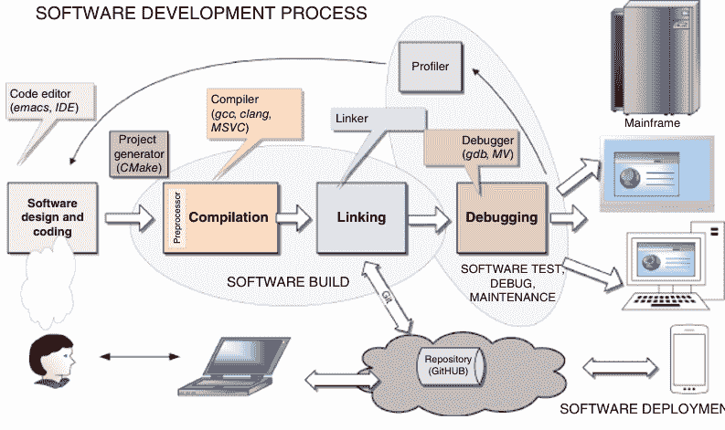

**Figure 2.3** 软件开发生态系统。

要执行用 C++ 编写的软件，需要由编译器将其翻译成机器表示形式。由于软件可以分段创建，并可以使用已创建的库，所有部分都需要合并为一个可执行文件。这由链接器完成。这些就是软件构建阶段。随后，可执行文件需要进行适当的测试和调试以消除故障。然后，通过启动分析器（profiler）可以进一步优化当前版本的运行情况。分析器的作用是测量软件组件的性能，以发现热点——即消耗最多执行时间的代码片段。之后，整个软件开发过程可以重复，以构建下一个更好的版本。在此过程中，我们不能忘记保护和控制软件的版本。这可以通过使用源代码控制和平台实现版本控制来实现。软件准备就绪后，可以部署到具体的硬件平台。

前一节所述。将 C++ 语言转换的过程通常由一个众所周知的*编译器*程序完成。与操作系统并肩工作，编译器是非常复杂且精密的程序，正如我们将在许多场合看到的那样。在 C++ 环境中，软件组件可以独立创建；为了构建最终程序，这些碎片需要被组合在一起。这一任务由*链接器*完成。链接器成功运行后，我们得到一个可以由计算机执行的代码组件。

然而，我们距离完成工作还有几步。事实上，新的开发阶段开始：代码测试和调试。即使是短程序也可能实现复杂概念，我们不应幻想从头开始就能写出正确的版本。因此，我们还应编写能够监控其他软件运行的软件。例如，*单元测试*（unit tests）就是其中一种，后文将进一步讨论。当发现软件问题时，可以使用*调试器*（debugger）逐行运行程序。这是我们工具链中的第三个程序；除了逐行代码执行外，它还允许我们设置断点、检查变量值、查看内存区域和调用栈，甚至（如有必要）检查处理器寄存器。调试是了解代码行为的最佳方式，因此在本书所提供的代码示例开发过程中，我们广泛使用调试器。

软件可以拥有不同的配置和版本。虽然可能有许多配置，但通常有两种截然不同的模式：

- **Debug** – 通常未经优化的软件版本，用于“内部”测试和调试
- **Release** – 经过密集测试的稳定版本，完全可操作、优化，并面向最终用户分发

假设我们已经获得了软件的稳定版本，便可以运行真实计算。在许多情况下，性能仍不理想，出现执行时间过长或卡顿的问题。可以借助*分析器*（profiler）来改善这种情况。分析器负责测量软件组件的性能，并在不同层次上发现*热点*——即消耗最多执行时间的代码位置。这些代码片段可以通过其他算法或*重构*（即重新设计和重新实现）进行优化，必要时转为*并行*版本。随后，我们可以重复整个软件开发过程，构建软件的下一个更好版本。

在软件开发周期中，我们不能忘记保护和控制软件的版本。这可以通过本附录第 A.6.2 节讨论的源代码控制和平台实现版本控制平台来实现。

软件准备就绪后，可以部署到具体的硬件平台。软件与硬件（S/H）依赖程度是软件特性的函数。即，某些程序几乎可以在任何硬件平台上运行，而其他程序则需要显著的计算能力，或针对特定显示器进行调优。因此，如果合适，这些特性应在软件开发步骤中考虑进去。

因此，软件开发过程如同螺旋：同一任务会反复进行，直至获得满意解决方案。换句话说，我们在直径逐渐增大的循环中操作。确实，我们进入了*螺旋开发模型*，这是许多公司所采用的公认软件开发策略。如果组织得当，这种方法在实践中可高度高效。下一节将更详细地探讨软件开发步骤。

最后，请注意，图 2.3 中的编程生态系统仅展示了一位人——但软件开发与构建通常需要团队协作。编程书籍中常被忽视的人因素，却可能对任何项目的成功或失败产生重大影响。虽然本书不涉及这一严肃问题，顺畅运作仍需项目组织与协作（McConnell 2004）。在一定程度上，这些工作得益于 C++ 项目的模块化结构，以及像 Git 和 GitHub 这样的源代码版本管理工具（如图 2.3 所示）。

### 2.3 软件开发步骤

正如设计房屋、桥梁或汽车一样，软件设计也有多种方式。然而，在所有情况下，最终衡量产品成功或失败的标准是最终产品的性能。与其他工程领域一样，基于多年经验和数千个项目的积累，一些常见规则可以帮助我们避免未来设计中的常见陷阱。如图 2.4 所示，这些软件开发步骤已被描绘出来，我们将逐一重点关注每个步骤。

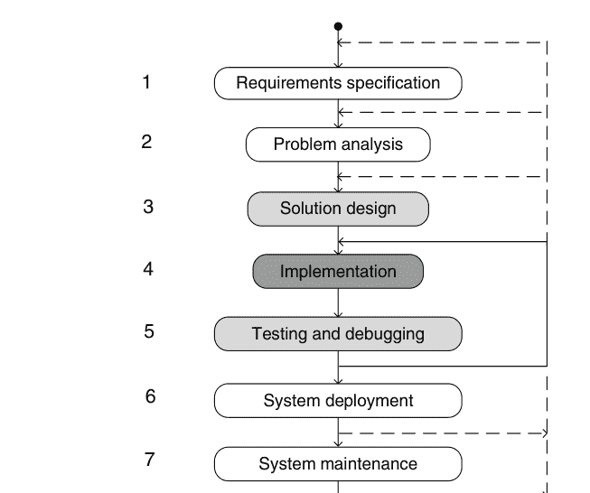

本书主要关注正确的 C++ 实现，但 flawless design 本身并不保证实现的良好，且即使实现良好，若缺乏广泛测试，也无法保证解决方案的成功。因此，尽管 C++ 是本册主题，我们也会关注其他软件开发步骤。下面按图 2.4 的顺序简要说明每个步骤：

1. _Requirements specification_ – 定义需要解决的主要任务、产品功能与应用，以及可接受的成本和预期完成时限。此阶段需要多方合作，如终端用户、系统架构师、管理者等。（Dick et al. 2017）
2. _Problem analysis_ – 在前一步的基础上，建立系统的主要关系，识别关键过程的治理规则，找出最困难的组件，并草拟关键算法的主要阶段，特别关注最具挑战性的部分。在某些情况下，这一步可能是最费时且繁琐的，需要跨领域专家的参与。
3. _Solution design_ – 基于前两步，确定整个系统的架构，考虑所有组件及其接口，并制定工具与实现策略。常伴随绘制甘特图（Gantt charts），以捕捉系统实现阶段之间的依赖关系、人力资源、时限及里程碑。
4. _Implementation_ – 依据前几步进行软件创建，产生的主要成果是源代码。可根据源代码构建可执行文件，如图 2.3 所示。


## 2.4 表示与运行算法

最后，在本节中，我们将实现一个 C++ 程序。该程序会要求用户输入一个数字，并在检查其是否为正值后，显示该数字的平方根。也就是说，如果输入 16，将显示 4，依此类推。然而，在我们进入 C++ 代码（算法表示形式之一）之前，先来思考一下什么是算法，以及表达算法的方式。

在本节中，我们将学习以下内容：

- 什么是算法，以及如何表示它
- 什么是统一建模语言（UML），以及 UML 活动图可以表示什么

算法描述了执行的步骤。算法不仅在计算机科学中经常遇到，在日常生活中也很常见。例如，每个办公室的火灾报警说明都提供了发生火灾时应遵循的步骤；选择洗碗机上的某个程序则指定了机器清洗我们珍贵玻璃器皿所要执行的步骤；等等。

很大程度上取决于我们所处的抽象层级。计算机科学中经常遇到抽象的概念：在表示算法时，它只是告诉我们需要多少细节层次。在某些情况下，尤其是当我们希望查看算法的整体形式时，更倾向于使用较粗略的宏观层级，并且可以使用图像：更具体地说，是使用通用约定符号的图表。这类图表在许多领域都有使用，如电气工程和建筑学。在计算机科学中，我们很幸运地在 UML 的统一框架下拥有通用的图表系统（参见 http://uml.org 和 www.visual-paradigm.com）。UML 不仅仅是通用符号的简单集合——这一框架促进了整个软件开发过程，如图 2.4 所示。我们将在后续多次回到这个话题。不过，现在让我们展示表示我们程序所需步骤的 UML 活动图，如图 2.5 所示。

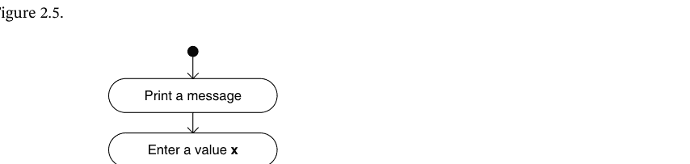

基本上，图 2.5 中有两种类型的符号。动作位于圆角矩形中，决策块位于菱形中。带箭头的线表示控制流。因此，此类图有时被称为流程图。通常，在简单的图中，主流程从上到下进行。但请注意，流程可以很容易地被重定向，形成执行中的循环。还有黑色圆形符号分别表示动作的开始和结束。虽然简单直接，但结束符号提醒我们算法设计中一个非常重要的问题：*停机问题*。简而言之，这意味着一个设计良好的算法应该有明确的停止条件，即它不应该在未定义的状态下永远挂起。某些软件（如操作系统）以无限循环运行；但它绝不应使自己处于未定义的状态或行为中。

请注意，在图 2.5 中，整个程序可以一目了然。但同时，这些步骤表达了某些一般性动作，如“计算 sqrt(x)”，而没有深入细节。这就是我们所说的粗略层级，或更一般地称为*自顶向下*的方法。另一方面，进入细节意味着进入更细的层级：也就是“向下推进”设计。通常，这会涉及更多符号；为避免杂乱，这些通常会在单独的图中呈现。不过，在某些任务中，也可以从细节开始。这种*自底向上*的方法在我们领域中用处要小得多，通常会导致上层组件之间不能良好衔接的设计。

另一种表示算法的方式是伪代码。这是简单计算机命令与更通用语句的混合体，通常以人类可读的命令或短句形式书写。算法 2.1 展示了这种方法。

**算法 2.1** 一个用伪代码（编程命令与人类可读命令的混合）表示的计算实数值平方根的算法。

|  |  |
|---|---|
| **输入：** | 一个实数值 x |
| **输出：** | x 的平方根 |
| 1 | 如果 x ≥ 0 |
| 2 | &nbsp;&nbsp;&nbsp;&nbsp;打印 `sqrt ( x )` |
| 3 | 否则 |
| 4 | &nbsp;&nbsp;&nbsp;&nbsp;打印错误消息 |

最终的表示形式是计算机代码，如清单 2.1 所示。它可以被翻译成计算机可执行的格式并启动运行。

清单 2.1 中的代码实现了图 2.5 和算法 2.1 中所概述的内容。

### 2.4.2 使用在线编译器

在解释清单 2.1 中每一行代码之前，我们可以借助带有 C++ 编译器的在线平台来编译并运行其可执行文件，如图 2.6 所示。² 然而，在输入时，我们可能会犯错误，这种情况下代码将无法编译，平台会显示来自编译器的错误消息。为了修复问题，应仔细阅读该消息，看看问题是什么。但有时错误的精确位置可能难以确定，真正的罪魁祸首可能在编译器指示位置的上方几行。因此，我们还应该检查前面的行。

> ² 例如，要快速评估短程序，我们可以使用以下平台之一：[http://ideone.com](http://ideone.com)、[https://wandbox.org](https://wandbox.org)、[http://coliru.stacked-crooked.com](http://coliru.stacked-crooked.com)、[https://repl.it](https://repl.it)、[www.onlinegdb.com](http://www.onlinegdb.com) 或 [http://cpp.sh](http://cpp.sh)。


### Listing 2.1 main function for computing the square root of an entered value (from main.cpp).

```cpp
// This is a C++ comment in the program to compute the square root of a value

#include <cmath>    // A header for std::sqrt
#include <iostream>    // A header for std::cout, std::cin, std::endl

int main()    // A program in C++ consists of a function main()
{
    double x { 0.0 };    // Define and initialize a variable x

    std::cout << "Enter x=";    // Print a message
    std::cin >> x;    // Enter value of x from the keyboard

    if( x >= 0.0 )    // Check if x is positive
        std::cout << "\nSqrt(" << x << ") = " << std::sqrt( x ) << std::endl;
    else
        std::cout << "\nWrong value - cannot compute Sqrt\n";
}
```

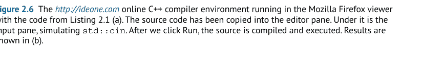

Online compilers are very useful when it comes to testing short code snippets, as frequently shown in this book. However, for larger, multi-file projects, we will frequently use an IDE to build executables.

## 2.4.3 Structure of a C++ Program

To understand the roles of the various code components, a simplified version of the C++ program has been extracted from Listing 2.1 and is shown and explained in Figure 2.7. A detailed description of the code from Listing 2.1 will be presented in the next section.

A program consists of a series of statements, separated by semicolons `;`. Forgetting this ending symbol is one of the most frequent errors in early programming. However, notice that there is no semicolon at the end of the block of the `main` function, which continues inside a region enclosed by braces `{}`.

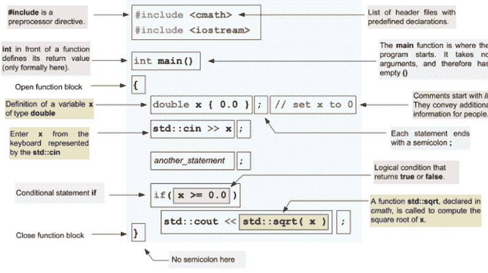

**Figure 2.7** Structure of a simplified C++ program that consists of a main function. Header files containing definitions of other components are brought into the program by the `#include` directive. Each statement, such as the `double x {0.0}` definition, ends with a semicolon `;`. However, there is no semicolon at the end of the function block, delineated with `{}` braces. The `std::cin` object represents a keyboard, whereas `std::cout` represents the screen for output. Inside `main`, other functions can be called to produce results, such as `std::sqrt(x)`, which computes the square root of a value x.

## 2.4.4 Code Analysis

Let’s return to the code presented in Listing 2.1. The first line [1] contains a simple comment: that is, text that is intended only as additional information for the programmers. In C++, comments start with two slash symbols `//` and end at the end of the current line. We will see more such symbols that are composed of multiple single characters – these are necessary due to the limited set of special symbols on the computer keyboard. Lines [3, 4] contain two `#include` statements, each followed by a file name in `<>` brackets. These are preprocessor directives, discussed in Appendix A.1, that effectively copy and paste the contents of the indicated file into the current position. This is done to introduce programming components already written by other programmers, which we can easily reuse rather than bothering with self-implementation. Examples are the `std::cout` object and the `std::sqrt` function, which we will use in upcoming lines. Fortunately, the whole copy-and-paste is done invisibly when compilation starts, so we do not see any clutter in our code.

In our example, the `main` function is defined on line [6], and its body – a set of code lines – is contained between the curly braces on lines [7–17]. `int` in front of `main` means it is supposed to return a value, but this is irrelevant in this case.

The first object, a variable named `x`, is defined and initialized on line [8]. We see that it is of the `double` type. It is used to represent floating-point numbers, which approximate real numbers, as presented in Section 7.4. The curly braces `{ 0.0 }` mean x is initialized with the value 0, which in the floating-point domain is precisely expressed as the 0.0 constant.

Line [10] instructs the computer to display the text `"Enter x="` on the screen, i.e. in a window. This is accomplished with the help of the `std::cout` object, representing the output stream (a screen), and the `<<` operator (again, two characters that together have a new meaning). The latter, in its default version, means a left-shift of bits in an integer; but we will see that in C++, operators can be assigned different meanings, depending on the context they operate in. This is quite a useful feature.

The opposite action is encoded on line [11]: the computer will wait for the user to enter a value of x. This is accomplished with the help of the `std::cin` object and `>>` operator, respectively. In effect, just after the user hits the `Enter` button, x will change its contents to whatever value was typed in.

However, not all values of x can be used to compute a square root. Therefore, on line [13], the condition `x >= 0.0` (that is, whether x is greater than or equal to 0.0) is checked with the `if-else` statement (Section 3.13.2.1). Then there are two options: either the condition is fulfilled, in which case the code from line [14] is executed; or it is false, and the alternative line [16], just after the `else` part on line [15], is executed.

Line [14] deserves a short explanation. It is a bit more complicated than line [10], since, in addition to text, it displays a series of objects. All of them are separated by the `<<` operator. `std::sqrt(x)` is a call to a function named `sqrt`, contained in the Standard Library³ – hence the `std::` prefix and the `#include <cmath>` – with x as its parameter. That is, once we know that x is positive, we call an already-written function that computes the square root for us. The question arises, what would happen if x was negative? It depends, but definitely nothing good. Such a situation is known as *undefined behavior* (UB), which we must avoid.

The last object sent to the screen on line [14] is `std::endl`. It instructs the computer (i) to put the caret on a new line and (ii) to flush the output, with the result that all of the symbols will be transferred to the screen. The first action, passing to the new line, can also be achieved by inserting `\n` to the text constant, as shown on lines [14, 16].

Finally, let’s explain the ubiquitous *scope resolution operator* `::` (two colons). It is used to access members of namespaces, such as data and functions, classes, as well as structures, as will be discussed later in the book. Its syntax is shown in Figure 2.8.

For instance, `std::cout` in the previous code means the cout object from the std namespace. The latter denotes the namespace of the Standard Library.

³ For more on the Standard Library, see https://en.wikipedia.org/wiki/C%2B%2B_Standard_Library and https://en.cppreference.com/w/cpp/header.

In this section, we will show how to build an application by typing a few commands in the Linux OS.⁴ Not surprisingly, actions to perform are also summarized in the form of an algorithm, as follows.

- Open a terminal window (in Linux, use the `Ctrl+Alt+T` shortcut)
- Run the `ls -l` command to list files and directories. The following is some example output:

  ```text
  boxy@PARSEC:~$ ls -l
  total 0
  drwxrwxrwx 1 boxy boxy 512 Aug 16 18:32 Desktop
  drwxr-xr-x 1 boxy boxy 512 Aug 16 18:32 Videos
  ```

- With the `mkdir` command, create a new directory, such as Projects, and list its contents:

  ```text
  boxy@PARSEC:~$ mkdir Projects
  boxy@PARSEC:~$ ls -l
  total 0
  drwxrwxrwx 1 boxy boxy 512 Aug 16 18:32 Desktop
  drwxrwxrwx 1 boxy boxy 512 Aug 30 19:51 Projects
  drwxr-xr-x 1 boxy boxy 512 Aug 16 18:32 Videos
  ```

- Go into Projects by calling `cd Pro*` (to save typing, the special glob character `*` is used, which substitutes for zero or more characters):

  ```text
  boxy@PARSEC:~$ cd Pro*
  boxy@PARSEC:~/Projects$ ls -l
  total 0
  ```

- Now type, or copy-paste, the code from Listing 2.1. To do so, we can call one of the installed text editors, such as GNU nano or emacs. However, to create a `sq.cpp` file, a simple `cat` command can be used. Just after typing `cat > sq.cpp`, paste the code from the clipboard (or type it), as follows:

  ```text
  boxy@PARSEC:~/Projects$ cat > sq.cpp
  // This is a C++ comment in the program to compute the square root of a value
  ```


## 2.5 示例项目 – 复利计算器

在本示例中，我们将编写一个简单的程序，以便于促进金融投资。假设我们有 1000 美元（原始本金），并希望安全地在银行以每年 3% 的利率进行投资。很容易确定，一年后我们将获得 1000 美元 × 3% = 30 美元，因此最终本金为 1030 美元。如果我们重复同样的操作呢？现在我们的初始本金为 1030 美元，一年后将获得 1030 美元 × 3% = 30.90 美元。这次我们赚得比第一年略多，因为我们以略高的本金开始。让我们编写一个 C++ 程序来完成这些计算。正如 Section 2.3 所讨论的那样，这些是我们的需求。但在编写第一行代码之前，我们应该花一些时间进行问题分析，如 Figure 2.4 所示。在此，我们将先编写一些简单的等式，指导我们的实现。

### 2.5.1 复利分析

已知初始资本记作 C₀，利率为 r，周期数为 t，利息的计算方式如下：

$$I_1 = C_0 \cdot r \cdot t$$  
(2.1)

因此，经过 t 期间后的新资本 C₁ 为 C₀ 与 I₁ 的和。C₁ 可以再次投资，以此类推。整个过程可以表示为：

$$\begin{aligned}
C_1 &= C_0 + I_1 = C_0 + C_0 \cdot r \cdot t = C_0 \cdot (1+r\cdot t)\\
C_2 &= C_1 \cdot (1+r\cdot t) = C_0 \cdot (1+r\cdot t)^2\\
C_3 &= C_0 \cdot (1+r\cdot t)^3\\
\cdots\\
C_i &= C_0 \cdot (1+r\cdot t)^i
\end{aligned}$$  
(2.2)

其中 r 表示在复利期间 t 的收入率。然而，银行通常以一年为基准提供 r 的值（即 12 个月），而一年内可能有多个复利期间。因此，我们需要更细粒度地设定基本单位为复利期间。换句话说，索引 i 表示已完成的完整复利期间的数量。例如，若我们投资 24 个月，复利期间为 4 个月，则会有 6 个期间。计算方法为 24/4 = 6。总体而言，期间数为 i = m/t，其中 m 表示总投资时间（以月为单位）。另一方面，每个期间的投资利率为 r/12 · t。例如，若 r 为 3% 且 t 为 4 个月，则该期间的利息为 0.03/12 · 4 = 0.01。于是我们得到以下方程，作为实现的基础：

$$C_i = C_0 \cdot \left(1 + \frac{r}{12}\cdot t\right)^{\frac{m}{t}}$$  
(2.3)

### 2.5.2 实现

```cpp
#include <iostream>
#include <cmath>

using std::cout, std::cin, std::endl;

int main()
{
    // 该程序计算复利利率
    cout << "Enter the initial amount to invest: " << endl;
    double C_0 {};    // 初始金额
    cin >> C_0;
    if(C_0 <= 0.0 )
    {
        cout << "Wrong value, exiting..." << endl;
        return -1;
    }
```

在第 [1] 和 [2] 行，我们包含了 C++ 标准库的两个头文件。借助这些头文件，我们可以使用已提及的 `std::pow` 函数，以及代表输出屏幕和键盘输入的 `std::cout` 与 `std::cin` 对象。为了避免在代码中不断重复 `std::` 前缀，在第 [5] 行我们通过 using 指令将标准输入输出对象的名称引入作用域（参见 Section 3.5）。

第 [9] 行开始定义 `main` 函数。C++ 应用程序必须恰好包含一个 `main` 定义。更多关于 `main` 各种形式的细节请参见 Appendix A.2.2。

在第 [12] 行，我们使用 `cout` 对象、<< 操作符以及引号内的文本常量来在屏幕上输出文本。<< 操作符的行为会根据其操作对象的类型而有所不同。endl 表示将光标移动到下一行并刷新屏幕。

在第 [13] 行，我们定义变量 `C_0` 用于保存初始金额。变量名非常重要，能够传递有用信息。虽然可以将其命名为 `initial_amount`，但在实现如 Eq. (2.3) 这样的公式时，保持与公式中元素对应的变量名通常更好。数学公式通常使用单个字母和下标，因此 `C_0` 这种命名方式合适。该变量可以存放任何正值，包括分数。因此我们选择 `double` 类型。`C_0` 在同一行通过 `{}` 初始化为 0。

随后，在第 [14] 行，我们等待用户输入初始资本的实际值。随后在第 [16] 行检查该值的合法性。若值不正确，程序在第 [19] 行输出提示信息并返回错误码 -1。检查用户输入的合法性是 C++ 代码中一个重要且常被忽视的步骤，始终保持安全是前提。C++ 提供更高级的错误处理机制，而不只是返回错误码，这些内容将在 Section 3.13.2.5 中讨论。

下面的代码展示了重复“打印、定义变量、等待输入、检查合法性”这一过程：

```cpp
// -------------------------------------------------
cout << "Enter the annual rate [% per 12 months]: " << endl;
double r {};
cin >> r;
if ( r <= 0.0 || r >= 100.0 )
{
    cout << "Wrong value, exiting..." << endl;
    return -1;
}

// -------------------------------------------------
cout << "Compound frequency is a period in months between computing interest" << endl;
cout << "(e.g. if 2 times a year, enter 6)" << endl;
cout << "If you don't know, enter 12 for a yearly compound frequency." << endl;
cout << "Enter the compound frequency [months 1-72]: " << endl;
double t {};
cin >> t;
if ( t <= 0.0 || t > 72.0 )
{
    cout << "Wrong value, exiting..." << endl;
    return -1;
}

// -------------------------------------------------
cout << "Enter the investment time [months 1-100]: " << endl;
double m {};
cin >> m;
if ( m <= 0.0 || m >= 100 )
{
    cout << "Wrong value, exiting..." << endl;
    return -1;
}
```

读取完所有数据后，我们开始计算，并在第 [58] 和 [59] 行分别定义两个常量。它们的名字直观地说明了各自的作用。正如我们所知道的，在 `double` 前加上 `const` 使变量只读。若省略 `const`，计算结果不会改变，但会降低代码对不良错误的抵抗力。因此，若某个值应保持不变，应使用 `const` 进行声明。

```cpp
// -----------------------------
// 进行计算

const double kMonthsPerYear   = 12.0;
const double kPercentageDiv   = 100.0;

double i = m / t;   // 复利期间数

double C_i = C_0 * std::pow( (1.0 + (r/kPercentageDiv) / kMonthsPerYear*t ), i);

cout << "Your balance before tax, after " << m;
cout << " months of investment is: " << C_i << endl;

// 计算净收入
double income = C_i - C_0;
```

第 [61] 行根据总投资月数 `m` 和复利期间 `t`（均以月为单位）计算出复利期间数 `i`。随后，第 [63] 行依据 Eq. (2.3) 计算最终金额 `C_i`。第 [65–66] 行在屏幕上显示计算结果。最后，第 [69–73] 行计算并显示收入以及税后收入。

```cpp
cout << "Your income is " << income << endl;
const double kIncomeTax = 19.0;              // 19%
cout << "After " << kIncomeTax << "% tax deduction you get: ";
cout << ( 1.0 - kIncomeTax / kPercentageDiv ) * income << endl;

return 0;
}
```

### 2.5.3 构建与运行软件

我们可以像 Section 2.4.2 所述，轻松在在线 C++ 编译平台上运行前面的代码。但要构建一个像系统中其他可执行程序一样的应用程序，则更为便利。以 Linux 为例，我们可以遵循 Section 2.4.5 中的步骤来构建 *CompInterest* 应用。不过，由于 Listing 2.2 中的代码仅使用标准 C++ 机制，该软件组件相对通用，若具备跨平台项目构建工具，便可在任何平台上运行。对于每个软件开发环境，我们可以手动创建相应的项目并构建应用。但考虑到平台和操作系统的数量众多，手动操作会十分繁琐。相反，我们可以使用 *CMake* 项目生成器。它能够自动为不同的开发平台和操作系统生成合适的项目文件，从而让当前及后续项目均能适配多种环境。我们只需安装该免费工具，编写 *CMakeLists.txt* 文件，其中包含指示 *CMake* 执行的命令（详见 Appendix A.6.1）。幸运的是，示例项目附带了合适的 *CMakeLists.txt*，可从 GitHub（https://github.com/BogCyg/BookCpp）下载其他源码。此外，所有我们的项目几乎使用相同的 *CMakeLists.txt* 文件。

构建完成 *CompInterest* 应用后，为了测试它，假设我们有 1000 美元，年投资利率为 2.7%，并希望投资期限为 4 个月。启动 *CompInterest* 后，利息的计算如下：

```text
Enter the initial amount to invest:
1000
Enter the annual rate [% per 12 months]:
2.7
Compound frequency is a period in months between computing interest
(e.g. if 2 times a year, enter 6)
If you don't know, enter 12 for a yearly compound frequency.
Enter the compound frequency [months 1-72]:
4
Enter the investment time [months 1-100]:
4
Your balance before tax, after 4 months of investment is: 1009
Your income is 9
After 19% tax deduction you get: 7.29
```

前面的 `main` 函数可作为类似程序的模板，用于读取数据、进行简单计算并输出结果。该项目也可作为移动平台 GUI 应用或 Web 组件的起点，后续我们会进一步讨论这些思路。 


在本节中，我们学习了：

- 如何使用 `int` 定义和初始化整数，使用 `double` 定义和初始化带分数的值，使用 `""` 定义和初始化常量字符串
- 常见的算术运算符 `+`, `-`, `*`, `/` 以及如何编写简单的表达式
- 如何使用内置的 `cout` 对象和 `<<` 操作符在屏幕上打印文本和变量，以及如何使用 `cin` 对象和 `>>` 操作符读取它们的值

## 2.6 示例项目 – 统计文本中字符出现次数

我们已经学习了如何表示简单算法、如何在在线平台中构建并运行它，以及如何创建可执行文件。我们还学习了 C++ 中的一些有用特性，例如 `main` 函数、变量的创建和初始化、输入输出对象以及条件 `if/else` 语句。在此部分，我们将通过添加 `for` 语句来实现软件循环，并使用容器来存储同类型对象。本节的示例展示了如何计算句子中字母 a–z 的出现次数直方图。

### 2.6.1 问题分析与实现

假设我们希望计算给定句子中字母 a–z 的出现次数直方图。我们从简单的例子入手，分析如何从单词 *Alcatraz* 构建该直方图（如图 2.9 所示）。

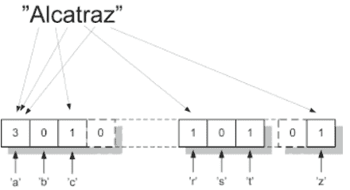

**Figure 2.9** 构建字符直方图：使用案例分析。每个 bin 包含特定字母的出现次数。

直方图是由 N 个 bin 组成的数据结构，每个 bin 保存特定事件的出现次数。每个 bin 对应一个特定的字母（在本例中）或其他事件。因此，直方图常用于测量事件出现的频率。

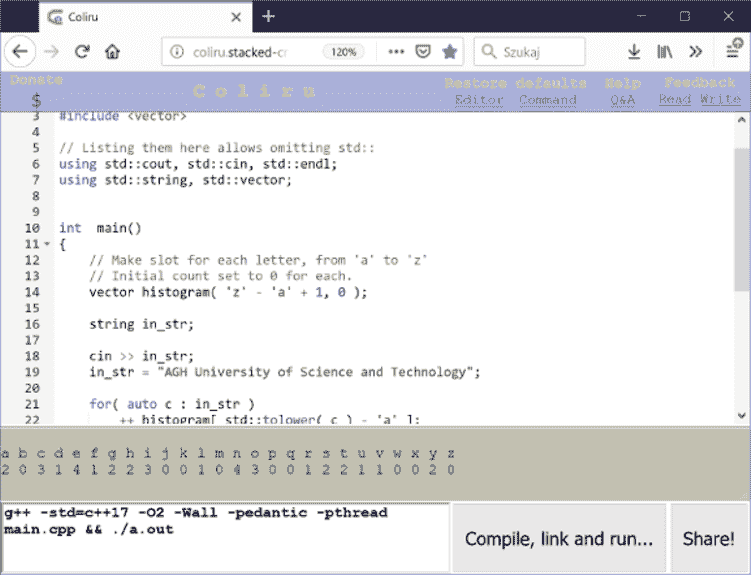

**Figure 2.10** Coliru 在线编译器环境（http://coliru.stacked-crooked.com）在 Mozilla Firefox 浏览器中运行，代码来自 Listings 2.3，已复制粘贴到编辑器区域。其下方是输出区域。左下角是用于构建并运行程序的命令行，右下角是操作按钮。

我们得到以下输出：

```
a b c d e f g h i j k l m n o p q r s t u v w x y z

2 0 3 1 4 1 2 2 3 0 0 1 0 4 3 0 0 1 2 2 1 1 0 0 2 0
```

即，每个字母都与其在输入句子中出现的次数相关联。

### 2.6.3 直方图代码解析

我们现在逐行解释 Listings 2.3 中的代码。在行 [1–3] 中，`#include <file_name>` 是包含头文件，其中 *file_name* 表示头文件名。如前所述，头文件包含已写好的代码，可用于简化编程工作。确定要为某个语言组件选择哪个头文件有时并不容易——最简便的方法是上网查找。这里我们包含 *iostream* 以使用 `std::cout` 和 `std::cin` 对象，分别代表屏幕和键盘。随后引入 *string* 文件，以使用 `std::string` 类存储普通文本。最后，包含 *vector* 文件，定义 `std::vector` 类，用于存储直方图。

接下来是实际操作。我们需要遍历 `in_str` 对象中的所有字符，并为对应的 bin 位置增加计数。如果字符是 'a'，则索引为 0；如果是 'b'，则索引为 1；如果是 'z'，则索引为 25，以此类推。对于 N 个元素，索引范围是 0 到 N-1。为了获取每个字符，在第 21 行创建一个 `for` 循环。循环内部使用 `auto c` 表示 c 会依次取 `in_str` 中的字符，位于冒号 `:` 的另一侧。因此，我们无需显式指定 c 的类型，编译器会根据 `in_str` 中连续字符的类型自动推断。

第 23 行在最近的 `for` 循环监督下执行。对于每个字符 c，我们通过 `c - 'a'` 计算其在直方图向量中的对应索引，然后使用 `++` 运算符使该索引处的值加 1。为了让大小写字母被视为相同，我们通过 `std::tolower` 函数将每个字符 c 转换为小写（这里必须显式写出 `std::` 前缀，因为 `std::tolower` 尚未通过 `using` 引入）。

在第 25 行，为了将输出窗口的提示位置重置到下一行的开头，向 `cout` 发送 `endl` 对象。

第 27–28 行展示了另一个 `for` 循环。其目的是在屏幕上打印所有字母。本次 `for` 循环由三个用分号 `;` 分隔的字段组成。第一部分 `auto k { 'a' }` 仅在循环开始时执行一次，创建一个初始值为 'a' 的对象 k。第二部分 `k <= 'z'` 在每次迭代时检查；如果条件满足，则执行第 28 行，仅打印字符 k 后跟一个空格。紧接着执行第三部分，即 `++k` 表达式，使 k 前进一个字符代码，即进入下一个字母。循环在条件不满足时终止，随后执行循环后的下一行代码。如果在每次迭代中需要执行多条语句，可以使用花括号 `{}` 将它们组合成块。

最后，第 32–33 行的循环用于显示直方图的计算结果。同样使用 `for` 循环的第一种形式，因此每次迭代中 h 获取直方图对象中连续元素的值。

```
for( auto c : in_str )    // c takes on successive letters from in_str
    if(std::isalpha( c ) )    // isalpha( c ) returns true if c is alphanumeric
        ++histogram[ std::tolower( c ) - 'a' ];// ++ adds 1 to the letter position
cout << endl;
```

```
for( auto k { 'a' }; k <= 'z'; ++k )    // c takes on codes from 'a' to 'z'
cout << k << " ";    // Print all characters 'a' to 'z'
```

```
cout << endl;
for( auto h : histogram )    // h takes on successive values of the histogram
    cout << h << " ";    // Print histogram values
```

这就完成了。我们可以通过复制代码、修改某些部分并进行实验来进一步使用这段代码。同时，继续阅读后续章节，因为本节中使用的所有构造都将在后续章节中详细解释。

在本节中，我们学习了以下 C++ 编程要素：

- 如何实现一个简单的 C++ 程序
- `int main()` 函数的用途
- 何时以及为何需要 `#include` 头文件
- 程序开头需要放置的 `using` 指令
- 如何使用 `std::vector` 定义简单的元素数组
- 如何从键盘输入文本并存储在 `std::string` 对象中
- 如何通过 `auto` 关键字实现对象类型的自动推断
- 如何使用 `for` 语句实现循环
- 如何使用 `if` 语句检查逻辑条件
- 如何调用预定义的文本处理函数，如 `std::isalpha` 和 `std::tolower`

接下来的章节将在进一步示例中巩固这些技术。

## 2.7 小结

### 需铭记的要点

- 在开始设计之前，先分析问题
- 在实现之前，先做好设计。优先采用自顶向下的方法
- 了解你的硬件，并记住其局限性。同时了解你的软件开发工具
- 本章的项目可作为简单 C++ 应用的蓝图
- 可能的话，使用标准库中的对象
- 保持对象处于有意义的状态
- 用简洁、有意义的注释文档化你的代码
- 理解你的代码
- 持续提升你的编程技能。阅读书籍和博客。了解你的编程环境

## 问题与练习

1. 两个正整数 a 和 b 的*最大公约数*（GCD）是能够同时整除它们且不留余数的最大整数。其解法基于欧几里得算法（https://en.wikipedia.org/wiki/Euclidean_algorithm）：

**Algorithm 2.2**  用于求两个数的最大公约数的欧几里得算法。

|  |  |
|---|---|
| 输入： | 两个正整数：a, b |
| 输出： | GCD ( a, b ) |
| 1 | `while b != 0`  (只要 b 不为 0 就循环) |
| 2 | `tmp ← b`  (将 b 复制到临时变量 tmp) |


1. a. 在纸张上写出一个例子：例如，设置 a = 255，b = 221。
   b. 实现算法 2.2。提示：要实现循环，请使用语句 `while (b != 0)`，或 `for ( ; b != 0 ; ) { loop statements 2-4 }`。
   c. 通过设置不同的 a 和 b 的值来验证程序的操作。

2. 分析下面的二分查找算法，用于计算整数值的平方根近似值。
   a. 编写算法 2.3 的实现。
   b. 将返回的值与 Listing 2.1 中的代码产生的值进行比较。

3. 二分查找算法还有其他用途。它有助于在单调值上的搜索任务（https://en.wikipedia.org/wiki/Bisection_method）。使用二分查找算法找到函数的根（即其零点）。

4. 在使用 `std::cin` 对象输入值时可能会出现问题。例如，在 Listing 2.2 的第 14 行，系统期望输入数值，但用户可能输入 `abc`。为防止此类错误，可以检查读取操作的状态，如下代码片段所示：

```cpp
if( ! ( cin >> C_0 ) )
{
    cout << "Error entering a value\n" << endl;
    return -1;
}
```

使用此方法，更新 Listing 2.2 和 2.3 中的读取行代码。

5. 重构 Listing 2.3 中的 *CharHistogram* 源代码，使其以 `*` 符号组成的垂直条形输出直方图，而不是输出出现次数的数字。

6. 二次多项式可以表示为：

$$ax^2 + bx + c = 0$$

其中 $a$、$b$ 和 $c$ 表示实系数。问题是是否存在满足该方程的 $x$ 值。如果存在，则称其为二次多项式的 *根*。要判断是否存在根，只需计算二次系数 $d$：

$$d = b^2 - 4ac$$

如果 $d \ge 0$，则可以计算方程 (2.4) 的解（即根）如下：

$$x_1 = \frac{-b-\sqrt{d}}{2a}, \quad x_2 = \frac{-b+\sqrt{d}}{2a}$$

否则，无根。编写一个 C++ 程序，提示用户输入三个系数 $a$、$b$ 和 $c$，判断是否存在根，并在可能的情况下计算它们。首先将前面的公式转换为等价的 C++ 表达式，然后加以适配。

7. 实现 *Secret Chamber* 游戏 – 其 10×10 网格棋盘如下所示。

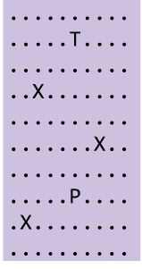

你可以上下左右移动玩家 ‘P’，每次只能移动一格（例如，按 ‘U’、‘D’、‘L’、‘R’ 键）。当你将 ‘P’ 移动到宝藏 ‘T’ 上时获胜；如果移动到陷阱 ‘X’ 上则失败。每回合 ‘X’ 可能随机移动一格。注意不要越出棋盘范围。

8. 计算两个正整数值的和。但是和以字符串形式给出，例如 “123 + 37”、“78 + 99” 等。编写一个程序，完成以下步骤：
   a. 提示用户输入字符串；
   b. 删除字符串中的多余空格；
   c. 从字符串中提取代表两个参数的子字符串，例如 “123” 和 “37”；
   d. 将这两个子字符串转换为整数值，例如 “123” 变为 123 等；
   e. 打印两个值的和；
   f. 将解决方案扩展以处理可能的错误。

9. 比较文本的一种简单方法是比较它们的字母出现直方图。长度相同的两个直方图可以通过求对应 bin 值平方差的和来进行比较。
   a. 扩展 Listing 2.3 的程序，计算并比较两段文本的直方图。
   b. 测试你的比较过程，使用几段段落。
   c. 若在比较前对直方图进行归一化可获得更好结果。归一化后，直方图中所有 bin 的总和为 1.0。归一化方法是将每个 bin 值除以该直方图中所有 bin 的总和。提示：在第 2.3 条的第 14 行，将直方图向量的初始化值从 0 改为 0.0，使其存储浮点数值。

本章介绍了 C++ 编程语言的基础。我们将学习的顶层编程主题包括：

- 常量、变量、`auto` 和内置数据类型
- 标准库中的常用容器和算法
- 数据结构的基础及其初始化
- 类的入门介绍
- 使用引用间接访问对象
- 使用指针间接访问对象
- C++ 语句
- 函数、向函数传递对象以及 lambda 函数
- C++ 运算符

我们将分析并详细实现若干项目，这些项目我们希望能够引起兴趣。目标是展示一些编程技术以及 C++ 特性的实际运用。

为了进行计算，我们需要表示数据并定义对其进行的操作。数据存储在计算机的专用内存区域中，我们称之为 *对象*，但我们稍后会扩展这一概念。所有计算机语言都有预留足够内存、初始化这些对象以及读取或写入它们的方法。然而，它们都需要一种访问方式。这种访问可以是：

- *直接*：通过为对象提供直接的名称，或
- *间接*：通过提供对对象的链接（引用或指针）

对象可进一步分为以下两类：

- *可变* – 创建并初始化后，这些对象可以进一步被修改。变量属于这一类。
- *不可变* – 这些对象在创建并初始化后不能被修改，称为常量。

不久我们将看到，对象可以包含操作，这是面向对象编程的一个范式。但本节将专注于数据表示方面。

图 3.1 显示了变量（对象）创建和初始化的三个阶段以及它们在计算机内存中的印记。在原始内存中，每个字节的值未定义（a）。通过指示计算机执行 `char c` 来定义变量，会在计算机的地址空间中预留一个字节（b）。因此，我们不再写具体的地址，而是使用对象的标识符，如 `c`。然而，`c` 尚未初始化，可能包含任意值，因此需要进行初始化。初始化会向变量写入已知的状态（值）。在我们的例子中，这个值是字母 ‘Z’ 的代码，即十六进制的 `0x5A`（c）。

我们强调，尽管可以编写并编译未初始化的变量，例如：

```cpp
char c;   // Avoid uninitialized objects!
```

该对象可能包含内存中恰好存在的任意值，这会导致难以发现的严重错误。因此，务必 **始终初始化你创建的所有对象**！在 C++ 中，只需添加 `{}` 即可：

```cpp
char c {};   // Ok :)
```

创建对象时，请考虑以下方面：

- 为对象选择一个能够反映其在代码中角色的名字¹。在 C++ 中，对象的名字（如变量、常量、函数、结构体或类）是其标识。

¹ 对象的概念在计算机科学中范围广泛，指存储在内存中的构造体，如变量或给定类型的常量。在面向对象编程中，结构体或类表示一种类型（抽象概念），而其在内存中实例化的实体是对象。根据某些解释，函数也被视为对象。后续章节将进一步讨论面向对象语境下的对象。对象在面向对象语境中将在 3.9 节中详细说明。


精确的存储表示。这些问题在第7章中进一步讨论。使用`sizeof`运算符（参见表3.1中的GROUP 3运算符描述）可以确定给定类型所占的字节长度。如表3.1所示，只有`char`的长度正好为1字节。² 其他类型则需要超过1字节。它们的精确长度取决于系统，并且可能在不同系统之间有所变化。但以下是保证成立的：

```cpp
sizeof( char ) == 1  <= sizeof( short )
                    <= sizeof( int )
                    <= sizeof( long )
                    <= sizeof( long long )
```

在C++中，当对象创建时会发生两件事：

- 为对象分配足够的内存以存储其内容
- 对象被初始化（如果有可用的正确初始化函数，称为*构造函数*）

如前所述，所有对象在创建过程中都需要初始化。对变量来说，在任何时刻都具有可预测的值非常重要。通常，这在复杂对象中很容易实现，因为它们通常拥有特殊的初始化函数，即*构造函数*（参见表3.2以及第3.15节）。然而，为了性能考虑，基本类型——如表3.1中的类型——不会自动初始化。它们的初始化可以通过*字面量*（即固定值或已经创建的已有对象）来完成。表3.1提供了使用字面量创建变量并进行初始化的示例。虽然有很多变体（Stroustrup 2013），但常量对象没有问题——编译器总是强制其初始化。

出于历史原因，初始化对象（即变量和常量）的方法有很多。表3.2展示了三种机制。目前，最流行且最通用的方法是使用*初始化列表*，如表3.2的第一行所示。表3.2的第二行展示了通过构造函数调用进行初始化。

另一方面，使用赋值运算符（`=`）赋值看起来很自然，尤其是在编写数学公式时。但在这种情况下，我们需要注意到，这种赋值实际上是先创建一个具有默认值或未定义值的对象，然后再将右侧的值赋给它。当赋值给例如`int`或`double`时，这似乎不是问题，但对像矩阵这样大的对象，这种方式可能会导致过多的操作时间。

如前所述，对于给定类型*T*，运算符`sizeof(T)`返回存储类型*T*对象所需的字节数（参见表3.15）。这对于基本类型而言工作良好，但对更复杂的对象调用`sizeof`通常不会返回预期结果，因为数据可能分布在多个内存位置。在这种情况下，应该调用特定的成员函数，例如`size`，该函数通常由对象提供。

| Type | Bytes | Description | Examples |
| --- | --- | --- | --- |
| char | 1 | 存储能够 fitting 在1字节内的有符号整数值，即范围 -128...+127。用于存储字符的ASCII代码。 | `// 创建并初始化c`<br>`char c { 'Y' };` |
| short | ≥2 | 有符号整数值（可在前面加上可选的`signed`关键字）。 | `std::cout << "Press N to exit" << endl;`<br>`std::cin >> c;`<br>`// 使用==比较，\|\|是逻辑或`<br>`bool exit_flag = c == 'N' \|\| c == 'n';`<br>`if( exit_flag )`<br>`return; // 立即退出` |
| int | ≥2 |  | `int x { 100 }; // 创建x并设置为100` |
| long | ≥4 |  | `x = 0x64; // 十六进制（前导0x）`<br>`x = 0144; // 八进制（前导0）`<br>`x = 0b01100100; // 二进制（0b，C++14）` |
| long long | ≥8 |  |  |
| unsigned [char, short, int, long] | 与有符号类型相同 | 无符号整数值。 | `// 设置为 1111111...111`<br>`// 运算符~对所有位进行取反`<br>`// 0UL是无符号长整型的0`<br>`unsigned long light_register { ~ 0UL };` |
| bool | ≥1 | 布尔值：true或false。 | 各种字面量格式（十进制、十六进制、八进制、二进制）。字面量的类型应与变量类型相匹配，如最后一行：0是int类型，0L是long类型，0UL是unsigned long类型。 |
| float | ≥4 | 单精度浮点数（IEEE-754）。 | `std::cout << "Enter value\n";`<br>`// 创建double并初始化为0.0（0 int）`<br>`double val { 0.0 };`<br>`std::cin >> val;`<br>`if( val >= 0.0 )`<br>`cout << "sqrt( " << val << " ) = " << sqrt( val ) << endl;`<br>`else`<br>`cout << "Negative value" << endl;` |
| double | ≥8 | 双精度浮点数（IEEE-754）。 | 字面量初始化float和double时应包含小数点，如0.0、.3、-13等。纯0是int类型。<br>sqrt函数（来自cmath）计算平方根。<br>常量文本用引号" "包裹。 |
| long double | ≥8 | 扩展精度浮点数。 |  |
| wchar_t | ≥2; 4 for Unicode | 宽字符表示。 | `// Unicode字母`<br>`wchar_t w_letter { L'A' };` |
| size_t | ≥4 | 无符号整数类型；`sizeof`运算符的结果（GROUP 4，表3.15）。 | `// 其内存大小（字节）`<br>`size_t w_letter_bytes = sizeof( w_letter );`<br>`// 需要wcout来显示Unicode`<br>`std::wcout << w_letter << L" bytes = " << w_letter_bytes << std::endl;` |

**表3.2** C++中定义和初始化变量及常量（对象）的语法。

| 操作 | 语法 | 示例 |
| --- | --- | --- |
| 定义变量或常量（对象）的名称并通过类型设置特征。初始值使用初始化列表`{}`设置。如果添加`const`，则该对象不可更改（不允许新值）。这是初始化C++对象的首选方式。`{}`称为零初始化，因为对象会调用其默认构造函数，对于内置类型，这会将其值设置为0。 | `const type identifier { value };` | `// 使用{}`初始化的变量和常量<br>`int x {}; // 创建x并设置为0`<br>`x += 1; // 可以增加1`<br>`// 创建常量y并设置为100 - 不能改变`<br>`const int y { 100 }; // y += 1; // 错误，不能改变常量`<br>`// 创建c并设置为'A'的ASCII码`<br>`char c { 'A' }; // 可以在屏幕上显示`<br>`std::cout << "c = " << c << std::endl;`<br>`// 浮点运算变量`<br>`double radius { 2.54 };`<br>`// 创建常量kPI的浮点类型`<br>`const double kPI { 3.141592653589 };`<br>`// 计算并显示面积`<br>`std::cout << "Area = " << kPI * radius * radius;`<br>`bool flag { true }; // 逻辑变量初始化为true` |
| 与上一项相同，但初始化为构造函数调用（即为类型定义的初始化函数）。 | `const type identifier ( value );` | `// 使用()`初始化的变量和常量<br>`// int x(); // x是int且设置为0？不是！！`<br>`int x(0); // 创建x并设置为0`<br>`x = x + 1; // 可以增加1`<br><br>`int y(100); // 正确，创建y并设置为100`<br>`y += 1;`<br><br>`// 浮点运算变量`<br>`double radius(2.54);`<br><br>`// 创建常量kPi的浮点类型`<br>`const double kPi(3.141592653589);`<br>`// 计算并显示面积`<br>`std::cout << "Area = " << kPi * radius * radius;`<br><br>`bool flag(true); // 逻辑变量初始化为true`<br><br>使用`{}`进行初始化就像调用函数一样，实际上也是如此。这个函数称为构造函数，由对象的类型定义其行为。如果不提供参数，则调用默认构造函数。提供参数时，这是参数化构造函数。这些在3.15节中讨论。<br>直接写`int x;`可能会产生歧义。它并不是通过调用默认构造函数创建变量x。相反，编译器将其视为声明一个名为x、不接受参数且返回int的函数。 |
| 与上一项相同，但初始化为复制。初始化列表`{}`也可以提供值。（这是C语言中的初始化方式。） | `const type identifier = value;` | `// 使用赋值初始化变量和常量`<br>`int x = 0;       // 创建x并设置为0`<br>`x += 1;          // 可以增加1`<br><br>`// 浮点运算变量从初始化列表初始化`<br>`double radius = { 2.54 };`<br><br>`// 创建常量KPI的浮点类型`<br>`const double pi = 3.141592653589;`<br>`// 计算并显示面积`<br>`std::cout << "Area = " << pi * radius * radius;`<br><br>`bool flag = true;       // 逻辑变量设置为true`<br><br>赋值初始化虽然可行，但在某些情况下可能效率不高。原因是赋值操作会先创建一个具有默认值的对象，然后再将右侧的值赋给它。 |


## 3.1 常量与变量——内置数据类型、取值范围及初始化

基本类型的其他参数，如最小值、最大值、最低值等，可以通过 `numeric_limits< T >` 类（来自 `limits` 头文件）来确定，如清单 3.1 所示。

清单 3.1 显示 C++ 基本内置类型的值并测量其字节大小（摘自 CppBookCode，Variables.cpp）。

```cpp
#include <limits>    // for basic types' limits
using std::cout, std::endl, std::numeric_limits;

    // Print basic facts about char
cout << "bytes of char = " << sizeof( char )    << endl;
cout << "char lowest = "    << +numeric_limits< char >::lowest()    << endl;
cout << "char min = "    << +numeric_limits< char >::min()    << endl;
cout << "char max = "    << +numeric_limits< char >::max()    << endl;

    // Print basic facts about int
cout << "bytes of int = "    << sizeof( int )    << endl;
cout << "int lowest = "    << numeric_limits< int >::lowest()    << endl;
cout << "int min = "    << numeric_limits< int >::min()    << endl;
cout << "int max = "    << numeric_limits< int >::max()    << endl;
```

要使用 `numeric_limits`，我们需要包含 `limits` 头文件，如第 [1] 行所示。在第 [7-9] 行中，我们打印了 `char` 类型的 `lowest`、`min` 和 `max` 值。然而，为了正确显示这些值，我们在这里使用了一个小技巧：在 `numeric_limits` 对象前面加上一个 `+` 号。这会使这些值被当作整数处理，从而正确显示。

要存储一个值，我们需要检查所选表示法是否有足够的位数。在下面的示例中，我们只是询问 `long` 类型是否足以存储最多 11 位的数字。计算很简单，但需要调用 `log` 函数来返回自然对数的值，如清单 3.2 的第 [18] 行所示。关于 `long` 是否足够长的问题，其答案通过第 [18-19] 行的比较（`<`）得出。这个真或假的结果将赋给布尔变量 `longFitFlag`。

```cpp
    // Check whether long is long enough to store 11-digit values
const int bits_in_byte = 8;
bool longFitFlag = ( std::log( 9999999999.0 ) / std::log( 2.0 ) + 1 ) < sizeof( long ) * bits_in_byte - 1;
```

在第 [21] 行，根据标志 `longFitFlag` 的值显示一条消息。为了检查它，使用了条件 `? :` 运算符，其详细信息将在 GROUP 15（表 3.15）中介绍。最后，终端窗口中显示以下内容：

```
bytes of char = 1
char lowest = -128
char min = -128
char max = 127
bytes of int = 4
int lowest = -2147483648
int min = -2147483648
int max = 2147483647
We cannot store 11 digits in long in this system
```

我们看到，在这个系统中，`long` 不足以存储由 11 位数字组成的值。此外，我们需要非常小心，因为 `long` 表示有符号类型。也就是说，它可以存储正值和负值。这意味着需要一位用于符号表示。因此，在第 [19] 行中减去了 1。关于有符号和无符号类型之间的更多差异将在第 7.1.4 节中讨论。作为一种经验法则，如果没有特殊要求，应选择有符号整数，并且不应混合类型。

`wchar_t` 可用于存储各种国际字符。以下代码片段展示了如何创建和初始化一个宽字符，以及如何使用 `std::wstring` 对象来分配由宽字符组成的文本。

```cpp
wchar_t pl_letter = L'A';
wcout << pl_letter << L" needs " << sizeof( pl_letter ) << L" bytes." << endl;

std::wstring holiday_pl( L"święto" );

// We cannot use sizeof here - we need to call size()
size_t holiday_pl_len = holiday_pl.size();

std::wcout << holiday_pl << L" has " << holiday_pl_len << L" letters\n";
```

还要注意，要正确显示宽字符，我们需要使用 `std::wcout` 而不是 `std::cout`。此外，在某些平台上，我们需要调用平台特定的函数来正确显示国家字母。运行上述代码的结果如下：

```
A needs 2 bytes.
święto has 6 letters
```

最后，请注意宽文本字面量以前缀 `L` 开头。总之，如果我们编写的应用程序可以在国际市场中使用，从一开始就使用 `wchar_t`、`wstring`、`wcout` 等是一个不错的选择。我们将在本书后面的章节中看到示例。

## 要记住的事项

+   - 为对象（变量、常量、函数、类等）选择有意义且可读的名称（标识符）
+   - 选择合适的数据类型进行计算
+   - 优先选择有符号类型
+   - 始终初始化变量。对于零初始化，只需添加 `{ }` 即可

## 3.2 示例项目——收集学生成绩

到目前为止，我们已经看到了如何定义和使用不同类型单个变量和常量。然而，很多时候我们需要连续存储许多这样的对象。有时我们不知道需要多少个。为此，我们可以使用一种称为*向量*（或*数组*）的数据结构。³ 图 3.2 描绘了一个包含四个数值对象的向量。

**图 3.2** 向量由多个对象组成，它们在内存中占据连续空间。这里我们有 *N* = 4 个可以存储浮点数据的对象。可以通过提供索引来访问向量的每个单元。第一个元素位于索引 0，最后一个元素位于索引 *N* − 1。

首先，向量是一种具有以下特征的数据结构：

+   - 它包含相同类型的对象
+   - 对象在内存中密集排列，即一个接一个（没有空洞）
+   - 可以通过将*索引*提供给*下标运算符* `[ ]` 来访问向量中的每个对象。有效索引为 0 到 *N* − 1，其中 *N* 表示向量中元素的数量

在 C++ 中，创建向量的方法有很多种。最灵活的是使用 SL 库中的 `std::vector` 对象，它

+   - 可以在开始时为空
+   - 可以在新对象可用时附加到它们
+   - 包含许多有用的函数

在我们详细了解 `std::vector` 能为我们做什么之前，让我们从清单 3.3 中的一个简单示例程序开始。它的目的是收集学生成绩并计算其四舍五入的平均值。

> ³ 术语*数组*通常保留给固定大小的结构（第 3.10 节）；*向量*用于动态变化大小的对象。

清单 3.3 一个收集并计算学生平均成绩的程序（位于 *StudentGrades, main.cpp*）。

```cpp
#include <vector>       // A header to use std::vector
#include <iostream>     // Headers for input and output
#include <iomanip>      // and output formatting
#include <cmath>         // For math functions

// Introduce these, to write vector instead of std::vector
using std::cout, std::cin, std::endl, std::vector;

int main()
{
    cout << "Enter your grades" << endl;

    vector< double >   studentGradeVec; // An empty vector of doubles

    // Collect students' grades
    for( ; ; )
    {
        double grade {};

        cin >> grade;

        // If ok, push new grade at the end of the vector
        if( grade >= 2.0 && grade <= 5.0 )
            studentGradeVec.push_back( grade );

        cout << "Enter more? [y/n] ";
        char ans {};
        cin >> ans;

        if( ans == 'n' || ans == 'N' )
            break; // The way to exit the loop
    }
}
```

要使用 `std::vector` 并能够读写值，需要包含一些标准头文件，如第 [1-3] 行所示。然后，为了避免反复重复 `std::` 前缀，在第 [7] 行，借助 `using` 指令将 `std` 命名空间中的常用名称引入我们的作用域。我们已经知道 `main` 函数的作用，它从第 [10] 行开始：它定义了我们可执行的 C++ 程序。然后，核心部分是在第 [15] 行定义的向量对象。注意，要存储的对象类型需要放在 `< >` 括号中。为了能够存储对象，向量类通过模板机制以通用方式编写，这将在第 4.7 节中讨论。

然后，在第 [18] 行，`for` 循环开始（见第 3.13.2.2 节）。它的作用是收集用户输入的所有成绩。然而，我们不知道会输入多少个。因此，`for` 中没有条件：它会一直迭代，直到用户按下 `'n'`（在第 [33] 行检查）时到达第 [34] 行的 `break` 语句。

在每次迭代中，第 [20] 行创建了一个新的值为 0 的成绩，然后在第 [22] 行被用户输入的值覆盖。如果其值正确，即在 2.0 到 5.0 之间，则在第 [26] 行通过调用 `studentGradeVec` 的 `push_back` 成员函数将其推入向量对象的末尾。对象及其成员函数由点运算符（`.`）分隔——其语法将在第 3.9 节以及 *GROUP 2* 运算符（表 3.15）的描述中介绍。


在波兰的学校体系中，成绩从 2.0 到 5.0，其中 3.0 是第一个“及格”分数。
有效成绩为 {2.0, 3.0, 3.5, 4.0, 4.5, 5.0}。
本程序的其余部分用于计算最终成绩，它应当是对已输入成绩进行适当舍入后的平均值：

```cpp
// Ok, if there are any grades compute the average
if( studentGradeVec.size() > 0 )
{
    double sum { 0.0 };
    // Add all the grades
    for( auto g : studentGradeVec )
        sum += g;
    double av = sum / studentGradeVec.size();  // Type will be promoted to double
    double finalGrade {};
    // Let it adjust
    if( av < 3.0 )
    {
        finalGrade = 2.0;
    }
    else
    {
        double near_int = std::floor( av );  // get integer part
        double frac = av - near_int;  // get only the fraction
        double adjust { 0.5 };  // new adjustment value
        if( frac < 0.25 )
            adjust = 0.0;
        else if( frac > 0.75 )
            adjust = 1.0;
        finalGrade = near_int + adjust;
    }
    cout << "Final grade: "
         << std::fixed << std::setw( 3 ) << std::setprecision( 1 )
         << finalGrade << endl;
}
return 0;
}
```

我们可以使用 `size()` 返回的值作为除数。在这里可以毫无压力地这样做，因为我们已经检查过向量中有元素，因此 `size()` 返回的值必定大于 0。此外，由于 `sum` 是 `double` 类型，再加上 `size()` 返回的任何类型值都会发生类型提升，所以结果也将是 `double`。为明确起见，`av` 被声明为 `double`，而不是用 `auto`。

我们快完成了，但要计算第 [46] 行定义的 `finalGrade`，我们需要确保它是我们系统中允许成绩集合中的值之一。因此，在第 [49] 行，我们检查平均值 `av` 是否至少为 3.0。如果不是，则赋值为 2.0。否则，需要对 `av` 进行 ±0.25 的舍入。换句话说，如果输入的成绩是 3.5、3.5 和 4.0，它们的平均值将是 3.666(6)。这需要四舍五入为 3.5，因为 (3.5 − 0.25) ≤ 3.666(6) < (3.5 + 0.25)。

为了进行正确的舍入，`av` 在第 [55] 和 [56] 行被拆分为整数部分 `near_int` 和小数部分 `frac`。前者通过调用 `std::floor` 函数获得，该函数返回不大于其参数的最接近整数。⁴ 另一方面，`frac` 通过从 `av` 中减去 `near_int` 来计算。第 [58] 行的变量 `adjust` 用于保存可能的调整值之一：0.0、0.5 或 1.0。根据 `frac` 的值，`adjust` 的精确值在第 [60–63] 行的条件语句中计算。也就是说，如果 `frac` 小于 0.25，则 `adjust` 为 0，`near_int` 即为最终成绩。如果 `frac` 大于 0.75，则 `adjust` 取 1，最终成绩为 `near_int` 加 1。否则，最终成绩为 `near_int` + 0.5。调整在第 [65] 行进行。

最后，最终成绩在第 [68–70] 行显示。由于我们希望输出宽度恰好为三个数字，且小数点后只有一位，因此在表达式中添加了 `std::fixed << std::setw( 3 ) << std::setprecision( 1 )` 流操纵符（参见表 3.14）。

与之前的项目一样，我们可以在某个在线编译器平台上运行此代码。不过，更好的做法是按照第 2.5.3 节的说明，借助 `CMake` 工具构建完整项目。这样，我们就能充分利用一个非常重要的工具——调试器。

## 3.3 我们的朋友：调试器

到目前为止，我们编写了一些简单的代码示例，如果构建成功，就立即执行它们以查看结果。然而，这种策略在任何严肃的软件开发周期中都是行不通的。如图 2.3 中的软件开发示意图所示，软件构建过程之后的关键步骤之一是测试和调试。如果没有最重要的工具之一——*调试器*，这是不可能实现的。以不受控制的方式运行刚刚生成的软件甚至可能是危险的。调试器让我们能够对这类软件组件的执行进行必要的控制。例如，它允许我们逐行地单步执行程序，查看对象的值是否正确；如果事情没有朝着正确的方向发展，还可以终止整个进程。但最重要的是，调试器让我们真正理解软件的操作，并使软件按预期方式运行。在本节中，我们将通过示例来介绍调试器的基本功能。

在开始调试之前，程序必须以开启调试选项的方式构建。这要么在 `CMakeLists.txt` 文件中预先设置，要么在 IDE 中设置。程序的调试版本是完全可操作的软件，但不包含任何代码优化，并且包含调试信息。这使得当前执行位置能够与源代码的具体行精确匹配。

在 IDE 中进行调试非常简单，如图 3.3a 所示，这是来自 3.2 节的 Student Grades 项目。然而，尽管 Linux 系统中可以安装和使用各种 IDE，⁵ 我们还是建议熟悉 gdb 调试器，它在嵌入式系统中经常使用。

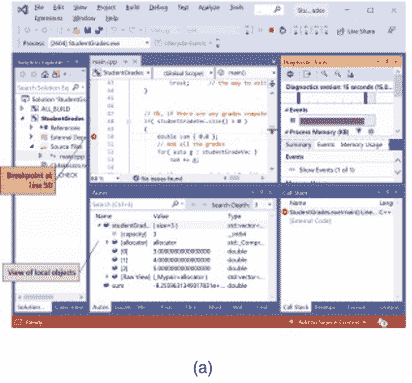

*(a)*

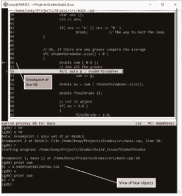

*(b)*

**图 3.3** Grades 项目的调试会话示例 (a) 在 Windows 上的 Visual Studio 中；(b) 在 Linux 的终端窗口中使用 gdb。在第 50 行设置断点可以让我们检查可访问对象的值。在此上下文中，请注意尚未初始化的变量 *sum* 中的垃圾值。

与编写代码一样，软件调试也需要练习。以下是一些提示：

- 使用不同的数据和参数运行软件。通常不可能测试所有可能的状态。然而，选择边界情况有助于在更短的时间内揭示许多问题。与严肃的调试相伴的是编写充分的代码测试。我们在 3.17.2 节和附录 A.7 中探讨这个问题。
- 隔离问题。有时，表现为错误的结果是由前面的步骤造成的。
- 阅读工具告诉你什么。除了错误，编译器警告也很有价值。
- 理解问题和你提出的解决方案——不要猜测。确保你能说明针对软件异常行为所提出解决途径背后的目标。
- 确保你修复的是问题本身，而不仅仅是其症状。
- 如果仍然不确定，向同事寻求帮助，并在互联网上寻找答案。

同样重要的是认识到调试是一个心理过程。它很困难，因为它会揭示我们的错误，这些错误不仅可能源于简单的打字错误，更痛苦的是，也可能与对主题知识掌握不足或对概念和编程技术的误解有关。在学习编程时，我们可能会与这门新语言作斗争。虽然起初压力很大，但这不应分散我们使用调试器的注意力。所以，尽可能学习关于调试的一切，并在所有项目中使用它，而不只是本书中介绍的项目。很快你会发现，调试是一段有趣的智力冒险。其他有用的编程工具在附录 A.6 中描述。

关于软件调试的更多内容可以在以下书籍中找到：*The Art of Debugging with GDB, DDD, and Eclipse*（Matloff 和 Salzman 2008）和 *Inside Windows Debugging. Practical Debugging and Tracing Strategies*（Soulam 2012）。其他强烈推荐的书籍还有 *The Pragmatic Programmer*（Thomas 和 Hunt 2019）和 *Code Complete*（McConnell 2004），它们提供了关于软件开发过程的深刻见解。

## 3.4 基本数据结构——`std::vector`

在清单 3.3 的程序中，我们看到 `std::vector` 允许我们存储用户输入任意数量的成绩。我们可以通过调用它的 `push_back` 函数来添加新值，并通过调用 `size` 函数来访问元素的数量。这些以及其他常用的 `std::vector` 成员函数在表 3.4⁶ 中进行了总结。

图 3.4 展示了一个 vector 对象及其数据可能的内存位置。有两个不同的位置：一个用于 vector 本身，另一个用于其数据。此外，vector 可以为数据预留比当前元素数量所需更多的内存。如果它没有足够的内存来存储数据——例如，由于多次调用 `push_back`——那么 vector 会分配一个新的、更大的缓冲区，复制其数据，并释放旧缓冲区。因此，数据可能在幕后被来回复制。

要获取 vector 确切持有数据量的信息，应调用其 `size` 成员（而不是 `sizeof` 运算符，后者返回仅为 vector 对象分配的内存字节数，这很可能不是我们感兴趣的）。在 C++ 中创建数组的其他选项将在后续章节中讨论。

### 需要记住的事项

- 要存储许多相同类型的对象，我们可以使用 `std::vector`。
- vector 中元素的数量通过调用其 `size()` 函数获得。通常，这不是 vector 占用的字节数。
- 要处理的元素范围通过提供一个指向第一个元素（包含）的迭代器（指针）和一个指向*最后一个元素之后*位置（不包含）的迭代器来表示。
- 使用下标 `[index]` 时，我们需要确保 vector 不为空。如果不为空，所提供的 *index* 必须在 `0 ... size() - 1` 范围内。


## 3.5 示例项目 – 用向量的向量实现矩阵

*矩阵*是一个包含数值的矩形表格，例如（Korn 和 Korn 2000）：

$$A_{2\times3}=\begin{bmatrix}1&0&-5\\7&12&0\end{bmatrix}$$  (3.2)

任何矩阵的特征在于其行数和列数。在前面的示例中，有两行三列。矩阵在科学中有着广泛的应用。不过，它们可以很容易地扩展为不仅存储数字，还可以存储其他对象，例如字符串、图形、其他矩阵等。在这种表示形式下，矩阵非常常见——Excel 表格就是一个数据矩阵。我们如何在 C++ 中表示矩阵？在本节中，我们将尝试回答这个问题并提供一些示例。

### 在本节中，你将学习：
- 如何仅使用 `std::vector` 实现矩阵
- 如何使用 `using` 指令声明类型别名

从前一节中，我们知道了如何创建存储 `int` 或 `double` 等值的 `std::vector`。现在假设我们按行读取一个矩阵。矩阵只是行的集合，而行可以用一个向量来表示。用编程术语来说，矩阵就是由多个 double 向量组成的向量。这个想法在清单 3.4 中得到了实现。

```cpp
#include <vector>

// A type alias declaration for a vector of double values (real approx.)
using RealVec = std::vector< double >;

// A type alias for vector dimensions (size)
using Dim     = RealVec::size_type;

// A type alias for vector type (e.g. double)
using DataType = RealVec::value_type;

// A type alias for a vector of vectors with doubles = a real matrix
using RealMatrix = std::vector< RealVec >;
```

在这段代码中，我们看到对几个类型的四个声明。更准确地说，通过 `using` 指令，我们为较长或更繁琐的声明引入了一个新名称。换句话说，`using` 允许我们为已知类型声明*类型别名*。

让我们解释一下前面的每个声明。第 [5] 行定义的 `RealVec` 与 `std::vector< double >` 相同，但更简短。它的名称更好地表达了我们的意图：我们将把它用作实数值的向量。第 [8] 行的 `Dim` 与 `std::vector< double >` 中用于表示其大小的类型相同，无论该类型实际上是什么。这种对类型的间接访问在将来向量发生变化时可以省去我们的麻烦。它还避免了类型的混用。第 [11] 行的 `DataType` 也同样如此，它表示向量中存储的数据类型。我们知道它是 double，但为什么要在这么多地方重复 double 呢？此外，如果我们想把它改成其他类型，例如第 7.3.2 节中的 `FixedFor`，我们可以只需在一行中完成修改——其他所有内容都会自动适配。这是我们为软件组件（如类或命名空间）中所用类型创建一种隔离层的好处。SL 中的所有容器都定义了有用的 `size_type` 和 `value_type` 别名；我们会多次遇到它们。

最后，在第 [15] 行，`RealMatrix` 类型被定义为 `std::vector< RealVec >`。也就是说，它是一个 double 的向量的向量，正如所预期的那样。

这个矩阵已经可以使用了，如清单 3.5 中的 _Easy_Matrix_First_Test_ 函数所示。

```cpp
void Easy_Matrix_First_Test( void )
{
// Using RealMatrix as it is
RealMatrix m = {
{ 2, 2, 0, 11 },
{ 3, 4, 5, 0 },
{ -1, 2, -1, 7 }
};
// Add next row
m.push_back( { 5, 3, 5, -3 } );
// Accumulate elements except the diagonal
double non_diagonal_sum {};
for( int r = 0; r < m.size(); ++ r )
for( int c = 0; c < m[ 0 ].size(); ++ c )
if( c != r )
non_diagonal_sum += m [ r ] [ c ];
std::cout << "Sum of m except the diagonal " << non_diagonal_sum << std::endl;
}
```

在第 [20-24] 行定义并初始化了一个 `RealMatrix` 类型的矩阵 m。正如我们已经知道的，`RealMatrix` 是一个向量的向量。因此，它的初始化方式完全相同。更准确地说，每个用 { } 括号括起来的初始化列表都用于设置每一行的值。然后按顺序逐行设置，从而构成一个矩阵。这个矩阵的维度是三行四列。但是，我们希望得到一个方阵，所以在第 [27] 行又追加了一行。之后，m 表示一个 4×4 矩阵。

然后，在第 [32-35] 行，计算了 m 中除了对角线元素之外的元素之和。为此，使用了两个 for 循环（第 3.13.2.2 节）。第一个循环从第 [32] 行开始，将其迭代器 r 从 0 推进到 m 的行数。这里读作 m.size()，因为 m 的大小就是它的元素数量：也就是向量的向量的数量，每个向量包含连续一行的数据。第 [33] 行的第二个 for 循环遍历单行中的每个元素：即单个向量。为此，其迭代器变量 c 从 0 迭代到 m[ 0 ].size()。让我们解释一下：m[ 0 ] 是第一个元素：第一行的向量。这是一个 `std::vector< double >`，因此它有自己的大小，通过调用其 size 函数（借助点 . 运算符）来访问。然后，在第 [34] 行，为了验证是否处理的是对角线元素，将行号与列号进行比较。只有 m 的非对角线元素会被累加，并最终通过 `std::cout` 对象显示在屏幕上。

如我们所见，`RealMatrix` 支持一些矩阵运算。然而，它的用途是有限的，因此我们将在第 3.15 节中扩展这个示例。


### 需要记住的事项

-   [使用 `using` 指令声明的类型别名可以作为同义名使用。该指令也可以用于在当前作用域中引入在其他地方定义的名称。](https://wiki.example.org/feynmans_learning_method) 的灵感源于诺贝尔物理奖获得者**Richard Feynman**。

1.  运用费曼技巧，你只需花上`20 min`就能深入理解知识点，而且记忆深刻，*难以遗忘*。

```
if (condVar > someVal) {console.log("xxx")}
```

-   [15]行，使用auto创建了一个新对象x。正如我们已知的，它的类型是char，因为'c'是const char，但auto只保留char。
-   然而，在[18]行，我们希望定义一个vector，用于存储与x相同类型的对象。假设我们不知道具体类型：该如何书写？为此，我们可以使用`decltype(x)`，它会返回x的类型。这样就可以创建vec，包含10个元素，每个元素都初始化为x的拷贝（表3.4）。我们可以在for循环中（如[21]行）轻松访问vector的每个元素，auto在此简化了代码编写，尽管也可以使用显式类型，如下所示：

```cpp
// 使用显式类型的等价写法
for( char k : vec )
    cout << k;
```

但auto相比显式类型更具灵活性。正如我们之前提到的，如果使用auto，则会选择相关的纯类型。我们也可以定义常量类型，如下代码所示：

```cpp
// 现在k的类型是const char
for( const auto k : vec )
    cout << k;
```

或者我们可以定义常量引用类型：

```cpp
// 现在k的类型是const char引用类型
for( const auto& k : vec )
    cout << k;
```

这使得我们可以间接访问vec的元素，避免复制它们。这里我们只是提示一种可能性；关于引用的完整讨论将推迟到第3.11节。但前面所有for循环的结果都是打印出：

```text
cccccccccc
```

使用auto在某些情况下可能会很棘手。例如，在下面的示例中我们期望什么类型？

```cpp
auto text { "The quick brown fox" };

// text的类型是什么？我们需要知道吗？
cout << text << endl;
```

text的类型不是std::string，也不是char*，而是const char*。但是，如果我们使用以下初始化：

```cpp
auto text = { "The quick brown fox" };
```

代码将无法编译，问题出在第[35]行。这是因为推导出的text类型是std::initializer_list。好在这种细节很少见；在大多数情况下，auto使用简单。

如前所述，auto提供了许多好处。它不仅节省输入时间，还增加了代码的灵活性，因为我们可以设置正确的类型依赖，如下代码片段所示：

```cpp
37     // 使用auto，我们避免了查找精确类型
38     // 以及不必要的类型转换。
39     auto vec_size { vec.size() };
40
41     cout << "vec_size=" << vec_size << endl;
```

得益于[39]行的auto，我们不需要查找或甚至猜测size函数返回值的具体类型。编译器会根据vector::size的定义自动正确推导其类型。相反，如果我们显式写成`int vec_size{ vec.size() }`，则会出现从size_t到int的转换。这可能并不有害，但为什么要费那么大劲呢？

最后，我们还讨论了lambda表达式（ lambda functions），在第3.14.6节中。显式提供它们的类型是不可能的，在这种情况下auto是唯一可选方案。所以，让我们使用auto！

## 3.8 常见标准算法

表3.6展示了SL函数，用于实现一些常见算法。与成员函数不同，这些函数不属于任何对象。其好处是可以作用于任何SL容器，如std::vector（第3.2节）、std::string（第3.6节）、std::map（第3.18.4节）以及更多。

注意，表3.6中的函数采用了简化语法。几乎所有函数都有许多变体，可在参考文献中查找，如（cppreference 2019; Josuttis 2012）。另一方面，前面的算法与调用规则有许多相似之处。我们将使用std::transform作为例子。其操作如图3.6所示。请记住，要定义src范围，需要提供第一个元素的位置（包含）和一位之后的位置（不包含）。而对于dst，只需提供第一个元素的位置，因为元素数量已经知晓。但我们必须确保没有特殊的插入对象可以使用，例如std::back_inserter。

在每次迭代时，函数fun用于将源元素转换为对应的目的元素。lambda函数最适合此角色；它们在第3.14.6节中讨论。

## 3.9 结构体：收集不同类型的对象

我们已经讨论了基本的C++构造，如内置对象（第3.1节）和std::vector用于存储对象集合（第3.2节），以及std::string用于存储和处理文本（第3.6节）。std::vector可以存储同一种类型的元素，例如学生的成绩，如Listing 3.3中的示例。同样，std::string可以高效地存储一系列字符。但如果我们希望收集不同类型的对象，例如std::string和int，C++提供了结构体（struct），如图3.7所示。

在分析结构体或类（在此语境下，它们是同义）之前，让我们解释什么是结构体/类以及它的对象。它们之间的关系正如我们之前看到的，例如类型int和变量x之间的关系。我们可以这样写：

```cpp
int x {};
```

这里，int是类型（类）的名称，而x是变量（对象）的名称，属于该类型。在面向对象领域，结构体（或类）定义引入了一个*新类型*，而该类的对象则仅仅是存储在某个位置的内存块，并按该类型定义的方式行为。换句话说，类型在原始内存之上叠加了一种*抽象*，即同一块固定的内存可以根据假设的类型被不同地解释。最简单的例子是：

```cpp
class MyClass {};

MyClass myObject;
```

在这段代码中，MyClass是一个空类的名称。类定义位于大括号{}中，后面必须跟分号（遗漏分号是常见的编码错误）。myObject是MyClass类型的实例，如果定义了任何数据，它就有相应的内存印记。注意，结构体/类中的数据和函数通常被称为其*成员*。


将图 3.7 中的图示与清单 3.6 中的结构进行比较，我们可以很容易地发现后者并不包含函数，甚至没有构造函数。对于保存一对简单的对象（如 fName 和 fDays）来说，这完全没有问题，前提是这两个对象具有初始化机制。如前所述，每个数据项都是通过初始化列表 `{}` 来初始化的。因此，我们不需要实现构造函数——这被称为 *零规则*。关于特殊成员函数（例如构造函数）的更多规则将在第 4 章中讨论。

另一方面，下面的 `SimpleCalendar` 函数（其定义从第 [8] 行开始）展示了包含 `MonthDays` 对象的 vector 的应用。存储 `MonthDays` 对象的 `std::vector` 类型的 calendar 对象在第 [10] 行定义，其初始化在第 [10–23] 行。请注意，对于每个 `MonthDays` 对象，都需要在初始化列表 `{}` 中提供一对值——一个 string 值和一个整数值，例如 `{ "May", 31 }`。此外，字符串常量 `"May"` 足以初始化 `std::string` 对象。

```cpp
// Creates and displays a simple calendar
void SimpleCalendar( void )
{
    const std::vector< MonthDays > calendar {
                                      { "January",   31 },
                                      { "February",  28 },
                                      { "March",     31 },
                                      { "April",     30 },
                                      { "May",       31 },
                                      { "June",      30 },
                                      { "July",      31 },
                                      { "August",    31 },
                                      { "September", 30 },
                                      { "October",   31 },
                                      { "November",  30 },
                                      { "December",  31 }
                                    };

    // Print them on the screen
    auto sum_days { 0 };
    for( auto month : calendar )
    {
        sum_days += month.fDays;
        std::cout << month.fName << " has " << month.fDays << " days\\n";
    }

    std::cout << "\\nTotal days: " << sum_days << std::endl;
}
```

存储在 calendar vector 中的对象在循环中被逐一访问，这通过第 [27–31] 行的基于范围的 `for` 循环完成。更准确地说，calendar 中的每个对象依次被复制到 month 对象中，month 对象虽然用 `auto` 声明，但其类型也是 `MonthDays`。在此基础上，第 [29] 行借助点 `.` 运算符访问 `fDays` 字段，并将其累加到变量 `sum_days` 中。第 [30] 行从 month 对象中同时访问 `fName` 和 `fDays`，并将它们输出到屏幕。当 calendar 中的所有月份都显示完毕，且总天数已累加到 `sum_days` 中之后，`sum_days` 也在第 [33] 行显示。

运行上述代码后（例如，在某个在线编译器中，并添加相应的 `#include`），将得到以下输出：

```
January has 31 days
February has 28 days
March has 31 days
```

到目前为止，我们只在结构中看到了数据成员。很快我们将开始添加成员函数。然后，我们将学习如何对成员数据和函数的访问施加限制（第 4.3 节）。不过，struct 或 class 中所有不受限制的数据成员和成员函数都可以通过成员访问运算符在对象层面进行访问，其语法如图 3.8 所示。

图 3.8a 展示了使用点运算符从对象调用成员的常见方式。当不是直接提供对象，而是提供对象的引用时（第 3.11 节），也会使用这种调用方式。为完整起见，图 3.8b 也展示了通过对象指针进行调用的方式。在这种情况下，使用 -> 运算符。两者都属于第 2 组运算符（表 3.15）。

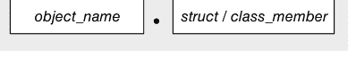

关于指针的讨论将推迟到第 3.12 节。

数据成员也可以通过将初始化放在构造函数中来初始化，这将在下一节讨论。如果没有显式编写构造函数，编译器就会自动为数据成员提供默认行为。此处的默认行为是通过调用合适的构造函数（例如 std::string 的构造函数）来初始化和复制对象。然而，基本内建类型会被保留为未初始化状态；如果被复制，则会逐字节复制。因此，在这种情况下进行正确的初始化非常重要。

正如我们已经看到的，C++ 定义了类（class），它在语义上与 struct 非常相似。主要区别在于，在类中，所有成员默认对直接访问隐藏，而 struct 则相反：即 struct 的所有成员都可以被外部组件自由读写。这一区别尽管乍看之下很微妙，却会对编程产生影响，我们将在后续章节中回到这个问题。但两者有很多相似之处，尤其是在初始化数据成员方面。

第 [24] 行创建了与 theArray 大小相同的 theDbArray。这一次，它保存的是 double 类型的元素。我们已经知道它不会被自动初始化。因此，在第 [27] 行，使用 std::copy 函数将 theArray 的元素复制到 theDbArray 对象中。请注意，这些元素会在复制过程中即时地从 unsigned int 转换为 double。

```cpp
// Make the same size as theArray
array< double, theArray.size() > theDbArray;

// Copy and convert int to double
copy( theArray.begin(), theArray.end(), theDbArray.begin() );

copy(    theDbArray.begin(), theDbArray.end(),
         ostream_iterator< double >( cout, " " ) );
```

最后，在第 [29–30] 行再次使用 std::copy 来显示 theDbArray 数组的所有元素。更准确地说，输出由针对 double 的 ostream_iterator 执行，它连接到 std::cout 流。

值得注意的是，std::array 是内建固定大小数组的包装类，后者将在附录 A.2.1 中讨论。包装类将在第 3.15 节中介绍。

## 3.10.1  多维固定大小数组

我们可以直接创建包含其他数组的数组，从而得到多维固定大小数组。让我们看一下清单 3.8，它展示了如何创建一个简单的二维结构——两行三列（即矩阵），其中保存浮点对象。

# 清单 3.8  使用 std::array 定义多维固定大小数组的示例（位于 CppBookCode, VectorsStringsArrays.cpp）。

```cpp
enum ArrayDims { kCols = 3, kRows = 2 };   // Define two constants

using ArrayElem = double;

// Declare a single array of kCols elems
using _1D_Array = std::array< ArrayElem, ArrayDims::kCols >;

// Declare a matrix with kRows
using _2D_Array = std::array< _1D_Array, ArrayDims::kRows >;

_2D_Array matrix { 0.0 };   // Create a matrix and init with zeros
```

固定大小数组的维度需要在编译时已知。为此，我们可以定义一个 const int 对象；但在这个示例中，我们使用了另一种方式，即枚举类型 ArrayDims 及其常量值 kCols 和 kRows，如第 [1] 行所定义。这是一种 *无作用域枚举* 类型，在本上下文中已经足够。较新的 *有作用域枚举* 类型将在第 3.14.6 节中介绍。

现在，我们可以用选定的维度来定义 `std::array`。然而，在处理由命名空间、类等组成的长名称时，使用 `using` 指令声明名称别名会非常有用，如第 [3, 6, 9] 行所示。很快我们就会看到，用 `using` 创建合适的别名可以使代码更简短、更清晰、更灵活。例如，如果我们想改变元素的类型，只需要修改第 [3] 行——所有后续元素将在编译期间自动调整。借助这些别名，我们在第 [12] 行定义了 matrix 对象。通过提供初始化列表 `{ 0.0 }`，其元素立即被初始化为 0.0。

```cpp
13    double val { 0.0 };    // Initial value
14
15    // Initialize matrix with increasing values
16    for (auto & r : matrix )
17      for( auto & c : r )
18        c = val ++;         // Each element gets 1 higher value
```

我们可以访问二维结构以写入新值，如第 [13–18] 行所示。在第 [16] 行，通过引用 `r` 访问 `matrix` 的行。然后，在第 [17] 行，借助引用 `c` 访问该行的每个元素，并为其赋当前值 `val`。使用引用（将在下一节讨论）有两个好处：

+   - 我们避免了复制行和元素
+   - 我们修改的是 `matrix` 的真实元素，而不是它们的局部副本

运行上述代码后，二维结构的内存布局如图 3.9 所示。我们可以看到，`kCols` 定义了最内层数组的维度，而 `kRows` 是这类数组的数量：即矩阵的行数。

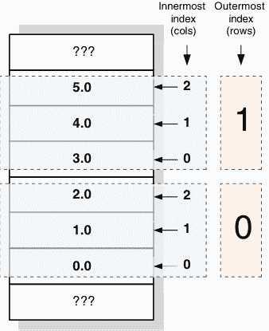

**图 3.9** 具有两行三列的多维数组的内存布局与索引。


或者，可以使用下标运算符`[]`访问`matrix`的元素，如第[20–22]行所示。

```cpp
// Make the same initialization with subscripts
for (_2D_Array::size_type r = 0; r < matrix.size(); ++r )
    for ( _2D_Array::size_type c = 0; c < matrix[0].size(); ++c )
        matrix[ r ][ c ] = val ++;
```

在这种情况下，外层`for`遍历各行（行数与`matrix`的大小相同）。内层`for`遍历行中的每个元素，因此我们需要行的长度。我们通过调用`matrix[ 0 ].size()`来获取它。与`std::vector`不同，在这种情况下我们可以确定两个维度都大于0。

## 3.11 引用

C++中的引用提供了对对象的间接访问。指针也可以用于此目的（第3.12节）。然而，这两种技术差异显著，C++更强调使用引用。在本节中，我们讨论左值引用的基本属性。右值引用和转发（通用）引用将在第4.5节讨论。表3.7总结了一些示例中引用的语法。

引用表示对象的某种别名。但是，我们不要将其与通过`using`指令获得的名称别名混淆。*引用类型*通过将类型与`&`符号结合来定义。下面是一些定义和使用引用的示例：

```cpp
int x { 10 };

int & x_ref = x;

x = 12;        // Directly set x,     x == 12
x_ref = 12;    // Indirectly set x,   x == 12
```

在第[1]行，创建了一个对象x并用值10初始化。在第[3]行，定义了一个指向int的引用x_ref，并将其与对象x绑定。从此刻起，x_ref将始终引用x。这种绑定要求对象x的生命周期至少与其引用的生命周期一样长。现在，所有可以直接使用x执行的操作也可以通过x_ref执行。为了说明这一点，在第[5]行，将值12赋给x。从功能上讲，通过引用x_ref将12赋值给x可以达到相同的效果，如第[6]行所示。因此，仅看单独一行，无法区分直接操作和通过引用进行的间接操作。

[PAGE 100]

<!-- no content -->

[PAGE 101]

值得注意的是，_引用_必须在创建它的那行进行初始化，如前面的示例所示。非const引用必须用可变对象（即可以读写且写入的对象）初始化。因此，以下代码片段中的第[7]行和第[9]行是错误的，无法编译。另一方面，常量对象（即只能读取的对象）只能赋给const引用，例如第[11]行上的常量10。

```
7 int & x_ref; 8 9 int & x_ref = 12; 10 11 const int & kBase_10 = 10; // Ok, kBase_10 refers to value 10 and cannot be changed
```

如果我们预见到对某个对象只进行读操作，一个好的设计实践是创建对它的const引用，如下面代码示例中的第[12]行所示：

```
12 const int & x_const_ref = x; 13 14 cout << x_const_ref << endl; // Ok - read through reference 15 16 x_const_ref = 12; // Wrong - const ref only to read
```

const引用可用于从对象读取，如第[14]行所示，但不能用于写入。因此，第[16]行无法编译。换句话说，如果预期只进行读操作，const可以防止我们意外写入对象。

一旦绑定到某个对象，引用便不能重新绑定到另一个对象。因此，在以下代码中，执行第[19]行时，x_ref仍然引用对象x；它将被赋值为对象y的值，因此x将持有13。

```
17 int y = 13; 18 19 x_ref = y; // x == 13 20 // x_ref is not connected to the new object "y". 21 // Instead, object "x" was assigned a new value of "y", i.e. 13.
```

最后，引用只能指向有效、可访问的对象。不能创建指向另一个引用的引用，因此以下代码行将无法编译：

```
22 int & x_ref_ref = x_ref; // Wrong - reference to reference not allowed !
```

然而，通过using别名可以产生引用的引用，如下所示：

```
23 // a reference to reference by aliasing
24 using int_ref = int &;
25 using int_ref_ref = int_ref &;

27 int_ref_ref xx_ref { x }; // the same as int &

29 xx_ref = 12; // change object x to 12

31 * ( & xx_ref ) = 13; // we can take an address / dereference via reference
32 // and change object x to 13
```

[PAGE 102]

通过第[24–25]行的双重using指令，定义了一种引用-引用-int类型。然而，C++会将所有此类链视为单个引用：int& 在此情况下。在第[27]行，xx_ref被定义并立即绑定到x。如果我们查看前面的代码片段第[3]行，我们会注意到这是对对象x的第二个引用。因此，一个对象可以存在多个引用。在第[29]行，x的值被改为12。最后，在第[31]行，x再次被修改，现在持有13。但这借助指针（在下一节讨论）完成，指针操作在引用上完全就像操作在原始对象x上一样。也就是说，首先用&运算符获取x的地址。然后，将13写入该地址：即借助解引用运算符*（参见表3.15中GROUP 4的描述）写入对象x。这里我们看到了为什么引用有时被称为别名，因为使用它们的效果与直接访问对象完全相同。

+   **需要记住的要点**

+   - 引用允许对对象进行间接访问，而不会创建副本
+   - 引用必须用一个生命周期与引用一样长的对象来初始化
+   - 常量引用可以用常量对象初始化
+   - 初始化后，不能将引用与其对象分离

## 3.12　(★) 指针

指针和引用是允许我们以间接方式访问对象（变量、常量）的语言机制。但是，尽管有这种相似性，它们之间也存在重大差异。指针在C和C++中可用，而引用仅在C++中使用。虽然指针在某些情况下很有用，但引用在C++中占主要地位。自C++11以来，还有智能指针：完全成熟的小对象，可安全地执行普通指针在堆分配和释放方面的功能，如第5.3节所述。然而，了解普通指针的工作原理也是可取的，我们将在本节讨论它们。

## 3.12.1　使用指针访问对象

对于大多数对象类型，我们可以在类型名称后添加星号来定义相应的指针类型：对于double，对应的指针类型是double *；对于char，指针类型是char *，依此类推。这两部分被视为一个整体，定义了一种指向类型的类型。对于我们这些更偏向机器的人来说，指针可能看起来像包含内存地址的对象（图2.2）。然而，由于每种类型都有对应的指针类型，C/C++中的指针不同于地址总线上的裸信号。也就是说，指针不仅表示一个内存位置，还传递了关于其指向对象所占内存大小的信息。这在推进指针或向指针添加偏移量时会产生影响，我们稍后将讨论。但是，创建指向对象的指针也意味着创建一个必须驻留在内存中、被初始化等的单独对象。因此，由于指针也是对象，可以创建指向指针的指针，依此类推。我们也将讨论这些问题。

[PAGE 103]

让我们看下面的代码示例。

```
1 char c = 0;    // a variable initialized to 0
2 char * ptr = & c;    // a pointer initialized to point at c
```

在第[1]行，定义了一个类型为`char`的对象（变量）`c`，其值设置为0。这意味着如果程序执行到达该点，将在操作内存中分配一个1字节的对象，并将其值设置为0。另一方面，在第[3]行，创建了一个指向char的指针类型的对象，并使用对象地址运算符&（GROUP 4，表3.15）将其设置为指向`c`。这两个对象的示例位置以及它们的初始值和关系如图3.10所示。

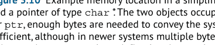

对象`c`仅占用1字节的内存空间，因为在C++中`char`就是这样定义的。但指针占用的字节数取决于系统，因为它必须足够大以容纳该系统中另一个对象的地址。对于64位系统，指针最多可占用8字节。然而，在C++中，指针不是简单的系统地址：它还能“知道”其指向对象的大小。正是由于这一特性，指针可以向前或向后移动——它们具有可扩展的算术运算，正如我们将讨论的那样。


## 表 3.8 指针语法和运算符摘要。

| 操作 | 语法 | 示例 |
|---|---|---|
| 定义指针 | `const object_type * pointer_identifier = & object;`<br>`const object_type * pointer_identifier { & object };` | `int x = 100;`<br>`int * ptr = & x; // create`<br>`// pointer ptr and set it to x`<br><br>`std::string s { "Fox" };`<br>`const string & r { s };`<br><br>`double d {}; // C++ init`<br>`double * d_ptr { nullptr }; // C++`<br>`d_ptr = & d;` |
| 地址运算符 | `& object` | `* ptr = 112;`<br>`// assign 112 to x via ptr` |
| 解引用运算符 | `* pointer_identifier` | `cout << * d_ptr << s_ptr;`<br>`// print "FoxFox"` |

## ## 需要记住的事项

- 指针是允许间接访问其他对象的对象
- 指针类型是相对于它们指向的对象类型定义的。语法上，指针类型通过在对象类型后加 `*` 来获得
- 指针不只是内存中的裸对象地址，因为它们“知道”它们指向的对象类型。因此，指针可以递增或递减来指向下一个对象，而不是指向下一个内存位置
- 有一种特殊的 `void *` 类型，它不与特定类型关联，可以用于表示指向任意对象的系统地址
- 与所有对象一样，指针在创建时应该初始化。为了表示空指针，使用特殊的 `nullptr` 值赋值给指针
- 对 C++ 中的间接访问，应考虑使用引用而不是裸指针（第 3.11 节）

## ### 3.13 语句

_语句_ 是控制代码执行的语言构造。要学习和理解的第一类语句是条件语句 `if` 和循环语句 `for`。在第 2.5.2 节中，我们创建了表达式。以分号结尾的表达式成为语句。但与表达式不同，语句没有值。此外，声明也是语句；语句的分组（块）也是语句。现在，我们将研究 C++ 中花括号的作用。

## ### 3.13.1 块语句和变量访问 – 花括号的作用

在 C 和 C++ 中，花括号 `{ }` 起着重要作用，有两种上下文：

- 用于包围类、`struct`、`enum` 或 `namespace` 的类型定义（前三种情况，闭合的 `}` 后面应跟分号 `;`）。例如，下面是一段 C++ 代码的分析：

```
namespace CppBook
{
    // 定义一个包含三个字节值的 RGB 像素
    class RGB_Pixel
    {
    public:
    enum EColor
    {
    kRed, kGreen, kBlue
    }; // 枚举定义后加分号
    unsigned char GetRed( void ) const { return fData[ kRed ]; }
    // ...
    private:
    // 一个包含 3 个字节值的数组
    std::array< unsigned char, kBlue + 1 > fData;
    }; // 分号关闭类定义
} // 命名空间不需要分号（可以在多个地方分割）
```

这段代码中有三组花括号。第一组（第 2–21 行）用于包围 CppBook 命名空间。第 21 行后没有分号，因为命名空间可以分割成多个部分。第二组（第 5–19 行）定义了一个简化的 `RGB_Pixel` 类，用于表示 RGB 像素。第 19 行的闭合花括号后有一个分号。第三组（第 9–11 行）定义了 `RGB_Pixel` 类中的枚举类型 `EColor`，它也以分号结束。另一方面，第 13 行的花括号用于定义函数体——这是第二种类别，将在下一段讨论。

EColor 在前面的代码中是 *非局部枚举类型* 的例子（较新的局部枚举在 3.14.6 节中讨论）。旧式枚举可以直接用作数组上限或数组索引（IBM：“C++0x, scoped enums” https://www.ibm.com/developerworks/rational/library/scoped-enums/scoped-enums-pdf.pdf 访问 2020）。如果不直接指定，第一个常量（这里是 kRed）被赋值为 0，第二个常量被赋值为 1，以此类推。因此在第 18 行，`fData` 数组的大小设置为 `kBlue + 1`，而在第 13 行，红色值直接作为 `fData[kRed]` 读取。

- 用于包围函数或语句的块，以及定义局部变量的作用域。下面通过一个计算斐波那契数的函数（第 3.14.4 节也讨论）来看到这一点：

```
cpp
// 返回一个包含最大值之前的斐波那契数的 vector
vector< int > FibonacciNumbers( const int max_val )
{ // LOCAL STACK no. 0 CREATED for local objects (variables)

    vector< int > fibo_num_vec;   // 函数内的局部对象

    int a = 0, b = 1; // 创建两个变量 a 和 b，作用域仅限于函数

    while( a < max_val )
    { // LOCAL STACK no. 1 CREATED for local objects (variables)

        fibo_num_vec.push_back( a );

        int tmp = a; // 临时变量用于交换 a 和 b，作用域仅限于 while

        a = b;       // a 变为“旧” b
        b = tmp + b; // b 变为“旧” a 和 b 的和

    } // LOCAL STACK no. 1 DELETED - tmp is destroyed

    return fibo_num_vec;    // 返回局部对象
} // LOCAL STACK no. 0 DELETED - a, b, max_val, fibo_num_vec dead after this line
```

第 3–23 行的花括号定义了 `FibonacciNumbers` 函数的体，它们将函数中的所有语句和表达式分组，并为局部变量定义作用域。这意味着在当前花括号级别内定义的每个变量（对象）在该块内存活、可见且可访问（除非它是 `static`）。当执行退出由花括号定义的块时，**所有局部变量都会被销毁，不能以任何形式继续使用**！这有时会被忽略，导致棘手的错误（例如，返回地址为

- 在 `FibonacciNumbers` 函数的作用域内，第 5 行定义了一个 `vector< int >` 类型的对象 `fibo_num_vec`。它的**作用域**是函数体，即第 3–23 行之间。它在该作用域内可见。`a` 和 `b` 在第 7 行定义的对象具有相同的作用域和可见性。

- 第 10–19 行之间的第二组花括号定义了 `while` 循环的块（第 3.13.2.2 节），其中第 14 行定义了 `tmp` 对象（`int` 类型），它位于与 `while` 相关的第二个局部栈上。然而，与 `a`、`b` 和 `fibo_num_vec` 不同，`tmp` 的作用域仅限于 `while` 块内部。换句话说，`tmp` 在 `while` 循环开始前或结束后不可访问。`tmp` 作为辅助变量用于在第 16–17 行修改 `a` 和 `b` 的值。`tmp` 以及 `fibo_num_vec` 也在 `while` 块内可见，因为它嵌入在更大的函数作用域中。关于**可见性**，`tmp` 的名字仅在 `while` 作用域内可见，如果在 `while` 循环外定义其他 `tmp`，则会被隐藏。

- `while` 在第 19 行结束后，第二个局部栈被销毁，这会导致 `tmp` 对象被销毁。这种行为是可取的，因为它免去了显式删除对象的麻烦。因此，这类局部对象是**自动变量**。其他类型的对象在 5.1 节中讨论。最后，局部栈通常容量有限，不应用于存储非常大的对象（比如几百兆字节或更多）。应使用堆和动态分配来存储大对象，如第 5.2 节所述。

- 前面讨论的两种语言构造不应混淆。在本节关于语句的讨论中，我们主要使用第二种上下文。

## ### 3.13.2  C++ 语句

本节总结 C++ 中所有的语句。[^14] C++11 标准中可用的语句版本用颜色标记。理解语句的工作原理是学习语言和编写正确代码的关键。

## 3.13.2.1 条件语句

条件语句根据给定的布尔条件的值决定执行哪条路径。该组包含 `if-else` 和 `switch` 语句，详见表 3.9。从 C++11 开始，这些语句拥有带内置初始化块的新版本，也用颜色标记。

[^12] 作为一个有趣的实验，我们可以把 `tmp` 替换为 `fibo_num_vec`。这样，在 `while` 作用域内就会有两个名为 `fibo_num_vec` 的变量——一个是 `vector< int >` 类型，另一个是 `int` 类型。但这类代码会使人困惑，绝不推荐。

[^13] 栈和堆的大小可以在链接器设置中指定。

[^14] 除极少数例外外，C 语言几乎可以使用相同的语句。详情见附录 9.2。


## 3.13.2.2 循环语句

循环语句构成了语言构造的第二个且非常重要的分组。在 C++ 中，最重要且使用频繁的是 `for` 循环。<sup>15</sup> 从 C++11 开始，一个新颖且实用的 `for` 循环版本可用。

\begin{tabular}{cccc}
 & **流程图** & **描述** & **语法** & **示例** \\
 &  & `for` 语句首先（且仅执行一次）执行其 `初始化`。然后它迭代，只要其 `条件` 为真就执行其语句。在执行最后一个语句后，执行 `迭代器` 部分。如果需要处理多个语句，则应将它们用 `{}` 组合在一起。`initializer`、`condition` 和 `iterator` 部分可以为空：例如 `for(;;)` 是一个始终迭代的有效循环。 & for ( **_initializer_** ; **_condition_** ; **_iterator_** ) **_statement_** ; for ( **_initializer_** ; **_condition_** ; **_iterator_** ) { **_statement_** ; **_statement_** ; } & const size_t kSize { 16 }; // size_t for dimensions std::vector< int > tab( kSize ); // 预留 kSize 个 int // 设置连续的 kSize 奇数 for( auto i { 0 }; i < tab.size(); ++ i ) tab[ i ] = 2 * i + 1; 这段循环将向量 `tab` 的所有元素设置为连续的奇数：1, 3, 依此类推。变量 `i` 的作用域仅限于 `for` 循环及其语句<sup>16</sup>（即它在 `for` 循环之外不可访问）。下面的代码打开两个文本文件 `inFl` 和 `outFl` 进行读取和写入。如果成功打开，则 `for` 循环会逐行读取 `inFl` 并将内容存入 `std::string` 类型的 `str`。使用 `getline` 函数读取一行，该函数在成功读取一行时返回 `true`。然后，调用 `std::transform` 通过 `std::toupper` 函数将 `str` 中的字符从小写转换为大写。最后，调用 `outFl << str << endl` 将 `str` 写入 `outFl`，并添加换行符。 ifstream inFl( "InFile.txt" ); ofstream outFl( "OutFile.txt" ); if( inFl.is_open() && outFl.is_open() ) for( string str; getline( inFl, str); outFl<<str<<endl ) transform( str.begin(), str.end(), str.begin(), toupper ); \\
\end{tabular}

### 3.13.2.2.1 For 循环

`for` 循环用于在特定次数内重复执行代码块。它由三个用分号分隔的部分组成：初始化、条件和迭代器。

- **初始化**：在循环开始前执行一次。它可以是声明、赋值或任意表达式。
- **条件**：在每次迭代前评估。如果结果为真，则执行循环体；否则循环终止。
- **迭代器**：在每次迭代后执行，通常用于更新循环变量。

如果在循环中需要执行多个语句，它们应被包含在花括号 `{}` 中。

#### 示例 1：简单的 for 循环

```cpp
for (int i = 0; i < 10; ++i) {
    std::cout << i << " ";
}
```

这会打印 0 到 9 的数字。

#### 示例 2：范围基于的 for 循环（C++11）

```cpp
std::vector<int> numbers = {1, 2, 3, 4, 5};
for (int n : numbers) {
    std::cout << n << " ";
}
```

这会打印数组中的每个元素。

#### 示例 3：空部分的循环

```cpp
for (;;) {
    // 无限循环
}
```

这创建了一个无限循环，直到遇到 `break` 语句为止。

### 3.13.2.2.2 While 循环

`while` 循环在条件为真时重复执行代码块。它在每次迭代前检查条件。

#### 语法

```cpp
while (condition) {
    // 循环体
}
```

## 示例

```cpp
int i = 0;
while (i < 5) {
    std::cout << i << " ";
    ++i;
}
```

这会打印 0 到 4。

### 3.13.2.2.3 Do-While 循环

`do-while` 循环先执行代码块，然后检查条件。

#### 语法

```cpp
do {
    // 循环体
} while (condition);
```

## 示例

```cpp
int i = 0;
do {
    std::cout << i << " ";
    ++i;
} while (i < 5);
```

这也会打印 0 到 4，但保证至少执行一次。

### 3.13.2.2.4 范围基于的 for 循环（Range-based for）

C++11 引入了范围基于的 `for` 循环，简化了对容器的迭代。

#### 语法

```cpp
for (type var : container) {
    // 循环体
}
```

## 示例

```cpp
std::vector<std::string> words = {"hello", "world"};
for (const std::string& w : words) {
    std::cout << w << std::endl;
}
```

这会在每行打印一个单词。

### 3.13.2.2.5 循环控制语句

- **break**：立即退出循环。
- **continue**：跳过当前迭代的剩余部分，并进入下一次迭代。
- **return**：退出整个函数（因此如果在函数内部，也会退出循环）。

#### 示例：使用 break 和 continue

```cpp
for (int i = 0; i < 10; ++i) {
    if (i == 5) continue; // 跳过 5
    if (i == 8) break;    // 在 8 时停止
    std::cout << i << " ";
}
```

这会打印 0 1 2 3 4 6 7。

### 3.13.2.2.6 嵌套循环

循环可以在其他循环内部嵌套。

## 示例

```cpp
for (int i = 0; i < 3; ++i) {
    for (int j = 0; j < 2; ++j) {
        std::cout << "i=" << i << ", j=" << j << std::endl;
    }
}
```

这会输出 `i` 和 `j` 的所有组合。

### 3.13.2.2.7 常见错误

- **越界错误**：确保循环边界正确。
- **无限循环**：确保条件能够变为假。
- **在循环内修改循环变量**：可能导致意外行为。

### 3.13.2.2.8 总结

- `for` 循环：适用于已知迭代次数的情况。
- `while` 循环：适用于在每次迭代前评估条件的情况。
- `do-while` 循环：适用于循环体至少需要执行一次的情况。
- 范围基于的 `for`：适用于遍历容器的情况。

C++ 中的所有循环构造都旨在为重复任务提供清晰且高效的控制流。


## 示例

```cpp
vector<int> vec;
// fill vec with even values
for (auto i : {0, 1, 2, 3, 4, 5})
    vec.push_back(2 * i);
```

范围`for`会针对`{}`列表所指定的容器中的每个元素进行迭代。该列表包含六个值，因此在每次迭代中，迭代器`i`依次取这些值。循环结束后，`vec`包含连续的偶数值。

当使用范围类（第6.5节）时，这种`for`循环的版本可以进一步简化，如下例所示：

```cpp
// introduce the range class to facilitate range-for
// (include <range.h>; ... are user-created headers)
for (auto i : display_values(from 10 to 64 (except -1) with step -2))
    std::cout << i;
```

## while 循环

在while循环中，只要while循环的条件为真，每次迭代都会执行所有包含的语句。

while ( condition ) statement ;

while ( condition ) { statement(s) }

const size_t kSize = 16;
std::array< int, kSize > tab; // define an array of ints
// fill all values with 0 - use pointers
int i = 0;
while( i < tab.size() ) tab[ i + ] = 0;
i ++;

while ( condition ) { statement(s) }

在这段代码片段中，一个包含16个int的std::array::array（第3.10节）通过while循环和单条语句被初始化。使用下标运算符`[ ]`访问连续元素。在同一行中，迭代器`i`使用递增运算符`++`增加1。迭代一直进行到`tab.size()`的值，该值等于`kSize`。但与其检查`kSize`，更安全的做法是直接询问`tab`的大小。

const size_t kSize = 16;
std::array< int, kSize > tab; // define an array of ints
// fill all values with 0 - more readable
int i = 0;
while( i < tab.size() ) {
    tab[ i ] = 0;
    i ++;
}

## do-while 循环

在do-while循环中，无论条件如何，所有包含的语句都会先执行一次。然后，只要while循环的条件为真，每次迭代都会执行这些语句。

do statement ; while( condition ) ;

do { statement (s) ; } while( condition ) ;

const size_t kSize = 16;
std :: array< int, kSize \&gt; tab; // define an array of ints
// fill the array - this time do-while
int i = 0;
do tab[ i ++ ] = 0;
while ( i \&lt; tab.size() ) ;

这段代码执行与前面while循环相同的数组初始化。这一次使用了do-while循环，它会先无条件执行`tab[ i ++ ]`！然后检查条件`i \&lt; tab.size()`，当且仅当条件为真时循环继续。否则，循环停止，并执行循环后的下一条语句。在这种情况下，我们可以自由地执行`tab[ i ++ ]`而无需检查条件，因为数组的大小总是大于0。

int age = 0;
do cout << "Enter your age ..." \&lt;\&lt; endl; cin \&gt;\&gt; age; // read age from keyboard } while( age \&lt;= 0 || age \&gt; 150 ) ; // Ask until valid range

在这段代码中，通过do-while循环要求用户输入一个有效的年龄值。

## 3.13.2.3 辅助语句 - continue 和 break

`break`和`continue`语句可以简化循环操作。前者也用于`switch`语句。理解它们的功能及其差异非常重要。在处理嵌套循环时，还必须记住它们作用于_最近的_循环。

for 循环中的 break

do-while 循环中的 break

立即退出最近的循环（for、while、do-while）或switch语句。在多重循环中，break语句会导致跳转到最近的外层循环。

break;

下面的for循环本会无限迭代。但是，用户可以按'n'或'N'来停止迭代。此时，由于break语句，循环被退出。

for( ;; ) {
    // Do something
    // ...
    std::cout << "Proceed? [y/n] ";
    char ans {}
    std::cin >> ans;
    if( ans == 'n' || ans == 'N' ) {
        break;  // The way to exit the loop
    }
}

## 3.13.2.4　goto 语句

goto语句可用于立即将执行流改变到单个函数内任何标有标签（标识符）的位置。该语句源自较低层级的汇编语言范式，在汇编语言中，跳转和比较语句足以实现所有类型的控制，包括循环组织，如第2.1节的硬件模型所述。尽管在某些情况下它可能看起来有用，但由于许多问题，强烈不建议使用它。最常见的问题包括因省略内存反初始化运算符而导致的内存泄漏，以及难以理解和维护的混淆代码。因此，goto不应在新代码中使用，尽管在某些较旧的库（尤其是用C编写的库）中可能会看到它。其他语言结构足以组织任何类型的循环。

goto 语句

导致执行立即且无条件地改变——跳转到一个标签。应避免在代码中使用。

`goto label;`

```cpp
const int kBufLen = 1024;
char buf[ kBufLen ];

// Read line-by-line
for( ifstream inFile("File.txt"); inFile && ! inFile.eof(); )
{
    if( ! inFile.getline( buf, kBufLen ) )
        goto exit; // exit the loop

    // process buffer ...

}

exit:
    cout << "Loop terminated" << endl;
```

这个goto语句示例会立即且无条件地跳转到标有exit标签的位置。因此，一跳即可穿过嵌套的循环和函数。尽管有时会使用这种代码，但不建议使用，因为如果对象分配在废弃的代码块中，可能会导致内存泄漏。此外，使用goto会使代码难以分析和维护。

## 3.13.2.5　结构化异常处理 – try-catch 语句

try-catch语句与throw运算符（见第15组，表3.15）结合，是C++特有的构造，允许进行异常处理。这意味着任何遇到无法以常规方式处理的严重错误的代码，都可以抛出一个表示异常的对象。反过来，如果抛出异常的函数被嵌入到try-catch构造中，则可以捕获该异常。严重错误有很多类型，例如除以0、解引用nullptr指针、内存不足、资源不可访问等，以及与给定库相关的情况。


| 流程图 | 描述 | 语法 | 示例 |
|---|---|---|---|
| 一个流程图，展示了 `try-catch` 语句：`operator_statement(s)` 和 `throw obj_type_0` 导致 `catch stat_0`。 | **try-catch** 用于创建可控的环境来执行可能抛出错误的代码。如果在执行运算子语句时，调用了 `throw` 运算子（组 15），则执行立即转移到与抛出对象类型匹配的 `catch` 部分。这使我们能够安全地处理异常。由于所有在栈上分配的对象都会自动销毁，这正是栈展开机制（第 5.2.1.1 节）。`catch` 部分捕获所有类型的抛出对象。如果在 `throw` 之后找不到匹配的 `catch` 处理程序，则调用 `terminate()` 函数并终止程序。 | `try { operator_statement(s); } catch (obj_type_0) { catch_stat_0; } catch (obj_type_1) { catch_stat_1; } ... catch (...) { catch_stat_all; }` | `double x = 0.0, y = 0.0; cin >> x >> y; // 从键盘读取 x 和 y
try {
  if (fabs(y) < 1e-12) // 检查大小
    throw string("Error - divide by 0"); // 抛出对象
  cout << x / y; // 除法
}
catch (string & str) {
  cerr << str; // 将错误原因输出到 cerr
}`

最常见的错误之一是除以零。更准确地说，当除数的绝对值低于某个阈值（第 7.4.8 节）时，我们不应该进行除法运算。在前面的示例中，我们通过检查来防止这种情况发生；随后抛出异常。任何对象都可以用于此上下文；在我们的示例中，选择了 `string`。因此，每个 `throw` 操作都是 `string` 类型，如果发生这种情况，抛出的对象会在终端中通过 `cerr` 对象显示。要捕获任意类型的对象，应使用 `catch (...)`。

try-catch 是一种重型语言构造，不应用于正常的控制流转换。我们应该总是检查代码是否可以通过检查条件并作出有用的反应来处理，例如返回一个布尔标志，而不是抛出异常。换句话说，将 `throw` 作为最后手段。本书中给出了许多示例：例如，在 TStack 项目（第 4.8.4 节）中，`Pop` 成员函数在栈为空时返回布尔值。在这种情况下，抛出异常是过度设计。

# 3.14 函数

函数是代码的选定片段，可以在代码的其他片段中多次调用并执行。如果代码片段在多个地方重复出现，我们可以将其提取为函数，并从代码的其他部分进行调用。自然地，这能够节省代码体积，这在早期计算机历史中是一个重要因素。但从开发角度来看，函数的更重要特性是将代码在概念上连贯且定义明确的片段进行逻辑划分，这些片段可以逐个设计和编程。这种专注的方法遵循自顶向下（divide-and-conquer）编程方法论，使我们能够一次处理有限数量的变量、分支等，如第 2.3 节所提到。因此，以函数为单位构建程序要比不断管理所有细节更简单，错误更少。构建程序的方式类似于构建建筑、桥梁、船只或汽车。

本节将讨论函数的设计和实现的各种方面。在许多地方，我们将把函数视为具有明确接口的黑盒，即输入和输出参数以及功能的集合。

在思考函数时，需要考虑以下方面：

- 它的功能是什么？
- 它的名称（标识符）是什么，以恰当地传达其作用和功能？
- 它的输入参数是什么，以及它们如何传递给函数？
- 它的输出参数是什么，以及它们如何从函数中传出？
- 它如何在由其他编程组件（函数、类、数据、库等）创建的框架中发挥作用？

在下面的章节中，我们将逐一讨论这些问题。

# 3.14.1 C++ 中函数的解剖结构

如前所述，函数（在某些语言中称为过程）将执行特定任务的代码组合在一起。因此，函数可以从外部和内部观察。外部观察下，函数像一个“黑盒”，其任务如图 3.12a 所示。在活动图（流程图）中，函数表示为方框，如图 3.12b。

如预期，函数可以调用其他函数，从而构建调用链和抽象层次结构。有趣的是，函数可以调用自身——在这种情况下，该函数是递归的（第 3.14.4 节）。

如前指出，为确保代码成功编译，我们需要让编译器知道将使用哪些其他函数和库。由于我们希望在屏幕上打印文本并从键盘读取输入，在第 [1] 行包含了与相关声明相关的 iostream 头文件，随后在第 [3] 行使用 using 指令为类型别名提供指示。然后，在第 [8] 行，我们声明了 SumOfSquares 函数，仅提供其声明，即名称和输入和输出参数的完整类型列表。前者放在括号 ( ) 中，后者位于函数名的左侧。

在第 [11–25] 行是 main 函数的完整定义，即每个 C++ 程序的主函数。其行为简单。首先，在第 [13] 行，创建并初始化两个浮点变量（double 类型） x 和 y，初始值为 0.0。正如我们 earlier 提到的，必须尽早在定义时初始化变量。然后，在第 [15–19] 行，向终端输出文本，请求用户输入 x 和 y 的值。之后，控制转移到第 [22] 行，在此处发生两件事。首先，创建一个新的 double 类型变量 sum，并将其初始化为调用 SumOfSquares 函数返回的值，该函数以 x 和 y 作为输入参数。在 main 的最后一行 [24] 中，输出计算结果的消息到终端，main（以及整个程序）结束；同时自动释放所有已分配的对象。但我们尚未看到 SumOfSquares 函数的完整定义。

让我们继续讨论函数声明。图 3.13 展示了 C++ 中函数声明的组织结构图。如前所述，函数声明基本上由三部分组成：函数名称、参数列表以及返回类型。函数可以没有参数——此时使用 void 代替参数列表。同样，如果函数不返回值，也使用 void 作为占位符。

C++ 的一个相对新的特性是自动返回类型推导，使用 auto 关键字作为返回类型（第 3.7 节）。我们在本书的后续示例中会进一步解释这些语义。使用 auto 合理的情况是返回类型较为复杂（如模板）时。在其他情况下，显式写出返回类型通常有助于提高代码可读性（这是显式类型声明）。仅使用 auto 关键字时，无法将声明和定义分开，因为编译器无法仅凭声明和 auto 就唯一推断返回类型。

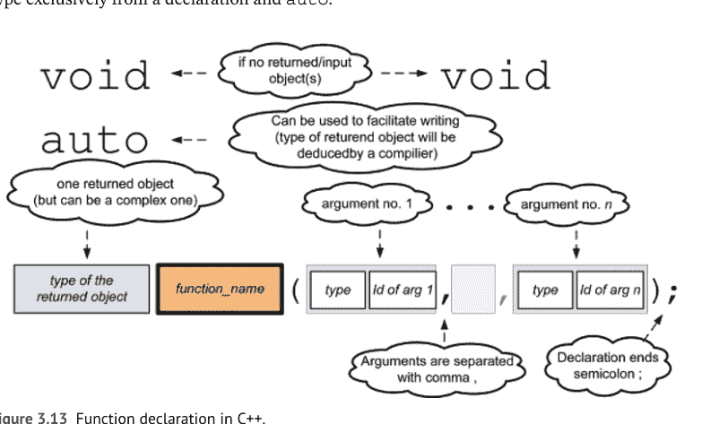

回到我们的实际例子，只提供函数声明足以让之前的代码编译，但不足以构建完整程序。原因是什么？因为要实现完整功能，我们需要 SumOfSquares 的完整实现代码。否则，尽管编译成功，程序也会因链接错误而无法正确运行（链接器会报错，提示缺少定义）。因此，为了满足编译器和链接器的要求，并构建完整程序，我们在 main 之后的同一文件中放置了 SumOfSquares 函数的完整实现，如 Listings 3.10 所示。

```
```
Listing 3.10 SumOfSquares 函数的定义（在 CppBookCode，Functions.cpp）。

26    // 计算并返回其参数的平方和
27    ////////////////////////////////////////////////////////////////
28    //
29    // 输入：
30    // a, b - 浮点输入值
31    // 输出：
32    //    a * a + b * b 的和，即：
33    //    a * a + b * b
34    //
35    // 注意：
36    // 参数按值传递（复制）
37    //
38    double SumOfSquares( double a, double b )
40    {
41    return a * a + b * b;
42    }
```
```

在第 [39] 行，我们看到与第 [8] 行的声明是复制的，但第 [40–42] 行使用大括号 {} 包含了函数的完整体，而不是以分号 ( ; ) 结尾的声明。函数非常简单：它计算每个参数的平方值，将它们相加，并返回结果——所有在单行 [41] 中完成。

一个重要的练习是比较第 [39–42] 行定义的函数实体与其在第 [22] 行的调用位置之间的关系。让我们数一下涉及多少个对象以及它们是如何连接的；参见图 3.14。

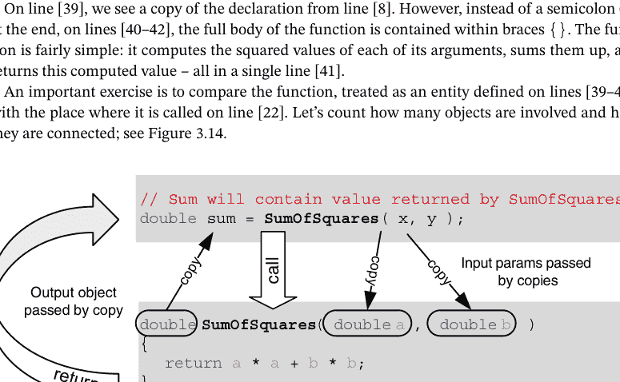


当调用 SumOfSquares 时，若传入的参数是 x 和 y 对象，则代码执行会切换到 SumOfSquares 的实际代码中；对象 a 和 b 是 x 和 y 的本地副本。函数返回后，会创建一个无明确名称的临时对象，并返回函数调用后的下一条指令。此时返回的对象用于初始化变量 sum。需要指出的是，SumOfSquares 包含对传入对象的自身副本。对象 a 和 b 仅用于计算返回结果，这些副本是局部的，仅在 SumOfSquares 的作用域内可用。换句话说，对这些对象的任何操作都不会影响原始输入对象 x 和 y。然而，有时我们希望在函数内部通过指令修改外部对象（如 x 和 y），这时需要通过引用或指针间接传递这些对象，而不是直接复制。

为了以满意的方式结束我们简单的程序，图 3.15 展示了一个函数定义的通用图。可以清楚地看到，它由函数声明后跟由大括号 {}  delimited 的函数体组成。函数体内是定义函数行为的代码行。

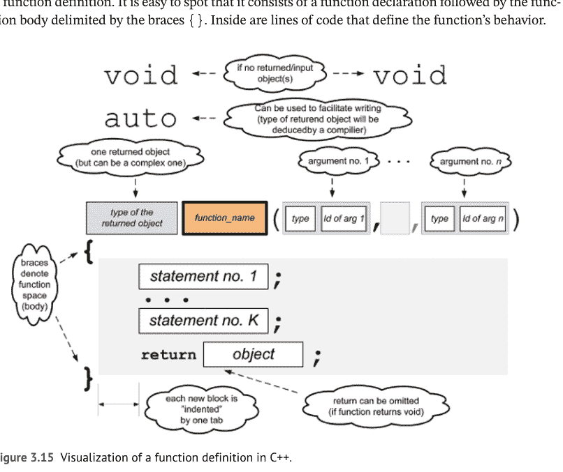

我们可以为函数参数提供默认值，例如：

```cpp
double SumOfSquares( double a, double b = 0.0 )
{
    return a * a + b * b;
}
```

如果在调用时未提供参数的值，则使用默认值。在本例中，我们可以为 a 和 b 提供值，也可以只为 a 提供值。后者情况下，b 会被设为默认值 0.0，如下所示：

```cpp
cout << SumOfSquares( 10.0 ) << endl;    // returns 100.0
```

默认参数可以为一个、两个或全部参数提供，但必须从最右侧的参数开始连续设置。

在开发函数时，为函数本身及其参数和类型提供恰当的名称（标识符）很重要，以清晰传达它们的角色和目的。根据《McConnell 2004》的经验法则：

- 名称应简洁且具 distinctive
- 如果名称由多个单词组成，单词之间应用大写字母或下划线 (`_`) 分隔

函数前的注释也非常重要，它简要说明函数的作用以及参数的角色。其他关键代码行也应加注释。

## 牢记要点

- 函数是软件设计的重要概念，能将概念上相互关联的代码组合在一起，供多次复用
- 函数可以接受零个或多个类型各异的输入对象，也可以返回零个或一个类型各异的输出对象
- 输入参数可以通过以下方式传递：
  - 通过按值复制（by value）
  - 通过提供对外部对象的引用
  - 通过提供对外部对象的指针
- 函数可以为参数提供默认值
- 同名函数可以存在，前提是它们的输入参数集合不同，这称为 *overloaded functions*

## 3.14.2 将参数传递到函数以及从函数中获取参数

在确定函数的作用和名称后，最重要的任务是确定其输入和输出参数的数量和类型，以及传递参数的机制（复制或间接）。形式参数可以设置默认值。如果形式参数的值未显式提供，则使用默认值。默认值必须从最右侧参数开始连续添加。虽然默认参数在某些情况下很便利，但过度使用会隐藏运行时计算值的必要性，需谨慎。本书的后续示例将展示许多默认参数的用法。

为展示函数参数传递的多种方式，我们将检查 Deg_2_Rad 函数的变体，该函数将传入的角度（以度为单位）转换为等价的弧度：60 度约为 1.047 弧度。

```cpp
11  double d { 0.0 };       // 保存度数
12
13  cout << "Enter degs: ";
14  cin >> d;
15
16  double r { 0.0 };        // 保存弧度
17
18  r = Deg_2_Rad( d );       // 调用 Deg_2_Rad，d 不会被影响
19
20  cout << d << " degs = " << r << " rad" << endl;
```

在 [11–14] 行，我们创建并初始化变量 d，显示提示并等待用户输入 d 的值。随后，在 [16] 行创建并初始化变量 r（类型为 double）。在 [18] 行，使用 d 作为参数调用 Deg_2_Rad，d 的值不会因此改变。返回值被复制到 r 中，最后在 [20] 行显示度数和弧度。变量 r 的使用是为了便于理解示例；在实际代码中，如果 r 之后不再使用，可以直接在表达式中调用 Deg_2_Rad 并输出返回的临时对象，如下：

```cpp
21  cout << d << " degs = " << Deg_2_Rad( d ) << " rad" << endl;
```

通过复制传递对象有时被称为 *值语义*，而 *引用和指针语义* 则意味着对对象的间接访问，如下文所述章节所讨论。

### 3.14.2.2 通过引用间接传递参数

引用在 3.11 节中被介绍为提供间接访问对象的通用技术。使用 *左引用* 将对象传递给函数意味着不复制对象，只传递对其的引用，如图 3.17 所示。相反，*右引用* 允许对象的移动语义，即两个对象之间进行数据交换（swap）。此外，还有一种混合方式： *forward reference*（也称为 *universal reference*）。本节主要关注通过左引用间接传递对象的情况，其他引用类型在 4.6.4 节中讨论。

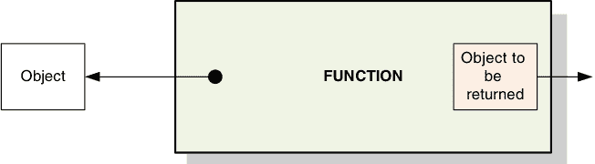

**图 3.17** 在 C++ 中通过引用将对象传递给函数的可视化。

由于对象通常很大，避免复制可以节省大量时间和内存。更关键的是，间接访问使函数能够通过引用对外部对象进行修改，使函数的结果在返回后仍然有效。

Listings 3.12 中的代码展示了使用 const 引用间接传递对象的 Deg_2_Rad 版本，该版本不复制输入对象，只读取它：

**Listing 3.12** 间接对象传递的上下文（来自 *CppBookCode, Functions.cpp*）。

```cpp
// 相同的操作但间接访问
// 使用 const 引用，C++ 允许使用相同的函数名，只要参数列表不同（函数重载）
double Deg_2_Rad( const double & deg )
{
    // deg 是外部对象的引用
    // 由于它是 const 引用，只能读取，不能修改
    return kPi * deg / 180.0;    // 与之前相同的公式
}
```

需要注意的是，deg 在 [26] 行是一个 const 引用，这意味着通过该引用无法修改外部对象。若使用非常量引用（即可读可写），则可以修改对象。

有趣的是，Deg_2_Rad 的其余部分与前一节中按值传递的实现完全相同，因此其调用上下文与之前相同，这里不再重复。

另外，请注意返回值仍然是按值传递的，因为它必须在函数结束后仍然有效，否则返回的引用会悬空，导致未定义行为。因此，不能返回指向局部对象的引用——该对象在函数退出后销毁，引用会指向 dangling object，若在后续代码中使用会产生破坏性后果。

最后，我们有两个完全相同名字的函数 — Deg_2_Rad — 在同一作用域内，这在 C++ 中是合法的，称为 *函数重载*。唯一要求是形式参数列表必须不同，以便编译器在相同调用上下文中能够 unambiguously 选择正确的函数。

让我们接下来分析 Deg_2_Rad 的另一个版本，它接受外部对象的引用，并在函数内部读取、修改并写回该对象，即函数在外部对象上执行计算。

```cpp
// 将 "val" 从度转换为弧度（原地修改）
// 可能产生惊喜
void Deg_2_Rad( double & val )
{
    val *= kPi / 180.0;
}
```

在 [35] 行，函数接受一个非 const 引用 val，指向外部的 double 对象。该函数没有返回值，因此使用 void 关键字。该函数通过修改传入的引用来实现原地转换。


if 转换为整数时)。如果发生这种情况，指针不能解引用，因为这样会导致程序崩溃。另一方面，不断检查指针是否有效会影响性能；因此在这种情况下，我们指定函数只能在传入有效指针时调用，并在第 [54] 行使用 assert 函数来保护这一假设（仅在调试模式下活动）。所有计算都在第 [56] 行执行。与前一个版本相比，主要区别在于通过指针访问对象的语法：`* deg`。因此，第一个 `*` 表示乘法，而第二个 `*` 仅表示指针解引用（第 3.19.1 节）。

一个有趣的观察是，指针本身（即第 [51] 行的对象 deg）在调用 `Deg_2_Rad` 时是通过另一个指针的拷贝传递的。因此，deg 是 `Deg_2_Rad` 函数的局部指针。为了说明这一点，在第 [58] 行我们将其设置为 `nullptr`，但这没有效果，因为函数返回后它会被销毁。这些操作同样不影响由 deg 指向的对象。图 3.18 展示了通过指针的间接访问。

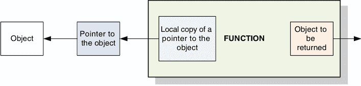

**Figure 3.18** 通过指针复制传递对象到函数的可视化。

接下来，展示了通过指针调用 `Deg_2_Rad` 的上下文。它与第 [35] 行定义的非 const 引用形参的 deg 传递方式完全相同，唯一的区别在第 [68] 行，使用了取地址运算符 `&`（参见 *GROUP 4*，表 3.15）。

```
```cpp
61    double d { 0.0 };      // 保存度数
62
63    cout << "Enter degs: ";
64    cin >> d;
65
66    double d_storage = d;   // 这里我们稍后存储弧度
67
68    Deg_2_Rad( & d );       // 调用 Deg_2_Rad; d 将被修改
69
70    cout << d_storage << " degs = " << d << " rad" << endl;
```
```

通过指针指向 const 对象可以实现只读语义。这种构造在处理“旧式”文本时很常见，通过 `const char *` 类型标识（见附录 A.2.6）。

在 C 语言中，通过指针间接访问对象是唯一的方式；在 C++ 中，如果可能的话会避免通过指针传递对象，而是使用引用或智能指针（参见第 5.3 节）。指针仍被使用的唯一情况是当传递的对象可能不存在时。此时，`nullptr` 表示缺失的对象。例如，如果函数参数是可选的，可以通过这种方式传递。然而，在现代 C++ 中，这类情况通过 `std::optional` 类型得到很好的管理。

通过简单的函数，我们已经看到各种传递参数的方式及其优缺点。这些方式可以轻松扩展到参数更多的实际函数。但始终要考虑软件的上下文和正确性。

# Things to Remember

+   - 通过拷贝传递是安全的，因为函数在自身的对象副本上操作。但如果对象很“重”，这可能消耗大量时间和内存。此外，这种方式不能用于不可复制的对象（第 4.15.5.1 节）。
+   - 如果对象很“重”（占用大量内存或不可复制），应通过间接访问来处理：
    +   只读访问应使用常量引用
    +   读写访问应使用非 const 引用
+   - 使用指针进行间接访问应尽量避免，或谨慎使用
+   - 除了通过只读写访问间接访问的对象外，函数还可以返回任意大小的对象作为“返回值”。但要注意不要返回指向不存在或已被删除对象的指针或引用

# 3.14.3  函数调用机制与内联函数

图 3.19 展示了函数调用的各个方面。图 3.19a 中重复的相同代码片段可以通过将其替换为在其他位置定义的单一函数（图 3.19b）来消除。在这种情况下，当执行单元调用（跳转）到另一个代码片段时，它需要知道在完成后返回到代码的哪个部分。这通过在称为 *stack* 的数据结构中保存返回地址来实现。当发生嵌套函数调用时，相应的返回地址也会存储在栈上（图 3.19c）。当最内层的函数返回时，它会从栈顶取出返回地址，以此类推。因此，栈采用 *last-in-first-out* (LIFO) 方式工作。这种数据组织方式对某些计算（如表达式解析）有益。栈数据结构的实现细节在 4.8.4 节中讨论。

调用函数时，需要传递输入和输出对象，以及返回地址。通常通过将数据压栈和弹出栈来实现。但栈的内存空间相对较小，因此嵌套调用的层数、传递的参数数量以及参数的大小都需要受到限制。

在某些情况下，我们可能希望直接内联调用函数（即在调用点重复嵌入函数代码），如图 3.19a 所示。这种做法称为 *function inlining*，可以减少执行时间，特别是当对一个相对小的函数有大量调用时。性能提升是因为省去了额外的调用和返回指令，以及避免了额外的寄存器和栈资源的使用。此外，现代处理器架构在代码和/或数据相对紧凑（而非分散在遥远的内存空间）时会获得显著优势（第 2.1 节）。实现快速内存访问的方法是保持处理器缓存一致性（Patterson and Hennessy 2018）。

[PAGE 136]

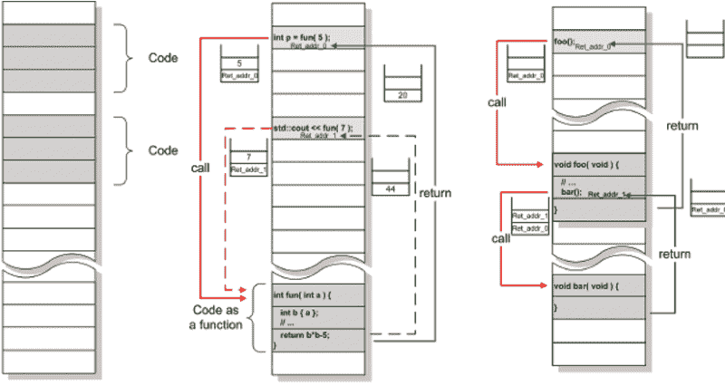

重复代码（内联函数）

选定函数，重复调用

嵌套函数调用

Figure 3.19 函数调用机制。重复代码（a）可以通过调用单一函数（b）来替换。调用函数时，需要在栈上保存返回地址到调用后的位置。返回函数时，返回地址从栈中弹出。参数和返回值可以通过栈传递，或在某些架构中通过处理器寄存器传递。当函数调用被嵌套（c）时， successive return addresses 依次压栈，返回时以 LIFO 顺序弹出。

[PAGE 137]

<!-- no content -->

[PAGE 138]

下面是用于测试 `FiboRecursive` 的简单代码：

```
```cpp
void FiboRecursive_Test( void )
{
    cout << "Enter Fibonacci level: ";

    int fibo{}; // 定义并初始化为 0
    cin >> fibo; // 从键盘读取

    // 显示结果
    cout << "Fibonacci at level " << fibo << " is "
         << FiboRecursive( fibo ) << endl;
}
```
```

可以以递归公式形式编写的问题，如阶乘、二分查找和图形洪水填充算法，通常很容易通过这种方式实现。但由于前面提到的局限性，实际中递归函数很少使用。另一个有趣的机制是递归模板（第 4.8 节）。

# 3.14.5  函数重载 – 通过命名空间解决可见性问题

与 C 语言不同，C++ 中函数的解析不仅取决于名称，还取决于 *所有* 参数（形式参数列表）。因此，C++ 中可以定义具有相同名称但参数类型不同的函数，只要它们在参数类型上能够唯一区分即可。即使函数类型不同，也可能出现函数调用的歧义，导致编译器选择出意料之外的函数，这会引发隐蔽错误。因此，C++ 引入了 *命名空间* 来唯一解析函数名称。

让我们回顾第 3.14.2.1 和 3.14.2.2 节中定义的两个 `Deg_2_Rad` 版本：

```
```
double Deg_2_Rad( const double deg );
```
```

```
```
double Deg_2_Rad( const double & deg );
```
```

这两个重载函数可以放在同一个文件中。但如果我们尝试如下调用：

```
```
r = Deg_2_Rad( d );     // call Deg_2_Rad, d won't be affected
```
```

（完整上下文请参见第 [18] 行的 Section 3.14.2.1），这会导致编译错误，因为编译器认为两种调用方式（按值和按 const 引用）同样合适，导致选择困难。这时，命名空间（如 Listing 3.15 所示）就派上用场。


## 在深入代码分析之前，请注意第 [3] 行的 using namespace std 结构。它打开了当前编译软件（即编译单元）中所有已包含标准头文件的整个标准命名空间。因此，标准函数和类可以省略 `std::` 前缀。缺点是，如果已经存在一个与打开的命名空间中的函数或类同名的函数或类，就可能发生名称冲突。因此，应避免使用前面的结构，尤其是在头文件中。这意味着应显式使用 `std::` 前缀，尤其是当这样做不会降低代码可读性时。另一种替代方法（也在我们的大多数示例中使用）是逐字引入我们希望使用的每个构造而不带 `std::` 前缀，例如 using std::cout、using std::string 等。尽管如此，在源文件（.cpp）中使用该命名空间中的数十个函数和类时，如果潜在名称冲突得到良好控制（如 Functions_Lambdas.cpp 中所示，清单 3.16 仅展示了其中的一小部分），有时打开整个 std 或其他命名空间也是合理的。我们的首要目标应该是软件的正确性，这条规则和其他规则都应谨慎选择，并且只有在支持这一首要目标时才应用。

我们的第一个 lambda 表达式（lambda 函数）完全写在清单 3.16 的第 [11] 行。与“经典的”函数定义相比，它没有名称，而是有一对方括号：[ ]。然后，在括号中，我们看到形式参数 cm 的定义，后面是在花括号 { } 中的函数体。它的作用很简单——接受以厘米表示的参数 cm，并通过乘以 2.54 将其转换为英寸。我们提到 lambda 表达式没有名称；在许多情况下，不需要给 lambda 命名。然而，在必要时，整个 lambda 表达式可以赋给一个对象，例如我们示例中第 [9] 行的做法。这是一个 lambda 闭包对象，它允许我们进一步引用该表达式，例如第 [20] 行的调用。但请注意，除了使用 `auto` 关键字外，没有其他方法可以声明此 lambda 闭包对象的类型。在本节末尾，我们将进一步探讨这个特性。

如图 3.20 所示，lambda 表达式由以下部分组成：

+   - **捕获**（**Caption**）——将外部对象引入 lambda 的作用域
+   - **形式参数列表**（**Formal arguments list**）——定义形式参数的类型和名称列表，与任何其他函数一样
+   - **可选返回类型**（**Optional return type**）——`->` 运算符后跟返回对象的类型
+   - **lambda 体**（**Lambda body**）——包含在花括号 { } 中的一组语句和表达式，包括 `return`

每个 lambda 都包含一个运行时对象，称为 lambda 闭包。如果 lambda 表达式附加到一个标识符，它可以像任何其他对象一样用于传递函数，或将其存储在

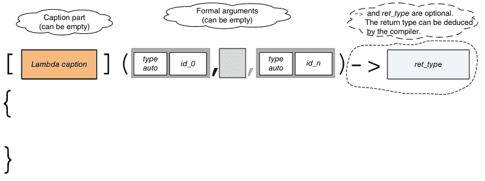

**图 3.20** lambda 表达式由三个部分组成：捕获、形式参数列表和可选返回类型。lambda 体包含在花括号 { } 中。

## 考虑到参数 o 可以表示任何流，例如 `std::cout`，也可以表示打开的文件或网络端口，第 [18–20] 行应该很容易理解。为了打印可读信息，在第 [21] 行，输出了第 [16] 行定义的 vector 中的文本。

现在我们创建一个简单的数据库，包含一些参加水肺潜水课程的人员信息。这由一个名为 SCUBA_Class 的 vector 表示，其中包含 StudentInfo 对象：

```cpp
// 让我们创建一个 SCUBA 班级
vector<StudentInfo> SCUBA_Class {

    { L"Phil", L"Curtis",     18,   StudentInfo::SCUBA_Cert::kAdvanced },
    { L"Kamil", L"Cyganek",   15,   StudentInfo::SCUBA_Cert::kOpenWater },
    { L"John", L"Kowalski",   23,   StudentInfo::SCUBA_Cert::kOpenWater },
    { L"Michal", L"Brajta",   61,   StudentInfo::SCUBA_Cert::kInstructor },
    { L"Anna", L"McLachlan",  18,   StudentInfo::SCUBA_Cert::kAdvanced },
    { L"Boż", L"Cyganek",     49,   StudentInfo::SCUBA_Cert::kInstructor },
    { L"Megan", L"Plant",     26,   StudentInfo::SCUBA_Cert::kMaster }

};
```

最后，在下面的 SCUBA_Course 函数中，我们显示满足某些条件的 SCUBA 学员的信息。首先，使用 std::sort 函数对 SCUBA_Class vector 进行排序，该函数在第 [43–44] 行调用。由于每个 StudentInfo 对象包含许多数据字段，我们需要告诉 sort 应使用哪个字段进行排序。这是通过提供在第 [44] 行定义的 lambda 函数来实现的。它接受两个对 StudentInfo 对象的常量引用，并返回 fFamilyName 字符串进行字典序比较的布尔值。这不需要任何进一步干预，因为编译器已经“知道”如何比较字符串。然后，在第 [47–48] 行，使用 std::copy 函数将排序后的 vector 复制到屏幕上（参见表 3.6）。

类似的排序和打印在函数的接下来几行 [54–59] 中完成。然而，这次我们按 fAge 排序。此外，还使用了 `auto` 关键字来自动推导对象类型。

最后，在第 [65] 行，调用了 std::copy_if：它只输出那些 fCert 字段与外部提供的 cert 对象相同的对象。此检查由另一个 lambda 函数完成，该函数在第 [67] 行定义。然而，与前两个 lambda 不同，这个 lambda 使用拷贝捕获将 cert 引入其作用域：

```cpp
void SCUBA_Course( void )
{
    wcout << endl << L"按姓氏排序：" << endl;

    // -----------------------
    // 按姓氏排序
    sort( SCUBA_Class.begin(), SCUBA_Class.end(),
          [] ( const StudentInfo & a, const StudentInfo & b )
          { return a.fFamilyName < b.fFamilyName; } );

    // 将它们打印到屏幕上
    copy( SCUBA_Class.begin(), SCUBA_Class.end(),
          ostream_iterator<StudentInfo, wchar_t> wcout, L"\n" );

    wcout << endl << L"按年龄排序：" << endl;

    // -----------------------
    // 按年龄排序
```

```cpp
sort( SCUBA_Class.begin(), SCUBA_Class.end(),
      [] ( const auto & a, const auto & b )
      { return a.fAge < b.fAge; } );

// 将它们打印到屏幕上
copy( SCUBA_Class.begin(), SCUBA_Class.end(),
      ostream_iterator< StudentInfo, wchar_t >( wcout, L"\n" ) );

wcout << endl << L"小组中的教练：" << endl;

// 查找所有具有给定证书的学员
const auto cert = StudentInfo::SCUBA_Cert::kInstructor;
copy_if( SCUBA_Class.begin(), SCUBA_Class.end(),
         ostream_iterator< StudentInfo, wchar_t >( wcout, L"\n" ),
         [ cert ] ( const auto & a ) { return a.fCert == cert; } );

wcout << endl << endl;
}
```

运行时，程序打印以下关于 SCUBA 班级的信息：

```
按姓氏排序：
Michal Brajta,  61      Instructor
Phil Curtis,    18      Advanced
Kamil Cygánek,  15      OpenWater
Bog Cyganek,    49      Instructor
John Kowalski,  23      OpenWater
Anna McLaughlan, 18     Advanced
Megan Plant,    26      Master

按年龄排序：
Kamil Cygánek,  15      OpenWater
Phil Curtis,    18      Advanced
Anna McLaughlan, 18     Advanced
John Kowalski,  23      OpenWater
Megan Plant,    26      Master
Bog Cyganek,    49      Instructor
Michal Brajta,  61      Instructor

小组中的教练：
Bog Cyganek,    49      Instructor
Michal Brajta,  61      Instructor
```

# 我们从这个示例中学到了什么？

+   - Lambda 函数可以通过拷贝和引用进行捕获
+   - 一个简单的 `StudentInfo` 结构体持有个人信息，其中包含作用域枚举类型 `SCUBA_Cert`
+   - 为 `StudentInfo` 重载的流插入运算符 `<<`
+   - 来自 SL 的 `std::sort` 和 `std::copy_if` 函数，带有提供的 lambda 函数和不同的捕获方式

# 3.14.7 (✕) 更多关于 Lambda 函数的内容

在使用 lambda 时，正确指定其捕获类型非常重要。具有不同捕获和不同调用条件的 lambda 示例见表 3.10。


## 表3.10 Lambda捕获说明及示例

| 捕获说明 | 含义 | 示例 |
|---|---|---|
| `[ ]` | 不捕获任何对象。 | `vector<int > vec;` |
| `[&]`<br>`[&a]` | 按引用捕获：1. 按引用捕获所有局部对象。这使得lambda表达式能够访问其所有局部对象。按引用捕获存在潜在风险，因为lambda表达式可能比其参数存活更久。在这种情况下，lambda可能会尝试访问悬垂指针或引用。因此，更安全的方式是创建所传递对象的副本。2. 明确指定需要访问的局部对象（更安全）。按引用捕获对象 a。 | `12`<br><br>`// However, avoid default [0]`<br>`{`<br>`    if (&rand_strings[rand_index] != 0) {`<br>`        const auto &s = rand_strings[rand_index(rand_strings.size())];`<br>`        return s[rand_index(s.size())];`<br>`    }`<br>`}`<br>`// ---------------------------------------------`<br><br>`cout << "Proposed password: " << pwd << endl;`<br><br>第[4–8]行定义了一个向量 `rand_strings`，其中包含三个带有字符集的字符串。这是为了通过混合使用大写字母、小写字母以及数字和符号（如 `#` 和 `@`）来提高密码强度。这些将用于生成密码。由于我们期望简洁，因此使用 `rand` 和 `seed` 函数来初始化和生成随机数。不过，更好的选择是使用新的随机数生成器之一，例如第3.17.3节中介绍的那个。我们的第一个lambda表达式在第[18–22]行定义，并分配给标识符 `rand_index`（一个闭包）。它利用初始化捕获，将全局常量 `RAND_MAX` 复制到变量 `rn`，该变量仅对该lambda局部可见。形参 `max` 定义了这个lambda可以生成的最大值。最后，通过定义中的 `-> int` 部分显式定义了返回值。这确保了浮点值被显式转换为整数类型，因为此lambda用于生成随机整数值。由于应用了 `1.0` 整数类型转换，该函数可以生成范围在 `0 ... max_val - 1` 内的值（包括端点）。然后形成一个循环，生成几个示例随机密码，每个密码包含八个字符。<br><br>主要的密码生成由STL库中的 `generate_n` 函数执行。它的第一个参数 `back_inserter(pwd)` 告诉函数在长度为 `passwordLen` 的 `pwd` 字符串末尾插入新元素，`passwordLen` 是该函数的第二个参数。`generate_n` 最有趣的参数是第三个，它是一个定义在第[39–43]行的第二个lambda函数；它执行两次随机抽取。<br><br>这次我们使用捕获 `[& rand_strings, & rand_index]`，显式提供了已命名的对象 `rand_strings` 和 `rand_index`。同样有趣的是，这个lambda是之前定义的lambda闭包对象，因为它将被此lambda使用。同样有趣的是，这个lambda在其参数列表中没有接受任何参数，因此其参数列表为空。如前所述，有两个随机操作。第一个操作在第[41]行，从 `rand_strings` 容器中选择三个字符串之一。在选定的字符串中，第[42]行选择一个随机字符，返回给 `generate_n` 算法。结果，获得了一系列随机生成的八个字符的字符串。之前代码的输出如下所示（每次运行会有所不同）：<br>`Proposed password: tbFVH4k`<br>`Proposed password: 2sCxY_Ks`<br>`Proposed password: 12J8683A` |
| `{...}` | 使用可变参数模板捕获。 | 第61–77行：这个例子有点高级，但在实践中可用（模板在第4.8节讨论）。这里我们将创建一个模板函数 `multi_print_helper`，它接受任意数量的参数，这些参数将输出到输出流。例如，它将作为诊断工具使用，如下所示。<br><br>要定义一个可变参数模板函数，我们需要该函数的两个版本：在第[62–67]行定义的启动版本，以及在第[70–77]行定义的带有模板参数包 `Args` 的版本。此结构遵循第[76]行发生的递归调用类型。因此，在递归结束时，启动版本终止调用。<br><br>`void multi_print_helper_test( void )`<br>`{`<br>`    // Make a log file`<br>`    ofstream log_file("log_file.txt");`<br><br>`    // A helper variable lambda that joins multi_print_helper with the log file`<br>`    auto diagnostic_print = [& log = log_file]( auto... params ) -> ostream &`<br>`    {`<br>`        // Each output separate with "," then add end-of-line`<br>`        return multi_print_helper( log, ", ", params ... ) << endl;`<br>`    };`<br><br>`    int x( 1 ); double y( 2.0 ); string z ( "error" );`<br><br>`    // Output objects of arbitrary type to the log file`<br>`    diagnostic_print( x, y, z );`<br><br>`    diagnostic_print( x, y, z, "text", x == y, 5.0 );`<br>`}`<br><br>`multi_print_helper_test` 函数展示了可变参数模板 `multi_print_helper` 函数的使用情境。然而，因为我们绝不应该希望将输出重定向到第[81]行创建的文件，所以在第[84–87]行引入带可变参数辅助lambda。它执行的唯一操作，在第[86]行，是使用适当组织的参数调用 `multi_print_helper`。最后，前面的lambda在第[93]和第[95]行被调用，每次传入不同数量的任意类型输入参数。最终，`log_file.txt` 的内容如下所示：<br><br>`1 2 three`<br>`2 three Text: 0.5` |

Lambda可以在其捕获列表中混合对象访问类型。下表包含一些示例：

| Lambda捕获变体 | 含义 | Lambda捕获变体 | 含义 |
|---|---|---|---|
| `[a,&b]` | 按值（副本）捕获对象 a，按引用捕获 b |  |  |
| `[=, &a]` | 全部按值捕获，但对象 a 按引用捕获 | `[&, a]` | 全部按引用捕获，但 a 按值捕获 |
| `[a, this]` | 捕获 a 和 this 指针（见第4.4节）。 | `[&, this]` | 全部按引用捕获，但 `this` 按值捕获（`this` 只能按值访问） |
|  |  | `[this, ...]` | 捕获 this 指针和可变参数模板 |

如前所述，关于lambda表达式一个有趣的事情是，声明其类型的唯一方式是使用 `auto` 关键字。这是因为每个lambda表达式都有一个唯一且未命名的类型（其关联闭包对象的类型）。然而，lambda表达式可以转换（强制转换）为具有相同形参和相同返回类型的函数指针（在下一节讨论）。在这种情况下，与使用原始函数指针相比，更好的想法是使用 `std::function`（见第3.14.9节）。

Lambda函数是常量对象。这意味着它们不能更改在其捕获列表中传入的对象的值。然而，将它们声明为 mutable 将允许此类更改；见第7.4.7节。

## 3.14.8 (⚒) 函数指针

有时我们需要将一个函数作为参数传递给另一个函数，或将其作为结构体中的成员。有时函数提供者希望在事件发生时调用一个函数——这称为回调机制。处理这种情况有很多选择。C/C++中可用的最低级选择是简单的函数指针。其语法如图3.21所示：它遵循函数声明模式，不同之处在于函数名被 `(*function_ptr_name)` 替换，其中 `function_ptr_name` 只是函数指针的标识符。

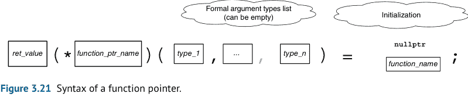

在下面的例子中，我们希望编写一个简短的程序来计算函数在单点处的导数。在开始之前，让我们回顾一些数学知识。对于给定的连续函数 $f$，其导数 $f'$ 定义如下（Korn and Korn 2000）

$$f'(x)=\lim_{\delta\to 0}\frac{f(x+\delta)-f(x)}{\delta} \tag{3.4}$$


## 3.14.9 (✕) 面向对象框架中的函数

在面向对象框架中，函数通常是类的成员。此外，部分函数可以在派生类中重写以调整其行为（参见第 4.11 节）。还有专门用于表示函数的类——这些被称为 *functors* 或 *functional objects*，即拥有重载的函数调用运算符 `()` 的类。功能对象的详细内容将在 6.1 节中说明。然而，我们已经在前面看到过它们，因为 lambda（在第 3.14.6 节中讨论）是函数对象的例子（尽管它们是特殊的）。

C++ 还提供了比裸函数指针更强大的功能。在 SL 中，有 `std::function` 模板类，它可以包装几乎所有可调用的对象，包括前面提到的那些。Listing 3.18 展示了如何使用 `std::function` 替代前一节中讨论的简单函数指针。

```
Listing 3.18  Function and function derivatives represented with `std::function`. Examples of computing function values and their derivatives (in *CppBookCode, Pointers.cpp*).

```cpp
using Real_Fun = std::function< double( double ) >;

// Derivative is also a 1D real function
auto deriv( const Real_Fun & fun, double x0, double eps = 1e-5 )
{
    // Let us use the definition of a derivative
    return ( fun( x0 + eps ) - fun( x0 ) ) / eps;
}
```
```

在第 [1] 行，声明了类型别名 `Real_Fun` 为 `std::function`，它接受所有形如接受一个 `double` 参数并返回 `double` 结果的函数形式。`deriv` 是在第 [4] 行定义的第一个函数。在第 [7] 行，它计算传入的第一个参数 `fun`（类型为 `Real_Fun`）的任意导数。

还有两个函数。第一个，在第 [10] 行定义，仅计算其参数 `x` 的平方根。实际上，它是以 lambda 表达式的形式定义的，如第 3.14.6 节所讨论。第二个函数，在第 [13] 行以常规方式定义，在第 [15] 行对两个数学函数 `pow` 和 `tanh`（在 `cmath` 头文件中声明）进行复合调用。

```
```cpp
// Define a square function (lambda expression)
Real_Fun x2_fun = [] ( double x ) { return pow( x, 2.0 ); };

// Define a compound function ("normal" function definition)
```
```

在第 [21] 行，创建了几个 `vector< double >` 对象，初始为空。随后在第 [22] 行的 `for` 循环中填充这些对象，遍历从 -3.0 到 +3.0 的范围，使用 `range` 对象。其操作直观。但要更好地理解其结构，需要更多关于面向对象编程（OOP）的信息，这将在本书后续章节中说明。具体而言，`range` 类在第 6.5 节中介绍。旧式的 `for` 循环也可以工作，但这里的写法被留作练习。

```
```cpp
void deriv_test_fun( void )
{
    // Fill vectors with arguments, value of x2_fun, derivatives of the two functions
    vector< double > x, fx, dfx_1, dfx_2, d2fx;
    for( auto arg : range( -3.0, +3.0, 0.1 ) )
    {
        x.       push_back( arg );
        fx.      push_back( x2_fun( arg ) );
        dfx_1.   push_back( deriv( x2_fun, arg ) );
        dfx_2.   push_back( deriv( fun_tan, arg ) );
    }
}
```
```

在第 [24–27] 行，`deriv_test_fun` 函数中的 vector 对象被填充为参数、 `x2_fun` 的值以及两次 `deriv` 调用的结果。这里值得注意的一点是，第 [26] 行和 [27] 行的 `deriv` 调用的第一个参数是以不同方式定义的函数，如前文所暗示。但得益于 `std::function` 的统一调用接口，仍然可以实现统一调用。

```
```cpp
// Store results in one file
ofstream outFile( "x_fun_plot.txt" );

// Copy each vector to the outFile
copy( x.begin(), x.end(), ostream_iterator< double >( outFile, " " ) );
outFile << endl;
copy( fx.begin(), fx.end(), ostream_iterator< double >( outFile, " " ) );
outFile << endl;
copy( dfx_1.begin(), dfx_1.end(), ostream_iterator< double >(outFile, " " ) );
outFile << endl;
copy( dfx_2.begin(), dfx_2.end(), ostream_iterator< double >(outFile, " " ) );
outFile << endl;
}
```
```

在第 [30] 行，创建了一个输出文件对象。从第 [33] 行开始，该文件用于将所有向量的计算结果流式写出。写入流的操作通过 `std::copy` 实现（第 3.8 节）。`std::copy` 的参数包括输入序列的起始和结束迭代器，以及输出序列的起始位置。后者由绑定到 `outFile` 的 `ostream_iterator` 提供。因此，每个向量的数据直接写入文件，而不是存储在内存中的数据结构中。

图 3.22 展示了由 Listing 3.18 的代码片段生成的 *x_fun_plot.txt* 文件中的函数值的绘图。

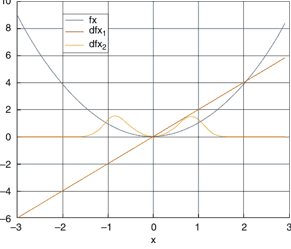

**Figure 3.22** 由 Listing 3.18 代码片段生成的函数值绘图。对于 $x^2$ 函数（蓝色），我们可以轻易识别其 $2x$ 导数（红色）。我们还看到，$x^2$ 的最小值点与其导数 $2x$ 穿过 0 的点重合。$\tanh(x^3)$ 的导数以黄色显示。

随着我们稍后将看到，`std::function` 也可以用于存储功能对象。事实上，lambda 函数是一种功能对象的形式。

## 3.15 示例项目 – 通过构造函数在结构中包装对象

在第 3.5 节中，我们展示了如何利用 `std::vector` 类定义矩阵。我们使用了类及其实例，这些实例称为对象。例如：

```
RealMatrix  m;
```

`RealMatrix` 表示类型，而 `m` 是该类型的对象。我们也已经看到 `RealMatrix` 可以如何用于计算。但在某些情况下，`RealMatrix` 的接口可能不够理想。例如，缺乏灵活的方式来初始化为预定义的尺寸。此外，还可能出现行大小不一的情况，这会导致矩阵出现奇怪的形状。

本节将教你：

+   - 如何将矩阵放入结构中，并添加构造函数用于初始化
+   - 如何编写基本的矩阵算法，如矩阵加法和矩阵乘法


是否可能“调用”一个对象？答案是：这是一个函数。被调用的其实是 `fData` 的构造函数。由于它是 `std::vector` 类的对象，这个构造函数期望第一个参数是元素个数，第二个参数是这些元素的初始值（见表 3.4）。在这种情况下，元素个数就是行数。然而，初始值是一个示例行——因此，对象 `RealVec( cols, initVal )` 作为初始值被提供，相当于一种原型。之后，在 [14–18] 行是 `EMatrix` 构造函数体的内容。它几乎是空的，仅有的两行 [16–17] 是对 `assert` 函数的调用。正如我们已经知道的，这些是特殊用途的函数，通常只在软件的*调试*版本中生效。它们的作用是检查构造的正确性，或者在本例中，检查传入参数的正确性。在我们的 `EMatrix` 构造函数中，我们要求两个维度都大于 0。这是为了验证传入的矩阵维度是否大于 0，因为尽管 0 维矩阵在技术上可行，但它并不是良好定义的。然而，如果有人错误地试图通过提供 0 作为维度来创建 `EMatrix`，程序会停止，显示一条消息，我们可以在调试器窗口中检查原因。这是在测试阶段控制代码行为的一种好方法。

当然，矩阵维度大于 0 的要求是可以放宽的。如前所述，这是一个数学约束，而非编程约束。例如，通过向 `EMatrix` 构造函数添加默认参数，如下所示

```
EMatrix( Dim rows = 0, Dim cols = 0, DataType initVal = 0.0 )
```

这样就得到了一个无需提供任何参数即可调用的构造函数——这就是*默认构造函数*。另外，正如第 3.9 节所述，如果数据仅用 `{}` 即可初始化，则可以省略构造函数。在后续章节中我们会看到许多示例。

此外，在构造对象时总是要求传递维度会带来一个后果——对象没有默认的构造方式（即不附带任何额外参数）。换句话说，显式定义参数化构造函数会抑制编译器自动生成默认构造函数。正如我们接下来要讨论的，缺少默认构造函数会给对象施加一些限制。

另一个设计问题是：是否允许在矩阵创建后修改其维度。我们经常需要做出这样的设计决策。这些决策应当经过全面分析，考虑其后果；而且更重要的是，它们应当在代码中得到良好的注释。

回到 `EMatrix` 的定义，注意还有两个成员函数——第 [22] 行的 `GetCols` 和第 [23] 行的 `GetRows`——它们分别返回 `EMatrix` 的列数和行数。这些函数的操作现在应该已经清楚了，因为在之前的章节中我们讨论了如何访问 `RealMatrix` 的维度。然而，有两件事值得解释。首先是返回类型，这里用 `auto` 定义。我们可以使用 `Dim`，但使用 `auto` 更加灵活，我们将在多处展示这一点。其次是关键字 `const`。将函数声明为 `const` 意味着该函数不打算更改任何成员数据（状态）。

由于 `EMatrix` 包含 `fData` 并扩展了其功能，这种构造是一种对象*包装器*或*适配器*设计模式（Gamma 等人，1994）。在本书的许多示例中（第 4.8.4 节），我们都会看到这种无处不在且有用的构造。

## 需要记住的要点

- 在 `struct`（class）中，数据成员初始化可以通过构造函数完成，该构造函数属于*特殊成员函数*组。
- 可以在不提供任何参数的情况下调用的构造函数称为*默认构造函数*。
- 接受参数的构造函数称为*参数化构造函数*。
- 构造函数中数据成员的初始化应在*构造函数初始化列表*中进行，即位于冒号 `:` 之后、构造函数体之前。
- 数据成员总是按照它们在类定义中声明的顺序进行初始化，因此它们也应当以相同的顺序写在构造函数初始化列表中。
- 向 struct（class）添加参数化构造函数会抑制编译器自动生成默认构造函数（以及其他特殊成员）。

### 3.15.1  **面向对象环境中的 EMatrix**

EMatrix 是借助 `struct` 定义的，这意味着它的所有数据和成员函数都是公开可访问的，可以从任何 EMatrix 对象上自由调用。

```cpp
struct EMatrix
{

    RealMatrix fData; // data structure
}
```

使用 `class` 关键字的等价写法如下：

```cpp
class EMatrix
{
    public:
        RealMatrix fData; // data structure
}
```

由于 `class` 默认所有成员是私有的，添加 `public` 关键字后，所有数据成员和函数成员就完全公开了，就像 `struct` 那样。但仅仅用不同的关键字获得相同的功能并不有趣。有趣的是在我们的设计中使用 OOP 范式。当前版本的 `EMatrix` 已经接近面向对象（OO）领域。但要真正进入该领域，我们至少需要将数据设为私有，并添加成员函数。在第 4.7 节中，我们将练习在 OO 领域重新打造 `EMatrix`。这种为增强代码功能和改进质量而进行的修改被称为*代码重构*（Fowler, 1999）。

### 3.15.2  **EMatrix 的基本操作**

定义好 `EMatrix` 之后，让我们来做一些矩阵计算，如清单 3.20 所示。在第 [12–19] 行，我们向用户打印说明。第 [22] 行创建了一个维度为 3 × 4 的对象 `matrix_1`。这涉及我们在前一节讨论过的 EMatrix 构造函数。因此，我们可以确保所有矩阵元素都被设置为零。

与其把所有的计算步骤写在一个大函数里，几乎总是更好的做法是将代码组织成若干个专门的函数。因此，为了输入和打印矩阵数据，我们使用 `AskUserForMatrixData` 和 `ShowMatrix` 函数。类似地，`MultMatrix` 执行矩阵乘法。要调用它们，我们只需要提供它们的声明，比如第 [4–6] 行中的声明。这样，我们现在就可以使用它们，并把完整的定义推迟到代码后面再完成。

**清单 3.20 Easy_Matrix_Second_Test 函数的定义，其中包含使用 EMatrix 定义、初始化和相乘矩阵的示例（位于 EasyMatrix 的 EMTest.cpp 中）。**

```cpp
// To use a function we only need to provide its declaration.
// However, to make a full program, function definitions must
// be added in some of the source files.
void AskUserForMatrixData( EMatrix & m );
void ShowMatrix( const EMatrix & m );
EMatrix MultMatrix( const EMatrix & a, const EMatrix & b );

// Here we show how to use EMatrix
void Easy_Matrix_Second_Test( void )
{
    std::cout << "------------------------------------------" << std::endl;
    std::cout << "In this example we will:" << std::endl;
    std::cout << "* Create a 3x4 matrix M1 (you will enter its data)" << std::endl;
    std::cout << "* Print M1" << std::endl;
    std::cout << "* Create a 4x2 matrix M2 (you will enter its data)" << std::endl;
    std::cout << "* Print M2" << std::endl;
    std::cout << "* Compute and print a product M1 * M2" << std::endl;
    std::cout << "------------------------------------------" << std::endl;

    EMatrix matrix_1( 3, 4 );
    AskUserForMatrixData( matrix_1 );
    std::cout << "You've just entered M1 - is it correct?" << std::endl;
    ShowMatrix( matrix_1 );

    EMatrix matrix_2( 4, 2 );
    AskUserForMatrixData( matrix_2 );
    std::cout << "You've just entered M2 - is it correct?" << std::endl;
    ShowMatrix( matrix_2 );

    std::cout << "The matrix product of M1 * M2 is:" << std::endl;
    ShowMatrix( MultMatrix( matrix_1, matrix_2 ) );
}
```

在第 [23] 行，调用 `AskUserForMatrixData` 函数，让用户从键盘输入 `matrix_1` 的元素值。为了验证其内容，在第 [26] 行调用 `ShowMatrix` 函数将 `matrix_1` 打印到屏幕上。类似地，在第 [29-33] 行，获取并显示了这次维度为 4×2 的 `matrix_2`。最后，在第 [37] 行，通过连续调用 `MultMatrix` 和 `ShowMatrix` 函数，计算并立即显示两个矩阵的乘积。

更准确地说，`MultMatrix` 返回一个临时的 `EMatrix` 对象，该对象被 `ShowMatrix` 作为参数接收，然后被显示。正如我们从矩阵代数中所知，它们的乘积是一个 3×2 的矩阵。我们稍后将回来讨论这些计算的细节。

注意，在这些函数中，只有 `AskUserForMatrixData` 会修改传递给它的矩阵。为此，它的参数被声明为对 EMatrix 对象的引用，即 `EMatrix &`。另外两个函数只从传递给它们的 EMatrix 参数中读取值。因此，它们被声明为常量引用：`const EMatrix &`。这样，传入的对象就是安全的


# 3.15.3 输入和输出操作（EMatrix）

如前所述，我们已经推迟了针对 EMatrix 对象执行特定操作的函数定义。在本节中，我们将分析两个函数，AskUserForMatrixData 和 ShowMatrix，用于读取并显示矩阵值。

AskUserForMatrixData 函数定义在列表 3.21 的第 3–18 行。在此，最好包含说明函数功能的信息，以及其参数的作用；在此情况下，几行注释即可。

**列表 3.21** 读取矩阵 m 的数值的 AskUserForMatrixData 函数定义（在 EasyMatrix，EMUtility.cpp 中）。

```cpp
// Ask the user to enter values for matrix m
// from the keyboard.
void AskUserForMatrixData( EMatrix & m )
{
    const Dim kCols = m.GetCols();
    const Dim kRows = m.GetRows();

    for( Dim r = 0; r < kRows; ++ r )
    {
        std::cout << "Enter data for row no. " << r << " of " << kRows << std::endl;
        for( Dim c = 0; c < kCols; ++ c )
        {
            std::cout << c << ": ";
            std::cin >> m.fData[ r ][ c ];  // read a value from the keyboard
        }
        std::cout << std::endl;  // new line again
    }
}
```

第 5–6 行读取输入对象 m 的列数和行数，并将它们存储在两个常量 kCols 和 kRows 中，这两个常量将在访问 m 的元素时作为边界使用。Dim 是一种用于索引向量和矩阵元素的类型，如列表 3.4 所声明。

由于矩阵是二维的，要访问其元素需要两个循环，分别遍历行和列。为此，第一个遍历矩阵行的循环在第 8 行开始。第 9–16 行的所有语句都在循环变量（迭代器） r 取 0 到 kRows − 1 的值时重复执行。每次迭代后，r 通过 ++ r 增加 1。第 10 行，我们向用户显示即将输入的行号的提示信息。

第二个嵌套循环在第 11 行开始。它在 12–15 行的花括号内执行两个操作。首先，第 13 行打印表示列号的文本。然后，第 14 行等待从键盘读取输入。用户输入的值被赋给矩阵元素位置 r, c。通过一系列调用实现：首先，m.fData 找到 fData……**（此处原文截断，但根据上下文可推断）**

要对两个矩阵求和，它们的维度必须相同；此条件通过 assert 验证。若维度相同，则在第 9 行创建并立即初始化输出矩阵 c，使用第一个矩阵 a 的数据。这可能因为编译器会假设只需复制 c.fData 成员即可从 a.fData 复制。此外，由于这些是 std::vector 对象，它们知道如何相互复制，因此此操作会自动完成。这解释了代码内部的行为，尽管关于复制和移动构造函数的详细说明将在 4.4 节中留待。

**列表 3.22** 基本矩阵操作函数定义（在 EasyMatrix，EMUtility.cpp 中）。

1    // Add two matrices, return the result:
2    // c = a + b
3    // Dimensions of a and b must be the same.
4    EMatrix AddMatrix( const EMatrix & a, const EMatrix & b )
5    {
6        assert( a.GetRows() == b.GetRows() );    // dim must be the same
7        assert( a.GetCols() == b.GetCols() );
8
9        EMatrix c { a };    // Make c the same as a
10
11        for( Dim row = 0; row < b.GetRows(); ++ row )
12            for( Dim col = 0; col < b.GetCols(); ++ col )
13                c.fData[ row ][ col ] += b.fData[ row ][ col ];
14
15        return c;
16    }

将两个矩阵相加需要两个 for 循环，如第 11、12 行所示。这些循环与 AskUserForMatrixData 函数中完全相同地遍历 fData 的行和列。第 13 行，使用 += 运算符将 b 矩阵的元素加到 c 矩阵对应元素上。写法 x += y 等价于 x = x + y，如 GROUP 15 运算符（表 3.15）所说明。最后，c 在第 15 行返回。

让我们简要回顾一下矩阵乘法。下面考虑以下两个矩阵 A 和 B：

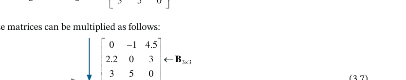

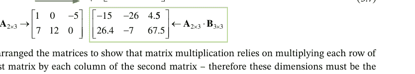

我们排列矩阵以表明矩阵乘法依赖于将第一个矩阵的每行与第二个矩阵的每列相乘——因此这些维度必须相同。对应元素相乘后相加，得到结果矩阵中对应位置的元素。例如，第一行第一列的乘积计算方式为：1 · 0 + 0 · 2.2 + (−5) · 3 = −15。

掌握这些知识后，我们准备编写列表 3.23 中的代码。矩阵乘法函数 MultMatrix 定义在第 20 行，它接受两个代表真实矩阵的 EMatrix 对象，通过常量引用 a 和 b 传递。与矩阵加法不同，矩阵乘法要求 a 的列数等于 b 的行数。在第 22–26 行，我们读取行数和列数，并通过 assert 检查维度是否匹配。随后，第 30 行创建返回矩阵 c 并显式初始化为 0.0（如果未提供，则默认使用 0）。

**列表 3.23** 矩阵乘法函数定义（EMUtility.cpp 部分）。

```cpp
// Multiply two matrices, return the result:
// c = a * b
// Dimensions of a and b must comply for multiplication
EMatrix      MultMatrix( const EMatrix & a, const EMatrix & b )
{
    const auto a_cols = a.GetCols();
    const auto a_rows = a.GetRows();

    const auto b_cols = b.GetCols();
    const auto b_rows = b.GetRows();

    assert( a_cols == b_rows );          // Dimensions must be the same

    EMatrix c( a_rows, b_cols, 0.0 );    // Output matrix has such dimensions

    for( Dim ar = 0; ar < a_rows; ++ ar )       // Traverse rows of a
        for( Dim bc = 0; bc < b_cols; ++ bc )   // Traverse cols of b
            for( Dim ac = 0; ac < a_cols; ++ ac ) // Traverse cols of a == rows of b
                c.fData[ ar ][ bc ] += a.fData[ ar ][ ac ] * b.fData[ ac ][ bc ];

    return c;
}
```

从前面的例子可知，矩阵乘法需要三个循环：第一个遍历 a 的行，第二个遍历 b 的列，第三个遍历 a 的列（其数量必须等于 b 的行数）。这些循环在第 32–34 行以 for 语句实现。第 35 行，将 a 与 b 对应元素的乘积之和累加到矩阵 c 的相应位置。

最后，第 37 行返回结果矩阵 c。此时 c 按值返回，可能会产生昂贵的对象复制开销。但得益于 4.6.4 节讨论的优化机制，这不应成为大问题。

# 3.15.5 组织项目文件并运行应用程序

前面的代码片段来源于本书的 *EasyMatrix* 项目（可从书籍项目网页获取，Cyanek 2018）。`EMatrix` 结构体的定义位于 *EMatrix.h* 头文件。矩阵操作位于 *EMUtility.h* 和 *EMUtility.cpp* 文件中，测试函数位于……**（此处原文截断）**


构建并运行 _EasyMatrix.exe_ 之后，屏幕上出现以下输出：

```text
In this example we will:
* Create a 3x4 matrix M1 (you will be asked to enter its data)
* Print M1
* Create a 4x2 matrix M2 (you will be asked to enter its data)
* Print M2
* Compute and print a product M1 * M2

Enter data for row no. 0 of 3
0: 0.00
1: 1.11
2: 2.22
3: 3.33
Enter data for row no. 1 of 3
0: 4.44
1: 5.55
2: 6.66
3: 7.77
Enter data for row no. 2 of 3
0: 8.88
1: 9.99
2: 10.10
3: 11.11
You've just entered M1 - is it correct?
0 1.11 2.22 3.33
4.44 5.55 6.66 7.77
8.88 9.99 10.1 11.11
Enter data for row no. 0 of 4
0: 0.00
1: 1.11
Enter data for row no. 1 of 4
0: 2.22
1: 3.33
Enter data for row no. 2 of 4
0: 4.44
1: 5.55
Enter data for row no. 3 of 4
0: 6.66
1: 7.77
You've just entered M2 - is it correct?
0 1.11
2.22 3.33
4.44 5.55
6.66 7.77
The matrix product of M1 * M2 is:
```

当然，上述结果取决于用户输入的矩阵值。另外，你可能对值的格式感到好奇。在C++中，这也是可以设置的。如果你感兴趣，请参阅表3.14。

### 3.15.6 使用简单随机数生成器扩展矩阵初始化

在本节中，我们将进一步探讨在`struct`的框架下使用函数将数据组合在一起的思想。同时，我们将学习以下内容：

- 如何实现一个简单的函数来生成具有良好随机特性的随机数
- 在`struct`/`class`中使用初始化列表进行对象初始化
- 使用十六进制掩码进行位移、XOR和AND操作

清单3.24展示了我们的`MarsXorShift`结构体，它从第[9]行开始。在第[12]行，它包含一个`unsigned long`类型的数据成员`r_a_n_d`。在第[16]行，定义了`GetNext`函数，每次调用时都会返回由*XorShift*算法计算出的一个随机数。

**清单3.24** 基于Marsaglia算法实现随机数生成器的`MarsXorShift`结构体定义（位于*EasyMatrix*的*MarsXorShift.h*中）。

```cpp
// System headers in < >
#include <ctime>

// ---------------------------
// A helper simple random number generator

// Marsaglia's Xorshift random numbers
struct MarsXorShift
{
    // Start value - must be different from 0
    unsigned long r_a_n_d { (unsigned long) time( nullptr ) & 0xFF };

    // These values were found by G. Marsaglia
    // to generate quite good random values
    unsigned long GetNext( void )
    {
        r_a_n_d ^= r_a_n_d << 13;    // << is bit left shift
        r_a_n_d ^= r_a_n_d >> 17;    // ^= is XOR-and-assign
        r_a_n_d ^= r_a_n_d << 5;

        return r_a_n_d;
    }
};
```

这里介绍的方法基于美国数学家乔治·马尔萨利亚（George Marsaglia）提出的*XorShift*算法（https://en.wikipedia.org/wiki/Xorshift）。这是一种非常高效的方法，通过`<<`和`>>`运算符进行连续的位移，然后使用XOR运算符`^`，如第[18–20]行所实现的那样。这些运算符在GROUP 8和GROUP 12的运算符表中（表3.15）有进一步说明。

`MarsXorShift`不包含构造函数——参见第3.9节的“零规则”。然而，`r_a_n_d`成员在第[12]行借助`{ }`中的初始化列表进行了初始化。为了以随机值开始，调用了`time( )`，它返回自1970年1月1日以来的秒数（我们将在第6.3节更详细地讨论时间函数）。该值通过位与操作`& 0xFF`截断为一个字节。为了访问这个库函数，第[2]行包含了`ctime`头文件。

所有数据和一些成员函数都应受到保护，以防止不受控制的外部访问。为了实现这一目标，在C++中，可以在数据或函数成员之前添加`private`关键字。为了允许外部访问（即从对象级别），应使用`public`关键字。这类可公开访问的成员被称为*类接口*。如果这两个关键字都未使用，`struct`默认将其所有成员视为公有，而`class`则相反——默认所有成员均为私有。这是它们之间唯一的区别。

成员封装对设计也有积极影响。如第2.3节所述，在自顶向下的方法中，我们首先关注从宏观尺度理解系统。然后关注每个特定系统组件的细节。设计得当、实现良好且成员封装良好的类使我们免于不必要的细节困扰，从而有时间正确地连接它们的接口。然而，成员封装需要恰当的设计来隐藏敏感数据并支持正常功能。在本节中，我们将展示如何实现这些目标。我们会多次回到这个问题：例如，在第4.7节中将`EMatrix`结构体转换为一个成熟的类时。

在本节中，我们将遵循面向对象编程（OOP）的规则。为了表示二次方程，我们将设计`TQuadEq`类。它的数据和一些内部使用的函数将被声明为私有。少量函数将被声明为公有，以提供类功能，例如初始化数据成员和计算方程的根。

项目的组织方式将与图3.23类似。不过，我们将专注于编写C++类时面向对象（OO）的方面，具体如下：

- 类成员访问规则：
    - 使用`private`关键字声明的私有成员
    - 使用`public`关键字声明的公有可访问成员
- 为什么在类中封装数据以及如何封装
- 向类中添加哪些函数以便轻松访问私有数据
- 类构造函数的正确构造
- 类接口的设计与实现
- 错误处理的方法和级别
- 类的重载流插入运算符`<<`和流提取运算符`>>`的定义

### 3.16.1 表示二次多项式的类的定义

设计和实现一个类没有唯一最佳的方法。第一步是确定类的主要角色，并选择其数据和成员函数。但在编程中，可能有许多方法、风格、模式、命名约定以及随着多年经验而来的其他细微差别。然而，在许多情况下，可以区分出类的典型组成部分，例如表3.11中展示的`TQuadEq`类的那些部分。

关于类的组织及其组件角色的更详细讨论留待第4.2节进行。不过，尽管`TQuadEq`很简单，但它和后续的类可以作为编写你自己类的模式。完整的代码可以通过将表3.11中的所有代码片段拼接起来获得，整个项目也可以从本书的网页（Cyganek 2018）下载。

**表3.11** `TQuadEq`类的组织（位于`QuadEq`项目的`QuadEq.h`中）

| 类成员 | 描述 | 示例 |
|---|---|---|
| 类数据成员 | 数据成员是聚合在类中的对象。它们可以是之前介绍过的任何类型。数据成员可以是不可变（常量）对象。类数据成员通常放在私有区域，以隐藏它们，防止不受控制的访问。 | <pre><code>#include &lt;iostream&gt;<br>#include &lt;cassert&gt;<br><br>///////////////////////////////////////////////<br>// This class implements the quadratic equation of the form:<br>// ax^2 + bx + c = 0<br>///////////////////////////////////////////////<br>class TQuadEq<br>{<br>private:<br>    double fa {}, fb {}, fc {}; // the coefficients of the equation<br>};<br></code></pre><br><br>在第[1–2]行，包含了两个标准库（SL）头文件：<code>iostream</code>用于输入/输出体系，<code>cassert</code>用于<code>assert</code>宏。类的定义从第[11]行开始。在第[13]行，打开了类的私有区域，之后定义了与二次方程系数对应的三个数据成员fa、fb和fc，并使用<code>{}</code>将它们初始化为零值。 |


-   [费曼学习法](https://wiki.example.org/feynmans_learning_method)的灵感源于诺贝尔物理奖获得者**理查德·费曼**。

1.  运用费曼技巧，你只需花上`20 min`就能深入理解知识点，而且记忆深刻，*难以遗忘*。

```
if (condVar > someVal) {console.log("xxx")}
```


使用 TQuadEq 对象执行（如清单3.27所示）。第[1]行包含了 *iostream* 头文件，随后是 *QuadEq.h*。这将 TQuadEq 引入 main 的作用域。

### 清单3.27 `main` 函数的定义（位于 *QuadEq* 的 `main.cpp` 中）

```cpp
#include <iostream>
#include "QuadEq.h"

using std::cout, std::cerr, std::cin, std::endl; // write cout and not std::cout

// In C++ there are overloaded main functions
int main( void )
{
    // Text corresponding to TQuadEq::EEquationType
    const string eq_types_text[] = { "No real roots",
                                     "One real root",
                                     "Two real roots",
                                     "Linear equation, one root",
                                     "A contradictory equation"
                                   };

    cout << "Enter coeffs of the quadratic equation: a*x*x + b*x + c" << endl;
    double a = 0.0, b = 0.0, c = 0.0;
    cin >> a >> b >> c;

    TQuadEq  eq( a, b, c );    // Create an initialized object

    // For the roots
    double x1 {}, x2 {};       // {} to initialize x1 and x2 to zero
    TQuadEq::EEquationType eq_type {};

    try
    {
        eq_type = eq.GetRoots( x1, x2 ); // This can throw
    }
    catch( const std::exception & e )
    {
        cerr << e.what() << endl; // If here, then error, so print the reason
        return -1;                // Exit with a failure code
    }

    // Everything ok, so print results
    cout << eq_types_text[ eq_type ];

    // In addition, if there are roots, then print them out
    switch( eq_type )
    {
        case TQuadEq::kOne:
        case TQuadEq::kLinOne:
            cout << " " << x1;
            break;

        case TQuadEq::kTwo:
            cout << " " << x1 << ", " << x2;
            break;

        default :
            break;
    }

    return 0; // Exit with ok code
}
```

在第[4]行，using 指令将常见的 IO 对象引入作用域。因此，我们不必写 `std::cout`，而只需写 `cout`，其它对象也类似。main 函数的定义从第[7]行开始。请注意，在 C++ 中我们可以选择 `main` 的重载版本——在此示例中，我们选择了一个不带任何参数但返回整数的版本，该整数可以传达错误代码。关于 `main` 各种版本的更详细讨论见 A.2.2节。

在第[10–15]行，创建了一个辅助文本数组，它反映了 TQuadEq 中定义的 EEquationType 常量的顺序。它将用作应用程序的一个非常简单的用户界面。在第[18–19]行，从键盘读取三个系数，这些系数由标准库中的 `cin` 对象表示。这些系数在第[21]行用于初始化 TQuadEq 对象 eq。在第[29]行，从 eq 对象调用公有成员函数 GetRoots，该函数评估方程的类型并计算根（如果有的话）。

如前所述，由于第[29]行可能抛出异常，第[27, 31]行使用了 try-catch 语句。如果捕获到异常，第[33]行会打印错误消息，并且第[34]行函数会以错误码安全退出。

第[38]行打印用户文本。在检查第[41–54]行的 `switch` 语句中的方程类型后，会输出附加信息。

构建并启动 *QuadEq* 应用程序后，可以观察到以下输出：

```
Enter coefficients of the quadratic equation: a*x*x + b*x + c
1.0 5.0 4.0
Two real roots: -4, -1
```

请注意，三个示例系数是在同一行输入的，以空格分隔。

## 3.17 示例项目——用于转换罗马数字的元组与结构化绑定

在此示例中，我们将开发一个将十进制数转换为罗马数字的 C++ 程序。除了罗马数字的计数方式外，我们还将学习以下 C++ 技术：

- `std::tuple` 用于辅助收集不同类型的对象
- 带有 `std::tuple<int, string>` 的 vector 容器，以及如何使用初始化列表初始化它
- 用于访问元组字段的结构化绑定机制
- 使用随机数库

罗马数字是古罗马发明的计数体系的一部分（Wiki:Roman_numerals 2020）。尽管如今它们已不太流行，但在一些国家，罗马数字仍被使用，例如在日期中表示月份。以下 10 个数字构成了罗马数字体系的基础：

| 1 | 2 | 3 | 4 | 5 | 6 | 7 | 8 | 9 | 10 |
|---|---|---|---|---|---|---|---|---|---|
| I | II | III | IV | V | VI | VII | VIII | IX | X |

上一行是我们十进制系统中使用的阿拉伯符号。下一行是对应的罗马数字。有些是累加数字，如 III 由 I+I+I 组成；VII 由 V+I+I 组成。其他数字用减法形式表示：例如，IV 表示 V−I，对应于 5−1 = 4。这是为了避免诸如 IIII 和 VIIII 这样令人困惑的结构。因此，在任何罗马数字中，一个给定的符号不会出现超过三次。总结起来，我们有三个不同的符号和五种不同的符号组合。其余五种组合是通过添加 I 的倍数得到的。

在此示例中，我们将开发一个将十进制值转换为罗马数字的过程。为此，让我们用所有罗马数字补充前面的表格，如下所示：

| XL | L | XC | C | CD | D | CM | M |
|---|---|---|---|---|---|---|---|
| 40 | 50 | 90 | 100 | 400 | 500 | 900 | 1000 |

除了新符号 L、C、D、M，我们再次看到减法数字：XL 代表 40，XC 代表 90，CD 代表 400，CM 代表 900。在这种基本设置中，我们没有加法组合。因此，我们有 13 种不同的组合。转换算法很简单：类似于将 1993 这样的数字转换为十进制分量，我们只需要找出该数字中有多少个 1000，然后余数中有多少个 100，再有多少个 10，最后有多少个 1。对于罗马数字，过程类似，但使用前面表格中显示的值。因此，我们检查数字中有多少个 1000，然后检查余数是否包含 900，然后是 500，然后是 400，依此类推直到 1。清单3.28中的 ConvertDecimal_2_Roman 函数利用现代 C++ 中的有用机制实现了这一思想。

在第[9]行，定义了函数 ConvertDecimal_2_Roman。它接受一个整数十进制值，该值将被转换为对应的罗马数字字符串表示。函数的返回类型使用 auto 声明，由第[29]行返回值的类型推导得出。在第[12]行，定义了 vector，其中包含由值和对应罗马数字字符串组成的对。这些对定义为 tuple<int, string>。元组是一个相对较新的 C++ 构造，它允许将不同类型的对象简单分组。它类似于第3.9节讨论的 struct。然而，元组非常灵活，在许多编程场景中很有用。还要注意，我们的示例中的元组需要按 value 参数的降序存储。因此，在这种情况下，vector 是最合适的数据结构。

在第[25]行可以观察到一个有趣的编程结构：一个循环，其操作如图3.24所示。它是一个 for 循环（参见第3.13.2.2节），遍历存储在 RomanValueTranslator 对象中的所有“值-字符串”对，表示为 [ val, str ]。同时访问元组的两个或更多字段称为结构化绑定（Filipek 2018）。

注意，为了访问 [ val, str ] 对，我们使用 const auto &，而不是简单的 auto。这样便使用了常量引用的更高效访问，避免了创建不必要的副本。

最后，在第[26–27]行，如果 in_dec_num 的剩余值仍然大于当前正在处理的罗马数字 val 的值，则将其从 in_dec_num 中依次减去。


在同一迭代中，由 `str` 字符串表示的相应罗马数字会被添加到最终的 `outStr` 对象中。

## 代码清单 3.28 将十进制数转换为罗马数字的函数（位于 CppBookCode, Dec2Roman.cpp）。

```cpp
#include <iostream>
#include <vector>
#include <string>
using std::cout, std::cin, std::endl;
using std::vector, std::string, std::tuple;

// Converts decimal number in_dec_num into a Roman numeral string
auto ConvertDecimal_2_Roman( int in_dec_num )
{
    // The values need to be sorted from the largest one
    const vector< tuple< int, string > > RomanValueTranslator =
    {
        { 1000, "M" }, { 900, "CM" },
        { 500, "D" }, { 400, "CD" },
        { 100, "C" }, { 90, "XC" },
        { 50, "L" }, { 40, "XL" },
        { 10, "X" }, { 9, "IX" },
        { 5, "V" }, { 4, "IV" },
        { 1, "I" }
    };

    string outStr { " " };
    // Traverse all tuples [ val, str ], starting from the largest val
    for( const auto & [ val, str ] : RomanValueTranslator ) // structured binding
    while( in_dec_num >= val )
        outStr += str, in_dec_num -= val; // the largest possible value

    return outStr;
}
```


## 代码清单 3.29（续）

```cpp
// Print the elements -- do not confuse the order
cout << "My/:" << get<0>(t_date) << " / " << get<1>(t_date) << " / " << get<2>(t_date) << endl;

// Retrieve the elements to separate objects
// with the structured binding
const auto [d, m, y] = t_date;

// Print the elements
cout << "My/:" << d << " / " << m << " / " << y << endl;

// Use the with ignore to retrieve a few elements
int d{};
string m{};

// Retrieve only day and month, ignore the year
tie(d, m, ignore) = t_date;

// Print
cout << "My/:" << d << " / " << m << endl;
```

```
// Print the elements
cout << "My/:" << get<0>(t_date) << " / " << get<1>(t_date) << " / " << get<2>(t_date) << endl;

// Retrieve the elements to separate objects
// with the structured binding
const auto [d, m, y] = t_date;

// Print the elements
cout << "My/:" << d << " / " << m << " / " << y << endl;
```

如果元组包含更多对象，通过索引访问它们可能会导致混淆。在我们的例子中，第一个和最后一个元素类型相同：`int`。因此，在第 [3] 行编写 `t_date(2019, "June", 27)` 可能会把日（day）与年（year）混淆，因为字段语义是隐含的。

代码清单 3.29 的右侧窗格展示了一个类似的数据结构，这次使用的是 `struct`。未命名结构体的定义从第 [2] 行开始。然后，在第 [5–7] 行定义了结构体的数据成员 `fDay`、`fMonth` 和 `fYear`。与元组不同，这些成员只能²通过提供对象名后跟点运算符（表 3.15 中的第 2 组），再后跟成员名来访问。然后，在第 [8] 行创建了 `s_date` 对象。它的成员已经用定义中提供的默认值初始化。`s_date` 的数据成员在第 [14–15] 行被访问并打印到屏幕上。有趣的是，结构化绑定也适用于 `struct`，如第 [19–22] 行所示。

那么，什么时候应该使用 `std::tuple`，什么时候应该使用 `struct`？下面是一些提示。

在以下情况下使用 `std::tuple`：

- 需要将少量可能类型不同的数据对象组合在一起。存储太多对象会导致混淆，因为它们的含义（语义）取决于它们在序列中的位置
- 不强调为数据成员命名
- 所有能访问该元组的对象都可以同等访问其中的所有元素，这是可以接受的
- 我们希望从函数返回多个对象（见第 7.4.8 节）

在以下情况下使用 `struct`（类）：

- 需要将可能类型不同的数据对象组合在一起
- 数据成员对象需要通过名称易于识别（强语义）
- 需要为成员分配访问权限（即 `private`、`public`；见第 4.3 节）
- 期望有成员函数
- 期望有继承

但一如既往，有些情况下两者是同样好的选择。如果这些对象的类型相同，那么也可以考虑使用 `std::vector` 或 `std::array`。

## 3.17.2 如何编写软件单元测试

比编写代码更重要的是确保代码按我们预期的方式执行。即使对于短小的函数，这也可能是一项繁琐的任务，更不用说由多年间编写的几十个库组成的大型软件系统了。我们怎样才能更有把握地认为软件工作正常？一种方法是使用单元测试——即嵌入在软件测试框架中、用于运行并验证相应软件组件正确性的测试函数。有些团队甚至在编写任何实际代码之前，就先从单元测试开始写代码。附录 A.7 提供了更多关于软件测试的信息。在本节中，我们将为罗马数字转换器编写一个简单的测试函数；参见代码清单 3.30。

`ConvertDecimal_2_Roman_UnitTest` 会检查若干十进制值，并使用 `assert` 将 `ConvertDecimal_2_Roman` 函数的输出与对应的罗马数字进行比较。所有比较都必须通过才会返回 true；否则 assert 会触发并停止执行。在实践中，更细致的行为可能更有用，例如写入日志文件等。

> ² 这是正常、自然且推荐的做法，尽管还有一些涉及指针的技巧。

## 代码清单 3.30 十进制转罗马数字转换器的单元测试函数（位于 *CppBookCode, Dec2Roman.cpp*）。

```cpp
// Unit test for ConvertDecimal_2_Roman
bool ConvertDecimal_2_Roman_UnitTest( void )
{
    assert( ConvertDecimal_2_Roman( 2000 ) == "MM" );
    assert( ConvertDecimal_2_Roman( 137 ) == "CXXXVII" );
    assert( ConvertDecimal_2_Roman( 1999 ) == "MCMXCVIV" );
    assert( ConvertDecimal_2_Roman( 2018 ) == "MMVIII" ); // a mistake to catch
    return true;
}
```

## 3.17.3 自动化单元测试——使用标准随机数库

在上一节中，我们展示了一个简单的单元测试。问题依然存在：多少测试才算足够？通常，我们无法检查所有可能的设置。在实践中，随机选择的值或边界条件可以是一种选择。在本节中，我们将学习：

- 如何生成给定范围内均匀分布的随机整数向量
- 如何对罗马数字转十进制和十进制转罗马数字的转换运行自动化测试

多年来，`rand` 和 `seed` 这对函数常被用来生成随机整数。这在简单应用中没问题，但在许多情况下，生成的值并非如预期的那样真正“随机”。自 C++11 以来，可以使用一个高级库来生成各种分布的随机数（Stroustrup 2013）。借助该工具，代码清单 3.31 展示了如何创建均匀分布的随机整数向量。

要创建一系列随机数，需要三样东西：一个初始化对象、一个随机数生成引擎和一个随机分布，如图 3.25 所示。

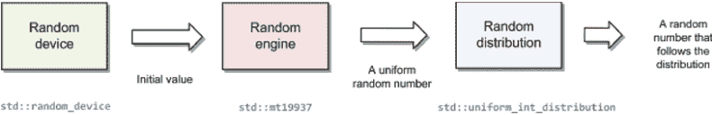

**图 3.25** 用于生成给定分布随机数的 C++ 链。

此示例使用 Mersenne twister 随机引擎 `mt19937`。为了正常工作，它需要被正确初始化。为此，在第 [17] 行创建了一个 `random_device` 对象，该对象随后会在 `mtRandomEngine` 的构造函数中被调用。

在第 [21] 行，创建了一个 `uniform_int_distribution` 对象。它将负责生成从 `kFrom` 到 `kTo` 范围内的一系列均匀（但尚不随机）分布的数。这个序列将由第 [19] 行创建的随机引擎驱动。要生成给定分布和范围的随机数，必须遵循以下方案。

在第 [23] 行，创建了一个空的 `ints` 向量。在第 [27] 行，使用 SL 库中的 `generate_n` 函数为其填充随机值。由于 `random_decimals` 已创建


由于向量为空，使用 `back_inserter` 函数是为了让新生成的随机值能够被正确地插入到该容器中。然而，`generate_n` 本身并不知道如何生成随机值。因此，在第 28 行，提供了一个 lambda 函数，它调用带有 `mtRandomEngine` 的 `uni_distr`。

```cpp
#include <random>

///////////////////////////////////////////////
// Creates a vector with random integers
///////////////////////////////////////////////
//
// INPUT:
//      kFrom, kTo - range of values
//      kNumOfTrials - the number of values
// OUTPUT:
//      vector< int > with random values in the range

auto CreateRandomVector( const int kFrom, const int kTo, const int kNumOfTrials )
{
    // To generate random values we need:
    // (1) a random initialization object
    std::random_device rd;
    // (2) a random engine
    std::mt19937 mtRandomEngine( rd() ); // Mersenne twister MT19937? Why not?
    // (3) a distribution
    std::uniform_int_distribution uni_distr( kFrom, kTo ); // vals from val-to-val

    std::vector< int > random_decimals; // will hold random integers

    // Generate kNumOfTrials random values through the lambda function joining
    // uni_distr with mtRandomEngine. We use back_inserter since vector is empty.
    std::generate_n( back_inserter( random_decimals ), kNumOfTrials,
        [&]() { return uni_distr( mtRandomEngine ); } );

    return random_decimals;
}
```

这个简单的函数可以很容易地修改以生成其他随机分布。但请记住，随机数生成的主题要复杂得多，我们的示例只是触及了皮毛。更多内容可参见（Stroustrup 2013）。

现在我们有了随机数，接下来研究如何自动化测试十进制到罗马数字转换函数的流程。最简单的方法是将每个随机数转换为罗马数字，再转换回来，检查结果是否与原始值匹配。为此，我们需要第二个转换函数，这次是从罗马数字转换为十进制。第一个版本可以大致勾勒如下（其完整实现留作练习）：

```cpp
auto ConvertRoman_2_DecimalNumber( const string & Roman_str )
{
    int out_dec_num {};
    // Write the conversion algorithm ...
    return out_dec_num;
}
```

这被用于自动化测试 `Decimal_2_Roman_Chain_UnitTest`。它获取每个随机生成的十进制值，将其转换为罗马数字，然后再转换回十进制值，并比较结果：

```cpp
////////////////////////////////////////////////////////////
// Unit test to randomly test both conversions
////////////////////////////////////////////////////////////
//
// INPUT:
//          kFrom, kTo - range of values to test
//          kNumOfTrials - a number of random test values
// OUTPUT:
//          true if all tests passed ok, false otherwise
//
// REMARKS:
//          Calls assert()
//

bool Decimal_2_Roman_Chain_UnitTest( const int kFrom = 1, const int kTo = 3999,
                                      const int kNumOfTrials = 1000 )
{
    // Check each random decimal if it converts ok
    for( const auto & val : CreateRandomVector( kFrom, kTo, kNumOfTrials ) )
        if( ConvertRoman_2_DecimalNumber( ConvertDecimal_2_RomanNumber(val) ) != val )
            return false; // test failed, exiting ...
    return true; // if here, then we passed all tests ;)
}
```

`Decimal_2_Roman_Chain_UnitTest` 中使用的所有编程技术至此应该都很清楚了。注意在 `for` 循环中，调用了 `CreateRandomVector` 函数，并返回一个包含随机值的临时对象，该对象立即在循环中使用。这是一种常见技术，得益于移动语义，它不会因临时对象的不必要复制而产生大量计算开销。这将在第 4.6.4 节进一步讨论。

到目前为止，我们已经编写了用于测试两个具体函数的测试函数。在实际的软件项目中，我们会面对数十个函数、类、组件、库等。因此，一个更通用的单元测试框架会非常有用。最流行的是 Google Test（Google 2019）；Boost.Test（Rozental and Enficiaud 2019）、Catch2（Catch Org 2019）；以及最新的 Microsoft Visual Studio，它自带单元测试功能（Augustin 2019）。更多内容请参见第 9.7 节。

## 3.18 示例项目 – 构建货币计算器组件

货币兑换是国际贸易中常见的金融操作。在此示例中，我们将开发一个简单的程序来执行货币兑换。如图 2.4 中的软件开发示意图所示，让我们从明确需求开始。实际上，只有一个需求，而且非常简单：

- 程序将允许我们根据从货币兑换机构获取的汇率，将一种货币的金额兑换为另一种货币的相应金额。

### 3.18.1 货币兑换问题分析

我们如何进行问题分析和设计？UML 再次提供了帮助，不仅因为它的图，还因为图背后所蕴含的方法论。在第 2.3 节中，我们讨论了 UML 活动图，它有助于在设计过程的后期阶段可视化操作或算法的步骤。但在开始时，最好专注于*用例*。为了支持这一设计阶段，UML 提供了*用例图*。它们通过称为*参与者*的人和对象等实体，捕获系统中主要的*行为模式*。因此，UML 用例图展示了系统中参与者和用例之间的关系。

图 3.26 展示了我们的货币兑换系统的 UML 用例图。由于系统非常简单，参与者和用例并不多。在更高级的项目中，能包含的细节越多越好。

如图 3.26 所示，我们看到了一个名为 User 的参与者，他可以买入或卖出一定数量的货币。我们预期这两种情况可能对应两个不同的汇率。Admin 参与者可以对系统进行更改，例如选择货币兑换机构以及列出可兑换的货币。这个 UML 用例图将指导后续的设计阶段。但首先，让我们看看货币是如何命名和兑换的。

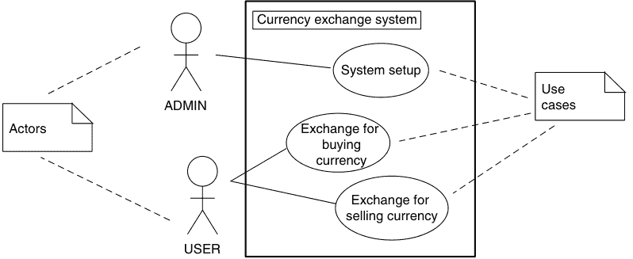

**图 3.26** *CurrencyCalc* 系统的 UML 用例图。设想有两种参与者：用户和管理员。用户可以买入或卖出货币。管理员可以指定系统设置，例如提供汇率的参考银行。

为了货币兑换的目的，国家银行和其他金融组织维护着货币及其汇率的列表。示例如表 3.12 和 3.13 所示。

首先是货币名称，通常包含使用该货币的国家。货币名称通常以不同的语言表达，因此它们针对特定国家。因此，对于每种货币，最好有一个称为*键*的*唯一标识符*。

**表 3.12** 来自加拿大银行的一份包含货币名称、缩写以及买入和卖出汇率的电子表格。

| 国家 | 货币名称 | 银行买入价 | 银行卖出价 |
|---|---|---:|---:|
| 美国 | 美元 | 1.2520 | 1.3220 |
| 欧盟 | 欧元 | 1.4250 | 1.5380 |
| 英国 | 英镑 | 1.6165 | 1.7275 |
| 中国 | 人民币 | 0.1685 | 0.2065 |
| 日本 | 日元 | 0.01093 | 0.01161 |
| 澳大利亚 | 澳元 | 0.8760 | 0.9495 |
| 瑞士 | 瑞士法郎 | 1.2525 | 1.3465 |

来源：*https://www.nbc.ca*。

**表 3.13** 来自波兰国家银行的一份包含货币名称、缩写以及买入和卖出汇率的电子表格。

| 货币名称 | 货币代码 | 买入价 | 卖出价 |
|---|---|---:|---:|
| dolar amerykański | 1 USD | 3.6987 | 3.7735 |
| dolar australijski | 1 AUD | 2.6211 | 2.6741 |
| dolar kanadyjski | 1 CAD | 2.8742 | 2.9322 |
| euro | 1 EUR | 4.2602 | 4.3462 |

来源：*https://www.nbp.pl*。

这种需求多年前就已预见；ISO 4217 标准（*https://en.wikipedia.org/wiki/ISO_4217*）应运而生，它为每种货币分配了一个唯一标识符。货币标识符始终由三个字母组成，如 USD、EUR、GBP、CNY、CAD 和 PLN。我们也将使用这些三位字母代码在我们的软件中标识货币。

除了货币名称和/或货币代码外，表中还包含两个汇率：一个是买入外币的汇率，另一个是卖出外币的汇率。它们之间的差额称为*点差*，是银行从货币兑换中获利的方式。

还要注意，每家银行都有自己的货币，如 CAD 或 PLN，并以此作为特殊参考。这是该银行的本国货币，外币汇率与此相关。参考货币的买入价和卖出价均设为 1 和 1，因此该货币经常从银行的货币兑换表中省略。

总而言之，货币兑换表是一种简单的*数据库*。这种数据库中的每一行称为一条*记录*。为了唯一标识一条记录，它必须包含一个*唯一键*。

为了设计我们的软件组件，我们需要识别基本功能以及数据结构。基于上述问题分析，我们做出以下假设：

- 程序能够用四个属性表示每种货币：货币代码、货币名称、货币买入汇率和货币卖出汇率，如表 3.13 的每一行所示。
- 汇率是相对于选定的单一参考货币而言的。
- 货币将存储在本地数据库中。


- 货币代码属性将作为键，用于在货币数据库中唯一标识一条货币记录。
- 货币数据库可以存储起来，供后续程序初始化使用。
- 应当能够添加新货币，同时能够查找和访问现有货币。
- 兑换金额将参照参考货币进行计算。将有两个选项：
  - 买入货币
  - 卖出货币

## 3.18.2 CurrencyCalc 软件设计

接下来我们继续，开发货币兑换系统的基本构建模块（见图2.4）。货币记录将用一个名为 `TCurrency` 的类来表示，该类包含四个数据属性和便于数据访问的函数。货币记录将存放在货币数据库中。如前所述，每条记录都由一个货币代码唯一标识。这种类似*字典*的数据结构可以高效地使用 SL 中的 `std::map` 容器类来创建，如图3.27所示。

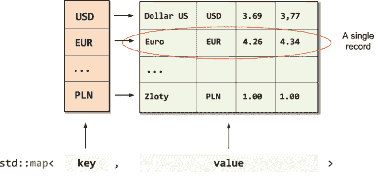

**图3.27** 一个具有键和值的字典数据结构。为了唯一标识一个值，每个键必须不同。在我们的项目中，使用三个字母的货币代码作为键。所有其他属性都表示为记录值。字典数据结构可以使用标准库中的 `std::map` 容器来实现。

在前面的章节中，我们使用了 SL 中的类，例如 `std::vector`、`std::string`（第2.6节）或 `std::tuple`（第3.17节）。它们的功能以文本描述的形式给出，如表3.4所示。然而，在自顶向下的设计中，当主要参与者和用例被确定之后、实现之前，系统的总体视图更具描述性。因此，在设计阶段，我们不是用文本描述，而是使用 UML 类*图*来创建类及其关系的可视化，该图展示最重要的内容和类之间的主要关系。

## 3.18.3 表示货币记录的 TCurrency 类

为了表示给定的货币，我们需要确定哪种类型的对象能够最好地传达货币名称、代码和兑换比率的信息。由于我们需要处理国际名称，我们决定使用 `std::wstring` 类型，而不是 `std::string`。与 `std::string` 中使用的 ASCII 字符编码不同，`std::wstring` 允许我们使用 Unicode 来表示国际字母，例如 ł 和 à（Unicode 联盟 2019）。兑换比率将使用数值类型 `double` 来表示。

清单3.32给出了完整的 *Currency.h* 头文件，其中定义了 `TCurrency` 类，用于表示货币兑换计算器中的每种货币。第[1]行的预处理指令 `#pragma once` 指示编译器在翻译单元中仅包含此头文件一次（附录A.1）。这一点很重要，因为头文件可能会被隐式包含多次，从而因重复定义而导致错误。第[3–5]行包含了必要的 SL 头文件，其中包含 `TCurrency` 中使用的对象的定义。然后，第[10]行的 using 指令将 `wstring` 引入当前上下文，因此在使用 `wstring` 时可以省略命名空间前缀 `std::`。我们在第3.14.6节讨论了从其他命名空间引入类的方法。

```cpp
#pragma once    // include this header in the translation unit only once

#include <iostream>
#include <string>
#include <cassert>

namespace CppBook
{
    using std::wstring;

    class TCurrency
    {
        private:

            wstring     fCurrKey;      // a 3-letter code, such as USD, EUR, PLN
            wstring     fCurrName;     // a unique name of a currency to be displayed

            double      fSellRate {};  // selling rate - always add {} to stand. types
            double      fBuyRate {};   // buying rate

        public:

            // Two constructors in one (default and parametric)
            TCurrency( const wstring & currCode = L"", const wstring & currName = L"",
                       const double sellRate = 0.0, const double buyRate = 0.0 )
                : fCurrKey( currCode ), fCurrName( currName ),
                  fSellRate( sellRate ), fBuyRate( buyRate )
            {}

        public:

            // Functions to read data
            wstring     GetCurrKey( void ) const { return fCurrKey; }
            wstring     GetCurrName( void ) const { return fCurrName; }

            double    GetSellRate( void ) const { return fSellRate; }
            double    GetBuyRate( void ) const { return fBuyRate; }

            // Functions to write data
            void    SetCurrCode( const wstring & s ) { fCurrKey = s; }
            void    SetCurrName( const wstring & s ) { fCurrName = s; }

            void    SetSellRate( double r ) { fSellRate = r; }
            void    SetBuyRate( double r ) { fBuyRate = r; }
        };

        // "w" for wide-character streams
        std::wostream & operator << ( std::wostream & o, const TCurrency & c );

        std::wistream & operator >> ( std::wistream & i, TCurrency & c );

}    // CppBook
```

我们示例中的所有类还额外嵌入在 `CppBook` 命名空间中，该命名空间在 *Currency.h* 中于第[7]行打开。`TCurrency` 类的定义从第[12]行开始，位于该命名空间内。请注意，与类定义不同，命名空间可以多次打开和关闭，以包含连续的组件。第[25–28]行定义的类构造函数执行两项任务。一方面，它有用于初始化类私有部分中定义成员变量的参数。另一方面，它提供了所有默认值，因此它也成为了该类的默认构造函数。类的其余部分包含第[33–45]行的 getter 和 setter 成员定义。

在类定义之外，第[49, 51]行是对 `TCurrency` 类的两个流运算符的声明。注意，为了处理 Unicode 的 `wstring` 对象，我们需要使用宽字符版本的输入和输出流：`wistream` 和 `wostream` 类型。这些流运算符在清单3.33的 *Currency.cpp* 源文件中完整定义。

### 清单3.33 TCurrency 对象的流运算符定义（位于 *CurrencyCalc_Lib, Currency.cpp* 中）。

```cpp
#include "Currency.h"

namespace CppBook
{

// "w" for wide-character streams
std::wostream & operator << ( std::wostream & o, const TCurrency & c )
{
    const int kOutWidth { 10 };    // total width of numeric output
    const int kOutPrec { 4 };      // precision for the rates

    o << c.GetCurrKey() << "\t";
    o << c.GetCurrName() << "\t";

    o << std::fixed
      << std::setw( kOutWidth )
      << std::setprecision( kOutPrec )
      << c.GetSellRate() << "\t";

    o << std::fixed
      << std::setw( kOutWidth )
      << std::setprecision( kOutPrec )
      << c.GetBuyRate() << "\t";

    return o;
}

std::wistream & operator >> ( std::wistream & i, TCurrency & c )
{
    wstring s {};        // empty temporary string
    i >> s; c.SetCurrCode( s );
    i >> s; c.SetCurrName( s );

    double tmp {};       // temporary double
    i >> tmp; c.SetSellRate( tmp );
    i >> tmp; c.SetBuyRate( tmp );

    return i;
}

} // CppBook
```

在第[3]行，`CppBook` 命名空间再次打开，以包含流运算符的定义。第[7–26]行的流插入运算符 `<<` 很直接——所有类数据对象按顺序流出，由制表符分隔。第[15, 16, 17]行设置了 `std::fixed`、`std::setw` 和 `std::setprecision` 操纵符。这些指定输出的固定长度为10个字符，其中包含4个精度字符，即小数点后的位数（表3.14）。

第[28–39]行定义的提取运算符必须与插入运算符兼容。首先，在第[30]行创建一个临时的 `wstring` 对象，然后用于收集 `wstring` 对象的连续字符。随后通过调用 `SetCurrCode` 和 `SetCurrName` 设置这些值。对于数值执行类似的操作。

表3.14列出了最常用的 C++ 输入/输出操纵符。使用它们时，重要的是每个操纵符前都要加上 `std` 命名空间前缀（较旧的前缀 `io` 可能导致不同的行为）。

### 3.18.3.1 C++ 输入/输出操纵符

输入输出（IO）操作属于数据处理组件中最常见的操作。C++ 通过提供高效的 IO 类层次结构开创了一场革命（与 C 中的 IO 对比，请参阅第9.2.4节）。正如我们在这本书中多次看到的，每个自定义结构体或类都可以通过重载流插入 `<<` 和提取 `>>` 运算符轻松地连接到这个 IO 层次结构中。我们使用它们越多，就越需要特殊的格式化。表3.14总结了大多数 C++ IO 操纵符（https://en.cppreference.com/w/cpp/io/manip）。使用这些对象，输入和输出流按指定方式处理数据。C++ 中更令人兴奋的是可以添加我们自己的操纵符（Stroustrup 2013）。一个例子是第7.3.4节中定义的自定义 `endl`，它允许我们一次插入多个换行符。


| 输入/输出操作符 | 描述 | 示例 |
| :--- | :--- | :--- |
| setw | 设置输出的宽度（包括点在内的总字符数）。 | `#include <iomanip>`<br>`double e = exp(1.0); // e 值，默认精度为 6`<br>`cout << "[defaultfloat] e = " << e << endl;`<br>`cout << "[sc] e = " << e << endl;`<br>`cout << "[fx] e = " << std::fixed << e << endl;`<br>`cout << "[p=4] e = " << std::setprecision(4) << e << endl;`<br>`cout << "[w=10] e = " << std::setw(10) << e << endl;`<br>`cout << "[fx][w=14][p=12] e = " << std::fixed << std::setw(14) << e << endl;`<br>`cout << "[f1]_[fx][w=10][p=4] e = " << std::setprecision(12) << e << endl;` |
| precision | 设置精度：<br>■ 在固定或科学模式下，这是小数点后的位数。<br>■ 在默认浮点模式下，这是小数点前后的总位数。 | 输出： |
| fixed | 强制浮点数以无指数形式写入，并由 precision 设定的小数部分位数来决定。 | `[defaultfloat] e = 2.71828`<br>`[sc] e = 2.7182828e+00`<br>`[fx] e = 2.718282`<br>`[p=4] e = 2.7183`<br>`[w=10] e = 2.7183`<br>`[fx][w=14][p=12] e = 2.718281828459`<br>`[f1]_[fx][w=10][p=4] e = _ _ 2.7183` |
| scientific | 设置输出的科学计数法格式（例如 -12e-36）。 | |
| defaultfloat (C++11) | 设置默认浮点数表示法：即精度字段表示小数点前后的总位数。 | |
| setfill | 设置在需要时用于填充的字符，以使输出达到指定宽度。可使用 left 等设置符号位置。 | |
| left | | |
| internal | | |
| right | | |
| setbase | 设置输出的进制（允许的值为 8、10、16，或 0 以重置为十进制）。 | `cout << "100d = " << 100 << " dec" << endl;`<br>`cout << "100d = " << std::oct << 100 << " oct" << endl;`<br>`cout << "100d = " << std::hex << 100 << " hex" << endl;`<br>`cout << "100d = " << std::dec << 100 << " dec" << endl;`<br><br>输出：<br>`100d = 100 dec`<br>`100d = 144 oct`<br>`100d = 64 hex`<br>`100d = 100 dec` |
| dec<br>oct<br>hex | 设置输出的进制为 10、8 或 16。 | |

### 3.18.4　TCurrencyExchanger 类用于货币兑换

TCurrencyExchanger 类（在 3.34 号列表中定义）的作用是定义一个包含所有以 TCurrency 类对象表示的货币记录的“数据库”。再次强调，整个定义位于 CppBook 命名空间中。

**3.34 号列表：TCurrencyExchanger 类在 CppBook 命名空间中的定义（位于 *CurrencyCalc_Lib, CurrencyExchanger.h*）。**

```cpp
1 #pragma once
2 
3 #include "Currency.h"
4 #include <map>
5 
6 namespace CppBook
7 {
8 
9 class TCurrencyExchanger
10 {
11 public:
12 
13     // 键值对数据结构
14     using CurrencyMap = std::map< wstring, TCurrency >;
15 
16 private:
17 
18     CurrencyMap        fCurrencyMap; // 存储 TCurrency 对象的 map
19 
20 public:
21 
22     // 让编译器自动生成这些
23     TCurrencyExchanger( void ) = default;
24     virtual ~TCurrencyExchanger() = default; // 用于继承的虚析构函数
25 
26 public:
27 
28     //////////////////////////////////////////////////////////////
29     // 此函数将一种货币的值转换为另一种货币
30     //////////////////////////////////////////////////////////////
31     //
32     // 输入：
33     //     from_key - 3 个字符的货币代码（USD、PLN 等）
34     //     from_val - 要转换的值
35     //     to_key   - 目标货币代码
36     //     to_val   - 输出值
37     //
38     // 输出：
39     //     如果成功，返回 true；否则返回 false
40     //
41     // 备注：
42     //     如果 from_key 或 to_key 不在 map 中，函数会抛出异常；可通过 FindCurrency 成员函数检查货币代码是否存在
43     bool Convert( const wstring & from_key, const double from_val,
44                   const wstring & to_key, double & to_val ) const;
45 

52     // 只读访问 fCurrencyMap 的帮助函数
53 

55     // 输入：
56     // 无
57 

58     // 输出：
59     // 只读的内部 map 数据结构
60 

62     // 备注：
63 

64     const CurrencyMap & GetCurrencyMap( void ) const { return fCurrencyMap; }
65 

68     // 根据货币代码查找并返回货币；成功返回 true，否则返回 false
70 

72     // 输入：
73     // currency_code - 3 位货币代码，如 "USD"、"EUR" 等
74 

75     // 输出：
76     // 成功返回 true，否则返回 false
77 

78     // 备注：
79 

81     bool FindCurrency( const wstring & currency_code, TCurrency & outCurrency ) const;
82 

86     // 添加新的货币记录到数据库
87 

89     // 输入：
90     // new_currency - 新的货币记录。如果已存在，则被此记录覆盖
91 

92     // 输出：
93     // 无
94 

95     // 备注：
96 

98     void AddCurrency( const TCurrency & new_currency );
99 

100 private:
101 

102     // 读写 fCurrencyMap 的友元函数
103     friend std::wostream & operator << ( std::wostream & o,
104                     const TCurrencyExchanger & c );
105     friend std::wistream & operator >> ( std::wistream & i,
106                     TCurrencyExchanger & c );
107 

108 // CppBook 命名空间结束
}
```

TCurrencyExchanger 类的核心数据结构是 `std::map< wstring, TCurrency >`，在第 16 行通过 `using CurrencyMap` 别名为 `CurrencyMap`。第 20 行定义了 `fCurrencyMap` 对象。如图 3.27 所示，`std::map` 容器在构建键值对字典时非常有用，能够确保键唯一。在我们的实现中，使用货币代码（如 USD 或 EUR）作为唯一键。因此，CurrencyMap 类似于 3.18 节开头讨论的货币表。

一个有趣的新构造是在第 25 行使用 `default` 关键字，同时第 26 行声明了虚析构函数。`default` 告诉编译器自动生成该类的默认构造函数和默认析构函数（如果不显式声明，编译器同样会自动生成，因为它知道如何初始化、复制和删除唯一的数据成员 `std::map`）。`virtual` 关键字使得该类可以被后续继承。到此为止，我们先介绍完毕；后续将在 4.10 节再讨论。

可能最实用的成员函数是 `Convert`。它接收一个货币代码 `from_key` 和该货币下的金额 `from_val`，并将它们转换为由 `to_key` 指定的目标货币的 `to_val`。如果转换成功，`Convert` 返回 `true`；如果不成功，返回 `false`。

其他成员函数显而易见。但本次需要将流式运算符声明为类的友元，因为它们必须能够访问内部的 `fCurrencyMap` 对象，而作为外部函数它们原本无法访问。如果将运算符声明为友元，则可能会出现访问异常。流式运算符在 _CurrencyExchanger.cpp_ 源文件中实现，如 3.35 号列表所示。

**3.35 号列表：TCurrencyExchanger 的流式运算符实现（位于 *CurrencyCalc_Lib, CurrencyExchanger.cpp*）。**

```cpp
#include "CurrencyExchanger.h"
namespace CppBook
{
using std::wostream, std::wistream; // 将这些 std 对象引入作用域
wostream & operator << ( wostream & o, const TCurrencyExchanger & c )
{
    for( const auto & currency : c.fCurrencyMap )
        o << currency.second << L"\n";
    return o;
}
wistream & operator >> ( wistream & i, TCurrencyExchanger & c )
{
    TCurrency currency; // 临时货币（一行文件）
    // 按记录读取并插入到 map 中；fCurrKey 成为 map 的键。
}
}
```


-   [创建和初始化 `TCurrencyExchanger` 对象的函数]的灵感源于诺贝尔物理奖获得者**Richard Feynman**，这位物理奖获得者的技巧可以让你在仅用`20 min`的时间内深入理解知识点，而且记忆深刻，*难以遗忘*。

```
if (condVar > someVal) {console.log("xxx")}
```


```cpp
double to_val {};

wcout << L"Enter from currency code:"; wcin >> from_curr; wcout << endl;
wcout << L"Enter value to exchange:"; wcin >> from_val; wcout << endl;
wcout << L"Enter to currency code :"; wcin >> to_curr; wcout << endl;

if( currencyExchangerObj.Convert( from_curr, stod( from_val ),
                                  to_curr, to_val ) == true )
    wcout << from_val << L" " + from_curr + L" => " << to_val
          << L" " + to_curr << endl;
else
    wcout << L"Cannot convert these currencies" << endl;
}
catch( ... )
{
    wcout << L"Error - wrong input." << endl;
}

// Ask the user what to do next
wcout << endl << L"New conversion [y/n]?";
wcin >> answer;
wcout << endl;

} while( answer.find( L"y" ) != wstring::npos );

}
```

UserInterface 在一个 do-while 循环中运行，从第 [79] 行开始。在第 [81–96] 行，循环内部设置了一个 try-catch 语句，用于拦截被调用函数可能抛出的异常对象。其中之一是 stod，它在第 [91] 行被调用，用于将字符串转换为 double 值。

在第 [112] 行，定义了 Run 函数，它接收 TCurrencyExchanger 对象。该函数只是简单地调用我们已经见过的三个函数：DisplayCurrentTime [115]、DisplayAllCurrencies [118] 和 UserInterface [120]：

```cpp
// Run if we already have the currency exchanger object
void Run( const TCurrencyExchanger & currExchObj )
{
    wcout << L"*** Welcome to the currency exchanger ***" << endl;
    DisplayCurrentTime();
    wcout << endl;

    DisplayAllCurrencies( currExchObj );

    UserInterface( currExchObj );
}
```

另一个重载函数 Run 在第 [123] 行定义。这一次，它在内部通过调用 CreateCurExchanger 来创建 TCurrencyExchanger 对象。正如我们已经指出的，要创建它，必须有一个初始化文件。该文件通过第 [125] 行的 std::filesystem²⁴ 访问，并在第 [127] 行创建 iniPath。（关于 C++ 文件系统的更多细节将在 6.2.7 节中介绍。）然后在第 [130] 行调用 CreateCurExchanger。如果返回一个有效对象，则在第 [132] 行调用 Run。否则，在第 [136] 行显示一条错误消息，程序终止。

```cpp
// All actions
void Run( void )
{
    namespace fs = std::filesystem;
    wstring iniPath( fs::current_path() / fs::path( initDefaultFileName ) );
    // At first try to get the currency object
    if( CurrExch_Optional all_my_options { CreateCurExchanger( iniPath ) }; all_my_options )
    {
        Run( * all_my_options );
    }
    else
    {
        wcout << L"Error, check Currency.txt file." << endl
        << L"Exiting ..." << endl;
    }
}
// End of CurrExchanger namespace
```

最后，main 函数如下所示。在第 [156] 行，调用 setmode 函数来设置终端的显示模式。这样做是为了正确处理 Unicode 字符。然后，在第 [157] 行调用 CurrExchanger::Run。最后，在第 [158] 行返回成功代码。

```cpp
#include <io.h>
#include <fcntl.h>

namespace CurrExchanger
{
    void Run( void );
}

// Keep main() simple
int main( void )
{
    setmode( _fileno( stdout ), _O_U16TEXT );
    CurrExchanger::Run();
    return 0; // Although not absolutely required, return a value also from main
}
```

关于何时使用类（class）、何时使用命名空间（namespace）或两者兼用的问题尚无定论，软件设计者的意见也各不相同。像往常一样，没有单一的答案或通用的法则，所选择的方法取决于具体问题。在这种情况下，尝试预见给定组件的未来使用场景和调用上下文，并选择最自然、最简单、最通用的解决方案是很有帮助的。通常，这是通过迭代方式获得的，在第一个版本得到改进之后。编程之美在于，同一件事可以通过许多不同的方式实现，而且往往会产生不同的后果。这也是本节中介绍的 *CurrencyExchanger* 背后的故事。另一种方法留作练习。

在 *CurrencyCalc* 项目中，我们学到了以下内容：

- 创建带有构造函数以初始化数据的简单类
- 创建带有默认特殊成员函数和虚析构函数的类，以备将来继承
- 使用 `std::map` 容器存储 `<key,value>` 对
- 在访问 `std::map` 元素时使用结构化绑定
- 输入/输出：
  - 重载 `operator <<` 和 `operator >>` 用于数据输出和输入
  - 流操纵符
  - 使用宽字符（Unicode）与 `std::wstring`、`std::wcout`、`std::wifstream` 和 `std::wofstream` 对象
  - 使用 `std::filesystem` 命名空间中的文件系统元素进行文件的写入和读取
- 使用 `stod` 函数将 `std::wstring` 转换为 double
- 使用 `std::optional` 表示一个可选可用的对象
- 使用 try-catch 语句
- 创建具有已定义命名空间的软件组件
- 使用 `std::chrono::system_clock` 中的对象访问系统时间

在 6.2 节中，我们将进一步扩展 *CurrencyCalc* 项目。

## 3.19 运算符

在本节的表格中，我们按优先级列出了所有 C++ 运算符，并附有简短说明和简要示例。请记住，在编写 C++ 程序时，并非所有运算符都同等重要。此外，其中一些运算符很少使用或已过时。有些运算符的完整描述将在后续章节中给出。为了完整起见，还指出了 C 特有运算符和 C++ 特有运算符之间的差异（附录 A.2）。

为了完全理解运算符的工作方式，我们需要定义*左值*和*右值*：

- *左值* – 可以用于赋值运算符（`=`）左侧的对象。也就是说，它必须是一个可以被赋值的对象。
- *右值* – 位于赋值运算符右侧的对象。也就是说，它是充当一个值的对象。

下一个重要的概念是运算符优先级和结合性：

- *优先级* – 在计算表达式时，指示哪个运算应该在其他运算之前执行的规则。
- *结合性* – 当在相同优先级的运算符之间进行选择时，用于选择首先执行的运算符的规则。大多数 C++ 运算符是左结合的，但一元运算符和赋值运算符除外，它们是右结合的。如果一个操作数位于相同优先级的运算符之间（例如在 a + b − c 中），就必须检查结合性规则；见图 3.30。在这种情况下，b 位于 + 和 − 之间，它们属于同一优先级组。两者都是左结合的，因此 b 首先被 + “取用”；从而先执行 a + b，然后从该结果中减去 c。因此，原表达式将被计算为 (a + b) − c。另一方面，右结合运算符的示例见图 3.31。

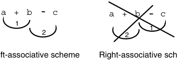

**图 3.30** 左结合（左）和右结合（右）情况下表达式求值顺序的示例。在 C++ 中，加法 + 和减法 − 运算符具有相同的优先级，并且是左结合的。因此，使用左侧的求值顺序：操作数 b 首先被其左侧的运算符 + 使用，计算 a + b；然后将该运算的结果用于减法 − c。这第二个结果就是表达式的值。

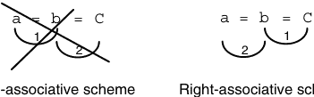

**图 3.31** 右结合赋值运算符的示例。为了获得正确、直观的结果，必须先将 c 赋值给 b，然后再将 b 赋值给 a。

让我们考虑以下示例：

```cpp
char * ptr = "The book";
char first_letter = * ptr++;
```

在第一行中，* 不是运算符，因为在这个上下文中，它的左侧有一个类型名；它们合在一起表示“指向 char 的指针”，我们将其命名为 ptr。指针 ptr 是一个左值，因为它位于赋值运算符 = 的左侧。它的右边是字符串字面量 "The book"，它必须是一个右值，因为它不能被修改。更准确地说，该文本被放置在程序常量内存中的某个位置，而指向其开头的指针被用作右值，然后将其赋值给 ptr。

在示例的第二行中，有两个由 first_letter 和 ptr 标识符指示的对象。这里，first_letter 充当左值，因为它是被赋值的对象。我们有三个运算符：=、* 和 ++。它们的求值顺序由它们在所有运算符层次结构中的级别严格定义，如下一节中的表格所示。为了找到它们正确的优先级，首先让我们确切地确定我们正在处理哪些运算符，因为许多符号（例如 *）在不同的上下文中使用时含义完全不同。例如，* 在第一行中与 char 关键字一起使用，但 * 也可以表示二元乘法运算符或一元指针解引用。在这个示例中，* 不在两个操作数之间，而是在指针 ptr 的前面，因此它表示指针解引用。查看以下各节中的表格，我们可以很容易地发现它属于第 3 组（表 3.15）。


## 表3.15 C++运算符。

### 第0组

| 运算符 | 描述 | 示例 |
|---|---|---|
| 圆括号中的表达式（`( expr )`） | 圆括号用于将子表达式分组，以改变表达式求值的顺序。 | `double x = 1.3, sigma = 0.5; double gauss = exp(-x * x / (2.0 * sigma * sigma));`<br><br>为了计算公式 `g(x)=exp(-x²/(2σ²))`，我们需要在分母中使用圆括号。否则，分子将被 `sigma` 乘两次。在 C/C++ 中没有幂运算符。因此，我们只能使用乘法或标准的 `pow(x, c)` 函数（`C` 是指数）。 |
| Lambda表达式（C++11，lambda函数）<br><br>`[ capture_list ]`<br>`( type_list )`<br>`{ statement_list }` | 定义一个lambda表达式（lambda函数）。 | `const double pi = 3.14159;`<br>`// [=] caption denotes accessing external objects by value`<br>`auto area_fun = [] (const double r) { return pi * r * r; };`<br>`cout << area_fun(13.7); // area of a circle with r=13.7`<br><br>Lambda函数用于定义局部函数。捕获说明符 `[]` 允许前面的lambda按值访问外部对象。其他选项在第3.14.6节中描述。 |

| 运算符（C++） | 描述 | 示例 |
|---|---|---|
| `class name :: member` | 作用域解析——访问类成员。 | SafeSqrt 是 User 命名空间中的一个类，其作用是定义平方根函数 `sqrt`，该函数可以安全地接受任意值，无论正负。`User::SafeSqrt` 访问用户命名空间及其 `safeSqrt` 类；`SafeSqrt::sqrt` 访问 `SafeSqrt` 类的 `sqrt` 函数，该函数是 `SafeSqrt` 类的静态成员（只有静态成员函数才能以这种方式访问）。最后，`::sqrt` 从全局命名空间访问 `sqrt` 函数。 |
| `namespace_name :: name` | 作用域解析——访问命名空间成员。 | `namespace User { class SafeSqrt { public: static bool sqrt(const double & val, double & result) { if (val >= 0.0) { return result = ::sqrt(val); } return false; } }; }` |
| `::name` | 全局访问——从全局作用域访问标识符（在命名空间之外）。 | `double x {}; yes {}; // user enters a value cin >> x; SafeSqrt::sqrt(x, res) << endl; cout << "SafeSqrt value must be positive." << endl;` |

### 第214页

| 运算符 | 描述 | 示例 |
|---|---|---|
| 对象 . 成员 | 通过对象进行成员选择（访问）。 | // The class (struct) to hold partial accuracies of a classifier struct Accuracy |
| 指针 -> 成员 | 通过指针进行成员选择（访问）。 | double FTP {}, fFP {}, fTN {}, fPN {}; // true-positive, false-positive, etc. } a; // let us define the class "Accuracy" and the object "a" a.fTP ++; // let us access and increase fTP |
| 指针 [expr] | 下标运算符；允许访问数组中的对象。 | Accuracy * ptr = & a; // create a pointer ptr and make it point at a ptr->fTP ++; // access and increase fTP through a pointer (\&a)->fTP ++; // can do this way |
| expr(expr_list) | 函数调用。 | // Create a 2D array const int kRows = 3, kCols = 4; int table[ kRows ][ kCols ] = { { 1, 2, 3, 4 }, { 5, 6, 7, 8 }, { int {} } // fill last row with "default" int int(=0) }; double sum {}; // default "double", the same effect as sum = 0.0 |
| type (expr_list) | 类型转换（函数式强制转换）。 | |
| type{expr_list} (C++11) | 值构造。 | |
| | | |

### 第215页

| 运算符 | 描述 | 示例 |
|---|---|---|
| | | // let us compute a sum of square roots (sqrt) of all elements in "table" for( int r = 0; r < kRows; ++ r ) for( int c = 0; c < kCols; ++ c ) sum += sqrt( table[ r ][ c ] ) ; // type convert and call sqrt() |
| | | 最后一行也可以使用指针解引用和旧式强制转换来编写：sum += sqrt( (double) *( *( table + r ) + c ) ) ; // alternatively use this |
| | | 在 C 中，变量只能使用赋值运算符 = 初始化。在 C++ 中，我们还可以使用列表表达式 {}。在 C++ 中，int {} 表示默认值为 0 的整数对象。表达式 double( expr ) 表示类似构造函数的类型转换。C/C++ 还有另一种转换形式：(double) expr（旧 C 风格）。 |
| _左值_++ | 后缀自增（加 1）。_左值_会被保存，然后加 1，并返回保存的（原始）值。 | // Copy length bytes from src to dst memory area void MemCopy( unsigned char * src, unsigned char * dst, int length ) { while( length --> 0 ) // copy length bytes. At each iteration decrement length by 1 * dst += * src ++; // copy bytes, then advance pointers } |
| _左值_ -- | 后缀自减（减 1）。_左值_会被保存，然后减 1，并返回保存的（原始）值。 | 该循环精确执行 length 次。计数器首先受到后缀自减运算符 -- 的影响，该运算符保存 length 未变化的值，将其减 1，并返回保存的原始值。循环将一直迭代，直到 length 的值大于 0。在每次迭代中，指针 dst 和 src 都会通过后缀自增运算符 ++ 递增。然而，在此之前，它们的原始值会被保存（在临时对象中），并返回给指针解引用运算符 *，因为它的优先级低于后缀 ++ 运算符。最后一步，从 src 指向的位置读取一个右值，然后将其复制到 dst 指向的内存位置，循环继续。 |

### 第216页

| 运算符 | 描述 | 示例 |
|---|---|---|
| dynamic_cast < type > ( expr ) (C++) | 运行时检查的转换。dynamic_cast 可用于在类层次结构内对指针和引用执行运行时检查的转换。转换在程序执行（运行时）期间进行；如果无法转换，则在转换指针时返回 nullptr，或者在转换引用时抛出 std::bad_cast 异常。 | class Fl_Widget; |
| | | // The class to create GUI (FLTK framework) class SCUBA_Log_GUI_Creator { ... public: // Callback function for GUI button click; // Upon call "obj" points to "this" of this class static void theButtonCallback( Fl_Widget * widgetPtr, void * obj ) { // Now convert void * to SCUBA_Log_GUI_Creator * SCUBA_Log_GUI_Creator * theObj = reinterpret_cast< SCUBA_Log_GUI_Creator \* >( obj ); theObj -> Action_On_Button(); // call local function for action on button } protected: virtual bool Action_On_Button( void ) // local virtual function { // Do something here ... return true; } public: |
| static_cast < type > ( expr ) (C++) | 编译时检查的转换。static_cast 可用于相关类型之间的转换，例如同一层次结构中的指针或算术类型，以及通过构造函数和转换运算符进行的转换。转换在编译期间进行；如果无法转换，则会产生编译错误。 | static_cast < type > ( expr ) (C++) |
| | | |

### 第217页

| 运算符 | 描述 | 示例 |
|---|---|---|
| const_cast < type > ( expr ) (C++) | const 类型转换。使用 const（或 volatile）在类型之间转换。 | // Create the main window with the FLTK library virtual int CreateGUI( void ) { FL_Window main_win( 100, 200, "SCUBA diving log" ); // Add some widgets such as buttons, combos, ... // Add a button as a local object Fl_Return_Button theButton( 20, 20, 80, 20, "Action button" ); // Link action on button via the callback function theButton. callback( theButtonCallback, this ); // Finalize adding new widgets ... return Fl::run(); } |
| reinterpret_ cast < type > ( expr ) (C++) | 不受检查的转换。reinterpret_cast 用于除以上三种转换之外的所有类型转换。例如，它可用于将整数转换为指针，反之亦然。它等同于旧式强制转换。 | 前面从 SCUBA_Log_GUI_Creator 类中摘录的代码展示了回调函数机制的一个示例，该机制嵌入了类成员函数，以实现使用 FLTK 框架（FLTK 2019）的简单 GUI。定义了一个静态函数 theButtonCallback，它与该类的 this 指针一起提供给 theButton.callback 函数。因此，当按钮控件被点击时，FLTK 会调用 theButtonCallback。然后，theButtonCallback 需要将 obj 转换为 TClassRegistry_GUI_Creator 类，因为它是回调注册时提供的 this 指针。这是通过 reinterpret_cast 运算符完成的，之后调用 Action_On_Button 函数，最终处理按钮点击。 |


| Operator | Description | Examples |
|---|---|---|
| `sizeof expr` | 返回 `std::size_t` 类型的对象大小（以字节为单位）。在 C++ 中，操作数不会被评估，当类型用于确定其大小时，`expr` 也不会被评估。 | `int x = 5;`<br>`std::size_t dummy = sizeof x;`<br><br>最后一行之后，`dummy` 包含 `x` 的字节大小（例如在测试系统中为四字节），而 `x` 的值保持不变（即使我们设置 `x` 为 `sizeof x`，由于 `sizeof` 不会评估其操作数表达式，`x` 的值也不会改变）。<br><br>`long arr[16]; // 16 长整型数组`<br>`// 计算数组元素个数的一种方法`<br>`assert(sizeof arr / sizeof arr[0] == 16);`<br><br>`long *arr_ptr = arr; // 取数组首元素的指针`<br>`// `sizeof arr_ptr` 返回指针本身的大小（不是数组）`<br>`assert(sizeof arr_ptr / sizeof(arr_ptr[0]) == 16);`<br><br>`long (&ref_arr)[16] = arr; // 取数组的引用`<br>`// 引用返回数组的大小`<br>`assert(sizeof(ref_arr) / sizeof(ref_arr[0]) == 16);`<br><br>常见错误是使用单个指针来实现此目的，因为在这种情况下，`sizeof` 会返回指针的字节大小，如第二个 `assert` 所示。为数组分配引用完全可行——参见第三个 `assert`。 |
| `sizeof (type)` | 返回提供的类型的字节大小。 | 每个对象占用的字节数可以通过 `sizeof` 运算符查询。但为了满足硬件要求，不同大小的对象需要放置在对齐的内存地址上——这可以通过 `alignof` 运算符查看。在将对象组合在结构体中时，需要考虑这一点，例如：由于数据对齐，整个结构体的大小可能大于其各部分大小之和。 |
| `alignof (type) (C++11)` | 返回提供的类型的对齐要求（以字节为单位）。例如，对齐为 4 表示对象必须从地址是 4 的倍数的位置开始存储（即地址的最后两位始终为 00）。 | `// 内存布局不佳`<br>`struct NotTooGood { char c; double d; int i; };`<br>`// 更紧凑的布局`<br>`struct BetterPacked { double d; int i; char c; };`<br>`cout << "NotTooGood :\t" << sizeof(NotTooGood) << " - " << alignof(NotTooGood) << endl;`<br>`cout << "BetterPacked :\t" << sizeof(BetterPacked) << " - " << alignof(BetterPacked) << endl;` |
| `"expr"_expr (C++11)` | 用户定义字面量。 | `// 编译时常量`<br>`constexpr const long double kPi = 3.141592653589793238463;`<br>`// 用户定义字面量 - 将 xx_deg 转换为弧度`<br>`constexpr long double operator""_deg(long double deg)`<br>`{`<br>`    return deg * kPi / 180.0;`<br>`}`<br>`void UserTypeConstant_Test(void)`<br>`{`<br>`    cout << "cos(30_deg)=" << cos(30.0_deg) << endl;`<br>`}`<br><br>用户定义字面量允许我们为特定类型的字面量定义自定义后缀。通过适当的转换或缩放，可以定义函数。例如，我们可以编写 `112_km + 80_m` 并混合不同维度，仍能得到正确结果。在前面的例子中，使用自定义 `_deg` 后缀可以让我们以度为单位提供角度值，而不是函数期望的弧度。<br><br>此外，在前面的常量和函数前使用 `constexpr` 可让编译器在编译时评估它们，而不是在程序运行时（第 7.3 节）。 |
| `- expr` | 一元减号。 | `double a {}, b {};` |
| `+ expr` | 一元正号。 | `// ...`<br>`double p = - b / ( + 2.0 * a ); // 一元 + 在二元 * 之前` |
| `++ lvalue` | 前置递增（加 1）。`lvalue` 被加 1，这是表达式的值。等价于 `lvalue = lvalue + 1`。 | |
| `-- lvalue` | 前置递减（减 1）。`lvalue` 被减 1，这是表达式的值。等价于 `lvalue = lvalue - 1`。 | |
| `& lvalue` | 对象的地址。 | |
| `* expr` | 解引用指针。 | `// 从最高地址向下复制内存`<br>`// 复制内存 [assigned char * dst, unsigned char * src, int num_of_bytes)`<br>`for (i = num_of_bytes; i > 0; i--) {`<br>`    // src 是源缓冲区之后的一地址`<br>`    // dst 是目的缓冲区之后的一地址`<br>`    *dst = *src--; // 返回原值，然后递减`<br>`    dst--;`<br>`}`<br><br>`const int kBytes = 256;`<br>`unsigned char source[kBytes];`<br>`unsigned char destination[kBytes];`<br>`BackwardMemCopy(&destination[0], &source[0], kBytes);`<br><br>`BackwardMemCopy` 可用于复制重叠的内存块，如果 `src < dst`。为此，复制从最高地址开始并向下进行。字节通过循环逐个复制，恰好执行 `num_of_bytes` 次迭代。`dst` 和 `src` 指针因右结合性影响而相差字节数，它们在递增 1 后会返回给 `*` 运算符。结果是，每个指针都被读取并其值复制到另一个指针指向的位置。在最佳情况下，源字节被读取并复制到目的内存块。调用 `BackwardMemCopy` 时，使用 `destination[0]` 的地址获取目的内存块的指针。同样，也可以通过写 `destination`（因为数组名是指向其第一个元素的常量指针）来获得相同的值。<br><br>`// 从最高地址向下复制内存`<br>`void BackwardMemCopy(char *dst, unsigned char *src, int num_of_bytes) {`<br>`    while (num_of_bytes-- > 0) {`<br>`        *dst-- = *src--;`<br>`    }`<br>`}` |
| `new (expr-list) type (C++)` | 每个 `new` 运算符的第一个参数是 `size_t`，表示分配对象所需的字节数。 | `fData = new double[col * row]; // 分配缓冲区`<br>`} ~MiniMatrix() { delete [] fData; } // 释放内存` |
| `new (expr-list) type (expr-list) type {expr-list} (C++11)` | 创建对象 - 在指定的内存区域 (`expr-list`) 中分配内存，并使用第二个 `expr-list` 初始化。 | `void SetElem(int c, int r, double v) { *(fData + r * fCol + c) = v; }`<br>`double GetElem(int c, int r) { return *(fData + r * fCol + c); }` |
| `delete pointer (C++)` | 销毁由 `pointer` 指向的对象 - 调用对象的析构函数并释放其内存。 | `class CommExcept_Handler {`<br>`    enum { kExcSize = 256 }; // 异常向量大小`<br>`    // 这里的组装代码仅为示例（...）`<br>`    const unsigned char asm_code[kExcSize] = { 0x01, 0x02, 0x03, 0x04 };`<br>`};`<br>`size_t CommExcept_Add = 0x00000200; // Comm 异常向量地址`<br>`// (在上空间)`<br>`void *CommExceptPtr = new (reinterpret_cast<void *>(CommExcept_Add)) CommExcept_Handler;` |
| `(type) expr` | 类型转换。用于通过值转换强制类型更改，有时会导致数据丢失（例如将 `double` 转换为 `char`）。 | `char * text = "The quick brown fox";`<br>`std::cout << text << "0x";`<br>`std::cout << std::hex << std::setfill('0') << std::setw(2);`<br>`std::cout << (size_t) text << std::endl;`<br><br>要打印 `text` 的地址而非其内容，我们需要将 `text` 强制转换为 `size_t` 类型。这里的旧式 C 样式强制转换等同于 C++ 的 `reinterpret_cast`。我们还使用 `cout << std::hex` 函数将 `std::ios` 的十六进制标志设置为 `std::hex`，以便以十六进制显示（表 3.14）。 |
| `object.* ptr_to_member` | 从对象中选择类成员。 | `// 行优先或列优先数据组织的矩阵`<br>`template <typename T>`<br>`class Matrix {`<br>`  T* data;`<br>`  // ...`<br>`};` |
| `pointer->* ptr_to_member` | 从指向对象的指针中选择类成员。 | `// 数据缓冲区`<br>`T *fData;`<br>`int fCol, fRow;`<br><br>`// 两种替代访问成员函数的方式`<br>`T * row_major_index(int c, int r) { return fData + r * fCol + c; } // 默认`<br>`T * col_major_index(int c, int r) { return fData + c * fRow + r; }` |


public:
// If row_major is true (default), data is set row-major
OrdMatrixFor( int col, int row, bool row_major = true )
: fCol( col ), fRow( row ), // init the pointer member
data_offset( row_major == true ? & OrdMatrixFor::row_major_ind :
& OrdMatrixFor::col_major_ind )
{
    fData = new T [ col * row ]; // alloc buffer
}
~OrdMatrixFor() { delete [] fData; } // free memory
// Access an element using right data offset (two equivalent alternatives)
void SetElem( int c, int r, double v ) { *(this->*data_offset)( c, r ) = v; }
double GetElem( int c, int r ) { return *((*this).*data_offset)( c, r ); }
};
const int kCols = 13, kRows = 20;
OrdMatrixFor< double > matrix_r( kCols,kRows,true ), matrix_c( kCols,kRows,false );
matrix_r.SetElem( 1, 2, 3.0 );
matrix_c.SetElem( 1, 2, 3.0 );

A pointer to a function member of a class can be used to select a proper internal function at the runtime. In OrdMatrixFor, this role is played by `data_offset`. It is initialized by the constructor depending on the way matrix elements are stored: row-major or column-major. When a matrix element is accessed in the `SetElem` and `GetElem` members, the proper function is called via `data_offset`.

| Operator (C++) | Description | Examples |
|---|---|---|
| `expr_a << expr_b` | Bitwise left shift. Shifts `expr_a` a left specified number of bits by `expr_b`. | ```cpp
unsigned int x = 13;
// Binary and overloaded operator
cout << (x << 1) << endl;
cout << (x << 1) << endl;
``` |
| `expr_a >> expr_b` | Bitwise right shift. Shifts `expr_a` a right specified number of bits by `expr_b`. | ```cpp
cout << (x >> 1) << endl;
cout << (x >> 1) << endl;
``` |

Shifting an expression by one bit to the left multiplies it by 2, and shifting to the right divides by 2. However, avoid using `>>` for signed integers since their behavior is not defined by the standard and can be either arithmetic or logical, depending on the computer platform (see Section 7.2).

| Operator | Description | Examples |
|---|---|---|
| `expr_a < expr_b` | Less than comparison. | `expr_a < expr_b` |
| `expr_a <= expr_b` | Less than or equal to comparison. | `expr_a <= expr_b` |
| `expr_a > expr_b` | Greater than comparison. | `expr_a > expr_b` |
| `expr_a >= expr_b` | Greater than or equal to comparison. | `expr_a >= expr_b` |

```cpp
float a = 2.0f, b = 10.0f, c = 4.0f;
float delta = b * b - 4.0f * a * c;
float x1 = 0.0f, x2 = 0.0f;

if (fabs(a) > 1e-12f && delta >= 0.0f) {
    float sq_delta = sqrt(delta);
    x1 = (-b - sq_delta) / (2.0f * a);
    x2 = (-b + sq_delta) / (2.0f * a);
}

// add suffix f to define float constants
// always initialize the variables
// better than: a != 0.0
```

The first comparison ensures that subsequent division by `(2.0f * a)` is feasible. Usually this is the proper way to check for division by zero in order to avoid numerical instabilities, rather than `a != 0.0`. The second condition is evaluated only if the first condition is true. The suffix explicitly defines a float constant (otherwise double is assumed).

## Table 15 (continued)

### GROUP 12

| Operator | Description | Examples |
|---|---|---|
| `expr1 \| expr2` | Bitwise OR<br>`1 1 1 → 1`<br>`0 1 1 → 1`<br>`1 1 0 → 1`<br>`0 1 0 → 0` | `unsigned char bulb_control_register = 0xAB; // '1' means ON, '0' means OFF`<br>`unsigned char bulb_index = 3;`<br>`// turn on bulb at bulb_index`<br>`bulb_control_register = bulb_control_register \| (1 << bulb_index); // can use \|=` |

### GROUP 14

| Operator | Description | Examples |
|---|---|---|
| `expr_1 \|\| expr_2` | Logical OR. Operands are treated as Boolean true or false (`true`/`false` keywords in C++; integer in C). In `\|\|` joined expressions, `expr_1` is always evaluated first; if it is true, then `expr_2` is not evaluated at all! However, this holds only for the built-in types — the user-defined overloaded versions always evaluate both operands. | ```cpp
// see previous definitions ...
if( x < kValMin || x > kValMax ) // check whether "x" is out of the range
{
    // when "x < kValMin" is true, then the rest is not evaluated at all
    // proceed ...
}
``` |

### GROUP 15

| Operator | Description | Examples |
|---|---|---|
| `expr_c ? expr_t : expr_n` | Ternary conditional expression. `expr_c` is computed first. If it is true, then `expr_t` is evaluated; otherwise, `expr_n` is evaluated. The value of the evaluated expression is returned. | `double x {};` |
| `lvalue = expr` | Assignment. | `short s = 31000;`<br>`short s = 31000; // pay attention to the maximum range of a variable`<br>`long l = 1, 2, 3, 4; // assign with an initializer list`<br>`vector<long> v = {1, 2, 3, 4};`<br>`const double kPi = 3.14159;`<br>`double d = 60;`<br>`angle *= kPi;`<br>`angle /= 180.0;`<br><br>`// the same as angle = angle * kPi`<br>`// the same as angle = angle / 180.0;`<br><br>`angle *= kPi` has the same effect as `angle = angle * kPi` but is shorter to write.<br>This holds for all operators of this type. The symbol of the operator and the assignment must be kept together. Written this way, they form a new type of operator. |
| `lvalue *= expr` | Multiply and assign (the same as `lvalue = lvalue * expr`). |  |
| `lvalue /= expr` | Divide and assign. |  |
| `lvalue %= expr` | Modulo divide and assign. |  |
| `lvalue += expr` | Add and assign. |  |
| `lvalue -= expr` | Subtract and assign. |  |
| `lvalue <<= expr` | Bitwise left shift and assign. |  |
| `lvalue >>= expr` | Bitwise right shift and assign. |  |
| `lvalue &= expr` | Bitwise AND assign. Don't confuse it with other types, such as `bool`. |  |
| `lvalue \|= expr` | Bitwise OR and assign. Don't confuse it with other types, such as `bool`. |  |
| `lvalue ^= expr` | Bitwise XOR and assign. | `unsigned int a = 0xAB, b = 0xCD;`<br>`a ^= b;`<br>`b ^= a;`<br>`a ^= b;`<br><br>`assert(a == 0xCD && b == 0xAB);`<br>`// Exchanging two ints without an auxiliary variable`<br><br>`The following code shows how to exchange two integers using only XOR and assign:` |
| `{ expr_1 list }` (C++11) | An initializer list. |  |

## Table 2.15 (continued)

| Operator (C++) | Description | Examples |
|---|---|---|
| `throw expr` | Throws an exception object to react to atypical runtime conditions. | ```cpp
double x = {}, y = {};
const double Epsilon = 1e-32;
if (fabs(y) > Epsilon)
    z = x / y;
else
    throw std::overflow_error("Div by 0");
``` |

| Operator | Description | Examples |
|---|---|---|
| `expr_1, expr_2` | Comma sequencing operator that separates expressions. Introduces a sequence point, i.e. it's guaranteed to execute left to right (`expr_1` then `expr_2`). The value of the rightmost expression (i.e. `expr_2`) is returned. (This is not a comma in a list of function parameters). | ```cpp
// write everything in 1 line
// Convert Cartesian (x, y) into polar (mag, angle) coordinates
bool cart_2_polar (const double & x, const double & y, double & mag, double & angle )
{
    // ...
    return fabs( x ) > 1e-3 ? mag = sqrt(x*x+y*y), angle = atan(y/x), true : false;
}
``` |

The comma operator can be used to write expressions in a succinct way, which is not necessarily the most readable. `cart_2_polar` converts (x, y) Cartesian coordinates into polar coordinates (magnitude, angle). In the return statement, the condition operator is used. If the absolute value of the input variable x is sufficiently large, the first expression, i.e. the one between the `?` and `:`, is chosen and evaluated. It contains two comma operators, which partition this expression into three sub-expressions. These, in turn, are guaranteed to be evaluated in left-to-right order. The result of the rightmost one is returned, which is `true` in our case. Otherwise, `false` is returned, and the values of `mag` and `angle` remain undefined.


# 3.19.2 进一步说明运算符

请注意，不要假设子表达式具有特殊的评估顺序。例如，以下依赖关系应避免：

int f( int & x )
{
    return x += 2;
}

int g( int & x )
{
    return x *= 3;
}

void h( void )
{
    int x = 10;
    int p = f( x ) + g( x ); // 可能是 48 也可能是 42
    // ...
}

`p` 的结果取决于 `f` 是否在 `g` 之前被调用，或者 `g` 在 `f` 之前被调用，这在 C++ 标准中是未定义的。另一方面，逻辑运算符 `&&`（与）和 `||`（或），以及 `,`（逗号），保证左侧操作在右侧操作之前执行。例如，

f( x ) && g( x )
```

is guaranteed to call function `f` before `g`. But for built-in types, the `&&` operator's second operand is _not_ evaluated if the first operand has been evaluated to `false` (since the result is obviously `false` in such a case). Similarly, the `||` operator's second operand is evaluated only if the first one returned `false` (this is known as short-circuit evaluation). This is especially useful to check for null pointers before accessing objects, as in the following function:

bool check_if_not_empty_string( char * p )
{
    // the second cond is evaluated only if first is true
    if( p != nullptr && * p != 0 )
        return true;
    else
        return false;
}

In this `if` statement, the pointer `p` is first checked to see if it is a null pointer (denoted by `0` in C/ C++ or `nullptr` in C++11). If it is `nullptr`, then we cannot evaluate its dereferencing expression `* p`, since it would throw a software exception. However, if `p` is a valid pointer, we check the first letter of the text pointed to by `p`; if it is not zero, we return `true` to indicate that the text is not empty. Otherwise, we return `false`.

Since this short-circuit evaluation feature is guaranteed _only_ for the built-in types, we cannot rely on it if we call a class's overloaded `&&` and `||` operators. Therefore, if we really need to overload these operators, we should do so carefully (Section 4.4).

## 3.20 总结

## 需牢记的要点

- 学习所有运算符的方面。检查其优先级和结合性
- 试图不要在表达式中混合类型 – 不要依赖隐式类型转换
- 只有 `&&`（与）、`||`（或）和 `,`（逗号）运算符具有严格的左到右评估顺序。不要假设其他运算符的特定顺序
- 对于内置类型，`&&` 运算符的第二个操作数在第一个操作数的值为 false 时不会被评估。同样，`||` 运算符的第二个操作数在第一个操作数的值为 true 时不会被评估
- 如果可能，将表达式拆分而非使用复杂的表达式。使用括号增强可读性
- 对于间接访问对象，优先使用引用而非指针
- 将代码拆分为相对较小的片段 – 函数 – 每个函数拥有明确的目的、有意义的名称以及短小的参数列表。如果需要更多参数，可以将它们组合成类或结构体
- 将数据与其相关的函数封装在类中。设计一组简洁的函数作为类的公共接口。将其余内容放入类的私有部分。确保使用初始化列表 { } 和/或构造函数初始化所有数据成员
- 优先使用标准库中的容器（如 vector、string、array）和算法（如 find、copy、accumulate、transform）而非自行编写
- 在设计之前，先深入分析问题。在实现之前先进行设计

软件设计和编程的大部分困难源于需要满足的要求、域的复杂性以及软件行为和使用所产生的影响。我们可以通过建模来简化这一过程，通过关注系统中最重要的方面。通过将系统划分为较小、概念上更易处理的模块，我们可以逐一处理每个模块的细节。

在本章中，我们将深入探讨面向对象（OO）软件设计和面向对象编程（OOP）的领域，这有助于软件系统建模。核心概念是类及其实例 –  – 对象。对象可以表示真实事物或操作。面向对象范式是基于这一概念形成的，我们将在讨论中展开；它们是全球编程社区数十年的经验积累的结果。

OOP 在许多成功的项目中已被证明其有效性。另一方面，我们可能会发现虽然使用了 OO 方法但项目仍然失败。因此，OO 方法并非万能圣杯，不conditional 保证成功。OOP 仅仅是一套原则、编程技术、模式和建议。因此，理解 OOP 的基本概念并利用其最佳特性来改进我们的软件设计和实现至关重要。改进软件意味着在使用 OOP 时，软件会比未使用 OOP 时更好。然而，这并非一种意识形态问题 –  – 关键在于成功结果：可靠、行为良好、易于理解、使用直观、易于维护和扩展的软件。令人惊讶的是，类似于集成电路中模块封装的概念启动了集成电路的电子革命？硬件与软件这两个领域的协同作用使我们达到了当前的人工智能（AI）和物联网（IoT）突破。

OOP 的原则可以追溯到 1960 年代和 1970 年代，当时 Simula 和 Smalltalk 等编程语言的发展。大多数现代编程语言都源自这一传统。C++ 编程语言，源自 Simula 和 C 的原则，是 OOP 队伍中最早的玩家之一。本章将从 OOP 概念入手，进而探讨代码示例。

1970 年代的一个成功软件工程范式是著名的等式 _Algorithms+Data structures = Programs_，由教授 Niklaus Wirth 在其著名的编程书籍标题中提出（Wirth 1976）。多年来，算法与数据结构被视为独立的部分。


数据结构。这样的方法导致了函数和数据结构之间的松散协作，它们各自独立存在，例如在 C 语言编写的代码中就可以看到这种情况。这种办法有时可行，但随着项目规模逐年增长，问题便出现了。要确保这两个领域之间的协同变得困难。例如，我们如何获得顺畅的接口，或保证结构体的正确初始化？此外，如此庞大的项目的可维护性也成了问题——例如，我们如何编写一个新的或稍加更新的操作函数或结构体版本？高级面向对象语言（如 C++）的出现帮助克服了，或至少缓解了其中的一些问题。

类将数据以及操作数据的函数封装在一起，同时提供一个可公开访问的接口，并隐藏不重要的细节。C++ 的*资源获取即初始化*（RAII）原则——即资源获取在对象的构造函数中执行，并在对象销毁时通过析构函数安全地释放资源——帮助克服了初始化和解除初始化的问题（第 5.2.1.1 节）。结合*异常处理*机制（第 3.13.2.5 节），RAII 使代码执行期间遇到错误情况时的软件行为相对可预测。此外，多态和类继承改进了软件增长和更新的过程，使软件的*可重用性*大大提高。所有这些都极大地影响了当今所见的技术进步。例如，在许多情况下，发布复杂软件产品的新版本已从数年或数十年缩短到几个月。而且，软件能够更好地适应动态的硬件变化，因此我们可以专注于新功能，而不是新的芯片家族以及它们复杂的接口细节。

面向对象编程（OOP）基于以下四项原则。我们在此给出它们的定义，并在后续章节中给出示例：

- *封装* – 通过隐藏数据以防止直接和不受控的访问来保护数据。它还涉及隐藏与类*接口*（一组公开可用的函数）没有直接关系的局部成员函数。封装不仅意味着隐藏数据和函数，更重要的是隐藏不重要的细节。这使我们不必同时考虑太多问题，而能将注意力集中在主要问题上。一旦实现得当，数据和函数便会按预期运行，使我们不必关注隐藏的细节。这对设计和实现有着巨大影响，因为它让我们能够专注于更高层次的抽象。一条经验法则是，类中的所有数据都应声明为`private`以进行隐藏。

- *继承* – 一个让新类复用先前创建的类的功能和数据的过程。从一个类派生出的类——称为*基类*或*超类*——继承其全部数据和函数。因此，派生类只需要添加特化或修改现有功能的一部分。这是通过虚函数和重写实现的，我们将在后面讨论。

- *多态* – 意为“多种形态”，在 OOP 中是指能够基于基类的功能来表达动作和关系的可能性。即使将来类通过继承大幅扩展，这种机制仍然有效。例如，菜单命令机制可以拥有一个功能完备的动作调用机制，并且仍然可以扩展以添加新的对象，从而添加菜单及其关联动作。

- *抽象* – 一种在展示模型的同时隐藏细节的方式。这通常归结为将概念与实现细节分离开来。换句话说，抽象让我们专注于类做什么，而不是它怎么做。

在 C++ 中，OOP 领域还从模板函数和模板类中获得了进一步的有力支持（第 4.8.5 节）。这促使 Alex Stepanov 开发了标准模板库（STL），

一种内置的动作委托机制，有助于将抽象接口与具体系统上的实现解耦。因此，通过使用设计模式，我们可以避免过于紧密的依赖关系。

正如我们之前所提到的，这些面向对象规则并非解决软件开发中遇到的所有问题的灵丹妙药。好的设计来自多年的学习和经验。有时，检查一个类是否适合现有组件会揭示出更好的设计。此外，向同事解释和讨论一个设计会迫使我们回答重要的问题，或者承认我们应该修改这样或那样的内容（如果同事来自竞争团队，这种效果尤其好）。无论如何，这些规则都能帮助我们做出好的设计。我们将在很多地方再次提到它们。

## 4.2 类的剖析

现在让我们更仔细地看一下类的内部结构。图 4.1 展示了类在特定区域中的示意组织方式。粗体名称与终结符相关，即我们在软件中显式书写的内容。方框状区域表示合适的标识符、名称等，

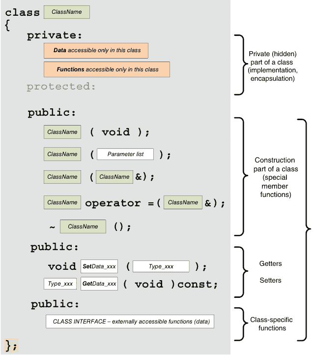

**图 4.1** C++ 类图。

这些函数中部分或全部的定义是必要的。我们将在第 4.4.1 节和第 4.5 节回到这些问题。类还可以包含移动构造函数和移动赋值运算符（第 4.6.4 节）。

图 4.1 中的下一项内容是*获取器*和*设置器*。它们是简单的公有成员函数，其作用是读取和写入全部或选定数量的私有数据成员。在接下来的章节中，我们会看到许多这样的例子。

最后但同样重要的是类的*接口*。它由程序员设计和实现的、可代表类对象调用的所有成员函数组成。

## 4.2.1 命名约定与自文档化代码

我们在第 3.14.1 节讨论了如何为常量、变量和函数等对象正确命名的问题。对象的名称，即其*标识符*，应当以有意义的方式传达该对象的主要作用。但为了传递额外信息，我们还可以通过额外命名约定的形式，为名称增加前缀和其他风格。表 4.1 列出了其中一种可能的约定，它面向 OOP，并基于 Taligent 提案（Taligent 1994）；本书中的示例均采用这些规则。

**表 4.1** 类及类成员的命名约定。

| 前缀 | 示例 | 语言类别 |
|---|---|---|
| T | `TMatrix` | 基类 |
| f | `fData` | 类数据成员 |
| E | `EException` | 枚举类型名称 |
| k | `kPi` | 常量；也包括枚举类型的常量 |
| fg | `fgCommonPath` | 非常量静态数据成员 |
| g | `gCounter` | 全局变量 |
| M | `MFontTrait` | 混入类——见第 4.13 节 |
| V | `VKernel` | 虚基类——见第 4.12 节 |

## 4.3 类成员访问规则

正如我们已经看到的，类的数据和成员函数可以归属于私有组或公有组。如果没有显式指定，类成员默认是私有的。尽管派生类将在第 4.9 节介绍，完整的访问规则集已通过图 4.2 加以说明。它们可以总结如下：

- `private` – 该组成员只能由类的成员和类的友元访问。派生类的成员或对象上下文无法访问它们。
- `protected` – 与私有成员类似，这些成员可以被派生类的成员及其友元访问。但不能从对象中访问。
- `public` – 这些成员可以被类的所有成员及其派生类的成员和它们的友元访问，也可以从对象层面访问。


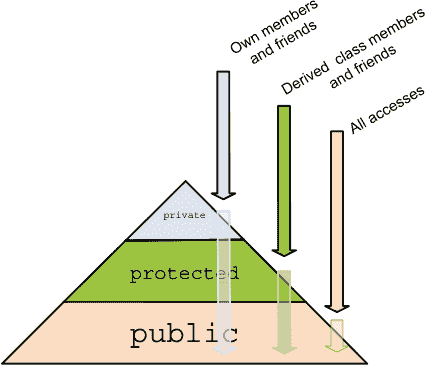

**图4.2** C++中的访问控制规则。类自身的成员和类的友元可以访问所有成员（私有、保护和公有）。派生类成员和派生类友元可以访问给定类的保护和公有成员。所有其他访问只能针对公有成员。

如前所述，访问规则也适用于类继承，我们将在后面讨论。在这种情况下，它们充当基类成员的截止过滤器。也就是说，类D可以从B派生，其中B是：

- *公有基类* –（最常用的选择。）B的所有公有和保护成员都可以从D访问，保持其公有或保护状态。B的私有成员在D中不可访问。
- *保护基类* – B的所有公有和保护成员在D中变为保护。B的私有成员在D中不可访问。
- *私有基类* – B的所有公有和保护成员在D中变为私有。B的私有成员在D中不可访问。

继承最常见的是公有继承，因为它允许我们扩展基类，这符合继承的主要原则。自然，这被称为*扩展继承*。其他类型的继承，保护和私有，是受限的，因为基类的成员不再能从派生类访问。这将在后面的章节中讨论。

关于上述访问规则，我们还可以区分以下成员访问类型：

- 通过成员选择运算符从类的对象访问
- 访问类的静态成员和友元
- 在类层次结构内访问，即从派生类调用成员

在前几章给出的代码中，我们已经看到了前两种访问类型的示例。从对象或指向对象的指针访问成员，可以使用成员选择运算符之一（*组2*，表3.15）。它们的语法如图4.3a和b所示。

从对象访问成员的一个重要方面是，只有类的公有成员才能以这种方式访问。但是，声明为`static`的类成员可以通过提供类名后跟作用域解析运算符`::`和成员名来访问（参见表3.15中的*组1*和图2.8）。这些调用不涉及类对象，但同样，只能访问公有成员。

## 4.4 示例项目 – 用于运算符重载的TComplex类

在本节中，我们将学习如何创建另一个类，这次是表示复数：具有自身算术规则的双值实体，例如在电子学和物理学中使用（Korn and Korn 2000）。我们的目的是学习几种新的编程技术，如下所示：

- 表示复数。我们将展示如何编写构造组，将数据成员放在哪里，以及如何实现getter/setter和重载的流运算符。
- 运算符重载。在C++中，我们可以编写大多数运算符的自己的版本，使它们符合类的要求。这样，我们可以使用简单的星号*来乘以复数，或者使用<<运算符输出复数，正如我们在其他类中看到的那样。重载运算符的定义方式与其他类成员函数几乎相同；唯一的区别是它们的名称中有operator关键字，后跟运算符符号（或多符号）。
- 特殊成员函数：构造函数、析构函数和赋值。
- 指向自身的类指针：this。

回顾一下，基本上，复数只不过是一对实数值

```
z ≡ (a, b) (4.1)
```

其中a和b是实数：即a, b ∈ ℝ。

然而，还有一些额外的假设改变了游戏规则，如下所示：

```
z = a + ib, and i^2 = -1 (4.2)
```

这个等式很有趣。正因为如此，所有四种基本代数运算都是可能的。例如，假设$u=c+id$也是一个复数，差值$z-u$可以表示为：

$$z-u=(a+ib)-(c+id)=(a-c)+i(b-d)=(a-c,b-d)$$  (4.3)

另一方面，除法可以展开为：

$$\frac{z}{u}=\frac{a+ib}{c+id}=\frac{(a+ib)(c-id)}{(c+id)(c-id)}=\frac{(ac+bd)+i(bc-ad)}{c^2+d^2}=\frac{ac+bd}{c^2+d^2}+i\frac{bc-ad}{c^2+d^2}$$  (4.4)

加法与式(4.3)相同，但所有符号都是加号；乘法在式(4.4)中使用。由于我们在这里简要概述的性质，复数已经找到了许多应用：例如，在物理学、电路理论以及扩展后的颜色表示中。这就是我们实现复数计算机模型所需的全部背景知识。

### 4.4.1 *TComplex*类的定义

像往常一样，一个类写在两个文件中：头文件和源文件（参见清单4.1）。在*Complex.h*头文件中，CppBook命名空间从第[5]行开始。然后，TComplex类的定义在第[12]行。同样像往常一样，数据位于类的私有部分，从第[14]行开始。实部fRe在第[18]行定义，虚部fIm在第[19]行定义。

```cpp
////////////////////////////////////////
// Our own namespace to uniquely identify
// contained classes
////////////////////////////////////////
namespace CppBook
{


////////////////////////////////////////
// A class to represent complex numbers
////////////////////////////////////////
class TComplex
{
    private:

        // Data members should be in the private section of the class

        double fRe {};        // real part
        double fIm {};        // imaginary part
}
```

有趣的是，我们不需要存储一个对象来表示式(4.2)中使用的虚数值$i$。我们只需要记住fRe用于存储复数的实部，fIm用于存储虚部。换句话说，式(4.1)中的对是有序的，值不能混淆。这可以通过仔细审视式(4.3)来理解。

在`TComplex`定义的下一部分，我们看到了*特殊成员函数*组。该组可以包含以下项：

- 默认构造函数，用于在没有外部参数的情况下创建和初始化对象
- 参数化构造函数，用于使用参数创建和初始化对象
- 拷贝构造函数，用于基于同一类型的另一个对象创建和初始化对象
- 赋值运算符，用于从同一类型的另一个对象复制状态
- 析构函数，用于释放对象生命周期内分配的任何资源
- 移动赋值，通常比拷贝赋值更高效，因为我们可以使用提供的对象中的数据（第4.6.4节）
- 移动构造函数，用于创建和初始化对象，可能比拷贝构造函数更高效，因为我们可以使用提供的对象中的数据（第4.6.4节）
- 类型转换构造函数，用于基于与类不同类型的传入参数创建和初始化对象（类似于拷贝构造函数）

正如我们已经看到的，在大多数类中，只需要其中少数几个。有些是用于特殊场合的，我们将在后面解释。此外，其中一些可以由编译器自动推导和实现，正如我们已经看到的。回到`TComplex`，它的默认构造函数在第[26]行，位于从第[21]行开始的类的公有部分。其特点是构造函数的初始化列表，在第[27]行。它的作用是调用其成员数据对象的构造函数。如果省略它，则会调用成员的默认构造函数。在这种情况下，初始化是可能的，但效率较低，因为对象首先用默认构造函数创建，然后像第[29]行那样进行初始化。

参数化构造函数的定义从第[36]行开始。它接受两个参数，并在同一行的构造函数初始化列表中立即使用它们。毫不奇怪，在这种情况下，会调用成员对象的参数化构造函数，提供适当的参数。

在设计类时，有时我们可以选择不提供任何构造函数，因为数据将使用初始化列表进行初始化。这就是零规则，在第3.9节中解释。但是，显式提供参数化构造函数的决定会产生影响。更具体地说，当我们声明（编写）除默认构造函数之外的特殊成员函数时，编译器将抑制其他特殊函数的生成。因此，如果我们决定添加参数化构造函数或析构函数的声明，我们应该*显式添加所有其他六个特殊函数*。这被称为*六规则*（或五规则，取决于我们计算什么）。这正是我们在这里所做的：拷贝构造函数在第[43]行声明，赋值运算符在第[49]行，析构函数在第[54]行。在所有这些函数中，我们使用`=default`，因为默认功能就是我们所需要的——也就是说，如果需要，数据成员会被复制。此外，我们跳过了特殊的移动函数，因为我们只有两个小的数据成员，所以移动语义没有任何好处。我们将在接下来的章节中解释这些特殊成员的构造和操作。

```cpp
public:

    ////////////////////////////////////////////////
    // Default constructor
    ////////////////////////////////////////////////
    TComplex( void )
        :  fRe( 0.0 ), fIm( 0.0 )    // special data initialization
```


本组中的最后一个条目是第 [63] 行定义的构造函数。它只接受一个实参，声明类型为 `double`，并且只初始化复数的实部，虚部保持为 0.0。但它不仅仅是一个构造函数——这是一个_类型转换构造函数_。它的作用是接受一个不同类型的对象（此处为 `double`），并将其转换为所在类的类型：在我们的示例中为 `TComplex`。因此，举个例子，我们可以将一个实数与一个复数相加——由于实数是虚部为零的复数的特殊情况——从数学角度看这完全是合理的运算。然而，没有相应的反向操作：我们不能将 `TComplex` 转换为 `double`。我们可以编写这样一个转换函数，但无法确定其行为是什么（仅返回实部，还是返回模？）。我们将在第 7.3 节回到这种 `double` 形式的类型转换。

在特殊函数组之后，熟悉的 getter 和 setter 成员函数位于第 [68-72] 行。注意，在 OOP 中，常见的做法是隐藏数据，但提供对数据或其中选定部分的公共访问。这样一来，访问是受控的，例如我们可以拒绝赋值。但这些函数是内联的，因为它们的完整定义位于类的定义中，因此间接访问不会增加任何时间开销。还要注意，`GetRe` 和 `GetIm` 被声明为 `const`，表示它们不会改变类的状态。所有不打算修改成员数据的成员函数都应声明为 `const`：这种做法使代码更安全，因为任何不一致都会被编译器捕获。

```cpp
{
    // fRe = 0;  // 这种初始化是可行的，但上面的方式更好
}

///////////////
// 参数化构造函数
///////////////
TComplex( double re, double im ) : fRe( re ), fIm( im ) {}

// 拷贝构造函数——创建此对象并使其状态与传入对象（即"c"）相同。
// default 表示从 "c" 复制 fRe 和 fIm。

TComplex( const TComplex & c ) = default;

// 重载赋值运算符——default 表示
// 复制 fRe 和 fIm。

TComplex & operator = ( const TComplex & c ) = default;

// 析构函数不执行任何操作，但显式声明

~TComplex( ) = default;
```

```cpp
public:

    // 用于访问类的数据成员的 Getter 和 Setter
    double GetRe( void ) const { return fRe; }     // "const" 因为我们只读取
    double GetIm( void ) const { return fIm; }     // 数据，不改变状态

    void SetRe( double re ) { fRe = re; }          // 这里我们改变状态
    void SetIm( double im ) { fIm = im; }          // 所以不是 "const"
```

最后，我们来到了*重载运算符*。第一个运算符定义在第 [79] 行，是比较运算符 `==`（不要将其与赋值 `=` 混淆）。在第 [81] 行，它简单地返回两个数据成员比较的结果。但让我们暂停一下——要进行比较，我们需要两个对象，而在 `operator ==` 的定义中仅提供了 `c` 作为参数。另一个对象在哪里？要回答这个问题，请注意，与任何其他非静态成员一样，`operator ==` 的代码是为某个对象执行的。我们很容易看出，这就是比较所需的第一个对象，而 `c` 是第二个对象。另一方面，请注意，没有定义如何实现排序运算符 `<`。

```cpp
public:

    ////////////////////////////////////////////
    // 重载"相等"比较运算符
    ////////////////////////////////////////////
    bool operator == ( const TComplex & c ) const
    {
        return fRe == c.fRe && fIm == c.fIm;
    }
```

在此，我们将提供一些关于 C++ 中重载运算符的事实：

- 重载运算符是为运算符定义特殊行为的重载函数
- 重载运算符可以是类的成员，也可以是独立函数
- 重载运算符的定义与其他任何函数完全相同，只是其名称遵循（图 4.4）中所示的模式

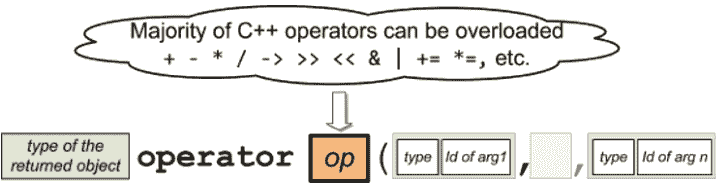

**图 4.4** C++ 中重载运算符的语法。

在第 [38] 行，实数值 5.0 被赋值给复数对象 `b`。但这是一个双重操作：首先，调用转换构造函数（清单 4.1 中的第 [63] 行）将 `double` 对象转换为 `TComplex` 对象，然后通过第 [49] 行（清单 4.1 中）定义的赋值运算符将其赋值给 `b`。`a + b` 的结果在第 [39] 行显示。

第二个测试函数 `Complex_Test_File` 定义在第 [43] 行，它在第 [46] 行创建了两个默认的 `TComplex` 对象。然后在第 [50, 53] 行从键盘对它们进行初始化。

算术运算的结果被输出到文本文件 `ComplexTest.txt`，该文件以追加模式打开，因此其现有内容得以保留（第 6.2.7 节）。由于除法可能抛出异常——我们不知道用户将输入什么——它需要用 try-catch 语句包围，从第 [71] 行开始。如果抛出异常，第一个捕获机会是第 [76] 行的 `catch`。要捕获的异常必须是 `std::exception`（或派生）类型。否则，如果抛出的异常对象类型与前者不兼容，第 [81] 行的第二个“最后机会”分支将捕获它。在两种情况下，都会向错误流输出错误消息，该错误流由 `std::cerr` 对象表示。在第一种情况下，`std::exception` 有机会通过调用其 `what()` 成员来打印消息。

```cpp
// 使用键盘、屏幕和文件进行复数的简单操作
void Complex_Test_File( void )
{
    // 创建两个复数对象
    TComplex     a, b;

    // 从键盘输入两个复数
    cout << "输入第 1 个复数" << endl;
    cin >> a;

    cout << "输入第 2 个复数" << endl;
    cin >> b;

    // 尝试将结果复制到以追加模式打开的文件中
    ofstream theFile( "ComplexTest.txt", std::ios::app );

    // 始终检查文件是否正确打开
    if( theFile.is_open() == true )
    {
        // 执行运算并将结果打印到文件
        theFile << "a = " << a << ", b = " << b << endl;
        theFile << "a + b = " << a + b << endl;
        theFile << "a - b = " << a - b << endl;
        theFile << "a * b = " << a * b << endl;

        // 然而，除法不同——它可能抛出异常
        try
        {
            // 将其放在 try-catch 结构中
            theFile << "a / b = " << a / b << endl << endl;
        }
        catch( std::exception & e )          // 捕获异常
        {
            // 标准异常将在此处处理
            std::cerr << "捕获到异常: " << e.what() << endl; // 打印原因
        }
        catch( ... )
        {
            // 任何其他异常将在此处被捕获
            std::cerr << "未知错误" << endl;
        }
    }
}
```

最后，两个测试函数在 *Complex* 应用程序的 `main` 函数中启动，如清单 4.4 所示。

```cpp
// 声明足以调用函数
void Complex_Test_Screen( void );
void Complex_Test_File( void );

// C++ 中有几个版本的 main 函数
int main( void )
{
    Complex_Test_Screen();
    Complex_Test_File();

    return 0;
}
```

## 4.5 更多关于引用（References）的内容

在本节中，我们将讨论与引用和间接访问对象相关的一些更高级但重要且实用的议题。这里我们重点讨论*右值引用*，它使我们能够使用*移动语义*来避免昂贵且不必要的对象拷贝。对于间接对象访问，对象的生命周期问题也很重要，因此我们也会涉及。

在本节中，我们将学习以下内容：

- 右值引用和移动语义
- 引用与指针之间的关系
- 从函数返回对象时涉及的对象生命周期问题

### 4.5.1 右值引用与转发引用

C++11 引入了*移动语义*这一非常重要的概念（Stroustrup 2013）。这是一种在特定上下文中避免不必要对象拷贝的巧妙方法。与其对对象及其数据（通常由对象内部指针指向）进行完整拷贝，不如交换指向数据的内部指针，从而避免耗时的内存操作。这两种操作如图 4.5 所示。

在执行拷贝¹操作时（图 4.5a），对象和数据都被复制，形成一个新的对象，该对象拥有自己的一份数据副本。结果，两个相同的对象都可用。而在

> ¹ 实际上，这是一种深拷贝，相对于浅拷贝而言——参见第 4.6.4 节。


## 需要牢记的事项

+   - 对于某些对象，移动操作（本质上是与另一个对象进行数据交换）比复制更快，且消耗的内存更少。为了区分两者，引入了右值引用。
+   - 右值引用标识可以移动的对象。类似于复制操作，移动操作（构造、赋值）必须在对象中实现。
+   - 右值引用必须与临时对象或其他右值引用初始化。
+   - 左值对象可以通过将其转换为右值（使用 `std::move` 函数）来设置为可移动。

# 4.5.2 引用 vs. 指针

引用和指针是间接访问对象的两种替代方式，它们的相同点在于都能间接访问对象。但两者在概念上有显著差异，具体如下：

+   - 引用始终绑定到其对象，不存在空的或未绑定的引用；而指针可以是空的，即 `nullptr`（以前用 0 表示，或通过 NULL 宏表示）。
+   - 与引用不同，指针可以指向另一个指针，形成指针的指针层次。
+   - 通过引用访问对象不需要特殊运算符，语法与直接访问对象相同；而指针则需要使用 `*` 和 `&` 运算符。

在很多情况下，间接访问对象可以使用指针或引用来实现。可能最重要的语义区别在于空指针的概念。例如，函数参数中的指针可以表示“没有对象”的状态（如可选值等）。但在现代 C++ 中，引用扮演更重要的角色；若要表示可选参数，C++ 提供了 `std::optional` 机制（见第 3.18.5 节）。


## 4.5.3 与引用相关的陷阱

当处理间接访问时，我们会操作两个对象：正确的对象以及指向它的链接对象，形式为引用或指针。但在某些情况下，链接（引用）可能指向不存在的对象。请参考下面的代码：

```cpp
// 非常糟糕的错误 - 函数返回对已销毁对象的引用
// “返回局部变量或临时对象的地址：char_counter_vec”
vector< int > &    CountCharsIn( const string & fileName )
{

    vector< int >    char_counter_vec;

    // 打开文件，逐行读取
    // 统计字符并将其推入 char_counter_vec
    // ...

    // 最后，返回统计结果

    assert( false );             // 请不要使用此代码

    return char_counter_vec;     // 错误！！！char_counter_vec 会在函数退出时销毁，因为它是局部对象
}
```

问题出现在最后一行——返回 `char_counter_vec` 对象的引用。然而，由于 `char_counter_vec` 是局部对象，它在函数退出（第 19 行）后会自动被销毁。因此，返回的引用（rref）也无法使用。任何想要使用该对象的人都会遇到麻烦：

```cpp
void CountCharsIn_Test( void )
{
    const string fileName( "Test.txt" );

    vector< int >    v = CountCharsIn( fileName );    // 这里潜伏着严重错误 ...

    // 显示结果 ...

}
```

针对这种情况，有几种解决方案，其中最简单的也是下面所示的做法：返回 `char_counter_vec` 的副本。

```cpp
// 返回副本（或移动）
vector< int >   CountCharsIn_copy_( const string & fileName )
{

    vector< int >      char_counter_vec;

    // 打开文件，逐行读取
    // 统计字符并将其推入 char_counter_vec
    // ...

    // 最后，返回统计结果

    return char_counter_vec;     // 正确，char_counter_vec 可以被复制（实际上，由于 std::vector 具备智能移动能力，它会被移动）
}
```

在此版本中，我们直接返回 `char_counter_vec` 的副本。即，在返回值（第 41 行）处会使用复制构造函数创建一个临时对象来返回 `char_counter_vec`。但在现代 C++ 中，如果对象拥有移动构造函数，编译器会智能地判断并调用移动构造函数，而非进行昂贵的复制。简言之，移动语义允许我们交换指针而非整个数据池，从而在 Section 4.6.4 中讨论时更高效。

显然，引用指向存活对象的问题同样适用于指针。这里还有一个与对象所有权从指针到指针传递相关的潜在陷阱。

每朵玫瑰都有刺；由于语法的价值但语义为指针，一些程序员认为引用令人困惑（见 https://google.github.io/styleguide/cppguide.html）。当以对象作为函数参数传递时，我们可能会惊讶于函数内部通过引用悄悄修改该对象的状态（参见 Section 3.14.2.2）。

## 4.6 示例项目 – 掌握 *TheCube* 类中的类成员

类有很多种，因为它们代表各种真实对象。不过，对于广泛的一类类可以识别出共同的构造模式。本节将探讨用于模型数据立方体（如 Figure 4.6a 所示）的类的细节。本节将学习以下内容：

- 如何定义容器类以组织 3D 数据（张量）的存储
- 类的特殊成员函数
- 深拷贝 vs. 浅拷贝
- 移动语义的实现

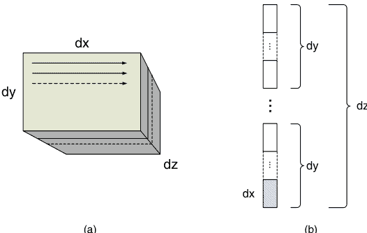

**Figure 4.6** TheCube 示意图及其内部数据缓冲的内存分配。

> ³ 不需要对带 `std::move` 的返回值进行强制类型转换——现代 C++ 编译器会自行知道如何处理。

[PAGE 264]

- 堆上动态内存分配：资源管理以及使用智能指针 `std::unique_ptr` 进行访问
- 将 3D 元素的位置转换为 1D 内存布局
- 二进制格式的流式操作
- 复制省略和 RVO 机制

此类多维数据集在许多科学和技术应用中出现，例如视频序列处理：单个彩色帧可以被视为像素值的 3D 立方体（Cygankek 2013）。名为 TheCube 的类用于表示此类数据立方体，其非平凡的特殊成员函数。表 4.3 系统地概述了该类的主要部分。但 C++ 语言并不存在唯一表达概念的方式，构造通常反映预期的使用场景，同时也受程序员的风格和经验影响。

Figure 4.6b 展示了在线性内存模型中的数据对齐方式，如 Section 2.1 所述。此类情况下，*dx* 是最内层的索引，随后是 *dy* 和 *dz*。


-   [最后]，需要将 cube 对象的缓冲区数据拷贝到新分配的缓冲区中。这在 [57–58] 行使用 `std::memcpy` 函数（第 A.2.6 节）实现。该函数拷贝两个内存缓冲区之间的字节，目标由调用 `fDataBuf.get()` 指向，源由 `cube.fDataBuf.get()` 指向。要获得正确的字节数，需要将 `elems` 变量（第 [49] 行）表示的数据量乘以每个数据项分配的字节数，即 `sizeof(value_type)`。

| 术语 | 解释 |
|---|---|
| 赋值运算符 | 一个重载的赋值运算符，输入参数为 `const X&`，返回 `X&`。`X& X::operator=(const X& x) { ... }` 其作用是将现有对象的状态复制到先前创建的对象中，然后返回该对象。 |
| this | 每个类对象都可以访问一个特定的指针 `this`，它指向该对象本身。它作为隐式参数传递给类的每个成员函数；有时用于特定构造，例如在赋值运算符中返回对象本身。 |

### 表 4.5（续）

| 类成员 | 描述 | 示例 |
|---|---|---|
| 赋值运算符 | 赋值运算符复制供给对象的数据。在这方面，它与拷贝构造函数类似。区别在于两个对象已经存在。因此，在赋值运算符中会检查特殊情况——即从同一对象复制到自身，如表达式 `a=a`。这种情况在显式编写的代码中并不常见，但存储功能可能会触发此类操作。对象自我复制会在 `TheCube` 的重载赋值运算子（第 [64] 行）开始的第 [61] 行中进行检查。检查方法是简单判断“my”地址（即执行所有操作的对象地址，由 `this` 指针标识）是否与参数 `cube` 对象的地址相同。为什么要保护自我赋值？对于大多数简单对象，自我复制本身没有问题。但如果在复制前需要清除缓冲区（例如 `TheCube` 在第 [72] 行在为 `fDataBuf` 分配新缓冲区时会先清除旧缓冲区），则自我复制会导致先删除缓冲区，随后尝试从该缓冲区复制数据，这显然会出错。`TheCube` 有两个数组需要复制：一个是小的 `fDim`，可在第 [66] 行调用其赋值运算符；另一个是 `fDataBuf`，可能很大，因此使用优化的库函数 `std::memcpy` 在第 [76] 行高效复制所有数据（附录 A.26）。需要记住的一点是，它的第三个参数表示字节数，因此在第 [77] 行需要乘以 `sizeof`。最后，赋值运算符返回“this 对象”，在第 [79] 行通过 `*this` 解引用实现。之所以这样做是因为在 C++ 中，赋值运算符的结果是左侧对象。换句话说，我们希望允许诸如 `a=b=c` 的表达式。 |
| 析构函数 | 名称是类名前加上波浪线 `~` 的函数：`X::~X()`。不接受任何参数（甚至不接受 `void`），也不返回任何值。在对象销毁时调用一次。其作用是释放对象在其生命周期内分配的所有资源。如果计划为类提供继承，则其析构函数应声明为虚函数（第 4.11 节）。 | `// 析构函数 - 如需支持继承，请声明为虚函数`<br>`~TheCube() {}`<br>析构函数负责释放对象在其生命周期内分配的所有剩余资源。在 `TheCube` 中，有两类资源：`fDim` 和 `fDataBuf` 及其保存的缓冲区。两者均为自动存储（第 5.1 节），因此当对象销毁时，这两者的析构函数会自动被调用。`fDataBuf` 会自动销毁其保 held 的受保护内存资源。因此，`~TheCube` 本身工作量不大。对于派生类（第 4.11 节），析构函数应声明为虚函数，以便通过基类指针正确销毁派生对象。由于我们假设 `TheCube` 不是类层次结构的起点，其析构函数不声明为虚函数。 |
| 移动构造函数（C++11） | 构造函数类似于拷贝构造函数，但会“窃取”供给对象的数据（状态）。结果是数据被“移动”，在许多情况下比复制更高效。格式 `X::X (X && x)`。双 `&` 表示右值引用（第 4.5.1 节）。 | `// 移动构造函数（C++11）`<br>`TheCube::TheCube(TheCube && cube) noexcept`<br>`    : fDataBuf( nullptr ), fDim( { 0, 0, 0 } )`<br>`{`<br>`    // 交换（交换）尺寸`<br>`    std::swap( fDim, cube.fDim );`<br><br>`    // 交换保持的指针`<br>`    fDataBuf.swap( cube.fDataBuf );`<br>`}`<br><br>移动构造函数的核心是从供给对象“窃取”数据，使其处于空状态。当与临时对象交换时，这种策略非常高效。<br><br>`TheCube` 类的移动构造函数定义在第 [84] 行。第 [85] 行的成员初始化列表中，`fDataBuf` 和 `fDim` 都被初始化为零状态。但移动构造函数的思想是窃取 `cube` 对象已有的数据，这在第 [88] 行和 [91] 行通过简单的数据交换实现。之后，`this` 对象持有 `cube` 原有的数据，而 `cube` 只剩下 `fDataBuf` 为 `nullptr`、`fDim` 为 `{ 0, 0, 0 }`，如第 [85] 行所示。这在 `cube` 不再使用时（例如为临时对象）是合适的。数据交换使用 `std::swap` 辅助函数，而 `fDataBuf` 使用其 `swap` 成员函数。<br><br>另外注意，移动构造函数不应抛出异常，正如这里显式声明的 `noexcept` 所示。 |
| 移动赋值运算符（C++11） | 形式为 `X & X::operator = ( X && x )` 的运算符用于从供给对象“窃取”数据（交换）。 | `// 移动赋值运算符（C++11）`<br>`TheCube & operator = ( TheCube && cube ) noexcept`<br>`{`<br>`    // 交换所有数据成员之间的内容`<br>`    std::swap( fDim, cube.fDim );`<br><br>`    // 只交换指针 – 不复制缓冲区！`<br>`    fDataBuf.swap( cube.fDataBuf );`<br><br>`    return *this;`<br>`}`<br><br>第 [94] 行定义的移动赋值运算符从 `cube` 对象中窃取数据。其核心思想是只交换数据成员，而不复制缓冲区。所有操作必须确保两个对象交换数据，而非复制，且在操作后两者的状态保持有效，以便其析构函数能够正确执行。交换在第 [97, 100] 行进行。最后，第 [102] 行返回 `this` 指向的对象。与移动构造函数一样，这里也使用 `noexcept` 表明该操作不会抛出异常。 |
| getter/setter | 用于读取和写入类成员的函数组（通常成员为 private）。 | `public:`<br><br>`// Getters/setters`<br><br>`// 由于 eDims 作为参数，我们不能询问不存在的维度`<br>`auto GetDim (EDims which one) const { return eDim[which one]; }`<br><br>`// 通过引用访问元素 - 双向`<br>`auto & Element (const int x, const int y, const int z) const`<br>`{`<br>`    const auto offset = (z * eDim[ky] * eDim[kx]) + (y * eDim[kx]) + x;`<br>`    return *( fDataBuf.get() + offset );`<br>`}`<br><br>`auto Size (void) const { return eDim[kx] * eDim[ky] * eDim[kz]; }`<br><br>`// 虽然是 const 函数，但它允许数据改变`<br>`auto GetDataBuf (void) const { return fDataBuf.get(); }`<br>


## 4.6.3 浅拷贝与深拷贝语义

图 4.8 展示了在从 `a` 创建或拷贝对象 `b` 时，浅拷贝与深拷贝数据成员的语义。如果只拷贝了 `fDataBuf` 指针的值（我们称之为浅拷贝），那么两个对象会共享同一个数据缓冲区，这在当前情况下很可能不是所期望的。⁵ 但深拷贝允许我们创建两个拥有各自数据集的独立对象。

但深拷贝虽然在许多情况下是理想的，却可能涉及更耗时的操作。因此，在实践中，选择取决于上下文和对象的功能。然而，请注意，如果我们没有显式编写自己的构造函数和赋值运算符版本，那么

> 5 在这种情况下，`std::shared_ptr` 是合适的，如 5.3 节所述。

这些函数将由编译器自动生成。在这种情况下，数据成员被逐字节复制，这会导致浅拷贝语义。要警惕这种机制，尤其是当类包含引用外部对象的指针时，因为把所有工作交给自动机制可能导致错误。

## 4.6.4 移动构造函数与移动赋值语义

移动构造函数和移动赋值运算符是 C++11 及以上版本中相对较新的特性。这两种操作本可以通过拷贝构造函数和拷贝赋值来完成——但其想法是通过在对象之间交换指针，而不是复制缓冲区，来加速操作。这在处理临时对象（即那些即将离开作用域并被删除的对象）时是合理的。

图 4.9 展示了两个 TheCube 对象的移动构造函数操作：`b(a);`。主要假设是对象 `a` 将不再使用（例如，它是从函数返回的临时对象），因此其已分配的数据缓冲区无需复制（不像拷贝构造函数那样），并且可以被对象 `b` 窃取。

这种“接管”操作是通过将 `a.fDataBuf` 持有的指针交换给 `b.fDataBuf` 对象来执行的，这立即切断了 `a` 与其数据的连接。这也使 `a` 变为空，因此如果我们知道 `a` 将不再被使用，这个机制是很有用的。我们如何知道这一点？这种情况会发生，例如，当临时对象从函数返回并将被销毁时——例如，参见 Listing 3.23 中 `MultMatrix` 函数返回的对象 `c`。现代 C++ 编译器很容易推断出这种情况，因此会自动生成正确的代码。我们的角色是为那些可以从移动语义中受益的类提供移动构造函数。其他数据成员怎么办？这些成员（如 `fDim`）也会在对象 `a` 和 `b` 之间交换（参见表 4.3 中的第 [88] 行）。

> **图 4.9** 移动构造函数 `b(a)` 的语义。对象 `a` 的数据成员被新创建的对象 `b` 接管。数据缓冲区不会被复制。

## 清单 4.5 TheCube 的重载运算符 `<<` 和 `>>` 的定义（位于 TheCube 和 TheCube.cpp 中）

```cpp
std::ostream & operator << ( std::ostream & o, const TheCube & cube )
{
    // Out data as binary streams
    o.write( reinterpret_cast< char * >( & cube.fDim[ 0 ] ),
    sizeof( cube.fDim ) );    // sizeof returns size of the whole array
    o.write( reinterpret_cast< char * >( cube.fDataBuf.get() ),
    cube.Size() * sizeof( TheCube::value_type ) );
    return o;
}
```

流输出方法必须与流输入方法兼容。在本例中，由于 TheCube 可能包含大量数据，我们决定以二进制格式进行流式读写。也就是说，我们按数据写入内存的方式写入数据。然而，在许多较小的对象中，我们可以选择使用文本格式（ASCII 或 Unicode）。在这种情况下，文件写入磁盘后可以被查阅。接下来需要决定的是需要写入的最少类数据量，以便之后可以用原始数据构造对象。对于 TheCube，我们需要流式输出 `fDim` 和由 `fDataBuf` 指向的数据缓冲区。但 `fDataBuf` 对象本身不需要被写入，因为它的值始终属于 TheCube 对象本身。因此，并非所有类数据都需要进行流式输出。按照这个思路，在第 [4] 行，`fDim` 以二进制格式写入，使用的是 `ostream` 类对象 `o` 的 `write` 成员，该对象代表任何属于 `ostream` 层次结构的输出流（Stroustrup 2013）。请注意，在这种情况下，第 [6] 行的 `sizeof` 运算符返回该数组的总字节数，这是 `write` 所需的。使用同一个 `write` 函数，在第 [8] 行，调用了 `Size` 成员，它返回流式 cube 对象中数据项的数量，再乘以通过 `sizeof` 运算符获得的每个元素的大小。对于一个非类成员函数来说，如何能够如此自由地访问私有缓冲区？回想一下，这是通过让 TheCube 类将该函数声明为友元函数来实现的（见 TheCube 定义中的第 [125] 行）。友元函数和类应当谨慎使用（因为它们破坏了正常的成员访问规则）。但在某些情况下，例如对象流式读写，通过适当的类设计和 getter/setter，它们在许多情况下很有用。最后，在第 [8] 行，返回 `ostream` 对象 `o`，这让我们可以连续使用 `<<` 运算符。

如前所述，对象的流输入通常比流输出更具挑战性。但在本例中，流式对象已经存在——它是 `operator >>` 的第二个参数，如第 [10] 行所示。流输入运算符需要遵循流输出方法保存的数据格式。因此，在第 [13] 行，读入 `fDim` 数组。但在流输入时，我们更为脆弱，因为我们不得不假设打开的数据流包含正确的数据、顺序正确等。实际上，情况并非总是如此，因此流运算符需要一些条件来检查输入流的状态，例如第 [14] 行的条件。将裸流对象放在条件语句中可能看起来很奇怪，但这是常见做法。它能工作是因为流对象包含一个重载的 `bool` 运算符，允许按 `if` 的要求将其“转换”为 `bool` 类型。然而，这种转换并不转换任何东西——而是根据流是否还能继续读取返回一个 true 或 false 标志。


-   [在第 16 行，当前的立方体缓冲区被删除，并为其分配一个新的缓冲区并将其赋值给它。尺寸可以通过调用 Size 成员来确定。然后，在第 20 行，通过调用流对象 i 的 read 成员来读取缓冲区数据。最后，在第 22 行，为了调试目的，我们通过调用 assert 来检查该操作后输入流的状态。]

```cpp
10  std::istream & operator >> ( std::istream & i, TheCube & cube )
11  {
12      // 首先读取尺寸
13      i.read( reinterpret_cast< char * >( & cube.fDim[ 0 ] ), sizeof( cube.fDim ) );
14      if( i )  // 检查文件是否正常
15      {
16          cube.fDataBuf = std::make_unique< TheCube::value_type [] >( cube.Size() );
17
18          const auto cube_bytes = cube.Size() * sizeof( TheCube::value_type );
19          // read() 接受字节数
20          i.read( (char*)cube.fDataBuf.get(), cube_bytes );   // 读取剩余的数据
21
22          assert( i );
23      }
24      return i;
25  }
```

Then, the input stream object i is returned on line [24] to allow stream chaining.

## 4.6.6 Validation of *TheCube*

After a class is defined and its members are implemented, the functionality and performance of the class should be tested. In some software development strategies, writing tests precedes class implementation. Also, in larger systems, tests are usually included in the test-driven library for automatic software testing. More on various approaches to testing software can be found in Appendix A.7.

To test the functionality of the TheCube class (Listing 4.6), we define the TheCube_Test function starting on line [11]. First, on line [15], a cube object of dimensions 15×13×11 is created using the parametric constructor. But remember that although the large data buffer has already been allocated, the data it contains is not yet initialized. Therefore, on line [18], the Mersenne twister random generator is created, which is then used by the std::generate function, called on line [21], to initialize the cube with random values (Section 3.17.3).

In this fragment of code, we see that for bulk data operations, instead of the Element function, which allows random access to each piece of data of TheCube, we can use a much simpler and faster construction that treats the buffer as a linear stream of data. The starting address of the inCube data buffer is accessed by GetDataBuf, whereas the number of elements is determined by the Size member.

On line [25], a mirror_cube object is created, which is a copy of cube. Here, the copy constructor is used rather than move, since cube needs to be used later and therefore cannot be deprived of its data by a potential move. The Element function is tested on lines [28–29].

we can be sure it is flushed to disk and can be immediately reopened, as on line [35]. In line [36], a new TheCube object testCube is created, this time using the default constructor. It is then streamed in from the file by calling operator >> on line [37]. However, we need to be sure that both objects contain the same data. This is checked on lines [41-42] by calling the assert function, which calls std::memcmp. This is a low-level function that compares two memory buffers (Appendix A.2.6).

The move semantics of the constructor and the assignment operator are tested in the rest of the TheCube_Test function. The idea of the move operations is to avoid excessive and usually unnecessary copying of temporary objects. To see this in action, let’s analyze what happens on line [45]. The RetAbsCube function, defined in the line [55], is called, providing the cube object as its constant argument. We will return to RetAbsCube soon.

On line [48], the object abs_cube is moved to the object cube, explicitly calling the move assignment operator. This is enforced in the same line by the cast to the right reference TheCube &&. In the move operation, the objects simply exchange data members as well as, in effect, data buffers, without making copies of the buffers. Because of this, move operations usually let us save significantly on data allocation, copying, and deallocation. This can be measured with the profiler, as presented in Appendix A.6.3.

```cpp
55 TheCube RetAbsCube( const TheCube & inCube )
56 {
57     // Create an empty return cube of the same dimensions
58     TheCube outCube( inCube.GetDim( TheCube::kx ),
59     inCube.GetDim( TheCube::ky ),
60     inCube.GetDim( TheCube::kz ) );
61
62     // Transform all elements to their absolute values
63     std::transform( inCube.GetDataBuf(), inCube.GetDataBuf() + inCube.Size(),
64     outCube.GetDataBuf(), [] ( TheCube: value_type v ) { return std::fabs( v ); });
65
66     return outCube; // Invokes the move semantics
67 }
```

The role of the RetAbsCube function is to create a temporary TheCube object on lines [58-60], which is then, on line [63-64], filled by the std::transform function with the absolute values of the elements of the input inCube object. Finally, the temporary object outCube is passed outside on line [66]; it is immediately copied to the abs_cube object on line [45], as already mentioned. Thus, in an unoptimized environment, we would have one local object outCube copied in a deep fashion to the abs_cube object, after which outCube would be destroyed with its data buffer. But with the move semantics, the abs_cube object can simply steal the previously allocated data buffer from outCube. This is performed by the move constructor operating on behalf of the abs_cube object. This also conforms to the copy elision strategy, which is a compiler optimization technique that eliminates unnecessary copying or moving of objects: when returning a named or unnamed object from a function by value, the compiler is allowed to omit the copy and move operations and not call the associated constructor. This return value optimization (ROV) technique is implemented and applied by most C++ compilers.

# Things to Remember

+   - When designing a class, be careful to recognize shallow vs. deep copies of its objects
+   - Large buffers of data should be allocated on the heap with the `std::make_unique` helper and then kept in `std::unique_ptr` (or another smart pointer)
+   - If a class can benefit from move semantics, implement the move constructor and move assignment. Then, also implement the copy constructor and copy assignment
+   - If a class is intended to be derived from, declare its destructor `virtual`
+   - Use `=default` for the default implementation of a special member function, and use `=delete` to disallow a function

## 4.7  Example Project – Moving *EMatrix* to the Class

In Section (3.15), we defined a simple EMatrix structure containing a constructor and some member functions. In this section, we will learn how to refactor EMatrix to an OO framework. We will learn about the following:

+   - How to refactor `struct` to `class`
+   - How to write the efficient overloaded streaming functions `operator <<` and `operator >>`, and how to create a stream from `std::string`
+   - How to write overloaded `operator +` and `operator *` to let us write `m1 * m2` instead of `MulMatrix(m1, m2)`
+   - What functions to add to have a range-based `for` loop in a class
+   - Pre- and post-conditions, and programming by contract

As mentioned earlier, the only issue with going from a struct (with all of its data and member functions publicly open to external access) to a class (with some members hidden and some publicly open) is ensuring better control and security on the hidden members. As we know, this is encapsulation, which can involve both data and member functions. Data is usually hidden to disallow uncontrolled access. For instance, when defining a circle object, we might want to ensure that the radius value is always positive, etc. At the same time, access to hidden data is frequently granted by public getters and setters. Such a mechanism ensures *control and protection of the data*. Hence, we want to move EMatrix from a struct to the EMatrix class. Let’s start with its definition, which will extend the definition of `struct EMatrix` from Listing 3.19.


# 清单 4.7 EMatrix 的面向对象版本（位于 EasyMatrix 的 EMatrix.h 中）。数据成员 fData 被移至私有区以实现数据封装；新增 operator []；operator << 和 operator >> 被声明为友元（新特性以粗体显示）。

class EMatrix
{
private:
    RealMatrix fData;    // private data structure (encapsulation)
public:
    // A parametric constructor
    EMatrix( Dim rows, Dim cols, DataType initVal = 0.0 )
    : fData( rows, RealVec( cols, initVal ) )
    {
    // matrix == a vector of vectors of double
    assert( cols > 0 );
    assert( rows > 0 );
    }

    // Helpers
    auto GetCols( void ) const { return fData[ 0 ].size(); }
    auto GetRows( void ) const { return fData.size(); }

    // As a result of overloaded subscript operators
    // instead of m.fData[2][3] we can write directly m[2][3]
    auto & operator[]( Dim idx ) { return fData[ idx ]; }
    const auto & operator[]( Dim idx ) const { return fData[ idx ]; }

    // We need only these two pairs of functions to have a range-based for loop
    auto begin() { return fData.begin(); }
    auto end() { return fData.end(); }

    auto begin() const { return fData.begin(); }
    auto end() const { return fData.end(); }

    // Let us add some overloaded arithmetical operators
    EMatrix & operator += ( const EMatrix & b );    // this can change this object
    EMatrix operator + ( const EMatrix & b ) const;
    // We can add other operators here ...

    // friends are functions that can freely access fData
    friend std::ostream & operator << ( std::ostream & o, const EMatrix & matrix );
    friend std::istream & operator >> ( std::istream & i, EMatrix & matrix );
};

此外，为了允许访问矩阵元素，在第 [24, 25] 行定义了两个重载 operator [] 的版本。这就是下标运算符，我们之前曾用它来访问向量元素。但这是我们第一次编写自己的运算符版本，之后可以用它们高效地调用数学运算。如之前所讨论的，重载运算符的定义方式与任何其他函数完全相同，只是其名称必须以 operator 关键字开头，后跟运算符符号（见第 4.4 节）。

我们需要编写自己的 operator [] 版本，因为 fData 是私有的，无法直接访问。实际上，下标运算符有两个版本：第 [24] 行用于写操作；

[PAGE 285]

第 [25] 行——声明为 const 成员——专门用于读操作。有趣的是，两者都返回 fData [ idx ]。回想一下，fData 被定义为 vector<vector<double>>。这意味着如果调用 m[ 2 ][ 3 ]，其中 m 是 EMatrix 类型的对象，那么 m[ 2 ] 返回第二个向量，即矩阵的第二行。然而，如果调用 m[ 2 ][ 3 ]，那么第二次调用（即带 [ 3 ] 的那次）将调用 operator []，但来自 std::vector，而不是第 [24] 或 [25] 行我们定义的下标。实际上，访问的是第二行的第三个元素。

在第 [28–29] 和 [31–32] 行定义了两对 begin 和 end 函数。它们与表 3.4 中描述的 std::vector::begin 和 std::vector::end 的作用完全相同。也就是说，它们返回一个迭代器对象，指向其向量的第一个元素或最后一个元素之后的位置。但为什么我们需要它们，为什么每个都需要两个版本？答案很简单——为了能够使用带有 auto 声明迭代器的新式基于范围的 for 循环（见表 3.9）。注意，这四个函数并没有做任何特殊的事情；它们只是将操作委托给 fData 成员。同样，声明为 const 的版本用于只读操作。

现在我们开始介绍重载的数学运算符，例如第 [35] 行的增量赋值运算符 += 和第 [36] 行的求和运算符 +。它们的作用是让我们能够写出如 c = a+b 或 c += b 这样简洁的表达式，其中 a、b 和 c 都是 EMatrix 类型。我们稍后将讨论它们的实现。

最后，在第 [41–42] 行，我们看到了最后两个重载运算符：左位移和右位移。我们知道，对于 EMatrix 对象，它们将把数据传入数据流（如屏幕或键盘）或从数据流传出数据。例如，我们可以使用更直观的 cout << m，而不是编写 ShowMatrix( m )。

正如我们在第 4.6.5 节介绍 TCube 类时所讨论的，尽管流运算符是在 EMatrix 类的定义内部声明的，但它们并不是其成员。这是因为它们需要将 EMatrix 对象作为输入参数。因此，它们是外部重载运算符；我们很快会看到它们的完整实现，但目前它们已在 EMatrix 中声明为友元。正如第 3.18 节所述，原因是它们的语法不允许它们成为类的成员。但是，它们运行时需要访问私有对象 fData。因此，我们需要用 friend 关键字打破私有限制，尽管这样做并不美观。幸运的是，这是我们项目中唯一使用 friend 的情况。

实现面向对象范式并强制数据隐私可能要求我们比预期多写几行代码，但很快我们会发现这种努力是值得的。例如，由于我们格式化了流运算符，我们将能够将它们用于所有流——不仅是键盘和屏幕，还包括文件或通信（telecom）。EMatrix 的最低要求是拥有 operator [] 和流运算符。

# 4.7.2 类流运算符的实现

并非 EMatrix 类的所有成员函数都已定义。我们现在给出它们的完整实现。我们从流运算符开始，如清单 4.8 所示。在所有此类情况下，我们必须设计以下机制：

+   - 我们需要决定输出数据的格式：数据如何保存到输出流中，数据项是用逗号还是换行符分隔，等等。
+   - 输出和输入格式应当兼容。如果我们将对象写入文件，我们应该能够读回它并拥有相同的内部状态。
+   - 我们不会保存整个 EMatrix 对象，只保存其数据——在这种情况下，即 fData 成员的完整内容。仅此而已。

[PAGE 286]

重载运算符 << 的定义从第 [2] 行开始。记住，这是一个独立的函数，在 `EMatrix` 中被声明为友元。它总是接受两个参数；第一个是 `std::ostream` 的引用 `out`，在 C++ 中它代表广泛的输出流对象类别，比如熟悉的 `std::cout`；第二个参数总是要被流出的对象，在我们的例子中是 `matrix`，通过常量引用传递。由于我们要流出一个矩阵，因此在第 [4, 6] 行启动了两个循环。第一个循环使用 `const auto &` 结构（第 3.7 节）遍历输入矩阵参数的行。这种便捷的 `for` 循环版本得益于 EMatrix 中定义的 begin 和 end 函数。否则，我们将不得不使用较旧的 `for` 循环版本，使用迭代器并调用 `EMatrix::GetRow` 函数。第 [6] 行的第二个内部循环遍历每一行中的数据，然后在第 [7] 行将这些数据输出到 `out` 流，并用制表符（`\t`）分隔。写完一整行后，在第 [9] 行输出一个换行符，依此类推，直到所有行都被保存。最后，在第 [12] 行返回流对象 `out`，这样 << 操作可以像我们之前所做的那样在一行中链式调用。

```cpp
// Stream out a matrix to the stream out. Assume text mode.
std::ostream & operator << ( std::ostream & out, const EMatrix & matrix )
{
    for( const auto & row : matrix )      // go row-by-row
    {
        for( const auto & data : row )    // data in a single row
            out << data << "\\t";

        out << std::endl;
    }

    return out;        // return the stream, so they can be chained
}
```

运算符 >> 的实现从第 [15] 行开始，稍微复杂一些，主要是因为我们需要解释读入的内容。首先，让我们分析这个函数的两个参数：`in`，它是 `std::istream` 派生对象的引用；以及 `matrix`，它是 `EMatrix` 对象的引用。也就是说，EMatrix 对象必须已经被创建，然后才能传递进行输入。但它可以是空的，因为其当前内容会在第 [22] 行被清除。

```cpp
// Stream in a matrix from the stream in. Assume text mode.
std::istream & operator >> ( std::istream & in, EMatrix & matrix )
{
    // Dimensions have to be determined from the data layout.
    // Each new line constitutes a new row of a matrix.
    // So, we have to read strings line by line, and
    // from each string read data by data.

    matrix.fData.clear();        // get rid of whatever was there

    std::string str;              // an empty string
    while( getline( in, str ) )   // read the entire line into the string
    {
        // create a string-stream from a string
```


// Here we move
matrix.fData.emplace_back( std::make_move_iterator ( DType_Iter{ istr } ), std::make_move_iterator( DType_Iter{} ) );
}
return in;    // return the stream, so they can be chained
}
```

The previous version operates exactly like the function on line [15] of the previous version of `operator >>`, except for lines [59-60], which contain `emplace_back` fed with the move iterator. Its role is to apply the move semantics instead of object copying. In this version, `emplace_back` operates not on a single object as on line [35] of the previous code, but on a range of objects, created as always by providing the beginning and end of a stream or collection. These are created by calling the `std::make_move_iterator` helper function, first providing `std::istream_iterator` to the `istr` stream for the beginning, and second providing `std::istream_iterator` to denote the end. Equipped with these two iterators, `emplace_back` will know how to create a collection of numbers contained in the stream `istr`. To save typing, line [56] creates a `DType_Iter` alias. `make_move_iterator` is a helper template function that constructs a `std::move_iterator` for an iterator passed as its argument.

Regardless of which version of the extraction operator is chosen, let's test the streaming operators with the following code (in the `Easy_Matrix_Zeroth_Test` function):

```cpp
EMatrix m ( 2, 3 );
std::cin >> m;    // Call the extraction operator on std::cin and m
std::cout << m;    // Call the insertion operator with std::cout and m
```

This makes the terminal window wait for us to type. Since matrix `m` is 2×3, we type as follows:

| 1 | 2 | 3 |
| -1 | 0 | 5 |
| 12 | 10 | -10 |

To inform the input stream `std::cin` that this is the end-of-file (EOF), we press Ctrl+Z. After that, the following appears:

| ^Z |   |   |
| 1 | 2 | 3 |
| -1 | 0 | 5 |
| 12 | 10 | -10 |

This is the effect of `operator <<` working with the `std::cout` object. Finally, note that the line

```cpp
std::cout << m;    // Call the insertion operator with std::cout and m
```

can be written equivalently as

```cpp
operator << ( std::cout, m );    // Call the insertion operator with std::cout and m
```

In other words, an overloaded operator can be called like any other function by providing its full name.

Let's now move on to analyze different versions of the addition and addition-and-update operators overloaded for operations on `EMatrix` objects. The first, defined in Listing 4.9 on line [3], is the standalone `operator +`, which takes two `EMatrix` objects as its arguments and returns a third containing their sum. Since the dimensions of the added matrix must agree, there are two assertions on lines [4-5]. These constitute a runtime fuse that works only in debugging mode on a call with improper objects. This is for the caller code, to verify that the dimensions are the same. These two lines constitute _preconditions_ for this method. Checking methods’ _preconditions_, _postconditions_, and _invariants_ belongs to the broader strategy of software verification methodology called _programming by contract_ (Meyer 1997). More on this and software testing is provided in Appendix A.7.

On line [8], the output object `c` is created as a copy of the first argument `a`. Then, in the two loops operating on lines [10-12], elements of the second matrix `b` are added to `c`; and finally, `c` is returned on line [14].

**Listing 4.9** Overloading `operator +` for `EMatrix` (in `EasyMatrix/EMUtility.cpp`).

```cpp
// Overloaded operators

EMatrix operator + ( const EMatrix & a, const EMatrix & b )
{
    assert( a.GetRows() == b.GetRows() );    // dim must be the same
    assert( a.GetCols() == b.GetCols() );

    EMatrix c { a };    // Make c the same as a

    for( Dim row = 0; row < b.GetRows(); ++ row )
        for( Dim col = 0; col < b.GetCols(); ++ col )
            c[ row ][ col ] += b[ row ][ col ];

    return c;
}
```

Here we will add a word on returning an object by value, such as `c` on line [14]. If this is a large object, then the add-and-assign operator `+=` will always be more efficient. But with the advent of move semantics, constructions like the following

```cpp
r = p + q;
```

are also as efficient as possible. This happens because a big data allocation will be performed to create object `c` on line [8]. When `c` is returned on line [14], the compiler knows it will be out of scope soon, so its contents are moved directly to object `r`, which is external to the scope of `operator +` in this case. Even before move semantics, compilers were performing an optimization called _copy elision_.

Now let's analyze two addition operations that are members of the `EMatrix` class; see Listing 4.10. The first is the add-and-assign operator `+=`, defined on line [4]. Again, the preconditions are located on lines [6-7]. Then, exactly as previously, the addition takes place on lines [9-11]. But as a return object, on line [13], `*this` is returned by reference since `operator +=` is a member of the `EMatrix` class. No matrix copies or move operations are required. This explains why `operator +=` is more efficient than the two-argument `operator +`.

**Listing 4.10** Overloading operators that are members of `EMatrix` (in `EasyMatrix/EMatrix.cpp`).

```cpp
// Overloaded operators

// Let's add some overloaded arithmetical operators
EMatrix &    EMatrix::operator += ( const EMatrix & b )
{
    assert( GetRows() == b.GetRows() );    // dim must be the same
    assert( GetCols() == b.GetCols() );

    for( Dim row = 0; row < b.GetRows(); ++ row )
        for( Dim col = 0; col < b.GetCols(); ++ col )
            fData[ row ][ col ] += b[ row ][ col ];

    return * this;
}
```

But the `EMatrix` class also has `operator +`, whose functionality is exactly the same as the `operator +` presented in Listing 4.9. Its definition starts on line [16]. However, notice that this time only argument `b` is necessary: this operator *is a member* of the `EMatrix` class, so its first argument is the object on behalf of which it is called. In other words, the first argument can be identified as `*this`. This sheds more light on all member functions – each of them gets `this` as its implicit parameter.

```cpp
EMatrix     EMatrix::operator + ( const EMatrix & b ) const
{
    // Where does matrix "a" come from? It is "this".
    assert( GetRows() == b.GetRows() );    // dim must be the same
    assert( GetCols() == b.GetCols() );

    EMatrix c { * this };    // Make c the same as a

    c += b;    // call the add and assign operator +=

    return c;
}
```

The operation of `operator +` is simple. First, the preconditions are checked [19–20]. Placing preconditions in each function independently, even if they are the same, helps to catch potential precondition violations as soon as possible. Next, the temporary matrix object `c` is created on line [22] and immediately initialized with the contents of the current object, identified by `*this`. Then, on line [24], the previously implemented `operator +=` is called to add object `b` to `c`, and `c` is finally returned on line [26].

### 4.7.4 Testing Matrix Operations

Now it is time to use `EMatrix` in some computations; see Listing 4.11. A matrix identified as `matrix_1`, with dimensions 3×3, is created on line [4] of the test function, which starts on line [2]. After the matrix is created, all of its elements are set to 0. But to include more diverse values, on line [6], it is randomly initialized with the `RandInit` function from Listing 3.25.

```cpp
// With overloaded operators operations are even easier
std::cout << "M1 + M1 = \n" << matrix_1 + matrix_1 << std::endl;
std::cout << "M1 * M1 = \n" << matrix_1 * matrix_1 << std::endl;
}
```

Since we use the random generator, each time we run the previous code, different results will be generated. These may look like the following:

```text
52320       36332       24182
1663        60314       20505
51152       21811       22920
```

Then, this appears on the terminal:

```text
52320   36332   24182
1663    60314   20505
51152   21811   22920

52320   36332   24182
1663    60314   20505
51152   21811   22920

M1 + M1 =
104640  72664   48364
3326    120628  41010
102304  43622   45840

M1 * M1 =
4.03476e+09    4.61965e+09    2.56444e+09
1.23618e+09    4.14534e+09    1.74693e+09
3.88495e+09    3.67387e+09    2.20952e+09
```

## 4.8 Introduction to Templates and Generic Programming

We have already seen classes that can operate with different types provided during the definition of concrete objects. The most prominent example is the `std::vector` class, which can be defined for a concrete type of objects to be stored, such as `std::vector<int>` to store `int`, `std::vector<std::string>` to store `std::string`, etc. This is possible since `std::vector` has been defined as a *template class*. In this section, we will explain what this means and how we can define our own template classes and functions. More precisely, in this section, we will learn about the following:

- Template functions and classes
- How to convert an existing function or class to a more general template version
- How to design a template class and organize template code
- Template parameters and how to provide them
- How to restrict allowable template parameters with conditions
- Template specializations
- Template member functions and how to use them
- More on `constexpr`, `static_assert` and code execution at compilation time


## 4.8.2 (⟨⟩) 模板特化

像 `TinyCube` 在 **Listing 4.13** 中的模板类，在用不同的模板参数实例化后，定义了一系列结构相同但类型不同的类。有时我们可以为特定类型提供更高效的实现，这种实现不仅类型不同，而且实现方式也不同。C++ 允许我们定义这种例外情况：它们被称为 *template specializations*（模板特化）。下面我们将展示，我们已经为 `TinyCube` 提供了一个特化。由于 **Listing 4.12** 中的定义专门针对 `double` 类型，它可以作为 **Listing 4.13** 中 `TinyCube` 模板定义的特化示例。换句话说，我们交换了 **Listing 4.12** 和 **Listing 4.13** 中两个定义的角色。然而，简单的交换是不够的：我们需要让编译器知道 **Listing 4.12** 中的 `TinyCube` 是 **Listing 4.13** 中通用模板 `TinyCube` 的特化。这通过特殊语法实现。在 **Listing 4.12** 中，我们只需将第一行

```
class TinyCube
```

改为下面两行：

```
template <>
class TinyCube < double >
```

其余部分保持不变。这样，当模板参数是 `double` 时，我们就得到 `TinyCube` 的特殊定义；对于其他类型，则使用 **Listing 4.13** 中的定义。

在此示例中，我们使用了相同的实现。更真实的例子是为 `bool` 元素提供 `TinyCube` 的特殊实现（参见 **Listing 4.15**）。这次我们可以节省空间，因为每个字节可以存储八位（bit）。

```
template <>
class TinyCube < bool >
{
    // 请自行编写实现...
};
```

# **Listing 4.15** `bool` 类型 `TinyCube` 特化的定义。

编写其实现留作练习。不久我们将看到更多使用模板和模板特化的例子。


另一个有趣的构造是第[11]行的编译期不变量。它确保所提供参数`i`的类型属于“无符号”整数类型。换句话说，我们不允许其他类型被字节反转。但这个条件必须在编译期间检查，而不是在运行时。因此，在这种情况下，我们需要使用`static_assert`，而不是在运行时检查的`assert`。为了检查提供给模板函数的类型`T`是否无符号，我们使用`std::is_unsigned_v<T>`构造。如果`T`确实属于无符号类型之一，它计算结果为`true`。否则，编译将被中止，并显示编译器提供的适当错误消息。`std::is_unsigned_v`属于类型支持库，其对应的头文件已在第[2]行包含。更多关于使用`constexpr`和`static_assert`的示例将在第6.4节和第7.3.2节中介绍。

`RevertEndianness`模板版本的操作在以下`RevertEndianness_Test`函数中得到验证，其定义从第[22]行开始：

```cpp
inline void RevertEndianness_Test( void )
{
    // RevertEndianness can be computed at compilation time
    // Notice 'u' in 0xABCDu - this makes 0xABCD an unsigned constant
    std::cout << std::hex << std::uppercase << "0xABCD" << "\t <-> "
              << RevertEndianness( 0xABCDu ) << std::endl;

    // Compilation time since argument is constexpr
    constexpr unsigned int ui { 0xABCDu };
    std::cout << std::hex << std::uppercase   << ui << "\t <-> "
              << RevertEndianness( ui ) << std::endl;

    long l { 0x01234567 };
    // This will not compile since l is not an 'unsigned' type
    //std::cout  << std::hex << std::uppercase << l << "\t <-> "
    //          << RevertEndianness( l ) << std::endl;

    unsigned long ul { 0x01234567ul };
    std::cout << std::hex << std::uppercase   << ul << "\t <-> "
              << RevertEndianness( ul ) << std::endl;

    unsigned long long ull { 0x0123456789ABCDEFull };
    std::cout << std::hex << std::uppercase   << ull << "\t <-> "
              << RevertEndianness( ull ) << std::endl;
}
```

如前所述，如果向`RevertEndianness`传递`constexpr`类型参数（如第[26–32]行所示），该函数将被编译并执行，之后结果值将包含在代码中。但当提供可变对象时，`RevertEndianness`可以像任何其他函数一样被调用。然而，对于第[34]行定义的`long`类型参数，由于第[11]行的类型验证条件未满足，`RevertEndianness`将无法编译。

还要注意第[30, 39, 43]行上的特殊后缀，如`u`、`ul`和`ull`，它们用于定义整数字面量常量（https://en.cppreference.com/w/cpp/language/integer_literal）。

运行`RevertEndianness_Test`后的输出如下：

```text
ABCD        <-> CDAB0000
ABCD        <-> CDAB0000
1234567     <-> 67452301
123456789ABCDEF  <-> EFCDAB8967452301
```

字节的顺序被反转，但每个字节内部的位顺序保持不变。

## 4.8.4 示例项目 – 使用*TStack*设计模板类

在本节中，我们将学习如何定义和实现一个非常有用的数据结构，称为*栈*。我们在组织函数的嵌套调用时已经见过这个重要的数据结构（第3.14.3节）。回想一下，函数调用时，返回地址会自动压入栈顶。函数返回时，该地址会被弹出。由于调用可以嵌套，因此从另一个函数内部调用的函数需要先被处理。因此，栈反转了访问顺序——最后压入的将最先弹出，依此类推。这种方法被称为后进先出（LIFO），如前所述（第3.14.3节）。然而，我们将看到，栈数据结构的应用远不止存储返回地址（第6.6.9节）。在本节中，我们将学习以下内容：

- 栈及其功能
- 如何通过创建*模板*类来定义可以存储*任意*类型元素的栈类
- 如何在模板定义中添加数值参数
- 如何组织包含模板类定义的文件

栈是一种数据结构，允许我们以类似于桌子上堆放书籍的方式存储对象，如图4.12所示。新对象N只能被压入栈顶。同样，只能从栈顶弹出对象。无法访问结构中更深处的对象，例如图4.12a中的Z和Q。如果栈上有三个对象，名为Q、Z和N，那么要访问Z，首先需要弹出N。还要注意，如果对象按Q、Z、N的顺序放入栈，那么取出时的顺序将是相反的：N、Z、Q。最后，栈可以为空或已满。

图4.12a展示了栈数据结构。必须有存储数据的支持，由`fData`表示。还有一个直接或间接的栈指针的概念，它指向栈上的第一个空闲位置。这就是我们需要了解的栈底层数据存储区域。但栈真正独特的是其功能（动态性）。只可能有两种操作：*压入*，将新对象放到栈顶；以及*弹出*，从栈顶取出一个元素。

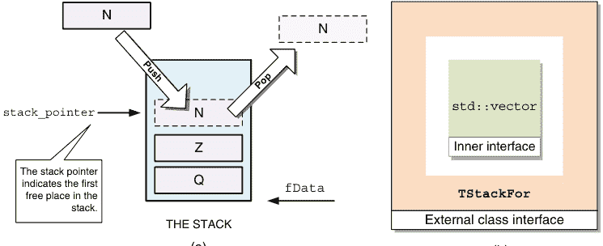

**图 4.12** (a) 栈数据结构的结构和操作。栈只能从顶部访问——新元素可以通过将其压入栈顶来添加。同样，栈顶的元素可以被弹出。示例栈包含两个元素，Q和Z。元素N可以被压入栈顶。之后它可以通过弹出操作从栈中移除。除了弹出所有前面的元素，无法访问栈中更深的元素（如Q）。(b) 适配器（包装器）模式。内部对象嵌入在外部对象中。仅暴露外部接口。

这些操作需要为两种特殊情况做好准备：空栈（用于*弹出*）和满栈（用于*压入*），这将在我们实现表示栈的类时看到。

栈可以存储相同类型的对象。然而，我们希望为许多不同类型定义栈，例如*size_t*和*double*。我们已经见过能够以相同方式处理各种类型数据的对象——`std::vector`是最好的例子（第3.2节）。这种功能是通过设计模板类获得的：在需要创建特定对象时，可以指定一个或多个类型的类，例如`std::vector<double>`。

STL也包含栈的实现（`std::stack`）。但在本节中，我们将出于两个原因实现自己的版本（清单4.17）：(i) 学习如何编写模板类；(ii) 因为未来应用需要略有不同的栈接口，如第6.6.6节所述。

为了更好地保护一个流行类的名称，首先重新打开了`CppBook`命名空间。模板类`TStackFor`的定义占用了第[13–14]行。首先，`T`被引入为表示参数化类型的名称，而`MaxElems`是一个数值参数，也可以在模板定义中提供。定义的第二行引入了名称`TStackFor`。

像往常一样，为存储的类型定义别名很方便，如第[18]行的公有部分和第[22]行的私有部分所示。我们很容易猜到，底层数据支持将是一个`std::vector`对象，保存`value_type`类型的对象，如第[24]行定义。如图4.12b所示，由于`fData`是私有数据成员，`TStackFor`可以被解释为*对`std::vector`的包装器*，大大缩小了其功能（第3.15节）。然后，在第[29]行，创建了`size_type`别名。有趣的是，需要在`DataContainer::size_type`之前放置一个额外的`typename`关键字，以明确告诉编译器我们指定的是一个类型。这在处理依赖于模板参数的类型名时是必要的，我们将在第6.6.6节中讨论。

`TStackFor`的主要接口由两个函数组成：在第[54]行声明的`Push`，以及在第[71]行声明的`Pop`。简单的`GetStackSize`函数返回栈上的对象数量，它仅在第[34]行以单行形式完全定义为一个内联成员。

### 清单4.17 TStackFor模板类的定义（在*TheStack*、*TheStack.h*中）

```cpp
#pragma once
#include <cassert>
#include <vector>

namespace CppBook {

// Definition of the stack data structure
template < typename T, auto MaxElems = 1000 >
class TStackFor
{
    public:
    using value_type = T;
};
```


Push 和 Pop 都足够简短，也可以在类定义中实现。我们将它们放在类外以展示语法。对于模板类，所有定义都包含在头文件中。

private:
    using DataContainer = std::vector< value_type >;
    DataContainer    fData;
public:
    // 这里需要额外的 typename
    using size_type = typename DataContainer::size_type;
public:
    auto GetStackSize( void ) const { return fData.size(); }
public:
    // 此函数将元素压入栈
    // 输入:
    // new_elem - 对要压入的元素的引用
    // 实际上，会将其复制压栈。
    // 输出:
    // true - 如果操作成功，
    // false - 如果失败，例如栈空间不足（元素太多）
    bool Push( const value_type & new_elem );
    // 此函数从栈中移除元素
    // 输入:
    // ret_elem - 对将被复制的元素的引用，该元素是栈顶元素
    // 然后，栈顶元素从栈中移除。
    // 输出:
    // true - 如果操作成功，
    // false - 如果失败，例如栈为空
    bool Pop( value_type & ret_elem );
```

[75–76] 行定义了 `Push` 函数，它是 `TStackFor< T, MaxElems >` 的成员函数。请注意，模板类的完整名称不仅仅是它的名字——它是名字加上模板参数。这也表明，`TStackFor` 类在不同的 `T` 类型下是不同的、独立的类。此外，参数相同的 `T` 但 `MaxElems` 不同的两个 `TStackFor` 类也是不同的类型。

`Push` 在 [78] 行首先检查栈是否已满。为此，使用 `MaxElems` 参数。如果已满，则在 [79] 行返回 `false`。但如果栈中有空间，由 `new_elem` 参数引用的新对象会被推入 `fData` 容器中。在 [81] 行使用 `emplace_back`，它比对象复制提供更高效的移动语义（第 4.7.2 节）。在此情况下，[83] 行返回 `true`，表示成功。因此，`TStackFor` 具有内置的错误语义，使我们能够在栈满时安全地进行 push 操作，并在栈为空时安全地 pop。抛出异常在这里是过度使用。

```
template < typename T, auto MaxElems >
bool TStackFor< T, MaxElems >::Push( const value_type & new_elem )
{
    if( GetStackSize() == MaxElems )
        return false;

    fData.emplace_back( new_elem );

    return true;
}
```

`Pop` 在 [85–86] 行定义，其作用与 `Push` 相反。在 [88] 行，它检查是否有元素可供弹出。如果栈为空，则在 [89] 行返回 `false`，没有其他后果。相反，在相反的情况下，首先在 [91] 行访问栈顶元素，然后在 [92] 行移除它，并在 [94] 行返回 `true`。

```
template < typename T, auto MaxElems >
bool TStackFor< T, MaxElems >::Pop( value_type & ret_elem )
{
    if( GetStackSize() == 0 )
        return false;

    ret_elem = fData.back();    // 复制栈顶元素
    fData.pop_back();          // 移除最后一个元素

    return true;
}

}    // End of the CppBook namespace
```

如前所述，模板类的完整定义通常包含在单个头文件中。图 4.13 展示了包含模板类定义的头文件与项目中源文件之间的关系的统一建模语言（UML）实体图。

6. 有些项目倾向于使用 `.hpp` 扩展名，以区分专门用于 C++ 的头文件，例如模板头文件。

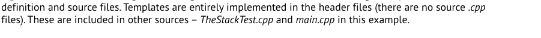

## 4.8.4.2 测试 TStack

列表 4.18 展示了一个测试函数，演示 `TStackFor` 类的基本操作。在第 [3] 行，包含了 `TheStack.h` 头文件，其中包含了从列表 4.17 中完整定义的 `TStackFor` 类。请注意，在第 [7–8] 行使用了模板版的 using 指令，这部分专门化让我们在定义别名时已经将一些模板参数设置为具体类型，而一些仍保持为模板参数。在我们的例子中，`StackForInt_VarSize` 是一个部分特化的别名，用于所有包含 int 对象的栈，但可以通过提供 `MaxElems` 参数指定不同的最大大小。

然后，在第 [11] 行，定义了 `StackForInt` 别名，此时使用了具体的 int 类型和最大容量 256 个对象。

创建基于模板类的对象时，首先需要使用指定的具体模板类型和参数创建该类，这称为模板类实例化。规则和整个将模板参数与编译器匹配的过程可在语言规范（Stroustrup 2013；Cppreference.com 2018）中找到。编译器会从所有可能的选项中选择最匹配的参数。然而，正如我们所见，也可以创建称为模板特化的变体，专门针对特定类型。关于栈特化的更多信息将在 6.6.6.6 节中介绍。

`TheStackTest` 函数的定义从第 [18] 行开始。在第 [20] 行，创建了 `StackForInt` 类的 `theStackForInt` 对象。它是一个空栈，因此在第 [25–26] 行的循环中，它会被填充为连续值的范围 <0...16>。这些值来自 `CppBook` 命名空间中的 `range` 类，在第 6.5 节中讨论。这些值同时被写入屏幕。随后，在第 [31–32] 行的下一个循环中，栈中的所有内容都被弹出，一个接一个，并写入屏幕。

在调用 `TheStackTest` 函数后，我们得到了以下输出：

```
Values pushed to the stack:
0 1 2 3 4 5 6 7 8 9 10 11 12 13 14 15
Content of the stack:
15 14 13 12 11 10 9 8 7 6 5 4 3 2 1 0
```

我们可以轻松看出 LIFO（后进先出）结构。

### **列表 4.18** 用于测试 `TStackFor` 类功能的 `TheStackTest` 函数定义（位于 *TheStack.h, TheStackTest.cpp*）。

```
#include <iostream>
#include "range.h"
#include "TheStack.h"

// 部分特化 using
template < auto MaxElems >
using StackForInt_VarSize = CppBook::TStackFor< int, MaxElems >;

// 完整类
using StackForInt = StackForInt_VarSize< 256 >;

using std::cout, std::endl;

void TheStackTest( void )
{
    StackForInt theStackForInt;

    cout << "\nValues pushed to the stack:\n";

    // 推入连续值
    for( auto a : CppBook::range( 16 ) )
        cout << a << " ", theStackForInt.Push( a );

    cout << "\nContent of the stack:\n";

    // 取栈顶元素并打印 -- for 循环会处理所有
    for ( StackForInt::value_type v {}; theStackForInt.Pop( v ); cout << v << " " )
        ;
}
```

## 4.8.5 模板成员函数

我们已经在许多函数中使用了参数类型在调用行中指定的情况，例如，请参考表 3.6 中列出的常见 STL 算法，或在第 4.5 节中用于创建数据缓冲区的 `std::make_unique` 函数。我们也展示了一些模板函数的示例，例如 `RevertEndianness` 在表 3.9 中和 `multi_print_helper` 在表 3.10 中。但本节将探讨另一种可能性：模板成员函数。它是类内（模板或非模板）定义的模板函数。我们将分析一些示例代码，展示模板成员函数的使用。

让我们创建一个简单的类（实际上只是类的骨架）来表示二维点，支持各种坐标类型。Listing 4.19 显示了 `TPointFor` 类的可能定义草稿。


问题出现在第 [37] 行，当我们尝试将整数点 `ip2` 拷贝到实数 `rp1` 时会出现问题。这在理论上是可行的——整数坐标可以存储在实数表示中。然而，尽管编译器知道如何拷贝同类型的坐标，但我们并未显式提供赋值运算符的实现，而第 [34] 行的赋值仍然有效——当编译器遇到 `IntPoint` 和 `RealPoint` 这类不同类的对象时，拷贝操作会失败。同样的问题在第 [40] 行也会出现，这次是拷贝构造函数出错。

为了解决这些问题，我们需要为 `TPointFor` 提供拷贝构造函数和赋值运算符的定义，且针对不同的模板类型。由于这些对象可以是 `TPointFor` 的任何模板实例化类型，我们可以使用 *模板成员函数* 来实现拷贝构造函数和赋值运算符（如 Listing 4.21 所示）。

在第 [50-51] 行，拷贝构造函数模板被定义。也就是说，被拷贝的对象可以是同一 `TPointFor` 类，但使用任意类型的 `U` 模板参数实例化。`T` 与 `U` 可以相同：在这种情况下，我们在同一个类定义内部操作，因此可以自由访问所有私有成员。但一般情况下 `U` 与 `T` 可能不同，此时要访问 `fx` 和 `fy` 坐标，必须使用对象 `pt` 的公共接口 `Get_x()` 与 `Get_y()`。在第 [51] 行，`fx` 用 `pt.Get_x()` 初始化，`fy` 用 `pt.Get_y()` 初始化，这涉及从 `U` 到 `T` 的类型转换。编译器必须知晓该转换；否则，即使 `int` 到 `double` 的转换是无问题的，整个过程也会顺利进行。

**Listing 4.21** 额外的模板成员拷贝构造函数和 `TPointFor` 类的赋值运算符。由于这些特殊成员函数被显式添加到类中，我们也被迫显式定义默认构造函数，因为它的自动生成被抑制（在 `CppBookCode` 中的 `PointFor.h`）。

```cpp
public:

    // 一个模板成员拷贝构造函数，用于从坐标类型不同的点初始化。
    // 为了保持通用性，必须调用 Get_x 和 Get_y。
    // 直接访问仅在 T == U 时可行。
    template < typename U >
    TPointFor( const TPointFor< U > & pt ) : fx( pt.Get_x() ), fy( pt.Get_y() ) {}

    // 一个模板成员赋值运算符，用于从坐标类型不同的点初始化。
    template < typename U >
    TPointFor< T > & operator = ( const TPointFor< U > & pt )
    {
        //fx = pt.fx;    这两行仅在 T == U 时有效
        //fy = pt.fy;    这两行仅在 T == U 时有效
        fx = pt.Get_x();    // 允许类型转换
        fy = pt.Get_y();
        return * this;
    }

    // 由于加入了拷贝构造函数和赋值运算符，需要显式定义默认构造函数，
    // 否则可能会被省略（在 CppBookCode 的 PointFor.h 中）。
    TPointFor( void ) = default;


组合是聚合关联的一种更强形式，因为它意味着 Class_A 对象（“整体”）拥有 Class_B 对象（“部分”）。这意味着一个部分最多只能属于一个组合体，并且部分对象的生命周期与整个组合体一样长。

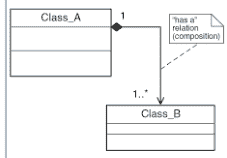

一辆汽车应该有一个内置发动机。因此，TCar 类（Class_A）拥有一个 TEngine 类（Class_B）的对象。这里重要的是，TCar 与其 TEngine 对象的生命周期严格相关。也就是说，如果 TCar 被销毁，其 TEngine 对应对象也会被销毁。实际上，从 Class_A 到 Class_B 对象（们）的链接是通过引用或指针实现的（这里我们使用智能指针；参见第 5.3 节）。

**表 4.4（续）**

| 类关系 | 描述 | UML 图 | 示例 |
|---|---|---|---|
| **继承（is-a）** | 允许以 Class_B 的形式进行特化，Class_B 派生自基类 Class_A。从这个意义上说，Class_B 是 Class_A 的一种“is-a”类型。Class_B 继承 Class_A 的成员。它还可以添加自己的成员，并通过定义自己的虚函数来改变它们的行为。一个类可以从多个基类派生（*多重继承*）。基类称为*超类*、*母类*或*父类*。派生类通常称为*子类*。 | 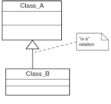<br>UML 图，显示 Class_A 作为基类，Class_B 作为派生类，通过继承箭头连接并标注为“is-a”关系。 | <code>class GasEngine : public TEngine<br>{<br>};<br>class DieselEngine : public TEngine<br>{<br>};<br>class ElectricEngine : public TEngine<br>{<br>};</code> |

在派生过程中，会为基类提供一个访问过滤器，如图 4.2 所示。访问过滤器加上成员访问类型会将基类成员限制为更严格的访问规则。也就是说，如果成员声明为 protected 但派生方式是 private，则该成员在派生类中变为 private，依此类推。如果未提供访问过滤器，则假定为 private。在这种情况下，基类的所有成员在派生类中都变为 private。这种类型的继承与模板机制（第 4.13 节）提供的*静态*多态性形成对比。

| 关系多重性 | 描述 | 类成员可见性 | 描述 | 关系类型 | 描述 |
|---|---|---|---|---|---|
| 0 | 无实例 | + | 公有 |  | 关联 |
| 0..1 | 无实例或恰好一个 | - | 私有 |  | 依赖 |
| 1 | 恰好一个实例 | # | 受保护 |  | 继承 |
| 0..* | 零个或多个实例 | / | 派生（继承） |  | 聚合 |
| 1..* | 一个或多个实例 | ~ | 包（库） |  | 组合 |

近几十年来，人们观察到类之间更复杂的关系，这些关系在不同项目之间重复出现，尽管次要细节有所不同。这些被称为*设计模式*（Gamma 等人，1994 年）。在接下来的章节中，我们还将介绍其中一些最实用的模式。

## 4.10 示例项目——通过类继承使用`TComplexQuadEq`扩展功能

在第 3.15 节中，我们介绍了`TQuadEq`类，它表示实数域中的二次方程。根据其三个参数的值，可以有零个、一个或两个解（根）。然而，正如我们在第 4.4 节中所知，在复数域中总是存在两个根。如何扩展`TQuadEq`以返回`TComplex`根？我们需要从头开始编写所有内容，还是可以以某种方式重用`TQuadEq`的部分内容？我们可以使用 OOP 的基本原则之一：类继承，如图 4.14 所示。

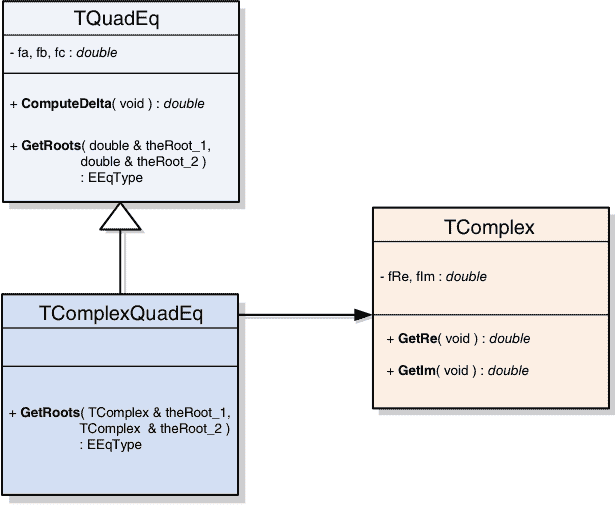

**图 4.14** UML 类图，显示`TQuadEq`和`TComplexQuadEq`类之间的继承关系。`TComplexQuadEq`从基类`TQuadEq`继承数据成员和`ComputeDelta`函数。`TComplexQuadEq`和`TComplex`类之间也存在关系——`TComplexQuadEq`知道并使用`TComplex`对象。

正如表 4.4 中已经展示的，继承允许派生类“拥有”基类的所有特性。因此，派生类可以专注于其特定行为。此外，使用下一节讨论的虚机制，可以调整基类中定义的某些成员函数的操作。

清单 4.22 显示了派生自`TQuadEq`的`TComplexQuadEq`类的定义。继承关系在类定义中第 [9] 行表达。它遵循图 4.15 所示的方案。

```cpp
using CppBook::TComplex;

class TComplexQuadEq : public TQuadEq
{
```

`TComplexQuadEq`类的两个成员函数的实现如清单 4.23 所示。在复数域中，如果这是一个真正的二次方程，那么总是有根。这一点在`GetNumOfRoots`的第 [11] 行中表达，其定义从第 [3] 行开始。

```cpp
#include "ComplexQuadEq.h"

TComplexQuadEq::EEqType TComplexQuadEq::GetNumOfRoots( const double delta ) const
{
    if( Get_a() == 0.0 )
    {
        return Get_b() == 0.0 ? EEqType::kLinContra : EEqType::kLinNone;
    }
    else
    {
        // In this class the sign of delta is not important
        return delta == 0.0 ? EEqType::kOne : EEqType::kTwo;
    }
}
```

在 [14] 行定义的`GetRoots`也在复数域中操作。在 [17] 行，通过调用基类中的`ComputeDelta`成员来计算`delta`参数。这是可能的，因为`ComputeDelta`在`TQuadEq`中被声明为 public。然后这个参数在 [21] 行传递给`TComplexQuadEq`类中的`GetNumOfRoots`。根据方程返回的类型，[23] 行的`switch`会执行正确的操作。如果有两个同名的成员函数，一个在基类中，另一个在派生类中，那么派生类会隐藏基类的定义，而不是重载它。但如果基类函数可访问，也可以从派生类中调用它，我们很快就会看到。

最有趣的两个情况，`EEqType::kOne`和`EEqType::kTwo`，被一起处理——它们之间没有 break 语句。首先，检查分母以确保其值足够大。如果不是，则在 [59] 行抛出异常。然后，在 [62] 行解析与`delta`参数符号相关的两种情况。在这两种情况下，我们都需要初始化两个`TComplex`对象。对于复数域，这在 [65–69] 行计算。然而，如果只有实数根，两者的虚部都设置为 0.0，如 [75] 和 [78] 行所示。

```cpp
TQuadEq::EEqType TComplexQuadEq::GetRoots( TComplex & root_1, TComplex & root_2 )
                                                    const
{
    auto delta( ComputeDelta() );       // Call a constructor for the built-in type

    const auto kDivThresh( 1e-36 );     // Used in assert to verify divisions

    EEqType equationTypeFlag = GetNumOfRoots( delta );

    switch( equationTypeFlag )
    {
        case EEqType::kNone:

            assert( false );             // should not happen
            break;
```


## 4.11 虚函数与多态

OOP的优势之一是在派生类中扩展或改变基类方法的行为，而无需从头重写一切。因此，可以轻松创建先前已知对象的新的、通常更专门化的版本。这属于抽象（在基类中表示）与特化或实现（在派生类中表示）的框架。

这一功能的关键方面——*多态*——在于，通常可以用基类中定义的成员函数之间的调用来描述通用算法，然后可以通过在派生类中定义自定义版本来修改。换句话说，多态意味着调用成员函数时会根据所用对象的类型执行不同的函数。

实现多态涉及*虚函数*。很容易猜到，虚函数是那些可以在派生类中相互替代的函数。这个过程称为函数*覆盖*。[^7] 要理解我们所讨论的内容，让我们分析一个有两个参与者的示例：`TCircle`类表示圆（见清单4.25）；以及`Precircle`，它让我们修改`TCircle`。它们的关系以UML类图的形式显示在图4.16a中。

`TCircle`包含一个私有变量`fRadius`，用于保存圆的半径值。还有一个带默认值的构造函数，因此它可以同时作为默认构造函数和参数化构造函数。此外，内联成员函数`GetRadius`和`SetRadius`允许访问`fRadius`。注意，这种通过私有数据并提供公共函数访问的数据封装，为对象提供了额外的安全性，因为我们可以控制每次读取，最重要的是，每次改变半径的写入。这样，我们可以确保半径不为负、不会太大等。如果数据声明为公共的，这种控制就不可能实现，因为其他每个软件组件都可以随意写入任何值，而不受任何控制。

`TCircle`还包含一个函数`ComputeArea`，它使用`fRadius`的平方乘以`GetPi`函数来计算圆的面积。然而，我们暂时假设基版本的`GetPi`只返回一个大致近似的*pi*，因为我们在基类中模拟不太精确的计算。我们期望在派生类中定义更精确的`GetPi`版本。为此，`GetPi`被定义为*虚函数*。

最后，`TCircle`的析构函数发生了一些有趣的事情，在第[24]行它也被定义为虚函数。为什么会这样，我们很快就会看到。

> [^7]: 不要将覆盖与重载混淆。后者指的是一组同名但参数不同的函数，如第4.4节所讨论的。

# 清单4.25 TCircle类的定义（在CppBookCode，VirtualMechanisms.cpp中）

```
class TCircle
{
private:
    double fRadius {};    // private data to hold circle radius
public:
    // Declared "const" since it does not change anything
double GetRadius( void ) const { return fRadius; }
    // Thanks to having fRadius private we can check its initialization
void SetRadius( double v ) { assert( v >= 0.0 ); fRadius = v; }
public:
    // Default and parametric constructor in one
    TCircle( double r = 0.0 ) : fRadius( r )
    {
    cout << "Constr TCircle called (@" << this << ")" << endl;
    }
    virtual ~TCircle()
    {
    cout << "Destr TCircle called (@" << this << ")" << endl;
    }
private:
    // Basic version of GetPi (not too precise)
    virtual double GetPi( void ) const
    {
    cout << "TCircle::pi" << endl;
    return 3.14;
    }
public:
    // There is only one version of ComputeArea
double ComputeArea( void ) const
    {
    return GetPi() * fRadius * fRadius;
    }
};
```

要理解虚函数的行为，重要的是要注意，在基类`TCircle`的公共接口第[41-44]行只定义了一个`ComputeArea`函数（非虚）。而`ComputeArea`在第[43]行调用了一个私有虚函数`GetPi`。由于`GetPi`在第[32]行被定义为虚函数，因此可以在派生的`Precircle`类中定义一个新的、可能更好的版本，如清单4.26所示。

`Precircle`类的定义从第[47]行开始。它从`TCircle`公有派生。因此，`Precircle`可以访问除私有成员之外的所有成员（第4.3节）。也就是说，`fRadius`只能通过调用`GetRadius`/`SetRadius`来访问。注意第[52]行`Precircle`构造函数的行为：它调用其基类`TCircle`的构造函数，将值`r`传递给它以进行正确的成员初始化。但基类构造函数直接初始化`fRadius`，如第[19]行所示。

```


今天，图书馆创建元数据的方式与100年前并没有显著区别。图书馆元数据仍然由高度专业化的专业人员手动创建。这既昂贵且不易扩展。我们需要换一种思路。机器学习提供了一个可能的方向。

- 出版社为其出版物生成元数据
- 图书馆仍然处于手动录入数据的业务中
- 图书馆标准复杂且实施成本高昂

> ...to organize the world's information and make it universally accessible and useful.

搜索引擎和图书馆并未降低元数据的生产成本。它们仅仅将成本从一方转移到了另一方。Google Books 的出现并未降低这一成本。

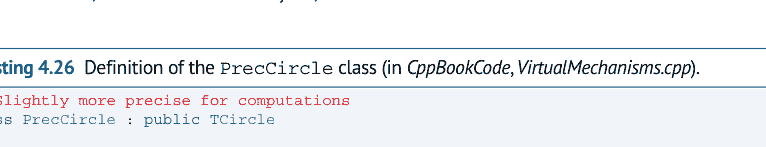

元数据的生产成本在100年内保持不变，创建过程也未改变。上图展示了该趋势。

未来的关键任务之一是理解真正需要的元数据，并提高其创建效率。人工智能和机器学习可以帮助我们自动化流程中重复的部分。

一些倡议已经出现 —  — 部分来自图书馆社区，部分来自其他领域。未来几年会涌现出更多此类倡议。

PrecCircle 还包含一个虚构的析构函数 ~PrecCircle，尽管在基类中定义虚构析构函数即可。为了表达类继承关系，在第 [57] 行明确使用虚构 ~PrecCircle。然而，PrecCircle 本身作用不大，其唯一操作定义在第 [66–70] 行的更精确的虚构函数 GetPi 上，该函数覆盖了基类中的实现。虽然不是绝对必要，但通过添加 override 关键字显式表达了覆盖关系。⁸ 在长类继承链中，这有助于控制函数是否真正被覆盖，因为函数名称或参数不一致会导致覆盖失败。同时，将 override 放在末尾可以避免在前面写 virtual，减少冗余（尽管如果保留 virtual 并无实质性影响）。

关于虚构函数的一个重要事实是：要使函数成为虚构，其声明必须完全相同。更精确地说，其形式参数必须类型相同，返回类型必须相同或至少兼容（例如来自相同的类层次结构）。因此，编写虚构函数时的一个经验法则是复制粘贴函数声明（仅在派生版本中添加 override 关键字）。

我们假设现在已经创建了两个对象：一个是 TCircle，另一个是 PrecCircle。我们也记得，ComputeArea 函数只有一个实现，它被独家实现在 TCircle 类中。但 GetPi 函数被两个对象调用。如果我们调用该函数，结果如图 4.16b 的 UML 序列图所示。当使用 TCircle 对象时，ComputeArea 由 TCircle 调用，进而调用 GetPi —  — 也由 TCircle 实现。但如果从 PrecCircle 执行相同操作，则由基类 TCircle 的 ComputeArea 被调用，再调用 GetPi，此时 GetPi 是 PrecCircle 类中实现的新版本。如果 GetPi 不是虚构的，则两种情况都会调用基类的 GetPi。

最后，我们来测试这两个对象的实际运行。为此，我们编写了两个测试函数。第一个，PrintInfoFor，功能简单。其定义从第 [75] 行开始：

```cpp
// 此函数利用 C++ 多态性打印 TCircle 对象的半径和面积，以及任何从 TCircle 派生的对象。
void PrintInfoFor( const TCircle & circ )
{
    double radius       { circ.GetRadius() };
    double area          { circ.ComputeArea() };
    cout << "r=" << radius << " => A=" << area << endl;
}
```

PrintInfoFor 的作用是打印传入的 const TCircle & 参数对象的半径和面积。这里的关键是多态性 —  — 我们明确将传入的参数声明为指向基类对象的常量引用。在 PrintInfoFor 中调用的两个 TCircle 方法 —  — 第 [77] 行的 GetRadius 和第 [78] 行的 ComputeArea —  — 并非虚构。然而，ComputeArea 调用 GetPi，而 GetPi 是虚构的，可以在每个 TCircle 类层次结构中的对象中实现不同。因此，无论传入哪种层次结构的对象，它们都会按照各自定义的虚构函数行为显示，而非基类。即使对未来实现的对象进行调用（假设其从 TCircle 派生），该机制也能正常工作。这里的关键在于，在“位置”的上下文中（原文未完整显示）。

⁸ 实际上它是半关键字。

```
Explicitly define two different objects
------------------------------------------------
Constr TCircle called (@000000A16B3FF638)
TCircle::pi
r=1.23 ==> A=4.75051
Constr TCircle called (@000000A16B3FF668)
Constr PrecCircle called (@000000A16B3FF668)
PrecCircle::pi
r=1.23 ==> A=4.75292
Destr PrecCircle called  (@000000A16B3FF668)
Destr TCircle called  (@000000A16B3FF668)
Destr TCircle called  (@000000A16B3FF638)
```

 unsurprisingly，对两个不同对象调用 ComputeArea 会导致相同半径 1.23 下面积结果不同，而 PrecCircle 提供略高的精度。有趣的是，构造器-析构器调用序列的顺序，如上述行所示。此外，PrecCircle 的情况是预期且合理的：构造顺序为 TCircle → PrecCircle，随后 ~PrecCircle → ~TCircle。显然，this 指针的值会因系统和运行而异，但基类及其派生部分的顺序保持一致。让我们总结一下。在派生类中，初始化顺序如下：

1. 基类构造函数（如果有多个，按声明顺序调用）
2. 派生类构造函数

析构顺则相反：

1. 派生类析构函数
2. 基类析构函数（如果有多个，调用顺序与构造相反）。

第二个代码块（第 [102–112] 行）执行类似操作，但此时对象是动态分配在堆上的，通过基类指针（智能指针）访问。这些智能指针（第 5.3 节）能安全管理对象的生命周期，自动在作用域结束时调用析构函数，避免直接使用 new 和 delete 导致的内存泄漏（GROUP 4，表 3.15）。

运行该代码后的输出如下：

```
Let us play only through a pointer to the base class
-----------------------------------------------------
Constr TCircle called (@000001A7E4A4F3B0)
TCircle::pi
r=1.23 ==> A=4.75051
Constr TCircle called (@000001A7E4A4EA00)
Constr PrecCircle called (@000001A7E4A4EA00)
PrecCircle::pi
r=1.23 ==> A=4.75292
Destr PrecCircle called (@000001A7E4A4EA00)
Destr TCircle called (@000001A7E4A4EA00)
Destr TCircle called (@000001A7E4A4F3B0)
```

让我们更仔细地观察 TCircle 和 PrecCircle 的其他虚构函数及析构函数。正如我们所料，在代码块结束后，c1_ptr 和 pc1_ptr 指向的对象会自动被销毁，因为它们是局部栈对象，触发其内部 TCircle 和 PrecCircle 对象的析构函数。在第一个对象的情况很明确：持有的指针类型为 `TCircle *`。但在通过 `TCircle *` 指针销毁 PrecCircle 时，虚构调用机制必须被激活。这样，在 ~TCircle 之前，~PrecCircle 会被调用，因为析构函数被声明为虚构。否则，仅调用 ~TCircle，导致 PrecCircle 部分未被正确销毁。因此，在规划类继承时，将基类析构函数声明为虚构是最佳实践。⁹ 另外，请注意，非虚构的公共接口（ComputeArea）与隐藏的私有虚构实现（GetPi）相结合，构成了模板方法（Template Method）这一有用且常用的设计模式，它既提供了基类对功能的更好控制（即相同的圆面积计算公式），也允许子类定制行为（更高精度）。

## 4.12　(🛠) 更多关于虚构机制

C++ 虚构函数的核心机制是每个对象关联的 *虚函数表* (VFT)，其中至少包含一个虚函数。该表保存虚函数的指针。因此，调用虚函数意味着先从对象的 VFT 中读取对应槽的函数指针，再通过该指针间接调用函数，如第 3.14.8 节所讨论。虚函数表的主要优势在于其函数指针可以被动态更改。当创建派生对象时，基类对应的 VFT 槽（即被覆盖的函数）会相应更新。结果是，通过基类指针或引用调用虚函数时，会自动选择适用于当前对象的实现版本。

图 4.17 展示了 Microsoft Visual Studio 2019 在运行前一节代码片段（第 [88–96] 行）后的截图。我们可以看到，每个包含至少一个虚函数的对象（例如 TCircle 类型的 c1）都有一个指向其 VFT 的指针，记为 _vfptr。在此示例中，这些指针指向析构函数以及 GetPi 的两个版本。其他非虚构函数无需在每个对象中存在，因此调试器不会显示它们。此外，派生对象（如 pc1）包含其自身成员（函数、数据）以及基类对象的成员。

但虚构机制在 C++ 中有代价：通过函数指针间接调用，以及 VFT 占用的内存。因此，虚构机制为对象带来运行时开销和内存开销。

虚构机制还涉及两个额外问题：

- *纯虚函数* —  — 这是一种用于定义抽象接口的虚函数，通常出现在类层次结构中。包含至少一个纯虚函数的类不能被实例化，即无法创建该类的对象。但它们可作为基类，供派生类继承并实现纯虚函数。相关细节和示例见第 6.2.4 和 6.6 节。

- *虚拟基类* —  — 在多重继承情形下（即类从多个基类继承），同一基类可能被多次继承，导致派生对象结构中重复出现同一子类（如图 4.18a 所示，对象 E 包含两次 B）。若不希望出现这种重复，可对基类使用 *虚拟继承*，如下代码示例所示：


## 4.12 更多关于虚机制

class D : public virtual B {};

class E : public C, public D // 多重继承 - 钻形结构 {}

然而，多重继承不应被滥用，因为它会为类关系增加不必要的复杂性。正如前文所指出的，里氏替换原则指出，派生类可以在其基类的位置上进行替换。因此，在图 4.18 中，类 E 的对象可以在不同的上下文中替换为 C 或 D。但在某些上下文中，多重继承是有用的：例如，我们在现有类上附加自己的类分支。关于类继承以及类初始化顺序的更多信息可在文献（Stroustrup 2013）中找到。

## 4.13 奇特的重复模板模式与静态多态

在第 4.8 节，我们看到类可以通过模板化来定义一种原型模式，当实例化时，使用不同的模板参数会生成不同的类，基于该原型。当所有模板参数已知时，C++ 编译器可以尝试将提供的模板参数与类原型匹配，然后为该类生成代码。由于也可以有模板特化，编译器会尝试在模板与类原型之间找到最佳匹配。模板参数匹配规则相当详细，可参考以下资源：Cppreference.com（2019b）；Cppreference（2020a,b,c）；以及 Vandevoorde 等人 2017。但本节展示了一个有趣的例子：模板类以一种方式继承，使得派生类本身也是其基类的模板参数。听起来很奇怪？这正是该模式被称为“奇特的重复模板模式”（CRTP）的原因，由 James Coplien 在 1995 年观察并描述（Coplien 1995）。除了本身有趣之外，该模式还展示了在编译期而非运行期实例化模板类的新方法，这被称为静态多态，并具有若干有用特性，我们将在后文中描述。为了理解 CRTP 背后的思想，让我们先看图 4.19 中的类图以及代码片段 Listing 4.27。

**Figure 4.19** 奇特的重复模板模式（CRTP）UML 类图。

### 代码片段 4.27

CRTP 中的核心类关系。`TBaseFor` 是一个带有模板参数 `D` 的模板类。`Derived` 是一个非模板类，继承自 `TBaseFor<Derived>`。`TBaseFor` 通过模板参数 `D` 可以访问 `Derived`，因为 `Derived` 被作为参数 `D` 传入。

```cpp
template < typename D >
class TBaseFor
{};

class Derived : public TBaseFor< Derived >
{};
```

在第 [1–2] 行定义的 `TBaseFor` 类是一个空的模板类，拥有模板参数 `D`。第 [8] 行定义的 `Derived` 类公开继承自 `TBaseFor`，并将模板参数设为 `Derived`。因此，CRTP 可以被理解为一种类似“三明治”结构的 `Derived‑TBaseFor‑Derived` 模式。

但真正有趣的是，`TBaseFor` 现在可以访问 `Derived` 的成员，因为 `Derived` 成为了前者的模板参数，如 Listing 4.28 所示。

第 [8] 行定义的 `DAction` 成员，其第一个动作在第 [10] 行将 `this` 对象转换为 `deriv_part`，即 `D` 参数的引用。随后，`deriv_part` 将是其派生类之一（具体是哪一个，目前尚不知）。转换使用 `static_cast` 即可。然后，派生类的 `Work` 方法可以通过第 [13] 行调用。

### 代码片段 4.28

详细实现 CRTP。`Derived` 类可以在 `TBaseFor` 中被访问，如在 `DAction` 中所示。通过 `static_cast` 将 `* this` 强制转换为 `D &` 获得参考 `deriv_part`，从而可以通过 `deriv_part` 调用 `Derived` 的成员，例如 `Derived::Work`（在 *CppBookCode, VirtualMechanisms.cpp* 中）。

```cpp
template < typename D >
class TBaseFor
{
public:

    // 无虚函数
    void DAction( void )
    {
        D & deriv_part = static_cast< D & >( * this );

        // 对于是什么样的派生类进行操作 …
        deriv_part.Work();
    }
};

class Derived : public TBaseFor< Derived >
{
public:
```

### 代码片段 4.28（续）

```cpp
24    // 无虚函数
25    void Work( void )
26    {
27    // 对 Derived 进行特定操作 …
28    }
29    ;
30
31    // 使用 Derived 进行操作
32    void DerivedTest( void )
33    {
34    Derived d;
35    d.DAction();
36    }
37
```

第 [20] 行的 `Derived` 类只定义了一个 `Work` 方法，如第 [25] 行所示。其目的是创建多种 `Derived` 版本，每个版本在其 `Work` 方法中执行不同的操作。通过这样做，我们实现了一种静态多态。注意，这里没有使用虚函数，因此这种多态是静态的。缺少虚函数的好处是不需要维护虚函数表（virtual table），如第 4.12 节所述。回到代码分析，请注意在第 [35] 行创建了一个 `Derived` 类对象 `d`，随后在第 [36] 行调用 `d.DAction`。这会触发基类的 `DAction`，进而调用 `Derived` 的 `Work` 方法。

现在，是时候比较本节展示的使用 CRTP 实现的静态多态与第 4.11 节中描述的动态多态进行比较。回顾后者，我们有两个版本的类，各自拥有不同的虚函数 `GetPi`，返回不同精度的 π 常量。基于 CRTP 的版本在 Listing 4.29 中给出。

第 [1‑2] 行定义的 `TBaseCircle` 模板类包含一个数据成员 `fRadius`、默认参数构造函数（第 [17] 行）以及第 [10] 行的 `GetArea` 函数。在第 [12] 行，`GetArea` 通过与第 4.28 条例相同的方式访问派生类 `D` 的 `GetPi`。

下面给出两个通过 CRTP 实现的派生类 `SimpleCircle` 和 `PrecCircle` 的定义（在 CppBookCode, VirtualMechanisms.cpp 中）。

```cpp
template < typename D >
class TBaseCircle
{
private:
    double    fRadius   { };
public:
    double GetArea( void ) const
    {
    return fRadius * fRadius * static_cast< D const & >( * this ).GetPi();
    }
public:
    TBaseCircle( double r = 0.0 ) : fRadius( r ) { }
};
```

派生类 `SimpleCircle` 和 `PrecCircle` 的定义从第 [20] 行和第 [38] 行开始。它们各自实现了自己的 `GetPi`，仅在返回的 π 常量精度上不同，如第 [26] 和第 [44] 行所示。同时，注意它们在调用基类构造函数时的写法（第 [31] 和第 [49] 行），以便正确传递参数 `r`。

```cpp
class SimpleCircle : public TBaseCircle< SimpleCircle >
{
public:

    double GetPi( void ) const
    {
        return 3.14;
    }

public:

    SimpleCircle( double r = 0.0 ) : TBaseCircle< SimpleCircle >( r ) {}

};

// 别混淆
// class PrecCircle : TBaseCircle< SimpleCircle >
class PrecCircle : public TBaseCircle< PrecCircle >
{
public:

    double GetPi( void ) const
    {
        return 3.1415926535;
    }

public:

    PrecCircle( double r = 0.0 ) : TBaseCircle< PrecCircle >( r ) {}
};
```

这些类的运行可以在 `StaticPolymorphism_Test` 函数中观察，该函数从第 [51] 行开始。在第 [54] 和第 [59] 行分别创建了带有相同半径的两个对象。随后，同一个 `GetArea` 函数被分别在第 [56] 和第 [61] 行对这两个对象调用。注意，该函数只在 `TBaseCircle` 类中定义了一次。在第 [57] 和第 [62] 行，我们测量并显示两个对象的大小（字节数）：

```cpp
void StaticPolymorphism_Test( void )
{

    SimpleCircle sc( 13.13 );

    cout << "A1 = " << sc.GetArea() << endl;
    cout << "sizeof( SimpleCircle ) = " << sizeof( SimpleCircle ) << endl;

    PrecCircle pc( 13.13 );

    cout << "A2 = " << pc.GetArea() << endl;
    cout << "sizeof( PrecCircle ) = " << sizeof( PrecCircle ) << endl;
}

The output of the previous code looks like this:

```
A1 = 541.326
sizeof( SimpleCircle ) = 8
A2 = 541.601
sizeof( PrecCircle ) = 8
```

It is interesting to observe that in all cases, the size of each object is just large enough to accommodate the fRadius member from the base. This is one of the main benefits of static polymorphism, as compared to the dynamic version.

## 4.14 (✕) Mixin Classes

An interesting topic related to the CRTP is the mixin class pattern (https://www.fluentcpp.com/2017/12/12/mixin-classes-yang-crtp). Its general scheme is shown in Listing 4.30.

**Listing 4.30** General scheme of a mixin class MMixin. The key idea is to provide the base class as a template parameter to MMixin (in CppBookCode/VirtualMechanisms.cpp).

```cpp
template < typename Base >
class MMixin : public Base
{
    // Can use members of Base ...
};
```

Mixin resembles an inverted CRTP pattern. It lets us compose new components from existing simpler ones, as in the example in Listing 4.31.

**Listing 4.31** Example of mixin classes to display the date in different formats (in CppBookCode/VirtualMechanisms.cpp).

```cpp
struct TDate
{
    int             fDay    {};
    std::string     fMonth  {};
    int             fYear   {};
};
```

The following MPrint_Date_US mixin displays TDate in the US format:

```cpp
template < typename B >
struct MPrint_Date_US : public B
{
    // US date print format
    void Print( void )
    {
        std::cout << fMonth << "/" << fDay << '/' << fYear << '\n';
    }
};
```

On the other hand, the MPrint_Date_Eu mixin knows how to display TDate in the European format:

```cpp
template < typename B >
struct MPrint_Date_Eu : public B
{
    // European date print format
    void Print( void )
    {
        std::cout << fDay << "/" << fMonth << '/' << fYear << '\n';
    }
};
```

Finally, the MixinTest function shows the two mixins in action:

```cpp
void MixinTest( void )
{
    // Alias is useful with mixins
    using Date_US = MPrint_Date_US< TDate >;
    using Date_Eu = MPrint_Date_Eu< TDate >;

    Date_US dus { 9, "Nov", 2019 };
    dus.Print();

    Date_Eu deu { 9, "Nov", 2019 };
    deu.Print();
}
```

The result of running MixinTest is as follows:

> Nov/9/2019
> 9/Nov/2019

A unique key associated with each record is a requirement when building database systems with classes that represent personal data such as first and last names, address, age, etc. In Poland, each individual has a personal identification number called the PESEL ID (https://en.wikipedia.org/wiki/PESEL; similar to a US Social Security number) consisting of exactly 11 digits that are unique to the person and that also convey encoded information about their date of birth and sex. For this example, we decided to include this information in each person’s record. Listing 4.32 shows our first attempt to define the TPerson class.

Here is our first attempt to set fID with an 11-digit PESEL:

```
fID = 94120612345;    // try to write the PESEL id
```

This results in a nasty error, which we will see when we try to display fID. In systems where unsigned int objects are stored in four bytes, the following result appears:

> fID = 3926299129

**Listing 4.32** First definition of the `TPerson` class. The type chosen to represent fID is inappropriate here since it cannot reliably convey an 11-digit value; it must be replaced.

```cpp
class TPerson
{
private:

    std::wstring          fFirstName;
    std::wstring          fLastName;

    unsigned char         fAge {};

    unsigned int          fID {};          // PESEL id

public:

    // ...
};
```

We discussed this problem when we introduced various data types in Section 3.1. Listing 3.2 computed the minimum number of bits for a value representation. However, such details are easy to overlook during design and can result in malfunctioning software. To measure if, for example, `unsigned long` would be sufficient, we can modify the code from Listing 3.2 as follows:

```cpp
// Test PESEL ID stored in ID_TYPE
using ID_TYPE = unsigned long;
ID_TYPE          fID {};             // PESEL id

std::cout << "sizeof( ID_TYPE ) = " << sizeof( ID_TYPE ) << std::endl;
std::cout << "Bits to store 11 digits = " << (int)( log( 99999999999.0 ) / log( 2.0 ) + 1 ) << std::endl;
```

We obtained the following output on our system:

```text
sizeof( ID_TYPE ) = 4
Bits to store 11 digits = 37
```

Hence, even `unsigned long`, which offers 4·8 = 32 bits, is much too short, since at least 37 bits are necessary to store 11 digits. Since computer memory is byte-addressable, this means using at least five bytes; but an odd number is also not appealing, for performance reasons (Patterson and Hennessy 2018). The 11 digits are nothing to quarrel about – we can put `std::array<unsigned char, 11>` or another `wstring` in the `TPerson` class, and the problem is solved. However, when we consider storing thousands of such `TPerson` objects in a database, then the extra bytes do not add to software quality. So, in this section, we will show how to design a class to store digits optimally using a *binary-coded decimal* (BCD) representation, which entails only four bits per digit. Then we will scrutinize various ways of designing a special class to represent PESEL IDs. We will consider embedding an 11-digit object, as well as deriving from it. We will also compare their properties and size.

In this example project, we will learn about a number of useful programming techniques:

- BCD data format
- Endianness
- Efficient storage of long numbers

## 4.15.2 Endianness

Endianness defines a way to store multibyte words in the computer’s memory (Section 2.1). There are two variants:

- ***Big endian*** – Most significant byte at the lowest address
- ***Little endian*** – Most significant byte at the highest address

Figure 4.21 illustrates two possible types of endianness for the two-byte value 0xABCD.

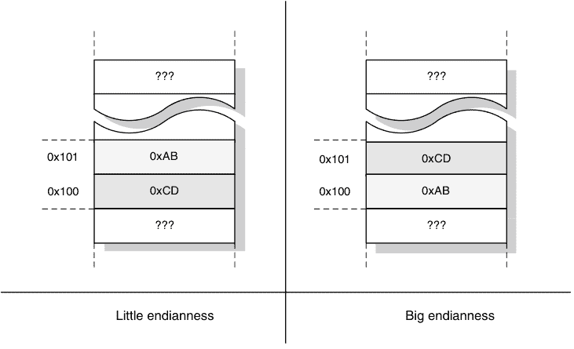

**Figure 4.21** Storing a two-byte value 0xABCD with big and little endianness.

Byte order is defined by the microprocessor architecture standard, and manufacturers usually have their own preferences. For example, little endian was employed in x86 and new RISC-V architectures (Patterson and Hennessy 2018). But the 68k series of Motorola processors operated in big-endian mode. There are even some microprocessors for which endianness can be programmatically set (e.g. PowerPC). But big endian dominates in networking protocols (e.g. TCP/IP). In C++, it is not defined and should not pose a problem on a given platform. However, endianness conversion may be necessary when e.g. sending data structures over different systems. To revert the byte order in a word, the RevertEndianness function from Section 3.13.2.2 can be used.

In our project, endianness needs to be considered when converting strings, such as “12345,” into a series of BCD-organized values. For this purpose, big endian seems to be appropriate, as we will discuss.

## 4.15.3 Definition of the *TLongNumberFor* Class

Listing 4.33 shows the definition of the TLongNumberFor class that will be used to represent numbers of any length efficiently. As usual, on lines [1–6], the STL headers are included. The last header, i.e. the *exception* header, contains definitions of the `std::exception` class hierarchy, which will be used to represent exceptions that may occur in our code.

**Listing 4.33** Annotated definition of the `TLongNumberFor` class (in LongNumber/LongNumberFor.h).

```cpp
#include <cassert>
#include <string>
#include <array>
#include <iostream>
#include <algorithm>
#include <exception>

using std::string;
using std::istream, std::ostream;

// This class efficiently stores a series of numbers, such as 12345678901234567890
// of a given length. Each number is stored in a nibble (i.e. 4 bits).
//
// The auto keyword in a template parameter -
// the type is deduced at the point of instantiation.
//
template < auto MAX_NUMBERS >
class TLongNumberFor
{
public:

    inline static const auto kMaxNumbers { MAX_NUMBERS };

private:

    // ------------------------------
    // A class can define another class
    // This class is just a placeholder
    struct NibblePair
    {
        unsigned char fFirst     : 4;       // define two bit fields
        unsigned char fSecond    : 4;              // of a total size of 1 byte

        NibblePair() : fFirst( 0 ), fSecond( 0 ) {}
    };
    // ------------------------------
```

Then, on lines [9–10], the useful `std` classes are introduced. As a result, the `std::` prefix can be omitted for these explicitly listed classes from `std`, as discussed in Section 3.14.6.

The definition of the `TLongNumberFor` template class starts on line [20] and spans to line [158]. This is an example of a template class with the `auto` keyword in front of the `MAX_NUMBERS` parameter. The `auto` keyword allows for correct type deduction based on the type of the argument passed during template class instantiation.

On line [25], the template parameter is copied into the local `kMaxNumbers` inline static constant object. As a result, this object is defined only once for the class and does not occupy memory in objects of the `TLongNumberFor` type. If necessary, information about the maximum number of digits can be accessed from a concrete instantiation of `TLongNumberFor`.


第 [67] 行定义了一个虚析构函数。这里它没有做什么特别的事情，只是如果 `TLongNumberFor` 将被派生，它就应该是 `virtual` 的。我们将研究两个选项：代码位于第 [66–68] 行内，由条件编译标志 `ALLOW_INHERITANCE` 包围，如果该标志设置为 1，则会将析构函数插入到编译的翻译单元中。

```cpp
#if ALLOW_INHERITANCE == 1
    virtual ~TLongNumberFor() {}    // A virtual destructor to allow inheritance
#endif
```

关于用于条件编译的 `#if` 预处理指令的更多内容，请参见 A.1 节。

### 4.15.3.1  类型转换操作

在 4.4 节讨论 `TComplex` 时，我们看到可以用 `double` 表示的实数值来创建一个虚部为 0 的 `TComplex` 数。因此，我们从实数转换为了复数。但由于没有反向转换，我们没有实现从复数到实数的转换。对于 `TLongNumberFor`，我们有两种可能的方法：我们希望能够从字符串创建 `TLongNumberFor` 对象，并将其转换回字符串。代码如下

```cpp
TLongNumberFor< 5 > number_1( "1234" ); // Convert a string to a TLongNumberFor
```

接着是

```cpp
std::string str { "" }; // Create a string
str += number_1;         // Convert number_1 to std::string and concatenate with str
std::cout << str;        // Let's see it
```

在 C++ 中，我们必须实现以下函数来执行这双重转换：

- `TLongNumberFor` 构造函数，它只接受 `std::string` 作为其唯一参数
- `TLongNumberFor` 的重载成员函数 `operator string () const`，用于相反的转换，即从 `TLongNumberFor` 到 `std::string`

这些在 C++ 中执行类型转换的方式如图 4.22 所示。

`TLongNumberFor` 转换构造函数的定义始于第 [72] 行。其参数是 `const string & s`，该参数应包含一系列 0–9 的数字。但是，其长度不应超过 `kMaxNumbers` 常量的值。因此，在第 [74] 行检查了一个合适的前置条件。作为设计的一部分，我们必须决定如果输入字符串太长或包含非数字字符时该怎么做。如果无法创建对象，那么可以抛出异常；但异常应该是最后的手段，因为如果在这种上下文中出现此类错误，转换将被停止，但 `TLongNumberFor` 对象仍会被创建。因此，在第 [77] 行创建了一个 `char len` 变量，并用字符串长度和 `kMaxNumbers` 中的最小值初始化。但由于 `std::min` 是一个模板函数，要求其两个参数的类型完全相同，而 `kMaxNumbers` 的类型取决于实例化 `TLongNumberFor` 时传入的类型，我们决定将 `s.length()` 返回的值转换为 `kMaxNumbers` 的类型。这是通过以下结构实现的：

```cpp
static_cast<decltype( kMaxNumbers )>( s.length() )
```

`decltype` 返回 `kMaxNumbers` 的类型（3.7 节），然后该类型被 `static_cast` 运算符用作其参数（组 2，表 3.15）。

[106] 处，在第 [112] 行转换为相应的 ASCII 码，最后添加到返回字符串 str 中。此规则的一个例外是前导 0 数字，我们决定跳过；此条件在第 [109-110] 行检查。包含转换后数字的字符串 str 在第 [115] 行返回。更多类型转换的示例将在 7.3 节中介绍。

```cpp
public:
    // Type converter - assumes big endianness,
    // i.e. the rightmost character will be at 0 index,
    // e.g. "123" will be allocated as: 0 ... 0 1 2 3
    operator string() const
    {
        string str;

        // Build the string
        for( int i { kMaxNumbers - 1 }; i >= 0; -- i )
        {
            auto a_digit { GetNumberAt( i ) };
            if( a_digit == 0 && str.length() == 0 )
                continue; // skip leading left 0s
            else
                str += '0' + a_digit; // let's use the simple patterns
        }

        return str;
    }
```

有时，在编写单参数构造函数时，我们希望禁止这种自动类型转换。在这种情况下，可以在构造函数前加上 `explicit` 关键字。例如，因为我们有 `TLongNumberFor( const char * ptr )`，我们不希望允许指向 char 的指针转换为 `TLongNumberFor` 对象。以下声明可以表达我们的意图：

```cpp
explicit TLongNumberFor( const char * );
```

请注意，与本书中介绍的大多数类一样，`TLongNumberFor` 不包含任何其他构造函数，例如复制构造函数或移动构造函数，也没有赋值运算符。由于它们的操作很简单——都是复制 `fData` 对象——因此这些函数由编译器自动生成。

`TLongNumberFor` 对象可以进行比较。为此，在第 [117-121] 行定义了重载的 `operator ==`。它使用 `std::memcmp`，简单地逐字节比较该对象中包含的 `fData` 成员和 `obj` 参数传入的对象（另请参见 A.2.6 节）。

```cpp
bool operator == ( const TLongNumberFor & obj )
{
    // Treat array as a series of bytes
    return std::memcmp( & fData[0], & obj.fData[0], sizeof( fData ) ) == 0;
}
```

`TLongNumberFor` 类包含用于读写特定数字的成员函数。`GetNumberAt` 定义在第 [125] 行，返回存储在 `position` 参数处的数字。像往常一样，第 [127] 行的前置条件可以极大地帮助调试。但如果 `position` 在运行时超出范围，我们别无选择，只能抛出异常，如第 [128–129] 行所示。与其从头设计自己的异常，不如使用标准库（SL）中提供的异常。因此，我们使用了 `std::out_of_range`。但如果 `position` 在有效范围 0..kMaxNumbers 内，则会在第 [131] 行返回正确的数字。半字节的类型由 `IsFirstNibble` 决定。最后，`ReComputeIndex` 函数将 `position` 的值转换为 `fData` 数组中的索引。

```cpp
public:
    int GetNumberAt( int position ) const
    {
        assert( position < kMaxNumbers );
        if( position >= kMaxNumbers )
            throw std::out_of_range( "GetNumberAt position out of range" );
        return IsFirstNibble( position ) ?
            fData[ ReComputeIndex( position ) ].fFirst :
            fData[ ReComputeIndex( position ) ].fSecond;
    }
```

`SetNumberAt` 定义在第 [135] 行，执行相反的操作——它将 `val` 传入的值写入 `position` 参数所指示的数字位置。第 [137–138] 行的两个前置条件验证了两个参数的正确范围。同样，如果在运行时第 [139] 行处的位置不正确，那么在第 [140] 行会抛出 `std::out_of_range` 异常。但是，如果传入的 `val` 错误，则不会执行此类操作。然后，类似于 `GetNumberAt`，在第 [141–143] 行，将一个数字值写入 `fData` 数组中正确的索引处。

```cpp
void SetNumberAt( int position, int val )
{
    assert( val >= 0 && val <= 9 );  // check that we don't abuse it
    assert( position < kMaxNumbers );
    if( position >= kMaxNumbers )
        throw std::out_of_range( "SetNumberAt position out of range" );
    IsFirstNibble( position ) ?
        ( fData[ ReComputeIndex( position ) ].fFirst = val ) :
        ( fData[ ReComputeIndex( position ) ].fSecond = val );
}
```

一个简单的 `ClearAll` 函数定义在第 [146] 行，将所有数字填充为值 0。这在第 [148] 行通过调用 `fData` 对象的 `fill` 成员函数完成。作为其参数，传入了 `NibbleArray` 的默认值。

```cpp
// Resets all numbers to 0
void ClearAll( void )
{
    fData.fill( NibbleArray::value_type() );  // set all to 0
}
```

在类似数组的结构中，拥有下标运算符总是很方便的。第 [152] 行展示了一个 `operator []` 的版本，它允许我们只读取数字值。它简单地将操作委托给第 [155] 行的 `GetNumberAt` 函数。


**Listing 4.34** Definition of the `LongNumbers_Test` function to test the functionality of `TLongNumberFor` objects (in *LongNumber, LongNumber_Test.cpp*).

```cpp
#include <fstream>
#include "LongNumberFor.h"

using std::cout; using std::endl;
using std::ofstream; using std::ifstream;


// A function that checks the main functionality
// of the TLongNumberFor class
void LongNumbers_Test( void )
{
    try
    {
        TLongNumberFor< 11 > pesel;

        pesel.SetNumberAt( 7, 7 );
        pesel.SetNumberAt( 8, 8 );

        assert( pesel.GetNumberAt( 7 ) == 7 );
        assert( pesel.GetNumberAt( 8 ) == 8 );

        // Try conversions
        TLongNumberFor< 5 > number_1( "1234" );

        std::string str { "--" };  // Create std::string from number_1
        str += number_1;            // Convert number_1 to std::string and concatenate with str
        std::cout << str << endl;   // Let's see it

        {
            ofstream testFile( "TLongNumberFor.txt" );
            testFile << number_1;
            testFile.close();
        }

        TLongNumberFor< 5 > number_2;

        {
            ifstream testFile( "TLongNumberFor.txt" );
            testFile >> number_2;
            testFile.close();
        }

        assert( number_1 == number_2 );

        // Now let's try to access at the wrong position
        cout << number_1[ 33 ];
    }
    catch( const std::exception & e )
    {
        std::cerr << "Out of Range error: " << e.what() << '\n';
    }
    catch( ... )
    {
        std::cerr << "Unknown exception\n";
    }
}
```

First, the system *fstream* header and our *LongNumberFor.h* headers are included, followed by the common `using` aliases. The definition of the test function starts on line [11]. Since exceptions can be thrown, the code is embedded in a `try-catch` statement (Section 3.13.2.5) that starts on line [13].

A `TLongNumberFor< 11 >` object named `pesel` is created on line [15]. Then, on lines [17–18], some of its fields are set; they are verified on lines [20–21].

Another object, `number_1`, is created on line [24]. This time, the conversions to and from `std::string` are tested on lines [26–27].

The consecutive blocks of statements on lines [30–34] and [38–42] test the correctness of the streaming operators.

Finally, on line [47], access to a nonexistent position is attempted. This fires an exception that should be caught by the first `catch` branch on lines [49–52] since it is tuned to the `std::exception` types. If other exceptions occur, the second catch branch on lines [53–56] takes over.

## 4.15.4 Designing Classes for PESEL IDs

The `TLongNumberFor` class is a useful container for storing a series of digits, since two digits occupy a single byte. We can now build a special class named `PESEL` to identify the PESEL ID stored for each person in our example database. Designing a special class for this purpose is useful since the PESEL number conveys additional information that can be efficiently accessed with the methods of the class, as will be shown.

Our basic building block will be a long number class containing exactly 11 digits as required by the PESEL standard; hence we have the `TLongNumberFor< 11 >` type. However, a question now arises – what relation should it have with respect to the new PESEL class? As we explained in Section 4.9, we have two options:

- The “has-a” relation, which leads to object aggregation (embedding)
- The “is-a” relation, which leads to inheritance

Both versions are shown in Figure 4.23.

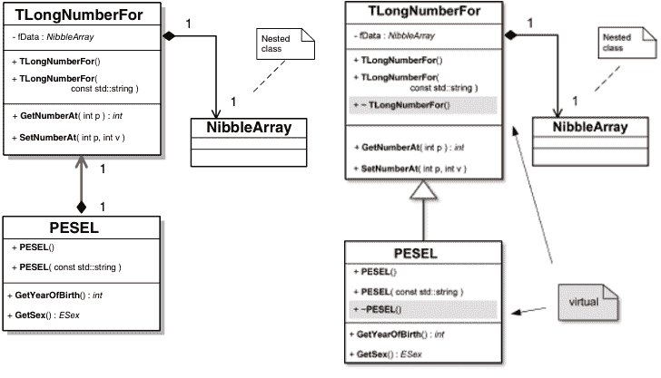

**Figure 4.23** UML class diagrams showing two versions of the PESEL class: (a) a version that aggregates `TLongNumberFor`; (b) a version derived from `TLongNumberFor`. In the latter case, the classes should contain virtual destructors. Such classes contain virtual tables, which make objects larger. `NibbleArray` is a nested class aggregated by `TLongNumberFor`.

Note that in addition to the previous two classes, `TLongNumberFor` defines its own internal `NibbleArray`. These two are joined by the aggregation relation since the latter’s existence is strictly related to the lifetime of the former.

We will now consider the two possible implementations, considering their benefits and drawbacks.

### 4.15.4.1 Aggregating PESEL

Listing 4.35 shows the definition of the PESEL class, which simply embeds the `TLongNumberFor< 11 >` object, as shown in Figure 4.23a. Hence, PESEL “has” the object of the `TLongNumberFor` type. In this case, a simpler version of `TLongNumberFor` is sufficient, so the `ALLOW_INHERITANCE` flag is set to 0 on line [1]. Then, the `LongNumberFor.h` header is included on line [2].

The alias and the `TLongNumberFor` object are created on lines [20–21]. Then, two constructors are used on line [25–26]. Finally, since the PESEL ID number contains encoded information about

```cpp
#define ALLOW_INHERITANCE 0
#include "LongNumberFor.h"

//////////////////////////////
// The "has-a" version
class PESEL
{
    private:

        // Some constants specific to the Polish PESEL number
        enum { kBirthYear_Dec = 10, kBirthYear_Sngl = 9, kSex = 1 };

    public:

        enum class ESex { kMan, kWoman };

    private:

        using LongNumberObject = TLongNumberFor< 11 >;
        LongNumberObject      fData;

    public:

        PESEL( void ) {}
        PESEL( const string & s ) : fData( s ) {}

    public:

        auto GetYearOfBirth( void )
        {
            return     fData.GetNumberAt( kBirthYear_Dec ) * 10
                     + fData.GetNumberAt( kBirthYear_Sngl );
        }

        ESex GetSex( void )
        {
            return ( fData.GetNumberAt( kSex ) & 0x01 ) == 0x01 ?
                        ESex::kMan : ESex::kWoman;
        }
};
```

a person, this data can be read by the functions defined on lines [30, 36]. These are accessed by calling the internal `fData` member.

We have come a long way from trying to use a simple int or long to store the PESEL ID, all the way to the efficient `PESEL` class that correctly represents the ID in any system, offers additional functionality, and hides the implementation details at the same time. We are interested in measuring the total size of the PESEL object, which is done by the following code:

```cpp
#include "Embedded_PESEL.h"
void Embedded_PESEL_Test (void )
{
    std::cout << "Size with wrapped object: " << sizeof( PESEL ) << std::endl;
}
```

The output is

```text
Size with wrapped object: 6
```

### 4.15.4.2 Inherited *PESEL*

In this section, we consider the properties of the second solution, shown in Figure 4.23b. In this case, the `PESEL` class is derived from `TLongNumberFor< 11 >`, so we can say that PESEL “is” a kind of `TLongNumberFor`. To allow inheritance, the `ALLOW_INHERITANCE` flag needs to be set to 1, as is done on line [1]. Then, as previously, on line [2], the `LongNumberFor.h` header is included.

The definition of the PESEL class, derived from `TLongNumberFor< 11 >`, starts on line [7] of Listing 4.36. The rest is almost identical to that in the definition shown in Listing 4.35, except for the additional virtual destructor defined on line [28]. This is usually necessary for the correct deletion of inherited classes, as discussed in Section 4.11. Also, there is no `fData` member, since all data is stored in the base class. Therefore, the `GetYearOfBirth` (line [32]) and `GetSex` (line [38]) members can directly call the `GetNumberAt` member from the base class. For this purpose, on line [12], `GetNumberAt` is inserted into the scope of the PESEL class with the `using` directive.

**Listing 4.36** Definition of the PESEL class derived from `TLongNumberFor< 11 >` (in *LongNumber,Derived_PESEL.h*).

```cpp
#define ALLOW_INHERITANCE 1
#include "LongNumberFor.h"


///////////////////////////////////////////////
// The "is-a" version
class PESEL : public TLongNumberFor< 11 >
{
public:

    using BaseClass = TLongNumberFor< 11 >;
    using BaseClass::GetNumberAt;

private:

    // Some constants specific to the Polish PESEL number
    enum { kBirthYear_Dec = 10, kBirthYear_Sngl = 9, kSex = 1 };
```


# Listing 4.36 (continued)

```cpp
public:
    enum class ESex { kMan, kWoman };

public:

    PESEL( void ) {}
    PESEL( const string & s ) : BaseClass( s ) {}    // base class from the string

    virtual ~PESEL() {}              // this must be virtual, why?
    // also TLongNumberFor<> should have a virtual destructor
public:
    auto GetYearOfBirth( void )
    {
        return    GetNumberAt( kBirthYear_Dec ) * 10
                + GetNumberAt( kBirthYear_Sngl );
    }

    ESex GetSex( void )
    {
        return ( GetNumberAt( kSex ) & 0x01 ) == 0x01 ?
                ESex::kMan : ESex::kWoman;
    }
};
```

With the following code, we can measure the size of this version of the PESEL class and its base:

```cpp
#include "Derived_PESEL.h"
void Derived_PESEL_Test( void )
{
    std::cout << "Size with inherited object: " << sizeof( PESEL ) << std::endl;
    std::cout << "Size of PESEL::BaseClass: " <<
                sizeof( PESEL::BaseClass ) << std::endl;
}
```

Unfortunately, in this case, the output is much larger than it is for the aggregated version:

```text
Size with inherited object: 16
Size of PESEL::BaseClass: 16
```

The inherited version is larger by 10 bytes, which is necessary to maintain the VFT due to the presence of the virtual destructors.

Hence, in our example, the aggregated version, which wraps the TLongNumberFor object, is preferred.

## 4.15.4.3 LongNumber Project Organization

Since we have one definition of the TLongNumberFor class with preprocessor-defined symbols that guide compilation, we need to properly organize the project into separate translation units.

The source files that set the compilation flags include the headers and define their function, and are separately compiled into objects. The relations among the project files are shown in the UML artifact diagram shown in Figure 4.24.

[PAGE 350]

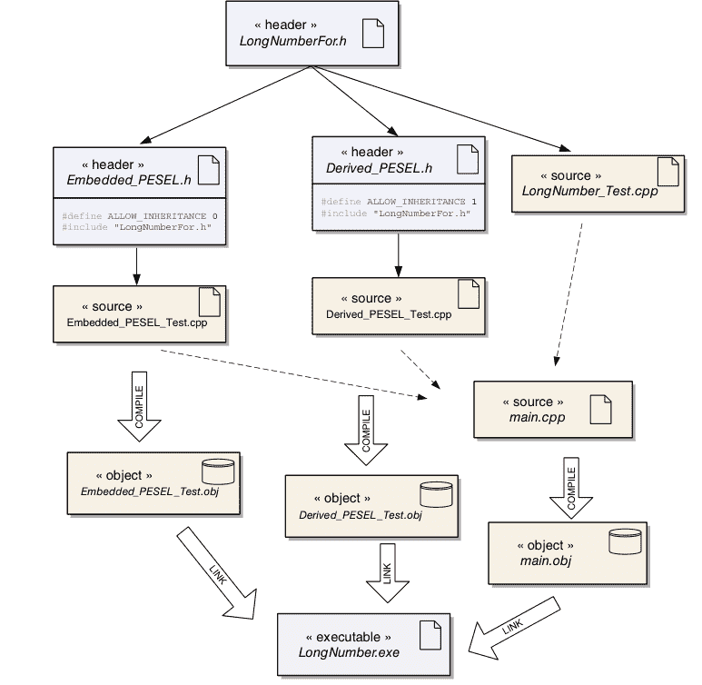

To maintain the *LongNumberFor.h* header file, which is controlled by the ALLOW_INHERITANCE preprocessor flag, two different translation units are separately compiled. A third is created from the *main.cpp* source file shown in Listing 4.37.

Note that there are only function declarations, which are then invoked. No project headers are included, though.

**Listing 4.37** Definition of `main` with calls to the test functions (in *LongNumber/main.cpp*).

```cpp
#include <iostream>

void LongNumbers_Test( void );
void LongNumbersWithProxy_Test( void );

void Derived_PESEL_Test( void );
void Embedded_PESEL_Test( void );
```

## 4.15.5.1 Definition of the Proxy Class

Listing 4.38 contains the definition of the `RetObjProxy` class, which implements the proxy pattern added to the `TLongNumberFor` class to facilitate different versions of data transfer by the overloaded subscript operators.

**Listing 4.38** Definition of the RetObjProxy nested private class for the proxy pattern to implement full operation of the subscript operator in the TLongNumberFor class (in LongNumber, LongNumberFor.h).

```cpp
#define TURN_ON_PROXY
#ifdef TURN_ON_PROXY     // The following code is compiled if TURN_ON_PROXY is defined
    private:

        // The proxy pattern private area

        // ----------------------------------------------------------
        // This nested class realized the PROXY pattern
        class RetObjProxy
        {
            public:

            using MotherClass = typename TLongNumberFor< MAX_NUMBERS > ;

            private:

                // A const or reference type data member makes the compiler declare
                // a copy assignment operator as deleted.
                // This does not work for us - we need a copy assignment.

                MotherClass * fMyMother {}; // A pointer to the mother class

                int fPosition {};  // Local index storage for the operator []
```

The code associated with the proxy pattern is included in the conditional compilation section on lines [179–266]. This is compiled if the flag `TURN_ON_PROXY` is defined, as on line [178]. This is slightly different behavior than the conditional compilation shown on lines [66–68] of Listing 4.33. In that case, a preprocessor flag is not only defined but also assigned a value, so a condition like `ALLOW_INHERITANCE == 1` can be checked. Here, we only check if `#define TURN_ON_PROXY` is present. Preprocessors are discussed further in Section A.1.

The definition of the nested `RetObjProxy` starts on line [186], which is in the private section of `TLongNumberFor`. `TLongNumberFor` is aliased on line [190] as `MotherClass`. The `RetObjProxy` class has two private members. The first, defined on line [198], is `fMyMother`, a pointer to the `TLongNumberFor` class for which `RetObjProxy` will work. The second, on line [200], is an auxiliary value to hold the current digit position.

The whole idea of using the proxy pattern for subscript operations is shown in Figure 4.25b. Since we cannot simply code the double-side subscript operation, because we cannot address a nibble, we choose an indirect approach with the proxy: when operator [] is called, instead of a reference, a `RetObjProxy` object is returned, which holds a pointer to the main

[PAGE 353]

TLongNumberFor object and the current digit position, as shown on line [257]. This is created by the parametric constructor defined on line [207]. At the same time, we wish to disallow the default constructor, since RetObjProxy must always be attached to a TLongNumberFor object. This would be achieved automatically by defining only the parametric constructor. But to explicitly express our intention, we add =delete, as presented in Section 4.6.1. On line [216], the default constructor is marked as deleted, so it cannot be used.

```
public:
    // Constructor
    // myMother - a TLongNumberFor class we connect to
    // position - index position
    RetObjProxy( MotherClass * myMother, int position ) : fMyMother( myMother ), fPosition( position )
    {
    assert( fMyMother != nullptr );
    assert( fPosition < MotherClass::kMaxNumbers );
    }

    // Forbidden default constructor
    RetObjProxy( void ) = delete;
```

As alluded to previously, the new TLongNumberFor operator [], defined on line [257], returns a RetObjProxy object. But this can happen in two contexts: when a digit is read, or when a digit is written. Naturally, this complies with the right or left value being processed. In both cases, the RetObjProxy members get into the action. Namely, when a RetObjProxy object is on the left side of the assignment and an int object is on the right, then operator = ( int ), defined on line [230], is called. Line [233] delegates the write operation to the mother object by calling fMyMother->SetNumberAt. Then the proxy is returned on line [234] to allow assignment chaining.

If RetObjProxy object is on the right side of the assignment and an int object is expected, then a simple to-int conversion function is called, as defined on line [223], which returns a digit at a given position. Again, the action to read the digit is delegated on line [226] to the mother object.

Finally, as will be shown in the examples, there may be a RetObjProxy object on both the left and right sides of the assignment. In this case, RetObjProxy & operator = ( RetObjProxy & r ), defined on line [239], will be invoked. It copies one digit to the other digit, as shown on lines [242-243]. Then the proxy object is returned on line [244] to allow assignment chaining.

```
public:
    // Called when: int x = id[ 8 ]
    // Right side (read) operation
    // Conversion operator to int - for read operations
    operator int () const
    {
    assert( fMyMother != nullptr );
    return fMyMother->GetNumberAt( fPosition );
    }
```

[PAGE 354]


# Listing 4.39 测试函数，用于 LongNumberFor 类的代理模式（在 LongNumber、LongNumber_Test.cpp 中使用）

```cpp
// 检查 TLongNumberFor 类的主要功能（该类使用代理模式）
void LongNumbersWithProxy_Test( void )
{
#ifdef TURN_ON_PROXY
    TLongNumberFor< 11 > id;

    int x = id[ 7 ];       // 这里使用了代理

    id[ 7 ] = 7;           // 这里使用了代理

    id[ 6 ] = id[ 8 ] = id[ 7 ] = 3;    // 同样使用代理

    assert( id[ 6 ] == 3 );
    assert( id[ 7 ] == 3 );
    assert( id[ 8 ] == 3 );

    assert( id[ 10 ] == id[ 0 ] );

#endif

    // 一致的索引： 9 ... 0
    const TLongNumberFor< 11 > cid( "9876543210" );    // cid 包含 "09876543210"
    assert( cid[ 10 ] == cid[ 1 ] );                    // 第 11 位的前导数字被设置为 0

    //cid[ 0 ] = 5;             // 无法这样做，因为 cid 是 const
    // 调用 const int TLongNumberFor< 11 >::operator [] ( int position ) const
    int z = cid[ 7 ];

#ifdef TURN_ON_PROXY
    id[ 7 ] = cid[ 1 ];
    assert( id[ 7 ] == 1 );
#endif
}
```

涉及这些操作的函数是在前一节中列出的函数中设置断点并观察调用栈的调试器。

在第 [23] 行创建了一个常量 `TLongNumberFor` 对象 `cid`。由于它是常量，只能读取其数字位。因此，`TLongNumberFor` 类的 `operator [] const` 方法足够，如第 [24–28] 行所示，此时可以避免使用代理模式。而在第 [32–33] 行，情况不同，因为非常量对象 `id` 被调用。

正如我们所见，代理模式通常在背景中隐形。同样的方式，它也可以用于其他上下文。例如，代理可以模拟一个嵌入在更大矩阵中的子矩阵（类似于图像中的子图）。在这种情况下，这种代理矩阵行为与其他矩阵相同，但不拥有自己的数据，而是依赖于更大矩阵的数据，并将其本地坐标转换为对应于更大矩阵的坐标。代理的另一个应用是推迟操作——这称为*懒惰求值*。在这种情况下，代理通常收集需要操作的对象的引用，除此之外什么也不做。只有在绝对必要时才执行操作。例如，当图像代理被要求从文件系统获取图像时，它会打开图像文件但不会将任何数据加载到内存中。最终，只有在请求图像数据的操作时，图像才会加载到内存中（维基百科：Proxy_pattern 2020）。

# 4.16 强类型

在 Listing 4.32 中所示的 `TPerson` 类中，我们发现 `fID` 成员的类型 `unsigned int` 是不合适的，因为它无法存储 11 位数值。因此，我们使用了 PESEL 类，如 Section 4.15.4 所讨论。通过这样做，我们不仅能够存储正确的值，还能获得出生日期和校正码等功能，后者用于验证值的内部完整性。

类似的问题出现在 `TPerson` 类的 `fAge` 数据成员上。虽然它的容量足够大（我们对此并不满意），但它不安全，易于出现错误的初始化。因此，使用更强的类型会更合适；下面在 Listing 4.40 中给出了一个示例。

```
Listing 4.40  TAge 类的定义，它是比 unsigned char 更强的类型，用于表示年龄（在 LongNumber、main.cpp 中）。

```cpp
class TAge
{
    unsigned char fAge {};

public:

    TAge( unsigned char age = 0 ) : fAge( age ) {}

    auto GetAge( void ) const { return fAge; }

    // 验证前置条件，检查要写入的值
    void SetAge( unsigned char age ) { assert( age < 128 ); fAge = age; }

    // ... 更多接口
};
```

```

现在 `TAge` 中的 `fAge` 是私有的，而 `SetAge` 包含前置条件，能够捕获所有尝试写入不寻常值的操作。

Listing 4.41 展示了从 Listing 4.32 中重构的 `TPerson` 类的 refactored 版本。它的两个数据成员已被更强的类型 PESEL 和 TAge 所取代。

虽然简单，但使用强类型的技术在实践中很有价值。

关于强（或命名）类型的进一步阅读，我们推荐博客 *Fluent{C++}*（Boccara 2016；Boccara 2018）。

```
Listing 4.41  从 Listing 4.32 中重构的 TPerson 类，使用更强的类型（在 LongNumber、main.cpp 中）。

```cpp
class TPerson
{
private:

    std::wstring   fFirstName;
    std::wstring   fLastName;

    TAge           fAge {};             // 自包含的类，用于表示年龄

    PESEL          fID {};              // PESEL id - 这里没有容量问题

public:

    // ...
};
```

## 3. 改进 `TCube` 类的实现：使其类似于模板。

## 4. 使 `TQuadEq` 类似于模板。

## 5. 完成 `TinyCube` 为 `bool` 类型的特化实现，如 Listing 4.15 中开始的部分。
+      提示：观察一个字节可以存储八位，这可以轻松转换为 `bool`。
+      开发一种方法，将立方体中的地址转换为对应位的地址。

## 6. 在 `TStackFor` 的定义中，将表示最大大小的模板参数改为放在构造函数的参数中。这两种方案有什么区别？

## 7. 阅读关于使用快速排序（QuickSort）进行数据排序的内容（https://en.wikibooks.org/wiki/Data_Structures/Stacks_and_Queues），实现该方法。堆栈在这种实现中可以如何使用？

## 8. 重构 Listing 4.24 中的 `ComplexQuadEq_Test` 函数，使其能够正确处理 `TComplexQuadEq::GetRoots` 成员函数抛出的异常。

## 9. 通过在 `TCircle` 类中删除 `GetPi` 成员函数的 `virtual` 关键字（Listing 4.25，第 [32] 行）来尝试运行代码。结果是什么？

## 10. 如果在 `TCircle` 类的析构函数声明中（Listing 4.25，第 [24] 行）删除 `virtual` 关键字，会发生什么？请解释。

## 11. 实现 `TLongNumberFor` 类（第 4.15.3 节）的 `<` 运算符重载。编写一个测试函数，用于对该类对象进行排序。

## 12. 为了节省内存，BCD 表示法在 Section 4.15.1 中被引入。然而，通过使用特殊的变长编码，可以获得更好的压缩比。例如，赫夫曼编码（Huffman coding），它为更频繁的数字分配更短的代码（维基百科：Huffman_coding 2020；Cormen et al. 2009；Cover and Thomas 2006）。阅读更多内容后，尝试实现一种变长编码，以高效表示任意长度的数字。将其与 BCD 进行比较。

## 13. 重新思考并扩展 Listing 4.19 中 `TPointFor` 类的实现。如何将其扩展以表示 3D 点、4D 点等？

## 14. 设计并实现一个表示矩形的类。
+      - 需要什么数据？
+      - 接口是什么？
+      - 添加函数以计算两个矩形的交集
+      - 实现一个函数，检查二维点是否在矩形内部或外部
+      - 编写测试函数以验证该类

## 15. 让程序运行“21”黑jack 卡牌游戏。
+   a. 阅读并分析规则（例如 https://en.wikipedia.org/wiki/Blackjack）。
+   b. 设计程序 – 识别主要对象，如卡牌、牌库、玩家（我们有哪些玩家？）、规则和游戏；识别并命名它们的属性和操作；使用 UML 方法学，应用用例、序列和类图。将设计分解为具有明确接口的组件：例如，游戏引擎和用户界面（表格显示）。
+   c. 实现程序 – 使用 SL 算法（例如牌库洗牌）和容器（如 vector、string 等），在适当位置添加注释，使代码自我文档化。不要等到全部完成后才编译和调试；相反，先编译和调试已准备好的部分，编写并使用测试函数。
+   d. 创建单元测试并验证您的应用，最重要的是享受过程！


所有用于计算的对象必须放置在计算机内存中。我们在讨论变量、数组和指针（第 3.1 节）时提到了内存管理。与对象和内存相关的两个最重要的概念是：

- **对象可见性（作用域）** – 规定代码中哪些部分可以访问对象的规则。作用域不是类成员的对象从其声明处开始。
- **对象生命周期** – 对象在内存中“存活”的时间长度，以及负责其创建和删除的组件。

掌握这些概念对于正确的代码组织至关重要。虽然对象可见性是一个易懂的概念，但理解对象的生命周期以及对象的创建和删除责任要更具挑战性。违反这些指南可能导致严重的编程错误，例如访问已删除的对象，以及内存泄漏。这些问题以及解决方法将在本章中讨论。

C++ 程序使用各种数据结构来存储不同类型的对象（变量和常量）；参见附录 A.3。此外，根据存储类型的不同，对象的创建和删除规则也不同。这些规则在表 5.1 中讨论。

如前所述，C++ 语言有两个用于存储对象的底层数据结构：栈（与函数或语句块相关）和堆（用于动态内存分配）。栈在程序执行进入函数或语句块时创建，并在离开该函数或语句块后自动销毁，同时销毁其所有内容。相反，使用 `new` 运算符（组 4，表 3.15）在堆上分配的对象会一直存在，直到对应的 `delete` 被调用。如果省略了 `delete`，内存通常会保留到进程结束或甚至直到下一次计算机重启。这种情况是

### 表 5.1 创建和删除对象的规则。

| 对象分配/访问类型 | 生命周期和可访问性 | 内存区域 | 示例 |
|---|---|---|---|
| 自动（局部） | 自动对象（变量）在函数内部创建。除非提供合适的构造函数，它们不会自动初始化，因此需要显式初始化。控制离开定义该自动变量的函数后，它们会自动销毁。每个新的 `{}` 块定义一个独立的局部变量作用域，仅在控制在此块或语句时存在。 | 栈 — 与函数或块 `{}` 关联的局部内存。栈在代码进入块时自动创建，在退出时自动销毁。但局部栈适用于相对较小的对象，对于大型分配（如矩阵）应使用堆。 | 下面的代码片段定义了三个名为 `var` 的对象。一个具有全局作用域，另外两个是函数和内部块中定义的自动变量。 |
| 静态 | 与全局变量不同，静态变量可以在函数内部定义。此时，静态变量在函数的连续调用之间保持可用，且仅在函数内部可见。静态变量具有静态存储持久性和静态生存期，在控制流经过其声明时进行初始化。因此，static 说明符有时用于限制对象的可见性（一种 C++ 中的“private”概念）。<br><br>自 C++17 起，对象可以声明为 inline，这意味着它在翻译单元中具有外部链接，并且在整个程序范围内保持相同的值；即即使其值在编译时已知（即不必是常量）。此特性有助于在不需要头文件或单独定义的情况下定义对象；参见第 4.15.3 节。 |  | <pre><code>// 限制函数最多只能执行 N 次，无论调用多少次
if (n_counter &gt; 0)
{
    --n_counter;      // 每次调用减 1
    cout &lt;&lt; to_display &lt;&lt; endl;
}
}

void do_action_on_test(void)
{
    const int kIterations = 1000;
    const int kNumOfActions = 5;

    for (int k = 0; k &lt; kIterations; ++k)
        do_action_n_times(kNumOfActions, k);
}
</code></pre><br>函数 `do_action_n_times` 接受两个参数。第一个 `N` 用于初始化内部的静态变量 `n_counter`（第 9 行）。第二个 `to_display` 仅用于将内容流式输出到屏幕。`n_counter` 有三个有趣的方面：(i) 在第一次调用时初始化，随后每次调用都会执行；(ii) 由于 `n_counter` 是静态对象，它在 `do_action_n_times` 调用之间保持生存；(iii) 当包含计数器的作用域（第 18 行）计数器归零时，它会自动销毁。变量 `n_counter` 与 `to_display` 的生命周期不同：`to_display` 仅在函数内部可见，但 `n_counter` 在所有线程中共享（因此在多线程环境下访问应进行同步；参见第 8 章）。 |
| 堆分配 | 堆是一个独立且通常较大的内存区域，用于通过运算符 `new`（C++）或 C 的 `malloc` 函数进行的对象分配。此类分配不会自动释放，需要显式调用 `delete` 运算符（或 C 的 `free` 函数）。为避免内存泄漏，使用智能指针处理堆分配是推荐的（第 5.2 节）。 | 堆通常由操作系统在程序启动时为运行程序预留的大内存区。 | 下面的示例在堆上分配了 10000 字节的内存区。为避免显式使用 `new` 和 `delete`（容易出错导致泄漏），我们使用唯一指针自动管理大块缓冲区。为简化，我们使用 `auto` 关键字声明 `large_buffer`。<br><br>内存块可以在第 11 行初始化为 0，并像普通的大数组一样在第 13 行访问。有趣的操作发生在第 21 行退出 `HeapAllocExample` 函数时。由于 `large_buffer` 是局部对象，离开函数后它会自动销毁，其析构函数会自动释放 10000 字节的缓冲区，从而大大帮助避免内存泄漏。智能指针在后续章节中进一步讨论。<br><br><pre><code>#include &lt;memory&gt;

void HeapAllocExample(void)
{
    // 定义智能指针 large_buffer，包含 10000 字节
    // 在堆上分配。
    const size_t ksize = 10000;
    auto large_buffer{make_unique&lt;unsigned char[]&gt;(ksize)};
    std::memset(large_buffer.get(), 0, ksize);

    large_buffer[0] = 'A';
    // 对 large_buffer 进行一些操作

    // large_buffer 是局部对象，函数退出时会自动销毁，
    // 同时也会自动释放 10000 字节的缓冲区。
}
</code></pre> |


```cpp
if( file.is_open() == false )
{
    return false;   // cannot open a file, exiting ...
                    // OK, buf is an automatic object, it will be destroyed
}

file.read( & buf[0], kBufSize );  // file open OK, read to the buffer
// do something ...

return true;    // everything OK, exit
} // OK, buf is an automatic object, it will be destroyed
```

这一次，在第 [5] 行，创建了一个类型为 `std::vector< char >` 的局部自动对象 `buf`。在其构造函数中，它在堆上分配了 256 字节。其析构函数会释放该缓冲区。但由于它是 `ProcessFile_1` 函数的自动局部变量，无论执行路径如何，它都会被自动销毁：其析构函数将被调用，内存将被释放。这就是关键所在——使用自动局部变量并利用自动对象销毁机制！同时也不需要 `delete`。

要使用这个版本的函数，需要做两个小改动。首先，为了使用 vector，在第 [13] 行，我们必须更改对内存缓冲区的访问方式——我们使用其第一个元素的地址。其次，我们将输入参数从 `const char *` 改为 `const string &`。与通过指针调用不同，通过常量引用调用是安全的，因为引用必须指向一个对象——在本例中，是一个文件名。

避免产生内存泄漏风险的第二个选择是使用智能指针。其操作将在后面解释，因此首先，让我们看一下该函数的第三个版本：

```cpp
// Use std::unique_ptr smart pointer object
bool ProcessFile_2( const string & fileName )
{
    const int kBufSize = 256;
    auto buf = std::make_unique< char [] >( kBufSize );  // allocate a buffer on
                                                         // the heap - but hold it with a unique_ptr (C++14)
    ifstream    file( fileName );
    if( file.is_open() == false )
    {
        return false;  // cannot open a file, exiting ...
                        // OK, buf is an automatic object, it will be destroyed
                        // and it will deallocate memory from the heap
    }

    file.read( buf.get(), kBufSize );  // file open OK, read to the buffer (use get)
    // do something ...

    return true;   // everything ok, exit
} // OK, buf is an automatic object, it will be destroyed
```

这一次，在第 [5] 行，通过调用 `make_unique` 辅助函数创建了一个 `buf` 对象。因此，它的类型是 `unique_ptr< char [] >`，得益于 `auto` 关键字，我们无需显式写出该类型。`unique_ptr` 是一个行为类似于指向数组的指针的对象。但同样，由于它是 `ProcessFile_2` 函数中的一个局部自动对象，无论执行路径如何，`unique_ptr` 都会被自动销毁。这意味着会调用 `unique_ptr` 对象的析构函数，并释放它所持有的缓冲区。为了访问内存缓冲区的指针，我们必须更改第 [14] 行并调用 `buf.get()` 函数。在其他方面，`unique_ptr` 的行为类似于普通指针。

总而言之，当需要堆内存分配时，最简单、最安全的方法是使用 STL 容器，例如 vector。但请记住，除了内存分配之外，它还会被零初始化，并且 vector 对象本身也会被创建。如果不希望这样（例如，如果有数千个这样的对象），那么 `unique_ptr` 是一个更轻量的选择。

通过 STL 容器或智能指针分配内存块是避免内存泄漏的唯一方法，尤其是在代码抛出异常的情况下。这是主张重构直接调用 `new` 的旧代码的另一个理由。

## 5.2.1 智能指针与资源管理简介

正如我们之前提到的，智能指针背后的主要思想是利用自动对象自动销毁的机制来释放堆上的内存块。让我们看看智能指针中实际使用了什么机制。为此，一个“高级指针”的模板类 `a_p` 可能如下所示：

清单 5.1 一个基本的智能指针类的示例代码（仅用于说明；请勿在代码中使用）。其主要思想是利用自动对象自动销毁的机制来销毁动态分配的对象（见 CppBookCode.SmartPointers.cpp）。

```cpp
template < typename T >
class a_p     // just an example - use the std::unique_ptr instead
{
private:

    T * fPtr;  // a pointer to the guarded object

public:

    a_p( T * p ) : fPtr( p ) {}

    // when a_p is destroyed, then fPtr is also destroyed.
    ~a_p() { delete fPtr; }

public:

    // a_p can be used as an ordinary pointer
    T & operator * ( void ) { return * fPtr; }

    // ...
};
```

在第 [10] 行的 `a_p` 构造函数中，传入一个指向类型 `T` 的指针，并将其存储在本地数据指针 `fPtr` 中。当 `a_p` 被销毁时，其第 [13] 行的析构函数被调用，进而销毁 `fPtr` 所指向的对象。为了在指针角色中有用，`a_p` 必须重载解引用运算符（第 [18] 行）并定义一些我们在此省略的成员函数。以下函数展示了 `a_p` 保护一个在堆上分配的 `double` 类型对象：

```cpp
void a_p_test( void )
{
    // Create advanced pointer as a local object
    // - make it hold a pointer to double
    a_p< double > apd( new double( 0.0 ) );

    // Do something with apd as with an ordinary pointer to double
    * apd = 5.0;
    * apd *= 3.0;
    cout << "apd=" << * apd << " sizeof(apd) = " << sizeof( apd ) << endl;

    // apd will be destroyed here since it is an automatic object
    // It will destroy the held object as well
}    // <---
```

在第 [5] 行创建了一个类型为 `a_p< double >` 的对象 `apd`，并用 `new double` 返回的指针进行初始化。然后，在第 [8–10] 行，`apd` 被当作一个普通的 `double` 指针使用。然而，由于 `apd` 是一个局部变量，在到达第 [14] 行的函数末尾或任何其他退出点时，它会被自动删除（代码由编译器生成）。这进而调用 `apd` 的析构函数，该析构函数只是销毁堆中的 `double` 对象。这只是一个初步了解——实际上，智能指针需要定义更多函数。幸运的是，这些类已经为我们编写好了——将在下一节中介绍。

关于智能指针及其使用场景的深入论述，可以在 Scott Meyers 的佳作中找到：Meyers 2014。此外，以下互联网网站提供了带有示例的最新信息：Stack Overflow 2020；Cppreference.com 2019a,b。

### 5.2.1.1 RAII 与栈展开

上述机制属于 C++ 的主要范式：*资源获取即初始化*（RAII），在第 4 章开头讨论过。在前面的示例中，我们看到了 RAII 的运作。它与对象的创建时自动调用构造函数以及对象销毁时自动调用析构函数的概念密切相关。对象的构造函数可以初始化对象需要的任何资源，而析构函数可以释放这些资源。这两种机制使 RAII 具有吸引力和功能性——得益于构造函数/析构函数调用的自动化，资源分配/释放的过程也自动化了。

请注意，除了内存之外，其他资源如打开/关闭文件、锁定/解锁并行同步对象等也需要以同样的方式管理。毫不奇怪，在这些情况下推荐使用 RAII 原则（Stroustrup 2013）。例如，在表 3.9 中，创建了 `std::ofstream` 类型的 `outFile` 对象。其构造函数隐式尝试打开文件 *Log.txt*。这需要调用几次系统函数，这些由 `std::ofstream` 类处理。如果成功，通过 `outFile.is_open()` 条件验证后，我们可以安全地写入该文件。但接下来会发生什么？我们是否显式关闭 *Log.txt* 文件以便其他组件可以使用？不：我们不必显式执行此操作，因为当 `outFile` 离开作用域时，其析构函数会自动调用，并为我们安全地关闭文件。无论发生什么情况，例如抛出异常，如果 `outFile` 已完全构造（即其构造函数完成其工作），则可以保证 `outFile` 的析构函数也会完成其工作（即释放资源）。本书中的许多其他示例也使用了类似的构造函数；例如，清单 3.36 中的 `CreateCurExchanger` 函数创建了 `inFile` 对象，该对象打开一个初始化文件；当 `inFile` 在该函数末尾被自动删除时，该文件也被关闭。资源（此例中为文件）的获取*通过初始化体现该资源的局部对象来实现*。这也保证了资源不会比其体现对象存活更久。此外，RAII 机制确保资源以*与获取相反的顺序*释放，这是一个理想的特性。

与 RAII 密切相关的是*异常处理*机制。任何类型的异常对象都可以通过 `throw` 运算符（*GROUP 15*，表 3.15）抛出。然后，该异常对象从抛出点*沿栈向上*传递给能够处理该异常的最接近的 `try-catch` 处理程序（第 3.13.2.5 节）。在跨越连续作用域的边界时，保证执行所有*完全构造*对象的析构函数。这意味着所有栈分配对象都将被正确销毁，其分配的资源也会被释放。这个过程称为*栈展开*。但对于未完全构造的对象会发生什么——例如，如果构造函数中抛出了异常？如果此类的成员是正确 RAII 设计的，那么任何已创建并分配资源的成员也都将被正确销毁，其资源也会被释放。

下一节讨论的智能指针实现了用于管理计算机内存资源的 RAII 原则。

## 5.3 智能指针——概述与示例

在本节中，我们将讨论三种智能指针 `unique_ptr`、`shared_ptr` 和 `weak_ptr`，以及它们的创建和使用方式。

### 5.3.1 关于 `std::unique_ptr` 的更多内容

#### 5.3.1.1 使用 `std::unique_ptr` 的场景

使用 `unique_ptr` 很简单，尤其是如果我们记住一条规则：`unique_ptr` 不能被复制，即不应有两个 `unique_ptr` 持有指向同一对象的指针。但是，`unique_ptr` 可以被移动：即它可以将其持有的对象传递给另一个 `unique_ptr`。为了强制移动而不是复制，我们可以使用 `std::move` 函数。这条规则还说明，我们不应使用原始指针初始化 `unique_ptr`（参见第 5.3.1.4 节）。相反，我们应该使用 `std::make_unique` 辅助函数，如前所述（表 5.2）。


## 表 5.2 _(继续)_

| 智能指针 | 描述 | 示例 |
|---|---|---|
| **unique_ptr** | `unique_ptr` 是一个模板类，用于独占所有权（对象或对象数组），因此会自动删除其持有的对象。`unique_ptr` 行为就像指向持有对象的指针。其属性如下：

- 不能复制；只允许移动操作。
- `unique_ptr` 必须使用 `make_unique` 函数初始化。
- 可以设置自定义删除函数，以便在对象删除前执行额外操作。
- 可以轻松复制为 `shared_ptr`。

一个 `unique_ptr<T>` 负责单个对象 `T` 的生命周期。

`auto up_0 = std::make_unique<T>();` | `// 在堆上分配一个 double 对象，初始化为 0.0，并创建一个 unique_ptr`
`unique_ptr<double> real_val_0(new double(0.0)); // 正确`
`// 在堆上分配一个 double 对象，初始化为 0.0，并通过 make_unique 创建 unique_ptr，更好，可以使用 auto。`
`auto real_val_1 = make_unique<double>(0.0); // 更好`
`assert(real_val_1.get() != nullptr); // 检查分配的指针是否为 nullptr`
`*real_val_1 = 3.14; // 使用方式与普通指针相同`
`// 在堆上分配一个包含 16 个 double 的数组 – 通过 unique_ptr 访问`
`unique_ptr<double[]> real_array_0(new double[16]);`
`// 但 real_array_0 指向的元素不进行初始化！ // 正确` |

**图示：** `std::unique_ptr<T>` 指向类型 `T` 的对象；示例中 `up_0` 为指向该对象的指针，所有权用虚线边框表示。

## class AClass

```cpp
class AClass
{
    string fStr;
public:
    AClass( const string & s = "" ) : fStr(s) {}
    ~AClass() { cout << "AClass destructor" << endl; }
    const string GetStr( void ) const { return fStr; }
    void SetStr( const string & s ) { fStr = s; }
};
```

// 堆上创建的 AClass 对象，p_d_1 负责其生命周期
`unique_ptr< AClass > p_d_1( new AClass( "Good" ) );`
// 更好的做法是使用 make_unique 辅助函数
`auto p_d_2( make_unique< AClass >( "Better" ) );`

```cpp
if( p_d_2 )
{
    cout << p_d_2->GetStr() << endl;    // 通过指针访问
    cout << ( * p_d_2 ).GetStr() << endl; // 通过对象访问
}

//unique_ptr< AClass > p_d_3 = p_d_2;  // 不能复制，会编译错误
unique_ptr< AClass > p_d_3 = std::move( p_d_2 );    // 可以移动
// 其他智能指针

// 在堆上创建一个 AClass 数组对象，p_d_4
const int kAClassElems = 4;
auto p_d_4( make_unique< AClass [] >( kAClassElems ));// 调用默认构造函数
// 每个元素都会调用构造函数
```

`make_unique` 让我们能够传递构造对象所需的任意参数。另一个优势是可以直接使用 `auto` 而无需显式写出完整的类型名称。需要注意的是，`unique_ptr` 不能复制，因为两个智能指针不能共同删除同一个对象。不过，可以使用 `std::move` 将一个 `unique_ptr` 的内容轻松移动到另一个智能指针 —  — 在本例中，`p_d_2` 通过这种方式被移动到 `p_d_3`。

## shared_ptr 成员函数表

| 成员 | 描述 |
|---|---|
| `shared_ptr` | 默认构造函数和模板构造函数 |
| `operator *` | 解引用，获取持有的对象 |
| `operator ->` | 指针访问持有的对象 |
| `operator bool` | 检查是否关联了对象（是否为空） |
| `get` | 返回指向对象的原始指针 |
| `reset` | 获取新对象并删除旧对象 |
| `use_count` | 返回与同一对象关联的 `shared_ptr` 数量 |

## shared_ptr 示例

下面是一个对象 `T` 及其关联的 `shared_ptr`（分配了控制块）的示例：

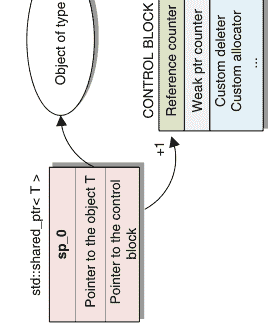

在大多数情况下，使用 `make_shared` 辅助函数创建 `shared_ptr` 是最佳选择。它可以让我们使用 `auto` 来推断类型，并且是线程安全的（例如在 (Meyers 2014) 中描述的异常处理）。它还允许我们传递任意参数列表来构造对象。如果堆内存不足等情况，最好检查 `shared_ptr` 是否仍持有有效的对象指针。这可以通过下面两个 `assert` 实现：第一个使用重载的布尔类型进行检查，第二个调用 `get` 与 `nullptr` 比较。

创建 `shared_ptr` 后，引用计数会递增。与 `unique_ptr` 不同，复制 `shared_ptr`（例如从 `sp_0` 复制到 `sp_1`）是完全可以的，此时公共引用计数会增加到 2。这个值可以通过任意 `shared_ptr` 调用 `use_count` 成员读取。类似于 `unique_ptr`，`shared_ptr` 也可以像普通指针一样访问持有的对象。

下面的代码输出如下：

```
Hold by shared = Hold by shared
sp_0 count = 2, sp_1 count = 2
after reset sp_0 count = 0, sp_1 count = 1
```

`shared_ptr` 可以从 `unique_ptr` 中创建：

```cpp
auto up_0 = make_unique< AClass >( "Created by unique" );
shared_ptr< AClass > sp_2 = move( up_0 );
auto sp_3 = sp_2;
cout << sp_2->GetStr() << " " << " ( *sp_3 ).GetStr() << endl;   // 访问
// 同一个对象
cout << "sp_2 count = " << sp_2.use_count() << " " , sp_3 count = 
<< sp_3.use_count() << endl;
```

`shared_ptr` 还可以管理数组对象的生命周期。它重载了构造函数，以允许普通指针指向此类数组。同样，可以有多个 `shared_ptr` 指向同一数组对象 —  — 在前面的示例中有两个：`sp_4` 和 `sp_5`。此时输出如下：

```
sp_4 count = 1
sp_4 = 4, 2, sp_5 count = 2

AClass destructor
AClass destructor
AClass destructor
AClass destructor
AClass destructor
AClass destructor
AClass destructor
AClass destructor
AClass destructor
AClass destructor
AClass destructor
AClass destructor
AClass destructor
```

起初 `sp_4` 的引用计数为 1。随后通过 `sp_4` 访问的八个空字符串被显示。随后 `sp_4` 与 `sp_5` 合并，引用计数增至 2，如下一行所示。最终，所有 `shared_ptr` 离开作用域并被销毁，导致所有 `AClass` 对象被销毁，如 `AClass` 构造函数中显示的析构函数消息所示。这里包括两个单独的 `AClass` 对象以及数组中的八个对象。

`shared_ptr` 常用成员函数：

| 成员 | 描述 |
|---|---|
| `shared_ptr` | 默认构造函数和模板构造函数 |
| `operator *` | 解引用，获取持有的对象 |
| `operator ->` | 指针访问持有的对象 |
| `operator bool` | 检查是否关联了对象（是否为空） |
| `get` | 返回指向对象的原始指针 |
| `reset` | 获取新对象并删除旧对象 |
| `use_count` | 返回与同一对象关联的 `shared_ptr` 数量 |


| 智能指针 | 描述 | 示例 |
| --- | --- | --- |
| `weak_ptr` | `weak_ptr` 通常与 `shared_ptr` 协作，包含对象的非拥有引用，由关联的 `shared_ptr` 管理。常用于需要双向链接的对象（如缓存、具有循环依赖的树或图、观察者模式等），以避免因双向持有权导致的对象销毁问题。与 `unique_ptr` 和 `shared_ptr` 不同，`weak_ptr` 不负责销毁其关联的对象，也不影响 `shared_ptr` 的引用计数（见示意图）。要访问被持有的对象，`weak_ptr` 必须通过 `weak_ptr::lock` 成员转换为另一个 `shared_ptr`。 | `auto sp_0 = make_shared< AClass >( "Goose");`<br>`cout << "sp_0 created" << endl;`<br>`cout << "\tsp_0.use_count = " << sp_0.use_count() << endl;`<br>`weak_ptr< AClass > wp_0( sp_0); // 创建与 sp_0 关联的 weak_ptr`<br>`cout << "wp_0 created" << endl;`<br>`auto sp_1 = sp_0;`<br>`cout << "sp_1 created" << endl;`<br>`cout << "\tsp_0.use_count = " << sp_0.use_count() << endl; // 这里有一个`<br>`cout << "\tsp_1.use_count = " << sp_1.use_count() << endl; // 控制块`<br>`// 检查对象是否仍存活`<br>`if( wp_0.expired() != true ) {`<br>`    // 可以通过 lock() 访问对象`<br>`    cout << wp_0.lock()->GetStr() << endl;`<br>`}`<br>`assert( sp_0); // 断言主对象正常`<br>`cout << sp_0->GetStr() << endl; // 主对象仍然正常`<br>`cout << "sp_0.reset()" << endl;`<br>`sp_0.reset(); // 解除 sp_0 的所有权`<br>`cout << "\tsp_0.use_count = " << sp_0.use_count() << endl; // 这里仍有一个`<br>`cout << "\tsp_1.use_count = " << sp_1.use_count() << endl; // 控制块`<br>`cout << ( wp_0.expired() ? "\twp_0 expired" : "\twp_0 not expired" ) << endl;`<br>`cout << endl;`<br>`cout << "wp_0.reset()" << endl;`<br>`wp_0.reset();`<br>`// 只解除 wp_0 与控制块的关联`<br>`// 不影响被持有的对象`<br>`assert( sp_1 ); // 断言主对象仍然通过 sp_1 正常`<br>`cout << sp_1->GetStr() << endl; // 通过 sp_1 使用主对象`<br>`cout << "\tsp_0.use_count = " << sp_0.use_count() << endl;`<br>`cout << "\tsp_1.use_count = " << sp_1.use_count() << endl;`<br>`cout << ( wp_0.expired() ? "\twp_0 expired" : "\twp_0 not expired" ) << endl;`<br>`cout << endl;`<br>`cout << "sp_1.reset()" << endl;`<br>`sp_1.reset(); // 解除 sp_1 的所有权`<br>`cout << "\tsp_0.use_count = " << sp_0.use_count() << endl;`<br>`cout << "\tsp_1.use_count = " << sp_1.use_count() << endl;`<br>`cout << ( wp_0.expired() ? "\twp_0 expired" : "\twp_0 not expired" ) << endl;`<br>`cout << endl;` |
| `expired` | 检查 `weak_ptr` 是否指向有效（未被销毁）的对象 | |
| `lock` | 返回一个新的 `shared_ptr` 以访问关联的对象 | |
| `reset` | 释放 `weak_ptr` 与 `shared_ptr` 的关联。不影响 `shared_ptr` 持有的对象 | |
| `use_count` | 返回与同一对象关联的 `shared_ptr` 的数量 | |
|  | 引用计数用于统计关联的 `shared_ptr` 的数量。当计数降至 0 时，指向该对象的 `weak_ptr` 会成为悬空指针。可以通过调用 `weak_ptr::expired` 检查引用计数，即使对象已销毁，只要有 `weak_ptr` 关联，其控制块仍会保留在内存中。该机制由弱指针计数器控制（见示意图）。 | `sp_0 created`<br>`sp_0.use_count = 1`<br>`wp_0 created`<br>`sp_0 created`<br>`sp_0.use_count = 2`<br>`sp_1 created`<br>`sp_1.use_count = 2`<br>`Goose`<br>`Goose`<br>`sp_0.reset()`<br>`sp_0.use_count = 0`<br>`sp_1.use_count = 1`<br>`wp_0 not expired`<br>`wp_0.reset()`<br>`Goose`<br>`sp_0.use_count = 0`<br>`sp_1.use_count = 1`<br>`wp_0 expired`<br>`sp_1.reset()`<br>`AClass destructor`<br>`sp_0.use_count = 0`<br>`sp_1.use_count = 0`<br>`wp_0 expired` |
|  | 创建一个小型 `TMatrix` 类（见 Listing 5.2）。使用 `unique_ptr` 可以轻松编写返回 `TMatrix` 对象的函数，该对象被包装在智能 `unique_ptr` 中。一些程序员在“创建者”函数名称前加 `Create_` 或 `Orphan_` 前缀，以表明该函数负责创建对象但随后将其交给“接受者”函数。 | ```cpp\nclass TMatrix\n{\npublic:\n    TMatrix( int cols, int rows ) {}\n    // ... 其余代码\n};\n\n// --------\n// PRODUCER\n// 返回 unique_ptr< TMatrix >\nauto OrphanRandomMatrix( const int kCols, const int kRows )\n{\n    auto retMatrix( make_unique< TMatrix >( kCols, kRows ) );\n\n    // ... 进行计算\n\n    return retMatrix;    // 使用移动语义返回 heavy object\n}\n```\n\n上述 `OrphanRandomMatrix` 示例在第 [12–19] 行概述。我们利用 `auto` 关键字省去完整的 `unique_ptr< TMatrix >` 名称。第 [14] 行调用 `make_unique` 创建一个智能指针，持有指定尺寸的矩阵对象。随后可以对矩阵进行初始化（例如填充随机值）。最后，第 [18] 行将智能指针按值返回，使矩阵对象安全地从 `OrphanRandomMatrix` 函数中传出。\n\n下面的代码片段展示了如何在不使用 `unique_ptr` 的情况下传递矩阵对象，这些可以被称为 *consumers*，它们以多种方式接受矩阵对象：\n\n- 如果我们想对 `TMatrix` 对象执行操作，可以直接使用引用或常引用（只读）来传递对象，如下所示：\n\n  ```cpp\n  // --------\n  // CONSUMERS\n\n  // 如果始终处理对象，则通过引用或常引用传递（只读）\n  double ComputeDeterminant( const TMatrix & matrix )\n  {\n      double retDeterminant {};\n\n      // ... 进行计算\n\n      return retDeterminant;\n  }\n  ```\n\n- 如果需要将智能指针传递给函数，我们可以通过常引用传递 `unique_ptr<TMatrix>`。这样可以在不修改智能指针的前提下访问其持有的对象。示例如下：\n\n  ```cpp\n  // OK, unique_ptr is passed by a const reference, however\n  // a pointer to the matrix can be nullptr - we can use this feature\n  // if we wish to have an option to pass an empty object.\n  bool ComputeDeterminant( const unique_ptr<TMatrix> & matrix, double & outRetVal )\n  {\n      if ( ! matrix )\n          return false;     // 如果指针为空，则不进行任何计算\n\n      outRetVal = ComputeDeterminant( * matrix );    // 获取对象\n\n      return true ;\n  }\n  ```\n\n  此方法适用于表明传入的对象是可选的或可能不存在，可通过 `nullptr` 表示。此时 `std::optional` 提供了可行的替代方案（第 6.2.5 节）。在使用指针时，访问对象前必须检查指针是否为 `nullptr`，如第 [39] 行所示。\n\n- 如果需要将对象传递给一个 *assume ownership*（即承担所有权）的函数，则通过传递非约束引用 `unique_ptr` 实现。这样可以修改传入的 `unique_ptr`，例如接管其持有的对象：\n\n  ```cpp\n  // Pass by reference to the unique_ptr - we can take over a held object\n  void TakeOverAndProcessMatrix( unique_ptr< TMatrix > & matrix )\n  {\n      // \"it is a deleted function\"\n      unique_ptr< TMatrix > myMatrix( move( matrix ) );  // 接管对象\n                                                         // 修改传入的 \"matrix\" 为空\n      // ... 进行计算\n\n      // 当函数退出时，局部对象 myMatrix 会被销毁，持有的对象也随之销毁。\n  }\n  ```\n\n  第 [50] 行创建局部 `unique_ptr< TMatrix >` `myMatrix`，它通过 `std::move` 接管 `matrix` 参数所持有的对象。如果不执行此步骤，代码将无法编译，因为 `unique_ptr` 不能复制以避免指向同一对象（前文已说明）。随后，第 [55] 行函数结束，局部对象 `myMatrix` 被销毁，其持有的 `TMatrix` 对象随之销毁。若没有第 [50] 行，对象不会被接管，仍然在函数外部存在。\n\n- 也可以传递智能指针的指针，如下所示：\n\n  ```cpp\n  // 这种方式也可行 - 但可能出现 matrix == nullptr，此时 matrix.get() == nullptr\n  void TakeOverAndProcessMatrix( unique_ptr< TMatrix > * matrix )\n  {\n      if ( matrix == nullptr )\n          return;\n\n      // ...\n  }\n  ```\n\n


## 5.3.1.2 工厂方法设计模式

清单 5.3 展示了如何创建*工厂方法设计模式*的一个简单版本，该模式也被称为*虚拟构造函数*（Gamma et al. 1994）。这是一个软件组件（一个类或一个函数），在给定类 ID 时，会创建并返回一个相关对象。通常，工厂服务于一个（较大的）相关类层次结构，如示例代码所示。

```cpp
// Pure virtual base class
class B
{
public:
    virtual ~B() {}

    virtual void operator() ( void ) = 0;
};

// Derived classes
class C : public B
{
public:
    virtual ~C()
    {
        cout << "C is deleted" << endl;
    }

    // It is also virtual but override is enough to express this (skip virtual)
    void operator() ( void ) override
    {
        cout << "C is doing an action..." << endl;
    }
};

class D : public B
{
public:
    virtual ~D()
    {
        cout << "D is deleted" << endl;
    }

    void operator() ( void ) override
    {
        cout << "D is doing an action..." << endl;
    }
};

class E : public B
{
public:
    virtual ~E()
    {
        cout << "E is deleted" << endl;
    }

    void operator() ( void ) override
    {
        cout << "E is doing an action..." << endl;
    }
};
```

关于此类层次结构以及带有 override 说明符的重载函数运算符 `()` 的更多内容将在第 6.1 节中介绍。在本节中，我们专注于对象管理。为此，工厂函数被设计为操作一个类 `ID`，该类 ID 使用作用域枚举类型 `EClassId`（3.14.6 节）定义。这样，每个对象类型都可以被唯一标识，如下面的代码片段所示：

```cpp
enum class EClassId { kC, kD, kE };

auto Factory( EClassId id )
{
    switch( id )
    {
        case EClassId::kC: return unique_ptr< B >( make_unique< C >() );
        case EClassId::kD: return unique_ptr< B >( make_unique< D >() );
        case EClassId::kE: return unique_ptr< B >( make_unique< E >() );

        default: assert( false );    // should not be here
    }

    return unique_ptr< B >();    // can be empty, should not reach here
}
```

得益于 `auto` 关键字，编译器会自动推断返回值的类型（即相同的 unique_ptr<B>）。这里，只有第 [59–61] 行返回有效对象。尽管如此，所有函数路径都需要返回一个值，因此第 [66] 行留下了一个空的 unique_ptr。最后，我们可以在一个简短的任务中使用我们的工厂，如下所示：

```cpp
void FactoryTest( void )
{
    vector< unique_ptr< B > > theObjects;        // a vector containing smart pointers!

    theObjects.push_back( Factory( EClassId::kC ) );        // copy or move semantics? move

    theObjects.emplace_back( Factory( EClassId::kD ) );        // this will use move, ok

    theObjects.emplace_back( Factory( EClassId::kE ) );

    theObjects[ theObjects.size() - 1 ] = Factory( EClassId::kD );
    // replace (move) E with D

    for( auto & a : theObjects )
        ( * a )();                // call actions via the virtual mechanism
}
```

unique_ptr 的一个优点是它们可以存储在 STL 容器中，例如第 [70] 行的 vector。由于 unique_ptr 不能被复制，编译器必须调用第 [72] 行 push_back 的移动版本。一个更好的替代方案是“就地”直接构造 unique_ptr 对象，这可以通过调用第 [74, 76] 行的 emplace_back 来实现（Cppreference.com 2018）。退出后，我们会看到以下消息：

```
E is deleted
C is doing an action...
D is doing an action...
D is doing an action...
C is deleted
D is deleted
D is deleted
```

由于第 [78] 行用对象 D 替换了对象 E，对象 E 被立即删除。然后对集合中的所有对象调用了操作。最后，vector theObjects（在此上下文中是一个自动变量）与其元素一起被销毁。这涉及执行工厂对象的析构函数。该项目的扩展版本将在第 6.1 节中介绍。

由于其行为，工厂方法有时被称为虚拟构造函数（Gamma et al. 1994），尽管在 C++ 中，构造函数不能被声明为 virtual（4.11 节）。虚函数也不能从构造函数内部调用。

## 5.3.1.3 unique_ptr 的自定义删除器

如前所述，unique_ptr 可以被赋予一个自定义删除函数。虽然我们并不经常编写自己的删除器，但这也是一个了解一些有趣构造的机会，我们将在下面进行解释。

```cpp
// Define a custom delete for AClass - a lambda function
auto AClass_delete_fun = [] ( AClass * ac_ptr )
{
    // Print to the log ...
    delete ac_ptr;
};

// ...
unique_ptr< AClass, decltype( AClass_delete_fun ) > p__d_8( new AClass(), AClass_delete_fun );
```

自定义删除器可以是一个函数或一个函数对象，即带有重载函数运算符的类（6.1 节）。前面代码片段的第 [84–88] 行定义了 AClass_delete_fun lambda 函数（3.14.6 节）。请注意，在此上下文中，lambda 函数定义后需要加分号。请记住，在添加自己的删除器时，我们接管了与对象销毁相关的所有操作。也就是说，unique_ptr 的其余部分将不执行任何操作。因此，AClass_delete_fun 必须在提供的指针上调用 delete，就像第 [87] 行所做的那样。但在执行该任务之前或之后，它可以例如写入日志文件或执行另一个操作，如下一个示例所讨论的那样。unique_ptr 的自定义删除器需要添加到 unique_ptr 的模板参数中，紧跟在要持有的对象的类名之后。为了推断第 [91] 行函数的类型，我们使用 decltype 关键字（3.7 节）。然后，在构造函数中，由于 make_unique 不能与自定义删除器一起使用，我们需要提供指向对象的指针和一个自定义删除器。

在第二个示例中，我们不删除指针，而是使用自定义删除器在打开的文件上自动调用 fclose 函数。我们从第 [1–2] 行的类型定义开始。为了向 unique_ptr 模板的第二个类型参数提供函数指针，使用了 std::function（3.14.9 节）。

```cpp
template< typename P >
using unique_ptr_with_deleter = unique_ptr< P, function< void( P * ) > >;

// Define a custom delete for FILE - a lambda function
auto file_close_fun = [] ( FILE * f ) { fclose( f ); };

// ...
unique_ptr_with_deleter< FILE > file( fopen( "myFile.txt", "r" ), file_close_fun );
```

关闭 FILE 对象¹ 的 lambda 函数通过提供的指针在第 [5] 行定义。然后，第 [9] 行定义了一个带有此自定义函数的 unique_ptr。它以读取模式（"r"）从磁盘文件 myFile.txt 创建并打开一个文件对象，并作为指向该对象的智能指针。当文件智能指针被自动销毁时，file_close_fun 也会被自动调用，从而关闭文件对象。另一方面，默认（以及自定义）删除器仅在持有的指针不是 nullptr 时才会被调用。因此，如果文件没有被打开，fclose 将根本不会被调用。

请记住，自定义删除器会增加 unique_ptr 的类型。因此，指向相同对象类型但具有不同删除器的两个 unique_ptr 被视为不同的类型。²

> ¹ FILE 是一种 C 风格类型，用于标识文件流并包含其控制信息。我们在此展示它作为移植代码的一个示例。在 C++ 中，使用文件流的更好方式是使用 filesystem 库（6.2.7 节）。
> 
> ² 关于带有自定义删除器和关闭操作的智能指针的更多信息，请参阅 Jonathan Boccara 的“Expressive code with C++ smart pointers”，Fluent{C++}，www.fluentcpp.com/2018/12/25/free-ebook-smart-pointers。


## 5.3.1.4 使用 `unique_ptr` 时应避免的写法

最后，我们来讨论一些使用 `unique_ptr` 时需要注意的事项。定义 `unique_ptr` 时，可以使用 `auto` 自动推断类型，避免手动输入类型。但这只有在使用 `make_unique` 时才有可能，如下所示：

```cpp
// AClass object on the heap, p_d takes care
auto p_d_0( new AClass( "No" ) );    // oops, an ordinary pointer

delete p_d_0;                         // get rid of it
```

如果我们忘记 `make_unique` 而只留下 `auto`，就会生成一个普通指针，如第 [2] 行所示。它不会受到 `unique_ptr` 的保护，因此必须显式销毁，如第 [4] 行所示。另一方面，也可以通过 new 运算符的返回值或前面提到的 `make_unique` 来直接创建 `unique_ptr`：

```cpp
// AClass object on the heap, p_d takes care
auto p_d_0( make_unique< AClass >( "Yes" ) );
```

我们还应该非常小心，不要从普通指针创建 `unique_ptr`，因为我们有可能创建多个持有指向同一对象链接的 `unique_ptr`。当我们试图对同一内存位置多次调用 `delete` 时，这必然会导致程序错误。

```cpp
AClass * p_d_5 = new AClass;

unique_ptr< AClass > p_d_6( p_d_5 );       // do not initialize via ord pointer

// ...
// somewhere else ...
unique_ptr< AClass > p_d_7( p_d_5 );       // wrong, two unique_ptr to one object
```

最后，我们必须避免使用 new 运算符在堆上创建 `unique_ptr`。出于某种原因，在标准库（SL）中，`unique_ptr` 并没有禁止使用 new 运算符。

## 5.3.2 (⚔) 关于 `shared_ptr` 和 `weak_ptr` 的更多内容

在本节中，我们展示在创建双向链表时如何使用 `shared_ptr` 和 `weak_ptr` 智能指针，如图 5.1 所示。`shared_ptr` 不能用于两个方向，因为这样的构造会使两个对象相互依赖。实际上，两个对象都无法被删除，即使使用智能指针也会导致内存泄漏。为了克服这种相互依赖，`weak_ptr` 就派上了用场。在清单 5.4 的示例中，我们使用 `weak_ptr` 创建了反向连接。让我们分析一下代码：它主要由 N 类和一个演示创建和使用链表过程的函数组成，其中 N 类定义了一个节点。

```cpp
void double_linked_list_test( void )
{
    using SP_N = shared_ptr< N >;    // a useful type alias
    SP_N root, pr;    // two empty shared ptrs
    // --------------------
    // Create the list
    for( const auto & s : { "A", "B", "C", "D", "E", "F" } )
    {
    if( pr == false )
    {
    root = pr = make_shared< N >( s );    // the first node
    }
    else
    {
    // Make a new node, and connect to the previous node in the list
    pr->SetNext( make_shared< N >( s, pr );
    pr = pr->GetNext();    // advance pr on to the end of the list
    }
    }
    // --------------------
    // Ok, the list is ready, so traverse the list and call operator()
    // To check if pointing at a valid object, implicitly use operator bool ()
    for( SP_N p = root; p; p = p->GetNext() )
    cout << ( * p )() << endl;
}
```

该链表是基于第 [45] 行 `for` 循环中提供的初始化列表创建的。然后我们有两种情况：要么是添加第一个节点，此时执行第 [49] 行；要么是向现有链表添加新节点，如第 [54-55] 行所示。具体来说，首先创建新节点，由共享指针标识。它用来初始化链表末尾当前对象的 `fNext` 指针。然后，我们将链表末尾移动到刚创建的对象。链表准备就绪后，对链表中的每个节点调用字符串拼接函数，如第 [63-64] 行所示。整个链表被遍历，在每个节点处，访问前一个、当前和下一个节点以拼接它们的字符串。节点可能位于链表的一端，所以每次访问节点时，我们都需要检查指针是否指向有效的对象。我们函数的输出如下：

> AB
> ABC
> BCD
> CDE
> DEF
> EF
> 正在销毁节点 A
> 正在销毁节点 B
> 正在销毁节点 C
> 正在销毁节点 D
> 正在销毁节点 E
> 正在销毁节点 F
> 正在销毁节点 F

注意，边界节点产生的输出较短。链表处理完毕后，得益于共享指针，对象会按照创建顺序（从 A 到 F）被自动删除。

最后，请注意，标准库（SL）提供了 `std::list` 类，它实现了链表数据结构。因此，如果我们需要标准的链表功能，可以直接使用现成的、经过验证的解决方案，而不必自己编写代码。`std::list` 类将在 6.1 节中使用和介绍。

## 5.4 小结

# 要记住的要点

+   - 一般来说，不要使用带有 `new` 和 `delete` 的低级内存管理。应该使用标准库（SL）容器（例如 `vector`、`array`）和/或智能指针。
+   - 如果不确定使用哪种智能指针，首先考虑使用 `unique_ptr`。
+   - 使用 `make_unique` 函数创建 `unique_ptr`。
+   - 修改旧代码时，尝试将所有对 `new` 的调用重构为智能指针。此外，尝试将对 `auto_ptr` 的所有调用重构为对现代智能指针的调用（`unique_ptr` 应作为首选）。
+   - 不要把问题复杂化——如果你需要的只是在堆上开辟一块通用缓冲区，那么使用 vector 而不是智能指针。

## 问题和练习

+   1. 解释使用智能指针的主要思想。

+   2. 解释 `unique_ptr` 和 `smart_ptr` 之间的主要区别。

+   3. *三叉树*是一种数据结构，其中每个节点最多可以有三个子节点（https://en.wikipedia.org/wiki/Ternary_tree）。这类结构例如用于拼写检查。在这种情况下，节点还包含一个单字母数据成员。实现一棵由类似清单 5.4 中 N 类的对象组成的三叉树。每个节点应有 `unique_ptr` 成员来链接其三个子节点。

+   4. 在以下代码片段中，指出第 [25] 行产生的对象依赖：

```
#include <iostream>
#include <memory>

// Cyclic dependence problem

struct Bar;

struct Foo
{
    std::shared_ptr<Bar> bar;
    ~Foo() { std::cout << "~Foo()\n"; }
};

struct Bar
{
    std::shared_ptr<Foo> foo;
};

void CyclicPointersProblem_Test( void )
{
    auto foo = make_shared< Foo >();
    foo->bar = make_shared< Bar >();

    foo->bar->foo = foo;        // oops, a circle ...
}
```

消除对象之间的循环依赖。提示：修改第 [16] 行智能指针的类型。

+   5. 为嵌入式系统设计并实现一种简单的内存分配方法。出于安全原因，可以使用单个静态分配的内存块，内存请求产生的所有分区都从该内存块创建。提示：阅读并实现伙伴算法（https://en.wikipedia.org/wiki/Buddy_memory_allocation）。

+   6. 使用代理模式（在第 4.15.5 节中介绍）设计并实现一个表示矩阵对象中子矩阵（https://en.wikipedia.org/wiki/Matrix_(mathematics)）的类。代理本身没有数据，而是操作其关联矩阵的数据。但它定义了自己的局部坐标系，并且行为与其他任何矩阵一样。提示：对清单 4.7 中的 EMatrix 类进行一些修改后，派生一个代理类来表示子矩阵。这种代理不应分配自己的数据，而应使用对其关联矩阵的引用来构造。访问子矩阵中的元素时，应将数据坐标转换为关联矩阵的坐标系。

[PAGE 394]

你已经准备好学习 C++ 中更多面向对象编程的方法和技术。恭喜！在本章中，我们将介绍以下编程主题：处理正则表达式、实现状态机、构建我们自己的库、文件系统、系统时钟和时间测量、范围与函数式编程、表达式解析、语法树，以及组合模式和解释器模式，所有这些都带有代码示例。

我们已经实现了很多类并创建了很多对象。通常，这些对象与用名词表示的现实对象相关，例如 TQuadEq 或 TLongNumber。然而，对象也可以表示用动词表达的动作，例如 do_this 或 compare_that。在这种情况下，对象的核心部分是一个函数：do_this 或 compare_that。有时这些函数还伴随有数据。虽然不是必须的，但如果一个类的主要目标是表示某个特定动作或函数，通常是通过重载函数调用运算符 () 来实现的。这类类的对象被称为函数对象或仿函数。调用这样的重载运算符 () 类似于调用一个简单函数，如 3.14.9 节所述。在本节中，我们将研究一个类似中断的组件，用于处理响应不同外部事件而调用的各种动作。这样的组件可以是嵌入式系统的一部分，或者稍作修改后，例如可以用作菜单处理模块。

图 6.1 显示了一个事件数组，其上附加了处理程序列表，用于对事件执行各种动作。这些动作采用从 THandler 基类派生的用户类的形式，并带有重载的虚拟运算符 ()。每个事件（例如系统中断）的动作都排列为动态列表。也就是说，动作可以添加到列表中，也可以从列表中移除。

清单 6.1 展示了实现图 6.1 所示事件系统的代码。所有定义都封装在 EventSystem 命名空间内。THandler 类的定义从第 [6] 行开始，它是系统中所有动作的基类。不出所料，动作是通过在从 THandler 派生的类中重载函数调用运算符来实现的。为此，在第 [16] 行，THandler 将重载的运算符 () 定义为纯虚函数，这由 = 0 后缀表示（5.3.1.2 节）。这也意味着 THandler 仅旨在作为整个层次结构的抽象基类（这里是对调用的抽象）。正如我们已经知道的，基类的析构函数也应定义为虚函数。在 THandler 中，这一点在第 [11] 行实现。但有趣的是，~THandler 是


-   [在 EventSystem 命名空间中，第 18 行开始定义 TEventHandlers。利用第 22 行的范围枚举类 EEvent，定义了示例事件（这些可以表示异常、主菜单等）。请注意，kSentinel 不是事件名称，而是该枚举中的最后一个值（哨兵值）。随后，定义了 HandlerList 和 EventVector 数据结构，它们分别使用了熟悉的标准库（SL）容器 [25-29]。HandlerList 用智能指针存储对象，以便管理其生命周期。

-   第 32 行定义的 fEventVector 对象将被 AttachHandler_4_Event 函数（第 36 行定义）用于为 event_to_attach 事件附加新的处理器。请注意，new_handler 按值传递，因为它在第 41 行的 emplace_back 调用中会被移动。这意味着在 AttachHandler_4_Event 退出后，作为 new_handler 传递的任何对象都会变为空。

-   接下来是三个重载的虚拟 void operator () 定义。第一个（第 45 行）接受 HandlerList 的引用列表作为参数，并遍历 HandlerList 中的每个处理器对象，调用其 operator ()。具体来说，在第 48 行先通过 * 运算符解引用智能指针，然后调用其 operator ()。

-   第 51 行的 operator () 与第 45 行的功能相同，但为事件提供了标识符。注意，这里的限定第三个 operator () 是指向第 45 行的 operator ()，如图 6.2c 所示。

-   最后，第 58 行定义的第三个 operator () 遍历第 60 行的所有事件，并为与该事件关联的每个列表调用所有注册的处理器。第 61 行调用第 45 行的 operator ()，但这次使用 this 指针。

class TEventHandlers
{
public:
    enum class EEvent { kReset, kDivByZero, kExternal, kSpurious, kSentinel };
    using TH_UP = std::unique_ptr< THandler >;
    using HandlerList = std::list< TH_UP >;
    // 一个数组，包含 THandler 类似对象的列表
    using EventVector = std::array< HandlerList, static_cast< int >( EEvent::kSentinel ) >;
private:
};

EventVector    fEventVector;

public:

void AttachHandler_4_Event( EEvent event_to_attach, TH_UP new_handler )
{
    assert(    static_cast< int >( event_to_attach ) <
               static_cast< int >( EEvent::kSentinel ) );
    fEventVector[ static_cast< int >( event_to_attach ) ].
        emplace_back( std::move( new_handler ) ); // or emplace_front
}

// 运行绑定到事件的处理器
virtual void operator () ( const HandlerList & list_of_handlers )
{
    for ( const auto & handler : list_of_handlers )
        ( * handler )(); // 通过指针调用函数操作符
}

virtual void operator () ( EEvent event )
{
    // 一种调用功能操作符的方式
    operator () ( fEventVector[ static_cast< int >( event ) ] );
}

// 运行全部
virtual void operator () ( void )
{
    for ( const auto & list : fEventVector )
        ( * this )( list ); // 调用 operator () ( EEvent event )
};

[PAGE 397]

```cpp
EventVector    fEventVector;

public:

void AttachHandler_4_Event( EEvent event_to_attach, TH_UP new_handler )
{
    assert(    static_cast< int >( event_to_attach ) <
               static_cast< int >( EEvent::kSentinel ) );
    fEventVector[ static_cast< int >( event_to_attach ) ].
        emplace_back( std::move( new_handler ) ); // or emplace_front
}

// Run handlers attached to the event
virtual void operator () ( const HandlerList & list_of_handlers )
{
    for ( const auto & handler : list_of_handlers )
        ( * handler )(); // Call a function operator via a pointer to handler
}

virtual void operator () ( EEvent event )
{
    // One way to call a functional operator
    operator () ( fEventVector[ static_cast< int >( event ) ] );
}

// Run all
virtual void operator () ( void )
{
    for ( const auto & list : fEventVector )
        ( * this )( list ); // Call operator () ( EEvent event )
};

};
```

Let’s now test this code in the EventHandlers_Test function, whose definition begins on line [65]. First, the th eHandlerBoard object is created on line [68]. Then, two local handler classes HA and HB, both derived from THandler, are defined on lines [74, 90]. Their structure is straightforward: HA prints its passed text, while HB converts its passed integer from decimal to hex. What is interesting is the way these text and integer objects are passed to HA and HB. Since virtual functions must have the same list of input parameters, it is not possible to change them from class to class. Therefore, additional parameters, if necessary, must be passed through the constructors to the classes. With this technique, we can overcome the limitations associated with passing parameters to virtual functions.

Also note that in both classes, the overloaded `operator()` functions have the additional `override` suffix. This relatively new feature of C++ that we saw in Section 4.11 lets us ensure that `operator()` overrides the `operator()` from the base THandler class. If, for instance, their formats do not match, then the compiler reports an error (which is easy to see after changing `void` to, for instance, `int`). Hence, this optional override specifier lets us protect against such inconsistency-related errors.

```cpp
void EventHandlers_Test( void )
{

    TEventHandlers      theHandlerBoard;
```
```

[PAGE 398]

```cpp
// ----------------
// Create a few handlers

class HA : public THandler
{
    std::string fStr;

public:
    HA( std::string s = "" ) : fStr( s ) {}
    virtual ~HA() { std::cout << "~HA()" << std::endl; }

    void operator () ( void ) override
    {
        std::cout << "I'm HA with text: " << fStr << std::endl;
    }
};

// ----------------
class HB : public THandler
{
    int   fVal;

public:
    HB( int v = 0 ) : fVal( v ) {}
    virtual ~HB() { std::cout << "~HB()" << std::endl; }

    void operator () ( void ) override
    {
        std::cout  << "I'm HB: " << std::dec << fVal << " = "
                   << std::hex << fVal << std::endl;
    }
};
// ----------------
```

On line [107], the ha object is created with a text argument. Then, on line [108], its functional operator is invoked. Note that line [108] looks exactly like any other call to a function with no arguments. Hence, its name—a functional object.

A temporary HB object (no name) is created and immediately invoked on line [110]. Soon we will see the results of this call.

Then, on lines [116–126], two groups of handler lists are created for the kReset and kExternal events. Each handler object is first created by a call to the std::make_unique function, providing suitable construction parameters, and then immediately passed as an argument to the AttachHandler_4_Event function for the chosen event.

Finally, all actions from the handlers are invoked on line [129] by calling operator () with no arguments.

```cpp
HA ha( "Standalone HA" );
ha();                 // Call the function operator on object ha

( HB( 789 ) )();    // Call the function operator on a temporary object HB
```
```

[PAGE 399]

```cpp
std::cout << std::endl;

// Now attach no matter how many handlers to the available event slots

theHandlerBoard.AttachHandler_4_Event( TEventHandlers::EEvent::kReset,
                                        std::make_unique< HA >( "Reset 0" ) );
theHandlerBoard.AttachHandler_4_Event( TEventHandlers::EEvent::kReset,
                                        std::make_unique< HB >( 123 ) );
theHandlerBoard.AttachHandler_4_Event( TEventHandlers::EEvent::kReset,
                                        std::make_unique< HA >( "Reset 1" ) );

theHandlerBoard.AttachHandler_4_Event( TEventHandlers::EEvent::kExternal,
                                        std::make_unique< HB >( 100 ) );
theHandlerBoard.AttachHandler_4_Event( TEventHandlers::EEvent::kExternal,
                                        std::make_unique< HB >( 200 ) );

theHandlerBoard();    // Run all

}
}
```
```

Let’s now examine the output obtained after building and running the previous code:

```text
I'm HA with text: Standalone HA
I'm HB: 789 = 315
~HB()
~H()

I'm HA with text: Reset 0
I'm HB: 123 = 7b
I'm HA with text: Reset 1
I'm HB: 100 = 64
I'm HB: 200 = c8
~HA()
~H()
~H()
~H()
~HB()
~H()
~HA()
~H()
~HB()
~H()
~HA()
~H()
~HB()
~H()
```
```

The handlers’ actions are as expected. However, it is interesting to observe the order and type of the called destructors. These are automatically invoked due to the operation of the TH_UP smart pointers (Section 5.3). Notice that for each object, first its destructor and then its base class destructor are called, in that order. Hence, for each of the deleted objects, we register two calls to the destructors. The temporary object HB, created on line [110], is destroyed after exiting this line, rather than waiting until the end of the test function.


最后，请注意，THandler 实现了一种所谓的*命令设计模式*（一种动作或事务模式）。它通常与工厂模式（第5.3.1.2节）和组合模式（第6.6.4节）等模式协作。

## 6.2 示例项目——扩展 XML 文件中的货币搜索，并使用带有 regex 库的状态机和正则表达式

在第3.18节中，我们看到了TCurrencyExchanger类可以存储由TCurrency对象表示的一些货币。它允许我们向仓库中添加新货币，并将其驱动到任何流中，例如键盘、屏幕或文件。然而，手动输入这些货币将非常繁琐。此外，货币汇率往往变化频繁，因此我们需要一种自动机制来加载其当前值。这可以通过下载包含所有必要信息的网页或文件来实现。此类包含货币数据的文件内容，以可扩展标记语言（XML）格式编码（参见 www.w3.org/XML 和 https://en.wikipedia.org/wiki/XML），可能类似于图6.3（从 www.nbp.pl 下载）。

这个XML文件虽然可读，但看起来相当杂乱，部分原因是其中大部分单词是波兰语。但我们很容易在连续的XML标签行中找到感兴趣的信息。由于我们将处理通用文本，而不是std::string，为了正确表示，我们需要使用能够存储Unicode字符的std::wstring。然而，现阶段的主要问题是如何在XML文件中查找和选择感兴趣的信息。我们可以使用*正则表达式搜索和匹配*（regex）包来实现，该包现在是C++库集合的一部分。

```xml
<?xml version="1.0" encoding="ISO-8859-2"?>
<tabela_kursow typ="C" uid="18C190">
    <numer_tabeli>190/C/NBP/2018/2018</numer_tabeli>
    <data_notowania>2018-09-28</data_notowania>
    <data_publikacji>2018-10-01</data_publikacji>
    <pozycja>
        <nazwa_waluty>dolar amerykański</nazwa_waluty>
        <przelicznik>1</przelicznik>
        <kod_waluty>USD</kod_waluty>
        <kurs_kupna>3,6535</kurs_kupna>
        <kurs_sprzedazy>3,7273</kurs_sprzedazy>
    </pozycja>
    <pozycja>
        <nazwa_waluty>dolar australijski</nazwa_waluty>
        <przelicznik>1</przelicznik>
        <kod_waluty>AUD</kod_waluty>
        <kurs_kupna>2,6383</kurs_kupna>
        <kurs_sprzedazy>2,6915</kurs_sprzedazy>
    </pozycja>
</tabela_kursow>
```

**图6.3**  来自波兰国家银行的示例XML文件，包含各种世界货币的买入和卖出汇率信息。有关单个货币的所有信息都包含在少数连续行中，这些行以红框中标出的特殊标签开始和结束。由于包含国际字符，应使用宽字符串进行处理。

[PAGE 401]

正则表达式用于指定文本模式：例如，搜索特定短语或文件名。这些表达式例如用于Linux的grep命令（Dalheimer和Welsh 2006）。C++包含一个丰富的regex库，允许使用正则表达式进行文本模式匹配。首先，我们给出最常用正则表达式符号和规则的便捷定义，并附有合适的示例。这些符号和规则使用默认的ECMA脚本正则表达式语法，不过在设置正确的标志后，其他变体（如Linux grep）也是可能的。

回到我们的项目，让我们创建与货币信息的标签分隔行匹配的正则表达式。第一行包含货币名称，可能包含国际字母以及空白，并位于<nazwa_waluty>和</nazwa_waluty>标签之间，如下所示：

```
<nazwa_waluty>dolar amerykański</nazwa_waluty>
```

为了更容易找到对应的正则表达式，将模式拆分成几个部分是有用的：

以下正则表达式可以匹配该行

```
<nazwa_waluty>(.+)</nazwa_waluty>
```

最左边的部分将精确匹配字母序列<nazwa_waluty>。然后，表达式（.+）包含表6.1和表6.2中的字符，匹配任何字符（用点.表示）重复一次或多次（用+符号表示）。它被括在圆括号( )中，以便将所有匹配的字符分组，因为在匹配后，我们希望将它们一起读取为货币名称。最后，</nazwa_waluty>字面匹配此条目的结束标签。综上所述，<kod_waluty>USD</kod_waluty>模式应当被匹配。

稍微复杂一点的是卖出汇率（即“kurs kupna”）的模式：

```
<kurs_kupna>3,6535</kurs_kupna>
```

我们希望它以以下形式出现

因为在这种情况下，我们还希望将波兰用于分隔数字整数部分和小数部分的逗号(,)替换为点(.)，以便更轻松地从字符串转换为值。此任务的一个可能正则表达式如下所示：

```
<kurs_kupna>(([:d:])+),(([:d:])+)</kurs_kupna>
```

这里，[[:d:]]+模式匹配任何重复一次或多次的数字。

### 表6.1 正则表达式的特殊字符和分组（默认ECMA标准）。

| 符号 | 匹配 | 示例 |
|---|---|---|
| `.` | 任何字符（通配符） | `.+`<br>匹配一个或多个字符的任意流。<br>`0001010102001100` |
| `*` | 字符出现0次或多次 |  |
| `+` | 字符出现1次或多次 |  |
| `?` | 字符出现0次或1次。在任何重复记号后，强制最短匹配（否则会寻找最长匹配） | `^.*$`<br>匹配整行：`^` 表示行首，`$` 表示行尾。<br>`0001010102001100` |
| `\|` | 备选（或） | `(01)+`<br>贪婪搜索——找到重复的01的最长匹配。<br>`0001010102001100` |
| `^` | 1) 行首 或 2) 否定 | `(01)+?`<br>懒惰搜索——找到01的最短匹配。<br>`0001010102001100` |
| `$` | 行尾 | `[01]+`<br>查找由0或1组成且至少包含一个字符的最长字符串。<br>`0001010102001100` |
| `\` | 下一个字符具有特殊含义 | `[^01]+?`<br>查找不是0且不是1的最短子字符串。<br>`0001010102001100` |
| `[ ]` | 定义字符集 |  |
| `{ }` | 开始-结束计数<br>`{ p }` – 出现p次<br>`{ p, }` – 出现p次或更多次<br>`{ p, q }` – 出现p到q次（含） | `(123){2}(45){3}`<br>使用`{2}`时，模式123将正好重复2次，然后45必须正好匹配3次，依此类推。<br>`12312312312345454545` |
| `( )` | 开始-结束分组 | `<(.+>)(.+)</\1>`<br>匹配任何XML标签。`\1`表示第一个分组。<br>`<city>New York</city>` |
| `\1 \2 \3` | 组编号（从1开始） |  |

### 表6.2 常用的正则表达式字符集（ECMA）。

| 字符集 | 缩写 | 匹配 | 示例 |
|---|---|---|---|
| `[:alnum:]` |  | 任何字母数字字符 | `([[ :alnum:] . _ ]+)@([[ :alnum:] . _ ]+\ . ([[ :alnum:]]+))`<br>匹配电子邮件地址。`\.` 精确匹配一个点，而不是“任何”字符。`([[ :alnum:] . _ ]+)` 表示一个分组，在电子邮件地址中 |
| `[:alpha:]` |  | 任何字母字符 | `jan.koczwara_12@agh.edu.pl` 匹配如下：`jan.koczwara_12@agh.edu.pl` |
| `[:digit:]`<br>`[:d:]` | `\d`<br>`\D not \d` | 任何十进制数字 | 有时定义补集更容易，例如“非数字” `\D`，与数字 `\d` 相对。`\D+(\d+)\D+`。<br>内层分组按如下方式匹配数字：`jan.koczwara_12@agh.edu.pl` |
| `[:lower:]` | `\l`<br>`\L not \l` | 任何小写字符 | `[:alpha:]_[:alnum:]*` 匹配任何C/C++标识符。在函数调用 `normalize_L1(matrix);` 中，它匹配函数名：`normalize_L1(matrix);` |
| `[:space:]`<br>`[:s:]` | `\s`<br>`\S not \s` | 任何空白字符 | `[[:w:]]+([[:upper:]]+)[[:w:]]+` 匹配如下：`normalize_L1(matrix);` |
| `[:upper:]` | `\u`<br>`\U not \u` | 任何大写字符 | `[[.w.]]+([[:upper:]])+[[.w.]]+` 匹配如下：`normalize_L1(matrix);` |
| `[:cntrl:]` |  | 任何控制字符 | 由于 `[[:w:]]+` 匹配 `normalize_`，`([[:upper:]])+` 匹配 `L`（这里的圆括号并非必需，仅用于选择该子匹配），而 `[[:w:]]+` 匹配 `1`（`1` 不属于 `[:w:]`）。 |
| `[:punct:]` |  | 任何标点字符 |  |
| `[:w:]` |  | 任何单词字符（包括下划线） |  |

# 6.2.2  状态机模式

图6.3中红框所示的每组行都表示一种货币的信息。这些行是一致的，应按顺序逐行匹配。因此，我们需要编写代码，首先匹配给定行，然后继续匹配第二行，依此类推。这种操作顺序可以用嵌套的`if-else`语句硬编码。但更通用的技术是使用状态机方法。*状态机*是一种数学模型，


-   [第 6.2 条] `XML_CurrencyExchanger` 类的定义（在 *CurrencyCalc_Lib, XML_CurrencyExchanger.h* 中）。

```cpp
#pragma once

#include "CurrencyExchanger.h"

#include <string>
#include <regex>

using std::wregex;

namespace CppBook
{

class XML_CurrencyExchanger : public TCurrencyExchanger
{
```

```
```

```
Listing 6.3 定义 `XML_CurrencyExchanger` 类成员（在 *CurrencyCalc_Lib, XML_CurrencyExchanger.cpp* 中）。

```cpp
#include "XML_CurrencyExchanger.h"
#include <fstream>

namespace CppBook
{


bool    XML_CurrencyExchanger::FillCurrencyTableFrom( const wstring & currencyFile )
{

        wifstream   inFile( currencyFile );

        if( ! inFile.is_open() )
                return false;             // cannot open the input file


        // Read line by line and look for patterns


        ESearchStates  state = ESearchStates::kIdle;

        // Stores currently processed line of the XML
        wstring line;

        // Stores current match and submatches of the regex
        wsmatch  match_res;

        // These will gather partial matches of the currency record
        wstring curr_code, curr_name, buy_rate_str, sell_rate_str;

        // Read params one-by-one
        while( getline( inFile, line ) )
        {

                switch( state )
                {
                        case ESearchStates::kIdle:

                                if(regex_search(line,match_res,f_curr_name_pat)&&match_res.size()>1)
                                {
                                        // Ok, a currency code was found; let’s store it
                                        // require at least one subpression
                                        curr_name = match_res[1];        // take the first sub-match

                                        // For easier processing, replace white characters
                                        replace( curr_name.begin(), curr_name.end(), L' ', L'_' );

                                        state = ESearchStates::k_Name_Processed; // change the state
                                }

                                break;
                }
        }
```

```
```

```
case ESearchStates::k_Name_Processed:

    if( regex_search(line,match_res,f_curr_code_pat) &&    match_res.size()>1)
    {
        // Ok, a currency code was found; let’s store it
        // require at least one subexpression
        curr_code = match_res[ 1 ];   // take the first sub-match

        state = ESearchStates::k_Code_Processed;       // change the state
    }

    break;

case ESearchStates::k_Code_Processed:

    // Try to match the buying option
    if( regex_search(line,match_res,f_buy_rate_pat) && match_res.size()>2)
    {
        // Ok, a currency code was found; let’s store it
        // require at least one subexpression
        buy_rate_str = wstring( match_res[ 1 ] )
            + wstring( L"." )
            + wstring( match_res[ 2 ] ); // assembly the sub-matches

        state = ESearchStates::k_BuyingRate_Processed;       // change the state
    }

    break;

case ESearchStates::k_BuyingRate_Processed:

    // Try to match the selling option
    if( regex_search(line,match_res,f_sell_rate_pat) &&    match_res.size()>2)
    {
        // Ok, a currency code was found; let’s store it
        // require at least one subexpression
        sell_rate_str = wstring( match_res[ 1 ] )
            + wstring( L"." )
            + wstring( match_res[ 2 ] );       // assembly the sub-matches

        state = ESearchStates::k_SellingRate_Processed;    // change the state
    }

    break;

case ESearchStates::k_SellingRate_Processed:

    // Ok, we are ready to insert the new currency record
    try
    {
        // can throw an exception e.g. on an empty string, wrong format, etc.
        AddCurrency( {    curr_code, curr_name,
                    stod( buy_rate_str ), stod( sell_rate_str ) } );
    }
    catch( ... )
    {
        ;
    }

    state = ESearchStates::kIdle;   // enter the basic state
```

```
```

```
110
111    break;
112
113    default:
114        assert( false ); // shouldn’t be here
115        break;
116    }
117
118
119}
120
121
122return true;
123}
124
125
126} // CppBook
```
```

On line [13] of the `FillCurrencyTableFrom` function, an inFile file is opened with the supplied path. Note that in the domain of wide characters, all streams and containers should be set. This is done using a dual set of objects whose names start with the “w” prefix. For instance, instead of `string`, `wstring` is used on line [25] and `wsmatch` on line [28], etc. On line [31], `wstring` objects are defined, which will be used to store parts of the matched expression.

The main action consists of reading a line of wide characters, checking for potential patterns, and conditionally changing the states based on the matches. This is governed by the while loop, starting on line [34]. As long as there are unprocessed lines in `inFile`, the `getline` function copies a consecutive line into the `line` string and returns `true`. Inside the loop, the state machine operates.

One of the methods to implement a state machine of a fixed size, such as the one presented in Figure 6.4, is to use the `switch` statement (Section 3.13.2.1), which will switch between consecutive states until a final state is reached. The initial state, held in the `state` variable, is set to `ESearchStates::kIdle`. So, line [41] executes first, checking for a potential match of the `f_curr_name_pat` pattern. If this pattern is matched by the `regex_search` function operating on the current line, the state is changed to the next state, as shown in Figure 6.4. The `regex_search` function takes three arguments:

+   - The input stream of characters (a line object, in our example)
+   - Output results if a match found (`match_res`)
+   - Regular expression to be matched, of a `wregex` type

The results of a successful match are stored in the `match_res` object. It contains the entire matched pattern, as well as sub-matches arising from the groups defined in the regular expression. The structure of `match_res` is shown here:

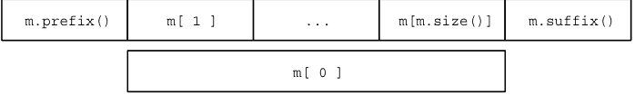

`m[0]` is the entire matched pattern, `m[1]` is the first subexpression, and `m.size()` denotes the number of subexpressions; `m.prefix()` and `m.suffix()` denote all characters in the input stream before or after the matched pattern, respectively.

Operation on substrings can be observed on line [75]. In this case, `buy_rate_str` is a concatenation of the first and second matched substrings: the integer and fraction parts of a number, joined with a dot instead of a comma as discussed earlier.

Once we enter the final state, `ESearchStates::k_SellingRate_Processed`, all of the information about the currency has been collected, and the currency object is ready to be added to the database of currencies. The new currency is added on line [102] using the `AddCurrency` function. Wide strings are converted to floating-point numerical values using the `std::stod` function. Since string conversion can throw an exception, e.g. on an empty string, the wrong format, etc., adding a new currency is encompassed by the `try-catch` statement on line [104]. Finally, if a new currency object is added successfully, the state machine takes on the `ESearchStates::kIdle` state again on line [109], and the entire mechanism is ready to process data, searching for more currency entries in the input XML file.

A sibling function to `regex_search` is `regex_match`. The main difference is that `regex_match` tries to match the entire input to the pattern.

The C++ regex library has much more functionality than we have outlined here. More information can be found in the literature (Stroustrup 2013; Jous­tis 2012) and on the Internet. For more complex state machine implementations, see the Meta State Machine (MSM; [www.boost.org/doc/libs/1_70_0/libs/msm/doc/HTML/index.html](www.boost.org/doc/libs/1_70_0/libs/msm/doc/HTML/index.html)) from the Boost C++ libraries (Boost.org 2020).

We will summarize what have we learned about in this section:

+   - Basics of the C++ regex library and regular expressions
+   - `regex_search` functions for regular expression searches and `regex_match` for matches
+   - Reading and processing XML files
+   - State machines and UML state diagrams

# 6.2.4  Project Extension – Loading Currency Information from the Internet

In the previous section, we saw how to find and load information about currencies from an XML file. However, it would be good to have an automatic mechanism for downloading such an XML file from a bank via an Internet connection. Such an operation is certainly possible with a call to a specific HTTP or FTP library. But a subtle problem is that these differ from system to system. So, if we stick to one platform, such as Windows or Linux, that’s fine; but what if we wish to write multisystem software that will work equally well on Windows, Linux, Mac, or a mobile? We can imagine a solution that would conditionally compile various versions of the code, depending on the platform type detected at compile-time. A more flexible solution would be to create two software components: one that defines an unchanging interface used by all clients, and a second containing specific implementation suitable on a specific platform. Such a code structure, although it requires slightly more code, gives a very desirable separation of abstraction (i.e. a common calling framework) from implementation (i.e. all the code necessary to perform actions). Figure 6.6 shows a UML class diagram presenting the proposed solution.

Such decoupling of abstraction from implementation is known as the *handle-body* (or *bridge*) design pattern (Gamma et al. 1994).

The external call can be done exclusively to an object of the `HTTP_File_Handle` class through the exposed `Load_HTTP_File` function, whose role is to download a given file from a given web page. But the class does not know how to do this for all the possible OSs. For this purpose, it has an associated hierarchy of body classes that specialize in HTTP file downloads for specific systems. In a concrete system, a body class specialized for this system is created and maintained by


## 6.2 XML中的货币搜索、状态机与正则表达式 401

清单6.4 `HTTP_File_Body` 及其派生类的定义（位于 CurrencyCalc_Lib，`HTTP_File.h`）。

```cpp
#pragma once
#include <cassert>
#include <string>

namespace CppBook
{
class HTTP_File_Body
{
    public:
    virtual bool Load_HTTP_File( const std::wstring & internet_addr,
    const std::wstring & localName ) = 0;
    // a virtual destructor to allow inheritance
    virtual ~HTTP_File_Body() = default;
};
class HTTP_File_Body_Windows : public HTTP_File_Body
{
    public:
    bool Load_HTTP_File( const std::wstring& internet_addr,
    const std::wstring& localName ) override;
};
class HTTP_File_Body_Linux : public HTTP_File_Body
{
    public:
        bool    Load_HTTP_File( const std::wstring & internet_addr,
                                const std::wstring & localName ) override;
};
class HTTP_File_Body_MacOS : public HTTP_File_Body
{
    public:
        bool    Load_HTTP_File( const std::wstring & internet_addr,
                                const std::wstring & localName ) override;
};
```

HTTP_File_Body 层级中的任何一个类都无需知道谁将使用它。另一方面，HTTP_File_Handle 需要知道其 body 层级，并正确创建和维护一个后续操作所需的 body 对象。HTTP_File_Handle 类的实现见清单6.5。

清单6.5 `HTTP_File_Handle` 类的定义（续前，位于 *CurrencyCalc_Lib, HTTP_File.h*）。

```cpp
class HTTP_File_Handle
{
    private:

        using BodyPtr = std::unique_ptr< HTTP_File_Body >;

        BodyPtr    fBodyObj;

    public:

        enum class EHandledSystems { kWindows, kLinux, kMac };

        HTTP_File_Handle( EHandledSystems system )
        {
            switch( system )
            {
                case EHandledSystems::kWindows:
                    fBodyObj = std::make_unique< HTTP_File_Body_Windows >();
                    break;

                case EHandledSystems::kLinux:
                    fBodyObj = std::make_unique< HTTP_File_Body_Linux >();
                    break;

                case EHandledSystems::kMac:
                    fBodyObj = std::make_unique< HTTP_File_Body_MacOS >();
                    break;

                default:
                    assert( false ); // not supported
                    break;
            }
        }

    public:

        // Interface function to load a file via HTTP (seen by the clients)
        virtual bool Load_HTTP_File( const std::wstring & internet_addr,
                                     const std::wstring & localName )
        {
            assert( fBodyObj ); // a pre-condition in programming by contract
            // delegate an action to the body object
            return fBodyObj->Load_HTTP_File( internet_addr, localName);
        }

    public:

        // a virtual destructor to allow inheritance
        virtual ~HTTP_File_Handle() = default;
};

}          // end of namespace CppBook
```

在第[54]行，使用 using 指令定义了 BodyPtr，它是一个智能 unique_ptr，已在5.3节讨论过。第[56]行定义了一个此类型的指针 fBodyObj，用于指向来自 HTTP_File_Body 类层级的主体对象。然而，具体选择哪一个是在 HTTP_File_Handle 类的构造函数中决定的，该构造函数定义在第[62–83]行。这是多态的一个例子。第[60]行定义的 EHandledSystems 枚举类型参数指示了应选择哪个系统。例如，对于 Windows 操作系统，第[67]行被执行，创建 HTTP_File_Body_Windows 对象并将其赋值给 fBodyObj 指针。智能指针的好处是，一旦它附着到一个对象上，我们无需操心如何删除所拥有的对象——当对象本身被删除时，它将与 fBodyObj 一起自动删除。这有一个明显的后果：HTTP_File_Body 对象的生命周期与 HTTP_File_Handle 句柄对象的生命周期严格耦合。因此，这种关系被称为复合聚合，如图6.6所示，并在4.9节中讨论。

在 HTTP_File_Handle 类的第[88]行，定义了 Load_HTTP_File 函数。它仅仅接受两个 wstring 参数，并在第[92]行将操作委托给相应的 Load_HTTP_File 函数——但该函数位于相关联的主体对象中，由 fBodyObj 成员持有。为了安全起见，后者需要被正确初始化。对于调试版本，这在第[90]行的前置条件中进行了检查，正如“契约式编程”方法论（4.7.3节）所要求的那样。尽可能多地利用此类调试检查，因为在实际中，它们可以在让代码正确运行方面省去很多麻烦。请相信我们的话！

同样，由于 HTTP_File_Handle 包含虚函数并且将来可能被继承，其析构函数在第[97]行被定义为 virtual。同时使用了 = default。

最后，让我们看一下其中一个主体对象的实现。更确切地说，在这种情况下唯一需要实现的是 HTTP_File_Body_Windows::Load_HTTP_File 函数。在 Windows 操作系统上，需要包含 urlmon 库和头文件——这通过第[3–11]行完成：使用 #include 包含头文件，使用 #pragma comment(lib, "urlmon.lib") 引入库。后者是将库添加到 Microsoft Visual C++ 项目的方式之一。然而，这仅在设置了 _WIN32 标志时才会发生，而该标志只有在为 Windows 编译时才为真。

```cpp
#include "HTTP_File.h"

#if _WIN32

    #include <urlmon.h>

    #pragma comment(lib, "urlmon.lib")

#else

#endif


namespace CppBook
{


bool HTTP_File_Body_Windows::Load_HTTP_File( const std::wstring & internet_addr,
                                             const std::wstring & localName )
{
#if _WIN32 // Should be 1 on 32-bit and 64-bit Windows
    return URLDownloadToFile ( NULL, internet_addr.c_str(),
                               localName.c_str(), 0, NULL ) == S_OK;
#else
    return false;
#endif
}

}   // CppBook
```

最后，在第[21]行，调用 Windows 特有的 URLDownloadToFile 函数来下载文件。由于该函数期望 C 风格字符串指针，因此需要从每个提供的 wstring 对象调用 c_str。这同样发生在设置了 _WIN32 标志的情况下，即仅在 Windows 操作系统中。在其他系统中，代码简化为 return false 语句。其他系统有自己的编译标志设置。这就是我们项目中整个选择机制的工作方式。

这种基于句柄-主体（桥接）的解决方案的缺点是，在给定的操作系统中，只有一条路径被编译和执行。所有其他 N−1 个类（其中 N 表示受支持的操作系统总数）都是不活动的，并通过 #if-#else-#endif 结构受到保护而不会被尝试编译。但该解决方案清晰且易于扩展，无需改动其余软件组件，这些组件仅通过句柄类进行通信。

对于简单的文件下载问题，之前的解决方案可能看起来有些小题大做。确实，非常简单的任务只需几行代码就能简洁地完成，增加过多的类似乎没有必要。但代码和相互依赖往往趋于增长，这种将抽象与实现分离的做法几乎总是有益的。其他各种技术也同样出色：例如，除了本例中使用的动态面向对象继承之外，采用类模板和编译期计算的静态解决方案也能带来许多好处。

然而，句柄-主体设计模式（桥接）是许多软件包中最常用的结构之一。理解其结构和属性有助于在新软件设计或软件重构任务中发现它。在通常的分层架构中，将抽象（句柄）与实现（主体）分离会增加类的数量，但也为解决方案增加了很大的灵活性。一个相关的模式是策略模式，它允许我们根据外部条件动态选择算法。例如，有


第 [12, 15] 行定义了 `Online_CurExchanger` 命名空间内局部使用的 `wstring` 对象。它们只是保存了 XML“来源”文件和“目标”文件的互联网地址与本地默认地址。正如已经指出的，下载的 XML 文件提供了对当前汇率数据的访问。此外，如果有必要，这两个地址可以很方便地访问和修改。在第 [18] 行，通过定义局部变量 `kMyOS` 来指明我们所用的操作系统。

`CurExchanger_DownloadCurrencies` 函数定义在第 [19–23] 行。它的作用是创建一个名为 `http_client` 的 `HTTP_File_Handle` 对象，并在所选平台上对其进行适当初始化。随后，该对象被用来从互联网位置下载 XML 文件并保存到本地。

```cpp
bool CurExchanger_DownloadCurrencies(    const wstring & http_addr,
                                         const wstring & local_XML_FullPath )
{
    HTTP_File_Handle http_client( kMyOS );
    return http_client.Load_HTTP_File( nb_addr, local_XML_FullPath );
}
```

接下来，我们会看到，下载的 XML 文件会被用来初始化 `XML_CurrencyExchanger`。但在此时，明智的做法是将当前货币数据保存到一个单独的初始化文件中。这样可以在例如没有互联网连接、无法下载 XML 文件的情况下使用。这一功能由第 [24] 行定义的 `CurExchanger_SaveInitFile` 函数完成。

```cpp
void CurExchanger_SaveInitFile(      const XML_CurrencyExchanger & obj,
                                      const wstring & initFileFullPath )
{
    // Save to the init file
    // Use default file to load currencies
    wofstream outFile( initFileFullPath );
    const XML_CurrencyExchanger::CurrencyMap & cur_map = obj.GetCurrencyMap();
    transform( cur_map.cbegin(), cur_map.cend(),
                ostream_iterator< TCurrency, wchar_t >( outFile, L"\n" ),
                []( const XML_CurrencyExchanger::CurrencyMap::value_type & vt )
                { return vt.second; } );
}
```

在上一段代码中，第 [30–32] 行的 `std::transform` 函数需要一些解释（另见表 3.6）。正如我们已经知道的，`std::map` 对象的每个元素都包含 `key` 和 `value` 两部分。`std::transform` 的作用是把 `CurrencyMap` 中每个元素的 `value` 部分复制到由 `outFile` 对象标识的输出文件中。这个 `CurrencyMap` 对象通过局部引用 `cur_map` 访问。要复制的范围由前两个参数传入，即 `cur_map.cbegin()` 和 `cur_map.cend()`。它们返回指向该 map 集合开头和末尾的常迭代器（这里以字母 c 开头）。输出通过 `ostream_iterator` 写入 `outFile`，该迭代器在第 [31] 行设置为处理 `TCurrency` 和宽字符。每个货币条目都是通过在第 3.33 节清单 3.33 中第 [7–26] 行讨论过的对 `operator <<` 的自动调用来保存的。每个这样的条目由提供给 `ostream_iterator` 的宽换行符号 `L"\n"` 分隔。最后但同样重要的是第 [32] 行提供的 lambda 函数，它是 `std::transform` 的最后一个参数。它由 `std::transform` 内部调用，传入 `vt` 引用以引用 `cur_map` 的连续元素。这个 lambda 的作用很简单：跳过 `key`，只返回元素由 `vt.second` 标识的 `value` 部分。

`CreateCurExchanger` 函数的定义从第 [40] 行开始。它与 3.18.5 节中介绍的同名函数类似。但两者返回的对象类型不同，本例中返回的是 `XML_CurrencyExchanger` 而不是 `CurrencyExchanger`。此外，它们的初始化方式也不同，本例中是通过

[PAGE 418]

从互联网下载的 XML 文件进行初始化。不过，和之前一样，由于对象创建过程可能失败，`CreateCurExchanger` 返回一个在第 [34] 行定义的 `std::optional` 对象。如果对象创建成功，它允许我们传递一个有效对象；如果由于某种原因无法提供对象，它就是空的。

```cpp
using XML_CurrExch_Optional = std::optional< XML_CurrencyExchanger >;

// There are two options for the return object:
// - It is either TCurrencyExchanger if properly built
// - or empty CurrExch_Optional if cannot create
auto CreateCurExchanger( const wstring & http_XML_FileName,
const wstring & initFileFullPath )
{
XML_CurrencyExchanger currencyExchangerObj;
namespace fs = std::filesystem;
// Create name of a local XML file - its parent is from initFileFullPath
wstring local_xml_full_path( fs::path( initFileFullPath ).parent_path()
/ local_xml:file_name );

if( CurExchanger_DownloadCurrencies( http_XML_FileName, local_xml_full_path )
== true &&
currencyExchangerObj.FillCurrencyTableFrom( local_xml_full_path )
== true )
{
// Success, object initialized from Internet
// Add the reference currency (PLN) (0xB3 is Polish letter "l-crossed")
currencyExchangerObj.AddCurrency( { L"PLN", L"z\\xB3oty-polski",1,0,1.0 });
// Update the ini file with new data
CurExchanger_SaveInitFile( currencyExchangerObj, initFileFullPath );
}
else
{
// Cannot initialize from the Internet,
// so, as a last resort, let's look for a local ini file
wifstream inFile( initFileFullPath );
if( inFile.is_open() == false )
return XML_CurrExch_Optional(); // no ini file, return empty optional
// Read data from the file
inFile >> currencyExchangerObj;
}
return XML_CurrExch_Optional( currencyExchangerObj );
}
```

传递给 `CreateCurExchanger` 的两个参数是 `http_XML_FileName`（保存着包含当前汇率数据的 XML 文件的互联网地址）和 `initFileFullPath`（保存着本地初始化文件的完整路径）。该路径在第 [47] 行用来创建另一个本地文件的名称——即存储下载所得 XML 文件的那个文件。这些文件，即初始化文件和本地 XML 文件，都包含货币数据，但格式不同。为了创建新路径，我们使用了文件系统路径对象及其 `parent_path`，以及重载的 `/`（斜杠）运算符，如表 6.3 所示。

[PAGE 419]

在第 [49, 50] 行，使用 `_CurExchanger_\_DownloadCurrencies_` 函数下载 XML 文件。当且仅当此操作成功时，才会使用该 XML 文件通过调用 `_FillCurrencyTableFrom_` 成员来初始化货币 `_ExchangerObj_` 对象。如果文件下载失败，由于逻辑表达式的求值顺序（见第 3.19.2 节），`_FillCurrencyTableFrom_` 不会被调用。如果这两个步骤都成功，那么在第 [55] 行添加参考货币（本例中为波兰兹罗提）。接下来，在第 [58] 行保存新版本的初始化文件。这在将来无法从互联网下载时可以使用。最后，在第 [60] 行，该分支返回一个有效对象：在第 [42] 行创建的局部 `currencyExchangerObj` 对象的副本。
如果互联网下载失败，那么在第 [67] 行，我们尝试使用本地初始化文件来初始化 `_currencyExchangerObj_` 对象。如果这样的文件无法打开，那么我们在第 [68] 行通过返回一个空对象来表示这种情况：第 [68] 行的 _optional_ 对象。假设初始化文件可用，则在第 [71] 行使用它来读取货币数据。这完全类似于先前版本的 `CreateCurExchanger` 函数（第 3.18.5 节）。然后，在第 [74] 行返回一个有效的 `XML_CurrencyExchanger` 对象：在第 [42] 行创建的局部 `currencyExchangerObj` 对象的副本。
在第 [77] 行，定义了新版本的 `Run` 函数。在第 [84] 行，调用 `CreateCurExchanger` 函数，它返回 `XML_CurrencyExchanger` 对象。然而，在第 [87] 行，调用的是我们在第 3.18.5 节中定义的 `CurrExchanger::Run` 函数。有趣的是，它接收到的是新的 `XML_CurrencyExchanger` 类型的对象，而这个版本的 `Run` 原本定义为接受 `TCurrencyExchanger` 对象的常量引用。在面向对象框架中，这是可以的，因为派生类的对象可以在任何使用其基类对象的地方使用。这是多态性和里氏替换规则的示例，将在第 4.1 节中讨论。还要注意，这个“旧”版本的 `Run` 会调用其他“旧”函数，例如 `DisplayAllCurrencies` 和 `UserInterface`。这些函数也可以处理这个新版本的传入对象。

```cpp
// All actions
void Run( void )
{
    namespace fs = std::filesystem;
    wstring iniPath (fs::current_path() / fs::path( initDefaultFileName ));;
    // First try to get the currency object
    if( XML_CurrExch_Optional all_my_options
    { CreateCurExchanger(nbp_addr, iniPath ); all_my_options )
    { // Functions do not overload over namespaces
    CurrExchanger::Run( * all_my_options ); // so we have to use CurrExchanger::
    } else
    { wcout << L"Error, check Currency.txt file." << endl
    << L"Exiting ..." << endl;
    }
}
```


另一方面，如果 `CreateCurExchanger` 未能创建 `XML_CurrencyExchanger` 对象，则返回空的 `all_my_options`，并在第 [91] 行打印错误消息。

在本节中，我们了解了以下内容：

- 使用文件系统路径对象
- 在另一个命名空间内组合命名空间（嵌套命名空间）
- 使用 `std::transform` 将 `std::map` 的元素复制到文件
- 将派生对象传递给定义为接受基类对象的函数时的多态性

## 6.2.6 构建静态库和终端窗口应用程序

我们可以轻松地将 `main` 函数添加到前面的示例中，来创建我们应用程序的终端窗口版本。但既然我们的项目正在不断发展，并且我们计划在各种项目中利用图 3.29 中的 *CurrencyCalc* 组件，那么最好将其与 `main` 函数分离，放入一个独立的*静态库*中。新的软件组件布局如图 6.8 的 UML 组件图所示。

要从应用程序项目构建静态库，我们需要执行以下操作：

- 1. 移除 `main` 函数（即包含 main 的整个文件）。然后它就可以在其他项目中使用，我们将在后面讨论。
- 2. 更改 *CMakeLists.txt* 文件以生成*静态库项目*，<sup>2</sup> 如附录 A.6.1 所述。
- 3. 运行 *CMake.exe*，构建库项目，然后构建库。

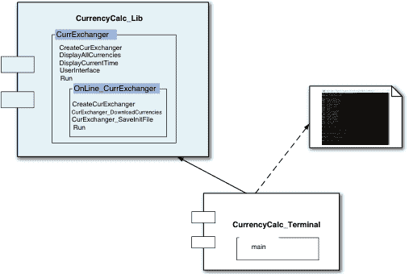

**图 6.8** 基本 *CurrencyExchanger* 的 UML 组件图。

这样，我们就能构建出第一个库，名为 *CurrencyCalc_Lib*。新的 *CurrencyCalc_Terminal* 组件与 *CurrencyCalc_Lib* 链接，如图 6.8 所示。它只包含 `main` 函数，如清单 6.7 所示。

2 也可以在不使用 *CMake* 工具的情况下构建库。也就是说，我们可以在编程环境中创建一个新项目，将项目类型选择为静态库，并手动添加文件。不过，*CMake* 让我们能够在不同平台和编程工具之间灵活切换。

| Member | Description |
| --- | --- |
| /- | 路径连接，根据文件系统适当地插入斜杠或反斜杠符号。多个此类符号会被压缩为一个。 |
| / | 连接路径而不添加分隔符（如 string）。 |
| filename | 返回文件名（File.txt）。 |
| stem | 返回主干名（File）。 |
| extension | 返回扩展名（.txt）。 |
| parent_path | 返回父路径。^ |
| relative_path | 返回相对路径。 |
| root_directory | 返回根目录。 |
| root_name | 返回根名称。 |
| root_path | 返回根路径。 |

| Object | Description | Examples |
| path | path 是一个类，表示各种系统中文件、目录及其链接的路径。它类似于容器，支持许多有用的函数来拆分路径和连接各部分。path 类的一些选定成员： | 要使用 C++ 的新文件系统特性，需要包含 filesystem 头文件。fs 是 std::filesystem 的简称，定义如下： 1 #include <filesystem> 2 3 namespace fs = std::filesystem; 第 [6] 行的以下函数将宽字符串 std::wstring 转换为 fs::path 对象。然后，在第 [9-10] 行，路径的每个部分都会打印到屏幕上。 4 void DisplayPathParts( const wstring & inPath_str ) { 5 6 const fs::path inPath( inPath_str ); 7 8 // We can iterate through different parts of a path 9 for( const auto & p : inPath ) 10 wcout << p << "\n"; 11 } 例如，对于输入路径 D:\\Research\\SC++\\Projects\\CCppBookCode\\ReadMe.txt，得到以下输出： D: Research RC Projects CCppBookCode ReadMe.txt |

| Object | Description | Examples |
| --- | --- | --- |
| file_size | 返回文件大小（以字节为单位）。 | \ |
| is_regular_ file | 如果路径表示常规文件（即不是目录也不是链接），则返回 true。 | \ |
| file_status | 返回一个包含文件信息的对象。 | 以下函数打印所给路径（指向目录或文件）的基本信息： \ |
|  |  | void DisplayDirFileInfo( const wstring & inPath_str ) { \ |
|  |  |  const fs::path inPath( inPath_str ); \ |
|  |  |  \ |
|  |  |  wcout << L"exists - \\t\\t" << fs::exists( inPath ) << endl; \ |
|  |  |  \ |
|  |  |  // Let's call all important members of fs::path \ |
|  |  |  wcout << L"filename - \\t\\t" << inPath.filename() << endl; \ |
|  |  |  wcout << L"stem - \\t\\t" << inPath.stem() << endl; \ |
|  |  |  wcout << L"extension - \\t\\t" << inPath.extension() << endl; \ |
|  |  |  \ |
|  |  |  // If a file, then print its size in bytes \ |
|  |  |  if( fs::is_regular_file( inPath ) ) o << val << mp; \ |
|  |  |  std::cout << L"file size - \\t\\t" << fs::file_size( inPath ) << endl; \ |
|  |  |  \ |
|  |  |  wcout << L"parent_path - \\t\\t" << inPath.parent_path() << endl; \ |
|  |  |  wcout << L"relative_path - \\t\\t" << inPath.relative_path() << endl; \ |
|  |  |  \ |
|  |  | } |
| 19 | wcout << L"root_directory - \\t" << inPath.root_directory() << endl; | |
| 20 | wcout << L"root_name - \\t" << inPath.root_name() << endl; | |
| 21 | wcout << L"root_path - \\t" << inPath.root_path() << endl; | |
|    | 要调用第 [14] 行的 file_size，需要先在第 [13] 行用 is_regular_file 检查对象是否为有效文件。在第 [8-10] 行以及 [16-21] 行，调用了 path 的许多成员来获取路径的各部分。对于测试系统中示例输入文件 C:\\Temp\\Readme.txt，得到以下结果： | |
|    | exists - 1
|    | filename - ReadMe.txt
|    | stem - ReadMe
|    | extension - .txt
|    | file_size - 44
|    | parent_path - C:\\Temp
|    | relative_path - Temp\\ReadMe.txt
|    | root_directory - \\
|    | root_name - C:
|    | root_path - C:\\ |

| Object | Description | Examples |
|---|---|---|
| `copy` | 复制文件和/或目录及其内容。 | 以下函数演示了如何创建两个目录 [13, 16]，然后在其中一个目录中创建文件 [19]，将该文件复制到第二个目录 [22]，再将该文件移回第一个目录 [27]，最后删除所有文件和目录 [31]。应非常谨慎地使用最后一个函数。在第 [9] 行，使用了 path 类的重载 `/` 运算符来连接路径中的各元素。 |
| `remove` | 删除文件或目录及其内容。 |  |
| `remove_all` |  |  |
| `create_directory` | 创建一个目录或多个目录。 |  |
| `create_directories` |  |  |
| `rename` | 重命名或移动文件。 |  |

```cpp
void CreateDirsAndFiles(const wstring& subPath, const wstring& subdir)
{
    try
    {
        // There are conventions stating where to put the path
        filesystem::path subPath;
        // Use overloaded operator / to
        // add path to directory
        indirPath /= subdir; // add subdir
        // Create directory
        fs::path sub_2_path{ indirPath / L"subdir_1" };
        fs::create_directory(sub_2_path); // create subdir_1
        fs::path sub_2_path{ indirPath / L"subdir_2" };
        fs::create_directories(sub_2_path); // create subdir_2
        // Create a new file
    }
}
```

```cpp
void CreateDirsAndFiles(const wstring& subPath, const wstring& subdir)
{
    try
    {
        // There are conventions stating where to put the path
        filesystem::path subPath;
        // Use overloaded operator / to add subdirectory
        indirPath /= subdir;
        // Create directory
        fs::path sub_2_path{ indirPath / L"subdir_1" };
        fs::create_directory(sub_2_path);
        fs::path sub_2_path{ indirPath / L"subdir_2" };
        fs::create_directories(sub_2_path);
        // Create a new file
    }
}
```


-   [费曼学习法](https://wiki.example.org/feynmans_learning_method)的灵感源于诺贝尔物理奖获得者**Richard Feynman**。

1.  运用费曼技巧，你只需花上`20 min`就能深入理解知识点，而且记忆深刻，*难以遗忘*。

```
if (condVar > someVal) {console.log("xxx")}
```


在 try-catch 语句中（第 3.13.2.5 节），从第 37 行开始。在第 42 行，需要转换的值以原始 C 字符串形式读取。因此，它需要先转换为 std::string，再使用 stod 函数转换为 double，如第 45 行... 


6.2.8.3  启动基于 GUI 的应用程序

最后一步是在主函数中启动我们的应用程序，如 Listings 6.10 所示。

## Listings 6.10  启动基于 FLTK 的货币兑换应用程序（在 *CurrencyCalc_GUI, main.cpp* 中）。

```
#include <FL/Fl_ask.H>
#include <filesystem>

#include "CurCalc_GUI.h"
#include "CloseWindow.h"

int main()
{
    CloseConsoleWindow();        // Get rid of the console window

    namespace fs = std::filesystem;
    // Get full path to the initialization file
    wstring iniPath( fs::current_path()
                         / fs::path( CurrExchanger::initDefaultFileName ) );

    // Create the currency exchanger object
    auto curExchObj = OL_CE::CreateCurExchanger( OL_CE::nbp_addr, iniPath );
    if( ! curExchObj )
        return fl_alert( "Cannot load currency info - exiting ..." ), -1;   // Exit

    // Create a GUI object with the provided currency exchanger object
    CC_GUI     gCC_GUI( * curExchObj );

    // Run application
    return gCC_GUI.Create_GUI();
}
```

Lines [1–5] have the necessary `#includes`. The definition of the main function starts on line [8]. `CLoseWindow` is the first function, called on line [10]; its role is to hide the black terminal window. (Its code can be found in the source file.) Then, line [12] creates an alias `fs` to the filesystem namespace. This is used on lines [14, 15] to create a path to the initialization file, which is expected in the same directory as the executed application, conveyed by the `current_path` function.

On line [18], the `CurExchObj` object of the XML `CurrExch_Optional` type is returned. If the operation was successful, it contains a valid XML CurrencyExchanger object. But if for some reason the curExchObj optional object is empty, such as if there is no initialization file or no Internet connection, as verified on line [19], the application exits with a short message issued by the `fl_alert` on line [20]. Note that to shorten the code, the `return` statement yields the error code −1, which is provided as the rightmost value by the comma (,) operator (see GROUPY 16, Table 3.15).

Finally, on line [23], the `CC_GUI` object is created and linked with the `XML_CurrencyExchanger` object by dereferencing `curExchObj`. The GUI is launched on line [26]; the results are shown in Figure 6.11. The last call returns if the application is closed by a user.

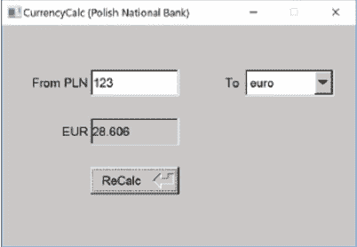

**Figure 6.11**  Main window of the *CurrencyCalc* application rendered by the FLTK interface.

In this section, we learned about the following:

+   - Creating simple GUI applications with the FLTK library
+   - Using the callback mechanism based on a simple function pointer registration
+   - Managing object lifetime and object inter-dependencies
+   - Writing interface functions to legacy code

## 6.3  系统时钟和时间测量

时间测量是每个微处理器系统最固有的功能之一。精确的计时对于所有数字电路以及操作系统的任务调度都是必需的。我们也在 3.18.5 节的 `DisplayCurrentTime` 函数中看到了当前时间测量。但访问和测量时间所提供的设施取决于平台（即操作系统）以及编程语言和其库。C++ 提供了多个与时间相关的对象，主要在 `std::chrono` 命名空间中。表 6.4 列出了最常用的成员及其属性。更详细的信息可在文献（Stroustrup 2013）或网站（Cppreference.com 2019a）上找到。

[PAGE 444]

<!-- no content -->

[PAGE 445]

## Table 6.4 (continued)

| Object | Description | Examples |
|---|---|---|
| `std::chrono::duration_cast` | Converts a time duration to other units. | On line [6], `high_resolution_clock` is selected. The start time point is caught on line [9], the test function is called on line [11], and then the end time is caught on line [13]. A time duration object is created on line [16]. This is displayed on lines [18, 20, 22] in different units. The previous time-measuring question is verified in the following context:```cpp
void arithm_fun(int p) { // A test function
    for (auto a : range(p))
        cout << a * a << " ";
}
void fun_perform_timer_test(void) {
    fun_perform_timer(arithm_fun, 23); // Call a function with p = 23
}
```
After calling `fun_perform_timer_test` on a test computer, the last three lines of the output look like this:

```text
Computation time = 0.00313335 [s]
Computation time = 0 [s]
Computation time = 3133 [µs]
``` |

> ¹ In Visual Studio 2019 on Windows 10, this is the same as `std::chrono::steady_clock`.


-   [时间测量函数执行时间]（※）的实现看似简单 – 我们需要标记开始和结束时间并计算它们的差值。我们将展示如何编写一个包装函数，用于测量任意函数的执行时间。然而，精确测量几行代码或函数执行所消耗的时间并不像表面上看起来那么容易。首先，函数本身不会单独运行；操作鼠标和连接 Internet 等后台进程也在运行。背景条件在每次运行时可能会变化，因此实际中我们测量的是函数及其伴随执行的整体耗时。

在本节中，我们扩展了表 6.4 中介绍的 `fun_perform_timer` 函数。该函数的主要局限是只能测量接受 `int` 参数并返回 `void` 的函数，但我们希望能够测量**任意**函数 – 即能够接受并返回任意参数的函数。C++ 提供了机制，可以传递任意数量、任意类型的参数。

本节将学习以下内容：

- 可变参数（参数包）
- 使用 `std::forward< decltype() >` 进行转发通用引用

众所周知，自 C++17 起，可以在另一个命名空间内定义命名空间，例如在列表 6.11 的第 [1, 4] 行。在嵌套命名空间中，第 [6] 行定义了常量 `kIterations`，它用于控制在测量执行时间时的函数调用次数。`measureFuncAvTiming` lambda 函数的定义用于执行时间测量，起始于第 [22] 行。`kIterations` 常量通过捕获传递给 `iter`。随后传入了两个有趣的参数：

- `func` – 一个转发（通用）引用，表示要执行 `iter` 次的函数对象，用于测量性能；
- `func_params` – 一个 **可变参数列表**，用于传递给 `func` 的任意参数。可变参数列表允许传递任意数量的参数。

在第 [24] 行会进行编译时检查的 compile‑time 不变量检查，确保迭代次数大于零。与运行时检查的 `assert` 不同，`static_assert` 在编译阶段验证，若条件为假则报错并停止编译。

在第 [28] 行，当前时间戳通过调用 `timer::now` 由 `time_start` 对象捕获。该函数及其他时间相关函数在 6.3 节中汇总。

在第 [31] 行的 `for` 循环中，被测试函数被调用 `iter` 次，循环范围由辅助的 `range` 类提供，后者将在 6.5 节中说明。

在第 [32, 34] 行，`func` 与 `func_params` 一起被调用。由于 `func` 与 `func_params` 可能有多种形式，我们使用 `std::forward`，其类型通过 `decltype< func >` 推导得到。类似的构造在第 [34] 行用于转发可变参数。这正是第 4.5.1 节所解释的完美转发（perfect forwarding）。

### 列表 6.11  `measureFuncAvTiming` 函数的定义（用于测量提供函数的执行时间，位于 `CppBookCode, Time.cpp`）

```cpp
namespace CppBook
{
    // 嵌套命名空间
    namespace LTimer
    {
        const int kIterations = 10;

        ////////////////////////////////////////////////////////////////
        // Lambda 用于测量任意参数的函数的执行时间。
        ////////////////////////////////////////////////////////////////
        //
        // 输入：
        //        func - 需要以 func( func_params ) 的形式被调用的函数
        // 输出：
        //        单次 func 执行的时间（毫秒）
        //
        // 备注：
        //        func 会被调用 kIterations 次，执行时间取平均
        //
        auto measureFuncAvTiming = [ iter = kIterations ]
                                   ( auto && func, auto && ... func_params )
        {
            static_assert( kIterations > 0 );     // 编译时检查

            using timer = typename std::chrono::high_resolution_clock;

            auto time_start = timer::now();

            // 执行算法若干次
            for( auto i : range( iter ) )
                std::forward< decltype( func ) >( func )
                (
                    std::forward< decltype( func_params ) >( func_params ) ...
                );

            // 计算 func 单次执行的平均时间（毫秒）
            return std::chrono::duration_cast< std::chrono::milliseconds >
                   ( timer::now() - time_start ).count()
                   /iter;
        };
    }
}
```

简要说明：任何函数 `func` 均可接受任意数量、任意类型的参数。我们的目标是保持每个 lvalue‑ref 参数为 lvalue‑ref，每个 rvalue‑ref 参数为 rvalue‑ref。完美转发正好实现这一点（Meyers 2014），否则 rvalue 参数会被强制为 lvalue‑ref，从而产生不期望的副作用。

通过结束时间与开始时间相减，`measureFuncAvTiming` 返回 `func` 单次调用的平均时长（毫秒）。可以通过调用 `std::chrono::duration_cast` 将结果转换为其他时间单位（6.3 节）。

接下来需要编写类似下面的简单函数：

```cpp
void MathFun_RandTest( int iters, double eps, double & result )
{
    // 初始化 Mersenne 双生成器
    std::mt19937 mtRandomEngine( (random_device())() );
    std::bernoulli_distribution bern( 0.7 );    // 0 或 1，概率 p=0.7

    result = 0.0;
    for( int i = 0; i < iters; ++ i )
        result += bern( mtRandomEngine );

    result /= static_cast< double >( iters ) + eps;
}
```

并使用以下代码测量其每次调用的平均执行时间：

```cpp
auto funTimer { CppBook::LTimer::measureFuncAvTiming };

double result {};

auto run_time = funTimer( MathFun_RandTest, 1234567, 1e-5, result );

cout << "MathFun_RandTest last result: " << result << endl;
cout << "MathFun_RandTest run-time: " << run_time << " [ms]" << endl;
```

在第 [62] 行，`funTimer`（即 `CppBook::LTimer::measureFuncAvTiming` 的简化别名）会多次调用 `MathFun_RandTest`，该函数计算 1 234 567 条来自伯努利分布的随机数的平均值。为此，Mersenne 随机引擎在第 [49] 行通过 `random_device` 的功能调用初始化（参见 3.17.3 节）。最终在屏幕上输出最后的平均值（应接近 0.7）以及平均单次执行时间，示例如下：

```text
MathFun last result: 0.699677
MathFun run-time: 177 [ms]
```

由此可见，返回值 0.699677 与第 [50] 行设定的 0.7 非常接近。

## 6.5  Range 类

C++11 引入了非常有用的新型 for 循环 —  — 范围 for（range for），如 3.13.2.2 节所讨论。配合 `auto` 关键字（3.7 节），它极大简化了遍历容器（如 `std::vector`、`std::list`）的操作。现在可以很容易地遍历一组值，例如：

```cpp
for( auto c : { 1, 2, 3 } )
    cout << c;
```

但如果我们想遍历由更复杂公式生成的值集合，情况会稍显繁琐。例如，从 0.0 开始，生成所有不超过 100.0 且步长为 2.56 的连续值。使用传统的 for 循环写法如下：

```cpp
for ( double f = 0.0; f < 100.0; f += 2.56 )
    cout << f << endl;
```

更便利的做法是利用新的 for 循环语法，同时能够生成各种序列。为此，我们需要一个满足以下语法的迭代器：

```cpp
range( from, to, step )
```

其中 `from` 为起始值，`to` 为结束值（不包含），`step` 为每一步的增量。还可以使用简写：

```cpp
range( from, to )          // 步长默认为 1
```

或

```cpp
range( to )                // 起始值默认为 0，步长默认为 1，生成 [0, to)
```

遗憾的是，标准库并未提供此类 helper（在某些框架中称为 linspace）。我们只能使用 `std::iota` 向 STL 容器填充递增的值。为了弥补这一不足，`range` 类被设计出来。下面在列表 6.12 中展示了 `range` 类的用法示例。

### 列表 6.12  使用 `range` 类的示例（位于 `CppBookCode, range_test.cpp`）

```cpp
#include "range.h"

void RangeTest( void )
{
    ofstream ostr( "RangeTest.txt" );
    if( ostr.is_open() == false )
        return;

    // 1:
    ostr << "1st test:" << endl;

    vector< float > v = range( 256.0f );
    copy( v.begin(), v.end(), ostream_iterator< float >( ostr, ", " ) );
```

在第 [1] 行引入 `range` 类的头文件。第 [6–11] 行创建文件并检查是否成功打开；随后生成一个 `vector<float>` 并使用 `range( 256.0f )` 初始化，得到 0、1、…、255 的连续浮点数。由于 `range` 实现了向 `std::vector` 的转换运算符，这一步骤可直接完成。最后在第 [14] 行将整个向量复制（即流式输出）到文件中。


## 6.5.1 函数式编程与 Ranges 库

C++ 对范围（range）有一个更深刻的概念，这与上一节中介绍的不同。本节我们讨论的是 *范围（ranges）*，即一种相对较新的编程方法，主要旨在使用 *管道（pipes）* 改进对集合的链式操作。我们见过许多标准库（SL）操作，其通用接口是一对迭代器，指示要处理的元素的开始和结束，也就是范围：例如表 3.6 中介绍的 `std::find`、`std::copy` 和 `std::sort`。那么，将范围作为两个独立的值传递有什么问题呢？主要障碍出现在一个函数试图将某个操作产生的范围传递给另一个函数时。在许多情况下，与其创建局部对象来存储中间结果，把两个单独的迭代器从一个函数的结果作为输入传给另一个函数，不如使用一个包含所有信息的结构。例如，下面的代码

```cpp
vector< int > vec( 10 );

// Put some values to vec ...

// Sort the values in vec
sort( vec.begin(),vec.end() );
```

在范围框架中可以简化为：

```cpp
vector< int > vec( 10 );

// Put some values to vec ...

// Sort the values in vec
sort( vec );
```

这种紧凑的结构也不容易出错：例如，它不允许错误地传入指向不同集合的迭代器。这类功能已以库的形式开发出来。其中一个是 *range-v3*，由 Eric Niebler（2019）开发，最近已被接受成为新标准 C++20 的一部分。与 C++ 概念（concepts）一起，它将使我们能够编写更清晰、更紧凑的代码。本章“问题与练习”部分包含了一些使用这些新技术的练习。

关于函数式编程、范围（ranges）以及 C++ 中其他令人启发的新编程方法的更多信息，可以在 Ivan Čukić（2019）的书中找到。

## 6.6  示例项目——解析表达式

在 3.19 节中，我们讨论了 C++ 的运算符和表达式。我们广泛使用它们作为构建更大语言结构的基础。但是，编译器本身也是一个程序，它如何识别 a+b*c 是否是有效的表达式？如果有效，又应如何解释？当然，编译器体现了软件设计的艺术；但在本节中，我们将研究如何编写一个简单的解释器来判断表达式是否正确，以及另一个能够计算表达式值的解释器。为此，我们将研究称为 *形式文法* 的形式语言描述方法。然后，我们将看到如何解析表达式，以判断它是否完全符合文法规则。我们还将学习如何构建特殊的、以解析（语法）树形式表示表达式的数据结构。最后，我们将学习如何用访问者模式遍历这样的树，以绘制树结构或计算表达式的值。这一讨论将让我们练习之前学过的以及新的编程技术，这些技术涉及现代 C++ 的面向对象特性。总结一下，在本节中，我们将学习：

+   - 什么是形式文法，以及如何描述算术表达式
+   - 如何消除文法中的左递归，以便通过*解释器*设计模式实现它
+   - 什么是解析树，以及如何通过*组合设计模式*实现它
+   - 如何扩展解释器来构建反映表达式结构的解析树
+   - 如何通过*访问者模式*遍历树来对表达式求值（双重分派技术）


-   如何构建栈数据结构来存储智能指针
-   使用指针进行对象的非拥有式访问，以及通过智能指针进行拥有式访问
-   使用逆波兰表示法（RPN）来简化表达式求值
-   使用原型模式克隆复合对象
-   利用 `dynamic_cast` 实际运用运行时类型识别（RTTI）

该方案包含许多设计模式，其中组合模式（Composite）和访问者模式（Visitor）在与计算机语言分析器不一定相关的应用程序中尤其有用。让我们先从简要介绍定义计算机语言构造的语法规则的方法开始。

## 6.6.1 使用形式语法规则定义语言表达式

C++ 运算符已在第 3.19 节中介绍。我们注意到，除了运算符的功能外，重要的是其优先级以及结合性。标准将这些规则任意定义为无歧义，并遵循表 3.15 所示的规则。然而，这些及其他语言规则如何正式地描述？为此，人们设计了形式语法。它们是必要的，以便获得一种通用的语言定义，使我们能够实现按用户预期运行的编译器。形式语法和编译器设计构成了计算机科学的核心；同时也是许多论文和书籍中探讨的非常高级的主题（Aho 等人，2006）。这些主题超出了本书的范围，但实现一个处理基本表达式的简单解释器将演示许多有用的编程技术。

语法是使用终结符和非终结符描述的语法产生式的集合。³ 下面的产生式

```text
E  -> E + T | E - T | T              expression
T  -> T * F | T / F | F              term
F  -> D | ( E )                       factor
D  -> 0 | 1 | 2 | ... | 9             digit
```

让我们能够形式化地描述任何包含单个数字和四个二元运算符的表达式，例如下面的表达式

```text
3 + ( 4 / 5 - 6 )
```

以及判断像这样的表达式是否满足规则：

```text
3 + ( 4 / ) 5 - 6
```

如果是，那么我们称该表达式*符合*语法。否则，就出现了语法错误。在前面的语法产生式中，红色符号表示*终结符*，即直接输入到终端上的符号（因此得名）。非终结符用黑色大写字母表示。它们对应于构成语法的形式的或抽象的概念。

最后，| 符号表示产生式之间的逻辑选择。因此，D → 0 | 1 表示 0 或 1 都可以满足 D 产生式，以此类推。

这些语法规则反映了运算符的优先级和结合性。将语法规则应用于表达式的过程称为*解析*。使用前面的语法规则解析前面某个表达式的示例见图 6.12。

解析之前会进行*词法分析*，将表达式拆分为有意义的语言类别，例如数字和运算符，这些类别称为*词法记号*（token）。有一些专门的程序，如 *lex* 和 *flex*，可以完成这项工作。但好消息是，对于大多数简单的语法，只要有合适的模式定义，任何正则表达式引擎（例如第 6.2.1 节讨论的 C++ *正则表达式*库）都可以使用。

我们准备实现一个程序，按照前面的语法规则执行词法分析和解析。在第一次尝试中，我们可能会考虑将非终结符实现为函数。另一方面，终结符可以直接从表示输入表达式的字符串中匹配。因此，表达式组的第一条规则可以如下实现：

```cpp
bool E( void )
{
    if( E() && Match( '+' ) && T() )
        return true;
    else
        // ...

    // ...
}
```

除了前面的函数 E 几乎会立即因第三行对自身的无限递归调用而崩溃外，其他一切都会正常。这是由我们简单语法的结构导致的固有问题。解决之道是转换规则以消除左递归。没有左递归的语法新版本如下所示：

```text
E  -> T E'
E' -> + T E' | - T E' | ε
T  -> F T'
T' -> * F T' | / F T' | ε
F  -> ( E ) | D
D  -> 0 | 1 | 2 | ... | 9
```

语法转换技术可以在关于形式语法的书中找到，例如 Aho 等人（2006）的经典著作 *《编译原理：原则、技术与工具》* 以及 Grune 等人（2012）的 *《现代编译器设计》*。然而，通过实验很容易验证这两组规则是等价的：即，它们描述相同类型的表达式。然而，消除左递归引入了两个更多的产生式，以及神秘的 ε 符号。后者代表 epsilon 产生式，它实际上不进行任何操作，我们稍后分析实现时会看到。

## 6.6.2 表达式处理框架的设计

有了对语法简短的介绍，我们就能描绘出构建解释器框架的组件的完整图景。如图 6.13 所示。

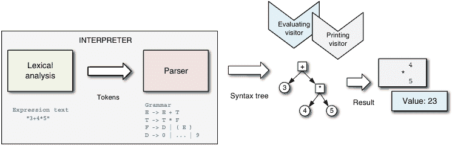

**图 6.13** 表达式解释和后处理的步骤。表达式经过词法分析，然后交给解析器，解析器基于语法规则检查语法并构建语法树。随后，可以通过访问者（例如打印访问者和求值访问者）遍历该树。实际上，我们可以在屏幕上获得树视图，或者仅仅获得其值。

**清单 6.14** `TSimpleExpressionInterpreter` 类的定义（位于 *Parser, SimpleExpressionInterpreter.h*）。

```cpp
// Implements the simple expression grammar
// free of the left recursion.
class TSimpleExpressionInterpreter
{

    private:

        std::string             fExpressionString;
        std::string::size_type  fCurrPos {};
                              // indicates currently examined
                              // position in the expression string

    public:

        std::string::size_type  GetCurPos ( void ) const { return fCurrPos; }

    public:

        TSimpleExpressionInterpreter( void ) : fCurrPos( 0 ) {}
        virtual ~TSimpleExpressionInterpreter() = default;

        TSimpleExpressionInterpreter( const TSimpleExpressionInterpreter & )
                                                               = default;
        TSimpleExpressionInterpreter & operator = (
                const TSimpleExpressionInterpreter & )           = default;
```

此外，复制构造函数和赋值运算符的移动版本也可以默认化，如下所示。

```cpp
TSimpleExpressionInterpreter(
        TSimpleExpressionInterpreter && ) noexcept = default;

TSimpleExpressionInterpreter & operator = (
        TSimpleExpressionInterpreter && ) noexcept = default;
```

这些指令让编译器在可能的情况下自动对所有数据成员应用移动语义。为此，必须插入 `noexcept` 关键字，以表示移动操作不会抛出任何异常。

类 `TSimpleExpressionInterpreter` 包含重载的运算符 `()` 函数，定义在第 [47] 行。因此，`TSimpleExpressionInterpreter` 是一个函数对象（见第 6.1 节）。其主要操作发生在第 [52] 行，即调用 `Expr_Fun` 成员函数。很快我们将看到，该函数对应于语法生成的表达式。如果它返回 true，则检查第二个条件，以验证整个输入表达式是否已处理完毕。两者都满足意味着表达式已通过语法规则。否则，发生语法错误，返回 `false`。

```cpp
public:

    /////////////////////////////////////////////////
    // Functional operator to match an expression to fulfill
    // the grammar.
    /////////////////////////////////////////////////
```


6.6.4 构建语法树的复合设计模式

将表达式传递给 `TSimpleExpressionInterpreter` 解释器会返回一个二元答案，指示该表达式是否符合语法规则。但更有价值的做法是生成一种数据结构，其内在结构反映输入表达式的形成方式。这种结构被称为 *syntax tree*（语法树），示例在图 6.14 中展示。

**图 6.14** 解析表达式后的语法树（a）3+4*5 和（b） (1+2)*(3+(4+5))/(6-7)。每棵树都通过运算符的优先级和结合性，在没有括号的情况下体现这些规则。

在图 6.14b 的表达式中，请注意 (3+(4+5)) 子表达式的构造。由于 + 运算符是左结合的，若没有括号，则 3+4 会先被执行，然后再与 5 相加。然而在我们的情况中，顺序被改变了，这在树结构中有所体现。整个因子 (3+(4+5)) 因此被提升到左侧，以便与 (1+2) 相乘，这正是 * 运算符左结合性的体现。

在我们找到构建语法树的算法之前，先思考其构建的基本元素。我们有两类不同的节点：叶子节点用于存储数值（为简化，假设只包含数字）；二元节点，它们拥有指向左子树和右子树的两个链接。

### 6.6.4.1 使用复合设计模式定义树节点

图 6.15 展示了用于构建语法树的节点类层次结构的 UML 类图。

这种关系被称为 *复合设计模式*（Composite Design Pattern）（Gamma 等，1994）。我们在 4.9 节讨论了组合关系，二者显然存在共同点，但主要区别在于：简单的组合关系并不假设类之间存在“家族”关联，而复合设计模式的核心特征是类之间的组合发生在同一层次结构内部。具体而言，`BinOperator` 继承自 `TNode` 类，因此它是 TNode 类似的。同时，它还包含两个 `TNode` 实例，即 `fLeftChild` 和 `fRightChild`。这些实例可以指向 `TNode` 层次结构中的任意对象，无论是 `ValueLeafNode` 还是另一个 `BinOperator`（虽然纯虚类 `BinOperator` 本身不能直接实例化，但其派生类如 `PlusOperator` 可以）。这种结构在计算机科学中非常常见。例如，文件系统（见 6.2.7 节）中，节点可以是文件或目录（文件夹），目录包含其他节点（文件或目录），以此类推。另一个例子是命令框架，其中简单命令和宏命令并存。宏命令本身也是命令，由一系列预记录的命令组成，依次执行。


## 6.6.4.2 实现 `TNode` 层次结构并与 Visitors 合作

在深入代码之前，我们先说明所有节点与 visitor 设计模式之间的特殊关系。这两者相互依赖：节点调用 visitors，而 visitors 调用节点的函数。因此两者互相了解。但我们不能简单地在各自的头文件中包含对方的头文件——必须先定义其中一个。为了解决这个问题，必须先定义一些内容。在 C++ 中，可以通过合理排列头文件以及仅使用前向声明的相互依赖类（其完整定义在其他地方）来解决此问题。在 Listing 6.15 所示的 `Nodes.h` 头文件中，我们可以在开头的第 [9, 13] 行看到这样的前向声明：`TVisitor` 和 `TNode`。后者将在后续使用。那么，为什么需要提前声明 `TNode`，而它的定义就在几行后？这是因为需要定义两种重要且不同的指针类型。第一种，在第 [17] 行定义，是 `Node_UP`，它是 `std::unique_ptr` 的别名，用于表示 _拥有权_ 关系。即，`Node_UP` 类型用于保存指向 `TNode` 类似对象的指针，这些对象将在适当的时候由它们自行删除（如第 5.3 节所讨论）。另一方面，在第 [20] 行定义了一个非拥有的 `NodePtr` 指针，即 `TNode *`，它用于在需要访问 `TNode` 对象以执行操作或读取其数据时使用，但不负责删除该对象。

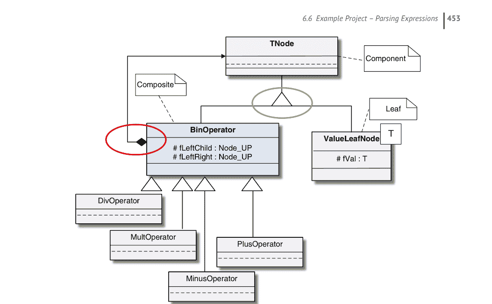

`TNode` 基类的完整定义从第 [28] 行开始。这是一个纯虚类，因为它包含纯虚成员函数，从而为整个层次结构提供抽象接口（如图 6.15 所示）。因此，不能直接创建 `TNode` 对象。这一事实体现在第 [36] 行的受保护构造函数中。通过 `= default`，我们指示编译器提供默认实现。与直接提供空实现 `{}` 相比，这更明确地表达了意图。正如我们所知，在设计类层次结构时，必须将基类析构函数声明为虚函数（第 4.11 节）。这里它在第 [44] 行以 `= 0` 修饰符声明为纯虚函数。虽然这里声明纯虚析构函数显得多余，因为已有其他纯虚函数，但将一个没有任何成员函数的类声明为纯虚类是一种有用的技巧。对于纯虚函数，我们甚至不需要提供定义（体）。但某些函数仍会被调用。例如，基类析构函数 `~TNode` 就是这种情况，因此它需要完整的定义。即使看起来在第 [44] 行可以在 `= 0` 后直接加空 `{}`，这也违反了标准（尽管某些编译器会接受）。因此，空实现必须放在 `Node.cpp` 源文件中。幸运的是，链接器会报告纯虚函数是否需要完整的函数体——即如果缺少体但必须存在时。

```cpp
#pragma once
#include <memory>
#include <cassert>

// Forward class declarations
class TVisitor;

// A forward declaration of the base class for the node hierarchy.
class TNode;

// Owning relation - we can declare the std::unique_ptr
// with only declared class TNode. Its definition follows.
using Node_UP = std::unique_ptr< TNode >;

// Non-owning relation
using NodePtr = TNode *;

// This is an interface class representing a node
// in the tree - it serves only
// to be derived from, its objects cannot be created.
class TNode
{
protected:
    // Making the constructor protected is also
    // a way to indicate a class as a base since
    // only derived classes can be instantiated.
    TNode( void ) = default;

public:

    // To indicate the class is an abstract interface
    // its destructor is a pure virtual function
    // what is indicated by adding = 0 to the declaration.
    virtual ~TNode() = 0;

public:

    // Pure virtual functions can have implementation
    // but it is not absolutely required.
    // Derived types must provide their own implementation if they
    // are instantiated.
    // Accept allows operation of a visitor.
    virtual void Accept( TVisitor & v ) const = 0;

public:

    // Re-create yourself - No implementation
    // for Clone in the base class.
    virtual Node_UP Clone( void ) const = 0;
};
```

在 `TNode` 类及其派生类中有两个具有明确职责的纯虚函数需要说明：

- **Accept** 纯虚函数，在第 [53] 行声明，提供 *统一的访问接口*，供广泛的 *访问者*（visitors）使用。这些访问者负责按特定顺序遍历树的每个节点。`Accept` 方法接受一个访问者对象作为参数，随后该访问者配合树一起工作，完成其任务。好消息是，由于动态多态性，每个 `TNode` 类只需实现一次 `Accept` 即可接受所有访问者，甚至包括未来将要定义的访问者。我们将在讨论访问者层次结构时再回到此点。
- 第二个纯虚函数 **Clone**，在第 [59] 行声明，用于定义一种机制，可以基于其原型的简单指针创建 `TNode` 层次结构中任意对象的 *完整复制*。这种行为可以通过在每个继承自 `TNode` 的类中实现 `Clone` 来实现。由于其行为，该机制被称为 *原型设计模式*（Gamma et al. 1994）。

我们将在所有继承自 `TNode` 的类中看到这两个函数。

## 6.6.4.3 实现 `ValueLeafNode` 类

现在让我们来看 `TNode` 层次结构中的另一个成员——模板类 `ValueLeafNode`，其定义始于 Listing 6.16 的第 [64, 65] 行。它负责存储类型为 `V` 的值 `fVal`，如第 [70] 行所示。此类对象代表叶子节点，如图 6.14 所示。由于它是模板类，因此很容易定义存储非数值类型的叶子，例如从查找表中获取的变量名称等。

**Listing 6.16** — `TNode` 层次结构中的类定义 — `ValueLeafNode`（在 *Parser, Nodes.h*）。

```cpp
// A leaf (an object) with a value such as
// a number, a string, etc.
template < typename V >
class ValueLeafNode : public TNode
{

private:

    V       fVal {};    // a held value

public:

    ValueLeafNode( void ) : fVal( ) {}
    explicit ValueLeafNode( const V & val ) : fVal( val ) {}

    virtual ~ValueLeafNode() = default;

    ValueLeafNode( const ValueLeafNode & ) = default;
    ValueLeafNode( ValueLeafNode && ) noexcept = default;
    ValueLeafNode & operator = ( const ValueLeafNode & ) = default;
    ValueLeafNode & operator = ( ValueLeafNode && ) noexcept = default;

public:

    V GetValue( void ) const { return fVal; }

    // Accept a visitor
    void Accept( TVisitor & v ) const override;

public:

    // Re-create yourself
    Node_UP Clone( void ) const override;
};

// A leaf with a floating-point value
using NumberLeafNode = ValueLeafNode< double >;
```

在第 [74–82] 行，我们可以看到 `ValueLeafNode` 类的构造函数和赋值运算符的定义。由于未来可能使用的 V 类型未知，我们还为移动构造函数和移动赋值运算符提供了默认实现。这意味着如果 V 类型具有非抛出的移动操作，编译器会尝试使用这些移动操作。为了此目的，我们的移动语义实现被标记为 `noexcept`。`ValueLeafNode` 不是纯虚类，因此在源文件 *Visitors.cpp* 中对在第 [90] 和 [95] 行声明的 `Accept` 和 `Clone` 虚函数有完整的实现。

最后，`NumberLeafNode` 别名是将 `ValueLeafNode` 实例化为 `double` 类型的别名。我们在实现树时可以继续使用这种方式来定义保存其他类型值的叶子节点。


## 6.6.4.4 BinOperator类的实现

清单6.17第[103]行定义的BinOperator类，构成了所有二元运算符（如PlusOperator）的基类。BinOperator最显著的特征是它拥有两个分支，表示语法树的子表达式。这两个分支由定义在第[108, 109]行的拥有指针fLeftChild和fRightChild持有。如前所述，拥有两个类型均为TNode的子表达式，使得整个类结构成为组合设计模式。但这种拥有关系使其拷贝操作更加困难，我们稍后将讨论这一点。幸运的是，由于智能指针的自动化，我们无需担心对象销毁。第[114]行定义的参数化构造函数接受两个智能指针，然后通过将它们持有的对象移动给fLeftChild和fRightChild成员来接管。在unique_ptrs之间移动对象是一种标准技术，如第5.3节所述。

然而，拥有两个表示子表达式的对象使得拷贝操作并非易事。这个问题在第4.6.3节中讨论过。如果我们要拷贝这样一个对象，如何拷贝fLeftChild和fRightChild成员所持有的对象？最好的方法也许是制作一个完整的副本，而这需要创建一系列对象。我们将在讨论Clone成员时回到这个问题。为了禁止浅拷贝，拷贝构造函数、移动构造函数以及赋值运算符都被声明为= delete，如第[124–128]行所示。在成员函数中，这样的声明会禁止其使用。

### 清单6.17 TNode层级中的类定义——BinOperator（位于 *ParserNodes.h* 中）

```cpp
// A class to represent any binary operator
class BinOperator : public TNode
{

private:

    Node_UP     fLeftChild;       // Owning pointer to the left subtree
    Node_UP     fRightChild;      // Owning pointer to the right subtree

public:

    BinOperator( void ) = default;
    BinOperator( Node_UP left, Node_UP right )
        : fLeftChild( std::move( left ) ), fRightChild( std::move( right ) )
    {}

    virtual ~BinOperator () = default;

protected:

    // Disallow simple (shallow) copying.
    // To copy use Clone()
    BinOperator( const BinOperator & ) = delete;
    BinOperator( const BinOperator && ) = delete;

    BinOperator & operator = ( const BinOperator & ) = delete;
    BinOperator & operator = ( const BinOperator && ) = delete;

public:

    NodePtr     GetLeftChild( void ) const
                { assert( fLeftChild != nullptr ); return fLeftChild.get(); }
    NodePtr     GetRightChild( void ) const
                { assert( fRightChild != nullptr ); return fRightChild.get(); }

// Object copying disallowed by the base class

public:

    void Accept( TVisitor & v ) const override;

public:

    // Re-create yourself
    Node_UP Clone( void ) const override;
};
```

Accept成员函数的实现非常简单，并且对TNode层级中的所有对象都相同。清单6.19以PlusOperator为例展示了该实现。

### 清单6.19 PlusOperator的Accept成员函数实现（位于 *ParserNodes.cpp* 中）。该实现对于TNode层级中的所有其他节点都是相同的。

```cpp
void PlusOperator::Accept( TVisitor & v ) const
{
    v.Visit( * this );
}
```

Accept将调用转回给给定的访问者对象，并提供指向该节点对象的this指针作为其参数。这样的调用转回对于访问者v来说已经足够，因为基于this的类型，由于多态性，将调用一个适当的重载Visit函数。这就是双重分派机制；我们将在第6.6.7节描述访问者对象时再回到这一点。另请参见图6.17中的类图。

另一方面，Clone成员函数的作用和实现将在下一节中介绍。

## 6.6.4.6 深拷贝节点对象——原型机制

对于包含数据的对象（如NumberLeafNode）进行拷贝不是问题，我们甚至可以通过指定= default将这一操作的代码生成交给编译器。然而，对于包含指向其他对象指针的对象（如PlusOperator）进行拷贝，则存在一个固有的问题。简单地拷贝指针通常是不希望的，因为最终我们会得到两个不同的对象，它们引用同一份数据（第4.6.3节）。因此，所有用派生自BinOperator的类实现的二元运算，都通过将其拷贝和移动成员定义为= delete来禁止任何拷贝和移动操作。因此，在下面的代码片段中，只有第一行能够编译：

```cpp
PlusOperator    p1, p2;        // ok
PlusOperator    p3( p2 );      // Compiling error - no copy constructible
p1 = p2;                       // Compiling error - no copy by assignment
```

想象一下，我们只需要一个指向树根节点的指针，就需要复制一棵由许多不同类型的节点组成的树。例如，这样的任务可能是为了启动两个独立的树注释器。我们如何遍历这样一棵树，并创建每个节点和每个子节点的副本？更糟糕的是，如果我们拥有一个指向子节点的指针，我们只存储了一个指向基类TNode的指针，那么我们如何确切地知道要重新创建哪个节点？这可以通过一个了解节点层级所有信息的特殊访问者来完成。但对于这个普遍存在的问题，有一个更简单、更通用的解决方案：原型模式，其形式是在TNode层级的每个类中实现特殊的虚`Clone`成员。理解其运作方式的最佳途径是分析清单6.20中的简单代码。

每个`Clone`成员，例如定义从第[1]行开始的`NumberLeafNode::Clone`，都会在第[3]行动态创建其克隆对象，以`* this`参数的形式将自身作为创建样本提供给拷贝构造函数。然后返回一个指向这个新创建对象的智能指针，因此我们无需担心该对象的生命周期。就是这样。唯一需要观察的是，`Node_UP`被定义为存储指向基类TNode的指针。这再次成为C++多态性和里氏替换规则的一个有启发性的例子，该规则规定任何派生对象都可以替换基类。然而，当我们获取这样一个指针（无论它是什么）并调用其虚`Clone`成员（虚是关键所在）时，`Clone`将精确地知道它需要创建什么对象——这就是原型模式背后的机制。

```cpp
Node_UP NumberLeafNode::Clone( void ) const
{
    return std::make_unique< NumberLeafNode >( * this );
}
```

`Clone`成员在表示二元运算符的类中执行了稍微更高级的操作，例如`PlusOperator::Clone`，其定义从第[5]行开始。它需要通过在第[7]行调用`std::make_unique`来创建另一个`PlusOperator`，这会调用`PlusOperator`的参数化构造函数。但它的两个参数也必须是新的子树，因为我们重新创建整棵树，其所有节点都是全新的。同样，幸运的是每个节点都定义了`Clone`操作——要重新创建子树，我们只需在第[8]行调用`GetLeftChild`和`GetRightChild`获取子节点，然后调用它们的`Clone`成员。

```cpp
Node_UP PlusOperator::Clone( void ) const
{
    return std::make_unique< PlusOperator >(
        GetLeftChild()->Clone(), GetRightChild()->Clone() );
}
```

这样，整个克隆操作将递归地沿树向下传递，新的`PlusOperator`节点将被创建，其两个分支带有新的子树。

## 6.6.5 用于构建语法树的解释器

我们已经定义了一个简单的解释器`TSimpleExpressionInterpreter`，它遵循简单表达式的语法规则，并且能够判断一个表达式是否可以从这些规则推导出来（清单6.14）。我们还以语法树节点的形式定义了构建模块，如

> 5 由于Clone产生并丢弃一个对象，它应该被命名为类似Orphan的名称。然而，在C++社区中，通常将其称为Clone或clone，因此我们也遵循这一命名法。


shown in Figure 6.15. Now we will join the two, so that when parsing the expression and matching a grammar production after a grammar production, the interpreter can also generate the syntax tree that reflects the internal structure of the expression, as shown in Figure 6.14. Thanks to the object-oriented features of C++, we can achieve this task by deriving a new interpreter class from the base class `TSimpleExpressionInterpreter` and tweaking some of the functions.

The new `ExpressionTreeBuilderInterpreter` class is publicly derived from `TSimpleExpressionInterpreter`, as shown in Listing 6.21, line [19]. Hence, in addition to a number of important `#includes`, we need to include the header with the base class, as on line [13].

# **Listing 6.21** Definition of the `ExpressionTreeBuilderInterpreter` class (in *Parser, ExpressionTreeBuilderInterpreter.h*).

```
```cpp
#include <string>
#include <iostream>
#include <memory>
#include <algorithm>

#include "Nodes.h"
#include "Visitors.h"
#include "TheStack.h"
#include "range.h"

#include "SimpleExpressionInterpreter.h"

// The interpreter that builds the parsing tree
class ExpressionTreeBuilderInterpreter : public TSimpleExpressionInterpreter
{
  public:

    ExpressionTreeBuilderInterpreter( void )       = default;
    virtual ~ExpressionTreeBuilderInterpreter()     = default;

    // No shallow copy allowed due to fRoot and other members
    ExpressionTreeBuilderInterpreter(
              const ExpressionTreeBuilderInterpreter & )          = delete;
    ExpressionTreeBuilderInterpreter(
              const ExpressionTreeBuilderInterpreter && )         = delete;

    ExpressionTreeBuilderInterpreter & operator = (
              const ExpressionTreeBuilderInterpreter & )           = delete;
    ExpressionTreeBuilderInterpreter & operator = (
              const ExpressionTreeBuilderInterpreter && )          = delete;

  public:

    ////////////////////////////////////////////////////////////
    // Functional operator to match an expression to fulfill
    // the grammar.
    //////////////////////////////////////////////////////////
    //
```
```

[PAGE 473]

# ### Listing 6.21 (continued)

```
```
```
// INPUT: in_str - a string with input expression
//
// OUTPUT: true if expression fulfills the grammar, false otherwise
//
// REMARKS:
// // If false returned, then fCurrPos points
// // at the last properly matched position.

virtual bool operator () ( const std::string & in_str )
{
    if( BaseClass::operator()( in_str ) ) // Call the base parser
    return fNodeStack.Pop( fRoot ); // Take the node off from the stack

    return false;
}

protected:

using BaseClass = TSimpleExpressionInterpreter;

using NodeStack = CppBook::UP_Stack_1000< TNode >; // Useful stack alias

private:

    NodeStack fNodeStack; // The stack to store temporary branches of the tree

    Node_UP fRoot; // The root node of the parsing tree

public:

    NodePtr GetRoot( void ) { return fRoot.get(); }
```
```

The constructor and virtual destructor on lines [24, 25] are declared as defaults. Since the class will store a unique_ptr to the resulting syntax tree, copying and moving are forbidden by defining the appropriate members as deleted on lines [29-36].

Instantiations of the ExpressionTreeBuilderInterpreter class are functional objects due to the presence of the overloaded functional operator (), whose definition starts on line [54]. Its action on line [56] is to call the base functional operator and, if successful, copy an object from the top of fNodeStack to the fRoot member, as done on line [57]. These are defined on lines [70, 72], preceded by the type aliases on lines [64, 66]. The role and implementation of the node stack will be explained in the next section.

As mentioned earlier, in the derived interpreter class, we will reuse some member functions representing the grammar productions. More specifically, we can reuse those that call only other nonterminal actions, whereas those that involve terminal symbols need to be modified slightly.

Let's start with Digit_Fun, whose role is to try to match each of the digits from 0 up to 9. In the base class, such matching was enough; and if it was successful, true was returned. In the derived overridden version of Digit_Fun, whose definition starts on line [78], the first matching task is identical to that in the base class. However, after a successful match on line [80] and before returning true on line [83], a new NumberLeafNode is created on line [82], which stores the numerical value corresponding to the matched digit symbol. Moreover, the entire interpreter further processing.

[PAGE 474]

<!-- no content -->

[PAGE 475]

```
```cpp
if( Term_Fun() )                 // production: - T E'
{
    CreateSubTree( std::make_unique<MinusOperator>() );
    return Expr_Prime_Fun();
}
else
{
    return false;
}
}

// T' -> * F T' | / F T' | e
virtual bool Term_Prime_Fun( void )
{
    if( Match( '*' ) == true )
    {
        if( Factor_Fun() )                 // production: * F T'
        {
            CreateSubTree( std::make_unique<MultOperator>() );
            return Term_Prime_Fun();
        }
        else
        {
            return false;
        }
    }
    else
    {
        if( Match( '/' ) == true )
        {
            if( Factor_Fun() )             // production: / F T'
            {
                CreateSubTree( std::make_unique<DivOperator>() );
                return Term_Prime_Fun();
            }
            else
            {
                return false;
            }
        }
    }

    return true;                           // production: e
}
```
```

Figure 6.16 illustrates the operation of the `CreateSubTree` function when processing the 3+4*5 expression. The `NumberLeafNode` objects with values 3, 4, and 5 are directly pushed onto the stack in the order of their arrival from the parser (Section 4.8.4). However, when a new binary operator node is created, its two child subexpressions are popped off the top of `fNodeStack`. These are then connected to that operator as its left and right subtrees. Finally, the operator itself is pushed back on top of the stack, and the operations proceed until the entire expression has been parsed or a syntax error has been encountered.

[PAGE 476]

<!-- no content -->

[PAGE 477]

Note that the subtrees are passed from the left and right smart pointers using the `std::move` helper. After that, `bin_op` owns the passed objects, and left and right are empty. On line [191], `bin_op` is pushed back on top of the stack, where it waits for another such action. Finally, on line [192], the postcondition is verified, which asserts that `bin_op` has been passed onto the stack.

The `BUILD_THE_TREE` preprocessor flag, if set to 0 on line [178], turns off the code on lines [179–190]. In this case, all the nodes are pushed onto `fNodeStack`, and no tree is built. We will use this mode of operation when discussing stack operations in Section 6.6.9.

# 6.6.6  Stack for Smart Pointers

In this section, we will specifically focus on the following issues:

+   - Template specializations with a specialized stack class to store `std::unique_ptr`
+   - Proper use of ownership and move semantics
+   - Dependent and independent names in template definitions

We discussed the template `TStackFor` class in Section 4.8.4. Its main purpose is to provide a stack interface (LIFO functionality) with an internal vector data support. But `TStackFor`, in its general form as shown in Listing 4.17, assumes that objects pushed onto or popped from the stack are copied. However, when manipulating objects with strong owning semantics, such as the `Node_UP` or any other object held by `std::unique_ptr`, such a strategy cannot work since the objects need to be moved instead. Hence, we need a slightly more specialized version of `TStackFor`. As we pointed out in Section 4.8.2, C++ is ready for such challenges with the *template specialization* mechanism, which allows us to write a special version of a template class for a special occasion: that is, for a specific instantiating type. Such a version of `TStackFor`, specialized to cope with `std::unique_ptr` objects, is presented in Listing 6.22. The class definition starts on lines [2, 3] with `TStackFor< std::unique_ptr< T >, MaxElems >`, which tells the compiler that this is a specialized version if it happens to instantiate a `TStackFor` for any type `T` being held within `std::unique_ptr`. We can freely specify type `T`, as long as it can be held by `std::unique_ptr`, as well as the second numeric parameter `MaxElems`, which stands for the maximum allowable size of the stack.

Lines [7, 9, 12] contain a series of type aliases. These provide shortcuts for the types used in this specialization. In the third case, an additional typename was necessary. Such a helper is needed to assure the compiler that the construction refers to a type, and not to a variable in a namespace, for instance. Let’s briefly describe what is going on. In C++ templates, there are two types of names:

+   - *Dependent name* – A name that in some way depends on a template parameter
+   - *Non-dependent name* – A name that does not depend on a template parameter

The problem is with the first group, i.e. dependent names, since being dependent on a particular type of template parameter means they can represent totally different language categories. For example, the template dependent name `T::my_type` can denote a type, whereas `T::my_static_data` can denote a name of a static object. However, in the two-phase name-lookup process, the C++ compiler needs to figure out precisely what group a particular name belongs to. In the first pass, before a template is provided, the compiler selects non-dependent names. It looks


-   [对于依赖名称在实例化时使用特定类型时，我们可以在前面使用 `typename` 关键字来告知编译器该名称是类型名称。如果不加 `typename`，编译器会将其视为非类型名称并在第一次遍历时过滤掉。模板等模板参数匹配涉及许多额外规则，特别是关于依赖类型和非依赖类型（*https://stackoverflow.com/q/610245*; Stroustrup 2013; Cppreference.com 2019b; Vandevoorde et al. 2017)。]

1.  如 Listing 6.22 所示，`TStack` 的专门化版本用于处理智能指针（在 `TStack.h` 中定义）。

```
```cpp
// 专门化栈以使用 std::unique_ptr
template < typename T, auto MaxElems >
class TStackFor< std::unique_ptr< T >, MaxElems >
{
    public:

        using value_type = std::unique_ptr< T >;

        using DataContainer = std::vector< value_type >;

        // 这里需要额外的 typename

        using size_type = typename DataContainer::size_type;

    private:

        DataContainer       fData;

    public:

        DataContainer &   GetDataContainer( void ) { return fData; }

        auto GetStackSize( void ) const { return fData.size(); }

    public:
```
```

2.  回到代码的其余部分，第 [16] 行定义了底层数据容器。请回顾，这是一个 `std::vector` 来存储 `std::unique_ptr` 数据。因此，`TStackFor` 可以被视为一种适配器，在平坦的向量结构之上叠加一种类似栈的接口。如预期，它包含两个成员函数。Push 操作的定义从第 [42] 行开始。请注意，它的参数 `new_elem` 是按值传递的。由于这是一个 `unique_ptr`，其持有的对象会被接管，并且在第 [44] 行检查有足够空间后，将其放在栈顶。为此目的，第 [47] 行使用 `emplace_back` 而不是简单的 `push_back`。前者的优势在于直接使用移动操作，从而避免不必要的对象复制。请注意，在 Push 返回后，传入的 `new_elem` 智能指针已为空（第 5.3.1.1 节）。

```
```cpp
///////////////////////////////////////////////
// 此函数将元素压入栈
///////////////////////////////////////////////
```
```

[PAGE 480]

3.  最后，在第 [78, 79] 行，创建了一个有用的模板别名，用于定义一组栈，用于存储任何类型 `T` 的 `std::unique_ptr`，并将最大元素数量设为 1000。

```
template < typename T >
using UP_Stack_1000 = TStackFor< std::unique_ptr< T >, 1000 >;
```

4.  这种使用部分特化的别名只能通过 `using` 指令实现，因为旧的 `typedef` 只能用于指定完整类型。因此，在新代码中，前者是首选。

5.  我们也可以提到 SL 提供了 `std::stack` 类。但由于我们的接口需求与 `std::stack` 有所不同，我们使用了之前的简短实现。

## 6.6.7 使用访问者设计模式遍历树

现在我们已经创建了语法树，可以在它们上执行操作。例如，我们可以遍历树并计算其值。我们还可以通过检测公因子来简化表达式，或者生成能够执行树所表示语义的代码。这类操作可以直接编写在定义树的类中。然而，如果我们有许多不同的操作，这将使代码变得混乱。在这种情况下，可以使用访问者设计模式。

如图 6.13 所示，树由 N 种不同的节点组成，而有 V 种不同的访问者。每个访问者都需要遍历树，并以特定顺序访问每个节点。因此，我们需要实现一个 N×V 的矩形结构的不同操作。现在的问题是确定调用哪个函数。这被称为双分派问题。正如我们将看到，正确设计的两个基于多态机制的层次结构可以帮助我们保持有序，并轻松添加新的访问者和节点到该机制中。

下面的 UML 类图（图 6.17）展示了两个类层次结构及其通过 `TNode::Accept` 和 `TVisitor::Visit` 互补函数实现的相互作用，它们解决了双分派难题。

在代码分析之前，我们先说明一个与文件组织相关的小问题：由于 `TNode` 的定义依赖于 `TVisitor`，而 `TVisitor` 的定义又依赖于 `TNode`，这两者之间存在交叉依赖。在 C++ 中，这可以通过类的前向声明和合理的头文件与源文件组织来解决。在我们的项目中，组织方式如图 6.18 所示。

让我们考虑 `Nodes.h` 和 `Nodes.cpp` 文件的组织。`Nodes.h` 可以包含 `TVisitor` 的前向声明，这使我们能够使用 `TVisitor` 的引用和指针。但这不足以让编译器调用 `TVisitor` 的成员函数或访问其成员数据。因此，`Nodes.h` 中 `TNode` 及相关类的定义只能使用 `TVisitor` 的引用或指针——除此之外什么都不能。由于此限制，所有需要完整访问 `TVisitor` 定义的操作必须推迟到 `Nodes.cpp` 源文件中实现。`Visitors.h` 和 `Visitors.cpp` 文件的情况类似。也就是说，`Nodes.h` 不包含 `Visitors.h`，`Visitors.h` 也不包含 `Nodes.h`。不过，`Nodes.cpp` 和 `Visitors.cpp` 这两个源文件可以自由地包含 `Nodes.h` 和 `Visitors.h`。


清单 6.25 包含了 `EvalVisitor` 中最具代表性的成员（`Visit` 方法）的实现。`NumberLeafNode` 对象的第一个 `Visit` 定义从第 76 行开始。在这种情况下，唯一的操作是将 `NumberLeafNode` 对象中的值复制到访问者的内部数据成员 `fValue` 中（第 78 行）。

另一方面，针对 `PlusOperator` 的重载版本 `Visit` 定义在第 81 行。对于该运算符及其他二元运算符，首先在第 83 行调用 `LeftRightValues` 成员函数。它返回一个包含两个值的元组，分别对应左子树和右子树的值。剩下要做的就是在第 84 行将这两个值相加，并赋给 `fValue`，`fValue` 始终反映子表达式的最后一个值。

```cpp
#include "Nodes.h"
#include "Visitors.h"

void EvalVisitor::Visit( NumberLeafNode & n )
{
        fValue = n.GetValue();
}

void EvalVisitor::Visit( PlusOperator & n )
{
        auto [ l, r ] = LeftRightValues( n );
        fValue = l + r;     // current value is the sum of left and right
}
```

针对 `DivOperator` 的 `Visit` 定义在第 86 行，其实现略有不同。在这种情况下，计算除法时可能会在除数为零时抛出异常，如第 90、91 行所示。实际上，我们不仅应处理除数为零的情况，还应处理除数为过小值的情况（第 3.16 节）。在 `EvalVisitor` 中，这由常量成员 `kDivThresh` 控制。

```cpp
void EvalVisitor::Visit( DivOperator & n )
{
        auto [ l, r ] = LeftRightValues( n );

        if( std::fabs( r ) < kDivThresh )
                throw std::overflow_error( "Div by 0" );

        fValue = l / r;     // current value is the div of left and right
}
```

最后，我们来分析定义在第 103 行的 `LeftRightValues` 函数。如前所述，每个二元运算符都会调用它来求取其左右子树的值。实现方式是在第 105 行调用一次以求值左子树，随后在第 106 行将 `fValue` 的当前内容存储到局部变量 `left_val` 中。

```cpp
///////////////////////////////////////////////
// Auxiliary function to process left and right nodes.
///////////////////////////////////////////////
//
// INPUT:      n - a reference to a binary node
//
// OUTPUT:     a pair of values of the left and right node
//

EvalVisitor::LR_Pair EvalVisitor::LeftRightValues( BinOperator & n )
{
    n.GetLeftChild()->Accept( * this ); // Left first - order matters (left assoc.)
    auto left_val { fValue };           // Store the left value

    n.GetRightChild()->Accept( * this );
    auto right_val { fValue };          // Store the right value

    return std::make_tuple( left_val, right_val );
}
```

第 108、109 行对右子树重复了类似的操作。然后这两个子树的值在第 111 行以元组形式返回。

实现 TNode::Accept 与 TVisitor::Visit 之间交互的方式有很多种。但在本项目中，我们决定尽可能将操作实现于访问者对象组中，从而减轻节点对象的负担。这增强了代码的清晰度，并且可以轻松地添加新的访问者。

### 6.6.7.2 表达式打印访问者

第二个访问者 `PrintVisitor` 的定义从第 114 行开始。它的作用是在终端窗口中打印语法树。树的每一层都应适当缩进，以反映树的结构。与其他访问者一样，该访问者在第 138–142 行声明了针对每种不同类型节点的整套重写和重载 `Visit` 成员。所有这些成员都会调用声明在第 133 行的辅助函数 `LeftRightProcess`。

```cpp
// A visitor to print structure of the tree
class PrintVisitor : public TVisitor
{
private:

    int       fDepthLevel { };    // current indentation value

    const int fDL_Step { 3 };     // indentation step

protected:

    /////////////////////////////////////////////
    // Auxiliary function to print a bin operator
    /////////////////////////////////////////////
    //
    // INPUT:     n - a reference to a binary node
    //            op - operator symbol character
    //
    // OUTPUT:    none
    //
    void LeftRightProcess( BinOperator & n, char op );

public:

    // set of overloaded functions for each node in the parsing tree
    void Visit( NumberLeafNode & n ) override;
    void Visit( PlusOperator & n ) override;
    void Visit( MinusOperator & n ) override;
    void Visit( MultOperator & n ) override;
    void Visit( DivOperator & n ) override;

};
```

清单 6.26 展示了 `PrintVisitor` 的两个代表性函数。`NumberLeafNode` 对象的第一个 `Visit`（第 3、4 行）在按 `fDepthLevel` 数据成员适当缩进输出后，直接打印其值。`PlusOperator` 对象的 `Visit` 版本（第 7 行）在第 9 行调用 `LeftRightProcess` 函数，并以 `+` 字符作为其第二个参数。对于其余的二元运算符，执行的操作完全相同，只是第二个参数不同。

清单 6.26 `PrintVisitor` 的部分成员实现（位于 *Visitors.cpp* 中）。

```cpp
void PrintVisitor::Visit( NumberLeafNode & n )
{
    std::cout << std::string( fDepthLevel, ' ' ) << ';';
    std::cout << std::string( fDL_Step - 1, '-' ) << n.GetValue() << std::endl;
}

void PrintVisitor::Visit( PlusOperator & n )
{
    LeftRightProcess( n, '+' );
}
```

在遍历树时，定义从第 12 行开始的 `LeftRightProcess` 函数会被树中不同层级的不同节点反复调用。每个层级通过不同的缩进值来表示。因此，每次调用 `LeftRightProcess` 时，缩进值都会按一个常量递增，如第 16 行所示。但在递增之前，当前缩进值会在第 14 行被保存，并在该函数末尾的第 27 行恢复。因此，更深层级的缩进量会多出 `fDL_Step` 值。

```cpp
// Here we have an infix operation: left-this-right
void PrintVisitor::LeftRightProcess( BinOperator & n, char op )
{
    auto prev_dl = fDepthLevel;  // get current indentation level

    fDepthLevel += fDL_Step;      // increase indentation

    n.GetRightChild()->Accept( * this );

    std::string sepa( fDepthLevel, ' ' );
    std::cout << sepa << '/' << std::endl;
    std::cout << sepa << op << std::endl;
    std::cout << sepa << '|' << std::endl;

    n.GetLeftChild()->Accept( * this );

    fDepthLevel = prev_dl;        // restore previous indent level
}
```

在第 18 行，调用了右节点的 `Accept`。在第 20–23 行，使用若干格式化字符打印当前操作的符号。最后，在第 25 行调用左子节点的 `Accept`，并恢复之前的缩进值。

## 6.6.8 测试解释器

在本项目中，我们设计并实现了一系列类，它们共同构成了图 6.13 所示的简单表达式解释器框架。基本上，我们有两种操作模式，分别对应两个解释器的功能：`TSimpleExpressionInterpreter` 负责验证表达式的语法；`ExpressionTreeBuilderInterpreter` 在解析时构建反映所处理表达式结构的语法树。在本节中，我们提供两个测试函数来验证这两个对象的表现。

在清单 6.27 所示的 `SimpleExpression_Test` 中，定义从第 14 行开始，并在第 17 行创建了 `TSimpleExpressionInterpreter` 类的 `theInterpreter` 对象。随后，在第 28、29 行的循环中使用该对象来测试字符串向量中包含的若干表达式，这些表达式在第 19–25 行定义并初始化。

**清单 6.27** `SimpleExpression_Test` 解析器测试函数的定义（位于 `Parser_ExpressionParser_Test.cpp` 中）。

```cpp
#include <iostream>
#include <string>
#include <vector>

#include "ExpressionTreeBuilderInterpreter.h"

using std::cout, std::endl;
using std::string;
using std::vector;

void SimpleExpression_Test( void )
{
    TSimpleExpressionInterpreter    theInterpreter;

    const vector< std::string > expr_vec {
                                      "2+3*(7+3)",
                                      "2+3+4+5+6+",
                                      "((5))",
                                      "((2+3)*(4+5)+7)/9",
                                      "2++3*(7+3)"
                                    };

    // Check syntax of each expression string
    for( const auto & expr : expr_vec )
        cout << expr << " is " << ( theInterpreter( expr ) ? "OK\n" : "not OK\n" );
}
```

从该解释器只能得到一个答案：表达式是否符合语法，如下面的输出消息所示：

```text
2+3*(7+3) is OK
2+3+4+5+6+ is not OK
((5)) is OK
((2+3)*(4+5)+7)/9 is OK
2++3*(7+3) is not OK
```


## 6.6.9 用逆波兰表示法在栈上表示表达式

我们看到了一个解释器的结构：它在解析表达式时构建语法（解析）树，然后由 `EvalVisitor` 遍历这棵树，最终得出该表达式的值。这看起来需要大量构建工作。事实上，如果求值才是最终目标，那么可以找到一种简单得多的解决方案。一种可行的方法是先将中缀表达式转换为*逆波兰表示法*（RPN），这样无需使用括号即可在栈上表示表达式，然后计算该表达式的值。这个问题在计算机科学早期备受关注。例如，1961 年，艾兹格·迪杰斯特拉（Edsger Dijkstra）发表了一篇报告，描述了他的调度场算法（[https://en.wikipedia.org/wiki/Shunting-yard_algorithm](https://en.wikipedia.org/wiki/Shunting-yard_algorithm)），该算法可以完成这项任务。令人惊讶的是，我们几乎采用了同样的思路，稍后就会展示。不过在此之前，我们先简要解释一下什么是 RPN。

## 6.6.9.1 逆波兰表示法

RPN（[https://en.wikipedia.org/wiki/Reverse_Polish_notation](https://en.wikipedia.org/wiki/Reverse_Polish_notation)）是一种书写数学表达式的方式，无需使用括号就能满足运算符的优先级和结合性规则。这个名称源于波兰逻辑学家扬·武卡谢维奇（Jan Lukasiewicz）于 1924 年提出的前缀表示法思想，目的是便于理解数学表达式。但在计算机科学中，其反转形式——由亚瑟·伯克斯（Arthur Burks）及其同事于 1954 年提出——获得了许多应用。RPN 背后的思想很简单。下面这个常见的中缀表达式示例

```
3 + 4 * 5
```

可以等价地写成如下 RPN 形式：

```
3 4 5 * +
```

也就是说，在 RPN 中，运算符*跟随*它们的操作数，按顺序排列。上面的公式可以通过从左到右读取来求值。每遇到一个运算符，就取出它前面的两个操作数，并用它们的结果填充该三元组在序列中的位置。算法持续进行，直到序列中只剩下一个值——这就是整个表达式的值。在我们的例子中，从左边开始，首先遇到乘法运算符 *。将它与它前面的两个操作数 4 和 5 一起取出，并把结果 20 写回。继续向右，遇到加法运算符 +。同样地，取出它前面的两个操作数，这次是 3 和 20，然后把最终结果 23 写回。如果表达式是

```
(3 + 4) * 5
```

那么它的 RPN 版本将是

```
5 3 4 + *
```

其计算结果为 35。有趣的是，许多工程师发现 RPN 是一种更快的表达式求值形式。这一点体现在惠普（Hewlett-Packard）著名的工程计算器系列中，例如 HP35。

基于以上描述，可以注意到，将中缀表达式转换为等价的 RPN 形式（之后可以很方便地求值）的最自然方式，就是 4.8.4 节讨论的栈数据结构。下面我们使用栈来跟踪最后那个 RPN 表达式的求值过程。

## 6.6.9.2 计算 RPN 表达式的算法

在上一节中，我们概述了计算 RPN 表达式值的算法。其步骤需要一个辅助栈来保存临时值，如图 6.19 所示。表达式从左到右读取。操作数（例如上一个例子中的 5、3 和 4）被压入栈中。当遇到运算符时，弹出栈顶的两个值，例如 4 和 3；然后将它们的值——这里为 7——压入栈中。这一过程持续到 RPN 表达式结束，此时栈中只剩下一个值。这就是表达式的结果：在我们的例子中为 35。

ComputeValueFrom 函数的定义起始于清单 6.29 的第 [8] 行，它实现了这一思想。但在深入代码之前，我们先总结一下接下来会用到的新 C++ 技巧：

+   - 在执行代码时，使用 RTTI 的基础知识来检查对象的类型
+   - 使用 `typedef`
+   - 将 `dynamic_cast` 用于引用和指针
+   - 显式调用基类成员函数

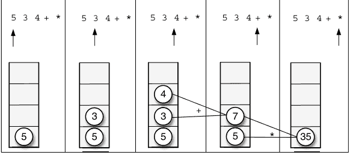

**图 6.19** 计算 RPN 表达式 5 3 4 + *。表达式从左到右读取。符号分为两类：操作数（值）和运算符。操作数被压入栈中。当遇到运算符时，从栈顶弹出最上面的两个值，共同计算出结果，再将结果压回栈中。持续执行这些步骤，直到遇到 RPN 表达式的末尾，栈顶只剩下一个最终值。


我们输入到 ComputeValueFrom 函数的是一个节点向量，由第 [1] 行的 NodeVec 定义。这对应于图 6.19 中的输入 RPN 表达式 `5 3 4 + *`，但其中的元素是来自 TNode 层次结构（第 6.6.4 节）的节点对象。返回值将由 LeafValType 表示，其别名在第 [4] 行定义。

如果输入 `node_vec` 中有任何节点，则会在第 [21] 行创建保存 LeafValType 对象的辅助栈 `auxStack`。然后，从第 [25] 行开始的 range 循环中，`node_vec` 中的节点会从左到右进行处理，如图 6.19 所示。但问题如下：尽管 `node_vec` 的所有元素都是指向 TNode 基类的智能指针，但实际指针指向的是 TNode 层次结构中的不同对象。例如，对于我们的简单表达式，我们将有三个 LeafValType，后面跟着一个 PlusOperator 和一个 MultOperator。我们需要像之前 RPN 处理算法中所描述的那样对它们进行不同处理，但我们只有 TNode 指针。因此，我们必须弄清楚如何在运行时区分一个指向 LeafValType 的 TNode 指针和另一个指向 PlusOperator 的 TNode 指针。在 C++ 中，RTTI 机制派上了用场，正如我们在第 3.19.1 节讨论 C++ 运算符 GROUP 2 时所提到的。这两种 RTTI 结构是 `typeid` 和 `dynamic_cast` 运算符。`typeid` 允许我们检查通过指针或引用所指对象的类型，即使该指针或引用指向的是基类，而相关对象的类派生自该基类。另一方面，在运行时，`dynamic_cast` 会尝试将指针或引用执行受检查的转换，转换为所请求的类型。如果转换的类型沿继承层次结构向上、向下或侧向移动，则转换将成功。否则，如果尝试 `dynamic_cast<a_pointer>`，将返回 `nullptr`。如果是 `dynamic_cast<a_reference>`，则会抛出 `std::bad_cast` 异常。我们将在代码中使用这些特性。首先，为了区分 LeafValType 对象，第 [29] 行使用 NumberLeafNode 的 `typeid` 来验证 node 所持有的对象的 `typeid`。如果它们一致，则将该对象的值压入 `auxStack`。具体来说，在第 [32] 行，node 被转换为指向 NumberLeafNode 对象的指针，从中读取值并压入栈中。但这是如何实现的呢？由于 node 是 `std::unique_ptr`，它与 NumberLeafNode 类不兼容。然而，它内置了一个重载的转换运算符，可转换为所持有类的指针。因此，`std::unique_ptr` 可以用于所有需要指向所持有对象的指针或引用的代码中。因此，可以通过将 node 转换为 NumberLeafNode 对象来调用 GetValue。

```
using NodeVec = ExpressionTreeBuilderInterpreter::NodeStack::DataContainer;

using LeafValType = double;

// Computes value of the stack
LeafValType ComputeValueFrom( const NodeVec & node_vec )
{
    auto retVal { 0.0 };

    const auto kNumOfElements = node_vec.size();
    if ( kNumOfElements == 0 )
    {
        return retVal;
    }
```

# 清单 6.29 直接从存储在栈中的 RPN 表示计算表达式值的函数（位于 *Parser, NodeStackConverters.cpp* 中）。

[PAGE 493]

# 清单 6.29（续）

```
void RPN_Value_Test( void )
{
#if BUILD_THE_TREE == 1
    assert( false );        // A fuse to ensure we compiled with the proper parameter
#endif
}
```

6 在 STL 中没有预定义的 div_by_zero 异常，因此我们可以使用 `std::overflow_error` 或 `std::underflow_error`，或者创建一个自定义异常类。


# Listing 6.30 (continued)

```
ExpressionTreeBuilderInterpreter exprParser;
string good_expr( "(1+2)*(3+(4+5))/(6-7)" );

// Let's call only the base class operator ()
if( exprParser.BaseClass::operator()( good_expr ) )
{
```

To make our exprParser - defined on line [11] as an object of the Expression TreeBuilderInterpreter class - perform parsing without any final postprocessing of the syntax tree, line [16] invokes operator() from the base class. To accomplish this, we have to put the name of the base class before the name exprParser of the object and the name of the member function. In our case, the name of the base class is TSimpleExpressionInterpreter, for which an alias BaseClass was created on line [64] in Listing 6.21. But we need to provide a qualified name (see Figure 6.2) for the member function, which in our case is operator (). Hence, analogous to the member call scheme in Figure 3.8, a general scheme for calling members of the base class(es) is as shown in Figure 6.20.


Alternatively, line [16] can be written as follows:

```
if( ( & exprParser ) ->BaseClass::operator()( good_expr ) )
```

Then, on lines [20, 21], `ComputeValueFrom` from Listing 6.29 is called with the input vector reflecting the RPN structure of the input expression. Since an exception can be thrown, the call is enclosed by the `try-catch` statement on line [18–23] (Section 3.13.2.5).

Summarizing, in this section, we have learned about the following:

+   - Basics of formal grammars, lexical analysis, and expression parsing
+   - Building class hierarchies with interfaces expressed with pure virtual functions
+   - Expression parsing with the interpreter design pattern
+   - Implementing syntax trees with the composite design pattern
+   - Object access with non-owning pointers and owning access with smart pointers
+   - Stack specialization to store `std::unique_ptr` objects
+   - Traversing tree structures with the visitor design pattern
+   - The cloning technique and prototype design pattern to create objects dynamically
+   - Converting infix expressions into RPN and stack operations
+   - RTTI with the `typeid` and `dynamic_cast` operators

# 6.7 Summary

# Things to Remember

+   - Objects can be used to model actions – for this purpose, we designate functional objects that implement the overloaded functional operator `()`
+   - The `regex` library provides functionality to match text patterns expressed with regular expressions
+   - XML can be used for a structured representation of data and its relations
+   - For better modularity, software components can be organized into static and dynamic libraries
+   - The handle-body design pattern should be used to separate abstraction (interface) from implementation in order to allow the two to vary independently
+   - The `filesystem` library provides functions and classes for file and directory operations
+   - The `chrono` library provides functions and classes for time and date operations
+   - Formal grammars are used to define computer languages
+   - The role of the interpreter design pattern is to represent grammar rules and parse language constructions
+   - The composite design pattern can be used to build self-recursive, tree-like structures, such as syntax trees, file-directory structures, menu and macro menu representations, etc
+   - The visitor design pattern is used to traverse a collection of objects, such as a tree, to provide double-dispatch access (usually called the Accept and Visit members)
+   - The prototype design pattern implements dynamic object construction based on provided prototype objects (usually with the Clone method)
+   - The type of an object can be verified at runtime with the RTTI mechanisms represented by the `typeid` and `dynamic_cast` operators

# Questions and Exercises

+   1. Refactor the system shown in Figure 6.1 to handle menu item actions. Using the composite design pattern, as shown in Figure 6.15, implement a macro command. This command is also derived from the `THandler` class from Listing 6.1. But at the same time, it contains other pre-recorded commands.

[PAGE 497]

+   2. Implement a cyclic buffer with `THandler` objects (Section 6.1). Use smart pointers.
+   
+   3. Using the `range-v3` library (https://github.com/ericniebler/range-v3), implement the letter histogram component discussed in Section 2.5.
+   
+   4. Write regular expressions to match the following:
+      - A date with its fields: the two-digit day number, followed by a dot, then the two-digit month number, a dot, and the four-digit year
+      - A C++ comment: `//` a C++ comment `...`
+      - A C-like comment: `/* a C comment */`
+      - A sentence, i.e. text starting with a capital letter and ending with a dot, semicolon, exclamation mark, or question mark
+   
+      Then use the following function to test these regular expressions:

```
void regex_test( void )
{
    // input stream
    string str( "jan.koczwara_12@agh.edu.pl" );
    cout << str << endl;

    // R"( )"  for a raw string
    regex pat( R"(([[[:alnum:]_]+)@([[[:alnum:].]+)\.([[[:alnum:]]+))" );

    // where result(s) what
    if( smatch match_res; regex_search( str, match_res, pat ) )
        for( auto m : match_res )
            cout << m << endl;
}
```

+   5. Write unit tests for the currency exchanger project.
+   
+   6. The exchange project can be arranged in many different ways. For instance, instead of a new `XML_CurrencyExchanger` class, you could write a class to convert an XML file with currency data into a format for the initialization file suitable for the base class. Draw the relations of this approach. What are its benefits and drawbacks? What would happen if you had more different formats for the XML-coded information?
+   
+   7. Remake the component in the basic version of `CurrencyExchanger` presented in Section 3.18.5 to enclose it in a class instead of the `CurrExchanger` namespace. What are the consequences of the two solutions?
+   
+   8. In Section 6.2.4, we mentioned the strategy design pattern. It is similar to the handle-body pattern but lets us dynamically change the body object depending on the runtime conditions. Implement a strategy pattern to efficiently sort vectors of different lengths. A suitable sorting algorithm – the one that best fits the current vector length – should be instantiated before the sorting action. Hint: read about sorting algorithm performance with respect to vector length.
+   
+   9. Based on the example function `RecursivelyTraverseDirectory` presented in Section 6.2.7, write function(s) to traverse a directory and create a sorted list of the files’ dimensions.

[PAGE 498]

+   10. Write a software mechanism to recursively traverse a directory and all of its subdirectories and perform an action supplied in the form of a functional object passed as a parameter (this can be a composite pattern).

+   11. Refactor the `CC_GUI` class to keep all the positions and dimensions of the controls in a separate resource file (see Listings 6.8 and 6.9). In the class initialization procedure, open that file, read the data, and properly set up the widgets. Do not forget about controlling data correctness.

+   12. Design and implement an extended version of the *CurrencyCalc_GUI* project to allow for currency type conversions in both directions, as well as choosing an arbitrary reference currency.

+   13. Find out how to create a dynamically loaded library in your OS. Remake the static library presented in Section 6.2.6 into a dynamic one, and test its behavior. What are the advantages and disadvantages of both types of libraries?

+   14. Refactor the `SyntaxTree_Test` function defined in Listing 6.27 to accept user-supplied expressions.

+   15. Extend the lexical analysis to allow for white symbols (space, tabs, etc.) and C++ numbers. For this purpose, define and use the grep patterns discussed in Section 6.2.1.

+   16. Derive a new interpreter class that accepts not only numbers but also symbols, so such expressions as `a + 3.14 * b` are recognizable. Then construct a symbol table containing the associations of symbols with their values and write a visitor to evaluate expressions.

+   17. Extend the interpreter to accept function calls with various arguments.

+   18. Design and implement a code-generation visitor for runtime evaluation of any expression. The visitor should generate text, which will be C++ statements. These will form a new program that, after a separate compilation, will provide the final code for evaluating runtime expressions. See “Simple code generation for a stack machine” in (Dick et al. 2012). This idea can be further extended to create your own simple language generator.

+   19. Implement a simple calculator using the Boost Spirit library (Boost.org 2020).

+   20. *Reflection* is a technique that lets us inspect a class without having any information about it. Especially when implementing template functions and classes, for example, we might be interested in verifying whether a type for template instantiation contains certain data or the method for a proper call. Such features will be available soon in the C++ standard. But until then, we can try to implement at least some of this functionality. For example, a reflection method can be added to a class, which returns a `std::tuple` conveying all of its data (Section 3.17). Such a reflection-aware class can be easily compared, streamed out, etc. This technique is shown in the following code, which presents a partial definition of the TBook class:

```
class TBook
{
    std::string    fAuthor;
    std::string    fTitle;
    int            fPubYear {}
```


## 7

## 计算机算术

我们知道计算机以位（bit）存储信息，即以二进制格式存储 1 或 0。在本章中，我们将讨论这对计算的影响。

### 7.1 整数值表示

在第2.1节中，我们展示了一个简化的微处理器系统架构，它作为我们的计算编程接口。在第3.1节中，我们讨论了各种 C++ 算术类型，这些类型在本书介绍的计算中已经使用过。在本节中，我们将介绍一些基本信息并讨论整数计算机算术。为清晰起见，我们从以下定义开始：

- 信息的基本单位是*位*（bit），其值为 0 或 1。由此产生了基数 \(B = 2\) 的二进制系统。
- *字节*（byte）是八位组成的有序序列。
- 字节中的每个位位置都与不同的*权重*值相关联。例如，从最右边的第 0 位开始数起的第 5 位，可以赋予权重 \(2^4 = 16\)。可以有不同的权重分配，从而产生不同的算术值。
- 字节是计算机系统中最小的可寻址内存单元。
- 计算机*字*（word）是一个字节或偶数个字节的串联。字通常对应微处理器系统的总线宽度。例如，在 32 位系统中，字长四个字节；而在 64 位系统中，字长八个字节，依此类推。

图7.1展示了一个字节的结构，包括位位置、索引 \(i\) 和权重 \(w_i\)。类似于十进制系统中值 125 被解释为 \(1 \cdot 10^2 + 2 \cdot 10^1 + 5 \cdot 10^0\)，图7.1所示字节的值 \(D\) 可以按如下方式计算：

$$D = b_7 \cdot 2^7 + b_6 \cdot 2^6 + \ldots + b_0 \cdot 2^0$$  \hfill (7.1)

其中 \(b_i\) 是字节中取值为 1 或 0 的位。根据这种解释，\(D\) 始终为正，范围为 [0...255]。例如，以下字节的值

| 0 | 1 | 0 | 1 | 0 | 1 | 1 | 1 |
|---|---|---|---|---|---|---|---|

[PAGE 501]


**图7.1** 字节是由八个值为 1 或 0 的位 \(b_i\) 组成的序列。字节的值根据与每个位位置关联的权重 \(w_i\) 来解释。如果 \(w_i\) 是基数 \(B=2\) 的连续整数幂，如图所示，那么我们得到的就是整数表示。

使用式(7.1)并从最右边的位置开始，结果如下：

\[D=2^0\cdot1+2^1\cdot1+2^2\cdot1+2^3\cdot0+2^4\cdot1+2^5\cdot0+2^6\cdot1+2^7\cdot0=1+2+4+16+64=87\]

换句话说，我们可以写成

\[01010111_2=87_{10}\]

其中下标表示数字所选用的表示基数 \(B\)。因此，2 表示**二进制基数** \(B=2\)，10 表示**十进制基数** \(B=10\)。很快我们还将看到 \(B=16\) 的表示，即**十六进制系统**，以及不太常见的 \(B=8\) 的**八进制系统**。

一般情况下，值 \(D\) 可以表示为 \(N\) 个分量之和，如下所示：

\[D=\sum_{i=0}^{N-1}b_iw_i\tag{7.2}\]

对于整数值，权重定义如下：

\[w_i=B^i\tag{7.3}\]

其中 \(B\) 表示计算基数。将式(7.3)代入式(7.2)可得

\[D=\sum_{i=0}^{N-1}b_iB^i\tag{7.4}\]

自然地，对于二进制系统，该式简化为

\[D_{IB}=\sum_{i=0}^{N-1}b_i2^i\tag{7.5}\]

其中下标 \(IB\) 表示整数-二进制（integer-binary）。然而，我们很快将看到，通过给位分配不同的权重，我们还可以得到负数和分数值。式(7.5)描述了一种从二进制表示转换为十进制值的方法，即转换为用 \(B=10\) 表示的等效数字。在下一节中，我们将展示如何执行相反的操作：将十进制值转换为给定基数 \(B\) 的数制。

[PAGE 502]

你可以使用第9.5节中描述的 *FixBinCalc* 应用程序来试验各种二进制表示和转换。另外值得一提的是二进制编码十进制（BCD）格式，它为编码在一个字节中的两个十进制值提供了一种方便的表示（见第4.15.1节）。这种格式效率不高，因为可以设计出更“紧凑”的表示。但它在嵌入式系统中很常见。此外，在第4.15节中，我们曾使用它将数字打包到 `TLongNumber` 结构中。


$87_{10}=01010111_2$

## 7.1.2 十六进制和八进制表示法

二进制表示法很不错，只是二进制表示包含的位数最多，因为它使用了最小的整数基数$B=2$。因此，使用较大的基数来表示较大的值很有用。在微处理器系统和计算机科学中，最常见的是十六进制基数：$B=16$。这么大的基数用起来很好，但我们需要解决大于9的数字的高效表示问题。例如，我们如何写出代表12的数字，而又不使它被误认为数字1后面跟着数字2？为此，我们可以使用括号，写成(11)、(13)或(15)。不过，按照以下编码，使用字母来表示大于9的数字要方便得多：

| 十进制 | 十六进制 |
|---:|:---|
| 10 | A |
| 11 | B |
| 12 | C |
| 13 | D |
| 14 | E |
| 15 | F |

让我们看看它对我们的$87_{10}$值是否适用。当$B=16$时，我们得到以下数字：

|  | 商 | 余数 |
|---|---:|---:|
| 87/16 | 5 | **7** |
| 5/16 | 0 | **5** |

也就是说，$87_{10}=57_{16}=57_{hex}=0x57$

稍微不那么常用的是八进制表示法，即$B=8$。在这种情况下，我们得到

|  | 商 | 余数 |
|---|---:|---:|
| 87/8 | 10 | **7** |
| 10/8 | 1 | **2** |
| 1/8 | 0 | **1** |

因此，$87_{10}=127_{oct}=0127$。在C++中，我们可以用全部四种进制（2、8、10和16）来表示该值，如表3.1所示。

但是在以2的幂为基数的一组进制之间进行转换时，有一种比连续除法更简便的方法。适用以下规则：

[PAGE 504]

<!-- no content -->

[PAGE 505]

# 7.1.4 负值与减法

减法也遵循通常的算术规则。然而，如果被减去的值（*减数*）大于我们从中减去的值（*被减数*），那么我们必须进行*借位*。让我们分析以下示例：

| 87<sub>dec</sub> | = bin | 0 | 1 | 0 | 1 | 0 | 1 | 1 | 1 |
|---|---|---|---|---|---|---|---|---|---|
| 100<sub>dec</sub> | = bin | 0 | 1 | 1 | 0 | 0 | 1 | 0 | 0 |
| −13<sub>dec</sub> | = bin | 1 | 1 | 1 | 1 | 0 | 0 | 1 | 1 |
| *借位* | | | | ⟶ | | | | | |
| *借位* | | ⟶ | | | | | | | |
| *借位* | | − − − − − ⟶ | | | | | | |

我们会遇到三次借位，从第五位开始。然而，最后一次借位（用虚线箭头表示）必须从外部位借入。这意味着结果是*负数*。因此，我们需要更详细地讨论负值的表示。我们将看到，减法可以像加上一个负值那样执行。

在开始之前，回顾一下负数的基础定义：

$$a + (-a) = 0.$$  (7.8)

此外，减法等价于加上一个负的减数：

$$a - b = a + (-b).$$  (7.9)

以上两个公式在实现减法运算时非常有用。在文本或公式中表示负值就是这么简单。问题在于如何在数值表示中包含负号(−)。这是一个二进制信息：一个数要么是负数，要么不是负数。因此，我们需要加入一个额外的符号位来传达这一信息。这没问题，但关于它的位置和行为有多种选择，如表7.1所列。

**表7.1** 在二进制表示中表示负值的技术。

| 负值表示 | 描述 | 示例 |
|---|---|---|
| 符号-数值（SM） | 牺牲最高有效位（MSB）来表示符号：0表示正值，1表示负值。其余位表示正值的幅值。一个小问题是，零可能存在双重表示。 | 正值 87<sub>dec</sub><br>`S ─── M ───`<br>`0 1 0 1 0 1 1 1` |
| 反码（C1） | 这种表示是在对所有位取反后得到的：即将0变为1，将1变为0。 | `1 0 1 0 1 0 0 0` |
| 补码（C2） | 它是最常用、最有用的负值表示方法。它是在C1表示的基础上加1得到的。正是由于这一条件，式(7.8)立即成立。 | `1 0 1 0 1 0 0 1` |

[PAGE 506]

考虑到负值的表示，我们需要如下修改式(7.5)：

$$D_{SM}=(-1)^S\cdot\sum_{i=0}^{N-2} b_i2^i$$  (7.10)

以及

$$D_{C2}=-S\cdot2^N+\sum_{i=0}^{N-1}b_i2^i=-S\cdot2^N+D_{IB}$$  (7.11)

其中$S=b_{N-1}$表示符号位，其位索引如图7.1所示。对于一个字节，式(7.11)中的第一项在正值时为0，在负值时为−256。后者为我们提供了一种快速求正值$D_{IB}$的负值的方法：只需从$2^N$中减去它。

利用上述规则，我们可以很容易地求出−87的位表示为$256−87=169$。我们可以验证$169_{dec}=10101001_{bin}$就是−87。由此我们可以验证，负值的MSB始终被置为1。

由前面的解释可知，在大多数情况下，负值最方便的二进制表示是C2。0用所有位都为0来表示，同时式(7.8)的性质也得到满足。在7.1节中，我们注意到，对一个字节按式(7.1)计算得到的值$D$在[0...255]范围内。这仅适用于正值，在C++中，正值通过在整数类型上添加unsigned后缀来指示（3.1节）。然而，在正负值领域中，一个字节可以存储[−128...127]范围内的值。在C++中，这些值不带后缀表示，或者偶尔使用signed关键字（表3.1）。使用C2格式进行运算的另一个重要特性是，减法可以直接作为加一个负的第二项来执行：也就是说，依据式(7.9)。虽然C2格式下的加法和减法很简单，但我们将看到，某些运算（如乘法）在SM表示中更简单。

# 要点

+   - 在基数$B$中表示一个值所用的数字，是通过将商连续除以$B$所得的余数得到的，商的初值即为该值。
+   - 当把值从二进制表示转换为基数为2的倍数（如十六进制或八进制）的表示时，我们可以分别将连续的数字转换为其对应的位表示。
+   - 减法等价于加上一个负的减数。
+   - 对于有符号值，MSB为1表示负值。
+   - 无符号字节可以表示[0...255]范围内的值。在C2中，有符号字节可以存储[−128...127]范围内的值。
+   - 要得到正数$a$的C2表示，我们可以从$2^N$中减去它，其中$N$表示表示中的位数（对于字节为8，依此类推）。

尽管这里介绍的基本性质和示例都是针对字节的，但它们可以很容易地推广到由多个字节组成的计算机字。

[PAGE 507]

我们有了这个表示，并且必须将1加到左边一位上。这对减法同样成立，因为减法就是加上一个负的第二项。然而，在有符号运算的情况下，两个正值相加时，它们的幅值可能恰好使结果的MSB指示为负值。当进位位从MSB – 1传递到MSB位时，就会发生这种情况。这种情况称为_溢出_，通常通过设置微处理器中的一个特殊_V_控制位来指示。最后一个控制位是零位，记为_Z_位，当结果中的所有位都为0时，它被置位。它用于比较数值，因为_Z_置为1意味着各值相等。控制位在表7.2中进行了总结。

\begin{tabular}{ccc}
控制标志 & 描述 & 示例 \\
零标志 _Z_ & 1 – 运算结果为0（结果的所有位都为0）。0 – 结果不为0。 &  \\
进位标志 _C_ & 1 – 结果太大，无法放入位表示中（需要更多位）。0 – 结果可以放入该表示中。 &  \\
溢出标志 _V_ & 1 – 在两个最高有效位之间发生了进位。对于有符号运算，这意味着两个正值相加产生了负结果。0 – 两个最高有效位之间没有进位。 &  \\
\end{tabular}

注意，两个_N_位值相加时，结果总能放入_N_+1位中。如前所述，如果进位位被置位，则表明结果无法放入_N_位表示中。另一方面，对于乘法，我们可能需要多达2_N_位。

为了理解溢出_V_位的作用，让我们回到7.1.3节的示例。这次，我们假设使用C2编码进行有符号运算。将两个值相加会得到以下输出：


## 7.1.6 小数的表示

图7.1展示了一个字节的结构。如所示，通过给第 \(i\) 个位分配权重 \(w_i = 2^i\)，我们可以精确地表示 [0...255] 范围内的整数值。然而，如果分配不同的权重，就可以表示不同的数值范围。例如，若假定权重为小数权重，则可以表示小数，如图7.2所示。


**图7.2** 通过将权重 \(w_i\) 设为连续的 \(2^{-i}\) 值来表示一个字节的小数值。与整数值不同，并非所有十进制小数都能被精确表示。

更精确地说，在 \(B = 2\) 的情况下，将式(7.3)中的权重定义 \(w_i\) 改为如下形式

\[
w_i = 2^{-(i+1)}
\tag{7.12}
\]

并将其代入式(7.2)，可得

\[
D_{FB} = \sum_{i=0}^{N-1} b_i 2^{-(i+1)}
\tag{7.13}
\]

其中 FB 代表小数二进制（fraction-binary）。对比图7.1和图7.2，可以注意到位的编号是对称的。在这种假定下，整数部分的最高有效位（MSB）对应于 \(i = N - 1\)，而小数部分的 MSB 位于 \(i = 0\)。还要注意，在两种表示中，整数部分和小数部分的位数都是固定的。因此，这些是*定点*（FX）表示，区别于将在7.4节讨论的*浮点*（FP）表示。

例如，让我们考虑如下的位分配，它在7.1节开头曾作为示例出现：

| \(b_0\) | \(b_1\) | \(b_2\) | \(b_3\) | \(b_4\) | \(b_5\) | \(b_6\) | \(b_7\) |
|---|---|---|---|---|---|---|---|
| 0 | 1 | 0 | 1 | 0 | 1 | 1 | 1 |

对于整数表示，我们使用式(7.1)。但要计算小数，则需要改用式(7.13)，如下所示：

\[
D = 2^{-1}\cdot 0 + 2^{-2}\cdot 1 + 2^{-3}\cdot 0 + 2^{-4}\cdot 1 + 2^{-5}\cdot 0 + 2^{-6}\cdot 1 + 2^{-7}\cdot 1 + 2^{-8}\cdot 1
\]

\[
= 2^{-2} + 2^{-4} + 2^{-6} + 2^{-7} + 2^{-8} = 0.33984375
\]

换句话说，我们可以写成 \(01010111_2 = 0.33984375_{10}\)。

我们看到，相同的位分配确实会得到不同的值。它们取决于权重定义。回顾在整数表示中，最低有效位（LSB）的值为1，因此所有中间值都可以被精确表示。但在小数的情况下，LSB的值为 \(2^{-8} = 0.00390625\)，我们可以以其整数倍来操作。将示例数值除以LSB，得到如下结果：

\[
0.33984375 / 0.00390625 = 87
\]

这令人意外吗？未必。如果回想一下，相同位表示的整数值正好是87，就不会感到意外。换句话说，小数表示意味着按LSB的小数值对整数值进行*重新缩放*。形式上，式(7.5)中给定的整数二进制值 \(D_{IB}\) 可以按如下方式重新缩放为新值：

\[
\hat{D} = s \cdot D_{IB} + f
\tag{7.14}
\]

其中 \(s\) 表示缩放因子，\(f\) 是偏移值。在我们的示例中，\(D_{IB} = 87\)，\(s = 2^{-8}\)，\(f = 0\)。这也意味着，如7.1.4节所讨论的，相同的C2编码可用于表示负的小数值。

一个重要的问题是，式(7.13)的表示对于实数小数的精度如何。注意，精度 \(P\) 与LSB中可表示的最小可能值有关：

\[
P = B^{-N} = 2^{-N}
\tag{7.15}
\]

对于一个字节，\(P = 2^{-8} = 0.00390625\)。这意味着所有小于该值的数都会被表示为0——即被忽略。另一方面，可表示的最大值为 \(1.0 - P\)，在本例中为 \(0.99609375\)。此外，以 \(P\) 的整数倍进行操作，意味着并非所有十进制小数都能以二进制形式精确表示。我们将会看到，即使增加位数也只能在一定程度上有所帮助；这样做可以限制表示误差，但在某些情况下永远无法实现完全精确的表示。这是一个重要的观察结果，它解释了由*舍入误差*导致的计算不精确性。我们将在7.4.4节中结合浮点值讨论舍入方法。

现在让我们设计一个算法，将十进制小数转换为最接近的二进制表示。由式(7.13)表示的值小于1。如果将其乘以2，结果如下：

\[
2 \cdot D_{FB} = b_0 + \sum_{i=1}^{N-1} b_i 2^{-i}
\tag{7.16}
\]

注意，当小数 \(D\) 乘以2时，会得到两个值：一个整数0或1，以及一个小于1的小数。前者立即给出小数表示中的第一位 \(b_0\)。要找到后续的位，需要对式(7.16)中的第二项乘以2，并重复整个过程。这一过程持续到满足以下条件之一为止：要么小数部分恰好为0，要么达到最大位数 \(N\)。然而，正如我们之前指出的，对于某些小数，位表示只是真实值的近似。让我们验证这个过程，首先在十进制域中，取 \(B = 10\) 和值 \(D = 0.35\)。得到如下整数（\(I\)）和小数（\(F\)）序列：

|   | I | F |
|---|---:|---:|
| 0.35 · 10 | **3** | 0.5 |
| 0.5 · 10 | **5** | 0 |

读取 \(I\) 的值，我们立即得到0.35。现在换成二进制基底：\(B = 2\)，同样的值 \(D = 0.35\)。对于 \(N = 8\)，得到如下结果：

| \(i\) |   | \(I\) | \(F\) |
|---:|---|---:|---:|
| 0 | 0.35 · 2 | **0** | 0.7 |
| 1 | 0.7 · 2 | **1** | 0.4 |
| 2 | 0.4 · 2 | **0** | 0.8 |
| 3 | 0.8 · 2 | **1** | 0.6 |
| 4 | 0.6 · 2 | **1** | 0.2 |
| 5 | 0.2 · 2 | **0** | 0.4 |
| 6 | 0.4 · 2 | **0** | 0.8 |
| 7 | 0.8 · 2 | **1** | 0.6 |
| 8 | 0.6 · 2 | **1** | 0.2 |

根据式(7.14)的缩放性质，我们可以通过如下方式得到相同的结果：

1. 计算 \(0.35 \cdot 2^8 = 89.6\)。
2. 取上一步结果的整数部分，并将其转换为二进制表示：\(89_{dec} = 01011001_{bin}\)。

我们看到，无论采用哪种方式，都能得到 \(0.35_{dec} \approx 01011001_{bin}\)。然而，这只是0.35的近似值，因为 \(0.6 \cdot 2^{-8} = 0.00234375\) 被舍弃了。换句话说，产生了舍入误差：

\[
\Delta_0 = |0.35_{dec} - 01011001_{bin}| = |0.35 - 0.34765625| = 0.00234375
\]

这个误差是否可以接受取决于具体应用。但我们还可以做得更好。如果我们将前面序列中的第8位加到第7位上，则 \(0.35_{dec} \approx 01011010_{bin}\)，误差如下：

\[
\Delta_1 = |0.35_{dec} - 01011010_{bin}| = |0.35 - 0.3515625| = 0.0015625
\]

注意 \(\Delta_1 < \Delta_0\)。所以我们所做的其实是选择了不同的舍入算法——四舍五入到最接近的数，而不是向0舍入。这里我们可以看到正确的舍入有多么重要；这将在7.4.4节中进一步讨论。此外，\(\Delta_1 < \frac{1}{2}P = 2^{-9} = 0.001953125\)。在FX表示中，最大舍入误差固定为常数 \(\pm \frac{1}{2}P\)，如图7.3所示。


**图7.3** 定点表示中的最大舍入误差被限制为 \(\pm \frac{1}{2}P = 2^{-N-1}\)。实数值 \(x_1\) 和 \(x_2\) 用最接近的定点值表示。\(\bar{x}_n = D_{FB}(n)\) 表示第 \(n\) 个定点值，\(0 \le n < 2^N\)。超出范围的值会导致溢出，对于无符号数，结果表现为数值回绕。

### 要点记忆

- 与整数不同，某些实数小数的二进制表示无法做到精确。差值的绝对值称为舍入误差。
- 在具有 \(N\) 个小数位的FX表示中，最大舍入误差为 \(\pm \frac{1}{2}P = 2^{-N-1}\)。
- 要将十进制小数转换为二进制表示，需要将该小数乘以2，结果的整数部分提供一位表示位。然后对剩余的小数部分重复该过程，直到获得 \(N\) 位为止。

## 7.2 二进制移位运算

从日常观察中我们知道，乘以或除以10很简单——只需将小数点向左或向右移动一位。例如，\(-12.34\) 在小数点向右移动一位后变成 \(-123.4\)。因此，它被乘以了10。另一方面，当小数点向左移动一位时，新值为 \(-1.234\)。在这种情况下，原始值被除以了10。因此，向右移动一位相当于将数值乘以基数，而向左移动一位则相当于除以基数。这对任何基数都成立，包括二进制。

这些规则原则上很简单；但一如既往，还有更多细节——例如，移位后，空出的位置应放入什么值？例如，如果我们将位向左移动，那么空出的最右位可以设为0。但如果数值是带符号的，最左位该如何处理？如果将其丢弃，那么负值可能会变成正值，反之亦然。或者，我们能否进行位循环——即将最左位移到最右位置？有很多选择，可能的规则总结于表7.3中。

移位运算是操作位的高效方式。通常，使用移位运算符实现整数乘以或除以2及其倍数时，比相应的算术乘法或除法更快。


## 表7.3 移位操作说明。

\begin{tabular}{ccc}
移位类型 & 描述与示例 & 示意图 \\
逻辑左移 & 位按指定数目向左移动。最左边的位丢失。最右边的位置用0位填充。 & \\
逻辑右移 & 位按指定数目向右移动。最右边的位丢失。最左边的位置用0位填充。 & \\
算术左移 & 与逻辑左移类似。注意符号位可能丢失。 & \\
算术右移 & 复制符号位以保留符号。 & \\
循环左移 & 位向左移动，最左边的位插入最右边的位置。通常在微处理器的机器码中可用。有时链中会涉及额外的位。 & \\
\end{tabular}

现在，适当调整式(7.10)和(7.11)，我们得到以下值：

$$D_{SM}=(-1)^S\cdot\sum_{i=0}^{N-2}b_i2^{i-q}$$  (7.18)

以及

$$D_{C2}=-S\cdot 2^N+\sum_{i=0}^{N-1}b_i2^{i-q}$$  (7.19)

其中 $S=b_{N-1}$ 是符号位。对于这种实现，我们选择了SM编码。

# ### 7.3.2 FxFor类的定义

如前所述，FxFor模板类的目的是引入一种FX格式和基本算术运算。为什么我们需要它？在处理实数时，一个明显的选择是使用浮点格式，在C++中通过`float`和`double`这两种类型实现，这两种类型的精度不同。但这两种算术具有不同的舍入误差，在某些应用中，我们可能对FX表示提供的恒定误差感兴趣。在定点域中使用与`double`相同的字节消耗，我们可以获得大约2e−10的恒定误差。另一方面，尽管`float`通常只消耗四个字节，但在处理大数据（如视频流）时，将合适的表示缩减为2字节是一种可行的选择：例如，将所需的16 GB减少到8 GB，等等。最后，FX算术在嵌入式系统中仍有一席之地，尤其是那些配备相对低功耗微处理器的系统。另一方面，浮点允许所表示的数具有高得多的动态范围，我们将在第7.4节讨论这一点。

在开始编写代码之前，让我们概述将要使用的新编程技术：

- 前置和后置递增运算符重载
- 使用`constexpr`进行编译期计算
- 编译期与运行期断言：`static_assert`与`assert`

此外，我们还将练习编写模板成员函数（第4.8.5节）和各种位操作（第3.19.1节）。

FxFor模板类的定义从清单7.1的第[8]行开始。定义了三个模板参数，如下：

- `ST` 定义底层数据对象的类型。它是一个C++整数类型，例如`short`或`int`
- `Prec` 只是一个整数，定义小数位数 $q$
- `ACC_TYPE` 是用于存储乘法结果的类型。因此，它的大小应为`ST`的两倍。尽管情况并非总是如此，但选择了潜在的最长类型`unsigned long long`

FxFor的主要特点是尽可能精简，因此唯一的数据是第[14]行定义的`ST`类型的`fValue`。有趣的是，我们可以将FxFor的其余部分看作是对整数`fValue`的一种包装。注意，`fValue`在第[14]行被初始化。尽管该成员也可以在所有构造函数中初始化，但在使用constexpr时，这种“随时”初始化对于满足编译器非常重要。

从第[19]行开始，一系列简单的get/set函数开始。由于我们选择了SM表示，GetInternalValue在C2中的作用是以更常见的C2格式返回我们的内部数据。第[23]行的转换按照表7.1中描述的算法进行。该组中其他函数的作用应该很清楚。

这个类中所有函数前面的constexpr前缀很有趣。它最早是在第4.8.3节的示例函数RevertEndianness中引入的。constexpr是一种相对较新的编程技术，在C++11中引入，并在后续标准中进行了修改。它的目的是让函数在编译期间被编译和执行。因此，它是在整个翻译单元编译之前的一种预执行。目的很简单——如果我们能在编译期间预先计算函数的值，而不是在程序运行时计算，就能获得性能提升。constexpr声明函数背后的基本规则如下：

- 如果constexpr声明函数的参数也是constexpr，那么该函数可以被编译和执行，结果直接插入到最终的执行代码中
- 否则，该函数的行为与任何其他函数一样：它在运行时执行

但还有其他一些规则使得编写constexpr代码略显特殊。我们很快会看到这些示例，但在此总结有助于理解编译器的行为：

- 如果constexpr函数是为constexpr对象编译的，则假定它是const函数：也就是说，它不能更改该对象的状态。但是，const不会自动添加到函数声明中（从C++14开始），因此在“正常”操作中，除非程序员显式编写const，否则它不是const。
- 编译器需要在整个单元的编译过程中编译并运行该函数。因此，代码必须是正确的。即使在“非constexpr”编译中它可以编译，编译器也倾向于对某些语言特性非常严格，例如未初始化的变量等。因此，通常会产生警告的小代码问题可能会阻止编译器处理constexpr函数。问题是，这通常以隐蔽的方式发生，我们没有充分了解真正的原因。因此，调试constexpr代码有时可能很麻烦。一个实用的解决方案是让代码运行，检查所有警告，然后在必要时添加constexpr。这个提示也适用于调试模板类。
- 要验证某些内容是否按constexpr操作，请使用static_assert。这与在运行时执行的assert不同。
- const对象与constexpr对象之间的区别在于，前者是一个碰巧被声明为const的普通对象，因此初始化后，其状态不能改变。后者则旨在编译期间被编译和创建，并将结果插入到最终代码中。这也意味着这样的对象隐式地必须是const，因为一旦在其余代码准备好之前计算完毕，就不能以任何方式重新计算或更改。
- 从constexpr函数中，只能调用constexpr函数。
- constexpr给编译器带来了大量工作，因此编译时间可能会很长。

有了这些知识，让我们分析其余代码。在第[30, 36–38]行，我们设置了一些位掩码。例如，这些掩码常用于访问符号位或小数部分最重要的位。最后，第[48–55]行定义了许多辅助函数，这些函数返回绝对值或允许访问整数部分和小数部分。通过适当的位掩码或移位操作可以实现此类操作（第3.19.1节中的“蓝色”运算符）。

# **清单7.1** 定义表示FX算术格式的模板`FxFor`类（见`CppBookCode, FxFor.h`）。

```
```cpp
///////////////////////////////////////////////
// Class for fixed-point data types.
// No saturation, no overflow control.
// SupportType defines an UNSIGNED integer type for the whole number
// Prec - defines a number of fractional bits
// ACC_TYPE - Accumulator type (for intermediate results)
///////////////////////////////////////////////
template <typename ST, int Prec, typename ACC_TYPE = unsigned long long >
class FxFor
{
private:

    // Stores the whole number
    ST    fValue {};

public:

    // Returns an internal representation in Sign/Magnitude format
    constexpr ST GetInternalValue( void ) const { return fValue; }

    // Returns an internal representation in C2 format
    constexpr ST GetInternalValue_in_C2( void ) const
    { return IsPositive() ? fValue : (~fValue | kSignMask) + 1; }

    constexpr void SetInternalValue( ST new_val ) { fValue = new_val; }

public:

    // Local const for precision
    enum: ST      { kPrec = Prec };

private:

    // Let's define some useful flags
    enum: ST {
        kSignMask   = ST(1) << ( 8 * sizeof( ST ) - 1 ), // sign bit (integer MSB)
        kIntegerLSB = ST(1) << kPrec,                    // LSB of the integer part
        kFractMSB   = kPrec > 0 ? ST(1) << kPrec - ST(1) : 0 // MSB of the fract part
    };

    // A shortcut to this type
    using FxType = FxFor< ST, Prec, ACC_TYPE >;

public:

    // Some raw data manipulators
    constexpr ST DataValueAbs( void ) const
    { return fValue & ~kSignMask; } // Return the absolute value (always positive)

    constexpr ST GetMagnitudeOfIntegerPart( void ) const
    { return DataValueAbs() >> kPrec; }

    constexpr ST GetFractionalPart( void ) const
    { return fValue & ( kIntegerLSB - 1 ); }
    // ( kIntegerLSB - 1 ) sets all bits of the fractional part
```
```


## 7.3.3 类 *FxFor* 的选定方法

在本节中，我们将考察一些代表性成员函数的实现细节。让我们从转换过程开始，它实现为第 [3–4] 行的转换构造函数。该构造函数将内置 `double` 类型所表示的浮点数转换为我们类所表示的 FX 格式。基本上，它遵循第 7.1.6 节所述的缩放性质。但在其开头（第 [6–10] 行），会存储符号，并将输入浮点值变为正数。然后，在第 [13] 行应用标准的值强制转换。它只是使用内置的标准舍入过程截去小数部分。这样，第 [16] 行将整数部分复制到内部表示 `fValue` 中，随后在第 [17] 行立即将其移位到正确的位置。

现在需要获取并转换输入浮点值 `x` 的小数部分。小数部分就是 `x` 与之前计算的整数部分之差，如第 [19] 行所计算的那样。然后按照式 (7.14) 的指导，在第 [21] 行对其进行缩放。这样，第 [22] 行将所得小数部分转换为内部类型 `ST`，并在第 [24] 行通过简单的逻辑或运算将其与 `fValue` 合并。最后，在第 [26–27] 行中，我们处理负号。

有趣的是，例如，如果 `minus_sign` 不是在第 [6] 行而是在后续行中初始化，那么尽管代码在正常情况下能够编译，但在处理 constexpr 时编译器会中止。¹ 因此，使用 constexpr 时需要格外小心。

```cpp
// ============================================================
// The type-converting constructor: float to fixed
template< typename ST, int Prec, typename ACC_TYPE >
constexpr FxFor< ST, Prec, ACC_TYPE >::FxFor( double x ) : fValue( 0 )
{
    bool minus_sign { false };
    if( x < 0.0 )
    {
        minus_sign = true;      // remember the sign
        x = -x;                 // then take the absolute value
    }

    ST int_part = static_cast< ST >( x );   // here we use the standard conversion
                                           // from the double which cuts off the fraction

    fValue = int_part;
    fValue <<= kPrec;          // put integer part into its place

    double fract_part = x - int_part;

    double scaled_fraction = fract_part * static_cast< double >( kIntegerLSB );
    ST fraction = static_cast< ST >( scaled_fraction );

    fValue |= fraction;        // join the two together

    if( minus_sign == true && fValue != 0 )
        MakeNegative();        // finally consider the sign
}
```

¹ 已使用 Microsoft Visual 2019 编译器验证。


相反方向的转换如图 4.22 所示，通过 `operator double()` 实现，如第 [33–34] 行所示。同样地，在第 [37] 行使用了缩放公式 (7.14)，但这次方向相反。因此，在第 [38] 行，小数部分被除以与整数部分最低有效位相对应的值。换句话说，这对应于整数 1 的位值，恰好是 `fValue` 成员中 `kIntegerLSB` 位的值。

然后，在第 [40] 行，将整数部分加到结果上；在第 [41] 行，设置正确的符号。

**代码清单 7.3  类型转换运算符 `double()` 的定义（位于 *CppBookCode, FxFor.h*）。**

```cpp
// We repeat the same code as for the "double" conversion to
// avoid implicit conversion from "float" to "double" if additional
// function were used.
template<typename ST, int Prec, typename ACC_TYPE >
constexpr FxFor< ST, Prec, ACC_TYPE >::operator double() const
{
    // Start from the fraction
    double retVal = static_cast< double >( GetFractionalPart() )
                  / static_cast< double >( kIntegerLSB );

    retVal += GetMagnitudeOfIntegerPart();      // now add the integer part
    return IsNegative() ? - retVal : retVal;
}
```

现在继续讨论一些典型的算术运算符。首先是前缀递增运算符，其定义始于第 [44–45] 行。在第 [47] 行，它简单地调用递增运算符 `+=`，我们稍后会介绍该运算符。然后，需要返回同一个对象。这在第 [48] 行完成，只需返回 `* this`。

后缀版本的递增运算符始于第 [53–54] 行。为了区分两者，后缀版本带有一个虚拟形参 `int`。不过，它的实现要稍微复杂一些，因为需要返回“旧”版本，而对象本身需要加 1。因此，在第 [56] 行，通过使用 `* this` 对象调用复制构造函数来创建新对象。然后，与前一个函数一样，在第 [57] 行调用参数为 1 的 `+=` 运算符来递增对象。最后，在第 [58] 行返回保存的对象。了解了前缀和后缀运算符的精确操作后，我们就明白为什么后缀运算符在计算中代价要高得多。这主要是因为需要创建并返回一个中间对象。在这里问题不大，但想象一下对矩阵执行递增操作的情形。

**代码清单 7.4  前缀和后缀递增运算符的定义（位于 *CppBookCode, FxFor.h*）。**

```cpp
// prefix
template<typename ST, int Prec, typename ACC_TYPE >
constexpr typename FxFor< ST, Prec, ACC_TYPE >::FxType & FxFor< ST, Prec, ACC_TYPE >::operator ++ ()
{
    * this += 1;
    return * this;
}

// postfix
template<typename ST, int Prec, typename ACC_TYPE >
constexpr typename FxFor< ST, Prec, ACC_TYPE >::FxType FxFor< ST, Prec, ACC_TYPE >::operator ++ ( int )
{
    FxType tmp( * this );    // this unfortunately requires a temporary copy
    * this += 1;
    return tmp;
}
```

现在讨论两种最基本的算术运算。首先是加并赋值运算符 `+=`，定义在第 [60–61] 行（参见 GROUP 15、表 3.15）。求和很简单，只是需要正确考虑符号的不同组合。符号在第 [65–66] 行读取。然后，我们在双层的 if 语句中选择合适的求和算法。考虑第一个操作数（即由 `this` 表示的操作数）为负、第二个操作数为正（即 `f` 对象）的情况：例如表达式 −13.5 + 10.0。在第 [86] 行，第一个对象被改为正值。如果 `fValue` 小于 `f.fValue`，则在第 [92] 行从 `f.fValue` 中减去 `fValue`，然后结束，因为结果为正。否则，如前面的例子，在第 [96] 行进行 13.5 − 10.0 的减法，得到 3.5；其符号将在第 [99] 行被改变以给出最终结果 −3.5。但我们需要避免给零值赋负号，如第 [98] 行所检查的那样。这是符号-数值（SM）表示法的特点之一。

**代码清单 7.5  加并赋值运算符 `+=` 的定义（位于 *CppBookCode, FxFor.h*）。**

```cpp
template< typename ST, int Prec, typename ACC_TYPE >
constexpr typename FxFor< ST, Prec, ACC_TYPE >::FxType &
                    FxFor< ST, Prec, ACC_TYPE >::operator += ( FxType f )
{
    // We perform the sign-magnitude arithmetic
    bool first_is_negative  = IsNegative();
    bool second_is_negative = f.IsNegative();

    if( first_is_negative )
    {
        if( second_is_negative )
        {
            // Both are negative

            MakeAbs();          // Take the absolute value of the first operand
            f.MakeAbs();        // Take the absolute value of the second operand

            fValue += f.fValue; // Add the bare magnitudes;

            MakeNegative();     // And negate the result
        }
        else
        {
            // The first is negative, the second is positive

            MakeAbs(); // simply operate on magnitude (disregarding the sign bit)

            // Here we compare only the magnitudes,
            // The second is positive, so there is no need to get its abs
            if( fValue <= f.fValue ) // "soft" to make 0 positive
            {
                fValue = f.fValue - fValue; // and we do NOT change the sign
            }
            else
            {
                fValue -= f.fValue;
                assert( IsPositive() );
                if( fValue != 0 )
                    MakeNegative();        // and negate the result
            }
        }
    }
    else
    {
        if( second_is_negative )
        {
            // The first is positive, the second is negative

            f.MakeAbs();   // simply operate on magnitude (disregarding the sign bit)

            // Here we compare only the magnitudes;
            // The first is positive, so there is no need to get its abs
            if( fValue >= f.fValue )  // "soft" to make 0 positive
            {
                fValue -= f.fValue;  // and we do NOT change the sign
            }
            else
            {
                fValue = f.fValue - fValue;
                assert( IsPositive() );
                if( fValue != 0 )
                    MakeNegative();        // and negate the result
            }
        }
        else
        {
            // Both are positive

            fValue += f.fValue;
        }
    }

    return * this;
}
```

SM 中乘法的实现要短得多，如第 [135–137] 行开始的 `operator *=` 定义所示。同样，两个操作数的符号在第 [140–141] 行被读取并存储在临时对象中。然后，在第 [144] 行创建临时对象 `theAccumulator`。毫不奇怪，它是 `ACC_TYPE` 可能的最长位表示，因为它的作用是在第 [150] 行存储乘法的结果。接着，需要通过对 `theAccumulator` 右移 `kPrec` 位来正确缩放，如第 [155] 行所示。起初，我们可能认为需要进行两次这样的移位。但其中一次已经在前面的操作中完成了，因为通过 `fValue` 的排列方式，二进制小数点已经在左侧 `kPrec` 位处。在第 [158] 行，调整后的累加器被转换并复制到 `fValue` 对象。因此，我们必须确保结果能够容纳且不会发生整数溢出。最后，符号在第 [161–162] 行设置，当前对象在第 [164] 行返回。

**代码清单 7.7  模板 `ComputeRoundingError` 函数的定义，用于计算浮点表示与定点表示之间的差异（位于 *CppBookCode, FxFor.h*）。**

```cpp
//////////////////////////////
// This function returns the difference in representations
// between double and FxFor<>
//////////////////////////////
//
// INPUT:
//        d - an input double value
//        f - FxFor<> to be checked
//
// OUTPUT:
//        difference (as a double value) between double
//        and fixed representation of this number

template< typename D, int P, typename A >
constexpr auto ComputeRoundingError( const double d, const FxFor< D, P, A > f )
{
    auto diff( d - static_cast< double >( f ) );
    return diff < 0.0 ? -diff : diff;   // std::fabs failed to be constexpr friendly
}
```

最后，在第 [188–191] 行，通过 `using` 指令引入了一些有用的别名。在第 [195–196] 行创建了两个专门用于纯小数类型的名称。

**代码清单 7.8  由 `FxFor` 类创建的一些常用类型的有用别名的定义（位于 *CppBookCode, FxFor.h*）。**

```cpp
// Here we define the specific data types. Be careful, however,
// to check the size of built-in types on your machine.

using FX_8_8      = FxFor< unsigned short, 8 >;
using FX_16_16    = FxFor< unsigned int, 16 >;
using FX_24_8     = FxFor< unsigned int, 8 >;
using FX_8_24     = FxFor< unsigned int, 24 >;

// The following types are for normalized numbers
// for which their magnitude is less than 1.0.
using FX_PURE_FRACT_15 = FxFor< unsigned short, 15 >;
using FX_PURE_FRACT_31 = FxFor< unsigned int, 31 >;
```

### 7.3.4  FxFor 的应用

现在 `FxFor` 已经就绪，是时候检验其运行了。不过，我们先从一些有用的辅助工具开始，如代码清单 7.9 所示。

第 [3–4] 行定义了一个用于常量值的 `template constexpr`。它取一个常量圆周率 pi 的值，并赋值给模板实例化时给定的类型。这样，我们就可以定义 `gkPi< double >`、`gkPi< float >` 或 `gkPi< FX_8_8 >`，我们很快就会看到。

**代码清单 7.9  辅助工具（位于 *CppBookCode, FixedPtArithm.cpp*）。**

```cpp
// New way of defining constants
// with variable templates
template< typename T >
constexpr T gkPi = T( 3.1415926535897932385 );
```


### 7.4 浮点数表示

计算机通常与计算相关联。计算机辅助设计系统、物理仿真、天气预报、太空飞行、人工智能等，所有这些以及更多内容都在很大程度上依赖于计算机执行的数学运算。它们都需要在计算机内存中以数值形式表示数值。我们在前面的章节中讨论了整数和浮点算术。然而，如果我们考虑对范围从，例如，-1500.13 到 1.2e+12 的数值进行计算，我们可以看到这些格式存在若干重要限制。必须发明一种机制，以便高效表示这些数值，同时兼容各种计算机平台。这种表示形式至少已经存在了半个世纪，以 *floating-point* (FP) 格式的形式出现。我们在本书中展示的许多示例都使用了它。

#### 7.4.1 浮点数格式中的数值表示

为了分析浮点数计算的特性，我们先从该格式的表示方法开始，如图 7.5 所示。数值 D 的表示如下（Goldberg 1991）：

$$D = (-1)^S \cdot M \cdot B^E = (-1)^S \cdot (a_0 \cdot a_1 \ldots a_{p-1}) \cdot B^E \tag{7.20}$$


**图 7.7** 当 *B* = 2、精度为 *p*、指数为 *E* 时正浮点数的分布。浮点数值以红色显示。可以清晰地看到对应于不同指数 *E* 的多组数值“聚集区”。例如，在 (a) 和 (b) 图中，可以明显看到四组，分别对应于 *E* = -1、0、1 和 2。组内的间距相同，但组与组之间的间距按基数 *B* 的倍数增大。


**图 7.8** 当 *B* = 10、精度 *p* = 2、指数 *E* ∈ [-1, +1] 时正浮点数的分布。浮点数值以红色显示。

- *溢出（Overflow）* – 结果太大，无法被正确表示
- *下溢（Underflow）* – 结果太小，无法被正确表示
- *不精确（Inexact）* – 结果无法被精确表示，因此使用舍入后的值代替
- *无效操作（Invalid operation）* – 例如除以 0 或对负数求平方根

仅考察式 (7.22) 中的尾数部分，注意到最后位置上的最小可能正数仅由 *a*<sub>p−1</sub> = 1 给出，可表示为：

$$\varepsilon = 1 \cdot B^{-(p-1)} = B^{1-p}. \tag{7.23}$$

常数 ε 被称为*机器精度（machine epsilon）*，它是表征浮点数运算的最重要的数值之一。由于浮点数采用规格化表示（这一点稍后还会进一步讨论），ε 可以解释为 1 与比 1 大的最接近值（而非 0）之间的距离。我们很快会看到 ε 如何用于浮点数的实际计算中。

对于给定的浮点表示（例如 float 或 double），机器精度的值可以很容易地计算出来，如代码清单 7.12 所示。

**代码清单 7.12** 计算机器精度，即 `1.0f` 与下一个可在该浮点格式中完全表示的更高值之间的差（见 *CppBookCode, FloatingPoint.cpp*）。

```cpp
// Let's find epsilon for single-precision floating-point
const float kBase { 2.0f };

// We will start from this and then this will be successively halved
const float kEpsInit { 1.0f };

// Stores the last computed epsilon
float store_eps {};

// Iterate until adding eps to 1.0f does not change 1.0f
for ( float eps = kEpsInit; 1.0f + eps != 1.0f; eps /= kBase )
    store_eps = eps;    // We need to catch the one before the last

cout << "Machine epsilon = " << store_eps << endl;
cout << "Machine epsilon = " << numeric_limits<float>::epsilon() << endl;
```

在上述代码中，机器精度被定义为 `1.0f` 与下一个可在浮点格式中完全表示的更高值之间的差。这需要对第 [11–12] 行的循环进行几次迭代。变量 `eps` 以初始值 `kEpsInit` 开始，然后通过除以二进制基数 `kBase` 逐渐减小。在某一时刻，会达到可能的最小非零值，这对应于尾数的最低有效位。我们需要捕捉到这个值，因为在下一次除法之后它变为零，循环随之终止。为此，我们使用 `store_eps` 变量，它在循环终止后存储 `float` 类型所寻求的机器精度值。在我们的测试计算机上，打印出以下值：

```text
Machine epsilon = 1.19209e-07
Machine epsilon = 1.19209e-07
```

第二个结果来自第 [15] 行对 `std::numeric_limits<float>` 类中 epsilon 函数的调用，它返回相同的机器精度。这个模板类提供了关于其所给类型的范围和其他数值性质的有用信息，如表 7.5 所示。

在下一节中，我们将看到如何利用 ε 来计算浮点数之间的间距。

### 7.4.2 浮点数的分布及其计算后果

让我们分析浮点数之间非均匀间距的问题。但首先，为了更深入地理解，我们写出图 7.7a 中显示的浮点数值。回顾一下，对于常数 *p* = 3 和二进制基数 *B* = 2，可得 ε = 0.25。同时请注意，由于指数 *E* 有四个值：−1、0、1 和 2，我们的浮点值 *D* 被分为四个区间。在每个区间内，我们具有相同的间距 δ，如表 7.4 所示。

另一方面，我们看到 ε 仅表示 1 与其最近较大值之间的距离。只有当指数 *E* = 1 时，这才与相邻浮点值之间的绝对距离 δ 一致。因此，在一般情况下，基于式 (7.20)，我们得出结论：要计算绝对距离 δ，需要将 ε 乘以因子 $B^E$。

$$\delta = \varepsilon \cdot B^E \tag{7.24}$$

重要的是式 (7.28) 的右侧，因为对于给定的值 $D$，乘积 $\epsilon \cdot |D|$ 提供了能够适应该浮点表示的最小浮点值的一个良好上近似。现在我们可以利用这一性质来更明智地选择比较浮点数时使用的阈值，如下面的代码所示：

```cpp
double first_val     { 0.1 };
double scnd_val      { 0.2 };

double expected_result { 0.3 };

double kThresh { 1e-12 };    // Let's assume an acceptable threshold or set to 0

double eps = numeric_limits< double >::epsilon();

double sum = first_val + scnd_val;

double max_val = std::max( std::fabs( sum ), std::fabs( expected_result ) );

// Let's modify the threshold to be at least as the second argument
kThresh = std::max( kThresh, eps * max_val );

if( std::fabs( sum - expected_result ) <= kThresh )
    cout << "As expected?" << endl;
else
    cout << "What's going on?" << endl;
```

我们从第 [6] 行设置的 $kThresh$ 值开始。有时我们可以从所求解的问题中得知该值，但它可能对于浮点表示来说过低，因此在第 [15] 行将其更新为不小于机器精度与两个被减参数中最大值之积。换句话说，我们得出这样的结论：如果两个浮点值之差不超过按比例缩放的机器精度，则认为它们相同。

在数值分析中，许多迭代算法遵循类似的模式：将两个浮点值相减并检查结果。通常检查以下条件：

$$|x_{n+1}-x_n| \leq \tau \tag{7.29}$$

如果该条件满足，则停止迭代。换句话说，只要绝对差大于所设阈值，迭代就继续进行。式 (7.28) 给了我们如何设置阈值 $\tau$ 的提示，从而使上述条件在浮点数领域内有意义。从这个角度出发，基于式 (7.28)，前面的方程可以写成：

$$|x_{n+1}-x_n| \leq \max(\epsilon\cdot|x_n|,\epsilon\cdot|x_{n+1}|). \tag{7.30}$$

换句话说，式 (7.30) 表示 $x_{n+1}$ 和 $x_n$ 近似相等。另一方面，阈值 $\tau$ 是根据经验和数学问题的类型来选择的，目的是在给定精度下停止迭代。因此，在实践中通常需要检查：

$$|x_{n+1}-x_n| \leq \max(\tau,\epsilon\cdot|x_n|,\epsilon\cdot|x_{n+1}|). \tag{7.31}$$

这样一来，如果差值小于或等于预设阈值或浮点值间的最小间距（取两者中较大者），迭代循环就有机会停止。基于此，我们可以勾勒出一个用于依赖逐次计算值收敛的迭代计算的代码模板，如代码清单 7.13 所示。

**代码清单 7.13** 迭代计算直至收敛的代码框架（见 *CppBookCode, FloatingPoint.cpp*）。

```cpp
double x_n {}, x_n_1 {};

double eps = numeric_limits<double>::epsilon();

// An anticipated convergence threshold
double thresh { 1e-12 };

// It is always good to have a fuse if computations do not converge
const size_t kMaxIters { 1000 };

for( size_t n = 0; n < kMaxIters; ++ n )
{
    // do computations, x_n_1 is a new value of x_n
    // ...

    double loc_thresh = std::max( thresh, eps * std::max( std::fabs( x_n ),
                                      std::fabs( x_n_1 ) ) );

    if( std::fabs( x_n_1 - x_n ) <= loc_thresh )
        break;          // x_n_1 and x_n are approximately equal

    x_n = x_n_1;  // copy for the next iteration
}
```

该算法涉及根据前一步计算出的 `x_n` 值来逐次计算 `x_n_1`，依此类推。这种模式在循环中重复（第 [90–101] 行），直到式 (7.29) 中的条件对某个阈值成立，该阈值在第 [85] 行定义。其值取决于计算类型、所计算函数的预期收敛特性等。恰当地选择阈值是数值计算的艺术之一，因为如果阈值过大，结果将不准确甚至错误；另一方面，如果阈值过低，迭代可能会陷入无限循环。还有一种风险是设置的值小于当前 `x_n_1` 和 `x_n` 值所对应的浮点间距。这一选项在第 [95] 行检查，并设置 `loc_thresh`。收敛条件在第 [97] 行检查；如果满足，则由于第 [98] 行的 `break` 立即终止循环。如果不满足，则通常将当前值 `x_n_1` 复制到 `x_n`，为下一次迭代保留上一个值，如第 [100] 行所示。

无论采用哪种方式，为了确保循环能够终止，最好对迭代次数设置一个上限。这里在第 [88] 行通过定义 `kMaxIters` 来实现，然后循环中会对其进行检查。

在下一节中，我们将分析用最近浮点近似值替换实数时产生的舍入误差。

### 7.4.3 使用浮点表示时实数值的逼近误差

为了了解如何处理舍入误差，让我们从一个十进制域（即 B = 10）中的例子开始。假设我们有 p = 3 位精度，并且某个数学运算的精确结果我们知道是 x = 0.273。如果在我们的浮点系统中，其最接近的表示是 x̄ = 2.72 · 10⁻¹，那么差值为 |x − x̄| = 2.73 · 10⁻¹ − 2.72 · 10⁻¹ = 0.01 · 10⁻¹。换句话说，这相当于最后一个位置上的 1 个单位（ULP）。如果 x = 0.271828，那么误差仅为 0.172 ULP，以此类推。


为了更精确，让我们定义**绝对差**（the absolute difference）在实数 $x$ 与其 FP 近似值 $\bar{x}$ 之间的关系，如下所示：

$$\Delta = |\bar{x}-x|$$

其中

$$\bar{x}=D(x)$$

表示根据方程 (7.20) 以及指数 $E$ 对实数 $x$ 进行 FP 近似，即 $D$ 是一个将 $x$ 转换为其最近 FP 表示的函数。

为了能够比较不同指数 $E$ 的数值，*绝对相对差* 定义如下：

$$r=\frac{\Delta}{B^E}$$

它仅反映与有效数字（significand）相关的差异，而非指数，正如我们在前面的示例中所看到的。稍后我们会确定 $r$ 的取值范围。但要注意，在计算以 ULP（单位在最后一个位）为单位的错误时，需要将 $r$ 除以有效数字最低有效位（least significant bit）所表示的值。

基于此，若要以 ULP 表示误差，则必须将距离 $r$ 与有效数字最后一位的最小值关联起来。也就是说，$r$ 需要除以机器精度（machine epsilon），即：

$$R_{ULP}=\frac{r}{B^{1-p}}=\frac{r}{\varepsilon}$$

我们用十进制基数（$B=10$）和精度 $p=3$ 的两个示例进行验证：$x_1=0.273$ 和 $x_2=0.271828$，近似值为 $\bar{x}=2.72\cdot10^{-1}$。对于这两种情况，我们可以得到以下数值：

$$\Delta=|2.73\cdot10^{-1}-2.72\cdot10^{-1}|=0.01\cdot10^{-1},$$

$$r=0.01\cdot10^{-1}/10^{-1}=0.01,\qquad \varepsilon=10^{-2},$$

$$R_{ULP}=0.01\cdot10^{3-1}=1\,[ulp]$$

在第二种情况，对于 $x=0.271828$，我们得到：

$$\Delta=|2.71828\cdot10^{-1}-2.72\cdot10^{-1}|=0.00172\cdot10^{-1},$$

$$r=0.00172\cdot10^{-1}/10^{-1}=0.00172,\qquad \varepsilon=10^{-2},$$

$$R_{ULP}=0.00172\cdot10^{3-1}=0.172\,[ulp]$$

另一种方法是计算**相对误差**，定义如下：

$$R_R=\frac{|\bar{x}-x|}{|x|}\leq\frac{\Delta}{|x|}\leq r$$

其中 $r$ 如方程 (7.34) 所示。即，相对误差 $R_R$ 等于真实值与近似值的差除以真实值。方程 (7.36) 中的不等式源于方程 (7.20)，因为 $d_0>0$ 且 $|x|\geq B^E$ 成立。在我们的示例中，得到：

$$R_R=\frac{0.01\cdot10^{-1}}{2.73\cdot10^{-1}}\approx0.00366\quad\text{和}\quad R_R=\frac{0.00172\cdot10^{-1}}{2.71828\cdot10^{-1}}\approx0.000633,$$

 respectively. 这两个数值不同是因为两种情况的 $x$ 不同。但 $R_R$ 与指数无关。例如，如果在第一种情况中取 $x_1=2.73\cdot10^5$ 且 $\bar{x}=2.72\cdot10^5$，则 $R_R$ 仍为 0.00366，因为指数相互抵消。因此，我们得出结论：*在 FP 域中，相对舍入误差是均匀的*。

图 7.9 显示，真实值 $x$ 与其最近的 FP 近似值 $\bar{x}_n$ 或 $\bar{x}_{n+1}$ 之间的最大舍入误差可达 ½ ULP，而 $\bar{x}_n$ 与 $\bar{x}_{n+1}$ 之间的距离为 1 ULP。


**Figure 7.9** 将实数 $x$ 近似为最接近的 FP 数 $\bar{x}_n$ 或 $\bar{x}_{n+1}$ 的舍入误差。这两个 FP 数之间相差 1 ULP。选择最近的 FP 值时，最大误差不超过 ½ ULP。

另一方面，如果我们处于指数组的边界——即 $\bar{x}_{n-1}$ 与 $\bar{x}_n$ 之间，例如在表 7.4 中 1.75 与 2 之间——则距离比下一个组少 $B$，即变为 $B^{-p}$。因此，此类情况下的最大误差为 ½ · $B^{-p}$。于是我们得到如下等式：

$$\frac{1}{2}B^{-p}\leq r\leq\frac{B}{2}B^{-p}$$

其中 $r$ 如方程 (7.34) 定义。同时注意，方程 (7.37) 左右两边的比值为 $B$。这被称为 *wobble*（摇摆），下限越低越好。因此，我们看到二进制基数 $B=2$ 具有最小的 wobble 这一优势。

将方程 (7.23) 代入方程 (7.37)，得到：

$$\frac{1}{2}\frac{\epsilon}{B}\leq r\leq\frac{1}{2}\epsilon$$

结合表 7.4 中的示例，该不等式可写作：

\(0.0625 \le r \le 0.125\)

这并不表示 $r$ 必须大于 0.0625，它仅表示 $r$ 的上限。

# 7.4.4  IEEE 754 标准 for 浮点运算

从前面的讨论可以看出，FP 运算需要若干假设，例如选择有效数字（significand）和指数的位数。此外，我们还未涉及针对 FP 数进行算术运算的算法问题。

多年来，已有许多 FP 表示法被提出。最初，这些表示法由大型计算机制造商如 IBM 和 Cray（维基百科：Floating-point 2020）提出。然而，当今最常见的 FP 表示法是 IEEE 754 标准，该标准于 1985 年提出，2008 年修订（维基百科：IEEE-754 2020）。它为实现 FP 运算奠定了基础，我们在计算中通过选择 `float` 或 `double` 来获得这些运算。IEEE 754 标准中 FP 数的位表示如图 7.10 所示。


**Figure 7.10** IEEE 754 标准中浮点数的位表示。有两种流行格式：短格式总长度 $N = 32$，有效数字（significand）精度 $p = 24$，指数位数 $q = 8$；长格式总长度 $N = 64$，$p = 53$，$q = 11$。隐藏位（hidden bit）是有效数字的最显著位 $d_0$，在规范化的 FP 表示中始终为 1，因此不需要存储。这也腾出一个位用于符号位。

关于 IEEE 754 标准中 FP 表示的基本事实如下：

+   - IEEE 754 定义了多种 FP 格式，其中 *单精度*（single-precision）和 *双精度*（double-precision）是 C/C++ 编译器中最常见的格式⁴
+     - 单精度格式占 4 字节（32 位），有效数字 $p = 24$（因规范化而存储 23 位），指数位数 $q = 8$。在某些 C/C++ 编译器中，此格式对应 `float`
> ⁴ 标准仅要求 `double` 的精度不低于 `float`，且 `long double` 的精度不低于 `double`。

+   - 双精度格式占 8 字节（64 位），有效数字 $p = 53$（存储 52 位），指数位数 $q = 11$。在某些 C/C++ 编译器中，此格式对应 `double`。
+   - 扩展精度（双扩展）格式占 10 字节（80 位），$p = 65$，$q = 15$。在某些 C/C++ 编译器中，此格式对应 `long double`。
+   - 四重精度格式占 16 字节（128 位），有效数字 $p = 113$（部分 C/C++ 编译器支持 `long double` 或特殊类型/标志）。

+   - 有效数字的最显著位不存储，因为在规范化的 FP 表示中，它始终为 1。这是 *隐藏位*（hidden bit）技巧（Goldberg 1991）。这也解释了为何二进制基数 $B = 2$ 更有利（也具有最小的 wobble）。此外，这一特性说明了位域的组织方式，同时也考虑了 *S* 符号位。

+   - 标准定义了若干特殊值，它们有特殊的编码：
+     - 正无穷大（+∞）
+     - 负无穷大（−∞）
+     - 负零（0⁻）
+     - 正零（0⁺）
+     - 不是一个数（NaN），用于表示例如负数的平方根等被禁止的操作结果，从而避免异常。

+   - 有效数字和指数被特别编码以表示上述特殊值（维基百科：IEEE-754 2020）。其他编码中，单精度的 127 或双精度的 1023 是加在指数上的偏置值。

+   - 如图 7.7 和 7.8 所示，标准 FP 格式在精确表示 0 及接近 0 的值方面存在困难。为此，标准提供了特殊编码（指数位全为 0，且有效数字 $d_0 = 0$）来表示这类数值，称为 *亚规范*（denormals，也称 subnormals）。但在某些系统中，使用亚规范会带来显著的运行时开销⁵。

+   - IEEE 754 标准定义了所有必要的 FP 数学运算，如加法、乘法和舍入。当结果无法在 FP 表示中容纳（例如精度位数不足）时，舍 round 是不可避免的。标准定义了五种舍入模式：
+     - 默认舍入到最近（ties round to the nearest even digit，即使有效数字的最后一位为偶数）。研究表明，舍入到最近的方式产生最少的误差（Goldberg 1991）
+     - 可选舍入到最近（ties round away from 0）
+     - 舍入向上（朝 +∞）
+     - 舍入向下（朝 −∞）
+     - 舍入 toward 0（截断小数部分）。这也是整数类型的默认舍入方式（第 3.1 节）

+   - IEEE 754 标准允许在软件控制下， benign（无害）地传播异常条件（如溢出或除以零），而不是触发硬件中断。

⁵ 在某些系统中，为避免使用亚规范带来的运行时开销，会使用诸如 `x += 0.05f` 的构造。这确保 $x$ 永远不会过于接近 0.0f。


# 表 7.5 STL limits 库中 `std::numeric_limits` 的常用成员（示例来自 CppBookCode，FloatingPoint.cpp）

| STL 算法函数 | 描述 | 示例 |
|---|---|---|
| `numeric_limits<T>::epsilon()` | 返回机器精度值，即 1.0 与 FP 格式中最近更高值的最小差值。 | ```cpp
#include <limits>

cout << boolalpha;
cout << "numeric_limits<double>::epsilon() = " << numeric_limits<double>::epsilon() << endl;
cout << "numeric_limits<double>::radix = " << numeric_limits<double>::radix << endl;
cout << "numeric_limits<double>::digits = " << numeric_limits<double>::digits << endl;
cout << "numeric_limits<double>::digits10 = " << numeric_limits<double>::digits10 << endl;
cout << "numeric_limits<double>::max() = " << numeric_limits<double>::max() << endl;
cout << "numeric_limits<double>::min() = " << numeric_limits<double>::min() << endl;
cout << "numeric_limits<double>::has_denorm = " << numeric_limits<double>::has_denorm << endl;
cout << "numeric_limits<double>::has_infinity = " << numeric_limits<double>::has_infinity << endl;
cout << "numeric_limits<double>::denorm_min() = " << numeric_limits<double>::denorm_min() << endl;
cout << "numeric_limits<double>::lowest() = " << numeric_limits<double>::lowest() << endl;
``` |
| `numeric_limits<T>::min()` | 返回类型 T 的最小绝对值。 |  |
| `numeric_limits<T>::max()` | 返回类型 T 的最大值。 |  |

## 7.4.5 标准浮点运算模型

通常会将数学运算与其在 FP 域中的对应运算进行关联。例如，两个实数 x 与 y 的 FP 域中的加法可以表示为：

$D(x+y)=(x+y)(1+\rho),\ \text{where }|\rho|\leq\varepsilon$  (7.39)

`+` 运算符可以被其他运算符（如 `-`, `*`, `/`）所替代，这称为**标准 FP 模型**。

## 7.4.6 意识到数值误差的计算

迄今为止，我们已讨论了在 FP 域中将实数舍入到其最接近的表示时不可避免的舍入误差。然而，数学运算本身也会产生第二类误差。为了理解这一点，我们考虑 FP 加法，它涉及适当的**指数缩放**，随后进行**归一化**。例如，要相加 $2.72\cdot10^{-1}$ 与 $1.78\cdot10^{-3}$，后者的指数必须缩放到较大的指数上，如图 7.11 所示。


在本例中，得到：

$2.72\cdot10^{-1}+1.78\cdot10^{-3}\Rightarrow 2.72\cdot10^{-1}+0.01\cdot10^{-1}=2.73\cdot10^{-1}$

使用仅 $p=3$ 位精度时，第二项因指数缩放而损失了两位数字，这可能导致显著误差。结论是：如果有选择（例如在相加一系列 FP 数时），应尽量使指数相近的数值先相加。

精确的 FP 加法、乘法及其他算法的描述可在文献（Knuth 1998）中找到，在大多数现代系统中，这些算法已在处理器或软件库中实现。好消息是，在没有溢出（如因**守位位**引起）的情况下，加减 FP 数是精确的。但对于乘法和除法，则不一定如此，相对误差不超过 $\frac{1}{2}$ ULP（假设无溢出）。

在进行 FP 计算时，需警惕许多可能导致不精确甚至完全错误结果的特殊情况。最明显的是前文提到的溢出和下溢。同样危险的是，当相减的两个数数值非常接近时，大部分最高位会消失，随后的舍入误差可能把最后一位的数字提升到更高位。例如，计算 $2.71828 - 2.71829$ 时，结果为 $1\times10^{-5}$，仅保留了最后一位，其余位被抵消。若 $2.71828$ 与 $2.71829$ 已经过舍入，则舍入后的最后一位本身就不准确，舍后再相减会进一步放大误差，导致剩余位传递错误信息，甚至提升到显著位。这种情况产生的错误称为**灾难性抵消**（catastrophic cancellation），后果严重。它甚至可能出现在求二次方程 $ax^2+bx+c=0$ 根的计算中（见第 3.16 节），其解析解为：

$$x_1=\frac{1}{2a}\left(-b-\sqrt{b^2-4ac}\right),\quad x_2=\frac{1}{2a}\left(-b+\sqrt{b^2-4ac}\right) \tag{7.40}$$

若 $ac\ll b^2$ 且 $b<0$，则 $\sqrt{b^2-4ac}\approx|b|$，$x_1$ 会因减去两个几乎相等的值而出现误差。解决办法是先利用

$$x_1x_2=c \tag{7.41}$$

先计算 $x_2$（由式 7.40），再求 $x_1$（由式 7.41）。下面的代码展示了此思路：

```
```cpp
double a {}, b {}, c {};
// 读取 a, b, c ...

double x1 {}, x2 {};

double d = b * b - 4.0 * a * c;
if( d > 0.0 )
{
    if( b < 0.0 )
    {
        x1 = (-b+sqrt(d)) / (a + a); // -b 变为正数，实现加法
        x2 = c / x1;
    }
    else
    {
        x1 = ( -b - sqrt( d ) ) / ( a + a ); // 加两个负数
        x2 = c / x1;
    }
}
```
```

代码需进一步优化才能完全可运行，但本节的核心在于强调：我们通常需要重新构造数学公式，以避免 FP 领域特有的误差，而不是直接照搬数学教材中的公式。另一个例子是 $x^2-y^2$，通常使用 $(x-y)(x+y)$ 更稳健，既节省一次乘法，也避免了灾难性抵消错误（Goldberg 1991）。

Allison（2006）的论文提供了简洁实用的入门介绍；若需更深入的数学证明，可参考：


book by Knuth (1998) and the paper by Goldberg (1991). As always, Wikipedia provides an ample source of information on FP computations and the IEEE 754 standard (Wiki:Floating-point 2020; Wiki:IEEE-754 2020).

In the next two sections, we will investigate two classic computational problems that involve FP computations. The first shows how to sum up a series of FP numbers with the best accuracy. In the second example, we will solve the problem of finding a zero crossing for a function, which is ubiquitous in optimization. In the example, we will use it to compute an approximate value of the square root of a real number.

## 7.4.7 Example Project – Evaluating the Summation Algorithms

Summing numerical values is one of the most common numerical operations. If we have a vector of FP values, we can easily sum them with `std::accumulate`, discussed in Section 3.8. But now that we are aware of various subtleties of FP computations, let’s analyze how accurate this is. Since we have already dealt with simple summations, in this section we will consider summing the elementwise products of two vectors. This operation, called the *inner product*, is frequently encountered in various domains of science and technology, such as optimization, machine learning, and artificial intelligence. The inner product is defined as follows:

$$P = \mathbf{v} \cdot \mathbf{w} = \sum_{i=0}^{N-1} v[i] \cdot w[i]$$  (7.42)

where v[i] and w[i] denote the ith element of the vector **v** and **w**, and N is the number of elements in each. The important aspect of the inner product is that it conveys information about the distance between two vectors. The inner products of normalized vectors (i.e. with modules of 1.0) are −1.0, 0.0, and +1.0 for counter-oriented, orthogonal, and concordant ones, as shown in Figure 7.12.


**Figure 7.12** The inner products of specific configurations of the vectors **v** and **w**, each of length 1.

A normalized version $\bar{\mathbf{w}}$ of a vector **w** is obtained by dividing by its module; that is,

$$\bar{\mathbf{w}} = \frac{\mathbf{w}}{|\mathbf{w}|}$$  (7.43)

where $|\mathbf{w}|$ denotes a vector module defined as follows:

$$|\mathbf{w}| = \sqrt{\mathbf{w} \cdot \mathbf{w}}$$  (7.44)

However, as we will soon see, summing values – especially products of values, as in Eq. (7.42) – can be burdened with a significant error if the peculiarities of FP computations are not taken into consideration. To see this, we will investigate the operation of the following summation algorithms:

- The simple multiply-and-add method
- A method that computes the element-wise products, sorts them, and does a summation
- The Kahan summation method, which applies a correction factor on the underflow bits

Each of these algorithms is implemented in a different function. We have gathered all of them, as well as other definitions and test functions, in the `InnerProducts` namespace, which begins on line [8] in Listing 7.14. Some useful aliases are grouped starting on line [11]. Similarly, objects from the standard library are listed starting on line [15].

The function `InnerProduct_StdAlg` starts on line [21]. The only call it makes on line [24] is to `std::inner_product`, which computes the inner product of two vectors v and w, exactly as in Eq. (7.42). For this purpose, the full range of v needs to be provided in its two first arguments. The third is the beginning of w. But the last is an initial start value for the sum in Eq. (7.42). We must be careful to choose its correct type, which agrees with the type of elements in v and w. Otherwise, nasty errors can arise. Alas, we will see that in some cases, `std::inner_product` can be highly inaccurate due to floating-point errors.

```cpp
#include <vector>
#include <iostream>
#include <iomanip>
#include <random>
#include <numeric>      // for inner product

namespace InnerProducts
{
    using DVec = std::vector<double>;
    using DT = DVec::value_type;
    using ST = DVec::size_type;

    using std::inner_product;
    using std::transform;
    using std::accumulate;
    using std::sort;
    using std::cout; using std::endl;

auto InnerProduct_StdAlg( const DVec & v, const DVec & w )
{
    // The last argument is an initial value
    return inner_product( v.begin(), v.end(), w.begin(), DT() );
}
```

The situation can be remedied by summing onto an output sum that has higher precision than the summands. However, such an approach has a number of limitations. First, we need to have a FP representation with higher precision. Using many libraries, such as GMP⁶ and TTMath⁷, can be cumbersome on some platforms and almost always incurs a runtime penalty.

Based on the analysis of FP summation errors from the previous section, an interesting idea is to first arrange the elements in order of their magnitudes and then add them up. This idea is implemented in the following InnerProduct_SortAlg function:

```
auto InnerProduct_SortAlg( const DVec & v, const DVec & w )
{
    DVec z;    // Stores element-wise products
    // Elementwise multiplication: c = v .* w
    transform( v.begin(), v.end(), w.begin(), 
    back_inserter( z ), 
    [] ( const auto & v_el, const auto & w_el) { return v_el * w_el; });
    // Sort in ascending order
    sort( z.begin(), z.end(),
    [] ( const DT & p, const DT & q) { return fabs( p ) < fabs( q ); });
    // The last argument is an initial value
    return accumulate( z.begin(), z.end(), DT() );
}
```

The function needs to precompute the elementwise products of the two input vectors v and w. The result is put into the temporary vector z, defined on line [28]. The products are computed by the std::transform function called on lines [31-33]. It takes the full range of the vector v, the beginning of w, and then std::back_inserter on line [32] to push the new results directly to z; finally, the lambda function on line [33] multiplies a pair of values passed by reference. Then the products are sorted _in ascending order of magnitude_ with std::sort, after which, on line [40], they are summed up by std::accumulate. These STL algorithms are described in Table 3.6.

The key operation in the previous function is sorting the computed products, as done on line [36] by the std::sort function. It might seem that the summation in Eq. (7.42) should not depend on the order of the operands. This is not true in the domain of floating-point computations. By arranging the elements by magnitude, we avoid excessive shifts of the significand that happen when adding FP numbers with highly different exponents (see Figure 7.11). In effect, consecutive sums do not require many shifts of the summands, and the result is usually more accurate compared to summing values with arbitrary magnitudes. The additional cost of this method comes mostly from the sorting performed on line [36]. Last but not least, when calling std::accumulate as we do on line [40], always include the initial value of proper types, such as DT() in our case, which returns a default zero-initialized value for DT (whatever type it is). Writing a simple 0 in this place sometimes leads to malicious errors (hint: a constant 0 is of int type).

On the other hand, in the following InnerProduct_KahanAlg function, we implement the Kahan summation algorithm. To mitigate the bit loss during addition, it corrects the lower bits at each step of the summation loop, as we will explain.

```
// In the Kahan algorithm, each addition is corrected by a correction
// factor. In this algorithm, non-associativity of FP is assumed, i.e.:
// (a + b) + c != a + (b + c)
auto InnerProduct_KahanAlg( const DVec & v, const DVec & w )
{
    DT theSum {},
}
```

The final sum goes in the `theSum` variable defined and initialized on line [47]. The correction coefficient c is defined on line [53] as `volatile`. This tells the compiler not to apply any optimization on c, which could happen since, at first glance, c could be eliminated from this code. Then the summation loop starts on line [57]. It iterates up to the minimum size of either the input vectors, as controlled by kElems (set on line [55]). On line [59], y is computed as a product of successive elements of the two vectors, which is adjusted by the correction coefficient c. Then, on line [61], t is computed as the sum of theSum and y. Since the running sum held in theSum is usually big, whereas y is comparatively small, when adding the two on line [61], the lower bits of y are lost due to the inevitable right shift of the significand of y (see Figure 7.11). But these bits are “recovered” on line [64]. The higher-order bits of y are computed into the (t - theSum) term. From it, y is subtracted, which leaves only the lower bits of y. This is how we obtain the correction coefficient c, which contains the lower bits of y, as originally proposed by Kahan (1965). On line [69] theSum is copied from t, and the iteration proceeds. The whole trick of recovering the rounding bits y2 is shown in Figure 7.13.


## 7.4.8 示例项目——使用牛顿法求解函数的根

许多任务都需要求解函数的根：即使函数值为零的参数，如图7.14所示。例如，在优化问题中，求解函数导数的根可以让我们找到该函数的局部极值。我们将利用这一特性来推导一种计算函数根的算法。

![img/31dee73f41f3d43a1f2e2b4eaffa2afd_555_0.png]

**图 7.14** 一个具有两个根的函数图像：即它在 x₀₁ 和 x₀₂ 两个点处穿过横坐标。

更正式地说，对于函数 *f(x)*，我们寻找满足以下条件的值 *x*：

$$f(x)=0$$

同样地，为了实现一个由若干 using 声明和函数组成的软件组件，我们将使用一个包含这些声明和函数的命名空间，而不是类。在我们的示例中，命名空间 NewtonZero 从第 [8] 行开始。首先，使用 using 指令引入一些类型别名是很方便的。在第 [10] 行，定义了 FP 别名以表示整个命名空间中的浮点值。这样的分组允许灵活更改，例如，如果我们希望用 float 来验证运算。第 [11] 行引入了表示实值函数的别名，如第 3.14.9 节所讨论。在该节中，我们还讨论了 deriv 函数；为方便起见，这里从第 [14] 行开始重复给出。

```
// Derivative is also a 1D real function
auto deriv( const Real_Fun & fun, const FP x0, const FP eps = 1e-5 )
{
```

第 [34] 行的 FindZero 函数迭代地计算其提供的函数 fun 的一个根。计算过程遵循算法 7.1 和清单 7.13 中概述的方案。因此，在第 [38] 行读取机器 epsilon 值，然后按第 7.4.2 节讨论的那样用于设置阈值。迭代循环从第 [46] 行开始。在每一步中，第 [51] 行通过调用 deriv 计算函数在点 x_n 处的导数。但是，由于我们将用这个值作除法，第 [54] 行检查它是否足够大；否则循环终止。这里我们简单地使用 epsilon 作为除数的最小阈值（参见 Q&E 中的第 26 题）。

```
// Finds zero crossing of the supplied function
//
// INPUT: fun - a function object
// start_x - estimated starting point
// thresh - a convergence threshold
// OUTPUT:
// // a tuple containing a pair of values:
// // - the found zero position
// // - true if computations converged
// // REMARKS:
// // Only if true is returned can the result be valid
auto FindZero( const Real_Fun & fun, const FP start_x, const FP thresh = 1e-10 )
{
```

```
FP x_n { start_x };
```

参数 `delta` 在第 [58] 行计算，完全按照式 (7.48) 所述。收敛条件在第 [61] 行检查。为此，直接检查 `delta`，因为它是变量 `x_n` 相邻值之间的差（可与清单 7.13 中的第 [97] 行比较）。如果计算收敛，即 `delta` 的模小于第 [49] 行计算的局部阈值，则循环终止。这也是唯一将参数 `reach_converg` 设为 true 的情况。它用于区分由其他原因导致的循环终止，在那种情况下我们无法提供有效结果。然而，如果此步骤不收敛，则第 [67] 行按照算法 7.1 的步骤 4 更新 `x_n`。在第 [71] 行，`FindZero` 返回一对值：`x_n` 的最后一个值和标志 `reach_converg`。仅当后者为 true 时，前者才构成有效结果。这对值由 `std::tuple` 对象表示，该对象由 `std::make_tuple` 辅助函数创建。这是函数一次返回多个值的有效方法，如第 3.17.1 节所讨论。否则，如果 `reach_converg` 为 false，则循环因超过 `kMaxIters` 中设置的允许迭代次数而终止。这也意味着不收敛。

通过求解方程 $x^2+x-6=0$ 来验证 `FindZero` 函数的运行，起点为 $-1.5$，如下代码中 `NewtonZero_Test` 函数的第 [6] 行所设置。虽然第一个参数是用 `std::function` 定义的对象，但也可以提供 lambda 函数（第 3.14.6 节），如第 [6] 行所示。

```
namespace NewtonZero
{

    void NewtonZero_Test( void )
    {
        auto [ val,flag ] = FindZero( [] ( double x ) { return x*x+x-6.0; }, -1.5 );

        std::cout<<"Zero at "<<( flag ? std::to_string(val) : "none" ) << std::endl;
    }
}
```

在第 [8] 行，调用了 `std::to_string`，它将 `val` 转换为 `std::string`。在这种情况下这是必需的，因为 `? :` 运算符要求其冒号 `:` 两侧的类型相同。

容易验证这个二次方程有两个解 $x_1=-3.0$ 和 $x_2=2.0$。到达哪一个解取决于作为第二个参数提供给 `FindZero` 的起始点。因此，解析解有其自身优势，如第 3.16 节所示。但数值方法（如 `FindZero` 函数所示）的优势在于它可以处理任何给定的函数。然而，它需要初始起始值和阈值，并以迭代方式运行。

# 7.4.8.1 基于牛顿迭代计算平方根的函数

如前所述，求解函数的根有许多应用，例如优化问题。另一个有趣的应用是计算那些没有简单实现方式的函数。在计算中，我们使用另一个有简单算法的函数。为了演示这种方法，我们将计算给定实数值的平方根。为了了解如何使用牛顿法计算平方根，让我们从希望计算的函数开始：

$$f(x)=\sqrt{x} \tag{7.49}$$

它可以写成如下形式：

$$y=\sqrt{x}$$

自然，我们假设不知道如何直接计算 $\sqrt{x}$。然而，如果我们将前一个方程的两边平方，就会得到

$$y^2=x$$

整理后得到

$$y^2-x=0$$


这意味着，如果 $y$ 恰好是 $\sqrt{x}$，前面的等式便能成立。于是，我们如下重命名变量：

$$x^2-a=0$$

现在，$a$ 表示我们要求其 $\sqrt{a}$ 值的常量输入参数，而 $x$ 是一个运行变量。式 (7.50) 与式 (7.46) 中定义的求零问题形式完全相同。因此，我们可以使用前面的牛顿算法来求解式 (7.50)。求得的根值将是我们所求 $\sqrt{a}$ 的良好近似。上述思想在清单 7.16 所示的代码中实现。

```cpp
namespace NewtonZero
{

    // Compute the square root of the arg
auto SquareRootApproxNewton( const FP arg )
{
    // This is a reverse function of the square root
    auto sq_root = [ arg = arg ] ( double x ) { return x * x - arg; };

    return FindZero( sq_root, 1.0 );
}
```

在第 [11] 行，再次打开了 NewtonZero 命名空间。然后，定义在第 [15] 行的函数 SquareRootApproxNewton 计算其参数 arg 的平方根近似值。为此，我们只需要函数的定义，如式 (7.50) 所示。同样，这通过第 [18] 行的 lambda 函数实现。然后，在第 [20] 行返回 FindZero 的结果（上一节已讨论）。

```cpp
void SquareRoot_Test( void )
{
    std::cout << "Enter positive value to compute the square root ";

    double arg {};

    if ( ! ( std::cin >> arg ) || arg < 0.0 ) return;

    auto [ val, flag ] = SquareRootApproxNewton( arg );

    if( flag )
        std::cout << "sqrt( " << arg << " )= " << val << std::endl;
    else
        std::cout << "Cannot compute the square root" << std::endl;

}
} // End of NewtonZero
```

定义在第 [23] 行的 SquareRoot_Test 函数通过用户交互来检查计算结果。如第 [29] 行所检查的，输入只允许非负值。在第 [31] 行，使用结构化绑定来同时接收 SquareRootApproxNewton 返回的 `val` 和 `flag`。

求根和函数逼近是重要的数值分析问题。通常，会使用更复杂的方法，如泰勒级数展开。关于这一迷人领域的更多内容，我们推荐 Press 等人（2007）的著作。这里我们只是略窥一斑，但目的是让涉及 FP 数的实现更有意识。

在本节中，我们学习了以下内容：

+   - 用于寻找函数零点（求根）的牛顿算法
+   - 计算函数导数
+   - 使用 `std::function` 表示函数
+   - 检查考虑了浮点数特性的数值算法的收敛性
+   - 使用 `std::tuple` 和 `std::make_tuple` 从函数返回多个值
+   - 应用牛顿求零算法计算平方根函数

# 7.5 小结

# 要记住的要点

+   - 实数可以用定点（FX）或浮点（FP）表示法近似
+   - 在 C++ 中，只有内置整数类型使用 FX 表示。带小数的 FX 可以实现为一个类
+   - FX 数的间距是均匀的
+   - FP 值的间距不均匀——对于指数较大的数，间距更大
+   - FP 允许比 FX 更大的数值动态范围
+   - 用 FX 和 FP 格式表示实数时，舍入误差不可避免
+   - 使用 FX 和 FP 数进行计算可能导致溢出、下溢或舍入误差
+   - 减去接近的值可能导致严重的抵消误差
+   - IEEE 754 定义了 FP 表示的标准。最常见的是单精度（`float`）和双精度（`double`）格式
+   - 机器精度 ε 表示尾数最低位所代表的值。这是 1.0 与 FP 格式中可表示的下一个最接近的更高值之间的差。ε·D 的乘积提供了 FP 数 D 附近的间距评估
+   - 在 C++ 中，FP 值按最近舍入，而整数值向 0 舍入（截断小数部分）
+   - `std::numeric_limits<T>` 类传达了类型 T 的数值属性信息，例如最小值和最大值等

+   1. 将第 7.1 节中分析的值 \( 87_{10} \) 转换为以下基数的等价表示：\( B = 3 \)，\( B = 5 \)，\( B = 11 \)。
+   2. 重复第 7.1.4 节中的减法运算，但使用式 (7.9)。
+   3. 使用式 (7.10) 和 (7.11)，推导这些表示法中两个值求和与相乘的公式和算法。
+   4. 使用位操作，实现表 7.3 中描述的左循环移位和右循环移位。
+   5. 使用清单 7.8 中定义的 FxFor 类型之一，计算二次多项式的根。分析允许范围和最大误差。设计一种在定点格式下计算平方根的方法。
+   6. 使用 FxFor 类型，在第 3 章的学生成绩项目中消除浮点类型 `double`；参见清单 3.3。
+   7. 重构清单 3.4 第 [81] 行的代码，用 FxFor 数据表示矩阵。验证清单 3.23 中的矩阵乘法。在第 [35] 行可以更改什么来提高计算精度和允许范围？
+   8. 扩展第 7.3.2 节中介绍的 FxFor 类，使其包含标志以指示运算中的溢出情况。
+   9. 在 FxFor 类中，将标准的回绕舍入替换为值饱和机制。也就是说，当试图将值扩展到存储数据容量之外时，保持最大允许值。
+   10. 解释浮点数表示的优点和缺点。
+   11. 什么是 FP 舍入误差？
+   12. 使用 FP 数计算时，什么是上溢和下溢？
+   13. 什么是机器精度？如何在 FP 数计算中使用它？
+   14. 编写一个程序生成浮点值，如图 7.7 和图 7.8 所示。
+   15. 使用类似 gnuplot (www.gnuplot.info) 的绘图库，绘制涉及浮点值的图表。
+   16. 在你的系统中，为 float、double 和 long double 检查 std::numeric_limits< T >。再为 int 和 long 检查。
+   17. 使用第 7.4.8 节的牛顿法，编写代码计算二次方程的局部极值和两个根。并与式 (7.40) 和 (7.41) 给出的解进行比较。
+   18. 清单 7.16 中 FindZero 过程的第二个参数是迭代起始值，它被任意设置为 1.0。然而，它越接近平方根的真实（但未知）值，预期的收敛速度就越快。为估计这个起始值，编写一个使用二分法求平方根的函数（参见算法 2.3）。
+   19. 修改清单 7.16 所示的代码，以计算 \(\sqrt[3]{x}\)。
+   20. 假设给定了一系列 \( N \) 对 \( (x_i, y_i) \)。开发并实现一种算法，计算形如 \( ax_i^2 + bx_i + c \sim y_i \) 的二次多项式的最佳拟合系数 \( a \)、\( b \) 和 \( c \)。
+   21. 在 InnerProduct_SortAlg 函数中，我们使用 std::sort 对加数进行排序。你能解释为什么这样有帮助吗？排序顺序应该是什么？这种解决方案的时间复杂度是多少？
+   22. 使用 Kahan 求和算法重写清单 3.23 中的矩阵乘法过程。
+   23. 可积函数 f 的一大类定积分
+   
+   _b_ ^_b_ f(x) dx _a_ _a_
+   
+   可以通过以下求和来近似：
+   
+   _S<sub>N</sub>_ = _N_ _N_ _f_ (_c<sub>i</sub>_) _Δx<sub>i</sub>_，其中 _c<sub>i</sub>_ <|unk|> (_x<sub>i</sub>,x<sub>i</sub>_+_1_), _Δx<sub>i</sub>_ = _x<sub>i</sub>_+_1_-_x<sub>i</sub>_ 且 _x_<sub>1</sub> = _a_, _x<sub>N</sub>_ = _b_.
+   (7.52)
+   
+   假设将积分区间 <|unk|> _a_, _b_ <|unk|> 均分为 _N_ 等份，上述求和可进一步简化如下：
+   
+   <|unk|> _Δx<sub>i</sub>_ = _Δx_ = _x<sub>N</sub>_-_x_<sub>1</sub> _N_ = _b_-_a_ _N_ = _b_-_a_ _N_ 且 _x<sub>i</sub>_ = _i_ · _Δx_
+   (7.53)
+   
+   点 _c<sub>i</sub>_ 可以选择为点 _x<sub>i</sub>_ 和 _x<sub>i</sub>_+_1_ 之间的中点，如下所示：
+   
+   _c<sub>i</sub>_ = _x<sub>i</sub>_+_1_+_x<sub>i</sub>_ _i_+_1_ = (_i_+_1_) · _Δx_+_i_ · _Δx_ _Δx_ (_i_+_1_ _2_) = _Δx_ (_i_+_1_ _2_)
+   (7.54)
+   
+   将式 (7.53)-(7.54) 代入式 (7.52)，并实现一种数值计算任意函数定积分的方法。按第 3.14.9 节讨论的方式，以程序化方式表示函数。
+   24. 阅读、分析并实现用于近似定积分的梯形法 (https://en.wikipedia.org/wiki/Trapezoidal_rule)。将此方法与上一步中开发的方法进行比较。
+   25. 使用为计算式 (7.52) 而设计的积分过程，基于以下关系计算常数 π：
+   
+   <|unk|> _π_ = _b_ ^_b_ 4 _1_+_x_<sup>2</sup> _0_ _dx_
+   (7.55)
+   
+   测量该近似值随 _N_ 变化的执行时间和精度。
+   26. 推导 IEEE 754 格式（第 7.4.4 节）中归一化正最小值 _kMin_ 和最大值 _kMax_ 的值。然后证明 _kMin_ · _kMax_ = 4-2<sup>-(p-2)</sup>，其中 _p_ 是尾数的位数。基于这一关系，推导在浮点域中为了保证除法 _c_=_a_/_b_ 有效，被除数 _a_ 和除数 _b_ 的最小值和最大值的限制条件。
+   27. 重构 FxFor 类（清单 7.1），添加 C++20 三向比较运算符 <=> 的定义。


## 8
## 并行编程基础

如今，几乎所有计算机系统（包括嵌入式系统和移动系统）都配备了多核微处理器，更不用说配备了数千个内核的图形处理单元（GPU）了。然而，我们迄今为止编写和分析的所有程序都是顺序执行的。也就是说，尽管我们编写了多个函数以及它们之间的调用，微处理器一次仍然只能顺序处理一条指令。这似乎并不是利用现有硬件资源的最有效方式。在深入细节之前，让我们先总结一下本章将要学习的主要内容：

- 并行计算的基本概念
- 什么是并发多任务和线程
- 使用共享对象的风险，以及如何保护对它们的访问
- 如何让 `std::transform`、`std::sort` 和 `std::transform_reduce` 等标准算法以并行模式运行
- 使用 `std::future` 编写异步任务
- OpenMP 库的基本构造——例如，如何启动和同步多个任务，以及如何让 `for` 循环并行运行，从而显著加速矩阵乘法

### 8.1 并行计算的基本概念

由于一个例子胜过一百句话，让我们先分析一个简单函数 `Task_0` 在两个线程上同时运行的行为（稍后我们将展示什么是线程，以及如何让代码在多个线程上运行）。我们还假设 `Task_0` 访问一个全局变量 x。这种情况如图 8.1 所示。

启动两个线程（每个线程都运行同一个 `Task_0`）后，输出可能如下所示：

```
0, 10
5, 10
```

**图 8.1** 两个访问同一全局对象 x 的任务并行执行的示例。由于每个任务的每条指令都可以在任何时间同时执行，这种自由访问的结果是不可预测的，而且通常是错误的。解决此问题的方法是保护所有访问公共共享对象的代码行，一次只允许一个线程执行。需要此类保护的代码称为*临界区*，可以使用信号量或互斥量等同步对象来提供保护。

或者输出可能完全不同。在五个线程上运行时，输出可能如下所示：

```
0, 15
20, 25
5, 25
10, 25
15, 25
```

大多数情况下，结果是错误的，而且每次运行的结果都不同。这种情况称为*竞态条件*或*竞争危害*。在这种情况下，我们如果能诊断出错误的输出，就算幸运了，因为这个问题可能会亮起红灯，表明有地方出错并且需要修复。然而，在许多情况下，错误是隐蔽的，而且随机出现，这使得调试和验证并行代码要困难得多。

我们必须认识到，每个 `Task_0` 实例都是*并发*运行的。这会将 `Task_0` 顺序指令的执行与不同实例（线程）中类似指令的执行交织在一起。例如，线程 0 运行的实例执行完第 [3] 行后，线程 5 更快，设法执行了其代码的第 [3–6] 行。这改变了公共对象 x。如果线程 0 现在获得其时间片并执行第 [6] 行，x 和 loc 的值将远非预期，通常是随机的。此外，第 [8] 行的表达式（其目的是显示这两个值）并不是原子的。也就是说，它的执行可以在恰好几乎同时执行这段代码的不同线程之间分割，从而导致混乱的输出。

`Task_0` 本身没有问题。如果顺序运行——例如在 for 循环中——它会产生容易验证的正确结果。这个简单的实验应该提醒我们，进入并行编程领域就像踏入流沙。当然，只有在我们不小心的情况下才会如此。知识和有意识的软件设计是最好的保护措施。

并行编程这一广阔领域正变得日益重要和流行。超出入门介绍的内容不在本书的范围内，但我们可以推荐许多资源（Pas et al. 2017; Fan 2015; Schmidt and Gonzalez-Dominguez 2017）。本节的目的是表明，借助一些新技术和对案例的仔细分析，用 C++ 编写简单的并行组件并不那么困难。收益值得付出努力——正如我们将看到的，额外的一行代码或函数中的单个参数就能立即让我们的代码比对应的顺序版本快几倍。这符合 C++ 的精神，也意味着更好的性能。

在展示这些技术之前，我们将简要解释与并行编程领域相关的最重要的概念：

- **任务、多任务处理** —— 要执行的过程、函数等。多任务处理通常指并发执行多个任务。
- **线程、多线程** —— 线程是代码执行的一条独立路径。它可以被看作执行任务所需的代码和计算机资源。多线程意味着能够并发运行多个线程。线程可以由处理器的单个核心或多个核心执行。单个核心也可以通过操作系统的线程抢占机制运行一个或多个线程：线程可以在任何时刻被抢占并放入等待线程队列；随后，它可以因某个事件、特定条件、经过的时间等原因被操作系统恢复运行。
- **线程池** —— 一组预先创建的线程，等待被分配任务以进行并发执行。维护预先创建的线程池可以避免耗时的线程创建和销毁，从而提高性能，但代价是增加资源占用。线程池一旦创建，通常会一直维护到程序中最后一个并行区域执行完毕。
- **线程组** —— 在并行区域内进行工作共享的一组线程。其中一个线程被指定为主线程，其他线程为工作线程，如图 8.2 所示。生成多个线程的过程有时称为*分叉*。当线程在公共点汇合时，称为*汇合*（也就是说它们被同步了）。


**图 8.2** 显示启动线程组的 UML 活动图。

- **并发** —— 多个任务/线程的同时执行。
- **共享对象（资源）** —— 可以被多个线程并发访问的资源（对象）。如果某个资源可能被任何线程修改，则应使用特殊的保护技术，一次只允许一个线程访问，以防止危险结果。
- **私有对象（资源）** —— 完全属于某个任务/线程本地的资源（对象），其他线程无法访问（例如通过指针等方式）；私有对象不需要进行独占访问保护，因为每个线程都有自己的副本。
- **临界区** —— 任务/线程中访问共享对象的那部分代码，应加以保护，以确保一次只有一个线程能够独占访问。
- **互斥** —— 一种只允许一个线程不间断地执行其临界区的机制。这是通过应用可用的线程同步对象来实现的。
- **死锁** —— 一种错误情形：线程相互等待对方解锁公共资源，因而无法继续执行。
- **原子指令** —— 线程可以在不被其他线程中断的情况下完成的指令。原子指令用于对共享资源进行安全访问。
- **同步** —— 等待所有线程完成的过程。这样的共同完成点称为屏障。有时同步指的是为资源提供独占访问的机制。信号量、锁、互斥量、信号等系统机制都是同步对象。
- **线程安全** —— 在多线程环境中操作对象或类时的一种安全策略。如果创建了该类的对象且该对象是该线程本地的，此时调用该对象的任何方法都是安全的，则称该类是线程安全的（例如，如果类包含声明为 `static` 的数据成员或引用全局对象的数据成员，则情况并非如此）。如果一个对象可以被多个线程安全访问而无需额外的保护机制，则该对象是线程安全的；这意味着，如有必要，该对象中已实现了同步机制。

正如我们在本节和这个简单示例中所看到的，编写正确的并行代码远比简单地将顺序代码的实例复制多份要困难。正如我们可能预期的那样，最重要的方面之一是定位并妥善保护对所有公共（即共享）对象的访问，尤其是当这些对象会被代码修改时。但在实践中，这可能极其困难，因为代码的复杂性会隐藏公共区域和对象。本课给我们的一个提示是，首先要更仔细地查看所有全局对象和静态对象。在将顺序算法移植为对应的并行算法时，比较两个版本的结果也是一种好的做法：例如，通过编写适当的单元测试，如附录 A.7 中所讨论的那样。

### 8.2 为标准算法添加并行性

在本节中，我们将展示如何让标准算法以并行方式运行。正如我们将看到的，只需添加一个参数即可轻松实现这一点。但我们不应盲目地这样做——在分析并行算法时，我们应该一如既往地识别并保护共享资源，以避免多个线程同时不受控制地访问。然而，如果不存在共享对象，那么对标准库的许多调用都可以被视为可以并行运行的独立任务。正如我们将看到的，将 `std::execution::par` 添加为第一个参数就能实现这一点。


`InnerProduct_TransformReduce_Par` 函数的定义始于清单8.1中的第11行。第13行只有一个表达式，尽管为了更好的可读性我们将其拆分为多行。重要的是新的 `std::transform_reduce` 函数，其第一个参数为 `std::execution::par`。在我们的示例中，它执行与 `std::inner_product` 相同的操作；但与 `std::inner_product` 不同的是，它能够并行运行。详细来说，第14行它接受三个迭代器来定义其操作范围。也就是说，两个输入向量 `v` 和 `w` 逐元素相乘，然后将这些乘积相加。这正是变换-归约（transform-and-reduce）的含义——输入元素以某种方式被变换（此处为相乘），然后归约为一个标量，即在本例中它们被求和。这些归约和变换操作由第15、16行的两个lambda函数定义。

```cpp
// Parallel version of the inner product with transform-reduce
auto InnerProduct_TransformReduce_Par( const DVec & v, const DVec & w )
{
    return std::transform_reduce( std::execution::par,
                                  v.begin(), v.end(), w.begin(), D{} ,
                                  [] ( const auto a, const auto b ) { return a + b; },
                                  [] ( const auto a, const auto b ) { return a * b; }
                                );
}
```

`InnerProduct_SortAlg_Par`（定义在第20行）是清单7.14中定义的串行`InnerProduct_SortAlg`的并行版本。让我们比较这两个版本。第一个差异出现在第22行，以及随后的`std::transform`中。当进入并行算法领域时，`back_inserter`是我们最不想使用的东西。尽管它在串行实现中工作正常，但在并行世界中，我们不能让多个线程向向量`z`中back-insert（尾部插入）。但解决这个问题的方法很简单：我们只需在`z`中预留足够的空间，如第22行所示。得益于这个简单的修改，`std::transform`可以并行地、独立地对任意数据块进行操作。更具体地说，串行版本和并行版本的主要区别在第27行。串行方法使用`back_inserter`。然而，在这个版本中，我们只需提供一个指向`z`开头的迭代器，因为它已经分配了足够的空间来容纳所有结果。我们不需要保护`z`的独占访问，因为它的每个元素只被一个线程访问，无论它是哪个线程。然后，在第31行，调用并行版本的`std::sort`。调用串行和并行版本之间的区别在于存在第一个参数`std::execution::par`。

最后，需要对排序后的元素求和。在串行版本中，我们使用熟悉的`std::accumulate`来完成；但它没有并行版本。相反，我们使用`std::reduce`，再次以第一个参数设置为`std::execution::par`来调用，如第35行所示。

```cpp
// Parallel version of the inner product with sorting
auto InnerProduct_SortAlg_Par( const DVec & v, const DVec & w )
{
    DVec z( v.size() );    // Stores element-wise products

    // PARALLEL elementwise multiplication: z = v * w
    std::transform(    std::execution::par,
                       v.begin(), v.end(), w.begin(),
```

仍然在高效计算两个向量内积的任务领域中，清单8.2展示了`InnerProduct_KahanAlg_Par`函数。这是第7章中`InnerProduct_KahanAlg`的并行版本。但在这种情况下，我们不会简单地将并行命令`std::execution::par`添加到标准算法中，而是进入C++多任务处理的领域。正如我们之前指出的，任务并行可以通过启动一组并发处理任务的线程来实现。在本节中，我们将利用这种可能性。

`InnerProduct_KahanAlgPar`的定义始于第5行。首先，第8-14行定义了初始控制对象。由于`InnerProduct_KahanAlgPar`并行执行，每个任务都与其特定的数据块相关联，`k_num_of_chunks`表示块的数量。实际上，数据并不会均分，所以通常会剩余一些数据。这些数据由`k_remainder`持有。然后每个数据块被独立求和。因此，每个结果都放入第16行定义的`par_sum`容器中。此外，对每个数据块独立调用一个求和函数。这类任务很容易用lambda函数（第3.14.6节）定义。在我们的例子中，这就是`fun_inter`，如第18-19行所示。

最具特色的部分开始于第21行，定义了一个存储`std::future< double >`对象的`std::vector`。这使我们能够定义任务，这些任务在被正确创建后可以异步执行。在第25-28行的循环中，调用`std::async`时以参数`std::launch::async`、`fun_inter`及其局部参数返回的对象被推入`my_thread_pool`容器。但这些任务只是被收集起来——尚未被调用。如果存在余数，第31-34行也会发生类似的情况。

第24行也很有趣：其目的是定义一个与`k_num_of_chunks`对象具有相同类型的变量`i`。那么，给定对象的名称或引用，我们如何确定对象的类型？第24行解释了方法。首先我们需要调用`decltype`运算符，它返回`k_num_of_chunks`的类型，然后使用`std::decay`去除任何修饰符。最后，我们指定我们感兴趣的内容：`std::decay<>::type`。

```cpp
27 z.begin(),
28
[ ] { const auto & v_el, const auto & w_el } { return v_el * w_el; } );
29
// PARALLEL sort in ascending order
31 std::sort( std::execution::par, z.begin(), z.end(),
32 [ ] { const DT & p, const DT & q } { return fabs( p ) < fabs( q ); } );
33
// PARALLEL summation
35 return std::reduce( std::execution::par, z.begin(), z.end() );
36
```

现在让我们回到并行操作。我们已经准备好了任务，现在它们被存放在`my_thread_pool`容器中。这样，创建的任务在第37–38行的循环中被调用。更具体地说，第38行对`future::get`的调用会启动执行任务所需的任何资源。得益于我们的设计，这些任务独立运行；因此我们能够使用`async`。

最后，在调用第40行的`Kahan_Sum`函数之前，所有任务都完成了其工作——即已同步。显然，它的作用是将任务返回到第38行`par_sum`存储库中的所有部分和累加起来。

# **清单8.2** 来自清单7.14的串行内积`InnerProduct_KahanAlg`的并行版本（位于*ParallelCores, InnerProduct_ParAlg.cpp*）。

```cpp
// This is a simple data parallelizing the Kahan algorithm.
// The input vectors are divided into chunks that are
// then processed in parallel but by the serial Kahan algorithm.
// The partial sums are then summed up again with the Kahan algorithm.
auto InnerProduct_KahanAlg_Par( const DVEC & v, const DVEC & w,
                                 const ST kChunkSize = 10000 )
{
    const auto kMinSize { std::min( v.size(), w.size() ) };

    const auto k_num_of_chunks { kMinSize / kChunkSize };
    const auto k_remainder { kMinSize % kChunkSize };

    const double * v_data_begin = & v[ 0 ];
    const double * w_data_begin = & w[ 0 ];

    vector< double > par_sum( k_num_of_chunks + ( k_remainder>0 ? 1 : 0 ), 0.0 );

    auto fun_inter = []( const double * a, const double * b, int s )
                     { return InnerProduct_KahanAlg( a, b, s ); };

    vector< future< double > >   my_thread_pool;

    // Process all equal-size chunks of data
    std::decay< decltype( k_num_of_chunks ) >::type i {};
    for ( i = 0; i < k_num_of_chunks; ++i )
        my_thread_pool.push_back( async( std::launch::async, fun_inter,
                          v_data_begin + i * kChunkSize, w_data_begin + i * kChunkSize,
                          kChunkSize ) );

    // Process the remainder, if present
    if ( k_remainder > 0 )
        my_thread_pool.push_back( async( std::launch::async, fun_inter,
                          v_data_begin + i * kChunkSize, w_data_begin + i * kChunkSize,
                          k_remainder ) );

    assert( par_sum.size() == my_thread_pool.size() );
    for ( i = 0; i < my_thread_pool.size(); ++i )
        par_sum[ i ] = my_thread_pool[ i ].get(); // get blocks until async is done

    return Kahan_Sum( par_sum );
}
```

第18行中的lambda函数`fun_inter`基于第42行概述的`InnerProduct_KahanAlg`的串行版本。这是`InnerProduct_KahanAlg`的一个重载版本，但使用简单指针定义两个数据向量的开头。因此，该函数可以轻松地操作已在内存中分配的数据块。


```cpp
auto InnerProduct_KahanAlg( const double* v, const double* w, const size_t kElems )
{
    // ...
}
```

Next is the most interesting moment – verifying whether all these parallel methods were worth the effort. We ran the serial and parallel versions on a single machine and compared their execution times; the results obtained on our test system¹ are shown in Table 8.1.

**Table 8.1** 计算 20000000 个元素的向量内积时的执行时间。测试了三组算法：简单累加、排序后累加以及使用 Kahan 算法。每种情况下，顺序和并行实现的计时都进行了比较。

| 算法 | InnerProd vs. TransRed | Sort_Ser vs. Sort_Par | Kahan_Ser vs. Kahan_Par |
|---|---:|---:|---:|
| 串行 [s] | 29 | 2173 | 129 |
| 并行 [s] | 12 | 475 | 11 |
| 加速比 | **2.4** | **4.6** | **11.7** |

¹ 在配备六核处理器的计算机上进行测试：Intel Xeon E-2186M @ 2.90GHz。

最显著的加速提升出现在 Kahan 算法相关的算法对上。并行版比串行版快了一个数量级以上！此外，使用前序元素排序的算法也实现了超过四倍的加速。这表明并行编程是值得努力的。然而，在更复杂的算法中，需要进行深入分析，以找出代码中耗时最长的部分。该分析应基于测量而非猜测。分析器会提供可靠的数据，如附录 A.6.3 所述。

## 8.4 使用 OpenMP 库进行并行化

对 STL 中一些算法的并行版本使用是简单的。但由于操作受限于特定任务，这种机制只能解决并行系统实现中的部分问题。我们还可以自己设计线程或使用 C++ 并行库（Stroustrup 2013）运行任务。这样可以立即获得比操作系统多线程机制更高层的接口。正确设计的 C++ 并行库实现将在大多数现代系统上运行；然而，要获得良好结果，这类编程需要大量的知识、经验和努力。

OpenMP 库项目始于 1990 年代，面向两种语言：Fortran 和 C/C++。它拥有强大的治理委员会支持，截至撰写时，版本 5.0 已发布（[www.openmp.org](http://www.openmp.org)）。OpenMP 最重要的特性包括：

- 高层次编程，专注于自动创建线程团并支持同步机制的任务
- 在混合硬件环境中运行（并行代码可在 CPU 和 GPU 上执行）
- 无缝集成到现有 C++ 代码，使用预处理器 `#pragma`（附录 A.1）。OpenMP 代码以指令形式加入，包含子句；此外还有部分 OpenMP 专用函数

对 OpenMP 最重要特性的深入介绍本身就能写一本独立的书。本节仅展示几个基本示例，但它们是 OpenMP 常见用途的典型代表，因此可以基于它们尝试其他并行算法。关于 OpenMP 的优秀资源包括 OpenMP 官网（OpenMP 2020）以及 Joel Yliluoma 的 *Guide into OpenMP*（《OpenMP 入门指南》，[https://bisqwit.iki.fi/story/howto/openmp](https://bisqwit.iki.fi/story/howto/openmp)）。我们还推荐 Pas et al.（2017）和 Schmidt and Gonzalez-Dominguez（2017）的最新著作。我们从一个简单示例开始，演示 OpenMP 的基本特性。

### 8.4.1 启动线程团并提供互斥保护

使用 OpenMP 的第一步是在第 4 行加入 `#include <omp.h>`，如 Listing 8.3 所示。OpenMP_Test 函数的定义从第 8 行开始。第 13 行创建 outStream 对象，这是一个字符串流，用于收集并行代码分支产生的所有输出。但这显然是一个共享对象。因此，必须保护对它的访问，以避免竞争条件，如下文所示。第 16 行调用 OpenMP 函数 `omp_get_num_threads`，它返回当前并行区域执行时的线程数。还有对应的 `omp_set_num_threads` 函数，用于设置期望的线程数量。

第 23 行包含第一个带 `#pragma` 的 OpenMP 构造：`omp parallel` 表示创建并启动线程团，并并行执行随后的代码块（第 24–42 行）。`shared( outStream )` 明确将 outStream 对象标记为共享对象，但这并未防止线程 uncontrolled 访问。

第 27 行创建的变量 `thisThreadNo` 是一个私有对象的例子。即每个线程拥有自己的局部副本。每个线程通过调用 OpenMP 函数 `omp_get_thread_num` 初始化该变量，因此如果有 12 条线程，编号为 0–11。第 30 行的本地对象 `kNumOfThreads` 通过调用前面提到的 `omp_get_num_threads` 函数获取执行并行区域的总线程数（名称可能会让人困惑）。

现在我们想打印执行这段代码的线程编号以及当前涉及的总线程数。操作如同使用熟悉的 `std::cout` 或在本例中使用 outStream。但请记住，outStream 是共享对象，需要特殊处理：只有单个线程可以同时对它进行操作，其他线程需等待。为了实现互斥，第 36 行再次使用 `#pragma` 构造 `omp critical ( critical_0 )`，它指示 OpenMP 添加一个同步屏障。如果省略了 critical，屏幕上的输出将非常混乱。² 因此，我们可以确信第 38–39 行的操作只能由单个线程执行，直至完成。

第 42 行结束并行块，返回顺序执行的代码部分。因此，在没有额外命令的情况下，第 49–50 行可以打印本块执行的线程数。第 53 行则打印 outStream 对象中存储的所有信息，这些信息由线程存储。还需注意，在 OpenMP 中，所有线程实现和操作均在后台自动完成，因此该库使用非常便捷。

**Listing 8.3** 基本 OpenMP 技术（位于 ParallelCores, EMUtility_ParAlg.cpp）。

```cpp
#include <iostream>
#include <iomanip>
#include <sstream>
#include <omp.h>  // OpenMP 头文件

void OpenMP_Test( void )
{
    // 这是一个共享对象 - 所有线程共享。
    // 如果许多线程同时想写入它，可能会出问题。
    std::ostringstream outStream;

    // 先以串行方式执行，由单个线程逐行运行
    outStream << "Beginning with " << omp_get_num_threads() << " thread(s).\n";
    outStream << "Let's enter the omp parallel ...\n";

    // --------
    // 这是 PARALLEL 区域
    // 让我们观察线程团的运行

    #pragma omp parallel shared( outStream )
    {
        // 这是局部变量；每个线程都有自己的副本。
        auto thisThreadNo = omp_get_thread_num();

        // 这也是一个局部对象。
        const auto kNumOfThreads = omp_get_num_threads();

        // 使用 'critical' 确保同一时间只有一个线程执行 - 否则屏幕会乱成一团。
        // 切记必须加上 'omp' 关键字

        #pragma omp critical ( critical_0 )
        {
            outStream << "I'm thread no. "
                      << thisThreadNo << " / " << kNumOfThreads << "\n";
        }

        // 这里是 SYNCHRONIZATION BARRIER - 所有线程完成后，只有主线程执行
    } // --- End of PARALLEL ---

    // 回到串行执行部分，无需额外同步。
    outStream << "After crossing the parallel BARRIER we run "
              << omp_get_num_threads() << " thread(s).\n";

    // 显示我们收集到的信息
    std::cout << outStream.str() << std::endl;
}
```


The output of this code can be as follows:

```
Beginning with 1 thread(s).
Let's enter the omp parallel ...
I'm thread no. 0 / 12
I'm thread no. 1 / 12
I'm thread no. 3 / 12
I'm thread no. 11 / 12
I'm thread no. 4 / 12
I'm thread no. 5 / 12
I'm thread no. 6 / 12
I'm thread no. 7 / 12
I'm thread no. 8 / 12
I'm thread no. 9 / 12
I'm thread no. 10 / 12
I'm thread no. 2 / 12
After crossing the parallel BARRIER we run 1 thread(s).
```

Notice that a total of 12 threads are created in the team and that the critical section is accessed in a random order. But before and after the parallel region, only one thread is active.

An example of an explicit call to the `omp_set_num_threads` is shown on line [58]. If this is omitted, the number of threads in the team will be set to a default value (usually this is the number of cores in the microprocessor).

```
56  // Before the parallel section can set a number
57  // of threads in a thread-team (do not confuse with cores)
58  omp_set_num_threads( 36 );
```

Also notice that including the *omp.h* header is not sufficient to use OpenMP in our projects. We also need to explicitly turn on the OpenMP compiler option. For example, in Microsoft Visual C++, we open the project’s property pages and under C/C++, Language, set OpenMP Support to Yes (`/openmp`). In the gcc and clang compilers, we set the `-fopenmp` flag in the command line.

## 8.4.2  Loop Parallelization and Reduction Operations

The next example shows what is probably the most common operation with OpenMP: parallelizing the `for` loop. The function `Compute_Pi` shown on line [3] in Listing 8.4 computes the value of the constant π in a parallel way. This is done in accordance with the method outlined by Eq. (7.52), which computes the integral in Eq. (7.55).

In Listing 8.4, we can see two objects. The first, defined on line [5], is a constant dx. The second, on line [8], is a simple variable sum of type double. Both are shared, but only sum will be changed, since this is the total sum of all of the elements that are added in the loop. Therefore, it needs to be synchronized. But since this operation is very common, OpenMP has a special `reduction` clause that allows for easy, safe updates of the shared variable.

Let’s now analyze line [11]. Its first part, `omp parallel for`, is an OpenMP directive that joins the action of creating a team of threads with concurrent execution of the loop (in OpenMP, only `for` can be parallelized this way). That is, dividing the data into chunks and distributing computations to threads, as illustrated in Figure 8.3, are entirely up to OpenMP. If the `#pragma` line is removed, we are left with a perfectly functional sequential version of the code. As mentioned previously, the shared variable `sum` is used to collect the sum of the series computed by all the threads. Therefore, after each thread finishes its job, the partial result needs to be added to `sum`. All of these actions are performed safely by providing the `reduction ( + : sum )` clause at the end of line [11].

The `for` loop on lines [12–18] is processed in parts by a team of threads. Note that the iterator `i` on line [12] is a local object and does not need to be treated in any special way. The same is true for `c_i` on line [14]. Also, the update of `sum` on line [17] does not require special protection since OpenMP knows it purports as a result of the previous reduction clause and inserts a proper protection mechanism for us. Finally, the result is computed by the master thread on line [21], after the parallel section.

### Listing 8.4  Parallel series summation in OpenMP. An example of a `for` loop with a reduction clause (in *ParallelCores, EMUtility_ParAlg.cpp*).

```cpp
// Computes pi with arctan(1) series summation.
// N - the number of terms in the series.
double Compute_Pi( int N )
{
    const double dx = 1.0 / static_cast< double >( N );

    // This is a SHARED variable
    double sum {};

    // ----------------------------------------
    #pragma omp parallel for reduction( + : sum )
    for( auto i = 0; i < N; ++ i )
    {
        auto c_i = dx * ( static_cast< double >( i ) + 0.5 );    // A local variable

        // sum is shared, but unique access is guaranteed by the reduction
        sum += 1.0 / ( 1.0 + c_i * c_i );
    }
    // ------------------------------------

    return 4.0 * dx * sum;
}
```

The only thing left is to launch `Compute_Pi` with various numbers `N` of elements in the series, as well as to measure the execution time. The `OpenMP_Pi_Test` function, defined on line [23], performs these actions.

First, line [26] creates a list of `N` values to test. Then, on line [28], a sequential loop starts, which on line [32] launches `Compute_Pi`, each time with a different value of `N`. To measure the execution time, the OpenMP `omp_get_wtime` function is called two times to capture the start and finish timestamps.

```cpp
void OpenMP_Pi_Test( void )
{

    auto N_list = { 100, 1000, 10000, 10000000 };

    for( const auto N : N_list )
    {
        // Returns the number of seconds since the OS startup.
        auto start_time = omp_get_wtime();       // Get time start point
        auto pi = Compute_Pi( N );               // Do computation
        auto exec_time = omp_get_wtime() - start_time; // End time
        std::cout << "pi(" << N << ")=" << std::setprecision( 12 ) << pi << " in " << exec_time << std::endl;
    }
}
```

The results, printed on lines [35-36], were as follows on our test system:

```
pi(100)=3.14160098692 in 0.0273515000008
pi(1000)=3.14159273692 in 7.90000194684e-06
pi(10000)=3.14159265442 in 5.99999912083e-05
pi(10000000)=3.14159265359 in 0.0788575999904
```

On the other hand, running the code with the #pragma commented out - that is, in a sequential fashion - gave the following output.

```
pi(100)=3.14160098692 in 6.00004568696e-07
pi(1000)=3.14159273692 in 4.60005092284e-06
pi(10000)=3.14159265442 in 4.51999949291e-05
pi(10000000)=3.14159265359 in 0.506925399997
```

The computed values of π are identical for the same N. Naturally, this is good news. But even if we have coded correctly to avoid hazards with unprotected shared variables, there can be differences in numerical values. Why does this happen? Because operations on floating-point values are burdened by phenomena such as rounding errors. In effect, this means addition is not associative in general, as discussed in Section 7.4. Hence, the differences in the order of summation between the sequential and parallel implementations can result in slightly different values.

Interesting conclusions can also be drawn from collating the execution times for corresponding values of N, as shown in Table 8.2. Notice that in all the cases except the last, the sequential version of the code is faster than the parallel version. This may be surprising at first glance. But the explanation is apparent as soon as we recall that creating and calling threads consumes time and memory. Thus it is not efficient to launch threads for tasks with a small amount of data. This also explains why, for significant values of N, the parallel implementation is over six times faster. OpenMP has a special if clause that turns on the parallel mechanism only after a given condition is met. Hence, if line [11] is changed to the following

```
#pragma omp parallel for reduction( + : sum ) if( N > 100000000 )
```

the previous code will execute as desired.

| N | 100 | 1000 | 10 000 | 100 000 000 |
|---|---:|---:|---:|---:|
| Serial [s] | 6e-07 | 4.6e-06 | 4.52e-05 | 0.51 |
| Parallel [s] | 0.027 | 7.9e-06 | 6e-05 | 0.079 |
| Speed increase | 2.2e-5 | 0.58 | 0.75 | 6.5 |

## 8.4.3 Massive Data Parallelization

Our final example shows a parallel implementation of multiplying `EMatrix` objects. The `EMatrix` class was defined in Listing 4.7.

The definition of `operator *` begins on line [2] in Listing 8.5. The code follows the `MultMatrix` function presented in Listing 3.23; the only change is the addition of lines [15–18]. They contain the OpenMP directive with clauses to make the outermost `for` operate in a parallel fashion. We will explain their meaning and then test the performance of this function.

```cpp
// It can be used as follows: c = a * b;
EMatrix operator * ( const EMatrix & a, const EMatrix & b )
{
    const auto a_cols = a.GetCols();
    const auto a_rows = a.GetRows();

    const auto b_cols = b.GetCols();
    const auto b_rows = b.GetRows();

    assert( a_cols == b_rows );             // Dimensions must be the same

    EMatrix c( a_rows, b_cols, 0.0 );       // Output matrix has these dimensions

    // Split the outermost for loop and run each chunk in a separate thread
    #pragma omp parallel for \
        shared( a, b, c, a_rows, b_cols, a_cols ) \
        default( none ) \
        schedule( static )
    // Only the outermost loop will be made parallel
    for( Dim ar = 0; ar < a_rows; ++ ar )     // Traverse rows of a
        for( Dim bc = 0; bc < b_cols; ++ bc ) // Traverse cols of b
            for( Dim ac = 0; ac < a_cols; ++ ac ) // Traverse cols of a == rows of b
                c[ ar ][ bc ] += a[ ar ][ ac ] * b[ ac ][ bc ];

    return c;
}
```

Actually, lines [15–18] are only visible as split into multiple lines: because of the line ending with the backslash symbol `\`, its following (but invisible) newline character is simply ignored by the preprocessor. In this context, `\` operates as a line continuation character, effectively reducing lines [15–18] to one line, which is necessary to be correctly interpreted as an OpenMP directive. We emphasize that to be a line continuation, `\` must be the last character in a line. We have already seen `\` in another context, i.e. in two-character escape sequences, such as `\n`, `\t`, and `\\`. Hence, `\` means two different things depending on the context.

The first `omp parallel for` on line [15], seen earlier in `Compute_Pi`, instructs OpenMP to prepare a team of threads that will run portions of `for` concurrently. The division of work is performed by the OpenMP library, but we will be able to give it some clues.

The second line `shared()` on line [16] declares all of the arguments to be shared objects. We know that these need to be treated in a special way to avoid hazards. However, since they are only read here, we do not need to include any synchronization objects like the `critical`, etc.


第[17]行的`default( none )`告诉编译器列出并行区中使用的所有对象。尽管默认情况下所有对象都被视为共享对象，但正确地将它们分类为共享或私有对于避免竞态条件非常重要。

最后，在第[18]行，`schedule( static )`定义了线程所需的工作分配方案。由于这一行结束了整个`omp parallel for`指令，因此末尾没有斜杠。在静态方案中，每个线程获得大致相同的工作量，这对于负载均衡是最优的。还有其他方案，例如`dynamic`（OpenMP 2020）。

带有子句的OpenMP指令仅适用于第[20]行的第一个`for`循环。另外两个（即第[21]行和第[22]行）是每个线程私有的。此外，在每个线程中，这些`for`循环按顺序执行，尽管在OpenMP中也可以有嵌套线程。

最后，请注意所有其他对象（如`ar`、`bc`和`ac`）都是局部的：每个线程都会创建这些对象自己的副本。因此，它们不需要防止被其他线程访问。但一如既往，我们需要确保它们被正确初始化。

如果线程需要对在`#pragma omp`之前定义的对象进行本地复制，则应在`private`子句中声明该对象。但这样一来，声明为私有的对象默认不会被初始化。为确保正确初始化，我们必须要么在代码中放置初始化（赋值），要么使用`firstprivate`子句。

第[27]行定义的`OpenMP_MultMatrix_Test`函数用于准备随机矩阵对象并运行矩阵乘法以测量其性能时间。同样，时间测量通过`omp_get_time`函数完成。

```cpp
void OpenMP_MultMatrix_Test( void )
{
    const auto kCols { 1024 }, kRows { 1024 };
    EMatrix    a( kCols, kRows ), b( kRows, kCols );

    RandInit( a );
    RandInit( b );

    auto start_time = omp_get_wtime();                 // Get time start point

    EMatrix   c( a * b );

    auto exec_time = omp_get_wtime() - start_time;     // End time measurement

    std::cout << "Middle elem val: " << c[ kCols / 2 ][ kCols / 2 ] << std::endl;
    std::cout << "Computation time: " << exec_time << std::endl;
}
```

在我们的测试机器上测得的结果如图8.4所示。由于只有一行包含OpenMP指令（且代码没有其他更改），执行速度提高了六倍。

但同样，我们只是触及了表面。在计算加速方面已经取得了巨大成就。CPU/GPU混合系统尤为引人注目，并为深度学习和人工智能奠定了基础。回到矩阵乘法问题，`EMatrix`并不是一种最优的表示方式。此外，还有更高级的乘法算法可以利用缓存内存（第2.1节）。例如，可以通过先转置被乘的第二个矩阵，然后使用第二个矩阵转置后的乘法算法来实现更快的执行速度。因此，如果矩阵元素在内存中按行排列，缓存访问会更加优化。表8.3总结了最常见的OpenMP结构、子句和函数。


# 表8.3 常见的OpenMP结构、子句和函数及示例。

| OpenMP 指令 | 描述 | 示例 |
|---|---|---|
| `#pragma omp parallel for [clause[(,)] clause]` | 将for循环操作分派给并行线程。 | 在此示例中，在向量中找到最小值及其索引。`omp parallel`启动一个线程组；`firstprivate`声明`loc_val`和`loc_offset`为每个线程私有，并首先按照其定义进行初始化；`shared`声明所有线程共同使用的对象。`omp for nowait`表示并行执行下面的for循环，不等待其他子循环，而是立即继续执行`omp critical`。这是对临界区的保护，每次只能有一个线程进入。```cpp
std::tuple<int, int> FindMin(const std::vector<int> & v)
{
    const auto data_num = v.size();
    if (data_num == 0)
        return std::make_tuple(-1, -1);

    const auto * src_data_ptr = v[0];
    auto sh_val = *src_data_ptr;
    auto sh_offset = 0;

    // Take an upper limit to find the lowest value
    auto loc_val = (std::numeric_limits<int>::max)();
    auto loc_offset = -1;

    // Use firstprivate to convey the initial values of loc_val and loc_offset.
    // Shared objects are listed in the shared clause.
    #pragma omp parallel default(none) \
        firstprivate(loc_val, loc_offset) \
        shared(sh_val, sh_offset, src_data_ptr, data_num)
}
``` |
| `#pragma omp parallel` | 启动独立的工作单元。 |  |
| `#pragma omp single` | 确保恰好只有一个线程执行一段代码块。 |  |
| `#pragma omp critical` | 互斥构造：在任何时刻只有一个线程可以执行由`critical`包围的代码块。 |  |
| `#pragma omp parallel sections` | 创建一个线程组，并启动独立的段。这些段彼此并行执行。 |  |
| `#pragma omp section` | 在段中启动独立的工作单元。 |  |
| `private(list)` | 将变量声明为私有。每个线程包含自己的未初始化副本（若要初始化，请使用`firstprivate`）。 |  |
| `firstprivate(list)` | 用进入线程前同名变量的值初始化私有变量。 |  |
| `lastprivate(list)` | 使私有变量的最后一个值在线程终止后可用。 |  |

```
std::tuple<int, int> FindMin(const std::vector<int> & v)
{
    const auto data_num = v.size();
    if (data_num == 0)
        return std::make_tuple(-1, -1);

    const auto * src_data_ptr = v[0];
    auto sh_val = *src_data_ptr;
    auto sh_offset = 0;

    // Take an upper limit to find the lowest value
    auto loc_val = (std::numeric_limits<int>::max)();
    auto loc_offset = -1;

    // Use firstprivate to convey the initial values of loc_val and loc_offset.
    // Shared objects are listed in the shared clause.
    #pragma omp parallel default(none) \
        firstprivate(loc_val, loc_offset) \
        shared(sh_val, sh_offset, src_data_ptr, data_num)
}
```


## 表 8.3（续）

| OpenMP 指令 | 描述 | 示例 |
|---|---|---|
| `num_threads(N)` | 设置并行块中使用的线程数量。 | MSE 计算两个向量 `u` 和 `v` 的均方误差：`MSE = \frac{1}{N}\sum_{i=1}^{N}(u[i]-v[i])^2`。使用 `omp parallel for` 开始线程团的并行执行，对其 `sum` 进行归约，然后安全地更新共享变量 `sum`（因此不需要同步）。`schedule(static)` 使各线程负担均匀，并且仅在 `N > 10000` 时启动并行执行。示例代码使用 OpenMP 并行归约计算两个实数向量的均方误差。 |
| `omp_get_num_threads()` | 返回当前线程组中的线程数量。 | |
| `omp_set_num_threads(N)` | 将线程数量设置为 `N`。 | |
| `omp_get_thread_num()` | 返回在并行区域内当前线程的编号（ID）。 | |
| `omp_get_nested()` | 检查是否启用了嵌套并行。 | |
| `omp_set_nested(0/1)` | 启用或禁用嵌套并行。 | |

```cpp
// 计算两个实数向量的均方误差 (MSE)
double MSE(const std::vector<double>& u, const std::vector<double>& v) {
    const auto data_num = std::min(u.size(), v.size());
    if (data_num == 0)
        return -2.0;  // 简单的错误检查

    const auto *u_data = &u[0];
    const auto *v_data = &v[0];

    auto sum {0.0};              // 由于 reduction 子句，共享变量
#pragma omp parallel for default(none) \
    shared(u_data, v_data, data_num) \
    reduction(+:sum) \
    schedule(static) \
    if (data_num > 10000)
    for (auto i = 0; i < data_num; ++i) {
        auto diff = u_data[i] - v_data[i];
        sum += diff * diff;
    }  // 这里有一个公共屏障

    return sum / static_cast<double>(data_num);
}
```

## 8.5 总结

## 需铭记的事项

- 在将顺序代码重构为并行代码之前，使用分析器测量其性能，以识别最耗时的片段。不要猜测。
- 找出代码中的共享对象。即使只有一个线程修改它们，也必须保护它们以确保互斥。
- 许多 C++ 标准算法都有并行实现，我们可以通过提供 `std::execution::par` 参数来使用它们。
- C++ 具备标准并行库。
- OpenMP 提供一种安全、高效的方式，让 C++ 程序实现并行。

## 问题与练习

1. 按照 Listing 4.10 中的矩阵加法代码，进行重构以支持并行操作。提示：参考 Listing 8.5 的代码。
2. 如 Listing 8.5 所示，矩阵乘法需要三层循环。理论上可以有 3! = 6 种排列方式。扩展 Listing 8.5 的代码，并测量不同循环结构的性能。
3. 考虑以下矩阵恒等式  
   C = A · B = A · (Bᵀ)ᵀ  
   其中 Bᵀ 表示矩阵 B 的转置。实现矩阵乘法的两步法会有什么计算优势？  
   a. 将矩阵 B 转置为 Bᵀ  
   b. 将转置后的矩阵相乘：ABᵀ  
   按照这两步实现矩阵乘法，并测量性能。与 Listing 8.5 中的代码进行比较。提示：分析处理器缓存（Section 2.1）的工作原理。
4. 实现任何可积分函数的定积分的并行版本。参考 Section 7.6 中的练习 23。测量其性能。
5. 为 Table 8.3 中所示的代码片段编写测试函数，并测量其性能。
6. 数据方差是衡量数据样本与其均值（数据偏差）的差异的指标。下面给出一种基于两次遍历的方差计算方法：  
   V(x) = 1/(N − 1) ∑ᵢ₌₁ᴺ (xᵢ − mₓ)²  
   其中  
   $$m_x = \frac{1}{N}\sum_{i=1}^{N}x_i$$  
   表示向量 **x** 的均值，**N** 表示向量的元素个数。  
   a. 实现该两次遍历的串行版本。  
   b. 编写一个测试函数，它会 (i) 创建一个由给定分布的随机生成的向量，并 (ii) 计算其方差。  
   c. 实现方差的两次遍历的并行版本。比较串行和并行版本的返回值和执行时间。  
   d. 应用 Section 7.4.7 中讨论的补偿求和算法。比较结果。
7. C++20 引入了有趣的特性——*协程*。协程是能够暂停执行并保存当前状态，以便在以后恢复的函数。这使得异步任务、非阻塞 I/O 处理、值生成器等机制成为可能。当函数包含以下任意构造之一时，它即为协程：`co_await`、`co_yield` 或 `co_return`。例如，下面的 `next_int_gen` 协程在每次调用时返回连续的整数值：  
   ```
   generator<int> next_int_gen(int val = 0)
   {
       for(;;)
           co_yield val++;
   }
   ```
   `co_yield` 会暂停 `next_int_gen` 的执行，将 `val` 的状态保存在 `generator<int>` 中，并通过 `generator<int>` 返回当前的 `val` 值。
   a. 阅读关于协程的更多内容（https://en.cppreference.com/w/cpp/language/coroutines），并编写一个测试函数来实验 `next_int_gen`。
   b. 尝试使用协程实现 Section 6.5 中的范围类（range class）的新版本。
8. 使用 `std::transform_reduce` 实现 Table 8.3 中定义的 MSE 的并行版本。将你的实现与基于 OpenMP 的版本进行性能比较。
9. 使用 `std::transform_reduce` 和 `std::filesystem::recursive_directory_iterator` 实现递归遍历指定目录并累加所有普通文件大小的串行代码（参见 Section 6.2.7）。然后设计一个并行解决方案。由于 `std::filesystem::recursive_directory_iterator` 不能直接用于 `transform_reduce` 的并行版本，需实现生产者-消费者方案。

## 附录

本附录包含与 C++ 软件开发相关的各种主题。例如，预处理器是 C 和 C++ 共同拥有的独立工具，用于在编译前对源代码进行重新格式化。我们从最开始就已经使用了它的指令，并将其视为辅助编程任务。下面的预处理器指令章节将这些指令归纳为参考。随后，我们提供了简短的 C 语言介绍。尽管 C++ 编程不需要学习 C，但在许多情况下，对 C 的基本了解有助于理解 `main` 函数的参数传递等 C++ 构造。毕竟，C++ 是从 C 发展而来的。我们还将介绍 C++ 编程的图形用户界面（GUI）平台以及 C++ 软件工具链，以及一些关于软件测试的信息。


| 指令 | 描述 | 示例 |
|---|---|---|
| `#include < fname >`<br><br>`#include " fname "` | 加载（头文件）文件名到翻译单元（与打开-复制-粘贴的结果相同）。<br><br>使用 `< >` 的版本应用于系统头文件，因为编译器会在系统目录中查找它。<br><br>使用 `" "` 的第二个版本首先在用户目录中查找。因此，这个版本应用于用户创建的头文件。 | ```cpp
// 常见 C++（系统）头文件
#include <string>
#include <vector>
#include <algorithm>
#include <iostream>
#include <iterator>
#include <array>
#include <random>
#include <fstream>
#include <tuple>
#include <utility>
#include <algorithm>
#include <chrono>

// 用户的头文件
#include "range.h"
#include "CurrencyCalc.h"
``` |
|  |  |  |
| `#ifdef name`<br><br>`(2) #if condition`<br>`#else`<br>`#endif` | 条件编译。有两种形式。在 (1) 中，如果 `name` 已经通过 `#define` 指令定义，则编译相应代码。<br><br>在 (2) 中，如果 `condition` 不为 0（即为真），则编译 `#if` 与 `#else` 之间的代码；否则，编译 `#else` 与 `#endif` 之间的代码。<br><br>`#else` 是可选的。 | 编译仅在选定操作系统上进行：
```cpp
#if WIN32
#include <urlmon.h>
#pragma comment(lib, "urlmon.lib")
#else
// 其他操作系统的版本
#endif
```
排除一段代码的构建技巧：
```cpp
#if 0
// 这里的内容不会被编译
** **
#endif
```
只需取消 `#if` 和 `#endif` 所在行的注释即可轻松恢复。 |
| `#pragma` | 编译器特定的选项。 | ```cpp
// 一次性包含保护
#pragma once
// 使用 OpenMP 创建并行循环
#pragma omp parallel for
``` |
| `#undef` | 取消之前 `#define` 定义的宏或名字。 | 让我们修改之前的 MAX 宏，使其“软化”：
```cpp
#undef MAX
#define MAX(x,y) ((x)>(y)?(x):(y))
``` |

正如初始化列表中所列。对于初始化，变量和常量对象都可以使用。否则，如果提供了`__num`但初始化列表中的值不够，剩余的值将设置为默认值；对于内置类型，这意味着将它们设置为`0`。另一方面，如果初始化值的数量多于`elems_num`中声明的数量，则会发出编译错误。然而，该语言足够灵活，允许我们跳过初始化，如图A.1b所示。当运行时优化是主要问题时，此选项可用于大型数组。在这种情况下，数组值应在后续代码行中使用之前设置。

数组的元素可以通过下标运算符`[i]`访问，如下面代码片段中的第[4–5]行所示。在这种情况下，请记住：

- 允许的索引*i*的范围是从0到*N*−1，其中*N*是数组中的元素个数。在我们的示例中，元素个数已定义为`kTabSize`

```cpp
/* Set new values to tab */
for ( int i = 0; i < kTabSize; ++ i )
    tab[ i ] = i;
```

- 指向数组第一个元素的*常量指针*

因此，在我们的示例中，`tab`的类型是`int * const`，它指向索引为0的元素。这意味着`tab`本身不能被修改，而它所指向的元素可以被修改（这是一个普通的`int`，而不是`const int`）。

如果记住以下两个事实，通过指针操作指针和数组就会更简单（参见3.12节）：

- 解引用指针的类型是它所指向对象的类型
- 向指针加上*n*个值，使其指向其类型的第*n*个对象

下面代码片段演示了使用指针访问数组元素的示例：

```cpp
/* arr is a const pointer to its first element, */
/* so we can also write this */
for( int i = 0; i < kTabSize; ++ i )
    *( tab + i ) = i;
```

在第[9]行，指针`tab`增加了索引*i*。由于指针的算术缩放，`( tab + i )`精确地指向`tab`数组的第*i*个元素。剩下要做的就是解引用该指针并给它赋值。请注意，对指针的加法会*按比例缩放*，使得访问的是数组的下一个元素，而不是下一个字节。

在第三个版本中，数组的元素通过指针`tab_ptr`访问，该指针最初设置为指向`tab`数组中的第一个对象。但这一次，`tab_ptr`会被更新，逐个指向数组的元素。

```cpp
/* Array access via the pointer */
int * tab_ptr = tab;    /* tab is constant, tab_ptr is variable */
for( int i = 0; i < kTabSize; ++ i )
    * tab_ptr ++ = i;
```

前面的操作如图A.2所示。

[第596页]

内置数组可以包含其他内置数组作为其元素。这样，我们可以创建多维数组，如下例所示：

```
/* Multidimensional arrays */
enum Dims { kRows = 2, kCols = 2 };
/* kRows is external, kCols internal index */
double affineMatrix[ kRows ][ kCols ] = { 0.0 }; /* initialize all elements to 0.0 */
```

可以使用下标访问其元素，如下例所示：

```
/* Set all off-diagonal elements to -1 */
for( int r = 0; r < kRows; ++ r )
for( int c = 0; c < kCols; ++ c )
if( r != c )
affineMatrix[ r ][ c ] = -1.0;
```

多维结构也可以通过指针访问。下面的示例执行相同的操作，只是第[10]行和第[15]行之间有一处不同：

```
/* The same with pointers */
for( int r = 0; r < kRows; ++ r )
for( int c = 0; c < kCols; ++ c )
if( r != c )
* ( * ( affineMatrix + r ) + c ) = -1.0;
```

为了识别此表达式中的关键步骤，我们首先确定`affineMatrix`的类型。这是一个指向第一个元素的指针，而第一个元素恰好是一个单独的行：一个类型为`double [ kCol ]`的一维数组。因此，`affineMatrix`遵循指针缩放，单次递增会前进


[第597页]

其值的大小等于一整行元素的大小，这些元素共有`kCol`个`double`类型对象。换句话说，`affineMatrix`指向第一行，`affineMatrix + 1`指向第二行，依此类推。另一方面，每一行都是一个一维数组，因此指针移动1就会移动到该行中的下一个`double`对象，依此类推。现在我们可以按如下方式解释第[15]行：

- `affineMatrix + r` 指向数组中的第r行，该行是一个包含kCol个`double`类型元素的数组
- `* (affineMatrix + r)` 表示该行，因此是指向该行第一个`double`类型对象的指针
- `(affineMatrix + r) + c` 是指向第r行中第c个`double`对象的指针
- `* ( * (affineMatrix + r) + c )` 通过指针为我们带来这个`double`对象，即`affineMatrix`中索引为(r,c)的元素。通过这种间接访问，可以将该对象的值设置为-1.0，如上一代码片段的最后一行所示

表3.15列出了基于指针操作复制内存的`BackwardMemCopy`函数。此外，`MiniMatrix`类示例说明了基于指针访问矩阵元素的使用。

# A.2.2 将数组传递给函数 – 主函数

`main`函数是为我们的程序调用的第一个函数。然而，`main`并不是程序启动后执行的第一段代码，因为还有一些内务处理任务需要完成，例如静态和全局变量初始化等。程序中应该只有一个`main`函数，它应定义为以下两个版本之一：

+   1. 无输入参数：

```
int main()
{
    /* body of main */
}
```

+   2. 带调用参数：

```
int main( int argc, char ** argv )
{
    /* body of main */
}
```

第二个版本的含义在图A.3中解释，图中显示了示例`CPro.exe`在终端窗口中的一次调用，带有两个参数`2019`和`bin`。系统将控制权连同这两个参数一起传递给`main`函数。参数`argc`传递了由第二个参数`argv`指向的C风格字符串数组中的元素个数。因此，`argv`表示一个元素为C风格字符串（即以0哨兵结尾的`char`表）的表。该表的第一个字符串保存了所调用应用程序的完整路径。下一个字符串包含命令行中传入的连续参数，依此类推。数值需要从C风格字符串转换而来。

因此，在`main`中收到`argc`后，我们应该只使用`argv[0]`到`argv[argc-1]`，尽管`argv[argc]`也保证为0（即nullptr）。

`main`的两个参数展示了一种C风格的方式将数组传递给函数：一个是指向其第一个元素的指针，另一个是数组中的元素总数。由于该数组存储的是`char *`类型的C风格文本，因此指向其第一个元素的指针类型为`char **`。

[第598页]

清单A.1包含了CPro.exe的完整C实现。程序首先从命令行读取一个十进制值和转换基数，然后以所请求的基数输出转换后的值。第[1-2]行包含了两个标准C头文件，其中包含常用数学函数和输入/输出函数的声明。第[7]行包含了`ToBinConvert`函数的声明，该函数在`main`中被调用来将十进制值转换为其二进制表示。它的完整定义放在`main`之后。在C语言中编写注释时，我们使用`/* */`符号。C++继承了这种风格，并引入了`//`类型的单行注释。

# ## 清单A.1 用于转换十进制值的C程序。参数作为实参传递给main函数（在CPro的main.c中）。

```
#include <stdlib.h>
#include <stdio.h>

/\* Function declaration. \*/
void ToBinConvert( int val );

/\* The CProg converts a decimal value into an equivalent in one of the bases: oct, bin, hex.
Param no. 1 is a decimal integer value.
An optional param no. 2 is the output base "oct", "bin", "hex"
If not provided, then the same value is displayed. \*/
/\* C program starts with the main function \*/
int main( int argc, char ** argv )
{
    printf( "Value converter. Calling format: \\nCPro.exe dec_val [bin,oct,hex] \\n" );
}
```


`main` 函数的定义及其 `argc` 和 `argv` 参数从第 [18] 行开始。在第 [20] 行，使用 `printf` 函数显示第一条消息，告知我们 *CPRO.exe* 的调用格式。然后，根据所传递参数的数量，控制权由第 [22] 行的 `switch` 语句（第 3.13.2.1 节）传递：如果只有一个参数，则转到第 [24] 行；如果有两个参数，则转到第 [33] 行。如果是其他参数数量，则操作转到第 [78] 行的 default 部分，程序以一条简短消息结束。我们简要分析一下有两个参数时的情况（即 `argc` 的值为 3，如图 A.3 所解释）。在第 [36] 行，第一个参数以类 C 字符串的形式读入 `argv[1]`。该字符串作为参数传给 `atoi` 函数，由后者将类 C 的 ASCII 字符串转换为数字。因此，“123”变成 123，等等。

在第 [37] 行，访问第二个调用参数（该参数应保存转换基数的名称）并将其赋给指针 `base`。然后我们需要检查 `base` 所指向的文本是 `bin`、`oct`、`hex` 还是其他内容，因为用户可能在输入时出错。在 C 中比较字符串，可以使用 `strcmp` 或 `strncmp` 函数（第 A.2.6 节）。但在这里我们稍微简化了一下。由于这三个文本值的开头不同，我们只检查首字母。我们也对大小写字母作同样处理：例如，`bin` 和 `BIN` 含义相同。该检查在从第 [40] 行开始的第二个 `switch` 中完成。

根据检测到的基数，控制权被传递到第 [42] 行（十六进制）、第 [49] 行（八进制）或第 [57] 行（二进制转换）。其中，前两种转换可以分别使用第 [46] 行或第 [53] 行的 `printf` 函数轻松完成，只需提供适当的格式字符串：`%x` 表示 `hex`，`%o` 表示 `oct`。因此，我们看到 `printf` 接受可变数量的参数，其中第一个是格式字符串。格式字符串通过包含 `%[con_str]` 来定义后续每个变量的输出格式，其中 `con_str` 表示控制字符串。但没有简便方法转换为二进制格式，所以在第 [62] 行，我们调用了自己的转换函数 `ToBinConvert`，稍后将对此进行说明。

在第 [85] 行，我们离开 `main` 并在此情况下显式返回 0。如果在 `main` 中省略 `return 0`，编译器会自动生成它。但函数既然被显式声明，最好还是返回一个值。在 `main` 以外的函数中忘记 `return`，即使代码在某些平台上可以编译，也可能导致未定义行为。此外，返回的代码值可以被其他应用程序读取，以查看操作结果。

如何确定内存中已有的十进制值的二进制表示？这很简单——我们需要从最高有效位开始逐位读取，并将其打印到屏幕上。实现方式有很多种，但由于我们并不确切知道位流有多长，因此最简单的做法是从最右边的位开始处理。但在这种情况下，打印前需要反转位的顺序。为此，递归函数很合适。`ToBinConvert` 仅用三行代码就完成了这些操作：

```c
/* Recursively print bits in reverse order thanks to recursion. */
void ToBinConvert( int val )
{
    if( val > 1 )
        ToBinConvert( val >> 1 );       /* Recursive call */

    printf( "%d", val & 0x01 );        /* Print the last bit */
}
```

在第 [91] 行，检查输入整数 `val` 是否大于 1。如果是，则在第 [92] 行递归调用 `ToBinConvert`，但其参数除以 2。为避免开销较大的除法运算，这里使用了快得多的右移运算符 `>>`，右移一位（GROUP 7，表 3.15）。当递归因 `val` 等于 1 而结束时，所有递归调用依次返回，并执行第 [94] 行的 `printf`。该函数随后根据 `val` 在被调用时的最后一位输出“0”或“1”。

当我们调用这个简单示例时，终端窗口中将显示以下内容：

```
D:\BC++\Projects\CPro\build_win\Debug>CPro 2019 bin
Value converter. Calling format:
CPro.exe dec_val [bin,oct,hex]
2019 [dec] = 11111100011 [bin]
Press any key to continue . . .
```

## A.2.3  C 结构体

与 C++ 相比，使用 C 的主要区别在于：函数与结构体完全分离，结构体只包含公共可访问的数据。第二个区别是，结构体中的数据没有自动初始化机制：即没有构造函数，因为 C 结构体内部没有函数。最后，在 C 中，结构体不能继承，因为没有继承机制。另一方面，C 结构体可以包含其他 C 结构体，因此可以存在组合关系。

为了理解这些区别，我们来分析下面的示例。该示例实现了一种二次方程的表示，以及一些用于初始化和基本计算的相关函数。

清单 A.2 — 在 C 语言中用于保存二次方程系数的 QE 结构体定义（在 CPro 中为 struct_test.c）。

```c
/* Simple struct to store coeffs of the quadratic equation */
struct QE
{
    float a, b, c;
};

/* struct QE is a tag, and we need to introduce the type QE */
/* The name of a struct is a tag, rather than the type. */
typedef     struct QE       QE;
```

在第 [2–5] 行定义了一个结构体 QE。它包含三个变量 a、b 和 c。然而，除非这是一个静态或全局对象，否则当创建 QE 实例时，无法强制对数据成员进行自动初始化。同样，当 QE 被销毁时，也没有释放或回收内存的机制。此外，不能在 `struct` 内部定义函数，但函数指针是可以接受的。而且，C 中的 `struct QE` 只是一个标签。要引入完整的类型 QE，需要使用 typedef 构造，如第 [9] 行所示。

最后，虽然 `struct` 可以嵌套，但无法从 `struct` 继承。与 C++ 相比，这些是根本差异，极大地影响了软件的设计方式，如第 A.4 节所述。

```c
printf( "s_long = %d, s_float = %d, s_LFValue = %d\n",
        sizeof( long ), sizeof( double ), sizeof( union LFValue ) );

/* From LF_Obj we can use only one field at a time */
LF_Obj.fLongVal = 120; /* now we use LF_Obj as a long */

/* Print the bytes */
int i = 0;
printf( "\nBytes of LF_Obj.fLongVal = 120\n" );
for ( i = 0; i < sizeof( union LFValue ); ++ i )
    printf ( "%2x\t", *( ( unsigned char* )& LF_Obj + i ) );

LF_Obj.fDoubleVal = 120.0; /* now we use LF_Obj as a float */

printf( "\nBytes of LF_Obj.fDoubleVal = 120.0\n" );
for ( i = 0; i < sizeof( union LFValue ); ++ i )
    printf ( "%2x\t", *( ( unsigned char* )& LF_Obj + i ) );

/* However, type punning through a union is not recommended */
/* printf( "\n fLongVal = %d, fDoubleVal = %lf\n",
          LF_Obj.fLongVal, LF_Obj.fDoubleVal ); */
```

当我们运行前面的代码时，会打印以下内容：

```
s_long = 4, s_float = 8, s_LFValue = 8

Bytes of LF_Obj.fLongVal = 120
78    0    0    0    0    0    0    0
Bytes of LF_Obj.fDoubleVal = 120.0
0    0    0    0    0    0    5e    40
```

我们看到，LFValue 联合的大小等于其最大成员的大小，在本例中由于 fDoubleVal 的大小而为 8 字节。如果我们改用结构体，那么其大小至少是各元素大小之和。由于联合的每个元素都存储在同一个内存位置，我们一次只能使用一个成员，如第 [14, 22] 行所示。但如第 [29] 行所示，访问这两个字段进行类型转换的做法虽然在某些库中会遇到，但并不推荐，因为这在很大程度上依赖于特定平台上的底层数字表示。

如前所述，联合体曾被用来节省内存，这在嵌入式系统中仍然是一个重要问题。然而，在现代 C++ 中，联合体已被弃用。如果我们需要存储多个对象，而同一时刻只有一个对象处于激活状态，那么可以使用 `std::variant` 代替。

## A.2.6  内存与字符串操作

如第 2.1 节所述，计算机内存按字节的线性集合组织。固定长度的一系列连续字节称为内存块、缓冲区、字节数组或表。其中，字符串——即字符数组——是一个特殊的类别。³

> ³ 在 C++ 中，这些最好用 `std::string` 表示（第 3.6 节）。但有一个 `std::string::c_str` 成员函数，它返回一个指向类 C 字符串缓冲区的指针，该缓冲区以 0 哨兵结尾。


当使用 C 字符串时，我们必须记住以下事项：

- 字符串是特殊的内存块，仅包含可打印的 ASCII 字符，每个字符占用一个字节，表示为 `char` 类型。⁴ 字符串 *always* 包含一个 0 值占位符，以指示文本的结束，如图 A.4 所示。空字符串在其第一个位置包含 0。
- 存储字符串的内存缓冲区必须足够大，以容纳所有字符加上占位符，并能够容纳如果复制或连接新字符串到缓冲区时的所有字节。


**Figure A.4** C-type string definition and representation in memory. To indicate the last character in a string, a sentinel value of 0 is inserted.

例如，我们来数一个简单文本数组中的字母数量：

```c
char text[] = { "The quick brown fox" };

int cnt = 0;

// Measure the length of the text
while ( *( text + cnt ) != 0 )
    ++ cnt;

printf( "\"%s\" contains %d letters\n", text, cnt );
```

在第 [1] 行，定义并初始化了一个文本数组，包含一个句子。由于零占位符，要计算字符串的长度，只需统计编码不同于 0 的字符即可。这在第 [6–7] 行的循环中完成，只要还有非零元素就持续迭代。每次迭代，使用 `*( text + cnt )` 表达式访问连续的字符。如果该字符的代码不为零，即不是字符串占位符，则计数器 cnt 递增，循环重复。

内存缓冲区和字符串可以如在第 A.5 节中讨论的方式定义和访问。主要区别在于堆上动态内存分配和释放。在 C 语言中，这两个操作通过 `malloc` 和 `free` 函数完成。关于它们的两个重要事项如下。首先，每次 `malloc` 必须跟随对应的 `free`，以释放内存，否则会产生内存泄漏。其次，`malloc` 不会初始化内存——它仅预留计算机内存空间中的一段区域。

表 A.2 和 A.3 总结了 C 语言中常用的字符串和内存缓冲区操作函数。虽然这些内存操作可以编译，但应在 C++ 程序中避免使用。取而代之，应使用 `std::string` 及其相关函数（如第 3.6 节所示）。在 SL（标准库）中，语义上相同的内存操作也提供，可通过 `std` 前缀访问，例如 `std::memmove`。它们定义在 *cstring* 头文件中。

> ⁴ 为了在 C 语言中支持国际字符，定义了 16 位宽字符类型 `wchar_t`（在 `<wchar.h>` 中）。但本节仅讨论一字节字符串。

**Table A.2** 常用 C 字符串函数（在 `<string.h>` 中）。C++ 标准库（SL）包含它们的对应函数——名称相同但带有 `std::` 前缀（在 `<string>` 中）。

| Object | Description | Examples |
|---|---|---|
| `strlen` | 返回指向 `s` 的 C 字符串的长度（不包括终止的 0 符）。`int strlen( const char * s );` | 以下是对 C 字符串的几项操作：<br><pre><code>1 char s1[] = "Quick fox";
2 char s2[] = "fox";

4 /* Output length of both strings */
5 printf("len(s1)=%d, len(s2)=%d\n", strlen( s1 ), strlen( s2 ) );

8 /* Check if strings are the same */
9 printf("cmp(s1,s2)=%d\n", strcmp( s1, s2 ) );

11 char s3[ 64 ] = "\0"; /* large buffer, empty string */
12 strcpy( s3, s1 ); /* Copy s1 to s3 */
13 printf("cmp(s1,s3)=%d\n", strcmp( s1, s3 ) );

15 strcat( s3, " jumped" ); /* Join two strings */
16 printf("s3=%s\n", s3 );

18 /* Find if s2 is part of s1 */
19 printf("s2 is a part of s1: %s\n", strstr( s1, s2 ) != NULL ? "yes" : "no" );</code></pre> |
| `strcat` / `strncat` | 将 `s2` 连接到 `s1` 所指向的缓冲区，并在 `s1` 中写入终止 0 符，覆盖原有的 0 符。返回指向 `s1` 的指针。`char * strcat( const char * s1, const char * s2 );` 第二个版本追加前 `n` 个字符。 | 一个从文件读取字符行的示例。在 C 语言中，`fopen` 打开文件：<br><pre><code>#define line_len 256 /* The way to make constant val */
char line_buf[ line_len ] = { 0 }; /* Buffer set to 0 */
FILE * fp_in = fopen( "Fox.txt", "r" ); /* Open a file */
if( fp_in )
{
    /* Read a line to the buffer */
    if( fgets( line_buf, line_len, fp_in ) )
    {
        /* Do something ... */
    }
    fclose( fp_in ); /* After finishing close the file. */
}</code></pre> |
| `strstr` | 返回 `s2` 在 `s1` 中首次出现的位置指针，如果不存在则返回 NULL（C 语言中 NULL 为 0 值指针）。`char * strstr( const char * s1, const char * s2 );` | |

**Table A.3** 常用 C 记忆体函数（在 `<cstring.h>` 中）。C++ STL 包含它们的对应函数——名称相同但带有 `std::` 前缀（在 `<cstring>` 中）。

| Function | Description | Examples |
|---|---|---|
| `memset` | 用 `val`（解释为字节）填充指向 `dst` 的内存块中的 `num` 字节。返回 `dst`。<br><br>`void * memset( void * dest, int val, size_t num );` | 下面的示例演示了分配、设置和复制内存缓冲区：<br><br><pre><code>int buf_size = 256; /* Size of heap alloc can be set at runtime. */

unsigned char * buf = malloc( buf_size ); /* Allocate on the heap */
if( buf == NULL )
    return; /* Error, cannot allocate memory. Exiting. */

memset( buf, 0x00, buf_size ); /* Fill buf with 0 */

char * text = "quick brown fox";

/* Get text length + sentinel 0 */
int text_total_len = strlen( text ) + 1;

memcpy( buf, text, text_total_len ); /* Copy text to buf */

char * prefix = "The ";

/* Move to make room at the beginning of text */
memmove( buf + strlen( prefix ), buf, text_total_len );

memcpy( buf, prefix, strlen( prefix ) ); /* Copy prefix but not 0 */

printf( "%s\n", buf );

free( buf ); /* Do NOT FORGET to release memory. */</code></pre> |
| `memcpy` | 从 `src` 处的内存块复制 `num` 字节到 `dst` 处的内存块。内存块应不重叠。<br><br>`void * memcpy( void * dest, const void * src, size_t num );` | — |
| `memmove` | 从 `src` 处的内存块复制 `num` 字节到 `dst` 处的内存块。内存块可以重叠。返回 `dst`。<br><br>`void * memmove( void * dest, const void * src, size_t num );` | — |
| `memcmp` | 比较 `p1` 和 `p2` 所指向的 `num` 字节。如果两个块相同则返回 0，否则返回非零值。<br><br>`int memcmp( const void * p1, const void * p2, size_t num );` | 要在堆上分配内存区，在线 [3] 调用 `malloc`。其大小可以动态，即由变量（如 `buf_size`）传递。如果成功（在线 [4] 检查），会返回指向该区域的指针。随后在线 [7] 调用 `memset` 将缓冲区置零。在线 [14] 将以 0 结尾的文本复制到该缓冲区。为了在文本开头留出空间，在线 [19] 调用 `memmove`。在线 [21] 复制新文本。但为了连接字符串，0 被省略。最后，在线 [25] 调用 `free` 释放内存。如果不调用，会产生内存泄漏。运行时，终端显示：<br><br>> The quick brown fox. |
| `memchr` | 在指向 `ptr` 的 `num` 字节块中搜索字节 `val`（解释为字节）。如果找到 `val`，则返回其位置，否则返回 NULL。<br><br>`void * memchr( const void * ptr, int val, size_t num );` | |

## A.2.7  Binding C and C++ Code

尽管在许多情况下 C 代码可以直接用 C++ 编译器编译，但将 C 代码与 C++ 代码结合需要更多注意。首先，并非所有 C 构造在 C++ 编译器中都是正确的。其次，函数名的编码格式在两种语言中不同（C++ 采用名称改名（name mangling）以完整表示函数名称及其参数类型）。因此，我们需要向链接器说明哪些函数需要 C 样式的链接。

实际上，如果我们想将 C 代码绑定到 C++ 代码中，最好将 C 部分放在独立的头文件和源文件（以 `.c` 结尾）。然后可以在 C++ 中通过以下构造包含 C 代码：

```cpp
extern "C"
{
    #include "C_header.h"
}
```

这将确保 C 函数正确链接到 C++ 域。`extern "C"` 构造也可以用于相反方向——在 C++ 中声明一个函数，使其以 C 方式链接（[https://isocpp.org/wiki/faq/mixing-c-and-cpp](https://isocpp.org/wiki/faq/mixing-c-and-cpp)）。

## A.3  Linking and Binary Organization of C/C++ Objects

在第 3.15.5 节中，我们讨论了从许多较小的代码对象（每个来自单独的翻译单元）构建程序的方案。为了更好地理解这一过程，了解这些对象在计算机内存中的结构和布局很有帮助。这对于为定制电子设备（如嵌入式系统）开发软件也至关重要。

当构建软件组件时，这些组件通常包含许多类和数十个函数，它们的功能是其他组件可以如何使用它们。关于源代码的此类信息在应用编程接口（API）规范中找到。例如，在下一节中，我们将介绍用于构建外观优美的图形用户界面应用的库。为了描述这些库，我们仅提供简要的 API 概述。但更重要的是，软件组件构建完成后的内部结构——即其二进制级组织。它取决于处理器指令集类型、字节序、数据对齐、目标平台（如 64 位 ARM Linux 或 32 位 x86 Windows）、函数调用约定（参数和返回值如何通过栈或寄存器传递和返回）以及用于对象文件、库和可执行文件的二进制格式等。对这些方面的精确描述被称为应用二进制接口（ABI）。⁵ ABI 兼容的系统允许对象绑定，如前文所述的 C 和 C++，或在无需额外编译和构建的情况下运行程序。本节后续将进一步讨论这些问题。

如前所述，C++ 可执行文件或库通常分阶段构建。每个翻译单元的后续编译会生成包含机器代码、全局变量和符号表（保存全局变量和函数名称）的可重定位对象文件。不同的可重定位对象文件随后被链接成可执行对象文件。图 A.5 展示了在可执行和可链接格式（ELF）中，可重定位对象文件和可执行对象文件的结构。

> ⁵ 关于 ABI 的更多信息，请参阅 https://en.wikipedia.org/wiki/Application_binary_interface 和 Herb Sutter，“Defining a Portable C++ ABI”，www.open-std.org/jtc1/sc22/wg21/docs/papers/2014/n4028.pdf。


**图 A.5** (a) 可重定位目标文件和 (b) 在专为 Linux 操作系统定义的可执行目标文件 (Executable and Linkable Format, ELF)。编译一个翻译单元后，会生成可重定位目标文件。它包含不同用途的多个段。各种目标需要链接成可执行目标文件。因此，存储在 `.text` 段和全局变量 `.data` 的代码会进行重定位和复制。仅在使用调试选项（`gcc` 编译器 `-g` 选项）编译时，`.debug` 和 `.line` 段中的调试信息才可用，这与 Linux 操作系统特定（维基:Portable_Executable 2020）。Windows 使用 *Portable Executable (PE)* 格式，macOS 使用 Mach-O 格式（维基:Comparision_Executable 2019）。

编译器（或汇编器）生成的机器代码会放入 ELF 的 `.text` 段。`.data` 段包含已初始化的全局对象，而 `.bss` 是一个占位符。在 `.symtab` 符号表中，以及 `.rel.text` 和 `.rel.data`，链接器在解析和重定位符号代码及数据到可执行目标文件的目标内存时使用。最后，`.debug` 和 `.line` 用于将源代码行与生成的代码中的位置进行同步，用于调试。这些信息仅在启用调试选项时存在。关于格式和链接过程的精确描述可参考 Bryant and O’Hallaron (2015)。

当编译器生成代码时，并不知道代码和数据最终会被加载到内存中的哪个位置。同样，其他翻译单元中的函数和数据的位置也未知。因此，被称为 *object files* 的代码和数据部分，以及先前以库形式创建的 object files，需要合并到一个库或可执行文件中。这一任务由 *linker*（链接器）完成（第 2.2 节）。链接器的两个主要任务是：

- *Symbol resolution*（符号解析） —  — 为每个全局符号唯一绑定，并检查未定义和重复定义的符号（后者会生成错误信息）
- *Relocation*（重定位） —  — 将代码和数据更改为目标内存地址

链接器有两种类型：

- *Static linkers*（静态链接器） —  — 用于构建完整的独立可执行文件
- *Dynamic linkers*（动态链接器） —  — 在运行时加载共享（动态）库并绑定符号，以完成链接过程

位置无关代码使我们可以将代码加载到任意内存空间进行执行。

当程序被调用时，特殊的操作系统代码 _loader_（加载器）负责将程序的映像加载到内存中。如图 A.6 所示，内存映像是由此创建的。

从 `.text` 和 `.rodata` 的全局数据中，会从可执行目标文件中复制出来。此外，还会添加 `.init` 段，其中包含在调用用户的 `main` 函数之前用于初始化环境的代码。

数据内存空间分为用户的堆栈（通常向低内存地址增长）、运行时堆（向高内存地址增长）以及用于 _memory-mapped files_（内存映射文件）的共享库内存空间（Kerrisk 2010）。

操作系统的内存空间属于 OS 内存映像，用户代码不直接可用。在具有虚拟内存的系统中，加载过程涉及映射虚拟内存页面，而实际加载则会在运行时相关代码或数据地址被引用时才进行（Bryant and O’Hallaron 2015; Fan 2015）。

## 设计 GUI 库

设计一个良好、通用、跨平台、多语言的 GUI 库并非易事。考虑到所有的变异性以及用户的具体需求，可能无法满足所有要求。因此，C++ 标准并未提供此类解决方案（其他语言亦同）。许多尝试开发此类库，结果参差不齐。这些尝试简要列于表 A.4。

此外，我们还可以找到其他平台。另一种解决方案是混合：计算部分以 C++ 组件形式编写，而 GUI 则使用网络平台（如 Microsoft 的 .NET 或 JavaScript）提供。如果 GUI 由浏览器提供，此方案非常合适。但其缺点是需要提供跨语言/跨平台的接口 —  — 参见表 A.4 中关于 Emscripten 技术的描述。更多 C++ 库可参考 e.g. [https://en.cppreference.com/w/cpp/links/libs](https://en.cppreference.com/w/cpp/links/libs)。

| 库 | 特性 | 功能 |
|---|---|---|
| Qt | 其中一种最先进的 C++ GUI 库。提供两种版本：商业许可版和开源版（部分限制）。[www.qt.io](http://www.qt.io) | 基于面向对象方法编写的完整 GUI 库。运用了许多设计模式，如信号和槽、观察者等。GUI 小部件发出带事件信息的信号，其他小部件可通过特殊函数 *slots* 接收并处理这些信号。缺点是要获取所有功能（包括所有设计工具），需要商业版。 |
| FLTK | 快速轻量工具包 (FLTK, 发音 "fulltick") 是一个跨平台的 C++ GUI 工具包，适用于 Linux、Microsoft Windows 和 Apple macOS。FLTK 完全免费，源代码遵循 GNU 通用公共许可证 (LGPL)。[www.fltk.org](http://www.fltk.org) | 功能丰富、相对容易构建和使用的 C++ 库，包含数十个图形小部件，易于编程 GUI。支持 2D 和 3D 图形，通过 OpenGL 及其内置的 OpenGL 实用工具包 (GLUT) 模拟。在第 6.2.8 节中，我们讨论了基于 FLTK 的货币计算器 GUI 项目。 |
| wxWidgets | 一个先进的、免费、开源的 C++ GUI 库，适用于 Windows、macOS 和 Linux。[http://wxwidgets.org/](http://wxwidgets.org/) | 提供 Python、Ruby 等语言的绑定。可使用 wxDev-C++ 设计器（即由 Colin Laplace 等人开发的关联设计器平台）轻松设计 wxWidgets 对话框和窗体（即一个向导）。[http://wxdsgn.sourceforge.net](http://wxdsgn.sourceforge.net) |
| MFC | Microsoft Foundation Classes [https://docs.microsoft.com/en-us/cpp/mfc/mfc-desktop-applications](https://docs.microsoft.com/en-us/cpp/mfc/mfc-desktop-applications) | 一个历史悠久、已更新的 GUI 库，包装 Windows API。随 Microsoft Visual C++ 提供，仅在 Windows 上运行。其易用的源代码向导结合可视控件资源编辑器，能够实现快速原型。支持三种主要应用类型：基于对话框、单窗口和多窗口形式，并提供数十种选项。参见第 A.5 节提到的 *FixBinCalc* 项目。 |

## 将 Bin、Oct、Dec、Hex 值与 FixBinCalc 进行转换

_FixBinCalc_ 是一个 MFC 应用程序项目，可用于轻松在六种数值格式之间进行转换：浮点数、定点数、十进制、八进制、二进制和十六进制。它由作者在进行 FPGA 编程时编写，用于研究不同处理器上二进制值。

\begin{tabular}{ccc}
库 & 特性 & 功能 \\
gtkmm & 提供 C++ 接口用于 GTK+ GUI 库。免费软件遵循 GNU LGPL 许可证。www.gtkmm.org & 完全面向对象。利用 C++ 类继承派生自定义小部件、类型安全的信号处理器、SL 容器、本地 UTF8、命名空间等。在 Linux (gcc)、FreeBSD (gcc)、NetBSD (gcc)、Solaris (gcc, Forte)、Win32 (gcc, MSVC++) 和 macOS (gcc) 上跨平台。 \\
SFML & Simple and Fast Multimedia Library (SFML)，主要用于游戏和多媒体应用开发。遵循 zlib/png 许可证。www.sfml-dev.org & 由五个模块组成：系统、窗口、图形、音频和网络。跨平台（Linux、Windows、macOS、Android、iOS）。但缺乏如按钮、编辑框、组合框等易用控件，使其在某些 GUI 类型中使用困难。提供 C、.NET、Python 等语言的绑定。 \\
SDL & Simple DirectMedia Layer，是一款多平台的多媒体库，提供对音频、键盘、鼠标、摇杆和图形硬件的简便访问。SDL 2.0 遵循 zlib 许可证。www.libsdl.org & 适合编写游戏、模拟器等。使用 C 语言编写，基于 OpenGL 和 Direct3D 库。SDL 在 Windows、macOS、Linux、iOS 和 Android 上支持 C++，并提供 Python 等语言的绑定。 \\
ImGui & 用于 C++ 的即时模式 GUI，依赖极小。采用免费且宽松的许可证。https://github.com/ocornut/imgui & 一个令人印象深刻、非传统的 C++ 图形库，面向内容创建工具、可视化、调试工具、实时 3D 应用等。适合与游戏引擎、实时 3D 应用、全屏应用、嵌入式和主机平台集成，例如可与 SDL 媒体库协同工作。 \\
Emscripten & 一个将 C/C++ 代码自动翻译以便在 Web 上高速运行且无需插件的框架。C/C++ 代码会通过 LLVM 技术（http://llvm.org/）编译为 asm.js 和 WebAssembly。https://emscripten.org & 展示了如何在 Web 环境中桥接 C/C++ 运行时环境与 Web 技术。Emscripten 将 C/C++ 代码编译为 JavaScript，可在 Web、node.js 或浏览器中运行。其网站提供了成功将需要渲染图形、播放声音、加载和处理文件的游戏，以及 Qt 等应用框架成功移植的示例。 \\
\end{tabular}

<sup>a</sup> 绑定是一种库，允许语言 A 调用由语言 B 编写的函数/过程。


总线，例如 32 位或 64 位。然而，它也可以用于衡量二进制定点表示与浮点表示之间的差异，如第 7.3.4 节（图 A.7）所述。


**图 A.7** _FixBinCalc_ 应用程序，用于在不同格式之间转换数字（在 _FixBinCalc_ 中）。

最后，虽然 MFC 并不是一个可移植平台，但由于它仍然是 Microsoft Visual Studio 环境的一部分，因此在 Windows 中快速构建应用程序原型时可能很有用。在过去十年中，MFC 也经历了全面改造。虽然这对于遗留代码（即多年前编写的应用程序）来说没问题，但 MFC 的问题在于代码维护。对于需要 GUI 的新 C++ 应用程序，更新的技术是更好的选择，例如现代 GUI 库或表 A.4 中引用的基于 Web 的界面。

# A.6 编程工具链

构建软件涉及许多工具。我们已经讨论了编译器、链接器和调试器的角色。此外，为了编写软件，我们使用了编辑器。通常，所有这些都归属于集成开发环境（IDE），例如 Eclipse 或 Microsoft Visual Studio。在本节中，我们将提供关于另外三个能让我们的工作更轻松的工具的基本信息：_CMake_（项目生成工具）、_Git_ 和 _GitHub_（源代码控制与维护平台），以及性能分析器（用于衡量所开发软件的性能）。

# A.6.1 项目生成工具（_CMake_）

_CMake_ 是一个项目生成工具。既然 C++ 的定义不针对特定操作系统或特定编译器做出特殊假设，那我们为什么还需要这个工具呢？简单的答案是，现实中我们都有不同的计算机、不同的操作系统，自然也有不同的软件构建工具。多样性固然美好，但如果我们希望创建一个通用的跨平台项目，最终可能会非常头疼。即使我们将需求最小化到某一个特定操作系统，我们立刻就会面临不同编译器以及数百种不同相关设置的问题。例如，安装两三个最新版本的 Microsoft Visual Studio，或在纷繁复杂的 Linux 发行版中使用各种版本的 gcc 或 clang，都是很常见的情况。那么，我们如何应对这种多样性呢？一种方法是手动为每个 IDE/工具链创建一个项目。但我们是人类，我们有计算机来替我们做这种“家务活”。在这里，像 _CMake_ 这样的项目生成器就能派上用场。简而言之，_CMake_ 自带一种编程语言，它让我们能够

[PAGE 616]

表达有关 C/C++ 项目应该是什么样子的总体思想，然后让我们能够在特定平台（操作系统 + 带有环境的 C++ 编译器）上生成一个项目。然后这个项目可以被编译，构建好的软件可以被执行，等等。下面我们来总结一下使用 *CMake* 定义 C++ 项目的主要好处：

+   - *CMake* 让我们能够为项目定义通用规则，然后通过这些规则为给定平台创建项目
+   - *CMake* 让我们能够定义项目之间的关系，例如库与使用该库的应用程序之间的关系

*CMake* 是一个独立的软件系统，有自己的语法以及数百种定义和选项。显而易见的问题是，为什么这么难？我们不仅必须学习 C++ 的所有这些特性，而且为了在真实环境中构建 C++，我们还需要成为 *CMake* 的专家！幸运的是，情况并没有那么糟糕。首先，如果我们坚持使用一个平台，那么没有 *CMake* 我们也可以愉快地工作，至少在一段时间内如此。其次，尽管乍一看 *CMake* 可能很复杂，但我们可以应用 20/80 法则，也就是说，我们可以用不到 20% 的功能获得绝大多数好处。

要使用 *CMake*，我们至少需要做两件事：

+   - 安装最新版本的 *CMake*<sup>6</sup>
+   - 准备一个包含 *CMake* 指令的 *CMakeLists.txt* 文件

在运行了表 6.3 中给出的 `RecursivelyTraverseDirectory` 函数之后，为 *EmptyPro* 项目绘制了如下的项目目录树：

```text
[+]build_linux
[+]build_mac
[+]build_win
|--CMakeLists.txt
[+]include
    |--empty.h
|--ReadMe.txt
[+]src
    |--empty.cpp
    |--main.cpp
```

*EmptyPro* 项目是本书中采用的一种模板项目。你可以通过尝试使用 *EmptyPro* 来开始使用 *CMake*。然后，你可以通过向 *src* 和 *include* 目录添加新文件以及更改项目名称来修改 *EmptyPro* 以满足你的需求。要实现后者，你需要更改目录的名称，但还需要更改 *CMakeLists.txt* 文件中的项目名称，我们稍后将对此进行说明。

我们不会详细讨论为各种项目编写 *CMakeLists.txt* 文件。然而，对于许多简单项目，只需稍作修改即可使用代码清单 8.1 中所示的示例版本。

6 可从 https://cmake.org/ 免费获得可下载版本。对于 Windows 操作系统，我们建议在安装 Visual Studio 之后再安装 *CMake*。请记住允许 *CMake* 安装程序为所有用户调整系统 PATH。

[PAGE 617]

# **代码清单 A.5** 用于为不同操作系统生成简单应用程序项目的 *CMake* 脚本示例（位于 *EmptyPro* 的 CMakeLists.txt 中）。

```cmake
cmake_minimum_required( VERSION 3.6.2 )

# For a new project it is sufficient to change only its name in the following line
set( PROJECT_NAME EmptyPro )

project( ${PROJECT_NAME} )

set( CMAKE_BUILD_TYPE Debug )
#set( CMAKE_BUILD_TYPE Release )

if( WIN32 )
    set( CMAKE_CXX_FLAGS "/DWIN32 /D_WINDOWS /W3 /GR /EHsc /std:c++17 /D_UNICODE /DUNICODE" )
    set( CMAKE_CXX_FLAGS_DEBUG "/Md /Zi /Ob0 /Od /RTC1 /std:c++17 /D_UNICODE /DUNICODE" )
    message( "Win settings chosen..." )
elseif( ${CMAKE_SYSTEM_NAME} STREQUAL "Darwin" )
    set( CMAKE_CXX_FLAGS "-std=c++17 -Wall" )
    set( CMAKE_CXX_FLAGS_DEBUG "-g -std=c++17 -Wall" )
    message( "Mac settings chosen..." )
elseif( UNIX )
    set( CMAKE_CXX_FLAGS "-std=c++17 -Wall" )
    set( CMAKE_CXX_FLAGS_DEBUG "-g -std=c++17 -Wall" )
    message( "Linux settings chosen..." )
endif()

# Inform CMake where the header files are
include_directories( include )

# Automatically add all *.cpp and *.h files to the project
file( GLOB SOURCES "./src/*.cpp" "./include/*.h" )
add_executable( ${PROJECT_NAME} ${SOURCES} )

# Set the default project
set_property( DIRECTORY ${CMAKE_CURRENT_SOURCE_DIR} PROPERTY VS_STARTUP_PROJECT ${PROJECT_NAME} )

message( "CMAKE BUILD TYPE is ${CMAKE_BUILD_TYPE}" )
```

第 [1] 行是所述 *CMake* 最低版本的子句。项目名称在第 [4] 行定义。对于简单项目，假设目录结构相同，只需修改这一行，输入你的项目名称即可。我们稍后会对 *EasyMatrix* 项目执行此操作。第 [8–9] 行选择 *Debug* 或 *Release* 项目版本。请注意，在 CMake 中，使用 # 来输入注释：这可以用于暂时注释掉以后可能有用的行。第 [11–23] 行包含各种编译器调用的命令行选项。这是我们脚本中最具技术性的部分，需要了解特定编译器的设置。但一旦设置完成，就可以无需进一步干预地使用它们。更深入的说明可以在 *CMake* 文档中找到。

第 [27] 行指示 *CMake* 项目生成器在 *include* 目录中查找头文件。类似地，第 [31–32] 行使 *CMake* 引入所有源文件，即扩展名为 *cpp* 的文件，来自

[PAGE 618]

src 子目录。结果，我们的脚本高度自动化。另一种做法是显式写出所有源文件的名称，这也有一些好处。最后，第 [35] 行特定于 Microsoft Visual Studio。由于除了我们的项目之外，还会生成名为 ALL_BUILD 和 ZERO_CHECK 的项目，这使我们的项目成为默认项目。最后，在第 [37] 行，如果一切正常，将打印一条消息。

现在我们已经准备好使用 CMake 生成第一个项目。你只需进入 build_xxx 目录（其中 xxx 代表你的操作系统类型），打开一个终端窗口，然后输入

```
cmake ..
```

这将启动 CMake，并以上一级目录作为其输入。如果成功，则会执行 CMakeLists.txt 中的一系列命令，产生一系列消息，如图 A.8 所示。


7 这些用于确保项目的完整性。如需进一步解释，请参阅 CMake 文档。

8 提示：在 Linux 中，要打开终端，请按 Ctrl + Alt + T。在 Windows 文件资源管理器中，转到 build_win 目录，并在文件地址栏中键入 cmake ..。这将在该目录（文件夹）中打开命令窗口，并以上一级目录 build_win 作为参数启动 CMake 可执行文件。


深度学习正在逐步取代传统算法规整数据的能力，从自动驾驶汽车的感知到语音助手的交互，深度学习模型已经广泛应用到各个领域，这着实令人兴奋。

然而，与所有威力强大的新技术一样，深度学习也伴随着一系列新的挑战。其中最核心的挑战之一就是：如何理解和解释深度模型所做出的决策？对于人类来说，理解和解释自身行为的机制，已经是一个复杂的问题；对于一个由数百万参数构成的人工神经网络来说，这个问题就更加复杂了。

机器学习的可解释性（interpretability）正是为了应对这一挑战而提出的研究领域。它旨在开发一系列工具和方法，帮助我们窥探深度学习模型的“黑盒”内部，理解其决策过程的逻辑和依据，识别其中的潜在偏差和错误，从而建立对模型能力的信任，并进一步改进模型的设计。

本书旨在为读者提供一份深入了解机器学习可解释性领域的综合性指南。我们不仅会介绍可解释性的核心概念和经典方法，例如特征归因、显著性图谱、代理模型等，还将涵盖一些前沿的研究方向，并探讨可解释性在人工智能安全、公平性和伦理等关键议题中的作用。

我们相信，可解释性不仅是学术研究的重要课题，更是负责任地发展和应用人工智能技术的关键环节。希望本书能够帮助研究者、工程师以及所有对人工智能感兴趣的读者，建立起可解释性领域的知识框架，并激发更多有益的思考和实践。

Figure A.11 Panes with profiling results for the EasyMatrix project in the Microsoft Visual Studio IDE.  
(a) Initial profiling window. (b) Timing results after profiling. (c) Calling chain and source code of the most.

Our civilizations increasingly rely on computers and software. These days, power plants, transport, avionics, telecommunication, medicine, and many, many more industries cannot exist without properly working software. Hence, malfunctioning software is not only a matter of frustrated users who will not buy a new version of our application – in many areas, it is a matter of life or death. Therefore, throughout this book, we stress that code correctness is a primary issue in the software development process. One of the principal factors in software correctness is having well-educated software designers and programmers, continuously improving their skills. However, complete correctness is probably impossible, due to the complexity of the problems we’re trying to solve and complexity of the code itself, along with issues such as limited time, human factors, etc. Nevertheless, there are tools and methodologies that can make the situation less difficult.

Software verification can be considered at different levels. At the function level, we have shown how to use the simple C++ assert to verify logical constraints in the beginning and end of functions. This technique, which comes from the larger methodology of programming by contract, can be surprisingly simple and effective in early defect detection (Meyer 1997). Although more advanced software tools can be devised for the purpose of programming by contract, keeping things simple with the easily accessible assert is often a good trade-off. At the level of software components, such as simple classes or namespaces, we have shown how to write functions whose purpose is to verify other functions of these components. For instance, we use this approach, called unit testing, to test the correctness of conversions from decimal to Roman numbers in Section 3.17.2. These two methodologies, although simple, can have a tremendously positive impact if systematically applied in daily programming. Summarizing, they are as follows:

- Programming by contract – Programmatically checks pre- and post-conditions to functions, and class invariants in class member functions<sup>11</sup>
- Unit testing – At the simplest level, ensure the proper operation of functions and class member functions

In the rest of this section, we will present a short introduction to the automation of unit tests with an example that will let us incorporate unit tests in all our future projects. Although detailed descriptions of the domain of unit testing and the available libraries would require a longer discussion, let’s start with a list of testing frameworks and some hints for using them. The role of these frameworks is to facilitate writing unit tests but also to integrate seamlessly with projects and to allow as much automation as possible in running tests. The most popular testing libraries are as follows:


## 625

测试软件需要正确分层。在我们的示例中，`Decimal_2_Roman_Chain_UnitTest` 测试函数属于主 *RomanApp* 项目。另一方面，*Google Test* 为 *RomanApp_GTest* 提供的测试框架仅用于插入待测试的函数，例如我们示例中的 `Decimal_2_Roman_Chain_UnitTest`，如在清单 A.6 中所示。

**清单 A.6** *Google Test* 宏在 *RomanApp_GTest* 项目的源文件中，用于通过调用 *RomanApp* 项目中的 `Decimal_2_Roman_Chain_UnitTest` 函数来验证十进制到罗马数字的转换（在 `test.cpp`）。

```cpp
#include "pch.h"

#include "../../../include//Dec2Roman.h"

TEST(TestCaseName, TestName) {
    EXPECT_EQ(1, 1);
    EXPECT_TRUE(true);
}
```

```cpp
}

TEST( DecRoman_TestSuite, ChainTest )
{
    bool result = Decimal_2_Roman_Chain_UnitTest();

    // Nonfatal assertion
    EXPECT_EQ( result, true ) << "All decimals 1..3999 should pass and vice versa";

    // Fatal assertion
    ASSERT_EQ( result, true ) << "All decimals 1..3999 should pass and vice versa";
}
```

之前的 *test.cpp* 源文件是由创建 *RomanApp_GTest* 时的项目向导自动生成的，如图 A.12 所示。该文件包含了一些预定义的 *Google Test* 构造。在第 1 行，通过 *pch.h* 文件包含预编译头文件，这是针对 Microsoft Visual Studio 平台的特有功能，出于兼容性原因，我们在本书的其他项目中避免使用该功能。可以在为源文件打开的设置面板中关闭预编译头的使用。然后，第 3 行包含 *Dec2Roman.h* 头文件，这使我们能够从主 *RomanApp* 项目中调用 `Decimal_2_Roman_Chain_UnitTest` 测试函数。因此，头文件的名称前加上相对路径。

TEST 宏（在第 5–7 行调用 EXPECT_EQ 和 EXPECT_TRUE 宏）是由向导自动添加的，用于展示 *Google Test* 平台的基本功能。同样，在第 11 行，我们添加自己的测试。首先，在第 13 行，调用 `Decimal_2_Roman_Chain_UnitTest` 测试函数，并将其返回结果保存到 *result* 标志中。随后，在第 16 行和第 19 行分别通过非致命的 EXPECT_EQ 和致命的 ASSERT_EQ 进行检查。只需点击 Test Explorer 窗格中的绿色按钮即可运行测试，如图 A.14 所示。

**图 A.14** Visual Studio 包含两个项目：*RomanApp* 和其 *RomanApp_GTest* 测试项目，基于 Google Test 库。使用 Google Test 宏编写的软件单元测试会调用针对 *RomanApp* 具体行为的单元测试。如 Test Explorer 窗格所示，第一个测试（来自 test.cpp）通过，而第二个测试失败。

## 626

+   阅读并尝试使用 C++20 的实验性模块在 Visual Studio 中的功能（[https://docs.microsoft.com/en-us/cpp/cpp/modules-cpp?view=msvc-190](https://docs.microsoft.com/en-us/cpp/cpp/modules-cpp?view=msvc-190)）。然后，将 Section 4.7 中的简单项目（如 EMatrix）重构为使用 C++20 模块，而不是传统的头文件。
+   
+   设计并实现一个应用程序，用于显示浮点数值及其在 IEEE 754 标准的不同格式中的对应位设置（参见第 7.4 节及表 A.4）。
+   
+   增强 Section 2 中的简单文本游戏，加入图形和用户界面。
+   
+   设计并实现一个简单的房屋安防应用程序，用于检测是否有人在房屋周围徘徊。提示：安装 OpenCV 库用于 AI 和计算机视觉操作；编写一个组件，将从摄像头获取的视频信号分割为静态背景和前景移动物体，然后尝试开发区分人形剪影与动物或汽车的规则。
+   
+   设计并实现一个照片演示应用程序，给定包含照片的目录后在屏幕上显示这些照片。提示：尝试使用 SFML 或 ImGui 库（见表 A.4）。下一步，添加平滑图像溶解效果和音乐。
+   
+   设计并实现一个 PDF 文档转换为简易演示文稿的应用程序。例如，仅从输入文档中复制章节标题、图表、表格及其标题到输出演示文稿。提示：使用 PoDoFo 库打开和操作 PDF 文件（http://podofo.sourceforge.net/about.html）。更多 C++ 库可参考 https://en.cppreference.com/w/cpp/links/libs。

## 628

# Bibliography

Aho, A., Lam, M., Sethi, R., and Ullman, J. (2006). *Compilers: Principles, Techniques, and Tools.* Addison-Wesley.
Alexander, C. (1977). *A Pattern Language: Towns, Buildings, Construction.* Oxford University Press.
Allison, C. (2006). Where did all my decimals go? *Journal of Computing Sciences in Colleges* 21 (3): 47–59.
Augustin, (2017). C++ unit testing in Visual Studio. C++ Team Blog. https://blogs.msdn.microsoft.com/vcblog/2017/04/19/cpp-testing-in-visual-studio.
Filipek, B. R. (2018). *C++17 in Detail.* Independently published. https://www.bfilipek.com/2018/08/cpp17indetail.html.
Boccara, J. (2016). Strong types for strong interfaces. Fluent {C++}. https://www.fluentcpp.com/2016/12/08/strong-types-for-strong-interfaces.
Boccara, J. (2018). Getting the benefits of strong typing in C++ at a fraction of the cost. Fluent {C++}. https://www.fluentcpp.com/2018/04/06/strong-types-by-struct.
Boost.org (2020). Boost C++ libraries. https://www.boost.org.
Bryant, R. and O’Hallaron, D. (2015). *Computer Systems: A Programmer’s Perspective.* Prentice Hall.
Catch Org (2019). Catch2. https://github.com/catchorg/Catch2.
Cohn, J. (2019). *Scrum Fundamentals: A Beginner’s Guide to Mastery of the Scrum Project Management Methodology.* Independently published.
Coplien, J. (1995). Curiously recurring template patterns. *C++ Report* 7 (2): 24–27.
Cormen, T.H., Leiserson, C.E., Rivest, R.L., and Stein, C. (2009). *Introduction to Algorithms.* MIT Press.
Cover, T.M.i. and Thomas, J.A. (2006). *Elements of Information Theory.* Wiley-Interscience.
Cplusplus.com (2020). http://cplusplus.com.
Cppreference.com (2018). Filesystem library. https://en.cppreference.com/w/cpp/experimental/fs.
Cppreference.com (2019a). Date and time utilities. https://en.cppreference.com/w/cpp/chrono.
Cppreference.com (2019b). Template argument deduction. https://en.cppreference.com/w/cpp/language/template_argument_deduction.
Cppreference.com (2020a). Template parameters arguments. https://en.cppreference.com/w/cpp/language/template_parameters.
Cppreference.com (2020b). http://cppreference.com.
Cppreference.com (2020c). Operator overloading. https://en.cppreference.com/w/cpp/language/operators.
Čukić, I. (2019). *Functional Programming in C++.* Manning Publications Co.

## 630

# Bibliography

Cyganeк, B. (2013). *Object Detection and Recognition in Digital Images: Theory and Practice.* New-York: Wiley.

Cyganeк, B. (2020). CppBook web page. *http://home.agh.edu.pl/~cyganek/BookCpp.htm*.

Dalheimer, M.K. and Welsh, M. (2006). *Running Linux: A Distribution-Neutral Guide for Servers and Desktops*, 5e. O’Reilly Media.

Dick, G., van Reeuwijk, K., Bal, H.E. et al. (2012). *Modern Compiler Design.* Springer.

Dick, J., Hull, E., and Jackson, K. (2017). *Requirements Engineering.* Springer.

Douglass, B. (2006). *Real Time UML.* Boston: Addison Wesley.

Fan, X. (2015). *Real-Time Embedded Systems: Design Principles and Engineering Practices.* Kidlington: Newnes-Elsevier.

FLTK Team (2019). *Fast Light Toolkit (FLTK).* *www.fltk.org*.

Fowler, M. (1999). *Refactoring: Improve the Design of Existing Code.* Boston: Addison Wesley.

Gamma, E., Helm, R., Johnson, R., and Vlissides, J. (1994). *Design Patterns: Elements of Reusable Object-Oriented software.* New-York: Addison-Wesley Professional.

Goldberg, D. (1991). What every computer scientist should know about floating-point arithmetic. *ACM Computing Surveys* 23 (1): 5–48.

Google (2019). Googletest Google testing and mocking framework. *https://github.com/google/googletest*.

Grune, D., van Reeuwijk, K., Bal, H.E. et al. (2012). *Modern Compiler Design.* Heidelberg: Springer.

Hinde, D. (2018). *PRINCE2 Study Guide: 2017 Update.* Sybex.

Josuttis, N.M. (2012). *The C++ Standard Library: A Tutorial and Reference.* New-York: Addison-Wesley Professional.

Kahan, W. (1965). Further remarks on reducing truncation errors. *Communications of the ACM* 8 (1): 40.

Kernighan, B. and Ritchie, D. (1988). *C Programming Language*, 2e. Chicago: Prentice Hall.

Kerrisk, M. (2010). *The Linux Programming Interface: A Linux and UNIX System Programming Handbook.* The Starch Press.

Knuth, D. (1998). *The Art of Computer Programming. Seminumerical Algorithms*, 3e, vol. 2. New York: Addison-Wesley.

Korn, G. and Korn, T. (2000). *Mathematical Handbook for Scientists and Engineers: Definitions, Theorems, and Formulas for Reference and Review*, 2e. Dover: Dover Publications.

Liskov, B. (1988). Data abstraction and hierarchy. OOPSLA ’87. *https://doi.org/10.1145/62138.62141*.

Martin, R.C. (2009). Getting a SOLID start. Clean Coder. *https://sites.google.com/site/unclebobconsultingllc/getting-a-solid-start*.

Matloff, N. and Salzman, J. (2008). *The Art of Debugging with GDB, DDD and Eclipse.* No Starch Press.

McConnell, S. (2004). *Code Complete (Developer Best Practices)*, 2e. New-York: Microsoft Press.

Meyer, B. (1997). *Object-Oriented Software Construction*, 2e. New-York: Prentice Hall.

Meyers, S. (2014). *Effective Modern C++: 42 Specific Ways to Improve Your Use of C++11 and C++14.* Chicago: O’Reilly Media.

Niebler, E. (2019). *Range-v3.* *https://ericniebler.github.io/range-v3*.

OpenMP (2020). *www.openmp.org*.

O’Regan, G. (2019). *Concise Guide to Software Testing.* Springer.

Pas, R.v., Stotzer, E., and Terboven, C. (2017). *Using OpenMP – The Next Step.* The MIT Press.

Patterson, D. and Hennessy, J. (2018). *Computer Organization and Design. The Hardware/Software Interface.* Morgan Kaufmann.

Press, W., Teukolsky, S., Vetterling, W., and Flannery, B. (2007). *Numerical Recipes: The Art of Scientific Computing*, 3e. Cambridge: Cambridge University Press.


Rozental, G. 和 Enficiaud, R. (2019). Boost.Test. https://www.boost.org/doc/libs/1_72_0/libs/test/doc/html/index.html.

Schmidt, B. 和 Gonzalez-Dominguez, J. (2017). 并行编程：概念与实践. Morgan Kaufman.

Sommerville, I. (2016). 软件工程. Addison-Wesley.

Soulami, T. (2012). Windows调试内幕：实用调试与追踪策略. Microsoft Press.

Stack Overflow (2020). http://stackoverflow.com.

Standard C++ Foundation (2019). 入门！ https://isocpp.org/get-started.

Stroustrup, B. (2007). 在现实世界中演化一门语言：C++ 1991-2006. http://www.stroustrup.com/hopl-almost-final.pdf.

Stroustrup, B. (2012). C++之旅. Standard C++ Foundation. https://isocpp.org/tour.

Stroustrup, B. (2013). C++程序设计语言（第4版）. 纽约：Addison-Wesley Professional.

Stroustrup, B. (2014). 编程：原理与实践（基于C++，第2版）. 纽约：Addison-Wesley Professional.

Stroustrup, B. 和 Sutter, H. (2019). C++核心指南. https://isocpp.github.io/CppCoreGuidelines/CppCoreGuidelines.

Taligent, I. (1994). Taligent程序设计指南：C++中良好的面向对象设计. 纽约：Taligent Press.

Thomas, D. 和 Hunt, A. (2019). 程序员修炼之道：你的精通之旅（20周年纪念版，第2版）. Addison-Wesley Professional.

Turner, J. (2016). C++周刊 - 第7集：停止使用std::endl. https://articles.emptycrate.com/2016/04/18/stop_using_std_endl.html.

Unicode联盟 (2020). Unicode. http://unicode.org.

Vandevoorde, D., Josuttis, N. 和 Gregor, D. (2017). C++模板：完全指南（第2版）. 纽约：Addison-Wesley Professional.

Wiki:Comparison_Executable (2019). 可执行文件格式比较. https://en.wikipedia.org/wiki/Comparison_of_executable_file_formats.

Wiki:Floating-point (2020). 浮点运算. https://en.wikipedia.org/wiki/Floating-point_arithmetic.

Wiki:Huffman_coding (2020). 哈夫曼编码. https://en.wikipedia.org/wiki/Huffman_coding.

Wiki:IEEE-754 (2020). IEEE 754. https://en.wikipedia.org/wiki/IEEE_754.

Wiki:Portable_Executable (2020). 可移植可执行文件. https://en.wikipedia.org/wiki/Portable_Executable.

Wiki:Proxy_pattern (2020). 代理模式. https://en.wikipedia.org/wiki/Proxy_pattern.

Wiki:Roman_numerals (2020). 罗马数字. https://en.wikipedia.org/wiki/Roman_numerals.

Wirth, N. (1976). 算法 + 数据结构 = 程序. Prentice-Hall.

Yehia, W. (2012). C++0x，作用域枚举. IBM Developer. https://www.ibm.com/developerworks/rational/library/scoped-enums/index.html

Yliluoma, J. (2016). OpenMP指南：C++简易多线程编程. https://bisqwit.iki.fi/story/howto/openmp.

# 索引

- 类*（续）*
- EMatrix 272
- EvalVisitor 472
- ExpressionTreeBuilder
- Interpreter 461
- FxFor 506, 551
- GasEngine 302
- HA 387
- HB 387
- HTTP_File_Body 401–402
- HTTP_File_Body_Linux 402
- HTTP_File_Body_MacOS 402
- HTTP_File_Body_Windows 401
- HTTP_File_Handle 400, 402
- MarsXorShift 153, 156, 225
- MiniMatrix 211
- N 379
- NumberLeafNode 456, 471
- OrdMatrixFor 213
- PartialEquationSolver 299
- PlotServer 299
- PlusOperator 458, 471
- PrecCircle 312, 321
- PrintVisitor 474
- range 437–442
- range_iter 441–442
- RGB_Pixel 95
- SafeSqrt 201
- SchoolClassRegistry 300
- SCUBA_Log_GUI_Creator 205–206
- SimpleCircle 321
- Student 300
- StudentInfo 130
- TBaseCircle 320
- TBaseFor 319, 322
- TCar 301
- TCircle 311–312, 314
- TComplex 236, 282, 306
- TComplexQuadEq 306
- TCurrency 181, 186
- TCurrencyExchanger 186
- TEngine 301
- TEventHandlers 385
- THandler 230, 384
- TheCube 255, 257, 264
- TinyCube 282–284, 286
- TLongNumberFor 327
- TNode 454, 458, 460, 471

- TPerson 324, 345
- TPointFor 295, 347
- TQuadEq 304, 310
- TSimpleExpression
- Interpreter 448
- TStackFor 290, 467
- TVisitor 454, 471–472
- ValueLeafNode 456
- XML_CurrencyExchanger 394–395
- 组合关联 301
- 构造函数
- 构造函数初始化列表 143, 145
- 复制 83, 232, 237, 238, 239, 244, 249, 253, 254, 258, 260, 261, 266, 269, 270–271, 272, 296, 297, 306, 448, 460, 507, 508, 512, 518
- 默认 48–49, 80, 83, 144–145, 157, 182, 188, 211, 230, 232, 237, 244, 254, 256–257, 271, 285, 295–298, 306, 328, 342, 447, 472, 507
- 显式 331
- 成员数据初始化器 157, 257
- 移动 149, 237, 253–254, 261, 266–267, 271–272, 374, 456, 458
- 参数化 49, 144–145, 157, 232, 237–238, 241, 257, 269, 272–273, 282, 285, 298, 305–306, 311, 320, 331, 342, 362, 367, 369, 379, 412, 424, 457, 459–460, 507
- 六法则 237, 254
- 零法则 81, 83, 153, 232, 237, 254
- 类型转换 202, 213, 237–238, 245, 325, 329–330, 441, 507, 510–511
- 派生 140, 228, 232–234, 260, 302–305, 307, 310, 312, 315–316, 318–321, 346, 383–384, 396, 400, 453–454, 458–459
- 析构函数 188, 212, 228, 232, 235, 237, 254, 260, 272, 306, 310, 312–313, 315–316, 329, 346–347, 355, 357–360, 363, 370, 384, 400, 403, 454–455, 473
- 虚 188, 196, 313, 329, 335, 337–338, 400, 421, 424, 447, 462, 472–473
- 函数成员
  - 获取函数 233, 235, 238, 243, 262–263, 268, 272, 295, 305, 458
  - 私有 232–233, 263
  - 保护 233–234, 263
  - 公有 232–234
  - 设置函数 233, 235, 238, 243, 262–263, 268, 272, 295, 458
- “has-a”关联 7, 300–301, 335–336

继承（“is-a”）7, 87, 302, 335, 337
- 扩展（公有）234
- 限制 234
- 多重 302, 316–318
- 纯虚函数 316, 383, 400, 453–455, 457–458, 472, 485
- 虚基类 374
- 接口 155, 228, 230, 233
- “is-a”关联 7, 87, 302, 335, 337
- “knows”关联 299, 303
- 成员访问规则 233
- 成员函数
  - 获取函数 158, 165, 182
  - 公有 160
  - 设置函数 158, 182
- 混入 233, 322
- 嵌套 327
- 运算符
  - 赋值 46, 50, 196, 197, 199, 203, 232, 237, 238, 244, 245, 254, 259, 260, 263, 265, 266, 267, 270–271, 296, 297, 331, 340, 341, 343, 448, 456, 458, 508
  - 移动赋值 46, 50, 196, 197, 199, 232, 237, 238, 244, 245, 254, 259, 260, 261, 263, 265, 266, 267, 270–271, 296, 297, 331, 340, 341, 343, 448, 456, 458, 508
  - 重载 3, 130, 161, 165, 196, 216, 232, 239–240, 244, 263, 268, 270, 272–275, 277, 281, 329, 331, 346, 383, 386, 416, 420, 442, 448
- 自赋值保护 260, 508
- 多态
  - 动态 2, 228, 230, 303, 310, 313, 320, 403, 408, 455, 459–460, 478
  - 静态 303, 318, 320, 322
- 自身指针（this）57, 138, 206, 235, 240, 242, 259–260, 310, 314–316, 385
- 特殊成员函数 7, 81, 143, 145, 196, 232, 235, 237–238, 253–254, 272, 296, 305, 346, 488
  - 默认实现 237–238, 254
  - 虚基类 233, 316, 374
- 类图
  - 参见 – 统一建模语言，类图
- CMake
  - 参见 – 编程工具，CMake
- 代码
  - 可读性 420
  - 重构 18, 145, 224, 272, 358, 381, 404
  - 可复用性 420

- 命令设计模式 389
- 编译器 14, 17–22, 27, 35
- 编译期 73, 85, 100, 209, 287, 399, 404, 436, 505, 517
- 条件编译 325
- clang 17, 604
- gcc 27, 564, 600, 603–604
- MSVC (Microsoft Visual C++) 17, 58, 176, 316–317, 404, 511, 564, 602–615
- 在线 22–24, 35–38
- 组合 301, 383, 389, 403, 444, 447, 452–453, 457, 470, 485–487
- 概念 10, 17, 20, 117, 196, 227, 349, 443, 445, 452, 553, 555
- 条件编译 325
- 条件语句 if 97–98
- const 32, 144
- 常量 43
- constexpr 209, 287, 504–513, 515–519
- 构造函数初始化列表 143, 145
- continue语句 108–109
- Coplien, James 318
- 复制构造函数
  - 参见 – 返回值优化
- 协程（C++20）576
  - co_await 576
  - co_yield 576
  - co_return 576
- C程序设计语言 5, 582–598
  - 内置数组 583
  - memchr 598
  - memcpy 598
  - memcmp 598
  - memmove 597
  - memset 597
  - printf 588–589, 592
  - scanf 592
  - strcat 596
  - strcmp 595
  - strcpy 595
  - strlen 595
  - strncat 596
  - strncmp 595
  - strstr 596
  - 结构体 590
  - 联合 7, 592
- 临界区 554, 556, 564
- 奇异递归模板模式（CRTP）318


- 数组 2-3, 6, 39, 53, 83-87, 96, 106-107, 109, 129, 157, 167, 173, 202, 207, 210, 212, 223, 232, 255-258, 268, 282, 284-285, 324, 327-328, 331-332, 355, 357, 361-363, 366-367, 381, 383-385, 427, 557
- 字典 参见 – 映射
- 堆 83-84, 90, 97, 211, 254, 256-257, 264, 272, 283, 314-315, 349-350, 355-359, 362-363, 365, 378, 381
- 直方图 34-38, 41, 486
- 列表 2, 4-5, 7, 26-27, 34, 50, 84, 105, 113-114, 126, 129, 136, 140, 157, 177, 180, 199-200, 203, 211-212, 220-221, 223, 244, 257, 262, 283-284, 365, 378-381, 384-386, 429, 435, 487, 530, 565
- 映射 179, 188
- 栈 3, 4, 14-15, 17, 84, 97, 111, 112, 123, 124, 125, 264, 289, 290, 291, 292, 293, 294, 297, 314, 315, 344, 347, 349, 350, 351, 359, 360, 444, 462, 463, 465, 466, 467, 468, 469, 478, 479, 480, 481, 482, 483, 486, 487
- 树 7, 412-413, 443, 446-447, 451-460
- 向量 35, 37, 59-67, 73-83, 103-105, 141-144, 167-169, 174-176, 212, 220, 250-252, 274, 280-285, 290-291, 437-443, 476, 539-544, 557-561, 572
- 调试器 17, 56, 58, 73, 144, 224, 316-317, 344
- 调试 17-18, 20, 56, 84, 278, 283, 330-331, 505, 515, 554
- 十进制表示 70, 167, 168, 169, 173, 174, 175-176, 185, 225, 324-325, 386, 392, 489, 490, 491, 493, 498, 499, 500, 501, 503, 521, 522, 527, 528
- decltype 72, 73, 74, 170, 171, 329, 330, 377, 435, 436, 559-560
- 默认 参见 – 类，特殊成员函数，默认实现
- 默认构造函数 参见 – 类，构造函数默认
- 定义与初始化
  - 常量 48
  - 变量 48
- delete 参见 – 类，特殊成员函数，已删除
- 依赖倒置原则 230
- 派生类 140, 228, 232-234, 260, 302-305, 307, 310, 312, 315-316, 318-321, 346, 383-384, 396, 400, 453-454, 458
- 设计模式 2, 5, 20, 229, 231, 304, 374, 383, 444, 447
  - 适配器（包装） 5, 85, 144, 270, 289-290, 297, 435, 467, 504, 543-544
  - 桥接 参见 – 设计模式，句柄体
  - 命令 389
  - 组合 301, 383, 389, 403, 444, 447, 452-453, 457, 470, 485-487
  - 工厂 7, 374, 375-376, 389
  - 句柄体（桥接） 5, 7, 230, 399, 400, 401-402, 404, 405, 485, 487
  - 解释器 7, 383, 443-444, 447, 452, 461-462, 476-477, 479, 484-485, 487
  - 迭代器 442
  - 观察者 368
  - 原型 144, 232, 318, 400, 444, 455, 460, 485-486
  - 代理 72, 325, 333, 340-344, 382, 442
  - 策略 20, 249, 261, 271, 278, 333, 374, 405, 466, 487
  - 模板方法 316
  - 访问者 7, 443-444, 447, 453, 455-456, 459-460, 469, 472-475, 477, 483, 485-487
  - 包装 参见 – 设计模式，适配器
- 破坏性读取（右值引用） 247
- 析构器 参见 – 类，析构函数
- 字典 参见 – 数据结构，映射
- 迪杰斯特拉，艾兹格 479
- 双精度 47
- 双重分派 424, 444, 447, 459, 471, 485
- do-while 102, 107-109, 194, 224
- 动态内存分配 349

## E

- ELF，参见 – 可执行与可链接格式
- 嵌入式系统 2, 5, 16, 28, 97, 102, 110, 123, 173, 182, 186, 206, 212, 255, 289, 297–298, 334, 344, 382–383, 424, 478, 491, 504, 519, 553
- 字节序 324, 326
  - 大端 326
  - 小端 326
- 枚举
  - 有作用域 86, 96, 132, 160, 375
  - 无作用域 86, 96
- 枚举类型
  - 参见 – 枚举
- 错误处理
  - 参见 – 异常处理
- 求值顺序（表达式） 197, 222–223, 408
- 异常处理 3, 110, 155, 164–165, 228, 360
- 可执行与可链接格式（ELF） 599–600
- 表达式 2–3, 30, 34, 41, 75, 95–96, 128–129, 138, 198–199, 218–219, 221–223, 260, 274, 383, 390–391, 395, 399, 408, 443–447, 452, 457, 461, 465–466, 470, 477, 479–480, 485–487, 538
  - 求值顺序 197, 222–223, 408
  - 解析 7, 123, 383, 443, 485
  - 短路求值 222
- 可扩展标记语言（XML） 389, 393, 395, 399, 405–408, 486
- 扩展继承 234
- extern 351, 353
- 提取运算符 130, 155, 161, 165, 182–183, 187–188, 241, 243–244, 263, 267–268, 273, 275–277, 333, 510

## F

- 工厂设计模式 7, 374, 375–376, 389
- 斐波那契数列 96, 125–126
- 现场可编程门阵列 2, 582
- 文件系统 3–4, 7, 191, 194, 196, 344, 383, 407, 409–412, 418, 430–431, 485
- final 指定符 400
- 定点 7, 500–501, 503–504, 506, 509, 511, 515–518, 521, 550–551
- 单精度浮点数 47
- 浮点数 5, 7, 49, 85, 118, 456, 497, 503–504, 511, 515–517, 519–534, 536–541, 544, 546–547, 549–551
- 流程图 21
- for 语句 35, 38, 103–105
  - 基于范围 104, 273
- fork 555
- 前向引用 249, 435
- FPGA
  - 参见 – 现场可编程门阵列
- 分数
  - 参见 – 数值计算，浮点数，有效数
- FTP 399
- 函数
  - 书中示例
    - AClass_delete_fun 376
    - a_p_test 359
    - arithm_fun 434
    - AskUserForMatrixData 146–147
    - BackwardMemCopy 210
    - CalcCRC 225
    - Cart_2_Polar 221
    - check_if_not_empty_string 222
    - CircleTest 314
    - cm_2_in 128
    - ComplexQuadEq_Test 309
    - ComputeDelta 158, 163, 307
    - ComputeDeterminant 371–373
    - Compute_Pi 565
    - ComputeValueFrom 481, 484
    - ConvertDecimal_2__RomanNumber 169–170, 174, 176
    - ConvertDecimal_2__RomanNumber_UnitTest 174
    - CountCharsIn_copy_ 252
    - CreateCurExchanger 192, 195, 407–408, 430
    - CreateDirAndFiles 416–417
    - CreateRandomVector 175–176
    - CurExchanger_DownloadCurrencies 406–407
    - CurExchanger_SaveInitFile 406–407
    - Dec_2_Roman_Test 170
    - Decimal_2_Roman_Chain_UnitTest 176
    - Deg_2_Rad 118–122, 126–128
    - deriv 139–141, 546–547
    - DerivedTest 320
    - deriv_test_fun 139, 141
    - DisplayAllCurrencies 192, 194
    - DisplayCurrentTime 193–194, 431
    - DisplayDirFileInfo 414
    - DisplayPathParts 411
    - DisplaySpaceInfo 418
    - do_action_test 352
    - do_action_times 351–352
    - double_linked_list_test 380
    - Easy_Matrix_First_Test 66
    - Easy_Matrix_Second_Test 146
    - Easy_Matrix_Third_Test 280
    - Easy_Matrix_Zeroth_Test 277
    - EventHandlers_Test 386
    - Factory 375–376
    - FactoryTest 376
    - FibonacciNumbers 96
    - FiboRecursive 125–126
    - FiboRecursive_Test 126
    - FindZero 546, 548–549
    - FunctionCallTest 127
    - fun_perform_timer 433–434
    - fun_perform_timer_test 434
    - FxPt_Test_1 517
    - FxPt_Test_2 519
    - GetCurrentTime 432
    - GetNumOfRoots 159, 162–163, 306–307
    - GetRoots 160, 163, 166, 306–307, 309
    - InnerProduct_KahanAlg 541, 543, 560–561
    - InnerProduct_KahanAlg_Par 560
    - InnerProduct_SortAlg 541, 543
    - InnerProduct_StdAlg 540, 543
    - InnerProduct_Test 543
    - LongNumbers_Test 334, 339–340
    - LongNumbersWithProxy_Test 339–340, 344
    - main 8, 23, 27, 31, 35, 37, 39, 54, 67, 100, 113, 166, 195, 246, 340, 410, 430
    - MathFun_RandTest 437
    - MemCopy 203
    - MultMatrix 146, 150, 272
    - NewtonZero_Test 548
    - OpenMP_Pi_Test 565
    - OrphanRandomMatrix 371, 373–374
    - OvertakeAndProcessMatrix 372–373
    - PointTest 295
    - PrintInfoFor 313–314
    - ProcessFile_0 356
    - ProcessFile_1 356
    - ProcessFile_2 357
    - RandInit 154
    - RangeTest 438
    - RetAbsCube 270–271
    - RevertEndianness (generic) 287–288
    - RevertEndianness 104
    - RPN_Value_Test 483
    - Run 194–195, 301, 408, 410
    - SCUBA_Course 131
    - ShowMatrix 146, 148, 274
    - SimpleCalendar 81
    - SimpleExpression_Test 476
    - SimpleLambda_TestFun 128
    - SquareRootApproxNewton 549
    - SquareRoot_Test 549
    - StaticPolymorphism_Test 321
    - SumOfSquares 113, 115–117
    - SyntaxTree_Test 477
    - TheCube_Test 270
    - TheStackTest 294
    - unique_ptr_OrphanAcceptTest 373
    - UserInterface 193–194
  - 回调 138, 206, 421, 424–425, 430–431, 447
  - 设计 112
  - 内联 123
  - 接口化（适配器） 426
  - lambda 6, 43, 75, 128, 132–133, 142, 558–559
    - 按引用捕获 134
    - 按值捕获 133
    - 使用可变参数模板捕获 136
    - 初始化捕获 133
    - 可变 138, 543–544
  - lambda 闭包 128–129, 136
  - operator - 240, 509
  - operator * 92, 240, 358, 441, 509
  - operator / 240, 242, 509
  - operator + 240, 242, 273, 278–279, 509
  - operator += 240, 242, 273, 279, 509, 513
  - operator -= 240, 509
  - operator *= 240, 509, 515
  - operator /= 240, 509
  - operator == 239, 331, 441
  - operator != 155, 161, 165, 182–183, 187–188, 241, 243, 263, 269, 273, 275–277, 333, 510
  - operator << 130, 155, 161, 165, 182–183, 187–188, 241, 243–244, 263, 267–268, 273, 275–277, 333, 510


overloaded 2-3, 6, 117, 120, 126-127, 130, 132, 140, 148, 155, 161, 165-167, 183, 194, 196, 199, 216, 222-223, 230, 232, 235, 239-240, 243-244, 249, 259-260, 263, 267-268, 270, 272-275, 277-281, 287, 307, 310, 329, 331, 333, 341, 343, 346-347, 362, 365, 375, 377, 383, 385-386, 408, 416, 420, 442, 448, 459, 462, 470, 472-475, 483, 485, 488, 504, 510, 560
overridden 140, 310, 313, 316, 346, 375, 386, 396, 400, 463, 473, 475
qualified call 385
recursive 112, 125-126, 137, 225, 283, 412-413, 446, 450, 461, 464, 479, 485, 487
return 47, 113-124, 129
static 206, 235, 257, 421-422, 424
time measurement 3, 7, 346, 383, 431, 435, 437, 559
variadic parameter list 435
virtual 205, 230, 265, 302, 310-313, 315-317, 320, 338, 346, 376, 384, 386, 393, 400, 403, 423, 425, 454-455, 457, 459, 471, 478
virtual function table (VFT) 316, 338
functional object 140, 230, 375, 383-387, 435, 449, 462, 485, 546
function design 112
funcor
See - functional object

Gantt charts 19
garbage collector 3, 44, 80, 91-92, 356
generic programming 3, 7, 229, 282
getline 70, 103, 110, 275-276, 396, 398
getters
See - class, function members, getters
Github repository 253, 486, 609, 613
global namespace 201
global scope 201, 350-351, 353
GPU
See - Graphics Processing Unit
grammar 443-452, 461-462, 477, 479, 484-485
formal 443-444, 446, 478, 485
graphical user interface (GUI) 7, 33, 205-206, 419, 420, 421, 422, 423, 424, 425, 426, 427, 429, 430, 431, 487
Graphics Processing Unit (GPU) 13-14, 553, 562

greatest common divisor (GCD) 39
GUI
See - graphical user interface

H
handle-body 5, 7, 230, 399-401, 404-405, 485, 487
hardware model 13
"has-a"
See - class, aggregation association
heap 83-84, 90, 97, 211, 254, 256-257, 264, 272, 283, 314-315, 349-350, 355-359, 362-363, 365, 378, 381
hexadecimal representation 153, 213, 490, 492-493, 495
histogram
See - data structure, histogram
HTTP 191, 230, 399-406, 410

I
IDE
See - Integrated Development Environment
identifier 44-45, 48, 52, 110, 112, 117, 129, 133, 135, 138, 163, 175, 180, 197, 201, 231, 283, 385, 392, 395
IEEE 754
See - numerical computations, floating-point
IEEE 754 standard
if conditional statement 23-25, 98-99
inheritance 2, 186, 196, 204, 228, 230, 232, 234-235, 297, 303-305, 313, 316-318, 325, 329, 335, 337, 384, 393, 401, 403-404, 421, 448, 453, 481
initializer list 46, 48, 50, 62, 66, 81, 83-84, 86, 153, 157, 167, 220, 223, 237, 254, 380
inline 125
inline function 123
inner product 539-540, 543-544, 557-561
insertion operator 155, 161, 165, 182-183, 187-188, 241, 243, 263, 269, 273, 275-277, 333, 510
int 47
integrated development environment (IDE) 6, 10
interface segregation principle 230
Internet of Things (IoT) 227
interpreter design patter 7, 383, 443-444, 447, 452, 461-462, 476-477, 479, 484-485, 487
introduction to programming 5, 13-30

invariant 84, 278, 283, 288, 435
"is-a"
See - class, inheritance
istream_iterator 276-277
iterator
external 442
internal 442
iterator pattern 442
J
join 151, 165, 168, 423, 461, 463, 511, 555
JSON (format) 488
K
Kahan summation algorithm 540-544, 552, 557, 560-561
key 178, 188, 323
Knuth, Donald 538
L
lambda
See - function lambda
last-in-first-out (LIFO) 123-124, 289, 297
lexical analysis 445-447, 449, 452, 479, 485, 487
tokens 445, 484
LIFO
See - last-in-first-out, stack
linker 10, 17, 97, 115, 151, 241, 297, 353-354, 410, 455
Linux
See - operating systems, Linux
Liskov substitution rule 230, 302, 314, 318, 408, 460
list
See - data structure, list
See - SL, containers list
local scope 96, 163, 252, 308, 350-351, 356-357, 359, 406, 425, 474, 563, 565
long 47
long double 47
long long 47
Lukasiewicz, Jan (Łukasiewicz, Jan) 432, 479
machine epsilon
See - numerical computations, machine epsilon
MacOS
See - operating systems MacOS®
make_unique 257-259, 269, 272, 294, 357, 360, 387-388, 402, 460, 463-464

manifest type declaration 114
mantissa
See - numerical computations, floating-point, significand
map
See - SL, containers map
matrix 64-66, 85-86, 142, 144, 147-148, 154, 213-214, 241, 275-276, 279, 371, 382, 512
matrix multiplication 4, 7, 145, 149-150, 551-553
member data initializer 157, 257
memory
addressing 16, 93, 210
cache memory 4, 14-16, 123, 225, 368, 392
computer word 14, 16, 489, 495
dynamic allocation 349
flat memory model 16
garbage collector 3, 44, 80, 91-92, 356
leaks 1, 3, 110, 315, 349, 355, 357-358
logical addresses 16
map 94, 212, 264
operational 15, 91, 268
Mersenne twister random generator 77, 84, 174, 437
metaprogramming 4, 229, 286
mixin classes 233, 322
modules (C++20) 577, 617
move assignment operator
See - class, class move assignment operator
move constructor
See - class, constructor move
move semantics 3, 7, 119, 176, 237, 241, 246, 249, 253, 266, 271, 272, 276-277, 278, 292, 371, 373-374, 376, 448, 457, 466
multithreading 561
mutex 554
N
namespace 25-26, 86, 96, 126, 181-182, 190-191, 196, 201, 405, 408, 410, 419
book example
CppBook 95, 96, 181, 182, 183, 186, 187, 188, 190, 236, 241, 242, 243, 244, 290, 292, 293, 294, 306, 309, 394-395, 396, 398, 401, 403-404, 436, 437, 462, 482
CurrExchanger 190-192, 195, 405-406, 408, 410, 419, 421, 430, 487
Deg_2_Rad_Ref 127-128
Deg_2_Rad_Val 127

EventSystem 383-385
NewtonZero 545-546, 548-550
OnLine_CurrExchanger 405-406, 410, 419, 421
User 201
global 201
nested 190, 405, 409-410
naming conventions 233
NaN
See - numerical computations, not-a-number
nested classes 327
Neumann von, John 13
Newton, Isaac 544-545, 547-551
Newton root finding algorithm 544-545, 547-551
noexcept 261, 448, 456-457
non-owning relation 368, 454, 458, 486
non-terminal symbols 444-446, 462
nullptr 92, 93, 95, 110, 121, 122, 123, 153, 205, 222, 251, 256, 257, 258, 261, 342, 343, 361, 362, 364, 365, 372-373, 379, 457, 481, 483
numerical computations
absolute difference 528
absolute relative difference 528
arithmetic 5-6, 7, 14-15, 48, 49, 198, 205, 220, 235, 240, 241, 242, 244, 245, 280, 432, 443, 489, 494, 496, 497, 503, 504, 506, 509, 512, 513, 515, 519, 523, 530
binary representation 490-491, 494-495, 499-501, 503
carry 15, 225, 493, 496-497
control bits 496
decimal representation 70, 167, 168, 169, 173, 174, 175-176, 185, 225, 324-325, 386, 392, 489, 490, 491, 493, 498, 499, 500, 501, 503, 527, 528
denormals 531
exponent scaling 537
fixed-point 7, 500-501, 503-504, 506, 509, 511, 515-518, 521, 550-551
floating-point 5, 7, 49, 85, 118, 456, 497, 503-504, 511, 515-517, 519-534, 536-541, 544, 546-547, 549-551
catastrophic cancellations 538
denormals 531
distribution 523-524
excess 522
exponent 521-522, 524-525, 528-531, 537
IEEE 754 standard 7, 530-532, 539, 550
significand 521, 523-524, 528, 530-532, 535, 538, 541-542, 550
standard model 537
fractional value representation 490, 498-499, 503
frexp 525
hexadecimal representation 153, 213, 490, 492-493, 495
hidden bit 530-532
machine epsilon 447, 523-528, 533-534, 536, 546-547, 550-551
negative value representation 52, 494-495, 538, 543
sign/magnitude (SM) 494-495, 504-505, 507, 513-514
C1 494
C2 494-496, 499, 505-506
Newton root finding algorithm 544-545, 547-551
not-a-number (NaN) 531, 535
octal representation 47, 490, 492-493, 495
overflow 496-497, 501, 506, 514, 518, 522, 531, 537, 550-551
relative error 529, 537
rounding error 7, 56, 139, 499-501, 503-504, 511, 518, 521-522, 527, 529, 531, 536-538, 542-543, 550-551
rounding modes 531
saturation 497, 506, 551
scalable arithmetic 91
underflow 483, 538, 540, 550-551
units in the last place (ULP) 527-529, 537
wobble 529, 531
zero (flag) 496

# O

object
access with pointers 90
automatic 97, 350
initialization 48
non-owning relation 368, 454, 458, 486
owning relation 454
scope
global 201, 350-351, 353
local 96, 163, 252, 308, 350-351, 356-357, 359, 406, 425, 474, 563, 565
storage types 349

# Index

object (continued) == equal 217
value initialization 362 = assignment 220
visibility 97 != not equal 217
wrapper 85, 142, 144, 270, 289-290, 297, 435, 504, 543-544 =/= divide and assign 220
%= modulo divide and assign 220
object-oriented design (OOD) 5-6 *= multiply and assign 220
object-oriented programming (OOP) 2, 5, 44, 141 -= subtract and assign 220
143, 145, 155, 304, 310, 383, 393 |= bit OR and assign 220
observer design pattern 368 || logical OR 219
octal representation 47, 490, 492-493, 495 | bitwise OR 218
OOD See - object-oriented design & = bit AND and assign 220
OOP See - object-oriented programming & bitwise AND 217
open-closed principle 229 & address of 93, 210
OpenMP firstprivate 570 ! logical NOT 211
lastprivate 570 .* class member selection 213
omp_get_num_threads 562-563 , comma 221
omp_get_thread_num 562-563 ? conditional expression 219
omp_get_wtime 565 co_await (C++20) 576
omp parallel for 564-565 co_yield (C++20) 576
omp parallel sections 570 delete 212
omp_set_num_threads 562, 564 delete [] 212
omp_single 361, 570 / division 215
ordered 170-171, 196, 236, 489 % division modulo 215
private 568-570 dynamic_cast 205
reduction 557, 564-565 () function call 202
schedule 567, 571-573 >= greater or equal 216
shared 562-572 ->* class member selection via pointer 213
OpenMP library 7, 103, 553, 561, 562-563 > greater than 216 564-565 >>= right bit shift and assign 220
operating systems >> bitwise right shift 216
Android 2 -> member selection via pointer 202
Linux 2, 9, 21, 26, 28, 33, 225, 390, 399-400, [] lambda capture 133-137, 200 402, 607-608 <= less or equal 216
MacOS 400, 402 < less than 216
Windows® 28, 399, 400, 401-402, 403-404, 427, <=> spaceship operator (C++20) 552 434, 605, 607, 608 <<= left bit shift and assign 220
operational memory 15, 91, 268 . member selection 202
operator * multiplication 215
() 200 new 3, 79, 83, 211, 220, 285
~ bitwise complement 217 new {} initialized 211
^= bit XOR and assign 220 -- postfix decrement 203
^ bitwise XOR (eXclusive OR) 217 -- prefix decrement 210
++ postfix increment 203 reinterpret_cast 206
++ prefix increment 210 :: scope resolution 26, 201, 484
+= add and assign 220 sizeof 46-47, 207
+ addition 215


RAII  
&nbsp;&nbsp;&nbsp;&nbsp;*See* – resource acquisition is initialization  

range for 104  

ranges 7, 383, 442–443  

*range-v3* 443, 486  

record 178, 225  

recursive function 112, 125–126, 137, 225, 283, 412–413, 446, 450, 461, 464, 479, 485, 487  

refactoring  

&nbsp;&nbsp;&nbsp;&nbsp;*See* – code, refactoring  

reference 87–90  

&nbsp;&nbsp;&nbsp;&nbsp;forward 249, 435  

&nbsp;&nbsp;&nbsp;&nbsp;right 246  

reference semantics 119  

reflection 487–488  

regex  

&nbsp;&nbsp;&nbsp;&nbsp;*See* – regular expression library  

regular expression library (regex) 3, 7, 383, 389–391, 393–399, 445, 485–486  

`regex_match` 399  

`regex_search` 396–399, 486  

release  

&nbsp;&nbsp;&nbsp;&nbsp;*See* – software, release version  

resource acquisition is initialization (RAII) 228, 280, 359  

`return`  

&nbsp;&nbsp;&nbsp;&nbsp;*See* – function, return  

return value optimization (RVO) 241, 254, 271  

Reverse Polish Notation (RPN) 444, 479  

right-references 246  

rounding error 56, 139, 499–501, 503–504, 511, 518, 522, 527, 529, 531, 536–538, 542, 551  

RPN  

&nbsp;&nbsp;&nbsp;&nbsp;*See* – Reverse Polish Notation  

RTTI  

&nbsp;&nbsp;&nbsp;&nbsp;*See* – runtime type identification  

rule of six 237, 254  

rule of zero 81, 83, 153, 232, 237, 254  

run-time type identification (RTTI) 204, 444, 481, 485–486  

RVO  

&nbsp;&nbsp;&nbsp;&nbsp;*See* – return value optimization  

# S  

scalable arithmetic 91  

scope of an object 96  

Scrum 20  

self-assignment protection 260, 508  

sentinel 385, 428–429, 593  

sequence diagram  

&nbsp;&nbsp;&nbsp;&nbsp;*See* – Unified Modeling Language, sequence diagram  

setters  

&nbsp;&nbsp;&nbsp;&nbsp;*See* – class, function members, setters  

`shared_ptr` 265  

short-circuit evaluation 222  

shunting yard algorithm 479  

Simula programming language 2, 227  

Single responsibility principle 229  

`sizeof` 46–47, 51–52, 59, 199, 207–208, 211  

`size_t` 47, 52, 62  

`size_type` 65  

vector 35, 37, 59–67, 73–83, 103–105, 141–144, 167–169, 174–176, 212, 220, 250–252, 274, 280–285, 290–291, 437–443, 476, 539–544, 557–561, 572  

wstring 52, 71, 72, 181, 192, 196, 297, 324, 345, 389, 401–402, 403–404, 411, 412, 422, 423, 424, 425, 426, 427, 428  

cout 6, 8, 25, 28, 31, 66, 223, 240, 277  

ctime 432  

decay 559–560  

exception 166, 204, 245, 334, 477, 484  

execution  

par 556, 558–559  

fabs 111, 163–164, 271, 308, 473, 482, 515–516, 520, 526–527, 547  

filesystem 194–196, 407–408, 410–411, 430  

copy 416–417  

create_directories 416  

create_directory 416  

current_path 195, 408, 417, 430–431  

directory_iterator 412  

exists 189, 256, 268, 282, 412, 414–415  


# 标准库 (SL) (继续)

- file_size 414–415
- file_status 414
- filesystem_error 417
- is_directory 412
- is_regular_file 414–415
- path 195, 407–408, 411–414, 416, 430
- recursive_directory_iterator 412–413
- remove 416–417
- remove_all 416–417
- rename 416–417, 549
- space_info 418
- floor 55–56
- forward 251, 435–436
- function 138, 140–142, 377, 433, 546, 548, 550
- future 553, 559
- get 560
- get 171–172
- getline 70, 103, 110, 275–276, 396, 398
- ignore 172
- initializer_list 75
- iota 438
- istringstream 276
- iterator
  - istream_iterator 276–277
  - ostream_iterator 85
- log 51, 98
- low level memory functions
  - memchr 598
  - memcmp 270–271, 331, 598
  - memcpy 258–260, 597
  - memmove 597
  - memset 597
- low level string functions
  - strcat 596
  - strcmp 595
  - strcpy 595
  - strlen 595
  - strncat 596
  - strncmp 595
  - strstr 596
- make_move_iterator 277
- move 248, 251, 253, 276–277, 301, 363, 372, 386, 457–458, 465–466, 468
- move_iterator 277
- mt19937 77, 84, 175, 270, 437, 543

- numeric_limits
  - denorm_min 533–534
  - digits 533–534
  - epsilon 524, 526–527, 533–534, 547
  - has_denorm 533–535
  - has_infinity 534–535
  - lowest 51, 533–534
  - max 533–534
  - min 533–534
  - nextafter 536
  - radix 533–534
  - round_error 534, 536
  - round_style 534, 536
  - optional 123, 191–192, 196, 251, 372, 407–408
  - ostringstream 563
  - out_of_range 332, 440, 442
  - overflow_error 163–164, 221, 242, 308, 473, 482–483
  - pair 168
  - pow 30–32
  - random_device 77, 84, 175, 270, 543
- smart pointers
  - make_unique 257–259, 269, 272, 294, 357, 360, 387–388, 402, 460, 463–464
  - shared_ptr 265
  - unique_ptr 84, 254–255, 257, 272, 283, 357, 360, 385, 402, 454, 465–467, 469, 483, 486
  - weak_ptr 360, 364–366, 368–370
  - sqrt 23–25, 27, 163–164, 243
  - swap 261
  - tie 172, 488
  - timer
    - now 193, 432–433, 435–436
    - to_time_t 193, 432
    - time_t 193, 432
  - tuple 167–169, 171, 224, 472
  - uniform_int_distribution 175
  - state diagram
    - See – Unified Modeling Language, state diagram
  - state machine 389, 392
  - statement 2, 4, 6, 11, 19, 22, 24–25, 28, 34, 43, 56, 95–98, 100–104, 106–107, 109–111, 118, 129, 165, 189, 194, 196, 199–200, 204, 221, 245, 268, 334–335, 349–350, 392, 398–399, 404, 417, 425–426, 431, 450, 478, 483, 485, 487
  - break 54, 100–101, 108, 307

continue  108–109
do-while  102, 107–109, 194, 224
for  34, 39, 103, 148, 150
for range  104, 437
if  39, 97–98, 100, 189, 222, 513
switch  97, 100–102, 108, 164, 167, 398
try-catch  110
while  70, 97, 106, 107, 108–109, 210, 224, 398
static_assert  435, 517
static library  409–410, 419, 487
static polymorphism  303, 318, 320, 322
stod  70
strategy design pattern  20, 249, 261, 271, 278, 333, 374, 405, 466, 487
streaming operators
  See – extraction operator, insertion operator
string
  See – SL, containers string
string conversion  70
strong types  345–346
Stroustrup, Bjarne  2, 582
struct
  book example
    Accuracy  202
    BetterPacked  208
    CommExcept_Handler  212
    EMatrix  145, 272
    MarsXorShift  153, 225
    MonthDays  80
    NibblePair  327–328
    NotTooGood  208
    StudentInfo  130
structured binding  6, 167, 169–170, 172, 193, 196, 428, 550
submatrix  344, 382
superclass
  See – class, base
switch statement  97, 100–102, 108, 164, 167, 398
synchronization  359, 428, 554, 556, 562–563
syntax error  445, 449, 465, 478
system clock  7, 383, 432

# T

Taligent  233
template
auto  517
class  282, 404
constexpr  516

deduction
dependent name  467
non-dependent name  467
instantiation  3, 282, 285, 296–297, 316, 318, 455, 457, 487–488, 516
member function  294, 296, 504, 507
specialization  286, 293, 318, 466
variadic  57, 137–138, 283
template method
  See – design pattern, template method
terminal symbols  30, 80, 231, 444–445, 462
terminal window application  410, 419
this  57, 138, 206, 235, 240, 242, 259–260, 310, 314–316, 385
thread  365, 421, 477, 554–557, 559–560, 562–565
  multithreading  561
  safety  421, 556
throw (operator)  221
time complexity  346
time measurement  3, 7, 346, 383, 431, 435, 437, 559
to_string  70
transform-and-reduce  558
translation unit  129, 151, 162, 181, 241–242, 297, 329, 338–339, 351–354, 393, 420, 505, 519
try-catch  110
type
  alias  65, 67, 114, 140, 256, 290, 380, 462, 466, 546
  built-in
    bool  47
    char  47
    double  47
    float  47
    int  47
    long  47
    long double  47
    long long  47
    size_t  47
    unsigned char  47
    unsigned int  47
    unsigned long  47
    w_char  47
converting constructor  238, 325, 330, 507, 511
converting operator  202, 213, 325, 330, 512
typename  136, 213, 283–284, 290–292, 295–296, 319–320, 322, 333, 341, 358, 377, 414, 436, 440, 456, 466–467, 469, 506, 508, 511–513, 515–516

[PAGE 647]

638 | Index

- ## U
- UB
  - See – undefined behavior
- ULP
  - See – numerical computations, units in the last place
- UML
  - See – Unified Modeling Language
- undefined behavior 25, 346, 497
- Unified Modeling Language
- activity diagram 19–21, 28, 177, 555
- artefact diagram 151, 292–293, 339, 471
- class diagram 179–180, 231–232, 283–284, 298, 310, 312, 317–318, 335, 393–394, 399–400, 452–453, 459, 469–470
- component diagram 151, 190–191
- sequence diagram 312–313, 400–401
- state diagram 6, 393, 399
- use case diagram 177
- unique_ptr 84, 254–255, 257, 272, 283, 357, 360, 385, 402, 454, 465–467, 469, 483, 486
- unit test
  - See – software, testing
- universal reference
  - See – forward reference
- unsigned char 47
- unsigned int 47
- unsigned long 47
- urlmon library 403–404
- use case diagram
  - See – Unified Modeling Language, use case diagram
- user interface 7, 33, 167, 198, 225, 230, 419–420, 423
- graphical 7, 33, 205–206, 419, 420, 421, 422, 423, 424, 425, 426, 427, 429, 430, 431, 487
- using 31, 37, 39, 54, 65, 67, 86–87, 90, 114, 167, 181, 188, 256, 305, 337, 403, 469, 516, 546
- template version 293

- ## V
- value
- initialization 362
- semantics 119, 340
- value_type 65
- variable 43
- variadic list 435
- vector
  - See – SL, containers vector
- VFT
  - See – virtual function table
- virtual base 233, 316, 374
  - See – inheritance virtual base
- virtual constructor
  - See – design pattern, factory
- virtual function 205, 230, 265, 302, 310–313, 315–317, 320, 338, 346, 376, 383, 386, 393, 400, 403, 421, 425, 454–455, 457, 459, 471, 478
- virtual function table (VFT) 316, 338
- visibility of an object 97
- See – design pattern, visitor
- W
- w_char 47
- while loop 70, 97, 106, 107, 108–109, 210, 224, 398
- whole-part
  - See – class, aggregation association
- Windows
  - See – operating systems, Windows®
- wrapper
  - See – design pattern, adapter
- wrapping objects 142

- ## X
- XML
  - See – eXtendable Markup Language

