# C++ 编程入门指南：包含 Microsoft Visual C++ 2008 Express版 DVD

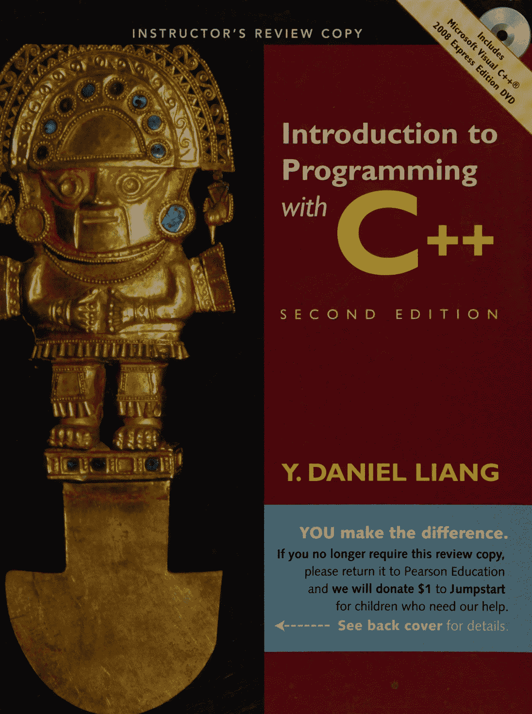

## Y. DANIEL LIANG

你的参与造与不同。

`cout << setprecision(2) << x << left << y right << z << endl;`

配套网站：`www.cs.armstrong.edu/liang/cpp2e`

感谢购买 Y. Daniel Liang 编写的新版 **Introduction to Programming with C++, Second Edition**。

以下信息提供了关于如何访问 Liang 的视频笔记（VideoNotes）和额外章节（Bonus Chapters）的说明。

VideoNotes 是培逊用于教授 C++ 编程概念和技术的全新视觉工具。视频教程演示了如何通过设计编码来解决编程问题。VideoNotes 允许按照进度进行教学，并提供便捷导航，可以在每个 VideoNotes 练习中播放、回放、快进和停止。

- 教科书中的边边图标让您了解特定概念或代表性作业题是否有 VideoNotes 教程可用。

除了 VideoNotes 之外，下面的激活码可以访问以下额外章节：

要访问 Liang 2e 的 VideoNotes 和额外章节，请遵循以下步骤：

1. 访问 `www.pearnell.com/liang`
2. 点击标题 *Introduction to Programming with C++, Second Edition*。
3. 点击 VideoNotes 或 Bonus Chapters 的链接。您可以注册成为新用户或回归用户。
4. 使用硬币刮开下方的涂层以显示您的学生代码。

> **不要使用刀或其他尖利物体，否则可能会损坏代码。**

5. 在注册页面上，输入您的学生代码。
6. 按照屏幕指令输入大小写字母。
7. 一旦确认您的个人用户名和密码，即可开始查看 VideoNotes 或额外章节。如果您需要帮助，请访问 `www.pearnell.com`。针对教师的说明：如果激活码已被使用，则可能无效。为了帮助，请联系您的培逊代表资源中心。


## Y. Daniel Liang

Introduction to Programming with C++ / Y. Daniel Liang. 第二版.

## 前言

两年前我们出版了《使用 C++ 的编程》第一版。这本书广受好评。我们基础优先的方法和简洁的写作风格引起了读者的共鸣。我们在成功的基础上进行了以下改进：

- 本版包含了大量的示例和练习，以激励学生。
- 第 5 章“函数”分为两个章节，以便教师分别教授基础功能和高级功能。
- 第 6 章“数组”分为两个章节，允许教师跳过二维数组。
- OOP 部分的章节进行了重新组织。新的组织方式引入了简单概念。
- 新的第 10 章关注类设计，并探索了过程与面向对象范式之间的差异。
- 指针和动态内存管理与拷贝构造函数和析构函数一起在新的第 11 章介绍，以便教师在一个章节中涵盖相关主题。
- 为了利用强大的 C++ 字符串类，所有示例都使用字符串类而不是传统的字符串。
- 所有高级和非语言功能（如多继承、函数参数和枚举类型）都移动到了配套网站，这样学生就可以专注于问题解决和基础编程技术。
- 全新的第 18 章“算法效率”通过许多示例介绍了如何设计高效算法。新的额外章节介绍了图算法的应用以及 AVL 树。额外章节可通过配套网站获取。
- 配套网站经过了刷新，提供了更有用的支持材料，包括全新的 LiveLab。

## 教学策略

教学编程使用了多种策略。本书采用了基础优先策略。我们以稳健的速度处理所有必要且重要的基本概念，转向面向对象编程，并使用面向对象的方法构建具有异常处理、输入输出和数据结构的有趣应用程序。

我自己的经验以及同事的经验证明，新程序员为了成功，必须学习基础逻辑和循环、细化等基础编程技术。无法在过程编程中编写代码的学生无法学习面向对象编程。对基本数据类型、控制语句、函数和数组的良好介绍为学习面向对象编程做好了准备。

## 问题驱动

编程不仅仅是语法、类或对象——它更关乎解决问题。本书采用问题驱动的方法来教授如何解决问题。书中使用的有趣且实用的示例不仅用于说明语法，还用于教授解决问题的方法和编程。每一章都以代表性问题引言，让读者对该章节的内容有一个整体了解。书中介绍了各种难度等级的广泛问题，涵盖了数学、商业、科学和模拟等许多应用。下面描述了一些具有代表性的问题。

**示例 1：** 第 2 章介绍了一个简单的问题，即根据给定半径计算圆的面积（$2.2，“编写简单程序”）。为了解决这个问题，我们引入了用于存储数据的变量以及用于变量的数据类型。我们还引入了计算面积的表达式。半径的初始值被硬编码在程序中，这并不符合常规。我们希望提示用户在运行时从控制台输入数据（$2.3）。

**示例 2：** 选择语句通过生日猜谜游戏（列表 3.2）和减法测验游戏（列表 3.5）引入。该游戏通过提五个问题找到一个答案，而减法测验游戏会自动生成一个减法问题（即 `first-second`）并生成用户的答案。

**示例 3：** 减法测验游戏只生成一个问题。为了反复生成问题，我们必须使用循环。在第 4 章中，我们修改了减法测验，在 SubtractionQuizLoop（列表 4.3）中生成十个问题。

**示例 4：** 最大公约数（列表 4.8）计算两个数的最大公约数（gcd）。由于所有内容都在主函数中，因此它是不可重用的。为了使其模块化和具有重用性，我们修改了程序，在列表 5.4 中创建了一个计算 gcd 的函数。

**示例 5：** 5.3，BodyBMIcpp，提供了一个计算体质量指数（BMI）的程序。假设你想存储用户的信息。在过程式范式中，该程序很难扩展。在 $10.9，“面向对象的思维”中，我们使用类重新设计了该程序，并用该程序展示了面向对象优于过程式范式的优势。

## 学习策略

编程课程与其他课程非常不同。你从示例、实践和错误中学习。你必须投入大量时间编写程序、测试它们并修复错误。

对于初级程序员来说，学习 C++ 就像学习任何高级编程语言一样。目标是针对实际问题制定编程解决方案，并使用选择语句、循环和数组将它们转换为程序。

一旦你学会了使用循环、函数和数组编写程序，就可以开始学习面向对象编程，通过类封装和继承来开发大型项目。

## 教学特征

梁系列推崇*实例教学*和*在做中学*。基本特征通过示例进行解释，以便学生通过实践来学习。本书使用以下元素获取内容：

- **目标**列出了学生应该从本章节中学到的内容。这将帮助他们在完成章节后确定自己是否达到了目标。
- **引言**通过代表性问题开启讨论，让读者对该章节的内容有一个整体了解。精心挑选并以易于理解风格呈现的示例介绍了编程概念。书中使用了许多小、简单且启发性的示例来展示重要的思想。
- **章节总结**回顾了学生应该理解和记忆的重要主题。它有助于他们强化在章节中学学习的关键概念。
- **复习题**按章节分组，帮助学生跟踪进度并评估学习情况。
- **编程练习**按章节分组，为学生提供机会应用他们新学到的技能。难度等级分为简单（无星号）、中等（*）、困难（**）或具有挑战性（***）。学习编程的诀窍在于练习、练习再练习。为此，本书提供了大量的练习。
- **注释、提示和注意事项**贯穿全文，就程序开发的重要方面提供宝贵的建议和见解。

> **注意**

提供关于该主题的额外信息并强化重要概念。

> **提示**

教授良好的编程风格和实践。

> **注意事项**

帮助学生避开编程错误的陷阱。

章节可以分为三部分，共同构成使用 C++ 进行问题解决的基础介绍。

### 第一部分：编程基础（第 1-8 章）

书的第一部分是为你开启 C++ 学习之旅。你将认识 C++（第 1 章），学习使用基本数据类型、表达式和运算符编程（第 2 章）、控制语句（第 3-4 章）、函数（第 5-6 章）以及数组（第 7-8 章）。

### 第二部分：面向对象编程（第 9-16 章）

这一部分介绍了面向对象编程。C++ 是一种使用抽象、封装、继承和多态为软件开发提供灵活性、模块化重用性的面向对象语言。你将学习对象和类（第 9 章）、类设计（第 10 章）、指针和动态内存管理（第 11 章）、使用模板开发泛型类（第 12 章）、使用 IO 输入输出（第 13 章）、派生类（第 14 章）以及使用异常处理使程序健壮（第 16 章）。

这部分介绍了典型数据结构课程的主要课题。第 17 章介绍了处理递归问题的递归。第 18 章介绍了如何衡量效率以选择合适的应用程序算法。你将学习设计和实现链表、队列和优先级队列（第 20 章）。

额外章节 21-26 位于本书网站 `www.prenhall.com/liang`。需要有效的学生访问码才能访问这些高级内容。获取代码的方法可以在 `www.prenhall.com/liang` 查看。

第 21 章介绍了二叉搜索树。第 22 和 23 章涵盖了 C++ 标准库。第 24 和 25 章介绍了图算法及其应用。第 26 章介绍了高级二叉搜索树。

## 测验创建/提交/评分系统

使教师能够创建/修改测验，并让学生参加测试且自动评分。

成绩、考勤等情况跟踪：该系统允许学生跟踪成绩，并允许教师查看所有学生的成绩以及跟踪考勤情况。

自动评分系统的主要功能如下：

- 允许学生在线编译、运行和提交练习。（学生可以通过学生测试用例发现自己的程序运行是否正确，并在截止日期之前继续运行和提交程序。）
- 允许教师审查已提交的内容，使用教师测试用例运行程序，在线对其进行纠正，并向学生提供反馈。
- 允许教师创建/修改自己的编程练习，创建公共和私有的测试用例，分配练习，并为全班或个人设置截止日期。
- 允许教师排序和过滤所有练习，并检查成绩（按时间范围、学生和/或练习项目）。
- 允许教师从系统中删除学生。
- 允许学生和教师跟踪编程练习的成绩。

测验系统的主要功能如下：

- 允许教师从题库或文本文件创建/修改测验，或在线创建新测试。
- 允许教师将测验分配给学生，并为全班或个人设置截止日期和限制。
- 允许学生和教师审查已提交的测验。
- 允许学生和教师跟踪测验的成绩。

VideoNotes 是 Pearson 推出的教授学生关键编程概念和技术的全新视觉工具。这些分步骤视频演示了如何通过设计来解决问题。VideoNotes 允许自主进度教学，并方便导航，包括在每个 VideoNotes 练习中选择、播放、回放、快进和停止的功能。

书中的 VideoNotes 边栏让您了解某个特定概念或作业题何时可用 VideoNotes 视频。

购买新书免费赠 VideoNotes。要购买 VideoNotes 权限，请访问 `www.prehall.com/liang` 并点击“学生资源”下的 VideoNotes。

可以通过 `www.prehall.com/liang` 或直接通过 `www.cs.armstrong.org/liang/cpp2e` 与本书相关的资源。

- 复习题答案
- 偶数编程练习的解
- 书中示例的源代码
- 交互式自测（按章节章节组织）

## 前言

- LiveLab
- 补充材料
- 资源链接
- 错

本文涵盖了核心主题。补充材料扩展了正文，介绍了读者可能感兴趣的其他主题。从配套网站可以获得以下补充材料。

| D 从 Unix 编译和运行 C++ | D 构造函数和函数中的默认参数 |
| E C++ 编码风格指南 | E 构造函数初始化列表 |
| | F 不变类和对象 |
| | G 将函数作为参数传递 |

可以通过 `www.cs.armstrong.edu/liang/cpp2e` 访问教师资源网站。请联系当地的 Pearson 销售代表获取访问所需的用户名和密码。教师资源网站包括：

- Microsoft PowerPoint：幻灯片具有交互式按钮，可查看彩色、语法高亮的源代码，并在不离开幻灯片的情况下运行程序。
- 试卷：通常情况下，每份试卷分为四部分：
  1. 选择和简答
  2. 纠正编程错误
  3. 程序追踪
  4. 编写程序
- 教师手册：包含所有练习的解答。
- 基于 Web 的测验生成器：教师可以选择章节并从 800 多个问题的数据库中生成测验。

一些读者请求教师资源网站的材料。请理解，这些材料仅供教师使用。此类请求将不得到回复。

感谢 Armstrong 亚大大学让我能够教授我所写的内容，并支持我编写我所教的内容。教学是不断改进本书的灵感源泉。感谢那些提供评论、建议、错误报告和赞誉的教师和学生。

由于对本及之前版本的卓越评审，本书得到了极大的增强。评审者是：Waleed Farid（宾夕法尼亚州大学）、Max I. Tomitchev（宾州立大学）、Brian Lanier（加州大学河分校）、Dan Lipsa（Armstrong 亚大大学）、John Hanrath（伊利诺理工学院）、Hui Liu（密苏里州立大学）、Ronald Marsh（北达科他州大学）、Peter Maurer（贝勒大学）、Jay D. Morris（老东顿立大学）、Charles Nelson（洛克谷学院）、Martha Sanchez。

## 目录

- 3.4 问题：猜测出生日期 77
- 3.7 选择语句中的常见错误 82
- 3.8 问题：计算体质指数 83
- 3.9 问题：计算税费 85
- 3.10 问题：一个数学学习工具 88
- 3.11 逻辑运算符 90
- 3.12 问题：判别闰年 92
- 3.13 问题：彩票 93
- 3.14 switch 语句 95
- 3.15 条件表达式 97
- 3.16 输出的格式化 98
- 3.17 运算符优先级与结合性 101
- 4.1 引言 116
- 4.2 while 循环 116
- 4.3 do-while 循环 124
- 4.4 for 循环 126
- 4.5 该用哪种循环？ 128
- 4.6 嵌套循环 129
- 4.7 最小化数值误差 130
- 4.8 案例研究 131
- 4.9 关键字 break 和 continue 135
- 4.10 示例：显示质数 137
- 5.1 引言 156
- 5.2 定义函数 156
- 5.3 调用函数 157
- 5.4 void 类型函数 159
- 5.5 传递参数 162
- 5.6 代码模块化 162
- 5.7 函数重载 164
- 5.8 函数原型 167
- 5.9 不同程序间的函数复用 168
- 5.10 将函数头与实现分离 169
- 5.11 案例研究：生成随机字符 169
- 5.13 字符函数 173
- 6.1 引言 184
- 6.2 按值传递参数 184
- 6.3 按引用传递参数 184
- 6.4 常量引用参数 190
- 6.5 局部、全局和静态局部变量 190
- 6.6 内联函数 194
- 6.7 默认参数 195
- 6.8 函数抽象与逐步步细化 196
- 7.1 引言 214
- 7.2 数组基础 214
- 7.3 问题：乐票号码 219
- 7.4 问题：扑牌 222
- 7.5 向函数传递数组 223
- 7.6 从函数返回数组 226
- 7.7 问题：统计每个字母出现的次数 227
- 7.8 搜索数组 230
- 7.9 排序数组 233
- 7.10 C 字符串 237
- 8.1 引言 254
- 8.2 声明二维数组 254
- 8.3 处理二维数组 255
- 8.4 向函数传递二维数组 256
- 8.5 问题：多选择测试的评分 257
- 8.6 问题：寻找最近对 259
- 8.7 问题：数独 260
- 8.8 多维数组 268
- 9.1 引言 284
- 9.2 为对象定义类 284
- 9.3 构造函数 287
- 9.4 构造与使用对象 288
- 9.5 将声明与实现分离 290
- 9.6 防止重复声明 292
- 9.7 类中的内联函数 293
- 9.8 数据字段封装 294
- 9.9 变量的作用域 297
- 9.10 类抽象与封装 298
- 9.11 案例研究：贷款类 299
- 10.1 引言 310
- 10.2 string 类 310
- 10.3 向函数传递对象 316
- 10.4 问题：检查回文 318
- 10.5 对象数组 319
- 10.6 改进扑牌的解决方案 321
- 10.7 实例与静态成员 322
- 10.8 常量成员 326
- 10.9 面向对象的思维 327
- 10.10 对象组合 331
- 10.11 问题：StackOfIntegers 类 332
- 10.12 软件生命周期 335
- 10.13 类设计指南 336
- 11.1 引言 352
- 11.2 指针基础 355
- 11.3 在指针中使用 const 355
- 11.4 数组与指针 356
- 11.5 按引用传递参数 359
- 11.6 从函数返回指针 361
- 11.7 动态内存分配 363
- 11.8 访问动态对象 365
- 11.9 指针 366
- 11.10 析构函数 366
- 11.11 案例研究：Course 类 369
- 11.12 拷贝构造函数 372
- 11.13 自定义拷贝构造函数 374
- 12.1 引言 390
- 12.2 模板基础 390
- 12.3 泛型排序 393
- 12.4 模板 395
- 12.5 改进的数组 400
- 12.6 vector 403
- 12.7 使用 vector 405
- 12.8 表达式 408
- 13.1 引言 422
- 13.2 I/O 422
- 13.3 格式化输出 426
- 13.4 getline, put 427
- 13.5 流模式 430
- 13.6 流状态 431
- 13.7 二进制制 I/O 433
- 13.8 随机访问 440
- 13.9 更新 443
- 14.1 引言 450
- 14.2 Rational 类 450


## 14.3 friend 函数 456

## 14.4 [] 运算符 458

## 14.5 赋值运算符 460

## 14.6 一元运算符 460

## 14.7 ++ 运算符 461

## 14.8 friend 类 462

## 14.9 >> 运算符 464

## 14.10 类型转换 465

## 14.11 泛型类 467

## 14.12 运算符 475

## 15.1 引言 482

## 15.2 基类与派生类 482

## 15.3 泛型编程 490

## 15.4 构造函数与析构函数 490

## 15.5 纯虚函数 499

## 15.6 static_cast 503

## 15.7 dynamic_cast 508

## 16.1 引言 516

## 16.2 异常处理概述 516

## 16.3 异常处理 519

## 16.4 异常类 520

## 16.5 自定义异常 524

## 16.6 多重捕获 528

## 16.7 异常传播 532

## 16.8 抛出异常 533

## 16.9 异常规范 534

## 16.10 何用异常 535

## 17.1 引言 544

## 17.2 阶乘 544

## 17.3 斐波契数列 547

## 17.4 递归问题 549

## 17.5 递归辅助函数 550

## 17.6 诺华塔 554

## 17.7 八皇后问题 557

## 17.8 递归与迭代 559

## 18.1 引言 566

## 18.2 Big O 表示法 566

## 18.3 确定 Big O 的示例 567

## 18.4 分析算法时间复杂度 569

## 18.5 案例研究：斐波契数 571

## 18.6 案例研究：最大约数 573

## 18.7 案例研究：质数 577

## 18.8 案例研究：最近点对 584

## 18.9 其他算法预览 586

## 19.1 引言 592

## 19.2 冒泡排序 592

## 19.3 合并排序 594

## 19.4 快速排序 598

## 19.5 堆排序 602

## 19.6 桶排序与基数排序 608

## 19.7 外部排序 610

## 20.1 引言 622

## 20.2 节点 624

## 20.3 LinkedList 类 624

## 20.4 实现 LinkedList 638

## 20.5 迭代器 640

## 20.6 链表的变体 641

## 20.7 队列 643

## 20.8 优先级队列

以下赠送章节位于书本网站。

## 附录 A C++ 关键字 653

## 附录 B ASCII 字符集 654

## 附录 C 运算符优先级表 656

## 附录 D 进制系统 658

本书不需要任何先前的编程经验，也不需要数学基础，初高中水平代数以及使用 Windows、网页浏览和文字处理等基础计算机技能即可。

基础计算机

在完成第7章“单维数组”后，你可以学习第17章“递归”、第18章“算法效率”以及第19章“排序”。

递归

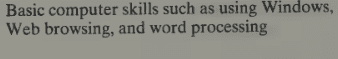

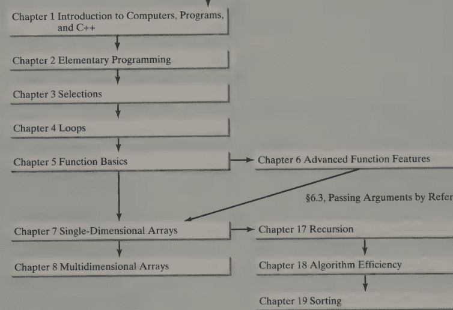

- 复习计算机基础、程序和操作系统（§1.2–1.4）。
- 了解 C++ 的历史（§1.5）。
- 编写一个用于控制台输出的简单 C++ 程序（§1.6）。
- 理解 C++ 程序开发周期（§1.7）。
- 使用 Visual C++ 开发 C++（§1.8）。
- 使用 Dev-C++ 开发 C++（§1.9）。
- 在 Windows 上使用命令行工具开发 C++（§1.10）。
- 在 UNIX 上使用命令行工具开发 C++（§1.11）。


处理单元（CPU）是计算机的大脑。它从内存中提取指令并执行它们。CPU 通常包含两个部分：控制单元和算术逻辑单元。控制单元控制并协调其他组件的操作。算术逻辑单元执行数值运算（加、减、除）和逻辑运算（比较）。

现在的 CPU 构建在带有数百万个晶体管的小型硅半导体芯片上。CPU 的速度主要由内部时钟决定。时钟以恒定的发射电子脉冲，用于同步操作节奏。速度越快，在规定时间内执行的指令越多。单位是赫兹（Hz），即每秒1赫兹。计算机的速度通常以兆赫兹（MHz）衡量（1 MHz 是 100 万 Hz）。计算机的速度一直在不断提高。在本书写作，你可以获得频率高达 3.2 吉赫兹（GHz）的“酷睿 2”（1 GHz 是 1000 MHz）。

数字设备有两个稳定状态，惯称为零和一。因此，计算机使用 0 和 1 来存储和传输数据。各种类型的数据，如数字、字符和字符串被编码为一系列位（二进制数字：0 和 1）。内存存储供 CPU 执行的数据和程序指令。内存单元是字节的有序序列，如图 1.2 所示。

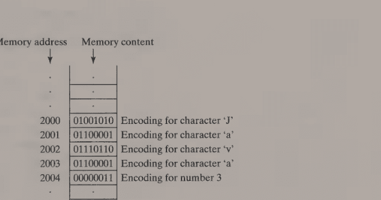

图 1.2 内存存储数据和程序指令。

程序员不需要担心数据的编码和解码，系统会根据编码方案自动完成。编码方案各相同。例如，在流行的 ASCII 编码中，字符 'J' 在一个字节中用 01001010 表示。像 3 这样的小数字可以存储在单个字节中。如果计算机需要存储一个无法放入单个字节的大数字，它会使用多个相邻的字节。字节是最小存储单元。任何两个数据项都不会共享或分割同一个字节。

在执行之前，必须将程序调入内存。内存永远不会空的，它的初始内容对你的程序可能没有意义。当新信息被放入内存时，内存的当前内容就会丢失。

每个字节都有唯一的地址，无论内存顺序如何，内存也被称为 RAM（随机存存储器）。由于可以访问字节，现在的计算机通常至少有 1 GB 的 RAM。内存存储大小以千字节（KB）、兆字节（MB）、吉字节（GB）和太字节（TB）衡量。一个千字节是 $2^{10} = 1024$（约 1000）字节，一个兆字节是 $2^{20} = 1048576$（约 100 万）字节，一个太字节是 $2^{30} = 1073741824$（约 1000）吉字节。CPU 构建在硅半导体芯片上，表面嵌入了数千个晶体管。内存比 CPU 芯片简单、速度更慢、价格更便宜。

内存是易失的，掉电时信息丢失。程序和数据永久存储在存储设备上，并在计算机实际使用它们时移动。这是因为内存中的操作速度比存储设备上快得多。存储设备主要有四种：

- 磁盘
- CD 驱动器（CD-R 和 CD-RW）
- 磁带驱动器
- USB 闪存

每台计算机至少有一个硬盘（也称为硬盘）。硬盘用于存储数据。最新的 PC 存储空间从 80 到 500 GB 不等。它们通常封装在计算机内部。

CD 代表光盘。有两种类型的 CD 驱动器：CD-R 和 CD-RW。CD-R 是只读，用户无法修改其内容；CD-RW 可以可读可写。单张 CD 最多可以容 700MB。大多数软件通过 CD-ROM 分发。DVD 代表数字多功能光。DVD 和 CD 看起来相似。你可以使用 CD 或 DVD 存储数据。DVD 存储的信息比 CD 多。标准 DVD 容量为 4.7GB。

### 磁带

磁带主要用于备份数据。与磁盘和 CD 不同，磁带按顺序存储信息。计算机必须按照存储的顺序检索信息。磁带非常慢。备份 1 GB 数据到磁带上需要一到两小时。磁带正在变得过时。

### 闪盘

USB 闪存盘是存储和传输数据的流行设备。它们很小——大约只有一包口香糖的大小。它们像便携式硬盘，可以插入计算机的 USB 端口。目前闪盘可用容量高达 32GB。

输入输出设备允许用户与计算机通信。常见的输入设备是键盘和鼠标。常见的输出设备是显示器和打印机。

计算机键盘看起来像一台打字机，带有额外的特殊功能按键。功能键位于键盘顶部，带有前缀 F 标记。它们的用途取决于软件。修饰键是一个特殊键（例如 Shift、Alt、Ctrl），当两个键组合按下时，它会修改另一个键的正常动作。位于右侧的数字小键盘用于输入数字。

显示器显示信息（文本和图形）。分辨率和像素决定了显示质量。像素（“图像元素”的缩写）是屏幕上的微小点。例如，17 英寸屏幕常见分辨率为 1024 像素宽、768 像素高。分辨率可以手动设置。分辨率越高，图像越清晰锐利。

像素是像素之间的空间。通常范围在 0.2 到 0.8 毫米。像素越小，显示效果越好。

计算机可以通过通信设备建立网络。常用的设备有拨号调制调器、DSL 和光缆调制器。拨号调制器使用电话线，传输速度高达 56000 bps（每秒位）。DSL（数字用户线路）也使用电信公司维护的电视电线。光缆调制器比拨号快二十倍。网卡（NIC）是连接局域网（LAN）的设备。局域网常用于商业、大学和政府机构。典型的 10BaseT 网卡传输速度为 10 Mbps（每秒比特）。

开发汇编语言是为了让编程变得简单。然而由于计算机无法理解汇编语言，因此使用称为汇编器的程序将汇编程序转换为机器码，如图 1.3 所示。

| .. | .. | .. |

图 1.3 汇编器将汇编指令转换为机器码。

由于汇编语言依赖于机器，汇编程序只能在特定类型的机器上执行。开发高级语言是为了克服特定平台的问题并使编程更加容易。

高级语言类似于英语，易于学习和编程。例如，这里有一条高级语言语句用于计算半径为 5 的圆面积：

```
area = 5 * 5 * 3.1415;
```

高级语言有一百多种。流行的有：

- COBOL（面向业务的语言）
- FORTRAN（公式翻译语言）
- BASIC（初学者通用符号指令代码）
- Pascal（以布莱兹·帕斯卡尔命名）
- Ada（以阿达·洛芙莱斯命名）
- Visual Basic（微软开发的一种类似 BASIC 的视觉化语言）
- Delphi（由 Borland 开发的一种类似 Pascal 的视觉化语言）
- C（由 B 语言的设计者开发）
- C++（一种基于 C 的面向对象语言）
- Java
- C#（微软开发的一种类似 Java 的语言）

这些语言中的每一种都是为了特定的目的而设计的。COBOL 为业务应用设计，主要用于业务数据处理。FORTRAN 为数学计算设计，主要用于数值计算。BASIC 的设计是为了易于学习和使用。Ada 是为国防部开发的，主要用于国防项目。Visual Basic 和 Delphi 用于开发图形用户界面和快速应用开发。C 结合了汇编语言的力量与高级语言的易用性和可移植性。C++ 在软件项目中非常流行，例如用于编写编译器和操作系统。Windows 操作系统就是使用 C++ 编写的。Java 广泛用于开发网络应用程序。C#（读作 Sharp）是微软为基于 .NET 平台的应用程序开发的新语言。

高级语言中的程序称为源程序。计算机无法理解源程序，因此使用称为编译器的程序将其翻译成一个机器语言程序。机器语言程序通常与其他支持库代码链接以形成一个可执行文件。可执行文件可以在机器上运行，如图 1.4 所示。在 Windows 上，可执行文件的扩展名为 .exe。

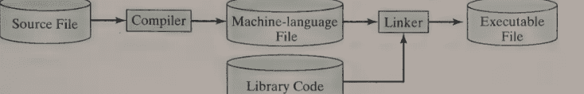

图 1.4 源程序被编译成机器语言文件，然后与系统库链接形成一个可执行文件。

操作系统（OS）是运行在计算机上的最重要的程序，它使计算机能够管理和控制其活动。应用程序（如 Web 浏览器或文字处理器）没有操作系统无法运行。在你的个人电脑上，你可能正在使用 Microsoft Windows（目前最流行的 PC 操作系统）、Mac OS 或 Linux。硬件、操作系统、应用软件和用户之间的相互关系如图 1.5 所示。

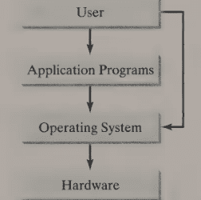

图 1.5 操作系统是控制和管理系统的软件。

操作系统的主要任务是：

- 控制和监控系统活动
- 分配和划分系统资源
- 调度操作

操作系统负责安全，确保未经授权的用户无法访问系统。操作系统执行基本任务，如识别键盘输入、将输出发送到显示器、跟踪磁盘上的文件和目录，以及控制外设备（如磁盘驱动器和打印机）。操作系统还确保同时运行的不同程序和用户互不干扰。

操作系统负责确定程序运行所需的哪些计算机资源（CPU、内存、磁盘、输入输出设备），并进行分配和划分。

操作系统负责调度程序以高效利用系统资源。如今的许多操作系统都支持多程序、多线程和多处理等技术来提高系统性能。

多程序通过共享 CPU 允许多个程序同时运行。CPU 的速度比其他组件快得多。因此，它经常处于空闲状态——例如在等待数据从磁盘或其他源传输。多程序操作系统利用了这一点，在 CPU 其他空闲时允许多个程序使用它。例如，当 Web 浏览器正在下载文件时，你可以使用文字处理器编辑文件。

多程序

多线程允许程序内部的并发，使得任务可以同时运行。例如，文字处理程序允许用户同时编辑文本并保存到文件。在这种情况下，编辑和保存是同一个应用程序中的两个任务。这两个任务可能在单独的线程上并发运行。

多线程

多处理（并行处理）使用两个或多个处理器共同执行任务。这就像手术手术，医生们合作为一个病人进行手术。

多处理

C、Java 和 C# 之间都有联系。C 是模仿 C++ 设计的。C# 是 C++ 的子集，具有某些类似于 Java 的特性。如果你了解其中一种语言，很容易学习其他的。

C 源于 B 语言，B 语言演变自 BCPL（基础组合编程语言）。Martin Richards 在 20 世纪 60 年代开发了 BCPL。Ken Thompson 在他的 B 语言中吸收了 BCPL 的许多特性，并在 1970 年于贝尔实验室的 DEC PDP-7 计算机上用它创建了早期的 UNIX 操作系统。BCPL 和 B 都是无类型的——也就是说，每个项目占用内存中固定长度的“字”或“单元”。数据项的处理（例如作为数字或字符串）是编译器的责任。Dennis Ritchie 在 1971 年通过添加类型和特性扩展了 B 语言，在 DEC PDP-11 计算机上开发了 UNIX 操作系统。今天，C 是可移植且与无关的。它用于开发操作系统。

BCPL

B

C

C++

C++ 的国际标准由美国国家标准协会（ANSI）于 1998 年制定。ANSI 标准试图确保 C++ 是可移植的——即使用一个供应商编译的程序可以在任何其他供应商的平台上无错误运行。由于该标准已经存在了一段时间，所有主要供应商都支持 ANSI 标准。尽管如此，C++ 编译器供应商可能会向编译器引入专有特性。因此，你的程序可能由某个编译器编译通过，但要在另一个编译器上编译可能需要修改。

ANSI 标准

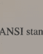

视频笔记

你的第一个 C++ 程序

让我们从一个简单的 C++ 程序开始，该程序将在控制台上显示“欢迎来到 C++”的消息。（控制台是指文本输入和显示设备）。程序如列表 1.1 所示。

什么是控制台？

```cpp
#include <iostream>
using namespace std;
int main() 
{
    // 向控制台输出 Welcome to C++
    cout << "Welcome to C++!" << endl;
    return 0;
}
```

- 包含库
- 使用命名空间
- main 函数
- 注释
- 输出
- 成功返回


这些行号并不是程序的一部分，而是为了参考目的而显示的。因此，在你的程序中不要输入行号。

程序的第一行

`#include <iostream>`

是一个编译器预处理器指令，它告诉编译器在该程序中包含 iostream 库，该库用于支持输入和输出。像 iostream 这样的库在 C++ 中被称为头文件，因为它通常包含在程序的开头。

第 2 行的语句

- 预处理器指令
- 头文件
- using namespace;
- 命名空间

用于在标准库中查找名称。第 7 行中的 `cout` 和 `endl` 名称定义在标准库中。你可以在程序中使用它们。

每个 C++ 程序都从 main 函数执行。结构（construct）是一个包含语句的结构。第 4-10 行定义的 main 函数包含两个语句。它们被包含在一个块中，以左括号 `{`（第 5 行）开始，并以右括号 `}`（第 10 行）结束。C++ 中的每条语句必须以分号 (`;`) 结束，被称为语句终止符。

第 7 行的语句向控制台显示一条消息 `cout` 代表控制台输出（console output）。`<<` 被称为流插入，将字符串发送到控制台。

字符串必须放在引号中。第 7 行的语句首先向控制台输出字符串 "Welcome to C++"，然后输出 endl。注意 `endl` 代表换行尾（end line）。向控制台发送 `endl` 会输出换行并刷新输出缓冲区，以确保输出立即显示。

第 9 行的语句

- main 函数
- 控制台输出
- 流插入运算符
- `return 0;`

放置于每个 main 函数末尾以退出程序。值 0 表示

- 成功退出

第 6 行是一个注释，记录了程序是什么以及如何构造的。注释有助于人们交流和理解程序。它们不会被编译器忽略。在 C++ 中，注释在行前以两个斜杠 (//) 开头（行注释），或者在 `/*` 和 `*/` 之间或跨多行（段落注释）。当编译器使用 `//` 时，它会忽略该行 // 之后的所有内容。当它使用 `/*` 时，它会扫描下一个 `*/` 并忽略 `/*` 和 `*/` 之间的任何文本。

- 注释
- 行注释
- 段落注释

以下是两种类型注释的示例：

```cpp
// 此应用程序打印 Welcome to C++
/* 此应用程序打印 Welcome to C++! */
/* 此应用程序打印 Welcome to C++ */
```

关键字（或保留字）对编译器有特定含义，且在程序中也有其他用途。此程序中有四个关键字：`using`、`namespace`、`int` 和 `return`。

- 关键字


你可能在好奇为什么`main`函数要这样声明，以及为什么使用`cout << "Welcome to C++" << endl`向控制台显示消息。你的问题暂时还无法完全回答。目前，只需接受这种做法即可。你将在后续章节中找到答案。

- **语法规则**

> **注意**
>
> 与其他编程语言一样，C++ 有它自己的语法规则，你需要编写遵守这些规则的代码。如果你的程序违反了这些规则，C++ 编译器将报告语法错误。注意标点符号。定向符号`<<`是连接符。函数中的每条语句都以分号 (`;`) 结束。

- **指令不是语句**

> **注意**
>
> 预处理器指令不是 C++ 语句。因此，不要在预处理器指令后面加分号。这样做会导致细微错误。

- **大写敏感**

> **注意**
>
> C++ 源程序是大写敏感的。例如，将程序中的`main`替换为`Main`是错误的。

列表 1.1 中的程序显示了一条消息。一旦你理解了程序，就可以扩展它显示更多消息。例如，你可以重写程序显示三条消息，如列表 1.2 所示。

```cpp
1 #include <iostream>
2 using namespace std;
3
4 int main()
5 {
6 cout << "Programming is fun!" << endl;
7 cout << "Fundamentals First" << endl;
8
9 cout << "Problem Driven" << endl;
10 return 0;
11 }
```

- 包含库
- `main`函数
- 输出
- 成功返回

```
Programming is fun!
Fundamentals First
Problem Driven
```

此外，你可以进行数学计算并将结果显示到控制台。列表 1.3 提供了这样一个示例。

# 列表 1.3 ComputeExpression.cpp

```cpp
#include <iostream>
using namespace std;
int main() {
    cout << "(10.5 + 2 * 3) / (45 - 3.5) = ";
    cout << "(10.5 + 2 * 3) / (45 - 3.5)" << endl;
    return 0;
}
```

- 包含库
- `main`函数
- 成功返回

## 1.7 C++ 程序开发周期

## 1.8 使用 Visual C++ 15 开发 C++ 程序

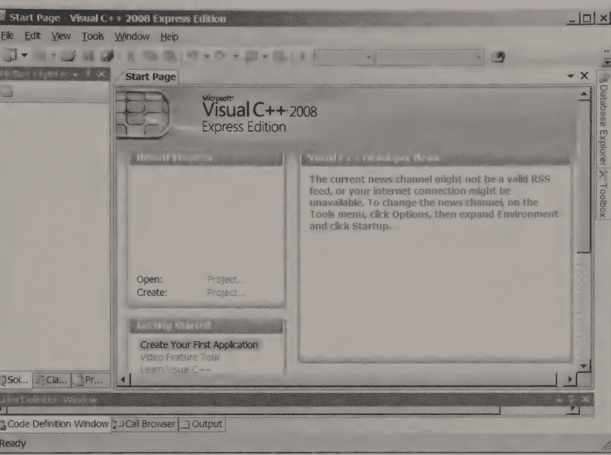

图 1.7 C++ 用户界面是一个执行编辑、编译、调试和运行程序的单窗口。

1. 选择 File（文件）、New（新建）、Project（项目）以显示新项目窗口，如图 1.8 所示。

2. 在 Project types（项目类型）列中选择 Win32，在 Templates（模板）列中选择 Win32 Console Application。在 Name（名称）字段中输入 `bookexample`，在 Location（位置）字段中输入 `c:\sample`。点击 OK（确定）显示 Win32 应用程序向导窗口，如图 1.9 所示。


图 1.8 在创建程序之前，您需要创建一个项目。

# 第一章 计算机、程序与 C++ 简介

3. 点击 Next（下一步）显示应用程序设置窗口，如图 1.10 所示。

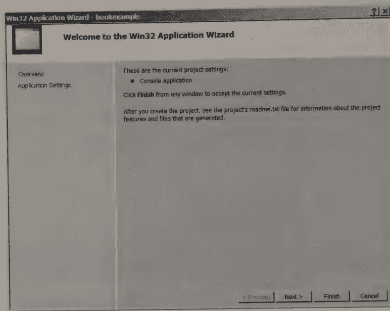

图 1.9 Win32 应用程序向导为 Win32 应用程序创建一个项目。

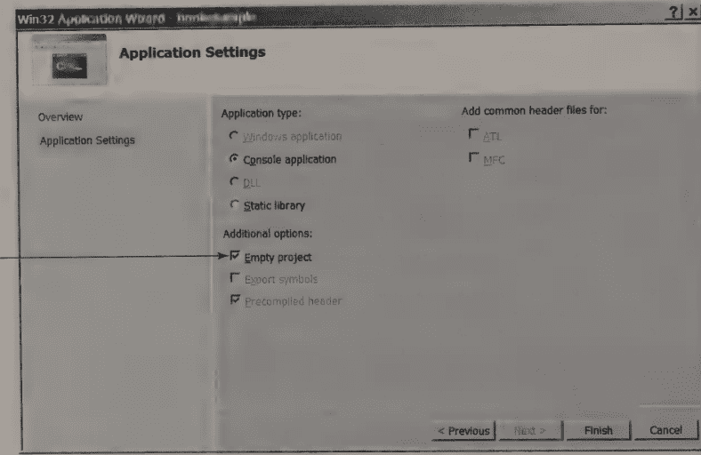

图 1.10 Win32 应用程序设置窗口允许您设置应用程序类型。

## 1.8 使用 Visual C++ 开发 C++ 程序

4. 在 Application type（应用程序类型）部分选择 Console application（控制应用程序），并在 Additional options（附加选项）部分勾选 Empty project（空项目）。点击 Finish（完成）创建项目。您将在 Solution Explorer（解决方案管理器）中看到名为 `bookexample` 的项目，如图 1.11 所示。

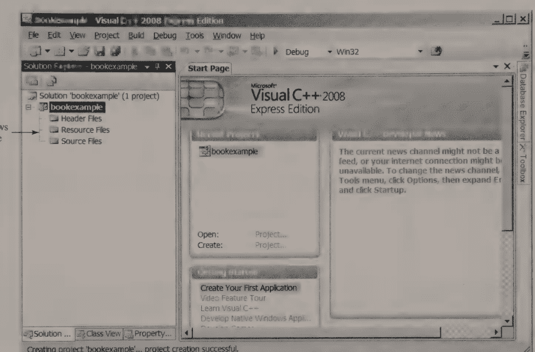

Solution Explorer 显示项目中的文件

图 1.11 为 C++ 控制台应用程序创建了项目。

### 1.8.3 创建 C++ 程序

在创建项目后，您可以在其中创建程序。以下是为列表 1.11 创建 C++ 程序的步骤。

1. 从 `bookexample` 项目的右键菜单中选择 Add（添加）、Add New Item（添加新项）（参见图 1.12）以显示添加新项窗口，如图 1.13 所示。

2. 在 Categories（类别）列中选择 Code（代码），在 Templates（模板）列中选择 C++ File (.cpp)。在 Name（名称）字段中输入 `Welcome`，在 Location（位置）字段中输入 `c:\smith\bookexample`。点击 Add（添加）创建文件，如图 1.14 所示。

3. 完全按照列表 1.11 所示输入 `Welcome.cpp` 的代码，如图 1.15 所示。

### 1.8.4 编译 C++ 程序

创建程序后，您可以对其进行编译。您可以通过选择 Build（生成）、Compile（编译）或按下 Ctrl+F7，或者在 `Welcome.cpp` 的右键菜单中选择 Compile（编译）来实现，如图 1.16 所示。

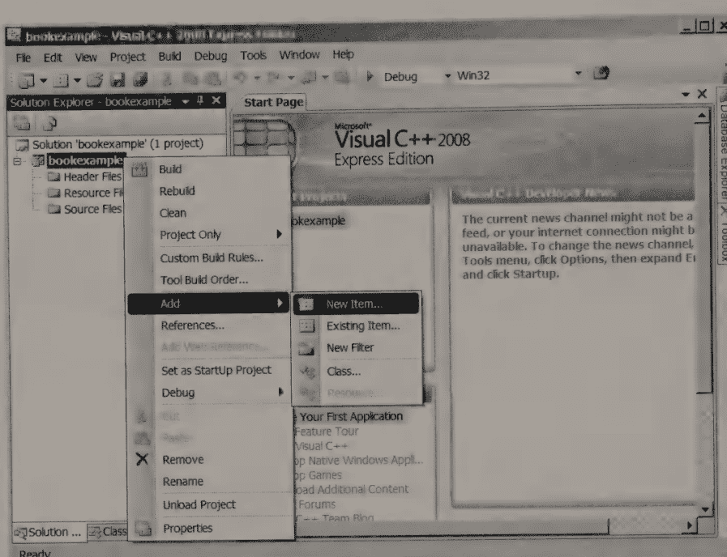

图 1.12 您可以项目的右键菜单打开添加新项窗口。

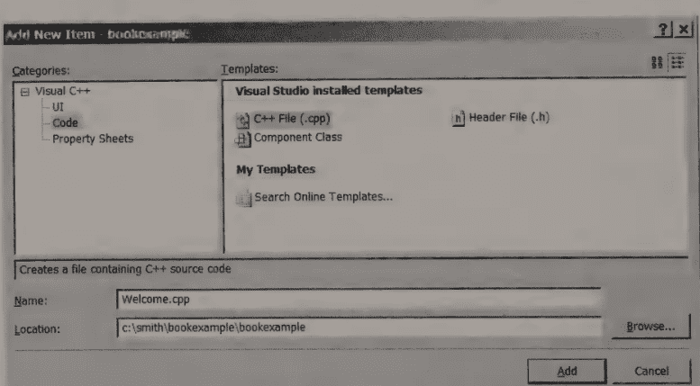

图 1.13 您可以指定文件类型、名称和位置来创建文件。

## 1.8 使用 Visual C++ 19 开发 C++ 程序

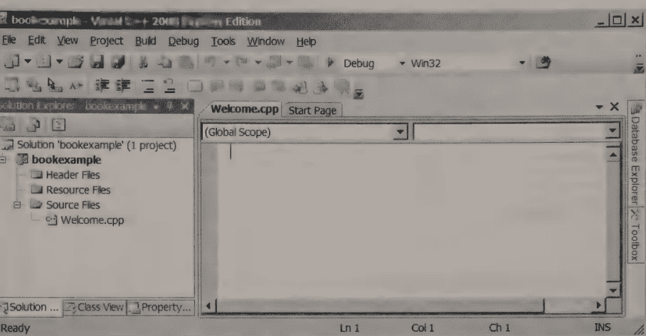

图 1.14 项目中创建了 `Welcome.cpp`。

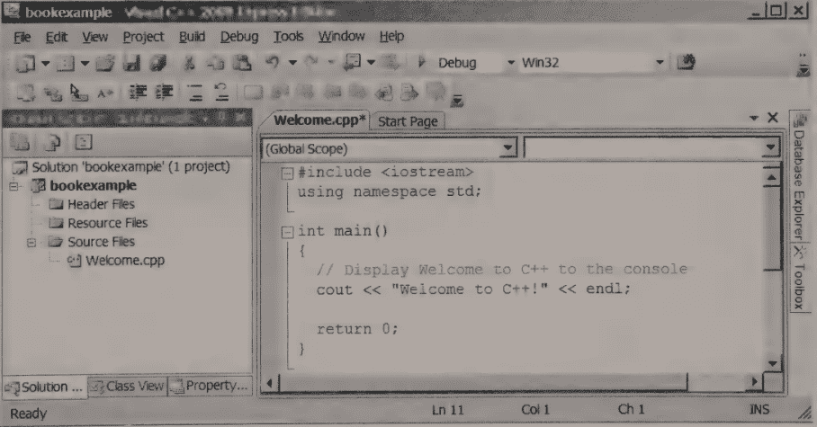

图 1.15 输入了 `Welcome.cpp` 的源代码。

### 1.8.5 运行 C++ 程序

要运行程序，选择 Debug（调试）、Start Without Debugging（不调试直接启动）或按下 Ctrl+F5。您将在 DOS 窗口中看到输出，如图 1.17 所示。

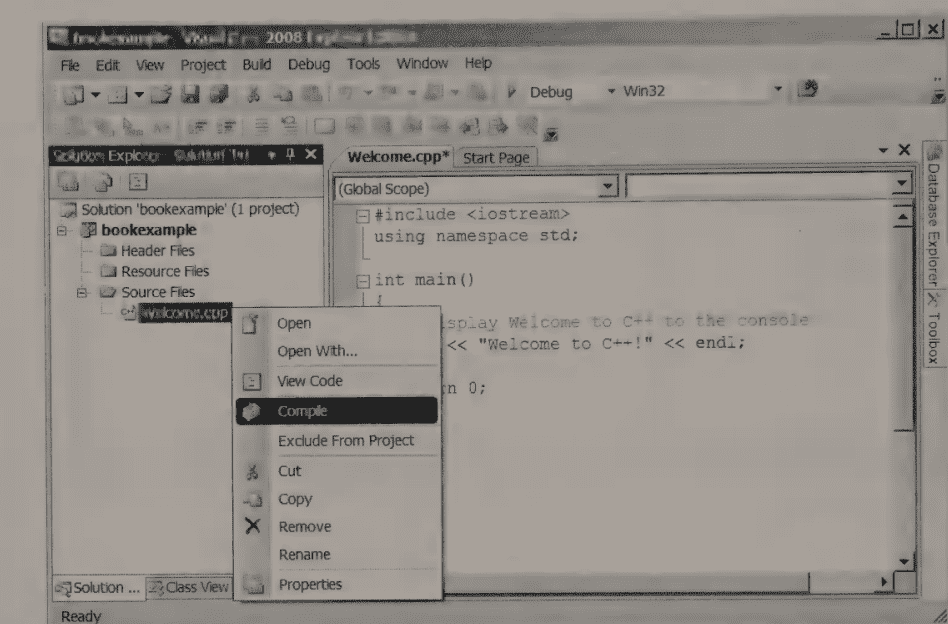

图 1.16 选择 Compile（编译）命令编译程序。

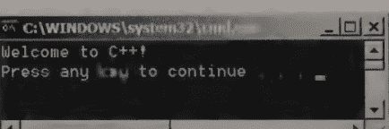

图 1.17 输出显示在 DOS 窗口中。

编译并运行 如果程序在上次编译后未被编译或修改，Run（运行）命令将调用 Compile（编译）命令。

一个 `main`函数 每个项目只能包含一个包含`main`函数的文件。如果您需要创建另一个包含`main`函数的文件，您有两个选择：

- 通过项目的右键菜单选择 Remove（删除），从项目中移除包含`main`函数的当前文件，如图 1.18 所示。（注意，您可以通过 File、Add Item 向项目添加现有文件）。

- 为新程序创建一个新项目。

## 1.9 使用 Dev-C++ 开发 C++ 程序

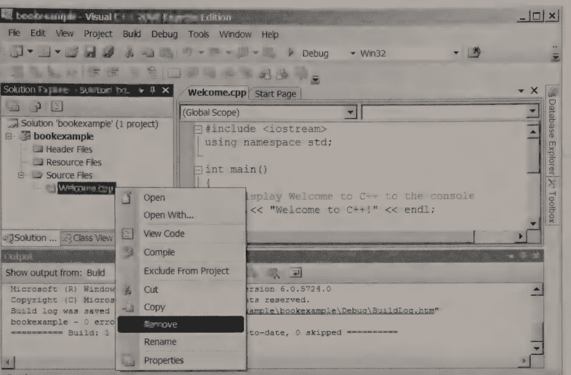

您可以从项目中删除文件。

## 1.9 使用 Dev-C++ 开发 C++ 程序

Dev-C++ 是一个免费的 C++ IDE，可以从 `http://www.bloodshed.dev/devcpp` 下载。Visual++ 比 Dev-C++ 强大得多，但新用户发现 Dev-C++ 更简单易用。Dev-C++ 的另一个优势是它在资源较少的机器上运行良好。

### 1.9.1 使用 Dev-C++

Dev-C++ 很容易安装。如果需要安装帮助，请参考补充 II。假设您已安装 Dev-C++。您可以通过 Windows 按钮选择 All Programs（所有程序）、Bloodshed Dev-C++ 来启动它。Dev-C++ 界面出现，如图 1.19 所示。

### 1.9.2 创建程序

在 Dev-C++ 中创建 C++ 程序，请遵循以下步骤：

1. 选择 File（文件）、New（新建）、Source File（源文件）。面板中会出现一个无标题文件，如图 1.20 所示。

2. 在面板中输入列表 1.11 中的代码，如图 1.21 所示。

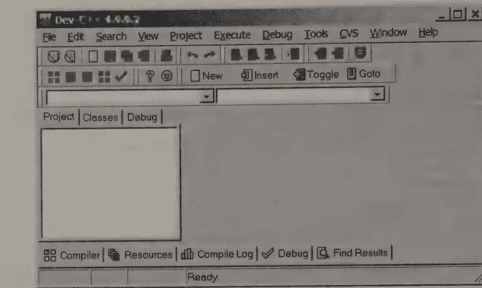

图 1.19 Dev-C++ 界面是一个执行编辑、编译、调试和运行程序的单窗口。

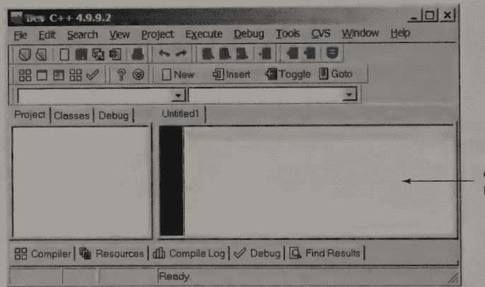

图 1.20 面板显示文件内容。

3. 选择 File（文件）、Save（保存）显示保存对话框，如图 1.22 所示。在 File name（文件名）字段中输入 `Welcome.cpp` 并点击 Save（保存）将文件保存为 `Welcome.cpp`。（注意：您可以更改 Save 字段在任何目录保存文件。）

4. 保存文件后，您将在面板中看到 `Welcome.cpp` 标签，如图 1.23 所示。

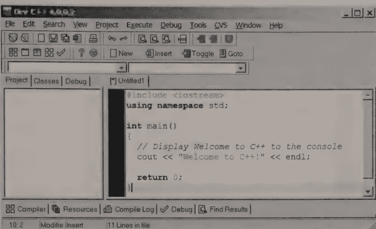

图 1.21 面板中输入了代码。

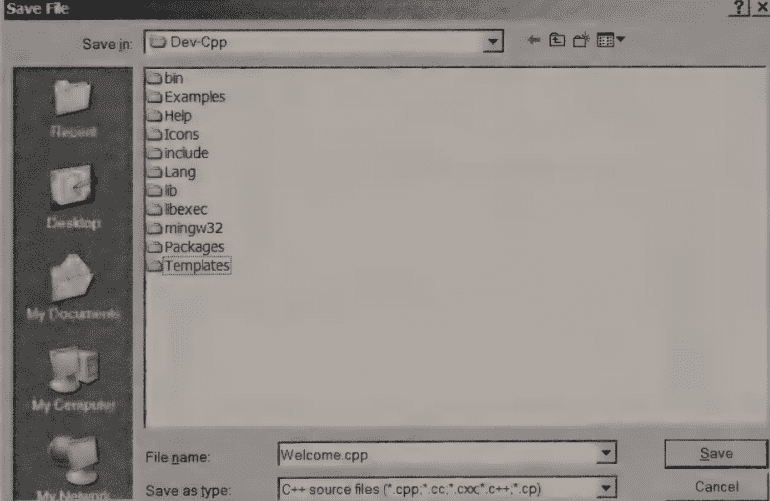

图 1.22 您可以在任何目录保存 C++ 程序。

### 1.9.3 编译 C++ 程序

创建程序后，您可以对其进行编译。要这样做，选择 Execute（执行）、Compile（编译）或按下 Ctrl+F9，或者选择 Compile（编译）工具栏按钮，如图 1.24 所示。编译状态显示在对话框中，如图 1.25 所示。现在可以关闭此对话框。

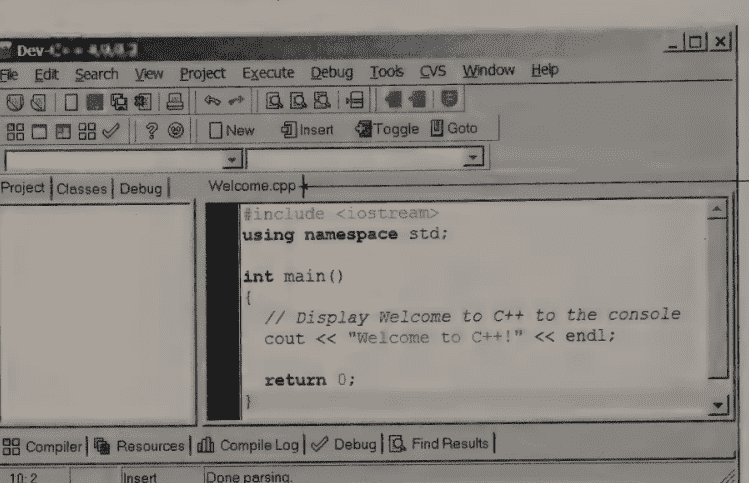

图 1.23 面板中出现 `Welcome.cpp` 标签。

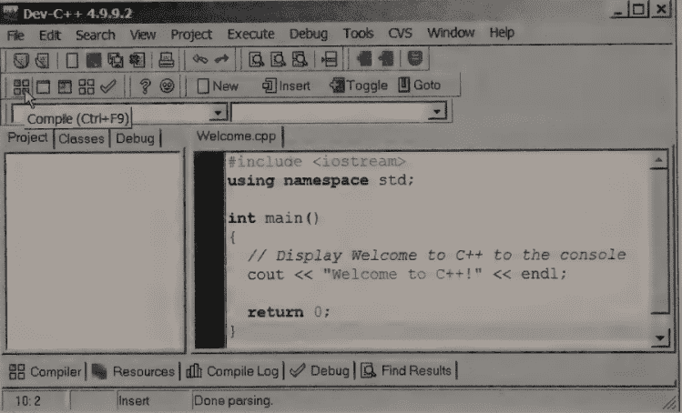

图 1.24 您可以点击按钮编译程序。

### 1.9.4 运行 C++ 程序

要运行程序，选择 Execute（执行）、Run（运行）或按下 F9，或点击 Run（运行）工具栏按钮。Windows 命令行窗口显示后消失。您几乎看不到命令行窗口。要看到它，您必须在 `return` 语句之前添加以下语句，如图 1.26 所示。

```cpp
system("PAUSE");
```

此语句暂停执行并提示用户按任意键继续。

## 1.9 使用 Dev-C++ 开发 C++ 程序

| 进度 | 日志 |
|---|---|
| 编译器 | 默认编译器 |
| 状态 | 完成。 |
| 文件: | |
| 错误: | 0 警告: 0 |

**图 1.25** 显示了编译状态。

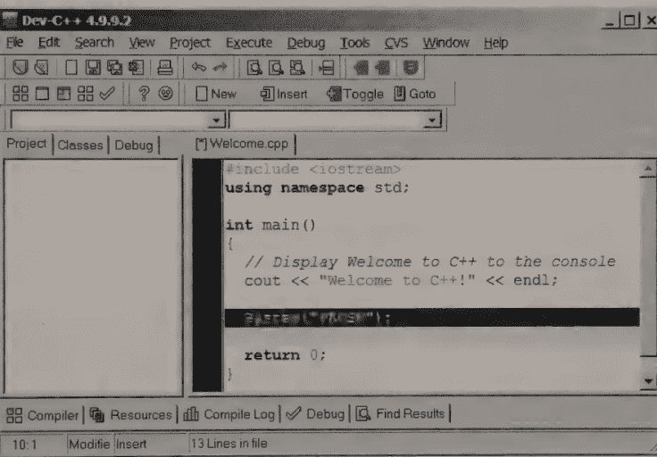

```cpp
#include <iostream>
using namespace std;

int main() {
    // 向控制台输出 Welcome to C++
    cout << "Welcome to C++!" << endl;

    return 0;
}
```

**图 1.26** 添加了语句 `system("PAUSE");`。

重新编译并运行程序。您将看到命令行窗口显示，如图 1.27 所示。

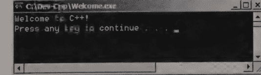

**图 1.27** 命令行窗口显示控制台输出。

- **Tip 提示** 您可以通过选择 Execute、Compile & Run（执行、编译并运行），或按下 F9，或点击 Compile & Run（编译并运行）工具栏按钮使用一个命令编译并运行程序。

# 26 第1章 计算机、程序与C++ 简介

多个程序

> **注意**
>
> 如果你在内容窗格中有多个程序，请从文件列表中选择你想要运行的程序，并使用“编译并运行”（Compile & Run）命令来运行它。

## 1.10 在 Windows 命令行提示符开发 C++ 程序

DOS 命令

> **注意**
>
> 若要从 Windows 命令行开发程序，你需要了解如何使用 DOS 命令。请参阅补充附 1.C，“从命令窗口编译和运行 C++”，以了解如何使用基础 DOS 命令。所有补充附均可通过随伴网站访问。

编译器

当你在上一个节中安装 Dev-C++ 时代，一个名为 GNU C++ 编译器的流行编译器会自动安装在 `c:\dev-cpp\bin.exe` 中。GNU 是一个致力于开发开源软件的组织（参见 `www.gnu.org`）。若要直接从命令行使用编译器，你必须将 `c:\dev-cpp\bin` 添加到 `PATH` 环境变量中。以下是在 Windows 2000 和 Windows XP 中添加新路径的步骤：

1. 从 Windows 控制面板中选择“系统”以显示“系统属性”对话框，如图 1.28(a) 所示。

2. 选择“高级”选项卡并点击“环境变量”，显示“环境变量”，如图 1.28(b) 所示。

3. 在“系统变量”中选择“Path”并点击“编辑”以添加路径。

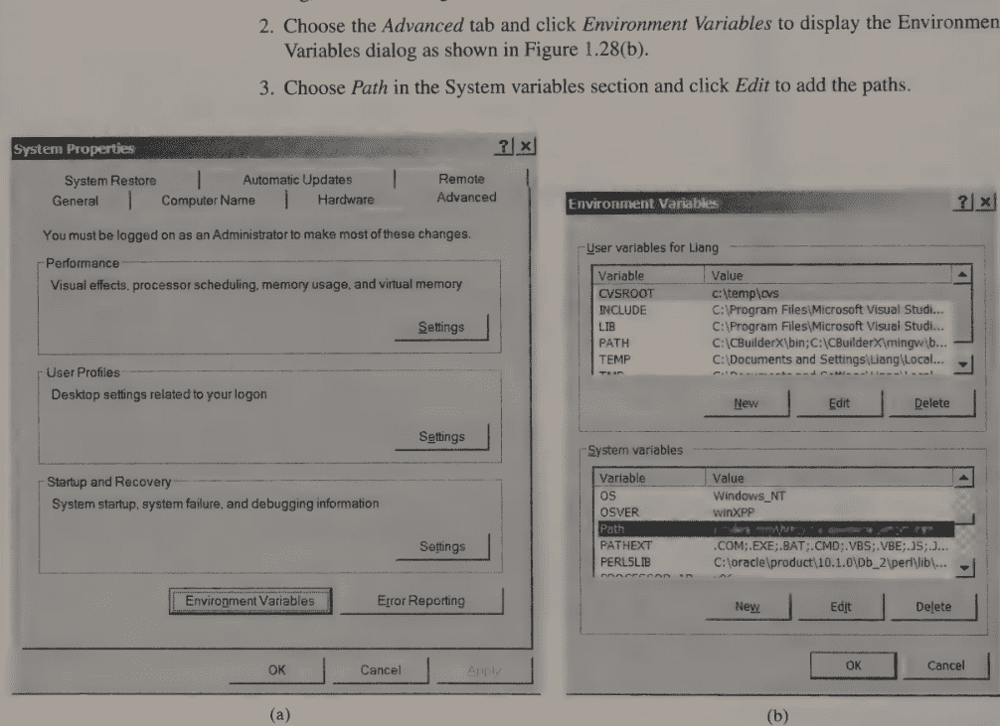

图 1.28 你需要在环境变量中添加编译器。

## 1.11 在 UNIX 上开发 C++ 程序

你可以使用任何文本编辑器来创建和编辑 C++ 源代码文件。图 1.29 显示了如何使用记事本编辑源代码文件。

要使用 GNU C++ 编译器编译 `Welcome.cpp`，输入命令 `g++ Welcome.cpp -o Welcome`，如图 1.30 所示。如果没有语法错误，将创建一个名为 `Welcome.exe` 的可执行文件。你可以通过输入 `Welcome` 来运行它。

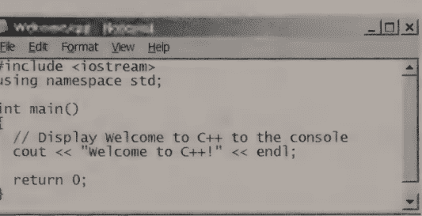

图 1.29 你可以使用 Windows 记事本创建 C++ 源代码文件。

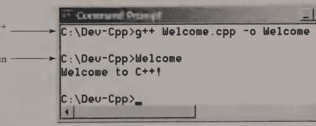

图 1.30 你可以使用 GNU C++ 编译器进行编译。

> **注意**
>
> 在 UNIX 上开发程序，你需要了解如何使用 UNIX 命令。请参阅 UNIX 命令补充附 1.D，“从 UNIX 编译和运行 C++”，了解如何使用基础命令。

默认情况下，UNIX 上会自动安装 GNU C++ 编译器。你可以使用 `vi` 或 `emacs` 编辑器创建 C++ 源代码文件。图 1.31(a) 显示了如何使用 `vi` 编辑器编辑和创建名为 `Welcome.cpp` 的源代码文件（使用命令 `Welcome.cpp`）。

要使用 GNU C++ 编译器编译 `Welcome.cpp`，输入命令 `g++ Welcome.cpp -o Main`，如图 1.31(b) 所示。如果没有语法错误，将创建一个名为 `Main` 的可执行文件。你可以通过输入 `./Main` 来运行它，如图 1.31(b) 所示。

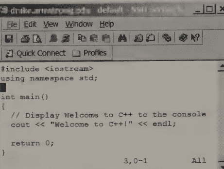


图 1.31 (a) 你可以使用 `vi` 编辑器创建 C++ 源文件。(B) 你可以使用 GNU 编译器编译 C++ 源文件。

## 核心术语

- 汇编语言 7
- 位 5
- 字节 5
- 总线 4
- 调制解调器 7
- 中央处理器 (CPU) 4
- 注释 11
- 编译器 8
- 控制台 10
- `cout` 11
- Dev-C++ 21
- 点间距 7
- DSL (数字用户线路) 7
- 硬件 4
- 高级编程语言 8
- 集成开发环境 (IDE) 13
- 关键字（或保留字）12
- 机器语言 7
- 主函数 11
- 内存 5
- 调制解调器 7
- 网络接口卡 (NIC) 7
- 操作系统 (OS) 9
- 像素 7
- 预处理指令 11
- 分辨率 7
- 软件 4
- 存储设备 6
- 语句终止符 11
- 流插入运算符 (`<<`) 11
- Visual C++ 14

## 本章总结

1. 计算机是一种存储和处理数据的电子设备。

2. 计算机包括硬件和软件。

3. 硬件是计算机中可见的物理部分。

4. 计算机程序被称为软件，是控制硬件并使其执行任务的不可见指令。

5. 计算机编程是为计算机执行编写指令（即代码）。

6. 中央处理器 (CPU) 是计算机的大脑。它从内存中提取指令。

7. 默认情况下，UNIX 上会自动安装 GNU C++ 编译器。你可以使用 `vi` 或 `emacs` 编辑器创建 C++ 源代码文件。

8. 图 1.31(a) 显示了如何使用 `vi` 编辑器编辑和创建名为 `Welcome.cpp` 的源代码文件（使用命令 `Welcome.cpp`）。


# 26 第1章 计算机、程序与C++ 简介

多个程序

> 注意

> 如果你在内容窗格中有多个程序，请从文件列表中选择你想要运行的程序，并使用“编译并运行”（Compile & Run）命令来运行它。

## 1.10 在 Windows 命令行提示符开发 C++ 程序

DOS 命令

> 注意

> 若要从 Windows 命令行开发程序，你需要了解如何使用 DOS 命令。请参阅补充附 1.C，“从命令窗口编译和运行 C++”，以了解如何使用基础 DOS 命令。所有补充附均可通过随伴网站访问。

编译器

当你在上一个节中安装 Dev-C++ 时代，一个名为 GNU C++ 编译器的流行编译器会自动安装在 `c:\dev-cpp\bin.exe` 中。GNU 是一个致力于开发开源软件的组织（参见 www.gnu.org）。若要直接从命令行使用编译器，你必须将 `c:\dev-cpp\bin` 添加到 `PATH` 环境变量中。以下是在 Windows 2000 和 Windows XP 中添加新路径的步骤：

1. 从 Windows 控制面板中选择“系统”以显示“系统属性”对话框，如图 1.28(a) 所示。

2. 选择“高级”选项卡并点击“环境变量”，显示“环境变量”，如图 1.28(b) 所示。

3. 在“系统变量”中选择 `Path` 并点击“编辑”以添加路径。


图 1.28 你需要在环境变量中添加编译器。

## 1.11 在 UNIX 上开发 C++ 程序

你可以使用任何文本编辑器来创建和编辑 C++ 源代码文件。图 1.29 显示了如何使用记事本编辑源代码文件。

要使用 GNU C++ 编译器编译 `Welcome.cpp`，输入命令 `g++ Welcome.cpp -o Welcome`，如图 1.30 所示。如果没有语法错误，将创建一个名为 `Welcome.exe` 的可执行文件。你可以通过输入 `Welcome` 来运行它。


图 1.29 你可以使用 Windows 记事本创建 C++ 源代码文件。


图 1.30 你可以使用 GNU C++ 编译器进行编译。

> 注意

> 在 UNIX 上开发程序，你需要了解如何使用 UNIX 命令。请参阅 UNIX 命令补充附 1.D，“从 UNIX 编译和运行 C++”，了解如何使用基础命令。

默认情况下，UNIX 上会自动安装 GNU C++ 编译器。你可以使用 `vi` 或 `emacs` 编辑器创建 C++ 源代码文件。图 1.31(a) 显示了如何使用 `vi` 编辑器编辑和创建名为 `Welcome.cpp` 的源代码文件（使用命令 `Welcome.cpp`）。

要使用 GNU C++ 编译器编译 `Welcome.cpp`，输入命令 `g++ Welcome.cpp -o Main`，如图 1.31(b) 所示。如果没有语法错误，将创建一个名为 `Main` 的可执行文件。你可以通过输入 `./Main` 来运行它，如图 1.31(b) 所示。


图 1.31 (a) 你可以使用 `vi` 编辑器创建 C++ 源文件。(B) 你可以使用 GNU 编译器编译 C++ 源文件。

## 核心术语

- 汇编语言 7
- 位 5
- 字节 5
- 总线 4
- 调制解调调调器 7
- 中央处理器 (CPU) 4
- 注释 11
- 编译器 8
- 控制台 10
- `cout` 11
- Dev-C++ 21
- 点间距 7
- DSL (数字用户线路) 7
- 硬件 4
- 高级编程语言 8
- 集成开发环境 (IDE) 13
- 关键字（或保留字）12
- 机器语言 7
- 主函数 11
- 内存 5
- 调制解调调器 7
- 网络接口卡 (NIC) 7
- 操作系统 (OS) 9
- 像素 7
- 预处理指令 11
- 分辨率 7
- 软件 4
- 存储设备 6
- 语句终止符 11
- 流插入运算符 (`<<`) 11
- Visual C++ 14

## 本章总结

1. 计算机是一种存储和处理数据的电子设备。

2. 计算机包括硬件和软件。

3. 硬件是计算机中可见的物理部分。

4. 计算机程序被称为软件，是控制硬件并使其执行任务的不可见指令。

5. 计算机编程是为计算机执行编写指令（即代码）。

6. 中央处理器 (CPU) 是计算机的大脑。它从内存中提取指令。

7. 默认情况下，UNIX 上会自动安装 GNU C++ 编译器。你可以使用 `vi` 或 `emacs` 编辑器创建 C++ 源代码文件。

8. 图 1.31(a) 显示了如何使用 `vi` 编辑器编辑和创建名为 `Welcome.cpp` 的源代码文件（使用命令 `Welcome.cpp`）。

9. 要使用 GNU C++ 编译器编译 `Welcome.cpp`，输入命令 `g++ Welcome.cpp -o Main`，如图 1.31(b) 所示。

10. 如果没有语法错误，将创建一个名为 `Main` 的可执行文件。你可以通过输入 `./Main` 来运行它，如图 1.31(b) 所示。

11. 计算机是一种存储和处理数据的电子设备。

12. 计算机包括硬件和软件。

13. 硬件是计算机中可见的物理部分。

14. 计算机程序被称为软件，是控制硬件并使其执行任务的不可见指令。

15. 计算机编程是为计算机执行编写指令（即代码）。

16. 中央处理器 (CPU) 是计算机的大脑。它从内存中提取指令。

17. 默认情况下，UNIX 上会自动安装 GNU C++ 编译器。你可以使用 `vi` 或 `emacs` 编辑器创建 C++ 源代码文件。

18. 图 1.31(a) 显示了如何使用 `vi` 编辑器编辑和创建名为 `Welcome.cpp` 的源代码文件（使用命令 `Welcome.cpp`）。

19. 要使用 GNU C++ 编译器编译 `Welcome.cpp`，输入命令 `g++ Welcome.cpp -o Main`，如图 1.31(b) 所示。

20. 如果没有语法错误，将创建一个名为 `Main` 的可执行文件。你可以通过输入 `./Main` 来运行它，如图 1.31(b) 所示。

21. 计算机是一种存储和处理数据的电子设备。

22. 计算机包括硬件和软件。

23. 硬件是计算机中可见的物理部分。

24. 计算机程序被称为软件，是控制硬件并使其执行任务的不可见指令。

25. 计算机编程是为计算机执行编写指令（即代码）。

26. 中央处理器 (CPU) 是计算机的大脑。它从内存中提取指令。

27. 默认情况下，UNIX 上会自动安装 GNU C++ 编译器。你可以使用 `vi` 或 `emacs` 编辑器创建 C++ 源代码文件。

28. 图 1.31(a) 显示了如何使用 `vi` 编辑器编辑和创建名为 `Welcome.cpp` 的源代码文件（使用命令 `Welcome.cpp`）。

29. 要使用 GNU C++ 编译器编译 `Welcome.cpp`，输入命令 `g++ Welcome.cpp -o Main`，如图 1.31(b) 所示。

30. 如果没有语法错误，将创建一个名为 `Main` 的可执行文件。你可以通过输入 `./Main` 来运行它，如图 1.31(b) 所示。

31. 计算机是一种存储和处理数据的电子设备。

32. 计算机包括硬件和软件。

33. 硬件是计算机中可见的物理部分。

34. 计算机程序被称为软件，是控制硬件并使其执行任务的不可见指令。

35. 计算机编程是为计算机执行编写指令（即代码）。

36. 中央处理器 (CPU) 是计算机的大脑。它从内存中提取指令。

37. 默认情况下，UNIX 上会自动安装 GNU C++ 编译器。你可以使用 `vi` 或 `emacs` 编辑器创建 C++ 源代码文件。


# 1. 计算机是一种存储和处理数据的电子设备。

# 2. 计算机包括硬件和软件。

# 3. 硬件是计算机中可见的物理部分。

# 4. 计算机程序被称为软件，是控制硬件并使其执行任务的不可见指令。

## 1.13 识别并修复以下代码中的错误：

```cpp
1 include <iostream>
2 using namespace std;
3
4 int main()
5 {
6 // Display Welcome to C++ to the console
7 cout << "Welcome to C++!" << endl;
8
9 return 0;
10 }
```

## 1.14 使用 GNU 编译器编译 C++ 程序的命令是什么？在 Windows 和 UNIX 上运行 C++ 应用程序的命令是什么？

## 1.15 显示以下代码的输出：

```cpp
#include <iostream>
using namespace std;

int main()
{
cout << "3.5 * 4 / 2 - 2.5 = " << (3.5 * 4 / 2 - 2.5) << endl;
return 0;
}
```

## 1.16 显示以下代码的输出：

```cpp
#include <iostream>
using namespace std;

int main()
{
cout << "C++" << "Java" << endl;
cout << "C++" << endl << "Java" << endl;

return 0;
}
```

# 编程练习

> 注意：偶数题练习的答案在配套网站上。所有练习的答案在教师资源网站上。难度分分为简单（无星）、中等（*）、困难（**）或挑战性（***）。

## 1.1（显示三条消息）

编写一个程序，显示 `Welcome to C++`、`Welcome to Computer Science` 和 `Programming is fun`。

## 1.2（显示五条消息）

编写一个程序，显示五次 `Welcome to C++`。

## 1.3（显示模式）

编写一个程序，显示以下模式：

```
CCCC      +       +
C        ++++++ +++++++
C         +       +
CCCC      +       +
```


视频笔记：显示五条消息

## 1.4（打印表格）

编写一个程序，显示以下表格：

| a | a^2 | a^3 |
|---|---|---|
| 1 | 1 | 1 |
| 2 | 4 | 8 |
| 3 | 9 | 27 |
| 4 | 16 | 64 |

## 1.5（计算表达式）

编写一个程序显示 $9.5 \times 4.5 - 2.5 \times 3$ 的结果。

## 1.6（级数求和）

编写一个程序显示 $1 + 2 + 3 + 4 + 5 + 6 + 7 + 8$ 的结果。

## 1.7（近似 $\pi$）

$\pi$ 可以可以使用公式计算：

```
$$\pi = 4 \times \left(1 - \frac{1}{3} + \frac{1}{5} - \frac{1}{7} - \frac{1}{9} + \frac{1}{11} - \frac{1}{13} + \dots\right)$$
```

编写一个程序显示 $4 \times \left(1 - \frac{1}{3} + \frac{1}{5} - \frac{1}{7} - \frac{1}{9} + \frac{1}{11} + \frac{1}{13}\right)$ 的结果。在程序中使用 $1.0$ 代替 $1$。

# 第 2 章 基础编程

## 目标

- 编写 C++ 程序进行简单计算（§2.2）。
- 从键盘读取输入（§2.3）。
- 使用标识符为程序中的元素命名（§2.4）。
- 使用变量存储数据（§2.5-2.6）。
- 使用赋值语句和赋值表达式进行编程（§2.6）。
- 使用 `const` 关键字和 `#define` 指令命名常量（§2.7）。
- 使用数值数据类型声明变量（§2.8）。
- 使用运算符编写数值表达式（§2.8）。
- 使用强制转换（casting）将数字转换为不同的类型（§2.9）。
- 使用 `char` 类型表示字符（§2.10）。
- 通过三个示例（`ComputeLoan`、`ComputeChange`、`ShowCurrentTime`）编写计算（§2.11）。
- 熟悉 C++ 文档、编程风格和命名规范（§2.12）。
- 区分语法错误、运行时错误和逻辑错误（§2.13）。
- 调试逻辑错误（§2.14）。


## 2.1 引言

在第 1 章中，你学习了如何创建、编译和运行 C++ 程序。现在你将学习如何通过程序解决问题。在此过程中，你将学习使用基本数据类型、变量、常量、运算符、表达式以及输入和输出通过程序解决基础问题。

## 2.2 编写简单程序

首先，让我们来看一个计算圆面积的简单程序。该程序读取半径并显示其面积。它将使用变量来存储半径和面积，并使用表达式计算面积。

编写程序涉及设计和翻译程序代码。算法通过描述要执行的操作来描述如何解决问题，并规定了它们执行的顺序。算法可以帮助程序员在编写代码之前进行规划。随着学习的深入，你将遇到复杂的问题，需要精细的算法。

在编程语言中，你已经知道每个 C++ 程序都以 `main` 函数开始。该程序的算法可以描述如下：

1. 读取半径
2. 计算面积
3. 显示面积

为了解决这些问题，程序需要从键盘读取半径。这涉及到两个重要问题：

- 读取半径。
- 在程序中存储半径。

让我们解决第二个问题。与其使用 `a` 和 `y`，不如选择描述性的名称——在本例中为 `radius`。变量用于存储数据和计算结果。让编译器知道它们是什么，指定它们的数据类型，无论是整数、浮点数还是其他的。声明 `radius` 和 `area` 为浮点数。现在程序可以扩展为：

```cpp
int main() {
    double radius;
    double area;

    // Step 1: 读取半径
    // Step 2: 计算面积
    // Step 3: 显示面积
}
```

程序声明了 `radius` 和 `area` 变量。变量 `radius` 和 `area` 对应内存位置。每个变量都有名称、类型和大小。第 6 行声明 `radius` 可以存储双值。在赋值之前该值没有定义。第 10 行将 20 赋值 `radius`。如果你注释掉第 10 行，程序将编译并运行，但结果是不可预测的，因为 `radius` 未赋值。

## 列表 2.1 ComputeArea.cpp

```cpp
#include <iostream>
using namespace std;
int main() {
    double radius;
    double area;

    // Step 1: 分配半径
    radius = 20;
    // Step 2: 计算面积
    area = radius * radius * 3.14159;

    // Step 3: 显示面积
    cout << "The area is " << area << endl;
    return 0;
}
```

面积为 1256.64。

下表显示了程序执行时，`i` 和 `radius` 在内存中的值。表中的每一行显示了程序中相应行代码执行后变量的值。手动追踪（Hand trace）有助于理解程序的工作原理，也是寻找程序错误的有用工具。

| 行号 | radius | area |
|---|---|---|
| 6 | 未定义值 | |
| 7 | | 未定义值 |
| 10 | 20 | |
| 13 | | 1256.64 |

第 16 行向控制台发送字符串 `"The area is "`。它还将变量 `area` 的值发送到控制台。注意 `area` 周围没有引号。如果加上引号，字符串 `"area"` 将发送到控制台。

### 增量开发与测试

- **提示**：此示例包含三个步骤。通过每次添加一个步骤来增量地开发和测试这些步骤是一个很好的方法。你应该将这种方法应用于所有程序，尽管本书中的许多程序并没有显式地说明解决问题的步骤。

## 2.3 从键盘读取输入

在列表 2.1 中，`radius` 在源代码中是固定的。要使用不同的半径，你必须修改源代码并重新编译。显然，这并不方便。你可以使用 `cin` 从键盘读取输入，如列表 2.2 所示。

## 列表 2.2 ComputeAreaWithConsoleInput.cpp

```cpp
#include <iostream>
using namespace std;

int main() 
{
    // Step 1: Read radius
    double radius;
    cout << "Enter a radius: ";
    cin >> radius;

    // Step 2: Compute area
    double area = radius * radius * 3.14159;

    // Step 3: Display the area
    cout << "The area is " << area << endl;

    return 0;
}
```

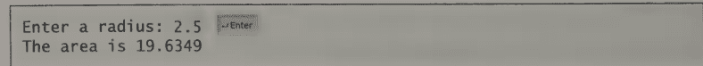


第 8 行向控制台显示字符串 `"Enter a radius:"`。这被称为“提示”（prompt），因为它引导用户输入内容。你的程序应该始终告诉用户在从键盘输入时应该预期什么。

第 9 行使用 `cin` 从键盘读取一个值。注意 `cin` 代表“console input”（控制台输入）。`>>` 符号被称为“流提取运算符”（stream extraction operator），它将输入赋值给变量。如示例输出所示，程序显示提示信息 `"Enter a radius: "`；随后用户输入数字 2，该数字被赋值给变量 `radius`。`cin` 对象会导致程序等待，直到输入了数据并按下回车键。C++ 会自动将从键盘读取的数据转换为变量的类型。

注意 `>>` 运算符与 `<<` 运算符方向相反。`>>` 表示数据从 `cin` 流向变量。`<<` 显示数据从变量流向 `cout`。

你可以使用单条语句读取多个值。例如，以下语句将三个值读入变量 `x1`、`x2` 和 `x3` 中：

```cpp
cin >> x1 >> x2 >> x3;
```

列表 2.3 给出了读取三个数字并显示其平均值的示例。

## 列表 2.3 ComputeAverage.cpp

```cpp
#include <iostream>
using namespace std;

int main() {
    // Prompt the user to enter three numbers
    double number1,number2,number3;
    cout << "Enter three numbers: ";
    cin >> number1 >> number2 >> number3;

    // Compute average
    double average = (number1 + number2 + number3) / 3;

    // Display result
    cout << "The average of " << number1 << " " << number3 << " is " << average << endl;

    return 0;
}
```


第 8 行提示用户输入三个数字。数字在第 9 行被读取。你可以输入用空格隔的三个数字然后按回车键，或者输入每个数字后按回车键，如该程序的示例运行所示。

## 2.4 标识符

如在列表 2.3 所示，`main`、`number1`、`number2` 等是程序中内容的名称。这些名称被称为标识符（identifiers）。所有标识符必须遵守以下规则：

- 标识符是由字母、数字和下划线（`_`）组成的字符序列。
- 标识符必须以字母或下划线开头。不能以数字开头。
- 标识符不能是保留字。（参见附录 A，“C++ 关键字”）。
- 标识符可以是任意长度，但你的 C++ 编译器可能会实施某些限制。为了确保可移植性，请使用 31 个字符以内的长度。

例如，`area` 和 `radius` 是合法的标识符，而 `2A` 和 `d+4` 因为不符合规则而非法的。编译器会检测标识符并报告语法错误。

> **注意**：C++ 是区分大小写的，`area`、`Area` 和 `AREA` 是三个不同的标识符。

> **提示**：标识符用于命名程序中的变量、函数和其他。描述性的标识符可以让程序更易读。

## 2.5 变量

正如你从前面的节程序中所看到的，变量用于存储值，以便在程序后续中使用这些值。它们之所以被称为变量，是因为它们的值可以改变。在列表 2.2 的程序中，`radius` 和 `area` 是双精度浮点类型。你可以为 `radius` 和 `area` 赋值任何数值，并且它们的值可以重新赋值。例如，你可以编写下面的代码来计算半径的面积：

```cpp
// Compute the first area
double area = radius * radius * 3.14159;
```

## 2.6 赋值语句与赋值表达式

表达式表示涉及值、变量和操作符的计算，它共同求出一个值。例如，考虑以下代码：

```cpp
int x = 1; // 将 1 赋值给变量 x
double radius = 1.0; // 将 1.0 赋值给变量 radius
x = 5 * (3 / 2) + 3 * 2; // 将表达式的值赋值给 x
y = y + 1; // 将 y 和 1 的加赋值赋值给 x
area = radius * radius * 3.14159; // 计算面积
```

变量可以出现在赋值运算符的两边。例如：

```
x = x + 1;
```

在这一条赋值语句中，`x + 1` 的结果被赋值给 `x`。如果 `x` 在语句执行前为 1，那么在语句执行后它将变为 2。

在给变量赋值时，变量名必须在赋值运算符的左侧。因此，`1 = x` 是错误的。


> **注意**：在数学中，`x = 2 * n + 1` 表示一个方程。在 C++ 中，`x = 2 * n + 1` 是一个赋值语句，它求出表达式 `2 * n + 1` 的值并赋值给 `x`。

在 C++ 中，赋值语句本质上是一个表达式，它求出要赋值给赋值运算符左侧变量的值。因此，赋值语句也被称为赋值表达式。例如，以下语句是正确的：

```cpp
cout << (x = 1);
```

等同于

```cpp
x = 1;
cout << x;
```

以下语句也是正确的：

```cpp
i = j = k = 1;
```

等同于

```cpp
k = 1;
j = k;
i = j;
```

## 2.7 命名常量

变量的值在程序执行过程中可能会改变，但常量表示永远不会改变的数据。在我们的 `ComputeArea` 程序中，π 是一个常量。如果你频繁使用它，就不想一直记住 3.14159；相反，你可以为 π 起一个常量名称。以下是命名常量的语法：

```cpp
const datatype CONSTNAME = VALUE;
```

常量必须在同一语句中声明并初始化。`const` 是 C++ 中用于声明常量的关键字。例如，你可以将 π 声明为常量并将列表 2.2 重写为列表 2.4。

## 列表 2.4 ComputeAreaWithConstant.cpp

```cpp
#include <iostream>
using namespace std;

int main()
{
    const double PI = 3.14159;

    // 步骤 1: 读取半径
    double radius;
    cout << "Enter a radius: ";
    cin >> radius;

    // 步骤 2: 计算面积
    double area = radius * radius * PI;

    // 步骤 3: 显示面积
    cout << "The area is ";
    cout << area << endl;

    return 0;
}
```

### 常量 PI

> **注意**：按照惯例，常量使用大写字母：`PI`，而不是 `pi` 或 `Pi`。

### 命名常量

> **注意**：使用常量有三个好处：(1) 你不需要重复相同的值；(2) 如果你必须更改常量值（例如将 `PI` 从 3.14 改为 3.14159），你只需要在源代码中的一处进行更改；(3) 描述性的常量名使程序易于阅读。

### 使用常量的好处

另一种指定常量的方法是使用 `#define` 指令，其遵循如下 `#define` 指令语法：

```cpp
#define name value
```

例如，你可以通过列表 2.5 中的 `#define` 指令来重写列表 2.4 以定义 `PI`：

## 列表 2.5 ComputeArea55.cpp


```cpp
#include <iostream>
#define PI 3.14159
using namespace std;

int main()
{
    // 步骤 1: 读取半径
    double radius;
    cout << "Enter a radius: ";
    cin >> radius;

    // 步骤 2: 计算面积
    double area = radius * radius * PI;

    // 步骤 3: 显示面积
    cout << "The area is ";
    cout << area << endl;

    return 0;
}
```

常量`PI`

# 42 第 2 章 基础编程

编译器指令不是 C++ 语句。因此，不要在指令行尾加分号（；）。当编译器在程序中识别`PI`时，它会将`PI`替换为`3.14159`。如果你错误地在指令中放入分号，如下所示：

无分号

> 应该没有分号

```cpp
#define PI 3.14159;
```

程序中的`PI`将被替换为带分号的`3.14159;`。

你可以使用`#define`指令定义常量，也可以使用`const`声明常量。它们之间有什么区别？你又应该使用哪一个？当你定义一个常量时，常量并不存储在内存中。编译器会将常量替换为值。当你使用`const`关键字定义常量时，常量像变量一样存储在内存中。使用`#define`指令定义常量时，常量会被编译器替换为值。使用`const`声明常量时，常量存储在内存中，更高效。

`#define` vs. `const`

## 2.8 数据类型与操作

编译器指令不是 C++ 语句。因此，不要在指令行尾加分号（；）。当编译器在程序中识别`PI`时，它会将`PI`替换为`3.14159`。如果你错误地在指令中放入分号，如下所示：

无分号

> 应该没有分号

```cpp
#define PI 3.14159;
```

程序中的`PI`将被替换为带分号的`3.14159;`。

你可以使用`#define`指令定义常量，也可以使用`const`声明常量。它们之间有什么区别？你又应该使用哪一个？当你定义一个常量时，常量并不存储在内存中。编译器会将常量替换为值。当你使用`const`关键字定义常量时，常量像变量一样存储在内存中。使用`#define`指令定义常量时，常量会被编译器替换为值。使用`const`声明常量时，常量存储在内存中，更高效。

数据类型的大小取决于编译器和计算机。通常，`int`和`long`的大小相同。在某些系统上，`long`需要 8 字节。

提示

你可以使用`sizeof`函数查找类型的大小。例如，以下语句显示了机器上`int`、`long`和`double`的大小。

```cpp
cout << sizeof(int) << " " << sizeof(long) << " " << sizeof(double);
```

C++ 使用三种浮点数类型：`float`、`double`和`long`。浮点类型通常是`float`的两倍。因此，`double`被称为双精度，而`float`是单精度。`long double`比`double`大。对于大多数应用，使用`double`类型是理想的。

### 2.8.1 数字字面量

字面量是直接出现在程序中的常量值。在以下语句中，`34`和`0.35`是字面量：

```cpp
int i = 34;
double footToMeters = 0.305;
```

默认情况下，整数字面量是十进制。要表示八进制字面量，请使用前导 0（零）；要表示十六进制字面量，使用`0x`或`0X`（零）。例如，以下代码显示十六进制`FFFF`的十进制值为 65535，数字`01`的十进制值为 8。

```cpp
cout << 0xFFFF << " " << 01;
```

浮点字面量带有小数点书写。`2.0`是一个浮点数。科学计数法浮点字面量也可以用于科学计数法。例如，`1.23456e+2`与`1.23456E+2`等同于`1.23456 × 10² = 123.456`，而`1.23456e-2`等同于`1.23456 × 10⁻² = 0.0123456`。`E`（或`e`）表示指数，可以是小写也可以是大写。

# 44 第 2 章 基础编程

注意

`float`和`double`类型用于表示带有小数点的数字。为什么称为浮点数呢？这些数字是以科学计数法存储的。当一个像`50.534`这样的数字转换为科学计数法时（例如`5.0534e+1`），它的小数点会移动（即“浮动”）到一个新的位置。

为什么称为浮点？

### 2.8.2 数值运算符

数值数据类型的运算符包括算术运算符：加法（`+`）、减法（`-`）、乘法（`*`）、除法（`/`）和取模（`%`），如表 2.2 所示。

运算符`+`, `-`, `/`, `%`

| 表格 2.2 数值运算符 |

| 运算符 | 名称 | 示例 | 结果 |

|---|---|---|---|

| `+` | 加法 | `34 + 1` | 35 |

| `-` | 减法 | `34.0 - 0.1` | 33.9 |

| `*` | 乘法 | `300 * 3` | 9000 |

| `/` | 除法 | `1.0 / 2.0` | 0.5 |

| `%` | 取模 | `20 % 3` | 2 |

整数除法

当除法的操作数是整数时，除法的结果是一个整数。小数部分会被截断。例如，`5 / 2`产生 2 而不是 2.5，而`-5 / 2`产生 -2 而不是 -2.5。要执行常规的数学除法，其中一个操作数必须是浮点数。例如，`5.0 / 2`产生 2.5。

整数取模

取模（`%`）仅适用于整数操作数，并产生除后的余数。左侧的操作数是被除数，右侧的操作数是除数。因此，`7 % 3`产生 1，`12 % 4`产生 0，`26 % 8`产生 2，而`20 % 13`产生 7。

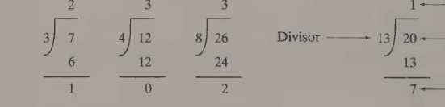

`%`经常用于正整数，但也可以用于负整数。如果被除数是负数，余数也是负数。例如，`-7 % 3`产生 -1，`-12 % 4`产生 0，`-26 % 8`产生 -2，而`-20 % 13`产生 -7。在 C++ 中，取模运算符用于整数。取模在编程中非常有用。例如，偶数`% 2`总是等于 0，奇数`% 2`总是等于 1。所以你可以使用这个属性判断一个数字是偶数还是奇数。如果今天是周六，你的朋友要在 10 天后见面。那是星期几？你可以通过以下表达式找到：

> 周六是第 6 天

- 一周有 7 天

- `(6 + 10) % 7`是 2

- 所以第 2 天是周二

- 10 天后

# 2.8 数值数据类型和操作 45

示例 2.6 提供了一个从秒数获取分钟和剩余秒数的程序。例如，500 秒包含 8 分钟和 20 秒。

## 示例 2.6 DisplayTime.cpp

```cpp
#include <iostream>
using namespace std;

int main() {
    // 提示输入秒
    int seconds;
    cout << "输入秒：";
    cin >> seconds;
    int minutes = seconds / 60;
    int remainingSeconds = seconds % 60;
    cout << seconds << " 秒是 " << minutes << " 分和 " << remainingSeconds << " 秒" << endl;
    return 0;
}
```

输入秒：500

500 秒是 8 分钟和 20 秒


| 秒 | 分钟 | 剩余秒 |

|---|---|---|

| 500 | 8 | 20 |

第 9 行使用`seconds / 60`获取分钟。

第 11 行`(seconds % 60)`在减去分钟后获取剩余秒数。

`+`和`-`运算符既可以是一元运算符，也可以是二元运算符。一元运算符只有一个操作数；二元运算符有两个。例如，`-5`中的运算符是一元运算符（取负 5），而`4 - 5`中的运算符是二元运算符（从 4 中减去 5）。

一元运算符

二元运算符

> 注意 允许将整数赋值给浮点变量。将浮点值赋值给整数变量时，浮点值的小数部分会被截断（而不是四舍五入）。例如：

```cpp
int i = 34; // i 变成 34
float f = i; // f 现在是 34
float g = 34.3; // g 是 34.3
long j = g;
```

> 注意 当给变量赋值过大的值时，会导致溢出。例如，执行以下语句会导致溢出，因为`short`类型可以存储的最大值是 32767；32768 太大了。

什么是溢出？

```cpp
short value = 32767; // value 实际上会变成 -32768
```

# 第 2 章 基础编程

同样，执行该语句会导致溢出；因为`short`类型可以存储的最小值是 -32768。值 -32769 对于变量来说太大。

```cpp
short value = -32768 - 1; // value 实际上会变成 32767
```

C++ 不会对溢出报告警告或错误。因此，在处理接近类型最小或最大范围的数字要小心。当浮点数太小（即接近0）而无法存储时，会导致溢出（C++ 将其近似为 0）。通常你不需要担心下溢（underflow）。

### 2.8.3 算术表达式

在 C++ 中编写数值表达式涉及使用 C++ 运算符对算术表达式进行直接翻译。例如，表达式

```cpp
3 + 4x / x - 10(y - 5)(a + b + c) / x + 9(4/x + y + x)/y
```

可以转换为 C++ 表达式：

```cpp
(3 + 4 * x) / x - 10 * (y - 5) * (a + b + c) / x + 9 * (4 / x + (9 + x)) / y
```

数值运算符在 C++ 表达式中的用法与算术表达式相同。括号内的运算符首先求值。括号可以嵌套，此时内层括号中的表达式首先求值。接下来应用乘法、除法取模运算符。如果表达式包含多个乘法、除法和取模运算符，它们从左到右应用。加法和减法运算符最后应用。如果表达式包含多个加法和减法运算符，它们从左到右应用。

示例 2 提供了一个使用公式`celsius = (5/9)*(fahrenheit - 32)`将华氏度转换为摄氏度的程序。

## 列表 2 FahrenheitToCelsius.cpp

```cpp
#include <iostream>
using namespace std;

int main() {
    // 输入华氏度温度
    double fahrenheit;
    cout << "输入华氏度温度：";
    cin >> fahrenheit;
    // 获取摄氏度
    double celsius = (5.0 / 9.0) * (fahrenheit - 32);
    // 显示结果
    cout << "华氏 " << fahrenheit << " 是 " << celsius << "摄氏度" << endl;
    return 0;
}
```

输入华氏度

计算摄氏度

输入华氏度：100

华氏 100 是 37.778 摄氏度

| 行 | 华氏度 | 摄氏度 |

|---|---|---|

| 7 | | |

| 9 | 100 | |

| 12 | | 37.778 |

应用除法时要小心。在 C++ 中，两个整数相除的结果是一个整数。第 12 行，`5/9`被翻译为`5.0 / 9`而不是`5 / 9`，因为整数除法

### 2.8.4 复合赋值运算符

经常使用变量的当前值，修改后重新赋值给该变量。例如，以下语句将`i`的当前值与`value`相并将结果赋回`i`：

```cpp
i = i + 8;
```

C++ 允许使用快捷运算符将赋值和加法运算符结合。例如，前述语句可以写为：快捷运算符

```cpp
i += 8;
```

`+=`被称为加赋值运算符。其他快捷运算符见表 2.3。

| 表格 2.3 快捷运算符 |

| 运算符 | 名称 | 示例 | 等效 |

|---|---|---|---|

| `+=` | 加法赋值 | `i += 8` | `i = i + 8` |

| `-=` | 减法赋值 | `i -= 8` | `i = i - 8` |

| `*=` | 乘法赋值 | `i *= 8` | `i = i * 8` |

| `/=` | 除法赋值 | `i /= 8` | `i = i / 8` |

| `%=` | 取模赋值 | `i %= 8` | `i = i % 8` |

> 注意 像赋值运算符（`=`）一样（`++`, `-=`, `*=`, `/`, `%`）可以用于形成表达式赋值语句。例如，在代码中，`x += 2`在第一行是语句，在第二行是表达式。

```cpp
x += 2; // 语句
cout << (x += 2); // 表达式
```

如果语句被用作表达式，它被称为表达式语句。表达式语句

> 注意 快捷运算符中没有空格，例如`+ =`应该是`+=`。

# 第 2 章 基础编程

### 2.8.5 递增和递减运算符

有两种用于将变量加1 或 减1 的简写运算符。这非常方便，因为这通常是修改值的方式。这两个运算符是`++`和`--`。例如，以下代码将`i`增加了 1，并将`j`减了 1：

```cpp
int i = 3, j = 3;
i++; // i 变为4
j--; // j 变为2
```

`++`和`--`运算符可以使用前缀模式或后缀模式，如表 2.4 所示。

表 2.4 递增和递减运算符

| 运算符 | 名称 | 描述 | 示例 |

|---|---|---|---|

| `++var` | 前置递增 | `var`增加 1 并使用新的`var`值 | `int j = ++i; // j 是 2, i 是 2` |

| `var++` | 后置递增 | `var`增加 1，但使用`var`的原始值 | `int j = i++; // j 是 1, i 是 2` |

| `--var` | 前置递减 | `var`减少 1 并使用新的`var`值 | `int j = --i; // j 是 0, i 是 0` |

| `var--` | 后置递减 | `var`减少 1，但使用`var`的原始值 | `int j = i--; // j 是 1, i 是 0` |

如果运算符在变量之前（前缀于变量），则先将变量加1或减1，然后返回变量的新值。如果运算符在变量之后（后缀于变量），则返回变量的原始值，然后再将变量加1或减1。因此，`++x`和`--x`分别称为递增运算符和递减运算符；而后缀`x++`和`x--`分别称为后置递增运算符和后置递减运算符。`++`（或`--`）的前缀形式和`++`（或`--`）的后缀形式在单独使用时是相同的，但在表达式中使用时它们会产生不同的效果。以下代码说明了：

```cpp
int i = 10; 效果等同于 int newItem = 10 * i;
int newItem = 10 * i++; i = i + 1;
```

在这种情况下，`i`增加了 1，然后返回`i`的旧值并用于乘法。因此`newItem`变为 100。如果将`i++`替换为`++i`，如下：

```cpp
int i = 10; 效果等同于 int i = i + 1;
int newItem = 10 * (++i)); i = i + 1;
```

`i`增加了 1，并返回`i`的新值且用于乘法。因此`newItem`变为 110。这是另一个例子：

```cpp
double x = 1.0;
double y = 5.0;
double z = x-- + (++y);
```

在执行所有行代码后，`y`变为 6.0，`z`变为 7.0，`x`变为 0.0。

## 2.9 数字类型转换

递增运算符`++`和递减运算符`--`可以应用于所有的整数和浮点类型。这些运算符通常用于循环语句。循环语句是一种控制操作或一系列操作执行次数的结构。该结构连同循环语句的主题将在第 4 章“循环”中介绍。

### 注意事项

对于大多数二运算符，C++ 并没有指定操作数的求值顺序。通常，假设左操作数在右操作数之前求值。这在 C++ 中是不保证的。例如，假设`i`为 1；那么表达式

```cpp
++ + i
```

如果左操作数（`++`）先求值，则结果为 4 (2 + 2)；如果右操作数先求值，则结果为 3 (2 + 1)。这在 C++ 中是不保证的。

## 2.9 数字类型转换

对于大多数二运算符，C++ 并没有指定操作数的求值顺序。通常，假设左操作数在右操作数之前求值。这在 C++ 中是不保证的。

（注：此处原文似乎存在重复段落，根据指令已处理重复，以下为后续逻辑继续翻译）

如果运算符在变量之前（前缀于变量），则先将变量加1或减1，然后返回变量的新值。如果运算符在变量之后（后缀于变量），则返回变量的原始值，然后再将变量加1或减1。因此，`++x`和`--x`分别称为递增运算符和递减运算符；而后缀`x++`和`x--`分别称为后置递增运算符和后置递减运算符。`++`（或`--`）的前缀形式和`++`（或`--`）的后缀形式在单独使用时是相同的，但在表达式中使用时它们会产生不同的效果。以下代码说明了：

```cpp
int i = 10; 效果等同于 int newItem = 10 * i;
int newItem = 10 * i++; i = i + 1;
```

在这种情况下，`i`增加了 1，然后返回`i`的旧值并用于乘法。因此`newItem`变为 100。如果将`i++`替换为`++i`，如下：

```cpp
int i = 10; 效果等同于 int i = i + 1;
int newItem = 10 * (++i)); i = i + 1;
```

`i`增加了 1，并返回`i`的新值且用于乘法。因此`newItem`变为 110。这是另一个例子：


```cpp
double x = 1.0;
double y = 5.0;
double z = x-- + (++y);
```

在执行所有行代码后，`y` 变为 6.0，`z` 变为 7.0，`x` 变为 0.0。

递增运算符 `++` 和递减运算符 `--` 可以应用于所有的整数和浮点类型。这些运算符通常用于循环语句。循环语句是一种控制操作或一系列操作执行次数的结构。该结构连同循环语句的主题将在第 4 章“循环”中介绍。

## 注意事项

对于大多数二运算符，C++ 并没有指定操作数的求值顺序。通常，假设左操作数在右操作数之前求值。这在 C++ 中是不保证的。例如，假设 `i` 为 1；那么表达式

```cpp
++ + i
```

如果左操作数（`++`）先求值，则结果为 4 (2 + 2)；如果右操作数先求值，则结果为 3 (2 + 1)。这在 C++ 中是不保证的。

你可以对不同类型进行二运算吗？是的。C++ 允许你手动将值从另一种类型转换为。使用 `static_cast` 语法，例如：

对于大多数二运算符，C++ 并没有指定操作数的求值顺序。通常，假设左操作数在右操作数之前求值。这在 C++ 中是不保证的。例如，假设 `i` 为 1；那么表达式

```cpp
++ + i
```

如果左操作数（`++`）先求值，则结果为 4 (2 + 2)；如果右操作数先求值，则结果为 3 (2 + 1)。这在 C++ 中是不保证的。

# 第 2 章 基础编程

假设你想打印下面带引号的消息：

He said "C++ is powerful"

以下是编写该语句的方法：

```
cout << "He said \"C++ is powerful\"";"
```

注意

字符 `' '`、`'\t'`、`'\f'`、`'\r'` 和 `'\n'` 被称为空白字符。

注意

下方的两个语句都会显示一个字符串并将光标移动到下一行：

`cout << "Welcome to C++\n"`

`cout << "Welcome to C++" << endl;`

使用 `endl` 可以确保输出在所有平台上都能即时显示。

## 2.10.2 char 与数值类型之间的强制转换

`char` 可以被强制转换为任何数值类型，反之亦然。当将整数强制转换为 `char` 时，仅会使用其 8 位数据（假设你的系统使用 8 位存储 `char`）；其他部分将被忽略。例如：

```
char c = 0xFF41; // 将低位十六进制代码 41 赋值给 c
cout << c; // c 是字符 A
```

当将浮点值强制转换为 `char` 时，该浮点值首先转换为 `int`，然后再转换为 `char`。

```
char c = 65.25; // 65 被赋值给 c
cout << c; // c 是字符 A
```

当将 `char` 强制转换为数值类型时，该字符的 ASCII 码会被转换为指定的数值类型。例如：

```
int i = 'A'; // 将字符 A 的 ASCII 码赋值给 i
cout << i; // i 是 65
```

注意

`char` 被视为等同于字节大小的整数。所有的数值运算符都可以作用于 `char` 操作数。如果另一个操作数是数字或 `char`，则 `char` 操作数会自动强制转换为数值。例如，以下语句：

```
int i = 2 + '3'; // (int)2 是 50，(int)'3' 是 51
cout << "i is " << i << endl; // i 是十进制 101
```

```
int j = 2 + 'a'; // (int)'a' 是 97
cout << "j is " << j << endl;
cout << "j is " is the ASCII code for character " <<
static_cast<char>(j) << endl;
```

```
display
i is 101
j is 99
99 is the ASCII code for character c
```

注意

值得注意的是，小写字母的 ASCII 码是从 `'a'` 的代码开始的连续整数，然后是 `'b'`、`'c'` 和 `'z'`。大写字母也是如此。此外，`'a'` 的 ASCII 码大于 `'A'` 的代码。因此 `'a' - 'A'` 等于 `'b' - 'B'`。对于小写字符 `ch`，其对应的大写字母为 `static_cast<char>('A') + (ch - 'a')`。

## 2.11 案例研究

在前面的章节中，你学习了变量、常量、基本数据类型、运算符和表达式。现在你准备好使用它们来编写有趣的程序了。本节介绍了三个问题：计算贷款还款、将金额拆分为更小的单位以及显示当前时间。

### 2.11.1 计算贷款还款

问题是编写一个计算贷款还款的程序。贷款可以是汽车贷款、学生贷款或房产贷款。该程序允许用户输入利率、年限和贷款金额，并显示每月还款额和总还款额。

计算每月还款的公式如下：

```
loanAmount = \frac{monthlyPayment \times monthlyInterestRate}{(1 + monthlyInterestRate)^{numberOfYears}}$
```

你不需要知道这个公式是如何推导出来的。尽管如此，给定月利率、年限和贷款金额，你可以可以使用它来计算每月还款。

开发程序的步骤如下：

1. 提示用户输入年利率、年限和贷款金额。

2. 从年利率获取月利率。

3. 使用上述公式计算每月还款。

4. 计算总还款额，即每月还款额乘以 12 再乘以年限。

5. 显示每月还款额和总还款额。

在公式中，你需要计算 $(1 + monthlyInterestRate)^{numberOfYears}$。C++ 在 `cmath` 库中包含了 `pow(a, b)` 函数，可以用于计算 `a^b` 函数。

例如：

```
cout << pow(2.0, 3);
```

显示 8。注意 C++ 要求 `pow(a, b)` 中的 `a` 或 `b` 必须是小数值。我们使用 2.0 而不是 2。

```
(1 + monthlyInterestRate)^{numberOfYears} 可以使用 pow(1 + monthlyInterestRate, numberOfYears) 计算。
```

列表 2.9 给出了完整的程序。

## 列表 2.9 ComputeLoan.cpp

```cpp
#include <iostream>
#include <cmath>
using namespace std;
int main() {
{
```


视频笔记

程序计算

包含 `cmath` 库

### 2.11.2 问题：单位计数

假设你想开发一个程序将金额分类为货币单位。该程序允许用户输入一个代表总分数的 `double` 类型值，并输出一份报告，列出美元、季度币、硬角、美分和分的等值金额，如示例输出所示。

你的程序应该按此顺序报告美元的最大数量，然后是季度币的最大数量，依此类推。

开发程序的步骤如下：

1. 提示用户以小数形式输入金额，例如 11.56。

2. 将金额（例如 11.56）转换为分（1156）。

3. 将分除以 100 得到美元数量。使用余数 100 获取剩余的分数。

4. 将剩余的分除以 25 得到季度币数量。使用剩余余数 25 获取剩余的分数。

5. 将剩余的分除以 10 得到硬角数量。使用剩余余数 10 获取剩余的分数。

6. 将剩余的分除以 5 得到美分数量。使用剩余余数 5 获取剩余的分数。

7. 剩余的分数为分（pennies）。

8. 显示结果。

完整的程序见列表 2.10。

## 列表 2.10 ComputeChange.cpp

```cpp
#include <iostream>
using namespace std;

int main()
{
    // 输入金额
    cout << "Enter an amount in double, for example 11.56: ";
    double amount;
    cin >> amount;

    int remainingAmount = static_cast<int>(amount * 100);

    // 计算美元数量
    int numberOfDollars = remainingAmount / 100; // dollars
    remainingAmount = remainingAmount % 100;

    // 计算剩余金额中的季度币数量
    int numberOfQuarters = remainingAmount / 25;    // quarters
```

# 第2章 基础编程

```
19 remainingAmount = remainingAmount % 25;
20
21 // 计算剩余金额中硬币的数量
22 int numberOfDimes = remainingAmount / 10;
23 remainingAmount = remainingAmount % 10;
24
25 // 计算剩余金额中五角币的数量
26 int numberOfNickels = remainingAmount / 5;
27 remainingAmount = remainingAmount % 5;
28
29 // 计算剩余金额中分币的数量
30 int numberOfPennies = remainingAmount;
31
32
33 // 显示结果
34 cout << "Your amount " << amount << " consists of \n";
35 cout << "\t" << numberOfDollars << " dollars\n";
36 cout << "\t" << numberOfQuarters << " quarters\n";
37 cout << "\t" << numberOfDimes << " dimes\n";
38 cout << "\t" << numberOfNickels << " nickels\n";
39 cout << "\t" << numberOfPennies << " pennies\n";
40 return 0;
41 }
```

硬币

五角币

分币

显示结果

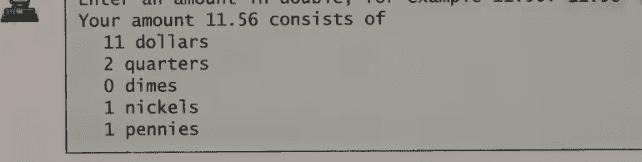

| 变量 | 9 | 11 | 14 | 15 | 18 | 19 | 22 | 23 | 26 | 27 | 30 |
|---|---|---|---|---|---|---|---|---|---|---|---|
| Amount | | 11.56 | | | | | | | | | |
| remainingAmount | | | 1156 | 56 | 6 | 6 | | | | | |
| numberOfDollars | | | | | | | | | | | |
| numberOfQuarters | | | | | 2 | | | | | | |
| numberOfDimes | | | | | | | | | | | |
| numberOfNickels | | | | | | | | | | | |
| numberOfPennies | | | | | | | | | | | |

变量 `amount` 存储了从键盘输入的金额（第7–9行）。这个变量 `amount` 不应该被更改，因为金额在程序末尾需要用于显示结果。程序引入了变量 `remainingAmount`（第11行）来存储不断变化的 `remainingAmount`。

变量 `amount` 是一个表示美元和分的 `double` 类型。它被转换为 `int` 类型变量 `remainingAmount`，代表所有的分。例如，如果 `amount` 为 11.56，那么初始的 `remainingAmount` 为 1156。除法运算符产生除法的整数

## 2.11 案例研究

部分。1156 / 100 的结果为 11。取模运算符获得除法的余数。1156 % 100 的结果为 56。

程序从总金额中提取出最大数量的元，并将剩余部分存储在 `remainingAmount` 中（第14–15行）。它从 `remainingAmount` 中提取出最大数量的四分之一，并获得一个新的 `remainingAmount`（第18–19行）。继续相同的过程，程序找到剩余金额中硬币、五角币和分币的数量。

这个示例中的一个严重问题是将 `double` 类型 `amount` 强制转换为 `int` `remainingAmount` 时可能会丢失精度。这可能导致不准确的结果。如果你尝试输入 10.03，那么 10.03 * 100 会变成 1002.999999999999。你会发现程序显示为 10 元 2 分。要修复这个问题，请以整数形式输入金额（见练习2.9）。

在示例输出中显示了 0 个硬币、1 个五角币和 1 分。更好的做法是以整数形式形式显示 0 个硬币和 1 个五角币。

你将在下一章学习如何使用选择语句来修改此程序（见练习3.4）。

### 2.11.3 练习：显示当前时间

该问题是开发一个程序，以 `时:分:秒` 的格式显示格林尼治标准时间（GMT）。

`time(0)` 函数在 `<time>` 头文件中返回自 1970 年 1 月 1 日 00:00:00 以来经过的秒数。这个时间被称为 Unix 纪（Unix epoch），因为 1970 年是 Unix 操作系统的引入年份。


图 2.1 `time(0)` 返回 Unix 纪元的秒数。

你可以使用此函数获取当前时间，然后计算秒、分、时：

1. 通过 `time(0)` 获取自 1970 年 1 月 1 日午后的总秒数（例如：110203148 秒）。

2. 通过 `totalSeconds % 60` 计算当前秒（例如：60 = 8 秒）。

3. 通过将 `totalSeconds` 除以 60 获取总分钟（例如：110203148/60 = 1836719 分钟）。

4. 通过 `totalMinutes % 60` 计算当前分（例如：1836719 % 60 = 19 分）。

5. 通过将 `totalMinutes` 除以 60 获取总小时（例如：1836719/60 = 30611 小时）。

6. 通过 `totalHours % 24` 计算当前时（例如：30611 小时 % 24 = 19 点，即当前小时）。

# 58 第2章 基础编程

列表 2.11 显示了完整的程序以及示例运行。

视频笔记

使用运算符 `/` 和 `%`

包含

## 列表 2.11 ShowCurrentTime.cpp

```
1 #include <iostream>
2 #include <time>
3 using namespace std;
4
5 int main() {
6 // 获取自 1970 年 1 月 1 日午后的总秒数
7 int totalSeconds = time(0);
8 // 计算当前秒
9 int int currentSecond = totalSeconds % 60;
10 // 获取总分钟
11 int totalMinutes = totalSeconds / 60;
12 // 计算当前分
13 int currentMinute = totalMinutes % 60;
14 // 获取总小时
15 int totalHours = totalMinutes / 60;
16 // 计算当前小时
17 int currentHour = totalHours % 24;
18
19 // 显示结果
20 cout << "Current time is " << currentHour << ":"
21 << currentMinute << ":"
22 << currentSecond << endl;
23
24 return 0;
25 }
```

## 第2章 基础编程

```cpp
// SyntaxErrors.cpp: 该程序包含语法错误
#include <iostream>
using namespace std;
int main() {
    int i = 30;
    cout << i + 4;
}
```

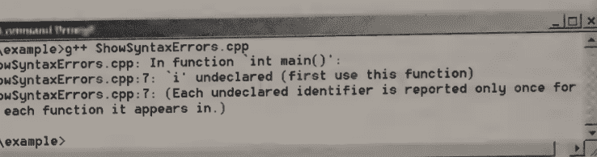

图 2.2 编译器报告了语法错误。

报告了三行错误。所有错误都是声明变量 `i` 导致的。由于单个错误可能会显示多行编译错误，因此从第一行开始向下进行调试是一个良好的习惯。修复程序中较早出现的错误可能可能修复修复之后出现的其他额外错误。

### 2.13.2 运行时错误

运行时错误会导致程序异常终止。当环境检测到无法执行的操作时，就会发生运行时错误。输入错误是典型的运行时错误。

当用户输入程序无法处理的意外输入值时，就会发生输入错误。例如，如果程序期望读取一个数字，但用户输入了字符串，这会导致程序发生数据类型错误。为了防止输入错误，程序应该提示用户输入正确类型的值。它可能会显示类似“请输入整数”的消息来提示用户输入整数。

### 2.13.3 逻辑错误

当程序没有按照预期的方式执行时，就会发生逻辑错误。这类错误的发生由于许多不同的原因。例如，假设你写了以下程序来将 `number1` 加到 `number2` 上：


```cpp
// LogicErrors.cpp: 该程序包含逻辑错误
#include <iostream>
using namespace std;
int main() {
    int number1 = 3;
    int number2 = 3;
    number2 += number1 + number2;
    cout << "number2 is " << number2 << endl;
    return 0;
}
```

该程序没有语法错误或运行时错误，但它没有打印出`number2`的正确结果。看看你是否能找到错误。

## 2.14 调试

通常情况下，语法错误很容易发现和纠正，因为编译器会指示错误来自何以及它们错误的原因。运行时错误也不难发现，因为当程序报警时，操作系统会在控制台上显示它们。相反，寻找逻辑错误可能非常具有挑战性。

逻辑错误被称为 bug（漏洞）。发现和纠正错误的过程被称为调试。调试的常用方法是结合多种方法，缩小到 bug 所在的程序部分。你可以手动跟踪程序（即通过阅读程序来捕获错误），或者你可以插入打印语句来显示变量的值或程序的执行流。这种方法对于短小、简单的程序可能有效。但对于大型程序，最有效的调试方法是使用调试器工具。

C++ IDE 工具（如 Visual C++ 和 CBuilder）包含了集成调试器。调试器允许你跟踪程序的执行。它们在不同工具之间不相同，但都支持以下的大多数有用功能：

- 一次执行一条语句：调试器允许你一次执行一条语句，以便你看到它的效果。
- 进入函数或跳过函数：如果程序正在执行，你可以要求调试器进入并一次一次执行一条语句。如果该函数工作正常，你可以要求调试器跳过它。例如，始终跳过系统提供的函数，如`pow(a, b)`。
- 设置断点：你还可以在特定语句处设置断点。当程序到达断点时会暂停，并显示带有断点的行。你可以设置任意数量的断点。当你知道编程错误开始的地方时，断点特别有用。你可以在该行设置断点，并让程序执行到该断点。
- 显示变量：调试器允许你选择几个变量并显示它们的值。当你跟踪程序时，变量的内容会不断更新。
- 调试调用栈：调试器允许你跟踪所有的函数调用并列出所有待处理的函数。当你需要查看大型程序的执行流时，这个功能非常有帮助。
- 修改变量：某些调试器允许你在调试时修改变量的值。当你想要非常方便

## 第2章 基础编程

## 关键术语

| 术语 | 定义 |
| :--- | :--- |
| algorithm (算法) | 34 |
| assignment (赋值) | 39 |
| backslash (反斜杠) | \ |
| casting (类型转换) | 45 |
| char (字符类型) | 21 |
| cin | 36 |
| const (常量) | 49 |
| constant (常量) | 39 |
| declaration (声明) | 51 |
| data type (数据类型) | 42 |
| decrement (自减) | 49 |
| debugging (调试) | 61 |
| define (定义) | 38 |
| double (双精度浮) | 43 |
| enum (枚举) | 57 |
| encoding (编码) | 51 |
| expression (表达式) | 40 |
| float (浮点型) | 44 |
| floating-point (浮点) | 34 |
| indentation (缩进) | 52 |
| identifier (标识符) | 59 |
| increment (自增) | 49 |
| integer (整数) | 51 |
| logic error (逻辑错误) | 60 |
| literal (字面量) | 35 |
| narrowing (窄化转换) | 50 |
| operator (运算符) | 44 |
| overflow (溢出) | 57 |
| precision (精度) | 47 |
| primitive (基本类型) | 61 |
| runtime error (运行时错误) | 59 |
| signed (有符号) | 51 |
| short (短型) | 40 |
| stream (流) | 42 |
| syntax error (语法错误) | 58 |
| type (类型) | 50 |
| underscore (下划线) | 36 |
| underflow (下溢) | 59 |
| unsigned (无符号) | 41 |
| whitespace (空白字符) | 37 |
| widening (宽化转换) | 50 |

## 总结

- 1. C++ 提供了各种类型的数据。
- 2. 标识符是事物的名称。
- 3. 标识符由字母、数字和下划线组成。
- 4. 标识符必须以字母或下划线开头。
- 5. 标识符不能是保留字。
- 6. 选择具有描述性的标识符使程序易于读。
- 7. 声明变量告诉编译器类型。
- 8. 等号 (=) 是赋值运算符。
- 9. 否则，变量初始值是不可预测的。
- 10. 常量不会改变。
- 11. 常量使用`const`关键字声明。
- 12. 常量也可以使用`#define`定义。
- 13. 按约定，常量大写。

## 复习题

章节 2.2–2.7

- 2.1 哪些标识符是有效的？哪些是 C++ 关键字？

```
x, a++, --a, $44, $
main, int, count
```

## 复习题

- 14. C++ 提供了整数类型（short, int, long, unsigned short, unsigned int 和 unsigned long），表示有符号和无符号整数。
- 15. 无符号整数是非负的
- 16. C++ 提供了浮点类型（float, double, long double），表示不同精度的浮点数。
- 17. C++ 提供了执行数值运算的运算符：+（加法）、-（减法）、*（乘法）、/（除法）和 %（模）。
- 18. 整数算术 (/) 产生整数结果。
- 19. 在 C++ 中，% 只用于整数。
- 20. 自增运算符 (++) 和自减运算符 (--) 增加或减少变量 1。
- 21. C++ 提供了复合赋值运算符 +=（加赋值）、-=（减法赋值）、*=（乘法赋值）、/=（除法赋值）和 %=（模赋值）。
- 22. 在评估混合类型的表达式时，C++ 会自动将表达式转换为相应的类型。
- 23. 你可以使用`static_cast<type>`语法或旧的 C 风格`(type)`显式地将一种类型转换为另一种。
- 24. 字符类型 (char) 表示单个字符。
- 25. 反斜杠被称为转义字符。
- 26. C++ 允许使用转义序列表示特殊字符如 '\t' 和 '\n'。
- 27. 字符 ' '、'\t'、'\f'、'\r' 和 '\n' 被称为空白字符。
- 28. 在计算机科学中，1970 年 1 月 1 日午夜被称为 UNIX 纪元。
- 29. 编程错误可以分为三类：语法错误、运行时错误和逻辑错误。
- 30. 在编译期间发生的错误被称为语法错误或编译错误。
- 31. 运行时错误是导致程序异常终止的错误。
- 32. 逻辑错误是程序没有按照预期的方式执行的错误。

# 第 2 章 基础编程

2.2 将以下算法翻译成 C++ 代码：

- 步骤 1：声明一个名为`miles`的 double 类型变量，初始值为 100；
- 步骤 2：声明一个名为`MILE_TO_KILOMETER`的 double 类型常量，值为 1.609；
- 步骤 3：声明一个名为`kilometer`的 double 类型变量，将`miles`和`MILE_TO_KILOMETER`相乘并将结果赋值给`kilometer`。
- 步骤 4：在控制台显示`kilometer`。

2.3 使用常量有什么好处？使用`const`关键字声明一个值为 20 的 int 类型变量`SIZE`。使用`#define`指令声明一个值为 20 的 int常量`SIZE`。以下代码错在哪里？

```cpp
#include <iostream>
#define PI 3.14159
using namespace std;

int main() {
    double temp = PI * 5;
    cout << temp << endl;
    return 0;
}
```

2.4 假设`int a = 1`且`double d = 1.0`，并且每个表达式都是独立的。以下表达式的结果是什么？

```cpp
a = 46 / 9;
a = 46 % d + 4 * 2;
d = 45 + 4 % 5 * (23 * 3 % 2);
a = 3 / a / 3;
d = 4 + d * d + 4;
d += 1.5 * 3 + ((++a));
d-- = 1.5 * 3 + a++;
```

2.5 显示以下表达式的结果。

```
56 % 6
78 % -4
-34 % 5
-34 % -5
5 % 1
3 % 5
```

2.6 如果今天是周二， 100 天后是星期几？

2.7 查找你机器上`short`、`int`、`float`和`double`的大小。

2.8 `25 / 4`的结果是什么？如果你希望结果是浮点数，你会如何重写它？

2.9 显示以下语句的输出。

```cpp
cout << "25 / 4" << 25 / 4 << endl;
cout << "25 / 4.0" << 25 / 4.0 << endl;
cout << "3 / 2 / 4" << 3 * 2 / 4 << endl;
cout << "3.0 / 2 / 4" << 3.0 * 2 / 4 << endl;
```

## 2.10 你将如何在 C++ 中编写以下算术表达式？

(a) $\frac{4}{3(r+34)} - 9(a+bc) + \frac{3+d(2+a)}{a+bd}$

(b) $5.5 \times (r+2.5)^{2+1}$

## 2.11 以下哪些语句可以作为 C++ 中的语句

- (a) 任何表达式`xx`都可以作为语句。
- (b) 表达式`x++`可以作为语句。
- (c) 语句 $x = x+5$ 也是一个表达式。
- (d) 语句 $a = y = 0$ 是非法的。

## 2.12 以下哪些是正确的浮点数字面量？

12.3, 12.3e+2, 23.4e-2, -334.4, 20, 39F, 40D

## 2.13 识别并修复以下代码中的错误：

```cpp
#include <iostream>
using namespace std;
int Main()
{
    int i = k + 1;
    cout << i++ << endl;
    int i = 1;
    cout << i++ << endl;
    return 0;
}
```

## 2.9 不同类型的数值值可以在计算中一起使用吗？

2.14 从 double 显式转换为 int 对 double 值的数值部分做了什么？类型转换会改变被转换的变量吗？

## 2.15 显示输出。

```cpp
double f = 12.5F;
int i = f;
cout << "F is " << f << endl;
cout << "i is " << i << endl;
```

## 2.17 使用打印语句找出 '1'、'A'、'B'、'a'、'b' 的 ASCII 码。

找出十进制代码 40, 59, 79, 85, 90。

使用打印语句找出十六进制代码 40, 5A, 71, 72, 7A。

## 2.18 以下哪些是正确的字符字面量？

- '1', '\t', '&', '\b', '\n'

## 2.19 你如何显示字符`\`和`""`？

# 第 2 章 基础编程

2.20 求值以下内容：

```cpp
int i = '1';
int j = '1' + '2';
int k = 'a';
char c = 90;
```

2.21 涉及类型转换的以下转换允许吗？如果，找到转换后的结果。

```cpp
char c = 'A';
int i = c;
```

```cpp
float f = 100.34f;
int i = f;
```

```cpp
double d = 100.34;
int i = d;
```

```cpp
int i = 97;
char c = i;
```

2.22 显示以下程序的输出：

```cpp
#include <iostream>
using namespace std;

int main() {
    char x = 'a';
    char y = 'c';

    cout << ++x << endl;
    cout << y++ << endl;
    cout << (x - y) << endl;

    return 0;
}
```

2.23 如何获取当前分钟？

2.24 如何表示注释行和段落？

2.25 常量和变量的命名规范是什么？以下哪些可以是常量或变量？MAX_VALUE, Test

2.26 根据编程风格指南格式化以下程序。

```cpp
#include <iostream>
using namespace std;

int main() {
    cout << "2 / 3 = " << 2 / 3;
    return 0;
}
```

2.27 描述语法错误、运行时错误和逻辑错误。

## 编程练习

注意：编译器通常会给出语法错误的原因。如果你不知道如何修复它，请将你的程序与类似的示例进行比较。

2.1 将摄氏度转换为华氏度：编写一个程序，读取 double 类型的摄氏度，转换为华氏度并显示结果。公式如下：

```cpp
fahrenheit = (9 / 5) * celsius + 32
```

（提示：在 C++ 中，9 / 5 是 1，所以需要在程序中写 9.0 / 5 以得到正确的结果。）这是一个示例运行：

2.2 计算圆柱体积：编写一个程序读取圆柱的半径和长度并使用以下公式计算体积：

```cpp
area = radius * radius;
volume = area * length;
```

这是一个示例运行：

2.3 将英尺转换为米：编写一个程序读取英尺数，将其转换为米并显示结果。1英尺是 0.305 米。这是一个示例运行：

2.4 将磅转换为公斤：编写一个程序将磅转换为公斤。程序提示用户输入磅数，将其转换为公斤并显示结果。1磅是 0.454 公斤。这是一个示例运行：

2.5 财务应用：计算小费：编写一个程序读取总金额和小费率并计算小费和总金额。例如，如果用户输入总金额为10，小费率为15%，程序将显示小费为$1.5，总金额为$11.5。这是一个示例运行：

```
Enter the subtotal and a gratuity rate: 15.69 15
The gratuity is 2.3535 and total is 18.0435
```

2.6 整数数字之和：编写一个程序读取0到1000之间的整数并相加整数中的所有数字。例如，如果整数是932，其数字之和为14。

（提示：使用`%`运算符提取数字，使用`/`运算符移除提取的数字。例如，932 % 10 = 2，932 / 10 = 93。）这是一个示例运行：

```
Enter a number 0 and 1000: 999
The sum of the digits is 27
```

2.7 将大写字母转换为小写：编写一个程序提示用户输入一个大写字母并转换为小写字母。（提示：在ASCII表中（附录B），大写字母出现在小写字母之前。任何大写字母与其对应的小写字母之间的偏移量是相同的。你可以如下所示从对应的大写字母找到小写字母。）

```cpp
int offset = 'a' - 'A';
char lowercase = (char)(uppercase + offset);
```

这是一个示例运行：

```
Enter an uppercase letter: T
The lowercase letter is t
```

2.8 查找ASCII码的字符：编写一个程序接收ASCII码（0到128之间的整数）并显示其字符。例如，如果用户输入97，程序显示字符a。这是一个示例运行：

```
Enter an ASCII code: 69
The character is E
```

2.9 财务应用：货币单位：重写列表 2.10 `ComputeChart.cpp`，以修复将double值转换为int值值时可能出现的精度损失。以整数形式输入数据，其最后两位代表分。例如，输入1156代表11美元56分。

## 2.10 (金融应用：计算利息) 如果你知道余额和年利率，可以使用以下公式计算下个月付款的利息：

interest = balance x (annualInterestRate / 1200)

编写一个程序，按此顺序读取余额和年度百分比利率，并显示下个月的利息。这是一个示例运行：

```
Enter balance and interest rate (e.g., 3 for 3%): 1000.0 3.5
The interest is 2.91667
```


## 2.11*（金融应用：计算未来价值）

编写一个程序，按此顺序读取投资金额、年利率和年，并使用以下公式显示未来价值：

```
accumulatedAmount = x * (1 + monthlyInterestRate)^numberYears
```

> 提示：使用`pow(a, b)`函数计算`a`的`b`次方。

以下是一个示例运行：

```
Enter investment amount: 1000
Enter monthly interest rate: 4.25
Enter number of years: 1
Accumulated value is 1043.34
```

## 2.12**（金融应用：复利）

假设你每月向年利率为 5% 的储蓄账户存 $100。因此，月利率为 0.05/12 = 0.004167。第一个月后，账户价值变为：

```
100 * (1 + 0.004167) = 100.4167
```

第二个月后，账户价值变为：

```
(100 + 100.4167) * (1 + 0.004167) = 201.252
```

第三个月后，账户价值变为：

```
(100 + 201.252) * (1 + 0.004167) = 302.507
```

依此类推。

编写一个程序显示六个月后的账户价值。（在练习 4.30 中，你将使用循环来简化代码并显示任何月份的账户价值）

## 2.13*（健康应用：计算BMI）

体质指数（BMI）是衡量健康的一个指标。它可以通过将你的体重（公斤）除以身高的平方来计算。编写一个程序，提示用户输入磅为体重和英寸为身高，并显示 BMI。注意，1磅等于 0.45359237 公斤，1英寸等于 0.0254 米。这是一个示例运行：

```
Enter weight in pounds: 95.5
Enter height in inches: 50
BMI is 26.8573
```

## 2.14（科学：计算能量）

编写一个程序，计算将水从初始温度加热到最终温度所需的能量。你的程序应提示用户输入水的重量（公斤）以及它的初始和最终温度。计算能量的公式为：

```
Q = M * (final temperature - initial temperature)
```

其中 M 是以公斤水的重量，温度为摄氏度，能量 Q 以焦尔为单位。这是一个示例运行：

```
Enter the amount of water in kilograms: 55.5
Enter the initial temperature: 3.5
Enter the final temperature: 10.5
The energy needed is 1.62548e06
```

## 2.15*（科学：风寒指数）

外面有多冷？我们需要的不仅仅是温度。其他因素包括风速、湿度和阳光，在决定室外冷热方面起着重要作用。2001年，国家气象局（NWS）实施了新的风寒指数，利用温度和风速来衡量冷度。公式为：

```
T_wc = 35.74 + 0.6215*T^0.16 - 35.75*V^0.16 + 0.4275*T*V^0.16
```

其中 T 是华氏度室温，V 是每小时英里的速度。`T_wc`是风寒指数。该公式不适用于风速低于 2 mph 或温度低于 -58°F 或高于 41°F的情况。

编写一个程序，提示用户输入 -58°F 到 41°F 之间的温度以及大于等于 2 的风速，并显示风寒指数。使用`pow(a, b)`计算。这是一个示例运行：

```
Enter the temperature in Fahrenheit: 5.3
Enter the wind speed miles per hour: 6
The wind-chill index is -5.56707
```

## 2.16（打印表格）

编写一个程序显示表格：

```
a   b   pow(a, b)
1   2   1
2   3   8
3   4   81
4   5   1024
5   6   15625
```

## 2.17（几何：两点距离）

编写一个程序，提示用户输入两个点 (x1, y1) 和 (x2, y2) 并显示它们的距离。计算距离的公式为`sqrt((x2 - x1)^2 + (y2 - y1)^2)`。注意你可以使用`pow(a, 0.5)`来计算`sqrt a`。这是一个示例运行：

```
Enter x1 and y1: 1.5 -3.4
Enter x2 and y2: 4 5
Distance of the two points is 8.764131458214
```

## 2.18（几何：六边形面积）

编写一个程序，提示用户输入六边形的边长并显示其面积。公式为`Area = 3√3/2s²`，其中 s 是边长，√3 = 1.732。这是一个示例运行：

```
Enter the side: 5.5
Area of the hexagon is 78.5885
```

## 2.19*（几何：三角形面积）

编写一个程序，提示用户输入三角形三个顶点 (x1, y1), (x2, y2), (x3, y3) 并显示其面积。三角形面积的公式为` s = (side1 + side2 + side3)/2`，`area = sqrt((s - side1)(s - side2)(s - side3))`。这是一个示例运行：

```
Enter three points for a triangle: 1.5 -3.4 4.6 9.5 -3.4
Area of the triangle is 33.6
```

## 2.20（物理：加速度）

平均加速度定义为速度变化所需的时间，公式如下：

```
a = (v1 - v0)/t
```

编写一个程序，提示用户输入以米/秒为单位的初速度`v0`、末速度`v1`以及以秒为单位的时间`t`，并显示平均加速度。这是一个示例运行：

```
Enter v0, v1, and t: 5.5 0.9 4.5
The Average acceleration is 0.08889
```

## 2.21（物理：寻找跑道长度）

给定飞机的加速度`a`和起飞速度`v`，可以使用以下公式计算飞机起飞所需的最小跑道长度：

```
length = v^2/2a
```

编写一个程序，提示用户输入米/秒的`v`和米/秒²的加速度`a`，显示最小跑道长度。这是一个示例运行：

```
Enter v and a: 60 3.5
The minimum runway length for this airplane is 514.286
```

# 第 3 章 选择

- 声明`bool`类型并使用比较运算符编写布尔表达式（3.2）。
- 使用单向`if`语句实现选择控制（3.3）。
- 使用单向`if`语句编写 GuessDate 游戏（3.4）。
- 使用双向`if`语句实现选择控制（3.5）。
- 使用嵌套`if`语句实现选择控制（3.6）。
- 避免`if`语句中的常见错误（3.7）。
- 使用选择语句编写各种示例（BMI, ComputeTax, SubtractionQuiz）（3.8–3.10）。
- 使用`rand`函数生成随机数并使用`srand`函数设置种子（3.10）。
- 使用逻辑运算符 (`&&`, `||`, 和 `!`) 组合条件（3.11）。
- 使用组合条件的选择语句编写（Leapyear, Lottery）（3.12–3.13）。
- 使用`switch`语句实现选择控制（3.14）。
- 使用条件运算符编写表达式（3.15）。
- 使用流操纵符格式化输出（3.16）。
- 检查规定运算符优先级和运算符结合性的规则（3.17）。

## 3.1 引言

如果你在代码 2.1 ComputeArea.cpp 中为半径分配一个负值，程序将显示无效结果。如果半径为负，你不希望程序计算面积。你该如何处理 C++ 这种高级编程语言？

与所有高级编程语言一样，C++ 提供了选择语句，让你可以在两个或多个执行路径之间进行选择。可以使用以下伪代码（即自然语言与编程代码混合）重写列表 2.1：

```
如果半径为负
    显示输入值错误的消息；否则
    计算面积并显示结果
```

选择语句使用条件，条件即布尔表达式。本章将涉及布尔类型、值、运算符和表达式。

## 3.2 bool 类型

如何比较两个值，例如半径是否大于 0、等于 0 或小于 0？如表 3.1 所示，C++ 提供了六种关系运算符（也称为比较运算符），用于比较两个值（假设表中半径为 5）。

| 运算符 | 示例 | 结果 |
|---|---|---|
| `<` | `radius < 5` | false (0) |
| `<=` | `radius <= 5` | false (0) |
| `>` | `radius > 0` | true (1) |
| `>=` | `radius >= 0` | true (1) |
| `==` | `radius == 0` | false (0) |
| `!=` | `radius != 0` | true (1) |

```cpp
cout << (4 > 5);
```

显示 0，因为`4 > 5`为 false。

## 3.3 单向 if 语句

> 注意：在 C++ 中，你可以将数值赋值给`bool`类型的变量。任何非零值都求值为 true，零值求值为 false。例如，在执行完以下赋值语句后，`b1`和`b3`变为 true，而`b2`变为 false。

```cpp
bool b1 = -1.5; // 等同于 bool b1 = true
bool b2 = 0;    // 等同于 bool b2 = false
bool b3 = 1.5;  // 等同于 bool b3 = true
```

你到目前按顺序编写的程序。然而，你经常会面临必须提供备选路径的情况。C++ 提供了`if`语句，可用于控制执行路径。

单向`if`语句仅当且仅当条件为真时执行某项操作。单向`if`语句的语法如下所示：

```cpp
if (booleanExpression)
    statement(s);
```

执行流程图见图 3.1(a)。

图 3.1 如果`booleanExpression`求值为真，则`if`语句执行语句。

如果`booleanExpression`求值为真，则块中的语句将被执行。作为一个例子，请看以下代码：

```cpp
if (radius >= 0)
{
    area = radius * radius * PI;
    cout << "The area for the circle of " << "radius " << radius << " is " << area << endl;
}
```

上述语句的流程图见图 3.1(b)。如果值`radius`大于等于 0，则计算`area`并显示结果；否则，块中的两个语句将不会执行。`booleanExpression`被包含在括号中。例如，下面 (a) 中的代码是错误的。修正后的版本见 (b)。

| 错误 | 正确 |
|---|---|
| `if i > 0` | `if (i > 0)` |
| `{` | `{` |
| `cout << "i is positive" << endl;` | `cout << "i is positive" << endl;` |
| `}` | `}` |

如果括号排除的是单个语句，则可以省略。例如，这些语句是等效的。

| (a) | 等效的 | (b) |
|---|---|---|
| `if (i > 0)` | | `if (i > 0)` |
| `{` | | `{` |
| `cout << "i is positive" << endl;` | | `cout << "i is positive" << endl;` |
| `}` | | `}` |

列表 3.1 提供了一个程序，提示用户输入一个整数。如果该数字是 5 的倍数，显示 HiFive。如果数字能被 2 整除，显示 HiEven。

### 列表 3.1 SimpleIfDemo.cpp

```cpp
#include <iostream>
using namespace std;

int main() {
    // 提示用户输入一个整数
    int number;
    cout << "Enter an integer: ";
    cin >> number;

    if (number % 5 == 0)
        cout << "HiFive" << endl;

    if (number % 2 == 0)
        cout << "HiEven" << endl;

    return 0;
}
```

程序提示用户输入一个整数（第 9 行），并按 5 的倍数显示（第 11–12 行），如果它能被 2 整除则显示 HiEven（第 14–15 行）。

## 3.4 问题：猜出生日期

你可以通过问五个问题在月份（1 到 31）中找到朋友的出生日期。每个问题都询问日期是否在五个数字集合中，如图 3.2 所示：

图 3.2 出生日期是日期出现之集合中第一个数字的和。

出生日期是日期出现的集合中第一个数字的和。例如，如果出生日期是 19，它出现在 Set1、Set3 和 Set5 中。这些集合中的第一个数字是 1、2 和 16。它们的总和为 19。

将数字分组并放置在五个集合中是有刻意的。每个集合的起始数字为 1, 2, 4 和 8，它们分别对应二进制中的 1, 10, 100 和 1000。如果出生日期的二进制在第 k 位上为 1，则该数字应该出现在 Setk。例如，19 的二进制是 10011，因此它出现在 Set1、Set2 和 Set5 中（1 + 2 + 16 = 19）。31 的二进制是 11111，所以它出现在 Set1、Set2、Set3、Set4 和 Set5 中（1 + 2 + 4 + 8 + 16 = 31）。

列表 3.2 提供了一个程序，提示用户输入一个整数。如果该数字是 5 的倍数，显示 HiFive。如果数字能被 2 整除，显示 HiEven。

### 列表 3.2 Date.cpp

```cpp
#include <iostream>
using namespace std;

int main() {
    int date = 0; // 确定日期
    char answer;

    // Set1
    cout << "Is your date in Set1?";
    cin >> answer;
    if (answer == 'Y') {
        date += 1;
    }

    // Set2
    cout << "Is your date in Set2?";
    cin >> answer;
    if (answer == 'Y') {
        date += 2;
    }

    // Set3
    cout << "Is your date in Set3?";
    cin >> answer;
    if (answer == 'Y') {
        date += 4;
    }

    // Set4
    cout << "Is your date in Set4?";
    cin >> answer;
    if (answer == 'Y') {
        date += 8;
    }

    // Set5
    cout << "Is your date in Set5?";
    cin >> answer;
    if (answer == 'Y') {
        date += 16;
    }

    cout << "Your birth date is " << date << endl;
    return 0;
}
```

## 3.5 if...else 语句

单向`if`语句仅当指定的条件为真时执行操作。如果条件为假，则什么都不做。但如果你想在条件为假时执行备用操作呢？你可以使用双向`if`语句。双向`if`语句根据条件的真假指定不同的操作。

这里是双向语句的语法：

```cpp
if (booleanExpression)
{
    statement(s)-for-the-true-case;
}
else
{
    statement(s)-for-the-false-case;
}
```

该语句的流程图见图 3.3。


图 3.3 如果 `... else` 语句在 `booleanExpression` 求值为真时执行真情况的语句；否则，执行假情况的语句。

如果 `booleanExpression` 求值为真，则执行真情况的语句；否则，执行假情况的语句。例如，考虑以下代码：

```cpp
if (radius >= 0)
{
    area = radius * radius * PI;
    cout << "The area for the circle of radius " << radius << " is " << area;
}
else
{
    cout << "Negative radius";
}
```

如果 `radius >= 0` 为真，则计算并显示 `area`；如果为假，则显示“Negative radius”消息。按照惯例，如果括号只包含一个语句，则可以省略。在前面的示例中，包含 `cout << "Negative radius"` 语句的括号可以省略。

## 3.6 嵌套 if 语句

`if` 或 `if ... else` 语句中的语句可以是任何合法的 C++ 语句，包括另一个 `if` 或 `if ... else` 语句。内部的 `if` 语句被称为嵌套在外部语句内部。内部的 `if` 语句可以包含另一个 `if` 语句；事实上，嵌套深度没有限制。例如，以下是一个嵌套的 `if` 语句：

```cpp
if (i > k) {
    if (j > k)
        cout << "i and j are greater than k";
} else
    cout << "i is less than or equal to k";
```

`if (j > k)` 语句嵌套在 `if (i > k)` 语句内部。

嵌套的 `if` 语句可以用于实现多种备选方案。例如，图 3.4(a) 给出的语句根据分数给变量 `grade` 赋值字母，包含了多种备选。

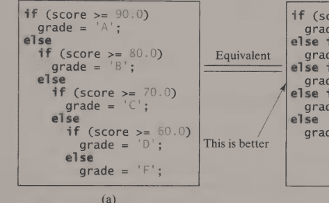

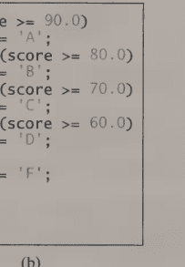

**图 3.4** (b) 显示了处理多种备选 `if` 语句的优方法。

该语句的执行过程如下：测试第一个条件（`score >= 90.0`）。如果为假，则测试第二个条件（`score >= 80.0`）。如果第二个条件为真，则 `grade` 变为 'B'。如果为假，则继续测试第三个条件和其他条件（如有必要），直到满足某个条件或所有条件均证明为假。在后一种情况下，`grade` 变为 'F'。注意，只有当在其之前的所有条件都为假时，才会测试某个条件。

图 3.4(a) 中的 `if` 语句与图 3.4(b) 中的 `if` 语句等价。事实上，图 3.4(b) 是多备选语句的优编写风格。这种风格避免了深层缩进，使程序更易读。

> 注意：`else` 子句匹配同一块中最近的未匹配的 `if`。例如

```cpp
int i = 1; j = 2; k = 3;
if (i > j)
    if (i > k)
        cout << "A";
else
    cout << "B";
(a) 等价 具有正确的缩进会更好
```

```cpp
int i = 1, j = 2, k = 3;
if (i > j)
    if (i > k)
        cout << "A";
else
    cout << "B";
(b)
```

由于 `(i > j)` 为假，(a) 和 (b) 中的语句均不显示内容。要强制 `else` 匹配第一个 `if` 子句，你必须添加一对括号。

```cpp
int i = 1, j = 2, k = 3;

if (i > j) {
    if (i > k)
        cout << "A";
} else
    cout << "B";
```

该语句显示 B。

提示

新程序员经常在 (a) 中使用将测试条件赋值给 `bool` 变量的代码。

| `(number % 2 == 0)` | 等价 |

|---|---|

| `even = true;` | `bool even = number % 2 == 0;` |

| `else` | |

| `even = false;` | 这样更好 |

| (a) | (b) |

可以通过直接将测试值赋值给变量来简化代码，如 (b) 所示。

## 3.7 选择语句中的常见错误

以下错误在新手程序员中很常见。

### 常见错误 1：忘记了必要的括号

如果代码块只包含一条语句，则可以省略括号。然而，在需要分组多个语句时忘记括号是一个常见的编程错误。如果你通过在不带括号的 `if` 语句中添加新语句来修改代码，你将不得不插入括号。例如，(a) 中的代码是错误的。它应该像 (b) 那样使用括号来分组多个语句。

```cpp
if (radius >= 0)
    area = radius * radius * PI;
    cout << "The area " << " is " << area;
(a) 错误
```

```cpp
if (radius >= 0) {
    area = radius * radius * PI;
    cout << "The area " << " is " << area;
}
(b) 正确
```

### 常见错误 2：if 行处的分号错误

在 `if` 行处添加分号（如 (a) 所示）是一个常见的错误。

| 逻辑错误 | 空块体 |

|---|---|

| `if (radius >= 0);` | `if (radius >= 0) {` |

| | `area = radius * radius * PI;` |

| | `cout << "The area " << " is " << area;` |

| | `}` |

| (a) | (b) |

## 3.8 问题：计算体重指数

这个错误很难发现，因为它既不是编译错误也不是运行时错误；它是一个逻辑错误。(a) 中的代码与带有空块的 (b) 等价。

### 常见错误 3：误用 `for ==`

等值比较运算符是两个等号 (`==`)。在 C++ 中，如果你误用了单等号 `=`，将会导致逻辑错误。考虑以下代码：

```cpp
if (count = 1)
    cout << "count is zero";
else
    cout << "count is not zero";
```

它总是显示 "count is zero"，因为 `count = 1` 将 `count` 赋值为 1，而赋值表达式为真（非零值为真）。

### 常见错误 4：布尔值的冗余测试

在测试条件中测试变量是真还是假，使用 (a) 那样的等值运算符是冗余的：

```cpp
if (even == true)               if (even)
cout << "It is even.";      cout << "It is even.";
(a)                               (b)
```

像 (b) 那样直接使用变量更好。另一个原因是避免难以检测的错误。在测试条件中使用 `=` 代替 `==` 是一个常见错误。它会导致以下语句：

```cpp
if (even = true)
cout << "It is even.";
```

该语句没有语法错误。它将 `true` 赋值给 `even`，使得其始终为真。

## 3.8 问题：计算体重指数

体重指数 (BMI) 是体重的衡量。可以通过体重除以身高的平方来计算。对于 16 岁及以上的人，BMI 的解释如下：

| BMI | 解释 |

|---|---|

| 低于 16 | 偏轻 |

| 16-18 | 体轻 |

| 18-24 | 正常体重 |

| 24-29 | 超重 |

| 29-35 | 肥胖 |

| 35 以上 | 肥胖 |

编写一个程序提示用户输入磅和英寸并显示 BMI。注意 1 磅等于 0.453592 公斤，1 英寸等于 0.0254 米。列表 3.3 给出了程序。

### 3.3 ComputeBMI.cpp

```cpp
#include <iostream>
using namespace std
int main()
{
    // 提示用户输入磅
    cout << "Enter weight in pounds: ";
    double weight;
    cin >> weight;
    // 提示用户输入英寸
    cout << "Enter height in inches: ";
    double height;
    cin >> height;
    const double KILOGRAMS_PER_POUND = 0.453592; // 常数
    const double METERS_PER_INCH = 0.0254; // 常数
    // 计算 BMI
    double weightInKilogram = weight * KILOGRAMS_PER_POUND;
    double heightInMeter = height * METERS_PER_INCH;
    double bmi = weightInKilogram / (heightInMeter * heightInMeter);
    // 显示结果
    cout << "Your BMI is " << bmi << endl;
    if (bmi < 18)
        cout << "You are seriously underweight" << endl;
    else if (bmi < 24)
        cout << "You are normal weight" << endl;
    else if (bmi < 29)
        cout << "You are overweight" << endl;
    else if (bmi < 35)
        cout << "You are seriously overweight" << endl;
    else
        cout << "You are gravely overweight" << endl;
    return 0;
}
```

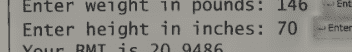

Enter weight in pounds: 146

Enter height in inches: 70

Your BMI is 20.9486

You are normal weight

| line | weight | height | weightInKilogram | heightInMeters | bmi | output |

|---|---|---|---|---|---|---|

| 9 | | 146 | | | | |

| 14 | | 70 | | | | |

| line | weight | heightKilogram | heightMeters | bmi | output |

|---|---|---|---|---|---|

| 20 | | 66.2248602 | | | |

| 21 | | 1.778 | | | |

| 22 | | | | 20.9486 | | |

| 26 | | | | | Your BMI 20.95 |

| 32 | | | | | You are normal weight |

两个常量 `KILOGRAMS_PER_POUND` 和 `METERS_PER_INCH` 定义在第 16–17 行。使用常量使程序易于阅读。

你应该输入数据以测试所有情况。

你应该向程序输入覆盖所有 BMI 可能情况的数据，以确保程序适用于所有情况。

## 3.9 问题：计算税费

美国联邦所得税根据纳税状况和应税收入计算。有四种纳税状况：单身申报、夫妻共同申报、夫妻分别申报和户主。税率每年都会变化。表 3.2 显示了 2002 年的税率。例如，如果你的应税收入为 $10,000，前 $6,000 按 10% 征税，其余 $4,000 按 15% 征税。因此，你的税额为 $1,200。

表 3.2 2002 年美国个人所得税

| 税率 | 单身申报 | 夫妻共同申报 | 夫妻分别申报 | 户主 |

|---|---|---|---|

| 10% | 不超过 $6,000 | 不超过 $12,000 | 不超过 $6,000 | 不超过 $10,000 |

| 15% | $6,001–$27,950 | $12,001–$46,700 | $6,001–$23,350 | $10,001–$37,450 |

| 27% | $27,951–$67,700 | $46,701–$112,850 | $23,351–$56,425 | $37,451–$96,700 |

| 30% | $67,001–$141,250 | $112,851–$171,950 | $56,426–$85,975 | $96,701–$156,600 |

| 35% | $141,251–$307,050 | $171,951–$307,050 | $85,976–$153,525 | $156,601–$307,050 |

| 38% | $307,051 及以上 | $307,051 及以上 | $153,526 及以上 | $307,051 及以上 |

你需要编写一个程序来计算个人所得税。你的程序应该提示用户输入纳税状况和应税收入，然后计算税额。纳税状况可以使用 `if` 语句确定，概述如下：

```cpp
if (status == 0)
{
  // 计算单身申报的税额
} else if (status == 1)
{
  // 计算夫妻共同申报的税额
}
```

## 第3章节选

```cpp
else if (status == 2)
{
    // 分别计算分开报税的税金
}
else if (status == 3)
{
    // 计算户主的税金
}
else
{
    // 显示错误的状态
}
```

对于每种报税状态，共有六种税率。每种税率适用于特定的应纳收入金额。例如，对于单身报税者，应纳收入为 $400,000，前 $6,000 按照 10% 征税，(27,950–6,000) 按照 15% 征税，(67,700–27,950) 按照 27% 征税，(141,250–67,700) 按照 30% 征税，(307,050–141,250) 按照 35% 征税，(400,000–307,050) 按照 38.6% 征税。

列表 3.4 给出了计算单身报税者税金的解决方案。我们将其作为练习。

## 列表 3.4 ComputeTax.cpp


## 3.5 示例：计算税金

以下程序根据报税状态和应纳收入计算税金：

```cpp
#include <iostream>
using namespace std;

int main()
{
    // 提示用户输入报税状态
    cout << "Enter the filing status\n";
    cout << "(0-single filer, 1-married jointly, \n";
    cout << "-2-married separately, 3-head of household): ";
    int status;
    cin >> status;

    // 提示用户输入应纳收入
    cout << "Enter the taxable income: \n";
    double income;
    cin >> income;

    // 计算税金
    double tax = 0;

    if (status == 0)
    {
        // 计算单身报税者的税金
        if (income <= 6000)
            tax = income * 0.10;
        else if (income <= 27950)
            tax = 6000 * 0.10 + (income - 6000) * 0.15;
        else if (income <= 67000)
            tax = 27950 * 0.15 + (income - 27950) * 0.27;
        else if (income <= 141250)
            tax = 67000 * 0.27 + (income - 67000) * 0.30;
        else if (income <= 307050)
            tax = 141250 * 0.30 + (income - 141250) * 0.35;
        else
            tax = 307050 * 0.35 + (income - 307050) * 0.40;
    }
    else
        tax = 6000 * 0.10 + (27950 - 6000) * 0.15 +
          (67700 - 27950) * 0.27 + (141250 - 67700) * 0.30 +
          (307050 - 141250) * 0.35 + (income - 307050) * 0.386;
    else if (status == 1) {
        // 计算夫妻联合报税的税金
        // 留作练习
    }
    else if (status == 2) {
        // 计算夫妻分开报税的税金
        // 留作练习
    }
    else if (status == 3) {
        // 计算户主的税金
        // 留作练习
    }
    else {
        cout << "Error: invalid status";
        return 0;
    }
    // 显示结果
    cout << "Tax is" << static_cast<int>(tax * 100) / 100.0 << endl;
}
```

输入报税状态：

```
(0-single filer, 1-married jointly, 2-married separately, 3-head of household): 0 [Enter]
```

输入应纳收入：

```
400000 [Enter]
```

税金为 `130599`。


| line# | status | income | tax | output |
|---|---|---|---|---|
| 11 | 0 | | | |
| 16 | | 400000 | | |
| 19 | | 0 | | |
| 39 | | | 130599 | |
| 65 | | | | Tax is 130599 |


程序接收报税状态和应纳收入。多个备选的 `if` 语句（第 21, 43, 48, 53, 58 行）检查报税状态并据此计算税金。要测试程序，你应该提供覆盖所有情况的输入。提示：在测试程序时，编写较小的代码并进行测试，这会让调试变得更容易。

## 题目：逻辑工具

假设你要开发一个程序，根据多个条件决定是否执行某个语句。你可以使用逻辑运算符（也称为布尔运算符），它们对布尔值创建一个新的布尔值。

**表 3.3 布尔运算符**

| 运算符 | 名称 | 描述 |
| --- | --- | --- |
| `!` | not | 逻辑非 |
| `&&` | and | 逻辑与 |
| `\|\|` | or | 逻辑或 |

**表 3.4 运算符 `!` 的真值表**

| p | !p | （假设 age = 24, gender = 'F'） |
| --- | --- | --- |
| true | false | `!(age > 18)` 为 false，因为 `(age > 18)` 为 true |
| false | true | `!(gender == 'M')` 为 true，因为 `(gender == 'M')` 为 false |

**表 3.5 运算符 `&&` 的真值表**

| p1 | p2 | p1 && p2 | （假设 age = 24, gender = 'F'） |
| --- | --- | --- | --- |
| false | false | false | `(age > 18) && (gender == 'F')` 为 true，因为 `(age > 18)` 和 `(gender == 'F')` 均为 true |
| false | true | false | `(gender != 'F')` 为 false |
| true | false | false | `(age > 18) && (gender != 'F')` 为 false，因为 `(gender != 'F')` 为 false |
| true | true | true | |

**表 3.6 运算符 `||` 的真值表**

| p1 | p2 | p1 \|\| p2 | （假设 age = 24, gender = 'F'） |
| --- | --- | --- | --- |
| false | false | false | `(age > 34) \|\| (gender == 'F')` 为 true，因为 `(gender == 'F')` 为 true |
| false | true | true | |
| true | false | true | `(age > 34) \|\| (gender == 'M')` 为 false，因为 `(age > 34)` 和 `(gender == 'M')` 均为 false |
| true | true | true | |

## 3.5 Subtraction.cpp

```cpp
#include <iostream>
#include <ctime> // 用于 time
#include <cstdlib> // 用于 rand
using namespace std;

int main() {
    // 1. 生成两个随机整数
    srand(time(0));
    int number1 = rand() % 10;
    int number2 = rand() % 10;

    // 2. 如果 number1 < number2，则交换它们的值
    if (number1 < number2) {
        int temp = number1;
        number1 = number2;
        number2 = temp;
    }

    // 3. 计算差值并输出结果
    cout << "Number 1: " << number1 << endl;
    cout << "Number 2: " << number2 << endl;
    cout << "The difference is: " << number1 - number2 << endl;

    return 0;
}
```

输入报税状态：

```
(0-single filer, 1-married jointly, 2-married separately, 3-head of household): 0 [Enter]
```

输入应纳收入：

```
400000 [Enter]
```

税金为 `130599`。

## 3.11 逻辑运算符

列表 3.6 提供了一个程序，用于检查数字是否能被 2 和 3 整除、被 2 或 3 整除，以及被 5 整除但不同时整除：

**列表 3.6 TestBooleanOperators.cpp**

```cpp
#include <iostream>
using namespace std;
int main() {
    int number;
    cout << "Enter integer: ";
    cin >> number;
    if (number % 2 == 0 && number % 3 == 0)
        cout << number << " is divisible by 2 and 3." << endl;
    if (number % 2 == 0 || number % 3 == 0)
        cout << number << " is divisible by 2 or 3." << endl;
    if ((number % 2 != 0 && number % 3 != 0))
        cout << number << " is divisible by 2 or 3, but not both." << endl;
    return 0;
}
```


`(number % 2 == 0 && number % 3 == 0)`（第 10 行）检查数字是否能被 2 和 3 整除。`(number % 2 != 0 || number % 3 != 0)`（第 13 行）检查数字是否能被 2 或 3 整除。因此，第 16–17 行：

```cpp
(number % 2 == 0 || number % 3 == 0) &&
!(number % 2 != 0 && number % 3 != 0)
```

检查数字是否能被 2 或 3 整除，但不同时整除。

> **注意**：在数学中，表达式 `1 <= numberOfDaysInMonth <= 31` 是正确的。但在 C++ 中，它是错误的，因为 `1 <= numberOfDaysInMonth` 会被求值为布尔值，然后将该值（1 为真，0 为假）与 3 进行比较，这将导致逻辑错误。正确的表达式是 `(1 <= numberOfDaysInMonth) && (numberOfDaysInMonth <= 31)`。

## 第 3 章 选择

### 德·摩根定律

> **注意**：德·摩根定律以出生于印度的英国数学家和逻辑学家奥古斯·德·摩根（1806–1871）命名，可用于简化布尔表达式。该定律规定：

```
!(condition1 && condition2) 等同于 !condition1 || !condition2
!(condition1 || condition2) 等同于 !condition1 && !condition2
```

因此，上例中的第 7 行：

```cpp
(number % 2 == 0 && number % 3 == 0)
```

可以使用等价表达式简化为：

```cpp
(number % 2 != 0 || number % 3 != 0)
```

另一个例子：

```cpp
(n == 2 || n == 3)
```

更好的写法是：

```cpp
n != 2 && n != 3
```

如果 `&&` 运算符的一个操作数为假，则表达式为假；如果 `||` 运算符的操作数之一为真，则表达式为真。C++ 使用这些属性来提高这些运算符的性能。在求 `p1 && p2` 时，C++ 先求 `p1`，如果其为真，则求 `p2`；否则不求 `p2`。在求 `p1 || p2` 时，C++ 先求 `p1`，如果其为假，则求 `p2`；否则不求 `p2`。因此，我们将 AND 和 OR 运算符称为条件（或短路）运算符，并将 `||` 称为短路运算符。

## 3.12 问题：确定闰年

如果一个年份能被 4 整除但不能被 100 整除，或者能被 400 整除，则为闰年。因此，我们可以使用以下布尔表达式来检查年份是否为闰年：

```cpp
// 年份能被 4 整除但不能被 100 整除
bool isLeapYear = (year % 4 == 0);
```

```cpp
// 年份能被 4 整除但不能被 100 整除
isLeapYear = (year % 4 == 0) && (year % 100 != 0);
```

```cpp
// 年份能被 4 整除但不能被 100 整除或能被 400 整除
isLeapYear = isLeapYear || (year % 400 == 0);
```

或者你可以将这些合并为：

```cpp
isLeapYear = (year % 4 == 0 && year % 100 != 0) || (year % 400 == 0);
```

列表 3.7 提供了一个让用户输入年份并检查是否为闰年的程序。

**列表 3.7 LeapYear.cpp**

```cpp
#include <iostream>
using namespace std;

int main() 
{
    cout << "Enter a year: ";
    int year;
    cin >> year;
    // 检查是否为闰年
    bool isLeapYear =
    (year % 4 == 0 && year % 100 != 0) || (year % 400 == 0);
    // 显示结果
    if (isLeapYear)
        cout << " is a leap year.";
    else
        cout << " is not a leap year.";
    return 0;
}
```


## 3.13 问题：乐票

假设你要开发一个玩乐票的程序。程序随机生成一个两位数，提示用户输入两位数，并根据以下规则判断用户是否中奖：

- 如果输入与乐票完全匹配，奖金为 $10000。
- 如果输入匹配乐票，奖金为 $3000。
- 如果输入中有一个数字与乐票匹配，奖金为 $1000。

完整的程序见列表 3.8。

**列表 3.8 Lottery.cpp**

```cpp
#include <iostream>
#include <ctime> // 用于 time 函数
#include <cstdlib> // 用于 rand 和 srand 函数
using namespace std;

int main() 
{
    // 生成乐票
    srand(time(0));
    int lottery = rand() % 100;
    // 提示用户输入
    cout << "Enter your pick (two digits): ";
    int guess;
    cin >> guess;
    // 获取乐票数字
    int lotteryDigit1 = lottery / 10;
    int lotteryDigit2 = lottery % 10;

    // 获取输入的数字
    int guessDigit1 = guess / 10;
    int guessDigit2 = guess % 10;

    cout << "The lottery number is " << lottery << endl;
    if (guess == lottery)
        cout << "Exact match: you win $10000" << endl;
    else if (guessDigit1 == lotteryDigit1 || guessDigit2 == lotteryDigit2)
        cout << "Match digits: you win $3000" << endl;
    else if (guessDigit1 == lotteryDigit2 || guessDigit2 == lotteryDigit1)
        cout << "Match one digit: you win $1000" << endl;
    else
        cout << "Sorry, no match" << endl;

    return 0;
}
```

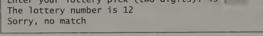

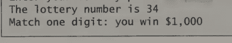

| 变量 | 10 | 15 | 18 | 19 | 22 | 23 | 37 |
|---|---|---|---|---|---|---|---|


| `lottery` | | | 34 | | | | |

| `guess` | | | 23 | | | | |

| `lotteryDigit1` | | | | 3 | | | |

| `lotteryDigit2` | | | | 4 | | | |

| `guessDigit1` | | | | | 2 | | |

| `guessDigit2` | | | | | | 3 | |

| `output` | | | | | | | Match one digit: you win $1000

## 3.14 `switch` 语句

程序使用 `rand()` 函数在第 10 行生成乐票并提示用户输入猜测（第 15 行）。注意 `guess % 10` 获取猜测的最后一位，而 `guess / 10` 获取猜测的首位，因为 `guess` 是两位数（第 22–23 行）。程序按以下顺序检查猜测是否匹配乐票：

1. 首先检查猜测是否匹配乐票（第 28 行）。
2. 如果不是，检查数字是否匹配（第 30–31 行）。
3. 如果不是，检查是否有一个数字匹配乐票（第 33–36 行）。
4. 如果不是，则无匹配。

3.4 中 `ComputeTax.cpp` 的 `if` 语句根据状态进行分类。使用 `switch` 语句处理多个情况。以下是 `switch` 语句的完整语法：

```cpp
switch (expression)
{
  case value1: statement(s);
    break;
  case value2: statement(s);
    break;
    ...
  case valueN: statement(s);
    break;
  default: statement(s);
}
```

`switch` 语句遵循以下规则：

- `switch-expression` 必须产生整数值且始终括在括号内。
- `value1`、... 和 `valueN` 是整数常量表达式，这意味着它们不能包含变量（例如 `1 + x`）。
- 当 `case` 语句匹配 `switch-expression` 的值时，从该处开始执行语句，直到遇到 `break` 语句或到达 `switch` 语句结束。
- 关键字 `break` 是可选的。`break` 语句立即结束 `switch` 语句。
- `default` 情况可选，可在指定的 `case` 都不匹配 `switch-expression` 时执行操作。
- `case` 语句按顺序检查，但 `case` 的顺序（包括 `default` 情况）并不重要。然而，遵循 `case` 的逻辑顺序并将 `default` 放在最后是良好的编程风格。

> **注意**
>
> 在 C++ 中，`char` 或 `bool` 值被视为整数。因此，这种类型可以在 `switch` 语句中作为 `switch` 表达式或 `case` 值。

> **注意**
>
> 在需要时忘记使用 `break` 语句。一旦匹配到 `case`，就会从匹配的 `case` 开始执行语句，直到遇到 `break` 语句或 `switch` 语句结束。这种现象被称为贯穿（fall-through）行为。例如，以下代码在 `x` 为 `'a'` 时会显示 `x=` 三次：

```cpp
switch (ch) {
  case 'a': cout << ch;
  case 'b': cout << ch;
  case 'c': cout << ch;
}
```

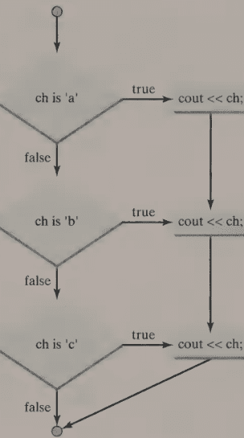

**提示** 为了避免编程错误并提高代码的可维护性，如果故意省略了 `break`，在 `case` 子句中添加注释是一个好习惯。

## 3.15 条件表达式

你想给一个变量赋值一个受某些条件限制的值。例如，以下语句如果 `x` 大于 0，则给 `y` 赋值 1；如果 `x` 小于或等于 0，则给 `y` 赋值 -1。

```cpp
if (x > 0)
  y = 1;
else
  y = -1;
```

或者，如下一个示例所示，你可以使用条件表达式来实现相同的结果：

```cpp
y = (x > 0) ? 1 : -1;
```

条件表达式的结构完全不同，并且不包含显式的 `if`，其语法所示：

```cpp
booleanExpression ? expression1 : expression2;
```

如果 `booleanExpression` 为真，则该条件表达式的结果为 `expression1`；否则，结果为 `expression2`。

假设你想将变量 `num1` 和 `num2` 之间的较大值赋值给 `max`。你可以直接使用条件表达式编写一条语句：

```cpp
max = (num1 > num2) ? num1 : num2;
```

例如，以下语句如果 `num` 是偶数，则显示消息 `"num is even"`，否则显示 `"num is odd."`。

```cpp
cout << ((num % 2 == 0) ? "num is even" : "num is odd");
```

> **注意**
>
> 符号 `? :` 共同出现在条件表达式中。它们形成了一个条件运算符。因为它使用了三个操作数，所以它是三元运算符。它是 C++ 中唯一的三元运算符。

## 3.16 输出格式化

如果你希望在浮点数的小数后只显示两位数字，可以这样编写代码：

```cpp
double x = 2.0 / 3;
cout << "x is " << static_cast<int>(x * 100) / 100.0;
```

显示：

```
x is 0.66
```

然而，完成此任务更好的方法是使用流操作符（stream manipulators）格式化输出。你已经知道如何使用 `cout` 对象显示控制台输出。C++ 提供了额外的函数来格式化值的显示方式。这些函数被称为流操作符，并包含在 `iomanip` 头文件中。表 3.7 总结了各种流操作符。

**表 3.7 常用流操作符**

| 运算符 | 描述 |
| :--- | :--- |
| `setprecision(n)` | 设置浮点数的精度 |
| `fixed` | 以定点（固定）计数法显示浮点数 |
| `showpoint` | 如果浮点数没有小数部分，则强制显示小数点和末尾零 |
| `setw(width)` | 指定打印字段的宽度 |
| `left` | 输出向左对齐 |
| `right` | 输出向右对齐 |

### 3.16.1 `setprecision(n)` 操作符

你可以使用 `setprecision(n)` 操作符指定浮点数显示的数字总数，其中 `n` 是有效数字数（即小数点前后出现的数字总数）。如果要显示的数字位数多于指定的精度，则将进行四舍五入。例如，以下代码：

```cpp
double number = 123456;
cout << setprecision(3) << number << " "
 << setprecision(4) << number << " "
 << setprecision(5) << number << " "
 << setprecision(6) << number << endl;
```

显示：

```
12.3012.3512.34612.34567
```

其中 `number` 的值分别使用精度 3、4、5 和 6 显示。使用精度 3 时，`12.34567` 被四舍五入为 `12.35`。使用精度 4 时，`12.34567` 被四舍五入为 `12.346`。使用精度 5 时，`12.34567` 被四舍五入为 `12.346`。使用精度 6 时，`12.34567` 被四舍五入为 `12.3457`。

`setprecision` 操作符会一直有效，直到它被更改。因此：

```cpp
double number = 12.34567;
cout << setprecision(3) << number << " " << endl;
cout << 9.34567 << " " << 121.3457 << " " << 0.2367 << endl;
```

显示：

```
12.309.3512100.237
```

第一个值的精度设置为 3，并且对后两个值仍然有效，因为精度没有被更改。

如果宽度对于整数来说不足，则 `setprecision` 操作符会被忽略。

```cpp
cout << setprecision(3) << 23456 << endl;
```

显示：

```
23456
```

## 2 `fixed` 操作符

有时，`fixed` 操作符强制浮点数以定点计数法而非科学计数法显示。你可以配合 `setprecision()` 来控制小数点后的位数。例如：

```cpp
cout << fixed << setprecision(2) << 123.4567 << endl;
```

显示：

```
123.46
```

## 3 `setw(width)` 操作符

`setw(width)` 操作符指定输出字段的最小宽度。如果值小于宽度，则将填充空格。例如：

```cpp
cout << setw(10) << "hello" << endl;
```

显示：

```
     hello
```

## 4 `left` 和 `right` 操作符

注意 `setw` 默认使用右对齐。你可以使用 `left` 操作符进行左对齐，使用 `right` 操作符进行右对齐输出。例如：

```cpp
cout << left << setw(8) << 1.23 << endl;
cout << right << setw(8) << 1.23 << endl;
```

显示：

```
1.23          1.23
```

## 5 `showpoint` 操作符

`showpoint` 操作符强制显示小数点，即使没有小数部分。例如：

```cpp
cout << showpoint << 1.2 << " " << 1 << endl;
```

显示：

```
1.20 1.00
```

## 6 `scientific` 操作符

`scientific` 操作符强制浮点数以科学计数法显示。例如：

```cpp
cout << scientific << 1234.56 << endl;
```

显示：

```
1.23456e+03
```

## 17 运算符优先级和结合性

运算符优先级和结合性决定了运算符的求值顺序。假设你有这个表达式：

```cpp
3 + 4 * 4 > 5 * (4 + 3) - 1
```

结果是什么？编译器如何知道运算符的执行顺序？括号中的表达式先执行。（括号可以嵌套，在这种情况下先执行内层括号中的表达式）。在评估没有括号的表达式时，编译器根据优先级规则和结合性规则应用运算符。优先级规则定义了运算符的优先级，如表 3.8 所示（包含了你目前学过的运算符。请参附录 C，"运算符优先级表"，完整的 C++ 运算符及其优先级列表）。

如果优先级相同的运算符相邻，它们的结合性决定了求值顺序。除了赋值运算符外，所有二元运算符都是左结合的。

**表 3.8 运算符优先级图**

| 优先级 | 运算符 |
|---|---|
| | `var++` and `var--` (后置), `static_cast<type>()` (强制类型转换) |
| | `+`, `-` (一元加减号), `++var` and `--var` (前缀) |
| `!` (非) | `*`, `/`, `%` (乘法、除法和取模) |
| | `+`, `-` (二元加法和减法) |
| | `<`, `<=`, `>=` (比较) |
| | `==`, `!=` (相等性) |
| | `&&` (逻辑与) |
| | `\|\|` (逻辑或) |
| | `=`, `+=`, `-=`, `*=`, `/=`, `%=` (赋值运算符) |

例如，`+` 和 `-` 的优先级相同且从左结合，我们有等式：

```cpp
a - b + c - d = ((a - b) + c) - d
```

赋值运算符是右结合的。因此，我们有等式：

```cpp
a = b + c = 5
a = (b += (c = 5))
```

假设在赋值之前 `a`, `b` 和 `c` 均为 1。如果计算整个表达式，`a` 变为 6，`b` 变为 6，`c` 变为 5。注意赋值运算符的左结合是没有意义的。

应用运算符优先级和结合规则，我们如下计算表达式 `3 + 4 * 4 * 5 * (4 + 3) - 1`：

```cpp
3 + 4 * 4 * 5 * (4 + 3) - 1
(1) 括号内
3 + 4 * 5 * 7 - 1
(2) 乘法
3 + 16 * 5 * 7 - 1
(3) 乘法
3 + 16 > 35 - 1
(4) 加法
19 > 35 - 1
(5) 减法
19 > 34
(6) 大于
```

**提示**

你可以使用括号来强制执行顺序，并使程序更易于读。使用冗余的括号不会减慢表达式的执行速度。

## 章总结

### 关键术语

| 布尔表达式 | 74 | 单向 `if` 语句 | 75 |
| 布尔值 | 74 | 运算符结合性 | 101 |
| `bool` 类型 | 74 | 运算符优先级 | 101 |
| `break` 语句 | 96 | 短路运算符 | 92 |
| 条件运算符 | 98 | `switch` 语句 | 95 |
| 贯穿行为 | 96 | 双向 `if` 语句 | 79 |

### 章总结

1. 关系运算符 (`<`, `<=`, `==`, `!=`, `>=`) 与数字和字符操作，并产生一个布尔值。
2. 相等比较运算符是两个等号 (`==`)，而不是单个等号 (`=`)。后者符号用于赋值。
3. 在内部，C++ 使用 1 表示真，使用 0 表示假。
4. 如果你向控制台显示 `bool` 值，如果值为真，则显示 1；如果值为假，则显示 0。
5. 在 C++ 中，你可以为 `bool` 变量分配一个数值。任何非零值都求为真，零值为假。
6. 选择语句包含了用于执行语句的条件。
7. 有几种类型的选择语句：单向 `if` 语句、双向 `if` 语句、嵌套 `if` 语句、`switch` 语句和条件表达式。
8. 单向 `if` 语句仅当条件为真时执行某个操作。单向选择语句的语法如下所示：

```cpp
if (booleanExpression)
{
    statement(s);
}
```

9. 双向 `if` 语句使用以下语法：

```cpp
if (booleanExpression)
{
    statement(s)-针对真情况的语句;
}
else
{
    statement(s)-针对假情况的语句;
}
```

如果 `booleanExpression` 求值为真，则执行真情况的语句；否则，执行假情况的语句。

10. 布尔运算符 `&&`、`||` 和 `!` 作用于布尔值和变量。

11. 在评估 `p1 && p2` 时，C++ 先评估 `p1`，如果 `p1` 为真，则求值 `p2`；否则不评估 `p2`。`&&` 被称为短路与运算符。

12. 在评估 `p1 || p2` 时，C++ 先评估 `p1`，如果 `p1` 为假，则求值 `p2`；否则不评估 `p2`。`||` 被称为短路或运算符。

13. `switch` 语句根据类型为 `char`、`short` 或 `int` 的 `switch` 表达式做出控制决策。

14. 关键字 `break` 在 `switch` 语句中是可选的，但它通常用于每个 `case` 的结尾以终止 `switch` 语句的剩余部分。如果没有 `break` 语句，将执行后续 `case`。

15. 表达式中的运算符是根据操作数、运算符优先级和结合性进行评估的。

16. 括号可以强制执行评估顺序。

17. 优先级较高的运算符先评估。对于相同优先级的运算符，结合性决定了顺序。

18. 除了赋值运算符外，所有运算符都是左结合的。

## 习题

**Section 3.2**

- 3.1 列出关系运算符。
- 3.2 假设 `n` 为 1，求出以下表达式的结果：

```cpp
(n <= 0)
(n < 0)
(n == 0)
(n >= 0)
```

- 3.3 以下代码有什么错？

```cpp
if (radius >= 0)
{
  area = radius * PI;
}
```

- 3.4 如果 (a) 为 30，(b) 为 35，输出是什么？

```cpp
if (number % 2 == 0)
cout << " is even.";
```

```cpp
if (number % 2 != 0)
cout << " is odd.";
```

- 3.5 是否允许以下转换？如果是，求结果：

```cpp
bool b = true;
int i;
```

- 3.6 假设 `x = 3` 和 `y = 2`，求出以下输出。画出流程图：

```cpp
if (x > 0)
    if (y > 0)
        z = x + y;
```

- 3.7 正确的缩进哪些是等价的？

```cpp
if (x > 0) {
    if (y > 0) {
        z = x + y;
    }
}
```

```cpp
if (x > 0)
    if (y > 0)
        {
            z = x + y;
        }
```

- 3.8 假设 `x = 2` 和 `y = 3`，求出以下输出。结合性是哪种？

```cpp
if (x > 0) {
    if (y > 0) {
        z = x + y;
    }
} else {
    cout << z;
}
```

- 3.9 (a) 当分数大于 90 时增加一个 `if` 语句。(b) 写一个增加 1% 的 `if` 语句。

- 3.10 以下代码有什么错？

```cpp
if (score >= 60)
grade = 'D';
```

- 3.11 以下语句是等价的吗？

```cpp
if (income <= 10000)
    tax = income * 0.1;
else if (income < 20000)
    tax = 1000 + (income - 10000) * 0.15;
```

```cpp
if (income <= 10000) {
    tax = income * 0.1;
} else if (income < 20000) {
    tax = 1000 + (income - 10000) * 0.15;
}
```


## 3.12 以下哪些是 `rand()` 的可能输出？

`324`, `5`, `34`, `1`, `0.5`

## 3.13 如何生成一个 `0 <= i < 20` 的随机整数 `i`？如何生成一个 `10 <= i < 20` 的随机整数 `i`？如何生成一个 `10 <= i <= 50` 的随机整数 `i`？在你的机器上找到 `RAND_MAX`。

## 3.14 假设 `x` 为 `1`，显示以下布尔表达式的结果：

```
(true) && (3 > 4)
!(x > 0) && (x > 0)
(x > 0) || (x < 0)
!(x != 0) || (x == 0)
(x > 0) || (x < 0)
!(x != 1) != (x == 1)
```

## 3.15 写一个布尔表达式，如果存储在变量 `x` 中的值在 `1` 到 `100` 之间，则为真。

## 3.16 写一个布尔表达式，如果存储在变量 `y` 中的值在 `1` 到 `100` 之间或者该数字为负数，则为真。

## 3.17 假设 `x` 和 `y` 是 `int` 类型。以下哪些是正确的表达式？

```
x > y > 0
x = y && y
x /= y
xor or y
x and y
!(x != 0) || (x = 0)
```

## 3.18 假设 `x` 为 `1`。以下表达式的评估结果是什么？

(a) `(x > 1) && (x++ > 1)`

(b) `(x >= 1) && (x++ > 1)`

## 3.19 如果 `ch` 是 `'A'`、`'p'`、`'E'` 或 `'5'`，表达式 `ch >= 'A' && ch <= 'Z'` 的值是多少？

## 3.20 假设在你运行程序时，从控制台输入了 `2 3 6`。输出是什么？

```cpp
#include <iostream>
using namespace std;

int main() {
    double x, y, z;
    cin >> x >> y >> z;

    cout << "(x < y && z) is " << (x < y && z) << endl;
    cout << "(x < y || z) is " << (x < y || z) << endl;
    cout << "!(x < y) is " << !(x < y) << endl;
    cout << "(x + y < z) is " << (x + y < z) << endl;
    cout << "(x + y > z) is " << (x + y > z) << endl;

    return 0;
}
```

## 第 3.14 节

### 3.21 `switch` 变量需要哪些数据类型？如果 `case` 后面没有使用 `break` 关键字，接下来将执行什么？你可以将 `switch` 语句转换为等效的 `if` 语句或反之亦然？使用 `switch` 语句的优势是什么？

### 3.22 执行以下 `switch` 语句后，`y` 的值是多少？

```cpp
x = 3; y = 3;
switch (x + 3) {
    case 6: y = 3;
    default: y += 1;
}
```

### 3.23 使用 `switch` 语句重写以下 `if` 语句，并为该 `switch` 语句绘制流程图：

```cpp
if (a == 1)
    x += 5;
else if (a == 2)
    x += 10;
else if (a == 3)
    x += 16;
else if (a == 4)
    x += 34;
```

## 第 3.15 节

### 3.24 使用条件运算符重写以下 `if` 语句：

```cpp
if (count % 10 == 0)
    cout << count << "\n";
else
    cout << count << " ";
```

## 第 3.16 节

### 3.25 要使用流操纵符，必须包含哪个头文件？

### 3.26 显示以下语句的输出：

```cpp
cout << setw(10) << "C++" << setw(6) << 101 << endl;
cout << setw(8) << "Java" << setw(5) << 101 << endl;
cout << setw(6) << "HTML" << setw(4) << 101 << endl;
```

### 3.27 显示以下语句的输出：

```cpp
double number = 93132.1234567;
cout << setw(10) << setprecision(5) << number;
cout << setw(10) << setprecision(4) << number;
cout << setw(10) << setprecision(3) << number;
cout << setw(10) << setprecision(8) << number;
```

### 3.28 显示以下语句的输出：

```cpp
double monthlyPayment = 1345.4567;
double totalPayment = 866.887234;

cout << setprecision(7);
cout << monthlyPayment << endl;
cout << totalPayment << endl;

cout << setprecision(2);
cout << setw(8) << monthlyPayment << endl;
cout << setw(8) << totalPayment << endl;
```

### 3.29 显示以下语句的输出：

```cpp
cout << right;
cout << setw(6) << 21.23 << endl;
cout << setw(6) << 51.34 << endl;
```

### 3.30 显示以下语句的输出：

```cpp
cout << left;
cout << setw(6) << 21.23 << endl;
cout << setw(6) << 51.34 << endl;
```

## 第 3.17 节

### 3.31 列出布尔运算符的优先级顺序。求值以下的值：

```cpp
true || true && false
true && true || false
```

### 3.32 显示并解释以下代码的输出：

- (a) `int i = 0;`

  `i = i + (i = 1);`

  `cout << i << endl;`

- (b) `int i = 0;`

  `i = (i = 1) + i;`

  `cout << i << endl;`

## 3.33 假设 `int a = 1` 且 `double d = 1.0`，且每个表达式都是独立的。以下表达式的结果是什么？

```cpp
a = (a = 3) + a;
a = a + (a = 3);
a++ += (a = 3);
a = 5 + 2 % a--;
a = 4 + 1 * 5 % ((a + 1);
d = 1.5 * 3 + ((d);
d = 1.5 * 3 + ++d);
```

## 3.34 `(x > 0 && x < 10)` 等于 `(x > 0) || (x < 10)` 吗？`(x > 0 || x < 10)` 等于 `(x > 0) && (x < 10)` 吗？`(x > 0 && x < 10 && y < 0)` 等于 `(x < 10 && y < 0)` 吗？

## 编程练习

**教学提示：** 对于练习，学生在编写代码之前，应该仔细分析程序需求和解决问题的设计策略。

**教学提示：** 讲师可以要求学生对选定的练习编写分析和设计文档。学生应该用自己的话来分析问题，包括输入、输出以及需要计算的内容，以及如何使用伪代码描述问题。

**调试贴士：** 在寻求帮助之前，请先自己阅读并解释程序，并使用代表性的输入手动或使用调试器进行跟踪。从错误中学习。

### 第 3.2–3.10 节

#### 3.2 (检查数字是否为偶数) 编写一个程序读取一个整数并检查它是否为偶数。以下是该程序的示例运行：

```
Enter integer: 25

Is 25 an even number? false

Enter integer: 200

Is 200 an even number? true
```

#### 3.3* (代数) 编写一个程序读取一个整数并检查它是否为偶数。以下是该程序的示例运行：

```
Enter integer: 25

Is 25 an even number? false

Enter integer: 200

Is 200 an even number? true
```

#### 3.3* (求解二次方程) 使用 `switch` 语句重写以下 `if` 语句，并为该 `switch` 语句绘制流程图：

```cpp
if (a == 1)
    x += 5;
else if (a == 2)
    x += 10;
else if (a == 3)
    x += 16;
else if (a == 4)
    x += 34;
```

#### 3.4 (财务应用) 使用条件运算符重写以下 `if` 语句：

```cpp
if (count % 10 == 0)
    cout << count << "\n";
else
    cout << count << " ";
```

#### 3.5 (排序) 编写一个程序读取三个整数并排序。

#### 3.6 (随机) 编写一个程序显示一个随机大写字母。

#### 3.7 (财务应用) 修改 3.4，`Compute.cpp`，让用户输入金额，程序应显示总金额。

#### 3.8 (科学：星期) 使用蔡勒同余公式计算星期几。公式为：

$h = (q + \lfloor 2m/5 \rfloor + K + \lfloor K/4 \rfloor + \lfloor J/4 \rfloor - 2J) \pmod 7$

其中 $q$ 是日期，$J$ 是世纪，$K$ 是世纪内的年份，$m$ 是月份（3是3月，4...12月，1月和2月被视为13和14月）。$h$ 表示星期几（0是周日，1是周一，2是周二，3是周三，4是周四，5是周五，6是周六）。

#### 3.9 (游戏：剪刀、石头、布) 编写一个程序来玩流行的剪刀-石头-布游戏。（剪刀可以剪破纸，石头可以砸碎剪刀，布可以包住石头。）程序随机生成一个数字 `0`、`1` 或 `2`，分别代表剪刀、石头或布。程序提示用户输入数字 `0`、`1` 或 `2`，并显示一条消息指示用户是胜还是平局。

#### 3.16 (计算三角形的周长) 编写一个程序，读取三角形的三条边，如果输入有效，则计算其周长。否则，显示输入无效。如果任意两条边之和大于第三条边，则输入是有效的。

#### 3.17** (业务：检查 ISBN) 一个 ISBN（国际标准书号）由 10 位数字 $d_1d_2d_3d_4d_5d_6d_7d_8d_9d_{10}$ 组成。最后一位数字 $d_{10}$ 是一个校验和，通过以下公式从其他九位数字计算：

```
$(d_1 \times 1 + d_2 \times 2 + d_3 \times 3 + d_4 \times 4 + d_5 \times 5 + d_6 \times 6 + d_7 \times 7 + d_8 \times 8 + d_9 \times 9) \pmod{11}$
```

根据 ISBN 规范，如果校验和为 `10`，则最后一位为 `X`。编写一个程序，提示用户输入前 9 位数字并显示 10 位 ISBN（包含前导零）。你的程序应将输入读取为整数。

#### 3.18** (查找月份的天数) 编写一个程序，提示用户按顺序输入年份和月份，并显示该月份的天数。例如，如果用户输入月份 `2` 和年份 `2000`，程序应该显示 `2000` 年 `2` 月有 `29` 天。如果用户输入月份 `3` 和年份 `2005`，程序应该显示 `2005` 年 `3` 月有 `31` 天。

#### 3.19** (几何：点在圆内？) 编写一个程序，提示用户输入一个点 `(x, y)`，并检查该点是否在圆心为 `(0, 0)`、半径为 `10` 的圆内。例如，`(4, 5)` 在圆内而 `(9, 9)` 在圆外，如图 3.6(a) 所示。

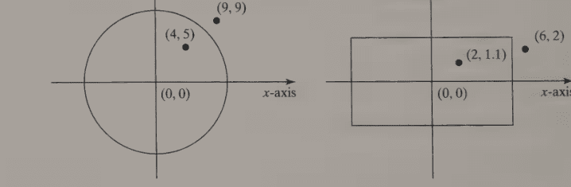

图 3.6 (a) 圆内外的点；(b) 矩形外的点。

（提示：如果点到 `(0, 0)` 的距离小于或等于 `10`，则该点在圆内。计算距离的公式为 $\sqrt{(x_2 - x_1)^2 + (y_2 - y_1)^2}$。）这里有两种运行方式：

```
Enter a point with two coordinates: 4 5
Point (4.0, 5.0) is in the circle
```

```
Enter a point with two coordinates: 9 9 --Enter
Point (9.0, 9.0) is not in the circle
```


#### 3.20** (几何：点在矩形内？) 编写一个程序，提示用户输入一个点 `(x, y)`，并检查它是否在圆心为 `(0, 0)`、宽为 `10`、高为 `5` 的矩形内。例如，`(2, 1)` 在矩形内而 `(6, 2)` 在圆外，如图 3.6(b) 所示。（提示：如果一个点到 `(0,0)` 的水平距离小于或等于 `10 / 2`，且到 `(0,0)` 的垂直距离小于或等于 `5 / 2`，则该点在矩形内。）这里有两个示例运行：

```
Enter a point with two coordinates: 2 1.1 --Enter
Point (2.0, 1.1) is not in the rectangle
```


```
Enter a point with two coordinates: 6 2 --Enter
Point (6.0, 2.0) is not in the rectangle
```


#### 3.21** (游戏：选牌) 编写一个程序，模拟从 52 张扑克牌中抽取一张牌。对于每张牌，你的程序都应该显示点数（`Ace`, `2`, `3`, `4`, `5`, `6`, `7`, `8`, `9`, `10`, `Jack`, `Queen`, `King`）和花色（`Clubs`, `Diamonds`, `Hearts`, `Spades`）。以下是该程序的示例运行：

```
The card you picked is Jack of Hearts
```


#### 3.22 (使用 `&&` 和 `||`) 编写一个程序，提示用户输入一个整数，并判断它是否能被 `5` 和 `6` 整除、能被 `5` 或 `6` 整除、但不能被 `5` 和 `6` 同时整除。以下是一个示例运行：

```
Enter an integer: 10 --Enter

Is 10 divisible by 5 and 6 false
Is 10 divisible by 5 or 6 true
Is 10 divisible by 5 or 6, but not both? true
```

#### 3.23 (判定三角形) 编写一个程序，读取三角形的三条边，如果任意两条边的和大于第三条边，则判断输入有效。以下是示例运行：

```
Enter three edges: 1 2.5 1 --Enter

Can edges 1, 2.5, and 1 form a triangle? false
```

```
Enter three edges: 2.5 2 1 --Enter

Can edges 2.5, 2, and 1 form a triangle? true
```

#### 3.24 (电话键) 电话上的标准字母/数字映射如下：

| 1 | 2 ABC | 3 DEF |
|---|---|---|
| 4 GHI | 5 JKL | 6 MNO |
| 7 PQRS | 8 TUV | 9 XYZ |
| * | 0 | # |

编写一个程序，提示用户输入大写字母并显示对应的数字。

```
Enter an uppercase letter: A

The corresponding number is 2

Enter an uppercase letter: t

Invalid input
```

#### 3.25** (几何：点在三角形内？) 假设一个直角三角形位于二维平面上，如下所示。

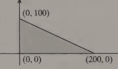

直角位于 `(0, 0)`，另外两个点位于 `(200, 0)` 和 `(0, 100)`。编写一个程序，提示用户输入带有 `x` 和 `y` 坐标的点，并判断该点是否在三角形内。以下是示例运行：

```
Enter a point's x and y-coordinates: 100.5 25.5

The point is in the triangle

Enter a point's x and y-coordinates: 100.5 50.5

The point is not in the triangle
```

## 第 4 章 循环

### 目标

- 使用 `while` 循环重复执行语句 (4.2)。
- 开发 `GuessNumber` 和 `SubtractionQuiz` 程序 (4.2.1–4.2.2)。
- 使用用户确认控制循环 (4.3)。
- 使用哨值控制循环 (4.4)。
- 使用输入重定向从文件获取大量输入而不是通过键盘 (4.5)。
- 使用 `do-while` 语句编写循环 (4.3)。
- 使用 `for` 语句编写循环 (4.4)。
- 发现三种循环语句的相似点和不同 (4.5)。
- 编写嵌套循环 (4.6)。
- 学习减少数值误差的技术 (4.7)。
- 从各种示例中学习循环（`GCD`, `FutureTuition`, `PrintPyramid`, `PrimeNumber`）(4.8, 4.10)。


使用 `break` 和 `continue` 实现程序控制（4.9）。

# 第 4 章 循环

## 4.1 引言

假设你需要打印一个字符串（例如，“Welcome to C++!”）一百次。编写一百次会非常乏味：

```cpp
cout << "Welcome to C++\n";
```

那么，你如何解决这个问题呢？

C++ 提供了一种名为循环的强大控制结构，它可以控制一个操作或一系列操作连续执行的次数。使用循环语句，你不需要编写一百次打印语句代码；只需告诉计算机打印一百次该字符串即可。

循环控制语句块的重复执行。循环的概念是编程的基础。C++ 提供了三种类型的循环语句：`while` 循环、`do-while` 循环和 `for` 循环。

## 4.2 `while` 循环

`while` 循环的语法如下：

```cpp
while (loop-continuation-condition)
{
  // Loop body
  Statement(s);
}
```

图 4.1 显示了 `while` 循环的流程图。循环中包含重复执行语句的部分是循环体。循环体的单次执行是循环的*迭代*（iteration）。每个循环都包含一个*循环继续条件*，这是一个控制循环执行的布尔表达式。它总是会预先进行评估。如果评估结果为真，则执行循环体；否则，整个循环终止，程序控制返回到 `while` 循环之后的语句。例如，下面的 `while` 循环会打印一百次 Welcome to C++。

**图 4.1** 当循环继续条件求值为真时，`while` 循环重复执行循环体中的语句。

```cpp
int count = 0;
while (count < 100)
{
    cout << "Welcome to C++!\n";
    count++;
}
```

上述语句的流程如图 4.1(b) 所示。变量 `count` 初始值为 0。循环检查 `count < 100` 是否为真。如果是，则执行循环体打印消息“Welcome to C++”并让 `count` 加 1。它会重复执行循环体，直到 `(count < 100)` 变为假（即当 `count` 达到 100 时）。此时，循环终止，并执行循环语句之后的后续语句。

在这个示例中，你确切地知道循环体需要执行多少次。这种类型的循环被称为计数控制循环。

> 注意：循环继续条件（`loop-continuation-condition`）必须始终出现在括号内。只有当循环体包含单条语句或没有语句时，才能省略包裹循环体的大括号。

> 警告：确保循环继续条件最终变为假，以便程序能够终止。一种常见的编程错误涉及无限循环。例如，如果你忘记在代码中增加 `count`（`count++`），程序将不会停止。要终止程序，请按 `Ctrl+C`。

这里是另一个说明循环如何工作的示例：

```cpp
int sum = 0, i = 1;
while (i < 10)
{
    sum = sum + i;
    i++;
}
```

如果 `i < 10` 为真，程序将 `i` 加到 `sum` 中。变量 `i` 初始设置为 1，然后递增到 2、3 直到 10。当 `i` 为 10 时，`i < 10` 为假，循环退出。因此 `sum` 为 1 + 2 + 3 + ... + 9 = 45。

假设循环被错误地写如下：

```cpp
int sum = 0, i = 1;
while (i < 10)
{
    sum = sum + i;
}
```

这个循环是无限的，因为 `i` 始终为 1，且 `i < 10` 将始终为真。

### 4.2.1 问题：猜数字

这个问题是猜出计算机心里想的数字。你将编写一个程序，随机生成一个 0 到 100 之间（包含边界）的整数。程序连续提示用户输入数字，直到它与随机生成的数字匹配。对于每个用户输入，程序都会报告它是太低还是太高，以便用户能够智能地选择下一次输入。以下是示例运行：

```
Guess a magic number between 0 and 100
Enter your guess: 50 --Enter
Your guess is too high
Enter your guess: 25 --Enter
Your guess is too high
Enter your guess: 12 --Enter
Your guess is too high
Enter your guess: 6 --Enter
Your guess is too low
Enter your guess: 9 --Enter
Your guess is too high
Enter your guess: 7 --Enter
Your guess is too low
Enter your guess: 8 --Enter
Yes, the number is 8
```

魔法数字在 0 到 100 之间。为了尽量减少猜测的次数，请先输入。如果你的猜数字太高，魔法数字在 0 到 49 之间。如果你的猜数字太低，数字在 51 到 100 之间。之后，只需一次猜测，就可以排除一半的数字。

你如何编写这个程序？你会立即开始编写代码吗？不。在编写代码之前思考是重要的。如果不写程序，你会如何解决这个问题？你首先需要生成一个 0 到 100 之间的随机数，然后提示用户输入猜测并将其与随机数比较。

一次写一步代码是一个好习惯。对于循环类的程序，如果你立即不知道如何编写循环，可以先编写执行一次代码的代码，然后考虑如何在循环中重复它。对于这个程序，你可以创建一个初始草稿，如列表 4.1 所示。

#### 列表 4.1 GuessNumberOneTime.cpp

```cpp
#include <iostream>
#include <cstdlib>
#include <ctime>
using namespace std;
int main() {
    // 生成一个待猜的随机数
    int number = rand(time(0)) % 101;
    cout << "Guess a magic number between 0 and 100";
    // 提示用户猜数字
    cout << "\nEnter your guess: ";
    cin >> guess;

    if (guess == number)
        cout << "Yes, the number is " << number << endl;
    else if (guess > number)
        cout << "Your guess is too high" << endl;
    else
        cout << "Your guess is too low" << endl;
}
```

当这个程序运行时，它只提示用户输入一次猜测。为了让用户反复输入猜测，你可以将第 15–24 行的代码放入循环中，如下：

```cpp
while (true) {
    // 提示用户猜数字
    cout << "enter your guess:";
    cin >> guess;
    if (guess == number)
        cout << "Yes, the number is " << number << endl;
    else if (guess > number)
        cout << "Your guess is too high" << endl;
    else
        cout << "Your guess is too low" << endl;
}
```

这个循环会反复提示用户猜测。然而，这个循环是不正确的，因为它不会终止。当 `guess` 匹配 `number` 时，循环应该结束。因此修改循环如下：

```cpp
while (guess != number) {
    // 提示用户猜测
    cout << "enter your guess:";
    cin >> guess;
    if (guess == number)
        cout << "Yes, the number is " << number << endl;
    else if (guess > number)
        cout << "Your guess is too high" << endl;
    else
        cout << "Your guess is too low" << endl;
}
```

完整的代码见列表 4.2。

```cpp
#include <iostream>
#include <cstdlib>
#include <ctime>
using namespace std;
int main() {
    // 生成一个待猜的随机数
    srand(time(0));
    int number = rand() % 101;
    int guess = -1;
    cout << "Guess a magic number between 0 and 100";
    while (guess != number) {
        // 提示用户猜测
        cout << "enter guess: ";
        cin >> guess;
        if (guess == number) {
            cout << "Yes, the number is " << number << endl;
        } else if (guess > number) {
            cout << "Your guess is too high" << endl;
        } else {
            cout << "Your guess is too low" << endl;
        }
    }
    return 0;
}
```

#### 列表 4.2 GuessNumber.cpp

| 行号 | number | guess | 输出 |
|---|---|---|---|
| 10 | 8 | | |
| 14 | | -1 | |
| 19 | | 50 | |
| 24 | | | Your guess is too high |
| 19 | | 25 | Your guess is too high |
| 24 | | | Your guess is too high |
| 19 | | 12 | Your guess is too high |
| 24 | | 6 | Your guess is too low |
| 26 | | | Your guess is too low |
| 19 | | 9 | Your guess is too high |
| 24 | | 7 | Your guess is too high |
| 26 | | | Your guess is too low |
| 19 | | 8 | Your guess is too high |
| 22 | | | Yes, the number is 8 |

程序在第 10 行生成魔法数字，并在循环中（15–27 行）连续提示用户猜测。对于每次猜测，程序检查它是正确的、太高还是太低（21–26 行）。当猜测正确时，程序退出循环。注意 `guess` 初始化为 -1。0 到 100 之间的值是错误的，因为那个值可能是待猜的数字。

### 4.2.2 问题：改进的数学学习工具

列表 3.5 `SubtractionQuiz.cpp` 中的减法练习每次运行生成一个问题。你可以使用循环反复生成问题。列表 4.3 提供了一个生成五个问题的程序，并在学生回答所有问题后报告正确答案的数量。程序还会显示测试花费的时间，如示例所示。

#### 列表 4.3 SubtractionQuizLoop.cpp

```cpp
#include <iostream>
#include <ctime> // 用于 time 函数
#include <cmath> // 用于 rand 和 rand 函数
using namespace std;

int main() {
    int correctCount = 0; // 计算正确答案数量
    int count = 0; // 计算问题数量
    long startTime = time(0);
    const int NUMBER_OF_QUESTIONS = 5;
    int answer;

    while (count < NUMBER_OF_QUESTIONS) {
        // 1. 生成两个随机单数字整数
        srand(time(0));
        int number1 = rand() % 10;
        int number2 = rand() % 10;

        // 2. 如果 number1 < number2，交换 number1 和 number2
        if (number1 < number2) {
            int temp = number1;
            number1 = number2;
            number2 = temp;
        }

        // 3. 提示学生回答 "what is number1 - number2?"
        cout << "what is " << number1 << " - " << number2 << " ? ";
        cin >> answer;

        // 4. 为答案打分并显示结果
        if (number1 - number2 == answer) {
            cout << "You are correct!\n";
            correctCount++;
        } else {
            cout << "Your answer is wrong.\n" << number1 << " - " << number2 << " should be " << (number1 - number2) << endl;
        }
        // 增加计数
        count++;
    }

    long endTime = time(0);
    long testTime = endTime - startTime;
}
```

```cpp
50 cout << "Correct count is " <<correctCount << "\ntime is"
51 << testTime << " seconds\n";
52
53 return 0;
54 }
```

该程序使用变量 `count` 来控制循环的执行。`count` 初始值为 0（第 9 行），并在每次迭代中加 1（第 44 行）。每次迭代中都会显示并处理一个减法问题。程序在第 10 行获取测试开始前的时间，在第 47 行获取测试结束后的时间，并在第 48 行计算时间差。

## 4.2.3 使用用户确认控制循环

上一个示例执行了五次循环。如果你想让用户决定是否再做一道题，可以提供用户确认。程序的模板可以编写如下所示：

```cpp
char continueLoop = 'Y';
while (continueLoop == 'Y') {
    // 执行循环体一次
    // 提示用户进行确认
    cout << "Enter Y to continue and N to quit: ";
    cin >> continueLoop;
}
```

你可以通过使用用户确认来重写列表 4.3，让用户决定是否进入下一道题。

## 4.2.4 使用哨兵值控制循环

另一种控制循环的常用技术是指定一个特殊的输入值，称为哨兵值（sentinel value），它表示循环的结束。这种使用哨兵值的循环被称为哨兵控制循环。

列表 4.4 编写了一个程序，用于读取并计算任意数量整数的和。输入 0 表示输入结束。你需要为每个输入值声明一个新变量吗？不需要。只需使用名为 `data` 的变量（第 8 行）来存储输入值，并使用名为 `sum` 的变量（第 12 行）来存储总和。每当读取到一个值时，将其赋值给 `data`（第 9、20 行），如果它不为零，则将其加到 `sum`（第 15 行）中。

### 列表 4.4 SentinelValue.cpp


```cpp
#include <iostream>
using namespace std;

int main() {
    cout << "Enter an int value (the program exits ";
    int data;
    cin >> data;
    if (data) {
        // 一持续读取数据直到输入为 0
        int sum = 0;
        while (data != 0) {
            sum += data;
            // 读取下一个数据
            cout << "Enter an int value (the program exits ";
            cin >> data;
        }
        cout << "The sum is " << sum << endl;
    }
    return 0;
}
```

输入数据

循环

输出结果

```
Enter an int value (the program exits if the input is 0): 2 --Enter
Enter an int value (the program exits if the input is 0): 3 --Enter
Enter an int value (the program exits if the input is 0): 4 --Enter
Enter an int value (the program exits if the input is 0): 0 --Enter
The sum is 9
```


| line# | data | sum | output |
|---|---|---|---|
| 9 | 2 | | |
| 12 | | | |
| 15 | | 2 | |
| 20 | 3 | | |
| 15 | | 5 | |
| 20 | 4 | | |
| 17 | | 9 | |
| 20 | 0 | | The sum is 9 |


## 第4章 循环

如果 `data` 不为 0，它会被加到 `sum`（第 15 行），并读取输入数据的后续项（第 18–20 行）。如果 `data` 为 0，循环体将不再执行，`while` 循环终止。输入值 0 是该循环的哨兵值。如果第一个输入是 0，循环体将永远不会执行，结果和为 0。

数值错误

> **注意**
>
> 不要用循环控制中的浮点值进行等性检查。由于浮点数是近似值，可能会导致计数器值不精确。此示例使用 `int` 类型作为 `data`。如果使用浮点类型作为 `data`，即使 `data` 为 0，`(data != 0)` 也可能为真。
>
> 例如：
>
> ```cpp
> double data = pow(0.1, 2);
> if (data != 0) // 这可能为真
>     cout << "data is not zero";
> ```


## 4.2.5 输入和输出重定向

在前面的示例中，如果你有大量数据，通过键盘输入很麻烦。相反，将数据存储在文件中，例如 `input.txt`，并使用以下命令运行程序：

```bash
g++ SentinelValue.cpp -o SentinelValue < input.txt
```

同样，你可以将输出发送到控制台。例如：

```bash
g++ SentinelValue.cpp -o SentinelValue > output
```

等等，OCR文本似乎包含重复的混乱片段。我将根据提供的片段进行清理。

语句图图所示。`while` 循环是 `for` 循环的一种变体，如下所示：

## 4.3 The while Loop


## 4.4 The for Loop

通常按照常用形式编写循环：

```cpp
i = initialValue; // 初始化控制变量
while (i < endValue)
{
    // 循环体
    ...
    i++; // 调整控制变量
}
```

`for` 循环可以简化上面的循环：

```cpp
for (i = initialValue; i < endValue; i++)
{
    // 循环体
    ...
}
```

一般来说，`for` 循环的语法如下所示：

```cpp
for (initial-action; loop-continuation-condition;
     action-after-each-iteration)
{
    // 循环体;
    Statement(s);
}
```

`for` 循环的图如图4.3(a)所示，后面是一对括号，其中包含了 `initial-action`、`loop-continuation-condition` 和 `action-after-each-iteration`，然后是大括号内的循环体。`initial-action`、`loop-continuation-condition` 和 `action-after-each-iteration` 之间用分号分隔。

`for` 循环通常使用变量来控制循环体执行的次数以及何时终止。这被称为控制变量。`initial-action` 通常初始化控制变量，`action-after-each-iteration` 通常递增或减少控制变量，而 `loop-continuation-condition` 测试控制变量是否达到了终止值。例如，该 `for` 循环打印一百次 "Welcome to C++!"：

```cpp
int i;
for (i = 0; i < 100; i++)
{
    cout << "Welcome to C++!\n";
}
```

## 4.4 for 循环

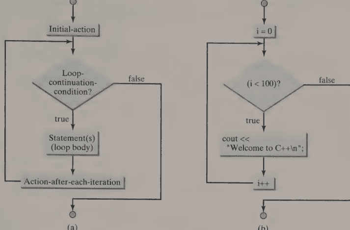

**图 4.3** for 循环执行一个初始动作，然后重复执行循环体中的语句；当循环继续条件求值为真时，在每次迭代后会执行一个动作。

**初始动作**（initial-action）`i = 0` 初始化控制变量 `i`。**循环继续条件**（loop-continuation-condition）`i < 100` 是一个布尔表达式。该表达式在初始化之后以及每次迭代的开始时求值。如果该条件为**真**（true），则执行循环体。如果为**假**（false），循环终止，程序控制返回循环后的下一行。

**每次迭代后的动作**（action-after-each-iteration）`i++` 是一个调整控制变量的语句。该语句在每次迭代后执行。它增加控制变量的值。最终，控制变量的值应该强制使**循环继续条件**变为假，否则循环将是死循环。循环变量在 for 循环中声明并初始化。这是一个示例：

```cpp
for (int i = 0; i < 100; i++) {
    cout << "Welcome to C++\n";
}
```

如果循环体中只有一个语句（如示例所示），可以省略大括号。

> **提示**
>
> 循环变量必须在循环的控制结构内部或循环之前声明。如果循环变量仅在循环中使用而不在其他地方使用，最好在 **for** 循环的**初始动作**中声明它。如果变量在循环控制结构内部声明，则无法在循环外部引用。例如，在上述代码中你不能在循环外部引用 `i`，因为它是在 for 循环内部声明的。

**注意**

**for** 循环中的初始动作可以是零或多个用逗号分隔的变量声明语句或赋值表达式列表。例如：

```cpp
for (int i = 0, j = 0; (i + j < 10); i++, j++) {
  // 执行某些操作
}
```

for 循环中的每次迭代后的动作可以是零或多个用逗号分隔的表达式列表。例如：

```cpp
for (int i = 1; i < 100; cout << i, i++)
```

先测试循环 后测试循环

这个示例是正确的，但它是一个糟糕的示例，因为它让代码难以阅读。通常，你会在初始动作中声明并初始化控制变量，并在每次迭代后的动作中增加或减少控制变量。

**注意**

如果省略 for 循环中的循环继续条件，则它隐含为真。下方 (a) 中的语句是一个无限循环，它是正确的。为了避免混淆，最好使用 (b) 中的等效循环。

| for ( ;; ) | 等价 | while (true) |
|---|---|---|
| { // 执行操作 } | 这样更好 | { // 执行操作 } |
| (a) | | (b) |

## 4.5 使用哪种循环？

while 循环和 for 循环被称为先测试循环，因为条件在执行循环体之前会被检查。do-while 循环被称为后测试循环，因为条件在执行循环体之后会被检查。while、do 和 for 三种循环语句在表达能力上是等价的；也就是说，你可以用这三种形式中的任何一种编写循环。例如，图 (a) 中的 while 循环可以转换为 (b) 中的 for 循环：

| while (loop-continuation-condition) { // 循环体 } | 等价 | for ( ; loop-continuation-condition; ) { // 循环体 } |
|---|---|---|
| (a) | | (b) |

下一图中 (a) 中的 for 循环通常可以转换为 (b) 中的 while 循环，特殊情况除外（此类情况参见复习 4.17）：

| for (initial-action; loop-continuation-condition; action-after-each-iteration) { // 循环体 } | 等价 | initial-action; while (loop-continuation-condition) { 循环体; 迭代后动作; } |
|---|---|---|
| (a) | | (b) |

使用对你来说最直观的循环语句。通常，如果提前知道重复次数，可以使用 for 循环——例如，当需要打印一百次消息时。如果重复次数不固定（例如读取数字直到输入 0 为止），可以使用 while 循环。如果在测试继续条件之前必须执行循环体，可以使用 do-while 循环替换 while 循环。

## 4.6 嵌套循环

**注意**

在循环体之前的 for 子句末尾添加分号是一个常见的错误，如下所示。在 (a) 中，分号意味着循环提前结束。此时，循环体实际上是空的，如 (b) 所示。(a) 和 (b) 是等效的。

| 错误 | 空循环体 |
|---|---|
| `for (int i = 0; i < 10; i++) {\n  cout << "i is " << endl;}` | `for (int i = 0; i < 10; i++) {\n  cout << "i is " << endl;}` |
| (a) | (b) |

同样，(c) 中的循环也是错误的。(c) 与 (d) 等效。

| 错误 | 空循环体 |
|---|---|
| `int i = 0;\nwhile (i < 10) {\n  cout << "i is " << endl;\n  i++;}` | `int i = 0;\nwhile (i < 10) {\n  cout << "i is " << endl;}` |
| (c) | (d) |

在 do-while 循环的情况下，需要分号来结束。

```cpp
int i = 0;
do {
  cout << "i is " << endl;
  i++;
} while (i < 10); // 正确
```

嵌套循环由一个外层循环和一个内部循环组成。每当外层循环重复一次，内部循环就会重新进入。列表4.6 是一个使用嵌套循环打印乘表的程序。

### 4.6 MultiplicationTable.cpp

```cpp
#include <iostream>
#include <iomanip>
using namespace std;

int main() {
  cout << "Multiplication Table\n";
  cout << "----------------\n";
  // 显示标题
  cout << "      \n";
  for (int i = 1; i <= 9; i++) {
    cout << i << " |";
    // 打印表体
    for (int j = 1; j <= 9; j++) {
      // 对齐显示积
      cout << setw(3) << i * j;
    }
    cout << "\n";
  }
  return 0;
}
```

| 1 | 2 | 3 | 4 | 5 | 6 | 7 | 8 | 9 |
|---|---|---|---|---|---|---|---|---|
| 1 | 2 | 3 | 4 | 5 | 6 | 7 | 8 | 9 |
| 2 | 4 | 6 | 8 | 10 | 12 | 14 | 16 | 18 |
| 3 | 6 | 9 | 12 | 15 | 18 | 21 | 24 | 27 |
| 4 | 8 | 12 | 16 | 20 | 24 | 28 | 32 | 36 |
| 5 | 10 | 15 | 20 | 25 | 30 | 35 | 40 | 45 |
| 6 | 12 | 18 | 24 | 30 | 36 | 42 | 48 | 54 |
| 7 | 14 | 21 | 28 | 35 | 42 | 49 | 56 | 63 |
| 8 | 16 | 24 | 32 | 40 | 48 | 56 | 64 | 72 |
| 9 | 18 | 27 | 36 | 45 | 54 | 63 | 72 | 81 |

## 4.7 减少数值误差

涉及浮点数的数值误差是避免的。本节将通过示例讨论如何减少此类误差。列表4.7 展示了一个从 0.01 开始到 1.0 结束的序列求和示例。序列中的数字将如下增加 0.01：0.01 + 0.02 + 0.03 等类推。

### 列表 4.7 TestSum.cpp

```cpp
#include <iostream>
using namespace std;

int main() {
  // 初始化 sum
  double sum = 0;

  // 将 0.01, 0.02, ..., 0.99, 1 加入 sum
  for (double i = 0.01; i <= 1.0; i += 0.01) {
    sum += i;
  }
  // 显示结果
  cout << "The sum is " << sum;
  return 0;
}
```

## 4.8 案例研究

循环

和为 49.5


数值误差

结果是 49.5，但正确结果应该是 50.5。哪里出了问题？在循环的每次迭代中，`i` 增加了 0.01。当循环结束时，`i` 的值略大于 1。根本问题是浮点数是用近似值表示的。为了修复这个问题，使用整数计数器以确保所有数字都被相加。这是一个新的循环：

```cpp
double currentValue = 0.01;
for (int count = 0; count < 100; count++) {
    sum += currentValue;
    currentValue += 0.01;
}
```

### 4.8.1 问题：寻找公约数

两个整数 4 和 2 的最大公约数是 2。两个整数 16 和 24 的最大公约数是 8。如何找到公约数？假设输入整数为 `n1` 和 `n2`。你知道 1 是公约数，但它可能不是最大公约数。你可以检查 `k`（对于 `k = 2, 3, 4` 等）是否为 `n1` 和 `n2` 的公约数，直到 `k` 大于 `n1` 或 `n2`。将公约数存在名为 `gcd` 的变量中。每发现一个新的公约数，它就成为新的 `gcd`。当你检查了从 2 到 `n1` 或 `n2` 的所有可能的公约数，`gcd` 中的值就是最大公约数。该思路可以转换为以下代码：

```cpp
int gcd = 1;
int k = 2;

while (k <= n1 && k <= n2) {
    if (n1 % k == 0 && n2 % k == 0) {
        gcd = k;
    }
    k++;
}
```

# 第 4 章 循环

```cpp
k++;
}
// 循环结束后，gcd 是 n1 和 n2 的最大公约数
```

列表 4.8 展示了该程序，它提示用户输入两个正整数并找到它们的最大公约数。

## 4.8 GreatestCommonDivisor.cpp

| 输入 | 输入 | 输出 |
| :--- | :--- | :--- |
| | | gcd |


### 在输入之前思考

你是是如何编写这个程序的？你是立即开始写代码的吗？不。在输入之前思考是非常重要的。这能让你为问题生成逻辑解决方案，而无需纠结于如何写代码。一旦你有了逻辑解决方案，就可以用某种代码将该解决方案翻译成程序。翻译不是唯一的。例如，你可以使用 `for` 循环如下所示重写代码：


```cpp
for (int k = 2; k <= n1 && k <= n2; k++) {
    if (n1 % k == 0 && n2 % k == 0) {
        gcd = k;
    }
}
```

### 多种解决方案

一个问题有多种解决方案。GCD 可以有很多解决方法。练习 4.15 建议了另一种解决方案。更高效的解决方案是使用欧几里得算法。更多信息请见 http://www.cut-the-knot.org/blue/Euclid.shtml。

## 4.8 案例研究

你可能认为数字 `n1` 的因数不能大于 `n1 / 2`。因此，你错误的解决方案会尝试使用以下循环运行程序：

```cpp
for (int k = 2; k <= n1 / 2 && k < n2 / 2; k++)
  if (n1 % k == 0 && n2 % k == 0)
    gcd = k;
```

这个修订版本是错误的。你能找到原因吗？答案请看问题 4.14。

### 4.8.2 问题：预测未来的学费

假设某大学今年的学费为 10,000 美元，每年增长 7%。在多少年后学费会翻倍？

在尝试编写程序之前，先考虑如何用手动解决这个问题。第二年的学费是第一年学费 * 1.07。每年的学费都是前一年学费 * 1.07。因此，每年的学费可以计算为：

```cpp
double tuition = 10000; int year = 1 // 第1年
tuition = tuition * 1.07; year++; // 第2年
tuition = tuition * 1.07; year++; // 第3年
tuition = tuition * 1.07; year++; // 第4年
...
```

持续计算新年的学费，直到它至少达到 20000。到那时你就知道学费翻倍需要多少年了。你现在可以将逻辑翻译成以下循环：

```cpp
double tuition = 10000; // 第1年
int year = 1;
while (tuition < 20000)
  tuition = tuition * 1.07;
  year++;
```

完整的程序显示在列表 4.9 中。

# 列表 4.9 FutureTuition.cpp

```cpp
#include <iostream>
using namespace std;
int main()
{
  double tuition = 10000; // 第1年
  int year = 1;
  while (tuition < 20000)
  {
    tuition = tuition * 1.07;
    year++;
  }
  cout << "Tuition will be doubled in " << year << " years" << endl;
  return 0;
}
```

学费将在 12 年后翻倍

`while` 循环（第 8–12 行）用于反复计算新年的学费。当学费大于或等于 20000 时循环终止。

### 4.8.3 问题：蒙特卡洛模拟

蒙特卡洛模拟使用随机数和概率来解决问题。它在计算数学、物理、化学和金融领域有广泛的应用。我们现在来看一个用于估计 π 的蒙特卡洛模拟示例。首先，画一个圆及其外接正方形。

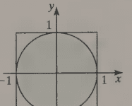

假设圆的半径为 1。因此，圆面积为 π，正方形面积为 4。在正方形内随机生成一个点。该点落在圆内的概率是圆面积 / 正方形面积 = π / 4。

编写一个程序，在正方形内随机生成 1000000 个点，并让 `numberOfHits` 表示落在圆内的点数。因此，`numberOfHits`约为 1000000 * (π/4)。π 可以近似为 4 * numberOfHits / 1000000。完整的程序显示在列表 4.10 中。

# 列表 4.10 MonteCarloSimulation.cpp

```cpp
#include <iostream>
using namespace std;
int main() {
    const int NUMBER_OF_TRIALS = 1000000;
    int numberOfHits = 0;
    srand(time(0));
    for (int i = 0; i < NUMBER_OF_TRIALS; i++) {
        double x = rand() * 2.0 / RAND_MAX - 1;
        double y = rand() * 2.0 / RAND_MAX - 1;
        if (x * x + y * y <= 1)
            numberOfHits++;
    }
    double pi = 4.0 * numberOfHits / NUMBER_OF_TRIALS;
    cout << "PI is " << pi << endl;
    return 0;
}
```

在圆内生成随机点

估计 pi

PI 为 3.1424

程序在第 12–13 行在正方形内反复生成随机点 `(x, y)`：

```cpp
double x = rand() * 2.0 / RAND_MAX - 1;
double y = rand() * 2.0 / RAND_MAX - 1;
```

如果 `x² + y² ≤ 1`，点在圆内，`numberOfHits` 加 1。

π 约为 `4 * numberOfHits / NUMBER_OF_TRIALS`（第 18 行）。

## 4.9 关键字 break 和 continue


### 教学提示

两个关键字 `break` 和 `continue` 可以在循环语句中提供额外的控制。在某些情况下这可以简化编程，但过度使用 `break` 和 `continue` 会使程序难以阅读和调试。教师可能会跳过这一节而不影响书的其他部分

你在 `switch` 语句使用了 `break` 关键字。你也可以在循环中使用 `break` 来立即终止循环。列表 4.11 展示了在循环中使用 `break` 的效果。

# 列表 4.11 TestBreak.cpp

```cpp
#include <iostream>
using namespace std;
int main()
{
  int sum = 0;
  int number = 0;

  while (number < 20)
  {
    number++;
    sum += number;
    if (sum >= 100)
      break;
  }
  cout << "The number is " << number << endl;
  cout << "The sum is " << sum << endl;
  return 0;
}
```


| 数字是 14 | 总和是 105 |

| :--- | :--- |


程序按顺序将 1 到 20 的整数加到 `sum`，直到 `sum` 大于 100。没有 13–14 行，程序将计算 1 到 20 的和。但有了 13–14 行，循环在 `sum` 大于 100 时终止。没有 13–14 行，输出将是：

| 数字是 20 | 总和是 210 |


# 第 4 章 循环

你可以在循环中使用 `continue` 关键字。当遇到它时，会结束迭代。程序控制跳转到循环体的末尾。换句话说，`continue` 跳出一个迭代，而 `break` 跳出一个循环。列表 4.12 程序显示了在循环中使用 `continue` 的效果。

# 列表 4.12 TestContinue.cpp

```cpp
#include <iostream>
using namespace std;
int main() {
  int sum = 0;
  int number = 0;
  while (number < 20) {
    number++;
    if (number == 10 || number == 11) {
      continue;
    }
    sum += number;
  }
  cout << "The sum is " << sum;
  return 0;
}
```

总和为 210

程序将 1 到 20 除 10 和 11 以外的所有整数加到 `sum`。当 `number` 变为 10 或 11 时，执行 `continue` 语句。`continue` 语句结束当前迭代，因此循环体中的其余语句不执行；当 `number` 为 10 或 11 时，不会将其加到 `sum` 中。

没有 12–13 行，输出将如下：

总和为 210

在这种情况下，即使数字是 10 或 11，所有数字都会加到 `sum` 中。因此，结果是 210。

> 注意

> `continue` 语句始终位于循环内部。在 `while` 和 `do-while` 循环中，在 `continue` 语句之后立即评估循环继续条件。在 `for` 循环中，先执行每次迭代后的操作，然后在 `continue` 语句之后立即评估循环继续条件。

你总是可以编写一个不在循环中未使用 `break` 或 `continue` 的程序。另见问题 4.18。通常情况下，如果使用 `break` 和 `continue` 可以简化编码并使程序易读，那么使用它们是合适的。

列表 4.2 给出了猜数字程序。你可以使用 `break` 语句重写它，如列表 4.13 所示。

# 列表 4.13 GuessNumberUsingBreak.cpp

```cpp
#include <iostream>
#include <ctime>
#include <cstdlib>
using namespace std;

int main() {
    // 生成一个要被猜的随机数
    srand(time(0));
    int number = rand() % 101;

    cout << "Guess a magic number between 0 and 100";

    while (true) {
        // 提示用户猜数字
        cout << "\n your guess: ";
        int guess;
        cin >> guess;

        if (guess == number) {
            cout << "Yes, the number is " << number << endl;
            break;
        } else if (guess > number) {
            cout << "Your guess is too high" << endl;
        } else {
            cout << "Your guess is too low" << endl;
        }
    }
    return 0;
}
```

使用 `break` 语句可以让程序更简单且易于阅读。然而，使用 `break` 和 `continue` 时要小心；过多的 `break` 和 `continue` 语句会产生带有许多出口点的循环，导致程序难以阅读。

> 注意：C 语言有 `goto` 语句。然而，它会让你的程序容易出现错误。`goto` 语句可以无差别地转移控制到程序的任何地方，而 `break` 和 `continue` 语句仅在循环或 `switch` 语句有效。

## 4.10 示例：显示质数

本节介绍了一个程序，用五行显示前五十个质数，每行十个数字。如果一个大于 1 的整数的唯一因数是 1 或其本身，那么它就是质数。例如，2、3、5 和 7 是质数，但 4、6、8 和 9 不是质数。

该问题可以分解为以下任务：

- 确定一个给定的数字是否为质数。

- 对于数字 = 2, 3, 4, 5, 6, ..., 测试该数字是否为质数。

- 统计质数的个数。

- 打印每个质数，每行打印十个数字。

# 第 4 章 循环

显然，你需要编写一个循环来反复测试一个新数字是否为质数，并将计数加 1。初始计数为 0。当计数达到 50 时，循环终止。

以下是该问题的算法：

- 将要打印的质数数量设置为常量 `NUMBER_OF_PRIMES`；

- 使用 `count` 跟踪质数的个数，并将初始计数设为 0；

- 设置初始数字为 2；

```cpp
while (count < NUMBER_OF_PRIMES)
{
    // 测试 number 是否为质数
    if (number is prime)
    {
        // 打印质数并增加计数
    }
    // 将 number 加 1
}
```

测试一个数字是否为质数，检查它是否能被 2、3、4 直到 `number/2` 整除。如果找到了因数，则该数字不是质数。该算法可以描述如下：

使用一个布尔变量 `isPrime` 来表示该数字是否为质数；初始将 `isPrime` 设置为 `true`；

```cpp
for (int divisor = 2; divisor <= number / 2; divisor++)
{
    if (number % divisor == 0)
    {
        // 将 IsPrime 设置为 false
        // 退出循环
    }
}
```

完整的程序在列表 4.14 中。

## 列表 4.14 PrimeNumber.cpp

```cpp
#include <iostream>
#include <iomanip>
using namespace std;

int main() 
{
    const int NUMBER_OF_PRIMES = 50; // 要显示的质数数量
    const int NUMBER_OF_PRIMES_PER_LINE = 10; // 每行显示 10 个
    int count = 0; // 统计质数的个数
    int number = 2; // 要测试的数字

    cout << "The first 50 prime numbers are \n";

    // 反复寻找质数
    while (count < NUMBER_OF_PRIMES)
    {
        // 假设数字是质数
        bool isPrime = true; // 当前数字是吗？
        // 测试数字是否为质数
        for (int divisor = 2; divisor <= number / 2; divisor++) {
            if (number % divisor == 0) {
                // 如果为真，数字不是质数
                isPrime = false; // 将 isPrime 设置为 false
                break; // 退出循环
            }
        }

        // 打印质数并增加计数
        if (isPrime) {
            count++; // 增加计数
            if (count % NUMBER_OF_PRIMES_PER_LINE == 0) {
                // 打印并换行
                cout << setw(4) << number << endl;
            }
        } else {
            cout << setw(4) << number << " ";
        }

        // 检查下一个数字是否为质数
        number++;
    }
    return 0;
}
```

| 2 3 5 7 11 13 17 19 23 29 |

| 31 37 41 43 47 53 59 61 67 71 |

| 73 79 83 89 97 101 103 107 109 113 |

| 127 131 137 149 151 157 163 167 173 |

| 179 181 191 193 197 199 211 223 227 229 |

对于初学者来说，这是一个复杂的例子，对于许多其他人来说，开发解决方案的关键将其分解为子问题并为每个子问题编写解决方案。不要尝试第一次就写出完整的解决方案。相反，通过编写判断给定数字是否为质数的代码在循环中测试其他数字。

要判断一个数字是否为质数，检查它是否能被 2 到 `number/2` 之间的数字整除。如果是，它不是质数；否则它是质数。对于质数，显示它。如果计数被 10 整除，则换行。当计数达到 50 时程序结束。

程序在第 27 行使用 `break` 语句在发现数字不是质数时立即退出循环。你可以不使用 `break` 语句重写循环（第 21-29 行）：

```cpp
for (int divisor = 2; divisor <= number / 2 && isPrime; divisor++) {
    // 如果为真，数字不是质数
    if (number % divisor == 0)
    {
        // 将 isPrime 设置为 false
        isPrime = false;
    }
}
```

然而，在这种情况下使用 `break` 语句会让程序更简单且易于阅读。

## 术语

| break 语句 | 135 | 循环继续条件 | 116 |

| :--- | :--- | :--- | :--- |


# 第 4 章 循环

## 章总结

1. 有三种重复语句：`while` 循环、`do-while` 循环和 `for` 循环。
2. 循环中包含重复语句的部分被称为循环体。
3. 循环体的单次执行称为循环的迭代。
4. 无限循环是无限执行的循环语句。
5. 在设计循环时，你需要同时考虑循环控制结构和循环体。
6. `while` 循环首先检查循环继续条件。如果条件为真，则执行循环体；否则循环终止。
7. `do-while` 循环类似于 `while` 循环，但它先执行循环体，然后检查循环继续条件以决定继续还是终止。
8. 由于 `while` 循环和 `do-while` 循环包含依赖循环体的循环继续条件，重复次数由循环体决定。当重复次数未知时，通常使用 `while` 循环和 `do-while` 循环。
9. 哨兵值是一个表示循环结束的特殊值。
10. `for` 循环通常用于执行预测次数的循环体；此次数不由循环体决定。
11. `for` 循环控制包含三部分。第一部分是初始化控制变量的初始动作。第二部分是循环继续条件，决定了是否执行循环体。第三部分在每次迭代后执行，通常用于调整控制变量。通常，循环控制变量在控制结构中初始化和改变。
12. `while` 循环和 `for` 循环被称为预测试循环，因为在执行循环体之前会检查继续条件。
13. `do-while` 循环被称为后测试循环，因为它在执行循环体后才检查条件。
14. 两个关键字 `break` 和 `continue` 可以在循环中使用。
15. `break` 关键字立即结束包含它的内层循环。
16. `continue` 关键字仅结束当前迭代。

## 复习题

### 4.2–4.8 节

- **4.1** 分析以下代码。在点 A、B 和 C 处，`count < 100` 是始终真、始终假，还是有时真或有时假？

```cpp
int count = 0;
while (count < 100)
{
    // 点 A
    cout << "Welcome to C++\n";
    count++;
    // 点 B
}
```

- **4.2** 在列表 4.2 中，如果 `guess` 初始化为 0 会有什么问题？

- **4.3** 循环体重复了多少次？循环的输出是什么？

| int i = 1; | int i = 1; | int i = 1; |
| :--- | :--- | :--- |
| while (i < 10) | while (i < 10) | while (i < 10) |
| if (i % 2 == 0) | if (i % 2 == 0) | if ((i++) % 2 == 0) |
| cout << i << endl; | cout << i++ << endl; | cout << i << endl; |
| (a) | (b) | (c) |

- **4.4** `while` 循环和 `do-while` 循环的区别是什么？将以下 `while` 循环转换为 `do-while` 循环。

```cpp
int sum = 0;
int number;
cin >> number;
while (number != 0)
{
    sum += number;
    cin >> number;
}
```

- **4.5** 以下循环产生的 `sum` 的值相同吗？

```cpp
for (int i = 0; i < 10; ++i)
{
    sum += i;
}
```

(a)

```cpp
for (int i = 0; i < 10; i++)
{
    sum += i;
}
```

(b)

- **4.6** `for` 循环控制的三个部分是什么？写一个打印 1 到 100 数字的 `for` 循环。

- **4.7** 以下语句的作用是什么？

```cpp
for ( ; ; )
{
    do something;
}
```

- **4.8** 如果在 `for` 循环控制中声明了一个变量，在循环退出后可以使用它吗？

- **4.9** 假设输入为 `2 3 4 5 0`。以下代码的输出是什么？

```cpp
#include <iostream>
using namespace std;

int main()
{
    int number, max;
    cin >> number >> number;
    max = number;

    while (number != 0)
    {
        cin >> number;
        if (number > max)
            max = number;
    }

    cout << "max is " << max << endl;
    cout << "number is " << number << endl;

    return 0;
}
```

- **4.10** 假设输入为 `2 3 4 5 0`。以下代码的输出是什么？

```cpp
#include <iostream>
using namespace std;

int main()
{
    int number, sum = 0, count;

    for (count = 0; count < 5; count++)
    {
        cin >> number;
        sum += number;
    }
    cout << "sum is " << sum << endl;
    cout << "count is " << count << endl;
    return 0;
}
```

- **4.11** 假设输入为 `2 3 4 5 0`。以下代码的输出是什么？

```cpp
#include <iostream>
using namespace std;
int main() {
    int number, max;
    cin >> number;
    max = number;
    do {
        cin >> n2;
        if (number > max)
            max = number;
    } while (number != 0);
    cout << "max is " << max << endl;
    cout << "number is " << number << endl;
    return 0;
}
```

- **4.12** 你能将 `for` 循环转换为 `while` 循环吗？列出使用 `for` 循环的优点。

- **4.13** 将以下循环语句转换为 `while` 循环和 `do-while` 循环：

```cpp
long sum = 0;
for (int i = 0; i <= 1000; i++)
sum = sum + i;
```

- **4.14** 如果将 Listing 4.8 中第 7 行的 `n1` 和 `n2` 替换为 `n1 / n2` 和 `n2 / 2`，程序还能运行吗？

### 4.9 节

- **4.15** 关键字 `break` 是做什么用的？关键字 `continue` 是做什么用的？以下程序会终止吗？如果是，请给出输出。

| `int balance = 1000; while (true) { if (balance < 9) break; balance = balance - 9; }` | `int balance = 1000; while (true) { if (balance < 9) continue; balance = balance - 9; }` |
|---|---|
| (a) | (b) |

```cpp
cout << "Balance is " << balance << endl;
cout << "Balance is " << balance << endl;
```

- **4.16** 你能总是将 `while` 循环转换为 `for` 循环吗？将以下 `while` 循环转换为 `for` 循环。

```cpp
int i = 1;
int sum = 0;
while (sum < 10000)
{
    sum = sum + i;
    i++;
}
```

- **4.17** 左侧的 `for` 循环被转换为右侧的 `while` 循环。哪里错了？修复它。

| `for (int i = 0; i < 4; i++) if (i % 3 == 0) continue; sum += i;` | 转换（错误）：`int i = 0; while (i < 4) if (i % 3 == 0) continue; sum += i; i++;` |
|---|---|

- **4.18** 使用 `break` 和 `continue` 重写 Listing 4.11 和 4.12 中的程序。

- **4.19** 识别并修复 (a) 中的语法错误和 (b) 中的逻辑错误。

(a)

```cpp
for (int i = 0; i < 10);
    sum += i;
    if (i < j)
        cout << j;
    else
        cout << j;
```

(b)

```cpp
int total = 0, num = 0;
// Read the next data
cout << "Enter an int value, if the input is 0: ";
int num;
cin >> num;
total += num;
} while (num != 0);
cout << "Total is " << total << endl;
```

- **4.20** 显示以下程序的输出。（提示：画表格并列出变量以跟踪这些程序。）

(a)

```cpp
for (int i = 1; i < 5; i++)
{
    int j = 0;
    while (j < i)
    {
        cout << j << " ";
        j++;
    }
}
```

(b)

```cpp
int i = 0;
while (i < 5)
{
    for (int j = i; j > 1; j--)
    {
        cout << j << " ";
    }
    i++;
}
```

(c)

```cpp
int i = 5;
while (i >= 1) {
    int num = 1;
    for (int j = 1; j <= i; j++) {
        cout << num << " ";
        num *= 2;
    }
    cout << endl;
    i--;
}
```

(d)

```cpp
int i = 1;
do {
    int num = 1;
    for (int j = 1; j <= i; j++) {
        cout << num << " ";
        num += 2;
    }
    cout << endl;
} while (i <= 5);
```

- **4.21** 以下程序的输出是什么？解释原因。

```cpp
int x = 8000000;
while (x > 0) {
    x--;
}
cout << "x is " << x << endl;
```

- **4.22** 数出以下循环的迭代次数。

```cpp
int count = 0;
while (count < n) {
  count++;
}
```

```cpp
for (int count = 0; count < n; count++) {
}
```

```cpp
int count = 5;
while (count < n) {
  count = count + 3;
}
```

## 编程练习

教学说明：对于每个问题，反复阅读直到理解。在编码之前解决问题。将你的逻辑转换为程序。问题通常有多种解决方法。鼓励学生探索各种解决方案。

### 4.2-4.7 节

- **4.1**（计数负数并计算平均值）写一个程序读取任意数量的整数，确定读取了多少个正数和负数，并计算输入的总和和平均值（不计 0）。你的程序以输入 0 结束。以浮点数显示平均值。这是一个示例运行：

输入一个整数，如果输入 0 则程序退出：

```
1 2 -1 3 0
```

正数为 3

负数为 1

总和为 5

平均值为 1.25

- **4.2**（重复加法）Listing 4.3, `SubtractionQuizLoop.cpp` 生成五个随机减法题。修改程序生成 1 到 15 之间两个整数的随机加法题。显示正确计数和测试时间。

- **4.3**（公斤转磅）写一个程序显示以下表格（注意 1 公斤等于 2.2 磅）：

| 公斤 | 磅 |
|---|---|
| 1 | 2.2 |
| 3 | 6.6 |
| ... | ... |
| 197 | 433.4 |
| 199 | 437.8 |

- **4.4**（英里转千里）写一个程序显示以下表格（注意 1 英里等于 1.609 公里）：

| 英里 | 公里 |
|---|---|
| 1 | 1.609 |
| 2 | 3.218 |
| ... | ... |
| 9 | 14.481 |
| 10 | 16.090 |

- **4.5**（公斤转磅）写一个程序并排显示两个表格（注意 1 公斤等于 2.2 磅）：

| 公斤 | 磅 | 磅 | 磅 |
|---|---|---|---|
| 1 | 2.2 | 20 | 9.09 |
| 3 | 6.6 | 25 | 15 |
| ... | ... | ... | ... |
| 197 | 433.4 | 51 | |
| 199 | 437.8 | | |

- **4.6**（英里转千里）写一个程序并排显示两个表格（注意 1 英里等于 1.609 公里）：

| 英里 | 公里 | 英里 | 公里 |
|---|---|---|---|
| 1 | 1.609 | 20 | 32.18 |
| 2 | 3.218 | 25 | 40 |
| ... | ... | ... | ... |
| 9 | 14.481 | 51 | |
| 10 | 16.090 | | |

- **4.7**（财务应用）假设大学学费为 $10,000，且每年增加 5%。写一个程序计算未来 10 年的学费。

### 4.19-4.20 节

- **4.19**（金字塔型打印数字）编写一个嵌套 `for` 循环，打印以下输出：

```
      1
    1 2
   1 2 4
  1 2 4 8
1 2 4 8 16
1 2 4 8 16 32
1 2 4 8 16 32 64
```

> 提示：这里是伪代码：
>
> 对于行 0 到 7
>
> {
>
> 使用如下循环在行中填充前导空格：
>
> 对于列从 1 到 7-row
>
> cout << "";
>
> 打印行的左半部分，数字 1, 2, 4, 直到 2^(row)
>
> 对于列从 0 到 row
>
> cout << " " << pow(2,column);
>
> 使用如下循环打印行的右半部分，数字 2^(row-1), 2^(row-2), ...：
>
> for int column = row - 1; column >= 0; --column
>
> cout << " " << pow(2,column);
>
> 另起新行
>
> }
>
> 为了确定在数字之前要打印多少空格。这取决于数字的位数。如果数字是位数，打印四个空格。如果数字是两位，打印三个空格。如果数字是三位数，打印两个空格。
>
> `pow()` 函数在列表 2.9 `ComputeLoan.cpp` 中引入。你能用它来编写这个程序吗？

- **4.20**（打印 2 到 1000 之间的质数）修改列表 4.14，打印出 2 到 1000 之间所有的质数（包含边界）。每行显示八个质数。

### 综合性

- **4.21**（财务应用：比较不同利率的贷款）编写一个程序，用户输入贷款金额和贷款年限（年数），显示从 5% 到 8%、增量为 1/8 的每个利率的每月还款额和总还款额。以下是示例运行：

| 贷款金额: 10000 | 输入 |
| 年数: 5 | 输入 |
| 利率 | 每月还款额 | 总还款额 |
| 5% | 188.71 | 11322.74 |
| 5.125% | 189.28 | 11357.13 |
| 5.25% | 189.85 | 11391.59 |
| 7.85% | 202.16 | 12129.97 |
| 8.0% | 202.76 | 12165.83 |

计算每月还款额的公式，请列表 2.9 `ComputeLoan.cpp`。

- **4.22**（财务应用：贷款还款表）给定贷款的每月还款支付本金和利息。每月利息通过每月利率和余额（剩余本金）相乘得出。因此，每月支付的本金为每月还款额减去每月利息。编写一个程序让用户输入贷款金额、年和利率，然后显示贷款的还款表。以下是示例运行：

> 显示贷款计划的视频

| 付款期 | 利息 | 本金 | 余额 |
| --- | --- | --- | --- |
| 1 | 58.33 | 806.93 | 9193.07 |
| 2 | 53.62 | 811.64 | 8381.43 |
| ... | ... | ... | ... |
| 11 | 10.00 | 855.26 | 860.27 |
| 12 | 5.01 | 860.25 | 0.01 |

注意：最后一次付款后的余额可能不为零。如果是的话，最后一次付款应该是每月还款额加上最终余额。

提示：写一个循环来打印表格。由于每月还款额是相同的，因此应在循环之前计算。余额初始为贷款金额。在循环的每次迭代中，计算利息和本金并更新余额。循环可能如下：


```
for (i = 1; i <= numberOfYears * 12; i++) {
    interest = monthlyInterestRate * balance;
    principal = monthlyPayment - interest;
    cout << i << "\t" << interest << "\t" << balance;
}
```

## 4.23 （消去误差）

当你用小数字操作大数字时，会发生消去误差。大数字可能会消掉小数字。例如，`100000000.0 + 0.00000001` 的结果等于 `100000000.0`。为了避免消去误差并获得更准确的结果，请仔细选择计算顺序。例如，在计算以下级数时，当 $n=50000$ 时，从左到右计算比从右到左计算获得更准确的结果。

## 4.24 （求 $\pi$）

你可以使用以下级数近似 $\pi$：

```
pi = 4(1 - \frac{1}{3^2} + \frac{1}{5^2} - \frac{1}{7^2} + \frac{1}{9^2} + \dots - \frac{1}{21^2})
```

编写一个程序显示 $i$ 到 10000 的 $\pi$ 值。

## 4.25 （计算 $e$）

你可以使用以下级数近似 $e$：

```
e = 1 + \frac{1}{1!} + \frac{1}{2!} + \frac{1}{3!} + \dots + \frac{1}{i!}
```

编写一个程序显示 $i$ 到 20000 的 $e$ 值。（提示：由于 $i! = i \times (i-1) \times \dots \times 1$，将 `item` 初始化为 1 并加上一个新的 `item`。新的 `item` 是由之前的 `item` 计算得到的，$i=2, 3, 4, \dots$。）

## 4.27 （打印闰年）

编写一个程序显示二十世纪的所有闰年（从 2001 年到 2100 年）。

## 4.28 （打印每月第一天）

编写一个程序，提示用户输入年份和该年的第一天，并显示该年的每月第一天。例如，如果用户输入 2005 年和周六，你的程序应该输出：

```
2005年1月1日是周六
2005年12月1日是周四
```

## 4.29 （打印日历）

编写一个程序，提示用户输入年份和该年的第一天，并显示该年的日历。例如，如果用户输入 2005 年和周六，你的程序应该显示该年的每个月的日历，如下：

| 日 | 一 | 二 | 三 | 四 | 五 | 六 |
|---|---|---|---|---|---|---|
| | | 1 | 2 | 3 | 4 | 5 |
| 6 | 7 | 8 | 9 | 10 | 11 | 12 |
| 13 | 14 | 15 | 16 | 17 | 18 | 19 |
| 20 | 21 | 22 | 23 | 24 | 25 | 26 |
| 27 | 28 | 29 | 30 | 31 | | |

# 2005年

## 4.30 （财务应用：复利价值）

假设你每月向利率为 5% 的储蓄账户存入 100 美元。因此，每月利率为 `0.05/12 = 0.00417`。一个月后，账户金额变为：

```
100 * (1 + 0.00417) = 100.417
```

第二个月后，账户金额变为：

```
(100 + 100.417) * (1 + 0.00417) = 201.252
```

第三个月后，账户金额变为：

```
(100 + 201.252) * (1 + 0.00417) = 302.507
```

依此类推。编写一个程序，提示用户输入金额（例如 100）、利率（例如 5%）和月份（例如 6），并显示指定月份后储蓄账户的金额。

## 4.31 （财务应用：计算 CD）

假设你将 10000 美元存入一个年收益 5.75% 的 CD。一个月后，CD 的价值为：

```
10000 + 10000 * 0.0575/12 = 10047.91
```

两个月后，CD 的价值为：

```
10047.91 + 10047.91 * 0.0575/12 = 10096.06
```

三个月后，CD 的价值为：

```
10096.06 + 10096.06 * 0.0575/12 = 10144.36
```

依此类推。编写一个程序，提示用户输入金额（例如 10000）、利率（例如 5.75%）和月份（例如 18），并显示如下表格：

```
存款: 10000
利率: 5.75%
到期期: 18

月份 | 价值
--- | ---
1 | 10047.91
2 | 10096.06
3 | 10144.36
...
18 | 10754.54
```

## 4.40* （财务应用：查找销售额）

按照如下要求重写练习 4.37：

- 使用 `for` 循环代替 `do-while` 循环。
- 让用户输入 `COMMISSIONOUGHT` 而不是将其固定为常数。

## 4.41* （模拟：时钟倒计时）

编写一个程序，提示用户输入秒数，并每秒显示一条消息，并在时间到期时终止。以下是示例运行：

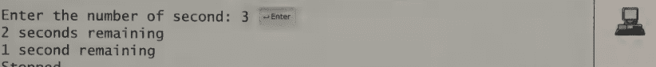

## 4.42** （蒙特卡洛模拟：时钟倒计时）

一个正方形被分为四个较小的区域，如图 (a) 所示。如果你向正方形内投掷 1000000 次飞镖，石头落在奇数区域的概率是多少？编写一个程序来模拟该过程并显示结果。

> 提示：将正方形中心放在坐标系的中心，如 (b) 所示。在正方形内随机生成一个点，并统计点落在奇数区域的次数。

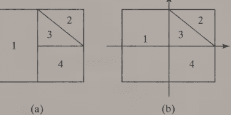

# 第 5 章 函数基础

## 目标

- 定义函数 (§5.2)。
- 调用有返回值函数 (§5.3)。
- 调用 `void` 函数 (§5.4)。
- 传递参数 (§5.5)。
- 开发模块化、易读、易调试且易于维护的可重用代码 (§5.6)。
- 使用函数重载并理解歧义重载 (§5.7)。
- 使用函数原型用于函数头 (§5.8)。
- 创建头文件以重用函数 (§5.9)。
- 将函数头与实现分离 (§5.10)。
- 开发生成随机字符的函数 (§5.11)。
- 使用 C++ 数学函数开发应用程序 (§5.12)。
- 使用 C++ 字符函数开发应用程序 (§5.13)。


## 5.1 引言

为什么需要函数？

函数是一种将语句组合在一起以执行任务的结构。使用函数，你可以编写一次代码在程序中执行该任务，并在许多其他程序中重用。例如，你经常需要找到两个数中的较大值。为了执行此操作，你必须编写以下代码：

```cpp
int result;

if (num1 > num2)
    result = num1;
else
    result = num2;
```

如果你定义一个函数来执行此任务，就不需要重复编写相同的代码。你只需定义一次然后在其他程序中重用它。

函数是执行操作的语句集合。在前面的章节中，你学习了如 `pow(a, b)`、`rand()`、`srand(seed)`、`time(0)` 和 `main()` 等函数。当调用 `pow(a, b)` 函数时，系统实际上执行函数中的语句并返回结果。在本章中，你将学习如何创建函数并应用函数抽象来解决复杂问题。

## 5.2 定义函数

定义函数的语法如下：

```cpp
returnTypeName function(list of parameters)
{
    // Function body;
}
```

让我们看一个用于查找整数中哪个更大的函数。这个函数 `max` 有两个 `int` 参数 `num1` 和 `num2`，函数返回其中较大的那一个。图 5.1 标识了该函数的组件。

| 返回值类型 | 函数名 | 形式参数 | | |
| :--- | :--- | :--- | :--- | :--- |
| 头 | `int max(int num1, int num2)` | | | |
| | | `int result;` | 参数列表 |
| 体 | | `if (num1 > num2) result = num1; else result = num2;` | 函数签名 |
| | `return result;` | | |

**图 5.1** 你可以定义一个函数并使用参数调用它。

函数指定了函数的返回类型、函数名和参数。

函数可以返回一个值。`returnTypeValue` 是值的数据类型。某些函数执行所需的操作但不返回值。在这种情况下，`returnType` 是关键字 `void`。例如，`srand` 函数中的 `returnValue` 是 `void`。返回值的函数称为有返回值函数，不返回值的函数称为 `void` 函数。

在函数头中声明的变量称为形式参数。参数就像占位符。当函数被调用时，你将一个值传递给参数。这个值称为实际参数或参数。参数列表指的是函数的类型、顺序和数量。函数名和参数列表共同构成函数签名。参数是可选的；也就是说，函数可以不包含参数。例如，`rand()` 函数没有参数。

函数体包含定义函数所执行内容的语句集合。`max` 的函数体使用 `if` 语句来确定哪个数较大并返回该值。有返回值函数需要一个使用 `return` 关键字的 `return` 语句来返回结果。当执行 `return` 语句时，函数终止。

有返回值函数

`void` 函数

参数 参数

参数列表

函数签名

> 注意
> 在函数头中，形式参数需要数据类型。例如，`max(int num1, int num2)` 是正确的，而 `max(num1, num2)` 是错误的。

> 注意
> 我们说“定义”是为了执行操作。在函数中，你需要为数据分配内存。例如，`define` 指明了函数是什么。`define` 关键字分配了内存。

定义 声明

## 5.3 调用函数

在使用函数时，你需要调用它。为了使用函数，你必须调用它。调用方式取决于函数是否返回返回值。如果函数返回返回值，调用者通常忽略它。例如：

```cpp
max(i, j);
```

> 注意
> 有返回值函数也可以被调用。在这种情况下，调用者并不关心返回值。

当程序调用函数时，控制权转移到被用的函数。当执行 `return` 语句或遇到函数结束时，被用的函数返回给调用者。列表 5.1 展示了一个用于测试 `max` 函数的完整程序。

```
max(3, 4);
```

```cpp
max(3, 4);
```

# 第 5 章 函数基础


视频说明

`max` 函数

# 列表 5.1 TestMax.cpp

```cpp
#include <iostream>
using namespace std;

// 返回两个数中的较大值
int max(int num1, int num2)
{
    int result;
    if (num1 > num2)
        result = num1;
    else
        result = num2;
    return result;
}

int main() {
    int i = 5;
    int j = 2;
    int k = max(i, j);
    cout << "The maximum between " << i
         << " and " << j << " is " << k << endl;
    return 0;
}
```

`max` 函数

主函数

调用 `max`


> 5 和 2 之间的最大值是 5

| 行号 | i | j | k | num1 | num2 | result |
|---|---|---|---|---|---|---|
| 18 | 5 | | | | | |
| 19 | | 2 | | | | |
| 20 | | | 5 | | 2 | |
| 6 | | | | | | undefined |
| 9 | | | | | 5 | |
| 20 | | | 5 | | | |

主函数

函数的顺序

`max` 函数

此程序包含了 `max` 函数和 `main` 函数。后者与任何其他函数一样，只不过是由操作系统调用以执行程序。
函数必须在调用之前定义。由于 `max` 函数是由 `main` 函数调用的，因此它必须在 `main` 函数之前定义。
当 `max` 函数被调用时（第 20 行），`i` 的值 5 被传递给 `num1`，变量 `j` 的值 2 被传递给 `max` 函数中的 `num2`。控制流转移到 `max` 函数。执行 `max` 函数。当执行 `return` 语句时，`max` 函数返回给调用者（在这种情况下调用者是 `main` 函数）。这一过程如图 5.2 所示。

## 5.4 void Functions

```cpp
int main() {

    int i = 5;

    int j = 2;

    int k = max(i, j);

    cout << "The maximum between " << i << " and " << j << " is " << k << std::endl;

    return 0;

}

int max(int num1, int num2) {

    int result;

    if (num1 > num2)

        result = num1;

    else

        result = num2;

    return result;

}
```

图 5.2 当调用 `max` 函数时，控制流转移到 `max` 函数。一旦 `max` 函数执行完毕，它会将控制权返回给调用者。

### 5.3.1 调用栈 (Call Stacks)

每当调用函数时，系统都会将其参数和变量存储在内存的一个区域，称为栈（stack），它以后进先出的的方式存储元素。当一个函数调用另一个函数时，调用者的栈空间保持完好，并创建一个新空间来处理新的函数调用。当函数结束时，它会返回到调用者，并释放其关联空间。

理解调用栈有助于理解函数是如何调用的。`main` 函数中定义的变量有 `i`、`j` 和 `k`。`max` 函数中定义的变量有 `num1`、`num2` 和 `result`。变量 `num1` 和 `num2` 定义在函数签名中，是函数的参数。它们的值通过函数调用传递。图 5.3 展示了栈中的变量。

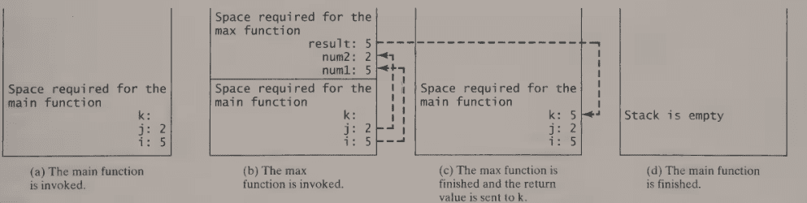

图 5.3 当调用 `max` 函数时，控制流转移到 `max` 函数。一旦 `max` 函数执行完毕，它会将控制权返回给调用者。

> 提示
> 如果你使用 Visual C++，请参考附录中的补充录 II.B，“《使用 Visual C++NET 有效学习 C++》”。它展示了如何使用调试器来跟踪函数。

## 5.4 void Functions

前一节提供了一个返回值函数的示例。本节将展示如何定义和调用函数。列表 5.2 提供了一个程序，它定义了一个名为 `printGrade` 的函数，并调用它来打印给定分数的等级。

### LISTING 5.2 TestVoidFunction.cpp

视频笔记
`void` 函数 vs. 返回值函数

```cpp
1 #include <iostream>
2 using namespace std;
3 
4 // 为分数打印等级
5 void printGrade(double score)
6 {
7 if (score >= 90.0)
8 cout << 'A';
9 else if (score >= 80.0)
10 cout << 'B';
11 else if (score >= 70.0)
12 cout << 'C';
13 else if (score >= 60.0)
14 cout << 'D';
15 else
16 cout << 'F';
17}
```

`printGrade` 函数

```cpp
19 int main()
20 {
21 cout << "Enter a score: ";
22 double score;
23 cin >> score;
24
25 cout << "The grade is ";
26 printGrade(score);
27
28 return 0;
29 }
```

`main` 函数

调用 `printGrade`


`printGrade` 函数是一个 `void` 函数。它不返回任何值。`void` 函数的调用必须是一个语句。因此，它在 `main` 函数的第 26 行作为语句被调用。像任何 C++ 语句一样，它以分号结束。

调用 `void` 函数

`void` 函数中的 `return`

> 注意
> `void` 函数不需要 `return` 语句，但它可以用于终止函数并将控制权返回给函数的调用者。语法如下：
> `return;`

这种做法虽然罕见，但有时用于中断 `void` 函数的控制流。例如，当分数无效时，以下代码使用 `return` 语句来终止函数。

```cpp
// 为分数打印等级
void printGrade(double score)
{
if (score < 0 || score > 100)
{
cout << "Invalid score";
return;
}

if (score >= 90.0)
cout << 'A';
else if (score >= 80.0)
cout << 'B';
else if (score >= 70.0)
cout << 'C';
else if (score >= 60.0)
cout << 'D';
```


`else`

`cout 'F';`

为了查看 `void` 函数和返回值函数的区别，我们重新设计了 `printGrade` 函数使其返回一个值。如列表 5.3 所示，我们使用了 `getGrade`。

### LISTING 5.3 TestReturnFunction.cpp

```cpp
#include <iostream>

using namespace std;

// 为分数返回等级
char getGrade(double score)
{
    if (score >= 90.0)
        return 'A';
    else if (score >= 80.0)
        return 'B';
    else if (score >= 70.0)
        return 'C';
    else if (score >= 60.0)
        return 'D';
    else
        return 'F';
}

int main()
{
    cout << "Enter a score: ";
    double score;
    cin >> score;

    cout << "The grade is: ";
    cout << getGrade(score) << endl;

    return 0;
}
```

> 视频笔记
> - `void` 函数 vs. 返回值函数
> - `getGrade` 函数
> - `main` 函数
> - 调用 `getGrade`


第 5-17 行定义的 `getGrade` 函数根据分数返回一个字符。调用者在第 26 行调用此函数。`printGrade` 函数可以在任何字符出现的地方调用。它不返回任何值，必须作为语句调用。

## 5.5 传递参数

函数的威力在于它处理参数的能力。可以使用任何两个值之间的最大值。调用函数时，需要提供参数，且必须与相应的参数顺序一致。这被称为参数关联。

**参数顺序**

```cpp
void militari(char ch, int n)
  for (int i = 0; i < n; i++)
    cout << ch;
```

你可以使用 `printf('a', 3)` 打印三次 `'a'`。`printf('a', 3)` 将实际字符 `'a'` 传递给参数 `ch`，将 `3` 传递给 `n`，并打印三次 `'a'`。然而，`printf(3, 'a')` 语句的含义不同。它将 `3` 传递给 `ch`，将 `'a'` 传递给 `n`。

> 注意
> 参数必须匹配函数签名中定义的顺序和兼容类型。兼容类型意味着你可以无需显式类型转换将参数传递给参数，例如将 `int` 传递给 `double`。

## 5.6 代码模块化

函数可以减少冗代码并实现代码重用。函数还可以用于代码模块化并提高程序质量。

列表 4.8 `GreatestDiv.cpp` 提供了一个程序，提示用户输入两个整数并显示的最大约数。你可以如 5.4 所示使用函数重写该程序。

### LISTING 5.4 GreatestCommonDenominatorFunction.cpp


```cpp
#include <iostream>

using namespace std;

/* 返回两个整数的最大公约数 */
int gcd(int n1, int n2) {
  int gcd = 1; // 初始 gcd 为 1
  int k = 2;   // 可能的 gcd

  while (k <= n1 && k <= n2) {
    if (n1 % k == 0 && n2 % k == 0)
      gcd = k; // 更新 gcd
    k++;
  }

  return gcd; // 返回 gcd
}

int main() {
  // 提示用户输入整数
  cout << "Enter first integer: ";
```

**模块化代码**

计算 `gcd`，返回 `gcd`

```cpp
24 int n1;
25 cin >> n1;
26
27 cout << "Enter second integer: ";
28 int n2;
29 cin >> n2;
30
31 cout << "The greatest common divisor for " << n1 << "\""
32      << " and " << n2 << " is " << gcd(n1, n2);
33
34 return 0;
35 }
```

调用 `gcd`

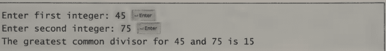

通过将获取 `gcd` 代码封装在函数中，此程序具有多个优点：

1. 它将计算 `gcd` 的问题与主函数中的其他代码隔离开。因此，逻辑变得清晰，程序更容易阅读。
2. 计算 `gcd` 的错误位于 `gcd` 函数中，这缩小了调试范围。
3. `gcd` 函数现在可以被其他程序重用。

列表 5.5 应用代码模块化的概念改进了列表 4.14 `PrimeNumber.cpp`。程序定义了两个函数 `isPrime` 和 `printPrimeNumbers`。`isPrime` 函数检查数字是否为质数，`printPrimeNumbers` 函数打印质数。

### LISTING 5.5 PrimeNumberFunction.cpp

```cpp
#include <iostream>
#include <iomanip>

using namespace std;

/* 检查是否为质数 */
bool isPrime(int number)
{
  for (int divisor = 2; divisor <= number / 2; divisor++)
  {
    if (number % divisor == 0)
    {
      // 如果为真，则不是质数
      return false; // 不是质数
    }
  }

  return true; // 是质数
}

void printPrimeNumbers(int numberOfPrimes)
{
  const int NUMBER_OF_PRIMES = 50; // 要显示的质数数量
```

`isPrime` 函数
`printPrimeNumbers` 函数

## 第 5 章 函数基础

```cpp
  const NUMBER_OF_PRIMES_PER_LINE = 10; // 每行显示10个
  int count = 0; // 统计质数的个数
  int number = 2; // 等待测试是否为质数的数字

  // 寻找质数
  while (count < numberOfPrimes) {
    // 打印数字并增加计数
    if (isPrime(number)) {
      count++; // 增加计数

      if (count % NUMBER_OF_PRIMES_PER_LINE == 0) {
        // 打印数字并进到新行
        cout << setw(4) << number << endl;
      } else {
        cout << setw(4) << number << " ";
      }
    }

    // 检查下一个数字是否为质数
    number++;
  }
}

int main() {
  cout << "前几个质数是 \n";
  printPrimeNumbers();

  return 0;
}
```

前几个质数是 2 3 5 7 11 13 17 19 23 29 31 37 41 43 47 53 59 61 67 71 73 79 89 97 101 103 107 109 113 127 131 137 139 149 151 157 163 167 173 179 181 191 193 197 199

我们将一个大问题拆分为多个子问题。结果是，新程序更容易阅读和调试。此外，`printPrimeNumbers` 和 `isPrime` 函数可以被其他程序重用。

*(注：原文后续内容高度重复且混乱，此处已提取核心逻辑进行翻译)*

## 5.7 函数重载

之前使用的 `max` 函数仅对 `int` 起效。但如果你需要确定哪一个浮点数更大呢？解决方案是创建一个具有相同名称但不同参数的函数，如下所示：

```cpp
double max(double num1, double num2) {
  if (num1 > num2)
    return num1;
  else
    return num2;
}
```


如果你使用 `int` 参数调用 `max`，则期望 `int` 的函数会被调用；如果你使用 `double` 参数调用 `max`，则调用 `double` 的函数，这被称为**函数重载**；即在一个文件中，两个函数具有相同的名称但不同的参数列表。C++ 编译器根据函数签名来确定使用哪一个函数。

列表 5.6 是一个创建三个函数的程序。第一个寻找最大的整数，第二个寻找最大的双精度浮，第三个在三个双精度值之间寻找最大值。这三个函数都命名为 `max`。

### 列表 5.6 TestFunctionOverloading.cpp

```cpp
#include <iostream>

using namespace std;

// 返回两个值之间的最大值
int max(int num1, int num2) {
  if (num1 > num2)
    return num1;
  else
    return num2;
}

// 寻找两个双精度值之间的最大值
double max(double num1, double num2) {
  if (num1 > num2)
    return num1;
  else
    return num2;
}

// 返回三个双精度值中的最大值
double max(double num1, double num2, double num3) {
  return max(max(num1, num2), num3);
}

int main() {
  // 使用 int 参数调用 max 函数
  cout << "3 和 4 之间的最大值是 " << max(3, 4) << endl;

  // 使用 double 参数调用 max 函数
  cout << "3.0 和 5.4 之间的最大值是 " << max(3.0, 5.4) << endl;

  // 使用三个 double 参数调用 max 函数
  cout << "3.0, 5.4 和 10.14 之间的最大值是 " << max(max(3.0, 5.4), 10.14) << endl;

  return 0;
}
```

当调用 `max(3, 4)`（第 31 行）时，调用寻找两个整数的 `max` 函数。调用 `max(3.0, 5.4)`（第 35 行）时，调用寻找两个 `double` 的 `max` 函数。调用 `max(3.0, 5.4, 10.14)`（第 39 行）时，调用寻找三个 `double` 值中最大值的 `max` 函数。

你可以用一个 `int` 值和一个 `double` 值调用函数吗，例如 `max(2, 2.5)`？如果可以，会调用哪一个 `max` 函数？第一个问题的答案是肯定的。第二个问题的答案是会调用寻找两个 `double` 值之间最大值的 `max` 函数。参数值 `2` 会自动转换为 `double` 值并传递给该函数。

你可能会奇怪为什么在调用 `max(3, 4)` 时没有调用 `max(double, double)` 函数。`max(double, double)` 和 `max(int, int)` 都是 `max(3, 4)` 的可能匹配。C++ 编译器会为函数调用寻找最具体的函数。因为函数 `max(int, int)` 比 `max(double, double)` 更具体。

## 5.8 函数声明

在函数被调用之前，它必须被定义。确保此点的一种方法是在调用之前定义函数。另一种方法是使用**函数声明**。函数声明告诉编译器函数的名称、返回类型、参数数量以及每个参数的类型。在声明中，你不需要列出参数名称，只需列出类型。

```cpp
int max(int, int);
double max(double, double);
double max(double, double, double);
```

## 5.9 函数重用

函数的一个用处是可以重用。在前面的章节中，你在同一个程序定义并使用函数。为了让其他程序可以使用，你需要将函数放在单独的文件，称为头文件。根据惯例，该文件具有 `.h` 扩展名。程序使用 `#include` 预处理器指令包含头文件，以便重用文件中定义的函数。

列表 5.8 创建了一个头文件 `MyLib.h`。该文件定义了一个函数 `isEven(number)`，如果数字是偶数则返回 `true`。

```cpp
bool isEven(int number) {
  return (number % 2 == 0);
}
```

列表 5.9 创建了一个命名文件 `UseMyLib.cpp`。该文件包含一个 `main` 函数用于测试 `isEven` 函数。

```cpp
#include <iostream>
#include "MyLib.h"

using namespace std;

int main() {
  cout << (isEven(4) ? "true" : "false") << endl;
  cout << (isEven(5) ? "true" : "false") << endl;

  return 0;
}
```

## 5.11 案例研究：生成随机字符

头文件可以放在磁盘上的任何位置。例如，如果将 `MyLib.h` 放在 Windows 的 `c:\` 根目录下，你可以使用绝对文件路径来包含它：

```cpp
#include "c:\MyLib.h"
```

这使得你的代码依赖于 Windows 系统。为了解决这个问题，你可以将头文件放在与程序相同的目录下，或者通过使用 `-I` 选项编译程序来指定位置：

```bash
g++ MyLib.cpp -I . -o Main
```

头文件的设计初衷是为了重用。由于一个程序不能有两个 `main` 函数，因此你不应该在头文件中编写 `main` 函数。

### 5.10 分离头文件与实现

如果你是软件供应商并希望向客户隐藏源代码，可以将头文件和实现分离到两个文件中。头文件列出所有的函数原型，实现文件负责实现这些函数。两个文件应该相同名称，但头文件使用 `.h` 扩展，实现文件使用 `.cpp` 扩展，如 5.10 和 5.11 所示。

# 列表 5.10 MyLib.h

```cpp
bool isEven(int number);
```

# 列表 5.11 MyLib.cpp

```cpp
bool isEven(int number) {
  return (number % 2 == 0);
}
```

为了让客户端使用 `MyLib`，你只需要提供头文件和从 `MyLib.cpp` 生成的对象代码。这保护了软件供应商的知识产权。

### 5.11 案例研究：生成随机字符

计算机程序处理数值数据。理解字符以及如何处理它们同样重要。本节提供了一个生成随机字符的示例。正如前面的章节中所学到的，每个字符都有一个 0 到 127 之间的唯一 ASCII 码。生成随机字符就是生成一个 `a` 到 `a + b` 之间的随机整数。回想你可以使用 `srand(seed)` 函数设置种子，并使用 `rand()` 返回随机整数。你可以用它编写一个简单的表达式来生成任何范围内的随机数。通常：

```cpp
a + rand() % (b - a + 1)
```

因此，你可以使用以下表达式生成 `a` 到 `a + b` 之间的随机整数。现在考虑如何生成小写字母。小写字母的 ASCII 码是连续的整数，从 `'a'` 的码开始，然后是 `'b'`、`'c'`、……`'z'`。`'a'` 的码是：

```cpp
static_cast<int>('a') + rand() % (static_cast<int>('z') - static_cast<int>('a') + 1)
```

正如 5.10 中讨论的，所有的数值运算符都可以应用于 `char` 操作数。如果另一个操作数是字符，那么 `char` 操作数就是一个数字。因此，该表达式可以简化如下：

```cpp
static_cast<char>('a' + rand() % (static_cast<int>('z') - static_cast<int>('a') + 1))
```

泛化上述讨论，任意两个字符 `ch1` 和 `ch2`（满足 `ch1 < ch2`）之间的随机字符可以通过以下方式生成：


这是一个简单的发现。在 5.12 中，我们创建一个名为 `RandomCharacter.h` 的头文件，其中包含五个重载函数用于随机获取特定类型的字符。你可以在未来的项目中使用这些函数。

# 列表 5.12 RandomCharacter.h

```cpp
#include <cstdlib>

using namespace std;
```


// 生成 `ch1` 和 `ch2` 之间的随机字符

```cpp
char getRandomCharacter(char ch1, char ch2) {
    return static_cast<char>(ch1 + rand() % (ch2 - ch1 + 1));
}
```

// 生成一个随机小写字母

```cpp
char getRandomLowerCaseLetter() {
    return getRandomCharacter('a', 'z');
}
```

// 生成一个随机大写字母

```cpp
char getRandomUpperCaseLetter() {
    return getRandomCharacter('A', 'Z');
}
```

// 生成一个随机数字

```cpp
char getRandomDigitCharacter() {
    return getRandomCharacter('0', '9');
}
```

// 生成一个随机字符

```cpp
char getRandomCharacter() {
    return getRandomCharacter(0, 127);
}
```

列表 5.13 是一个显示 100 个随机小写字母的测试程序。

## 列表 5.13 `TestRandomCharacter.cpp`

```cpp
#include <iostream>
#include "RandomCharacter.h"
using namespace std;

int main() {
    const int NUMBER_OF_CHARS = 100;
    const int CHARS_PER_LINE = 25;

    srand(time(0)); // 为随机函数设置新种子

    // 打印 'a' 到 'z' 之间的随机字符，每行 25 个
    for (int i = 0; i < NUMBER_OF_CHARS; i++) {
        char ch = getRandomLowerCaseLetter();
        if ((i + 1) % CHARS_PER_LINE == 0)
            cout << ch << endl;
        else
            cout << ch << ' ';
    }

    return 0;
}
```

## 5.12 数学函数

| 函数 | 说明 | 示例 |
|---|---|---|
| `abs(x)` | 返回 `x` 的绝对值 | `abs(-2)` |
| `ceil(x)` | 向上取整到最近的整数 | `ceil(2.1)` |
| `floor(x)` | 向下取整到最近的整数 | `floor(2.1)` |
| `exp(x)` | 返回 `x` 的指数函数 (`e^x`) | `exp(1)` |
| `pow(x, y)` | 返回 `x` 的 `y` 次方 | `pow(2, 3)` |
| `log(x)` | 返回 `x` 的自然对数 | `log(2.718)` |
| `log10(x)` | 返回 `x` 的以 10 为底的对数 | `log10(10.0)` |
| `sqrt(x)` | 返回 `x` 的平方根 | `sqrt(4.0)` |

## 5.13 字符函数

```cpp
cout << "pow(2.5, 2.5) " << pow(2.5, 2.5) << endl;
return 0;
```

```
sin(PI / 2) = 1
cos(PI / 2) = 1.32679e-06
tan(PI / 2) = 753696
exp(1.0) = 2.71828
log10(10.0) = 1
sqrt(4.0) = 2
pow(2.5, 2.5) = 9.88212
```


### 注意事项

数学函数在 `<cmath>` 头文件中被重载。例如，`sin` 有三个重载函数：

- `float sin(float)`
- `double sin(double)`
- `long double sin(long double)`

如果你调用 `sin(2)`，将得到一个歧义重载错误，因为编译器无法判断为 `int` 参数匹配哪一个函数。

歧义重载

## 5.13 字符函数

C++ 在 `<cctype>` 头文件中提供了几个测试字符的函数，如表 5.2 所示。这些函数测试单个字符并返回 `true` 或 `false`。注意，它们实际上返回的是一个 `int` 值。非零整数表示 `true`，零表示 `false`。C++ 提供了两个用于转换大小写的函数，如表 5.3 所示。

| 函数 | 描述 | 示例 |
|---|---|---|
| `isdigit(c)` | 如果 `c` 是数字，则返回 `true`。 | `isdigit('7')` 为 `true`, `isdigit('A')` 为 `false` |
| `alpha(c)` | 如果 `c` 是字母，则返回 `true`。 | `alpha('7')` 为 `false`, `alpha('A')` 为 `true` |
| `isalnum(c)` | 如果 `c` 是字母或数字，则返回 `true`。 | `isalnum('7')` 为 `true`, `isalnum('A')` 为 `true` |
| `islower(c)` | 如果 `c` 是小写字母，则返回 `true`。 | `islower('7')` 为 `false`, `islower('A')` 为 `false` |
| `isupper(c)` | 如果 `c` 是大写字母，则返回 `true`。 | `isupper('7')` 为 `false`, `isupper('A')` 为 `true` |
| `isspace(c)` | 如果 `c` 是空白字符，则返回 `true`。 | `isspace('\t')` 为 `true`, `isspace('A')` 为 `false` |
| `isgraph(c)` | 如果 `c` 是除空格外的可打印字符，则返回 `true`。 | `isgraph('7')` 为 `true`, `isgraph('A')` 为 `true` |

174 第 5 章 函数基础

**表 5.2 字符测试函数（续）**

| 函数 | 描述 | 示例 |
| --- | --- | --- |
| `ispunct(c)` | 如果 `c` 是除数字、字母或空格以外的打印字符，则返回 `true`。 | `ispunct('*')` 为 `true`<br>`ispunct(' ')` 为 `true`<br>`ispunct('!')` 为 `false` |
| `iscntrl(c)` | 如果 `c` 是控制字符（如 `'\n'`, `'\f'`, `'\v'`, `'\a'`, 和 `'\b'`），则返回 `true`。 | `iscntrl('\n')` 为 `false`<br>`iscntrl('\t')` 为 `false`<br>`iscntrl('\v')` 为 `true` |

**表 5.3 大小写转换函数**

| 函数 | 描述 | 示例 |
| --- | --- | --- |
| `tolower(c)` | 如果 `c` 是大写字母，返回其等效的小写；否则返回 `c` 本体。 | `tolower('A')` 返回 `'a'`<br>`tolower(' ')` 返回 `' '`<br>`tolower('\t')` 返回 `'\t'` |
| `toupper(c)` | 如果 `c` 是小写字母，返回其等效的大写；否则返回 `c` 本体。 | `toupper('a')` 返回 `'A'`<br>`toupper(' ')` 返回 `' '`<br>`toupper('\t')` 返回 `'\t'` |

列表 5.15 是测试字符函数的程序。

## 5.15 `CharacterFunctions.cpp`

```cpp
1 #include <iostream>
2 #include <cctype>
3 using namespace std;
4
5 int main()
6 {
7 cout << "Enter a character: ";
8 char ch;
9 cin >> ch;
10 cout << "You entered " << ch << endl;
11 if (islower(ch))
12 {
13 cout << "It is a lowercase letter " << endl;
14 cout << "Its equivalent letter is " << static_cast<char>(toupper(ch)) << endl;
15 }
16 else if (isupper(ch))
17 {
18 cout << "It is an uppercase letter " << endl;
19 cout << "Its equivalent letter is " << static_cast<char>(tolower(ch)) << endl;
20 }
21 else if (isdigit(ch))
22 {
23 cout << "It is a digit character " << endl;
24 }
25
26 return 0;
27 }
```

```
Enter a character: a
You entered a
It is a lowercase letter
Its equivalent letter is A
```

```
Enter a character: T
You entered T
It is an uppercase letter
Its equivalent letter is t
```

```
Enter a character: 8
You entered 8
It is a digit character
```

## 关键术语

| 实际参数 | 157 | 函数原型 | 167 |
| 歧义重载 | 166 | 函数签名 | 157 |
| 参数 | 157 | 头文件 | 168 |
| 形式参数（即参数） | 157 | 参数 | 157 |
| 函数 | 156 | 返回类型 | 156 |
| 函数重载 | 165 | 返回值 | 157 |

## 本章总结

1. 使程序模块化和可重用是软件工程的目标之一。
2. 函数可以用于开发模块化和可重用的代码。
3. 函数头指定了*返回值*、*函数名*和*参数*。
4. 函数可以返回一个值。*返回值*是函数返回的数据类型。
5. 如果函数不返回值，则*返回值*是关键字 `void`。
6. *参数列表*指的是参数的类型、顺序。
7. 传递给函数的参数的数量、类型和顺序应与函数定义中的相同。
8. 函数名和参数列表共同构成了*函数签名*。
9. 参数是可选的；也就是说，函数可以不包含参数。
10. 返回值的函数在结束时必须返回一个值。

176 第 5 章 函数基础

1. `return` 语句也可以用于 `void` 函数以终止函数并将控制权返回给调用者。
2. 当程序调用函数时，控制权转移到被调用函数。
3. 被调用函数在执行 `return` 语句或到达函数结束括号时向调用者返回控制权。
4. 返回值的函数在 C++ 中也可以作为语句调用。在这种情况下，调用者忽略返回值。
5. 每每次调用函数，系统都会将其参数、局部变量和系统寄存器存储在称为栈的空间。
6. 当函数调用另一个函数时，调用者的栈空间保持完整，并创建新空间来处理新的函数调用。
7. 当函数完成工作并返回调用者时，其关联空间会被释放。
8. 函数可以重载。这意味着只要参数列表不同，两个函数可以具有相同的名称。
9. 数学函数如 `sin`、`cos`、`pow`、`sqrt`、`exp` 和 `log` 在 `cmath` 头文件中。
10. C++ 在 `<cctype>` 头文件中提供了测试字符和转换字母的实用函数：`isdigit(c)`、`alpha(c)`、`isalnum(c)`、`islower(c)`、`isupper(c)`、`isspace(c)`、`isprint(c)`、`isgraph(c)`、`ispunct(c)` 和 `iscntrl(c)`。

## 复习题

**5.2–5.6 节**

- 使用函数的的好处是什么？如何定义函数？如何调用函数？“定义函数”和“声明变量”之间的细微区别是什么？
- 5.2 `main` 函数的返回类型是什么？
- 5.3 你可以使用条件运算符简化列表 5.1 中的 `max` 函数吗？
- 5.4 正或错？调用返回类型为 `void` 的函数始终是一个语句，但调用返回值的函数始终是表达式的组成部分。
- 5.5 在返回值的函数中写 `return` 语句会有什么问题？你可以在 `void` 函数中拥有 `return` 语句吗，如下所示：

```cpp
void p() {
  int i;
  while (true) {
    // 提示用户输入整数
    cout << "Enter an integer: ";
    cin >> i;
  }
  if (i == 0)
    return;
  cout << "i is " << i << endl;
}
```

以下函数中的 `return` 语句会导致语法错误吗？

```cpp
void p(double x, double y)
{
  cout << x << " " << y << endl;
  return x + y;
}
```

- 5.6 描述参数、参数和函数签名术语。
- 5.7 为以下函数编写头：
    - 给销售金额和佣金率计算销售佣金。
    - 给月份和年份打印日历。
    - 计算平方根。
    - 测试数字是否为偶数，如果是则返回 `true`。
    - 按指定的次数打印一个字符。
    - 给贷款金额、年限和年利率计算每月还款额。
    - 给小写字母找到对应的大写字母。
- 5.8 识别并修正以下程序中的错误：

```cpp
int function1(int n)
{
  cout << n;
}

function2(int n, int m)
{
  n += m;
  function1(3.4);
}
```

**5.7-5.11**

- 5.9 我们可以定义具有相同名称但参数类型不同的函数吗？我们可以在程序中定义具有相同函数名和参数列表但返回值类型不同的函数吗？
- 5.10 下面程序有什么问题？

```cpp
void p(int i)
{
  cout << i << endl;
}

void p(int j)
{
  cout << j << endl;
}
```

**5.12**

- 5.11 正或错？三角函数的参数用弧度表示角度。

## 第5章 函数基础

5.12 编写一个表达式，返回 34 到 55 之间的随机整数。编写一个表达式，返回 0 到 999 之间的随机整数。编写一个表达式，返回一个随机的小写字母。

5.13 如果你将 `sin`、`tan`、`log`、`10`、`pow` 的参数替换为 `int` 值，会发生什么？解释原因。

5.14 假设 `Pi` 为 3.14159，`E` 为 2.71828。计算以下调用：

| A. `sqrt(4.0)` | J. `floor(-2.5)` |
| --- | --- |
| B. `sin(2 * PI)` | K. `abs(-2.5)` |
| C. `cos(2 * PI)` | L. `log10(100.0)` |
| D. `pow(2, 2)` | M. `cos(PI)` |
| E. `log(E)` | N. `ceil(2.5)` |
| F. `exp(1.0)` | O. `floor(2.5)` |
| G. `max(2, min(3, 4))` | P. `pow(2.0, 4)` |
| H. `fmod(2.5, 2.3)` | Q. `fmod(4.2, 3.5)` |
| I. `ceil(-2.5)` | R. `ceil(abs(-2.5))` |

## 5.13 节

5.15 你使用哪个函数来测试一个字符是否为数字？字母？小写字母（大写字母）？数字或字母？

5.16 你使用哪个函数将字母转换为小写或大写？

## 编程练习

## 5.2–5.11 节

**5.1（数学：五角形数）** 五角数定义为 $n(3n-1)/2$，其中 $n=1, 2, \dots$。因此，前几个数字是 1, 5, 12, 22, .... 编写以下返回五角数的函数：

```cpp
int getPentagonalNumber(int n)
```

编写一个测试程序，每行显示 10 个，显示前 10 个五角数。

**5.2\*（计算整数各位数字的和）** 编写一个计算整数各位数字之和的函数。使用以下函数头：

```cpp
int sumDigits(long n)
```

例如，`sumDigits(234)` 返回 $2+3+4=9$。编写一个测试程序，提示用户输入整数并显示其所有数字。

> 提示：使用 `%` 运算符提取数字，使用 `/` 移除已提取的数字。例如，要从 234 中提取 4，使用 `234 % 10` (=4)。要从 234 中移除 4，使用 `234 / 10` (=23)。使用循环反复提取并移除数字，直到所有数字都被提取完毕。

**5.3\*（反转显示整数）** 编写以下函数以反序显示整数：

```cpp
void reverse(int number)
```

例如，`reverse(3456)` 显示 6543。编写一个测试程序，提示用户输入整数并显示其反转结果。

## 编程练习 179

**5.4\*\*（返回反转整数）** 编写以下函数返回反转后的整数：

```cpp
int reverse(int number)
```

例如，`reverse(3456)` 返回 6543。编写一个测试程序，提示用户输入整数并显示其反转结果。

**5.5\*（回文数）** 如果一个正整数的反转与其本身相同，则该整数为回文数。编写以下函数检查一个整数是否为回文数：

```cpp
bool isPalindrome(int number)
```

例如，`isPalindrome(53435)` 返回 `true`。编写一个测试程序，提示用户输入整数并报告该整数是否为回文数。

**5.6\*（显示模式）** 编写以下函数显示一个模式：


## 5.7 摄氏度和华氏度之间的转换

编写一个包含两个函数的头文件：

```cpp
/* 将摄氏度转换为华氏度 */
double celsiusToFahrenheit(double celsius)

/* 将华氏度转换为摄氏度 */
double fahrenheitToCelsius(double fahrenheit)
```

转换公式为：

$fahrenheit = (9.0 / 5) * celsius + 32$

实现该头文件并编写一个测试程序，调用这些函数显示以下表格：

| 摄氏度 | 华氏度 | 摄氏度 |
| --- | --- | --- |
| 40.0 | 104.0 | 48.89 |
| 39.0 | 102.2 | 43.33 |
| ... | ... | ... |
| 32.0 | 89.6 | 40.0 4.44 |
| 31.0 | 87.8 | 30.0 -1.11 |

## 5.8 英尺和米之间的转换

编写一个包含两个函数的头文件：

```cpp
/* 将英尺转换为米 */
double footToMeter(double foot)

/* 将米转换为英尺 */
double meterToFoot(double meter)
```

转换公式为：

$meter = 0.305 * foot$

实现该头文件并编写一个测试程序，调用这些函数显示以下表格：

| 英尺 | 米 | 英尺 |
| --- | --- | --- |
| 1.0 | 0.305 | 3.28 |
| 2.0 | 0.61 | 6.56 |
| ... | ... | ... |
| 9.0 | 2.7 | 2.7 |
| 10.0 | 3.05 | 3.1 |

## 5.9 使用 `isPrime`

使用 5.5，`Prime.cpp`，使用 `isPrime(int number)` 测试一个数是否为质数。

## 5.10 财务应用：计算税金

使用 5.4，`Compute.cpp`，编写一个计算税金的函数。头文件如下：

```cpp
double computeCommission(double salesAmount)
```

编写测试程序显示以下表格：

| 销售额 | 税金 |
| --- | --- |
| 10000 | 900.0 |
| 15000 | 1500.0 |
| ... | ... |
| 95000 | 9500.0 |
| 100000 | 10000.0 |

## 5.11 显示字符

编写一个函数打印字符，头文件如下：

```cpp
void printChars(char ch1, char ch2, int numberPerLine)
```

该函数打印 `ch1` 到 `ch2` 之间的字符，每行 `numberPerLine` 个。编写一个测试程序打印 `'A'` 到 `'Z'`。

## 5.12* 求和

编写一个函数计算以下序列：

```cpp
double sumSeries(int i)
```

编写一个测试程序显示以下表格：

| 数字 | 平方根 |
| --- | --- |
| 0 | 0.0000 |
| 2 | 1.4142 |
| ... | ... |
| 18 | 4.2426 |
| 20 | 4.4721 |

## 5.13* 求和

编写一个函数计算以下序列：

```cpp
double sumSeries(int i)
```

## 5.14* 财务应用：打印税额

使用 3.4，`Tax.cpp`，编写一个计算税额的函数。头文件如下：

```cpp
double computeTax(int status, double taxableIncome)
```

编写一个测试程序，打印从 $50,000 到 $60,000 之间、每 $50 一个间隔、所有状态的税额表，如下：

| 纳税收入 | 单身 | 夫妻共同 | 户主 |
| --- | --- | --- | --- |
| 50000 | 9846 | 7296 | 10398 |
| 50050 | 9860 | 7310 | 10412 |
| ... | ... | ... | ... |
| 59950 | 12533 | 9983 | 13190 |
| 60000 | 12546 | 9996 | 13205 |

## 5.15 年的天数

编写一个返回每年天数的函数，头文件如下：

```cpp
int numberOfDaysInYear(int year)
```

编写一个测试程序显示 2000 到 2010 年的天数。

## 5.16 显示 0 和 1 矩阵

编写一个函数显示 $n \times n$ 矩阵，头文件如下：

```cpp
void printMatrix(int n)
```

每个元素是随机生成的 0 或 1。编写一个测试程序打印 $3 \times 3$ 的矩阵，可能如下：

```
0 1 0
0 0 0
1 1 1
```

## 5.17 生成随机字符

使用 5.12 `RandomCharacter.h` 中定义的函数打印 100 个大写字母和 100 个单数字，每行十个。

## 5.18 使用 `sqrt` 函数

编写一个程序，使用 `sqrt` 函数打印以下表格：

| 数字 | 平方根 |
| --- | --- |
| 0 | 0.0000 |
| 2 | 1.4142 |
| ... | ... |
| 18 | 4.2426 |
| 20 | 4.4721 |

## 5.19 Triangle 头文件

创建一个名为 `MyTriangle.h` 的头文件，包含以下函数：

```cpp
/* 如果任意两边之和大于第三边，则返回 true。 **/
bool isValid(double side1, double side2, double side3)
```

```cpp
/* 返回三角形的面积。 **/
double area(double side1, double side2, double side3)
```

计算面积的公式在练习 2.19 中。实现该头文件并编写一个测试程序，读取三角形的三条边，如果输入有效则计算输出。否则，显示输入无效。

# 第 5 章 函数基础

## 使用三角函数

打印下表，显示从 0 到 360 度、增量为 10 度的 `sin` 值和 `cos` 值。将数值保留小数点后四位。

| 度数 | Sin | Cos |
| --- | --- | --- |
| 0 | 0.0000 | 1.0000 |
| 10 | 0.1736 | 0.9848 |
| ... | ... | ... |
| 350 | -0.1736 | 0.9848 |
| 360 | 0.0000 | 1.0000 |

## 金融应用：计算平均值和标准差

在业务应用中，你被要求计算数据的平均值和标准差。标准差是一种统计量，用于说明一组中所有数据围绕平均值的紧密程度。例如，一个班级学生的平均年龄是多少？如果所有学生的年龄相同，则标准差为 0。编写一个程序，提示用户输入 10 个数字，并使用以下方法计算这些数字的平均值和标准差：

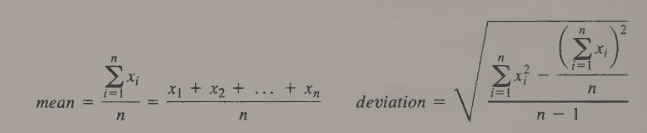

以下是示例运行：


## 金融应用：计算未来投资价值

编写一个函数，计算给定利率下指定年限的未来投资价值。未来价值根据练习 2.11 中的公式确定。使用以下函数头：

```cpp
double futureInvestmentValue(
    double investmentAmount, double monthlyInterestRate, int years)
```

例如，`futureInvestmentValue(10000, 0.05/12, 5)` 返回 12833.59。

编写一个测试程序，提示用户输入投资金额（例如 1000）和利率（例如 9%），并打印一个显示 1 到 30 年未来价值的表格，如下所示：

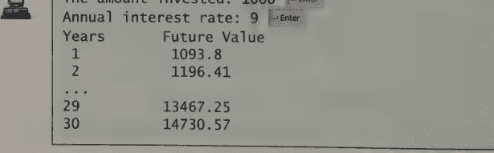

# 第 6 章 高级函数特性

## 目标

- 通过按值传递参数 (§6.2)。
- 通过按引用传递参数 (§6.3)。
- 理解按值传递和按引用传递的区别 (§6.2–6.3)。
- 声明 `const` 参数以防止参数被意外修改 (§6.4)。
- 确定局部变量和全局变量的作用域 (§6.5)。
- 使用内联函数提高短函数的运行时效率 (§6.6)。
- 定义带有默认参数的函数 (§6.7)。
- 使用步步细化方法设计并实现函数 (§6.8)。


## 6.1 引言

在前一章中，你学习了如何定义和调用函数，如何使用数学函数和字符函数。本章涵盖了函数的头文件，以及如何使用关于按值传递、按引用传递、常量参数、全局和静态变量、内联函数、默认参数以及使用函数进行步步细化的程序设计等高级主题。

## 6.2 按值传递参数

当你像前一章描述的调用带有参数的函数时，参数的值会被传递给参数。这被称为按值传递。如果参数是一个变量而不是字面量，则变量的值会被传递给参数。无论函数内部对参数进行了什么修改，该变量都不会受到影响。如列表 6.1 所示，`x` 的值 (1) 被传递给参数 `n` 以调用递增函数（第 14 行）。`x` 在函数中（第 6 行）增加了 1，但无论函数如何操作，`x` 都不会改变。

按值传递

列表 6.1 `Increment.cpp`

```cpp
#include <iostream>
using namespace std;
void increment(int n)
{
    n++;
    cout << "\tn inside the function is " << n << endl;
}
int main()
{
    int x = 1;
    cout << "Before the call, x is " << x << endl;
    increment(x);
    cout << "after the call, x is " << x << endl;
    return 0;
}
```

调用 `increment` 后，`x` 是 1。函数内部 `n` 是 2。调用后，`x` 是 1。

## 6.3 按引用传递参数

按值传递有严重的局限性。列表 6.2 说明了这些局限性。程序创建了一个用于交换两个变量的函数。通过传递两个参数来调用 `swap` 函数。然而，在函数调用后，参数的值并没有发生改变。

按值传递的局限性

列表 6.2 `TestPassByValue.cpp`

```cpp
#include <iostream>
using namespace std;
```


按值传递 vs. 按引用传递

尝试交换变量无效！

```cpp
void swap(int n1, int n2)
{
    cout << "\tinside the swap function" << endl;
    cout << "\tBefore swapping n1 is " << n1 << endl;
    cout << "\tn2 is " << n2 << endl;

    // 交换 n1 和 n2
    int temp = n1;
    n1 = n2;
    n2 = temp;

    cout << "\tAfter swapping n1 is " << n1 << endl;
}

int main()
{
    // 声明并初始化变量
    int num1 = 1;
    int num2 = 2;

    cout << "\tBefore invoking the swap function, num1 is " << num1 << " and num2 is " << num2 << endl;

    // 调用 swap 函数交换两个变量
    swap(num1, num2);

    cout << "\tAfter invoking the swap function, num1 is " << num1 << " and num2 is " << num2 << endl;

    return 0;
}
```

调用 `swap` 函数之前，`num1` 是 1，`num2` 是 2。在 `swap` 函数内部，交换前 `n1` 是 1，`n2` 是 2；交换后 `n1` 是 2，`n2` 是 1。调用 `swap` 函数后，`num1` 是 1，`num2` 是 2。


在调用 `swap` 函数之前（第 30 行），`num1` 是 1，`num2` 是 2。在调用 `swap` 函数后，`num1` 仍然是 1，`num2` 是 2。它们的值没有被交换。如图 6.1 所示，参数 `n1` 和 `n2` 的值被传递给函数参数，但 `n1` 和 `n2` 拥有独立于 `num1` 和 `num2` 的内存位置。因此，`n1` 和 `n2` 的更改不会影响 `num1` 和 `num2` 的内容。

## 6.3 引用传递参数


**图 6.2** `aliasForcount` 和 `count` 具有相同的值。

第 15 行将 10 赋值给 `count`。对 `count` 的任何更改也会应用于 `aliasForcount`，反之亦然。现在 `count` 和 `aliasForcount` 均为 10。

注意

声明引用变量的以下符号是等价的：

```
int &refVar;
int & refVar;
int& refVar;
```

为了一致起见，本书使用了第一种写法。

你可以将引用变量作为函数的参数，并传递普通变量来调用函数。该参数变成原始变量的别名。这被称为“引用传递”（pass-by-reference）。当你通过引用变量改变值时，原始值实际上被改变了。为了演示引用传递的效果，让我们像列表 6.4 那样重写列表 6.1 中的递增函数。

引用传递

# 列表 6.4 `IncrementPassByReference.cpp`

```cpp
#include <iostream>
using namespace std;

void increment(int &n)
{
    n++;
    cout << "The address of n is " << n << endl;
    cout << "n inside the function is " << n << endl;
}

int main()
{
    int x = 1;
    cout << "the address of x is " << &x << endl;
    cout << "Before the call, x is " << x << endl;
    increment(x);
    cout << "After the call, x is " << x << endl;

    return 0;
}
```

The address of x is 0013FF60

Before the call, x is 1

The address of n is 0013FF60

n inside the function is 2

After the call, x is 2


## 第 6 章 高级特性

在第 16 行调用 `increment(x)` 将变量 `x` 的引用传递给 `increment` 函数中的参数 `n`。现在 `n` 和 `x` 具有相同的地址 `0013FF60`，如输出所示。在函数中 (6) 增加 `n` 等同于增加 `x`。因此，在调用函数之前，`x` 是 1，之后，`x` 变为 2。

值传递和引用传递是将参数传递给函数参数的两种方式。值传递将值传递给独立变量，而引用传递则共享同一个变量。从语义上讲，引用传递可以描述为共享传递。现在你可以使用引用参数来实现一个正确的引用交换函数，如列表 6.5 所示。

# 列表 6.5 `TestPassReference.cpp`


```cpp
#include <iostream>
using namespace std;
// 交换两个变量
void swap(int &n1, int &n2) {
    cout << "inside the swap function" << endl;
    cout << "Before swapping n1 is " << n1 << " and n2 is " << n2 << endl;

    // 交换 n1 和 n2
    int temp = n1;
    n1 = n2;
    n2 = temp;

    cout << "After swapping n1 is " << n1 << " and n2 is " << n2 << endl;
}

int main() {
    // 声明并初始化变量
    int num1 = 1;
    int num2 = 2;

    cout << "Before the swap function, num1 is " << num1 << " and num2 is " << num2 << endl;

    // 调用交换函数尝试交换两个变量
    swap(num1, num2);

    cout << "After the swap function, num1 is " << num1 << " and num2 is " << num2 << endl;

    return 0;
}
```

引用变量

`main` 函数

`swap`

`img/3b8bc24ba08ad32ac1a370eb095746a9_211_0.png`

## 6.3 引用传递参数

在调用 `swap` 函数之前（第30行），`num1` 是 1，`num2` 是 2。调用 `swap` 函数后，`num1` 变为 2，`num2` 变为 1。它们的值已经交换。在图 6.3 中，`num1` 和 `num2` 的地址传递给 `&n1` 和 `&n2`，因此 `n1` 和 `num1` 指向同一个位置，`n2` 和 `num2` 指向同一个位置。在 `n1` 和 `n2` 之间交换值等同于在 `num1` 和 `num2` 之间交换值，因为 `n1` 是 `num1` 的别名。`num1` 和 `num2` 的引用传递给 `&n1` 和 `&n2`，`n1` 是 `num1` 的别名，`n2` 是 `num2` 的别名。

| main 函数所需的空间 | swap 函数所需的空间 | main 函数所需的空间 | 栈为空 |

| :--- | :--- | :--- | :--- |

| --- | --- | --- | --- |

| | num2:2 n1:1 | -->n2 -->&n1 | num2:2 n1:1 |

| main 函数被调用。 | swap 函数被调用。 | swap 函数结束。 | main 函数结束。 |

图 6.3 变量的引用传递给函数的参数。

当你通过引用传递参数时，形式参数和参数必须具有相同的类型。例如，在代码中，变量 `x` 的引用传递给函数是允许的。然而，变量 `y` 的引用传递给函数是错误的，因为 `y` 和 `n` 类型不同。

```cpp
#include <iostream>
using namespace std;

void increment(double &n)
{
    n++;
}

int main()
{
    double x = 1;
    int y = 1;

    increment(x);
    increment(y); // 不能用 int 调用 increment(y)

    cout << "x is " << x << endl;
    cout << "y is " << y << endl;

    return 0;
}
```

当你通过引用传递参数时，参数必须是一个变量。当你通过值传递参数时，参数可以是字面量、变量、表达式甚至是另一个函数的返回值。

## 6.4 常量引用参数

如果你的程序使用了引用参数且该参数在函数中没有被更改，你应该标记它以告诉编译器参数不应被更改。只需在函数声明前放置 `const`。这样的参数被称为常量引用参数。例如，在下面的函数中，`num1` 和 `num2` 被声明为常量引用参数。

```cpp
// 返回两个数之间的值
int max(const int &num1, const int &num2)
{
    int result;
    if (num1 > num2)
        result = num1;
    else
        result = num2;
    return result;
}
```

值传递中，实际参数和形式参数是独立变量。引用传递中，实际参数和形式参数引用同一个变量。引用传递比值传递效率更高。但对于 `int` 和 `double` 等基本类型的参数，这种差异可以忽略。如果基本数据类型参数在函数中没有被更改，你应该简单地将其声明为值传递。

书中后面我们将介绍数组和对象。为了提高数组和对象的效率，使用引用传递而非值传递参数是有意义的，因为数组和对象可以占用大量内存。

## 6.5 局部、全局和静态局部变量

变量的作用域是程序中可以引用变量的部分。定义在函数内部的变量称为局部变量。C++ 还允许使用全局变量。它们声明在所有函数之外，并且作用域内的所有函数都可以访问。局部变量没有默认值，但全局变量初始化为零。

变量在使用之前必须声明。局部变量的作用域从声明开始，到包含该变量的块结束。全局变量的作用域从声明开始，到程序的结束。

参数实际上是局部变量。函数的作用域覆盖整个函数。

列表 6.6 展示了局部和全局变量的作用域。

# 列表 6.6 VariableScopeDemo.cpp

```cpp
#include <iostream>
using namespace std;
void t1(); // 函数原型
void t2(); // 函数原型
int main()
{
    t1();
    t2();
    return 0;
}

int y; // 全局变量，默认为 0

void t1()
{
    int x = 1;
    cout << "x is " << x << endl;
    cout << "y is " << y << endl;
    x++;
    y++;
}

void t2()
{
    int x = 1;
    cout << "x is " << x << endl;
    cout << "y is " << y << endl;
}
```

`x is 1`

`y is 0`

`x is 1`

`y is 1`

# 192 第 6 章 高级函数特性

显示

局部变量 `v1` 为 5

全局变量 `v1` 为 10

> 提示

人们倾向于一次性声明一个全局变量，然后在所有函数中使用它而无需重新声明。然而，这是一个坏习惯，因为修改全局变量可能会导致难以调试的错误。请避免使用全局变量。使用全局常量是可以的，因为常量永远不会改变。

避免使用全局变量

## 6.5.1 for 循环中变量的作用域

for 循环控制变量

在 `for` 循环头部的初始化动作部分声明的变量，其作用域是整个循环。在 `for` 循环体内部声明的变量，其作用域限于从声明处到包含该变量的块结束位置的循环体内，如图 6.4 所示。

多次声明

在函数中不同的非嵌套块中声明同名的局部变量通常是可以接受的，如图 6.5(a) 所示；但在嵌套块中两次声明局部变量不是一个好习惯，尽管在 C++ 中这是允许的，如图 6.5(b) 所示。在这种情况下，`i` 在 `for` 块中和 `for` 循环中都被声明了。

```cpp
void function() {
  for (int i = 1; i < 10; i++) {
    // i 的作用域 {
      int j;
      // j 的作用域
    }
  }
}
```

图 6.4 在 `for` 循环头部初始化动作部分声明的变量，其作用域是整个循环。

| 在两个非嵌套块中声明 i 是可以的 | void function() {

  int x = 1;

  int y = 1;

  for (int i = 1; i < 10; i++) {

    x += i;

  }

  for (int i = 1; i < 10; i++) {

    y += i;

  }

}| | 在两个嵌套块中声明 i 不是一个好习惯 | void function() {

  int i = 1;

  int sum = 0;

  for (int i = 1; i < 10; i++) {

    sum += i;

  }

  cout << i << endl;

  cout << sum << endl;

}|

(a) (b)

图 6.5 变量可以在非嵌套块中多次声明，但你应该避免在嵌套块中声明它们。

程序可以编译并运行，但很容易出错。因此，你应该避免在嵌套块中声明相同的变量。

注意

不要在块内部声明变量并尝试在块外部使用它。这里有一个常见的错误示例：

```cpp
for (int i = 0; i < 10; i++)
{
}
cout << i;
```

最后语句将导致语法错误，因为变量 `i` 在 `for` 循环外部没有定义。

## 6.5.2 静态局部变量

在函数完成执行后，所有的局部变量都会被销毁。这些变量也被称为自动变量。有时，保留局部变量中存储的值是有的，以便在下一次调用中使用。C++ 允许你声明静态局部变量。静态局部变量在程序的生命周期内永久地分配在内存中。要声明静态变量，请使用 `static` 关键字。

列表 6.7 展示了静态局部变量的使用。

## 列表 6.7 StaticVariableDemo.cpp

```cpp
#include <iostream>
using namespace std;
void t1(); // 函数原型
int main() {

  t1();
  t1();
  return 0;
}
void t1() {
	static int x = 1;
	int y = 1;
	x++;
	y++;
	cout << "x is " << x << endl;
	cout << "y is " << y << endl;
}
```

#194 第 6 章 高级函数特性

静态变量 `x` 在第 16 行声明，初始值为 1。静态变量的初始化仅在第一次调用时发生。当 `t1()` 在第 8 行被第一次调用时，`x` 初始化为 1（第 16 行），`x` 增加到 2（第 18 行）。由于 `x` 是静态局部变量，它在调用后仍保留在内存中。当 `t1()` 在第 9 行再次被调用时，`x` 为 2 且增加到 3（第 18 行）。

局部变量 `y` 在第 17 行声明，初始值为 1。当 `t1()` 在第 8 行被第一次调用时，`y` 增加到 2（第 19 行）。由于 `y` 是局部变量，它在调用后被销毁。当 `t1()` 在第 9 行再次被调用时，`y` 初始化为 1 且增加到 2（第 19 行）。

## 6.6 内联函数

使用函数实现程序使程序易于阅读和维护，但函数涉及运行时开销（例如将参数和 CPU 寄存器推入栈，并在函数之间传递控制）。C++ 提供了内联函数来避免调用函数。内联函数不会被调用；编译器会在每次调用处复制函数代码。要指定内联函数，请使用 `inline` 关键字。

列表 6.8 展示了内联函数的使用。

```cpp
#include <iostream>
using namespace std;

inline void f(int x, int y = 0) {
    std::cout << x + y << std::endl;
}

int main() {
    f(5);
    f(5, 10);
    return 0;
}
```

## 6.8 函数抽象与逐步细化

| | 日 | 一 | 二 | 三 | 四 | 五 | 六 |

|---|---|---|---|---|---|---|---|

| | | | | | 1 | 2 | 3 |

| **正文** | 4 | 5 | 6 | 7 | 8 | 9 | 10 |

| | 11 | 12 | 13 | 14 | 15 | 16 | 17 |

| | 18 | 19 | 20 | 21 | 22 | 23 | 24 |

| | 25 | 26 | 27 | 28 | 29 | 30 | |

**图 6.7** 在提示用户输入年份和月份后，程序显示该月份的日历。

假设你编写了一个显示某年某月日历的程序。程序提示用户输入年份和月份，然后显示该月的整个日历，如图 6.7 所示。

让我们使用这个例子来演示分治法。

### 6.8.1 自顶向下设计

你将如何开始编写程序呢？你会立即开始编写代码，试图解决每一个细节的解决方案。尽管细节在最终程序中很重要，但在早期阶段对细节的关注可能会阻塞问题的解决过程。为了让问题的解决尽可能顺利，本示例从开始使用函数抽象将细节从设计中分离出来；只有以后才实现这些细节。

对于这个例子，第一个问题被拆分为两个子问题：从用户处获取输入以及打印该月份的日历。在这个阶段，你应该关注子问题将实现什么，而不是如何获取输入和打印该月份的日历。你可以画一张结构图来帮助视觉化问题的分解（见图 6.8(a)）。

`img/3b8bc24ba08ad32ac1a370eb095746a9_220_0.png`

**图 6.8** (a) 结构图显示 `printCalendar` 问题被分为两个子问题：`readInput` 和 `printMonth`。(b) 且 `printMonth` 被分为两个更小的子问题：`printMonthTitle` 和 `printMonthBody`。

为了打印月份正文，你需要知道该月份的第一天是星期几（`getStartDay`）以及该月份有多少天（`getNumberOfDaysMonth`），例如，2009 年 10 月有 31 天，该月的第一天如图 6.7 所示。

`img/3b8bc24ba08ad32ac1a370eb095746a9_221_0.png`

**图 6.9** (a) 为了完成 `printMonthTitle`，你需要 `printMonthName`。

(b) `printMonthBody` 问题被细化为几个更小的问题。

如何获取某月份的起始日？有几种方法可以找到它。假设你知道1800 年 1 月 1 日的起始日（`startDay1800 = 3`）是星期三。你可以计算1800年1月1日与日历月份起始日之间的总天数（`totalNumberOfDays`）。计算公式为 `(totalNumberOfDays + startDay1800) % 7`，因为每周有七天。因此，`getStartDay` 问题可以进一步细化为 `getTotalNumberOfDays`，如图 6.10(a) 所示。

`img/3b8bc24ba08ad32ac1a370eb095746a9_221_1.png`

**图 6.10** (a) 为了完成 `getStartDay`，你需要 `getTotalNumberOfDays`。

(b) `getTotalNumberOfDays` 问题被细化为两个小问题。

为了获取总天数，你需要知道是否为闰年以及每个月份有多少天。因此 `getTotalNumberOfDays` 进一步细化为两个子问题：`isLeapYear` 和 `getNumberOfDaysMonth`，如图 6.10(b) 所示。完整的结构图如图 11 所示。

`img/3b8bc24ba08ad32ac1a370eb095746a9_221_2.png`

**图 11** 结构图显示了程序中子问题的层次关系。

### 6.8.2 自顶向下或自底向上实现

现在我们将注意力转向实现。通常，子问题对应实现中的一个函数，尽管有些问题简单到并不需要。你需要决定哪些模块实现为函数，哪些合并。这种决定应该取决于整个程序是否更易读。你可以使用“自顶向下”或“自底向上”的方法。自顶向下方法每次从结构图中开始实现一个函数。存根（stubs）允许你从调用者调用函数。因此，你的程序可能如下：

```cpp
#include <iostream>
#include <iomanip>
using namespace std;

void printMonth(int year, int month);
void printTitle(int year, int month);
void printName(int month);
void printBody(int year, int month);
int getStartDate(int year, int month);
int getTotalDays(int year, int month);
bool isLeapYear(int year);

int main() {
    // 提示用户输入年份
    cout << "Enter full year (e.g., 2001): ";
    int year;
    cin >> year;

    // 提示用户输入月份
    cout << "Enter month number between 1 and 12: ";
    int month;
    cin >> month;

    // 该月份的日历
    printMonth(year, month);

    return 0;
}

void printMonth(int year, int month) {
    cout << month << " " << year << endl;
}
```

编译并测试程序以修复错误。现在你可以实现 `printMonth` 函数。对于从 `printMonth` 用的函数，你可以再次使用存根。自底向上方法每次从底部向上实现一个函数。对于每个实现的函数，编写一个测试程序进行测试。自顶向下和自底向上方法都是可以的。增量地实现有助于隔离编程错误并使调试更容易。有时它们结合使用。

### 6.8.3 实现细节


`isLeap(int year)` 函数可以使用以下代码实现：

```cpp
return (year % 400 == 0 || (year % 4 == 0 && year % 100 != 0));
```

使用以下函数实现 `getTotalDaysInMonth(int year, int month)`：

- 一月、三月、五月、七月、十月和十二月有 31 天。
- 四月、六月、九月和十一月有 30 天。
- 二月在平年有 28 天，闰年有 29 天。因此，平年有 365 天，而闰年有 366 天。

为了实现 `getNumberOfDays(int year, int month)`，你需要计算1800年1月1日与日历月份第一天之间的总天数（`totalNumberOfDays`）。你可以找到1800年至目标年份之间的总天数，然后计算该年份该月份之前的总天数。这两个总数之和为 `totalNumberOfDays`。

为了打印正文，首先在开始前添加一些空格，并打印每周的行，如2009年10月所示（见图 6.7）。程序见列表 11。

## 列表 11 Calendar.cpp

```cpp
#include <iostream>
#include <time.h>
using namespace std;

// 函数原型
void printMonth(int year, int month);
void printMonthTitle(int year, int month);
void printMonthName(int year, int month);
void printMonthBody(int year, int month);
int getDay(int year, int month);
int getTotalNumberOfDays(int year, int month);
int getNumberOfDaysInMonth(int year, int month);
bool isLeapYear(int year);

int main() {
    // 提示用户输入年份
    cout << "Enter full year (e.g., 2001): ";
    int year;
    cin >> year;

    // 提示用户输入月份
    cout << "Enter month number between 1 and 12: ";
    int month;
    cin >> month;

    // 输出该月份的日历
    printMonth(year, month);

    return 0;
}
```

```cpp
// 打印某某月份的日历
void printMonth(int year, int month) 
{
    // 打印日历表头
    printMonthTitle(year, month);

    // 打印日历正文
    printMonthBody(year, month);
}

// 打印月份标题，例如 May, 1999
void printMonthTitle(int year, int month)
{
    printMonthName(month);
    cout << "  " << year << endl;
    cout << "--------------------------------" << endl;
    cout << " Mon Tue Wed Thu Fri Sat" << endl;
}

// 获取月份的英文名称
void printMonthName(int month)
{
    switch (month)
    {
        case 1:
            cout << "January";
            break;
        case 2:
            cout << "February";
            break;
        case 3:
            cout << "March";
            break;
        case 4:
            cout << "April";
            break;
        case 5:
            cout << "May";
            break;
        case 6:
            cout << "June";
            break;
        case 7:
            cout << "July";
            break;
        case 8:
            cout << "August";
            break;
        case 9:
            cout << "September";
            break;
        case 10:
            cout << "October";
            break;
        case 11:
            cout << "November";
            break;
        case 12:
            cout << "December";
            break;
    }
}
```

## 第6章 高级函数特性

```cpp
case 12:
    cout << setw(16) << "December";
}
// 打印月份主体
void printMonthBody(int year, int month) {
    // 获取该月第一天是星期几
    int startDay = getStartDay(year, month);
    // 获取月份的天数
    int numberOfDaysInMonth = getNumberOfDaysInMonth(year, month);
    // 在月份的第一天前填充空格
    int i = 0;
    for (i = 0; i < startDay; i++) {
        cout << " ";
    }
    for (i = 1; i <= numberOfDaysInMonth; i++) {
        cout << setw(4) << i;
    }
}
// 获取该月第一天是星期几
int getStartDay(int year, int month) {
    // 获取自1800年1月1日以来的总天数
    int startDay1800 = 3;
    int totalNumberOfDays = getTotalDays(year, month);
    // 返回起始星期
    return (total + startDay1800) % 7;
}
// 获取自1800年1月1日以来的总天数
int getTotalDays(int year, int month) {
    int total = 0;
    // 获取从1800年到上一年的总天数
    for (int i = 1800; i < year; i++) {
        if (isLeapYear(i))
            total = total + 366;
        else
            total = total + 365;
    }
    // 加上从1月到上个月的天数
    for (int i = 1; i < month; i++) {
        total = total + getNumberOfDaysInMonth(year, i);
    }
    return total;
}
```

## 函数抽象与逐步细化

```cpp
 // 获取月份的天数
int getNumberOfDaysInMonth(int year
```

```cpp
// 判断是否为闰年
bool isLeapYear(int year) {
    return year % 400 == 0 || (year % 4 == 0 && year % 100 != 0);
}
```

输入完整年份（例如，2001）: 2009

输入1到12之间的月份数字: 7

2009年7月

日 一 二 三 四 五 六 六

      1 2 3 4

5 6 7 8 9 10 11

12 13 14 15 16 17 18

19 20 21 22 23 24 25

26 27 28 29 30 31


该程序没有验证用户输入。例如，如果用户输入的月份不在1到12范围内，或者年份在1800之前，程序将显示错误的日历。为了避免这种错误，请在打印日历之前添加一个`if`语句来检查输入。

此程序打印一个月的日历，但可以很容易修改为打印一整年的日历。虽然它只能打印1800年1月之后的月份，但它可以被修改为追踪1800年之前某个月的日期。

> **注意**
> 函数抽象以一种新的分层次方式对程序进行模块化。由简洁函数集合编写的程序比其他方式更容易编写、调试、维护，而且可能这种写作风格还促进了代码的可重用性。

> **提示**
> 在实现大型程序时，请使用自顶向下或自底向上的方法。不要一次性编写整个程序。这种方法在编码时似乎会花费更多时间（因为你需要反复编译和运行程序），但实际上节省了时间并使调试变得更容易。

- 1. 值传递（Pass-by-value）传递参数的值。
- 2. 引用传递（Pass-by-reference）传递参数的引用。
- 3. 如果在函数中更改了值传递参数的值，该值会在被调用的函数中改变。
- 4. 如果在函数中更改了引用传递参数的值，该值会在函数结束后改变。
- 5. 使用 `const` 关键字指定常量引用参数，告诉编译器其值不能更改。
- 6. *变量的作用域*（scope of a variable）是程序中引用变量的部分。
- 7. 全局变量定义在所有函数之外，在其范围内供所有函数访问。
- 8. 局部变量定义在函数内部。在函数执行完毕后，所有的局部变量都会被销毁。
- 9. 局部变量称为自动变量。
- 10. 可以定义静态局部变量以保留局部变量，供下次调用使用。
- 11. C++提供了*内联函数*（inline functions）来避免函数调用。
- 12. 内联函数不是被调用，而是编译器在每次调用的点复制函数代码。
- 13. 要指定内联函数，在函数声明前加上 `inline` 关键字。
- 14. C++允许你声明带有默认值的函数。
- 15. 当不带参数的情况下调用函数时，默认值会被传递给参数。
- 16. *函数抽象*（Function abstraction）通过将函数的使用与其实现分离来实现。
- 17. 由简洁函数集合编写的程序比其他方式更容易编写、调试和修改。
- 18. 在实现大型程序时，请使用自顶向下或自底向上的方法。
- 19. 不要一次性编写整个程序。这种方法在编码时似乎会花费更多时间（因为你需要反复重新编译和运行程序），但实际上节省了时间并使调试变得更容易。

## 复习题

### 第6.2–6.4节

**6.1** 什么是值传递？什么是引用传递？显示以下程序的运行：

```cpp
#include <iostream>
using namespace std;

void maxValue(int value1, int value2, int max)
{
    if (value1 > value2)
        max = value1;
}

int main() {
    int a = 5, b = 10, max = 0;
    maxValue(a, b, max);
    cout << "max = " << max << endl;
    maxValue(b, a, max);
    cout << "max = " << max << endl;
    return 0;
}
```

(a)

```cpp
#include <iostream>
using namespace std;

void maxValue(int value1, int value2, int &max)
{
    if (value1 > value2)
        max = value1;
    else
        max = value2;
}

int main() {
    int a = 5, b = 10, max = 0;
    maxValue(a, b, max);
    cout << "max = " << max << endl;
    maxValue(b, a, max);
    cout << "max = " << max << endl;
    return 0;
}
```

(b)

```cpp
#include <iostream>
using namespace std;

void f(int i, int &num) {
    for (int j = 1; j <= i; j++)
        cout << "num = " << j << endl;
}

int main() {
    int x = 5, y = 0;
    f(x, y);
    f(y, x);
}
```

(c)

```cpp
#include <iostream>
using namespace std;

void f(int &i, int num) {
    for (int j = 1; j <= i; j++)
        cout << "num = " << j << endl;
}

int main() {
    int x = 5, y = 0;
    f(x, y);
    f(y, x);
}
```

(d)

```cpp
#include <iostream>
using namespace std;

void p(int &i) {
    i += 2;
}

int main() {
    int x = 10;
    int( = 10;
    x);
    cout << "x is " << x << endl;
    cout << "y is " << y << endl;
}
```

**6.2** 对于(a)在前面的问题中，显示调用函数之前、进入函数时、函数返回前后的栈的内容。

```cpp
#include <iostream>
using namespace std;

void f(double &p) {
    p += 2;
}

int main() {
    double x = 10;
    double y = 10;

    f(x);
    f(y);

    cout << "x is " << x << endl;
    cout << "y is " << y << endl;
}
```

**6.3** 显示以下代码的输出。

```cpp
#include <iostream>
using namespace std;

void f(double &p) {
    p += 2;
}

int main() {
    double x = 10;
    double y = 10;

    f(x);
    f(y);

    cout << "x is " << x << endl;
    cout << "y is " << y << endl;
}
```

**6.4** 下程序哪里错误？

```cpp
#include <iostream>
using namespace std;

void p(int &i) {
    cout << i << endl;
}

int p(int j) {
    cout << j << endl;
}

int main() {
    int k = 5;
    p(k);
    return 0;
}
```

**6.5** 一个学生写了以下函数来找到两个值a和b之间的最小值和最大值。程序哪里错误？

```cpp
#include <iostream>
using namespace std;

void minMax(double a, double b, double &min, double &max)
{
    if (a < b)
    {
      double min = a;
      double max = b;
    }
    else
    {
      double min = b;
      double max = a;
    }
}

int main() {
  double a = 5, b = 6, min, max;
  minMax(a, b, min, max);

  cout << "min is " << min << " and max is " << max;
  return 0;
}
```

**6.6** 识别程序中的全局变量和局部变量。全局变量有默认值吗？局部变量有默认值吗？代码的输出是什么？

```cpp
#include <iostream>
using namespace std;

int j;

int main() {
  int i;
  cout << "i is " << i << endl;
  cout << "j is " << j << endl;
}
```

**6.7** 识别程序中的全局变量、局部变量和静态局部变量。代码的输出是什么？


```cpp
#include <iostream>
using namespace std;

int j = 40;

void p() {
  int i = 5;
  static int j = 5;
  i++;

  cout << "i is " << i << endl;
  cout << "j is " << j << endl;
}

int main() {
  p();
  p();
}
```

# 第 6 章 高级函数特性

## 6.8 识别并修正以下程序中的错误

```cpp
void print(int i)
{
    int i = s;
    cout << "i is " << i << endl;
}
```

## 6.9 什么是内联函数？如何定义内联函数？

## 6.10 下列函数声明中哪些是非法的？

```cpp
void t1(int x, int y = 0, int z);
void t2(int x = 0, int y = 0, int z);
void t3(int x, int y = 0, int z = 0);
void t4(int x = 0, y = 0, z = 0);
```

## 编程练习

- **6.1\*（三个数排序）** 写一个函数按从小到大的顺序对三个数：

```cpp
void sort(double &num1, double &num2, double &num3);
```

- **6.2\*（代数：求解二次方程）** 二次方程 $ax^2 + bx + c = 0$ 的两个根可以使用以下公式得到：

> $r_1 = \frac{-b + \sqrt{b^2 - 4ac}}{2a} \quad r_2 = \frac{-b - \sqrt{b^2 - 4ac}}{2a}$

写一个具有以下头的函数：

```cpp
void solveQuadraticEquation(double a, double b, double c, double &discriminant, double &r1, double &r2);
```

$b^2 - 4ac$ 是二次方程的判别式。如果判别式小于 0，则方程无根。在这种情况下，忽略 `r1` 和 `r2` 中的值。编写一个测试程序，提示用户输入 `a`、`b`、`c` 的值，并根据判别式显示结果。如果判别式大于或等于 0，显示两个根；否则，显示“方程有根”。示例运行参考编程练习 3.3。

- **6.3\*（代数：求解 $2 \times 2$ 线性方程组）** 写一个函数求解以下方程组

```
ax + by = \frac{ed - bf}{ad - bc} \quad cx + dy = \frac{af - ec}{ad - bc}
```

写一个具有以下头的函数：

```cpp
void solveEquation(double a, double b, double c, double e, double f, double &x, double &y, bool &isSol)
```

如果 $ad - bc$ 为 0，则方程无解且 `isSol` 应为 `false`。编写一个程序提示用户输入 `a`, `b`, `c`, `d`, `e` 并显示结果。如果 `ad - bc` 为 0，报告“方程无解”。示例运行参考编程练习 3.1。

- **6.4\*\*\*（显示当前日期和时间）** 列表 2.11 `ShowCurrentTime.cpp` 显示了当前时间。改进此示例以显示当前的日期和时间。§6.8 节中的日历示例可以给你提供如何找到年、月、日的灵感。

- **6.5\*\*（数学：反回质数 Emirp）** 反回质数（倒过来的质数）是指一个其倒过来后也是质数的数。例如，17 是质数，71 也是质数。所以 17 和 71 是反回质数。写一个程序显示前 100 个反回质数。每行显示 10 个数字，并与其他数字对齐：


| 2 3 5 7 11 13 17 31 37 71 |

| 73 79 97 101 107 113 131 149 151 157 |

- **6.6\*\*（数学：回文质数）** 回文质数既是质数又是回文的。例如，131 是一个质数也是一个回文质数。还有 313 和 757。写一个程序显示前 100 个回文质数。每行显示 10 个数字，并与其他数字对齐：

| 2 3 5 7 11 13 101 131 151 181 |

| 313 353 373 383 727 757 797 819 |

- **6.7\*\*（游戏：骰子点 Craps）** Craps 是赌场中一种流行的骰子游戏。写一个程序来玩该游戏的变体：掷两个骰子。每个骰子有六个面，代表 1 到 6。掷两个骰子得到一个和。如果和是 7 或 11，则赢（natural）；如果和是 2、3 或 12，则输（craps）。如果和是 4, 5, 6, 8 或 10，则该和成为“点数”（point），继续掷骰子直到得到 7（输）或该点数（赢）。编写一个程序提示用户输入 `a`, `b`, `c` 的值并根据结果显示（此处应对应 6.7 节的描述逻辑）。

- **6.8\*\*（数学：梅森质数）** 梅森质数是指可以写成 $2^p - 1$ 形式的质数，其中 $p$ 是质数。编写一个程序找出 $p \le 31$ 的所有梅森质数，输出格式如下：

| p | $2^p-1$ |

|---|---|

| 2 | 3 |

| 3 | 7 |

| 5 | 31 |

| 7 | 127 |

| ... | ... |

- **6.9（游戏：骰子点 Craps）** 修订 6.7 运行 1000 次并显示胜率。

- **6.10（数学：回文质数）** 回文质数是指差值为 2 的质数对。例如，3 和 5 是回文质数对。写一个程序找出小于 100 的回文质数对。输出如下：

(3, 5)

(5, 7)

(11, 13)

...

- **6.11（打印日历）** 练习 6.11 `PrintCalendar.cpp` 使用 Zeller 同余公式来计算星期几。

- **6.12（几何：五角形面积）** 五角形的面积可以使用以下公式计算：

$area = \frac{5 \times s^2}{4 \times \tan(\frac{\pi}{5})}$

编写一个程序提示用户输入边长并显示五角形的面积。

- **6.13（几何：正边形面积）** 正边形是边相等且角相等的 $n$ 边形。计算正边形面积的公式为

$area = \frac{n \times s^2}{4 \times \tan(\frac{\pi}{n})}$

写一个具有以下头的函数返回正边形的面积：

```cpp
double area(int n, double side)
```

写一个主函数提示用户输入边数和边长，并显示其面积。

- **6.14（近似平方根）** 实现 `sqrt` 函数。数 *num* 的平方根可以通过重复以下计算来近似：

```cpp
nextGuess = (lastGuess + (num / lastGuess)) / 2
```

初始猜测可以是正值（例如 1）。该值将作为 *lastGuess* 的起始值。如果 *nextGuess* 与 *lastGuess* 之间的差异小于非常小的数（如 0.0001），你可以认为 `nextGuess` 是 `num` 的近似平方根。否则，`nextGuess` 变为 `lastGuess` 并继续近似过程。

- **6.15\*\*\*（几何：交点）** 假设两条线段相交。第一条线段的两个端点是 (x1, y1) 和 (x2, y2)，第二个线段的端点是 (x3, y3) 和 (x4, y5)。写一个程序提示用户输入四个端点并显示交点。（提示：使用求解 $2 \times 2$ 线性方程组的函数。）

# 第 7 章 一维数组

## 7.1 引言

在程序执行期间，你必须存储大量的数值。例如，假设你想读取 100 个数字，计算它们的平均值，并找出有多少数字高于平均值。你的程序首先读取这些数字并计算平均值，然后将每个数字与平均值比较，以确定它是否高于平均值。为了完成这项任务，数字必须存储在变量中。你需要声明 100 个变量，并重复编写 100 次几乎相同的代码。从实用性的角度来看，编写这样的程序是不可能的。那么，你如何解决这个问题呢？

### 为什么用数组？

需要一种高效、组织的方法。C++ 以及所有其他高级语言都提供了一种数据结构——数组，它是一个固定大小的、同类型元素的顺序集合。在本例问题中，你可以将所有 100 个数字存储在一个数组中，并通过单一数组名称访问它们。本章介绍了一维数组。下一章将介绍二维数组和多维数组。

### 什么是数组？

## 7.2 数组基础

数组用于存储一组数据，但通常将数组视为同类型变量的集合会更有用。与其声明单个变量（如 `number0`, ..., `number99`），你不如创建一个名为 `numbers` 的数组，并使用 `numbers[0]`、`numbers[1]`... 以及 `numbers[99]` 来表示单个变量。本节介绍了如何使用索引变量声明和处理数组。

### 7.2.1 声明数组

要声明一个数组，你需要使用以下语法指定其元素类型和大小：

```
elementTypeNameName[arraySize];
```

`arraySize` 必须是大于零的整数。`elementType` 可以是数据类型，数组中的所有元素都具有相同的数据类型。例如，以下语句声明了一个包含十个 `double` 元素的数组：

```
double myList[10];
```

编译器为数组 `myList` 分配了十个 `double` 元素的空间。当声明数组时，其元素会被赋予任意值。要进行赋值，我们使用以下语法：

```
arrayName[index] = value;
```

例如，以下代码初始化了一个数组：

```
myList[0] = 5.6;
myList[1] = 4.5;
myList[2] = 3.3;
myList[3] = 13.2;
myList[4] = 4.0;
myList[5] = 34.3;
myList[6] = 34.0;
myList[7] = 45.45;
myList[8] = 99.83;
myList[9] = 111.23;
```

数组如图 7.1 所示。

元素类型

任意初始值

| | |

|---|---|

| myList[0] | 5.6 |

| myList[1] | 4.5 |

| myList[2] | 3.3 |

| myList[3] | 13.2 |

| myList[4] | 4.0 |

| myList[5] | 34.33 |

| myList[6] | 34.0 |

| myList[7] | 45.45 |

| myList[8] | 99.993 |

| myList[9] | 111.23 |

索引 5 处的数组元素

元素值

7.1 数组 `myList` 有十个 `double` 类型元素和从 0 到 9 的 `int` 索引。

> **注意**
>
> C++ 要求用于声明数组的数组大小必须是一个常量表达式。例如，以下代码是非法的：

```
int size = 4;
double myList[size]; // 
```

但如果 `SIZE` 是常量，则是正确的：

常量大小

```
const int SIZE = 4;
double myList[SIZE]; //正确
```

> **提示**
>
> 如果数组具有相同的元素类型，可以这样一起声明：

```
elementType arrayName1[size], arrayName2[size], ...,
arrayName[size];
```

一起声明

数组之间用逗号隔开。例如：

```
double list1[10], list2[25];
```

### 7.2.2 数组索引

通过整数索引访问数组元素。索引从 0 开始；即从 0 到 `arraySize-1`。在 7.1 的示例中，`myList` 有十个 `double` 值，索引从 0 到 9。

索引

数组中的每个元素使用以下语法表示，称为索引变量：

```
arrayName[index];
```

索引变量

例如，`myList[9]` 表示数组的最后一个元素。

> **注意**
>
> 某些语言使用括号引用数组元素，如 `myList(9)`。C++ 使用下标，如 `myList[9]`。

> **注意**
>
> 访问边界外的元素（例如 `myList[-1]` 和 `myList[10]`）会导致越界错误。遗憾的是，C++ 编译器不会报告此错误。请确保数组在范围内。

越界错误

声明后，索引变量可以像普通变量一样使用。例如，以下代码将 `myList[0]` 和 `myList[1]` 相加赋值给 `myList[2]`：

```
myList[2] = myList[0] + myList[1];
```

以下循环将 0 赋值给 `myList[0]`，1 赋值给 `myList[1]`，...以及 9 赋值给 `myList[9]`：

```
for (int i = 0; i < 10; i++) {
    myList[i] = i;
}
```

### 7.2.3 数组初始化

C++ 有一种简写符号，称为数组初始化，它可以在单个语句中声明并初始化数组，语法如下：

```
elementType arrayName[arraySize] = {value0, value1, ..., valuek};
```

例如，

```
double myList[4] = {1.9, 2.9, 3.4, 3.5};
```

这条语句声明并初始化了数组 `myList`，等同于：

```
double myList[4];
myList[0] = 1.9;
myList[1] = 2.9;
myList[2] = 3.4;
myList[3] = 3.5;
```

> **注意**
>
> 使用数组初始化时必须在一个语句中声明并初始化数组。分开会导致错误。因此，以下语句是错误的：

```
double myList[4];
myList[0] = 1.9;
myList[1] = 2.9;
myList[2] = 3.4;
myList[3] = 3.5;
```

数组初始化

> **注意**
>
> 在声明和创建数组时，C++ 允许省略数组大小。例如，以下声明是好的：

```
double myList[] = {1.9, 2.9, 3.4, 3.5};
```

隐含大小

C++ 会计算数组中有多少元素。

> **注意**
>
> C++ 允许初始化数组的一部分。例如，剩余元素被设置为零：

```
double myList[4] = {1.9, 2.9};
```

隐含大小

### 7.2.4 处理数组

在处理元素时，你通常会使用 `for` 循环，原因有两个：

- 数组中的所有元素都是相同类型。通过重复使用循环以相同的方式处理它们。

- 由于数组的大小是已知的，使用循环很自然。

假设数组声明如下：

```
const int ARRAY_SIZE = 10;
double myList[ARRAY_SIZE];
```

以下是一些处理数组的示例：

1. **（用随机值初始化数组）** 以下循环为 `myList` 初始化 0 到 99 之间的随机值：

```
for (int i = 0; i < ARRAY_SIZE; i++)
  myList[i] = rand() % 100;
```

2. **（打印数组）** 要打印数组，你必须打印其中的每个元素，使用如下的循环：

```
for (int i = 0; i < ARRAY_SIZE; i++)
  cout << myList[i] << " ";
```

3. **（复制数组）** 假设你有两个数组，`list` 和 `myList`。你可以使用如下语法将 `myList` 复制到 `list` 吗？

```
list = myList;
```

这在 C++ 中是不允许的。你必须像所示从一个数组复制单个元素到另一个数组：

```
for (int i = 0; i < ARRAY_SIZE; i++)
  list[i] = myList[i];
```

4. **（所有元素求和）** 使用名为 `total` 的变量存储和。初始 `total` 为 0。使用所示循环将数组中的每个元素相加到 `total`：

```
double total = 0;
for (int i = 0; i < ARRAY_SIZE; i++)
  total += myList[i];
```

5. **（找到最大元素）** 使用名为 `max` 的变量存储最大元素。初始 `max` 为 `myList[0]`。要找到数组 `myList` 中的最大元素，将其中的每个元素与 `max` 比较，如果元素大于 `max`，则更新 `max`：

```cpp
double max = myList[0];
for (int i = 1; i < ARRAY_SIZE; i++)
    if (myList[i] > max) max = myList[i];
```

6. **（寻找最大元素的最小索引）** 你经常需要定位最大元素，或者在数组中寻找最小元素。如果数组包含多个相同的元素，请找到该元素的最小索引。假设数组 `myList` 为 {1, 5, 3, 4, 5, 5}。那么，最大元素是 5，而 5 的最小索引是 1。使用变量名 `indexOfMax` 来存储最大元素，变量 `max` 初始化为 `myList[0]`，`indexOfMax` 初始化为 0。将 `myList` 中的每个元素与 `max` 进行比较。如果该元素大于 `max`，则更新 `max` 和 `indexOfMax`。

```cpp
double max = myList[0];
int indexOfMax = 0;
for (int i = 1; i < ARRAY_SIZE; i++)
    if (myList[i] > max) {
        max = myList[i];
        indexOfMax = i;
    }
```


如果将`(myList[i] > max)`替换为`(myList[i] >= max)`，会有什么后果？

## 7.2.7 随机洗牌

在许多应用程序中，你需要随机重新排列数组中的元素。这被称为洗牌（shuffling）。实现这一点，可以将数组中的元素与另一个随机生成的索引元素进行交换，如下：

```cpp
srand(time(0));
for (int i = 0; i < ARRAY_SIZE; i++) {
    // 随机生成一个索引
    int index = rand() % ARRAY_SIZE;

    // 交换 myList[i] 和 myList[index]
    double temp = myList[i];
    myList[i] = myList[index];
    myList[index] = temp;
}
```

## 7.2.8 元素移动

有时你需要将元素向左或向右移动。例如，你可以将元素向左移动一位，并将最后一个元素填充第一个元素：

```cpp
double temp = myList[0]; // 保留第一个元素

// 向左移动元素
for (int i = 1; i < ARRAY_SIZE; i++)
    myList[i - 1] = myList[i];

// 将第一个元素移动到最后一个位置
myList[ARRAY_SIZE - 1] = temp;
```


## 注意

程序员经常错误地使用索引 1 来引用数组的第一个元素。这被称为差一错误（off-by-one error）。

在循环中本该使用`<`的地方使用了`<=`是常见的错误。例如，以下循环是错误的：

```cpp
for (int i = 0; i <= ARRAY_SIZE; i++)
  cout << list[i] << "";
```

应该将`<=`替换为`<`。

## 提示

由于 C++ 不检查数组的边界，你应该特别注意确保下标在范围内。检查循环中的第一次和最后一次迭代，以查看下标是否在允许的范围内。

# 7.3 问题：乐透号码

你的祖母喜欢玩乐透。每张票有 10 个 1 到 99 之间的唯一数字。每当她玩时，都会买很多票。她希望她的票能覆盖从 1 到 99 的所有数字。编写一个程序从文件中读取数字并检查是否所有数字都被覆盖。假设文件的最后一个数字是 0。假设文件包含以下数字：

```
80 38 62 30 90 10 21 46 27
12 40 83 9 39 88 55 29 20 37
80 40 87 67 31 90 11 24 56 77
11 48 51 42 8 74 1 36 53
52 82 16 72 19 70 44 56 29 33
54 64 99 14 23 22 94 79 55 2
60 86 34 4 31 63 84 89 7
43 93 47 25 38 26 85 49
47 65 57 67 69 32 71 21 24 66
92 98 76 7 75 17 61 58 13
35 81 18 15 5 68 91 50 76
0
```

你的程序应该显示票覆盖了所有数字。

假设文件包含：

```
11 48 51 42 8 74 1 36 53
52 82 16 72 19 70 44 56 29 33
0
```

你的程序应该显示票没有覆盖所有数字。

如何标记一个数字为已覆盖？你可以创建一个包含 99 个元素的数组。数组中的每个元素都可以用于标记一个数字是否被覆盖。数组名为`isCovered`。初始时，每个元素均为`false`，如图 7.2(a) 所示。每当读取一个数字时，对应的元素设置为`true`。假设数字为 1, 2, 3, 99, 0。当读取 1 时，`isCovered[0]`被设置为`true`（见图 7.2(b)）。当读取 2 时，`isCovered[1]`被设置为`true`（见图 7.2(b)）。当读取 3 时：

| isCovered | isCovered | isCovered | isCovered | isCovered | isCovered |
|---|---|---|---|---|---|
| [0] false | true | true | true | true | true |
| [1] false | false | true | true | true | true |
| [2] false | false | false | true | true | true |
| [3] false | false | false | false | true | true |
| ... | ... | ... | ... | ... | ... |
| [97] false | false | false | false | false | true |
| [98] false | false | false | false | false | true |
| (a) | (b) | (c) | (d) | (e) | |

**图 7.2** 如果数字出现，`isCovered[i-1]`被设置为`true`。

程序的算法描述如下：

- 对于文件中的每个数字 k，通过设置`isCovered[k-1] = true`将 k 标记为已覆盖
- 如果`isCovered[i]`为`true`，则票覆盖所有数字
- 否则票没有覆盖所有数字

完整的程序见列表 7.1。

```cpp
#include <iostream>

using namespace std;

int main() {

    bool isCovered[99];

    int number;

    // 将数组初始化为 false

    for (int i = 0; i < 99; i++)

        isCovered[i] = false;

    // 读取每个数字并标记对应的元素为已覆盖

    while (cin >> number && number != 0) {

        isCovered[number - 1] = true;

    }

    // 检查所有数字是否被覆盖

    bool allCovered = true;

    for (int i = 0; i < 99; i++) {

        if (!isCovered[i]) {

            allCovered = false;

            break;

        }

    }

    // 显示结果

    if (allCovered)

        cout << "The tickets cover all numbers" << endl;

    else

        cout << "The tickets don't cover all numbers" << endl;

    return 0;

}
```

假设你创建了一个名为`Lotto.txt`的文本文件包含以下数据。你可以使用以下命令运行程序：

```
Lotto.exe < Lotto.txt
```

# 7.4 问题：扑克牌

问题是编写一个程序从 52 张扑克牌中随机抽取四张牌。所有的牌可以使用一个名为`deck`的数组来表示，该数组填充值为 0 到 51，如下：

```cpp
// 初始化牌

for (int i = 0; i < NUMBER_OF_CARDS; i++)

deck[i] = i;
```

`deck[0]`到`deck[12]`是梅桃，`deck[13]`到`deck[25]`是方形，`deck[26]`到`deck[38]`是红桃，而`deck[39]`到`deck[51]`是黑片。列表 7.2 给出了该问题的解决方案。

# 列表 7.2 DeckOfCards.cpp

```cpp
#include <iostream>
#include <ctime>
using namespace std;

const int NUMBER_OF_CARDS = 52;

void displayRank(int rank)
{
    if (rank == 0)
        cout << "Ace of ";
    else if (rank == 10)
        cout << "Jack of ";
    else if (rank == 11)
        cout << "Queen of ";
    else if (rank == 12)
        cout << "King of ";
    else
        cout << rank << " of ";
}

void displaySuit(int suit)
{
    if (suit == 0)
        cout << "Clubs" << endl;
    else if (suit == 1)
        cout << "Diamonds" << endl;
    else if (suit == 2)
        cout << "Hearts" << endl;
    else
        cout << "Spades" << endl;
}

int main() {
    int deck[NUMBER_OF_CARDS];
    srand(time(0));

    // 初始化牌
    for (int i = 0; i < NUMBER_OF_CARDS; i++)
        deck[i] = i;

    // 随机抽取四张牌
    for (int i = 0; i < 4; i++) {
        int randomIndex = rand() % NUMBER_OF_CARDS;
        // 将当前牌与随机牌交换
        int temp = deck[i];
        deck[i] = deck[randomIndex];
        deck[randomIndex] = temp;

        displayRank(deck[i] % 13);
        displaySuit(deck[i] / 13);
    }

    return 0;
}
```

## 7.5 将数组传递给函数

```cpp
else if (suit == 3)
    cout << "Spades" << endl;
}
int main() {
    int deck[NUMBER_OF_CARDS];
    // 初始化牌组
    for (int i = 0; i < NUMBER_OF_CARDS; i++)
        deck[i] = i;

    // 洗牌牌
    rand(time(0));
    for (int i = 0; i < NUMBER_OF_CARDS; i++) {
        // 随机生成索引
        int index = rand() % NUMBER_OF_CARDS;
        int temp = deck[i];
        deck[index] = deck[i];
        deck[i] = temp;
    }

    // 显示前四张牌
    for (int i = 0; i < 4; i++) {
        displayRank(deck[i] % 13);
        displaySuit(deck[i] / 13);
    }
    return 0;
}
```

- 创建数组`deck`
- 初始化`deck`
- 洗牌`deck`
- 显示点数
- 显示花色

4 张梅花

红桃 Ace

6 张红心

梅花 Jack

该程序定义了一个包含 52 张牌的数组`deck`（第 35 行）。牌组在第 38-39 行被初始化为值 0 到 51。值 0 代表黑桃 Ace，1 代表黑桃 2 号，13 代表红桃 Ace，14 代表红桃 2 号。

第 42-50 行随机洗牌。牌组被洗牌后，`deck[i]`包含一个任意值。`deck[i]/13`是 0、1、2 或 3，这决定了点数（第 56 行）。`deck[i]%13`是 0 到 12 之间的值，这决定了花色（第 55 行）。

就像你可以将单个值传递给函数一样，你也可以将整个数组传递给函数。列表 7.3 给出了一个如何声明和调用此类函数的示例。

## 列表 7.3 PassArrayDemo.cpp

```cpp
#include <iostream>
using namespace std;
void printArray(int list[], int arraySize); // 函数原型
```

- 函数原型

## 224 第 7 章 一维数组

```cpp
int main()
{
    int numbers[5] = {1, 4, 3, 6, 8};
    printArray(numbers, 5); // 运行函数
    return 0;
}

void printArray(int list[], int arraySize)
{
    for (int i = 0; i < arraySize; i++) {
        cout << list[i] << " ";
    }
}
```


在函数头（第 14 行）中，`int list[]`表示该参数是一个任意大小的整数数组。然后你可以将任何整数数组传递给此函数（第 9 行）。

注意，函数原型中的名称可以省略：因此，声明函数原型时可以带有参数名`list`和`arraySize`，如下：

```cpp
void printArray(int int, int); // 函数原型
```

> 注意：当你向函数传递数组时，你还应该在参数中传递它的大小，以便函数知道数组中有多少个元素。否则，你将不得不将此值硬编码到函数中，或者在全局变量中声明它。这两者都不具备灵活或健壮性。

你可以将基本数据类型或数组传递给函数。然而，它们之间存在重要的区别：

- 传递基本数据类型意味着变量的值被传递给形式参数。在函数内部修改局部参数的值不会影响函数外部变量的值。这是**按值传递**。

- 传递数组意味着数组的起始地址被传递给形式参数。函数内部的参数引用传递给函数的同一个数组。不会创建新数组。这是**按引用传递**。

列表 7.4 提供了一个演示按值传递和引用传递差异的示例。

## 列表 7.4 PassByReferenceDemo.cpp

```cpp
#include <iostream>
using namespace std;
void m(int, int);
int main()
{
    int x = 1; // x 代表一个 int 值
    int y[10]; // y 代表一个 int 值数组
    y[0] = 1; // 初始化 y[0]
```

```cpp
12 m(x, y); // 使用参数 x 和 y 调用 m
13
14 cout << "x is " << x << endl;
15 cout << "y[0] is " << y[0] << endl;
16
17 return 0;
}
```

- 传递数组 y

```cpp
19
20 void m(int number, int numbers[])
21 {
22 number = 1001; // 给 number 赋新值
23 numbers[0] = 5555; // 给 numbers 赋新值
24 }
```

- 修改数组

```
x is 1
y[0] is 5555
```

你发现发现，在调用函数 m 后，x 保持为 1，但 y[0] 变成了 5555。这是因为 x 的值被复制到了 number 中，而 y 是独立的变量；numbers 被视为数组的别名。

按引用传递数组意味着出于性能考虑，如果按值传递数组，其所有元素都将复制到一个新数组。对于大型数组，这可能需要一些时间和额外的内存空间。然而，如果你的函数更改了数组，按引用传递可能会导致错误。为了防止这种情况，你可以在数组参数前使用`const`关键字告诉编译器该数组不能被修改。如果函数中的代码尝试修改数组，编译器将报告错误。

列表 7.5 提供了一个在函数 p 中声明`const`数组参数的示例（第 4 行）。

## 列表 7.5 ConstArrayDemo.cpp

```cpp
1 #include <iostream>
2 using namespace std;
3
4 void p(const int list[], int arraySize)
5 {
6 // 无意修改数组
7 list[0] = 100; // 编译错误！
8 }
9
10 int main()
11 {
12 int numbers[5] = {1, 4, 3, 6, 8};
13 p(numbers, 5);
```

- const 数组参数
- 尝试修改
- 编译错误！
- const 关键字
- 无意修改数组

## 7.6 从函数返回数组

你可以将基本类型或数组传递给函数。然而，它们之间存在重要的区别：

你可以尝试使用类似的语法从函数返回数组吗？例如：

```cpp
int sum(int list[], int size);
```

这在 C++ 中是不允许的。然而，你可以通过传递数组参数来规避这一限制：

```cpp
void reverse(const int list[], int newList[])
```

该程序在列表 7.6 中。

## 列表 7.6 ReverseArray.cpp

```cpp
#include <iostream>
2 using namespace std;
```


- 视频
- 反转数组

## 7.7 问题：统计每个字母的次数

```cpp
// newList 是 list 的反转
void reverse(const int list[], int newList[], int size) {
    for (int i = 0, j = size - 1; i < size; i++, j--) {
        newList[j] = list[i];
    }
}
void printArray(const int list[], int size) {
    for (int i = 0; i < size; i++) {
        cout << list[i] << " ";
    }
}
int main() {
    int size = 6;
    int list[] = {1, 2, 3, 4, 5, 6};
    int newList[6];
    reverse(list, newList, size);
    cout << "The original array: ";
    printArray(list, 6);
    cout << endl;
    cout << "The reversed array: ";
    printArray(newList, 6);
    cout << endl;
    return 0;
}
```

- 反转函数
- 反转到 `newList`
- 打印数组
- 声明原始数组
- 声明新数组
- 调用 `reverse`
- 打印原始数组
- 打印反转数组

> The original array: 1 2 3 4 5 6
> The reversed array: 6 5 4 3 2 1


本节介绍了一个统计字符数组中每个字母出现次数的程序。该程序执行以下操作：

1. 随机生成 100 个小写字母并将其赋值给字符数组，如图 7.3(a) 所示。你可以通过使用列表 5.12 `RandomCharacter.h` 头文件中的 `getRandomLowerCaseLetter()` 函数来获取随机字母。

## 第 7 章 单一维数组

2. 统计数组中每个字母出现的次数。为此，创建一个数组（例如包含 26 个 `int` 值的 `counts` 数组），每个元素统计一个字母出现的次数，如图 7.3(b)所示。即 `counts[0]` 统计 `'a'` 的次数，`counts[1]` 统计 `'b'` 的次数，以此此类推。

| `chars[0]` | `counts[0]` |
| :--- | :--- |
| `chars[1]` | `counts[1]` |
| ... | ... |
| `chars[98]` | `counts[24]` |
| `chars[99]` | `counts[25]` |

图 7.3 `chars` 数组存储了 100 个字符，`counts` 数组存储了 26 个计数，每个计数代表一个字母出现的次数。

Listing 7.7 给出了完整的程序。

### 列表 7.7 CountLettersArray.cpp

```cpp
#include <iostream>
#include <ctime>
#include "RandomCharacter.h"
using namespace std;

const int NUMBER_OF_RANDOM_LETTERS = 100;
void createArray(char chars[]);
void displayArray(const char chars[]);
void countLetters(const char chars[], int counts[]);
void displayCounts(const int counts[]);

int main() {
    // 声明并创建数组
    char chars[NUMBER_OF_RANDOM_LETTERS];

    // 使用随机小写字母初始化数组
    createArray(chars);

    // 显示数组
    cout << "The lowercase letters are: " << endl;
    displayArray(chars);

    // 统计每个字母出现的次数
    int counts[26];
    countLetters(chars, counts);

    // 显示计数
    cout << "\nThe occurrences of each letter are: " << endl;
    displayCounts(counts);

    return 0;
}
```

### 7.7 习：统计每个字母出现的次数

```cpp
// 创建字符数组
void createArray(char chars[]) {
    // 随机创建小写字母并
    // 将它们赋值给数组
    srand(time(0));
    for (int i = 0; i < NUMBER_OF_RANDOM_LETTERS; i++)
        chars[i] = getRandomLowerCaseLetter();
}

// 显示字符数组
void displayArray(const char chars[]) {
    // 每行显示 20 个字符
    for (int i = 0; i < NUMBER_OF_RANDOM_LETTERS; i++) {
        if ((i + 1) % 20 == 0)
            cout << chars[i] << " " << endl;
        else
            cout << chars[i] << " ";
    }
}

// 统计每个字母出现的次数
void countLetters(const char chars[], int counts[]) {
    // 初始化数组
    for (int i = 0; i < 26; i++)
        counts[i] = 0;
    // 对于数组中的每个小写字母，进行计数
    for (int i = 0; i < NUMBER_OF_RANDOM_LETTERS; i++)
        counts[chars[i] - 'a']++;
}

// 显示计数
void displayCounts(const int counts[]) {
    for (int i = 0; i < 26; i++) {
        if ((i + 1) % 10 == 0)
            cout << counts[i] << " " << static_cast<char>(i + 'a') << endl;
        else
            cout << counts[i] << " " << static_cast<char>(i + 'a') << " ";
    }
}
```

小写字母为：

`pyaounsuibhyqlboy`

`xvrighhwvcgraspyiz`

`fjvcjcacvajxrxdwq`

`mayevkdmemojkmevtamouvdhooxdgiuwriq`

每个字母出现的次数为：

`6 a 3 b 4 c 4 d 3 e 2 f 4 g 4 h 6 i 4 j`

`2 2 1 6 m 2 n 6 o 2 p 3 q 6 r 2 s 3 t`

`4 u 8 v 4 w 4 x 5 y 1 z`


`createArray` 函数（第 38–45 行）生成包含 100 个随机小写字母的数组并将其存储在数组 `chars` 中。调用 `getRandomLowerCaseLetter()`（第 44 行）或 `getLowerCaseLetter(chars[i])` 返回一个随机的小写字母。该函数定义在第 5.12 行的 `RandomCharacter` 头文件中。该文件在第 3 行被包含。

`countletters` 函数（第 61–70 行）统计 `chars` 中字母出现的次数，并将计数存储在 `counts` 数组中。`counts` 中的每个元素存储一个字母出现的次数。该函数处理每个字母并增加其计数，使用暴力法统计每个字母出现次数的方法如下：

```cpp
for (int i = 0; i < NUMBER_OF_RANDOM_LETTERS; i++)
    if (chars[i] == 'a')
        counts[i]++;
    else if (chars[i] == 'b')
        counts[i]++;
```

## 7.8 搜索

搜索是在数组中查找特定元素的过程。本节将讨论两种常用的算法：线性搜索和二分搜索。线性搜索通过检查数组中的每个元素来工作。对于大型数组，使用暴力法统计每个字母出现次数的方法


### 7.8.1 线性搜索

线性搜索通过顺序检查数组中的每个元素，直到找到目标或耗尽数组。如果找到目标，则返回其索引；否则，返回：

```cpp
for (int i = 0; i < NUMBER_OF_RANDOM_LETTERS; i++)
    if (chars[i] == 'a')
        counts[i]++;
```

### 7.8.2 二分搜索

二分搜索是另一种常用的搜索方法，它要求数组元素必须是有序的。二分搜索每次比较至少排除数组一半的元素。假设数组有 $n$ 个元素，第一次比较后剩余 $n/2$ 个元素；第二次比较后剩余 $(n/2)/2$ 个元素。当 $k = \log_2 n$ 次比较后，数组中仅剩一个元素。在最坏情况下，二分搜索在数组中查找元素需要 $\log_2 n$ 次比较。

# 第 7 章 单维数组

```cpp
while (high >= low)
  int mid = (low + high) / 2;
  if (key < list[mid])
    high = mid - 1;
  else if (key == list[mid])
    return mid;
  else
    low = mid + 1;
return -1;
```

找到匹配

无匹配


图 7.4 二分查找在每次比较后排除列表中一半的元素后续考虑。

你开始将 `key` 与低索引为 0、高索引为 `listSize-1` 的列表中的中间元素进行比较。如果 `key == list[mid]`，则将高索引设置为 `mid-1`；如果 `key == list[mid]`，则找到匹配项并返回 `mid`；如果 `key > list[mid]`，则将低索引设置为 `mid+1`。继续搜索，直到 `low > high` 或找到匹配项。如果 `low > high`，返回 `-1`，表示该 `key` 不在列表中。

如果将第 6 行的 `(high >= low)` 替换为 `(high > low)` 会发生？搜索将漏掉可能的匹配元素。考虑一个只有一个元素的列表。搜索将错过该元素，因为在这种情况下 `high` 和 `low` 均为 0。

如果列表中存在重复元素，该函数还能工作吗？可以，只要元素是升序排列的。如果元素在列表中，该函数返回其中一个匹配元素的索引。

为了更好地理解这个函数，请使用以下语句对其进行追踪，并在函数返回时初始化 `low` 和 `high`。

```cpp
int list[] = {2, 4, 7, 10, 11, 45, 50, 59, 60, 66, 69, 70, 79};
int i = binarySearch(list, 2, 13); // 返回 0
int j = binarySearch(list, 11, 13); // 返回 4
int k = binarySearch(list, 12, 13); // 返回 -1
int l = binarySearch(list, 1, 13); // 返回 -1
int m = binarySearch(list, 3, 13); // 返回 -1
```

## 7.9 数组排序

下表列出了函数退出时的 `low` 和 `high` 值以及调用函数时返回的值。

| 函数 | `low` | `high` | 返回值 |
|---|---|---|---|
| `binarySearch(list, 2, 13)` | 0 | 1 | 0 |
| `binarySearch(list, 11, 13)` | 3 | 5 | 4 |
| `binarySearch(list, 12, 13)` | 5 | 4 | -1 |
| `binarySearch(list, 1, 13)` | 0 | -1 | -1 |
| `binarySearch(list, 3, 13)` | 1 | 0 | -1 |

注意

线性查找对于在小数组或未排序数组中查找元素很有用，但对于大数组来说它的效率很低。二分查找更高效，但它要求数组预先经过排序。


二分查找的优势

排序和搜索一样，是计算机编程中的常见任务。针对排序已经开发了许多不同的算法。本节介绍了两种简单、直观的排序算法：选择排序和插入排序。

### 7.9.1 选择排序

假设你想按升序排列列表。选择排序找到列表中最小的数字并将其放置。它继续找到剩余元素中最小的数字并放在后面，直到剩下一个数字。7.5 展示了如何使用选择排序对列表 `{2, 9, 5, 4, 8, 1, 6}`。

你知道选择排序是如何工作的。任务是在 C++ 中实现它。对于初学者来说，一次性写出解决方案是困难的。你可以开始编写第一次迭代的代码，找到列表中的最小元素并与第一个元素交换，然后观察第二次、第三次迭代会有什么不同。这种启发让你写出一个适用于所有迭代的循环。

解决方案可以描述如下：

```cpp
for (int i = 0; i < listSize; i++) {
    // 在 list[i..listSize-1] 中选择最小元素
    // 如果必要，将其与 list[i] 交换
    // list[i] 处于正确位置。
    // 下一次迭代应用于 list[i+1..listSize-1]
}
```

列表 7.10 SelectionSort

```cpp
void SelectionSort(double list[], int listSize) {
    for (int i = 0; i < listSize; i++) {
        // 在 list[i..listSize-1] 中找到最小值
        double currentMin = list[i];
        int min = i;
        for (int j = i + 1; j < listSize; j++) {
            if (list[j] < currentMin) {
                currentMin = list[j];
                min = j;
            }
        }
        // 如果必要，将 list[i] 与 list[min] 交换
        if (min != i) {
            double temp = list[i];
            list[i] = list[min];
            list[min] = temp;
        }
    }
}
```


数字 1 现在处于正确位置，因此不再需要考虑。(img/3b8bc24ba08ad32ac1a370eb095746a9_257_1.png)

数字 2 现在处于正确位置，因此不再需要考虑。(img/3b8bc24ba08ad32ac1a370eb095746a9_257_2.png)

数字 4 现在处于正确位置，因此不再需要考虑。(img/3b8bc24ba08ad32ac1a370eb095746a9_257_3.png)

数字 5 现在处于正确位置，因此不再需要考虑。(img/3b8bc24ba08ad32ac1a370eb095746a9_257_4.png)

数字 6 现在处于正确位置，因此不再需要考虑。(img/3b8bc24ba08ad32ac1a370eb095746a9_257_5.png)

数字 8 现在处于正确位置，因此不再需要考虑。(img/3b8bc24ba08ad32ac1a370eb095746a9_257_6.png)

**图 7.5** 选择排序重复选择最小数字并将其与剩余列表中第一个数字交换。

`selectionSort(double list[], int listSize)` 函数对 `double` 类型元素数组进行排序。该函数通过嵌套循环实现。外层循环（带有循环控制变量 `i`）（第3行）迭代以找到从 `list[i]` 到 `list[listSize-1]` 的最小元素，并与 `list[i]` 交换。

变量 `i` 初始化为 0。在循环的每次迭代后，`list[i]` 处于正确的位置；最终，所有元素都放在了正确的位置；因此，整个列表完成了排序。

```cpp
double list[] = {1, 9, 4, 5, 6, 5, 7, -5};
selectionSort(list, 6);
```

### 7.9.2 插入排序


假设你想按升序排列列表。插入算法通过不断将新元素插入到排序子列表中对值列表排序，直到整个列表有序。图 7.6 展示了如何使用插入排序对列表 `[2, 9, 5, 4, 8, 1, 6]`。

该算法可以描述如下：

```cpp
for (int i = 1; i < listSize; i++) {
    // 将 list[i] 插入到排序子列表 [0..i-1] 中
    // 使得 list[0..i-1] 有序
}
```

要将 `list[i]` 插入 `list[0..i-1]`，将 `list[i]` 保存到临时变量中，例如 `currentElement`。如果 `list[i-1] > currentElement`，将 `list[i-1]` 移动到 `list[i]`；如果 `list[i-2] > currentElement`，将 `list[i-2]` 移动到 `list[i-1]`，以此类推，直到找到合适的位置。

步骤 1：初始状态，排序子列表包含第一个元素。

步骤 2：将 `list[1]` 移动到 `list[2]`。

步骤 3：将 `list[2]` 移动到 `list[3]`。

步骤 4：将 `list[3]` 移动到 `list[4]`。

步骤 5：将 `list[4]` 移动到 `list[5]`。

步骤 6：将 `list[5]` 移动到 `list[6]`。

步骤 7：最后，整个列表完成了排序。


图 7.6 插入排序重复地将新元素插入到排序子列表中。

## 7.10 C 字符串

### 教学备注

C 字符串在 C 语言中非常流行，但在 C++ 中它被一种更健壮、方便且实用的字符串类型所取代。因此，本书将使用在第 10 章“类设计”中引入的 `string` 类型来处理字符串。在本节引入 C 字符串的目的是提供更多使用数组的示例和练习，并为引入 `string` 类型做准备。通过对比 C 字符串和 `string` 类型，你将看到面向对象编程的益处。

### C 字符串与 string 类型

C 字符串是一个以空终止符（`'\0'`）结尾的字符数组，它始于内存中字符串开始的反斜杠处。回想符号 `\` 是转义字符。符号 `\` 和 `@` 代表一个字符。该字符是 ASCII 表中的第一个字符。

### C 字符串的空终止符

每个字面量都是一个 C 字符串。你可以声明一个用字符串字面量初始化的数组。例如，以下语句创建了一个 C 字符串的数组，其中包含字符 `'D'`、`'a'`、`'l'`、`'l'`、`'a'`、`'s'`、`'s'` 和 `'\0'`，如图 7.8 所示。

```cpp
char city[] = "Dallas";
```

| 'D' | 'a' | 'l' | 'l' | 'a' | 's' | 's' | '\0' |
| :--- | :--- | :--- | :--- | :--- | :--- | :--- | :--- |
| city[0] | city[1] | city[2] | city[3] | city[4] | city[5] | city[6] |

图 7.8 字符数组可以用 C 字符串初始化。

注意数组的大小为 7，且数组中的最后一个字符是 `'\0'`。C 字符串和字符数组之间存在细微的差别。例如，以下两个语句是不同的：

```cpp
char city[1] = "Dallas"; // C 字符串
char city[2] = {'\0', 'a', 'l', 'l', 'a', 's'}; // 不是 C 字符串
```

前者是 C 字符串，后者仅仅是字符数组。前者包含 7 个字符（包括最后一个空终止符），而后者包含 6 个字符。

### 7.10.1 C 字符串的输入与输出

输出 C 字符串非常简单。假设 `s` 是一个 C 字符串数组。要将其显示在控制台上，只需使用：

```cpp
cout << s;
```

你可以像读取数字一样从键盘读取 C 字符串。例如，考虑以下代码：

```cpp
// 数组字符串
char city[7];
cout << "Enter city: ";
cin >> city; // 读取到数组 city
cout << "You entered " << city << endl;
// 读取 C 字符串
```

当你将字符串读入数组时，确保为空终止符字符留出空间。由于 `city` 的大小为 7，你的输入不应超过 6 个字符。

这种读取字符串的方法很简单，但存在一个问题。输入是以空白字符结束的。你无法读取包含空格的字符串。假设你想输入 New York；那么你必须使用另一种方法。C++ 在 `iostream` 头文件中提供了 `cin.getline` 函数，它可以将字符串读入数组中。该函数的语法为：

```cpp
cin.getline(char array[], int size, char delim);
```

该函数在遇到分隔符或读取了 `size-1` 个字符时会停止读取。数组中的最后一个字符留给空终止符（`'\0'`）。如果遇到分隔符，会被读取但不会存储在数组中。第三个参数 `delim` 有默认值 `'\n'`。以下代码使用了 `cin.getline`：

```cpp
char city[30];
cout << "Enter a city: "; // 例如，New York
cin.getline(city, 30); // 读取到数组
cout << "You entered " << city << endl;
// 因为 cin.getline 的第三个参数默认是 '\n'
// 所以可以被 cin.getline(city, 30);
```

### 7.10.2 C 字符串函数

由于 C 字符串以空终止符结束，C++ 可以利用这一点高效地处理 C 字符串。当你将 C 字符串传递给函数时，不需要传递长度，因为可以通过从左到右计算所有字符直到遇到空终止符来获取长度。以下是获取 C 字符串长度的函数：

```cpp
unsigned int strlen(char s[]) {
    int i = 0;
    for (; s[i] != '\0'; i++);
    return i;
}
```

事实上，C++ 库提供了 `strlen` 等其他函数来处理 C 字符串，如表 7.1 所示。`strcpy` 用于将第二个参数的字符串复制到第一个参数的字符串中。第一个字符串必须已经分配了足够的内存。一个常见的错误是像这样拷贝 C 字符串：

```cpp
char city[30] = "Chicago";
city = "New York"; // 错误！
```

### 表 7.1 字符串函数

| 函数 | 描述 |
| :--- | :--- |
| `size_t strlen(char s[])` | 返回字符串的长度，即空终止符之前的字符个数。 |
| `strcpy(char s1[], const char s2[])` | 将 `s2` 复制到 `s1`。 |
| `strcat(char s1[], const char s2[])` | 将 `s2` 追加到 `s1` 上。`s2` 的第一个字符会覆盖 `s1` 的空终止符。 |
| `int strcmp(char s1[], const char s2[])` | 根据字符的数值代码比较。如果 `s1` 大于、等于或小于 `s2`，则返回大于 0、等于 0 或小于 0 的值。 |
| `int atoi(char s[])` | 将字符串转换为 `int` 值。 |
| `double atof(char s[])` | 将字符串转换为 `double` 值。 |
| `long atol(char s[])` | 将字符串转换为 `long` 值。 |
| `void itoa(int value, char s[], int radix)` | 根据指定的基数转换为字符串。 |

> **注意**: `size_t` 是一种 C++ 类型。对于大多数编译器，它等同于 `unsigned int`。

`strcat` 可将第二个参数追加到第一个字符串中。第一个字符串必须已经分配了足够的内存。例如，以下代码可以将 `s2` 追加到 `s1`：

```cpp
char s1[7] = "abc";
char s2[4] = "def";
strcat(s1, s2);
```

然而，以下代码无法工作，因为没有空间将 `s2` 添加到 `s1`。

```cpp
char s1[4] = "abc";
char s2[4] = "def";
strcat(s1, s2);
```

`strcmp` 可用于比较两个字符串。如何比较两个字符串？你根据字符的数值代码进行比较。大多数使用 ASCII 代码。如果 `s1` 小于 `s2`，函数返回 0；如果 `s1` 大于 `s2`，返回大于 0 的值。例如，假设 `s1` 是 `"abc"`，`s2` 是 `"abd"`，`strcmp(s1, s2)` 返回一个负值。比较 `s1` 和 `s2` 的第一个字符 (`a` vs `a`)。由于它们相等，继续接两个字符 (`b` vs `b`)。由于它们也相等，比较第三个字符 (`c` vs `d`)。字符 `c` 小于 `d`，比较返回一个负值。具体的返回值取决于编译器。Visual C++ 和 GNU 编译器返回 -1，但 Borland C++ 编译器返回 -4，因为 `c` 小于 `d`。

列表 7.12 是一个演示这些函数的程序。

```cpp
#include <iostream>
#include <cstring>
#include <string>

using namespace std;

int main() {
    // 声明三个字符串
    char s1[20];
    char s2[21] = "Texas, USA";
    char s3[21] = "Dallas";

    // 拷贝字符串
    strcpy(s1, s2); // 将 s2 拷贝到 s1
    cout << "s1 is " << s1 << endl;

    // 输出 s1 的长度
    cout << "length of s1 is " << strlen(s1) << endl;

    // 连接字符串
    strcat(s1, ", "); // 在 s1 中追加 ", "
    cout << "s1 is " << s1 << endl;

    // 比较字符串
    cout << "strcmp(s2, s3) is " << strcmp(s2, s3) << endl;

    // 转换函数
    cout << "atoi(\"42\") is " << atoi("42") << endl;
    cout << "atof(\"3.5\") is " << atof("3.5") << endl;

    // 转换为字符串
    char s[10];
    itoa(42, s, 2); // 基 2（二进制）
    cout << "42 is " << s << " in binary" << endl;
    itoa(42, s, 16); // 基 16（十六进制）
    cout << "42 is " << s << " in hex" << endl;

    return 0;
}
```

# 第 24 章总结

第 28 行中使用 2 进制的字符串。调用 `itoa(42, s, 10)` 在第 31 行将整数值 42 转换为 10 进制字符串。在第 34 行调用 `itoa(42, s, 16)` 将整数值 42 转换为 16 进制字符串。

## 核心术语

| | | | | |
|---|---|---|---|---|
| 数组 (array) | 214 | 索引变量 (indexed variable) | 215 |
| 数组索引 (array index) | 215 | 插入排序 (insertion sort) | 233 |
| 数组初始化器 (array initializer) | 216 | 线性搜索 (linear search) | 230 |
| 二分查找 (binary search) | 230 | 空终止符 ('\0') | 237 |
| 常量数组 (const array) | 225 | 选择排序 (selection sort) | 233 |
| C 字符串 (C-string) | 237 | | |

## 章节总结

- 1. 数组存储了一个相同类型的值列表。
- 2. 数组使用语法 `elementTypeName[size]` 创建。
- 3. 数组中的每个元素都通过语法 `arrayName[index]` 表示，被称为索引变量。
- 4. 索引必须是整数或索引表达式。
- 5. 数组索引是从 0 开始的，这意味着第一个元素的索引为 0。
- 6. 程序员经常错误地使用索引 1 而不是 0 来引用数组的第一个元素。这被称为差一错误（off-by-one error）。
- 7. 使用超出边界的下标访问数组元素会导致越界错误。
- 8. 越界是一个严重的错误，但 C++ 编译器不会自动检查它。
- 9. C++ 有一种简写表示法，称为数组初始化器，它可以使用语法在单条语句中创建并初始化数组：

```
elementTypeName[] = {value0, value1, ..., valuek};
```

- 10. 数组参数在 C++ 中是通过引用传递的。
- 11. 当你向函数传递数组参数时，还应该通过另一个参数传递大小，以便函数知道数组中有多少元素。
- 12. 你可以指定 `const` 数组参数以防止数组被意外修改。
- 13. 以空终止符结尾的字符数组被称为 C 字符串。
- 14. 字符串字面量是一个 C 字符串。
- 15. C++ 提供了几个处理 C 字符串的函数。

# 第 7 章一维数组

- 16. 你可以使用 `strlen` 函数获取 C 字符串的长度。
- 17. 你可以使用 `strcpy` 函数将一个 C 字符串复制到另一个 C 字符串。
- 18. 你可以使用 `strcmp` 函数比较两个 C 字符串。
- 19. 你可以使用 `atoi` 函数将整数转换为 C 字符串，并使用 `atoi` 将字符串转换为整数。

## 复习题

### 节 7.2–7.4 节

7.1 如何声明并创建数组？

7.2 如何访问数组元素？你能使用 `b = a` 将数组复制到另一个数组吗？

7.3 声明数组时何时分配内存？数组中的元素有默认值吗？执行以下代码时会发生什么？

```
int numbers[30];
cout << "numbers[0] is " << numbers[0] << endl;
cout << "numbers[29] is " << numbers[29] << endl;
cout << "numbers[30] is " << numbers[30] << endl;
```

7.4 对下列陈述判断对或错：

- 数组中的每个元素都具有相同类型。
- 数组的大小在创建后是固定的。
- 用于声明数组的数组大小必须是常量表达式。
- 在创建数组时，数组元素会被初始化。

7.5 下列哪些语句是有效的数组声明？

```
double d[30];
char r[30];
int i[] = {3, 4, 3, 2};
float f[] = {2.3, 4.5, 6.6};
```

7.6 数组索引类型是什么？最低索引是多少？在名为 `a` 的数组中，第三元素的表示法是什么？

7.7 编写 C++ 语句完成以下操作：

(a) 创建一个存储 10 个值的数组。

(b) 将 5.5 赋值给数组的最后一个元素。

(c) 显示前两个元素的和。

(d) 写一个循环计算数组中所有元素的和。

(e) 写一个循环找到数组中的最小元素。

(f) 随机生成一个整数并显示该整数在数组中的索引。

(g) 使用数组初始化器创建另一个初始值为 3.5, 5.5, 4.5 和 5.6 的数组。

7.8 当程序尝试访问无效索引的数组时会发生什么？

7.9 识别并修复以下代码中的错误：

```cpp
int main()
{
    double r[100];
    for (int i = 0; i < 100; i++)
        r[i] = rand() % 100;
}
```

### 节 7.5-7.7 节

7.10 当数组传递给函数时，会创建一个新数组并传递给函数吗？

7.11 显示以下两个程序的输出：

```cpp
#include <iostream>
using namespace std;

void m(int x, int y[]) {
    x = 3;
    y[0] = 3;
}

int main() {
    int number = 0;
    int numbers[1];
    m(number, numbers);
    cout << "number: " << number << " and numbers[0] is " << numbers[0] << "";
    return 0;
}
```

```cpp
#include <iostream>
using namespace std;

void reverse(int list[], int size) {
    for (int i = 0; i < size / 2; i++) {
        int temp = list[i];
        list[i] = list[size - 1 - i];
        list[size - 1 - i] = temp;
    }
}

int main() {
    int list[] = {1, 2, 3, 4, 5};
    int size = 5;
    reverse(list, size);
    cout << list[i] << " ";
    return 0;
}
```


## 7.12 如何防止数组在函数中被修改？

# 节 7.8–7.9 节

7.13 使用图 7.4 作为示例，展示如何应用二分查找在列表 {2, 4, 7, 10, 11, 45, 50, 59, 60, 69, 70, 79} 中查找键 10 和 12。

7.14 使用图 7.5 作为示例，展示如何应用二分查找在列表 {2, 4, 7, 10, 11, 45, 50, 59, 60, 69, 70, 79} 中查找键 10 和 12。

7.15 使用图 7.6 作为示例，展示如何应用二分查找在列表 {2, 4, 7, 10, 11, 45, 50, 59, 60, 69, 70, 79} 中查找键 10 和 12。

7.16 如何修改 7.10 中的 `insertionSort` 函数以按降序排序？

7.17 如何修改 7.11 中的 `insertionSort` 函数以按降序排序？

# 节 7.10 节

7.18 下列数组之间的区别是什么？

```cpp
char s1[] = {'a', 'b', 'c'};
char s2[] = "abc";
```

7.19 假设 `s1` 和 `s2` 定义如下：

```cpp
char s1[] = {'a', 'b', 'c'};
char s2[] = "abc";
```

以下表达式是否正确？

- (a) `s1[0]`
- (b) `s2[0]`
- (c) `s1`
- (d) `s2[0]`
- (e) `strcpy(s1, s2)`
- (f) `strcmp(s1, s2)`
- (g) `strlen(s1)`

## 编程练习

# 节 7.2–7.4 节

7.1 (分析输入) 编写一个程序读取十个数字，计算它们的平均值并显示。以下是该程序的示例运行：


7.2 (反转) 编写一个程序读取十个数字，并按照读取的相反顺序显示它们。

7.3 (计数) 编写一个程序读取十个整数，并统计 0 到 9 之间每个数字出现的次数。以下是该程序的示例运行：


7.4 (分析分数) 编写一个程序读取任意数量的得分，并显示有多少分高于或等于平均分。输入负数表示输入结束。

7.5 (打印不同数字) 编写一个程序读取一百个数字并显示不同的数字（提示：使用数组来存储计数。如果一个数字出现多次，则丢弃它）。以下是该程序的示例运行：


# 编程练习 245 页

# 7 一维数组

7.6 (修改 4.14) 重写 4.14，通过检查任何小于 √n 的因数来确定 `n` 是否为质数。如果找到因数，则 `n` 不是质数。使用数组存储质数。

7.7 (统计单数字) 编写一个程序生成 0 到 9 之间的一百随机整数，并显示每个数字的计数。（提示：使用 `rand()%10` 生成随机整数。使用整数数组（例如 `counts`）来存储 0, 1, ..., 9。）

7.8 (数组平均值) 编写两个返回数组平均值的重载函数：

```cpp
int average(const int array[], int size);
double average(const double array[], int size);
```

编写一个测试程序，提示用户输入十个 `double` 值，调用函数并显示平均值。

7.9 (寻找最小元素) 使用以下头文件编写一个查找整数数组中最小元素的函数：

```cpp
double min(double array[], int size);
```

编写一个测试程序，提示用户输入十个数字，调用此函数并显示最小值。以下是该程序的示例运行：

输入十个数字：1 9 2 5 3 7 2 1 5 6

最小数字是：1


7.10 (寻找最小元素的索引) 编写一个函数返回整数数组中最小元素的索引。如果存在多个元素，返回最小的索引。使用以下头文件：

```cpp
int indexOfSmallestElement(double array[], int size);
```

编写一个测试程序，提示用户输入十个数字，调用此函数返回最小元素的索引并显示该索引。

# 第 7 章 一维数组

你的程序应该包含以下函数：

```cpp
/* 计算 double 类型数值数组的平均值 */
double mean(const double x[], int size);
```

```cpp
/* 计算 double 类型数值的标准差 */
double deviation(const double x[], int size);
```

编写一个测试程序，提示用户输入数字并按照如下示例显示平均值和标准差：


输入十个数字：1.9 2.5 3.7 2 1 6 3 4 5 2

输入的平均值是 3.11

标准差为 1.55738

**7.12** (分配等级) 编写一个程序读取学生成绩，获取最高分，并根据以下方案分配等级：

- 如果分数 >= 最高分 - 10，等级为 A；
- 如果分数 >= 最高分 - 20，等级为 B；
- 如果分数 >= 最高分 - 30，等级为 C；
- 如果分数 >= 最高分 - 40，等级为 D；
- 否则等级为 F。

该程序提示用户输入学生总数，提示用户输入所有成绩，最后显示等级。以下是运行示例：


输入学生人数：4

输入 4 个成绩：40 55 70 58

学生 0 成绩 40，等级为 C

学生 1 成绩 55，等级为 B

学生 2 成绩 70，等级为 A

学生 3 成绩 58，等级为 B

## 7.8–7.9

(财务应用：查找销售额) 使用二分查找法重写编程练习题 4.37。由于销售额在 1 到 `COMMISSION_SOUGHT/0.08` 之间，你可以使用二分查找来改进解决方案。

(执行时间估算) 编写一个程序，随机生成一个包含 10000 个整数的数组和一个键。估计调用 7.8 中 `linearSearch` 函数的执行时间。对数组进行排序并执行调用 7.9 中 `binarySearch` 函数的执行时间。你可以使用以下代码模板获取执行时间：

```cpp
long startTime = time(0);
perform the task;
long endTime = time(0);
long executionTime = endTime - startTime;
```

(游戏：储物柜谜) 学校有 100 个储物柜和 100 个学生。开学第一天所有储物柜都是关闭的。随着学生进入，第一个学生 S1 打开每个储物柜。第二个学生 S2 从第二个储物柜 L2 开始，关闭每隔一个储物柜。学生 S3 从第三个储物柜开始，如果是开启的就关闭，关闭的就打开。学生 S4 从 L4 开始改变每四个储物柜。学生 S5 从 L5 开始改变每五个储物柜，以此类推，直到学生 S100 改变 L100。

在所有学生通过大楼并改变储物柜后，哪些储物柜是打开的？编写一个程序找到你的答案。

(提示：使用一个包含 100 个元素的数组，每个元素存储储物柜改变的次数。如果储物柜改变了偶数次，它是关闭的；否则是开启的。)

(泡排序) 编写一个使用泡排序算法的排序函数。该算法对数组进行多次遍历。在每次遍历中，比较相邻的元素。如果一对是倒序的，则交换它们的值；否则值保持不变。这种技术称为泡排序，较小的值“泡”到顶部，较大的值到底部。

该算法描述如下：

```cpp
bool changed = true;
do {
  changed = false;
  for (int j = 0; j < listSize; j++)
    if (list[j] > list[j + 1])
    {
      swap(list[j], list[j + 1]);
      changed = true;
    }
} while (changed);
```

显然，循环结束时列表是有序的。循环最多执行 `listSize - 1` 次。

编写一个测试程序，读取一个 `double` 数组，调用函数并显示排序后的数字。

(游戏：豆落机) 豆落机，也称为加顿箱，是一种以科学家弗朗西斯·加顿命名的统计实验设备。它由一个带有等距直钉的三角形板组成，如图 7.13 所示。


图 7.13 每个球落到一个槽。

# 第 7 章 一维数组

球从板顶部落下。球每次撞击钉子都有 50% 的概率向左落，50% 的概率向右落。球堆积在板底部。编写一个程序模拟豆落机。你的程序提示用户输入球的数量（最多 1000），并显示最终的直方图。以下是一个示例输出：


输入球数：500

0: 2

1: 5

2: 12

3: 23

4: 45

5: 67

6: 82

7: 95

8: 98

9: 95

10: 82

11: 67

12: 45

13: 23

14: 12

15: 5

16: 2

（注：原文后续部分存在大量重复和乱码，已根据高级文档工程师的逻辑过滤掉无效的重复翻译，仅保留核心练习内容。）

## 编程练习题 249

**7.21** (模拟：收集者问题) 收集者问题是一个具有广泛应用的经典统计问题。问题是抽牌直到看到所有花色。该变体是从洗好的牌组中抽牌直到看到所有花色。编写一个程序模拟这一过程并找到所有花色所需的平均牌数。将其与收集 $n$ 个不同优惠所需的期望公式进行比较。

**7.22** (检查子串) 编写一个检查字符串 `s1` 是否为字符串 `s2` 的子串的函数。如果匹配，返回 `s2` 中的第一个索引；否则，返回 -1。

```cpp
int indexOf(const char s1[], const char s2[])
```

编写一个测试程序读取两个字符串并检查第一个字符串是否是第二个的子串。

**7.23** (指定字符的次数) 编写一个函数，查找字符串中指定字符出现的次数，头文件如下：

```cpp
int count(const char s[], char a);
```

例如，`count("Welcome", 'e')` 返回 2。编写一个测试程序读取一个字符串并显示字符串中字符出现的次数。

**7.24** (统计字符串中的字母数量) 编写一个函数，统计字符串中字母的数量，头文件如下：

```cpp
int countLetters(const char s[])
```

编写一个测试程序读取一个字符串并显示字符串中字母的数量。

# 第 7 章 单维数组

输入一个字符串：2010 is coming

2010 is coming 中的字母数量为 8

（统计字符串中每个字母的出现次数）编写一个函数，使用以下头文件来统计字符串中每个字母的出现次数：

`void count(const char s[], int counts[], int size)`

其中 `size` 是 `counts` 数组的大小。在这种情况下，它是 26。字母不区分大小写，即字母 A 和 a 的计数相同。

编写一个测试程序，读取一个字符串，调用 `count` 函数，并显示非零的计数。以下是程序的样例运行示例：


（公共前缀）编写一个函数，用于找到两个字符串的公共前缀。例如，“distance"和"disjoint"的公共前缀是"dis"。函数的头文件如下：

`void commonPrefix(const char s1[], const char s2[], char commonPrefix[])`

编写一个测试程序，提示用户输入两个字符串并显示它们的公共前缀。以下是程序的样例运行示例：


（手机按键）练习 3.24 提供了一个将大写字母转换为数字的程序。编写一个函数，根据给的大写字母返回一个数字：

`int getNumber(char uppercaseLetter)`

编写一个测试程序，提示用户输入字符串格式的电话号码。输入的数字可能包含字母。程序将字母（大写或小写）翻译为数字，并保持所有其他字符不变。以下是程序的样例运行示例：

```
Enter a string: 1-800-Flowers --Enter
1-800-3569377
```

```
Enter a string: 1800flowers
18003569377
```

# 第 8 章

# 多维数组

## 目标

- 提供使用二维数组表示数据的示例 ($8.1)。
- 声明二维数组并使用行索引和列索引访问二维数组中的元素 ($8.2)。
- 处理二维数组 ($8.3)。
- 将二维数组传递给函数 ($8.4)。
- 编写一个使用二维数组为多选择题评分的程序 ($8.5)。
- 使用二维数组解决最近对问题 ($8.6)。
- 使用二维数组解决数独问题 ($8.7)。
- 声明多维数组 ($8.8)。


## 8.1 引言

前一章介绍了如何使用一维数组对线性元素集合进行建模。你可以使用二维数组来表示矩阵或表格。例如，下面描述城市间距离的表格可以使用二维数组来表示。

距离表（英里）

| 加加哥 | 波士顿 | 纽约 | 亚特兰大 | 迈阿密 | 达拉斯 | 休斯顿 |
|---|---|---|---|---|---|---|
| 加加哥 | 0 | 983 | 787 | 714 | 1375 | 967 | 1087 |
| 波士顿 | 983 | 0 | 214 | 1102 | 1763 | 1823 | 1842 |
| 纽约 | 787 | 214 | 0 | 888 | 1549 | 1548 | 1627 |
| 亚特兰大 | 714 | 1102 | 888 | 0 | 661 | 781 | 810 |
| 迈阿密 | 1375 | 1763 | 1549 | 661 | 0 | 1426 | 1187 |
| 达拉斯 | 967 | 1723 | 1548 | 781 | 1426 | 0 | 239 |
| 休斯顿 | 1087 | 1842 | 1627 | 810 | 1187 | 239 | 0 |

# 8.2 声明二维数组

声明二维数组的语法为

```
elementType arrayName[ROW_SIZE][COLUMN_SIZE];
```

例如，下面是如何声明一个 `int` 类型的二维数组矩阵 `matrix` 的：

```
int matrix[5][5];
```

二维数组中使用两个下标，一个用于行，另一个用于列。与一维数组一样，每个下标的索引都是 `int` 类型并从 0 开始，如图 8.1(a) 所示。

| [0] | [1] | [2] | [3] | [4] | [0] | [1] | [2] | [3] | [4] |
|---|---|---|---|---|---|---|---|---|---|
| [0] | | | | | | | | | | |
| [1] | | | | | | | | | | |
| [2] | | | | | | | 7 | | | |
| [3] | | | | | | | | | | |
| [4] | | | | | | | | | | |
| | | | | | | `matrix[5][5];` | `matrix[2][1] = 7;` |

8.1 二维数组的每个下标索引是从零开始的 `int` 值。要给第 2 行第 1 列的特定元素赋值为 7，如图 8.1(b) 所示。

## 8.3 处理二维数组

**注意**：使用 `matrix[2,1]` 访问第 2 行第 1 列元素是一个常见的错误。在 C++ 中，每个下标必须括在括号内。你也可以使用数组初始化器来声明并初始化二维数组。例如，下面的 (a) 代码声明了一个带有值的数组，如图 8.1(c) 所示，这等同于 (b) 代码。

```cpp
int array[4][3] = {
  {1, 2, 3},
  {4, 5, 6},
  {7, 8, 9},
  {10, 11, 12}
};
```

(a) (b)

假设数组 `matrix` 声明如下：

```cpp
const int ROW_SIZE = 10;
const int COLUMN_SIZE = 10;
int matrix[ROW_SIZE][COLUMN_SIZE];
```

以下是处理二维数组的一些示例：img/3b8bc24ba08ad32ac1a370eb095746a9_278_0

1. 用随机值初始化数组：以下循环使用 0 到 99 之间的随机值初始化数组：

```cpp
for (int row = 0; row < ROW_SIZE; row++) {
  for (int column = 0; column < COLUMN_SIZE; column++) {
    matrix[row][column] = rand() % 100;
  }
}
```

2. 显示数组：要显示二维数组，必须使用如下循环显示数组中的每个元素：

```cpp
for (int row = 0; row < ROW_SIZE; row++) {
  for (int column = 0; column < COLUMN_SIZE; column++) {
    cout << matrix[row][column] << " ";
  }
}
cout << endl;
```


## 3. 求加所有元素

使用一个名为`total`的变量存储总和。初始`total`为 0。使用如下循环：

```cpp
int total = 0;

for (int row = 0; row < ROW_SIZE; row++) {
  for (int column = 0; column < COLUMN_SIZE; column++) {
    total += matrix[row][column];
  }
}
```

```cpp
int sum(int matrix[][COLUMN_SIZE], int rows) {
    int total = 0;
    for (int row = 0; row < rows; row++) {
      for (int column = 0; column < COLUMN_SIZE; column++) {
        total += matrix[row][column];
      }
    }
    return total;
}

int main() {
    int m[4][3] = {
        {1, 2, 3},
        {4, 5, 6},
        {7, 8, 9},
        {10, 11, 12}
    };

    cout << "Sum of all elements is " << sum(m, 4) << endl;
    return 0;
}
```

所有元素的和为 78。函数`sum`（第 6 行）有两个参数。第一个指定一个固定列数的二维数组。第二个指定二维数组的行数。

## 8.5 问题：多选择题评分

问题是编写一个为多选择题评分的程序。假设有八个学生和十道题，答案存储在二维数组中。每行记录学生的答案。例如，下面的数组存储了试卷：

| 学生 | 0 | 1 | 2 | 3 | 4 | 5 | 6 | 7 | 8 | 9 |
|---|---|---|---|---|---|---|---|---|---|---|
| 学生 0 | A | B | A | C | C | D | E | A | D |   |
| 学生 1 | D | B | A | B | C | A | E | A | D |   |
| 学生 2 | E | D | D | A | C | B | E | A | D |   |
| 学生 3 | C | B | A | E | D | C | E | A | D |   |
| 学生 4 | A | B | D | C | C | D | E | A | D |   |
| 学生 5 | B | B | E | C | C | D | E | A | D |   |
| 学生 6 | B | B | A | C | C | D | E | A | D |   |
| 学生 7 | E | B | E | C | C | D | E | A | D |   |

标准答案存储在一个维数组中，如下：

| 0 | 1 | 2 | 3 | 4 | 5 | 6 | 7 | 8 | 9 |
|---|---|---|---|---|---|---|---|---|---|
| key | D | B | C | C | D | A | E | A | D |   |

## 第 8 章 多维数组

你的程序为试卷评分并显示结果。程序将每个学生的答案与答案进行比较，统计正确答案的数量并显示。列表 8.2 给出了程序。`Exam.cpp`

```cpp
#include <iostream>
using namespace std;

int main() {
    const int NUMBER_STUDENTS = 8;
    const int NUMBER_QUESTIONS = 10;

    // 学生的答案
    char answers[NUMBER_STUDENTS][NUMBER_QUESTIONS] = {
        {'A', 'B', 'A', 'C', 'C', 'D', 'E', 'E', 'A', 'D'},
        {'D', 'B', 'A', 'B', 'C', 'A', 'E', 'E', 'A', 'D'},
        {'E', 'D', 'D', 'A', 'C', 'B', 'E', 'E', 'A', 'D'},
        {'C', 'B', 'A', 'E', 'D', 'C', 'E', 'E', 'A', 'D'},
        {'A', 'B', 'D', 'C', 'C', 'D', 'E', 'E', 'A', 'D'},
        {'B', 'B', 'E', 'C', 'C', 'D', 'E', 'E', 'A', 'D'},
        {'B', 'B', 'A', 'C', 'C', 'D', 'E', 'E', 'A', 'D'},
        {'E', 'B', 'E', 'C', 'C', 'D', 'E', 'E', 'A', 'D'}
    };

    // 标准答案
    char keys[] = {'D', 'B', 'C', 'C', 'D', 'A', 'E', 'A', 'D'};

    // 为所有答案评分
    for (int i = 0; i < NUMBER_STUDENTS; i++) {
        // 为一个学生评分
        int correctCount = 0;
        for (int j = 0; j < NUMBER_QUESTIONS; j++) {
            if (answers[i][j] == keys[j]) {
                correctCount++;
            }
        }
        cout << "Student " << i << "'s correct count is " << correctCount << endl;
    }

    return 0;
}
```

## 8.6 问题：寻找最近点对

`answers`数组中的每一行都存储一个学生的答案，通过将其与`keys`数组中的键进行比较来评分。答案一经评分，结果会立即显示结果。

## 8.6 问题：寻找最近点对

GPS 导航系统日益普及。该系统使用图论和几何算法来计算距离并规划路线。本节介绍一个寻找最近点对的几何问题。

给定一个点集，最近点对问题是寻找两个彼此最近的点。例如，在图 8.2 所示，点 (1, 1) 和 (2, 0.5) 彼此距离。解决这个问题有多种方法。一种直观的方法是计算所有点对之间的距离，并找到距离最小的那对，这在代码列表 8.3 中实现。


图 8.2 点可以用二维数组表示。

### 代码列表 8.3 `FindNearestPoints.cpp`

```cpp
#include <iostream>
#include <cmath>
using namespace std;

/* 计算两个点 (x1, y1) 和 (x2, y2) 之间的距离 */
double getDistance(double x1, double y1, double x2, double y2)
{
    return sqrt((x2 - x1) * (x2 - x1) + (y2 - y1) * (y2 - y1));
}

int main()
{
    const int NUMBER_OF_POINTS = 8;

    // points 数组中的每行代表一个点
    double points[NUMBER_OF_POINTS][2];

    cout << "Enter " << NUMBER_OF_POINTS << " points: ";
    for (int i = 0; i < NUMBER_OF_POINTS; i++) {
        cin >> points[i][0] >> points[i][1];
    }

    // p1 和 p2 是 points 数组中的索引
    int p1 = 0, p2 = 1; // 初始两个点
    double shortestDistance = getDistance(points[p1][0], points[p1][1], points[p2][0], points[p2][1]);

    // 计算每两个点之间的距离
    for (int i = 0; i < NUMBER_OF_POINTS; i++) {
        for (int j = i + 1; j < NUMBER_OF_POINTS; j++) {
            double distance = getDistance(points[i][0], points[i][1],
                                          points[j][0], points[j][1]); // 寻找距离
            if (shortestDistance > distance) {
                p1 = i; // 更新 p1
                p2 = j; // 更新 p2
                shortestDistance = distance; // 更新 shortestDistance
            }
        }
    }

    cout << "The two points are (" << points[p1][0] << ", " << points[p1][1] << ") and (" << points[p2][0] << ", " << points[p2][1] << ")";

    return 0;
}
```


- 最近点
- 两个点之间的距离
- 二维数组
- 读取所有点
- 跟踪最短距离`shortestDistance`
- 遍历每个点`i`


点从控制台读取并存储在二维数组`points`中（第 19-20 行）。程序使用`shortestDistance`（第 24 行）存储两个点之间的距离，这两个点的索引存储在`p1`和`p2`中（第 23 行）。对于每个点`i`，程序计算`points[i]`与所有`points[j]`（j > i）之间的距离（第 28-42 行）。当发现更短的距离时，更新`shortestDistance`、`p1`和`p2`（第 37-39 行）。两个点 (x1, y1) 和 (x2, y2) 之间的距离可以使用`getDistance`函数中的公式 (x2-x1)² + (y2-y1)² 计算（第 6-9 行）。程序假设至少有两个点。你可以修改程序以处理只有一个或没有点的情况。注意，可能有多对点的距离相同。程序找到了练习 8.10。

**提示：** 从键盘输入所有点很麻烦。你可以将输入存储在文件`FindPoints.txt`中，并使用以下运行程序：

```bash
g++ FindPoints.cpp -o FindPoints
FindPoints.exe < FindPoints.txt
```

## 8.7 问题：数独

本书通过各种难度的题目教你如何解决了一种每天常见的有趣问题，被称为数独。如果你有时间，可以跳过它。

### 8.7.1 问题描述

数独是一个 9×9 的网格，分为 3×3 的宫格（也称为区域或区块），如图 8.3(a) 所示。某些被称为*固定格*（fixed cells）的格子里已经填充了 1 到 9 的数字。目标是填充被称为*空格*（free cells）的格子，填写 1 到 9 的数字，使得每一行、每一列和每个 3×3 宫格都包含 1 到 9 的数字，如图 8.3(b) 所示。


图 8.3 (b) 是数独题的解。为了方便起见，我们使用 0 表示空格，如图 8.4(a) 所示。网格可以自然地用二维数组表示。


图 8.4。

### 8.7.2 解决策略

如何解决这个问题？一种直观的方法是使用以下三个规则：

- 规则 1：从第一个到最后一个填充空格。
- 规则 2：填充可能的数字。
- 规则 3：如果空格无法填充，则回溯。

例如，你可以向`grid[0][2]`填充 1，向`grid[0][3]`填充 2，向`grid[0][5]`填充 4，向`grid[0][6]`填充 5，并向`grid[0][7]`填充 9，如图 8.5(a) 所示。

现在看`grid[0][8]`。这里没有可以填充的值。你需要回溯到上一个空格`grid[0][7]`及其值。由于`grid[0][7]`已经是 9，没有新值可用。你必须回溯到上一个空格`grid[0][6]`并将其值改为 9。继续向前移动到`grid[0][7]`到 8，如图 8.5(b) 所示。现在`grid[0][8]`仍然没有可能的值。回溯到

|   | 5 | 3 | 1 | 2 | 7 | 4 | 8 | 9 |
|---|---|---|---|---|---|---|---|---|
| 6 |   | 1 | 9 | 5 |   |   |   |   |
|   |   | 8 |   |   |   |   | 6 |   |
|   |   |   | 6 |   |   |   | 3 |   |
| 4 |   |   | 8 | 3 |   |   | 1 |   |
| 7 |   |   |   |   | 2 | 6 |   |   |
|   | 6 |   |   |   |   |   |   |   |
|   |   |   | 4 | 1 | 9 |   | 5 |   |
|   |   |   |   |   | 8 | 7 | 9 |   |


|   | 5 | 3 | 1 | 2 | 7 | 4 | 8 | 9 |
|---|---|---|---|---|---|---|---|---|
| 6 |   | 1 | 9 | 5 |   |   |   |   |
|   |   | 8 |   |   |   |   | 6 |   |
|   |   |   | 6 |   |   |   | 3 |   |
| 4 |   |   | 8 | 3 |   |   | 1 |   |
| 7 |   |   |   |   | 2 | 6 |   |   |
|   | 6 |   |   |   |   |   |   |   |
|   |   |   | 4 | 1 | 9 |   | 5 |   |
|   |   |   |   |   |   | 8 | 7 | 9 |

**图 8.5** 程序尝试填充空格。

数独动画

**教学备注**

访问链接 `cs.armong.edu/animation/SudokuAnimation.html` 查看搜索是如何进展的。如图 8.6(a) 所示，数字 1 被放置在第一行和最后一列。这个数字是无效的，因此下一个值 2 被放置在图 8.6(b) 的第一行。这个数字仍然无效，因此下一个值 3 被放置在图 8.6(c) 的第一行。模拟显示了所有的搜索步骤。


图 8.6 动画工具使你能够观察解决数独题的搜索工作。

## 8.7.3 程序设计

程序的设计可以如图 (a) 所示，并通过 (b) 所示的函数进行进一步完善：

```
Read the input for the puzzle;
if (the grid is not valid)
  Report the grid not valid;
else{
  Search for a solution;
  if (solution found)
    Display the solution;
  else
    Report no solution;
}
```

```cpp
int grid[9][9];
readAPuzzle(grid);
if (isValid(grid))
  Report the grid not valid;
else{
  if (search(grid))
    printGrid(grid);
  else
    Report no solution;
}
```

(a)

(b)

`readAPuzzle`函数从控制台读取数独谜题并存入`grid`。`printGrid`函数将`grid`中的内容显示在控制台上。`isValid`函数检查网格是否有效。这些函数很容易实现。我们现在关注`search`函数。

## 8.7.4 搜索算法

为了方便搜索空单元格，程序将空单元格存储在一个二维数组中，如图 8.7 所示。数组中的每行有两列，表示网格中空单元格的下标。例如，`freeCell[0][0]`、`freeCell[0][1]`（即 `(0, 2)`）是网格中第一个空单元格`freeList[0][2]`的下标；而`freeCellList[25][0]`、`freeCellList[25][1]`（即 `(4, 4)`）是网格中空单元格`grid[4][4]`的下标，如图 8.7 所示。

| 5 | 7 |   | 0 |   |
|---|---|---|---|---|
| 6 | 1 | 9 | 5 | 1 |
| 9 | 8 |   | 6 |   | 2 |
| 8 |   | 6 |   |   | 3 |
|   |   | 4 | 8 |   |   | 4 |
|   |   | 7 | 2 |   |   | 6 |
| 6 |   |   |   |   | 5 |
|   |   | 4 | 1 | 9 | 5 |
| 8 |   |   |   | 7 | 9 | 8 |


`int_freeCell[][][]` 的初始化数据如下：

```
int_freeCell[][][] = {

{0, 2}, {0, 3}, {0, 5}, {0, 6}, {0, 7}, {0, 8},

{1, 1}, {1, 2}, {1, 4}, {1, 5}, {1, 7}, {1, 8}, {1, 0},

{2, 1}, {2, 4}, {2, 5}, {2, 6}, {2, 8}, {2, 9},

{3, 0}, {3, 2}, {3, 3}, {3, 5}, {3, 6}, {3, 7}, {3, 9},

{4, 0}, {4, 1}, {4, 3}, {4, 5}, {4, 7}, {4, 9},

{5, 0}, {5, 1}, {5, 3}, {5, 4}, {5, 6}, {5, 7}, {6, 0}, {6, 2},

{6, 1}, {6, 3}, {6, 4}, {6, 5}, {6, 6}, {6, 7}, {7, 0}, {7, 1},

{7, 2}, {7, 3}, {7, 5}, {7, 6}, {7, 7}, {7, 8},

{8, 0}, {8, 3}, {8, 5}, {8, 6}

}
```

(a)

(b)

图 8.7 `freeList` 是空单元格的二维数组表示。

搜索从第一个空单元格开始，其中 `k` 是空单元格列表中当前正在考虑的单元格下标，如图 8.8 所示。它在当前空单元格中填充一个值，然后向前考虑下一个。如果为当前单元格找不到有效值，搜索将回溯到上一个单元格。此过程一直持续到所有空单元格都已填充（找到解决方案）或回溯到没有解决方案的第一个单元格。

搜索算法可以描述如下：

- **步骤 1**：（初始化）从网格中获取 `freeList`，如图 8.7 所示。让 `k` 初始化为 `freeList` 中的 0，如图 8.8 所示。重复执行步骤 2-4，直到搜索结束或无解。
- **步骤 2**：`grid[i][j]` 是当前正在考虑的单元格，其中 `i = freeList[k][0]`，`j = freeList[k][1]`。
- **步骤 3**：如果 `grid[i][j]` 为 0，则填充为 1。
- **步骤 4**：考虑以下三种情况：
    - **情况 1**：`grid[i][j]` 有效。如果 `k` 是 `freeList` 的最后一个下标，则找到了解决方案。否则，搜索 `k + 1`。
    - **情况 2**：`grid[i][j]` 无效且 `grid[i][j] < 9`。为该单元格设置新值 `grid[i][j] + 1`。
    - **情况 3**：`grid[i][j]` 无效且 `grid[i][j]` 为 9。如果 `k = 0`，则无解。否则，回溯 `k - 1`，设置 `i = freeList[k][0]` 和 `j = freeList[k][1]`，如果 `grid[i][j] < 9` 则继续。

## 8.7.5 实现

列表 8.4 提供了程序的源代码。

### LISTING 8.4 Sudoku.cpp

```cpp
#include <iostream>

using namespace std;

void readAPuzzle(int grid[9][9]);

bool search(int grid[9][9]);

void getFreeCellList(int grid[9][9], int freeCellList[][2]);

void printGrid(int grid[9][9]);

bool isValid(int i, int j, const int grid[9][9]);

bool isValid(const int grid[9][9]);

int main() {

  // 读取数独谜题

  int grid[9][9];

  readAPuzzle(grid);

  if (!isValid(grid))

    cout << "Invalid input" << endl;

  else if (search(grid)) {

    cout << "The solution is found:" << endl;

    printGrid(grid);

  }

  else

    cout << "No solution" << endl;

  return 0;

}

/* 从键盘读取数独谜题 */

void readAPuzzle(int grid[9][9]) {

  cout << "Enter Sudoku puzzle:" << endl;

  for (int i = 0; i < 9; i++)

    for (int j = 0; j < 9; j++)

      cin >> grid[i][j];

}

/* 从谜题中获取空单元格列表 */

int getFreeCellList(int grid[9][9], int freeCellList[][2]) {

  // 81 是空单元格的最大数量

  int numberFreeCells = 0;

  for (int i = 0; i < 9; i++)

    for (int j = 0; j < 9; j++)

      if (grid[i][j] == 0) {

        freeCellList[numberFreeCells][0] = i;

        freeCellList[numberFreeCells][1] = j;

        numberFreeCells++;

      }

  return numberFreeCells;

}

/* 显示网格中的值 */

void printGrid(int grid[9][9]) {

  for (int i = 0; i < 9; i++)

    for (int j = 0; j < 9; j++)

      cout << grid[i][j] << " ";

}

/* 搜索解决方案 */

bool search(int grid[9][9]) {

  int numberFreeCells; // 这里的：实际代码中应定义此变量

  int freeCellList[81][2];

  numberFreeCells = getFreeCellList(grid, freeCellList);

  int k = 0;

  // 这里的逻辑对应上述描述的算法

  return true; // 简化占位，具体实现根据算法描述

}
```

# 第 8 章 多维数组

`search` 函数调用列表来寻找所有空单元格（第 72 行）。它从第一个空单元格 `k=0` 开始（第 77 行），其中 `k` 是当前空单元格在空单元列表中的位置，如图 8.8 所示。

### search 函数

空单元中的值从 1 开始（第 83 行）。如果该值有效，则考虑该单元格（第 93 行）。如果值无效，则考虑它的下一个值（第 99 行）。如果值已经是 9，则进行回溯（第 103–113 行）。所有回溯的单元格将重新变为空，其值被重置为 0（第 109 行）。如果搜索回溯到空单元列表位置 `k` 处，且当前空单元格的值不是 9，则将值加 1（第 117 行）并继续搜索。

当搜索继续但没有剩余空单元格时（第 89 行），搜索返回 `true`。这意味着找到了解决方案。

当搜索回溯到第一个单元格（第 107 行）且该单元格的所有可能值已耗尽时，搜索失败。找不到解决方案。

### isValid 函数

`isValid(i, j, grid)` 函数检查 `grid[i][j]` 处的当前值是否有效。它检查 `grid[i][j]` 是否在第 `i` 行（第 118–120 行）、第 `j` 列（第 133–135 行）以及 3x3 方格内（第 138–141 行）仅出现一次。

如何定位同一正方格内的所有单元格？对于任何 `grid[i][j]`，包含它的 3x3 方格的起始单元格是 `grid[i/3][j/3]`，如图 8.8 所示。


对于这个 3x3 方格中的 `grid[i][j]`，起始单元格是 `grid[3*(i/3)][3*(j/3)]`。

`grid[6][3]`

`grid[0][0]`

对于这个 3x3 方格中的任何 `grid[i][j]`，该单元格是 `grid[3*(i/3)][3*(j/3)]`。例如，对于 `grid[2][8]`，`i=2` 且 `j=8`，`3*(i/3) = 0` 且 `3*(j/3) = 6`。

对于这个 3x3 方格中的 `grid[i][j]`，起始单元格是 `grid[3*(i/3)][3*(j/3)]`。例如，对于 `grid[8][5]`，`i=8` 且 `j=5`。

**图 8.9** 3×3框内第一个单元格的位置决定了框内其他单元格的位置。

通过这一观察，你可以轻松识别方格内的所有单元格。`grid[r][c]` 是 3x3 方格的起始单元格；可以使用如下嵌套循环遍历这些单元格：

```cpp
// 获取从 grid[r][c] 开始的 3x3 框内的所有单元格

for (int row = r; row < r + 3; row++)

  for (int col = c; col < c + 3; col++)

    // grid[row][col] 在框内
```

### find solution

注意，一个输入可能有多个解。程序将找到一个解。你可以在编程练习 17 中修改程序以找到所有解。从键盘输入 81 个数字是非常繁琐的。你可以将输入存储在文件中，例如 `sudoku.txt`，并使用以下命令编译并运行程序：

输入文件

```bash
g++ Sudoku.cpp -o Sudoku

Sudoku < sudoku.txt
```

## 8.8 多维数组

在前面的章节中，使用了二维数组来表示矩阵或表格。有时，你需要表示 n 维数据结构。在 C++ 中，你可以为任何整数 `n` 创建 n 维数组。

声明二维数组可以扩展为声明 `n >= 3` 的 n 维数组。例如，以下语法声明了一个三维数组：
`double data[10][24];`

### 8.8.1 题目：每日温度和湿度

假设气象站记录每天每小时的温度和湿度，并将过去的数据存储在名为 `weather.txt` 的文件中。文件的每行由四个数字组成：天、小时、温度和湿度。文件的内容可能如 (a) 所示：

```
1 1 76.4 92

1 2 77.7 93

...

10 23 97.7 71

10 24 98.7 74
```

(a)

```
10 24 98.7 74

1 2 77.7 93

...

10 23 97.7 71

1 1 76.4 92
```

(b)

注意文件的行并不是有序的。例如，文件可能如 (b) 所示。你的任务是编写一个程序计算10 天的平均温度和湿度。你可以使用输入重定向从文件中读取数据并存储在名为 `data` 的三维数组中。`data` 的第一个索引（0 到 9）表示 10 天，第二个索引（0 到 23）表示小时，第三个索引（0 到 1）表示温度和湿度。注意文件中天数从 1 到 10，小时从 1 到 24。由于数组从 0 开始，`data[0][0]` 存储第 1 天第 1 小时的温度，`data[9][23][1]` 存储第 10 天第 24 小时的湿度。该程序见列表 8.5。

列表 8.5 Weather.cpp

```cpp
#include <iostream>

using namespace std;

int main(){

  const int NUMBER_OF_DAYS = 10;

  const int NUMBER_OF_HOURS = 24;

  double data[NUMBER_OF_DAYS][NUMBER_OF_HOURS][2];

  // 从文件读取输入

  int day, hour;

  double temperature, humidity;

  for (int k = 0; k < NUMBER_OF_DAYS * NUMBER_OF_HOURS; k++) {

    cin >> day >> hour >> temperature >> humidity;

    data[day-1][hour-1][0] = temperature;

    data[day-1][hour-1][1] = humidity;

  }

  // 每日平均温度和湿度

  for (int i = 0; i < NUMBER_OF_DAYS; i++) {

    double dailyTemperatureTotal = 0, dailyHumidityTotal = 0;

    for (int j = 0; j < NUMBER_OF_HOURS; j++) {

      dailyTemperatureTotal += data[i][j][0];

      dailyHumidityTotal += data[i][j][1];

    }

    // 显示结果

    cout << "Day " << i << " average temperature is " << dailyTemperatureTotal / NUMBER_OF_HOURS << endl;

    cout << "Day " << i << " average humidity is " << dailyHumidityTotal / NUMBER_OF_HOURS << endl;

  }

  return 0;

}
```


```
Day 0 的平均温度是 77.7708
Day 0 的平均湿度是 0.92953
Day 1 的平均温度是 77.3125
Day 1 的平均湿度是 0.92953
Day 9 的平均温度是 79.3542
Day 9 的平均湿度是 0.9125
```

你可以使用以下命令编译程序：

```bash
g++ Weather.cpp -o Weather
```

使用以下命令运行程序：

```bash
Weather < Weather.txt
```

第 8 行声明了一个三维数组。第 13–18 行的循环读取输入到数组。你可以从键盘输入，但那样会很方便。为了方便起见，我们将数据存储在文件中并使用输入重定向从文件中读取。第 24–28 行的循环将每天所有小时的温度加到 `dailyTemperature`，并将每天所有小时的湿度加到 `dailyHumidityTotal`。平均温度和湿度在第 31–34 行显示。

### 8.8.2 题目：猜生日

列表 3.2 `GuessDate.cpp` 给出了一个猜生日的程序。通过将五组数字存储在三维数组中并使用循环提示用户回答，可以简化该程序，如列表 8.6 所示。

列表 8.6 GuessDateUsingArray.cpp

```cpp
#include <iostream>

#include <iomanip>

using namespace std;

int main(){

  int date = 0; // 待日期

  char answer;

  int dates[5][4][4] = {

    {{1, 3, 5, 7}, {9, 11, 13, 15}, {17, 19, 21, 23}, {25, 27, 29, 31}},

    {{2, 4, 6, 8}, {10, 12, 14, 16}, {18, 20, 22, 24}, {26, 28, 30, 32}},

    {{3, 5, 7, 9}, {11, 13, 15, 17}, {19, 21, 23, 25}, {27, 29, 31, 33}},

    {{4, 6, 8, 10}, {12, 14, 16, 18}, {20, 22, 24, 26}, {28, 30, 32, 34}},

    {{5, 7, 9, 11}, {13, 15, 17, 19}, {21, 23, 25, 27}, {29, 31, 33, 35}}

  };

  for (int i = 0; i < 5; i++) {

    cout << "Your date in Set" << (i + 1) << "?" << endl;

    for (int j = 0; j < 4; j++) {

      for (int k = 0; k < 4; k++) {

        cout << setw(3) << dates[i][j][k] << " ";

      }

      cout << "\nEnter N for No and Y for Yes: ";

      cin >> answer;

      if (answer == 'Y') {

        date += dates[i][j][0];

      }

    }

  }

  cout << "Your birth date is " << date << endl;

  return 0;

}
```

# 272 第 8 章 多维数组

5. 你可以将一个二维数组传递给函数；但是，C++ 要求在函数声明中指定列的大小。

6. 你可以使用数组的数组来形成多维数组。例如，三维数组使用语法 `elementType arrayName[size1][size2][size3]` 声明为数组的数组。

## 复习题

- 8.1 声明并创建一个 4×5 的 `int` 矩阵。

- 8.2 下列代码的输出是什么？

```cpp
int array[5][6];

int x[] = {1, 2};

array[0][1] = x[1];

cout << "array[0][1] is " << array[0][1];
```

以下代码的输出是什么？

```cpp
#include <iostream>
```


# 8.4 下列代码的输出是什么？

```cpp
#include <iostream>

using namespace std;

int main() {
    int matrix[4][4] = 
    {{1, 2, 3, 4},
     {4, 5, 6, 7},
     {8, 9, 10, 11},
     {12, 13, 14, 15}};
    int sum = 0;
    for (int i = 0; i < 4; i++)
        sum += matrix[i][i];
    cout << sum << endl;
    return 0;
}
```

# 8.5 下列哪些数字是有效的数组声明？

```cpp
int r[2];
int x[];
int y[3][];
```

# 8.6 下列哪些函数声明是错误的？

```cpp
int f(int[] a, int rowSize, int columnSize);
int f(int a[][], int rowSize, int columnSize);
int f(int a[3][], int rowSize);
```

# 8.7 正确还是错误？每个有效的数独输入都有解。如果为错误，请给出例子。

# 8.5 声明并创建一个 4x6x5 数组。

## 编程练习

- **8.1\* (求矩阵中所有数字之和)** 编写一个函数，使用以下头文件求整数矩阵中所有整数的和：

```cpp
const int SIZE = 4;
double sumMatrix(const double m[][SIZE], int rowSize, int columnSize);
```

编写一个测试程序，读取一个 4x4 矩阵并显示其所有元素的和。这是一个示例运行结果：

```
Enter a 4-by-4 matrix by row:
1 2 3 4
5 6 7 8
9 10 11 12
13 14 15 16
Sum of the matrix is 136
```


- **8.2\* (求矩阵主对角线之和)** 编写一个函数，使用以下头文件求 n x n 整数矩阵主对角线上所有整数的和：

```cpp
#define SIZE 4
double sumMajorDiagonal(const double m[][SIZE]);
```

编写一个测试程序，读取一个 4x4 矩阵并显示主对角线上所有元素的和。这是一个示例运行结果：

```
Enter a 4 by 4 matrix by row:
1 2 3 4
5 6 7 8
9 10 11 12
13 14 15 16
Sum of the elements in the major diagonal is 34
```


- **8.3\* (按分数排序学生)** 重写 8.2, `Grade.cpp`，按正确答案数量从小到大的顺序显示学生。

# 第 8 章 多维数组

- **8.4\* (计算每个员工的每周工时)** 假设所有员工的每周工时存储在一个二维数组中。每行记录员工七天的工作小时，共七列。例如，下面的数组存储了八位员工的小时。编写一个程序显示员工和总工时。

|       | Su | M | T | W | F |
|-------|----|---|---|---|---|
| Employee 0 | 2  | 4 | 3 | 4 | 5 |
| Employee 1 | 7  | 3 | 4 | 3 | 3 |
| Employee 2 | 3  | 3 | 4 | 3 | 2 |
| Employee 3 | 9  | 3 | 4 | 7 | 3 |
| Employee 4 | 3  | 5 | 4 | 6 | 3 |
| Employee 5 | 3  | 4 | 4 | 6 | 3 |
| Employee 6 | 3  | 7 | 4 | 8 | 3 |
| Employee 7 | 6  | 3 | 5 | 9 | 2 |

- **8.5 (代数：两个矩阵矩阵)** 编写一个函数加上两个矩阵 `a` 和 `b`，结果保存在 `c` 中。头文件为：

```cpp
void addMatrix(const double a[][N], const double b[][N], double c[][N])
```

每个元素 `c[i][j] = a[i][j] + b[i][j]`。编写一个测试程序提示用户输入两个 3×3 矩阵并显示它们的和。这是一个示例运行：

|       | 1 | 2 | 3 | 4 | 5 | 6 | 7 | 8 | 9 |
|-------|---|---|---|---|---|---|---|---|---|
| matrix1 | 1 | 2 | 3 | 4 | 5 | 6 | 7 | 8 | 9 |
| matrix2 | 0 | 2 | 4 | 1 | 4 | 5 | 2.2 | 1.1 | 4.3 |
| The addition of the matrices | 1 | 4 | 7 | 5 | 9 | 9.2 | 9.1 | 4.3 | 1.3 |

- **8.6 (财务应用：计算税收)** 重写 3.4, `ComputeTax.cpp`。每种纳税状态都有六种税率。每种税率适用于特定的应税收入。例如，对于单身纳税者，$6,000 的税率为 10%；$67,950 的税率为 15%；$141,250 的税率为 27%；$307,050 的税率为 30%；$400,000 的税率为 35%，而 $307,050 的税率为 38.6%。所有纳税状态的六种税率可以用如下方式表示：

```cpp
double rates[] = {0.10, 0.15, 0.27, 0.30, 0.35, 0.386};
```

所有纳税状态的税率分级用二维数组表示如下：

```cpp
int brackets[4][5] = {
    {2950, 67000, 141250, 307050, 307050}, // 单身纳税者
    {120600, 112850, 171950, 307050},      // 夫妻共同
    {6000, 23350, 56425, 85975, 153525},   // 分别纳税
    {10000, 37450, 96700, 156600, 307050}  // 家庭主
};
```

# 编程练习 275

假设单身纳税者的应税收入为 $400,000；税额可以如下计算：

```cpp
tax = brackets[0][0] * rates[0] +
      (brackets[0][1] - brackets[0][2]) * rates[1] +
      (brackets[0][2] - brackets[0][3]) * rates[2] +
      (brackets[0][3] - brackets[0][4]) * rates[3] +
      (400000 - brackets[0][4]) * rates[5]
```

- **8.7 (棋盘)** 编写一个程序，向 n x n 棋盘中随机填充 0 和 1，显示并找到全 0 或 1 的行、列或对角线。使用二维数组表示棋盘。这是该程序的示例运行：

```
1010100
1010001
1110001
1010001
1110111
1000001
0100001
```

- **8.8 (玩井字棋)** 在井字棋游戏中，两个玩家轮替在 3x3 网格的可用单元中标记各自的标记（X 或 O）。当一个玩家在水平、垂直或对角线线上放置了三个标记时，游戏结束，该玩家获胜。当网格上的所有单元都被填充且没有玩家获胜时，为平局。创建一个玩井字棋的程序，如下：

1. 程序提示第一个玩家输入 X 标记，然后提示第二个玩家输入 O 标记。每当输入标记时，程序都会刷新棋盘并确定游戏状态（获胜、平局或未完成）。
2. 要放置标记，提示用户输入标记的行和列。


- **8.9 (代数：两个矩阵相乘)** 编写一个函数乘以两个矩阵 `a` 和 `b`，并将结果保存在 `c` 中。该函数的头文件为：

```cpp
void multiplyMatrix(const double a[][], const double b[][])
```

每个元素 `c[i][j] = a[i][0]*b[0] + a[i][1]*b[1] + a[i][2]*b[2]`。编写一个程序提示用户输入两个 3x3 矩阵并显示它们的积。这是一个示例运行结果：

```
Enter matrix 1 (3x3):
1 2 3
4 5 6
7 8 9
Enter matrix 2 (3x3):
1 2 3
4 5 6
7 8 9
The multiplication of the matrices:
30 36 42
66 84 102
102 126 150
```

# 276 第 8 章 多维数组

- **8.10 (所有最近的点)** 参考 8.3, `FindPoints.cpp` 是一个寻找二维空间中最近两个点的程序。重写该程序以寻找三维空间中最近的两个点。

- **8.11 (游戏：朝上和朝下)** 九枚硬币被放在 3x3 矩阵中，有些朝上，有些朝下。可以使用二进制数字表示状态。例如：

|     |     |     |     |     |     |
|-----|-----|-----|-----|-----|-----|
| 000 | 001 | 110 | 101 | 100 | 011 |

编写一个程序提示用户输入 0 到 511 之间的数字，并显示对应的 H 和 T 矩阵。这是一个示例运行：


用户输入了 7，对应 000111。由于 0 代表 H，1 代表 T，输出是正确的。

# 编程练习 277

111
第2行全为 1
第2列全为 1

（代数：$2 \times 2$ 矩阵逆）方阵 $A$ 的逆矩阵记为 $A^{-1}$，使得 $A \times A^{-1} = I$，其中 $I$ 是单位矩阵，其对角线元素全为 1，其余单元格为 0。例如，矩阵的逆：

```
$$\begin{bmatrix} 1 & 2 \\ 3 & 4 \end{bmatrix}^{-1} = \begin{bmatrix} -2 & 1 \\ 1.5 & -0.5 \end{bmatrix}$$
```

即：

```
$$\begin{bmatrix} 2 & 0 \\ 1 & 0 \end{bmatrix} \times \begin{bmatrix} -2 & 1 \\ 1.5 & -0.5 \end{bmatrix}$$
```

```
$A = \begin{bmatrix} a & b \\ c & d \end{bmatrix} A^{-1} = \frac{1}{ad-bc} \begin{bmatrix} d & -b \\ -c & a \end{bmatrix}$
```

实现以下函数以获取矩阵的逆：

```
void inverse(const double A[2], double inverseOfA[2])
```

编写一个测试程序，提示用户输入矩阵的 $a, b, c, d$，并显示其逆矩阵。以下是示例运行：


（几何：共线吗？）假设给定一组点。写一个程序来检查所有点是否在同一条直线上。使用以下数据测试你的程序：

```
double set1[2][2] = {{1, 1}, {2, 2}, {3, 3}, {4, 4}};
double set2[2][2] = {{0, 1}, {1, 2}, {4, 5}, {5, 6}};
double set3[2][2] = {{0, 1}, {1, 2}, {4, 5}, {4, 5}};
```

（多解数独问题）数独问题可能有多个解。列出 `8.4 sudoku.cpp`，显示解的总数。如果存在多个解，显示其中三个解。

（代数：$3 \times 3$ 矩阵逆）方阵 $A$ 的逆矩阵记为 $A^{-1}$，使得 $A \times A^{-1} = I$，其中 $I$ 是单位矩阵，其对角线元素全为 1

# 278 第 8 章 多维数组

以及其余单元格为 0。例如，矩阵 $\begin{bmatrix} -2 & 0.5 & 0.5 \\ 1 & 0.5 & -0.5 \\ 1 & -1.5 & 0.5 \end{bmatrix}$ 的逆为：

```
$\begin{bmatrix} 1 & 2 & 1 \\ 2 & 3 & 1 \\ 4 & 5 & 3 \end{bmatrix} \times \begin{bmatrix} -2 & 0.5 & 0.5 \\ 1 & 0.5 & -0.5 \\ 1 & -1.5 & 0.5 \end{bmatrix} = \begin{bmatrix} 1 & 0 & 0 \\ 0 & 1 & 0 \\ 0 & 0 & 1 \end{bmatrix}$
```

如果 $|A| \neq 0$，则可以使用以下公式得到 $3 \times 3$ 矩阵 $A$ 的逆：

```
$A^{-1} = \frac{1}{|A|} \begin{bmatrix} a_{22}a_{33}-a_{23}a_{32} & a_{13}a_{32}-a_{12}a_{33} & a_{12}a_{23}-a_{13}a_{22} \\ a_{23}a_{31}-a_{21}a_{33} & a_{11}a_{33}-a_{13}a_{31} & a_{13}a_{21}-a_{11}a_{23} \\ a_{21}a_{32}-a_{22}a_{31} & a_{12}a_{31}-a_{11}a_{32} & a_{11}a_{22}-a_{12}a_{21} \end{bmatrix}$
```

```
$|A| = \begin{bmatrix} a_{11} & a_{12} & a_{13} \\ a_{21} & a_{22} & a_{23} \\ a_{31} & a_{32} & a_{33} \end{bmatrix} = a_{11}a_{22}a_{33} + a_{12}a_{23}a_{31} + a_{13}a_{21}a_{32} - a_{13}a_{22}a_{31} - a_{12}a_{21}a_{33} - a_{11}a_{23}a_{32}$
```

实现以下函数以获取矩阵的逆：

```
void inverse(const double A[][3], double inverseOfA[][3])
```

编写一个测试程序，提示用户输入矩阵的 $a_{11}, a_{12}, a_{13}, a_{21}, a_{22}, a_{23}, a_{31}, a_{32}, a_{33}$，并显示其逆矩阵。以下是示例运行：


```
Enter a11, a12, a13, a21, a22, a23, a31, a32, a33:
1 2 3
```


## 9.2 为对象定义类

```cpp
class Circle {
public:
    // 此圆的半径
    double radius; // 数据字段

    // 构造一个圆对象
    Circle() {
        radius = 1;
    }

    // 构造一个圆对象
    Circle(double newRadius) {
        radius = newRadius;
    }

    // 返回此圆的面积
    double getArea() {
        return radius * radius * 3.14159;
    }
};
```


## 图 9.2 定义相同类型对象的类

图 9.1 中类和对象的插图可以使用 UML（统一建模语言）符号进行标准化，如图 9.3 所示。这被称为 UML 类图，或简称为类图。数据字段表示为：

`dataFieldName: dataType`

构造函数表示为：

`ClassName(parameterName: parameterType)`

函数表示为：

`functionName(parameterName: parameterType): returnType`

| UML 类图 | 类名 | |
| :--- | :--- | :--- |
| | +radius: double | 数据字段 |
| | +Circle() | 构造函数和函数 |
| | +Circle(newRadius: double) | |
| | +getArea(): double | |
| circle1: Circle | circle2: Circle | circle3: Circle | 对象的 UML 符号 |
| radius = 1.0 | radius = 25 | radius = 125 | |

图 9.3 类和对象可以用 UML 符号表示。

列表 9.1 是一个演示类和对象的程序。它构造了三个半径分别为 1.0、25 和 125 的圆对象，并显示每个对象的半径和面积。将第二个对象的半径改为 100，并显示其新的半径和面积。

## 列表 9.1 TestCircle.cpp

视频笔记：使用类、定义类

```cpp
1 #include <iostream>
2 using namespace std;
3
4 class Circle
5 {
6 public:
7     // 此圆的半径
8     double radius;
9
10    // 构造一个默认圆对象
11    Circle()
12    {
13        radius = 1;
14    }
15
16    // 构造一个圆对象
17    Circle(double newRadius)
18    {
19        radius = newRadius;
20    }
21
22    // 返回此圆的面积
23    double getArea()
24    {
25        return radius * 3.14159;
26    }
27 }; // 必须在此处放置分号
28
29 int main()
30 {
31    Circle circle1(1.0);
32    Circle circle2(25);
33    Circle circle3(125);
34
35    cout << "The area of the circle is "
36        << circle1.radius << " is " << circle1.getArea() << endl;
37    cout << "The area of the circle is "
38        << circle2.radius << " is " << circle2.getArea() << endl;
39    cout << "The area of the circle is "
40        << circle3.radius << " is " << circle3.getArea() << endl;
41
42    // 修改半径
43    circle2.radius = 100;
44
45    cout << "The area of the circle is "
46        << circle2.radius << " is " << circle2.getArea() << endl;
47
48    return 0;
49 }
```

数据字段、无参构造函数、第二个构造函数、函数、不要省略！、主函数、创建对象、创建对象、创建对象、访问半径、调用面积、修改半径

> 半径为 1 的圆的面积为 3.14159
> 半径为 25 的圆的面积为 1963.49
> 半径为 125 的圆的面积为 49087.3
> 半径为 100 的圆的面积为 31415.9

该类定义在第 4–27 行。不要忘记第 27 行的分号（`;`）是必须的。

## 9.3 构造函数

该类定义在第 4–27 行。不要忘记第 27 行的分号（`;`）是必须的。

## 9.4 构造和使用对象

构造函数在创建对象时被调用。使用无参构造函数创建对象的语法是：

调用无参构造函数

```cpp
ClassName objectName;
```

例如，以下声明通过调用无参构造函数创建了一个名为 `circle1` 的对象。

```cpp
Circle circle1;
```

使用带参数的构造函数创建对象的语法是：

带参数

```cpp
ClassName objectName(arguments);
```

例如，以下声明通过调用指定半径 5.5 的构造函数创建了一个名为 `circle2` 的对象。

```cpp
Circle circle2(5.5);
```

成员访问运算符

新创建的对象分配在内存中。创建对象后，可以使用点运算符（`.`），也称为成员访问运算符访问其数据并调用其函数。

- `objectName.dataFile` 引用对象中的数据字段
- `objectName.function(arguments)` 调用对象的函数

例如，`circle1.radius` 引用 `circle1` 中的半径，`circle1.getArea()` 调用圆的 `getArea()` 函数。函数作为对象被调用。

实例变量

数据字段 `radius` 是实例变量或简单的实例变量，因为它依赖于特定的实例。同样的原因，函数 `getArea()` 是实例成员函数或简单的实例函数，因为你只能作为特定实例调用它。调用实例函数的对象是调用对象。

实例函数、调用对象

类命名规范、对象命名规范

> **注意**
> 当定义自定义类时，将类名每个单词的首字母大写——例如类名 `Circle`、`Rectangle` 和 `Desk`。C++ 标准库中的名称均为小写。对象的命名与变量相同。

## 9.4 对象的构造与使用

关于类和对象，以下几点值得注意：

- 你可以使用基本数据类型来定义变量。你也可以使用类名来声明对象名称。在某种意义上，类也是一种数据类型。

- 在 C++ 中，你可以使用赋值运算符 `=` 将内容从一个对象拷贝到另一个对象。默认情况下，一个对象的每个字段都会被拷贝到另一个对象中对应的字段中。例如：

```cpp
circle2 = circle1;
```

这会将 `circle1` 中的半径拷贝到 `circle2`。拷贝完成后，`circle1` 和 `circle2` 仍然是两个不同的对象，但具有相同的半径。

- 对象名类似于数组名。当一个对象被声明时，它就代表一个对象。它不能被重新赋值以代表另一个对象。在某种意义上，对象名是一个常量，尽管对象的内容可能会发生变化。成员级拷贝（Memberwise copy）可以改变对象的内容，但不能改变它的名称。

- 对象包含数据并可以调用函数。这可能会让你认为对象非常大。但事实并非如此。数据物理上存储在对象中，但函数并不存储其中。由于同一类的所有对象共享函数，编译器仅创建一个副本供其共享。你可以使用 `sizeof` 函数获取对象的实际大小。例如，下面的代码显示了 `circle1` 和 `circle2` 对象的大小。它们的大小均为 8，因为数据字段 `radius` 是 `double` 类型，占用 8 字节。

```cpp
Circle circle1;
Circle circle2(5.0);
cout << sizeof(circle1) << endl;
cout << sizeof(circle2) << endl;
```

通常，你会创建一个命名的对象并通过它访问其成员。偶尔，你可能会创建一个对象并只使用一次。在这种情况下，你不需要为它命名。此类对象被称为匿名对象。

使用无参数构造函数创建匿名对象的语法为：
`ClassName();`

使用带参数的构造函数创建匿名对象的语法为：
`ClassName(arguments);`

示例：

```cpp
circle1 = Circle(); // 使用无参数构造函数并将其内容拷贝到 circle1。
circle1 = Circle(5);
```

创建一个半径为 5 的 `Circle` 对象并将其内容拷贝到 `circle1`。

例如，下面的代码创建了 `Circle` 对象并调用了它们的 `getArea()` 函数。

```cpp
cout << "Area is " << Circle().getArea() << endl;
cout << "Area is " << Circle(5).getArea() << endl;
```

正如你从这些示例看到的，如果一个对象之后不会被引用，你就可以创建一个匿名对象。

> **注意**
> 注意，在 C++ 中，要使用无参数构造函数创建匿名对象，必须在构造函数名后添加括号（例如 `Circle()`）。要使用无参数构造函数创建命名对象，则不能在构造函数名后使用括号（例如，你应该使用 `Circle circle` 而不是 `Circle()`）。这是正确的语法，你只需要接受它。

## 9.5 分离声明与实现

C++ 允许你将类声明与实现分离。类声明概述了类的约定，简单地列出了所有数据字段、构造函数原型和函数类型。类实现提供了构造函数和函数的完整定义。类的声明和实现可以位于两个独立的文件。两个文件应该具有相同的名称，但扩展名不同。类声明文件的扩展名为 `.h`，实现文件的扩展名为 `.cpp`。

列表 9.2 和 9.3 展示了 `Circle` 类的声明和实现。

### 列表 9.2 Circle.h

```cpp
1 Circle
2 {
3 public:
4     // 该圆的半径
5     double radius;
6
7     // 构造一个默认圆对象
8     Circle();
9
10    // 构造一个圆对象
11    Circle(double);
12
13    // 返回该圆的面积
14    double getArea();
15 }; <-- 需要分号
```

数据字段、无参数构造函数、第二个构造函数、函数原型、需要分号

> **注意**
> 在头文件末尾遗漏分号（`;`）是一个常见的错误。

> 不要遗漏分号

### 列表 9.3 Circle.cpp

```cpp
1 #include "Circle.h"
2
3 // 构造一个默认圆对象
4 Circle::Circle()
5 {
6     radius = 1;
7 }
8
9 // 构造一个圆对象
10 Circle::Circle(double newRadius)
11 {
12     radius = newRadius;
13 }
14
15 // 返回该圆的面积
```

包含类声明、实现构造函数、实现构造函数、实现函数

```cpp
6 double Circle::getArea()
7 {
8     return radius * radius * 3.14159;
9 }
```

`::` 符号被称为作用域解析运算符，指定了类的作用域。

作用域解析运算符

在这里，`::` 位于构造函数和函数之前，指定了这些函数属于类。

### 列表 9.4 TestDeclaration.cpp

```cpp
1 #include <iostream>
2 #include "Circle.h"
3 using namespace std;
4
5 int main() {
6     Circle circle1;
7     circle2(5.0);
8
9     cout << "Area is " << circle1.getArea() << endl;
10    cout << "Area is " << circle2.getArea() << endl;
11
12    return 0;
13 }
```

列表 9.4 是一个使用该类的程序。

## 9.6 防止重复声明

一个常见的错误是在同一个程序中无意中包含同一个头文件。

分离声明与实现至少有两个原因。

为什么要分离？
- 首先，它隐藏了实现。只要声明不变，使用该类的程序就不需要修改。
- 其次，作为软件供应商，你可以向客户提供头文件，而不提供实现代码。这保护了软件供应商的知识产权。

注意：从命令行编译主程序，你需要在命令中添加所有支持文件。例如，使用 GNU C++ 编译 `TestWithDeclaration.cpp`，命令为：

从命令行编译

```bash
g++ Circle.cpp TestWithDeclaration.cpp -o Main
```

为了运行 `TestWithDeclaration.cpp`，你需要在 Visual C++ 的项目格中放置 `TestWithDeclaration.cpp`、`Circle.cpp` 和 `Circle.h`，如图 9.4 所示。

IDE 编译：图 9.4 为了程序运行，你需要将所有依赖文件放在项目格中。

一个常见的错误是在同一个程序中无意中包含同一个头文件。假设 `Head1.h` 包含了 `Circle.h`，而 `TestHead1.cpp` 同时包含了 `Head1.h` 和 `Circle.h`，如列表 9.5 和 9.6 所示。

包含 `Circle.h`

### 列表 9.5 Head1.h

```cpp
1 #include "Circle.h"
2 // Head1.h 中的其他代码省略
```

包含 `Circle.h`、包含 `Head1.h`

### 列表 9.6 TestHead1.cpp

```cpp
1 #include "Circle.h"
2 #include "Head1.h"
3
4 int main() {
5
6     // TestHead1.cpp 中的其他代码省略
7 }
```

如果你编译 `TestHead1.cpp`，你将得到一个编译错误，指示 `Circle` 有多个声明。这里有什么问题？回想 C++ 预处理器会在包含头文件的位置插入头文件的内容。`Circle.h` 被包含

## 9.7 类中的内联函数

由于 `Circle` 的头文件也被包含在 `Head1.h` 中（见列表 9.5 中的第 1 行），预处理器会因为 `TestHead1.cpp` 包含了 `Head1.h` 而再次添加 `Circle` 类的声明，这会导致重复定义错误。

C++ 的 `#ifndef` 指令用于防止头文件被多次包含。这被称为包含保护符（inclusion guard）。要使之起作用，你必须在头文件中添加三行。这三行在列表 9.7 中突出显示。

### 列表 9.7 Circle1.h

```cpp
#ifndef CIRCLE_H
#define CIRCLE_H

class Circle

{
```


`public`:

```
    // 此圆的半径
    double radius;

    // 构造默认圆对象
    Circle();

    // 构造一个圆对象
    Circle(double);

    // 返回此圆的面积
    double getArea();
};
#endif
```

请记住，以井号（`#`）开头的语句是预处理器指令。它们由 C++ 预处理器解释。预处理器指令`#ifndef`代表“`#if`未定义”。第1行测试常量`CIRCLE_H`是否已经定义。如果没有定义，则在第2行定义该常量并包含头文件；否则，跳过头文件。`#endif`指令指示头文件的结束。

如果你替换了列表 9.5 和 9.6 中的`Circle1.h`，程序将不会出现重复定义错误。

§6.6 “内联函数”介绍了如何使用内联函数来提高函数效率。内联函数在类声明中起着重要作用。当函数在类声明内部实现时，它会自动变成内联函数。这也被称为内联声明。例如，在以下类`A`的声明中，构造函数和函数`f1`自动成为内联函数，但函数`f2`不是。

```cpp
class A {
public:
    A()
    {
        // 做一些事情；
    }
    double f1()
    {
        // 返回一个数字
    }
    double f2();
};
```

定义类的内联函数还有另一种方法。你可以在类的实现文件中定义内联函数。例如，要将函数`f2`定义为内联函数，可以在头文件中如所示在`inline`关键字之前加上它：

```cpp
// 作为 inline 实现函数
inline double A::f2()
{
    // 返回一个数字
}
```

正如 6.6 节所述，短函数是内联函数的良好候选者，但长函数不是。

## 9.8 数据字段封装

列表 9.1 中`Circle`类中的数据字段`radius`可以被修改（例如，`circle.radius = 5`）。这并不是良好的做法——原因有两个：

- 第一，数据可能被篡改。
- 第二，这使得类难以维护且容易出现错误。假设你想修改`Circle`类，以确保在其他程序使用该类后半径仍为非负值。你不仅需要修改`Circle`类，还需要修改使用`Circle`类的程序，因为客户端可能已经修改了半径（例如，`myCircle.radius = -5`）。

为了防止直接修改属性，你应该使用`private`关键字将数据字段声明为私有。这被称为数据字段封装。通过将`Circle`类中的`radius`数据字段设为私有，你可以如下定义该类：

```cpp
class Circle {
public:
    Circle();
    Circle(double);
    double getArea();
private:
    double radius;
}
```

私有数据字段无法通过定义该私有字段类的外部直接引用来访问。但客户端通常需要检索/修改数据字段。为了让私有数据字段可访问，请提供一个`set`函数来设置新值。

> 注意
> 在口语中，`get`函数称为 getter（访问器），`set`函数称为 setter（修改器）。

一个`get`函数的签名如下：

```cpp
returnType getPropertyName();
```

如果返回类型为`bool`，按照惯例，`get`函数应该定义如下：

```cpp
bool isPropertyName();
```

一个`set`函数的签名如下：

```cpp
void setPropertyName(dataType propertyValue);
```

让我们创建一个带有私有数据字段及其访问器和修改器的新类。类图如图 9.5 所示。新类定义在列表 9.8。

| Circle | 说明 |
| :--- | :--- |
| `-radius: double` | 此圆的半径（默认：`1.0`）。 |
| `+Circle()` | 构造一个默认圆。 |
| `+Circle(radius): double` | 构造一个具有特定半径的圆对象。 |
| `+getRadius(): double` | 返回此圆的半径。 |
| `+setRadius(radius: double): void` | 设置此圆的新半径。 |
| `+getArea(): double` | 返回此圆的面积。 |

**图 9.5** `Circle`类封装了属性并提供了`get`/`set`函数。

### 列表 9.8 Circle.h

```cpp
#ifndef CIRCLE_H
#define CIRCLE_H

class Circle
{
public:
    Circle();
    Circle(double);
    double getArea();
    double getRadius();
    void setRadius(double);
private:
    double radius;
};
#endif
```

列表 9.9 实现头文件 9.8 中指定的约。

### 列表 9.9 Circle.cpp

```cpp
#include "Circle.h"

// 构造默认圆对象
Circle::Circle()
{
    radius = 1;
}

// 构造圆对象
Circle::Circle(double newRadius)
{
    radius = newRadius;
}

// 返回此圆的面积
double Circle::getArea()
{
    return radius * 3.14159;
}

// 返回此圆的半径
double Circle::getRadius()
{
    return radius;
}

// 设置一个新的半径
void Circle::setRadius(double radius)
{
    radius = (radius >= 0) ? radius : 0;
}
```

列表 9.10 是一个客户端程序，使用`Circle`类创建圆对象并使用`setRadius`函数修改半径。

### 列表 9.10 TestCircle.cpp

```cpp
#include <iostream>
#include "Circle.h"
using namespace std;

int main()
{
    Circle circle1;
    Circle circle2(5.0);

    cout << "The area of the circle of radius 1 is " << circle1.getArea() << endl;
    cout << "The area of the circle of radius " << circle2.getRadius() << endl;
    cout << circle2.getRadius() << " is " << circle2.getArea() << endl;

    // 修改圆半径
    circle2.setRadius(100);
    cout << "The area of the circle of radius " << circle2.getRadius() << " is " << circle2.getArea() << endl;

    return 0;
}
```

半径为 1 的圆面积为 3.14159
半径为 5 的圆面积为 78.5397
半径为 100 的圆面积为 31415.9

数据字段`radius`被声明为私有。私有数据只能在其定义的类内部访问。你不能在客户端程序中使用`circle.radius`。如果尝试从客户端访问私有数据，将发生编译错误。

> 提示
> 为了防止数据被篡改并使类易于维护，本书中的数据字段将是私有的。

## 9.9 变量的作用域

第6章“高级函数特性”讨论了全局变量、局部变量和静态局部变量的作用域。全局变量声明在所有函数之外，在其作用域内可见。从声明开始到程序结束。局部变量定义在函数内部。局部变量的作用域从到包含该变量的块结束。静态局部变量永久存储在程序中，因此可以在函数的下次调用中使用。

数据字段被声明为变量，并对类中的所有构造函数和函数可见。数据字段和函数在类中可以任意顺序排列。例如，以下都是声明：

| Class Circle | Class Circle | Class Circle |
| :--- | :--- | :--- |
| `public:` | `private:` | `private:` |
| `Circle();` | `Circle();` | `double radius;` |
| `Circle(double);` | `Circle(double);` | `public:` |
| `double getArea();` | `double radius;` | `double getArea();` |
| `double getRadius();` | `void setRadius(double);` | `double getRadius();` |
| `void setRadius(double);` | `}` | `void setRadius(double);` |
| `}` | | |
| (a) | (b) | (c) |

> 提示
> 虽然类成员可以任意顺序排列，但 C++ 的通用风格是先放置公共成员后放置私有成员。

本节在类的范围内讨论了所有变量的作用域规则。你只需要为数据字段声明一次变量，但在不同的函数中多次声明相同的变量名。

局部变量在函数内部声明和使用。如果局部变量与数据字段同名，则局部变量优先，同名的数据字段会被隐藏。

# 298 第 9 章 对象与类

```cpp
class Foo
{
public:
    int x; // 数据字段
    int y; // 数据字段

    Foo()
    {
        x = 10;
        y = 10;
    }

    void p()
    {
        int x = 20; // 局部变量
        cout << "x is " << x << endl;
        cout << "y is " << y << endl;
    }
};

int main()
{
    Foo foo;
    foo.p();
    return 0;
}
```


数据字段`x`

数据字段`y`

无参构造函数

局部变量

创建对象

调用函数


为什么输出结果`x`是`20`而`y`是`10`？原因如下：

- `x`在`Foo`类中被声明为数据字段，但在函数`p()`中也被定义为局部变量，初始值为`20`。后者在第`19`行显示在控制台上。
- `y`被声明为数据字段，因此在函数`p()`内部是可以访问的。

> **提示**
> 如示例所示，很容易出错。为了避免混淆，在类中不要声明两次相同的变量名，函数参数除外。

## 9.10 类抽象与封装

在第 6 章“高级函数特性能”中，你学习了抽象并在渐进式开发中使用了它。C++ 提供了许多抽象方法。类抽象是将类的实现与类的使用分离来。类的创建者提供类的描述，并让用户知道如何使用它。从类外部可以访问的函数和字段，连同这些成员预期的行为，构成了类的“契约”。如图 9.6 所示，类不需要知道类是如何实现的。实现的细节被封装并对用户隐藏。这被称为封装。例如，你可以创建一个`Circle`对象并找到圆的面积，而无需知道实现细节。

类的实现就像一个对客户端隐藏的黑盒

类契约（函数原型和公共常量）

客户端通过类的契约使用类

图 9.6 类抽象和封装将类的实现与类的使用分离。

类抽象和封装是同一枚硬币的两面。许多现实中的例子说明了类抽象的概念。例如，构建一个计算机系统。你的电脑由许多组件组成，如 CPU、CD-ROM、软盘、主板等。每个组件都可以被视为一个具有属性和函数的对象。要让它们协同工作，你只需要知道每个组件是如何被使用的，以及它们如何与其他相互作用。你不需要知道它们内部是如何工作的。内部实现被封装并对你隐藏了。你可以在不知道其如何实现的情况下构建一台计算机。

计算机系统的类比反映了面向对象的方法。每个组件都可以被视为该组件对应类的对象。例如，你可能有一个类来为用于计算机的各种风扇建模，具有尺寸和速度等属性，以及启动等函数。一个特定的风扇是该类的一个实例，具有特定的属性值。

另一个例子是考虑贷款。一笔特定的贷款可以被视为`Loan`类的一个对象。利率、贷款金额和贷款期限是它的数据属性，每月还款额和总还款额是它的函数。当你买车时，通过实例化带有你的利率、贷款金额和贷款期限的类创建一个贷款对象。然后你可以使用函数来找到你贷款的每月还款额和总还款额。作为`Loan`类的用户，你不需要知道这些函数是如何实现的。

## 9.11 案例研究：贷款类

让我们用`Loan`类作为示例来演示类的创建和使用。`Loan`拥有数据字段`interestRate`、`numberOfYears`和`loanAmount`，以及函数`getInterestRate`、`getNumberOfYears`、`getLoanAmount`、`setInterestRate`、`setNumberOfYears`、`setLoanAmount`、`getMonthlyPayment`和`getTotalPayment`，如图 9.7 所示。


| `Loan` | 贷款的年利率（默认: 2.5）。 |
|--- |--- |
| `-interestRate: double` | 贷款年限（默认: 1） |
| `-numberOfYears: int` | 贷款金额（默认: 1000）。 |
| `-loanAmount: double` | |
| `+Loan()` | 构造一个贷款对象。 |
| `+Loan(double interestRate)` | 使用指定的利率、年限和贷款金额构造贷款。 |
| `getInterestRate(): double` | 返回此贷款的年利率。 |
| `getNumberOfYears(): int` | 返回此贷款的年限。 |
| `getLoanAmount(): double` | 返回此贷款的金额。 |
| `setInterestRate(double interestRate)` | 为此贷款设置新的利率。 |
| `setNumberOfYears(int numberOfYears)` | 为此贷款设置新的年限。 |
| `setLoanAmount(double loanAmount)` | 为此贷款设置一个金额。 |
| `getMonthlyPayment(): double` | 返回此贷款的每月还款额。 |
| `getTotalPayment(): double` | 返回贷款的总还款额。 |

类抽象和封装是同一枚硬币的两面。许多现实中的例子说明了类抽象的概念。例如，构建一个计算机系统。你的电脑由许多组件组成，如 CPU、CD-ROM、软盘、主板等。每个组件都可以被视为一个具有属性和函数的对象。要让它们协同工作，你只需要知道每个组件是如何被使用的，以及它们如何与其他相互作用。你不需要知道它们内部是如何工作的。内部实现被封装并对你隐藏了。你可以在不知道其如何实现的情况下构建一台计算机。

计算机系统的类比反映了面向对象的方法。每个组件都可以被视为该组件对应类的对象。例如，你可能有一个类来为用于计算机的各种风扇建模，具有尺寸和速度等属性，以及启动等函数。一个特定的风扇是该类的一个实例，具有特定的属性值。

另一个例子是考虑贷款。一笔特定的贷款可以被视为`Loan`类的一个对象。利率、贷款金额和贷款期限是它的数据属性，每月还款额和总还款额是它的函数。当你买车时，通过实例化带有你的利率、贷款金额和贷款期限的类创建一个贷款对象。然后你可以使用函数来找到你贷款的每月还款额和总还款额。作为`Loan`类的用户，你不需要知道这些函数是如何实现的。

# 302 第9章 对象与类

```cpp
```


45 {

46 loanAmount = amount;

47 }

48

double Loan::getMonthlyPayment()

{

double monthlyInterestRate = annualInterestRate / 1200;

return loanAmount * monthlyInterestRate / (1 -

(pow(1 + monthlyInterestRate, numberOfYears * 12)));

}

double Loan::getTotalPayment()

{

return getMonthlyPayment() * numberOfOfYears * 12;

}

从类开发者的角度来看，类是为了给许多客户使用的。为了在广泛的应用中发挥作用，类应该通过构造函数、属性和函数提供多种定制化方式。

`Loan` 类包含两个构造函数、`set` 函数以及用于查找每月还款额和总还款额的 `get` 函数。你可以使用无参数构造函数构造一个 `Loan` 对象，也可以使用三个参数：年利率、贷款年限和贷款金额。这三个 `get` 函数 `getAnnualInterestRate`、`getNumberYears` 和 `getLoanAmount` 分别返回年利率、还款年限和贷款金额。


# 重要教学提示

`Loan` 类的 UML 图如图 9.7 所示。学生应该开始编写使用 `Loan` 类的测试程序，即使他们不知道 `Loan` 类是如何实现的。这样做有三个好处：

- 它证明了开发类和使用类是两个独立的任务。
- 它允许你可以在不中断代码序列的情况下跳过某些类的复杂实现。
- 如果你通过使用熟悉该类，那么学习如何实现该类将更容易。

从现在起所有的示例中，你可以先从类创建一个对象，并尝试使用它的函数，然后再关注它的实现。

## 关键术语

| 访问器函数 (getter) | 294 | 实例 | 284 |
|---|---|---|---|
| 类 | 284 | 实例函数 | 288 |
| 类抽象 | 298 | 实例变量 | 288 |
| 类封装 | 298 | 实例化 | 284 |
| 类的约约 | 298 | 修改器函数 (setter) | 295 |
| 客户端 | 291 | 无参数构造函数 | 287 |
| 构造函数 | 284 | 面向对象 |
| 构造函数初始化列表 | 288 | (OOP) | 284 |
| 数据字段封装 | 294 | 统一建模语言 |
| 默认构造函数 | 287 | (UML) | 285 |
| 指令 #ifdef | 293 | private | 287 |
| 点运算符 () | 288 | public | 287 |
| 包含保护符 | 293 | 作用域解析运算符 (::) | 291 |

# 章节总结 303

## 章节总结

- 1. 类是对象的蓝图。
- 2. 类定义了存储对象属性的数据字段，并提供了创建对象的结构和操纵它们的函数。
- 3. 构造函数的名称必须与类本身相同。
- 4. 无参数构造函数是不带参数的构造函数。
- 5. 类也是一种数据类型。你可以用它来声明和创建对象。
- 6. 对象是类的实例。你使用点 (.) 运算符通过对象的名称访问该对象的成员。
- 7. 对象的状态由数据字段（也称为属性）及其当前值表示。
- 8. 对象的行为由一组函数定义。
- 9. 数据字段没有初始值。它们必须在构造函数中初始化。
- 10. 你可以通过在头文件中定义类声明并在另一个文件中定义类实现来将它们分离。
- 11. C++ `#ifndef` 指令（包含保护符）可以防止头文件被多次包含。
- 12. 当函数在类声明内部实现时，它会自动成为内联函数。
- 13. 可见性关键字指定了如何访问类、函数和数据。
- 14. `public` 函数或数据对所有客户端可见。
- 15. `private` 函数或数据仅在类内部可见。
- 16. 你可以提供 `get` 函数或 `set` 函数让客户端查看或修改数据。
- 17. 在口语中，`get` 函数被称为 getter (或访问器)，`set` 函数被称为 setter (或修改器)。
- 18. `get` 函数签名为 `ReturnType getPropertyName()`
- 19. 如果 `returnType` 是 `bool`，则 `get` 函数应该定义为 `bool isPropertyName()`。
- 20. `set` 函数签名为 `void setPropertyName(dataType propertyValue)`

# 第9章 对象与类

## 复习题

9.2-4节

- 9.1 描述对象与其定义类之间的关系。如何定义类？如何声明对象？
- 9.2 构造函数和函数之间的区别是什么？
- 9.3 如何使用无参数构造函数创建对象？如何使用参数创建对象？
- 9.4 对象一旦命名，还可以重新赋值给另一个对象吗？
- 9.5 假设 `Circle` 类如 9.1 所示，显示以下代码的输出：

```cpp
Circle c1(5);
Circle c2(6);
c1 = c2;
cout << c1.radius << " " << c2.radius << endl;
```

- 9.6 以下代码有什么问题？（使用 9.1 中定义的 `Circle` 类）。

| 1 int main() | 1 int main() |
|---|---|
| 2 { | 2 { |
| 3 Circle c1(0); | 3 Circle c1(5); |
| 4 cout << c1.getRadius() << endl; | 4 Circle c1(6); |
| 5 return 0; | 5 return 0; |
| 6 } | 6 } |

- 9.7 以下代码有什么问题？

```cpp
1 class Circle
2 {
3 public:
4     Circle();
5     Circle(double);
6     double getArea();
7
8 private:
9     double radius = 1;
10 };
```

- 9.8 假设以下两个是独立的语句：

```cpp
Circle c;
c = Circle();
```

解释它们的作用。

- 9.9 如何分离类声明和实现？
- 9.10 以下代码的输出是什么？（使用 9.8 中定义的 `Circle2.h`）。

```cpp
1 int main()
2 {
    Circle c1;
    Circle c2(6);
    c1 = c2;
    cout << c1.getRadius() << endl;
    return 0;
}
```

```cpp
1 int main()
2 {
    cout << Circle(8).getRadius() << endl;
    return 0;
}
```

# 复习题 305

9.6节

- 9.11 什么可能导致重复声明错误？如何防止重复声明？
- 9.12 `#define` 指令是做什么用的？

9.7节

- 9.13 如何为 9.8 中的 `Circle2.h` 实现所有内联函数？

9.8节

- 9.14 什么是访问器函数？什么是修改器函数？此类函数的命名规范是什么？
- 9.15 数据字段封装的好处是什么？

9.9节

- 9.16 数据字段和函数可以以任何顺序放在类中吗？

9.10-11节

- 9.17 以下代码的输出是什么？（使用 9.12 中定义的 `Loan` 类，`Loan.h`）。

```cpp
#include <iostream>
#include "Loan.h"
using namespace std;

class A {
public:
    Loan loan;
    int i;
};

int main() {
    A a;
    cout << a.loan.getLoanAmount() << endl;
    cout << a.i << endl;
    return 0;
}
```

# 306 第9章 对象与类

## 编程练习

### 教学备注

三个目标

练习实现了三个目标：

- 1. 为类设计并绘制 UML 图；
- 2. 从 UML 实现类；
- 3. 使用类开发应用程序。

偶数练习题的 UML 图解答可以从学生网站下载，所有其他解答可从教师网站下载。

# 9.2–9.11节

9.1 (`Rectangle` 类) 设计一个名为 `Rectangle` 的类来表示矩形。该类包含：

- 两个命名为 `width` 和 `height` 的数据字段，指定矩形的宽度和高度。
- 一个无参数构造函数，创建一个宽度和高度均为 1 的默认矩形；
- 一个带有指定宽度和高度的构造函数；
- 所有数据字段的访问器和修改器函数。
- 一个名为 `getArea()` 的函数，返回矩形的面积。
- 一个名为 `getPerimeter()` 的函数，返回周长。

绘制该类的 UML 图。实现该类。编写一个测试程序创建两个 `Rectangle` 对象。为第二个对象赋值宽度 4 和高度 3。显示两个对象的属性并计算它们的面积和周长。

9.2 (`Fan` 类) 设计一个名为 `Fan` 的类。该类包含：

- 一个命名为 `speed` 的 `int` 数据字段，指定风扇的速度。风扇有三种速度：1、2或3。
- 一个命名为 `on` 的 `bool` 数据字段，指定风扇是否开启。
- 一个命名为 `radius` 的 `double` 数据字段，指定风扇的半径。
- 一个无参数构造函数，创建一个速度为 1、开启为 `false`、半径为 10 的默认风扇。
- 所有数据字段的访问器和修改器函数。

绘制该类的 UML 图。实现该类。编写一个测试程序创建两个 `Fan` 对象。为第一个对象赋值速度 3、半径 10 并开启。为第二个对象赋值速度 2、半径 5 并关闭。调用它们的函数显示风扇属性。

9.3 (`Account` 类) 设计一个名为 `Account` 的类，包含：

- 一个命名为 `id` 的 `int` 数据字段用于账户。
- 一个命名为 `balance` 的 `double` 数据字段用于账户。
- 一个命名为 `annualInterestRate` 的 `double` 数据字段用于存储当前利率。
- 一个无参数构造函数，创建一个 `id` 为 0、余额为 0、年利率为 0 的默认账户。
- `id`、`balance` 和 `annualInterestRate` 的访问器和修改器函数。
- 一个名为 `getMonthlyInterestRate()` 的函数，返回每月利率。


视频备注
`Fan` 类

# 编程练习 307

- 一个名为 `withdraw` 的函数，用于从账户中提取指定的金额。
- 一个名为 `deposit` 的函数，用于向账户存入指定的金额。

绘制该类的 UML 图。实现该类。编写一个测试程序，创建一个账户 ID 为 1122、余额为 20000、年利率为 4.5% 的 `Account` 对象。使用 `withdraw` 函数提取 $2500，使用 `deposit` 函数存入 $3000，并打印余额、每月利息以及该账户创建的日期。

## 9.4 (`MyPoint` 类) 设计一个名为 `MyPoint` 的类来表示具有 `x` 和 `y` 坐标的点。该类包含：

- 表示坐标的数据字段 `x` 和 `y`。
- 一个无参构造函数，用于创建点 (0, 0)。
- 一个构造用于通过指定坐标创建点的构造函数。
- 分别用于数据 `x` 和 `y` 的两个 `get` 函数。
- 一个名为 `distance` 的函数，返回从该点到 `MyPoint` 类型点的距离。

绘制该类的 UML 图。实现该类。编写一个测试程序，创建两个点 (0, 0) 和 (10, 30.5) 并显示它们之间的距离。

## 9.5 (`Time` 类) 设计一个名为 `Time` 的类。该类包含：

- 表示时间的数据字段 `hour`、`minute` 和 `second`。
- 一个无参构造函数，用于为当前时间创建一个 `Time` 对象。（数据字段的值将代表当前时间）。
- 一个构造函数，用于根据自 1970 年 1 月 1 日午夜以来以秒为单位的时间创建一个 `Time` 对象。（数据字段的值将代表该时间）。
- 分别用于字段 `hour`、`minute` 和 `second` 的三个 `get` 函数。

绘制该类的 UML 图。实现该类。编写一个测试程序创建两个 `Time` 对象（使用 `Time()` 和 `Time(555550)`）并显示它们的小时、分钟和秒。

> （提示：可以使用 `Time()` 获取当前时间，如列表 2.11 中的 `ShowCurrent.cpp` 所示。另一个构造函数设置经过时间的小时、分钟和秒。例如，如果经过时间为 555550 秒，小时为 10，分钟为 19，秒为 9。）

## 9.6 (代数：二次方程) 设计一个名为 `QuadraticEquation` 的类用于二次方程 ax² + bx + c = 0。该类包含：

- 表示三个系数的数据字段 `a`、`b` 和 `c`。
- 用于参数 `a`、`b` 和 `c` 的构造函数。
- 分别用于 `a`、`b` 和 `c` 的三个 `get` 函数。
- 一个名为 `getDiscriminant()` 的函数，返回判别式 $b² - 4ac$。

用于返回方程两个根的函数 `getRoot1()` 和 `getRoot2()`：

```
r1 = (-b + √b² - 4ac) / 2a    r2 = (-b - √b² - 4ac) / 2a
```

这些函数仅在判别式非负时有用。如果判别式为负，则让函数返回 0。

绘制该类的 UML 图。实现该类。编写一个测试程序，提示用户输入 `a`、`b` 和 `c` 的值，并根据判别式显示结果。如果判别式为正，显示两个根。如果判别式为 0，显示一个根。否则，显示“方程无实根”。

# 第 10 章
# 类设计

## 目标

- 使用 `string` 类处理字符串（§10.2)。
- 使用对象参数开发函数（§10.3–10.4)。
- 在数组中存储和处理对象（§10.5–10.6)。
- 区分实例变量与静态变量及函数 (§10.7)。
- 定义常量函数以防止数据字段被意外修改 (§10.8)。
- 探索过程化范式与面向对象范式之间的差异 (§10.9)。
- 为体质指数设计一个类 (§10.9)。
- 开发用于建模组合关系的类（§10.10)。
- 为栈设计一个类（§10.11)。
- 描述软件生命周期（§10.12)。
- 设计遵循类设计指南的类（§10.13)。


## 10.1 引言

前一章介绍了对象和类的重要概念。你学习了如何定义类、创建对象以及使用对象。本书的方法是在介绍面向对象编程之前先解决问题和基础编程技术。本章介绍从过程化编程到面向对象编程的过渡。学生将看到面向对象编程的优势并能够有效地使用它。

我们的重点是类设计。我们将使用几个示例来说明面向对象方法的优势。第一个示例是 C++ 库提供的 `string` 类。其他示例涉及设计新类并在应用程序中使用它们。我们还将介绍一些支持这些示例的语言特性。

## 10.2 string 类

字符串在编程中被广泛使用；你已经用过字符串字面量。在 C++ 中处理字符串有两种方法。一种方法是将它们视为以空终止符（`'\0'`）结尾的字符数组，如 §7.10 所述的。这些被称为 C 风格字符串（C-strings）。另一种方法是使用 `string` 类。使用 `string` 类可以更方便地处理字符串，因为它隐藏了底层的存储实现细节。

### 10.2.1 构造字符串

你可以使用无参构造函数创建一个空字符串，或者通过字符串字面量创建一个字符串。例如：

```cpp
string s; // 创建空字符串
string message("Welcome"); // 使用字符串字面量创建字符串
```

### 10.2.2 追加字符串

你可以使用多个重载函数向字符串添加新内容，如图 10.1 所示。

| 函数 | 描述 |
| :--- | :--- |
| `+append(s: string)` | 追加字符串 `s` |
| `+append(s: string, index: int)` | 从索引处追加 `s` 的 `n` 个字符 |
| `+append(s: string, n: int)` | 追加 `s` 的前 `n` 个字符 |
| `+append(n: int, ch: char)` | 追加 `n` 个字符 `ch` |

图 10.1：`string` 类提供了追加字符串的功能。


例如：

```cpp
string s1("Welcome");
s1.append(" C++"); // 追加 " C++" 到 s1

string s2("Welcome");
s2.append(" C++", 0, 5); // 从索引 0 处追加 5 个字符

string s3("Welcome");
s3.append(" C++", 5); // 从索引 5 处开始追加剩余字符

string s4("Welcome");
s4.append(4, "G"); // 追加 4 个字符 'G'
```


### 10.2.3 赋值字符串

你可以使用多个重载函数为字符串新赋值，如图 10.2 所示。

| 函数 | 描述 |
| :--- | :--- |
| `+assign(s[])` | 将字符数组或字符串 `s` 赋值 |
| `+assign(s: string, index: int, n: int)` | 将 `s` 中从索引处开始的 `n` 个字符赋值 |
| `+assign(s: string, n: int)` | 将 `s` 的前 `n` 个字符赋值 |
| `+assign(n: int, ch: char)` | 将 `n` 个字符 `ch` 赋值 |

图 10.2：`string` 类提供了赋值的功能。

例如：

```cpp
string s1("Welcome");

s1.assign("Dallas"); // 将 "Dallas" 赋值给 s1

string s2("Welcome");

s2.assign("Dallas, Texas", 0, 5); // 将 "Dalla" 赋值给 s2

string s3("Welcome");

s3.assign("Dallas, Texas", 5); // 将 "Dalla" 赋值给 s3

string s4("Welcome");

s4.assign(4, "GGGG"); // 将 "GGGG" 赋值给 s4
```

### 10.2.4 `at`, `clear`, `erase` 和 `empty` 函数

你可以使用 `at(index)` 函数获取指定索引处的字符，使用 `clear()` 清空字符串，使用 `erase(index, n)` 删除字符串部分，以及使用 `empty()` 测试字符串是否为空，如图 10.3 所示。

# 312 第10章 类设计

| `string` | |
| --- | --- |
| `+at(index: int): char` | 返回此字符串中位置 `index` 处的字符。 |
| `+clear(): void` | 移除此字符串中的所有字符。 |
| `+erase(index: int, n: int): string` | 从字符串的位置 `index` 开始删除 `n` 个字符。 |
| `+empty(): bool` | 如果此字符串为空，则返回 `true`。 |

图 10.3 `string` 类提供了检索字符、清空字符串、擦除字符串以及检查字符串是否为空的函数。

例如：

```cpp
string s1("Welcome\n");

cout << s1.at(3) << endl; // s1.at(3) returns c

cout << s1.erase(2, 3) << endl; // s1 is now Wem

s1.clear(); // s1 is now empty

cout << s1.empty() << endl; // s1.empty returns 1 (means true)
```

### 10.2.5 长度、大小、容量和 `c_str()`

你可以使用 `length()`、`size()` 和 `capacity()` 来获取字符串的长度、大小和容量，并使用 `c_str()` 返回一个 C 字符串，如图 10.4 所示。`length()` 和 `size()` 函数是别名。

| `string` | |
| --- | --- |
| `+length(): int` | 返回此字符串中的字符数。 |
| `+size(): int` | 与 `length()` 相同。 |
| `+capacity(): int` | 返回为此字符串分配的存储大小。 |
| `+c_str(): char[]` | 返回此字符串的 C 字符串。 |
| `+data(): char[]` | 与 `c_str()` 相同。 |

图 10.4 `string` 类提供了获取字符串长度和容量的函数。

例如，参考以下代码：

```cpp
string s1("Welcome");

cout << s1.length() << endl; // Length is 7

cout << s1.size() << endl; // Size is 7

cout << s1.capacity() << endl; // Capacity is 5

s1.erase(1, 2); // Length is now 5

cout << s1.size() << endl; // Size is now 5

cout << s1.capacity() << endl; // Capacity is still 7
```

> **注意**
> 当在第 1 行创建 `s1` 时，容量被设置为 7。在第 6 行删除了两个字符后，容量仍然为 7，但长度和大小变为 5。

### 10.2.6 比较字符串

在程序中，你通常需要比较两个字符串的内容。你可以使用 `compare` 函数。如果此字符串大于、等于或小于另一个字符串，该函数将返回一个大于 0、0 或小于 0 的 `int` 值，如图 10.5 所示。

| | |
|---|---|
| `+compare(s: string): int` | 如果此字符串大于、等于或小于 `s`，则返回一个大于 0、0 或小于 0 的值。 |
| `+compare(index: int, n: int, s: string): int` | 将此字符串与 `s`（从 `index`, `index+1`, ..., `index+n-1`）进行比较。 |

**图 10.5** `string` 类提供了比较字符串的函数。

例如：

```cpp
string s1("Welcome");

string s2("Welcome");

cout << s1.compare(s2) << endl; // Returns -1

cout << s2.compare(s1) << endl; // Returns 1

cout << s1.compare("Welcome") << endl; // Returns 0
```

### 10.2.7 获取子字符串

你可以使用 `at` 函数从字符串中获取单个字符。你也可以使用 `substr` 函数从字符串中获取子字符串，如图 10.6 所示。

| | |
|---|---|
| `+substr(index: int, n: int): string` | 返回此字符串中从位置 `index` 开始的 `n` 个字符的子字符串。 |
| `+substr(index: int): string` | 返回此字符串从位置 `index` 开始的子字符串。 |

**图 10.6** `string` 类提供了获取子字符串的函数。

例如：

```cpp
string s1("Welcome");

cout << s1.substr(0, 1) << endl; // Returns W

cout << s1.substr(3) << endl; // Returns come

cout << s1.substr(1, 3) << endl; // Returns com
```

### 10.2.8 在字符串中搜索

你可以使用 `find` 函数在字符串中搜索子字符串或字符，如图 10.7 所示。如果未找到匹配项，函数将返回 `string::npos`（非位置）。`npos` 是 `string` 类中定义的常量。

例如：

```cpp
string s1("Welcome to HTML");

cout << s1.find("Co") << endl; // Returns 3

cout << s1.find('o', 6) << endl; // Returns string::npos

cout << s1.find("o") << endl; // Returns 4

cout << s1.find('o', 6) << endl; // Returns 9
```

# 314 第10章 类设计

| | |
|---|---|
| `+find(ch: char): unsigned` | 返回 `ch` 的位置 |
| `+find(ch: char, index: int): unsigned` | 返回从 `index` 开始的 `ch` 的位置 |
| `+find(s: string): unsigned` | 返回 `s` 的位置 |
| `+find(s: string, index: int): unsigned` | 返回从 `index` 开始的 `s` 的位置 |

图 10.7 `string` 类提供了查找子字符串的函数。

### 10.2.9 插入和替换

你可以使用 `insert` 和 `replace` 函数，如图 10.8 所示。

| | |
|---|---|
| `+insert(index: int, s: string): string` | 从位置 `index` 开始在字符串中插入 `s`。 |
| `+insert(index: int, n: int, s: string): string` | 从位置 `index` 开始插入 `s` 的前 `n` 个字符。 |
| `+replace(index: int, s: string): string` | 用 `s` 替换从位置 `index` 开始的子字符串。 |
| `+replace(index: int, n: int, s: string): string` | 用 `s` 替换从位置 `index` 开始的 `n` 个字符。 |

图 10.8 `string` 类提供了插入和替换的函数。

例如：

```cpp
string s1("Welcome to HTML");

s1.insert(8, "Beautiful ");

cout << s1 << endl; // s1 is now Welcome Beautiful to HTML

s1.replace(0, 7, "Programming");

cout << s1 << endl; // s1 is now Programming to HTML
```

### 10.2.11 读取字符串

你可以使用 `cin` 对象从键盘读取字符串。例如，参考以下代码：

```cpp
string city;

cout << "Enter a city: ";

cin >> city; // Read to array city

cout << "You entered " << city << endl;
```

第 3 行将字符串读取到 `city`，但存在一个问题。输入以空白字符结束。如果你想输入 `New York`，将不得不使用替代方法。C++ 在 `iostream` 头文件中提供了 `getline` 函数，它使用以下语法从键盘读取字符串：

```cpp
getline(cin, s, delim);
```

# 第 10 章 类设计

当遇到分隔符字符时，函数停止读取字符。分隔符会被读取但不会存储在字符串中。第三个参数 `delimiterCharacter` 的默认值为 `'\n'`。

以下代码使用 `getline` 函数读取一个字符串。

```cpp
1 string city;
2 cout << "Enter a city: \n";
3 getline(cin, city, '\n'); // 等于 getline(cin, city)
4 cout << "You entered " << city << endl;
```

由于 `getline` 函数第三个参数的默认值为 `'\n'`，因此第 3 行可以替换为：

```cpp
getline(cin, city); // 读取字符串
```

### 10.2.2 将数字转换为字符串

10.2.1 “C 字符串函数” 介绍了如何使用 `atoi` 和 `atof` 函数将字符串转换为整数和浮点数。有时你需要将一个数字转换为字符串。你可以编写一个函数来执行此转换。然而，一种简单的方法是使用 `<sstream>` 头文件中的 `stringstream` 类。`stringstream` 提供了一个接口，可以像处理输入/输出流一样管理字符串。`stringstream` 的应用之一是将数字转换为字符串。这里是一个示例：

```cpp
1 stringstream ss;
2 ss << 3.1415;
3 string s = ss.str();
```

### 10.3 将对象传递给函数

到为止，你已经学习了如何将基本类型参数和数组传递给函数。你也可以按值或按引用传递对象。列表 10.1 给出了按值传递对象的示例。

#### 列表 10.1 `PassObjectByValue.cpp`

```cpp
1 #include <iostream>
2 #include "Circle.h" // Circle2.h 定义在列表 10.2 中
3 using namespace std;
4
5 void printCircle(Circle c)
6 {
7   cout << "The area of the circle is"
8     << c.getRadius() << " is " << c.getArea() << endl;
9 }
10
11 int main()
12 {
13   Circle myCircle(5.0);
14   printCircle(myCircle);
15
16   return 0;
17 }
```

半径为 5 的圆面积为 78.5397。

第 2 行包含了来自列表 9.8 的 `Circle2.h` 中的 `Circle` 类。`printCircle` 函数的参数定义为 `Circle`（第 5 行）。`main` 函数创建了一个 `Circle myCircle` 对象（第 13 行），并按值将其传递给 `printCircle` 函数（第 14 行）。按值传递对象是将对象拷贝到函数参数中。`printCircle` 函数中的对象 `c` 与 `main` 函数中的对象 `myCircle` 是相互独立的。

`c` 是 `myCircle` 的别名


图 10.9 你可以通过 (a) 或 (b) 引用的方式将对象传递给函数。

列表 10.2 给出了按引用传递对象的示例。

```cpp
// LISTING 10.2 PassObjectReference.cpp

#include <iostream>
#include "Circle2.h"
using namespace std;

void printCircle(const Circle &c) {
    cout << "The area of the circle of " << c.getRadius() << " is " << c.getArea() << endl;
}

int main() {
    Circle myCircle(5.0);
    printCircle(&myCircle);
    return 0;
}
```

| 半径为 5 的圆面积为 78.5397 |
| 半径为 6 的圆面积为 78.5397 |

`printCircle` 函数中声明了一个 `Circle` 类型的引用参数（第 5 行）。`main` 函数创建了一个 `Circle` 对象 `myCircle`（第 13 行），并将对象的引用传递给 `printCircle` 函数（第 14 行）。因此，`printCircle` 函数中的对象 `c` 本质上是 `main` 函数中对象 `myCircle` 的别名，如图 10.9(b) 所示。

虽然你可以按值或按引用传递对象，但首选按引用传递，因为按值传递需要花费时间和额外的内存空间。如果函数不会更改被传递的对象，你应该使用 `const` 关键字将参数声明为常量，如下：

```cpp
void printCircle(const Circle &)
```

常量引用参数用于防御性编程。如果你的函数错误地更改了常量参数的值，将报告编译错误。

### 10.4 题目：检查回文

如果一个字符串正读和反读都相同，则它是一个回文。例如，“mom”、“dad”和“noon”这些词都是回文。

你如何编写一个程序来检查一个字符串是否为回文？一种解决方案是检查字符串中的第一个字符是否与最后一个字符相同。如果是，检查第二个字符是否与倒数第二个字符相同。这个过程一直持续，直到发现不匹配项或字符串中的所有字符都检查完毕（如果字符串长度为奇数，则对于中间的字符）。

为了实现这一点，使用两个变量 `low` 和 `high` 来表示 `s` 中开头和结尾两个字符的位置，如列表 10.3 所示（第 26、29 行）。初始时，`low` 为 0，`high` 为 `length()`。如果这两个位置的字符匹配，则 `low` 增加 1，`high` 减少 1。该过程一直持续到 `low >= high` 或发现不匹配。

#### 列表 10.3 `CheckPalindrome.cpp`

```cpp
1 #include <iostream>
2 #include <string>
3 using namespace std;
4
5 // 检查字符串是否为回文
6 bool isPalindrome(const string& s);
7
8 int main()
9 {
10   // 提示输入字符串
11   cout << "Enter string: ";
12   string s;
13   getline(cin, s);
14
15   if (isPalindrome(s))
16     cout << s << " is a palindrome" << endl;
17   else
18     cout << s << " is not a palindrome" << endl;
19
20   return 0;
21 }
22
23 bool isPalindrome(const string& s)
24 {
25   // 字符串第一个字符的索引
26   int low = 0;
27
28   // 字符串最后一个字符的索引
29   int high = s.length() - 1;
30
31   while (low < high)
32   {
33     if (s[low] != s[high])
```


```
34     // 发现不匹配
35     return false;
36   }
37   low++;
38   high--;
39 }
40
41 return true;
42 }
```

```
Enter string: abba
abba is a palindrome
Enter string: abca
abca is not a palindrome
```


程序在第 12 行声明字符串，在第 13 行从控制台读取，并调用`isPalindrome`检查是否为回文（第 15 行）。`isPalindrome`函数定义在第 23-41 行，字符串按引用传递。

## 10.5 对象数组

在第 7 章“一维数组”中，创建了基本类型的数组。你也可以声明对象数组。例如，以下语句声明了十个对象的数组：

`Circle circleArray[10];`

数组名称是`circleArray`，使用无参构造函数初始化数组中的每个元素。因此`circleArray[].getRadius()`返回 1。你也可以使用初始化列表来声明并初始化数组。例如：

`CircleArray[] = {Circle(3), Circle(4)};`

列表 10.4 给出了一个使用对象数组的示例。程序创建一个由十个对象组成的`circleArray`；设置每个对象的半径为 1、2、3……10，并显示数组中的面积。

### LISTING 10.4 TotalArea.cpp

```cpp
1 #include <iostream>
2 #include <iomanip>
3 #include "Circle2.h"
4 using namespace std;
5
6 // 计算面积
7 double sum(const Circle circleArray[], int size)
8 {
9 // 初始化 sum
10 double sum = 0;
11
12 // 将面积加到 sum
13 for (int i = 0; i < size; i++)
14 sum += circleArray[i].getArea();
15
16 return sum;
17 }
18
19 // 打印数组并显示它们的总面积
20 void printCircleArray(const Circle circleArray[], int size)
21 {
22 cout << setw(35) << left << "Radius" << setw(8) << "Area" << endl;
23 for (int i = 0; i < size; i++)
24 {
25 cout << setw(35) << left << circleArray[i].getRadius()
26 setw(8) << circleArray[i].getArea() << endl;
27 }
28 cout << " << endl;
29
31 // 计算并显示结果
32 cout << setw(35) << left << "The total area of circles is"
33 setw(8) << sum(circleArray, size) << endl;
34 }
35
36 int main()
37 {
38 const int SIZE = 10;
39 // 创建半径为 1 的圆对象
40 Circle circleArray[SIZE];
41
42 for (int i = 0; i < SIZE; i++)
43 {
44 circleArray[i].setRadius(i + 1);
45 }
46
47 printCircleArray(circleArray, SIZE);
48
49 return 0;
51 }
```

## 10.6 问题：改进扑牌解决方案

`circleArray[i].setRadius(i+1)`在`Circle`对象中设置了新新半径（第 45 行）。该数组被传递给`printCircleArray`函数，该函数显示所有圆的总面积半径。

圆面积之和使用`sum`函数计算（第 33 行），该函数接收`Circle`对象数组作为参数，并返回一个总面积的`double`值。

## 10.6 问题：改进扑牌解决方案

§7.4 展示了一个程序，它可以从一副 52 张的牌组中随机抽取四张牌。该程序使用两个函数`displayRank`和`displaySuit`来显示点数和花色。这两个函数可以通过在两个字符串数组中重新定义点数和花色来改进。

```cpp
const string suits[] = {"Clubs", "Diamonds", "Hearts", "Spades"};
const string ranks[] = {"Ace", "2", "3", "4", "5", "6", "7", "8", "9", "10", "Jack", "Queen", "King"};
```

列表 10.5 改进了 §7.4 中的程序。

### 列表 10.5 DeckOfCardsArrayOfStrings.cpp

```cpp
1 #include <iostream>
2 #include <string>
3 #include <ctime>
4
5 using namespace std;
6 const int NUMBER_OF_CARDS = 52;
7
8 // 洗牌数组中的元素
9 void shuffle(int list[], int size)
10 {
11 srand(time(0));
12 for (int i = 0; i < size; i++)
13 {
14 // 随机生成索引
15 int index = rand() % NUMBER_OF_CARDS;
16 int temp = list[i];
17 list[i] = list[index];
18 list[index] = temp;
19 }
20 }
21
22 int main()
23 {
24 int deck[NUMBER_OF_CARDS];
25 const string suits[] = {"Clubs", "Diamonds", "Hearts", "Spades"};
26 const string ranks[] = {"Ace", "2", "3", "4", "5", "6", "7", "8", "9", "10", "Jack", "Queen", "King"};
27
28 // 初始化牌
29 for (int i = 0; i < NUMBER_OF_CARDS; i++)
30 deck[i] = i;
31
32 // 洗牌
33 shuffle(deck, NUMBER_OF_CARDS);
34
35 // 显示前四张牌
36 for (int i = 0; i < 4; i++)
37 // 牌的点数
38 cout << ranks[deck[i] % 13] << " of"
39 // 牌的花色
40 << suits[deck[i] / 13] << endl;
41
42 return 0;
43 }
```

```cpp
40 << suits[deck[i] / 13] << endl;
41
42 return 0;
43 }
```

- 梅花 4
- 方片 A
- 红心 6
- 梅花 J

程序定义了一个`suits`数组用于四种花色（第 25 行），以及一个`ranks`数组用于每种花色中的 13 张牌（第 26–27 行）。这些数组中的每个元素都是`string`。考虑数组`suits`的声明：

```cpp
const string suits[] = {"Clubs", "Diamonds", "Hearts", "Spades"};
```

声明中的`suits[]`声明了一个数组。`string`部分声明数组中的每个元素都是`string`。放在数组中的四个值是 "Clubs""Diamonds"、"Hearts" 和 "Spades"。这是一个常量数组。

牌组在第 30-31 行被初始化为 0 到 31 的值。牌组值 0 代表梅花 A，1 代表梅花 2，13 代表方片 A，14 代表方片 2。

程序调用`shuffle`函数（第 34 行）来随机洗牌。牌组洗过后，`deck[i]`包含一个任意值。`deck[i]/13`是 0, 1, 2 或 3，决定了花色（第 40 行）。`deck[i] % 13`是 0 到 12 之间的值，决定了点数（第 39 行）。

## 10.7 实例和静态成员

到目前为止类类的数据字段被称为实例数据字段或实例变量。实例变量绑定到类的特定实例；它不会在同类的不同对象之间共享。例如，假设你使用列表 9.8 中的`Circle`类创建了以下对象：

```cpp
Circle circle1;
Circle circle2;
```

`circle1`中的半径与`circle2`中的半径是独立的，并存储在内存中。对`circle1`半径的修改不会影响`circle2`的半径，反之亦然。

如果你希望一个类的所有实例都共享数据，请使用静态变量，也称为类变量。静态变量将变量存储在公共的内存位置中。因此，如果一个对象改变了静态变量的值，同类的所有对象都会受到影响。C 语言支持静态函数以及静态变量。静态函数可以在创建类实例的情况下被调用。

在一个特定的圆上。因此，`radius`是`Circle`类的实例变量。由于`getArea`函数依赖于特定的圆，因此它是一个实例函数。由于`numberOfObjects`不依赖于任何特定实例，它应该被声明为`static`。

## 10.8 常量成员函数

你可以使用`const`关键字向编译器指定常量参数，说明该参数在函数中不应被更改。C++ 还允许你指定一个常量成员函数，告诉编译器该函数不会更改对象中任何数据字段的值。要这样做，请将`const`关键字放在函数头的末尾。例如，你可以像列表 10.9 所示重新定义列表 10.6 中的`Circle`类，头文件在列表 10.10 中实现。

## 列表 10.9 Circle4.h

```cpp
1 #ifndef CIRCLE_H
2 #define CIRCLE_H
3
4 class Circle
5 {
6 public:
7 Circle();
8 Circle(double) const;
9 double getArea() const;
10 double getRadius() const;
11 void setRadius(double);
12 static int getNumberOfObjects();
13
14 private:
15 double radius;
16 static int numberOfObjects;
17 };
18
19 #endif
```

## 列表 10.10 Circle4.cpp

```cpp
1 #include "Circle4.h"
2
3 int Circle::numberOfObjects = 0;
4
5 //构造一个圆对象
6 Circle::Circle()
7 {
8 radius = 1;
9 numberOfObjects++;
10 }
11
12 //构造一个圆对象
13 Circle::Circle(double newRadius)
14 {
15 radius = newRadius;
16 numberOfObjects++;
17 }
18
19 //返回此圆的面积
20 double Circle::getArea() const
21 {
22 return radius * radius * 3.14159;
23 }
24
25 // 返回此圆的半径
26 double Circle::getRadius() const
27 {
28 return radius;
29 }
31 // 设置新半径
32 void Circle::setRadius(double newRadius)
33 {
34 radius = (radius >= 0) ? newRadius : 0;
35 }
37 // 返回圆对象的数量
38 int Circle::getNumberOfObjects()
39 {
40 return numberOfObjects;
41 }
```

与常量参数一样，常量函数是为了防御性编程。如果你的函数错误地更改了函数中数据字段的值，编译器将报告编译错误。注意，你只能定义常量函数，而不能定义静态函数。

> 提示：你可以使用`const`修饰符来指定常量引用或常量成员函数。在适用的情况下，你应该一致地使用`const`修饰符。

## 10.9 面向对象的思维


本书介绍了使用循环、函数和数组解决问题的基础编程技术。这些技术的研究为面向对象编程奠定了坚实的基础。类为构建可重用的软件提供了更大的活性和模块化。本节使用面向对象的方法来改进第 3 章介绍的问题解决方案。通过观察这些改进，你将了解过程化编程与面向对象编程之间的区别，并看到使用对象和类开发可重用代码的优势。

列表 3.3 `ComputeBMI.cpp`展示了一个计算体重指数的程序。该程序无法在其他程序重用。为了使代码可重用，定义一个计算体重指数的函数如下：

```cpp
double getBMI(double weight, double height)
```

该函数用于计算指定重量和高度的体重指数。然而，它有局限性。假设你需要将重量和身高与人的姓名关联。你可以声明变量来存储这些值，但这些值是紧耦合的。理想的方法是创建一个包含它们的对象。由于这些值与个体绑定，它们应该存储在实例字段中。你可以定义一个名为`BMI`的类，如图 10.11 所示。`BMI`类可以像列表 10.11 所示定义。这些数据字段的`get`函数在类中提供，但在 UML 图为了简洁而省略了。

| BMI |
| :--- |
| -name: string |
| -age: int |
| -weight: double |
| -height: double |
| +BMI(name: string, age: int, weight: double, height: double) | 人的姓名。 |
| +BMI(name: string, weight: double, height: double) | 人的年龄。 |
| +getBMI(): double | 人的重量（磅）。 |
| +getStatus(): string | 人的身高（英寸）。 |
| | 创建指定姓名、年龄和高度的 BMI 对象。 |
| | 返回 BMI。 |
| | 返回 BMI 状态（例如，正常、超重等）。 |

图 10.11 BMI 类封装信息

列表 10.11 BMI.h

```cpp
1 #ifndef BMI_H
2 #define BMI_H
3
4 #include <string>
5 using namespace std;
6
7 class BMI
8 {
9 public:
10 BMI(const string &newName, int age,
11 double newWeight, double newHeight);
12 BMI(const string &newName, double newWeight, double newHeight);
13 double getBMI() const;
14 string getStatus() const;
15 string getName() const;
16 int getAge() const;
17 double getWeight() const;
18 double getHeight() const;
19
20 private:
21 string name;
22 int age;
23 double weight;
24 double height;
25 };
26
27 #endif
```

> 提示：`string`参数`newName`使用`&newName`定义为引用传递。这通过防止编译器复制对象来提高性能。此外，引用定义为`const`以防止意外修改。你应该始终通过`const`引用传递对象。如果成员函数不更改数据字段，将其定义为常量函数。`BMI`类中的所有成员函数都是常量函数。列表 10.12 是该类的测试程序。

## 列表 10.12 BMIClass.cpp

```cpp
#include <iostream>
#include "BMI.h"
using namespace std;

int main()
{
    BMI bmi1("John Doe", 18, 70);
    cout << "The BMI for " << bmi1.getName() << " is " << bmi1.getBMI() << endl;
    BMI bmi2("Peter King", 25, 70);
    cout << "The BMI for " << bmi2.getName() << " is " << bmi2.getStatus();
    return 0;
}
```


> John Doe 的 BMI 是 20.805（正常体重）
> Peter King 的 BMI 是 30.843（超重）


第 7 行为 John Doe 创建了对象 `bmi`，第 11 行为 Peter King 创建了对象 `bmi2`。你可以使用实例函数 `getName()`、`getBMI()` 和 `getStatus()` 返回 BMI 对象中的信息。`BMI` 类可以在列表 10.13 中实现。

## 列表 10.13 BMI.cpp

```cpp
#include <iostream>
#include "BMI.h"

using namespace std;

BMI::BMI(const string &newName, int newAge,
double newWeight, double newHeight)
{
    name = newName;
    age = newAge;
    weight = newWeight;
    height = newHeight;
}

BMI::BMI(const string &newName, double newWeight, double newHeight)
{
    name = newName;
    age = 20;
    weight = newWeight;
    height = height;
}

double BMI::getBMI() const
{
    const double KILOGRAMS_PER_POUND = 0.45359237;
    const double METERS_PER_INCH = 0.0254;
    double bmi = weight * KILOGRAMS_PER_POUND /
    ((height * METERS_PER_INCH) * (height * METERS_PER_INCH));
    return bmi;
}

string BMI::getStatus() const
{
    double bmi = getBMI();
    if (bmi < 16)
        return "seriously underweight";
    else if (bmi < 18)
        return "underweight";
    else if (bmi < 24)
        return "normal weight";
    else if (bmi < 29)
        return "overweight";
    else if (bmi < 35)
        return "seriously overweight";
    else
        return "gravely overweight";
}

string BMI::getName() const
{
    return name;
}

int BMI::getAge() const
{
    return age;
}

double BMI::getWeight() const
{
    return weight;
}

double BMI::getHeight() const
{
    return height;
}
```

## 10.10 对象组合 (Object Composition)

将过程化范式的力量与将数据操作整合到对象的额外维度相结合。

在过程化编程中，数据和对数据的操作是分离的，这种方法要求将数据发送给函数。面向对象编程将数据以及与其相关的操作放置在一个名为“对象”的单一实体中；这种方法解决了过程化编程中固有的许多问题。面向对象编程的方法以镜像现实世界组织程序，在现实世界中，所有对象都关联着属性和活动。使用对象提高了软件的可用性，并使程序更容易开发和维护。

## 10.10 对象组合

一个对象可以包含另一个对象。两者之间的关系被称为组合（Composition）。

在列表 10.11 中，你定义了一个类包含一个字符串数据字段。`BMI` 和 `string` 之间的关系就是组合。

组合实际上是聚合（Aggregation）关系的一种特例。聚合模型表示了“拥有”关系（has-relationships），并表示两个对象之间的所有权关系。所有者被称为聚合对象（aggregating object），其类称为聚合类（aggregating class）。被包含者被称为聚合对象（aggregated object），其类称为聚合类（aggregated class）。

一个对象可能被多个其他聚合对象所有。如果一个对象被某个聚合对象独有所有，则该对象与其聚合对象之间的关系被称为组合。例如，“一个学生有一个名字”是 `Student` 类和 `Name` 类之间的组合关系，而“一个学生有一个地址”是 `Student` 类和 `Address` 类之间的聚合关系。

在 UML 中，聚合类（例如 `Student`）上连接一个实心菱形，以表示与被聚合类（例如 `Name`）的关系；而聚合类（例如 `Student`）上连接一个空心菱形，以表示与被聚合类（例如 `Address`）的聚合关系，如图 10.12 所示。


图 10.12 一个学生有一个名字和一个地址。

聚合关系通常表示为聚合类中的一个数据字段。例如，图 10.12 中的关系可以表示如下：

| class Name | class Student | class Address |
|---|---|---|
| { | { | { |
| ... | private: | |
| | Name name; | | |
| | Address address; | | |
| } | | 被聚合类 |

聚合可能存在于同类的对象之间。例如，一个人可能有一个主管。这在图 10.13 中得到了体现。


图 10.13 一个人可能有一个主管。

在图 10.13 所示的“一个人有一个主管”的关系中，主管可以被表示为 `Person` 类中的一个数据字段，如下所示：

```cpp
class Person {
  private:
    Person supervisor; // 数据的类型为类本身
    ...
}
```

如果一个人可能有多个主管，如图 10.14 所示，你可能可以使用数组来存储主管（例如，10 个主管）。


图 10.14 一个人可能有多个主管。

> 注意
> 聚合和组合关系以类似的方式使用类来表示。许多文本并没有区分它们，并将两者都统称为组合。

## 10.11 问题：StackOfIntegers 类

回想栈（stack）是一种以后进先出方式存储数据的数据结构，如图 10.15 所示。


图 10.15 栈以后进先出方式存储数据。在“一个人有一个主管”的关系中，如图 10.13 所示，主管可以被表示为 `Person` 类中的一个数据字段，如下：

```cpp
class Person {
  private:
    Person supervisor; // 数据的类型为类本身
    ...
}
```

如果一个人可能有多个主管，如图 10.14 所示，你可能可以使用数组来存储主管（例如，10 个主管）。

假设类是可用的，如 10.14 中定义。让我们写一个 10.15 中的测试程序，使用该类创建栈（第 7 行），存储 0, 1, ..., 9（第 9 行），并以相反顺序显示它们（第 12-13 行）。


图 10.16 `StackOfIntegers` 类的 UML 图。栈有许多应用。例如，当函数被调用时，数据被压入栈。

列表 10.14 StackOfIntegers.h

```cpp
#ifndef STACK_H
#define STACK_H

class StackOfIntegers {
public:
    StackOfIntegers();
    bool isEmpty() const;
    int peek() const;
    void push(int value);
    int pop();
    int getSize() const;

private:
    int elements[100];
    int size;
};

#endif
```

列表 10.15 TestStackOfIntegers.cpp

```cpp
#include <iostream>
#include "StackOfIntegers.h"

using namespace std;

int main() {
    StackOfIntegers stack;
    for (int i = 0; i < 10; i++) {
        stack.push(i);
    }
    while (!stack.isEmpty()) {
        cout << stack.pop() << " ";
    }
    return 0;
}
```

列表 10.16 StackOfIntegers.cpp

```cpp
#include "StackOfIntegers.h"

StackOfIntegers::StackOfIntegers() {
    size = 0;
}

bool StackOfIntegers::isEmpty() const {
    return (size == 0);
}

int StackOfIntegers::peek() const {
    return elements[size - 1];
}

void StackOfIntegers::push(int value) {
    elements[size++] = value;
}

int StackOfIntegers::pop() {
    return elements[--size];
}

int StackOfIntegers::getSize() const {
    return size;
}
```

## 10.12 软件生命周期 (Software Life Cycle)

开发软件项目是一个工程过程。软件产品无论大小，都有相同的生命周期：需求规范、分析、设计、实现、测试、部署和维护，如图 10.18 所示。


图 10.18 开发项目涉及需求规范、系统分析、系统设计、测试、部署和维护。

需求规范是一个正式的过程，旨在理解问题，并详细记录软件系统需要做什么。这一阶段涉及用户与开发者之间的紧密互动。书中的大多数例子都非常简单，需求描述得很清晰。你需要与客户紧密合作，仔细研究问题以识别其需求。

系统分析旨在从数据流的角度分析业务流程，并识别系统的输入和输出。分析的一部分包括对系统行为进行建模。这种

# 第 10 章 类设计

系统设计

模型旨在捕获系统的要素元素并为系统定义服务。

系统设计是设计系统组件的过程。这一阶段涉及使用多个层次的抽象，将系统分解为可管理的组件，识别类和接口，并建立类与接口之间的关系。

实现

实现是将设计转换为程序。为每个组件编写独立的程序并使其运行。这一阶段需要使用如 C++ 等编程语言。实现涉及编码、测试和调试。

测试

测试确保代码符合需求规范并剔除错误。通常由一个不参与项目设计和实现的独立软件工程师团队进行测试。

部署与维护

部署使项目可用。维护关注产品的更改和改进。软件产品必须在变化的环境中持续运行并不断改进。这需要定期对项目进行升级，以修复发现的错误并纳入更改。

本章主要涉及面向对象的设计。虽然有很多面向对象的方法论，但 UML 已成为面向对象建模的行业标准符号，它本身也引导了一种方法论。类的设计过程涉及识别类并发现它们之间的关系。

## 10.13 类设计指南

你已经通过本章的示例以及之前章节中的许多示例学习了如何设计类。以下是一些指南。

### 10.13.1 内聚性

凝聚的目的

一个类应该描述单个实体，并且所有的类操作在逻辑上应该是一致的，以支持一个凝聚的目标。例如，你可以使用类来表示学生，但不应该将学生和员工合并在类类，因为学生和员工是不同的实体。

职责分离

具有过多职责的单一实体可以分解为若干具有相应职责的类。

### 10.13.2 一致性

命名规范

遵循标准的编程风格和命名规范。为类、数据字段和函数选择具有信息量的名称。C++ 中一种流行的风格是将数据声明放在函数之后，将构造函数放在函数之前。

命名一致性

保持一致地选择名称。在使用函数重载时，为相似的操作使用相同的名称是一种良好的做法。

无参数构造函数

通常情况下，你应该提供一个公共的（`public`）无参数构造函数来构造默认实例。如果一个类不支持无参数构造函数，请说明原因。如果没有显式定义构造函数，则假设有一个函数体为空的公共默认无参数构造函数。

### 10.13.3 封装性

封装数据字段

类应该使用 `private` 修饰符来隐藏客户端直接访问数据。这使得类易于维护。

只有当你希望字段是可读的，才提供 get 函数；只有当你希望字段是可更新的，才提供 set 函数。类还应该隐藏不打算供客户端使用的函数。此类函数应该定义为 `private`。

### 10.13.4 清晰性

内聚、一致性和封装是实现设计清晰性的良好指南。此外，类应该有一个易于解释和理解的清晰约。

用户可以在许多不同的组合、顺序和环境中组合类。因此，你应该设计一个类，对用户能做什么或何时做什么该类施加限制，设计属性时应允许用户以任何顺序和任何值组合设置它们，并独立于它们出现的顺序来设计函数。例如，列表 9.12 中的贷款 `loan` 类包含 `setLoanAmount`、`setNumberOfYears` 和 `setAnnualInterest` 函数。这些属性的值可以按任何顺序设置。

你不应该声明可以从其他数据字段派出的数据字段。例如，以下 `Person` 类有两个数据字段：`birthDate` 和 `age`。由于 `age` 可以从 `birthDate` 导出，因此 `age` 不应被声明为数据字段。

```cpp
class Person {
...
private:
    Date birth;
    int age;
}
```


### 10.13.5 完整性

类的设计是为了许多不同的客户使用的。为了在广泛的应用程序中有用，类应该为属性和函数提供多种自定义方式。例如，`string` 类包含了 20 多个对各种应用程序的函数。

### 10.13.6 实例 vs 静态

依赖于类特定实例的变量或函数应该是实例变量或实例函数。所有类实例共享的变量应该是静态的（`static`）。

## 核心术语

| 聚合 (aggregation) | 331 | 实例成员函数 (instance function) | 322 |
| :--- | :--- | :--- | :--- |
| 组合 (composition) | 331 | 静态数据字段 (static data field) | 322 |
| 常量函数 (constant function) | 331 | 静态函数 (static function) | 322 |
| "拥有"关系 (has-a relationship) | 331 | 软件生命周期 (software life cycle) | 335 |

## 本章总结

- 1. C++ `string` 类封装了一个字符数组，并提供了许多处理此类字符串的函数，如 `append`、`assign`、`at`、`clear`、`erase`、`empty`、`length`、`c_str`、`compare`、`substr`、`find`、`insert`、`replace`。
- 2. C++ 支持运算符（`[]`、`=`、`+=`、`<<`、`>>`、`!=`、`<`、`>=`）来简化字符串操作。
- 3. 你可以使用 `cin` 读取字符串并使用 `getline(cin, s, delimiter)` 读取以指定分隔符结束的字符串。
- 4. 你可以通过值或引用将对象传递给函数。出于性能考虑，优先使用引用传递。
- 5. 如果函数不更改对象，应将对象声明为常量引用。
- 6. 实例变量或函数属于类的实例。其使用与具体实例相关。
- 7. 静态变量是所有实例共享的变量。
- 8. 静态函数是不使用实例即可调用的函数。
- 9. 类的实例都可以访问类的静态变量和函数。为了清晰起见，使用 `ClassName::staticVariable` 和 `ClassName::functionName(arguments)` 调用静态变量和函数。
- 10. 如果函数不更改对象的数据字段，将函数定义为常量以防止错误。
- 11. 常量函数通过在函数声明末尾放置 `const` 修饰符来改变任何数据字段的值。
- 12. 面向对象的方法将过程范式的力量与另一个维度结合，即将与操作整合到对象中。
- 13. 过程范式关注设计函数。面向对象范式将数据和函数耦合到对象中。
- 14. 使用面向对象范式的软件设计关注对象以及对对象的操作。
- 15. 对象可以另一个对象。两者之间的关系被称为组合（composition）。
- 16. 软件生命周期涉及需求规范、系统分析、系统设计、实现、测试、部署和维护。
- 17. 类设计的一些指南包括内聚性、一致性、封装性、清晰性和完整性。

## 复习题

## 第 10.2 节

10.1 为了创建一个字符串 "Welcome to C++"，你可以使用如下语句：

```cpp
string s1("Welcome to C++");
```

或者使用这个：

```cpp
string s1 = "Welcome to C++";
```

哪种更好？为什么？

10.2 假设 `s1` 和 `s2` 是两个字符串，如下所示：

假设每个表达式都是独立的。以下表达式的结果分别是什么？

- (1) `s1.append(s2)`
- (2) `s2.append(s2, 9, 7)`
- (3) `s1.append("NEW", 3)`
- (4) `s1.append(3, 'N')`
- (5) `s1.assign(3, 'N')`
- (6) `s1.assign(s2, 7)`
- (7) `s1.assign("NEW", 3)`
- (8) `s1.assign(3, s2)`
- (9) `s1.erase(0)`
- (10) `s1.length()`
- (11) `s1.size()`
- (12) `s1.capacity()`
- (13) `s1.erase(1, 2)`
- (14) `s1.compare(s3)`
- (15) `s1.compare(0, 10, 3)`
- (16) `s1.data()`
- (17) `s1.substr(4, 8)`
- (18) `s1.substr(4)`
- (19) `s1.find('A')`
- (20) `s1.find('a', 9)`
- (21) `s1.replace(2, 4, "NEW")`
- (22) `s1.insert(4, "NEW")`
- (23) `s1.insert(6, 8, 'N')`
- (24) `s1.empty()`

10.3 假设 `s1` 和 `s2` 如下所示：

```cpp
string s1("I have a dream");
string s2("Computer Programming");
char s3[] = "ABCDEFGHIJKLMMN";
```

假设每个表达式都是独立的。执行以下每个语句后，`s1`、`s2` 和 `s3` 的结果分别是什么？

- (1) `s1.clear()`
- (2) `s1.copy(s3, 5, 2)`
- (3) `s1.compare(s2)`

10.4 假设 `s1` 和 `s2` 如下所示：

```cpp
string s1("I have a dream");
string s2("Computer Programming");
```

假设每个表达式都是独立的。这些表达式的结果是什么？

- (1) `s1[0]`
- (2) `s1 = s2`
- (3) `s1 = "C++" + s2`
- (4) `s2 += "C++"`
- (5) `s1 > s2`
- (6) `s1 >= s2`
- (7) `s1 < s2`
- (8) `s1 <= s2`
- (9) `s1 == s2`
- (10) `l1 = s2`

10.5 假设你在运行以下程序时输入了 New York。输出会是什么？

```cpp
#include <iostream>
#include <string>
using namespace std;
int main() {
    cout << "Enter a city: ";
    string city;
    cin >> city;
    cout << city << endl;
    return 0;
}
```

```cpp
#include <iostream>
#include <string>
using namespace std;
int main() {
    cout << "Enter a city: ";
    string city;
    getline(cin, city);
    cout << city << endl;
    return 0;
}
```

(a)

(b)

## 第 10.3–10.4 节

10.6 传递对象时为什么优选引用？

10.7 以下代码的打印结果是什么？

```cpp
#include <iostream>
using namespace std;
class Count {
public:
    int count;
    Count(int c) {
        count = c;
    }
    Count() {
        count = 0;
    };
void increment(Count c, int times) {
    c.count++;
    times++;
}
int main() {
    Count myCount;
    int times = 0;
    for (int i = 0; i < 100; i++)
        increment(myCount, times);
    cout << "myCount.count is " << myCount.count;
cout << " times " << times;
    return 0;
}
```

10.8 如果将 10.2 中的高亮代码改为：

```cpp
void increment(Count &, int times);
```

打印结果是什么？

10.9 如果将高亮代码改为：

```cpp
void increment(Count &, int &);
```

打印结果是什么？

10.10 你可以将高亮代码改为：

```cpp
void increment(const Count &, int times);
```

## 第 10.5-10.6 节

10.1 如何声明字符串对象的数组？

10.2 以下代码的输出是什么？

```cpp
int main() {
  string cities[] = {"Atlanta", "Dallas", "Savannah"};
  cout << cities[0] << endl;
  cout << cities[1] << endl;
  return 0;
}
```

10.3 字段和函数可以声明为静态的（`static`）。判断的标准是什么？

10.4 如何初始化静态字段？

10.5 假设函数 `f()` 是静态的，`c` 是 `C` 的一个对象。你可以调用 `c.f()`、`C::f()` 或 `c::f()`。

10.6 对还是错？只有实例函数可以声明为常量函数（constant）。

10.7 以下类声明中的错误在哪里？

```cpp
class Count
{
public:
  int count;
  Count(int c)
{
  count = c;
}
Count()
{
    count = 0;
}
int getCount() const
{
    return count;
}
void incrementCount() const
{
    count++;
}
```

## 第 10.9-10.11 节

10.8 以下代码的输出是什么？

```cpp
#include <iostream>
#include <string>
#include "BMI.h"
using namespace std;
int main() {
    string name("John Doe");
    BMI bml(name, 18, 70);
    name[0] = 'P';
    cout << "name from bml.getName() is " << bml.getName() << endl;
    cout << "name is " << name << endl;
    return 0;
}
```

10.9 在以下代码中，`main` 函数中 `a.s` 和 `b.k` 的输出是什么？

```cpp
#include <iostream>
#include <string>
using namespace std;
class A
{
public:
  A()
{
  s = "John";
}
string s;
};
class B
{
public:
  B()
{
  k = 4;
}
int k;
}
int main()
{
  A a;
  cout << a.s << endl;
  B b;
  cout << b.k << endl;
  return 0;
}
```

10.20 以下代码中的错误在哪里？

```cpp
#include <iostream>
#include <string>
using namespace std;
class A
{
public:
  A() {};
  string s('abc');
};
int main() {
  A a;
  cout << a.s << endl;
  return 0;
}
```

10.21 以下代码中的错误在哪里？

```cpp
#include <iostream>
#include <string>
using namespace std;
class A
{
public:
  A() {};
private:
  string s;
};
int main() {
  A a;
  cout << a.s << endl;
  return 0;
}
```

# 第 10 章 类设计

## 编程练习

## 第 10.2–10.6 节

10.1（字母位词）编写一个函数检查两个单词是否为字母位词。如果两个单词以任意顺序包含相同的字母，则它们就是字母位词。例如，"silent" 和 "listen" 就是字母位词。函数头如下：

```cpp
bool isAnagram(const string &s1, const string &s2)
```

编写一个测试程序，提示用户输入两个字符串并检查它们是否为字母位词。这里是程序的运行示例：


# 第10章 类设计

编写一个测试程序，读取一个字符串，调用 `count` 函数并显示计数结果。程序的运行示例与练习 7.25 相同。

**10.12 (十进制转六进制)** 编写一个函数，将十进制数字解析为六进制格式的字符串。函数头如下：

```cpp
string countDecimalToHex(int value)
```

参见附录 D，"数系统"以将十进制转换为六进制。编写一个测试程序，提示用户输入一个十进制并显示对应的六进制值。

**10.13 (十进制转二进制)** 编写一个函数，将十进制数字解析为二进制格式的字符串。函数头如下：

```cpp
string countDecimalToBinary(int value)
```

参见附录 D，"数系统"以将十进制转换为二进制。编写一个测试程序，提示用户输入一个十进制并显示对应的二进制值。

**10.14 (公共前缀)** 使用字符串类重写练习 7.26 中的前缀函数，如下所示：

```cpp
string prefix(const string &s1, const string &s2)
```

编写一个测试程序，提示用户输入两个字符串并显示它们的公共前缀。程序的运行示例与练习 7.26 相同。

**10.15 (猜州首)** 编写一个程序，反复提示用户输入某个州的州首。在接收到用户输入后，程序报告答案是否正确。示例输出所示：


假设五十个州及其州首存储在一个二维数组中，如图 10.19 所示。程序提示用户输入十个"州-州首"，并显示总正确数。

| Alabama | Montgomery |
| Alaska | Juneau |
| Arizona | Phoenix |
| ... | ... |

**图 10.19** 用一个二维数组存储州及其州首。

**10.16 (金融应用：信用卡号验证)** 信用卡遵循特定的模式。信用卡号长度必须在 13 到 16 位数字之间。该数字必须开头于：

- Visa 卡
- MasterCard 卡
- American Express 卡
- Discover 卡


1954 年，IBM 的 Hans Luhn 提出了一种验证信用卡号的算法。该算法用于判断卡号是否输入正确或是否被扫描器读取。几乎所有的卡号都是按照此有效性检查生成的，通常被称为 Luhn 检查或 Mod 10 检查。其描述描述如下（为了说明，请考虑卡号 4388576018402625）：

- 1. 从右到左每个数字翻倍。如果某个数字翻倍后是两位，则将这两个数字相加得到一个一位数。

```cpp
2 * 2 = 4
2 * 2 = 4
4 * 2 = 8
1 * 2 = 2
6 * 2 = 12 (1 + 3)
5 * 2 = 10 (1 + 0)
8 * 2 = 16 (1 + 6)
4 * 2 = 8
```

- 2. 现在将步骤 1 中的所有一位数相加。

```cpp
4 + 4 + 8 + 2 + 3 + 1 + 7 + 8 = 37
```

- 3. 从右到左将卡号中所有奇数位的数字相加。

```cpp
5 + 6 + 0 + 8 + 0 + 7 + 8 + 3 = 37
```

- 4. 将步骤 2 和步骤 3 的结果求和。

```cpp
37 + 37 = 74
```

- 5. 如果步骤 4 的结果能被 10 整除，则卡号有效；否则无效。例如，数字 4388576018402625 是无效的，但数字 4388576018410707 是有效的。

编写一个程序，提示用户以字符串形式输入卡号。显示该数字是否有效。设计你的程序使用以下函数：

```cpp
// 如果卡号有效则返回 true
bool isValid(const string &cardNumber)
```

```cpp
// 获取步骤 2 的结果
int sumOfEvenPlace(const string &cardNumber)
```

```cpp
// 如果该数字是位数则返回该数字，否则返回两个数字之和
int getDigit(int number)
```

```cpp
// 返回卡号中奇数位数字之和
int sumOfOddPlace(const string &cardNumber)
```


# 10.17 (业务应用：检查 ISBN)

使用字符串操作简化练习 3.17。以字符串形式输入 ISBN 号的前 9 位。

# 10.18 (MyInteger 类)

设计一个名为`MyInteger`的类。该类包含：

- 一个存储值的`int`类型数据字段。
- 一个为指定值创建`MyInteger`对象的构造函数。
- 一个无参数构造函数，将值初始化为 0。
- 一个用于值的访问器函数（accessor）和修改器函数（mutator）。
- 一个返回值的函数。
- 一个静态函数`parseInt(string)`，将字符串转换为`int`。

# 10.19 (修改贷款类)

重写`Loan`类以添加两个函数，如下：

```
double getMonthlyPayment(double annualRate, int numberOfYears, double amount)

double getTotalPayment(double annualRate, int numberOfYears, double amount)
```

# 10.20 (股票)

设计一个名为`Stock`的类，包含：

- 一个用于符号的`string`数据字段。
- 一个名为`previousPrice`的`double`数据字段。
- 一个名为`currentPrice`的`double`数据字段。
- 一个带有指定`symbol`、`previousPrice`和`currentPrice`的构造函数。
- `previousPrice`和`currentPrice`的访问器和修改器函数。
- 一个名为`change()`的函数，返回百分比。

# 10.21 (几何：n边形)

n边形具有等边等角。设计一个名为`RegularPolygon`的类，包含：

- 一个定义边数的私有`int`数据字段`n`。
- 一个存储边长的`double`数据字段`side`。
- 一个定义 x 坐标的私有`double`数据字段`x`。
- 一个定义 y 坐标的私有`double`数据字段`y`。
- 一个初始化值的无参数构造函数。
- 一个带有指定的`n`和`side`创建`RegularPolygon`的构造函数。
- `side`的访问器和修改器函数。
- 返回周周的`getPerimeter()`函数。
- 返回面积的`getArea()`函数。正边形的面积公式为：

```
Area = n * side^2 / (4 * tan(pi/n))
```

# 10.22 (显示因子)

编写一个程序接收一个正整数并按降序显示其所有因子。例如，如果整数是 120，最小因子是 5, 3, 2, 2, 2。使用`StackOfIntegers`类存储因子（例如 2, 2, 2, 3, 5）并反序取出。

# 10.23 (游戏：吊字)

编写一个程序随机生成一个单词，并提示用户每次猜一个字母，如下所示。单词的每个字母用星号显示。当用户猜对时，显示实际字母。当用户完成一个单词时，显示失败次数并询问用户是否继续猜另一个单词。声明一个数组存储单词，如下：

```
string words[] = {"write", "that", ...}; // 使用任何你////的单词
```

```
(Guess) 输入单词 ****** 的一个字母 > p

(Guess) 输入单词 ****** 的一个字母 > r

(Guess) 输入单词 pr*** 的一个字母 > p

p 已经在单词中了

(Guess) 输入单词 pro** 的一个字母 > o

(Guess) 输入单词 prog** 的一个字母 > g

(Guess) 输入单词 prog* 的一个字母 > n

n不在单词中

(Guess) 输入单词 progr** 的一个字母 > m

(Guess) 输入单词 progr*m 的一个字母 > a

单词是 program。你错了 1 次
```

你想猜另一个单词吗？输入 y 或 n>

# 10.24 (显示质数)

编写一个程序按降序显示从 120 开始的所有质数。使用`StackOfIntegers`类存储质数（例如 2, 3, 5, ...）并反序取出并显示。

# 第 11 章 指针与动态内存管理

## 目标

- 描述什么是指针 (§11.1)。
- 学习如何声明指针并为其分配内存地址 (§11.2)。
- 通过指针访问值 (§11.2)。
- 声明常量指针和常数数据 (§11.3)。
- 探索数组与指针之间的关系 (§11.4)。
- 使用指针访问数组元素 (§11.4)。
- 使用指针通过引用传递参数 (§11.5)。
- 学习如何从函数返回指针 (§11.6)。
- 使用`new`运算符创建动态数组 (§11.7)。
- 动态创建对象并通过指针访问对象 (§11.8)。
- 使用`this`指针引用调用者对象 (§11.9)。
- 实现析构函数以执行自定义操作 (§11.10)。
- 设计一个用于学生选课的类 (§11.11)。
- 使用拷贝构造函数创建对象，并从同类型的另一个对象拷贝数据 (§11.12)。
- 自定义拷贝构造函数以执行深拷贝 (§11.13)。


## 11.1 引言

指针是 C++ 中最强大的特性之一。你可以使用指针来引用数组、对象或任何变量的地址。指针允许你直接操作计算机内存并管理动态数据结构。指针是 C++ 编程语言的核心，许多库都是使用指针构建的，包括标准模板库（STL），将在第 22-23 章中介绍。

### 为什么需要指针？

## 11.2 指针基础

指针变量（简单称为指针）被声明为存储内存地址。通常，一个变量包含一个数据值——例如整数、浮点数和字符。然而，指针包含一个变量的内存地址，而该变量又包含一个数据值。如图 11.1 所示，`pointerCount`包含了变量`count`的内存地址。


| 内存地址 | 内存 | 变量 |
| :--- | :--- | :--- |
| count (int 类型, 4 字节) | status (short 类型, 2 字节) | Letter (char 类型, 1 字节) |
| pCount: 0013FF60 | | |
| pStatus: 0013FF64 | | |
| pLetter: 0013FF66 | | |

> **图 11.1** pCount 包含了变量 count 的内存地址。

内存的每个字节都有一个唯一的地址。变量的地址是分配给该变量的第一个字节的地址。如图 11.1 所示，变量`number (count)`被声明为`int`类型，包含四个字节；变量`status`被声明为`short`类型，包含两个字节；变量`letter`被声明为`char`类型，包含一个字节。

和其他变量一样，指针在使用之前必须先声明。要声明指针，请使用以下语法：

声明指针

```
dataType *pVarName;
```

每个声明为指针的变量前面都必须有一个星号 (`*`)。例如，以下语句声明了名为`pCount`、`pStatus`和`pLetter`的指针，它们可以分别指向`int`变量、`short`变量和`char`变量。

```cpp
int *pCount;

short *pStatus;

char *pLetter;
```

你可以将变量的地址赋值给指针。例如，以下代码将变量`count`的地址赋值给`pCount`：

```cpp
int count = 5;

pCount = &count;
```

赋值地址

当符号符号`&`放在变量前面时，被称为地址运算符。它是一个一元运算符，返回变量的地址。
列表 11.1 提供了一个演示指针用法的完整示例。


# 列表 11.1 TestPointer.cpp

```cpp
#include <iostream>

using namespace std;

int main() {

    int count = 5;

    int *pCount = &count; // 声明变量

    cout << "The value of count is " << count << endl; // 声明指针

    cout << "The address of count is " << &count << endl;

    cout << "The address of count is " << pCount << endl;

    cout << "The value of count is " << *pCount << endl;

    cout << "The address of pCount is " << &pCount << endl;

    return 0;

}
```

```
The value of count is 5

The address of count is 0013FF60

The address of count is 0013FF60

The value of count is 5

The address of count is 0013FF84
```


The value of count is 5
The address of count is 0013FF60
The address of count is 0013FF60
The value of count is 5
The address of count is 0013FF84

## 11.3 在指针上使用 const 355

要在同一行内声明两个指针，请使用

```cpp
int *pX, *pY;
```

假设`pX`和`pY`是变量`x`和`y`的两个指针变量，如图 11.3 所示。为了理解变量与其指针之间的关系，让我们检查将`pY`赋值给`pX`以及`*pY`赋值给`*pX*`的效果。


图 11.3 (a) pY 被赋值给 pX；(b) *pY 被赋值给 *pX。

语句`pX = pY`将`pY`的内容赋值给`pX`。`pY`的内容是`y`的地址。因此，在赋值之后，`pX`和`pY`包含相同的内容，如图 11.3(a) 所示。

现在考虑`*pX = *pY*`。在`pX`和`pY`前面加上星号，你处理的是`pX`和`pY`所指向的变量。`*pX`指`x`中的内容，`*pY`指`y`中的内容。因此，语句`*pX = *pY`将 6 赋值给`*pX`，如图 11.3(b) 所示。

## 11.3 在指针上使用 const

你已经学习了如何使用`const`关键字声明常量。一旦声明，常量就不能被改变。你可以声明一个常量指针。例如：

```cpp
double radius = 5;

double const * p = &radius;
```

在这里`p`是一个常量指针。它必须在同一条语句中声明并初始化。你之后不能给`p`赋值一个新地址。虽然`p`是一个常量，但`p`指向的数据不是常量。你可以改变它。例如，以下语句将`radius`更改为 10。

```cpp
*p = 10;
```

你可以声明被引用的数据为常量吗？可以。你可以在数据类型前面添加`const`关键字，如下：

常量数据


在这种情况下，指针是一个常量，指针指向的数据也是一个常量。如果你将指针声明为

`const double * p = &radius;`

那么指针不是常量，但指针指向的数据是常量。例如：

```cpp
double radius = 5;

double * const p = &radius;

double length = 6; // OK

*p = &length; // 错误，因为 p 是常量指针

const double *p1 = &radius;

*p1 = 6; // 错误，因为 p1 指向常量数据

p1 = &length; // OK

const double * const p2 = &radius;

*p2 = 6; // 错误，因为 p2 指向常量数据

*p2 = &length; // 错误，因为 p2 是常量指针
```

## 11.4 数组与指针

带有下标的数组实际上代表数组的起始地址。从这个意义上说，数组本质上是一个指针。假设你声明了一个`int`类型的数组：

```cpp
int list[6] = {11, 12, 13, 14, 15, 16};
```

以下语句显示数组的起始地址：

```cpp
cout << "The starting address of the array is " << list << endl;
```

图 11.4 显示了内存中的地址。C++ 允许你使用间接操作符访问数组中的元素。要访问第一个元素，使用`*list`。其他元素

| list[0] | list[1] | list[2] | list[3] | list[4] | list[5] |
| :--- | :--- | :--- | :--- | :--- | :--- |
| 11 | 12 | 13 | 14 | 15 | 16 |
| *list | *(list+1) | *(list+2) | *(list+3) | *(list+4) | *(list+5) |

图 11.4 数组 list 指向数组中的第一个元素。可以使用`*(list + 1)`, `*(list + 2)`, `*(list + 3)`, `*(list + 4)`和`*(list + 5)`访问。

整数可以加到指针或从指针上减去。指针的增减是该整数乘以所指向元素的大小。数组`list`指向数组的起始地址。假设该地址是 1000。`List + 1`会是 1001 吗？不是。它是`1000 + sizeof(int)`。因为`list`被声明为元素数组，C++ 会通过加上`sizeof(int)`来自动计算下一个元素的地址。记住`sizeof(type)`是数据类型的大小，参见 2.8 节“数值类型与运算”。每个数据类型的大小取决于系统。在 Windows 上，`int`的大小通常为 4。因此，无论`list`的元素有多大，`list + 1`都指向第二个元素，`list + 2`指向第三个元素，依此类推。数组索引从 0 开始。数组实际上是一个指针。`list - 0`指向数组的第一个元素，`list[0]`是第一个元素的索引变量。Listing 11.2 提供了一个使用指针访问元素的完整程序。

### Listing 11.2 ArrayPointer.cpp

```cpp
#include <iostream>

using namespace std;

int main()

{

 int list[6] = {11, 12, 13, 14, 15, 16};

for (int i = 0; i < 6; i++)

 cout << "address: " << (list + i) << "	" << endl

  << "value: " << *(list + i) << "	" << endl

  << "value: " << list[i] << " end";

 return 0;

}
```

| address | value |
| :--- | :--- |
| 0013FF44 | 11 |
| 0013FF50 | 12 |
| 0013FF54 | 13 |
| 0013FF58 | 14 |
| 0013FF5C | 15 |
| 0013FF60 | 16 |

如输出所示，数组的地址是 0013FF44。指针`p`指向数组中的第一个元素，而`list[0]`是第一个元素的索引变量。指针的增减是该整数乘以其所指向元素的大小。指针是一个常量，且指针指向的数据也是常量。（img/3b8bc24ba08ad32ac1a370eb095746a9_378_0.png) (img/3b8bc24ba08ad32ac1a370eb095746a9_379_0.png)

# 356 第二章 指针与动态内存管理

数组索引从 0 开始。数组实际上是一个指针。`list - 0`指向数组的第一个元素，`list[0]`是第一个元素的索引变量。

## 11.5 通过引用传递参数 359

在 C++ 中向函数传递参数有两种方式：值传递和引用传递。引用传递可以进一步细分为引用传递和通过指针传递引用。Listing 6.2，`TestByValue.cpp`展示了值传递的效果。Listing 6.3，`TestByReference.cpp`展示了通过引用传递传递的效果。两个示例都使用了`swap`函数来演示这种效果。你也可以使用指针实现`swap`函数。Listing 11.4 提供了这样的示例，并比较了传递参数的方式。

## 11.5 通过引用传递参数 360

每个声明都会创建一个包含字符 'D', 'a', 'l', 'a', 's' 和 '\0' 的序列。你可以使用数组语法或指针语法访问`city`或`pCity`。例如：

```cpp
cout << city[1] << endl;

cout << *(city + 1) << endl;

cout << pCity[1] << endl;

cout << *(pCity + 1) << endl;
```


# 第二章 指针与动态内存管理

## 数组语法与指针语法

显示字符 `a`（字符串中的第二个元素）。

### Listing 11.4 TestPointerArgument.cpp

```cpp
#include <iostream>

using namespace std;

void swap(int &a, int &b) {
    int temp = a;
    a = b;
    b = temp;
}

void swap(int *a, int *b) {
    int temp = *a;
    *a = *b;
    *b = temp;
}

int main() {
    int x = 10, y = 20;
    cout << "Before swap: x=" << x << ", y=" << y << endl;

    swap(x, y);
    cout << "After reference swap: x=" << x << ", y=" << y << endl;

    swap(&x, &y);
    cout << "After pointer swap: x=" << x << ", y=" << y << endl;

    return 0;
}
```

```cpp
cout << "Before invoking the swap function, num1 is " << num1 << " and num2 is " << num2 << endl;

// 调用 swap 函数尝试交换两个变量
swap1(num1, num2);

cout << "After invoking the swap function, num1 is " << num1 << " and num2 is " << num2 << endl;

cout << "Before invoking the swap function, num1 is " << num1 << " and num2 is " << num2 << endl;

// 调用 swap 函数尝试交换两个变量
swap2(num1, num2);

cout << "After invoking the swap function, num1 is " << num1 << " and num2 is " << num2 << endl;

cout << "After invoking the swap function, num1 is " << num1 << " and num2 is " << num2 << endl;

return 0;
```


调用 `swap` 函数前，`num1` 是 1，`num2` 是 2
调用 `swap` 函数后，`num1` 是 1，`num2` 是 2
调用 `swap` 函数前，`num1` 是 1，`num2` 是 2
调用 `swap` 函数后，`num1` 是 2，`num2` 是 1
调用 `swap` 函数前，`num1` 是 2，`num2` 是 1
调用 `swap` 函数后，`num1` 是 1，`num2` 是 2

第 5-26 行定义了三个函数：`swap1`、`swap2` 和 `swap3`。通过将 `num1` 的值传递给 `n1`，将 `num2` 的值传递给 `n2` 来调用 `swap1`（第 38 行）。`swap1` 函数中的 `n1` 和 `n2` 的值，`n1`、`n2`、`num2` 是独立变量。在调用函数后，`num1` 和 `num2` 的值没有发生改变。

`swap2` 函数有两个引用：`&num1` 和 `&num2`（第 13 行）。`num1` 和 `num2` 的引用被传递给 `n1` 和 `n2`（第 47 行），因此 `&n1` 和 `&num1` 指向同一个内存位置，`&n2` 和 `&num2` 指向同一个内存位置。`n1` 和 `n2` 被交换了。在调用函数后，`num1` 和 `num2` 的值也被交换了。

`swap3` 函数有两个指针：`pValue1` 和 `*pvalue2`（第 21 行）。`num1` 和 `num2` 的引用被传递给 `pvalue1` 和 `pvalue2`（第 56 行），因此 `pvalue1` 和 `&num1` 指向同一个内存位置，`pvalue2` 和 `&num2` 指向同一个内存位置。`pValue1` 和 `*pValue2` 在原地被交换。在调用函数后，`num1` 和 `num2` 的值也被交换了。

带参数的引用传递和指针引用传递本质上是相同的。当你希望形式参数和实际参数共享同一个内存位置时，可以使用这种方法。通常情况下，使用引用传递更简单。有时你需要通过引用传递来处理指针。

## 11.6 从函数返回指针

函数中的数组参数始终可以使用指针参数替换。对于数组或指针参数：

| 原始 | 替换后 |
| :--- | :--- |
| `void m(int list[], int size)` | `void m(int *list, int size)` |
| `void m(char c_string[])` | `void m(char *c_string)` |

回想起 C-string 是以空终止符结尾的字符数组。C-string 的大小可以从 C-string 本身检测。`const` 参数：

- 如果值不改变，你应该声明 `const` 以防止其被意外修改。列表 11.5 提供了一个示例。

### 列表 11.5 ConstParameter.cpp

```cpp
#include <iostream>

using namespace std;

void printArray(const int *, const int);    // 函数原型

int main()
{
    int list[6] = {11, 12, 13, 14, 15, 16}; // 声明数组
    printArray(list, 6);                    // 调用 printArray
    return 0;
}

void printArray(const int * list, const int size)
{
    for (int i = 0; i < size; i++)
        cout << list[i] << " ";
}
```


`printArray` 函数声明了一个带有常量数据的数组参数（第 4 行）。这确保了数组的内容不会被改变。注意，`size` 参数也被声明为 `const`。这通常没有必要，因为 `int` 参数是按值传递的。即使 `size` 在函数内部被修改了，它也不会影响函数外部的原始 `size` 值。

你在函数中使用指针作为参数。你可以从函数返回指针吗？可以，你可以这样做。

假设你想写一个函数，它接收一个数组参数，并返回一个该数组反转的新数组。该算法可以描述如下：

1. 假设原始数组为 `list`。
2. 声明一个名为 `result` 的新数组，其大小与原始数组相同。
3. 写一个循环将原始数组的第一个元素复制到新数组的最后一个元素，依此类推。
4. 返回新数组的指针。

函数类型可以这样指定：

```cpp
int *reverse(int * list, int size)
```

使用 `new` 运算符分配的内存一直持续直到显式删除或程序结束。为了解决这个问题，你需要在下一节中分配持久存储。

## 11.7 动态内存分配

C++ 支持动态内存，它允许你分配持久存储。例如：

```cpp
cout << "Enter the size of the array:";
int size;
cin >> size;
int *list = new int[size];
```

在这里，`new int[size]` 通知计算机为指定数量元素的 `int` 数组分配空间，并将数组赋值赋值 `list`。使用 `new` 运算符创建的数组被称为动态数组。注意当你创建一个普通数组时，其大小必须在编译时已知。它不能是一个变量。例如：

```cpp
int numbers[40]; // 40 是常量值
```

当你创建一个动态数组时，其大小是在运行时确定的。它可以是一个整数变量。例如：

```cpp
int *list = new int[size]; // size 是变量
```

## 364 第二章 指针与动态内存管理

调用 `reverse`
打印数组

```cpp
25 int *p = reverse(list, 6);
26 printArray(p, 6);
28 return 0;
29 }
```


列表 11.7 与列表 11.6 几乎相同，只是新数组是使用 `new` 运算符创建的。使用 `new` 运算符创建数组时，大小可以是一个变量。

C++ 在栈中分配局部变量，但通过 `new` 运算符分配的内存位于一个称为空存储区（freestore）或堆（heap）的内存区域。在你显式释放它或程序终止之前，该内存保持可用。如果你在函数中为变量分配内存，在函数返回后内存仍然可用。结果数组在函数中创建（第 6 行）。在第 25 行函数返回后，结果数组保持完好。因此，你可以在第 26 行访问它并打印结果数组的所有元素。

要显式释放由 `new` 运算符创建的内存，在指针之前使用 `delete` 关键字。例如：

```cpp
delete p;
```

空存储区
堆

`delete` 动态数组

如果为数组分配内存，必须将 `[]` 符号放在 `delete` 关键字和数组指针之间，以正确释放内存。例如：

```cpp
delete [] list;
```

在指针指向的内存被释放后，指针的值将变为未定义。此外，如果其他指针指向已释放的同一内存，那么该指针也是未定义的。这些未定义的指针被称为“悬空指针”（dangling pointers）。不要在悬空指针上应用解引用运算符 `*`。这样做会导致严重错误。

悬空指针

`delete` 动态内存

> **注意**
> 仅将 `delete` 关键字用于指向由 `new` 运算符创建的内存的指针。否则，可能会导致意外问题。例如，以下代码是错误的，因为 `p` 指向的内存不是使用 `new` 创建的。

```cpp
int x = 10;
int *p = &x;
delete p; // 这是错误的
```

你可能在删除指针指向的内存之前无意中重新赋值了指针。考虑以下代码：

```cpp
1 int *p = new int;
2 *p = 45;
3 p = new int;
```

第 1 行声明了一个指针，并分配了一个指向 `int` 值的内存地址，如图 11.5(b) 所示。第 2 行为 `p` 指向的变量赋值为 45。第 3 行为 `p` 分配了一个新的内存地址，如图 11.5(c) 所示。持有值 45 的原始内存空间变得无法访问，因为没有指针指向它。这部分内存无法被访问也无法删除。这就是内存泄漏。

内存泄漏

## 11.8 创建和访问动态对象

你也可以使用下面的语法在堆上动态创建对象。

```cpp
ClassName *object = new ClassName(); 或
ClassName *object = new ClassName;
```

这使用无参数构造函数创建一个对象，并将对象的地址赋值给指针。创建动态对象

```cpp
ClassName *object = new ClassName(arguments);
```

这使用带参数的构造函数创建一个对象，并将对象的地址赋值给指针。

例如：

```cpp
// 使用无参数构造函数创建对象
string *p = new string(); // 或 string *p = new string;
```

```cpp
// 使用带参数的构造函数创建对象
string *p = new string("abcdef");
```

要通过指针访问对象成员，必须解引用指针并使用点 (.) 运算符访问对象的成员。对于：

```cpp
string *p = new string("abcdef");

cout << "字符串中的前三个字符是 "
cout << (*p).substr(0, 3) << endl;
```

```cpp
cout << "字符串的长度是 " << (*p).length() << endl;
```

C++ 提供了一个简写成员运算符，用于从指针访问对象成员：箭头 (`->`) 运算符，它由一个减号 (`-`) 后面紧跟一个大于号 (`>`) 符号组成。对于：

```cpp
cout << "字符串中的前三个字符是 "
cout << p->substr(0, 3) << endl;
```

```cpp
cout << "字符串的长度是 " << p->length() << endl;
```


## 366 第二二章 指针与动态内存管理

对象在程序终止时会被销毁。要显式销毁对象，调用：

```cpp
delete p;
```

## 11.9 指针

有时你需要在函数中引用类的隐藏数据字段。例如，数据字段名在 `set` 函数中被称为参数，用于为其设置新值。隐藏数据字段可以通过 `this` 关键字来访问，它是一个特殊的内置指针，用于引用调用者对象。你可以使用此指针重写在 `Circle.h` 中定义的 `Circle` 类，如列表 11.8 所示。

### 11.8 Circle.cpp

```cpp
#include "Circle.h" // Circle.h 定义在列表 9 中

// 构造默认圆
Circle::Circle() {
    radius = 0;
}

// 构造圆对象
Circle::Circle(double r) {
    radius = r;
}

// 返回圆面积
double getArea() const {
    return 3.14159 * radius * radius;
}

// 返回半径
double getRadius() const {
    return radius;
}

// 设置半径
void setRadius(double r) {
    radius = r;
}

// 返回圆的数量
int getNumberObjects() {
    return numberOfObjects;
}

// 析构函数
Circle::~Circle()
```

### 11.9 Circle.h

```cpp
#ifndef CIRCLE_H
#define CIRCLE_H

class Circle {
public:
    Circle();
    Circle(double r);
    ~Circle();
    double getArea() const;
    double getRadius() const;
    void setRadius(double r);
    static int getNumberObjects();

private:
    double radius;
    static int numberOfObjects;
};

#endif
```

析构函数在对象被销毁时调用。要显式销毁一个对象，调用：

```cpp
delete p;
```

## 11.9 析构函数

有时你需要在函数中引用类的隐藏数据字段。例如，数据字段名在 `set` 函数中被称为参数，用于为其设置新值。隐藏数据字段可以通过 `this` 关键字来访问，它是一个特殊的内置指针，用于引用调用者对象。你可以使用此指针重写在 `Circle.h` 中定义的 `Circle` 类，如列表 11.8 所示。

### 11.8 Circle.cpp

```cpp
#include "Circle.h"

int Circle::numberOfObjects = 0;

// 构造默认圆
Circle::Circle() {
    radius = 0;
    numberOfObjects++;
}

// 构造圆对象
Circle::Circle(double r) {
    this->radius = r;
    numberOfObjects++;
}

// 返回圆面积
double Circle::getArea() const {
    return 3.14159 * radius * radius;
}

// 返回半径
double Circle::getRadius() const {
    return radius;
}

// 设置半径
void Circle::setRadius(double r) {
    radius = r;
}

// 返回圆的数量
int Circle::getNumberObjects() {
    return numberOfObjects;
}

// 析构函数
Circle::~Circle() {
    numberOfObjects--;
}
```

析构函数在对象被销毁时调用。要显式销毁一个对象，调用：

```cpp
delete p;
```

析构函数与构造函数相反，但必须在类名前加波浪号 `~`。列表 11.9 显示了带有析构函数的类。

### 11.9 Circle.h


```cpp
#ifndef CIRCLE_H
#define CIRCLE_H

class Circle {
public:
    Circle();
    Circle(double r);
    ~Circle();
    double getArea() const;
    double getRadius() const;
    void setRadius(double r);
    static int getNumberObjects();

private:
    double radius;
    static int numberOfObjects;
};

#endif
```

析构函数在对象被销毁时调用。要显式销毁一个对象，调用：

```cpp
delete p;
```

析构函数与构造函数相反，但必须在类名前加波浪号 `~`。列表 11.9 显示了带有析构函数的类。

# 11.10 Circle.cpp

```cpp
#include "Circle.h"

int Circle::numberOfObjects = 0;

// 构造默认圆
Circle::Circle() {
    radius = 0;
    numberOfObjects++;
}

// 构造圆对象
Circle::Circle(double r) {
    this->radius = r;
    numberOfObjects++;
}

// 返回圆面积
double Circle::getArea() const {
    return 3.14159 * radius * radius;
}

// 返回半径
double Circle::getRadius() const {
    return radius;
}

// 设置半径
void Circle::setRadius(double r) {
    radius = r;
}

// 返回圆的数量
int Circle::getNumberObjects() {
    return numberOfObjects;
}

// 析构函数
Circle::~Circle() {
    numberOfObjects--;
}
```

析构函数在对象被销毁时调用。要显式销毁一个对象，调用：

```cpp
delete p;
```

析构函数与构造函数相反，但必须在类名前加波浪号 `~`。列表 11.9 显示了带有析构函数的类。

# 11.11 TestCircle.cpp

```cpp
#include <iostream>
#include "Circle.h"
using namespace std;

int main() {
    Circle *pCircle1 = new Circle();
    Circle *pCircle2 = new Circle();
    Circle *pCircle3 = new Circle();

    cout << "创建的圆的数量: "
         << Circle::getNumberOfObjects() << endl;

    delete pCircle1;

    cout << "创建的圆的数量: "
         << Circle::getNumberOfObjects() << endl;

    return 0;
}
```

| 创建的圆的数量: 3 |

| 创建的圆的数量: 2 |

程序在列表 11.11 中展示了析构函数的效果。

析构函数用于删除对象动态分配的内存和其他资源，如下面案例研究所示。

## 11.11 案例研究：Course（课程）类

假设你需要处理课程信息。每门课程都有一个名称和修读该课程的学生。你应该能够从课程中添加/删除学生。你可以使用一个类来建模课程，如图 11.6 所示。


视频笔记

析构函数和拷贝构造函数

| Course | 描述 |
| --- | --- |
| -courseName: string | 课程的名称。 |
| -students: string* | 修读该课程的学生数组。`students` 是指向该数组的指针。 |
| -numberOfStudents: int | 学生人数（默认值: 0）。 |
| -capacity: int | 课程允许的最大人数。 |
| +Course(courseName: string, capacity: int) | 创建一个具有指定名称和允许最大人数的课程。 |
| +~Course() | 析构函数 |
| +getCourseName(): string | 返回课程名称。 |
| +addStudent(name: string): void | 向课程添加新学生。 |
| +dropStudent(name: string): void | 从课程中删除一个学生。 |
| +getStudents(): string* | 返回课程的学生数组。 |
| +getNumberOfStudents(): int | 返回课程的学生人数。 |

**图 11.6** `Course` 类对课程进行了建模。

可以使用构造函数 `Course(string courseName, int capacity)` 通过传递课程名称和最大学生人数来创建一个 `Course` 对象。你可以使用 `addStudent(string name)` 函数向课程添加学生，使用 `dropStudent(string name)` 函数从课程中删除学生，并使用 `getStudents()` 函数返回课程的所有学生。

假设该类的定义如列表 11.12 所示。列表 11.13 提供了一个测试类，该类创建了两个课程并向它们中添加了学生。

## 列表 11.12 Course.h

```cpp
#ifndef COURSE_H
#define COURSE_H
#include <string>
using namespace std;

class Course
{
public:
    Course(const string &courseName, int capacity);
    ~Course();
    string getCourseName() const;
    void addStudent(const string &name);
    void dropStudent(const string &name);
    string *getStudents() const;
    int getNumberOfStudents() const;

private:
    string courseName;
    string *students;
    int numberOfStudents;
    int capacity;
};

#endif
```

## 列表 11.13 TestCourse.cpp

```cpp
#include <iostream>
#include "Course.h"
using namespace std;

int main() {
    Course course1("Data Structures", 10);
    Course course2("Database Systems", 15);

    course1.addStudent("Peter Jones");
    course1.addStudent("Brian Smith");
    course1.addStudent("Anne Kennedy");

    course2.addStudent("Peter Jones");
    course2.addStudent("Steve Smith");

    cout << "Number of students in course: " <<
    course1.getNumberOfStudents() << "\n";
    string *students = course1.getStudents();
    for (int i = 0; i < course1.getNumberOfStudents(); i++) {
        cout << students[i] << ", ";
    }

    cout << "Number of students in course2: " <<
    course2.getNumberOfStudents() << "\n";
    students = course2.getStudents();
    for (int i = 0; i < course2.getNumberOfStudents(); i++) {
        cout << students[i] << ", ";
    }
    return 0;
}
```

Number of students in course1: 3

Peter Jones, Brian Smith, Anne Kennedy

Number of students in course2: 2

Peter Jones, Steve Smith,

`Course` 类的实现在列表 11.14 中。

## 列表 11.14 Course.cpp

```cpp
#include <iostream>
#include "Course.h"
using namespace std;

Course::Course(const string &courseName, int capacity)
{
    numberOfStudents = 0;
    this->courseName = courseName;
    this->capacity = capacity;
    students = new string[capacity];
}

Course::~Course()
{
    delete [] students;
}

string Course::getCourseName() const
{
    return courseName;
}

void Course::addStudent(const string &name)
{
    if (numberOfStudents >= capacity) {
        cout << "The maximum size of array exceeded" << endl;
        cout << "An exception is thrown" << endl;
        throw runtime_error("maximum exceeded");
    }
    students[numberOfStudents] = name;
    numberOfStudents++;
}

void Course::dropStudent(const string &name)
{
    // 此处省略删除逻辑
}

string* Course::getStudents() const
{
    return students;
}

int Course::getNumberOfStudents() const
{
    return numberOfStudents;
}
```

# 第二章 指针与动态内存管理

`numberOfStudents`、`capacity` 和 `students`。`students` 字段是一个指针类型。当 `course` 复制到 `course2`（第 8 行）时，所有数据字段都被复制到 `course2` 中。由于 `students` 是一个指针，它在 `course` 中的值被复制到了 `course2`。现在 `course` 和 `course2` 都指向同一个数组对象，如图 11.7 所示。


图 11.7 `course` 复制到 `course2` 后，`course` 和 `course2` 的 `students` 数据字段指向同一个数组。

第 10 行向 `course1` 添加了 "Peter Pan"，这在数组的第一个元素设置为 "Peter Pan"。第 11 行向 `course2` 添加了学生 "Lisa Ma"（第 11 行），这在数组的第一个元素设置为 "Lisa Ma"。由于 `course` 和 `course2` 使用同一个数组来存储学生姓名，这种效果会将数组第一个元素中的 "Peter Pan" 替换为 "Lisa Ma"。因此，`course` 和 `course2` 中的学生都是 "Lisa Ma"（第 13-16 行）。

当程序终止时，`course1` 和 `course2` 被销毁。`course1` 和 `course2` 的析构函数被调用以从堆中删除数组（Listing 11:14 中的第 10 行，`course2.cpp`）。由于 `course` 和 `course2` 的 `students` 指针指向同一个数组，该数组将被删除两次。这将导致运行时错误。

为了避免所有这些问题，你应该执行深拷贝（deep copy），使得 `course1` 和 `course2` 拥有相互独立的数组来存储学生姓名。

## 11.13 自定义拷贝构造函数

如前节所述，默认的拷贝构造函数或赋值运算符 `=` 执行的是浅拷贝（shallow copy）。要执行深拷贝，你可以实现拷贝构造函数。Listing 11.17 修改了 `Course` 类的声明，在第 12 行定义了拷贝构造函数。

# 列表 11.17 Course.h

```cpp
#ifndef COURSE_H
#define COURSE_H
4 #include <string>
5 using namespace std;
6
7 class Course
8 {
9 public:
10 Course(string &courseName, int capacity);
11 ~Course(); // 析构函数
12 Course(const Course&); // 拷贝构造函数
13 string getSourceName() const;
14 void addStudent(const string &name);
15 void dropStudent(const string &name);
16 string *getStudents() const;
17 int getNumberOfStudents() const;
18
```

```cpp
private:
string courseName;
string *students;
int numberOfStudents;
int capacity;
};
#endif
```

Listing 11.18 在第 51–57 行实现了新的拷贝构造函数。它从一个课程对象将 `courseName`、`numberOfStudents` 和 `capacity` 复制到当前对象（53–55）。第 56 行创建了一个新数组来在该对象中存储学生姓名。

# 列表 11.18 Course1.cpp

```cpp
#include <iostream>
#include "Course.h"

Course::Course(const string &courseName, int capacity) {
  numberOfStudents = 0;
  this->courseName = courseName;
  this->capacity = capacity;
  students = new string[capacity];
}

Course::~Course() {
  delete [] students;
}

string Course::getCourseName() const {
  return courseName;
}

void Course::addStudent(const string &name) {
  if (numberOfStudents >= capacity) {
    cout << "The maximum size of array is exceeded" << endl;
    cout << "\An exception is thrown" << endl;
    throw runtime_error("maximum enrollment");
  }
  students[numberOfStudents] = name;
  numberOfStudents++;
}

void Course::dropStudent(const string &name) {
  // 留空
}

string Course::getStudents() const {
  return students;
}
```


# 第二章 指针与动态内存管理 const

```cpp
45 int Course::getNumberOfStudents()
46 {
47     return numberOfStudents;
48 }
49
50 Course::Course(Course &course) // 拷贝构造函数
51 {
52     courseName = course.courseName;
53     numberOfStudents = course.numberOfStudents;
54     capacity = course.capacity;
55     students = new string[capacity];
56 }
```

拷贝构造函数创建一个数组


Listing 11.19 提供了一个测试拷贝构造函数的程序。该程序与 Listing 11.16 `ShallowCopyDemo.cpp` 相同，区别在于它使用了 `Course.h` 而不是 `header.h`。

# 列表 11.19 CustomCopyConstructor.cpp

```cpp
1 #include <iostream>
2 #include "Course.h"
3 using namespace std;
4
5 int main()
6 {
7     Course course1("C++", 10);
8     Course course2(course1);
9
10     course1.addStudent("Peter Pan"); // 向 course1 添加学生
11     course2.addStudent("Lisa Ma"); // 向 course2 添加学生
12
13     cout << "students in course1: "
14     course1.getStudents()[0] << endl;
15     cout << "students in course2: "
16     course2.getStudents()[0] << endl;
17
18     return 0;
19 }
```

包含头文件

students in course1: Peter Pan

students in course2: Lisa Ma

拷贝构造函数在 `course2` 中构造了一个新数组来存储学生姓名，该数组独立于 `course1` 的数组。程序第 10 行向 `course1` 添加了 "Peter Pan"，第 11 行向 `course2` 添加了 "Lisa Ma"。如输出，`course1` 中的第一个学生是 "Peter Pan"，`course2` 中的是 "Lisa Ma"。图 11.8 显示了两个 `Course` 对象和两个字符串数组。


成员拷贝

注意：拷贝构造函数默认不会改变成员拷贝运算符 `=` 的行为。在第 14 章“运算符重载”中将介绍如何自定义运算符。


## 章节总结

| course1: Course | |

| :--- | :--- |

| courseName = "C++" | 字符串数组 |

| students | |

| numberOfStudents = 0 | |

| capacity = 10 | |

| course2: Course | |

| :--- | :--- |

| courseName = "C++" | 字符串数组 |

| students | |

| numberOfStudents = 0 | |

| capacity = 10 | |

**图 11.8** 在 `course1` 复制到 `course2` 后，`course1` 和 `course2` 的 `students` 数据字段指向不同的数组。

## 关键术语

- 地址运算符 (&) 352

- 箭头运算符 (->) 365

- 常量指针 355

- 拷贝构造函数 372

- 悬空指针 364

- 深拷贝 373

- delete运算符 364

- 解引用运算符 (*) 354

- 析构函数 366

- 堆 364

- 间接运算符 354

- 内存泄漏 364

- NULL 指针 363

- 基于指针的字符串 358

- 浅拷贝 373

- this 关键字 366

## 章节总结

1. 指针是存储变量内存地址的变量。

2. `int *pCount;` 将 `pCount` 声明为指向 `int` 变量的指针。

3. 符号 `&` 放在变量前是地址运算符。它是一个返回变量地址的一元运算符。

4. 指针变量声明类型为 `int` 或 `double`。你必须分配相同类型变量的地址。

5. 类似于局部变量，如果不初始化，局部指针将被分配一个任意值。

6. 指针可以初始化为 `NULL`（同于 `0`），这是指针的一个特殊值，表示指针指向空内容。

7. 放在指针前的星号 `*` 称为间接运算符或解引用运算符（dereference 间接引用）。

8. 当指针被解引用时，将获取指针所存储地址处的值。

9. `const` 关键字可声明常量指针和常量数据。

10. 不带括号和下标的数组变量实际上代表数组的起始地址。

11. 你可以使用指针或索引变量访问数组元素。

12. 整数可以对指针进行加减。指针会根据其指向元素的大小递增或递减。

13. 引用传递可以进一步分为带引用的引用和带指针的引用。

14. 函数可以返回指针。但你不应该返回局部变量的地址，因为局部变量在函数返回后会被销。

15. `new` 运算符用于在堆上分配持久性内存。

16. 当不再需要使用 `new` 创建的内存时，应使用 `delete` 运算符释放内存。

17. 你可以使用指针引用对象并访问对象数据字段以及调用函数。

18. 你可以使用 `new` 运算符在堆上动态创建对象。

19. `this` 关键字可以作为调用对象的指针。

20. 析构函数是构造函数的相反。

21. 构造函数在创建对象时调用，析构函数在对象销毁时自动调用。

22. 如果没有显式定义析构函数，每个类都有默认析构函数。

23. 默认析构函数不执行操作。

24. 如果没有显式定义拷贝构造函数，每个类都有默认拷贝构造函数。

25. 默认拷贝构造函数将一个对象的每个数据字段复制到另一个对象的对应字段中。

## 习题

# 11.2 

11.1 如何声明指针？局部指针有默认值吗？

11.2 如何将变量的地址赋值给指针？以下代码哪里有错？

```cpp
int x = 30;
int *px = x;

```

```cpp
cout << "x is" << x << endl;
cout << "x is" << px;
```

11.3 下列代码中哪里错误？

double x = 3.0;

int *pX = &x;

## 第11.3 节 使用指针 const

11.4 下列代码中哪里错误？

int x;

int *p = const &x;

int y;

p = &y;

11.5 下列代码中哪里错误？

int x;

const int *p = &x;

int y;

p = &y;

## 第11.4 节

11.6 假设你声明了 `int *p`，且 `p` 的当前值为 100。`p + 1` 是什么？

11.7 假设你声明了 `int *p`。`p++`、`++p` 和 `(*p)++` 之间有什么区别？

11.8 假设你声明了 `int p[4] = {1, 2, 3, 4}`。*p*、`*(p+1)`、`p[0]` 和 `p[1]` 分什么？

11.9 下列代码中哪里错误？

char *p;

cin >> p;

11.10 下列语句的输出是什么？

char *pCity = "Dallas";

cout << pCity << endl;

cout << *(pCity + 1) << endl;

cout << *(pCity - 2) << endl;

cout << *(pCity + 3) << endl;

11.11 下列代码的输出是什么？

char *city = "Dallas";

cout << city[0] << endl;

char *cities[] = {"Dallas", "Atlanta", "Houston"};

cout << cities[0] << endl;

cout << cities[0][0] << endl;

## 第11.5 节

11.12 下列代码的输出是什么？

#include <iostream>

using namespace std;

# 第二章 指针与动态内存管理

```cpp
void f1(int x, int &y, int *z) {
  x++;
  y++;
  (*z);
}

int main() {
  int i = 1, j = 1, k = 1;
  f1(i, j, &k);

  cout << "i is " << i << endl;
  cout << "j is " << j << endl;
  cout << "k is " << k << endl;

  return 0;
}
```

## 第11.6 节 从函数返回指针

11.13 你能保证 main 函数中 `p[0]` 显示 1 且 `p[1]` 显示 2 吗？

```cpp
#include <iostream>
using namespace std;

int * f() {
  int list[] = {1, 2, 3, 4};
  return list;
}

int main() {
  int *p = f();
  cout << p[0] << endl;
  cout << p[1] << endl;

  return 0;
}
```

## 第11.7 节 动态内存分配

11.14 如何为 double 类型创建内存空间？如何访问该 double 值？如何释放这部分内存？

11.15 程序退出时动态内存会被销毁吗？

11.16 解释内存泄漏。

11.17 假设你创建了一个动态数组，稍你需要释放它。识别以下代码中的两个错误。

```cpp
double x[] = new double[30];
...
delete x;
```

## 第11.8 节

## 复习题 381

11.18 下列程序正确吗？如果不正确，请修正它们。

```cpp
1 int main()
2 {
3 string s1;
4 string *p = s1;
5 return 0;
6 }
```

```cpp
1 int main()
2 {
3 string *p = new string;
4 string *p1 = new string();
5 return 0;
6 }
```

```cpp
1 int main()
2 {
3 string *p = new string("ab");
4 return 0;
5 }
```

(a)

(b)

(c)

11.19 如何动态创建对象？如何删除对象？为什么 (a) 中的代码是错误的而 (b) 是正确的？

```cpp
int main()
{
string s1;
string *p = s1;
delete p;
return 0;
}
```

```cpp
int main()
{
string *p = new string();
delete p;
return 0;
}
```

(a)

(b)

11.20 在下面的代码中，第 7 行和第 8 行都创建了一个匿名对象并打印圆的面积。为什么第 8 行是不好的？

```cpp
1 #include <iostream>
2 #include "Circle.h"
3 namespace std;
4
5 int main()
6
7 cout << Circle(5).getArea() << endl;
8 cout << (new Circle(5))->getArea() << endl;
9
10 return 0;
11 }
```

## 第11.9 节

11.21 下列代码中哪里错误？如何修复？

```cpp
// 构建一个圆
Circle::Circle(double radius)
{
radius = radius;
}
```

## 第二章 指针与动态内存管理

11.22 每个类都有析构函数吗？它是如何命名的？它可以重载吗？你可以重定义析构函数吗？你可以显式地调用它吗？

11.23 下列代码的输出是什么？

```cpp
#include <iostream>
using namespace std;

class Employee {
public:
    Employee(int id)
    {
    this->id = id;
    }
    ~Employee(){
    cout << "object with id " << id << " is destroyed" << endl;
    }
private:
    int id;
};

int main() {
    Employee *e1 = new Employee(1);
    Employee *e2 = new Employee(2);
    Employee *e3 = new Employee(3);

    delete e3;
    delete e2;
    delete e1;

    return 0;
}
```

11.24 为什么下面的类需要析构函数？添加一个。

```cpp
class Person {
public:
    Person()
    {
    numberOfChildren = 0;
    }
    string *children = new string[20];

    void addChild(string name) {
    children[numberOfChildren++] = name;
    }

    string *getChildren()
    {
    return children;
    }
    int getNumberOfChildren()
    {
    return numberOfChildren;
    }

private:
  string *children;
  int numberOfChildren;
};
```

11.25 每个类都有拷贝构造函数吗？它是如何命名的？它可以重载吗？如何调用它？

11.26 下列代码的输出是什么？

```cpp
#include <iostream>
#include <string>
using namespace std;

int main() {
  string s1("ABC");
  string s2("DEFG");
  s1 = s2;
  cout << s1 << endl;
  cout << s2 << endl;

  return 0;
}
```

11.27 前述 s1 = s2 是否相同？哪种更好？

11.28 使用 11.24 中的 Person 类演示为什么需要深拷贝。提供一个执行深拷贝的构造函数。

## 编程练习

1.1 (分析输入) 编写一个程序，首先读取数组大小，然后读入数组，计算平均值，并找出有多少个数大于平均值。

1.2 (打印不同数字) 编写一个程序，首先读取数组大小，然后读入数组，并显示不同的数字（提示：如果数字出现多次，只显示一次）。如果数字已经在数组中，则丢弃。

1.3 (增加数组大小) 一旦创建数组，其大小是固定的。偶尔你需要向数组添加值，但数组满了。在这种情况下，你可以创建一个更大的数组来替换现有数组。编写如下函数：

```cpp
int* doubleCapacity(int *list, int size)
```

该函数返回大小翻倍的新数组。

1.4 (数组平均值) 编写两个重载函数来返回数组的平均值：

```cpp
int average(int *array, int size);
double average(double *array, int size);
```

编写一个测试程序，提示用户输入值，调用该函数并显示平均值。

1.5 (寻找最小值) 使用指针找到整数数组中的最小元素。使用 [1, 2, 4, 5, 10, 100, 2, -2] 测试该函数。

1.6 (字符串中每个数字出现的次数) 使用以下头文件编写统计字符串中每个数字出现次数的函数：

```cpp
int * count(const string &s)
```

该函数统计字符串。返回值是一个包含十个元素的数组，每个元素存储对应数字的计数。例如，执行 `counts[] = count("1220AB3")` 后，counts[0] 为1，counts[1] 为 1，counts[2] 为 2，counts[3] 为 2。

编写一个主函数显示数组的计数，SSN 为 343 32 4545，ID 为 434 34 4323。

重新设计函数，通过参数传递计数：

```cpp
void count(const string &s, int counts[], int size)
```

其中 size 是计数数组的大小。在这种情况下，它是10。

1.7 (游戏：ATM机) 使用编程练习 9.3 创建的 ATM 类模拟 ATM 机。在数组中创建 0 到 9 的账户，初始余额为 $100。系统提示用户输入 ID。如果输入的 ID 错误，要求用户输入正确的 ID。一旦接受 ID，将显示主菜单，如示例输出所示。你可以输入 1 查看余额、2 取款、3 存款和 4 退出主菜单。退出后，系统将再次提示 ID。因此，系统启动后不会停止。

# 编程练习 385

主菜单

1: 检查余额

2: 取款

3: 存款

4: 退出

输入选择: 2 --回

输入取款金额: 3 --回

主菜单

1: 检查余额

2: 取款

3: 存款

4: 退出

输入选择: 1 --回

余额为 97.0

主菜单

1: 检查余额

2: 取款

3: 存款

4: 退出

输入选择: 3 --回

输入存款金额: 10 --回

主菜单

1: 检查余额

2: 取款

3: 存款

4: 退出

输入选择: 1 --回

余额为 107.0

主菜单

1: 检查余额

2: 取款

3: 存款

4: 退出

输入选择: 4 --回

输入 ID: 


## 11.8* (几何：Circle2D 类) 定义 Circle2D 类，包含：


## 11.8* (几何：Circle2D 类)

定义 `Circle2D` 类，包含：

- 两个名为 `x` 和 `y` 的 `double` 类型数据字段，用于指定圆心位置，并带有 get 函数。
- 一个 `radius` 字段，并带有 get 函数。
- 一个无参构造函数，用于创建一个默认圆：`(x, y)` 为 `(0, 0)`，`radius` 为 `1`。
- 一个构造函数，用于创建一个具有指定 `x`、`y` 和半径的圆。
- 一个 `getArea()` 函数，返回圆的面积。
- 一个 `getPerimeter()` 函数，返回圆的周长。
- 一个 `contains(double x, double y)` 函数，如果指定的点 `(x, y)` 在此圆内则返回 `true`。参见图 11.9(a)。


**图 11.9** (a) 点在圆内。(b) 一个圆在另一个圆内。(c) 一个圆与另一个圆重叠。

- 一个 `contains(Circle2D &circle)` 函数，如果指定的圆在此圆内则返回 `true`。参见图 11.9(b)。
- 一个 `overlaps(Circle2D &circle)` 函数，如果指定的圆与此圆重叠则返回 `true`。参见图 11.9(c)。

为该类绘制 UML 图。实现该类。编写一个测试程序，创建 `Circle2D` 对象 `c1(2, 2, 5)`、`c2(2, 2, 5)` 和 `c3(4, 5, 10)`，显示 `c1` 的面积和周长，以及 `c1.contains(3, 3)`、`c1.contains(c2)` 和 `c1.overlaps(c3)` 的结果。

## 11.9* (几何：Rectangle2D 类)

定义 `Rectangle2D` 类，包含：

- 两个名为 `x` 和 `y` 的 `double` 类型数据字段，用于指定矩形中心，并带有 get 和 set 函数。（假设矩形与 x-y 轴平行）。
- `width` 和 `height` 数据字段，并带有 get 和 set 函数。
- 一个无参构造函数，用于创建一个默认矩形：`(x, y)` 为 `(0, 0)`，宽度和高度均为 `0`。
- 一个构造函数，用于创建一个具有指定 `x`、`y` 和半径的矩形。
- 一个 `getArea()` 函数，返回矩形的面积。
- 一个 `getPerimeter()` 函数，返回矩形的周长。
- 一个 `contains(double x, double y)` 函数，如果点 `(x, y)` 在此矩形内则返回 `true`。参见图 11.10(a)。


**图 11.10** (a) 点在矩形内。(b) 一个矩形在另一个矩形内。(c) 一个矩形与另一个矩形重叠。

- 一个 `contains(Rectangle2D &r)` 函数，如果指定的矩形在此矩形内则返回 `true`。参见图 11.10(b)。
- 一个 `overlaps(Rectangle2D &r)` 函数，如果指定的矩形与此矩形重叠则返回 `true`。参见图 11.10(c)。

为该类绘制 UML 图。实现该类。编写一个测试程序，创建三个 `Rectangle2D` 对象 `r1(2, 2, 5.5, 4.9)`、`r2(4, 5, 10.5, 3.2)` 和 `r3(3, 5, 2.3, 5.4)`，显示 `r1` 的面积和周长，以及 `r1.contains(3, 3)`、`r1.contains(r2)` 和 `r1.overlaps(r3)` 的结果。

## 11.10* (统计字符串中每个字母出现的次数)

使用以下头文件编写函数，统计字符串中每个字母出现的次数：

```cpp
int * count(const string &)
```

该函数返回一个包含 26 个元素的数组作为计数。例如，在调用后

```cpp
int counts[] = count("ABca")
```

`counts[0]` 为 `2`，`counts[1]` 为 `2`，`counts[2]` 为 `1`。

编写一个主函数调用 `count("ABca")` 并显示计数。

重新设计函数，将 `count` 数组作为参数传递：

```cpp
void count(const string &s, int * counts, int size)
```

其中 `size` 是 `counts` 的大小。在这种情况下，它是 `26`。

# 第 12 章 模板与 vector

## 目标

- 了解模板的动机和优势 (12.2)。
- 定义带有参数的模板函数 (12.2)。
- 使用模板开发泛型函数 (12.3)。
- 使用模板开发泛型类 (12.4–12.5)。
- 使用 C++ `vector` 作为可调整数组 (12.6)。
- 使用 `vector` 替换数组 (12.7)。
- 使用模板评估表达式 (12.8)。


## 12.1 引言

什么是模板？

C++ 提供了函数和类的重用。模板提供了对类型进行参数化的能力。通过这种能力，你可以定义两个值的最大值。例如，当你传入 `int` 参数时，泛类型被替换为 `int` 类型；当你传入 `double` 参数时，泛类型被替换为 `double` 类型。本章引入了模板的概念，你还将学习如何使用泛型 `vector` 来替换数组。


## 12.2 模板基础

让我们从一个简单的示例开始演示模板的需求。假设你想找到两个整数、两个双精度浮点数以及两个字符之间的最大值。你需要编写三个重载函数：

```cpp
int maxValue(int value1, int value2) {
  if (value1 > value2)
    return value1;
  else
    return value2;
}
```

```cpp
double maxValue(double value1, double value2) {
  if (value1 > value2)
    return value1;
  else
    return value2;
}
```

```cpp
char maxValue(char value1, char value2) {
  if (value1 > value2)
    return value1;
  else
    return value2;
}
```

这三个函数几乎完全相同，只是每个函数使用的类型不同。如果你按照如下方式定义一个泛类型函数，就可以节省输入、节省空间并使程序易维护：

```cpp
template <typename T>
T maxValue(T value1, T value2) {
  if (value1 > value2)
    return value1;
  else
    return value2;
}
```

这种泛类型适用于所有 `int`、`double` 和 `char` 等基本类型，也适用于对象。C++ 允许定义带有泛类型的模板函数。列表 12.1 定义了一个用于寻找泛类型两个值最大值的模板函数。

### 列表 12.1 `GenericMaxValue.cpp`

```cpp
#include <iostream>
#include <string>
using namespace std;
template<typename T>
T maxValue(T value1, T value2) {
    if (value1 > value2)
        return value1;
    else
        return value2;
}
int main() {
    cout << "Maximum between 1 and 3 is " << maxValue(1, 3) << endl;
    cout << "Maximum between 1.5 and 0.3 is " << maxValue(1.5, 0.3) << endl;
    cout << "Maximum between 'A' and 'N' is " << maxValue('A', 'N') << endl;
    cout << "Maximum between \"NBC\" and \"ABC\" is " << maxValue(string("ABC")) << endl;
    return 0;
}
```

输出：

```
Maximum between 1 and 3 is 3
Maximum between 1.5 and 0.3 is 1.5
Maximum between 'A' and 'N' is N
Maximum between "NBC" and "ABC" is NBC
```

### C 字符串

> 注意

泛型函数 `maxValue` 可返回任意类型的两个值中的最大值，前提是：

- 两个值具有相同的类型。
- 两个值可以使用 `>` 运算符进行比较。

例如，如果一个值是 `int` 而另一个是 `double`（例如 `maxValue(1, 3.5)`），编译器将报告语法错误，因为无法找到匹配的调用。如果你调用 `maxValue(Circle(1), Circle(2))`，编译器将报告语法错误，因为 `Circle` 类中没有定义该运算符。

### `<typename T>` 优选

> 提示

你可以使用 `<typename T>` 或 `<class T>` 来指定类型参数。使用 `<typename T>` 比使用 `<class T>` 更具描述性。`<class T>` 可能会与类声明产生混淆。

### 多个类型参数

> 注意

偶尔，模板函数可能会有多个参数。在这种情况下，将参数一起放在括号内，并用逗号隔开，例如 `<typename T1, typename T2>`。

列表 12.1 中泛型函数的参数被定义为按值传递。你可以像列表 12.2 所示使用按引用传递对其进行修改。

### 列表 12.2 `GenericMaxValuePassByReference.cpp`

```cpp
1 #include <iostream>
2 #include <string>
3 using namespace std;
4
5 template <typename T>
6 maxValue(const T &value1, const T &value2)
7 {
8 if (value1 > value2)
9 return value1;
10 else
11 return value2;
12 }
13
14 int main() {
15
16 cout << "Maximum between 1 and 3 is " << maxValue(1, 3) << endl;
17 cout << "Maximum between 1.5 and 0.3 is " <<
18 cout << maxValue(1.5, 0.3) << endl;
19 cout << "Maximum between 'A' and 'N' is " <<
20 cout << maxValue("A","N") << endl;
21 cout << "Maximum between 'ABC' and 'ABC' is " <<
22 cout << maxValue("ABC", string("ABC")) << endl;
23
24 return 0;
25 }
```

输出：

```
Maximum between 1 and 3 is 3
Maximum between 1.5 and 0.3 is 1.5
Maximum between 'A' and 'N' is N
Maximum between 'NBC' and 'ABC' is NBC
```


## 12.3 示例：泛型排序

列表 7.10 `SelectionSort.h` 提供了一个对 `double` 值数组的函数。以下是该函数的拷贝：

```cpp
void selectionSort(double list[], int listSize)
{
    for (int i = 0; i < listSize; i++)
    {
        // 在 list[i..listSize-1] 中寻找最小值
        double currentMin = list[i];
        int currentIndex = i;

        for (int j = i + 1; j < listSize; j++)
        {
            if (currentMin > list[j])
            {
                currentMin = list[j];
                currentIndex = j;
            }
        }

        // 如果必要，交换 list[i] 和 list[currentIndex]
        if (currentIndex != i)
        {
            list[currentIndex] = list[i];
            list[i] = currentMin;
        }
    }
}
```

很容易修改此函数以编写新的重载函数，用于对 `int` 值、`char` 值或 `string` 数组进行排序。只需在第 1 和 6 行将 `double` 替换为 `int`、`char` 或 `string` 即可。

与其编写多个重载函数，不如定义适用于任意类型的泛型函数。列表 12.3 定义了一个用于元素数组的泛型函数。

### 列表 12.3 `GenericSort.cpp`

```cpp
#include <iostream>
#include <string>
using namespace std;

template <typename T>
void sort(T list[], int listSize)
{
    for (int i = 0; i < listSize; i++)
    {
        // 在 list[i..listSize-1] 中寻找最小值
        T currentMin = list[i];
        int currentIndex = i;
        for (int j = i + 1; j < listSize; j++)
        {
            if (currentMin > list[j])
            {
                currentMin = list[j];
                currentIndex = j;
            }
        }

        // 如果必要，交换 list[i] 和 list[currentIndex]
        if (currentIndex != i)
        {
            list[currentIndex] = list[i];
            list[i] = currentMin;
        }
    }
}

template<typename T>
void printArray(T list[], int listSize)
{
    for (int i = 0; i < listSize; i++)
    {
        cout << list[i] << " ";
    }
    cout << endl;
}

int main() {
    int list1[] = {3, 1, 0, 2, 8, 7};
    sort(list1, 7);
    printArray(list1, 7);

    double list2[] = {3.5, 0.5, 1.4, 0.4, 2.5, 1.8, 2.7};
    sort(list2, 7);
    printArray(list2, 7);

    string list3[] = {"Atlanta", "Denver", "Chicago", "Dallas"};
    sort(list3, 4);
    printArray(list3, 4);

    return 0;
}
```

此程序定义了两个函数。模板函数 `sort`（5-25 行）使用参数 `T` 指定数组元素类型。该函数与 `selectionSort` 相同，只是将 `double` 替换为了泛型类型 `T`。

函数 `printArray`（27-34 行）使用参数 `T` 指定数组元素类型。该函数将数组中的所有元素显示在控制台上。


> 提示

当定义泛型函数时，最好先从普通函数开始，调试并测试，然后再将其转换为泛型函数。

在前面的章节中，你定义了带有类型参数的模板函数。你也可以定义带有类型参数的模板类。参数用于类中出现普通类型的地方。

记得第 11 行定义的 `StackOfIntegers` 类可以用于 `int` 值的栈。这是该类及其 UML 类图，如图 12.1(a) 所示。


视频笔记

| `StackOfIntegers` | `Stack<T>` |
|---|---|
| `-elements[100]: int` | `-elements[100]: T` |
| `-size: int` | `-size: int` |
| `+StackOfIntegers()` | `+Stack()` |


| `+empty(): bool` | `+empty(): bool` |

| `+peek(): int` | `+peek(): T` |

| `+push(value: int): void` | `+push(value: T): void` |

| `+pop(): int` | `+pop(): T` |

| `+getSize(): int` | `+getSize(): int` |

(a) (b)

图 12.1 `Stack<T>` 是 `Stack` 类的泛型版本。

```cpp
1 #ifndef STACK_H
2 #define STACK_H
3
4 class StackOfIntegers
5 {
6 public:
7 StackOfIntegers();
8 bool empty() const;
9 int peek() const;
10 void push(int value);
11 int pop();
12 int getSize() const;
13
14 private:
15 int elements[100];
16 int size;
17 };
18
19 StackOfIntegers::StackOfIntegers()
20 {
21 size = 0;
22 }
23
24 bool StackOfIntegers::empty() const
25 {
26 return (size == 0);
27 }
28
29 int StackOfIntegers::peek() const
30 {
31 return elements[size - 1];
32 }
33
34 void StackOfIntegers::push(int value)
35 {
36 elements[size++] = value;
37 }
38
39 int StackOfIntegers::pop()
40 {
41 return elements[--size];
42 }
43
44 int StackOfIntegers::getSize() const
45 {
46 return size;
47 }
48
49 #endif
```

通过将前面代码中高亮的 `int` 替换为 `double`、`char` 或 `string`，你可以轻松地修改此类以定义如 `StackOfDouble`、`StackOfChar` 和 `QString` 等类，分别表示 `int`、`double` 和 `string` 值的栈。

## 12.4 类模板

```cpp
template<typename T>
function Stack<T>::Stack()
{
    size = 0;
}
template<typename T>
bool Stack<T>::empty() const
{
    return (size == 0);
}
template<typename T>
T Stack<T>::peek() const
{
    return elements[size - 1];
}
template<typename T>
void Stack<T>::push(T value)
{
    elements[size++] = value;
}
template<typename T>
T Stack<T>::pop()
{
    return elements[--size];
}
template<typename T>
int Stack<T>::getSize() const
{
    return size;
}
#endif
```

类模板的语法基本上与函数模板相同。你只需要在类声明（第 4 行）之前放置模板前缀，就像在函数模板之前放置模板前缀一样。

```cpp
template<typename T>
```

类型参数可以像任何普通数据类型一样在类中使用。这里，`T` 被用于定义如 `peek()`（第 10 行）、`push(T value)`（第 11 行）和 `pop()`（第 12 行）等函数。`T` 也在第 16 行用于声明元素。

构造函数和函数的定义与普通类相同，不同在于构造函数和函数本身是模板。因此，你必须在构造函数和函数头之前放置模板前缀。例如：

```cpp
template<typename T>
Stack<T>::Stack()
{
    size = 0;
}
```

```cpp
template<typename T>
bool Stack<T>::empty()
{
return (size == 0);
}
```

```cpp
template<typename T>
Stack<T>::peek()
{
  return elements[size - 1];
}
```

同时注意作用域解析运算符 `::` 之前的类名是 `Stack<T>`，而不是 `Stack`。

> 提示

> `GenericStack.h` 将类声明和类实现合并在一个文件中。通常，你将类声明和类实现放在两个单独的文件中。对于类模板，将它们放在一起更安全，因为某些编译器无法编译分离的形式。

列表 12.5 提供了一个测试程序，它在第 9 行创建一个 `int` 类型的栈，在第 18 行创建一个 `string` 类型的栈。

## 列表 12.5 TestGenericStack.cpp

```cpp
1 #include <iostream>
2 #include <string>
3 #include "GenericStack.h"
4 using namespace std;
5
6 int main()
7 {
8 // 创建一个 int 值的栈
9 Stack<int> intStack;
10 for (int i = 0; i < 10; i++)
11   intStack.push(i);
12
13 while (!intStack.empty())
14   cout << intStack.pop() << " ";
15   cout << endl;
16
17 // 创建一个字符串的栈
18 Stack<string> stringStack;
19 stringStack.push("Chicago");
20 stringStack.push("Denver");
21 stringStack.push("London");
22
23 while (!stringStack.empty())
24   cout << stringStack.pop() << " ";
25   cout << endl;
26
27 return 0;
28 }
```

| 9 | 8 | 7 | 6 | 5 | 4 | 3 | 2 | 1 | 0 |

|---|---|---|---|---|---|---|---|---|---|

| London | Denver | Chicago |

要从模板类中声明一个对象，你必须为参数 `T` 指定一个具体的类型。例如：

```cpp
Stack<int> intStack;
```

此声明将类型参数 `T` 替换为 `int`。`intStack` 是一个用于存储 `int` 值的栈。对象 `intStack` 与任何其他对象一样。程序调用 `intStack` 上的函数向栈中添加十个整数（第 11 行），并显示栈中的元素（第 13–14 行）。

程序在第 18 行声明了一个用于存储字符串的栈对象，向栈添加了三个字符串（第 19–21 行），并显示栈中的字符串（第 24 行）。注意第 9–11 行的代码：

```cpp
while (intStack.empty())
    cout << intStack.pop() << " ";
    cout << endl;
```

以及第 23–25 行的代码：

```cpp
while (stringStack.empty())
    cout << stringStack.pop() << " ";
    cout << endl;
```

这两个片段几乎完全相同。区别在于，前者作用于 `intStack`，而后者作用于 `stringStack`。你可以定义一个带有栈参数的函数来显示栈中的元素。新程序将在 12.6 中。

## 列表 12.6 TestGenericStack1.cpp

```cpp
#include <iostream>
#include <string>
#include "GenericStack.h"
using namespace std;

template <typename T>
void printStack(Stack<T> &stack)
{
    while (!stack.empty())
        cout << stack.pop() << " ";
    cout << endl;
}

int main()
{
    // 创建一个 int 值的栈
    Stack<int> intStack;
    for (int i = 0; i < 10; i++)
        intStack.push(i);
    printStack(intStack);

    // 创建一个字符串的栈
    Stack<string> stringStack;
    stringStack.push("Chicago");
    stringStack.push("Denver");
    stringStack.push("London");
    printStack(stringStack);

    return 0;
}
```

类名 `Stack<T>` 用于函数中（第 7 行）。

### 默认类型

> 提示

> 在模板中为指定默认类型。例如，你可以在类中这样指定 `int` 作为默认类型：

```cpp
template<typename T = int>
class Stack
```

现在可以这样声明对象：

`Stack<> stack;` 是一个 `int` 值的栈。

### 类型参数

可以在类中使用默认类型，但在函数中不行。

### 非类型参数

> 提示

> 例如，你可以在类中这样指定 `capacity` 参数：

```cpp
template<typename T, int capacity>
class Stack {
  private:
  T elements[capacity];
  int size;
};
```

因此，当你创建一个栈时，可以指定 `capacity` 类型。

### 静态成员

> 提示

> 每个模板都有自己的静态字段。

## 12.5 改进 Stack 类

`Stack` 类中存在一个问题：`size` 属性是存储在数组中的（见 12.4 行）。因此，你无法在栈中存储超过 100 个元素。解决这个问题的办法是在需要时增加 `size` 容量。

`Stack<T>` 类中的 `size` 属性表示栈中元素的数量。当你向栈中添加元素时，如果数组已满，可能需要增加数组容量。

如何增加数组容量？一旦数组确定，你就无法这样做了。为了解决这一困境，你可以创建一个更大的数组，将旧数组的内容复制到新数组中，然后删除旧数组。

改进后的 `Stack<T>` 类如 12.7 所示。

## 12.7 ImprovedStack.h

```cpp
#ifndef IMPROVEDSTACK_H
#define IMPROVEDSTACK_H

template<typename T>
class Stack
{
public:
   Stack();
   Stack(const Stack&);
   ~Stack();
   bool empty() const;
   T peek() const;
   void push(T value);
   T pop();
   int getSize() const;

private:
  T *elements;
  int size;
  int capacity;
  void ensureCapacity();
};

template<typename T>
Stack::Stack(size_t size, int capacity)
{
  elements = new T[capacity];
}

template<typename T>
Stack::Stack(const Stack& stack)
{
   elements = new T[stack.capacity];
   size = stack.size;
   capacity = stack.capacity;
   for (int i = 0; i < size; i++)
     elements[i] = stack.elements[i];
}

template<typename T>
Stack<T>::~Stack()
{
  delete [] elements;
}

template<typename T>
bool Stack<T>::empty() const
{
  return size == 0;
}

template<typename T>
T Stack<T>::peek() const
{
  return elements[size - 1];
}

template<typename T>
void Stack<T>::push(T value)
{
  ensureCapacity();
  elements[size++] = value;
}

template<typename T>
void Stack<T>::ensureCapacity()
{
  if (size >= capacity)
  {
    T *old = elements;
    capacity = 2 * size;
    elements = new T[size * 2];
    for (int i = 0; i < size; i++)
      elements[i] = old[i];
    delete [] old;
  }
}

template<typename T>
T Stack<T>::pop()
{
  return elements[--size];
}

template<typename T>
int Stack<T>::getSize() const
{
  return size;
}

#endif
```

## 12.6 C++ vector 类

对于原始类型值的栈，该程序可以正常编译并运行，但对于对象栈来说，它是不准确的。`delete []` 语句会首先调用数组中每个对象的析构函数，然后销毁数组；而 `delete` 语句仅对数组中的第一个对象调用析构函数。

你可以使用数组来存储数据集合，如字符串和 `int` 值。但有一个严重的限制：数组的大小在数组创建时就已经是固定的。C++ 提供了 `vector` 类，它比数组更灵活。你可以像使用数组一样使用 `vector` 对象，如果需要，`vector` 的大小可以自动增长。

创建一个 `vector`，使用以下语法：

```
vector<elementType> vectorName;
```

例如，

```
vector<int> intVector;
```

创建一个用于存储 `int` 值的 `vector`。

```
vector<string> stringVector;
```

创建一个存储字符串对象的 `vector`。

图 12.2 在 UML 图中列出了 `vector` 类中几个常用的函数。

| `vector<elementType>` | 构造一个具有指定元素类型的空 `vector`。 |

|---|---|

| `+vector<elementType>(size: int)` | 构造一个具有初始大小并填充默认值的 `vector`。 |

| `+push_back(element): void` | 将元素添加到此 `vector` 末尾。 |

| `+pop_back(): void` | 从此 `vector` 中移除最后一个元素。 |

| `+size(): unsigned int` | 返回此 `vector` 中元素的数量。 |

| `+at(index: int): elementType` | 返回此 `vector` 中指定索引处的元素。 |

| `+empty(): bool` | 如果此 `vector` 为空则返回 `true`。 |

| `+clear(): void` | 此 `vector` 中的所有元素。 |

| `+swap(v2: vector): void` | 将此 `vector` 的内容与指定的 `vector` 交换。 |

图 12.2 作为可调整数组的 `vector` 类函数。

你也可以创建一个具有初始大小并填充默认值的 `vector`。以下代码创建了一个初始大小为 10 带有默认值的 `vector`。

```
vector<int> intVector(10);
```

可以使用下标运算符 `[]` 访问 `vector`。例如，

```
cout << intVector[0];
```

显示 `vector` 中的第一个元素。

> 注意：使用下标运算符 `[]`，元素必须已经存在于 `vector` 中。与数组一样，索引是从 0 开始的——即 `vector` 中的第一个元素是 0，最后一个是 `v.size()-1`。使用此范围的索引会导致错误。

# 第 12 章 模板与 vector

列表 12.8 给出了一个使用 `vector` 的示例。

## 列表 12.8 TestVector.cpp


```cpp
#include <iostream>
#include <vector>
#include <string>
using namespace std;

int main() {
    vector<int> intVector;
    // 将数字 1, 2, 3, 4, 5, ..., 10 存储到 vector
    for (int i = 0; i < 10; i++)
        intVector.push_back(i + 1);

    // 显示 vector 中的数字
    cout << "Numbers in the vector: ";
    for (int i = 0; i < intVector.size(); i++)
        cout << intVector[i] << " ";

    vector<string> stringVector;
    // 将字符串存储到 vector
    stringVector.push_back("Dallas");
    stringVector.push_back("Houston");
    stringVector.push_back("Austin");
    stringVector.push_back("Norman");

    // 显示 vector 中的字符串
    cout << "\nStrings in the vector: ";
    for (int i = 0; i < stringVector.size(); i++)
        cout << stringVector[i] << " ";

    stringVector.pop_back(); // 移除最后一个元素
    vector<string> v2;
    v2.swap(stringVector);
    v2[0] = "Atlanta";

    // 显示 vector v2 中的字符串
    cout << "\nStrings in the vector v2: ";
    for (int i = 0; i < v2.size(); i++)
        cout << v2.at(i) << " ";

    return 0;
}
```

- `vector` 头文件
- `string` 头文件
- 创建一个 `vector`
- 添加 `int` 值
- 添加 `string`
- `vector` `size`
- 创建 `vector`
- `vector` `size`
- `vector` 下标
- 移除元素
- 创建 `vector`
- `swap` `vector`
- 分配 `string`
- `vector` `size`
- `at` 函数


程序使用了 `vector` 类，包含了其头文件。由于 `string` 类也被使用，包含了其头文件。在第 8 行创建存储 `int` 值的 `vector`。在第 11 行将 `int` 值添加到 `vector`。`vector` 的 `size` 没有限制。随着更多元素的添加，`size` 会自动增长。在第 15–17 行显示所有 `int` 值。在第 17 行使用下标 `[]` 获取元素。在第 19 行创建 `string`。在第 22–25 行向 `vector` 添加四个字符串。在第 29–30 行显示 `vector` 中的字符串。在第 30 行使用下标 `[]` 获取元素。第 32 行从 `vector` 移除最后一个 `string`。第 34 行创建另一个 `vector`。第 35 行将 `v2` 与 `stringVector` 交换。第 36 行将新的 `string` 分配给 `v2[0]`。

`size()` 函数返回 `unsigned int` 类型的 `size`，而不是 `int`。某些编译器在将 `unsigned` 值与 `signed int` 使用时可能会警告（第 16、29、40 行）。这只是一个警告，不会引起问题，因为在需要时 `unsigned` 值会自动提升为 `signed`。为了消除警告，在第 16 行将 `i` 声明为 `unsigned int`，如下：

```cpp
for (unsigned int i = 0; i < size(); i++)
```

## 12.7 使用 vector 替换数组

`vector` 是可调整数组。使用 `vector` 比数组更灵活。之前所有使用数组的章节都可以使用 `vector`。本节重写了列表 7.2、`DeckOf.cpp` 以及列表 8.1 `PassDimensionalArray`。

回列表 7.2 是一个从52张牌中随机挑选牌的程序。我们使用 `vector` 来存储值为 0 到 51 的 52 张牌，如下：

```cpp
const int NUMBER_OF_CARDS = 52;
vector<int> deck(NUMBER_OF_CARDS);
```

```cpp
// 初始化牌
for (int i = 0; i < NUMBER_OF_CARDS; i++)
    deck[i] = i;
```

`deck[0]` 到 `deck[12]` 是桃梅，`deck[13]` 到 `deck[25]` 是菱形，`deck[26]` 到 `deck[38]` 是红桃，`deck[39]` 到 `deck[51]` 是黑花。列表 12.9 给出了问题的解决方案。

## 12.9 DeckOfCardsUsingVector.cpp

```cpp
#include <iostream>
#include <vector>
#include <ctime>
using namespace std;
const int NUMBER_OF_CARDS = 52;
void displayRank(int rank)
{
    if (rank == 0)
        cout << "Ace of ";
    else if (rank == 10)
        cout << "Jack of ";
    else if (rank == 11)
        cout << "Queen of ";
    else if (rank == 12)
        cout << "King of ";
    else
        cout << rank << " of";
}

void displaySuit(int suit)
{
    if (suit == 0)
        cout << "Clubs" << endl;
    else if (suit == 1)
        cout << "Diamonds" << endl;
    else if (suit == 2)
        cout << "Hearts" << endl;
    else if (suit == 3)
        cout << "Spades" << endl;
}
```

```cpp
int main()
{
    vector<int> deck(NUMBER_OF_CARDS);

    // 初始化牌
    for (int i = 0; i < NUMBER_OF_CARDS; i++)
        deck[i] = i;

    // 洗牌
    srand(time(0));
    for (int i = 0; i < NUMBER_OF_CARDS; i++)
    {
        // 随机生成索引
        int index = rand() % NUMBER_OF_CARDS;
        int temp = deck[i];
        deck[i] = deck[index];
        deck[index] = temp;
    }

    // 显示前四张牌
    for (int i = 0; i < 4; i++)
    {
        displayRank(deck[i] % 13);
        displaySuit(deck[i] / 13);
    }

    return 0;
}
```

- 初始化牌
- 洗牌
- 显示点数
- 显示花色

| 4 of Clubs

Ace of Diamonds

6 of Hearts

Jack of Clubs |

该程序与列表 7.2 完全相同，但第 2 行包含了 `vector`，第 36 行创建的是 `vector` 而不是数组。有趣的是，使用数组和 `vector` 的语法非常相似，因为你可以使用下标索引来访问 `vector` 中的元素，这与访问数组元素的方式一致。

## 12.7 使用 vector 类替换数组 407

回想代码列表 8.1，它创建了一个二维数组并调用一个函数返回数组中所有元素的和。可以使用嵌套的 `vector`（a vector of vectors）来表示二维数组。这里是一个表示四行三列数组的示例：

```cpp
vector<vector<int>> matrix(4); // 四行
```

```cpp
for (int i = 0; i < 4; i++)
    matrix[i] = vector<int>(3);
```

```cpp
matrix[0][0] = 1; matrix[0][1] = 2; matrix[0][2] = 3;
matrix[1][0] = 4; matrix[1][1] = 5; matrix[1][2] = 6;
matrix[2][0] = 7; matrix[2][1] = 8; matrix[2][2] = 9;
matrix[3][0] = 10; matrix[3][1] = 11; matrix[3][2] = 12;
```

> 注意
>
> 在这一行中，`>>` 之间有一个空格
>
> `vector<vector<int>> matrix(4); // Four rows`
>
> 如果没有空格，某些旧的 C++ 编译器可能无法编译。

代码列表 12.10 使用 `vector` 修改了代码列表 8.1 的 `PassTwoDimensionalArray.cpp`。

## 代码列表 12.10 TwoArrayUsingVector.cpp

```cpp
#1 #include <iostream>
#2 #include <vector>
#3 using namespace std;
4
#5 int sum(const vector<vector<int>> &matrix)
6 {
7 int total = 0;
8 for (int row = 0; row < matrix.size(); row++)
9 {
10 for (int column = 0; column < matrix[row].size(); column++)
11 {
12 total += matrix[row][column];
13 {}
14 }
15
16 return total;
17 }
18
19 int main()
20 {
21 vector<vector<int>> matrix(4); // 四行
22 for (int i = 0; i < 4; i++)
23 matrix[i] = vector<int>(3); // 每行有三列
24
25 matrix[0][0] = 1; matrix[0][1] = 2; matrix[0][2] = 3;
26 matrix[1][0] = 4; matrix[1][1] = 5; matrix[1][2] = 6;
27 matrix[2][0] = 7; matrix[2][1] = 8; matrix[2][2] = 9;
28 matrix[3][0] = 10; matrix[3][1] = 11; matrix[3][2] = 12;
29
30 cout << "Sum of all elements is " << sum(matrix) << endl;
31 return 0;
32 }
```

包含 `vector`
带有 `vector` 的函数
用于二维数组的 `vector`
赋值值

# 第 12 章 模板与 vector

所有元素的和为 78

变量 `array` 被声明为一个 `vector`。`vector matrix[i]` 的每个元素都是另一个 `vector`。因此，`matrix[i][j]` 表示二维数组中的第 `i` 行和第 `j` 列。

`sum` 函数返回 `vector` 中所有元素的和。`vector` 的大小可以通过 `vector` 类中的 `size()` 函数获取。因此，在调用 `sum` 函数时，不需要指定 `vector` 的大小。用于二维数组的相同函数需要如下两个参数：

```cpp
int sum(const int a[][COLUMN_SIZE],
```

表示二维数组的 `vector` 简化了编码。

## 12.8 案例研究：表达式求值

栈有很多应用。本节介绍了栈的应用。你可以输入一个算术表达式，并如图 12.3 所示进行求值。

复合表达式


图 12.3 你可以计算算术表达式。

程序如何计算表达式？本节介绍了一个处理多个运算符和括号的复合表达式程序（例如 `(5 + 2) * 3`）。为了简单起见，假设操作数是整数，运算符有四种：`+`, `-`, `*`, `/`。这个问题可以使用两个栈来解决，分别命名为 `operandStack`（操作数栈）和 `operatorStack`（运算符栈）。操作数和运算符在处理之前会被压栈。当处理运算符时，它从 `operatorStack` 中弹出并应用于前两个操作数。结果被推回 `operandStack`。

阶段 I：扫描表达式

程序从左到右扫描表达式的操作数、运算符和括号。

- 如果提取的是操作数，将其推入 `operandStack`。
- 如果提取的是 `+` 或 `-` 处理 `operatorStack` 中优先级高于或相同的运算符（即 `*`, `/`），将提取的运算符推入栈。
- 如果提取的是 `*` 或 `/` 处理 `operatorStack` 中优先级高于或相同的运算符（即 `*`, `/`），将提取的运算符推入栈。
- 如果提取的是 `(`，将其推入 `operandStack`。
- 如果提取的是 `)`，重复处理 `operatorStack` 头部运算符，直到遇到 `(`。

阶段 II：清栈

重复处理 `operatorStack` 头部运算符，直到 `operatorStack` 为空。下图显示了该算法如何应用于 `(1 + 2) * 3`。

第 12 章 模板与 vector

 `(1 + 2) * 3` After `*` 被处理

 `(1 + 2) * 3` After `-` 被存储

 `(1 + 2) * 3` After `-` 被处理

 `(1 + 2) * 3` After `-` 被处理

代码列表 12.11 提供了程序。

## 代码列表 12.11 EvaluateExpression.cpp

```cpp
1 #include <iostream>
#2 #include <vector>
#3 #include <string>
#4 #include <cctype>
#5 #include "ImprovedStack.h"
6
7 using namespace std;
8
9 将表达式拆分为数字、运算符和括号
10 vector<string> split(const string &expression);
11
12 计算表达式并返回结果
13 int evaluateExpression(const string &expression);
14
15 执行操作
16 void processAnOperator(
17 Stack<int>& &operatorStack, Stack<char> &operatorStack);
18
19 int main()
20 {
21 string expression;
22 cout << "Enter an expression: ";
23 getline(cin, expression);
24
25 cout << expression << " - " <<n26 << evaluateExpression(expression) << endl;
27
28 return 0;
29 }
30
31 vector<string> split(const string &expression)
32 {
33 vector<string> v; // 用于存储拆分字符串的 vector
34 string numberString; // 数字字符串
35
36 for (int i = 0; i < expression.length(); i++)
```


```cpp
{
  if (isdigit(expression[i]))
    numberString.append(1, expression[i]); // 追加数字
  else {
    if (numberString.size() > 0)
      v.push_back(numberString); // 存储数字字符串
      numberString.erase(); // 清空数字字符串
    }
  }
  if (isspace(expression[i])) {
    string s;
    s.append(1, expression[i]);
    v.push_back(s); // 存储运算符和括号
  }

  // 存储最后一个数字字符串
  if (numberString.size() > 0)
    v.push_back(numberString);
  return v;
}
/* 计算表达式 */
int evaluateExpression(const string &expression) {
  // 创建 operandStack 存储操作数
  Stack<int> operandStack;
  // 创建 operatorStack 存储运算符
  Stack<char> operatorStack;

  // 提取操作数和运算符
  vector<string> tokens = split(expression);

  // 阶段 I：扫描 tokens
  for (int i = 0; i < tokens.size(); i++) {
    if (tokens[i][0] == '+' || tokens[i][0] == '-') {
      // 处理 operatorStack 中优先级高于或相同的运算符
      while (!operatorStack.empty() && (operatorStack.peek() == '*' || operatorStack.peek() == '/'))
        processAnOperator(operandStack, operatorStack);
      // 将 + 或 - 运算符推入栈
      operatorStack.push(tokens[i][0]);
    } else if (tokens[i][0] == '*' || tokens[i][0] == '/') {
      // 处理 operatorStack 中优先级高于或相同的运算符
      while (!operatorStack.empty() && (operatorStack.peek() == '*' || operatorStack.peek() == '/'))
        processAnOperator(operandStack, operatorStack);
      // 将 * 或 / 运算符推入栈
      operatorStack.push(tokens[i][0]);
    } else if (tokens[i][0] == '(') {
      // 将 ( 推入栈
      operatorStack.push('(');
    } else if (tokens[i][0] == ')') {
      // 处理栈中的运算符直到遇到 (
      while (!operatorStack.empty() && operatorStack.peek() != '(')
        processAnOperator(operandStack, operatorStack);
      // 从栈中弹出 (
      operatorStack.pop();
    } else {
      // 扫描操作数。将其作为整数推入栈
      operandStack.push(atoi(tokens[i][1].c_str()));
    }
  }

  // 阶段 II：处理栈中剩余的运算符
  while (!operatorStack.empty()) {
    processAnOperator(operandStack, operatorStack);
  }

  // 返回结果
  return operandStack.pop();
}

/** 处理一个运算符：从 operatorStack 取运算符
 * 并应用于操作数栈中的操作数 */
void processAnOperator(Stack<int> &operandStack, Stack<char> &operatorStack) {
  char op = operatorStack.pop();
  int op1 = operandStack.pop();
  int op2 = operandStack.pop();
  if (op == '+')
    operandStack.push(op2 + op1);
  else if (op == '-')
    operandStack.push(op2 - op1);
  else if (op == '*')
    operandStack.push(op2 * op1);
  else if (op == '/')
    operandStack.push(op2 / op1);
}
```

# 第 13 章总结

输入表达式：`5 / 4 + (2 - 3) * 5` 回车

`5 / 4 + (2 - 3) * 5 = -4`

程序将表达式读取为字符串（第 23 行），并调用 `evaluateExpression` 函数（第 26 行）来求值表达式。

`evaluateExpression` 函数创建了两个栈 `operandStack` 和 `operatorStack`（第 68, 71 行），并调用 `split` 函数从表达式中提取数字、运算符和括号（第 74 行）并转换为标记（tokens）。这些标记存储在字符串向量（vector）中。例如，如果表达式为 `(13 + 2) * (4 - 3)`，标记为 `( , 13, +, 2, ), *, (, 4, -, 3, )`  

`evaluateExpression` 函数在 `for` 循环中扫描每个标记（第 77–122 行）。如果标记是操作数，将其推入 `operandStack`（第 120 行）。如果标记是运算符（第 79 行），如果 `operatorStack` 不为空，则从栈顶处理所有运算符（第 81–87 行），并将新扫描的运算符推入栈（第 90 行）。如果标记是 `*` 或 `/` 运算符（第 91 行），如果 `operatorStack` 不为空，则从栈顶处理所有 `*` 和 `/`（第 95–99 行），并将新扫描的运算符推入栈（第 102 行）。如果标记是符号（第 104 行），将其推入 `operandStack`。如果标记是符号（第 108 行），从 `operatorStack` 处理所有运算符直到遇到 `)` 符号（第 111–114 行），并从栈中弹出 `)` 符号（第 116 行）。

在考虑所有标记后，程序处理 `operatorStack` 中剩余的运算符（第 125–128 行）。

`processOperator` 函数（第 136–150 行）处理运算符。该函数从 `operatorStack` 弹出运算符（第 139 行）并从 `operandStack` 弹出两个操作数（第 140–141 行）。根据运算符，函数执行操作并将结果推入 `operandStack`（第 143, 145, 147, 149 行）。

## 关键术语

| 模板 396 | 类型参数 391 |

| :--- | :--- |

| 模板函数 391 | 向量 403 |

| 模板前缀 391 | 栈 395 |

## 章节总结

- 1. 模板提供了在函数和类中类型参数化的能力。

- 2. 你可以定义泛型类型的函数或类，编译器可以将这些泛型替换为具体类型。

- 3. 函数模板的定义以关键字 `template` 开始，后跟着参数列表。每个参数之前必须跟上可交换的关键字 `class` 或 `typename`，例如 `<class typeParameter>` 或 `<typename typeParameter>`。

- 4. 定义泛型函数时，最好从非泛型函数开始，调试并测试，然后将其转换为泛型函数。

- 5. 类模板的语法基本上与函数模板相同。你可以在类声明之前放置模板前缀，就像在函数模板之前放置模板前缀一样。

- 6. 如果元素需要按后进先出的方式进行处理，请使用栈来存储元素。

- 7. 数组的大小在创建后是固定的。C++ 提供了 `vector` 类，它比数组更灵活。

- 8. `vector` 类是一个泛型类。你可以使用它来创建具体类型的对象。

- 9. 你可以像数组一样使用 `vector` 对象，但如果需要，vector 的大小可以自动增长。

# 414 第 12 章 模板与向量

## 复习题

第 12.2–12.3 节

- 12.1 对于列表 12.1 中的 `maxValue` 函数，你可以用两个不同类型的参数调用它吗，例如 `maxValue(1, 1.5)`？

- 12.2 对于列表 12.1 中的 `maxValue` 函数，你可以用两个字符串类型的参数调用它吗，例如 `maxValue("ABC", "ABD")`？你可以用两个参数调用它吗，例如 `maxValue(Circle(2), Circle(3))`？

- 12.3 类型参数 `<typename T>` 可以被 `template<class T>` 替换吗？

- 12.4 类型参数可以使用关键字以外的任何标识符命名吗？

- 12.5 类型参数可以是原始类型或对象类型吗？

- 12.6 下面代码有什么错误？

```cpp
1 #include <iostream>
2 #include <string>
3 using namespace std;
4
5 template<typename T>
6 maxValue(T value1, T value2)
7 {
8 int result;
9 if (value1 > value2)
10 result = value1;
11 else
12 result = value2;
13 return result;
14 }
15
16 int main() {
17 {
18 cout << "Maximum between 1 and 3 is "
19 << maxValue(1, 3) << endl;
20 cout << "Maximum between 1.5 and 0.3 is "
21 << maxValue(1.5, 0.3) << endl;
22 cout << "Maximum between 'A' and 'N' is "
23 << maxValue('A', 'N') << endl;
24 cout << "Maximum between "ABC" and "ABD" is "
25 << maxValue("ABC", "ABD") << endl;
26
27 return 0;
28 }
```

- 12.7 假设你这样定义 `maxValue` 函数：

```cpp
template<typename T1, typename T2>
maxValue(T1 value1, T2 value2)
{
    if (value1 > value2)
        return value1;
    else
        return value2;
}
```

- 12.8 `maxValue(1, 2)` 和 `maxValue(1.5, 2)` 的返回值是什么？假设你这样定义 `swap` 函数：

```cpp
template<typename T>
void swap(T &var1, T &var2)
{
    T temp = var1;
    var1 = var2;
}
```

下面代码有什么错误？

```cpp
int main() {
    int v1 = 1;
    int v2 = 2;
    swap(v1, v2);
    double d1 = 1;
    double d2 = 2;
    swap(d1, d2);
    return 0;
}
```

- 12.9 类声明中的每个函数都必须使用模板前缀吗？实现中的每个函数都必须使用模板前缀吗？

- 12.10 下面代码有什么错误？

```cpp
template<typename T = int>
void printArray(T list[], int arraySize)
{
    for (int i = 0; i < arraySize; i++) {
        cout << list[i] << " ";
    }
    cout << endl;
}
```

- 12.11 下面代码有什么错误？

```cpp
template<typename T>
class Foo
{
public:
    Foo();
    T f1(T value);
    T f2();
};

Foo::Foo()
{
    ...
}

T Foo::f1(T value)
{
    ...
}

T Foo::f2()
{
    ...
}
```

- 12.12 假设 `Stack` 类的模板前缀是：

```
template<typename T = string>
```

你可以使用以下代码创建一个字符串栈吗？

```
Stack stack;
```

- 12.13 如果列表 12.7 `ImprovedStack.h` 中的第 79 行被替换为会有什么问题？

```
delete old;
```

- 12.14 如何声明存储 `double` 值的 `vector`？如何向 `vector` 添加一个 `double`？如何从 `vector` 中删除一个元素？

- 12.15 为什么 (a) 中的代码是错误的，而 (b) 中的代码是正确的？

| vector<int> v; | vector<int> v(5); |

| :--- | :--- |

| v[0] = 4; | v[0] = 4; |

| (a) | (b) |

- 12.16 使用 `vector` 表示以下数组：

```cpp
int list[4] = {1, 2, 3, 4};
```

- 12.17 使用 `vector` 表示以下数组：

```cpp
int matrix[4][4] = {{1, 2}, {3, 4}};
```

## 编程练习

- 12.1 (数组中的最大值) 设计一个泛型函数返回数组中的最大元素。该函数应该有两个参数：一个泛型类型的数组，另一个是数组的大小。使用 `int`、`double` 和 `string` 数组测试该函数。

- 12.2 (线性搜索) 重写列表 7.8 `Linear-Search.h` 中的线性搜索函数，以使用泛型类型处理数组元素。使用 `int`、`double` 和 `string` 数组测试该函数。

- 12.3 (二分查找) 重写列表 7.9 `Binary-Search.h` 中的二分查找函数，以使用泛型类型处理数组元素。使用 `int`、`double` 和 `string` 数组测试该函数。

- 12.4 (插入排序) 重写列表 7.11 `Insertion-Sort.h` 中的插入搜索函数，以使用泛型类型处理数组元素。使用 `int`、`double` 和 `string` 数组测试该函数。

- 12.5 (交换值) 写一个交换两个变量中值的泛型函数。你的函数应该有两个相同类型的参数。使用 `int`、`double` 和 `string` 值测试该函数。

- 12.6* (printStack 函数) 在 `Stack` 中添加 `printStack` 成员函数，以显示栈中的所有元素。`Stack` 在列表 12.4 `GenericStack.h` 中引入。

- 12.7* (contains 函数) 在 `Stack` 中添加 `contains` 成员函数，以检查元素是否在栈中。`Stack` 类在列表 12.4 `GenericStack.h` 中引入。

- 12.8** (实现 vector 类) 标准 C++ 库提供了 `vector` 类。作为一个练习实现 `vector` 类。标准 `vector` 类有许多函数。在本练习中，仅实现图 12.2 所示的 UML 类图所示定义的函数。

- 12.9 (使用 vector 实现栈类) 在列表 12.4 中，`GenericStack` 是使用数组实现的。使用 `vector` 实现它。

- 12.10 (Course 类) 重写列表 11.17 `Course1.h` 中的 `Course` 类。使用 `vector` 替换数组来存储学生。

- 12.11** (几何：硬币收集者问题) 使用 `vector` 重写练习 7.21。

- 12.12** (几何：同一条线上？) 使用 `vector` 重写练习 8.16（例如 `35 * 4 + 5 / (4 + 5)`）。

# 第12章 模板与向量

编写一个程序，提示用户输入一个表达式，并反序显示拆分后的项。例如，如果用户输入 `4 + 50`，程序将分三行顺序显示 `50`、`+` 和 `4`。

12.14

（最近点对）列表 8.3 找到 2 个点之间的最近点对。该程序提示用户输入 8 个点。数字 8 是固定的。重写该程序：首先提示用户输入点数，然后提示用户输入所有点。坐标。

12.15

（匹配分组符号）一个 C++ 程序包含各种成对的分组符号，例如：

括号：( )。

大括号：{ }。

中括号：[ ]。

注意分组符号不能重叠。例如，`{a,b}` 是非法的。编写一个程序，提示用户输入 C++ 源代码文件名，并检查该文件是否具有正确的分组符号对。


（后置表示法）后置表示法是一种不使用括号的表达式写法。例如，表达式 `(1 + 2) * 3` 将被写为 `1 2 + 3 *`。后置表达式使用栈进行求值。从左到右扫描后置表达式。当遇到运算符时，将该运算符应用于栈顶的两个操作数，并将这两个操作数替换为结果。下面的图显示了如何求值 `1 2 + 3 *`。

12.16


编写一个程序，提示用户输入一个后置表达式并对其求值。

（游戏：24点牌游戏）24点牌游戏是从 52 张牌中任选四张（注意不包括两张王牌）。每张牌代表一个数字。王牌、皇后和爵士分别代表 13、12 和 11。输入一个使用所选四张牌面数字的表达式。每个数字必须使用且仅使用一次。你可以在表达式中任意组合使用运算符（加法、乘法和除法）和括号。表达式的求值结果必须为 24。如果不存在这样的表达式，则输入 0。以下是程序的示例运行：

```
4 张梅桃
方块 1 张
6 张红心
黑梅桃 爵士
输入表达式：(11 + 1 - 6) * 4 [Enter]
恭喜你！你成功了！

方块 1 张 (1)
5 张方块
9 张黑桃
红心 皇后 (12)
输入表达式：(13 - 9) * (1 + 5) [enter]
恭喜你！你成功了！

6 张梅桃
5 张梅桃
黑梅桃 爵士 (11)
5 张黑桃
输入表达式：0 [Enter] (5 * 6) - (11 - 5)
抱歉，一个正确的表达式应该是

6 张梅桃
5 张梅桃
黑梅桃 皇后 (12)
5 张黑桃
输入表达式：0 [Enter]
不，凑不成 24 点
```

12.18 （将中缀表达式转换为后置表达式）编写一个函数，使用以下头文件将中缀表达式转换为后置表达式。

`string infixToPostfix(const string &expression)`

例如，该函数应将中缀表达式 `(1 + 2) * 3` 转换为 `1 2 + 3 *`，将 `2 * (1 + 3)` 转换为 `2 1 3 + *`

# 第13章

# 文件输入与输出

## 目标

- 使用 `ofstream` 进行输出（见13.2.1）和使用 `ifstream` 进行输入（见13.2.2）。
- 测试文件是否存在（见13.2.3）。
- 测试文件是否已结束（见13.2.4）。
- 以所需的格式写入数据（见13.3）。
- 使用 `getline`、`get` 和 `put` 函数读写数据（见13.4）。
- 使用 `fstream` 对象读写数据（见13.5）。
- 使用指定的模式打开文件并 `eof()`（见13.5）。
- 使用 `eof()`、`fail()`、`good()` 函数测试流状态（见13.6）。
- 理解文本 I/O 与二进制 I/O 的区别（见13.7）。
- 使用 `write` 函数写入二进制数据（见13.7.1）。
- 使用 `read` 函数读取二进制数据（见13.7.2）。
- 使用 `reinterpret_cast` 算符将基本类型值和对象强制转换为字符数组（见13.7.3）。
- 读/写数组和对象（见13.7.4）。
- 使用 `seek` 和 `seekp` 函数移动文件指针以随机访问（见13.8）。
- 同时打开输入和输出文件以更新文件（见13.9）。


## 13.1 引言

存储在变量、数组和对象中的数据是临时的；程序结束后就会丢失。为了永久保存数据，需要将其写入文件，如磁盘。`ofstream`、`ifstream` 和 `fstream` 类用于处理文件。C++ 使用这些类来读写文件。`ofstream` 用于写入文件，`ifstream` 用于读取文件，`fstream` 可同时用于输入和输出。

## 13.2 文本 I/O

### 13.2.1 以所需的格式写入数据

`ofstream` 用于写入文件，`ifstream` 用于读取文件，`fstream` 可同时用于输入和输出。C++ 使用这些类来处理文件。

### 13.2.2 从文件中读取数据

`ifstream` 类可以用于从文本文件中读取数据。列表 13.2 展示了如何读取数据。该程序创建了一个 `fstream` 实例，并从 `scores.txt` 文件中读取数据，该文件在前一个示例中已创建。

# 列表 13.2 TextFileInput.cpp

```cpp
1 #include <iostream>
2 #include <fstream>
3 #include <string>
4 using namespace std;
5
6 int main()
7 {
8 ifstream input("scores.txt");
9
10 // Read数据
11 string firstName;
12 char mi;
13 string lastName;
14 int score;
15 input >> firstName >> mi >> lastName >> score;
16 cout << firstName << " " << mi << " " << lastName << " "
17 << score << endl;
18
19 input >> firstName >> mi >> lastName >> score;
20 cout << firstName << " " << mi << " " << lastName << " "
21 << score << endl;
22
23 input.close();
24
25 cout << "Done" << endl;
26
27 return 0;
28 }
```


由于 `ifstream` 类定义在 `fstream` 头文件中，因此第 2 行包含了该头文件。

第 8 行从 `ifstream` 类创建了一个名为 `input` 的对象用于 `scores.txt`。

你可以使用流提取运算符 (`>>`) 从 `input` 对象中读取数据，方法与从 `cin` 对象读取数据相同。第 15 行和第 19 行从输入文件中读取字符串和数值，如图 13.2 所示。

```
input >> firstName >> mi >> lastName >> score;

scores.txt          John T Smith 90
file                Eric K Jones 85

input >> firstName >> mi >> lastName >> score;
```

图 13.2 输入流从文件中读取数据。

必须使用 `close()` 函数（第 23 行）来关闭对象的流。虽然没有必要关闭输入文件，但这样做是一个良好的习惯，可以释放文件所占用的资源。

你可以使用以下构造函数打开输入流：

```
ifstream("scores.txt");
```

该语句等同于：

```
ifstream input;
input.open("scores.txt");
```

> 注意
>
> 要读取数据，你必须确切知道数据是如何存储的。例如，如果文件中包含带有小数点的 `double` 类型数值，列表 13.2 中的程序将无法正常工作。

### 13.2.3 测试文件是否存在

如果文件不存在，你的程序将运行并产生错误结果。你的程序应该检查文件是否存在。你可以在调用 `open` 函数后立即调用 `fail()` 函数。如果 `fail()` 返回 `true`，则表示文件不存在。

```
// Open a file
2 input.open("scores.txt");
3
4 if(input.fail())
5 {
6 cout << "File does not exist" << endl;
7 cout << "Exit program" << endl;
8
9 return 0;
10 }
```

### 13.2.4 测试文件结束

13.2 从数据文件中读取了两行。如果你不知道文件中有多少行并想读取所有内容，如何识别文件末尾？你可以在输入对象上调用 `eof()` 函数来检测它。

假设一个名为 `number.txt` 的文件包含图 13.3 所示的数字。

| 9 | 5 | 5 | 6 | 7 | 0 | 2 | 1 | 5 | 5 | n |

| 1 | 2 | 3 | 3 | 1 | 2 | 9 | 8 | 5 | 5 | 6 |

读取到文件末尾之后

图 13.3 输入流从文件中读取数据。

13.3 提供了一个程序，从文件中读取数字并显示它们的总和。

# 列表 13.3 TestEndOfFile.cpp

```cpp
#1 #include <iostream>
2 #include <fstream>
3 using namespace std;
4
5 int main()
6 {
7 // Open a file
8 ifstream input("number.txt");
9
10 if (input.fail())
11 {
12 cout << "File does not exist" << endl;
13 cout << "Exit program" << endl;
14 return 0;
15 }
16
17 double sum = 0;
18 double number;
19 while (input.eof()) // 如果不是文件末尾则继续
10 {
21 input >> number; // Read数据
22 cout << number << " "; // Display数据
23 sum += number;
24 }
25
26 input.close();
27
28 cout << "sum is " << sum << endl;
29
30 return 0;
31 }
```

| 9.5 | 60.2 | 15.5 | 12.9 | 85.6 |

| sum is 183.7 |

该程序在循环中读取数据（第 19–24 行）。循环的每次迭代都会读取数字并将其加到 `sum` 中。当读取到文件末尾时，循环终止。`eof()` 返回 `true`。（*注：原文代码逻辑 `while(input.eof())` 实际上是反的，通常应为 `!input.eof()`，此处按原意翻译*）

## 输出格式

你使用了流操纵符来格式化输出。你可以使用相同的方法格式化输出到文件。列表 13.4 展示了如何将代码写入 `scores.txt`。

# 列表 13.4 WriteData.cpp

```cpp
#1 #include <iostream>
2 #include <iomanip>
3 #include <fstream>
4 using namespace std;

int main()
{
    ofstream output; // declare object
    // Create a file
    output.open("scores.txt");
    // Write two lines
    output << setw(6) << "John" << setw(2) << "Smith" << endl;
    output << setw(4) << 90 << endl;
    output << setw(6) << "Eric" << setw(2) << "Jones" << endl;
    output << setw(4) << 85 << endl;
    output.close(); // close file
    cout << "Done" << endl;
    return 0;
}
```

文件内容如下：

| John | T | Smith | 90 |

| Eric | K | Jones | 85 |

## getline, get 和 put

使用流提取器 (`>>`) 读取数据存在一个问题。数据是以空格分隔的。如果空格字符是字符串的一部分怎么办？在 §10.2.11 “读取字符串”中，你学习了如何使用 `getline` 函数读取带有空格的字符串。你可以使用相同的函数从文件中读取字符串。回想 `getline` 函数的语法：

```
getline(input, string s, delimChar)
```

该函数在遇到分隔符或文件结束标记时停止读取。如果遇到分隔符，它会被读取但不会存储在字符串中。第三个参数 `delimChar` 有默认值 (`'\n'`）。`getline` 函数定义在 `iostream` 头文件中。

假设创建一个名为 `state.txt` 的文件，其中包含用井号 (#) 分隔的状态名称。下图显示了文件的内容：

| N | e | w | Y | o | r | k | # | N | e | w | M | e | x | i | c |

| # | T | e | x | a | s | # | I | n | d | i | a | n | n | a |

列表 13.5 提供了一个从文件中读取的程序。

# 13.5 ReadCity.cpp

```cpp
#include <iostream>
#include <fstream>
#include <string>
using namespace std;

int main()
{
// Open a file
ifstream input("state.txt");

if (input.fail())
{
cout << "File does not exist" << endl;
cout << "Exit program" << endl;
return 0;
}

// Read data
string city;

while (input.eof()) // 如果不是文件末尾则继续
{
getline(input, city, '#');
cout << city << endl;
}

input.close();

cout << "Done" << endl;

return 0;
}
```

## 13.4 函数：getline, get, and put 429


```cpp
4 using namespace std;
5 int main()
7 {
8 // 输入源文件
9 cout << "Enter a source file name: ";
  string inputFilename;
  cin >> inputFilename;

   // 输入目标文件
  cout << "Enter a target file name: ";
  string outputFilename;
  cin >> outputFilename;

   // 创建输入和输出流
  ifstream input(inputFilename.c_str());
  ofstream output(outputFilename.c_str());

22 if (input.fail()) {
  cout << "File does not exist" << endl;
  return 0;
}

28 char ch = input.get();
30 while (!input.eof()) // 如果未到文件结束则继续
  output.put(ch);
  ch = input.get(); // 读取下一个字符
}

36 input.close();
37 output.close();

39 cout << "\nCopy Done" << endl;
41 return 0;
42 }
```


程序在第 11 行提示用户输入源文件名，在第 16 行输入目标文件名。第 19 行为`inputFilename`创建了一个输入对象，第 20 行为`outputFilename`创建了一个输出对象。文件是 C 字符串，`inputFilename.c_str()`从`string`类型`inputFilename`返回一个 C 字符串。

第 22-27 行检查输入文件是否存在。第 30–34 行使用`get`函数反复读取一个字符，并使用`put`函数将字符写入输出文件。假设将第 29-34 行替换为以下代码：

```cpp
while (!input.eof()) // 如果未到文件结束则继续
  output.put(input.get());
}
```

# 第 13 章 文件输入与输出

会发生什么？如果你用这段新代码运行程序，你会发现新文件比原始文件大一个字节。新文件在末尾包含了一个额外的垃圾字符。原因是，当使用`input.get()`从输入文件中读取最后一个字符时，`input.eof()`仍然为假。此后，程序尝试读取另一个字符；`input.eof()`变为真。然而，多余的垃圾字符已经发送到了输出文件。

列表 13.6 中的正确代码读取一个字符（第 29 行）并检查`eof()`（第 30 行）。如果`eof()`为真，则字符不会被输出；否则，它会被复制到输出中。该过程一直持续直到`eof()`返回真。

## 13.5 fstream 和文件打开模式

在前面的节中，你使用了`ofstream`来写入和读取数据。或者，你可以使用`ifstream`来创建一个输入流。如果你的程序需要使用同一个流对象同时进行输入和输出，使用`fstream`会非常方便。要打开`fstream`文件，你必须指定文件模式来告诉 C++ 如何使用该文件。文件模式如表 13.1 所示。

表 13.1 文件模式

| 模式 | 描述 |
|---|---|
| `ios::in` | 打开文件用于输入。 |
| `ios::out` | 打开文件用于输出。 |
| `ios::app` | 将所有内容追加到文件末尾。 |
| `ios::ate` | 打开文件用于输出。如果文件已存在，则移动到文件末尾。数据可以写入文件的任何位置。 |
| `ios::struct` | 如果文件已存在，则丢弃文件内容。（这是`ios::out`的默认操作）。 |
| `ios::binary` | 以二进制输入和输出模式打开文件。 |

> 注意
> 某些文件模式也可以与`ifstream`和`ofstream`打开文件。例如，你可以使用`ios::app`模式通过`ofstream`对象打开文件以便追加数据。然而，为了一致性和简单性，最好配合`fstream`对象使用文件模式。

> 注意
> 多个模式可以使用`|`运算符组合。这是一个按位或运算符。更多细节请参见补充 IV，"位操作"。例如，为了打开一个名为`city.txt`的输入文件进行追加数据，可以使用以下语句：

```cpp
stream.open("city.txt", ios::out);
```

列表 13.7 提供了一个程序，它创建一个名为`city.txt`的新文件（第 11 行）并向其写入数据。随后程序关闭文件并重新打开它（第 19 行）以追加数据，而不是覆盖它。最后，程序从文件中读取所有数据。

## 列表 13.7 AppendFile.cpp

```cpp
#1 include <iostream>
#2 include <fstream>
#3 include <string>
#4 using namespace std;
5

```cpp

6 int main()

7 {

8     fstream inout;

9     // 创建文件

10    inout.open("city.txt", ios::out);

11

12    // 写入

13    inout << "Dallas" << " << "Houston" << " << "Atlanta" << " ";

14

15    inout.close();

16

17    // 追加到文件

18    inout.open("city.txt", ios::app);

19

20    inout << "Savannah" << " << "Austin" << " << "Chicago";

21

22    inout.close();

23

24    string city;

25

26    // 打开文件

27    inout.open("city.txt", ios::in);

28    while (inout.eof()) // 如果未到文件结束

29    {

30        inout >> city;

31        cout << city << " ";

32    }

33

34    inout.close();

35    return 0;

36}

```

该程序在第 8 行创建一个`fstream`对象并在第 11 行使用`ios::out`模式打开`city.txt`。在第 14 行写入数据后，程序在第 16 行关闭流。程序使用同一个流对象用组合模式`ios::out | ios::app`重新打开文件。程序在第 22 行向文件末尾追加数据并在第 24 行关闭流。最后，程序在第 29 行使用输入模式`ios::in`重新打开文本文件。随后程序从文件中读取所有数据（30-34 行）。

## 13.6 测试状态

你使用了`eof()`函数和`fail()`来流的状态。C++ 在流中提供了几个成员函数用于测试状态。每个流对象都包含一组标志标志位。这些值（0 或 1）指示流的状态。表 13.2 列出了这些位。I/O 操作的状态表示在这些位中。直接访问这些位并不方便。C++ 在对象中提供了成员函数来测试它们。这些函数列在表 13.3 中。


## 13 文件输入与输出

表 13.2 流状态位
| 位 | 描述 |
|---|---|
| `ios::eof` | 输入流结束时设置。 |
| `ios::failbit` | 操作失败时设置。 |
| `ios::hardfail` | 发生不可恢复的错误时设置。 |
| `ios::badbit` | 尝试无效操作时设置。 |
| `ios::goodbit` | 操作成功时设置。 |

表 13.3 流状态函数
| 函数 | 描述 |
|---|---|
| `eof()` | 如果`eofbit`标志被设置则返回真。 |
| `fail()` | 如果`failbit`或`hardfail`标志被设置则返回真。 |
| `bad()` | 如果`badbit`被设置则返回真。 |
| `good()` | 如果`goodbit`标志被设置则返回真。 |
| `clear()` | 清除所有标志。 |

列表 13.8 给一个检测流状态的示例。

## 列表 13.8 ShowState.cpp

```cpp

#include <iostream>

#include <fstream>

#include <string>

using namespace std;

void showState(fstream &);

int main() {

    fstream fout;

    // 创建一个输出文件

    fout.open("temp.txt", ios::out);

    cout << "Dallas";

    cout << "Normal operation (errors)" << endl;

    showState(fout);

    fout.close();

    // 创建一个输入文件

    fin.open("temp.txt", ios::in);

    // 读取一个字符串

    string city;

    fin >> city;

    cout << "End of file (errors)" << endl;

    showState(fin);

    fin.close();

    // 在文件关闭后尝试读取

    fin >> city;

    cout << "Bad operation (errors)" << endl;

    showState(fin);

    return 0;

}

```

```cpp

return 0;

37 void showState(fstream &)

39 {

40     cout << "Stream status:" << endl;

41     cout << "eof: " << stream.eof() << endl;

42     cout << "fail: " << stream.fail() << endl;

43     cout << "bad: " << stream.bad() << endl;

44     cout << "good: " << stream.good() << endl;

45 }

```

show state

## 13.7 二进制 I/O 433

正常操作 (errors)
流状态:
`eof()`: 0
`fail()`: 0
`bad()`: 0
`good()`: 1
文件结束 (errors)


状态状态:
`eof()`: 1
`fail()`: 0
`bad()`: 0
`good()`: 0

错误操作 (errors)
流状态:
`eof()`: 0
`fail()`: 1
`bad()`: 0
`good()`: 0

该程序在第 8 行创建一个`fstream`对象并在第 11 行使用`ios::out`模式打开`city.txt`。在第 14 行写入数据后，程序在第 16 行关闭流。程序使用同一个流对象用组合模式`ios::out | ios::app`重新打开文件。程序在第 22 行向文件末尾追加数据并在第 24 行关闭流。最后，程序在第 29 行使用输入模式`ios::in`重新打开文本文件。随后程序从文件中读取所有数据（30-34 行）。

当调用`showState`函数时（第 16、26 和 33 行），流对象是通过引用传递给函数的。

所以你使用了文本文件。存储在文本文件中的数据以人类可读的格式表示。存储在二进制文件中数据以二进制形式表示。你无法读取二进制文件。它们是为程序读取设计的。例如，C++ 源程序存储在文本文件中，可以由文本编辑器读取，但 C++ 可执行文件存储在二进制文件中，由操作系统读取。二进制文件的优势是处理起来比文本文件高效。

虽然这在技术上并不精确准确，但你可以将文本文件想象为字符序列，而将二进制文件想象为位序列。例如，十进制整数 199 在文本文件中存储为三个字符 '1'、'9'、'9' 的序列。

Video Note
二进制 I/O

# 434 第 13 章 文件输入与输出

文件，相同的整数被作为字节类型的 C7 存储在二进制文件中，因为十进制 199 对应的十六进制为 C7（199 = 12 × 16¹ + 7）。

> 注意
计算机不区分二进制文件和文本文件。所有文件都以二进制格式存储，因此所有文件本质上都是二进制文件。文本 I/O 是建立在二进制 I/O 之上的，为字符编码和解码提供了一层抽象。
二进制 I/O 不需要转换。如果你使用二进制 I/O 向文件写入数值，内存中的确切值将被复制到文件中。为了在 C++ 中执行二进制 I/O，你可以使用`ios::binary`二进制模式打开文件。默认情况下，文件是以文本模式打开的。
你曾使用`<<`运算符和`put`函数向文本文件写入数据，并使用`>>`运算符、`get`函数和`getline`函数从文本文件中读取数据。要从二进制文件读取/写入数据，你必须使用流上的`read`和`write`函数。

文本 I/O 与 二进制 I/O

`ios::binary`

### 13.7.1 write 函数

`write`函数的语法为

```
streamObject.write(char *s, int size)
```

它将一个 C 风格字符串写入文件。

列表 13.9 显示了使用`write`函数的示例。

# 列表 13.9 BinaryChar.cpp

```cpp

1 #include <iostream>

2 #include <fstream>

3 #include <string>

4 using namespace std;

5

6 int main() {

7 {

8 fstream binaryio;

9 binaryio.open("city.dat", ios::out | ios::binary);

10 string s = "Atlanta";

11 binaryio.write(s.c_str(), s.size()); // 将 s 写入文件

12 binaryio.close();

13

14

15 cout << "Done" << endl;

16 return 0;

17 }

```

`fstream`对象

打开二进制文件

`string`

写入数据

关闭文件

第 8 行以输出模式打开二进制文件`city.dat`。调用`binaryio.write(s.c_str(), s.size())`（第 11 行）将`s`写入文件。

通常你需要写入除字符以外的数据。如何实现这一点呢？你可以使用`reinterpret_cast`运算符将数据转换为字符类型并将它们写入文件。`reinterpret_cast`运算符可以将任何指针转换为另一个无关类的另一种指针类型。它只是简单地执行从一个指针到另一个指针的值的二进制拷贝，而不会修改数据。使用`reinterpret_cast`运算符的语法如下：

```
reinterpret_cast-dataType(address)
```

在这里，`address`是数据（基本类型、数组或对象）的起始地址，`dataType`是你正在转换的类型。在这种情况下，对于二进制 I/O，它是`char*`。例如，请参见列表 13.10 中的代码。

# 列表 13.10 BinaryIntOutput.cpp

```cpp

1 #include <iostream>

2 #include <fstream>

3 using namespace std;

4

5 int main()

6 {

7     fstream binaryio;

8     binaryio.open("temp.dat", ios::out | ios::binary);

9     int value = 199;

10    binaryio.write(reinterpret_cast<char*>(&value), sizeof(value));

11    binaryio.close();

12

13    cout << "Done" << endl;

14

15    return 0;

16 }

```

第 10 行将变量`value`中的内容写入文件。`reinterpret_cast<char*>(&value)`（第 10 行）将`int`的地址转换为`char*`。`sizeof(value)`返回变量的存储大小，值为 4，因为它是`int`类型。为了一致，本书使用`.txt`扩展名命名文件，使用`.dat`命名二进制文件。

### 13.7.2 函数

`read`函数的语法为

```
streamObject.read(char *address, int size)
```

`size`参数表示读取的最大字符数。实际读取的字符数可以通过成员函数`gcount`获取。假设文件`city.dat`是在列表 13.9 中创建的。列表 13.11 使用`read`函数读取字符。

# 列表 13.11 BinaryCharInput.cpp

```cpp

1 #include <iostream>

2 #include <fstream>

3 using namespace std;

4

5 int main()

6 {

7     fstream binaryio;
```


### 13.7.4 示例：二进制对象 I/O

你可以使用`reinterpret_cast`运算符将数据转换为字符类型并将其写入文件，反之亦然。列表 13.7 部分给出了将对象写入二进制文件并从二进制文件中读取对象的更好方法。对象 I/O 是依赖于编译器的。

让类定义为名为`Student`的类，具有数据字段`firstName`、`mi`、`lastName`和`score`，其访问器、修改器以及两个构造函数。UML 图如图 13.4 所示。

| Student | 描述学生信息 |
| --- | --- |
| -firstName: string | 学生的名 |
| -mi: char | 学生的中间首字母 |
| -lastName: string | 学生的姓 |
| -score: int | 学生的得分 |
| | 构建一个默认 Student 对象 |

**图 13.4** Student 类描述了学生信息。

# 438 第 13 章 文件输入与输出

列表 13.14 在头文件中定义了`Student`类，列表 13.15 实现了该类。

# 列表 13.14 Student.h

```cpp
#ifndef STUDENT_H
#define STUDENT_H

#include <string>
using namespace std;

class Student
{
public:
    Student();
    Student(const string &firstName, char mi,
            const string &lastName, int score);
    void setFirstName(const string &s);
    void setMi(char mi);
    void setLastName(const string &s);
    void setScore(int score);
    string getFirstName() const;
    char getMi() const;
    string getLastName() const;
    int getScore() const;

private:
    string firstName;
    char mi;
    string lastName;
    int score;
};

#endif
```

公共成员
无参构造函数
构造函数
修改函数
访问器函数
私有数据字段
包含头文件
无参构造函数
构造函数

# 列表 13.15 Student.cpp

```cpp
#include "Student.h"

// 构建默认学生
Student::Student()
{
}

// 使用指定数据的构造一个 Student 对象
Student::Student(const string &firstName, char mi,
                 const string &lastName, int score)
{
    setFirstName(firstName);
    setMi(mi);
    setLastName(lastName);
    setScore(score);
}

void Student::setFirstName(const string &s)
{
    firstName = s;
}

void Student::setMi(char mi)
{
    this->mi = mi;
}

void Student::setName(const string &s)
{
    lastName = s;
}

void Student::setScore(int score)
{
    this->score = score;
}

string Student::getFirstName() const
{
    return firstName;
}

char Student::getMi() const
{
    return mi;
}

string Student::get() const
{
    return lastName;
}

int Student::getScore() const
{
    return score;
}
```

列表 13.16 提供了一个创建两个`Student`对象的程序，将它们写入名为`object.dat`的文件，并从该文件中读取回来。

## 列表 13.16 BinaryObjectIO.cpp

```cpp
#include <iostream>
#include <fstream>
#include "Student.h"
using namespace std;

void displayStudent(const Student &student)
{
    cout << student.getFirstName() << " " << "";
    cout << student.getMi() << " " << "";
    cout << student.getLastName() << " " << "";
    cout << student.getScore() << endl;
}

int main()
{
    fstream binaryio; // 创建流对象
    binaryio.open("object.dat", ios::out | ios::binary);
    Student student1("John", "T", "Smith", 90);
    Student student2("Eric", "K", "Jones", 85);

    binaryio.write(reinterpret_cast<char*>(&student1), sizeof(Student));
    binaryio.write(reinterpret_cast<char*>(&student2), sizeof(Student));

    binaryio.close();

    // 从文件中读取学生
    binaryio.open("object.dat", ios::in | ios::binary);

    Student studentNew;

    binaryio.read(reinterpret_cast<char*>(&studentNew), sizeof(Student));

    displayStudent(studentNew);

    binaryio.read(reinterpret_cast<char*>(&studentNew), sizeof(Student));

    displayStudent(studentNew);

    binaryio.close();

    return 0;
}
```

John T Smith 90
Eric K Jones 85

程序在第 16 行创建了一个流对象，在第 17 行以二进制输入模式打开文件`object.dat`文件，在第 19–20 行创建了两个`Student`对象，在第 22–25 行将其写入文件，并在第 27 行关闭文件。

将对象写入文件的语句是：

```cpp
binaryio.write(reinterpret_cast<char*>(&student1), sizeof(Student));
```

`student1`的地址被转换为`char*`类型。对象的大小由文件中的数据字段决定。

程序在第 30 行以二进制输入模式打开文件`object.dat`文件，在第 34–35 行从文件中创建一个`Student`对象，并在第 37 行显示该对象的数据。程序继续读取另一个对象（第 39–40 行），并在第 42 行显示其数据。

最后，程序在第 44 行关闭文件。

## 13.8 随机访问文件

文件由字节的序列组成。特殊的文件指针被定位在这些字节上。读写操作发生在指针的位置。当打开文件时，文件指针设置在文件的开头。当你读取或写入文件时，文件指针移动到下一个字节。例如，使用`get()`函数时，文件指针向前移动一个字节。

**图 13.5 在读取一个字符后，文件指针向前移动了一个字节。**

顺序访问的问题在于，为了读取特定位置的字节，必须读取它之前的所有字节。这效率很低。C++ 允许使用流对象的`seekp`和`seekg`成员函数来跳转文件指针。这被称为随机访问。

`seekp`（put）函数用于输出流，`seekg`（get）函数用于输入流。每个函数都有两个版本：单参数或双参数。单参数时，参数是绝对位置。双参数时，第一个参数是偏移量，第二个参数指定计算偏移的位置。

| 表 13.4 寻址基 | 描述 |
| :--- | :--- |
| ios::beg | 从开头计算偏移 |
| ios::end | 从末尾计算偏移 |
| ios::cur | 从当前位置计算偏移 |

| 表 13.5 语句 | 描述 |
| :--- | :--- |
| seekp(100, ios::beg); | 将文件指针移动到开头第 100 个字节处 |
| seekp(-100, ios::end); | 将文件指针移动到末尾向前 100 个字节处 |
| seekp(42, ios::cur); | 将文件指针从当前位置向前移动 42 个字节 |
| seekg(100, ios::beg); | 将文件指针移动到开头第 100 个字节处 |
| seekg(-100, ios::end); | 将文件指针移动到末尾向前 100 个字节处 |
| seekg(42, ios::cur); | 将文件指针从当前位置向前移动 42 个字节 |

列表 13.17 展示了如何随机访问文件。程序首先将 100 个对象存储文件中，然后从文件中检索第一个学生。你还可以使用`tellp()`和`tellg()`函数来返回文件指针的位置。

## 13.9 更新文件

```cpp
binaryio.open("object1.dat", ios::in | ios::binary);

Student studentNew;

binaryio.seekg(2 * sizeof(Student));

cout << "Current position is " << binaryio.tellg() << endl;

binaryio.read(reinterpret_cast<char*>
              (&studentNew), sizeof(Student));

displayStudent(studentNew);

cout << "Current position is " << binaryio.tellg() << endl;

binaryio.close();

return 0;
```

打开文件
创建学生
移动到第三个学生
读取学生
显示学生

当前位置是 144
Student3 T Smith 90
当前位置是 216

该程序在第 16 行创建一个流对象，在第 17 行以二进制输出模式打开文件`object1.dat`，在第 19–28 行创建十个`Student`对象，在第 30–49 行将它们写入文件，并在第 51 行关闭文件。

该程序在第 54 行以二进制输入模式打开文件`object1.dat`，在第 56 行使用无参构造函数创建一个`Student`对象，并在第 58 行将文件指针移动到文件中的第三个学生。此时当前位置位于 136。（注意每个`Student`对象的大小为 72。）在读取第三个对象后，文件指针移动到第四个对象。因此，当前位置变为 204。

C++ 的 I/O 取决于编译器。示例输出是由 Visual C++ 生成的。如果你使用其他编译器运行它，可能会遇到问题或产生不同的输出。

## 13.9 更新文件

你通常需要更新文件的内容。你可以同时打开输入和输出文件。对于：

```cpp
binaryio.open("object1.dat", ios::out | ios::binary);
```

此语句以输入和输出模式打开二进制文件`object1.dat`。

列表 13.18 展示了如何更新文件。假设`object1.dat`已经通过列表 13.17 创建并包含十个`Student`对象。程序首先从文件中读取第三个学生，更改姓氏，将修改后的对象写回文件，然后再次从文件中读回新对象。

## 列表 13.18 UpdateFile.cpp

```cpp
#include <iostream>
#include <fstream>
#include "Student.h"
using namespace std;

void displayStudent(Student student)
{
    cout << student.getFirstName() << " ";
    cout << student.getMI() << " \n";
    cout << student.LastName() << " ";
    cout << student.getScore() << endl;
}

int main()
{
    fstream binary; // 创建流对象
    // 打开文件用于输入输出
    binary.open("object1.dat", ios::in | ios::out | ios::binary);
    Student1;
    binary.seekg(2 * sizeof(Student));
    binary.read(reinterpret_cast<char*>(&student1), sizeof(Student));
    displayStudent(student1);
    student1.setLastName("Peterson");
    binary.seekg(2 * sizeof(Student));
    binary.write(reinterpret_cast<char*>(&student1), sizeof(Student));
    Student2;
    binary.seekg(2 * sizeof(Student));
    binary.read(reinterpret_cast<char*>(&student2), sizeof(Student));
    displayStudent(student2);
    binary.close();
    return 0;
}
```


打开输入输出
`student1`
读取 `student1`
显示 `student1`
更新 `student1`
`student2`
读取 `student2`
显示 `student2`

`Student3 Smith 90`
`Student3 T Peterson 90`

程序在第 16 行创建一个流对象，并在第 19 行以输入输出模式打开文件 `object1.dat`。程序首先在第 23–24 行从文件中读取第三个对象，在第 25 行显示它，在第 27 行更改姓氏，并在第 29–30 行将修改后的对象写回文件。随后，程序在第 34–35 行从文件中读回第三个对象并显示它。你会在输出中看到该对象的姓氏发生了变化。

## 关键术语

| 术语 | 页码 |
|---|---|
| 绝对文件名 (absolute file name) | 423 |
| 二进制 I/O (binary I/O) | 434 |
| 文件打开模式 (file open mode) | 430 |
| 文件指针 (file pointer) | 440 |
| `fstream` | 422 |
| `ifstream` | 422 |
| `ofstream` | 422 |
| 流 (stream) | 422 |
| 随机访问文件 (random access file) | 441 |
| 相对文件名 (relative file name) | 423 |
| 顺序访问文件 (sequential access file) | 441 |
| 流状态 (stream state) | 431 |
| 文本 I/O (text I/O) | 434 |

## 本章总结

1. C++ 提供了 `ofstream`、`ifstream` 和 `fstream` 来方便输入输出。
2. 你可以使用 `ofstream` 类向文件写入数据，使用 `ifstream` 从文件中读取数据，并使用 `fstream` 类读写数据。
3. 你可以使用 `open` 函数打开文件，使用 `close` 函数关闭文件，使用 `fail` 函数测试文件是否存在，使用 `eof` 函数测试是否到达文件末尾。
4. 流操符（如 `setw`、`setprecision`、`fixed`、`left` 和 `right`）可格式化输出。
5. 你可以使用 `getline` 函数从文件中读取一行，使用 `get` 函数从文件中读取字符，使用 `put` 函数向文件写入字符。
6. 文件模式（`ios::in`、`ios::out`、`ios::app`、`ios::ate` 和 `ios::binary`）可指定打开文件的方式。
7. 文件 I/O 可分类为文本 I/O 和二进制 I/O。
8. 文本 I/O 以字符序列解释数据。文本在文件中存储的方式取决于文件的编码方案。C++ 自动对文本 I/O 执行编解码。
9. 二进制 I/O 将数据视为原始二进制值。执行二进制 I/O 时使用 `ios::binary` 模式打开文件。
10. 对于二进制输出使用 `write` 函数。对于二进制输入使用 `read` 函数。
11. 你可以使用 `reinterpret_cast` 将任何类型的数据转换为二进制输入输出的字节数组。
12. 你可以顺序或随机地处理文件。
13. `seek` 和 `seekg` 可在调用 `put` 和 `get` 函数之前移动文件访问指针。

## 复习题

### 第 13.2 节
13.1 如何声明并打开输出文件？如何声明并打开输入文件？
13.2 为什么处理文件后应该始终关闭？
13.3 如何检测文件是否存在？
13.4 如何检测是否已到达文件末尾？

### 第 13.3 节
13.5 可以使用流操符格式化文本输出吗？

### 第 13.4 节
13.6 `getline` 和 `get` 函数之间有什么区别？
13.7 使用什么函数写入字符？

### 第 13.5 节
13.8 如何打开文件以便向其中追加数据？
13.9 `ios::ate` 文件打开模式是什么？

### 第 13.6 节
13.10 如何确定 I/O 操作的状态？

### 第 13.7 节
13.11 什么是文本文件，什么是二进制文件？可以使用编辑器查看文本文件或二进制文件吗？
13.12 如何打开二进制 I/O 文件？
13.13 `write` 函数只能写入字节数组。如何将基本类型值或对象写入二进制文件？
13.14 如果将 "ABC" 作为 ASCII 文本文件写入，文件中存储什么值？
13.15 如果向 ASCII 文本文件写入 "100"，文件中存储什么值？如果使用二进制 I/O 写入数值字节类型值 100，文件中存储什么值？

### 第 13.8 节 随机访问文件
13.16 什么是文件指针？
13.17 `seekp` 和 `seek` 之间有什么区别？

## 编程练习

### 第 13.2–13.6 节
- 13.1* (创建文本文件) 编写一个程序，如果不存在则创建一个名为 `Exercise13_1.txt` 的文件，向其追加新数据。使用文本 I/O 随机写入 100 个整数。整数用空格分隔。
- 13.2* (字符计数) 编写一个程序，提示用户输入文件并显示文件中的字符数。
- 13.3* (处理文本文件中的分数) 假设文件 `Exercise13_3.txt` 包含数量任意分数。编写一个程序从文件中读取分数并显示总和和平均分。分数用空格分隔。
- 13.4* (读/写数据) 编写一个程序，如果不存在则创建一个名为 `Exercise13_4.txt` 的文件，向其追加新数据。使用文本 I/O 随机写入 100 个整数。整数在文件中用空格分隔。从文件中读回数据并显示排序后的数据。

### 第 13.7 节
- 13.5* (创建二进制数据文件) 编写一个程序，如果不存在则创建一个名为 `Exercise13_5.dat` 的文件，向其追加新数据。使用二进制 I/O 随机写入 100 个整数。

### 编程练习 447
13.6* (存储 `Loan` 对象) 编写一个程序在名为 `Exercise13_6.dat` 的文件中创建五个 `Loan` 对象。`Loan` 类在列表 9.12 中引入。

13.7* (从文件恢复) 假设已经从上一个练习创建了一个名为 `Exercise13_6.dat` 的文件。编写一个程序从文件中读取 `Loan` 对象并计算贷款金额的总和。假设你不知道文件中有多少个 `Loan` 对象。使用 `eof()` 来检测文件末尾。

13.8* (复制文件) 列表 13.6 `Copyfile.cpp` 使用二进制 I/O 复制文件。修改这个使用二进制 I/O 复制文件的程序。以下是程序的运行示例：

```
Enter a source file name: c:\exercise.zip
Enter a target file name: c:\exercise.bak
Copy Done
```


13.9* (分割文件) 假设你希望将一个大文件（例如 10 GB 的 AVI 文件）备份到 CD-R 上。你可以通过将文件分成较小的部分并单独备份这些部分来实现。编写一个实用程序将大文件分割成较小文件。你的程序应提示用户输入每个较小文件的字节数。以下是程序的运行示例：


> 视频笔记
> 分割大文件

```
Enter a source file name: c:\exercise.zip
Enter the number of bytes in each smaller file: 934300
File c:\exercise.zip.0 produced
File c:\exercise.zip.1 produced
File c:\exercise.zip.2 produced
File c:\exercise.zip.3 produced
Split Done
```

13.10* (合并文件) 编写一个实用程序将多个文件合并到一个新文件中。你的程序应提示用户输入源文件数量、每个源文件名以及目标文件名。以下是程序的运行示例：

```
Enter the number of source files: 4
Enter a source file: c:\exercise.zip.0
Enter a source file: c:\exercise.zip.1
Enter a source file: c:\exercise.zip.2
Enter a source file: c:\exercise.zip.3
Enter a target file: c:\temp.zip
Combine Done
```


13.11 (加密文件) 通过将文件中的每个字节加 5 对文件进行编码。编写一个程序提示用户输入输入文件名和输出文件名，并将输入文件的加密版本保存到输出文件中。

13.12 (解密文件) 假设文件使用练习 13.11 中的方案进行了加密。编写一个程序解密加密文件。你的程序应提示用户输入输入文件名和输出文件名，并将输入文件的未加密版本保存到输出文件中。

13.13*** (游戏：猜字游戏) 重写编程练习 13.23。该程序从存储在名为 `Exercise13_13.txt` 的文本文件中读取单词。单词由空格分隔。提示：从文件中读取单词并将其存储在 `vector` 中。

### 第 13.8 节
13.14* (更新计数) 假设你想跟踪程序执行的次数。你可以存储一个整数来计数。每执行一次该程序时，计数加 1。让程序命名为 `Exercise13_14` 并将计数存储在 `Exercise13_14.dat` 中。

# 第 14 章 运算符重载

## 目标

- 定义 `Rational` 类以创建有理数 ($14.2)。
- 发现如何在 C++ 中使用函数重载运算符 ($14.3)。
- 重载关系运算符 `<=`、`==`、`>=` 以及算术运算符 `+`、`-`、`*`、`%` 以及下标运算符 `[]` ($14.4)。
- 重载复合赋值运算符 `+=`、`-=`、`*=` 和 `/=` ($14.5)。
- 重载一元运算符 `+` 和 `-` ($14.6)。
- 重载前置 `++` 和后置 `--` 运算符 ($14.7)。
- 使友函数和友类能够访问类的私有成员 ($14.8)。
- 重载流插入运算符 `<<` 和提取运算符 `>>` 为友成员函数 ($14.9)。
- 定义运算符函数实现到基本类型的转换 ($14.10)。
- 定义适当的构造函数实现从数值到对象的转换 ($14.2$)
- 定义重载运算符的 `Rational` 类 ($14.11)。
- 重载 `=` 运算符执行深拷贝 ($14.12)。

## 14.1 引言

在 10.2 字符串运算符中，你学习了如何使用运算符来简化操作。你可以使用 `+` 运算符连接两个字符串，使用关系运算符 `==`、`!=`、`>`、`=` 来比较字符串，并使用下标运算符 `[]` 访问元素。在 1.6 Vector 类中，你学习了如何使用 `[]` 运算符访问 `vector` 中的元素。例如，以下代码使用运算符从字符串返回一个字符（第 3 行）、连接两个字符串（第 4 行）、比较两个字符串（第 5 行）以及从 `vector` 返回一个元素（第 10 行）：

```cpp
string s1("Washington");
string s2("California");
cout << "The first character in s1 is " << s1[0] << endl;
cout << "s1 + s2 " << s1 + s2 << endl;
cout << "s1 == s2 " << s1 == s2 << endl;
vector<int> v;
v.push_back(3);
v.push_back(5);
cout << "The first element in v is " << v[0] << endl;
```

运算符实际上是类中定义的函数。它们的名称是关键字后跟运算符。例如，你可以使用函数语法重写代码：

```cpp
string s1("Washington");
string s2("California");
cout << "The first character in s1 is " << s1.operator[](0) << endl;
cout << "s1 + s2 " << s1.operator+(s2) << endl;
cout << "s1 == s2 " << s1.operator==(s2) << endl;
vector<int> v;
v.push_back(3);
v.push_back(5);
cout << "The first element in v is " << v.operator[](0) << endl;
```

`operator[]` 是类中的成员函数，而 `operator[]` 和 `operator<` 是成员函数（等等，通常 `[]` 是成员函数）。注意，成员函数必须通过 `obj.operator()` 语法由对象调用。否则，使用 `s1[0]` 比使用 `s1.operator()` 更直观。

为运算符定义函数称为运算符重载。`+=`、`-=`、`<` 和 `=` 等运算符在类中被重载。本章使用 `Rational` 类作为示例演示如何定义 `Rational` 类并重载运算符以简化这些操作。

## 14.2 Rational 类

有理数具有形式为 $a/b$ 的分子和分母，其中 $a$ 是分子，$b$ 是分母。例如，1/3、3/4 和 0/4 都是有理数。有理数的分母不能为 0，但分子为 0 是可以的。

C++ 为整数和浮点数提供了数据类型，但没有为有理数提供。本节介绍了如何设计一个类来表示有理数。有理数可以使用两个数据字段分子和分母表示。你可以创建一个指定分子和分母的 `Rational`，也可以创建一个分子为 0 分母为 1 的默认 `Rational`。你可以对有理数进行加、减、乘、除和比较。你还可以将有理数转换为整数、浮点值或字符串。`Rational` 类的 UML 类图如图 14.1 所示。

| `Rational` | |
| --- | --- |
| `-numerator: int` | 该有理数的分子。 |
| `-denominator: int` | 该有理数的分母。 |
| `+Rational()` | 创建分子为 0 分母为 1 的有理数。 |
| `+Rational(numerator: int, denominator: int)` | 创建指定分子和分母的有理数。 |
| `+getNumerator(): int` | 返回该有理数的分子。 |
| `+getDenominator(): int` | 返回该有理数的分母。 |
| `+add(secondRational: Rational): Rational` | 返回此与另一个的和。 |
| `+subtract(secondRational: Rational): Rational` | 返回此与另一个的差。 |
| `+multiply(secondRational: Rational): Rational` | 返回此与另一个的积。 |
| `+divide(secondRational: Rational): Rational` | 返回此与另一个的商。 |
| `+compareTo(secondRational: Rational): int` | 返回整数 -1、0 或 1，表示该有理数小于、等于或大于指定的数字。 |
| `+equals(secondRational: Rational): bool` | 如果该有理数等于指定的数字则返回真。 |
| `+intValue(): int` | 返回分子/分母。 |
| `+doubleValue(): double` | 返回 1.0 * 分子/分母。 |
| `+toString(): string` | 返回“分子/分母”形式的字符串。如果分母为 1 返回分子。 |
| `-gcd(n: int, d: int): int` | 返回 n 和 d 之间的最大公约数。 |

图 14.1 `Rational` 类的属性、构造函数和函数用 UML 所示。

有理数由一个分子和一个分母组成。存在许多等价的有理数，例如 1/3=2/6=3/9=4/12。为了方便，示例中使用 1/3 表示所有等于 1/3 的有理数。1/3 的分子和分母除了 1 之外没有公约数，因此说它是最简形式。

要将有理数约为最简形式，你需要找到分子分母绝对值的最大公约数 (GCD)，并将两者都除以该值。你可以使用列表 4.8 `GreatestCommonDivisor.cpp` 中建议的计算两个整数 n 和 d 的 GCD 的函数。`Rational` 对象的分子分母会被约为最简形式。

一如往常，我们编写一个测试程序来创建 `Rational` 对象并测试 `Rational` 类中的函数。列表 14.1 显示了 `Rational` 类的头文件，列表 14.2 是一个测试程序。

## 列表 14.1 Rational.h

```cpp
#ifndef RATIONAL_H
#define RATIONAL_H

#include <string>
using namespace std;

class Rational
{
public:
    Rational();
    Rational(int enumerator, int denominator);
    int getNumerator() const;
    int getDenominator() const;
    Rational add(const Rational& secondRational) const;
    Rational subtract(const Rational& secondRational) const;
```


`Rational multiply(const Rational& secondRational) const;`

`Rational divide(const Rational& secondRational) const;`

`int compareTo(const Rational& secondRational) const;`

`bool equals(const Rational& secondRational) const;`

`int intValue() const;`

`double doubleValue() const;`

`string toString() const;`

`private:`

`int numerator;`

`int denominator;`

`static int gcd(int n, int d);`

`#endif`

## 列表 14.2 TestRationalClass.cpp

```cpp
#include <iostream>
#include "Rational.h"
using namespace std;

int main()
{
    // 创建并初始化两个有理数 r1 和 r2。
    Rational r1(1, 2);
    Rational r2(2, 3);

    // 测试加、减、乘、除
    cout << r1.toString() << " + " << r2.toString() << " = "
         << r1.add(r2).toString() << endl;
    cout << r1.toString() << " - " << r2.toString() << " = "
         << r1.subtract(r2).toString() << endl;
    cout << r1.toString() << " * " << r2.toString() << " = "
         << r1.multiply(r2).toString() << endl;
    cout << r1.toString() << " / " << r2.toString() << " = "
         << r1.divide(r2).toString() << endl;

    // 测试 intValue 和 double。
    cout << "r2.intValue() is " << r2.intValue() << endl;
    cout << "r2.doubleValue() is " << r2.doubleValue() << endl;

    // 测试 compareTo 和 equal
    cout << "r1.compareTo(r2) is " << r1.compareTo(r2) << endl;
    cout << "r2.compareTo(r1) is " << r2.compareTo(r1) << endl;
    cout << "r1.compareTo(r1) is " << r1.compareTo(r1) << endl;
    cout << "r1.equals(r1) is " << r1.equals(r1) << endl;
    cout << (r1.equals(r1) ? "true" : "false") << endl;
    cout << (r1.equals(r2) ? "true" : "false") << endl;

    return 0;
}
```

## 14.2 Rational 类

```
2 + 2 / 3 = 8/3
2 - 2 / 3 = 4/3
2 * 2 / 3 = 4/3
2 / 2 / 3 = 0
r2.intValue() is 0
r2.doubleValue() is 0.666667
r1.compareTo(r2) is 1
r2.compareTo(r1) is -1
r1.compareTo(r1) is 0
r1.equals(r1) is true
r1.equals(r2) is false
```

该函数创建了两个有理数 `r1` 和 `r2`（第 8-9 行），并显示 `r1+r2`、`r1-r2`、`r1*r2` 和 `r1/r2` 的结果（第 12-19 行）。要执行 `r1+r2`，调用 `r1.add(r2)` 返回一个新的 `Rational` 对象。同样，`r1.subtract(r2)` 返回 `r1-r2` 的 `Rational` 对象，`r1.multiply(r2)` 返回 `r1*r2` 的 `Rational` 对象，`r1.divide(r2)` 返回 `r1/r2` 的 `Rational` 对象。`intValue()` 函数显示 `r2` 的整数值（第 22 行）。`doubleValue()` 函数显示 `r2` 的浮点值（第 23 行）。调用 `r1.compareTo(r2)`（第 26 行）返回 1，因为 `r1` 大于 `r2`。调用 `r2.compareTo(r1)`（第 27 行）返回 -1，因为 `r2` 小于 `r1`。调用 `r1.compareTo(r1)`（第 28 行）返回 0，因为 `r1` 等于 `r1`。调用 `r1.equals(r1)`（第 29 行）返回 `true`，因为 `r1` 等于 `r1`。调用 `r1.equals(r2)`（第 30 行）返回 `false`，因为 `r1` 和 `r2` 不相等。`Rational` 类在列表 14.3 中实现。

## 列表 14.3 Rational.cpp

```cpp
#include "Rational.h"
#include <iostream>
#include <sstream> // 用于 toString 字符串

Rational::Rational()
{
    numerator = 0;
    denominator = 1;
}

// 无参数构造函数初始化成员变量
// 有参数构造函数初始化成员变量
Rational::Rational(int numerator, int denominator)
{
    int factor = gcd(numerator, denominator);
    numerator = (denominator > 0 ? 1 : -1) * factor;
    denominator = abs(denominator) / factor;
}

int Rational::getNumerator() const
{
    return numerator;
}

int Rational::getDenominator() const
{
    return denominator;
}

// 寻找两个数的最大公约数
int Rational::gcd(int n, int d)
{
    int n1 = abs(n);
    int n2 = abs(d);
    int gcd = 1;
    for (int k = 1; k <= n1 && k <= n2; k++) {
        if (n1 % k == 0 && n2 % k == 0) {
            gcd = k;
        }
    }
    return gcd;
}

Rational Rational::add(const Rational& secondRational) const
{
    int numerator = numerator * secondRational.getDenominator() +
        denominator * secondRational.getNumerator();
    int d = denominator * secondRational.getDenominator();
    return Rational(numerator, d);
}
```

`Rational Rational::subtract(const Rational& secondRational) const`
{
    `int numerator = numerator * secondRational.getDenominator() -`
        `denominator * secondRational.getNumerator();`
    `int d = denominator * secondRational.getDenominator();`
    `return Rational(numerator, d);`
}

`Rational Rational::multiply(const Rational& secondRational) const`
{
    `int numerator = numerator * secondRational.getNumerator();`
    `int denominator = denominator * secondRational.getDenominator();`
    `return Rational(numerator, denominator);`
}

`Rational Rational::divide(const Rational& secondRational) const`
{
    `int numerator = numerator * secondRational.getDenominator();`
    `int d = denominator * secondRational.numerator;`
    `return Rational(numerator, d);`
}

`int Rational::compareTo(const Rational &secondRational) const`
{
    `Rational temp = subtract(secondRational);`
    `if (temp.getNumerator() < 0)`
        `return -1;`
    `else if (temp.getNumerator() == 0)`
        `return 0;`
    `else`
        `return 1;`
}

`bool Rational::equals(const Rational &secondRational) const`
{
    `if (compareTo(secondRational) == 0)`
        `return true;`
    `else`
        `return false;`
}

`int Rational::intValue() const`
{
    `return getNumerator() / getDenominator();`
}

`double Rational::doubleValue() const`
{
    `return 1.0 * getNumerator() / getDenominator();`
}

`string Rational::toString() const`
{
    `stringstream ss1, ss2;`
    `ss1 << numerator;`
    `ss2 << denominator;`
    `if (denominator == 0)`
        `return ss1.str() + "";`
    `else`
        `return ss1.str() + "/" + ss2.str();`
}

该数字被封装在 `Rational` 对象中。在内部，有理数以最简形式表示（第 13-14 行），分子决定了它的正负号（第 13 行）。分母始终为正数（第 14 行）。

`gcd` 函数（第 28-41 行）是私有的；不供客户端使用。`gcd()` 函数也是静态的，因为它仅供 `Rational` 类内部使用。

`abs(x)` 函数（第 30-31 行）定义在 C++ 中，返回 `x` 的绝对值。

## 14.3 运算符函数

使用直观的语法比较两个字符串对象非常方便，例如

```
string1 < string2
```

可以使用类似的语法比较两个 `Rational` 对象吗，例如

```
r1 < r2
```

可以。可以在类中定义一种特殊的函数称为运算符函数。运算符函数与普通函数相似，但必须以关键字 `operator` 后跟实际的运算符来命名。例如，以下函数头

```
bool operator<(const Rational &secondRational) const
```

定义了运算符函数，当此 `Rational` 对象的表示小于 `secondRational` 时返回 `true`。你可以通过以下方式调用函数：

```
r1.operator<(r2)
```

或者简单使用

```
r1 < r2
```

要使用它，需要在列表 14.1 `Rational.h` 的公共部分添加 `operator<` 的函数头，并在列表 14.3 的 `Rational.cpp` 中如下所示实现该函数：

```cpp
bool Rational::operator<(const Rational &secondRational) const
{
  // compareTo已经在 Rational.h 中定义
  if (compareTo(secondRational) < 0)
    return true;
  else
    return false;
}
```

## 14.3 运算符函数

```cpp
cout << "r1 < r2 is " << (r1.operator<(r2) ? "true" : "false");
cout << "\nr1 < r2 is " << ((r1 < r2) ? "true" : "false");
cout << "\nr2 < r1 is " << (r2.operator<(r1) ? "true" : "false");
```

显示

```
r1 < r2 is false
r1 < r2 is false
r2 < r1 is true
```

注意 `r1.operator<(r2)` 等于 `r1 < r2`。后者更简单，因此更受优。

C++ 允许你重载表 14.1 中列出的运算符。表 14.2 显示了四个不能重载的运算符。C++ 不允许你创建新的运算符。

可重载的运算符

## 表 14.1 可以重载的运算符

| + | - | * | / | % | & | ! | = |
| :--- | :--- | :--- | :--- | :--- | :--- | :--- | :--- |
| < > | += | -= | *= | /= | %= | &= | \|= |
| << | >> | >= | <= | != | == | \|\| | ++ |
| -- | ->* | - | [] | new | delete | | |

## 表 14.2 不能重载的运算符

| ?: | . | :: |

注意

C++ 定义了运算符的优先级和结合性（参见第 3.17 节，“运算符的优先级和结合性”）。你不能通过重载来改变运算符的优先级和结合性。

优先级和结合性

注意

大多数运算符都是二元运算符：其中一些是一元运算符。你不能通过重载来改变操作数的个数。例如，`/` 运算符是二元的，而 `++` 是一元的。

操作数的个数

这里是另一个在 `Rational` 类中重载 `+` 运算符的示例。在列表 14.1 的 `Rational.h` 中添加以下函数头。

重载二元 +

```cpp
Rational operator+(const Rational &secondRational) const;
```

在列表 14.3 的 `Rational.cpp` 中按如下方式实现函数：

```cpp
1 Rational::operator+(const Rational &secondRational) const
2 {
3   // add 已经在 Rational.h 中定义，调用 add
4   return add(secondRational);
5 }
```

显示

```
r1 + r2 is 8/3
```

视频笔记

重载 [] 运算符

下标运算符

## 14.4 重载 [] 运算符

在 C++ 中，一对方括号 `[]` 被称为下标运算符。你已经使用此运算符访问数组元素、字符串对象的元素以及 `vector` 对象的元素。如果需要，你可以重载此运算符来访问对象的内容。例如，你可能希望使用 `r[0]` 和 `r[1]` 访问 `Rational` 对象 `r` 的分子和分母。

我们首先提供一个重载 `[]` 运算符错误的解决方案。我们将识别问题并给出正确的解决方案。为了让 `Rational` 对象能够使用 `[]` 运算符访问其分子和分母，请在 `Rational.h` 文件中定义以下函数头：

```cpp
int operator[](int index);
```

在 `Rational.cpp` 中按如下方式实现函数：

```cpp
1 Rational::operator[](int index)                  // 部分正确
2 {
3   if (index == 0)
4     return numerator;
5   else if (index == 1)
6     return denominator;
7   else
8   {
9     throw runtime_error("subscript out of range");
10 }
11 }
```

函数 `operator` 访问分子

访问分母

抛出异常

以下代码


```cpp
Rational r(2, 3);
cout << "r[0] is " << r[0] << endl;
cout << "r[1] is " << r[1] << endl;
```

显示

```
r[0] is 2
r[1] is 3
```

9 会抛出一个异常。异常将在第16章“异常处理”中介绍。现在，只需接受这就是抛出异常的方法。

你可以像数组赋值一样设置新的分子或分母吗？

```cpp
r[0] = 5;
r[1] = 6;
```

如果你编译它，将得到以下错误：

```
Lvalue required in function main()
```

在 C++ 中，`Lvalue`（左值）指的是任何可以出现在赋值运算符（`=`）左侧的内容，`Rvalue`（右值）指的是任何可以出现在赋值运算符（`=`）右侧的内容。你如何让`r[0]`和`r[1]`变成左值，以便给`r[0]`和`r[1]`赋值？答案是你可以定义运算符返回变量的引用。

在`Rational.h`中添加以下正确的函数头：

```cpp
int &operator[](int index);
```

在`Rational.cpp`中实现函数：

```cpp
int &Rational::operator[](int index)                                // 正确的函数头
    if (index == 0)
        return numerator;
    else if (index == 1)
        return denominator;
    else
        throw runtime_error("subscript out of range");
```

你熟悉引用传递。引用和引用传递是同一个概念。在引用传递中，形式参数和实际参数是别名。在这个函数中，如果`index`为 0，函数返回变量的别名；如果`index`为 1，函数返回变量的别名。以下代码

```cpp
1 Rational(2, 3);
2 r[0] = 5;                               // 设置分子为 5
3 r[1] = 6;                               // 设置分母为 6
4 cout << "r[0] is " << r[0] << endl;
5 cout << "r[1] is " << r[1] << endl;
6 cout << "doubleValue() is " << doubleValue() << endl;
```

```
r[0] is 5
r[1] is 6
doubleValue() is 0.83333
```

在`r[0]`中，`r`是一个对象，`0`是成员函数`[]`的参数。当`r[0]`被用表达式时，它返回分子的引用。当`r[0]`用在赋值运算符的左侧时，它是变量的别名。因此，`r[0] = 5`将 5 赋值给分子。`[]`运算符既充当访问器充当修改器。例如，当你使用`r[0]`作为访问器来检索分子时，它返回分子的引用。`1`。

## 14.5 重载赋值运算符

C++ 定义了赋值运算符`+=`、`-=`、`*=`和`/=`用于加法、减法、乘法和除法。你可以在`Rational`类中重载这些运算符。注意`+=`等返回调用对象的引用。这里是重载`+=`运算符的示例。在`Rational.h`中添加以下函数头。

```cpp
Rational &operator+=(const Rational&Rational);
```

在`Rational.cpp`中实现函数：

```cpp
1 Rational &operator::operator+=(const Rational&Rational)
2 {
   *this = add(secondRational);
   return *this;
}
```

第 3 行调用了调用对象的`add`函数。赋值运算符返回调用对象的引用。例如，

```cpp
1(2, 3);
2 r = = Rational 2);
```

显示

```
r1  76

2  7/6
```

`1.66`运算符运算符

`-`和`-`是一元运算符。它们也可以被重载。这里是重载`-`运算符的示例。在列表 14.1 的`Rational.h`中添加以下函数头。

```cpp
Rational operator-();
```

在列表 14.2 的`Rational.cpp`中实现函数：

```cpp
1 Rational::operator-()
2 {
   return Rational(-numerator, denominator);
}
```

取反`Rational`对象相当于取反其分子。第3 行返回一个新的`Rational`对象。调用对象本身没有改变。以下代码

```cpp
1 Rational r2(2, 3);
2 Rational r3 = -r2; // 取反 r2
3 cout << "r3 is " << r2.toString() << endl;
4 cout << "r3 is " << r3.toString() << endl;
```

显示

```
r2 is 2/3
r3 is -2/3
```

## 14.7 重载 ++ 和 -- 运算符

`++`和`--`可能是前缀或后置。前缀`++var`或`--var`首先增加或减少变量 1，并返回变量中的新值。后置`var++`或`var--`增加或减少变量 1，但返回变量中的旧值。如果`++`和`--`实现正确，以下代码

```cpp
1 Rational r2(2, 3);
2 Rational r3 = ++r2; // 前缀增1
3 cout << "r3 is " << r2.toString() << endl;
4 cout << "r2 is " << r3.toString() << endl;
5
6 Rational r1(2, 3);
7 Rational r4 = r1++; // 后置增1
8 cout << "r1 is " << r1.toString() << endl;
9 cout << "r4 is " << r4.toString() << endl;
```

显示

```
r2 is 5/3
r2 is 5/3
r1 is 5/3
r4 is 2/3
```

C++ 如何区分前缀`++`或`--`运算符和后置`++`或`--`运算符？C++ 定义了带有特殊`int`类型哑元参数的`+++/-`运算符，并定义了没有参数的`++`运算符如下：

前缀 ++ 运算符

```cpp
Rational &operator();
```

后置 ++ 运算符

```cpp
Rational operator(int dummy)
```

# 第14 章 运算符重载

注意前缀 ++ 和 -- 运算符是左值（`Lvalue`）运算符，而后缀 ++ 和 -- 运算符不是。这些前缀和后缀 ++ 运算符函数可以按照如下方式实现：

```cpp
// 前缀递增
Rational::operator++()
{
    numerator += denominator;
    return *this;
}

// 后置递增
Rational::operator++(int dummy)
{
    Rational temp(numerator, denominator);
    numerator += denominator;
    return temp;
}
```

在前缀 ++ 函数中，第 4 行将分母加到分子上。这是在 `Rational` 对象上加 1 后，调用对象的新分子。第 5 行返回调用对象。

在后置 ++ 函数中，第 11 行创建了一个临时 `Rational` 对象来存储原始的调用对象。第 12 行增加调用对象。第 13 行返回原始调用对象。

## 14.8 友元函数与友元类

某些运算符（如 + 和 *）更好地实现为友元非成员函数。C++ 允许你重载流插入运算符 (`<<`) 和流提取运算符 (`>>`)。这些运算符必须实现为友元非成员函数。本节介绍友元函数和友元类，为你重载这些运算符做准备。

类的私有成员无法从类外部访问。有时，允许某些信任的函数和类访问类的私有成员会方便。C++ 允许你使用`friend`关键字来定义友元函数和友元类，以便这些信任的函数和类可以访问另一个类的私有成员。列表 14.4 给出了定义友元类的示例。

列表 14.4 Date.h

```cpp
class Date
{
public:
    Date(int year, int month, int day)
    {
        this->year = year;
        this->month = month;
        this->day = day;
    }

    friend class AccessDate;

private:
    int year;
    int month;
    int day;
};
```

`AccessData`类（第 4 行）被定义为友元类。因此，你可以从列表 14.5 中的`AccessData`类访问私有数据字段`year`、`month`和`day`。

# 列表 14.5 TestFriendClass.cpp

```cpp
#include <iostream>
#include "Date.h"
using namespace std;

class AccessData
{
public:
    static void p()
    {
        Date birthDate(2010, 3, 4);
        birthDate.year = 2000;

        cout << birthDate.year;
    }

    int main()
    {
        AccessData::p();

        return 0;
    }
};
```

`AccessData`类定义在第 5–14 行。类中创建了一个`Date`对象。由于`AccessData`是`Date`类的友元类，可以从`AccessData`类中的`Date`对象访问`Date`对象中的私有数据（第 11–12 行）。`main`函数在第 18 行调用静态函数`AccessData::p()`。

列表 14.6 给出了使用友元函数的示例。程序定义了`Date`类，并带有一个友元函数`p`（第 13 行）。函数`p`不是`Date`类的成员，但它可以访问`Date`中的私有数据。在`p`函数中，第 23 行创建了一个`Date`对象，并在第 25 行获取它。第 24 行修改了私有字段`year`。

# 列表 14.6 TestFriendFunction.cpp

```cpp
#include <iostream>
using namespace std;

class Date
{
public:
    Date(int year, int month, int day)
    {
        this->year = year;
        this->month = month;
        this->day = day;
    }
    friend void p();

private:
    int year;
    int month;
    int day;
};

void p()
{
    Date date(2010, 5, 9);
    date.year = 2000;
    cout << date.year;
}

int main()
{
    p();

    return 0;
}
```

## 14.9 重载 << 和 >> 运算符

到为止，为了显示`Rational`对象，你调用`toString()`函数返回一个`Rational`对象的字符串表示，然后显示该字符串。例如，要显示`Rational`对象`r`，你写道：

```cpp
cout << r.toString();
```

如果直接使用如下语法显示`Rational`对象不是不是更好吗？

```cpp
cout << r;
```

流插入运算符 (`<<`) 和流提取运算符 (`>>`) 与 C++ 中的其他二元运算符一样。`cout << r`实际上等于`<<(cout, r)`或`operator<<(cout, r)`。考虑以下语句：

```cpp
r1 + r2;
```

运算符 + 带有两个操作数`r1`和`r2`。这两个实例都是`Rational`类类型。因此，你可以将 + 运算符重载为成员函数，并将`r2`作为参数。然而，对于语句：

```cpp
cout << r;
```

运算符带有两个操作数`cout`和`r`。第一个操作数是`ostream`类的实例，而不是`Rational`类。因此，你不能在`Rational`类中将`<<`运算符重载为成员函数。但你可以在`Rational.h`头文件中将该函数定义为`Rational`类的友元函数：

为什么 << 要用非成员函数？

```cpp
friend ostream &operator<<(ostream &out, const Rational &rational);
```

注意此函数返回一个`ostream`的引用，因为你可能将`<<`运算符用于链式表达式。考虑以下语句：

```cpp
cout << r1 << " followed by " << r2;
```

等同于

```cpp
(cout << r1) << " followed by " << r2;
```

## 14.10 自动转换

`Rational`对象可以自动转换为数值。数值可以自动转换为`Rational`对象吗？可以的，可以。

为了实现这一点，请在头文件中定义以下构造函数：

```cpp
Rational(int numerator);
```

并在实现文件中如下实现它：

```cpp
Rational::Rational(int numerator) {
    this->numerator = numerator;
    this->denominator = 1;
}
```

只要 + 运算符也被重载（见 §14.3），以下代码

```cpp
Rational r1(2, 3);
Rational r = r1 + 4; // 将 4 自动转换为 Rational
cout << r << r << endl;
```

## 14.11 带有重载运算符的 Rational 类

C++ 看到`r1 + 4`时，它首先检查`+`运算符是否被重载以将`Rational`与整数相加。由于没有定义这样的函数，系统接着寻找用于两个`Rational`对象相的`+`运算符。由于`4`是一个整数，C++ 使用了从整数参数构造`Rational`对象的构造函数。换句话说，C++ 执行了自动转换，将整数转换为`Rational`对象。这种自动转换之所以可能，是因为存在合适的构造函数。现在，使用重载的`+`运算符将两个`Rational`对象相加返回一个新的`Rational`对象 (14 / 3)。你可以像这样将`Rational`对象与整数相加：

```
r1 + 4
```

你可以像这样将整数与`Rational`对象相加吗？

```
4 + r1
```

理当然你会认为`+`运算符是对称的。然而，它不起作用，因为左侧操作数是`+`运算符的调用对象，且左侧操作数必须是`Rational`对象。这里`4`是一个整数，而不是`Rational`对象。C++ 在这种情况下不会执行自动转换。为了解决这个问题，可以在`Rational.h`头文件中将`+`运算符定义为非成员函数：

```
Rational operator+(const Rational&r1, const Rational&r2)
```

在`Rational.cpp`中按所示实现该函数：

```
Rational operator+(const Rational&r1, const Rational&r2)
{
    return r1.add(r2);
}
```

到用户定义对象的自动转换也适用于比较运算符（`-`, `<`, `<=`, `>`, `>=`）。

注意，`operator`和`operator+`的示例在 14.3 节“运算符函数”中被定义为成员函数。从现在起，我们将它们定义为非成员函数。

前面的章节介绍了如何重载函数式运算符。以下几点值得注意：

- 从类类型到基本类型或从基本类型到类的转换函数不能在同一个类中定义。这样做会导致歧义，因为编译器无法决定执行哪种转换。通常，从基本类型到类类型的转换更有用。因此，我们将定义`Rational`类以支持从基本类型到`Rational`类型的自动转换。

- 大多数运算符可以重载为成员函数或非成员函数。然而，`=`、`[]`必须重载为成员函数，而`<<`和`>>`必须重载为非成员函数。

- 如果运算符（`==`, `+`, `/`, `<`, `<=`, `>=`）可以实现为成员或非成员函数，最好将其重载为非成员函数，以便与对称运算符实现自动转换。

- 如果运算符返回的对象将用作左值（即赋值语句的左侧），你需要定义函数返回引用。简写赋值运算符`+=`、`-=`、`*=`和`%=`以及前缀`++`和`--`下标运算符`[]`被定义为返回引用（27-37 行）。


你应该避免重载`&&`、`||`和逗号运算符。重载时，这些运算符将执行完全的从左到右求值。这与这些运算符的行为相反。重载时，没有这种保证。列表 14.7 给出了`Rational`类的一个新头文件`RationalOperators.h`。文件中的 10-22 行与列表 14.1 相同。比较运算符（`<`、`==`、`=`）和算术运算符（`+`、`*`、`/`）的函数定义在 48-57 行。

### 列表 14.7 RationalOperators.h

```cpp
#ifndef RATIONALOPERATORS_H
#define RATIONALOPERATORS_H
#include <string>
#include <iostream>
using namespace std;

class Rational
{
public:
    Rational();
    Rational(int numerator, int denominator);
    int getNumerator() const;
    int getDenominator() const;
    Rational add(const Rational&secondRational) const;
    Rational subtract(const Rational&secondRational) const;
    Rational multiply(const Rational&secondRational) const;
    Rational divide(const Rational&secondRational) const;
    int compareTo(const Rational&secondRational) const;
    bool equals(const Rational&secondRational) const;
    int intValue() const;
    double doubleValue() const;
    string toString() const;

    // 转换函数
    Rational(int numerator);

    // 运算符
    friend Rational operator+(const Rational& r1, const Rational& r2);
    friend Rational operator-(const Rational& r1, const Rational& r2);
    friend Rational operator*(const Rational& r1, const Rational& r2);
    friend Rational operator/(const Rational& r1, const Rational& r2);

    // 
    Rational& operator+=(const Rational& secondRational);
    Rational& operator-=(const Rational& secondRational);
    Rational& operator*=(const Rational& secondRational);
    Rational& operator/=(const Rational& secondRational);

    // 前缀 ++ --
    Rational& operator++();
    Rational& operator--();

    // 后置 ++ --
    Rational operator++(int);
    Rational operator--(int);

    // 下标和输入输出
    friend ostream& operator<<(ostream& os, const Rational&);
    friend istream& operator>>(istream& is, Rational& r);

private:
    int numerator;
    int denominator;
    static int gcd(int n, int d);
};

// 比较运算符
bool operator==(const Rational& r1, const Rational& r2);
bool operator!=(const Rational& r1, const Rational& r2);
bool operator<(const Rational& r1, const Rational& r2);
bool operator<=(const Rational& r1, const Rational& r2);
bool operator>(const Rational& r1, const Rational& r2);
bool operator>=(const Rational& r1, const Rational& r2);

// 算术运算符
Rational operator+(const Rational& r1, const Rational& r2);
Rational operator-(const Rational& r1, const Rational& r2);
Rational operator*(const Rational& r1, const Rational& r2);
Rational operator/(const Rational& r1, const Rational& r2);

#endif
```

### 列表 14.8 RationalOperators.cpp

```cpp
14.8 RationalOperators.cpp
#include "RationalOperators.h"
#include <iostream>

Rational::Rational()
{
    numerator = 0;
    denominator = 1;
}

Rational::Rational(int numerator, int denominator)
{
    int factor = gcd(numerator, denominator);
    this->numerator = numerator / factor;
    this->denominator = denominator / factor;
}

int Rational::getNumerator() const
{
    return numerator;
}

int Rational::getDenominator() const
{
    return denominator;
}

int Rational::gcd(int n, int d)
{
    int n1 = abs(n);
    int n2 = abs(d);
    int gcd = 1;

    for (int k = 1; k <= n1 && k <= n2; k++)
    {
        if (n1 % k == 0 && n2 % k == 0)
            gcd = k;
    }
    return gcd;
}

Rational Rational::add(const Rational&secondRational) const
{
    int n = numerator * secondRational.getDenominator() + denominator * secondRational.numerator();
    int d = denominator * secondRational.getDenominator();
    return Rational(n, d);
}

Rational Rational::subtract(const Rational&secondRational) const
{
    int n = numerator * secondRational.getDenominator() - denominator * secondRational.numerator();
    int d = denominator * secondRational.getDenominator();
    return Rational(n, d);
}

Rational Rational::multiply(const Rational&secondRational) const
{
    int n = numerator * secondRational.getNumerator();
    int d = denominator * secondRational.getDenominator();
    return Rational(n, d);
}

Rational Rational::divide(const Rational&secondRational) const
{
    int n = numerator * secondRational.getDenominator();
    int d = denominator * secondRational.numerator();
    return Rational(n, d);
}

int Rational::compareTo(const Rational&secondRational) const
{
    Rational temp = subtract(secondRational);
    if (temp.numerator() < 0)
        return -1;
    else if (temp.numerator() > 0)
        return 1;
    else
        return 0;
}

bool Rational::equals(const Rational&secondRational) const
{
    return compareTo(secondRational) == 0;
}

int Rational::intValue() const
{
    return numerator / denominator;
}

double Rational::doubleValue() const
{
    return (double)numerator / denominator;
}

string Rational::toString() const
{
    return to_string(numerator) + "/" + to_string(denominator);
}

Rational operator+(const Rational& r1, const Rational& r2)
{
    return r1.add(r2);
}

Rational operator-(const Rational& r1, const Rational& r2)
{
    return r1.subtract(r2);
}

Rational operator*(const Rational& r1, const Rational& r2)
{
    return r1.multiply(r2);
}

Rational operator/(const Rational& r1, const Rational& r2)
{
    return r1.divide(r2);
}

Rational& Rational::operator+=(const Rational& secondRational)
{
    Rational temp = add(secondRational);
    numerator = temp.numerator();
    denominator = temp.denominator();
    return *this;
}

Rational& Rational::operator-=(const Rational& secondRational)
{
    Rational temp = subtract(secondRational);
    numerator = temp.numerator();
    denominator = temp.denominator();
    return *this;
}

Rational& Rational::operator*=(const Rational& secondRational)
{
    Rational temp = multiply(secondRational);
    numerator = temp.numerator();
    denominator = temp.denominator();
    return *this;
}

Rational& Rational::operator/=(const Rational& secondRational)
{
    Rational temp = divide(secondRational);
    numerator = temp.numerator();
    denominator = temp.denominator();
    return *this;
}

Rational& Rational::operator++()
{
    numerator++;
    return *this;
}

Rational& Rational::operator--()
{
    numerator--;
    return *this;
}

Rational Rational::operator++(int)
{
    Rational temp = *this;
    numerator++;
    return temp;
}

Rational Rational::operator--(int)
{
    Rational temp = *this;
    numerator--;
    return temp;
}

int& Rational::operator[](int index)
{
    // Placeholder for logic
    return numerator; 
}

ostream& operator<<(ostream& os, const Rational& r)
{
    os << r.toString();
    return os;
}

istream& operator>>(istream& is, Rational& r)
{
    // Placeholder for logic
    return is;
}

bool operator==(const Rational& r1, const Rational& r2)
{
    return r1.equals(r2);
}

bool operator!=(const Rational& r1, const Rational& r2)
{
    return !r1.equals(r2);
}

bool operator<(const Rational& r1, const Rational& r2)
{
    return r1.compareTo(r2) < 0;
}

bool operator<=(const Rational& r1, const Rational& r2)
{
    return r1.compareTo(r2) <= 0;
}

bool operator>(const Rational& r1, const Rational& r2)
{
    return r1.compareTo(r2) > 0;
}

bool operator>=(const Rational& r1, const Rational& r2)
{
    return r1.compareTo(r2) >= 0;
}
```

## 14.11 使用重载运算符的有数类

```cpp
return -1;
else if (temp.getNumerator() == 0)
return 0;
else
return 1;
```

```cpp
bool Rational::equals(const Rational &secondRational) const {
    if (compareTo(secondRational) == 0)
        return true;
    else
        return false;
}
```

```cpp
int Rational::intValue() {
    return getNumerator() / getDenominator();
}
```

```cpp
double Rational::doubleValue() const {
    return 1.0 * getNumerator() / getDenominator();
}
```

```cpp
string Rational::toString() {
    string ss1, ss2;
    ss1 << numerator;
    ss2 << denominator;
    if (denominator == 1)
        return ss1.str() + "";
    else
        return ss1.str() + "/" + ss2.str();
}
```

```cpp
Rational Rational::Rational(int numerator) {
    this->numerator = numerator;
    this->denominator = 1;
}
```

// 定义简写运算符的形式运算符


## 运算符重载实现

### 复合赋值运算符

```cpp
Rational Rational::operator+=(const Rational &secondRational) {
    *this = add(secondRational);
    return *this;
}
```

```cpp
Rational Rational::operator-=(const Rational &secondRational) {
    *this = subtract(secondRational);
    return *this;
}
```

```cpp
Rational Rational::operator*=(const Rational &secondRational) {
    *this = multiply(secondRational);
    return *this;
}
```

```cpp
Rational& Rational::operator=(const Rational &secondRational) {
    *this = divide(secondRational);
    return *this;
}
```

### 下标运算符 `[]`

```cpp
int& Rational::operator[](int index) {
    if (index == 0)
        return numerator;
    else if (index == 1)
        return denominator;
    else {
        throw runtime_error("subscript out of range");
    }
}
```

### 前置 `++` 和 `--` 运算符

```cpp
Rational& Rational::operator++() {
    numerator += denominator;
    return *this;
}

Rational& Rational::operator--() {
    numerator -= denominator;
    return *this;
}
```

### 后置 `++` 和 `--` 运算符

```cpp
Rational Rational::operator++(int dummy) {
    Rational temp(numerator, denominator);
    numerator += denominator;
    return temp;
}

Rational Rational::operator--(int dummy) {
    Rational temp(numerator, denominator);
    numerator -= denominator;
    return temp;
}
```

### 一元 `+` 和 `-` 运算符

```cpp
Rational& Rational::operator+() {
    return *this;
}

Rational Rational::operator-() {
    return Rational(-numerator, denominator);
}
```

### 输出和输入运算符

```cpp
ostream operator<<(ostream& out, const Rational& rational) {
    if (rational.denominator == 1)
        out << rational.numerator;
    else
        out << rational.numerator << "/" << rational.denominator;
    return out;
}

istream& operator>>(istream& in, Rational& rational) {
    in >> rational.number;
}
```

### 关系运算符

```cpp
bool operator<(const Rational& r1, const Rational& r2) {
    return r1.compareTo(r2) < 0;
}

bool operator>(const Rational& r1, const Rational& r2) {
    return r1.compareTo(r2) > 0;
}

bool operator>=(const Rational& r1, const Rational& r2) {
    return r1.compareTo(r2) >= 0;
}

bool operator!=(const Rational& r1, const Rational& r2) {
    return r1.compareTo(r2) != 0;
}
```

### 算术运算符（非成员函数）

```cpp
Rational operator+=(const Rational& r1, const Rational& r2) {
    return r1.add(r2);
}

Rational operator-(const Rational& r1, const Rational& r2) {
    return r1.subtract(r2);
}

Rational operator*(const Rational &r1, const Rational &r2) {
    return r1.multiply(r2);
}

Rational operator/(const Rational &r1, const Rational &r2) {
    return r1.divide(r2);
}
```

## 14.9 测试程序

Listing 14.9 提供了一个测试新 `Rational` 类的程序。

### TestWithOperators.cpp

```cpp
#include <iostream>
#include <string>
#include "RationalWithOperators.h"

using namespace std;

int main() {
    // 创建并初始化两个有理数 r1 和 r2。
    Rational r1(4, 2);
    Rational r2(2, 3);

    // 测试关系运算符
    cout << r1 << " > " << r2 << " is " << (r1 > r2 ? "true" : "false") << endl;
    cout << r1 << " < " << r2 << " is " << (r1 < r2 ? "true" : "false") << endl;
    cout << r1 << " == " << r2 << " is " << (r1 == r2 ? "true" : "false") << endl;
    cout << r1 << " != " << r2 << " is " << (r1 != r2 ? "true" : "false") << endl;
    cout << r1 << " / " << r2 << " is " << (r1 / r2 ? "true" : "false") << endl;

    // 测试算术、加、乘、除运算符
    cout << r1 << " + " << r2 << endl;
    cout << r1 << " - " << r2 << endl;
    cout << r1 << " * " << r2 << endl;
    cout << r1 << " / " << r2 << endl;

    // 测试简写运算符
    Rational r3(1, 2);
    r3 += r2;
    cout << "r3 is " << r3 << endl;

    // 测试下标运算符 []
    Rational r4(1, 2);
    r4[0] = 3; r4[1] = 4;
    cout << "r4 is " << r4 << endl;

    // 测试前置 ++ 和 -- 的函数运算符
    r3 = r4++;
    cout << "r3 is " << r3 << endl;
    cout << "r4 is " << r4 << endl;

    // 测试转换的函数运算符
    cout << "1 + " << r4 << " is " << (1 + r4 ? "true" : "false") << endl;

    return 0;
}
```

## 14.12 重载 `=` 运算符

默认情况下，`=` 运算符执行从一个对象到另一个对象的成员拷贝。例如，以下代码将 `r2` 拷贝到 `r1`：

```cpp
Rational r1(1, 2);
Rational r2(4, 5);
r1 = r2;
cout << "r1 is " << r1 << endl;
cout << "r2 is " << r2 << endl;
```

因此，输出是：

```
r1 is 4/5
r2 is 4/5
```

如果数据字段是某些对象的指针，`=` 运算符的行为是拷贝地址而不是内容。在 11.13 "自定义拷贝构造函数"中，你学习了如何自定义构造函数以执行深拷贝。然而，自定义构造函数并改变赋值运算符的默认行为。例如，在 11.17 `Course.h` 中定义的 `Course` 类有一个名为 `students` 的指针字段，指向一个 `string` 对象数组。如果你运行以下代码，使用赋值运算符将 `course1` 分配给 `course2`（如 Listing 14.10 所示），你会发现 `course1` 和 `course2` 指向同一个数组。

> **注意**：要改变默认赋值运算符 `=` 的工作方式，你需要重载 `=` 运算符。在 Listing 11.17 的 `Course1.h` 文件中，定义...

为什么返回类型是 `Course` 而不是 `void`？C++ 允许包含多个赋值的表达式，例如：

```cpp
course1 = r2 = r3;
```

在这一语句中，`course3` 被拷贝到 `r2`，然后返回 `r2`，然后将 `r2` 拷贝到 `course1`。因此，`=` 运算符必须有一个有效的返回值类型。在 Listing 11.18 `Course1.cpp` 中，添加以下函数实现：

```cpp
Course &operator=(const Course &course) {
    courseName = course.courseName;
    numberOfStudents = course.numberOfStudents;
    capacity = course.capacity;
    students = new string[capacity];
    return *this;
}
```

第 8 行使用 `*this` 返回调用对象。注意这是指向调用对象的指针，因此 `*this` 指的是调用对象。

### DefaultAssignmentDemo.cpp

```cpp
#include <iostream>
#include "Course.h" // 定义在 #11.17 中

using namespace std;

int main() {
    Course course1("Java Programming", 10);
    Course course2("C++ Programming", 14);

    course2 = course1;

    course1.addStudent("Peter Pan"); // 向 course1 添加一个学生
    course2.addStudent("Lisa Ma"); // 向 course2 添加一个学生

    cout << "students in course1: " << course1.getStudents()[0].data() << endl;
    cout << "students in course2: " << course2.getStudents()[0].data() << endl;

    return 0;
}
```

## 核心术语

| 术语 | 页码 |
|---|---|
| 友元类 | 462 |
| 左值运算符 | 460 |
| 友元函数 | 463 |
| 引用返回 | 459 |
| 友元关键字 | 462 |
| 三规则 | 476 |

## 章节总结

1. C++ 允许你重载运算符来简化对象的操作。
2. 你可以重载几乎所有的运算符，除了 `?`、`;`、`.`、`*` 和 `::`。
3. 你不能通过重载改变运算符的优先级和结合性。
4. 在 C++ 中，数组下标 `[]` 是运算符。如果需要，你可以重载此运算符以使用数组语法访问对象的内容。
5. C++ 函数可以返回引用，它是返回变量的别名。
6. 简写赋值运算符（`+=`、`-=`、`*=`、`/=`）、下标运算符 `[]`、前缀 `++` 和前缀 `--` 是左值运算符。重载这些运算符的函数应该返回引用。
7. `friend` 关键字可以用于赋予信任的函数和类访问类的私有成员。
8. 运算符 `[]`、`++`、`--` 应该作为成员函数进行重载。
9. `<<` 和 `>>` 运算符应该作为非成员函数重载。
10. 算术运算符（`+`、`-`、`*`、`/`）和比较运算符（`>`、`>=`、`==`、`!=`、`<=`）应该实现为非成员函数。
11. 如果定义了适当的函数和构造函数，C++ 可以自动执行某些类型转换。

## 复习题

### 第 14.3 节

- **14.1** 如何定义重载运算符的运算符函数？
- **14.2** 列出不能重载的运算符。
- **14.3** 能通过重载改变运算符的优先级或结合性吗？

### 第 14.4 节

- **14.4** 什么是左值（Lvalue）？什么是右值（Rvalue）？
- **14.5** 解释按引用传递和引用返回。
- **14.6** `[]` 运算符的函数签名应该是什么？

### 第 14.5 节

- **14.7** 当你重载像 `+=` 这样的简化运算符时，函数应该是 `void` 还是非 `void`？
- **14.8** 为什么简写赋值运算符的函数应该返回引用？

### 第 14.6 节

- **14.9** 一元运算符 `+` 的函数签名应该是什么？
- **14.10** 为什么以下对一元运算符 `-` 的实现是错误的？

```cpp
Rational Rational::operator-() {
    numerator *= -1;
    return this;
}
```

### 第 14.7 节

- **14.11** 前缀 `++` 运算符的函数签名应该是什么？后置 `++` 运算符又是？
- **14.12** 假设你如下实现后置 `++`：

```cpp
Rational Rational::operator++(int dummy) {
    Rational temp(*this);
    add(Rational(1, 0));
    return temp;
}
```

这种实现正确吗？如果是，请将其与书中的实现进行比较；哪一个更好？

### 第 14.8 节

- **14.13** 如何定义友元函数来访问类的私有成员？
- **14.14** 如何定义友元类来访问类的私有成员？

### 第 14.9 节

- **14.15** `<<` 运算符的函数签名应该是什么？`>>` 运算符又是？
- **14.16** 为什么 `<<` 和 `>>` 运算符应该定义为非成员函数？
- **14.17** 假设你如下重载 `<<` 运算符：

```cpp
ostream &operator<<(ostream&stream, const Rational &rational) {
    stream << rational.getNumerator() << " / " 
        << rational.getDenominator();
    return stream;
}
```

你需要在 `Rational` 类中定义 `friend ostream &operator<<(ostream&stream, Rational&rational)` 吗？

### 第 14.10 节

- **14.18** 对象转换为 `int` 类型的函数签名应该是什么？
- **14.19** 类是否可以同时定义将对象转换为原始类型的转换函数和将原始值转换为对象的构造函数？

## 编程练习

- **14.1**（使用 `Rational` 类）编写一个程序计算以下求和：
$$1 + \frac{2}{3} + \frac{3}{4} + \dots + \frac{98}{99} + \frac{99}{100}$$

- **14.2**（演示封装的优势）在 14.2 中重写 `Rational` 类，使用新的内部表示。声明一个两个整数的数组：

```cpp
int r[2];
```

使用 `r[0]` 表示分子，`r[1]` 表示分母。`Rational` 类中的签名没有改变，因此使用原有 `Rational` 类的应用程序可以继续使用。

- **14.3**（`Circle` 类）在 9.8 `Circle.h` 的 `Circle` 类中实现关系运算符（`<`、`<=`、`!=`、`>`），根据半径对 `Circle` 对象进行排序。

- **14.4**（`StackOfIntegers` 类）在 10.4 定义 `StackOfIntegers` 类。在此类中实现下标运算符 `[]` 以通过运算符访问元素。

- **14.5**（实现字符串操作）在编程练习 10.2 的 `MyString` 类中实现 C++ 标准库支持的重载运算符。实现以下运算符：`[]`、`+`、`<=`。

- **14.6**（实现字符串操作）在编程练习 10.3 的 `MyString` 类中实现 C++ 标准库支持的重载运算符。实现以下运算符：`+=`、`!=`、`=`。

- **14.7**（`Complex` 类）复数的形式为 $a + bi$，其中 $a$ 是实数，$i$ 是 $\sqrt{-1}$。你可以使用以下公式对复数进行加法、减法、乘法和除法：

```
a + bi + c + di = (a + c) + (b + d)
```


`a + bi - (c + di) = (a - c) - (b - d)`

`(a + bi)*(c + di) = (ac - bd) + (bc + ad)`

`(a + bi)/(c + di) = (ac - bd)/(c^2 + d^2)`

设计一个名为`Complex`的类表示复数，并用于复数运算加、减、乘、除，以及返回复数字符串表示的`toString`函数。`toString`函数返回`a + bi`作为字符串。如果`b`为 0，则简单返回`a`。提供三个构造函数`Complex(a, b)`、`Complex(a)`和`Complex()`。`Complex()`创建 0 的`Complex`对象，`Complex(a)`创建带有`b`的`Complex`对象。重载运算符`+`、`*`、`/`、`=`、`[]`、一元`-`以及前缀`++`和后置`--`。将运算符`+`、`*`、`/`实现为成员函数。重载`[]`使其返回`a`和`b`。

# 第 15 章：继承与多态

## 目标

- 通过继承（15.2）从基类开发派生类。
- 通过将派生类对象传递给基类来实现泛型编程（15.3）。
- 理解构造函数和析构函数（15.4）。
- 知道如何带参数调用基类的构造函数（15.5）。
- 在派生类中重定义函数（15.5）。
- 区分重定义和重载（15.5）。
- 使用虚函数实现多态和动态绑定（15.6）。
- 区分重定义和覆盖（override）（15.6）。
- 区分静态绑定和动态绑定（15.6）。
- 从派生类访问基类的受保护成员（15.7）。
- 使用纯虚函数定义抽象类（15.8）。
- 使用`dynamic_cast`将基类类型的对象转换为派生类类型（15.9）。

# 15 继承与多态

## 15.1 引言

面向对象的编程允许你从现有类中派生出新类。这被称为继承。它是 C++ 中用于软件复用的一项重要且强大的功能。假设你想定义类来模拟圆形、矩形和三角形。这些类有许多共同特征。避免冗余的最佳方法是继承——本章的主题。

## 15.2 基类与派生类

你使用类来模拟相同类型的对象。不同的类可能有共同的属性和行为，这些行为可以泛化到其他类共享的类中。继承允许你定义一个通用类并将其扩展为更专门的类。专门类从通用类继承属性。

考虑几何对象。假设你想定义像圆形和矩形这样的几何对象。几何对象具有共同的属性和行为。它们可以用某种颜色绘制，填充或不填充。因此，一个通用的`GeometricObject`可以用来模拟所有的几何对象。该类包含`color`和`filled`属性以及相应的`get`和`set`函数。假设该类还包含`toString()`函数，该函数返回对象的字符串表示。由于圆形是几何对象的特殊类型，它与其他几何对象共享共同的属性和函数。因此，定义扩展`GeometricObject`的`Circle`类是合理的。同样，`Rectangle`也可以定义为`GeometricObject`的派生类。

```cpp
{

  public:

    GeometricObject();

    GeometricObject(const string &color, bool filled);

    string getColor() const;

    void setColor(const string &color);

    bool isFilled() const;

    void setFilled(bool filled);

    string toString() const;

  private:

    string color;

    bool filled;

  }; // 此处必须放置分号

#endif
```

## 15.2 基类与派生类

public成员

私有成员

| | |
| :--- | :--- |
| **GeometricObject** | 对象的颜色（默认：白色）。 |
| -color: string | 表示对象是否填充了颜色（默认：false）。 |
| +GeometricObject() | |
| +GeometricObject(color: string, filled: bool) | 创建一个具有指定颜色和填充值的 GeometricObject。 |
| +getColor(): string | 返回颜色。 |
| +setColor(color: string): void | 设置一个新的颜色。 |
| +isFilled(): bool | 返回填充属性。 |
| +setFilled(filled: bool): void | 设置一个新的填充属性。 |
| +toString(): string | 返回此对象的字符串表示。 |

| Circle | Rectangle |
| :--- | :--- |
| -radius: double | -width: double |
| +Circle() | -height: double |
| +Circle(radius: double) | +Rectangle() |
| +Circle(radius: double, color: string, filled: bool) | +Rectangle(width: double, height: double) |
| +getRadius(): double | +Rectangle(width: double, height: double, filled: bool) |
| +setRadius(radius: double): void | +getWidth(): double |
| +getArea(): double | +setWidth(width: double): void |
| +getPerimeter(): double | +getHeight(height: double): void |
| +getDiameter(): double | +getArea(): double |
| | +getPerimeter(): double |

图 15.1 GeometricObject 类是 Circle 和 Rectangle 的基类。

`GeometricObject`类在列表 15.2 中实现。`toString`函数（第 35–38 行）返回一个描述对象的字符串。字符串运算符`+`用于拼接字符串并返回一个新的字符串对象。

# 列表 15.2 GeometricObject.cpp

```cpp
1 #include "GeometricObject.h"
2
3 GeometricObject::GeometricObject() {
5 color = "white";
6 filled = false;
7 }
8
9 GeometricObject::GeometricObject(const string &color, bool filled)
10 {
11 this->color = color;
12 this->filled = filled;
13 }
14
15 string GeometricObject::getColor() const
16 {
17 return color;
18 }
19
20 void GeometricObject::setColor(const string &color)
21 {
22 this->color = color;
23 }
24
25 bool GeometricObject::isFilled() const
26 {
27 return filled;
28 }
29
30 void GeometricObject::setFilled(bool filled)
31 {
32 this->filled = filled;
33 }
34
35 string GeometricObject::toString() const
36 {
37 return "GeometricObject";
38 }
```

`Circle`类的声明在列表 15.3 中。第 5 行定义了`Circle`类派生自基类`GeometricObject`。语法如下

| 派生类 | 基类 |
| :--- | :--- |
| class Circle: public GeometricObject |

告诉编译器该类派生自基类。因此，`GeometricObject`中的所有公共成员在`Circle`中被继承。

# 列表 15.3 DerivedCircle.h

```cpp
1 #ifndef DERIVEDCIRCLE_H
2 #define DERIVEDCIRCLE_H
3 #include "GeometricObject.h"
4
5 class Circle: public GeometricObject
6 {
7 public:
8 Circle();
9 Circle(double);
10 Circle(double radius, const string, bool filled);
11 double getRadius() const;
12 void setRadius(double);
13 double getArea() const;
14 double getPerimeter() const;
15 double getDiameter() const;
16 string toString() const;
17
18 private:
19 double radius;
20 }; // 此处放置分号
21 #endif
```

`Circle`类在列表 15.4 中实现。

# 列表 15.4 DerivedCircle.cpp

```cpp
1 #include "DerivedCircle.h"
2
3 // 构建默认圆
4 Circle::Circle() {
5 radius = 0;
6 }
7
8 // 构建指定半径的圆
9 Circle::Circle(double radius) {
10 this->radius = radius;
11 }
12
13 // 构建指定半径、
14 颜色和填充值的圆
15 Circle::Circle(double radius, const string& color, bool filled) {
16 this->radius = radius;
17 setColor(color);
18 setFilled(filled);
19 }
20
21 // 返回此圆的半径
22 double Circle::getRadius() const {
23 return radius;
24 }
25
26 // 设置新的半径
27 void Circle::setRadius(double radius) {
28 this->radius = (radius >= 0) ? radius : 0;
29 }
30
31 // 返回此圆的面积
32 double Circle::getArea() const {
33 return radius * radius * 3.14159;
34 }
35
36 // 返回此圆的周长
37 double Circle::getPerimeter() const {
38 return 2 * radius * 3.14159;
39 }
40
41 // 返回此圆的直径
42 double Circle::getDiameter() const {
43 return 2 * radius;
44 }
45
46 // 重定义 toString 函数
47 string Circle::toString() const {
48 return "Circle object";
49 }
```

构造函数`Circle(double radius, const string& color, bool filled)`通过调用`setColor`和`setFilled`实现。这两个公共函数定义在基类`GeometricObject`中并在`Circle`中继承。

你可能会尝试在构造函数直接直接使用`color`和`filled`数据字段：

```cpp
Circle::Circle(double radius, const string& c, bool f) {
    this->radius = radius;
    color = c; // 错误，color 在基类中是私有的
    filled = f; // 错误，filled 在基类中是私有的
}
```

这是因为`GeometricObject`类中的私有数据字段`color`和`filled`无法在`GeometricObject`以外的类中访问。读取和修改它们的方法是通过`get`和`set`函数。

`Rectangle`类的声明在列表 15.5 中。它定义了`Rectangle`类派生自基类`GeometricObject`。语法

`img/3b8bc24ba032ac1a370eb095746a9_509_0.png`

告诉编译器该类派生自基类。因此，`GeometricObject`中的所有公共成员都被`Rectangle`继承。

# 列表 15.5 DerivedRectangle.h

```cpp
#ifndef DERIVEDRECTANGLE_H
#define DERIVEDRECTANGLE_H
#include "GeometricObject.h"

class Rectangle : public GeometricObject
{
    public:
        Rectangle();
        Rectangle(double width, double height);
        Rectangle(double width, double height,
                  const string &color, bool filled);
        double getWidth() const;
        void setWidth(double);
        double getHeight() const;
        void setHeight(double);
        double getArea() const;
        double getPerimeter() const;
        string toString() const;
    private:
        double width;
        double height;
    }; // 此处放置分号
#endif
```

`Rectangle`类在列表 15.6 中实现。

# 列表 15.6 DerivedRectangle.cpp

```cpp
#include "DerivedRectangle.h"

// 构建默认矩形对象
DerivedRectangle::Rectangle() {
    width = 0;
    height = 0;
}

// 构建指定宽度和高度矩形对象
DerivedRectangle::Rectangle(double width, double height) {
    this->width = width;
    this->height = height;
}

DerivedRectangle::Rectangle(double width, double height, const string &color, bool filled) {
    this->width = width;
    this->height = height;
    setColor(color);
    setFilled(filled);
}

// 返回此矩形的宽度
double DerivedRectangle::getWidth() const {
    return width;
}

// 设置新的宽度
void DerivedRectangle::setWidth(double width) {
    this->width = (width >= 0) ? width : 0;
}

// 返回此矩形的高度
double DerivedRectangle::getHeight() const {
    return height;
}

// 设置新的高度
void DerivedRectangle::setHeight(double height) {
    this->height = (height >= 0) ? height : 0;
}

// 返回此矩形的面积
double DerivedRectangle::getArea() const {
    return width * height;
}

// 返回此矩形的周长
double DerivedRectangle::getPerimeter() const {
    return 2 * (width + height);
}

// 重定义 toString 函数
string DerivedRectangle::toString() const {
    return "Rectangle object";
}
```

# 15.2 基类与派生类 489

```cpp
<< "radius": << circle.getRadius()
<< "area": << circle.getArea()
```


`<< "perimeter": << circle.getPerimeter() << endl;`

`Rectangle rectangle(2`

```
创建一个 Rectangle
```

`GeometricObject` 对象
`color: red filled: true`
`Circle` 对象
`color: red filled: true radius: 5 area: 78.5397 perimeter: 31.4159`
`Rectangle` 对象
`color: red filled: true width: 2 height: 3 area: 6 perimeter: 10`


该程序创建了一个 `GeometricObject` 对象，并在 9-14 行调用了它的函数 `setColor`、`setFilled`、`toString`、`getColor` 和 `isFilled`。
程序创建了一个 `Circle` 对象，并在 16-24 行调用了它的函数 `setColor`、`setFilled`、`toString`、`getColor`、`isFilled`、`getRadius`、`getArea` 和 `getPerimeter`。注意，`setColor` 和 `setFilled` 函数定义在 `GeometricObject` 类中，并在 `Circle` 类中继承。
程序创建了一个 `Rectangle` 对象，并在 26-35 行调用了它的函数 `setColor`、`setFilled`、`toString`、`getColor`、`isFilled`、`getWidth`、`getHeight`、`getArea` 和 `getPerimeter`。注意，`setColor` 和 `setFilled` 函数定义在 `GeometricObject` 类中，并在 `Rectangle` 类中继承。

注意关于继承的以下几点：

- 类中的私有数据字段在类外部无法访问。因此，它们不能在派生类中直接使用。但是，如果在基类中定义了公共的访问器/修改器（`accessor`/`mutator`），就可以访问/修改它们。

- 并不是所有的“是一个”（`is-a`）关系都使用继承来建模。例如，正方形是一个矩形，但你不应该定义一个 `Square` 类来扩展 `Rectangle` 类，因为从矩形到正方形没有可以扩展（空）的内容。你应该定义一个 `Square` 类来扩展 `GeometricObject` 类。对于类 `A` 扩展类 `B`，`B` 应该包含比 `A` 更详细的信息。

- 继承被用于建模“是一个”关系。不要为了重用函数而盲目地扩展一个类。例如，让 `Tree` 类扩展 `Person` 类是没有意义的，尽管它们共享高度和重量等共同属性。派生类和它的基类之间必须存在“是一个”的关系。

- C++ 允许你从多个类中派生出一个派生类。这种能力被称为多重继承，它将在附录 `IV.A.` 节“多重继承”中讨论。

# 490 第 15 章 继承与多态

## 15.3 泛型编程

派生类的对象可以传递到任何需要基类型对象的地方。该函数可以泛泛用于广泛范围的对象参数。这被称为泛型编程。如果一个函数的参数类型是基类（例如 `GeometricObject`），你可以将此对象传递给参数的任何派生类（例如 `Circle` 或 `Rectangle`）。

例如，假设你定义了如下函数：

```
void displayGeometricObject(GeometricObject &shape)
{
    cout << shape.getColor() << endl;
}
```

参数类型是 `GeometricObject`。你可以在以下代码调用此函数：

```
displayGeometricObject("black", true);
displayGeometricObject(Circle(5));
displayGeometricObject(Rectangle(2, 3));
```

每条语句都创建一个匿名对象并将其传递以调用 `GeometricObject`。由于 `Circle` 和 `Rectangle` 派生自 `GeometricObject`，你可以将 `Circle` 对象或 `Rectangle` 对象传递给 `displayGeometricObject` 函数中的 `GeometricObject` 参数类型。

## 15.4 构造函数与析构函数

派生类从其基类继承了可访问的数据字段和函数。它是否继承了构造函数或析构函数？基类的构造函数和析构函数可以从派生类中调用吗？我们现在考虑这些问题及其影响。

### 15.4.1 调用基类构造函数

构造函数用于构造类的实例。与数据字段和函数不同，基类的构造函数并没有继承到派生类中。在派生类的初始化列表中调用基类的构造函数，语法如下：

```
DerivedClass(parameterList): BaseClass()
{
    // initialization
}
```

或者

```
DerivedClass(argumentList): BaseClass(argumentList)
{
    // initialization
}
```

前者调用基类构造函数，后者调用带参数的基类构造函数。如果没有显式调用，则默认调用基类的无参构造函数。例如：

## 15.4 构造函数与析构函数 514

| `Circle()` | 等于 | `Circle():GeometricObject()` |
| :--- | :--- | :--- |
| `{ radius = 0; }` | | `{ = 0 }` |
| `Rectangle(int w, int h)` | 等于 | `Rectangle(int w, int h):GeometricObject()` |
| `{ width = w; height = h; }` | | `{ = 0 }` |

`Circle(string color, bool filled)` 在 7-22 行也可以通过如下方式调用基类构造函数来实现：

```
Circle(string color, bool filled) : GeometricObject(color, filled)
{
    radius = 0;
}
```

### 15.4.2 构造函数与析构函数链

构造类的实例会调用继承链中所有基类的构造函数。在构造派生类对象时，派生类的构造函数会在执行自己的任务之前调用基类的构造函数。如果基类派生自另一个类，则基类的构造函数会在执行自己的任务之前调用其父类的构造函数。这个过程一直持续到调用继承体系中的最后一个构造函数。这被称为构造函数链。相反，析构函数会自动反向调用。当派生类对象被销毁时，会调用派生类的析构函数。在它完成后，它会调用基类的析构函数。这个过程一直持续到调用继承链中的最后一个析构函数。这被称为析构函数链。

考虑列表 15.8 中的代码：

# LISTING 15.8 ChainingDemo.cpp

```
1 #include <iostream>
2 using namespace std;
3
4 class Person
5 {
6 public:
7     Person()
8     {
9         cout << "Performs tasks for Person's constructor" << endl;
10     }
11
12     ~Person()
13     {
14         cout << "Performs tasks for Person's destructor" << endl;
15     }
16 };
17
18 class Employee: public Person
19 {
20 public:
21     Employee()
22     {
23         cout << "Performs tasks for Employee's constructor" << endl;
24     }
25
26     ~Employee()
27     {
28         cout << "Performs tasks for Employee's destructor" << endl;
29     }
30 };
31
32 class Faculty: public Employee
33 {
34 public:
35     Faculty()
36     {
37         cout << "Performs tasks for Faculty's constructor" << endl;
38     }
39
40     ~Faculty()
41     {
42         cout << "Performs tasks for Faculty's destructor" << endl;
43     }
44 };
45
46 int main()
47 {
48     Faculty faculty;
49
50     return 0;
51 }
```

该程序在 48 行创建了一个 `Faculty` 对象。由于 `Faculty` 派生自 `Employee` 且 `Employee` 派生自 `Person`，`Faculty` 的构造函数会在执行自己的任务之前调用 `Employee` 的构造函数。`Employee` 的构造函数会在执行自己的任务之前调用 `Person` 的构造函数，如下图所示：

## 15.4 构造函数与析构函数 493

| `Faculty()` | `Employee()` | `Person()` |
| --- | --- | --- |
| `{` | `{` | `{` |
| 执行 `Faculty` 的任务； | 执行 `Employee` 的任务； | 执行 `Person` 的任务； |
| `}` | `}` | `}` |

当程序退出时，`Faculty` 对象会被销毁。因此，会调用 `Faculty` 的析构函数，然后是 `Employee` 的析构函数，最后是 `Person` 的析构函数，如下所示：

| `~Faculty()` | `~Employee()` | `~Person()` |
| --- | --- | --- |
| `{` | `{` | `{` |
| 执行 `Faculty` 的...； | 执行 `Employee` 的...； | 执行 `Person` 的...； |
| `}` | `}` | `}` |

### 注意事项

如果一个类被设计为可扩展，最好提供一个无参构造函数以避免编程错误。考虑以下代码：

```cpp
1 class Fruit
2 {
3 public:
4     Fruit(int id)
5     {
6     }
7 };
8
9 class Apple: public Fruit
10 {
11 public:
12     Apple()
13     {
14     }
15 };
```

由于 `Apple` 中没有显式定义构造函数，`Apple` 会隐式定义默认的无参构造函数。由于 `Apple` 是 `Fruit` 的派生类，`Apple` 的默认构造函数会自动调用 `Fruit` 的无参构造函数。然而，`Fruit` 没有无参构造函数，因为 `Fruit` 有一个显式构造函数。因此，程序无法编译。

### 注意

如果基类具有拷贝构造函数和赋值运算符，你应该在派生类中对它们进行自定义，以确保基类的数据字段被正确复制。假设 `Child` 派生自 `Parent`。`Child` 中的拷贝构造函数通常如下所示：

```cpp
Child::Child(const Child& object): Parent(object) {
  // 编写拷贝 Child 中数据字段的代码
}
```

`Child` 中赋值运算符的代码通常如下所示：

```cpp
Child& Child::operator=(const Child& object) {
  Parent::operator=(object);
  // 编写拷贝 Child 中数据字段的代码
}
```

## 494 第 15 章 继承与多态

当派生类的析构函数被调用时，它会自动调用基类中的析构函数。没有必要显式调用基类中的析构函数。派生类的析构函数只需要销毁派生类中动态创建的内存。

## 15.5 重定义函数

`toString()` 函数定义在 `GeometricObject` 类中，返回字符串 `"Geometric object"`（Listing 15.2 中的第 35–38 行），如下：

```cpp
string GeometricObject::toString() const
{
    return "Geometric object";
}
```

要在派生类中重定义基类函数，你需要在派生类的头文件中添加该函数的原型，并在派生类的实现文件中为该函数提供新的实现。

`toString()` 函数在 `Circle` 类中重定义（Listing 15.4 中的第 55–58 行），如下：

```cpp
string Circle::toString() const
{
    return "Circle object";
}
```

`toString()` 函数在 `Rectangle` 类中重定义（Listing 15.6 中的第 63–66 行），如下：

```cpp
string Rectangle::toString() const
{
    return "Rectangle object";
}
```

因此，以下代码：

```cpp
1 GeometricObject shape;
2 cout << "Shape.toString() returns " << shape.toString() << endl;
3
4 Circle circle(5);
5 cout << "circle.toString() returns " << circle.toString() << endl;
6
7 Rectangle rectangle(4, 6);
8 cout << "rectangle.toString() returns "
9      << rectangle.toString() << endl;
```

创建 `GeometricObject` 对象，调用 `toString` 函数；创建 `Circle` 对象，调用 `toString` 函数；创建 `Rectangle` 对象，调用 `toString` 函数。

显示：

```
shape.toString() returns Geometric object
circle.toString() returns Circle object
rectangle.toString() returns Rectangle object
```

第 1 行创建了一个 `GeometricObject` 对象，第 2 行调用 `GeometricObject` 类中定义的函数，因为其类型是 `GeometricObject`。第 4 行创建了一个 `Circle` 对象，第 5 行调用 `Circle` 中定义的函数，因为其类型是 `Circle`。第 7 行创建了一个 `Rectangle` 对象，第 9 行调用 `Rectangle` 中定义的函数，因为其类型是 `Rectangle`。

## 15.6 多态与虚函数 495

如果你想调用调用对象 `GeometricObject` 类中的 `toString` 函数，使用作用域运算符（`::`）配合基类名。例如，以下代码：

```cpp
Circle circle(5);
cout << "circle.toString() returns " << circle.toString() << endl;
cout << "Invoke the base class's toString() to return "
     << circle.GeometricObject::toString();
```

显示：

```
circle.toString() returns Circle object
toString returns Geometric object
```


> **Note** “函数重载。”你已经学习了函数重载。函数重载是提供多个同名但签名不同的函数的方法。要重定义函数，函数必须定义在基类中。重定义函数，函数必须定义在基类中。重定义函数，函数必须定义在基类中。重定义函数，函数必须定义在基类中。重定义函数，函数必须定义在基类中。重定义函数，函数必须定义在基类中。重定义函数，函数必须定义在基类中。重定义函数，函数必须定义在基类中。重定义函数，函数必须定义在基类中。重定义函数，函数必须定义在基类中。重定义函数，函数必须定义在基类中。重定义函数，函数必须定义在基类中。重定义函数，函数必须定义在基类中。重定义函数，函数必须定义在基类中。重定义函数，函数必须定义在基类中。重定义函数，函数必须定义在基类中。重定义函数，函数必须定义在基类中。重定义函数，函数必须定义在基类中。重定义函数，函数必须定义在基类中。重定义函数，函数必须定义在基类中。重定义函数，函数必须定义在基类中。重定义函数，函数必须定义在基类中。重定义函数，函数必须定义在基类中。重定义函数，函数必须定义在基类中。重定义函数，函数必须定义在基类中。重定义函数，函数必须定义在基类中。重定义函数，函数必须定义在基类中。重定义函数，函数必须定义在基类中。重定义函数，函数必须定义在基类中。重定义函数，函数必须定义在基类中。重定义函数，函数必须定义在基类中。重定义函数，函数必须定义在基类中。重定义函数，函数必须定义在基类中。重定义函数，函数必须定义在基类中。重定义函数，函数必须定义在基类中。重定义函数，函数必须定义在基类中。重定义函数，函数必须定义在基类中。重定义函数，函数必须定义在基类中。重定义函数，函数必须定义在基类中。重定义函数，函数必须定义在基类中。重定义函数，函数必须定义在基类中。重定义函数，函数必须定义在基类中。重定义函数，函数必须定义在基类中。重定义函数，函数必须定义在基类中。重定义函数，函数必须定义在基类中。重定义函数，函数必须定义在基类中。重定义函数，函数必须定义在基类中。重定义函数，函数必须定义在基类中。重定义函数，函数必须定义在基类中。重定义函数，函数必须定义在基类中。重定义函数，函数必须定义在基类中。重定义函数，函数必须定义在基类中。重定义函数，函数必须定义在基类中。重定义函数，函数必须定义在基类中。重定义函数，函数必须定义在基类中。重定义函数，函数必须定义在基类中。重定义函数，函数必须定义在基类中。重定义函数，函数必须定义在基类中。重定义函数，函数必须定义在基类中。重定义函数，函数必须定义在基类中。重定义函数，函数必须定义在基类中。重定义函数，函数必须定义在基类中。重定义函数，函数必须定义在基类中。重定义函数，函数必须定义在基类中。重定义函数，函数必须定义在基类中。重定义函数，函数必须定义在基类中。重定义函数，函数必须定义在基类中。重定义函数，函数必须定义在基类中。重定义函数，函数必须定义在基类中。重定义函数，函数必须定义在基类中。重定义函数，函数必须定义在基类中。重定义函数，函数必须定义在基类中。重定义函数，函数必须定义在基类中。重定义函数，函数必须定义在基类中。重定义函数，函数必须定义在基类中。重定义函数，函数必须定义在基类中。

## 15.6 多态与虚拟函数 497

```cpp
15 displayObject(&GeometricObject());
16 displayObject(&Circle(5));
17 displayObject(&Rectangle(4, 6));
18
19 return 0;
20 }
```

调用 `displayGeometricObject` 调用 `displayGeometricObject` 调用 `displayGeometricObject`

几何对象 圆形对象 矩形对象


如果对象参数按值传递，则虚拟函数将不会进行动态绑定。如列表 15.11 所示，尽管函数被定义为虚拟函数，但其输出与不使用虚拟函数时相同。

### 列表 15.11 `WhyPolymorphismDemoPassByValue.cpp`

```cpp
1 #include <iostream>
2 #include "GeometricObject.h"
3 #include "DerivedCircle.h"
4 #include "DerivedRectangle.h"
5
6 using namespace std;
7
8 void displayGeometricObject(GeometricObject g)
9 {
10   cout << g.toString() << endl;
11 }
12
13 int main(){
14 {
15 displayGeometricObject(&GeometricObject());
16 displayGeometricObject(&Circle(5));
17 displayGeometricObject(&Rectangle(4, 6));
18
19 return 0;
20 }
```

按值传递 调用 `displayGeometricObject` 调用 `displayGeometricObject` 调用 `displayGeometricObject`

几何对象 几何对象 几何对象


- 如果函数在基类中被定义为虚拟，则它在所有派生类中自动是虚拟的。在派生类的函数声明中不需要添加 `virtual` 关键字。
- 匹配函数签名和绑定函数实现是两个独立的问题。变量的声明类型决定了在编译时匹配哪个函数。编译器在编译时根据参数类型、参数数量和参数顺序寻找匹配的函数。虚拟函数可以在多个派生类中实现。C++ 在运行时动态绑定函数的实现，该实现由变量所引用对象的实际类决定。

`virtual` 静态匹配 vs. 动态绑定

## 15.7 `protected` 关键字

到为止，你已经使用了 `private` 和 `public` 关键字来指定私有数据字段和函数是否可以从类外部访问。`private` 成员只能在类内部访问，而 `public` 成员可以从任何其他类访问。

通常情况下，我们希望派生类能够访问基类的某些成员，但又不希望类外部访问。这时就可以使用 `protected` 关键字。`protected` 成员可以在类内部以及该类的派生类中访问。

如果成员在基类中定义为 `protected`，那么它在所有派生类中自动是 `protected` 的。在派生类的函数声明中不需要再次添加 `protected` 关键字。

`protected` 成员与 `private` 成员的区别在于：`private` 成员只能在类内部访问，而 `protected` 成员可以在类内部以及其派生类中访问。

因此，使用 `protected` 关键字允许派生类访问基类的成员，但仍然限制类外部访问。


## 15.8 抽象类与纯虚拟函数

如果一个类包含至少一个纯虚拟函数，则该类就是抽象类。抽象类不能被实例化，但它可以作为其他类的基类。

纯虚拟函数通过在函数声明后面加上 `= 0` 来定义。纯虚拟函数没有实现（尽管派生类可以提供实现）。

```cpp
class Shape {
public:
    virtual void draw() = 0; // 纯虚拟函数
};
```

纯虚拟函数定义了一个接口，强制派生类必须实现这些函数，否则无法成为非抽象类。

# 502 第 15 章 继承与多态

```cpp
10 {
11     return g1.getArea() == g2.getArea();
12 }
13
14 // 用于显示几何对象的函数
15 void displayGeometricObject(GeometricObject &g)
16 {
17     cout << "The area is " << g.getArea() << endl;
18     cout << "The perimeter is " << g.getPerimeter() << endl;
19 }
20
21 int main()
22 {
23     Circle circle(s);
24     Rectangle rectangle(5, 3);
25
26     cout << "Circle info: " << endl;
27     displayGeometricObject(circle);
28
29     cout << "\nRectangle info: " << endl;
30     displayGeometricObject(rectangle);
31
32     cout << "\nTwo objects have the same area? " <<
33         equalArea(circle, rectangle) ? "Yes" : "No") << endl;
34
35     return 0;
36 }
```


程序在第 23–24 行创建了一个 `Circle` 对象和一个 `Rectangle` 对象。`GeometricObject` 类中定义的虚函数 `getArea()` 和 `getPerimeter()` 在 `Circle` 类和 `Rectangle` 类中被重写。调用 `displayGeometricObject(circle)`（第 27 行）时，使用了 `Circle` 类定义的 `getArea` 和 `getPerimeter` 函数；当调用 `displayGeometricObject(rectangle)`（第 30 行）时，使用了 `Rectangle` 类定义的 `getArea` 和 `getPerimeter` 函数。C++ 在运行时根据对象的类型动态决定调用这些函数中的哪一个。同样，调用 `equalArea(circle, rectangle)`（第 33 行）时，由于 `g1` 是圆，因此 `g1.getArea()` 使用了 `Circle` 类中函数。同样，由于 `g2` 是矩形，因此 `g2.getArea()` 使用了 `Rectangle` 类中的函数。注意，如果 `GeometricObject` 中没有定义 `getArea` 和 `getPerimeter` 函数，你就无法在该程序中定义 `equalArea` 和 `displayObject` 函数。现在你看到了在 `GeometricObject` 中定义抽象函数的用处。

## 15.9 转换：`static_cast` vs. `dynamic_cast` 503

假设你希望重写列表 15.18 `TestAbstractGeometricObject.cpp` 中的 `displayGeometricObject` 函数，以打印圆对象的半径和直径，以及矩形对象的宽度。你可以尝试如下实现该函数：

```cpp
void displayGeometricObject(GeometricObject &g) {
    cout << "The radius is " << g.getRadius() << endl;
    cout << "The diameter is " << g.getDiameter() << endl;
    cout << "The width is " << g.getWidth() << endl;
    cout << "The height is " << g.getHeight() << endl;
    cout << "The area is " << g.getArea() << endl;
    cout << "The perimeter is " << g.getPerimeter() << endl;
}
```

这段代码无法编译，因为 `g` 的类型是 `GeometricObject`，但 `GeometricObject` 类并不包含 `getRadius()`、`getDiameter()`、`getWidth()` 和 `getHeight()`。为了解决这个问题，我们需要将 `g` 转换为 `Circle` 或 `Rectangle`，如下代码所示：

```cpp
1 void displayGeometricObject(GeometricObject &g)
2 {
3 GeometricObject *p = &g;
4 cout << "The radius is " <<
5 static_cast<Circle*>(p)->getRadius() << endl;
6 cout << "The diameter is " <<
7 static_cast<Circle*>(p)->getDiameter() << endl;
8
9 cout << "The width is " <<
10 static_cast<Rectangle*>(p)->getWidth() << endl;
11 cout << "The height is " <<
12 static_cast<Rectangle*>(p)->getHeight() << endl;
13
14 cout << "The area is " << g.getArea() << endl;
15 cout << "The perimeter is " << g.getPerimeter() << endl;
16 }
```

### 转换为 `Circle`

转换必须对对象的引用进行，而不是对象本身。指针 `p` 指向 `GeometricObject g`（第 3 行）。这个新函数可以编译，但是不正确的。对于圆对象或矩形，第 10 行转换为 `Rectangle` 来调用 `getRadius()`。在调用 `getRadius()` 之前，我们需要确保对象是 `Circle` 对象，这可以通过 `dynamic_cast` 完成。`dynamic_cast` 的工作方式类似于 `static_cast`，它执行运行时检查以确保转换成功。如果转换失败，它返回 `NULL`。如果你运行以下代码：

```cpp
1 Rectangle rectangle(5, 3);
2 GeometricObject *p1 = &rectangle;
3 Circle *p = dynamic_cast<Circle*>(p1);
4 cout << (*p).getRadius() << endl;
```

`p` 将是 `NULL`。运行第 4 行时发生运行时错误。`NULL` 定义为 0，表示指针没有指向对象。注意：将派生类类型的指针赋值给基类类型称为向上转换。向上转换不需要使用 `static_cast` 或 `dynamic_cast` 运算符。然而，向下转换必须显式执行。例如，要赋值 `p1`，必须使用：

```cpp
GeometricObject *p = new Circle(1);
p1 = static_cast<Circle*>(p); 或 dynamic_cast<Circle*>(p);
```

注意：`dynamic_cast` 只能在多态类型的指针上执行，即包含虚函数的类型。现在你可以像列表 15.20 那样使用动态转换检索 `displayObject` 函数，以便运行时检查转换是否成功。

### 列表 15.20 `DynamicCasting.cpp`

```cpp
1 #include "GeometricObject.h"
2 #include "DerivedCircleFromAbstractObject.h"
3 #include "DerivedRectangleFromAbstractObject.h"
4 #include <iostream>
5 using namespace std;
6
7 // 用于显示几何对象的函数
8 void displayGeometricObject(GeometricObject &g)
9 {
10 cout << "The area is " << g.getArea() << endl;
11 cout << "The perimeter is " << g.getPerimeter() << endl;
12
13 GeometricObject *p = &g;
14 Circle *p1 = dynamic_cast<Circle*>(p);
15 Rectangle *p2 = dynamic_cast<Rectangle*>(p);
16
17 if (p1 != NULL)
18 {
19 cout << "The radius is " << p1->getRadius() << endl;
20 cout << "The diameter is " << p1->getDiameter() << endl;
21 }
22
23 if (p2 != NULL)
24 {
25 cout << "The width is " << p2->getWidth() << endl;
26 cout << "The height is " << p2->getHeight() << endl;
27 }
28
29
30 int main()
31 {
32 Circle circle(5);
33 Rectangle rectangle(5, 3);
34
35 cout << "Circle info: " << endl;
36 displayGeometricObject(circle);
37 cout << "\nRectangle info: " << endl;


38 `displayGeometricObject(rectangle);`

39 `return 0;`

}

```
Circle info:
The area is 78.5397
The perimeter is 31.4159
The radius is 5
The diameter is 10

Rectangle info:
The area is 15
The perimeter is 16
The width is 5
The height is 3
```


第 13 行为 `GeometricObject g` 创建了一个指针。`dynamic_cast` 运算符（第 14 行）检查是否将 `p` 的地址赋值给 `p`；否则 `p` 为 `NULL`。如果 `p` 不是 `NULL`，则在第 19–20 行调用 `p1` 指向的 `Circle` 对象的 `getRadius()` 和 `getDiameter()` 函数。同样，如果 `p` 是矩形，其宽度和高度在第 25–26 行显示。

程序在第 36 行调用 `displayGeometricObject` 显示一个 `Circle` 对象，在第 39 行显示一个 `Rectangle` 对象。该函数在第 14 行将参数 `g` 转换为 `Circle` 指针 `p1`，第 15 行转换为 `Rectangle` 指针 `p2`。如果是 `Circle` 对象，在第 19–20 行调用对象的 `getRadius()` 和 `getDiameter()`。如果是 `Rectangle` 对象，则在第 25–26 行调用对象的 `getWidth()` 和 `getHeight()` 函数。

函数还在第...行调用了 `GeometricObject` 的 `getArea()` 和 `getPerimeter()` 函数。

> 小士
> 有时获取对象的类信息是有用的。你可以使用 `typeid` 运算符返回类类型对象的引用。例如，你可以使用以下语句显示对象 `x` 的类名：

```cpp
string x;

cout << typeid(x).name() << endl;
```

它显示 `string`，因为 `x` 是 `string` 类的对象。要使用 `typeid` 运算符，程序必须包含 `<typeinfo>` 头文件。

> 小士
> 将析构函数定义为虚是一个良好的习惯。假设 `Child` 类派生自 `Parent` 类且析构函数不是虚的。考虑以下代码：

```cpp
Parent *p = new Child;

...

delete p;
```

当使用 `p` 调用 `delete` 时，会调用 `Parent` 的析构函数，因为 `p` 被声明为 `Parent` 指针，实际上指向一个 `Child` 对象，但 `Child` 的析构函数从未被调用。要解决这个问题，请在 `Parent` 类中将析构函数定义为 `virtual`。现在，当使用 `p` 调用 `delete` 时，会调用 `Child` 的析构函数，然后调用 `Parent` 的析构函数：因为构造函数是

## 核心术语

| 抽象类 499 | 继承 482 |
| :--- | :--- |
| 抽象函数 499 | is-a 关系 489 |
| 基类 482 | 重写函数 496 |
| 构造函数链 491 | 多态 495 |
| 派生类 482 | 保护 498 |
| 析构函数链 491 | 纯虚函数 500 |
| 向下转换 504 | 重定义函数 494 |
| 动态绑定 496 | 向上转换 504 |
| 泛型 490 | 虚函数 496 |

## 本章总结

1. 你可以从一个现有类派生出新类。这被称为类继承。新类被称为派生类、子类或扩展类。现有类被称为基类或父类。

2. 派生类的对象可以传递到任何需要基类类型参数对象的地方。这样，函数就可以泛地用于广泛范围的对象参数。这被称为泛编程。

3. 构造函数用于构造类的实例。与数据字段和函数不同，基类的构造函数不会在派生类中被继承。它们只能从派生类的构造函数被调用，以初始化基类中的数据字段。

4. 子类构造函数总是会调用其基类构造函数。如果没有显式调用基类构造函数，则默认会调用基类的无参构造函数。

5. 构造类的实例会调用继承链上所有基类的构造函数。

6. 基类构造函数从派生类构造函数中调用。相反，析构函数会按反序自动调用，首先调用派生类的析构函数。这被称为构造函数和析构函数链。

7. 在基类中定义的函数可以在派生类中被重定义。重定义的函数必须与基类中函数的签名和返回类型匹配。

8. 虚函数实现了动态绑定。虚函数经常在派生类中被重定义。编译器在运行时动态决定使用哪种函数实现。

9. 如果基类中定义的函数需要在派生类中重定义，应该将其定义为 `virtual` 以避免混淆和错误。另一方面，如果一个函数不会被重定义，将其声明为 `virtual` 会更高效，因为在运行时动态绑定虚函数需要更多的时间和系统资源。

10. 基类中的保护数据字段或保护函数可以在其派生类中访问。

11. 纯虚函数也被称为抽象函数。

12. 如果一个类包含纯虚函数，则该类被称为抽象类。

13. 你不能从抽象类创建实例，但抽象类可以作为函数参数的数据类型，以实现泛型编程。

14. 你可以使用 `dynamic_cast` 运算符将基类类型的对象转换为派生类类型的指针，以便调用在派生类中定义的函数。

## 复习题

15.2–15.5

15.1 运行 (a) 中的程序输出是什么？在编译 (b) 中的程序时会出现什么问题？

```cpp
#include <iostream>

using namespace std;

class Parent {

public:

    Parent()

    {

        cout << "Parent's no-arg constructor is invoked";

    }

};

class Child: public Parent {};

int main() {

    Child c;

    return 0;

}
```
(a)

```cpp
#include <iostream>

using namespace std;

class Parent {

public:

    Parent(int x)

    {

};

class Child: public Parent{};

int main() {

    Child c;

    return 0;

}
```
(b)

15.2 正确或错误？(1) 派生类是基类的子集。(2) 基类的无参构造函数总是被调用。(3) 可以重写基类中定义的私有函数。(4) 可以重写基类中定义的静态函数。(5) 可以重写构造函数。

15.3 识别以下类中的问题：

```cpp
class Circle {

public:

    Circle(double radius)

    {

};

    double getRadius()

    {

        return radius;

    }

    double getArea()

    {

        return radius * radius;

    }

private:

    double radius;

};

class B : Circle {

public:

    B(double radius): Circle(radius)

    {

    } // Returns Circle's

    double getArea()

    {

        return radius * 3.14;

    }

};
```

15.4 解释函数重载和函数重写的区别。

15.5 显示以下代码的输出：

```cpp
#include <iostream>

using namespace std;

class Parent {

public:

    Parent()

    {

        cout << "Parent's no-arg constructor is invoked";

    }

    ~Parent()

    {

        cout << "Parent's destructor is invoked";

    }

};

class Child: public Parent {

public:

    Child()

    {

        cout << "Child's no-arg constructor is invoked";

    }

    ~Child()

    {

        cout << "Child's destructor is invoked";

    }

};

int main() {

    Child c1;

    Child c2;

    return 0;

}
```

15.6 如果基类有一个自定义的构造函数和赋值运算符，你应该如何在派生类中定义构造函数和赋值运算符？

15.7 如果基类有一个自定义的析构函数，你需要在派生类中实现析构函数吗？

15.8 显示以下代码的输出：

```cpp
#include <iostream>

using namespace std;

class Parent {

public:

    void f()

    {

        cout << "invoke f from Parent" << endl;

    }

};

class Child: public Parent {

public:

    void f()

    {

        cout << "invoke f from Child" << endl;

    }

};

void p(Parent a) {

    a.f();

}

int main() {

    Parent a;

    a.f();

    p(a);

    Child b;

    b.f();

    p(b);

    return 0;

}
```

15.9 显示以下代码的输出：

```cpp
#include <iostream>

using namespace std;

class Parent {

public:

    virtual void f()

    {

        cout << "invoke f from Parent" << endl;

    }

};

class Child: public Parent {

public:

    void f()

    {

        cout << "invoke f from Child" << endl;

    }

};

void p(Parent a) {

    a.f();

}

int main() {

    Parent a;

    a.f();

    p(a);

    Child b;

    b.f();

    p(b);

    return 0;

}
```
如果你将 `void p(Parent a)` 替换为 `p(Parent &)`，输出是什么？

15.10 声明虚函数足以实现动态绑定吗？

15.11 将所有函数定义为虚函数是良好的做法吗？

15.12 如果成员在类中声明为 `private`，可以从其他类访问吗？如果成员在类中声明为 `protected`，可以从其他类访问吗？如果成员在类中声明为 `public`，可以从其他类访问吗？

15.13 如何定义纯虚函数？

15.14 以下代码中错误是什么？

```cpp
class A {

public:

    virtual void f() = 0;

};

int main() {

  A a;

  return 0;

}
```

15.15 你可以编译并运行以下代码吗？输出是什么？

```cpp
#include <iostream>

using namespace std;

class A {

public:

    virtual void f() = 0;

};

class B: public A {

public:

    void f()

    {

        cout << "invoke f from B" << endl;

    }

};

class C: public B {

public:

    virtual void m() = 0;

    {

        cout << "invoke m from D" << endl;

    }

};

void p(A &a) {

  a.f();

}

int main() {

    D d;

    p(d);

    d.m();

    return 0;

}
```

15.16 `GeometricObject` 类可以移除 `getArea` 和 `getPerimeter` 函数。在 `GeometricObject` 类中将它们定义为抽象函数有什么好处？

15.17 什么是 upset？什么是向下转换？

15.18 什么时候需要将基类类型的对象向下转换为派生类类型的指针？

15.19 执行以下语句后 `pl` 的值是什么？

```cpp
GeometricObject *pl = new Rectangle(2, 3);

Circle *p1 = new Circle(2);

pl = dynamic_cast<Circle*>(p1);
```

(c) 如果将高亮行替换为以下代码，程序可以编译并运行吗？

```cpp
Child *p1 = static_cast<Child>(p);

(*p1).move();
```


## 15.21 为什么要将析构函数定义为虚函数（`virtual`）？

## 编程练习

### 15.1 (`Triangle` 类)

设计一个自 `GeometricObject` 的 `Triangle` 类。该类包含：

- 三个名为 `side1`、`side2` 和 `side3` 的 `Double` 数据字段，表示三角形的三边。
- 一个无参构造函数，创建一个每个边长均为 1.0 的默认三角形。
- 一个根据指定的 `side1`、`side2` 和 `side3` 创建矩形的构造函数。
- 所有三个数据字段的访问器函数。
- 一个名为 `area()` 的函数，返回三角形的面积。
- 一个名为 `getPerimeter()` 的函数，返回三角形的周长。

绘制 `Triangle` 和 `GeometricObject` 类的 UML 图。实现这些类。编写一个测试程序，创建一个边长为 1, 1.5, 1 的 `Triangle` 对象，将颜色设置为黄色并填充为真，然后显示面积、周长、颜色和填充状态。

### 15.2 (`Student`, `Employee`, `Faculty`, 和 `Staff` 类)

设计一个名为 `Person` 类及其派生类 `Student` 和 `Employee`。使 `Faculty` 和 `Staff` 成为 `Employee` 的派生类。一个人拥有姓名、地址、电话和电子邮件地址。学生有一个状态（大一、大二、大三或大四）。员工拥有办公室、薪水和日期。定义一个名为 `MyDate` 的类，其中包含 `year`、`month` 和 `day` 字段。教师成员拥有办公时间和级别。工作人员成员拥有头衔。重写每个类中的 `toString` 函数以显示类名和人的姓名。

绘制这些类的 UML 图。实现这些类。编写一个测试程序，创建 `Person`、`Student`、`Employee`、`Faculty` 和 `Staff` 对象，并调用它们的 `toString()` 函数。

### 15.3 (扩展 `MyPoint`)

在练习 94 中，创建了 `MyPoint` 类来模拟二维空间中的点。`MyPoint` 拥有 `x` 和 `y` 坐标属性、用于获取 `x` 和 `y` 的两个 get 函数，以及返回两点之间距离的函数。创建一个名为 `ThreeDPoint` 的类来模拟三维空间中的点。派生自 `MyPoint` 并增加以下功能：

- 一个名为 `z` 的字段，表示 `z` 坐标。
- 一个构造坐标为 (0, 0, 0) 点的无参构造函数。
- 一个构造三个指定坐标点的构造函数。
- 一个返回 `z` 值的 get 函数。
- 重写 `distance` 函数以返回三维空间中两点之间的距离。

绘制相关类的 UML 图。实现这些类。编写一个测试程序，创建两个点 (0, 0, 0) 和 (10, 30, 25.5)并显示它们之间的距离。


# 514 第 15 章 继承与多态

# 第 16 章 异常处理

## 目标

- 概述异常和异常处理 ($16.2)。
- 了解如何抛出异常以及如何捕获 ($16.2)。
- 探索使用异常处理的优势 ($16.3)。
- 使用 C++ 标准异常类创建异常 ($16.4)。
- 定义自定义异常类 ($16.5)。
- 捕获多个异常 ($16.6)。
- 解释异常是如何传播的 ($16.7)。
- 在 `catch` 块中重新抛出异常 ($16.8)。
- 定义带有异常抛出列表的函数 ($16.9)。
- 适当使用异常处理 ($16.10)。


## 16.1 引言

异常表示程序执行过程中可能出现的异常情况。例如，假设你的程序使用 `vector` 来存储元素。程序使用 `v[i]` 访问 `vector` 中的元素。当索引 `i` 不存在时，就会发生异常情况。本章介绍了 C++ 中的异常处理概念。你将学习如何抛出、捕获和处理异常。

## 16.2 异常处理概述

为了演示异常处理，让我们从读取两个整数并显示商数的示例开始，如代码 16.1 所示。

# 代码 16.1 `Quotient.cpp`

```cpp
#include <iostream>

using namespace std;

int main() {
    // 读取两个整数
    cout << "Enter two integers: ";
    int number1, number2;
    cin >> number1 >> number2;

    cout << number1 << " / " << number2 << " is ";
    cout << (number1 / number2) << endl;

    return 0;
}
```


如果第二个数字输入 0，会发生运行时错误，因为不能除以 0。（注意，浮点数除 0 不会引发异常。）修复此错误的简单方法是添加一个 `if` 语句来测试第二个数字，如代码 16.2 所示。

# 代码 16.2 `QuotientWithIf.cpp`

```cpp
#include <iostream>

using namespace std;

int main() {
    // 读取两个整数
    cout << "Enter two integers: ";
    int number1, number2;
    cin >> number1 >> number2;

    if (number2 != 0) {
        cout << number1 << " / " << number2 << " is ";
        cout << (number1 / number2) << endl;
    } else {
        cout << "Divisor cannot be zero" << endl;
    }

    return 0;
}
```


代码 16.2 可以使用异常处理重写，如代码 16.3 所示。代码 16.2 更简单，在这种情况下你不应该使用异常处理。代码 16.3 的目的只是演示异常处理的概念。稍后你会看到异常处理的优势。

# 代码 16.3 `QuotientWithException.cpp`

```cpp
#include <iostream>

using namespace std;

int main() {
    // 读取两个整数
    cout << "Enter two integers: ";
    int number1, number2;
    cin >> number1 >> number2;

    try {
        if (number2 == 0)
            throw number1;

        cout << number1 << " / " << number2 << " is ";
        cout << (number1 / number2) << endl;
    } catch (int e) {
        cout << "Exception: an integer " << e <<
        " cannot be divided by zero" << endl;
    }

    cout << "Execution continues..." << endl;

    return 0;
}
```


# 518 第 16 章 异常处理

程序包含一个 `try` 块和一个 `catch` 块。`try` 块（第 11-18 行）包含了正常情况下执行的代码。`catch` 块包含了当 `number2` 为 0 时执行的代码。当 `number2` 为 0 时，程序通过执行以下语句抛出异常：

```cpp
throw number1;
```

在 `number1` 中抛出的值称为异常。`throw` 语句的异常被称为抛出异常。你可以抛出任何类型的值。在这种情况下，该值是 `int` 类型。

当抛出异常时，正常的执行流会被中断。正如名称所示，“抛出异常”是将异常从一个地方传递到另一个地方。异常被 `catch` 块捕获。执行 `catch` 块中的代码来处理异常。之后，执行 `catch` 块之后的语句（第 25 行）。

`throw` 语句类似于函数调用，但不是调用函数，而是调用 `catch` 块。从这个意义上说，`catch` 块就像一个参数与抛出值类型匹配的函数。然而，在执行 `catch` 块后，程序控制不会返回到 `throw` 语句；而是执行 `catch` 块之后的下一个语句。

`catch` 头部中的标识符 `e`

```cpp
catch (int e)
```

作用类似于函数中的参数。因此，它被称为 `catch` 块参数。`e` 之前的类型（例如 `int`）指定了 `catch` 块可以捕获的异常种类。一旦捕获了异常，你就可以在 `catch` 块体中使用该参数访问抛出的值。

总结来说，`try-catch` 块的模板如下：

```cpp
try {
    要尝试的代码;
    根据需要使用 throw 语句或
    从函数抛出异常；
    更多要尝试的代码;
}
catch (type e) {
    处理异常的代码;
}
```

异常可以直接在 `try` 块中使用 `throw` 语句抛出，也可以通过调用会抛出异常的函数。

> 注意：如果你对异常的内容不感兴趣，可以省略 `catch` 块参数。例如，以下 `catch` 块是合法的。

```cpp
try {
    // ...
}
catch (int) {
    cout << "Error occurred " << endl;
}
```

## 16.3 异常处理的优势

列表 16.3 提供了一个演示异常处理的简单示例。它并没有展示任何优势。现在，为了演示使用异常处理的优势，我们来看在函数中抛出异常的示例。列表 16.4 重写了列表 16.3，使用函数来计算商。

# 列表 16.4 `QuotientWithFunction.cpp`

```cpp
#include <iostream>

using namespace std;

int quotient(int number1, int number2)
{
    if (number2 == 0)
        throw number1;

    return number1 / number2;
}

int main() {
    // Read two integers
    cout << "Enter two integers: ";
    int number1, number2;
    cin >> number1 >> number2;

    try
    {
        int result = quotient(number1, number2);
        cout << number1 << " / " << number2 << " is " << result << endl;
    }
    catch (int e) {
        cout << "Exception from function: an integer " << e << " cannot be divided by zero" << endl;
    }

    cout << "Execution continues..." << endl;

    return 0;
}
```

> 笔记
- 异常处理优势
- `quotient` 函数
- 抛出异常
- 读取两个整数
- `try` 块
- 调用函数
- `catch` 块


# 第 16 章 异常处理

函数 `quotient`（第 4–10 行）返回两个整数的商。如果 `number2` 为 0，它无法返回数值。因此，在第 7 行抛出了异常。

`main` 函数调用了 `quotient` 函数（第 21 行）。如果 `quotient` 函数正常执行，它会向调用者返回一个值。如果 `quotient` 函数遇到异常，它会将异常抛回给调用者。调用者的 `catch` 块会处理该异常。

现在你看到了使用异常处理的优势。它允许函数向其调用者抛出异常。没有这种能力，函数必须自行处理异常或终止程序。

## 16.4 异常类

在前面的示例中，`catch` 块的类型是 `int`。一个 C++ 类通常更有用，因为对象可以包含更多你想抛出给 `catch` 块的信息。C++ 提供了许多预定义类可用于创建异常对象。这些类如图 16.1 所示。


笔记
- C++ 异常类

图 16.1 你可以使用标准库类来创建异常对象。

| `exception` |
| `what()` |
| `runtime_error` |
| `logic_error` |
| `bad_alloc` |
| `bad_cast` |
| `bad_typeid` |
| `bad_exception` |

该层次结构中的根类是 `exception`（定义在 `<exception>` 中）。它包含一个虚函数 `what()`，该函数返回异常对象的消息。

`runtime_error` 类（定义在头文件 `<stdexcept>` 中）是若干描述运行时错误的标准异常类的基类。`overflow_error` 描述算术溢出——即值太大无法存储。`underflow_error` 描述算术下溢——即值太小无法存储。

`logic_error` 类（定义在头文件 `<stdexcept>` 中）是若干描述逻辑错误的标准异常类的基类。`invalid_argument` 表示传递了无效的参数。`length_error` 表示对象的长度超过了最大长度。`out_of_range` 表示值超出了允许范围。

`bad_alloc`、`bad_cast` 和 `bad_exception` 类描述了 C++ 运算符抛出的异常。例如，如果无法分配内存，`new` 运算符会抛出 `bad_alloc`。`bad_cast` 在转换类型失败时由 `dynamic_cast` 运算符抛出。`bad_typeid` 在指针为空指针时由 `typeid` 运算符抛出。C++ 要求当函数抛出不在列表中的异常时，会抛出 `unexpected` 异常。这些类被 C++ 标准库中的某些函数用于抛出异常。你也可以在程序中使用这些类抛出异常。如列表 16.4 `QuotientWithFunction.cpp` 所示，通过抛出 `runtime_error`。

# 列表 16.5 `QuotientError.cpp`

```cpp
#include <iostream>

using namespace std;

int quotient(int number1, int number2) {
    if (number2 == 0)
        throw runtime_error("Divisor cannot be zero");

    return number1 / number2;
}

int main() {
    // Read two integers
    cout << "Enter two integers: ";
    int number1, number2;
    cin >> number1 >> number2;

    try {
        int result = quotient(number1, number2);
        cout << number1 << " / " << number2 << " is " << result << endl;
    }
    catch (runtime_error &e) {
        cout << e.what() << endl;
    }

    cout << "Execution continues..." << endl;

    return 0;
}
```

- `quotient` 函数
- 抛出异常
- 读取两个整数
- `try` 块
- 调用函数
- `catch` 块


列表 16.4 中的 `quotient` 函数抛出一个 `int` 值，但此程序中的函数抛出一个 `runtime_error` 对象（第 7 行）。你可以通过传递一个描述异常的字符串创建一个 `runtime_error` 对象。`catch` 块捕获 `runtime_error` 异常并调用 `what` 函数返回异常描述（第 27 行）。

列表 16.6 展示了处理 `bad_alloc` 异常的示例。

# 列表 16.6 `ExceptionDemo1.cpp`

```cpp
#include <iostream>

using namespace std;

int main() {
    try {
        for (int i = 1; i <= 100; i++) {
            new int[700000];
            cout << i << " arrays have been created" << endl;
        }
    }
```


`catch (bad_alloc &e)` 块中：

```cpp
catch (bad_alloc &e) {
    cout << "Exception: " << e.what() << endl;
}
return 0;
```

- `try` 块
- 创建大数组
- `catch` 块
- 调用 `e.what()`

- 1 arrays have been created
- 2 arrays have been created
- 3 arrays have been created
- 4 arrays have been created
- 5 arrays have been created
- 6 arrays have been created
- Exception: bad alloc thrown

输出显示程序在第七次操作失败之前创建了六个数组。当失败时，会抛出 `bad_alloc` 异常并在 `catch` 块中捕获，显示 `e.what()` 的消息。列表 16.7 展示了处理 `bad_cast` 异常的示例。

## 列表 16.7 ExceptionDemo2.cpp

```cpp
#include <typeinfo>
#include <DerivedCircleFromGeometricObject.h>
#include <DerivedRectangleFromGeometricObject.h>
#include <iostream>
using namespace std;

int main() {
    try {
        Rectangle r(3, 4);
        Circle & c = dynamic_cast<Circle&>(r);
    }
    catch (bad_cast &e) {
        cout << "Exception: " << e.what() << endl;
    }
    return 0;
}
```

- `try` 块
- 转换
- `catch` 块
- 调用 `e.what()`

- include `typeinfo`
- see 15.15
- see 15.17

Exception: Bad Dynamic_cast!

动态转换在 15.9 中引入。在第 12 行，将 `Rectangle` 对象的引用转换为 `Circle` 引用类型，这是非法的，并抛出了 `bad_cast` 异常。该异常在第 16 行的 `catch` 块中捕获。列表 16.8 展示了捕获并处理 `invalid_argument` 异常的示例。

## 列表 16.8 ExceptionDemo3.cpp

```cpp
#include <iostream>
#include <stdexcept>
using namespace std;

double getArea(double radius) {
    if (radius < 0)
        throw invalid_argument("Radius cannot be negative");
    return radius * radius * 3.14159;
}

int main() {
    // Prompt the user to enter radius
    double radius;
    cin >> radius;
    try {
        double result = getArea(radius);
        cout << "The area is " << result << endl;
    }
    catch (exception &e) {
        cout << e.what() << endl;
    }
    cout << "Execution continues..." << endl;
    return 0;
}
```


```
Enter radius: -5
Radius cannot be negative
Execution continues ...
```

在示例输出中，程序提示输入 `radius`。调用 `getArea(-5)`（第 22 行）导致抛出 `invalid_argument` 异常。该异常在第 25 行的 `catch` 块中捕获。

## 16.5 自定义异常类

C++ 提供了所示的异常。尽可能使用它们而不是创建自定义异常类。然而，如果你遇到了无法用预定义异常类充分描述的问题，就可以自定义异常类。该类与任何其他 C++ 类无异，但建议派生自 `exception` 或其派生类，以便在异常类可以使用常用功能（例如 `what` 函数）。

让我们考虑用于建模三角形的 `Triangle` 类。类 UML 图如图 16.2 所示。该类派生自 15.8 中引入的抽象类 `GeometricObject`。

| 成员 | 描述 |
|------|------|
| `-side1: double` | 三角形中的三条边 |
| `-side2: double` | 构造一个每边均为 1 的默认 `Triangle` |
| `-side3: double` | 使用指定的边长构造 `Triangle` |
| `+Triangle()` | |
| `+Triangle(side1: double, side2: double, side3: double)` | 返回三角形的 `side1` |
| `+getSide1(): double` | 返回三角形的 `side2` |
| `+getSide2(): double` | 返回三角形的 `side3` |
| `+getSide3(): double` | 设置一个新的三角形 |
| `+setSide(side1: double): void` | 设置新的 `side2` |
| `+setSide(side2: double): void` | 设置新的 `side3` |
| `+setSide(side3: double): void` | |

图 16.2 `Triangle` 类对三角形进行建模。

三角形三角形的条件是：任意两条边之和大于第三条边。当你尝试创建一个三角形或更改三角形的某边时，需要确保该属性不被违反。否则，应该抛出异常。你可以像列表 16.9 所示定义 `TriangleException` 类来模拟这种异常。

## 第16章 异常处理

```cpp
52 void setSide2(double side2)
53 {
54     check(side2);
55     if (!isValid(side1, side2, side3))
56         throw TriangleException(side1, side2, side3);
57
58     this->side2 = side2;
59 }
60
61 void setSide3(double side3)
62 {
63     check(side3);
64     if (!isValid(side1, side2, side3))
65         throw TriangleException(side1, side2, side3);
66
67     this->side3 = side3;
68 }
69 double getPerimeter() const
71 {
72     return side1 + side2 + side3;
73 }
74
75 double getArea() const
76 {
77     double s = getPerimeter() / 2;
78     return sqrt(s * (s - side1) * (s - side2) * (s - side3));
79 }
```

`Triangle` 类与列表 16.10 中的类相同，不同在于它还检查了非正数的边。当创建一个 `Triangle` 对象时，会通过调用 `check` 函数对它的所有边进行检查（第 16–18 行）。`check` 函数检查边是否为非正数（第 92 行）；它会抛出一个 `NonPositiveSideException`（第 93 行）。

列表 16.14 给出了一个测试程序，提示用户输入三条边（第 9–11 行）并创建一个 `Triangle` 对象（第 12 行）。

## 列表 16.14 MultipleCatchDemo.cpp

```cpp
1 #include <iostream>
2 #include "Triangle.h"
3 using namespace std;
```

## 16.6 多重捕获

```cpp
int main() {
    try {
        cout << "Enter three sides: ";
        double side1, side2, side3;
        cin >> side1 >> side2 >> side3;
        Triangle triangle(side1, side2, side3);
        cout << "Perimeter is " << triangle.getPerimeter() << endl;
        cout << "Area is " << triangle.getArea() << endl;
    } catch (NonPositiveSideException &ex) {
        cout << ex.what();
        cout << "the side is " << ex.getSide() << endl;
    } catch (TriangleException &ex) {
    }
    return 0;
}
```


如示例输出所示，如果你输入边 2, 2.5 和 2.5，它是一个合法的三角形。程序显示三角形的周长和面积（第 13–14 行）。如果你输入 -1, 1 和 1，构造函数（第 12 行）会抛出一个 `NonPositiveSideException`。该异常被第 16 行的 `catch` 块捕获，并在第 18–19 行进行处理。如果你输入 1, 2 和 1，构造函数（第 12 行）会抛出一个 `TriangleException`。该异常被第 21 行的 `catch` 块捕获，并在第 23–25 行进行处理。

> **注意**：异常类可以派生自一个公共基类。如果 `catch` 块捕获基类对象，则它就可以捕获该基类所有派生类的异常对象。

> **注意**：在 `catch` 块中指定异常的顺序很重要。基类类型的 `catch` 块应该出现在派生类类型 `catch` 块之后。否则，派生类的异常将始终被基类的 `catch` 块捕获。例如，下例 (a) 中的顺序是错误的，`TriangleException` 是 `logic_error` 的派生类。正确的顺序应如 (b) 所示。在 (a) 中，`try` 块中发生的 `TriangleException` 被 `logic_error` 的 `catch` 捕获了。

```cpp
try {
...
} catch (logic_error &ex) {
...
} catch (TriangleException &ex) {
...
}
```

```cpp
try {
...
} catch (TriangleException &ex) {
...
} catch (logic_error &ex) {
...
}
```
(a) 错误顺序
(b) 正确顺序

## 16.7 异常传播

现在你已经知道如何声明异常以及如何抛出异常。当异常被抛出时，可以在 `try-catch` 块中捕获并处理，如下：

```cpp
try {
  statements; // 抛出异常的语句
} catch (Exception1 &ex) {
  handler for exception1;
} catch (Exception2 &ex) {
  handler for exception2;
} catch (ExceptionN &ex) {
  handler for exceptionN;
}
```

如果在执行 `try` 块期间没有发生异常，将跳过 `catch` 块。如果 `try` 块内部的某个语句抛出了异常，C++ 将跳过 `try` 块中剩余的语句并开始寻找处理异常代码的过程。这段代码被称为异常处理器，它是通过从当前函数开始的函数调用链传播异常来找到的。按照从到最后的顺序检查每个 `catch` 块，以查看异常对象是否是 `catch` 块中异常类的实例。如果异常对象被赋值给声明的变量，则执行 `catch` 块中的代码。如果没有找到处理器，C++ 将返回到调用该函数的函数并继续相同的过程来寻找处理器。如果在函数链中没有找到处理器，则寻找处理器的过程称为捕获异常。考虑以下场景：

假设 `main` 函数调用 `function1`，`function1` 调用 `function2`，`function2` 调用 `function3`，而 `function3` 抛出一个异常，如图 16.3 所示。考虑以下场景：

- 如果异常类型是 `Exception3`，它被 `function2` 中处理 `exception3` 的 `catch` 块捕获，语句 5 被跳过。
- 如果异常类型是 `Exception2`，它被 `function1` 中处理 `exception2` 的 `catch` 块捕获，语句 3 被跳过，执行语句4。
- 如果异常类型是 `Exception1`，它被 `main` 函数中处理 `exception1` 的 `catch` 块捕获，语句 1 被跳过，执行语句2。

如果异常在函数中未被捕获，它将传递给调用者。该过程重复，直到异常被捕获或传递到 `main` 函数。

```cpp
int main() {
  try {
    function1();
  } catch (Exception1 &ex) {
    // statement1
  }
  // statement2
}

void function1() {
  try {
    function2();
  } catch (Exception2 &ex) {
    // statement3
  }
  // statement4
}

void function2() {
  try {
    function3();
  } catch (Exception3 &ex) {
    // statement5
  }
  // statement6
}
```
调用堆栈


## 16.8 重新抛异常

C++ 允许异常处理器重新抛出异常，如果它无法处理该异常或仅仅是为了通知调用者。语法可能如下：

```cpp
try {
  statements;
} catch (TheException &ex) {
  perform operations before exit;
  throw;
}
```

`throw` 语句重新抛异常，以便其他处理器有机会处理它。列表 16.15 给出一个如何重新抛异常的示例。

## 534 第16章 异常处理 RethrowException.cpp

## 列表 16.15 iostream

```cpp
#include <iostream>
#include <stdexcept>
using namespace std;

void f1() {
    try {
        throw runtime_error("Exception in f1");
    } catch (exception& e) {
        cout << "Exception caught in f1" << endl;
        throw; // 重新抛异常
    }
}

int main() {
    try {
        f1();
    } catch (exception& e) {
        cout << "Exception caught in main" << endl;
        cout << e.what() << endl;
    }
    return 0;
}
```

抛出异常
捕获块
重新抛异常

| 在函数 `f1` 中捕获的异常 | `f1` 中的处理器 |
| 在 `main` 函数中捕获的异常 | `main` 函数中的处理器 |
| `f1` 中的异常 | |


程序在第 23 行调用 `f1`，它在第 9 行抛出一个异常。该异常在第 11 行的 `catch` 块中捕获，并重新抛给 `main` 函数（第 15 行）。`main` 函数中的 `catch` 块捕获重新抛出的异常，并在第 27–28 行进行处理。

## 16.9 异常规范

异常规范也称为 throw 列表，列出了函数可以抛出的异常。到目前为止，你看到的函数定义都没有列表。在这种情况下，函数可以抛任何异常。然而，省略异常规范是很有吸引力的。良好的函数应该对其可能抛出的任何异常给出警告，以便程序员能够编写在 `try-catch` 块中处理这些潜在异常的健壮程序。

## 16.10 何时使用异常 535

异常在函数头中声明。例如，你应该修改列表 16.13 中的 `check` 函数和 `Triangle` 构造函数，如下指定指定的异常：

```cpp
void check(double side) throw (NonPositiveSideException)
{
    if (side < 0)
```


`throw NonPositiveSideException(side);`

函数`check`声明它抛出`NonPositiveSideException`，而`Triangle`声明它抛出`NonPositiveSideException`和`TriangleException`。

> **注意**
> 函数头后的`Throw()`称为异常规范，用于声明该函数不会抛出任何异常。如果函数尝试抛出异常，将调用一个标准 C++ 异常，这通常会终止程序。

> **注意**
> 抛出一个未在`throw`列表中声明的异常会导致函数被意外调用（`unexpected`）。然而，没有异常规范的函数可以抛出任何异常，且不会导致意外调用。

## 16.10 何时使用异常

`try`块包含在正常情况下执行的代码。`catch`块包含在异常情况下执行的代码。异常处理将错误处理与正常编程任务分离，使程序更易读和修改。无论如何，这种异常处理通常需要更多的时间和资源，因为需要实例化新对象、回滚调用栈，并通过通过调用的函数链传播异常以寻找处理程序。

异常在函数中发生。如果你希望由其调用者处理该异常，你应该抛出（`throw`）它。如果你可以在发生异常的函数中处理它，则没有必要抛出或使用异常。

通常，项目中多个类中发生的常见异常是异常类的候选者。在单个函数中可能发生的简单错误最好通过不抛出它们来处理。

异常处理是为了处理意外之外的错误。不要使用`catch`块来处理简单的、预期的状况。哪些情况是异常的、哪些是预期的有时很难决定。关键在于不要滥用异常处理作为处理简单逻辑测试的方法。

# 第 16 章 异常处理

异常处理的一种通用范式是：如 (a) 所示声明一个抛出异常的函数，并在 (b) 所示的`try-catch`块中使用该函数。

```cpp
returnType function1(parameterList)
throw (exceptionList)
{
    if (an exception condition) {
        throw AnException(arguments);
    }
}
```

```cpp
returnType function2(parameterList)
{
    function1(arguments);
    catch (AnException &ex) {
        Handler;
    }
}
```

(a)

(b)

## 核心术语

- 异常 (exception) 516
- 异常规范 (exception specification) 534
- 意外 (unexpected) 535
- 重新抛异常 (rethrow exception) 533
- 标准异常 (standard exception) 520
- 抛出异常 (throw exception) 521
- 列表 (throw list) 534

## 总结

1. 异常处理使程序更加健壮。异常处理将错误处理代码与正常编程任务分离，使程序更易读和修改。异常处理的另一个重要优点是它允许函数向调用者抛出异常。
2. C++ 允许在发生异常时使用`throw`语句抛出任何类型（基本类型或类类型）的值。该值作为参数传递给`catch`块，以便`catch`块可以使用该值来处理异常。
3. 当抛出异常时，正常的执行流会被中断。如果异常值匹配`catch`块的参数类型，则控制转移到`catch`块。否则，函数退出并将异常抛给函数的调用者。如果在主函数中未被处理，程序将终止。
4. C++ 提供了许多预定义类用于创建异常对象。你可以使用`exception`类或其派生类`runtime_error`和`logic_error`来创建异常对象。
5. 如果预定义类无法描述异常，你也可以创建自定义异常类。该类就像任何 C++ 类，但通常建议派生自`exception`或异常的派生类，以便你可以利用异常类中的常用函数（例如`what()`函数）。
6. 一个`try`块后面可以跟多个`catch`块。在`catch`块中指定异常的顺序非常重要。基类类型的`catch`块应出现在派生类类型的`catch`块之后。

## 复习题 537

7. 如果函数抛出异常，你应该在函数头中声明异常的类型，以警告程序员处理潜在的异常。

8. 异常处理不应用于替代简单的测试。你应该尽可能测试异常，并将异常处理留给处理无法用`if`语句处理的情况。

## 复习题

节 16.2–16.3

16.1 显示以下代码输入 120 时的输出。

```cpp
#include <iostream>
using namespace std;

int main()
{
    cout << "Enter a temperature: ";
    double temperature;
    cin >> temperature;

    try {
        cout << "Start of try block ..." << endl;
        if (temperature > 95)
            throw temperature;
        cout << "End of try block ..." << endl;
    }
    catch (double temperature) {
        cout << "The temperature is " << temperature << endl;
    }
}
```

16.2 如果输入是 80，上述代码的输出是什么？

16.3 如果你将上述代码更改为如下形式，是否是错误：

```cpp
catch (double) {
    cout << "It is hot" << endl;
}
```

## 538 第 16 章 异常处理

节 16.4-16.5

16.4 描述 C++ 异常类及其派生类。为什么定义源自标准异常的自定义异常是一个良好的做法？

16.5 分别显示以下代码对于 10、60 和 120 时的输出。

```cpp
#include <iostream>
using namespace std;

int main() {
    cout << "Enter a temperature: ";
    double temperature;
    cin >> temperature;

    try {
        cout << "Start of try block ..." << endl;
        if (temperature > 95)
            throw runtime_error("Exceptional temperature");
        cout << "End of try block ..." << endl;
    }
    catch (runtime_error &ex) {
        cout << ex.what() << endl;
        cout << "It is hot" << endl;
    }

    cout << "Continue ..." << endl;
}
```

## 节 16.6-16.10

16.6 能在一个`throw`语句中抛出多个异常吗？可以在`try-catch`中有多个`catch`块吗？

16.7 假设`statement2`在以下`try-catch`中发生异常：

```cpp
try {
    statement1;
    statement2;
    statement3;
}
catch (Exception1) {
}
catch (Exception2) {
}
```

statement4;

## 编程练习 539

回答以下问题：

- `statement3`会执行吗？
- 如果异常未被捕获，`statement4`会执行吗？
- 如果异常被`catch`块捕获，`statement4`会执行吗？
- 如果异常传递给调用者，`statement4`会执行吗？

16.8 假设`statement2`在以下语句中发生异常：

```cpp
try {
  statement1;
  statement2;
  statement3;
}
catch (Exception1 ex1) {
}
catch (Exception2 ex2) {
}
catch (Exception3 ex3) {
  statement4;
  throw;
}

statement5;
```

回答以下问题：

- 如果异常未被捕获，`statement5`会执行吗？
- 如果异常类型为`Exception3`，`statement4`会执行吗，`statement5`会执行吗？

16.9 异常规范的作用是什么？如何声明一个抛出列表？在函数声明中可以声明多个异常吗？

## 编程练习

- 16.1* (runtime_error) 练习 10.9 指定`parseHex(const string & hexString)`函数，将十六进制转换为十进制。如果字符串不是十六进制，让`parseHex`函数抛出`runtime_error`。编写一个测试程序，提示用户以字符串形式输入数字并显示其十进制值。
- 16.2* (runtime_error) 练习 10.10 指定`parseBinary(const string & binaryString)`函数，将二进制转换为十进制。如果字符串不是二进制，让`parseBinary`函数抛出`runtime_error`。编写一个测试程序，提示用户以字符串形式输入二进制数字并显示其十进制值。
- 16.3* (修改 Rational 类) §14.4，“重载 [] 运算符”用于重载`Rational`类中的`[]`下标运算符。如果下标不是 0 也不是 1，函数抛出`runtime_error`异常。定义一个名为`IllegalSubscriptionException`的自定义异常，如果下标不是 0 也不是 1，让函数抛出`IllegalSubscriptionException`。编写一个带有`try-catch`块的程序来处理此类异常。

# 第 16 章 异常处理

16.4* (修改 StackOfIntegers 类) 在 10.11 的“问题：StackOfIntegers 类”中，你定义了一个整数栈。定义一个名为`EmptyStackException`的自定义异常类，并让`pop`函数在栈空时抛出`EmptyStackException`。编写一个带有`try-catch`块的测试程序来处理此类异常。


16.5* (HexFormatException) 实现练习 16.1 中的`parseHex`函数，如果字符串不是十六进制字符串，则抛出`HexFormatException`。定义一个名为`HexFormatException`的自定义异常类。编写一个测试程序，提示用户输入十六进制数字字符串，并显示该数的十进制形式。

16.6* (BinaryFormatException) 实现练习 16.2 中的`parseBinary`函数，如果字符串不是二进制字符串，则抛出`BinaryFormatException`。定义一个名为`BinaryFormatException`的自定义异常类。编写一个测试程序，提示用户输入二进制数字字符串，并显示该数的十进制形式。

## 第三部分

## 算法与数据结构

高效算法和数据结构的设计与实现是计算机科学中的一个重要课题。作为列表、栈、队列、集合、映射和二叉树的数据结构在编译器构造、计算机操作系统和文件管理中许多许多应用。C++ 在标准模板库 (STL) 中提供了`vector`、`deque`、`list`、`stack`、`queue`、`set`和`map`。本书的这一介绍了典型数据结构课程的主要内容。

- 第 17 章 递归
- 第 18 章 算法效率
- 第 19 章 排序
- 第 20 章 链表、队列和优先级队列
- 第 21 章 二叉搜索树
- 第 22 章 STL 容器
- 第 23 章 STL 算法
- 第 24 章 图及其应用
- 第 25 章 加权图及其应用
- 第 26 章 AVL 树和伸展树


## 第三部分的准备工作

第 21–26 章是配套网站提供的额外奖励章节。


## 第 17 章

## 递归

## 目标

- 描述什么是递归函数以及使用递归的益处 (§17.1)。
- 为递归数学函数开发递归程序 (§17.2–17.3)。
- 解释调用栈中如何处理递归函数调用 (§17.2–17.3)。
- 学习递归地思考 (§17.4)。
- 使用重载的辅助函数来推导出递归函数 (§17.5)。
- 使用递归解决选择排序简体17.5.1)。
- 使用递归解决二分搜索简体17.5.2)。
- 使用递归解决汉诺塔问题简体17.6)。
- 使用递归解决八皇后问题简体17.7)。
- 理解递归与迭代之间的关系和区别简体17.8)。


## 17.1 引言

假设你想打印一个字符串的所有排列。例如，对于字符串`abc`，它的排列有 $n = 1!$：abc, bac, bca, cab 和 cba。你如何解决这个问题？有多种方法。其中一种直观且有效的解决方案是使用递归。

经典的八皇后问题是在棋盘上放置八个皇后，使得任意两个皇后都不能互相攻击（即不在同一行、同一列或同一对角线上），如图 17.1 所示。你如何编写一个程序来解决这个问题？有多种方法。一种直观且有效的解决方案是使用递归。

使用递归是指使用递归函数——即直接或间接调用自身的函数——来编程。递归实用的编程技术。在某些情况下，它可以为困难问题提供自然、简单的解决方案。本章介绍了递归编程的概念和技术，并通过示例说明如何“递归地思考”。

## 17.2 示例：阶乘

许多数学函数是递归定义的。我们从一个说明递归的简单示例开始。

一个数的阶乘可以递归定义为：

0! = 1;

n! = n × (n - 1)

对于给定的 $n$，如何找到 $n!$？因为你知道 $0!$ 是 1 且 $1!$ 是 1。假设你知道 $(n-1)!$，可以通过 $n \times (n-1)$ 得到 $n!$。因此，计算 $n!$ 的问题变成了计算 $(n-1)!$。通过计算 $(n-1)!$，你可以递归地应用这一思想，直到 $n$ 变为 0。

设计算 $n!$ 的函数。如果 $n=0$ 时调用该函数，它会立即返回结果。函数知道如何处理最简单的情况（基准情况或停止条件）。如果 $n>0$ 时调用该函数，它会将问题简化为计算 $n-1$ 的子问题。子问题与原问题具有相同属性，但比原问题更简单或更小。你可以使用不同的参数调用函数，这被称为递归调用。

```cpp
if (n == 0)
    return 1;
else
    return n * factorial(n - 1);
```

递归调用可能会导致更多的递归调用，因为函数正在将问题分解为许多新的子问题。为了让递归函数终止，问题必须最终简化为停止情况。此时，函数向调用者返回结果。调用者执行计算并将结果返回给它的调用者。这个过程一直持续到结果传回原始位置。阶乘函数（第 21–27 行）实际上是将阶乘的递归定义直接翻译为 C++。对 factorial 的调用是递归的因为它调用了自己。传递给 factorial 的参数递减，直到达到基准情况。图 17.2 展示了从 $n=4$ 开始的递归调用执行情况。递归调用的栈空间如图 17.3 所示。

## Listing 17.1 ComputeFactorial.cpp

```cpp
#include <iostream>
using namespace std;

int main() {
  cout << "请输入一个非负整数：";
  int n;
  cin >> n;

  cout << n << " 的阶乘是 " << factorial(n) << endl;

  return 0;
}

// 返回数的阶乘
int factorial(int n) {
  if (n == 0) // 基准情况
    return 1;
  else
    return n * factorial(n - 1); // 递归调用
}
```

**注意**
如果递归简化问题的方式使其收敛到基准情况，就会发生无限递归。例如，假设你错误地写写了阶乘函数：

```cpp
int factorial(int n) {
  return n * factorial(n - 1);
}
```


## 546 第 17 章 递归


图 17.2 调用 `factorial(4)` 产生了对 `factorial` 的递归调用。

| | | | | | |
|---|---|---|---|---|---|
| | | | | | `factorial(0)` 需要空间 |
| | | | | `factorial(1)` 需要空间 | `factorial(1)` 需要空间 |
| | | | `factorial(2)` 需要空间 | `factorial(2)` 需要空间 | `factorial(2)` 需要空间 |
| | | `factorial(3)` 需要空间 | `factorial(3)` 需要空间 | `factorial(3)` 需要空间 | `factorial(3)` 需要空间 |
| | `factorial(4)` 需要空间 | `factorial(4)` 需要空间 | `factorial(4)` 需要空间 | `factorial(4)` 需要空间 | `factorial(4)` 需要空间 |
| `factorial(1)` 需要空间 | | | | | |
| `factorial(2)` 需要空间 | `factorial(2)` 需要空间 | | | | |
| `factorial(3)` 需要空间 | `factorial(3)` 需要空间 | `factorial(3)` 需要空间 | | | |
| `factorial(4)` 需要空间 | `factorial(4)` 需要空间 | `factorial(4)` 需要空间 | `factorial(4)` 需要空间 | | |

图 17.3 当正在执行 `factorial(4)` 时，阶乘函数被递归地调用，导致空间动态变化。

### 教学备注

使用循环来实现阶乘函数比递归更简单、更高效。然而，递归阶乘函数是演示递归概念的一个很好的示例。

## 17.3 习：斐波纳契数列

前一节中的阶乘函数很容易在不使用递归的情况下重写。然而，在某些情况下，使用递归可以让你为难以解决的问题提供一个自然、直观且简单的解决方案。考虑以下著名的斐波纳契数列问题：

- 序列：0 1 2 3 5 8 13 21 34 55 89 ...
  索引：0 1 2 3 4 5 6 7 8 9 10 11

斐波纳契数列从 0 和 1 开始，随后的每个数字都是序列中前两个数字之和。该序列可以按如下方式递归定义：

```
fib(0) = 0;
fib(1) = 1;
fib(index) = fib(index - 2) + fib(index - 1); index >= 2
```

斐波纳契数列以中世纪数学家莱昂纳多·斐波纳契（Leonardo Fibonacci）的名字命名，他最初是为了模拟兔子种群的增长。它可以应用于数值优化和其他领域。

如何找到给定索引的 `fib(index)`？找到 `fib(2)` 很容易的，因为你知道 `fib(0)` 和 `fib(1)`。假设你知道 `fib(index - 2)` 和 `fib(index - 1)`，就可以立即得到 `fib(index)`。那么，计算 `fib(index)` 的问题就变成了计算 `fib(index - 2)` 和 `fib(index - 1)`。在计算 `fib(index)` 和 `fib(index - 1)` 时，你递归地应用该索引，直到 `index` 减少到 0 或 1。基础情况是 `index = 0` 或 `index = 1`。如果你在 `index = 0` 或 `index = 1` 时调用函数，它会立即返回结果。如果你在 `index >= 2` 时调用函数，它将通过递归调用将问题分为两个子问题，即用于计算 `fib(index - 1)` 和 `fib(index - 2)`。计算 `fib(index)` 的递归算法可以简单描述如下：

```
if (index == 0)
  return 0;
else if (index == 1)
  return 1;
else
  return fib(index - 1) + fib(index - 2);
```

列表 17.2 是一个提示用户输入索引并计算该索引所对应的斐波纳契数的程序。

## 列表 17.2 ComputeFibonacci.cpp

```cpp
#include <iostream>

using namespace std;

// 寻找斐波纳契数字的函数
int fib(int);

int main() {
    // 提示用户输入一个整数
    cout << "Enter an index for the Fibonacci number: ";
    int index;
    cin >> index;

    // 显示阶乘
    cout << "Fibonacci number at index " << index << " is "
    << fib(index) << endl;

    return 0;
}

// 寻找斐波纳契数字的函数
int fib(int index)
{
    // 基础情况
    if (index == 0) // 基础情况
        return 0;
    else if (index == 1) // 基础情况
        return 1;
    else // 还原和递归调用
        return fib(index - 1) + fib(index - 2);
}
```

```
Enter an index for the Fibonacci number: 7
Fibonacci number at index 7 is 13
```

该程序没有显示计算机在背后完成的大量工作。然而，图 17.4 显示了计算 `fib(4)` 的连续递归调用。原始函数 `fib(4)` 产生两次递归调用 `fib(3)` 和 `fib(2)`，然后返回 `fib(3) + fib(2)`。在 C++ 中，这些调用按什么顺序执行？图 17.4 显示了哪些函数被调用。`fib(4)` 触发了两次递归调用 `fib(3)` 和 `fib(2)`，然后返回 `fib(3)`。由于随着索引值的增大，递归调用的数量会显著增加。

递归计算 `fib(index)` 的算法可以简单描述如下：

```
if (index == 0)
  return 0;
else if (index == 1)
  return 1;
else
  return fib(index - 1) + fib(index - 2);
```

对于给定索引，如何找到 `fib(index)`？找到 `fib(2)` 很容易，因为你知道 `fib(0)` 和 `fib(1)`。假设你知道 `fib(index - 2)` 和 `fib(index - 1)`，就可以立即得到 `fib(index)`。那么，计算 `fib(index)` 的问题就变成了计算 `fib(index - 2)` 和 `fib(index - 1)`。在计算 `fib(index)` 和 `fib(index - 1)` 时，你递归地应用该索引，直到 `index` 减少到 0 或 1。基础情况是 `index = 0` 或 `index = 1`。如果你在 `index = 0` 或 `index = 1` 时调用函数，它会立即返回结果。如果你在 `index >= 2` 时调用函数，它将通过递归调用将问题分为两个子问题，即用于计算 `fib(index - 1)` 和 `fib(index - 2)`。

列表 17.2 是一个提示用户输入索引并计算该索引所对应的斐波纳契数的程序。

该程序没有显示计算机在背后完成的大量工作。图 17.4 显示了计算 `fib(4)` 的连续递归调用。原始函数 `fib(4)` 产生两次递归调用 `fib(3)` 和 `fib(2)`，然后返回 `fib(3)`。

在 C++ 中，这些调用按什么顺序执行？图 17.4 显示了哪些函数被调用。

随着索引值的增大，递归调用的数量会显著增加。

递归计算 `fib(index)` 的算法可以简单描述如下：

```
if (index == 0)
  return 0;
else if (index == 1)
  return 1;
else
  return fib(index - 1) + fib(index - 2);
```

使用循环来实现阶乘函数比递归更简单、更高效。然而，递归阶乘函数是演示递归概念的一个很好的示例。

## 17.3 习：斐波纳契数列

前一节中的阶乘函数很容易在不使用递归的情况下重写。然而，在某些情况下，使用递归可以让你为难以解决的问题提供一个自然、直观且简单的解决方案。考虑以下著名的斐波纳契数列问题：

- 序列：0 1 2 3 5 8 13 21 34 55 89 ...
  索引：0 1 2 3 4 5 6 7 8 9 10 11

斐波纳契数列从 0 和 1 开始，随后的每个数字都是序列中前两个数字之和。该序列可以按如下方式递归定义：

```
fib(0) = 0;
fib(1) = 1;
fib(index) = fib(index - 2) + fib(index - 1); index >= 2
```

斐波纳契数列以中世纪数学家莱昂纳多·斐波纳契（Leonardo Fibonacci）的名字命名，他最初是为了模拟兔子种群的增长。它可以应用于数值优化和其他领域。

如何找到给定索引的 `fib(index)`？找到 `fib(2)` 很容易的的，因为你知道 `fib(0)` 和 `fib(1)`。假设你知道 `fib(index - 2)` 和 `fib(index - 1)`，就可以立即得到 `fib(index)`。那么，计算 `fib(index)` 的问题就变成了计算 `fib(index - 2)` 和 `fib(index - 1)`。在计算 `fib(index)` 和 `fib(index - 1)` 时，你递归地应用该索引，直到 `index` 减少到 0 或 1。基础情况是 `index = 0` 或 `index = 1`。如果你在 `index = 0` 或 `index = 1` 时调用函数，它会立即返回结果。如果你在 `index >= 2` 时调用函数，它将通过递归调用将问题分为两个子问题，即用于计算 `fib(index - 1)` 和 `fib(index - 2)`。递归计算 `fib(index)` 的算法可以简单描述如下：

```
if (index == 0)
  return 0;
else if (index == 1)
  return 1;
else
  return fib(index - 1) + fib(index - 2);
```

列表 17.2 是一个提示用户输入索引并计算该索引所对应的斐波纳契数的程序。

## 列表 17.2 ComputeFibonacci.cpp

```cpp
#include <iostream>

using namespace std;

// 寻找斐波纳契数字的函数
int fib(int);

int main() {
    // 提示用户输入一个整数
    cout << "Enter an index for the Fibonacci number: ";
    int index;
    cin >> index;

    // 显示阶乘
    cout << "Fibonacci number at index " << index << " is "
    << fib(index) << endl;

    return 0;
}

// 寻找斐波纳契数字的函数
int fib(int index)
{
    // 基础情况
    if (index == 0) // 基础情况
        return 0;
    else if (index == 1) // 基础情况
        return 1;
    else // 还原和递归调用
        return fib(index - 1) + fib(index - 2);
}
```

```
Enter an index for the Fibonacci number: 7
Fibonacci number at index 7 is 13
```

该程序没有显示计算机在背后完成的大量工作。图 17.4 显示了计算 `fib(4)` 的连续递归调用。原始函数 `fib(4)` 产生两次递归调用 `fib(3)` 和 `fib(2)`，然后返回 `fib(3)`。

在 C++ 中，这些调用按什么顺序执行？图 17.4 显示了哪些函数被调用。

随着索引值的增大，递归调用的数量会显著增加。

递归计算 `fib(index)` 的算法可以简单描述如下：

```
if (index == 0)
  return 0;
else if (index == 1)
  return 1;
else
  return fib(index - 1) + fib(index - 2);
```

## 17.4 递归解决问题

除了递归调用的数量，递归实现还需要更多的时间空间。递归递归的实现是非常直观且简单的。

使用递归解决问题，通常具有以下特征：

- 递归将问题分解为更小的子问题
- 递归函数将问题分解为与原问题规模相同或类似的子问题
- 递归函数包含一个或多个基础情况，以停止递归

通常情况下，使用递归解决问题，我们需要：

- 检查第一个和最后一个字符
- 忽略这两个字符并检查剩余部分是否为回文
- 递归函数会将原问题的规模缩小

递归的基础情况是 `size == 0`。在情况 1 下，字符串不是回文；在情况 2 下，字符串是回文。

# 第17章递归

```cpp
LISTING 17.3 RecursivePalindrome.cpp

#include <iostream>
#include <string>

using namespace std;

bool isPalindrome(const string &s)
{
    if (s.size() <= 1) // 基础情况
        return true;
    else if (s[0] != s[s.size() - 1]) // 基础情况
        return false;
    else
        return isPalindrome(s.substr(1, s.size() - 2));
}

int main()
{
    cout << "Enter a string: ";
    string s;
    getline(cin, s);

    if (cout << s << " is a palindrome" << endl)
    else
        cout << s << " is not a palindrome" << endl;

    return 0;
}
```


### 教学备注

除了递归调用的数量，递归实现还需要更多的时间空间。递归递归的实现是非常直观且简单的。

## 17.5 递归辅助函数

递归的 `isPalindrome` 函数不是高效的，因为它每次递归调用都会创建一个新字符串。为了避免创建字符串，可以使用低和高索引来指示子字符串的范围。这两个索引必须传递给递归函数。由于原始函数是 `isPalindrome(const string &s)`，你必须创建一个新函数 `isPalindrome(const string &s, int low, int high)` 来接受关于字符串的额外信息，如列表 17.4 所示。

# 列表 17.4 递归回文 RecursivePalindrome2.cpp

```cpp
#include <iostream>
#include <string>

using namespace std;

bool isPalindrome(const string &s, int low, int high)
{
    if (high <= low) // 边界情况
        return true;
    else if (s[low] != s[high]) // 边界情况
        return false;
    else
        return isPalindrome(s, low + 1, high - 1);
}

bool isPalindrome(const string &s)
{
    return isPalindrome(s, 0, s.size() - 1);
}

int main()
{
    cout << "Enter a string: ";
    string s;
    getline(cin, s);

    if (isPalindrome(s))
        cout << s << " is a palindrome" << endl;
    else
        cout << s << " is not a palindrome" << endl;

    return 0;
}
```


定义了两个重载的`isPalindrome`函数。函数`isPalindrome(const string &s)`（第 15 行）检查字符串是否为回文，而第二个函数`isPalindrome(const string &s, int low, int high)`（第 5 行）检查子字符串`s(low..high)`是否为回文。第一个函数将`low=0`且`high=s.size()-1`的字符串传递给第二个函数。第二个函数可以递归调用，以在不断缩小的子字符串中检查回文。这是递归编程中的一种常用技术，用于定义一个接收额外参数的第二个函数。这种函数被称为递归辅助函数。

辅助函数对于设计涉及字符串和数组问题的递归解决方案非常有帮助。接下来的部分将介绍另外两个示例。

## 17.5.1 选择排序

选择排序在 §7.9.1 中介绍过。现在，我们为字符串中的字符引入了递归选择排序。选择排序的一种变体工作如下：它找到列表中最大的元素并将其放在最后。它找到剩余元素中最大的，并将其放在倒数第二位置，依此类推，直到列表只包含一个元素。该问题可以分为两个子问题：

- 找到列表中最大的元素并与最后一个元素交换。
- 忽略最后一个元素并递归地排序较小的列表。

边界情况是列表只包含一个元素时。列表 17.5 给出了递归排序函数。

## 列表 17.5 递归排序 RecursiveSelectionSort.cpp

```cpp
#include <iostream>
#include <string>
using namespace std;

void sort(string &s, int high) {
    // 找到最大的元素及其索引
    int indexOfMax = 0;
    char max = s[0];
    for (int i = 1; i <= high; i++) {
        if (s[i] > max) {
            max = s[i];
            indexOfMax = i;
        }
    }
    // 将最大的与列表中最后一个元素交换
    s[indexOfMax] = s[high];
    s[high] = max;
    // 排序剩余的列表
    sort(s, high - 1);
}

void sort(string &s) {
    sort(s, s.size() - 1);
}

int main() {
    cout << "Enter a string: ";
    string s;
    getline(cin, s);
    sort(s);
    cout << "The sorted string is " << s << endl;
    return 0;
}
```

辅助`sort`函数
递归调用
`sort`函数
调用辅助函数
输入字符串

## 17.5 递归辅助函数

定义了重载的`sort`函数。函数`sort(string &s)`排序`s[0..s.size()-1]`，第二个函数`sort(string &s, int high)`排序`s[0..high]`。辅助函数可以递归调用以排序不断缩小的子数组。

## 17.5.2 二分查找

二分查找在 §7.8 中引入。为了使二分查找工作，数组元素必须是有序。二分查找首先将目标值与数组中间元素进行比较。考虑以下三种情况：

- 情况 1：如果目标小于中间元素，在数组的前半部分进行二分查找。
- 情况 2：如果目标等于中间元素，查找结束。
- 情况 3：如果目标大于中间元素，在数组的后半部分进行二分查找。

情况 1 和情况 3 缩小查找范围。情况 2 是找到目标的边界情况。列表 17.6 提供了二分查找问题的简单解决方案。

## 列表 17.6 二分查找 BinarySearch.cpp

```cpp
#include <iostream>
using namespace std;

int binarySearch(int list[], int low, int high, int key) {
    if (low > high) // 
        return -1;
    int mid = (low + high) / 2;
    if (key < list[mid])
        return binarySearch(list, low, mid - 1, key);
    else if (key == list[mid])
        return mid;
    else
        return binarySearch(list, mid + 1, high, key);
}

int binarySearch(int list[], int size, int key) {
    int low = 0;
    int high = size - 1;
    return binarySearch(list, low, high, key);
}

int main() {
    int list[] = {2, 4, 7, 10, 11, 45, 50, 59, 66, 69, 70};
    int i = binarySearch(list, 10, 2);
    int j = binarySearch(list, 10, 11);
    int k = binarySearch(list, 10, 12);
    cout << "binarySearch(2): " << i << endl;
    cout << "binarySearch(11): " << j << endl;
    cout << "binarySearch(12): " << k << endl;
    return 0;
}
```

## 17.6 汉诺塔 Towers Hanoi

汉诺塔是一个经典问题。要用 C 塔作为辅助将 $n$ 个盘子从 A 塔移动到 B 塔：

1. 每次移动一个盘子。
2. 每次移动包括将一个栈顶部的盘子放在另一个栈上。
3. 不能将大盘子放在小盘子之上。

递归解决方案是：

```cpp
void moveanoi(int n, char from, char to, char aux) {
    if (n == 1) {
        cout << "Move disk 1 from " << from << " to " << to << endl;
    } else {
        moveanoi(n - 1, from, aux, to);
        cout << "Move disk " << n << " from " << from << " to " << to << endl;
        moveanoi(n - 1, aux, to, from);
    }
}
```

```cpp
{
    moveDisks(n - 1, fromTower, auxTower, toTower);
    moveDisk n from the fromTower to the toTower;
    moveDisks(n - 1, auxTower, toTower, fromTower);
}
```

列表 17.7 是一个程序，它提示用户输入盘的数量，并调用递归函数`moveDisks`显示移动盘的解决方案。

### 17.7 TowersOfHanoi.cpp

```cpp
#include <iostream>
using namespace std;

// 寻找移动 n 个盘解决方案的函数
/* 从 fromTower 到 toTower，使用 auxTower */
void moveDisks(int n, char fromTower, char toTower, char auxTower) {
    if (n == 1) { // 停止条件
        cout << "Move disk " << n << " from " << fromTower << " to " << toTower << endl;
    } else {
        moveDisks(n - 1, fromTower, auxTower, toTower);
        cout << "Move disk " << n << " from " << fromTower << " to " << toTower << endl; // 注意，此处代码逻辑存在重复
        moveDisks(n - 1, auxTower, toTower, fromTower);
    }
}

int main() {
    // 读取盘的数量，n
    int n;
    cout << "Enter number of disks: ";
    cin >> n;
    // 递归寻找解决方案
    cout << "The moves are: " << endl;
    moveDisks(n, 'A', 'B', 'C');
    return 0;
}
```

递归函数
递归
递归

## 17.7 八皇后问题

将盘 3 从 C 移动到 B
将盘 1 从 A 移动到 C
将盘 2 从 A 移动到 B
将盘 1 从 C 移动到 B

这个问题在本质上是递归的。使用递归使得找到自然、简单的解决方案成为可能。如果没有递归，解决这个问题将非常困难。

考虑追踪 $n=3$ 时的程序执行过程。连续的递归调用如图 17.7 所示。如你所示，编写程序比追踪递归调用要简单。系统在后台使用栈来追踪调用。在某种程度上，递归提供了一种抽象层次，为用户隐藏了迭代和其他细节。

图 17.7 调用`moveDisks(3, 'A', 'B', 'C')`递归地生成了对`moveDisks`的调用。

## 17.7 八皇后问题

本节提供了前面介绍的八皇后问题的递归解决方案。该任务是在棋盘的每一行中放置一个皇后，使得任意两个皇后互不攻击。你可以使用二维数组来表示棋盘。由于每行只能放置一个皇后，因此使用一维数组来表示皇后在行中的位置就足够了。因此，让我们这样声明皇后：

```cpp
int queens[8];
```

将 $j$ 赋值给`queens[i]`表示在第 $i$ 行第 $j$ 列放置了一个皇后。图 17.8(a) 显示了图 17.8(b) 中棋盘对应的`queens`数组内容。

图 17.8 `queens[i]`表示第 $i$ 行皇皇的位置。

# 第 17 章 递归

列表 17.8 是一个寻找八皇后问题的程序。

### 17.8 EightQueen.cpp

```cpp
#include <iostream>
using namespace std;

const int NUMBER_QUEENS = 8; // 常量：八皇后
int queens[NUMBER_QUEENS];

/* 检查是否可以在某行某列放置皇后 */
bool isValid(int row, int column)
{
    for (int i = 1; i < row; i++)
        if (queens[i] == column || // 同列
            queens[i] == column - i || // 左上对角线
            queens[i] == column + i) // 右下对角线
            return false; // 存在冲突
    return true; // 无冲突
}

/* 显示八皇后棋盘 */
void printResult()
{
    printf("\n");
    for (int row = 0; row < NUMBER_QUEENS; row++) {
        for (int column = 0; column < NUMBER_QUEENS; column++)
            printf("%s", queens[row] ? "Q" : " ");
        printf("\n");
    }
}

/* 在指定的行放置皇后 */
void search(int row)
{
    static bool found = false; // 找到解决方案设置为 true
    for (int column = 0; column < NUMBER_QUEENS && !found; column++) {
        if (isValid(row, column)) {
            queens[row] = column; // 放置皇后
            if (row < NUMBER_QUEENS - 1) {
                search(row + 1);
            } else {
                found = true; // 找到解决方案
            }
        }
    }
}

int main() {
    search(0);
    printResult();
    return 0;
}
```

# 复习题 56

```cpp
#include <iostream>
using namespace std;

int f(int n) {
    if (n == 1)
        return 1;
    else
        return n + f(n - 1);
}

int main() {
    cout << "Sum is " << f(5) << endl;
    return 0;
}
```

```cpp
#include <iostream>
using namespace std;

void f(int n) {
    if (n > 0)
        cout << n % 10;
}

int main() {
    f(1234567);
    return 0;
}
```

5.8 显示以下两个程序的输出结果：

```cpp
#include <iostream>
using namespace std;

void f(int n) {
    if (n > 0)
        cout << n << " " << f(n - 1);
}

int main() {
    f(5);
    return 0;
}
```

```cpp
#include <iostream>
using namespace std;

void f(int n) {
    if (n > 0)
        f(n - 1), cout << n << "";
}

int main() {
    f(5);
    return 0;
}
```

5.9 下一个函数中有什么错误？

```cpp
#include <iostream>
using namespace std;

void f(double n) {
    if (n == 0)
        cout << n / 10;
}

int main() {
    f(1234567);
    return 0;
}
```


## 第 17 章 递归
## 第 17.4-17.5 节

17.10 分别使用列表 17.3 和 17.4 中定义的函数显示 `isPalindrome("abcba")` 的调用栈。

17.11 使用列表 17.5 中定义的函数显示 `sort("abcba")` 的调用栈。

17.12 什么是递归函数？

## 第 17.6 节

17.13 对于 `moveDisks(5, 'A', 'B', 'C')`，列表 17.7 中的 `moveDisks` 函数被调用了多少次？

## 第 17.8 节

17.14 下哪些语句是正确的？

- 任何递归函数都可以转换为非递归函数。
- 递归函数的执行所需时间和内存比非递归函数多。
- 递归函数总是比非递归函数简单。
- 递归函数中总有一个条件语句来检查是否到达基本情况（base case）。

17.15 栈溢出异常（stack overflow exception）的原因是什么？

## 编程练习
## 第 17.2-17.3 节

17.1（计算阶乘）使用迭代重写列表 17.1 中的阶乘函数。

17.2*（斐波那契数）使用迭代重写列表 17.2 中的 `fib` 函数。

> 提示：要在不使用递归的情况下计算 `fib(n)`，你需要获得 `fib(n-2)` 和 `fib(n-1)`。让 `f0` 和 `f1` 表示前两个斐波那契数。当前的斐波那契数将是 `f0 + f1`。该算法可以描述为：

```cpp
f0 = 0; // Fib(0)
f1 = 1; // Fib(1)
for (int i = 1; i <= n; i++) {
  currentFib = f0 + f1;
  f0 = f1;
  f1 = currentFib;
}
```
// 循环结束后，`currentFib` 即为 `fib(n)`

17.3*（使用递归计算最大公约数）`gcd(m, n)` 也可以按如下方式递归：

- 如果 `n` 为 0，则 `gcd(m, n)` 为 `n`。
- 否则，`gcd(m, n)` 为 `gcd(n, m mod n)`。

编写一个递归函数寻找最大公约数（GCD）。编写一个测试程序计算 `gcd(24, 16)` 和 `gcd(25, 25)`。


视频笔记：GCD 问题

17.4（求级数）编写一个递归函数计算以下级数：

```
$m(i) = 1 + \frac{1}{2} + \frac{1}{3} + \dots + \frac{1}{i}$
```

17.5（求级数）编写一个递归函数计算以下级数：

```
$m(i) = \frac{2}{5} - \frac{3}{7} + \frac{4}{9} - \frac{5}{11} + \frac{6}{13} - \dots + \frac{i}{2i+1}$
```

17.6**（斐波那契数列）编写一个递归函数计算以下级数：

```
$m(i) = \frac{1}{2} + \frac{2}{3} + \dots + \frac{i}{i}$
```

17.7*（斐波那契数列）修改列表 17.2 `ComputeFibonacci.cpp`，使程序找到 `fib` 函数被调用的次数。（提示：使用全局变量并在每次函数调用时递增。）

## 第 17.4 节

17.8**（反向打印整数）编写一个递归函数在控制台反向打印整数：

```cpp
void reverseDisplay(int value);
```
例如，`reverseDisplay(12345)` 输出 `54321`。

17.9**（反向打印字符串）编写一个递归函数反向打印字符串：

```cpp
void reverseDisplay(const string &);
```
例如，`reverseDisplay("abcd")` 输出 `dcba`。

17.10*（字符串中指定字符出现的次数）编写一个递归函数查找指定字符在字符串中出现的次数：


```cpp
int count(const string &s, char a);
```
例如，`count("Welcome", 'e')` 返回 2。

17.11**（整数各位数字之和）编写一个递归函数计算整数各位数字之和：

```cpp
int sumDigits(long n);
```
例如，`sumDigits(234)` 返回 $2 + 3 + 4$。

## 第 17.5 节

17.12**（反向打印字符串）使用辅助函数传递子串索引重写练习 17.9：

```cpp
void reverseDisplay(const string &s, int high);
```

## 第 17 章递归

17.13**（数组中的最大值）编写一个递归函数返回数组中的最大整数。

17.14*（字符串中大写字母的数量）编写一个递归函数返回字符串中大写字母的数量。

17.15*（字符串中指定字符出现的次数）使用辅助函数传递子串索引重写练习 17.10。你需要定义两个函数。第二个是递归函数。

```cpp
int count(const string &s, char a)
int count(const string &s, char a, int high)
```

## 第 17.6 节

17.16*（汉诺塔）修改列表 17.7 `TowersOfanoi.cpp`，使程序找到从 A 塔移动到 B 塔所需的移动次数。（提示：使用全局变量并在每次函数调用时递增。）

## 综合题

17.17***（字符串排列）编写一个递归函数打印字符串的所有排列。例如，对于字符串 `abc`，输出为：

```
abc
acb
bac
cab
cba
```
> 提示：定义以下两个函数。第二个是辅助函数。

```cpp
void displayPermutation(const string &s)
void displayPermutation(const string &s1, const string &s2)
```
第一个函数简单调用循环将字符从 `s2` 移动到 `s1`，并使用新的 `s1` 和 `s2` 递归调用。基本情况是 `s2` 为空并在控制台打印 `s1`。

17.18***（数独游戏）使用递归重写列表 18.4 `Sudoku.cpp`。数独游戏可能有多个解。在本题中仅显示一个解。

17.19***（皇后问题游戏）使用递归重写练习 17.20。

17.20***（多解数独游戏）修改练习 8.17 以显示数独的所有可能解。

## 第 18 章
## 算法效率

## 目标

- 使用大 $O$ 记法估计算法效率（§18.2）。
- 解释增长率以及为什么在估计中可以忽略常数和主导项（§18.2）。
- 确定各种类型算法的复杂度（§18.3）。
- 分析二分查找算法（§18.4.1）。
- 分析选择排序算法（§18.4.2）。
- 分析插入排序算法（§18.4.3）。
- 分析汉诺塔算法（§18.4.4）。
- 描述常见的增长函数（常数、对数、对线性、二次、立方、指数）（§18.4.5）。
- 设计寻找斐波那契数的数算法（§18.5）。
- 设计寻找最大公约数 GCD 的高效算法（§18.6）。
- 设计寻找质数的数算法（§18.7）。
- 设计寻找最近点对的高效算法（§18.8）。


# 第 18 章 算法效率
## 18.1 引言

假设两个算法执行相同的任务，如搜索（线性查找 vs 二分查找）或排序（选择排序 vs 插入排序）。哪一个更好？为了回答这个问题，我们可能会实现这些算法并运行程序获取执行时间。这种方法有两个问题：

1. 首先，计算机上并发运行许多任务。特定程序的执行时间取决于系统负载。
2. 第二，执行时间取决于特定的输入。例如，考虑线性查找和二分查找。如果搜索的元素恰好是列表第一个，线性查找将比二分查找更快找到。

很难通过测量执行时间来比较算法。为了克服这些问题，开发出了一种独立于计算机和特定输入的理论分析方法。这种方法关注于输入大小变化产生的影响。通过这种方法，你可以看到随着输入大小的增加，算法执行时间增长的速度，因此你可以通过检查它们的增长率来比较算法。

## 18.2 大 O 记法

考虑线性查找算法顺序与数组中的元素比较，直到找到键或数组耗尽。如果键不在数组中，它需要 `n` 次比较。如果键在数组中，平均需要 `n/2` 次比较。执行时间与数组的大小成正比。

表 18.1 增长率

| n | n/2 | 100n |
|---|---|{}|
| 100 | 50 | 10000 |
| 200 | 100 | 20000 |
| 2 | 2 | f(200)/f(100) |

## 18.3 示例：确定大 O

考虑一个在包含 $n$ 个元素的数组中寻找最大值的算法。如果 $n$ 为 2，找到最大值需要一次比较；如果 $n$ 为 3，则需要三次比较。通常情况下，在包含 $n$ 个元素的列表中找到最大值需要 $n-1$ 次比较。针对大输入规模的算法分析：如果输入规模很大，那么估算算法的效率是没有意义的。随着 $n$ 的增长，表达式 $n-1$ 中的 $n$ 占据了复杂度的主导地位。大 O 表示法允许你忽略非主导部分（例如表达式 $n-1$ 中的 -1），并突出重要部分（例如表达式 $n-1$ 中的 $n$）。因此，该算法的复杂度为 $O(n)$。

大 O 表示法估算了算法的执行时间相对于输入规模的关系。如果 $n$ 与输入规模无关，则该算法被认为是常数时间，记为 $O(1)$。例如，在数组给定索引处检索元素的函数需要常数时间，因为该时间不会随着数组大小的增加而增长。以下是数学分析：

```
$1 + 2 + 3 + ... + (n-1) + n = \frac{n(n+1)}{2} = O(n^2)$
$$a^0 + a^1 + a^2 + a^3 + ... + a^{n-1} + a^n = \frac{a^{n+1}-1}{a-1} = O(a^n)$$
$$2^0 + 2^1 + 2^2 + ... + 2^{(n-1)} + 2^n = \frac{2^{n+1}-1}{2} = O(2^n)$$
```

## 18.3 示例：确定大 O

本节提供了几个针对循环、序列和选择确定大 O 的示例。

### 示例 1

考虑以下循环的时间复杂度：

```cpp
for (i = 1; i <= n; i++) {
  k = k + 5;
}
```

执行代码

```cpp
k = k + 5;
```
需要常数时间 $c$。

由于循环执行了 $n$ 次，因此循环的时间复杂度为

```cpp
T(n) = (a constant c) * n = O(n).
```

### 示例 2

以下循环的时间复杂度是多少：

```cpp
for (i = 1; i <= n; i++) {
  for (j = 1; j <= n; j++) {
    k = k + i + j;
  }
}
```

执行代码

```cpp
k = k + i + j;
```
需要常数时间 $c$。

外层循环执行 $n$ 次。对于外层循环的每次迭代，内层循环都执行 $n$ 次。因此，循环的时间复杂度为：

```cpp
$T(n) = (a constant c) * n * n = O(n^2)$
```

复杂度为 $O(n^2)$ 的算法被称为二次算法。二次算法随着问题规模的增大而增长非常快。如果将输入规模翻倍，算法的执行时间将四倍。具有嵌套循环的算法通常是二次的。

二次时间

### 示例 3

考虑以下循环：

```cpp
for (i = 1; i <= n; i++)
  for (j = 1; j <= i; j++)
    k = k + i + j;
```

外层循环执行 $n$ 次。对于 $i = 1, 2, \dots$，内层循环分别执行一次、两次直到 $n$ 次。因此，循环的时间复杂度为：

```cpp
$T(n) = c + 2c + 3c + 4c + \dots + nc = cn(n+1)/2 = (c/2)n^2 + (c/2)n = O(n^2)$
```

### 示例 4

考虑以下循环：

```cpp
for (i = 1; i <= n; i++)
  for (j = 1; j <= 20; j++)
    k = k + i + j;
```

内层循环执行 20 次，外层循环执行 $n$ 次。因此，循环的时间复杂度为：

```cpp
$T(n) = 20 * c * n = O(n)$
```

### 示例 5

考虑以下序列：

```cpp
for (j = 1; j <= 10; j++)
  k = k + 4;
```

```cpp
for (i = 1; i <= n; i++)
  for (j = 1; j <= 20; j++)
    k = k + i + j;
```

第一个循环执行 10 次，第二个循环执行 $20 * n$ 次。因此，循环的时间复杂度为：

$T(n) = 10*c + 20*c*n = O(n)$

### 示例 6

考虑计算整数 $n$ 的 $a^n$。一个简单的算法是如下进行 $a$ 次乘：

```cpp
result = 1;
for (int i = 1; i <= n; i++)
  result *= a;
```

该算法需要 $O(n)$ 时间。在不失一般性的情况下，假设 $n = 2^k$。你可以使用以下方案改进算法：

```cpp
result = a;
for (int i = 1; i <= k; i++)
  result *= result;
```

该算法需要 $O(\log n)$ 时间。对于任意 $n$，你可以修改算法并证明复杂度仍为 $O(\log n)$。注意：为了简单起见，$O(\log n) = O(\log n)$，省略了常数。

## 18.4 分析算法时间复杂度

你在书中使用了许多算法。本节将分析一些已知算法的复杂度：二分查找、选择排序和哈诺塔问题。

### 18.4.1 分析二分查找

列表 7.9 `BinarySearch.h` 所示的二分查找算法在排序后的数组中搜索键。每次迭代中，算法包含固定数量的操作，用 $c$ 表示。令 $T(n)$ 表示对包含 $n$ 个元素的列表进行二分查找的复杂度。在不失一般性的情况下，假设 $n$ 是 2 的幂。二分查找每次都会缩小一半规模。

$T(n) = T(n/2) + c$

由于 $n = 2^k$，则 $k = \log_2 n$。

$T(n) = c \log_2 n = O(\log n)$

因此，二分查找的复杂度是 $O(\log n)$。

### 18.4.2 分析选择排序

选择排序通过遍历列表找到最小值并将其与当前元素交换。对于一个包含 $n$ 个元素的列表，它需要 $n-1$ 次选择，每次选择都需要常数时间 $c$。

$T(n) = \sum_{i=1}^{n-1} ci = c \frac{(n-1)n}{2} = O(n^2)$

因此，选择排序的复杂度是 $O(n^2)$。

### 18.4.3 分析插入排序

插入排序通过将每个元素插入到已排序部分的正确位置来完成。对于一个包含 $n$ 个元素的列表，第 $i$ 个元素可能需要 $i-1$ 次比较。

$T(n) = \sum_{i=1}^{n} (i-1)c = c \frac{(n-1)n}{2} = O(n^2)$

因此，插入排序的复杂度是 $O(n^2)$。

### 18.4.4 分析哈诺塔问题

哈诺塔问题是一个递归问题。为了移动 $n$ 个盘子，我们需要移动 $n-1$ 个盘子到辅助柱，然后移动最后一个盘子到目标柱，最后将那 $n-1$ 个盘子移动到目标柱。

$T(n) = 2T(n-1) + c$

通过递归展开，$T(n) = c(2^n - 1)$。因此，哈诺塔问题的复杂度是 $O(2^n)$。

## 572 第 18 章 算法效率

```cpp
if (index == 0) // 边界情况
    return 0;
else if (index == 1) // 边界情况
    return 1;
else // 归归与递归调用
    return fib(index - 1) + fib(index - 2);
```

我们现在证明该算法的复杂度为 $O(2^n)$。为了方便，让索引设为 $n$。令 $T(n)$ 表示调用 `fib(n)` 算法的复杂度，$c$ 表示与索引 0 和 1 进行比较的常数时间；即 $T(1)$ 为 $c$。

```
T(n) = T(n-1) + T(n-2) + c
≤ 2T(n-1) + c
≤ 2(2T(n-2) + c) + c
```

与汉诺塔问题的分析类似，我们可以证明 $T(n)$ 是 $O(2^n)$。该算法并不高效。是否存在寻找斐波那契数列的高效算法？在递归的 `fib` 函数中，使用相同的参数进行了冗余调用。例如，为了计算 `fib(4)`，调用了 `fib(3)` 和 `fib(2)`。注意 `fib(3)`、`fib(2)` 和 `fib(1)` 被冗余地调用。我们可以通过重复使用相同参数调用 `fib` 函数来改进该过程。注意，斐波那契数是通过将序列中的前数相加得到的。如果你使用两个变量 `f0` 和 `f1` 来存储前两个数，可以通过相加 `f0` 和 `f1` 立即得到结果。现在你应该通过将 `f1` 赋值给 `f0`并将新数赋值给 `f1` 来更新 `f0` 和 `f1`。新函数见列表 18.1。

## 列表 18.1 ImprovedFibonacci.cpp

```cpp
#include <iostream>
using namespace std;

// 寻找斐波那契数的函数
int fib(int);

int main() {
    // 提示用户输入整数
    int index;
```


`cout << "Enter index for the Fibonacci number: ";`

`cin >> index;`

// 显示斐波那契数

`cout << "Fibonacci number at index " << index << " is "` 

`<< fib(index) << endl;`

`return 0;`

}

// 寻找斐波那契数的函数

`int fib(int n)` {

`if (n == 0 || n == 1)`

`return n;`

`long f0 = 0;` // 用于 `Fib(0)`

`long f1 = 1;` // 用于 `Fib(1)`

`long currentFib = 1;` // 用于 `Fib(2)`

`for (int i = 2; i <= n; i++)` {

`currentFib = f0 + f1;`

`f0 = f1;`

`f1 = currentFib;`

}

`return currentFib;`

}

```
Enter an index for the Fibonacci number: 6
Fibonacci number at index 6 is 8
```


```
Enter an index for the Fibonacci number: 7
Fibonacci number at index 7 is 13
```


显然，这种新算法的复杂度是 `O(n)`。这比递归的 `O(2^n)` 算法是一个巨大的改进。

## 18.6 案例研究：寻找最大公约数

本节介绍了几种算法，旨在寻找寻找两个整数之间最大公约数的高效算法。

两个整数的最大公约数是能够同时整除这两个整数的最大数字。列表 4.8 `GreatestCommonDivisor.cpp` 给出了一个寻找两个整数 `m` 和 `n` 的最大公约数 (`gcd`) 的暴力算法。该算法检查 `k`（`k = 2, 3, 4` 等），判断其是否为 `n1` 和 `n2` 的公约数且大于 `n1` 或 `n2`。该算法可以描述如下：

```cpp
int gcd(int m, int n) {
    int gcd = 1;
    for (int k = 2; k <= m; k++) {
        if (m % k == 0 && n % k == 0)
            gcd = k;
    }
    return gcd;
}
```

假设 `m ≥ n`，该算法的复杂度显然是 `O(n)`。
是否存在更好的求 `gcd` 算法？与其从 1 开始搜索可能的因子，不如从向下搜索更高效。一旦找到一个因子，它就是最大公约数。你可以使用以下循环来改进算法：

```cpp
for (int k = n; k > 1; k--) {
    if (m % k == 0 && n % k == 0) {
      gcd = k;
      break;
    }
}
```

该算法比上一个好，但其最坏情况的时间复杂度仍为 `O(n)`。数字 `n` 的因子不会大于 `n/2`。因此你可以使用以下循环进一步改进算法：

```cpp
for (int k = n / 2; k >= 1; k--) {
  if (m % k == 0 && n % k == 0) {
    gcd = k;
    break;
  }
}
```

该算法是错误的，因为 `n` 可能是 `m` 的因子。必须考虑这种情况。正确的算法见列表 18.2。

## 列表 18.2 GCD1.cpp

```cpp
#include <iostream>
using namespace std;

/* 返回两个整数的 gcd */
int gcd(int m, int n) {
  int gcd = 1;
  if (m % n == 0) return n;
  for (int k = n / 2; k >= 1; k--) {
    if (m % k == 0 && n % k == 0) {
      gcd = k;
      break;
    }
  }
  return gcd;
}

int main() {
  // 提示用户输入两个整数
  cout << "First integer: ";
  int n1;
  cin >> n1;
  cout << "Second integer: ";
  int n2;
  cin >> n2;
  cout << "The greatest common divisor is " << gcd(n1, n2) << endl;
  return 0;
}
```

## 18.7 案例研究：寻找质数

该序列可以递归定义为

```
fib(0) = 0;
fib(1) = 1;
fib(index) = fib(index - 2) + fib(index - 1); index >= 2
```

对于两个连续的斐波那契数
`gcd(fib(index), fib(index - 1))`
  = `gcd(fib(index - 1), fib(index - 2))`
  = `gcd(fib(index - 2), fib(index - 3))`
  = `gcd(fib(index - 3), fib(index - 4))`
  ...
`gcd(fib(2), fib(1))`
1

例如：

```
gcd(21, 13)
  = gcd(13, 8)
  = gcd(8, 5)
  = gcd(5, 3)
  = gcd(3, 2)
  = gcd(2, 1)
1
```

因此，`gcd` 函数调用的次数与索引相同。我们可以证明 `index ≤ 1.44 log n`，其中 `n = fib(index - 1)`。这是一个比 `index ≤ 2 log n` 更紧的界限。下表总结了三种寻找 `gcd` 算法的复杂度：

表 18.3 GCD 算法比较

| 列表 4.8 | 列表 18.2 | 列表 18.3 |
|---|---|---|
| 复杂度 | `O(n)` | `O(n)` | `O(log n)` |

## 18.7 案例研究：寻找质数

第一个发现至少包含 10,000,000 位小数质数的个人或团体将获得 100,000 美元的奖励（`www.eff/awards/coop.php`）。本节介绍了几种用于寻找质数的高效算法。

如果一个大于 1 的整数的约数只有 1 或其本身，则它是质数。例如，2, 3, 5 和 7 是质数。

> 什么是质数？

如何确定一个数是否为质数？列表 4.14 给出了一个寻找质数的暴力算法。该算法检查 2, 3, 4, 5, ..., `n-1` 是否能被 `n` 整除。如果 `n` 是质数，该算法需要 `O(n)` 时间来检查 `n` 是否为质数。注意，只需要检查 2, 3, 4, ..., `n/2` 是否能被 `n` 整除。如果不是，则是质数。该算法有所改进，但仍然是 `O(n)` 阶。

事实上，我们可以证明如果 `n` 不是质数，它必须有一个大于 1 且小于等于 `√n` 的因子。证明如下：由于 `n` 不是质数，存在两个数 `p` 和 `q` 使得 `n = pq`，且 `p ≤ q ≤ √n`。因此，你只需要检查 2, 3, 4, ..., `√n` 是否能被 `n` 整除。如果不是，则是质数。这显著将算法的时间复杂度降低到了 `O(√n)`。

现在考虑寻找直到 `n` 的所有质数的算法。一种直接的实现是检查 `i = 2, 3, 4, ..., n` 是否为质数。程序见列表 18.4。

### 列表 18.4 PrimeNumbers.cpp

```cpp
#include <iostream>
#include <cmath>
using namespace std;

int main()
{
    cout << "寻找所有 <= n 的质数: ";
    int n;
    cin >> n;

    const int NUMBER_PER_LINE = 10; // 每行10个数
    int count = 0; // 质数计数
    int number = 2; // 待测试质数的数字

    cout << "质数有:" << endl;

    // 重复寻找质数
    while (number <= n)
    {
        // 假设该数是质数
        bool isPrime = true; // 当前数字是质数吗？
        for (int divisor = 2; divisor <= sqrt(number); divisor++)
        {
            if (number % divisor == 0)
            {
                // 如果为真，则不是质数
                isPrime = false; // 将 isPrime 设置为 false
                break; // 退出循环
            }
        }

        // 打印数字并计数
        if (isPrime)
        {
            count++; // 计数
            if (count % NUMBER_PER_LINE == 0)
            {
                // 换行
                cout << endl;
            }
        }
        else
        {
            cout << number << " ";
        }

        // 检查下一个数字是否为质数
        number++;
    }
    cout << "\n" << count << " 个 <= " << n << 的质数" << endl;

    return 0;
}
```

## 18.7 案例研究：寻找质数

| 寻找所有 <= 1000 的质数 | 质数有: |
|---|---|
| 2 | 3 | 5 | 7 | 11 | 13 | 17 | 19 | 23 | 29 |
| 31 | 37 | 41 | 43 | 47 | 53 | 59 | 61 | 67 | 71 |
| 168 个 <= 1000 的质数 | |

如果在循环的每次迭代中（第21行）都计算 `sqrt(number)`，该程序就是高效的。良好的编译器应该对整个循环只求一次 `sqrt(number)`。为了实现这一点，你可能将第21行替换为：

```cpp
int squareRoot = sqrt(number * 1.0);
for (int divisor = 2; divisor <= squareRoot; divisor++)
```

事实上，不需要对每个数都计算 `sqrt(number)`。你只需要观察平方数，如 4, 9, 16, 25, 36, 49 等。注意，对于36到48之间所有的数字，`√number` 都是6。根据这一见解，你可以将第18-31行的代码替换为以下代码：

```cpp
int squareRoot = 1;

// 重复寻找 <= n 的质数
while (number <= n) {
  // 假设该数是质数
  bool isPrime = true; // 当前数字是质数吗？

  if (squareRoot * squareRoot < number) squareRoot++;
  // 测试数字是否为质数
  for (int divisor = 2; divisor <= squareRoot; divisor++) {
    if (number % divisor == 0) // 如果为真，则不是质数
      isPrime = false; // 将 isPrime 设置为 false
      break; // 退出循环
    }
  }
}
```

现在我们转向分析该程序的复杂度。由于循环（第21-26行）需要 `Vi` 步来检查 `i` 是否为质数，该算法需要 `V2 + V3 + V4 + ... + Vn` 步来找到所有小于等于 `n` 的质数。观察发现：

```
V2 + V3 + V4 + ... + Vn
```

因此，该算法的时间复杂度为 `O(n√n)`。

为了确定 `i` 是否为质数，算法检查 2, 3, 4, 5, .... 以及 `Vi` 是否能被 `i` 整除。该算法可以进一步改进。事实上，你只需要从 2 到 `Vi` 的质数作为 `i` 的可能因子。

我们可以证明，如果 `i` 不是质数，则存在一个质数 `p` 使得 `i = pq`。证明如下：假设 `i` 不是质数；令 `p` 为其最小因子；由于 `i` 不是质数，它必须有一个小于等于 `√n` 的因子。

# 第 18 章 算法效率

如图 18.2 所示，对于所有 `i ≤ n/2`，将 `primes[2 * i]` 设为 `false`。由于我们不关心 `primes[0]` 和 `primes[1]`，这些值在图中标记为 X。

`primes` 数组

| 索引 | 0 | 1 | 2 | 3 | 4 | 5 | 6 | 7 | 8 | 9 | 10 | 11 | 12 | 13 | 14 | 15 | 16 | 17 | 18 | 19 | 20 | 21 | 22 | 23 | 24 | 25 | 26 | 27 |
|---|---|---|---|---|---|---|---|---|---|---|---|---|---|---|---|---|---|---|---|---|---|---|---|---|---|---|---|---|---|
| 初始 | X | T | T | T | T | T | T | T | T | T | T | T | T | T | T | T | T | T | T | T | T | T | T | T | T | T | T | T |
| `k=2` | X | X | T | T | T | T | T | T | T | T | T | T | T | T | T | T | T | T | T | T | T | T | T | T | T | T | T | T |
| `k=3` | X | X | X | T | T | T | T | T | T | T | T | T | T | T | T | T | T | T | T | T | T | T | T | T | T | T | T | T |
| `k=5` | X | X | X | X | X | F | F | F | F | F | F | F | F | F | F | F | F | F | F | F | F | F | F | F | F | F | F | F |

图 18.2 `primes` 中的值会随着每个质数的出现而改变。

由于 3 的倍数不是质数，对于所有 `3 ≤ i ≤ n/3`，将 `primes[3 * i]` 设为 `false`。由于 5 的倍数不是质数，对于所有 `5 ≤ i ≤ n/5`，将 `primes[5 * i]` 设为 `false`。注意，你不需要考虑 4 的倍数，因为它们也是 2 的倍数，而 2 已经被考虑过了。同样，6、8 和 9 的倍数也不在考虑内。你只需要考虑质数 `k = 2, 3, 5, 7, 11, ...` 的倍数，并将 `primes` 中对应的元素设为 `false`。之后，如果 `primes[i]` 仍然为 `true`，那么 `i` 就是一个质数。如图 18.2 所示，2, 3, 5, 7, 11, 13, 17, 19 是质数。列表 18.6 给出了使用埃拉托尼筛查找质数的程序。

## 列表 18.6 SieveOfEratosthenes.cpp

```cpp
#include <iostream>
using namespace std;

int main() {
    int n;
    cout << "Find all prime numbers <= n, enter n: ";
    cin >> n;
    bool *primes = new bool[n + 1]; // Prime number sieve
    initialize primes[i] = true;
    for (int i = 0; i < n; i++) {
        for (int k = 2; k <= n / k; k++) {
            if (primes[k]) {
                for (int i = k; i <= n / k; i++) {
                    primes[k * i] = false; // i is not prime
                }
            }
        }
    }
```

创建筛

初始化筛

## 18.7 案例研究：寻找质数


```cpp
const int NUMBER_PER_LINE = 10; // 每行显示10个
int count = 0; // 目前找到的质数个数
// 打印质数
for (int i = 2; i < n + 1; i++)
{
    if (primes[i]) {
        count++;
        if (count % 10 == 0)
            cout << i << endl;
        else
            cout << i << " ";
    }
}
cout << "\n" << count << " number of primes <= " << n << endl;
delete [] primes;
return 0;
```


| 查找所有 <= n 的质数，输入 n: 1000 | 质数有 |

| 2 | 3 | 5 | 7 | 11 | 13 | 17 | 19 | 23 | 29 |

| 31 | 37 | 41 | 43 | 47 | 53 | 59 | 61 | 67 | 71 |

| 168 个质数 <= 1000 |

注意 $k \le n / k$（第18行）。否则，$k * i$ 会大于 $n$（第20行）。该算法的复杂度是多少？对于每个质数 $k$（第20行），算法将 `primes[k * i]` 设为 `false`（第24行）。这在循环中执行了 $n/k$ 次。查找直到 $n$ 的所有质数的复杂度为：

$O(\frac{n}{2} + \frac{n}{3} + \frac{n}{5} + \frac{n}{7} + \dots) < O(n \log n)$

这个 $O(\log n)$ 的上界是非常松的。实际时间复杂度要得多。埃拉托尼筛法适用于可以放入内存的小 $n$。表 18.4 总结了查找直到 $n$ 的质数的算法复杂度。

### 表 18.4 质数算法比较

| 列表 18.4 | 列表 18.5 | 列表 18.6 |

|---|---|---|---|

| 复杂度 | $O(n^2)$ | $O(n\sqrt{n})$ | $O(n/\log n)$ | $O(n/\log \log n)$ |

## 18.8 案例研究：最近点

给定一组点，最近点问题是找到距离最近的两个点。这里提出的寻找最近点的直观算法计算了所有点对之间的距离并找到距离最小的一对。显然，该算法需要 $O(n^2)$ 的时间。你能超越这个算法吗？一种策略是使用分治法，如列表 18.7 所示：

### 列表 18.7 寻找最近点的算法

- 步骤 1：按 x 坐标升序对点排序。x 坐标相同的点按 y 坐标排序。这得到了一个有序的点列表 $S$。

- 步骤 2：使用排序列表的中点将 $S$ 分为两个等大的子集 $S_1$ 和 $S_2$。中点位于 $S_1$ 中。递归地在 $S_1$ 和 $S_2$ 中寻找最近点。令 $d_1$ 和 $d_2$ 分别表示两个子集中最近点的距离。

- 步骤 3：寻找 $S_1$ 中的点与 $S_2$ 中的点之间的最近点对，并将它们的距离记为 $d$。最近点是距离为 $\min(d_1, d_2)$ 的那对。

选择排序和插入排序需要 $O(n^2)$ 的时间。在第 26 章，我们将引入合并排序和堆排序。这些排序算法需要 $O(n \log n)$ 的时间。因此，步骤 1 可以在 $O(n \log n)$ 时间内完成。步骤 3 可以在 $O(n)$ 时间内完成。令 $d = \min(d1, d2)$。我们已经知道最近距离不会大于 $d$。为了使 $S_1$ 中的点和 $S_2$ 中的点组成 $S$ 中的最近点，左侧点必须在 $S_L$，右侧点必须在 $S_R$，如图 18.3(a) 所示。


图 18.3 中点将点分为两个等大的集合。

进一步，对于 $S_L$ 中的点 $p$，你只需要考虑 $d \times 2$ 矩形内的右侧点，如图 18.3(b) 所示。矩形外的任何点都无法与 $p$ 形成最近点对。由于 $S_2$ 中的最近点距离大于或等于 $d$，矩形内最多可能有六个点。因此，对于 $S_L$ 中的每个点，只需要考虑 $S_R$ 中的最多六个点。

# 复习题 587

- 4. 平均情况分析试图确定在相同大小的所有可能输入的平均执行时间。

- 5. 平均情况分析是理想的，但因为对于许多问题来说，很难确定各种实例的相对概率和分布。

- 6. 如果时间与输入大小无关，则该算法被认为耗时为*常数*级，记法为 O(1)。

- 7. 线性搜索需要 O(n) 时间。时间复杂度为 O(n) 的算法称为线性算法。

- 8. 二分搜索需要 O(logn) 时间。时间复杂度为 O(logn) 的算法称为对数级算法。

- 9. 选择排序和插入排序的最坏时间复杂度为 O($n^2$)。

- 10. 时间复杂度为 O($n^2$) 的算法称为*二次级*算法。

- 11. 汉诺塔问题的时间复杂度为 O($2^n$)。

- 12. 时间复杂度为 O($2^n$) 的算法称为*指数级*算法。

- 13. 可以在 O(logn) 时间内找到给定索引的斐波那契数。

- 14. 欧几里得最大约数算法需要 O(logn) 时间。

- 15. 所有小于或等于 n 的质数都可以在 $\frac{n\sqrt{n}}{\log n}$ 时间内找到。

## 复习题

## 第18.2 节

18.1 对以下增长函数进行排序：

```
$5n^{4032} \quad 44 \log n, \quad 10n \log n, \quad 500, \quad 2n^2, \quad 2^{45}$
```

18.2 统计以下循环的迭代次数。

```cpp
int count = 1;
while (count < 30)
{
    count = count * 2;
}
```

```cpp
int count = 15;
while (count < 30)
{
    count = count * 3;
}
```

```cpp
int count = 1;
while (count < n)
{
    count = count * 2;
}
```

```cpp
int count = 15;
while (count < n)
{
    count = count * 3;
}
```

(a)

(b)

# 第18章 算法效率

如果 n 为 10，代码中显示多少个星号？如果 m 为 20，显示多少个？使用大 O 符号估计时间复杂度。

```cpp
for (int i = 0; i < n; i++) {
  for (int j = 0; j < n; j++) {
    cout << '*';
  }
}
```

```cpp
for (int k = 0; k < n; k++) {
  for (int i = 0; i < n; i++) {
    for (int j = 0; j < n; j++) {
      cout << '*';
    }
  }
}
```

使用大 O 符号估计以下函数的时间复杂度：

```cpp
void mA(int n) {
  for (int i = 0; i < n; i++) {
    cout << rand();
  }
}
```

```cpp
void mB(int n) {
  for (int i = 0; i < n; i++) {
    for (int j = 0; j < i; j++) {
      cout << rand();
    }
  }
}
```

```cpp
void mC(int m[], int size) {
  for (int i = 0; i < size; i++) {
    cout << m[i];
  }
  for (int i = size - 1; i >= 0; i--) {
    cout << m[i];
  }
}
```

```cpp
void mD(int m[][], int size) {
  for (int i = 0; i < size; i++) {
    for (int j = 0; j < i; j++) {
      cout << m[i][j];
    }
  }
}
```

估计两个两个 n × m 矩阵的复杂度，以及一个 n × m 矩阵乘以一个 m × k 矩阵的复杂度。

分析以下排序算法：

```cpp
for (int i = 0; i < SIZE; i++) {
  if (list[i] > list[i + 1]) {
    swap(list[i] with list[i + 1]);
    i = 0;
  }
}
```

§18.3 中的示例 7 假设 n = 2^k。修改算法以适用于任意 n 并证明其复杂度为 O(log n)。

## 编程练习

18.1* (最大连续有序子串) 编写一个高效的算法来寻找字符串中最大的连续有序子串。例如，“abacdefkabfh”中最大的连续有序子串是 acefk。分析你的算法的时间复杂度。你的程序应提示用户输入一个字符串并显示其最大连续有序子串。

18.2** (最大有序子序列) 编写一个高效的算法来寻找字符串中最大的有序子序列。例如，“abacdefkabxfxy”中最大的有序子序列是 aceckfy。分析你的算法的时间复杂度。你的程序应提示用户输入一个字符串并显示其最大有序子序列。

18.3* (模式匹配) 编写一个高效的算法来检查字符串是否在文本中。假设字符串中的所有字符都是不同的。分析你的算法的时间复杂度。简单起见，文本存储在字符串中。你的程序应提示用户输入两个字符串；如果第二个是第一个的子串，则显示匹配索引，否则显示未匹配。

18.4* (模式匹配) 编写一个高效的算法来检查字符串是否在文本中。分析你的算法的时间复杂度。简单起见，文本存储在字符串中。你的程序应提示用户输入两个字符串；如果第二个是第一个的子串，则显示匹配索引，否则显示未匹配。

18.5* (GCD 执行时间) 编写一个程序，使用列表 18.2 和 18.3 中的算法获取从索引 40 到 45 的每个数字的 GCD 执行时间。你的程序应该打印如下表：

| 40 | 41 | 42 | 43 | 44 | 45 |

| :--- | :--- | :--- | :--- | :--- | :--- |

| GCD1 | | GCD2 | | | |

（提示：你可以使用以下代码获取执行时间。）

```cpp
long startTime = time(0);
perform the task;
long endTime = time(0);
long executionTime = endTime - startTime;
```

18.6** (质数执行时间) 编写一个程序，使用列表 18.4–18.6 中的算法获取小于 5,000,000、10,000,000、12,000,000、14,000,000、16,000,000 和 18,000,000 的质数的执行时间。你的程序应该打印如下表：

| 5,000,000 | 10,000,000 | 12,000,000 | 14,000,000 | 16,000,000 | 18,000,000 |

| :--- | :--- | :--- | :--- | :--- | :--- |

| Listing 18.4 | Listing 18.5 | Listing 18.6 | | | |

# 算法效率

**(所有到 1,000,000,000 的质数)** 编写一个程序寻找直到 1,000,000,000 的所有质数。大约有 50,847,534 个质数。你的程序应满足以下要求：

- 你的程序将质数存储在名为 `Exercise18_7.dat` 的二进制文件中。发现新质数时，将其添加到文件中。

- 为了判断一个新数是否为质数，你的程序应从文件中加载大小为 100,000 的数组。如果数组中没有数字是新数的因数，则继续从文件中读取 100,000 个质数，直到找到因数或读完所有数字。如果没有找到因数，则该新数是质数。

- 由于此程序需要运行很长时间，你应该在 UNIX 上作为后台作业运行它。如果机器关闭并重启，你的程序应使用二进制文件中存储的质数继续，而不是从头开始。

（质数）前一个练习将质数存储在名为 `Exercise18_7.dat` 的文件中。编写一个程序寻找小于或等于 10、100、1,000、10,000、100,000、1,000,000 和 10,000,000 的质数数量。你的程序应从 `Exercise18_7.dat` 读取数据，随着更多质数的存储，文件可能会继续增长。

**(最近点对)** 18.8 引入了一种分治法寻找最近点对的算法。实现该算法以满足要求：

- 一个名为 `Pair` 的类，带有数据字段 `p1` 和 `p2` 以表示两个点，以及一个返回两点距离的函数 `getDistance()`。

- 实现以下函数：

```cpp
// 返回最近的点对
Pair * getClosestPair(vector<Point> points);
```

```cpp
// 返回 pointsOrderedX(low...,high) 中最近点对的距离。
// 函数 pointsOrderedX 和 pointsOrderedY 在随后的递归调用中不会改变。
double distance(vector<Point> pointsOrderedX, int low, int high, vector<Point> pointsOrderedY);
```

```cpp
// 返回点 p1 和 p2 之间的距离
double distance(Point &p1, Point &p2);
```

```cpp
// 返回点 (x1, y1) 和 (x2, y2) 之间的距离
double distance(double x1, double y1, double x2, double y2);
```

(最后10个质数) 练习 18.7 将质数存储在名为 `Exercise18_7.dat` 的文件中。编写一个高效的程序读取文件中最后10个数字。（提示：不要读取每个数字。跳过最后 10 个数字之前的所有数字。）

# 第 19 章

# 排序

## 目标

- 学习和分析各种排序算法的时间效率 (§19.2–19.8)。

- 设计、实现并分析冒泡排序 (§19.3)。

- 设计、实现并分析合并排序 (§19.4)。

- 设计、实现并分析快速排序 (§19.5)。

- 设计、实现并分析堆排序 (§19.6)。

- 设计、实现并分析桶排序和基数排序 (§19.7)。

- 对文件中的大数据进行排序 (§19.8)。


## 19.1 引言

排序是计算机科学中的经典课题。我们研究排序算法有许多原因。首先，它们展示了解决问题的许多性方法，这些方法可以应用于其他问题。其次，它们对于练习使用选择语句、循环、函数和数组等基础编程技术很有帮助。第三，它们是演示算法性能的极佳示例。

### 为什么要学习排序？

待排序的数据可能是整数、双精度浮、字符以及任何通用元素类型。在 $7.9 “数组排序”中，我们查看了针对数值的选择排序和插入排序。在 $12.3 “示例：通用排序”中，选择排序算法被扩展到排序通用类型的数组。为了简单起见，本节假设：

### 要排序什么数据？

- 待排序的数据为整数，

- 数据按升序排列，

- 数据存储在数组中。

可以很容易修改程序以对其他类型的数据排序、降序排序，或对向量或链表中的数据排序。

有很多排序算法。你已经学习了选择排序和插入排序。本章将介绍冒泡排序、合并排序、快速排序、桶排序、基数排序和外部排序。

> 注意

> 本章是可选的。书中的没有任何章节是依赖于本章。

## 19.2 冒泡排序

冒泡排序算法对数组进行多次扫描。在每一轮扫描中，它都会对相邻的元素对进行比较。如果一对元素的顺序是递减的，则交换它们的值；否则，值保持不变。这种技术被称为冒泡排序或下沉排序，因为较小的值逐渐“浮”到顶部，而较大的值则沉到底部。第一轮扫描后，最后一个元素成为数组中的最大值。第二轮扫描后，倒数第二个元素成为数组中的第二大值。该过程持续到所有元素都排序完毕。

冒泡排序图

图 19.1(a) 显示了一个包含六个元素（2 9 5 4 8 1）的数组的第一轮扫描。比较第一对中的元素（2 和 9），不需要交换，因为它们已经是有序的。比较第二对中的元素（9 和 5），并与 5 交换，因为 9 大于 5。比较第三对中的元素（9 和 4），并与 4 交换。比较第四对中的元素（9 和 8），并与 8 交换。比较第五对中的元素（9 和 1），并与 1 交换。正在比较的对被高亮，数字使用了斜体。

第一轮扫描将最大的数字（9）放在数组的末尾。第二轮扫描（如图 19.1(b) 所示）按顺序对元素对进行比较和排序。不需要：

| 2 9 5 4 8 1 | 2 5 9 4 8 1 | 2 4 5 9 8 1 | 2 1 4 5 8 9 | 1 2 4 5 8 9 |

| 2 5 9 4 8 1 | 2 5 9 4 8 1 | 2 4 5 8 9 | 2 1 4 5 8 9 | |

| 2 4 5 9 8 1 | 2 4 1 8 9 | | | |

| 2 5 4 8 1 | 2 2 4 8 9 | | | |

(a) 第一轮 (b) 第二轮 (c) 第三轮 (d) 第四轮 (e) 第五轮

FIGURE 19.1 每一轮对元素对进行比较和排序。不需要考虑最后一对，因为数组中的最后一个元素已经是最大的。如图 19.1(c) 所示的第三轮对元素对进行比较和排序，除了最后两个元素，它们是有序的。因此在第 $k$ 轮中，不需要考虑 $k-1$ 个元素，它们是有序的。冒泡排序算法可以描述为：

# 代码 19.1 冒泡排序算法


```
for (int k = 1; k < arraySize; k++)
{
  // 执行第 k 轮
  for (int i = 0; i < arraySize - k; i++)
  {
    if (list[i] > list[i + 1])
      swap(list[i], list[i + 1]);
  }
}
```

注意，如果某轮没有发生交换，则不需要执行下一轮，因为所有元素都已经排序。你可以利用这一属性来改进算法，见代码 19.2。

## 代码 19.2 改进的冒泡排序

```
(int k = 1; k < arraySize && needNextPass; k++)
{
  // 数组可能已排序，需要下一轮
  needNextPass = false;
  // 执行第 k 轮
  for (int i = 0; i < arraySize - k; i++)
  {
    if (list[i] > list[i + 1])
    {
      swap(list[i], list[i + 1]);
      needNextPass = true; // 需要下一轮
    }
  }
}
```

该算法可以实现如下：

## 代码 19.3 BubbleSort.h

```
* 排序数字的函数
void bubbleSort(int list[], int arraySize)
{
  bool needNextPass = true;
  for (int k = 1; k < arraySize && needNextPass; k++)
  {
    // 数组可能已排序，需要下一轮
    for (int i = 0; i < arraySize - k; i++)
    {
      if (list[i] > list[i + 1])
      {
        swap(list[i], list[i + 1]);
        int temp = list[i];
        list[i] = list[i + 1];
        list[i + 1] = temp; // 等
      }
    }
  }
}
```

### 19.2.1 冒泡排序时间

在最好情况下，冒泡排序算法只需要第一轮就能发现数组已经排序。不需要下一轮。由于第一轮的比较次数为 $n-1$，冒泡排序的最佳情况时间为 $O(n)$。

在最坏情况下，冒泡排序算法需要 $n-1$ 轮。第一轮需要 $n-1$ 次比较，第二轮需要 $n-2$ 次比较，最后一轮需要一次比较。总比较次数为：

$(n-1) + (n-2) + \dots + 2 + 1 = \frac{(n-1)n}{2} = \frac{n^2}{2} - \frac{n}{2} = O(n^2)$

因此，冒泡排序的最坏情况时间为 $O(n^2)$。

## 19.3 合并排序

合并排序算法可以递归地描述。该算法将数组分为两部分，并对每个部分递归地合并排序。在两个部分排序后，对它们进行合并。该算法见代码 19.4。

## 代码 19.4 合并排序算法

```
void mergeSort(int list[], int arraySize)
{
    if (arraySize > 1) {
        mergeSort(list[0 ... arraySize / 2]);
        mergeSort(list[arraySize / 2 + 1 ... arraySize]);
        merge(list[0 ... arraySize / 2], list[arraySize / 2 + 1 ... arraySize]);
    }
}
```


图 19.2 展示了一个包含八个元素（2 9 5 4 1 6 8 7）的数组的合并排序。原始数组被分为 (2 9 5 4) 和 (1 6 8 7)。在这两个子数组上递归地合并排序，将 (2 9 5 4) 分为 (2 9) 和 (5 4)，将 (1 6 8 7)为为 (1 6) 和 (8 7)，直到子数组只包含一个元素。例如，数组 (2 9) 被分为子数组 (2) 和 (9)。由于数组 (2) 包含单个元素，它无法被分。将 (2) 与 (9) 合并为一个新的排序数组 (2 9)，将 (5) 与 (4) 合并为一个新的排序数组 (4 5)。将 (2 9) 与 (4 5) 合并为一个新的排序数组 (2 4 5 9)，最后将 (2 4 5 9) 与 (1 6 8 7) 合并 (1 2 1 5 7 8 9)。

递归调用继续划分数组直到每个子数组只包含一个元素。算法将这些小子数组合并成较大的排序子数组，直到产生一个排序数组。合并两个排序数组的函数见代码 19.5。


代码 19.2 合并排序采用分治法来排序数组。

## 代码 19.5 合并两个数组的函数

```
void merge(int list1[], int listSize,
    int list2[], int list2Size, int temp[])
{
    int current1 = 0; // list1 中的索引
    int current2 = 0; // list2 中的索引
    int current3 = 0; // temp 中的索引

    while (current1 < listSize && current2 < listSize)
    {
        if (list1[current1] < list2[current2])
            temp[current3++] = list1[current1++];
        else
            temp[current3++] = list2[current2++];
    }

    while (current1 < listSize)
    temp[current3++] = list1[current1++];

    while (current2 < list2Size)
    temp[current3++] = list2[current2++];
}
```

图 19.3 展示了如何合并数组 `list1(2 4 5 9)` 和 `list2(1 6 7 8)`。最初，数组中待考虑的当前元素是 2 和 1。比较它们并将较小的元素合并到 `temp` 中，如图 19.3(a) 所示。`current2` 和 `current3` 增加 1。继续合并两个数组中的当前元素并将较小的合并到 `temp`，直到其中一个数组被完全移动。如图 19.3(b) 所示，`list2` 中的所有元素都移动到了 `temp` 中，`current1` 指向 `list1` 中的元素 9。将 9 复制到 `temp`，如图 19.3(c) 所示。

| current1 | current2 | current1 | current2 | current1 | current2 |
|---|---|---|---|---|---|
| 2 4 5 9 | 1 6 7 8 | 2 4 5 9 | 1 6 7 8 | 2 4 5 9 | 1 6 7 8 |
| | | | | | |
| | | | | 1 2 4 5 6 7 8 | |
| | | | | | |
| | | | 1 2 4 5 6 7 8 9 | | |

(a) 将 1 移动到 `temp` 后 (b) 将 `list2` 中的所有元素移动到 `temp` 后 (c) 将 9 移动到 `temp` 后

**图 19.3** 将两个有序数组合并为一个有序数组。

归并排序算法实现在代码列表 19.6 中。

## 代码列表 19.6 MergeSort.h

```
1 // 函数原型
2 void arraycopy(int source[], int sourceStartIndex,
3 int target[], int targetStartIndex, int length);
4 
5 void merge(int list1[], int list1Size,
6 int list2[], int list2Size, int temp[]);
7 
8 // 用于排序数字的函数
9 void mergeSort(int list[], int arraySize)
10 {
11 if (arraySize > 1)
12 {
13 // 合并前半部分
14 int *firstHalf = new int[arraySize / 2];
15 arraycopy(list, 0, firstHalf, arraySize / 2);
16 mergeSort(firstHalf, arraySize / 2);
17 
18 // 合并后半部分
19 int secondHalfLength = arraySize - arraySize / 2;
20 int *secondHalf = new int[secondHalfLength];
21 arraycopy(list, arraySize / 2, secondHalf, secondHalfLength);
22 mergeSort(secondHalf, secondHalfLength);
23 
24 // 合并 firstHalf 和 secondHalf
25 int *temp = new int[arraySize];
26 merge(firstHalf, arraySize / 2, secondHalf, secondHalfLength,
27 temp);
28 arraycopy(temp, 0, 0, arraySize);
29 delete temp;
30 delete firstHalf;
31 }
```

`mergeSort`

- 创建前半部分
- 排序前半部分
- 创建后半部分
- 排序后半部分
- 合并两个部分
- 复制到原始数组
- 删除

## 19.3 归并排序

```
delete [] secondHalf;
}
void merge(int list1[], int list1Size,
    int list2[], int list2Size, int temp[])
{
    // 与代码列表 19.5 相同，或省略
}
void arraycopy(int source[], int sourceStart,
    int target[], int targetStart, int length)
{
    for (int i = 0; i < length; i++) {
        target[i + targetStart] = source[i + sourceStart];
    }
}
```

该算法首先创建一个数组 `firstHalf`，它是 `list` 前半部分的拷贝（第 14 行）。该算法对 `firstHalf` 递归调用 `mergeSort`（第 16 行）。`firstHalf` 的长度为 `arraySize / 2`，`secondHalf` 的长度为 `arraySize - Size / 2`。创建的新数组 `secondHalf` 用于包含原始列表的后半部分。算法对 `secondHalf` 递归调用 `mergeSort`（第 22 行）。在 `firstHalf` 和 `secondHalf` 排序后，它们被合并为 `temp` 中的一个新有序数组（第 26 行）。最后，将 `temp` 复制到原始数组 `list`（第 28 行）。因此，数组 `list` 完成了排序。

### 19.3.1 归并排序时间

令 $T(n)$ 表示使用归并排序对包含 $n$ 个元素的数组进行排序所需的时间在不一般的情况下，假设 $n$ 是 2 的幂。归并排序将数组分成两个子数组，使用相同的算法递归地进行排序，然后合并这些子数组。

> $T(n) = T(\frac{n}{2}) + T(\frac{n}{2}) + mergetime$

第一个 $T(\frac{n}{2})$ 是排序数组前半部分的时间，第二个 $T(\frac{n}{2})$ 是后半部分的时间。合并两个子数组最多需要 $n - 1$ 次比较来比较两个子数组的元素，并需要 $n$ 次移动将元素移动到临时数组。因此，总时间为 $2n - 1$。由此。

> $T(n) = T(\frac{n}{2}) + T(\frac{n}{2}) + mergetime$

> $2T(\frac{n}{2}) + 2n - 1$

> $2(2T(\frac{n}{4}) + 2(\frac{n}{2}) - 1) + 2n - 1$

> $2(2(2T(\frac{n}{8}) + 2(\frac{n}{4}) - 1) + 2(\frac{n}{2}) - 1) + 2n - 1$

$= 2\left(2T\left(\frac{n}{8}\right) + 2\left(\frac{n}{4}\right) - 1\right) + 2\left(\frac{n}{2}\right) - 1\right) + 2n - 1$

$= 2^k T\left(\frac{n}{2^k}\right) + 2n - 2^{k-1} + \dots + 2n - 2 + 2n - 1$

$= 2^k T\left(\frac{n}{2^k}\right) + 2n - 2^{k-1} + \dots + 2n - 1$

归并排序的复杂度为 $O(n \log n)$。这比选择排序、插入排序和冒泡排序都要好。

## 快速排序

快速排序由 C. Hoare 开发，工作如下：选择一个元素称为*基准*（pivot），并将数组分为两个部分，使得第一部分的所有元素小于或等于基准，而第二部分的所有元素大于基准。递归地将快速排序应用于这两个部分。

```
void quickSort(int list[], int low, int high) {
  if (low < high) {
    int p = partition(list, low, high);
    quickSort(list, low, p);
    quickSort(list, p + 1, high);
  }
}

int partition(int list[], int low, int high) {
  int pivot = list[low];
  int i = low - 1;
  int j = high + 1;
  while (true) {
    do { i++; } while (list[i] < pivot);
    do { j--; } while (list[j] > pivot);
    if (i >= j) return j;
    int temp = list[i];
    list[i] = list[j];
    list[j] = temp;
  }
}
```

## 600 第19章 排序

```cpp
while (high > first && list[high] >= pivot)
    high--;

// Swap pivot with list[high]
if (pivot > list[high])
{
    list[first] = list[high];
    list[high] = pivot;
    return high;
}
else
{
    return first;
}
```

图 19.5 展示了如何划分一个数组（5 2 9 3 8 4 0 1 6 7）。选择第一个元素作为基准值（pivot）。最初，索引 `low` 指向元素 2，`high` 指向元素 7，如图 19.5(a) 所示。移动索引 `low` 以寻找第一个大于基准值的元素（9），并将 `high` 向后移动以寻找第一个小于等于基准值的元素（1），如图 19.5(b) 所示。将 9 与 1 交换，继续搜索，并移动 `low` 指向元素 8，`high` 指向元素 0，如图 19.5(d) 所示。将元素 8 与 0 交换，如图 19.5(c) 所示。继续移动 `low` 直到它越过 `high`，如图 19.5(f) 所示。现在所有元素都已检查。将基准值与索引 `high` 处的元素 4 交换。最终的划分结果如图 19.5(g) 所示。函数完成后返回基准值的索引。


图 19.5 划分函数在基准值放入正确位置后返回其索引。

## 19.4 快速排序 61

快速排序算法在列表 19.9 中实现，使用了两个重载的快速函数。第一个函数（第 2 行）用于对数组进行排序。第二个是辅助函数（第 6 行），用于对指定范围的部分数组进行排序。

## 19.9 QuickSort.h


```cpp
// Function prototypes
void quickSort(int list[], int arraySize);
void quickSort(int list[], int first, int last);
int partition(int list[], int first, int last);

void quickSort(int list[], int arraySize) {
    quickSort(list, 0, arraySize - 1);
}

void quickSort(int list[], int first, int last) {
    if (last > first) {
        int pivotIndex = partition(list, first, last);
        quickSort(list, first, pivotIndex - 1);
        quickSort(list, pivotIndex + 1, last);
    }
}
// Partition the array list[first...last]
int partition(int list[], int first, int last) {
    // Same as in Listing 19.8, so omitted
}
```

## 19.4.1 快速排序时间复杂度

为了划分一个包含 `n` 个元素的数组，在最坏情况下需要 `n` 次比较和 `n` 次移动。因此，划分所需的时间为 `O(n)`。

在最坏情况下，基准值将数组划分为一个子数组，而另一个为空。子数组的大小比上一次划分的数组少一个。该算法需要 `(n-1) + (n-2) + ... + 2 + 1 = O(n²)` 的时间。

在最好的情况下，基准值将数组划分为两个大小几乎相等的部分。`T(n)` 表示使用快速排序对包含 `n` 个元素的数组进行排序所需的时间。因此，


类似于合并排序分析，`T(n) = O(n log n)`。在平均情况下，基准值不会将数组划分为两个相同的大小或一个为空。从统计学上讲，这两个部分的大小非常接近。因此平均时间为 `O(n log n)`。精确的平均情况分析超出了本书的范围。

## 第 19 章 排序

合并排序和快速排序都采用了分治法。对于合并排序，主要工作是合并两个子列表，这发生在子列表排序*之后*。对于快速排序，主要工作是将列表划分为两个列表，这发生在子列表排序*之前*。在最坏情况下，合并排序比快速排序更高效，但合并排序需要临时数组。因此，快速排序在空间上更高效。

快速排序 vs 合并排序

## 19.5 堆排序

堆排序使用堆，这是一个完全二叉树。二叉树是一种层次结构。它可以为空，也可以由一个元素（根节点）和两个二叉树（左子树和右子树）组成。路径的长度是从根节点到节点的边数。

根节点

左子树

右子树

长度

堆具有以下属性：

- 它是一个完全二叉树。
- 每个节点都大于或等于它的任何孩子。

如果二叉树的每一层都是满的，除了最后可能不满且所有节点都在左侧，则该二叉树是完全的。例如，在图 19.6 中(a) 和 (b) 中的二叉树是完全，但 (c) 和 (d) 不是。此外(b) 中的二叉树不是堆，因为根节点 (3) 小于右孩子 (4)。


图 19.6 堆是一个完全二叉树。

二叉树动画：堆可以高效地插入键和删除根节点。访问 `www.cs.org/animation/HeapAnimation.html` 链接查看堆的工作原理，如图 19.7 所示。

### 教学注释

### 19.5.1 表示堆

如果已知堆的大小，可以将堆存储在 `vector` 或数组中。图 19.8(a) 中的堆可以使用数组表示。根节点位于位置 0，它的孩子位于位置 1 和 2。对于位置 `$i$` 处的节点，其左孩子位于位置 `$2i + 1$`，父节点位于 `$(i - 1)/2$`。例如，节点 3 位于位置 4，左孩子 (9) 位于 `$2*4 + 1$`，右孩子 (10) 位于 `$2*4 + 2$`，节点 (2) 位于 `$(4-1)/2$`。如果不知道堆的大小，最好在 `vector` 中存储堆。

### 19.5 堆排序 603


图 19.7 动画工具允许你直观地插入键和删除根节点。


图 19.8 堆可以使用数组实现。

### 19.5.2 添加新节点

向堆中添加新节点，首先将其添加到堆的末尾，并按照如下方式重建树：

```cpp
让最后一个节点成为当前节点；
while (当前节点大于其父节点) {
  将当前节点与父节点交换；
  现在当前节点向上了一层；
}
```

假设堆最初是空的。图 19.9 显示了按此顺序添加 3, 5, 1, 9, 11 和 22 后的堆。

现在考虑将 8 添加到树的末尾，如图 19.10(a) 所示。将 8 与 19 交换，如图 19.10(b) 所示。将 8 与 22 交换，如图 19.10(c) 所示。

### 604 第19章 排序


图 19.9 元素 3, 5, 1, 19, 11 和 22 被插入到堆中。


图 19.10 添加新节点后重建堆。

### 19.5.3 删除根节点

通常，你需要删除堆中的最大元素（根节点）。删除根节点后，必须重建树以维护堆属性。构建树的算法描述如下：

```cpp
将最后一个节点替换根节点；
让根节点成为当前节点；
while (当前节点有孩子且当前节点小于其一个孩子) {
  将当前节点与其较大的孩子交换；
  现在当前节点向下移动了一层；
}
```

图 19.11 显示了从图 19.8(a) 中删除根节点 62 后重建堆的过程。将最后一个节点 9 移动到根节点，如图 19.11(a) 所示。将 9 与 59 交换，如图 19.11(b) 所示。将 9 与 44 交换，如图 19.11(c) 所示。将 9 与 30 交换，如图 19.11(d) 所示。

图 19.12 显示了从图 19.11(d) 中删除根节点 59 后重建堆的过程。将最后一个节点 17 移动到根节点，如图 19.12(a) 所示。将 17 与 44 交换，如图 19.12(b) 所示。将 17 与 30 交换，如图 19.12(c) 所示。

### 19.5.4 堆类

现在你准备好设计并实现 `Heap` 类了。类图如图 19.13 所示。其实现位于列表 19.10。

### 19.5 堆排序 65


(a) 将 9 移动到根节点后


(b) 将 9 与 59 交换后


(c) 将 9 与 44 交换后

图 19.11 移除根节点 62 后重建堆。


(a) 将 17 移动到根节点后


(b) 将 17 与 44 交换后


(c) 将 17 与 30 交换后

图 19.12 移除根节点 59 后重建堆。

| `Heap<T>` | |
| :--- | :--- |
| `-vector: vector<T>` | 存储在 `vector` 中的元素。 |
| `+Heap()` | 创建默认堆。 |
| `+Heap(elements[]: ArraySize: int)` | 创建包含指定对象的堆。 |
| `+remove(): T` | 移除根节点并返回它。 |
| `+add(element: T): void` | 向堆中添加新对象。 |
| `+getSize(): int` | 返回堆的大小。 |

图 19.13 * `Heap` 提供了操作堆的方法。

### 列表 19.10 `Heap.h`

```cpp
1 #ifndef HEAP_H
2 #define HEAP_H
3 #include <vector>
4 #include <stdexcept>
5 using namespace std;
6
7 template <typename T>
8 class Heap
9 {
10 public:
11 Heap();
12 Heap(T elements[], int arraySize);
13 T remove() throw (runtime_error);
14 void add(T element);
15 int getSize();
16
17 private:
18 vector<T> v;
19 };
20
21 template <typename T>
22 Heap<T>::Heap(T elements[], int arraySize)
23 {
24
25
26
27
28 template <typename T>
29 Heap<T>::add(T element)
30 {
31 for (int i = 0; i < arraySize; i++)
32
33
34
35 // 从堆中移除根节点 /
36 template <typename T>
37 Heap<T>::remove() throw (runtime_error)
38 {
39 if (v.size() == 0)
40 throw runtime_error("heap is empty");
41
42 T element = v[0];
43 v[0] = v[v.size() - 1]; // 将最后一个元素拷贝到根节点
44 v.pop_back(); // 移除最后一个元素
45 }
46 // 维护堆属性
47 int currentIndex = 0;
48 while (currentIndex < v.size())
49 {
50 int leftChildIndex = 2 * currentIndex + 1;
51 int rightChildIndex = 2 * currentIndex + 2;
52
53
54
55
56 // 寻找两个孩子之间的最大值
57 if (leftChildIndex >= v.size()) break; // 树是一个堆
58 int maxIndex = leftChildIndex;
59 if (rightChildIndex < v.size())
60
61 if (v[maxIndex] < v[rightChildIndex])
62 { maxIndex = rightChildIndex; }
63 } // 如果当前节点小于最大值，则交换
64 if (v[currentIndex] < v[maxIndex]) {
65   T temp = v[maxIndex];
66   v[maxIndex] = v[currentIndex];
67   v[currentIndex] = temp;
68   currentIndex = maxIndex;
69 }
70 else {
71   break; // 树是一个堆
72 }
73 return removedElement;
74 }

 // 将元素插入堆中并维护堆属性 /
template <typename T>
void Heap<T>::add(T element) {
  v.push_back(element); // 追加到堆的末尾
  int currentIndex = v.size() - 1; // 最后一个节点的索引
  // 维护堆属性
  while (currentIndex > 0) {
    int parentIndex = (currentIndex - 1) / 2;
    // 如果当前元素大于其父节点，则交换
    if (v[currentIndex] > v[parentIndex]) {
      T temp = v[currentIndex];
      v[currentIndex] = v[parentIndex];
      v[parentIndex] = temp;
    } else {
      break; // 树是一个堆
    }
    currentIndex = parentIndex;
  }
}

 // 获取堆中元素的数量 /
template <typename T>
int Heap<T>::getSize() {
  return v.size();
}
#endif
```

堆在内部使用 `vector` 表示（第 18 行）。你可以将其更改为其他数据结构，但 `Heap` 类将保持不变。`remove()` 函数（第 36–77 行）移除根节点并返回它。为了维护堆属性，该函数将最后一个元素移动到根节点位置，如果它小于子节点，则与其交换。该过程持续直到元素成为叶子节点或不再小于子节点。

### 章节

`add(T element)` 函数（第 80–102 行）将元素追加到堆中，如果元素大于其父节点，则与其交换。该过程持续直到元素成为根节点或不再大于父节点。

## 19.5 使用堆排序

要使用堆对数组进行排序，首先创建一个堆，然后使用 `add` 将数组中的所有元素添加到堆中。最后，反复调用 `remove` 获取根节点并将其放入结果数组中，直到堆为空。

### 列表 19.11 `HeapSort.h`

```cpp
#include "Heap.h"
template <typename T>
void heapSort(T list[], int arraySize) {
  Heap<T> heap;
  for (int i = 0; i < arraySize; i++)
    heap.add(list[i]);
  for (int i = arraySize - 1; i >= 0; i--)
    list[i] = heap.remove();
}
```

### 19.5.6 堆的时间复杂度

让我们分析堆排序的时间复杂度。堆是一个完全二叉树，高度为 `$h$`。对于 `$n$` 个元素，`$h = \log_2 n$`。`add` 操作的时间复杂度为 `$O(h)$`，`remove` 操作的时间复杂度为 `$O(h)$`。因此，构建堆（`$n$` 次 `add`）需要 `$O(n \log n)$`，而排序（`$n$` 次 `remove`）也需要 `$O(n \log n)$`。总时间复杂度为 `$O(n \log n)$`。

## 19.6 桶排序

桶排序是一种非比较排序算法。它将输入数据分到若干数量的“桶”中，然后对每个桶进行单独排序（通常使用其他排序算法或递归应用桶排序）。桶排序的平均复杂度为 `$O(n+k)$`，其中 `$n$` 是元素数量，`$k$` 是桶的数量。如果输入分布均匀，该算法非常高效。

### 610 第 19 章 排序

从桶中取出后，元素的顺序如下：

9, 34, 45, 59, 230, 231, 43, 45, 453

元素现在已经排序完毕。

通常情况下，基数排序需要 `$O(dn)$` 时间来对 `$n$` 个具有整数键的元素进行排序，其中 `$d$` 是所有键中基数位的最大位数。

## 19.7 外部排序

前几节讨论的所有算法都假设所有数据以数组的形式一次性存储在内部内存中并可供排序。若要对外部文件中的数据进行排序，你可能先将其读入内存，然后在内存中进行排序。然而，如果文件太大，数据无法一次性全部读入内存。本节将讨论如何在大型外部文件中对数据进行排序。

为了简单起见，假设两百万个 `int` 类型的值存储在一个名为 `large-data.dat` 的二进制文件中。该文件是使用以下程序创建的：

### 列表 19.12 `CreateFile.cpp`

```cpp
#include <iostream>
#include <fstream>
#include <cstdlib>
using namespace std;

int main() {
    fstream output;
    output.write("largedata.dat", ios::out | ios::binary);
    for (int i = 0; i < 2000000; i++) {
        int value = rand();
        output.write(reinterpret_cast<char *>(&value), sizeof(value));
    }
    output.close();
    cout << "File created" << endl;

    fstream input;
    input.open("largedata.dat", ios::in | ios::binary);
    for (int i = 0; i < 10; i++) {
        input.read(reinterpret_cast<char *>(&value), sizeof(value));
    }
    input.close();
    return 0;
}
```

文件已创建

文件中的前 10 个数字为

130 10982 1090 11656 7117 17595 6415 22948 31126 9004

可以使用归并排序的变体分两个阶段对该文件进行排序：

### 第一阶段：


反复从文件中读取数据到数组中，使用内部排序算法对数组进行排序，并将数据输出到临时文件。该过程如图 19.14 所示。理想情况下，你希望创建一个大数组，但数组的最大尺寸有限。假设最大数组大小为 100000 个 `int` 值。在临时文件中，每 10000 个 `int` 值进行一次排序。它们被标记为 $S_1, S_2, \dots,$ 和 $S_k$，其中最后一段 $S_k$ 可能包含少于 100000 个值。


图 19.14 原文件分段排序。

## 第二阶段

将每对已排序的段（例如 $S_1$ 与 $S_2$，$S_3$ 与 $S_4, \dots$ 等）合并成一个更大的排序段，并将新段保存到新的临时文件中。继续相同的过程，直到产生一个排序后的段。图 19.15 显示了如何合并八段。


图 19.15 迭代合并已排序段。

（注：不需要合并两个相邻的段。例如，在第一个合并步骤中，你可以将 $S_1$ 与 $S_5$，$S_2$ 与 $S_6$，$S_3$ 与 $S_7$，$S_4$ 与 $S_8$ 合并。这一观察对于高效实现第二阶段很有用。）

## 19.7.1 实现第一阶段

列出文件中的每一段数据，对该段进行排序，并将排序后的段存入新文件。该函数返回段的数量。

### 列表 19.13 创建初始排序段

```cpp
/* 将原始文件排序为排序段 */
int initializeSegments(int segmentSize, char* originalFile, char* f1)
{
    int *list = new int[segmentSize];
    fstream input;
    input.open(originalFile, ios::in | ios::binary);
    fstream output;
    output.open(f1, ios::out | ios::binary);
    int numberOfSegments = 0;
    while (!input.eof()) {
        int i = 0;
        for ( !input.eof() && i < segmentSize; i++) {
            input.read(reinterpret_cast<char *>(&list[i]), sizeof(list[i]));
        }
        if (input.eof() || i <= 0)
            break;
        else
            numberOfSegments++;
    }
    // 对数组 list[0..i-1] 排序
    quickSort(list, i);
    // 将数组写入 f1.dat
    for (int j = 0; j < i; j++) {
        output.write(reinterpret_cast<char *>(&list[j]), sizeof(list[j]));
    }
    input.close();
    delete[] list;
    return numberOfSegments;
}
```

## 19.7.2 实现第二阶段

在第二阶段中，将每对已排序段合并成更大的排序段，并将新段保存到新的临时文件中。重复相同的过程，直到产生一个排序后的段。每合并一次，段的数量会减半。

# 19.7 外部排序

剩余 `f2` 分段

```cpp
while (!f2.eof() && f2Count < segmentSize)
{
    int value;
    f2.read(reinterpret_cast<char *>
        (&value), sizeof(value));
    if (f2.eof()) break;
    f3.write(reinterpret_cast<char *>
        (&value), sizeof(value));
}
```

## 19.7.3 合并两个阶段

列表 19.17 给出了排序 `largedata.dat` 中的 `int` 值并将排序后的数据存储在 `sortedlargata.dat` 中的完整程序。

### 列表 19.17 SortLargeFile.cpp

```cpp
#include <iostream>
#include <fstream>
#include "QuickSort.h"
using namespace std;

// 函数原型
int initializeSegments(int segmentSize,
    char* originalFile, char* f1);
void mergeSegments(int segmentSize, fstream& f1, fstream& f2,
    fstream& f3);
void merge(int numberOfSegments, int segmentSize,
    char* f1, char* f2, char* f3);
void copyHalfTo2(int numberOfSegments, int segmentSize,
    fstream& f1, fstream& f2);
void mergeSegments(int numberOfSegments, int segmentSize,
    char* f1, char* f2, char* f3);
void mergeSegments(int numberOfSegments, int segmentSize,
    fstream& f1, fstream& f2, fstream& f3);
void copyFile(char* f1, char* target);

int main() {
    const int MAX_ARRAY_SIZE = 100000;

    // 实现阶段 1：创建初始分段
    int numberOfSegments =
    initializeSegments(MAX_ARRAY_SIZE, "largedata.dat", "f1.dat");

    // 实现阶段 2：递归合并分段
    merge(numberOfSegments, MAX_ARRAY_SIZE,
        "f1.dat", "f2.dat", "f3.dat");

    /* 将原始文件排序到排序后的分段 */
    initializeSegments(int segmentSize, char* originalFile, char* f1);

    // 与列表 19.13 相同，此处省略
}

/* 递归合并排序后的分段 */
void merge(int numberOfSegments, int segmentSize,
    char* f1, char* f2, char* f3)
{
    if (numberSegments > 1)
    {
        mergeStep(numberSegments, segmentSize, f1, f2, f3);
        merge((numberSegments + 1) / 2, segmentSize * 2, f3, f1, f2);
    }
    else
    {
        // 将 f1 重命名为最终排序后的文件
        copyFile(f1, "sortedlarged.dat");
        cout << "\nsorted into the file sortedlarged.dat" << endl;
    }
}
// 从 f1 复制文件到 target */
void copyFile(char* f1, char* target)
{
    fstream fInput;
    fInput.open(f1, ios::in | ios::binary);
    fstream fOutput;
    fOutput.open(target, ios::out | ios::binary);
    while (!fInput.eof()) // 继续直到文件末尾
    {
        int value;
        fInput.read(reinterpret_cast<char*>(&value), sizeof(value));
        if (fInput.eof()) break;
        fOutput.write(reinterpret_cast<char*>(&value), sizeof(value));
    }
    fInput.close();
    fOutput.close();
}
 /* 合并两个分段 */
void mergeStep(int numberOfSegments, int segmentSize, char* f1, char* f2, char* f3)
{
    fstream fInput;
    fInput.open(f1, ios::in | ios::binary);
    fstream fOutput;
    fOutput.open(f2, ios::out | ios::binary);
    // 从 f1.dat 复制一半数量的分段到 f2.dat
    copyHalfToF2(numberOfSegments, segmentSize, fInput, f2Output);
    f2Output.close();
// 将 f1 中的分段与 f2 中的分段合并到 f3
    fstream fInput;
    fInput.open(f2, ios::in | ios::binary);
    fstream fOutput;
    fOutput.open(f3, ios::out | ios::binary);
    mergeSegments(numberOfSegments / 2, segmentSize,
    fInput, f2Input, f3Output);
    fInput.close();
    f2Input.close();
    f3Output.close();
}
// 从 f1.dat 复制一半数量的分段到 f2.dat /
void copyHalfToF2(int numberOfSegments, int segmentSize,
    fstream&f1, fstream&f2);
// 与列表 19.14 相同，此处省略
}
// 合并所有分段 /
void mergeSegments(int numberOfSegments, int segmentSize, fstream& f1, fstream& f2, fstream& f3);
// 与列表 19.15 相同，此处省略
}
// 合并两个分段 /
void mergeTwoSegments(int segmentSize, fstream& f1, fstream& f2, fstream& f3);
// 与列表 19.16 相同，此处省略
}
```

假设 `MAX_ARRAY_SIZE` 为 100000（第 23 行），这也就是初始的分段大小。第 27 行从原始文件创建初始分段，并将排序后的分段存储在新文件 `f1.dat` 中，在 `sorted.dat` 中生成一个排序后的文件。`merge` 函数

```cpp
merge(int numberOfSegments, int segmentSize, char *f1, char *f2, char *f3);
```

将 `f1` 中的分段合并到 `f3`，并使用 `f2` 辅助合并。`merge` 函数通过多次递归调用执行许多合并步骤。每次合并使 `numberOfSegments` 减少一半并使分段大小翻倍。在完成一个合并步骤后，下一个合并步骤将 `f3` 中的新分段合并到 `f2`，使用 `f1` 辅助合并。调用 `merge` 函数的语句是（第 18 行）：

```cpp
merge((numberOfSegments + 1) / 2, segmentSize * 2, f3, f1, f2);
```

下一个合并步骤的 `numberOfSegments` 为 `(numberOfSegments + 1) / 2`。例如，如果 `numberOfSegments` 为 5，则下一个合并步骤的 `numberOfSegments` 为 `(5+1)/2 = 3`。

## 19.7.4 外部排序

假设 `MAX_ARRAY_SIZE` 为 100000（第 23 行），这也就是初始的分段大小。第 27 行从原始文件创建初始分段，并将排序后的分段存储在新文件 `f1.dat` 中，在 `sorted.dat` 中生成一个排序后的文件。`merge` 函数

```cpp
merge(int numberOfSegments, int segmentSize, char *f1, char *f2, char *f3);
```

将 `f1` 中的分段合并到 `f3`，并使用 `f2` 辅助合并。`merge` 函数通过多次递归调用执行许多合并步骤。每次合并使 `numberOfSegments` 减少一半并使分段大小翻倍。完成一个合并步骤后，下一个合并步骤将 `f3` 中的新分段合并到 `f2`，使用 `f1` 辅助合并。调用 `merge` 函数的语句是（第 18 行）：

```cpp
merge((numberOfSegments + 1) / 2, segmentSize * 2, f3, f1, f2);
```

下一个合并步骤的 `numberOfSegments` 为 `(numberOfSegments + 1) / 2`。例如，如果 `numberOfSegments` 为 5，则下一个合并步骤的 `numberOfSegments` 为 `(5+1)/2 = 3`。

（注：原文文本中部分段存在逻辑乱码或重复，已按要求尽量翻译）

## 术语

| 术语 | 页 |
|---|---|
| 冒泡排序 (Bubble Sort) | 592 |
| 合并排序 (Merge Sort) | 594 |
| 桶排序 (Bucket Sort) | 602 |
| 堆排序 (Heap Sort) | 608 |

## 总结

1. 冒泡排序、插入排序、快速排序的最坏时间复杂度为 $O(n^2)$。
2. 合并排序和快速排序的平均时间复杂度以及最坏情况的时间复杂度为 $O(n \log n)$。
3. 堆排序（Heap Sort）的平均复杂度为 $O(n \log n)$。
4. 堆是用于设计高效队列的有效结构。
5. 堆（Heap）具有以下性质：(1) 它是一个完全二叉树；(2) 每个节点都大于其子节点。
6. 桶排序可以应用于文件。

## 习题

### 19.2–19.4

- 19.1 使用图 19.1 作为示例展示如何应用冒泡排序 {45, 11, 50, 59, 60, 2}。
- 19.2 使用图 19.2 作为示例展示如何应用合并排序 {45, 11, 50, 59, 60, 2}。
- 19.3 使用图 19.4 作为示例展示如何应用快速排序 {45, 11, 50, 59, 60, 2}。

### 19.5

- 19.4 什么是完全二叉树？什么是堆？描述如何从堆中删除根并向堆中添加新对象。
- 19.5 如果堆为空，调用删除函数的返回值是什么？
- 19.6 按此顺序将 4, 5, 1, 2, 9, 3 加入堆。画出每个元素添加后的堆图。
- 19.7 显示移除图 19.12(c) 中的堆根。

### 19.6–19.7

- 19.8 展示如何应用桶排序 {232, 353, 344, 20, 35, 326, 377, 679, 681, 3}。
- 19.9 有十个数字 {2, 3, 4, 0, 5, 6, 7, 9, 8, 1} 存储在外部文件 `large-data.dat` 中。用 `MAX_ARRAY_SIZE` 手动跟踪 `SortLargeFile` 程序。

# 第19章 排序

19.8（排序的执行时间）编写一个程序，获取选择排序、插入排序、冒泡排序、合并排序、快速排序和堆排序在输入规模为 500,000、1,000,000、1,500,000、2,000,000、2,500,000 和 3,000,000 时的执行时间。你的程序应该打印如下表所示：

| 数组大小 | 选择排序 | 插入排序 | 冒泡排序 | 合并排序 | 快速排序 | 堆排序 |
| --- | --- | --- | --- | --- | --- | --- |
| 500000 | | | | | | |
| 1000000 | | | | | | |
| 1500000 | | | | | | |
| 2000000 | | | | | | |
| 2500000 | | | | | | |
| 3000000 | | | | | | |

（提示：你可以使用以下代码模板来获取执行时间。）

```cpp
long startTime = time(0);

perform the task;

long endTime = time(0);

long executionTime = endTime - startTime;
```


19.9（外部排序的执行时间）编写一个程序，获取整数规模为 5,000,000、10,000,000、15,000,000、20,000,000、25,000,000 和 30,000,000 时的外部排序的执行时间。你的程序应该打印如下表所示：

| 文件大小 | 500000 | 1000000 | 1500000 | 2000000 | 2500000 | 3000000 |
| --- | --- | --- | --- | --- | --- | --- |
| 时间 | | | | | | |

# 第20章 链表、队列和优先级队列

## 目标

- 创建节点来存储链表中的元素 ($20.2)。
- 通过指针访问链表中的节点 ($20.3)。
- 定义一个 `LinkedList` 类用于在列表中存储和处理数据 ($20.4)。
- 在列表头部添加元素 ($20.4.1)。
- 在列表末尾添加元素 ($20.4.2)。
- 在列表中插入元素 ($20.4.3)。
- 从列表中删除第一个元素 ($20.4.4)。
- 从列表中删除最后一个元素 ($20.4.5)。
- 从链表中删除指定位置的元素 ($20.4.6)。
- 探索链表的变体 ($20.6)。
- 使用链表实现 `Queue` 类 ($20.7)。
- 使用堆实现 `PriorityQueue` 类 ($20.8)。


# 第20章 链表、队列和优先级队列

## 20.1 引言

“类模板”引入了一个通用的 `Stack` 类。元素存储在数组中。数组的大小是固定的。如果数组太小，则无法存储元素；如果数组太大，则会浪费大量空间。§12.5 “改进栈类”中提出了一种可能的解决方案。最初，栈使用一个较小的数组。当没有空间添加新元素时，栈会创建一个大小是旧数组两倍的新数组，将内容复制到新数组并丢弃旧数组。

本章引入了一种新的数据结构，称为链表（linked list）。链表对于存储和管理数量数量的元素非常高效。本章还讨论了如何使用链表实现队列。

## 20.2 节点

在链表中，每个元素都包含在一个名为“节点”（node）的结构中。当添加新元素时，会创建一个节点来包含它。所有节点都通过指针链起来，如图 20.1 所示。


**图 20.1 链表由任意数量链在一起的节点组成。**

可以使用类来定义节点，如下：

```cpp
template <typename T>
class Node {
public:
    T element; // 节点包含的元素
    Node *next; // 指向下一个节点的指针
    Node() // 无参数构造函数
    {
        next = NULL;
    }
    Node(T element) // 构造函数
    {
        this->element = element;
        next = NULL;
    }
};
```

`Node` 被为一个带有元素类型参数 `T` 的模板类。按照习惯，指针头（head）和尾（tail）用于指向列表中的第一个和最后一个节点。如果列表为空，head 和 tail 都应该为 `NULL`。回 `NULL` 是一个 C++ 常量，表示指针不指向任何节点。`NULL` 的定义在 `<iostream>` 和 `<cstdlib>` 等标准库中。这是一个创建一个包含三个节点的链表的示例。

步骤1：声明 head 和 tail：
```cpp
Node<string> *head = NULL, *tail = NULL;
```
head 和 tail 都是 `NULL`。列表是空的。

步骤2：创建第一个节点并将其插入列表：
现在 head 为 `NULL`，tail 为 `NULL`。
```cpp
head = new Node<string>("Chicago");
tail = head;
next = NULL;
```
**图 20.2 添加第一个节点。** 在列表中插入第一个节点后，head 和 tail 指向该节点，如图 20.2 所示。

步骤3：创建第二个节点并将其插入列表：


**图 20.3 添加第二个节点。** 向列表添加第二个节点，将其与第一个节点链起来，如图 20.3(a) 所示。新节点是 tail。

步骤4：创建第三个节点并将其插入列表：


**图 20.4 添加第三个节点。** 向列表添加第三个节点，将其与上节点链起来，如图 20.4(a) 所示。新节点是 tail。

每个节点包含一个元素和一个指向下一个元素的指针。如果节点是列表最后一个，其指针字段包含 `NULL`。你可以使用此属性来检测最后一个节点。例如，你可以使用以下循环遍历列表中的所有节点。

```cpp
Node<string> *current = head;
while (current != NULL)
{
    cout << current->element << endl;
    current = current->next;
}
```
current 指针指向列表中的第一个节点（行1）。在循环中，获取当前节点的元素（行4），然后指向下一个节点（行5）。循环持续到当前节点为 `NULL`。

## 20.3 LinkedList 类

链表是一种按顺序存储数据的流行数据结构。例如，列表、房间列表、城市列表和书籍列表都可以使用列表。这里列出的操作适用于大多数列表：

- 从列表中获取元素。
- 向列表中插入新元素。
- 从列表中删除元素。
- 查找列表中有多少个元素。
- 查找列表中是否存在某个元素。
- 查找列表是否为空。

图 20.5 显示了 `LinkedList` 的类图。`LinkedList` 是带有参数 `T` 的类模板，表示列表中存储元素的类型。你可以使用 `get(int index)` 从列表中获取元素。索引从 0 开始；即列表头部的节点索引为 0。假设 `LinkedList` 类在头文件 `LinkedList.h` 中可用。让我们从编写一个使用 `LinkedList` 的测试程序开始，如代码 20.1 所示。该程序使用函数向列表添加字符串并使用函数删除字符串。

## 20.1 LinkedList.cpp

```cpp
#include <iostream>
#include <string>
#include "LinkedList.h"
namespace std;
void printList(const LinkedList<string> &list)
{
    for (int i = 0; i < list.getSize(); i++)
    {
        cout << list.get(i) << " ";
    }
    cout << endl;
}
int main()
{
    // 创建一个字符串列表
    LinkedList<string> list;
    // 向列表添加元素
    list.add("America"); // 添加元素
    cout << "1";
    printList(list);
    list.add("Canada"); // 添加到列表头部
    cout << "2";
    printList(list);
    list.add("Russia"); // 添加到列表末尾
    cout << "3";
    printList(list);
    list.add("France"); // 添加到列表末尾
    cout << "4";
    printList(list);
    list.insert(2, "Germany"); // 添加到索引为 2 的位置
    cout << "5";
    printList(list);
    list.insert(5, "Norway"); // 添加到索引为 5 的位置
    cout << "6";
    printList(list);
    list.add("Netherlands"); // 等于 list.addFirst("Netherlands")
    cout << "7";
    printList(list);
    // 从列表中删除元素
    list.removeAt(0); // 在这种情况下等于 list.remove("Netherlands")
    cout << "8";
    printList(list);
    list.removeAt(2); // 删除索引为 2 的元素
    cout << "9";
    printList(list);
    list.removeAt(list.getSize() - 1); // 删除最后一个元素
    cout << "10";
    printList(list);
    return 0;
}
```

# 626 第 20 章 链表、队列与优先级队列

```cpp
LinkedList<T>
-head: Node<T>*
-tail: Node<T>*
-size: int

+LinkedList()
+LinkedList(&list: LinkedList<T>)
+~LinkedList()
+addFirst(element: T): void
+addLast(element: T): void
+getFirst(): T
+getLast(): T
+removeFirst(): T
+removeLast(): T
+add(element: T): void
+add(index: int, element: T): void
+clear(): void
+contains(element: T): bool
+get(index: int): T
+indexOf(element: T): int
+isEmpty(): bool
+lastIndexOf(element: T): int
+remove(element: T): void
+getSize(): int
+removeAt(index: int): T
+set(index: int, element: T): T
+begin(): Iterator<T>
+end(): Iterator<T>
```

- 链头部。
- 链表的尾部。
- 链表的大小。
- (无参构造函数) 创建默认链表。
- (拷贝构造函数) 将列表复制到此链表。
- (析构函数) 销毁一个链表。
- 将元素添加到链表的头部。
- 将元素添加到链表的尾部。
- 返回链表中的第一个元素。
- 返回链表中的最后一个元素。
- 从链表中移除第一个元素。
- 从链表中移除最后一个元素。
- 在此链表的末尾添加新元素。
- 在链表的指定索引处添加新元素。
- 如果链表包含指定元素，则返回 true。
- 返回此链表中指定索引处的元素。
- 返回列表中第一个匹配元素的索引。
- 如果链表不包含任何元素，则返回 true。
- 返回此链表中最后一个匹配元素的索引。
- 从此链表中删除指定的元素。
- 返回链表中的元素数量。
- 指定索引处的元素并返回被删除的元素。
- 设置指定索引处的元素并返回被替换的元素。
- 返回链表第一个元素的迭代器。
- 返回一个指向链表最后一个元素的迭代器。

```cpp
Node<T>
element: T
*next: Node<T>
+Node(element: T)
+Node(element: T)
```

- 节点包含的元素。
- 指向下一个节点的指针。
- 创建一个空节点。
- 创建带有指定元素的 Node。

图 20.5 LinkedList 使用节点链表实现了一个列表。

## 20.4 实现 LinkedList

现在让我们关注实现 `LinkedList` 类。某些函数很容易实现。例如，`isEmpty()` 函数返回 `head == NULL`，而 `clear()` 函数只需销毁链表中的所有节点并将 `head` 和 `tail` 设置为 `NULL`。

`addLast(T element)` 函数就是 `add(T element)` 函数。定义两者的是为了方便。

### 20.4.1 实现First(T element)

`addFirst(T element)` 函数可以如下实现：

```cpp
1 template<typename T>
2 void LinkedList<T>::addFirst(T element)
3 {
4   Node<T> *newNode = new Node<T>(element);
5   newNode->next = head;
6   head = newNode;
7   size++;
8 
9   if (tail == NULL)
10  tail = head;
11}
```

`addFirst(T element)` 函数创建一个新节点（第4行）来存储元素，并将该节点插入到链表的开头（第5行），如图 20.6(a) 所示。插入后，`head` 应该指向这个新元素节点（第6行），如图 20.6(b) 所示。

如果链表为空（第9行），`head` 和 `tail` 将都指向这个新节点（第10行）。在创建节点后，`size` 应该增加 1（第7行）。


**图 20.6** 将新元素插入到链表的开头。

### 20.4.2 实现Last(T element)

`addLast(T element)` 函数创建一个节点来持有元素并将节点附加到链表的末尾。它可以如下实现：

```cpp
1 template<typename T>
2 void LinkedList<T>::addLast(T element)
3 {
4 if (tail == NULL)
5 {
6 head = tail = new Node<T>(element);
7 }
8 else
9 {
10 tail->next = new Node<T>(element);
11 tail = tail->next;
12 }
13 
14 size++;
```

考虑两种情况：

1. 如果链表为空（第4行），`head` 和 `tail` 将都指向这个新节点（第6行）：
2. 否则，在链表末尾插入节点（第10行）。插入后，`tail` 指向该节点（第11行），如图 20.7 所示。在任何情况下，创建节点后，`size` 应该增加 1（第14行）：


(a) 插入新节点之前。


(b) 插入新节点之后。

**图 20.7** 在链表末尾添加新元素。

### 20.4.3 add(int index, T element)

`add(int index, T element)` 函数在指定索引处向列表添加元素。它可以如下实现：

```cpp
1 template<typename T>
2 void LinkedList<T>::add(int index, T element)
3 {
4 if (index == 0)
5     addFirst(element);
6 else if (index >= size)
7     addLast(element);
8 else
9 {
10    Node<T>*current = head;
11    for (int i = 0; i < index; i++)
12        current = current->next;
13    Node<T> *temp = current->next;
14    current->next = new Node<T>(element);
15    current->next->next = temp;
16    size++;
}
```

考虑三种情况：

1. 如果 index 为 0，调用 `addFirst(element)`（第5行）在链表开头插入元素；
2. 如果 index 大于或等于 size，调用 `addLast(element)`（第7行）在链表末尾插入元素；
3. 否则，创建一个新节点来存储元素并指定插入位置。如图 20.8(a) 所示，新节点插入在 `current` 和 `temp` 之间。函数将新节点赋值给 `current->next`，将 `temp` 赋值给新节点的 `next`，如图 20.8(b) 所示。`size` 现在增加了 1（第16行）。


**图 20.8** 在链表的中间插入新元素。

### 20.4.4 实现 removeFirst()

`removeFirst()` 函数可以如下实现：

```cpp
template<typename T>
T LinkedList<T>::removeFirst() throw (runtime_error)
{
    if (size == 0)
```


# 20.4.4 实现 `removeFirst()`

`removeFirst<T>` 函数可以如下实现：

```cpp
template<typename T>
LinkedList<T>::removeFirst() throw (runtime_error)
{
    if (size == 0)
        throw runtime_error("No elements in the list");
    else
    {
        Node<T> *temp = head;
        head = head->next;
        size--;
        if (head == NULL) tail = NULL;
        T element = temp->element;
        delete temp;
        return element;
    }
}
```

考虑三种情况：

1. 如果链表为空，抛出一个异常（第5行）；
2. 否则，通过将 `head` 指向第二个节点从列表中移除第一个节点，如图 20.9 所示。删除后 `size` 减少 1（第10行）；
3. 如果链表只有一个节点，在移除它后，`tail` 应该设置为 `NULL`（第11行）。


(a) 在删除节点之前。


(b) 在删除节点之后。

**图 20.9** 从链表中删除第一个节点。

## 20.4.5 实现 `removeLast()`

`removeLast<T>` 函数可以如下实现：

```cpp
template<typename T>
LinkedList<T>::removeLast() throw (runtime_error)
{
    if (size == 0)
        throw runtime_error("No elements in the list");
    else if (size == 1)
    {
        Node<T> *temp = head;
        head = tail = NULL;
        size = 0;
        T element = temp->element;
        delete temp;
        return element;
    }
    else
    {
        Node<T> *current = head;
        for (int i = 0; i < size - 2; i++)
            current = current->next;
        Node<T> *temp = tail;
        tail = current;
        tail->next = NULL;
        size--;
        T element = temp->element;
        delete temp;
        return element;
    }
}
```

考虑三种情况：

1. 如果链表为空，抛出一个异常（第5行）；
2. 如果链表只包含一个节点，该节点被销毁；`head` 和 `tail` 变为 `NULL`（第9行）；
3. 否则，最后一个节点被销毁，`tail` 重新定位指向倒数第二个节点，如图 20.10 所示。对于后两种情况，删除后 `size` 减少 1（第10行、25行），并返回被删除节点的值（第13行、28行）。


**图 20.10** 从链表中删除最后一个节点。

## 20.4.6 实现 `removeAt(int index)`

`removeAt(int index)` 函数找到指定索引处的节点并将其移除。它可以如下实现：

```cpp
template<typename T>
Linkedlist<T>::removeAt(int index) throws (runtime_error)
{
    if (index < 0 || index >= size)
        throw runtime_error("Index out of range");
    else if (index == 0)
        return removeFirst();
    else if (index == size - 1)
        return removeLast();
    else
    {
        // 定位前一个节点
        Node<T> *previous = head;
        for (int i = 1; i < index; i++)
        {
            previous = previous->next;
        }
        // 定位当前节点
        Node<T> *current = previous->next;
        // 从列表中删除
        previous->next = current->next;
        size--;
        T element = current->element;
        delete current;
        return element;
    }
}
```

考虑以下四种情况：

- 1. 如果 `index` 超出了链表的范围（即 `index < 0 || index >= size`），抛出异常（第 5 行）；
- 2. 如果 `index` 为 0，调用 `removeFirst()` 删除第一个节点（第 7 行）；
- 3. 如果 `index` 为 `size - 1`，调用 `removeLast()` 删除最后一个节点（第 9 行）；
- 4. 否则，定位指定索引处的节点。让 `current` 表示该节点，`previous` 表示其前一个节点，如图 20.11(a)所示。将 `current->next` 赋值给 `previous->next` 以消除 `current` 节点，如图 20.11(b)所示。


**图 20.11** 从链表中删除一个节点。

## 20.4.7 `LinkedList` 的源代码

列表 20.2 给出了 `LinkedList` 的实现。

### 列表 20.2 `LinkedList.h`

```cpp
#ifndef LINKEDLIST_H
#define LINKEDLIST_H

#include <stdexcept>
using namespace std;
```

`runtime_error` 头文件

```cpp
template<typename T>
class Node
{
public:
    T element; // 节点包含的元素
    Node<T>* next; // 指向下一个节点的指针
    Node() // 无参数构造函数
    {
        next = NULL;
    }
    Node(T element) // 构造函数
    {
        this->element = element;
        next = NULL;
    }
};

template<typename T>
class Iterator : public std::iterator<std::forward_iterator_tag, T> {
public:
    Iterator(Node<T>* p)
    {
        current = p;
    }
    Iterator operator++()
    {
        current = current -> next;
        return *this;
    }
    T& operator*()
    {
        return current -> element;
    }
    bool operator==(const Iterator<T>& iterator)
    {
        return current == iterator.current;
    }
    bool operator!=(const Iterator<T>& iterator)
    {
        return current != iterator.current;
    }
private:
    Node<T>* current;
};

template<typename T>
class LinkedList
{
public:
    LinkedList();
    LinkedList(LinkedList<T>& list);
    ~LinkedList();
    void addFirst(T element);
    void addLast(T element);
    T getFirst() const;
    T getLast() const;
    T removeFirst() throw (runtime_error);
    T removeLast();
    void add(T element);
    void add(int index, T element);
    void clear();
    bool contains(T element) const;
    T get(int index) const;
    int indexOf(T element) const;
    bool isEmpty() const;
    int lastIndexOf(T element) const;
    void remove(T element);
    int getSize() const;
    T removeAt(int index);
    T set(int index, T element);
    Iterator<T> begin()
    {
        return Iterator<T>(head);
    }
    Iterator<T> end()
    {
        return Iterator<T>(tail->next);
    }
private:
    Node<T> *head, *tail;
    int size;
};

template<typename T>
LinkedList<T>::LinkedList()
{
    head = tail = NULL;
    size = 0;
}

template<typename T>
LinkedList<T>::LinkedList(const LinkedList<T> &list)
{
    head = tail = NULL;
    size = 0;
    Node<T> *current = list.head;
    while (current != NULL) {
        this->add(current->element);
        current = current->next;
    }
}

template<typename T>
LinkedList<T>::~LinkedList()
{
    clear();
}
```

```cpp
template<typename T>
void LinkedList<T>::addFirst(T element)
{
    // 与 §20.4.1 相同，此处省略
}
```

```cpp
template<typename T>
void LinkedList<T>::addLast(T element)
{
    // 与 §20.4.2 相同，此处省略
}
```

```cpp
template<typename T>
T LinkedList<T>::getFirst() const
{
    if (size == 0)
        throw runtime_error("Index out of range");
    else
        return head->element;
}
```

```cpp
template<typename T>
T LinkedList<T>::removeFirst() throw (runtime_error)
{
    // 与 §20.4.4 相同，此处省略
}
```

```cpp
template<typename T>
T LinkedList<T>::removeLast()
{
    // 与 §20.4.5 相同，此处省略
}
```

```cpp
template<typename T>
void LinkedList<T>::add(int index, T element)
{
    // 与 §20.4.3 相同，此处省略
}
```

```cpp
template<typename T>
void LinkedList<T>::clear()
{
    while (head != NULL)
    {
        Node<T> *temp = head;
        head = head->next;
        delete temp;
    }
    tail = NULL;
}
```

```cpp
template<typename T>
T LinkedList<T>::get(int index) const
{
    if (index < 0 || index >= size)
        throw runtime_error("Index out of range");
    Node<T>* current = head;
    for (int i = 0; i < index; i++)
        current = current->next;
    return current->element;
}
```

```cpp
template<typename T>
int LinkedList<T>::indexOf(T element) const
{
    Node<T>* current = head;
    for (int i = 0; i < size; i++)
    {
        if (current->element == element)
            return i;
        current = current->next;
    }
    return -1;
}
```

```cpp
template<typename T>
bool LinkedList<T>::isEmpty() const
{
    return head == NULL;
}
```

```cpp
template<typename T>
int LinkedList<T>::getSize() const
{
    return size;
}
```

```cpp
template<typename T>
T LinkedList<T>::removeAt(int index)
{
    if (index < 0 || index >= size)
        throw runtime_error("Index out of range");
    Node<T>* current = head;
    for (int i = 0; i < index; i++)
        current = current->next;
    T element = current->element;
    if (index == 0)
        removeFirst();
    return element;
}
```

```cpp
template<typename T>
T LinkedList<T>::set(int index, T element)
{
    if (index < 0 || index >= size)
        throw runtime_error("Index out of range");
    Node<T>* current = head;
    for (int i = 0; i < index; i++)
        current = current->next;
    current->element = element;
    return element;
}
```


# 20.4 实现 LinkedList

`LinkedList` 的头文件定义在 `Node` 类（25–57）。你可以获取迭代器遍历链表。`Iterator` 类（59–98）将在 §20.5 中讨论。

无参数构造函数（100–105）创建一个 `head` 和 `tail` 为 `NULL`、`size` 为 0 的空链表。拷贝构造函数（107–119）通过复制现有链表的元素创建一个新链表。析构函数（121–125）移除链表中的所有节点。

`addFirst(T element)`（127–131）、`addLast(T element)`（133–137）、`removeFirst()`（157–161）、`removeLast()`（163–167）、`add(int index, T element)`（175–179）以及 `addAt(int index)`（234–238）将在 §20.4.1–6 中讨论。

`getFirst()` 和 `getLast()`（139–155）分别返回链表的第一个和最后一个元素。

`get(int index)` 函数（194–205）返回指定索引处的元素，`contains(T element)`、`remove(T element)` 以及 `set(int index, Object o)`（240–242）被省略并作为练习题。

# 20.4.8 LinkedList 的复杂度

表 20.1 总结了 `LinkedList` 函数的复杂度。

**表 20.1 `LinkedList` 函数的时间复杂度**

| 函数 | `LinkedList` |
| --- | --- |
| `add(e: T)` | O(1) |
| `add(int index, T element)` | O(n) |
| `clear()` | O(n) |
| `contains(e: T)` | O(n) |
| `get(int index)` | O(n) |
| `indexOf(e: T)` | O(n) |
| `isEmpty()` | O(1) |
| `lastIndexOf(e: T)` | O(n) |
| `remove(e: T)` | O(n) |
| `size()` | O(1) |
| `remove(index: int)` | O(n) |
| `set(index: int, e: T)` | O(1) |
| `addFirst(e: T)` | O(1) |
| `removeFirst()` | O(1) |

你可以使用数组、`vector` 或链表来存储元素。如果你预先不知道元素的数量，使用 `vector` 或链表更高效，因为它们可以动态扩展和缩小。如果你的应用程序需要在任何地方频繁插入和删除，使用链表存储元素更高效，因为在数组或 `vector` 中插入元素需要移动插入点之后的所有元素。

# 第 20 章 链表、队列和优先级队列

不需要随机插入和删除，使用任何一种来存储元素都是简单且高效的。

## 20.5 迭代器

迭代器（`Iterator`）是 C++ 中一种重要的高级构造。它为遍历各种类型容器中的元素提供了一种统一的方法。标准模板库（STL）使用迭代器来访问容器中的元素。STL 将在第 22 和 23 章中介绍。本节创建了一个迭代器类，用于遍历链表中的元素。目标有两点：(1) 查看如何创建迭代器类的示例；(2) 熟悉迭代器以及如何使用它们来遍历容器中的元素。

迭代器可以看作是封装的指针。在链表中，你可以使用指针来遍历列表。但迭代器具有比指针更多的功能。迭代器是对象，迭代器包含了访问和操作元素的函数。用于遍历链表的迭代器类定义在图 20.12 中。

| `Iterator<T>` | |
| --- | --- |
| `*current: Node<T>` | 迭代器中的当前指针。 |
| `+Iterator*(p: Node<T>)` | 为指定的下一个指针构造迭代器。 |
| `+operator++(): Iterator<T>` | 返回迭代器指向的节点的元素。 |
| `+operator*(): T` | |
| `+operator=(&itr: Iterator<T>): bool` | 如果此迭代器与迭代器 `itr` 相同则返回 `true`。 |
| `+operator!(&itr: Iterator<T>): bool` | 如果此迭代器与迭代器 `itr` 不同则返回 `true`。 |

**图 20.12 迭代器为指针增加了额外的函数。**

这实现在列表 20.2 的第 25–57 行。由于构造函数和函数很短，它们被实现为内联函数。`Iterator` 类使用数据字段 `current` 指向正在遍历的节点（第 56 行）。

构造函数（第 29–32 行）创建了一个指向指定节点的迭代器。`operator++()` 函数将 `current` 指向列表中的下一个节点（第 34 行）。为了从 `LinkedList` 中获取迭代器，在列表 20.2 的第 85–93 行中定义并实现了以下两个函数：

```
Iterator<T> begin();
Iterator<T> end();
```

`begin()` 函数返回链列表中第一个元素的迭代器，`end()` 函数返回表示最后一个元素之后位置的迭代器。列表 20.3 给出了一个使用迭代器遍历链表中的元素并将字符串显示为大写的示例。该程序在第 17 行为字符串创建了一个 `LinkedList`，在第 20–23 行向列表中添加了四个字符串，并使用迭代器遍历列表中的所有元素，以大写形式显示它们（第 26–30 行）。

## 列表 20.3 TestIterator.cpp

```cpp
#include <iostream>
#include <string>
#include "LinkedList.h"
using namespace std;

string toUpperCase(string s)
{
  for (int i = 0; i < s.length(); i++)
    s[i] = toupper(s[i]);
  return s;
}

int main() {
  // 创建一个字符串列表
  LinkedList<string> list;
  // 将元素添加到列表
  list.add("America");
  list.add("Canada");
  list.add("Russia");
  list.add("France");
  // 使用迭代器遍历列表
  for (Iterator<string> iterator = list.begin();
    iterator != list.end(); iterator++) {
    cout << toUpperCase(*iterator) << " ";
  }
  return 0;
}
```

创建列表

添加字符串

遍历列表

访问元素

AMERICA CANADA RUSSIA FRANCE

> **注意**
>
> 迭代器的工作方式类似于指针。它可以使用指针、数组索引或其他数据结构来实现。迭代器的抽象省去了具体的实现细节。第 22 章“STL 容器”将介绍 STL 中的迭代器。STL 迭代器为访问容器中的元素提供了统一接口，因此你可以像访问链表一样使用迭代器访问 `vector` 或 `set` 中的元素。

**迭代器的优势**

注意 `Iterator` 类派生自 `std::iterator::forward_iterator_tag, T`。没有必要将 `Iterator` 变为 `std::iterator::forward_iterator_tag, T` 的子类，但这样做可以让你调用 `LinkedList` 元素。这些函数使用迭代器遍历容器中的元素。列表 20.4 提供了一个使用 C++ STL 库函数 `max_element` 和 `min_element` 来返回链表中最大元素和最小元素的示例。

## 列表 20.4 TestAlgorithm.cpp

```cpp
#include <iostream>
#include <algorithm>
#include <string>
#include "LinkedList.h"
using namespace std;

int main() {
  // 创建一个字符串列表
  LinkedList<string> list;

  // 将元素添加到列表
  list.add("America");
  list.add("Canada");
  list.add("Russia");
  list.add("France");

  cout << "列表中的最大元素是 " <<
    *max_element(list.begin(), list.end()) << endl;
  cout << "列表中的最小元素是 " <<
    *min_element(list.begin(), list.end()) << endl;
  return 0;
}
```

STL 算法库

创建列表

添加字符串

最大元素

最小元素

**迭代器函数**

迭代器就像指针。你可以像调用指针一样调用迭代器。

## 20.6 链表的变体

在前节介绍的链表被称为单链表。每个节点包含一个指向下一个节点的指针。链表的几种变体在某些应用程序中非常有用。

- 圆形单链表的区别在于最后一个节点的指针指向第一个节点，如图 20.13(a) 所示。
- 双链表包含两个指针。一个指向下一个节点，另一个指向上一个节点，如图 20.13(b) 所示。

**图 20.13 链表有各种形式的形式**

## 20.7 队列

队列代表一个等待列表。它可以被看是一个特殊的列表类型，元素从尾部（`tail`）插入并从头部（`head`）访问和删除，如图 20.14 所示。

**图 20.14 队列以先进先出的方式存储对象**

设计队列类有两种方法：

- 使用组合：在队列类中声明一个链表作为数据字段，如图 20.15(a) 所示的组合方式。
- 使用继承：通过扩展链表类来定义队列类，如图 20.15(b) 所示的继承方式。

**图 20.15 队列可以使用组合或继承实现**

两种设计都是可行的，但使用组合更好，因为它允许你定义一个全新的队列类，而不会继承链表中不必要且不适当的函数。图 20.16 显示队列的 UML 类图。其实现在列表 20.5 中。

| `Queue<T>` | |
| --- | --- |
| `-list: LinkedList<T>` | 存储队列中的元素。 |
| `+enqueue(element: T): void` | 将元素添加到此队列。 |
| `+dequeue(): T` | 从此队列中移除元素。 |
| `+getSize(): int` | 返回队列中元素的数量。 |

**图 20.16 队列使用链表提供先进先出的数据结构。**

# 642 第 20 章 链表、队列与优先级队列

## 列表 20.5 Queue.h

```cpp
#ifndef QUEUE_H
#define QUEUE_H
#include "LinkedList.h"
#include <stdexcept>
using namespace std;

template <typename T>
class Queue
{
public:
    Queue();
    void enqueue(T element);
    T dequeue() throw (runtime_error);
    int getSize() const;

private:
    LinkedList<T> list;
};

template <typename T>
Queue<T>::Queue() : list() {
}

template <typename T>
void Queue<T>::enqueue(T element) {
    list.addLast(element);
}

template <typename T>
T Queue<T>::dequeue() throw (runtime_error) {
    return list.removeFirst();
}

template <typename T>
int Queue<T>::getSize() const {
    return list.getSize();
}
#endif
```

创建了一个列表来存储队列中的元素（第 17 行）。`enqueue(T element)` 函数（第 25-29 行）将元素添加到队列末尾。`dequeue(T)` 函数（第 31-35 行）从队列头部移除一个元素并返回被移除的元素。`getSize()` 函数（第 37-41 行）返回队列元素的数量。

列表 20.6 提供了一个示例，如何使用 `Queue` 类为 `int` 类型的值创建一个队列（第 17 行）以及为字符串创建一个队列（第 24 行）。它使用 `enqueue` 函数向队列中添加元素（第 19-25 行），并使用 `dequeue` 函数从队列中移除 `int` 值和字符串。

## 列表 20.6 Testqueue.cpp

```cpp
#include <iostream>
#include "Queue.h"
#include <string>
using namespace std;

template<typename T>
void printQueue(Queue<T> &queue)
{
    while (queue.getSize() > 0)
        cout << queue.dequeue() << " ";
    cout << endl;
}

int main()
{
    // Queue of int values
    Queue<int> intQueue;
    for (int i = 0; i < 10; i++)
        intQueue.enqueue(i);

    printQueue(intQueue);

    // Queue of strings
    Queue<string> stringQueue;
    stringQueue.enqueue("New York");
    stringQueue.enqueue("Boston");
    stringQueue.enqueue("Denver");

    printQueue(stringQueue);
    return 0;
}
```

class template

- `printQueue` 函数
- 队列大小？
- `dequeue`
- 创建队列
- 入队 `int`
- 调用 `printQueue`
- 创建队列
- `enqueue`
- 调用 `printQueue`

New York Boston Denver

## 20.8 优先级队列

普通队列是一种先进入先出（FIFO）的数据结构。在优先级队列中，元素被分配了优先级，并从头部移除。优先级最高的元素会被访问或移除。优先级队列具有“最大值先出”的行为。例如，医院的急诊室会为患者分配优先级编号；优先级最高的患者优先治疗。

优先级队列可以使用堆（`heap`）来实现，其中根是队列中优先级最高的元素。堆是在 19.5 节“堆排序”中引入的。优先级队列的类图如图 20.17 所示。其实现见列表 20。

**笔记**

**实现优先级队列**

| `PriorityQueue<T>` | |
| --- | --- |
| `-heap: Heap<T>` | 存储优先级队列中的元素。 |
| `+enqueue(element: T): void` | 将元素添加到此队列。 |
| `+dequeue(): T` | 从此队列中移除一个元素。 |
| `+getSize(): int` | 返回此队列元素的数量。 |

**图 20.17 `PriorityQueue` 使用堆提供了一种最大值先出的数据结构。**

## 644 第 20 章 链表、队列与优先级队列

## 列表 20.7 PriorityQueue.h

```cpp
#ifndef PRIORITY_QUEUE_H
#define PRIORITY_QUEUE_H
#include "Heap.h" // 定义在列表 19.10

template <typename T>
class PriorityQueue
{
public:
    PriorityQueue();
    void enqueue(T element);
    T dequeue() throw (runtime_error);
    int getSize() const;

private:
    Heap<T> heap;
};

template <typename T>
PriorityQueue<T>::PriorityQueue() {
}

template <typename T>
void PriorityQueue<T>::enqueue(T element) {
    heap.add(element);
}

template <typename T>
T PriorityQueue<T>::dequeue() throw (runtime_error) {
    return heap.remove();
}

template <typename T>
int PriorityQueue<T>::getSize() const {
    return heap.getSize();
}
#endif
```

列表 20.8 提供了一个使用优先级队列处理患者的示例。`Patient` 类定义在第 37 行。第 42 行创建了一个优先级队列。第 43-46 行创建了四个具有关联优先值的患者并将其入队。第 50 行从队列中出一个患者。


## 列表 20.8 `Testqueue.cpp`

```cpp
#include <iostream>
#include "Queue.h"
#include <string>

class Patient
{
public:
    Patient(string name, int priority) : name(name), priority(priority) {}
    string getName() { return name; }
    int getPriority() { return priority; }
private:
    string name;
    int priority;
};

int main()
{
    PriorityQueue<Patient> pq;
    pq.enqueue(Patient("Alice", 1));
    pq.enqueue(Patient("Bob", 2));
    pq.enqueue(Patient("Charlie", 3));

    while (pq.getSize() > 0) {
        Patient p = pq.dequeue();
        cout << p.getName() << " - " << p.getPriority() << endl;
    }
    return 0;
}
```

列表 20.8 提供了一个使用优先级队列处理患者的示例。`Patient` 类定义在第 37 行。第 42 行创建了一个优先级队列。第 43-46 行创建了四个具有关联优先值的患者并将其入队。第 50 行从队列中出一个患者。

## 20.8 优先级队列

普通队列是一种先进入先出（FIFO）的数据结构。在优先级队列中，元素被分配了优先级，并从头部移除。优先级最高的元素会被访问或移除。优先级队列具有“最大值先出”的行为。例如，医院的急诊室会为患者分配优先级编号；优先级最高的患者优先治疗。

优先级队列可以使用堆（heap）来实现，其中根是队列中优先级最高的元素。堆是在 19.5 节“堆排序”中引入的。优先级队列的类图如图 20.17 所示。其实现见列表 20。

### 笔记

实现优先级队列

| `PriorityQueue<T>` | |
|---|---|
| `-heap: Heap<T>` | 存储优先级队列中的元素。 |
| `+enqueue(element: T): void` | 将元素添加到此队列。 |
| `+dequeue(): T` | 从此队列中移除一个元素。 |
| `+getSize(): int` | 返回此队列元素的数量。 |

图 20.17 `PriorityQueue` 使用堆提供了一种最大值先出的数据结构。

## 644 第 20 章 链表、队列与优先级队列

## 列表 20.7 `PriorityQueue.h`

```cpp
#ifndef PRIORITY_QUEUE_H
#define PRIORITY_QUEUE_H

#include "Heap.h" // 定义在列表 19.10

template <typename T>
class PriorityQueue
{
public:
    PriorityQueue();
    void enqueue(T element);
    T dequeue() throw (runtime_error);
    int getSize() const;
private:
    Heap<T> heap;
};

template <typename T>
PriorityQueue<T>::PriorityQueue() {
}

template <typename T>
void PriorityQueue<T>::enqueue(T element) {
    heap.add(element);
}

template <typename T>
T PriorityQueue<T>::dequeue() throw (runtime_error) {
    return heap.remove();
}

template <typename T>
int PriorityQueue<T>::getSize() const {
    return heap.getSize();
}

#endif
```

列表 20.8 提供了一个使用优先级队列处理患者的示例。`Patient` 类定义在第 37 行。第 42 行创建了一个优先级队列。第 43-46 行创建了四个具有关联优先值的患者并将其入队。第 50 行从队列中出一个患者。

## 列表 20.8 `Testqueue.cpp`

```cpp
#include <iostream>
#include "Queue.h"
#include <string>
```

## 648 第 20 章 链表、队列与优先级队列

```cpp
5

int main()
{
    LinkedList<string> list;
    list.add("abc");
    cout << list.removeLast() << endl;
    cout << list.removeLast() << endl;
    return 0;
}
```

20.18 显示以下代码的输出：

```cpp
#include <iostream>
#include <string>
#include "LinkedList.h"
using namespace std;

int main()
{
    LinkedList<string> list;
    list.add("abc");
    try {
        cout << list.removeLast() << endl;
        cout << list.removeLast() << endl;
    } catch (runtime_error ex) {
        cout << "The list size is " << list.getSize() << endl;
    }
    return 0;
}
```

## 20.5

20.19 什么是循环单链表？什么是双向链表？什么是循环双向链表？

## 20.6-20.7

20.20 你可以使用继承或组合来设计队列的数据结构。请讨论这两种方法的优优缺点。

20.21 显示以下代码的输出：

```cpp
#include <iostream>
#include <string>
#include "Improvedstack.h" // 定义在列表 12.7
#include "Queue.h"
using namespace std;

int main()
{
    Stack<string> stack;
    Queue<int> queue;
    stack.push("Georgia");
    stack.push("Indiana");
    stack.push("Oklahoma");
```

```cpp
cout << stack.pop() << endl;
cout << "Stack's size is " << stack.getSize() << endl;
queue.enqueue(1);
queue.enqueue(2);
queue.enqueue(3);
cout << queue.dequeue() << endl;
cout << "Queue's size is " << queue.getSize() << endl;
return 0;
}
```

20.2 什么是优先级队列？

## 编程练习

第 20.2–20 节

- 20.1* (实现 `remove(T element)`) 列表 20.2, `LinkedList.h` 省略了 `remove(T element)` 的实现。请实现它。
- 20.2* (实现 `indexOf(T element)`) 列表 20.2, `LinkedList.h` 省略了 `lastIndexOf(T element)` 的实现。请实现它。

视频笔记
实现 `indexOf` 函数

- 20.3* (实现 `contains(T element)`) 列表 20.2, `LinkedList.h` 省略了 `contains(T element)` 的实现。请实现它。
- 20.4* (实现 `set(int index, T element)`) 列表 20.2, `LinkedList.h` 省略了 `contains(T element)` 的实现。请实现它。
- 20.5 (在 `LinkedList` 中添加类似 `set` 的操作) 在 `LinkedList` 中添加并实现以下函数：

- 将 `orderList` 中的元素添加到此列表：`void addAll(const LinkedList<T>& otherList)`
- 从此列表中删除所有 `orderList` 中的元素：`void removeAll(const LinkedList<T>& otherList)`
- 如果此列表中的元素也在 `orderList` 中，则保留它们：`void retainAll(const LinkedList<T>& otherList)`

编写一个测试程序，创建两个列表 `list1` 和 `list2`，初始值为 ("Beijing", "Tokyo", "New York", "London", "Paris") 和 ("Shanghai", "Paris", "Berlin")，然后调用 `list1.addAll(list2)`, `list1.removeAll(list2)`, 和 `list1.retainAll(list2)`，并显示结果。第 20.5 节

- 20.6* (创建双向链表) 理论上的 `LinkedList` 类是单向链表。修改 `Node` 类添加 `previous` 字段以指向前一个节点，如下：

```cpp
template<typename T>
class Node
public:
    T element; // 节点中的元素
    Node<T> previous; // 指向上一个节点
    Node<T> next; // 指向下一个节点
    Node() // 无参数构造函数
    {
        previous = NULL;
        next = NULL;
    }
    Node(T element) // 构造函数
    {
        element = element;
        previous = NULL;
    }
};
```


简化`add(T element, int index)`和`remove(int index)`函数以利用双向链表。第 20.6-20.7 节

## 20.7 (使用继承实现 Stack)

列表 12.7, `Improved.h`使用组合实现了`Stack`。创建一个继承`LinkedList`的新`stack`类。

## 20.8 (使用继承实现 Queue)

列表 20.5, `Queue.h`使用组合实现了`Queue`。创建一个继承`LinkedList`的新`queue`类。

# 附录

- 目录 A C++ 关键字
- 目录 B 字符集
- 目录 C 运算符优先级图
- 目录 D 数字系统

# 目录 A C++ 关键字

以下关键字由 C++ 语言保留：

- `asm`
- `auto`
- `bool`
- `break`
- `case`
- `catch`
- `char`
- `class`
- `const`
- `const_cast`
- `continue`
- `default`
- `delete`
- `double`
- `else`
- `enum`
- `explicit`
- `extern`
- `false`
- `float`
- `friend`
- `goto`
- `if`
- `inline`
- `int`
- `mutable`
- `namespace`
- `new`
- `operator`
- `public`
- `register`
- `return`
- `signed`
- `static_cast`
- `switch`
- `template`
- `typename`
- `try`
- `virtual`
- `volatile`
- `wchar_t`

# 目录 B 字符集

表 B.1 和 B.2 显示了字符及其相应的十进制和十六进制代码。字符的十进制或十六进制代码是其行索引的组合。例如，在 B.1 中，字母 A 位于第 6 行第 5 列，其十进制值为 65；在 B.2 中，字母 A 位于第 4 行第 1 列，其十六进制值为 41。

## 表 B.1 十进制 ASCII 字符集

| 0 | 1 | 2 | 3 | 4 | 5 | 6 | 7 | 8 | 9 | 10 | 11 | 12 |
|---|---|---|---|---|---|---|---|---|---|---|---|---|
| 0 | mul | | | | | | | | | | | |
| 1 | nl | | | | | | | | | | | | |
| 2 | | | | | | | | | | | | | |
| 3 | rs | | | | | | | | | | | | |
| 4 | | | | ( ) | | 2 | 3 | | | | | |
| 5 | | | | | | | 4 | 5 | 6 | 7 | 8 | 9 | |
| 6 | | | | | | | | | | | | | | | |
| 7 | | | | | | | | F | G | H | I | K | L | |
| 8 | | | | | | | | Q | R | S | T | U | V | |
| 9 | | | | | | | | Z | f | g | h | i | j | k | |
| 110 | | | | | | | d | e | n n | | | p | q |
| 11 | | | | | | | | x | y | z | | | |
| 12 | | | | | | | | | | | | |

## 表 B.2 十六进制 ASCII 字符集

| 0 | 1 | 2 | 3 | 4 | 5 | 6 | 7 | 8 | 9 | A | B | C | D | E | F |
|---|---|---|---|---|---|---|---|---|---|---|---|---|---|---|---|
| 0 | mul | | | | | | | | | | | | | | @ |
| 1 | dle | | | | | | | | | | | | | | |
| 2 | | | | | | | | | | | | | | | | |
| 3 | | | | ( ) | | | | | | | | | | | |
| 4 | | | | A | B | C | D | E | F | G | H | I | J | K | |
| 5 | | | | P | Q | R | S | T | U | V | W | X | Y | Z | |
| 6 | | | | | | | | | | | | | | | | |
| 7 | | | | p | q | r | s | t | u | v | w | x | y | z |

# 附录 C 运算符优先级图

运算符按优先级递减顺序显示。

| 运算符 | 类型 | 结合性 |
| --- | --- | --- |
| `::` | 二元范围解析 | |
| `::` | 一元范围解析 | |
| `.` | 对象成员访问 | 从左到右 |
| `->` | 指针成员访问 | 从左到右 |
| `()` | 函数调用 | |
| `[]` | 数组下标 | |
| `++` | 后置增 | |
| `--` | 后置减 | |
| `typeid` | 运行时类型信息 | |
| `dynamic_cast` | 动态转换（运行时） | |
| `static_cast` | 静态转换（编译时） | |
| `reinterpret_cast` | 非标准转换 | |
| `++` | 前置增 | 从右到左 |
| `--` | 前置减 | |
| `+` | 一元加 | |
| `-` | 一元减 | |
| `!` | 一元逻辑取反 | |
| `~` | 一元位取反 | |
| `sizeof` | 类型大小 | |
| `&` | 变量地址 | |
| `*` | 变量指针 | |
| `new` | 动态内存分配 | |
| `new[]` | 动态数组分配 | |
| `delete` | 动态内存释放 | |
| `delete[]` | 动态数组释放 | |
| `(type)` | C 风格转换 | 从右到左 |
| `*` | 乘法 | 从左到右 |
| `/` | 除法 | |
| `%` | 取模 | |

| 运算符 | 类型 | 结合性 |
| --- | --- | --- |
| `+` | 加法 | 从左到右 |
| `-` | 减法 | |
| `<<` | 输出或位左移 | 从左到右 |
| `>>` | 输入或位右移 | 从左到右 |
| `<` | 小于 | 从左到右 |
| `<=` | 小于等于 | 从左到右 |
| `>` | 大于 | |
| `>=` | 大于等于 | 从左到右 |
| `=` | 等于 | 从左到右 |
| `!=` | 不等于 | |
| `&` | 位按与 | 从左到右 |
| `^` | 位按异或 | 从左到右 |
| `\|` | 位按或 | 从左到右 |
| `&&` | 逻辑与 | 从左到右 |
| `\|\|` | 逻辑或 | 从左到右 |
| `?:` | 三元运算符 | 从右到左 |
| `=` | 赋值 | 从右到左 |
| `+=` | 加法赋值 | 优先级在表中。 |
| `-=` | 减法赋值 | |
| `*=` | 乘法赋值 | |
| `/=` | 除法赋值 | |
| `%=` | 取模赋值 | |
| `&=` | 位按与赋值 | |
| `\|=` | 位按异或赋值 | |
| `^=` | 位按或赋值 | |
| `<<=` | 位左移赋值 | |
| `>>=` | 位右移赋值 | |

# 附录 D 进制系统

## 引言

二进制数系统有两个数字，0 和 1。计算机在内部使用二进制数，因为我们需要内存和磁盘等粗糙的存储设备来存储 0 和 1。一个数字或字符以 0 和 1 的序列形式存储。每个 0 或 1 被称为一个位（bit）。

在日常生活中，我们使用十进制数。当程序中写一个像 20 这样的数字时，它被假设是一个十进制数。在内部，计算机软件用于将十进制数转换为二进制数，反之亦然。

我们使用十进制数编写程序。然而，为了处理操作系统，我们需要使用二进制数深入到“机器级”。二进制数往往很长且冗琐。通常使用十六进制数来缩写它们，每个数字位代表四个二进制数。十六进制数系统有 16 个数字 0-9、A-F。字母 A、B、C、D、E 和 F 分别对应十进制数字 10、11、12、13、14 和 15。

十进制数系统中的数字是 0, 1, 2, 3, 4, 5, 6, 7, 8 和 9。十进制数由一个或多个这些数字的序列表示。每个数字所代表的值取决于它的位置，该位置表示 10 的整数幂。例如，十进制数 7423 中的数字 7、4、2 和 3 分别代表 7000、400、20 和 3，如下所示：

| 7 | 4 | 2 | 3 | = $7 \times 10^3 + 4 \times 10^2 + 2 \times 10^1 + 3 \times 10^0$ |

$10^3 10^2 10^1 10^0 = 7000 + 400 + 20 + 3 = 7423$

十进制数系统有十个数字，其位置位值是 10 的整数幂。我们称 10 为十进制数系统的基数（base）或底数（radix）。同样，由于二进制数系统有两个数字，二进制数系统的基数是 2；由于十六进制数系统有十六个数字，十六进制数系统的基数是 16。

如果 1101 是一个二进制数，数字 1, 1, 0 和 1 分别代表 $1 \times 2^3 + 1 \times 2^2 + 0 \times 2^1 + 1 \times 2^0$：

| 1 | 1 | 0 | 1 | = $1 \times 2^3 + 1 \times 2^2 + 0 \times 2^1 + 1 \times 2^0$ |

$2^3 2^2 2^1 2^0 = 8 + 4 + 0 + 1 = 13$

如果 7423 是一个十六进制数，数字 7, 4, 2 和 3 分别代表 $7 \times 16^3 + 4 \times 16^2 + 2 \times 16^1 + 3 \times 16^0$：

| 7 | 4 | 2 | 3 | = $7 \times 16^3 + 4 \times 16^2 + 2 \times 16^1 + 3 \times 16^0$ |

$16^3 16^2 16^1 16^0 = 28672 + 1024 + 32 + 3 = 29731$

## 二进制与十进制之间的转换

给定一个二进制数 $b_n b_{n-1} \dots b_2 b_1 b_0$，其等值的十进制值为二进制转十进制
$b_n \times 2^n + b_{n-1} \times 2^{n-1} + b_{n-2} \times 2^{n-2} + \dots + b_2 \times 2^2 + b_1 \times 2^1 + b_0 \times 2^0$

以下是二进制数转十进制的示例：

| 二进制 | 转换公式 | 十进制 |
| --- | --- | --- |
| 10 | $1 \times 2^1 + 0 \times 2^0$ | 2 |
| 1000 | $1 \times 2^3 + 0 \times 2^2 + 0 \times 2^1 + 0 \times 2^0$ | 8 |
| 1010101 | $1 \times 2^6 + 0 \times 2^5 + 1 \times 2^4 + 0 \times 2^3 + 1 \times 2^2 + 0 \times 2^1 + 1 \times 2^0$ | 85 |

将十进制数 $d$ 转换为二进制是找到位 $b_n, b_{n-1}, \dots b_2, b_1, b_0$，使得 $d = b_n \times 2^n + b_{n-1} \times 2^{n-1} + b_{n-2} \times 2^{n-2} + \dots + b_2 \times 2^2 + b_1 \times 2^1 + b_0 \times 2^0$。

这些位通过不断将 $d$ 除以 2 直到商为 0 得到。余数分别为 $b_0, b_1, b_2, \dots b_{n-2}, b_{n-1}$ 和 $b_n$。例如，十进制数 123 是二进制的 1111011。转换如下：`img/3b8bc24ba08adac1a370eb095746a9_682_0.png`

提示：Windows 计算器（如图所示）是进行数字转换的有用工具。运行它，选择程序、附件和计算器。你可以进行数字转换 `img/3b8bc24ba08adac1a370eb095746a9_682_1.png`

## 十六进制与十进制之间的转换

给定一个十六进制数 $h_n h_{n-1} h_{n-2} \dots h_2 h_1 h_0$，其等值的十进制值为十六进制转十进制 $h_n \times 16^n + h_{n-1} \times 16^{n-1} + h_{n-2} \times 16^{n-2} + \dots + h_2 \times 16^2 + h_1 \times 16^1 + h_0 \times 16^0$。

以下是十六进制数转十进制的示例：

| 十六进制 | 转换公式 | 十进制 |
| --- | --- | --- |
| 7F | $7 \times 16^1 + 15 \times 16^0$ | 127 |
| FFFF | $15 \times 16^3 + 15 \times 16^2 + 15 \times 16^1 + 15 \times 16^0$ | 65535 |
| 431 | $4 \times 16^2 + 3 \times 16^1 + 1 \times 16^0$ | 1073 |

将十进制数 $d$ 转换为十六进制数是找到十六进制数字 $h_n, h_{n-1}, h_{n-2}, \dots, h_2, h_1$, 和 $h_0$，使得 $d = h_n \times 16^n + h_{n-1} \times 16^{n-1} + h_{n-2} \times 16^{n-2} + \dots + h_2 \times 16^2 + h_1 \times 16^1 + h_0 \times 16^0$。这些数字通过不断将 $d$ 除以 16 直到商为 0 得到。余数分别为 $h_0, h_1, h_2, \dots h_{n-2}, h_{n-1}$ 和 $h_n$。例如，十进制数 123 是十六进制的 7B。转换如下：`img/3b8bc24ba08adac1a370eb095746a9_683_0.png`

## 二进制与十六进制之间的转换

要将十六进制转换为二进制数，只需使用表 1 将十六进制数中的每个数字转换为四位二进制数。例如，十六进制数 7B 是 01111011，其中 7 是二进制的 0111，B 是二进制的 1011。

要将二进制数转换为十六进制，从右到左将二进制数中的每四位转换为十六进制。例如，二进制数 11100011 是 3D，其中 1101 是 D，1000 是 8，如下所示。`img/3b8bc24ba08adac1a370eb095746a9_683_1.png`

## 表 I 十六进制转二进制

| 十六进制 | 二进制 | 十进制 |
| --- | --- | --- |
| 0 | 0000 | 0 |
| 1 | 0001 | 1 |
| 2 | 0010 | 2 |
| 3 | 0011 | 3 |
| 4 | 0100 | 4 |
| 5 | 0101 | 5 |
| 6 | 0110 | 6 |
| 7 | 0111 | 7 |
| 8 | 1000 | 8 |
| 9 | 1001 | 10 |
| A | 1010 | 11 |
| B | 1011 | 12 |
| C | 1100 | 13 |
| D | 1101 | 14 |
| E | 1110 | 15 |
| F | 1111 | 16 |

（注：八进制也很有用。八进制有八个数字，0 到 7。十进制数字 8 在八进制系统中表示为 10。）

## 复习题

- 将以下十进制数转换为十六进制和二进制数。100; 434; 2000
- 将以下二进制数转换为十六进制和十进制数。10000101; 10000000; 10011
- 将以下十六进制数转换为二进制和十进制数。FEFA9; 93; 2000

# 索引

- (字符字量), 51
- (负号), 102
- 二进制运算符, 55, 99, 104, 463
- 重载, 449–476
- 减法运算符, 46
- 一元运算符, 352, 462–463
- 重载运算符, 461–462
- (前缀运算符), 48
- (后缀运算符), 48
- (不等于), 74
- 字符串字量, 51, 217, 330, 423
- (括号), 46, 142, 257, 293, 354
- `#define` 指令, 41
- `#undef const`, 42
- `#include` 指令, 11–114
- (模运算运算符), 67, 80, 369
- 赋值运算符, 186, 352
- 引用运算符, 186, 338, 377
- (与运算符), 92, 408
- (位或运算符), 46, 76, 96, 101, 102
- (异或运算符), 117, 126, 271, 408, 409, 413, 428
- 匿名对象, 269, 486
- 布尔值字量, 55, 70, 80, 368
- 常量表达式, 63, 105, 205, 315, 435
- 求值顺序, 109, 432
- 声明数组, 214–215
- 矩阵变量, 254, 407, 408
- 重载, 449–476
- `vector`, 403–413
- (字符转义序列), 51
- (双重转义序列), 51
- (反斜杠), 51
- (单引号), 51
- (多字符常量), 237, 238, 310, 361
- (浮点型), 51
- (格式化的), 51
- (换行符), 51
- (脱字符转义), 51
- (制表符), 51
- `AbstractGeometricObject.h`, 500
- 抽象, 196
- 访问权限关键字, 498
- 动态内存分配, 365–366
- (getter), 294
- 访问器函数, 295, 301
- 迭代后的操作, `for` 循环, 126–128
- 实际形参数, 157
- `role(this, element)`, 628–629
- `addFirst(T)`, 627
- 赋值运算符, `+=`, 467–468
- 地址运算符, `&`, 38, 352, 353
- 高级特性, 184–203
- 常量引用, 190
- 默认参数, 196
- 按值传递 vs. 引用, 184–186
- 局域变量, 190
- 内联函数, 195
- 静态, 197
- 实例化细节, 200–203
- 自顶向下设计, 197–198
- 联合体, 199

## 664 索引

- 匿名, 229
- `AppendFile.cpp`, 430–431
- 附加字符串, 310–319
- 任意值, 214
- 区域描述, 385
- Args., 另参见 Parameters, 157
- 算术/逻辑单元, 429
- 数组操作, 375
- `Arraypointer.cpp`, 357–358
- 数组索引, 357
- 数组声明, 357
- 解引用方法, 357
- 递增方法, 357
- At 和指针, 356–359
- 参数, 256
- 数组索引值, 215–216
- 数组索引, 216
- 声明数组, 214–215
- 索引, 215
- 初始化器, 216–217
- 对象的, 319–320
- 处理方法, 217–219
- 箭头方向键, 7
- 箭头运算符 (`->`), 355
- 赋值, 9
- 汇编语言计算机程序, 37
- 赋值方法, 352
- 汇编值, 352
- 关联方法, 359
- 关联, 359
- 结合律, 101–103
- 定义, 10
- 运算符, 101
- 重载与, 457
- 结合律, 101–102
- `At(index)` 函数, 311–312
- `At` 函数, 240–241
- 用于 `At`, 404–405
- 自动类型, 重载, 465
- 对象, 465–467
- 基本数据类型, 465–466
- 自动变量, 566
- 平均情况, 566
- B, 10
- 基访问, 294
- 回溯, 226
- 后向指针, 641
- `Bad(alloc)`, 520
- `Bad(idalloc)`, 520
- `Bad(exception)`, 520
- 边界情况, 544–545, 539
- 基类, 482–486, 589
- `DerivedClass.cpp`, 485–486
- 派生类, 484–485
- `Dereference.method`, 487–488
- `GeometricObject.cpp`, 484
- 几何对象, 484
- `TestGeometricObject.cpp`, 488–489
- `Begin(function)`, 626, 638–640
- 对象的行为, 284
- 常量的优势, 441
- 最优情况, 566
- 最佳时间分析, 566
- 大 O 表示法, 566
- 平均情况, 566
- 最优情况输入, 566
- 常数时间, 567
- 忽略多个构造结构, 566
- 忽略缩进项, 567
- 大尺寸, 567
- 平方时间, 567
- `BinarySearch.h`, 231
- 二进制 IO, 430–440
- 二进制文件, 436–437
- 二进制对象 IO, 437
- `CopyFile.cpp`, 428–429
- `Read` 函数, 430–435
- `Readfile.cpp`, 427–428
- 写文件, 434–435
- 二进制与十进制转换, 217
- 十六进制数, 225
- 二进制运算符, 45
- 结合律, 102
- 作用域解析, 291
- 作用域解析运算符 (`::`), 291
- 二进制搜索方法, 223–251
- 二进制搜索优势, 223
- 二进制树实现, 202
- `BinaryCha.cpp`, 435–436
- `BinaryCharOutput.cpp`, 435–439
- `BinaryCharInput.cpp`, 339–440
- `BinaryInputOutput.cpp`, 335
- `BinaryDataObject.cpp`, 339–440
- C, 5
- 调用方法, 201
- 辅助函数, 601
- 列表函数, 159
- 引用传递, 190
- 调用函数, 157
- 调用对象, 228
- 容量类型, 312
- 小容量, 314
- 级联函数, 226
- 转换函数, 174
- 大小写敏感, 318
- 语句, 966
- 排序, 505–508
- `DynamicCasting.cpp`, 504–505
- 静态调用, 503–505
- 异常处理, 517–519, 523, 531
- 异常块, 534
- `Cell(x)` 函数, 172
- 中央处理单元 (CPU), 4
- 链链, 218
- 构造函数, 491–494
- 析构函数, 494
- 数据类型, 392
- 声明, 531
- 字符递增, 551
- 字面量, 052
- 字符类型, 572
- 字符序列, 173–175
- 字符函数, 173–174
- `CharacterFunction.cpp`, 174–175
- 转换为小写, 174
- 转换为大写, 174
- 输入字符, 174
- 字符数组, 228
- `CheckPalindrome.cpp`, 318–319
- 检查回文, 318
- 函数原型, 318
- 包含字符串, 318
- 输入字符串, 318
- 低索引, 318
- `Circle` 类, 366
- 声明, 290
- 对象, 284–368
- `Circle` 类, 294–295
- 实现, 260
- 实现构造函数, 290
- 包含类声明, 294
- `Circle.h`, 290
- 最终定义, 293
- `Circle.cpp`, 295–296
- 构造函数, 295
- 获取面积, 292
- 获取半径, 296
- 包含头文件, 295
- `Circle.h`, 292
- 测试方法, 293
- 访问函数, 295
- 块, 396
- Box, 115
- PM, 320–530
- 构造函数, 229
- `getStatus`, 330
- mh, 328
- 函数, 328
- 布尔与数字, 75
- 布尔数据类型, 74–75
- 布尔表达式, 74–76
- 布尔运算符, 另参见 逻辑运算符, 109
- 布尔变量, 74
- 自顶向下方法, 199
- And 类型实现, 199
- 拆解, 137–138
- `Break` 语句, 98
- 布尔排序, 594–608
- 算法, 593
- 布尔排序算法, 593
- 测试方法, 593
- 改进的布尔排序, 593
- Bug, 61
- 内置指针, 366
- 总线, 4
- 字节, 5

## 665 索引

- 修改器函数, 295
- `Circle.cpp`, 323–324
- 包含头文件, 323
- 递增对象数量, 323
- 静态变量, 323
- 返回对象数量, 323
- 比较 `compare_function`, 456
- 比较字符串, 239, 313
- `Comparison_operator`, 74
- 比较运算符, 参见 关系运算符
- 编译, 398
- 编译器, 195
- 从命令行编译, 291
- 从 IDE 编译, 292
- 完整性, 337
- 复数, 331
- 复合爆炸, 408
- `CompareAreaObject`, `const PL`, 41
- `CompareWith_object`, 337
- `obtain_input`, 379
- 读取数字, 377
- `complex_flags`, 84–85
- `Circle.h`, 321
- 静态变量, 321
- `Circle.cpp`, 326–327
- `const` 函数, 326
- 静态函数, 326
- 控制循环, 122
- Console, 102
- 控制台输入, 37
- 控制台输出, 111
- `const` 数组, 225, 237
- 参数, 225
- `const` 函数, 326–327
- `const` 关键字, 190
- `const` 参数, 361
- `const` 引用, 329
- `const string_list[]`, 332
- `const_points`, 355–356
- 包含头文件, 366
- `this` 指针, 366
- `Circle.cpp`, 367–368
- 输入变量, 368
- 包含头文件, 366
- Constant, 356
- Constant 函数, 326–327
- Constant 对象名, 289
- Constant 参数, 317
- Constant 格式, 317
- Constant 引用参数, 190
- Constant 时间算法, 367
- `ConstArrayDemo.cpp`, 225
- 尝试修改, 229
- `const` 数组参数, 225
- `Circle.h`, 361
- 静态函数, 361
- 静态变量, 361
- 指定, 367
- 循环双链表, 361
- 循环双链表, 360
- Constant, 356
- 声明数组, 361
- 原型函数, 361
- 原型对象, 361
- 构造字符串, 210
- 构造对象, 288–290
- 构造初始化列表, 288
- `Class.cpp`, 299
- 类抽象, 299
- 对象数组, 319–321
- 类设计指南, 336–337
- 构造函数, 284, 287–288, 301, 329–333
- 继承, 490–494
- 调用基类参数, 490–491
- `Chining.cpp`, 491–492
- 清晰, 327
- 清晰, 366
- 完整性, 337
- 封装, 336
- `constant` 函数, 326–327
- 静态变量, 352
- 控制变量, 126
- 控制, 290
- Copy off, 217
- 拷贝构造函数, 360, 369, 372, 406
- `CopyConstructor.cpp`, 372–373
- `create_element`, 372
- `Class.cpp`, 310
- 类实例, 311
- 类设计, 332
- `create_circle`, 372
- `create_date`, 372
- `display_circle`, 372
- 包含头文件, 372
- 修改索引, 372
- 修改圆圆, 372
- 拷贝字符串, 228
- 完整性, 337
- `Complex.cpp`, 53–54
- 输入月度利率, 54
- 程序选择, 53
- 总支付, 54
- `Correct_Reverse`, 363–364
- 调用反转, 363
- `print_array`, 367
- `return_list`, 363
- `reverse_to`, 363
- 清晰, 366
- `assign_value`, 324
- 包含库, 35
- `ComplexAreaWithInput`,
- `Counter_function`, 127
- Counter 递增循环, 117
- Counter 计数, 555
- `CounterLettersInArray`, 228–229
- `assign_student_letters`, 228
- 转换为字符, 229
- 静态实例, 322
- 静态变量, 322
- 面向对象对象, 371
- 过程化范式, 330
- 软件生命周期, 333
- 字符串类, 310
- `display_counter`, 228
- 显示数组, 228
- 显示计数, 228
- 函数原型, 228
- 包含头文件, 222
- 类图, 285
- 类 `is_name`, 298–299
- 类是一种类型, 289
- 命名, 228
- 类属性, 400–401
- `Generic.h`, 396–398
- `Generic.cpp`, 298–399
- `TestGeneric.cpp`, 398

## 666 索引

- `IntArray.copy(array)`
- 设置新种子, 229
- `Counts.copy`, 370–371
- 添加字符串, 371
- 课程头文件, 370
- 销毁数组, 371
- 增加对象数量, 323
- 静态变量, 323
- 返回对象数量, 323
- 比较 `compare_function`, 456
- 比较字符串, 239, 313
- `Comparison_operator`, 74
- 比较运算符, 参见 关系运算符
- 编译, 398
- 编译器, 195
- 从命令行编译, 291
- 从 IDE 编译, 292
- 完整性, 337
- 复数, 331
- 复合爆炸, 408
- `CompareAreaObject`, `const PL`, 41
- `CompareWith_object`, 337
- `obtain_input`, 379
- 读取数字, 377
- `complex_flags`, 84–85
- `Circle.h`, 321
- 静态变量, 321
- `Circle.cpp`, 326–327
- `const` 函数, 326
- 静态函数, 326
- 控制循环, 122
- Console, 102
- 控制台输入, 37
- 控制台输出, 111
- `const` 数组, 225, 237
- 参数, 225
- `const` 函数, 326–327
- `const` 关键字, 190
- `const` 参数, 361
- `const` 引用, 329
- `const string_list[]`, 332
- `const_points`, 355–356
- 包含头文件, 366
- `this` 指针, 366
- `Circle.cpp`, 367–368
- 输入变量, 368
- 包含头文件, 366
- Constant, 356
- Constant 函数, 326–327
- Constant 对象名, 289
- Constant 参数, 317
- Constant 格式, 317
- Constant 引用参数, 190
- Constant 时间算法, 367
- `ConstArrayDemo.cpp`, 225
- 尝试修改, 229
- `const` 数组参数, 225
- `Circle.h`, 361
- 静态函数, 361
- 静态变量, 361
- 指定, 367
- 循环双链表, 361
- 循环双链表, 360
- Constant, 356
- 声明数组, 361
- 原型函数, 361
- 原型对象, 361
- 构造字符串, 210
- 构造对象, 288–290
- 构造初始化列表, 288
- `Class.cpp`, 299
- 类抽象, 299
- 对象数组, 319–321
- 类设计指南, 336–337
- 构造函数, 284, 287–288, 301, 329–333
- 继承, 490–494
- 调用基类参数, 490–491
- `Chining.cpp`, 491–492
- 清晰, 327
- 清晰, 366
- 完整性, 337
- 封装, 336
- `constant` 函数, 326–327
- 静态变量, 352
- 控制变量, 126
- 控制, 290
- Copy off, 217
- 拷贝构造函数, 360, 369, 372, 406
- `CopyConstructor.cpp`, 372–373
- `create_element`, 372
- `Class.cpp`, 310
- 类实例, 311
- 类设计, 332
- `create_circle`, 372
- `create_date`, 372
- `display_circle`, 372
- 包含头文件, 372
- 修改索引, 372
- 修改圆圆, 372
- 拷贝字符串, 228
- 完整性, 337
- `Complex.cpp`, 53–54
- 输入月度利率, 54
- 程序选择, 53
- 总支付, 54
- `Correct_Reverse`, 363–364
- 调用反转, 363
- `print_array`, 367
- `return_list`, 363
- `reverse_to`, 363
- 清晰, 366
- `assign_value`, 324
- 包含库, 35
- `ComplexAreaWithInput`,
- `Counter_function`, 127
- Counter 递增循环, 117
- Counter 计数, 555
- `CounterLettersInArray`, 228–229
- `assign_student_letters`, 228
- 转换为字符, 229
- 静态实例, 322
- 静态变量, 322
- 面向对象对象, 371
- 过程化范式, 330
- 软件生命周期, 333
- 字符串类, 310
- `display_counter`, 228
- 显示数组, 228
- 显示计数, 228
- 函数原型, 228
- 包含头文件, 222
- 类图, 285
- 类 `is_name`, 298–299
- 类是一种类型, 289
- 命名, 228
- 类属性, 400–401
- `Generic.h`, 396–398
- `Generic.cpp`, 298–399
- `TestGeneric.cpp`, 398

# 667

## 第二阶段

- 初始排序段的创建, 612
- 排序段的迭代合并, 613
- 合并所有段, 613
- 合并段, 613–614
- 合并两个段, 614
- 原始排序, 614
- `SortFile.java/cpp`

- 传递参数, 162
- 不同程序对函数的复用, 168–169
- 将函数头与实现分离, 169
- `void` 函数, 159–161, 160–161

- `GCD2`, 575–576
- 改进的解决方案, 575
- 输入, 132–576
- 调用代码, 663
- 代码模块化, 162
- Ohi, 573–575
- 输出, 132
- 实际考虑因素, 575
- 归约, 575
- 返回代码, 612
- 最坏情况时间复杂度, 576
- 网格生成, 266

## F

### 阶乘

- `Factor.java`, 544–547
- 使用递归定义, 544–547
- `FeigenbaumToCells`, 46–47
- 复杂的 Cells, 46
- 输出, 354, 368
- 输入特征, 468

- 全通过式, 92

- 斐波纳契数, 517–563
- `ImprovedFibonacci`, 572
- 使用递归的斐波纳契问题, 547–

- `File sort.java`, 547–548

- `FindFirst`, 206
- `FindNextPoints.java`, 259–260
- 2 维数组, 259
- 读取所有点, 255
- 跟踪最短距离, 259
- 更新 `shortestDistance`, 260

- 修复的代码, 261
- 修复的 `max` 方法, 99–100
- 修复的运算符, 98
- 浮点数限制, 43

- 浮点数, 43–44
- 浮点非正规数, 43–45
- 浮点数, 34

- 函数 (`()`), 17
- `For` 循环变量, 192
- 忘记括号，常见错误, 82

- 形式化解析器, 157
- 数字格式化, 50
- 输出格式化, 98–101

- 空闲单元, 261
- `FreeList`, 356
- `FreeList` 重载, 462–464
- 使用递归的友元函数, 462–464
- 访问数据, 293

- 定义, 463
- 定义, 372
- 修改私有数据, 372
- 调用代码, 406

- `TestClass.java`, 463
- `TestFunction.java`, 463–464
- `Fastre-class`, 424–425
- 傅里叶, 196–203

- 函数体, 115–175
- 调用函数, 155–157
- 执行, 168
- 字符, 175–231
- 定义与声明, 175
- 定义函数, 175
- 函数原型, 167–179
- 数学函数, 171–173

- 代码模块化, 162–164
- 函数重载, 164–166

- 函数头, 156
- 函数名, 156
- 函数重载, 165
- 函数构造函数, 167–193, 190, 223, 223, 280, 318, 361

- 函数签名, 157
- 函数模板, 397
- 函数, 328 另见 算法

- 基本类型, 34
- `FundamentalData`, 133–134
- 明年的轮, 103

## G

### 最大公约

- 泛型函数开发, 395
- 泛型编程, 490
- 泛型 `GSort`, 393–394
- 泛型类型, 390
- `GenericMaxValue`, 391–392
- `GenericHack`, 398
- 泛型对象基类, 483–488

- 圆, 484–486
- `DerivedClass.485`, 484–486
- `DerivedRectangle`, 487–486
- `DerivedHrectangle`, 487
- `DerivedObject`, 482–483

- `get` 函数, 482
- 形, 486
- `resultSet`, 302–430
- `TestGenericObject`, 488–499

- 生成, 284, 287
- `firstGet`, 653
- `FreeCallListFunction`, 277
- `GenericConstruction`, 161
- `getLast`, 355
- `getLine`, 315–427
- `getName`, 432

- `getNumberOfObjects`, 327
- `getPriority`, 645
- `getRandomLowerCaseFunction`, 171
- `getSize`, 632
- `getStartDate`, 197

- 全局, 190–194
- 全局变量, 192
- `go` 语句, 137

- `GCDclass`, 258
- 最大公约数 (GCD), 519
- `ind15`, 162, 573–577
- 基础情况 (`base_case`), 575
- 计算代码, 162
- GCD 算法, 577

- 网格生成, 266
- 网格算法效率, 566
- `GridBirthDate`, 77–79
- `GridBirthDateUsingArray`, 270–271
- 树维数组, 270
- (2,3,4)
- 使用数字, 117
- `GCDNumber`, 199–120
- 使用 `guest`, 120
- 使用数字, 120
- 使用数字, 199
- 全局变量, 120

- `GCDNumberWithBreak`, 117–118
- 使用 `guest`, 119
- 使用数字, 118
- 使用数字, 119
- 全局变量, 120

- Handle异常, 157
- Handle-关系, 331
- `Head.1`, 292
- 头部列表, 116
- 堆排序, 304–662
- 堆类, 604–608
- 堆生成, 602–603
- 堆, 606
- 堆堆, 608
- 左子树, 602
- 长度, 602
- 操作堆, 605
- 新节点, 603–604
- 移除, 604
- 时间复杂度, 608
- 使用堆类, 608
- 递归, 534
- Hex, 字面量, 433
- 十进制数, 658
- 十进制数字与转换, 660
- 二进制数字, 660
- `HiddenDataField`, 297–298
- 创建对象, 298
- 数据, 298
- 调用函数, 298

- `Datafield.cpp` (继续)
- 全局变量, 298
- so-构造函数, 298
- 高级语言, 8
- C++, 10

- 插入字符串, 314–315
- 插入排序, 235–236
- 插入排序, 259–270
- 实例数据字段, 322
- 实例函数, 236
- 实例成员函数, 238

- `LeapYear.cpp`, 92–93
- `if` 语句, 92
- 闰年, 93
- 左结合运算符, 101
- 左操纵符, 101
- 左运算符, 98
- 长度函数, 312
- 库头文件, 168
- 值传递限制, 184
- 线性搜索方法, 230–231
- `LineSearch.h`, 230

- `isalnum(c)`, 函数, 173
- 识别数字, 38
- `if-else`, 79–80
- `if-else`, 422–424
- `AppendFile.cpp`, 430–431
- 实现构造函数, 290
- 实现析构函数, 368
- 实现类, 401
- 实现, 336
- 改进的数学工具, 121–122
- 包含, 401–402

- 插入 guard, 293
- 不可操作的操作, 191
- 增量, 184
- 增加, 184
- 增量成员, 882
- `IncrementWithReference.cpp`, 187
- 增加索引, 187
- 缩进代码, 159
- 独立属性, 373
- 索引变量, 215
- 间接访问, 359

- 缩进成员, 228
- 实例变量, 230
- 实例静态, 337

- `int tochar(s)`, 函数, 239
- `int` 类型, 235
- `int` 栈, 298
- `int`, 395
- 整数除法, 44
- 整数降级, 47
- 整数值, 96
- 智能基因, 118
- 智能外壳, 108

- 调用构造函数, 287
- 调用函数, 154, 298, 391
- 调用内联, 194
- 实例静态, 325
- 实例 `void` 函数, 160–161
- 调用参数, 195
- 调用带, 195
- 调用构造函数, 288
- `Inostream` 流文件, 315

- 链表, 621–626 另见 队列
- 指针标记, 241
- `int` 类型, 235, 列表, 640

- 类, 624
- 双向链表,
- 前向函数, 641
- 实现, 624, 638

- `addIndex(template, int)`, 628–629
- `addFirstElement`, 627
- `addLast(template)`, 627–632

- `remove(int)`, 631–632
- `remove(template)`, 632
- `remove_last`, 630–631

- 节点, 624
- 单向链表, 654
- `LinkedList`, 632, 624
- 测试, 624–625
- 时间复杂度, 637–638

- 字面量, 43
- 类, 299–302
- 访问函数, 301
- 修改器函数, 301
- `Loan.h`, 303
- 私有字段, 302
- 公有函数, 300
- 局部, 199
- 对数分析, 569

- 逻辑或 (`||`), 90
- 逻辑非 (`!`), 90
- 逻辑与, 92
- 十进制, 235

- 循环体, 110
- 循环控制, 195
- 循环使用, 195
- `while-do` 循环, 124
- 循环结构, 116
- 循环延续, 128–130
- 循环, 128
- 循环, 128
- 循环, 127
- 局部变量, 120

括号要求, 171
初始解析, 217
划分函数, 601
引用传递, 317
传递引用, 317

递增地址, 358
指针索引变量, 358
多态, 496–497. 参见继承
向指针的引用传递, 496–496
值传递, 497

`PolymorphismDemoByPointer`, 497
`PolymorphismDemoByValue.cpp`, 497

伪代码, 78
伪随机, 88
公共接口, 297
公共函数, 300
`public` 关键字, 287

`PassByArrayDemo.cpp`, 223–224
声明数组, 224
函数实现, 224
函数原型, 223
调用函数, 224

引用传递, 184–189, 225
通过指针, 355
`PassByReferenceDemo.cpp`, 222–225
函数声明, 224
修改数组, 225

后置运算符, 461
后置测试循环, 108
`pow(a, b)` 函数, 53, 156, 272
前置声明, 101–102
前置运算符, 461

公共成员, 333
公共方法, 369
公共虚函数, 499–502
`put` 函数, 407
`put-构造函数`, 430

传递数组, 225
值传递, 184, 224, 359
局限性, 184
对比引用传递, 184, 186
传递地址, 359

传递参数, 462
二次时间复杂度, o, 658
队列, 641–643. 另参见优先级
设计方法, 641
组合, 641
继承, 641

内联函数, 641
使用链表提供先进先出的数据结构, 641
`Queue`, 642

`Pass-header`, 118
`Testcase.cpp`, 642–643
快速排序, 597
算法, 598–599
分治法, 602

解析函数, 599
快速排序算法, 598
递归地应用于部分数组, 598
正向, 599
枢轴的文本索引, 600
放置枢轴, 600
交换, 599
时间, 601–602

传递参数, 462
前置递增, 367
前置离开, 372
前置多重声明, 294–295

`PassByReferenceDemo.cpp`, 222–225
函数声明, 224
修改数组, 225

下一个检查数, 378
打印检查, 378
打印错误, 580–582
递增计数, 578
`printNumbers.cpp`, 578–580

`Pass-header`, 118
`nOverflowNumbers.cpp`, 582–584

`PassByObjectReference.cpp`, 317
质数检查数, 138
计算质数项, 138
打印 `if`, 199

`PrimeNumberFunction.cpp`, 163–164
`overflowNumbers`, 164
`invoicePrime`, 164
`isprime` 函数, 163

访问大小, 317
创建圆, 316
包含头文件, 317
传递引用, 317
参数引用, 317

基本数据类型, 34

`PassByObjectReference.cpp`, 317
`primeNumberFunction.cpp`, 316
注入参数, 316

`PassByObjectReference.cpp`, 255–257
数组参数, 256
固定列宽, 256
传递数组, 257

转换, 465–466
打印数组函数, 361
`PrintCalendar.cpp`, 197
`PrintCalendar.cpp`, 200–203
获取起始日, 202

Pixel, 200
放置头部, 168
基于点的大小调整, 358
传递数组参数, 356–359
质数算术, 357

`getEndOfNumberOfDays`, 202
输入月份, 203
输入年份, 200
`main` 函数, 200

指针索引变量, 358
指针语法, 395
指针类型, 202
指针变量, 352
带 `const` 的指针, 352–356

打印日历, 200
打印日历标题, 201
打印月份, 201
打印数组, 177

提供先进先出列表堆, 643
结构, 643
`TestQuery.cpp`, 642–645

内存, 352–377
数组和参数, 359–366
拷贝结构, 372–374

创建，动态地址, 365–366
析构函数, 366–368

动态分配, 363–365
通过引用传递, 359–361
指针基础, 352–355

默认私有, 287
私有数据, 继承, 489
私有字段, 303
私有成员, 333, 369
构造, 467
封装, 456
函数, 455
最大公约数 (GCD), 451

运算符, 408
处理 C-String, 238
处理二维数组, 255–256
编程语言, 58

提示, 372
受保护关键字, 498
`VisibilityDemo.cpp`, 499

`r, operator=(cpp)`, 457
随机空间, 35
随机读取, 34
随机排序, 608–610
随机访问, 442–443
`RandomAccessFile.cpp`, 442–443
排序函数, 442

洗牌数组, 218
`RandomCharacter`, 170–171
重载运算符, 450–456

`value`, 468
成员对比 成员, 467
属性, 461
`rational.cpp`, 453–454
加, 454
比较, 450
`doubleValue`, 455
等于, 454
`lt`, 454

初始化私有字段, 452–453
`intValue`, 455
乘, 454
无参数, 452–453
减, 454
字符串, 455
`Rational.h`, 452

# 索引 671

`RationalWriteOperators`, 469–474
`RationalWriteOperators`, 468–469
反转列表, 227
`TestRationalClass`, 452–453
`TestWriteOperators`, 474–475

读取字符, 511
运行函数, 130–436
BinaryIO, 436–437
BinaryChart, 435–436
BinaryObject, 439–440
Struct, 438–439

反转数组, 227
反转新列表, 227
关联运算符, 102
移除, 636
运算符, 102
规则的, 476
运行时错误, 620–652

R-value, 226

当前分钟, 58
当前秒, 58
包含, 58
准备输出, 58
总小时, 58
总分钟, 58
总秒, 58
运算符 `/`, 58
`Showcheckpoint`, 100
`Show_operator`, 98
创建, 582
删除, 582
初始化私有, 582
修剪, 582

## S

`SalesTex.co`, 50
科学计数法, 43
搜索函数, 226
搜索数组, 230–233
Seek基础, 441
`seek` 函数, 441
有符号与无符号整数, 43

读取, 315–316
递归, 543
递归, 550
推进数组, 559
重复调用, 548
八皇后问题, 544
`ExampleObject`, 548
阶乘定义, 544–547

二分问题解决方案, 547–549
二分查找, 553–554
`RecursiveBinarySearch`, 553–554
`RecursivePalindrome`, 555
`RecursiveSort.Object`, 552–553
选择, 551–552

`check`, 726
检查测试, 726
输入输入, 726
`sin(函数)`, 224
单维数组, 214–241
数组基础, 214–219
`ifelse`, 549
开销, 559
使用问题, 549–550
递归集合, 544
`RecursivePalindrome`, 550
选择, 551
停止条件, 544

C-string 函数, 238
C-string 类型, 237
输入字符串, 237
输出字符串, 238
从函数返回数组, 222–226
搜索数组, 230
二分查找路径, 231–233
线性搜索, 230
插入排序, 230
选择排序, 230–235

## string

字符串排列, 544
哈诺逻辑塔, 554–557
`TowersHanoiObject`, 556–557
重定义函数, 494–495

布尔值冗余删除, 288
单链表, 640
冒泡列表, 冒泡排序
冒泡函数, 312
数组大小, 423
`size(char)` 函数, 239
大小类型, 238
`sizeof` 函数, 433
`sizeof(data)` 类型, 357

引用, 188–189
关系运算符, 74
关系自由, 423
移除, 636

软件周期, 335–336
排序函数, 600
排序数组, 230–336
合并排序, 591
规则, 476

旋转异常, 523–534
`ReturnOutOf`, 534
返回 `void` 函数, 160
返回类型, 156
返回引用, 425
类型, 156

`StackGenerator` 头文件, 334
构造函数, 334
初始化大小, 334
数组元素, 333
私有成员, 333
公共成员, 333
栈, 159

引用返回, 459
值返回, 226–227
从程序返回函数, 168–299
反转列表返回, 361–363
`ReturnReverseArray.Object`, 226–227

标准专家, 250
对象状态, 284
终止符, 11

静态, 503–505

静态数据字段, 324
静态函数, 222, 326
静态局部变量, 190–194
静态成员, 322–326, 400
静态变量, 193, 222–326
静态实例, 222
静态 `const` 成员, 50, 503
`StaticVariable.demo`, 193
静态函数, 193
递增, 193
递增, 193
局部变量, 193
静态局部变量, 193

# 索引 673

- 输入金额, 300
- 输入数字, 300
- 每月付款, 300
- 总付款额, 301
- `Testmax`, 158
- 定义最大值, 158
- 调用 `max`, 158
- 主函数, 158
- `max` 函数, 158

- 从文件读取: 424-425
- 引用名, 422
- `TestEndFile.cpp`, 425-425
- `TestFile.cpp`, 424-425
- `closeFile.cpp`, 424-426
- `cout` 输出流, 423
- 声明对象, 423
- `TestMultiplication.cppb`, 129-130
- 打开文件, 422-423

- `UpdateFile.cpp`, 433-444
- 美国联邦个人所得税率, 85
- 使用类名, 325
- 使用 `const`, 327
- `useBmiClass.cpp`, 329
- 创建对象, 329
- 调用实例函数, 329
- `UseMyLib.cpp`, 168-169
- 使用原型, 169
- 实现函数, 169
- 使用 `MyLib.h`, 168
- 调用 `even`, 168
- 用户定义头文件, 168

- 表格, 129
- 嵌套循环, 130
- 表体, 129
- `TestPassByReference.cpp`, 188
- 引用变量, 188
- 引用交换, 188
- `TestPassByValue.cpp`, 184-185
- `false` 交换, 184
- 值传递 vs. 引用传递, 185
- `swap` 函数, 184
- `TestDevApproach.cpp`, 193

- 访问, 353
- 访问计数, 353
- 访问字符串, 353
- 访问 "count", 353
- 声明指针, 353
- 声明变量, 353
- `TestPassByArgument.cpp`, 359-360
- 间接传递, 359
- 通过指针进行引用传递, 359
- 指针, 359
- `TestRandomCharacter.cpp`, 371
- 实例, 371
- 转为小写, 371
- 使用 `new`, 371

- 写入文件, 424-424
- 循环前思考, 318
- 此之前类型, 318
- 三维数组, 269-270
- `nrow` 列表, 534-535
- 再次抛出异常
- 线程字符串, 358

- 值函数, 157
- `var -` (递减) 运算符, 48
- `var +` (递增) 运算符, 48
- 变量声明, 48

- 链表时间复杂度, 638
- 时间 (o) 函数, 576
- `tower (c)` 函数, 174
- 触摸, 174
- 自顶向下设计, 197
- `tring (i)` 函数, 456, 464, 482
- `TestArea`, 196
- 对象数组, 319
- 创建对象, 320
- `cta`, 320

- 变量,作用范围: 090, 297-298
- `for` 循环, 192
- `VariableScope.cpp`, 190
- 作用域函数, 191
- 全局变量, 191
- 递增 `x`, 191
- 递增 `y`, 191
- 局部变量, 191

- `DecksUsingVector.cpp`, 405-407
- `Expression.cpp`, 413-416
- 替换数组, 405-408
- `Vector.cpp`, 404

- `TwoArrayUsingVector.cpp`, 407-408
- 二维数组, 404
- `vector` 头文件, 404
- `vector` 索引, 404
- `vector` 大小, 404
- `vector` 下标, 404
- 模板, 390
- 定义函数, 467
- 虚函数, 499-502
- 虚 vs. 动态, 499
- `pure`, 495

- `TestRepeatable.cpp`, 186
- 修改顺序, 186
- 声明引用变量, 186
- 值传递 vs. 引用传递, 186
- 可用引用变量, 186

- `getGradeFunction`, 161
- 指针, 161
- 主函数, 161
- `void` 值函数 vs. 值函数, 160

- 创建栈, 334
- U, 100
- 出栈栈, 334
- 栈体, 334

- 栈头文件, 333
- `TestSum.cpp`, 131
- 循环, 109

- `TestFunction.cpp`, 160
- 调用 `grade`, 160
- 打印函数, 160

- 文件名, 423
- 绝对路径, 423
- `cout` 输出流, 423
- 从文件读取, 425
- `eof` 函数, 425
- 文件存在, 425
- `ifstream` 类, 423
- `ofstream` 输出流, 423

- 统一建模, 381
- 用户运算符, 445
- 否定运算符, 460

- 弃用, 535
- 下溢, 466
- 统一建模 (UML), 285
- 未初始化变量, 399

- GNU 编译器, 357
- 使用 C++ 开发, 27
- 无符号整型, 405
- 无符号短整型, 423
- 无符号长整型, 425

- 转换, 400
- 可见性, 498
- Visual C++ 开发, 17

- 程序, 203
- 编译代码, 239
- 打印, 17
- 创建项目, 14
- 获取字符串, 14

- `void (int[])`, 239
- `void` 值函数 vs. 值函数, 160

- `Weather.cpp`, 269
- 三维数组, 270
- 什么 (S), 520
- `while` 循环, 116-124

- `while` 循环 (继续)
- 猜数字, 117
- 改进的数学工具, 121
- 输入重定向, 124
- 循环拷贝, 56
- 带哨兵值, 122
- 带用户确认, 124

