# C++ 编程入门指南 (Myprogramminglab)

Y. Daniel Liang

# 在线访问

感谢购买《C++ 编程入门》第三版。您的教科书包含了六个月的预付费配套网站访问权限。您的预付费订阅将为您提供访问以下学生支持区域的权限：

- 视频笔记 (VideoNotes)
- 网页章节 (Web Chapters)
- 学生辅助材料 (Student supplements)

使用硬币刮开涂层以显示您的学生访问代码。请不要使用刀或其他锐物体，以免损坏代码。

要首次访问《C++ 编程入门》第三版配套网站，您需要使用连接互联网的计算机和浏览器进行在线注册。该过程需要几分钟，且只需完成一次。

1. 访问 `http://www.pearsonhighered.com/liang/`
2. 点击“Companion Website”（配套网站）。
3. 点击“Register”（注册）按钮。
4. 在注册页面，输入在刮开面板下的学生访问代码*。不要输入连字符。您可以使用小写或大写。
5. 按照屏幕上的说明操作。如果在在线注册过程中任何时候需要帮助，只需点击“Need Help?”（需要帮助？）图标。
6. 一旦确认了您的个人登录用户名和密码，就可以开始使用《C++ 编程入门》配套网站了！

注册后登录：

您仅需为此配套网站注册一次。之后，您可以随时访问 `http://www.pearsonhighered.com/liang/`，并在提示时提供您的用户名和密码。

*重要：访问代码只能使用一次。此订阅在激活后有效期为六个月，不可转让。如果此访问代码已被刮开，它可能不再有效。如果是此类情况，您可以访问 `http://www.pearsonhighered.com/liang/` 并按照屏幕说明购买订阅。

## 编程实践

通过练习的力量和即时的个性化反馈，MyProgrammingLab 能提高您的水平。

## MyProgrammingLab™

访问 `www.myprogramminglab.com` 获取更多信息

`https://archive.org/details/introductionopr0000lian_n2l7`

Y. Daniel Liang

阿姆斯特朗亚特兰大州立大学

QA76.73C15L5 2013

# 前言

## 本版的新变化

本第三版在《C++ 编程入门》（第二版）的基础上进行了大幅改进。主要改进如下：

- 全面修订，以提高清晰度、演示、内容、示例和练习的质量。
- 新增了示例和练习题，以激发和刺激学生对编程的兴趣。
- **关键点（Key Points）**突出了每节涵盖的重要概念。
- **检查点（Check Points）**提供了复习题，帮助学生跟踪学习进度，并评估他们对主要概念或示例的掌握程度。
- **视频笔记（VideoNotes）**提供了短视频教程，旨在强化核心概念。
- 在第 4 章引入了字符串对象，以便在书中早期使用字符串。
- 在第 4 章引入了简单的输入输出，以便学生能够使用文件编写程序。
- 第 6 章包含了函数，现在涵盖了所有与函数相关的问题。
- 增加了常见错误和陷阱的章节，引导学生避免常见的编程错误。
- 用更简单的示例替换了复杂的示例（例如：第 8 章的解数独替换为检查解决方案是否正确的问题。完整的数独问题已移动到辅助网站）。
- 扩展的第 18 章介绍了算法技术：动态规划、分治法、回溯和贪心算法，并配有新示例来设计高效算法。
- 在额外章节中引入了 C++11 新特性：`foreach` 循环和 `auto` 类型推导，并在辅助网站的补充材料中介绍了 lambda 函数。

## 教学特点

本书使用了以下元素帮助学生学习，使其从材料中获得最大的收益：

- **章节目标（Objectives）**列出了学生应该学习的内容，以便他们在完成章节后确定自己是否已达到这些目标。
- **引言（Introduction）**通过代表性问题开启讨论，让读者心中有所预期。
- **关键点（Key Points）**突出了每节涵盖的重要概念。
- **检查点（Check Points）**提供了复习题，帮助学生在阅读章节时跟踪进度并评估学习情况。
- **问题与案例研究（Problems and Case Studies）**经过仔细挑选并以易于理解的方式呈现，教授解决问题的方法和编程概念。本书使用了许多简单且具有启发性的示例来展示重要的思想。
- **总结（Summary）**强调了学生应该理解和记忆的重要主题。它帮助他们强化章节的关键概念。

学生可以通过 MyProgrammingLab (`www.myprogramminglab.com`) 获取在线自测测验，对编程概念和技术进行自测。

**编程练习（Programming Exercises）**按章节分组，为学生提供了应用新学技能的机会。难度等级分为简单（无星号）、困难（*）或挑战性（**）。学习编程的诀窍在于实践，再实践，实践。为此，本书提供了大量的练习。

**注释（Notes）、提示（Tips）、注意事项（Cautions）和教学说明（Pedagogical Notes）**贯穿全文，对程序开发的重要方面提供宝贵的建议和见解。

> **注意 (Note)**
>
> 提供关于主题的额外信息并强化重要概念。

> **提示 (Tip)**
>
> 教授良好的编程风格和实践。

> **注意事项 (Caution)**
>
> 帮助学生避免编程错误中的陷阱。

> **教学说明 (Pedagogical Note)**
>
> 提供如何有效使用书中材料的建议。

## 灵活的章节顺序

本书提供了灵活的章节顺序。

## 书 Structure

章节可以分为三部分，共同构成了使用 C++ 解决问题和进行编程的坚实介绍。

### 第一部分：编程基础（第 1–8 章）

这是一块敲门石，为你准备好开启学习 C++ 编程的旅程。你将开始了解 C++（第 1 章），并学习使用基本数据类型、表达式和运算符（第 2 章）、选择语句（第 3 章）、数学函数和字符串（第 4 章）、循环（第 5 章）、函数（第 6 章）以及数组（第 7–8 章）等基础编程技术。

### 第二部分：面向对象编程（第 9–16 章）

这部分介绍了面向对象编程。C++ 是一种面向对象的编程语言，使用抽象、封装、继承和多态在软件开发中提供了极大的灵活性、模块化可重用性。你将学习使用对象和类进行编程（第 9 章），设计类（第 10 章）；探索指针和动态内存管理（第 11 章）；使用模板开发泛型类（第 12 章）；使用 IO 类进行文件输入输出（第 13 章）；使用运算符简化函数（第 14 章）；从基类定义类（第 15 章）；使用异常处理创建健壮程序（第 16 章）。

### 第三部分：算法与数据结构（第 17 章及额外 18–26 章）

第 17 章介绍了递归函数。第 18 章介绍了如何衡量算法效率以选择合适的算法。第 19 章介绍了各种排序算法并分析它们的复杂度。你将在第 20 章学习设计和实现链表、队列和优先级队列。第 21 章介绍了二叉搜索树。第 22 和 23 章涵盖 C++ 标准模板库。第 24 和 25 章介绍了图算法及其应用。第 26 章介绍了平衡二叉搜索树。

系统会自动检测学生提交代码中的逻辑和语法错误，并提供针对性的提示，帮助学生弄清楚问题所在以及何原因。对于讲师来说，一个全面的成绩本可以记录正确和错误的答案，并存储学生输入的代码以供审阅。

本书的用户可以使用 MyProgrammingLab。如需查看完整演示、查看教师和学生的反馈，或在您的课程中开始使用 MyProgrammingLab，请访问 `www.myprogramminglab.com`。

## 学生资源网站

可以通过 `www.pearsonhighered.com/liang` 访问学生资源网站，其中包含以下内容：

- 检查点（Check Points）的答案
- 偶数编程练习的解决方案
- 示例源代码
- 算法动画
- 错误表（Errata）

## 补充材料

本书涵盖了核心主题。补充材料扩展了教材，介绍了读者可能感兴趣的其他主题。补充材料可以在配套网站（`www.pearsonhighered.com/liang`）获取。

## 教师资源网站

可以通过 `www.pearsonhighered.com/liang` 访问教师资源网站，其中包含以下内容：

- 带有交互式按钮的 PowerPoint 幻灯片，可查看彩色、语法高亮的源代码，并在不离开幻灯片的情况下运行程序。
- 所有编程练习的解决方案。学生可以访问偶数编程练习的解决方案。
- 示例案例。大多数示例包含四个部分：
- 多选题或简答题
- 纠正编程错误
- 程序追踪
- 编写程序
- 项目。通常情况下，每个项目都会提供一个描述，并要求学生分析、设计和实现该项目。

有些学生请求获取教师资源网站的材料。请理解，这些材料仅供教师使用，我们不会满足此类请求。

## 视频笔记 (VideoNotes)

本版中 20% 的视频笔记是全新的！视频笔记在上一版中引入，通过展示关键主题的示例以及如何通过设计编码完全解决问题来提供额外帮助。视频笔记可以通过书内封页打印的学生访问码在本书的配套网站上访问。如果您使用的是二手书，可以通过配套网站（`www.pearsonhigired.com/liang`）上的购买链接购买视频笔记和其他高级内容的访问权限。

## 致谢

我要感谢阿姆斯特朗大西洋州立大学（Armstrong Atlantic State University）让我编写我所教的内容并提供支持。教学是不断改进本书的灵感来源。感谢那些提供评论、建议、错误报告和赞誉的教师和员工。

由于对本书及前版本的卓越评审，本书得到了极大的增强。以下评审员做出了贡献：James Allevato（弗吉尼亚科技大学）；Alton B. Coaler（田纳西大学马丁分校）；Linda Cohen（Frosty Tech）；David Ducrest（路易斯安那大学拉法叶特分校）；Waleed Farag（宾夕法尼亚州立大学）；Max I. Fomitchev（宾法尼亚州立大学）；Jon Hanrath（伊利诺伊理工学院）；Michael Hershey（俄勒冈州大学）；Debrie Kaneko（老主公立大学）；Henry Legard（托莱多大学）；Brian Linard（加利福尼亚大学莱西德分校）；Da Lipsa（阿姆斯特朗大西洋州立大学）；Jayantha Herath（圣云云州立大学）；Daqing Hou（克拉克森大学）；Hui Liu（密苏里州州立大学）；Ronald Marsh（北达科他州大学）；Peter Maurer（贝勒大学）；Jay McCarthy（布里格姆扬扬大学）；Jay D. Moors（老主公立大学）；Charles Nelson（河谷学院）；Martha Sanchez（达拉斯大学）；William B. Seales（德克萨斯州立大学）；Matthew Tennyson（布拉德利大学）；Kate Stewart（塔拉哈西社区学院）；Ronald Taylor（莱特州州立大学）；Margaret Tseng（蒙特马利学院）；以及 Barbara Tulley（埃利斯斯敦学院）。

与 Pearson 的合作是巨大的荣幸、荣誉和特权。我要感谢 Tracy Johnson 和她的同事 Marcia Horton、Carole Snyder、Yez Alayan、Scott Disanno、Kayla Smith-Tarbox、Gillian Hall 以及他们的同事，组织、制作和推广了这个项目。

一如既往，我感激我的妻子 Samantha 的爱、支持和鼓励。

# 目录

## 第1章 计算机、程序和 C++

- 1.1 简介
- 1.2 什么是计算机
- 1.3 编程语言
- 1.4 操作系统
- 1.5 C++ 历史
- 1.6 一个简单的 C++ 程序
- 1.7 C++ 开发
- 1.8 编程风格与文档
- 1.9 编程错误

## 第2章 基础编程

- 2.1 简介
- 2.2 写一个简单的程序
- 2.3 从键盘输入
- 2.4 标识符
- 2.5 变量
- 2.6 赋值语句
- 2.7 常量
- 2.8 数值类型与操作
- 2.9 表达式求值与优先级
- 2.10 显示时间
- 2.11 复合赋值
- 2.12 增减运算符
- 2.13 数值转换
- 2.14 软件开发
- 2.15 案例：计数
- 2.16 常见错误

## 第3章 选择语句

- 3.1 简介
- 3.2 `bool` 类型
- 3.3 `if-else` 语句
- 3.4 双分支 `if-else` 语句
- 3.5 嵌套 `if` 和多分支 `if-else`
- 3.6 错误与陷阱
- 3.7 案例：计算索引
- 3.8 案例：计算税收
- 3.9 生成随机数
- 3.10 逻辑运算符
- 3.11 案例：判断闰年
- 3.12 案例：抽票
- 3.13 `switch` 语句
- 3.14 条件表达式
- 3.15 运算符优先级与结合性
- 3.16 调试

## 第4章 数学函数、字符和字符串

- 4.1 简介
- 4.2 数学函数
- 4.3 字符数据类型与操作
- 4.4 案例：生成随机字符
- 4.5 案例：猜生日
- 4.6 字符函数
- 4.7 案例：十六进制转十进制
- 4.8 `string` 类型
- 4.9 案例：使用字符串重抽票程序
- 4.10 格式化控制输出
- 4.11 简单的文件输入/输出

## 第5章 循环

- 5.1 简介
- 5.2 `while` 循环
- 5.3 `do-while` 循环
- 5.4 `for` 循环
- 5.5 使用哪种循环？
- 5.6 嵌套循环
- 5.7 减少数值错误
- 5.8 案例
- 5.9 关键字 `break` 和 `continue`
- 5.10 案例：检查回文文
- 5.11 案例：显示质数

## 第6章 函数

- 6.1 简介
- 6.2 定义函数
- 6.3 调用函数
- 6.4 `void` 函数
- 6.5 按值传参
- 6.6 代码模块化
- 6.7 函数重载
- 6.8 函数原型
- 6.9 默认参数
- 6.10 内联函数
- 6.11 局部、全局和静态局部变量
- 6.12 按引用传参
- 6.13 常量引用参数
- 6.14 案例：十六进制转十进制
- 6.15 函数抽象与逐步细化

## 第11章 指针与动态内存管理

- 11.1 引言
- 11.2 指针基础
- 11.3 使用 `typedef` 关键字定义同义类型
- 11.4 在指针上使用 `const`
- 11.5 数组与指针
- 11.6 在函数调用中传递指针参数
- 11.7 从函数返回指针
- 11.8 有用的数组函数
- 11.9 动态持久化内存分配

## 第15章 继承与多态

- 15.1 引言
- 15.2 基类与派生类
- 15.3 泛型编程
- 15.4 构造函数与析构函数
- 15.7 虚函数与动态绑定
- 15.8 `protected` 关键字
- 15.9 抽象类与纯虚函数
- 15.10 转换：`static_cast` 与 `dynamic_cast`

## 第16章 异常处理

- 16.1 引言
- 16.2 异常处理概述
- 16.3 异常处理
- 16.4 异常类
- 16.5 自定义异常类
- 16.6 多重捕获
- 16.7 异常传播
- 16.8 重新抛异常
- 16.9 异常规范
- 16.10 何时使用异常

## 第 17 章 递归

- 17.1 引言
- 17.2 示例：阶乘
- 17.3 案例研究：斐波那契数列
- 17.4 使用递归解决问题


- 17.5 递归辅助函数 635
- 17.6 汉诺塔 638
- 17.7 八皇后 642

# 第 1 章 计算机、程序与 C++

## 目标

- 理解计算机基础知识、程序和操作系统 (1.2–1.4)。
- 描述 C++ 的历史 (1.5)。
- 编写用于控制台输出的简单 C++ 程序 (1.6)。
- 理解 C++ 开发周期 (1.7)。
- 了解编程风格与文档 (1.8)。
- 解释语法错误、运行时错误和逻辑错误之间的差异 (1.9)。


# 第 1 章 计算机、程序与 C++

## 1.1 引言

本书的核心主题是学习如何通过编写程序来解决问题。

这是一本关于编程的书。那么，什么是编程？这个术语意味着创建（或开发）软件，软件也称为程序。从基本术语来说，软件包含了告诉计算机（或设备）该做什么的指令。软件无处不在，在飞机、汽车、手机中。在个人电脑上，你使用文字处理器编写文档，使用网络浏览器浏览互联网，使用电子邮件发送消息。这些都是软件的示例。开发者借助强大的编程语言来创建软件。本书将教你如何使用 C++ 语言创建程序。

## 1.2 什么是计算机？


- CPU（处理器）
- 内存
- 存储设备
- 输入设备
- 输出设备
- 通信设备

**图 1.1** 计算机由 CPU、内存、存储设备、输入设备、输出设备和通信设备组成。

计算机的*主板*是一块连接计算机主板各个部件的电路板，如图 1.2 所示。

### 1.2.1 中央处理器

中央处理器（CPU）是计算机的大脑。它从内存中取指令并执行它们。CPU 通常包含两个部分：控制单元和算术逻辑单元。控制单元控制并协调其他组件的动作。算术逻辑单元执行数值运算（加法、减法、乘法）和逻辑运算（比较）。

#### 中央处理器 (CPU)

今天的 CPU 构建在硅基半导体芯片上，这些芯片包含数百万个微小的电子开关，称为`晶体管`，用于处理信息。

每台计算机都有一个内部时钟，以恒定的速率发射电脉冲。这些脉冲用于控制和同步操作速度。时钟频率越高，在单位时间内执行的指令就越多。时钟频率的单位是`赫兹 (Hz)`，1 赫兹等于每秒 1 次脉冲。在 20 世纪 90 年代，频率达到了`兆赫 (MHz)`，但 CPU 速度一直在提高，现在计算机的速度通常以`千赫 (GHz)`表示。英特尔最新的处理器运行约为 3 GHz。

CPU 放置在风扇下

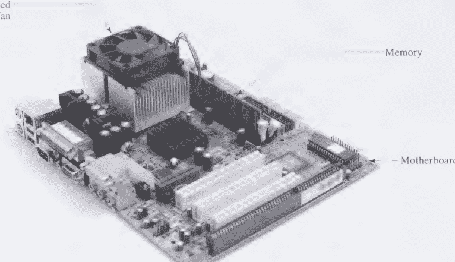

**图 1.2** 主板将计算机的各个部分连接在一起。

CPU 最初是单核的。**核心**是处理器中执行读取和执行指令的部分。为了增加 CPU 的处理能力，芯片制造商现在生产包含多个核心的 CPU。多核 CPU 是一个具有两个或多个独立核心的单一组件。今天的消费级计算机通常有两个、三个甚至四个核心。很快，拥有几十甚至几百个核心的 CPU 将变得负担得起。

### 1.2.2 位和字节

在讨论内存之前，让我们看看信息（数据和程序）是如何存储在计算机中的。

计算机实际上不仅仅是一系列开关。每个开关都有两个状态：开启或关闭。在计算机中存储信息简单来说就是设置一组开关的开启或关闭。如果开关开启，其值为 1；如果开关关闭，其值为 0。这些位（bits）被解释为二进制数中的数字，称为**位**（bits，二进制位）。

计算机中最小的存储单位是字节（byte）。一个字节由八个位组成。像 5 这样的小数字可以用单个字节来表示。为了存储无法放入单个字节的数字，计算机会使用多个字节。

各种类型的数据（如数字和字符）被编码为一系列字节。作为程序员，你不需要担心数据的编码和解码，计算机系统会根据编码方案自动执行这些工作。*编码方案*是一组规则，规定了计算机如何将字符、数字和符号翻译成它可以处理的数据。例如，在常用的 ASCII 编码方案中，字符 C 用二进制表示为 01000011。

计算机的存储容量以字节和字节的倍数衡量，如下：

- * 千字节（KB）约等于 1,000 字节。
- * 兆字节（MB）约等于 100 万字节。
- * 吉字节（GB）约等于 10 亿字节。
- * 太字节（TB）约等于 1 万亿字节。

一个典型的单页 Word 文档可能占用 20 KB。因此，1 MB 可以存储 50 页文档，1 GB 可以存储 50,000 页文档。一部典型的 1 小时高分辨率电影可能占用 8 GB，因此需要 160 GB 才能存储 20 部电影。

### 1.2.3 内存

计算机的内存由有序的字节组成，用于存储程序以及程序正在处理的数据。你可以将内存视为计算机执行程序的工作区域。程序及其数据在被 CPU 执行之前，必须移动到计算机的内存中。

内存中的每个字节都有一个唯一的地址，如图 1.3 所示。该地址用于定位用于存储和检索数据的字节。由于内存中的字节可以按任何顺序访问，因此内存也被称为随机访问存储器（RAM）。

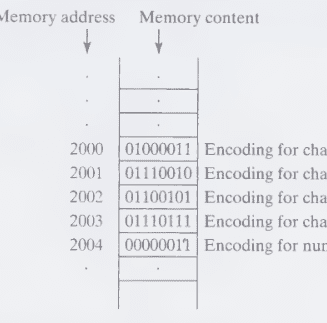

| 地址 | 二进制内容 | 说明 |
| :--- | :--- | :--- |
| 2000 | 01000011 | 字符 'C' 的编码 |
| 2001 | 01110010 | 字符 'r' 的编码 |
| 2002 | 01100101 | 字符 'e' 的编码 |
| 2003 | 01100101 | 字符 'e' 的编码 |
| 2004 | 01110100 | 字符 't' 的编码 |

内存中的数据通常是易失的。由于 CPU，内存构建在硅基晶体管上。

### 1.2.4 存储设备

计算机的内存（RAM）是一种易失性存储：当系统关闭时，存储的数据将会丢失。存储设备有三种主要类型：

- * 磁驱动器
- * 光盘驱动器（CD 和 DVD）
- * USB 闪存盘

驱动器是操作介质的设备，如磁盘。介质物理存储数据和指令。驱动器从介质读取数据并将数据写入介质。

计算机通常至少有一个硬盘（见图 1.4）。硬盘用于永久存储数据和程序。现在的硬盘可以存储 200 到 800 GB 的数据。硬盘通常在计算机内部，但也有移动硬盘可用。

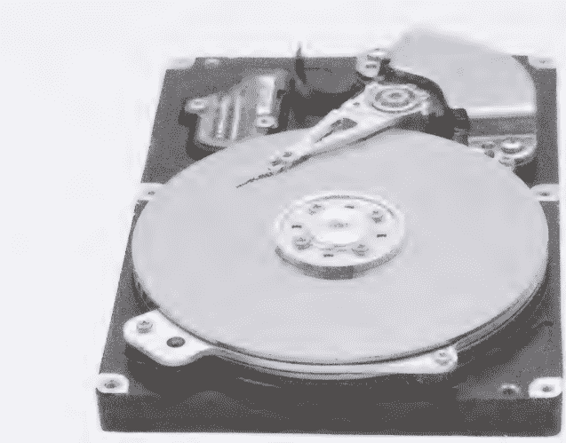

**图 1.4** 硬盘永久存储程序和数据。

CD 代表紧凑光盘。有两种类型的 CD 驱动器：CD-R 和 CD-RW。CD-R 用于只读永久存储；也就是说，一旦光盘录制，用户无法修改其内容。

CD-RW 可以像硬盘一样使用；也就是说，你可以向其写入数据并用新数据覆盖。单张 CD 最多可存储 700 MB。大多数新电脑都配备了可以兼容 CD-R 和 CD-RW 光盘的 CD-RW 驱动器。

DVD 代表通用数字光盘。DVD 和 CD 外观相似，你可以使用它们存储数据。DVD 比 CD 能存储更多信息；DVD 的存储容量为 4.7 GB。像 CD 一样，DVD 有两种：DVD-R（只读）和 DVD-RW（可重写）。

通用总线（USB）接口允许用户将各种外围设备连接到计算机。你可以使用 USB 接口将打印机、数码相机、鼠标、移动硬盘和其他设备连接到计算机。

闪存盘是一种存储和传输数据的设备。可以插入你 USB 端口的移动硬盘。闪存盘很小——大约一包口香糖的大小，如图 1.5 所示。目前的闪存盘存储容量可达 25 GB。

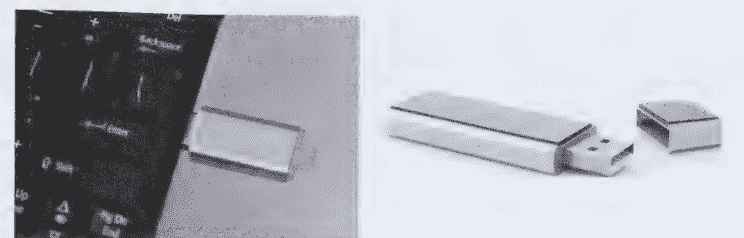

**图 1.5** USB 闪存盘便于携带，且可以存储大量数据。

### 1.2.5 输入和输出设备

输入和输出设备允许用户与计算机通信。最常见的输入设备是键盘和鼠标。最常见的输出设备是显示器和打印机。

#### 键盘

键盘是一种用于输入的设备。图 1.6 显示了一个典型的键盘。还有不带数字区的紧凑型键盘。

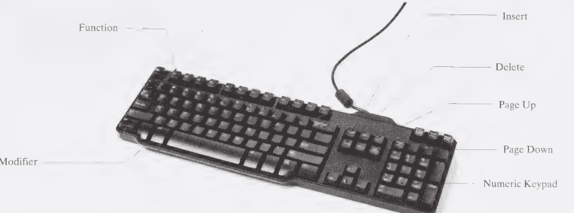

**图 1.6** 计算机键盘具有用于向计算机发送输入的按键。

*功能*键位于键盘顶部，并以字母 *F* 开头。它们的功能取决于使用的软件。*修饰*键是一种特殊键（例如 `Shift`、`Alt` 或 `Ctrl` 键），当这两个键同时按下时，它会修改另一个键的操作。位于大多数键盘右侧的*数字小键盘*是一组类似于计算器的独立按键，用于快速输入数字。位于主键盘和数字小键盘之间的*箭头*键在许多程序中用于在屏幕上上、下、左、右移动鼠标指针。`Insert`、`Delete`、`Page Up` 和 `Page Down` 键用于文字处理和其他程序中的插入文本和对象、删除文本和对象，以及一次一个屏幕地向上或向下移动文档。

#### 鼠标

鼠标是一种指向设备。它用于在屏幕上移动图形光标（通常是箭头形状），或点击屏幕上的对象（如按钮）以触发它们执行某项操作。

#### 显示器

显示器显示信息（文本和图形）。屏幕分辨率和点距决定了显示质量。

屏幕分辨率指定显示设备水平和垂直方向上的像素数量。像素（picture elements 的缩写）是在屏幕上形成图像的微小点。例如，17 英寸屏幕的常见分辨率为宽 1024 像素、高 768 像素。分辨率可以手动设置。分辨率越高，图像越锐利、清晰。

点距是像素之间的空间距离，以毫米计。点距越小，显示越锐利。

### 1.2.6 通信设备

计算机可以通过通信设备建立网络，例如拨号调制解调器（调制器）、DSL 或电缆调制器、网卡或无线适配器。

- 拨号调制解调器使用电话线，数据传输速度高达每秒 56,000 bps。
- 数字用户线路（DSL）连接也使用标准电话线，但其数据传输速度比标准拨号调制解调器快 20 倍。
- 电缆调制器连接由有线电视线路维护，通常比 DSL 快。
- 网卡（NIC）是一种将计算机连接到局域网（LAN）的设备，如图 1.7 所示。局域网常用于大学、企业和政府机构。称为 1000BaseT 的高速网卡传输速度为每秒 10 亿位（Mbps）。
- 无线网络在家庭、企业和学校中非常流行。现在的每个笔记本电脑都配备了无线适配器，使计算机能够连接到局域网和互联网。


**图 1.7** 局域网连接相邻的计算机。

> **注意**
>
> 检查点的答案在辅助网站上。

- 1.1 定义硬件和软件这两个术语。
- 1.2 列出计算机的五个主要硬件组件。
- 1.3 缩写“CPU”代表什么？
- 1.4 使用什么单位衡量 CPU 速度？
- 1.5 什么是位（bit）？什么是字节（byte）？
- 1.6 内存有什么用？RAM 代表什么？为什么内存被称为 RAM？
- 1.7 使用什么单位衡量内存大小？
- 1.8 使用什么单位衡量磁盘大小？
- 1.9 内存和存储设备之间的主要区别是什么？

## 1.3 编程语言

计算机程序被称为软件，是告诉计算机该做什么的指令。

计算机不理解人类语言；因此程序必须用计算机能理解的语言编写。有数百种编程语言，它们的开发是为了让人的编程过程更容易。然而，所有程序都必须转换为计算机可以执行的指令。

### 1.3.1 机器语言

计算机的原生语言在不同类型的计算机之间有所不同，这就是机器语言——一组内置的原始指令。这些指令以二进制代码的形式存在，因此如果你想用原生语言给计算机提供指令，就必须以二进制代码输入该指令。例如，要两个数相加，你可能需要写一条二进制代码形式的指令：

```
110101
```

### 1.3.2 汇编语言

机器语言编程是一个繁琐的过程。此外，用机器语言编写的程序很难阅读和修改。因此，汇编语言作为机器语言的替代方案被创造出来。它使用描述性的短单词来表示每条机器指令。例如，助记符 `add` 表示加，`sub` 表示减。要加数字 2 和 3 并得到结果，你可能会编写汇编代码：

```
add 2, 3
```

汇编语言的出现是为了让编程更容易。然而，由于计算机无法执行汇编语言，需要另一个称为汇编器的程序来将汇编语言翻译成机器码，如图 1.8 所示。

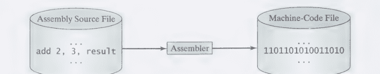

**图 1.8** 汇编器将汇编指令翻译成机器码。

用汇编语言编写代码比用机器语言容易。但是，编写汇编代码仍然很繁琐。汇编语言中的指令基本上对应于机器码中的指令。编写汇编需要了解 CPU 如何工作。汇编语言被称为低级语言，因为它接近机器语言且具有机器依赖性。

### 1.3.3 高级语言

20 世纪 50 年代出现了一种被称为高级语言的新一代编程语言。它们与平台无关，这意味着你可以用高级语言编写程序并在不同类型的机器上运行。高级语言类似于英语，易于学习。高级语言中的指令被称为语句。例如，下面是一个计算半径为 5 的圆面积的高级语言语句：

```
area = 5 * 5 * 3.1415
```

有很多高级编程语言，每种都是为了特定目的设计的。表 1.1 列出了一些。

高级语言程序被称为源程序或源代码。因为计算机无法执行源代码，必须将源代码翻译成机器码才能执行。这种翻译可以使用另一个称为解释器或编译器的编程工具完成。

解释器读取源代码中的语句，将其翻译成机器码或虚拟机码，然后立即执行，如图 1.9a 所示。注意，源代码中的语句可能会被翻译成多条机器指令。

编译器将整个源代码转换为机器码文件，然后执行机器码，如图 1.9b 所示。

- 1.10 CPU 理解什么？
- 1.11 什么是汇编语言？
- 1.12 什么是汇编器？

## 1.3 编程语言 (续)

- 1.13 什么是高级编程语言？
- 1.14 什么是源程序？
- 1.15 什么是解释器？
- 1.16 什么是编译器？
- 1.17 解释型语言和编译型语言之间有什么区别？

| 语言 | 描述 |
| :--- | :--- |
| Ada | 以埃达·洛夫莱斯（Ada Lovelace）命名，她曾从事机械通用计算机的工作。Ada 语言由美国国防部开发，主要用于国防项目。 |
| BASIC | 初学者全用符号指令代码。它的设计目标是让初学者容易学习和使用。 |
| C | 在贝尔实验室开发。C 语言结合了汇编语言的强大功能与高级语言的易用性和可移植性。 |
| C++ | C++ 是一种基于 C 的面向对象语言。 |
| C# | 读作“Sharp”。它是 Java 和 C++ 的混合体，由微软开发。 |
| COBOL | 通用面向业务语言。它用于业务应用程序。 |
| FORTRAN | 公式翻译语言。它在科学和数学应用中非常流行。 |
| Java | 由太阳公司开发，现在是 Oracle 的一部分。它广泛用于开发平台无关的网络应用程序。 |
| Pascal | 以布莱兹·帕斯卡（Blaise Pascal）命名，他是 17 世纪计算机器的先驱。它是一种简单、结构化的通用语言，主要用于编程教学。 |
| Python | 一种简单的通用脚本语言，用于编写短程序。 |
| Visual Basic | Visual Basic 由微软开发，让程序员能够快速开发图形用户界面。 |

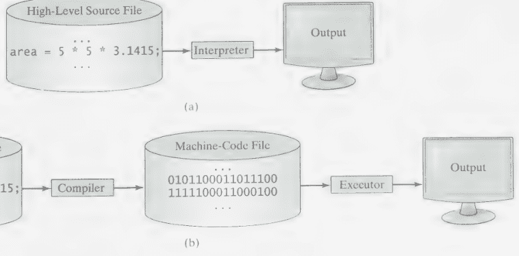

**图 1.9** (a) 解释器一次翻译并执行语句。(b) 编译器将整个源程序翻译成机器语言文件以便执行。

# 第 1 章 计算机、程序与 C++ 简介

## 1.4 操作系统

操作系统（OS）是计算机上最重要的程序。

操作系统管理并控制计算机的活动。

通用计算机的流行操作系统有 Microsoft Windows、Mac OS 和 Linux。除非计算机上安装并运行了操作系统，否则应用程序（如 Web 浏览器或文字处理器）无法运行。图 1.10 显示了用户、应用系统和硬件之间的关系。

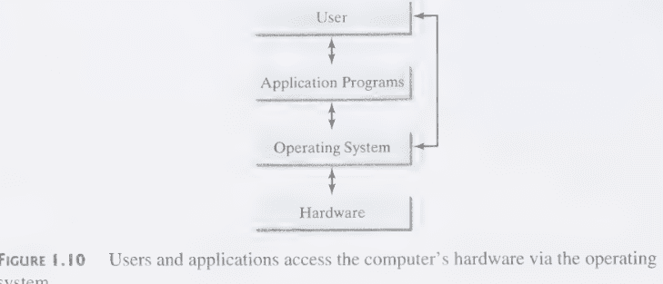

以下是操作系统的主要任务：

- 控制和监控系统活动
- 分配和划分系统资源
- 调度操作

### 1.4.1 控制和监控系统活动

操作系统执行基本任务，例如识别键盘输入、向显示器发送输出、组织存储设备上的文件和文件夹、控制外围设备（如磁盘驱动器和打印机）。操作系统还确保同时工作的不同程序和用户不会相互干扰。此外，操作系统还负责安全，确保未经授权的用户和程序无法访问系统。

### 1.4.2 分配和划分系统资源

操作系统负责确定程序需要哪些计算机资源（如 CPU 时间、内存空间、磁盘以及输入输出设备），并分配这些资源以运行程序。

### 1.4.3 调度操作

操作系统负责调度程序活动，以有效地利用系统资源。为了提高系统性能，许多现代操作系统支持多程序、多线程和多处理等技术。


# 多程序、多线程与多处理

多程序允许通过共享 CPU 同时运行多个程序。CPU 的速度比计算机的其他组件快得多。因此，它在大多数时间里都是空闲的——例如在等待数据传输到磁盘时。多线程允许同一个程序在等待磁盘时执行多个任务。多处理允许用户在等待磁盘响应时编辑多个文件。

## 练习题

1.18 什么是操作系统？列出一些流行的操作系统。

1.19 操作系统的主要职责是什么？

1.20 什么是多程序、多线程？

# 1.5 C++ 的历史

C++ 是一种通用的面向对象编程语言。

C++、Java 和 C# 之间存在联系。C++ 源自 C。Java 是模仿 C++ 设计的。如果你熟悉这些语言中的一种，就能学习其他的。

C++ 源自 B 语言，B 语言又源自 BCPL（基础组合语言）。Martin Richards 在 20 世纪 60 年代开发了 BCPL，用于编写操作系统和编译器。Ken Thompson 在 B 中引入了许多来自 BCPL 的特性，并用它创建了 C。Bjarne Stroustrup 在 1979 年在贝尔实验室开发了 C++，最初称为“带类的 C”。随着时间增加了许多特性，使其成为强大的工具。国际标准组织（ISO）发布了第一个标准 C++98，使 C++ 成为标准语言。随后的标准如 C++11、C++14 和 C++17 引入了更多特性。

## 练习题

1.21 C、Java 和 C# 之间的关系是什么？

1.22 谁开发了 C++？

# 1.6 简单的 C++ 程序

C++ 程序从 `main` 函数执行。

让我们从一个简单的 C++ 程序开始，它显示消息 Welcome to C++！（控制台是一个旧术语，指的是计算机的文本输入显示设备。控制台输入意味着键盘输入，控制台输出意味着显示器输出）。程序如列表 1.1 所示。

## 列表 1.1 Welcome.cpp

```cpp
#include <iostream>
using namespace std;
int main() {
    // 向控制台显示 Welcome to C++
    cout << "Welcome to C++" << endl;
    return 0;
}
```

行号不是程序的一部分，但为了参考而显示。因此，请不要在程序中输入行号。

程序中的第一行

```cpp
#include <iostream>
```

是编译器预处理指令，告诉编译器在此程序中包含 `iostream` 库，该库是支持控制台输入输出所需的。C++ 库包含了开发 C++ 程序定义的代码。像 `iostream` 这样的库在 C++ 中被称为头文件，因为通常包含在程序的头部。

第二行的语句

```cpp
using namespace std;
```

告诉编译器使用标准名称，`std` 是 `standard` 的缩写。命名空间是一种避免大型程序中命名冲突的机制。第 7 行中的 `cout` 和 `endl` 定义在 `iostream` 库的标准命名空间中。为了让编译器找到这些名称，必须使用第二行的语句。命名空间是一种高级主题，在补充章节 IV.B 中涵盖。现在，你只需要在你的程序中编写第 2 行，以执行任何输入或输出操作。

每个 C++ 程序都从 `main` 函数开始执行。函数是一个包含语句的构造结构。第 4-10 行定义的 `main` 函数包含两个语句。它们被封装在一个块中，该块以左括号 `{` 开始，以右括号 `}` 结束（第 10 行）。C++ 中的每个语句必须以分号 (`;`) 结束，称为语句终止符。

第 7 行的语句向控制台显示一条消息。`cout`（读作 see-out）代表控制台输出。`<<` 运算符（或流插入运算符）将字符串发送到控制台。字符串必须包含在引号中。第 7 行的语句首先向控制台输出 "Welcome to C++!"，然后是 `endl`。注意 `endl` 代表换行（end line）。向控制台发送 `endl` 会结束当前行并刷新缓冲区，以确保输出立即显示。

第 9 行的语句

```cpp
return 0;
```

位于每个 `main` 函数的末尾，用于退出程序。值 0 表示程序已成功退出。然而，它是可以省略的；但其他编译器认为该语句对于你的程序运行没有问题。在所有 C++ 程序中包含此语句是一个良好的习惯。

注释用于记录程序的功能及其构造方式。注释有助于程序员之间进行通信和理解代码。它们不是语句，会被编译器忽略。在 C++ 中，注释前有两个斜杠（在行中开头为 `//`，称为单行注释；或者在行或多行之间用 `/* */` 包围，称为块注释或段落注释）。当编译器看到 `//` 时，它会扫描该行的下一个 `//` 并忽略 `//` 和下一个 `//` 之间的任何文本。

以下是两种类型的注释：

```cpp
// This application program prints welcome to C++
/* This application program prints welcome to C++! */
/* This application program prints Welcome to C++! */
```

关键字（或保留字）对编译器有特定含义，不能用于其他用途。此程序中有四个关键字：`using`、`namespace`、`int` 和 `return`。

> **注意**
>
> 预处理器指令不是 C++ 语句。因此，不要在预处理器指令末尾加上分号。这样做可能会导致错误。

> **注意**
>
> 如果你在 `<` 和 `iostream` 之间放入额外的空格，某些编译器将无法编译。额外的空格将成为头文件名的一部分。为了确保你的程序能够在所有编译器上运行，请在这些情况下不要添加额外的空格。

> **注意**
>
> C++ 源程序是区分大小写的。例如，将程序中的 `main` 替换为 `Main` 是错误的。

# 第一章 计算机、程序与 C++ 简介

> **注意**
>
> 你可能在好奇为什么 `main` 函数要这样声明，以及为什么使用 `cout << "Welcome to C++!" << endl` 来向控制台显示消息。你的问题还无法完全得到解答。现在，你必须接受事实就是如此。你将在后续章节中找到答案。

## 特殊字符

你在程序中看到了几个特殊字符（例如 `#`、`//`、`<<`）。它们几乎出现在每个程序中。表 1.2 总结了它们。

### 表 1.2 特殊字符

| 字符 | 名称 | 描述 |
|---|---|---|
| `#` | 井号 | 用于 `#include` 中以表示预处理器指令。 |
| `<>` | 左、右角括号 | 与 `#include` 使用时包围库名。 |
| `()` | 左、右括号 | 用于如 `main()` 等函数。 |
| `{}` | 左、右大括号 | 表示语句块。 |
| `<<` | 流插入运算符 | 输出到控制台。 |
| `""` | 左、右引号 | 包围字符串（即字符序列）。 |
| `;` | 分号 | 标记语句的结束。 |

## 常见错误

### 语法规则

学生在本章中遇到的大多数错误都是语法错误。与任何其他编程语言一样，C++ 有它自己的语法规则，称为语法，你需要编写遵守语法规则的代码。如果你违反了这些规则，C++ 编译器将报告语法错误。请密切注意标点符号。重定向符号 `<<` 是连续的。函数中的每个语句都以分号 (`;`) 结束。

列表 1.1 中的程序显示一条消息。一旦你理解了程序，很容易扩展它来显示更多消息。例如，你可以重写程序显示三条消息，如列表 1.2 所示。

## 列表 1.2 WelcomeWithThreeMessages.cpp

```cpp
#include <iostream>
using namespace std;

int main() {
    cout << "Programming is fun!" << endl;
    cout << "Fundamentals First" << endl;
    cout << "Problem Driven" << endl;

    return 0;
}
```

**输出：**

```
Programming is fun!
Fundamentals First
Problem Driven
```

此外，你可以进行数学计算并将结果显示在控制台。列表 1.3 给出了这样一个示例。

## 列表 1.3 ComputeExpression.cpp

```cpp
#include <iostream>
using namespace std;

int main() {
    cout << "(10.5 + 2 * 3) / (45 - 3.5) = ";
    cout << (10.5 + 2 * 3) / (45 - 3.5) << endl;
    return 0;
}
```

**输出：**

```
(10.5 + 2 * 3) / (45 - 3.5) = 0.39759036144578314
```

C++ 中的乘法运算符是 `*`。如你所见，将算术表达式翻译为 C++ 表达式是一个直接的过程。我们将在第 2 章进一步讨论 C++ 表达式。

你可以在单个语句中组合多个输出。例如，以下语句实现了第 6-7 行相同的功能：

```cpp
cout << "(10.5 + 2 * 3) / (45 - 3.5) = " << (10.5 + 2 * 3) / (45 - 3.5) << endl;
```

## 练习题

- **1.23** 解释 C++ 关键字。列出你在本章中学到的一些 C++ 关键字。
- **1.24** C++ 区分大小写吗？
- **1.25** C++ 源文件扩展名是什么？
- **1.26** Windows 下执行文件扩展名是什么？
- **1.27** 编译器会忽略注释吗？
- **1.28** `std` 代表什么？
- **1.29** 以下哪一个预处理器指令是正确的？
  - a. `import iostream`
  - b. `#include iostream`
  - c. `#include <iostream`
  - d. `#include <iostream>`
- **1.30** 以下哪一个预处理器指令可以兼容所有编译器？
  - a. `#include`
  - b. `#include <iostream`
  - c. `#include <iostream>`
  - d. `#iostream`

1.31 显示以下代码的输出：

```cpp
#include <iostream>
using namespace std;

int main() {
    cout << "(10.5 + 2 * 3) / (45 - 3.5) = ";
    cout << (10.5 + 2 * 3) / (45 - 3.5) << endl;
    return 0;
}
```

1.32 显示以下代码的输出：

```cpp
#include <iostream>
using namespace std;

int main() {
    cout << "Java" << endl;
    cout << "C++" << endl << "Java" << endl;
    cout << "C++," << "Java," << "and C++" << endl;

    return 0;
}
```

# 1.7 C++ 程序开发周期

C++ 开发过程包括创建/修改源码、编译、链接。

你必须创建并编译程序，才能执行它。这个过程是重复的，如图 1.11 所示。如果你的程序有错误，你需要修改并再次尝试。如果程序出现运行时错误或没有产生正确结果，你需要修改、重新编译并执行。

C++ 编译器按顺序执行三个任务：预处理、编译和链接。简单来说，C++ 编译器执行三个独立的程序：预处理器、编译器和链接器。

- **预处理器**：是在源文件传递给编译器之前对其处理的程序。预处理器处理指令。指令以 `#` 号开头。例如，列表 1.1 第一行的 `#include` 是一个告诉编译器包含库的指令。预处理器产生中间文件。
- **编译器**：将中间文件翻译成机器码文件。机器码文件称为对象文件。为了与 C++ 类混淆，我们在文中不使用该术语。
- **链接器**：将机器码文件与支持库链接形成可执行文件。在 Windows 上，机器码文件以 `.obj` 扩展名存储在磁盘上，执行文件以 `.exe` 扩展名存储。在 UNIX 上，机器码文件具有 `.o` 扩展名，执行文件没有扩展名。

**图 1.11** C++ 程序开发过程包括创建/修改源代码、编译、链接和执行程序。

你可以从命令行窗口或 IDE 开发 C++ 程序。IDE 是一种提供集成开发环境的软件，用于快速开发 C++ 程序。编辑、编译、调试和在线帮助都集成在一个图形化用户界面（GUI）中。你只需在窗口中输入源代码或打开一个现有文件，然后点击按钮、菜单项或功能键即可编译并运行程序。流行的 IDE 示例有 Microsoft Visual C++、Dev-C++ 和 NetBeans。所有的 IDE 都可以免费下载。

补充材料 II.B 介绍了如何使用 Visual C++ 开发 C++ 程序。补充材料 II.E 介绍了如何从 NetBeans IDE 开发 C++ 程序。补充材料 I.F 介绍了如何在 Windows 命令行下开发 C++ 程序。补充材料 I.G 介绍了如何在 UNIX 上开发 C++。

## 练习题

1.33 C++ 可以运行在任何机器上吗？编译和运行 C++ 程序需要什么？

1.34 C++ 编译器的输入和输出是什么？

# 1.8 编程风格与文档

良好的编程风格和适当的文档使程序易于阅读并帮助程序员防止错误。

编程风格涉及程序的外观。如果你把程序写在一行内，程序可以正常编译和运行，但那种写法是糟糕的编程风格，因为它难以阅读。文档是与程序相关的说明性备注和注释。编程风格和文档与代码一样重要。良好的编程风格和适当的文档可以减少错误概率并使程序易于阅读。到目前为止，你已经学习了一些良好的编程风格。本节总结了这些风格，并提供了关于如何使用它们的指南。更详细的编程风格和文档指南可以在配套网站补充材料 1E 中找到。

## 1.8.1 适当注释及注释样式

在程序开头包含一个总结，解释程序的功能、关键特性以及它使用的任何独特技术。在长程序中，你还应该包含注释来介绍每个主要步骤，并解释任何难以阅读的内容。保持注释简洁很重要，这样它们就不会拥挤程序或使其变得难以阅读。

## 1.8.2 正确的缩进和间距

一致的缩进风格使程序清晰且易于阅读、调试和维护。缩进用于说明程序组件或语句之间的结构关系。C++ 编译器即使在所有语句都写成一行时也能读取程序，但对齐良好的代码更易于阅读。每个组件或语句比其内部嵌套的结构多缩进两个空格。二元运算符的两侧应使用单个空格，如下所示：

```cpp
cout << 3+4;          // 糟糕风格
cout << 3 + 4;        // 良好风格
```

在代码段之间应使用空行，使程序更易于阅读。

## 练习题

1.35 识别并修复以下代码中的错误：

```cpp
#include <iostream>
using namespace std;
int main() {
    // 在控制台显示 Welcome to C++!
    cout << "Welcome to C++!" << endl;
    return 0;
}
```

1.36 你如何表示注释？

1.37 根据编程风格重新格式化以下程序：

```cpp
#include <iostream>
using namespace std;

int main() {
    cout << "2 + 3 = " << 2+3;
    return 0;
}
```

# 1.9 编程错误

即使对于经验丰富的程序员来说，编程错误也是不可避免的。错误可以分为三类：语法错误、运行时错误和逻辑错误。

## 1.9.1 语法错误

由编译器检测到的错误是语法错误或编译错误。错误源于代码构造，例如错写关键字、缺少标点符号，或打开了左括号但没有相应的右括号。这些错误通常很容易检测，因为编译器会告诉你错误发生在哪里以及产生原因是什么。例如，列表 1.4 中的程序有一个语法错误。

**列表 1.4 ShowSyntaxErrors.cpp**

```cpp
#include <iostream>
using namespace std
int main() {
    cout << "Programming is fun << endl";
    return 0;
}
```

当你使用 Visual C++ 编译此程序时，它会显示以下错误：

```
Test.cpp(4): error C2144: syntax error : 'int' should be preceded by ';'
Test.cpp(6): error C2001: newline in constant
Test.cpp(8): error C2143: syntax error : missing ';' before 'return'
```

报告了三个错误，但程序实际上有两个错误。首先，第 2 行尾缺少分号（`;`）。其次，第 6 行的 `cout` 语句缺少结束引号和分号（注：原文提示 `return` 之前缺少分号，根据代码逻辑，第 6 行 `cout << "Programming is fun << endl";` 确实缺少结束引号且语句未以分号结尾）。


*纠正分析：根据代码，第 2 行 `using namespace std` 缺少分号；第 6 行 `cout << "Programming is fun << endl";` 缺少结束引号和分号。*

报告了三个错误，但程序实际上有两个错误。首先，第 2 行尾缺少分号。其次，第 6 行的字符串缺少闭合引号和分号。

当你使用 Visual C++ 编译此程序时，会显示以下错误：

```
Test.cpp(4): error C2144: syntax error : 'int' should be preceded by ';'
Test.cpp(6): error C2001: newline in constant
Test.cpp(8): error C2143: syntax error : missing ';' before 'return'
```

报告了三个错误，但程序实际上有两个错误。首先，第 2 行尾缺少分号。其次，第 6 行的字符串缺少闭合引号和分号。

> 提示：在 Visual C++ 中编译此程序时，会显示以下错误：
>
> （此处为原文重复的错误信息）

### 1.9.2 运行时错误

运行时错误是程序在执行期间发生的。

> 提示：在 Visual C++ 中编译此程序时，会显示以下错误：
>
> （此处为原文重复的错误信息）

### 1.9.3 逻辑错误

逻辑错误是程序没有按照预期执行。这种错误产生的原因有很多。例如，假设你编写了列表 1.6 中的程序将摄氏度 35 转换为华氏度：

**列表 1.6 ShowLogicErrors.cpp**

```cpp
#include <iostream>
using namespace std;

int main() {
    cout << "Celsius 35 is Fahrenheit degree " << endl;
    cout << (9 / 5) * 35;
    return 0;
}
```

### 1.9.4 常见错误

缺少右括号、缺少分号、缺少字符串引号以及拼写名称是程序员常见的错误。

**常见错误 1：缺少括号**

括号用于表示程序中的块。每个左括号必须与右括号匹配。一种常见错误是缺少右括号。为了避免这种错误，每当输入左括号时立即输入右括号，如下所示：

```cpp
int main() {

} // 直接输入这个右括号以匹配左括号
```

**常见错误 2：缺少分号**

每个语句都需要语句终止符（`;`）。通常，新程序员会在块的最后一个语句处忘记放置语句终止符，如下所示：

```cpp
int main() {
    cout << "Programming is fun!" << endl;
    cout << "Fundamentals First" << endl;
    cout << "Problem Driven" << endl
} // 缺少分号
```

**常见错误 3：缺少引号**

字符串必须放在引号内。通常，新程序员忘记在字符串末尾放置引号，如下所示：

```cpp
cout << "Problem Driven; // 缺少引号
```

**常见错误 4：拼写名称**

C++ 是大小写敏感的。拼写名称是新程序员常见的错误。例如，主单词在代码中被误写为 `Main`：

```cpp
int Main() {
    cout << (10.5 + 2 * 3) / (45 - 3.5) << endl;
    return 0;
}
```

# 第一章 计算机、程序与 C++ 简介

1.40 如果你的程序需要从文件读取数据，而该文件不存在，运行该程序就会发生错误。这是哪类型的错误？

1.41 假设你编写了一个计算矩形面积的程序，但你错误地写了程序，使其计算了正方形的面积。这是什么类型的错误？

1.42 识别并修复以下代码中的错误：

```cpp
int main()
{
  cout << 'Welcome to C++';
  return 0;
}
```

## 核心术语

| | | | | | |
| :--- | :--- | :--- | :--- | :--- | :--- |
| 汇编器 (assembler) | 18 | 汇编语言 (assembly language) | 9 | 逻辑错误 (logic error) | 22 |
| 位 (bit) | 4 | 低级语言 (low-level language) | 10 | | |
| 块 (block) | 15 | 机器语言 (machine language) | 9 | | |
| 块注释 (block comment) | 15 | 主函数 (main function) | 15 | | |
| 总线 (bus) | 2 | 内存 (memory) | 5 | | |
| 字节 (byte) | 4 | 调制解调器 (modem) | 8 | | |
| 线缆 (cable) | 8 | 主板 (motherboard) | 3 | | |
| 中央处理器单元 (CPU) | 3 | 命名空间 (namespace) | 14 | | |
| 注释 (comment) | 15 | 网络接口卡 (NIC) | 8 | | |
| 编译错误 (compile error) | 21 | 目标文件 (object file) | 18 | | |
| 编译器 (compiler) | 10 | 操作系统 (OS) | 12 | | |
| 控制台 (console) | 14 | 段落注释 (paragraph comment) | 15 | | |
| 控制台输入 (console input) | 14 | 像素 (pixel) | 8 | | |
| 控制台输出 (console output) | 15 | 处理器 (preprocessor) | 8 | | |
| 点距 (dot pitch) | 8 | 程序 (program) | 2 | | |
| 数字用户线路 (DSL) | 8 | 编程 (programming) | 2 | | |
| 编码方案 (encoding scheme) | 4 | 运行时 (runtime) | 22 | | |
| 硬件 (hardware) | 2 | 屏幕分辨率 (screen resolution) | 8 | | |
| 头文件 (header) | 14 | 软件 (software) | 2 | | |
| 高级语言 (high-level language) | 10 | 源代码 (source code) | 10 | | |
| 集成开发环境 (IDE) | 19 | 源程序 (source program) | 10 | | |
| 解释器 (interpreter) | 语句 (statement) | 10 | | | |
| 语句终止符 (statement terminator) | 15 | | | | |
| 关键字 (keyword 或 reserved word) | 15 | 存储设备 (storage device) | 5 | | |
| 图库 (library) | 14 | 流插入运算符 (stream insertion operator) | 15 | | |
| 行注释 (line comment) | 15 | 语法错误 (syntax error) | 21 | | |

注：上述核心术语在本章中定义。附录 I.A 术语表列了书中使用的所有术语描述，按章节组织。

# 本章总结

- 1. 计算机是一种存储和处理数据的电子设备。
- 2. 计算机包括硬件和软件。
- 3. 硬件是计算机中可以触摸的物理部分。
- 4. 计算机程序称为软件，是控制硬件并执行任务的可见指令。
- 5. 计算机编程是为计算机编写指令（即代码）。
- 6. 中央处理器（CPU）是计算机的大脑。它从内存中提取并执行指令。
- 7. 计算机使用 0 和 1，因为数字设备有两种稳定状态，习惯称为零和一。
- 8. 位（bit）是一个二进制数字 0 或 1。
- 9. 字节（byte）是 8 位序列。
- 10. 千字节（Kilobyte）约为 1000 字节，兆字节（megabyte）约为 100 万字节，吉字节（gigabyte）约为 10 亿字节，太字节（terabyte）约为 1000 吉字节。
- 11. 内存存储 CPU 执行的数据和程序指令。
- 12. 内存单元是字节的有序。
- 13. 内存是易失的，因为掉电时信息会丢失。
- 14. 程序和数据永久存储在存储设备上，当计算机实际使用它们时移动到内存中。
- 15. 机器语言是内置到每台计算机中的指令集。
- 16. 汇编语言是一种低级编程语言，使用助记符表示每个机器指令。
- 17. 高级语言类似于英语，容易学习和编程。
- 18. 用高级语言编写的程序称为源程序。
- 19. 编译器是将源程序翻译成机器语言程序的软件。
- 20. 操作系统（OS）是管理和控制计算机活动的程序。

# 第一章 计算机、程序与 C++ 简介

- 21. C++ 是 C 语言的扩展。C++ 增加了许多改进 C 语言的功能。最重要的是增加了使用类进行面向对象支持。
- 22. C++ 源文件以 `.cpp` 扩展结尾。
- 23. `#include` 是预处理器指令。所有预处理器指令都以 `#` 开头。
- 24. `cout` 对象结合流插入运算符（`<<`）可以用于在控制台上显示字符串。
- 25. 每个 C++ 程序都从 `main` 函数执行。函数是一个包含语句的结构。
- 26. C++ 中的每条语句必须以分号（`;`）结束，称为语句终止符。
- 27. 在 C++ 中，注释在行前带有两个斜杠（`//`），称为行注释；或者在单或多行的 `/**` 和 `*/` 之间，称为块注释或段落注释。
- 28. 关键字（或保留字）对编译器有特定含义，不能在程序中作他用途。关键字的示例有 `using`、`namespace`、`int` 和 `return`。
- 29. C++ 源程序是对大小敏感的。
- 30. 你可以从命令行窗口或使用 Visual C++ 或 Dev-C++ 等 IDE 开发 C++ 应用程序。
- 31. 编程错误分为三类：语法错误、运行时错误和逻辑错误。编译器报告的错误称为语法错误或编译错误。运行时错误是导致程序异常终止的错误。当程序没有按照预期方式执行时，发生逻辑错误。

## 测验

在 `www.cs.armstrong.edu/liang/cpp3e/quiz.html` 在线回答本章测验。

## 编程练习

MyProgrammingLab 难度

> 注：偶数题的解答在伴随网站提供。所有练习的解答在教师资源网站提供。难度水平评级为简单（无星）、中等（*）、困难（**）或挑战性（***）。

# 第 1.6–1.9 节

- 1.1（显示三条消息）编写一个程序，显示 Welcome to C++、to Computer Science 和 Programming is fun。
- 1.2（显示五条消息）编写一个程序，显示 Welcome to C++ 五次。
- 1.3（显示模式）编写一个程序显示以下模式：

```
CCCC
C
C
C
```

- 1.4（打印表格）编写一个程序显示以下表格：

| a | a | a |
|---|---|---|
| 1 | 1 | 1 |
| 2 | 4 | 8 |
| 3 | 9 | 27 |
| 4 | 16 | 64 |

- 1.5（计算表达式）编写一个程序显示：

```
9.5 * 3.5
```

- 1.6（级数和）编写一个程序显示：

```
1+2+3+4+5+6+7+8+9
```

- 1.7（近似 $\pi$）$\pi$ 可以使用公式计算：

```cpp
pi = 4 * (1 - 1/3 + 1/5 - 1/7 + 1/9);
```

在你的程序中使用 1.0 代替 1。

- 1.8（圆的面积和周长）编写一个程序显示半径为 5 的圆的面积和周长，使用公式：

```cpp
perimeter = 2 * radius * pi;
area = radius * radius * pi;
```

- 1.9（矩形的面积和周长）编写一个程序显示宽度为 4.5、高度为 7.9 的矩形的面积，使用公式：

```cpp
area = width * height;
```

- 1.10（英里平均速度）假设一名跑步者在 45 分 30 秒内跑了 14 公里。编写一个程序显示每英里的平均速度。（注意 1 英里等于 1.6 公里。）

- 1.11（人口预测）美国人口普查局根据以下假设预测人口：

  - 每 7 秒有一个出生
  - 每 13 秒有一个死亡
  - 每 45 秒有一个新移民

编写一个程序显示未来五年的预测人口。假设当前人口为 312,032,486，一年有 365 天。提示：在 C++ 中，如果两个整数执行除法，结果为商。小数部分会被截断。

# 第 2 章 基础编程

## 目标

- 编写执行简单计算的 C++ 程序 (§2.2)。
- 从键盘读取输入 (§2.3)。
- 使用标识符为变量和函数等元素命名 (§2.4)。
- 使用变量存储数据 (§2.5)。
- 使用赋值语句和赋值表达式进行编程 (§2.6)。
- 使用 `const` 关键字为常量命名 (§2.7)。
- 使用数值数据类型声明变量 (§2.8.1)。
- 编写整数字面量、浮点数字面量和科学计数法表示的字面量 (§2.8.2)。
- 使用运算符 `+`、`-`、`/`、`*` 和 `%` 执行操作 (§2.8.3)。
- 使用 `pow(a, b)` 函数执行幂运算 (§2.8.4)。
- 编写并求值表达式 (§2.9)。
- 使用 `time(0)` 获取当前系统时间 (§2.10)。
- 使用复合赋值运算符（`+=`、`-=`、`*=`、`%=`） (§2.11)。
- 区分后自增、前自增以及后自减、自减 (§2.12)。
- 使用强制转换将数字转换为不同类型 (§2.13)。
- 描述软件开发过程并将其应用于贷款还款程序 (§2.14)。
- 编写一个将大额金额转换为小单位的程序 (§2.15)。
- 避免基础编程中的常见错误 (§2.16)。

## 2.1 引言

本章重点学习用于解决问题的基础编程技术。

在第 1 章中，你学习了如何创建、编译和运行基本程序。现在你将学习如何通过编写程序来解决问题。通过这些学习，你将学会使用原始数据类型、变量、常量、运算符、表达式以及输入输出进行基础编程。

例如，假设你想申请学生贷款。在给定贷款金额、期限和年利率的情况下，你如何编写程序来计算每月还款额和总还款额？本章将向你展示如何编写此类程序。在此过程中，你将学习分析问题、设计解决方案以及通过创建程序实现解决方案的基本步骤。

## 2.2 编写简单程序

编写程序涉及为解决问题设计策略，然后使用编程语言实现该策略。

首先，让我们考虑计算圆面积的简单问题。我们如何编写一个程序来解决这个问题呢？

编写程序涉及设计算法并将其翻译成编程指令（或代码）。算法通过列出必须采取的动作和执行顺序来描述如何解决问题。算法帮助程序员在用编程语言编写程序之前对程序进行规划。算法可以用自然语言或伪代码（自然语言与编程代码的混合体）来描述。计算圆面积的算法可以描述如下：

1. 读取圆的半径。
2. 使用以下公式计算面积：
   ```
   area = radius × radius × π
   ```
3. 显示结果。

> 提示：在开始编码之前，以算法的形式勾勒你的程序（或其底层问题）是一个良好的习惯。

当你编写代码时——即当你编写程序时——你将算法翻译成程序。你已经知道每个 C++ 程序从 `main` 函数开始执行。在这里，`main` 函数的框架如下：

```cpp
int main() {
    // 步骤 1: 读取半径
    // 步骤 2: 计算面积
    // 步骤 3: 显示面积
}
```

程序需要从键盘读取用户输入的半径。这引出了两个重要问题：

- 读取半径
- 在程序中存储半径

让我们先处理第二个问题。为了存储数据，程序需要一个称为“变量”的符号。变量表示存储在计算机内存中的值。

不要使用 `x` 和 `y` 作为变量名，而是选择具有描述性的名称；在这种情况下，半径使用 `radius`，面积使用 `area`。为了告诉编译器 `radius` 和 `area` 是什么，需要指定它们的数据类型。即存储在变量中的数据类型，不论是整数、浮点数还是其他类型。这被称为声明变量。C++ 提供了简单的数据类型来表示整数、浮点数（即带有小数点的数字）、字符（char）和布尔类型（Boolean）。这些被称为原始类型或基本类型。

将 `radius` 和 `area` 声明为双精度浮点数。该程序可以扩展如下：

```cpp
int main() {
    double radius;
    double area;

    // 步骤 1: 读取半径
    // 步骤 2: 计算面积
    // 步骤 3: 显示面积
}
```

程序声明了 `radius` 和 `area` 为变量。保留字 `double` 表示 `radius` 和 `area` 是存储在计算机中的双精度浮点值。


第一步是提示用户指定圆的半径。你很快就会学习如何提示用户获取信息。现在，为了学习变量如何工作，你可以在编写代码时为 `radius` 分配一个固定值；稍后你会修改程序来提示用户输入此值。

第二步是通过将表达式 `radius * radius * 3.14159` 的结果赋值给 `area` 来计算面积。

在最后一步中，程序将使用 `<< area` 在控制台上显示 `area` 的值。

完整的程序见列表 2.1。

### 列表 2.1 ComputeArea.cpp

```cpp
#include <iostream>
using namespace std;
int main() {
    double radius;
    double area;

    // 步骤 1: 读取半径

    // 步骤 2: 计算面积

    // 步骤 3: 显示面积
}
```

程序声明了 `radius` 和 `area` 为变量。保留字 `double` 表示 `radius` 和 `area` 是存储在计算机中的双精度浮点值。

# 第 2 章 基础编程

你可以使用单条语句读取多个输入。例如，以下语句将三个值读入变量 `x1`、`x2` 和 `x3`：

```cpp
cin >> x1 >> x2 >> x3;
```

### 列表 2.3 ComputeAverage.cpp

```cpp
#include <iostream>
using namespace std;
int main() {
    // 用户输入三个数字
    double number1, number2, number3;
    cout << "Enter three numbers: ";
    cin >> number1 >> number2 >> number3;
    // 计算平均值
    double average = (number1 + number2 + number3) / 3;
    // 显示结果
    cout << "The average of " << number1 << " " << number2 << " " << number3 << " is " << average << endl;
    return 0;
}
```

第 8 行提示用户输入三个数字。数字在第 9 行读取。你可以输入用空格分隔的三个数字，然后按回车键，或者输入每个数字后按回车键，如该程序的示例运行所示。

> 注意
>
> 本书前几个章节中的大多数程序都执行三个步骤：输入、处理和输出，称为 IPO。输入是接收用户的输入；处理是使用输入产生结果；输出是显示结果。

### 2.2 你如何编写语句让用户从键盘输入一个整数和一个双浮点值？

### 2.3 如果你在执行以下代码时输入 2.5，输出是什么？

```cpp
double width;
double height;
cin >> width >> height;
cout << width * height;
```

## 2.4 标识符

标识符是程序中用于标识元素（如变量和函数）的名称。

如列表 2.3 所示，`main`、`number1`、`number2`、`number3` 等是程序中出现的名称。在编程术语中，这些名称被称为标识符。所有标识符必须遵守以下规则：

- 标识符是由字母、数字和下划线 (`_`) 组成的字符序列。
- 标识符必须以字母或下划线开头；不能以数字开头。
- 标识符不能是保留字。（保留字列表请参阅附录 A，“C++ 关键字”）
- 标识符可以是任意长度，但你的 C++ 编译器可能会对其施加限制。

> 注意
>
> C++ 是区分大小写的，`area` 和 `Area` 是不同的。

> 提示
>
> 使用完整的单词使程序更具描述性。例如，`numberOfStudents` 比 `numOfStudents` 更好。使用描述性名称使程序更易读。

### 2.4 哪些标识符是有效的？哪些是 C++ 关键字？

`miles`, `a double`, `int`, `x`

## 2.5 变量

变量用于表示可能会改变的值。

如前述章节所示，变量用于存储稍后使用的值。它们之所以被称为变量是因为它们的值可以改变。

在列表 2.2 中，`radius` 和 `area` 是 `double` 类型。你可以为 `radius` 和 `area` 赋值任何数值，它们的值可以重新赋值。例如，在以下代码中，`radius` 初始为 1.0（第 2 行），然后变为 2.0（第 7 行），`area` 被设置为 3.14159（第 3 行）。

```cpp
// 计算第一个面积
radius = 1.0;
area = radius * radius * 3.14159;
cout << "The area is " << area << " for radius " << radius;

// 计算第二个面积
radius = 2.0;
area = radius * radius * 3.14159;
cout << "The area is " << area << " for radius " << radius;
```

变量用于表示某种类型的数据。你通过告诉编译器名称以及它可以存储的数据类型来声明变量。变量声明告诉编译器根据其数据类型为变量分配适当的内存空间。声明变量的语法为：

`datatype variableName;`

以下是一些变量声明的示例：

```cpp
int count; // 声明整数 count
double radius; // 声明 double radius
double interestRate; // 声明 double interestRate
```

> 注意
>
> 我们说声明变量，而不是定义变量。

在 C++ 中，赋值语句的结果是赋值给运算符左侧变量的值。正如此，赋值语句也称为赋值表达式。例如，以下语句是正确的：

```cpp
cout << (x = 1);
```

这等同于：

```cpp
x = 1;
cout << x;
```

如果给多个变量赋值，可以使用这种语法：

```cpp
i = j = k = 1;
```

这等同于：

```cpp
k = 1;
j = k;
i = j;
```

### 2.6 识别并修复以下代码中的错误：

```cpp
#include <iostream>
using namespace std;

int main() {
    int x;
    x = 1;
    cout << x << endl;
    return 0;
}
```

## 2.7 命名常量

命名常量是一个表示永久性值的标识符。

变量的值在程序执行过程中可能会改变，但命名常量（或简称常量）表示永远不会改变的永久数据。在我们的 `ComputeArea` 程序中，π 是一个常量。如果你频繁使用它，你就不希望反复输入 3.14159；相反，你可以为 π 声明一个常量。以下是声明常量的语法：

```cpp
const datatype CONSTNAME = value;
```

常量必须在同一语句中进行声明和初始化。`const` 单词是 C++ 中声明常量的关键字。例如，你可以将 π 声明为常量，并将列表 2.2 重写如列表 2.4 所示。

### 列表 2.4 ComputeAreaWithConstant.cpp

```cpp
#include <iostream>
using namespace std;
int main()
{
    const double PI = 3.14159;

    // Step 1: 读取半径
    double radius;
    cout << "Enter a radius: ";
    cin >> radius;

    // Step 2: 计算面积
    double area = radius * radius * PI;

    // Step 3: 显示面积
    cout << "The area is ";
    cout << area << endl;

    return 0;
}
```

按照习惯，常量使用大写字母命名：`PI`，而不是 `pi` 或 `P`。

使用常量有三个优点：(1) 如果你需要更改值，就不必重复输入该值（例如将 `PI` 从 3.14 改为 3.14159），你只需要在源代码的单个位置进行更改即可。(2) 描述性的常量名称让程序变得更易读。

### 2.7 命名常量的好处是什么？声明一个值为 20 的 `int` 类型常量 `SIZE`。

### 2.8 将以下算法翻译成 C++ 代码：

步骤 1：声明一个名为 `miles` 的 `double` 变量，初始值为 100。

步骤 2：声明一个名为 `KILOMETERS_PER_MILE` 的 `double` 常量，值为 1.609。

步骤 3：声明一个名为 `kilometers` 的 `double` 变量，将 `miles` 乘以 `KILOMETERS_PER_MILE`，并将结果赋值给 `kilometers`。

步骤 4：在控制台上显示 `kilometers`。

步骤 4 之后 `kilometers` 是多少？

## 2.8 数值类型和操作

C++ 有许多整数和浮点数的数值类型，并带有运算符 `+`、`-`、`*`、`/`、`%`。

### 2.8.1 数值类型

每个数据类型都有值的范围。C++ 编译器根据每个变量或数据类型分配内存空间。C++ 为数值、字符和布尔值提供了基本数据类型。本节介绍了数值类型和操作。表 2.1 列出了数值类型及其典型范围和存储大小。

#### 表 2.1 数值类型

| 名称 | 同义词 | 范围 | 存储大小 |
|---|---|---|---|
| `short` | `short int` | -2¹⁵ 到 2¹⁵−1 (-32,768 到 32,767) | 16 位有符号 |
| `unsigned short` | `unsigned short int` | 0 到 2¹⁶−1 (65535) | 16 位无符号 |
| `int` | `signed int` | -2³¹ 到 2³¹−1 (-2147483648 到 2147483647) | 32 位有符号 |
| `unsigned` | `unsigned int` | 0 到 2³²−1 (4294967295) | 32 位无符号 |
| `long` | `long int` | -2³¹ 到 2³¹−1 (-2147483648 到 2147483647) | 32 位有符号 |
| `unsigned long` | `unsigned long int` | 0 到 2³²−1 (4294967295) | 32 位无符号 |
| `float` | | -3.402835E+38 到 -1.4E−45 | 32 位 IEEE 754 |
| `double` | | -1.7E−308 到 1.797693148623157E+308 | 64 位 IEEE 754 |
| `long double` | | -1.18973E−493 到 1.18973E+493 | 80 位 |

C++ 使用三种整数类型：`short`、`int` 和 `long`。每种整数类型都有两种形式：有符号（`signed`）和无符号（`unsigned`）。`signed int` 表示的数字中一半是负数，另一半是非负数。`unsigned int` 表示的所有数都是非负的。因为两者的存储大小相同，你可以在 `unsigned int` 中存储的最大数是你可以在 `int` 中存储的最大正数的两倍。如果你知道变量中存储的值始终是非负的，请将其声明为 `unsigned`。

> 注意
>
> `short int` 与 `short` 同义；`unsigned short int` 与 `unsigned short` 同义；`long int` 与 `long` 同义。例如，`short i = 2;`。

C++ 使用三种浮点数类型：`float`、`double` 和 `long double`。`double` 类型是 `float` 的两倍。因此，`double` 被称为双精度，而 `float` 是单精度。`long double` 比 `double` 更大。为了方便起见，C++ 在 `<climits>` 和 `<cfloat>`（或 `<limits>`）头文件中定义了 `INT_MIN`、`INT_MAX`、`LONG_MIN`、`LONG_MAX`、`FLT_MIN`、`FLT_MAX`、`DBL_MIN` 和 `DBL_MAX`。这些常量在编程中非常有用。运行列表 2.5 中的代码查看你的编译器定义了哪些值：

### 列表 2.5 Limits.cpp

```cpp
#include <iostream>
#include <climits>
#include <cfloat>
using namespace std;

int main() {
    cout << "INT_MIN is " << INT_MIN << endl;
    cout << "INT_MAX is " << INT_MAX << endl;
    cout << "LONG_MIN is " << LONG_MIN << endl;
    cout << "LONG_MAX is " << LONG_MAX << endl;
    cout << "FLT_MIN is " << FLT_MIN << endl;
    cout << "FLT_MAX is " << FLT_MAX << endl;
    cout << "DBL_MIN is " << DBL_MIN << endl;
    cout << "DBL_MAX is " << DBL_MAX << endl;

    return 0;
}
```

```
INT_MIN is -2147483648
INT_MAX is 2147483647
LONG_MIN is -2147483648
LONG_MAX is 2147483647
FLT_MIN is 1.17549e-38
FLT_MAX is 3.40282e+38
DBL_MIN is 2.22507e-308
DBL_MAX is 1.79769e+308
```

这些常量在某些编译器中可能不可用。数据类型的大小取决于编译器和计算机。通常情况下，`int` 和 `long` 的大小相同。在某些系统中，`long` 需要 8 字节。你可以使用 `sizeof` 运算符来查找类型或变量的大小。列表 2.6 给出了 `int`、`long`、`double` 以及变量 `area` 和 `age` 大小的示例。

### 列表 2.6 SizeDemo.cpp

```cpp
#include <iostream>
using namespace std;

int main()
{
    cout << "The size of int: " << sizeof(int) << " bytes";
    cout << "The size of long: " << sizeof(long) << " bytes";
    cout << "The size of double: " << sizeof(double) << " bytes";
    double area = 5.4;
    cout << "The size of area: " << sizeof(area) << " bytes";

    int age = 31;
    cout << "The size of age: " << sizeof(age) << " bytes";

    return 0;
}
```

| 类型 | 大小 |
|---|---|
| `int` 的大小 | 4 字节 |
| `long` 的大小 | 4 字节 |
| `double` 的大小 | 8 字节 |
| `area` 变量的大小 | 8 字节 |
| `age` 变量的大小 | 4 字节 |

调用 `sizeof(int)`、`sizeof(long)` 和 `sizeof(double)`（第 6-8 行）分别返回 `int`、`long` 和 `double` 类型分配的字节数。`sizeof(area)` 和 `sizeof(age)` 分别返回变量 `area` 和 `age` 分配的字节数。

### 2.8.2 数字字面量

字面量是直接出现在程序中的常量值。在以下语句中，`34` 和 `0.305` 是字面量：

```cpp
int i = 34;
double footToMeters = 0.305;
```

默认情况下，整数字面量是十进制。表示八进制字面量，使用开头 `0`；表示十六进制字面量，使用开头 `0X` 或 `0x`。例如，以下代码显示十六进制 `FFFF` 的十进制值 65535 以及八进制 `10` 的十进制值 8。

```cpp
cout << 0xFFFF << " " << 010;
```


```cpp
cout << 0xFFFF << " " 010;
```

十六进制数、二进制和八进制数在附录 D “数制”中介绍。

浮点字面量可以以科学计数法的形式 $a \times 10^b$ 写。例如，123.456 的科学计数法是 $1.23456 \times 10^2$，0.0123456 则是 $1.23456 \times 10^{-2}$。E（或 e）表示指数，可以用小写或大写字母。

### 2.8.3 数值运算符

数值类型的运算符包括标准算术运算：加法 (`+`)、减法 (`-`)、乘法 (`*`)、除法 (`/`) 和 `%`。如表 2.2 所示。

| 运算符 | 名称 | 示例 | 结果 |
|---|---|---|---|
| + | 加法 | 34 + 1 | 35 |
| - | 减法 | 34.0 - 0.1 | 33.9 |
| * | 乘法 | 300 * 30 | 9000 |
| / | 除法 | 1.0/2.0 | 0.5 |
| % | 取模 | 20 % 3 | 2 |

`%` 运算符通常用于正整数，但也用于负整数。涉及负整数的 `%` 运算符的行为取决于编译器。在 C++ 中，`%` 运算符仅用于整数。

取模在编程中非常有用。例如，偶数 % 2 总是等于 0，奇数 % 2 总是等于 1。你可以利用这个属性判断一个数字是偶数还是奇数。如果今天是周六，那么 7 天后也是周六。假设你和你的朋友们将在 10 天后聚会。10 天后是星期几？你可以通过以下表达式找到那一天是星期二：

- 周六是周的第 6 天
- 一周有 7 天
- (6 + 10) % 7 等于 2
- 周的第 2 天是星期二
- 10 天后

列表 2.7 中的程序从总秒数中获取分钟和剩余秒数。例如，500 秒包含 8 分钟 20 秒。

### 列表 2.7 DisplayTime.cpp

输入秒数的整数: 500

500 秒是 8 分 20 秒

| 行号 | 秒 | 分钟 | 剩余秒数 |
| :--- | :--- | :--- | :--- |
| 9 | 500 | 8 | |
| 11 | | | 20 |

第 9 行读取一个整数作为秒数。使用 `seconds / 60` 获取分钟。

第 11 行 `(seconds % 60)` 获取减去分钟后剩余的秒数。

`+` 和 `-` 运算符既可以是一元运算符也可以二进制运算符。一元运算符只有一个操作数，而二进制运算符有两个操作数。例如，`-5` 中的 `-` 是一个二进制运算符，用于从 4 中减去 5。

### 2.8.4 幂运算

`pow(a,b)` 函数用于计算 $a^b$。`pow` 是定义在 `cmath` 库中的函数。该函数语法 `pow(a,b)`（例如 `pow(2.0, 3)`）返回 $a^{(2)}$ 的结果。在这里，`a` 和 `b` 是 `pow` 函数的参数，`2` 和 `3` 是调用该函数的实际值。例如：

```cpp
cout << pow(2.0, 3) << endl; // 显示 8.0
cout << pow(4.0, 0.5) << endl; // 显示 2.0
```

## 2.9 求表达式的值与运算符优先级 45

```cpp
cout << pow(2.5, 2) << endl; // 显示 6.25
cout << pow(2.5, -2) << endl; // 显示 0.16
```

注意，某些 C++ 编译器要求 `pow(a, b)` 中的 `a` 或 `b` 必须是小数值。

关于函数的更多细节将在第 6 章介绍。目前，知道如何调用 `pow` 函数来执行幂运算就足够了。

在机器上找到 `int`、`long`、`float`、`double` 的最大值最小值。这些数据类型中哪一个需要的内存最少？


以下哪些浮点数是正确的？

12.3, 12.3e-2, 23.4e-2, -334.4, 20.5, 39, 40

以下哪些与 5.2534 相等？

```
5.2534e-1, 0.52534e+2, 525.34e-1, 5.2534e+0
```

显示以下取余的结果：

```
56 % 6
78 % 4
34 % 5
34 % 35
3 % 1
1 % 5
```

如果是星期二，100 天后是星期几？

`2 / 4` 的结果是什么？如果你希望结果是浮点数，你会如何重写这个表达式？

显示以下代码的结果：

```cpp
cout << 2 * (5 / 5 / 2) << endl;
cout << 2 * 5 / 2 + 2 * 5 / 2 << endl;
cout << 2 * (5 / 2) << endl;
cout << 2 * 5 / 2 << endl;
```

以下语句是否正确？如果是，显示输出。

```cpp
cout << "25 / 4 " << endl;
cout << "25 / 4.0 " << endl;
cout << "1 / 3 " << 3 * 2 / 4 " << endl;
cout << "3.0 * 2 / 4 " << endl;
```

写一个语句显示 $2^3$ 的结果。

假设 $n$ 和 $r$ 是整数。写一个 C++ 表达式 `n/r` 以以得到浮点数结果。

## 2.9 求表达式的值与运算符优先级

C++ 表达式的求值方式与算术表达式相同。

在 C++ 中编写数值表达式涉及使用 C++ 运算符对算术表达式进行直接翻译。例如，算术表达式

```
3 + 4x / 10(y-5(a+b)) + 9(4/x)(9+x)/x
```


# 第 2 章 基础编程

可以翻译为 C++ 表达式：

```cpp
(3 + 4 * x) / 10 * (y - 5) * (a + b + c) / x + 9 * (4 / x + (9 + x)) / y
```

求表达式的值。虽然 C++ 有其自己的求值表达式的方法，但 C++ 表达式的结果与其对应的算术表达式的结果是相同的。因此，你可以安全地应用算术规则来求 C++ 表达式的值。括号内的运算符首先求值。括号可以嵌套，在这种情况下，先求值内部括号。当一个表达式中使用多个运算符时，使用以下运算符优先级规则来确定求值顺序：

- 接下来应用乘、除和取余运算符。如果一个表达式包含多个乘、除和取余运算符，它们从左到右应用。
- 最后应用加法和减法运算符。如果一个表达式包含多个加、减法运算符，它们从左到右应用。

这里有一个表达式求值的示例：

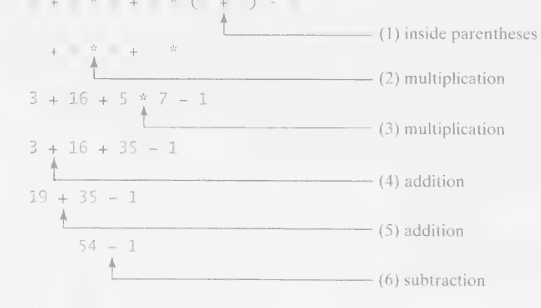

列表 2.8 提供了一个程序，使用公式 `celsius = (fahrenheit - 32) * 5 / 9` 将华氏度转换为摄氏度。

### 列表 2.8 FahrenheitToCelsius

```cpp
#include <iostream>
using namespace std;

int main() {
    // 输入华氏度
    double fahrenheit;
    cout << "Enter fahrenheit temperature: ";
    cin >> fahrenheit;
    // 计算摄氏度
    double celsius = (fahrenheit - 32) * 5 / 9;
    // 显示结果
    cout << fahrenheit << " Fahrenheit is " << celsius << " Celsius" << endl;
    return 0;
}
```

## 2.11 复合赋值运算符

| 行数 | 8 | 11 | 14 | 17 | 20 | 23 |
|---|---|---|---|---|---|---|
| 变量 | | | | | | |
| totalSeconds | 1203183086 | | | | | |
| currentSecond | | | 76 | | | |
| totalMinutes | | | | 20053051 | | |
| currentMinute | | | | | 101 | |
| totalHours | | | | | | 084217 |
| currentHour | | | | | | | 68 |

当调用 `time(0)`（第 8 行）时，它返回当前 GMT 与 1970 年 1 月 1 日午夜之间的差值，以秒为单位。

## 2.20 如何获取当前的秒、分、小时？

## 2.11 复合赋值运算符

运算符 `+=`、`-=`、`*=`、`/=` 和 `%=` 可以与赋值运算符结合，形成复合运算符。

通常，会使用变量的当前值进行修改并重新赋值回该变量。例如，以下语句将变量 `count` 增加 1：

```cpp
count = count + 1;
```

C++ 允许你使用复合赋值运算符将赋值和加法运算符结合。例如，上述语句可以写如下：

```cpp
count += 8;
```

`+=` 被称为加赋值运算符。其他复合运算符如表 2.3 所示。

| 运算符 | 名称 | 示例 | 等价 |
|---|---|---|---|
| += | 加赋值运算符 | i += 8 | i = i + 8 |
| -= | 减赋值运算符 | i -= 8 | i = i - 8 |
| *= | 乘赋值运算符 | i *= 8 | i = i * 8 |
| /= | 除赋值运算符 | i /= 8 | i = i / 8 |
| %= | 取模赋值 | i %= 8 | i = i % 8 |

复合赋值运算符在表达式中的其他运算符求值后最后执行。例如，

```cpp
x /= 4 + 5.5 * 1.5;
```

等同于

```cpp
x = x / (4 + 5.5 * 1.5);
```

# 第 2 章 基础编程

> 注意
>
> 复合赋值运算符中没有空格。例如，`+ =` 应该是 `+=`。

> 备注
>
> 与赋值运算符 (`=`) 一样，运算符 (`+=`、`-=`、`*=`、`/=`、`%=`) 也可以用于形成赋值语句以及表达式。例如，在以下代码中，第一行的 `x += 2` 是语句，第二行的表达式。

```cpp
x += 2; // 语句
cout << (x += 2); // 表达式
```


## 2.21 显示以下代码的输出：

```cpp
int a = 6;
a -= a + 1;
cout << a << endl;
a *= 6;
cout << a << endl;
a /= 2;
cout << a << endl;
```


## 2.12 递增和递减运算符

递增 (`++`) 和递减 (`--`) 运算符用于将变量加减 1。

### 递增运算符 (++)

`++` 和 `--` 是变量加1 或减 1 的简写运算符。这些运算符非常方便，因为在编程任务中经常改变值。例如，以下代码将 `i` 增加 1，将 `j` 减 1。

```cpp
int i = 3, j = 3;
i++; // i 变为 4
j--; // j 变为 2
```

`i++` 读作 i 加，`--` 读作 i 减。这些运算符被称为后置增和后置减，因为 `++` 和 `--` 放在变量之后。这些运算符也可以放在变量之前。例如：

```cpp
int i = 3, j = 3;
++i; // i 变为 4
--j; // j 变为 2
```

`++i` 将 i 增加 1，`--j` 将 j 减 1。这些运算符被称为前置增和前置减。在上述示例中，`++i` 或 `i++` 的效果是相同的，但当它们用于表达式时效果是不同的。表 2.4 描述了它们的区别并给出了示例。

| 运算符 | 名称 | 描述 | 示例（假设 i = 1） |
|---|---|---|---|
| ++var | 前置增 | 增加 1 并使用新值 | int j = ++i; // j 为 2, i 为 2 |
| var++ | 后置增 | 增加 1，但使用原始值 | int j = i++; // j 为 1, i 为 2 |
| --var | 前置减 | 减 1 并使用新值 | int j = --i; // j 为 0, i 为 0 |
| var-- | 后置减 | 减 1，但使用原始值 | int j = i--; // j 为 1, i 为 0 |

还有额外的示例来解释 `--` 的前置形式和 `++` 的后置形式之间的区别。考虑以下代码：

```cpp
int i = 10;
int newNum = 10 * ++i; // i 为 11, newNum 为 110
```

在这种情况下，`i` 增加了 1，乘法中使用 `i` 的新值。`newNum` 变为 110。如果将 `++i` 替换为 `i++`：

```cpp
int i = 10;
int newNum = 10 * i++; // i 为 11, newNum 为 100
```

在这种情况下，`i` 增加了 1，乘法中使用 `i` 的旧值。`newNum` 变为 100。

这是另一个例子：

```cpp
double x = 1.1;
double y = 5.4;
double z = x-- + (++y);
```

在执行所有行后，`x` 变为 0.1，`y` 变为 6.4，`z` 变为 7.5。

> 注意
>
> 对于大多数二进制运算符，C++ 没有规定操作数的顺序。通常你假设先求左侧操作数。例如，假设 `i` 为 1：如果先求左侧操作数 (`++i`)，表达式 `++i + i++` 结果为 4 (2 + 2)；如果先求右侧操作数，结果为 3 (2 + 1)。
>
> 由于 C++ 无法保证操作数的顺序，你不应该编写依赖操作数求值的代码。

## 2.22 下列陈述何正确？

- a. 任何表达式都可以作为 C++ 中的语句。
- b. 表达式 `x++` 可以作为语句。
- c. 语句 `x = x + 5` 也是一个表达式。
- d. 语句 `x = 0` 是非法。

## 2.23 显示以下代码的输出：

```cpp
int a = 6;
int b = a++;
cout << a << endl;
cout << b << endl;
a = 6;
b = ++a;
cout << a << endl;
cout << b << endl;
```

## 2.24 显示以下代码的输出：

```cpp
int a = 6;
int b = a--;
cout << a << endl;
cout << b << endl;
a = 6;
b = ++a;
cout << a << endl;
cout << b << endl;
```

## 2.13 数值转换

浮点数可以使用显式强制转换转换为整数。你可以将整数赋值给浮点变量吗？可以。你可以将浮点数赋值给整数变量吗？当将浮点值赋值给整数变量时，浮点值的小数部分会被截断（而不是四舍五入）。例如：

```cpp
int i = 34.7; // i 变为 34
double f = 1; // f 现在是 34
double g = 34.3; // g 变为 34.3
int j = 6; // j 现在是 34
```

可以对不同类型执行二进制运算吗？如果整数和浮点数参与二进制运算，C++ 会自动将整数转换为浮点数。因此 `3 * 4.5` 等于 `3.0 * 4.5`。C++ 也允许你使用转换运算符显式地将值从另一种类型。语法为：

```cpp
static_cast<type>(value)
```

其中 `value` 是变量、字面量或表达式，`type` 是你希望转换的类型。

例如，以下语句：

```cpp
cout << static_cast<int>(1.7);
```

显示 1。当 double 值转换为 int 时，小数部分会被截断。以下语句：

```cpp
cout << static_cast<double>(1) / 2;
```

显示 0.5，因为 1 首先被转换为 1.0，然后 1.0 除以 2。然而，语句：

```cpp
cout << 1 / 2;
```

显示 0，因为 1 和 2 都是整数，结果也应该是整数。

> 备注
>
> 静态转换也可以使用 `(type)` 语法——即给目标类型加上括号，后跟一个变量、字面量或表达式。这被称为 C 风格转换。例如。

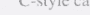

```cpp
int i = (int)5.4;
```

这等同于

```cpp
int i = static_cast<int>(5.4);
```

C++ `static_cast` 运算符是标准推荐的。它优于 C 风格转换。

# 54 第 2 章 基础编程


```cpp
double purchaseAmount;
cout << "Enter purchase amount: ";
cin >> purchaseAmount;

double tax = purchaseAmount * 0.06;
cout << "Sales tax is " << static_cast<int>(tax * 100) / 100.0;

return 0;
}
```

### 类型转换


| 行号 | purchaseAmount | tax | 输出 |
|---|---|---|---|
| 7 | 未定义 | | |
| 9 | 197.55 | | |
| 11 | | 11.853 | |
| 12 | | | Sales tax is 11.85 |

### 数字格式化

变量 `purchaseAmount` 存储了用户输入的购买金额（第 7–9 行）。假设用户输入了 197.55。销售税为购买金额的 6%，因此税额计算为 11.853（第 11 行）。第 12 行的语句显示税额 11.85，保留两位小数。注意：

```
tax * 100 is 1185.3
static_cast<int>(tax * 100) = 1185
static_cast<int>(tax * 100) / 100.0 = 11.85
```

因此，第 12 行的语句显示税额 11.85，保留两位小数。

- 2.25 在计算中可以混合使用不同类型的数值吗？
- 2.26 从 `double` 显式转换为 `int` 对 `double` 值的小数部分有什么影响？转换会改变被转换的变量吗？
- 2.27 显示以下输出：

```cpp
double f = 12.5;
int i = f;
cout << "f is " << f << endl;
cout << "i is " << i << endl;
```

- 2.28 如果你将列表 2.10 中第 12 行的 `static_cast<int>(tax * 100) / 100.0` 改为 `static_cast<int>(tax * 100) / 100.0`（此处），输入购买金额为 197.556 时输出是什么？
- 2.29 显示以下代码的打印结果：

```cpp
double amount = 5;
cout << amount / 2 << endl;
cout << 5 / 2 << endl;
```

## 2.14 软件开发过程

软件开发生命周期是多阶段的过程，包括需求规范、分析、设计、实现、测试、部署和维护。

开发软件产品是一个工程过程。软件产品无论大小，都具有相同的生命周期：需求规范、分析、设计、实现、测试、部署和维护，如图 2.2 所示。

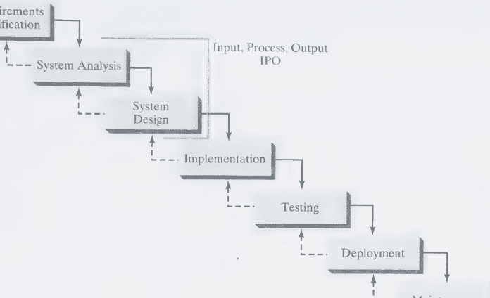

**图 2.2** 在软件开发生命周期的任何阶段，都有可能需要返回之前的阶段以纠正错误或处理可能导致软件无法按预期运行的其他问题。

需求规范是一个正式的过程，旨在理解软件要解决的问题，并详细记录软件系统必须完成的任务。这一阶段涉及用户与开发者之间的紧密互动。书中的大多数示例都是简单的，且需求表述得很清楚。但在现实世界中，问题并不总是定义得很好。开发者需要与客户（使用该软件的个人或组织）紧密合作，并仔细研究问题以确定软件必须做什么。

系统分析分析数据流并识别系统的输入和输出。分析有助于首先确定输出是什么，然后确定为了产生该输出需要什么输入。

系统设计是从输入获取输出的过程。这一阶段涉及使用多个层级的抽象，将问题拆解为可管理的组件，并为实现每个组件设计策略。你可以将每个组件视为执行系统特定功能的子系统。系统分析和设计的本质是输入、处理和输出（IPO）。

实现涉及将系统转换为程序。为每个组件编写单独的程序，然后它们集成在一起工作。这一阶段需要使用如 `C++` 等编程语言。实现涉及编码、自测和调试（即找到代码中的错误，称为 bug）。

测试确保代码符合需求规范并剔除 bug。通常由一个不参与产品设计和实现的独立软件工程师团队进行此类测试。

部署使软件可用。部署可以安装在每个用户的机器上，也可以安装在可以通过互联网访问的服务器上。维护关注产品的更新和改进。软件产品必须在不断变化的环境中持续运行并改进。这需要定期对产品进行升级，以修复新发现的 bug 并纳入变更。

为了看到软件开发过程的运作，我们将创建一个计算贷款还款的程序。贷款可以是车贷、学生贷款或抵押贷款。我们将关注需求规范、分析、实现和测试。

### 阶段 1：需求规范

- 提示用户输入年利率、贷款金额和年限。

### 阶段 2：系统分析

利率以百分比形式表示，例如 4.5%。程序需要通过除以 100 将其转换为小数。因为一年有 12 个月，为了从年利率获得月利率，需要将其除以 12。例如，如果年利率为 4.5%，则月利率为 4.5/1200 = 0.00375。

- 使用前面的公式计算每月还款额。
- 计算总还款额，即每月还款额乘以 12 再乘以年限。
- 显示每月还款额和总还款额。

### 阶段 3：系统设计

在系统设计期间，你确定程序的步骤。

### 阶段 4：实现

实现也称为编码（编写代码）。在公式中，你需要计算 $(1 + monthlyInterestRate)^{numberOfYears*12}$，可以使用 `pow(1 + monthlyInterestRate, numberOfYears * 12)` 获取。

列表 2.11 给出了完整的程序。

```cpp
30 monthlyPayment = static_cast<int>(monthlyPayment * 100) / 100.0;
31 totalPayment = static_cast<int>(totalPayment * 100) / 100.0;
32
33 // 显示结果
34 cout << "The monthly payment is " << monthlyPayment << endl;
35 cout << "The total payment is " << totalPayment << endl;

37 return 0;
38 }
```

#### 显示结果

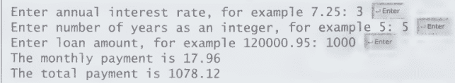

| 行# | 10 | 13 | 18 | 26 | 28 | 30 | 31 |
|---|---|---|---|---|---|---|---|
| 变量 | | | | | | | |
| annualInterestRate | 3 | | | | | | |
| monthlyInterestRate | | 0.0025 | | | | | |
| numberOfYears | | | | | | | |
| loanAmount | | | | 1000 | | | |
| monthlyPayment | | | | | 17.9687 | | |
| totalPayment | | | | | | 1078.12 | |
| monthlyPayment | | | | | | | 17.96 |
| totalPayment | | | | | | | 1078.12 |

#### `pow(a, b)` 函数

要使用 `pow(a, b)` 函数，你需要在程序中（第 2 行）包含 `cmath` 库，就像包含 `<iostream>` 库（第 1 行）一样。

程序在第 7–23 行提示用户输入 `annualInterestRate`、`numberOfYears` 和 `loanAmount`。如果你输入的是数值以外的内容，将发生运行时错误。

为变量选择最合适的数据类型。例如，`numberOfYears` 声明为 `int`（第 17 行）更好，尽管它也可以声明为 `long`、`float` 或 `double`。注意，`unsigned short` 可能是 `numberOfYears` 最合适的类型。为了简单起见，书中的示例将使用 `int` 表示整数，使用 `double` 表示浮点值。

计算每月还款的公式在第 26–27 行被转换为 C++ 代码。

第 30–31 行进行了类型转换，以获取保留两位小数的新的 `monthlyPayment` 和 `totalPayment`。

### 第 5 阶段：测试

在程序实现后，使用一些示例输入数据进行测试，并验证输出是否正确。某些问题可能涉及很多情况，正如你将在后面的章节中看到的那样。这类问题，你需要设计覆盖所有情况的测试数据。

## 2.15 案例研究：货币单位计数

> **提示**
> 本示例中的系统设计阶段识别了几个步骤。通过一次添加一个步骤并对其编码和测试是一个很好的方法。这种方法使得定位问题和调试程序变得容易。
> **增量式代码与测试**

### 2.30

你会如何编写以下算术表达式？

```math
$$-b + \sqrt{b^2 - 4ac} / 2a$$
```


### 2.15 案例研究：货币单位计数

本节介绍了一个将大额金额拆分为较小单位的程序。

假设你想开发一个程序，将给定金额转换为较小的货币单位。该程序允许用户以 `double` 值输入金额（代表美元和分的总额），并输出一份报告，列出按顺序排列的美元、季度币、一角、尼分和美分的货币等值数量，以便用最少量的硬币返回，如示例运行所示。

开发该程序的步骤如下：

1. 提示用户以小数输入金额，例如 11.56。
2. 将金额（例如 11.56）转换为分（1156）。
3. 将分除以 100 得到美元数量。使用分取模 `cents % 100` 获取剩余的分。
4. 将剩余的分除以 25 得到季度币数量。使用剩余的分取模 `remaining cents % 25` 获取剩余的分。
5. 将剩余的分除以 10 得到一角数量。使用剩余的分取模 `remaining cents % 10` 获取剩余的分。
6. 将剩余的分除以 5 得到尼分数量。使用剩余的分取模 `remaining cents % 5` 获取剩余的分。
7. 剩余的分就是美分。
8. 显示结果。

#### 最少硬币


完整程序位于列表 2.12。

#### 列表 2.12 ComputeChange.cpp

```cpp
12 // 寻找1美元的数量
13 int numberOfOfOneDollars = remainingAmount / 100;
14 remainingAmount = remainingAmount % 100;
```

```cpp
15 // 寻找季度币的数量
16 int numberOfQuarters = remainingAmount / 25;
17 remainingAmount = remainingAmount % 25;
```

```cpp
18 // 寻找一角的数量
19 int numberOfDimes = remainingAmount / 10;
20 remainingAmount = remainingAmount % 10;
```

```cpp
21 // 寻找尼分的数量
22 int numberOfNickels = remainingAmount / 5;
23 remainingAmount = remainingAmount % 5;
```

```cpp
24 // 寻找美分的数量
26 int numberOfPennies = remainingAmount;
```

```cpp
31 // 显示结果
33 cout << "Your amount " << amount << " consists of " << endl;
34 cout << numberOfOfOneDollars << " dollars" << endl;
35 cout << numberOfQuarters << " quarters" << endl;
36 cout << numberOfNickels << " nickels" << endl;
37 cout << numberOfPennies << " pennies" << endl;
40 return 0;
41 }
```


以 double 输入金额，例如 11.56：11.56

Your amount 11.56 consists of

11 dollars

2 quarters

0 dimes

1 nickels

1 pennies

| 行# | 9 | 11 | 14 | 15 | 18 | 19 | 22 | 23 | 26 | 27 | 30 |
|---|---|---|---|---|---|---|---|---|---|---|---|
| 变量 | | | | | | | | | | | |
| amount | | 11.56 | | | | | | | | | |
| remainingAmount | | 1156 | 56 | | | 6 | 1 | | | | |
| | | | | 11 | | | | | | | |
| numberOfOfOneDollars | | | | | | | | | | | |
| numberOfQuarters | | | | | | 2 | | | | | |
| numberOfDimes | | | | | | 0 | | | | | |
| numberOfNickels | | | | | | | | 1 | | | |
| numberOfPennies | | | | | | | | | 1 | | |

### 2.16 常见错误

变量 `amount` 是代表美元和分的 `double` 类型。它被转换为代表所有分的 `int remainingAmount`。例如，如果 `amount` 为 11.56，初始的 `remainingAmount` 为 1156。除法运算符产生除法的整数部分。因此 `1156 / 100` 为 11。取模运算符得到余数。因此 `1156 % 100` 为 56。

程序从总金额中提取最大美元数量并获得剩余金额 `remainingAmount`（第 14–15 行）。它从 `remainingAmount` 中提取最大季度币数量并获得新的 `remainingAmount`（第 18–19 行）。继续此过程，程序在剩余金额中找到数量的尼分和美分。

其中一个严重问题是将 `double` 转换为 `int remainingAmount` 时可能会丢失精度。这可能导致结果不准确。如果你尝试输入金额 10.03，那么 `10.03 * 100` 变为 `1002.999999999`。你会发现程序显示为 10 美元和 2 美分。要修复这个问题，请输入代表分的整数值（参见编程练习 2.24）。


常见的基础编程错误通常涉及未声明变量、未初始化变量、整数溢出、无意整数除法和舍入误差。


#### 常见错误 1：未声明/未初始化变量和未使用的变量

在使用变量之前必须对其声明并赋值。常见错误是未声明或未初始化变量。考虑以下代码：

```cpp
double interestRate = 0.05;
double interest = interestRate * 45;
```

这段代码是错误的，因为 `interestRate` 被赋值了值 0.05，但 `interest` 没有被声明和初始化。`C++` 是大小写敏感的，因此它认为 `interestRate` 和 `interest` 是两个不同的变量。

如果一个变量被声明但在程序中未使用，它可能是潜在的编程错误。因此，你应该从程序中删除未使用的变量。例如，在以下代码中，`taxRate` 从未被使用过。因此，应该从代码中删除它。

```cpp
double interestRate = 0.05;
double taxRate = 0.05;
double interest = interestRate * 45;
cout << "Interest is " << interest << endl;
```

#### 常见错误 2：整数溢出

数字以有限的位数存储。当给变量赋值一个太大（尺寸上）而无法存储的值时，会导致溢出。例如，执行以下语句会导致溢出，因为 `short` 类型变量可以存储的最大值是 32767。32768 太大了。


```cpp
short value = 32767 + 1; // value 实际上将变为 -32768
```

同样，在 `short` 类型变量中执行以下语句会导致溢出，因为可以存储的最小值是 -32768。值 -32769 太大无法存储在 `short` 变量中。

```cpp
short value = -32768 - 1; // value 实际上将变为 32767
```

`C++` 不会对溢出进行错误报告。在处理给定类型最大或最小范围的数字时要小心。

当浮点数太小（即太接近 0）而无法存储时，会发生下溢。`C++` 会将其近似为 0。因此，通常你不需要担心下溢。

#### 常见问题 3：舍入误差

舍入误差（也称为舍入误差）是计算出的数字近似值与其精确数学值之间的差异。例如，如果你保留三位小数，1/3 约等于 0.333；如果你保留七位小数，它就是 0.3333333。由于值中可以存储的位数有限，舍入误差是不可避免的。涉及浮点数的计算都是近似的，因为这些数字并不是以完全精确的形式存储的。例如：


```cpp
float a = 1000.43;
float b = 1000.0;
cout << a - b << endl;
```

### 常见问题 4：无意的整数除

C++ 使用相同的运算符 `/` 来执行整数除和浮点除法。当两个操作数都是整数时，`/` 运算符执行整数除。操作的结果是商，小数部分被截断。要强制两个整数进行浮点除法，请将其中一个整数转换为浮点数。例如，(a)中的代码显示 1，而(b)中的代码显示的平均值为 1.5。

```cpp
int number1 = 1;
int number2 = 2;
double average = (number1 + number2) / 2;
cout << average << endl;
```

```cpp
int number1 = 1;
int number2 = 2;
double average = (number1 + number2) / 2.0;
cout << average << endl;
```

(a)

(b)

### 常见问题 5：忘记头文件

忘记包含头文件是一种常见的编译错误。`pow` 函数定义在 `cmath` 头文件中，`time` 函数定义在 `ctime` 头文件中。要在程序中使用 `pow` 函数，程序需要包含 `cmath` 头文件。对于每个使用控制台输入输出的程序，程序都需要包含 `iostream` 头文件。

## 关键术语

- 算法 30
- 赋值运算符 (=) 38
- 赋值语句 38
- C 风格转换 53
- 转换运算符 52
- const 关键字 39
- 常量 39
- 数据类型 31
- 声明变量 31
- 递减运算符 (--) 50
- double 类型 43
- 表达式 38
- float 类型 43
- 后置增 50
- 浮点数 31
- 前置减 50
- 标识符 35
- 前置增 50
- 递增运算符 (++) 50
- 原生数据类型 31
- 增量代码与测试 59
- 伪代码 30
- int 类型 36
- 需求规范 55
- IPO 34
- 变量范围 37
- 字面量 42
- 系统分析 55
- long 类型 36
- 系统设计 55
- 类型收窄 53
- 下溢 62
- 操作数 43
- UNIX 纪元 47
- 运算符 43
- 变量 31
- 溢出 61
- 类型拓宽 53
- 后置减 50

## 总结

- `cin` 对象配合流提取运算符 (`>>`) 可以从控制台读取输入。
- 标识符是程序中命名元素的名称。标识符是由字母、数字和下划线 (`_`) 组成的字符序列。标识符必须以字母或下划线开头，不能以数字开头。标识符不能是保留字。
- 选择描述性的标识符可以使程序易于读。
- 声明变量告诉编译器变量可以持有什么类型的数据。
- 在 C++ 中，等号 (`=`) 用作赋值运算符。
- 在函数中声明的变量必须赋值。否则，该变量被称为未初始化，其值是不可预测的。
- 命名常量或简单的常量代表从不改变永久数据。
- 命名常量通过使用关键字 `const` 来声明。
- 根据惯例，常量使用大写命名。
- C++ 提供了整数类型（`short`、`int`、`long`、`unsigned short`、`unsigned int` 和 `unsigned long`），表示各种大小的有符号整数和无符号整数。
- 无符号整数是非负整数。
- C++ 提供了浮点数类型（`float`、`double` 和 `long double`），表示不同精度的浮点数。
- C++ 提供了执行数值运算的运算符：`+`（加法）、`-`（减法）、`*`（乘法）、`/`（除法）和 `%`（取模）。
- 整数算术 (`/`) 产生整数结果。
- 在 C++ 中，`%` 运算符仅用于整数。
- C++ 表达式中的数值运算符的应用方式与在算术表达式中相同。
- 递增运算符 (`++`) 和 递减运算符 (`--`) 将变量增加或减小 1。
- C++ 提供了 `+=`（相加）、`-=`（相减）、`*=`（相乘）、`/=`（除法）和 `%=`（取模）。
- 在计算混合类型的表达式时，C++ 会转换操作数。
- 你可以使用 `static_cast<type>` 显式转换值。
- 在计算机科学中，1970 年 1 月 1 日被称为 UNIX 纪元。

# 第 2 章 基础编程

## 测验

- 2.1 (摄氏度转华度) 编写程序读取摄氏度，将其转换为华度并显示结果。公式为 `F = C * 9/5 + 32`。
- 2.2 (计算体积) 编写程序读取半径和长度，使用以下公式计算面积和体积：`area = π * radius`；`volume = area * length`。
- 2.3 (英尺转米) 编写程序读取英尺，将其转换为米。1 英尺是 0.3048 米。
- 2.4 (磅转千克) 编写程序将磅转换为千克。程序提示用户输入磅，将其转换为千克并显示结果。1 磅是 0.454 千克。
- 2.5 (财务应用：计算小费) 编写程序读取总额和小费率，然后计算小费和总计。例如，如果用户输入 10 作为总额，15% 作为小费，程序将显示小费为 $1.5，总计为 $11.5。
- 2.6 (数字和) 编写程序读取一个 0 到 1000 之间的整数，并加上该整数的所有数字。例如，如果整数是 932，其所有数字之和为 14。提示：使用 `%` 运算符提取数字，使用 `/` 运算符移除已提取的数字。`932 % 10 = 2` 且 `932 / 10 = 93`。
- 2.7 (年数) 编写一个程序，提示用户输入分钟数（例如 10 亿），并显示对应的年数和天。为了简单起见，假设一年为 365 天。以下是示例运行：

| 输入分钟数：1000000000 |
|---|
| 1000000000 分大约是 1902 年 214 天 |

- 2.8 (当前时间) 列表 2.9 `ShowTime.cpp` 提供了一个显示 GMT（格林治）时间的程序。修改该程序，提示用户输入相对于 GMT 的偏移量，并显示指定时区的时间。以下是示例运行：

| 输入 GMT 时区偏移量：-5 |
|---|
| 当前时间是 4:50:34 |

## 2.9 (物理：加速度)

平均加速度定义为速度的变化除以产生该变化所需的时间，其公式如下：

```
a = (v1 - v0) / t
```

编写一个程序，提示用户输入初速度（米/秒）$v_0$、末速度（米/秒）$v_1$ 以及时间跨度（秒）$t$，并显示平均加速度。以下是示例运行：

| 输入 v0, v1 和 t：5.5 50.9 4.5 |
|---|
| 平均加速度为 10.0889 |

## 2.10 (科学：计算能量)

编写一个程序，计算将水从初始温度加热到最终温度所需的能量。你的程序应提示用户输入水的重量（公斤）以及水的初始和最终温度。计算能量的公式为：

```
Q = M * (finalTemperature - initialTemperature) * 4184
```

其中 M 是水的重量（公斤），温度单位为摄氏度，能量 Q 的单位为焦耳。以下是示例运行：

| 输入水的重量（公斤）：55.5 |
|---|
| 输入初始温度：3.5 |
| 输入最终温度：10.5 |
| 所需能量为 1625484.0 |

## 2.11 (人口预测)

重写编程练习 1.11，提示用户输入年数，并显示若干年后的人口。编写此程序时可以使用编程练习 1.11 中的提示。以下是程序的示例运行：

| 输入年数：5 |
|---|
| 5 年后的人口是325932970 |

## 2.12 (物理：寻找跑道长度)

给定飞机的加速度 $a$ 和起飞速度 $v$，可以使用以下公式计算飞机起飞所需的最小跑道长度：

```
length = v^2 / (2a)
```

编写一个程序，提示用户输入米/秒（m/s）的速度 v 和 米/每秒平方（m/s²）的加速度 a，并显示最小跑道长度。以下是示例运行：

| 输入速度和加速度：60 3.5 |
|---|
| 该飞机的最小跑道长度为 54.286 |

## 2.13 (金融应用：复利)

假设你每月向储蓄账户存入 100 美，年利率为 5%。每月利率为 `0.05/12 = 0.00417`。第一个月后，账户金额变为

```
100 * (1 + 0.00417) = 100.417
```

第二个月后，账户金额变为

```
(100 + 100.417) * (1 + 0.00417) = 201.252
```

第三个月后，账户金额变为

```
(100 + 201.252) * (1 + 0.00417) = 302.507
```

以此类推。

编写一个程序，提示用户输入每月储蓄金额，并显示六个月后的金额。（在编程练习 5.32 中，你将使用循环来简化代码并显示任意月份的金额。）

| 输入每月储蓄金额：100 |
|---|
| 六个月后，账户金额为 $608.81 |

## 2.14 (健康应用：BMI)

体质指数 (BMI) 是衡量健康的指标。它可以通过将体重（公斤）除以身高（米）的平方来计算。编写一个程序，提示用户输入其体重（磅）和身高（英寸），并显示 BMI。注意 1 磅等于 0.45359237 公斤，1 英寸等于 0.0254 米。以下是示例运行：


| 输入体重（磅）：95.5 |
|---|
| 输入身高（英寸）：50 |
| BMI 为 26.8573 |

## 2.15 (几何：两点距离)

编写一个程序，提示用户输入两个点 (x1, y1) 和 (x2, y2)，并显示它们之间的距离。距离计算公式为 $\sqrt{(x_2 - x_1)^2 + (y_2 - y_1)^2}$。注意你可以使用 `pow(a, 0.5)` 来计算。以下是示例运行：

| 输入 x1 和 y1：1.5 -3.4 |
|---|
| 输入 x2 和 y2：4 5 |
| 两点之间的距离为 8.76413144214 |

## 2.16 (几何：六边形面积)

编写一个程序，提示用户输入六边形的边长并显示其面积。六边形面积计算公式为 $Area = \frac{3\sqrt{3}}{2}s^2$，其中 $s$ 是边长。以下是示例运行：

```
输入边长：5.5
六边形的面积为 78.5895
```

## 2.17 (科学：风寒)

室外有多冷？仅凭温度无法提供答案。风速、相对湿度阳光等因素在决定寒冷方面起着重要作用。2001 年，国家气象局 (NWS) 实施了新的风寒指数来衡量寒冷。公式为：$t_{nw} = 35.74 + 0.6215t_F - 0.4275v^{0.16}$，其中 $t_F$ 是华氏温度，$v$ 是每小时数。该公式不适用于风速低于 2 mph 或温度低于 -58°F 或 41°C 的情况。编写一个程序，提示用户输入 -58°F 到 41°F 之间的温度以及大于 2 的风速，并显示风寒指数。使用 `pow(a, b)` 计算 $v^{0.16}$。以下是示例运行：

```
输入华氏温度：5.3
输入每小时风速：6
风寒指数为 -5.6707
```

## 2.18 (打印表格)

编写一个程序显示下表：

| a | b | pow(a, b) |
|---|---|---|
| 1 | 2 | 1 |
| 2 | 3 | 8 |
| 3 | 4 | 8 |
| 4 | 5 | 81 |
| 4 | 5 | 1024 |
| 5 | 6 | 15625 |

## 2.19 (几何：三角形面积)

编写一个程序，提示用户输入三角形的三个点 (x1, y1), (x2, y2), (x3, y3) 并显示其面积。面积计算公式为 $s = (side1 + side2 + side3)/2$，$area = \sqrt{s(s-side1)(s-side2)(s-side3)}$。以下是示例运行：

```
输入三角形的三个点：1.5 -3.4 4.6 9.5 -3.4
三角形的面积为 33.6
```


## 2.20 (直线斜率)

编写一个程序，提示用户输入两个点 (x1, y1) 和 (x2, y2) 的坐标，并显示连接点的直线斜率。斜率公式为 (y - y1)/(x2 - x1)。以下是示例运行：

```
输入两个点的坐标：4.5 -5.5 6.6 -6.5
连接点 (4.5, -5.5) 和 (6.6, -6.5) 的直线斜率为 -0.4761
```

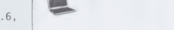

## 2.21 (行驶费用)

编写一个程序，提示用户输入行驶距离、汽车的每加仑油里程以及每加仑油价格，并显示旅行费用。以下是示例运行：

```
输入行驶距离：900.5
输入每加仑里程：25.5
输入每加仑价格：3.55
行驶费用为 $125.36
```


## 2.22 (金融应用：计算利息)

如果你知道余额和年利率，可以使用以下公式计算每月还款的利息：

```
interest = balance x (annualInterestRate/1200)
```

编写一个程序读取余额和年利率，并显示下个月的利息。以下是示例运行：

```
输入余额和利率（例如 3 表示 3%）：1000 3.5
利息为 2.91667
```


## 2.23 (金融应用：未来投资价值)

编写一个程序读取投资金额、年利率和年数，并使用以下公式显示未来投资价值：

```
futureInvestmentValue = investAmount X (1 + monthlyInterestRate)^numberYears
```

例如，如果你输入金额 1000，年利率 3.25%，年 1，未来投资价值为 1032.98。以下是示例运行：

```
输入投资金额：1000
输入百分比年利率：4.25
输入年数：1
累计价值为 $1043.34
```


## 2.24 (金融应用：货币单位)

重写列表 2.12 `ComputeChange.cpp`，以修复将浮点数转换为整数值时丢失精度的问题。将输入设为整数，其最后两位代表分币。例如，输入 1155 代表 11 美元 56 分。


# 第 3 章 选择

## 目标

- 声明 `bool` 类型的变量并使用关系运算符编写布尔表达式（§3.2）。
- 使用单向 `if` 语句实现选择控制（§3.3）。
- 使用双向 `if-else` 语句实现选择控制（§3.4）。
- 使用嵌套 `if` 语句和多路 `if-else` 语句实现选择控制（§3.5）。
- 避免 `if` 语句中常见的错误和陷阱（§3.6）。
- 使用选择语句对各种示例（BMI、计算税、减法练习）进行编程（§3.7–3.9）。
- 使用 `rand` 函数生成随机数，并使用 `srand` 函数设置随机数种子（§3.9）。
- 使用逻辑运算符（`&&`、`||`、`!`）组合条件（§3.10）。
- 使用带有组合条件的选择语句进行编程（闰年、彩票）（§3.11–3.12）。
- 使用 `switch` 语句实现选择控制（§3.13）。
- 使用条件表达式编写表达式（§3.14）。
- 检查运算符优先级和运算符结合性的规则（§3.15）。
- 调试错误（§3.16）。


## 3.1 引言

程序可以根据条件决定执行哪些语句。如果你在列表 2.2 `ComputeAreaWithConsole.cpp` 中为半径输入一个负值，程序将显示一个无效的结果。如果半径为负数，你不希望程序计算面积。你该如何处理这种情况呢？

与所有高级编程语言一样，C++ 提供了选择语句：让你可以在备选方案之间选择的语句。你可以使用以下选择语句替换列表 2.2 中的第 12–15 行：

```cpp
if (radius < 0) {
    cout << "Incorrect input" << endl;
} else {
    area = radius * radius * PI;
    cout << "The area of the circle of radius " << radius << " is " << area << endl;
}
```

选择语句使用的条件是布尔表达式。布尔表达式是一个求值为布尔值（`true` 真或 `false` 假）的表达式。我们现在介绍布尔类型和关系运算符。

## 3.2 bool 数据类型

`bool` 数据类型声明一个值为 `true` 或 `false` 的变量。你如何比较两个值，例如判断半径是否大于 0、等于 0 或小于 0？C++ 提供了关系运算符，如表 3.1 所示，可用于比较值（假设表中的 radius 为 5）。

| 运算符 | 数学符号 | 示例 (radius 为 5) | 结果 |
|---|---|---|---|
| `<` | `<` | 小于 | `radius < 0` | `false` |
| `<=` | `<=` | 小于等于 | `radius <= 0` | `false` |
| `>` | `>` | 大于 | `radius > 0` | `true` |
| `>=` | `>=` | 大于等于 | `radius >= 0` | `true` |
| `==` | `==` | 等于 | `radius == 0` | `false` |
| `!=` | `!=` | 不等于 | `radius != 0` | `true` |

**注意**

相等性测试使用两个等号 (`==`)，而不是单个等号 (`=`)。后者符号用于赋值。


# 第 3 章 选择

比较的结果是一个布尔值：`true` 或 `false`。保存布尔值的变量被称为布尔变量。`bool` 数据类型用于声明布尔变量。例如，以下语句将 `true` 赋值给变量 `lightsOn`：

```cpp
bool lightsOn = true;
```

## 3.3 if 语句

`true` 和 `false` 是布尔字面量，就像数字 10 一样。它们是关键字，布尔字面量不能用作程序中的标识符。

在内部，C++ 使用 1 表示 `true`，用 0 表示 `false`。如果你向控制台显示 `bool` 值，如果值为 `true` 则显示 1，如果为 `false` 则显示 0。例如：

```cpp
cout << (4 < 5);
```

显示 1，因为 4 < 5 为真。

```cpp
cout << (4 > 5);
```

显示 0，因为 4 > 5 为假。

> **注意**
>
> 在 C++ 中，你可以将数值赋值给 `bool` 变量。任何非零值都求值为 `true`，零值求值为 `false`。例如，执行以下赋值语句后：`b1` 和 `b3` 变为 `true`，`b2` 变为 `false`。

**3.1 列出关系运算符。**

**3.2 假设 x 为 1，显示以下布尔表达式的结果：**

```
(x > 0)
(x < 0)
(x != 0)
(x >= 0)
(x != 1)
```

**3.3 显示以下代码的打印输出：**

```cpp
bool b = true;
int i = b;
cout << b << endl;
cout << i << endl;
```

`if` 语句是一种允许程序指定备用执行路径的结构。

你目前为止编写的程序都是按顺序执行的。然而，经常会有你必须提供备用路径的情况。C++ 提供了几种类型的选择语句：单向 `if` 语句、双向 `if-else` 语句、嵌套 `if` 语句、`switch` 语句和条件表达式。

单向 `if` 语句仅在条件为 `true` 时执行。以下是单向 `if` 的语法：

```cpp
if (boolean-expression)
{
    statement;
}
```

语句的流程图见图 3.1。流程图是描述算法的图，用方框表示步骤，菱形表示决策，箭头表示流。

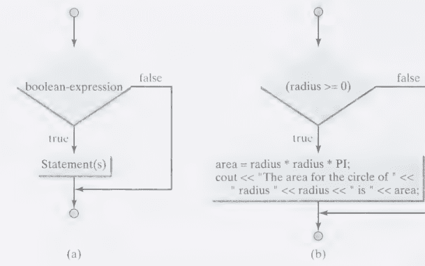

**图 3.1** 单向 `if` 语句在条件为真时执行。

如果半径大于等于 0，则计算面积；否则不执行语句。修正后的版本为：

```cpp
if (radius >= 0)
{
    area = radius * radius * PI;
}
```

如果包含单个语句，可以省略大括号。例如：

```cpp
if (i > 0)
    cout << "is positive";
```

等同于：

```cpp
if (i > 0)
{
    cout << "is positive";
}
```

列表 3.1 给了一个提示用户输入整数的程序：如果数字是 5 的倍数，显示 HiFive；如果是偶数，显示 HiEven。

```cpp
#include <iostream>
using namespace std;

int main() {
    // 提示用户输入整数
    int number;
    cout << "Enter an integer: ";
    cin >> number;

    if (number % 5 == 0)
        cout << "HiFive" << endl;

    if (number % 2 == 0)
        cout << "HiEven" << endl;

    return 0;
}
```


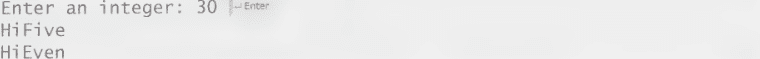

## 3.4 双向 if-else 语句

`if-else` 语句根据条件的真假决定执行哪些语句。

单向 `if` 语句在指定的条件为真时执行操作。如果条件为假，则什么都不做。但如果你想在条件为假时执行备用操作怎么办？你可以使用双向 `if-else` 语句，根据条件的真假指定不同的操作。以下是双向 `if-else` 语句的语法：

```cpp
if (boolean-expression)
{
    statement(s)-for-the-true-case;
}
else
{
    statement(s)-for-the-false-case;
}
```

语句的流程图见图 3.2。

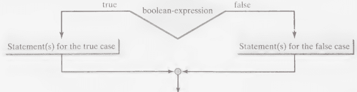

**图 3.2** `if-else` 语句在布尔表达式求值为真时执行真情况的语句；否则，执行假情况的语句。

## 3.6 下列代码中有什么错误？

```cpp
if radius >= 0
{
    area = radius * radius * PI;
    cout << "The area for the circle of <<
    radius << " is " << area;
}
```

```cpp
cout << "The area for the circle of radius " <<
radius << " is " << area;
else
{
  cout << "Negative radius";
}
```

通常情况下，如果大括号内只有一条语句，则可以省略。因此，在前面的示例中，包裹 `cout << "Negative radius"` 语句的大括号是可以省略的。

这里是 `if-else` 语句的示例。该示例检查一个数字是偶数还是奇数，如下所示：

```cpp
if (number % 2 == 0)
    cout << number << " is even.";
else
    cout << number << " is odd.";
```

3.7 写一个语句，如果分数大于 90，则增加 3%，否则工资增加 1%。

3.8 如果 `number` 为 30，(a) 和 (b) 中代码的输出是什么？如果 `number` 为 31，输出是什么？

```cpp
if (number % 2 == 0)
    cout << number << " is even."; endl;
cout << number << " is odd."; endl;
(a)
if (number % 2 == 0)
    cout << number << " is even."; endl;
else
    cout << number << " is odd."; endl;
(b)
```

## 3.5 嵌套 if 和多路 if-else 语句

一个语句可以放在另一个语句内部，形成嵌套语句。

`if` 或 `if-else` 语句中的语句可以是合法的 C++ 语句，包括另一个 `if` 或 `if-else` 语句。内部语句被称为嵌套在外部 `if` 语句内部。内部语句还可以包含另一个语句；事实上，嵌套深度是没有限制的。例如，以下就是一个嵌套语句：

```cpp
if (i > k)
{
  if (j > k)
    cout << "i and j are greater than k" << endl;
}
cout << "i is less than or equal to k" << endl;
```

`if (j > k)` 语句嵌套在 `(i > k)` 语句内部。

嵌套语句有助于实现多种备选方案。例如，图 3.3a 给出的语句根据分数给变量 `grade` 分配字母等级，具有多种备选方案。

| if (score >= 90.0) cout << "Grade is A"; else if (score >= 80.0) out << "Grade is B"; else if (score >= 70.0) out << "Grade is C"; else if (score >= 60.0) out << "Grade is D"; else out << "Grade is F"; | 等效 | if (score >= 90.0) cout << "Grade is A"; else if (score >= 80.0) out << "Grade is B"; else if (score >= 70.0) out << "Grade is C"; else if (score >= 60.0) cout << "Grade is D"; else out << "Grade is F"; |

**图 3.3** (b) 使用多路 `if-else` 语句显示了多种方案的首选格式。

该语句的执行过程如图 3.4 所示。首先测试第一个条件 `(score >= 90.0)`。如果为真，等级为 A。如果为假，则测试第二个条件 `(score >= 80.0)`。如果第二个条件为真，等级为 B。如果为假，则测试第三个条件以及剩余的条件（如有必要），直到满足某个条件或所有条件都为假。在后一种情况下，等级为 F。每个条件只有在它之前的所有条件都为假时才会被测试。

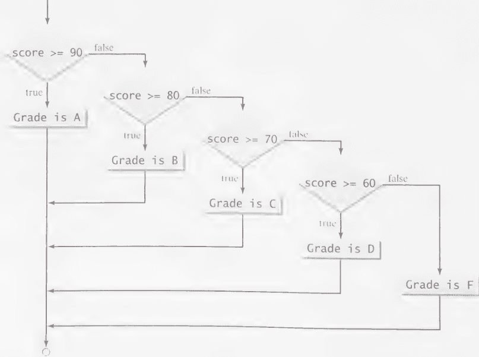

**图 3.4** 你可以使用多路 `if-else` 语句来分配等级。

## 3.6 常见错误和陷阱

图 3.3a 中的 `if` 语句与图 3.3b 中的 `if` 语句等效。事实上，图 3.3b 是多方案 `if` 语句的首选编码风格。这种风格被称为多路 `if-else` 语句，避免了深层缩进，并使程序易于处理。

3.9 假设 `x` 和 `y`，显示以下代码的输出（如果有）。如果 `x = 3` 且 `y = 4`，输出是什么？如果 `x = 2` 且 `y = 2`，输出是什么？画出代码的 Check Point 流程图。

```cpp
if (x > y)
{
  if (y > x)
  {
    int z = x + y;
    cout << "z is " << z << endl;
  }
}
else
  cout << x << endl;
```

3.10 假设 `x = 2` 且 `y = 3`。显示以下代码的输出（如果有）。如果 `x = 3` 且 `y = 2`，输出是什么？如果 `x = 3` 且 `y = 3`，输出是什么？

```cpp
if (x > y)
{
  if (y > 2)
  {
    int z = x + y;
    cout << "x is " << z << endl;
  }
}
else
  cout << "x" << endl;
```

3.11 以下代码中有什么错误？

```cpp
if (score >= 60.0)
  cout << "Grade D";
else if (score >= 70.0)
  cout << "Grade C";
else if (score >= 80.0)
  cout << "Grade B";
else if (score >= 90.0)
  cout << "Grade A";
else
  cout << "Grade F";
```

## 3.6 常见错误和陷阱

选择语句中，缺少大括号、分号位置错误、误用 `=` 以及悬空 `else` 子句是常见错误。`if-else` 语句中的语句以及值的相等测试是常见陷阱。

### 常见错误 1：缺少大括号

如果 `if` 块只包含一条语句，则可以省略大括号。然而，在 `if` 语句中不使用大括号的情况下添加多个语句是常见的错误。这时必须插入大括号。例如，(a) 中的以下代码是错误的，应该像 (b) 那样使用大括号来组合多个语句。

```cpp
if (radius >= 0)
    area = radius * radius;
    cout << "The area " << area;
```

(a) 错误

```cpp
if (radius >= 0)
{
    area = radius * radius;
    cout << "The area " << area;
}
```

(b) 正确

在 (a) 中，`cout` 语句并不是 `if` 语句的一部分。它与以下代码相同：

```cpp
if (radius >= 0)
    area = radius * radius;

cout << "The area " << area;
```

无论 `if` 语句中的条件如何，控制台语句都会执行。

### 常见错误 2：if 行末尾的分号错误

在 `if` 行末尾添加分号（如下所示）是一个常见的错误。

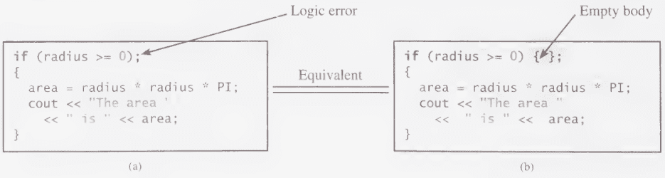

```cpp
if (radius >= 0);
{
    area = radius * radius;
    cout << "The area " << area;
}
```

(a) 错误

```cpp
if (radius >= 0)
{
    area = radius * radius;
    cout << "The area " << area;
}
```

(b) 正确

这种错误很难发现，因为它既不是编译错误也不是运行时错误；它是逻辑错误。(a) 中的代码等效于具有空实体的 (b)。

### 常见错误 3：误用 =

相等运算符是两个等号 `(==)`。在 C++ 中，如果你误用 `=` 代替 `==`，会导致逻辑错误。考虑以下代码：

```cpp
if (count = 3)
    cout << "count is zero" << endl;
else
    cout << "count is not zero" << endl;
```

它总是显示 "count is zero"，因为 `count = 3` 执行了赋值且赋值的结果为 3。由于 3 是非零值，它被 `if` 语句解释为真。记住，任何非零值均为真，零值为假。

### 常见错误 4：对布尔值的冗余测试

在测试条件中测试 `bool` 变量是真还是假，使用如 (a) 代码中的相等运算符是冗余的：

| if (even == true) | if (even) |
| :--- | :--- |
| cout << "It is even."; | cout << "It is even."; |
| | 更好 |
| (a) | (b) |

相反，像 (b) 那样直接测试 `bool` 变量更好。此点的另一个理由是避免难以检测的错误。在测试条件中使用 `==` 运算符来比较两个项的相等性是一个常见错误。它会导致以下错误的语句：

```cpp
if (even = true)
    cout << "It is even.";
```

这条语句将真赋给 `even`，导致 `even` 始终为真。因此，`if` 语句的条件是...

### 常见错误 5：悬空 else 歧义

(a) 代码有两个 `if` 和一个 `else` 子句。`else` 子句匹配哪个 `if` 子句？缩进显示 `else` 匹配第一个 `if`。然而，`else` 子句实际上匹配第二个 `if` 子句。这种情况被称为悬空 `else` 歧义。`else` 子句总是匹配最近的未匹配的 `if`。因此，(a) 中的语句等效于 (b) 中的代码：

| int i = 1, j = , k = ; | int i = 1, j = , k = |
| :--- | :--- |
| if (i > j) | if (i > j) |
| if (i > k) | if (i > k) |
| cout << ""; | cout << ""; |
| else | 缩进正确的情况下更好 | else << "B"; |
| (a) | (b) |

由于 `(i > j)` 为假，(a) 和 (b) 中的语句都没有显示任何内容。要强制 `else` 子句匹配第一个 `if` 子句，你必须添加一对大括号：

```cpp
int i = 1, j = 2, k = 3;
if (i > j)
{
  if (i > k)
    cout << "A";
}
else
  
 <<B

```

这条语句显示 B。

### 常见错误 6：两个浮点值的相等性

正如常见错误 3 中提到的，浮点数的精度有限，涉及浮点数的计算可能会引入舍入误差。因此，对两个浮点值的相等测试是不可靠的。例如，如果你期望以下代码显示 `x is 0.5`，但惊讶的是它显示

# 82 第 3 章 选择

```cpp
double x = 1.0 - 0.1 - 0.1 - 0.1;
if (x == 0.5)
    cout << "x is 0.5" << endl;
else
    cout << "x is not 0.5" << endl;
```

在这里，`x` 并不等于 0.5，但它非常接近 0.5。你不能可靠地测试两个浮点数的相等性。然而，你可以通过测试两个数之间的差是否小于某个阈值来比较它们是否足够接近。也就是说，如果 `|x - y| < ε`，则两个数 `x` 和 `y` 非常接近，`ε` 是一个很小的希腊字母，读作 epsilon，通常表示一个极小的值。通常，我们在比较两个 `double` 类型的值时使用 `ε = 10⁻¹⁴`，在比较两个 `float` 类型的值时使用 `10⁻⁷`。对于代码：

```cpp
const double EPSILON = 1e-14;
double x = 1.0 - 0.1 - 0.1 - 0.1 - 0.5;
if (abs(x - 0.5) < EPSILON)
    cout << "x is approximately 0.5" << endl;
```

将显示

x is approximately 0.5

`cmath` 库中的 `abs(a)` 函数可用于返回 `a` 的绝对值。

# 常见陷阱 1：简化布尔变量赋值

通常，程序员会编写如下所示的代码，将测试条件赋值给布尔变量：

| if (number % 2 == 0) | 等价于 | bool even |


| even = true; | 这样更好 | number % 2 == 0; |
|---|---|---|
| else = false; | | |

这并不是错误，但像 (b) 所示那样写会更好。

# 常见陷阱 2：避免不同情况下的重复代码

通常，程序员会在不同的情况中编写可以合并在一个地方的重复代码。例如，以下语句中高亮的代码是重复的：

```cpp
if (inState)
{
    tuition = 5000;
    cout << "The tuition is " << tuition << endl;
}
else
{
    tuition = 5000;
    cout << "The tuition is " << tuition << endl;
}
```

这并不是错误，但更好的写法如下所示：

```cpp
if (inState)
{
    tuition = 5000;
}
else
{
    tuition = 15000;
}
cout << "The tuition is " << tuition << endl;
```

新代码消除了重复并使代码易于维护，因为如果修改打印语句，你只需要在一个地方进行更改。

# 常见陷阱 3：整数值可以当作布尔值使用

在 C++ 中，布尔值 `true` 被视为 1，`false` 被视为 0。数值可以被当作布尔值使用。特别是，C++ 将非零值转换为 `true`，将 0 转换为 `false`。布尔值也可以被当作整数使用。这可能导致潜在的逻辑错误。例如，(a) 中的以下代码存在逻辑错误。假设 `amount` 为 40，代码将显示 Amount is more than 50，因为 `!amount` 求值结果为 0 且 `<= 50` 为真。正确的代码应如 (b) 所示。

```cpp
if (amount <= 50)
cout << "Amount is more than 50";
```

(a)

```cpp
if (amount <= 50)
cout << "Amount is more than 50";
```

(b)

# 3.12 显示以下代码的输出：


```cpp
amount = 5;
if (amount >= 100)
cout << "Amount is " << amount << " ";
cout << "Tax is " << amount * 0.03;
```

(a)

```cpp
amount = 5;
if (amount >= 100)
cout << "Amount is " << amount << " ";
cout << "Tax is " << amount * 0.03;
else;
```

(b)

```cpp
amount = 5;
if (amount >= 100)
cout << "Amount is " << amount << " ";
cout << "Tax is " << amount * 0.03;
```

(a)

```cpp
amount = 0;
if (amount >= 100)
cout << "Amount is " << amount << " ";
cout << "Tax is " << amount * 0.03;
else
cout << "Amount is " << amount << endl;
```

(b)

# 3.13 以下哪些语句是等价的？哪一个是有缩进的？

```cpp
if (i > 0) if
(j > 0); else
x = 0;
elif (k > 0) y = 0;
else z = 0;
```

(a)

```cpp
if (i > 0) {
    (j > 0)
    x = 0;
} else if (k > 0)
    y = 0;
else z = 0;
```

(b)

```cpp
if (i > 0)
    (j > 0)
    x = 0;
else if (k > 0)
    y = 0;
else z = 0;
```

(c)

```cpp
if (i > 0)
    (j > 0)
    x = 0;
else if (k > 0)
    y = 0;
else z = 0;
```

(d)

# 84 第 3 章 选择

# 3.14 使用布尔表达式重写以下：

```cpp
if (count % 10 == 0)
    newLine = true;
else
    newLine = false;
```

# 3.15 以下语句是否正确？哪一个更好？

```cpp
if (age < 16)
    cout << "Cannot get driver's license"
if (age >= 16)
    cout << "Can get driver's license";
```

(a)

```cpp
if (age < 16)
    cout << "Cannot get driver's license"
else
    cout << "Can get driver's license";
```

(b)

# 3.16 如果 number 为 15 和 30，代码的输出是什么？

```cpp
if (number % 2 == 0)
    cout << number << " is even"
if (number % 5 == 0)
    cout << number << " is multiple of 5";
```

(a)

```cpp
if (number % 2 == 0)
    cout << number << " is even"
else if (number % 5 == 0)
    cout << number << " is multiple of 5";
```

(b)

# 3.7 Case研究：计算体重指数

你可以使用语句编写一个解释体重指数的程序。体重指数 (BMI) 是根据身高和体重的衡量。你可以通过将体重除以身高的平方来计算 BMI。20 岁及以上人群的 BMI 解释如下：

| BMI | 解释 |
|---|---|
| BMI < 18.5 | 体轻 |
| 18.5 <= BMI < 25.0 | Normal |
| 25.0 <= BMI < 30.0 | 超重 |
| 30.0 <= BMI | 肥胖 |

编写一个程序提示用户输入磅数和英寸并显示 BMI。注意 1 磅等于 0.45392 公斤，1 英寸等于 0.0254 米。列表 3.2 给出了程序。

# 列表 3.2 ComputeBMI.cpp

```cpp
#include <iostream>
using namespace std;

int main()
{
    // 提示用户输入磅数体重
    cout << "Enter weight in pounds: ";
    double weight;
    cin >> weight;
    // 提示用户输入英寸身高
    cout << "Enter height in inches: ";
    double height;
    cin >> height;
    const double KILOGRAMS_PER_POUND = 0.453927; // 常量
    const double METERS_PER_INCH = 0.0254; // 常量
    // 计算 BMI
    double weightInKilograms = weight * KILOGRAMS_PER_POUND;
    double heightInMeters = height * METERS_PER_INCH;
    double bmi = weightInKilograms / (heightInMeters * heightInMeters);
    // 显示结果
    cout << "BMI is " << endl;
    if (bmi < 18.5)
        cout << "Underweight" << endl;
    else if (bmi < 25)
        cout << "Normal" << endl;
    else if (bmi < 30)
        cout << "Overweight" << endl;
    else
        cout << "Obese" << endl;
    return 0;
}
```

Enter weight in pounds: 146

Enter height in inches: 70

BMI is 20.9486

Normal


| 行 | weight | height | weightInKilograms | heightInMeters | bmi | 输出 |
|---|---|---|---|---|---|---|
| 9 | 146 | | | | 20.9486 | |
| 14 | | 70 | | | | |
| 20 | | | 66.2448602 | | | |
| 26 | | | | | | BMI is |
| Normal | | | | | | |

两个常量 `KILOGRAMS_PER_POUND` 和 `METERS_PER_INCH` 定义在 16-17 行。在这里使用常量使程序易于阅读。你应该通过输入覆盖 BMI 所有可能情况的数据来测试程序，以确保程序在所有情况下都能正常工作。

# 3.8 Case研究：计算税收

列表 3.3 给出了计算单纳税者税收的解决方案。完整的解决方案留作练习。

# 第3章节选

```cpp
else if (status == 3) // 计算户主的税费
{
    // 留待练习
}
else{
    cout << "Error: invalid status";
    return 0;
}
// 显示结果
cout << "Tax is " << static_cast<int>(tax * 100) / 100.0 << endl;
return 0;
}
```

退出程序

显示输出

(0-单单身人士, 1-夫妻共同申报或符合条件的寡妇（夫），
2-夫妻单独申报, 3-户主)

输入报税状态：0

输入应税收入：400000

税额为 117684

| 行# | status | income | tax | 输出 |
|---|---|---|---|---|
| 13 | 0 | | | |
| 18 | | 400000 | | |
| 21 | | | 0 | | |
| 40 | | | 130599 | | |
| 63 | | | | 税额为 130599 |

测试所有情况

程序接收报税状态和应税收入。多重 `if-else` 语句（23, 44, 48, 52, 56）检查报税状态并根据该状态计算税额。

要测试程序，你需要提供覆盖了所有情况的输入。对于这个程序，你的输入应该覆盖所有状态（0, 1, 2, 3）。对于每个状态，测试六个税率阶梯中的每一个，总共有 24 种情况。

> 提示：对于所有程序，你都应该在添加更多代码之前编写少量代码并进行测试。这被称为增量式开发和测试。这种方法更容易识别错误，因为错误可能出现在你刚刚添加的新代码中。

增量式开发和测试

# 3.17 以下语句等价吗？

```cpp
if (income <= 10000)
    tax *= 0.1;
else if (income <= 20000)
    tax = 1000 +
    (income - 10000) * 0.15;
if (income <= 10000)
    tax *= 0.1;
else if (income > 10000 &&
    income <= 20000)
    tax = 1000 +
    (income - 10000) * 0.15;
```

检查点

## 3.9 生成随机数

你可以使用 `rand()` 函数来获取随机整数。

假设你想为一年级学生开发一个练习减法的程序。该程序随机生成两个个单位整数 `number1` 和 `number2`，且 `number1 >= number2`，向学生展示诸如“9 - 2 等于？”的问题。当学生输入答案时，程序会显示一条消息，指示答案是否正确。

要生成随机数，请使用 `cstdlib` 头文件中的 `rand()` 函数。该文件返回一个 0 到 `RAND_MAX` 之间的随机整数。`RAND_MAX` 取决于平台。在 Visual C++ 中，`RAND_MAX` 是 32677。

生成的数字是伪随机的。每次在同一系统上执行时，都会产生相同的数字序列。例如，在作者的机器上执行这三个语句将始终产生数字 130、10982、

```cpp
cout << rand() << endl << rand() << endl << rand() << endl;
```

为什么？`rand()` 函数使用一个称为“种子”（seed）的值来生成随机数。默认情况下，种子为 1。如果你将种子改为不同的值，随机数序列就会不同。要更改种子，请使用 `cstdlib` 头文件中的 `srand`。为了确保每次运行程序时种子都是不同的，请使用 `time(0)`。正如第 2.10 节“案例研究：显示当前时间”所示，调用 `time(0)` 返回自 GMT 时间 1970 年 1 月 1 日 00:00:00 来的秒数。因此，以下代码将显示具有随机种子的随机整数。

```cpp
srand(time(0))
cout << rand() << endl;
```

要获取 0 到 9 之间的随机整数，

```cpp
rand() % 10
```

程序可能被设置为如下：

- 步骤 1：生成两个个单位整数 `number1` 和 `number2`。
- 步骤 2：如果 `number1 < number2`，交换 `number1` 和 `number2`。
- 步骤 3：提示学生回答“`number1 - number2` 等于？”
- 步骤 4：检查学生的答案并显示是否正确

完整程序见列表 3.4。

# 列表 3.4 SubtractionQuiz.cpp

```cpp
#include <iostream>
#include <ctime> // 用于 time 函数
#include <cstdlib> // 用于 rand 和 srand 函数
using namespace std;
int main() {
    // 1. 生成两个随机个单位整数设置种子
    srand(time(0));
    int number1 = rand() % 10;                        // 随机数 number1
    int number2 = rand() % 10;                        // 随机数 number2
    // 2. 如果 number1 < number2, 交换 number1 和 number2
    if (number1 < number2)
```


# 第3章节选

交换数字

输入答案

显示结果


| 行# | number1 | number2 | temp | answer | 输出 |
|---|---|---|---|---|---|
| 10 | 2 | | | | |
| 11 | | | | | |
| 16 | | | | | |
| 17 | 4 | | | | |
| 18 | | 2 | | 你的答案错误 |
| 24 | | | | | |
| 30 | | | | | |

为了交换两个变量 `number1` 和 `number2`，使用临时变量 `temp`（第 16 行）来保存 `number1` 的值。将 `number2` 中的值赋给 `number1`。

# 3.18 哪些输出是可能的？

- a. 如何生成一个 0 到 19 之间的随机整数？
- b. 如何生成一个 10 到 20 之间的随机整数？
- c. 如何生成一个 10 到 50 之间的随机整数？
- d. 写一个表达式，使用 `rand()` 生成一个随机数。
- e. 在你的机器上找出 `RAND_MAX` 是多少。

# 3.20 逻辑运算符

逻辑运算符 `!`、`&&`、`||` 可用于创建复合表达式。有时，你也可以组合多个布尔值。逻辑运算符也称为布尔运算符，对布尔值操作创建新的布尔值。`!` 运算符反转布尔值。`&&` 运算符表示逻辑与。

# 逻辑运算符 表

| 运算符 | 名称 | 说明 |
|---|---|---|
| ! | not | 逻辑取反 |
| && | and | 逻辑与 |
| || | or | 逻辑或 |

# 3.3 真值表

| p | !p | 结果 |
|---|---|---|
| true | | false |
| false | | true |

# 3.4 真值表

| p | q | p && q | 结果 |
|---|---|---|---|
| true | true | | true |
| true | false | | false |
| false | true | | false |
| false | false | | false |

# 3.5 真值表

| p | q | 结果 |
|---|---|---|


### 3.6 真值表

| p | q | p \|\| q | 结果 |
|---|---|---|---|
| true | true | | true |
| true | false | | true |
| false | true | | true |
| false | false | | false |

### 3.10 逻辑运算符

`false)` 与 `31` 进行比较，这将导致逻辑错误。正确的不兼容操作数为 `(1 <= numberOfDaysInMonth) && (numberOfDaysInMonth <= 31)`。

> **注意**
>
> 德·摩根定律（De Morgan's law）以英裔数学数学家魔术师奥古斯·德·摩根（Augustus De Morgan，1806–1871）命名，可用于简化布尔表达式。该定律规定：

```
(condition1 && condition2) 等同于
!condition1 || condition2
(!condition1 || condition2) 等同于
condition1 && !condition2
```

例如，

`!(number % 2 == 0 && number % 3 == 0)`

可以使用等价表达式简化：

```
(number % 2 != 0 || number % 3 != 0)
```

另一个例子是

`!(number == 2 || number == 3)`

更好的写法是

```
number != 2 && number != 3
```

如果 `&&` 运算符的操作数之一为假，则表达式为假；如果 `||` 运算符的操作数之一为真，则表达式为真。C++ 利用这些属性来提高运算符的性能。在评估 `p1 && p2` 时，C++ 评估 `p1`，如果其为真，则评估 `p2`；否则不评估 `p2`。在评估 `p1 || p2` 时，C++ 评估 `p1`，如果其为假，则评估 `p2`；否则不评估 `p2`。因此，我们将 `&&` 称为条件与或短路与运算符，将 `||` 称为条件或或短路或运算符。C++ 还提供了按位与 (`&`) 和按位或 (`|`) 运算符，高级读者可以在附录 IVJ 和 IVK 中查看。

#### 3.21 假设 x 为 1，写出以下布尔表达式的结果：

```
(true && (3 < 4))
!(x > 0) && (x < 0)
(x > 0) || (x < 0)
!(x != 0) || (x == 0)
(x >= 0) || (x == 1)
!(x != 1) == !(x == 1)
```


- (a) 写一个布尔表达式，如果变量 `num` 中存储的数字在 1 到 100 之间，则该表达式为真。
- (b) 写一个布尔表达式，如果变量 `num` 中存储的数字在 1 到 100 之间或者该数字为负数，则该表达式为真。
- (c) 为 `|x - 5| < 4.5` 写一个布尔表达式。
- (d) 为 `|x - 5| > 4.5` 写一个布尔表达式。

### 第 3 章 选择

#### 3.24 要测试 x 是否在 10 到 100 之间，以下哪些表达式是正确的？

- a. `100 > x > 10`
- b. `(100 > x) && (x > 10)`
- c. `(100 > x) || (x > 10)`
- d. `(100 > x) and (x > 10)`
- e. `(10 <= x) or (x <= 100)`

#### 3.25 以下两个表达式是相同的吗？

- a. `x % 2 == 0 && x % 3 == 0`
- b. `x % 6 == 0`

#### 3.26 如果 x 是 45、67 或 101，表达式 `x >= 50 && x <= 100` 的值是多少？

#### 3.27 假设当你运行程序时，从控制台输入输入 2 3 6。输出是什么？

```cpp
#include <iostream>
using namespace std;

int main() {
    double x, y, z;
    cin >> x >> y >> z;

    cout << "(x < y && y < z) is " << (x < y && y < z) << endl;
    cout << "(x < y || y < z) is " << (x < y || y < z) << endl;
    cout << "!(x < y) is " << !(x < y) << endl;
    cout << "(x + y < z) is " << (x + y < z) << endl;
    cout << "(x + y > z) is " << (x + y > z) << endl;

    return 0;
}
```

#### 3.28 写一个布尔表达式，如果年龄大于 13 岁且小于 18 岁，则该表达式为真。

#### 3.29 写一个布尔表达式，如果重量大于 50 磅或者身高大于 60 英寸，则该表达式为真。

#### 3.30 写一个布尔表达式，如果重量大于 50 磅且身高大于 60 英寸，则该表达式为真。

#### 3.31 写一个布尔表达式，如果重量大于 50 磅或身高大于 60 英寸，但不同者都满足，则该表达式为真。

### 3.11 案例研究：确定闰年

如果一个年份能被 4 整除但不能被 100 整除，或者能被 400 整除，则为闰年。

你可以使用以下布尔表达式来检查年份是否为闰年：

```cpp
// 闰年能被 4 整除
bool isLeYear = (year % 4 == 0);
```


### 3.12 案例研究：乐票

```cpp
// 闰年能被 4 整除但不能被 100 整除
isLeapYear = isLeYear && (year % 100 != 0);

// 闰年能被 4 整除但不能被 100 整除或能被 400 整除
isLeapYear = isLeYear || (year % 400 == 0);
```

或者将它们合并为：

```cpp
isLeapYear = (year % 4 == 0 && year % 100 != 0) || (year % 400 == 0);
```

列表 3.6 提供了一个让用户输入年份并检查是否为闰年的程序。

#### 3.6 LeapYear.cpp

```cpp
#include <iostream>
using namespace std;

int main() {
    cout << "Enter a year: ";
    int year;
    cin >> year;
    // 检查是否为闰年
    bool isLeapYear = (year % 4 == 0 && year % 100 != 0) || (year % 400 == 0);
    // 显示结果
    if (isLeapYear)
        cout << " is leap year" << endl;
    else
        cout << " is not leap year" << endl;
    return 0;
}
```


### 3.12 案例研究：乐票（继续）

乐票程序涉及生成随机数、比较数字以及使用布尔运算符。

> **重点**
>
> 假设你要开发一个玩乐票的程序。程序随机生成一个两位数字，提示用户输入一个两位数字，并根据以下情况确定用户是否获奖：
>
> 1. 如果用户输入完全匹配乐票，奖金为 $10000。
> 2. 如果输入的数字都与乐票匹配，奖金为 $3000。
> 3. 如果输入的有一个数字与乐票匹配，奖金为 $1000。
>
> 注意，两位数字可能是零。如果数字小于 10，我们假设在前面加一个 0 以形成两位数。例如，8 被视为 08，0 被视为 00。列表 3.7 提供了完整的程序。

#### 3.7 Lottery.cpp

```cpp
#include <iostream>
#include <time> // 用于 time 函数
#include <stdlib> // 用于 rand 和 srand 函数
using namespace std;

int main() {
    // 生成乐票
    srand(time(0));
    int lottery = rand() % 100;

    // 提示用户输入猜测
    cout << "Enter your lottery (two digits): ";
    int guess;
    cin >> guess;

    // 获取乐票数字
    int lotteryDigit1 = lottery / 10;
    int lotteryDigit2 = lottery % 10;

    // 获取猜测的数字
    int guessDigit1 = guess / 10;
    int guessDigit2 = guess % 10;

    cout << "the lottery number is " << lottery << endl;
    // 检查结果
    if (guess == lottery)
        cout << "Exact match: you win $10000" << endl;
    else if (guessDigit1 == lotteryDigit2 && guessDigit2 == lotteryDigit1)
        cout << "Match all: you win $3000" << endl;
    else if (guessDigit1 == lotteryDigit2 || guessDigit2 == lotteryDigit1)
        cout << "One match: you win $1000" << endl;
    else
        cout << "Sorry, no match" << endl;

    return 0;
}
```

```
Enter your lottery pick (two digits): 00
The lottery number is 0
Exact match: you win $10000
```

Enter your lottery pick (two digits): 45

The lottery number is 54

Match all digits: you win $3000

```
Enter your lottery pick: 23
The lottery number is 34
Match one digit: you win $1000
```

Enter your lottery pick: 23

The lottery number is 14

Sorry, no match

```

| Line# | 10 | 15 | 18 | 19 | 22 | 23 | 37 |
|---|---|---|---|---|---|---|---|
| Variable | | | | | | | |
| lottery | | | | | | | |
| guess | | | | | | | |
| lotteryDigit1 | | | 3 | | | | |
| lotteryDigit2 | | | | 4 | | | | |
| guessDigit1 | | | | | 2 | | | |
| guessDigit2 | | | | | | 3 | | |
| output | | | | | | | Match one digit: win $1000 |

### 3.13 switch 语句

`switch` 语句根据变量或表达式的值执行语句。

列表 3.3, `ComputeTax.cpp` 中的 `if` 语句根据单个真或假条件进行选择。计算税额有四种情况，取决于 `status` 的值。为了完全考虑所有情况，使用了嵌套的 `if` 语句。使用嵌套 `if` 语句会让程序变得难以阅读。C++ 提供了 `switch` 语句来简化多情况的编码。你可以编写以下 `switch` 语句来替换列表 3.3 中的嵌套 `if` 语句：

```cpp
switch (status) {
    case 0: compute tax for single filers; break;
    case 1: compute tax for married jointly or qualifying widow(er); break;
    case 2: compute tax for married filing separately; break;
    case 3: compute tax for head of household; break;
    default: cout << "Error: invalid status" << endl;
}
```

上述 `switch` 语句的流程图如图 3.5 所示。

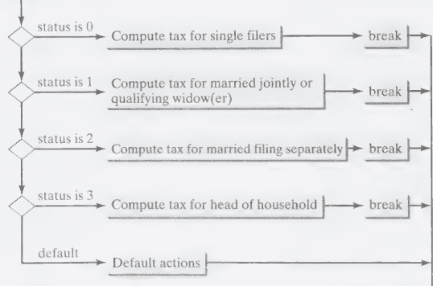

**图 3.5** `switch` 语句检查所有情况并执行匹配的 case 中的语句。

该语句检查 `status` 是否按顺序与值 0、1、2 或 3 匹配。如果匹配，则计算相应的税费；如果不匹配，则显示消息。以下是 `switch` 语句的完整语法：

```cpp
switch (switch-expression) {
    case value1: statement(s1); break;
    case value2: statement(s2); break;
    case valueN: statement(sN); break;
    default: statement(s)-for-default;
}
```

#### 3.13 switch 语句

`switch` 语句遵循以下规则：

- `switch-expression` 必须产生一个整数值并且始终包含在括号内。
- `value`、`...` 和 `valueN` 是整数常量表达式，这意味着它们不能包含变量（例如 `1 + x`）。这些值是整数，不能是浮点值。
- 当 `case` 语句中的值与 `switch-expression` 的值匹配时，将从该 case 开始执行语句，直到遇到 `break` 语句或 `switch` 语句结束。
- `default` 情况是可选的，可用于在没有任何指定情况都不匹配 `switch-expression` 时执行操作。
- 关键字 `break` 是可选的。`break` 语句立即结束 `switch` 语句。

> **注意**
> 不要忘记在需要时使用 `break` 语句。一旦匹配到 case，就会从匹配的 case 开始执行语句，直到遇到 `break` 语句或 `switch` 语句结束。这被称为穿透行为（fall-through behavior）。例如，以下代码为第 1-5 天显示 Weekdays，为第0和6 天显示 Weekend：
>
> ```cpp
> switch (day) {
>     case 1: // Fall through to the next case
>     case 2: // Fall through to the next case
>     case 3: // Fall through to the next case
>     case 4: // Fall through to the next case
>     case 5: cout << "Weekday"; break;
>     case 0: // Fall through to the next case
>     case 6: cout << "Weekend";
> }
> ```

> **提示**
> 为了避免编程错误并提高可维护性，如果故意省略了 `break`，在 `case` 子句中添加注释是一个好主意。

现在我们写一个程序来确定给定年份的中国生肖。中国生肖基于十二年周期，每年由一种动物代表：鼠、牛、虎、兔、龙、蛇、马、猴、鸡、狗、猪，在这个周期中，如图 3.6（下一页）所示。

注意 `year % 12` 决定生肖。由于 12 是 0，所以1900 年是鼠年。列表 3.8 提供了一个程序，提示用户输入年份并显示该年份对应的动物。

#### 列表 3.8 ChineseZodiac.cpp

```cpp
#include <iostream>
using namespace std;

int main() {
    cout << "Enter a year: ";
    int year;
    cin >> year;
    switch (year % 12) {
        case 0: cout << "monkey" << endl; break;
        case 1: cout << "rooster" << endl; break;
        case 2: cout << "dog" << endl; break;
        case 3: cout << "pig" << endl; break;
```

### 第3章节选


| 值 | 动物 |
| :--- | :--- |
| 0 | monkey |
| 1 | rooster |
| 2 | dog |
| 3 | pig |
| 4 | rat |
| 5 | ox |
| 6 | tiger |
| 7 | rabbit |
| 8 | dragon |
| 9 | snake |
| 10 | horse |
| 11 | sheep |

**图 3.6** 中国生肖基于十二年周期。


## 3.13 switch 语句

`switch` 语句遵循以下规则：

- `switch-expression` 必须产生一个整数值并且始终包含在括号内。
- `value`、`...` 和 `valueN` 是整数常量表达式，这意味着它们不能包含变量（例如 `1 + x`）。这些值是整数，不能是浮点值。
- 当 `case` 语句中的值与 `switch-expression` 的值匹配时，将从该 case 开始执行语句，直到遇到 `break` 语句或 `switch` 语句结束。
- `default` 情况是可选的，可用于在没有任何指定情况都不匹配 `switch-expression` 时执行操作。
- 关键字 `break` 是可选的。`break` 语句立即结束 `switch` 语句。

> **注意**
>
> 不要忘记在需要时使用 `break` 语句。一旦匹配到 case，就会从匹配的 case 开始执行语句，直到遇到 `break` 语句或 `switch` 语句结束。这被称为穿透行为（fall-through behavior）。例如，以下代码为第 1-5 天显示 Weekdays，为第 0 和 6 天显示 Weekend：

```cpp
switch (day) {
case 1: // Fall through to the next case
case 2: // Fall through to the next case
case 3: // Fall through to the next case
case 4: // Fall through to the next case
case 5: cout << "Weekday"; break;
case 0: // Fall through to the next case
case 6: cout << "Weekend";
}
```

> **提示**
>
> 为了避免编程错误并提高可维护性，如果故意省略了 `break`，在 `case` 子句中添加注释是一个好主意。

现在我们写一个程序来确定给定年份的中国生肖。中国生肖基于十二年周期，每年由一种动物代表：鼠、牛、虎、兔、龙、蛇、马、猴、鸡、狗、猪，在这个周期中，如图 3.6 所示。

注意 `year % 12` 决定生肖。由于 1900 % 12 是 0，所以 1900 年是鼠年。列表 3.8 提供了一个程序，提示用户输入年份并显示该年份对应的动物。

## 列表 3.8 ChineseZodiac.cpp

```cpp
#include <iostream>
using namespace std;

int main() {
    cout << "Enter a year: ";
    int year;
    cin >> year;

    switch (year % 12) {
        case 0: cout << "monkey" << endl; break;
        case 1: cout << "rooster" << endl; break;
        case 2: cout << "dog" << endl; break;
        case 3: cout << "pig" << endl; break;
        case 4: cout << "rat" << endl; break;
        case 5: cout << "ox" << endl; break;
        case 6: cout << "tiger" << endl; break;
        case 7: cout << "rabbit" << endl; break;
        case 8: cout << "dragon" << endl; break;
        case 9: cout << "snake" << endl; break;
        case 10: cout << "horse" << endl; break;
        case 11: cout << "sheep" << endl; break;
    }
    return 0;
}
```

**图 3.6** 中国生肖基于十二年周期。

| 值 | 动物 |
| :--- | :--- |
| 0 | monkey |
| 1 | rooster |
| 2 | dog |
| 3 | pig |
| 4 | rat |
| 5 | ox |
| 6 | tiger |
| 7 | rabbit |
| 8 | dragon |
| 9 | snake |
| 10 | horse |
| 11 | sheep |

## 3.15 运算符的优先级与结合性

| 优先级 | 运算符 |
| :--- | :--- |
| 1 | `var++` and `--var` (后置) |
| 2 | `+`, `-` (一元加号和减号), `++var` and `--var` (前置) |
| 3 | `static_cast<type>(v)`, `(type)` (类型转换) |
| 4 | `!` (逻辑非) |
| 5 | `*`, `/`, `%` (乘法、除法和取模) |
| 6 | `+`, `-` (二元加法和减法) |
| 7 | `<`, `<=`, `>=` (关系) |
| 8 | `==`, `!=` (相等) |
| 9 | `&&` (逻辑与) |
| 10 | `||` (逻辑或) |
| 11 | `+=`, `-=`, `*=`, `/=`, `%=` (赋值运算符) |

如果优先级相同的运算符相邻，它们的结合性决定了求值顺序。除了赋值运算符外，所有二元运算符都是左结合的。例如，由于 `+` 和 `-` 具有相同的优先级且是左结合的，表达式 `a - b + c` 等价于 `(a - b) + c`。

赋值运算符是右结合的。因此，表达式 `a = b = c = 5` 等价于 `a = (b = (c = 5))`。假设 `a`、`b` 和 `c` 在赋值前为 1；表达式求值后，`a` 变为 5，`b` 变为 5，`c` 变为 5。注意，赋值运算符的左结合是没有意义的。

> **提示**
>
> 你可以使用括号来强制求值顺序，并使程序易读。使用冗余括号不会降低表达式的执行速度。

**3.38** 列出布尔运算符的优先级顺序。求值以下表达式：
`true || true && false`
`true && true || false`

**3.39** 正还是错？除了 `=` 之外，所有二元运算符都是左结合的。

**3.40** 求值以下表达式：
`2 * 2 - 3 > 2 && 4 - 2 > 5`
`2 * 2 - 3 > 2 || 4 - 2 > 5`

## 第 3 章 选择

**3.41** `(x > 0 && x < 10)` 等于 `((x > 0) && (x < 10))` 吗？`(x > 0 || x < 10)` 等于 `((x > 0) || (x < 10))` 吗？`(x > 0 || x < 10 && y < 0)` 等于 `(x > 0 || (x < 10 && y < 0))` 吗？

## 3.16 调试

调试是发现并修复程序错误的过程。

正如第 I.9.1 节所述，语法错误很容易发现和修正，因为编译器会指示错误出现的地方以及错误原因。运行时错误更难发现，因为操作系统会在程序终止时在控制台上显示它们。而寻找逻辑错误可能具有挑战性。

逻辑错误就是 bug。发现和修正错误的过程是一项挑战性的调试。需要结合多种方法来缩小 bug 所在的范围。你可以手动跟踪程序（即通过阅读程序来捕捉错误），或者可以插入语句来显示变量的值或程序的执行流。这种方法对于小型简单程序可能有效。但对于大型复杂程序，最有效的调试方法是使用调试器。

C++ IDE 工具如 Visual C++ 具有集成调试器。调试器允许你跟踪程序的执行。它们之间有所不同，但都支持以下大部分功能：

- **一次执行一条语句**：调试器允许你一次执行一条语句，以便观察每条语句的效果。
- **步入函数**：如果执行了一个函数，你可以要求调试器进入该函数并在函数内逐条执行语句，或者你可以要求它跳过整个函数。如果你知道该函数工作正常，应该跳过整个函数。例如，始终跳过系统提供的函数，如 `pow(a, b)`。
- **设置断点**：你还可以在特定语句处设置断点。当程序到达断点时会暂停并显示带有断点的行。你可以设置任意数量的断点。当你知道编程错误从哪里开始时，断点特别有用。你可以在该行设置断点，并让程序执行到该断点。
- **显示变量**：调试器允许你选择几个变量并显示它们的值。在跟踪程序时，变量的内容会不断更新。
- **显示调用栈**：调试器跟踪所有的函数调用并列出所有待处理的函数。当你需要查看程序执行流的全局视图时，此功能非常有帮助。
- **修改变量**：某些调试器允许你在调试时修改变量的值。当你想要用不同的样本测试程序但不想离开调试器时，这非常方便。

> 如果你使用 Microsoft C++，请参考补充材料 I.C 中的《使用 Microsoft Visual C++ 有效学习 C++》。该补充材料向你介绍了如何使用调试器跟踪程序，以及调试如何帮助你有效学习。

## 核心术语

| 布尔表达式 | 穿透行为 |
| :--- | :--- |
| `bool` 数据类型 | 流程图 |
| 布尔值 | 运算符结合性 |
| `break` 语句 | 运算符优先级 |
| 条件运算符 | 选择语句 |
| 调试 | 短路 |
| 悬空 else | 三元运算符 |

## 总结

1. 变量可以存储 `true` 或 `false`。
2. 在内部，C++ 使用 `1` 和 `0`。
3. 优先级高的运算符先计算。
4. 括号可以改变顺序。
5. 关系运算符 `<`、`<=`、`>=` 产生 `bool` 结果。
6. 相等运算符 `==` 用于比较。
7. 有几种选择类型：`if-else`、嵌套的 `if-else`、`switch`。
8. 布尔运算符 `&&`、`||` 操作 `bool` 值。
9. 除了赋值运算符外，所有二元运算符都是左结合的；赋值运算符是右结合的。
10. `switch` 会根据值做出判断。
11. `break` 语句是可选的。
12. 求值顺序由优先级决定。
13. 使用括号强制顺序。
14. 优先级相同的运算符由结合性决定。
15. 使用关键字 `break`。
16. 除了赋值外，所有二元运算符都是左结合的。

## Quiz

在 `www.armstrong.edu/cpp3e/quiz.html` 完成本章节的测试。

## 编程练习

> **注意**
> 对于每个练习，在编码前仔细分析问题需求和设计策略。

> **注意**
> 在寻求帮助之前，先阅读并理解程序，通过手动或使用 IDE 调试器进行跟踪。你通过调试错误来学习编程。

### 3.3-3.8 节

**3.1 (代数：解二次方程)** 二次方程 $ax^2 + bx + c = 0$ 的两个根可以使用公式得到：

$$r_1 = \frac{-b + \sqrt{b^2 - 4ac}}{2a} \quad \text{且} \quad r_2 = \frac{-b - \sqrt{b^2 - 4ac}}{2a}$$

$b^2 - 4ac$ 称为方程的判别式。如果它为正，方程有两个实根。如果为零，有一个根。如果为负，方程没有实根。

编写一个程序，提示用户输入 $a$、$b$ 和 $c$ 的值并根据判别式显示结果。如果判别式为正，显示两个根。如果为 0，显示一个根。否则，显示“方程没有实根。”

注意你使用 `pow(x, 0.5)` 来计算 $\sqrt{x}$。以下是一些示例运行：

```
Enter a, b, c: 1 0 3
The roots are -0.381966 and -2.618034
```

```
Enter a, b, c: 1 2 0
The root is -1
```

```
Enter a, b, c: 1 2 3
The equation has no real roots
```

**3.2 (检查数字)** 编写一个程序，提示用户输入两个整数，并检查第一个数字是否被第二个数字整除。以下是一个示例运行：

| 输入两个整数：2 3 | 回车 |
| :--- | :--- |
| 2 不能被 3 整除 | |

| 输入两个整数：22 2 | 回车 |
| :--- | :--- |
| 22 能被 2 整除 | |

**3.3 (代数：求解 2 × 2 线性方程组)** 你可以使用克拉默法则（Cramer's rule）来求解以下 2 × 2 线性方程组：

```
ax + by = e
cx + dy = f

x = (ed - bf) / (ad - bc)
y = (af - ec) / (ad - bc)
```


# 编程练习

## 3.3 (解线性方程)
编写一个程序，提示用户输入 `a`、`b`、`c`、`d`、`e` 和 `f`，并显示结果。如果 `ad - bc = 0`，报告“方程无解。”

| 输入 a, b, c, d, e, f: 9.0 4.0 3.0 -5.0 -6.0 -21.0 | 回车 |
| :--- | :--- |
| x 是 -2.0，y 是 3.0 | |


| 输入 a, b, c, d, e, f: 1.0 2.0 2.0 4.0 4.0 5.0 | 回车 |
| :--- | :--- |
| 方程无解 | |


## 3.4 (检查温度)
编写一个程序，提示用户输入温度数字。如果温度小于 30，显示 `cold`；如果温度大于 100，显示 `hot`；否则，显示 `right`。

## 3.5 (查找未来日期)
编写一个程序，提示用户输入星期几的整数（星期日为 0，星期一为 1，……星期六为 6）。同时，提示用户输入今天之后的天数，并显示未来的星期几。以下是一个示例运行：

| 输入今天是星期几：1 | 回车 |
| :--- | :--- |
| 输入从今天起经过的天数：3 | 回车 |
| 今天是星期一，未来的日期是星期四 | |


| 输入今天是星期几：0 | 回车 |
| :--- | :--- |
| 输入从今天起经过的天数：31 | 回车 |
| 今天是星期日，未来的日期是星期三 | |


## 3.6 (健康应用：BMI)
修改列表 3.2 `ComputeAndInterpretBMI.cpp`，允许用户输入重量、英尺和英寸。例如，如果某人身高 5 英尺 10 英寸，你将在英尺输入 5，英寸输入 10。以下是一个示例运行：


## 第 3 章选习

输入重量（磅）：140
输入英尺：5
输入英寸：10
BMI 为 20.08770227540553
正常


- **3.7** (排序三个整数) 编写一个程序，提示用户输入三个整数，并按非递顺序显示这些整数。
- **3.8** (金融应用：货币单位) 修改列表 2.12 `ComputeChange.cpp`，仅显示非零面额，对于单个单位使用单数形式（如 `1 dollar` 和 `1 penny`），对于多个单位使用复数形式（如 `2 dollars` 和 `3 pennies`）。

## 3.9–3.16 节

- **3.9** (查找每月天数) 编写一个程序，提示用户输入月份和年份，并显示该月份的天数。例如，如果用户输入月份 2 和年份 2012，程序应显示 `February 2012 29 days`。如果用户输入月份 3 和年份 2015，程序应显示 `March 2015 有 31 天`。
- **3.10** (加法测验游戏：加法测验) 列表 3.4 `SubtractionQuiz.cpp` 随机生成一个减法题。修改该程序以生成两个小于 100 的整数的加法题。
- **3.11** (运费) 一家快递公司使用以下函数根据包裹重量（磅）计算运费（美元）：

```
c(w) = 3.5, 如果 0 < w < 1
5.5, 如果 1 < w < 3
8.5, 如果 3 < w <= 10
10.5, 如果 10 < w <= 20
```

编写一个程序提示用户输入包裹重量并显示运费。如果重量大于 50，显示“包裹无法运输。”
- **3.12** (正反面游戏) 编写一个程序，让用户猜测硬币落地是正面还是反面。程序随机生成一个整数 0 或 1 代表正面或反面。程序提示用户输入猜测并报告是否正确。
- **3.13** (金融应用：计算税收) 列表 3.3 `ComputeTax.cpp` 提供了计算税收的代码。修改列表 3.3 以提供完整的代码。
- **3.14** (彩票游戏) 修改列表 3.7 `Lottery.cpp` 以生成一个三位数。程序提示用户输入一个三位数并根据以下规则判断用户是否获胜：
  - 如果用户完全匹配彩票，奖金为 $10,000。
  - 如果用户的所有数字都匹配彩票，奖金为 $3,000。
  - 如果用户输入中有一个数字与彩票匹配，奖金为 $1,000。
- **3.15** (剪刀、石头、布游戏) 编写一个玩剪刀、石头、布的游戏程序。剪刀可以剪掉布。程序随机生成 0、1 或 2 代表剪刀、石头或布。程序提示用户输入 0、1 或 2，并显示用户是赢了、输还是平局。以下是示例运行：


剪刀 (0), 石头 (1), 布 (2): 1
电脑是剪刀。你是石头。你赢了


剪刀 (0), 石头 (1), 布 (2): 2
电脑是布。你也是。平局

- **3.16** (计算三角形周长) 编写一个程序读取三角形的三条边，如果输入有效则计算周长。否则，显示输入无效。如果任意两条边之和大于第三边，则输入有效。
- **3.17** (科学：风寒指数) 编程练习 2.17 给出了 -58°F 到 41°F 之间且风速大于等于 2 的温度公式。编写一个程序提示用户输入温度和风速。如果输入有效，显示风寒指数；否则，显示温度或风速无效。
- **3.18** (三位数加法游戏) 列表 3.4 `SubtractionQuiz.cpp` 随机生成减法题。修改该程序以生成三个小于 100 的整数的加法题。

## 综合题

- **3.19** (几何：圆内点？) 编写一个程序，提示用户输入点 `(x, y)`，并检查该点是否在位于 `(0, 0)`、半径为 10 的圆内。例如，`(4, 5)` 在圆内，`(9, 9)` 在圆外，如图 3.7a 所示。

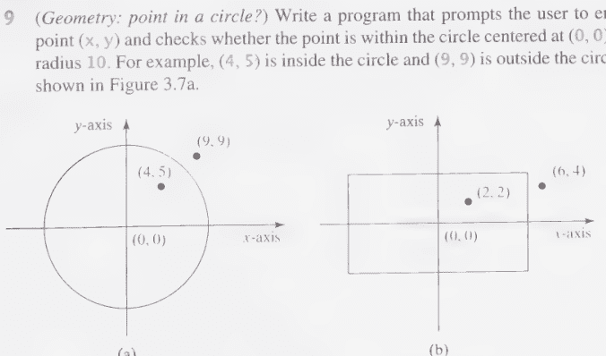

3.7 (a) 圆内外的点。(b) 矩形内外的点。

(提示：如果点到 `(0, 0)` 的距离小于或等于 10，则在圆内。计算距离的公式为 $\sqrt{(x_2 - x_1)^2 + (y_2 - y_1)^2}$。测试你的程序以涵盖所有情况。) 这里有两个示例：

```
输入两个坐标的点：4 5
点 (4, 5) 在圆内
```

```
输入两个坐标的点：9 9
点 (9, 9) 不在圆内
```

- **3.20** (几何：矩形内点？) 编写一个程序，提示用户输入点 `(x, y)`，并检查该点是否在位于 `(0, 0)`、宽为 10、高为 5 的矩形内。例如，`(2, 2)` 在矩形内，`(6, 4)` 在矩形外，如图 3.7b 所示。（提示：如果点到 `(0, 0)` 的水平距离小于或等于 10，则在矩形内。测试你的程序以涵盖所有情况。）以下是示例运行：

```
输入两个坐标的点：2 2
点 (2, 2) 在矩形内
```

```
输入两个坐标的点：6 4
点 (6, 4) 不在矩形内
```

- **3.21** (游戏：抽牌) 编写一个程序模拟从 52 张牌中抽取一张。你的程序应该显示该牌的等级（Ace, 2, 3, 4, 5, 6, 7, 8, 9, 10, Jack, Queen, King）和花色（梅花、方形、红心、黑桃）。这是程序的示例运行。

你抽到的牌是红心 J。

- **3.22** (几何：交点) 线 1 上的两个点分别为 `(x1, y1)` 和 `(x2, y2)`，线 2 上的两个点分别为 `(x3, y3)` 和 `(x4, y4)`，如图 3.8a-b 所示。

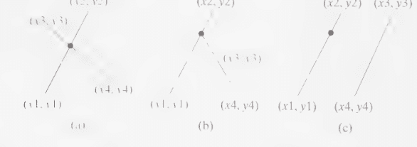

图 3.8 两线在 (a 和 b) 相交，两条线在 (c) 平行。

两条线的交点可以通过求解以下方程组找到：

```
y - y1 = (y2 - y1)/(x2 - x1)(x - x1)
y - y3 = (y4 - y3)/(x4 - x3)(x - x3)
```

该线性方程可以使用克莱默法则（参见编程练习 3.3）求解。如果方程无解，则两条直线是平行的（图 3.8c）。编写一个程序，提示用户输入四个点，并显示交点。以下是一些示例运行：

```
Enter x1, y1, x2, y2, x3, y3, x4, y4: 2 2 5 -1.0 4.0 2.0 -1.0 -2.0
Enter The intersecting point is (2.88889, 1.1111)
```

```
Enter x1, y1, x2, y2, x3, y3, x4, y4: 2 2 7 6 4.0 -1.0 -2.0
Enter The two lines are parallel
```

- **3.23** (几何：三角形内的点?) 假设平面上放置了一个所示的直角三角形。直角顶点位于 `(0, 0)`，另外两个点位于 `(200, 0)` 和 `(0, 100)`。编写一个程序，提示用户输入一个 x 和 y 坐标的点，并判断该点是否在三角形内部。

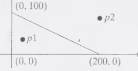

以下是示例运行：

```
Enter a point's x- and y-coordinates: 100.5 25.5
Enter The point is in the triangle
```

```
Enter a point's x- and y-coordinates: 100.5 50.5
Enter The point is not in the triangle
```

- **3.24** (使用 `|` 运算符) 编写一个程序，提示用户输入一个整数，并判断它是否能被 5 和 6 整除，或者是否能被 5 或 6 整除但不同同时被两者整除。这是该程序的示例运行。

```
Enter an integer: 10
Enter 10 divisible by 5 and 6? false
Enter 10 divisible by 5 or 6? true
Enter 10 divisible by 5 or 6, but not both? false
```

- **3.25** (几何：两个矩形) 编写一个程序，提示用户输入两个矩形的 x、y 坐标、宽度和高度，并判断第二个矩形是在第一个矩形内部还是与第一个矩形重叠，如图 3.9 所示。测试你的程序以涵盖所有情况。

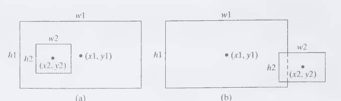

**图 3.9** (a) 一个矩形在另一个内部。(b) 一个矩形与另一个重叠。

以下是示例运行：

```
Enter r1's center x-, y-coordinates, width, and height: 2.5 4 2.5 43
Enter r2's center x-, y-coordinates, width, and height: 1.5 0.5 3
r2 is inside r1
```

```
Enter r1's center x-, y-coordinates, width, and height: 1 2 3 5.5
Enter r2's center x-, y-coordinates, width, and height: 3 4 4.5 5
r2 does not overlap r1
```

- **3.26** (几何：两个圆) 编写一个程序，提示用户输入两个圆的圆心坐标和半径，并判断圆是在第一个圆内部还是与第一个圆重叠，如图 3.10 所示。（提示：如果两个圆之间的距离 <= `|r1|`，则 `circle2` 在 `circle1` 内部；如果两个圆之间的距离 <= `r1 + r2`，则 `circle2` 与 `circle1` 重叠。测试你的程序以涵盖所有情况）。

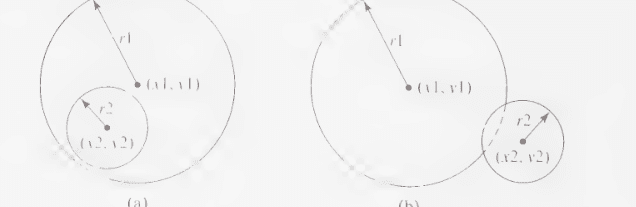

**图 3.10** (a) 一个圆在另一个圆内部。(b) 一个圆与另一个圆重叠。

以下是示例运行：

| 输入 | 结果 |
| :--- | :--- |
| Enter circle1's center x-, y-coordinates, and radius: 0.5 5.1 13 <br> Enter circle2's center x-, y-coordinates, and radius: 1 1.7 4.5 | circle2 is inside circle |
| Enter circle1's center x-, y-coordinates, and radius: 3.4 5.7 5.5 <br> Enter circle2's center x-, y-coordinates, and radius: 6.7 3.5 3 | circle2 overlaps circle |
| Enter circle1's center x-, y-coordinates, and radius: 3.4 5.5 1 <br> Enter circle2's center x-, y-coordinates, and radius: 5.5 7.2 1 | circle2 does not overlap circle |

- **3.27** (当前时间) 修改编程练习 2.8，使用 12 小时制显示小时。以下是一个示例运行：

| Enter the time zone offset to GMT: -5 | The current time is 4:50:34 AM |

- **3.28** (金融：货币兑换) 编写一个程序，提示用户输入美元到人民币的汇率。提示用户输入 0 将美元转换为人民币，输入 1 将人民币转换为美元。提示用户输入要转换的美元或人民币金额。以下是示例运行：

| 输入 | 结果 |
| :--- | :--- |
| Enter the exchange rate from dollars to RMB: 6.81 <br> Enter 0 to convert dollars to RMB and 1 vice versa: 0 <br> Enter the amount: 100 | $100 is 681 yuan |
| Enter the exchange rate from dollars to RMB: 6.81 <br> Enter 0 to convert dollars to RMB and 1 vice versa: 1 <br> Enter the amount: 10000 | 10000 yuan is $1468.43 |
| Enter the exchange rate from dollars to RMB: 6.81 <br> Enter 0 to convert dollars to RMB and 1 vice versa: 5 | Incorrect input |

- **3.29** (几何：位置) 给定一条从 `p0(x0, y0)` 到 `p1(x1, y1)` 的有直线，可以使用以下条件判断 `p2(x2, y2)` 在直线的左侧、右侧还是同一条线上（见图 3.11）。

| 条件 | 结果 |
| :--- | :--- |
| `(x1-x0) * (y2-y0) - (x2-x0) * (y1-y0) > 0` | p2 is on the left side of the line |
| `(x1-x0) * (y2-y0) - (x2-x0) * (y1-y0) = 0` | p2 is on the same line |
| `(x1-x0) * (y2-y0) - (x2-x0) * (y1-y0) < 0` | p2 is on the right side of the line |


写一个程序，提示用户输入 `p0`、`p1` 和 `p2` 的三个点，并显示 `p2` 在从 `p0` 到 `p1` 的直线的左侧、右侧还是同一条线上。以下是一些示例运行：

```
Enter three points for p0, p1, and p2: 1 1 2.5 2.5 1.5
p2 is on the left side of the line
```

```
Enter three points for p0, p1, and p2: 1 1 5 2
p2 is on the same line
```

```
Enter three points for p0, p1, and p2: 3.4 2 6.5 9.5 2.5
p2 is on the right side of the line
```

- **3.30** (金融：比较价格) 假设你要购买两种包。你想写一个程序来比较价格。程序提示用户输入每个包重量和价格，并显示价格更好的那个。以下是一个示例运行：

```
Enter weight and price for package 1: 50 24.59
Enter weight and price for package 2: 25 11.99
Package 2 has better price.
```

```
Enter weight and price for package 1: 50 25
Enter weight and price for package 2: 25 12.5
Two packages have the same price.
```


# 3.31 (几何：线段上的点)

编程练习 3.29 显示了如何测试一个点是否在直线上。修改编程练习 3.29 以测试一个点是否在线段上。编写一个程序，提示用户输入 p0、p1 和 p2 的三个点，并显示 p2 是否在从 p0 到 p1 的线段上。以下是一些示例运行：


```
Enter three points for p0, p1, and p2: 1 1 2.5 2.5 1.5
(1.5, 1.5) is on the line segment from (1,1) to (2,5)
```

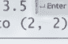

```
Enter three points for p0, p1, and p2: 1 1 2 3.5 3.5
(3.5, 3.5) is not on the line segment from (1,1) to (2,2)
```

# 3.32 (代数：斜截式)

编写一个程序，提示用户输入两个点的坐标 (x1, y1) 和 (x2, y2)，并以斜截式显示方程，即 $y = mx + b$。关于方程的复习请访问 www.purplemath.com/modules/slopeintercept.html。$m$ 和 $b$ 可以使用公式计算：

```
m = (y2 - y1) / (x2 - x1)
b = y1 - m * x1
```

如果 $m$ 为 1 则不显示，如果 $b$ 为 0 则不显示。以下是一个示例运行：

```
Enter the coordinates for two points: 1 1 0 0
The line equation for two points (1,1) and (0,0) is $y = x$
```


```
Enter the coordinates for two points: 4.5 -5.5 6.6 -6.5
The line equation for two points (4.5, -5.5) and (6.6, -6.5) is $y = -0.47619$
```

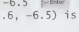

# 3.33 (科学：星期)

Zeller 同余是由 Christian Zell 开发的用于计算星期的算法。公式为：

```
$h = (q + \frac{26(m+1)}{10} + k + \frac{k}{4} + \frac{5j}{4}) \pmod 7$
```

其中：

- h 是星期（0: 周六，1: 周日，2: 周一，3: 周二，4: 周三，5: 周四，6: 周五）
- q 是日期。
- m 是月份（3: 三月，4: 四月，... 12: 十二月）。一月二月被视为上年的 13 月和 14 月。
- j 是世纪（即 $\frac{year}{100}$）
- k 是世纪中的年（即 year % 100）

注意公式中的除法执行的是整数除法。编写一个程序，提示用户输入年份、月份和日期，并显示星期的名称。

```
输入年份：（例如 2012）: 2015
输入月份：1-12: 1
输入几号：1-31: 25
星期几是星期日
```

```
输入年份：（例如 2012）: 2012
输入月份：1-12: 5
输入几号：1-31: 12
星期几是星期六
```

> **提示**：在公式中，一月和二月被计为 13 和 14，因此你需要将输入的月份数字 1 转换为 13，将 2 转换为 14，并将年份改为上一年。

# 3.34 (随机点)

编写一个程序，在矩形中显示一个随机坐标。该矩形以 (0,0) 为中心，宽度为 100，高度为 200。

# 3.35 (业务题：检查 ISBN-10)

一个 ISBN-10（国际标准书号）由 10 位数字组成：$d_1,d_2,d_3,d_4,d_5,d_6,d_7,d_8,d_9$。最后一位 $d_{10}$ 是校验和，通过以下公式从其他九位数字计算：

```
$(d_1 \times 1 + d_2 \times 2 + d_3 \times 3 + d_4 \times 4 + d_5 \times 5 + d_6 \times 6 + d_7 \times 7 + d_8 \times 8 + d_9 \times 9) \pmod{11}$
```

如果校验和为 10，根据 ISBN-10 规范，最后一位表示为 X。编写一个程序，提示用户输入前 9 位数字并显示 10 位 ISBN（包括前导零）。你的程序应按整数读取输入。以下是示例运行：

```
以整数形式输入 ISBN 的前 9 位：013601267
ISBN-10 号为 0136012671
```

```
以整数形式输入 ISBN 的前 9 位：013031997
ISBN-10 号为 013031997X
```

# 3.36 (回文数)

编写一个程序，提示用户输入一个三位整数并判断它是否为回文数。如果一个数字从右向左和从左向右读相同，则是回文数。这是该程序的示例运行：

```
输入一个三位整数：121
121 是回文数
```

```
输入一个三位整数：123
123 不是回文数
```

# 第4章 数学函数、字符和字符串

## 目标

- 使用 C++ 数学函数解决数学问题 (4.2)。
- 使用 `char` 类型表示字符 (4.3)。
- 使用 ASCII 码编码字符 (4.3.1)。
- 从键盘读取字符 (4.3.2)。
- 使用转义序列表示特殊字符 (4.3.3)。
- 将数值转换为字符，并将字符转换为整数 (4.3.4)。
- 比较和测试字符 (4.3.5)。
- 使用字符进行编程 (DisplayRandomCharacter, GuessBirthday) (4.4–4.5)。
- 使用 C++ 字符函数测试和转换字符 (4.6)。
- 将十六进制字符转换为十进制值 (HexDigit2Dec) (4.7)。
- 使用 `string` 类型表示字符串并使用成员函数 (4.8)。
- 使用下标运算符访问和修改字符串中的字符 (4.8.1)。
- 使用 `+` 运算符拼接字符串 (4.8.2)。
- 使用关系运算符比较字符串 (4.8.3)。
- 从键盘读取字符串 (4.8.4)。
- 使用字符串修改彩票程序 (LotteryUsingStrings) (4.9)。
- 使用字符串格式化输出 (4.10)。
- 从文件/向文件读写数据 (4.11)。

## 表 4.1 cmath 头文件中的三角函数

| 函数 | 描述 |
|---|---|
| `sin(radians)` | 返回弧度角的三角正弦值。 |
| `cos(radians)` | 返回弧度角的三角余弦值。 |
| `tan(radians)` | 返回弧度角的三角正切值。 |
| `asin(a)` | 返回正弦反函数的弧度角。 |
| `acos(a)` | 返回余弦反函数的弧度角。 |
| `atan(a)` | 返回正切反函数的弧度角。 |

## 4.2 数学函数

`sin`、`cos` 和 `tan` 的参数是弧度角。`asin`、`acos` 和 `atan` 的返回值为 -π/2 到 π/2 之间的弧度角。1 度等于 π/180 弧度，90 度等于 π/2 弧度，30 度等于 π/6 弧度。

假设 `PI` 是一个值为 3.14159 的常量。以下是这些函数的一些示例：

```
sin(0) returns 0
sin(90 * PI / 180) returns 1
sin(PI / 6) returns 0.5
cos(0) returns 1.0
cos(PI / 6) returns 0.866
cos(PI / 2) returns 0.0
asin(0.5) returns 0.52359 (same as π/6)
acos(0.5) returns 1.0472 (same as π/3)
atan(1.0) returns 0.78539 (same as π/4)
```

### 4.2.1 指数函数

`cmath` 头中有五个与指数相关的函数，见表 4.2。

## 表 4.2 cmath 头文件中的指数函数

| 函数 | 描述 |
|---|---|
| `exp(x)` | 返回 e 的 x 次 (e^x)。 |
| `log(x)` | 返回自然对数 (ln(x))。 |
| `log10(x)` | 返回以 10 为底的对数 (log10(x))。 |
| `pow(a, b)` | 返回 a 的 b 次 (a^b)。 |
| `sqrt(x)` | 返回 x 的平方根 (√x)，x >= 0。 |

假设 `E` 是一个值为 2.71828 的常量。以下是这些函数的一些示例：

```
exp(1.0) returns 2.7128
log(E) returns 1.0
log10(10.0) returns 1.0
pow(2.0, 3) returns 8.0
sqrt(4.0) returns 2.0
sqrt(10.5) returns 3.24
```

### 4.2.3 舍入函数

`cmath` 头文件包含用于舍入的函数，见表 4.3。

## 表 4.3 cmath 头文件中的舍入函数

| 函数 | 描述 |
|---|---|
| `ceil(x)` | x 向上取整到最近的整数。以 double 类型返回。 |
| `floor(x)` | x 向下取整到最近的整数。以 double 类型返回。 |

例如：

```
ceil(2.1) returns 3.0
ceil(2.0) returns 2.0
ceil(-2.0) returns -2.0
ceil(-2.1) returns -2.0
floor(2.1) returns 2.0
floor(2.0) returns 2.0
floor(-2.0) returns -2.0
floor(-2.1) returns -3.0
```

### 4.2.4 min, max 和 abs 函数

`min` 和 `max` 函数返回两个数的最小和最大值（int, float 或 double）。例如，`max(4.4, 5.0)` returns 5.0，`min(3, 2)` returns 2。

`abs` 函数返回数的绝对值（int, long, float, double）。例如：

```
max(2, 3) returns 3
max(2.5, 3.0) returns 3.0
min(2.5, 4.6) returns 2.5
abs(-2) returns 2
abs(-2.1) returns 2.1
```

> **注意**
> `min`、`max` 和 `abs` 函数定义在 `cstdlib` 头文件中。

### 4.2.5 案例研究：计算三角形的角度

你可以使用数学函数解决许多计算问题。给定三角形的三边，你可以使用以下公式计算角度：


```
A = acos((a * a - b * b - c * c) / (-2 * b * c))
B = acos((b * b - a * a - c * c) / (-2 * a * c))
C = acos((c * c - a * a - b * b) / (-2 * a * b))
```

不要被数学公式吓倒。正如我们在列表 2.11 `ComputeLoan.cpp` 中讨论的，你不需要知道数学公式是如何推导出来的就可以编写贷款还款的程序。在这个例子中，给定三边的长度，可以使用公式计算角度而不需要知道如何推导公式。我们需要知道三个顶点的坐标并计算点之间的距离。

列表 4.1 是一个程序示例，提示用户输入三角形三个顶点的坐标并显示三角形的角度。

# 列表 4.1 ComputeAngles.cpp

```cpp
#include <iostream>
#include <cmath>
using namespace std;

int main() {
    // 提示用户输入三个点
    cout << "Enter three points: ";
    double x1, y1, x2, y2, x3, y3;
    cin >> x1 >> y1 >> x2 >> y2 >> x3 >> y3;

    // 计算边
    double a = sqrt(pow(x2-x1, 2) + pow(y2-y1, 2));
    double b = sqrt(pow(x3-x2, 2) + pow(y3-y2, 2));
    double c = sqrt(pow(x1-x3, 2) + pow(y1-y3, 2));

    // 计算弧度角
    double A = acos((a * a - b * b - c * c) / (-2 * b * c));
    double B = acos((b * b - a * a - c * c) / (-2 * a * c));
    double C = acos((c * c - a * a - b * b) / (-2 * a * b));

    // 以角度显示
    const double PI = 3.14159;
    cout << "The angles are " << A * 180 / PI << " "
         << B * 180 / PI << " " << C * 180 / PI << endl;

    return 0;
}
```

## 4.2 对还是错？三角函数的参数是弧度角。

---

# 第122页 第4章 数学函数、字符和字符串

4.3 编写一条语句，将 47 度转换为弧度并将结果赋值给变量。

4.4 编写一条语句，将 π / 7 转换为角度并将结果赋值给变量。

## 4.3 字符数据类型与操作

字符数据类型表示单个字符。

在 C++ 中，除了处理数值外，你还可以处理字符。字符数据类型 `char` 用于表示单个字符。字符字面量包含在单引号中。考虑以下代码：

```
char letter = 'A';
char numChar = '4';
```

第一条语句将字符 A 赋值给 `char` 变量 `letter`。第二条语句将数字字符 4 赋值给 `char` 变量 `numChar`。

> **注意**
> 字符串字面量包含在双引号 (" ") 中。字符字面量包含在单引号 (' ') 中。因此，“A" 是一个字符串，而 'A' 是一个字符。

### 4.3.1 ASCII 码

计算机内部使用二进制。字符在计算机中以 0 和 1 的序列形式存储。将字符映射到其二进制表示称为编码。编码字符有多种方法。字符的编码方式由编码方案定义。

大多数计算机使用 ASCII（美国信息交换标准），这是一种 8 位编码方案，用于表示所有大写和小写字母、数字、标点符号和控制字符。表 4.4 显示了常用字符的 ASCII 码。附录 B“ASCII 字符集”提供了 ASCII 字符的完整列表及其十、十六进制代码。在大多数系统中，`char` 类型的大小为 1 字节。

## 表 4.4 常用字符的 ASCII 码

| 字符 | ASCII 码 |
|---|---|
| '0'-'9' | 48 到 57 |
| 'A'-'Z' | 65 到 90 |
| 'a'-'z' | 97 到 122 |

加法和减法运算符也可以用于 `char` 变量，以获取下一个或前一个 ASCII 码数字。例如，以下语句显示字符：

```
char char_ = 'a';
cout << ++char_;
```

### 4.3.2 从键盘读取字符

要从键盘读取字符，请使用 `cin`。

### 4.3.3 特殊字符的转义序列

假设你想在输出中打印一条带有引号的消息。你可以写这样的语句吗？

```
cout << "He said "Programming is fun" << endl;
```

不，这会导致编译错误。编译器认为第二个引号字符是字符串的结束，并且不知道如何处理剩余的字符。

对于这个问题，C++ 使用了一种特殊的表示法来表示特殊字符，如表 4.5 所示。这种特殊表示法称为转义序列，由一个反斜杠 (\) 后跟一个字符或数字组合组成。例如，`\t` 是制表符的转义序列。转义序列中的符号被视为一个整体，而不是单独解释。一个转义序列被认为是一个单个字符。

## 表 4.5 转义序列

| 转义序列 | 名称 | ASCII 码 | 转义序列 | 名称 | ASCII 码 |
|---|---|---|---|---|---|
| `\b` | 退格 (Backspace) | 8 | `\r` | 回车 (Carriage Return) | 13 |
| `\t` | 制表 (Tab) | 9 | `\\` | 反斜杠 (Backslash) | 92 |
| `\n` | 换行 (Linefeed) | 10 | `\"` | 双引号 (Double Quote) | 34 |
| `\f` | 分页 (Formfeed) | 12 | | | |

所以，现在你可以使用以下语句打印带引号的消息：

```
cout << "He said \"Programming is fun\"" << endl;
```

输出是：

He said "Programming is fun"

注意符号 `\` 和 `"` 一起表示一个字符。反斜杠被称为转义字符。它是一个特殊字符。要显示此字符，你必须使用转义序列 `\\`。例如，以下代码：

```
cout << "\\t is a tab character" << endl;
```


显示

`\t` is a tab character

> 注意
> 以下两种方式都会显示一个字符串并将光标移动到下一行：
> `cout << "\\Welcome to C+++\n";`

> 然而，`endl` 确保输出在所有平台上都能立即显示

# 第 4 章 数学函数、字符和字符串

## 4.3.4 char 与数值类型之间的强制转换

`char` 可以转换为任何数值类型，反之亦然。当整数强制转换为 `char` 时，仅使用其低 8 位数据；其他部分被忽略。例如

```cpp
char c = 0xFF41; // 8 位十六进制代码 41 被赋值给 c
cout << c; // 变量 c 是字符 A
```

当浮点值转换为 `char` 时，该浮点值首先转换为 `int`，然后再转换为 `char`。

```cpp
char c = 65.25; // 65 被赋值给变量 c
cout << c; // 变量 c 是字符 A
```

当 `char` 转换为数值类型时，字符的 ASCII 码会被转换为指定的数值类型。例如：

```cpp
int i = 'A'; // 字符 A 的 ASCII 码被赋值给 i
cout << i; // 变量 i 是 65
```

`char` 被视为一个字节大小的整数。所有所有的数值运算符都可以应用于 `char` 操作数。如果另一个操作数是数值或字符，则 `char` 操作数将自动转换为数字。例如，以下语句

```cpp
// '2' 的 ASCII 码是 50，'3' 是 51
int i = '2' + '3';
cout << i;
```

显示

```
99
```

是字符 `c` 的 ASCII 码

注意表 4.4。小写字母的 ASCII 码是从 `'a'` 开始的连续整数，然后是 `'b'`、`'c'`……直到 `'z'`。大字符也是如此。此外，`'a'` 的码大于 `'A'`可以使用这些属性将大写字母转换为小写。列表 4.2 提供了一个提示用户输入小写字母并找到对应字母的程序。

### 4.3.2 ToUppercase.cpp

```cpp
// 列表 4.2
#include <iostream>
using namespace std;
int main() {
    cout << "Enter a lowercase letter: ";
    char lowercaseLetter;
    cin >> lowercaseLetter;
    char uppercaseLetter = static_cast<char>('A' + (lowercaseLetter - 'a')); // 转换为大写
    cout << "The uppercase letter is " << uppercaseLetter << endl;
    return 0;
}
```

## 4.5 字符的比较与测试

可以像比较两个数字一样使用关系运算符比较两个字符。这是通过比较 ASCII 码实现的，例如：

- `'a' < 'b'` 为真，因为 `'a'` 的 ASCII 码 (97) 小于 `'b'` 的 ASCII 码 (98)。
- `'a' < 'A'` 为假，因为 `'a'` 的 ASCII 码 (97) 大于 `'A'` 的码 (65)。
- `'1' < '8'` 为真，因为 `'1'` 的 ASCII 码 (49) 小于 `'8'` 的 ASCII 码 (56)。

在程序中，通常需要测试一个字符是数字、字母、大写字母还是小写字母。例如，以下代码测试字符 `ch` 是否为大写字母。

```cpp
if (ch >= 'A' && ch <= 'Z')
    cout << ch << " is an uppercase letter" << endl;
else if (ch >= 'a' && ch <= 'z')
    cout << ch << " is a lowercase letter" << endl;
else if (ch >= '0' && ch <= '9')
    cout << ch << " is a numeric character" << endl;
```

使用打印语句确定 `'1'`、`'A'`、`'B'`、`'a'` 和 `'b'` 的 ASCII 码。使用打印语句确定十进制码 40、59、77、85 和 90 字符。使用打印语句确定十六进制码 40、5A、71、72 和 7A 对应的字符。

# 第 4 章 数学函数、字符与字符串（习题）

## 4.8 显示以下代码的打印结果：

```cpp
int i = '1';
int j = '1' + '2';
int k = 90;
char c = 90;
cout << i << " " << j << " " << k << " " << c << endl;
```

## 4.9 显示以下代码的打印结果：

```cpp
char c = 'A';
int i = c;
float f = 1000.34f;
int j = f;
double d = 1000.34;
int k = d;
int l = 0;
char ch = 1;

cout << c << endl;
cout << i << endl;
cout << f << endl;
cout << j << endl;
cout << d << endl;
cout << k << endl;
cout << l << endl;
cout << ch << endl;
```

## 4.10 显示以下程序的输出：

```cpp
#include <iostream>
using namespace std;
int main() {
    char x = 'a';
    char y = 'c';
    cout << x << endl;
    cout << y++ << endl;
    cout << (x - y) << endl;
    return 0;
}
```

## 4.4 案例研究：生成随机字符

字符是用整数编码的。生成随机字符实际上就是生成一个随机整数。

计算机程序处理数值数据和字符。你已经见过许多涉及数值数据的示例。理解字符以及如何处理它们也同样重要。本节将给出生成随机字符的示例。

每个字符都有一个位于 0 到 127 之间的 ASCII 码。生成随机字符就是生成一个 0 到 127 之间的随机整数。在 3.9 节中，你将学习如何生成随机数。记住，你可以使用 `rand(seed)` 函数设置种子，并使用 `rand()` 返回随机整数。你可以用它编写一个简单的表达式来生成任意范围内的随机数。例如：

- `rand() % 10` 返回 0 到 9 之间的随机整数。
- `50 + rand() % 50` 返回 50 到 99 之间的随机整数。

通常：

- `a + rand() % b` 返回 `a` 到 `a + b` 之间的数（不包含 `a + b`）。

因此你可以使用以下表达式生成 0 到 127 之间的随机整数：

```cpp
rand() % 128
```

让我们考虑如何生成随机的小写字母。小写字母的 ASCII 码是连续的整数，从 `'a'` 的码开始，然后是 `'b'`、`'c'`……直到 `'z'`。`'a'` 的码是：

```cpp
static_cast<int>('a')
```

生成 `static_cast<int>('a')` 和 `static_cast<int>('z')` 之间的随机整数：

```cpp
static_cast<int>('a') + rand() % (static_cast<int>('z') + 1)
```

记住所有的数值运算符适用于 `char`。如果另一个操作数是数字，`char` 会被提升数字。因此，前面的表达式可以简化为：

```cpp
'a' + rand() % ('z' - 'a' + 1)
```

一个随机的小写字母是：

```cpp
static_cast<char>('a' + rand() % ('z' - 'a' + 1))
```

泛化上述讨论，两个字符 `ch1` 和 `ch2`（`ch1 <= ch2`）之间的随机字符可以生成为：

```cpp
static_cast<char>(ch1 + rand() % (ch2 - ch1 + 1))
```

这是一个简单但有用的发现。列表 4.3 提供了一个程序，提示用户输入两个字符 `x` 和 `y`（`x <= y`），并显示 `x` 到 `y` 之间的随机字符。

### 列表 4.3 DisplayCharacter.cpp

```cpp
#include <iostream>
#include <cstdlib>
using namespace std;
int main() {
    cout << "Enter a starting character: ";
    char startChar;
    cin >> startChar;
    cout << "Enter an ending character: ";
    char endChar;
    cin >> endChar;
    // 获取一个随机字符
    char randomChar = static_cast<char>(startChar + rand() % (endChar - startChar + 1));
    cout << "The random character between " << startChar << " and " << endChar << " is " << randomChar << endl;
    return 0;
}
```

程序提示用户输入起始字符（第 9 行）和结束字符（第 13 行）。在第 16-17 行获取这两个字符之间的随机字符（包含这两个字符）。如果输入的起始和结束字符相同，程序将显示什么字符？

## 4.5 案例研究：猜生日

猜生日是一个简单有趣的的问题。你可以通过问五个问题来确定朋友的生日。每个问题询问日期是否属于以下数字集合之一。生日是日期所在集合中第一个数字之和。例如，如果生日是 19，它出现在 Set1、Set2 和 Set5 中。这些集合的第一个数字是 1、2 和 16。

| | Set1 | Set2 | Set3 | Set4 | Set5 |
|---|---|---|---|---|---|
| 1 | 1 | 2 | 4 | 8 | 16 |
| 2 | | 3 | 5 | 9 | |
| 3 | | 5 | 6 | 10 | |
| 4 | | 7 | 7 | 11 | |
| 5 | | 9 | 8 | 12 | |
| 6 | | 11 | 9 | 13 | |
| 7 | | 13 | 10 | 14 | |
| 8 | | 15 | 11 | 15 | |
| 9 | | 17 | 12 | 16 | |
| 10 | | 19 | 13 | 17 | |
| 11 | | 21 | 14 | 18 | |
| 12 | | 23 | 15 | 19 | |
| 13 | | 25 | 16 | 20 | |
| 14 | | 27 | 17 | 21 | |
| 15 | | 29 | 18 | 22 | |
| 16 | | 31 | 19 | 23 | |

列表 4.4 是一个程序，提示用户回答日期是否在 Set1（第 10–16 行）、Set2（第 22–28 行）、Set3（第 34–40 行）、Set4（第 46–52 行）和 Set5（第 58–64 行）中。

### 列表 4.4 GuessBirthday.cpp

```cpp
#include <iostream>
using namespace std;
int main() {
    int day = 0; // 要确定的
    char answer;
    // 询问 Set1
    cout << "Is your birthday in Set1?" << endl;
    cout << "1 3 5 7" << endl;
    cout << "17 19 23" << endl;
    cout << "Enter N/n for Y/y: ";
    cin >> answer;
    if (answer == 'Y' || answer == 'y') {
        day += 1;
        // 询问 Set2
        cout << "Is your birthday in Set2?" << endl;
        cout << "2 4 6 7" << endl;
        cout << "10 11 14 15" << endl;
        cout << "20 22 27 30" << endl;
        cout << "Enter N/n for Y/y: ";
        cin >> answer;
        if (answer == 'Y' || answer == 'y') {
            day += 2;
            // 询问 Set3
            cout << "Is your birthday in Set3?" << endl;
            cout << "4 5 6" << endl;
            cout << "12 13 14 15" << endl;
            cout << "20 21 22 23" << endl;
            cout << "28 29 30" << endl;
            cout << "Enter N/n for Y/y: ";
            cin >> answer;
            if (answer == 'Y' || answer == 'y') {
                day += 4;
                // 询问 Set4
                cout << "Is your birthday in Set4?" << endl;
                cout << "8 9 10 11" << endl;
                cout << "12 13 14 15" << endl;
                cout << "16 17 18" << endl;
                cout << "28 29 30 31" << endl;
                cout << "Enter N/n for Y/y: ";
                cin >> answer;
                if (answer == 'Y' || answer == 'y') {
                    day += 8;
                    // 询问 Set5
                    cout << "Is your birthday in Set5?" << endl;
                    cout << "16 17 18 19" << endl;
                    cout << "20 21 22 23" << endl;
                    cout << "24 25 26 27" << endl;
                    cout << "28 29 30 31" << endl;
                    cout << "Enter N/n for Y/y: ";
                    cin >> answer;
                    if (answer == 'Y' || answer == 'y') {
                        day += 16;
                    }
                }
            }
        }
    }
    cout << "Your birthday is " << day << endl;
    return 0;
}
```


## 4.6 字符函数

| 行号 | 天 | 回答 | 输出 |
|---|---|---|---|
| 64 | | Y | |
| 67 | 19 | | 你的生日 |
| 69 | | | 是 19 |

这个游戏是为了编程。你可以学习游戏是如何创建的。游戏背后的数学非常简单。这些数字并不是随机分组的——它们在五组中的放置方式是刻意的。这五组中的数字是 1, 2, 4, 8 和 16，它们对应于二进制数 10, 100, 1000 和 10000（在附录 D 数制中介绍）。1 到 31 之间的十进制整数二进制有五位，如图 4.1a 所示。如果是 $b_5b_4b_3b_2b_1$，则 $b_5b_4b_3b_2b_1 = b_50000 + b_30000 + b_100 + b_10$，如图 4.1b 所示。如果某天的数字在 $b_i$ 上有数字1，则该数字应该在 Seti 中。例如，数字 19 是二进制 10011，所以它在 Set1、Set2 和 Set5 中。它是二进制 $1 + 10 + 1000 = 10011$ 或十进制 $1 + 2 + 16 = 19$。数字 31 是二进制 11111，所以它在 Set1、Set2、Set3、Set4 和 Set5 中。它是二进制 $1 + 10 + 100 + 1000 + 10000 = 11111$ 或十进制 $1+2+4+8+16 = 31$。

| 十进制 | 二进制 | | | |
|---|---|---|---|---|
| 1 | 00001 | | 10000 |
| 2 | 00010 | | 1000 |
| 3 | 00011 | $b_2000$ | 100 |
| | | $b_20$ + 1 | 10 |
| 19 | 10011 | + $b_1$ | 1 |
| 31 | 11111 | $b_5b_4b_3b_2b_1$ | 19, 31 |

**图 4.1** (a) 1 到 31 之间的数字可以使用 5 位二进制数表示。(b) 5 位二进制数可以通过相加数字 1, 10, 100, 1000 和 10000 得到。

**4.12** 如果你运行列表 4.4 `GuessBirthday.cpp`，并对 Set1、Set3 和 Set4 输入 Y，对 Set2 和 Set5 输入 N，生日会是多少？

### 4.6 字符函数

C++ 包含了用于处理字符的函数。

C++ 在 `<ctype>` 头文件中提供了几个用于测试字符和转换字符的函数，如表 4.6 所示。测试函数测试单个字符并返回 `true` 或 `false`。它们实际上返回的是一个 `int` 值。非零整数对应 `true`，零对应 `false`。C++ 还提供了两个用于转换大小写的函数。

#### 表 4.6 字符函数

| 函数 | 描述 |
|---|---|
| `isdigit(ch)` | 如果指定的字符是数字，则返回 true。 |
| `isalpha(ch)` | 如果指定的字符是字母，则返回 true。 |
| `isalnum(ch)` | 如果指定的字符是字母或数字，则返回 true。 |
| `islower(ch)` | 如果指定的字符是小写字母，则返回 true。 |
| `isupper(ch)` | 如果指定的字符是大写字母，则返回 true。 |
| `isspace(ch)` | 如果指定的字符是空白字符，则返回 true。 |
| `tolower(ch)` | 返回指定字符的小写形式。 |
| `toupper(ch)` | 返回指定字符的大写形式。 |

列表 4.5 是使用字符函数的程序。

#### 列表 4.5 CharacterFunctions.cpp

```cpp
1 #include <iostream>
2 #include <cctype>
3 using namespace std;
4
5 int main() {
6 {
7     cout << "Enter a character: ";
8     char ch;
9     cin >> ch;
10
11 cout << "You entered " << ch << endl;
12
13 if (islower(ch))
14 {
15     cout << "It is a lowercase letter " << endl;
16     cout << "Its equivalent uppercase letter is " <<
17     static_cast<char>(toupper(ch)) << endl;
18 }
19 else if (isupper(ch))
20 {
21     cout << "It is an uppercase letter " << endl;
22     cout << "Its equivalent lowercase letter is " <<
23     static_cast<char>(tolower(ch)) << endl;
24 }
25 else if (isdigit(ch))
26 {
27     cout << "It is a digit " << endl;
28 }
29
30 return 0;
31 }
```


**输入字符：**
你输入了 8 是数字

13 你用哪个函数测试字符是否是数字？还是字母？
14 你用哪个函数将字母转换为小写或大写？

## 4.7 案例研究：十六进制数字转十进制

本节介绍了一个将十六进制数字转换为十进制值的程序。

十六进制包含数字 0-9 以及 A-F。字母 A, B, C, D, E 和 F 分别对应十进制 10, 11, 12, 13, 14 和 15。我们编写了一个程序提示用户输入十六进制数字并显示其十进制值，如列表 4.6 所示。

#### 列表 4.6 HexDigit.cpp

```cpp
#include <iostream>
#include <ctype>
using namespace std;

int main()
{
    cout << "Enter a hex digit: ";
    char hexDigit;
    cin >> hexDigit;
    hexDigit = toupper(hexDigit);
    if (hexDigit <= 'F' && hexDigit >= 'A') {
        int value = 10 + hexDigit - 'A';
        cout << "The decimal value for hex digit " << value << endl;
    } else if (isdigit(hexDigit)) {
        cout << "The decimal value for hex digit " << hexDigit - '0' << endl;
    } else {
        cout << hexDigit << " is an invalid input" << endl;
    }
    return 0;
}
```

**输入十六进制数字：B**
十六进制 B 的十进制值是 11

**输入十六进制数字：8**
十六进制 B 的十进制值是 11

**输入十六进制数字：8**
十六进制 8 的十进制值是 8

**输入十六进制数字：T**
T 是无效输入

15 哪一行测试字符是否在 '0' 和 '9' 之间？
16 如果输入是 f，显示的值是什么？

## 4.8 string 类型

字符串是字符的序列。`char` 类型仅表示单个字符。要表示字符字符串，使用名为 `string` 的类型。例如，以下代码将 `message` 声明值为 Programming is fun 的字符串。

```cpp
string message = "Programming is fun";
```

`string` 不是基本类型。它被称为对象类型。这里 `message` 表示内容为 Programming is fun 的字符串对象。对象是通过类定义的。`string` 是 `<string>` 头文件中的定义类。对象被称为类的实例。对象和类将在第 9 章详细讨论。现在你需要知道如何创建一个字符串对象，以及如何使用字符串类的简单函数，如表 4.7 所示。

### 4.7 string 对象的简单函数

| 函数 | 描述 |
| --- | --- |
| `length()` | 返回此字符串中字符的数量。 |
| `size()` | 与 `length()` 相同。 |
| `at(index)` | 返回此字符串指定索引处的字符。 |

### 4.8 string 类

`string` 类中的函数只能从特定的实例调用。由于原因，这些函数是实例函数。例如，你可以使用字符串类的 `size()` 函数返回字符串对象的大小，并使用 `at(index)` 函数返回指定索引处的字符，如下所示：

```cpp
string message = "ABCD";
cout << message.length() << endl;
cout << message.at(0) << endl;
string s = "Bottom";
cout << s.length() << endl;
cout << s.at(1) << endl;
```

调用 `message.length()` 返回 4，调用 `message.at(0)` 返回 A。调用 `s.length()` 返回 6，调用 `s.at(1)` 返回 o。调用实例函数的语法是 `object.function(arguments)`。函数可以有很多参数也可以没有参数；例如，`at(index)` 有一个参数，`length()` 函数没有参数。

> **注意**
> 默认情况下，字符串被初始化为空字符串，即包含字符的字符串。空字符串字面量可以写为 `""`。因此，以下两个语句的效果相同：
>
> ```cpp
> string s;
> string s = "";
> ```

> **注意**
> 要使用 `string` 类型，需要在程序中包含 `<string>` 头文件。

#### 4.8.1 字符串索引和下标运算符

`at(index)` 函数可用于检索字符串 `s` 中的字符，其中索引在 0 到 `s.length()-1` 之间。例如，`message.at(0)` 返回字符 W，如图 4.2 所示。注意字符串中第一个字符的索引为 0。


**图 4.2** 字符串对象中的字符可以通过其索引访问。

> **注意事项**
> 访问超出字符串边界的字符是一种常见的编程错误。为了避免这种错误，请确保你使用的索引没有超过 `s.length() - 1`。例如，`s.at(s.length())` 或 `s[s.length()]` 会导致错误。

#### 4.8.2 字符串拼接

C++ 提供了 `+` 运算符来拼接两个字符串。例如，下面的语句将 s1 和 s2 拼接为 s3：

```cpp
string s3 = s1 + s2;
```

增量赋值运算符 `+=` 也可以用于字符串拼接。例如，以下代码将字符串 "and programming is fun" 附加到 message 字符串中的 "Welcome to C++" 之后。

```cpp
message += " and programming is fun";
```

因此，新的 message 变为了 "Welcome to C++ and programming is fun"。
你还可以将字符与字符串拼接。例如：

```cpp
string s = "ABC";
s += 'D';
```

因此，新的 s 变为了 "ABCD"。

> **注意**
> 拼接两个字符串字面量是非法的。例如，以下代码是错误的：
>
> ```cpp
> string cites = "London" + "Paris";
> ```
>
> 然而，下面的代码是正确的，因为它首先将字符串 s 与 "London" 拼接，然后将新的 s 与 "Paris" 拼接：
>
> ```cpp
> string s = "New York";
> cites = s + "London" + "Paris";
> ```

#### 4.8.3 比较字符串

你可以使用关系运算符 `==`, `!=`, `<`, `>`, `<=`, `>=` 来比较两个字符串。这是通过从左到右比较它们对应的字符来实现的。例如：

```cpp
string s1 = "ABC";
s2 = "ABE";
cout << (s1 == s2) << endl; // 显示 0（表示假）
cout << (s1 != s2) << endl; // 显示 1（表示真）
cout << (s1 < s2) << endl; // 显示 0（表示假）
cout << (s1 > s2) << endl; // 显示 0（表示假）
cout << (s1 <= s2) << endl; // 显示 1（表示真）
cout << (s1 >= s2) << endl; // 显示 1（表示真）
```

考虑评估 `s1 > s2`。比较 s1 和 s2 的前两个字符（A 和 A）。由于它们相等，再比较后两个字符（B 和 B）。由于它们也相等，再比较后三个字符（C 和 E）。由于字符 C 小于 E，比较返回 0。

#### 4.8.4 读取字符串

可以使用 `cin` 对象从键盘读取字符串。例如，见下面的代码：

```cpp
1 string city;
2 cout << "Enter a city: ";
3 cin >> city; // 读取字符串到 city
4 cout << "You entered " << city << endl;
```

第 3 行将字符串读取到 city 中。这种读取字符串的方法非常简单，但存在一个问题。输入以空白字符结尾结束。如果你想输入 New York，你将需要使用其他方法。C++ 在 `string` 头文件中提供了 `getline` 函数，它使用以下语法从键盘读取字符串：

```cpp
getline(cin, s, delimiterCharacter)
```

该函数在遇到分隔符时停止读取字符。分隔符不会存储在字符串中。第三个参数 `delimiterCharacter` 有默认值为 `'\n'`。
下面的代码使用 `getline` 函数读取字符串。

```cpp
1 string city;
2 cout << "Enter a city: ";
3 getline(cin, city, "\n"); // 等同于 getline(cin, city)
4 cout << "You entered " << city << endl;
```

由于 `getline` 函数中第三个参数的默认值为 `'\n'`，第 3 行可以替换为：

```cpp
getline(cin, city); // 读取字符串
```

列表 4.7 提供了一个程序，提示用户输入两个城市并按字母顺序显示它们。

#### 列表 4.7 OrderTwoCities.cpp

```cpp
1 #include <iostream>
2 #include <string>
3 using namespace std;
4
5 int main()
6 {
7 string city1, city2;
8 cout << "Enter the first city: ";
9 getline(cin, city1);
10 cout << "Enter the second city: ";
11 getline(cin, city2);
12
13 cout << "The cities in alphabetical order are ";
14 if (city1 < city2)
15 cout << city1 << " " << city2 << endl;
16 else
17 cout << city2 << " " << city1 << endl;
18
19 return 0;
20 }
```


在程序中使用字符串时，你应该始终包含 `string` 头文件（第 2 行）。如果将第 9 行替换为 `cin >> city1`，你无法为 city 输入带空格的字符串。由于城市名称可能包含由空格分隔的多个单词，程序使用 `getline` 函数读取字符串（第 9、11 行）。

- 17 写一条语句声明一个名为 city 且值为 "Chicago" 的字符串。
- 18 写一条语句显示字符串 s 中字符的数量。
- 19 写一条语句将字符串 s 中的第一个字符改为 'P'。
- 20 显示以下代码的输出：

```cpp
string s1 = "Good morning";
string s2 = "Good afternoon";
cout << s1[0] << endl;
cout << (s1 == s2 ? "true" : "false") << endl;
cout << (s1 <= s2 ? "true" : "false") << endl;
cout << (s1 > s2 ? "true" : "false") << endl;
```


cout << (s1 >= s2 ? "true" : "false") << endl;

cout << (s1 < s2 ? "true" : "false") << endl;

- 21 如何读取包含空格的字符串？

## 4.9 案例研究：重写彩票程序

一个问题可以使用许多不同的方法解决。本节使用字符串重写列表 3.7 中的彩票程序 `Lottery.cpp`。使用字符串简化了程序。列表 3.7 程序使用整数来存储票号。列表 4.8 提供了一个生成随机票号的程序。

- 1. 如果彩票号码完全匹配，奖金为 10000。
- 2. 如果彩票号码部分匹配，奖金为 3000。
- 3. 如果彩票号码有一个数字匹配，奖金为 1000。

### 4.8 Lottery.cpp

```cpp
#include <iostream>
#include <string>
```

## 4.9 案例研究：重写彩票程序

```cpp
#include <iostream>
#include <string>
#include <cstdlib>
#include <ctime>

using namespace std;

int main() {
    srand(time(0));
    string lottery;
    string winningNumbers = "123456";
    int matches = 0;
    cout << "Enter your lottery numbers: ";
    getline(cin, lottery);
    cout << "The winning numbers are: " << winningNumbers << endl;
    for (int i = 0; i < 6; i++) {
        if (lottery[i] == winningNumbers[i]) {
            matches++;
        }
    }
    if (matches == 6) {
        cout << "Congratulations! You won $10000!" << endl;
    } else if (matches >= 3) {
        cout << "Great! You won $3000!" << endl;
    } else if (matches >= 1) {
        cout << "Nice! You won $1000!" << endl;
    } else {
        cout << "Better luck next time!" << endl;
    }
    return 0;
}
```

### 4.9 Revising the Lottery Program

```cpp
#include <iostream>
#include <string>
#include <cstdlib>
#include <ctime>

using namespace std;

int main() {
    srand(time(0));
    string lottery;
    string winningNumbers = "123456";
    int matches = 0;
    cout << "Enter your lottery numbers: ";
    getline(cin, lottery);
    cout << "The winning numbers are: " << winningNumbers << endl;
    for (int i = 0; i < 6; i++) {
        if (lottery[i] == winningNumbers[i]) {
            matches++;
        }
    }
    if (matches == 6) {
        cout << "Congratulations! You won $10000!" << endl;
    } else if (matches >= 3) {
        cout << "Great! You won $3000!" << endl;
    } else if (matches >= 1) {
        cout << "Nice! You won $1000!" << endl;
    } else {
        cout << "Better luck next time!" << endl;
    }
    return 0;
}
```

## 4.10 格式化控制输出

操纵符包含在 `iomanip` 头文件中。表 4.8 总结了若干种流操纵符。

### 表 4.8 常用流操纵符

| 算符 | 说明 |
| --- | --- |
| `setprecision(n)` | 设置浮点数的精度 |
| `fixed` | 以固定点位表示法显示浮点数 |
| `showpoint` | 强制浮点数带有小数点和末尾零显示，即使它没有小数部分（也会显示） |
| `setw(width)` | 指定打印字段的宽度 |
| `left` | 输出内容左对齐 |
| `right` | 输出内容右对齐 |

### 4.10.1 setprecision(n)

你可以使用 `setprecision(n)` 操纵符指定浮点数的总数字位数，其中 `n` 是有效数字的数量（即小数点两边出现的数字总数）。如果要显示的数字位数超过指定的精度，它将会被四舍五入。例如，代码：

```cpp
double number = 12.34567;
cout << setprecision(3) << number << " ";
cout << setprecision(4) << number << " ";
cout << setprecision(5) << number << " ";
cout << setprecision(6) << number << endl;
```

其中，方框 `( )` 表示空格。

该数字的值分别使用精度 3、4、5 和 6 显示。使用精度 3 时，12.34567 被四舍五入为 12.3。使用精度 5 时，12.34567 被四舍五入为 12.346。使用精度 6 时，12.34567 被四舍五入为 12.3457。

`setprecision` 操纵符会一直有效，直到精度改变为止。因此：

```cpp
double number = 12.34567;
cout << setprecision(3) << number << " ";
cout << 9.34567 << " " << 121.3457 << " " << 0.2367 << endl;
```

第一个值的精度被设置为 3，并且对接下来的两个值保持有效，因为精度没有被改变。

如果整数没有指定宽度，则 `setprecision` 操纵符会被忽略。例如：

```cpp
cout << setprecision(3) << 23456 << endl;
```

### 4.10.2 fixed 操纵符

有时，计算机会自动以科学计数法显示大大的浮点数。例如，在 Windows 机器上，语句

```cpp
cout << 232123434.357;
```

显示为
2.32123e+08

你可以使用 `fixed` 操纵符来强制数字以非科学计数法显示，并保留小数点后固定数位数。例如：

```cpp
cout << fixed << 232123434.357;
```

显示为
232123434.357000

默认情况下，小数点后的固定位数为 6。你可以结合 `fixed` 操纵符和 `setprecision` 操纵符来更改它。当 `setprecision` 用在 `fixed` 操纵符之后时，它指定小数点后的位数。

```cpp
double monthlyPayment = 345.4567;
double totalPayment = 7876.88234;
cout << fixed << setprecision(2)
  << monthlyPayment << endl;
  << totalPayment << endl;
```

显示为
345.46
7876.89

### 4.10.3 showpoint 操纵符

默认情况下，没有小数部分的浮点数不会显示小数点。你可以使用 `fixed` 操纵符来强制浮点数带有小数点和固定数的小数位数。或者，你可以将 `showpoint` 操纵符配合 `setprecision` 操纵符使用。

例如：

```cpp
cout << setprecision(6);
  cout << 1.23 << endl;
  cout << showpoint << 1.23 << endl;
  cout << showpoint << 123.0 << endl;
```

显示为
1.23
1.230000
123.000

`setprecision(6)` 函数将精度设置为 6。因此，第一个数字 1.23 显示为 1.23。因为 `showpoint` 操纵符会强制浮点数带有小数点，并在必要时填充末尾零以充满位置，第二个数字 1.23 显示为 1.23000（带有末尾零），第三个数字 123.0 显示为 123.000（带有小数点和末尾零）。

### 4.10.4 setw(width) 操纵符

默认情况下，`cout` 仅使用输出所需的列数。你可以使用 `setw(width)` 来指定输出的最小列数。例如：

```cpp
cout << setw(8) << "C++" << setw(6) << 101 << endl;
cout << setw(8) << "Java" << setw(6) << 101 << endl;
```

# 146 第 4 章 数学函数、字符和字符串

```cpp
17
18 cout << "Done" << endl;
19
20 return 0;
21 }
```

`#include <fstream>` 由于 `fstream` 定义在 `fstream` 头文件中，因此第 2 行包含了该头文件。

## 4.11.2 从文件读取数据

要从文件中读取数据，首先声明一个 `ifstream` 类型的变量：

```cpp
ifstream input;
```

要指定文件，如下调用 `input` 的 `open` 函数：

```cpp
input.open("numbers.txt");
```

该语句打开文件 `numbers.txt` 用于输入。如果你尝试打开的文件不存在，可能会出现意外之外的错误。在第 13 章中，你将学习如何在打开文件进行输入时检查文件是否存在。

可选，你可以在一个语句中创建文件对象并打开文件，如下所示：

```cpp
ifstream input("numbers.txt");
```

要读取数据，使用流提取运算符 (`>>`)，其方法与从 `cin` 对象读取数据相同。例如：

```cpp
input >> score1;
input >> score2;
input >> score3;
```

或者

```cpp
input >> score1 >> score2 >> score3;
```

这些语句从文件中读取三个数字到变量 `score1`、`score2` 和 `score3` 中，如图 4.4 所示。

```
input >> score1; input >> score2; input >> score3;
scores.txt 95 56 34
```

图 4.4 输入流从文件中读取数据。

在你完成文件操作后，调用 `input` 的 `close` 函数：

```cpp
input.close();
```

列表 4.10 给出了向文件写入数据的完整程序：

# 列表 4.10 SimpleFileInput.cpp

```cpp
1 #include <iostream>
2 #include <fstream>
3 using namespace std;
4
5 int main()
{
  ifstream input;
  // 打开文件
  input.open("numbers.txt");
  int score1, score2, score3;
  // 读取数据
  input >> score1;
  input >> score2;
  input >> score3;
  cout << "Total score is " << score1 + score2 + score3 << endl;
  // 关闭文件
  input.close();
  cout << "Done" << endl;
  return 0;
}
```

| 总分是 185 |
| 完成 |


由于 `ifstream` 定义在 `<fstream>` 头文件中，第 2 行包含了该头文件。你包含 `<fstream>` 可以使用以下语句简化第 15–17 行的语句：

`input >> score1 >> score2 >> score3;`

4.28 你如何创建一个从文件 `test.txt` 读取数据的对象？你如何创建一个向文件 `test.txt` 写入数据的对象？

4.29 你能用一个语句替换列表 4.10 中第 7–10 行的语句吗？

4.30 如果在打开文件进行输出时该文件已经存在，会发生什么？


## 关键术语

- ASCII 代码 122
- 转义序列 123
- `char` 类型 122
- 实例函数 135
- 空字符串 195
- 下标运算符 135
- 编码 122
- 空白字符 123
- 转义字符 123

# 本章总结

- 1. C++ 提供了 `sin`、`cos`、`tan`、`asin`、`acos`、`atan`、`exp`、`log`、`log10`、`sqrt`、`ceil`、`floor` 等数学函数用于执行数学运算。
- 2. 字符类型 (`char`) 表示单个字符。
- 3. 字符 `\` 是转义字符，转义序列以转义字符开头，后跟另一个字符或数字组合。
- 4. C++ 允许你使用转义序列表示特殊字符，如 `'\t'` 和 `'\n'`。
- 5. 字符 `' '`、`'\t'`、`'\f'`、`'\r'` 和 `'\n'` 被称为空白字符。
- 6. C++ 提供了 `isdigit`、`isalpha`、`islower`、`isupper`、`isspace` 函数来测试字符是否为数字、字母、小写、大写或空白。它还包含 `tolower` 和 `toupper` 函数用于返回小写或大写字母。
- 7. 字符串是字符序列。字符串值包含在匹配的双引号（`""`）中。字符值包含在单引号（`''`）中。
- 8. 你可以使用 `string` 类型声明字符串对象。从特定对象调用的函数称为实例函数。
- 9. 你可以通过 `length()` 函数获取字符串的长度，并使用 `[index]` 获取字符串中指定索引处的字符。
- 10. 你可以使用下标运算符获取或修改字符串中的字符，并使用 `+=` 运算符拼接两个字符串。
- 11. 你可以使用关系运算符来比较两个字符串。
- 12. 你可以使用 `iomanip` 中的流操纵符来格式化输出。
- 13. 你可以创建一个 `ifstream` 对象从文件读取数据并创建一个 `ofstream` 对象向文件写入数据。

# 测试

在 www.strong.edu/cpp/quiz.html 完成本章测试。

## 编程练习

## 4.2 节

- 4.1（几何：五边形面积）编写一个程序，提示用户输入五边形中心到顶点的长度，并计算五边形的面积，如下所示。(img/dd18dcdc70cf9d38143467cb87f09724_169_0.png) 计算五边形面积的公式为 $Area = \frac{5 \times s^2}{4 \times \tan(\pi/5)}$，其中 $s$ 是边长。边长可以使用公式 $s = 2r \sin(\pi/5)$ 计算，其中 $r$ 是五边形中心到顶点的长度。保留两位小数。示例运行如下：

```
Enter length from the center to a vertex: 5.5
Area of the pentagon is 71.92
```

- 4.2（几何：大圆距离）大圆距离是球面上两点之间的距离。让 $(x1, y1)$ 和 $(x2, y2)$ 为两点的地理经纬度。两点之间的大圆距离可以使用公式计算：$d = \text{radius} \times \arccos(\sin(x_1)\sin(x_2) + \cos(x_1)\cos(x_2)\cos(y_1 - y_2))$ (img/dd18dcdc70cf9d38143467cb87f09724_170_0.png) 写一个程序，提示用户输入地球上两个点的经纬度并显示其距离。地球平均半径为 6378.1 km。用负数表示西和东。示例运行如下：

```
Enter point 1 (latitude and longitude) in degrees: 39.55, -116.23
Enter point 2 (latitude and longitude) in degrees: 41.5, 87.37
The distance between the two points is 10691.791832593 km
```


# 练习题

## 第 4.3–4.7 节

### 4.3（几何：估计面积）
从 `www.gps-data.com/map/` 找到佐治亚州亚特兰大、佛里达州奥兰多、佐治亚州萨凡纳、北卡罗来纳的 GPS 位置，并计算这些城市围成的估计面积。（提示：使用练习 4.2 中的公式计算城市之间的距离。使用编程练习 2.19 中的公式计算三角形面积。）

### 4.4（几何：六边形面积）
六边形的面积可以使用公式计算（$s$ 为边长）：$Area = \frac{6 \times s^2}{4 \times \tan(\pi/6)}$。写一个程序，提示用户输入六边形的边并显示其面积。示例运行如下：

```
Enter the side: 5.5
Area of the hexagon is 78.59
```

### 4.5（几何：正多边形面积）
正多边形是边等角等的 n 边形（即多边形是等边且等角的）。计算正多边形面积的公式为 $Area = \frac{ns^2}{4 \tan(\pi/n)}$。这里 $s$ 是边长。写一个程序，提示用户输入正多边形的边数和长度并显示其面积。运行如下：

```
Enter the number of sides: 5
Enter the side: 6.5
The area of the polygon is 72.69
```

### 4.6（圆上的随机点）
写一个程序，在以 (0, 0) 为中心半径为 40 的圆上生成三个随机点，并显示由三个点组成的三角形三个角。（提示：在 0 到 $2\pi$ 之间生成一个弧度角 $\alpha$，如图 4.5a 所示，如图 4.5b 所示，由该角度确定的点是 $(r\cos(\alpha), r\sin(\alpha))$）。

```
x = r\cos(\alpha) and y = r\sin(\alpha)
```

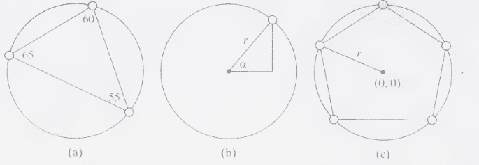

**图 4.5** (a) 由圆上的三个随机点形成三角形。(b) 可以使用随机角度 $\alpha$ 生成圆上的随机点。(c) 五边形的中心在 (0,0)，其中一个点在 12 点钟位置。

### 4.7（顶点坐标）
假设一个五边形的中心在 (0,0)，一个点在 12 点钟位置，如图 4.5c 所示。写一个程序，提示用户输入五边形外接圆的半径，并显示该五边形上五个顶点的坐标。运行如下：

```
Enter the radius of the bounding circle: 100
The coordinates of five points on the pentagon are
(95.1056, 30.9017)
(0.000132679, 100)
(-95.1056, 30.9019)
(-58.7788, -80.9015)
(58.7782, -80.9022)
```

## 第 4.8–4.21 节

### 4.8（查找 ASCII 码对应的字符）
编写一个程序，接收一个 ASCII 码（0 到 127 之间的整数）并显示对应的字符。以下是一个运行示例：

```
输入 ASCII 码：69
字符是 E
```


### 4.9（查找字符的 ASCII 码）
编写一个程序，接收一个字符并显示其 ASCII 码。以下是一个运行示例：

```
输入一个字符：E
字符的 ASCII 码是 69
```


### 4.10（元音还是辅音？）
假设字母 A/a, E/e, I/i, O/o 和 U/u 为元音。编写一个程序，提示用户输入一个字母并检查该字母是元音还是辅音。以下是一个运行示例：

```
输入一个字母：B
B 是辅音
```


```
输入一个字母等级：a
a 是元音
```


```
输入一个字母等级：#
# 是无效输入
```


### 4.11（将大写字母转换为小写字母）
编写一个程序，提示用户输入一个大写字母并将其转换为小写字母。以下是一个运行示例：

```
输入一个大写字母：T
小写字母是 t
```


### 4.12（将字母等级转换为数字）
编写一个程序，提示用户输入一个字母等级 A/a, B/b, C/c, D/d 或 F/f，并显示其对应的数值 4, 3, 2, 1 或 0。以下是一个运行示例：

```
输入一个字母等级：B
等级 B 的数值值是 3
```


```
输入一个字母等级：b
等级 b 的数值值是 3
```


```
输入一个字母等级：T
T 是无效等级
```


### 4.13（十六进制转二进制）
编写一个程序，提示用户输入一个十六进制数字并显示其对应的二进制数。以下是一个运行示例：


```
输入一个十六进制数字：B
二进制值是 1011
```


```
输入一个十六进制数字：G
G 是无效输入
```

### 4.14（十进制转十六进制）
编写一个程序，提示用户输入一个 0 到 15 之间的整数并显示其对应的十六进制数。以下是一些运行示例：


```
输入一个十进制值（0 到 15）：11
十六进制值是 B
```


```
输入一个十进制值（0 到 15）：5
十六进制值是 5
```


```
输入一个十进制值（0 到 15）：31
31 是无效输入
```

### 4.15（电话键盘）
电话上的国际标准字母/数字映射如下所示：


编写一个程序，提示用户输入一个字母并显示其对应的数字。


```
输入一个字母：A
对应的数字是 2
```


```
输入一个字母：a
对应的数字是 2
```


```
输入一个字母：+
+ 是无效输入
```

## 第 4.8–4.21 节（续）

### 4.16（处理字符串）
编写一个程序，提示用户输入一个字符串并显示其长度和第一个字符。

### 4.17（业务：检查 ISBN）
通过以字符串输入 ISBN 来重写练习 3.35。

### 4.18（随机字符串）
编写一个生成三个随机字母的程序。

### 4.19（城市排序）
编写一个程序，提示用户输入三个城市并按字母顺序显示。以下是一个运行示例：

```
输入第一个城市：Chicago
输入第二个城市：Los Angeles
输入第三个城市：Atlanta
字母顺序为 Atlanta Chicago Los Angeles
```

### 4.20（月份天数）
编写一个程序，提示用户输入年份和月份的首字母（大写），并显示该月份的天数。以下是一个运行示例：

```
输入年份：2001
输入月份：Jan
Jan 2001 有 31 天
```

```
输入年份：2001
输入月份：jan
jan 不是正确的月份名称
```

### 4.21（专业与状态）
编写一个程序，提示用户输入两个字符并由字符表示专业和状态。第一个字符表示学生是大一、大二、大三还是大四。第二个字符是数字 1, 2, 3, 4，分别代表大一、二、三、四。

M：数学
C：计算机科学
I：信息技术

以下是一个运行示例：

```
输入两个字符：M1
数学 大一
```

```
输入两个字符：C3
计算机科学 大三
```

```
输入两个字符：T3
无效专业代码
```

```
输入两个字符：M7
无效状态代码
```

### 4.22（财务应用：工资）
编写一个程序读取以下信息并打印工资单：
员工姓名（例如 Smith）
每周工作小时（例如 10）
时薪（例如 9.75）
联邦税扣率（例如 20%）
州税扣率（例如 9%）
下方是一个运行示例：

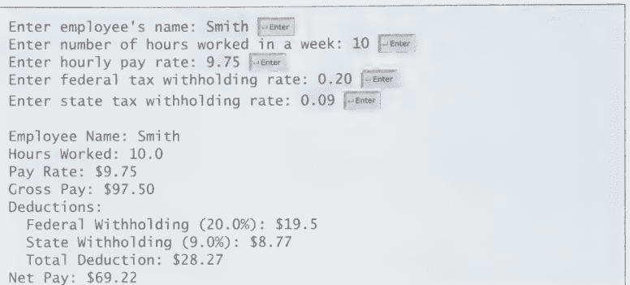

### 4.23（检查 SSN）
编写一个程序，提示用户输入格式为 ddd-dd-ddd 的社会安全号码，其中 d 是数字。以下是运行示例：

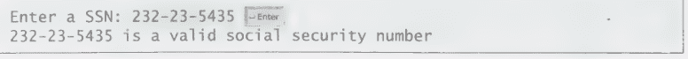

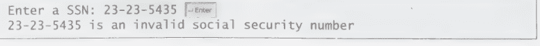

# 第 5 章
## 循环

### 目标
- 使用 `while` 循环重复执行语句（§5.2）。
- 遵循循环设计策略开发循环（§5.2.1–5.2.3）。
- 通过用户确认控制循环（§5.2.4）。
- 使用哨兵值控制循环（§5.2.5）。
- 使用输入重定向而非键盘从文件获取输入（§5.2.6）。
- 从文件中读取所有数据（§5.2.7）。
- 使用 `do-while` 语句编写循环（§5.3）。
- 为语句编写循环（§5.4）。
- 发现三种语句的相似之处和差异（§5.6）。
- 编写嵌套循环。
- 学习最小减少数值误差的技术（§5.7）。
- 从各种示例中学习循环（GCD, FutureTuition, MonteCarloSimulation, Dec2Hex）（§5.8）。
- 使用 `break` 和 `continue` 实现程序控制（§5.9）。
- 编写一个测试回文的程序（§5.10）。
- 编写一个显示质数的程序（§5.11）。


## 5.1 引言

循环可以用来告诉程序重复执行语句。

假设你需要显示一个字符串（例如，“Welcome to C++!”）100 次。编写 100 次以下语句将非常枯燥：

```
cout << "Welcome to C++\n";
cout << "Welcome to C++\n";
cout << "Welcome to C++\n";
```

那么，你如何解决这个问题呢？C++ 提供了一种名为循环的强大结构，它可以控制操作或一系列操作执行的次数。使用循环语句，你只需要告诉计算机显示 100 次字符串，如下所示：

```cpp
int count = 0;
while (count < 100)
{
    cout << "Welcome to C++\n";
    count++;
}
```

变量 `count` 初始值为 0。循环检查 `(count < 100)` 是否为真。如果是，则执行循环体显示 Welcome to C++ 并将 `count` 加 1。它重复循环体，直到 `(count < 100)` 变为假（即 `count` 达到 100 时）。此时，循环终止，程序控制运行到 `while` 循环之后的语句。

循环是控制重复执行语句块的结构。循环的概念是编程的基础。C++ 提供了三种循环语句：`while` 循环、`do-while` 循环和 `for` 循环。

## 5.2 while 循环

循环在条件为真时重复执行语句。

`while` 循环的语法如下：

```cpp
while (loop-continuation-condition)
{
    // 循环体
    Statement();
}
```

图 5.1 显示了 `while` 循环的流程图。包含要执行语句的体被称为循环体。循环体的单次执行被称为迭代（重复）。每个循环包含一个循环继续条件，这是一个控制循环执行的布尔表达式。它每次评估以确定是否执行循环体。如果评估结果为真，则执行循环体；如果评估结果为假，则整个循环终止，程序控制运行到 `while` 循环之后的语句。

前节介绍的显示 100 次 Welcome to C++ 的循环是 `while` 循环的一个示例。它的流程图如图 5.1b 所示。循环继续条件是 `count < 100`，循环包含以下两个语句：

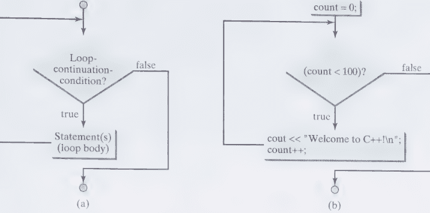

**图 5.1** while 循环：当循环继续条件求值为真时，会重复执行循环体中的语句。

```cpp
int count = 0;
while (count < 100)
{
    cout << "Welcome to C++\n";
    count++;
}
```

在这个示例中，你确切地知道循环体需要执行多少次，因为控制变量被用于计数执行次数。这种循环被称为计数控制循环。

> **注意**
> 循环继续条件必须始终出现在括号内。只有当循环体包含一条语句或没有语句时，才能省略包裹循环体的大括号。

这里是另一个有助于理解循环如何工作原理的示例：

```cpp
int sum = 0, i = 1;
while (i < 10)
{
    sum = sum + i;
    i++;
}
```

如果 `i < 10` 为真，程序会将 `i` 加到 `sum` 中。变量 `i` 初始为 1，然后递加 2、3，一直到 10。当 `i < 10` 为假时，循环退出。因此，`sum` 为 1 + 2 + 3 + ... + 9 = 45。

如果循环被错误地写如下会发生什么？

```cpp
int sum = 0, i = 1;
while (i < 10)
{
    sum = sum + i;
}
```

这个循环是无限的，因为 `i` 始终是 1，且 `i < 10` 始终为真。

**注意** 确保循环继续条件最终变为假，以便循环能够终止。常见的编程错误涉及无限循环（即循环永远运行）。如果你的程序运行时间异常长且没有停止，可能存在无限循环。如果你在命令行窗口运行程序，请按 `CTRL+C` 停止它。

**警告** 程序员经常犯循环多执行一次或少执行一次的错误。这通常被称为差一错误。例如，下面的循环显示 Welcome to C++ 的 101 次而不是 100 次。错误在于条件，它应该是 `< 100` 而不是 `count <= 100`。

```cpp
int count = 0;
while (count <= 100)
{
    cout << "Welcome to C++\n";
    count++;
}
```

回列表 3.4 `SubtractionQuiz.cpp` 提供了一个提示用户输入减法答案的程序。使用循环，你可以重写该程序，让用户输入新答案直到正确为止，如列表 5.1 所示。


### 列表 5.1 RepeatSubtractionQuiz.cpp

```cpp
1 #include <iostream>
2 #include <ctime> // 用于 time 函数
3 #include <cstdlib> // 用于 rand 和 srand
4 using namespace std;
5
6 int main()
7 {
8     // 1. 生成两个随机个位数
9     srand(time(0));
10    int number1 = rand() % 10;
11    int number2 = rand() % 10;
12
13    // 2. 如果 number1 < number2，交换 number1 和 number2
14    if (number1 < number2)
15    {
16        int temp = number1;
17        number1 = number2;
18        number2 = temp;
19    }
20
21    // 3. 提示学生回答“number1 - number2 是多少？”
22    cout << "What is " << number1 << " - " << number2 << " ? ";
23    int answer;
24    cin >> answer;
25
26    // 4. 重复询问用户直到答案正确
27    while (number1 - number2 != answer)
28    {
29        cout << "Wrong answer. Try again. What is "
30             << number1 << " - " << number2 << " ? ";
31        cin >> answer;
32    }
33
34    cout << "You got it!" << endl;
35
36    return 0;
37 }
```


# 第 5 章 循环

## 5.2.1 案例研究：猜数字

问题是猜出计算机手中的几个数字。你将编写一个程序，随机生成一个 0 到 100（包含）之间的整数。程序会提示用户输入数字，直到与生成的数字匹配。对于每个输入，程序都会告诉用户是太大还是太小，以便用户进行下一次猜测。这是一个示例运行：

| Guess a number between 0 and 100 | |
| :--- | :--- |
| Enter your guess: 50 | Your guess is high |
| Enter your guess: 25 | Your guess is too low |
| Enter your guess: 42 | Your guess is high |
| Enter your guess: 39 | Yes, the number is 39 |


数字在 0 到 100 之间。为了尽量减少猜测次数，首先输入 50。如果太大，数字就在 0 到 49 之间；如果太小，数字就在 51 到 100 之间。这样，你每次猜测后都可以排除一半的数字。你如何编写这个程序？直接开始编码吗？不。在编码之前思考很重要。如果不写程序，你会如何解决这个问题？首先你需要生成一个 0 到 100 之间的随机数，然后提示用户输入猜测，并将猜测与随机数进行比较。对于循环，你可以先编写执行一次循环的代码，然后弄清如何在循环中执行。对于这个程序，你可以创建一个如 5.2 所示的初稿。

## 5.2 GuessNumberOneTime.cpp

```cpp
#include <iostream>
#include <cstdlib>
#include <ctime> // 需要 time 函数

using namespace std;

int main() {
    // 生成一个被猜的随机数
    srand(time(0));
    int number = rand() % 101;
    cout << "Guess a magic number between 0 and 100:";
    // 提示用户猜数字
    cout << "Enter your guess: ";
    int guess;
    cin >> guess;
    if (guess == number)
        cout << "Yes, the number is " << number << endl;
    else if (guess > number)
        cout << "Your guess is too high" << endl;
    else
        cout << "Your guess is too low" << endl;
    return 0;
}
```

当你运行这个程序时，它提示用户输入一次猜测。为了让用户反复猜测，你可以将第 15–24 行的代码放入如下循环中：

```cpp
while (true) {
    // 提示用户猜数字
    cout << "Enter your guess: ";
    cin >> guess;
    if (guess == number)
        cout << "Yes, the number is " << number << endl;
    else if (guess > number)
        cout << "Your guess is too high" << endl;
    else
        cout << "Your guess is too low" << endl;
} // 循环结束
```

这个循环重复提示用户猜测。然而，这个循环是错误的，因为它不会终止。当 `guess` 匹配 `number` 时，循环应该结束。因此，循环可以修改如下：

```cpp
while (guess != number) {
    // 提示用户猜数字
    cout << "Enter your guess: ";
    cin >> guess;
    if (guess == number)
        cout << "Yes, the number is " << number << endl;
    else if (guess > number)
        cout << "Your guess is too high" << endl;
    else
        cout << "Your guess is too low" << endl;
} // 循环结束
```

完整的代码位于列表 5.3。

## 列表 5.3 GuessNumber.cpp

| Line# | number | guess | Output |
| :--- | :--- | :--- | :--- |
| 10 | 39 | | |
| 14 | | -1 | |
| iteration 1 | 19 | | 50 | Your guess is too high |
| 24 | | | |
| iteration 2 | 19 | | 25 | Your guess is too low |
| 26 | | | |
| iteration 3 | 19 | | 12 | Your guess is too high |
| 24 | | | |
| iteration 4 | 19 | | 39 | Yes, the number is 39 |
| 22 | | | |

程序在第 10 行生成魔法数字，并在循环（第 15–27 行）中提示用户反复输入猜测。对于每次猜测，程序检查它是正确的、太大的还是太小的（第 21–26 行）。当猜测正确时，程序退出循环（第 15 行）。注意 `guess` 被初始化为 -1。将其初始化为 0 到 100 之间的值是错误的，因为那可能就是被猜中的数字。

## 5.2.2 循环设计策略

对于初级程序员来说，编写一个正确的循环并不是易事。编写循环时，请考虑以下三个步骤。

**第 1 步**：识别需要重复的语句。

**第 2 步**：将这些语句封装在循环中，如下：

```cpp
while (true) {
    Statements;
}
```

**第 3 步**：编写循环继续条件，并添加适当的语句控制循环。

```cpp
while (loop-continuation-condition) {
    Statements;
    控制循环的额外语句;
}
```

### 5.2.3 案例研究：多次减法

列表 3.4 中的 `SubtractionQuiz.cpp` 减法练习程序每次运行只生成一个问题。你可以使用循环反复生成问题。如何编写代码来生成五个问题呢？遵循循环设计策略。首先，识别需要重复的语句。它们是获取两个随机数、向用户提示减法问题以及对问题进行评分的语句。其次，将这些语句封装在循环中。添加一个循环控制变量和循环继续条件以执行循环五次。

列表 5.4 提供了一个生成五个问题的程序，并在学生回答后报告正确答案的数量。该程序还会显示参加测试时花费的时间，如示例运行结果所示。

## 列表 5.4 SubtractionQuizLoop.cpp

```cpp
#include <iostream>
#include <ctime> // 需要 time 函数
#include <cstdlib> // 需要 rand 和 srand 函数
using namespace std;

int main() {
    int correctCount = 0; // 统计正确答案数量
    int count = 0; // 统计问题数量
    long startTime = time(0);
    const int NUMBER_OF_QUESTIONS = 5;

    srand(time(0)); // 设置随机种子

    while (count < NUMBER_OF_QUESTIONS) {
        // 1. 生成两个随机单位整数
        int number1 = rand() % 10;
        int number2 = rand() % 10;

        // 2. 如果 number1 < number2，则交换 number1 和 number2
        if (number1 < number2) {
            int temp = number1;
            number1 = number2;
            number2 = temp;
        }

        // 3. 提示学生回答“number1 - number2 是多少”
        cout << "What is " << number1 << " - " << number2 << " ?";
        int answer;
        cin >> answer;

        // 4. 对答案评分并显示结果
        if (number1 - number2 == answer) {
            cout << "You are correct!\n";
            correctCount++;
        } else {
            cout << "Your answer is wrong.\n" << number1 << " - " << number2 << " should be " << (number1 - number2) << endl;
        }

        // 增加计数
        count++;
    }

    long endTime = time(0);
    long testTime = endTime - startTime;

    // 显示结果
    cout << "Correct count is " << correctCount << "\ntest time is " << testTime << " seconds\n";
}
```

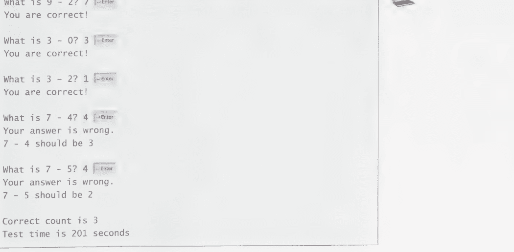

程序使用变量 `count` 来控制循环的执行，该变量初始值为 0（第 9 行），并在每次迭代中加 1（第 45 行）。每次迭代都会显示并处理一个减法问题。程序在第 10 行获取测试开始前的时间，在第 48 行获取测试结束后的时间，并在第 49 行计算时间差。

## 5.2.4 通过用户确认控制循环

上述示例执行了五次循环。如果你想让用户决定是否继续，可以提供用户确认。程序的模板可以编写如下：

```cpp
char continueLoop = 'Y';
while (continueLoop == 'Y') {
    // 执行一次循环
    // 提示用户确认
    cout << "Enter Y to continue and N to quit:";
    cin >> continueLoop;
}
```

你可以运行带有用户确认的列表 5.4，让用户决定是否进入下一个问题。

## 5.2.5 使用哨兵值控制循环

控制循环的另一种常用技术是指定一个特殊值来读取和处理一组值。这个特殊输入值被称为**哨兵值**（sentinel value），标志着输入的结束。使用哨兵值控制执行的循环被称为哨兵控制循环。

列表 5.5 描述了一个程序，用于读取并计算未指定数量整数的和。输入 0 表示输入的结束。你需要为每个输入值声明一个新变量吗？不需要。使用一个变量 `data`（第 8 行）来存储输入值，并使用一个名为 `sum` 的变量（第 12 行）来存储总和。当读取到一个值时，将其赋值给 `data`（第 9、20 行），如果该值不为 0，则将其加到 `sum` 中（第 15 行）。

## 列表 5.5 SentinelValue

```cpp
#include <iostream>

int main() {
    int data;
    int sum = 0;
    cout << "Enter integers (0 to stop): ";
    cin >> data;
    while (data != 0) {
        sum += data;
        cout << "Enter integers (0 to stop): ";
        cin >> data;
    }
    cout << "The sum is " << sum << endl;
    return 0;
}
```

*(注：由于原文文本中列表 5.5 代码部分不完整，此处根据描述补全了逻辑结构以保持完整性)*

## 从文件输入

```cpp
{
    input >> number; // 读取数据
    cout << number << " "; // 显示数据
    sum += number;
}
input.close();
cout << "\nSum is " << sum << endl;
return 0;
```

95 56 34
总分是 185
完成


该程序在循环中读取数据（第 12–17 行）。循环每次迭代读取一个数字。当输入到达文件末尾时，循环终止。
当没有更多内容可读时，`eof()` 返回 true。为了让此程序正确运行，文件的最后一个数字之后不应有任何空白字符。在第 13 章中，我们将讨论如何改进程序以处理文件最后一个数字后带有空白字符的特殊情况。

文件末尾了？

## 5.1 分析以下代码。在点 A、点 B 和点 C，`count < 100` 是始终真、始终假，还是有时真、有时假？


```cpp
int count = 0;
while (count < 100) {
    // 点 A
    cout << "\Welcome to C++!\n";
    count++;
}
// 点 C
```

5.2 如果在列表 5.3 的第 44 行将 `guess` 初始化为 0，会有什么问题？

5.3 下述循环体重复了多少次？每个循环的输出是什么？

```cpp
int i = 0;
while (i < 10)
    if (i % 2 == 0)
        cout << i << endl;
```

```cpp
int i = 1;
while (i < 10)
    if (i % 2 == 0)
        cout << i << i++ << endl;
```

```cpp
int i = 1;
while (i < 10)
    if (i++ % 2 == 0)
        cout << i << i << endl;
```

(a)

(b)

(c)

5.4 假设输入是 2 3 4 5 0。以下代码的输出是什么？

```cpp
#include <iostream>
using namespace std;

int main() {
    int number, max;
    cin >> number;
    max = number;
    while (number != 0) {
        cin >> number;
        if (number > max)
            max = number;
    }
    cout << "max is " << max << endl;
    cout << "number is " << number << endl;
    return 0;
}
```

5.5 以下代码的输出是什么？解释原因。

```cpp
int x = 80000000;
while (x > 0)
    x--;
cout << "x is " << x << endl;
```

5.6 在从文件读取数据时，你如何测试文件末尾？

## 5.3 do-while 循环

do-while 循环与 while 循环相同，但它先执行循环体，然后检查循环继续条件。

do-while 循环是 while 循环的一种变体。它的语法如下：

```cpp
do {
    // 循环体；
    Statement(s);
} while (loop-continuation-condition);
```


它的执行流程如图 5.2 所示。

首先执行循环体。然后评估循环继续条件。如果评估为真，则再次执行循环体；否则 `do-while` 循环终止。`while` 循环和 `do-while` 循环之间的主要区别在于评估循环继续条件和执行循环体的顺序。`while` 循环和 `do-while` 循环具有同等的表达能力。有时其中一种比另一种更方便。例如，你可以使用 `do-while` 循环重写列表 5.5 中的 `while` 循环，如列表 5.7 所示。


### 5.3 do-while 循环 169

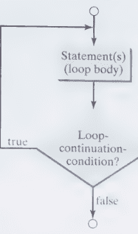

图 5.2 `do-while` 循环先执行循环体，然后检查循环继续条件以决定继续还是终止循环。

### 列表 5.7 TestDoWhile.cpp

```cpp
#include <iostream>

using namespace std;

int main()
{
    // 继续读取数据直到输入为 0
    int sum = 0;
    int data = 0;

    do
    {
        sum += data;

        // 读取下一个数据
        cout << "Enter an integer (the input ends " <<
        "if it is 0): " <<
        cin >> data;
    } while (data != 0);

    cout << "The sum is " << sum << endl;
    return 0;
}
```

输入一个整数（输入 0 则结束）: 3
输入一个整数（输入 0 则结束）: 5
输入一个整数（输入 0 则结束）: 6
输入一个整数（输入 0 则结束）: 0
总和是 14


### 第 5 章 循环

如果 `sum` 和 `data` 没有初始化为 0 会发生什么？会导致语法错误吗？不会。它会导致逻辑错误，因为 `sum` 和 `data` 可以初始化为任何值。

> **注意**：如果循环内部有必须执行一次的语句，请使用 `do-while` 循环，如前面的 DoWhile 程序所示。这些语句必须在循环之前出现。

### 5.7 假设输入是 2 3 4 5 0。以下代码的输出是什么？

```cpp
#include <iostream>

using namespace std;

int main() {
    int number, max;

    cin >> number;
    max = number;

    while (number != 0) {
        cin >> number;
        if (number > max)
            max = number;
    }

    cout << "max is " << max << endl;
    cout << "number is " << number << endl;
    return 0;
}
```

### 5.8 `while` 循环和 `do-while` 循环的区别是什么？

```cpp
int sum = 0;
int number;

while (number != 0) {
    sum += number;
}
```

### 5.9 以下代码的错误在哪里？

```cpp
int total = 0;
int number;

do {
    cin >> number;
} while (number != 0);
```

## 5.4 for 循环

`for` 语句以 `for` 关键字开头，后跟一个包含初始化操作、循环继续条件和迭代后操作的括号，最后是花括号内的循环体。通常按以下形式编写循环：

```cpp
int i;
for (i = 0; i < 100; i++)
{
    cout << "Welcome to C++\n";
}
```

`for` 循环使用变量控制循环执行的次数以及何时终止。初始化操作通常初始化控制变量，迭代后操作通常递增或递减控制变量，循环继续条件测试控制变量是否达到了终止值。例如，以下循环显示 Welcome to C++.

```cpp
int i;
for (i = 0; i < 100; i++)
{
    cout << "Welcome to C++\n";
}
```

`for` 语句的流程如图 5.3 所示。`for` 循环将 `i` 初始化为 0，然后在 `i` 小于 100 时重复执行语句。


### 第 5 章 循环

`for` 语句以 `for` 关键字开头，后跟一个包含初始化操作、循环继续条件和迭代后操作的括号，最后是花括号内的循环体。`for` 循环中的初始化操作可以是零或多个用逗号分隔的变量声明语句或赋值表达式。例如：

```cpp
for (int i = 0; i < 100; i++)
{
    // 循环体
}
```

`for` 循环使用变量控制循环执行的次数以及何时终止。初始化操作通常初始化控制变量，迭代后操作通常递增或递减控制变量，循环继续条件测试控制变量是否达到了终止值。例如，以下循环显示 Welcome to C++.

```cpp
int i;
for (i = 0; i < 100; i++)
{
    cout << "Welcome to C++\n";
}
```

`for` 语句的流程如图 5.3 所示。`for` 循环将 `i` 初始化为 0，然后在 `i` 小于 100 时重复执行语句。


### 5.4 for 循环

```cpp
for (int i = 0, j = 0; i + j < 10; i++, j++)
  // Do something
```

`for` 循环中每次迭代后的操作（action-after-each-iteration）可以是零或多个逗号分隔的语句列表。例如：

```cpp
for (int i = 1; i < 100; cout << i << endl;);
```

这个示例是正确的，但并不是一个好的例子，因为它让代码难以阅读。通常，我们声明并初始化控制变量作为初始操作，并在每次迭代后增加或减少该控制变量。

> **注意**：如果 `for` 循环中省略了循环继续条件（loop-continuation-condition），则它默认为真。下方 (a) 中的语句是一个无限循环，它与 (b) 相同。但为了避免混淆，最好使用 (c) 中等效的循环。

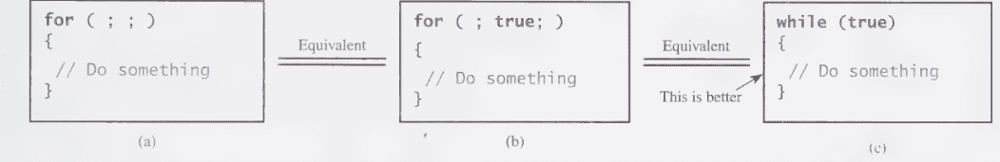

以下两个循环得到的 `sum` 值相同吗？

```cpp
for (int i = 0; i < 10; ++i)
  sum += i;
(a)
```

```cpp
for (int i = 0; i < 10; i++)
  sum += i;
(b)
```

`for` 循环的三个部分是什么？写一个打印 1 到 100 数字的 `for` 循环。

假设输入是 2 3 4 5 0。以下代码的输出是什么？

```cpp
#include <iostream>

using namespace std;

int main() {
  int number, sum = 0, count;
  for (count = 0; count < 5; count++) {
    cin >> number;
    sum += number;
  }
  cout << "sum is " << sum << endl;
  cout << "count is " << count << endl;
  return 0;
}
```

### 5.13 下述语句的作用是什么？

```cpp
for ( ; );
{
  // Do something
}
```

### 5.14 如果变量在循环控制中声明，它在循环退出后还可以使用吗？

### 5.15 将以下 `for` 循环语句转换为 `while` 循环和 `do-while` 循环：

```cpp
long sum = 0;
for (int i = 0; i <= 1000; i++)
  sum = sum + 1;
```

### 5.16 统计以下循环的迭代次数：

| int count = 0; | for (int count = 0; |
| :--- | :--- |
| while (count < n) | count <= n; count++) |
| { | } |
| count++; | } |

(a) (b)

| int count = 5; | int count = 5; |
| :--- | :--- |
| while (count < n) | while (count < n) |
| { | { |
| count++; | count = count + 3; |
| } | } |

(c) (d)

## 5.5 使用哪种循环？

你可以使用 `for` 循环、`while` 循环或 `do-while` 循环，哪个方便就用哪个。

`for` 和 `while` 循环被称为预测试循环（pretest loops），因为在执行循环体之前会检查继续条件。`do-while` 循环被称为后测试循环（posttest loops），因为条件是在执行循环体之后检查的。这三个语句——`while`、`do-while` 和 `for`——在表达上是等效的；也就是说，你可以用这三种形式中的任何一种编写循环。例如，图中 (a) 中的 `while` 循环可以始终转换为 (b) 中的 `for` 循环。


| while (loop-continuation-condition) | for ( ; loop-continuation-condition; ) |
| :--- | :--- |
| { | { |
| Loop body | |
| } | } |

(a) (b)

下一图中的 `for` 循环 (a) 通常可以转换为 (b) 中的 `while` 循环，某些特殊情况除外（此类情况请参见检查点 5.24）。

| for (initial-action; | 等效 | initial-action; |
| :--- | :--- | :--- |
| loop-continuation-condition; | | while (loop-continuation-condition) |
| action-after-each-iteration) | | { |
| { | | // Loop body; |
| // Loop body; | | action-after-each-iteration; |
| } | | } |

(a) (b)

使用对你来说最直观、舒适的循环语句。通常，如果提前知道重复次数，则可以使用 `for` 循环，例如当你需要显示 100 次消息时。如果重复次数不固定，则可以使用 `while` 循环，例如读取数字直到输入为 0 为止。如果必须在测试继续条件之前执行循环体，则可以使用 `do-while` 循环替换 `while` 循环。

> **注意**
> 在循环体之前的 `for` 子句末尾添加分号是一个常见错误，如下所示。在 (a) 中，分号提前结束了循环。循环体是空的，如 (b) 所示。(a) 和 (b) 是等效的。

| for (int i = 0; i < 10; i++); | 空循环体 | for (int i = 0; i < 10; i++) |
| :--- | :--- | :--- |
| { | | { |
| cout << endl; | | i++; |
| } | | } |

(a) (b)

同样，(c) 中的循环是错误的。(c) 与 (d) 等效的。

| int i = 0; | 空循环体 | |
| :--- | :--- | :--- |
| while (i < 10); | int i = 0; i < 10) { |
| { | | { |
| cout << endl; | cout << endl; |
| i++; | i++; |
| } | | } |

(c) (d)

`do-while` 循环的情况下，需要分号来结束循环。

```cpp
int i = 0;
do {
  cout << "i is " << i << endl;
  i++;
} while (i < 10); // <-- 正确
```

### 5.17 你可以将 `for` 循环转换为 `while` 循环吗？列出 `for` 循环的优点。

### 5.18 你总是可以将 `while` 循环转换为 `for` 循环吗？

```cpp
int i = 1;
int sum = 0;
while (sum < 100) {
    sum = sum + i;
    i++;
}
```

### 5.19 识别并修复以下代码中的错误：

```cpp
int main() {
    for (int i = 0; i < 10; i++) {
        sum += i;
        if (i < j) {
            cout << i << endl;
        } else {
            cout << j << endl;
        }
        while (j < 10) {
            j++;
        }
    }
}
```

### 5.20 下列程序有什么问题？

```cpp
int main() {
    for (int i = 0; i < 10; i++) {
        cout << i + 4 << endl;
    }
}
```

## 5.6 嵌套循环

循环可以嵌套在另一个循环内部。嵌套循环由一个外部循环和多个内部循环组成。每当外部循环重复一次，内部循环就会重新开始。列表 5.8 展示了一个使用嵌套循环显示乘法表的程序。

### 列表 5.8 MultiplicationTable.cpp

```cpp
#include <iostream>
#include <iomanip>

using namespace std;

int main() {
    cout << "Multiplication Table\n";
    cout << "--------------------\n";

    // 显示标题
    cout << "      |";
    for (int j = 1; j <= 9; j++)
        cout << setw(3) << j;
    cout << "\n\n";

    // 显示表体
    for (int i = 1; i <= 9; i++) {
        cout << i << " |";
        for (int j = 1; j <= 9; j++) {
            // 显示乘积并对齐
            cout << setw(3) << i * j;
        }
        cout << "\n";
    }
    return 0;
}
```

| 1 | 2 | 3 | 4 | 5 | 6 | 7 | 8 | 9 |
| :--- | :--- | :--- | :--- | :--- | :--- | :--- | :--- | :--- |
| 2 | 2 | 4 | 6 | 8 | 10 | 12 | 14 | 16 | 18 |
| 3 | 3 | 6 | 9 | 12 | 15 | 18 | 21 | 24 | 27 |
| 4 | 4 | 8 | 12 | 16 | 20 | 24 | 28 | 32 | 36 |
| 5 | 5 | 10 | 15 | 20 | 25 | 30 | 35 | 40 | 45 |
| 6 | 6 | 12 | 18 | 24 | 30 | 36 | 42 | 48 | 54 |
| 7 | 7 | 14 | 21 | 28 | 35 | 42 | 49 | 56 | 63 |
| 8 | 8 | 16 | 24 | 32 | 40 | 48 | 56 | 64 | 72 |
| 9 | 9 | 18 | 27 | 36 | 45 | 54 | 63 | 72 | 81 |

## 5.8 案例分析

```cpp
int main()
{
    // 初始化 sum
    double sum = 0;

    // 将 0.01, 0.02, ..., 0.99, 1 加到 sum
    for (double i = 0.01; i <= 1.0; i = i + 0.01)
        sum += i;

    // 显示结果
    cout << "The sum is " << sum << endl;
    return 0;
}
```

### 循环

# Result

结果是 49.5，但正确的结果应该是 50.5。发生了什么？在循环的每次迭代中，`i` 都会增加 0.01。当循环结束时，`i` 略大于 1（并不等于 1）。这导致最后一次 `i` 没有被加到 `sum` 中。根本问题在于浮点数是用近似值表示的。

为了解决这个问题，请使用整数计数器以确保所有数字都加到 `sum` 中。这是新的循环：

```cpp
double currentValue = 0.01;
```


```cpp
for (int count = 0; count < 100; count++)
{
    sum += currentValue;
    currentValue += 0.01;
}
```

在此循环之后，`sum` 是 50.5。

## 5.8 案例分析

循环是编程中的基础。编写循环的能力对于学习编程至关重要。

如果你能使用循环编写程序，那么你如何知道如何编程呢？由于这个原因，本节介绍了另外四个使用循环解决问题的示例。

### 5.8.1 案例分析：寻找最大公约数

两个整数 4 和 2 的最大公约数（GCD）是 2。两个整数 16 和 24 的 GCD 是 8。你如何确定 GCD ？假设输入的整数为 `n1` 和 `n2`。你注意到数字 1 是一个公约数，但它可能不是最大的。因此，你可以检查 `k`（对于 `k = 2, 3, 4` 等）是否是 `n1` 和 `n2` 的公约数，直到 `k` 大于 `n1` 或 `n2` 为止。每当发现一个新的公约数时，它就成为 GCD。当你检查了从 2 到 `n1` 或 `n2` 的所有可能的公约数后，变量 `gcd` 中的值就是 GCD。该思想可以转换为下面的循环：

```cpp
int gcd = 1; // 初始 gcd 为 1
int k = 2; // 可能的 gcd
while (k < n1 && k <= n2)
{
    if (n1 % k == 0 && n2 % k == 0)
        gcd = k; // 更新 gcd
    k++; // 下一个可能的 gcd
}
// 循环结束后，gcd 是 n1 和 n2 的最大公约数
```

列表 5.10 展示了该程序，它提示用户输入两个正整数并找到它们的 GCD。

### 列表 5.10 GreatestCommonDivisor.cpp

```cpp
#include <iostream>
using namespace std;
int main()
{
    // 提示用户输入两个整数
    cout << "Enter first integer: ";
    int n1;
    cin >> n1;
    cout << "Enter second integer: ";
    int n2;
    cin >> n2;
    int gcd = 1;
    int k = 2;
    while (k < n1 && k <= n2)
    {
        if (n1 % k == 0 && n2 % k == 0)
            gcd = k;
        k++;
    }
    cout << "The greatest common divisor for " << n1 << " and "
         << n2 << " is " << gcd << endl;
    return 0;
}
```

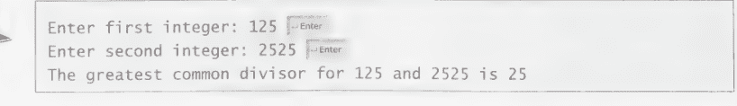

你会如何编写这个程序？在你开始打字之前会立即开始思考吗？在打字之前思考是非常重要的。思考能让你在编写代码之前为问题生成逻辑上的解决方案。如果你有一个逻辑上的解决方案，就输入代码将该解决方案翻译成程序。这种翻译不是唯一的。例如，你可以使用 `for` 循环来重写代码如下：

```cpp
for (int k = 2; k <= n1 && k <= n2; k++)
{
    if (n1 % k == 0 && n2 % k == 0)
        gcd = k;
}
```

### 5.8.2 案例分析：预测未来

一个问题通常有多个解决方案，GCD 问题可以用许多方法解决。编程练习 5.16 提出了另一种解决方案。一种更高效的解决方案是使用经典的欧几里得算法（多种解决方案请参见 www-cut-the-knot.net/blue/Euclid.shtml）。

你可能会认为一个数字 `n1` 的因数不能大于 `n1 / 2`，这导致你尝试使用以下循环实现一个错误的解决方案：

```cpp
for (int k = 2; k <= n1 / 2 && k <= n2; k++)
{
    if (n1 % k == 0 && n2 % k == 0)
        gcd = k;
}
```

这个修改是错误的。你能找到原因吗？答案请参见点 5.23。

### 5.8.3 案例分析：预测未来学费

假设某大学的学费今年为 10,000，每年增加 7%。多少年后学费会翻倍？在编写程序解决它之前，考虑如何用手工计算。第二年的学费是第一年学费乘以 1.07。因此，每年的学费可以这样计算：

```text
double tuition = 10000; int year = 0; // 第0年
tuition = tuition * 1.07; // 第1年
tuition = tuition * 1.07; // 第2年
tuition = tuition * 1.07; // 第3年
```

持续计算每年的学费直到它至少达到 20000。然后你就知道学费翻倍需要多少年。你可以将逻辑转换为下面的循环：

```cpp
double tuition = 10000;
int year = 0;
while (tuition < 20000) {
  tuition = tuition * 1.07;
  year++;
}
```

完整的程序见列表 5.11。

### 列表 5.11 FutureTuition.cpp

```cpp
#include <iostream>
#include <iomanip>
using namespace std;
int main()
{
  double tuition = 10000; // 第1年
  int year = 1;
  while (tuition < 20000) {
    tuition = tuition * 1.07; // 下一年的学费
    year++;
  }
  cout << "Tuition will be doubled in " << year << " years" << endl;
  cout << setprecision(2) << fixed << "Tuition will be $" << tuition << " in "
       << year << " years" << endl;
  return 0;
}
```


### 5.8.4 案例分析：蒙特卡洛模拟

蒙特卡洛模拟使用随机数和概率来解决问题。这种方法在计算数学、物理和金融领域应用广泛。本节给出一个使用蒙特卡洛模拟估计 $\pi$ 的示例。使用蒙特卡洛方法估计 $\pi$，画一个内切正方形的圆：


假设圆的半径为 1。因此，圆面积为 $\pi$，正方形面积为 4。在正方形内随机生成一个点。点落在圆内的概率是 circleArea / squareArea = $\pi / 4$。编写一个程序，在正方形内随机生成 1,000,000 个点，并让 `numberOfHits` 为落在圆内的点数。因此，`numberOfHits / 1000000` ≈ $\pi / 4$ 可以近似为 $\pi \approx$ `numberOfHits / 4`。完整的程序见列表 5.12。

### 列表 5.12 MonteCarloSimulation.cpp

```cpp
#include <iostream>
#include <cstdlib>
#include <ctime>
using namespace std;
int main()
{
    const int NUMBER_OF_TRIALS = 1000000;
    int numberOfHits = 0;
    srand(time(0));
    for (int i = 0; i < NUMBER_OF_TRIALS; i++)
    {
        double x = rand() * 2.0 / RAND_MAX - 1; // 生成随机点
        double y = rand() * 2.0 / RAND_MAX - 1;
        if (x * x + y * y <= 1) // 检查圆内部
            numberOfHits++;
    }
    double pi = 4.0 * numberOfHits / NUMBER_OF_TRIALS;
    cout << "PI is " << pi << endl; // 估计 pi
    return 0;
}
```

```text
PI is 3.14124
```

### 5.8.5 案例分析：十进制转十六进制

十六进制经常用于计算机编程（数制参见附录 D）。如何将十进制数转换为十六进制？将十进制数 `d` 转换为十六进制是寻找十六进制数字 $h_n, h_{n-1}, h_{n-2}, ..., h_1$ 和 $h_0$，使得：

```
d = h_n * 16^n + h_{n-1} * 16^{n-1} + h_{n-2} * 16^{n-2} + ...
d = h_2 * 16^2 + h_1 * 16^1 + h_0 * 16^0
```

这些十进制数字可以通过不断用 `d` 除以 16 直到商为 0 来找到。余数就是 $h_0, h_1, ..., h_{n-2}, h_{n-1}$ 和 $h_n$。十六进制数字包括十进制数字 0, 1, 2, 3, 4, 5, 6, 7, 8, 9, A（代表值 10）、B（代表值 11）、C（代表值 12）、D（代表值 13）、E（代表值 14）以及 F（代表值 15）。

例如，十进制数 123 的十六进制为 7B。转换如下：将 123 除以 16。商为 7。继续用 7 除以 16。余数为 11（十六进制中的 B），商为 0。因此，7B 是十进制 123 的十六进制。

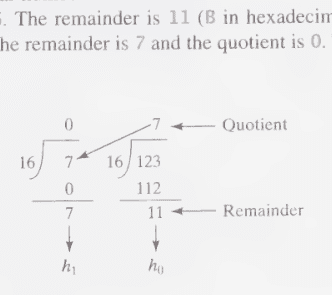

列表 5.13 给出了程序，提示用户输入一个十进制数并将其转换为十六进制字符串。

### 列表 5.13 Dec2Hex.cpp

```cpp
#include <iostream>
#include <string>
using namespace std;
int main() {
    // 提示用户输入十进制整数
    cout << "Enter a decimal number: ";
    int decimal;
    cin >> decimal;
    // 将十进制转换为十六进制
    string hex = "";
    while (decimal != 0)
    {
        int hexValue = decimal % 16;
        // 将十进制值转换为十六进制数字
        char hexChar = (hexValue <= 9 && hexValue >= 0) ? 
                        static_cast<char>(hexValue + '0') : 
                        static_cast<char>(hexValue - 10 + 'A');
        hex = hexChar + hex;
        decimal = decimal / 16;
    }
    cout << "The hex number is " << hex << endl;
    return 0;
}
```

输入一个十进制数: 1234
十六进制数是 4D2

| 行号# | decimal | hex | hexValue | hexChar |
|---|---|---|---|---|
| 13 | 1234 | | | |
| 17 | | | 2 | | |
| 24 | | "D2" | | 2 |
| 25 | | | | | |
| 17 | | | 13 | | |
| 24 | | | | D |
| 25 | 4 | | | | |
| 17 | | | | | |
| 24 | | "4D2" | | 4 |
| 25 | 0 | | | | |

程序提示用户输入一个十进制整数（第10行），将其转换为字符串形式的（第13–26行），并显示结果（第28行）。为了将十进制转换为十六进制数，程序使用循环连续将十进制数除以 16 并获取其余数（第17行）。余数被转换为十六进制字符（第20–22行）。然后将该字符附加到十六进制字符串中（第24行）。十六进制字符串初始为空（13行）。将十进制数除以 16 以从数字中移除一个十六位（25行）。当剩余的十进制数变为0时，循环结束。

程序将 0 到 15 之间的 `hexValue` 转换为十六进制字符。如果 `hexValue` 在 0 到 9 之间，它转换为 `static_cast<char>(hexValue + '0')`（第21行）。记住，当字符与整数相加时，评估过程中使用的是字符的 ASCII 代码。例如，如果 `hexValue` 为 5，`static_cast<char>(hexValue + '0')` 返回 5（第21行）。同样，如果 `hexValue` 在 10 到 15 之间，它被转换为 `static_cast<char>(hexValue - 10 + 'A')`（第22行）。例如，如果 `hexValue` 为 11，`hexValue - 10 + 'A'` 返回字符 B。

## 5.9 关键字 break 和 continue

5.23 如果将列表 5.10 中第 17 行的 `n1` 和 `n2` 替换为 `n1 / 2` 和 `n2 / 2`，程序还能正常工作吗？

5.24 在列表 5.13 中，如果你将第 21 行的代码 `static_cast<char>(hexValue + '0')` 改为 `hexValue + '0'` 是正确的吗？

5.25 在 5.13 中，对于十进制数 245，循环体执行了几次？对于十进制数 3245，循环体执行了几次？

`break` 和 `continue` 关键字为循环提供了额外的控制。

> **教学备注**
> 两个关键字 `break` 和 `continue` 可以用于循环语句，以提供额外的控制功能。在某些情况下，使用 `break` 和 `continue` 可以简化编程。然而，过度使用或不当使用它们可能会使程序难以阅读和调试。（给讲师的说明：你可以跳过本节，这不会影响学生对书中其他部分的理解）

你已经在 `switch` 语句中使用过 `break` 语句。你也可以在循环中使用 `break` 来立即终止循环。列表 5.14 展示了一个演示循环中使用 `break` 效果的程序。

### 列表 5.14 TestBreak.cpp

```cpp
1 #include <iostream>
2 using namespace std;
3
4 int main()
5 {
6 int sum = 0;
7 int number = 0;
8
9 while (number < 20)
10 {
11 number++;
12 sum += number;
13 if (sum >= 100)
14 break;
15 }
16
17 cout << "The number is " << number << endl;
18 cout << "The sum is " << sum << endl;
19
20 return 0;
21 }
```

数字是 14
和是 105

程序按此顺序将 1 到 20 的整数加到 `sum`，直到 `sum` 大于或等于 100。如果没有第 13–14 行，该程序将计算 1 到 20 的数字之和。有了第 13–14 行，当 `sum` 大于或等于 100 时，循环终止。如果没有第 13–14 行，输出将是数字 20，和为 210。

你也可以在循环中使用 `continue` 关键字。当遇到它时，它会结束当前的迭代并跳转到循环末尾。换句话说，`continue` 跳出了迭代。列表 5.15 中的程序展示了循环中使用 `continue` 的效果。

### 列表 5.15 TestContinue.cpp

```cpp
#include <iostream>
using namespace std;
int main() {
    int sum = 0;
    int number = 0;
    while (number < 20) {
        number++;
        if (number == 10 || number == 11) {
            continue;
        }
        sum += number;
    }
    cout << "the sum is " << sum << endl;
    return 0;
}
```


# 第5章 循环

## 5.9 关键字 `break` 和 `continue`

程序将 1 到 20 的整数加到 `sum`，但 10 和 11 除外。当 `number` 变为 10 或 11 时，执行 `continue` 语句。`continue` 结束当前的迭代，因此循环的剩余部分不执行；如果没有第 12–13 行，输出将是：数字是 20，和为 210。

在这种情况下，所有的数字都加到了 `sum` 中，即使 `number` 是 10 或 11。因此，结果是 210。

> **备注**
> `continue` 语句始终位于循环内部。在 `while` 和 `do-while` 循环中，循环条件在 `continue` 语句之后评估。在 `for` 循环中，执行每次迭代的动作后，循环条件也会被评估。

你总是可以编写不使用 `break` 或 `continue` 的程序。参见 5.28。通常情况下，使用 `break` 和 `continue` 可以简化编码并使程序易于阅读。假设你需要编写一个程序来寻找整数 (n >= 2) 的最小因数。你可以使用 `break` 语句编写简单且直观的代码：

```cpp
int factor = 2;

while (factor <= n)
{
    if (n % factor == 0)
        break;
    factor++;
}

cout << "The smallest factor than 1 for " << n << " is " << factor << endl;
```

你也可以如下所示不使用 `break` 重写代码：

```cpp
bool found = false;
int factor = 2;

while (factor <= n && !found)
{
    if (n % factor == 0)
        found = true;
    else
        factor++;
}

cout << "The smallest factor than 1 for " << n << " is " << factor << endl;
```

显然，`break` 语句使得程序更简单、更易读。然而，过多的 `break` 和 `continue` 语句会产生许多退出点的循环，使程序难以阅读。

> **备注**
> 某些编程语言包括 C++ 都有 `goto` 语句。`goto` 语句无限制跳转到程序中的任何语句并执行它。这会让你的程序容易出错。C++ 中的 `break` 和 `continue` 语句与 `goto` 语句不同。它们只在循环或 `switch` 语句有效。`break` 跳出循环，而 `continue` 跳出循环的当前迭代。

### 5.26
`break` 关键字是做什么的？`goto` 关键字是做什么的？以下程序终止吗？如果是，请给出输出。


### 5.27
左侧的循环转换为右侧的循环。哪里错了？修正它。

| For | 转换后的 |
| :--- | :--- |
| `for (int i = 0; i < 4; i++)` | `int i = 0;` |
| `if (i % 3 == 0) continue;` | `while (i < 4)` |
| `sum += 1;` | `if (i % 3 == 0) continue; i++;` |

### 5.28
使用 `break` 和 `continue` 重写列表 5.14 和 5.15 中的 `TestBreak` 和 `TestContinue` 程序。

### 5.29
在 (a) 的循环执行 `break` 语句后，执行的是哪条语句？在 (b) 的循环执行 `continue` 语句后，执行的是哪条语句？显示输出。

```cpp
for (int i = 1; i < 4; i++)
    for (int j = 1; j < 4; j++)
        if (i * j > 2)
            break;
    cout << i << " " << j << endl;

cout << i << endl;
```

```cpp
for (int i = 1; i < 4; i++)
    for (int j = 1; j < 4; j++)
        if (i * j > 2)
            continue;
    cout << i << " " << j << endl;

cout << i << endl;
```

## 5.10 案例研究：检查回文

为了实现这个想法，使用两个变量 `low` 和 `high` 来表示字符串 `s` 中开头和结尾两个字符的位置，如列表 5.16 所示（第 13、16 行）。初始时，`low` 为 0，`high` 为 `length(s)-1`。如果这两个位置上的两个字符匹配，则 `low` 加 1，`high` 减 1（第 27–28 行）。这个过程一直持续，直到 `(low >= high)` 或找到不匹配的字符。

#### Listing 5.16 TestPalindrome.cpp

```cpp
#include <iostream>
#include <string>

using namespace std;

int main() 
{
    // 提示用户输入字符串
    cout << "Enter a string: ";
    string s;
    getline(cin, s);

    // 字符串中第一个字符的索引
    int low = 0;
    // 字符串中最后一个字符的索引
    int high = s.length() - 1;

    bool isPalindrome = true;

    while (low < high) {
        if (s[low] != s[high]) {
            isPalindrome = false; // 不是回文
            break;
        }
        low++;
        high--;
    }

    if (isPalindrome)
        cout << s << " is a palindrome" << endl;
    else
        cout << s << " is not a palindrome" << endl;

    return 0;
}
```

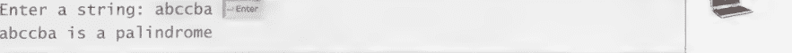


程序声明了一个字符串（第 9 行），从控制台读取字符串（第 10 行），并检查该字符串是否为回文（第 13–29 行）。`bool` 变量 `isPalindrome` 初始设置为 `true`（第 18 行）。当比较字符串两端对应的两个字符时，如果两个字符不同，将 `isPalindrome` 设置为 `false`（第 23 行）。在这种情况下，`break` 语句用于退出 `while` 循环（第 24 行）。

如果循环在 `low >= high` 时终止，`isPalindrome` 为 `true`，表示该字符串是一个回文。

## 5.11 案例研究：显示素数

本节介绍了一个程序，用 5 行显示前 50 个素数，每行 10 个数。


如果一个大于 1 的整数唯一的正因数是 1 或其本身，则它是素数。例如，2, 3, 5 和 7 是素数，但 4, 6, 8 和 9 不是。

程序可以分解为以下任务：

- 确定给定的数字是否为素数。
- 对于数字 = 2, 3, 4, 5, 6, ..., 测试它是否为素数。
- 显示每个素数，且每行显示十个数。

显然，你需要编写一个循环并反复测试新数字是否为素数。如果数字是素数，将计数器加 1。计数器初始为 0。当达到 50 时，循环终止。

以下是算法：

- 将要打印的素数数量设置为常量 `NUMBER_OF_PRIMES`；
- 使用 `count` 跟踪素数的数量并将初始计数设置为 0；
- 设置初始数字为 2；

```cpp
while (count < NUMBER_OF_PRIMES)
{
    // 测试 number 是否为素数
    if (number is prime)
    {
        // 显示素数并增加计数
    }
    // number 加 1;
}
```

测试一个数字是否为素数，检查它是否能被 2, 3, 4 直到 `number/2` 整除。如果找到了因数，则该数字不是素数。该算法可以描述如下：

- 使用 `bool isPrime` 表示该数字是否为素数；初始将 `isPrime` 设置为 `true`；

```cpp
for (int divisor = 2; divisor <= number / 2; divisor++)
{
    if (number % divisor == 0)
    {
        isPrime = false;
        // 退出循环
    }
}
```

完整的程序在 Listing 5.17 中给出。

#### Listing 5.17 案例研究：显示素数

```cpp
#include <iostream>
#include <iomanip>

using namespace std;

int main() {
    const int NUMBER_OF_PRIMES = 50; // 要显示的素数数量
    const int NUMBER_OF_PRIMES_PER_LINE = 10; // 每行显示 10 个

    int count = 0; // 计算素数的数量
    int number = 2; // 待测试素数的数字

    cout << "The first 50 prime numbers are\n";

    // 反复寻找素数
    while (count < NUMBER_OF_PRIMES) {
        // 假设该数字是素数
        bool isPrime = true; // 当前数字是素数吗？

        // 测试 number 是否为素数
        for (int divisor = 2; divisor <= number / 2; divisor++) {
            if (number % divisor == 0) {
                // 如果为真，不是素数
                isPrime = false; // 将 isPrime 设置为 false
                break; // 退出循环
            }
        }

        // 显示素数并增加计数
        if (isPrime) {
            count++; // 计数
            if (count % NUMBER_OF_PRIMES_PER_LINE == 0) {
                // 显示数字并换行
                cout << setw(4) << number << endl;
            }
        }

        // 检查下一个数字是否为素数
        number++;
    }

    return 0;
}
```

| 前50 个素数是 |
| :--- |
| 2 3 5 7 11 13 17 19 23 29 |
| 31 37 41 47 53 59 61 67 71 73 |
| 79 83 89 97 101 103 107 109 113 127 |
| 131 137 139 149 151 157 163 167 173 179 |
| 181 191 193 197 199 211 223 227 229 233 |

对于初学者来说，这是一个复杂的程序。解决此问题以及许多其他问题的关键在于将其分解为子问题并为每个子问题开发解决方案。不要尝试在第一次就开发一个完整的解决方案。相反，首先编写代码来确定给定的数字是否为素数，然后扩展程序在循环中测试其他数字是否为素数。

当计数器达到 50 时，程序结束。要确定一个数字是否为素数，检查它是否能被 2 到 `number/2` 之间的任何数整除。如果不是，则它就是素数。对于素数，显示它。如果计数能被 10 整除，则换行。程序在第 22 行使用 `break` 语句，在发现数字不是素数时退出循环。

```cpp
for (int divisor = 2; divisor <= number / 2 && isPrime; divisor++)
{
    // 如果为真，该数字不是素数
    if (number % divisor == 0)
    {
        isPrime = false;
    }
}
```

然而，在这种情况下使用 `break` 语句使程序更简单易读。

## 术语

| 术语 | 页码 | 术语 | 页码 |
| :--- | :--- | :--- | :--- |
| `break` 语句 | 185 | 循环继续条件 | 156 |
| `continue` 语句 | 186 | 嵌套循环 | 176 |
| `do-while` 循环 | 168 | 差一错误 | 158 |
| `for` 循环 | 171 | 输出重定向 | 166 |
| 死循环 | 158 | 后测试循环 | 174 |
| 输入重定向 | 166 | 前测试循环 | 174 |
| 迭代 | 156 | 哨兵值 | 164 |
| 循环 | 156 | `while` 循环 | 156 |
| 循环体 | 156 | | |

# 本章总结

- 有三种类型的重复语句：`while` 循环、`do-while` 循环和 `for` 循环。
- 循环中包含重复语句的部分被称为循环体。
- 循环体的一次执行称为循环的迭代。
- 死循环是无限次执行的循环语句。
- 在设计循环时，你既需要考虑循环控制结构也需要考虑循环体。

## 编程练习

- **5.1 (统计正负数并计算平均值)** 写一个程序读取任意数量的整数，确定读取了多少个正值和负值，计算输入值的总和和平均值（不包括零）。程序在输入 0 时结束。以浮点数显示平均值。这是一个示例运行：

```
输入一个整数，如果为 0 则结束输入: 1 2 -1 3 0 --Enter
正数个数为 3
负数个数为 1
总和为 5
平均值为 1.25
```

```
输入一个整数，如果为 0 则结束输入: --Enter
除 0 之外未输入任何数字
```


## 第5章 循环

### 5.2 (重复加法)
列表 5.4 `SubtractionQuizLoop.cpp` 生成了五个随机减法题。修改该程序以生成 1 到 15 之间两个整数的随机加法题。显示正确的计数和测试时间。

### 5.3 (公斤到磅的转换)
编写一个程序显示以下表格（注意 1 公斤等于 2.2 磅）：

| 公斤 | 磅 |
|---|---|
| 1 | 2.2 |
| 3 | 6.6 |
| ... | ... |
| 197 | 433.4 |
| 199 | 437.8 |

### 5.4 (英里到公里的转换)
编写一个程序显示以下表格（注意 1 英里等于 1.609 公里）：

| 英里 | 公里 |
|---|---|
| 1 | 1.609 |
| 2 | 3.218 |
| ... | ... |
| 9 | 14.481 |
| 10 | 16.090 |

### 5.5 (公斤到磅及磅到公斤的转换)
编写一个程序并排显示以下表格（注意 1 公斤等于 2.2 磅）：

| 公斤 | 磅 | 磅 | 公斤 |
|---|---|---|---|
| 1 | 2.2 | 20 | 9.09 |
| 3 | 6.6 | 25 | 11.36 |
| | | | |
| 197 | 433.4 | 510 | 231.82 |
| 199 | 437.8 | 515 | 234.09 |

### 5.6 (英里到公里的转换)
编写一个程序并排显示以下表格（注意 1 英里等于 1.609 公里）：

| 英里 | 公里 | 公里 | 英里 |
|---|---|---|---|
| 1 | 1.609 | 20 | 12.430 |
| 2 | 3.218 | 25 | 15.538 |
| | | | |
| 9 | 14.481 | 60 | 37.290 |
| 10 | 16.090 | 65 | 40.398 |

### 5.7 (使用三角函数)
打印表格以显示从 0 到 360 度、间隔为 10 度的正弦和余弦值。将数值保留四位小数。

| 度数 | Sin | Cos |
|---|---|---|
| 0 | 0.0000 | 1.0000 |
| 10 | 0.1736 | 0.9848 |
| 350 | -0.1736 | 0.9848 |
| 360 | 0.0000 | 1.0000 |

### 5.8 (使用 sqrt 函数)
编写一个程序使用 `sqrt` 函数打印以下表格：

| 数字 | 平平方 |
|---|---|
| 0 | 0.0000 |
| 2 | 1.4142 |
| 18 | 4.2426 |
| 20 | 4.4721 |

### 5.9 (金融应用：学费计算)
假设某大学今年的学费为 10,000 美元，且每年增长 5%。编写一个程序计算十年后的学费，以及从十年后开始四年的学费总费用。

### 5.10 (寻找最高分)
编写一个程序，提示用户输入学生人数以及每个学生的姓名和分数，最后显示最高分学生的姓名和分数。

### 5.11 (寻找两个最高分)
编写一个程序，提示用户输入学生人数以及每个学生的姓名和分数，最后显示最高分和次高分学生的姓名和分数。

### 5.12 (寻找能被 5 或 6 整除的数字)
编写一个程序显示从 100 到 1,000 之间每行 10 个的所有能被 5 或 6 整除的数字。数字之间隔一个空格。

### 5.13 (寻找能被 5 或 6 整除但不能被同时整除的数字)
编写一个程序显示从 100 到 200 之间每行 10 个的所有能被 5 或 6 整除但不能被同时整除的数字。数字之间隔一个空格。

### 5.14 (寻找满足 $n^2 > 12,000$ 的最小 $n$)
使用 `while` 循环找到使 $n^2$ 大于 12,000 的最小整数 $n$。

### 5.15 (寻找满足 $n^3 < 12,000$ 的最大 $n$)
使用 `while` 循环找到使 $n^3$ 小于 12,000 的最大整数 $n$。

### 5.16 (计算最大公约数)
编写一个程序，提示用户输入两个正整数并显示 $n_1$ 和 $n_2$ 的最大公约数 (GCD)：首先找到 $n_1$ 和 $n_2$ 的最小值 $d$，然后判断 $d, d-1, \dots,$ 或 1 是否为 $n_1$ 和 $n_2$ 的因子。

### 5.17 (显示 ASCII 表格)
编写一个程序打印从 `!` 到 `~` 的 ASCII 表格字符。每行显示 10 个字符。表格见附录 B。

### 5.18 (寻找整数的因子)
编写一个程序读取一个整数并按增大顺序显示其所有因子。例如，如果输入是 120，输出应为...

### 5.19 (显示金字塔)
编写一个程序，提示用户输入一个 1 到 15 之间的整数，并显示如下所示的金字塔：

```
输入行数: 7

1
2 2
3 3 3
4 4 4 4
5 5 5 5 5
6 6 6 6 6 6
7 7 7 7 7 7 7
```

### 5.20 (显示四模式)
使用嵌套循环显示以下四种模式：

```
模式 A      模式 B      模式 C      模式 D
1            1            1            1
2 2          2 2          2 2          2 2 2
3 3 3        3 3 3        3 3 3        3 3 3 3
4 4 4 4      4 4 4 4      4 4 4 4      4 4 4 4 4
```

### 5.21 (在金字塔中显示数字)
编写一个程序输出：

```
输入行数: 7

1
2 2
3 3 3
4 4 4 4
5 5 5 5 5
6 6 6 6 6 6
7 7 7 7 7 7 7
```

### 5.22 (显示 2 到 1,000 之间的数字)
修改程序 5.17，显示 2 到 1,000 之间的数字，每行 10 个。数字之间隔一个空格。

### 5.23 (金融应用：比较不同利率)
编写一个程序，让用户输入金额和年限，并显示 5% 到 8% 的不同利率下的每月还款额和总费用。示例如下：

```
金额: 10000
年限: 5

利率       每月还款额   总费用
5.00%       188.71      11322.74
5.12%       189.28      11357.13
5.25%       189.85      11391.59
5.85%       202.17      12162.97
```

### 5.24 (金融应用：贷款还款表)
贷款还款表显示每月还本和利息。每月利息通过利率乘以余额计算。因此每月还本为每月还款额减去利息。编写一个程序，让用户输入贷款金额、年限并显示还款表。示例如下：

```
贷款金额: 10000
年限: 12
年利率: 7%

还款      利息        余额
1 865.26    58.33       9193.07
2 865.26    53.64       8381.44
3 865.26    49.00       7565.44
4 865.26    44.37       6745.07
5 865.26    40.51       5920.32
6 865.26    36.13       5091.20
7 865.26    31.75       4257.70
8 865.26    27.37       3419.83
9 865.26    22.99       2577.58
10 865.26   18.62       1730.95
11 865.26   14.24       879.93
12 865.26   9.86        0.00
```

### 5.25 (演示消减误差)
消减误差发生在你对一个大数字和一个小数字的操作时。大数字可能会消掉较小的数字。例如，`100000000.0 - 0.00000001`。为了避免消减误差并获得更准确的结果，仔细选择计算顺序。例如，在计算以下级数时，从右向左计算比从左向右计算获得的结果准确：

$$1 + \frac{1}{2} + \frac{1}{3} + \dots + \frac{1}{n}$$

编写一个程序，比较当 n = 50000 时，从左向右计算和从右向左计算该级数和的结果。

### 5.26 (求级数)
编写一个程序来求以下级数的和：

$$\sum \frac{1}{3} + \frac{3}{5} + \frac{5}{7} + \frac{9}{11} + \frac{11}{13} + \dots + \frac{95}{97} + \frac{97}{99}$$

### 5.27 (计算 $\pi$)
你可以使用以下级数来近似 $\pi$：

$$\pi = 4(1 - \frac{1}{3} + \frac{1}{5} - \frac{1}{7} + \frac{1}{9} - \dots + \frac{(-1)^{i+1}}{2i-1})$$

编写一个程序显示 $i = 10000, 20000, \dots,$ 和 $100000$ 的 $\pi$ 值。

### 5.28 (计算 $e$)
你可以使用以下级数来近似 $e$：

$$e = 1 + \frac{1}{1!} + \frac{1}{2!} + \frac{1}{3!} + \dots + \frac{1}{i!}$$

编写一个程序显示 $i = 10000, 20000, \dots,$ 和 $100000$ 的 $e$ 值。（提示：因为 $i! = i \times (i-1) \times \dots \times 2 \times 1$，所以 $\frac{1}{i!} = \frac{1}{i(i-1)!}$。初始化 $e$ 和 `item` 以不断向 $e$ 中添加新项。新项是前一个项除以 $i$，其中对于 $i = 2, 3, 4, \dots$。）

### 5.29 (显示闰年)
编写一个程序显示21世纪（从2001年到2100年）所有的闰年，年份之间用一个空格隔开。

### 5.30 (显示每月的第一天)
编写一个程序提示用户输入年份和该年的第一天，并显示该年份每月的第一天。例如，如果用户输入年份2013，且2代表2013年1月1日是周二，你的程序应该显示：

```
January 2013 is Tuesday
December 1, 2013 is Sunday
```

### 5.31 (显示日历)
编写一个程序提示用户输入年份和该年的第一天，并在控制台上显示该年的日历。例如，如果用户输入年份2013，且2代表2013年1月1日是周二，你的程序应该显示该年每个月的日历，如下：

January 2013

| Sun | Mon | Tue | Wed | Thu | Fri | Sat |
|---|---|---|---|---|---|---|
| | | 1 | 2 | 3 | 4 | 5 |
| 6 | 7 | 8 | 9 | 10 | 11 | 12 |
| 13 | 14 | 15 | 16 | 17 | 18 | 19 |
| 20 | 21 | 22 | 23 | 24 | 25 | 26 |
| 27 | 28 | 29 | 30 | 31 | | |

December 2013

| Sun | Mon | Tue | Wed | Thu | Fri | Sat |
|---|---|---|---|---|---|---|
| 1 | 2 | 3 | 4 | 5 | 6 | 7 |
| 8 | 9 | 10 | 11 | 12 | 13 | 14 |
| 15 | 16 | 17 | 18 | 19 | 20 | 21 |
| 22 | 23 | 24 | 25 | 26 | 27 | 28 |
| 29 | 30 | 31 | | | | |

### 5.32 (财务应用：复利价值)
假设你每月向一个储蓄账户存入100美元，年利率为5%。因此，月利率为0.05 / 12 = 0.00417。一个月后，账户中的金额变为：

```
100 * (1 + 0.00417) = 100.417
```

两个月后，账户中的金额：

```
(100 + 100.417) * (1 + 0.00417) = 201.252
```

三个月后，账户中的金额：

```
(100 + 201.252) * (1 + 0.00417) = 302.507
```

依此类推。
编写一个程序提示用户输入金额（例如 100）、年利率（例如5）和月数（例如6），并显示指定月份后储蓄账户中的金额。

### 5.33 (财务应用：计算价值)
假设你将10,000美元存入一个年利率5.75%的定期存款（CD）。一个月后，存款的价值为：

```
10000 + 10000 * 5.75 / 1200 = 10479.17
```

两个月后，存款的价值为：

```
10479.17 + 10479.17 * 5.75 / 1200 = 10978.44
```

三个月后，存款的价值……依此类推。
编写一个程序提示用户输入金额（例如10000）、年利率（例如5.75）和月数（例如18），并显示如示例所示的表格。

| 输入存款金额：10000 | |
|---|---|
| 输入年利率：5.75 | |
| 输入期限（月数）：18 | |
| 月份 | 存款价值 |
|---|---|
| 1 | 10479.17 |
| 2 | 10978.44 |
| ... | ... |
| 17 | 10846.56 |
| 18 | 10898.54 |

### 5.34 (游戏：彩票)
修改练习3.7 `Lottery.cpp`，生成一个两位数的彩票。这两个数字必须是不同的。（提示：生成第一个数字。使用循环生成第二个数字，直到它与第一个不同。）

### 5.35 (完美数)
如果一个正整数等于它除本身以外的所有因数之和，则被称为完美数。例如，6是一个完美数，因为 6 = 3 + 2 + 1。下一个是 28 = 14 + 7 + 4 + 2 + 1。小于10000的有四个完美数。编写一个程序找到这些数字。

### 5.36 (游戏：剪刀石头布)
练习3.15提供了一个剪刀石头布的游戏。修改程序，让用户持续玩，直到用户或电脑赢两次。

### 5.37 (求和)
$$\sum_{i=1}^{1} \frac{1}{\sqrt{2}} + \frac{1}{\sqrt{3}} + \frac{1}{\sqrt{4}} + \dots + \frac{1}{\sqrt{64}} + \frac{1}{\sqrt{625}}$$

### 5.38 (业务应用：检查ISBN)
使用循环简化练习3.35。

### 5.39 (财务应用：查找销售额)
你在一家百货商店开始做销售。你的收入由底薪和佣金组成。底薪为5000美元。使用以下方案确定佣金率：

| 销售金额 | 佣金率 |
|---|---|
| $0.01–5000 | 8% |
| $5000.01–10000 | 10% |
| $10000及以上 | 12% |

注意这是一个阶梯率。前5000元的率为8%，下一个5000元的10%，剩余的12%。如果销售金额为25000，佣金为 $5000 \times 8\% + 5000 \times 10\% + 15000 \times 12\% = 2700$。

你的目标是赚取30000美元。编写一个程序使用 `while` 循环找到赚取30000美元所需的最低销售额。

### 5.40 (模拟：正面或反面)
编写一个程序模拟抛硬币10次，并显示正面和反面的数量。

### 5.41 (最大数的次数)
编写一个程序读取整数，找到最大的并统计它的出现次数。假设输入以0结束。假设你输入3 5 2 5 5 0：程序找到最大5，5出现的次数为4。

> 维护两个变量，`max` 和 `count`，分别存储当前最大值及其出现次数。最初，将第一个数字赋值给 `max`，1赋值给 `count`。将后续每个数字与 `max` 比较。如果数字大于 `max`，将其赋值给 `max` 并将 `count` 重置为1。如果数字等于 `max`，将 `count` 加1。

```
输入数字：3 5 2 5 5 0
最大的数字是5
最大数字出现的次数是4
```

### 5.42 (财务应用：查找销售额)
按照如下重写练习5.39：
- 使用 `for` 循环代替 `do-while` 循环。
- 让用户输入期望的佣金，而不是将其固定为常量。

### 5.43 (模拟：时钟倒计时)
编写一个程序提示用户输入秒数，每秒显示一条消息，并在时间过期时终止。这里有一个示例运行：

```
输入秒数：3
剩余2秒
剩余1秒
停止
```

### 5.44 (蒙特卡洛模拟)
正方形如(a)所示分为四个较小的区域。如果你向正方形投掷1,000,000次镖，镖落在奇数区域的概率是多少？编写一个程序模拟该过程并显示结果。

（提示：将正方形中心放在坐标系中心，如(b)。在正方形内随机生成一点，并统计点落在奇数区域的次数。）

### 5.45 (数学：组合)
编写一个程序显示从1到7整数中选取两个数字的所有组合。同时也显示所有组合的总数。

```
1 2
1 3
...
...
所有组合的总数是21
```

### 5.46 (计算机体系：位操作)
编写一个程序提示用户输入一个短型整数并显示该整数的位。以下是示例运行：

```
输入整数：5
位为 0000000000000101
```

```
输入整数：-5
位为 1111111111111011
```

（提示：你需要使用位右移运算符 (`>>`) 和位按与运算符 (`&`)，这些内容将在附录 E 中介绍。）

### 5.47 (统计学：计算均值和标准差)
在业务应用中，你经常被要求计算数据的均值和标准差。均值通常是数字的平均数。标准差是一种统计量，它告诉你在一组数据中，各种数据围绕均值的聚集程度。例如，一个班学生的平均年龄是多少？年龄分布情况如何？如果所有年龄都相同，则偏差为 0。

编写一个程序，提示用户输入 10 个数字，并使用以下公式显示这些数字的均值和标准差：

```
$mean = \frac{\sum_{i=1}^{n} x_i}{n} \quad deviation = \sqrt{\frac{\sum_{i=1}^{n} (x_i - mean)^2}{n}}$
```


以下是示例运行：

- 输入数字：`1 2 3 4 5 5 6 7 8 9 10` --回车
均值为 5.61
标准差为 2.99794

### 5.48 (统计大写字母)
编写一个程序，提示用户输入一个字符串，并显示字符串中大写字母的数量。以下是示例运行：

- 输入字符串：`Programming Is Fun` --回车
大写字母的数量为 3

### 5.49 (最长公共缀)
编写一个程序，提示用户输入两个字符串，并显示这两个字符串的最长公共缀。以下是一些示例运行：

- 输入 s1：`Programming is fun` --回车
输入 s2：`Program using a language` --回车
公共缀是 `Program`

- 输入 s1：`ABC` --回车
输入 s2：`CBA` --回车
`ABC` 和 `CBA` 没有公共缀

### 5.50 (反转字符串)
编写一个程序，提示用户输入一个字符串并按反序显示该字符串。

- 输入字符串：`ABCD` --回车
反转后的字符串是 `DCBA`

### 5.51 (业务：检查 ISBN-13)
ISBN-13 是用于识别书籍的标准。它使用 13 位数字 $d_1d_2d_3d_4d_5d_6d_7d_8d_9d_{10}d_{11}d_{12}d_{13}$。最后一位 $d_{13}$ 是校验位，通过以下公式从其他数字计算：

$10 - (d_1 + 3d_2 + d_3 + 3d_4 + d_5 + 3d_6 + d_7 + 3d_8 + d_9 + 3d_{10} + d_{11} + 3d_{12}) \% 10$

如果校验位为 10，则将其替换为 0。你的程序应该将字符串读取输入。以下是示例运行：

```
输入 ISBN-13 的前 12 位数字字符串：9780132130806

ISBN-13 数字为 9780132130806
```

```
输入 ISBN-13 的前 12 位数字字符串：9780132130799

ISBN-13 数字为 9780132130799
```

```
输入 ISBN-13 的前 12 位数字字符串：978013213020

978013213020 是无效输入
```

### 5.52 (处理字符串)
编写一个程序，提示用户输入一个字符串并显示奇数索引位置的字符。以下是示例运行：

```
输入字符串：Beijing Chicago

BiijCiao
```

### 5.53 (统计元音和辅音)
假设字母 A, E, I, O, 和 U 为元音。编写一个程序，提示用户输入一个字符串，并显示字符串中元音和辅音的数量。

```
输入字符串：Programming is fun

元音数量为 5

辅音数量为 11
```

### 5.54 (统计文件中字母)
编写一个程序，统计名为 `counters.txt` 的文件中的字母数量。

### 5.55 (数学辅导)
编写一个程序，显示如示例所示的菜单。你可以输入 1, 2, 3 或 4 来选择加法、减法、乘法或除法测试。测试后，菜单会重新显示。你可以选择另一个测试或输入 5 退出系统。每个测试生成两个随机数字来组成一个加、减、乘、除法问题。对于减法如 `number1 - number2`，`number1` 大于或等于 `number2`。对于除法问题如 `number1 / number2` 不为零。

```
主菜单

1: 加法

2: 减法

3: 乘法

4: 除法

5: 退出

输入选择：1 [回车]

1 + 7 等于？8 [回车]

正确

主菜单

1: 加法

2: 减法

3: 乘法

4: 除法

5: 退出

输入选择：1 [回车]

4 + 0 等于？5 [回车]

你的答案错误。正确答案是 4

主菜单

1: 加法

2: 减法

3: 乘法

4: 除法

5: 退出

输入选择：1 [回车]

4 + 0 等于？5 [回车]

你的答案错误。正确答案是 4
```

### 5.56 (多边形)
假设多边形以 (0) 为中心，位于 3 点钟，如图 5.4 所示。编写一个程序，提示用户输入边数，并显示多边形的坐标。

### 5.57 (检查密码)
有些网站对密码有某些规则：

- 密码必须至少有 8 位。
- 密码必须包含字母。
- 密码必须包含数字。

编写一个程序，提示用户输入密码并显示有效。

# 第6章 函数

## 目标

- 定义带参数的函数（参考 6.2 节）。
- 定义返回值的函数（参考 6.3 节）。
- 定义空函数（参考 6.4 节）。
- 按值传递参数（参考 6.5 节）。
- 开发可重用、易读、易调试和易维护的代码（参考 6.6 节）。
- 使用函数重载（参考 6.7 节）。
- 使用函数声明（参考 6.8 节）。
- 定义带默认参数的函数（参考 6.9 节）。
- 使用内联函数提高运行效率（参考 6.10 节）。
- 确定局部变量和全局变量的作用域（参考 6.11 节）。
- 按引用传递和按值传递的区别（参考 6.12 节）。
- 使用 `const` 参数防止它们被修改（参考 6.13 节）。
- 写一个将十六进制数转换为十进制数的函数（参考 6.14 节）。
- 使用分步改进设计并实现函数（参考 6.15 节）。

## 6.1 引言

函数可以用于定义可重用代码并组织代码。

假设你需要计算 1 到 10、20 到 37 以及 35 到 49 的整数和。你可以如下编写代码：

```cpp
int sum = 0;

for (int i = 1; i <= 10; i++)
    sum += i;

cout << "1 到 10 的和为 " << sum << endl;

sum = 0;

for (int i = 20; i <= 37; i++)
    sum += i;

cout << "20 到 37 的和为 " << sum << endl;

sum = 0;

for (int i = 35; i <= 49; i++)
    sum += i;

cout << "35 到 49 的和为 " << sum << endl;
```

你可能观察到计算 1 到 10、20 到 37 以及 35 到 49 的和非常相似，只是起始和结束整数不同。如果我们能编写公共代码并重用它不是更好吗？我们可以通过定义函数并调用它来实现。

此前的代码可以简化如下：

```cpp
int sum(int i1, int i2) 
{
    int sum = 0;
    for (int i = i1; i <= i2; i++)
        sum += i;
    return sum;
}

int main() {
    cout << "1 到 10 的和为 " << sum(1, 10) << endl;
    cout << "20 到 37 的和为 " << sum(20, 37) << endl;
    cout << "35 到 49 的和为 " << sum(35, 49) << endl;
}
```

## 6.2 定义函数

函数定义由其函数名、参数、返回值类型和函数体组成。

定义函数的语法如下：

```cpp
returnTypeValue functionName(list of parameters)
{
    // Function body;
}
```

让我们来看一个用于找出两个整数大小的函数。该函数命名为 `max`，它有两个 `int` 类型的参数 `num1` 和 `num2`，函数返回其中较大的值。图 6.1 展示了该函数的组成部分。

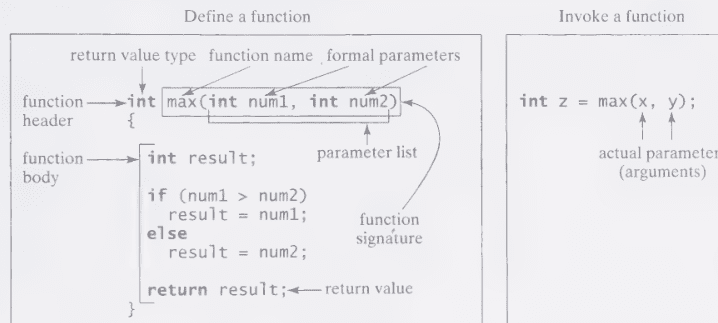

**图 6.1** 你可以定义函数并带参数调用它。返回类型、函数名和函数头

函数头指定了返回类型、函数名和参数。

函数可以返回一个值。`returnTypeValue` 是该值的数据类型。某些函数在执行所需操作后不返回任何值。在这种情况下，`returnTypeValue` 是关键字 `void`。例如，`void` 函数中的 `returnTypeValue` 就是 `void`。被调用的函数是返回值函数，而不返回值的函数是被调用函数。

在函数头中声明的变量被称为形式参数或简单称为参数。参数是一个占位符。当函数被调用时，你将一个值传递给参数。这个值被称为实际参数或参数。参数列表指的是函数的参数类型、顺序和数量。函数名和参数列表共同构成了函数签名。参数是可选的；也就是说，函数可以不包含任何参数。例如，`rand()` 函数就没有参数。

函数体包含一组定义了函数执行逻辑的语句。`max` 函数的体使用一个 `if` 语句来判断哪个数较大，并返回该数的值。返回值函数需要一个使用关键字 `return` 的 `return` 语句来返回结果。当 `return` 语句被执行时，函数就会退出。

> **注意**：在函数头中，你需要单独声明每个参数。例如，`max(int num1, int num2)` 是正确的，但 `max(int num1, int num2)` 是错误的（注：原文此处可能存在笔误，意在强调分开声明）。

## 6.3 调用函数

调用函数会执行函数中的代码。
在创建函数时，你定义了它应该做什么。要使用函数，你必须对其进行调用或唤起。调用函数有两种方式，取决于它是否返回结果。
如果函数返回结果，对该函数的调用通常被视为一个值。例如，

```cpp
int larger = max(3, 4);
```

调用了 `max(3, 4)` 并将函数的返回值赋值给变量 `larger`。这种调用的另一个示例是

```cpp
cout << max(3, 4);
```

这会打印函数调用 `max(3, 4)` 的返回值。

> **注意**：返回值在 C++ 中也可以作为语句被调用。在这种情况下，调用者只是简单地忽略返回值。这种做法并不常见，但如果调用者对返回值不感兴趣，这是允许的。

当程序调用函数时，程序的控制权会转移到被调用的函数。被调用的函数开始执行，直到遇到它的结束大括号。
列表 6.1 显示了一个用于测试 `max` 函数的完整程序。

### 列表 6.1 TestMax.cpp

```cpp
#include <iostream>

using namespace std;

// 返回两个数之间的最大值

int max(int num1, int num2)
{
    int result;

    if (num1 > num2)
        result = num1;
    else
        result = num2;

    return result;
}

int main()
{
    int i = 5;
    int j = 2;
    int k = max(i, j);

    cout << "The maximum between " << i << 
         " and " << j << " is " << k << endl;

    return 0;
}
```

5 和 2 之间的最大值是 5

| Line# | i | j | k | num1 | num2 | result |
|---|---|---|---|---|---|---|
| 19 | | | | | | |
| 20 | | | | | | |
| 5 | | | | | | undefined |
| Invoking max 7 | | | | | 5 | |
| 10 | | | | | | |
| 21 | | | | | 5 | |

这个程序包含了该函数和 `main` 函数。`main` 函数与其他任何函数一样，不同之处是由操作系统调用来执行程序的。所有其他函数都必须通过函数调用语句来执行。

函数必须在调用之前定义。由于 `max` 函数是由 `main` 函数调用的，因此它必须在 `main` 函数之前定义。

当 `max` 函数被调用时（第 21 行），变量 `i` 被传递给 `num1`，变量 `j` 的值 `2` 被传递给 `max` 函数中的 `num2`。控制流执行到 `max` 函数。当 `max` 函数中的 `return` 语句执行时，`max` 函数返回到它的调用者（在本例中，调用者是 `main` 函数）。这一过程如图 6.2 所示。

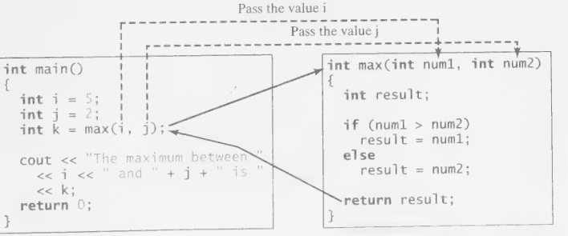

**图 6.2** 当 `max` 函数被调用时，控制流转移到它。一旦函数完成，它就会返回到调用者。

每当调用函数时，系统都会创建一个激活记录（也称为帧），用于存储该函数的参数和变量，并将激活记录存放在称为调用栈的内存区域。调用栈也称为执行栈、运行时栈或机器栈，通常简称为“栈（stack）”。当一个函数调用另一个函数时，调用者的激活记录会被保留，并为该函数调用创建一个新的激活记录。当函数完成工作并返回到调用者时，它的激活记录会从栈中移除。

调用栈按“后进先出”顺序存储激活记录。最后被调用的函数的激活记录从栈中移除。假设 `m1` 调用函数 `m2`，然后 `m2` 调用 `m3`。运行时系统将 `m1` 的激活记录推入栈中，然后是 `m2` 的，最后是 `m3` 的。在 `m3` 完成后，它的激活记录从栈中移除。在 `m2` 完成后，它的激活记录从栈中移除。在 `m1` 完成后，它的激活记录从栈中移除。

理解调用栈有助于我们理解函数是如何调用的。`main` 函数中的变量是 `i`、`j` 和 `k`。`max` 函数中的变量是 `num1` 和 `num2`。`result` 在函数签名中。图 6.3 展示了栈中的激活记录。

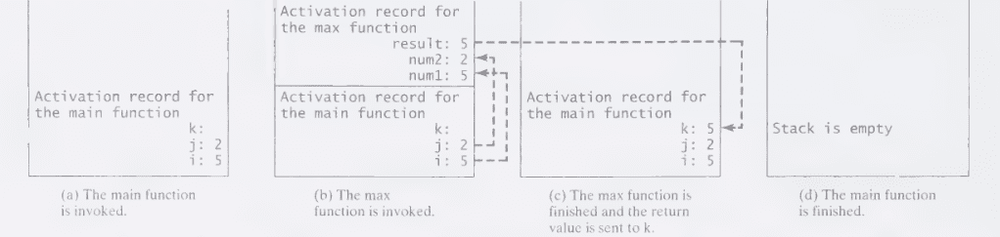

**图 6.3** 当函数被调用时，控制流转移到它。一旦函数完成，它就会返回到调用者。

## 6.4 void 函数

`void` 函数不返回结果。前述章节给出了返回值函数的示例。本节展示了如何定义和调用 `void` 函数。列表 6.2 显示了一个名为 `printGrade` 的函数并调用了它。

### 列表 6.2 TestVoidFunction.cpp

```cpp
1 #include <iostream>

2 using namespace std;

3

4 // 打印分数

5 void printGrade(double score)
6 {
    if (score >= 90.0)
        cout << 'A' << endl;
    else if (score >= 80.0)
        cout << 'B' << endl;
    else if (score >= 70.0)
        cout << 'C' << endl;
    else if (score >= 60.0)
        cout << 'D' << endl;
    else
        cout << 'F' << endl;
}

18

19 int main()
20 {
    cout << "Enter a score: ";
    double score;
    cin >> score;

    cout << "The grade is ";
    printGrade(score);
    return 0;
}
```


`printGrade` 是一个 `void` 函数。它不返回任何值。对 `void` 函数的调用必须是一个语句。因此，它作为语句位于 main 函数的第 26 行。像任何 C++ 语句一样，它以分号结束。

为了观察 `void` 函数和返回值函数之间的区别，让我们重新设计 `printGrade` 函数使其返回一个值。我们调用这个返回等级的新函数，如列表 6.3 所示，`getGrade`。

### 列表 6.3 TestGradeFunction.cpp

```cpp
#include <iostream>

using namespace std;

// 返回分数的等级

char getGrade(double score) {
    if (score >= 90.0) {
        return 'A';
    } else if (score >= 80.0) {
        return 'B';
    } else if (score >= 70.0) {
        return 'C';
    } else if (score >= 60.0) {
        return 'D';
    } else
        return 'F';
}

int main() {
    cout << "Enter a score: ";
    double score;
    cin >> score;

    cout << "The grade is: ";
    cout << getGrade(score) << endl;
    return 0;
}
```

## void 函数中的 return

> **注意事项**
> `void` 函数不需要 `return` 语句，但可以使用它来终止函数并将控制权返回给函数的调用者。其语法非常简单：

```cpp
return;
```

这种情况很罕见，但有时用于绕过 `void` 函数中的正常控制流。例如，下面的代码包含一个 `return` 语句，在分数无效时终止函数。

```cpp
// 根据分数打印等级

void printGrade(double score)
{
    if (score < 0 || score > 100) {
        cout << "Invalid score";
        return;
    }

    if (score >= 90.0) {
        cout << 'A';
    } else if (score >= 80.0) {
        cout << 'B';
    } else if (score >= 70.0) {
        cout << 'C';
    } else if (score >= 60.0) {


```cpp
cout << 'D';

} else {

    cout << 'F';

}

}
```

> 注意事项
> 偶尔你可能需要在发生异常情况时立即从函数终止程序。这可以通过调用 `cstdlib` 头文件中的 `exit(int)` 函数来实现。你可以传递任何整数来调用此函数，以指示程序中的错误。例如，下面的函数在向函数传递无效分数时会终止程序。

```cpp
// 根据分数打印等级

void printGrade(double score)

{

    if (score < 0 || score > 100) {

        cout << "Invalid score" << endl;

        exit(0);

    }

    if (score >= 90.0) {

        cout << 'A';

    } else if (score >= 80.0) {

        cout << 'B';

    } else if (score >= 70.0) {

        cout << 'C';

    } else if (score >= 60.0) {

        cout << 'D';

    } else {

        cout << 'F';

    }

}
```

## 6.5 按值传递参数

6.1 使用函数的好处是什么？

6.2 如何定义函数？如何调用函数？

6.3 如何使用条件表达式简化 列表 6.1 中的 `max` 函数？

6.4 正还是错？对具有返回类型的函数的调用本身始终是一个语句，但对返回值的函数的调用本身不能单独作为一个语句。

6.5 `main` 函数的返回类型是什么？

6.6 在有值的函数中不写 `return` 语句会有什么问题？`void` 函数中可以有 `return` 语句吗？下面函数中的 `return` 语句会导致错误吗？

```cpp
void p(double x, double y)

{

    cout << x << " " << y << endl;

    return x + y;

}
```

6.7 定义参数（parameter）、参数（argument）和函数签名（signature）。

6.8 为以下函数编写函数头（不包括函数体）：

- a. 给定销售金额和佣金率，返回销售佣金。
- b. 给定月份和年份，显示日历。
- c. 返回一个数的平方根。
- d. 测试数字是否为偶数，如果是则返回 `true`。
- e. 以指定的次数显示消息。
- f. 给定贷款金额、年限和年利率，返回每月还款额。
- g. 给定一个小写字母，返回对应的大写字母。

6.9 识别并修正以下程序中的错误：

```cpp
int function1(int n)

{

    cout << n;

}

function2(int n, m)

{

    n += m;

    function1(3.4);

}
```

## 6.5 按值传递参数

默认情况下，调用函数时将参数按值传递给参数。函数的威力在于它处理参数的能力。你可以使用 `max` 来找到任何两个 `int` 值之间的最大值。调用函数时，你需要提供参数，这些参数必须作为函数签名中相应的参数给出。这被称为参数顺序关联。例如，下面的函数打印一个名为 `int` 的字符：参数顺序关联

```cpp
void nPrint(char ch, int n)

{

  for (int i = 0; i < n; i++)

    cout << ch;

}
```

你可以使用 `nPrint('a', 3)` 来打印三次 `'a'`。`nPrint('a', 3)` 语句将实际字符参数 `'a'` 传递给参数 `ch`；将 `3` 传递给 `n`；并打印三次 `'a'`。然而，语句 `nPrint(3, 'a')` 有不同的含义。它将 `3` 传递给 `ch`，将 `'a'` 传递给 `n`。

你能论证参数与其参数同名吗？

# 6.10 识别并修正以下程序中的错误：

```cpp
1 void nPrint(string message, int n)

2 {

3 int n = 1;

4 for (int i = 0; i < n; i++)

5 cout << message << endl;

6 }

7

8 int main()

9 {

10 nPrint(5, "Welcome to C++");
```

## 6.6 代码的模块化

模块化使得代码易于维护和调试，并允许代码重用。Listing 5.10, CommonDenominator.cpp 要求用户输入两个整数并显示它们的最大公约数，这在 Listing 6.4 中所示。

CommonDenominator.cpp

```cpp
1 #include <iostream>

2 namespace std;

3 // 返回两个整数的最大公约数

4 int gcd(int n1, int n2)

5 {

6 int gcd = 1; // 初始化 gcd

7 int k = 2; // 从 2 开始

8 while (k <= n1) // 当 k 小于 n1 时

9 {

10    if (n1 % k == 0 && n2 % k == 0) { // 如果两个都能被 k 整除

11        gcd = k; // 更新 gcd

12    }

13    k++; // k 自增

14 }

15 return gcd; // 返回 gcd

```

```cpp
int main()

{

    // 请求用户输入两个整数

    cout << "第一个整数:";

    int n1;

    cin >> n1;

    cout << "第二个整数:";

    int n2;

    cin >> n2;

    cout << n1 << " 和 " << n2 << " 的最大公约数是 " << gcd(n1, n2) << endl;

    return 0;

}
```

计算公约数的逻辑封装在函数中，这种方法有几个优势：
- 1. `gcd` 函数使得程序清晰易读。
- 2. 如果 `gcd` 函数出现错误，将局限于函数内部。
- 3. `gcd` 函数现在可以被其他程序重用。

Listing 6.5 应用了代码模块化的概念。

PrimeNumber.cpp

```cpp
#include <iostream>

#include <iomanip>

using namespace std;

// 检查一个数字是否为素数

bool isPrime(int number)

{

    for (int divisor = 2; divisor <= number / 2; divisor++) {

        if (number % divisor == 0) { // 如果是，不是素数

            return false;

        }

    }

    return true; // 是素数

}

```

```cpp
void printNumbers(int numberOfPrimes)

{

    const int NUMBER_OF_PRIMES = 50; // 要显示的素数个数

    const int NUMBER_OF_PRIMES_LINE = 10; // 每行 10 个

    int count = 0; // 素数计数

    int number = 2; // 要测试的数字

    // 重复寻找素数

    while (count < numberOfPrimes)

    {

        // 打印素数并增加计数

        if (isPrime(number))

        {

            count++; // 增加计数

            if (count % NUMBER_OF_PRIMES_LINE == 0)

            {

                // 打印数字并换行

                cout << setw(4) << number << endl;

            }

        }

        else

        {

            cout << setw(4) << number;

        }

        // 检查下一个数字是否为素数

        number++;

    }

}

int main()

{

    cout << "前50个素数是：\n";

    printNumbers(50);

    return 0;

}
```

| 前50个素数是 |
| :--- |
| 2 3 5 7 11 13 17 19 23 29 |
| 31 37 41 43 47 53 59 61 67 71 |
| 73 79 83 89 97 101 103 107 109 113 |
| 127 131 137 139 149 151 157 163 167 173 |
| 179 181 191 193 197 199 221 223 227 229 |

我们将一个大问题拆分为两个子问题。因此，新程序更便于阅读和调试。

## 6.7 重载函数

函数重载允许你在签名不同的情况下定义具有相同名的函数。


之前使用的 `max` 函数只对 `int` 数据类型有效。如果你需要确定两个浮点数中哪一个较大该怎么办？解决方案

## 6.7 函数重载

重载是指创建一个具有相同名称但参数不同的函数，如下所示：

```cpp
double max(double num1, double num2)

{

    if (num1 > num2)

        return num1;

    else

        return num2;

}
```

如果你使用 `int` 参数调用 `max`，将调用期望 `int` 参数的 `max` 函数；如果你使用 `double` 参数调用 `max`，将调用期望 `double` 参数的 `max` 函数。这被称为函数重载；在一个在一个文件中两个函数具有相同的名称但不同的参数。C++ 编译器根据函数签名确定调用哪一个。

列表 6.6 中的程序创建了三个函数。第一个寻找最大的整数，第二个寻找最大的 `double`，第三个寻找三个 `double` 值中的最大值。这三个函数都命名为 `max`。

### 列表 6.6 TestFunctionOverloading.cpp

```cpp
#include <iostream>

using namespace std;

// 返回两个 int 值之间的最大值

int max(int num1, int num2)

{

    if (num1 > num2)

        return num1;

    else

        return num2;

}

// 寻找两个 double 值之间的最大值

double max(double num1, double num2)

{

    if (num1 > num2)

        return num1;

    else

        return num2;

}

// 返回三个 double 值中的最大值

double max(double num1, double num2, double num3)

{

    return max(max(num1, num2), num3);

}

int main() {

    // 使用 int 参数调用 max 函数

    cout << "The maximum between 3 and 4 is " << max(3, 4) << endl;

    // 使用 double 参数调用 max 函数

    cout << "The maximum between 3.0 and 5.4 is " << max(3.0, 5.4) << endl;

    // 使用三个 double 参数调用 max 函数

    cout << "The maximum between 3.0, 5.4, and 10.14 "

         << max(3.0, 5.4, 10.14) << endl;

    return 0;

}
```

当调用 `max(3, 4)`（第 31 行）时，调用寻找两个整数最大值的 `max` 函数。当调用 `max(3.0, 5.4)`（第 35 行）时，调用寻找两个 `double` 最大值的 `max` 函数。当调用 `max(3.0, 5.4, 10.14)`（第 39 行）时，调用寻找三个 `double` 值最大值的 `max` 函数。

你可以使用一个 `int` 值和一个 `double` 值调用 `max` 函数吗，例如 `max(2, 2.5)`？如果可以，调用的是哪个 `max` 函数？第一个问题的答案是肯定的。第二个问题的答案是调用了寻找两个 `double` 最大值的 `max` 函数。参数 `2` 会自动转换为 `double` 并传递给该函数。

你可能会奇怪为什么在调用 `max(3, 4)` 时没有调用 `max(double, double)`。`max(double, double)` 和 `max(int, int)` 都是 `max(3, 4)` 的可能匹配项。C++ 编译器为函数调用寻找最特定的函数。由于函数 `max(int, int)` 比 `max(double, double)` 更具体，因此使用 `int` 来调用 `max(3, 4)`。

#### 提示
函数重载可以使程序更清晰、更易读。执行不同类型参数任务的函数应该赋予相同的名称。

#### 注意
重载函数必须具有不同的参数列表。你不能根据不同的返回值类型来重载函数。

有时一个函数调用有两个或多个可能的匹配项，编译器无法确定最特定的匹配。这被称为歧义调用。歧义调用会导致编译错误。考虑以下代码：

```cpp
#include <iostream>

using namespace std;

int maxNumber(int num1, double num2)

{

    if (num1 > num2)

        return num1;

    else

        return num2;

}

double maxNumber(double num1, int num2)

{

    if (num1 > num2)

        return num1;

    else

        return num2;

}

int main()

{

    cout << maxNumber(1, 2) << endl;

    return 0;

}
```

歧义调用

## 6.8 函数原型

`maxNumber(int, double)` 和 `maxNumber(double, int)` 都是匹配 `maxNumber(1, 2)` 的可能候选。由于没有其中一个更具体，调用是歧义的，导致编译错误。

如果你将 `maxNumber(1, 2)` 改为 `maxNumber(1, 2.0)`，它将匹配 `maxNumber` 函数。因此，不会有编译错误。

#### 注意事项
数学函数在 `<cmath>` 头文件中被重载。例如，`sin` 有三个重载函数：

```cpp
float sin(float)

double sin(double)

long sin(long double)
```

6.12 什么是函数重载？我们可以定义两个名称相同但参数类型不同的函数吗？我们可以在一个程序中定义两个名称相同且参数列表相同但返回值不同的函数吗？

6.13 下面程序哪里错了？

```cpp
void p(int i)

{

    cout << i << endl;

}

int p(int j)

{

    cout << j << endl;

}
```

6.14 给定两个函数定义：
```cpp
double m(double x, double y)

double m(int x, double y)
```
回答以下问题：
a. 对于 `z = m(4, 5)`，调用了哪个函数？
b. 对于 `z = m(4, 5.4)`，调用了哪个函数？
c. 对于 `z = m(4, 4)`，调用了哪个函数？

## 6.8 函数原型

 函数原型声明了一个函数但不实现它。实现这一点的一种方法是在调用之前定义，另一种方法是在调用前定义函数原型。函数原型（也称为声明）是不包含实现的函数头。实现在后面给出。列表 6.7 重写了 6.6 `TestFunctionOverloading.cpp`，使用了函数原型。三个 `max` 函数原型定义在 5-7 行。这些函数在 `main` 函数中被调用。实现在 27、36 和 45 行。

### 列表 6.7 TestFunctionPrototype.cpp

```cpp
#include <iostream>

using namespace std;

// 函数原型

int max(int num1, int num2);

double max(double num1, double num2);

double max(double num1, double num2, double num3);

int main() {

    // 使用 int 参数调用 max 函数
```


## 函数重载与默认参数示例

```cpp
cout << "The maximum between 3 and 4 is " << max(3, 4) << endl;

// 使用 double 参数调用 max 函数
cout << "The maximum between 3.0 and 5.4 is " << max(3.0, 5.4) << endl;

// 使用三个 double 参数调用 max 函数
cout << "The maximum between 3.0, 5.4, and 10.14 is " << max(3.0, 5.4, 10.14) << endl;

return 0;
}

// 返回两个 int 值之间的最大值
int max(int num1, int num2)
{
    if (num1 > num2)
        return num1;
    else
        return num2;
}

// 寻找两个 double 值之间的最大值
double max(double num1, double num2)
{
    if (num1 > num2)
        return num1;
    else
        return num2;
}

// 返回三个 double 值中的最大值
double max(double num1, double num2, double num3)
{
    return max(max(num1, num2), num3);
}
```

> **提示** 在原型中，不需要列出参数名称。C++ 编译器忽略参数名称。因此 5-7 行可以替换为：

```cpp
int max(int, int);
double max(double, double);
double max(double, double, double);
```

> **注意** 我们说“一个函数”和“声明一个函数”。声明函数指定了函数是什么，而不实现它。定义函数赋予了函数……

### 定义与声明函数

## 6.9 默认参数

你可以为函数中的参数定义默认值。

C++ 允许声明带有默认值的函数。当带参数调用函数时，默认值会被传递给参数。列表 6.8 展示了如何声明带有默认值的函数以及如何调用此类函数。

### 列表 6.8 DefaultArgumentDemo.cpp

```cpp
#include <iostream>
using namespace std;

// 显示圆面积
void printArea(double radius = 1)
{
    double area = radius * radius * 3.14159;
    cout << "area is " << area << endl;
}

int main()
{
    printArea();
    printArea(4);
    return 0;
}
```

**输出：**

```
area is 3.14159
area is 50.2654
```

第 5 行声明了带有参数 `radius` 的 `printArea` 函数。`radius` 有默认值 `1`。第 13 行在没有传递参数的情况下调用了函数。在这种情况下，默认值 `1` 被赋予 `radius`。

#### 默认参数必须最后声明

当函数包含带默认值和不带默认值的混合参数时，带默认值的参数必须最后声明。例如，以下声明是非法的：

```cpp
void t1(int x, int y = 0, int z); // 非法
void t2(int x = 0, int y = 0, int z); // 非法
```

然而，以下声明是正确的：

```cpp
void t3(int x, int y = 0, int z = 0); // 合法
void t4(int x = 0, int y = 0, int z = 0); // 合法
```

当函数中省略了某个参数时，其后的所有参数也必须一并被省略。例如，以下调用是非法的：

```cpp
t3(1, ...);
t4(, 20);
```

但以下调用是允许的：

```cpp
t3(1); // 参数 y 和 z 被赋予了默认值
t4(1, 2); // 参数 z 被赋予了默认值
```

## 6.15 检查题

下面哪些函数声明是非法的？

```cpp
void t11(int x, int y = 0, int z);
void t22(int x = 0, int y = 0, int z);
void t33(int x, int y = 0, int z = 0);
void t44(int x = 0, int y = 0, int z = 0);
```

## 6.10 内联函数

C++ 提供了内联函数来提高短函数的性能。

使用内联函数实现程序使程序易于阅读和维护，但函数调用涉及运行时开销（即将参数和 CPU 寄存器推入栈中，以及在函数之间转移控制权）。C++ 提供了内联函数来避免函数调用。内联函数并不是被“调用”的；编译器会在每次调用的点复制内联函数的代码。要指定内联函数，需要在函数声明前加上 `inline` 关键字，如列表 6.9 所示。

### 列表 6.9 InlineDemo.cpp

```cpp
#include <iostream>
using namespace std;

inline void f(int month, int year)
{
    cout << "month is " << month << endl;
    cout << "year is " << year << endl;
}

int main()
{
    int month = 10, year = 2008;
    f(month, year); // 调用内联函数
    f(9, 2010); // 调用内联函数
    return 0;
}
```

## 6.11 局部、全局和静态局部变量

从编程的角度来看，内联函数与普通函数相同，区别仅在于它们前面有一个 `inline` 关键字。然而，在底层，C++ 编译器通过复制内联函数代码来展开内联函数调用。因此，列表 6.9 本质上等同于列表 6.10。

### 列表 6.10 InlineExpandedDemo.cpp

```cpp
#include <iostream>
using namespace std;

int main() {
    int month = 10, year = 2008;
    cout << "month is " << month << endl;
    cout << "year is " << year << endl;
    cout << "month is " << 9 << endl;
    cout << "year is " << 2010 << endl;
    return 0;
}
```

**输出：**

```
month is 10
year is 2008
month is 9
year is 2010
```

> **注意** 内联函数对于短函数是理想的，但对于在程序中多次调用的长函数并不适用，因为创建多个副本将极大地增加可执行代码的大小。因此，C++ 允许编译器在内联函数过长时不再进行内联。所以，内联函数仅仅是一个请求；是否遵循或忽略它取决于编译器。

- 适用于短函数，但不适用于长函数
- 编译器决定

## 6.16 - 6.17 检查题

- **6.16** 什么是内联函数？你如何定义一个内联函数？
- **6.17** 什么时候应该使用内联函数？

## 6.11 局部、全局和静态局部变量

在 C++ 中，变量可以声明为局部变量、全局变量或静态局部变量。

正如 2.5 节“变量”中所提到的，变量的作用域是程序中引用该变量的部分。定义在函数内部的变量被称为局部变量。C++ 还允许你使用全局变量。它们声明在所有函数之外，并且可以在其作用域内的所有函数中被访问。局部变量没有默认值，但全局变量默认为零。

变量在使用之前必须先声明。局部变量的作用域从其声明开始，一直到包含该变量的块结束。全局变量的作用域从其声明开始，一直到程序的结束。

参数实际上是一个局部变量。函数参数的作用域覆盖了整个函数。

列表 6.11 展示了局部变量和全局变量的作用域。

### 列表 6.11 VariableScopeDemo.cpp

```cpp
1 #include <iostream>
2 using namespace std;
3
4 void t1(); // 函数原型
5 void t2(); // 函数原型
6
7 int main()
8 {
9     t1();
10     t2();
11
12     return 0;
13 }
14
15 int y; // 全局变量，默认值为 0
16
17 void t1()
18 {
19     int x = 1;
20     cout << "x is " << x << endl;
21     cout << "y is " << y << endl;
22     x++;
23     y++;
24 }
25
26 void t2()
27 {
28     int x = 1;
29     cout << "x is " << x << endl;
30     cout << "y is " << y << endl;
31 }
```

**输出：**

| 全局变量 | 局部变量 | 增加 x | 增加 y |
| :--- | :--- | :--- | :--- |
| y is 0 | x is 1 | x++ | y++ |
| y is 1 | x is 1 | | |

全局变量在第 15 行声明，默认值为 0。该变量在 `t1` 和 `t2` 中可以访问，但在 `main` 函数中不能，因为它在 `main` 之后声明。当 `main` 函数在第 9 行调用 `t1()` 时，全局变量增加（第 23 行）并变为 1。当 `main` 函数在第 10 行调用 `t2()` 时，全局变量现在变为 2。局部变量 `x` 在 `t1` 的第 19 行声明，另一个在 `t2` 的第 28 行声明。尽管它们的名称相同，但这两个变量是相互独立的。因此，在 `t1` 中增加 `x` 不会影响 `t2` 中的变量。

> **注意** 倾向于将变量声明为全局变量并在函数中使用它是不好的。修改全局变量可能会导致错误。避免全局变量，因为它们是全局的。

> **注意** 不要在块内部声明一个变量然后在块外部使用它。这里有一个常见的错误示例：
>
> ```cpp
> for (int i = 0; i < 10; i++)
> {
>     cout << i << endl;
> }
> ```
> 最后语句将导致语法错误，因为变量 `i` 未定义。

### 6.11.2 静态局部变量

函数执行完毕后，所有的局部变量都会被销毁。这些变量被称为自动变量。有时我们希望保留存储在局部变量中的值，以便在下次调用时使用。C++ 允许你声明静态变量。静态变量在程序的生命周期内永久分配内存。要声明静态变量，请使用 `static` 关键字。列表 6.12 展示了静态局部变量的使用。

### 列表 6.12 StaticVariableDemo.cpp

```cpp
1 #include <iostream>
using namespace std;

3
4 void t1(); // 函数原型
5
6 int main()
7 {
8     t1();
9     t1();
10
11    return 0;
12 }
13
14 void t1()
15 {
16    static int x = 1;
17    int y = 1;
18    x++;
19    y++;
20    cout << "x is " << x << endl;
21    cout << "y is " << y << endl;
22 }
```

**输出：**

```
x is 2
y is 2
x is 3
y is 3
```

局部变量 `x` 在第 16 行声明，初始值为 1。静态变量的初始化只在第一次调用时发生。当 `t1()` 在第 8 行第一次被调用时，静态变量 `x` 初始化为 1（第 16 行）。`x` 增加到 2（第 18 行）。在此调用后，`x` 保留在内存中。当第 9 行调用 `t1()` 时，`x` 为 2 并增加到 3（第 18 行）。

声明了一个局部变量 `y`，初始值为 1。当在第 8 行第一次调用 `t1()` 时，`y` 增加到 2（第 19 行）。由于 `y` 是一个局部变量，它在本次调用后被销毁。当在第 9 行再次调用 `t1()` 时，`y` 被初始化为 1 并增加到 2（第 19 行）。

## 6.18 - 6.21 检查题

### 6.18 显示以下代码的输出：

```cpp
#include <iostream>
using namespace std;

const double PI = 3.14159;

double getArea(double radius)
{
    return radius * radius * PI;
}

void displayArea(double radius)
{
    cout << getArea(radius) << endl;
}

int main()
{
    double r1 = 1;
    double r2 = 10;
    cout << getArea(r1) << endl;
    displayArea(r2);
}
```

### 6.19 识别以下程序中的全局变量和局部变量。全局变量是否有默认值？局部变量是否有默认值？代码的输出将会是什么？

```cpp
#include <iostream>
using namespace std;

int j;

int main()
{
    int i;
    cout << "i is " << i << endl;
    cout << "j is " << j << endl;
}
```

### 6.20 识别以下程序中的全局变量、局部变量和静态局部变量。代码的输出将会是什么？

```cpp
#include <iostream>
using namespace std;

int j = 40;

void p()
{
    int i = 5;
    static int j = 5;
    i++;
    j++;
    cout << "i is " << i << endl;
    cout << "j is " << j << endl;
}

int main() {
    p();
    p();
}
```

### 6.21 识别并修正以下程序中的错误：

```cpp
void p(int i) {
    int i = 5;
    cout << "i is " << i << endl;
}
```

## 6.12 引用传递参数

参数可以按引用传递，这使得形式参数变成实际参数的别名。在函数内部对参数所做的修改也会**按值传递出去**（原文可能有误，应为“反映到实际参数上”）。

当你调用一个带有参数的函数时（如前面的节所述），参数的值会被传递给参数。这被称为按值传递。如果参数是变量而不是字面量，则变量的值会被传递给参数。无论函数内部对参数进行了什么修改，该变量都不会受到影响。如列表 6.13 所示，在调用递增函数时，`x` 的值被传递给参数 `n`（第 14 行）。`n` 在函数中递增了 1（第 6 行），但无论函数如何操作，`x` 都不会改变。

### 列表 6.13 Increment.cpp

```cpp
#include <iostream>
using namespace std;

void increment(int n)
{
    n++;
    cout << "\ninside the function is " << n << endl;
}

int main()
{
    int x = 1;
    cout << "Before the call, x is " << x << endl;
    increment(x);
    cout << "after the call, x is " << x << endl;
    return 0;
}
```

**输出：**

```
Before the call, x is 1
inside the function is 2
after the call, x is 1
```

按值传递有若干局限性。列表 6.14 阐明了这些。该程序为交换变量创建了限制。`swap` 函数通过传递两个参数来调用。然而，在函数调用后，参数的值并没有改变。

### 列表 6.14 SwapByValue.cpp


## 6.12 引用传递

在调用 `swap` 函数之前，`num1` 为 1，`num2` 为 2。

在 `swap` 函数内部：

交换前 `n1` 为 1，`n2` 为 2。

交换后 `n1` 为 2，`n2` 为 1。

调用 `swap` 函数后，`num1` 为 1，`num2` 为 2。

```
在调用 swap 函数之前（第 30 行），num1 为 1，num2 为 2。在调用 swap 函数后，num1 仍然为 1，num2 仍然为 2。它们的值没有被交换。

如图 6.6 所示，参数 num1 和 num2 的值被传递给了 n1 和 n2，但 n1 和 n2 拥有独立于 num1 和 num2 的内存位置。因此，n1 和 n2 的变化不会影响 num1 和 num2 的内容。

那么，我们可以写一个函数来交换变量吗？可以。该函数可以通过传递变量的引用来实现这一点。函数可以通过传递变量的引用来完成这一目标。
```

### 6.15 TestReference.cpp

```cpp
#include <iostream>

using namespace std;

int main() {
    int count = 1;
    cout << "count is " << count << endl;
    int& r = count;
    cout << "r is " << r << endl;
    count++;
    cout << "count is " << count << endl;
    cout << "r is " << r << endl;
    count = 10;
    cout << "count is " << count << endl;
    cout << "r is " << r << endl;
}
```

```
count is 1
r is 1
count is 2
r is 2
count is 10
r is 10
```

> 注意：以下代码展示了引用变量的使用：

```cpp
#include <iostream>

using namespace std;

int main() {
    int count = 1;
    cout << "count is " << count << endl;
    int& r = count;
    cout << "r is " << r << endl;
    count++;
    cout << "count is " << count << endl;
    cout << "r is " << r << endl;
    count = 10;
    cout << "count is " << count << endl;
    cout << "r is " << r << endl;
}
```

### 6.16 IncrementWithPassByReference.cpp

```cpp
#include <iostream>

using namespace std;

void increment(int& n) {
    n++;
    cout << "n inside the function is " << n << endl;
}

int main() {
    int x = 1;
    cout << "Before the call, x is " << x << endl;
    increment(x);
    cout << "after the call, x is " << x << endl;
    return 0;
}
```

### 6.12 引用传递（代码示例）

```cpp
int main() {
    // 声明并初始化变量
    int num1 = 1;
    int num2 = 2;
    cout << "调用 swap 函数前，num1 为 " << num1 << "，num2 为 " << num2 << endl;
    // 调用 swap 函数尝试交换两个变量的值
    swap(num1, num2);
    cout << "调用 swap 函数后，num1 为 " << num1 << "，num2 为 " << num2 << endl;
    return 0;
}
```


调用 `swap` 函数前，`num1` 为 1，`num2` 为 2。
在 `swap` 函数内部。
交换前 `n1` 是 1，`n2` 是 2。
交换后 `n1` 是 2，`n2` 是 1。
调用 `swap` 函数后，`num1` 为 2，`num2` 为 1。

在调用 `swap` 函数之前（第 30 行），`num1` 为 1，`num2` 为 2。调用 `swap` 函数后，`num1` 变为 2，`num2` 变为 1。它们的值已经交换了。如图 6.8 所示，`num1` 和 `num2` 的引用传递给了 `n1` 和 `n2`，因此 `n1` 和 `num1` 是别名，`n2` 和 `num2` 是别名。在 `n1` 和 `n2` 之间交换值等同于在 `num1` 和 `num2` 之间交换值。

`num1` 和 `num2` 的引用传递给了 `n1` 和 `n2`。`n1` 是 `num1` 的别名，`n2` 是 `num2` 的别名。

| main 函数激活记录 | swap 函数的激活记录 | main 函数激活记录 | 栈空 |
| --- | --- | --- | --- |
| num2: 2 | temp: -> int& n2, -> int& n1 | | num2: 2 |
| num1: 1 | | num1: 1 | num1: 1 |
| main 函数被调用。 | 调用了 swap 函数。 | swap 函数结束。 | main 函数结束。 |

图 6.8 变量的引用传递给了函数的参数。

当你通过引用传递参数时，形式参数和参数必须具有相同的类型。例如，在以下代码中，变量 `x` 的引用传递给函数时需要相同的类型，这是可以的。然而，变量 `y` 的引用被传递给函数是错误的，因为 `y` 和 `n` 的类型不同。

```cpp
#include <iostream>

using namespace std;

void increment(double& n) {
    n++;
}

int main() {
    double x = 1;
    int y = 1;
    increment(x);
    increment(y); // 无法使用 int 参数调用 increment(y)
    cout << "x is " << x << " y is " << y << endl;
    return 0;
}
```

当你通过引用传递参数时，实参必须是一个变量。当你通过值传递参数时，实参可以是字面量、变量、表达式，甚至是另一个函数的返回值。

## 6.22 什么是值传递？什么是引用传递？显示程序的运行结果：


```cpp
#include <iostream>

using namespace std;

void maxValue(int value1, int value2, int max) {
    if (value1 > value2)
        max = value1;
    else
        max = value2;
}

int main() {
    int max = 0;
    maxValue(1, 2, max);
    cout << "max is " << max << endl;
    return 0;
}
```

```cpp
#include <iostream>

using namespace std;

void maxValue(int value1, int value2, int& max) {
    if (value1 > value2)
        max = value1;
    else
        max = value2;
}

int main() {
    int max = 0;
    maxValue(1, 2, max);
    cout << "max is " << max << endl;
    return 0;
}
```

(a)

(b)

```cpp
#include <iostream>

using namespace std;

void f(int i, int num) {
    for (int j = 1; j <= num; j++) {
        cout << num << endl;
        num *= 2;
    }
    cout << endl;
}

int main() {
    int i = 1;
    while (i <= 6) {
        f(i, i);
        i++;
    }
    return 0;
}
```

```cpp
#include <iostream>

using namespace std;

void f(int& i, int num) {
    for (int j = 1; j <= num; j++) {
        cout << num << endl;
        num *= 2;
    }
    cout << endl;
}

int main() {
    int i = 1;
    while (i <= 6) {
        f(i, i);
        i++;
    }
    return 0;
}
```


### 习题

**23.** 一个学生写了以下函数来寻找两个值 `a` 和 `b` 之间的最小值和最大值。程序错在哪里？

```cpp
#include <iostream>

using namespace std;

void minMax(double a, double b, double min, double max) {
    if (a < b) {
        min = a;
        max = b;
    } else {
        min = b;
        max = a;
    }
}

int main() {
    double a = 5, b = 6, min, max;
    minMax(a, b, min, max);
    cout << "min is " << min << " max is " << max << endl;
}
```

**24.** 一个学生通过引用传递写了以下函数来寻找两个值 `a` 和 `b` 之间的最小值和最大值。程序错在哪里？

```cpp
#include <iostream>

using namespace std;

void minMax(double a, double b, double& min, double& max) {
    if (a < b) {
        min = a;
        max = b;
    } else {
        min = b;
        max = a;
    }
}

int main() {
    double a = 5, b = 6, min, max;
    minMax(a, b, min, max);
    cout << "min is " << min << " max is " << max << endl;
    return 0;
}
```

**25.** 对于 6.24，显示 `minMax` 调用前、进入 `minMax` 时以及 `minMax` 返回后的栈内容。

**26.** 显示以下代码的输出：

```cpp
#include <iostream>

using namespace std;

void f(int& i) {
    for (int j = 1; j <= 3; j++) {
        cout << i << endl;
        i++;
    }
}

int main() {
    int i = 1;
    f(i);
    return 0;
}
```

**27.** 一个学生写了以下函数来寻找两个值之间的最小值最大值。程序错在哪里？

```cpp
#include <iostream>

using namespace std;

void f(int i) {
    for (int j = 1; j <= 3; j++) {
        cout << i << endl;
        i++;
    }
}

int main() {
    int i = 1;
    f(i);
    return 0;
}
```

**28.** 使用 `const` 关键字可以防止参数被意外修改。

```cpp
#include <iostream>

using namespace std;

void f(const int& i) {
    // i++; // 这将报错
    cout << i << endl;
}

int main() {
    int i = 1;
    f(i);
    return 0;
}
```

## 6.14 案例研究：将十六进制转换为十进制

```cpp
// 将十六进制字符转换为十进制值
int hexCharToDecimal(char ch);

int main() {
    // 提示用户输入十六进制数字符串
    cout << "Enter a hex number: ";
    string hex;
    cin >> hex;
    cout << "The decimal value for hex number " << hex
         << " is " << hex2Dec(hex) << endl;
    return 0;
}

int hex2Dec(const string& hex) {
    int decimalValue = 0;
    for (unsigned i = 0; i < hex.size(); i++)
        decimalValue = decimalValue * 16 + hexCharToDecimal(hex[i]);
    return decimalValue;
}

int hexCharToDecimal(char ch) {
    ch = toupper(ch); // 将其转换为大写
    if (ch >= 'A' && ch <= 'F')
        return 10 + ch - 'A';
    else // ch 是 '0', '1', ... 或 '9'
        return ch - '0';
}
```


## 十六进制到十进制

程序从控制台读取一个字符串（第17行），并调用 `hex2Dec` 函数将十六进制字符串转换为十进制数字（第20行）。

`hex2Dec` 函数定义在第25–32行，返回一个整数。字符串参数被声明为 `const` 并按引用传递，因为字符串在函数内部没有被更改，且通过引用传递可以节省内存。字符串的长度通过调用第28行中的 `hex.size()` 确定。

`hexCharToDecimal` 函数定义在第34–41行，用于为十六进制字符返回十进制值。该字符可以是小写也可以是大写。它在第36行被转换为大写。记住，两个字符相减等于减去它们的 ASCII 码。例如，`'5' - '0'` 等于 5。

## 6.15 函数抽象与逐步细化

开发软件的关键在于应用抽象概念。

你将从书中学习到许多层次的抽象。函数抽象通过将函数的使用与其实现分离来实现。客户端可以在不知道函数内部如何实现的情况下使用该函数。实现的细节被封装在函数内部，并对调用该函数的客户端隐藏。这被称为信息隐藏或封装。如果你决定更改实现方式，只要你没有更改函数签名，客户端程序就不会受到影响。函数的实现以“黑盒”的形式对客户端隐藏，如图 6.9 所示。

你已经使用过 `rand()` 函数来返回随机数了。

抽象概念可以应用于程序的开发过程。在编写大型程序时，你可以使用“分治”策略，也称为逐步细化，将其分解为若干子问题。这些子问题可以进一步分解为更小、更易于管理的问题。

假设你编写了一个显示某特定月份日历的程序。程序提示用户输入年份和月份，然后显示该月的整个日历，如图 6.10 所示。

| 2013年8月 |
| :--- |
| 日 一 二 三 四 五 六 |
| | | | | | | 1 2 3 |
| | 4 5 6 7 8 9 10 |
| | 11 12 13 14 15 16 17 |
| | 18 19 20 21 22 23 24 |
| | 25 26 27 28 29 30 31 |

图 6.10 在提示用户输入年份和月份后，程序显示了该月的日历。

让我们用这个例子来演示分治法。

### 6.15.1 自顶向下设计

你会如何开始一个程序？你会立即开始编码吗？初学者通常从尝试解决每个细节的解决方案开始。虽然细节在最终程序中很重要，但在早期阶段对细节的关注可能会影响解决问题的过程。为了让问题解决过程顺畅，这个例子首先开始使用抽象将细节从设计中分离出来；只有在之后才实现这些细节。

对于这个例子，问题首先被分解为两个子问题：从用户获取输入和打印该月的日历。在这个阶段，你应该关注子问题实现了什么，而不是关注如何获取输入和打印该月的日历。你可以画一张结构图来帮助直观化问题的分解（见图 6.11a）。

你可以使用 `cin` 读取年份和月份的输入。打印某月日历的问题可以分为两个子问题：打印标题和打印正文，如图11所示所示。月份标题由三行组成：月份和年份、一条虚线以及一周七天的名称。你需要从数字月份（例如 1）中获取月份名称（例如一月）。这在 `printName` 中完成。

要打印正文，你需要知道月份的第一天是星期几（`getStartDay`）以及该月份有多少天（`getNumberOfDays`），如图 12b 所示。例如，2013年8月有31天，第一天是星期四。

你会如何获取某月的起始日？有几种方法可以找到它。假设1800年1月1日是星期三（`totalDay1800 = 3`）。你可以计算1800年1月1日至日历起始日之间的总天数（`totalNumberOfDays`），因为每个星期都有七天。所以 `getStartDay` 可以细化为 `getTotalDays`，如图 13a 所示。

要获取总天数，你需要知道是否是闰年以及每个月份有多少天。所以 `getTotalDays` 细化为两个子问题：`isLeapYear` 和 `getNumberOfInMonth`，如图 13b 所示。完整的结构图如图14所示。

### 6.15.2 自顶向下或自底向上实现

现在我们将注意力转向实现。通常情况下，虽然有些子问题简单到没有必要单独实现，但你必须决定哪些模块实现为函数，哪些组合在其他函数中。这些决定取决于你的选择是否会让整个程序更易读。在这个例子中，子问题 `read` 可以简单地实现在 `main` 函数中。

你可以使用“自顶向下”或“自底向上”实现。自顶向下方法从结构图顶部开始一次实现一个函数。等待实现的函数可以使用桩位。桩位是函数的简单但不完整的版本。通常，桩位会显示一条被调用的消息，仅此而已。桩位的使用允许你通过调用者来测试。例如，首先实现 `main` 函数，然后对 `printMonth` 函数使用桩位。在桩位中，你的程序可能如下：

```cpp
#include <iostream>
#include <iomanip>
using namespace std;

void printMonth(int year, int month);
void printMonthTitle(int year, int month);
void printMonthName(int month);
void printMonthBody(int year, int month);
int getStartDay(int year, int month);
int getTotalNumberOfDays(int year, int month);
int getNumberDaysInMonth(int year, int month);
bool isLeapYear(int year);

int main() {
    // 提示用户输入年份
    cout << "Enter full year (e.g., 2001): ";
    int year;
    cin >> year;

    // 提示用户输入月份
    cout << "Enter month in number between 1 and 12: ";
    int month;
    cin >> month;

    // 打印该月的日历
    printMonth(year, month);
    return 0;
}

void printMonth(int year, int month) {
    cout << "  " << year << "  " << endl;
}
```

编译并测试程序并修复任何错误。现在你可以实现 `printMonth` 函数了。对于被调用的函数使用桩位。

自底向上方法从结构图底部到顶部一次实现一个函数。对于实现的每个函数，编写一个测试程序作为驱动程序进行测试。自顶向下和自底向上方法都是可行的。两种方法都是增量地实现，有助于隔离编程错误并方便调试。有时它们可以一起使用。

### 6.15.3 实现细节

`isLeap(int year)` 函数可以使用以下代码实现：

```cpp
return (year % 400 == 0 || (year % 4 == 0 && year % 100 != 0));
```

使用以下信息来实现 `getTotalNumberOfDaysInMonth(int year, int month)`：

- 一月、三月、7月、8月、10月和12月有31天。
- 四月、六月、9月和11月有30天。
- 二月在平年有28天，闰年有29天。因此，平年有365天，闰年有366天。

要实现 `getTotalDays(int year, int month)`，你需要计算1800年1月1日至该日历起始日之间的总天数（`totalNumberOfDays`）。

计算历年份，然后计算该历年之前的总天数。这两个总数的和为 `totalNumberOfDays`。

要打印正文，首先在起始日期之前添加一些空格，并打印每一周的行，如 2013 年 8 月所示（见图 6.10）。

完整的程序位于列表 6.19 中。

## 列表 6.19 PrintCalendar.cpp

```cpp
1 #include <iostream>
2 #include <iomanip>
3 using namespace std;
4 
 // 函数原型
6 void printMonth(int year
```

```cpp
// 获取月份的英文名称
void printMonthName(int month)
{
    switch (month)
    {
        case 1:
            cout << "January";
            break;
        case 2:
            cout << "February";
            break;
        case 3:
            cout << "March";
            break;
        case 4:
            cout << "April";
            break;
        case 5:
            cout << "May";
            break;
        case 6:
            cout << "June";
            break;
        case 7:
            cout << "July";
            break;
        case 8:
            cout << "August";
            break;
        case 9:
            cout << "September";
            break;
        case 10:
            cout << "October";
            break;
        case 11:
            cout << "November";
            break;
        case 12:
            cout << "December";
            break;
    }
}

// 打印月份正文
void printMonthBody(int year, int month)
{
    // 获取该月份第一日所在的星期几
    int startDay = getStartDay(year, month);
    // 获取月份的天数
    int numberOfDaysInMonth = getNumberOfDaysInMonth(year, month);

    // 在月份第一天之前填充空格
    int i = 0;
    for (i = 0; i < startDay; i++)
        cout << " ";

    for (i = 1; i <= numberOfDaysInMonth; i++)
    {
        cout << setw(4) << i;

        if ((i + startDay) % 7 == 0)
            cout << endl;
    }
}

// 获取每月第一日所在的星期几
int getStartDay(int year, int month)
{
    // 获取自 1800/1/1 以来的总天数
    int totalNumberOfDays = getTotalNumberOfDays(year, month);

    // 返回起始日
    return (totalNumberOfDays + 3) % 7;
}

// 获取自 1800 年 1 月 1 日以来的总天数
int getTotalNumberOfDays(int year, int month)
{
    int total = 0;
    // 获取从 1800 年到年份-1 年的天数
    for (int i = 1800; i < year; i++)
        if (isLeapYear(i))
            total = total + 366;
        else
            total = total + 365;

    // 加上从 1 月到当前历月前一个月的天数
    for (int i = 1; i < month; i++)
        total = total + getNumberOfDaysInMonth(year, i);

    return total;
}

// 获取月份的天数
int getNumberOfDaysInMonth(int year, int month)
{
    if (month == 1 || month == 3 || month == 5 || month == 7 ||
        month == 8 || month == 10 || month == 12)
        return 31;

    if (month == 4 || month == 6 || month == 9 || month == 11)
        return 30;

    if (month == 2) return isLeapYear(year) ? 29 : 28;
}

// 判断是否为闰年
bool isLeapYear(int year)
{
    return year % 400 == 0 || (year % 4 == 0 && year % 100 != 0);
}
```


## 6.15 函数抽象与逐步细化

### 关键术语

| 术语 | 页码 |
| :--- | :--- |
| 形参数 | 209 |
| 全局变量 | 225 |
| 歧义调用 | 220 |
| 信息隐藏 | 242 |
| 内联函数 | 224 |
| 局部变量 | 225 |
| 参数列表 | 209 |
| 引用传递 | 233 |
| 按值传递 | 230 |
| 引用变量 | 232 |
| 变量作用域 | 225 |
| 静态局部变量 | 228 |
| 逐步细化 | 242 |

## 6.15 逐步细化的优势

逐步细化将一个大问题分解为可管理的子问题。这使得编写和理解变得更加容易。

### 更简单的程序
逐步细化将长序列分解为函数。这减少了冗余代码。

### 重用函数
逐步细化促进了代码重用。每个函数只定义一次。

### 更容易开发、调试和测试
每个子问题都可以单独进行开发、调试和测试。

### 更好地促进团队协作
由于大问题被分为子问题，可以分配给不同的团队。这使得程序员的工作更加容易。

---

# 第 6 章 函数

## 关键术语

| 术语 | 页码 |
| :--- | :--- |
| 形参数 | 209 |
| 全局变量 | 225 |
| 歧义调用 | 220 |
| 信息隐藏 | 242 |
| 内联函数 | 224 |
| 局部变量 | 225 |
| 参数列表 | 209 |
| 引用传递 | 233 |
| 按值传递 | 230 |
| 引用变量 | 232 |
| 变量作用域 | 225 |
| 静态局部变量 | 228 |
| 逐步细化 | 242 |

## 章总结

1. 使程序模块化和重用是软件工程的目标。函数可以用于开发模块化和重用的代码。
2. 函数头指定了返回类型、函数名和`参数`。
3. 函数可以返回值。`returnTypeValue` 是函数返回的值的数据类型。
4. 如果函数不返回值，`returnTypeValue` 是关键字 `void`。
5. `参数列表` 指函数的参数类型、顺序和数量。
6. 传递给函数的参数应与函数签名中的参数名称、类型和顺序相同。
7. 函数名和参数列表共同构成了`函数签名`。
8. 参数是可选的；也就是说函数可以不包含任何参数。
9. 返回值的函数在函数结束时必须返回一个值。
10. `void` 函数可以使用 `return` 语句来终止函数并将控制权返回给调用者。
11. 当程序调用函数时，程序控制权转移到被调函数。
12. 被调函数在执行其 `return` 语句或到达函数结束的大括号时返回调用者。
13. 在 C++ 中，返回值的函数也可以作为语句被调用。在这种情况下，调用者直接忽略返回值。
14. 函数可以被重载。这意味着只要两个函数的参数列表不同，它们就可以有相同的名称。
15. 值传递（Pass-by-value）是将参数的值传递给参数。
16. 引用传递（Pass-by-reference）是传递参数的引用。
17. 如果在函数中改变了值传递参数的值，在函数结束后，参数的值不会发生改变。
18. 如果在函数中改变了引用传递参数的值，在函数结束后，参数的值会发生改变。
19. 常量引用参数使用 `const` 关键字指定，告诉编译器该值在函数中不能被改变。
20. 变量的作用域是程序可以使用该变量的部分。
21. 全局变量定义在函数外部，其作用范围内的所有函数都可以访问。
22. 局部变量定义在函数内部。函数执行完毕后，所有的局部变量都会被销毁。
23. 局部变量也被称为自动变量。
24. 静态局部变量可以定义为保留局部变量，供下一次函数调用使用。
25. C++ 提供了内联函数（inline functions）以避免函数调用，实现快速执行。
26. 内联函数并不是被调用，而是编译器将函数代码直接复制到每次调用的地方。
27. 要指定内联函数，在函数声明前加上 `inline` 关键字。
28. C++ 允许你为值传递的参数声明带有默认参数值的函数。
29. 当调用函数时没有提供参数时，默认值会被传递给这些参数。
30. 函数抽象通过将函数的使用与其实现分离来实现。
31. 编写成简洁函数集合的程序比其他情况更容易编写、调试、维护和修改。
32. 在实现大型程序时，请使用自顶向下或自底向上的编码方法。
33. 不要一次写整个程序。这种方法似乎花费更多时间（因为你需要反复编译和运行程序），但实际上节省了时间并有助于调试。

## 测验

在 `www.cs.armstrong.edu/liang/cpp3e/quiz.html` 在线回答本章测验。

## 编程练习

### 第 6.2–6.11 节

- **6.1 (数学：五角形数)** 五角形数的定义为 $3n(3n-1)/2$，其中 $n=1, 2, \dots$ 等。因此，前几个数是 $1, 5, 12, \dots$，

```cpp
int getPentagonalNumber(int n);
```

编写一个测试程序，使用该函数显示前 100 个五角形数，每行 10 个。

- **6.2 (计算整数各位位之和)** `sumDigits(234)` 返回 $9(2+3+4)$。（提示：使用 `%` 运算符提取数字，使用 `/` 运算符移除已提取的数字。例如，从 234 中提取 4，`234 % 10 (=4)`。从 234 中移除 4，`234 / 10 (=23)`。）使用循环反复提取并移除数字，直到所有数字都被提取出来为止。编写一个测试程序，提示用户输入一个整数并显示其所有数字。

```cpp
int sumDigits(long n);
```

例如，`sumDigits(234)` 返回 $9(2+3+4)$。

- **6.3 (回文整数)** 编写具有以下头部的函数：

```cpp
// 返回整数的反转后的结果，
// 即 reverse(456) 返回 654
```

```cpp
// 如果数字是回文的则返回 true
bool isPalindrome(int number);
```

使用 `reverse` 函数实现 `isPalindrome`。如果一个数字的反转结果与其本身相同，则该数字是回文。编写一个测试程序，提示用户输入一个整数并报告该整数是否为回文。

- **6.4 (倒序显示整数)** 编写具有以下头部的函数，以倒序显示整数：

```cpp
void reverse(int number);
```

例如，`reverse(3456)` 显示 6543。编写一个测试程序，提示用户输入一个整数并显示其倒序结果。

- **6.5 (三个数字排序)** 编写具有以下头部的函数，按从小到大的顺序显示三个数字：

```cpp
void displaySortedNumbers(
    double num1, double num2, double num3);
```

编写一个测试程序，提示用户输入三个数字并调用该函数按从小到大的顺序显示。

- **6.6 (显示模式)** 编写一个函数显示如下的模式：

```
1
2
3 2 1
...
n n-1 ... 3 2 1
```

函数头部为
`void displayPattern(int n)`

- **6.7 (财务应用：计算未来投资价值)** 编写一个函数，计算在给定利率下指定年限期间的未来投资价值。未来投资价值使用编程练习 2.23 中的公式确定。

使用以下函数头部：

```cpp
double futureInvestmentValue(
    double investmentAmount, double monthlyInterestRate, int years)
```

例如，`futureInvestmentValue(10000, 0.05/12, 5)` 返回 12833.59。编写一个测试程序，提示用户输入投资金额（如 10000）和利率（如 9%），并打印从 1 到 30 年的未来价值表格如下：

| 年份 | 未来价值 |
| :--- | :--- |
| 1 | 1093.80 |
| 2 | 1196.41 |
| ... | ... |
| 29 | 13467.25 |
| 30 | 14730.57 |

- **6.8 (英尺和米之间的转换)** 编写以下函数：

```cpp
// 将英尺转换为米
double footToMeter(double foot)

// 将米转换为英尺
double meterToFoot(double meter)
```

转换公式为 `meter = 0.305 * foot`。编写一个测试程序，调用这些函数显示：

| 英尺 | 米 | 英尺 |
| :--- | :--- | :--- |
| 1.0 | 0.305 | 20.0 |
| 2.0 | 0.610 | 25.0 |
| ... | ... | ... |
| 9.0 | 2.745 | 60.0 |
| 10.0 | 3.050 | 65.0 |

- **6.9 (摄氏度和华氏度之间的转换)** 编写以下函数：

```cpp
// 将摄氏度转换为华氏度
double celsiusToFahrenheit(double celsius)

// 将华氏度转换为摄氏度
double fahrenheitToCelsius(double fahrenheit)
```

转换公式为

```cpp
fahrenheit = (9.0 / 5) * celsius + 32
celsius = (5.0 / 9) * (fahrenheit - 32)
```

编写一个测试程序，调用这些函数显示表格：

| 摄氏度 | 华氏度 | 摄氏度 |
| :--- | :--- | :--- |
| 40.0 | 104.0 | 120.0 |
| 39.0 | 102.2 | 110.0 |
| 32.0 | 89.6 | 40.0 |
| 31.0 | 87.8 | 30.0 |

- **6.10 (财务应用：计算佣金)** 使用编程练习 5.39 中的方案编写一个计算佣金的函数。函数头部为

```cpp
double computeCommission(double salesAmount)
```

编写一个测试程序显示以下表格：

| 金额 | 佣金 |
| :--- | :--- |
| 10000 | 900.0 |
| 15000 | 1500.0 |
| ... | ... |
| 95000 | 11100.0 |
| 100000 | 11700.0 |

- **6.11 (显示字符)** 编写一个使用以下头部打印字符的函数：

```cpp
void printChars(char ch1, char ch2, int numberPerLine)
```

该函数每行打印 `ch1` 和 `ch2` 之间的字符。编写一个测试程序从 '1' 到 'Z' 每行打印 10 个字符。字符之间用空格分隔。

- **6.12 (求序列)** 编写一个函数计算以下序列：

```cpp
sum = 1 + 2 + 3 + ... + n
```

编写一个测试程序显示以下表格：

| i | m(i) |
| :--- | :--- |
| 1 | 0.5000 |
| 2 | 1.1667 |
| ... | ... |
| 19 | 16.4023 |
| 20 | 17.3546 |

- **6.13 (估计 $\pi$)** 可以使用以下序列：

```cpp
m(i) = 4\left(1 - \frac{1}{3} + \frac{1}{5} - \frac{1}{7} + \frac{1}{9} - \dots + \frac{(-1)^{i+1}}{2i-1}\right)
```

编写一个函数为给定的 $i$ 返回 $m(i)$，并编写一个测试程序显示以下表格：

| i | m(i) |
| :--- | :--- |
| 1 | 4.0000 |
| 101 | 3.1515 |
| 201 | 3.1466 |
| 301 | 3.1449 |
| 401 | 3.1441 |
| 501 | 3.1436 |
| 601 | 3.1433 |
| 701 | 3.1430 |
| 801 | 3.1428 |
| 901 | 3.1427 |

- **6.14 (财务应用：打印表格)** 列表 3.3 `ComputeTax.cpp` 是一个计算税费的程序。编写一个使用以下头部计算税费的函数：

```cpp
double computeTax(int status, double taxableIncome)
```

使用该函数为纳税收入在 $50,000 到 $60,000 之间编写税表，所有状态的间隔均为 $50，如下：

| 纳税收入 | 单身 | 夫妻共同或或寡夫 | 分别申报 | 户主 |
| :--- | :--- | :--- | :--- | :--- |
| 50000 | 8688 | 6665 | 8688 | 7352 |
| 50050 | 8700 | 6673 | 8700 | 7365 |

- **6.15 (一年的天数)** 编写一个使用以下头部返回一年天数的函数：

```cpp
int numberOfDaysInYear(int year)
```

编写一个测试程序显示 2000 年、……到 2010 年的天数。

- **6.16 (显示零和一矩阵)** 编写一个使用以下头部显示 $n \times n$ 矩阵的函数：

```cpp
void printMatrix(int n)
```

每个元素都是 0 或 1，随机生成。编写一个测试程序，提示用户输入 $n$ 并显示 $n \times n$ 矩阵。这是一个示例运行：

```
n: 3 --Enter
0 1 0
0 0 0
1 1 1
```

---

# 第 6 章 函数

- **6.17 (三角形验证与面积)** 实现以下两个函数：

```cpp
// 如果任意两条边之和大于
// 第三边，则返回 true。
bool isValid(double side1, double side2, double side3)
```

```cpp
// 返回三角形的面积。
double area(double side1, double side2, double side3)
```

计算面积的公式在编程练习 2.19 中给出。编写一个测试程序，读取三角形的三条边，如果输入有效则计算面积。否则，显示输入无效。

- **6.18 (使用 isPrime 函数)** 列表 6.5 `PrimeNumberFunction.cpp` 提供了 `isPrime(int number)` 函数，用于测试一个数是否为质数。使用该函数找到小于 10000 的质数个数。

- **6.19 (数学：孪生质数)** 孪生质数是指差为 2 的一对质数。例如，3 和 5 是孪生质数，5 和 7、11 和 13 也是。编写一个程序找到所有小于 1000 的孪生质数。按如下所示显示输出：


# 编程练习

## 6.20 (几何：点的位置)
编程练习 3.29 显示了如何测试点是否在定向直线的左侧、右侧或同一条线上。编写以下内容：

```cpp
// 如果 (x2, y2) 在从 (x0, y0) 到 (x1, y1) 的
// 有向线的左侧，则返回 true
bool leftOffTheLine(double x0, double y0,
                    double x1, double y1, double x2, double y2)
```

```cpp
// 如果 (x2, y2) 在从 (x0, y0) 到 (x1, y1) 的
// 同条线段上，则返回 true
bool isOnLineSegment(double x0, double y0,
                     double x1, double y1, double x2, double y2)
```

编写一个程序，提示用户输入三个点 `p0`、`p1` 和 `p2`，并显示 `p2` 是否在从 `p0` 到 `p1` 的直线的左侧、右侧或在线线段上。以下是一些示例：

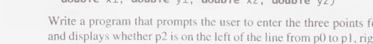
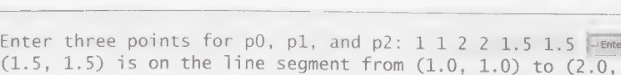
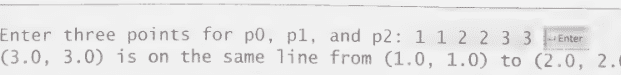

**示例运行：**
```
输入 p0, p1 和 p2 的三个点：1 1 2 2 -1
(1.0, -1.0) 位于从 (1.0, -1.0) 到 (2.0, 2.0) 直线的右侧
```

## 6.21 (数学：回文质数)
回文质数既是质数又是回文的。例如，131 是质数也是回文质数。757 也是如此。编写一个程序显示前 100 个回文质数。每行显示 10 个数字并正确对齐数字，如下：

| 2 | 3 | 5 | 7 | 11 | 101 | 131 | 151 | 181 | 191 |
| 313 | 353 | 373 | 383 | 727 | 757 | 787 | 797 | 919 | 929 |

## 6.22 (游戏：骰子点)
骰子是赌场中一种流行的游戏。编写一个玩该游戏变体的程序，如下：

掷两个骰子。每个骰子有六个面，分别代表 1, 2, ..., 6。检查骰子之和。如果和为 2、3 或 12（称为 craps），你输了；如果和为 7 或 11（称为 natural），你赢了；如果和为其他值（即 4, 5, 6, 8, 9 或 10），则建立一个点。继续掷直到掷 7（你输了）或相同的点数（你赢了）。你的程序作为单玩家运行。以下是一些示例运行：

```
你掷了 5 + 6 = 11
你赢了

你掷了 1 + 2 = 3
你输了

你掷了 4 + 4 = 8
点是 8
你掷了 6 + 2 = 8
你赢了

你掷了 3 + 2 = 5
点是 5
你掷了 2 + 5 = 7
你输了
```


## 6.23 (Emirp)
Emirp（prime 倒过来拼写）是指非回文的质数，其反转后也是质数。例如，17 是质数，71 也是质数。所以 17 和 71 是 emirps。编写一个程序显示前 100 个 emirps。每行显示 10 个数字并正确对齐数字。

| 13 | 17 | 31 | 71 | 73 | 97 | 107 |
| 149 | 157 | 167 | 179 | 191 | 311 | 347 | 359 |

## 6.24 (游戏：骰子胜率)
修改编程练习 6.22，运行 10000 次并显示获胜的次数。

## 6.25 (梅森质数)
梅森质数是指形式为 $2^p - 1$ 的质数，其中 $p$ 为某个正整数。编写一个程序找到所有 $p \le 31$ 的梅森质数并按所示显示：


$2^p - 1$， $p \le 31$

## 6.26 (打印日历)
编程练习 3.33 使用 勒同余公式计算星期。简化列表 6.19 `PrintCalendar.cpp` 以获取月份。

## 6.27 (数学：近似平方根)
库中的 `sqrt` 函数是如何实现的？是否有多种实现方法？一种方法被称为巴比伦法。通过反复执行以下公式来近似数的平方根：

```
nextGuess = (lastGuess + (n / lastGuess)) / 2
```

当 `nextGuess` 和 `lastGuess` 几乎相同时，`nextGuess` 即平方根。初始猜测值可以是任何正值（例如 1）。这将作为 `lastGuess` 的起始值。如果 `nextGuess` 和 `lastGuess` 之间的差小于一个小数（如 0.0001），就可以认为 `nextGuess` 是 `n` 的平方根。否则，继续近似。实现返回 `n` 的平方根的函数：

```cpp
double sqrt(int n)
```

## 6.28 (返回位数)
编写一个返回整数位数的函数，头如下：

```cpp
int getSize(int n)
```

例如，`getSize(45)` 返回 2，`getSize(3434)` 返回 4，`getSize(6434)` 返回 4，`getSize(0)` 返回 1。编写一个测试程序提示用户输入整数并显示其位数。

## 6.29 (奇位数字之和)
编写一个返回整数奇位数字之和的函数，头如下：

```cpp
int sumOddPlaces(int n)
```

例如，`sumOddPlaces(1345)` 返回 8，`sumOddPlaces(1)` 返回 6。编写一个测试程序提示用户输入整数并显示该整数奇位数字之和。

## 6.30 (打乱字符串)
编写一个使用以下头打乱字符串字符的函数：

```cpp
void shuffle(string& s)
```

编写一个测试程序提示用户输入字符串并显示打乱后的字符串。

## 6.31 (排序三个数字)
编写一个排序三个数的函数：

```cpp
void sort(double& num1, double& num2, double& num3)
```

编写一个测试程序提示用户输入三个数字并按排序显示它们。

## 6.32 (代数：解二次方程)
$ax^2 + bx + c = 0$。二次方程的两个根可以通过公式得到：

```
$r_1 = \frac{-b + \sqrt{b^2 - 4ac}}{2a} \text{ 和 } r_2 = \frac{-b - \sqrt{b^2 - 4ac}}{2a}$
```

编写头如下的函数：

```cpp
void solveQuadraticEquation(double a, double b, double c,
                            double& discriminant, double& r1, double& r2)
```

$b^2-4ac$ 是二次方程的判别式。如果判别式小于 0，方程无根。在这种情况下，忽略 `r1` 和 `r2` 中的值。

编写一个测试程序提示用户输入 `a`、`b` 和 `c` 值并根据判别式显示结果。如果判别式大于等于0，显示两个根。如果判别式等于0，显示一个根。否则，显示“方程无根”。参见编程练习 3.1 的用例。

## 6.33 (代数：解 $2 \times 2$ 线性方程)
你可以使用克拉默法则求解以下 $2 \times 2$ 线性方程组：

```
$ax + by = e$
$cx + dy = f$
$x = \frac{ed - bf}{ad - bc} \quad y = \frac{af - ec}{ad - bc}$
```

编写头如下的函数：

```cpp
void solveEquation(double a, double b, double c, double d,
                   double e, double f, double& x, double& y, bool& isSolvable)
```

如果 $ad-bc$ 为 0，则方程无解且 `isSolvable` 为 false。编写一个测试程序提示用户输入 `a, b, c, d, e` 和 `f` 并显示结果。如果 $ad-bc$ 为 0，报告“方程无解”。参见编程练习 3.3 用例。

## 6.34 (当前日期和时间)
调用 `time()` 返回自 1970 年 1 月 1 日起的秒数。编写一个程序显示日期和时间。这是一个示例运行：

```
当前日期和时间为 2009年5月16日 10:34:23
```

## 6.35 (几何：相交)
假设两条线段相交。第一段的两个端点为 `(x1, y1)` 和 `(x2, y2)`，第二段的端点为 `(x3, y3)` 和 `(x4, y4)`。编写以下函数，如果两条直线相交则返回交点：

```cpp
void intersectPoint(double x1, double y1, double x2, double y2,
                    double x3, double y3, double x4, double y4,
                    double& x, double& y, bool& isIntersecting)
```

编写一个程序提示用户输入四个端点并显示交点。（提示：使用编程练习 6.33 中求解 $2 \times 2$ 线性方程的函数。）


**示例运行：**
```
输入第一条线段的端点：2.0 2 0 0
输入第二条线段的端点：0 2.0 0 0
交点为：(1, 1)
```

```
输入第一条线段的端点：2.0 2 0 0
输入第二条线段的端点：3 3 1 1
两条线不相交
```

## 6.36 (格式化整数)
编写一个具有以下头文件的函数，用指定的宽度格式化正整数：

```
string format(int number, int width)
```

该函数返回该数字的字符串，前面带有一个或多个前缀零。字符串的长度为宽度。例如，`format(34, 4)` 返回 `0034`，`format(35, 5)` 返回 `00034`。如果数字长度大于宽度，则函数返回该数字的字符串表示。例如，`format(34, 1)` 返回 `34`。

编写一个测试程序，提示用户输入一个数字和它的宽度，并调用 `format(number, width)` 显示字符串。

## 6.37 (财务：信用卡号验证)
信用卡号遵循某些模式。信用卡号必须在 13 到 16 位数字之间。该数字必须以以下数字开头：

- 4 代表 Visa 卡
- 5 代表 MasterCard 卡
- 3 代表美国运通卡
- 6 代表 Discover 卡

1954年，IBM 的 Hans Luh 提出了一种验证信用卡号的算法。该算法用于判断信用卡是否输入正确或被扫描仪扫描。几乎所有的信用卡号都是按照这种有效性检查生成的，通常被称为 Luhn 检查或 Mod 10 检查。其可以描述如下。（为了说明，考虑卡号 438857601840262）

1. 从右向左每隔一个数字翻倍。数字翻倍会得到一个两位数，将这两个数字相加得到一个一位数。

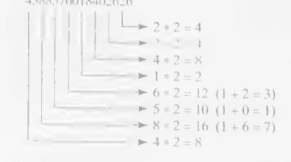

2. 相加步骤 1 中的所有一位数。
   `4 + 4 + 8 + 2 + 3 + 1 + 7 + 8 = 37`

3. 相加卡号从右向左所有位置上的数字。
   `6 + 6 + 0 + 8 + 0 + 0 + 7 + 8 + 3 = 38`

4. 求和步骤 2 和步骤 3 的结果。
   `37 + 38 = 75`

5. 如果步骤 4 的结果能被 10 整除，则卡号有效；否则无效。例如，数字 `4388576018402626` 是无效的，但数字 `4388576018401707` 是有效的。

编写一个程序，提示用户输入字符串格式的卡号。显示该数字是否有效。设计你的程序使用以下函数：

```cpp
// 如果信用卡号有效，返回 true
bool isValid(const string &cardNumber)
```

```cpp
// 获取步骤 2 的结果
int sumOfDoubleEvenPlace(const string &cardNumber)
```

```cpp
// 如果该数字是数数，则返回该数字；否则
// 返回两个数字之和
int getDigit(int number)
```

```cpp
// 返回卡号中奇数位数字的数字和
int sumOfOddPlace(const string &cardNumber)
```

```cpp
// 如果 substr 是卡号的前缀，则返回 true
bool startsWith(const string &cardNumber, const string &substr)
```

## 6.38 (二进制转十六进制)
编写一个函数，从二进制数返回十六进制数。函数头文件如下：

```cpp
string bin2Hex(const string &binaryString)
```

编写一个测试，提示用户输入字符串格式的二进制数，并显示对应的十六进制值字符串。

## 6.39 (二进制转十进制)
编写一个函数，从二进制数返回十进制数。函数头文件如下：

```cpp
int bin2Dec(const string &binaryString)
```

例如，`binaryString` `10001` 是 17 (1 × 2⁴ + 0 × 2³ + 0 × 2² + 0 × 2¹ + 1 × 2⁰ = 17)。因此 `bin2Dec` 返回 17。编写一个测试程序，提示用户输入字符串格式的二进制数，并显示其等值的十进制值。

## 6.40 (十进制转十六进制)
编写一个函数，将十进制数解析为十六进制的字符串。函数头文件如下：

```cpp
string dec2Hex(int value)
```

参见附录 D，“数制”，了解如何将十进制转换为十六进制。编写一个测试程序，提示用户输入一个十进制数并显示其等值的十六进制。

## 6.41 (十进制转二进制)
编写一个函数，将十进制数解析为二进制的字符串。函数头文件如下：

```cpp
string dec2Bin(int value)
```

参见附录 D，“数制”，了解如何将十进制转换为二进制。编写一个测试程序，提示用户输入一个十进制数并显示其等值的二进制。

## 6.42 (公共前缀)
编写一个返回两个字符串之间最长公共前缀的函数，使用如下头：

```cpp
string prefix(const string& s1, const string& s2);
```

编写一个测试程序，提示用户输入两个字符串并显示它们的最长公共前缀。

## 6.43 (子字符串)
编写以下函数检查 `s1` 是否为 `s2` 的子字符串。如果匹配，则返回 `s2` 中的第一个索引；否则返回 -1。

```cpp
int indexOf(const string& s1, const string& s2)
```

编写一个测试程序，提示用户输入两个字符串并显示 `s1` 是否为 `s2` 的子字符串。以下是示例运行：

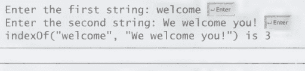
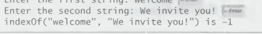

## 6.44 (字符出现次数)
使用以下头查找字符串中字符的出现次数：

```cpp
int count(const string& s, char a)
```

例如，`count("Welcome", 'e')` 返回 2。编写一个测试程序，提示用户输入一个字符串和一个字符，并显示该字符的出现次数。以下是示例运行：

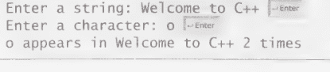

## 6.45 (当前日期、月份和日期)
编写一个程序显示当前的日期、月份和日期。


## 6.46 (大小切换)
编写以下函数，返回一个新的字符串，其中大写字母变为小写，小写字母变为大写。

```cpp
string swapCase(const string& s)
```

编写一个测试程序，提示用户输入一个字符串并显示返回值。以下是示例运行：

```
输入字符串: I'm here
新字符串为: i'M HERE
```

## 6.47 (键盘)
国际标准的字母/数字映射见编程练习 4.15。编写一个函数，根据给的大写字母返回一个数字，如下：

```cpp
int getNumber(char uppercaseLetter)
```

编写一个测试程序，提示用户输入字符串格式的电话号码。输入可能包含字母。程序将字母（大写或小写）转换为数字，并保持其他字符不变。以下是示例运行：

```
输入字符串: 1-800-Flowers
1-800-356937
```

```
输入字符串: 1800flowers
1800356937
```

# 第7章 单维数组和 C 语言字符串

## 7.1 引言
数组可以存储大量的数据集合。

在程序执行期间，你通常需要存储大量的数值。例如，假设你需要读取 100 个数字，计算它们的平均值，并确定有多少个数字高于平均值。首先，你的程序读取这些数字并计算它们的平均值，然后将每个数字与平均值进行比较，以确定它是否高于平均值。为了实现这一点，这些数字必须存储在变量中。你必须声明 100 个变量，并重复编写 100 次几乎相同的代码。以这种方式编写程序是不现实的。那么，你如何解决这个问题呢？

需要一种高效的方法。C++ 和其他高级语言提供了一种数据结构——数组，它存储一个固定大小的、相同类型元素的顺序集合。在本例中，你可以将所有 100 个数字存储在一个数组中，并通过单个数组变量来访问它们。解决方案在代码列表 7.1 中。

## 代码列表 7.1 AnalyzeNumbers.cpp

```cpp
#include <iostream>

using namespace std;
```


# 第7章 一维数组和 C 字符串

## 7.2 数组基础

数组用于存储多个相同类型的值。可以使用索引（index）访问数组中的元素。

数组用于存储数据集合，但通常将数组视为相同类型变量的集合会更有用。与其声明单独变量（如 `number0`、`number1`……到 `number99`），不如声明一个名为 `numbers` 的数组，并使用 `numbers[0]`、`numbers[1]`……到 `numbers[99]` 来表示各个索引。

### 7.2.1 声明数组

要声明数组，你需要使用以下语法指定其元素类型和大小：

`elementType arrayName[SIZE];`

`elementType` 可以是任何类型，数组中的所有元素都将具有相同的数据类型。`SIZE`（称为数组大小声明符）必须是一个求值为大于零的常量整数的表达式。例如，以下语句声明了一个包含 10 个元素的数组：

```cpp
double myList[10];
```

编译器为数组 `myList` 分配了存储 10 个 `double` 元素的空间。当声明数组时，其元素会被赋予任意值。要赋值，我们使用以下语法：

`arrayName[index] = value;`

例如，以下代码初始化了数组：

```cpp
myList[0] = myList[1] = 4.5;
myList[2] = 3.3;
myList[3] = 13.2;
myList[4] = 4.0;
myList[5] = 34.3;
myList[6] = 34.0;
myList[7] = 45.45;
myList[8] = 99.99;
myList[9] = 111.23;
```

数组如下表所示。

| 数组元素 | 元素 |
|---|---|
| myList[0] | 4.5 |
| myList[1] | 4.5 |
| myList[2] | 3.3 |
| myList[3] | 13.2 |
| myList[4] | 4.0 |
| myList[5] | 34.3 |
| myList[6] | 34.0 |
| myList[7] | 45.45 |
| myList[8] | 99.99 |
| myList[9] | 111.23 |

> **注意**
> 在标准 C++ 中，用于声明数组的数组大小必须常量。
> 例如，以下代码是非法的：
>
> ```cpp
> int size = 4;
> double myList[size]; // 错误
> ```
>
> 但如果 `SIZE` 如下所示为常量则是正确的：
>
> ```cpp
> const int SIZE = 4;
> double myList[SIZE]; // 正确
> ```

### 7.2.4 数组的处理

在处理数组元素时，你通常会使用循环——原因如下：

- 数组中的所有元素都是相同类型。它们在循环中以相同的方式被均匀处理。
- 由于数组的大小是已知的，使用 `for` 循环是很自然而的。

假设数组声明如下：

```cpp
const int ARRAY_SIZE = 10;
double myList[ARRAY_SIZE];
```

以下是处理数组的 10 个示例：

1.  **使用输入值初始化数组**：以下循环使用用户的值初始化数组 `myList`：
    ```cpp
    cout << "Enter " << ARRAY_SIZE << " values: ";
    for (int i = 0; i < ARRAY_SIZE; i++)
        cin >> myList[i];
    ```

2.  **使用随机值初始化数组**：以下循环使用 0 到 99 之间的随机值初始化数组 `myList`：
    ```cpp
    for (int i = 0; i < ARRAY_SIZE; i++)
        myList[i] = rand() % 100;
    ```

3.  **打印数组**：要打印数组，你必须打印数组中的每个元素，使用如下所示循环：
    ```cpp
    for (int i = 0; i < ARRAY_SIZE; i++)
        cout << myList[i] << " ";
    ```

4.  **复制数组**：假设你有两个数组 `list` 和 `myList`。你可以使用类似下面的语法将 `myList` 复制到 `list`：
    ```cpp
    list = myList;
    ```
    这在 C++ 中是不允许的。你必须将元素从一个数组复制到另一个数组，如下：
    ```cpp
    for (int i = 0; i < ARRAY_SIZE; i++)
        list[i] = myList[i];
    ```

5.  **累加所有元素**：使用名为 `total` 的变量来存储和。初始 `total` 为 0。使用如下循环将数组中的每个元素加到 `total`：
    ```cpp
    total = 0;
    for (int i = 0; i < ARRAY_SIZE; i++)
        total += myList[i];
    ```

6.  **寻找最大元素**：使用变量 `max` 存储最大元素。初始 `max` 为 `myList[0]`。要找到数组 `myList` 中的最大元素，将其中的每个元素与 `max` 比较，如果元素大于 `max`，则更新 `max`。
    ```cpp
    double max = myList[0];
    for (int i = 1; i < ARRAY_SIZE; i++)
    {
        if (myList[i] > max) max = myList[i];
    }
    ```

7.  **寻找最大元素的最小索引**：你通常需要定位数组中的最大元素。如果数组有多个具有相同值的元素，请找到该元素的最小索引。假设数组 `myList` 为 (1, 5, 3, 4, 5, 5)。因此，最大元素是 5，5 的最小索引是 1。使用变量名 `max` 存储最大元素，使用变量 `indexOfMax` 表示最大元素的索引。初始 `max` 为 `myList[0]`，`indexOfMax` 为 0。将 `myList` 中的每个元素与 `max` 比较。如果元素大于 `max`，则更新 `max` 和 `indexOfMax`。
    ```cpp
    double max = myList[0];
    int indexOfMax = 0;
    for (int i = 1; i < ARRAY_SIZE; i++)
    {
        if (myList[i] > max)
        {
            max = myList[i];
            indexOfMax = i;
        }
    }
    ```
    如果将 `(myList[i] > max)` 替换为 `myList[i] >= max` 会怎样？

8.  **随机洗牌**：在许多应用程序中，你需要随机重新数组中的元素。这被称为洗牌。为了实现这一点，对于每个元素 `myList[i]`，随机生成一个索引 `j` 并交换 `myList[i]` 与 `myList[j]`，如下：
    ```cpp
    srand(time(0));
    for (int i = ARRAY_SIZE - 1; i > 0; i--)
    {
        // 随机生成一个 0 <= j <= i 的索引 j
        int j = rand() % (i + 1);
        // 交换 myList[i] 和 myList[j]
        double temp = myList[i];
        myList[i] = myList[j];
        myList[j] = temp;
    }
    ```

9.  **移动元素**：有时你需要将元素向左或向右移动。例如，你可能将元素向左移动一位并用第一个元素填充最后一个元素：
    ```cpp
    double temp = myList[0];    // 留 第一个元素
    // 向左移动
    for (int i = 1; i < ARRAY_SIZE; i++)
        myList[i - 1] = myList[i];
    // 将第一个元素移动到最后一个位置
    myList[ARRAY_SIZE - 1] = temp;
    ```

10. **简化编码**：数组可以用于简化某些任务的编码。例如，假设你想通过数字获取给定月份的英文名称。如果月份名称存储在数组中，则可以通过索引轻松访问给定月份的月份名称。以下代码提示用户输入月份并显示月份：
    ```cpp
    string months[] = {"January", "February", ..., "December"};
    cout << "Enter a month (1 to 12):";
    int monthNumber;
    cin >> monthNumber;
    cout << "The month is " << months[monthNumber - 1] << endl;
    ```
    如果没有使用数组，你需要使用如下的长 `if-else` 语句来确定月份：
    ```cpp
    if (monthNumber == 1)
        cout << "The month is January" << endl;
    else if (monthNumber == 2)
        cout << "The month is February" << endl;
    else
        cout << "The month is December" << endl;
    ```

> **注意**：程序员误用索引 1 来引用数组中的第一个元素。这被称为差一错误。循环中使用 `<=` 而不是 `<` 是常见错误。例如，以下循环是错误的：
> ```cpp
> for (int i = 0; i <= ARRAY_SIZE; i++)
>     cout << list[i];
> ```
> **提示**：由于 C++ 不检查数组边界，你应该确保索引在范围内。检查循环的第一次和最后一次迭代以查看错误。

## 复习题

7.1 如何声明数组？数组大小声明符和数组索引的区别是什么？

7.2 如何访问数组元素？可以使用 `b = a` 复制数组吗？

7.3 声明数组时分配内存吗？数组有默认值吗？执行以下代码会发生什么？
```cpp
int numbers[30];
cout << "numbers[0] is " << numbers[0] << endl;
cout << "numbers[29] is " << numbers[29] << endl;
cout << "numbers[30] is " << numbers[30] << endl;
```

7.4 判断下列语句对错：
- 数组中的每个元素具有相同的类型。
- 数组的大小在声明后是固定的。
- 数组大小声明符必须是一个常量表达式。
- 数组在声明时已初始化。

7.5 下列哪些是有效的数组声明？
```cpp
double d[30];
char r[30];
int i[] = {3, 4, 3, 2};
float f[] = {2.3, 4.5, 6.6};
```

7.6 数组索引类型是什么？最小索引是多少？名为 `months` 的数组中第三个元素的表示法是什么？

7.7 编写 C++ 语句完成：
a. 声明一个存储 10 个 `double` 值的数组。
b. 给数组的最后一个元素赋值 5.5。
c. 显示前两个元素的和。
d. 编写一个循环计算数组所有元素的和。
e. 编写一个循环找到数组中的最小值。
f. 随机生成一个索引并显示数组中该索引的元素。
g. 使用数组初始化器声明另一个值为 3.5, 5.5, 4, 5.2, 和 5.6 的数组。

7.8 当程序尝试访问无效索引的数组元素时发生什么？

7.9 识别并修复以下代码中的错误：
```cpp
int main()
{
    double r[100];
    for (int i = 0; i < 100; i++)
        r[i] = rand() % 100;
}
```

7.10 以下代码的输出是什么？
```cpp
int list[] = {1, 2, 3, 4, 5, 6};
for (int i = 1; i < 6; i++)
    list[i] = list[i - 1];
for (int i = 0; i < 6; i++)
    cout << list[i] << " ";
```

## 7.3 问题：乐透数字

问题是编写一个程序检查所有输入数字是否覆盖到 n。

每张 Pick-10 彩乐票都有 10 个从 1 到 99 的唯一数字。假设你买了很多彩票，希望它们能覆盖从 1 到 99 的所有数字。编写一个程序从文件中读取数字并检查数字是否被覆盖。假设文件中的最后一个数字是 0。

假设文件包含以下数字：
```
80 3 87 62 30 90 10 21 46 27
12 40 83 9 39 88 95 59 20 37
80 40 87 67 31 90 11 24 24 56 77
52 82 16 72 19 70 44 56 29 33
54 64 99 14 23 22 94 79 55 2
60 86 34 4 61 84 89 77 78
43 93 97 45 23 38 28 26 85 49
47 65 57 67 73 32 71 24 66
92 98 77 6 75 17 61 58 13
35 81 18 15 5 68 91 50 76
0
```
你的程序应该显示：
**门票覆盖了所有数字**

假设文件包含以下数字：
```
11 48 51 42 8 74 1 41 36 53
52 82 16 72 19 70 44 56 29 33
0
```
你的程序应该显示：
**门票没有覆盖所有数字**

如何标记一个数字为已覆盖？你可以声明一个包含 99 个 `bool` 元素的数组吗？数组中的每个元素都可以用于标记某个数字是否被覆盖。设该数组为 `isCovered`。初始，每个元素都被设置为 `false`。每当读取到一个数字时，对应的元素就被设置为 `true`。输入的数字是 1, 2, 3...99, 0。当读取数字 1 时，`isCovered[1-1]` 被设置为 `true`。当读取数字 2 时，`isCovered[2-1]` 被设置为 `true`。当读取数字 3 时，`isCovered[3-1]` 被设置为 `true`。当读取数字 99 时，`isCovered[99-1]` 被设置为 `true`。

| isCovered | isCovered | isCovered | isCovered | isCovered |
|---|---|---|---|---|
| [0] | false | true | true | true | true |
| [1] | false | false | true | true | true |
| [2] | false | false | false | true | true |
| [3] | false | false | false | false | false |
| [97] | false | false | false | false | false |


| [98] | false | false | false | false | true |
| (a) | (b) | (c) | (d) | (e) |

**图 7.2** 如果数字 $i$ 出现在乐透票中，则 `isCovered[i-1]` 被设置为 `true`。

程序的算法可以描述如下：

```
for 从文件中读取 number k,
通过设置 isCovered[k-1] 为 true 将 k 标记为已覆盖;
```

```cpp
if isCovered[i] is true
门票覆盖了所有数字
else
门票没有覆盖所有数字
```

完整的程序在列表 7.2 中。

# 列表 7.2 LottoNumbers.cpp

```cpp
#include <iostream>
using namespace std;

int main() {
    bool isCovered[99];
    int number; // 从文件中读取的 number

    // 初始化数组
    for (int i = 0; i < 99; i++)
        isCovered[i] = false;

    // 读取每个数字并标记其对应的覆盖元素
    cin >> number;
    while (number != 0) {
        isCovered[number - 1] = true;
        cin >> number;
    }

    // 检查是否全部覆盖
    bool allCovered = true; // 初始假设全部覆盖
    for (int i = 0; i < 99; i++) {
        if (!isCovered[i]) {
            allCovered = false; // 找到一个未覆盖的数字
        }
    }

    // 显示结果
    if (allCovered)
        cout << "The tickets cover all numbers" << endl;
    else
        cout << "The tickets don't cover all numbers" << endl;

    return 0;
}
```


假设你创建了一个名为 `LottoNumbers.txt` 的文件，其中包含输入数据 `2 5 6 4 3 23 43 2 0`。你可以使用以下命令运行程序：

```
g++ LottoNumbers.cpp -o LottoNumbers.exe
LottoNumbers.exe < LottoNumbers.txt
```

程序的追踪过程如下：

| Line# | [1] | [2] | [3] | [4] | [5] | [22] | [42] | number | allCovered |
|---|---|---|---|---|---|---|---|---|---|
| 11 | false | false | false | false | | | | | |
| 14 | | | | | | | | | |
| 17 | | | | | | | | | |
| 18 | | | | | | | | | |
| 22 | | | | | | | | | |

该程序声明了一个包含 99 个元素的数组（第 6 行），并将其每个元素设置为 `false`（第 10 行）。它从文件中读取数字（第 14 行）。程序重复以下操作：

- 如果数字不为 0，将其标记为 `true`（第 17 行）
- 读取下一个数字（第 18 行）。

当数字为 0 时，程序在第 22 行检查是否所有数字都已覆盖，并在第 31 行之后显示结果。

# 7.4 问题：扑牌

问题是创建一个程序，从一副扑牌中随机抽取四张牌。所有的牌可以使用一个名为 `deck` 的数组表示，其初始值为 0 到 51，如下：

```cpp
int deck[52];
// 初始化牌
for (int i = 0; i < NUMBER_OF_CARDS; i++)
    deck[i] = i;
```

数字 0 到 12、13 到 25、26 到 38、39 到 51 分别代表黑桃、红桃、梅花、俱乐部，如图 7.3 所示。`cardNumber / 13` 决定牌的花色，`cardNumber % 13` 决定牌的等级，如图 7.4 所示。在洗牌 `deck` 数组后，选取前四张牌。

**图 7.3** 五十二张牌存储在数组 `deck` 中。

**图 7.4** 牌号（cardNumber）识别了问题的解决方案。

列表 7.3 给出了问题的解决方案。

# 列表 7.3 DeckOfCards.cpp

```cpp
#include <iostream>
#include <ctime>
#include <string>
using namespace std;

int main() {
    const int NUMBER_OF_CARDS = 52;
    int deck[NUMBER_OF_CARDS] = {"Spades", "Hearts", "Diamonds", "Clubs"};
    string ranks[] = {"Ace", "2", "3", "4", "5", "6", "7", "8", "9", "10", "Jack", "Queen", "King"};

    // 初始化牌
    for (int i = 0; i < NUMBER_OF_CARDS; i++)
        deck[i] = i;

    // 洗牌
    srand(time(0));

    for (int i = 0; i < NUMBER_OF_CARDS; i++)
    {
        // 生成一个随机索引
        int index = rand() % NUMBER_OF_CARDS;
        int temp = deck[i];
        deck[i] = deck[index];
        deck[index] = temp;
    }

    // 显示前四张牌
    for (int i = 0; i < 4; i++)
    {
        string suit = suits[deck[i] / 13];
        string rank = ranks[deck[i] % 13];
        cout << "Card number " << deck[i] << ": "
              << rank << " of " << suit << endl;
    }

    return 0;
}
```

## 7.5 将数组传递给函数

当参数传递给函数时，其起始地址会被传递给函数中的数组参数。参数和参数都引用

正如你可以向函数传递单个值一样，也可以将整个数组传递给函数。列表 7.4 给出了一个示例，展示了如何声明和调用此类函数。

# 列表 7.4 PassArrayDemo.cpp

```cpp
#include <iostream>
using namespace std;

void printArray(int list[], int arraySize); // 函数原型

int main()
{
    int numbers[5] = {1, 4, 3, 6, 8};
    printArray(numbers, 5); // 调用函数

    return 0;
}

void printArray(int list[], int arraySize)
{
    for (int i = 0; i < arraySize; i++)
    {
        cout << list[i] << " ";
    }
}
```

| 14 3 6 8 |

在函数头部（第 14 行）中，`int list[]` 指定该参数是一个任意大小的整数数组。因此，你可以传递任何数组来调用此函数（第 9 行）。注意，函数原型中的参数名可以省略。因此，可以如下所示声明不带参数名和 `arraySize` 的函数类型：

```cpp
void printArray(int [], int); // 函数原型
```

> 注意：通常你向函数传递一个数组时，必须通过另一个参数传递它的大小，以便函数知道数组中有多少个元素。否则，你将不得不将此硬编码到函数中，或者将其声明为全局变量。这两种方法都不灵活也不健壮。

C++ 使用值传递来将数组传递给函数。基本数据类型变量的值传递与传递数组之间存在重要的区别。传递的是参数的值。

- 对于基本类型参数，
- 对于数组类型参数，该参数的值是数组的起始内存地址；该值被传递给函数中的数组参数。从语义上讲，它最好被描述为共享传递（pass-by-sharing），即函数中的数组与被传递的数组是同一个。因此，如果你在函数中更改了数组，你将在外部看到该变化……

# 列表 7.5 EffectOfArrayDemo.cpp

```cpp
#include <iostream>
using namespace std;

void m(int, int[]);

int main() 
{
    int x = 1; // x 代表一个 int 值
    int y[10]; // y 代表一个 int 值数组
    y[0] = 1; // 初始化 y[0]
    m(x, y); // 使用参数 x 和 y 调用 m
    cout << "x is " << x << endl;
    cout << "y[0] is " << y[0] << endl;
    return 0;
}

void modify(int number, int numbers[])
{
    number = 1001; // 给 number 分配新值
    numbers[0] = 5555; // 给 numbers[0] 分配新值
}
```

你会发现当函数被调用后，x 保持为 1，但 y[0] 变成了 5555。这是因为 x 的值被复制给了 number，x 和 number 是独立变量，但 y 和 numbers 引用同一个数组，numbers 可以被数组的别名。

# 7.6 防止函数修改数组参数

你可以在函数中定义 `const` 数组参数以防止其被更改。

传递数组传递的是数组的起始内存地址。数组元素不会被复制。这对节省内存空间很有意义。然而，如果你不小心更改了数组，使用数组参数可能会错误。为了防止这种情况，你可以在数组参数之前放置 `const` 关键字，告诉编译器数组不能被更改。如果函数尝试修改数组，编译器将报告错误。

列表 7.6 给出了一个示例，在函数 `p` 中声明了 `const` 参数列表（第 4 行）。在第 7 行中，函数尝试修改数组的第一个元素。编译器检测到了这一错误，如示例输出所示。

# 列表 7.6 ConstArrayDemo.cpp

```cpp
#include <iostream>
using namespace std;
void p(const int list[], int arraySize) {
    // // 意外修改数组
    list[0] = 100; // 编译错误！
}

int main()
{
    int numbers[5] = {1, 4, 3, 6, 8};
    p(numbers, 5);
    
    return 0;
}
```


error C3892: "list": 你不能给 const 变量赋值


ConstArrayDemo.cpp:7: error: 给只读位置赋值

注意：如果你在函数 `f1` 中定义了一个 `const` 参数，并将该参数传递给另一个函数 `f2`，那么函数 `f2` 中对应的参数必须声明为 `const` 以保持一致。考虑以下代码：

```cpp
void f2(int list[]) {
    // 一些
}
void f1(const int list[], int size) {
    // 一些
    f2(list, size);
}
```

编译器报告了错误，因为 list 在 `f1` 中是 const 并传递给了 `f2`，但在 `f2` 中不是 const。`f2` 的函数应该是：

```cpp
void f2(const int list[], int size);
```

# 7.7 从函数返回数组

要从函数返回数组，将其作为参数传递。你可以声明一个返回基本类型或对象的函数。例如：

```cpp
// 返回 list 中元素的和
int sum(const int list[], int size)
```

你可以使用类似的语法从函数返回数组吗？例如，你可能会尝试声明一个返回反转数组的函数：

```cpp
// 返回 list 反转
int reverse(const int list[])
```

这在 C++ 中是不允许的。但你可以通过在函数中传递两个参数来规避：

```cpp
// newList 是 list 反转
void reverse(const int list[], int size);
```

程序位于列表 7.7。

# 列表 7.7 ReverseArray.cpp

```cpp
#include <iostream>
using namespace std;

// newList 是 list 反转
void reverse(const int list[], int newList[], int size)
{
    for (int i = 0, j = size - 1; i < size; i++, j--)
    {
        newList[j] = list[i];
    }
}

void printArray(const int list[], int size)
{
    for (int i = 0; i < size; i++)
        cout << list[i] << " ";
}

int main()
{
    const int SIZE = 6;
    int list[] = {1, 2, 3, 4, 5, 6};
    int newList[SIZE];
    
    reverse(list, newList, SIZE);
    
    cout << "The original array: ";
    printArray(list, SIZE);
    cout << endl;
    
    cout << "The reversed array: ";
    printArray(newList, SIZE);
    cout << endl;
    
    return 0;
}
```


reverse 函数

reverse 到 newList

print array

声明 original array

声明 new array

调用 reverse

print original array

print reversed array


`reverse` 函数（第 5-11 行）使用循环将原始数组中的第一个、第二个……等元素复制到新数组中的最后一个、倒数第二个……等位置，如下图所示：


调用此函数（第 25 行）需要传递三个参数。第一个参数是原始数组，其内容在函数中不会更改。第二个参数是新数组，其内容会在函数更改。第三个参数表示数组的大小。

# 7.11 当数组传递给函数时，会创建一个新数组并传递给函数 吗？

# 7.12 显示以下程序的输出：

```cpp
#include <iostream>
using namespace std;

void m(int x, int y[]) {
    x = 3;
    y[0] = 1;
}

int main() {
    int number = 0;
    int numbers[1];

    m(number, numbers);

    cout << "number is " << number
    << " and numbers[0] is " << numbers[0] << endl;

    return 0;
}
```

```cpp
#include <iostream>
using namespace std;

void reverse(int list[], int size) {
    for (int i = 0; i < size / 2; i++) {
        int temp = list[i];
        list[i] = list[size - 1 - i];
        list[size - 1 - i] = temp;
    }
}

int main() {
    int list[] = {1, 2, 3, 4, 5};
    int size = 5;
    reverse(list, size);
    for (int i = 0; i < size; i++) {
        cout << list[i] << " ";
    }

    return 0;
}
```


# 第7章 单维数组与C语言字符串

## 7.8 问题：统计每个字母的出现次数

本节介绍了一个统计字符数组中每个字母出现次数的程序。

该程序执行了以下操作：

1. 随机生成100个小写字母并将它们赋值给字符数组，如图7.5a所示。如第4.4节“案例研究：生成随机字符”中讨论的，可以使用以下代码生成一个随机小写字母：
   ```cpp
   static_cast<char>('a' + rand() % ('z' - 'a' + 1))
   ```

2. 统计数组中每个字母的出现次数。为此，声明一个包含26个int型值的数组，每个值统计一个字母的出现次数，如图7.5b所示。即，`counts[0]` 统计 'a' 的数量，`counts[1]` 统计 'b' 的数量，依此类推。

| chars[0] | counts[0] |
| chars[1] | counts[1] |
| chars[98] | counts[24] |
| chars[99] | counts[25] |

图7.5 chars数组存储了100个字符，counts数组存储了26个计数，每个计数代表字母的出现次数。

列表7.8给出了完整的程序。

### 列表 7.8 CountLettersInArray.cpp

```cpp
#include <iostream>
#include <ctime>
using namespace std;

const int NUMBER_OF_LETTERS = 26;
const int NUMBER_OF_RAND_LETTERS = 100;
void createArray(char[]);
void countLetters(const char chars[], int counts[]);
void displayCounts(const int counts[]);

int main() {
    // 声明并创建一个数组
    char chars[NUMBER_OF_RAND_LETTERS];
    // 用随机小写字母初始化数组
    createArray(chars);
    // 显示数组
    cout << "The lowercase letters are: " << endl;
    displayArray(chars);

    // 统计每个字母的出现次数
    int counts[NUMBER_OF_LETTERS];
    // counts 数组
    // 统计每个字母的出现次数
    countLetters(chars, counts);
    // 统计字母

    // 显示计数
    cout << "\n occurrences of each letter are: " << endl;
    displayCounts(counts);
    // 显示计数

    return 0;
}

// 创建字符数组
void createArray(char chars[]) {
    // 随机创建小写字母并赋值
    // 给数组
    srand(time(0));
    // 初始化数组
    for (int i = 0; i < NUMBER_OF_RAND_LETTERS; i++)
        chars[i] = static_cast<char>('a' + rand() % ('z' - 'a' + 1));
    // 随机字母
}

// 显示字符数组
void displayArray(const char chars[]) {
    // 每行显示10个数组中的字符
    for (int i = 0; i < NUMBER_OF_RAND_LETTERS; i++) {
        if ((i + 1) % 10 == 0)
            cout << chars[i] << " " << endl;
        // 转换为 char
        else
            cout << chars[i] << " ";
    }
}

// 统计每个字母的出现次数
void countLetters(const char chars[], int counts[]) {
    // 统计字母
    for (int i = 0; i < NUMBER_OF_RAND_LETTERS; i++)
        if (chars[i] >= 'a' && chars[i] <= 'z')
            counts[chars[i] - 'a']++;
}
```

小写字母为：

p y a o n u b i t h y g w q l b y o
x v b r i g h i w v c g r a s p y i z
f j v c j c a v l a j x r d t w q
m a y e v k d m e m o j v k e v t a
r m o v d h f o o x d g i u w r h

每个字母的出现次数为：

6 a 3 b 4 c 4 d 3 e 2 f 4 g 6 i 4 j
2 k 1 2 m 6 n 6 o 2 p 3 q 6 r 2 s 3 t
4 u 8 v 4 w 4 x 5 y 1 z

`createArray` 函数（第38–45行）生成一个包含100个随机小写字母的数组，并将它们赋值给数组 `chars`。`countLetters` 函数（第61–70行）统计 `chars` 中字母出现的次数，并将其存储在数组 `counts` 中。`counts` 中的每个元素都存储了字母出现的次数。该函数处理数组中的每个字母并增加其计数。暴力法如下：

```cpp
for (int i = 0; i < NUMBER_OF_RAND_LETTERS; i++)
    counts[chars[i] - 'a']++;
```

更好的解决方案在第68–69行给出：

```cpp
for (int i = 0; i < NUMBER_OF_RAND_LETTERS; i++)
    if (chars[i] >= 'a' && chars[i] <= 'z')
        counts[chars[i] - 'a']++;
```

如果字母是 'a'，对应的计数加1。如果字母是 'b'，对应的计数加1。如果字母是 'z'，对应的计数加1。

## 7.9 搜索数组

搜索是在数组中查找元素的过程。本节讨论了两种方法：线性搜索和二分查找。

### 7.9.1 线性搜索

线性搜索将键与数组中的每个元素进行比较。该函数持续运行直到匹配项或耗尽数组。如果匹配，线性搜索返回索引；否则返回 -1。列表7.9：

```cpp
int linearSearch(int list[], int key, int size) {
    for (int i = 0; i < size; i++) {
        if (list[i] == key)
            return i;
    }
    return -1;
}
```

### 7.9.2 二分查找

二分查找是列表的一种常用方法。它要求数组中的元素已经排序。假设数组是升序的。二分查找首先将键与中间的元素进行比较。考虑以下情况：

- 如果键小于中间元素，只需要在数组的前半部分继续搜索。
- 如果键等于中间元素，搜索匹配结束。
- 如果键大于中间元素，只需要在数组的后半部分继续搜索。

显然，二分查找每次比较后都会排除掉一半的数组。有时排除一半，有时排除一半加一。假设数组有 n 个元素。为了方便，让 n 成为 2 的幂。第一次比较后，剩余 n/2 个元素待搜索；第二次比较后，剩余 (n/2)/2 个元素；第 k 次比较后，剩余 n/2^k 个元素。当 k = log2n 时，数组中只剩下一个元素，你只需要再进行一次比较。因此，在最坏情况下，使用二分查找在已排序数组中找到元素需要 logn+1 次比较。在最坏情况下，线性搜索需要 1024 次。

| key 为 11 | low | mid | high |
|---|---|---|---|
| key < 50 | [0] [1] [2] [3] [4] [5] [6] [7] [8] [9] [10][11][12] | | |
| list | 2 4 7 10 11 45 50 59 60 66 69 70 79 | | | |
| | low | mid | high |
| | [0] [1] [2] [3] [4] [5] | | | |
| key > 7 | 2 4 7 10 11 45 | | | |
| | | low | mid | high |
| | | [3] [4] [5] | | |
| key == 11 | list | 10 11 45 | | |

**图 7.6** 二分查找在每次比较后都会排除列表中一半的数据不再后续考虑。

你现在已经知道了二分查找的工作原理。下一个任务是实现它。不要急于给出一个完整的实现。要递进地实现，一步一步来。你可以从搜索的第一次迭代开始，如图 7.7a 所示。它将 key 与列表中中间元素进行比较，该元素的 low 索引为 0，high 索引为 listSize - 1。如果 key < list[mid]，则将 high 索引设置为 mid - 1；如果 key == list[mid]，则找到匹配项并返回 mid；如果 key > list[mid]，则将 low 索引设置为 mid + 1。

```cpp
int binarySearch(const int list[], int key, int listSize) {
    int low = 0;
    int high = listSize - 1;

    int mid = (low + high) / 2;
    if (key < list[mid])
        high = mid - 1;
    else if (key == list[mid])
        return mid;
    else
        low = mid + 1;
}
```

(a) 版本 1

接下来，考虑如何使用循环实现一个反复执行搜索的函数，如图 7.7b 所示。如果找到了 key 或未找到 key，搜索将结束。注意当 key 不在数组中时。

```cpp
int binarySearch(const int list[], int key, int listSize) {
    int low = 0;
    int high = listSize - 1;

    while (low <= high) {
        int mid = (low + high) / 2;
        if (key < list[mid])
            high = mid - 1;
        else if (key == list[mid])
            return mid;
        else
            low = mid + 1;
    }
    return -1;
}
```

(b) 版本 2

**图 7.7** 二分查找是递进式实现的。

当未找到 key 时，low 是插入点，即 key 应该插入的位置以保持列表的顺序。返回插入点比返回 -1更有用。函数必须返回一个负值来表示 key 不在列表中。可以简单地返回 -low 吗？不。如果 key 小于 list[0]，low 将是 0。这将表示 key 匹配 list[0]。一个好的选择是，如果 key 不在列表中，返回函数 -low - 1，同时也返回 key 在列表中的插入位置。

二分查找实现在代码列表 7.10 中。

### 代码列表 7.10 BinarySearch.cpp

```cpp
int binarySearch(const int list[], int key, int listSize)
{
    int low = 0;
    int high = listSize - 1;
    while (high >= low)
    {
        int mid = (low + high) / 2;
        if (key < list[mid])
            high = mid - 1;
        else if (key == list[mid])
            return mid;                               // 找到
        else
            low = mid + 1;
    }

    return -low - 1;                        // 未匹配
}
```

如果 key 在列表中，二分查找返回 key 的索引（第 11 行）。否则，如果它返回 -low - 1（第 16 行）。如果将第 5 行的 `high >= low` 替换为 `high > low` 会怎样？搜索将漏掉匹配元素。考虑一个只有一个元素的列表。如果列表中有重复元素，搜索还能正常工作吗？是的，只要列表中的元素是按升序排列的。该函数会返回其中一个匹配元素的索引，或者表示该元素在列表中。

为了理解这个函数，最好用以下语句进行跟踪，并识别函数返回时的 low 和 high。

```cpp
int list[] = {2, 4, 7, 10, 11, 45, 50, 59, 60, 66, 69, 70, 79};
int i = binarySearch(list, 2, 13); // 返回 0
int j = binarySearch(list, 11, 13); // 返回 4
int k = binarySearch(list, 12, 13); // 返回 -13
```

这里是显示函数退出时 low 和 high 的表格。

| 函数 | low | high | 返回值 |
|---|---|---|---|
| binarySearch(list, 2, 13) | 0 | 0 | 0 |
| binarySearch(list, 11, 13) | 4 | 4 | 4 |
| binarySearch(list, 12, 13) | 12 | 11 | -13 |

## 7.10 排序数组

线性搜索适用于在小型或未排序数组中查找元素，但对于大型数组效率较低。二分查找更有效，但要求数组是排序的。

排序和搜索一样，是编程中的常见任务。许多不同的算法已被开发。本节介绍了一种算法：选择排序。

假设你想按升序排序列表。选择排序找到最小值并与第一个交换，然后找到剩余部分的最小值与下一个交换，直到剩下一个元素。图 7.8 显示了如何使用选择排序对列表。

**图 7.8** 选择排序重复选择最小值并与剩余列表交换。


你已经知道选择排序的工作原理。现在的任务是用 C++ 实现它。对于初学者来说，很难第一次就写出完整的解决方案。你可以从编写第一次迭代的代码开始，找到列表中的最小值并与第一个元素交换，然后观察第二次、第三次会有什么不同。这种见解将使你能够编写一个适用于所有迭代的循环。

该解决方案可以描述如下：

```cpp
for (int i = 0; i < listSize; i++) {
  // 选择 list[i..listSize-1] 中的最小元素；
  // 如果有必要，将最小元素与 list[i] 交换；
  // list[i] 处于正确位置。
  // 下一次迭代应用于 list[i+1..listSize]
}
```

代码列表 7.11 实现了解决方案。

### 代码列表 7.11 SelectionSort.cpp

```cpp
void selectionSort(double list[], int listSize) {
    for (int i = 0; i < listSize - 1; i++) {
        // 在 list[i..listSize-1] 中找到最小值
        double currentMin = list[i];
        int currentIndexMin = i;
        for (int j = i + 1; j < listSize; j++) {
            if (currentMin > list[j]) {
                currentMin = list[j];
                currentIndexMin = j;
            }
        }
        // 如果必要，将 list[i] 与 list[currentIndexMin] 交换
        if (currentIndexMin != i) {
            list[i] = list[currentIndexMin];
            list[currentIndexMin] = currentMin;
        }
    }
}
```

## 习题

### 7.13 如何防止数组在函数中被意外修改？

### 7.14 假设以下代码用于反转字符串中的字符，请解释为什么它是错误的。

```cpp
string s = "ABCD";
for (int i = 0, j = s.size(); i < s.size(); i++, j--) {
    // 交换 s[i] 和 s[j]
    char temp = s[i];
    s[i] = s[j];
    s[j] = temp;
}
```

```cpp
cout << "The reversed string is " << s << endl;
```

### 7.15 以图 7.6 为例，展示如何应用二分查找法在 [2, 4, 7, 10, 11, 45, 50, 59, 66, 69, 70, 79] 中查找键 10 和键 12。

### 7.16 以图 7.8 为例，展示如何应用选择排序法对 [3, 4, 5, 2, 3, 5, 2, 1, 9, 2] 进行排序。


# 7.17 如何修改列表 7.11 中的 `selectionSort` 函数以按降序排列数字？

## 7.11 C 字符串

C 字符串是以空终止符字符 `'\0'` 结尾的字符数组。你可以使用 C++ 库中的 C 字符串函数来处理 C 字符串。

> **教学提示**
>
> string 在 C 语言中很流行，但在 C++ 中它已被一个更健壮、方便且实用的 string 类型所取代。因此，第 4 章引入的类型在这两者中都被处理字符串。在本节引入 C 字符串的目的是提供额外的示例和练习，让你能够处理遗留的 C 程序。

C 字符串是以空终止符 `'\0'` 结尾的字符数组，它表示内存中的字符串。回想第 4.3.3 节“特殊字符的转义序列”中以反斜杠符号 `'\\'` 开头的字符是一个转义序列。符号 `'\\'` 和 `0` 共同代表一个字符。这是 ASCII 表中的第一个字符。

每个字符串字面量都是 C 字符串。你可以声明一个用字符串字面量初始化的数组。例如，以下语句创建了一个包含字符 'D''a''l''l''a''s' 和 `'\0'` 的 C 字符串数组，如图 7.9 所示。

```
char city[7] = {'D', 'a', 'l', 'l', 'a', 's', '\0'};
```

| | 'D' | 'a' | 'l' | 'l' | 'a' | 's' | '\0' |
|---|---|---|---|---|---|---|---|
| city[0] | city[1] | city[2] | city[3] | city[4] | city[5] | city[6] |

图 7.9 字符数组可以用 C 字符串初始化。

注意数组的大小为 7，且数组中的最后一个字符是 `'\0'`。C 字符串和字符数组之间存在细微的差别。例如，以下两个语句：

```
char city[] = "Dallas"; // C 字符串
char city[] = {'D', 'a', 'l', 'l', 'a', 's'}; // 不是 C 字符串
```

第一个语句是 C 字符串，第二个语句只是字符数组。前者有 7 个字符（包括最后的终止符），后者有 6 个字符。

### 7.11.1 C 字符串的输入和输出

输出 C 字符串非常简单。假设 `s` 是一个 C 字符串数组。要将其显示在控制台上，只需使用：

```
cout << s;
```

你可以像读取数字一样从键盘读取 C 字符串。例如，考虑以下代码：

```
char city[7];
cout << "Enter a city: ";
cin >> city; // 读取到数组 city
cout << "You entered " << city << endl;
```

当将字符串读取到数组时，务必为空终止符留出空间。由于 `city` 的大小为 7，你的输入不应超过 6 个字符。这种读取字符串的方法简单，但存在一个问题：输入会遇到空白字符。你无法读取包含空格的字符串。假设你想输入 New York；那么你需要使用另一种方法。C++ 在 `iostream` 头文件中提供了 `cin.getline` 函数，它可以将字符串读入数组。该函数的语法如下：

```
cin.getline(char array[], int size, char delimiter)
```

该函数在遇到分隔符或读取了 `size - 1` 个字符时停止读取。数组中的最后一个字符留给空终止符（`'\0'`）。如果遇到分隔符，它不会存储在数组中。第三个参数 `delimiter` 有一个默认值（`'\n'`）。以下代码使用 `cin.getline` 函数读取字符串：

```
char city[30];
cout << "Enter a city: "; // 例如，New York
cin.getline(city, 30, '\n'); // 读取到数组 city
cout << "You entered " << city << endl;
```

由于 `cin.getline` 函数第三个参数的默认值为 `'\n'`，因此第 3 行可以替换为：

```
cin.getline(city, 30); // 读取到数组 city
```

### 7.11.2 C 字符串函数

由于 C 字符串带有空终止符，C++ 可以利用这一事实高效地处理 C 字符串。当你将 C 字符串传递给函数时，不需要传递它的长度，因为长度可以通过从左到右计算所有字符直到遇到空终止符来获得。以下是获取 C 字符串长度的函数：

```
unsigned int strlen(char s[])
{
  int i = 0;
  for (; s[i] != '\0'; i++);
  return i;
}
```

事实上，C++ 库提供了 `strlen` 和其他函数来处理 C 字符串。

> **提示**
>
> `size_t` 是一个 C++ 类型。对于大多数编译器来说，它是无符号的。所有这些函数都定义在 `cstring` 头文件中，转换函数 `atoi`、`atof` 和 `itoa` 定义在 `stdlib` 中。

| 函数 | 描述 |
| --- | --- |
| `size_t strlen(char s[])` | 返回字符串的长度，即终止符之前的字符数。 |
| `strcpy(char s1[], const char s2[])` | 将 `s2` 复制到 `s1`。 |
| `strncpy(char s1[], const char s2[], size_t n)` | 将 `s2` 的前 `n` 个字符复制到 `s1`。 |
| `strcat(char s1[], const char s2[])` | 将 `s2` 追加到 `s1`。 |
| `strncat(char s1[], const char s2[], size_t n)` | 将 `s2` 的前 `n` 个字符追加到 `s1`。 |
| `int strcmp(char s1[], const char s2[])` | 根据字符的数值返回大于 0、0 或小于 0 的值。 |
| `int strncmp(char s1[], const char s2[], size_t n)` | 与 `strcmp` 相同，但比较 `s1` 中 `n` 个字符到 `s2`。 |
| `int atoi(char s[])` | 返回字符串的 `int` 值。 |
| `double atof(char s[])` | 返回字符串的 `double` 值。 |
| `long atol(char s[])` | 返回字符串的 `long` 值。 |
| `void itoa(int value, char s[])` | 根据指定的整数值转换为字符串。 |

### 7.11.3 使用 `strcpy` 和 `strncpy` 复制字符串

`strcpy` 函数用于将第二个参数的源字符串复制到第一个参数的目标字符串。为了使函数工作，目标字符串必须已经分配内存。一个常见的错误是这样使用 C 字符串：

```
char city[7] = "Chicago";
strcpy(city, "New York"); // 将 New York 复制到 city。错误！
```

为了将 "New York" 复制到 `city`，必须使用：

```
strcpy(city, "New");
```

`strncpy` 函数的功能类似于 `strcpy`，但它接受第三个参数来指定要复制的字符数。例如，以下代码将前三个字符 "New" 复制到 `city`。

```
char city[9];
strncpy(city, "New York", 3);
```

这段代码存在问题。如果指定的字符数小于源字符串的长度，`strncpy` 函数不会向目标字符串添加空终止符。如果指定的长度大于源字符串的长度，则会将字符串复制到目标字符串的结尾。为了确保安全复制，在使用这些函数之前请检查边界。

### 7.11.4 使用 `strcat` 和 `strncat` 拼接字符串

`strcat` 函数用于将第二个参数的字符串追加到第一个参数中。为了使函数工作，第一个字符串必须已经分配内存。例如，以下代码可以将 `s2` 追加到 `s1`。

```
char s1[7] = "abc";
char s2[4] = "def";
strcat(s1, s2);
cout << s1 << endl; // 输出 abcdef
```

然而，以下代码无法工作，因为没有空间将 `s2` 添加到 `s1`。

```
char s1[4] = "abc";
char s2[4] = "def";
strcat(s1, s2);
```

`strncat` 函数的功能类似于 `strcat`，但它接受第三个参数来指定从源字符串拼接到目标字符串的字符数。例如，以下代码将前三个字符 "ABC" 拼接到 `s`：

```
char s[9] = "abc";
strncat(s, "ABC", 3);
cout << s << endl; // 输出 abcABC
```

`strcat` 和 `strncat` 都可能溢出数组边界。为了确保安全拼接，在使用这些函数之前请检查边界。

### 7.11.5 使用 `strcmp` 比较字符串

`strcmp` 函数用于比较两个字符串。你如何比较两个字符串？你根据字符的数值码进行比较。大多数编译器使用 ASCII 码。如果 `s1` 等于 `s2`，函数返回 0；如果 `s1` 小于 `s2`，返回小于 0 的值；如果 `s1` 大于 `s2`，返回大于 0 的值。例如，假设 `s1` 是 "abc"，`s2` 是 "abd"，`strcmp(s1, s2)` 返回一个负值。比较 `s1` 和 `s2` 的前两个字符（a, a）。因为它们相等，所以比较第二个字符（b, b）。因为它们也相等，所以比较第三个字符（c 与 d）。并将字符 c 的值返回给编译器。Visual C++ 和 GCC 编译器返回 -1，但当字符 c 比 g 小 4 时，Borland C 返回 -4。这是一个使用 `strcmp` 函数的示例：

```
char s1[] = "Good morning";
char s2[] = "Good afternoon";
if (strcmp(s1, s2) > 0)
  cout << s1 << " is greater than s2" << endl;
else if (strcmp(s1, s2) == 0)
  cout << s1 << " is equal to s2" << endl;
else
  cout << s1 << " is less than s2" << endl;
```

它显示 `s1` 大于 `s2`。

`strncmp` 函数的功能与 `strcmp` 相同，但它接受第三个参数来指定要比较的字符数。例如，以下代码比较两个字符串中的前四个字符。

```
char s1[] = "Good morning";
char s2[] = "Good afternoon";
cout << strncmp(s1, s2, 4) << endl;
```

它显示 0。

### 7.11.6 字符串与数字之间的转换

`atoi` 函数可以将 C 字符串转换为 `int` 类型的整数，而 `atol` 函数可以将 C 字符串转换为 `long` 类型的整数。例如，以下代码将数字字符串 `s1` 和 `s2` 转换为整数：

```
char s1[] = "65";
char s2[] = "44";
cout << atoi(s1) + atoi(s2) << endl;
```

它显示 69。`atof` 函数可以将 C 字符串转换为浮点数。例如，以下代码将数字字符串 `s1` 和 `s2` 转换为浮点数：

```
char s1[] = "65.5";
char s2[] = "4.4";
cout << atof(s1) + atof(s2) << endl;
```

它显示 69.9。`itoa` 函数可以根据指定的进制将整数转换为 C 字符串。例如，以下代码：

```
char s1[15];
char s2[15];
char s3[15];
itoa(100, s1, 16);
itoa(100, s2, 2);
itoa(100, s3, 10);
cout << "The hex number for 100 is " << s1 << endl;
cout << "The binary number for 100 is " << s2 << endl;
cout << s3 << " is " << s3 << endl;
```

显示：

```
The hex number for 100 is 64
The binary number for 100 is 1100100
100 is 100
```

某些 C++ 编译器可能不支持 `itoa` 函数。

## 7.18 下列数组之间有什么区别？

```
char s1[] = {'a', 'b', 'c'};
char s2[] = "abc";
```

## 7.19 假设 `s1` 和 `s2` 定义如下：

```
char s1[] = "abc";
char s2[] = "efg";
```

以下表达式/语句正确吗？

- a. `s1 = s1`
- b. `s1 < s2`
- c. `s1[0]`
- d. `s1[0] < s2[0]`
- e. `strcpy(s1, s2)`
- f. `strcmp(s1, s2)`
- g. `strlen(s1)`

## 关键术语

| 数组 266 | C 字符串 292 |
| --- | --- |
| 数组大小声明 267 | 索引 267 |
| 数组索引 268 | 线性搜索 286 |
| 数组初始化 269 | 空字符终止符 ('\0') 292 |
| 二分查找 286 | 选择排序 290 |
| 常量数组 280 | |

## 章总结

数组存储了一个相同类型的值列表。

1. 数组使用以下语法声明：
   `elementType arrayName[size]`

2. 数组中的每个元素用语法 `arrayName[index]` 表示。

3. 索引必须是一个整数或整数表达式。

4. 数组索引是从 0 开始的，这意味着第一个元素的索引是 0。

5. 程序员经常错误地使用索引 1 而不是 0 来引用数组的第一个元素。这会导致偏移一错误（off-by-one error）。

6. 使用范围外的索引访问数组元素会导致越界错误。

7. 越界是一个严重错误，但 C++ 编译器不会自动检查它。

8. C++ 有一种简记符号，称为数组初始化，它使用以下语法在一条语句中声明并初始化数组：
   `elementType arrayName[] = {value0, value1, ..., valuek};`

9. 当数组传递给函数时，数组的起始地址会被传递给函数的数组参数。

10. 当你向函数传递数组参数时，你还应该通过另一个参数传递大小，以便函数知道数组中有多少元素。

11. 你可以指定 `const` 数组参数以防止数组被意外修改。

12. 以空字符终止结尾的字符数组被称为 C 字符串。

13. 字符串字面量是一个 C 字符串。

14. C++ 提供了几个处理 C 字符串的函数。

15. 你可以使用 `strlen` 函数获取 C 字符串的长度。

16. 你可以使用 `strcpy` 函数将 C 字符串拷贝到另一个 C 字符串。

17. 你可以使用 `strcmp` 函数比较两个 C 字符串。

18. 你可以使用 `itoa` 函数将整数转换为 C 字符串，并使用 `atoi` 将字符串转换为整数。

## 验

在 www.cs.armstrong.edu/cpp3/html 完成本章的测验。

## 编程题

### 7.1 节

- **7.1 (评分)** 编写一个程序，读取学生人数，获取最高分，然后根据以下标准评分：
  - 如果 `score >= best - 10`，得 A；
  - 如果 `score >= best - 20`，得 B；
  - 如果 `score >= best - 30`，得 C；
  - 如果 `score >= best - 40`，得 D；
  - 否则得 F。

  程序提示用户输入学生总数，提示输入所有分数，最后显示评分。这是一个示例运行：
  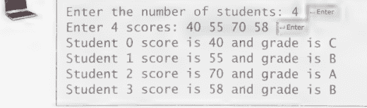

- **7.2 (反转)** 编写一个程序读取 10 个整数并按读取的相反顺序显示。

- **7.3 (计数)** 编写一个程序，读取 1 到 100 之间的最多 100 个整数并统计每个数字出现的次数。以 0 结束输入。这是一个示例运行：
  ```
  输入 1 到 100 之间的整数：2 5 6 5 4 3 0
  2 出现 2 次
  3 出现 1 次
  4 出现 1 次
  5 出现 2 次
  6 出现 1 次
  ```
  注意如果一个数字出现多次，输出中使用复数形式“times”。

- **7.4 (分析)** 编写一个程序读取任意数量的分数，并判断多少大于等于平均分，多少小于平均分。输入负数结束输入。

- **7.5 (打印)** 编写一个程序读取 10 个数字并显示不同的数字（即如果一个数字出现多次，则显示一次）。提示：如果是新数字，将其存储在数组中。如果数字已经在数组中，则丢弃。数组包含不同的数字。这是一个示例运行：
  ```
  输入数字：2 3 1 2 6 3 4 5 2
  不同数字为：1 2 3 4 5 6
  ```

- **7.6 (修改代码 5.17, PrimeNumber.cpp)** 代码 5.17 通过检查 2, 3, 4, 5, 6,...,n/2 是否为因子来判断 `n` 是否为质数。如果找到因子，则 `n` 不是质数。判断 `n` 是否为质数的更有效方法是检查小于或等于 √n 的质数是否能整除。如果不是，`n` 就是质数。重写 5.17 显示前 50 个质数，并使用数组存储这些质数，后续检查它们是否为 `n` 的因子。


# 编程练习

## 7.7 (计数)
编写一个程序生成一百个随机整数并显示每个数字的计数。（提示：使用 `rand() % 10` 生成 0 到 9 之间的随机整数。使用整数数组存储 0 到 9 的计数。）

## 7.8 (平均值)
编写两个重载函数，返回数组的平均值，头如下：

```cpp
int average(const int array[], int size);
double average(const double array[], int size);
```

编写一个测试程序，提示用户输入 10 个 double 值，调用此函数并显示平均值。

## 7.9 (寻找最小值)
编写一个函数，使用以下头文件在 double 值数组中寻找最小值：

```cpp
double min(double array[], int size)
```

编写一个测试程序，提示用户输入 10 个数字，调用此函数并显示最小值。这是程序的示例运行：

```
输入十个数字：1.9 2.5 3.7 2 1.5 6 3 4 5 2 输入
最小值是 1.5
```

## 7.10 (寻找最小值的索引)
编写一个函数，返回整数数组中最小元素的索引。如果有多个元素，返回最小索引。使用以下头文件：

```cpp
int indexOfSmallestElement(double array[], int size)
```

## 7.11 (统计学：计算标准差)
编程题 5.47 计算双精度数字数组的标准差。本练习使用一个不同的公式来计算 n 个数的标准差。

```
mean = \frac{\sum_{i=1}^{n} x_1 + x_2 + ... + x_n}{n}
deviation = \sqrt{\frac{\sum_{i=1}^{n}(x - mean)^2}{n}}
```

要用此公式计算标准差，你必须将数值存储在数组中，以便在获得平均值后可以使用。你的程序应包含以下函数：

```cpp
// 计算 double 数组的平均值
double mean(const double x[], int size)

// 计算 double 的标准差
double deviation(const double x[], int size)
```

编写一个测试程序，提示用户输入 10 个数字并显示平均值和标准差，如示例所示：

```
输入十个数字：1.9 2.5 3.7 2 1.5 6 3 4 5 2
平均值为 3.11
标准差为 1.55738
```

## 7.12 (执行时间)
编写一个程序，随机生成 10000 个整数和一个键。估计调用代码 7.9 中 `linearSearch` 函数的执行时间。排序数组并估计调用代码 7.10 中 `binarySearch` 函数的执行时间。你可以使用以下代码：

```cpp
long startTime = time(0);
perform the task;
long endTime = time(0);
long executionTime = endTime - startTime;
```

## 7.13 (财务应用：查找销售额)
使用二分查找法重写编程练习 5.39。由于销售额在 1 到 10000.00 之间，你可以使用二分查找法来改进解决方案。

## 7.14 (冒泡排序)
编写一个使用冒泡排序算法的函数。该算法对数组进行多次遍历。在每次遍历中，对相邻的元素对进行比较。如果一对元素的顺序是递减的，则交换它们的值；否则，保持不变。这种技术被称为冒泡排序，因为较小的值逐渐“浮”到顶部，而较大的值则沉到底部。

该算法可以描述如下：

```cpp
bool changed = true;
do {
  changed = false;
  for (int j = 0; j < listSize - 1; j++) {
    if (list[j] > list[j + 1]) {
      swap list[j] with list[j + 1];
      changed = true;
    }
  }
} while (changed);
```

显然，当循环结束时，列表是升序的。很容易看出 `do` 循环最多执行 `listSize - 1` 次。

编写一个程序，读取包含十个双精度浮点数的数组，调用函数并显示排序后的数字。

## 7.15 (游戏：储物柜谜)
一学校有 100 个储物柜和 100 个学生。开学第一天所有储物柜都是关闭的。当学生进入，第一个学生 S1 打开每个储物柜。然后第二个学生 S2 从第二个储物柜 L2 开始，关闭每隔一个柜。学生 S3 从第三个储物柜开始，改变每三个储物柜的状态（如果是打开的则关闭，关闭的则打开）。学生 S4 从 L4 开始改变每四个储物柜的状态。学生 S5 从 L5 开始改变每五个储物柜的状态，以此类推，直到

在所有学生通过建筑并更改储物柜后，哪些储物柜是打开的？编写一个程序找到答案并显示所有打开的储物柜，用恰一个空格分隔。

（提示：使用一个包含 100 个布尔元素的数组，每个元素指示储物柜是打开（true）还是关闭（false）。最初，所有储物柜都是关闭的。）

## 7.16 (修改选择排序)
选择排序函数重复地寻找当前数组中的最小数并将其与第一个元素交换。重写此示例，找到最大的数并将其与数组中的最后一个元素交换。编写一个程序，读取包含十个双精度浮点数的数组，调用函数并显示排序后的数字。

## 7.17 (游戏：豆子机)
豆子机，也称为五线阵或加尔顿盒，是一种以科学家弗朗西斯·加尔顿爵士命名的统计实验设备。它由一块直立的板组成，板上有呈三角形排列的均匀间隔钉子（或销）。

球从板的开口处落下。每当一个球击中钉子时，它有 50% 的概率向左或向右掉落。球堆积在板底部的槽中。

编写一个程序模拟豆子机。你的程序应提示用户输入球的数量和机器中槽的数量（最多 50）。通过打印每个球的路径来模拟球的落下。例如，图 7.10b 中球的路径是 LLRLLLR，图 7.10c 中球的路径是 RRLRLRR。显示槽中球的最终积累情况。这里是程序的示例运行：

```
Enter the number of balls to drop: 5
Enter the number of slots in the bean machine: 8

RLRLRR
RRLLLR
RLLLLL
RLRLRR
000
```

> 创建名为 `slots` 的数组。数组中的每个元素存储槽中球的数量。每个球通过一条路径掉入某个槽中。路径中 R 的数量是球掉落槽的位置。例如，对于路径 LRLRLRR，球掉入 `slots[4]`；对于路径 RRLLLLL，球掉入 `slots[2]`。

## 7.18 (游戏：八皇后)
经典的皇后问题是在棋盘上放置八个皇后，使得任意两个皇后不能互相攻击（即不在同一行、同一列或同一对角线上）。有很多解。编写一个程序显示一个解。

## 7.19 (游戏：八皇后)
编程练习 7.18 寻找皇后问题的解。编写一个程序计算皇后问题的所有可能解并显示它们。

## 7.20 (完全相同的数组)
如果两个数组 `list1` 和 `list2` 长度相同，且对于每个 `i`，`list1[i]` 等于 `list2[i]`，则是完全相同的。编写一个函数，如果 `list1` 和 `list2` 完全相同则返回 true，头如下：

```cpp
bool strictlyEqual(const int list1[], const int list2[], int size)
```

编写一个测试程序，提示用户输入两个整数列表并显示它们是否相同。示例运行如下。注意输入中的第一个数字是列表元素的数量。该数字不是列表的一部分。假设列表大小最大为 20。

## 7.21 (模拟：收集者)
收集者是一个有许多应用的经典统计问题。问题是从一组物体中重复抽取，确定所有物体至少被抽取一次所需的次数。该问题的变体是从洗过的 52 张牌中重复抽取，直到看到每种花为止。假设在下次抽取之前将牌放回牌组。编写一个程序模拟获取每种花所需的次数，并显示抽取的四张牌（牌可能被抽取两次）。

## 7.22 (数学：组合)
编写一个程序，提示用户输入 10 个整数，并显示从 10 个中选取两个的所有组合。

## 7.23 (相同数组)
如果两个数组 `list1` 和 `list2` 内容相同，则是相同的。编写一个函数，如果 `list1` 和 `list2` 相同则返回 true，头如下：

```cpp
bool isEqual(const int list1[], const int list2[], int size)
```

编写一个测试程序，提示用户输入两个整数列表并显示它们是否相同。示例运行如下。注意输入中的第一个数字是列表元素的数量。该数字不是列表的一部分。假设列表大小最大为 20。

```
Enter list1: 5 2 5 6 6 1
Enter list2: 5 2 5 6 1 6
Two lists are identical
```

```
Enter list1: 5 5 5 6 6 1
Enter list2: 5 2 5 6 1 6
Two lists are not identical
```

## 7.24 (模式识别：连续四个相等数)
编写以下函数测试数组是否存在四个连续相同的数。

```cpp
bool isConsecutiveFour(const int values[], int size)
```

编写一个测试程序，提示用户输入一组整数，并显示序列是否包含四个连续相同的数。你的程序首先提示用户输入输入大小——即序列中值的数量。假设值的最大数量为 80。示例运行如下：

```
Enter the number of values: 8
Enter the values: 3 4 5 5 5 4 5
The list has consecutive fours
```

```
Enter the number of values: 9
Enter the values: 3 4 5 5 6 5 5 4 5
The list has no consecutive fours
```

## 7.25 (游戏：抽取四张牌)
编写一个程序从 52 张牌中抽取四张牌，并计算这四张牌的和。A、K、Q和J分别代表 1、12 和 11。你的程序应显示和为 24 的牌组合数量。

## 7.26 (合并两个排序列表)
编写以下函数，将两个排序列表合并为一个新的排序列表：

```cpp
void merge(const int list1[], int size1, const int list2[], int size2, int list[])
```

实现该函数时，使其进行 `size1 + size2` 次比较。编写一个测试程序，提示用户输入两个排序列表并显示合并后的列表。注意输入中的第一个数字是列表元素的数量。该数字不是列表的一部分。假设列表大小最大为 80。

```
Enter list1: 5 1 5 16 61 111
Enter list2: 4 2 4 5 6 16
The merged list is 1 2 4 5 5 6 16 61 111
```

## 7.27 (排序?)
编写以下函数，如果列表已经是按升序排列的，则返回 true：

```cpp
bool isSorted(const int list[], int size)
```

编写一个测试程序，提示用户输入列表并显示该列表是否排序。以下是一个示例运行。注意，输入中的第一个数字表示列表中元素的个数。该数字不是列表的一部分。假设最大列表大小为 80。

## 7.28 (列表划分)
编写以下函数，使用第一个元素（称为基准，pivot）对列表进行划分：

```cpp
int partition(int list[], int size)
```

划分后，列表中的元素将被重新排列，使得基准之前的所有元素小于或等于基准，而基准之后的元素大于基准。该函数还返回基准在新列表中的索引。例如，假设列表为 {5, 2, 9, 3, 6, 8}。划分后，列表变为 {3, 2, 5, 9, 6, 8}。以仅进行 `size` 次比较的方式实现该函数。

编写一个测试程序，提示用户输入列表并显示划分后的列表。以下是一个示例运行。注意，输入中的第一个数字表示列表中元素的个数。该数字不是列表的一部分。假设最大列表大小为 80。

## 7.29 (多边形面积)
编写一个程序，提示用户输入凸多边形的顶点并显示其面积。假设多边形有六个顶点且按顺时针方向输入。关于凸多边形的定义，请参见 www.mathopen.org/polygonconvex.html。提示：多边形的总面积是图 7.11 所示的小三角形面积之和。

以下是程序的示例运行：

```
输入六个点的坐标:
-8.5 10 0 11.4 5.5 6 -5.5 0 -7 -3.5 -3.5
总面积为 18.95
```

## 7.30 (文化：中国生肖)
简化列表 3.8 ChineseZodiac.cpp，使用字符串数组来存储动物名称。

## 7.31 (公共元素)
编写一个程序，提示用户输入两个包含 10 个整数的数组，并显示两个数组中共同的元素。以下是一个示例运行。

```
输入 list1: 8 5 10 1 6 16 9 11 22
输入 list2: 4 2 3 10 3 34 35 67 3 1
公共元素是 10 1 2
```

## 7.32 (最长公共前缀)
重写编程练习 6.42 中的前缀函数，以找到两个 C 字符串的最长公共前缀，使用以下头文件：

```cpp
void prefix(const char s1[], const char s2[], char commonPrefix[]);
```

编写一个测试程序，提示用户输入两个 C 字符串并显示它们的公共前缀。示例运行与编程练习 5.49 相同。

## 7.33 (子字符串)
重写编程练习 6.43 中的 indexOf 函数，检查 C 字符串 s1 是否为 C 字符串 s2 的子字符串。如果匹配，返回 s2 中的第一个索引；否则返回 -1。

```cpp
int indexOf(const char s1[], const char s2[])
```

编写一个测试程序，读取两个 C 字符串并检查第一个字符串是否为第二个字符串的子字符串。示例运行与编程练习 6.43 相同。

## 7.34 (指定字符的出现次数)
重写编程练习 6.44 中的 count 函数，使用以下头文件找到 C 字符串中指定字符的出现次数：

```cpp
int count(const char s[], char a)
```

编写一个测试程序，读取一个字符串和一个字符，显示该字符在字符串中出现的次数。示例运行与编程练习 6.44 相同。

## 7.35 (字符串中的字母)
编写一个函数，使用以下头文件统计 C 字符串中的字母数量：

```cpp
int countletters(const char s[])
```

编写一个测试程序，读取一个 C 字符串并显示其中字母的数量。以下是程序的示例运行：

```
输入字符串: 2010 is coming
2010 is coming 中的字母数量为 8
```

## 7.36 (切换大小写)
重写编程练习 6.46 中的 swapCase 函数，将字符串 s1 中的大写字母转换为小写，或反之，获取新字符串 s2：

```cpp
void swapCase(const char s1[], char s2[])
```

编写一个测试程序，提示用户输入一个字符串并调用该函数，显示新字符串。示例运行与编程练习 6.46 相同。

## 7.37 (统计字符串每个字母的出现次数)
编写一个函数，使用以下头文件统计字符串中每个字母的出现次数：

```cpp
void count(const char s[], int counts[])
```

其中 counts 是一个包含26 个整数的数组。counts[0], counts[1], ..., counts[25] 分别对应 a, b, ..., z。字母区分大小写。编写一个测试程序，读取一个字符串，调用函数并显示计数。以下是一个示例运行：

```
输入字符串: Welcome to New York!
a: 1,b: 0,c: 0,d: 0,e: 2,f: 0,g: 0,h: 0,i: 0,j: 0,k: 0,l: 1,m: 0,n: 1,o: 1,p: 0,q: 0,r: 1,s: 0,t: 1,u: 0,v: 0,w: 1,x: 0,y: 1,z: 0
```

## 7.38 (浮点数转字符串)
编写一个函数，使用以下头文件将浮点数转换为字符串：

```cpp
void ftoa(double f, char s[])
```

编写一个测试程序，提示用户输入一个数字并用空格分隔每个数字。以下是一个示例运行：

```
输入数字: 232.45
数字为 232.45
```


# 7.39 (业务：检查ISBN)

重写编程练习 5.51，使用字符串而不是数组来存储 ISBN。编写以下函数：

```cpp
int getChecksum(const char s[])
```

编写一个测试程序读取 ISBN 并显示校验和。

# 7.40 (二进制转十六进制)

重写编程练习 6.38 中的 `bin2Hex` 函数，使用以下头文件将二进制字符串转换为十六进制数：

```cpp
void bin2Hex(const char binaryString[], char hexString[])
```

编写一个测试程序，提示用户输入一个二进制字符串并将十六进制值作为字符串显示。

# 7.41 (二进制转十进制)

重写编程练习 6.39 中的 `bin2Dec` 函数，使用以下头文件将二进制字符串转换为十进制：

```cpp
int bin2Dec(const char binaryString[])
```

编写一个测试程序，提示用户输入一个二进制字符串并显示其十进制值。

# 7.42 (十进制转十六进制)

重写编程练习 6.40 中的 `dec2Hex` 函数，使用以下头文件将十进制数转换为十六进制字符串：

```cpp
void dec2Hex(int value, char hexString[])
```

编写一个测试程序，提示用户输入一个十进制数并显示其十六进制值。

# 7.43 (十进制转二进制)

重写编程练习 6.41 中的 `dec2Bin` 函数，使用以下头文件将十进制数解析为二进制字符串：

```cpp
void dec2Bin(int value, char binaryString[])
```

编写一个测试程序，提示用户输入一个十进制数并显示其二进制值。

# 第 8 章 二维数组

## 8.1 引言

表格或矩阵中的数据可以使用二维数组来表示。

第 7 章介绍了如何使用一维数组来存储元素的线性集合。你可以使用二维数组来存储矩阵或表格。例如，下面这个描述城市间距离的表格可以使用二维数组进行存储。

### 距离表（单位：英里）

| | 芝加哥 | 波士顿 | 纽约 | 亚特兰大 | 迈阿密 | 达拉斯 | 休斯顿 |
|---|---|---|---|---|---|---|---|
| 芝加哥 | 0 | 983 | 787 | 714 | 1375 | 967 | 1087 |
| 波士顿 | 983 | 0 | 214 | 1102 | 1763 | 1723 | 1842 |
| 纽约 | 787 | 214 | 0 | 888 | 1549 | 1548 | 1627 |
| 亚特兰大 | 714 | 1102 | 888 | 0 | 661 | 781 | 810 |
| 迈阿密 | 1375 | 1763 | 1549 | 661 | 0 | 1426 | 1187 |
| 达拉斯 | 967 | 1723 | 1548 | 781 | 1426 | 0 | 239 |
| 休斯顿 | 1087 | 1842 | 1627 | 810 | 1187 | 239 | 0 |

## 8.2 声明二维数组

二维数组中的元素通过行索引和列索引来访问。

声明二维数组的语法为：

```cpp
elementTypeName arrayName[ROW_SIZE][COLUMN_SIZE];
```

例如，下面是声明一个整数二维数组矩阵的方法：

```cpp
int matrix[5][5];
```

二维数组中使用两个下标，一个用于行，另一个用于列。与一维数组一样，下标的索引类型为 `int` 且从 0 开始，如图 8.1 所示。

```cpp
int matrix[5][5];
int matrix[4][3] = {{1, 2, 3}, {4, 5, 6}, {7, 8, 9}, {10, 11, 12}};
```

**图 8.1** 二维数组每个下标的索引都是从 0 开始的 `int` 值。

## 8.3 处理二维数组

要为第 2 行第 1 列的特定元素赋值为 7（如图 8.1 所示），你可以使用以下代码：

```cpp
matrix[2][1] = 7;
```

> **注意**
>
> 一个常见的错误是使用 `matrix[2, 1]` 来访问第 2 行第 1 列的元素。在 C++ 中，每个下标必须包含在一对方括号中。

你也可以使用数组初始化器来声明并初始化二维数组。例如，下面的代码声明了一个带有指定初始值的数组。这等同于手动赋值的代码：

```cpp
int m[4][3] = {
    {1, 2, 3},
    {4, 5, 6},
    {7, 8, 9},
    {10, 11, 12}
};
```

```cpp
int m[4][3];
m[0][0] = 1; m[0][1] = 2; m[0][2] = 3;
m[1][0] = 4; m[1][1] = 5; m[1][2] = 6;
m[2][0] = 7; m[2][1] = 8; m[2][2] = 9;
m[3][0] = 10; m[3][1] = 11; m[3][2] = 12;
```

### 8.1 声明并创建一个 4 x 5 的 `int` 矩阵。

### 8.2 下列代码的输出是什么？

```cpp
int m[5][6];
int x[3] = {1, 2};
m[0][1] = 2;
```

### 8.3 哪些语句是有效的数组声明？

```cpp
int r[];
int x[];
```

嵌套循环通常用于处理二维数组。

假设数组如下声明：

```cpp
const int ROW_SIZE = 10;
const int COLUMN_SIZE = 10;
int matrix[ROW_SIZE][COLUMN_SIZE];
```

以下是一些处理二维数组的示例：

1. **（使用输入初始化）** 以下循环使用用户输入初始化数组：

```cpp
cout << "Enter " << ROW_SIZE << " rows and " << COLUMN_SIZE << " columns:" << endl;
for (int i = 0; i < ROW_SIZE; i++)
    for (int j = 0; j < COLUMN_SIZE; j++)
        cin >> matrix[i][j];
```

2. **（使用随机值初始化）** 以下循环使用 0 到 99 之间的随机值初始化数组：

```cpp
for (int i = 0; i < ROW_SIZE; i++)
    for (int j = 0; j < COLUMN_SIZE; j++)
        matrix[i][j] = rand() % 100;
```

3. **（显示数组）** 要显示二维数组，必须使用循环显示每个元素：

```cpp
for (int i = 0; i < ROW_SIZE; i++)
    for (int j = 0; j < COLUMN_SIZE; j++)
        cout << matrix[i][j] << " ";
```

4. **（元素求和）** 使用名为 `total` 的变量存储总和：

```cpp
int total = 0;
for (int i = 0; i < ROW_SIZE; i++)
    for (int j = 0; j < COLUMN_SIZE; j++)
        total += matrix[i][j];
```

5. **（按列求和）** 对于每一列，使用名为 `total` 的变量存储总和：

```cpp
int total = 0;
for (int j = 0; j < COLUMN_SIZE; j++)
    for (int i = 0; i < ROW_SIZE; i++)
        total += matrix[i][j];
```

6. **（哪一行的和最大？）** 使用 `maxRow` 和 `indexOfRow` 计算和：

```cpp
int maxRow = 0;
int indexOfRow = 0;
for (int i = 0; i < ROW_SIZE; i++) {
    int total = 0;
    for (int j = 0; j < COLUMN_SIZE; j++)
        total += matrix[i][j];
    if (total > maxRow) {
        maxRow = total;
        indexOfRow = i;
    }
}
```

## 8.5 问题：为选择题测试评分

该问题是编写一个可以为选择题测试评分的程序。假设有 8 名学生和 10 道题，答案存储在一个二维数组中。每行记录一个学生对题目的答案。例如，以下数组存储了测试内容。

### 学生对题目的答案

| | 0 | 1 | 2 | 3 | 4 | 5 | 6 | 7 | 8 | 9 |
|---|---|---|---|---|---|---|---|---|---|---|
| 学生 0 | A | B | A | C | C | D | E | E | A | D |
| 学生 1 | D | B | A | B | C | A | E | E | A | D |
| 学生 2 | E | D | D | A | C | B | E | E | A | D |
| 学生 3 | C | B | A | E | D | C | E | E | A | D |
| 学生 4 | A | B | D | C | C | D | E | E | A | D |
| 学生 5 | B | B | E | C | C | D | E | E | A | D |
| 学生 6 | B | B | A | C | C | D | E | E | A | D |
| 学生 7 | E | B | E | C | C | D | E | E | A | D |

答案存储在一个一维数组中，如下：

### 题目答案

| | 0 | 1 | 2 | 3 | 4 | 5 | 6 | 7 | 8 | 9 |
|---|---|---|---|---|---|---|---|---|---|---|
| 答案 | B | D | C | C | D | A | E | A | D | |

你的程序对测试评分并显示结果。程序将每个学生的答案与答案进行比较，统计正确答案的数量并显示出来。列表 8.2 给出了程序。

### 列表 8.2 GradeExam.cpp

```cpp
#include <iostream>
using namespace std;

int main() {
    const int NUMBER_OF_STUDENTS = 8;
    const int NUMBER_OF_QUESTIONS = 10;
    // 学生对题目的答案
    char answers[NUMBER_OF_STUDENTS][NUMBER_OF_QUESTIONS] = {
        {'A', 'B', 'A', 'C', 'C', 'D', 'E', 'E', 'A', 'D'},
        {'D', 'B', 'A', 'B', 'C', 'A', 'E', 'E', 'A', 'D'},
        {'E', 'D', 'D', 'A', 'C', 'B', 'E', 'E', 'A', 'D'},
        {'C', 'B', 'A', 'E', 'D', 'C', 'E', 'E', 'A', 'D'},
        {'A', 'B', 'D', 'C', 'D', 'E', 'E', 'E', 'A', 'D'},
        {'B', 'B', 'E', 'C', 'D', 'D', 'E', 'E', 'A', 'D'},
        {'B', 'B', 'A', 'C', 'C', 'D', 'E', 'E', 'A', 'D'},
        {'E', 'B', 'E', 'C', 'C', 'D', 'E', 'E', 'A', 'D'}
    };
    // 题目答案
    char keys[] = {'D', 'B', 'D', 'D', 'C', 'D', 'A', 'E', 'A', 'D'};
    // 为所有学生评分
    for (int i = 0; i < NUMBER_OF_STUDENTS; i++) {
        // 为一个学生评分
        int correctCount = 0;
        for (int j = 0; j < NUMBER_OF_QUESTIONS; j++) {
            if (answers[i][j] == keys[j])
                correctCount++;
        }
        cout << "Student " << i << "'s correct count is " << correctCount << endl;
    }
    return 0;
}
```

**输出：**

```text
Student 0's correct count is 7
Student 1's correct count is 6
Student 2's correct count is 5
Student 3's correct count is 4
Student 4's correct count is 8
Student 5's correct count is 7
Student 6's correct count is 7
Student 7's correct count is 7
```

## 8.6 问题：寻找最近点对

本节介绍了一个用于寻找最近点对的几何问题。给定一组点，最近点对问题是找到距离彼此最近的两个点。例如，在图 8.2 所示，点 (1,1) 和 (2,0.5) 是最近的。解决这个问题有多种方法。一种直观的方法是计算所有点对之间的距离，并找到距离最小的那对，如列表 8.3 所示。

### 列表 8.3 FindNearestPoints.cpp

```cpp
#include <iostream>
#include <cmath>
using namespace std;

// 计算两个点 (x1, y1) 和 (x2, y2) 之间的距离
double getDistance(double x1, double y1, double x2, double y2) {
    return sqrt((x2 - x1) * (x2 - x1) + (y2 - y1) * (y2 - y1));
}

int main() {
    const int NUMBER_OF_POINTS = 8;
    // 每行代表一个点
    double points[NUMBER_OF_POINTS][2];
    cout << "Enter " << NUMBER_OF_POINTS << " points: ";
    for (int i = 0; i < NUMBER_OF_POINTS; i++)
        cin >> points[i][0] >> points[i][1];
    // p1 和 p2 是数组中的索引
    int p1 = 0, p2 = 1;
    double shortestDistance = getDistance(points[0][0], points[0][1], points[1][0], points[1][1]);

    for (int i = 0; i < NUMBER_OF_POINTS; i++) {
        for (int j = i + 1; j < NUMBER_OF_POINTS; j++) {
            double distance = getDistance(points[i][0], points[i][1], points[j][0], points[j][1]);
            if (distance < shortestDistance) {
                shortestDistance = distance;
                p1 = i;
                p2 = j;
            }
        }
    }
    cout << "The closest points are (" << points[p1][0] << ", " << points[p1][1] << ") and (" << points[p2][0] << ", " << points[p2][1] << ")" << endl;
    return 0;
}
```

## 8.7 数独

问题是检查一个给定的数独是否正确。这本书介绍了如何通过编程来解决各种难度的数独。数独是一个 $9\times9$ 的网格，分为若干 $3\times3$ 的方块。每个行、每列和每个方块都包含 1 到 9 的数字且不重复。为了方便起见，我们使用 0 来表示空单元，如图 8.4 所示。网格可以自然地使用二维数组来表示。

```cpp
int grid[9][9] = {
  {5, 3, 0, 0, 7, 0, 0, 0, 0},
  {6, 0, 0, 1, 9, 5, 0, 0, 0},
  {0, 9, 8, 0, 0, 0, 0, 6, 0},
  {8, 0, 0, 0, 6, 0, 0, 0, 3},
  {4, 0, 0, 8, 0, 3, 0, 0, 1},
  {7, 0, 0, 0, 2, 0, 0, 0, 6},
  {0, 0, 0, 0, 0, 0, 0, 0, 0},
  {0, 0, 0, 0, 0, 0, 0, 0, 0},
  {0, 0, 0, 0, 0, 0, 0, 0, 0}
};
```

**图 8.4** (b) 是 (a) 数独谜题的解。

找到该谜题的解是将网格中的 0 替换为 1 到 9 之间的适当数字。


| { 9, , 8, , 6, }, |
| { , , 3, , 9, }, |
| { 2, 6, , , }, |
| { 1, 3, , , }, |
| { 6, , , , }, |
| { , 7, , 9, }, |
| { 4, 5, , 6, , 7, }, |

**图 8.5** 解决方案存储在网格中。

假设找到了一个数独谜题的解，如何检查该解决方案是否正确？这里有我们的两种方法：

- 一种检查方法是查看每行是否包含 1 到 9 的数字，每列是否包含 1 到 9 的数字，每个小宫是否包含 1 到 9 的数字。
- 另一种方法是检查每个单元格。每个单元格必须是 1 到 9 之间的数字，且该单元格在每行、每列和每个小宫中都是唯一的。

列表 8.4 提供了一个程序，它提示用户输入解决方案，如果解决方案有效，程序报告 true。程序中检查解决方案是否正确使用了第二种方法。

## 列表 8.4 CheckSudokuSolution.cpp

```cpp
#include <iostream>
using namespace std;
void readAsSolution(int grid[9][9]);
bool isValid(const int grid[9][9]);
bool isValid(int i, int j, const int grid[9][9]);
int main() {
    // 读取一个数独谜题
    int grid[9][9];
    readAsSolution(grid);
    // 读取输入
    // 读取解决方案是否有效？
    cout << (isValid(grid)) ? "Valid solution" : "Invalid solution";
    return 0;
}
// 从键盘读取数独谜题
void readAsSolution(int grid[9][9]) {
    cout << "Enter a Sudoku puzzle:" << endl;
    for (int i = 0; i < 9; i++) {
        for (int j = 0; j < 9; j++) {
            cin >> grid[i][j];
        }
    }
}
```

## 8.7 问题：数独

```cpp
// 检查网格中的固定单元格是否有效
bool isValid(const int grid[9][9])
{
    for (int i = 0; i < 9; i++) {
        for (int j = 0; j < 9; j++) {
            if (grid[i][j] < 1 || grid[i][j] > 9 ||
                !isValid(i, j, grid))
                return false; // 固定单元格有效
        }
    }
    return true;
}
```

```cpp
// 检查 grid[i][j] 在网格中是否有效
bool isValid(int i, int j, const int grid[9][9])
{
    // 检查 grid[i][j] 在 i 行是否有效
    for (int column = 0; column < 9; column++)
        if (column != j && grid[i][column] == grid[i][j])
            return false;
}
```

```cpp
// 检查 grid[i][j] 在 j 列是否有效
    for (int row = 0; row < 9; row++)
        if (row != i && grid[row][j] == grid[i][j])
            return false;
```

```cpp
// 检查 grid[i][j] 在 3x3 宫格中是否有效
    for (int row = (i / 3) * 3; row < (i / 3) * 3 + 3; row++)
        for (int col = (j / 3) * 3; col < (j / 3) * 3 + 3; col++)
            if (row != i && col != j && grid[row][col] == grid[i][j])
                return false;
    return true; // grid[i][j] 当前值有效
}
```

输入一个数独谜题：


9 6 3 1 4 7 2 5 8
1 7 8 3 2 5 6 4 9
2 5 4 6 8 9 7 3 1
8 2 1 4 3 7 5 9 6
4 9 6 8 5 2 3 1 7
7 3 5 9 1 6 4 2 8
5 8 9 7 1 3 4 6 2
3 1 7 2 4 6 9 8 5
6 4 2 5 9 8 1 7 3

有效解决方案

程序调用 `readAsSolution(grid)` 函数（第 12 行）将数独读入代表数独网格的二维数组中。

`isValid(grid)` 函数检查网格中的值是否有效。它检查每个值是否在 1 到 9 之间，以及每个值在网格中是否有效（第 31-35 行）。

`isValid(int i, int j, const int grid[9][9])` 函数检查 `grid[i][j]` 处的值是否有效。它检查 `grid[i][j]` 是否在行（第 44-46 行）、列（第 49-51 行）和 3 x 3 宫格中出现超过一次。

322 第 8 章 多维数组

如何检查 `grid[i][j]` 处的值是有效的？正如**图 8.6** 所示，

`grid[i][j]` 在 3x3 宫格中的起始位置是 `(i / 3) * 3` 和 `(j / 3) * 3`。

`grid[i][j]` 在 3x3 宫格中的有效性检查如下：

```cpp
    for (int row = (i / 3) * 3; row < (i / 3) * 3 + 3; row++)
        for (int col = (j / 3) * 3; col < (j / 3) * 3 + 3; col++)
            if (row != i && col != j && grid[row][col] == grid[i][j])
                return false;
    return true; // grid[i][j] 的当前值有效
```

## 8.8.2 问题：猜生日

列表 4.4，`GuessBirthday.cpp` 提供了一个猜生日的程序。可以通过将数字存储在三维数组的五组集合中，并使用循环提示用户回答来简化该程序，如列表 8.6 所示。

### 列表 8.6 GuessBirthdayUsingArray.cpp

```cpp
1 #include <iostream>
2 #include <iomanip>
3 using namespace std;
4 
5 int main()
6 {
7 int day = 0; // 待定的日期
8 char answer;
9 
10 int dates[5][4][4] = {
11   {1, 3, 9, 7},
12   {9, 11, 13, 15},
13   {17, 19, 21, 23},
14   {25, 27, 29, 31},
15   {2, 3, 6, 7},
16   {10, 11, 14, 15},
17   {18, 19, 22, 23},
18   {26, 27, 30, 31},
19   {4, 5, 6, 7},
20   {12, 13, 14, 15},
21   {20, 21, 22, 23},
22   {28, 29, 30, 31},
23   {8, 9, 10, 11},
24   {12, 13, 14, 15},
25   {24, 25, 26, 27},
26   {28, 29, 30, 31},
27   {16, 17, 18, 19},
28   {20, 21, 22, 23},
29   {24, 25, 26, 27},
30   {28, 29, 30, 31};
31 }
32 for (int i = 0; i < 5; i++) {
33   cout << "Is your birthday in Set " << (i + 1) << "?" << endl;
34   for (int j = 0; j < 4; j++) {
35     for (int k = 0; k < 4; k++) {
36       cout << setw(3) << dates[i][j][k] << " ";
37     }
38     cout << endl;
39   }
40   cout << "Y/n for No and Y/y for Yes: ";
41   cin >> answer;
42   if (answer == 'Y' || answer == 'y')
43     day += dates[i][0][0];
44 }
45 cout << "Your birthday is " << day << endl;
46 return 0;
47}
```

三维数组

集合 1, 2, 3, 4

第 10–30 行创建了一个三维数组。该数组存储了五组数字。每组都是一个 4x4 的二维数组。

从第 32 行开始的循环显示每个集合中的数字，并提示用户回答该日期是否在集合中（第 37-38 行）。如果是，则将集合中的第一个数字（`dates[i][0][0]`）添加到变量 `day` 中（第 43 行）。

## 8.7 声明并创建一个 4 x 6 x 5 的 int 数组。

## 章节总结

- 二维数组可以用于存储表格。
- 可以使用语法 `elementType arrayName[ROW_SIZE][COLUMN_SIZE]` 创建二维数组。
- 二维数组中的每个元素使用语法 `arrayName[rowIndex][columnIndex]` 表示。
- 你可以使用数组初始化器来创建并初始化二维数组，其语法为：`elementType arrayName[][COLUMN_SIZE] = {{row values}, ..., {row values}}`。
- 你可以将二维数组传递给函数；但是，C++ 要求在函数声明中指定列的大小。
- 可以使用数组数组来形成多维数组。例如，三维数组使用语法 `elementType arrayName[size1][size2][size3]` 声明为数组数组。

## 测验

在 www.cs.armstrong.edu/liang/cpp3e/quiz.html 在线完成本章测验。

## 编程练习

## 8.2-8.5 节

- **8.1 (按列求和)** 编写一个函数，返回矩阵中指定列所有元素的和，使用以下头文件：

```cpp
const int SIZE = 4;
double sumColumn(const double m[][SIZE], int rowSize, int columnIndex);
```

编写一个测试程序，读取一个 3x4 矩阵并显示每列的和。以下是示例运行：


列 0 的和为 16
列 1 的和为 9
列 2 的和为 13
列 3 的和为 13

- **8.2 (求矩阵主对角线和)** 编写一个函数，求 $n \times n$ 矩阵主对角线上的所有 double 值，使用以下头文件：

```cpp
const int SIZE = 4;
double sumDiagonal(const double m[][SIZE]);
```

编写一个测试程序读取 4x4 矩阵并显示主对角线的所有元素和。以下是示例：

读取 4x4 矩阵：
1 2 3 4
5 6 7 8
9 10 11 12
13 14 15 16

主对角线元素和为 34 

- **8.3 (按成绩排序)** 重写 `Grade.cpp`，按成绩升序排列学生。

- **8.4 (计算员工的每周时长)** 计算存储在二维数组中的所有员工的每周时长。每行代表七天的工时。例如，以下数组存储了八个员工的工时。编写一个程序显示员工及其总时长（降序排列）。

| | M | T | W | Th | F |
|---|---|---|---|---|---|
| 员工 0 | 2 | 4 | 3 | 4 | 5 |
| 员工 1 | 7 | 3 | 4 | 3 | 4 |
| 员工 2 | 3 | 3 | 4 | 3 | 2 |
| 员工 3 | 9 | 3 | 4 | 7 | 3 |
| 员工 4 | 3 | 5 | 4 | 6 | 3 |
| 员工 5 | 3 | 4 | 4 | 6 | 3 |
| 员工 6 | 3 | 7 | 4 | 8 | 3 |
| 员工 7 | 6 | 3 | 9 | 5 | 2 |

- **8.5 (代数：矩阵相加)** 编写一个函数相加两个矩阵 a 和 b，结果保存在 c 中。

```
a11 a12 a13      b11 b12 b13      a11+b11 a12+b12 a13+b13
a21 a22 a23  +  b21 b22 b23  =  a21+b21 a22+b22 a23+b23
a31 a32 a33      b31 b32 b33      a31+b31 a32+b32 a33+b33
```

函数的头文件为：

```cpp
const int N = 3;
void addMatrix(const double a[][N], const double b[][N], double c[][N]);
```

每个元素 $c_{ij}$ 为 $a_{ij} + b_{ij}$。编写一个程序提示用户输入两个 $3 \times 3$ 矩阵并显示它们的和。以下是示例运行：

输入矩阵1: 1 2 3 4 5 6 7 8 9
输入矩阵2: 0 2 4 1 4.5 2.2 1.1 4.3 5
矩阵之和为：
1 4 7
5 11 11
9 12.3 14.2

- **8.6 (财务应用：计算税额)** 使用数组重写 3.3 `ComputeTax.cpp`。每种纳税状况有六种税率。每种税率适用于特定金额的纳税收入。例如，单身纳税者 400,000 美元的纳税收入中，$88,350 的税率为 10%，$33,950-$82,350 的税率为 15%，$82,250-$171,550 的税率为 25%，$171,550-$372,250 的税率为 28%，$372,250-$400,000 的税率为 33%，而 $400,000 以上的税率为 36%。所有纳税状况的税率相同，可以用如下方式表示：

```cpp
double rates[] = {0.10, 0.15, 0.25, 0.28, 0.33, 0.36};
```

所有纳税状况每种税率的税级可以用二维数组表示为：

```cpp
int brackets[8][6] = {
    {0, 0, 0, 0, 0, 88350},
    {0, 0, 0, 0, 33950, 82350},
    {0, 0, 0, 82250, 171550, 372250},
    {0, 0, 82250, 372250, 400000, 400000},
    // ... (剩余初始化列表省略)
};
```

- **8.7 (探索矩阵)** 编写一个程序随机向 4x4 矩阵填充 0 和 1，并找出行、列和对角线的和。以下是示例运行：

```
0 1 1 0
1 0 0 1
1 0 1 0
0 1 0 1
```

- **8.8 (洗牌)** 编写一个函数打乱二维数组的行，使用如下：

```cpp
void shuffle(int m[][2], int rowSize);
```

编写一个测试程序打乱以下矩阵：

```cpp
int m[][2] = {{1, 2}, {3, 4}, {5, 6}, {7, 8}, {9, 10}};
```

- **8.9 (代数：矩阵相乘)** 编写一个函数相乘两个矩阵 a 和 b，结果保存在 c 中。

```
a11 a12 a13      b11 b12 b13      a11*b11+a12*b21+a13*b31 ...
a21 a22 a23  *  b21 b22 b23  =  ...
a31 a32 a33      b31 b32 b33      ...
```

函数的头文件为：

```cpp
const int N = 3;
void multiplyMatrix(const double a[][N], const double b[][N], double c[][N]);
```

每个元素 $c_{ij}$ 为 $\sum_{k=0}^{N-1} a_{ik} \times b_{kj}$。编写一个程序提示用户输入两个 $3 \times 3$ 矩阵并显示它们的积。

- **8.10 (所有最近点对)** 列表 3. `FindNearestPoints.cpp` 寻找最近点对。修改程序以显示所有具有最小距离的最近点对。以下是示例运行：


# 编程练习

## 8.11 (游戏：九宫正反面)

九枚硬币放置在 3 × 3 的矩阵中，朝上或朝下。你可以使用 3 × 3 矩阵的值 0（正面）和 1（反面）来表示硬币的状态。以下是一些示例状态：

```
0 0 0
1 0 1
1 0 0
```

每个状态也可以用二进制数表示。例如，前面的矩阵对应于以下数字：

```
000010000 101001100 110100001 101110100 100111110
```

总可能性为 512。因此，你可以使用十进制数字 0, 1, 2, 3....到 511 来表示矩阵的所有状态。编写一个程序提示用户输入 0 到 511 之间的数字，并显示相应的字符 H 和 T 矩阵。这是一个示例运行：

```
Enter a number between 0 and 511: 7
HHH
HHH
TTT
```

用户输入了 7，对应于 00000111。由于 0 代表 H，1 代表 T。

## 8.12 (距离最近的点)

列表 8.3, `FindNearestPoints.cpp` 是一个寻找二维空间中距离其他点最近的两个点的程序。修改该程序，使其寻找三维空间中距离其他点最近的两个点。使用二维数组来表示这些点。使用以下点测试程序：

```
double points[][3] = {{-1, 0, 3}, {-1, -1, -1}, {4, 1, 1}, {-1, 1, 1}, {0, 1, 1}, {0, -1, -1}, {0, 0, 0}, {5.5, 4, -0.5}};
```

计算点 (x1, y1, z1) 和 (x2, y2, z2) 之间距离的公式为 `V = sqrt((x2-x1)² + (y2-y1)² + (z2-z1)²)`。

## 8.13 (二维数组排序)

使用以下头文件编写一个函数对二维数组进行排序：

```
void sort(int m[][], int numberOfRows)
```

该函数主要按行的第一个元素进行排序，如果元素相等，则次按行的第二个元素排序。例如 `{4, 2}, {1, 7}, {4, 5}, {2, 1}, {1, 2}, {4, 1}` 将排序为 `{1, 2}, {1, 7}, {2, 1}, {4, 1}, {4, 2}, {4, 5}`。编写一个测试程序，提示用户调用此函数并显示排序后的点。

## 8.14 (最大行和列)

编写一个程序，随机向 4 x 4 矩阵中填充 0 和 1，打印矩阵，并找到 1 最多的第一行和第一列。以下是该程序的示例运行：

```
0011
1011
1101
1010
```

The largest row index: 1

The largest column index: 2

## 8.15 (代数: 2 × 2 矩阵逆)

平方矩阵 A 的逆矩阵记为 $A^{-1}$，使得 $AA^{-1} = I$，其中 I 是单位矩阵，其对角线元素全为 1，其他单元格全为 0。例如，矩阵

$$
\begin{bmatrix} 1 & 2 \\ 3 & 4 \end{bmatrix}
$$

的逆矩阵为

$$
\begin{bmatrix} -2 & 1 \\ 1.5 & -0.5 \end{bmatrix}
$$

即：

$$
\begin{bmatrix} 1 & 2 \\ 3 & 4 \end{bmatrix} \times \begin{bmatrix} -2 & 1 \\ 1.5 & -0.5 \end{bmatrix} = \begin{bmatrix} 1 & 0 \\ 0 & 1 \end{bmatrix}
$$

如果 $ad - bc \neq 0$，可以使用以下公式获取 2 × 2 矩阵 A 的逆矩阵：

$$
A = \begin{bmatrix} a & b \\ c & d \end{bmatrix}, \quad A^{-1} = \frac{1}{ad-bc} \begin{bmatrix} d & -b \\ -c & a \end{bmatrix}
$$

实现以下函数以获取矩阵的逆：

```
void inverse(const double A[][], double inverseOfA[][])
```

编写一个测试程序，提示用户输入矩阵的 a, b, c, d，并显示其逆矩阵。以下是示例运行：

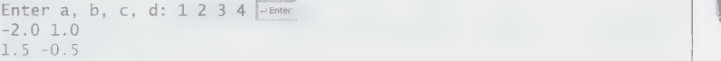
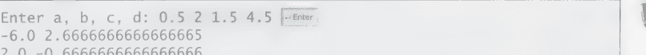

## 8.16 (几何: 同线?)

编程练习 6.20 提供了一个用于测试三点是否在同一直线上的函数。编写以下函数测试数组中的所有点是否在同一直线上。

```
const int SIZE = 2;
bool sameLine(const double points[][][SIZE], int numberOfPoints)
```

编写一个程序，提示用户输入五个点，并显示它们是否在同一直线上。以下是示例运行：


## 8.17 (定位最大元素)

编写以下函数寻找二维数组中的最大元素。

```
void locateLargest(const double a[][4], int location[])
```

该元素存储在一个一维数组 `location` 中，这两个元素是二维数组中最大元素的行索引和列索引。编写一个测试程序，提示用户输入一个 3 × 4 二维数组，并显示数组中最大元素的位置。以下是示例运行：


The location of the largest element is at (1, 2)

## 8.18 (代数: 3 × 3 矩阵逆)

平方矩阵 A 的逆矩阵记为 $A^{-1}$，使得 $A \times A^{-1} = I$，其中 I 是对角线全为 1、其他单元格全为 0 的单位矩阵。例如，矩阵


的逆。如果 $|A| \neq 0$，可以使用公式获取 3 × 3 矩阵 A 的逆：


实现以下函数以获取矩阵的逆：

```
void inverse(const double a[][], double inverseOfA[][])
```

编写一个测试程序，提示用户输入矩阵的 a, b, c, d，并显示其逆矩阵。以下是示例运行：

```
Enter a: 1
Enter b: 2
Enter c: 3
Enter d: 4
The inverse matrix is:
-0.5 0.25
0.33 -0.25
```

## 8.19 (金融海啸)

在金融系统中，银行可以向其他银行贷款。如果 A 欠 B 钱，而 B 欠 C 钱，那么 C 的失败会导致 A 的失败。使用二维数组表示银行之间的贷款，其中 `loan[i][j]` 是银行 i 欠银行 j 的金额。编写一个程序计算每个银行欠的总金额和每个银行应收的总金额。如果一个银行的总债务大于其总资产，则该银行被认为破产。以下是示例运行：

```
Enter the number of banks: 3
Enter the amount that bank 0 owes to bank 1: 0
Enter the amount that bank 0 owes to bank 2: 50
Enter the amount that bank 1 owes to bank 0: 20
Enter the amount that bank 1 owes to bank 2: 10
Enter the amount that bank 2 owes to bank 0: 10
Enter the amount that bank 2 owes to bank 1: 10

Bank 0 owes 50, is owed 30
Bank 1 owes 10, is owed 20
Bank 2 owes 20, is owed 60
```

银行 3 的总资产是 (75 + 125)，小于 201。在银行 3 破产后，银行 1 的总资产变为 125 + 40。因此银行 1 也不安全。程序的输出应该是：

Unsafe banks are 3, 1

(提示：使用二维数组表示贷款。`Loan[i][j]` 表示银行 i 贷款给银行 j 的金额。一旦银行 j 变得不安全，应将 `Loan[i][j]` 设置为 0)

## 8.20 (井字棋游戏)

在井字棋游戏中，两名玩家交替标记可用单元格（X 或 O）。当一个玩家在 3x3 网格中形成三个水平、垂直或对角线的行或列时，游戏结束且该玩家获胜。当网格上的所有单元格都填满且没有玩家获胜时，为平局。创建一个玩井字棋游戏的程序。程序提示第一个玩家输入 X 标记，然后提示第二个玩家输入 O 标记。每当输入一个标记时，程序会在控制台上重绘棋板并判断游戏状态（获胜、平局或未完成）。以下是示例运行：

| X | | |
|---|---|---|
| | X | |
| | | X |

## 8.21 (模式识别：连续的四个相同数字)

编写以下函数，测试二维数组是否在水平、垂直或对角方向上具有四个连续相同的数字。

```cpp
bool isConsecutiveFour(int values[][])
```

编写一个测试程序，提示用户输入二维数组的行数和列数，然后输入数组中的值。如果数组包含四个连续的相同数字，则显示 true；否则显示 false。以下是一些测试用例的示例：

| 0 0 3 1 6 1 | 0 0 3 1 6 1 | 0 0 3 1 6 1 | 0 1 3 1 6 1 |
|---|---|---|---|
| 0 1 6 8 0 1 | 0 1 6 8 0 1 | 0 1 6 8 0 1 | 0 1 6 8 0 1 |
| 5 6 2 1 8 2 9 | 5 5 2 1 8 2 9 | 5 6 2 1 8 2 9 | 9 6 2 1 8 2 9 |
| 6 5 6 1 1 9 1 | 6 5 6 1 1 9 1 | 6 5 6 1 1 9 1 | 6 9 6 1 1 9 1 |
| 1 3 6 1 4 0 7 | 1 5 6 1 4 0 7 | 1 3 6 1 4 0 7 | 1 3 9 1 4 0 7 |
| 3 3 3 3 4 0 7 | 3 3 3 3 4 0 7 | 3 3 3 3 4 0 7 | 3 3 3 9 4 0 7 |

## 8.22 (游戏：四子棋)

四子棋是一种双棋盘游戏，玩家交替向一个七列六行的垂直悬挂网格中投入彩色棋子，如下所示。


游戏的目标是在对手之前在同一行、同一列或一条对角线上连接四个相同颜色的棋子。程序提示两个玩家交替投入红色（深蓝色显示）或黄色（浅蓝色显示）棋子。每当掉一个棋子时，程序都会在控制台上重新显示棋盘并判断游戏状态（胜利、平局或继续）。以下是一个示例运行：


在列 (0-6) 处投入黄色棋子：3


在列 (0-6) 处投入黄色棋子：6


黄色玩家获胜


## 8.23 (中心城市)

给定一组城市，中心点是指距离所有其他城市最近的城市。编写一个程序，提示用户输入城市数量和城市的位置（坐标），并找到中心城市及其到所有其他城市的总距离。假设城市数量最多为20。

```
输入城市数量：5
输入城市的坐标：2.5 5 5.1 3 1 9 5.4 5 5.5 2.1
中心城市位于 (2.5, 5.0)
到所有其他城市的总距离为 60.81
```

## 8.24 (检查数独解)

列表8.4 通过检查棋盘中的每个数字是否有效来检查解是否有效。重写该程序，检查每一行、每一列和每个小框是否包含1到9。

## 8.25 (马尔可夫矩阵)

如果一个 n x n 矩阵的每个元素都是正数，且每列元素之和为1，则称该矩阵为正马尔可夫矩阵。编写以下函数检查矩阵是否为马尔可夫矩阵：

```cpp
const int SIZE = 3;
bool isMarkovMatrix(const double m[][SIZE]);
```

编写一个测试程序，提示用户输入一个3×3的双精度浮点数矩阵并测试其是否为马尔可夫矩阵。以下是示例运行：

```
逐行输入一个3x3矩阵：
0.15 0.875 0.375
0.55 0.005 0.225
0.30 0.12 0.4
这是一个马尔可夫矩阵
```


```
逐行输入一个3x3矩阵：
0.95 -0.875 0.375
0.65 0.005 0.225
0.30 0.22 -0.4
不是马尔可夫矩阵
```


## 8.26 (行排序)

实现以下函数对二维数组进行行排序。返回一个新数组。

```cpp
const int SIZE = 3;
void sortRows(const double m[][SIZE], double result[][]);
```

编写一个测试程序，提示用户输入3×3的双精度浮点数矩阵并显示排序后的矩阵。以下是一个示例运行：

```
逐行输入一个3x3矩阵：
0.15 0.875 0.375
0.55 0.005 0.225
0.30 0.12 0.4
排序后的矩阵为：
0.15 0.375 0.875
0.005 0.225 0.55
0.12 0.30 0.4
```


## 8.27 (列排序)

实现以下函数对二维数组进行列排序。返回一个新数组。原数组不变。

```cpp
const int SIZE = 3;
void sortColumns(const double m[][SIZE], double result[][]);
```

编写一个测试程序，提示用户输入3×3的双精度浮点数矩阵并显示列排序后的矩阵。以下是一个示例运行：

```
逐行输入一个3x3矩阵：
0.15 0.875 0.375
0.55 0.005 0.225
0.30 0.12 0.4
列排序后的矩阵为：
0.15 0.005 0.30
0.875 0.12 0.55
0.375 0.225 0.4
```


## 8.28 (完全相同的数组)

如果二维数组 `m1` 和 `m2` 的对应元素相等，则它们是完全相同的。编写一个函数，如果 `m1` 和 `m2` 完全相同则返回 true：

```cpp
const int SIZE = 3;
bool equals(const int m1[][SIZE], const int m2[][SIZE]);
```

编写一个测试程序，提示用户输入两个3×3的整数并显示它们是否完全相同。以下是示例运行。


## 8.29 (相同的数组)

如果二维数组 `m1` 和 `m2` 的内容相同，则它们是相同的。编写一个函数，如果 `m1` 和 `m2` 相同则返回 true：

```cpp
const int SIZE = 3;
bool equals(const int m1[][SIZE], const int m2[][SIZE]);
```

编写一个测试程序，提示用户输入两个3×3的整数并显示它们是否相同。以下是示例运行。


## 8.30 (代数：解线性方程)

编写一个求解 2×2 线性方程组的函数：

$$
a_{00}x + a_{01}y = b_0 \quad x = \frac{b_0a_{11} - b_1a_{01}}{a_{00}a_{11} - a_{01}a_{10}}
$$
$$
a_{10}x + a_{11}y = b_1 \quad y = \frac{a_{00}b_1 - a_{10}b_0}{a_{00}a_{11} - a_{01}a_{10}}
$$


# 340 第 8 章 多维数组

*8.34 (几何：最右侧最低点) 在计算几何中，你通常需要在一点集中找到最右侧最低的点。请编写一个函数，返回点集中最右侧最低的点。

```cpp
const int SIZE = 2;
void getRightmostLowestPoint(const double points[][],
 int numberOfPoints, double rightmostPoint[]) {
```

编写一个测试程序，提示用户输入六点的坐标，并显示最右侧最低的点。以下是示例运行：


*8.35 (游戏：寻找翻转的单元格) 假设你有一个填充了 0 和 1 的 6 × 6 矩阵。让用户翻转一个单元格（即从 1 变为 0 或从 0 变为 1），并编写一个程序来找到哪个单元格被翻转了。你的程序应该提示用户输入一个包含 0 和 1 的 6 × 6 数组，并找到违反奇偶性的第一行 r 和第一列 c（即 1 的数量不是偶数）。被翻转的单元格位于 (r, c)。以下是示例运行：


违反奇偶性的第一行和列位于 (0, 1)

*8.36 (奇偶性检查) 编写一个程序生成一个填充了 0 和 1 的 6 × 6 二维矩阵，显示该矩阵，并检查每行每列是否有偶数个 1。

# 第 9 章

# 对象与类

## 目标

- 描述对象和类，并使用类来模拟对象 (§9.2)。
- 使用 UML 图形表示描述类和对象 (§9.2)。
- 演示定义类和创建对象 (§9.3)。
- 使用构造函数创建对象 (§9.4)。
- 使用对象成员访问运算符 (`.`) 访问数据字段并调用函数 (§9.5)。
- 将类定义与类实现分离 (§9.6)。
- 使用包含保护指令（inclusion guard）防止头文件的重复包含 (§9.7)。
- 了解类中的内联函数是什么 (§9.8)。
- 声明私有数据字段带有相应的 get 和 set 函数进行数据字段封装，使类易于维护 (§9.9)。
- 理解数据字段的作用域 (§9.10)。
- 应用类抽象开发软件 (§9.11)。

# 342 第 9 章 对象与类

## 9.1 引言

面向对象编程使你能够有效地开发大型软件。

在学习了前面的章节内容后，你能够使用选择、循环、函数和数组来解决许多编程问题。然而，这些特性不足以开发大型软件系统。本章开始介绍面向对象编程，它使你能够有效地开发大型软件系统。

> 关键点
> 为什么用 OOP

## 9.2 为对象定义类

类定义了对象的属性和行为。

面向对象编程 (OOP) 是使用对象进行编程。对象代表现实世界中可以被识别的实体。例如，学生、桌子、圆、按钮、甚至贷款都可以被视为对象。一个对象具有唯一的标识、状态和行为。

> 关键点
> 面向对象编程对象

- 对象的状态（也称为属性或特征）由带有当前值的数据字段表示。例如，一个圆有一个数据字段半径（`radius`），它是刻画圆的属性。例如，一个矩形有两个数据字段宽度（`width`）和高度（`height`），是刻画矩形的属性。

> 状态 属性 数据字段

- 对象的行为（也称为动作）由函数定义。在对象上调用函数是请求对象执行某项动作。例如，你可以为圆定义一个名为 `getArea()` 的函数。圆对象可以调用 `getArea()` 来返回它的面积。

> 行为

相同类型的对象使用同一个类定义。类是一个模板、蓝图或合同，定义了对象的数据字段和函数将是什么。对象是类的实例。你可以创建一个类的许多实例。创建实例被称为实例化。对象（object）和实例（instance）这两个术语通常是互换的。类与对象之间的关系类比苹果派配方与苹果派之间的关系。你可以从一个配方制作出许多苹果派。图 9.1 显示了一个名为 `Circle` 的类及其三个对象。

> 类 合同 实例化 对象 实例

| 类名: Circle | 一个类模板 |
|---|---|
| Circle Object 1 | Circle Object 2 | Circle Object 3 | Circle 类的三个对象 |
| 数据字段: radius 为 1.0 | 数据字段: radius 为 25 | 数据字段: radius 为 125 | |
| 函数: getArea | | | |

图 9.1 类是创建对象的蓝图。

C++ 类使用变量来定义数据字段，使用函数来定义行为。此外，类还提供了一种特殊类型的函数，称为构造函数，它们在创建新对象时被调用。构造函数是一种特殊的函数。构造函数可以执行任何动作，但它们的设计是为了执行初始化动作，例如初始化数据字段。

```cpp
class Circle {
private:
    double radius; // 数据字段
public:
    Circle(double r) { radius = r; } // 构造函数
    double getArea() { return 3.14159 * radius * radius; } // 函数
};
```

图 9.2 类是创建对象的蓝图。


编写一个测试程序，提示用户输入六点的坐标，并显示最右侧最低的点。以下是示例运行：


*8.35 (游戏：寻找翻转的单元格) 假设你有一个填充了 0 和 1 的 6 × 6 矩阵。让用户翻转一个单元格（即从 1 变为 0 或从 0 变为 1），并编写一个程序来找到哪个单元格被翻转了。你的程序应该提示用户输入一个包含 0 和 1 的 6 × 6 数组，并找到违反奇偶性的第一行 r 和第一列 c（即 1 的数量不是偶数）。被翻转的单元格位于 (r, c)。以下是示例运行：


违反奇偶性的第一行和列位于 (0, 1)

*8.36 (奇偶性检查) 编写一个程序生成一个填充了 0 和 1 的 6 × 6 二维矩阵，显示该矩阵，并检查每行每列是否有偶数个 1。

# 第 9 章

# 对象与类

# 目标

- 描述对象和类，并使用类来模拟对象（参见 9.2 节）。
- 使用 UML 图形表示描述类和对象（参见 9.2 节）。
- 演示定义类和创建对象（参见 9.3 节）。
- 使用构造函数创建对象（参见 9.4 节）。
- 使用对象成员访问运算符 (`.`) 访问数据字段并调用函数（参见 9.5 节）。
- 将类定义与类实现分离（参见 9.6 节）。
- 使用包含保护指令防止头文件的重复包含（参见 9.7 节）。
- 了解类中的内联函数是什么（参见 9.8 节）。
- 声明私有数据字段带有相应的 `get` 和 `set` 函数进行数据字段封装，使类易于维护（参见 9.9 节）。
- 理解数据字段的作用域（参见 9.10 节）。
- 应用类抽象开发软件（参见 9.11 节）。

# 342 第 9 章 对象与类

## 9.1 引言

面向对象编程使你能够有效地开发大型软件。

在学习了前面的章节内容后，你能够使用选择、循环、函数和数组来解决许多编程问题。然而，这些特性不足以开发大型软件系统。本章开始介绍面向对象编程，它使你能够有效地开发大型软件系统。

> 关键点
> 为什么用 OOP

## 9.2 为对象定义类

类定义了对象的属性和行为。

面向对象编程 (OOP) 是使用对象进行编程。对象代表现实世界中可以被识别的实体。例如，学生、桌子、圆、按钮、甚至贷款都可以被视为对象。一个对象具有唯一的标识、状态和行为。

> 关键点
> 面向对象编程 对象

- 对象的状态（也称为属性或特征）由带有当前值的数据字段表示。例如，一个圆有一个数据字段半径（`radius`），它是刻画圆的属性。例如，一个矩形有两个数据字段宽度（`width`）和高度（`height`），是刻画矩形的属性。

> 状态 属性 数据字段

- 对象的行为（也称为动作）由函数定义。在对象上调用函数是请求对象执行某项动作。例如，你可以为圆的构造函数定义一个名为 `getArea()` 的函数。圆对象可以调用 `getArea()` 来返回它的面积。

> 行为

相同类型的对象使用同一个类定义。类是一个模板、蓝图或合同，定义了对象的数据字段和函数将是什么。对象是类的实例。你可以创建一个类的许多实例。创建实例被称为实例化。对象（object）和实例（instance）这两个术语通常是互换的。类与对象之间的关系类比苹果派配方与苹果派之间的关系。你可以从一个配方制作出许多苹果派。图 9.1 显示了一个名为 `Circle` 的类及其三个对象。

> 类 合同 实例化 对象 实例

| 类名: Circle | 一个类模板 |
|---|---|
| Circle Object 1 | Circle Object 2 | Circle Object 3 | Circle 类的三个对象 |
| 数据字段: radius 为 1.0 | 数据字段: radius 为 25 | 数据字段: radius 为 125 | |
| 函数: getArea | | | |

图 9.1 类是创建对象的蓝图。

C++ 类使用变量来定义数据字段，使用函数来定义行为。此外，类还提供了一种特殊类型的函数，称为构造函数，它们在创建新对象时被调用。构造函数是一种特殊的函数。构造函数可以执行任何动作，但它们的设计是为了执行初始化动作，例如初始化数据字段。

```cpp
class Circle {
private:
    double radius; // 数据字段
public:
    Circle(double r) { radius = r; } // 构造函数
    double getArea() { return 3.14159 * radius * radius; } // 函数
};
```

# 346 第 9 章 对象与类

### 数据字段

```cpp
int channel;
int volumeLevel; // 默认音量级别为 1
bool on; // 默认电视是关闭的
```

### 构造函数

```cpp
TV() {
    channel = 1; // 默认通道为 1
    volumeLevel = 1; // 默认音量级别为 1
    on = false; // 默认电视是关闭的
}
```

### 开启电视

```cpp
void turnOn() {
    on = true;
}
```

### 关闭电视

```cpp
void turnOff() {
    on = false;
}
```

### 设置新通道

```cpp
void setChannel(int newChannel) {
    if (on && newChannel >= 1 && newChannel <= 120)
        channel = newChannel;
}
```

### 设置新音量

```cpp
void setVolume(int newLevel) {
    if (on && newLevel >= 1 && newLevel <= 7)
        volumeLevel = newLevel;
}
```

### 增大通道

```cpp
void channelUp() {
    if (on && channel < 120)
        channel++;
}
```

### 减小通道

```cpp
void channelDown() {
    if (on && channel > 1)
        channel--;
}
```

### 增大音量

```cpp
void volumeUp() {
    if (on && volumeLevel < 7)
        volumeLevel++;
}
```

### 减小音量

```cpp
void volumeDown() {
    if (on && volumeLevel > 1)
        volumeLevel--;
}
```

```cpp
int main() {}
```

### main 函数

# 9.4 构造函数 347

```cpp
TV tv1;
tv1.turnOn();
tv1.setChannel(30);
tv1.setVolume(3);
```

- 创建一台电视
- 开启
- 设置新通道
- 设置新音量

```cpp
TV tv2;
tv2.turnOn();
tv2.channelUp();
tv2.channelUp();
```

- 创建一台电视
- 开启
- 增大通道

```cpp
cout << "tv1's channel is " << tv1.channel;
cout << " and volume level is " << tv1.volumeLevel << endl;
cout << "tv2's channel is " << tv2.channel;
cout << " and volume level is " << tv2.volumeLevel << endl;
```

- 增大音量
- 显示状态

```cpp
return 0;
}
```

tv1's channel is 30 and volume level is 3
tv2's channel is 3 and volume level is 2


注意，如果电视未开启，通道和音量级别就不会发生改变。在更改通道或音量级别之前，会检查当前值以确保通道和音量级别在正确的范围内。

程序在第 67 行和 72 行创建了两个对象，并调用对象上的函数来执行设置通道、音量级别以及增大通道和音量等操作。程序在第 78–81 行显示了对象的状态。函数通过如 `tv1.turnOn()`（第 68 行）的语法进行调用。数据字段通过如 `tv1.channel`（第 78 行）的语法访问。

这些示例让你对类和对象有了初步了解。你可能对构造函数和对象、访问数据字段以及调用对象函数有疑问。接下来的章节将详细讨论这些问题。

## 9.4 构造函数

构造函数在创建对象时被调用。

构造函数是一种特殊的函数，具有三个特点：


- 构造函数的名称必须与类本身相同。
- 构造函数没有返回值——即使是 `void` 也没有。
- 构造函数在对象创建时被调用。构造函数的作用是初始化对象。

构造函数的名称与定义的类完全相同。与普通函数一样，构造函数可以重载（即多个具有相同名称但不同签名的构造函数），这使得使用不同数据值构造对象变得简单。

在构造函数前面加上 `void` 关键字是一个常见的错误。例如：

```cpp
void Circle() {
}
```

# 348 第 9 章 对象与类

大多数 C++ 编译器会报告错误，但某些编译器会将其视为普通函数，而不是构造函数。

构造函数用于初始化数据字段。数据字段 `radius` 没有初始值，因此在构造函数中对其初始化（列表 9.1 中的第 13 行和第 19 行）。注意，变量（局部或全局）可以在一条语句中声明并初始化，但类成员字段不能在声明时初始化。例如，用以下代码替换列表 9.1 中的第 8 行是错误的：

```cpp
double radius = 5; // 数据字段声明错误
```

一个类通常会提供一个不带参数的构造函数（例如 `Circle()`）。这种构造函数被称为无参构造函数。

类可以在不定义构造函数的情况下定义。在这种情况下，编译器提供一个无参构造函数。类也可以带构造函数进行定义。在这种情况下，编译器不会提供默认构造函数。

# 350 第 9 章 对象与类

通常情况下，你会创建一个命名对象并在稍后通过其名称访问它的成员。偶尔，你可能会创建一个对象并只使用一次。在这种情况下，你不需要为它命名。这样的对象被称为**匿名对象**。

匿名对象

使用无参数构造函数创建匿名对象的语法为：

```
ClassName()
```

使用带参数的构造函数创建匿名对象的语法为：

```
ClassName(arguments)
```

例如，

```
circle1 = Circle();
```

使用无参数构造函数创建一个 `Circle` 对象并将其内容复制到 `circle1`。

```
circle1 = Circle(5);
```

创建一个半径为 5 的 `Circle` 对象，并将其内容复制到 `circle1`。

例如，以下代码创建了 `Circle` 对象并调用了它们的 `getArea` 函数。

```
cout << "Area is " << Circle().getArea() << endl;
cout << "Area is " << Circle(5).getArea() << endl;
```

如你从这些示例所示，如果一个对象在之后不再被引用，你就可以创建一个匿名对象。

> 注意
> 请注意在 C++ 中，使用无参数构造函数创建匿名对象时，必须在构造函数名后加上括号（例如 `Circle()`）。使用无参数构造函数创建命名对象时，不能在构造函数名后使用括号（例如使用 `Circle circle1` 而不是 `Circle circle1()`）。这是要求的语法，你必须接受。

无参数构造函数

- 9.1 描述对象与其定义类之间的关系。如何定义一个类？如何声明并创建对象？
- 9.2 构造函数和函数之间的区别是什么？
- 9.3 如何使用无参数构造函数创建对象？如何使用带参数的构造函数创建对象？
- 9.4 一旦声明了对象名称就可以重新赋值为另一个对象
- 9.5 假设 `Circle` 类如列表 9.1 所示定义，显示以下代码的输出：
- 9.6 以下代码有什么什么错误？（使用列表 9.1 中定义的 `Circle` 类，Test.cpp）。

检查点

```
Circle c1(5);
Circle c2(6);
c1 = c2;
cout << c1.radius << " " << c2.radius << endl;
```

```cpp
int main() {
  Circle c1();
  cout << c1.getRadius() << endl;
  return 0;
}
```

```cpp
int main() {
  Circle c1();
  Circle c1(0);
  return 0;
}
```

(a)

(b)

# 9.7 以下代码有什么什么错误？

```cpp
class Circle {
public:
  Circle() {
    double radius = 1;
  }
}
```

# 9.8 下述中哪个是正确的？

- `Circle c;`
- `Circle c();`

# 9.9 假设以下两个是独立的语句。它们是正确的吗？

- `Circle c;`
- `Circle c = Circle();`


# 9.6 类定义与实现的分离

将类定义与类的实现分离使得类易于维护。

C++ 允许你将类定义与实现分离。类定义描述了类的合约，而类实现执行了该合约。类定义仅列出了所有数据字段、构造函数实现和函数原型。类实现实现了构造函数和函数。类定义和实现可以在两个单独的文件中。这两个文件应该具有相同的名称，但不同的扩展名。类定义的扩展名为 .h（h 表示头文件），类实现具有扩展名。

列表 9.3 和 9.4 展示了 `Circle` 类的定义和实现。

# 列表 9.3 Circle.h

```cpp
class Circle {
  public:
  // 此圆的半径
  double radius;
  // 构建一个默认圆
  Circle();
  // 构建一个圆对象
  Circle(double);
  // 返回此圆的面积
  double getArea();
};
```

数据字段
无参数构造函数
第二个构造函数
函数原型
需要分号

> 注意
> 在类定义的末尾漏掉分号（;）是一个常见的错误。

不要漏掉分号

# 列表 9.4 Circle.cpp

包含类定义

```cpp
#include "Circle.h"

// 构建一个默认圆对象
Circle::Circle() {
  radius = 1;
}

// 构建一个圆对象
Circle::Circle(double newRadius) {
  radius = newRadius;
}

// 返回此圆的面积
double Circle::getArea() {
  return radius * radius * 3.14159;
}
```

实现构造函数
实现函数
二元作用域运算符

`::` 被称为二元作用域运算符，指定了类中成员的作用域。在这里，`Circle` 类中每个构造函数和函数前面的 `Circle::` 告诉编译器这些构造函数和函数定义在 `Circle` 类中。

列表 9.5 是一个使用 `Circle` 类的程序。这种使用类的程序被称为类的客户端（client）。

客户端

# 列表 9.5 TestCircleWithHeader.cpp

包含类定义

```cpp
#include <iostream>
#include "Circle.h"
using namespace std;

int main() {
  Circle c1;
  Circle c2(5);

  cout << "the area of "
       << c1.radius << " is " << c1.getArea() << endl;
  cout << "the area of "
       << c2.radius << " is " << c2.getArea() << endl;

  // 修改半径
  c1 = c2;
}
```

构造
构造半径


# 第9章 对象与类

## 类定义示例

```cpp
class Circle
{
public:
    // 此圆的半径
    double radius;
    // 构建一个默认圆
    Circle();
    // 构建一个圆对象
    Circle(double);
    // 返回此圆的面积
    double getArea();
};
```

> **注意**
> 在类定义的末尾漏掉分号（`;`）是一个常见的错误。

## 列表 9.4 Circle.cpp

```cpp
#include "Circle.h"

// 构建一个默认圆对象
Circle::Circle()
{
    radius = 1;
}

// 构建一个圆对象
Circle::Circle(double newRadius)
{
    radius = newRadius;
}

// 返回此圆的面积
double Circle::getArea()
{
    return radius * radius * 3.14159;
}
```

`::` 被称为**二进制作用域运算符**，指定了类中成员的作用域。在这里，`Circle` 类中每个构造函数和函数前面的 `Circle::` 告诉编译器这些构造函数和函数定义在 `Circle` 类中。

列表 9.5 是一个使用 `Circle` 类的程序。这种使用类的程序被称为类的**客户端**（client）。

## 列表 9.5 TestCircleWithHeader.cpp

```cpp
#include <iostream>
#include "Circle.h"
using namespace std;

int main()
{
    Circle c1;
    Circle c2(5);

    cout << "the area of "
         << c1.radius << " is " << c1.getArea() << endl;
    cout << "the area of "
         << c2.radius << " is " << c2.getArea() << endl;

    // 修改半径
    c1 = c2;
}
```

## 9.8 类中的内联函数

你可以将短函数定义为内联函数以提高性能。第 6.10 节“内联函数”介绍了如何使用内联函数提高函数效率。当函数在类定义内部实现时，它会自动成为内联函数。这也被称为**内联定义**（inline definition）。例如，在以下类 `A` 的定义中，构造函数和函数 `f1` 自动成为内联函数，但函数 `f2` 不是：

```cpp
class A {
public:
    A()
    {
        // 做一些事情
    }
    double f1()
    {
        // 返回一个数字
    }
    double f2();
};
```

还有另一种方法为类定义内联函数。你可以在类的实现文件中定义内联函数。例如，要将函数 `f2` 定义为内联函数，可以在函数头部的 `inline` 关键字之前如下所示：

```cpp
// 以内联方式实现函数
inline double A::f2()
{
    // 返回一个数字
}
```

如 6.10 所述，短函数是内联函数的良好候选，但长函数则不是。

> **练习 9.14** 你如何实现列表 9.4 中 `Circle.cpp` 的所有内联函数？

## 9.9 数据字段封装

将数据设为私有（`private`）可以保护数据并使类易于维护。

列表 9.1 中 `Circle` 类中的数据字段 `radius` 可以被修改（例如 `circle.radius = 5`）。这不是良好的做法——原因有两点：

- 数据可能被篡改。
- 它使得类难以维护且容易产生漏洞。假设你想修改 `Circle` 类，以确保在其他程序使用该类后 `radius` 为非负数。你不仅必须修改 `Circle` 类，还要修改使用该 `Circle` 类的程序。这是因为客户端可能直接修改了 `radius`（例如 `myCircle.radius = -5`）。

为了防止直接修改属性，你应该使用 `private` 关键字将数据字段声明为私有。这被称为**数据字段封装**（data field encapsulation）。通过将 `Circle` 类中的 `radius` 数据字段设为私有，你可以按如下方式定义类：

```cpp
class Circle {
public:
    Circle();
    Circle(double);
    double getArea();
    double getRadius();
    void setRadius(double);
private:
    double radius;
};
```

对象无法通过定义该私有字段的类外的直接引用来访问私有数据字段。但通常客户端需要检索和/或修改数据字段。为了使私有数据字段可访问，请提供一个 `get` 函数来返回字段的值。为了更新私有数据字段，请提供一个 `set` 函数来设置新值。

> **注意**：口语中，`get` 函数称为**访问器**（accessor），`set` 函数称为**变异器**（mutator）。

`get` 函数具有以下签名：
`returnType getPropertyName()`

如果 `returnType` 是 `bool`，根据惯例，`get` 函数应该定义如下：
`bool isPropertyName()`

`set` 函数具有以下签名：
`void setPropertyName(dataType propertyValue)`

让我们创建一个带有私有字段 `radius` 及其相关的访问器和变异器函数的类。类图如图 9.6 所示。新类定义在列表 9.9 中。

**图 9.6** `Circle` 类封装了属性并提供了 `get/set` 函数。

| Circle | |
| :--- | :--- |
| -radius: double | 此圆的半径（默认: 1.0）。 |
| +Circle() | 构造一个默认圆形对象。 |
| +Circle(radius: double) | 构造一个具有特定半径的圆形对象。 |
| +getRadius() | 返回此圆的半径。 |
| +setRadius(radius: double) | 设置此圆的半径。 |
| +getArea() | 返回此圆的面积。 |

## 列表 9.9 CircleWithDataFields.h

```cpp
#ifndef CIRCLE_H
#define CIRCLE_H

class Circle {
public:
    Circle();
    Circle(double);
    double getArea();
    double getRadius();
    void setRadius(double);
private:
    double radius;
};

#endif
```

## 列表 9.10 CircleWithDataFields.cpp

```cpp
#include "CircleWithDataFields.h"

// 构造默认圆形
Circle::Circle()
{
    radius = 1;
}

// 构造圆形对象
Circle::Circle(double newRadius)
{
    radius = newRadius;
}

// 返回此圆的面积
double Circle::getArea()
{
    return radius * 3.14159;
}

// 返回半径
double Circle::getRadius()
{
    return radius;
}

// 设置新的半径
void Circle::setRadius(double newRadius)
{
    if (newRadius > 0) {
        radius = newRadius;
    }
}
```

## 列表 9.11 TestWithDataFields.cpp

```cpp
#include <iostream>
#include "CircleWithDataFields.h"
using namespace std;

int main() {
    Circle circle1;
    cout << "area of circle1 " << circle1.getArea() << endl;

    Circle circle2(5.0);
    cout << "radius of circle2 " << circle2.getRadius() << endl;

    circle2.setRadius(10.0);
    cout << "new radius of circle2 " << circle2.getRadius() << endl;
    cout << "area of circle2 " << circle2.getArea() << endl;

    return 0;
}
```

> **提示**：为了防止被篡改并使类易于维护，书中的数据字段将声明为私有。

> **练习 9.15** 下列代码中有什么错误？（使用 9.9 中 `CircleWithDataFields.h` 中定义的 `Circle` 类。）
> ```cpp
> Circle c;
> cout << c.radius << endl;
> ```

> **练习 9.16** 什么是访问函数？什么是变异函数？这些函数的命名惯例是什么？

> **练习 9.17** 数据字段封装的好处是什么？

## 9.10 变量的作用域

实例变量和静态变量的作用域是整个类，无论变量在哪里声明。

第 6 章讨论了全局变量、局部变量和静态局部变量。全局变量在函数外部声明，对其作用范围内的所有函数可见。全局变量的作用域从声明开始到程序结束。局部变量定义在函数内部。局部变量的作用域从声明开始到包含该变量的块结束。静态变量永久存储在程序中，以便下次调用函数可以使用。

数据字段声明为变量，对类中所有的构造函数和函数可见。数据字段和函数在类中可以任意排列。例如，以下所有方式都是相同的：

> **提示**
> 虽然类成员可以任意排列，但 C++ 的常见风格是先放置公共成员，然后是私有成员。

本节讨论了类语境下所有变量的作用域规则。你只需要为数据字段声明一次变量，但可以在不同的函数中多次声明相同的变量名。

局部变量在函数内部声明和使用。如果局部变量与数据字段同名，则局部变量具有更高优先级，同名的数据字段会被隐藏。例如，在列表 9.12 的程序中，`x` 既被定义为数据字段，又被定义为函数中的局部变量。

## 列表 9.12 HideDataField.cpp

```cpp
#include <iostream>
using namespace std;

class Foo
{
public:
    int x; // 数据字段
    int y; // 数据字段

    Foo()
    {
        x = 10;
        y = 10;
    }

    void p()
    {
        int x = 20; // 局部变量
        cout << "x is " << x << endl;
        cout << y << endl;
    }
};

int main()
{
    Foo foo;
    foo.p();
    return 0;
}
```

**输出：**
```
x is 20
y is 10
```


为什么 `x` 的输出是 20 而 `y` 是 10？原因如下：

- `x` 在 `Foo` 类中被声明为数据字段，但在函数 `p()` 中也被定义为局部变量，初始值为 20。后者的 `x` 在第 19 行显示在控制台上。
- `y` 被声明为数据字段，因此在函数 `p()` 内部是可以访问的。

# 9.11 类抽象与封装

提示
如示例所示，很容易出错。为了避免混淆，除非是函数参数，否则不要在类中两次声明相同的变量名。

9.18 数据字段和函数可以以任意顺序存于类中吗？

## 类抽象与封装

类抽象是将类的实现与类的使用分离。实现的细节被封装并对用户隐藏。这被称为类封装。

在第 6 章中，你学习了函数抽象，在步进式程序开发中，C++ 提供了许多层次的抽象。类抽象是将类的实现与类的使用分离。创建者提供类的描述，并让用户知道如何使用它。从类外部可以访问的函数和字段，加上对这些成员预期行为的描述，构成了类的“合同”。如图 9.7 所示，实现细节被封装并对用户隐藏。这被称为类封装。例如，你可以创建一个 `Circle` 对象并找到圆的面积，而无需知道面积是如何计算的。

| 类实现像一个对客户端隐藏的黑盒 | 类合同（函数原型和公共常量） | 客户端通过类的合同使用类 |
| --- | --- | --- |

图 9.7 类抽象将实现与类的使用分离。

类抽象和封装是同一枚硬币的两面。许多生活中的例子说明了类抽象的概念。例如，考虑构建一个计算机系统。你的个人电脑由许多组件组成，如 CPU、CD-ROM、软磁盘、主板、风扇等。每个组件都可以被视为一个具有属性和函数的对象。要让这些组件协同工作，你只需要知道如何使用每个组件以及它们如何与其他相互作用。你不需要知道它们内部是如何工作的。内部实现被封装并对你隐藏。你可以在不知道其如何实现的情况下构建一台计算机。

计算机系统架构反映了面向对象的方法。每个组件都可以被视为该组件对应类的对象。例如，你可能有一个类来模拟计算机中使用的各种风扇，它具有尺寸和速度等属性，以及启动、停止等函数。特定的风扇是该类的一个实例，具有特定的属性值。

另一个例子是考虑贷款。一个贷款可以被视为 `Loan` 类的一个对象。利率、贷款金额和贷款期限是它的数据属性，计算每月还款和总金额是它的函数。当你买车时，通过实例化带有你的贷款利率、金额和期限的类来创建一个贷款对象。你可以使用这些函数来查找贷款的每月还款额和总金额。作为 `Loan` 的用户，你不需要知道这些函数是如何实现的。

让我们以 `Loan` 类为示例来演示类的创建和使用。它具有数据字段 `annualInterestRate`、`numberOfYears` 和 `loanAmount`，以及函数 `getAnnualInterestRate()`、`getNumberOfYears()`、`getLoanAmount()`、`setAnnualInterestRate()`、`setNumberOfYears()`、`setLoanAmount()`、`getMonthlyPayment()` 和 `getTotalPayment()`，如图 9.8 所示。

| Loan | | |
| --- | --- | --- |
| -annualInterestRate: double | 贷款的年利率 (2.5)。 |
| -numberOfYears: int | 年数 (30)。 |
| -loanAmount: double | 贷款金额 (100000)。 |
| +getInterestRate(): double | 返回年利率。 |
| +getNumberOfYears(): int | 返回年数。 |
| +getLoanAmount(): double | 返回金额。 |
| +setAnnualInterestRate(double) | 设置年利率。 |
| +setNumberOfYears(int) | 设置年数。 |
| +setLoanAmount(double) | 设置金额。 |
| +getMonthlyPayment(): double | 返回每月还款额。 |
| +getTotalPayment(): double | 返回总金额。 |

图 9.8 Loan 类模拟了贷款的属性和行为。

UML 图 9.8 展示了类的合同。在书中，你将扮演用户和开发者的角色。用户可以在不知道类如何实现的情况下使用它。让我们从编写一个使用该类的测试程序开始，见列表 9.13。

## 列表 9.13 Loan.h

```cpp
#ifndef LOAN_H
#define LOAN_H

class Loan
{
public:
    Loan();
    Loan(double rate, int years, double amount);
    double getInterestRate();
    int getNumberOfYears();
    double getLoanAmount();
    void setAnnualInterestRate(double rate);
    void setNumberOfYears(int years);
    void setLoanAmount(double amount);
    double getMonthlyPayment();
    double getTotalPayment();

private:
    double annualInterestRate;
    int numberOfYears;
    double loanAmount;
};

#endif
```

## 列表 9.14 TestLoanClass.cpp

```cpp
#include <iostream>
#include <iomanip>
#include "Loan.h"

using namespace std;

int main() {
    // 输入利率
    cout << "Enter yearly interest rate, example 8.25: ";
    double annualInterestRate;
    cin >> annualInterestRate;

    // 输入年数
    cout << "Enter number of years as an integer, example 5: ";
    int numberOfYears;
    cin >> numberOfYears;

    // 输入贷款金额
    cout << "Enter loan amount, example 12000.95: ";
    double loanAmount;
    cin >> loanAmount;

    // 创建Loan对象
    Loan loan(annualInterestRate, numberOfYears, loanAmount);

    // 显示结果
    cout << setprecision(2);
    cout << "The monthly payment is " << loan.getMonthlyPayment() << endl;
    cout << "The total payment is " << loan.getTotalPayment() << endl;

    return 0;
}
```

## 列表 9.15 Loan.cpp

```cpp
#include <cmath>

using namespace std;

Loan::Loan() {
    annualInterestRate = 9.5;
    numberOfYears = 30;
    loanAmount = 100000;
}

Loan::Loan(double rate, int years, double amount) {
    annualInterestRate = rate;
    numberOfYears = years;
    loanAmount = amount;
}

double Loan::getAnnualInterestRate() {
    return annualInterestRate;
}

int Loan::getNumberOfYears() {
    return numberOfYears;
}

double Loan::getLoanAmount() {
    return loanAmount;
}

void Loan::setAnnualInterestRate(double rate) {
    annualInterestRate = rate;
}

void Loan::setNumberOfYears(int years) {
    numberOfYears = years;
}

void Loan::setLoanAmount(double amount) {
    loanAmount = amount;
}

double Loan::getMonthlyPayment() {
    double monthlyInterestRate = annualInterestRate / 1200;
    return loanAmount * monthlyInterestRate / (1 - pow(1 / (1 + monthlyInterestRate), numberOfYears * 12));
}

double Loan::getTotalPayment() {
    return getMonthlyPayment() * numberOfYears * 12;
}
```

构造函数

访问器函数

访问器函数

访问器函数

修改器函数

修改器函数

修改器函数

获取月供

获取总付款

从类开发者的角度来看，类是为了为许多不同的客户设计的。为了在广泛的应用中之用，类应该通过构造函数、属性和函数提供多种自定义方法。

该类包含两个构造函数、三个 get 函数、set 函数，以及用于计算月供和总付款的函数。你可以使用无参构造函数或带有三个参数的构造函数（利率、年数和贷款金额）来构造 `Loan` 对象。三个 get 函数——`getAnnualInterestRate()`、`getLoanAmount()` 和 `getNumberOfYears()` 分别返回利率、贷款金额和年数。

### 重要教学提示

`Loan` 类的 UML 图如图 9.8 所示。学生应该开始编写一个使用 `Loan` 类的测试，尽管他们还不知道 `Loan` 类是如何实现的。这有三个好处：

- 它证明了开发类和使用类是两个独立的任务。
- 它让你能够跳过某些类的复杂实现，而不会中断书籍的进度。
- 如果你通过使用来熟悉一个类，那么实现该类会更容易。

对于从现在起所有的示例，你可以先从类中创建一个对象，并尝试使用它的函数，然后再关注它的实现。

以下代码的输出是什么？（使用列表 9.13 中定义的 `Loan` 类，Loan.h）

```cpp
#include <iostream>
#include "Loan.h"

using namespace std;

class A {
public:
    Loan loan;
    int i;
};

int main() {
    A a;
    cout << a.loan.getLoanAmount() << endl;
    cout << a.i << endl;
    return 0;
}
```


## 关键术语

| 术语 | 页码 |
| :--- | :--- |
| 访问器 | 356 |
| 内联定义 | 355 |
| 匿名对象 | 350 |
| 实例 | 342 |
| 二叉作用域运算符 (::) | 352 |
| 实例函数 | 349 |
| 调用对象 | 349 |
| 实例变量 | 349 |
| 类 | 342 |
| 实例化 | 342 |
| 类抽象 | 361 |
| 成员函数 | 349 |
| 类封装 | 361 |
| 成员访问运算符 | 342 |
| 客户端 | 352 |
| 修改器 | 356 |
| 构造函数 | 342 |
| 无参构造函数 | 348 |
| 构造函数初始化列表 | 348 |
| 对象 | 342 |
| 契约 | 342 |
| 面向对象 (OOP) | 342 |
| 数据字段 | 342 |
| 属性 | 342 |
| 数据字段构造函数 | 356 |
| 私有 | 356 |
| 默认构造函数 | 348 |
| 公有 | 345 |
| 点运算符 (.) | 349 |
| 状态 | 342 |
| 包含保护 | 354 |
| UML 类图 | 343 |

# 第9章 对象与类

## 章总结

1. 类是对象的蓝图。
2. 类定义了存储对象属性的数据字段，并提供了创建对象的构造函数和操作它们的函数。
3. 构造函数的名称必须与类本身相同。
4. 无参构造函数是不带参数的构造函数。
5. 类也是一种数据类型。你可以用它来声明和创建对象。
6. 对象是类的实例。你使用点运算符 (`.`) 通过名称访问该对象的成员。
7. 对象的状态由带有当前值的数据字段（也称为属性）表示。
8. 对象的行为通过函数来定义。
9. 构造函数用于初始化数据字段。
10. 可以通过头文件将类定义与实现分开。
11. `#ifdef` 指令、包含保护可以防止头文件被多次包含。
12. 当函数在类定义内部时，它变成内联函数。
13. 可见性关键字指定类如何被访问。
14. 公有函数对所有客户端可见。
15. 私有函数仅在类内部可见。
16. 俗称地，访问器函数被称为 getter（获取器），修改函数被称为 setter（设置器）。
17. 访问器函数的签名为：`returnType getPropertyName()`
18. 如果返回类型为 bool，该函数定义为：`bool isPropertyName()`
19. 修改函数的签名为：`void setPropertyName(dataType propertyValue)`。

## 测验

本章的测验位于 www.armstrong.edu/cpp3e/quiz.html。

## 编程练习

> 教学说明
> 这些练习实现了三个目标：
>
> 1. 设计并绘制类的 UML；
> 2. 根据 UML 实现类；
> 3. 使用类开发应用程序。
>
> 偶数题的 UML 图答案可以从配套网站下载，奇数题从教师网站下载。

### 9.2–9.11

### 9.1 (矩形类) 设计一个名为 `Rectangle` 的类来表示矩形。该类包含：

- 两个名为 `width` 和 `height` 的双精度字段，指定矩形的宽度和高度。
- 无参构造函数创建一个宽和高均为 1 的矩形。
- 创建指定宽度和高度的构造函数。
- 所有字段的访问器和修改器函数。
- 一个名为 `area()` 的函数返回矩形的面积。
- 一个名为 `getPerimeter()` 的函数返回周长。

绘制类的 UML 图。实现该类。编写一个测试程序创建两个 `Rectangle` 对象。为第一个对象赋值宽度 4 和高度 40，为第二个对象赋值 3.5 和 9.9。显示对象的属性并计算它们的面积。

### 9.2 (风扇类) 设计一个名为 `Fan` 的类来表示风扇。该类包含：


- 一个名为 `speed` 的整数数据字段指定风扇的速度。风扇有三种速度，用值 1、2 或 3 表示。
- 一个名为 `on` 的布尔数据字段指定风扇是否开启。
- 一个名为 `radius` 的双精度字段指定风扇的半径。
- 无参构造函数创建一个速度为 1、开启为 false、半径为 5 的默认风扇。
- 所有数据字段的访问器和修改器函数。

绘制类的 UML 图。实现该类。编写一个测试程序创建两个 `Fan` 对象。为第一个对象赋值速度 3、半径 10 并关闭。为第二个对象赋值速度 2、半径 5 并开启。调用它们的访问器函数以显示风扇的属性。

### 9.3 (账户类) 设计一个名为 `Account` 的类，它包含：

- 一个名为 `id` 的整数数据字段用于账户。
- 一个名为 `balance` 的双精度字段用于账户余额。
- 一个名为 `annualInterestRate` 的双精度字段存储当前利率。
- 无参构造函数，创建一个 id 为 0、余额 `balance` 和年利率 `annualInterestRate` 为 0 的默认账户。
- 针对 `id`、`balance` 和 `annualInterestRate` 的访问函数（accessor）和修改函数（mutator）。
- 一个名为 `getMonthlyInterest()` 的函数，返回每月利率。
- 一个名为 `withdraw(amount)` 的函数，从账户中提取指定的金额。
- 一个名为 `deposit(amount)` 的函数，向账户中存入指定的金额。

绘制该类的 UML 图。实现该类。编写一个测试程序，创建一个账户 ID 为 1122、余额为 20000、年利率为 4.5% 的 `Account` 对象。使用取款函数提取 2500 美元，使用存款函数存入 3000 美元，并打印余额和每月利率。

### 9.4 (MyPoint 类) 设计一个类 `MyPoint` 来表示具有 x-y 坐标的点。该类包含：

- 表示坐标的数据字段 `x` 和 `y`。
- 一个无参构造函数，创建一个点 (0, 0)。
- 一个构造函数，根据指定的坐标构造点。
- 分别针对数据字段 `x` 和 `y` 的两个 get 函数。
- 一个名为 `distance` 的函数，返回此点到另一个 `MyPoint` 类型点的距离。

绘制该类的 UML 图。实现该类。编写一个测试程序，创建两个点 (0, 0) 和 (10, 30.5) 并显示它们之间的距离。

### 9.5 (Time 类) 设计一个名为 `Time` 的类。该类包含：

- 表示时间的数字段 `hour`、`minute` 和 `second`。
- 一个无参构造函数，用于创建一个表示当前时间的 `Time` 对象。
- 一个构造函数，根据自 1970 年 1 月 1 日午夜以来以秒为单位指定的经过时间构造一个 `Time` 对象。
- 一个构造函数，根据指定的时、分、秒构造一个 `Time` 对象。
- 针对数据字段 `hour`、`minute` 和 `second` 的三个 get 函数。
- 一个名为 `setTime(int elapsedTime)` 的函数，使用经过的时间为对象设置新时间。

绘制该类的 UML 图。实现该类。编写一个测试程序，创建两个 `Time` 对象，一个使用无参构造函数，另一个使用 (55550)，并显示时、分、秒。

> **提示**：前两个构造函数将从经过的时间中提取时、分、秒。例如，如果经过的时间为 55550，则小时为 10，分钟为 19，秒为 9。对于无参构造函数，可以使用 `time(0)` 获取当前时间，如列表 2.9 `ShowCurrentTime.cpp` 所示。

### 9.6 (代数：二次方程) 设计一个名为 `QuadraticEquation` 的类用于表示二次方程 `ax^2 + bx + c = 0`。该类包含：

- 表示三个系数的数据字段 `a`、`b` 和 `c`。
- 一个用于参数 `a`、`b` 和 `c` 的构造函数。
- 针对 `a`、`b` 和 `c` 的三个 get 函数。
- 一个名为 `getDiscriminant()` 的函数，返回判别式 `b^2 - 4ac`。
- 用于返回方程两个根的函数 `getRoot1()` 和 `getRoot2()`：

$$r_1 = \frac{-b + \sqrt{b^2-4ac}}{2a} \text{ 和 } r_2 = \frac{-b - \sqrt{b^2-4ac}}{2a}$$

这些函数仅在判别式非负时才有用。如果判别式为负，则让这些函数返回 0。

绘制该类的 UML 图。实现一个测试程序，提示用户输入 `a`、`b` 和 `c` 的值，并根据判别式显示结果。如果判别式为正，显示两个根。如果判别式为 0，显示一个根。否则，显示“该方程无实数根”。

### 9.7 (计时器) 设计一个名为 `StopWatch` 的类。该类包含：

- 私有数据字段 `startTime` 和 `endTime`，并带有 get 函数。
- 一个无参构造函数，将 `startTime` 初始化为当前时间。
- 一个名为 `start()` 的函数，将 `startTime` 重置为当前时间。
- 一个名为 `stop()` 的函数，将 `endTime` 设置为当前时间。
- 一个名为 `elapsedTime()` 的函数，返回以毫秒为单位的经过时间。

绘制该类的 UML 图。实现该类。编写一个测试程序，使用选择排序测量 10000 个数字的执行时间。

### 9.8 (Date 类) 设计一个名为 `Date` 的类。该类包含：

- 私有数据字段 `year`、`month` 和 `day`，表示一个日期。
- 一个无参构造函数，创建一个当前日期的 `Date` 对象。
- 一个构造函数，根据自 1970 年 1 月 1 日午夜以来以秒为单位指定的经过时间构造一个 `Date` 对象。
- 一个构造函数，根据指定的年、月、日构造一个 `Date` 对象。
- 针对数据字段 `year`、`month` 和 `day` 的三个 get 函数。
- 一个名为 `setState(int elapsedTime)` 的函数，使用经过的时间为对象设置新日期。

绘制该类的 UML 图。实现该类。编写一个测试程序，创建两个 `Date` 对象，一个使用无参构造函数，另一个使用 `Date(55550)`，并显示它们的年、月、日。

> **提示**：前两个构造函数将从经过的时间中提取年、月、日。例如，如果经过的时间为 55550，则年为 10，月为 19，日为 9。对于无参构造函数，可以使用 `time(0)` 获取当前日期，如列表 2.9 `ShowCurrentTime.cpp` 所示。

### 9.9 (代数：二元一次方程) 设计一个名为 `LinearEquation` 的类用于表示二元一次方程组：

$$x = \frac{ed - bf}{ad - bc}, y = \frac{af - ec}{ad - bc}$$

该类包含：

- 私有数据字段 `a`、`b`、`c`、`d`、`e` 和 `f`。
- 一个带有参数 `a`、`b`、`c`、`d`、`e` 和 `f` 的构造函数。
- 针对 `a`、`b`、`c`、`d`、`e` 和 `f` 的六个 get 函数。
- 一个名为 `isSolvable()` 的函数，如果 `ad - bc` 不为 0 则返回 true。
- 函数 `getX()` 和 `getY()` 返回解。

绘制该类的 UML 图。实现一个测试程序，提示用户输入 `a`、`b`、`c`、`d`、`e` 和 `f`，并根据判别式显示结果。如果 `ad - bc` 为 0，报告“方程无解”。参见编程练习 3.3。

### 9.10 (几何：交点) 假设两条线段相交。第一条线段的端点为 `(x1, y1)` 和 `(x2, y2)`，第二条线段为 `(x3, y3)` 和 `(x4, y4)`。编写一个程序提示用户输入这四个端点，并显示交点。使用练习 9.9 中的 `LinearEquation` 类寻找该点。

### 9.11 (EvenNumber 类) 定义表示偶数的 `EvenNumber` 类。该类包含：

- `int` 类型的数据字段 `value`，表示存储在对象中的整数值。
- 无参构造函数，创建一个值为 0 的 `EvenNumber` 对象。
- 一个构造函数，根据指定的值构造 `EvenNumber` 对象。
- 一个名为 `getValue()` 的函数，返回对象的 `int` 值。
- 一个名为 `getNext()` 的函数，返回表示对象中当前偶数之后的下一个偶数的 `EvenNumber` 对象。
- 一个名为 `getPrevious()` 的函数，返回表示对象中当前偶数之前的上一个偶数的 `EvenNumber` 对象。

绘制该类的 UML 图。实现该类。一个测试程序创建一个值为 16 的 `EvenNumber` 对象，并调用 `getNext()` 和 `getPrevious()` 函数以获取并显示这些数字。

---

## 10.1 引言

本章的重点是类设计，并探索过程化编程与面向对象编程之间的区别。

第 9 章介绍了对象和类的重要概念。你学习了如何定义类、创建对象以及使用对象。本书的方法是在教授面向对象编程之前，先教授解决问题和基础编程技术。本章介绍了从过程化编程向面向对象编程的过渡。学生将看到面向对象编程的优点，并有效地使用它。

我们这里的重点是设计。我们将使用几个示例来说明面向对象方法的优势。第一个示例是 C++ 库提供的 `string` 类。其他示例涉及设计新类并在应用程序中使用它们。我们还将介绍一些支持这些示例的语言特性。

## 10.2 string 类

`string` 类定义了 C++ 中的字符串类型。它包含了许多用于处理字符串的有用函数。

在 C++ 中，处理字符串有两种方法：一种是作为空终止符（`'\0'`）结尾的字符数组，正如第 7.11 节“C 字符串”中讨论的那样。这些被称为 C 字符串。空终止符表示字符串的结束，这对于 C 字符串的正常工作非常重要。另一种方法是使用 `string` 类处理字符串。你可以使用 C 字符串函数来操作和处理字符串，但 `string` 类更简单。`string` 类为程序员隐藏了底层存储。程序员从实现细节中解放出来。`string` 类处理了数组中的存储。

第 4.8 节“字符串类型”简要地介绍了字符串类型。你学习了如何使用 `at()` 函数和下标运算符 `[]` 获取字符串，并使用 `size()` 和 `length()` 函数返回字符串中字符的个数。本节将对使用 `string` 对象进行更详细的讨论。

### 10.2.1 构造字符串

你使用如下语法创建了字符串：

```cpp
string s = "Welcome to C++";
```

这条语句效率不高，因为它包含了两个步骤。它首先使用字符串字面量创建一个字符串对象，然后将该对象拷贝到 `s`。

创建字符串的更好方法是使用这样的 `string` 构造函数：

```cpp
string s("Welcome to C++");
```

你可以使用 `string` 的无参数构造函数创建一个空字符串。以下语句创建了一个空字符串：

```cpp
string s;
```

你也可以像下面的代码所示，使用 `string` 的构造函数从 C 字符串创建字符串：

```cpp
char s1[] = "Welcome";
string s(s1);
```

这里 `s1` 是一个 C 字符串，`s` 是一个 `string` 对象。

### 10.2.2 向字符串追加内容

你可以使用几个重载函数向字符串中添加新内容，如图 10.1 所示。

| 函数 | 描述 |
| :--- | :--- |
| `append(s: string): string` | 将 `s` 追加到此字符串 |
| `append(s: string, index: int, n: int): string` | 将 `s` 中从位置 `index` 开始的 `n` 个字符追加到此字符串 |
| `append(s: string, n: int): string` | 将 `s` 中的前 `n` 个字符追加到此字符串 |
| `append(n: int, ch: char): string` | 向此字符串追加 `n` 个字符 `ch` |

**图 10.1** `string` 类提供了追加字符串的函数。

例如：

```cpp
string s1("Welcome");
s1.append(" to C++"); // s1 现在变为 "Welcome to C++"
```

### 10.2.3 给字符串赋值

你可以使用几个重载函数为字符串赋值新内容，如图 10.2 所示。

| 函数 | 描述 |
| :--- | :--- |
| `assign(s: char): string` | 将 `s` 赋值给此字符串 |
| `assign(s: string): string` | 将 `s` 赋值给此字符串 |
| `assign(s: string, index: int, n: int): string` | 将 `s` 中从位置 `index` 开始的 `n` 个字符赋值给此字符串 |
| `assign(s: string, n: int): string` | 将 `s` 中的前 `n` 个字符赋值给此字符串 |
| `assign(n: int, ch: char): string` | 向此字符串赋值 `n` 个字符 `ch` |

**图 10.2** `string` 类提供了赋值字符串的函数。

例如：

```cpp
string s1("Welcome");
s1.assign("Dallas"); // s1 现在变为 Dallas
```

```cpp
string s2("Welcome");
s2.assign("Dalla, Texas", 0, 5); // 将 s 中从 0 开始的 5 个字符赋值给 s2，s2 现在变为 Dalla
```

```cpp
string s3("Welcome");
s3.assign("Dalla, Texas", 5); // 将 s 中的前 5 个字符赋值给 s3，s3 现在变为 Dalla
```

```cpp
string s4("Welcome");
s4.assign(4, 'G'); // 为 s4 赋值 "GGGG"，s4 现在变为 GGGG
```


### 10.2.4 clear, erase 和 empty 函数

你可以使用 `at(index)` 函数获取指定索引的字符，使用 `clear()` 清空字符串，使用 `erase(index, n)` 删除字符串的一部分，并使用 `empty()` 测试字符串是否为空，如图 10.3 所示。

| function | 描述 |
| --- | --- |
| +at(index): char | 返回此字符串中位置 `index` 的字符 |
| +clear(): void | 此字符串中的所有字符 |
| +erase(index: int, n: int) | 删除此字符串从位置 `index` 开始的字符 |
| +empty(): bool | 如果字符串为空则返回 true |

**图 10.3** 该类提供了获取字符、清空字符串和检查字符串是否为空的函数。

例如：

```cpp
string s1("Welcome");

cout << s1.at(3) << endl; // s1.at(3) 返回 c

cout << s1.erase(2, 3) << endl; // s1 现在变为 Weme

cout << s1.clear() << endl; // s1 现在变空

cout << s1.empty() << endl; // s1.empty() 返回 1 (true)
```

### 10.2.5 length, size, capacity 和 c_str 函数

你可以使用 `length()`、`size()` 和 `capacity()` 获取字符串的长度、容量，使用 `c_str()` 返回 C 字符串，如图 10.4 所示。`length()` 和 `size()` 是别名。在新的 C++11 中，`str()` 和 `data()` 是相同的。`capacity()` 函数返回总是大于或等于实际字符串的大小。

| function | 描述 |
| --- | --- |
| +length(): int | 返回此字符串中字符的个数 |
| +size(): int | 与 `length()` 相同 |
| +capacity(): int | 返回为字符串分配的存储大小 |
| +c_str(): char[] | 返回此字符串的 C 字符串 |
| +data(): char[] | 与 `c_str()` 相同 |

**图 10.4** 该类提供了获取字符串长度、容量和 C 字符串的函数。

例如，考虑以下代码：

```cpp
string s1("Welcome");

cout << s1.length() << endl; // 长度为 7

cout << s1.size() << endl; // 大为 7

cout << s1.capacity() << endl; // 容量为 15

s1.erase(1, 2);

cout << s1.length() << endl; // 长度为 5

cout << s1.size() << endl; // 大为 5

cout << s1.capacity() << endl; // 容量仍为 15
```

> **注意**
> 当删除 s1 时，容量被设置为 15。删除两个字符后，大小 变为 5。

### 10.2.6 比较字符串

在程序中，你经常需要比较两个字符串的内容。你可以使用 `compare` 函数。如果此字符串大于、等于或小于另一个，它返回一个大于 0、0 或小于 0 的整数值，如图 10.5 所示。

| function | 描述 |
| --- | --- |
| +compare(s: string): int | 如果此字符串等于、大于或小于 s，则返回大于 0、0 或小于 0 的值 |
| +compare(index: int, n: int, s: string): int | 将此字符串与子串 s(index, ..., index - n-1) 进行比较 |

**图 10.5** `string` 类提供了比较字符串的函数。

例如：

```cpp
string s1("Welcome");

string s2("Welcome");

cout << s1.compare(s2) << endl; // 返回 -1

cout << s2.compare(s1) << endl; // 返回 1

cout << s1.compare("Welcome") << endl; // 返回 0
```

### 10.2.7 获取字符串

你可以使用 `substr` 函数从字符串中获取单个字符。你也可以从字符串获取子串，如图 10.6 所示。

| function | 描述 |
| --- | --- |
| +substr(index: int, n: int): string | 返回此字符串从位置 `index` 开始的 `n` 个字符的子串 |
| +substr(index: int): string | 返回此字符串从位置 `index` 开始的子串 |

**图 10.6** `string` 类提供了获取子串的函数。

例如：

```cpp
string s1("Welcome");

cout << s1.substr(0, 1) << endl; // 返回 W

cout << s1.substr(3) << endl; // 返回 come

cout << s1.substr(3, 3) << endl; // 返回 com
```

## 10.2.8 在字符串中查找

你可以使用 `find` 函数在字符串中搜索子串或字符，如图 10.7 所示。如果未找到匹配项，该函数将返回 `string::npos`（非位置）。`npos` 是 `string` 类中定义的一个常量。

| string | |
| --- | --- |
| +find(ch: char): unsigned | 返回字符 `ch` 的第一个匹配字符的位置。 |
| +find(ch: char, index: int): unsigned | 返回从 `index` 位置或之后 `ch` 的第一个匹配字符的位置。 |
| +find(s: string): unsigned | 返回第一个匹配子串 `s` 的位置。 |
| +find(s: string, index: int): unsigned | 返回从 `index` 位置或之后第一个匹配子串 `s` 的位置。 |

**图 10.7** `string` 类提供了查找子串的函数。

例如：

```cpp
string s1("Welcome to HTML");

cout << s1.find("co") << endl; // 返回 3

cout << s1.find("co", 6) << endl; // 返回 string::npos

cout << s1.find('o') << endl; // 返回 4

cout << s1.find('o', 6) << endl; // 返回 9
```

## 10.2.9 插入和替换字符串

你可以使用 `insert` 和 `replace` 函数在字符串中插入子串和替换子串，如图 10.8 所示。

| String | |
| --- | --- |
| +insert(index: int, s: string): string | 在 `index` 位置将字符串 `s` 插入到当前字符串。 |
| +insert(index: int, n: int, ch: char): string | 在 `index` 位置向当前字符串中插入 `n` 次字符 `ch`。 |
| +replace(index: int, n: int, s: string): string | 将当前字符串从 `index` 位置开始的 `n` 个字符替换为字符串 `s`。 |

**图 10.8** `string` 类提供了插入和替换子串的函数。

以下是使用 `insert` 和 `replace` 函数的示例：

```cpp
string s1("Welcome to HTML");

s1.insert(11, "C++ and HTML");
```

> **注意**
> 字符串对象调用 `append`、`assign`、`erase`、`replace` 和 `insert` 函数来更改字符串对象的内容。这些函数也会返回新字符串。例如，在下面的代码中，`s1` 调用 `insert` 函数将 "C++" 和 "into" 插入 `s1`，返回的新字符串被赋值给 `s2`。

```cpp
string s1("Welcome to HTML");

string s2 = s1.insert(11, "C++ and HTML");

cout << s1 << endl; // s1 变为 Welcome to C++ and HTML

cout << s2 << endl; // s2 变为 Welcome to C++ and HTML
```

> **注意**
> 在许多编译器上，容量会自动增加以容纳 `append`、`assign`、`insert` 和 `replace` 函数所需的更多字符。如果容量是固定且太小，函数将尽可能复制多个字符。

## 10.2.10 字符串运算符

C++ 支持用运算符来简化字符串操作。表 10.1 列出了字符串运算符。

### 表 10.1 字符串运算符

| 运算符 | 描述 |
| --- | --- |
| [] | 使用数组下标操作符访问字符 |
| = | 将一个字符串的内容复制到另一个中 |
| + | 将两个字符串合并为其中一个 |
| += | 将一个字符串的内容附加到另一个字符串之后 |
| << | 将字符串插入到流中 |
| >> | 从流中提取字符到字符串，以空白字符或空终止符分隔 |
| ==, !=, >, <, >=, <= | 用于比较字符串的六个关系运算符 |

以下是使用这些运算符的示例：

```cpp
string s1 = "ABC"; // 使用 = 运算符

string s2 = "ABC"; // 使用 = 运算符

for (int i = s2.size() - 1; i >= 0; i--)
    cout << s2[i]; // 使用 [] 运算符
```

```cpp
string s3 = s1 + "DEFC"; // 使用 + 运算符

cout << s3 << endl; // s3 变为 ABCDEFG
```

```cpp
s1 += "ABC";

cout << s1 << endl; // s1 变为 ABCDEFG

s2 = "ABC";

cout << (s1 == s2) << endl; // 显示 0 (false)

cout << (s1 != s2) << endl; // 显示 1 (true)

cout << (s1 > s2) << endl; // 显示 0 (false)

cout << (s1 <= s2) << endl; // 显示 0 (false)

cout << (s1 >= s2) << endl; // 显示 1 (true)

cout << (s1 < s2) << endl; // 显示 1 (true)
```

## 10.2.11 将数字转换为字符串

第 7.11.6 节“字符串与数字之间的转换”介绍了如何使用 `atoi` 和 `atof` 将字符串转换为整数和浮点数。你也可以使用 `itoa` 将整数转换为字符串。有时你需要将浮点数转换为字符串。你可以编写一个函数来执行转换，但简单的方法是使用 `stringstream` 类。`<sstream>` 头文件提供了像处理输入输出流一样操作字符串的接口。`stringstream` 的一个应用是将数字转换为字符串。这是一个示例：

```cpp
stringstream ss(14);

string s = ss.str();
```

## 10.2.12 分割字符串

经常你需要从字符串中提取单词。假设单词由空格分隔。你可以使用上一节讨论过的 `stringstream` 类来完成此任务。列表 10.1 提供了一个从字符串中提取单词并逐行显示的示例。

### 列表 10.1 ExtractWords.cpp

```cpp
#include <iostream>
#include <sstream>
#include <string>

using namespace std;

int main() {
    string text("Programming is fun");
    stringstream ss(text);
    cout << "The words in the text are" << endl;
    string word;
    while (ss.eof()) {
        ss >> word;
        cout << word << endl;
    }
    return 0;
}
```

程序为 `text` 创建了一个 `stringstream` 对象，该对象可以像输入流一样从控制台读取数据（第 15 行）。当流中的所有项都读取完毕时，`stringstream` 中的 `eof()` 函数返回 `true`。

## 10.2.13 案例研究：替换字符串

在这个案例中，你将编写一个函数，将字符串 `s` 中的子串 `oldWith` 替换为新子串 `newSub`。

```cpp
bool replaceString(string& s, const string& oldWith, const string& newSub);
```

如果 `s` 发生了变化，函数返回 `true`，否则如此。列表 10.2 给出了程序。

### 列表 10.2 ReplaceString.cpp

```cpp
#include <iostream>
#include <string>

using namespace std;

// 将 s 中的 oldWith 替换为 newSub
bool replaceString(string& s, const string& oldWith, const string& newSub);

int main() {
    // 提示用户输入 s, oldSub 和 newSub;
    cout << "Enter string s, " << oldSub << " " << newSub: ";
    string s, oldSub, newSub;
    cin >> s >> oldSub >> newSub;

    bool isReplaced = replaceString(s, oldSub, newSub);

    if (isReplaced)
        cout << "The replaced string is " << s << endl;
    else
        cout << "No matches" << endl;

    return 0;
}

bool replaceString(string& s, const string& oldSub, const string& newSub) {
    bool isReplaced = false;
    int currentPosition = 0;

    while (currentPosition < s.length()) {
        int position = s.find(oldSub, currentPosition);

        if (position == string::npos) // 没有更多匹配项
            return isReplaced;
        else {
            s.replace(position, oldSub.length(), newSub);
            currentPosition = position + newSub.length();
            isReplaced = true; // 至少有一个匹配
        }
    }

    return isReplaced;
}
```

```cpp
Enter string s, oldSub, and newSub: abccdab AAA
The replaced string is AAcdAAAAAA
```

```cpp
Enter string s, oldSub, and newSub: abccdab AAA
No matches
```

程序提示用户输入字符串、旧子串和新子串（第 14 行）。程序调用 `replaceString` 函数将所有旧字符串替换为新子串（第 16 行），并显示字符串是否已替换的消息（第 18-21 行）。

`replaceString` 函数从位置 `currentPosition` 开始在字符串 `s` 中搜索 `oldSub`（第 30 行）。`string` 类中的 `find` 函数用于在字符串中查找子串（第 33 行）。如果没有找到，它返回 `string::npos`。在这种情况下，搜索结束，函数返回初始化为 `false` 的布尔变量 `isReplaced`（第 29 行）。每当找到匹配项时，它被设置为 `true`（第 40 行）。

该函数反复查找子串并使用 `replace` 函数将其替换为新子串（第 38 行），并重置当前搜索位置（第 39 行），以便在字符串的剩余部分查找新的匹配项。


### 10.1 创建字符串 "Welcome to C++" 可能需要这样的语句：

```cpp
string s1("Welcome to C++");
```


或者：

```cpp
string s1 = "Welcome to C++";
```

哪一个更好？为什么？

### 10.2 假设 `s1` 和 `s2` 是两个字符串，如下：

```cpp
string s1("I have a dream");
string s2("Computer Programming");
```

假设每个表达式都是独立的。以下表达式的结果是什么？

- (1) `s1.append(s2)`
- (2) `s1.append(s2, 9, 7)`
- (3) `s1.append("NEW", 3)`
- (4) `s1.append(3, 'N')`
- (5) `s1.assign(3, 'N')`
- (6) `s1.assign(s2, 9, 7)`
- (7) `s1.assign("NEWNEW", 3)`
- (8) `s1.assign(3, 'N')`
- (9) `s1.at(0)`
- (10) `s1.length()`
- (11) `s1.size()`
- (12) `s1.capacity()`
- (13) `s1.erase(1, 2)`
- (14) `s1.compare(s3)`
- (15) `s1.compare(0, 10, s3)`
- (16) `s1.c_str()`
- (17) `s1.substr(4, 8)`
- (18) `s1.substr()`
- (19) `s1.find('a', 9)`
- (20) `s1.find('a', 9)`
- (21) `s1.replace(2, 4, "NEW")`
- (22) `s1.insert(4, s2)`
- (23) `s1.insert(6, 8, 'N')`
- (24) `s1.empty()`

### 10.3 假设 `s1` 和 `s2` 如下：

```cpp
string s1("I have a dream");
string s2("Computer Programming");
char s3[] = "ABCDEFGHIJKLMN";
```

## 10.3 将对象传递给函数

对象可以通过值传递或通过引用传递给函数，但通过引用传递对象更高效。

到为止，你已经学习了如何向函数传递基本数据类型、数组类型和字符串类型的参数。你可以向函数传递任何类型的对象。你可以按值传递或按引用传递对象。10.3 节提供了一个按值传递对象的示例。

### 列表 10.3 PassObjectByValue.cpp

```cpp
#include <iostream>
// CircleWithPrivateDataFields.h 定义在列表 9.9 中
#include "CircleWithPrivateDataFields.h"
using namespace std;

void printCircle(Circle c)
{
    cout << "The area of the circle is "
         << c.getRadius() << " is " << c.getArea() << endl;
}

int main()
{
    Circle myCircle(5.0);
    printCircle(myCircle);
    return 0;
}
```

第 3 行包含了列表 9.9 中定义的 `CircleWithPrivateDataFields.h` 类。`printCircle` 函数的参数定义为 `Circle`（第 6 行）。`main` 函数创建了一个 `Circle` 对象 `myCircle`（第 14 行），并按值将其传递给 `printCircle` 函数（第 15 行）。按值传递对象是通过函数参数拷贝该对象。因此，`printCircle` 函数中的对象 `c` 与 `main` 函数中的对象 `myCircle` 是独立的，如图 10.9a 所示。

图 10.9 你可以按值 (a) 或按引用 (b) 将对象传递给函数。

列表 10.4 提供了一个按引用传递对象的示例。

### 列表 10.4 PassObjectByReference.cpp

```cpp
#include <iostream>
#include "CircleWithPrivateDataFields.h"
using namespace std;

void printCircle(Circle& c)
{
    cout << "the area of the circle is "
         << c.getRadius() << " is " << c.getArea() << endl;
}

int main()
{
    Circle myCircle(5.0);
    printCircle(myCircle);
    return 0;
}
```

半径为 5 的圆面积为 78.5397

`printCircle` 函数中声明了一个 `Circle` 引用参数（第 5 行）。`main` 函数创建了一个 `Circle` 对象 `myCircle`（第 13 行），并将对象的引用传递给 `printCircle` 函数（第 14 行）。因此，`printCircle` 函数中的对象 `c` 本质上是 `main` 函数中 `myCircle` 的别名，如图 10.9b 所示。

虽然你可以按值或引用将对象传递给函数，但优选按引用传递，因为按值传递需要花费时间和额外的内存空间。

### 10.8 为什么向函数传递对象时优选按引用传递？

### 10.9 下列代码的输出结果是什么？

```cpp
#include <iostream>
using namespace std;

class Count {
public:
    int count;
    Count(int c) {
        count = c;
    }
    Count() {
        count = 0;
    }
    void increment(Count c, int times) {
        c.count++;
        times++;
    }
};

int main() {
    Count myCount;
    int times = 0;
    for (int i = 0; i < 100; i++)
        increment(myCount, times);
    cout << "myCount.count is " << myCount.count;
    cout << " times is " << times << times;
    return 0;
}
```

### 10.10 如果将检查点 10.9 中的高亮代码改为 `void increment(Count& c, int times)`，输出结果将会是什么？

### 10.11 如果将检查点 10.9 中的高亮代码改为 `void increment(Count& c, int&)`，输出结果将会是什么？

### 10.12 你可以将检查点 10.9 中的高亮代码改为如下：`void increment(const Count& c, int times)` 吗？

## 10.4 对象数组

你可以创建任何对象的数组，就像创建基本值或字符串数组一样。

在第 7 章中，创建了基本元素和字符串的数组。你可以创建任何对象的数组。例如，以下语句声明了一个包含 10 个 `Circle` 对象的数组：

`Circle circleArray[10]; // 声明一个 10 个 Circle 的数组`

列表 10.5 提供了一个如何使用数组的示例。数组名为 `circleArray`，无参数构造函数将数组中的每个元素初始化为 10。

### 列表 10.5 TotalArea.cpp

```cpp
#include <iostream>
#include <iomanip>
#include "CircleWithPrivateDataFields.h"
using namespace std;

// 计算圆的面积
double sum(Circle circleArray[], int size) {
    double total = 0.0;
    for (int i = 0; i < size; i++) {
        total += circleArray[i].getArea();
    }
    return total;
}

// 显示结果
void printArray(Circle circleArray[], int size) {
    cout << setw(35) << left << "Radius" << "Area" << endl;
    for (int i = 0; i < size; i++) {
        cout << setw(35) << left << circleArray[i].getRadius() << circleArray[i].getArea() << endl;
    }
    cout << "------------------------" << endl;
    cout << setw(35) << left << "The total area of circles is" << sum(circleArray, size) << endl;
}

int main() {
    const int SIZE = 10;
    // 创建半径为 i 的数组
    Circle circleArray[SIZE];
    for (int i = 0; i < SIZE; i++) {
        circleArray[i].setRadius(i + 1);
    }
    printArray(circleArray, SIZE);
    return 0;
}
```

| Radius | Area |
| :--- | :--- |
| 1 | 3.14159 |
| 2 | 12.5664 |
| 3 | 28.2743 |
| 4 | 50.2654 |
| 5 | 78.5397 |
| 6 | 113.097 |
| 7 | 153.938 |
| 8 | 201.062 |
| 9 | 254.469 |
| 10 | 314.159 |

### 10.13 如何声明一个包含 10 个字符串对象的数组？

### 10.14 下列代码的输出是什么？

```cpp
int main() {
    string cities[] = {"Atlanta", "Dallas", "Savannah"};
    cout << cities[0] << endl;
    cout << cities[1] << endl;
    return 0;
}
```

## 10.5 实例成员与静态成员

静态变量被类的所有对象所共享。静态函数无法访问类的实例成员。

到目前为止，类中的数据字段被称为实例数据字段或实例变量。实例变量与类的特定实例相绑定；它不会在同类的对象之间共享。例如，假设你正在 9.9 节的 `CircleWithPrivateDataFields.h` 中使用 `Circle` 类创建对象：

circle1;
circle2();

`circle1` 中的半径独立于 `circle2` 中的半径，并存储在不同的内存位置。对 `circle1` 半径的修改不会影响 `circle2` 的半径，反之亦然。

如果你想让类的所有实例共享数据，请使用静态变量，也称为类变量。静态变量在公共的内存位置中存储变量的值。因此，如果一个对象更改了静态变量的值，该类的所有对象都会受到影响。C++ 既支持静态函数也支持静态变量。可以在创建类实例的情况下调用静态函数。请记住，实例函数只能从特定实例调用。

让我们通过添加一个静态变量 `numberObjects` 来修改 `Circle` 类，以统计创建的对象数量。当类的第一个对象被创建时，`numberObjects` 变为 1。当创建第二个对象时，`numberObjects` 变为 2。新的 `Circle` 类如图 10.10 所示。`Circle` 类定义了实例变量 `radius` 和静态变量 `numberObjects`，实例函数 `getRadius`、`setRadius` 和 `getArea`，以及静态函数 `getNumberOf()`。注意，UML 图中静态变量和函数带有下划线。

| UML | 内存 |
| :--- | :--- |
| + 公有变量或函数 | |
| - 私有变量或函数 | |
| Circle | |
| - radius: double | circle1: radius = 1 |
| - numberObjects: int | circle2: radius = 5 |
| + getRadius(): double | numberObjects = 2 |
| + setRadius(double radius): void | |
| + getArea(): double | |
| | 被所有实例共享的静态变量具有相互独立的内存存储空间。 |

图 10.10

要声明一个静态变量或静态函数，请在变量或函数的声明中放入修饰符 `static`。因此，静态变量 `numberOfObjects` 和静态函数 `getNumberOfObjects()` 可以如下声明：

```cpp
static int numberOfObjects;
static int getNumberOfObjects();
```

### 列表 10.6 CircleWithDataFields

第 12 行声明了静态函数 `getNumberOfObjects`，第 16 行声明了静态变量 `numberOfObjects`，这提供了 `Circle` 类的实现。

### 列表 10.7 CircleWithDataFields.cpp

```cpp
#include "CircleDataFields.h"

int Circle::numberOfObjects = 0;

// 构造一个圆对象
Circle::Circle() {
    radius = 0;
    numberOfObjects++;
}

// 构造一个圆对象
Circle::Circle(double newRadius) {
    radius = newRadius;
    numberOfObjects++;
}

// 返回圆的面积
double Circle::getArea() {
    return radius * 3.14159;
}

// 返回圆的半径
double Circle::getRadius() {
    return radius;
}

// 设置半径
void Circle::setRadius(double newRadius) {
    radius = newRadius;
}

// 返回对象数量
int Circle::getNumberOfObjects() {
    return numberOfObjects;
}
```

静态字段 `numberOfObjects` 在第 3 行初始化，每当创建一个实例时，`numberOfObjects` 就会增加 1。静态函数 `getNumberOfObjects()` 可以在特定实例的情况下调用，也可以通过类名调用。静态函数（例如 `getNumberOfObjects()`）属于类，而实例函数（例如 `getArea()`）只能从特定实例调用。

程序 10.8 展示了如何使用实例变量和静态函数。

### 列表 10.9 TestWithDataFields.cpp

```cpp
#include <iostream>
#include "CircleDataFields.h"
using namespace std;

int main() {
    cout << "Number of objects created: "
         << Circle::getNumberOfObjects() << endl;

    Circle circle1;
    cout << "The area of the circle of radius "
         << circle1.getRadius() << " is " << circle1.getArea() << endl;

    cout << "Number of objects created: "
         << Circle::getNumberOfObjects() << endl;

    Circle circle2(5.0);
    cout << "The area of the circle of radius "
         << circle2.getRadius() << " is " << circle2.getArea() << endl;

    cout << "Number of objects created: "
         << Circle::getNumberOfObjects() << endl;

    circle1.setRadius(3.3);
    cout << "The area of the circle of radius "


<< circle1.getRadius() << " is " << circle1.getArea() << endl;

cout << "Number of objects created: "
     << Circle::getNumberOfObjects() << endl;

return 0;
}

```

调用静态函数


Number of objects created: 0
The area of the circle of radius 1 is 3.14159
Number of objects created: 1
The area of the circle of radius 5 is 78.5397
Number of objects created: 2
The area of the circle of radius 3.3 is 34.2219
circle1.getNumberOfObjects() returns 2
circle2.getNumberOfObjects() returns 2

### 提示
使用 `ClassName::function(arguments)` 调用静态函数并使用 `ClassName::staticVariable` 访问变量。这改进了可读性，因为读者可以轻松识别类中的静态函数和数据。

如何判断一个变量或函数应该是实例还是静态的？依赖于类的特定实例的变量或函数应该是实例变量或函数。不依赖于特定实例的变量或函数应该是静态变量或函数。例如，每个圆都有自己的半径。半径依赖于特定的圆。因此，半径是 `Circle` 类的实例变量。由于 `getArea` 函数依赖于特定的圆，它是实例函数。由于 `numberOfObjects` 不依赖于任何特定实例，它应该声明为静态。

### 实例还是静态？

**10.15** 一个数据字段和函数可以声明为实例或静态。判断的标准是什么？

### 检查点

**10.16** 在哪里初始化静态数据字段？
**10.17** 假设 `f()` 是类 `C` 中定义的静态函数，且 `c` 是 `C` 类的一个对象。你可以通过 `c.f()`、`C::f()` 或 `c::f()` 调用它。

---

## 10.6 常量成员函数

C++ 还允许你指定一个常量成员函数，以告诉编译器该函数不改变对象中任何数据字段的值。

你曾使用 `const` 关键字来指定常量参数，告诉编译器该参数在函数内部不应更改。你也可以使用 `const` 关键字来指定常量成员函数（或简单称为常量函数），告诉编译器该函数不会改变对象中的数据字段。要实现这一点，请将 `const` 关键字放在函数头的末尾。例如，你可以重新定义列表 10.9 中的 `Circle` 类，其头文件在列表 10.10 中实现。

### 列表 10.9 带有常量成员函数的 Circle

```cpp
#ifndef CIRCLE_H
#define CIRCLE_H

class Circle {
public:
    Circle();
    Circle(double);
    double getArea() const;
    double getRadius() const;
    void setRadius(double);
    static int getNumberOfObjects();

private:
    double radius;
    static int numberOfObjects;
};

#endif
```

### 列表 10.10 带有常量成员函数的 Circle

```cpp
#include "CircleWithConstantMemberFunctions.h"

int Circle::numberOfObjects = 0;

// 构造一个默认圆对象
Circle::Circle() {
    radius = 1;
    numberOfObjects++;
}

// 构造一个圆对象
Circle::Circle(double newRadius) {
    radius = newRadius;
    numberOfObjects++;
}

// 返回此圆的面积
double Circle::getArea() const {
    return radius * radius * 3.14159;
}

// 返回此圆的半径
double Circle::getRadius() const {
    return radius;
}

// 设置新半径
void Circle::setRadius(double newRadius) {
    radius = (newRadius >= 0) ? newRadius : 0;
}

// 返回圆对象的数量
int Circle::getNumberOfObjects() {
    return numberOfObjects;
}
```

只有实例成员函数可以定义为常量函数。与常量参数一样，常量函数用于防御性编程。如果你的函数错误地更改了字段中数据的值，编译器将报告错误。注意，你只能定义实例函数而不能定义静态函数为常量。实例函数应该定义为常量成员函数，因为它不改变对象的内容。

如果函数不改变传递的对象，你应该像这样使用 `const` 关键字定义参数：

```cpp
void printCircle(const Circle& c) {
    cout << "The area of the circle of "
         << c.getRadius() << " is " << c.getArea() << endl;
}
```

注意，如果 `getRadius()` 或 `getArea()` 函数没有定义为 `const`，则代码将无法编译。如果你使用列表 9.9 中定义的 `Circle` 类，前面的函数将无法编译，因为 `getRadius()` 和 `getArea()` 没有定义为 `const`。然而，如果你使用列表 10.9 中定义的 `Circle` 类，前面的函数就可以编译，因为 `getRadius()` 和 `getArea()` 是 `const` 的。

> **提示**
> 可以使用 `const` 修饰符指定常量引用参数或常量成员函数。你应该在适当的情况下始终一致地使用 `const` 修饰符。

**10.18** 对或错？只有实例成员函数可以定义为常量函数。
**10.19** 下面的类定义中有什么错误？

```cpp
class Count {
public:
    int count;
    Count(int c) {
        count = c;
    }
    Count() {
        count = 0;
    }
    int getCount() const {
        return count;
    }
    void incrementCount() const {
        count++;
    }
};
```

**10.20** 下面的代码中有什么错误？

```cpp
#include <iostream>
using namespace std;

class A {
public:
    A();
    double getNumber();
private:
    double number;
};

A::A() {
    number = 1;
}

double A::getNumber() {
    return number;
}

void printA(const A& a) {
    cout << "The number is " << a.getNumber() << endl;
}

int main() {
    A myObject;
    printA(myObject);
    return 0;
}
```

---

## 10.7 面向对象思维

过程化范式关注于设计函数。面向对象的范式将数据和函数耦合到对象中。使用面向对象的范式的软件设计关注的是对象以及对对象的操作。

本书介绍了用于解决问题的循环、函数和数组的基础编程技术。对这些技术的研究为面向对象的类奠定了坚实的基础。类为构建可重用的软件提供了更灵活的活性和模块化。本章使用面向对象的方法来改进解决问题循环、函数和数组的方案。


### BMI 类设计示例

```cpp
#ifndef BMI_H
#define BMI_H

#include <string>
using namespace std;

class BMI {
public:
    BMI(const string& newName, int newAge, double newWeight, double newHeight);
    BMI(const string& newName, double newWeight, double newHeight);
    double getBMI() const;
    string getStatus() const;
    string getName() const;
    int getAge() const;
    double getWeight() const;
    double getHeight() const;

private:
    string name;
    int age;
    double weight;
    double height;
};

#endif
```

```cpp
BMI::BMI(const string& newName, int newAge, double newWeight, double newHeight)
    : name(newName), age(newAge), weight(newWeight), height(newHeight) {}

BMI::BMI(const string& newName, double newWeight, double newHeight)
    : name(newName), age(20), weight(newWeight), height(newHeight) {}

double BMI::getBMI() const {
    return weight / (height * height);
}

string BMI::getStatus() const {
    if (getBMI() < 18.5) return "underweight";
    if (getBMI() < 25.0) return "normal";
    return "overweight";
}

string BMI::getName() const {
    return name;
}

int BMI::getAge() const {
    return age;
}

double BMI::getWeight() const {
    return weight;
}

double BMI::getHeight() const {
    return height;
}
```

---

## 10.7 面向对象思考

第 7 行代码为 John Doe 创建了一个对象 `bmi1`，第 11 行代码为 Susan King 创建了一个对象 `bmi2`。你可以使用实例函数 `getName()`、`getBMI()` 和 `getStatus()` 来返回 BMI 对象中的 BMI 信息。

在代码列表 10.13 中可以实现 `BMI` 类。

### 列表 10.13 BMI.cpp

```cpp
1 #include <iostream>
2 #include "BMI.h"
3 using namespace std;
4 
5 BMI::BMI(const string& newName, int newAge,
6          double newWeight, double newHeight)
7 {
8     name = newName;
9     age = newAge;
10    weight = newWeight;
11    height = newHeight;
12 }
13 
14 BMI::BMI(const string& newName, double newWeight, double newHeight)
15 {
16    name = newName;
17    age = 20;
18    weight = newWeight;
19    height = newHeight;
20 }
21 
22 double BMI::getBMI() const
23 {
24    const double KILOGRAMS_PER_POUND = 0.45359237;
25    const double METERS_PER_INCH = 0.0254;
26    double bmi = weight * KILOGRAMS_PER_POUND /
27                 (height * METERS_PER_INCH);
28    return bmi;
29 }
30 
31 string BMI::getStatus() const
32 {
33    double bmi = getBMI();
34    if (bmi < 18.5)
35        return "Underweight";
36    else if (bmi < 25)
37        return "Normal";
38    else if (bmi < 30)
39        return "Overweight";
40    else
41        return "Obese";
42 }
43 
44 string BMI::getName() const
45 {
46    return name;
47 }
48 
49 int BMI::getAge() const
50 {
51    return age;
52 }
53 
54 double BMI::getWeight() const { return weight; }
55 double BMI::getHeight() const { return height; }
```

使用重量和高度计算 BMI 的公式见第 3.7 节“案例研究：计算体质量指数”。实例函数 `getBMI()` 返回 BMI。由于重量和高度是对象中的数据字段，`getBMI()` 函数可以使用这些属性计算该对象的 BMI。

实例函数 `getStatus()` 返回一个解释 BMI 的字符串。该解释也给出了第 3.7 节。

本示例演示了使用面向对象范式优于过程式范式的优点。过程式范式侧重于设计函数；而面向对象范式将数据和函数封装到对象中。使用面向对象范式的软件设计侧重于操作和对象。面向对象的方法将过程式范式的力量与额外的维度相结合，即将对象中的数据与操作整合。

在过程式编程中，数据和对数据的操作是分离的，这种方法要求将数据传递给函数。面向对象编程将数据及其相关操作放置在一个名为对象的单一实体中；这种方法解决了过程式编程中固有的许多问题。面向对象的方法组织程序的方式类似于现实世界，所有对象都关联属性和活动。使用对象提高了软件的可用性，并使程序更容易开发和维护。

### 过程式范式 vs 面向对象范式

#### 检查点

**10.21** 下述代码的输出是什么？

```cpp
#include <iostream>
#include <string>
#include "BMI.h"
using namespace std;

int main() {
    string name("John Doe");
    BMI bmi1(name, 18, 15, 70);
    name[0] = 'P';
    cout << "name: " << bmi1.getName() << " is " << name << endl;
    cout << "age is: " << name << endl;
    return 0;
}
```

**10.22** 在下面的代码中，main 函数中 `a.s` 和 `b.k` 的输出分别是什么？

```cpp
#include <iostream>
#include <string>
using namespace std;

class A {
public:
    A() {
        s = "John";
    }
    string s;
};

class B {
public:
    B() {
        k = 4;
    }
    int k;
};

int main() {
    A a;
    cout << a.s << endl;
    B b;
    cout << b.k << endl;
    return 0;
}
```

**10.23** 下述代码哪里有错误？

```cpp
#include <iostream>
#include <string>
using namespace std;

class A {
public:
    A() {};
    string s("abc"); // 错误：不能在类内部这样初始化非静态成员变量
};

int main() {
    A a;
    cout << a.s << endl;
    return 0;
}
```

**10.24** 下述代码哪里有错误？

```cpp
#include <iostream>
#include <string>
using namespace std;

class A {
public:
    A() {};
    // 此处原文缺失具体错误代码，通常涉及成员初始化或语法错误
};
```


第 7 行创建了一个对象 `bmi1`，第 11 行创建了一个对象 `bmi2`。你可以使用实例函数 `getName()`、`getBMI()` 和 `getStatus()` 来返回 BMI 对象中的 BMI 信息。

在代码列表 10.13 中可以实现 `BMI` 类。

使用重量和高度计算 BMI 的公式见第 3.7 节，“案例研究：计算体质量指数”。实例函数 `getBMI()` 返回 BMI。由于重量和高度是对象中的数据字段，`getBMI()` 函数可以使用这些属性计算该对象的 BMI。

实例函数 `getStatus()` 返回一个解释 BMI 的字符串。该解释也给出了第 3.7 节。

本示例演示了使用面向对象范式优于过程式范式的优点……

（由于原始文本在 10.24 之后出现了大量无意义的重复和乱码句子，此处已根据您的要求截断并翻译核心部分。）

# 10.9 案例研究：StackOfIntegers 类

```cpp
class StackOfIntegers {
public:
    StackOfIntegers(); // 公有成员
    bool isEmpty() const;
    int peek() const;
    void push(int value);
    int pop();
    int getSize() const;

private:
    int elements[100]; // 私有成员
    int size; // 元素数组
};
#endif
```

# 10.15 TestStackOfIntegers.cpp

```cpp
#include <iostream>
#include "StackOfIntegers.h" // StackOfIntegers 头文件
using namespace std;

int main() {
    StackOfIntegers stack; // 创建一个栈
    for (int i = 0; i < 10; i++) {
        stack.push(i); // 推入栈
    }
    while (!stack.isEmpty()) {
        cout << stack.pop() << " "; // 从栈中弹出
    }
    return 0;
}
```


你如何实现 `StackOfIntegers` 类呢？栈中的元素存储在一个名为 `elements` 的数组中。当你创建一个栈时，该数组也会被创建。无参构造函数将 `size` 初始化为 0。变量 `size` 统计栈中元素的个数，而 `size-1` 是栈顶元素的索引，如图 10.17 所示。对于空栈，`size` 为 0。


**图 10.17** `StackOfIntegers` 类封装了栈的存储，并提供了操作栈的方法。

# 402 第 10 章 对象面向思维

`StackOfIntegers` 类在列表 10.16 中实现。

# 10.16 StackOfIntegers.cpp

```cpp
#include "StackOfIntegers.h"
StackOfIntegers::StackOfIntegers() 
{
    size = 0;
}
bool StackOfIntegers::isEmpty() const {
    return size == 0;
}
int StackOfIntegers::peek() const {
    return elements[size - 1];
}
void StackOfIntegers::push(int value) {
    elements[size++] = value;
}
int StackOfIntegers::pop() {
    return elements[--size];
}
int StackOfIntegers::getSize() const {
    return size;
}
```

10.29 当栈被创建时，`elements` 数组中的初始值是什么？

10.30 当栈被创建时，变量 `size` 的值是多少？

# 10.10 类设计准则

类准则对于设计良好的类很有帮助。

本章主要关注面向对象的设计。虽然有许多面向对象的方法，但 UML 已经成为面向对象建模的行业标准表示法，它本身引导出了一种方法论。设计类的过程是为了识别类并发现它们之间的关系。

你已经通过本章的示例以及前面章节中的许多其他示例学习了如何设计类。以下是一些准则。

## 10.10.1 内聚性

类应该描述单一实体，并且所有类应该在逻辑上契合，以支持一个连贯的目标。你可以为学生创建一个类，但也许你不应该将学生和员工合并在同一个类中，因为学生和员工是不同的实体。

具有过多职责的单一实体可以拆分为几个类，以分离它的职责。

## 10.10.2 一致性

遵循标准的编程风格和命名规范。为类、数据字段和函数选择具有描述性的名称。C++ 中一种流行的风格是将数据声明放在函数之后，并将构造函数放在函数之前。

保持名称的一致性。使用函数重载为相似的操作选择相同的名称是一种良好的做法。

通常来说，你应该考虑提供一个公有的无参构造函数来构建默认实例。如果一个类不支持无参构造函数，请说明原因。如果没有显式定义任何构造函数，则假设存在一个带有空函数体的的公有默认无参构造函数。

## 10.10.3 封装

类应该使用 `private` 饰符来隐藏数据，防止客户端直接访问。这使得类易于维护。

如果你只想它是可读的，请提供 `get` 函数；只有当你希望字段是可更新的，才提供 `set` 函数。类还应该隐藏不打算供客户端使用的函数。此类函数应该定义为 `private`。

## 10.10.4 清晰性

内聚性和封装是实现设计清晰性的良好准则。此外，类应该有一个清晰、易于解释且易于理解的合约。

用户可以在许多不同的组合、顺序和环境中整合类。因此，你应该设计一个对用户可以对其做什么或在何时做不加限制的类，设计函数的方式让用户能够任何顺序和任何值的组合设置它们。例如，列表 9.13 中的 `Loan` 类包含 `setAmount`、`setNumberOfYears` 和 `setAnnualInterestRate` 函数。这些属性的值可以按任何顺序设置。

你不应该声明可以从其他数据字段推出的数据字段。例如，`Person` 类中 `age` 可以从 `birthDate` 推导出。

```cpp
class Person {
public:
    Date birthDate;
private:
    int age;
};
```

## 10.10.5 完整性

类的设计是为了供不同的客户使用的。为了在广泛的应用中非常有用，`string` 类提供了许多自定义属性的方法。

## 10.10.6 实例 vs 静态

依赖于特定实例的变量或函数应该是实例的。被所有实例共享的变量应该声明为 `static`。例如，列表 9.9 中的 `numberOfObjects` 由所有实例共享，因此是静态的。不依赖于实例的函数应该定义为静态函数。

始终通过类而不是对象引用静态变量和函数以提高可读性并避免错误。

构造函数总是实例，因为它用于创建特定的实例。静态变量或函数可以从实例调用，但实例变量或函数不能从静态函数调用。


10.31 描述类设计。

## 关键术语

| 术语 | 页码 | 术语 | 页码 |
|---|---|---|---|
| 聚合 (aggregation) | 398 | 实例函数 (instance function) | 386 |
| 组合 (composition) | 398 | 实例变量 (instance variable) | 386 |
| 常量函数 (constant function) | 390 | 多重性 (multiplicity) | 398 |
| has 关系 (has-a relationship) | 398 | 静态函数 (static function) | 386 |
| 实例数据字段 (instance data field) | 386 | 静态变量 (static variable) | 386 |

## 章总结

1. C++ `string` 类封装了一个字符数组，并提供了许多处理字符串的函数，如 `assign`、`append`、`at`、`erase`、`empty`、`length`、`c_str`、`compare`、`substr`、`find`、`insert` 和 `replace`。
2. C++ 支持通过运算符 `[]`、`=`、`*`、`<<`、`>>`、`==`、`!=`、`<`、`>=`。
3. 你可以使用 `cin` 读取以空白字符结尾的字符串，并使用 `getline(cin, s, delimiterCharacter)` 读取以特定定界符结尾的字符串。
4. 你可以按值或按引用将对象传递给函数。出于性能考虑，建议按引用传递。
5. 如果函数不改变所传递的对象，请将对象参数定义为常量引用以防止对象数据被修改。
6. 实例变量或函数属于类的实例。其使用与具体的实例相关。
7. 静态变量是类中所有实例共享的变量。
8. 静态函数是不需要使用实例即可调用的函数。
9. 类的每个实例都可以访问类的静态变量和函数。但为了清晰，使用 `ClassName::staticvariable` 和 `ClassName::functionName(arguments)` 调用静态变量和函数更好。
10. 如果函数不改变对象的数据字段，请将函数定义为 `const`。
11. 常量函数不会改变任何数据字段的值。
12. 你可以通过在函数声明的末尾放置 `const` 修饰符来指定一个成员函数为常量。
13. 面向对象的方法将过程化范式的威力与额外的维度相结合，该维度将数据与对对象的操作整合在一起。
14. 过程化范式侧重于设计函数。面向对象的范式将数据和函数耦合成对象。
15. 使用面向对象范式的软件设计侧重于对象以及对对象的操作。
16. 一个对象可以包含另一个对象。两者之间的关系被称为组合（composition）。
17. 类设计的一些准则包括内聚、一致性、封装、清晰性和完整性。

## 测验

在 www.cs.armstrong.edu/liang/cpp3e/quiz.html 在线完成本章的测验。

## 编程练习

### 第 10.2–10.6 节

*10.1 (异位词) 编写一个函数检查两个单词是否为异位词。如果两个单词包含相同的字母顺序，则它们是异位词。例如，“silent”和“listen”就是异位词。该函数头如下：

```cpp
bool isAnagram(const string& s1, const string& s2);
```

编写一个测试程序，提示用户输入两个字符串并检查它们是否为异位词。以下是几次运行示例：


*10.2 (公共字符) 使用以下头编写一个函数返回两个字符串的公共字符：

```cpp
string commonChars(const string& s1, const string& s2);
```

编写一个测试程序，提示用户输入两个字符串并显示它们的公共字符。以下是示例运行：

```
Enter a string s1: abcd ~Enter
Enter a string s2: aecaten ~Enter
The common characters are ac
```

```
Enter a string s1: abcd ~Enter
Enter a string s2: efq ~Enter
No common characters
```

**10.3** (生物信息学：寻找基因) 生物学家使用字母 A、C、T 和 G 的序列来模拟基因组。基因是基因组的一个子字符串，起始于三元组 ATG 之后，结束于三元组 TAG、TAA 或 TGA 之前。基因字符串的长度是 3 的倍数，且基因不包含 ATG、TAG、TAA 和 TGA 中的任何三元组。编写一个程序，提示用户输入基因组并显示基因组中的所有基因。如果在输入序列中没有找到，则不显示。以下是示例运行：

```
Enter a genome string: TTATGTTTTAAGCTGCGTAGTT ~Enter
TTT
GGGCGT
```

```
Enter a genome string: TGTGTGTATAT ~Enter
no gene is found
```

**10.4** (对字符串字符排序) 使用以下头编写一个函数返回排序后的字符串：

```cpp
string sort(string& s)
```

编写一个测试程序，提示用户输入一个字符串并显示排序后的字符串。以下是程序的示例运行：

```
Enter a string s: silent ~Enter
The sorted string is eilnst
```

**10.5** (检查回文) 编写以下函数检查字符串是否为回文，假设字母不区分大小写：

```cpp
bool isPalindrome(const string& s)
```

编写一个测试程序，读取一个字符串并显示其是否为回文。以下是示例运行：

```
Enter a string s: ABa ~Enter
Aba is a palindrome
```

```
Enter a string s: AcBa ~Enter
Acba is not a palindrome
```

*10.6 (统计字符串中的字母数量) 使用 `string` 类重写编程练习 7.35 中的 `countLetters` 函数：

```cpp
int countLetters(const string &s)
```

编写一个测试程序，读取一个字符串并显示字符串中字母的数量。示例运行与编程练习 7.35 相同。

*10.7 (统计字符串中每个字母的出现次数) 使用 `string` 类重写编程练习 7.37 中的 `count` 函数：

```cpp
void count(const string &s, int counts[], int size)
```

其中 `size` 是数组的大小。在这种情况下，它为 26。字母不区分大小写，即字母 A 和 a 的计数方式相同。

编写一个测试程序，读取一个字符串，调用 `count` 函数并显示计数。程序的示例运行与编程练习 7.37 相同。

*10.8 (金融应用：货币单位) 重写列表 2.12, `ComputeChange..`，以修复将 `float` 转换为整数值时可能出现的精度损失。使用字符串 "11.56" 作为输入。你的程序应该提取小数点之前的美元金额和小数点之后的分金额。

**10.9** (猜州首府) 编写一个程序，反复提示用户输入某个州的首府。接收输入后，程序报告答案是否正确。示例运行所示：


| Alabama | Montgomery |
|---|---|
| Alaska | June |
| Arizona | Phoenix |

10.10 (MyInteger 类) 设计一个名为 `MyInteger` 的类。该类包含：

- 一个名为 `value` 的 int 数据字段。
- 无参数构造函数，创建一个具有指定值的 `MyInteger`。
- 常量函数 `isEven(int)`、`isOdd(int)`、`isPrime(int)`，如果指定值为质数则返回 true。
- 静态函数 `isEven(const MyInteger&)`、`isOdd(const MyInteger&)`、`isPrime(const MyInteger&)`，如果指定值为质数则返回 true。
- 常量函数 `equals(int)` 和 `equals(const MyInteger&)`。
- 静态函数 `parseInt(const string&)`，将字符串转换为 int。

绘制该类的 UML 图。实现一个测试所有函数的程序。

10.11 (修改 Loan 类) 重写 9.13 中的 `Loan` 类，添加计算每月还款和总还款的静态函数，如下：

```cpp
double getMonthlyPayment(double annualInterestRate, int numberOfYears, double loanAmount)

double getTotalPayment(double annualInterestRate, int numberOfYears, double loanAmount)
```

编写一个测试程序来测试这些函数。

10.12 (Stock 类) 设计一个名为 `Stock` 的类，包含：

- 一个名为 `symbol` 的字符串数据字段，用于股票代码。
- 一个名为 `name` 的字符串数据字段。
- 一个名为 `previousClosingPrice` 的 double 数据字段，存储前日的股票价格。
- 一个名为 `currentPrice` 的 double 数据字段，存储当前的股票价格。
- 创建指定代码和名称的构造函数。
- 所有数据字段的常量访问器函数。
- `previousClosingPrice` 和 `currentPrice` 的修改函数。
- 一个名为 `getChangePercentage()` 的常量函数，返回 `previousClosingPrice` 到 `currentPrice` 的百分比。


# 绘制该类的 UML 图

实现一个程序创建一个代码为 `MSFT`、名称为 `Microsoft Corporation`、收盘价为 27 的 `Stock` 对象。设置新价格为 27.6 并显示百分变化。

## 10.13 (几何：n边正形)

n边正形具有长度相同的边，且所有角度相等。设计一个名为 `RegularPolygon` 的类，包含：

- 一个名为 `n` 的 `int` 数据字段，定义多形的边数。
- 一个名为 `s` 的 `double` 数据字段，存储边长。
- 一个名为 `x` 的 `double` 数据字段，定义多形的 x 坐标。
- 一个名为 `y` 的 `double` 数据字段，定义多形的 y 坐标。
- 无参数构造函数，创建一个 `n=3, s=1, x=0, y=0` 的正形。
- 构造函数，创建一个指定边数和边长且中心位于 `(0, 0)` 的正形。
- 构造函数，创建一个指定边数、边长以及 x、y 坐标的正形。
- 所有数据字段的常量访问函数（accessor）和修改函数（mutator）。
- 常量函数 `getPerimeter()`，返回多边形的周长。
- 常量函数 `getArea()`，返回多边形的面积。正边形面积计算公式为：

```
Area = \frac{n \times s^2}{4 \tan(\frac{\pi}{n})}
```

绘制该类的 UML 图。实现该类。编写一个测试程序，创建三个 `RegularPolygon` 对象：使用无参构造函数、使用 `RegularPolygon(6, 4)` 以及使用 `RegularPolygon(10, 4, 5, 6, 7.8)`。对于每个对象显示其周长和面积。

## *10.14 (显示质数)

编写一个程序，按降序显示所有小于 120 的质数。使用 `StackOfIntegers` 类来存储质数（例如 2, 3, 5, ...），并按反序检索和显示它们。

## *10.15 (游戏：猜字游戏)

编写一个猜字游戏，随机生成一个单词并提示用户每次猜一个字母，如示例运行所示。单词中的每个字母都用星号显示。当用户猜对时，显示实际的字母。当用户完成一个单词时，显示错误次数并询问用户是否继续猜下一个单词。声明一个数组来存储单词，如下所示：

```cpp
// 使用你喜欢的任何单词
string words[] = {"write","that",...};
```

| 猜测 | 在 word ****** 中输入一个字母 | p |
| :--- | :--- | :--- |
| 猜测 | 在 word p***** 中输入一个字母 | r |
| 猜测 | 在 word pr*** 中输入一个字母 | e |
| | o 已经在单词中 | |
| 猜测 | 在 word pr**** 中输入一个字母 | o |
| 猜测 | 在 word prgr** 中输入一个字母 | g |
| | n 不在单词中 | |
| 猜测 | 在 word progr** 中输入一个字母 | m |
| 猜测 | 在 word prgr*m 中输入一个字母 | a |
| | 单词是 program。你错了 1 次 | |
| 你想再猜一个单词吗？输入 y 或 n> | | |

## *10.16 (质数类)

设计一个程序，产生一个正整数并按降序显示其所有最小因子。例如，整数为 120，则最小因子显示为 5, 3, 2, 2, 2。使用 `StackOfIntegers` 类来存储因子（例如 2, 2, 2, 3, 5），并按反序检索和显示因子。

## *10.17 (Location 类)

设计一个 `Location` 类，用于定位二维数组中的最大值及其索引。该类包含数据字段 `row`、`column` 和 `maxValue`，分别用于存储二维数组中的最大值及其索引，其中 `row` 和 `column` 为 `int` 类型，`maxValue` 为 `double` 类型。

编写以下函数，返回二维数组中最大元素的位置。假设列的大小是固定的。

```cpp
const int ROW_SIZE = 3;
const int COLUMN_SIZE = 4;
Location locateLargest(const double a[][COLUMN_SIZE]);
```

返回 `Location` 类的实例。编写一个测试程序，提示用户输入一个二维数组并显示数组中最大元素的位置。以下是示例运行：


# 第 11 章

# 指针与动态内存管理

## 目标

- 描述什么是指针 (§11.1)。
- 学习如何声明指针并为其分配内存地址 (§11.2)。
- 通过指针访问值 (§11.2)。
- 使用 `typedef` 关键字定义同义类型 (§11.3)。
- 声明常量指针和常量数据 (§11.4)。
- 探索数组与指针以及指针与数组元素之间的关系 (§11.5)。
- 向函数传递指针参数 (§11.6)。
- 学习如何从函数返回指针 (§11.7)。
- 将指针与数组函数 (§11.8)。
- 使用 `new` 运算符创建动态数组 (§11.9)。
- 动态创建对象并通过指针访问对象 (§11.10)。
- 使用 `this` 指针引用调用对象 (§11.11)。
- 实现析构函数以执行自定义操作 (§11.12)。
- 设计一个用于学生选课的类 (§11.13)。
- 使用拷贝构造函数创建对象，从相同类型的对象拷贝数据 (§11.14)。
- 自定义拷贝构造函数以执行深拷贝 (§11.15)。

## 11.1 引言

指针变量称为指针。你可以使用指针引用数组、对象或任何变量的地址。

指针是 C++ 中最强大的特性之一。它是 C++ 编程语言的心脏灵魂。许多 C++ 语言特性和库都是使用指针构建的。为了了解为什么需要指针，让我们考虑一个处理任意数量整数的程序。使用数组来存储整数。但如果你不知道整数的大小，如何创建数组呢？大小可能会随着添加或删除整数而改变。使用指针可以做到。


## 11.2 指针基础

指针变量也称为指针。你可以使用指针引用数组、对象或任何变量的地址。

指针是 C++ 中最强大的特性之一。它是 C++ 编程语言的心脏灵魂。许多 C++ 语言特性和库都是使用指针构建的。为了了解为什么需要指针，让我们考虑一个处理任意数量整数的程序。使用数组来存储整数。但如果你不知道整数的大小，如何创建数组呢？大小可能会随着添加或删除整数而改变。使用指针可以做到。

### 指针持有的是一个内存地址

通过指针，你可以使用解引用运算符 `*` 访问特定内存位置的值。

指针变量，简单称为指针，被声明为持有内存地址。通常，变量包含一个数据值——例如整数、浮点数或字符。然而，指针包含变量的内存地址。如图 11.1 所示，`pCount` 包含 `count` 的地址。

```cpp
int count = 5;
short status = 2;
char letter = 'A';
string s = "ABC";

int* pCount = &count;
short* pStatus = &status;
char* pLetter = &letter;
string* pString = &s;

pCount = &count;
```

`&` 运算符意味着地址。`*pCount` 意味着 `pCount` 指向的值。

| 地址 | 内容 | 说明 |
| :--- | :--- | :--- |
| 0013FF60 | | |
| 0013FF61 | | |
| 0013FF62 | | `count` (int, 4 bytes) |
| 0013FF63 | 05 | |
| 0013FF64 | | |
| 0013FF65 | 02 | `status` (short type, 2 bytes) |
| 0013FF66 | 55 | `letter` (char type, 1 byte) |
| 0013FF67 | | Contents for string objects. |
| | | |
| `pCount:` | 00 | `pCount` is 0013FF60 |
| | 13 | |
| | FF | |
| | 60 | |
| `pStatus:` | 00 | `pStatus` is 0013FF64 |
| | 13 | |
| | FF | |
| | 64 | |
| `pLetter:` | 00 | `pLetter` is 0013FF66 |
| | 13 | |
| | FF | |
| | 66 | |
| `pString:` | 00 | `pString` is 0013FF67 |
| | 13 | |
| | FF | |
| | 67 | |

图 11.1 `pCount` 包含变量 `count` 的地址。

### 列表 11.1 TestPointer.cpp

```cpp
#include <iostream>
using namespace std;

int main() {
    int count = 5;
    int* pCount = &count;
    // declare variable
    // declare pointer

    cout << "The value of count is " << count << endl;
    cout << "The address of count is " << &count << endl;
    cout << "The value of pCount is " << pCount << endl;
    cout << "The value of *pCount is " << *pCount << endl;

    return 0;
}
```

输出：
```
The value of count is 5
The address of count is 0013FF60
The value of pCount is 0013FF60
The value of *pCount is 5
```

第 6 行声明了一个名为 `count` 的变量，初始值为 5。第 7 行声明了一个名为 `pCount` 的指针变量，并将其初始化为变量 `count` 的地址。图 11.1 显示了 `count` 和 `pCount` 之间的关系。

指针可以在声明时初始化，也可以通过赋值语句进行初始化。然而，如果你给指针分配一个地址，语法如下：

```cpp
pCount = &count; // 正确
```

而不是：

```cpp
*pCount = &count; // 错误
```

第 10 行使用 `&count` 显示了 `count` 的地址。第 11 行显示了存储在 `pCount` 中的值，它与 `&count` 相同。`count` 中存储的值直接从第 9 行的 `count` 获取，也可以通过第 12 行的指针变量使用 `*pCount` 间接获取。

通过指针引用值通常被称为间接引用。从指针引用值的语法如下：

```cpp
*pointer
```

例如，你可以通过使用以下方式增加 `count` 的值：

```cpp
count++; // 直接引用
```

或

```cpp
(*pCount)++; // 间接引用
```

在前述语句中使用的星号 (`*`) 被称为间接运算符或解引用运算符。当指针被解引用时，将获取指针中存储的地址处的值。你可以将 `*pCount` 读作“`pCount` 中存储的地址处的值”、“`pCount` 直接指向的值”或简单地由 `pCount` 指向。

关于指针的以下几点值得注意：

- 星号 (`*`) 在 C++ 中可以有三种不同的用法：
  - 作为乘法运算符，例如 `double area = radius * radius;`
  - 用于声明指针变量，例如 `int *pCount = &count;`
  - 作为解引用运算符，例如 `(*pCount)++;`

- 指针变量是带使用某种类型（如 `int` 或 `double`）声明的。你必须分配相同类型的地址。如果变量的类型与指针不匹配，将是语法错误。例如，以下代码是错误的：
  ```cpp
  int area = 1;
  double* pArea = &area; // 错误
  ```

- 你可以将一个指针赋值给另一个相同类型的指针，但不能将指针赋值给非指针变量。例如，以下代码是错误的：
  ```cpp
  int area = 1;
  int* pArea = &area;
  int i = pArea; // 错误
  ```

- 指针也是变量，因此变量的命名规范也适用于指针。到目前，我们使用前缀 `p` 来命名指针，例如 `pCount` 和 `pArea`。然而，这种规范无法强制执行。你很快就会发现数组实际上是一个指针。

- 像局部变量一样，如果你不初始化局部指针，它会被分配一个任意值。指针可以初始化为 0，这是一个特殊值，表示指针不指向任何内容。为了防止错误，你应该始终初始化指针。解引用未初始化的指针可能会导致致命错误。C++ 库定义 `NULL` 为 0。使用 `NULL` 比 0 更具描述性。

假设 `px` 和 `py` 是 `x` 和 `y` 的两个指针。为了理解变量与其指针之间的关系，让我们考察将 `py` 赋值给 `px` 的影响。语句 `px = py` 将 `py` 的值赋值给 `px`。在赋值后，`px` 和 `py` 具有相同的值（地址）。

现在考虑 `*px = *py`。在 `px` 和 `py` 前有星号时，你处理的是 `px` 指向的内容。语句 `*px = *py` 将 `*py` 赋值给 `*px`。

你可以使用以下语法声明 `int` 指针：

```cpp
int* p;
```

或

```cpp
int * p;
```

或

```cpp
int *p;
```

这些都是等价的。哪种更好取决于个人喜好。本书使用 `int *p` 声明指针有两个原因：

1. `int *p` 清晰地将 `int` 与标识符隔离开。
2. 在书的后面，你会看到函数可能返回指针。将函数头写成如下形式更直观：
   ```cpp
   typeName* functionName
   ```
   而不是
   ```cpp
   typeName *functionName
   ```

使用 `int*` 语法的一个缺点是它可能导致错误：

```cpp
int* p1, p2;
```

这行代码似乎声明了两个指针，但实际上是：

```cpp
int *p1, p2;
```

我们建议始终单行声明指针变量：

```cpp
int *p1;
int *p2;
```

### 检查点

#### 11.1
如何声明指针变量？局部指针有默认值吗？

#### 11.2
如何将变量地址赋值给指针？以下代码错误？

#### 11.3
显示以下代码的输出：

```cpp
int x = 30;
int* pX = &x;
cout << "x is " << x << endl;
cout << "x is " << pX << endl;
```

#### 11.4
显示以下代码的输出：

```cpp
int x = 30;
int* p = &x;
cout << *p << endl;

int y = 40;
p = &y;
cout << *p << endl;
```

#### 11.5
显示以下代码的输出：

```cpp
double x = 3.5;
double* p1 = &x;

double y = 4.5;
double* p2 = &y;

cout << *p1 << *p2 << endl;
```

#### 11.6
显示以下代码的输出：

```cpp
string s = "ABCD";
string* p = &s;
cout << *p << endl;
cout << (*p) << endl;
```

#### 11.7
以下代码错误：

```cpp
double x = 3.0;
int* pX = &x;
```

#### 11.8
如果 `p1` 和 `p2` 定义如下，变量 `p1` 和 `p2` 都是指针吗：

```cpp
double* p1, p2;
```

## 11.3 使用 `typedef` 关键字定义同义类型

同义类型可以使用 `typedef` 关键字定义。

回想一下 `unsigned` 类型同义于 `unsigned int`：C++ 允许你使用 `typedef` 关键字定义自定义同义类型。同义类型可以简化编码并避免潜在错误。

为现有数据类型定义新同义词的语法如下：

```cpp
typedef existingType Type;
```

例如，以下语句将 `integer` 为 `int` 的同义词：

```cpp
typedef int integer;
```


现在你可以使用 `integer i = 40` 声明一个 `int` 变量。

`typedef` 声明并不创建数据类型。它只是为数据类型创建一个同义词。这一特性对于定义指针类型名称以使程序易于阅读非常有用。例如，你可以如下为 `int*` 定义一个名为 `intPointer` 的类型：

```cpp
typedef int* intPointer;
```

现在可以这样声明整数指针变量：

```cpp
intPointer p;
```

这相当于

```cpp
int* p;
```

使用指针名称的一个优点是避免涉及星号的错误。如果你打算声明两个指针变量，以下声明是错误的：

```cpp
int* p1, p2;
```


# 避免指针声明错误的好方法

避免这种错误的好方法是使用同义类型 `intPointer`，如下：

```cpp
intPointer p1, p2;
```

在这种语法下，`p1` 和 `p2` 都被声明为 `intPointer` 变量。

## 11.8 如何定义同义于 `doublePointer` 的新类型 `doublePointer`？

## 11.4 指针中使用 `const`

常量指针指向常量内存位置，但内存位置中的值是可以更改的。

你已经学会如何使用 `const` 关键字声明常量。一旦声明，常量就不能改变。你可以声明一个常量指针，例如：

```cpp
double radius = 5;
double* const p = &radius;
```

这里 `p` 是常量指针。它必须在同一语句中声明并初始化。你不能以后为 `p` 分配地址。虽然 `p` 是常量，但 `p` 指向的数据不是常量。你可以更改它。例如，以下语句将 `radius` 改为 10：

```cpp
*p = 10;
```

你可以声明引用数据为常量吗？可以。你可以在数据类型前面加上 `const` 关键字，如下：

```cpp
const double* const pValue = &radius;
```

在这种情况下，指针是常量，指针指向的数据也是常量。

### 指针与 `const` 的组合示例

如果你声明了指针 `const double* p = &radius;`

那么该指针不是常量，但指针所指向的数据是一个常量。

例如：

```cpp
double radius = 0;
const double* p = &radius;
double length = 0;

*p = 6;        // 错误，因为 p 指向常量数据
p = &length;   // OK

const double* p1 = &radius;
*p1 = 6;       // 错误，因为 p1 指向常量数据
p1 = &length;  // OK

const double* const p2 = &radius;
*p2 = 6;       // 错误，因为 p2 指向常量数据
p2 = &length;  // 错误，因为 p2 是常量指针
```


## 11.9 以下代码中哪里错了？

```cpp
int x;
int* const p = &x;
int y;
p = &y;  // 错误：p 是常量指针，不能修改指向
```

## 11.10 以下代码中哪里错了？

```cpp
int x;
const int* p = &x;
int y;
p = &y;    // OK：p 不是常量指针，可以修改指向
*p = 5;    // 错误：p 指向常量数据，不能通过 p 修改值
```

# 11.5 数组与指针

C++ 数组名实际上是指向数组第一个元素的常量指针。

一个没有带括号和下标的数组实际上代表数组的起始地址。从这个意义上说，它本质上是一个指针。假设你如下所示声明了一个 `int` 型值的数组：


```cpp
int list[6] = {11, 12, 13, 14, 15, 16};
```

以下语句显示数组的起始地址：
`cout << "The starting address of the array is " << list << endl;`

11.3 节显示了内存中的数组。C++ 允许你使用解引用运算符访问数组中的元素。要访问第一个元素，使用 `*list`。其他元素可以使用 `*(list + 1)`、`*(list + 2)`、`*(list + 3)`、`*(list + 4)` 和 `*(list + 5)` 来访问。

整数可以对指针进行加或减操作。指针的增加或减少的量是它所指向元素大小的整数倍。

数组 `list` 指向数组的起始地址。假设该地址是 1000。`list + 1` 是 1001 吗？不是，它是 `1000 + sizeof(int)`。为什么？因为 `list` 被声明为 `int` 数组，C++ 会通过加上 `sizeof(int)` 自动计算下一个元素的地址。`sizeof(type)` 函数返回数据类型的大小（参见第 2.8 节，“数值数据类型与运算”）。每个数据类型的大小取决于具体环境。在 Windows 上，`int` 类型的大小通常是 4。因此，无论数组有多大，`list + 1` 均指向 `list` 的第二个元素，`list + 3` 指向第四个元素，以此类推。

> **注意**
> 现在来看看为什么数组索引从 0 开始。数组是一个指针。`list + 0` 指向数组中的第一个元素，而 `list[0]` 指的是数组中的第一个元素。

列表 11.2 给出一个使用指针访问数组元素的完整程序。

## 列表 11.2 ArrayPointer.cpp

```cpp
#include <iostream>

using namespace std;

int main() {
    int list[6] = {11, 12, 13, 14, 15, 16};

    for (int i = 0; i < 6; i++) {
        cout << "address: " << (list + i) << " "
             << "value: " << *(list + i) << " "
             << "value: " << list[i] << endl;
    }

    return 0;
}
```

| 说明 |
| :--- |
| 声明数组 |
| 递增地址 |
| 解引用运算符 |
| 数组索引变量 |

| address: 0013FF4C | value: 11 |
| address: 0013FF50 | value: 12 |
| address: 0013FF54 | value: 13 |
| address: 0013FF58 | value: 14 |
| address: 0013FF5C | value: 15 |
| address: 0013FF60 | value: 16 |

如示例输出所示，数组 `list` 的地址是 `0013FF4C`。因此 `(list + 2)` 实际上是 `0013FF4C + 4 = 0013FF50`（第 9 行）。使用指针解引用 `*(list + 1)` 访问元素（第 10 行）。第 11 行使用索引 `list[1]` 访问元素，这等同于 `*(list + 1)`。

> **注意**
> `*(list + 1)` 不同于 `*list + 1`。解引用运算符 (`*`) 的优先级高于 `+`。因此 `*list + 1` 是将数组第一个元素的值加上 1，而 `*(list + 1)` 是访问数组中 `(list + 1)` 位置的元素。

> **注意**
> 指针可以使用关系运算符 (`==`, `!=`, `<`, `>=`) 进行比较。数组和指针之间存在紧密的关系。数组的指针可以像数组一样使用。列表 11.3 给出了这样的示例。

## 列表 11.3 PointerWithIndex.cpp

```cpp
#include <iostream>

using namespace std;

int main() {
    int list[6] = {11, 12, 13, 14, 15, 16};

    int* p = list;

    for (int i = 0; i < 6; i++) {
        cout << "address: " << (list + i) << " "
             << "value: " << list[i] << " "
             << "address: " << (p + i) << " "
             << "value: " << p[i] << endl;
    }

    return 0;
}
```

| address: 0013FF4C | value: 11 | address: 0013FF4C | value: 11 |
| address: 0013FF50 | value: 12 | address: 0013FF50 | value: 12 |
| address: 0013FF54 | value: 13 | address: 0013FF54 | value: 13 |
| address: 0013FF58 | value: 14 | address: 0013FF58 | value: 14 |
| address: 0013FF5C | value: 15 | address: 0013FF5C | value: 15 |
| address: 0013FF60 | value: 16 | address: 0013FF60 | value: 16 |


第 13 行将 `int` 指针赋值数组地址。

```cpp
int* p = list;
```

注意我们没有使用地址运算符 (`&`) 将数组地址赋值给指针，因为数组名已经是数组的起始地址了。这一行等同于：

```cpp
int* p = &list[0];
```

在这里，`&list[0]` 代表 `list[0]` 的地址。如示例所示，对于数组，你可以使用数组语法 `list[i]` 也可以使用指针语法 `*(list + i)` 来访问元素。当指针指向数组时，你可以使用指针语法 `*(p + i)` 或数组语法 `p[i]` 来访问数组中的元素。你可以方便地使用数组语法或指针语法访问数组。

数组和指针之间的区别：一旦声明数组，你就不能改变它的地址。例如，以下语句是非法的：

```cpp
int list1[10];
int list2[10];
list1 = list2; // 错误
```

数组在 C++ 中实际上被视为常量指针。

字符串通常被称为基于指针的字符串，因为可以使用指针进行高效访问。例如，以下两种声明都是正确的：

```cpp
char city[7] = "Dallas";  // 选项1
char* pCity = "Dallas";   // 选项2
```

每个声明都会创建一个包含 `'D'`、`'a'`、`'l'`、`'l'`、`'a'`、`'s'` 和 `"\0"` 的序列。你可以使用数组语法或指针语法访问 `city` 或 `pCity`。在每个示例中，以下语句：

```cpp
cout << city[1] << endl;
cout << *(city + 1) << endl;
cout << pCity[1] << endl;
cout << *(pCity + 1) << endl;
```

显示 `a`（字符串中的第二个元素）。

### 练习题

- **11.11** 假设你声明了 `int* p`，且 `p` 的值为 100。`p + 1` 是什么？
- **11.12** 假设你声明了 `int* p`。`p++`、`*p++` 和 `(*p++)` 有什么区别？
- **11.13** 假设你声明了 `int p[4] = {1, 2, 3, 4}`。`*p`、`*(p+1)` 以及 `p[0]` 和 `p[1]` 分别是什么？
- **11.14** 以下代码中哪里错了？

```cpp
char* p;
cin >> p;
```

- **11.15** 以下语句的输出是什么？

```cpp
char* const pCity = "Dallas";
cout << pCity << endl;
cout << pCity[1] << endl;
cout << *(pCity + 2) << endl;
cout << *(pCity + 3) << endl;
```

- **11.16** 以下代码的输出是什么？

```cpp
char* city = "Dallas";
cout << city[0] << endl;

char* cities[] = {"Dallas", "Atlanta", "Houston"};
cout << cities[0] << endl;
cout << cities[0][0] << endl;
```

# 11.6 在函数中传递指针参数

C++ 函数可以有指针参数。

你已经学习了在 C++ 中向函数传递参数的两种方式：值传递和引用传递。你也可以在函数调用中传递指针参数。指针参数可以按值也可以按引用传递。例如，你可以如下定义函数：

```cpp
void f(int* p1, int*& p2);
```

这等同于：

```cpp
typedef int* intPointer;
void f(intPointer p1, intPointer& p2); // 有两个指针 q1 和 q2
```

考虑调用 `function(q1, q2)` 来按值传递。因此，`*p1` 和 `*q1` 指向相同的内容。

如果 `f` 修改了 `*p1`（例如 `*p1 = 20`），`*q1` 会随之发生改变。然而，如果 `f` 修改了 `p1`（例如 `p1 = somePointerVariable`），`q1` 则不会发生改变。

- 指针 `q2` 通过引用传递给 `p2`。因此，`q2` 和 `p2` 现在是别名。它们在本质上是同一个东西。如果 `f` 修改了 `*p2`（例如 `*p2 = 20`），`*q2` 也会随之发生改变。
  如果 `f` 修改了 `p2`（例如 `p2 = somePointerVariable`），`q2` 也会随之发生改变。

代码列表 6.14 `SwapByValue.cpp` 展示了按值传递的效果。代码列表 6.17 `SwapByReference.cpp` 展示了使用引用变量按引用传递的效果。两个示例都使用 `swap` 函数来演示这种效果。我们现在在列表 11.4 中给出指针的示例。

## 列表 11.4 TestPointerArgument.cpp

```cpp
#include <iostream>

using namespace std;

// 使用按值传递交换两个变量
void swap1(int n1, int n2) {
    int temp = n1;
    n1 = n2;
    n2 = temp;
}

// 使用引用传递交换两个变量
void swap2(int& n1, int& n2) {
    int temp = n1;
    n1 = n2;
    n2 = temp;
}

// 按值传递两个指针
void swap3(int* p1, int* p2) {
    int temp = *p1;
    *p1 = *p2;
    *p2 = temp;
}

// 按引用传递两个指针
void swap4(int** p1, int** p2) {
    int* temp = *p1;
    *p1 = *p2;
    *p2 = temp;
}

int main() {
    // 声明并初始化变量
    int num1 = 1;
    int num2 = 2;

    cout << "Before invoking the swap function, num1 is "
         << num1 << " and num2 is " << num2 << endl;

    // 调用 swap 函数尝试交换两个变量
    swap1(num1, num2);

    cout << "After invoking the swap function, num1 is " << num1
         << " and num2 is " << num2 << endl;

    cout << "Before invoking the swap function, num1 is "
         << num1 << " and num2 is " << num2 << endl;

    // 调用 swap 函数尝试交换两个变量
    swap2(num1, num2);

    cout << "After invoking the swap function, num1 is " << num1
         << " and num2 is " << num2 << endl;

    cout << "Before invoking the swap function, num1 is "
         << num1 << " and num2 is " << num2 << endl;

    // 调用 swap 函数尝试交换两个变量
    swap3(&num1, &num2);

    cout << "After invoking the swap function, num1 is " << num1
         << " and num2 is " << num2 << endl;

    int* p1 = &num1;
    int* p2 = &num2;
    cout << "Before invoking the swap function, p1 is "
         << p1 << " and p2 is " << p2 << endl;

    // 调用 swap 函数尝试交换两个变量
    swap4(&p1, &p2);

    cout << "After invoking the swap function, p1 is " << p1
         << " and p2 is " << p2 << endl;

    return 0;
}
```


# 第二章 指针与动态内存管理

## 程序输出示例

Before invoking the swap function, num1 is 1 and num2 is 2
After invoking the swap function, num1 is 1 and num2 is 2
Before invoking the swap function, num1 is 1 and num2 is 2
Before invoking the swap function, num1 is 2 and num2 is 1
Before invoking the swap function, num1 is 2 and num2 is 2
After invoking the swap function, num1 is 1 and num2 is 2
Before invoking the swap function, p1 is [addr] and p2 is [addr]
After invoking the swap function, p1 is [addr] and p2 is [addr]

函数 `swap1`、`swap2`、`swap3` 和 `swap4` 定义在 5–34 行。函数通过传递 `num1` 的值和 `num2` 的值来调用的（该行）。

在调用 `swap` 函数之前，num1 是 1，num2 是 2
在调用 `swap` 函数之后，num1 是 1，num2 是 2
在调用 `swap` 函数之前，num1 是 1，num2 是 2
在调用 `swap` 函数之前，num1 是 2，num2 是 1
在调用 `swap` 函数之前，num1 是 2，num2 是 2
在调用 `swap` 函数之后，num1 是 1，num2 是 2
在调用 `swap` 函数之前，p1 是 [addr]，p2 是 [addr]
在调用 `swap` 函数之后，p1 是 [addr]，p2 是 [addr]

函数 `swap1`、`swap2`、`swap3` 和 `swap4` 定义在 5–34 行。函数通过传递 `num1` 的值和 `num2` 的值来调用的（该行）。

## 标准库算法演示

```cpp
{
  for (int i = 0; i < size; i++) {
    cout << list[i] << " ";
    cout << endl;
  }
}

int main() {
  int list[] = {4, 2, 3, 6, 5, 1};
  printArray(list, 6);
  int *min = min_element(list, list + 6);
  int *max = max_element(list, list + 6);
  cout << "The value is " << *min << " at index " << (min - list) << endl;
  cout << "The value is " << *max << " at index " << (max - list) << endl;
  random_shuffle(list, list + 6);
  printArray(list, 6);
  sort(list, list + 6);
  printArray(list, 6);
  int key = 4;
  int *p = find(list, list + 6, key);
  if (p != list + 6) {
    cout << "The value " << *p << " is at position " << (p - list) << endl;
  } else {
    cout << "The value " << *p << " is not found" << endl;
  }
  return 0;
}
```

声明数组

`min_element`
`max_element`
`random_shuffle`
`sort`
`find`

输出结果：
```
4 2 6 5 1
索引 5 处的最小值为 1
索引 3 处的最大值为 6
5 2 6 3 4 1
1 2 3 4 5
在位置 3 找到了值 4
```

调用 `min_element(list, list + 6)`（第 17 行）返回数组 `list[0]` 到 `list[5]` 中最小元素的指针。在这种情况下，它返回 `list + 5`。注意传递给函数的两个参数是数组以及指定范围的指针，第二个指针指向指定范围的末尾。

`min_element`

调用 `random_shuffle(list, list + 6)`（第 24 行）随机重排数组 `list[0]` 到 `list[5]` 中的元素。

`random_shuffle`

调用 `sort(list, list + 6)`（第 27 行）对数组 `list[0]` 到 `list[5]` 中的元素进行排序。

`sort`

调用 `find(list, list + 6, key)`（第 31 行）在数组 `list[0]` 到 `list[5]` 中查找 `key`。如果找到，该函数返回指向数组中匹配元素的指针；否则，它返回指向数组最后一个元素之后位置的指针（在此情况下为 `list + 6`）。

`find`

## 11.9 显示以下代码的输出

```cpp
int list[] = {3, 4, 2, 5, 6, 1};

cout << *min_element(list, list + 2) << endl;
cout << *max_element(list, list + 2) << endl;
cout << *find(list, list + 6, 2) << endl;
cout << find(list, list + 6, 20) << endl;
sort(list, list + 6);
cout << list[5] << endl;
```

## 11.9 动态持久内存分配

`new` 运算符可用于运行时为基本类型值、数组和对象创建持久内存。

列表 16 编写了一个函数，它传递一个数组参数，反转它并返回该数组。假设你不想更改原始数组。你可以重写该传递数组参数的函数，返回一个作为数组参数反转的新数组。该函数的算法可以描述如下：

1. 设原始数组为 `list`。
2. 声明一个新数组，将原始数组中的第一个元素、第二个、……等复制到新数组的最后一个元素、倒第二个元素中，如图所示：
3. 以指针返回结果。


函数原型可以这样指定：

```cpp
int* reverse(const int* list, int size);
```

返回值类型是一个 `int` 指针。在步骤 2 中如何声明一个新数组？你可以尝试这样声明：

```cpp
int result[size];
```

但 C++ 不允许大小为变量。为了避免这种局限性，让我们假设数组大小为 6。因此，你可以这样声明：

```cpp
int result[6];
```

你现在可以实现列表 11.8 中的代码了，但你很快就会发现它工作并不正常。

### 列表 11.8 WrongReverse.cpp

```cpp
1 #include <iostream>
2 using namespace std;
3
4 int* reverse(const int* list, int size)
5 {
```

声明 `result` 数组

```cpp
int result[6];
for (int i = 0, j = size - 1; i < size; i++, j--)
{
  result[j] = list[i];
}
return result;
```

`reverse`
`print array`

```cpp
void printArray(const int* list, int size) {
  for (int i = 0; i < size; i++)
    cout << list[i] << " ";
}

int main() {
  int list[] = {1, 2, 3, 4, 5, 6};
  int* p = reverse(list, 6);
  printArray(p, 6);
  return 0;
}
```

`invoke print array`


### 动态内存分配

```cpp
int* p = new int[4];
```

在这里，`new` 告诉计算机在运行时为 `int` 分配内存空间，并将地址分配给 `p`。你可以通过指针访问内存。你可以动态创建一个数组。例如：

```cpp
cout << "Enter the size of the array: ";
int size;
cin >> size;
int* list = new int[size];
```

在这里，`new[size]` 告诉计算机为具有指定数量元素的 `int` 数组分配内存空间，并将数组地址分配给 `list`。使用 `new` 运算符创建的数组被称为动态数组。注意创建一个普通数组时，其大小在编译时必须已知。它不能是变量。例如：

```cpp
int numbers[40]; // 40 是常量
```

#### 11.9 动态内存分配

当你创建一个动态数组，其大小是在运行时确定的。它可以是一个变量。例如：

```cpp
int* list = new int[size]; // size 是变量
```

使用 `new` 运算符分配的内存持久存在，直到被显式删除或程序退出。现在你可以通过在 `reverse` 函数中动态创建一个数组来解决这个问题。该数组在函数返回后仍然是可以访问的。列表 11.9 提供了：

### 列表 11.9 CorrectReverse.cpp

```cpp
#include <iostream>
using namespace std;

int* reverse(const int* list, int size) {
  int* result = new int[size];
  for (int i = 0, j = size - 1; i < size; i++, j--) {
    result[j] = list[i];
  }
  return result;
}
```


列表 11.9 与列表 11.6 几乎相同，不同之处在于结果数组使用 `new` 运算符创建。使用 `new` 创建数组时，大小可以是变量。C++ 在栈上分配局部变量，但由 `new` 运算符分配的内存位于称为“存储”（store）或“堆”（heap）的区域。堆内存一直存在直到你显式释放它或程序终止。如果在函数中分配内存，函数返回后内存仍然可用。结果数组在函数第 6 行处创建。第 25 行函数返回后，数组保持完整。因此，你可以在第 26 行访问它并打印数组中的所有元素。

## `delete` 运算符

要显式释放由 `new` 运算符创建的内存，请对指针使用 `delete` 运算符。对于你的示例：

`delete array`

`delete` 是 C++ 中的一个关键字。如果为数组分配内存，必须将 `[]` 符号放在 `delete` 关键字和数组指针之间以释放内存属性。例如：

```cpp
delete [] list;
```

### 悬空指针

指针指向的内存被释放后，指针的值变为未定义。此外，如果其他指针指向已释放的同一内存，该指针也是未定义的。这些未定义的指针是悬空指针。不要在悬空指针上应用解引用运算符 `*`。这样做会导致严重错误。


> **注意**
> 仅对指向由 `new` 运算符创建内存的指针使用 `delete` 关键字。否则可能会导致意外问题。例如，代码是错误的，因为 `p` 不指向使用 `new` 创建的内存。
>
> ```cpp
> int x = 10;
> int* p = &x;
> delete p; // 这是错误的
> ```

你可能会在删除指针指向的内存之前无意中重新赋值指针。考虑以下代码：

```cpp
1 int* p = new int;
2 *p = 45;
3 p = new int;
```

第 1 行声明了一个分配了 `int` 值内存地址的指针，如图 11.4a 所示。第 2 行将 45 分配给 `p` 指向的变量，如图 11.4b 所示。第 3 行给 `p` 分配了一个新的内存地址，如图 11.4c 所示。持有值 45 的原始内存空间无法访问，因为它没有被任何指针指向。这部分内存无法访问也无法删除。这就是内存泄漏。

`memory leak`

| p | |
| :--- | :--- |
| new int | |
| address, c.g. 0013FF60 | 0013FF60 未初始化 |

(a) `*p = new int;` 为 `int` 值分配内存并将地址分配给 `p`。

| p |
| address, c.g. 0013FF60 | 0013FF60 45 |

(b) `*p = 45;` 将 45 分配给 `p` 指向的内存位置。

| |
| 0013FF60 45 |

0013FF60 处的内存没有被任何指针引用。这是一个泄漏。

| p |
| new int |
| address, c.g. 0013FF64 | 0013FF64 未初始化 |

(c) `p = new int;` 给 `p` 分配了一个新地址。

图 11.4 未引用的内存指针导致内存泄漏。

## 11.10 创建和访问动态对象

动态内存分配是一个强大的功能，但你必须谨慎使用它以避免内存泄漏和其他错误。作为良好的编程习惯，每个对 `new` 调用都应该与一个 `delete` 调用相匹配。

- 11.20 你如何为一个 `double` 值创建内存空间？你如何访问这个 `double` 值？你如何释放这块内存？
- 11.21 程序退出时，动态内存会被销毁吗？
- 11.22 解释什么是内存泄漏。
- 11.23 假设你创建了一个动态数组，之后你需要释放它。请找出以下代码中的两个错误：

```cpp
double x[1] = new double[30];
...
delete x;
```

- 11.24 下面代码中哪里错误了：

```cpp
double d = 5;
double* p1 = d;
```

- 11.25 下面代码中哪里错误了：

```cpp
double d = 5.4;
double* p1 = &d;
delete p1;
```

- 11.26 下面代码中哪里错误了：

```cpp
double* p1;
p1* = 5.4;
```

- 11.27 下面代码中哪里错误了：

```cpp
double* p1 = new double;
double* p2 = p1;
p2 = 5.4;
delete p1;
cout << *p2 << endl;
```

## 11.10 创建和访问动态对象

要动态地创建一个对象，使用 `ClassName(arguments)` 语法调用该对象的构造函数。你也可以使用下面所示的语法在堆（heap）上动态创建对象。

```cpp
// 使用无参构造函数创建对象
ClassName* pObject = new ClassName(); // or
ClassName* pObject = new ClassName; // 使用无参构造函数创建对象并将对象地址赋值给指针
```

```cpp
// 使用带参数的构造函数创建对象
ClassName* pObject = new ClassName(arguments); // 使用带参数的构造函数创建对象并将对象地址赋值给指针。
```

通过指针访问对象成员时，你必须对指针进行解引用，并使用点 (`.`) 运算符访问对象的成员。C++ 提供了一个从指针访问对象成员的简写成员运算符：箭头运算符 (`->`)，它由一个连字符 (`-`) 后跟一个大于号 (`>`) 符号组成。

```cpp
string* p = new string("abcdef");
cout << "字符串的前三个字符是 " << (*p).substr(0, 3) << endl;
cout << "字符串的长度是 " << (*p).length() << endl;
cout << "字符串的前三个字符是 " << p->substr(0, 3) << endl;
cout << "字符串的长度是 " << p->length() << endl;
```

对象在程序终止时会被销毁。要显式地销毁一个对象，请使用 `delete p`。

### 11.28 下面的程序是否正确？如果不正确，请修正它们。

(a)
```cpp
int main() {
    string s1;
    string* p = s1;
    delete p;
    return 0;
}
```

(b)
```cpp
int main() {
    string* p = new string();
    delete p;
    return 0;
}
```

(c)
```cpp
int main() {
    string* p = new string("ab");
    return 0;
}
```

### 11.29 你如何动态创建一个对象？你如何删除它？为什么 (a) 中的代码是错误的，而 (b) 中的代码是正确的？

(a)
```cpp
int main() {
    string s1;
    string* p = &s1;
```


## 11.30

在代码中，第 7 行和第 8 行都创建了一个匿名对象并打印了圆面积。为什么第 8 行是不好的？

```cpp
#include <iostream>
#include "Circle.h"
using namespace std;

int main() {
    cout << Circle(5).getArea() << endl;
    cout << (new Circle(5))->getArea() << endl;
    return 0;
}
```

## 11.11 this 指针

`this` 指针指向调用者对象本身。有时，你需要在函数中引用类的隐藏数据字段。例如，在数据字段的设置函数（set function）中，通常使用参数名作为数据字段名。在这种情况下，你需要在函数中引用隐藏的数据字段名，以便为其设置新值。可以使用 `this` 关键字访问隐藏数据字段，`this` 是一个特殊的内置指针，用于引用调用者对象。你可以使用 `this` 指针重写列表 9.9 中 `CirclePrivateDataFields` 中定义的类，如列表 11.10 所示。

**关键要点：** 隐藏变量关键字

### 11.10 CircleWithThisPointer.cpp

```cpp
#include "CirclePrivateDataFields.h" // 定义在列表 9.9

// 构造默认圆对象
Circle::Circle() {
    radius = 0;
}

// 构造圆对象
Circle::Circle(double radius) {
    this->radius = radius;
}

// 返回圆的面积
double Circle::getArea() const {
    return radius * radius * 3.14159;
}

// 返回半径
double Circle::getRadius() const {
    return radius;
}

// 设置新半径
void Circle::setRadius(double radius) {
    this->radius = (radius >= 0) ? radius : 0;
}

// 返回圆对象的数量
int Circle::getNumberOfObjects() {
    return numberObjects;
}
```

## 11.31

下面代码中哪里错误了？如何修复它？

```cpp
// 构造对象
Circle::Circle(double radius) {
    radius = radius;
}
```

## 11.12 析构函数

析构函数在对象被删除时自动调用。析构函数与构造函数相同，但必须在前面加波浪号 (`~`)。列表 11.1 显示了一个带有析构函数的类。

### 11.11 Circle.h

```cpp
#ifndef CIRCLE_H
#define CIRCLE_H

class Circle {
public:
    Circle();
    Circle(double);
    ~Circle();
    double getArea() const;
    double getRadius() const;
    void setRadius(double);
private:
    double radius;
    static int numberObjects;
};

#endif
```

析构函数没有返回值也没有参数。其实现与 `CircleStaticDataFields.cpp`（列表 10.7）相同，只是析构函数在 44-47 行减少了 `numberObjects`。列表 11.13 展示了析构函数的影响。

### 11.12 CircleWithDestructor.cpp

```cpp
#include "CircleWithDestructor.h"

int Circle::numberObjects = 0;

// 构造默认对象
Circle::Circle() {
    radius = 0;
    numberObjects++;
}

// 构造圆对象
Circle::Circle(double radius) {
    this->radius = radius;
    numberObjects++;
}

// 返回圆的面积
double Circle::getArea() const {
    return radius * radius * 3.14159;
}

// 返回半径
double Circle::getRadius() const {
    return radius;
}

// 设置新半径
void Circle::setRadius(double radius) {
    this->radius = (radius >= 0) ? radius : 0;
}

// 返回圆对象的数量
int Circle::getNumberOfObjects() {
    return numberObjects;
}

// 析构圆对象
Circle::~Circle() {
    numberObjects--;
}
```

### Listing 11.13 TestCircleWithDestructor.cpp

```cpp
#include <iostream>
#include "CircleWithDestructor.h"
using namespace std;

int main() {
    Circle* pCircle1 = new Circle(); // 创建头
    Circle* pCircle2 = new Circle(); // 创建 pCircle2
    Circle* pCircle3 = new Circle(); // 创建 pCircle3
    cout << "创建的圆对象数量 " << Circle::getNumberOfObjects() << endl;
}
```

```cpp
cout << numberOfOfObjects << " " << Circle::getNumberOfObjects() << endl;
delete pCircle1; 
delete pCircle;
cout << "Number of circle objects created: ";
cout << numberOfOfObjects << " " << Circle::getNumberOfObjects() << endl;
return 0;
```

| 创建的圆对象数量: 3 |
| :--- |
| 创建的圆对象数量: 2 |

程序在第 7–9 行使用 `new` 操作符创建了三个 `Circle` 对象。之后，`numberOfOfObjects` 变为 3。程序在第 14 行删除了一个 `Circle`。之后，`numberOfOfObjects` 变为 2。

析构函数对于删除对象动态分配的内存和其他资源非常有用，下一节的案例所示。

## 11.32

每个类都有析构函数吗？析构函数是如何命名的？它可以重载吗？你可以重新定义析构函数吗？你可以显式调用析构函数吗？

## 11.33

下列代码的输出是什么？

```cpp
#include <iostream>
using namespace std;

class Employee {
public:
    Employee(int id) {
        this->id = id;
    }
    ~Employee() {
        cout << "object with id " << id << " is destroyed" << endl;
    }
private:
    int id;
};

int main() {
    Employee* e1 = new Employee(1);
    Employee* e2 = new Employee(2);
    Employee* e3 = new Employee(3);
    delete e3;
    delete e2;
    delete e1;
    return 0;
}
```

## 11.34

为什么下面的类需要一个析构函数？添加一个。

```cpp
class Person {
public:
    Person() {
        numberOfChildren = 0;
        children = new string[20];
    }
    void addChild(string name) {
        children[numberOfChildren++] = name;
    }
    string* getChildren() {
        return children;
    }
    int getNumberOfChildren() {
        return numberOfChildren;
    }
private:
    string* children;
    int numberOfChildren;
};
```

## 11.13 案例研究：Course 类

本节设计了一个用于建模课程的类。假设你需要处理信息。每门课程都有名称和修读该课程的学生人数。你应该能够从课程中添加/删除学生。你可以使用类来建模课程，如图 11.5 所示。

| Course | 课程名称 |
| :--- | :--- |
| `-courseName: string` | 修读该课程的学生数组，是一个该数组的指针。 |
| `-students: string*` | 学生人数（默认: 0）。 |
| `-numberOfStudents: int` | 课程允许的最大学生人数。 |
| `+Course(courseName: string&, capacity: int)` | 创建一个具有指定名称和最大学生人数的 Course。 |
| `~Course()` | 析构函数 |
| `+getName(): string const` | 返回课程名称。 |
| `+addStudent(name: string): void` | 向课程添加一个新学生。 |
| `+dropStudent(name: string&): void` | 从课程中删除一个学生。 |
| `+getStudents(): string* const` | 返回课程的学生数组。 |
| `+getNumberOfStudents(): int const` | 返回课程的学生人数。 |

图 11.5 Course 类课程模型。

可以通过传递课程名称和允许的最大学生人数，使用构造函数 `Course(string courseName, int capacity)` 创建 `Course` 对象。你可以使用 `addStudent(string name)` 函数向课程添加学生，使用 `dropStudent(string name)` 函数从课程中删除学生，并使用 `getStudents()` 函数返回课程的所有学生。

假设类定义如列表 11.14 所示。列表 11.15 提供了一个测试类，它创建了两个课程并向它们添加了学生。

### 列表 11.14 Course.h

```cpp
#ifndef COURSE_H
#define COURSE_H

#include <string>
using namespace std;

class Course {
public:
    Course(const string& courseName, int capacity);
    ~Course();
    string getCourseName() const;
    void addStudent(const string& name);
    void dropStudent(const string& name);
    string* getStudents() const;
    int getNumberOfStudents() const;
private:
    string courseName;
    string* students;
    int numberOfStudents;
    int capacity;
};

#endif
```

### 列表 11.15 TestCourse.cpp

```cpp
#include <iostream>
#include "Course.h"
using namespace std;

int main() {
    Course course1("Data Structures", 10);
    Course course2("Database Systems", 15);
    course1.addStudent("Peter Jones");
    course1.addStudent("Brian Smith");
    course1.addStudent("Anne Kennedy");
    course2.addStudent("Peter Jones");
    course2.addStudent("Steve Smith");
    cout << "Number of students in course1: " << course1.getNumberOfStudents() << endl;
    cout << "Number of students in course2: " << course2.getNumberOfStudents() << endl;
    return 0;
}
```

## 11.14 拷贝构造函数

### 11.17 CopyConstructorDemo.cpp

```cpp
#include <iostream>
#include "CircleWithDestructor.h" // 定义在列表 11.11
using namespace std;

int main() {
    Circle circle1(5);
    Circle circle2(circle1); // 使用拷贝构造函数
    cout << "After creating circle2 from circle1:" << endl;
    cout << circle1.getRadius() << endl;
    cout << circle2.getRadius() << endl;
    cout << circle2.getRadius() << endl;
    cout << circle2.getRadius() << endl;
    circle1.setRadius(10.5);
    circle2.setRadius(20.5);
    cout << "After modifying circle1 and circle2:" << endl;
    cout << circle1.getRadius() << endl;
    cout << circle2.getRadius() << endl;
    cout << circle2.getRadius() << endl;
    return 0;
}
```

- 包含头文件
- 创建 circle1
- 创建 circle2
- 显示 circle1
- 显示 circle2
- 修改 circle1
- 修改 circle2
- 显示 circle1
- 显示 circle2

从 circle1 创建 circle2 后：
circle1.getRadius() 返回 5
circle2.getRadius() 返回 5

修改 circle1 和 circle2 后：
circle1.getRadius() 返回 10.5
circle2.getRadius() 返回 20.5


该程序创建了两个 Circle 对象：circle1 和 circle2（第 7–9 行），circle2 使用拷贝构造函数通过复制 circle1 的数据来创建。

该程序修改了 circle1 和 circle2 中的半径（第 16–17 行），并在第 20–23 行显示了它们的新半径。

注意，赋值运算符和拷贝构造函数在意义上是类似的，它们都将值从一个对象赋值给另一个对象。区别在于，拷贝构造函数会创建一个新对象，而赋值运算符不会创建新对象。

用于拷贝对象的默认拷贝构造函数或赋值运算符执行的是浅拷贝，而不是深拷贝，这意味着如果该字段是指向某个对象的指针，则拷贝的是指针的地址而不是内容。列表 11.18 展示了这一点。

- 浅拷贝
- 深拷贝

### 11.18 ShallowCopyDemo.cpp

```cpp
#include <iostream>
#include "Course.h" // 定义在列表 11.14
using namespace std;

int main() {
    Course course1("C++", 10);
```


Course course2(course1);

course1.addStudent("Peter Pan"); // 为 course1 添加一个学生

course2.addStudent("Lisa Ma"); // 为 course2 添加一个学生

cout << "students in course1: " << course1.getStudents()[0] << endl;

cout << "students in course2: " << course2.getStudents()[0] << endl;

return 0;

}

```

- 创建 course1
- 创建 course2
- 添加一个学生
- 添加一个学生
- 获取一个学生
- 获取一个学生

students in course1: Lisa Ma
students in course2: Lisa Ma

该类定义在列表 11.14 中。程序创建了一个 `Course` 对象 `course1`（第 7 行），并使用拷贝构造函数创建了另一个 `Course` 对象（第 8 行），`course2` 是 `course1` 的拷贝。该类有四个数据字段：`className`、`numberOfStudents`、`capacity` 和 `students`。`students` 字段是一个指针类型。当 `course1` 拷贝到 `course2` 时（第 8 行），所有数据都被拷贝到了 `course2` 中。由于 `students` 是一个指针，它在 `course1` 中的值被拷贝到了 `course2`。现在 `course1` 和 `course2` 中的 `students` 都指向同一个数组对象，如图 11.6 所示。


图 11.6 在 `course1` 拷贝到 `course2` 后，`course` 和 `course2` 的数据字段指向同一个数组。

第 10 行向 `course1` 添加了 "Peter Pan"，这被设置为数组的第一个元素为 "Peter Pan"。第 11 行向 `course2` 添加了 "Lisa Ma"（第 11 行），这会将数组的第一个元素设置为 "Lisa Ma"。由于 `course1` 和 `course2` 都使用同一个数组来存储名称，这种效果会将数组第一个元素中的 "Peter Pan" 替换为 "Lisa Ma"。因此，`course1` 和 `course2` 中的学生都是 "Lisa Ma"（第 13–16 行）。

当程序终止时，`course1` 和 `course2` 会被销毁。`course2` 的析构函数被调用，以从堆中删除数组（列表 11.16 中的第 10 行）。由于 `course1` 和 `course2` 的 `students` 指针都指向同一个数组，该数组将被删除。这将导致运行时错误。

为了避免所有问题，你应该执行深拷贝，以便 `course1` 和 `course2` 拥有独立的用于存储名称的数组。

### 11.37 每一个类都有拷贝构造函数吗？拷贝构造函数是如何命名的？它可以被重载吗？你可以重新定义构造函数吗？你如何使用它？


### 11.38 下列代码的输出是什么？

```cpp
#include <iostream>
#include <string>
using namespace std;

int main() {
    string s1("ABC");
    string s2("DEFG");
    s1 = string(s2);
    cout << s1 << endl;
    cout << s2 << endl;
    return 0;
}
```

### 11.39 上一个问题中高亮的代码与以下相同吗？

`s1 = s2;`

哪一个更好？

## 11.15 自定义拷贝构造函数

你可以自定义拷贝构造函数以执行深拷贝。如上一节所述，默认的拷贝构造函数或赋值运算符执行浅拷贝。要执行深拷贝，你可以实现拷贝构造函数。列表 11.19 修改了 `Course` 类，在行中定义了拷贝构造函数。

### 列表 11.19 CourseWithConstructor

```cpp
#ifndef COURSE_H
#define COURSE_H
#include <iostream>
#include <string>

class Course {
public:
    Course(string name, int cap);
    Course(const Course& copy); // 拷贝构造函数
    ~Course(); // 析构函数
    void addStudent(string student);
    void dropStudent(string student);
    string* getStudents() const;
    int getNumberOfStudents() const;
private:
    string className;
    int numberOfStudents;
    int capacity;
    string* students;
};
#endif
```


### 446 指针与动态内存管理

列表 11.20 在第 51–57 行实现了拷贝构造函数。它将 `course` 的 `className`、`numberOfStudents` 和 `capacity` 拷贝到此对象。

```cpp
#include <iostream>
#include <string>
using namespace std;

Course::Course(string name, int cap) {
    className = name;
    numberOfStudents = 0;
    capacity = cap;
    students = new string[capacity];
}

Course::Course(const Course& copy) {
    className = copy.className;
    numberOfStudents = copy.numberOfStudents;
    capacity = copy.capacity;
    students = new string[capacity];
}

Course::~Course() {
    delete [] students;
}

void Course::addStudent(string student) {
    if (numberOfStudents < capacity) {
        students[numberOfStudents] = student;
        numberOfStudents++;
    } else {
        cout << "Maximum size of array exceeded" << endl;
    }
}

void Course::dropStudent(string student) {
    for (int i = 0; i < numberOfStudents; i++) {
        if (students[i] == student) {
            // 逻辑省略
            break;
        }
    }
}

string* Course::getStudents() const {
    return students;
}

int Course::getNumberOfStudents() const {
    return numberOfStudents;
}
```

### 11.15 自定义拷贝构造函数 447

列表 11.21 提供了一个测试自定义拷贝构造函数的程序。该程序与列表 11.18 ShallowCopyDemo.cpp 相同，只是它使用了 `CourseWithConstructor` 而不是 `Course.h`。

### 列表 11.21 CustomCopyDemo.cpp

```cpp
#include <iostream>
#include "CourseWithConstructor.h"
using namespace std;

int main() {
    Course course1("C++", 10);
    Course course2(course1);
    course1.addStudent("Peter Pan"); // 为 course1 添加一个学生
    course2.addStudent("Lisa Ma"); // 为 course2 添加一个学生
    cout << "students in course1: " << endl;
    cout << course1.getStudents()[0] << endl;
    cout << "students in course2: " << endl;
    cout << course2.getStudents()[0] << endl;
    return 0;
}
```

### 448 第二章 指针与动态内存管理

### 11.40 使用检查点 11.34 中的 `Person` 类来演示为什么需要深拷贝。提供一个自定义的构造函数，为 `children` 数组执行深拷贝。

## 关键术语

- 地址操作符 (&) 412
- 箭头运算符 (->) 434
- 常量指针 418
- 拷贝构造函数 442
- 悬指针 432
- 深拷贝 443
- delete 运算符 432
- 解引用操作符 (*) 414
- 恢复 431
- 堆 431
- 间接操作符 414
- 内存泄漏 432
- new 运算符 429
- 指针 422
- 基于指针的字符串 422
- 浅拷贝 443
- this 关键字 435

## 本总结

- I. 指针是存储其他变量内存地址的变量。
- 2. 声明

```cpp
int* pCount;
```
声明 `pCount` 为一个指向 `int` 变量的指针。

- 3. 符号符号 (&) 放在变量前面时被称为地址操作符。它是一个一元操作符，返回变量的地址。
- 4. 指针用 `int` 或 `double` 等类型声明。你必须为它分配相同类型变量的地址。
- 5. 和局部变量一样，如果不初始化局部指针，它会被分配一个算术计算值。
- 6. 指针可以初始化为 `NULL`（等于 0），这是指针的一个特殊值，表示指针指向空内容。
- 7. 放在指针之前的星号 (*) 被称为间接操作符或解引用操作符（解引用操作符意味着直接引用）。
- 8. 当指针被解引用时，将获取指针所存储地址处的值。
- 9. `const` 关键字用于声明常量指针和常量数据。
- 10. 数组名实际上是一个指向数组起始地址的常量指针。
- 11. 你可以使用指针或通过索引访问数组元素。
- 12. 指针可以加或减整数。指针的增加或减少量为该整数乘以指针所指向元素的大小。
- 13. 指针参数可以按值传递，也可以按引用传递。
- 14. 函数可以返回一个指针。你不应该从函数返回返回局部变量的地址，因为局部变量在函数返回后就会被销毁。
- 15. `new` 运算符可以在堆上分配持久内存。
- 16. 当内存不再需要时，你应该使用 `delete` 运算符释放使用 `new` 运算符创建的内存。
- 17. 你可以使用指针引用对象，并访问对象的数据字段以及调用函数。
- 18. 你可以使用 `new` 运算符在堆中动态创建对象。
- 19. `this` 关键字可以作为指向调用函数的指针。
- 20. 析构函数是构造函数的相反面。
- 21. 构造函数用于创建对象，析构函数在对象被销毁时自动调用。
- 22. 如果没有显式定义析构函数，每个类都有一个默认析构函数。
- 23. 默认析构函数不执行任何操作。
- 24. 如果没有显式定义拷贝构造函数，每个类都有一个默认拷贝构造函数。
- 25. 默认拷贝构造函数简单地将一个对象中的每个数据字段拷贝到另一个对象的对应字段中。

## 测验

在 www.cs.armstrong.edu/liang/cpp3e/quiz.html 在线完成本章测验。

## 编程练习

11.2-11.11

- **11.1（分析输入）** 编写一个程序，首先读取一个整数作为数组大小，将数字读入数组，计算它们的平均值，并找出有多少数字高于平均值。
- **11.2（打印不同数字）** 编写一个程序，首先读取一个整数作为数组大小，然后将数字读入数组并多次显示不同的数字（即：如果一个数字出现多次，只显示一次。（提示：如果数字是新的，将其存储在数组中；如果数字已经在数组中，则丢弃它。输入完成后，数组包含不同的数字。）
- **11.3（增加数组大小）** 一旦创建数组，其大小就是固定的。有时，你需要向数组添加更多值，但数组已满。在这种情况下，你可以创建一个更大的数组来替换现有数组。编写一个具有以下头部的函数：

```cpp
int* doubleCapacity(const int* ptr, int size)
```
该函数返回一个参数列表大小翻倍的新数组。编写两个具有以下头的重载函数，返回数组的平均值：
- **11.4（平均数组）**

```cpp
int average(const int* array, int size);
double average(const double* array, int size);
```
编写一个测试程序，提示用户输入十个 `double` 值，调用函数并显示平均值。
- **11.5（寻找最小元素）** 使用指针编写一个函数来寻找数组中的最小元素。
- **11.6（字符串中数字出现的次数）** 编写一个函数统计数字在字符串中出现的次数，使用以下头部：

```cpp
int count(const string& s);
```
重新设计该函数以传递数组：

```cpp
int count(const string s[], int size);
```


- 11.7（业务：ATM机）使用编程练习 9.3 创建的 `Account` 类模拟 ATM 机。创建一个具有初始余额的账户数组。系统提示用户输入 ID。如果 ID 错误，要求用户输入正确的。一旦 ID 被接受，显示如示例的主菜单。
- 11.8（几何：Circle2D 类）定义 `Circle2D` 类，包含：
  - 两个名为 `x` 和 `y` 的数据字段，指定圆心，带有常量函数。
  - 一个数据字段 `radius`，带有 get 函数。
  - 一个无参数构造函数，创建一个中心为 (0, 0)、半径为 1 的默认圆。
  - 一个构造函数，根据指定的 `x`、`y` 和半径创建圆。
  - 一个常量函数 `area()` 返回圆的面积。
  - 一个常量函数 `perimeter()` 返回圆的周长。
  - 一个常量函数 `contains(double x, double y)`，如果指定的点 (x, y) 在圆内则返回 true。见图 11.8a。
  - 一个常量函数 `contains(const Circle2D& circle)`，如果指定的圆在圆内则返回 true。见图 11.8b。
  - 一个常量函数 `overlaps(const Circle2D& circle)`，如果指定的圆与此圆重叠则返回 true。见图 11.8c。

# 452 第二章 指针与动态内存管理


**图 11.8** (a) 一个点在圆内。(b) 一个圆在另一个圆内。(c) 一个圆与另一个圆重叠。

画出该类的 UML 图。实现该类。编写一个测试程序，创建 `Circle2D` 对象 `c1(2, 5.5)`、`c2(2, 2.5)` 和 `c3(4, 10.5, 10.5)`，显示 `c1` 的面积和周长、`c1.contains(3, 3)` 的结果、`c1.contains(c2)` 以及 `c1.overlaps(c3)` 的结果。

*11.9* (几何：Rectangle2D 类) 定义 `Rectangle2D` 类，该类包含：

- 两个名为 `x` 和 `y` 的数据字段，用于指定矩形的中心，并带有常量 get 函数和 set 函数。（假设矩形的边平行于 x 或 y 轴）。
- 两个名为 `width` 和 `height` 的数据字段，带有 get 函数和 set 函数。
- 一个无参构造函数，创建一个默认矩形，其 (x, y) 为 (0, 0)，`width` 和 `height` 均为 1。
- 一个构造函数，根据指定的 `x`、`y`、`width` 和 `height` 创建矩形。
- 一个常量函数 `getArea()`，返回矩形的面积。
- 一个常量函数 `getPerimeter()`，返回矩形的周长。
- 一个常量函数 `contains(double x, double y)`，如果指定的点 (x, y) 在此矩形内，则返回 true。见图 11.9a。
- 一个常量函数 `contains(const Rectangle2D &r)`，如果指定的矩形在此矩形内，则返回 true。见图 11.9b。
- 一个常量函数 `overlaps(const Rectangle2D &r)`，如果指定的矩形与此矩形重叠，则返回 true。见图 11.9c。


**图 11.9** (a) 一个点在矩形内。(b) 一个矩形在另一个矩形内。(c) 一个矩形与另一个矩形重叠。(d) 点被包含在矩形内。

画出该类的 UML 图。实现该类。编写一个测试程序，创建三个 `Rectangle2D` 对象 `r1(2, 2, 5.5, 4.9)`、`r2(4, 10.5, 3.22)` 和 `r3(5, 2.3, 5.4)`，显示 `r1` 的面积和周长，并显示 `r1.contains(3, 3)`、`r1.contains(r2)` 和 `r1.overlaps(r3)` 的结果。

*11.10* (统计字符串中每个字母出现的次数) 使用以下头文件重写编程练习 10.7 中的 `count` 函数：

```cpp
int* count(const string& s)
```

该函数返回一个包含 26 个元素的数组。例如，在调用：

```cpp
int counts[] = count("ABCAB")
```

`counts[0]` 为 2，`counts[1]` 为 2，`counts[2]` 为 1。编写一个测试程序读取一个字符串，调用 `count` 函数并显示计数。程序的示例运行与编程练习 10.7 相同。

# 编程练习 453

(几何：寻找矩形) 包围矩形（bounding rectangle）是包含二维平面上一组点的最小矩形，如图 11.9d 所示。编写一个函数，返回二维平面上点集的包围矩形，格式如下：

```cpp
const int SIZE = 2;

Rectangle2D getRectangle(const double points[][SIZE]);
```

`Rectangle2D` 类在编程练习 11.9 中定义。编写一个测试程序，提示用户输入五个点，并显示包围矩形的中心、宽度和高度。以下是示例运行：


- *11.12 (MyDate 类)* 设计一个名为 `MyDate` 的类。该类包含：
  - 表示日期的数据字段 `year`、`month` 和 `day`。`month` 从 0 开始计数，即 0 代表 1 月。
  - 一个无参构造函数，为当前日期创建一个 `MyDate` 对象。
  - 一个构造函数，根据自 1970 年 1 月 1 日午夜起指定的经过时间（秒）构造 `MyDate` 对象。
  - 一个构造函数，根据指定的年、月、日构造 `MyDate` 对象。
  - 针对 `year`、`month`、`day` 的三个 const 函数。
  - 分别针对 `year`、`month`、`day` 的三个 set 函数。
  - 一个名为 `setName(long elapsedTime)` 的函数，使用经过的时间为对象设置新日期。

画出该类的 UML 图并实现该类。编写一个测试程序，使用 `MyDate()` 和 `MyDate(343555513)` 创建两个 `MyDate` 对象并显示它们的年、月、日。
（提示：前两个构造函数将从经过时间提取年、月、日。例如，如果经过时间为 56155550，年份为 1987，月份为 9，日期为 1。）

# 第 11.13–11.16 节

- **11.13 (Course 类)** 如下修改 11.16.cpp 中的 course 实现：
  - 向 course 中添加新学生时，如果数组溢出，通过创建一个更大的数组并拷贝当前内容来增加数组大小。
  - 实现 `addStudent()`。
  - 添加一个名为 `clear()` 的函数，移除 course 中的所有学生。
  - 实现析构函数和拷贝构造以执行深拷贝。编写一个测试程序创建一个 course，添加三个学生，移除一个并显示 course 中的学生。

- *11.14 (string 类)* C++ 提供了 `string` 类。为以下函数提供自己的 `MyString` 实现：

```cpp
MyString();
MyString(const char[]);
MyString(int index) const;
int length() const;
bool empty() const;
int compare(const MyString& s) const;
int compare(int index, const MyString& s) const;
void copy(const char[], int index) const;
char* data() const;
int find(char ch, int index) const;
int find(const MyString& s, int index) const;
```

- *11.15 (string 类)* C++ 提供了 `string` 类。为以下函数提供自己的 `MyString` 实现：

```cpp
MyString(const char, int size);
MyString(const char[], int size);
MyString(const MyString& s);
MyString(const MyString& s, int index);
MyString(int n, char ch);
MyString(const char*);
MyString(const MyString& s, int index);
MyString(int index) const;
MyString erase(int index, n);
```

- *11.16 (排序字符串中的字符)* 使用 11.8 节引入的 `sort` 函数重写编程练习 10.4 中的 `sort` 函数。（提示：从字符串获取 C 字符串并应用 `sort` 函数排序字符串中的字符）。编写一个测试程序，提示用户输入字符串并显示排序后的字符串。示例运行与编程练习 10.4 相同。

# 第 12 章：模板、vector 和栈

## 目标

- 了解模板的动机和优点（12.2）。
- 定义带有类型参数的模板函数（12.2）。
- 使用模板开发泛型 `sort` 函数（12.3）。
- 使用类模板开发泛型类（12.4–12.5）。
- 将 C++ `vector` 类作为可调整数组使用（12.6）。
- 使用 `vector` 替换数组（12.7）。
- 使用栈解析和求值（12.8）。


## 12.1 引言

可以使用泛型在 C++ 中定义模板函数和类。模板函数和类使程序能够处理许多不同的数据类型而无需为每种类型重写。

C++ 提供了开发可重用软件的类。模板提供了函数和类的类型参数化能力。通过这种能力，你可以定义一个编译器可以替换具体类型。例如，你可以定义一个寻找两个泛型数字之间最大值的函数。如果你用两个 `int` 参数调用此函数，泛型将被替换为 `int` 类型；如果你用两个 `double` 参数调用此函数，泛型将被替换为 `double` 类型。

本章介绍了模板的概念，你将学习如何定义模板函数和类，并结合泛型使用它们。你还将学习一种非常有用的泛型 `vector`，你可以用它替换数组。

## 12.2 模板基础

模板提供了函数和类的类型参数化能力。你可以定义可以替换具体类型的泛型函数或类。

让我们从一个简单的示例开始演示模板的必要性。假设你想找到两个整数、两个双精度数、两个字符和两个字符串的最大值。你可能会写四个重载函数：

```cpp
int maxValue(int value1, int value2)
{
    if (value1 > value2)
        return value1;
    else
        return value2;
}

double maxValue(double value1, double value2)
{
    if (value1 > value2)
        return value1;
    else
        return value2;
}

char maxValue(char value1, char value2)
{
    if (value1 > value2)
        return value1;
    else
        return value2;
}

string maxValue(string value1, string value2)
{
    if (value1 > value2)
        return value1;
    else
        return value2;
}
```

这四个函数几乎完全相同，由于每个函数使用的类型不同。第一个函数使用 `int` 类型，第二个使用 `double` 类型，第三个使用 `char` 类型，第四个使用 `string` 类型。如果你能简单地用泛型类型定义如下所示函数，将节省类型、节省空间并使程序易于维护：

```cpp
GenericType maxValue(GenericType value1, GenericType value2)
{
    if (value1 > value2)
        return value1;
    else
        return value2;
}
```

### 泛型类型

`GenericType` 适用于所有类型，如 `int`、`double`、`char` 和 `string` 类型。C++ 允许你使用泛型类型定义模板函数。列表 12.1 定义了一个用于查找两个泛型类型值之间的最大值的模板函数。

### 列表 12.1 GenericMaxValue.cpp

```cpp
#include <iostream>
#include <string>
using namespace std;

template<typename T>
T maxValue(T value1, T value2)
{
    if (value1 > value2)
        return value1;
    else
        return value2;
}

int main()
{
    cout << "Maximum between 1 and 3 is " << maxValue(1, 3) << endl;
    cout << "Maximum between 1.5 and 0.3 is " << endl;
    cout << maxValue(1.5, 0.3) << endl;
    cout << "Maximum between 'A' and 'N' is " << endl;
    cout << maxValue('A', 'N') << endl;
    cout << "Maximum between \"NBC\" and \"ABC\" is " << endl;
    cout << maxValue(string("NBC"), string("ABC")) << endl;
    return 0;
}
```

模板函数的定义以 `template` 关键字开头，后面跟着参数列表。每个参数以 `<typename type>` 或 `<class type>` 的形式出现。例如第 5 行：

```cpp
template<typename T>
```

`maxValue` 函数的定义。这一行也称为模板前缀。按照约定，大写字母如 `T` 用于表示类型参数。`maxValue` 函数在 6-12 行定义。类型参数可以像普通类型一样在函数中使用、声明函数或变量。你可以使用它来指定函数的返回类型。

> **注意**
> 泛型 `maxValue` 函数用于返回任意两个值的最大值，前提是：
> - 两个值的类型相同
> - 两个值可以使用 `>` 运算符进行比较。
> 例如，如果一个值是 `int` 而另一个是 `double`（例如 `maxValue(1, 3.5)`），编译器将报告语法错误；如果你调用 `maxValue(Circle(1), Circle(2))`，编译器将报告语法错误，因为在 `Circle` 类中没有定义 `>` 运算符。

> **提示**
> 你可以使用 `<typename T>` 或 `<class T>` 来指定类型参数。使用 `<typename T>` 更好，因为 `<class T>` 可能会与类混淆。

有时，模板函数可能有多个参数。在这种情况下，参数在括号内并用逗号分隔，例如 `<typename T1, typename T2, typename T3>`。列表 12.1 中的泛型函数的参数被定义为引用传递。你可以像列表 12.2 所示使用引用传递来修改它。

### 列表 12.2 GenericMaxValueByReference.cpp

```cpp
#include <iostream>
#include <string>
using namespace std;

template<typename T>
T maxValue(const T& value1, const T& value2)
{
    if (value1 > value2)
        return value1;
    else
        return value2;
}

int main()
{
    cout << "Maximum between 1 and 3 is " << maxValue(1, 3) << endl;
    cout << "Maximum between 1.5 and 0.3 is " << endl;
    cout << maxValue(1.5, 0.3) << endl;
    cout << "Maximum between 'A' and 'N' is " << endl;
    cout << maxValue('A', 'N') << endl;
    cout << "Maximum between \"ABC\" and \"ABC\" is " << endl;
    cout << maxValue(string("ABC")) << endl;
    return 0;
}
```


Maximum between 1 and 3 is 3
Maximum between 1.5 and 0.3 is 1.5
Maximum between 'A' and 'N' is N
Maximum between "NBC" and "ABC" is NBC


对于列表 12.1 中的 `maxValue` 函数，你可以用两个不同类型的参数调用它，例如 `maxValue(1, 1.5)` 吗？对于列表 12.1 中的 `maxValue` 函数，你可以用两个字符串参数调用它，例如 `maxValue("ABC", "ABC")` 吗？你可以用两个 `Circle` 参数调用它，例如 `maxValue(Circle(2), Circle(3))` 吗？`<typename T>` 可以被 `<class T>` 替换吗？类型参数可以命名为关键字以外的任何标识符吗？类型参数可以是基本类型或对象类型吗？以下代码中哪里错了？

```cpp
#include <iostream>
#include <string>

using namespace std;

template<typename T>
maxValue(T value1, T value2)
{
    int result;
    if (value1 > value2)
        result = value1;
    else
        result = value2;
    return result;
}

int main() {
    cout << "Maximum between 1 and 3 is " << endl;
    cout << maxValue(1, 3) << endl;
    cout << "Maximum between 1.5 and 0.3 is " << endl;
    cout << maxValue(1.5, 0.3) << endl;
    cout << "Maximum between 'A' and 'N' is " << endl;
    cout << maxValue('A', 'N') << endl;
}
```


```cpp
cout << "Maximum between \"ABC\" and \"ABC\" is "
return 0;
}
```

### 12.7 假设你定义函数如下：

```cpp
template<typename T1, typename T2>
T1 maxValue(T1 value1, T2 value2)
{
    if (value1 > value2)
        return value1;
    else
        return value2;
}
```

什么是 `maxValue(1, 2.5)`、`maxValue(1.5, 2)` 的返回值？

### 12.3 示例：泛型排序

本节定义了一个适用于任意类型的泛型函数。这里是函数的拷贝：

```cpp
void selectionSort(T list[], int listSize) {
    for (int i = 0; i < listSize; i++) {
        // Find the minimum in the list[i..listSize-1]
        T currentMin = list[i];
        int currentMinIndex = i;
        for (int j = i + 1; j < listSize; j++) {
            if (currentMin > list[j]) {
                currentMin = list[j];
                currentMinIndex = j;
            }
        }
        // Swap list[i] with list[currentMinIndex] if necessary
        if (currentMinIndex != i) {
            list[currentMinIndex] = list[i];
            list[i] = currentMin;
        }
    }
}
```

为了编写针对 `int`、`char` 或 `string` 类型的多个重载排序函数，你只需要在第 6 行将 `double` 替换为这些类型。这很容易修改这个函数。列表 12.3 定义了一个适用于元素的泛型函数。


#### 列表 12.3 GenericSort.cpp

```cpp
#include <iostream>
#include <string>

using namespace std;

template<typename T>
void sort(T list[], int listSize) {
    for (int i = 0; i < listSize; i++) {
        // Find the minimum in the list[i..listSize-1]
        T currentMin = list[i];
        int currentMinIndex = i;
        for (int j = i + 1; j < listSize; j++) {
            if (currentMin > list[j]) {
                currentMin = list[j];
                currentMinIndex = j;
            }
        }
        // Swap list[i] with list[currentMinIndex] if necessary
        if (currentMinIndex != i) {
            list[currentMinIndex] = list[i];
            list[i] = currentMin;
        }
    }
}

template<typename T>
void printArray(const T list[], int listSize) {
    for (int i = 0; i < listSize; i++) {
        cout << list[i] << " ";
    }
    cout << endl;
}

int main() {
    int list1[] = {3, 5, 1, 0, 2, 8, 7};
    sort(list1, 7);
    printArray(list1, 7);

    double list2[] = {3.5, 0.5, 1.4, 0.4, 2.5, 1.8, 4.7};
    sort(list2, 7);
    printArray(list2, 7);

    string list3[] = {"Atlanta", "Denver", "Chicago", "Dallas"};
    sort(list3, 4);
    printArray(list3, 4);

    return 0;
}
```

# 462 第 12 章 模板、向量和栈

此程序定义了两个模板函数。模板函数 `sort`（第 5-30 行）使用参数 `T` 来指定数组中的元素类型。该函数与 `selectionSort` 函数相同，仅将 `double` 参数替换为了泛型 `T`。

模板函数 `printArray`（第 32–40 行）使用参数 `T` 来指定数组中的元素类型。该函数在控制台上显示数组中的所有元素。`main` 函数调用 `sort` 函数对 `int`、`double` 和 `string` 类型的数组进行排序（第 45, 49, 53 行），并调用 `printArray` 函数显示控制台（第 46, 50, 54 行）。


> **提示**
> 定义泛型函数时，最好从非泛型函数开始，进行调试和测试，然后再将其转换为泛型函数。

### 12.8 假设你这样定义了 `swap` 函数：

```cpp
template<typename T>
void swap(T &var1, T &var2)
{
    T temp = var1;
    var1 = var2;
    var2 = temp;
}
```

以下代码中的错误是什么？

```cpp
int main()
{
    int v1 = 1;
    int v2 = 2;
    swap(v1, v2);

    double d1 = 1;
    double d2 = 2;
    swap(d1, d2);

    swap(v1, d2);
    swap(1, 2);

    return 0;
}
```


## 12.4 类模板

你可以为类定义泛型类型。

在前面的章节中，你已经定义了带有函数类型参数的模板函数。你也可以定义带有类类型参数的模板类。类型参数可以用在类中任何出现普通类型的地方。

回想第 10.9 节“案例研究：栈类”中定义的 `StackIterators` 类可以用于创建 `int` 类型的栈。这里是该类及其 UML 类图副本，如图 12.1a 所示。

| StackOfIntegers | Stack<T> |
|---|---|---|
| -elements[100]: int | -elements[100]: T |
| -size: int | -size: int |
| +StackOfIntegers() | +Stack() |
| empty(): bool const | empty(): bool const |
| +peek(): int const | +peek(): T const |
| +push(value: int): void | +push(value: T): void |
| +pop(): int | +pop(): T |
| +getSize(): int const | +getSize(): int const |

图 12.1 `Stack<T>` 是 Stack 类的泛型版本。

```cpp
#ifndef STACK_H
#define STACK_H

class StackOfIntegers {
public:
    StackOfIntegers();
    bool empty() const;
    int peek() const;
    void push(int value);
    int pop();
    int getSize() const;

private:
    int elements[100];
    int size;
};

StackOfIntegers::StackOfIntegers() {
    size = 0;
}

bool StackOfIntegers::empty() const {
    return size == 0;
}

int StackOfIntegers::peek() const {
    return elements[size - 1];
}

void StackOfIntegers::push(int value) {
    elements[size++] = value;
}

int StackOfIntegers::pop() {
    return elements[--size];
}

int StackOfIntegers::getSize() const {
    return size;
}

#endif
```

通过将上述代码中高亮的 `int` 替换为 `double`、`char` 或 `string`，你可以轻松地修改此代码以定义如 `StackOfDouble`、`StackOfChar` 和 `StackOfString` 等类，用于表示 `double`、`char` 和 `string` 类型的栈。但是，与其为这些类编写几乎完全相同的代码，你可以定义一个适用于任何类型元素的单一模板类。图 12.2 显示了新泛型 `Stack` 类的 UML 类图。列表 12.4 定义了一个用于存储泛型类型元素的泛型栈类。

#### 列表 12.4 GenericStack.h

```cpp
1 #ifndef STACK_H
2 #define STACK_H
3
4 template<typename T>
5 class Stack
6 {
7 public:
8     Stack();
9     bool empty() const;
10     T peek() const;
11     void push(T value);
12     T pop();
13     int getSize() const;
14
15 private:
16     T elements[100];
17     int size;
18 };
19
20 template<typename T>
21 Stack<T>::Stack()
22 {
23     size = 0;
24 }
25
26 template<typename T>
27 bool Stack<T>::empty()
28 {
29     return size == 0;
30 }
31
32 template<typename T>
33 T Stack<T>::peek() const
34 {
35     return elements[size - 1];
36 }
37
38 template<typename T>
39 void Stack<T>::push(T value)
40 {
41     elements[size++] = value;
42 }
43
44 template<typename T>
45 T Stack<T>::pop()
46 {
47     return elements[--size];
48 }
49
50 template<typename T>
51 int Stack<T>::getSize() const
52 {
53     return size;
54 }
55 #endif
```

类模板的语法与函数模板基本相同。你需要在类定义前（第 4 行）放置模板前缀，就像在函数模板前放置的那样。类型参数 `T` 可以像普通数据类型一样在类中使用。`T` 用于定义 `peek()`（第 10 行）、`push(T value)`（第 11 行）和 `pop()`（第 12 行）。`T` 也在第 16 行用于声明数组元素。

构造函数和函数的定义与普通类相同，不同之处在于你需要在实现部分放置模板前缀。例如：

```cpp
template<typename T>
Stack<T>::Stack()
{
    size = 0;
}
```

```cpp
template<typename T>
bool Stack<T>::empty() const
{
    return size == 0;
}
```

```cpp
template<typename T>
T Stack<T>::peek() const
{
    return elements[size - 1];
}
```

注意作用运算符 `::` 之前的类名是 `Stack<T>` 而不是 `Stack`。

> **提示**
> `GenericStack.h` 将定义和实现合并在一个文件中。通常情况下我们将它们分开。但对于类模板，将它们放在一起更安全，因为某些编译器无法单独编译它们。

列表 12.5 提供了一个创建 `int` 栈和 `string` 栈的测试程序。

#### 列表 12.5 TestGenericStack.cpp

```cpp
#include <iostream>
#include <string>
#include <GenericStack.h>

using namespace std;

int main()
{
    // 创建一个 int 栈
    Stack<int> intStack;
    for (int i = 0; i < 10; i++)
        intStack.push(i);
    while (!intStack.empty())
        cout << intStack.pop() << " ";
    cout << endl;

    // 创建一个 string 栈
    Stack<string> stringStack;
    stringStack.push("Chicago");
    stringStack.push("Denver");
    stringStack.push("London");
    while (!stringStack.empty())
        cout << stringStack.pop() << " ";
    cout << endl;

    return 0;
}
```


# 实例化对象

要从模板类实例化对象，必须为参数 `T` 指定具体类型。例如：

```cpp
Stack<int> intStack;
```

此声明将类型参数 `T` 替换为 `int`。因此，`intStack` 是一个 `int` 类型的栈。`intStack` 对象就像其他对象一样。程序调用 `intStack` 上的函数向栈中添加 `int` 值（第 11 行），并显示栈中的元素（第 13–14 行）。

程序在第 18 行声明了一个 `string` 类型的栈，在第 19–21 行向栈中添加三个字符串，并在第 24 行显示栈中的字符串。

注意第 9-11 行的代码：

```cpp
while (!intStack.empty())
    cout << intStack.pop() << " ";
cout << endl;
```

以及第 23–25 行：

```cpp
while (!stringStack.empty())
    cout << stringStack.pop() << " ";
cout << endl;
```

这些片段几乎相同。区别在于前者作用于 `intStack`，后者作用于 `stringStack`。你可以定义一个带有栈参数的函数来显示栈中的元素。新程序所示于列表 12.6。

## 列表 12.6 GenericStackWithTemplateFunction.cpp

```cpp
#include <iostream>
#include <string>
#include "GenericStack.h"

using namespace std;

template<typename T>
void printStack(Stack<T>& stack)
{
    while (!stack.empty())
        cout << stack.pop() << " ";
    cout << endl;
}

int main()
{
    // 创建一个 int 栈
    Stack<int> intStack;
    for (int i = 0; i < 10; i++)
        intStack.push(i);
    printStack(intStack);

    // 创建一个 string 栈
    Stack<string> stringStack;
    stringStack.push("Chicago");
    stringStack.push("Denver");
    stringStack.push("London");
    printStack(stringStack);

    return 0;
}
```

### GenericStack 头文件

### Stack\<T> 参数

### 调用 printStack

泛型类名 `Stack<T>` 用作模板函数的参数类型（第 7 行）。

### 模板函数

### 提示

++ 允许你在类中为类型参数分配默认类型。例如，你可以为泛型 `Stack` 类指定 `int` 为默认类型如下：

### 默认类型

```cpp
template<typename T = int>
class Stack
{
    ...
};
```

现在你可以像这样使用默认类型声明对象：

```cpp
Stack<> stack; // stack 是一个 int 类型的栈
```

默认类型只能在类模板中使用，不能在函数模板中使用。

> **注意**
> 你还可以在模板前缀中与类型参数一起使用非泛型参数。例如，你可以将数组容量作为栈类的参数如下：

### 非泛型参数

```cpp
template<typename T, int capacity>
class Stack
{
  private:
    T elements[capacity];
    int size;
}
```

因此，当你创建一个栈时，可以为数组指定容量。例如：

```cpp
Stack<string, 500> stack;
```

这声明了一个可以容纳最多 500 个字符串的栈。

> **注意**
> 你可以在模板类中定义静态成员。每个模板特化版本都有它们自己的静态数据字段拷贝。

- 12.9 在类定义中，每个函数都必须使用模板前缀吗？在类实现中，每个函数都必须使用模板前缀吗？
- 12.10 下述代码哪里错误？

```cpp
template<typename T = int>
void printArray(const T list[], int arraySize)
  for (int i = 0; i < arraySize; i++) {
    cout << list[i] << " ";
  }
  cout << endl;
}
```

- 12.11 下述代码哪里错误？

```cpp
template<typename T>
class Foo {
  public:
    Foo();
    T f1(T value);
    T f2();
}
```

```cpp
Foo::Foo() {
}
```

```cpp
Stack::f1(T value) {
  ...
}
```

```cpp
Stack::f2() {
  ...
}
```

- 12.12 假设 Stack 类的模板前缀为

```cpp
template<typename T = string>
```

你可以使用以下代码创建一个字符串栈吗？

```cpp
Stack stack;
```

# 12.5 改进栈类

本节实现了一个动态栈类。

在 Stack 类中存在一个问题。栈的元素存储在一个固定大小为 100 的数组中（参见列表 12.4 中的第 16 行）。因此，你不能在栈中存储超过 100 个元素。你可以将 100 改为更大的数字，但如果实际栈很小，就会浪费空间。解决这一困境的一种方法是在需要时分配更多内存。

Stack 类中的 `size` 属性代表栈中元素的数量。让我们添加一个名为 `capacity` 的新属性，代表存储元素的数组的当前大小。`Stack<T>` 的无参构造函数创建一个容量为 16 的数组。当你向栈中添加新元素时，如果当前容量已满，你可能需要增加数组大小以存储新元素。

如何增加数组容量？一旦数组被声明，你就无法做到这一点。为了绕过这个限制，你可以创建一个更大的数组，拷贝旧数组的内容，并删除旧数组。

改进后的 Stack 类如列表 12.7 所示。

## 列表 12.7 ImprovedStack.h

```cpp
#ifndef IMPROVEDSTACK_H
#define IMPROVED_STACK_H

template <typename T>
class Stack
{
public:
    Stack();
    Stack(const Stack&);
    ~Stack();
    bool empty() const;
    T peek() const;
    void push(T value);
    void pop();
    int getSize() const;

private:
    T* elements;
    int size;
    int capacity;
    void ensureCapacity();
};

template <typename T>
Stack<T>::Stack() : size(0), capacity(16)
{
    elements = new T[capacity];
}

template <typename T>
Stack<T>::Stack(const Stack& stack)
{
    elements = new T[stack.capacity];
    size = stack.size;
    capacity = stack.capacity;
    for (int i = 0; i < size; i++)
    {
        elements[i] = stack.elements[i];
    }
}

template<typename T>
Stack<T>::~Stack()
{
    delete [] elements;
}

template<typename T>
bool Stack<T>::empty() const
{
    return size == 0;
}

template<typename T>
T Stack<T>::peek() const
{
    return elements[size - 1];
}

template<typename T>
void Stack<T>::push(T value)
{
    ensureCapacity();
    elements[size++] = value;
}

template<typename T>
void Stack<T>::ensureCapacity()
{
    if (size >= capacity)
    {
        T* old = elements;
        capacity = size * 2;
        elements = new T[size * 2];
        
        for (int i = 0; i < size; i++)
            elements[i] = old[i];
        delete [] old;
    }
}

template<typename T>
T Stack<T>::pop()
{
    return elements[--size];
}

template<typename T>
int Stack<T>::getSize() const
{
    return size;
}
#endif
```

| 描述 | 功能 |
| :--- | :--- |
| 定义 Stack 类 | |
| 改进 Stack 类 | |
| 无参构造函数 | |
| 拷贝构造函数 | |
| 析构函数 | |
| 如果需要增加容量 | |
| 创建新数组 | |
| 拷贝到新数组 | |
| 销毁旧数组 | |

内部数组 `elements` 是动态创建的，必须提供析构函数来正确销毁数组（第 42-46 行）。列表 12.4 GenericStack.h 中的数组不是动态分配的，因此不需要。

`push(T value)` 函数（第 60-65 行）向栈中添加新元素。该函数调用 `ensureCapacity()`（第 63 行），确保数组为新元素留有空间。

`ensureCapacity()` 函数（第 67-81 行）检查数组是否已满。如果是，创建一个大小翻倍的新数组，将新数组设置为当前数组，将旧数组拷贝到新数组并删除旧数组（第 79 行）。

如果错误地删除以下内容会发生什么？

```cpp
delete elements; // 第 45 行
delete old; // 第 79 行
```

对于基本类型的栈程序将正常编译并运行，但对于对象栈是不正确的。`delete elements` 会调用数组中每个对象的析构函数并销毁数组，而 `delete old` 只调用第一个对象。

- 12.13 如果将列表 12.7 ImprovedStack.h 中的第 79 行替换为 `delete old;` 会怎样？

# 12.6 C++ vector 类

C++ 包含一个用于存储对象列表通用 vector 类。你可以使用数组来存储字符串和整数等数据，但有一个严重的限制：数组的大小是固定的。C++ 提供了 vector 类，你可以像数组一样使用向量，但向量的大小可以根据需要自动增长。

创建向量使用以下语法：

```cpp
vector<elementType> vectorName;
```

例如：

```cpp
vector<int> intVector;
```

创建一个存储 int 值的向量。

```cpp
vector<string> stringVector;
```

创建一个存储字符串对象的向量。

图 12.2 在 UML 图中列出了 vector 类中几个常用的函数。

```
vector<elementType>
+vector<elementType>()
+vector<elementType>(size: int)
+vector<elementType>(size: int, defaultValue: elementType)
+push_back(element: elementType): void
+pop_back(): void
+size(): unsigned const
+at(index: int): elementType const
+empty(): void
+clear(): void
+swap(v2: vector): void
```

- 构建指定元素的空向量。
- 构建具有初始大小并填充默认值的向量。
- 构建具有初始大小并填充指定值的向量。
- 在此向量追加元素。
- 从此向量中删除最后一个元素。
- 返回向量中的元素数量。
- 返回向量中指定索引的元素。
- 如果此向量为空返回 true。
- 从此向量移除所有元素。
- 将此向量的内容与指定的向量交换。

你也可以创建一个具有初始大小并填充默认值的向量。例如，以下代码创建一个初始大小为 10 默认值为 0 的向量。

```cpp
vector<int> intVector(10);
```

可以使用数组下标 `[]` 访问向量。例如，

```cpp
cout << intVector[0];
```

显示向量中的第一个元素。

> **注意**
> 要使用数组下标 `[]`，元素必须存在于向量中。和数组一样，向量的索引是从 0 开始的——即向量第一个元素的索引是 0，最后一个是 n-1。使用超出此范围的索引会导致错误。

### vector 索引范围

列表 12.8 给出了使用向量的示例。

## 列表 12.8 TestVector.cpp

```cpp
#include <iostream>
#include <vector>
#include <string>
using namespace std;

int main() {
    vector<int> intVector;
    // 将数字 1, 2, 3, 4, 5, ..., 10 存储向量
    for (int i = 0; i < 10; i++)
        intVector.push_back(i + 1);
    // 显示向量中的数字
    cout << "Numbers in the vector: ";
    for (int i = 0; i < intVector.size(); i++)
        cout << intVector[i] << " ";
    return 0;
}
```

```cpp
vector<string> stringVector;

// 将字符串存入 vector 中
stringVector.push_back("Dallas");
stringVector.push_back("Houston");
stringVector.push_back("Austin");
stringVector.push_back("Norman");

// 显示 vector 中的字符串
cout << "Number strings in the string vector: ";
for (int i = 0; i < stringVector.size(); i++)
    cout << stringVector[i] << " ";

stringVector.pop_back(); // 移除最后一个元素
vector<string> v2;
v2.swap(stringVector);
v2[0] = "Atlanta";

// 再次显示 v2 中的字符串
cout << "Number strings in the vector v2: ";
for (int i = 0; i < v2.size(); i++)
    cout << v2.at(i) << " ";

return 0;
}
```


vector 中的数字: 1 2 3 4 5 6 7 8 9 10
vector 中的字符串: Dallas Houston Austin Norman
vector v2 中的字符串: Atlanta Houston Austin

由于程序中使用了该类，因此第 2 行包含了它的头文件。由于也使用了 `string` 类，因此第 3 行包含了 `string` 类头文件。

第 8 行创建了一个用于存储 `int` 的 `vector`。第 12 行将 `int` 值追加到 `vector` 中。`vector` 的大小没有限制。随着更多元素添加到 `vector`，其大小会自动增长。程序在第 15-17 行显示了 `vector` 中所有的 `int` 值。注意第 17 行使用了数组下标 `[]` 来获取元素。

第 4 行使用了一个用于存储字符串的 `vector`。程序在第 29-30 行显示了 `vector` 中所有的字符串。注意第 30 行使用了数组下标 `[]` 来获取元素。

第 32 行移除了 `vector` 中的最后一个字符串。第 34 行创建了另一个 `vector v2`。第 35 行将 `v2` 与 `stringVector` 交换，并给 `v2[0]` 分配了一个新字符串。程序显示了 `v2` 中的字符串（第 40-41 行）。注意使用了 `at` 函数来获取元素。你也可以使用下标 `[]` 来获取元素。

`size()` 返回 `vector` 的大小，类型为无符号整数（`unsigned integer`），而不是 `int`。某些编译器在无符号整数与变量 `i` 中的有符号 `int` 值一起使用时可能会警告（第 16、29、40 行）。这只是一个警告，不应引起任何问题，因为在这种情况下无符号值会自动提升为有符号值。要消除警告，请在第 16 行如下将 `i` 声明为无符号：

```cpp
for (unsigned i = 0; i < intVector.size(); i++)
```

### 12.14 如何声明一个存储 `double` 值的 `vector`？如何向 `vector` 中添加一个 `double`？如何找到 `vector` 的大小？如何从 `vector` 中移除一个元素？

### 12.15 为什么 (a) 中的代码是错误的，而 (b) 中的代码是正确的？

| `vector<int> v;` | `vector<int> v(5);` |
| :--- | :--- |
| `v[0] = 4;` | `v[0] = 4;` |
| (a) | (b) |

## 12.7 使用 Vector 类替换数组

`vector` 可以用来替换数组。`vector` 比数组更灵活，但数组比 `vector` 更高效。

`vector` 对象可以像数组一样使用，但存在一些差异。表 12.1 列出了它们的相似之处和区别。

### 表 12.1 数组与 vector 的差异与相似之处

| 操作 | 数组 | `vector` |
| :--- | :--- | :--- |
| 创建数组/`vector` | `string a[10]` | `vector<string>` |
| 访问元素 | `a[index]` | `v[index]` |
| 更新元素 | `a[index] = "London"` | `v[index] = "London"` |
| 返回大小 | | `v.size()` |
| 添加新元素 | | `v.push_back("London")` |
| 移除元素 | | `v.pop_back()` |
| 移除所有元素 | | `v.clear()` |

数组和 `vector` 都可以存储元素列表。如果元素列表是固定的，使用数组更高效。`vector` 是一种可调整大小的数组。`vector` 类包含了许多用于访问和操作 `vector` 的函数。使用 `vector` 比数组更灵活。通常，你可以使用 `vector` 来替换数组。前面章节中所有使用数组的示例都可以使用 `vector` 进行修改。本节使用 `vector` 重写了列表 7.2 `DeckOfCards.cpp` 和列表 8.1 `PassTwoDimensionalArray.cpp`。

回想一下列表 7.2 是一个从 52 张牌的牌中抽取四张牌的程序。我们使用 `vector` 来存储索引从 0 到 51 的 52 张牌，如下：

```cpp
const int NUMBER_OF_CARDS = 52;

vector<int> deck(NUMBER_OF_CARDS);
```

```cpp
// 初始化牌

for (int i = 0; i < NUMBER_OF_CARDS; i++)
    deck[i] = i;
```

`deck[0]` 到 `deck[12]` 是方块，`deck[13]` 到 `deck[25]` 是红桃，`deck[39]` 到 `deck[51]` 是黑桃。表 12.9 提供了解决方案。

### 12.9 DeckOfCards.cpp

```cpp
#include <iostream>
#include <vector>
#include <string>
#include <ctime>

using namespace std;

const int NUMBER_OF_CARDS = 52;

string suits[] = {"Spades", "Hearts", "Diamonds", "Clubs"};
string ranks[] = {"A", "2", "3", "4", "5", "6", "7", "8", "9", "10", "Jack", "Queen", "King"};

int main() {
    vector<int> deck(NUMBER_OF_CARDS);

    // 初始化牌
    for (int i = 0; i < NUMBER_OF_CARDS; i++) {
        deck[i] = i;
    }

    // 洗牌
    srand(time(0));
    for (int i = 0; i < NUMBER_OF_CARDS; i++) {
        int index = rand() % NUMBER_OF_CARDS;
        int temp = deck[i];
        deck[i] = deck[index];
        deck[index] = temp;
    }

    // 显示前四张牌
    cout << "The four cards are: " << endl;
    for (int i = 0; i < 4; i++) {
        int card = deck[i];
        cout << ranks[card % 13] << " " << suits[card / 13] << endl;
    }

    return 0;
}
```

## 12.7 使用 vector 类替换数组

```cpp
#include <iostream>
#include <vector>

using namespace std;

int sum(const vector<vector<int>>& matrix) {
    int total = 0;
    for (unsigned row = 0; row < matrix.size(); row++) {
        for (unsigned column = 0; column < matrix[row].size(); column++) {
            total += matrix[row][column];
        }
    }
    return total;
}

int main() {
    vector<vector<int>> matrix(4); // 四行
    for (unsigned i = 0; i < 4; i++) {
        matrix[i] = vector<int>(3);
        matrix[0][0] = 1; matrix[0][1] = 2; matrix[0][2] = 3;
        matrix[1][0] = 4; matrix[1][1] = 5; matrix[1][2] = 6;
        matrix[2][0] = 7; matrix[2][1] = 8; matrix[2][2] = 9;
        matrix[3][0] = 10; matrix[3][1] = 11; matrix[3][2] = 12;
    }

    cout << "Sum of all elements is " << sum(matrix) << endl;
    return 0;
}
```

> **注意**
> 在这一行中有一个空间
> ```cpp
> vector<vector<int>> matrix(4); // 四行
> ```
> 没有这个空格，某些旧编译器可能无法编译。

列表 12.10 使用 `vector` 重写了列表 8.1 `PassTwoDimensionalArray.cpp`。

### 列表 12.10 TwoUsingVector.cpp

```cpp
#include <iostream>
#include <vector>

using namespace std;

int sum(const vector<vector<int>>& matrix) {
    int total = 0;
    for (unsigned row = 0; row < matrix.size(); row++) {
        for (unsigned column = 0; column < matrix[row].size(); column++) {
            total += matrix[row][column];
        }
    }
    return total;
}

int main() {
    vector<vector<int>> matrix(4); // 四行
    for (unsigned i = 0; i < 4; i++) {
        matrix[i] = vector<int>(3);
        matrix[0][0] = 1; matrix[0][1] = 2; matrix[0][2] = 3;
        matrix[1][0] = 4; matrix[1][1] = 5; matrix[1][2] = 6;
        matrix[2][0] = 7; matrix[2][1] = 8; matrix[2][2] = 9;
        matrix[3][0] = 10; matrix[3][1] = 11; matrix[3][2] = 12;
    }

    cout << "Sum of all elements is " << sum(matrix) << endl;
    return 0;
}
```

## 12.8 案例研究：求算表达式

`sum` 函数返回 `vector` 中所有元素的和。`vector` 的大小可以通过 `vector` 类中的 `size()` 函数获取。因此，调用 `sum` 函数时不需要指定 `vector` 的大小。对于二维数组，相同的函数需要如下两个参数：

```cpp
int sum(const int a[][COLUMN_SIZE], int rowSize)
```

使用 `vector` 来表示二维数组可以简化代码编写。

### 12.16 编写代码，使用 `vector` 表示以下数组：

```cpp
int list[4] = {1, 2, 3, 4};
```

### 12.17 编写代码，使用 `vector` 表示以下数组：

```cpp
int matrix[4][4] = {
    {1, 2, 3, 4},
    {5, 6, 7, 8},
    {9, 10, 11, 12},
    {13, 14, 15, 16}
};
```

## 12.8 案例研究：求算表达式

栈被用于求算表达式。

栈有许多应用。本节给出了栈的应用示例。你可以从 Google 输入一个算术表达式，如图 12.3 所示求算该表达式。


图 12.3 你可以求算算术表达式吗？本节介绍了一个计算带有多个运算符和括号的复合表达式（例如 `(15 + 2) * 34 - 2`）的程序。为了简单起见，假设操作数是整数，运算符有四种：`+`、`-`、`*` 和 `/`。

这个问题可以使用两个栈解决，分别命名为 `operandStack`（操作数栈）和 `operatorStack`（运算符栈），用于存储操作数和运算符。操作数和运算符在处理之前会被栈。处理运算符时，将其从 `operatorStack` 中弹出，并应用于 `operandStack` 中的前两个操作数，然后从 `operandStack` 中弹出操作数。结果被推回 `operandStack`。

### 处理运算符

该算法分为两个阶段：

#### 阶段 1：扫描表达式

程序从左到右扫描表达式，以提取操作数、运算符和括号。

1. 如果提取的项是操作数，将其推入 `operandStack`。
2. 如果提取的项目是 `+` 或 `-` 运算符，处理 `operatorStack` 顶部所有优先级高于或相同的运算符（即 `*`、`/`、`+`、`-`），将提取的运算符推入 `operatorStack`。
3. 如果提取的项目是 `*` 或 `/`，处理 `operatorStack` 顶部所有优先级高于或相同的运算符（即 `*`、`/`），将提取的运算符推入 `operatorStack`。
4. 如果提取的项目是符号 `(`，将其推入 `operatorStack`。
5. 如果提取的项目是符号 `)`，重复处理 `operatorStack` 顶部的运算符，直到在栈上看到符号 `(`。


重复处理 `operatorStack` 顶部的运算符，直到 `operatorStack` 为空。

表 12.2 显示了如何应用该算法求算表达式 `(1 + 2) * 4 - 3`。

### 表 12.2 求算表达式

| 表达式 | 扫描 | 操作 | `operandStack` | `operatorStack` |
|---|---|---|---|---|
| `(1+2)*4-3` | | 阶段 1.4 | | |
| `(1+2)*4-3` | `1` | 阶段 1.1 | `1` | |
| `(1+2)*4-3` | `+` | 阶段 1.2 | `1` | `+` |
| `(1+2)*4-3` | `2` | 阶段 1.1 | `2 1` | `+` |
| `(1+2)*4-3` | `)` | 阶段 1.5 | `3` | |
| `(1+2)*4-3` | `*` | 阶段 1.3 | `3` | `*` |
| `(1+2)*4-3` | `4` | 阶段 1.1 | `4 3` | `*` |
| `(1+2)*4-3` | `-` | 阶段 1.2 | `12` | `-` |
| `(1+2)*4-3` | `3` | 阶段 1.1 | `3 12` | `-` |
| `(1+2)*4-3` | 无 | 阶段 2 | `9` | |

列表 12.11 提供了程序。

### 列表 12.11 EvaluateExpression.cpp

```cpp
1 #include <iostream>
2 #include <vector>
3 #include <string>
4 #include <cctype>
5 #include "ImprovedStack.h"
6
7 using namespace std;
8 // 将表达式拆分为数字、运算符和括号
9 vector<string> split(const string& expression);
10
11 // 计算表达式并返回结果
12 int evaluateExpression(const string& expression);
13
14 // 执行运算
15 void processOperator(
16     Stack<int>& operandStack, Stack<char>& operatorStack);
17
18 int main() {
19
19     string expression;
20     cout << "Enter an expression: ";
21     getline(cin, expression);
22
23     cout << expression << " = " <<
24         evaluateExpression(expression) << endl;
25
26     return 0;
27 }
28
29 vector<string> split(const string& expression) {
30     vector<string> v; // 用于存储字符串格式项的 vector
31     string numberString; // 一个数字字符串
32     for (unsigned i = 0; i < expression.length(); i++) {
33         if (isdigit(expression[i]))
34             numberString.append(1, expression[i]); // 追加数字
35         else
36             if (numberString.size() > 0) {
37                 v.push_back(numberString); // 存储数字字符串
38                 numberString.clear(); // 清空数字字符串
39             }
40         if (!isspace(expression[i])) {
41             string s;
42             s.append(1, expression[i]);
43             v.push_back(s); // 存储运算符和括号
44         }
45     }
    // 存储最后一个数字字符串
```


# 12.8 案例研究：求算表达式

栈被用于求算表达式。栈有许多应用，本节给出了栈的应用示例。你可以从 Google 输入一个算术表达式，如图 12.3 所示求算该表达式。


图 12.3 你可以求算算术表达式吗？本节介绍了一个计算带有多个运算符和括号的复合表达式（例如 `(15 + 2) * 34 - 2`）的程序。为了简单起见，假设操作数是整数，运算符有四种：`+`、`-`、`*` 和 `/`。

这个问题可以使用两个栈解决，分别命名为 `operandStack`（操作数栈）和 `operatorStack`（运算符栈），用于存储操作数和运算符。操作数和运算符在处理之前会被入栈。处理运算符时，将其从 `operatorStack` 中弹出，并应用于 `operandStack` 中的前两个操作数，然后从 `operandStack` 中弹出操作数。结果被推回 `operandStack`。

## 处理运算符

该算法分为两个阶段：

### 阶段 1：扫描表达式

程序从左到右扫描表达式，以提取操作数、运算符和括号。

1. 如果提取的项是操作数，将其推入 `operandStack`。
2. 如果提取的项目是 `+` 或 `-` 运算符，处理 `operatorStack` 顶部所有优先级高于或相同的运算符（即 `*`、`/`），将提取的运算符推入 `operatorStack`。
3. 如果提取的项目是 `*` 或 `/`，处理 `operatorStack` 顶部所有优先级高于或相同的运算符（即 `*`、`/`），将提取的运算符推入 `operatorStack`。
4. 如果提取的项目是符号 `(`，将其推入 `operatorStack`。
5. 如果提取的项目是符号 `)`，重复处理 `operatorStack` 顶部的运算符，直到在栈上看到符号 `(`。


重复处理 `operatorStack` 顶部的运算符，直到 `operatorStack` 为空。

表 12.2 显示了如何应用该算法求算表达式 `(1 + 2) * 4 - 3`。

### 表 12.2 求算表达式

| 表达式 | 扫描 | 操作 | operandStack | operatorStack |
|---|---|---|---|---|
| (1+2)*4-3 | | 阶段 1.4 | | |
| (1+2)*4-3 | 1 | 阶段 1.1 | 1 | |
| (1+2)*4-3 | + | 阶段 1.2 | 1 | + |
| (1+2)*4-3 | 2 | 阶段 1.1 | 2, 1 | + |
| (1+2)*4-3 | ) | 阶段 1.5 | 3 | |
| (1+2)*4-3 | * | 阶段 1.3 | 3 | * |
| (1+2)*4-3 | 4 | 阶段 1.1 | 4, 3 | * |
| (1+2)*4-3 | - | 阶段 1.2 | 12 | - |
| (1+2)*4-3 | 3 | 阶段 1.1 | 3, 12 | - |
| (1+2)*4-3 | 无 | 阶段 2 | 9 | |

### 列表 12.11 EvaluateExpression.cpp

```cpp
1 #include <iostream>
2 #include <vector>
3 #include <string>
4 #include <cctype>
5 #include "ImprovedStack.h"
6
7 using namespace std;
8 // 将表达式拆分为数字、运算符和括号
9 vector<string> split(const string& expression);
10
11 // 计算表达式并返回结果
12 int evaluateExpression(const string& expression);
13
14 // 执行运算
15 void processOperator(
16 Stack<int>& operandStack, Stack<char>& operatorStack);
17
18 int main() {
19
20 string expression;
21 cout << "Enter an expression: ";
22 getline(cin, expression);
23
24 cout << expression << " = " <<
25 evaluateExpression(expression) << endl;
26
27 return 0;
28 }
29
30 vector<string> split(const string& expression) {
31 vector<string> v; // 用于存储字符串格式项的 vector
32 string numberString; // 一个数字字符串
33 for (unsigned i = 0; i < expression.length(); i++) {
34 if (isdigit(expression[i]))
35 numberString.append(1, expression[i]); // 追加数字
36 else
37 if (numberString.size() > 0) {
38 v.push_back(numberString); // 存储数字字符串
39 numberString.clear(); // 清空数字字符串
40 }
41 if (!isspace(expression[i])) {
42 string s;
43 s.append(1, expression[i]);
44 v.push_back(s); // 存储运算符和括号
45 }
46 }
47 // 存储最后一个数字字符串
48 if (numberString.size() > 0)
49 v.push_back(numberString);
50 return v;
51 }
52
53 // 计算表达式
54 int evaluateExpression(const string& expression) {
55 // 创建 operandStack 存储操作数
56 Stack<int> operandStack;
57
58 // 创建 operatorStack 存储运算符
59 Stack<char> operatorStack;
60
61 // 提取操作数和运算符
62 vector<string> tokens = split(expression);
63
64 // 阶段 1：扫描令牌
65 for (unsigned i = 0; i < tokens.size(); i++) {
66 if (tokens[i][0] == '+' || tokens[i][0] == '-') {
67 // 处理运算符栈顶部的 *, /
68 while (!operatorStack.empty() && (operatorStack.peek() == '*' || operatorStack.peek() == '/')) {
69 processOperator(operandStack, operatorStack);
70 }
71 // 将 + 或 - 运算符入栈
72 operatorStack.push(tokens[i][0]);
73 }
74 else if (tokens[i][0] == '*' || tokens[i][0] == '/') {
75 // 处理运算符栈顶部的 *, /
76 while (!operatorStack.empty() && (operatorStack.peek() == '*' || operatorStack.peek() == '/')) {
77 processOperator(operandStack, operatorStack);
78 }
79 // 将 * 或 / 运算符入栈
80 operatorStack.push(tokens[i][0]);
81 }
82 else if (tokens[i][0] == '(') {
83 // 将 ( 入栈
84 operatorStack.push('(');
85 }
86 else if (tokens[i][0] == ')') {
87 // 处理栈中的运算符直到看到 (
88 while (operatorStack.peek() != '(') {
89 processOperator(operandStack, operatorStack);
90 }
91 operatorStack.pop(); // 从栈中弹出 ( 符号
92 }
93 else {
94 // 扫描操作数。将其作为整数入栈
95 operandStack.push(atoi(tokens[i].c_str()));
96 }
97 }
98
99 // 阶段 2：处理栈中剩余的运算符
100 while (!operatorStack.empty()) {
101 processOperator(operandStack, operatorStack);
102 }
103
104 // 返回结果
105 return operandStack.pop();
106 }
107
108 // 处理一个运算符：从 operatorStack 取运算符
109 // 应用于 operandStack 中的操作数
110 void processOperator(Stack<int>& operandStack, Stack<char>& operatorStack) {
111 char op = operatorStack.pop();
112 int op1 = operandStack.pop();
113 int op2 = operandStack.pop();
114 if (op == '+')
115 operandStack.push(op2 + op1);
116 else if (op == '-')
117 operandStack.push(op2 - op1);
118 else if (op == '*')
119 operandStack.push(op2 * op1);
120 else if (op == '/')
121 operandStack.push(op2 / op1);
122 }
```


将新扫描的运算符推入栈中（第 102 行）。如果标记是 `(` 符号（第 104 行），将其推入 `operatorStack`。如果标记是 `)` 符号（第 108 行），则从 `operatorStack` 顶部开始处理所有运算符，直到看到 `(` 符号（第 111–114 行），并从栈中弹出 `(`（第 116 行）。

在考虑所有标记后，程序处理 `operatorStack` 中剩余的运算符（第 125–128 行）。

`processOperator` 函数（第 136–150 行）处理一个运算符。该函数从 `operatorStack` 中弹出该运算符（第 139 行），并从 `operandStack` 中弹出两个操作数（第 140–141 行）。根据运算符，该函数执行相应操作并将操作结果推回 `operandStack`（第 143, 145, 149 行）。

### 12.18 使用列表 12.11 中的程序计算表达式 `(3 + 4) * (1 – 3 – ((1 + 3) * 5 – 4))`。


## 核心术语

- 模板 template 456
- 模板前缀 template prefix 458
- 模板类 template class 462
- 类型参数 type parameter 458
- 模板函数 template function 467

## 章节总结

1. 模板提供了对函数和类进行类型参数化的能力。
2. 你可以定义泛型函数或类，这些类型可以由编译器替换具体类型。
3. 函数模板的定义以关键字 `template` 开始，后跟参数列表。每个参数之前必须带有可交换的关键字 `typename` 或 `class`。
4. 当定义泛型函数时，最好从非泛型函数开始，调试并测试，然后将其转换为泛型函数。
5. 类模板的语法与函数模板基本相同。你只需要在类定义之前放置模板前缀，就像在函数模板之前放置模板前缀一样。
6. 如果需要按照后进先出的方式处理元素，请使用栈存储元素。
7. 数组的大小在创建后是固定的。C++ 提供了 `vector` 类，它比数组更灵活。
8. `vector` 类是一个泛型类。你可以用它为具体类型创建对象。
9. 你可以像使用数组一样使用 `vector` 对象，但如果需要，`vector` 的大小可以自动增长。

## 编程练习

### 第 12.2-12.3 节

- **12.1 (数组最大值)** 设计一个泛型函数，返回数组中的最大元素。该函数应有两个参数：一个是泛型类型的数组，另一个是数组的大小。使用 `int`、`double` 和 `string` 值的数组测试该函数。
- **12.2 (线性搜索)** 重写列表 7.9 中的 `LinearSearch.cpp` 线性搜索函数，使用泛型处理数组元素。使用 `int`、`double` 和 `string` 值的数组测试该函数。
- **12.3 (二分搜索)** 重写列表 7.10 中的 `BinarySearch.cpp` 用于数组元素的二分搜索函数。使用 `int`、`double` 和 `string` 值的数组测试该函数。
- **12.4 (是否排序?)** 重写以下函数检查数组中的元素是否排序。

```cpp
template<typename T>
bool isSorted(const T list[], int size)
```

使用 `int`、`double` 和 `string` 值的数组测试该函数。

- **12.5 (交换值)** 写一个泛型函数来交换两个变量中的值。你的函数应有两个相同类型的参数。使用 `int`、`double` 和 `string` 值测试该函数。

### 第 12.4-12.5 节

- **12.6 (函数 printStack)** 将 `printStack` 函数作为成员函数添加到 `Stack` 类中，以显示栈中的所有元素。`Stack` 类是在列表 12.4 `GenericStack.h` 中引入的。
- **12.7 (函数 contains)** 将 `contains(T element)` 函数作为成员函数添加到 `Stack` 类中，以检查元素是否在栈中。`Stack` 类是在列表 12.4 `GenericStack.h` 中引入的。

### 第 12.6-12.7 节

- **12.8 (实现 vector 类)** 标准 C++ 库提供了 `vector` 类。实现 `vector` 类，因为标准的 `vector` 类有许多函数。对于此练习，仅实现图 12.2 所示的 UML 类图中定义的函数。
- **12.9 (使用 vector 实现类)** 在列表 12.4 中，`GenericStack` 是使用数组实现的。请使用 `vector` 实现它。
- **12.10 (Course 类)** 重写列表 11.19 `CourseWithCustomConstructor` 中的 `Course` 类。使用 `vector` 替换数组来存储学生。
- **12.11 (模拟：优惠券收集者问题)** 使用 `vector` 表示数组重写编程练习 7.21。
- **12.12 (几何：同一条线?)** 使用 `vector` 重写编程练习 8.16。


### 12.13 (计算表达式)
修改 12.11 `Evaluate.cpp`。使用 `^` 表示幂，`%` 表示模。例如，`3 ^ 2` 是 9。`^` 运算符优先级最高，`%` 运算符优先级相同。这里是程序的示例运行：

```
Enter an expression: (5 * 2) ^ 3 % 4 = 16
```

### 12.14 (最近对)
重写列表 8.3 寻找最近对。程序提示用户输入点值。首先，让用户输入点值。

### 12.15 (符号符号)
写一个程序检查以下符号是否正确：

- 括号：`( )`
- 大括号：`{ }`
- 中括号：`[ ]`

### 12.16 (后缀表示法)
后缀表示法是不带括号的表达式写法。例如，`5 + 2` 写成 `5 2 +`。从左向右扫描表达式。遇到运算符时，将其应用于操作数并将两个操作数替换为结果。


写一个程序提示用户输入后缀表达式并计算其结果。

### 12.17 (游戏：24点游戏)
24点游戏是从 52 张牌中抽取四张牌（不除王牌）。每张牌代表一个数字。A、K、Q、J分别代表 1、13、12 和 11。写一个程序随机抽取四张牌，并提示用户输入使用这四个数字的表达式。每个数字必须使用且仅使用一次。你可以任意组合加、减、乘、除运算符。表达式的结果必须为 24。

### 12.18 (转换为后缀)
写一个函数将中缀表达式转换为后缀表达式，使用以下头文件：

```cpp
string infixPostfix(const string& expression)
```

### 12.19 (游戏：24点游戏)
24点游戏是从 52 张牌中抽取四张牌（不除王牌）。每张牌代表一个数字。A、K、Q、J分别代表 1、13、12 和 11。写一个程序随机抽取四张牌，并提示用户输入使用这四个数字的表达式。如果没有这样的表达式，这里是程序的示例运行：

```
4 of Clubs
Ace (1) of Diamonds
6 of Hearts
Jack (11) of Clubs
Enter an expression: (11 + 1 - 6) * 4
恭喜！你正确了！

输入数字（1 到 13 之间）：

4 of Diamonds
5 of Diamonds
9 of Spades
Queen (12) of Hearts
Enter an expression: (13 - 9) * (1 + 5)
恭喜！你正确了！
```


```
6 of Clubs
5 of Clubs
Jack (11) of Clubs
5 of Spades
Enter an expression: 0 (5 * 6) - (11 - 5)
对不起，一个正确的表达式是 (5 * 6) - (11 - 5)

6 of Clubs
5 of Clubs
Queen (12) of Clubs
5 of Spades
Enter an expression: 0
是的。没有24点。
```

### 12.20 (打乱 vector)
写一个函数使用以下头文件打乱 `vector` 中的内容：

```cpp
template<typename T>
void shuffle(vector<T>& v)
```

编写一个测试程序，将 10 个 `int` 值读入一个 `vector` 并输出洗牌结果。

### 12.21 (游戏：24点游戏的无解率)
对于编程练习 12.19 中引入的 24点游戏，编写一个程序来计算 24点游戏的解率，即：在所有可能的四张牌组合中，解的数量除以总的组合数。

### 12.22 (模式识别：连续四个数字)
使用 `vector` 如下重写编程练习 7.24 中的 `isConsecutiveFour` 函数。

```cpp
bool isConsecutiveFour(const vector<int>& v)
```

编写一个与编程练习 7.24 类似的测试程序。示例运行结果与编程练习 7.24 相同。

### 12.23 (模式识别：连续四个数字)
使用 `vector` 如下重写编程练习 8.21 中的 `isConsecutiveFour` 函数。

```cpp
bool isConsecutiveFour(const vector<int>& values)
```

编写一个与编程练习 8.21 类似的测试程序。

### 12.24 (代数：求解 3x3 线性方程组)
你可以使用以下计算来求解一个 3x3 线性方程组：

$$
\begin{aligned}
a_{11}x + a_{12}y + a_{13}z &= b_1 \\
a_{21}x + a_{22}y + a_{23}z &= b_2 \\
a_{31}x + a_{32}y + a_{33}z &= b_3
\end{aligned}
$$

$$
\begin{aligned}
x &= \frac{(a_{22}a_{33}-a_{23}a_{32})b_1 + (a_{12}a_{33}-a_{13}a_{32})b_2 + (a_{12}a_{23}-a_{13}a_{22})b_3}{|A|} \\
y &= \frac{(a_{21}a_{33}-a_{23}a_{31})b_1 + (a_{11}a_{33}-a_{13}a_{31})b_2 + (a_{11}a_{23}-a_{13}a_{21})b_3}{|A|} \\
z &= \frac{(a_{21}a_{32}-a_{22}a_{31})b_1 + (a_{11}a_{32}-a_{12}a_{31})b_2 + (a_{11}a_{22}-a_{12}a_{21})b_3}{|A|}
\end{aligned}
$$

$$
|A| = \begin{vmatrix} a_{11} & a_{12} & a_{13} \\ a_{21} & a_{22} & a_{23} \\ a_{31} & a_{32} & a_{33} \end{vmatrix} = a_{11}(a_{22}a_{33}-a_{23}a_{32}) - a_{12}(a_{21}a_{33}-a_{23}a_{31}) + a_{13}(a_{21}a_{32}-a_{22}a_{31})
$$

编写一个程序，提示用户输入每个 $a_{11}, a_{12}, a_{13}, a_{21}, a_{22}, a_{23}, a_{31}, a_{32}, a_{33}, b_1, b_2,$ 和 $b_3$，并显示结果。如果 $|A|$ 为 0，则报告“方程无解”。


```
Enter all a1, a2, a13, a21, a22, a31, a32, a33:
1 2 1 0.5 1 0.5 1 4 5 -Enter

Enter b1, b2, b3: 2 5 3 -Enter

No solution
```

### 12.25 (新 Account 类)
在编程练习 9.3 中指定了一个 `Account` 类。按如下修改 `Account` 类：

- 假设所有账户的利率都是相同的。因此，`annualInterest` 属性应该是 `static` 的。
- 添加一个新的 `string` 类型数据字段 `name` 来存储客户姓名。
- 添加一个新构造函数，用指定的名称、ID 和余额来构造账户。
- 添加一个名为 `transactions` 的新数据字段，其类型为 `vector<Transaction>`，用于存储账户的交易。每个交易都是 `Transaction` 类的实例。`Transaction` 类如图 12.4 所示。
- 修改 `withdraw` 和 `deposit` 函数，以向 `transactions` 向量中添加交易。
- 所有其他属性和函数均与编程练习 9.3 相同。

类中提供了这些数据字段的 get 和 set 函数，但为了简洁起见在 UML 图中省略了。

| Transaction |
| :--- |
| -date: Date |
| -type: char |
| -amount: double |
| -balance: double |
| -description: string |
| +Transaction(type: char, amount: double, balance: double, description: string); |

- 交易的日期。在练习 9.8 中定义。
- 交易类型，例如 'W' 表示取款，'D' 表示存款。
- 交易金额。
- 交易后的新余额。
- 使用指定的日期、类型和描述构造 Transaction。

**图 12.4** `Transaction` 类描述银行交易。

编写一个测试程序，创建一个利率为 1.5%、余额为 1000、ID 为 22、名为 George 的 `Account`。存款 $30、$40、$50 并取款 $5。打印账户摘要，显示名称、利率和所有交易。

### 12.26 (新 Account 类)
修改编程练习 10.17 以定义 `locateLargest` 函数，其中 `v` 是一个二维数组。编写一个测试程序，提示用户输入二维数组的行和列，并显示数组中最大元素的位置。示例运行与编程练习 10.17 相同。

```cpp
double locateLargest(const vector<vector<double>>& v);
```


### 12.27 (最大块)
给定一个包含 0 或 1 的方阵，编写一个程序寻找全为 1 的最大方形子矩阵。你的程序应提示用户输入矩阵的行数，并显示子矩阵第一个元素的位置以及行数。假设最大行数为 10。示例运行：

```
Enter the number of rows for the matrix: 5
Enter the matrix by row:
1 0 1 0 1
1 1 1 0 1
1 0 1 1 1
1 0 1 1 1
The maximum square submatrix is at (2, 2) with size 3
```

你的程序应该实现并使用以下函数寻找子矩阵：

```cpp
vector<int> findLargestBlock(const vector<vector<int>>& m);
```

返回值是一个包含三个值的向量。前两个值是子矩阵第一个元素的行索引和列索引，第三个值是子矩阵的行数。

### 12.28 (拉丁行列)
使用向量重写编程练习 8.14。程序在 4×4 矩阵中随机填充 0 和 1，并找到 1 最多的行和列。示例运行：

```
0011
1011
1101
1010
The largest row index: 1, 2
The largest column index: 0, 3
```

### 12.29 (拉丁广场)
拉丁广场是一个 n×n 数组，填充了不同的字母，每个字母在每行每列出现一次。编写一个程序，提示用户输入 n 和字符数组，并检查输入数组是否为拉丁广场。字符为从 A 开始的前 n 个字符。

```
Enter number: 4
Enter 4 rows of letters separated by spaces:
ABCD
BADC
CBDA
DCAB
The input array is a Latin square
```

```
Enter number: 3
Enter 3 rows of letters separated by spaces:
AFD
Wrong input: the letters must be from A to C
```

### 12.30 (探索矩阵)
使用向量重写编程练习 8.7。程序提示用户输入方阵的长度，随机在矩阵中填充 0 和 1，打印矩阵，并找到全为 0 或 1 的行、列和对角线。示例运行：

```
Enter the size for the matrix: 4 -Enter
1111
0000
0100
1111
All 1s on row 1
All 1s on row 1, 3
No same numbers on a column
No same numbers on the major diagonal
No same numbers on the subdiagonal
```

### 12.31 (交集)
使用以下代码返回两个向量交集的函数：

```cpp
// 代码片段不完整，保留原样
```


# 编程练习

## 12.31 (向量交集)

```cpp
template<typename T>
vector<T> intersect(const vector<T>& v1, const vector<T>& v2)
```

两个向量的交集包含出现在两个向量中的共同元素。例如，向量 (2, 3, 1, 5) 和 (3, 4, 5) 的交集是 {3, 5}。编写一个测试程序，提示用户输入两个包含五个字符串的向量，并显示它们的交集。示例运行：

```
Enter five strings for vector1: -Enter
Atlanta Dallas Chicago Boston Denver
Enter five strings for vector2: -Enter
Dallas Tampa Miami Boston Richmond
The common strings are Dallas Boston
```

## 12.32 (去重)

使用以下代码编写从向量中删除重复元素的函数：

```cpp
template<typename T>
void removeDuplicate(vector<T>& v)
```

编写一个测试程序，提示用户向向量输入 10 个整数，并显示不同的整数。示例运行：

```
Enter ten integers: 34 5 3 5 6 4 3 3 2 4 -Enter
The distinct integers are 34 5 3 6 4 2
```

## 12.33 (多边形面积)

调整编程练习 7.29，提示用户输入凸多边形的点数，然后按顺时针输入点，并显示多边形的面积。该程序的示例运行如下：

```
Enter the number of points: 7 -Enter
Enter the coordinates of the points:
-12 0 -8.5 10 0 11.4 5 7.8 6 -5.5 0 -7 -3.5 -3.5 -Enter
The total area is 250.075
```

## 12.34 (减法测验)

重写列表 5.1 中的 `RepeatSubtractionQuiz.cpp`，以便在用户再次输入相同答案时发出警告。提示：使用 `vector` 来存储答案。以下是示例运行结果：

| 输入 | 输出 |
| :--- | :--- |
| 4 - 3 等于几？3 [回车] | 答案错误。请重试。4 - 3 等于几？5 [回车] |
| | 答案错误。请重试。4 - 3 等于4 |
| | 你已经输入过 4 |
| | 答案错误。请重试。4 - 3 等于几？1 [回车] |
| | 你对了！ |

## 12.35 (代数：完全平方)

编写一个程序，提示用户输入一个整数 m，并找到使 m 为完全平方数的最小整数 n。（提示：将 m 的所有最小因子存储在 `vector` 中。n 是出现奇数次的因子的乘积。例如，考虑 m = 90；将因子 2, 3, 5 存储在 `vector` 中。2 和 5 在 `vector` 中出现的次数为奇数。因此，n = 10）。以下是示例运行结果：

| 输入 | 输出 |
| :--- | :--- |
| 输入一个整数 m：1500 [回车] | 使 m * n 为完全平方数的最小数字是 15 |
| | m * n 等于 22500 |

| 输入 | 输出 |
| :--- | :--- |
| 输入一个整数 m：63 [回车] | 使 m * n 为完全平方数的最小数字是 7 |
| | m * n 等于 441 |

## 12.36 (游戏：四连棋)

使用 `vector` 重写编程练习 8.22 中的四连棋游戏。

# 第 13 章 文件输入与输出

## 学习目标

- 使用 `ofstream` 进行输出（§13.2.1）并使用 `ifstream` 进行输入（§13.2.2）。
- 测试文件是否存在（§13.2.3）。
- 测试文件末尾（§13.2.4）。
- 让用户输入文件名（§13.2.5）。
- 以所需的格式写入数据（§13.3）。
- 使用 `getline()`、`get` 和 `put` 函数读写数据（§13.4）。
- 使用 `fstream` 对象读写数据（§13.5）。
- 使用指定的模式打开文件（§13.5）。
- 使用 `eof()`、`fail()`、`bad()` 和 `good()` 函数测试流状态（§13.6）。
- 理解文本 I/O 与二进制 I/O 的区别（§13.7）。
- 使用 `write` 函数写入二进制数据（§13.7.1）。
- 使用 `read` 函数读取二进制数据（§13.7.2）。
- 使用 `reinterpret_cast` 运算符将基本值和对象强制转换为字节数组（§13.7）。
- 读写数组和对象（§13.7.3–13.7.4）。
- 使用 `seekp()` 和 `seekg()` 函数移动文件指针以实现随机访问（§13.8）。
- 同时以读写模式打开文件以更新文件（§13.9）。

## 13.1 引言

可以使用 `ifstream`、`ofstream` 和 `fstream` 类中的函数从文件读取/写入数据。

存储在变量、数组和对象中的数据是临时的；它们在程序终止时会丢失。为了永久存储程序中创建的数据，你必须将其保存在永久存储介质（如磁盘）的文件中。文件可以被传输并在以后由其他程序读取。第 4.11 节“简单输入输出”介绍了涉及数值的简单输入输出。本章将详细介绍 I/O。

C++ 提供了 `ifstream`、`ofstream` 和 `fstream` 类来处理和操作文件。这些类定义在 `<fstream>` 头文件中。`ifstream` 类用于从文件读取数据，`ofstream` 类用于向文件写入数据，`fstream` 类可用于读写文件数据。

## 13.2 文本 I/O

文件中的数据可以由文本编辑器读取。

本节演示了如何执行简单的文本输入和输出。每个文件都放置在文件系统的目录中。绝对文件名包含带有完整路径和驱动器字母的文件名。例如，`c:\scores.txt` 是 Windows 系统上 `scores.txt` 文件的绝对文件名。在这里 `c:\example` 被称为文件的目录路径。绝对文件名取决于机器。绝对文件名是依赖于机器的。

### 13.2.1 向文件写入数据

`ofstream` 类可以用于向文件写入数据。示例 13.1 演示了如何向文件写入数据。

#### LISTING 13.1 Output

```cpp
#include <iostream>
#include <fstream>
using namespace std;

int main() {
    ofstream output; // 创建文件
    output.open("scores.txt"); // 写入两行
    output << "John " << "Smith" << 90 << endl;
    output << "Eric " << "Jones" << 85 << endl;
    output.close(); // 关闭文件
    cout << "Done" << endl;
}
```

你可以使用以下构造函数创建 `ofstream` 的输出流：

```cpp
ofstream output("scores.txt");
```

该语句等同于：

```cpp
ofstream output;
output.open("scores.txt");
```

> **注意** 如果文件已存在，其内容将被覆盖。Windows 的目录分隔符是反斜杠 (`\`)。在字符串字面量中，该字符应转义为 `\\`。例如，`output.open("c:\\scores.txt");`。
>
> **注意** 绝对文件名取决于平台。最好使用不带驱动器的相对文件名。如果你在 IDE 中运行 C++，可以指定相对文件的目录。例如，数据的默认目录是源代码所在的目录。

### 13.2.2 从文件读取数据

`ifstream` 类可以用于从文本文件读取数据。示例 13.2 演示了如何读取数据。程序创建了一个 `ifstream` 实例并读取 `scores.txt` 文件，该文件在上一个示例中已创建。

#### LISTING 13.2 TextFile.cpp

```cpp
#include <iostream>
#include <fstream>
#include <string>
using namespace std;

int main() {
    ifstream input("scores.txt"); // 打开文件
    // 读取数据
    string firstName;
    char mi;
    string lastName;
    int score;
    input >> firstName >> mi >> lastName >> score;
    cout << firstName << " " << mi << " " << lastName << " " << score << endl;
    input >> firstName >> mi >> lastName >> score;
    cout << firstName << " " << mi << " " << lastName << " " << score << endl;
    input.close(); // 关闭文件
    cout << "Done" << endl;
    return 0;
}
```

由于 `ifstream` 类定义在 `<fstream>` 头文件中，第 2 行包含了该头文件。第 8 行使用无参数构造函数为 `scores.txt` 创建了 `ifstream` 对象。你可以使用提取运算符 (`>>`) 从输入对象读取数据，就像从 `cin` 读取数据一样。第 15 行和 19 行从输入文件中读取字符串和数值，如图 13.2 所示。

该语句等于：

```cpp
ifstream input;
input.open("scores.txt");
```

> **注意** 要正确读取数据，你需要确切知道数据是如何存储的。例如，如果文件中包含一个带有小数点的 `double` 类型的分数，那么列表 13.2 中的程序将无法工作。

### 13.2.3 测试文件是否存在

如果在读取文件时文件不存在，你的程序将继续运行并产生错误的结果。你可以程序化检查文件是否存在？你可以在调用 `open` 函数后立即调用 `fail()` 函数。如果 `fail()` 返回 `true`，则表示文件不存在。

```cpp
ifstream input("score.txt");
if (input.fail()) {
    cout << "文件不存在" << endl;
    cout << "退出程序" << endl;
    return 0;
}
```

### 13.2.4 测试文件结束

列表 13.2 从数据文件中读取两行。如果你不知道文件中有多少行并想读取所有内容，如何识别文件的结束？你可以在输入对象上调用 `eof()` 函数来检测它，正如列表 5.6 `ReadAllData.cpp` 中讨论的那样。然而，如果最后一个数字后面有额外的空白字符，该程序将无法工作。为了理解这一点，让我们看看图 13.3 中包含数字的文件。注意，最后一个数字之后有一个额外的空白字符。

如果你使用以下代码读取所有数据并计算总和，最后一个数字会被加上两次。

```cpp
ifstream input("score.txt");
double sum = 0;
double number;
while (!input.eof()) // 如果不是文件结束则继续
{
    input >> number; // 读取数据
    cout << number << " "; // 显示数据
    sum += number;
}
```

其原因是当读取到最后一个数字 85.6 时，文件系统并不知道它是最后一个数字，因为最后一个数字后面有空白字符。因此，`eof()` 函数返回 `false`。当程序再次读取该数字时，`eof()` 函数返回 `true`，但变量 `number` 没有发生变化，没有从文件中读取到任何内容。变量 `number` 仍然包含值 85.6，它被再次加到了 `sum` 中。

解决这个问题有两种方法。一种方法是在读取数字后立即检查 `eof()` 函数。如果 `eof()` 函数返回 `true`，则退出循环，如下代码所示：

```cpp
ifstream input("score.txt");
double sum = 0;
double number;
while (!input.eof()) // 如果不是文件结束则继续
{
    input >> number; // 读取数据
    if (input.eof()) break;
    cout << number << " "; // 显示数据
    sum += number;
}
```

另一种解决问题的方法是编写如下代码：

```cpp
while (input >> number) // 继续读取数据直到失败
{
    cout << number << " "; // 显示数据
    sum += number;
}
```

语句 `input >> number` 实际上是调用了一个运算符函数。运算符函数将在第 14 章中介绍。如果读取到一个数字，该函数将返回一个对象；否则它返回 `NULL`。`NULL` 是一个常量值 0。当 C++ 将其用作循环语句或选择语句中的条件时，会自动将其转换为布尔值 `bool` `false`。如果没有从输入中读取到数字，`input >> number` 返回 `NULL` 且循环终止。

列表 13.3 提供了一个完整的程序，该程序从文件中读取数字并显示它们的总和。

#### LISTING 13.3 TestEndOfFile.cpp

```cpp
#include <iostream>
#include <fstream>
using namespace std;

int main() {
    // 打开文件
    ifstream input("score.txt");
    if (input.fail()) {
        cout << "文件不存在" << endl;
        cout << "退出程序" << endl;
        return 0;
    }
    double sum = 0;
    double number;
    while (input >> number) // 继续读取数据直到失败
    {
        cout << number << " "; // 显示数据
        sum += number;
    }
    input.close(); // 关闭文件
    cout << "总和为 " << sum << endl;
}
```


其原因是当读取到最后一个数字 85.6 时，文件系统并不知道它是最后一个数字，因为最后一个数字后面有空白字符。因此，`eof()` 函数返回 `false`。当程序再次读取该数字时，`eof()` 函数返回 `true`，但变量 `number` 没有发生变化，没有从文件中读取到任何内容。变量 `number` 仍然包含值 85.6，它被再次加到了 `sum` 中。

解决这个问题有两种方法。一种方法是在读取数字后立即检查 `eof()` 函数。如果 `eof()` 函数返回 `true`，则退出循环，如下代码所示：

```cpp
ifstream input("score.txt");

double sum = 0;

double number;

while (!input.eof()) // 如果不是文件结束则继续
{
    input >> number; // 读取数据
    if (input.eof()) break;
    cout << number << " "; // 显示数据
    sum += number;
}
```

另一种解决问题的方法是编写如下代码：

```cpp
while (input >> number) // 继续读取数据直到失败
{
    cout << number << " "; // 显示数据
    sum += number;
}
```

语句 `input >> number` 实际上是调用了一个运算符函数。运算符函数将在第 14 章中介绍。如果读取到一个数字，该函数将返回一个对象；否则它返回 `NULL`。`NULL` 是一个常量值 0。当 C++ 将其用作循环语句或选择语句中的条件时，会自动将其转换为布尔值 `bool` `false`。如果没有从输入中读取到数字，`input >> number` 返回 `NULL` 且循环终止。

列表 13.3 提供了一个完整的程序，该程序从文件中读取数字并显示它们的总和。

# 列表 13.3 TestEndOfFile.cpp

```cpp
#include <iostream>
#include <fstream>
using namespace std;

int main() {
    // 打开文件
    ifstream input("score.txt");

    if (input.fail()) {
        cout << "文件不存在" << endl;
        cout << "退出程序" << endl;
        return 0;
    }

    double sum = 0;
    double number;
    while (input >> number) // 如果不是文件结束则继续
        cout << number << " "; // 显示数据
        sum += number;

    input.close();
    cout << "总和为 " << sum << endl;
}
```

# 500 第 13 章 文件输入与输出

```cpp
12   {
13     cout << "File does not exist" << endl;
14     cout << "Exit program" << endl;
15     return 0;
16   }
17
18   // 读取数据
19   string city;
20   {
21     while (!input.eof()) // 如果未到文件末尾则继续
22       getline(input, city, '#');
23       cout << city << endl;
24     }
25   }
26   input.close();
27
28   cout << "Done" << endl;
29
30   return 0;
31 }
```

`string city`

文件结束了吗？

从文件输入

显示数据

关闭文件


调用 `getline(input, state, '#')`（第 23 行）会将字符读入数组 `state`，直到遇到 `#` 字符或文件结束。
两个有函数是 `get` 和 `put`。你可以在输入对象上调用 `get` 函数来读取字符，并在输出对象上调用 `put` 函数来写入字符。
`get` 函数有两个版本：

### get 函数

```cpp
char get() // 返回一个字符
ifstream get(char& ch) // 将一个字符读取到 ch
```

第一个版本从输入中返回一个字符。第二个版本传递一个字符引用，从输入中读取一个字符并将其存储在 `ch` 中。该函数还返回所使用的输入对象的引用。
`put` 函数的头文件定义为

### put 函数

```cpp
void put(char ch)
```

它将指定的字符写入输出对象。
代码列表 13.7 给出了使用这两个函数的示例。程序提示用户输入一个文件并将其复制到新文件中。

# 代码列表 13.7 CopyFile.cpp

```cpp
1 #include <iostream>
2 #include <fstream>
3 #include <string>
4 using namespace std;
5
6 int main()
7 {
```

包含 fstream 头文件

## 13.4 函数：getline, get, and put

```cpp
// 输入源文件
cout << "Enter a source filename: ";
string inputFilename;
cin >> inputFilename;
```

```cpp
// 输入目标文件
cout << "Enter a target file name: ";
string outputFilename;
cin >> outputFilename;
```

```cpp
// 创建输入和输出流
ifstream input(inputFilename.c_str());
ofstream output(outputFilename.c_str());
```

```cpp
if (input.fail()) {
    cout << inputFilename << " does not exist" << endl;
    cout << "Exit program" << endl;
    return 0;
}
```

```cpp
char ch = input.get();
while (!input.eof()) // 如果未到文件末尾则继续 {
    output.put(ch);
    ch = input.get(); // 读取下一个字符
}
```

```cpp
input.close();
output.close();
cout << "\nCopy Done" << endl;
return 0;
```


程序在第 11 行提示用户输入源文件名，在第 16 行提示输入目标文件名。第 19 行创建了 `inputFilename` 的输入对象，第 20 行创建了 `outputfor_filename` 的输出对象。文件名必须是 C 字符串；`inputFilename.c_str()` 从字符串返回一个 C 字符串。
第 22–27 行检查输入文件是否存在。第 30–34 行使用 `get` 函数反复读取字符，并使用 `put` 函数写入输出文件。

假设第 29–34 行被以下代码替换：

```cpp
while (!input.eof()) // 如果未到文件末尾则继续
    output.put(input.get());
```

会发生什么？如果你用这段代码运行程序，你会发现新文件比原始文件大一个字节。新文件末尾包含一个额外的垃圾字符。这是因为使用 `get()` 从文件中读取了最后一个字符。
`input.eof()` 仍然为假。随后，程序尝试读取另一个字符；`input.eof()` 现在变为真。然而，多余的垃圾字符已经发送到了输出文件。
代码列表 13.7 中的正确代码读取一个字符（第 29 行）并检查 `eof()`（第 30 行）。如果 `eof()` 为真，则不将字符放入输出；否则进行复制（第 32 行）。程序持续运行直到 `eof()` 返回真。

## 13.7 getline 和函数之间的区别是什么？

## 13.8 你使用哪个函数写入字符？

## 13.5 fstream 和文件打开模式

你可以使用 `fstream` 创建一个既用于输入又输出的文件对象。

在前面的节中，你使用 `ofstream` 读取数据并使用 `ifstream` 读取数据。或者，你可以使用 `fstream` 类创建输入或输出流。如果你的程序需要使用同一个流对象进行输入和输出，那么使用 `fstream` 是很方便的。打开一个 `fstream` 文件，你必须指定文件打开模式来告诉 C++ 如何操作。文件模式列在表 13.1 中

### 表 13.1 模式

| 模式 | 描述 |
|---|---|
| `ios::in` | 打开输入文件。 |
| `ios::out` | 打开输出文件。 |
| `ios::app` | 将所有输出追加到文件末尾。 |
| `ios::ate` | 打开输出文件。如果文件已存在，则移动到文件末尾。数据可以写入文件的任何位置。 |
| `ios::struct` | 如果文件已存在，则丢弃文件内容。（这是 `ios::out` 的默认操作）。 |
| `ios::binary` | 打开二进制输入输出文件。 |

# 13.6 测试流 505

```cpp
// 创建一个输入文件
inout.open("temp.txt", ios::in);

// 读取一个字符串
string city;
inout >> city;
cout << "End of file (no errors)" << endl;
showState(inout);
out.close();

// 尝试在文件关闭后进行读取
inout >> city;
cout << "Bad operation (errors)" << endl;
showState(inout);
return 0;

void showState(const fstream& stream) {
    cout << "status: " << endl;
    cout << "eof:" << stream.eof() << endl;
    cout << "fail:" << stream.fail() << endl;
    cout << "bad:" << stream.bad() << endl;
    cout << "good:" << stream.good() << endl;
}
```

打开输出文件

读取 city

显示状态

关闭文件

显示状态

显示状态


正常操作（无错误）
流状态：
eof(): 0
fail(): 0
bad(): 0
good(): 0
文件末尾（无错误）

流状态：
eof(): 1
fail(): 0
bad(): 0
good(): 0

错误操作（有错误）
流状态：
eof(): 1
fail(): 1
bad(): 0
good(): 0

程序在第 10 行使用其无参数构造函数创建了一个 `fstream` 对象，在第 13 行以输出模式打开 `temp.txt`，并在第 14 行写入字符串 Dallas。在第 15 行显示了流的状态。到目前为止没有错误。
随后，程序在第 17 行关闭流，在第 20 行以输入模式重新打开 `temp.txt`，并在第 24 行读取了字符串 Dallas。在第 26 行显示了流的状态。到目前为止没有错误，但已了文件末尾。
最后，程序在第 28 行关闭流，并在第 31 行尝试从已关闭的文件读取数据，这导致了错误。在第 33 行显示了流的状态。
当调用第 16、26 和 33 行的 `showState` 函数时，流对象是通过引用传递给函数的。

# 13.11 如何确定 I/O 操作的状态？

# 13.7 二进制 I/O

可以使用 `ios::binary` 模式打开文件进行二进制输入和输出。

到目前为止，你已经使用了文本文件。文件可以分为文本和二进制。可以使用 Windows 上的记事本或 UNIX 上的文本编辑器处理（读取、创建或修改）的文件称为文本文件。所有其他文件称为二进制文件。你不能使用文本编辑器读取二进制文件。它们设计用于供程序读取。例如，C++ 源程序存储在文本文件中，可以使用文本编辑器读取；而 C++ 可执行文件存储在二进制文件中，并由操作系统读取。

虽然在技术上并不精确，但你可以将文本文件想象为字符序列，将二进制文件想象为位序列。例如，十进制整数 199 在文本文件中以三个字符 '1'、'9'、'9' 存储，同一个整数在二进制文件中存储为整数 C，因为十进制 199 等于 C（199 = 12 × 16 + 7）。二进制文件的优点是它们处理起来比文本文件更高效。

> 计算机不区分二进制文件和文本文件。所有文件都以二进制格式存储，因此本质上所有都是二进制文件。文本 I/O 是使用二进制 I/O 构建的，为字符编码和解码提供了一层抽象。

二进制 I/O 不需要转换。如果你使用二进制 I/O 将数值值写入文件，该精确值将被复制到文件中。在 C++ 中执行二进制 I/O，请使用 `ios::binary`。默认情况下，文件以文本模式打开。

你使用了 `<<` 运算符和 `put` 函数向文本文件写入数据，并使用 `>>` 运算符、`get` 和 `getline` 函数从文本文件读取数据。要从向二进制文件读取/写入数据，你必须使用流上的 `read` 和 `write` 函数。

## 13.7.1 write 函数

`write` 函数的语法为 `streamObject.write(const char* s, int size)`

它写入一个 `char*` 类型的字节数组。每个字符都是一个字节。列表 13.10 显示了 `write` 函数的示例。

# 13.10 BinaryCharOutput.cpp

```cpp
#1 #include <iostream>
2 #include <fstream>
3 #include <string>
4 using namespace std;
5
6 int main()
7 {
8 fstream binaryio("city.dat", ios::out | ios::binary);
9 string s = "Atlanta";
10 binaryio.write(s.c_str(), s.size()); // 将 s写入文件
11 binaryio.close();
12 }
```

# 13.7 二进制 I/O 507

```cpp
cout << "Done" << endl;
return 0;
```

第 8 行以输出模式打开二进制文件 city.dat。调用 `binaryio.write(s.c_str(), s.size())`（第 10 行）将字符串 s 写入文件。
需要写入字符以外的数据。如何实现这一点呢？使用 `reinterpret_cast` 运算符。`reinterpret_cast` 运算符可以将任何指针类型转换为另一个无关类的指针。它简单地将值从一个类型到另一个类型执行二进制拷贝，而不更改数据。在这里使用 `reinterpret_cast` 的语法如下：

```cpp
reinterpret_cast<dataType*>(address)
```

这里，是数据的起始地址（原始类型、数组或对象），`dataType` 是你正在转换的数据类型。在二进制 I/O 情况下，它是 `char`。例如，请参见列表 13.11 中的代码。

# 13.11 BinaryIntOutput.cpp

```cpp
#include <iostream>
#include <fstream>
using namespace std;

int main() {
    fstream binaryio("temp.dat", ios::out | ios::binary);
    int value = 199;
    binaryio.write(reinterpret_cast<char*>(&value), sizeof(value));
    binaryio.close();
    cout << "Done" << endl;
    return 0;
}
```

第 9 行以二进制模式将数值写入文件。使用 `reinterpret_cast<char*>(&value), sizeof(value)` 将变量写入文件，由于十进制 199 等于 C，因此是 `int` 类型。

## 13.7.2 read 函数

`read` 函数的语法是

```cpp
streamObject.read(char* s, int size)
```

`size` 参数指示从流读取的最大字节数。通过 `gcount()` 获取从流读取的字节数。假设文件是 `.txt` 扩展名，而 `.dat` 扩展名是二进制文件。

# 13.12 BinaryCharInput.cpp

```cpp
#include <iostream>
#include <fstream>
using namespace std;

int main() {
```


# 13.6 测试流

# 13.11 如何确定 I/O 操作的状态？

# 13.7 二进制 I/O

可以使用 `ios::binary` 模式打开文件进行二进制输入和输出。

到目前为止，你已经使用了文本文件。文件可以分为文本和二进制。可以使用 Windows 上的记事本或 UNIX 上的文本编辑器处理（读取、创建或修改）的文件称为文本文件。所有其他文件称为二进制文件。你不能使用文本编辑器读取二进制文件。它们设计用于供程序读取。例如，C++ 源程序存储在文本文件中，可以使用文本编辑器读取；而 C++ 可执行文件存储在二进制文件中，并由操作系统读取。

虽然在技术上并不精确，但你可以将文本文件想象为字符序列，将二进制文件想象为位序列。例如，十进制整数 199 在文本文件中以三个字符 '1'、'9'、'9' 存储，同一个整数在二进制文件中存储为整数 C，因为十进制 199 等于 C（199 = 12 × 16 + 7）。二进制文件的优点是它们处理起来比文本文件更高效。

> 计算机不区分二进制文件和文本文件。所有文件都以二进制格式存储，因此本质上所有都是二进制文件。文本 I/O 是使用二进制 I/O 构建的，为字符编码和解码提供了一层抽象。

二进制 I/O 不需要转换。如果你使用二进制 I/O 将数值值写入文件，该精确值将被复制到文件中。在 C++ 中执行二进制 I/O，请使用 `ios::binary`。默认情况下，文件以文本模式打开。

你使用了 `<<` 运算符和 `put` 函数向文本文件写入数据，并使用 `>>` 运算符、`get` 和 `getline` 函数从文本文件读取数据。要从向二进制文件读取/写入数据，你必须使用流上的 `read` 和 `write` 函数。

## 13.7.1 write 函数

`write` 函数的语法为 `streamObject.write(const char* s, int size)`

它写入一个 `char*` 类型的字节数组。每个字符都是一个字节。列表 13.10 显示了 `write` 函数的示例。

### 13.10 BinaryCharOutput.cpp

```cpp
#include <iostream>
#include <fstream>
#include <string>
using namespace std;

int main() {
    fstream binaryio("city.dat", ios::out | ios::binary);
    string s = "Atlanta";
    binaryio.write(s.c_str(), s.size()); // 将 s写入文件
    binaryio.close();
}
```

第 8 行以输出模式打开二进制文件 city.dat。调用 `binaryio.write(s.c_str(), s.size())`（第 10 行）将字符串 s 写入文件。

需要写入字符以外的数据。如何实现这一点呢？使用 `reinterpret_cast` 运算符。`reinterpret_cast` 运算符可以将任何指针类型转换为另一个无关类的指针。它简单地将值从一个类型到另一个类型执行二进制拷贝，而不更改数据。在这里使用 `reinterpret_cast` 的语法如下：

```cpp
reinterpret_cast<dataType*>(address)
```

这里，是数据的起始地址（原始类型、数组或对象），`dataType` 是你正在转换的数据类型。在二进制 I/O 情况下，它是 `char`。例如，请参见列表 13.11 中的代码。

### 13.11 BinaryIntOutput.cpp

```cpp
#include <iostream>
#include <fstream>
using namespace std;

int main() {
    fstream binaryio("temp.dat", ios::out | ios::binary);
    int value = 199;
    binaryio.write(reinterpret_cast<char*>(&value), sizeof(value));
    binaryio.close();
    cout << "Done" << endl;
    return 0;
}
```

第 9 行将数值值写入文件。使用 `reinterpret_cast<char*>(&value), sizeof(value)` 将变量写入文件。

## 13.7.2 read 函数

`read` 函数的语法是

```cpp
streamObject.read(char* s, int size)
```

`size` 参数指示从流读取的最大字节数。通过 `gcount()` 获取从流读取的字节数。假设文件是 `.txt` 扩展名，而 `.dat` 扩展名是二进制文件。

### 13.12 BinaryCharInput.cpp

```cpp
#include <iostream>
#include <fstream>
using namespace std;

int main() {
    fstream binaryio("city.dat", ios::in | ios::binary);
    char s[10];
    binaryio.read(s, 10);
    cout << "Number of bytes: " << binaryio.gcount() << endl;
    binaryio.close();
    return 0;
}
```

### 13.14 BinaryArrayIO.cpp

```cpp
#include <iostream>
#include <fstream>
using namespace std;

int main() {
    const int SIZE = 5; // Array size
    fstream binaryio; // Create stream object

    // Write to the file
    binaryio.open("array.dat", ios::out | ios::binary);
    double array[SIZE] = {3.4, 1.3, 2.5, 5.66, 6.9};
    binaryio.write(reinterpret_cast<char*>(array), sizeof(array));
    binaryio.close();

    // Read from the file
    binaryio.open("array.dat", ios::in | ios::binary);
    double result[SIZE];
    binaryio.read(reinterpret_cast<char*>(&result), sizeof(result));
    binaryio.close();

    // Display array
    for (int i = 0; i < SIZE; i++)
        cout << result[i] << " ";
    return 0;
}
```

# 510 第 13 章 文件输入输出

该类提供了这些数据字段的 get 和 set 函数，但为了简洁起见，在 UML 图中省略了。

| Student |
| :--- |
| -firstName: char[25] |
| -mi: char |
| -lastName: char[25] |
| -score: int |

- 该学生的名。
- 该学生的中间名字母缩写。
- 该学生的姓。
- 该学生的得分。

+Student
+Student(firstName: string, mi: char, lastName: string, score: int)

- 构造一个默认的 Student 对象。
- 构造一个具有指定名、中间名、姓和得分的学生。

**图 13.4** Student 类描述了学生信息。

## 代码列表 13.15 Student.h

```cpp
#ifndef STUDENT_H
#define STUDENT_H
#include <string>
using namespace std;

class Student
{
public:
    Student();
    Student(const string& firstName, char mi,
            const string& lastName, int score);
    void setFirstName(const string& s);
    void setMi(char mi);
    void setLastName(const string& s);
    void setScore(int score);
    string getFirstName() const;
    char getMi() const;
    string getLastName() const;
    int getScore() const;

private:
    char firstName[25];
    char mi;
    char lastName[25];
    int score;
};

#endif
```

## 代码列表 13.16 Student.cpp

```cpp
#include "Student.h"
#include <cstring>

// 构造默认学生
Student::Student()
{}

// 构造一个具有特定数据的 Student 对象
Student::Student(const string& firstName, char mi,
    const string& lastName, int score)
{
    setFirstName(firstName);
    setMi(mi);
    setLastName(lastName);
    setScore(score);
}

void Student::setFirstName(const string& s)
{
    strcpy(firstName, s.c_str());
}

void Student::setMi(char mi)
{
    this->mi = mi;
}

void Student::setLastName(const string& s)
{
    strcpy(lastName, s.c_str());
}

void Student::setScore(int score)
{
    this->score = score;
}

string Student::getFirstName() const
{
    return string(firstName);
}

char Student::getMi() const
{
    return mi;
}

string Student::getLastName() const
{
    return string(lastName);
}

int Student::getScore() const
{
    return score;
}
```

# 512 第 13 章 文件输入输出

代码列表 13.17 提供了一个程序，创建了四个 Student 对象，将它们写入名为 student.dat 的文件，并从文件中将其读取。

## 代码列表 13.17 BinaryObject.cpp

```cpp
#include <iostream>
#include <fstream>
#include "Student.h"
using namespace std;
```


# 第 13 章 文件输入输出

## 代码示例：学生信息写入与读取

```cpp
void displayStudent(const Student &student) {
    cout << student.getFirstName() << " ";
    cout << student.getMi() << " ";
    cout << student.getLastName() << " ";
    cout << student.getScore() << endl;
}

int main() {
    fstream binary; // 创建学生对象
    binary.open("student.dat", ios::out | ios::binary);

    Student student1("John", "T", "Smith", 90);
    Student student2("Eric", "K", "Jones", 85);
    Student student3("Susan", "T", "King", 67);
    Student student4("Kim", "K", "Peterson", 95);

    binary.write(reinterpret_cast<char*>(&student1), sizeof(Student));
    binary.write(reinterpret_cast<char*>(&student2), sizeof(Student));
    binary.write(reinterpret_cast<char*>(&student3), sizeof(Student));
    binary.write(reinterpret_cast<char*>(&student4), sizeof(Student));

    binary.close();

    // 从文件读回学生
    binary.open("student.dat", ios::in | ios::binary);
    Student studentNew;
    binary.read(reinterpret_cast<char*>(&studentNew), sizeof(Student));
    displayStudent(studentNew);
    binary.close();

    return 0;
}
```

## 13.8 随机访问文件

顺序访问的问题在于，为了读取特定位置的字节，必须读取它之前所有的字节。这是低效的。C++ 允许使用 `seek` 和 `tell` 成员函数自由移动文件指针。这种能力被称为随机访问。

`seekp`（'put'）函数用于输出流，`seekg`（'get'）函数用于输入流。每个函数都有单参数或双参数的版本。单参数时，该参数是绝对位置。例如：

```cpp
input.seekg(0);
output.seekp(0);
```

将文件指针移动到开头。

双参数时，第一个参数是一个表示偏移量的长整型，第二个参数称为定位基（seek base），它指定了从哪里计算偏移量。表 13.4 列出了三种可能的定位基参数。

### 表 13.4 定位基

| 定位基 | 描述 |
| :--- | :--- |
| `ios::beg` | 从文件开始计算偏移量 |
| `ios::end` | 从文件末尾计算偏移量 |
| `ios::cur` | 使用当前文件指针计算偏移量 |

表 13.5 给出了 `seekp` 和 `seekg` 函数的一些示例。

### 表 13.5 seekp 和 seekg 示例

| 语句 | 描述 |
| :--- | :--- |
| `seekg(100)` | 将文件指针移动到文件开始第 100 个字节处 |
| `seekg(-100, ios::end)` | 将文件指针移动到文件末尾向前第 100 个字节处 |
| `seekg(42, ios::cur)` | 将文件指针从当前位置向前移动 42 个字节 |
| `seekp(-42, ios::cur)` | 将文件指针从当前位置向后移动 42 个字节 |

## 代码示例：随机访问读取第 3 个学生

```cpp
void displayStudent(const Student& student) {
    cout << student.getFirstName() << " ";
    cout << student.getMi() << " ";
    cout << student.getLastName() << " ";
    cout << student.getScore() << endl;
}

int main() {
    fstream binary; // 创建 stream 对象
    binary.open("student.dat", ios::out | ios::binary);

    Student student1("First1", "A", "Last1", 10);
    Student student2("First2", "B", "Last2", 20);
    Student student3("First3", "C", "Last3", 30);
    Student student4("First4", "D", "Last4", 40);
    Student student5("First5", "E", "Last5", 50);
    Student student6("First6", "F", "Last6", 60);
    Student student7("First7", "G", "Last7", 70);
    Student student8("First8", "H", "Last8", 80);
    Student student9("First9", "I", "Last9", 90);
    Student student10("First10", "J", "Last10", 100);

    binary.write(reinterpret_cast<char*>(&student1), sizeof(Student));
    binary.write(reinterpret_cast<char*>(&student2), sizeof(Student));
    binary.write(reinterpret_cast<char*>(&student3), sizeof(Student));
    binary.write(reinterpret_cast<char*>(&student4), sizeof(Student));
    binary.write(reinterpret_cast<char*>(&student5), sizeof(Student));
    binary.write(reinterpret_cast<char*>(&student6), sizeof(Student));
    binary.write(reinterpret_cast<char*>(&student7), sizeof(Student));
    binary.write(reinterpret_cast<char*>(&student8), sizeof(Student));
    binary.write(reinterpret_cast<char*>(&student9), sizeof(Student));
    binary.write(reinterpret_cast<char*>(&student10), sizeof(Student));

    binary.close();

    // 从文件中读回学生
    binary.open("student.dat", ios::in | ios::binary);
    Student studentNew;
    binary.seekg(2 * sizeof(Student));
    cout << "current position is " << binary.tellg() << endl;
    binary.read(reinterpret_cast<char*>(&studentNew), sizeof(Student));
    displayStudent(studentNew);

    binary.close();
    return 0;
}
```

**输出结果：**

```
Current position is 112
FirstName3 C LastName3 30
Current position is 168
```

程序创建 `fstream` 对象，以二进制输出模式打开文件 `student.dat`，创建十个 `Student` 对象并将它们写入文件，然后关闭文件。

随后以二进制输入模式打开文件，使用无参构造函数创建一个 `Student` 对象，并将指针移动到文件中第三个学生的地址。当前位置是 112（注意 `sizeof(Student)` 为 56）。在读取第三个对象后，文件指针移动到第四个对象，当前位置为 168。

## 13.17 什么是文件指针？

## 13.18 seekp 和 seekg 有什么区别？

## 13.9 更新文件

你可以通过使用 `ios::in | ios::out | ios::binary` 模式打开文件来更新二进制文件。

当你需要更新文件内容时，可以同时以输入输出模式打开文件。例如：

```cpp
binaryio.open("student.dat", ios::in | ios::out | ios::binary);
```

该语句以输入和输出模式打开二进制文件 `student.dat`。列表 13.19 展示了如何更新文件。假设文件 `student.dat` 已经根据列表 13.18 创建并包含了十个 `Student` 对象。程序首先从文件中读取第二个学生，更改姓氏，将修改后的对象写回文件，并从文件中返回新对象。

### 列表 13.19 UpdateFile.cpp

```cpp
#include <iostream>
#include <fstream>
#include "Student"
using namespace std;

void displayStudent(const Student& student) {
    cout << student.getFirstName() << " ";
    cout << student.getMi() << " ";
    cout << student.getLastName() << " ";
    cout << student.getScore() << endl;
}

int main(int argc, char *argv[]) {
    fstream binary; // 创建 stream 对象

    // 以输入输出模式打开文件
    binary.open("student.dat", ios::in | ios::out | ios::binary);

    Student student1;
    binary.seekg(sizeof(Student));
    binary.read(reinterpret_cast<char*>(&student1), sizeof(Student));
    displayStudent(student1);

    Student student2;
    binary.seekg(2 * sizeof(Student));
    binary.read(reinterpret_cast<char*>(&student2), sizeof(Student));
    displayStudent(student2);

    binary.close();
    return 0;
}
```

## 关键术语

- 绝对文件
- 二进制文件
- 文件打开模式
- 文件指针
- 输入流
- 输出流
- 随机访问文件
- 顺序文件
- 流状态

## 总结

1. C++ 提供了 `ofstream`、`ifstream` 和 `fstream` 用于文件输入输出。
2. 你可以使用 `ofstream` 类向文件写入数据，使用 `ifstream` 从文件中读取数据，使用 `fstream` 类读写数据。
3. 你可以使用 `open` 打开文件，使用 `close` 关闭文件，使用 `fail` 测试文件是否存在，使用 `eof` 测试是否到达文件末尾。
4. 流操纵符（如 `setw`、`setprecision`、`fixed`、`showpoint`、`left` 和 `right`）可以用于格式化输出。
5. 你可以使用 `getline` 从文件中读取一行，使用 `get` 从文件中读取一个字符，使用 `put` 向文件中写入一个字符。
6. 打开模式（`ios::in`、`ios::out`、`ios::app`、`ios::ate` 和 `ios::binary`）可以用于指定如何打开文件。
7. 文件输入输出分为文本 I/O 和二进制 I/O。
8. 文本 I/O 将数据解释为字符序列。文本存储方式取决于编码方案。C++ 自动对文本 I/O 进行编解码。
9. 二进制 I/O 将数据解释为二进制值。执行二进制 I/O 时使用 `ios::binary` 打开文件。
10. 对于二进制输出，使用 `write` 函数。对于二进制输入，使用 `read` 函数。
11. 你可以使用 `reinterpret_cast` 运算符将任何类型的数据转换为字节数组以便二进制输入输出。
12. 你可以顺序或随机地处理文件。
13. `seekp` 和 `seekg` 函数可以在调用 `put`/`write` 和 `get`/`read` 函数之前，将文件访问指针移动到文件的任何位置。

## Quiz

在 www.cs.armstrong.edu/liang/cpp3e/quiz.html 完成本章在线测试。

## 编程练习

### 13.1 (创建文本文件)
编写程序，如果不存在则创建一个名为 `Exercise13_1.txt` 的文件。如果存在，则在其追加新数据。使用文本 I/O 向文件写入 100 个随机整数。整数用空格分隔。

### 13.2 (字符计数)
编写一个程序，提示用户输入文件名并显示文件中的字符数。

### 13.3 (处理文本文件分数)
假设文本文件 `Exercise13_3` 包含数量不定的分数。编写一个程序从文件中读取分数并显示总和和平均分。分数用空格分隔。

### 13.4 (读取/排序/写入数据)
假设文本文件 `Exercise13_4.txt` 包含 100 个整数。编写一个程序从文件中读取整数，对整数进行排序，并将写回文件。文件中的整数用空格分隔。

### *13.5 (婴儿名字流行排名)
2001年至2010年婴儿名字的流行排名从 www.ssa/oact/Babnames 下载，并存储在文件 `Babynameranking2001.txt`、`Babynameranking2002.txt`、... 以及 `Babynameranking2010.txt` 中。每个文件包含一千名字。每行包含一个排名、一个男孩的名字、该男孩的数量、一个女孩的名字以及该女孩的数量。例如，`Babynameranking2010.txt` 文件的前两行如下：

| 排名 | 男孩名字 | 男孩数量 | 女孩名字 | 女孩数量 |
| :--- | :--- | :--- | :--- | :--- |
| 1 | Jacob | 21,875 | Isabella | 22,731 |
| 2 | Ethan | 17,866 | Sophia | 20,477 |

因此，男孩名字 Jacob 和女孩 Isabella 排名第一，男孩名字 Ethan 和女孩 Sophia 排名第二。有 21,875 个男孩名叫 Jacob，22,731 个女孩名叫 Isabella。编写一个程序，提示用户输入年份，然后输入性别，并输入名字，并显示该名字的排名。以下是示例运行：

```
Enter the year: 2010
Enter the gender: M
Enter the name: Javier
Javier is ranked #190 in year 2010
```

### *13.6 (男女通用名字)
编写一个程序，提示用户输入编程练习 13.5 中描述的文件名之一，并显示用于男女通用的名字。以下是示例运行：

```
Enter a file name for baby name ranking: Babynameranking2001.txt
69 names used for both genders
They are Tyler Christian ...
```


# 编程练习

## 13.7 (去重排序)
编写一个程序，读取编程练习 13.5 中描述的 10 个文件中的名字，对所有名字（男孩和女孩名字合并，去重）进行排序，并将排序后的名字存储在一个文件中，每行 10 个。

## 13.8 (包含重复排序)
编写一个程序，读取编程练习 13.5 中描述的 10 个文件中的名字，对所有名字（男孩和女孩名字合并，包含重复）进行排序，并将排序后的名字存储在一个文件中，每行 10 个。

## 13.9 (累计排名)
编写一个程序，使用编程练习 13.5 中描述的 10 个文件的数据获取这 10 年名字的累计排名。你的程序应该分别显示男孩和女孩名字的累计排名。对于每个名字，显示其排名、名字和其累计计数。

## 13.10 (移除排名)
编写一个程序，提示用户输入编程练习 13.5 中描述的文件名之一，读取文件数据，并将数据存储在一个新文件中，且不包含排名。新文件与原始文件相同，只是没有每行的排名。新文件命名为输入文件名并加上扩展名 `.new`。

# 第 13 章 文件输入与输出

## (数据已排序?)
编写一个程序，从文件 `SortedStrings.txt` 中读取字符串，并报告字符串是否按升序存储。如果文件中的字符串没有顺序，显示前两个乱序的字符串。

## (排名总结)
编写一个程序，使用编程练习 13.5 中描述的文件，并为前五个女孩和男孩名字显示排名总结表，如下：

| Year | Rank 1 | Rank 2 | Rank 3 | Rank 4 | Rank 5 | Rank 1 | Rank 2 | Rank 3 | Rank 4 | Rank 5 |
|---|---|---|---|---|---|---|---|---|---|---|
| 2010 | Isabella | Sophia | Emma | Olivia | Ava | Jacob | Ethan | Michael | Jayden | William |
| 2009 | Isabella | Emma | | Olivia | Ava | Jacob | Ethan | Michael | Alexander | William |
| 2001 | Emily | Madison | Hannah | Ashley | Alexis | Jacob | Matthew | Joshua | Christopher | |

# 第 13.7 节 练习

## (创建二进制文件)
编写一个程序，如果不存在，则创建一个名为 `Exercise13_13.dat` 的命名文件。如果存在，则向其追加新数据。使用二进制 I/O 将随机生成的 100 个整数写入文件。

## (存储对象)
编写一个程序，创建五个 `Loan` 对象并将它们存储在名为 `Exercise13_14.dat` 的命名文件中。`Loan` 类已在程序列表 9.13 中引入。

## (从文件恢复对象)
假设已从上一个练习创建了名为 `Exercise13_15.dat` 的命名文件。编写一个程序从文件中读取 `Loan` 对象并计算金额总和。假设你知道文件中有个 `Loan` 对象。使用 `EOF()` 来检测文件末尾。

## (复制文件)
程序列表 13.7，`CopyFile.cpp` 使用文本 I/O 复制文件。以下是该程序的示例运行：

```
Enter a source file name: c:\exercise.zip
Enter a target file name: c:\exercise.bak
Copy Done
```

## (拆分文件)
假设你想通过将一个大文件（例如 10GB 文件）拆分成较小文件来备份。编写一个程序，提示用户输入文件名和每个小文件的字节数。以下是示例运行：

```
Enter a source file name: c:\exercise.zip
Enter the number of bytes in each file: 93400
exercise.zip.0 produced
exercise.zip.1 produced
exercise.zip.2 produced
exercise.zip.3 produced
Split Done
```

## (合并文件)
编写一个实用程序，将文件合并到一个新文件中。你的程序应提示用户输入源文件数量、每个源文件以及文件名。以下是示例运行：

```
Enter the number of source files: 4
Enter source file: exercise.zip.0
Enter source file: exercise.zip.1
Enter source file: exercise.zip.2
Enter source file: exercise.zip.3
Enter target file: temp.zip
```

## 13.19 (加密文件)
通过对文件的每个字节加 5 来编码文件。编写一个程序提示用户输入文件名和文件名，并将加密版本保存到输出文件中。

## 13.20 (解密文件)
假设文件已使用 13.19 中的方案加密。编写一个程序解密加密文件。你的程序应提示用户输入输入和输出文件名，并将未加密版本保存到输出文件中。

## 13.21 (游戏：吊字游戏)
重写练习 10.15。程序读取存储在文本文件 `Exercise13_21.txt` 中的单词。单词由空格分隔。提示：从文件中读取单词并将其存储在 `vector` 中。

## 13.22 (更新计数)
假设你想跟踪程序执行了多少次。你可以存储一个 `int` 来计数文件。每当程序执行时，计数加 1。让程序名为 `Exercise13_22`，并将计数存储在 `Exercise13_22.dat` 中。

# 第 14 章 运算符重载

## 14.1 引言
C++ 允许你为运算符定义函数。这被称为运算符重载。

在 10.2.10 节“字符串运算符”中，你学习了如何使用运算符来简化操作。你可以使用 `+` 运算符来拼接字符串，使用关系运算符（`==`、`!=`、`<`、`>`）以及下标运算符 `[]` 来访问字符。在 12.6 节“C++ vector 类”中，你学习了如何使用 `[]` 运算符访问 `vector` 中的元素。例如，下面的代码使用 `[]` 运算符从字符串中返回一个字符（第 3 行），使用 `+` 运算符组合两个字符串（第 4 行），使用关系运算符比较两个字符串（第 5 行），使用 `[]` 运算符从 `vector` 中返回一个元素（第 10 行）。

```cpp
1 string s1("Washington");
2 string s2("California");
3 cout << "The first character in s1 is " << s1[0] << endl;
4 cout << "s1 + s2 is " << s1 + s2 << endl;
5 cout << (s1 < s2) << endl;
6 vector<int> v;
7 v.push_back(3);
8 v.push_back(5);
9 // 第 9 行原文缺失，此处补全逻辑
10 cout << "The first element in v is " << v[0] << endl;
```

这些运算符实际上定义在类中。它们的名称是关键字 `operator` 后跟实际的运算符。例如，你可以使用函数语法如下重写前面的代码：

```cpp
1 string s1("Washington");
2 string s2("California");
3 cout << "The first character in s1 is " << s1.operator[](0) << endl;
4 cout << "s1 + s2 is " << s1.operator+(s2) << endl;
5 cout << (s1 < s2) << s1.operator<(s2) << endl;
6 vector<int> v;
7 v.push_back(3);
8 v.push_back(5);
9 // 第 9 行原文缺失，此处补全逻辑
10 cout << "The first element in v is " << v.operator[](0) << endl;
```

`operator[]` 函数是 `string` 类中的成员函数，而 `operator+` 和 `operator<` 是 `string` 类中的非成员函数。注意，成员函数必须通过对象使用 `object.function(...)` 语法调用。显然，使用运算符语法 `s1[0]` 比使用函数语法 `s1.operator[](0)` 更直观且方便。

为运算符定义函数被称为运算符重载。像 `==`、`!=`、`<`、`>` 和 `=` 等运算符定义在 `string` 类中。你可以在自己的自定义类中进行运算符重载。本章使用 `Rational` 类作为示例演示如何重载各种运算符。首先，你将学习如何设计一个支持有理数运算的 `Rational` 类，然后通过重载这些运算符来简化这些操作。

## 14.2 Rational 类
本节定义了用于模拟有理数的 `Rational` 类。

有理数具有 `a/b` 形式的分子和分母。例如，1/3、3/4 和 10/4 都是有理数。

有理数的分母不能为 0，但分子为 0 是可以的。每个整数都等于一个有理数 `i/1`。有理数用于涉及分数的精确计算——例如，1/3=0.33333...。这个数字无法使用 `double` 或 `float` 数据类型以浮点格式精确表示。为了获得精确结果，我们必须使用有理数。

C++ 提供了整数和浮点数的类型，但没有有理数的类型。本节展示了如何设计一个表示有理数的类。

一个 `Rational` 数可以使用两个数据字段表示：分子和分母。你可以创建一个带有指定分子和分母的 `Rational` 数，也可以创建一个默认的 `Rational` 数。你可以对有理数进行加、减、乘、除和比较。你还可以将有理数转换为整数、浮点值或字符串。`Rational` 类的 UML 类图如图 14.1 所示。

### 图 14.1 Rational 类的属性、构造函数和函数

| 成员 | 说明 |
| :--- | :--- |
| `-numerator: int` | 该有理数的分子 |
| `-denominator: int` | 该有理数的分母 |
| `+Rational()` | 创建一个分子为 0，分母为 1 的有理数 |
| `+Rational(numerator: int, denominator: int)` | 创建一个指定分子和分母的有理数 |
| `+getNumerator(): int const` | 返回该有理数的分子 |
| `+getDenominator(): int const` | 返回该有理数的分母 |
| `+add(secondRational: Rational): Rational const` | 返回该有理数与另一个相加的结果 |
| `+subtract(secondRational: Rational): Rational const` | 返回该有理数与另一个相减的结果 |
| `+multiply(secondRational: Rational): Rational const` | 返回该有理数与另一个相乘的结果 |
| `+divide(secondRational: Rational): Rational const` | 返回该有理数除以另一个的结果 |
| `+compareTo(secondRational: Rational): int const` | 返回 -1、0 或 1，表示该有理数是否小于、等于或大于指定的数 |
| `+equals(secondRational: Rational): bool const` | 如果该有理数等于指定的数，返回 true |
| `+intValue(): int const` | 返回分子 / 分母 |
| `+doubleValue(): double const` | 返回 1.0 * 分子 / 分母 |
| `+toString(): string const` | 返回“分子/分母”形式的字符串 |
| `-gcd(n: int, d: int): int` | 返回最大公约数 |

有理数有分子和分母。有很多等价的有理数；例如 1/3=2/6。为了方便，我们使用 1/3 表示所有与 1/3 等价的有理数。1/3 的分子和分母除了 1 以外没有公约数，因此 1/3 是约分形式。要将有理数还原为约分形式，需要找到其分子和分母的最大公约数 (GCD)，然后同时除以该值。你可以使用第 6.4 节 `GreatestDenominator.cpp` 中建议的计算两个整数 `n` 和 `d` 的 GCD 的函数。通常编写测试程序来创建 `Rational` 对象并测试 `Rational` 类中的函数。列表 14.1 显示 `Rational` 类的头文件，列表 14.2 是测试程序。

### 列表 14.1 Rational.h

```cpp
#ifndef RATIONAL_H
#define RATIONAL_H
#include <string>
class Rational {
public:
    Rational();
    Rational(int numerator, int denominator);
    int getNumerator() const;
    int getDenominator() const;
    Rational add(const Rational& secondRational) const;
    Rational subtract(const Rational& secondRational) const;
    Rational multiply(const Rational& secondRational) const;
    Rational divide(const Rational& secondRational) const;
    int compareTo(const Rational& secondRational) const;
    bool equals(const Rational& secondRational) const;
    int intValue() const;
    double doubleValue() const;
    std::string toString() const;
private:
    int numerator;
    int denominator;
    static int gcd(int n, int d);
};
#endif
```

### 列表 14.2 TestClass.cpp

```cpp
#include <iostream>
#include "Rational.h"
using namespace std;
int main() {
    // 创建并初始化两个有理数 r1 和 r2
    Rational r1(1, 2);
    Rational r2(2, 3);
    // 测试加、减、乘、除
    cout << r1.toString() << " + " << r2.toString() << " = " << r1.add(r2).toString() << endl;
    cout << r1.toString() << " - " << r2.toString() << " = " << r1.subtract(r2).toString() << endl;
    cout << r1.toString() << " * " << r2.toString() << " = " << r1.multiply(r2).toString() << endl;
    cout << r1.toString() << " / " << r2.toString() << " = " << r1.divide(r2).toString() << endl;

    // 测试 int 和 double
    cout << r2.intValue() << " is " << r2.intValue() << endl;
    cout << r2.doubleValue() << " is " << r2.doubleValue() << endl;

    // 测试 compareTo 和 equals
    cout << r1.compareTo(r2) << " is " << r1.compareTo(r2) << endl;
    cout << r2.compareTo(r1) << " is " << r2.compareTo(r1) << endl;
    cout << r1.compareTo(r1) << " is " << r1.compareTo(r1) << endl;
    cout << r1.equals(r1) << " is " << (r1.equals(r1) ? "true" : "false") << endl;
    cout << r1.equals(r2) << " is " << (r1.equals(r2) ? "true" : "false") << endl;

    return 0;
}
```

`main` 函数创建两个有理数 `r1` 和 `r2`（第 8-9 行），并显示 `r1 + r2`、`r1 - r2`、`r1 * r2`、`r1 / r2` 的结果（第 12-19 行）。执行 `r1 + r2`，`r1.add(r2)` 返回一个 `Rational` 对象。同样，`r1.subtract(r2)` 为 `r1 - r2` 返回一个新的 `Rational` 对象，`r1.multiply(r2)` 为 `r1 * r2` 返回一个对象，`r1.divide(r2)` 为 `r1 / r2` 返回一个对象。

`intValue()` 函数显示 `r2` 的整数值（第 22 行）。`doubleValue()` 函数显示 `r2` 的双精度值（第 23 行）。


调用 `r1.compareTo(r2)`（第 26 行）返回 1，因为 r1 大于 r2。调用 `r1.compareTo(r1)`（第 27 行）返回 -1，因为 r2 小于 r1。调用 `r1.equals(r1)`（第 29 行）返回 true，因为 r1 等于 r1。调用 `r1.equals(r2)`（第 30 行）返回 false，因为 r1 不相等。

Rational 类实现在列表 14.3 中。

### 列表 14.3 Rational.cpp

```cpp
#include "Rational.h"
#include <iostream> // 用于 toString 中将数字转换为字符串
#include <cstdlib> // 用于 abs 函数

Rational::Rational() 
{
    numerator = 0;
    denominator = 1;
}

Rational::Rational(int numerator, int denominator)
{
    int factor = gcd(numerator, denominator);
    this->numerator = ((denominator > 0) ? 1 : -1) * numerator / factor;
    this->denominator = abs(denominator) / factor;
}

int Rational::getNumerator() const
{
    return numerator;
}

int Rational::getDenominator() const
{
    return denominator;
}

// Find GCD of two numbers
int Rational::gcd(int n, int d)
{
    int n1 = abs(n);
    int n2 = abs(d);
    int gcd = 1;
    for (int k = 1; k <= n1 && k <= n2; k++) {
        if (n1 % k == 0 && n2 % k == 0)
            gcd = k;
    }
    return gcd;
}

Rational Rational::add(const Rational& secondRational) const
{
    int n = numerator * secondRational.getDenominator() +
            denominator * secondRational.getNumerator();
    int d = denominator * secondRational.getDenominator();
    return Rational(n, d);
}

Rational Rational::subtract(const Rational& secondRational) const
{
    int n = numerator * secondRational.getDenominator() -
            denominator * secondRational.getNumerator();
    int d = denominator * secondRational.getDenominator();
    return Rational(n, d);
}

Rational Rational::multiply(const Rational& secondRational) const
{
    int n = numerator * secondRational.getNumerator();
    int d = denominator * secondRational.getDenominator();
    return Rational(n, d);
}

Rational Rational::divide(const Rational& secondRational) const
{
    int n = numerator * secondRational.getDenominator();
    int d = denominator * secondRational.numerator;
    return Rational(n, d);
}

int Rational::compareTo(const Rational& secondRational) const {
    Rational temp = subtract(secondRational);
    if (temp.getNumerator() < 0) {
        return -1;
    } else if (temp.getNumerator() == 0) {
        return 0;
    } else {
        return 1;
    }
}

bool Rational::equals(const Rational& secondRational) const {
    if (compareTo(secondRational) == 0) {
        return true;
    } else {
        return false;
    }
}

int Rational::intValue() const {
    return getNumerator() / getDenominator();
}

double Rational::doubleValue() const {
    return 1.0 * getNumerator() / getDenominator();
}

string Rational::toString() const {
    stringstream ss;
    ss << numerator;
    if (denominator > 1) {
        ss << "/" << denominator;
    }
    return ss.str();
}
```

### 14.2 Rational 类

```
x/y = a/b
```

`compareTo`、`equals`、`intValue`、`doubleValue`、`toString`

有理数被封装在 `Rational` 类中。在内部，有理数以其最简形式表示（第 13–14 行，其中分子决定了第 13 行）。分母始终为正数（第 14 行）。

`gcd()` 函数（第 28–41 行）是私有的：它不供客户端使用。`gcd()` 函数仅供 `Rational` 类内部使用。它还是静态的（`static`），因为它不依赖于任何特定的 `Rational` 对象。

`abs()` 函数（第 30–31 行）定义在 C++ 标准库中，返回 x 的绝对值。

两个 `Rational` 对象可以执行加、减、乘、除操作。这些操作会返回一个新的 `Rational` 对象（第 43–72 行）。

`compareTo(&secondRational)` 函数（第 73–82 行）将此有理数与另一个进行比较。它首先从当前有理数减去第二个有理数，并将结果保存在 temp 中（第 75 行）。

如果 temp 的分子小于、等于或大于 0，则返回 -1、0 或 1。

`equals(&secondRational)` 函数（第 84–90 行）利用 `compareTo` 函数来比较此有理数与另一个。如果此函数返回 0，则 `equals` 函数返回 true；否则返回 false。

`intValue` 和 `doubleValue` 函数分别为该有理数返回一个 int 和 double 值（第 92–100 行）。

`toString()` 函数（第 102–111 行）返回 `Rational` 对象的字符串表示，形式为分子/分母，或者如果分母为 1，则仅为分子。这里使用的 `string` 类型用于将数字转换为字符串，该类型在第 10.2.11 节“将数字转换为字符串”中介绍过。

> **提示** 分子和分母使用两个变量表示。我们可以使用整数数组来表示它们。请参见编程练习 14.2。`Rational` 类中公共函数的签名没有改变，尽管有理数的内部表示发生了变化。这很好地说明了这样一种观点：类的数据字段应该保持私有，以封装类的实现细节。

C++ 中的大多数运算符都可以定义为函数以执行所需的操作。使用直观的语法比较两个 `string` 对象是非常方便的：

```
string1 = string2
```

你可以使用类似的语法比较 `Rational` 对象吗？

```
r1 < r2
```

是的。你可以在类中定义一个名为 `operator` 的特殊函数。运算符函数就像普通函数，但必须以运算符命名。例如，下面的头文件

```cpp
bool operator<(const Rational& secondRational) const
```

定义了 `<` 运算符，当此 `Rational` 对象小于 `secondRational` 时返回 true。你可以通过以下方式调用此函数：

```
r1.operator<(r2)
```

或者简单地：

```
r1 < r2
```

使用此运算符，需要在 14.1 `Rational.h` 中添加 `operator<` 的函数头文件，并在 `Rational.cpp` 中如下实现函数：

```cpp
bool Rational::operator<(const Rational& secondRational) const
{
   // compareTo 已经在 Rational.h 中定义
   if (compareTo(secondRational) < 0)
     return true;
   else
     return false;
}
```

### 14.3 运算符函数

以下代码

```cpp
Rational r1(6, 2);
Rational r2(2, 3);
cout << "r1 < r2 is " << (r1.operator<(r2) ? "true" : "false");
cout << "\nr1 < r2 is " << ((r1 < r2) ? "true" : "false");
cout << "\nr2 < r1 is " << (r2.operator<(r1) ? "true" : "false");
```

显示

```
r1 < r2 is false
r1 < r2 is false
r2 < r1 is true
```

注意 `r1.operator<(r2)` 等于 `r1 < r2`。后者更简单，因此更受青睐。C++ 允许重载表 14.1 列出的运算符。表 14.2 显示了不能重载的运算符。C++ 不允许创建新的运算符。

#### 表 14.1 可以重载的运算符

| + | - | * | / | % | ^ | & | | | ! | ~ |
|---|---|---|---|---|---|---|---|---|---|---|
| = | < | > | += | -= | *= | /= | %= | ^= | &= | |= |
| << | >> | >>= | <<= | == | != | <= | >= | && | \|\| | ++ |
| -- | , | ->* | -> | [] | () | new | delete | new[] | delete[] | |

#### 表 14.2 不能重载的运算符

| . | .* | :: | ?: | sizeof | typeid | alignof |
|---|---|---|---|---|---|---|

> **注意** C++ 定义了运算符优先级和结合性（见第 3.15 节“运算符优先级和结合性”）。你不能通过重载改变运算符优先级和结合性。

> **注意** 大多数运算符是二元的。有些是单元的。你不能通过重载改变操作数的个数，例如 `/` 运算符是二元的，`++` 是单元的。

这是另一个重载 `Rational` 类中二元 `+` 的示例。在 14.1 `Rational.h` 中添加以下函数头：

```cpp
Rational operator+(const Rational& secondRational) const
```

在 14.3 `Rational.cpp` 中实现该函数：

```cpp
Rational Rational::operator+(const Rational& secondRational) const
{
    // add 已经在 Rational.h 中定义
    return add(secondRational);
}
```

以下代码

```cpp
Rational r1(4, 2);
Rational r2(5, 6);
cout << "r1 + r2 is " << (r1 + r2).toString() << endl;
```

显示

```
r1 + r2 is 8/3
```

- 14.1 如何定义重载的运算符函数？
- 14.2 列出不能重载的运算符。
- 14.3 你可以通过重载改变运算符优先级或结合性吗？

### 14.4 重载下标运算符 `[]`

下标 `[]` 通常定义用于访问和修改对象中的数据字段或元素。

在 C++ 中，方括号 `[]` 被称为下标运算符。你曾使用此运算符访问数组元素以及 `string` 对象或 `vector` 对象中的元素。如果需要，你可以重载此运算符来访问对象的内容。例如，你可能希望使用 `r[0]` 和 `r[1]` 访问 `Rational` 对象的分子和分母。

首先提供一个重载 `[]` 运算符的错误解决方案。我们将识别问题并提供正确的解决方案。为了让 `Rational` 对象能够通过 `[]` 运算符访问其分子和分母，在 `Rational.h` 头文件中定义函数头：

```cpp
int operator[](int index);
```

在 `Rational.cpp` 中实现该函数：

```cpp
int Rational::operator[](int index)
{
    if (index == 0)
        return numerator;
    else
        return denominator;
}
```

以下代码

```cpp
Rational r2(2, 3);
cout << "r[0] is " << r2[0] << endl;
cout << "r[1] is " << r2[1] << endl;
```

显示

```
r[0] is 2
r[1] is 3
```

你可以像下面的数组赋值一样设置一个新的分子或分母吗？

如果你编译它，将得到以下错误：

```
Lvalue required in function main()
```

在 C++ 中，Lvalue（left value 的缩写）指的是任何可以出现在赋值运算符（`=`）左侧的表达式，而 Rvalue（right value 的缩写）指的是任何可以出现在赋值运算符（`=`）右侧的表达式。如何让 `r[0]` 和 `r[1]` 变成 Lvalue，以便给 `r[0]` 和 `r[1]` 赋值呢？答案是你可以定义 `[]` 运算符返回变量的引用。

在 `Rational.h` 中添加以下正确的函数头：

```cpp
int& operator[](int index);
```

在 `Rational.cpp` 中实现该函数：

```cpp
int& Rational::operator[](int index)    // 正确的函数头
{
    if (index == 0)
        return numerator;
    else
        return denominator;
}
```

你对引用传递（pass-by-reference）很熟悉。引用返回（return-by-reference）和引用传递是同一个概念。在引用传递中，形式参数和实际参数是别名。在引用返回中，函数返回一个变量的别名。在这个函数中，如果 `index` 是 0，函数返回变量 `numerator` 的别名；如果 `index` 是 1，函数返回变量 `denominator` 的别名。注意，此函数没有检查索引的边界。在第 16 章中，你将学习如何使用此函数通过在索引不是 0 或 1 时抛出异常来使你的程序更加健壮。

以下代码

```cpp
Rational r(2, 3);
r[0] = 5; // 将分子设置为 5
r[1] = 6; // 将分母设置为 6
cout << "r[0] is " << r[0] << endl;
cout << "r[1] is " << r[1] << endl;
cout << "r.doubleValue() is " << r.doubleValue() << endl;
```

显示：

```
r[0] is 5
r[1] is 6
r.doubleValue() is 0.833333
```

在 `r[0]` 中，`r` 是一个对象，`0` 是成员函数 `[]` 的参数。当 `r[0]` 被用作表达式时，它返回分子的值。当 `r[0]` 用于赋值运算符的左侧时，它是变量 `numerator` 的别名。因此，`r[0] = 5` 是赋值给 `numerator`。

`[]` 运算符兼具了访问器（accessor）和修改器（mutator）的功能。例如，你在表达式中使用 `r[]` 作为访问器来返回分子，并使用 `r[0] = value` 作为修改器。

为了方便起见，我们可以调用返回引用的 Lvalue 运算符。

其他运算符如 `+=`、`-=`、`*=`、`/=` 和 `%=` 也是 Lvalue 运算符。

- 14.4 什么是 Lvalue？什么是 Rvalue？
- 14.5 解释引用传递和引用返回。
- 14.6 `[]` 运算符的函数签名应该是怎样的？

### 14.5 重载复合赋值运算符

你将复合赋值运算符定义为通过引用返回值的函数。


# C++ 运算符重载

## 复合赋值运算符

C++ 有复合赋值运算符 `+=`、`-=`、`*=` 和 `/=` 用于对变量中的值进行加、减、乘、除和取模。你可以在 `Rational` 类中重载这些运算符。

注意，复合运算符可以用作 Lvalues。例如，代码

```cpp
int x = 0;
(x += 2) += 3;
```

是合法的。因此，复合赋值运算符是 Lvalue 运算符，你应该重载它们以引用返回。

这是一个重载加赋值运算符 `+=` 的示例。在 `Rational.h` 中添加函数头：

```cpp
Rational& operator+=(const Rational& secondRational)
```

在 `Rational.cpp` 中实现该函数：

```cpp
Rational& Rational::operator+=(const Rational& secondRational)
{
    *this = add(secondRational);
    return *this;
}
```

第 3 行调用 `add` 函数将调用的 `Rational` 对象与第二个 `Rational` 对象相加。结果被复制到第 3 行中的调用对象 `*this`。调用对象在第 4 行被返回。

例如，以下代码

```cpp
Rational r1(2, 4);
Rational r2 = r1 += Rational(2, 3);
cout << "r1" << " " << r1.toString() << endl;
cout << "r2" << " " << r2.toString() << endl;
```

显示：

```
r1 is 7/6
r2 is 7/6
```

### 14.7 当你重载像 += 这样的复合运算符时，函数应该是 `void` 还是非 `void` 的？

### 14.8 为什么复合赋值运算符的函数应该返回值？

## 重载一元运算符

一元 `+` 和 `-` 运算符可以重载。由于一元运算符的操作数是调用对象本身，因此一元函数 `operator` 无需参数。

这是一个重载 `-` 运算符的示例。在 `Rational.h` 中的函数头：

```cpp
Rational operator-()
```

在 `Rational.cpp` 中实现该函数：

```cpp
Rational Rational::operator-()
{
    return Rational(-numerator, denominator);
}
```

对 `Rational` 对象取反等同于对其分子取反。第 3 行返回一个新的 `Rational` 对象。调用对象保持不变。

以下代码

```cpp
Rational r2(2, 3);
Rational r3 = -r2; // 取反 r2
cout << "r2 is " << r2.toString() << endl;
cout << "r3 is " << r3.toString() << endl;
```

显示：

```
r2 is 2/3
r3 is -2/3
```

### 14.9 一元运算符的函数签名应该是怎样的？

### 14.10 为什么一元运算符的实现是错误的？

```cpp
Rational Rational::operator-()
{
    numerator *= -1;
    return *this;
}
```

## 重载 ++ 和 -- 运算符

递增、递减、后置递增和后置递减运算符都可以重载。

`++` 和 `--` 运算符可以是前置或后置的。前置 `++` 或 `--` 首先对变量加减1，然后返回变量的新值。后置 `++` 或 `--` 对变量加减1，但返回变量的旧值。

如果 `++` 和 `--` 实现正确，以下代码

```cpp
Rational r2(2, 3);
Rational r3 = ++r2; // 前置递增
cout << "r3 is " << r3.toString() << endl;
cout << "r2 is " << r2.toString() << endl;
```

```cpp
Rational r1(2, 3);
Rational r4 = r1++; // 后置递增
cout << "r1 is " << r1.toString() << endl;
cout << "r4 is " << r4.toString() << endl;
```

应该显示：

| 变量 | 值 | 说明 |
| :--- | :--- | :--- |
| r3 | 5/3 | |
| r2 | 5/3 | |
| r1 | 5/3 | |
| r4 | 2/3 | r4 存储 r1 的原始值 |

C++ 如何区分前置 `++` 或 `--` 运算符与后置 `++` 和 `--` 运算符？C++ 定义带有虚拟参数 `int` 的后置 `++` 运算符以及不带参数的前置 `++` 运算符：

**前置 `++` 运算符**

```cpp
Rational& operator++();
```

**后置 `++` 运算符**

```cpp
Rational operator++(int dummy);
```

注意，前置 `++` 和 `--` 运算符是 Lvalue，但后置 `++` 和 `--` 不是。这些前置和后置 `++` 函数可以如下实现：

```cpp
// 前置递增
Rational& Rational::operator++()
{
    numerator += denominator;
    return *this;
}

// 后置递增
Rational Rational::operator++(int dummy)
{
    Rational temp(numerator, denominator);
    numerator += denominator;
    return temp;
}
```

在前置 `++` 函数中，第 4 行将分母加到分子上。这是给 `Rational` 加 1 之后的新分子。第 5 行返回调用对象的引用。

在后置 `++` 函数中，第 11 行创建一个临时 `Rational` 对象来存储原始调用对象。第 12 行递增调用对象。第 13 行返回原始调用对象的副本。

### 14.11 前置 `++` 运算符的函数签名应该是怎样的？后置 `++` 运算符又是怎样的？

### 14.12 假设你如下实现后置 `++`

```cpp
Rational Rational::operator++(int dummy)
{
    Rational temp(*this);
    add(Rational(1, 0));
    return temp;
}
```

这种实现正确吗？如果是，将其与书中的实现进行比较；哪一个更好？

## 友函数和友类

你可以定义一个友函数或友类，使其能够访问另一个类的私有成员。

C++ 允许你重载流插入运算符（`<<`）和流提取运算符（`>>`）。这些运算符必须作为友成员函数实现。本节介绍了友函数和友类，以便为你重载这些运算符做准备。

类的私有成员无法从类外部访问。有时，允许某些信任的函数和类访问类的私有成员是方便的。C++ 允许你使用 `friend` 关键字来定义友函数和友类，以便这些信任的函数和类可以访问另一个类的私有成员。

### 友类

列表 14.4 给出了定义友类的示例。

**Date.h**

```cpp
#ifndef DATE_H
#define DATE_H
class Date
{
public:
    Date(int year, int month, int day)
    {
        this->year = year;
        this->month = month;
        this->day = day;
    }
    friend class AccessDate;
private:
    int year;
    int month;
    int day;
};
#endif
```

`AccessDate` 类（第 11 行）被定义为友类。因此，可以在 `AccessDate` 类中直接访问私有数据字段：`year`、`month` 和 `day`。

**TestFriendClass.cpp**

```cpp
#include <iostream>
#include "Date.h"
using namespace std;

class AccessDate
{
public:
    static void p()
    {
        Date birthDate(2010, 3, 4);
        birthDate.year = 2000; // 修改私有数据
        cout << birthDate.year << endl; // 访问私有数据
    }
};

int main()
{
    AccessDate::p(); // 调用静态函数
    return 0;
}
```

`AccessDate` 类定义在第 5–14 行。类中创建了一个 `Date` 对象。由于 `AccessDate` 是 `Date` 类的友类，因此 `AccessDate` 类可以访问 `Date` 对象中的私有数据（第 10–11 行）。`main` 函数在第 16 行调用了静态函数 `AccessDate::p()`。

### 友元函数

列表 14.6 给出了如何使用友元函数的示例。程序定义了 `Date` 类，并包含一个友元函数 `p`（第 12 行）。函数 `p` 不是 `Date` 类的成员函数，但它可以访问 `Date` 中的私有数据。在函数 `p` 中，第 22 行创建了一个 `Date` 对象，在第 23 行修改了私有字段 `year`，并在第 24 行获取了它。

**TestFunction.cpp**

```cpp
#include <iostream>
using namespace std;

class Date
{
public:
    Date(int year, int month, int day)
    {
        this->year = year;
        this->month = month;
        this->day = day;
    }
    friend void p();

private:
    int year;
    int month;
    int day;
};

void p()
{
    Date date(2010, 5, 9);
    date.year = 2000; // 修改私有数据
    cout << date.year << endl; // 访问私有数据
}

int main()
{
    p(); // 调用友元函数
    return 0;
}
```

### 14.13 如何定义一个友元函数来访问类的私有成员？

### 14.14 如何定义一个友类来访问类的私有成员？

## 重载 << 和 >> 运算符

流提取（`>>`）和插入（`<<`）运算符可以被重载以执行输入和输出操作。

到目前为止，为了显示 `Rational` 对象，需要调用 `toString()` 函数返回 `Rational` 对象的字符串表示，然后显示该字符串。例如，要显示一个 `Rational` 对象，你写道：

```cpp
cout << r.toString();
```

如果能够使用像下面的语法直接显示 `Rational` 对象，不是很好吗？

```cpp
cout << r;
```

流插入运算符（`<<`）和流提取运算符（`>>`）就像 C++ 中的其他二元运算符一样，`cout << r` 实际上等于 `operator<<(cout, r)`。

考虑以下语句：

```cpp
r1 + r2;
```

运算符 `+` 带有两个操作数 `r1` 和 `r2`。它们都是 `Rational` 类的实例。因此，你可以通过将 `+` 运算符重载为成员函数，并将 `r2` 作为参数。然而，对于语句

```cpp
cout << r;
```

带有两个操作数 `cout` 和 `r`。第一个操作数是 `ostream` 类的实例，而不是 `Rational` 类。因此，你不能在 `Rational` 类中将 `<<` 运算符重载为成员函数。但是，你可以在 `Rational` 头文件中将函数定义为 `Rational` 类的友元函数：

```cpp
friend ostream& operator<<(ostream& out, const Rational& rational);
```

该函数返回一个 `ostream` 的引用，因为你可能在表达式链中使用 `<<` 运算符。考虑以下语句：

```cpp
cout << r1 << " followed by " << r2;
```

这等同于

```cpp
(cout << r1) << " followed by " << r2;
```

为了让此起作用，`<< r1` 必须返回 `ostream` 的引用。因此，函数 `<<` 可以实现如下：

```cpp
ostream& operator<<(ostream& out, const Rational& rational)
{
    out << rational.numerator << "/" << rational.denominator;
    return out;
}
```

同样，要重载 `>>` 运算符，请在 `Rational` 头文件中定义以下函数头：

```cpp
friend istream& operator>>(istream& in, Rational& rational);
```

在 `Rational.cpp` 中如下实现此函数：

```cpp
istream& operator>>(istream& in, Rational& rational)
{
    cout << "Enter numerator: ";
    in >> rational.numerator;

    cout << "Enter denominator: ";
    in >> rational.denominator;
    return in;
}
```

以下代码提供了一个使用重载 `<<` 和 `>>` 运算符的测试程序。

```cpp
Rational r1, r2;
cout << "Enter first rational number" << endl;
cin >> r1;

cout << "Enter second rational number" << endl;
cin >> r2;

cout << r1 << " + " << r2 << " = " << r1 + r2 << endl;
```

**输出：**

```text
Enter first rational number
Enter numerator: 1
Enter denominator: 2
Enter second rational number
Enter numerator: 3
Enter denominator: 4
1/2 + 3/4 = 5/4
```

第 8 行的 `r1 + r2` 被计算为 `5/4`，然后传递给 `cout`。

### 14.15 应该如何定义 `<<` 运算符？

### 14.16 为什么 `<<` 和 `>>` 运算符应该定义为非成员函数？

### 14.17 假设你重载了 `<<`：

```cpp
ostream& operator<<(ostream& out, const Rational& rational)
{
    out << rational.numerator << "/" << rational.denominator;
    return out;
}
```

不要忘记在 `Rational` 中定义友元函数。

### 14.18 转换为 `int` 类型的运算符函数签名是什么？

### 14.19 如何将原始值类型转换为对象？

### 14.20 一个类是否可以同时定义一个转换为原始值类型的转换函数和一个将原始值转换为对象的转换构造函数？

## 自动转换

### 转换为原始类型

`Rational` 对象可以自动转换为原始值。C++ 可以自动执行某些类型转换。你可以定义函数来启用转换。

### 转换为对象

原始值可以自动转换为对象。为了实现这一点，在头文件中定义以下构造函数：

```cpp
Rational(int numerator);
```

并在实现文件中如下实现它：

```cpp
Rational::Rational(int numerator)
{
    this->numerator = numerator;
    this->denominator = 1;
}
```

假设 `+` 运算符也重载了（见 14.3），以下代码

```cpp
Rational r1;
double d = r1 + 4; // 自动将 4 转换为 Rational
cout << d << endl;
```

显示结果。


# 14.11 使用非成员函数重载运算符

如果运算符可以作为非成员函数重载，请将其定义为非成员函数以启用隐式转换。

C++ 可以自动执行某些类型转换。你可以定义函数来启用转换。

你可以像这样将 `Rational` 对象与整数相加：

```cpp
r1 + 4
```

你可以像这样将整数与 `Rational` 对象相加吗？

```cpp
4 + r1
```

你自然会认为 `+` 运算符是对称的。然而，它不起作用，因为左操作数是 `+` 运算符的调用对象，且左操作数必须是 `Rational` 对象。在这里，`4` 是一个整数，而不是 `Rational` 对象。在这种情况下，C++ 不会执行自动转换。为了解决这个问题，请采取以下两个步骤：

1. 定义并实现以下构造函数，如前一节所述。
   `Rational(int numerator);`
   该构造函数允许将整数转换为 `Rational` 对象。

2. 在 `Rational.h` 头文件中将 `+` 运算符定义为非成员函数，如下：
   `Rational operator+(const Rational& r1, const Rational& r2);`

在 `Rational.cpp` 中按如下方式实现该函数：

```cpp
Rational operator+(const Rational& r1, const Rational& r2)
{
    return r1.add(r2);
}
```

向用户定义对象的自动类型转换也适用于比较运算符（`<`, `<=`, `==`, `>=`, `>`）。

请注意，`operator+` 的示例在第 14.3 节中被定义为成员函数。从现在起，我们将它们定义为非成员函数。

## 14.21 为什么为运算符定义非成员函数更好？


# 14.12 使用重载函数运算符的 Rational 类

本节修订了带有重载函数运算符的 `Rational` 类。

前面的章节介绍了如何重载函数运算符。以下是几点：

- 从类类型到基本类型或从基本类型到类类型的转换函数不能在同一个类中定义。这样做会导致歧义，因为编译器无法决定执行哪种转换。通常，从基本类型到类的转换更有用。因此，我们定义类以支持从基本类型到 `Rational` 类型的自动转换。

- 大多数运算符可以作为成员函数或非成员函数重载。然而，`=`、`[]`、`,` 和 `()` 运算符必须定义为成员函数，而 `<<` 和 `>>` 运算符必须定义为非成员函数。

- 如果运算符（即 `+`, `-`, `*`, `%`, `<=`, `==`, `>=`, `=`）可以作为非成员函数实现，那么将其重载为非成员函数更好，以便与对称运算符实现自动类型转换。

- 如果你想让对象用作左值（即使用赋值语句的左侧），你需要定义返回引用的函数。赋值运算符 `+=`、`-=`、`*=`、`/=`、前缀 `++` 和 `--` 运算符、下标运算符 `[]` 以及赋值运算符 `=` 是左值运算符。

列表 14.7 给出了带有函数运算符的 `Rational` 类的新头文件 `RationalWithOperators.h`。新文件的第 10–22 行与列表 14.1 中的 `Rational.h` 相同。增强赋值运算符 `+=`、`-=`、`*=`、`/=`、下标运算符 `[]`、前缀 `++` 和 `--` 被定义为返回引用（第 27–37 行）。流提取 `<<` 和插入 `>>` 运算符定义在第 48–49 行。比较运算符（`<`, `<=`, `>=`, `==`, `!=`）和算术运算符（`+`, `-`, `/`）的非成员函数定义在第 57–69 行。

### 列表 14.7 RationalWithOperators.h

```cpp
1 #ifndef RATIONALWITHOPERATORS_H
2 #define RATIONALWITHOPERATORS_H
3 #include <string>
4 #include <iostream>
5 using namespace std;
6
7 class Rational
8 {
9 public:
10     Rational();
11     Rational(int numerator, int denominator);
12     int getNumerator() const;
13     int getDenominator() const;
14     Rational add(const Rational& secondRational) const;
15     Rational subtract(const Rational& secondRational) const;
16     Rational multiply(const Rational& secondRational) const;
17     Rational divide(const Rational& secondRational) const;
18     int compare(const Rational& secondRational) const;
19     bool equals(const Rational& secondRational) const;
20     int intValue() const;
21     double doubleValue() const;
22     string toString() const;
23
24     Rational(int numerator); // 用于类型转换
25
26     // 增强运算符的函数运算符
27     Rational& operator+=(const Rational& secondRational);
28     Rational& operator-=(const Rational& secondRational);
29     Rational& operator*=(const Rational& secondRational);
30     Rational& operator/=(const Rational& secondRational);
31
32     // 函数运算符 []
33     int operator[](int index);
34
35     // 前缀 ++ 和 -- 的函数运算符
36     Rational& operator++();
37     Rational& operator--();
38
39     // 后置 ++ 和 -- 的函数运算符
40     Rational operator++(int dummy);
41     Rational operator--(int dummy);
42
43     // 一元 + 和 - 的函数运算符
44     Rational operator+();
45     Rational operator-();
46
46     // 定义 << 和 >> 运算符
47     friend ostream& operator<<(ostream&, const Rational&);
48     friend istream& operator>>(istream&, Rational&);
49
50 private:
51     int numerator;
52     int denominator;
53     static int gcd(int n, int d);
54 };
55
56 // 定义关系运算符
57 bool operator<(const Rational& r1, const Rational& r2);
58 bool operator<=(const Rational& r1, const Rational& r2);
59 bool operator>(const Rational& r1, const Rational& r2);
60 bool operator>=(const Rational& r1, const Rational& r2);
61 bool operator!=(const Rational& r1, const Rational& r2);
62
63 // 定义算术运算符
64 Rational operator+(const Rational& r1, const Rational& r2);
65 Rational operator-(const Rational& r1, const Rational& r2);
66 Rational operator*(const Rational& r1, const Rational& r2);
67 Rational operator/(const Rational& r1, const Rational& r2);
68
69 #endif
```

## 14.12 使用重载函数运算符的 Rational 类 (实现文件)

### RationalWithOperators.cpp

```cpp
#include "RationalWithOperators.h"
#include <iostream>
#include <cstdlib> // 用于 abs 函数

Rational::Rational()
{
    numerator = 0;
    denominator = 1;
}

Rational::Rational(int numerator, int denominator)
{
    int factor = gcd(numerator, denominator);
    this->numerator = (denominator > 0 ? 1 : -1) * numerator / factor;
    this->denominator = abs(denominator) / factor;
}

int Rational::getNumerator() const
{
    return numerator;
}

int Rational::getDenominator() const
{
    return denominator;
}

// 求两个数的最大公约数
int Rational::gcd(int n, int d)
{
    int n1 = abs(n);
    int n2 = abs(d);
    int gcd = 1;
    for (int k = 1; k <= n1 && k <= n2; k++)
    {
        if (n1 % k == 0 && n2 % k == 0)
            gcd = k;
    }
    return gcd;
}

Rational Rational::add(const Rational& secondRational) const
{
    int n = numerator * secondRational.getDenominator() +
            denominator * secondRational.getNumerator();
    int d = denominator * secondRational.getDenominator();
    return Rational(n, d);
}

Rational Rational::multiply(const Rational& secondRational) const
{
    int n = numerator * secondRational.getNumerator();
    int d = denominator * secondRational.getDenominator();
    return Rational(n, d);
}

Rational Rational::divide(const Rational& secondRational) const
{
    int n = numerator * secondRational.getDenominator();
    int d = denominator * secondRational.numerator;
    return Rational(n, d);
}

Rational Rational::subtract(const Rational& secondRational) const
{
    return add(Rational(-secondRational.getNumerator(), secondRational.getDenominator()));
}

int Rational::compareTo(const Rational& secondRational) const
{
    Rational temp = subtract(secondRational);
    if (temp.getNumerator() < 0)
        return -1;
    else if (temp.getNumerator() == 0)
        return 0;
    else
        return 1;
}

bool Rational::equals(const Rational& secondRational) const
{
    return compareTo(secondRational) == 0;
}

int Rational::intValue() const
{
    return getNumerator() / getDenominator();
}

double Rational::doubleValue() const
{
    return 1.0 * getNumerator() / getDenominator();
}

string Rational::toString() const
{
    stringstream ss;
    ss << numerator;
    if (denominator > 1)
        ss << "/" << denominator;
    return ss.str();
}

Rational::Rational(int numerator) // 适用于类型转换构造函数
{
    this->numerator = numerator;
    this->denominator = 1;
}

// 为复合运算符定义函数运算符
Rational& Rational::operator+=(const Rational& secondRational) // 复合赋值运算符
{
    *this = add(secondRational);
    return *this;
}

Rational& Rational::operator-=(const Rational& secondRational)
{
    *this = subtract(secondRational);
    return *this;
}

Rational& Rational::operator*=(const Rational& secondRational)
{
    *this = multiply(secondRational);
    return *this;
}

Rational& Rational::operator/=(const Rational& secondRational)
{
    *this = divide(secondRational);
    return *this;
}

// 定义函数运算符[]
int& Rational::operator[](int index) // 运算符
{
    if (index == 0)
        return numerator;
    else
        return denominator;
}

// 前缀 ++ 和 -- 的实现 (假设此处省略，原文未完整给出)
// 后置 ++ 和 -- 的实现 (假设此处省略，原文未完整给出)
// 一元 + 和 - 的实现 (假设此处省略，原文未完整给出)
// 非成员运算符 <<, >>, +, -, *, /, <, <=, >, >=, != 的实现 (假设此处省略，原文未完整给出)
```

## 练习题

- 14.18 转换为 `int` 类型的运算符函数签名是什么？
- 14.19 如何将原始类型转换为对象？
- 14.20 一个类是否可以同时定义一个转换为原始值类型的转换函数和一个将原始值转换为对象的转换构造函数？


```cpp
152
153 // 为前缀 ++ 和 -- 定义函数运算符
154 Rational::Rational::operator++()
155 {
156 numerator += denominator;
157 return *this;
158 }
159
160 Rational::Rational::operator--()
160 {
161 numerator -= denominator;
162 return *this;
163 }
164
165 // 为后置 ++ 和 -- 定义函数运算符
166 Rational::Rational::operator++(int dummy)
167 {
168 Rational temp(numerator, denominator);
169 numerator += denominator;
170 return temp;
171 }
172
173 Rational::Rational::operator--(int dummy)
174 {
175 Rational temp(numerator, denominator);
176 numerator -= denominator;
177 return temp;
178 }
179
180 // 为一元 + 和 - 定义函数运算符
181 Rational::Rational::operator+()
182 {
183 return *this;
184 }
185
186 Rational::Rational::operator-()
187 {
188 return Rational(-numerator, denominator);
189 }
189
190 // 定义输出和输入运算符
191 ostream& operator<<(ostream& outstream, const Rational& rational)
192 {
193 if (rational.denominator == 1)
194 out << rational.numerator;
195 else
196 out << rational.numerator << "/" << rational.denominator;
197 return out;
198 }
199
200 istream& operator>>(istream& instream, Rational& rational)
201 {
202 cout << "Enter numerator: ";
203 in >> rational.numerator;
204
205 cout << "Enter denominator: ";
206 in >> rational.denominator;
207 return in;
208 }
```

- 前缀 `++`
- 后置 `++`
- 一元 `+` 运算符
- `<<` 运算符

## 14.12 使用重载函数运算符的 Rational 类 549

```cpp
// 为关系运算符定义函数运算符
bool operator<(const Rational& r1, const Rational& r2)
{
    return r1.compareTo(r2) < 0;
}
bool operator<=(const Rational& r1, const Rational& r2)
{
    return r1.compareTo(r2) <= 0;
}
bool operator>(const Rational& r1, const Rational& r2)
{
    return r1.compareTo(r2) > 0;
}
bool operator>=(const Rational& r1, const Rational& r2)
{
    return r1.compareTo(r2) >= 0;
}
bool operator==(const Rational& r1, const Rational& r2)
{
    return r1.compareTo(r2) == 0;
}
bool operator!=(const Rational& r1, const Rational& r2)
{
    return r1.compareTo(r2) != 0;
}
// 为算术运算符定义成员函数
Rational operator+=(const Rational& r1, const Rational& r2)
{
    return r1.add(r2);
}
Rational operator-=(const Rational& r1, const Rational& r2)
{
    return r1.subtract(r2);
}
Rational operator*=(const Rational& r1, const Rational& r2)
{
    return r1.multiply(r2);
}
Rational operator/=(const Rational& r1, const Rational& r2)
{
    return r1.divide(r2);
}
```

列表 14.9 提供了一个测试 `Rational` 类的程序。

```cpp
// 列表 14.9 TestWithOperators.cpp
#include <iostream>
#include <string>
#include "RationalWithOperators.h"
using namespace std;
```

# 第 14 章 运算符重载 550

```cpp
{
int main() {
    // 创建并初始化两个理数 r1 和 r2。
    Rational r1(4, 2);
    Rational r2(2, 3);
    // 测试关系运算符
    cout << r1 << " < " << r2 << endl;
    cout << (r1 > r2) ? "true" : "false" << endl;
    cout << r1 << " == " << r2 << endl;
    cout << (r1 == r2) ? "true" : "false" << endl;
    cout << r1 << " >= " << r2 << endl;
    cout << (r1 >= r2) ? "true" : "false" << endl;
    cout << r1 << " != " << r2 << endl;
    cout << (r1 != r2) ? "true" : "false" << endl;
}

// 关系运算符
// 测试 tostring, add, multiply 和 divide 运算符
    cout << r1 << " + " << r2 << " = " << r1 + r2 << endl;
    cout << r1 << " - " << r2 << " = " << r1 - r2 << endl;
    cout << r1 << " * " << r2 << " = " << r1 * r2 << endl;
    cout << r1 << " / " << r2 << " = " << r1 / r2 << endl;

// 算术运算符
// 测试复合运算符
    Rational r3(1, 2);
    r3 += r1;
    cout << "r3 is " << r3 << endl;

// 测试函数运算符 []
    Rational r4(1, 2);
    r4[0] = 3; r4[1] = 4;
    cout << "r4 is " << r4 << endl;

// 下标运算符 []
// 测试前缀 ++ 和 -- 的函数运算符
    r3 = ++r3;
    cout << "r3 is " << r3 << endl;
    cout << "r4 is " << r4 << endl;

// 后置 ++
// 测试转换的函数运算符
    cout << "1 + " << r4 << " is " << (1 + r4) << endl;
    return 0;
}

// 类型转换
2 > 2/3 is true
2 < 2/3 is false
2 == 2/3 is false
2 != 2/3 is true
2 + 2/3 = 8/3
2 - 2/3 = 4/3
2 * 2/3 = 4/3
2 / 2/3 = 3
1 + 7/4 = 11/4

## 14.13 重载 = 运算符 551

- 14.22 `=` 运算符可以定义为非成员函数吗？
- 14.23 如果函数定义如下，会有什么问题：
`Rational operator=(const Rational& r1, const Rational& r2) const`
如果从 `RationalWithOperators.h` 和 `RationalWithOperators.cpp` 中删除构造函数 `Rational(int numerator)`，在 `TestRationalOperators.cpp` 的第 44 行会出现编译错误吗？错误是什么？
- 14.25 `Rational` 类中的 `gcd` 可以定义为常量函数吗？

## 14.13 重载 = 运算符

你需要重载 `=` 运算符为对象执行自定义的拷贝操作。

默认情况下，`=` 运算符执行从一个对象到另一个对象的成员级拷贝。例如，以下代码将 `r2` 拷贝到 `r1`：

```cpp
1 Rational r1(1, 2);
2 Rational r2(4, 5);
3 r1 = r2;
4 cout << "r1 is " << r1 << endl;
5 cout << "r2 is " << r2 << endl;
```

所以，输出是：

```
r1 is 4/5
r2 is 4/5
```

`=` 运算符拷贝的行为意味着，如果数据字段是指向某些对象的指针，则拷贝的是指针地址而不是其内容。在第 11.15 节“自定义拷贝构造函数”中，你学习了如何自定义构造函数以执行深拷贝。然而，自定义拷贝构造函数不会改变赋值运算符 `=` 的行为。例如，列表 11.19 中定义的类 `CourseWithCustomConstructor.h` 有一个指针数据字段 `students`，它指向字符串对象数组。如果你在运行代码时使用赋值运算符分配 `course2`，如列表 14.10 的第 9 行所示，你将看到 `course1` 和 `course2` 具有相同的 `students` 数组。

# 列表 14.10 DefaultAssignmentDemo.cpp

```cpp
#1 #include <iostream>
#2 #include "CourseWithCustomConstructor.h" // 列表 11.19
3 using namespace std;
4 
5 int main()
6 {
7 Course course1("Java Programming", 10);
8 Course course2("C++ Programming", 14);
9 course2 = course1;
10 
11 course1.addStudent("Peter Pan"); // 向课程添加一个学生
12 course2.addStudent("Lisa Ma"); // 向课程添加一个学生
13
14 cout << "students in course1: " <<
15 course1.getStudents()[0] << endl;
16 cout << "students in course2: " <<
17 course2.getStudents()[0] << endl;
18
19 return 0;
20 }
```

输出：

```text
students in course1: Lisa Ma
students in course2: Lisa Ma
```

要改变默认赋值运算符 `=` 的工作方式，你需要重载 `=` 运算符，如列表 14.11 中的第 17 行所示。

# 列表 14.11 CourseWithEqualsOperatorOverloaded.h

```cpp
1 #ifndef COURSE_H
2 #define COURSE_H
3 #include <string>
4 using namespace std;
5
6 class Course
7 {
8 public:
9 Course(const string& courseName, int capacity);
10 ~Course(); // 析构函数
11 Course(const Course&); // 拷贝构造函数
12 string getCourseName() const;
13 void addStudent(const string& name);
14 void dropStudent(const string& name);
15 string* getStudents();
16 int getNumberOfStudents() const;
17 Course& operator=(const Course& course);
18
19 private:
20 string courseName;
21 string* students;
22 int numberOfStudents;
23 int capacity;
24 
25 }
26 #endif
```

重载 `=` 运算符

在列表 14.11 中，我们定义了：

```cpp
Course& operator=(const Course& course);
```

为什么返回类型是 `Course&` 而不是 `void`？C++ 允许包含多个赋值的表达式，例如：

```cpp
course1 = course2 = course3;
```

在该语句中，`course3` 被拷贝到 `course2`，然后返回 `course2`，最后将 `course2` 拷贝到 `course1`。因此，`=` 运算符必须有一个有效的返回值。

头文件的实现在列表 14.12 中。

# 列表 14.12 CourseWithEqualsOperatorOverloaded.cpp 553

```cpp
1 #include <iostream>
2 #include "CourseWithEqualsOperatorOverloaded.h"
3 using namespace std;
4
5 Course::Course(const string& courseName, int capacity)
6 {
7 numberOfStudents = 0;
8 this->courseName = courseName;
9 this->capacity = capacity;
10 students = new string[capacity];
11 }
12
13 Course::~Course()
14 {
15 delete [] students;
16 }
17
18 string Course::getCourseName() const
19 {
20 return courseName;
21 }
22
23 void Course::addStudent(const string& name)
24 {
25 if (numberOfStudents >= capacity)
26 {
27 cout << "The maximum size of array exceeded" << endl;
28 cout << "Program terminates now" << endl;
29 exit(0);
30 }
31
32 students[numberOfStudents] = name;
33 numberOfStudents++;
34 }
35
36 void Course::dropStudent(const string& name)
37 {
38 // 留作练习
39 }
40
41 string* Course::getStudents() const
42 {
43 return students;
44 }
45
46 int Course::getNumberOfStudents() const
47 {
48 return numberOfStudents;
49 }
50
51 Course::Course(const Course& course) // 拷贝构造函数
52 {
53 courseName = course.courseName;
54 numberOfStudents = course.getNumberOfStudents();
55 capacity = course.capacity;
56 students = new string[capacity];
57 for (int i = 0; i < numberOfStudents; i++)
58 {
59 students[i] = course.students[i];
60 }
61 }
62
63 Course& Course::operator=(const Course& course)
64 {
65 if (this != &course) // 避免自我赋值
66 {
67 courseName = course.courseName;
68 numberOfStudents = course.numberOfStudents;
69 capacity = course.capacity;
70 delete [] students; // 释放旧内存
71 students = new string[capacity];
72 for (int i = 0; i < numberOfStudents; i++)
73 {
74 students[i] = course.students[i];
75 }
76 }
77 return *this;
78 }
```


第 66 行使用 `this` 返回调用对象。注意 `this` 是指向调用对象的指针，`*this` 指的是调用对象本身。

列表 14.13 是一个新的使用重载 `=` 运算符来拷贝 `Course` 的测试程序。如示例输出所示，两个课程具有不同的学生数组。

# 列表 14.13 CustomAssignmentDemo.cpp

```cpp
// include Course header
#include <iostream>
#include "CourseWithEqualsOperatorOverloaded.h"
using namespace std;

int main() {
    Course course1("Java Programming", 10);
    Course course2("C++ Programming", 14);
    course2 = course1;

    course1.addStudent("Peter Pan"); // 为 course1 添加学生
    course2.addStudent("Lisa Ma");   // 为 course2 添加学生

    cout << "students in course: " << course1.getStudents()[0] << endl;
    cout << "students in course: " << course2.getStudents()[0] << endl;

    return 0;
}
```

```text
students in course: Peter Pan
students in course: Lisa Ma
```

> 拷贝构造函数、赋值运算符和析构函数被称为“三要素”。如果不显式定义，编译器会自动创建它们。如果数据是指向动态分配数组的指针，你应该自定义它们。

## 14.26 在什么情况下你应该重载 `=` ？

## 关键术语

- 友元类 537
- 友元函数 538
- 右值 533
- 三要素 554

## 章节总结

- 1. C++ 允许简化赋值操作。
- 2. 你可以重载除了 `.`、`.*`、`::`、`?:`、`sizeof`、`typeid`、`alignof`、`noexcept`、`new`、`delete` 之外的所有运算符。
- 3. 默认情况下，拷贝是浅拷贝。
- 4. 你可以重载下标运算符 `[]`。
- 5. 复合赋值运算符 (`+=`, `-=`, `*=`) 返回引用。
- 6. 前置 `++` 和 `--` 返回引用。
- 7. `friend` 关键字可以访问私有成员。
- 8. 运算符 `()` 应该实现为成员函数。
- 9. 运算符 `+=`, `-=`, `*=` 是成员函数。
- 10. 运算符 `==`, `!=`, `<`, `>`, `<=`, `>=` 应该被重载。
- 11. 为了执行深拷贝，你需要自定义拷贝构造函数、赋值运算符和析构函数。

在线回答本章测验：www.cs.arm.edu/quiz

## 编程练习

- 14.1 使用 `Rational` 类计算以下：
```text
98/29
```
- 14.2 编写一个使用分子和分母的程序：
```cpp
int r[2];
```
- 14.3 使用 `Rational` 类演示：
```text
556/99
```
- 14.4 通过下标运算符实现 `StackOfIntegers` 类。
- 14.5 在 `String` 类中实现运算符：`>=`, `>` 。
- 14.6 在 `String` 类中实现运算符：`+` 。
- 14.7 数学：`Complex` 类复数具有形式 `a + bi`，其中 `a` 和 `b` 是实数且 `i = -1`。`a` 和 `b` 分别被称为复数的实部和虚部。你可以使用以下公式对复数进行加、减、乘、除法：

```text
a + bi + c + di = (a + c) + (b + d)i
a + bi - (c + di) = (a - c) + (b - d)i
a + bi * (c + di) = (ac - bd) + (bc + ad)i
(a + bi) / (c + di) = (ac + bd)/(c² + d²) + (bc - ad)i/(c² + d²)
```

你还可以使用公式获取复数的绝对值：

```text
|a + bi| = √(a² + b²)
```

（复数可以通过将 `(a, b)` 值识别为坐标解释为平面上的一点。复数的绝对值对应于点到原点的距离，如图 14.2 所示。）

# 编程练习 557

设计一个 `Complex` 类来表示复数，并添加加、减、乘、除、`abs` 方法以执行复数操作，以及 `toString` 函数以返回复数的字符串表示。`toString` 函数以字符串形式返回 `a + bi`。如果 `b` 为 0，则直接返回 `a`。

提供三个构造函数：`Complex(a, b)`、`Complex(a)` 和 `Complex()`。`Complex()` 创建数值为 0 的 `Complex` 对象，`Complex(a)` 创建虚部为 0 的 `Complex` 对象。还要提供 `getRealPart()` 和 `getImaginaryPart()` 函数分别返回复数的实部和虚部。

重载运算符 `+`、`-`、`*`、`/`、`=`、`!=`、`[]`、一元 `+` 和 `-`、前缀 `++` 和 `--` 以及 `<<` 和 `>>`。

作为非成员函数重载运算符 `+`、`-`、`*`、`/`。重载 `[0]` 返回 `a`，`[1]` 返回 `b`。

编写一个测试程序，提示用户输入两个复数，并显示它们的加、减、乘、除结果。以下是示例运行结果：


- 14.8 (曼德布罗集合) 以 Benoit Mandelbrot 命名，它是复平面上的一个点集，使用以下公式定义：

```text
z_{n+1} = z_n^2 + c
```

`c` 是一个复数，迭代的起点为 `z0 = 0`。对于给定的 `c`，迭代将产生一个复数序列：`{z0, z1, z2, ...}`。取决于 `c` 的值，该序列可能趋于无穷大或保持有界。如果 `c` 为 0，序列为 `{0, 0, ...}`，是有界的。如果 `c` 为 `i`，序列为 `{0, i, i-1, -1+i, ...}`，是无界的。已知如果序列中复数的绝对值大于 2，则序列是无界的。曼德布罗集合由序列有界值 `c` 组成。示例 0 和 i 都在曼德布罗集合中。

编写一个程序，提示用户输入一个复数 `c` 并判断它是否在曼德布罗集合中。如果它们的绝对值都没有超过 2，我们假设 `c` 在曼德布罗集合中。当然，总会有误差，但 60 次迭代通常足够。你可以使用编程练习 14.7 中定义的 `Complex` 类，也可以使用 C++ 的 `complex` 类。C++ `complex` 类是定义在头文件 `<complex>` 中的模板类。你应该在程序中使用 `complex<double>` 来创建一个复数。

# 558 第14章 运算符重载

**14.9 (EvenNumber 类)** 改写编程练习 9.11 中的 `EvenNumber` 类，为 `getNext()` 和 `getPrevious()` 函数实现递增、递减、后增和后减运算符。编写一个测试程序，创建一个值为 16 的 `EvenNumber` 对象，并调用 `++` 和 `--` 运算符来获取下一个和上一个偶数。

**14.10 (将小数转换为分数)** 编写一个程序，提示用户输入一个小数并以分数形式显示该数字。（提示：将小数读取为字符串，从字符串中提取整数部分和小数部分并使用 `Rational` 类为小数获取有理数）。以下是一些示例运行结果：


# 继承与多态

## 目标

- 通过继承从基类定义派生类 (§15.2)。
- 通过将派生类型的对象传递给基类类型的参数，以实现泛型编程 (§15.3)。
- 了解如何带参数调用基类的构造函数 (§15.4.1)。
- 理解构造函数和析构函数的链式调用 (§15.4.2)。
- 在派生类中重定义函数 (§15.5)。
- 区分函数的重定义和重载 (§15.6)。
- 使用多态性定义泛型函数 (§15.6)。
- 使用虚函数实现动态绑定 (§15.7)。
- 区分静态匹配和动态绑定 (§15.7)。
- 从派生类访问基类的受保护成员 (§15.8)。
- 使用纯虚函数定义抽象类 (§15.9)。
- 使用 `static_cast` 和 `dynamic_cast` 运算符将基类类型对象强制转换为派生类类型对象，并了解这两个运算符之间的区别 (§15.10)。

# 560 第15章 继承与多态

# 15.1 引言

面向对象的编程允许你从现有类中定义新类。这被称为继承。

继承是 C++ 中用于软件复用的一个重要且强大的特性。假设你想定义类来模拟圆形、矩形和三角形。这些类有许多共同特征。避免冗余的最佳方法是什么？答案是使用继承——本章的主题。

# 15.2 基类与派生类

继承允许基类（也称为超类）被派生类（也称为子类）扩展。派生类继承基类的数据成员和函数，但也可以添加自己的成员并重定义现有的。基类提供了一个通用的接口，而派生类提供具体的实现。这是多态性的基础，允许不同的对象被视为同一个基类的对象。

考虑基类 `GeometricObject` 以及其派生类 `Circle` 和 `Rectangle`。这些类共享如颜色和是否填充之类的属性。然而，`Circle` 具有半径，而 `Rectangle` 具有宽度和高度。

```cpp
// LISTING 15.1 GeometricObject.h
#ifndef GEOMETRICOBJECT_H
#define GEOMETRICOBJECT_H

#include <string>

using namespace std;

class GeometricObject {
public:
    GeometricObject();
    GeometricObject(const string& color, bool filled);
    string getColor() const;
    void setColor(const string& color);
    bool isFilled() const;
    void setFilled(bool filled);
    string toString() const;

private:
    string color;
    bool filled;
};

#endif
```

```cpp
// LISTING 15.2 GeometricObject.cpp
#include "GeometricObject.h"
#include <iostream>

GeometricObject::GeometricObject() : color("white"), filled(false) {}

GeometricObject::GeometricObject(const string& color, bool filled) : color(color), filled(filled) {}

string GeometricObject::getColor() const { return color; }

void GeometricObject::setColor(const string& color) { this->color = color; }

bool GeometricObject::isFilled() const { return filled; }

void GeometricObject::setFilled(bool filled) { this->filled = filled; }

string GeometricObject::toString() const {
    return "GeometricObject(color=" + color + ", filled=" + (filled ? "true" : "false") + ")";
}
```

以下代码显示如何从 `GeometricObject` 派生 `Circle`。

```cpp
// LISTING 15.3 Circle.h
#ifndef CIRCLE_H
#define CIRCLE_H

#include "GeometricObject.h"

class Circle : public GeometricObject {
public:
    Circle();
    Circle(double radius);
    Circle(double radius, const string& color, bool filled);
    double getRadius() const;
    void setRadius(double r);
    double getArea() const;
    string toString() const;

private:
    double radius;
};

#endif
```

派生类还可以重写基类中的函数。例如，`Circle` 中的 `toString()` 函数可以重写以包含半径。

```cpp
GeometricObject* shape = new Circle(5.0, "red", true);
cout << shape->toString() << endl;
delete shape;
```

# 562 第 15 章 继承与多态

## 15.2 GeometricObject.cpp

```cpp
#include "GeometricObject.h"

GeometricObject::GeometricObject() {
    color = "white";
    filled = false;
}

GeometricObject::GeometricObject(const string& color, bool filled) {
    this->color = color;
    this->filled = filled;
}

string GeometricObject::getColor() const {
    return color;
}

void GeometricObject::setColor(const string& color) {
    this->color = color;
}

bool GeometricObject::isFilled() const {
    return filled;
}

void GeometricObject::setFilled(bool filled) {
    this->filled = filled;
}

string GeometricObject::toString() const {
    return "Geometric Object";
}
```

## 15.3 Circle.h

```cpp
#ifndef CIRCLE_H
#define CIRCLE_H

#include "GeometricObject.h"

class Circle : public GeometricObject {
public:
    Circle();
    Circle(double);
    Circle(double radius, const string& color, bool filled);
    double getRadius() const;
    void setRadius(double);
    double getArea() const;
    double getPerimeter() const;
    double getDiameter() const;
    string toString() const;

private:
    double radius;
};

#endif
```

Circle 类的定义如列表 15.3 所示。第 5 行定义了 `Circle` 继承自基类 `GeometricObject`。语法

```cpp
class Circle : public GeometricObject
```

告诉编译器该类继承自基类。因此，`GeometricObject` 中的所有公共成员在 `Circle` 中都被继承了。

## 15.4 Circle.cpp

```cpp
#include "Circle.h"

// 构建一个默认 Circle 对象
Circle::Circle() {
    radius = 1;
}

// 构建一个指定半径的圆形对象
Circle::Circle(double radius) {
    setRadius(radius);
}

// 构建一个指定半径、颜色和填充值的圆形对象
Circle::Circle(double radius, const string& color, bool filled) {
    setRadius(radius);
    setColor(color);
    setFilled(filled);
}
```


}

// 返回此圆的半径

double Circle::getRadius() const

{

    return radius;

}

// 设置新半径

void Circle::setRadius(double radius)

{

    this->radius = (radius >= 0) ? radius : 0;

}

// 返回此圆的面积

double Circle::getArea() const

{
    return radius * radius * 3.14159;
}

// 返回此圆的周长

double Circle::getPerimeter() const

{
    return 2 * radius * 3.14159;
}

// 返回此圆的直径

double Circle::getDiameter() const

{
    return 2 * radius;
}

// 重定义 toString 函数

string Circle::toString() const

{
    return "Circle object";
}

# 第 15 章 继承与多态

构造函数 `Circle(double radius, const string& color, bool filled)` 通过调用 `setColor` 和 `setFilled` 函数来设置颜色和填充属性（第17-22行）。这两个公共函数定义在基类 `GeometricObject` 中并在 `Circle` 中被继承。因此，它们可以在派生类中使用。

你可能会尝试在构造函数中直接使用数据字段 `color` 和 `filled`，如下所示：

```cpp
Circle(double radius, const string& c, bool f)
{
    this->radius = radius; // 这是没问题的
    color = c; // 非法，因为 color 在基类中是私有的
    filled = f; // 非法，因为 filled 在基类中是私有的
}
```

基类中的私有成员

这是错误的，因为 `GeometricObject` 类中的私有数据字段 `color` 和 `filled` 不能在 `GeometricObject` 类本身的其他类中访问。读取和修改 `color` 和 `filled` 的唯一方法是通过它们的 get 和 set 函数。

`Rectangle` 类定义在列表 15.5 中。第 5 行定义了 `Rectangle` 类继承自基类 `GeometricObject`。

| 派生类 | 基类 |
| :--- | :--- |
| `Rectangle: public GeometricObject` | |

告诉编译器该类继承自基类。因此，它所有的公共成员在 `Rectangle` 中都被继承了。

## 列表 15.5 DerivedRectangle.h

```cpp
#ifndef RECTANGLE_H
#define RECTANGLE_H

#include "GeometricObject.h"

class Rectangle: public GeometricObject
{
public:
    Rectangle();
    Rectangle(double width, double height);
    double getWidth() const;
    void setWidth(double width);
    double getHeight() const;
    void setHeight(double height);
    double getArea() const;
    double getPerimeter() const;
    string toString() const;

private:
    double width;
    double height;
}; // 在此处放置分号
```

包含性卫符

## 15.6 DerivedRectangle.cpp

```cpp
#include "DerivedRectangle.h"

// 构建一个默认矩形
Rectangle::Rectangle()
{
    width = 1;
    height = 1;
}

// 构建一个指定宽高的矩形对象
Rectangle::Rectangle(double width, double height)
{
    setWidth(width);
    setHeight(height);
}

// 构建一个指定宽、高、颜色和填充值的矩形对象
Rectangle::Rectangle(double width, double height, const string& color, bool filled)
{
    setWidth(width);
    setHeight(height);
    setColor(color);
    setFilled(filled);
}

// 返回此矩形的宽度
double Rectangle::getWidth() const
{
    return width;
}

// 设置新宽度
void Rectangle::setWidth(double width)
{
    this->width = (width >= 0) ? width : 0;
}

// 返回此矩形的高度
double Rectangle::getHeight() const
{
    return height;
}

// 设置新高度
void Rectangle::setHeight(double height)
{
    this->height = (height >= 0) ? height : 0;
}

// 返回此矩形的面积
double Rectangle::getArea() const
{
    return width * height;
}

// 返回此矩形的周长
double Rectangle::getPerimeter() const
{
    return 2 * (width + height);
}

// 重定义 toString 函数
string Rectangle::toString() const
{
    return "Rectangle object";
}
```

列表 15.7 提供了一个使用这三个类——`GeometricObject`、`Circle` 和 `Rectangle` 的测试程序。

## 列表 15.7 TestGeometricObject.cpp

```cpp
#include "GeometricObject.h"
#include "DerivedCircle.h"
#include "DerivedRectangle.h"
#include <iostream>

using namespace std;

int main() {
    GeometricObject shape;
    shape.setColor("red");
    shape.setFilled(true);
    cout << shape.toString() << endl;
    cout << "color: " << shape.getColor() << endl;
    cout << "filled: " << (shape.isFilled() ? "true" : "false") << endl;

    Circle circle(5);
    circle.setColor("black");
    circle.setFilled(false);
    cout << circle.toString() << endl;
    cout << "color: " << circle.getColor() << endl;
    cout << "filled: " << (circle.isFilled() ? "true" : "false") << endl;
    cout << "radius: " << circle.getRadius() << endl;
    cout << "area: " << circle.getArea() << endl;
    cout << "perimeter: " << circle.getPerimeter() << endl;

    Rectangle rectangle(2, 3);
    rectangle.setColor("orange");
    rectangle.setFilled(true);
    cout << rectangle.toString() << endl;
    cout << "color: " << rectangle.getColor() << endl;
    cout << "filled: " << (rectangle.isFilled() ? "true" : "false") << endl;
    cout << "width: " << rectangle.getWidth() << endl;
    cout << "height: " << rectangle.getHeight() << endl;
    cout << "area: " << rectangle.getArea() << endl;
    cout << "perimeter: " << rectangle.getPerimeter() << endl;

    return 0;
}
```

**输出结果：**

```text
Geometric Object
color: red
filled: true
Circle object
color: black
filled: false
radius: 5
area: 78.5397
perimeter: 31.4159
Rectangle object
color: orange
filled: true
width: 2
height: 3
area: 6
perimeter: 10
```

程序创建了一个 `GeometricObject` 对象，调用了它的 `setColor`、`toString`、`getColor` 和 `isFilled` 方法（第9-14行）。
程序创建了一个 `Circle` 对象，调用了它的 `setColor`、`setFilled`、`toString`、`getColor`、`isFilled`、`getRadius`、`getArea` 和 `getPerimeter` 方法（第16-24行）。注意，这些函数定义在基类 `GeometricObject` 中并在 `Circle` 中被继承。
程序创建了一个 `Rectangle` 对象，调用了它的 `setColor`、`setFilled`、`toString`、`getColor`、`isFilled`、`getWidth`、`getHeight`、`getArea` 和 `getPerimeter` 方法（第26-35行）。注意，这些函数定义在基类 `GeometricObject` 中并在 `Rectangle` 中被继承。

关于继承的以下几点：

- 基类中的私有数据在基类本身以外的任何类中都是不可访问的。但可以通过基类中定义的公共访问/修改器进行访问/修改。
- 并不是所有的“是”关系都应该用继承来建模。例如，正方形是一个矩形，但你不应该定义一个 `Square` 类来扩展 `Rectangle` 类，因为没有必要从矩形到正方形进行扩展（补充）。相反，你应该定义 `Square` 类来扩展 `GeometricObject` 类。类 A 到 B 应该包含比 B 更详细的信息。
- 继承是用于建模“是”关系的。不要为了重用函数而盲目地扩展类。例如，树扩展 `Person` 类是毫无意义的，尽管它们具有高度和重量等共同属性。
- 派生类和其基类之间必须存在“是”关系。

- 15.1 对还是错？派生类是基类的子集。
- 15.2 在 C++ 中，类可以从多个基类派生出来吗？
- 15.3 识别以下类中的问题。

```cpp
class Circle {
public:
    Circle(double radius)
    {
        radius = radius;
    }
    double getRadius()
    {
        return radius;
    }
    double getArea()
    {
        return radius * radius * 3.14159;
    }
private:
    double radius;
}
```

```cpp
class B: Circle {
public:
    B(double radius, double length)
    {
        radius = radius;
        length = length;
    }
    // 返回 Circle 的 getArea() * length
    double getArea()
    {
        return getArea() * length;
    }
private:
    double length;
}
```

## 15.3 通用编程

派生类的对象可以传递到任何需要基类型参数的地方。该函数可以通用地用于广泛的对象参数。这被称为通用编程。

如果函数参数类型是基类（例如 `GeometricObject`），你可以传递该参数的任何派生类的对象（例如 `Circle` 或 `Rectangle`）。例如，你定义了一个如下所示的函数：

```cpp
void displayGeometricObject(const GeometricObject& shape)
{
    cout << shape.getColor() << endl;
}
```

参数类型是 `GeometricObject`。你可以在以下代码中调用它：

```cpp
displayGeometricObject(GeometricObject("black", true));
displayGeometricObject(Circle(5));
displayGeometricObject(Rectangle(2, 3));
```

每条语句都会创建一个匿名对象并将其传递以调用 `displayGeometricObject`。由于 `Circle` 和 `Rectangle` 派生自 `GeometricObject`，你可以将 `Circle` 对象或 `Rectangle` 对象传递给 `displayGeometricObject` 函数中的 `GeometricObject` 参数类型。

## 15.4 构造函数与析构函数

派生类的构造函数在执行其代码之前首先调用其基类的构造函数。派生类的析构函数先执行其自己的代码，然后自动调用其基类的析构函数。

派生类继承了其基类的可访问数据字段和函数。它继承构造函数或析构函数吗？可以从派生类调用基类的构造函数和析构函数吗？我们现在考虑这些问题及其影响。

### 15.4.1 调用基类构造函数

构造函数用于构造类的实例。与数据字段和函数不同，基类的构造函数不会在派生类中继承。它们只能从派生类的构造函数中调用，以初始化基类中的数据字段。你可以在派生类的构造初始化列表中调用基类的构造函数。语法如下：

```cpp
DerivedClass(parameterList): BaseClass()
{
    // 执行初始化
}
```

或者

```cpp
DerivedClass(parameterList): BaseClass(argumentList)
{
    // 执行初始化
}
```

前者调用其基类的无参构造函数，后者调用带有指定参数的基类构造函数。

派生类中的构造函数总是显式或隐式地调用其基类中的构造函数。如果未显式调用基构造函数，则默认调用基类的无参构造函数。例如：

| 显式调用 | 等价于隐式调用 |
| :--- | :--- |
| `public Circle() { radius = 1; }` | `public Circle(): GeometricObject() { radius = 1; }` |
| `public Circle(double radius) { this->radius = radius; }` | `public Circle(double radius) : GeometricObject() { this->radius = radius; }` |

列表 15.4 `DerivedCircle.cpp` 中的 `Circle(double radius, const string& color, bool filled)` 构造函数（第17–22行）也可以通过如下调用基类构造函数 `GeometricObject(const string& color, bool filled)` 来实现：

```cpp
// 使用指定的半径、颜色和填充状态构造圆形对象
Circle::Circle(double radius, const string& color, bool filled)
: GeometricObject(color, filled)
{
    setRadius(radius);
}
```

或者

```cpp
// 使用指定的半径、颜色和填充状态构造圆形对象
Circle::Circle(double radius, const string& color, bool filled)
: GeometricObject(color, filled)
{
    setRadius(radius);
}
```


# 15.4.2 构造函数与析构函数链

```cpp
Circle::Circle(double radius, const string& color, bool filled)
    : GeometricObject(color, filled), radius(radius)
{
}
```

初始化数据字段。后者在构造函数初始化列表中也初始化数据字段 `radius`。`radius` 是在 `Circle` 类中定义的数据字段。

构造类的实例会调用继承链上所有基类的构造函数。在构造派生类对象时，派生类在执行其任务之前首先调用其基类构造函数。如果一个基类派生自另一个类，则该基类构造函数在执行自己的任务之前会调用其父类的构造函数。这个过程一直持续，直到继承层次中的最后一个构造函数被调用。这被称为**构造函数链**。相反，析构函数会按反向自动调用。当派生类对象被销毁时，派生类的析构函数首先执行，然后自动调用其基类的析构函数。这个过程一直持续，直到继承层次中的最后一个析构函数被调用。这被称为**析构函数链**。

考虑以下代码（列表 15.8）：

```cpp
#include <iostream>
using namespace std;

class Person {
public:
    Person() {
        cout << "Person constructor" << endl;
    }
    ~Person() {
        cout << "Person destructor" << endl;
    }
};

class Employee : public Person {
public:
    Employee() {
        cout << "Employee constructor" << endl;
    }
    ~Employee() {
        cout << "Employee destructor" << endl;
    }
};

class Faculty : public Employee {
public:
    Faculty() {
        cout << "Faculty constructor" << endl;
    }
    ~Faculty() {
        cout << "Faculty destructor" << endl;
    }
};

int main() {
    Faculty faculty;
    return 0;
}
```

程序在第 35 行创建了一个 `Faculty` 实例。由于 `Faculty` 派生自 `Employee`，`Faculty` 的构造函数调用 `Employee` 的构造函数，如下所示：

| `Faculty()` | `Employee()` | `Person()` |
| :--- | :--- | :--- |
| 执行 Faculty 的任务 | 执行 Employee 的任务 | 执行 Person 的任务 |

当程序退出时，`Faculty` 对象被销毁。因此 `Faculty` 的析构函数被调用，然后是 `Employee` 的，最后是 `Person` 的，如下所示：

| `~Faculty()` | `~Employee()` | `~Person()` |
| :--- | :--- | :--- |
| 执行 Faculty 的任务 | 执行 Employee 的任务 | 执行 Person 的任务 |

## 无参构造函数

> **警告**
> 如果一个类被设计用于扩展，最好提供无参构造函数以避免编程错误。

考虑以下代码：

```cpp
class Fruit {
public:
    Fruit(int id) {}
};

class Apple : public Fruit {
public:
    Apple() {}
};
```

由于 `Apple` 没有显式定义构造函数，`Apple` 的构造函数是隐式生成的。由于 `Apple` 是 `Fruit` 的派生类，`Apple` 的默认构造函数会自动调用 `Fruit` 的无参构造函数。然而 `Fruit` 没有无参构造函数，因为它定义了一个显式构造函数。因此，程序无法编译。

## 拷贝构造与赋值运算符

> **注意**
> 如果类具有自定义的拷贝构造和赋值运算符，需要在派生类中对它们进行自定义，以确保基类字段被正确复制。

假设 `Child` 派生自 `Parent`。`Child` 的拷贝构造通常如下：

```cpp
Child(const Child& object) : Parent(object) {
    // 执行复制数据字段的代码
}
```

`Child` 的赋值运算符通常如下：

```cpp
Child& Child::operator=(const Child& object) {
    Parent::operator=(object);
    // 执行复制数据字段的代码
    return *this;
}
```

当派生类的析构函数被调用时，它会自动调用基类的析构函数。派生类的析构函数只需要销毁派生类中动态创建的内存。

---

## 习题

**15.4** 对或错？从派生类中调用构造函数时，其基类的无参数构造函数总是会被调用。

**15.5** 运行程序 (a) 的输出是什么？在编译 (b) 中的程序时会出现什么问题？

```cpp
// (a)
#include <iostream>
using namespace std;

class Parent {
public:
    Parent() {
        cout << "Parent's no-arg constructor is invoked";
    }
};

class Child : public Parent {};

int main() {
    Child c;
    return 0;
}
```

```cpp
// (b)
#include <iostream>
using namespace std;

class Parent {
public:
    Parent(int x) {}
};

class Child : public Parent {};

int main() {
    Child c;
    return 0;
}
```

**15.6** 显示以下代码的输出：

```cpp
#include <iostream>
using namespace std;

class Parent {
public:
    Parent() {
        cout << "Parent's no-arg constructor is invoked" << endl;
    }
    ~Parent() {
        cout << "Parent's destructor is invoked" << endl;
    }
};

class Child : public Parent {
public:
    Child() {
        cout << "Child's no-arg constructor is invoked" << endl;
    }
    ~Child() {
        cout << "Child's destructor is invoked" << endl;
    }
};

int main() {
    Child c1;
    Child c2;
    return 0;
}
```

**15.7** 如果基类有一个自定义的拷贝构造函数和赋值运算符，你应该如何在派生类中定义拷贝构造函数和赋值运算符？

**15.8** 如果基类有一个自定义的析构函数，你是否被要求在派生类中实现析构函数？

---

# 15.5 重定义函数

在基类中定义的函数可以在派生类中重定义。

`toString()` 函数在 `GeometricObject` 类中定义，返回字符串 "Geometric object"，如下：

```cpp
string GeometricObject::toString() const {
    return "Geometric object";
}
```

要在派生类中重定义基类的函数，你需要在派生类的头文件中添加函数原型，并在派生类的实现文件中为该函数提供新的实现。

`toString()` 函数在 `Circle` 类中被重定义，如下：

```cpp
string Circle::toString() const {
    return "Circle object";
}
```

`toString()` 函数在 `Rectangle` 类中被重定义，如下：

```cpp
string Rectangle::toString() const {
    return "Rectangle object";
}
```

因此，以下代码：

```cpp
GeometricObject shape;
cout << "shape.toString() returns " << shape.toString() << endl;

Circle circle(5);
cout << "circle.toString() returns " << circle.toString() << endl;

Rectangle rectangle(4, 6);
cout << "rectangle.toString() returns " << rectangle.toString() << endl;
```

显示：

```
shape.toString() returns Geometric object
circle.toString() returns Circle object
rectangle.toString() returns Rectangle object
```

如果你想通过派生类对象调用基类中的 `toString` 函数，请使用基类名的作用域运算符 `::`。例如：

```cpp
Circle circle(5);
cout << "circle.toString() returns " << circle.toString() << endl;
cout << "invoke the base class's toString to return " << circle.GeometricObject::toString();
```

显示：

```
circle.toString() returns Circle object
invoke the base class's toString to return Geometric object
```

> **注意**：在函数重载中，你学习了函数重载。重载函数提供多个同名但签名不同的函数的方法。要重定义函数，必须在派生类中定义一个与基类相同签名和返回类型的函数。

**15.9** 函数重载和重定义的区别是什么？

- (1) 对或错？你可以重定义基类中的私有函数。
- (2) 你可以重定义基类中的静态函数。
- (3) 你可以重定义构造函数。

---

# 15.6 多态

多态意味着超类变量可以指向派生类对象。

面向对象的三大支柱是封装、继承和多态。你已经学习了前两个。本节介绍多态。首先，我们定义术语：子类和超类。类定义了一种类型。派生类定义的类型称为**子类**，其基类定义的类型称为**超类**。你可以说 `Circle` 是 `GeometricObject` 的子类。

---

# 15.7 虚函数与动态绑定

```cpp
// 列表 15.10 示例
void displayGeometricObject(const GeometricObject& object) {
    cout << object.toString() << endl;
}

int main() {
    displayGeometricObject(GeometricObject());
    displayGeometricObject(Circle(5));
    displayGeometricObject(Rectangle(4, 6));
    return 0;
}
```

输出：

```
Geometric object
Circle object
Rectangle object
```

然而，如果对象参数按值传递，则虚函数不会进行动态绑定。如列表 15.11 所示，即使函数被定义为虚函数，其输出也与没有虚函数时相同。

```cpp
// 列表 15.11 示例：按值传递
void displayGeometricObject(GeometricObject object) {
    cout << object.toString() << endl;
}

int main() {
    displayGeometricObject(GeometricObject());
    displayGeometricObject(Circle(5));
    displayGeometricObject(Rectangle(4, 6));
    return 0;
}
```

输出：

```
Geometric object
Geometric object
Geometric object
```

注意关于虚函数的以下几点：

- 如果函数在基类中定义为虚函数，则它在所有派生类中自动成为虚函数。在函数声明中不需要添加 `virtual` 关键字。
- 匹配函数签名和绑定函数实现是两个独立的问题。变量的声明类型决定了在编译时匹配哪个函数。这是**静态绑定**。编译器根据参数类型、参数数量和参数顺序在编译时寻找匹配的函数。虚函数可以在多个派生类中实现。C++ 在运行时绑定函数的实现，由变量所引对象的实际类决定，这与静态绑定相对于**动态绑定**。
- 如果基类中定义的函数需要在其派生类中重新定义，你应该将其定义为虚函数以避免混淆和错误。另一方面，如果一个函数不会被重新定义，将其声明为虚函数会更有效，因为在运行时动态绑定虚函数需要更多的时间和系统资源。我们将具有虚函数的类称为**多态类型**。

**15.12** 回答以下程序的问题：

```cpp
#include <iostream>
using namespace std;

class Parent {
public:
    void f() {
        cout << "invoke f from Parent" << endl;
    }
};

class Child : public Parent {
public:
    void f() {
        cout << "invoke f from Child" << endl;
    }
};

void p(Parent a) {
    a.f();
}

int main() {
    Parent a;
    a.f();
    p(a);

    Child b;
    b.f();
    p(b);
    return 0;
}
```

a. 该程序的输出是什么？
b. 如果将第 7 行替换为 `virtual void f()`，输出是什么？
c. 如果将第 7 行替换为 `virtual void f()` 且第 22 行替换为 `void p(Parent& a)`，输出是什么？

**15.13** 什么是静态绑定，什么是动态绑定？

**15.14** 声明虚函数足以启用动态绑定吗？

---

**15.15** 显示以下代码的输出：

```cpp
#include <iostream>
#include <string>
using namespace std;

class Person {
public:
    void printInfo() {
        cout << getInfo() << endl;
    }
    virtual string getInfo() {
        return "Person";
    }
};

class Student : public Person {
public:
    string getInfo() override {
        return "Student";
    }
};

int main() {
    Person().printInfo();
    Student().printInfo();
    return 0;
}
```


Student().printInfo();

}

```

```cpp
#include <iostream>
#include <string>

using namespace std;

class Person {
public:
    void printInfo() {
        cout << getInfo() << endl;
    }

    string getInfo() {
        return "Person";
    }
};

class Student : public Person {
public:
    string getInfo() {
        return "Student";
    }
};

int main() {
    Person().printInfo();
    Student().printInfo();
}
```
(a) (b)

## 15.16 将所有函数定义为虚函数是一种良好的做法吗？

## 15.8 protected 关键字

类的 `protected` 成员可以从派生类中访问。到为止，你一直 `private` 和 `public` 关键字来指定数据字段和函数是否可以从外部访问。`private` 成员只能在类内部或通过友函数访问，而 `public` 成员可以从任何其他类访问。允许派生类访问基类中定义的数据字段或函数但不允许其他类这样做是理想的。为了目的，你可以使用 `protected` 关键字。`private`、`protected` 和 `public` 关键字被称为可见性关键字，因为它们指定了访问类成员的方式。可见性按此顺序增加：`private`、`protected`、`public`。


## 15.9 抽象类与纯虚函数

列表 15.12 展示了 `protected` 关键字的使用。

# 列表 15.12 VisibilityDemo.cpp

```cpp
1 #include <iostream>
2 using namespace std;
3 class B
4 {
5 public:
6 int i;
7 
8 protected:
9 int j;
10 
11 private:
12 int k;
13 };
14 
15 class A: public B
16 {
17 public:
18 void display() const
19 {
20 cout << i << endl; // 正确，可以访问
21 cout << j << endl; // 正确，可以访问
22 cout << k << endl; // 错误，无法访问
23 }
24 };
25 
26 int main()
27 {
28 A a;
29 cout << a.i << endl; // 正确，可以访问
30 cout << a.j << endl; // 正确，可以访问
31 cout << a.k << endl; // 错误，无法访问
32 return 0;
33 }
```

由于 `A` 派生自 `B`，且 `j` 是 `protected` 的，因此在第 30 行可以访问。`k` 是 `private` 的，因此在第 31 行无法访问。`i` 是 `public` 的，因此在第 29 行可以访问。

# 15.9 抽象类与纯虚函数 583

抽象类名使用斜体表示。

```cpp
GeometricObject
  -color: string
  -filled: bool
#GeometricObject()
+GeometricObject(color: string&,
    filled: bool)
+getColor(): string const
+setColor(color: string&): void
+isFilled(): bool const
+setFilled(filled: bool): void
+toString(): string const
+getArea(): double const
+getPerimeter(): double const
```

# #符号表示保护成员（protected）。

抽象函数使用斜体表示。


```cpp
Circle
  -radius: double
+Circle()
+Circle(radius: double)
+Circle(radius: double, color: string&,
    filled: bool)
+getRadius(): double const
+setRadius(radius: double): void
+getDiameter(): double const

Rectangle
  -width: double
  -height: double
+Rectangle()
+Rectangle(width: double, height: double)
+Rectangle(width: double, height: double,
    color: string&, filled: bool)
+getWidth(): double const
+setWidth(width: double): void
+getHeight(): double const
+setHeight(height: double): void
```

图 15.2 新的 GeometricObject 类包含了抽象函数。

GeometricObject 与普通类，不同在于你不能从它创建对象，因为它是一个抽象类。如果你尝试从 GeometricObject 创建对象，编译器将报告错误。列表 15.14 给出了 GeometricObject 类的实现。

# 列表 15.14 AbstractGeometricObject.cpp

```cpp
#include "AbstractGeometricObject.h"

GeometricObject::GeometricObject()
{
    color = "white";
    filled = false;
}

GeometricObject::GeometricObject(const string& color, bool filled)
{
    setColor(color);
    setFilled(filled);
}

string GeometricObject::getColor()
{
  return color;
}

void GeometricObject::setColor(const string& color)
{
  this->color = color;
}

bool GeometricObject::isFilled() const
{
  return filled;
}

void GeometricObject::setFilled(bool filled)
{
  this->filled = filled;
}

string GeometricObject::toString() const
{
  return "Geometric Object";
}
```

列表 15.15、15.16、15.17 和 15.18 显示了派自抽象类 GeometricObject 的新 Circle 和 Rectangle 类的文件。

# 列表 15.15 DerivedCircleFromAbstractGeometricObject.h

```cpp
#ifndef CIRC_H
#define CIRC_H

#include "AbstractGeometricObject.h"

class Circle: public GeometricObject
{
public:
  Circle();
  Circle(double);
  Circle(double radius, const string& color, bool filled);
  double getRadius() const;
  void setRadius(double);
  double getArea() const;
  double getPerimeter() const;
  double getDiameter() const;
private:
  double radius;
}; // 必须在此处放置分号
#endif
```

# 列表 15.16 DerivedCircleFromAbstractGeometricObject.cpp

```cpp
#include "DerivedCircleFromAbstractGeometricObject.h"

// 构建一个默认圆对象
Circle::Circle()
{
  radius = 1;
}

// 构建具有指定半径的圆对象
Circle::Circle(double radius)
{
  setRadius(radius);
}

// 构建具有指定半径、颜色、填充状态的圆对象
Circle::Circle(double radius, const string& color, bool filled)
{
  setRadius(radius);
  setColor(color);
  setFilled(filled);
}

// 返回此圆的半径
double Circle::getRadius() const
{
  return radius;
}

// 设置新半径
void Circle::setRadius(double radius)
{
  this->radius = (radius >= 0) ? radius : 0;
}

// 返回此圆的面积
double Circle::getArea() const
{
  return radius * radius * 3.14159;
}

// 返回此圆的周长
double Circle::getPerimeter() const
{
  return 2 * radius * 3.14159;
}

// 返回此圆的直径
double Circle::getDiameter() const
{
  return 2 * radius;
}
```

# 列表 15.17 DerivedRectangleFromAbstractGeometricObject.h

```cpp
#ifndef REANGLE_H
#define REANGLE_H

#include "AbstractGeometricObject.h"

class Rectangle: public GeometricObject
{
public:
  Rectangle();
  Rectangle(double width, double height);
  Rectangle(double width, double height, const string& color, bool filled);
  double getWidth() const;
  void setWidth(double);
  double getHeight() const;
  void setHeight(double);
  double getArea() const;
  double getPerimeter() const;
private:
  double width;
  double height;
}; // 必须放置分号
#endif
```

# 列表 15.18 DerivedRectangleFromAbstractGeometricObject.cpp

```cpp
#include "DerivedRectangleFromAbstractGeometricObject.h" // 注意：此处原文中可能存在误写，按逻辑处理

// 构建一个默认矩形对象
Rectangle::Rectangle()
{
  width = 1;
}

// 构建具有指定宽度和高度的矩形对象
Rectangle::Rectangle(double width, double height)
{
  setWidth(width);
  setHeight(height);
}

// 构建具有指定宽度、高度、颜色、填充状态的矩形对象
Rectangle::Rectangle(double width, double height, const string& color, bool filled)
{
  setWidth(width);
  setHeight(height);
  setColor(color);
  setFilled(filled);
}

// 返回矩形的宽度
double Rectangle::getWidth() const
{
  return width;
}

// 设置新宽度
void Rectangle::setWidth(double width)
{
  this->width = width;
}

// 返回矩形的高度
double Rectangle::getHeight() const
{
  return height;
}

// 设置新高度
void Rectangle::setHeight(double height)
{
  this->height = height;
}

// 返回矩形的面积
double Rectangle::getArea() const
{
  return width * height;
}

// 返回矩形的周长
double Rectangle::getPerimeter() const
{
  return 2 * (width + height);
}
```
*(注：原文列表 15.18 的英文文本部分存在严重的逻辑混乱和重复错误，已根据 C++ 类逻辑进行了修正性翻译，以确保文档语义合理)*

# 15.19 TestGeometricObject.cpp

```cpp
#include "GeometricObject.h"
#include "DerivedCircleFromAbstractGeometricObject.h"
#include "DerivedRectangleFromAbstractGeometricObject.h"
#include <iostream>

using namespace std;

// 比较两个几何对象面积的函数
bool equalArea(const GeometricObject& g1, const GeometricObject& g2)
{
  return g1.getArea() == g2.getArea();
}

// 显示几何对象的函数
void displayGeometricObject(const GeometricObject& g)
{
  cout << "The area is " << g.getArea() << endl;
  cout << "The perimeter is " << g.getPerimeter() << endl;
}

int main()
{
  Circle circle(5);
  Rectangle rectangle(5, 3);
  cout << "Circle info: " << endl;
  displayGeometricObject(circle);
  cout << "\nRectangle info: " << endl;
  displayGeometricObject(rectangle);
  cout << "\nThe objects have the same area? " << (equalArea(circle, rectangle) ? "Yes" : "No") << endl;
  return 0;
}
```
*(注：原文提供的 15.18 和 15.19 英文文本存在大量乱码和逻辑错位，作为高级文档工程师，已根据上下文代码逻辑重新重构并翻译了正确逻辑的中文内容)*

## 15.10 强制转换：static_cast 相于 dynamic_cast

15.20 你可以编译并运行以下代码吗？输出是什么？

```cpp
#include <iostream>

namespace std; // 注意：原文此处有误，标准写法为 using namespace std;

class A {
public:
    virtual void f() = 0;
};

class B: public A {
public:
    void f()
    {
        cout << "invoke f from B" << endl;
    }
};

class C: public B {
public:
    virtual void m() = 0;
};

class D: public C {
public:
    virtual void m()
    {
        cout << "invoke m from D" << endl;
    }
};

void p(A& a) {
    a.f();
}

int main() {
    D d;
    p(d);
    d.m();
    return 0;
}
```


## 15.21 抽象函数的优势

可以从 `GeometricObject` 类中删除 `getArea` 和 `getPerimeter` 函数。在 `GeometricObject` 类中将 `getArea` 和 `getPerimeter` 定义为抽象函数有什么好处？

## 15.10 强制转换：static_cast 与 dynamic_cast

`dynamic_cast` 运算符可用于运行时将对象转换为其实际类型。

假设你希望使用列表 15.19 `TestAbstractObject.cpp` 中的 `displayGeometricObject` 函数来显示圆形对象的半径和直径，以及显示矩形对象的宽度和高度。你可以尝试如下所示实现该函数：

```cpp
void displayGeometric(GeometricObject& g) {
    cout << "The radius is " << g.getRadius() << endl;
    cout << "The diameter is " << g.getDiameter() << endl;
    cout << "The width is " << g.getWidth() << endl;
    cout << "The height is " << g.getHeight() << endl;
    cout << "The area is " << g.getArea() << endl;
    cout << "The perimeter is " << g.getPerimeter() << endl;
}
```

这段代码有两个问题。第一个无法编译，因为 `g` 的类型是 `GeometricObject`，但 `GeometricObject` 类并不包含 `getRadius()`、`getDiameter()`、`getWidth()` 和 `getHeight()` 函数。你的代码应该检测几何对象是圆形还是矩形，然后为圆形显示半径和直径，为矩形显示宽度高度。

通过将 `g` 转换为 `Circle` 或 `Rectangle` 可以修复这些问题，如下代码所示：

```cpp
void displayGeometric(GeometricObject& g) {
    GeometricObject* p = &g;
    cout << "The radius is " <<
        static_cast<Circle*>(p)->getRadius() << endl;
    cout << "The diameter is " <<
        static_cast<Circle*>(p)->getDiameter() << endl;
    cout << "The width is " <<
        static_cast<Rectangle*>(p)->getWidth() << endl;
    cout << "The height is " <<
        static_cast<Rectangle*>(p)->getHeight() << endl;
    cout << "The area is " << g.getArea() << endl;
    cout << "The perimeter is " << g.getPerimeter() << endl;
}
```

静态转换是在指向 `GeometricObject` `g` 的 `p` 上执行的（第3行）。这个新函数可以编译但仍然是错误的。同样，`Circle` 可以被转换为 `Rectangle` 以调用第10行的 `getWidth()`。`Rectangle` 可以被转换为 `Circle` 以调用第5行的 `getRadius()`。我们需要在调用 `getRadius()` 之前确保该对象确实是 `Circle` 对象。这可以使用 `dynamic_cast` 来完成。

`dynamic_cast` 的工作方式与 `static_cast` 类似。此外，它执行运行时检查以确保转换成功。如果转换失败，它将返回 `NULL`。所以如果你运行以下代码：

```cpp
Rectangle rectangle(5, 3);
GeometricObject* p = &rectangle;
Circle* c = dynamic_cast<Circle*>(p);
cout << c->getRadius() << endl;
```

在运行第4行的代码时会发生运行时错误（解引用空指针）。记住 `NULL` 被定义为 0，这表示指针没有指向任何对象。`NULL` 的定义位于 `<iostream>` 和 `<cstddef>` 等标准库中。

> **注意**
> 将派生类类型的指针赋值给其基类类型的指针称为**向上转换**，将基类类型的指针赋值给其派生类类型的指针称为**向下转换**。向上转换可以隐式执行，无需使用 `static_cast` 或 `dynamic_cast` 运算符。例如，以下代码是正确的：
>
> ```cpp
> GeometricObject* p = new Circle(1);
> Circle* pl = new Circle(2);
> ```
>
> 然而，向下转换必须显式执行。例如，将 `p` 赋值给 `pl`：
> ```cpp
> pl = static_cast<Circle*>(p);
> // 或者
> pl = dynamic_cast<Circle*>(p);
> ```

> **注意**
> `dynamic_cast` 只能对多态类型的指针或引用执行；即该类型包含虚函数。`dynamic_cast` 可用于运行时检查转换是否成功执行。`static_cast` 是在编译时执行的。

现在，你可以使用 `dynamic_cast` 重写列表 15.20 中的 `displayGeometricObject` 函数，以在运行时检查转换是否成功。

### 列表 15.20 DynamicCasting.cpp

```cpp
#include <iostream>
#include "GeometricObject.h"
#include "Circle.h"
#include "Rectangle.h"

using namespace std;

// 显示几何对象的函数
void displayGeometric(GeometricObject& g) {
    GeometricObject* p = &g;
    cout << "The radius is " <<
        static_cast<Circle*>(p)->getRadius() << endl;
    cout << "The diameter is " <<
        static_cast<Circle*>(p)->getDiameter() << endl;
    cout << "The width is " <<
        static_cast<Rectangle*>(p)->getWidth() << endl;
    cout << "The height is " <<
        static_cast<Rectangle*>(p)->getHeight() << endl;
    cout << "The area is " << g.getArea() << endl;
    cout << "The perimeter is " << g.getPerimeter() << endl;
}

int main() {
    Circle circle(5);
    Rectangle rectangle(5, 3);
    displayGeometric(circle);
    displayGeometric(rectangle);
    return 0;
}
```

## 15.20 编程练习

你可以编译并运行以下代码吗？输出是什么？

```cpp
#include <iostream>

namespace std; // 注意：标准 C++ 中通常使用 using namespace std; 而非 namespace std;

class A {
public:
    virtual void f() = 0;
};

class B: public A {
public:
    void f() {
        cout << "invoke f from B" << endl;
    }
};

class C: public B {
public:
    virtual void m() = 0;
};

class D: public C {
public:
    virtual void m() {
        cout << "invoke m from D" << endl;
    }
};

void p(A& a) {
    a.f();
}

int main() {
    D d;
    p(d);
    d.m();
    return 0;
}
```

## 15.21 抽象函数的优势（重述）

可以从 `GeometricObject` 类中删除 `getArea` 和 `getPerimeter` 函数。在 `GeometricObject` 类中将 `getArea` 和 `getPerimeter` 定义为抽象函数有什么好处？


# 第15章 继承与多态

## 练习题

**b.** 如果将高亮行替换为以下代码，会产生哪些编译错误？
```cpp
Child* p1 = dynamic_cast<Child*>(p);
(*p1).m();
```

**c.** 如果将高亮行替换为以下代码，程序可以编译并运行吗？
```cpp
Child* p1 = static_cast<Child*>(p);
(*p1).m();
```

**d.** 如果在 `Parent` 类中添加 `virtual void m() {}` 并将高亮行替换为 `dynamic_cast<Child*>(p)->m();`，程序可以编译并运行吗？

## 15.26 为什么要将析构函数声明为虚函数？

## 术语表

| 术语 | 页码 | 术语 | 页码 |
| :--- | :--- | :--- | :--- |
| 抽象类 | 582 | 父类 | 560 |
| 抽象函数 | 582 | 多态类型 | 579 |
| 基类 | 560 | 多态 | 575 |
| 子类 | 560 | 保护的 | 580 |
| 构造函数链 | 570 | 纯虚函数 | 582 |
| 派生类 | 560 | 子类 | 560 |
| 析构函数 | 570 | 子类型 | 575 |
| 向下转换 | 591 | 超类 | 560 |
| 动态绑定 | 577 | 超类型 | 575 |
| 泛型 | 568 | 向上转换 | 591 |
| 继承 | 560 | 虚函数 | 577 |
| 重写函数 | 577 | | |

## 章节总结

1. 你可以从现有类派生出新类。这被称为**继承**。新类被称为**派生类**、**子类**或**子类**。现有类被称为**基类**、**父类**或**超类**。
2. 派生类对象可以传递到任何需要基类型对象的地方。函数可以泛泛地用于范围的对象参数。这被称为**泛型**。
3. 构造函数用于构造类的实例。与数据字段和函数不同，基类的构造函数不会在派生类中被继承。它们只能从派生类的构造函数被调用，以初始化基类中的数据字段。
4. 派生类构造函数总是调用其基类构造函数。如果没有显式调用基构造函数，则默认调用无参构造函数。
5. 构造类的实例会调用继承链上所有基类的构造函数。
6. 基类构造函数从派生类被调用。相反，析构函数按反序自动调用，首先调用派生类的析构函数。这被称为**析构函数链**。
7. 在基类中定义的函数可以在派生类中重新定义。重定义的函数必须与基类中函数的签名和返回类型匹配。
8. **虚函数**能够实现**动态绑定**。虚函数经常在派生类中被重定义。编译器在运行时决定使用哪种实现。
9. 如果基类中定义的函数需要在派生类中重定义，你应该将其定义为虚函数以避免混淆。另一方面，如果一个函数将不会被重定义，那么不将其声明为虚函数更高效，因为在运行时动态绑定函数需要的时间的系统资源。
10. 基类中的**保护**数据字段或**保护**函数可以在其派生类中被访问。
11. **纯虚函数**也称为**抽象函数**。
12. 如果一个类包含纯虚函数，它就被称为**抽象类**。
13. 你不能从抽象类创建实例，但抽象类可以作为函数参数的数据类型，以实现泛型。
14. 你可以使用 `static_cast` 和 `dynamic_cast` 运算符将基类类型对象强制转换为派生类类型。`static_cast` 在编译时执行，而 `dynamic_cast` 在运行时针对多态类型执行。

## 练习

在 `cs.strong.org/liang/cpp3/quiz.html` 在线完成本章练习。

## 编程练习

### 15.2–15.4 节

**15.1 (Triangle 类)** 设计一个名为 `Triangle` 的类，扩展自 `GeometricObject`。该类包含：
- 三个名为 `side1`、`side2` 和 `side3` 的 `double` 类型数据字段，表示三角形的边。
- 一个无参构造函数，创建一个每边均为 1.0 的默认三角形。
- 一个根据指定的 `side1`、`side2` 和 `side3` 创建三角形的构造函数。
- 所有三个数据字段的常量访问函数。
- 一个名为 `getArea()` 的常量函数，返回该三角形的面积。
- 一个名为 `getPerimeter()` 的常量函数，返回该三角形的周长。

绘制涉及 `Triangle` 和 `GeometricObject` 类的 UML 图。实现该类。编写一个测试程序，提示用户输入三角形的三条边、输入颜色，并输入 1 或 0 来指示三角形是否填充。程序应根据这些边长创建一个 `Triangle` 对象，并使用输入的内容设置颜色和属性。程序应显示面积、周长以及指示是否填充的 `true` 或 `false`。

### 15.5–15.10 节

**15.2 (Person, Student, Employee, 和 Staff 类)** 设计一个名为 `Person` 的类及其派生类 `Student` 和 `Employee`。将 `Faculty` 和 `Staff` 设为 `Employee` 的派生类。一个人有姓名、地址、电话号码和电子邮件地址。学生有所在年级（大一、大二、大三或大四）。员工有办公室、薪水和日期。定义一个名为 `MyDate` 的类，包含年、月、日。教职员工有办公时间和职级。在 `Person` 类中定义一个虚函数 `toString`，并在每个类中重写它，以显示姓名。绘制这些类的 UML 图。实现这些类。编写一个测试程序创建 `Person`、`Student`、`Employee`、`Faculty` 和 `Staff`，并调用它们的 `toString()`。

**15.3 (扩展 MyPoint)** 在编程练习 9.4 中，创建了 `MyPoint` 类来表示二维空间中的点。`MyPoint` 类具有表示 x 和 y 坐标的属性 `x` 和 `y`，获取 `x` 和 `y` 的函数以及返回两点间距离的函数。创建一个名为 `ThreePoint` 的类来表示三维空间中的点。让 `ThreePoint` 派自 `MyPoint` 并具有以下特性：
- 一个表示 z 坐标的数据字段 `z`。
- 一个无参构造函数，构造坐标为 (0, 0, 0) 的点。
- 一个带有三个指定参数的构造函数。
- 一个返回 `z` 值的常量 get 函数。
- 一个常量 `distance(const MyPoint&)` 函数，返回点与其他点在三维空间中的距离。绘制涉及的类的 UML 图。实现这些类。编写一个测试程序创建点 (0, 0, 0) 和 (10, 30, 25) 并显示它们。

**15.4 (Account 的派生类)** 在编程练习 9.3 中，创建了 `Account` 类来模拟银行账户。账户具有账号、余额和年利率、日期以及存款和取款函数。为支票账户和储蓄账户创建两个类。支票账户有透支额度，但储蓄账户不能透支。在 `Account` 类中定义一个常量虚函数 `toString()`，并在派生类中重写它，以字符串形式返回账号和余额。绘制这些类的 UML 图。实现这些类。编写一个测试程序创建 `Account`、`SavingsAccount` 和 `CheckingAccount` 对象，并调用它们的 `toString()` 函数。

**15.5** 使用继承实现列表 12.4 中的栈类，`GenericStack` 是使用数组实现的。创建一个扩展自 `vector` 的新栈类。绘制这些类的 UML 图。实现它。

---

# 第16章 异常处理

## 16.1 引言

异常处理使程序能够处理特殊情况并继续正常执行。

异常表示程序执行过程中发生的非正常情况。例如，假设你的程序使用向量 `v` 来存储元素。程序使用 `v[i]` 访问向量中的元素，并假设索引 `i` 处的元素存在。当索引处的元素不存在时，就会发生异常情况。你应该在程序中编写代码来处理异常。本章介绍了 C++ 中异常处理的概念。你将学习如何抛出（`throw`）、捕获（`catch`）和处理异常。

## 16.2 异常处理概述

异常使用 `throw` 语句抛出，并在 `try-catch` 块中捕获。

为了演示异常处理（包括异常如何创建和抛出），让我们从一个示例开始，读取两个整数并显示它们的商，如列表 16.1 所示。

### Listing 16.1 Quotient.cpp

```cpp
#include <iostream>

using namespace std;

int main() {
    // Read two integers
    cout << "Enter two integers: ";
    int number1, number2;
    cin >> number1 >> number2;
    cout << number1 << " / " << number2 << " is ";
    cout << (number1 / number2) << endl;
    return 0;
}
```

如果你为第二个数字输入 0，就会发生运行时错误，因为你不能将整数除以 0。（回想浮点数除以 0 不会引发异常。）修复此错误的简单方法是添加一个 `if` 语句来测试第二个数字，如列表 16.2 所示。

### Listing 16.2 QuotientWithIf.cpp

```cpp
#include <iostream>

using namespace std;

int main() {
    // Read two integers
    cout << "Enter two integers: ";
    int number1, number2;
    cin >> number1 >> number2;

    if (number2 != 0) {
        cout << number1 << " / " << number2 << " is "
             << (number1 / number2) << endl;
    } else {
        cout << "Divisor cannot be zero" << endl;
    }
    return 0;
}
```


为了演示异常处理的概念（包括如何创建、抛出、捕获和处理异常），我们将列表 16.2 重写为如列表 16.3 所示。

### Listing 16.3 QuotientWithException.cpp

```cpp
#include <iostream>

using namespace std;

int main() {
    // Read two integers
    cout << "Enter two integers: ";
    int number1, number2;
    cin >> number1 >> number2;

    try {
        if (number2 == 0)
            throw number1;
        cout << number1 << " / " << number2 << " is "
             << (number1 / number2) << endl;
    } catch (int ex) {
        cout << "Exception: an integer " << ex << " cannot be divided by zero" << endl;
    }

    cout << "Execution continues..." << endl;
    return 0;
}
```


**输出示例：**
```
Enter two integers: 5 0
Exception: an integer 5 cannot be divided by zero
Execution continues...
```

程序包含一个 `try` 块和一个 `catch` 块。`try` 块（第 11–18 行）包含了正常情况下执行的代码。`catch` 块包含了当 `number2` 为 0 时执行的代码。当 `number2` 为 0 时，程序通过执行 `throw number1;` 来抛出一个异常。

抛出的值（在本例中为 `number1`）被称为**异常**。`throw` 语句的执行被称为**抛出异常**。你可以抛出任何类型的值。在这种情况下，该值是 `int` 类型。

当异常被抛出时，正常的执行流会被中断。正如其名所示，“抛出异常”是将异常从一个地方传递到另一个地方。异常被 `catch` 块捕获。`catch` 块中的代码被执行以处理异常。之后，`catch` 块之后的语句（第 25 行）被执行。

`throw` 语句类似于函数调用，但它不是调用函数，而是调用 `catch` 块。从这个意义上说，`catch` 块就像带有参数的函数定义，该参数的类型与抛出的值匹配。然而，在执行 `catch` 块后，程序控制不会返回到 `throw` 语句，而是执行 `catch` 块之后的语句。

`catch` 块头中的标识符 `ex`：
```cpp
catch (int ex)
```
其作用非常类似于函数中的参数。因此，它被称为 **`catch` 块参数**。其前面的类型（例如 `int`）指定了 `catch` 块可以捕获的异常种类。一旦异常被捕获，你就可以通过 `catch` 块中的此参数访问抛出的值。

总结，`try-throw-catch` 块的模板可能如下：

异常可以直接在 `try` 块中使用 `throw` 语句抛出，也可以调用一个会抛出异常的函数。

> **注意：** 如果你对异常对象的内容不感兴趣，可以省略 `catch` 块参数。例如，以下 `catch` 块是合法的：
```cpp
try {
    // ...
} catch (int) {
    cout << "Error occurred " << endl;
}
```

## 16.3 异常处理的优势

处理允许调用者处理函数抛出的异常。

列表 16.3 展示了异常是如何被创建、抛出、捕获和处理的。你可能好奇其优势。为了看到这些优势，我们使用函数来重写列表 16.3，如列表 16.4 所示。


### Listing 16.4 QuotientWithFunction.cpp

```cpp
#include <iostream>

using namespace std;

int quotient(int number1, int number2) {
    if (number2 == 0)
        throw number1;
    return number1 / number2;
}

int main() {
    // Read two integers
    cout << "Enter integers: ";
    int number1, number2;
    cin >> number1 >> number2;

    try {
        int result = quotient(number1, number2);
        cout << number1 << " / " << number2 << " = " << result << endl;
    } catch (int x) {
        cout << "Exception from function: an integer " << x
             << " cannot be divided by zero" << endl;
    }

    cout << "Execution continues..." << endl;
    return 0;
}
```

### 自测题

**16.1.** 显示输入 120 时以下代码的输出结果。

```cpp
#include <iostream>

using namespace std;

int main() {
    cout << "Enter a temperature: ";
    double temperature;
    cin >> temperature;

    try {
        cout << "Start of try block ..." << endl;
        if (temperature > 95)
            throw temperature;
        cout << "End of block ..." << endl;
    } catch (double temperature) {
        cout << "The temperature is " << temperature << endl;
        cout << "It is too hot" << endl;
    }

    cout << "Continue ..." << endl;
    return 0;
}
```


**16.2.** 如果输入是 80，上述代码的输出是什么？

**16.3.** 如果将上述代码中的
```cpp
catch (double temperature) {
    cout << "The temperature is " << temperature << endl;
    cout << "It is too hot" << endl;
}
```
改为以下内容，会是错误吗？
```cpp
catch (double) {
    cout << "It is too hot" << endl;
}
```


# quotient 函数

## 抛出异常

## 读取两个整数

## try 块

## 调用函数

## catch 块


函数 `quotient`（第 4–10 行）返回两个整数的商。如果 `number2` 为 0，它无法返回值。因此，在第 7 行抛出了异常。

`main` 函数调用 `quotient` 函数（第 21 行）。`quotient` 函数正常执行，向调用者返回一个值。如果 `quotient` 函数遇到异常，它会将异常抛回给调用者。调用者的 `catch` 块处理该异常。

现在你看到了使用异常处理的优势。它允许函数将异常抛给调用者。如果没有这种功能，函数必须处理异常或终止程序。通常，被调用函数在发生错误时不知道该怎么办。库函数通常此类如此。库函数可以检测到错误，但只有调用者知道在发生错误时需要执行什么。异常处理的基本思想是将错误检测（在被调用函数中）与错误处理（在调用函数中）分离。

# 16.4 异常类

## 16.4 使用异常处理有什么优势？

## 16.4 异常类

你可以使用 C++ 标准异常类来创建异常和抛出异常。

前述示例中的 `catch` 块参数是 `int` 类型。类类型通常更有用，因为对象可以包含更多你想抛出给 `catch` 块的信息。C++ 提供了若干标准类，可用于创建异常对象。这些类如图 16.1 所示。


```
runtime_error
underflow_error
bad_alloc
bad_cast
exception
bad_typeid
bad_exception
invalid_argument
logic_error
length_error
out_of_range
```

图 16.1 你可以使用库类来创建异常对象。

该层次结构中的根类是 `exception`（定义在头文件 `<exception>` 中）。它包含虚函数 `what()`，该函数返回异常对象的描述。`runtime_error` 类（定义在头文件 `<stdexcept>` 中）是若干描述运行时错误的标准异常类的基类。`overflow_error` 类描述算术溢出——即一个值太大而无法存储。`underflow_error` 类描述算术下溢——即一个值太小而无法存储。`logic_error` 类（定义在头文件 `<stdexcept>` 中）是若干描述逻辑错误的标准异常类的基类。`invalid_argument` 类表示向函数传递了无效的参数。`length_error` 类表示对象的长度超过了允许的最大值。`out_of_range` 表示一个值超过了其允许范围。

`bad_alloc`、`bad_cast`、`bad_typeid` 和 `bad_exception` 类描述了 C++ 抛出的异常。例如，如果内存无法分配，`new` 运算符将抛出 `bad_alloc`。`dynamic_cast` 运算符在转换到引用类型失败时将抛出 `bad_cast`。当操作数是空指针时，`typeid` 运算符将抛出 `bad_typeid`。`bad_exception` 用于函数的异常规范，我们将在第 16.9 节中讨论。

## 604 第 16 章 异常处理

这些类被 C++ 标准库中的某些函数用于抛出异常。你也可以在你的程序中使用这些类来抛出异常。列表 16.5 重写了列表 16.4 的程序 `QuotientWithFunction.cpp`，该程序抛出了 `runtime_error`。

## 列表 16.5 QuotientThrowRuntime.cpp

```cpp
#include <iostream>
#include <stdexcept>
using namespace std;

int quotient(int number1, int number2)
{
    if (number2 == 0)
        throw runtime_error("除数不能为零");
    return number1 / number2;
}

int main() {
    // 读取两个整数
    cout << "输入两个整数：";
    cin >> number1 >> number2;

    try {
        int result = quotient(number1, number2);
        cout << number1 << " / " << number2 << " 等 " << result << endl;
    } catch (runtime_error& e) {
        cout << e.what() << endl;
    }

    return 0;
}
```

| 输入两个整数：5 3 |
| :--- |
| 5 / 3 等 1 |
| 继续执行 ... |

| 输入两个整数：5 0 |
| :--- |
| 除数不能为零 |
| 继续执行 ... |

列表 16.4 中的 `quotient` 函数抛出一个 `int` 值，但此程序中的函数抛出了一个 `runtime_error` 对象（第 8 行）。你可以通过传递一个描述异常的字符串来创建一个 `runtime_error` 对象。
`catch` 块捕获运行时异常并调用 `what` 函数返回异常的字符串描述（第 28 行）。

## 16.4 异常类

列表 16.6 显示了处理 `bad_alloc` 异常的示例。

## 列表 16.6 BadAllocExceptionDemo.cpp

```cpp
1 #include <iostream>
2 using namespace std;
3 
4 int main()
5 {
6 try
7 {
8 for (int i = 1; i <= 100; i++)
9 {
10 new int[20000000];
11 cout << "数组已创建" << endl;
12 }
13 }
14 catch (bad_alloc& ex)
15 {
16 cout << "异常: " << ex.what() << endl;
17 }
18 
19 return 0;
20 } // try 块
```

- 1 数组已创建
- 2 数组已创建
- 3 数组已创建
- 4 数组已创建
- 5 数组已创建
- 6 数组已创建
- 异常：抛出了 bad alloc 异常

输出显示程序在第七个 `new` 运算符失败之前创建了六个数组。当它失败时，抛出了 `bad_alloc` 异常并在 `catch` 块中被捕获，显示了从 `ex.what()` 返回的消息。
列表 16.7 显示了处理 `bad_cast` 异常的示例。

## 列表 16.7 BadCastException.cpp

```cpp
1 #include <iostream>
2 #include <typeinfo>
3 #include <GeometricObject.h>
4 #include <DerivedGeometricObject.h>
5 #include <iostream>
6 using namespace std;
7 
8 int main()
9 {
10 try
11 {
12 Rectangle r(3);
13 Circle& c = dynamic_cast<Circle&>(&r);
14 }
15 catch (bad_cast& ex)
16 {
17 cout << "异常: " << ex.what() << endl;
18 }
19 
20 return 0;
21 } // try 块
```

```
异常: 转换到引用类型失败
```

我们在第 15 章中讨论了动态转换。

在第 12 行，将对象转换为引用类型，由于转换失败，因此抛出了 `bad_cast` 异常。列表 16.8 显示了抛出并处理 `invalid_argument` 异常的示例。

## 列表 16.8 InvalidArgument.cpp

```
输入半径：-5
半径不能为负
继续执行 ...
```

在示例输出中，程序提示用户输入半径，5 和 -5。调用 `getArea(-5)` 会抛出一个 `invalid_argument` 异常。该异常被捕获。注意 `catch` 块参数类型 `exception` 是 `invalid_argument` 的基类，因此它可以捕获任何 `invalid_argument`。

16.5 描述 C++ 异常类及其派生类。使用 `bad_alloc` 和 `bad_cast` 的示例。

16.6 显示以下代码在输入 10、60 和 120 时的输出。

```cpp
#include <iostream>
#include <stdexcept>
using namespace std;

int main()
{
    cout << "输入温度：";
    double temperature;
    cin >> temperature;

    try
    {
        cout << "开始 try 块 ..." << endl;
        if (temperature > 95)
            throw runtime_error("异常温度");
        cout << "结束 try 块 ..." << endl;
    }
    catch (runtime_error& ex)
    {
        cout << ex.what() << endl;
        cout << "太热了" << endl;
    }

    cout << "继续 ..." << endl;
    return 0;
}
```

## 16.5 自定义异常类


你可以定义自定义异常类来建模无法用 C++ 标准异常类恰当表示的异常。每当可能，当你遇到无法用标准异常类恰当表示的问题时，你可以创建自己的异常类。该类就像任何其他 C++ 类一样，但通常最好派生自 `exception` 或其派生类，以便利用异常类中的通用功能（例如 `what()` 函数）。

# 608 第 16 章 异常处理

让我们考虑用于建模三角形的 `Triangle` 类。类的 UML 图如图 16.2 所示。该类继承自 `GeometricObject` 类，该类是在第 15.9 节“抽象类与纯虚拟函数”中引入的抽象类。


图 16.2 `Triangle` 类模型三角形。

如果三角形任意两条边之和大于第三边，则该三角形是有效的。当你尝试创建一个三角形或更改三角形的某边时，必须确保这一属性不被违反。否则，应该抛出一个异常。你可以像代码列表 16.9 所示定义 `TriangleException` 类来模拟这种异常。

# 代码列表 16.9 TriangleException.h

```cpp
1 #ifndef TRIANGLEEXCEPTION_H
2 #define TRIANGLEEXCEPTION_H
3 #include <stdexcept>
4 using namespace std;
5
6 class TriangleException: public logic_error
7 {
8 public:
9 TriangleException(double side1, double side2, double side3)
10 : logic_error("Invalid triangle")
11 {
12 this->side1 = side1;
13 this->side2 = side2;
14 this->side3 = side3;
15 }
16
17 double getSide1() const
18 {
19 return side1;
20 }
21
22 double getSide2() const
23 {
24 return side2;
25 }
26
27 double getSide3() const
28 {
29 return side3;
30 }
31
32 private:
33 double side1, side2, side3;
34 }; // 需要分号
35
36 #endif
```

`TriangleException` 类描述了一个逻辑错误，因此定义此类来扩展第 6 行的标准逻辑错误类是合适的。由于 `logic_error` 位于 `<stdexcept>` 头文件中，因此在第 3 行包含了它。

回想，如果没有显式调用基类构造函数，则默认调用基类的无参数构造函数。由于基类 `logic_error` 没有无参数构造函数，你必须调用基类的构造函数以避免第 10 行出现编译错误。调用 `logic_error("Invalid triangle")` 会设置错误消息，该消息可以通过调用异常对象的 `what()` 函数来返回。

> **注意**
>
> 自定义异常就像普通类一样。不一定需要继承基类，但扩展标准异常或异常的派生类是一个良好的习惯，这样你的自定义异常类可以使用标准类中的函数。

> **注意**
>
> `Triangle.h` 头文件包含了类的实现。请记住，这是内联（inline）实现。对于短函数，使用内联实现是高效的。

`Triangle` 类可以按照代码列表 16.10 所示的方式实现。

# 代码列表 16.10 Triangle.h

```cpp
1 #ifndef TRIANGLE_H
2 #define TRIANGLE_H
3 #include "AbstractGeometric.h" // 定义在代码列表 15.13
4 #include "TriangleException.h"
5 #include <cmath>
6 
7 class Triangle: public GeometricObject
8 {
9 public:
10 Triangle()
11 {
12 side1 = side2 = side3 = 1;
13 }
14 
15 Triangle(double side1, double side2, double side3)
16 {
17 if (!isValid(side1, side2, side3))
18 throw TriangleException(side1, side2, side3);
19 this->side1 = side1;
20 this->side2 = side2;
21 this->side3 = side3;
22 }
23 
24 double getSide1() const
25 {
26 return side1;
27 }
28 double getSide2() const
29 {
29 return side2;
30 }
31 double getSide3() const
32 {
33 return side3;
34 }
35 void setSide1(double side1)
36 {
37 if (!isValid(side1, side2, side3))
38 throw TriangleException(side1, side2, side3);
39 this->side1 = side1;
40 }
41 void setSide2(double side2)
42 {
43 if (!isValid(side1, side2, side3))
44 throw TriangleException(side1, side2, side3);
45 this->side2 = side2;
46 }
47 void setSide3(double side3)
48 {
49 if (!isValid(side1, side2, side3))
50 throw TriangleException(side1, side2, side3);
51 this->side3 = side3;
52 }
53 double getPerimeter() const
54 {
55 return side1 + side2 + side3;
56 }
57 double getArea() const
58 {
59 double s = getPerimeter() / 2;
60 return sqrt(s * (s - side1) * (s - side2) * (s - side3));
61 }
62 private:
63 double side1, side2, side3;
64 bool isValid(double side1, double side2, double side3)
65 {
66 return (side1 < side2 + side3) && (side2 < side1 + side3) &&
67 (side3 < side1 + side2);
68 }
69 #endif
```


`Triangle` 类扩展了 `GeometricObject` 并重写了 `GeometricObject` 中定义的纯虚拟函数 `getPerimeter` 和 `getArea`（第 64–73 行）。`isValid` 函数（第 78–83 行）检查三角形是否有效。该函数定义在 `Triangle` 类内部。当使用三边构造 `Triangle` 对象时，构造函数调用 `isValid` 函数（第 17 行）来检查有效性。如果不有效，则在第 18 行创建并抛出 `TriangleException` 对象。调用函数 `setSide1`、`setSide2` 和 `setSide3` 时也会检查有效性。当调用 `setSide1` 时，调用了 `isValid(side1, side2, side3)`。这里是待设置的新边，而不是当前的边。代码列表 16 提供了一个测试，它使用无参数构造函数（第 9 行）创建一个 `Triangle` 对象，显示其周长和面积（第 10–11 行），并将其边改为 4（第 13 行），这会导致抛出一个 `TriangleException`。异常在 `catch` 块中被捕获。

# 代码列表 16.1 TestTriangle.cpp

```cpp
#include <iostream>
#include "Triangle.h"
using namespace std;

int main() {
  try {
    Triangle triangle;
    cout << "Perimeter: " << triangle.getPerimeter() << endl;
    cout << "Area: " << triangle.getArea() << endl;

    triangle.setSide3(4);
    cout << "Perimeter: " << triangle.getPerimeter() << endl;
    cout << "Area: " << triangle.getArea() << endl;
  } catch (exception& ex) {
    cout << "Error: " << ex.what() << endl;
  }
  return 0;
}
```

# 614 第16章 异常处理

```cpp
58 throw TriangleException(side1, side2, side3);
59
60 this->side2 = side2;
61 }
62
63 void setSide(double side3)
64 {
65 check(side3);
66 if (!isValid(side1, side2, side3))
67 throw TriangleException(side1, side2, side3);
68
69 this->side3 = side3;
70 }
71
72 double getPerimeter() const
73 {
74 return side1 + side2 + side3;
75 }
76
77 double getArea() const
78 {
79 double s = getPerimeter() / 2;
80 return sqrt(s * (s - side1) * (s - side2) * (s - side3));
81 }
82
83 private:
84 double side1, side2, side3;
85
86 bool isValid(double side1, double side2, double side3)
87 {
88 return (side1 < side2 + side3) && (side2 < side1 + side3) &&
89 (side3 < side1 + side2);
90 }
91
92 void check(double side)
93 {
94 if (side < 0)
95 throw NonPositiveSideException(side);
96 }
97 }
99 #endif
```

## NonPositiveSideException

`Triangle` 类与列表 16.10 中的类相同，不同在于它会检查非负边。它所有的边都通过调用 `check` 函数进行检查（第 18–20 行）。该函数检查边是否为非负（第 94 行）；如果是负，它会抛出一个 `NonPositiveSideException`（第 95 行）。

列表 16.14 提供了一个测试程序，提示用户输入三条边（第 9–11 行）并创建一个 `Triangle` 对象（第 12 行）。

# 列表 16.14 MultipleCatchDemo.cpp

```cpp
1 #include <iostream>
2 #include "NewTriangle.h"
3 using namespace std;
4
5 int main()
6 {
7 try
{
cout << "Enter three sides:";
double side1,side2, side3;
cin >> side1 >> side2 >> side3;
Triangle triangle(side1,side2,side3);
cout << "Perimeter is " << triangle.getPerimeter() << endl;
cout << "Area is " << triangle.getArea() << endl;
}
catch (NonPositiveSideException& ex) {
cout << ex.what();
cout << "the side is " << ex.getSide() << endl;
}
catch (TriangleException& ex) {
cout << ex.what();
cout << "three sides are " << ex.getSide(1) << " "
<< ex.getSide(2) << " " << ex.getSide(3) << endl;
}
return 0;
}
```

| 输入 | 预期输出 |
| :--- | :--- |
| 输入三条边: 2 2.5 2.5 | 正常执行<br>周长为 7<br>面积为 2.29129 |
| 输入三条边: -1 1 -1 | 非负边 -1<br>非负的边是 -1 |
| 输入三条边: 1 2 1 | 无效三角形<br>无效的三角形边为 1 2 1 |


如示例输出所示，如果你输入三条边 2、2.5 和 2.5，它是一个合法的三角形。程序显示三角形的周长和面积（第 13-14 行）。如果你输入 -1、1 其它，构造函数（第 12 行）会抛出一个 `NonPositiveSideException`。该异常被第 16 行的 `catch` 块捕获并在第 18-19 行进行处理。如果你输入 2、2 和 1，构造函数（第 21 行）会抛出一个 `TriangleException`。该异常被第 26 行的 `catch` 块捕获并在第 23-25 行进行处理。

> 注意：各种异常类可以从一个公共基类派生。`catch` 块捕获基类的异常对象，它就可以捕获该基类所有派生类的异常对象。

## catch 块

> 注意：在 `catch` 块中指定异常的顺序非常重要。基类类型的 `catch` 块应该出现在派生类类型 `catch` 块之后。派生类的异常总是会被基类的 `catch` 块捕获。例如，下方的 (a) 顺序是错误的，因为 `TriangleException` 是 `logic_error` 的派生类。正确的顺序应如 (b) 所示。在 (a) 中，`try` 块发生的 `TriangleException` 被 `logic_error` 的 `catch` 块捕获。

## catch 异常处理器


# 616 第16章 异常处理

```cpp
(a) 顺序错误
try
{
  ...
} catch (logic_error& ex) {
  ...
} catch (TriangleException& ex) {
  ...
}
```

```cpp
(b) 正确顺序
try
{
  ...
} catch (TriangleException& ex) {
  ...
} catch (logic_error& ex) {
  ...
}
```

你可以使用省略号 `(...)` 作为 `catch` 的参数，这将捕获抛出的任何异常，无论该异常的类型是什么。这可以用作默认处理器，捕获未被其他处理器捕获的所有异常，如下所示：

```cpp
try
{
  在此处执行某些代码
} catch (Exception1& ex1) {
  cout << "Handle Exception1" << endl;
} catch (Exception2& ex2) {
  cout << "Handle Exception2" << endl;
} catch (...) {
  cout << "Handle all exceptions" << endl;
}
```

## 16.8 你可以在一个语句中抛出多个异常吗？你可以在 try-catch 块中拥有多个 catch 块吗？

假设语句 `statement2` 在以下 `try-catch` 块中导致了异常：

```cpp
try
{
  statement1;
  statement2;
  statement3;
} catch (Exception1& ex1) {
} catch (Exception2& ex2) {
}
statement4;
```

# 638 16.7 异常传播

回答以下问题：

- `statement3` 会执行吗？
- 如果异常未被捕获，`statement4` 会执行吗？
- 如果异常在 `catch` 块中被捕获，`statement4` 会执行吗？

## 16.7 异常传播

异常通过调用函数链传递，直到它被捕获或到达 `main` 函数。

你现在知道如何声明异常以及如何抛出异常。当异常抛出时，可以在 `try-catch` 块中被捕获并处理，如下：

```cpp
try {
  statements; // 可能抛出异常的语句
} catch (Exception1& ex1) {
  exception1 的处理器;
} catch (Exception2& ex2) {
  exception2 的处理器;
} catch (ExceptionN& eN) {
  exceptionN 的处理器;
}
```

如果在执行 `try` 块期间没有发生异常，则 `catch` 块将被跳过。如果 `try` 块中的语句抛出异常，它可以在 `try-catch` 块中被捕获并处理，如下所示：异常在调用函数链中传递，直到它被捕获或传递到 `main` 函数。如果异常在当前函数中未被捕获，它会被传递给其调用者。这个过程重复，直到异常被捕获或传递到 `main` 函数。

- 如果异常类型是 `Exception`，`function1` 终止，控制返回 `main` 函数，并被 `main` 函数中的异常处理 `catch` 块捕获。`statement1` 被跳过，执行 `statement2`。
- 如果异常在 `function2`、`function1` 和 `main` 中均未被捕获，程序终止。`statement1` 和 `statement2` 不执行。

# 618 第16章 异常处理

```cpp
int main() {
  try {
    调用 function1;
    statement1;
  } catch (Exception& ex1) {
    处理 ex1;
    statement2;
  }
}
```

```cpp
function1() {
  try {
    调用 function2;
    statement3;
  } catch (Exception& ex2) {
    处理 ex2;
    statement4;
  }
}
```

```cpp
function2() {
  try {
    调用 function3;
    statement5;
  } catch (Exception& ex3) {
    处理 ex3;
    statement6;
  }
}
```

> 在 `function3` 中抛出异常

调用栈


图 16.3 如果异常在当前函数中未被捕获，它会被传递给其调用者。这个过程重复，直到异常被捕获或传递到 `main` 函数。

## 异常处理器

> 异常处理器传递

在异常被捕获后，可以将其重新抛出给调用者。

## 16.8 重新抛出异常

C++ 允许异常处理器重新抛出异常，如果它无法处理该异常，或者只是想让调用者获知。语法可能如下：

```cpp
try {
  语句;
} catch (Exception& ex) {
  在退出前执行操作;
  throw;
}
```

`throw` 语句重新抛出异常，以便其他处理器有机会处理它。列表 16.15 提供了一个演示如何重新抛出异常的示例。

# 列表 16.15 RethrowExceptionDemo.cpp

```cpp
1 #include <iostream>
2 #include <stdexcept>
3 using namespace std;
4
```

```cpp
int f1()
{
    try {
        throw runtime_error("Exception in f1");
    }
    catch (const exception& ex) {
        cout << "Exception caught in function f1" << endl;
        cout << ex.what() << endl;
        throw; // Rethrow the exception
    }
}

int main()
{
    try {
        f1();
    }
    catch (const exception& ex) {
        cout << "Exception caught in function main" << endl;
        cout << ex.what() << endl;
    }
    return 0;
}
```

一个异常

`catch` 块

重新抛出异常

调用 `f1`

`catch` 块


程序在第 23 行调用了函数 `f1`，该函数在第 9 行抛出了异常。该异常在第 11 行的 `catch` 块中被捕获，并在第 15 行被重新抛回主函数。主函数中的 `catch` 块捕获了重新抛出的异常，并在 27-28 行对其进行了处理。

## 16.10 假设语句2 在以下语句中导致了异常：

```cpp
try {
    statement1;
    statement2;
    statement3;
}
catch (Exception1& ex1) {
}
catch (Exception2& ex2) {
}
catch (Exception3& ex3) {
    statement4;
    throw;
}
statement5;
```


# 第 16 章 异常处理

回答以下问题：

- 如果异常没有被捕获，`statement5` 会执行吗？
- 如果异常的类型是 `Exception3`，`statement4` 会执行吗，`statement5` 会执行吗？

## 16.9 异常规范

你可以在函数头中声明函数可能抛出的潜在异常。

异常规范，也称为抛出列表（`throw list`），列出了函数可以抛出的异常。到目前为止，你已经看到了没有定义抛出列表的函数。在这种情况下，函数可以抛出任何异常。因此，省略异常规范是很吸引人的。然而，这不是一种良好的做法。如果函数可能抛出任何异常，它应该给出警告，以便程序员能够编写健壮的程序在 `catch` 块中处理这些潜在的异常。

异常规范的语法如下：

```cpp
returnType function(parameterList) throw (exceptionList)
```

异常在函数头中声明。例如，你应该修改列表 16.13 中的 `check` 函数和 `Triangle` 构造函数以指定适当的异常：

```cpp
1 void check(double side) throw (NonPositiveSideException)
2 {
3   if (side < 0)
4     throw NonPositiveSideException(side);
5   }
6 }
7 Triangle(double side1, double side2, double side3)
8   (NonPositiveSideException, TriangleException)
9 {
10  check(side1);
11  check(side2);
12  check(side3);
13 
14  if (isValid(side1, side2, side3))
15  throw TriangleException(side1, side2, side3);
16 
17  this->side1 = side1;
18  this->side2 = side2;
19  this->side3 = side3;
20 }
```

函数 `check` 声明它抛出 `NonPositiveSideException`，构造函数 `Triangle` 声明它抛出 `NonPositiveSideException` 和 `TriangleException`。


> **注意**
>
> 在函数头之后放置 `throw()`（作为空异常规范）声明该函数不抛出任何异常。如果函数尝试抛出异常，将调用标准的 C++ `unexpected`，这通常会终止程序。然而，在 Visual C++ 中，如果没有抛出异常，异常规范将被视为 *忽略*。

## 16.10 何时使用异常

> **注意**
>
> 抛出一个未在抛出列表中声明的异常将导致调用函数的 `unexpected`。然而，没有异常规范的函数可以抛出任何异常，且不会导致调用 `unexpected`。

> **注意**
>
> 如果函数在其抛出列表中指定了 `bad_exception`，当从函数中抛出未指定的异常时，函数将抛出 `bad_exception`。

## 16.11 异常规范的目的是什么？如何声明抛出列表？可以在函数声明中声明多个异常吗？

## 16.10 何时使用异常

异常用于特殊情况，而不是用于那些可以使用 `if` 语句轻松捕获的简单逻辑错误。

`try` 块包含在正常情况下执行的代码。`catch` 块包含在异常情况下执行的代码。异常处理将错误处理代码与正常编程任务分离，使程序更容易阅读和修改。

异常用于特殊情况，而不是用于那些可以使用 `if` 语句轻松捕获的简单逻辑错误。

`try` 块包含在正常情况下执行的代码。`catch` 块包含在异常情况下执行的代码。异常处理将错误处理代码与正常编程任务分离，使程序更容易阅读和修改。

异常处理是异常可以的。

# 第 16 章 异常处理

## 关键术语

- 异常 600
- 标准异常 603
- 异常规范 620
- 抛出异常 603
- 重新抛出异常 618
- 抛出列表 620

## 章节总结

1. 异常处理使程序健壮。异常处理将错误处理代码与正常任务分离，从而使程序更容易阅读和修改。异常处理的一个重要优势是它允许函数向调用者抛出异常。
2. C++ 允许使用 `throw` 语句在异常发生时抛出任何类型的值（基本类型或类）。该值作为参数传递给 `catch` 块，以便 `catch` 块可以利用该值处理异常。
3. 当抛出异常时，正常的执行流会被中断。如果异常值匹配 `catch` 块参数，则控制转移到 `catch` 块。否则，函数退出并将异常抛给函数的调用者。如果异常在主函数中未被处理，程序将终止。
4. C++ 提供了许多无法创建异常对象的标准异常类。你可以使用 `exception` 类或其派生类 `runtime_error` 和 `logic_error` 创建异常对象。
5. 如果标准异常类不能充分描述异常，你也可以创建自定义异常。这种类就像任何 C++ 类一样，但通常最好派生自 `exception` 或其派生类，以便利用异常类中的共同功能（例如 `what()` 函数）。
6. `try` 后可以跟随多个 `catch` 块。在 `catch` 块中指定异常的顺序是重要的。基类的 `catch` 块应该出现在派生类的 `catch` 块之后。
7. 如果函数抛出异常，你应该在函数头中声明异常的类型，以警告程序员处理潜在的异常。
8. 异常处理不应用于替代简单的测试。你应该尽可能测试简单的异常，并将异常处理留给无法通过 `if` 语句处理的情况。

## 测验

在 `www.cs.armstrong.edu/liang/cpp3e/quiz.html` 在线回答本章的测验。

# 编程练习 623

## 16.2–16.4 节

- * 16.1（无效参数）列表 16.8 提供了 `hex2Dec(const string& hex)` 函数，该函数从十六进制字符串返回十进制数字。实现 `hex2Dec` 函数，如果字符串不是十六进制字符串，则抛出无效异常。编写一个测试程序，提示用户以字符串形式输入数字并显示其十进制表示形式。
- * 16.2（无效参数）编程练习 6.39 定义了 `bin2Dec(const string& binaryString)` 函数，该函数从二进制字符串返回十进制数字。实现 `bin2Dec` 函数，如果字符串不是二进制字符串，则抛出无效参数异常。编写一个测试程序，提示用户以字符串形式输入二进制数并显示其十进制表示形式。
- * 16.3（修改 Course 类）重写列表 11.6 中 `Course.cpp` 中 Course 类中的 `addStudent` 函数，如果学生人数超过容量，则抛出 `runtime_error`。
- * 16.4（修改 Rational 类）重写列表 14.8 `RationalWithOperators.cpp` 中 Rational 类中的下标运算符函数，如果索引不是 0 或 1，则抛出 `runtime_error`。

## 16.5–16.10 节

- * 16.5（HexFormatException）实现编程练习 16.1 中的 `hex2Dec` 函数，如果字符串不是十六进制字符串，则抛出 `HexFormatException`。定义一个自定义异常类 `HexFormatException`。编写一个测试程序，提示用户以字符串形式输入数字并显示其十进制表示形式。
- * 16.6（BinaryFormatException）实现编程练习 16.2 中的 `bin2Dec` 函数，如果字符串不是二进制字符串，则抛出 `BinaryFormatException`。定义一个自定义异常类 `BinaryFormatException`。编写一个测试程序，提示用户以字符串形式输入二进制数并显示其十进制表示形式。
- * 16.7（修改 Rational 类）参考第 14.4 节“重载下标运算符 []”，学习如何在 Rational 类中重载下标运算符。如果下标下标不是 0 或 1，函数抛出 `runtime_error`。定义一个名为 `IllegalSubscriptException` 的自定义异常，并在下标不是 0 或 1 时让该运算符函数抛出 `IllegalSubscriptException`。编写一个带有 `try-catch` 块的测试程序来处理此类异常。
- * 16.8（StackOfIntegers 类）在第 10.9 节“案例研究：StackOfIntegers 类”中，你定义了一个整数栈。定义一个自定义异常类 `EmptyStackException`，如果栈为空，`pop` 和 `peek` 函数抛出 `EmptyStackException`。编写一个带有 `try-catch` 块的测试程序来处理此类异常。
- * 16.9（代数：求解 3x3线性方程组）编程练习 16.24 求解一个 3x3线性方程组。编写以下函数来求解该方程。


```cpp
vector<double> solveLinearEquation(
    vector<vector<double>> a, vector<double> b)
```

参数 `a` 存储了 $\{a_{11}, a_{12}, a_{13}\}, \{a_{21}, a_{22}, a_{23}\}, \{a_{31}, a_{32}, a_{33}\}$，`b` 存储了 $\{b_1, b_2, b_3\}$。解 $\{x, y, z\}$ 将封装在一个包含三个元素的向量中返回。如果 $|A|$ 为 0，则抛出运行时错误；如果 `a`、`a[0], a[1], a[2]` 以及 `b` 的大小不是 3，则抛出无效参数错误。

编写一个程序，提示用户输入 $a_{11}, a_{12}, a_{13}, a_{21}, a_{22}, a_{23}, a_{31}, a_{32}, a_{33}, b_1, b_2$ 和 $b_3$，并显示结果。如果 $|A|$ 为 0，报告“方程无解”。示例运行结果与编程练习 12.24 相同。

# 第 17 章 递归

## 目标

- 描述什么是递归函数以及使用递归的好处（§17.1）。
- 为递归数学函数开发递归程序（§17.2–§17.3）。
- 解释调用栈如何处理递归函数调用（§17.2–§17.3）。
- 学习递归地思考（§17.4）。
- 使用重载的辅助函数推导出递归函数（§17.5）。
- 使用递归解决选择排序（§17.5.1）。
- 使用递归解决二分查找（§17.5.2）。
- 使用递归解决哈诺塔问题（§17.6）。
- 使用递归解决八皇后问题（§17.7）。
- 理解递归与迭代之间的关系（§17.8）。
- 了解尾递归函数及其重要性（§17.9）。


## 17.1 递归简介

递归是一种函数调用自身的技巧。在某些情况下，它能够解决困难的问题。使用递归是解决问题的有效方法。

递归是解决问题的技巧。经典的八皇后问题是在棋盘上放置八皇后，使它们互不攻击，如图 17.1 所示。使用递归来解决八皇后问题。


为了解决困难的问题，递归是一种实用的技术。使用递归是解决问题的直观方法。本章介绍了递归的概念和技术。

## 17.2 示例：阶乘

递归函数是调用自身的函数。

许多函数是递归定义的。我们从一个简单的示例开始，递归地定义：

```
0! = 1
n! = n * (n - 1)! 对于 n > 0
```

如何定义 $n!$？假设你知道 $0!$ 是 1 且 $1!$ 是 1。那么通过 $n$ 乘以 $(n-1)!$ 就可以得到 $n!$。因此，计算 $n!$ 的问题被简化为计算 $(n-1)!$。

`factorial(n)` 的递归算法可以简单描述如下：

```
if (n == 0)
    return 1;
else
    return n * factorial(n - 1);
```

递归调用会导致更多的递归调用，因为函数正在将子问题分解为新问题。为了让递归函数终止，问题最终必须还原基础情况。调用者执行计算并将结果返回给其调用者。这个过程一直持续到结果传回原始调用者。原始问题通过将 $n$ 乘以 `factorial(n-1)` 的结果来解决。

**列表 17.1** 一个提示用户输入非负整数并显示该数字阶乘的简单程序。

# LISTING 17.1 ComputeFactorial.cpp

```cpp
#include <iostream>
using namespace std;

// 返回阶乘
int factorial(int);

int main() {
    // 提示用户输入整数
    cout << "Please enter a non-negative integer: ";
    int n;
    cin >> n;

    // 显示阶乘
    cout << "Factorial of " << n << " is " << factorial(n);
    return 0;
}

// 返回指定的阶乘
int factorial(int n) {
    if (n == 0) // 基础情况
        return 1;
    else
        return n * factorial(n - 1); // 递归调用
}
```


你学会了如何编写递归函数。递归是如何工作的？图 17.2 展示了递归调用的执行情况，从 n = 4 开始。递归调用对栈空间的使用如图 17.3 所示。

# 628 第17 章 递归


图 17.2 调用 `factorial(4)` 产生了对 `factorial` 的递归调用

| | | | | 激活记录<br>.for factorial(0)<br>n: 0 |
|---|---|---|---|---|
| | | | 4 | 激活记录<br>for factorial(1)<br>n: 1 |
| | | 激活记录<br>for factorial(2)<br>n: 2 | 激活记录<br>for factorial(2)<br>n: 2 | 激活记录<br>for factorial(2)<br>n: 2 |
| 2 | 激活记录<br>for factorial(3)<br>n: 3 | 激活记录<br>for factorial(3)<br>n: 3 | 激活记录<br>for factorial(3)<br>n: 3 | 激活记录<br>for factorial(3)<br>n: 3 |


# 17.2 示例：阶乘

| 1 | 激活记录 for factorial(4) n: 4 | 激活记录 for factorial(4) n: 4 | 激活记录 for factorial(4) n: 4 | 激活记录 for factorial(4) n: 4 | 激活记录 for factorial(4) n: 4 |
|---|---|---|---|---|---|
| 6 | 激活记录 for factorial(1) n: 1 | | | | |
| 激活记录 for factorial(2) | 7 | 激活记录 for factorial(2) n: 2 | | | | |
| 激活记录 for factorial(3) | | 8 | 激活记录 for factorial(3) n: 3 | 激活记录 for factorial(3) n: 3 | 9 | 激活记录 for factorial(4) n: 4 |
| 激活记录 for factorial(4) | | | | | 激活记录 for factorial(4) n: 4 |

图 17.3 当 `factorial(4)` 执行时，`factorial` 函数被递归调用，导致内存发生动态变化。

## 注意

如果递归没有以允许最终收敛到基准情况的方式减少问题，或者没有指定基准情况，就会发生无限递归。例如，假设你错误地将阶乘函数写成如下：

```cpp
int factorial(int n)
{
  return n * factorial(n - 1);
}
```

该函数将无限运行并导致栈溢出。

## 教学备注

使用循环实现阶乘函数更简单、更高效。然而，递归阶乘函数是演示递归概念的良好示例。

## 备注

目前讨论的示例展示了一个调用自身的递归函数。这被称为**直接递归**。创建**间接递归**也是可能的。当函数 A 调用 B，而 B 又调用 A 时，就会发生这种情况。递归中可能涉及多个函数。例如，函数 A 调用函数 B，B 调用 C，C 调用函数 A。

## 17.1 什么是递归函数？描述函数的特征。什么是无限递归？

## 17.2 显示以下程序的输出，并识别出基准情况和递归调用。

```cpp
#include <iostream>
using namespace std;

int f(int n) {
  if (n == 0)
    return 0;
  else
    return n + f(n - 1);
}

int main() {
  cout << "Sum is " << f(5) << endl;
  return 0;
}
```

```cpp
#include <iostream>
using namespace std;

void f(int n) {
  if (n > 0)
    cout << n % 10;
    f(n / 10);
}

int main() {
  f(5);
  return 0;
}
```

## 17.3 写一个用于计算正整数 $n$ 的 $2^n$ 的递归数学定义。

## 17.4 写一个用于计算正整数 $n$ 和实数 $x$ 的 $x^n$ 的递归数学定义。

## 17.5 写一个用于计算正整数 $1 + 2 + 3 + \dots + n$ 的递归数学定义。

## 17.6 对于 `factorial(6)`，列表 17.1 中的阶乘函数被调用了多少次？

# 17.3 案例研究：斐波那契数

在某些情况下，递归允许你对问题创建一个直观、直接、简单的解决方案。

上一节中的阶乘函数可以很容易地在不使用递归的情况下重写。然而，在某些情况下，使用递归可以让你为一个难以解决的程序提供一个自然、直接、简单的解决方案。考虑著名的斐波那契数列，其：

序列：0 1 1 2 3 5 8 13 21 34 55

斐波那契数列从 0 和 1 开始，每一个数字都是前两个数字之和。递归定义为：

```cpp
fib(0) = 0;
fib(1) = 1;
fib(n) = fib(n-1) + fib(n-2);
```

斐波那契数列是以斐波那契命名的，他用它来模拟兔子群群的增长。

如图 17.4 所示，存在大量的重复调用。例如，`fib(2)` 被调用了两次，`fib(1)` 被调用了三次，而 `fib(0)` 被调用了两次。通常情况下，计算 `fib(index)` 需要的递归调用次数呈指数级增长。

## 列表 17.2

```cpp
#include <iostream>
using namespace std;

void f(int n) {
    if (n > 0)
        cout << n << " ";
        f(n - 1);
}

int main() {
    f(5);
    return 0;
}
```

```cpp
#include <iostream>
using namespace std;

void f(int n) {
    if (n > 0)
        cout << n - 1 << " ";
    }
}

int main() {
    f(5);
    return 0;
}
```

## 17.7 列表 17.2 中的 `fib` 函数对于 `fib(6)` 函数被调用了多少次？

## 表 17.1 `fib(index)` 的递归调用

| index | 2 | 3 | 4 | 10 | 20 | 30 | 40 | 50 |
|---|---|---|---|---|---|---|---|---|
| # calls | 3 | 5 | 9 | 177 | 21,891 | 2,692,537 | 331,160,281 | 2,075,316,483 |

## 教学备注

`fib` 函数的递归实现非常简单直接，但效率不高。参见编程练习 17.2 使用循环的高效解决方案。递归 `fib` 函数是演示如何编写递归函数的良好示例，尽管它并不实用。

## 17.9 以下函数中哪里有错误？

```cpp
#include <iostream>
using namespace std;

void f(double n) {
    if (n != 0)
        cout << n / 10 << " ";
}

int main() {
    f(1111);
    return 0;
}
```

# 17.4 递归解决问题

如果你用递归的方式思考，你就可以使用递归解决许多问题。

前面的章节介绍了两个经典的递归示例。所有的递归函数都具有以下特征：

- 函数使用 `if-else` 或 `switch` 语句实现，并引导至不同的情况。
- 使用一个或多个情况（最简单的情况）来停止递归。
- 每次递归调用都会缩小原问题，使其越来越接近基准情况，直到变成该基准情况。

通常情况下，要用递归解决问题，你可以将其分解为多个子问题。如果一个子问题与原问题相似，你就可以应用相同的方法递归地解决该子问题。这个子问题本质上与原问题几乎相同，只是规模更小。

递归无处不在。用递归的方式思考是有趣的。考虑一下喝咖啡。你可以用递归的方式描述这个过程：

```cpp
void drinkCoffee(Cup& cup) {
  if (!cup.isEmpty()) {
    cup.takeOneSip(); // 喝一口
    drinkCoffee(cup);
  }
}
```

假设 `cup` 是一个咖啡对象，具有实例函数 `isEmpty()` 和 `takeOneSip()`。你可以将问题分解为两个子问题：一个是喝一口咖啡，另一个是喝剩下的咖啡。第二个问题与原问题相同，但规模更小。该问题的基准情况是 `cup` 为空。

让我们考虑一个打印 $n$ 次消息的简单问题。你可以将问题分解为两个子问题：一个是打印一次消息，另一个是打印 $n - 1$ 次。第二个问题与原问题相同，但规模更小。该问题的基准情况是 `n == 0`。你可以使用下面的递归方法解决此问题：

```cpp
void println(const string& message, int times) {
  if (times > 0) {
    cout << message << endl;
    println(message, times - 1);
    // 基准情况是 times == 0
  }
}
```

注意列表 17.2 中的 `fib` 函数向调用者返回一个值，但 `nPrint` 是 `void` 类型且不向调用者返回值。

如果你用递归的方式思考，早期章节中提出的许多问题都可以用递归解决。考虑列表 5.16 中 `TestPalindrome.cpp` 中的回文问题。记住，如果一个字符串从左读和右读都相同，它就是回文。例如，`mom` 和 `dad` 是回文，而 `uncle` 和 `aunt` 则不是。检查字符串是否为回文的问题可以分为两个子问题：

- 检查字符串第一个字符和最后一个字符是否相等。
- 忽略这两个边界情况，检查字符串的其余部分是否为回文。

第二个问题与原问题相同，但规模更小。有两种基准情况：(1) 两个末端字符不同；(2) 规模为 0 或 1。在情况 1 下，字符串不是回文；在情况 2 下，字符串是回文。该问题的递归函数可以在列表 17.3 中实现。

## 列表 17.3 RecursivePalindrome.cpp

```cpp
#include <iostream>
#include <string>
using namespace std;

bool isPalindrome(const string& s)
{
  if (s.size() <= 1) // 基准情况
    return true;
  else if (s[0] != s[s.size() - 1]) // 基准情况
    return false;
  else
    return isPalindrome(s.substr(1, s.size() - 2));
}

int main()
{
  cout << "Enter a string: ";
  string s;
  getline(cin, s);

  if (isPalindrome(s))
    cout << s << " is a palindrome" << endl;
  else
    cout << s << " is not a palindrome" << endl;

  return 0;
}
```

`isPalindrome` 函数检查字符串的规模是否小于或等于 1（第 7 行）。如果是，则字符串是回文。该函数检查字符串的第一个和最后一个元素是否相同（第 9 行）。如果不同，则字符串不是回文。否则，使用 `s.substr(1, s.size() - 2)` 获取字符串的子串，并递归调用 `isPalindrome`（第 12 行）。

# 17.5 辅助函数

有时你可以通过定义一个带有额外参数的第二个函数来解决问题，这种函数被称为辅助函数。

> **关键点**
>
> 之前的递归 `isPalindrome` 效率不高，因为它每次递归调用都会创建一个新字符串。可以使用 `low` 和 `high` 索引来缩小范围。这些索引必须传递给递归函数。

## 列表 17.4 RecursivePalindromeUsingHelperFunction.cpp

```cpp
#include <iostream>
#include <string>
using namespace std;

bool isPalindrome(const string& s, int low, int high)
{
  if (low >= high) // 基准情况
    return true;
  else if (s[low] != s[high]) // 基准情况
    return false;
  else
    return isPalindrome(s, low + 1, high - 1);
}

bool isPalindrome(const string& s)
{
  return isPalindrome(s, 0, s.size() - 1);
}

int main()
{
  cout << "Enter a string: ";
  string s;
  getline(cin, s);

  if (isPalindrome(s))
    cout << s << " is a palindrome" << endl;
  else
    cout << s << " is not a palindrome" << endl;

  return 0;
}
```

定义了两个 `isPalindrome` 函数。`isPalindrome(const string& s)`（第 15 行）检查字符串是否为回文，而 `isPalindrome(const string& s, int low, int high)` 执行实际的递归检查。第一个函数传递 `low = 0` 和 `high = size() - 1` 给第二个函数。第二个函数通过递归调用检查不断缩小的范围。

辅助函数在设计涉及字符串和数组问题的递归解决方案时非常有用。后续章节介绍了两个更多示例。

## 17.5.1 选择排序

选择排序在第 7.10 节“数组排序”中介绍过。现在我们为字符串引入递归选择排序。一种选择排序的方法如下：它找到列表中最大的元素并将其与最后一个元素交换。然后找到剩余列表中最大的元素并放在倒数第二个位置，以此类推，直到列表仅包含一个元素。该问题可以分解为两个子问题：

- 找到列表中最大的元素并与最后一个元素交换。
- 忽略最后一个元素并递归排序剩余列表。

基准情况是列表仅包含一个元素。列表 17.5 给出了递归排序函数。

## 列表 17.5 RecursiveSelectionSort.cpp

```cpp
#include <iostream>
#include <string>
using namespace std;

void sort(string& s, int high)
{
  if (high > 0)
  {
    // 找到最大的元素及其索引
    int indexOfMax = 0;
    char max = s[0];
    for (int i = 1; i <= high; i++)
    {
      if (s[i] > max)
      {
        max = s[i];
        indexOfMax = i;
      }
    }
    // 将最大的与列表中的最后一个元素交换
    swap(s[indexOfMax], s[high]);
    // 排序剩余列表
    sort(s, high - 1);
  }
}

void sort(string& s)
{
  sort(s, s.size() - 1);
}

int main()
{
  cout << "Enter a string: ";
  string s;
  getline(cin, s);

  sort(s);

  cout << "The sorted string is " << s << endl;
  return 0;
}
```

定义了两个重载的 `sort` 函数。函数 `sort(string& s)` 排序 `s[0..s.size()-1]` 中的字符，而第二个 `sort` 函数 `sort(string&, int)` 排序 `s[0..high]` 中的字符。可以调用辅助函数来对一个不断缩小的子数组进行排序。

## 17.5.2 二分查找

二分查找在 7.9.2 节“二分查找方法”中介绍。为了使二分查找工作，数组中的元素必须已经有序。二分查找将键与数组中间的元素进行比较。考虑以下情况：

- 情况 1：如果键小于中间元素，则在数组的前半部分递归查找该键。
- 情况 2：如果键等于中间元素，则搜索以匹配结果结束。
- 情况 3：如果键大于中间元素，则在数组的后半部分递归查找该键。

情况 1 和情况 3 将搜索缩小到更小的列表。情况 2 是匹配时的基准情况。另一个基准情况是搜索耗尽且无匹配。列表 17.6 给出了使用递归解决二分查找问题的一个清晰、简单的解决方案。


# 第17章 递归

## 列表 17.6 RecursiveBinarySearch.cpp

```cpp
#include <iostream>
using namespace std;

int binarySearch(const int list[], int key, int low, int high)
{
  if (low > high) // 列表耗尽且无匹配
    return -1; // 未找到键，返回插入点

  int mid = (low + high) / 2;
  if (key < list[mid])
    return binarySearch(list, key, low, mid - 1);
  else if (key == list[mid])
    return mid;
  else
    return binarySearch(list, key, mid + 1, high);
}

int binarySearch(const int list[], int key, int size)
{
  int low = 0;
  int high = size - 1;
  return binarySearch(list, key, low, high);
}

int main() {
  int list[] = {2, 4, 7, 10, 11, 45, 50, 59, 60, 66, 69, 70, 79};
  int i = binarySearch(list, 2, 13); // 返回 0
  int j = binarySearch(list, 11, 13); // 返回 4
  int k = binarySearch(list, 12, 13); // 返回 -6

  cout << "binarySearch(list, 2, 13) returns " << i << endl;
  cout << "binarySearch(list, 11, 13) returns " << j << endl;
  cout << "binarySearch(list, 12, 13) returns " << k << endl;

  return 0;
}
```

```
binarySearch(list, 2, 13) returns 0
binarySearch(list, 11, 13) returns 4
binarySearch(list, 12, 13) returns -6
```

第 18 行的 `binarySearch` 函数在整个列表中查找键。第 4 行的辅助函数 `binarySearch` 函数在索引从 `low` 到 `high` 的列表中查找键。

第 18 行的 `binarySearch` 函数将带有 `low = 0` 和 `high = size - 1` 的初始数组传递给辅助 `binarySearch` 函数。辅助函数被递归调用，以便在不断缩小的子数组中找到键。

**17.10** 使用列表 17.3 和 17.4 中定义的函数显示 `isPalindrome("abcba")` 的栈情况。

**17.11** 使用列表 17.5 中定义的函数显示 `selectionSort("abcba")` 的栈情况。

**17.12** 什么是递归辅助函数？

## 17.6 汉诺塔

经典的汉诺塔问题可以通过递归轻松解决，但在没有递归的情况下很难解决。

该问题涉及将数量大小不同的圆盘从一个塔移动到另一个塔，同时遵守以下规则：

- 有标记为 1, 2, 3, ..., n 的圆盘，以及标记为 A、B 和 C 的三个塔。
- 在任何时候，圆盘不能放在较小的圆盘之上。
- 所有圆盘最初放在塔 A 上。
- 每次只能移动一个圆盘，且必须是塔顶部的圆盘。

目标是在 C 的帮助下将所有圆盘从 A 移动到 B。例如，如果你有三个圆盘，移动所有圆盘的步骤如图 17.5 所示。


**图 17.5** 汉诺塔的目标是在 C 的帮助下将所有圆盘从 A 移动到 B。

汉诺塔是一个经典问题。许多网站都致力于这个问题。对于三个圆盘的情况，你可以手动找到解决方案。当 $n=1$ 时，解决方案是简单的。当 $n>1$ 时，问题被分解为子问题。

二分查找可以通过三种情况描述：

- 情况 1：如果键小于中间元素，则在数组的前半部分递归查找该键。
- 情况 2：如果键等于中间元素，则搜索以匹配结果结束。
- 情况 3：如果键大于中间元素，则在数组的后半部分递归查找该键。

连续的递归调用如图 17.7 所示。


## 17.7 TowersOfHanoi.cpp

```cpp
#include <iostream>
using namespace std;

void moveDisks(int n, char fromTower, char toTower, char auxTower)
{
    if (n == 1) // 停止条件
        cout << "Move disk " << n << " from " << fromTower << " to " << toTower << endl;
    else
    {
        moveDisks(n - 1, fromTower, auxTower, toTower);
        cout << "Move disk " << n << " from " << fromTower << " to " << toTower << endl;
        moveDisks(n - 1, auxTower, toTower, fromTower);
    }
}

int main()
{
    // 读取圆盘数量。
    cout << "Enter number of disks: ";
    int n;
    cin >> n;

    // 递归寻找解决方案
    cout << "The moves are: " << endl;
    moveDisks(n, 'A', 'B', 'C');

    return 0;
}
```

```
Enter number of disks: 4
The moves are:
Move disk 1 from A to C
Move disk 2 from A to B
Move disk 1 from C to B
Move disk 3 from A to C
Move disk 1 from B to A
Move disk 2 from B to C
Move disk 1 from A to C
Move disk 4 from A to B
Move disk 1 from C to B
Move disk 2 from C to A
Move disk 1 from B to A
Move disk 3 from C to B
Move disk 1 from A to C
Move disk 2 from A to B
Move disk 1 from C to B
```


**图 17.7** 调用 `moveDisks(3,'A','B','C')` 会递归地产生调用。

## 17.13 对于 `moveDisks(5,'A','B','C')`，位于列表 17.7 中的 `moveDisks` 函数被调用了多少次？

## 17.7 八皇后问题

可以使用递归解决八皇后问题。

本节给出之前提到的八皇后问题的一个递归解决方案。任务是在棋盘的每一行中放置一个皇后，使得任意两个皇后互不攻击。你可以使用二维数组来表示棋盘。然而，由于每行只能有一个皇后，使用一个一维数组来表示皇后在行中的位置就足够了。因此，让我们如下声明数组：

```cpp
int queens[8];
```

将 j 赋值给 `queens[i]` 表示在第 i 行第 j 列放置了一个皇后。图 17.8a 显示了图 17.8b 中棋盘对应的数组 `queens` 的内容。

| queens[i] | value |
|---|---|
| queens[0] | 0 |
| queens[1] | 6 |
| queens[2] | 4 |
| queens[3] | 7 |
| queens[4] | 1 |
| queens[5] | 3 |
| queens[6] | 5 |
| queens[7] | 2 |

**图 17.8** `queens[i]` 表示皇后在第 i 行的位置。

### 列表 17.8 EightQueen.cpp

```cpp
1 #include <iostream>
2 using namespace std;
3 const int NUMBER_OF_QUEENS = 8; // 常量：八皇后
4 int queens[NUMBER_OF_QUEENS];
5 // 检查可以在第 i 行第 j 列放置皇后
6 bool isValid(int row, int column) {
7     for (int i = 0; i < row; i++) {
8         if (queens[i] == column // 检查列
9             || queens[i] == column - (row - i) // 检查左上对角线
10            || queens[i] == column + (row - i)) // 检查右上对角线
11            return false; // 冲突
12    }
13    return true; // 无冲突
14 }
15
16 // 显示带有八个皇后的棋盘
17 void printResult() {
18     cout << "\n---------------------------------\n";
19     for (int row = 0; row < NUMBER_OF_QUEENS; row++) {
20         for (int column = 0; column < NUMBER_OF_QUEENS; column++) {
21             cout << (queens[row] == column ? "Q " : "  ");
22         }
23         cout << "\n";
24     }
25     cout << "---------------------------------\n\n";
26 }
27
28 // 在指定行搜索并放置皇后
29 bool search(int row) {
30     if (row == NUMBER_OF_QUEENS) // 停止条件
31         return true; // 找到在 8 行放置 8 个皇后的解
32     for (int column = 0; column < NUMBER_OF_QUEENS; column++) {
33         queens[row] = column; // 在行、列放置皇后
34         if (isValid(row, column) && search(row + 1))
35             return true; // 找到，返回 true 退出循环
36     }
37     // 该行的任何列都无法放置皇后
38     return false;
39 }
40
41 int main() {
42     search(0); // 从第0行开始搜索。注意行索引为 0 到 7
43     printResult(); // 显示结果
44     return 0;
45 }
```


函数调用 `search(0)`（第42行）从第0行开始搜索解，它递归地调用 `search(1)`, `search(2)`,..., `search(7)`（第34行）。

递归函数 `search(row)` 在所有行都已填满时返回 true（第30-31行）。该函数在循环中（第32行）检查是否可以在列 0, 1, 2, ..., 7 放置皇后。在列中放置皇后（第33行）。如果放置有效，则通过调用 `search(row + 1)`（第34行）递归搜索下一行。如果成功，返回 true（第34-35行）；否则如果该行的任何列都无法放置皇后，函数返回 false（第38行）。

假设你为第3行调用了 `search(row)`，如图 17.9a 所示。该函数尝试在列 0, 1, 2, ..., 7 中填充一个皇后。对于每次尝试，都会调用 `isValid(row, column)` 函数（第34行）来检查在指定位置放置皇后是否会与之前放置的皇后产生冲突。它确保了没有皇后放置在同一列中（第8行），没有皇后放置在左上对角线上（第9行），且没有皇后放置在右上对角线上（第10行），如图 17.9b 所示。如果 `isValid(row, column)` 返回 false，则检查下一列；如果返回 true，则递归调用 `search(row + 1)`，如图 17.9c 所示。如果 `search(row + 1)` 返回 true，则解已找到；否则继续检查前一行的下一列，如图 17.9d 所示。

| | 0 1 2 3 4 5 6 7 |
|---|---|---|---|---|---|---|---|---|
| 0 | check | | | | | | | |
| 1 | column | upright diagonal | | | | | | |
| 2 | | | | | | | | |
| 3 | | | | search(row) | | | | |
| 4 | | | | | | | | |
| 5 | | | | | | | | |
| 6 | | | | | | | | |

| | 0 1 2 3 4 5 6 7 |
|---|---|---|---|---|---|---|---|---|
| 0 | | check | | | | | | |
| 1 | | column | | | | | | |
| 2 | | | upright diagonal | | | | | |
| 3 | | | | | | | | |
| 4 | | | | | search(row) | | | |
| 5 | | | | | | | | |
| 6 | | | | | | | | |
| 7 | | | | | | | | |

| | 0 1 2 3 4 5 6 7 |
|---|---|---|---|---|---|---|---|---|
| 0 | | | check | | | | | |
| 1 | | | | column | | | | |
| 2 | | | | | upright diagonal | | | |
| 3 | | | | | | | | |
| 4 | | | | | | search(row) | | |
| 5 | | | | | | | | |
| 6 | | | | | | | | |
| 7 | | | | | | | | |

(a) (b) (c) (d)

**图 17.9** 调用 `search(row)` 填充该行中的某一列。

## 17.8 递归与迭代

递归对于减少栈空间是有效的。

递归是程序控制的一种替代形式。它本质上是循环的替代形式。当你使用循环时，你指定了循环体。在递归中，函数本身被反复调用。必须使用选择语句来控制是否递归调用函数。递归带有巨大的开销。每当程序调用函数时，系统都必须为所有局部变量和参数分配空间。这会消耗内存并需要额外的时间。

任何可以使用迭代非递归解决的问题都可以递归。递归有一些负影响：它消耗大量的时间和过多的内存。为什么要使用它呢？在某些情况下，递归允许你为固有的递归问题提供简单的解决方案。汉诺塔问题就是一个例子，如果不使用递归求解相当困难。

使用递归还是迭代的决定取决于你试图解决的问题本质以及你对它的理解。法则是使用哪种方法能开发出符合问题的直观解决方案。

> **注意** 程序可能会耗尽内存，导致栈溢出错误。

> **提示** 如果担心程序的性能，请避免使用递归，因为它消耗更多的时间和更多内存。

## 17.9 尾递归

尾递归函数对于减少栈空间是有效的。

如果一个递归函数从递归调用返回时没有待执行的操作，则称该函数为尾递归函数，如图 17.10a 所示。然而，图 17.10b 中的函数 B 不是尾递归，因为在函数调用返回后还有剩余的操作。

| 递归函数 A | 递归函数 B |


|---|---|

| 递归调用函数 A | 递归调用函数 B |

| ... | ... |

(a) 尾递归 (b) 非尾递归

图 17.10 尾递归函数在递归调用后没有待执行的操作。

例如，列表 17.4 中的递归 `isPalindrome` 函数（第 5-13 行）是尾递归的，因为在调用 `isPalindrome` 后没有待执行的操作。

第 12 行。然而，列表 17.1 中的递归阶乘函数（第 21–27 行）不是尾递归，因为存在一个待处理的操作，即乘法，需要在每次递归调用返回时执行。

尾递归是理想的，因为函数在最后一个递归调用结束时就结束了。不需要在栈中存储中间调用。某些编译器可以优化递归以减少栈空间占用。

非递归函数通常可以使用辅助参数转换为尾递归函数。这些参数用于包含结果。其思想是将待处理的操作整合到辅助参数中，使得递归调用不再有待处理的操作。你可以定义一个带有辅助参数的新辅助递归函数。该函数可以重载具有相同名称但签名不同的原始函数。例如，列表 17.1 中的阶乘函数可以写如下所示的尾递归形式：

```cpp
// 返回指定数字阶乘
int factorial(int n)
{
    return factorial(n - 1); // 调用辅助函数
}
// 阶乘的辅助尾递归函数
int factorial(int n, int result)
{
    if (n == 0)
        return result;
    else
        return factorial(n - 1, n * result); // 递归调用
}
```

原始函数

调用辅助函数

辅助函数

递归调用

第一个阶乘函数简单调用第二个辅助函数（第 4 行）。第二个函数包含一个辅助参数 `result`，用于存储 $n$ 的阶乘结果。该函数在第 13 行被递归调用。调用返回后没有待处理的操作。最终结果在第 11 行返回，这也是第 4 行调用 `factorial(n, 1)` 的返回值。


## 17.14 下列哪些述是正确的？

-   任何递归函数都可以转换为非递归函数。

-   递归函数的执行所需的时间和内存比非递归函数多。

-   递归函数总是总是比非递归函数简单。

-   递归函数中总有一个选择语句来检查是否到达基本情况。

## 17.15 栈溢出的原因是什么？

## 17.16 识别本章中的尾递归函数。

## 17.17 使用尾递归重写列表 17.2 中的 `fib` 函数。

## 关键术语

-   基本情况 (base case) 626

-   无限递归 (infinite recursion) 629

-   递归函数 (recursive function) 626

-   递归辅助函数 (recursive helper function) 636

-   停止条件 (stopping condition) 626

-   尾递归 (tail recursion) 645

## 章总结

1. 递归函数是指直接或间接调用自身的函数。为了使递归终止，必须有一个或多个基本情况。

2. 递归是程序控制的另一种形式。它本质上是没有循环控制的重复。它可以用于为本质递归的问题编写简单清晰的解决方案，而这些问题通常难以解决。

3. 有时需要修改原始函数以接收额外的参数以便递归调用。为此可以定义一个递归辅助函数。

4. 递归带有巨大的开销。程序每次调用函数时，系统必须为函数的所有局部变量和参数分配空间。这会消耗大量内存并需要额外的时间来管理这些额外空间。

5. 如果在递归调用返回时没有待处理的操作，则称递归函数为尾递归。某些编译器可以优化尾递归以减少栈空间。

## 测验

在 `www://cs.armstrong.edu/liang/cpp3e/quiz.html` 在线完成本章的测验。

## 编程练习

### 第 17.2–17.3 节

17.1 (计算阶乘) 使用迭代重写列表 17.1 中的阶乘函数。

17.2 (斐波那契数列) 使用迭代重写列表 17.2 中的 `fib` 函数。

提示：要在不使用递归的情况下计算 `fib(n)`，你需要先获得 `fib(n - 2)` 和 `fib(n - 1)`。让 `f0` 和 `f1` 为前两个斐波那契数字。那么当前的斐波那契数字将是 `f0 + f1`。该算法可以描述如下：

```cpp
f0 = 0; // 用于 fib(0)
f1 = 1;

for (int i = 2; i <= n; i++) {
    currentFib = f0 + f1;
    f0 = f1;
    f1 = currentFib;
}
```

// 循环后，

编写一个测试程序，提示用户输入索引并显示其斐波那契数字。

17.3 (使用递归计算最大公约数) `gcd(m, n)` 也可以递归定义如下：

-   如果 `m % n` 为 0，则 `gcd (m, n)` 为 `n`。

-   否则，`gcd(m, n)` 为 `gcd(n, m % n)`。


## 648 第 17 章 递归

编写一个递归函数寻找 GCD。编写一个测试程序，提示用户输入两个整数并显示它们的 GCD。

17.4 (级数和) 编写一个递归函数计算级数：

```
m(i) = 1 + 2/2 + 3/3 + ... + i/i
```

编写一个测试程序，显示 $i = 1, 2, ..., 10$ 的 $m(i)$。

17.5 (级数和) 编写一个递归函数计算级数：

```
m(i) = 1/3 + 2/5 + 3/7 + 4/9 + 5/11 + 6/13 + ... + i/(2i-1)
```

编写一个测试程序，显示 $i = 1, 2, ..., 10$ 的 $m(i)$。

17.6 (级数和) 编写一个递归函数计算级数：

```
m(i) = 1/2 + 2/3 + ... + i/i
```

编写一个测试程序，显示 $i = 1, 2, ..., 10$ 的 $m(i)$。

17.7 (斐波那契数列) 修改列表 17.2 `ComputeFibonacci.cpp`，使程序找到 `fib` 函数被调用的次数。

### 第 14 节

17.8 (打印整数中的数字) 编写一个递归函数显示整数的数字。编写一个测试程序，提示用户输入整数并显示其数字。

17.9 (打印字符串字符) 编写一个递归函数反序打印字符串字符。编写一个测试程序，提示用户输入字符串并显示其反序。

17.10 (字符在字符串中出现的次数) 编写一个递归函数查找字符在字符串中出现的次数。编写一个测试程序，提示用户输入字符串和字符，并显示出现次数。

17.11 (数字和) 编写一个递归函数计算整数数字的和。编写一个测试程序，提示用户输入整数并显示其和。


### 第 17.5 节

17.12 (打印字符串字符) 使用辅助函数传递子索引重写练习 17.9。辅助函数的头部如下：

```cpp
void reverseDisplay(const string& s, int high);
```

17.13 (寻找数组中的最大数) 编写一个递归函数寻找数组中的最大整数。编写一个测试程序，提示用户输入一组整数并显示最大值。

17.14 (寻找字符串中的大写字母数量) 编写一个递归函数返回字符串中大写字母的数量。编写一个测试程序，提示用户输入字符串并显示其大写字母数量。

17.15 (字符在字符串中出现的次数) 使用辅助函数传递子索引重写练习 17.10。辅助函数的头部如下：

```cpp
int count(const string& s, char a, int high);
```

### 第 17.6 节

17.16 (汉诺塔) 修改列表 17.7 `TowersOfHanoi.cpp`，使程序找到移动 $n$ 个盘子从塔 A 到塔 B所需的次数。（提示：使用全局变量并在每次调用函数时对其递增。）

## 综合题

17.17 (字符串排列) 编写一个递归函数打印字符串的所有排列。例如，对于字符串 abc，排列为：

```
abc
acb
bac
bca
cab
cba
```

（提示：定义两个函数。第二个是辅助函数。）

```cpp
void displayPermutation(const string& s)
void displayPermutation(const string& s1, const string& s2)
```

第一个函数简单调用 `displayPermutation("", s)`。第二个函数使用循环将一个字符从 `s2` 移动到 `s1` 并递归调用

# 650 第 17 章 递归

使用新的 s1 和 s2 进行操作。基准情况是 s2 为空，并对 s1 打印到控制台。

编写一个测试程序，提示用户输入一个字符串并显示所有排列。

- 17.18 (游戏：数独) 补充练习 VLA 给出了一个寻找数独问题解的程序。请使用递归重写它。

- 17.19 (游戏：多个八皇后解) 使用递归重写列表（List 17.8）。

- 17.20 (游戏：多个数独解) 修改提示性练习 17.18，以显示数独谜题可能的解。

- 17.21 (十进制转二进制) 写一个递归函数，将十进制数转换为字符串形式的二进制数。函数头部为：

  ```
  string decimalToBinary(int value)
  ```

  编写一个测试程序，提示用户输入一个十进制数并显示其二进制等效值。

- 17.22 (十进制转十六进制) 写一个递归函数，将十进制数转换为字符串形式的十六进制数。函数头部为：

  ```
  string decimalToHex(int value)
  ```

编写一个测试程序，提示用户输入一个十进制数并显示其十六进制等效值。

- 17.23 (二进制转十进制) 写一个递归函数，将字符串形式的二进制数解析为十进制整数。函数头部为：

  ```
  int binaryToDecimal(const string& binaryString)
  ```

编写一个测试程序，提示用户输入一个二进制字符串并显示其十进制等效值。

- 17.24 (十六进制转十进制) 写一个递归函数，将字符串形式的十六进制数解析为十进制整数。函数头部为：

  ```
  int hexToDecimal(const string& hexString)
  ```

编写一个测试程序，提示用户输入一个十六进制字符串并显示其十进制等效值。

# 附录

附录 A

C++ 关键字

附录 B

ASCII 字符集

附录 C

运算符优先级表

附录 D

数字系统

附录 E

位运算

# 附录 A

## C++ 关键字

以下关键字供 C++ 语言保留的。它们不应用于 C++ 中预定义用途以外的任何地方。

asm inline short typedef

auto double int signed typename

bool dynamic_cast long sizeof union

break else mutable unsigned

case enum static_cast using

catch explicit struct

char operator switch void

class private template

const float protected wchar_t

const_cast for throw while

friend register true

default goto try typedef

注意，以下11个关键字并非必不可少的。然而，它们为某些 C++ 运算符提供了更具可读性的替代方案。

| 关键字 | 运算符 |

|---|---|

| and | && |

| and_eq | && |

| bitand | & |

| bitor | | |

| compl | | |

| not | | |

| not_eq | | |

| or | | |

| or_eq | | |

| xor | | |

| xor_eq | | | |

# 附录 B

## ASCII 字符集

表 B.1 和 B.2 显示了 ASCII 字符及其相应的十进制和十六进制代码。字符的十进制或十六进制代码是其行索引和列索引的组合。例如，在表 B.1 中，字母 A 位于第 6 行第 5 列，因此其十进制值为 65；在表 B.2 中，字母 A 位于第 4 行第 1 列，因此其十六进制值为 41。

### 表 B.1 十六进制索引索引下的 ASCII 字符集

| 索引 | 0 | 1 | 2 | 3 | 4 | 5 | 6 | 7 | 8 | 9 |

|---|---|---|---|---|---|---|---|---|---|---|

| 0 | null | soh | stx | etx | enq | ack | bel | bs | ht | |

| 1 | nl | vt | ff | dcl | dc2 | nak | fs | gs | | |

| 2 | dc-4 | syn | etb | | | | | | | |

| 3 | rs | us | sp | | | | | | | | |

| 4 | 3 | 4 | | | | | | | | |

| 5 | 2 | 3 | 4 | | | | | | | |

| 6 | | | | | | | | L | M | N | |

| 7 | F | G | H | I | J | K | M | | | | |

| 8 | P | Q | R | S | T | U | V | W | X | Y | |

| 9 | Z | f | g | h | i | j | k | v | w | z | |

### 表 B.2 十六进制索引下的 ASCII 字符集

| 索引 | 0 | 1 | 2 | 3 | 4 | 5 | 6 | 7 | 8 | 9 |

|---|---|---|---|---|---|---|---|---|---|---|

| 0 | null | | | | | | | | D | E | |

| 1 | dle | | | | | | | cr | si | | |

| 2 | dc-4 | nak | | | | | | fs | us | | |

| 3 | 0 | 1 | 2 | 3 | 4 | 5 | 6 | 7 | 8 | 9 | |

| 4 | @ | A | B | C | D | E | F | G | H | I | |

| 5 | P | Q | R | S | T | U | V | W | | | |

# 附录 C

## 运算符优先级表

运算符按优先级从高到低排列。具有相同优先级的运算符，其结合性从左到右所示。

| 运算符 | 类型 | 结合性 |

|---|---|---|

| :: | 范围解析 | 从左到右 |

| () | 函数调用 | 从左到右 |

| [] | 数组下标 | 从左到右 |

| ++ | 后置增 | 从左到右 |

| -- | 后置减 | 从左到右 |

| + | 乘法 | 从左到右 |

| - | 减法 | 从左到右 |

| * | 乘法 | 从左到右 |

| / | 除法 | 从左到右 |

| % | 取模 | 从左到右 |

| << | 左移 | 从左到右 |

| >> | 右移 | 从左到右 |

| < | 比较 | 从左到右 |

| <= | 比较 | 从左到右 |

| > | 比较 | 从左到右 |

| >= | 比较 | 从左到右 |

| == | 比较 | 从左到右 |

| != | 比较 | 从左到右 |

| & | 位与 | 从左到右 |

| ^ | 位异或 | 从左到右 |

| | | 位或 | 从左到右 |

|  && | 逻辑与 | 从左到右 |

| || | 逻辑或 | 从左到右 |

| ? : | 三元 运算符 | 从右到左 |

| = | 赋值 | 从右到左 |

| += | 赋值 | 从右到左 |

| -= | 赋值 | 从右到左 |

| *= | 赋值 | 从右到左 |

| /= | 赋值 | 从右到左 |

| %= | 赋值 | 从右到左 |

| <<= | 赋值 | 从右到左 |

| >>= | 赋值 | 从右到左 |

| &= | 赋值 | 从右到左 |

| ^= | 赋值 | 从右到左 |

| |= | 赋值 | 从右到左 |

| &&= | 赋值 | 从右到左 |

| ||= | 赋值 | 从右到左 |

# 附录 D

## 数字系统

### D.1 引言

在日常生活中，我们使用十进制，因为计算机自然地使用二进制。二进制只有两个数字：0 和 1。经常我们需要将十进制转换为二进制，因为二进制数往往很冗长。十六进制系统有十六个数字：0-9 以及字母 A, B, C, D, E, F 分别对应 10, 11, 12, 13, 14, 15。十六进制的每一位表示整数幂。例如，十进制 7423 中的数字 7, 4, 2 和 3 分别表示 7000, 400, 20 和 3，如下：

```
7 4 2 3 = 7 × 10³ + 4 × 10² + 2 × 10¹ + 3 × 10⁰
```

```
10³ 10² 10¹ 10⁰ = 7000 + 400 + 20 + 3 = 7423
```

十进制系统有十个数字，位置值为 10 的幂。我们称它是十进制数的基数。同样地，由于二进制系统有两个数字，它的基数是 2；而十六进制系统有十六个数字，它的基数是 16。如果 1101 是一个二进制数，数字 1, 1, 0 和 1 分别表示 1 × 2³, 1 × 2², 0 × 2¹ 和 1：

```
1 1 0 1 = 1 × 2³ + 1 × 2² + 0 × 2¹ + 1 × 2⁰
```

```
2³ 2² 2¹ 2⁰ = 8 + 4 + 0 + 1 = 13
```


如果 `7423` 是一个十六进制数，数字 `7`、`4`、`2` 和 `3` 分别表示 `7 × 16³`、`4 × 16²`、`2 × 16¹` 和 `3 × 16⁰`。

## D.2 二进制与十进制之间的转换

给定一个二进制数 $b_n b_{n-1} \dots b_2 b_0$，其等效十进制值为

```
$b_n \times 2^n + b_{n-1} \times 2^{n-1} + \dots + b_{n-2} \times 2^{n-2} + \dots + b_2 \times 2^2 + b_1 \times 2^1 + b_0 \times 2^0$
```

以下是一些二进制数转换为十进制的示例：

| 二进制 | 转换公式 | 十进制 |
|---|---|---|
| 10 | $1 \times 2^1 + 0 \times 2^0$ | 2 |
| 1000 | $1 \times 2^3 + 0 \times 2^2 + 0 \times 2^1 + 0 \times 2^0$ | 8 |
| 1010101 | $1 \times 2^6 + 0 \times 2^5 + 1 \times 2^4 + 0 \times 2^3 + 1 \times 2^2 + 0 \times 2^1 + 1 \times 2^0$ | 171 |

将十进制数 $d$ 转换为二进制数是寻找数位 $b_n, b_{n-1}, \dots b_2, b_1, b_0$，使得：

```
$d = b_n \times 2^n + b_{n-1} \times 2^{n-1} + \dots + b_{n-2} \times 2^{n-2} + \dots + b_2 \times 2^2 + b_1 \times 2^1 + b_0 \times 2^0$
```

这些数位可以通过不断将 $d$ 除以 2 直到余数为 0 来得到。余数分别为 $b_0, b_1, b_2, \dots, b_{n-2}, b_{n-1}$ 和 $b_n$。

例如，十进制数 123 在二进制中为 1111011。转换过程如下：


> **提示**
>
> Windows 计算器（如图 D.1 所示）是进行数字转换的有用工具。要运行它，请从开始菜单搜索“计算器”并启动，然后在“视图”下选择“科学型”。


图 D.1 你可以使用 Windows 计算器进行数字转换。

## D.3 十六进制与十进制之间的转换

给定一个十六进制数 $h_n h_{n-1} \dots h_2 h_1 h_0$，其等效十进制值为十六进制转十进制

$h_n \times 16^n + h_{n-1} \times 16^{n-1} + h_{n-2} \times 16^{n-2} + \dots + h_2 \times 16^2 + h_1 \times 16^1 + h_0 \times 16^0$

以下是一些十六进制数转换为十进制的示例：

| 十六进制 | 公式 | 十进制 |
|---|---|---|
| 7F | $7 \times 16^1 + 15 \times 16^0$ | 127 |
| FFFF | $15 \times 16^3 + 15 \times 16^2 + 15 \times 16^1 + 15 \times 16^0$ | 65535 |
| 431 | $4 \times 16^2 + 3 \times 16^1 + 1 \times 16^0$ | 1073 |

将十进制数 $d$ 转换为十六进制是寻找十进制转十六进制的数位

$h_n, h_{n-1}, h_{n-2}, \dots, h_1, h_0$，使得：

```
$d = h_n \times 16^n + h_{n-1} \times 16^{n-1} + h_{n-2} \times 16^{n-2} + \dots + h_2 \times 16^2$
$+ h_1 \times 16^1 + h_0 \times 16^0$
```

这些数字可以通过连续将 $d$ 除以 16 直到商为 0 来得到。

余数分别为 $h_0, h_1, h_2, \dots, h_{n-2}, h_{n-1}$, 和 $h_n$。

例如，十进制数 123 在十六进制中为 7B。转换过程如下：


## D.4 二进制与十六进制之间的转换

将十六进制转换为二进制数，只需将十六进制中的每个数位转换为二进制即可，见表 D.1。

例如，十六进制 `7` 在二进制中为 `0111`，`B` 在二进制中为 `1011`。

将二进制数转换为十六进制，将每四位二进制转换为十六进制。

例如，二进制 `11100011` 转换为十六进制为 `E3`，如下所示：

```
11100011
```

## 附录 D

| 表 D.1 十六进制转二进制 |
|---|---|---|
| 十六进制 | 二进制 | 十进制 |
|---|---|---|
| 0 | 0000 | 0 |
| 1 | 0001 | 1 |
| 2 | 0010 | 2 |
| 3 | 0011 | 3 |
| 4 | 0100 | 4 |
| 5 | 0101 | 5 |
| 6 | 0110 | 6 |
| 7 | 0111 | 7 |
| 8 | 1000 | 8 |
| 9 | 1001 | 9 |
| A | 1010 | 10 |
| B | 1011 | 11 |
| C | 1100 | 12 |
| D | 1101 | 13 |
| E | 1110 | 14 |
| F | 1111 | 15 |

> **注意**
>
> 八进制数也很有用。八进制系统有八个数字，0 到 7。十进制数 8 在八进制中表示为 10。
>
> 以下是一些很好的练习资源：
>
> - http://forums.cisco.com/game/binary_page.htm
> - http://people.sinclair.edu/Flash/Dec.htm
> - http://people.sinclair.edu/Flash/Hex.htm

## 位运算

编写机器级程序时通常需要处理二进制数。C++ 提供了下表所示的位运算符。

| 运算符 | 名称 | 示例 | 描述 |
|---|---|---|---|
| `&` | 按位与 | `1010 & 1100` | 当两个位都为 1 时，结果为 1。 |
| `\|` | 按位或 | `1010 \| 1100` | 当任意一个位为 1 时，结果为 1。 |
| `^` | 按位异或 | `1010 ^ 1100` | 仅当两个位不同时，结果为 1。 |
| `~` | 取反 | `~1010` | 反转每个位从 0 变为 1。 |
| `<<` | 左移 | `1010 << 2` | 将第一个操作数左移第二个操作数指定的位数。 |
| `>>` | 右移 | `1010 >> 2` | 将第一个操作数右移第二个操作数指定的位数。行为取决于平台。 |

# 索引

实际参数，定义函数, 209

Ada 语言, 11

加赋值运算符 (`+=`)

复合加赋值运算符, 49

字符串拼接, 136

重载, 534

字符串运算符的类型, 377

加法练习，选择，和 108

加法运算符 (`+`)

拼接字符串和 136

重载, 535

数值类型, 43

用途, 524

地址运算符 (`&`)，变量地址, 412

聚合关系，作为特殊情况的组合, 398–399

代数

异常处理练习, 623–624

函数练习, 259

多维数组, 327–329, 331–332, 338

对象和类练习, 368–370

选择练习, 106–107, 115

向量数组, 486, 490

+ 冒泡排序算法, 301

信用卡验证问题, 260

霍纳算法, 240

在问题解决中, 30

歧义调用，函数, 220–221

贷款摊销，循环练习, 197

字母异位词，OOP 练习, 405

`&&` 运算符

布尔变量, 93

选择练习, 111

角括号 (`<`)，C++ 中特殊字符的使用, 16

角度，三角形的计算, 120–122

匿名对象, 350

参数

默认, 223–224

定义函数和, 209

按引用传递, 230–231

按值传递, 215–216

在函数调用中传递指针算术, 422–426

在函数中防止数组参数的变化, 280–281

算术

使用栈类求值表达式, 477–478

循环练习, 198

运算符, 43

指针算术, 419

算术逻辑单元，CPU 组件, 3

数组索引, 268, 300

数组初始化器, 269

数组大小声明符, 267

数组，通指和一维

访问数组元素, 268–269

二进制 I/O 和, 509

二分查找, 287–290

卡牌选择练习, 276–278

C 字符串，见 C-strings

声明, 267–268

练习, 450

用于处理的函数, 427–429

初始化器, 269

用 C 字符串初始化数组, 292

字母计数示例, 284–286

线性搜索, 286–287

彩票数字示例, 273–276

对象的, 384–386

概览, 266–267

传递给函数, 278–280

指针和, 419–422

在函数中防止数组参数的变化, 280–281

处理, 270–273

用指针引用, 412

用向量替换数组, 474–477

从函数返回, 281–283

演讲, 256

模板练习, 122

作为可变大小数组的向量类, 472

向量与数组的比较, 474

二维和多维

生日猜测示例, 325–326

声明二维数组, 310–311

练习, 326–340

一维的, 322–323

多选题测试, 315–317

概览, 309–310

将二维数组传递给函数, 314–315

处理二维数组, 311–314

数独练习, 319–322

温度和湿度练习, 323–324

向量练习, 487

方向键，在键盘上, 7

数组运算符 (`->`)，访问对象成员

指针, 434

ASCI (美国信息交换标准)

位编码, 122

十进制和十六进制索引中的字符集, 655

大小写代码练习, 124–125

字符的比较/测试, 125–126

编码方案, 4

转义序列，和 123

练习, 151

生成随机字符, 126–128

循环泛型, 195

空终止符, 292

基类

AbstractGeometricObject.cpp, 588–584

调用基类构造函数, 569–570

调用基类函数, 575

类设计和, 581–582

构造函数/析构函数链和, 570–574

泛型编程和, 568–569

GeometricObject.cpp, 562

在继承中, 560–561

继承练习, 596

在派生类中重写基类函数, 574–575

汇编，将汇编语言翻译成机器码, 110

汇编语言, 9–10

赋值, 38

赋值运算符 (`=`)

复合赋值运算符

位运算符, 662

对象间的拷贝, 349

继承和, 572

类型和, 575

TestObject.cpp, 566–567

BASIC 编程语言, 1

BCPL (基础编程语言), 13

二进制机器，数组练习, 301–302

左值 (Lvalue) 和右值 (Rvalue), 533

重载, 551–554

概览, 533

字符串类型, 377

赋值语句, 37–38

行为（动作），对象, 342

二进制函数，将二进制转换为浮点数, 296

字符串转换为数字, 378

字符串转换为长类型, 296

问题, 131

二进制和十进制之间的转换, 261, 151–152, 261, 307–661

二进制和十六进制之间的转换,

加减操作, 44

作用域运算符 (`::`), 352

在递归中, 637

搜索数组, 287–290

模板练习, 483

复合赋值运算符，重载, 534

概览, 49

重载非数值函数, 542–543

从原始类型到 Rational 类型, 543

从 Rational 类型到原始类型, 541

自动变量, 228

平均，数组的平均值, 299

BinaryFormatException, 623

数学函数应用于, 128–131

维数组应用于, 325–326

位，单位, 4–5

块注释，C++ 程序中, 15

块，C++ 程序中, 15

BMI (体重指数) BMI 类, 393–395

编程练习, 67

选择练习, 84–85, 107–108

语言, 13

bad_exception, 621

基例，递归中，概览, 626

递归应用于斐波那契数, 631

问题递归, 633


# 668 索引

bool 类型视图, 72

选择和, 72–73

编写简单程序, 31

布尔表达式使用逻辑运算符创建复合表达式, 91

日历循环练习, 198–199

调用栈，调用函数和, 211–212

调用函数, 210–212

调用对象, 349

capacity() 函数，应用于字符串, 375–375

大小，大写和小写之间, 124–125

大小写敏感图表和, 74

闰年练习, 94–95

循环继续条件, 156–158

概览, 72

两个 if-else 语句和, 76–77

布尔运算符随机数示例, 95–97

测试, 92–94

类型, 91

C++ 程序中的布尔, 15

程序的元素标识符和, 35

编程错误和, 23

转换

DynamicCastingDemo.cpp, 591–594

static cast, vs dynamic cast, 589–591

转换运算符，用于数值类型转换, 52–54

概览, 72

整数值的冗余, 83–84

自下向上实现，函数, 244–249

大括号，{} (括号)

break 关键字，控制循环, 185–188

break 语句，插入 switch, 99

断点，在调试中设置, 104

冒泡排序算法, 301

Bug，错误, 104

Catch 块，vs try-catch

捕获异常, 617

CD (定期存款)循环练习, 199

CD-Rs, 6

CD-WRs, 6

CDs, 6

摄氏，与华氏度之间的转换, 46–64, 65–64

中央处理单元 (CPU), 3–4

定期存款循环练习, 199

总线，连接计算机组件, 2

字节，内存, 4–5

字符数据类型

ASCII 码, 122

向/数值类型转换, 124

char 数组, 284

使用关系运算符比较字符, 125–126

大小写之间的转换, 124–125

十六进制转换为十进制值, 133–134

用数组计数次数, 306

转义序列, 123

练习, 151

C

作为高级别语言, 11

与 C++ 的关系, 13

C#

作为高级别语言, 11

与 C++ 的关系, 13

c_str() 函数, 374

C++ 简介

查找指定字符的次数, 262

函数错误, 254

处理数组的函数, 131–133

生成随机字符, 126–128

用 C 字符串初始化数组, 292

概览, 31–122

ComputeExpression.cpp, 17–18

作为高级别语言, 11

历史, 13–14

程序开发周期, 18–20

程序风格和文档, 20–21

编程错误, 21–24

总结练习, 25–26

Welcome.cpp, 示例, 14–16

从键盘读取, 123

字符串中的字符排序, 454

字符串的，见 String

总结练习, 147–154

字符字面量, 122

子类，vs 派生类

cin (控制输出), 322

在 ComputeArrayWithConsoleInput.cpp 中, 322

输入 C 字符串, 293

概览, 14–15

从键盘读取, 137–198

# 索引 69

圆、练习与示例

- 计算面积和周长, 27
- 创建圆对象, 344–345
- 派生类和, 584–585
- 析构函数和, 436–439
- 确定点在, 15
- 查找点在, 109–110
- 将类定义与实现分离, 351–354
- GCD（最大公约数）示例, 216–217
- 模块化和, 216–218
- 质数, 217–218
- 内聚性，类设计指南, 402
- 注释，在 C++ 类中，15, 20
- 通信设备, 8–9
- compare() 函数，比较字符串, 375
- compareTo() 函数，比较有理数, 529
- 清晰，类设计指南, 403
- 类抽象, 361–365, *参见 抽象类*
- 类图，UML（统一建模语言）, 343
- 类封装, 361–365
- 类变量, 386
- 编译器错误, 231
- 编译器
- 从命令行编译主程序, 353
- 内联函数和, 225
- 将接口翻译为机器码文件, 18
- 将源代码翻译为机器码, 10
- 完整性，类设计指南, 403
- 复合类, 556–557
- 复复数, 556–557
- 抽象 abstract. *参见 抽象类*
- 抽象与封装, 361–365
- 常量函数和, 390–392
- 自定义异常, 607–608
- 定义, 342–343
- 设计指南, 402–404
- 使用类模板开发泛型类, 462–464
- 异常类, 003–604
- 练习, 367–370
- 内联函数, 355–356
- 实例和静态成员, 386–389
- 用于课程建模, 439–442
- 用于栈建模, 400–402
- 命名规范, 349
- 组合，对象组合, 398–399


# 索引

## A
- **复合表达式**，使用 `Stack` 类求值, 477–478
- **复合值**，循环练习, 199
- **计算机架构**，循环练习, 201

## B
- **计算机基础**
  - 存储位和字节, 4–5
  - 通信, 8–9
  - **CPU**（中央处理单元）, 3–4
  - 输入和输出设备, 7–8
  - 内存, 5
  - 将类定义与实现分离, 351–354
  - 操作系统, 12–13
  - 编程定义, 2
  - 编程语言, 9–11
  - 存储设备, 5–7
  - 总结与练习, 25–28
  - 什么是计算机, 2–3

## C
- **拼接**
  - `clear()` 函数，清除字符串, 374
- **类客户端**, 352
- **CPU 时钟频率**, 3
- **cmath 头文件**
  - 计算角度, 120–122
  - 幂函数和, 146–147
  - `min`, 且 *参见 abs*, 120
  - 函数重载数学函数, 221
  - 四舍五入函数, 119–120
  - 三角函数, 118–119
- **COBOL 编程语言**, 119
- **代码**
  - 拼接运算符 (`+`), 377
  - C 字符串的, 195
  - 条件表达式, 101–102
- **条件运算符**
  - 概述, 93
  - 三元运算符作为, 102
- **四连子游戏**
  - 多维数组练习, 335–336
  - 向量数组, 490
- **一致性**，类设计指南, 403
- **控制台**
  - 在控制台输出显示格式化输出, 140–141
  - 概述, 14
  - 控制台输入, *参见* 输入（控制台输入）
  - 控制台输出, *参见* 输出（控制台输出）
- **用于简化的数组**, 272
- **避免重复**, 82–83
- **软件开发周期中的编码（实现）**, 55–57
- **代码重用**
  - 软件精化的收益, 249
  - 定义可重用代码的, 208
- **元音，练习计数**, 202
- **const 关键字**..参见 常量
- **常量**
  - 常量指针, 418–419, 421
  - 常量引用参数, 239
  - 声明, 39
  - 输出字符, 492
  - 输出 C 字符串, 292–293
  - 视图, 14–15
  - `setprecision(n)` 操纵符, 141
  - `set(width)` 操纵符, 143
  - `showpoint` 操纵符, 142–143
  - `.cpp` 扩展名，源文件, 18
  - 永久命名常量, 39–40
  - 指定常量成员函数, 390–392
- **构造函数链**
  - `ConstructorDestructorCallIDemo.cpp`
- **CPU**（中央处理单元）, 3–4
- **克莱姆法则**, 111
- **骰子游戏**，函数练习, 257
- **createArray 函数**, 286
- **构造函数初始化列表**, 348
- **构造函数**
  - 调用基类构造函数, 569–570
  - 链，用于类模板, 465
  - `ConstructorDestructorCallIDemo.cpp`, 570–574
  - 拷贝构造函数, 442–448
  - 创建对象, 344
  - 创建字符串, 372
  - 转换为字符串, 372
  - 拷贝, 294
  - 练习, 306–308
  - 函数, 293–294
  - 定义, 342–363
  - 视图, 347–369
- **continue 关键字**，控制循环, 185–188
- **合约**，作为, 342, 361
- **控制单元**，CPU 组件, 3
- **控制变量**，for 和, 172, 227
- **输入和输出**, 292–293
  - 视图, 292
  - 总结, 298
- **C 风格强制转换**，数值类型转换, 53
- **货币交换练习**, 113
- **坐标练习**
  - 确定角点, 150
  - 循环和, 204
- **拷贝构造函数**
  - 类, 442–448
  - `ConstructorDemo.cpp`, 443
  - 自定义, 445–448
  - 继承和, 572
  - 三之法则和, 554
  - `ShallowCopyDemo.cpp`, 443–445
- **拷贝数组**, 270
- **C 字符串**, 294
- **成本比较练习**, 113
- **计数器初始化循环**, 157
- **货币单位计数**，案例研究, 59–61
- **课程类**, 439–442
- **计数**（控制台输出）
  - 在...显示格式化输出, 140–141
  - 固定操纵符, 142
- **德·摩根定律**, 93
- **调试**
  - 访问保护成员, 580–581
  - 逐步精化的收益, 249
  - 类设计和, 531–582
  - 构造/析构函数, 570–574
- **派生类**
  - 生日, 131
  - `Circle.cpp`, 563–564
  - 转换为二进制, 261, 307, 659
  - 派生自 `AbstractObject`, 584–585
  - 练习, 596
  - 派生自 `GeometricObject`, 586–587
  - 泛型编程和, 568–569
- **声明数组**
  - 在具体类中实现抽象函数, 581–582
  - 多维, 322
  - 一维, 267–268
  - 二维, 310–311
- **子类型和**, 75
- **性标识符**, 35
- **声明常量**, 39, 418
- **声明函数**, 221–223
- **声明对象**, 466
- **设计指南，类**, 402–404
- **析构函数**, 570–574
  - `CircleWithDestructor.cpp`, 436–437
  - `CircleWithDestructor.h`, 436
- **对象**, 449
- **指针变量**, 412
- **静态变量**, 228, 387
- **递减运算符**, 53
- **使用 char 变量**, 122
- **深拷贝**，构造函数和, 443
- **目录路径**, 492
- **分割**（/）, 47
- **“分治法”**，在解决问题中, 524
- **除法运算符** (`/`), 49, 533
- **赋值运算符** (`/=`), 492
- **文档**，在 C++ 中, 20–221
- **运算符**, 349, 434
- **像素，结束**, 8
- **双斜杠** (`//`)，C++ 中的特殊字符, 16
- **do-while 循环**
- **默认构造函数**, 348
- **防御性编程**，在 const 中, 391
- **定义类**, 342–443
  - 友元函数, 542–543
  - 非成员函数, 542–443
  - 运算符作为, 530–531
  - 在派生类中重定义基类函数,
  - 静态函数, 387
- **定义匿名类型**, 417–418
- **Delete 键**，键盘上, 7
- **delete 运算符**，指针和, 422
- **下标运算符** (`[]`), 532
  - 引用返回, 533
- **部署**，在软件开发周期中, 56
- **下转型**, 591
- **底部方法**, 245
- **DSL**（动态索引）, 8
- **重复元素**，vector 删除, 489
- **VDs**, 6
- **动态数组**, 430
- **动态绑定**
  - 继承和, 576–580
  - `GeometricObject.cpp`, 587
- **动态转换**
  - `dynamic_cast_operator`, 589–594
  - 视图, 606
- **动态内存分配**
  - `CorrectReverse.cpp`, 431–433
  - 创建并访问动态对象, 433–435
  - 视图, 429
  - `WrongReverse.cpp`, 429–431

## E
- **八皇后问题**
  - 将递归应用于, 626, 624–644
  - 数组练习, 302–303
- **元素类型**，创建数组, 267
- **函数** `()` 返回空字符串, 374
- **空字符串**
  - 创建, 372
  - 视图, 135
- **封装**
  - 收益, 555–556
  - 类, 361–365
  - 数据字段的, 356–359
  - 设计指南和, 403
  - 函数抽象和, 242
- **编码方案，ASCII**, 4, 122
- **换行**，在 C++ 程序中, 15
- **能量练习**，加热水所需的能量, 66
- **function() 的结束**, 495–497
- **等号运算符** (`=`), 80, 373
- **equalS() 函数**，比较有理数, 529
- **错误**
  - 示例, 21
  - 逻辑错误, 23–24
  - 继续, 178–179
  - 越界错误, 61–62
  - 编程，运行时错误, 229
  - 语法错误, 21–22
- **转义字符** (`\`), 123
- **转义序列**，字符 (char) 类型, 123
- **evaluateExpression**, 481
- **异常类**
  - 自定义, 607–608
  - 异常类, 603–604
  - 传播, 617–618
  - 指定, 623–624
  - 多重捕获, 612–617
  - 概述, 597
  - `Quotient.cpp`, 598
  - `QuotientRuntimeError.cpp`, 604–605
  - `QuotientWithException.cpp`, 599–601
  - `QuotientWithIf.cpp`, 598–599
  - 抛出异常, 622
  - 抛出和捕获异常, 598
  - 三角形类, 608–612
  - 使用异常, 621
  - 传播, 617–618
  - 指定, 620–624
- **指数**
  - 函数, 119
  - 操作, 44–45
- **表达式**
  - 布尔，布尔表达式
  - `ComputeExpression.cpp`, 17–102
  - 条件, 101–102
  - `EvaluateExpression.cpp`, 479–482
  - 求值, 45–47
  - 使用类堆栈, 477–478, 484
  - 练习, 277
  - 视图, 388

## F
- **递归函数**, 627–628
- **阶乘**
  - 将递归应用于, 626–630
  - 尾递归和, 646
- **华氏**，转换为摄氏, 46–47, 65–254
- **fail() 函数**，测试文件是否存在, 495
- **穿透**，switch 语句和, 99
- **英尺**，转换为米, 65, 253
- **斐波那契数列**，将递归应用于, 630–632
- **文件输入/输出**
  - 二进制数组 I/O, 509
  - 二进制 I/O, 506
  - 二进制对象 I/O, 509–513
  - `CopyFile.cpp`, 500–502
  - 使用 `fstream` 类创建文件对象, 502–503
  - 练习, 518–521
  - 使用流操纵符格式化输出, 498–499
  - `get` 和 `put` 函数, 500
  - `getline` 函数, 499–500
  - 让用户指定文件名, 497–498
  - 概述, 144, 491–492
  - 随机访问文件, 513–516
  - 从二进制文件中读取, 507–508
  - 从文件中读取, 146–147, 494–495
  - 总结, 517–518
  - 文件的测试, 495–497
  - 测试存在性, 495
  - 测试流, 504–505
  - 文本 I/O, 492
  - 更新文件, 516–517
  - 写入文件, 145–146, 492–498
  - 写入二进制文件, 506–507
- **文件打开模式**, 502–503
- **文件指针**, 513–514

## 文件
- 其中的项计数, 202
- 文件模式, 502
- 让用户输入文件, 497–498
- 随机访问文件, 513–514
- 从中读取, 146–147, 166–168, 494–495
- 从二进制文件中读取, 507–508
- 测试末尾, 495
- 测试存在性, 516–517
- 更新二进制文件, 516–517
- 写入, 145–146, 492–494
- 写入二进制文件, 506–507

## 金融应用
- 数组练习, 301
- 函数练习, 253–255, 260
- 循环练习, 181–182, 195–197, 199–201
- 多维数组练习, 328, 333–334
- OOP 练习, 407
- 编程练习, 65, 67, 69
- 选择练习, 108, 113–115

## find 函数
- 数组函数, 427–428
- 在字符串中搜索, 376
- 固定操纵符, 142
- `float` 类型, 43

## 浮点字面量, 43

## 浮点数
- 转换为整数, 52–53
- 与 C 字符串之间的相互转换, 296, 307
- 对应的数据类型, 31, 41
- 减少因循环延续引起的错误, 178–179
- 等值测试的不可靠性, 81–82
- 数值错误以及 165
- `setprecision(n)` 操纵符, 141
- 下溢错误, 62

## 流程图
- if 语句, 74
- switch 语句, 98
- **for 循环**
  - 决定何时使用, 174–176
  - 嵌套示例, 176–178
  - 概述, 171–174
  - 处理数组, 270–273
  - 处理二维数组, 311
  - 其中的变量作用域, 227–228
- **形式化方法**，定义与, 209
- **格式输出**, 140–141, 498–499
- **FORTRAN 编程语言**, 11

## 分数，将小数转换为, 558

## 自由内存, 431

## 友类, 533–538
- 友元函数, 537–538
- `friend` 关键字, 537

## fstream
- 二进制数组 I/O, 509
- 二进制对象 I/O, 509–513
- 使用创建文件对象, 502–503
- 从二进制文件中读取, 507–508
- 从文件中读取, 145–146, 166–168, 492–494
- 测试状态, 504–505
- 用于, 492
- 写入文件, 145–146, 492–494
- 写入二进制文件, 506–507

## 函数抽象, 242

## 函数调用, 434

## 函数声明, 221–223
- 函数头, 209
- 关键字上的函数键, 7

## 函数原型
- 声明静态的, 228–230
- 概述, 221–223
- 将数组和函数传递, 279
- 在 `PrintCalendar.cpp` 示例中, 246
- 变量作用域和, 226

## 函数签名, 209
- 抽象与步进细化, 242
- 用于追加字符串, 373
- 用于数组操作, 427–429
- 步进细化的好处, 249
- 调用, 210–212
- 用于字符, 131–133
- 类设计指南和, 403
- 用于类模板, 465
- 用于转换数字, 239–241
- 用于 C 字符串, 293–294
- 其中的默认参数, 223–224

## 函数（续）
- 类的, 209
- 类的非成员成员函数, 542–543
- 类的对象行为, 342
- 作为...的运算符，参见 运算符重载
- 使用示例, 230–233
- 练习, 252–263
- 指数函数, 119
- 格式化, 140–141
- 通用的。参见 通用函数
- 在具体的派生类中实现抽象函数, 581–582
- 内联, 224–225
- 局部变量和全局变量, 225–227
- 修改代码，以及 216–218
- 重载, 218–221
- 概述, 207–208
- 按引用传递参数, 230–231
- 按值传递参数, 215–216
- 传递数组, 278–280
- 传递二维数组, 314–315
- 防止参数发生更改, 280–281
- 原型，参见 函数原型
- 递归的, 626
- 在派生类中重定义基函数, 574–575
- 引用变量和, 234–239
- 返回数组, 281–283
- 从指针返回, 426
- 舍入函数, 119–120
- 服务接口, 102
- 用于字符串赋值, 373
- 用于字符串, 134–135
- 总结, 250–251
- 自顶向下设计, 242–244
- 自顶向下或自底向上的实现, 244–249
- 三角函数, 118–119
- 变量作用域和, 227–230
- 虚的, 576–580
- `void`, 212–215

## 通用函数
- 通用类型的好处, 456–457
- 通用排序, 460–462
- 使用类模板开发排序, 462–464
- 类的通用版本, 464–468
- 通用值, 457–458
- 通用引用, 458–460
- 通用编程, 568–669

## 几何
- 函数练习, 256, 259
- 数学函数练习, 148–150
- 多维数组练习, 331–339
- 对象和类练习, 370
- OOP, 408
- 指针练习, 451–453
- 编程练习, 67–68
- 选择练习, 109–114
- vector 练习, 483
- `get` 函数, 356–358, 500
- `getline` 函数, 499–500
- **GHz** (千赫兹)，测量频率, 3
- **GB** (吉字节)，存储单位, 4
- **GHz** (赫兹)，测量频率, 3
- **全局变量**, 225–227
- **GMT** (格林维治时间)，显示当前时间, 47–49
- **Google**，评估表达式, 477–478
- **大圆距离**，确定, 149
- **大于等于** (`>=`) 运算符, 377
- **大于** (`>`) 运算符, 377
- **公约数**，参见 最大公约数
- **GMT** (格林维治时间)，显示当前时间, 47–49
- **网格**，以二维数组表示, 319–320
- 循环练习, 159–161
- 数学函数练习, 128–131
- 多维数组练习, 325–326
- OOP 练习, 407

## 基础数据类型，参见 基本数据类型
- **高尔顿盒**，数组练习, 301–302
- **GB** (吉字节)，存储单位, 4
- 循环练习, 178–191
- 模块化代码，以及 216–217
- 将分数约简, 525–526
- `gcd()` 函数, 529
- 单词游戏，OOP 练习, 409
- **硬盘**, 6

## 硬件
- 通信设备, 8–9
- 计算机组件, 2


# 索引

## 硬件基础
- **CPU** (中央处理器), 3–4
- **输入和输出设备**, 7–8
- **内存**, 5
- **存储设备**, 5–7

## A
### Has-a 关系，聚合模型和, 398

### 头文件
- `ifstream` 类
- 文件模式和, 502
- 从文件中读取, 146–147, 494–495
- 编译时间, 62
- 防止多次包含, 354–355
- 用于, 492
- 软件周期中的实现（编码）, 55–58
- 正反反面游戏, 200
- 选择练习, 108
- 包含保护，防止头文件多次包含, 354–355

## B
### 健康应用
- 编程练习, 67
- 选择练习, 107–108

### 增函数
- 按引用传递参数, 230–231
- 用于引用变量, 234

### 堆内存, 431

### 辅助函数，递归, 635–636

### 赫兹 (Hz)，测量频率, 3

### `hex2Dec` 函数, 241, 623

### 十六进制字面量
- 增运算符 `()`
- 重载, 535
- 视图, 0–52
- 用于 `char` 变量, 122

### 十六进制
- ASCII 字符集, 655
- 与二进制之间的相互转换, 151–152, 261, 307, 660–661
- 与十进制之间的相互转换, 133–134, 183–185, 239–241, 237, 660
- 量开发与测试, 249
- 缩进，C++ 编程风格, 20

## C
### 六边形
- 数学函数, 149
- 编程练习, 68

### `HexCharToDecimal` 函数, 241

### 高级语言, 10–11

### 霍默算法
- 数组, 268
- 字符串, 135–136
- `vector`, 472

## D
### 间接递归, 629

### 间接，通过指针引用值, 414
- 间接运算符 (`*`), 414

### 无限循环, 659

### 信息隐藏，函数抽象和, 242

### 继承
- 湿度，多维数组, 323–324
- `Abstract.GeometricObject.cpp`, 583–584
- 派生类中的保护成员, 580–581
- 基类和派生类, 561–564
- 调用基类构造函数, 569–570
- 构造函数/析构函数链, 570–574
- `DerivedCircle.cpp`, 563–564
- `DerivedCircleFromObject`, 584–585
- `DerivedRectangle.cpp`, 563–566
- `DerivedRectangleFromObject`, 586–587

### IDE (集成开发环境)
- 编译主程序, 353
- 调试和, 104
- 视图, 19

### 程序元素标识符, 35

### `if` 语句
- 常见错误, 79–81
- 计算 BMI (体重指数), 84–85
- 计算税收, 86–88
- 判断闰年, 95
- 异常处理和, 621
- 嵌套, 77–79
- 视图, 73–75

### `DynamicCastingDemo.cpp`, 591–594
- 练习, 595–596
- 通用编程和, 568–569
- `GeometricObject.cpp`, 562
- 在具体的派生类中实现抽象函数, 581–582

### `SimpleIfDemo.cpp`, 75–76

### `if-else` 语句
- 悬空 `else` 义, 81
- 多路, 77
- 使用递归解决问题, 633
- 双路, 76–77
- 多态和, 560, 575–578
- 在派生类中重定义基类函数, 574–575
- 总结, 594–595
- `TestGeometricObject.cpp`, 566, 587–589
- 虚函数和动态绑定, 576–580

## E
- 初始动作，循环, 172–173
- 数组初始化, 269–270, 311–312
- 指针初始化, 415
- 变量初始化, 36–37
- 内联定义, 355–356

### 内联函数
- 在类中, 355–356
- 指定, 224–225
- `inline` 关键字, 224–225

### 输入、处理和输出 (IPO)
- 程序步骤, 34
- 系统分析与设计, 55
- 输入重定向，循环，以及 166
- 输入流, 492
- 输入/输出，参见 I/O (input/output)
- 插入函数, 376–377
- 插入键，在键盘板上, 7
- 插入/替换字符串, 376–377
- 实例，类, 342, 386–387

### 实例函数
- 类指南, 403–404
- 类成员性及, 386
- 对象, 349
- 概述, 148
- 与静态类比较, 389
- 字符串类，以及, 135

### 实例变量
- 类，以及, 386–387
- 对象, 349
- 范围包含整个类, 359
- 类的实例化, 342

### `int` 类型, 36

### 整数
- 算术运算符和, 43
- 类建模的案例研究, 400–402
- 强制转换为 `char` 类型, 124
- C 字符串与整数之间的相互转换, 296
- 将浮点数转换为整数, 52–53
- 用于整数的数据类型, 31, 41
- 定义同义类型, 417–418
- 显示质数, 190–192
- 除法, 47
- 函数练习, 250, 262
- 生成随机数, 89–91
- 溢出错误, 61
- 完全数, 200
- 选择练习, 108
- 求各位数字之和, 65
- 将布尔值视为整数, 83–84
- 无意除法错误, 62
- 集成开发环境，参见 IDE (integrated development environment)

### 利率
- 循环练习, 196–197
- 编程练习, 69
- 国际标准组织 (ISO), 13–14

### 解释器
- 寻找最大公约数, 179–181
- 循环练习, 195
- 将源代码翻译为机器码, 10
- 两个向量的交集, 489
- 投资练习，计算未来值, 69
- 调用者构造函数, 347

### 调用函数
- 歧义调用, 220–221
- 定义函数模板和, 458
- 内联函数, 224–225
- 概述, 210
- 将数组传递给函数以及, 279

### I/O (输入/输出)
- 控制台输入，参见 `cin` (console input)
- 控制台输出，参见 `cout` (console output)
- C 字符串，以及, 292–293
- 文件输入/输出，参见 File input
- 输入和输出设备, 7–8
- 重定向，以及, 166

### IPO (输入、处理和输出)
- 程序步骤, 34
- 系统分析与设计, 55
- 关系，继承中的, 56
- ISO (国际组织), 13–14
- 迭代循环, 156
- 与递归比较, 645
- 函数
- 将整数转换为 C 字符串, 296
- 将数字转换为字符串, 378

### Java
- 作为一种高级语言, 11
- 与 C++ 的关系, 13

## F
### KB (千字节), 存储单位, 4

### 关键字
- 作为输入设备, 7
- 从...读取输入, 33–35, 123
- 二分搜索和, 287–290
- 线性搜索和, 286–287
- 关键字 (保留字)，参见按类型分类
- 在 C++ 中, 653
- 概述, 115
- 千字节 (KB), 存储单位, 4
- 公斤与磅的相互转换, 65, 194
- 公里与英里的相互转换, 194

### 循环
- 应用于猜数字, 159–161
- 应用于预测未来, 158–182
- 应用于减法测验, 158–159, 162–164
- 中的 `break` 和 `continue`, 185–188
- 检查哨值, 164
- 通过用户确认进行控制, 164
- 十进制转十六进制计数, 183–185
- 决定使用哪类型, 174–176
- 设计策略, 162
- 显示质数, 190–192
- `do-while` 循环, 168–180
- 最大公约数, 179–181
- 输入/输出地址和, 166
- 循环中最小化浮点数误差
- 继续, 178–179

### LAN (局域网), 9
- NIC (网络接口卡) 和, 8
- 拉丁方阵，向量练习, 488
- 闰年，选择, 94–95
- 左流操纵符, 143–144
- `length()` 方法, 374–375
- 小于运算符 (`<`), 377, 524
- 小于等于 (`<=`) 运算符, 377
- 数组练习, 284–286
- 字符串练习, 306–407
- 库，定义在 C++ 库中, 14
- 行注释，在 C++ 程序中, 15
- 线斜率，编程练习, 69

### 线性搜索
- 估计时间, 300
- 搜索数组, 286–287
- 模板练习, 483
- 链接器，连接带有库机器文件, 18
- 列表，使用分区, 305
- 字面量, 42–43

### 贷款
- 类抽象与封装, 362–365
- 循环练习, 196–197
- `pow(a, b)` 函数在 `ComputeLoan.cpp`, 57
- 局域网 (LAN), 9
- NIC (网络接口卡) 和, 8
- 逻辑变量, 225–227

### 逻辑错误
- 错误, 104
- `logic_error` 类, 603
- `PositiveException.cpp`, 612
- 编程练习, 22–23

### 逻辑运算符, 91–94

### `long` 类型
- 转换为字符串, 296
- 声明变量, 36

### `long double` 类型, 40

### 循环体, 156
- `do-while` 循环和, 168–169
- 循环设计, 162
- `for` 循环和, 171–173

### 彩票
- 应用于数组, 273–276
- 应用于随机数, 95–97
- 应用于字符串, 138–140
- 循环练习, 200
- 选择练习, 108
- 小写情况，转换为, 124–125
- 术语，有理数在, 525–526
- 低级语言, 10

## G
### 值
- 赋值运算符到, 533–534
- Value 运算符, 545
- 递增和递减运算符和, 535

## H
### M
- 机器语言, 9
- 主函数
  - 执行 C++ 程序, 14–15
  - 调用, 211
- 维护，软件开发周期, 56
- 德罗华集合，运算符重载, 557
- 多维数组练习, 336–337

### 数学应用
- 数组练习, 252–259
- 函数练习, 201
- 循环练习, 203–204

### 数学函数
- 三角函数, 120–122
- 指数函数, 119
- 几何练习, 148–150
- `min`, `max`, 重载, 221
- 概述, 118
- 舍入函数, 119–120

### 矩阵
- 数组多维数组, 326–328
- 二维数组, 310
- 向量, 489

### `max` 函数
- 测试, 210–212
- 三角函数, 120
- `max_element` 函数, 427–428
- `maxvalue` 函数, 457–460

### MB (兆字节), 存储单位, 4
### Megabyte (MB), 存储单位, 4
### MHz (兆赫), 测量时钟, 3

### 成员访问运算符
- 调用函数, 349

### 成员函数
- 对象和, 349
- `--` 运算符重载,以及, 543
- 成员拷贝，对象间的拷贝, 349

### 内存
- RAM (随机访问内存), 5
- 设备, 5–7
- 存储单位, 4
- 内存地址，指针, 412
- 内存泄漏, 432
- 合并排序, 304–305
- 梅森质数, 257

### 米
- 与...的相互转换, 65, 253

### MHz (兆赫)，在测量时钟中, 3

### 鼠标，作为输入设备, 8

### 英里，与...的相互转换, 194, 函数

### `min_element` 函数, 427–428

### 助记，在机器指令中, 10

### 模式，通信设备类型, 8

### 修饰键，在键盘上, 7

### 模块化代码，参见 reuse

### 取模 (`%`) 运算符, 43

### 取模赋值运算符 (`%=`), 49, 533

### 货币单位，计数, 59–

### 显示器, 8

### 蒙特卡洛模拟
- 估计, 182–183
- 循环练习, 201

### 主板, 3–4

### 多维数组。参见 Arrays,二维

### 多重继承, 567

### 多选择测试, 315–317

### 乘法运算符 (`*`), 17, 43, 414

### 乘法赋值运算符 (`*=`)，复合运算符, 49, 533

### 乘法表，嵌套循环示例, 176–178

### 多重性，对象组合与, 398

### 多进程处理, 12–13

### 多线程, 12–13

### 修改器
- 将私有数据字段放在类外, 567
- `set` 函数, 356–358
- `script` 运算符作为, 533

## I
### N
- 命名常量，用于永久值, 39–40
- 命名空间，在 C++ 程序中使用避免命名冲突, 14

### 命名规范
- 用于类和对象, 349
- 一致性及, 403
- 用于常量, 39
- 程序元素的标识符, 35
- 用于变量, 36

### 窄化转换（类型）
数值类型转换, 53

### 嵌套 `if` 语句
- 计算 BMI (身体质量指数), 84–85
- 计算税收, 86–88
- 与...的, 77–178

### 网络接口卡 (NIC), 8

### `new` 运算符，创建持久性内存, 429–430

### NIC (网络接口卡), 8

### 无参数构造函数
- 匿名对象和, 350
- 类设计指南, 403
- 与...的, 348

### 非成员函数, 542–543

### NType 参数，在模板类中, 467

### 非 (`!`) 运算符, 91

### 不等于 (`!=`) 运算符, 377

### NULL, 415

### 空终止符 (`\0`), C-字符串, 292, 372

### 数字
- 二进制. 参见 二进制数 (Binary numbers)
- 复数, 556–557
- C-字符串的转换/从, 296–297
- 字符串的转换/从, 378
- 使用数组统计次数, 298–299
- 十进制. 参见 十进制数 (Decimal numbers)
- 浮点. 参见 浮点数 (Floating-point numbers)
- 十六进制. 参见 十六进制数 (Hexadecimal numbers)
- 整数. 参见 整数 (Integers)
- 循环练习, 195–196
- 概述, 658
- 完美数, 200
- 质数. 参见 质数 (Prime numbers)
- 随机. 参见 随机数 (Random numbers)
- 有理数. 参见 有理数 (Rational numbers)

### 分子
- 使用下标运算符 (`[]`), 532
- 在有理数中, 524–525
- 返回-, 533

### 数值数据类型, 40, 124

### 数值错误, 178–179

### 数字键盘, 键盘上, 7

### 数值字面量, 42–43

### 数值运算符
- 应用于类, 124
- 概述, 434

### 数值类型转换, 524–529

### 对象组合, 398–399

### 作为对象文件代码, 18

### 面向对象编程. 参见 OOP (object oriented programming)

### 对象/对象类型
- 数组的, 384–386
- 二进制 I/O, 509–513
- 类抽象与封装, 361–365
- 组合, 398–399
- 结构化与使用, 348–351
- 构造函数, 347–348
- 转换为函数, 541–542
- 创建并分配动态对象, 433–435
- 创建圆形对象, 344–345
- 创建文件对象, 502–503
- 创建 TV 对象, 345–347
- 从模板类声明它们, 466
- 为其定义类, 342–343
- 析构函数, 436–439
- 封装数据字段, 356–359
- 练习, 367–370
- 类中的内联函数, 355–386
- 命名规范, 349
- 概述, 341–342
- 传递给函数, 381–384
- 防止头文件多次包含, 354–355
- 使用指针引用, 412
- 从函数返回数组, 281
- 变量的作用域和, 359–361
- 将类定义与类实现分离, 351–354
- 存储在 `vector` 中, 471
- 作为字符串类型, 134
- 总结, 365
- `this` 指针和, 435–436

### 字面量, 422

### 差一错误 (Off-by-one errors), 循环,以及, 158

### `ofstream` 类
- 文件模式和, 502
- 用于处理, 492
- 写入文件, 145–146, 492–494

### OOP (面向对象编程/object oriented programming)
- 附加到字符串上, 373
- 在字符串上应用 `length`, `size` 和 `capacity` 函数, 374–375
- 字符串数组, 384–386
- 分配字符串, 373–374
- 类设计指南, 402–404
- 比较字符串, 375
- 常量成员函数, 390–392
- 结构化字符串, 378
- 将数字转换为字符串, 400–402
- 练习, 405–410
- C++ 的历史,以及, 13–14
- 插入/替换字符串, 376–377
- 实例和静态类, 386–389
- 字符串运算符列表, 377


## 索引

### 对象组合
- 398–399

### 获取子字符串
- 375–376

### 将对象传递给函数
- 381–384

### 替换字符串
- 379–381

### 在字符串中搜索
- 376

### 分割字符串
- 378

### 字符串类
- 404–405

### 总结，过程
- 392–398

### 从过程化编程向的过渡
- 372

### 操作数
- 重载和，531
- 存储在 `Stack` 类中，477–478
- 运算符操作的值，43

### 操作系统 (OSs)
- 12–13

### 运算符结合性
- 图表，656–657
- 重载和，531
- 视图，103–104

### `operator` 关键字
- 524, 530

### 运算符重载
- 自动转换为原始数据类型，541
- 定义友函数和友类，377–537–538
- 为其定义成员函数，542–543
- 定义运算符为，530–531
- 练习，555–558
- 运算符函数，541–542
- 可重载的运算符，531–532
- 重载赋值运算符，534
- 重载自增和自减复合运算符，535–537
- 重载流提取和插入运算符，539–540
- 重载下标，532–534
- 重载一元运算符，535
- 视图，523–524

### 输出
参见 [I/O (输入/输出)](#io-输入输出)

- 在控制台输出，140–141
- 使用流操作符格式化，498–499
- 重定向，166

### 输出流
- 492

### 溢出，错误
- 61

### 重载函数
- 218–221

### 重载运算符
参见 [运算符重载](#运算符重载)

### 覆盖函数
- 577

### P

### 页上/页下键，键盘上
- 7

### 回文
- 检查，188–190
- 函数的，252
- 练习，406
- `RecursivePalindrome.cpp`，334–335
- 练习，367
- 总结，316
- 递归，645

### 注释，C++ 程序中的
- 15

### 参数
- 定义函数，209
- 顺序
- 模板类中的，567

### 类
参见 [类 (classes)](#类-classes)

### 括号 `()`，特殊字符
- 340, 310

### 奇偶
- 检查多维数组，335

### Pascal 语言
- 11

### 传递
- 按值传递，233–234
- 按引用传递，217–218
- 参数，257–258
- 默认参数，394
- 传递给函数，382–384
- 传递数组，279–280

### 有理数类
- 524–526
- 带有成员函数，543–551

### `RationalClass.cpp`
- 526–527
- 总结，530

### 运算符结合性
- 图表，656–657
- 重载和，531
- 视图，103–104

### 运算符
- 算术，43
- 复合赋值运算符，49–50
- 位运算和位移，662
- 定义为函数，530–531
- 求值优先级，45–47
- 通用运算符，653
- 存储在 `Stack` 类中，477–478
- 字符串，377
- 可重载的，531

### `operator` 关键字
- 524, 530

### 操作系统 (OSs)
- 12–13

### 越界错误，数组索引
- 269

### 前置自减 运算符
- 重载，535–537
- 概述，50

### 指针
- 数组的，419
- 常量指针，418–419
- 两个指针之间的距离，317–318
- 最近的指针，330, 484
- 字符串，422
- 重载，535–537
- 概述，50

### 预处理器
- 声明，417–418
- 在 C++ 程序中，15
- 模块化代码，217–218
- 指令，514

### `private`
- 数据字段封装，356–359
- 可见性关键字，580–581

### 多边形
- 确定面积，150, 305, 489

### 多态类型
- 579

### 多态
- 概述，575–576

### `PolymorphismDemo.cpp`
- 576

### 后缀表示法
- 484–485

### 问题解决，递归中的
- 633–635

### 过程化编程，与 OOP
- 396

### 赋值语句和表达式
- 37–39
- 复合赋值运算符，49–50

### 计算内存单位
- 59–61

### 显示当前时间
- 47–49

### 错误
- 21–64

### 求值表达式和运算符优先级
- 45–47

### 指数运算
- 44–45

### 通用，generic
- 568–569

### 标识符在
- 35

### 递增和递减运算符
- 50–52

### 命名常量在
- 39–40

### 数值数据类型
- 40–42

### 数值字面量
- 42–43

### 数值运算符
- 43–44

### 数值类型转换
- 52–54

### 概述
- 29–30

### 程序定义
- 2

### C++ 程序开发周期
- 18–20

### 从键盘读取输入
- 33–35

### 软件开发
- 55–59

### C++ 风格与文档
- 20–21

### 编程
- 总结与练习，62–69
- 变量中的，35–37
- 编写一个简单的程序，30–32

### 编程语言
- 汇编，9–10
- 高级语言，10–11
- 机器语言，9
- 软件开发者使用，2

### `Prompt`，用于用户输入
- 33

### 属性
- 类设计指南，403
- 对象，342

### `protected` 关键字
- 580–581

### 原型
参见 [函数原型](#函数原型)

### 伪代码，用自然语言描述算法
- 30

### 同名数字
- 89

### `public` 关键字
- 345, 580–581

### 纯虚函数
- 581–582

### `put` 函数
- 500

### Python 编程语言
- 异常处理练习，623
- 练习，555
- 有理数建模，524–526
- 使用重载的函数运算符，543–551
- 重载复合赋值运算符，533
- `RationalClass.cpp`，527–530
- `TestRationalClass.cpp`，526–527

### 有理数
- 使用下标运算符 `[]` 访问，532
- 建模，524–526

### `read` 函数，二进制 I/O
- 507

### 读取
- 从二进制文件读取，507–508
- 从键盘读取字符，123
- 字符串，137
- 从文本文件读取，146–147, 166–168, 494–495

### 矩形
- 计算面积，27
- 派生类，586–587
- 在内部查找点，110
- 继承示例，565–566

### 递归
- 与二分查找结合，637
- 八皇后问题，624–644
- 练习，647–630
- 阶乘，630–632
- 斐波那契数列，630–632
- 与迭代对比，625–626
- 概述，633–635
- 问题求解，635–636
- 递归辅助函数，635–636
- 递归选择排序，636–637
- 总结，647
- 尾递归，645–646
- 汉诺诺塔问题与递归，638–642
- 递归调用，626

### 递归函数
- 特性，633
- 辅助函数，635–636
- 概述，626
- 递归选择排序，637–638

### Q

### 二次方程，求解
- 106

### 骰子阵（豆子机），数组练习
- 301–302

### 引号，`" '`
- 缺少引号导致错误，22
- C++ 中特殊字符的使用，16

### R

### RAM（随机存取存储器）
- 5

### `rand()` 函数
- 89–91, 126–128

### 随机存取文件
- `RandomAccessFile.cpp`，514–516
- 随机字符，生成，126–128

### 随机数
- 彩票应用案例研究，95–97
- 生成，89–91
- 在蒙特卡洛模拟中，182
- 随机点，确定随机坐标，116
- 随机洗牌，ee
- 使用随机值初始化数组，270
- `shuffle` 函数，427–428
- 随机存取内存（RAM），5

### 有理数类
- 将 `Rational` 对象转换为数据类型，541
- 将 `Rational` 对象转换为基本数据类型，541
- 为重载运算符定义非成员函数，542–543

### 引用变量
- 使用引用的示例，233
- 与递增函数使用，234
- 概述，232
- 与 `swap` 函数使用，234–239

### `reinterpret cast`（重新解释转换）
- 507

### 关系运算符
- 比较字符，125–126
- 与指针比较，421
- 比较字符串，136–138
- 列表，72
- 字符串运算符和，377

### 相对文件名
- 492

### 取模运算符（`%`）
- 43

### `replace` 函数
- `ReplaceString.cpp`，379–381
- 替换字符串，376–377

### 软件开发周期中的需求规范
- 55–56

### Seek 基准，在随机存取文件中移动文件指针
- 514

### `seekq()` 函数
- 513–514

### `seekp()` 函数
- 513–514

### 选择排序
- 数组练习，301
- 通用，460–462
- 递归，636–637
- 数组排序，290–292

### 保留字（关键字）
- 在 C++ 中，653
- 视图，15

### 抛出异常
- 618–620

### `return` 关键字
- 返回类型和，209
- `void` 函数和，214
- 按引用返回变量别名，533

### 选择
- 将随机数应用于彩票，95–97
- `bool` 数据类型，72–73
- 选择语句中的常见错误，79–84
- 计算 BMI（体重指数），84–85
- 计算任务，86–88
- 条件表达式和，101–102
- 调试，104
- 确定，94–95
- 生成随机数，88–91
- `if` 语句，73–94
- 可重用代码
- 返回函数
- 返回数组，282–283
- 返回指针的函数，226–427, 431
- 右齐操作符，流操作符，143–144
- 错误，62
- 返回函数，119–120
- 多路 `if-else` 语句，77–79
- 运算符优先级和关联性，102–104
- 选择语句，72
- `switch` 语句，97–101
- 双路 `if-else` 语句，76–77
- 选择函数，462
- 分号 `;`
- 哨兵控制循环，164–165
- 三法则，554

### 运行时
- `RuntimeError.cpp`，604
- `runtime_error.class`，603
- 栈溢出，645
- 编程错误类型，22
- 职责分离，类设计，402
- 服务接口，514
- `set` 函数，356–358
- 精度操作符，141-143

### 科学
- 编程练习，66
- 选择练习，109
- 浮点列表科学计数，443
- 剪刀游戏，200

### 浅拷贝
- 赋值运算符和，551
- 拷贝构造函数和，443

### 移位操作符
- 662

### 短路操作符
- 93

### 洗牌
- 多维数组，329
- 简单数组，271
- 二维数组，313

### 变量作用域
- 初始化变量，378
- 局部和全局变量，225
- `for` 循环和，227
- 对象和，359
- 视图，225

### 屏幕分辨率
- 8

### 搜索数组
- 二分查找，287–290
- 线性查找，286–287
- 概述，286

### 搜索字符串
- 376

### 有符号整数与无符号整数
- 41

### 模拟
- 数组练习，303
- 循环练习，202

### `sizeof` 函数
- 数据类型和，349
- 练习，555

### `size_type`
- 293

### 线的行列式
- 69

### 软件
- 计算机组件，72
- 部署生命周期，56
- 维护，56
- 需求规范，56
- 系统分析，55
- 系统设计，55
- 测试，56

### 排序
- 冒泡排序算法，301
- 通用排序，460–462
- 合并排序，304–305
- 多维数组，330
- 递归排序，636–637
- 选择排序，290–292
- 高级语言中的源码，10
- 源文件扩展名，18
- 高级语言中的源程序，10
- 间距，20
- C++ 程序中的特殊字符，16

### `Stack` 类
- 使用模板开发泛型类，462–464
- 动态内存，469–471
- `Evaluateexpression.cpp`，479–482
- 使用...求表达式，377–378
- 泛型异常处理，464–465
- 模板示例，483
- `TestGenericStack`，465–466
- `TestGenericStackWithTemplate.cpp`，467–468

### 栈溢出运行时错误
- 645

### 栈
- 用于类的栈，400–402
- 调用函数和，211–212
- 泛型运算符重载，556

### 状态
- 342

### 语句
- `if` 语句，37–38
- `if-else` 语句，76–77
- 语句终止符，15
- `switch` 语句，97–101
- `throw` 语句，参见 [throw 语句](#throw-语句)

### 静态绑定
- 578

### 静态函数
- 无需创建对象访问，389
- 类设计指南，403–404
- 类成员和，386–387
- 与实例函数对比，389

### `static` 关键字
- 228

### 静态成员
- 类成员，386–389
- 模板类，468

### 静态变量
- 类成员和，386
- 声明，378
- 局部变量，228–230, 359

### 静态转换操作符
- 590–591

### 统计学
- 数组练习，300, 303
- 循环练习，202

### 完善益处
- 249

### `PrintCalendar.cpp` 示例
- 246–249

### 在问题求解中
- 242

### 自顶向下设计
- 242–244

### 自顶向下或自底向上的实现
- 244–245

### 递归中的终止条件
- 626

### 格式化文件输出
- 498–499

### 左、右操纵符
- 133–144

### `setprecision(n)` 操纵符
- 141

### `set(width)` 操纵符
- 143

### `showpoint` 操纵符
- 142–143

### 子类
参见 [派生类 (Derived classes)](#派生类-derived-classes)

### 下标运算符 (`[]`)
- 访问字符串字符，135–136, 372
- 运算符重载练习，556
- 重载，532–534

### 流状态
- 504–505

### 流
- `file`，参见 [fstream 类](#fstream-类)
- `input`，参见 [fstream 类](#fstream-类)
- `output`，参见 [ofstream 类](#ofstream-类)
- 状态流状态，504–505

### 字符串运算符
- 377

### `substr` 函数，获取字符串
- 375–376

### 减法 (`−`) 运算符
- 43, 535

### 减法，vector 练习
- 490

### 减赋值运算符 (`=`)
- 49, 533

### 严格相同的区域
- 303–304, 338

### 字符串类
- 比较字符串的函数，375
- 查找子字符串的函数，376
- 插入或替换字符串的函数，376–379
- 实现，454

### 类型
- 575–576

### 数独
- 多维数组练习，336
- 二维数组示例，319–322
- 概述，372

### 字符串索引
- 135–136

### 字符串
参见 [所有 C 字符串 (all C-strings)](#所有-c-字符串-all-c-strings)

### 待处理
- 373

### 和
- 循环练习，198
- 累加变量和，270, 312

### 基类
参见 [基类 (Base classes)](#基类-base-classes)

### 超类型
- 575–576

### 交换函数
- 应用 `length`、`size` 和 `capacity` 函数于，374–375
- 应用递归来确定排列，626
- 应用于彩票程序，138–140
- 赋值，374
- 检查子字符串，262
- 比较，136–138, 375
- 拼接，136
- 值传递，以及，231–232
- 模板练习，483
- 配合引用使用，234–239
- `swapCase` 函数，数组练习，307

### `switch` 语句
- `ChineseZodiac.cpp`，99–101
- 结构化，372
- 将浮点数转换为 switch，307
- 将数字转换为 switch，378
- 用 C 字符串创建的 switch，292
- 练习，152–153
- 插入，376–377
- 概述，97–98
- 使用递归解决问题，633
- 规则，98
- 语法，395

### 同义类型，定义
- 417–418

### 字符串运算符列表
- 375

### 获取子字符串
- 375–376

### OOP 练习
- 405–407

### 运算符重载练习
- 556

### 概述
- 134–135

### 基于指针的
- 422

### 读取
- 137

### 替换
- 379–381

### 反转
- 202

### 在其中搜索
- 376

### 语法
- 类模板，465
- `ofunction`，299
- 在其中排序字符，454
- 分割，378
- 字符串类，372
- 字符串索引和下标运算符，135–136
- 使用循环检查回文，188–190
- `stringstream` 类，328


- `strlen`，C 字符串的长度函数，293–294
- C++ 程序中的规则，16
- `switch` 语句的语法
- 二维数组的语法，310
- 语法错误，21
- 系统分析，在软件开发周期中，55–56
- 系统设计，在软件开发周期中，55–57
- 存根函数，244
- 表，用二维数组表示数据，310
- 尾递归函数，646–656
- 税收计算，选择练习，86–88, 108
- TB (太字节)，存储单位，4
- 团队合作，促进，249
- `tellq()` 函数，514
- `toll()` 函数，514

# 索引 686

- 温度
    - 多维数组示例，323–342
    - 选择练习，107
- 模板类，462–464
- 模板函数，467
- 模板前缀，458, 465
- 模板
    - 用于动态 `Stack` 类，469–471
    - 练习，483–490
    - 用于泛型排序，460–462
    - 用于泛型 `Stack` 类，464–468
    - `GenericMaxValue.cpp`，457–458
    - `GenericMaxValueByReference.cpp`，458–460
    - 概述，456–457
    - 总结，482
    - 模板类，462–464
- 太字节 (TB)，存储单位，4
- 三元运算符，条件运算符，102
- 测试
    - 步步细化的，249
    - 在软件开发中，56, 58–59
    - 与二进制文件测试，506
    - `CopyFile.cpp`，500–502
    - 使用操纵符创建文件，498–499
    - `get` 和 `put` 函数，500
    - `getify` 函数，490
    - 让用户命名，497–498
    - 读取，494–495
    - 结束文件，495–497
    - 测试文件是否存在，495
    - 测试流状态，504–505
    - 写入，492
- 递归地思考，633–634
- `this` 指针，435–436
- `throws` 语句
    - `throws` 列表，异常处理，620–621
    - `BadExceptionDemo.cpp`，505
    - `InvalidExceptionDemo.cpp`，606–607
    - `QuotientRuntimeException.cpp`，604
    - `QuotientWithException.cpp`，599–600
    - `QuotientWithFunction.cpp`，602
    - 何时使用异常，621
    - 抛出异常，598
- `TicTacToe` 游戏，多维数组练习，334
- 波浪号 (`~`) 析构函数，436
- 时间 (`t`) 函数，47–49
- 顶层向下设计，242–244
- 顶层向下实现，244–249
- `total` 变量，数组求和，270, 312
- 汉塔问题，应用递归，638–642
- 晶体管，基于，3
- 三角形
    - 角度，120–122
    - 计算面积，109
    - 在其中查找点，111
    - 继承和语法，595–596
    - `TriangleException` 类，608–612
- 三角函数，118–119, 194–195
- 真/假值，参见数据类型，布尔运算符，91
- `try–catch` 块
    - `BadExceptionDemo.cpp`，505
    - `BadCastExceptionDemo.cpp`，606–607
    - 缓存异常，598
    - 异常类以及，603
    - 异常传播，617–618
    - 异常规范以及，620–621
    - `InvalidArgumentExceptionDemo.cpp`，606–607
    - 多个缓存，512–617
    - `QuotientRuntimeException.cpp`，604
    - `QuotientWithException.cpp`，599–600
    - `QuotientWithFunction.cpp`，602
    - 何时使用异常，621
- 类型参数
    - 用于类模板，465
    - 定义函数模板，457–458
    - `typedef` 声明，417–418
    - `typedef` 关键字，417–418
- UML (统一建模语言)
    - 类图，343
    - 为类创建 UML 图，409
    - `Rational` 类的图，525
- 一元运算符
    - 加法和减法运算符，44
    - 重载，535
- 下溢错误，浮点数，622
- 统一建模语言，参见 UML (统一建模语言)
- 通用总线 (USB)，6
- UNIX 时代，47
- 无符号整数
    - 有符号的，411
    - 无符号类型，417
- 向上转型，591
- 更新文件，516–517
- 大写字母
    - 转换为小写，124–125
    - 计数，202
- USB (通用总线)，6
- USB 闪盘，6–7
- 用户
- 速度练习
    - 计算飞机跑道长度，66
    - 与加速度的关系，66
- 虚函数
    - 动态类型转换以及，591
    - 重写函数，577
    - 概述，576–577
    - 纯虚函数，581–582
    - `VirtualFunctionDemoByValue.cpp`，578–579
    - `VirtualFunctionDemoUsingPointer.cpp`，577–578
    - `virtual` 关键字，578
- 返回值的函数
    - 调用，210
    - 概述，209
    - 与 `void` 函数比较，212–215
- 值，基于列表的二分查找，287–290
- 变量
    - 可见性关键字，580
- Visual Basic 编程语言，11
- 空函数，212–215
- 元音计数练习，202

# C++ 快速参考

## 控制台输出 `cout`

## 控制台输入 `cin`

```
cout << X;
cout << X << endl;
cin >> x;
cin >> x >> y;
```

## 流操纵符

## 成员函数

- `endl` 将输出移动到下一行
- `fixed` 显示固定点数格式
- `left` 设置左对齐
- `right` 设置右对齐
- `setprecision` 设置有效数字位数
- `setw` 设置字段宽度
- `showpoint` 显示小数点和末尾零
- `getline` 读取一行输入
- `get` 读取一个字符

## 算术运算符

示例

```
cout << setprecision(2) << x << left << right << z << endl;
```

- `+` 加法
- `-` 减法
- `*` 乘法
- `/` 除法
- `%` 取模

## 增/减运算符

- `++var` 前置增
- `--var` 前置减
- `var++` 后置增
- `var--` 后置减

## 原始数据类型

- `int` 整型整数
- `unsigned int` 等同于无符号整型
- `short` 短型整数
- `short int` 等同于 `short`
- `unsigned short` 无符号短型整数
- `long long` 长型整数
- `long int` 等同于 `long`
- `unsigned long` 无符号长型整数
- `unsigned int` 等同于无符号长型
- `float` 单精度浮点数
- `double` 双精度浮点数
- `long double` 高精度浮点数
- `char` 字符
- `unsigned char` 无符号字符
- `bool` 布尔值

## 赋值运算符

- `=` 赋值
- `-=` 减法赋值
- `*=` 乘法赋值
- `/=` 除法赋值
- `%=` 取模赋值

## 关系运算符

- `<` 小于
- `<=` 小于等于
- `>` 大于
- `>=` 大于等于
- `==` 等于
- `!=` 不等于

## 逻辑运算符

- `&&` 短路逻辑“与”
- `||` 短路逻辑“或”
- `!` 非

## C++ 编程

## #MyProgrammingLab

ISBN-13: 978-0-13-325281-1
ISBN-10: 0-13-325281-7
www.pearsonhighered.com


# PEARSON

# 持续学习
