# Greenfoot 编程入门指南：基于游戏与模拟的 Java 面向对象编程


https://archive.org/details/introductionpr0000koll_2ed

页码 cm

794.81526—dc23


献给我亲爱的女儿。

## 引言

## 本书中讨论的场景列表

### 叶子与袋熊（第 1 章）

这是一个简单的示例，展示了袋熊在屏幕上移动并偶尔进食。该场景除了说明一些重要的面向对象概念和 Greenfoot 交互作用外，没有特定目的。

### 小行星（第 1 章）

这是一个经典街机游戏的简化版。你在太空中驾驶宇宙飞船，试图避免被小行星击中。在这个阶段，我们仅使用该场景进行一些小修改，并演示如何通过编辑源代码来改变程序行为。

### 小螃蟹（第 2、3、4 章）

这是我们首次完整开发。我们几乎从零开始，缓慢地开发一个简单的游戏，添加了移动、键盘控制、声音以及许多其他典型游戏的元素。

### 胖猫（第 2 章）

这是一个小型场景，作为方法调用和简单语句练习的基础。在你练习 Java 的时候，让小猫动起来。

### 火笔人（第 3 章）

另一个小型练习场景。它开始时没什么用，我们用它在章节末尾进行 `if` 语句的练习。

### 白细胞（第 5 章）

一个典型的横向卷轴游戏。我们从非常原始、基础的开始将其开发成一个完整的、可玩的游戏。你控制白细胞穿过动脉，捕捉并中和细菌。

### 钢琴（第 6 章）

一个你可以真实弹奏的屏幕钢琴。

### 泡泡（第 6 章）

一个小型场景，作为练习编写循环的平台。

### 秋（第 7 章）

这个场景展示了叶子在空中漂浮，偶尔被吹动。它不是一个游戏，也不是任何意义上的完成项目，但它让你初步接触碰撞检测和列表。

### 牛顿实验室（第 8 章）

牛顿实验室是太空中恒星和行星运动的模拟。重力在这里起核心作用。我们还制作了一个版本，将重力与音乐结合，最终产生由重力运动的对象触发的音乐输出。

### 小行星 2（第 9 章）

我们回到第 2 章的小行星示例。这一次，我们充分研究如何实现它，并添加更多游戏元素。

### 循环练习（第 9 章）

正如名称所示：一个唯一目的是强化循环运用的场景。这个场景也可以在更早的时候用于类似的练习。

### Greeps（间插 2）

外星生物降落在地球收集西番茄。这个场景是一个竞赛：编写 Greeps 程序让它们在有限时间内收集尽可能多的西番茄。

### 颜色表（第 10 章）

一个仅用于显示 RGB 颜色表的小场景。

### 烟（第 10 章）

这个场景演示了一种视觉效果：跟随移动球体的烟雾。通常情况下，它用于讨论动态绘制以创建有趣的视觉效果。

### 路径追踪者（第 10 章）

一个展示生物跟随地面上彩色路径的小型场景。这个示例用于练习更多关于颜色的操作。

### 狐狸与兔子（第 11 章）

一个捕食者/猎物模拟。这个场景相当完整，我们用它做一些实验，并对模拟的本质产生一些理解。

### 蚂蚁（第 11 章）

蚂蚁群寻觅食物的模拟，通过在地面留下的费洛蒙滴进行通信。

### 简单相机（第 12 章）

使用 Microsoft Kinect 在屏幕上显示图像。

### 绿幕（第 12 章）

使用 Kinect 输入创建绿幕效果（将用户放置在固定背景图像前）。

### 火柴人（第 12 章）

使用 Microsoft Kinect 进行骨骼追踪的演示。

### 彩绘（第 12 章）

我们扩展了骨骼追踪，允许多个用户通过在空中挥手在屏幕上进行绘画。同样利用了 Microsoft Kinect。

### Kinect 乒乓（第 12 章）

一个非常简单的游戏，但这次使用手势输入而不是键盘控制。

### 带有无线电的 Fred（第 12 章）

Microsoft Kinect 的最后一个演示场景。我们没有在章节中讨论这个场景，但它是研究如何让卡通角色作为一个模型演示。

### 展示了以下场景：

- 弹珠
- 电梯
- 鸟群
- 爆炸
- 炸豆块
- 平台跳跃者
- 波浪
- 地图

## 关于第一版

本书的第一版由许多人进行了审阅，他们提供了非常详细、周全且有用的反馈。他们是 Carolyn Oates, Damianne President, Detlef Rick, Gunnar Johannesmeyer, Josh Fishburn, Mark Hayes, Marla Parker, Matt Jadud, Todd O'Bryan, Lael Grant, Jason Green, Mark Lewis, Rodney Hoffman 以及 Michael Kadri。在第一版出版后，他们帮助发现了许多错误，并提出了许多非常有用的建议，这些帮助改进了第二版的示例。

我非常感谢 Kerstin Wachholz 提供的专业校对——她发现并修复了我的许多错误，并去除了我语言中的赘述——同时也感谢我的好朋友 Michael Caspersen，他在项目早期给予我的鼓励，这对我非常重要。部分原因是因为这有助于改进书籍，但更重要的是它鼓励我相信，Greenfoot 系统的理念对老师来说可能是有趣的，并且是值得完成的。

## 关于第二版

这是本书的第二版。它尝试保留第一版中效果良好的部分，并改进那些不够顺畅的部分。

我们保持了书的整体风格：编程项目的实操演示、在实际操作中穿插着讨论与解释，以及整体基调。这些效果非常好。

然而，在第一版中某些地方，读者发现当书的后部分节奏加快时，进展具有挑战性。我们现在增加了两个章节，以更缓慢、更逐步地引入某些概念，并为最困难的概念提供更多练习。我们还在每个章节中添加了大量的练习题，以便对所涵盖的概念进行更多练习和强化。这包含了更多练习场景的展示和使用。

我们还增加了一个关于如何使用 Microsoft Kinect 编程 Greenfoot 的章节。虽然不是每个读者都能利用它（因为这需要硬件支持），但我们认为，当我们在工作坊展示这些示例时，它们引发的热情和兴奋程度值得将其包含在这里。其中有着巨大的潜力。

当然，书籍也进行了更新，以利用较新版本 Greenfoot 软件的新功能。我们调整了 Greenfoot，使得某些流行任务可行或更容易，并能更好地说明某些概念。书籍在新的场景中融入了这些内容。

总之，我们希望新增的内容能让您学习编程这一迷宫中的道路变得更加顺畅、有趣。

## 引言

欢迎来到 Greenfoot！在本书中，我们将讨论如何使用 Java 编程语言和 Greenfoot 环境编写图形化计算机程序，例如模拟和游戏。

这样做有几个目标：一个是学习编程，另一个是在此过程中获得乐趣。虽然我们在书中讨论的示例是针对 Greenfoot 环境的，但这些概念是通用的：通过学习这本书，将教您学习现代面向对象编程语言中通用的编程原则。然而，它也将向您展示如何制作您自己的计算机游戏、生物模拟器或一个屏幕钢琴。

本书非常侧重实操。章节和练习是围绕真实的、上手的开发任务构建的。首先，我们需要解决一个问题，然后我们查看帮助解决该问题的语言结构和策略。这与许多围绕语言结构构建的入门编程教科书有很大不同。

因此，本书与大多数编程书籍相比，理论更少，实践活动更多。这就是我们使用 Greenfoot 的原因：正是 Greenfoot 环境让我们能够“玩”。这不仅意味着玩游戏；它意味着“玩”编程：我们可以创建对象，让它们在屏幕上移动，调用它们的方法并观察它们在做什么，这一切都是交互且容易的。这导致了比没有这种环境时可能实现的更具实操性的编程方法。

更具实践性的方法并不意味着书籍没有涵盖必要的理论和原理。只是顺序改变了。我们不再先从理论上引入一个概念然后进行一些练习，而是通常直接进入并使用该结构，最初只解释解决当前任务所需的必要内容，然后以后回到理论背景。我们通常遵循螺旋式方法：当我们第一次遇到某个概念时，引入它的某些方面，然后在另一个语境下再次回到它，并极大地加深我们的理解。

贯穿始终的重点是让我们做变得有趣、相关且愉快。没有理由认为计算机编程必须是枯燥、正式或无味的。在过程中获得乐趣是可以的。我们认为我们可以做到让这种体验既有趣，又在教学上是合理的。

这本书既可以作为自学书，也可以作为编程课程的教科书。练习贯穿于全书中——如果你完成了所有的练习，你将成为一名相当胜任的程序员。

书中讨论的项目足够简单，可以让高中生管理，但它们也足够开放和可扩展，以至于即使经验丰富的程序员也能找到有趣且具有挑战性的方面。虽然 Greenfoot 是一个教育环境，但 Java 并不是一种玩具语言。由于 Java 是我们本书选择的语言，这里讨论的项目（以及您可能在 Greenfoot 中创建的其他项目）可以根据您的需要变得极其复杂且具有挑战性。

虽然在 Greenfoot 中可以快速地创建简单游戏，但同样也可以构建复杂系统的高度仿真，可能使用人工智能算法、代理技术、数据库连接、网络通信或您能想到的任何其他。Java 是一种非常丰富的语言，开启了整个编程世界，而 Greenfoot 对您可以使用该语言的哪些方面没有任何限制。

换句话说：Greenfoot 扩展性很好。它允许年轻初学者轻松进入，经验丰富的程序员也可以实现有趣、复杂的场景。

编程是一门创意学科，而 Greenfoot 是一个帮助您实现发明的工具。

### 图 1.1 Greenfoot 主窗口

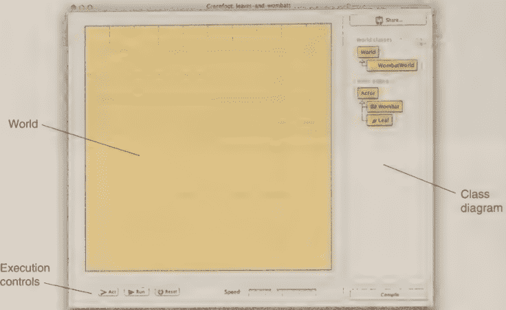

**世界**  
**类图**  
**执行控制**

你现在将看到 Greenfoot 主窗口，此时场景已打开，看起来类似于图 1.1。

主窗口由三个主要区域和若干个额外的按钮组成。主要区域是：

- **世界**。占据屏幕大部分的区域（在本例中是一个沙色的网格）被称为世界。这是程序运行以及我们看到事物发生的地方。
- **类图**。右侧带有米色方框和箭头的区域是类图。我们稍后会详细讨论。
- **执行控制**。底部的 `Act`（动作）、`Run`（运行）和 `Reset`（重置）按钮以及速度滑块是执行控制。我们稍后也会回到这些部分。

我们将先讨论类图。类图向我们展示了参与场景的类。在这种情况下，它们是 `World`、`WombatWorld`、`Actor`、`Wombat` 和 `Leaf`。

我们将使用 Java 编程语言进行项目。Java 是一种面向对象的语言。类和对象的概念是面向对象编程的基础。

让我们从观察 `Wombat` 类开始。`Wombat` 代表袋熊的通用概念——它描述了所有的袋熊。一旦我们在 Greenfoot 中有了一个类，我们就可以从它创建对象。（在编程中，对象通常也被称为实例——这两个词是同义词。）

顺便说一下，袋熊是一种澳洲的有袋动物（图 1.2）。如果你想了解更多关于它们的信息，可以进行网络搜索——应该会给你很多结果。

右键点击 `Wombat` 类，你将看到类菜单弹出（图 1.3a）。菜单中的第一个选项 `new Wombat()` 让我们可以创建新的袋熊对象。试试看。

你会发现这会产生一个袋熊对象的小图片，你可以用鼠标在屏幕上移动它（图 1.3b）。点击世界中的任何地方将袋熊置入世界中（图 1.3c）。

#### 图 1.2 袋熊

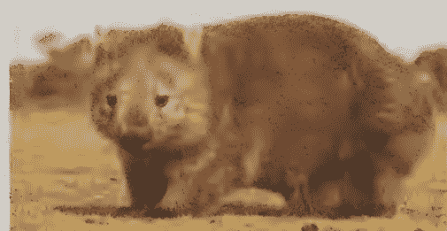

#### 图 1.3 a) 类菜单 b) 拖动新对象 c) 放置对象

| Actor 类 | | Actor 类 | | |
| :--- | :--- | :--- | :--- | :--- |
| Actor | | Actor | | |
| Wombat | | Wombat | | |
| 打开编辑器 | | Leaf | | |
| 设置图像... | | | | |
| 检查 | | | | |
| 删除 | | | | |
| 新子类... | | | | |

> ² 图片来源：Marco Tomasini/Fotolia  
> ³ 在 Mac OS 上，如果你使用的是单击鼠标，请使用 `ctrl`+点击代替右键。

一旦你在 Greenfoot 中有了一个类，你就可以按需从它创建任意数量的对象。

**练习 1.1** 在世界中创建更多袋熊。创建一些叶子。

目前，我们只对 `Wombat` 和 `Leaf` 类感兴趣。我们稍后会讨论其他类。

## 与对象交互

一旦我们将一些对象放入世界，就可以通过右键点击这些对象来与它们交互。这将弹出对象菜单（图 1.4）。对象菜单向我们展示该特定对象可以执行的所有操作。例如，袋熊的对象菜单向我们展示了这只袋熊可以做什么（加上两个额外功能：`Inspect` 检查和 `Remove` 删除，稍后我们将讨论它们）。

在 Java 中，这些操作被称为**方法**。立即开始习惯标准术语并无害，因此从现在起我们也称它们为方法。我们可以通过从菜单中选择它来**调用**方法。

**练习 1.2** 在袋熊上调用 `move()` 方法。它是做什么的？尝试执行几次。调用 `turnLeft()` 方法。在你的世界中放置两只袋熊并让它们面对面。

#### 图 1.4 对象菜单

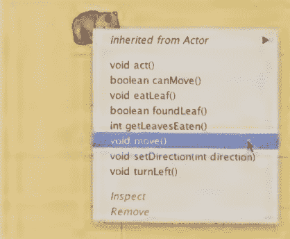

```
inherited from Actor

void act()
boolean canMove()
void eat()
boolean getLeaf()
int getLeavesEaten()
void move()
void setDirection(int direction)
void turnLeft()

Inspect
Remove
```

简而言之：我们可以通过从提供的类之一创建对象来开始让事情发生，并通过调用它们的方法向对象发送命令。

让我们仔细观察对象方法。`move` 和 `turnLeft` 方法列如下：

```
void move()
void turnLeft()
```

我们可以看到，显示的不仅仅是方法名。开头有一个 `void` 单词，后面跟着一对括号。这两个神秘的信息告诉我们什么数据进入方法调用，以及什么数据从方法返回。

### 返回类型

开头的 `void` 单词是返回类型。它告诉我们什么数据进入方法调用，以及什么数据从方法返回。

### 参数

参数是我们为运行此方法必须提供的额外数据。每个参数由两个单词定义：首先是参数类型（这里是 `int`），然后是名称，它提示我们该参数的用途。如果一个方法有参数，我们在调用方法时必须提供这些额外信息。

```
int getEaten()
void setDirection(int direction)
```

#### 图 1.6 方法调用对话框

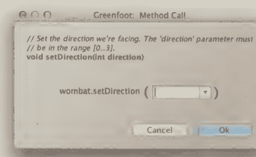

# 第 1 章 了解 Greenfoot

> **提示**  
> 你可以通过在类图中选择一个类，然后点击世界，更快速地将对象放入世界中。

**练习 1.6** 在世界中放置一只袋熊和许多叶子，然后多次调用袋熊的 `act()` 方法。这个方法是做什么的？它与 `move` 方法有什么区别？务必尝试不同的情况，例如，袋熊面对世界的边缘，或者坐在叶子上。

**练习 1.7** 在世界中仍有袋熊和一些叶子的情况下，点击 Greenfoot 窗口底部执行控制栏中的 `Act` 按钮。这会做什么？

**练习 1.8** 点击 `Act` 按钮和调用 `act()` 方法之间有什么区别？（尝试在世界中放置几只袋熊。）

**练习 1.9** 点击 `Run` 按钮。它是做什么的？

`act` 方法是 Greenfoot 对象中一个非常基础的方法。我们在接下来的所有章节中都会经常遇到它。Greenfoot 世界中的所有对象都有这个 `act` 方法。调用 `act` 本质上是指令“去做任何你想做的事”。如果你对我们的袋熊进行尝试，你会发现袋熊的 `act` 执行了类似以下的操作：

- 如果我们坐在叶子上，就吃掉叶子。
- 否则，如果我们可以向前移动，就向前移动。
- 否则，向左转。

上面的实验应该也让你看到执行控制栏中的 `Act` 按钮简单地调用世界中执行者的 `act` 方法。通过对象菜单调用方法的唯一区别是，`Act` 按钮调用世界中所有对象的 `act` 方法，而使用对象菜单只影响被选中的那个对象。

`Run` 按钮只是对所有对象反复调用 `act` 方法，直到你点击 `Pause`（暂停）。让我们在另一个场景下尝试我们讨论的内容。

## 1.7 第二个示例

从 `scenarios` 文件夹中的 `chapter01` 打开另一个名为 `asteroids1` 的场景。它看起来应该与图 1.7 相似（尽管你还没有在屏幕上看到火箭或小行星）。

## 1.8 理解类图

让我们仔细观察类图（图 1.8）。在顶部，你会看到两个名为 `World` 和 `Space` 的类，由一个箭头连接。

#### 图 1.7 asteroids1 场景

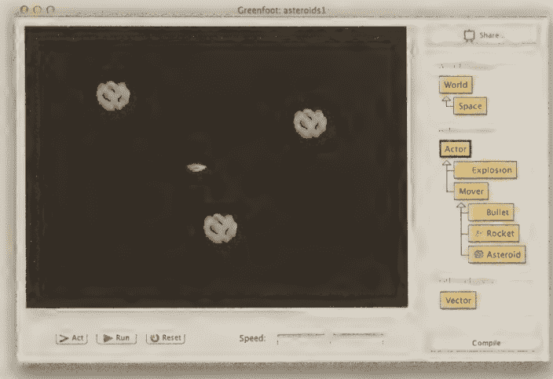

#### 图 1.8 一个类图

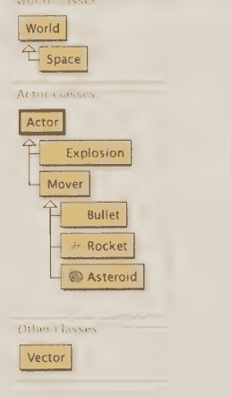

### 概念：子类

**子类**是一个表示特化关系的类。在 Greenfoot 中，这通过类图中的箭头表示。

`World` 类在所有 Greenfoot 场景中一直存在——它是内置在 Greenfoot 中的。它下方的类（在本例中为 `Space`）代表该特定场景的具体世界。它的名称在每个场景中可能不同，但每个场景在这里都会有一个特定的世界。


箭头显示了“是一个”（is-a）的关系：`Space` 是一个 `World`（从 Greenfoot 世界的角度来说：这里的 `Space` 是一个特定的 Greenfoot 世界）。我们有时也会说 `Space` 是 `World` 的子类。

我们并不一定需要创建世界类的对象——Greenfoot 会替我们创建。当我们打开一个场景时，Greenfoot 会自动创建世界类的对象。该对象随后显示在屏幕的主部分。（巨大的太空图像是该类的一个对象。）

在下方，我们看到另一组六个类，由箭头连接。每个类代表其自己的对象。从底部向上读，我们有小行星（asteroids）、火箭（rockets）和子弹（bullets），它们都是“移动者（movers）”，而执行者（actors）是子类。再次，我们有子类关系：`Rocket` 是 `Mover` 的子类，`Mover` 和 `Explosion` 是 `Actor` 的子类。子类关系可以跨越级别：`Rocket` 是 `Actor` 的子类（因为它是 `Mover` 的子类，而 `Mover` 是 `Actor` 的子类）。我们稍后将详细讨论子类和超类的含义。

位于底部的 `Vector` 是其他类使用的辅助类。我们无法把它放入世界中。


# 在小行星游戏中

我们可以通过创建执行者对象（actor objects）来开始这个场景。在这里，我们创建了子类的类：`Rocket`、`Asteroid` 和 `Explosion`。

让我们通过将火箭和两个小行星放入世界来开始。（记住：你可以通过右键点击类来创建对象，或者选择类并点击世界）。

当你放置了对象后，点击 `Run` 按钮。你可以使用键盘上的方向键控制飞船，并使用空格键射击。在撞击它们之前尝试这样做。

> 练习 1.10 如果你玩了一会儿游戏，你会发现我们射得并不快。让我们调整一下飞船的软件，以便我们可以射得更快。（这应该让移除小行星变得更容易！）将火箭放入世界，然后通过对象方法将其 `reload` 设置为 5。

> 练习 1.12 当你成功移除所有小行星后，停止执行（按 Pause），查看你射了多少次。你可以使用对象的菜单执行此。

> 练习 1.13 小行星具有固有生命值。每当它们被子弹击中，生命值就会减少。在你创建它们时，初始生命值是多少？被子弹击中一次生命值减少了多少？提示：射击一次小行星，再次检查生命值。另一个提示：要射击小行星，你必须运行游戏。

## 练习 14 创建一个小行星

每个对象的行为由其类定义。我们通过编写源代码来指定这种行为。类的源代码是指定该类所有细节的代码。从类选择编辑器会显示一个编辑器窗口（图 1.9）。

这个类的源代码相当复杂，我们在这个阶段不需要理解所有内容。然而，如果你学习这本书的内容并编写自己的游戏，你将随着时间的推移学会编写这种代码。

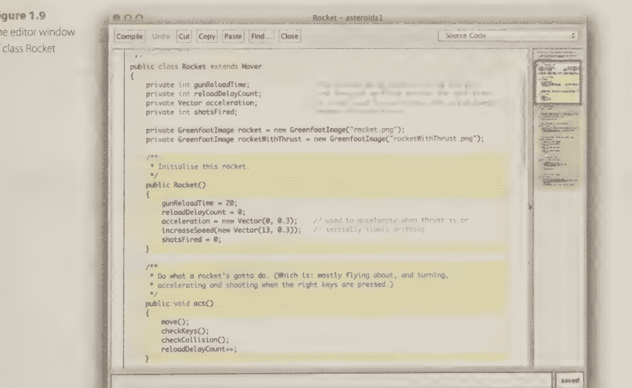

# 第1章 了解 Greenfoot

提示

你可以双击类图中的类来打开类的编辑器。

重要的是理解我们可以通过类的源代码来改变对象的行为。让我们尝试一下。

我们之前见过火箭的默认射击速度很慢。我们可以通过在每个火箭上调用方法来更改这一点，但每次开始游戏时都必须这样做。相反，我们可以更改火箭的代码，改变其初始速度（例如改为 5），这样未来的火箭将从这种改进的行为开始。

打开 `Rocket` 类的编辑器。从顶部大约 25 行处，你应该找到这样一行代码：

```
gunReloadTime = 20;
```

这是设置初始装填时间的地方。将此行改为：

```
gunReloadTime = 5;
```

确保不要更改其他内容。你很快就会发现编程系统非常挑剔。一个错误或缺失的字符会导致错误。例如，如果你删除了行尾的分号，很快就会遇到错误。

关闭编辑器窗口（我们的更改完成），再次查看类图。它变了：`Rocket` 类现在变成了条纹（图 1.10）。条纹线表示类已经过编辑，必须编译。编译是一个翻译过程：类的源代码被翻译成计算机可以执行的机器码。

> 概念
>
> 计算机不理解源代码。在执行之前，需要将其翻译成机器码。这被称为编译。

在更改源代码后，必须编译类，然后才能创建该类的新对象（有时即使只改变了一个类，多个类也需要重新编译。这可能是因为类之间相互依赖。当一个类发生变化时，多个类可能需要再次翻译）。

# 图 1.10

编辑后的类

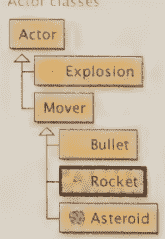

我们可以点击 Greenfoot 主窗口右下角的 `Compile`（编译）按钮来编译这些类。一旦类编译完成，条纹就会消失，我们就可以再次创建对象。

**练习 1.15** 根据上述描述对 `Rocket`（火箭）类的源代码进行修改。关闭编辑器并编译这些类。尝试一下：火箭现在应该能够从一开始就快速地射击了。

我们将在第 7 章回到小行星大战游戏，届时我们将讨论如何编写这个游戏。

## 总结

在本章中，我们了解了 Greenfoot 场景可能呈现的模样，以及如何与它们交互。我们学习了如何创建对象，以及如何通过调用它们的方法来与这些对象通信。某些方法是给对象的命令，而另一些方法则返回有关对象的信息。参数用于向方法提供额外信息，而返回值则将信息传回给调用者。

对象是从它们的类创建的，而源代码控制了类的定义（并由此决定了该类所有对象的行为和特征）。

我们已经看到可以使用编辑器修改源代码来做出更改。编辑源码后，需要重新编译类。

我们将在书中大部分剩余内容中讨论如何编写 Java 源代码来创建可以实现有趣功能的场景。

## 概念总结

- Greenfoot 场景由一组类组成。
- 从一个类可以创建许多对象。
- 对象拥有方法。调用这些方法会执行操作。
- 方法的返回类型指定了方法调用将返回。
- 返回类型为 `void` 的方法不返回值。
- `void` 返回类型的方法代表命令，非 `void` 返回类型的方法代表问题。

# 第 1 章 认识 Greenfoot

- 参数是向方法传递额外数据的机制。
- 参数和返回值都有类型。类型的示例包括用于数字的 `int` 和用于真/假值的 `boolean`。
- 方法的规格（显示了其返回类型、名称和参数）称为其签名（signature）。
- 可以放入世界中的对象被称为 actor（角色）。
- 子类是表示另一个类特化后的类。在 Greenfoot 中，这通过类图中的箭头表示。
- 每一个类都由源代码定义。这段代码定义了该类的对象可以做什么。我们可以通过打开类的编辑器来查看源代码。
- 计算机不理解源代码。在执行之前，需要将其翻译成机器码。这被称为编译。

# 第 2 章

# 第一个程序：小蟹

主题：编写代码：移动、转向、对屏幕边缘的反应

概念：源代码、方法调用、参数、序列、if语句

在上一章中，我们讨论了如何使用现有的 Greenfoot 场景：我们创建了对象，调用了方法并玩了一个游戏。

现在我们想要开始制作自己的游戏。

## 2.1 小蟹场景

我们本章使用的场景名为 little-crab（小蟹）。你可以在 book-scenarios 文件夹中找到这个场景。

你应该看到的场景看起来类似于图 2.1。

**练习 2.1** 启动 Greenfoot 并打开 little-crab 场景。将一只螃蟹放入世界并运行程序（点击 `Run` 按钮）。你观察到了什么？（记住：如果右侧的类图标出现条纹，你必须先编译项目。）

在右侧，你可以看到该场景中的类（图 2.2）。我们注意到有通常的 Greenfoot `Actor` 和 `World` 类，以及名为 `CrabWorld` 和 `Crab` 的子类。

层级结构（由箭头表示）表示一种“是一个...”的关系（也称为继承）：螃蟹是一个角色，`CrabWorld` 是一个世界。

最初，我们将只处理 `Crab` 类。稍后我们还会更多地讨论 `CrabWorld` 和 `Actor` 类。

如果你刚刚完成了上面的练习，那么你就知道“你观察到了什么？”这个问题的答案了。答案是：“什么都没有。”

# 第 2 章 第一个程序：小蟹

图 2.1

小蟹场景 (The Little Crab scenario)

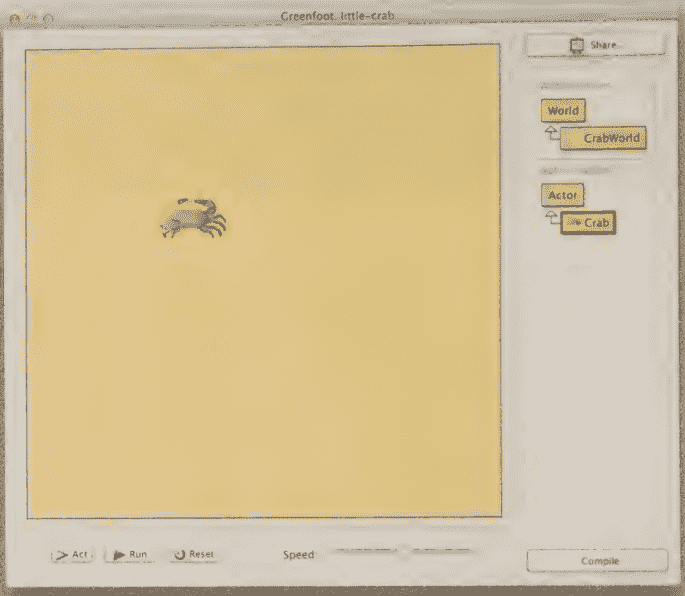

图 2.2

小蟹类 (The Little Crab classes)

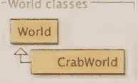

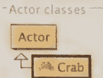

螃蟹在运行时什么都不做。这是因为在 `Crab` 类的定义中没有指定螃蟹应该做什么源代码。

在本章中，我们将致力于改变这一点。我们做的第一件事是让螃蟹移动起来。

## 2.2 让螃蟹移动起来

让我们看看 `Crab` 类的源代码。打开编辑器显示 `Crab` 源码。（你可以通过从类的弹出菜单中选择 `Open editor` 函数来实现，你也可以直接双击该类）。

你看到的源代码如代码 2.1 所示。

```java
import greenfoot.*;

/**
* 此类定义了一只螃蟹。螃蟹生活在海滩上。
 */
public class Crab extends Actor {
    public void act() {
        // 在此处添加你的动作代码
    }
}
```

这是一个标准的 Java 类定义。也就是说，这段文本定义了螃蟹可以做什么。

你会注意到不同的颜色背景：整个类定义都在绿色框内，而在它内部，每个方法都在黄色背景上。（在类方法定义之前，还有一个单独的白色背景语句。）

我们稍后会详细讨论这一点。现在我们专注于让螃蟹移动起来。

在类定义中，我们看到了 `act` 方法（黄色背景）。它看起来像这样：

```
public void act() {

}
```

第一行是方法的签名。最后三行——两个括号之间的内容——被称为方法的体。我们可以在这里添加决定螃蟹动作的代码。其中一种命令是 `move(5)`；

> 在书中，当我们内联显示代码时，不会显示背景颜色。它们只是有助于你在 Greenfoot 中阅读编写代码。

注意它是这样编写的，包括括号和分号。此时 `act` 方法应该是：

**练习 2.2** 修改你的 crab 类中的 `act` 方法，包含 `move(5)`，如上所示。编译场景（点击 `Compile`）并将一只螃蟹放入世界。尝试 `Act` 和 `Run` 按钮。

**练习 2.3** 将数字 5 改为不同的数字。尝试更大或更小的数字。你认为这个数字是什么意思？

**练习 2.4** 在世界中放入多只螃蟹。运行场景。你观察到了什么？

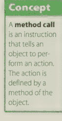

你会看到螃蟹可以在屏幕上移动。`move(5)` 指令让螃蟹向右移动一点。

当我们点击 Greenfoot 主窗口中的 `Act` 按钮时，`act` 方法执行一次。也就是说，我们在 `act` 方法内部编写指令 (`move(5)`) 执行了。指令中的数字 5 定义了螃蟹每一步移动的距离。

点击 `Run` 按钮就像快速点击 `Act` 按钮。`act` 方法反复执行，直到我们点击暂停。

**练习 2.5** 你能找到让螃蟹向后移动（向左）的方法吗？

> 指令 `move(5)` 被称为方法调用（method call）。方法是对象知道如何执行的动作（在这里对象是螃蟹），而方法调用是告诉对象执行该动作的指令。括号及其数字是方法调用的一部分。此类指令以分号结束。

### 转向

让我们看看还可以使用什么其他指令。螃蟹还能理解转向指令。它看起来是这样的：

```
turn(3);
```

指令中的数字 3 指定了螃蟹应该旋转的度数。（上面 `move` 调用中使用的数字 5 也是一个参数。）

我们也可以使用其他数字，例如：

```
turn(23);
```

角度值是基于 360 度计算的，因此可以使用 0 到 359 之间的任何值。（旋转 360 度将转一整圈，所以它和旋转 0 度是一样的，或者说完全不旋转。）

如果我们想让旋转而不是移动，可以将 `move(5)` 指令替换为 `turn(3)` 指令。（在这种情况下，参数值 5 和 3 是相当随机选择的；你也可以使用不同的值。）此时，`act` 方法看起来像这样：

```java
public void act()
{
    turn(3);
}
```

**练习 2.6** 在你的场景中将 `move(5)` 替换为 `turn(3)`。尝试一下。也尝试一下除 3 以外的其他值，看看效果是怎样的。记住：每次修改源代码后，你必须重新编译。

**练习 2.7** 如何让螃蟹向左转？

我们可以尝试的下一步是同时移动和旋转。`act` 方法可以包含多条指令——我们只需要连续编写多条指令即可。

代码 2.2 显示了完整的 `Crab` 类，即我们在移动和旋转时的样子。在这种情况下，每一步，螃蟹都会先移动，后旋转（但这两个动作发生得非常快，看起来就像是同时发生的）。

```java
import greenfoot.*;
/**
 * 此类定义了一只螃蟹。螃蟹生活在海滩上。
 */
public class Crab extends Actor
{
    public void act()
    {
        move(5);
        turn(3);
    }
}
```

# 第 2 章 第一个程序：小螃蟹

**练习 2.8** 尝试：在你的螃蟹的 `act` 方法中使用 `move(N)` 和 `turn(M)` 指令。为 N 和 M 尝试不同的值。


`turn` 指令中括号之间的数字——即 `turn(5)` 中的 5——被称为参数。参数是在调用某些方法时我们必须提供的额外信息。

某些方法不期望任何参数。我们通过编写方法名、括号且其间不留任何内容来编写这些方法，例如 `stop()`。其他方法，如 `turn` 和 `move`，则需要更多信息：我应该旋转多少度？我应该移动多少？在这种情况下，我们必须以括号间参数值的形式提供这些信息，例如 `turn(17)`。

### 旁记：错误

当我们编写代码时，必须非常小心：每一个字符都关重要。一个小小的错误就会导致我们的程序无法运行。通常，它将无法编译。

这种情况会经常发生：当我们编写程序时，不可避免地会出错，然后我们必须纠正它们。让我们现在尝试一下：

例如，如果我们忘记在 `move(5)` 指令后写上分号，当我们尝试编译时，就会收到提示。

**练习 2.9** 打开你的编辑器显示螃蟹的源代码，删除 `move(5)` 后的分号。然后编译。也尝试其他错误，例如拼错 `move` 或对代码进行其他更改。确保在完成练习后将其改回来。

**练习 2.10** 进行各种更改以导致不同的错误信息。找到至少五个错误信息。写下每个错误信息以及你为了证明这一点引入了什么。

正如我们通过这个练习看到的，如果我们在某个小细节上出了错，Greenfoot 将打开编辑器，高亮显示该行，并在编辑器窗口底部显示消息。这条消息试图解释该错误。然而，这些消息的准确性和用性差异很大。有时它们告诉我们的信息非常晦涩且难以理解。被高亮的那行是问题所在的那行，但有时它是在问题所在行之后的的那几行。当你看到例如“expected”（预期）消息时，可能是分号实际上缺失在高亮的某一行上。

随着时间的推移，我们将学会更好地阅读这些信息。现在，如果你收到一条消息且不确定它的意思，请仔细检查你的代码，检查你输入的所有内容。

- **提示**：当编辑器窗口底部出现错误消息时，检查编译器是否有任何额外信息。如果发现错误，会显示错误消息。

## 2.4 处理屏幕边缘

当我们在前面的章节中让螃蟹移动和旋转时，它们到达屏幕边缘时就卡住了。（Greenfoot 的设计使得 actor 无法离开世界并掉出边缘。）

现在我们应该改进这种行为，让螃蟹注意到它到达了世界并转身。问题是：我们如何做到这一点？

上面，我们使用了 `move` 和 `turn` 方法，所以可能也有一个方法可以帮助我们实现新目标。（事实上有的。）但我们如何发现我们可以使用哪些方法呢？

我们到为止使用的 `move` 和 `turn` 方法来自 `Actor` 类。螃蟹是一个 actor（由类图中从 `Crab` 指向 `Actor` 的箭头标出）；因此它可以执行任何 actor 能做的动作。我们的 `Actor` 类知道如何移动和旋转——这就是为什么我们能做到这一点。现在的问题是 actor 能做什么？

为了研究这一点，我们可以打开 `Actor` 类。这就是 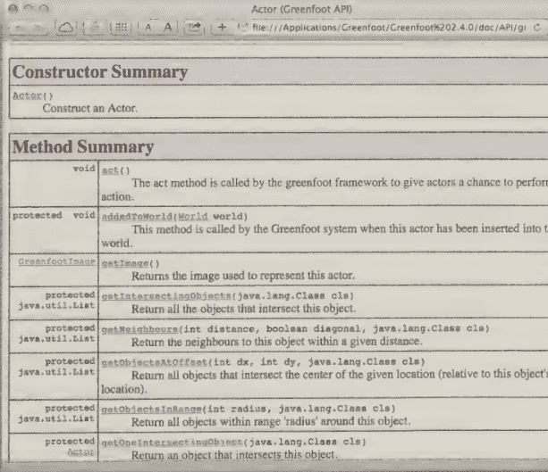 `Actor` 类是内置的；无法编辑。但我们可以通过将窗口视图从“源代码”（Source Code）切换到“文档”（Documentation）来使用它，控件位于窗口的右上角。

**练习 2.11** 打开 `Actor` 类的文档。找到方法列表（Method Summary）。该类有多少方法？

**练习 2.12** 查看方法列表。你能找到一个听起来可能用于检查我们是否在边缘的有用方法吗？

如果我们查看方法摘要，就可以看到 `Actor` 类提供的所有方法。其中有三个方法对我们现在特别感兴趣：

- `boolean isAtEdge()`：检测 actor 是否到达世界的边缘。
- `void move(int distance)`：向 actor 当前面对的方向移动指定的距离。
- `void turn(int amount)`：按指定的量（度）旋转 actor。

在这里我们看到了这三个方法的签名，正如我们在第 1 章中遇到它们。每个方法签名以返回类型开始，随后是方法名和参数列表。下方，我们看到了描述该方法功能的注释。我们可以看到这三个方法名是 `isAtEdge`、`move` 和 `turn`。


`move` 和 `turn` 方法是之前章节中使用的。如果我们观察它们的参数列表，可以看到之前观察到的情况：它们都期望一个 `int` 类型（数字）。对于 `move` 方法，这指定了移动的距离；对于 `turn` 方法，这是旋转的量。（如果你不确定参数列表，请再次阅读第 1.5 节。）

我们还可以看到 `move` 和 `turn` 方法是 `void`。这意味着这两个方法都不返回值。我们是在命令或指示对象移动或旋转。螃蟹只会服从命令而不会向我们返回答案。

`isAtEdge` 的签名有点不同。它是

```java
boolean isAtEdge()
```

该方法没有参数（括号内为空），但它指定了一个返回值：`boolean`。我们在第 1.4 节中短暂遇到过 `boolean` 类型——它是一种持有两个可能值的类型：`true`（真）或 `false`（假）。

### 处理屏幕边缘

调用带有返回值的方法（返回类型不是 `void`）并不是在下达命令，而是在提问。如果我们使用 `isAtEdge` 方法，该方法将用 `true`（是的！）或 `false`（否！）作为响应。因此，我们可以使用这个方法来检查我们是否处于世界的边缘。

**练习 2.13** 创建一只螃蟹。右键点击它，找到 `boolean isAtEdge()` 方法。（它在“继承自 Actor”的子菜单中，因为螃蟹从 `Actor` 类继承了该方法）。调用这个方法。它返回什么？

**练习 2.14** 让螃蟹运行到屏幕边缘（或手动移动它），然后再次调用 `isAtEdge()` 方法。现在它返回什么？

我们现在可以将此与 `if-statement`（if 语句）结合起来，编写如代码 2.3 所示的代码。

```java
import greenfoot.*;

/**
 * 此类定义了一只螃蟹。螃蟹生活在海滩上。
 */
public class Crab extends Actor {
    public void act() {
        if (isAtEdge()) {
            turn(17);
        }
        move(5);
    }
}
```

`if-statement` 是 Java 语言的一部分，它使得只有在条件为真时才执行命令。例如，在这里我们只想在处于世界的边缘时才旋转。我们编写的代码是：

```java
if (isAtEdge()) {
    turn(17);
}
move(5);
```

`if-statement` 的通用形式如下：

```java
if (condition) {
    instruction;
    instruction;
    ...
}
```

条件的位置可以是任何返回真或假的表达式（例如 `isAtEdge()` 方法调用），只有当条件为真时，才会执行这些指令。可以有一条或多条指令。

如果条件为假，指令将被直接跳过，执行将在 `if-statement` 的大括号之后继续。

请注意，你的 `move(5)` 方法调用在 `if-statement` 之外，因此它在任何情况下都会被执行。也就是说：如果我们在世界的边缘，我们就先旋转后移动；如果我们不在世界的边缘，我们就只移动。

提示

在 Greenfoot 编辑器中，当你将光标放在左括号或右括号之前时，Greenfoot 会显示匹配的左括号或右括号。这可以用来检查你的括号是否按预期匹配。

**练习 2.15** 尝试一下吧！输入上面讨论的代码，看看你是否能看到螃蟹在屏幕边缘处旋转。密切注意左括号和右括号——很容易漏掉一个或多写一个。

**练习 2.16** 尝试为 `turn` 方法的参数使用不同的值。找到哪一个值看起来最好。

**练习 2.17** 将 `move(5)` 语句放入 `if` 语句中，而不是放在它后面。测试——效果是什么？解释你观察到的行为。（然后通过将其移回原处再次修复它）。

### 旁记：作用域颜色和缩进

当你查看 Greenfoot 中的源代码或此书中的彩色示例（例如，代码 2.3）时，你会注意到用于背景的彩色方框。这些被称为作用域（scopes）。作用域是一个给定的 Java 构造的范围。在 Greenfoot 中，不同类型的构造具有不同的颜色：例如，类是绿色的，方法是黄色的，而 if 语句是紫灰色的。你会发现这些作用域是可以嵌套的：一个 if 语句在一个方法内部，方法在一个类内部。

随着时间的推移，注意这些彩色作用域；它们可以帮助你避免一些常见的错误。作用域通常由代码中的括号定义（通常在左括号上方有一个标题）。

### 方法签名

**练习 2.19** 观察以下方法签名：

`public void play();`

`public void addAmount(int amount);`

`public boolean haswings();`

`public void compare(int x, int y, int z);`

`public boolean isGreater(int number);`

对于这些签名中的每一个，请回答以下问题（书面形式）：

- a) 方法名是什么？
- b) 该方法是否有返回值？如果是，返回值的类型是什么？
- c) 该方法有多少个参数？

**练习 2.20** 为一个名为 "go" 的方法编写方法签名。该方法没有参数，且没有返回值。

**练习 2.21** 为一个名为 "process" 的方法编写方法签名。该方法有一个类型为 "int" 且名为 "number" 的参数，并返回一个类型为 "int" 的返回值。

**练习 2.22** 为一个名为 "isOpen" 的方法编写方法签名。该方法没有参数并返回一个类型为 "boolean" 的返回值。

**练习 2.23** 在纸上为练习 2.19 中的 "play" 方法写一个方法调用（注意：这是一个方法调用，而不是签名）。为练习 2.19 中的 "addAmount" 方法写另一个方法调用。最后，为同一练习中的 "compare" 方法写一个方法调用。

### 阅读文档

以下所有练习都打算在 Greenfoot 场景 "fatcat" 中实现。在继续之前，请在 Greenfoot 中打开该场景。

**练习 2.24** 打开 **Cat** 类的编辑器。使用编辑器窗口右上角的控件将编辑器的视图从“源代码”（Source Code）切换到“文档”（Documentation）视图。**Cat** 类有多少个方法？

**练习 2.25** **Cat** 的方法中有多少个是有值的？

**练习 2.26** **sleep** 方法有多少个参数？

### 编写方法调用（带参数和不带参数）

**练习 2.27** 尝试使用猫的弹出菜单交互式地调用你猫的某些方法。这些意思的方法都是“继承自 Cat（inherited from Cat）”。

**练习 2.28** 猫无聊吗？你如何让它不再无聊？

**练习 2.29** 打开类 `MyCat` 的编辑器。（这是你为后续所有练习编写代码的地方）。

**练习 2.30** 让猫在行动时吃东西。（也就是说，在 `act` 方法中写一个对 `eat` 方法的调用。）编译。通过按下执行控制栏中的 Act 按钮进行测试。

**练习 2.31** 让猫跳舞。（不要用交互式的方法做这一点——在 `act` 方法中写代码来实现这一点。完成后，点击执行控制栏中的 Act 按钮。）

**练习 2.32** 让猫睡觉。

**练习 2.33** 让猫执行一个你选择的常规程序，该程序由一系列活动按顺序组成。

### If 语句

**练习 2.34** 修改你猫的 `act` 方法，使得当你点击 Act 时，如果猫累了，它就睡一会儿。如果它不累，它什么都不做。

**练习 2.35** 修改你猫的 `act` 方法，让它在无聊时跳舞。（但仅在它无聊时跳舞。）

**练习 2.36** 修改你猫的 `act` 方法，让它在饥饿时吃东西。

**练习 2.37** 修改你猫的 `act` 方法如下：如果猫累了，它就睡一会儿，然后大喊万岁。如果它不累，它就大喊万岁。（为了测试，通过交互式调用某些方法让猫变累。你如何让猫变累？）

**练习 2.38** 在 `act` 方法中编写代码执行以下操作：如果你的猫是单独的，让它睡觉。如果它不孤单，让它说“Hooray”。在点击 Act 之前向世界中放入第二只猫来完成测试。

## 改进螃蟹：更复杂的编程

主题：随机行为、键盘控制、声音

概念：点表示法、随机数、定义方法、注释

在上一章中，我们学习了开始编写第一个游戏的基础。我们有许多需要查看的新内容。现在，我们将添加更多有趣的行为。从现在起，添加代码将变得简单容易，因为我们已经看到了许多基础概念。

我们将做的第一件事是添加一些随机行为。

## 3.1 添加随机行为

在我们目前的实现中，螃蟹可以穿过屏幕，并可以在世界的边缘转弯。但当它行走时，它总是直直地走。这就是我们现在想要改变的。螃蟹并不总是沿着精确的直线，所以让我们添加一点随机行为：螃蟹应该大致直直走，但偶尔应该稍微偏离路线。

我们在 Greenfoot 中通过使用随机数来实现：Greenfoot 环境有一个方法可以给我们一个随机数。这个方法称为 `getRandomNumber`，期望一个指定数字限制的参数。它将返回一个 0（零）到限制之间的随机数。例如：

```java
Greenfoot.getRandomNumber(20)
```

将给我们一个 0 到 20 之间的随机数。

## 练习 3.3 在你自己的版本中尝试上述的随机变化。

尝试不同的转弯概率。

这是一个非常好的开始，但还不完全完美。首先，如果螃蟹转弯，它总是以相同的角度转（4度），其次，它总是向右转，从不向左转。我们真正希望看到螃蟹向左或向右转一个很小但随机的角度。（我们现在来讨论这一点。如果你有足够的信心，请在继续阅读之前尝试自己实现它。）

解决第一个问题的简单技巧——总是转相同的角度（在我们的案例中是4度）——是将代码中的固定数字 4 替换为另一个随机数，如下：

```java
if (Greenfoot.getRandomNumber(100) < 10 )
  turn(Greenfoot.getRandomNumber(45));
```

在这个示例中，螃蟹仍然在 10% 的移动中转弯。当它转弯时，它将以 0 到 44 度之间的随机角度转弯。

**练习 3.4** 尝试上面的代码。你观察到了什么？螃蟹转弯时转的角度是不同的吗？

**练习 3.5** 我们仍然面临螃蟹只向右转的问题。这符合螃蟹的正常行为，所以让我们修复它。修改你的代码，让螃蟹每次转弯时都能向右或向左转，最多 45 度。

**练习 3.6** 尝试在世界中运行多个螃蟹的场景。它们是同时转弯的还是独立转弯的？为什么？

如果你以前从未见过这样的东西，练习 3.5 起初并不容易，可能需要一点提示。起初人们倾向于使用 `if` 语句来处理两个方向，但实际上有一个更简单的解决方案。

这样想：`Greenfoot.getRandomNumber` 只给我们提供下界为 0 的数字。我们需要从 -45 到 45 之间的数字。这意味着我们需要（大约）90 个不同的数字。我们可以使用 `Greenfoot.getRandomNumber(90)` 获取一个 90 个数字的范围，但它给出的是 0–90 对应到 -45–45。

答案是：我们只需要获取 90 以内的随机数，然后减去 45。图 3.1 试图说明这一点。（注意，这实际上差了 1：随机数的范围实际上是 0–89，减去 45 后我们得到 -45–44。但由于我们不在乎随机转弯的精确性，这是可以。）

### 图 3.1

随机角度 0–90 度

b) 随机角度 -45–45 度

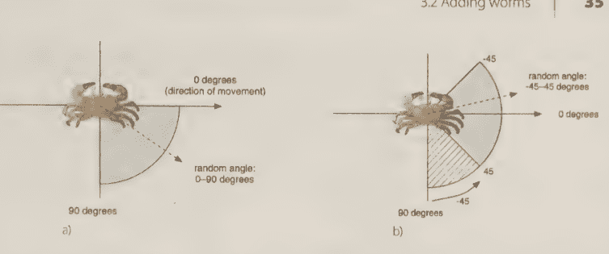

## 3.2 添加虫子

尝试自己解决这个练习。项目 little-crab-2（包含本书）展示了我们目前为止实现的，包括最后的练习。

让我们通过添加另一种动物让我们的世界变得有趣一点。

螃蟹喜欢吃虫子。（嗯，在现实世界中并不是所有螃蟹都如此，但有些确实如此。我们就说我们的螃蟹是那些喜欢吃虫子的种类之一吧。）现在让我们为虫子添加一个类。

我们可以通过从现有的 actor 类之一选择“New subclass（新建子类）”来向 Greenfoot 场景添加新的 actor 类（图 3.2）。在这种情况下，我们新的类 `Worm` 是 `Actor` 类的子类。（记住，子类是一种“是”（is-a）的关系：虫子是一个 actor。）

当我们创建一个新的子类时，系统会提示输入类的名称并选择一张图像（图 3.3）。

在我们的案例中，我们将类命名为“Worm”。按照惯例，Java 中的类名应该始终以大字母开头。它们还应该描述它们代表什么种的对象，因此“Worm”是我们目的的显易名称。

### 图 3.2

添加新的子类

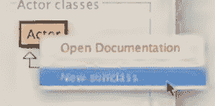

### 图 3.3

创建一个新类

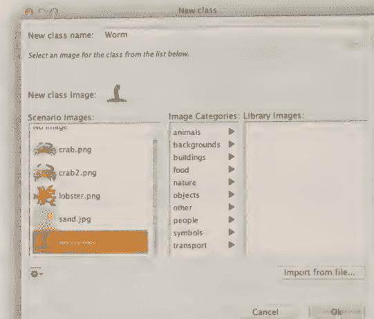

然后，我们应该给类分配一张图像。场景中有些相关的图像，还有一个整个通用图像库供选择。在这种情况下，我们已经准备了一个虫子图像并使其在场景图像可用，所以我们只需要选择图像名称 `worm.png`。

完成后，我们可以点击 *Ok*。该类现在已添加到我们的场景中，我们可以编译并向我们的世界中添加虫子。

**练习 3.7** 在你的世界中添加一些虫子。也添加一些螃蟹。运行场景。你观察到了什么？虫子在做什么？当螃蟹遇到虫子会发生什么？

我们现在知道如何向场景添加新类了。下一个任务是让这些类相互作用。

## 3.3 吃虫子

我们现在想给螃蟹添加新行为：当螃蟹撞上虫子时，它吃掉它。再次打开 Actor 的文档，我们可以看到以下内容：

### `boolean isTouching(Class cls)`

检查是否触摸了某个类。

### `void removeTouching(Class cls)`

移除给定类的对象。

使用这些方法，我们可以实现这一点。这里有一些示例代码：

```java
public void act() {
  if (isAtEdge()) {
    turn(17);
  }

  if (Greenfoot.getRandomNumber(100) < 10 ) {
    turn(Greenfoot.getRandomNumber(45));
  }

  move(5);

  if (isTouching(Worm.class)) {
    removeTouching(Worm.class);
  }
}
```

尝试一下。将一些虫子放入世界（记住：点击世界是快捷操作），放置一些螃蟹，运行场景。

（标记为“高级注意”的注释是为了感兴趣的读者。在这个阶段可以安全跳过。）

在 `isTouching` 和 `removeTouching` 方法中，我们看到了一个参数 `java.lang.Class`。这意味着什么？

许多类型由类定义。许多类位于标准库中。你可以通过选择 Greenfoot 菜单中的 Java Library 来查看 Java 。

类库包含成千上万个类。为了更容易处理，它们被分成了包（逻辑相关的类组）。当类名包含点时，例如 `java.lang.Class`，最后一部分是类名，前面的部分是包名。所以我们正在查看来自“lang”包的“Class”类。

## 3.4 创建新方法

前四行是注释。计算机会忽略注释——它们是给人类读者阅读的。我们使用注释来向其他人类读者解释这个方法的目的。

当我们定义这个方法时，代码不会立即执行。事实上，仅仅通过定义这个方法，它根本不会被执行。我们正在定义一个新的可能的动作（“寻找虫子”），这个动作可以在稍后执行。只有在调用这个方法时，它才会被执行。我们可以在 `act` 方法内部添加对该方法的调用：

```java
lookForWorm();
```

注意，调用时带有括号（空的）参数列表。重构后的完整源代码如代码 3.3 所示。

```java
public void act() {
    if (isAtEdge()) {
        turn(1);
    }
    if (Greenfoot.getRandomNumber(100) < 10) {
        turn(Greenfoot.getRandomNumber(90) - 45);
    }
    move(5);
    lookForWorm();
}
```

```java
/*
* 检查我们是否偶然发现了虫子。
* 如果发现了，就吃掉它。如果没有，什么都不做。
*/
public void lookForWorm() {
    if (isTouching(Worm.class)) {
        removeTouching(Worm.class);
    }
}
```

注意，这段代码更改完全没有改变我们螃蟹的行为。它只是从长远来看让代码更易读。随着我们在类中添加了更多的代码，方法往往会变得越来越长。长方法更难理解。通过将我们的代码拆分成若干较短的方法，我们让代码更易读。

**练习 3.8** 创建另一个名为 `randomTurn` 的新方法（该方法没有参数且没有返回值）。选择执行随机旋转的代码，将其从 `act` 方法移动到 `randomTurn` 方法中。然后从你的 `act` 方法中调用这个新的 `randomTurn` 方法。确保为该方法写一个注释。

创建另一个新方法 `turnEdge`（它也没有参数且没有返回值）。将检查我们是否处于世界边缘（如果是，则执行旋转）的代码移动到 `turnEdge` 方法中。在你的 `act` 方法中调用 `turnEdge` 方法。你的 `act` 方法现在看起来应该像代码 3.4 那样。

### 代码 3.4 创建子任务方法后的 act 方法

```java
public void act() {
    turnEdge();
    randomTurn();
    move(5);
    lookForWorm();
}
```


按照习惯，Java 中的方法名始终以小写字母开头。方法名不能包含空格（或其他标点字符）。如果方法名由多个单词组成，我们在方法中间使用大写字母来标记每个单词的开头。

## 3.5 添加龙虾

现在我们处于这样一个阶段：我们有一只在世界中随机随机行走的螃蟹，如果碰巧遇到虫子就会吃掉它们。为了让它变得更有趣，让我们添加另一种生物：龙虾（图 3.4）。在我们的场景中，龙虾喜欢追逐螃蟹。

## 3.6 键盘控制

图 3.4 添加敌人：龙虾


**练习 3.9** 为你的场景添加一个新类。该类应该是 `Actor` 的子类，名为 `Lobster`（大写 "L"），它应该使用准备好的图像 `lobster.png`。

**练习 3.10** 当你把龙虾直接放入世界时，你预期它们会做什么？编译你的场景并尝试一下。我们想为新的龙虾编写程序。

# 代码 3.5

```
/**
 * Act - 执行螃蟹想做的任何事。
 */
public void act() {
    checkKeyPress();
    move(5);
    lookForWorm();
}
```

**练习 3.21** 这个方法需要任何参数吗？它的返回类型是什么？

我们可以通过在左侧选择类来查看 Greenfoot 类的文档。对于每个类，浏览器中的主面板都会显示该类的通用注释、其构造函数的详细信息以及它的方法列表。（构造函数将在稍后的章节中讨论。）

如果我们浏览 Greenfoot 类中可用方法的列表，可以找到一个名为 `stop` 的方法。这就是当螃蟹被捕获时可以使用它来停止执行的方法。

我们可以通过在源代码中编写以下代码来使用这个方法：

```
Greenfoot.stop();
```

## 3.8 添加声音

Greenfoot 3.5

用户窗口中的 Greenfoot API

Greenfoot API

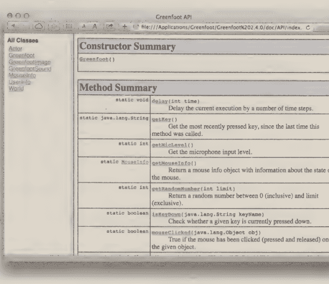

**练习 3.22** 在自己的场景中添加代码，当龙虾抓到螃蟹时停止游戏。你需要决定这段代码需要添加到哪里。在你的代码中找到当龙虾抓到螃蟹时执行的次数，并添加这行代码。

我们将来将使用此类的类文档来查找我们需要使用的方法的详细信息。过段时间后，我们会对一些方法烂记于心，但总会有一些我们需要查阅的方法。

## 3.8 添加声音

我们游戏的另一个改进是添加声音。同样，Greenfoot 类中的一个方法可以帮助我们实现这一点。

**练习 3.23** 打开 Greenfoot 类文档（从帮助菜单中）来了解有关播放声音的知识。有一个 `GreenfootSound` 类用于完全的音频控制，在 `Greenfoot` 类中也有一个方便的方法，可以快速方便地产生声音。找到 `Greenfoot` 类中该方法的详细信息。它叫什么名字？它期望什么参数？

# 第 3 章 改进螃蟹：更复杂的编程

通过查阅文档，我们可以看到 `Greenfoot` 类有一个名为 `playSound` 的方法。它期望一个声音文件名（`String` 类型）作为参数，并且没有返回值。

> 注意
>
> 你可能想查看你文件系统中 Greenfoot 场景的结构。如果你查看包含书籍场景的文件夹，你可以为每个 Greenfoot 场景找到一个文件夹。对于螃蟹示例，有几个不同的版本（`little-crab`、`little-crab-2`、`little-crab-3` 等等）。在每个场景文件夹内部，都有每个场景类的多个文件，以及几个其他支持文件。有两个媒体文件夹：`images` 存储场景图像，`sounds` 存储文件。
>
> 你可以通过查看此文件夹来查看可用声音，并可以通过将它们存储在这里来提供更多可用声音。

在我们的螃蟹场景中，已经包含了两个声音文件。它们被称为 `"slurp.wav"` 和 `"au.wav"`。我们现在可以使用以下方法调用来轻松地播放其中一个声音：

```
Greenfoot.playSound("slurp.wav");
```

尝试一下吧！

**练习 3.24** 在你的场景中添加播放声音：当螃蟹吃掉虫时，播放 `"slurp.wav"` 声音。当龙虾吃掉螃蟹时，播放 `"au.wav"` 声音。要做到这一点，你必须找到代码中应该发生这种情况的地方。

该场景的 `little-crab-4` 版本显示了解决方案。它是项目的一个版本，包含了我们到为止讨论的所有功能：虫子、键盘控制和声音（图 3.6）。

# 制作自己的声音

有多种方法可以向 Greenfoot 场景添加你自己的声音。例如，你可以在互联网上的各种声音库中找到音效，或者使用一些录音和特效软件制作你自己的声音。

使用声音有时会有点麻烦，因为计算机上的声音可以以许多不同的文件格式存储，而 Greenfoot 可以播放某些，但不能播放其他。Greenfoot 通常可以播放 MP3、AIFF、AU 和 WAV 格式的声音文件（尽管某些 WAV 文件无法播放——这会变得复杂）。

## 3.9 制作自己的声音

图 3.6

带有虫子和龙虾的螃蟹游戏

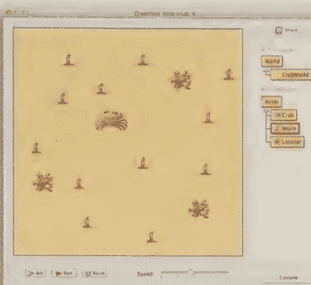

我们第 10 章更完整讨论声音；在这里，我们将使用简单的方法将自己的声音引入场景：直接在 Greenfoot 中录制。

我们在上一节中使用的两个音效都是通过对着麦克风简单说话录制的。Greenfoot 内置了声音录音机让你执行操作。

要开始，请使用控制（Controls）菜单中的 `Show Sound Recorder` 功能。你会看到 Greenfoot 声音录音机控件（图 3.7）。

使用此声音录音机，你现在可以通过按下 `Record` 按钮并对着麦克风说话来录制自己的声音¹。完成后按下 `Stop Recording`。你可以使用 `Play` 按钮检查你的录音听起来怎么样。

只有一个编辑可用：修剪选择（`Trim to selection`）。其目的是剪掉录音开头和结尾不需要的部分。你可以通过查看此文件夹来查看可用声音，并可以通过将它们存储在这里来提供更多可用声音。

> 注意
>
> 其目的是剪掉录音开头和结尾不需要的部分。你可以通过查看此文件夹来查看可用声音，并可以通过将它们存储在这里来提供更多可用声音。

在我们的螃蟹场景中，已经包含了两个声音文件。它们被称为 `"slurp.wav"` 和 `"au.wav"`。我们现在可以使用以下方法调用来轻松地播放其中一个声音：

```
Greenfoot.playSound("slurp.wav");
```

尝试一下吧！

**练习 3.24** 在你的场景中添加播放声音：当螃蟹吃掉虫时，播放 `"slurp.wav"` 声音。当龙虾吃掉螃蟹时，播放 `"au.wav"` 声音。要做到这一点，你必须找到代码中应该发生这种情况的地方。

该场景的 `little-crab-4` 版本显示了解决方案。它是项目的一个版本，包含了我们到为止讨论的所有功能：虫子、键盘控制和声音（图 3.6）。

图 3.7

Greenfoot 声音录音机

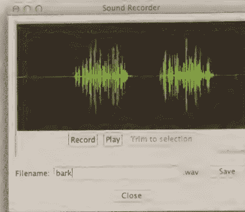

图 3.8

选择部分的修剪


只有一个编辑可用：修剪选择（`Trim to selection`）。其目的是剪掉录音开头和结尾不需要的部分。你可以通过查看此文件夹来查看可用声音，并可以通过将它们存储在这里来提供更多可用声音。

图 3.9

代码补全对话框


**练习 3.25** 如果你的电脑上有麦克风，在虫子或螃蟹被吃时制作你自己的声音。录制它们，然后在代码中使用它们。

## 3.10 代码补全

```
public void act() {
    Greenfoot.setFoot(int footImage);
    setWorld(World world);
    start();
    stop();
}
```

# 代码补全

一个实用的技巧是使用代码补全来输入方法调用（图 3.9）。当你准备输入要调用的方法名称时可以使用代码补全。它通过输入 `CTRL+Space` 激活。

例如，如果你输入

`Greenfoot.`

并且光标在点后面，然后输入 `CTRL+Space`，就会弹出一个框，列出你可以调用的所有方法（在这种情况下：`Greenfoot` 类的所有方法）。如果你接着开始输入方法名的前几个字母（例如，在图 3.9 中你输入了字母 `"s"`），方法列表将减少为以这些开头的方法。

你可以使用光标键或鼠标从列表中选择方法，并使用 `Return` 键将其插入代码中。

使用代码补全对于调查哪些方法可用、寻找你知道存在但不记得确切名称的方法、查找参数和文档，或者节省打字时间并加快代码输入非常有帮助。

# 技术总结

在本章中，我们看到了更多使用 `if` 语句的示例，这次用于随机转向和响应按键。我们还学习了如何从另一个类调用方法，即 `Greenfoot` 类中的 `getRandomNumber`、`isKeyDown` 和 `playSound` 方法。我们通过使用点符号法来实现这一点。

总而言之，我们已经看到了从三个不同地方调用方法的示例：我们可以调用当前类本身定义的方法（称为本地方法）、在父类中定义的方法（继承的方法），以及来自静态的其他类。最后一种方法使用了点符号表示法。（这里有另一种方法调用的版本：在其他对象上调用方法——我们稍后会遇到它。）

我们探索的另一个重要方面是如何阅读现有类的 API 文档，以找到它拥有哪些方法以及如何调用它们。

最后，我们遇到的一个非常重要的概念是定义我们自己的方法。我们已经学习了如何为不同的子任务定义方法，以及如何从其他方法中调用它们。

## 概念总结

- 当我们想要调用的方法不在我们自己的类中或未被继承时，我们需要在方法名之前指定拥有该方法的类或对象，后面紧跟一个点。这被称为**点符号表示法**。

- 属于类（而不是对象）的方法在它们的签名中标记有 `static` 关键字。它们也被称为**类方法**。

- **方法定义**为该类的对象定义了一个新动作。该动作不会立即执行，但稍后可以通过方法调用来执行它。

- **注释**被写在源代码中，作为对人类读者的解释。计算机会忽略它们。

- **API 文档**列出了 Greenfoot 中所有可用类和方法。我们经常需要在这里查找方法。

## 训练与练习

我们在这里想要加强的概念是 `if` 语句（再次）、阅读 API 文档、从另一个类调用方法，以及创建我们自己的方法。

为了实现这一点，我们将使用另一个场景：*stickman*（火柴人）。在书的场景中找到并打开它。

## 阅读 API 文档

**练习 3.26** `Greenfoot` 类有一个方法可以从计算机麦克风获取噪声水平。在 API 文档中找到这个方法。它有几个参数？

**练习 3.27** 该方法的返回类型是什么？这告诉了我们什么？

**练习 3.28** 该方法返回的可能值有哪些？

**练习 3.29** 该方法是静态的吗？这告诉了我们什么？

**练习 3.30** 我们如何调用这个方法？请写出该方法的正确调用语句。

## 调用类方法/if 语句

**练习 3.31** 在你的火柴人场景中，让火柴人向右移动，这样当你运行场景时，他会走到屏幕的右侧。

**练习 3.32** 使用 `if` 语句和你在上面找到麦克风输入方法，只有在你发出噪音时才让火柴人向右移动。尝试不同的噪声水平值。这取决于你的麦克风和环境。一个好的起点是：当麦克风水平大于 3 时让他移动。进行测试。

**练习 3.33** 当你发出噪音时让火柴人向左移动，如果没有噪音，则持续向右移动。尝试通过大叫让他留在屏幕中心附近。

## 定义方法

**练习 3.34** 将发出噪音时向左移动的代码移到自己的方法中。将其命名为 `moveLeftIfNoise`。测试。确保它的工作方式与以前一样。

**练习 3.35** 在你的 `gameOver` 类中添加另一个方法。当火柴人到达屏幕边缘时，应该调用此方法。当调用时，该方法会播放游戏结束的声音并停止场景。

**练习 3.36** 将游戏结束条件的检查本身变为独立的方法，命名为 `checkGameOver`。`act` 方法应该调用 `checkGameOver`，而 `checkGameOver` 又会在适当的情况下调用 `gameOver`。

**练习 3.37** 让火柴人在有噪音时漂浮。高度应该与噪声水平成正比。如果没有噪音：比例高度的要求相当困难——它要求你查找一些我们还没有讨论过的内容。如果你觉得太难，可以跳过此题。

**练习 3.38** 另一个演员（可能是动物），它从屏幕左侧开始并横向移动。如果它到达屏幕右边缘，将重置到左侧。在穿越屏幕的路径上，如果火柴人正在休息，它应该触碰到他。你可以通过发出噪音让火柴人跳过动物。

**练习 3.39** 当火柴人触碰到动物时，停止场景（带有游戏结束的声音）。

## 第 4 章：完成螃蟹游戏

| 主题 | 概念 |
| :--- | :--- |
| 世界初始化、设置图像、制作动画 | 构造函数、状态、变量（实例变量和局部变量）、赋值、`new`（通过编程创建对象） |

在本章中，我们将完成螃蟹游戏。这里的“完成”意味着我们到此为止在书中不再讨论这个项目。当然，游戏永远没有完成——你总是可以考虑到更多可以添加的改进方案。我们将在本章末尾提供一些建议。首先，我们将详细讨论一些改进。

## 4.1 自动添加对象

我们现在接近拥有一个可以玩的小游戏了。然而，还需要完成几件事。应该解决第一个问题是：我们总是必须手动将演员（螃蟹、龙虾和虫）放入世界中。如果这能自动发生会更好。

（注：后续内容为原文重复乱码，已根据逻辑截断）

在我们上面的构造函数代码中，你会发现 `new Crab()` 指令位于我们插入的第一行的右半部分。

当我们创建一个新对象时，我们必须对它进行一些操作。在我们的情况下，就是*将其赋值给变量。*

## 4.3 变量

在编程中，我们经常需要存储某些信息以便记住并在稍后使用。这是通过使用*变量*来实现的。

变量是一个存储空间。它总有一个名称来指代它。当我们为对象或代码片段绘制图表时，我们通常将变量画为白框，并将名称写在左侧。

例如，图 4.2 显示了一个名为 `age` 的变量。（我们可能想要存储一只螃蟹的年龄）

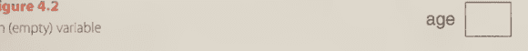

变量还有*类型*。变量的类型规定了它可以存储什么种类型的数据。例如，`int` 类型的变量可以存储整数，`boolean` 类型的变量可以存储真/假值，而 `Crab` 类型的变量可以存储螃蟹对象。

在我们的源代码中，当我们需要一个变量时，可以通过编写*变量声明*来创建一个变量。变量声明非常简单：我们只需要写类型和我们想要的变量名称，后面跟一个分号。例如，如果我们想要一个如图 4.2 所示的 `age` 变量来存储整数，我们可以写：

```
int age;
```

这将创建我们的 `age` 变量，准备好存储 `int` 类型的值。

## 4.4 赋值

一旦我们有了变量，就可以准备在其中存储某些内容。这是通过使用*赋值语句*来实现的。

赋值是一个写作等号 `=` 的 Java 指令。

例如，为了将数字 12 存储到我们的 `age` 变量中，我们可以写：

```
age = 12;
```

从左到右读取赋值语句最好：*值 12 被存储到 age 变量中。在执行此赋值语句后，我们的变量将持有我们分配的值。*在我们的图表中，我们通过将值写入白框中（图 4.3）来表示这一点。

# 第 4 章 完成螃蟹游戏

图 4.3 存储整数值的变量

赋值语句的通用形式

```
variable = expression;
```

也就是说，左侧始终是变量的名称，右侧是一个被求值的表达式，其值被存储到该变量中。

在我们的程序中，我们经常想要声明一个变量并在其中存储一个值。因此，我们经常会发现变量声明和赋值语句写在一起的：

```
int age;
age = 12;
```

因为这非常常见，Java 允许我们将这两个语句合写在同一行中：

```
int age = 12;
```

这一行单行代码创建了整数变量 `age` 并将 12 分配给它。它的执行效果与上面的两行版本完全相同。

赋值会覆盖之前存储在变量中的任何任何值。因此，如果我们现在的 `age` 变量存储的是值 12，然后我们写：

```
age = 42;
```

`age` 变量现在将存储值 42。12 被覆盖了，我们无法找回它。

## 4.5 对象变量

我们在上面提到过，变量不仅可以存储数字，还可以存储对象。

Java 区分了基本类型和对象类型。基本类型是一组有限且常用的数据类型，如 `int`、`boolean` 和 `char`。它们的数量并不多——附录 D 列出了 Java 中所有的基本类型。

Java 中的每个类也定义了一个类型，例如，我们得到了一个 `Crab` 类型。所以通过我们的 `Crab` 类，我们的 `Lobster` 类定义了一个 `Lobster` 类型，依此类推。我们可以声明这些类型的变量：

```
Crab myCrab;
```

请再次注意，这和之前一样，我们将类型写在前面（`Crab`），后面跟上我们可以自己命名的名称（`myCrab`），以及一个分号。

### myCrab

当我们有一个对象变量时，我们就可以向其中存储对象。我们现在可以将其与我们在 4.2 节中看到的创建螃蟹对象的指令结合起来。

```
Crab myCrab;
myCrab = new Crab();
```

像之前一样，我们也可以将其写在一行内：

```
Crab myCrab = new Crab();
```

这一单行代码做了三件事：

- 它创建了一个名为 `myCrab` 的类型为 `Crab` 的变量。
- 它创建了一个螃蟹对象（类型为 `Crab` 的对象）。
- 它将螃蟹对象赋值给 `myCrab` 变量。

当我们有一个赋值语句时，赋值的右侧总是先执行（创建螃蟹对象），然后进行对左侧变量的赋值。


在我们的图表中，我们使用箭头来绘制存储对象的对象变量（图 4.4）。在这里，变量 `myCrab` 存储指向螃蟹对象的引用。对象变量始终存储对象的引用（而不是直接存储）这一事实在以后将变得重要，所以我们会仔细地这样准确绘制。

变量的类型和赋值给它的值的类型必须始终匹配。你可以将一个 `int` 值赋值给 `int` 变量，也可以将一个 `Crab` 对象赋值给 `Crab` 变量。但你不能将一个 `Crab` 对象赋值给 `int` 变量（或任何其他不匹配的组合）。

### 练习 4.1
为变量写一个变量声明。

### 练习 4.2
你可以将一个 `int` 值赋值给 `int` 变量，也可以将一个 `Crab` 对象赋值给 `Crab` 变量。但你不能将一个 `Crab` 对象赋值给 `int` 变量（或任何其他不匹配的组合）。

### 练习 4.3
为变量写一个变量声明。

### 练习 4.4
声明一个 `int` 类型变量。

### 练习 4.5
声明一个 `boolean` 类型变量。

### 练习 4.6
声明一个 `Crab` 类型变量。

### 练习 4.7
声明一个 `int` 类型变量。

### 练习 4.8
声明一个 `int` 类型变量。

### 练习 4.9
声明两个 `int` 类型变量。

## 使用变量

当我们有一个对象变量时，我们就可以向其中存储对象。我们现在可以将其与创建螃蟹对象的指令结合起来，我们在 4.2 节中见过。

```
Crab myCrab;
myCrab = new Crab();
```

像之前一样，我们也可以将其写在一行内：

```
Crab myCrab = new Crab();
```

这一单行代码做了三件事：

- 它创建了一个名为 `myCrab` 的类型为 `Crab` 的变量。
- 它创建了一个螃蟹对象（类型为 `Crab` 的对象）。
- 它将螃蟹对象赋值给 `myCrab` 变量。

当我们有一个赋值语句时，赋值的右侧总是先执行（创建螃蟹对象），然后进行对左侧变量的赋值。

在我们的图表中，我们使用箭头绘制存储对象的对象变量（图 4.4）。在这里，变量 `myCrab` 存储指向螃蟹对象的引用。对象变量始终存储对象的引用（而不是直接存储）这一事实在以后将变得重要，所以我们会仔细地这样准确绘制。

变量的类型和赋值给它的值的类型必须始终匹配。你可以将一个 `int` 值赋值给 `int` 变量，也可以将一个 `Crab` 对象赋值给 `Crab` 变量。但你不能将一个 `Crab` 对象赋值给 `int` 变量（或任何其他不匹配的组合）。

### 练习 4.1
写一个变量声明。

### 练习 4.2
你可以将一个 `int` 值赋值给 `int` 变量，也可以将一个 `Crab` 对象赋值给 `Crab` 变量。但你不能将一个 `Crab` 对象赋值给 `int` 变量（或任何其他不匹配的组合）。

### 练习 4.3
为变量写一个变量声明。

### 练习 4.4
声明一个 `int` 类型变量。

### 练习 4.5
声明一个 `boolean` 类型变量。

### 练习 4.6
声明一个 `Crab` 类型变量。

### 练习 4.7
声明一个 `int` 类型变量。

### 练习 4.8
声明一个 `int` 类型变量。

### 练习 4.9
声明两个 `int` 类型变量。

## 4.7 向世界中添加对象

在 4.1 节所示的构造函数代码中，我们看到可以使用以下行：

```
addObject(myCrab, 250, 200);
```

`addObject` 方法是 `World` 类的一个方法，它允许我们将演员添加到世界中。我们可以通过查看 `World` 类的文档来查找它。我们看到它具有以下签名：

```
void addObject(Actor object, int x, int y)
```

从头到尾读取签名，这告诉了我们：

- 方法不返回结果（`void` 类型）。
- 方法名称是 `addObject`。
- 方法有三个参数，分别为 `object`、`x` 和 `y`。
- 第一个参数的类型是 `Actor`，另外两个的类型是 `int`。

此方法可以将一个新的演员添加到世界中。由于该方法属于 `World` 类且 `CrabWorld` 继承自 `World` 类，该方法在我们 `Crab` 类中是可用的，我们可以直接调用。

我们刚刚创建了一只螃蟹并将其存储在 `myCrab` 变量中。现在我们可以使用存储它的变量来作为 `addObject` 方法调用的第一个参数。其余两个参数指定了我们想要添加对象的 x 和 y 坐标。

所有构造（变量声明、对象创建、赋值以及将对象添加到世界）看起来是这样的：

```
Crab myCrab = new Crab();
addObject(myCrab, 250, 200);
```

我们可以为 `Actor` 参数使用 `Crab` 类型的对象，因为螃蟹是一种演员（`Crab` 类是 `Actor` 类的子类）。

### 练习 4.10
在你项目的 `CrabWorld` 构造函数中添加代码来自动创建一只螃蟹，如上所述。

### 练习 4.11
在 `CrabWorld` 中添加代码自动创建三只龙虾。你可以为它们在世界中选择任意的位置。

### 练习 4.12
在 `CrabWorld` 的任意位置创建两条虫子。

## 保存世界

我们现在将介绍一种更简单的方法来实现相同的目标。

首先，再次移除你在上组练习中引入的代码，这样对象就不会被自动创建。当你再次编译场景时，世界将是空。然后执行以下练习。

### 练习 4.13
编译你的场景。然后（交互式地）将以下演员放入你的世界中：一只螃蟹、三只龙虾和十只虫。

### 练习 4.14
右键点击世界背景。将弹出世界的上下文菜单。从该菜单中选择**保存世界 (Save the World)**。

当你向世界中放置了一些对象并然后选择*保存世界*功能（图 4.5）时，你会发现 `CrabWorld` 源代码打开了，并且在该类中插入了一些新代码。请仔细研究这些代码。

图 4.5

“保存世界”功能

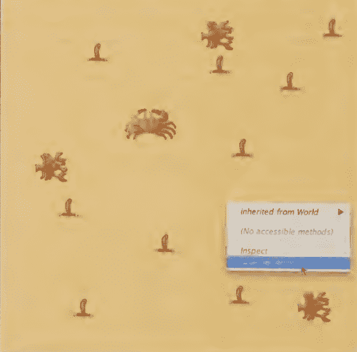

## 4.9 制作动画

你会看到这段代码执行了以下操作：

- 构造函数现在包含了对名为 `prepare()` 的新方法的调用。
- 添加了该方法的定义。
- `prepare()` 方法包含创建并添加所有刚刚交互式创建的演员的代码。

这里发生了什么？

当我们交互式地创建对象并选择“保存世界”时，Greenfoot 会将代码写入我们的世界类中，以重新创建我们手动设置的情景。它是通过创建并调用 `prepare()` 方法来实现的。

效果是，现在每当我们点击编译（Compile）或重置（Reset）时，演员都会立即重新创建。

之前手动编写代码和放置演员的练习帮助我们理解这种方法的工作原理。在很多情况下，我们不需要手动编写这些代码——可以使用“保存世界”来代替——但详细了解它是很有重要的。在其他情况下，我们需要更复杂的设置，那时我们仍然需要手动编写初始化代码。

## 制作动画

现在我们已经成功地通过良好的设置自动启动了游戏，我们可以花一点时间改进一些细节。

接下来我们将处理螃蟹图像的动画。为了让螃蟹的移动看起来更好，我们计划改变螃蟹，让它在行走时移动腿部。

动画是通过一个简单的技巧实现的：我们有两张不同的螃蟹图像（在我们的场景中，它们被称为 `crab.png` 和 `crab2.png`），我们只需要非常快速地在这两个版本之间切换螃蟹的图像。这些图像中螃蟹腿的位置略有不同（图 4.6）。

这种（在这些图像之间来回切换）的效果是螃蟹看起来像在移动腿部。

为了实现这一点，我们必须使用更多的变量，并讨论如何处理 Greenfoot 图像。

图 4.6

螃蟹腿的略有不同


## 4.10 Greenfoot 图像

Greenfoot 提供了一个名为 `GreenfootImage` 的类，帮助使用和操作图像。我们可以通过构造一个新的 `GreenfootImage` 对象——使用 Java 的 `new` 关键字——并将图像文件名作为构造函数的参数来获取图像。例如，要访问 `crab2.png` 图像，我们可以写：

```
new GreenfootImage("crab2.png")
```

概念：Greenfoot Actor 通过持有 `GreenfootImage` 类型的对象来维护它们的可见图像。

文件名必须存在于场景的文件夹中。所有的 Greenfoot Actor 都有图像。默认情况下，演员从它们的类获取图像。我们在创建类时为类分配图像，从该类创建的每个对象在创建时都会收到相同图像的副本。然而，这意味着相同类的所有对象并不总是保持相同的图像。每个演员都可以随时决定更改其图像。

### 练习 4.15
检查 `Actor` 类的文档。有两个方法允许我们更改演员的图像。它们叫什么，参数是什么？它们返回什么？

如果你完成了上面的练习，你会发现一个设置演员图像的方法需要一个 `GreenfootImage` 类型的参数。这就是我们将用来如上所述从图像文件创建 `GreenfootImage` 对象并将其赋值给 `GreenfootImage` 类型变量的方法。然后我们使用演员的 `setImage` 方法将其应用于演员。这里是执行此操作的代码片段：

```
GreenfootImage image1 = new GreenfootImage("crab.png");
setImage(image1);
```

要将图像改回原始图像，我们写：

```
GreenfootImage image2 = new GreenfootImage("crab2.png");
setImage(image2);
```

这从命名的图像文件（`crab.png` 和 `crab2.png`）创建对象并赋值给 `image1` 和 `image2` 变量。然后我们使用这些变量将新图像设置为演员的图像。为了创建动画效果，我们必须设置让这两个代码段交替执行：先执行一个，再执行另一个，循环往复。

现在继续添加代码了。

### 练习 4.16
在添加此代码之前，在你的世界中右键点击螃蟹对象，并从螃蟹的弹出菜单中选择 **Inspect**（检查）。记录下螃蟹对象中显示的所有变量。

### 练习 4.17
你为什么认为螃蟹会有变量呢，尽管我们在螃蟹类中还没有声明过任何变量？

### 练习 4.18
将上述代码 4.3 所示的变量声明添加到你对应版本的 **Crab** 类中。确保该类可以编译。

### 练习 4.19
添加变量后，再次检查你的螃蟹对象。记录下变量及其值（显示在白色方框中）。

在我们的图表中，我们将对象绘制为带有圆角的彩色矩形框，并将实例变量绘制为对象内部的白色方框（图 4.7）。请注意，这两处 `GreenfootImage` 变量的声明并没有为我们提供两个 `GreenfootImage` 对象。它为我们提供了一些存储两个对象的空空间。


接下来我们必须创建这两个对象并将它们存储在实例变量中。创建对象的语句已经在上面给出。它是通过以下代码段实现的：

```
new GreenfootImage("crab2.png")
```

现在我们只需要创建两个对象并将它们赋值给实例变量：

```
image1 = new GreenfootImage("crab.png");
image2 = new GreenfootImage("crab2.png");
```

执行这些语句后，我们拥有三个对象（一个螃蟹和两个图像），螃蟹的变量包含了对图像的引用。如图 4.8 所示。

最后一个问题是将创建图像并将其入变量的代码放在哪里。由于这应该只在螃蟹对象创建时执行一次，而不是每次操作时都执行，因此我们不能将其放在 `act` 方法中。相反，我们将这段代码放入构造函数中。

# 第 4 章 完成螃蟹游戏

图 4.8

带有两个变量的螃蟹对象，指向图像对象

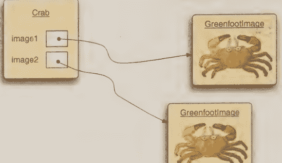

## 4.12 使用 actor 构造函数

在本章开头，我们学习了如何使用 `World` 类的构造函数来初始化世界。同样，我们可以使用 `Actor` 类的构造函数来初始化 actor。构造函数中的代码在 actor 创建时执行一次。代码 4.4 显示了 `Crab` 类的构造函数，它通过创建图像并赋值给变量来初始化两个实例变量。

代码 4.4 在构造函数中初始化变量

```
import greenfoot.*;
// 省略注释

public class Crab extends Actor {
    private GreenfootImage image1;
    private GreenfootImage image2;

    /**
      创建一个螃蟹并初始化它的两个图像。
     */
    public Crab() {
        image1 = new GreenfootImage("crab.png");
        image2 = new GreenfootImage("crab2.png");
        setImage(image1);
    }
    // 省略方法
}
```

适用于 `World` 构造函数的规则同样适用于 `Crab` 构造函数：

- 构造函数的签名不包含返回类型。
- 构造函数的名称与类名相同。
- 当螃蟹对象创建时，会自动执行构造函数。

最后一个规则——构造函数会自动执行——确保了当我们在我们创建螃蟹时，图像对象会被自动创建并赋值。因此，在创建螃蟹后，情况将如图 4.8 所示。

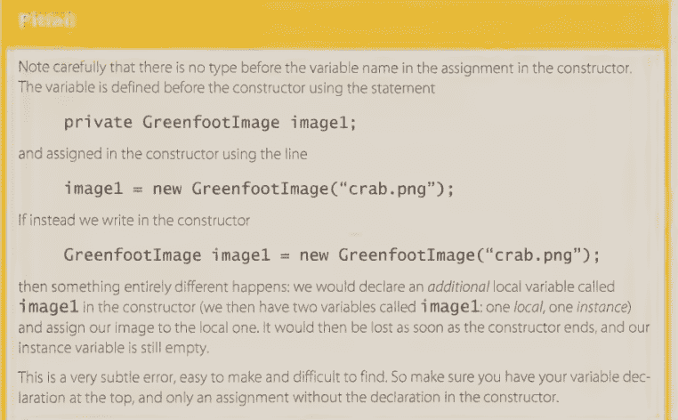

仔细注意，在构造函数的赋值中，变量名之前没有类型。

变量在构造函数之前使用以下语句定义：

```
private GreenfootImage image;
```

并在构造函数中使用该行进行赋值：

```
image = new GreenfootImage("crab.png");
```

如果在构造函数中写成：

```
GreenfootImage image = new GreenfootImage("crab.png");
```

那么就会发生完全不同的事情：我们在构造函数中声明了一个额外的局部变量 `image1`（此时我们有两个名为 `image1` 的变量：一个是局部的，一个是实例的），并将图像赋值给局部变量。一旦构造函数结束，它就会丢失，而我们的实例变量仍然是空的。

这是一个非常微妙的错误，容易犯且难以发现。因此，请确保在顶部进行变量声明，而在构造函数中只进行赋值而不进行声明。

构造函数的最后一行将创建的两个图像第一个设置为螃蟹的当前图像：

```
setImage(image1);
```

我们稍后可以在 `act` 方法中使用类似的方法来切换图像。

### 练习 4.20
将此构造函数添加到你的 `Crab` 类中。你暂时还不会看到螃蟹行为的任何变化，但该类应该是可以通过编译的，你应该能够创建螃蟹。

### 练习 4.21
再次检查你的螃蟹对象。记录变量及其值。将它们与你之前记录的内容进行比较。

### 交替图像

我们现在进入了 `if` 语句拥有两个图像的阶段。为了制作动画，我们需要在两个图像之间交替。换句话说，如果我们当前显示的是图像1，那么我们需要切换到图像2。反之亦然。这里是实现这种要求的伪代码：

```
如果 image1 使用 image2
否则使用 image1
```

伪代码像这里这样使用，是部分代码、部分英语。我们现在可以用真实代码表示：

```
if (getImage() == image1) {
  setImage(image2);
} else {
  setImage(image1);
}
```

螃蟹现在有两个图像可用。这现在非常简单。我们可以现在真实代码（代码 4.5）中所示：

在这段代码中，我们注意到了几个新元素：

- `getImage()` 方法可以获取 actor 的当前图像。
- 运算符 `==`（两个等号）可以用于比较两个值。结果为真或假。
- `if` 语句有一种我们之前没过的扩展形式。

> **注意**
>
> 一个常见的错误是将赋值运算符 (`=`) 和检查相等性的运算符 (`==`) 混淆。如果你想检查两个值是否相等，必须写两个等号。

### if/else 语句

在继续之前，让我们再次详细地研究 `if` 语句。正如我们刚刚看到的，`if` 语句可以写成：

```
if ( 条件 )
{
    语句;
} else
{
    语句;
}
```

这个 `if` 语句包含两个块（括号包围的语句列表）：`if` 子句和 `else` 子句（按此顺序）。

当执行此 `if` 语句时，首先评估条件。如果条件为真，则执行 `if` 子句，然后继续执行 `else` 子句之后。如果条件为假，则不执行 `if` 子句；相反执行 `else` 子句。因此，执行两个语句块中的一个，而不是两者。

带有第二个块的 `else` 部分是可选的——回到我们之前看到的较短 `if` 语句。

我们现在已经掌握了完成此任务的所有知识。是时候再次上手键盘尝试了。

### 练习 4.22
将代码 4.5 所示的图像切换代码添加到你自己的 `Crab` 类的 `act` 方法中。尝试一下！（如果有错误，请修复。这应该可以运行）同时在 Greenfoot 中点击 `Act` 按钮而不是 `Run` 按钮——这允许我们更清楚地观察行为。

### 练习 4.23
在第 3 章中，我们讨论了使用单独的方法处理子任务，而不是直接在 `act` 方法中编写更多代码。使用这段图像切换代码：创建一个名为 `switchImage` 的新方法，将你的图像切换代码移动到其中，并在 `act` 方法内部调用此方法。

### 练习 4.24
从螃蟹的弹出菜单交互式地调用 `switchImage` 方法。它有效吗？

### 计数虫子


我们想要实现的最后一个目标是添加一个功能，让螃蟹数它吃了多少条虫子。如果它吃了八条虫子，我们就赢了游戏。在这种情况下，我们还希望播放一段简短的“胜利音”。

为了实现这一目标，我们需要对螃蟹的代码进行一些添加。我们需要：

- 一个用于存储当前吃掉虫子数量的实例变量；
- 一个在开始将该变量初始化为零的赋值语句；
- 每次吃一条虫子时增加计数器的代码；
- 用于检查我们是否已经吃了八条虫子的代码，如果是，则停止游戏和声音。

让我们按照这里列出的顺序完成这些任务。

我们可以按照上面介绍的模式定义一个新的实例变量。在我们现有的两个实例变量定义下方，添加这一行：

```
private int wormsEaten;
```

这里，`int` 类型表示我们想要存储整数（整数字），`wormsEaten` 名称表示我们打算用它做什么。

接下来，我们在构造函数的末尾添加以下行：

```
wormsEaten = 0;
```

这在创建螃蟹时将 `wormsEaten` 变量初始化为零。严格来说，因为 `int` 类型的实例变量会自动初始化为零。但是，有时我们希望初始值是零的其他数字，所以编写自己的初始化语句是一个良好的习惯。

最后一部分是计算虫子并检查我们是否已经达到了八条。我们需要在每次吃虫子时执行此操作，所以我们找到 `lookForWorm` 方法，那里有我们吃虫子的代码。在这里，我们添加一行代码来增加计数：

```
wormsEaten = wormsEaten + 1;
```

就像赋值一样，赋值符号的右侧先被求值（`wormsEaten + 1`）。因此，我们找到 `wormsEaten` 的当前值并对其加 1。然后将结果赋值回 `wormsEaten` 变量。结果是，该变量将增加 1。

之后，我们需要一个 `if` 语句来检查我们是否已经有了八条虫子，如果是，则播放声音并停止执行。代码 4.6 显示了带有这段代码的完整 `lookForWorm` 方法。这里使用的声音文件（`fanfare.wav`）包含在场景的 `sounds` 文件夹中，因此可以直接播放。

## 更多想法

- 检查我们是否撞上了虫子。
- 如果是，就吃掉它。如果没有，什么都不做。
- 如果我们吃了八条虫子，我们就赢了。

```java
public void lookForWorm() {
    if (isTouching(Worm.class)) {
        removeTouching(Worm.class);
        Greenfoot.playSound("slurp.wav");

        wormsEaten = wormsEaten + 1;
        if (wormsEaten == 8) {
            Greenfoot.playSound("fanfare.wav");
            Greenfoot.stop();
        }
    }
}
```

**练习 4.25** 将上述代码添加到自己的场景中。测试它，并确保它工作正常。

**练习 4.26** 作为进一步测试，在开始游戏之前，为你的螃蟹对象打开对象检查器（通过从螃蟹的弹出菜单中选择 **Inspect**）。保持检查器打开，并在玩时密切观察 `wormsEaten` 变量。

书中 `scenarios` 文件夹中的 `little-crab-5` 场景包含了这里讨论的所有扩展内容的项目版本。

我们将离开这个场景并移动到另一个示例，尽管你可以用这个项目做很多明显的事情（可能还有更多不那么明显的事情）。想法包括：

- 为背景和演员（actors）使用不同的图像；
- 使用不同类型的演员；
- 不自动向前移动，而是只有在按下向上箭头键时才移动；
- 通过引入第二个监听不同键的键盘控制类来构建双玩家游戏；
- 当一条虫子被吃掉时（或在随机时间）产生新的虫子；以及
- 许多你可以自己想出来的想法。

**练习 4.27** 螃蟹在运行时，其图像变化得相当快，这让我们的螃蟹看起来有点过度活跃。如果螃蟹的图像只每隔第二个或第三个动作周期变化一次，可能会更好看。尝试实现这一点：要做到这一点，你可以添加一个在 `act` 方法中增加的计数器。每当它达到二（或三）时，图像改变，计数器重置为零。

## 编程技术总结

在本章中，我们看到了许多重要的新编程概念。我们看到了构造函数如何被用于初始化对象——在创建新对象时，构造函数总是会被执行。

我们看到了实例变量和局部变量。实例变量（也称为字段）被配合赋值语句用于存储对象中的信息，这些信息稍后可以被访问。局部变量用于存储短暂的信息——在单次方法执行期间——并在方法结束时丢弃。

我们有了新的语句来程序化创建创建对象，最后，我们看到了 `if` 语句的完整版本，它包含一个 `else` 部分，当条件不成立时会执行该部分。

有了所有这些技术，我们现在可以编写相当多的代码了。

## 概念总结

- 类的构造函数是一种特殊的方法，每当创建新实例时它都会自动执行。
- 可以使用 `new` 关键字程序化地（在代码内部）创建 Java 对象。
- 变量可以用于存储信息（对象或值）以供以后使用。
- 可以通过编写声明来创建变量。
- 可以通过赋值语句（`=`）在变量中存储值。
- 局部变量仅在方法执行期间有效。
- 原始类型变量存储数字、布尔值；对象类型变量存储对象。
- 通过存储对象的引用来维护图像。
- 实例变量（也称为字段）只要对象存在就有效。
- 使用双等号 `==` 测试两个事物是否相等。
- `if/else` 语句在给定条件为真时执行一段代码，为假时执行另一段代码。

## 操练

这一次，我们对方法调用进行更多练习，包括继承的方法以及变量的使用。

# 更多螃蟹的工作

**练习 4.28** 让虫子变得有点危险。`Actor` 类有一个方法 `turnTowards`。使用这个方法让虫子偶尔转向屏幕中心。尝试这种频率，以及不同的和螃蟹的速度。

**练习 4.29** 为螃蟹添加一个时间计数器（你可以通过添加一个每次增加的整数变量来实现）。这应该是局部变量还是实例变量？为什么？

**练习 4.30** 玩你的游戏。一旦你赢得（吃了八条虫子），检查螃蟹并查看花了多久。花了多少个动作周期？

**练习 4.31** 将你的时间计数器从螃蟹类移动到 `CrabWorld` 类（由世界管理时间比由单个螃蟹更合理）。变量很容易移动。移动增加时间的语句，你需要在 `CrabWorld` 类中定义一个 `act` 方法。`World` 子类可以拥有 `act` 方法，就像 `Actor` 子类一样。只需复制螃蟹的 `act` 方法的签名并在 `CrabWorld` 中创建一个新的 `act` 方法并将计数语句放在那里即可。

**练习 4.32** 修改你的游戏时间计数器作为一个计时器。即：将时间变量初始化为一个值（例如 500），并在每一步递减（变量减 1）。如果计时器达到零，用“时间到”的声音结束游戏。尝试不同的游戏时间。

**练习 4.33** 调查 `World` 类的 `showText` 方法。它有几个参数？它们是什么？它返回什么？它做什么？

**练习 4.34** 使用 `showText` 方法在屏幕上显示游戏计时器。你可以在 `CrabWorld` 的 `act` 方法中这样做。你需要类似这样的语句：

```
showText("Time: " + time, 100);
```

其中 `time` 是你的时间变量的名字。（注意：此语句使用了加运算符和文本字符串，我们将在第 5 章中解释。）

## 小弹球练习

**练习 4.35** 创建一个新的场景。在其中，创建一个 World 类和一个名为 `Ball`（球）的 Actor 类。（给它一个像球状的图像。）编写球的代码，使其以恒定速度移动并在世界的边缘反弹。

**练习 4.36** 编写球的代码，使其统计从边缘反弹的次数。在球的对象检查器打开的情况下运行你的场景进行测试。

**练习 4.37** 编写你的场景，使其在开始时自动出现三个球。

**练习 4.38** 修改你的设置代码，让三个球出现在随机位置。

**练习 4.39** 修改边缘反弹的代码，让球以某种程度上随机的角度从边缘反弹。

## 分享你的场景

在本节中，我们不会引入新的编程技术，而是进行简短的转折，讨论你如何与他人分享你所创建的内容。“他人”可能是坐在你旁边的朋友，也可能是世界另一端的另一个 Greenfoot 程序员。

## 分享你的场景

当你写完一个场景（可能是一个游戏或模拟）后，你可能希望让其他人也能使用它。这些用户应该有启动（并重启）游戏的机会，但他们不需要访问类图或源代码。他们不应该修改游戏；而是直接使用它。

为了让场景在共享时运行良好，重要的一点是让它在游戏开始时自动创建你想在屏幕上看到的所有 Actor。用户将无法通过交互方式创建对象。

在 Greenfoot 中，这是通过分享场景来实现的。你可以点击 Greenfoot 主窗口右上角的 **Share**（分享）按钮来分享你的场景。这将让你从四个选项中进行选择：**Publish**（发布）、**Webpage**（网页）、**Application**（应用程序）和 **Project**（项目）。

### 发布到 Greenfoot 网站

分享你场景最常见的方法是将其发布到 Greenfoot 网站上。Greenfoot 网站是一个公共网站（地址为 http://www.greenfoot.org/），它允许 Greenfoot 用户上传他们的 Greenfoot 场景。当你在 Greenfoot 网站上分享你的场景时，它将向全球开放——任何可以访问互联网的人都可以看到并运行它。

分享对话框（图 11.1）顶部显示了网站地址。点击此处打开网站并查看上面的内容。最好你先浏览一下该网站。

在 Greenfoot 网站上，每个人都可以查看和运行场景，但如果你想对它们评分、发表评论或上传你自己的场景，你需要在网站上创建一个账户。这既快又简单。

创建账户后，你可以使用图 11.1 所示的对话框轻松地上传你自己的场景。对话框允许你添加图标、描述以及标识你场景的标签。

如果你选择发布源代码（勾选 **Publish source code** 复选框），你的完整源代码将被复制到 Greenfoot 网站，其他人随后可以在那里下载它、阅读它，并制作你场景的自己的版本。

你以后只需通过使用相同的标题再次导出，就可以更改和改进已发布的场景。

将场景发布到 Greenfoot 网站是获取其他用户反馈的良好方法：例如关于哪些部分有效、哪些无效的评论，以及你可以添加到程序中的建议。Greenfoot 网站也是获取进一步功能想法或学习如何实现某事的好地方。它包含一个讨论区，你可以在那里提问和回答，并讨论编程技术和想法。或者你可以寻找带有源代码的场景，下载源码并检查其他程序员是如何实现他们的类的。

### 11.3 导出到网页

第二个选项是将你的场景导出到自己的网页（图 11.2）。你可以选择导出的位置和名称，Greenfoot 将创建一个以此命名的文件夹。在该文件夹中，Greenfoot 会创建一个网页（HTML 格式），并将你的场景转换为可以在网页中运行的 applet。Applet 是可以在浏览器中嵌入运行的 Java 程序版本。

你可以通过在浏览器中打开生成的网页来执行你的场景。

最初，此网页只能在你自己的电脑上使用。如果你想将其包含在其他人可见的网页中，你需要某个 Web 服务器来发布它。

“Lock scenario”（锁定场景）选项会在应用程序启动前禁用世界的移动，并移除 Act 按钮和执行速度滑块。如果你有一个游戏，通常希望锁定场景，而对于模拟或其他性场景，你可能希望保持解锁状态以便用户进行更多实验。

### 11.4 导出到应用程序

下一个选项是将场景导出为应用程序。应用程序是一个可以在本地运行的独立程序。要执行此操作，请在对话框（图 11.4）中选择 **Application**。这将创建一个不需要 Greenfoot 即可运行场景的可执行文件。

当你将场景导出为应用程序时，Greenfoot 会创建一个包含可执行文件和所有资源的文件夹。你可以将此文件夹分发给其他人，他们可以作为独立程序运行你的场景。

## 5.1 WBC: 起点

在书籍项目（projects）中找到 `WBC-1` 场景，并尝试运行它。

**练习 5.1** 打开 `WBC-1` 场景并运行它。描述你观察到的现象。

**练习 5.2** 为场景中的每个类编写一个简短的（一句或两句）描述，说明它们代表了什么。

**练习 5.3** 打开这四个类的源代码。研究代码并尝试推导出它是如何工作的。记下代码中任何你不理解的部分。

你应该能够推导出大部分正在发生的情况。我们将快速浏览这些类中有趣的元素。

`Lining` 类是微不足道的——它什么都不做。该类的对象仅仅为了装饰；它们被放置在屏幕的顶部和底部，不与任何其他对象发生交互。

其他类值得我们仔细观察。

## WhiteCell: 受限制的移动

`WhiteCell` 类定义了一个白细胞——这是我们通过键盘控制的游戏对象。它的代码结构非常直观；它的 `act` 方法只调用了一个方法来检查按键输入，该方法对“向上”和“向下”键做出反应（代码 5.1）。

# 代码 5.1

```java
/**
 * Act: 当按下方向键时，向上或向下移动。
 */
public void act() {
    checkKeyPress();
}
```

```java
/**
 * 检查键盘键是否被按下，如果是则做出反应。
 */
private void checkKeyPress() {
    if (Greenfoot.isKeyDown("up")) {
        setLocation(getX(), getY() - 4);
    }
    if (Greenfoot.isKeyDown("down")) {
        setLocation(getX(), getY() + 4);
    }
}
```

唯一有趣的部分是两行形式为 `setLocation(getX(), getY() - 4);` 的代码。

这是实际移动对象的代码。我们使用了 `Actor` 类中之前没见的三个方法：`setLocation(x, y)`、`getX()` 和 `getY()`。

**练习 5.4** 在 `Actor` 类的文档中查找这三个方法。写下它们的签名（signature）。

`getX()` 和 `getY()` 方法分别返回当前的 x 坐标和 y 坐标，类型为整数。

`setLocation` 方法期望两个参数，一个 x 坐标和一个 y 坐标，并将 Actor 放置在该位置。它的签名是：

```java
void setLocation(int x, int y)
```

所以，例如，使用坐标 120, 200 调用此方法：

`setLocation(120, 200);`

会将我们的血细胞“传送”到坐标 120, 200 的位置。

我们现在可以使用 `getX()` 和 `getY()` 方法来代替预期的坐标：

`setLocation(getX(), getY());`

## 5.2 WhiteCell: 受限制的移动

当一个方法调用（`getX()`）被写作为另一个方法调用（`setLocation(...)`）的参数时，内部的方法调用会被先求值，其结果将作为外部方法调用的参数。

像这样写的话，我们会首先获取当前的 x 坐标，获取当前的 y 坐标，然后将我们的位置设置为这些坐标。因此，此语句将没有任何可见的效果：我们把自己放在了已经所在的位置。

然而，我们可以进行一个修改：

```java
setLocation(getX(), getY() - 4);
```

# 第5章 评分

代码 5.3

血流的 act 方法

```java
/**
 * 以不规则的时间间隔创建浮动对象。
 */
public void act() {
    if (Greenfoot.getRandomNumber(100) < 3) {
        addObject(new Bacteria(), 779, Greenfoot.getRandomNumber(360));
    }
}
```

y 坐标是 360 范围内的随机数——即世界的高度。因此，新细菌的 y 轴是任何可能高度的随机位置。我们之前已经见过所有这些构造了，它们只是在这里被用于一个新的用途。

# 侧向滚动移动

你现在应该能够理解目前的代码了，并准备好添加更多对象和功能，让这个项目更有趣。我们将通过一系列练习完成这些，这些练习将应用我们已经掌握的一些构造。

首先，我们想要营造出我们的白细胞正在通过血液持续向右移动的印象。然而，我们实际上并不想移动白细胞，因为我们想让它永久留在屏幕上。相反，我们移动背景——让内衬对象向左移动，以产生移动的错觉。这是许多侧向滚动视频游戏中的一种常用技术。

为了做到这一点，我们需要做三件事：

- 让内衬对象缓慢向左移动。
- 当内衬对象到达左边缘时，将其移除。
- 在右侧创建新的内衬对象。

**练习 5.5** 让内衬对象持续向左移动。它们应该在每个 act 周期移动一个单元格。你可以通过复制 `Bacteria` 的 `act` 方法的第一行，并将移动距离更改为 1 来实现这一点。

**练习 5.6** 让内衬对象在到达左边缘时消失。同样，`Bacteria` 类中也有这种操作的示例，你可以参考它进行指导。

**练习 5.7** 为 act 方法编写一个恰当的注释。

**练习 5.8** 让新的内衬对象出现在屏幕右侧。在 `Bloodstream` 的 `act` 方法中执行此操作。它们应该以 1% 的概率出现（平均每 100 个 act 周期出现一次）。


最后一个练习可以通过复制 `Bloodstream` 的 `act` 方法中的 `if` 语句两次来实现：一次用于屏幕顶部的内衬对象，一次用于底部的对象。将 `if` 语句中的 3 改为 1 以降低其出现频率。然后更改要创建的对象的类，并将 y 坐标从随机值改为固定值：内衬顶部为 0，底部为 359。例如，

```java
addObject(new Lining(), 779, 359);
```

这会在屏幕底部添加一个内衬对象。

如果你遇到困难，可以在场景 WBC-2 中找到我们这里讨论的所有练习的实现。

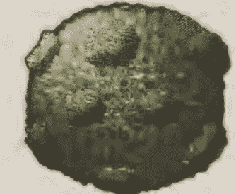

## 5.6 添加病毒

我们在游戏中的任务是捕获浮动的细菌。为了让这更具挑战性，让我们添加一些危险：病毒。病毒也会在血液中漂浮，但我们的细胞必须避开它们。

**练习 5.9** 为你的场景添加一个用于病毒的新类（作为 `Actor` 的子类）。将其命名为 **Virus**。场景中已经准备好了一个图像供你使用（图 5.2）。

**练习 5.10** 扩展 `Bloodstream` 的 `act` 方法，在屏幕右边缘添加新的病毒对象。让 y 坐标变为随机。让新对象的出现概率为 1%（每百个 act 周期中一次）。测试它。（病毒对象应该偶尔出现在右边缘，但目前先不要更多了。）

**练习 5.11** 让病毒对象向左移动并旋转。然而，病毒每种 act 周期移动四个单元格（而不是两个）。

**练习 5.12** 为你的 `Virus` 类编写注释。（在类顶部和 `act` 方法上方填写。）

## 5.7 碰撞：移除细菌

接下来，让我们检查是否碰撞到了细菌（如果是，则移除它们）或病毒（在那种情况下，游戏结束）。这与我们对螃蟹、蠕虫所做的非常相似。

**练习 5.13** 在 `WhiteCell` 中创建一个名为 `collision` 的新方法。该方法可以是空的。在你的 `act` 方法中调用此方法。

**练习 5.14** 在 `collision` 方法中添加如果发生碰撞则移除细菌的代码（使用 `isTouching()` 和 `removeObject()` 方法，就像螃蟹场景那样）。

**练习 5.15** 在移除细菌时播放声音。场景中包含了 "slurp.wav" 声音。

**练习 5.16** 在 `collision` 方法中添加类似的代码（另一个 `if` 语句）来检查是否碰到病毒。如果是，播放名为 "game-over.wav" 的声音。

> 注意：如果你仔细观察，可能会发现当白细胞靠近病毒但尚未真正碰撞时游戏停止了。它们之间仍然存在距离。这是由图像存储方式造成的，将在详细讨论。

## 5.8 可变速度

为了创建更有趣的移动（更有趣的游戏性），我们希望让细菌的速度可变。目前速度为 2（细菌每个 act 周期移动两个单元格）。我们希望将其改为 1 到 3 之间的随机值。为了做到这一点，我们将创建一个速度变量，将其初始化为随机值，并在移动语句中使用。

**练习 5.18** 在你的 `Bacteria` 类中添加一个类型为 `int` 的变量 `speed`。

**练习 5.19** 在 `Bacteria` 构造函数中为 `speed` 分配 1 到 3 之间的随机值。你可能会好奇如何设置 1 到 3 的随机范围，我们之前学过 Greenfoot 的 `getRandomNumber` 方法总是从 0 开始。答案是简单的：获取 0 到 2 的数字，然后加 1：

```java
speed = Greenfoot.getRandomNumber(3) + 1;
```

加 1 是重要的，因为我们不希望速度为 0——否则细菌永远不会移动。

**练习 5.20** 修改你 `act` 方法中的移动语句，减去变量 `speed` 而不是 2。每个细菌现在在创建时都会分配自己的速度。仔细观察，你会发现某些细菌比其他的移动得更快。

## 5.9 红细胞

让我们加入一些红细胞。这完全是视觉上的；我们的其他对象与红细胞没有交互，也不会影响游戏性。**但它们看起来很好！**

**练习 5.21** 添加一个名为 `RedCell` 的新类。你会在场景中找到它的图像。

**练习 5.22** 让红细胞像细菌一样移动，即：它们向左移动并缓慢旋转。有一个小不同：红细胞的速度范围只有 1 到 2（而不是 3）。我们的红细胞很慢。

**练习 5.23** 扩展 `Bloodstream` 类中的 `act` 方法来创建红细胞，与创建细菌或病毒非常相似，但红细胞更频繁：给它们 6% 的概率（每 100 个 act 周期出现 6 次）。

这看起来好多了！现在我们的血液中有点拥挤了，这是好事。在进入下一个任务之前，我们可以进行一个微小的改进。红细胞在创建时具有相同的旋转角度（它们都以旋转 0 创建）。结果是，靠近生成的血细胞同步旋转。这看起来太像同步游泳，随机性不够。

为了修复这个问题，我们希望红细胞从随机旋转开始。我们可以通过在红细胞的构造函数中添加语句将旋转设置为随机数：

```java
setRotation(Greenfoot.getRandomNumber(360));
```

**练习 5.24** 使用上述状态初始化红细胞的随机旋转。

## 添加边界

在进入更有趣的内容之前，我们将进行最后一次视觉改进：在屏幕两侧添加边界。

主要原因是为了处理 Greenfoot 中一个恼人的效果：对象的定位是通过指定图像中心坐标来实现的。因此，当我们在屏幕右边缘放置一个新对象时，它的一半会突然出现，而不是从侧面缓慢移动。在另一端消失时也存在同样的问题：对象在图像一半在屏幕上可见时出现。这让我们的对象看起来有些突兀。

为了解决这个问题，我们使用了一个简单的技巧：在屏幕左侧和右侧放置黑色边界对象来覆盖问题区域。其目的是为了看起来就像我们正在通过显微镜观察血液（见图 5.1）。对象现在将出现在边界之后，视野之外，然后缓慢移动进入视野。

**练习 5.25** 创建一个名为 `Border` 的新 `Actor` 子类。它有一个准备好的图像。

我们可以手动在屏幕的左侧和右侧添加边框对象，并使用“Save the World”功能将它们保存在那里。然而，我们希望将它们放置在非常精确的位置，这手工操作很难实现。因此，编写代码来放置这些对象更为简单。

在 `Bloodstream` 的 `prepare()` 方法中，我们可以添加以下代码：

```java
Border border = new Border();
addObject(border, 0, 180);
Border border2 = new Border();
addObject(border2, 770, 180);
```

**练习 5.26** 将上述代码添加到 `Bloodstream` 的 `prepare()` 方法中。你观察到了哪些遗留问题？

我们需要修复两个小问题：首先，我们的白细胞现在被部分遮挡了；其次，我们的对象出现在边框上方，而不是下方。让我们把这两个问题都修复。

**练习 5.27** 在 `Bloodstream` 的 `prepare()` 方法中，找到定义白细胞初始 x 坐标的地方。将其更改为较大的值，以便细胞向右移动一点。

**练习 5.28** 在 `Bloodstream` 的构造函数中，添加以下语句：

```java
setPaintOrder(Border.class);
```

这将使得边框对象出现在其他对象的上方。测试一下它。

`setPaintOrder` 方法允许指定哪些对象应该绘制在其他对象的上方。该方法具有可变长度参数列表，我们允许指定任意数量的类。例如：

```java
setPaintOrder(Class1.class, Class2.class, Class3.class);
```

在这个例中，`Class1` 的对象将绘制在最上方，`Class2` 对象在其下方，`Class3` 对象在它下方，而所有未在下方列出的对象将以不指定的顺序绘制。

通过编写

```java
setPaintOrder(Border.class);
```

我们声明 `Border` 对象应该在最上方（我们不在乎任何其他对象的顺序）。

到为止讨论的所有练习都包含在场景版本 WBC-3 中。如果你遇到任何问题，你可能想将自己的场景与它进行比较。

**练习 5.29** 为白细胞增加左右移动以及上下移动的能力。

## 5.11 最后：添加分数

我们现在将引入几条获取得分的规则并实现它们。显而易见的第一个主意是在中和细菌时应该获得积分。假设每捕获一个细菌我们得到 20 分。

我们可以从在白细胞类中实现这一点开始。我们需要一个整数变量来保存分数，每当捕获细菌时计数分数，并在屏幕上显示分数。

**练习 5.30** 在你的 `WhiteCell` 类中添加一个类型为 `int` 的实例变量。将其命名为 `score`。

**练习 5.31** 添加一条语句，在捕获细菌时将分数增加 20。

我们在上一章中已经看到过如何添加实例变量。我们在类的顶部、第一个方法上方编写 `private int score;`。

然后，我们可以在移除 `Bacteria` 对象后，立即使用以下语句为分数增加 20 分：

```java
score = score + 20;
```

剩下的工作是在屏幕上显示分数。为了做到这一点，我们使用 `World` 类中的方法方法 `setText(..)`。

**练习 5.32** 查找 `World` 类的 `setText` 方法。它有多少个参数？它们是什么？

## 5.11 最后：添加分数

同样，我们必须调用世界类中的方法，就像我们之前为了从世界移除对象而做的那样。我们使用相同的技术：调用 `getWorld()` 来访问世界对象，然后将 `showText(..)` 方法链在它的末尾：

```java
getWorld().showText(...);
```

剩下的工作是确定 `showText` 方法的参数。它的签名是 `void showText(String, int x, int y)`。

最后两个参数很简单：它们是我们希望文本出现的 x 坐标和 y 坐标。第一个参数是我们想要显示的文本，它是一种我们见过但以前没有真正讨论过的类型：`String`。

`String` 类型的变量可以存储文本，例如字符、单词或句子。`String` 用双引号编写。例如：

```java
String name = "Fred";
String message = "Game over";
```

我们在播放声音之前见过见过一个 `String`：

```java
Greenfoot.playSound("slurp.wav");
```

`playSound` 方法期望一个 `String` 参数，值 "slurp.wav" 是我们传递给它的一个 `String`。我们可以对 `showText` 方法做同样的操作。例如：

```java
getWorld().showText("Hello", 80, 25);
```

将在我们屏幕的指定位置显示单词 "Hello"。

> **练习 5.33** 插入上述语句，以便在捕获细菌时在屏幕上写入单词 "Hello"。
>
> **练习 5.34** 将该语句更改为写入你的名字。
>
> **练习 5.35** 再次更改文本以显示单词 "Score:"（包括冒号）。

## 字符串拼接

我们已经看到如何显示某些文本——剩下的就是找到如何显示我们的分数，分数存储在 `int` 变量中。我们将使用字符串拼接。

字符串拼接使用加号 (`+`) 编写，并将两个 `String` 并成一个。注意，字符串拼接不会自动插入空格。如果你想在两个部分之间留空格，你需要手动编写。

字符串拼接可以处理整数。如果我们把值转换为 `String`，它变成了：

```java
"Score: " + score
```

我们可以使用变量代替整数：

```java
"Score: " + score
```

现在我们有了在屏幕上显示分数所需的一切。**练习 5.36** 在你的游戏中显示分数。**练习 5.37** 游戏目前看起来有点简单。

## 世界中的得分

到目前为止，添加得分一直非常直接。然而，在 `WhiteCell` 类中执行得分有一个缺点：为其他事件添加分数变得困难。


### 世界中的得分

```java
// 语句和注释省略
public class WhiteCell extends Actor
{
    private int score;
    // 其他方法省略

    /**
     * 检查我们是否碰到了细菌或病毒。移除
     * 细菌。如果碰到病毒则游戏结束。
     */
    private void checkCollision() {
        if (isTouching(Bacteria.class)) {
            Greenfoot.playSound("slurp.wav");
            remove(Bacteria.class);
            score = score + 20;
            getWorld().setText("Score: " + score, 80, 25);
        }
        if (isTouching(Virus.class)) {
            Greenfoot.playSound("game-over.wav");
            Greenfoot.stop();
        }
    }
}
```

考虑一下：我们希望完整的得分规则如下：

- 中和细菌得 20 分。（已完成）
- 任何到达屏幕左边缘的细菌我们将失去 15 分。
- 被病毒击不会立即结束游戏；相反，我们将失去 100 分。
- 如果我们的分数低于零，我们就输了，游戏结束。

这些更有趣的得分规则。然而，我们有一个问题。第二个事件（细菌逃逸）将在 `Bacteria` 对象中被注意到。在这里，我们无法访问分数变量，该变量存储在 `WhiteCell` 对象中。我们可以尝试获取 `WhiteCell` 对象以更新分数。然而，将分数变量移动到我们的世界子类（`Bloodstream`）更为简单，因为所有其他对象都可以轻松访问该对象（使用 `getWorld()` 方法）。

然后，`Bloodstream` 对象持有当前分数，`WhiteCell` 和 `Bacteria` 对象将调用 `Bloodstream` 对象来告诉它在需要时更新分数。

让我们开始吧。

**练习 5.38** 将 `score` 变量从 `WhiteCell` 移动到 `Bloodstream`。

**练习 5.39** 在 `Bloodstream` 构造函数中添加一行，将 `score` 初始化为零。这并不是严格必要的，因为实例变量的默认值就是零，但这是一个良好的习惯。

**练习 5.40** 在 `Bloodstream` 类中添加一个名为 `addScore()` 的公共方法。将增加分数并在屏幕上显示它的代码移动到此方法中。注意，你现在可以省略 `showText(..)` 调用开始处的 `getWorld()` 调用了，因为我们已经处于世界中了（见代码 5.5）。

**练习 5.41** 为你的新方法编写注释。

### 代码 5.5

`addScore` 方法的首次尝试

```java
public void addScore() {
    score = score + 20;
    showText("Score: " + score, 80, 25);
}
```

最后，当我们想要记录分数时，必须获取 `WhiteCell` 对象来通知世界对象。第一次——不幸是错误的——尝试，可能是尝试编写：

```java
getWorld().addScore();
```

这是一个合理的想法，但它行不通，因为存在一个棘手的问题：在 Greenland 的 `World` 类中定义的 `getWorld()` 方法返回一个 `World` 类型的对象。而 `World` 并没有 `addScore()` 方法。然而，我们的对象实际上是一个 `Bloodstream` 对象，它*确实*拥有这个方法。

我们需要使用一种称为“强制转换”（cast）的结构来告诉 Greenfoot 编译器 `world` 是 `Bloodstream` 类型，并将其存储在 `Bloodstream` 变量中。之后，我们就可以调用 `addScore()` 方法了。

强制转换的写法是在方法调用前加上括号 `(Bloodstream)`：

```java
Bloodstream bloodstream = (Bloodstream)getWorld();
bloodstream.addScore();
```

强制转换是一个棘手的概念，你在这个阶段可能无法完全理解它。别担心——我们以后会回到这里并进行讨论（在第 9.6 节），届时我们对类型和子类型的细节将会有更多了解。

**练习 5.42** 在你的 `WhiteCell` 中添加调用 `Bloodstream` 的 `addScore()` 方法的代码。进行测试。你的场景现在应该可以再次运行，并捕获细菌分。

表面上看，我们回到了原来的起点：捕获细菌分，这些分在变化时显示。将保持分数的代码从白细胞移动到世界到目前为止——没有可见的影响。但现在我们拥有一个巨大的优势：我们现在可以添加其他的评分事件。

## 5.13 抽象：计分的通用化

我们的下一个任务是实现第二个计分规则：当细菌逃逸到屏幕左边缘时，我们会失去 15 分。

现在调用 `Bloodstream.addScore()` 方法变得简单了：我们可以在 `Bloodstream` 类中添加我们在 `WhiteCell` 类中使用的代码。然而，这会增加分数（20 分），而不是减少。

我们可以在 `Bloodstream` 中创建一个新方法，名为 `losePoints()` 或类似名称，从分数中减去 15 分，并调用它。虽然这种方法行得通，但我们使用了一种更优雅的解决方案：我们将 `addScore()` 方法通用化，使其能够用于增加或减少任意数量的分数。

我们可以通过更改 `addScore` 方法，使其接收一个实际要增加的分数的参数来实现（见代码 5.6）。


```java
/**
 * 增加分数
 */
public void addScore(int points) {
    score = score + points;
    setText("Score: " + score, 80, 25);
}
```

我们改进的 `addScore` 方法现在接收要加到分数中的点数作为参数。在分配新分数的地方，我们现在添加参数 `points` 而不仅仅是加 20。

当我们定义了 `addScore` 方法，我们现在可以使用它来增加不同的分数：

## 5.13 抽象：计分的通用化

```java
/**
 * ... (之前的代码)
 */
public void act() {
    // ... (动作逻辑)
    if (score <= 0) {
        Bloodstream bloodstream = (Bloodstream)getWorld();
        bloodstream.addScore(-15);
    }
}
```

**练习 5.46** 在 `Bloodstream` 中创建一个名为 `showScore` 的私有方法。它没有参数也没有返回值。在调用 `showText` 的地方改为 `showScore`。

**练习 5.47** 在构造函数添加调用 `showScore`。

**练习 5.48** 为碰到病毒创建一个新的声音。

**练习 5.50** 将游戏结束功能移动到 `addScore` 方法中。

## 添加游戏时间

现在最后缺少的是赢得游戏的方法。我们将通过添加一个倒计时器来实现；如果我们在没有失败的情况下到达最后，我们就赢了。

- **练习 5.51** 在 `Bloodstream` 类中添加一个类型为 `int` 的实例变量 `time`。

- **练习 5.52** 在构造函数并将 `time` 初始化为 2000。（我们将尝试生存 2000 个动作周期。）

- **练习 5.53** 定义一个新的名为 `showTime` 的私有方法，在屏幕右上角显示剩余时间（`time` 变量）。在构造函数调用该方法以显示初始时间。

- **练习 5.54** 定义一个新的名为 `countTime` 的私有方法，每次被调用时 `time` 减 1，然后显示当前时间（`showTime`）。在你的 `act` 方法中调用该方法。

- **练习 5.55** 在你的 `countTime` 方法中添加一个 `if` 语句，当计时器达到 0 时停止执行。

- **练习 5.56** 添加一个新的名为 `showEndMessage` 的私有方法。调用时，它在屏幕中间显示一条消息告诉我们赢了以及有多少分。在计时结束我们赢得时调用此方法。

编程技术总结 在本章中，我们对真正需要掌握的概念进行了更多练习：使用变量以及定义和调用方法。我们还看到了对象交互的第一个例子：我们的 Actor 对象必须调用世界来请求它执行某些操作（更改分数或删除对象）。我们遇到了 `String` 类型和字符串拼接。

## 5.14 添加游戏时间

重要的是，我们已经看到了一个用于泛化的抽象的第一个示例：我们看到向方法添加参数可以使该方法更具通用性，这样我们就可以不同的上下文中调用该方法来执行略有不同（但相关的）的操作。这比为每种情况编写单独的方法要好。

在接下来的章节中，我们将看到更多关于抽象。

## 概念总结

- `setLocation` 方法将演员的位置设置为由 x 和 y 坐标指定的点。

- 访问修饰符（`private` 或 `public`）决定了谁可以调用某个方法。

- 私有方法（private methods）仅在声明它们的类内部可见。它们被用于改进代码结构。

- 关键字 `this` 可以用来引用当前对象。

- `getWorld` 方法允许从演员对象访问世界。

- `String` 类型用于表示文本，例如单词或句子。String 用双引号括起来。

- `String` 类型变量可以存储 `String` 对象。

- 字符串拼接将两个 `String` 合并为一个。它用加号 (`+`) 表示。

- 字符串拼接也可以用于 `String` 和整数之间。

- 方法参数化（添加参数）可以使方法更灵活、更有用。

## 练习与强化

在本章中，我们不会有通常的练习与强化部分；最后一个部分——添加游戏时间——已经起到了这个作用，并给了我们练习新构造和技术的机会。

相反，你可以做一些工作来使你的场景个性化。

练习 5.57 实验这个游戏的参数，让它变得更具可玩性和趣味性。你可以调整：

- 每个演员移动的速度；
- 你获得和丢失的分数；
- 可用的时间长度；
- 音效；
- 新演员出现的频率；
- 场景的执行速度；
- 你能想到的任何其他。

**练习 5.58** 更改场景的图像，将游戏置于完全全新的设定中。例如，你可以让它变成一艘在太空中飞行的飞船，收集宇天员并避开小行星；或者一只在田地上奔跑、捕捉胡萝卜并避开狗的兔子。

任何你喜欢的都可以。编一些内容。发挥创意。

如果你对自己的想法和图像很满意，更改类名也是好的。

不同的设定可能会为你额外的功能提供不同的灵感。

## 第 6 章：制作音乐：一个屏幕钢琴

主题：声音

概念：抽象、循环、数组、面向对象结构

在本章中，我们将开始一个新场景：一个我们可以用电脑键盘弹出的钢琴。图 6.1 显示了我们完成后它可能后的样子。

我们再次从 `scenarios` 文件夹中打开一个场景：`piano-1`。这是我们项目的一个版本，包含了我们需要的资源（图像和声音文件），但没有其他太多内容。我们将以此作为基础场景，开始编写代码来构建钢琴。

图 6.1

查看本章的目标：一个屏幕钢琴

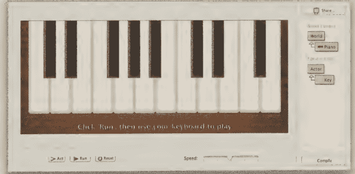

练习 6.1 打开场景 `piano-1`，并检查两个现有类 `Piano` 和 `Key` 的代码。确保你了解那里有什么代码以及它们是做什么作用的。

## 制作键动画

练习 6.2 创建 `Key` 类的对象并将其放入世界中。创建几个这样的对象并将它们相邻。

当你检查现有代码时，你会发现目前内容不多：`Piano` 类现在只指定了世界的大小和分辨率，而 `Key` 类只包含两个方法存根（空方法），即构造函数和 `act` 方法（如代码 6.1 所示）。

代码 6.1

初始的 "Key" 类

```java
import greenfoot.*;

// The initial "Key" class

public class Key extends Actor
{
    /**
     * The constructor
     */
    public Key()
    {
    }

    /**
     * The act method
     */
    public void act()
    {
    }
}
```

# 产生声音

我们接下来要做的工作是确保按下按键会发出声音。为了实现这一点，我们向 `Key` 类中添加一个名为 `play` 的新方法。我们可以在编辑器中、`act` 方法下方添加此方法。首先，我们可以为新方法编写注释、方法签名和空方法体：

```java
/**
 * 播放此按键的音符。
 */
public void play() {

}
```

虽然这段代码没有执行任何操作（方法体是空的），但它应该是可以通过编译的。

该方法的实现非常简单：我们只需要播放单个声音文件。你用来启动此项目时使用的 `piano-1` 场景包含了一组声音文件（在 `sounds` 子文件夹中），每个文件都包含单个钢琴键的声音。声音文件的命名分别为 `2a.wav`、`2b.wav`、`2c.wav`、`2c#.wav`、`2d.wav`、`2d#.wav`、`2e.wav` 等。在这些文件中，让我们选择一个随机的音符——例如 `3a.wav`（中音 A）来播放我们的测试键。

为了实际播放这个音符，我们可以再次使用 `Greenfoot` 类中的 `playSound` 方法：

```java
Greenfoot.playSound("3a.wav");
```

这是 `play` 方法中需要的代码。完整的方法实现如代码 6.4 所示。

```java
/**
 * 播放此按键的音符。
 */
public void play() {

  Greenfoot.playSound("3a.wav");
}
```

**练习 6.5** 在你自己的场景版本中实现 `play` 方法。确保代码可以通过编译。

**练习 6.6** 测试你的方法。你可以通过创建一个 `Key` 类的对象、右键点击该对象，并从对象的弹出菜单中调用 `play` 方法来实现。

# 第 6 章 制作音乐：一个屏幕钢琴

我们现在快成功了。我们可以通过交互式地调用 `play` 方法来产生按键声音，并且运行场景并按下键盘按键（"g"）来创建钢琴键被按下的视觉效果。

我们只需要做的就是在按下键盘按键时播放声音。

要通过程序化（从你的代码）播放声音，我们只需要调用我们自己的 `play` 方法，如下：

```java
play();
```

**练习 6.7** 在你的 **Key** 类中添加代码，以便当关联的键盘按键被按下时播放该按键的音符。为了做到这一点，你需要弄清楚在哪里添加对 **play** 方法的调用。测试它。

**练习 6.8** 当你创建两个键、运行场景并按下 "g" 键时会发生什么？对于我们需要做什么来让它们对不同的键盘按键你有想法吗？

到目前为止描述的所有更改可以在书中的场景 `piano-2` 中找到。如果你遇到了可以解决的问题，或者只是想将你的场景与我们的进行比较，请查看这个版本。

## 6.3 抽象：创建多个键

我们已经达到了一个阶段，可以创建一个对电脑键盘上的某个按键有反应并播放单个钢琴音符的钢琴键。现在的问题显而易见：我们创建了多个键，它们都对同一个键盘按键产生反应，并产生相同的音符。我们需要改变这一点。

目前的局限性来自于我们将键盘按键名称（"g"）和声音文件名（"3.wav"）*硬编码*（hard-coded）到类中。这意味着使用了这些名称，而机会在不修改源代码和重新编译的情况下更改它们。

在编写计算机程序时，编写执行某一个特定任务的代码（例如寻找 1764 的平方根或播放中音 A 的钢琴声）是非常没用的。通常情况下，我们喜欢编写可以处理一*类*问题的代码（例如寻找任何数字的平方根，或播放一系列钢琴声音）。如果我们这样做，我们的程序将变得有用得多。我们在上一节中已经看到了这方面的例子，当时我们对 `addScore` 方法进行了参数化，使其每次添加 20 分时都能添加任意数量的分数。我们现在需要做一些类似的事情。

我们将使用的原理被称为*抽象*（abstraction）。抽象在计算中以许多不同的形式和语境出现——这就是其中之一。

| 概念 |
| :--- |
| 抽象在编程中以不同的形式出现。其中一种是编写可以解决一整类问题而非单个特定问题的代码技巧。 |

## 6.3 抽象：创建多个键

我们将使用抽象将我们的 `Key` 类从一个“在按下键盘 'g' 键时创建播放中音 A 的对象的类”转变为“在按下不同键盘按键时创建播放一系列音符的对象的类”。

实现这一点的方法是使用一个变量作为我们响应的键盘按键名称，并使用另一个变量作为我们想要播放的声音文件的名称。


# 代码 6.5 Key 类的扩展

代码 6.5 显示了解决方案的开头。在这里，我们使用两个额外的字段——`key` 和 `sound`——来存储我们要使用的按键名称和声音文件名。我们还向构造函数添加了两个参数，以便在创建按键对象时可以传递这些信息，并确保我们在构造函数体内将这些参数存储到字段中。

```java
public class Key extends Actor {
    private boolean isDown;
    private String key;
    private String sound;

    /**
     * 创建一个新的按键，带有指定的键和声音。
     */
    public Key(String keyName, String soundFile) {
        key = keyName;
        sound = soundFile;
    }
    // 方法省略
}
```

我们现在对 `Key` 进行了抽象。现在，当我们创建对象时，可以指定它响应哪个按键以及播放哪个声音。当然，我们还没有编写实际使用这些变量的代码——我们将留作练习。

**练习 6.9** 实现上述更改。即：添加 `key` 和 `sound` 字段，并添加带有两个参数的构造函数。

**练习 6.10** 修改你的代码使其放置到世界。（构造多个键。）

# 第 6 章 制作音乐：一个屏幕钢琴

我们现在已经达到了一个点，可以创建一组播放一系列音符的键。目前我们只有白键，但我们可以借此构建钢琴。

然而，构造所有的键有些乏味。我们必须手动创建每个钢琴键并输入所有参数。更糟糕的是：每当我们修改源代码，都必须重新开始。是时候写一些代码为我们创建键了。


## 构建钢琴

我们现在想在 `Piano` 类中写一些代码为我们创建并放置键。添加单个键（或几个键）非常简单：通过在构造函数中添加以下行，每次我们初始化场景时，都会创建一个键并放置到世界中：

```java
addObject(new Key("g", "3a.wav"), 300, 180);
```

记得 `new Key("g", "3a.wav")` 表达式创建了一个新的键对象（带有指定的键和声音），而 `addObject(some-object, 300, 180)` 语句将给定对象插入到指定的 x、y 坐标处。在这个阶段，具体的坐标 300 和 180 是随机选择的。

**练习 6.11** 在你的钢琴类中添加代码，使其自动创建一个钢琴键并放置到世界。

**练习 6.12** 修改放置键的 y 坐标，使钢琴键出现在钢琴的顶部（即：钢琴键的顶部与钢琴本身的顶部对齐）。提示：键图像高 280 像素，宽 63 像素。

**练习 6.13** 编写代码创建一个第二个钢琴键，当按下键盘上的 "f" 键时播放中音 G（声音文件 "3q.wav"）。将其放置在第一个键的左侧（没有任何间隙或重叠）。

在本书之前的章节中，我们讨论了使用独立方法处理独立任务的价值。创建所有的键在逻辑上是一个不同的任务，因此让我们将其部分代码放入一个独立的方法中。它的执行结果完全相同，但代码更易于读。

## 6.5 使用循环：while 循环

**练习 6.14** 在 `Piano` 类中，创建一个名为 `makeKeys()` 的新方法。将创建按键的代码移动到该方法中。在 `Piano` 的构造函数中调用此方法。确保为你的新方法编写了注释。

我们现在可以继续插入大量的 `addObject` 语句，来创建键盘所需的所有按键。然而，这并不是实现我们目标的最佳方式。

### 使用循环：while 循环

编程语言为你提供了一种特定的结构来重复执行类似任务：循环。

循环是一种编程语言结构，允许我们轻松、简洁地表达诸如“执行此语句 20 次”或“调用这这两个方法 300 万次”之类的指令（而无需编写 300 万行代码）。Java 有几种类型的循环。我们将研究的是名为 `while` 的循环。

一个 `while` 循环具有如下形式：

```
while ( condition )
{
    statement;
    statement;
    ...
}
```

Java 关键字 `while` 后面跟着圆括号内的条件和一个包含一个或多个语句的代码块（一对大括号）。只要条件为真，这些语句就会反复执行。

一种非常常见的模式是执行给定次数内执行某些语句的循环。为了实现这一点，我们使用一个循环变量作为计数器。通常的做法是将循环变量命名为 `i`，因此我们也应该这样做。这里有一个执行 `while` 循环体 100 次的示例：

```java
int i = 0;
while (i < 100)
{
    statement;
    statement;
    ...
    i = i + 1;
}
```

这段代码中有几点值得注意。首先，它使用了我们以前见过的结构：局部变量。我们的变量名为 `i`，并将其初始化为 0。然后我们反复执行 `while` 循环体，并在每次执行时都计数 1。只要 `i` 小于 100，我们就继续执行。当我们达到 100 时，停止循环。执行程序将继续运行循环体之后的代码。

还有一些进一步值得指出的细节：

- 我们在循环体末尾使用语句 `i = i + 1;` 来在每次执行循环时将循环变量加 1。这是非常重要的。忘记增加循环计数器是一个常见的错误。那么变量将永远不会改变，条件将始终为真，循环将无限持续下去。这被称为“死循环”，是程序中许多错误的原因。

- 我们的条件规定，当 `i` 小于 (`< 100`) 时执行循环，而不是小于或等于 (`<=`)。当 `i` 等于 100 时，循环将不会执行。乍一看，人们可能认为循环只执行了 99 次而不是 100 次。但事实并非如此。因为我们从零开始计数而不是从一开始，所以我们执行了 100 次（从 0 到 99）。在计算机程序中从零开始计数非常常见——我们很快就会看到这样做的好处。

现在我们了解了 `while` 循环，就可以使用这种结构来创建所有的钢琴键。

我们的钢琴将有 12 个白键。我们现在可以通过将创建按键的语句放在一个执行 12 次的循环体内部，来创建 12 个按键：

```java
int i = 0;
while (i < 12)
{
    addObject(new Key("g", "3a.wav"), 300, 140);
    i = i + 1;
}
```

**练习 6.15** 将你自己的 `makeKeys` 方法中的代码替换为此处所示循环。尝试一下。你观察到了什么？

尝试这段代码，似乎只创建了一个键。然而，这具有欺骗性。我们确实得到了 12 个按键，但由于它们被放置在完全相同的坐标上，所以它们全部重叠在了一起，我们无法看清它们。尝试用鼠标指针在钢琴世界中分别移动每一个按键，你会发现它们都存在那里。

**练习 6.16** 你如何修改代码，使得按键不再全部出现在完全相同的地方？你能修改代码，让它们恰好相邻彼此放置吗？

按键全部重叠在一起的原因是，我们将它们全部插入了 300, 140 这个固定位置到世界中。我们现在想将每个按键插入到不同的位置。这实际上其实容易做到：我们可以利用循环变量 `i` 来实现这一点。

**练习 6.17** 我们的循环体执行了多少次？在每次执行期间 `i` 的值是多少？

我们现在将固定的 x 坐标 300 替换为一个包含变量 `i` 的表达式：

```java
addObject(new Key("g", "3a.wav"), i * 63, 140);
```

（星号 `*` 是乘法运算符。附录 D 列出了你可以与整数一起使用的其他运算符。）

我们选择 `i * 63`，是因为我们知道每个按键的宽度是 63 像素。随着循环的执行，`i` 的值为 0, 1, 2, 3 等。按键将被放置在 x 坐标 0, 63, 126, 189 等。

**练习 6.18** 我们的循环体执行了多少次？在每次执行期间 `i` 的值是多少？

## 代码 6.6 钢琴扩展世界

```java
public class Piano {
    private String[] whiteKeys = {
        "a", "s", "d", "f", "g", "h", "j", "k", "l", ",", ";", "\\"};
    private String[] whiteNotes = {
        "3c", "3d", "3e", "3f", "3g", "3a", "3b", "4c", "4d", "4e",
        "4f", "4g"
    };
    // 省略构造函数和方法
}
```

请注意，`whiteKeys` 数组中的值是我电脑键盘中间一行的键。不同系统和不同国家的键盘略有不同，因此你可能需要更改这些内容以匹配你自己的键盘。另一个稍微有点奇怪的地方是字符串 `"\\"`。反斜杠字符（\）被称为转义字符，在 Java 字符串中具有特殊含义。要创建一个包含反斜杠作为普通字符的字符串，你必须输入两次。因此，在 Java 源代码中输入字符串 `"\\"` 实际上创建了字符串 `\`。

现在我们有了列出钢琴键以及我们想要用于钢琴键的音频文件的数组。现在我们可以调整 `makeKeys` 方法中的循环，利用数组元素来创建适当的键。代码 6.7 显示了生成的源代码。

## 代码 6.7 使用键盘键和数组中的音符创建钢琴键

```java
/* 创建钢琴键并将它们放在世界中。 */
private void makeKeys() {
    int i = 0;
    while (i < whiteKeys.length) {
        Key key = new Key(whiteKeys[i], whiteNotes[i] + ".wav");
        addObject(key, i * 63 + 54, 140);
        i = i + 1;
    }
}
```

有些点值得注意：

- 我们将创建新键的语句从 `addObject` 方法调用中移到了单独的一行，并最初将键对象赋值给名为 `key` 的局部变量。这仅仅是为了清晰：原来的那行代码变得非常长且杂乱，非常难以阅读。将其分为两个步骤使其更容易阅读。

- `Key` 构造函数的参数通过 `whiteKeys[i]` 和 `whiteNotes[i]` 进行访问。也就是说，我们使用循环变量 `i` 作为数组索引，依次访问所有的键字符串和音符文件名。

- 我们在 `whiteNotes[i]` 和字符串 `".wav"` 之间使用了加号 (`+`) 。变量 `whiteNotes[i]` 也是一个字符串，因此这是我们在上一章中遇到过的字符串拼接。我们将字符串 `".wav"` 追加到 `whiteNotes[i]` 的值之后。这是因为存储在数组中的名称格式为 "3c"，而磁盘上的文件名是 "3c.wav"。我们本可以将文件名存储在数组中，但由于所有音符文件的后缀都相同，这似乎没有必要。在这里添加它可以节省我们的打字工作量。

- 我们还将循环条件中的 `12` 替换为 `whiteKeys.length`。数组的 `.length` 将返回该数组中的元素个数。在这种情况下，我们有 12 个元素，保留 `12` 也可以运行。然而，使用长度属性更安全。如果某天我们决定使用更多或更少的键，我们仍然会做正确的事，而不需要更改条件。

通过这些更改，我们的钢琴现在应该可以通过键盘中间一行的键来弹奏，并且它应该为不同的键产生不同的音符。

**练习 6.19** 在你自己的场景中进行上述更改。确保所有键都能正常工作。如果你的键盘布局不同，请调整 `whiteKeys` 数组以匹配你的键盘。

**练习 6.20** 钢琴场景中的声音包含比我们正在使用的更多。修改钢琴，使键比现在低一个八度。现在，第一个键使用声音 "2c" 代替 "3c"，并从那里向上移动。

**练习 6.21** 如果你愿意，可以让你的键产生完全不同的声音。你可以使用 Greenfoot 内置的录音器或其他音频软件录制声音，或者在互联网上寻找音频文件。将音频文件移动到 `sounds` 文件夹，并让你的键播放它们。

我们现在的版本是书中场景中的 `piano-4`。

现在缺失的部分已经显而易见了：我们必须添加黑键。

这并没有什么新意。我们本质上必须再次执行与处理白键时非常相似的操作。我们将此留给你们作为练习来完成。然而，一次性完成所有工作是一项巨大的任务。通常情况下，处理较大的任务时，将其拆分为几个较小的步骤是一个好主意。因此，我们将此任务分解为一系列练习，逐步接近解决方案。

# 第 6 章 制作音乐：一个屏幕钢琴（续）

**练习 6.22** 当前

**练习 6.23** 修改你的 `Piano` 类，使其在任意位置添加两个黑键。

**练习 6.24** 为 `Piano` 类中再添加两个数组，用于黑键的键盘键和音符。

**练习 6.25** 在 `Piano` 类的 `makeKeys` 方法中添加另一个循环，用于创建并放置黑键。由于黑键间距并不均匀，这变得相当棘手。

## 练习与强化

这一次，我们将练习刚刚学习的最基础的结构：使用 `while` 循环。我们将通过一个名为“泡泡”（bubbles，图 6.4）的不同场景来进行。打开该场景，然后完成以下练习。

图 6.4 浮动的泡泡

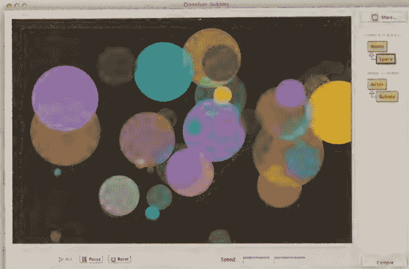

**练习 6.26** 打开泡泡场景。你会世界是空的。使用默认构造函数将一些 `Bubble` 对象放入世界。（默认构造函数是不带参数的那个。）记住，你也可以通过点击世界来完成。你观察到了什么？

**练习 6.27** 一个新泡泡的初始大小是多少？它的初始颜色是什么？它的初始移动方向是什么？

**练习 6.28** 在世界子类 `Space` 中创建一个私有方法 `setup()`。在构造函数中调用此方法。在该方法中，使用默认构造函数创建一个新泡泡，并将其放在世界的中心。编译，然后点击几次“重置”（Reset）进行测试。

**练习 6.29** 修改你的 `setup()` 方法，使其创建 21 个泡泡。使用 `while` 循环。所有泡泡都放置在世界的中心。运行你的场景进行测试。

**练习 6.30** 将 21 个泡泡放置在世界的随机位置。

**练习 6.31** 将泡泡放置在对角线上，x 和 y 的距离间隔为 30。第一个泡泡在 0,0，下一个在 30,30，下一个在 60,60，以此类推。最后一个将位于 600,600（对于 21 个泡泡）。使用你的循环计数器变量来实现这一点。

**练习 6.32** 将泡泡放置在略有不同的对角线上，使它们从世界的左上角延伸到右下角。最后一个泡泡应该在 900,600。

**练习 6.33** 在你的 `setup()` 方法中添加第二个 `while` 循环，用于放置更多泡泡。该循环在水平方向上放置 10 个泡泡，从 x=300, y=100 开始，每次 x 增加 40，y 保持不变。（也就是说，泡泡位于 300,100，然后是 340,100，接着是 380,100 等）。泡泡的大小也应该增加，从第一个泡泡的 10 开始，然后是 20、30 等。为此使用第二个 `Bubble` 构造函数（带一个参数的那个）。

**练习 6.34** 从你的 `setup()` 方法中移除现有的循环。编写一个新的 `while` 循环执行以下操作：创建 18 个泡泡。所有泡泡都放置在世界的中心，大小从 190 开始，每次递减 10。最后一个泡泡的大小为 10。确保先创建最大的，后创建最小的，这样你就有大小为 190、180、170 等的泡泡，它们都重叠在一起。

使用 `Bubble` 的第三个构造函数——带两个参数的那个。它还允许你指定初始方向。设置方向如下：第一个泡泡方向为 0，下一个为 20，下一个为 40，以此类推。也就是说，每个泡泡之间的方向增加 20 度。

测试。

# 第 7 章 对象交互：引论

**主题**：与其他对象通信、使用 Java 库中的类、使用对象列表

**概念**：`null`、Java 类库、集合 (collection)、列表 (list)、for-each 循环

本章引入了两个非常重要的概念，为后续章节做准备：与其他对象通信，以及处理对象列表。在第 8 章中，我们将开发一个相当复杂的示例——涉及太空中的行星——它将使用许多新结构，其中一些需要一些的解释和练习。为了循序渐进地处理问题而不一次性做得太多，我们在这里通过一个较小的示例先介绍这两个概念。

在本章中讨论的场景是这些结构的练习场；它被称为“秋天”（autumn，图 7.1）。

图 7.1 “秋天”场景

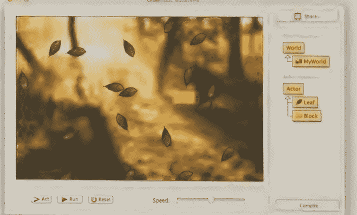

## 7.2 对象引用

**练习 7.1** 打开 `autumn-1` 场景并进行研究。运行它并注意它做了什么。阅读三个场景类的源代码，并记录下每一处你不完全理解的代码。

## 7.1 交互对象

对象可以通过调用其他对象的方法来与其他对象进行交互（“交谈”）。

我们在之前的章节中已经看到了这种情况的几个例子，但是时候把我们目前看到的所有内容整合起来并进行系统的讨论了，以确保涵盖了所有重要内容。对象交互是面向对象编程的核心，我们无法在这里错过任何细节。

## 7.2 对象引用

为了让一个对象与另一个对象通信，它必须始终拥有另一个对象的引用。这种引用通常存储在变量中。例如，如果我们“秋天”场景中的 `Block` 想要与 `MyWorld` 通信，它必须首先拥有对 `MyWorld` 的引用。图 7.2 显示了这一点：`Block` 类型的对象持有对 `MyWorld` 的引用。

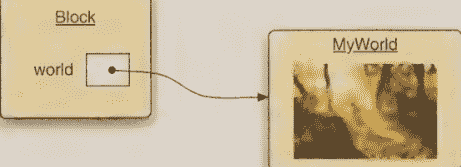

一旦我们有了叶子的引用，就可以对它调用方法。例如：

```java
leaf = (Leaf) getIntersectingObject(Leaf.class);
```


# 与世界交互

在另一个对象上调用方法是为了与该对象“交谈”。通常我们需要其他对象的引用，它存储在变量中。

## 与世界交互

由于我们总是需要某种引用，一个明显的问题是：从哪里获取它？嗯，有几种。在示例中，我们正在触摸叶子。`getWorld()` 方法提供了世界的引用。我们可以将其存储在 `World` 类型变量中。以下是该行代码的具体功能：

```java
Space world = getWorld();
```

**练习 7.2** 为你的世界添加代码。

**练习 7.3** 修改你的代码，使其交叉叶子。

## 与 Actor 交互

我们已经看到如果方法找到交叉叶子会发生什么：它返回引用并将其存储在变量中。如果我们没有交叉叶子会发生什么？

如果我们调用 `getIntersectingObject` 但没有遇到请求类型的对象，该方法将返回特殊值 `null`。

`null` 值可以赋值给任何对象变量。如果它存储在变量中，意味着它当前没有持有任何引用；它实际上是空的。

`getIntersectingObject` 方法返回 `null` 或任何对象引用，取决于我们是否交叉了对象。我们可以在之后进行检查以确定我们是否真的碰到了什么：

```java
Leaf leaf = (Leaf) getIntersectingObject(Leaf.class);
if (leaf != null)
{
    // 如果我们到达这里，说明正在触摸叶子
}
```

**练习 7.4** 在 Greenfoot 类中查找 `getIntersectingObject` 方法。它属于哪个类？它返回什么类型？

# 第 7 章 对象交互：引言

在这里，我们查看叶子变量：如果它不空，我们就知道触碰了一个叶子，并且该引用存储在我们的变量中。因此，我们可以通过在 `if` 语句体内输入对叶子的旋转请求来完成此任务：

```java
leaf.turn(9);
```

**练习 7.5** 在你的 Block 类中创建一个名为 `checkLeaf()` 的新私有方法。该方法没有返回值。在此方法中，输入上述讨论过的代码，以检查我们是否正在与叶子相交，如果是，则让它旋转。

**练习 7.6** 确保你确实在检查叶子：从你的 `act` 方法调用你的 `checkLeaf()` 方法。进行测试。

**练习 7.7** 移除当区块碰到世界边缘时添加叶子的代码。相反，在 `MyWorld` 类的 `setUp()` 方法中添加一些代码添加 18 个叶子。使用循环。在随机位置添加叶子。进行测试。


# 与角色组交互

我们现在已经看到了获取另一个角色引用的方法，然后通过调用它的方法之一与该角色通信。

下一个有趣的情况是同时与多个角色通信：有时我们想对给定类的每个角色，或我们周围给定范围内的每个角色执行某些操作。

我们在这里使用的示例有些人为性，但非常适合练习这一点：如果用户点击鼠标，我们想要更改所有叶子的图像。

**练习 7.8** Leaf 类有一个名为 `changeImage()` 的方法来设置不同的图像。尝试一下：在你的场景暂停时，交互式地对某些叶子调用 `changeImage()` 方法（通过右键点击并从叶子的菜单中选择它）。

Block 类已经有一个方法来检查鼠标点击（代码 7.1）。我们可以在这里输入代码。我们需要做的只是弄如何对世界上所有的叶子调用 `changeImage()` 方法。

## 代码 7.1

```java
/**
 * 检查鼠标按钮是否被点击。如果是，更改所有叶子。
 */
private void checkMouseClicked() {
    if (Greenfoot.mouseClicked(null)) {
        // 当鼠标被点击时执行此处。目前：无所操作。
    }
}
```

Greenfoot 中的 World 类提供了访问其内部对象的方法。

**练习 7.9** 在 Greenfoot 的类文档中查找 World 类。找到所有允许访问世界内部对象的方法。将它们写下来。

对我们来说，这些方法中最感兴趣的是：

```java
java.util.List getObjects(java.lang.Class cls)
```

该方法给我们世界中特定类的所有对象的列表。它使用了两种看起来不寻常的类型：作为参数的 `java.lang.Class` 和作为返回类型的 `java.util.List`。为了正确理解，我们需要讨论两件事：Java 库和 List 类型。

# 使用 Java 库类

Classes 和 List 是 Java 标准类库¹ 的许多类中的两个。Java 系统带有一个大量实用的类，我们可以随着时间的推移直接使用，并将熟悉其中许多。

我们可以通过从 Greenfoot 的帮助菜单中选择“库文档”（Library Documentation）来查看类库中类的文档。将在网页浏览器中打开 Java 库的文档 (7.3)。

此窗口左下角的面板显示 Java 库中所有类的列表（非常多！）。我们可以通过在列表中找到并选择任何特定类来查看该类的文档。选中后，窗口的主部分将显示该类的文档。

**练习 7.10** 在类列表中找到该类并选中。查看该类的文档。它有多少个构造函数？

> List 实际上是一个接口而不是类——我们稍后会讨论。

# 第 7 章 对象交互：引言

图 7.3

Java 库文档

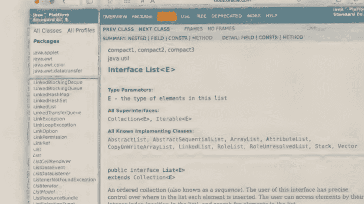

你可以看到 Java 库中有成千上万个类。这些类被分成了“包”（packages）。一个包是逻辑相关的类组。在任何类的文档顶部，我们可以看到它所在的包。例如，`Color` 类位于 `java.awt` 包。

当我们想在自己的场景中使用 Java 库中的任何类时，我们需要使用 `import` 语句导入类。`import` 语句写在类的最顶部，命名了我们要使用的包和类，中间用点分隔。例如，`List` 位于 `java.util` 包。在我们自己的代码中使用它时：

```java
import java.util.List;
```

**练习 7.11** 在你的类中 `java.util.*` 语句下方写入 List 的导入语句。例如，`java.util.*` 导入该包中的所有类。导入类使其在我们自己的场景中可用。导入后，我们可以声明该类型的变量，调用方法，并执行其他类可以的任何其他操作。因此，在我们自己的代码中声明一个该类型的变量：

```java
List myList;
```

`java.lang` 包很特殊：它包含了常用的类，我们不需要导入它；它总是被导入的。因此我们不需要为 `java.lang` 编写 `import` 语句。

Java 库初看起来令人敬畏，因为它有很多类。不要担心——我们将使用其中少数，并在需要时一个一个引入它们。现在我们知道了如何导入 `List` 类型，让我们仔细看看如何使用它

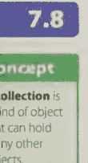

## List 类型

处理对象组在 Greenfoot 编程和通用编程中都很重要。多个 Greenfoot 方法返回对象组作为结果，通常以列表的形式。那么返回对象的类型就是来自 `java.util` 包的 `List` 类型。

> 备注：接口

List 类型与我们看到的其他类型略不同：它不是一个类，而是一个接口。接口是提供实现抽象的 Java 结构。细节对我们现在并不重要——只需知道我们可以以类似的方式处理 List 类型：我们可以在 Java 文档中查找它，可以在对象上调用方法。我们不能直接创建 `List` 类型的对象。我们稍后回到这个问题。

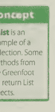

**练习 7.12** 在 Java 文档中查找 `java.util.List`。向列表添加对象、从列表中移除对象以及查找列表中当前有多少对象的方法是什么？

**练习 7.13** 根据文档顶部给出的该类型全称是什么？

当我们在上一节查看 `getObjects` 方法时，我们注意到它返回一个 `java.util.List` 类型的对象。因此，为了存储此对象，我们需要声明该类型的变量。我们将在 `checkMouseClick` 方法中执行此操作。然而，List 类型与我们之前看到的类型不同。文档顶部显示：

```java
Interface List<E>
```

除了用 `interface` 代替 `class` 外，我们还注意到另一个新符号：类型名称后的 `<E>`。形式上，这被称为泛型（generic type）。这意味着 `List` 类型需要一个额外的类型作为参数。第二个类型指定了列表中包含的元素类型。

例如，如果我们正在处理字符串列表，我们将类型指定为：

```java
List<String>
```

相反，如果我们正在处理角色列表，可以写成：

```java
List<Actor>
```

在每种情况下，括号 (`<>`) 内的元素类型都是其他已知对象的类型。

# 7.9 叶子列表

在我们的案例中，将在世界上调用 `getObjects` 方法来接收叶子列表，因此我们的变量声明将是：

```java
List<Leaf> leaves;
```

然后我们可以将从 `getObjects` 方法检索的列表赋值给此变量。结合获取对象本身，看起来如下：

```java
World world = getWorld();
List<Leaf> leaves = world.getObjects(Leaf.class);
```

执行这些行后，我们的变量 `leaves` 包含了当前世界中所有叶子的列表。最后要做的工作是为列表中的每个叶子调用 `createImage` 方法。我们将使用一种新循环来实现：for-each 循环。

## 7.10 for-each 循环

我们现在将逐个遍历叶子列表，依次更改每个叶子的图像。

Java 有一种专门用于遍历集合中每个元素的循环，我们可以在这里使用这种循环。它被称为 for-each 循环，并使用以下模式编写：

## 7.10 for-each 循环 | 131

```
for (ElementType variable : collection)
{
  statements;
}
```

在这种模式中，`ElementType` 代表集合中每个元素的类型，`variable` 是此处声明的变量，因此我们可以给它任何喜欢的名称，`collection` 是我们想要处理的集合名称，而 `statements` 是我们想要执行的一系列语句。通过一个例子可以让这一点变得更加清晰。

使用我们名为 `leaves` 的列表，我们可以写：

```
for (Leaf leaf : leaves)
{
  leaf.changeImage();
}
```

（记住 Java 是区分大小大小的：大写 "L" 的 `Leaf` 与小写 "l" 的 `leaf` 是不同的。大写名称指的是类，小写名称指的是持有对象的变量。复数形式——`leaves`——是另一个持有整个列表的变量名。）

我们将关键字读为 "for each"（每一个），将冒号读为 "in"（在...中），将左括号读为 "do"（执行），这样 for-each 循环读起来会更容易一点：

```
for each leaf in leaves do: ...
```

这种读法也给了我们关于这个循环作用的提示：它将为列表 ‘leaves’ 中的每个元素执行大括号内的语句。例如，如果该列表中有十个元素，这些语句将被执行十次。每当执行语句之前，变量 `leaf`（在循环头中声明）都将被赋值为列表中的其中一个元素。因此，动作序列将是：

```
leaf = first element from 'leaves';
execute loop statements;
leaf = second element from 'leaves';
execute loop statements;
leaf = third element from 'leaves';
execute loop statements;
...
```

变量 `leaf` 是可用的，可以在循环语句中使用它来访问列表中的当前元素。然后我们就可以，例如，对该对象调用方法（如上例所示），或者将该对象传递给另一个方法以进行进一步处理。

我们现在准备好将这一切整合在一起，并将 for-each 循环添加到我们的代码中。代码 7.2 显示了实现我们刚刚讨论示例的完整方法。

## 代码 7.2

```java
/* 检查鼠标按钮是否被点击。如果是，则更改所有叶子。 */
private void handleClick() {
    if (Greenfoot.MouseClicked(null)) {
        World world = getWorld();
        List<Leaf> leaves = world.getObjects(Leaf.class);

        for (Leaf leaf : leaves) {
            leaf.changeImage();
        }
    }
}
```

更改世界中所有叶子的图像

**练习 7.14** 在你自己的场景中实现通过鼠标点击更改所有叶子的功能。进行测试。

如果你对自己的解决方案不确定，并想与我们的进行比较：autumn-2 场景包含了本章中讨论的所有功能。

## 编程技术总结

我们在本章中看到了一些重要的结构，这些结构起初可能不容易理解。你可能需要时间（以及更多的练习）来习惯它们。

第一部分相对简单：我们学习了如何访问世界对象并对其上调用方法。然后，我们讨论了如何访问另一个 actor 并调用它的其中一个方法。我们使用 Greenfoot 的碰撞检测方法之一获取了该 actor 的访问权限。

最后——这是困难的部分——我们学习了如何接收一个对象列表，并使用 for-each 循环来调用列表每个每个对象的方法。

处理列表和处理它们的元素是一个非常重要的概念，不仅在 Greenfoot 中，在通用编程中也是如此。这只是对第一个示例的简要介绍。我们将在后面的章节中进行更多此类操作，希望你在反复练习中越来越熟悉这些技术。

## 概念总结

- 值 `null` 是一个特殊值，可以赋值给任何对象变量。如果变量包含 `null`，则它目前没有引用任何对象。

- Java 类库是 Java 系统提供的一个大型预制类集合。我们可以通过编写 `import` 语句来使用这些类。

- 集合（collection）是一种可以容许多其他对象。

- `List` 是集合的一个示例。Greenfoot API 中的某些方法返回 `List` 对象。

- 泛型（generic type）是一种接收第二个类型名称作为参数的类型。

- for-each 循环是另一种循环。它非常适合处理集合的所有元素。

## 训练与练习

这里需要练习最重要的概念是处理列表和 for-each 循环。这里有一些练习供你练习。我们将继续使用秋季场景。

**练习 7.15** 在你的秋季场景中引入一个新类 `Apple`。给它一个苹果图像。在 `MyWorld1` 类中编写代码在随机位置放置 12 个苹果。

**练习 7.16** 在 `Block` 类中编写代码，每当方块碰到世界边缘时，将所有苹果旋转 90 度。

**练习 7.17** 创建另一个类：`Pear`。使用合适的图像。编写代码在世界中放置 8 颗梨。

**练习 7.18** 在 `Block` 类中编写代码，使得每当方块碰到边缘时，所有的梨都向右移动 20 个单元格（除了旋转苹果之外）。

**练习 7.19** 修改你移动梨的类代码，使得只有在梨不在边缘时才移动它们。

**练习 7.20** 修改你处理鼠标点击的方法，使其只更改世界左半部分的图像（而不是所有的叶子）。

这对于下一个章节来说是充分的准备：

## 章节：对象交互：牛顿实验室

主题：更多关于对象交互，使用辅助类

概念：列表

在本章中，我们将研究世界中对象之间更复杂的相互作用。作为开始，我们将观察一种无处不在的相互作用：引力。

在这个场景中，我们处理天体（如恒星和行星）。我们将使用牛顿引力定律来模拟这些天体的运动。（我们现在知道牛顿的公式并不准确，而爱因斯坦的广义相对论更精确地描述了行星运动。）

如果你对处理物理和公式感到担心，不要担心。我们不需要深入研究，而且使用的公式非常简单。最后，我们将这个场景变成一个带有声音和视觉效果的艺术实验。如果你对技术感兴趣，可以多研究物理。如果你对艺术感兴趣，可以专注于这方面。

## 8.1 起点：牛顿实验室

我们将通过研究这个场景的部分实现版本开始这个项目。打开文件夹中的 Newtons-Lab-1 场景。你会发现已经有一个世界子类（名为 `Space`）。我们还有 `SmoothMover`、`Body` 和 `Vector` 类（图 8.1）。

## 8.1 起点：牛顿实验室

135

图 8.1：牛顿实验室

![image/410f5f709c4688c1903940c91e75e8ab_156_0.png

图 8.2：牛顿与爱因斯坦

![image/410f5f709c4688c1903940c91e75e8ab_156_1.png

**练习 8.1** 打开 Newtons-Lab-1 场景。尝试一下（在空间中放置一些物体）。你观察到了什么？

当你运行这个场景时，你会注意到可以在空间中放置对象（类型为 `Body`），但这些物体并没有移动，还没有以任何有趣的方式运行。

> \^1 牛顿：来自 Georgios Kollidas/Shutterstock。爱因斯坦：由美国会图书馆图片和摄影部门提供。

在我们深入扩展实现之前，让我们更仔细地观察一下这个场景。

通过右键点击世界背景，我们可以看到并调用 `Space` 类的公共方法（图 8.3）。

图 8.3

牛顿实验室中的世界方法

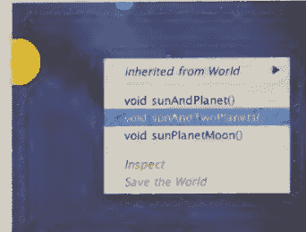

**练习 8.2** 调用 `Space` 对象的不同公共方法。它们是做什么的？


## 练习 8.3

当你的世界中有一个恒星或行星时，右键点击它查看它具有哪些公共方法。它们是什么？

## 练习 8.4

从 `Space` 的公共方法中调用 `sunPlanetMoon` 方法。找出并写下太阳、行星和月球的方法。

## 练习 8.5

查看 `Space` 类的源代码，看看这里的公共方法是如何实现的。

## 辅助类：SmoothMover 和 Vector

在场景中，我们使用了两个通用的辅助类：`SmoothMover` 和 `Vector`。这些类为给定的场景增加了功能，并可以在不同的场景中用于相似的用途。（这两个类实际上已用于许多现有项目。）

`SmoothMover` 类通过将坐标存储为小数（`double` 类型）而不是整数，为演员提供了更平滑的移动。`double` 类型的字段可以存储带有小数的数字（例如 2.4567），因此比整数更精确。

为了在屏幕上显示演员，坐标仍然会被四舍五入为整数，因为在屏幕上绘图的位置必须是整数像素。但在内部，位置始终是以小数形式保留的。

例如，一个 `SmoothMover` 的 x 坐标可以为 12.3。如果我们现在沿着 x 坐标每次增量 0.6 移动这个演员，它的连续位置将是：

12.3, 12.9, 13.5, 14.1, 14.7, 15.3, 15.9, 16.5, 17.1, ...

依此类推。我们会在屏幕上看到舍入后 x 坐标的演员。它将在 x 坐标处绘制：

12, 13, 14, 14, 15, 15, 16, 17, ...

依此类推。总而言，尽管在显示时仍然四舍五入为整数，但其效果比使用 `int` 字段实现的移动看起来更平滑。

`SmoothMover` 添加的第二个功能是速度向量——一个指示当前移动方向和速度的向量。我们可以将向量想象成具有给定方向和长度的（不可见的）箭头（图 8.4）。

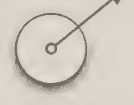

`SmoothMover` 类拥有通过修改其速度向量来改变移动的方法，以及一个 `move` 方法，用于根据其当前向量移动演员。

> **备注：抽象类**
>
> 如果你右键点击 `SmoothMover` 类，你会发现你无法创建该类的对象。没有显示构造函数。
>
> 当我们检查该类的源代码时，可以在类头中看到 `abstract` 关键字。我们可以将类声明为抽象类，以防止创建这些类的实例。抽象类仅作为其他类的超类，而不用于直接创建对象。

## 练习 8.6

将一个 `Body` 类的对象放入世界中。通过检查对象的弹出菜单，找出该对象继承自 `SmoothMover` 类的方法。将它们写下来。

## 练习 8.7

哪个方法名称出现了两次？这两个版本有何不同？

## 重载

重载是指使用相同的方法名来实现两个不同的方法或构造函数。

在 Java 中，拥有两个相同名称的方法是完全合法的，只要它们的参数列表不同。这被称为重载。（方法名被重载了——它指的是多个方法。）

当我们调用一个重载方法时，运行时系统会通过检查我们提供的参数来确定我们指的是这两个方法中的哪一个。

我们说这两个方法具有不同的签名。

第二个辅助类 `Vector` 实现了向量本身，并被 `SmoothMover` 使用。注意，`Vector` 没有列在 `Actor` 类组中。它不是一个演员——它永远不会单独出现在世界中。该对象只会被其他演员对象创建和使用。

向量可以用两种不同的方式表示：或者作为 x 和 y 坐标的一对距离 (`dx`, `dy`)，或者作为指定方向及其长度的一对值 (`direction`, `length`)。方向通常被指定为相对于水平线的角度。

图 8.5 显示了具有两种可能规格的同一个向量。我们看到 (`dx`, `dy`) 对或 (`direction`, `length`) 对都可以描述同一个向量。

**图 8.5 指定向量的两种可能方式**

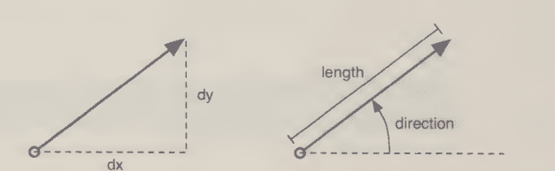

第一种使用 x 和 y 偏移量的表示法称为笛卡尔表示。第二种使用方向和长度的表示称为极坐标表示。你会发现笛卡尔表示和有时极坐标表示更容易使用。对于我们的目的，笛卡尔表示和有时极坐标表示更容易使用。

## 练习 8.8

通过查看源代码，熟悉 `SmoothMover` 的方法。

## 练习 8.9

将 `Body` 放入世界。你可以调用哪些继承自 `SmoothMover` 的方法？

## 练习 8.10

打开 `Body` 的源代码并检查它。

```java
public class Body extends SmoothMover {
    // 代码省略
    private double mass;

    /**
     * 使用默认值构造 Body。
     */
    public Body() {
        this(20, 300, new Vector(90, 1.0), defaultColor);
    }

    /**
     * 使用指定的 size, mass, velocity, color 构造 Body。
     */
    public Body(int size, double mass, Vector velocity, Color color) {
        this.mass = mass;
        addToVelocity(velocity);
        FruitImage image = new FruitImage(size, size);
        image.setColor(color);
        image.fillOval(0, 0, size-1, size-1);
        setImage(image);
    }

    // 更多代码省略
}
```

没有参数的构造函数也称为默认构造函数。

第二个构造函数让我们轻松创建细节。这种构造函数用于 `Space` 类中创建太阳、行星和月球。

第一个构造函数看起来更神秘。它只有一行代码：

```java
this(20, 300, new Vector(0, 1.0), defaultColor);
```

该行看起来几乎像方法调用，只是它使用了关键字而不是方法名。以这种方式使用关键字（类似于方法名）仅可以在构造函数内部调用另一个构造函数。

关键字有第二次用法：

```java
this.mass = mass;
```

在这里我们有了另一个重载示例：相同的名称被用于两个变量（参数和实例字段）。当我们赋值这些变量时，我们需要指定等号两边指的是哪个名为 `mass` 的变量。

当我们没有任何修饰地写 `mass` 时，使用的是该变量最近的定义——在这种情况下是参数。当我们写 `this.mass` 时，我们指的是当前对象的字段。因此，此行代码将参数 `mass` 赋值给字段 `mass`。

## 练习 8.11

删除上述代码行中 `mass` 前的 `this.` 部分，使其变为：

```java
mass = mass;
```

能编译吗？能执行吗？你认为这段代码在做什么？效果是什么？（创建一个对象并使用它的检查函数检查 `mass` 字段。实验完成后，将代码恢复到原来的样子。）

值得进一步关注的第二个方面是类顶部的两行，如代码 8.2 所示。


```java
public class Body extends SmoothMover
{
    private static final double GRAVITY = 5.8;
    private static final Color defaultColor = new Color(255, 216, 0);
    // rest of code omitted
}
```

这两处声明看起来与字段声明相似，区别在于它们在 `private` 关键字之后插入了 `static final` 两个关键字。

这就是我们所说的**常量**。常量与字段有相似之处，即我们可以在代码中使用该名称来引用它的值，但该值永远不会改变（它是恒定的）。正是 `final` 关键字使得这些声明成为了常量。

`static` 关键字的作用是让该常量在此类的所有 actor 之间共享，我们不需要在每个对象中都拥有它的单独副本。我们在之前（第 3 章）已经遇到过 `static` 关键字，是在类方法的上下文中。正如静态方法属于类本身（但可以从该类的对象调用一样），静态字段也属于类，并且可以通过它的实例进行访问。

在这种情况下，声明的常量是重力值（稍后将使用）以及物体的默认颜色。这是一个 `Color` 类型的对象，我们将在下文中对其进行详细讨论。

在程序中声明不应改变的字段是一个良好的习惯。将字段声明为常量可以防止代码中值被意外修改。

# 8.4 第一个扩展：创建移动

好了，看够了现有内容。是时候写一些代码并让事情发生了。

第一个显而易见的实验是让物体移动起来。我们提到过 `SmoothMover` 类提供了一个 `move()` 方法，由于 `Body` 是一个 `SmoothMover`，它也可以访问该方法。

## 练习 8.12

在 `Body` 的 `act` 方法中添加对 `move()` 方法的调用。（确保调用的是不带参数的 `move()` 方法，而不是继承自 `Actor` 的带 `int` 参数的方法）。测试它。默认移动方向是什么？默认速度是多少？

> **注意**：我们的重力值与自然界的任何特定单位都没有直接关系。这是一个为了这个场景设置的任意值。一旦我们开始为物体实现引力，就可以改变此值来实验不同的重力大小。

## 练习 8.13

创建多个 `Body` 对象。它们的表现如何？

## 练习 8.14

调用公共的 `Space` 方法（如 `sunAndPlanet()` 等）并运行场景。这些对象是如何移动的？它们的初始移动方向和速度在哪里定义？

## 练习 8.15

将物体的默认方向改为向左。也就是说，当使用默认构造函数创建一个物体并执行其 `move()` 方法时，它应该向左移动。

正如我们在执行这些实验时看到的，只需告诉物体移动就足以让它们移动。然而，它们将沿着直线移动。这是因为移动（速度和方向）是由其速度向量决定的，而目前没有东西改变这个向量。因此，移动是恒定的。

## 8.5 Color 类

在阅读上面的代码时，在 `Body` 和 `Space` 类中我们都遇到了 `Color` 类。`Body` 类的第二个构造函数需要一个 `Color` 类类型的参数，而 `Space` 类中的代码使用了表达式创建 `Color` 对象：

`new Color(248, 160, 86)`

我们在上一章阅读 Java 库文档时曾简要遇到过这个类。

## 练习 8.16

再次打开 `Color` 类的文档。

`Color` 构造函数的三个参数是该颜色的红、绿、蓝分量。计算机屏幕上的每种颜色都被描述为这三种基础色的组合。（我们将在第 10.9 章进行更多讨论，你也可以找到 RGB 颜色值的表格。你可以使用任何良好的图形程序自己进行实验。）

## 练习 8.17

查看 `Color` 类的文档。它有多少个构造函数？

## 练习 8.18

找到我们使用的构造函数的描述（带有三个整数作为参数的那一个）。这些整数的合法范围是什么？

## 8.6 添加引力

正如我们所知，如果我们想使用 Java 库中的任何类（`java.lang` 包以外的类），我们必须导入它。对于 `Color` 类，导入语句是：

```java
import java.awt.Color;
```

## 练习 8.19

在 `Body` 类的哪里可以找到 `Color` 类的导入语句？

## 练习 8.20

如果你尝试使用 `Color` 类但忘记了导入语句，你会得到什么错误？（试一下）

当我们想在 Greenfoot 中在图像上绘图时，`Color` 类非常有用。在这种情况下，我们为每个天体在 actor 的图像上画了一个彩色的圆。我们将在后面的章节中再次看到这个类的使用。

我们接下来要做的是为这个场景添加引力。也就是说，当我们的空间中有多个物体时，这些物体之间的引力拉力应该改变每个物体的移动。

# 添加引力

让我们先查看 `Body` 类中当前的 `act` 方法（代码 8.3）。如果我们还没有执行练习 8.12，那么对 `move` 方法的调用将在那里——你现在可以添加它。

```java
/**
 * Act. 即：对周围
 * 所有其他物体施加引力，然后移动。
 */
public void act()
{
    move();
}
```

虽然代码目前只包含 `move` 调用，但注释实际上正确描述了我们必须做什么。

```java
/**
 * Act. 也就是：对周围
 * 所有其他物体施加引力，然后移动。
 */
public void act()
{
    applyForces();
    move();
}
```

```java
/**
 * 对所有其他
 * 施加引力。
 */
private void applyForces()
{
    // 在此处执行的工作
}
```

这是因为 `bodies` 列表包含了空间中所有的物体，包括当前对象（我们想要对其施加引力的对象）。我们不需要将物体的引力施加自身，因此我们可以添加一个 `if` 语句，只有当列表中的元素不是当前对象本身时才调用 `applyGravity`。注意这里是如何使用关键字 `this` 来引用当前对象的。

## 练习 8.26

将你的代码与下面所示的代码进行比较。如有必要，完成你自己的 `applyForces` 方法。

```java
private void applyForces() {
    List<Body> bodies = getWorld().getObjects(Body.class);
    for (Body body : bodies) {
        if (body != this) {
            applyGravity(body);
        }
    }
}
```

```java
/** 将给定物体的引力施于此物体。 */
private void applyGravity(Body other) {
    // work as
}
```

# 应用引力

在代码 8.9 中，我们已经解决了访问空间中每个对象的任务，但推迟了实际应用引力的任务。`applyGravity` 方法仍然需要编写。

现在这比以前容易了一点，因为这个方法每次只需要处理两个对象：当前对象以及参数中指定的另一个对象。我们现在想要将另一个物体的引力施加到当前对象上。这就是牛顿定律发挥用场的地方。

## 8.7 应用引力

牛顿的引力公式如下：

```
force = \frac{mass1 \times mass2}{distance^2}
```

换句话说，为了计算施加在当前对象上的力，我们需要将该对象的质量与另一个物体的质量相乘，然后除以两个对象之间距离的平方。最后，将该值乘以常数 G——引力常数。（你可能记得我们已经在类中为该值定义了一个常量，名为 `GRAVITY`。）

如果你非常有信心或富有冒险精神，你可能会尝试自己实现 `applyGravity` 方法。你需要创建一个从当前物体指向另一个物体的向量，其长度由该公式指定。对于我们其他人，现在我们来看该方法的完成实现（代码 8.6）。

> **将给定物体的引力施加于此物体。**
>
> （力作用于一个时间单位；dt=1。）

```java
private void applyGravity(Body other) {
    double dx = other.getExactX() - this.getExactX();
    double dy = other.getExactY() - this.getExactY();
    Vector dv = new Vector(dx, dy); //设置方向；长度待完成
    double distance = Math.sqrt(dx*dx + dy*dy);
    double force = GRAVITY * this.mass * other.mass / (distance * distance);
    double acceleration = force / this.mass;
    dv.Length(acceleration);
    addVelocity(dv);
}
```

这个方法并没有看起来那么复杂。首先，我们计算物体和另一个对象在 x 坐标和 y 坐标上的距离（`dx` 和 `dy`）。然后我们使用这些值创建一个新向量。这个向量现在有了正确的方向，但还没有正确的长度。

接下来，我们使用勾股定理计算两个对象之间的距离（直角三角形中 a² + b² = c²，见图 8.6）。

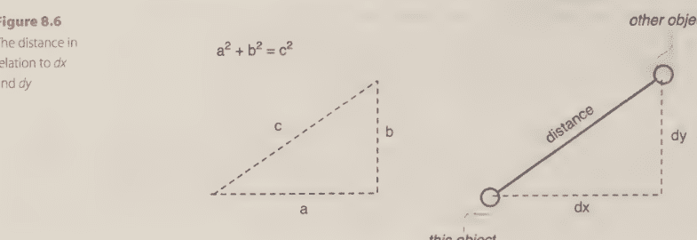

这告诉我们距离是 $dx$ 平方加上 $dy$ 平方的平方根。在我们的代码（代码 8.6）中，我们使用 `Math` 类中的 `sqrt` 方法来计算平方根。（`Math` 是 `java.lang` 中的一个类，因此会自动导入。）

## 练习 8.27

在 Java 文档中查找 `Math` 类。`sqrt` 方法有几个参数？它们是什么类型？该方法返回什么类型？

## 练习 8.28

在 `Math` 类中，找到可以用于寻找两个整数中最大值的方法。它叫什么名字？

我们代码中的下一行使用上面给出的牛顿引力公式计算引力拉力。

最后要做的工作是计算加速度，因为我们物体的实际速度不仅取决于引力，还取决于物体的质量：物体越重，加速度就越慢。加速度使用以下公式计算：

```
acceleration = \frac{force}{mass}
```

一旦计算出加速度，我们就可以将新向量设置为正确的长度，并将该向量添加到物体的速度中。这很容易实现，使用 `SmoothMover` 类提供的 `addToVelocity` 方法即可。


**练习 8.29** 将代码 8.6 中的变量映射到上述牛顿公式、勾股定理和加速度公式。哪个变量对应哪个公式的哪个部分？

到此，我们的任务就完成了。（到目前为止描述的代码实现也可以在书籍场景中作为 `Newtons-Lab-2` 提供。）

这个任务显然比我们见过的其他任务涉及更多的数学和物理背景知识。起初看起来可能很复杂，你可能会觉得自己无法独立完成。

# 重力与音乐

在我们离开“牛顿实验室”（Newton's Lab）场景之前，我们还有一件事要做：添加音乐。嗯，无论如何，是噪音。⁴

这个想法是：我们在我们的世界中添加若干障碍物（`Obstacle`）。当行星碰到障碍物时，它们会发出声音。当我们创建几个行星或恒星并让它们飞舞时，看看会发生什么。

我们不会详细讨论这个实现。相反，我们将它留给你们自己研究，只需指出一些更有有趣的特性。你可以在书籍中的场景 `Newton-Lab-3` 中找到这一想法的实现。

**练习 8.34** 打开名为 `Newton-Lab-3` 的场景并运行它。查看源代码。尝试理解它是如何运作的。

以下是我们为了实现此功能相比上一个版本所做的一些更改的总结：

- 我们添加了一个新类 `Obstacle`。你可以轻松地在屏幕上看到该类的对象。障碍物有两个图像：你大多数时候看到的橙色矩形，以及在被触碰时显示的浅色版本矩形。这被用于创建“点亮”效果。障碍物还关联了一个声音文件，就像我们在钢琴场景中的钢琴键一样。事实上，我们在这里复用了钢琴场景中的声音文件，所以它们负责发出声音。

- 我们修改了 `Body` 类，让物体会在屏幕边缘反弹。这为这类场景提供了更好的效果。我们还增加了重力以获得更快的移动，并修改了代码，使物体在速度过快时会自动减速。否则，它们可能会相互加速，无止境地加速。

- 最后，我们在 `Space` 类中添加了代码，以创建固定行的障碍物，并创建五个随机行星（随机的大小、质量和颜色）。

这三个更改的实现包含了一些值得注意的有趣代码片段：

- 在 `Obstacle` 类中，我们使用 `getIntersectingObject` 方法来检查障碍物是否被行星击中。代码模式如下：

```java
Object body = getIntersectingObject(Body.class);
if (body != null) {
  ...
}
```

> ⁴ 在重力项目中添加声音的想法灵感源于开普勒行星仪（Kepler's Orrery）（参见 http://www.artnet/simran/GenerativeMusic/kepler.html 或在 YouTube 上搜索 "Kepler's Orrery"）。

我们已经在上一章中见过这种方法的首次用法。

- 在 `Space` 类中，我们添加了一个名为 `createObstacles` 的方法。它创建障碍物及其关联声音文件名称，与钢琴示例中的初始化代码非常相似。

- 我们在 `Space` 类中添加了另一个方法，名为 `randomBodies`。它使用 `while` 循环创建多个 `Body` 对象。物体用随机值初始化。`while` 循环从给定的数字数到零，以创建正确数量的对象。它值得作为循环的示例来学习。

希望这个场景给你提供关于在这个项目中尝试额外内容的想法。一旦你开始将创意和编程相结合，你的构思将是没有限制的。

## 编程技术总结

在本章中，我们接触了一些新概念。我们看到了一个新场景——牛顿实验室——它模拟了太空中的恒星和行星。模拟是一个非常有趣的话题，我们将在第 11 章回来。

我们看到了两个有用的辅助类：`SmoothMover` 和 `Vector`，它们都帮助我们创建更复杂的移动。

方法重载（Overloading）是我们遇到的另一个概念，其中同一个方法名可能用于多个方法。我们还发现了 `this` 关键字的各种用途，它可以引用当前对象，访问具有重载同名的字段，以及从一个构造函数调用另一个。

但最重要的是——虽然不是新概念——我们又看到了对象列表配合 `for-each` 循环的另一种用法。这是这里涵盖的最核心且可能最困难的概念，所以我们必须仔细学习。

## 概念总结

- 重载是使用相同的方法名用于两个不同的方法或构造函数。

- `this` 关键字用于从一个构造函数调用另一个，或引用当前对象。

- 常量（Constant）是一个命名的值，可以用类似于变量的方式使用，但永远不会改变。

## 训练与练习

牛顿实验室场景的最后一个版本为我们提供了练习各种不同结构的机会。这里是一些想法：

- **练习 8.35** 更改此场景中默认创建的物体数量。

- **练习 8.36** 尝试移动参数，看看你是否能为行星创建更好的移动效果。参数有：`GRAVITY` 的值；在从边缘反弹时使用的加速度值（当前为 0.9）；在 `applyForces` 方法中用于减慢快速物体的速度阈值（当前为 7）和加速度（0.9）；以及用于行星的初始质量（在 `Space` 类中）。

- **练习 8.37** 在你的场景中创建不同的障碍物布局。

- **练习 8.38** 为你的障碍物使用不同的声音（不同的声音文件）。

- **练习 8.39** 为你的障碍物使用不同的图像。

- **练习 8.40** 让行星每次从边缘边缘反弹时改变颜色。

- **练习 8.41** 让行星每次从边缘反弹时改变颜色。

- **练习 8.42** 让行星每次从边缘反弹时改变颜色。

- **练习 8.43** 让行星每次从边缘反弹时改变颜色。

- **练习 8.44** 让行星每次从边缘反弹时改变颜色。

# 第 9 章：碰撞检测

## 小行星

主题：移动、键盘控制

概念：循环、for-each 循环、数组

在本章中，我们将重新复习移动和碰撞检测。在 Java 概念方面，我们将利用此来练习循环。

## 调查：这里有什么？

尚未完全实现。我们在书籍的 `chapter9` 文件夹中有一个名为 `asteroids-1` 的部分实现方案。（确保使用 `chapter9` 版本，而不是来自 `01` 的副本。）

- **练习 9.2** 写下一个应该添加到此项目中的事项列表。

- **练习 9.3** 使用哪个键盘键来发射子弹？

- **练习 9.4** 在运行的场景中放置一个爆炸效果（通过交互式创建 `Explosion` 对象）。它有效吗？它是做什么的？

- **练习 9.5** 在场景中放置一个质子波。它有效吗？它是做什么的？

在实验当前场景时，你会发现缺少一些基本功能：

- 火箭不移动。它既不能转向，也不能向前移动。

- 当物体与火箭碰撞时没有发生任何事情。它飞过去而不是损坏火箭。

- 结果是，你无法失败。游戏永远不会结束，也不会显示最终分数。

- 在类图中看到的 `ScoreBoard`、`Explosion` 和 `ProtonWave` 类似乎没有出现在场景中。

然而，我们可以做的一件事是向小行星发射子弹。（如果你还没有发现如何做，请尝试一下。）小行星被子弹击中时会破碎，如果它们已经很小了，就会消失。

这个游戏的目标显然是在我们的火箭被击中的情况下清除屏幕上的小行星。为了让它更有趣，我们还想添加另一种武器——质子波。我们想在玩时记录分数。为了实现所有这些，我们有大量工作要做。

- 实现火箭的移动。目前它只能发射子弹，不能做其他的。我们需要能够向前移动和转向。

- 确保当小行星与火箭碰撞时，火箭会爆炸。

- 当火箭爆炸时，我们想放一个计分板来显示我们的最终得分。

- 我们希望能够释放质子波。质子波应该从飞船周围从小开始，并逐渐扩散，在击中小行星时将其摧毁。

在我们开始研究这些函数之前，我们先处理另一个细微的视觉问题：在我们的宇宙中绘制星空。

## 绘制星空

在之前所有的场景中，我们都使用一张固定图像作为世界的背景。该图像存储在文件系统中的一个图像文件中。

在这个场景中，我们想引入一种不同的技术来制作背景图像：动态绘制它们。

小行星（`Asteroid`）场景没有使用图像文件作为背景。没有分配背景图像的世界默认将获得一个填充了纯白色的自动图像。

**练习 9.6** 调查你场景中 `Space` 类的构造函数。找到创建黑色背景的代码行。

观察 `asteroids-1` 场景，我们看到背景是纯黑色。当我们研究 `Space` 类的构造函数时，可以找到三行代码：

```java
GreenfootImage background = getBackground();
background.setColor(Color.BLACK);
background.fill();
```

**练习 9.7** 从你的类中删除这三行。你可以通过直接注释掉它们来实现。你观察到了什么？（完成后把它们放回来）。

第一行代码从世界中获取当前背景图像。这是自动生成的（白色）图像。然后，我们有一个存储在 `background` 变量中的世界背景引用。

我们在这里存储的背景对象是 `GreenfootImage` 类的一个实例——我们之前见过这个类。

**练习 9.8** 查阅 `GreenfootImage` 类的文档。用于绘制矩形的方法名称是什么？`drawOval` 和 `drawRect` 之间的区别是什么？

> 提示
>
> 如果你想临时移除代码，使用“注释”掉比删除更简单。Greenfoot 编辑器有一个功能可以实现此操作。选择相关行，从“编辑”（Edit）菜单中调用“注释”（F8）或“取消注释”（F7）。

上述代码片段的第二行将绘制颜色设置为黑色。这样做没有立即产生效果（它没有改变图像的颜色）。相反，它决定了所有后续绘制操作将使用的颜色。该参数是 `Color` 类的一个常量，我们在上一章中遇到过。

**练习 9.9** 再次查阅 `Color` 类的文档。（还记得它在哪个包中吗？）该类定义了多少种颜色的常量字段？

代码片段的第三行使用指定的颜色填充我们的图像。注意我们不需要再次将此图像设置为世界的背景。当我们使用 `getBackground()` 获取图像时，我们得到了背景图像的引用，同一个图像仍然是世界的背景。仅仅因为我们现在有了它的引用，它并没有从世界中移除。

当我们在这张图像上绘制时，我们是在直接在世界的背景上绘制。

我们现在的任务是在背景图像上绘制一些星星。

**练习 9.10** 在 `Space` 类中创建一个新方法 `createStars`。该方法应该有一个 `int` 类型的参数，名为 `number`，用于指定要创建的星星数量。它没有返回值。方法体应该是——空的。

**练习 9.11** 为新方法编写注释。（注释应该描述该方法的功能，并解释参数的用途）

**练习 9.12** 在你的 `Space` 构造函数中调用这个新方法。三百颗星星可能是一个不错的开始（尽管你之后可以尝试不同的数字并选择一个你认为合适的数字）。

**练习 9.13** 编译 `Space` 类。在现阶段你不应该看到任何效果（因为我们的新方法是空的），该类应该无问题地编译。

在 `createStars` 方法中，我们现在将编写代码在背景图像上绘制一些星星。星星的精确数量在方法中指定。

我们将使用另一个循环来实现这一点：`for` 循环。

之前，我们见过 `while` 循环和 `for-each` 循环。`for` 循环使用与 `for-each` 循环相同的关键字（for），但结构不同。它是：

```java
for (initialization; loop-condition; increment) {
  loop-body;
}
```

这种循环的示例可以在 `Space` 类的 `addAsteroids` 方法中看到。

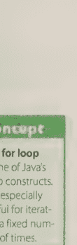

**练习 9.14** 检查 `Space` 类中的 `addAsteroids` 方法。它是做什么的？

**练习 9.15** 查看该方法中的 `for` 循环。从循环头部，写下初始化部分、循环条件和增量部分。（参见上方 `for` 循环的定义。）

循环的初始化部分在循环开始前精确执行一次。然后检查循环条件：如果为真，则执行循环。最后，在循环体完全执行后，执行循环头部的增量部分。之后，循环重新开始：再次评估条件，如果为真，则再次运行循环。初始化永远不会再次执行。

`for` 循环可以很容易地替换为 `while` 循环。上述所示 `for` 循环等效的 `while` 循环如下：

```java
initialization;
while (loop-condition) {
    loop-body;
    increment;
}
```

这里的 `while` 循环结构与上述 `for` 循环结构的作用相同。主要区别在于，在 `for` 循环中，初始化和增量移动到了循环头部。这使得在循环开始前就已经知道要执行循环的次数，并且使循环更易读。

`for` 循环特别适合我们已经知道要执行多少次循环的情况。`addAsteroids` 方法中的 `for` 循环示例如下：

```java
for (int i = 0; i < count; i++) {
    int x = Greenfoot.getRandomNumber(getWidth()/2);
    int y = Greenfoot.getRandomNumber(getHeight()/2);
    addObject(new Asteroid(x, y));
}
```

这展示了 `for` 循环的典型示例：

- 初始化部分声明并初始化循环变量。该变量通常名为 `i`，初始化为 0。

- 循环条件检查循环变量是否小于给定限制（此处为 `count`）。如果是，循环继续。

- 增量部分增加循环变量。

`for` 循环有许多变体，但这个示例展示了一种非常典型的格式。

**练习 9.16** 在 `Space` 类中，将 `addAsteroids` 中的循环重写为 `while` 循环。确保它与之前一样。

**练习 9.17** 再次使用 `for` 循环重写该方法。

**练习 9.18** 实现之前创建的 `createStars` 方法体。该方法应包含以下内容：

- 获取世界的背景图像。

- 使用类似于 `addAsteroids` 的 `for` 循环。循环限制由方法参数给出。

- 在循环体内生成随机的 x 和 y 坐标。将颜色设置为白色，并在背景图像上绘制一个宽度和高度均为两个像素的填充椭圆。

测试！你的世界里星星吗？如果一切顺利，你应该能看到。

**练习 9.19** 创建亮度随机星星。你可以通过创建一个 0 到 255 之间的随机数（所有颜色 RGB 值的合法范围），并为所有颜色分量使用相同的随机值创建一个新的颜色对象，确保生成的颜色是中性灰色。使用这种新颜色绘制星星。确保为每颗新星星生成新的颜色。

这些练习非常有挑战性，但你应该掌握了解决它们所需的知识。如果你遇到困难，可以查看我们在 `asteroids-2` 版本中提供的实现版本。或者，你现在可以忽略这部分，先继续后续任务然后再回来。

## 旋转

在上一节中，我们在外观上花费了大量精力。我们使用 `for` 循环在背景中创建星星。那些辛苦工作的效果有限。然而，了解 `for` 循环以后会很有用。

现在我们想要实现一些真实的功能：我们想让火箭移动。第一步是在按下键盘左右箭头键让它旋转。

**练习 9.20** 检查 `Rocket` 类。找到处理键盘输入的代码。持有这些代码的方法名称是什么？

**练习 9.21** 添加一条语句，在按下“左”键时让火箭向左旋转。在每个动作周期（act cycle）中，火箭应向左旋转 5 度。

**练习 9.22** 添加一条语句，使火箭在按下“右”键时向右旋转。进行测试！

如果你成功完成了这些练习，那么你的火箭现在应该能够通过按下箭头键来转弯了。由于它是朝着朝向的方向发射，因此它也可以向所有方向发射。

接下来的挑战是让它向前移动。

## 9.4 向前飞行

我们的 `Rocket` 类是 `SmoothMover` 类的子类，我们在上一个章节中见过它。这意味着它包含一个决定其运动的向量向量，并且有一个 `move()` 方法使其根据该向量进行移动。

我们的第一步是利用这个 `move()` 方法。

**练习 9.23** 在 `Rocket` 的 `act` 方法中，添加对 `move()` 方法的调用（继承自 `SmoothMover`）。测试。你观察到了什么？

在 `act` 方法中添加 `move()` 调用是重要的第一步，但它本身并不起任何作用。它导致火箭根据其运动向量移动，但由于我们还没有启动任何运动，该向量的长度为 0，因此没有发生移动。

为了改变这一点，让我们先引入少量的自动漂移，让火箭从开始就有一定的初始运动。这会让玩小行星游戏变得有趣得多，因为防止了玩家长时间保持静止。

**练习 9.24** 为火箭添加少量的初始运动。要做到这一点，创建一个具有任意方向和很长度（根据你的喜好设定）的向量，然后使用 `SmoothMover` 的 `addVelocity` 方法，并将该向量作为参数将此力作用于火箭。你可以在 `Rocket` 的构造函数中完成操作。（确保在 `Vector` 构造函数中使用 `int` 作为你的第一个参数，以便使用正确的构造函数。）

测试。如果一切顺利，火箭在场景开始时应该会自动漂移。不要让这种初始漂移太快。不断实验，直到你获得一个良好的、缓慢的初始运动。

接下来，我们想为玩家添加移动控制。计划是按下“上”箭头键点燃火箭的助推器并让我们向前移动。

对于现有的键盘输入，我们使用了如下模式的代码：

```java
if (Greenfoot.getKeyCode("left")) {
    turn(-5);
}
```

对于向前移动，我们需要稍微不同的模式。原因在于，对于此处所示的旋转，我们只需要在按键被按下时执行操作。

向前移动是不同的：当我们按下“上”键进行移动时，我们想改变火箭的图像以显示火箭引擎正在点火。当我们释放按键时，图像应该恢复正常图像。我们希望在按键按下和释放时都执行操作。因此，我们需要类似如下逻辑的代码模式：

- 当“上”键被按下时：
    - 更改图像显示引擎点火；
    - 添加移动力；
- “上”键被释放时：
    - 恢复到正常图像；

显示图像非常简单。场景已经包含了两个火箭图像：`rocket.png` 和 `rocketWithThrust.png`。这两张图像都加载到 `Rocket` 类顶部的字段中。


由于我们需要在两种情况下（按下“上”键时和释放时）都做出反应，我们将定义并调用一个单独的方法来处理此功能。

在 `checkKeys` 中，我们可以插入以下方法调用：

```java
ignite(Greenfoot.getKeyCode("up"));
```

这行代码将首先调用 `Greenfoot` 类中的 `isKeyDown` 方法，该方法返回一个布尔值。然后这个布尔值将作为参数传递给 `ignite` 方法（我们现在必须编写它）。

为了编写 `ignite` 方法，我们需要安排以下内容：

- 方法接收一个布尔参数（假设为 `boosterOn`），用于指示助推器应该是开启还是关闭。该参数由 `isKeyDown("up")` 的结果设置（如果按键按下，`boosterOn` 为 `true`，否则为 `false`）。
- 如果助推器开启，则将图像设置为 `rocketWithThrust.png` 并使用 `addTo` 添加新向量。该向量的方向应该从火箭的当前旋转角度（`getRotation()`）获取，并具有很小的常数长度（例如 `0.3`）。
- 如果助推器未设置，则将图像设置为 `rocket.png`。

练习 9.25 正如所示，在你的 `checkKeys` 方法中添加对 `ignite` 方法的调用。

练习 9.26 为 `ignite` 方法定义一个方法存根（主体为空的方法）。该方法应该有一个布尔参数，且返回类型为 `void`。确保编写注释。测试！代码应该可以编译（但现在什么都不做）。

练习 9.27 按照上述项目符号概述实现 `ignite` 方法的主体。

对于我们 `ignite` 方法的实现，每次方法被调用时都设置图像是可以接受的，即使在不需要的情况下（例如，如果助推器是关闭的，且上次也是关闭的，那么我们不需要设置图像，因为图像没有变化）。在不严格需要时设置图像开销非常小，避免这样做并不至关重要。

一旦你完成了这些练习，你就到了一个可以操控火箭在空间中飞行并撞击小行星的阶段。你将看到使用运动向量而不是那样的效果。

## 与小行星碰撞

这个阶段最明显的缺陷是我们可以穿过小行星。我们将修复它。想法是，当我们撞上小行星时，飞船应该爆炸。因此，我们考虑：

```java
if (collided with asteroid) {
    产生爆炸；
    移除火箭；
    游戏结束；
}
```

在研究这些子任务之前，我们先准备代码。

## 9.5 与小行星碰撞

练习 9.28 在 `Rocket` 类中创建一个新的方法存根（主体为空的方法）用于检查碰撞。将其命名为 `checkCollision`。该方法可以是私有的，且不需要返回值或参数。

练习 9.29 在火箭的 `act` 方法中添加对 `checkCollision` 方法的调用。确保你的类可以编译并运行。

第一个子任务是检查我们是否与小行星碰撞。Greenfoot 类包含许多不同的碰撞方法，每种方法的功能不同。我们在之前的章节中见过其中一个——`getIntersectObject`。现在让我们来看看其他方法。

练习 9.30 查看 `Actor` 类的文档，并记录所有与碰撞相关的方法。

练习 9.31 你注意到还有方法可以告诉你附近的物体（即使没有碰撞）。也将这些方法记录下来。

附录 C 提供了不同碰撞方法的总结。现在可能是快速浏览它的时机。在某个阶段，你应该熟悉所有的碰撞方法。

对于我们的目的，`getIntersectObject` 或 `getIntersectingObjects` 看起来很合适。当两个对象的像素重叠时，它们就会相交——这正是我们需要的。

在图 9.2 中，图像发生了重叠，尽管它们的可见部分并没有接触。碰撞检测方法会将此报告为相互相交。它们是基于边界框（bounding boxes）运行的，并不关注图像的非透明部分。

因此，我们的火箭会与小行星发生“接触”，尽管在屏幕上，它们之间似乎还有一小段距离。

对于我们的小行星游戏，我们选择忽略这一点。由于距离很小，所以玩家通常不会注意到。其次，很容易编一个故事来解释这种效果（“飞离小行星太近会因为引力而摧毁你的飞船”）。

有时候，如果能检查图像的实际可见（非透明）部分是否相交会很好。虽然这是可能的，但要困难得多。我们不会在这里讨论这一点。

既然我们已经决定使用相交检测，就可以查看 Actor 方法了。有两个方法可以检查对象相交。它们的签名如下：

```
List getIntersectingObjects(Class cls)
Actor getIntersectingObject(Class cls)
```

这两个方法都接受一个 `Class` 类型的参数（这意味着如果我们想要，可以检查与特定类对象的相交情况）。区别在于，一个方法会返回我们目前与之相交的所有对象的列表，而另一个方法只返回单个对象。如果我们相交了多个对象，第二个方法会随机选择其中一个并返回。

对于我们的目的来说，第二个方法已经足够了。正如第 5 章中的 WBC 场景一样，无论我们撞击一颗行星还是同时撞上两颗，对游戏来说实际上没有区别。火箭同样会爆炸。我们唯一的问题是：我们是否真的与任何小行星相交了？

因此，我们使用第二个方法。由于它返回一个 `Actor` 而不是 `List`，处理起来稍微简单一些。我们第一个任务——检查是否与小行星发生碰撞——的代码模式与我们之前看到的相同：

```
Asteroid a = (Asteroid) getIntersectingObject(Asteroid.class);
if (a != null)
{
}
```

**练习 9.32** 在你的 `checkCollision()` 方法中添加一个与小行星相交的检查，类似于此处所示的。

**练习 9.33** 在 `if` 语句体中添加代码，在火箭的当前位置向世界添加一个爆炸，并从世界移除火箭。（要实现这一点，你需要使用 `getWorld()` 方法来访问世界添加和移除对象的方法。）

对于上面的最后一个练习，我们可以使用自己的 `getX()` 和 `getY()` 方法来获取当前位置。我们可以将此作为放置爆炸的坐标。

尝试解决这个问题的代码可能如下：

```
World world = getWorldObject();
world.removeObject(this); // 从世界中移除火箭
world.addObject(new Explosion(), getX(), getY());
```

这段代码乍看起来很合理，但它无法工作。

**练习 9.34** 尝试上述代码。它能编译吗？它能运行吗？在哪个点出了问题，错误信息是什么？

这不起作用的原因是我们在从世界中移除火箭之后调用了 `getX()` 和 `getY()` 方法。当一个 actor 从世界中移除时，它不再拥有任何坐标——它只有在世界中时才有坐标。因此，在这个例子中，`getX()` 和 `getY()` 方法调用失败了。

可以通过交换最后两行代码轻松修复：先插入爆炸，然后从世界中移除火箭。

**练习 9.35** 这是一个非常高级的练习，你可能想先跳过它，以后再回来。

这里使用的爆炸是一个看起来相当简单的爆炸。目前足够了，但如果你想创建非常漂亮的游戏，可以对其改进。一种更复杂的显示爆炸的方法在 Greenfoot YouTube 频道上的系列 Greenfoot 教程中介绍：

```
https://www.youtube.com/user/18km
```

为你的火箭创建一个类似的爆炸。

## 游戏结束 (Game Over)

我们的游戏现在终于可以玩了。你可能注意到分数计数不起作用（我们稍后会研究这个问题），而且当你失败时什么都没有发生。我们将在火箭崩溃的结尾添加一个巨大的“Game Over”标志。

这很容易做到：项目中已经有一个我们使用的 `ScoreBoard` 类了。

**练习 9.36** 创建一个 `ScoreBoard` 类的对象并将其放入世界中。

**练习 9.37** 检查 `ScoreBoard` 类的源代码。它有多少个构造函数？它们之间有什么区别？

**练习 9.38** 修改 `ScoreBoard` 类：更改上面显示的文本，更改文本颜色，更改背景和边框颜色，更改字体大小使你的新文本恰当，并更改分数板的宽度以适应你的文本。

正如你所看到的，分数板包含了“Game Over”文本和最终分数（尽管分数目前没有正确计数，但我们稍后会担心这个问题）。

`Space` 类已经有一个名为 `gameOver` 的方法，用于创建并显示分数板。

**练习 9.39** 找到并检查 `Space` 类中的 `gameOver` 方法。它目前的实现是什么样的？

**练习 9.40** 实现 `gameOver` 方法。它应该创建一个新的 `ScoreBoard` 对象，使用 `getWorld()` 方法访问世界添加和移除对象的方法。

## 强制转换 (Casting)

强制转换是一种告诉编译器我们的对象具有比其自身能推断出的更精确类型的技术。在案例中，从 `getWorld` 返回的对象类型是 `World`，而我们现在告诉它实际上是 `Space` 类型。我们通过在方法调用的括号中写入类名（`Space`）来实现。一旦完成，我们就可以将结果赋值给 `Space` 类型的变量（而不是 `World` 变量），然后调用在 `Space` 中定义的方法：

```
gameOver();
```

值得注意的是，强制转换不会改变对象的类型。我们的世界实际上一直都是 `Space` 类型。问题仅仅是编译器不知道这一点。通过这种，我们只是给编译器提供了额外信息。

让我们回到 `checkCollision` 方法。一旦我们把世界强制转换为 `Space` 并将其存储在变量中，我们就可以在该上调用所有方法：包括在 `Space` 中定义的方法以及从 `World` 继承的方法。因此，我们现有对 `addObject` 和 `removeObject` 的调用仍然应该工作，`gameOver` 的调用也应该正常。代码 9.2 显示了修复后的方法。

## 代码 9.2

```java
/**
 * 检查我们是否与小行星发生碰撞。
 */
private void checkCollision() {
    Asteroid a = (Asteroid) getOneIntersectingObject(Asteroid.class);
    if (a != null) {
        Space space = (Space) getWorld();
        space.addObject(new Explosion(), getX(), getY());
        space.removeObject(this);
        space.gameOver();
    }
}
```

**练习 9.44** 使用此处讨论的将 `World` 转换为 `Space`，实现对 `gameOver` 方法的调用。进行测试。现在应该可以工作了，而且当火箭爆炸时计分板应该出现。

**练习 9.45** 当我们错误地使用强制转换时会发生什么？尝试将世界对象强制转换为 `Asteroid` 而不是 `Space`。这有效吗？你观察到了什么？

到目前为止的工作实现了我们“游戏结束”的显示（得分仍然不正确）。我们将评分留作本章末的练习。如果你想现在修复它，可以跳到章节末尾的练习并先查看这个问题。在这里，接下来我们将研究质子波。

# 添加火力：质子波

我们的游戏正变得越来越好。本章我们将详细讨论的最后一件事是添加第二种武器：质子波。这将为游戏带来更多多样性。想法是：我们的质子波一旦释放，就会从我们的火箭向外扩散，损坏或破坏路径上的每个小行星。由于它同时向所有方向运行，因此它比我们的子弹强大得多。对于游戏来说，我们可能应该限制使用它的频率，以免游戏变得太简单。

**练习 9.46** 运行你的场景。在场景中放置一个质子波——你观察到了什么？

练习告诉我们我们有一个质子波演员，它显示完整尺寸的波。然而，这个波不会移动，不会消失，也不会对小行星造成任何伤害。

我们的第一个任务将是让波增长。我们将从非常小的时候开始，然后一直增长直到达到我们刚刚看到的完整尺寸。

**练习 9.47** 检查 `ProtonWave` 类的源代码。已经存在哪些方法？

**练习 9.48** 每个方法的作用是什么？查看每个方法的注释并将其扩展为更详细的解释。

**练习 9.49** 尝试解释 `initializeImages` 方法做了什么以及它是如何工作的。用书面形式解释，如果喜欢可以使用图表。

# 波的增长

我们已经看到 `ProtonWave` 类有一个方法——`initializeImages`，它创建 30 张不同尺寸的图像并将它们存储在数组中（代码 9.3）。这个名为 "images" 的数组在索引 0 处持有最小的图像，在索引 29 处持有最大的（见图 9.3）。通过加载基础图像 ("wave.png")，然后在循环中创建该图像的副本并将其缩放到不同尺寸来创建图像。

## 代码 9.3

```java
/* 创建用于扩展波的图像 */
public static void initializeImages() {
    if (images == null){
        GreenfootImage baseImage = new GreenfootImage("wave.png");
        images = new GreenfootImage[NUMBER_IMAGES];
        int i = 0;
        while (i < NUMBER_IMAGES){
            int size = (i+1) * (baseImage.getWidth() / NUMBER_IMAGES);
            images[i] = new GreenfootImage(baseImage).scale(size, size);
            i++;
        }
    }
}
```

## 图 9.3

一个图像数组（由于空间原因省略了部分）

GreenfootImage [] images

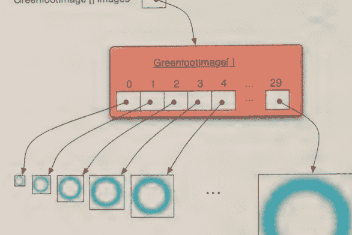

该方法使用 `GreenfootImage` 类中的 `scale` 方法来完成缩放。它还使用 `while` 循环进行迭代。然而，这是一个例子，在本章开始时遇到的 `for` 循环在这种情况下会更合适。

**练习 9.50** 重写 `initializeImages` 方法，使用 `for` 循环代替 `while` 循环。

在实践中，使用哪种循环并不非常重要。然而，在这种情况下 `for` 循环是一个很好的选择，因为我们有已知的迭代次数（图像的数量）。`for` 循环相比 `while` 循环的优势是将循环的所有元素（初始化、条件和递增）都集中在头部。

`images` 字段和 `initializeImages` 方法是静态的（它们使用 `static` 关键字）。这意味着图像存储在类中，而不是实例中。结果是，创建的所有该类对象共享这组图像，这样要高效得多。复制和缩放这些图像需要相当长的时间（在普通计算机上二十分钟）。这看起来可能不多，但如果我们在游戏中执行它，就会引入明显的延迟。为了解决这个问题，方法的代码被封装在一个 `if` 语句中：

```java
if (images == null) {
    // ...
}
```

这个 `if` 语句确保该方法的主要部分（`if` 语句的主体）只执行一次。第一次，`images` 为 `null`，方法完整执行。它会将 `images` 初始化为非 `null` 值。此后，只需执行 `if` 语句的测试，而不会执行主体。`initializeImages` 方法实际上在每次创建质子波时都会调用（从构造函数调用），但实质工作只在第一次完成。

现在我们对代码和已有的字段有了大致了解，终于可以开始了。我们想要做的是：

- 我们希望从最小的图像开始波。
- 在每个 act 步骤，我们想要让波增长（显示下一个更大的图像）。
- 在显示完最大的图像后，波应该消失（从世界中移除）。

以下练习将实现这些。

**练习 9.51** 在 `ProtonWave` 类的构造函数中，将图像设置为最小图像。（你可以使用 `images[]` 作为 `setImage` 方法的参数。）

**练习 9.52** 创建一个名为 `currentImage` 的 `int` 类型实例字段，并将其初始化为 0。我们将使用该字段遍历图像。当前值是当前显示图像的索引。

**练习 9.53** 为一个名为 `grow` 的新私有方法创建一个方法存根。该方法没有参数也没有返回值。

**练习 9.54** 从你的 `act` 方法中创建 `grow` 方法（尽管它在现阶段什么都不做）。

# 第 9 章 碰撞检测：小行星

我们快要完成了。剩下的唯一工作就是实现 `grow` 方法。其大致思路如下：

```
show the image at index currentImage;
increment currentImage;
```

我们还需要添加一个 `if` 语句，首先检查 `currentImage` 是否已经达到了最后一张图像。如果是的话，我们可以从世界中移除质子波，这样工作就完成了。

**练习 9.55** 在上述讨论的行代码之间实现 `grow` 方法。

**练习 9.56** 测试你的质子波。如果你交互式地创建一个质子波，并在场景运行时将其放入世界中，你应该能看到波的扩散效果。

**练习 9.57** 添加一些音效。场景中包含了一个名为“proton.wav”的音频文件——你只需要播放它即可。你可以将播放声音的语句放在质子波的构造函数中。

现在我们已经有了一个功能正常的质子波，应该为我们的火箭配备上释放它的功能。

**练习 9.58** 在 `Rocket` 类中，创建一个没有参数的方法 `startProtonWave` 存根。它需要返回值吗？

**练习 9.59** 实现这个方法：它应该在火箭当前的坐标处向世界中放置一个新的质子波对象。

**练习 9.60** 在按下“z” 键时，从 `checkKeys` 中调用这个新方法。进行测试。


## 练习 9.61

你会很快发现，现在质子波可以释放得太频繁了。为了发射子弹，`Rocket` 中已经内置了一个延迟（使用 `gunReloadTime` 常量和 `reloadCount` 字段）。研究这段代码并为质子波实现类似的功能。尝试不同的延迟，直到找到一个看起来很合理的。质子波不应该被非常频繁地使用。

## 与范围内的对象交互

我们现在有了一个可以通过按键释放的质子波。剩下的问题是，这个质子波实际上对小行星产生产生任何影响。

我们想要添加代码，当小行星被质子波击中时对其造成伤害。

### 练习 9.62

为这项新功能做准备：在 `ProtonWave` 类中，添加一个名为 `checkCollision` 的方法存根。该方法没有参数且没有返回值。在你的 `act` 方法中调用此方法。

### 练习 9.63

这个新方法的目的是检查波是否触碰了小行星，如果触碰了就造成伤害。编写该方法的注释。

这一次我们不想使用 `getIntersectingObjects` 方法，因为质子波图像角的不可见区域（包含在边界框内，但不是蓝色圆形的一部分）相当大，小行星在波看起来触及它们很久就会被摧毁。

相反，我们将使用另一种碰撞检测方法，称为 `getObjectsInRange`。

`getObjectsInRange` 方法返回一个位于调用对象给定半径内的所有对象的列表（见图 9.4）。它的签名如下：

```
List getObjectsInRange(int radius, Class cls)
```

调用时，我们可以指定我们感兴趣的对象类（像以前一样），还可以指定一个半径（以单元格为单位）。该方法将返回在调用对象周围此半径内找到的所有请求类的对象的列表。

为了确定哪些对象在范围内，使用了对象的中心点。例如，如果小行星的中心点到火箭中心点的距离小于 20 个单元格宽度，那么该小行星就在火箭的范围 20 之内。图像的大小与此方法无关。

使用这个方法，我们可以实现 `checkCollision` 方法。

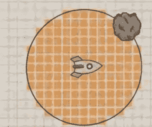

我们的质子波将具有不断增大图像。在每个 `act` 循环中，我们可以使用当前图像的大小来确定碰撞检测的范围。我们可以通过以下方法调用获取当前图像的大小：

```
getImage().getWidth()
```

然后我们可以使用该大小的一半作为我们的范围（因为范围指定为半径而非直径）。

### 练习 9.64

在 `checkCollision` 中，声明一个名为 `range` 的局部变量，并将当前图像宽度的一半赋值给它。

### 练习 9.65

添加对 `getObjectsInRange` 的调用，返回计算范围内的所有小行星。将结果赋值给类型为 `List<Asteroid>` 的变量。记得你还需要为 `List` 类型添加导入语句。

这些练习为我们提供了质子波范围内所有小行星的列表。我们想要对范围内的每个小行星造成一些伤害。

`Asteroid` 类有一个名为 `hit` 的方法，可以使用它来实现。该方法已经被用于在行星被子弹击中时造成伤害，我们在这里再次使用它。

我们可以使用 `for-each` 循环来遍历从 `getObjectsInRange` 调用返回的列表中所有行星。（如果你不确定如何编写 `for-each` 循环，请查看第 7.10 节）。

### 练习 9.66

在 `Asteroid` 类中找到 `hit` 方法。它的参数是什么？它返回什么？

### 练习 9.67

`ProtonWave` 类定义了一个常量 `DAMAGE`；它指定了应该造成的伤害量。找到常量的声明。它的值是多少？

### 练习 9.68

在 `checkCollision` 方法中，编写一个 `for-each` 循环，遍历从 `getObjectsInRange` 调用获取的小行星列表。在循环体中，使用 `DAMAGE` 常量对每个小行星调用 `hit`。

完成这些练习后，进行测试。如果一切顺利，你现在应该拥有一个可以射击行星并释放质子波的游戏版本。你会发现游戏变得太简单了。

## 进一步开发

我们已经到了本章详细讨论的结束。然而，这个游戏有很多改进空间。有些是显而易见的，另一些你可能想自己发明。

下面是一些进一步工作的建议，以练习的形式给出。许多练习是相互独立的——不需要按照特定的顺序进行。选择你感兴趣的，并提出你自己的扩展。

## Counter 类和其他辅助类

包含在此场景中的 **Counter** 类是 Greenfoot 提供的的一小类辅助类之一。你可以通过 Greenfoot 主窗口中 *Edit* 菜单中的 `Import Class...` 功能导入这些任何类。尝试看看还有哪些类。

我们本可以选择直接在世界背景上显示分数，就像我们在第 5 章中做的那样。在这种情况下，我们选择了使用 Counter 类来实现视觉效果：我们想让它更有趣。一旦在这个场景中实现分数计数，你会发现这个计数器不仅外观更好，而且在增加计数时还包含动画效果（数字增长）。

### 练习 9.69

修复分数计数。你已经有一个分数计数器，但它还没有被使用。计数器定义在 `Counter` 类中，并且计数器对象在 `Space` 类中被创建了。

为了让分数工作，你将大致执行以下操作：在 `Space` 类中添加一个类似于 `highScore` 的方法。该方法应该为计数器增加分数。每当行星被击中时，从 `Asteroid` 类中调用这个新方法（你可能想为分裂行星和移除最后的碎片设置不同的分数）。

### 练习 9.70

在全部清理后添加新的小行星。也许游戏开始时只有两个小行星，每当它们被清理时就会出现一个新的，每次出现一个。在第二轮有三个小行星，第三轮以此类推。

### 练习 9.71

添加关卡计数器。每当小行星被清理时，你就升一级。也许在后面的关卡中获得更高的分数。

这个版本包含了最后几节中的所有更改，可以在书籍项目中作为 `asteroids-3` 获取。你可以用它与自己的代码进行比较，或者当你在某个练习中卡住时查找解决方案。

# 第 9 章 碰撞检测：小行星

### 练习 9.72

添加一个关卡结束音。每完成一个关卡时应播放此声音。

### 练习 9.73

添加一个显示质子波加载状态的指示器，以便玩家可以看到它何时可以再次使用。这可以是一个计数器或者某种图形化表示。

### 练习 9.74

添加一个护盾。当护盾部署时，它会持续一短的固定时间。在护盾开启期间，可以在屏幕上看到，且碰撞的小行星不会对其造成伤害。

当然，还有无数可能的扩展。发明一些你自己的想法，实现它们，并将你的结果提交到 Greenfoot 网站。


# 编程技巧总结

在本章中，我们完成了一个最初只写了一半的小行星游戏。在这个过程中，我们再次遇到了几个重要的构造结构，包括循环、列表和碰撞检测。

我们看到了一种新的循环样式——`for` 循环，并用它来绘制星空和生成质子波图像。在实现质子波功能时，我们还回顾了 `for-each` 循环和方法。

使用了两种不同的碰撞检测方法：`getOneIntersectObject` 和 `getObjectsInRange`。它们在某些情况下各有优劣。后者向我们返回了一个包含 actor 的列表，因此我们必须再次处理列表。

对列表和循环的练习越多，使用它们就越容易。在使用一段时间后，你会惊讶于自己起初为什么觉得它们是如此困难。

## 概念总结

- **for 循环**是 Java 的构造结构之一。它对于执行固定次数的迭代特别有用。

- Greenfoot 提供了几种用于**碰撞检测**的方法。它们位于 **Actor** 类中。

- 图像的**边界框 (bounding box)** 是包围该图像的矩形。

- 对象可以是**多种类型**：即某个类的类型及其超父类的类型。

- **强制转换 (Casting)** 是为我们的对象指定一个比编译器已知类型更精确的类型的技术。

## 训练与练习

这一次我们将对循环进行一些练习，并对字符串进行更多练习。为此，我们将使用一个名为 `loop-practice` 的独立场景（你可以在第 9 章文件夹中找到它）。

打开此场景并打开 `ChalkBoard` 类的编辑器。你会发现一个名为 `practice` 的方法。对于后续练习，你将所有的代码都写在这个方法中。

该方法最初包含一个方法调用，用于输出数字 7。这是为了向你展示如何在黑板上写东西。这很简单——你只需要调用带有 `int`、`char` 或 `String` 参数的 `write` 方法即可。

所有的练习都要求你调用该方法来输出某些数字或文本。

### 练习 9.75

在 `practice` 方法中，删除现有的方法调用。编写一个打印 10 次字母 "a" 的循环。

### 练习 9.76

写一个打印数字 0 到 19 的循环。

### 练习 9.77

写一个循环，打印文本片段 "a0"、"a1"、"a2" 等，一直到 "a16"（不带引号）。

### 练习 9.78

写一个循环，打印从 0 到 24 的所有偶数。

### 练习 9.79

写一个循环，打印从 15 到 75 的所有 5 的倍数。

### 练习 9.80

写一个循环，打印从 1 到 12 所有数字的平方。

### 练习 9.81

声明一个本地 `String` 变量并将你的名字赋值赋值。输出这个变量。

### 练习 9.82

不要直接输出整个变量，而是写一个循环逐个打印该字符串的每个字符。查阅 `String` 类的文档以查找字符串长度以及如何单独访问每个字符。

### 练习 9.83

写一个循环，重复打印你名字的每个字符。例如，如果你名字叫 "Jane"，它应该输出 Jaanne。

### 练习 9.84

写一个循环，打印你名字中每隔一个的字符。

### 练习 9.85

写一个循环，倒序打印你名字的每个字符。

### 练习 9.86

将单词 "Greenfoot" 赋值给你的字符串变量而不是名字。写一个循环，打印该字符串的每个字符，但跳过字符 "r" 和 "o"。当遇到这些字符时，直接忽略它们。

### 练习 9.87

写一个循环，打印该字符串的每个字符，但将每个 "o" 交换为 "e"，将每个 "e" 交换为 "o"。

接下来三个练习是给好奇者准备的。你必须自己做一些研究。你需要了解模运算（如果无法直接询问别人，请进行网络搜索）。在 Java 中它用百分号 (`%`) 表示。你需要使用这个模运算符来检查一个数字是否是另一个数字的倍数。

### 练习 9.88

写一个循环打印 0 到 30 的数字，但对于每个 5 的倍数，用字母 "X" 代替数字。

### 练习 9.89

修改上一个练习的循环，使其也将 3 的倍数替换为字母 "O"。

### 练习 9.90

在循环中添加另一个细节：如果是 3 和 5 的倍数，则输出字母 "Z"。

# 间插 2：Greeps 竞赛

我们将花一点时间休息一下，看看间插。我们将看看 Greeps。这些 Greeps 是外星生物。它们降临了地球！关于 Greeps 的重要点之一是它们喜欢西瓜。它们从飞船出发寻找西瓜（图 2.1）。

这次竞赛的挑战是编写你的 Greeps，以便尽快将西瓜带回飞船。你可以和朋友一起进行这个项目，也可以自己完成。如果是自己完成，可以提交到 Greenfoot 网站。

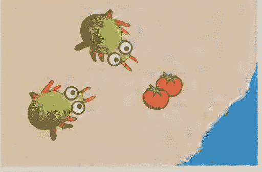

## 如何开始

首先打开 greeps 场景并运行。

你会看到一艘飞船落在一个沙地和水的区域。Greeps 会离开飞船开始寻找西瓜（它们分布在各地）。Greeps 是陆地动物——它们不能进入（事实上，它们对水非常敏感，会迅速溶解。）

当你尝试场景时，你会很快发现 Greeps 的行为并不智能。它们从船向随机方向出发，但当到达边缘时，它们就会停在那里。

你的任务是编写 Greeps 使用更聪明的策略，因此你需要找到西瓜并将它们带回飞船。

关于 Greeps 有一些你需要知道的事实：

- 飞船上有 20 只 Greeps。它们降落后开始工作。你无法获得更多。
- Greeps 可以背着西瓜，但它们不能将西瓜加载到自己的背上。它们只能将西瓜加载到另一个 Greep 的背上！这意味着它们必须同时出现在西瓜堆旁才能拿起西瓜。
- Greeps 无法通过任何方式进行口头交流。但是，它们可以在地面上喷油漆。它们可以喷出三种颜色（图 1.2）！传说曾有一群 Greeps 利用这种方式向彼此传递信息。
- Greeps 视力很差。它们只能看到所在处的地面，无法看远方。
- Greeps 记忆很好——它们从不会忘记所知的。但遗憾的是，它们的内存有限。它们一次只能记住几件事。

有了这些丰富的背景知识，我们现在可以准备编写 Greeps 了。

如果你将 Greeps 场景提交到 Greenfoot 网站，请不要包含源代码。我们希望保持这个项目对未来编程者的挑战性，不想让他们轻易找到他人的答案。

## 12.2 编写你的 Greeps

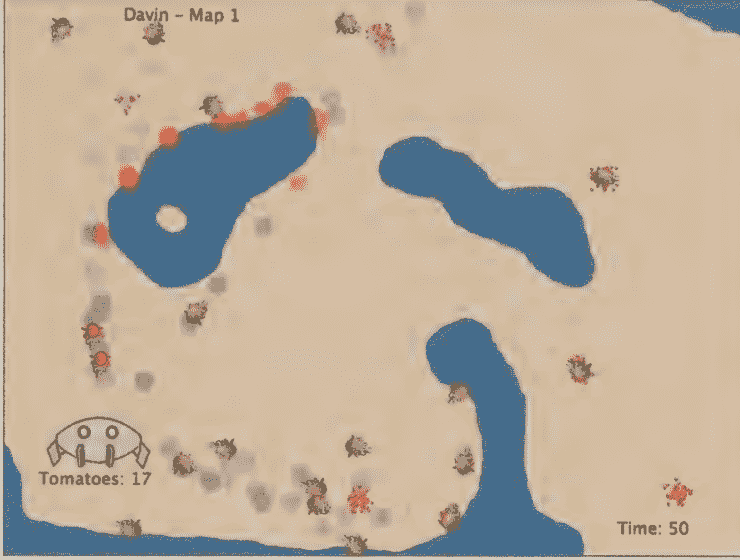

为了让你的 Greeps 尽可能多收集番茄，你应该改进它们的行为。场景中包含的 Greep 类已经包含了一些行为，你可以参考这些行为来开始工作。

我们可以看到 Greep 是 Creature 类的子类。`Creature` 类提供了许多你可以使用的非常有用的的方法。

然而，你必须遵守一些规则：

- 规则 1：仅允许修改 "Greep" 类。不允许修改或创建其他任何类。
- 规则 2：你不能扩展 Greeps 的内存。也就是说，你不允许向类中添加字段（final 字段除外）。程序提供了一些通用的内存（一个 int 和两个布尔值）。
- 规则 3：在每个“act”（动作）回合中，移动不能超过一次。
- 规则 4：Greeps 之间不进行直接通信。它们不会调用对方的方法，也不会访问对方的字段。
- 规则 5：没有长距离视野。你只能查看 Greep 所在的当前位置。Greeps 几乎是盲目的，无法看向更远的地方。
- 规则 6：不允许创建对象。你不允许创建任何场景（在用户定义的类实例中，例如 Greep 或 Paint 类除外）。Greeps 没有魔法力量——它们无法凭空变出东西。
- 规则 7：不允许瞬间移动。不能使用 `Actor` 类中那些规避了正常移动的方法（例如 `setLocation`）。

遵循这些规则至关重要。在技术上打破这些规则很容易，但这被视为作弊。

为了编写你的 Greeps，你主要在 Greeps 的 `act` 方法（以及你选择创建的任何私有方法）中工作。

一些入门小贴：

- 阅读 `Creature` 类的文档。（最好的方法是在编辑器中打开该类并切换到文档视图。）这些是你工作中最有用的方法之一。了解可用工具。
- 小步快跑。从微小的改进开始，看看效果如何。
- 一些初步改进可以如下：在水边时转身；如果发现番茄堆则等待（并尝试加载番茄）；在世界边缘时转身，以此类推。

你很快就会发现许多更多可以实现的改进。一旦你开始使用地面上的漆滴为其他 Greeps 做出标记以便它们寻找，事情就会变得特别有趣。

## 12.3 运行比赛

由一个裁判来运行比赛是有帮助的。在学校里，这可能是一个老师。如果你和朋友一起运行，可以是一个被选出的人（此人随后不能作为普通参赛者参加比赛）。

为了让比赛变得有趣，应该有两个版本的 Greeps 场景。一个版本分发给所有参赛者。（这是书中场景中包含的那个。）该场景包含三张不同的地图。Greeps 分别在三张地图上着陆和觅食。（因此，参赛者的挑战是开发出足够灵活的移动算法，使其能够在不同的地图上运行，而不仅仅是某一张已知地图。）

裁判应该拥有一个包含更多地图的另一个场景。我们建议使用 10 张不同的地图来运行比赛。参赛者无法接触最后七张地图——他们只能测试前三个。然后他们提交自己的 Greeps 进行评分，由裁判在所有 10 张地图上运行参赛者的 Greeps（可能在大显示屏上运行）以获得最终得分。

比赛最好持续几天（或者也许一两周），为参赛者提供多次提交作品进行评分的机会，以便他们可以缓慢改进。

## 12.4 技术细节

向裁判提交参赛作品最简单的机制是让参赛者仅提交 `Greep.java` 文件。裁判将该文件复制到他的完整（10张地图）场景中，重新编译并运行。这确保了在此过程中没有修改其他类。

一些艺术作品（用于为比赛制作传单或海报）可以在这里获取：

http://www.greenfoot.org/competition/greeps/

教师也可以在那里找到获取包含10 张地图的 Greeps 场景版本的说明。或者，教师也可以很容易地自己制作更多地图。Greeps 场景的 *images* 文件夹中提供了一个空地图的图像。可以直接在地图上绘制水，地图数据（番茄堆的位置等）可以在 `Earth` 类中指定。

# 第 10 章 创建图像和声音

**主题：** 创建声音、创建图像、动态图像变化、处理鼠标输入

**概念：** 音频格式、音质参数、图像文件格式、RGBA 颜色模型、透明度

我们之前遇到的许多场景之所以有趣，不仅是因为定义它们行为的程序代码，是因为它们有效地利用声音和图像。到目前为止，我们还没有过多讨论这些媒体文件的制作，并且通常依赖于现有的图片和声音。

在本章中，我们将学习创建和管理媒体文件的某些方面。我们将从计算机程序中声音的背景知识开始，然后介绍创建和处理图像的各种技术。

作为副作用，我们还将处理鼠标输入。

## 10.1 准备

与之前的章节不同，我们不会构建一个完整的场景，而是通过较小的练习来进行，这些练习可以被整合到各种场景中。第一系列练习将引导我们在用户点击 Actor（演员）时创建一个（由我们创建的）声音。

对于这些练习，我们不使用预先实现的场景，而是从头创建一个。

### 练习 10.1

作为本章练习的准备，创建一个新场景。你可以给它起任何名字。

你会发现新场景包含了 `World` 和 `Actor` 类，但没有其他类。

### 练习 10.2

创建 `World` 的子类。命名为 `HelloWorld`。你可以给它任何喜欢的背景图像。编译。

### 练习 10.3

更改世界的大小，使其单元格大小为 1，宽度 400 格，高度为 300 格。


# 练习 10.4
在你的场景中创建一个 `Actor` 子类。在这个阶段，它是什么并不重要。你可能会查看新建类对话框中显示的图像，并选择一个看起来有趣的。为你的类进行命名。（记住：类名应该大写字母开头）。

# 练习 10.5
在你的 `HelloWorld` 中添加代码，自动将 Actor 实例放入世界中。

# 练习 10.6
在你的 Actor 的 `act` 方法中编写代码，使其在每次动作时都向右移动 10 像素。

你应该拥有一个 Actor 在运行时向右移动的场景。然而，移动并不是我们的主要目标。我们添加移动只是为了有一个可以实验的初始视觉效果。

准备工作的下一步是让 Actor 对鼠标点击做出反应。

# 练习 10.7
在 `Greenfoot` 类中，有几个方法可以处理鼠标输入。它们是什么？在 Greenfoot 类文档中查找并记录下来。

# 练习 10.8
`mouseClicked` 和 `mousePressed` 之间有什么区别？

当我们想要对鼠标点击做出反应时，可以使用 `Greenfoot` 类中的 `mouseClicked` 方法。该方法返回一个布尔值，可以作为条件语句的条件。

`mouseClicked` 方法的参数可以指定我们要检查的对象，如果它被点击了，该方法将返回 true。如果我们不在乎点击时鼠标的位置，可以向参数传递 `null`——那么只要点击了鼠标任何地方，该方法就会返回 true。

# 练习 10.9
修改你的 `Actor` 类中的代码，使其仅在响应鼠标点击时向右移动。鼠标点击可以发生在世界中的任何位置。

# 练习 10.10
现在修改你的代码，让 actor 只有在用户点击它时才移动。要实现这一点，你必须将 actor 本身（而不是 `null`）作为参数传递给 `mouseClicked` 方法。记住，你可以使用关键字 `this` 来引用当前对象。

# 练习 10.11
你的你的代码：在世界中放置多个你的的 actor 实例，并确保只有你点击的那一个会移动。

你现在应该拥有一个可以响应鼠标点击的 actor 场景了。这是我们后续对声音和图像进行实验的一个良好起点。（如果你在创建此场景时遇到困难，本章的场景目录中有一个名为 `soundtest` 的场景，它实现了这一起点。）

## 使用声音

正如我们之前所看到的，`Greenfoot` 类有一个 `playSound` 方法，我们可以用它来播放声音文件。为了能够播放，声音文件必须位于场景文件夹内的 `sounds` 文件夹中。

首先，让我们播放一个现有的声音文件。

# 练习 10.12
从你的其他 Greenfoot 场景中选择一个声音文件，并将其复制到当前场景的 `sounds` 文件夹中。修改你的 actor，使其在你点击它时播放声音（而不是移动）。

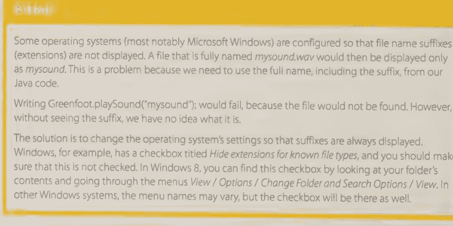

某些操作系统（最尤其是 Microsoft Windows）配置为不显示文件名后缀（扩展名）。一个全名为 `mysound.wav` 的文件将只显示为 `mysound`。这是一个我们需要解决的问题，即必须在 Java 代码中使用包含后缀在内的全名。

编写 `Greenfoot.playSound("mysound");` 将失败，因为找不到该文件。然而，在看不到后缀的情况下，我们不知道它是什么。

解决方案是更改操作系统的设置，使其始终显示后缀。例如，Windows 有一个标题为“隐藏已知文件类型的扩展”（Hide extensions for known file types）的复选框，你应该确保不要勾选它。在 Windows 8 中，你可以通过查看文件夹内容并进入“查看 / 选项 / 更改文件夹搜索选项”菜单来找到此复选框。在其他 Windows 系统中，菜单名称可能有所不同，但复选框也会在那里。

## 10.3 Greenfoot 中的声音录制

获取声音文件有多种选择。我们可以从其他 Greenfoot 项目中复制声音，或者从互联网上的免费声音库下载。如果你从互联网复制声音，请注意版权声明：互联网上并非所有内容都是免费的——尊重他人的版权！获取声音文件最简单的方法是自己录制。

为了做到，我们需要麦克风（许多笔记本电脑内置了麦克风，以及带有麦克风的电脑耳机）。如果你现在没有可用的麦克风，可能想跳过这一节。

在第 3 章中，我们已经简要见过 Greenfoot 内置的录音机。它允许我们录制声音、修剪掉开头和结尾不需要的部分并将其保存。

# 练习 10.13
使用 Greenfoot 的录音机（在“控制”菜单中可用）为你的示例场景录制一个新声音。让你的 actor 在被点击时播放那个新声音。

# 练习 10.14
引入第二种 actor。在世界中放置至少一个此类实例。让这个 actor 在被点击时产生不同的声音。

# 练习 10.15
使用数码相机或摄像头拍摄你或多位朋友的照片。创建代表这些朋友的 actor。录制你的朋友说话的声音，并在点击它们时让 actor 播放这些录音内容。

## 10.4 外部声音录制与编辑

使用 Greenfoot 的录音机快速又方便，在很多情况下它是足够的。然而，如果我们想变得更专业，我们可能想要录制某些用这种简单录音机难以产生的特定音效。如果我们在意声音的细节，独立的录音软件可能会很有用。

有许多录音程序可用；其中几个是免费的。我们将使用 Audacity 作为示例截图工具。Audacity 是一个很好的选择，因为它功能强大、可在不同的操作系统上运行，并且免费易用。不过，还有许多其他录音程序，请随意选择你喜欢的一个。

¹ Audacity 可从 http://audacity.sourceforge.org 获取

### 图 10.1 一个声音录制与编辑程序 (Audacity)

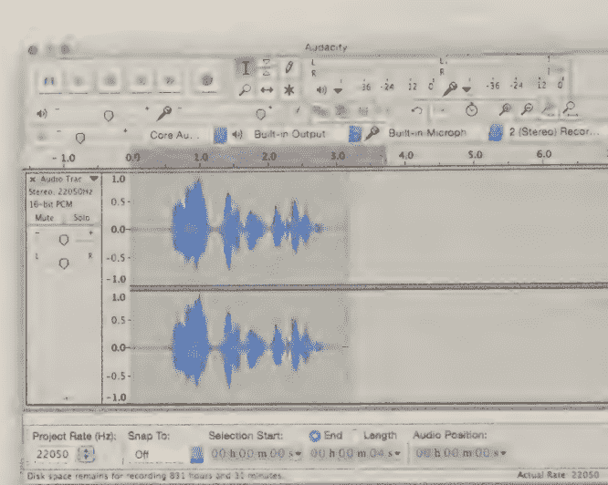

图 10.1 显示了录音程序的典型界面。你有录制、播放等控制控件，以及录制声音的波形显示（蓝色图表）。

录制声音非常简单——你通常通过尝试操作一会儿程序就能学会。

# 练习 10.16
打开一个录音程序并录制一个声音。播放它。结果符合你的预期吗？如果不符合，删除它并重试。

和 Greenfoot 一样，我们经常可以修剪开头和结尾的部分。然而，在声音编辑程序中，我们可以做更多：剪切、粘贴、重新排序和重复声音片段。

## 10.5 声音文件格式与大小

# 练习 10.17
你的你的声音文件，使其只包含你需要的声音。去掉开头和结尾不需要的部分。

然而，声音编辑程序最有趣的功能之一是使用过滤器。过滤器允许我们修改声音或产生全新的元素。通过将过滤器（如放大、回声、速度变化等）应用于录制（如说话、拍掌、尖叫），我们可以创建各种效果。

# 练习 10.18
如果你的声音程序支持过滤器（有时称为 `effects`），将其中一些应用于你的录制声音。选择三个你喜欢的过滤器，并用书面语描述它们的作用。为每个过滤器给出一个可能使用它的例子。

# 练习 10.19
制作以下声音：兔子吃胡萝卜；两个物体碰撞的爆炸；玩家失败时的“游戏结束”声；玩家胜利时的游戏结束声；机器人声音；以及跳跃声（游戏角色跳跃时使用）。

当声音编辑完成后，我们准备好将其保存为文件。声音文件可以以许多不同的格式和不同的编码进行保存，这会很快变得非常复杂。

Greenfoot 可以播放 WAV、AIFF、AU 和 MP3 格式的声音。然而，这些格式中的某些是所谓的“封装格式”—它们可以包含不同的编码，而 Greenfoot 只能读取其中一些。结果是 Greenfoot 无法播放 AU 文件。

当你保存录制的声音时，应该将其保存为“16 位 PCM WAV”文件。这是确保播放的最安全格式。在许多录制程序中，这是通过使用“导出”功能而不是标准的“保存”功能来实现的当你遇到 Greenfoot 无法播放的声音文件（可能从互联网下载），你通常可以在你的声音编辑程序中打开它们并转换为这种格式。

WAV 是短音效的良好格式。MP3 是另一种流行的格式，主要用于音乐和其他长录音。它是一种专有格式。

# 190 第 10 章 创建图像和声音

制作此类文件的程序需要支付许可费用，因此许多免费的音频编辑器并不支持它。在 Greenfoot 中，你可以播放 MP3（你可以构建自己的 MP3 播放器！），但对于保存我们自己制作的音效来说，并不是实用的格式。

在保存音频文件时，你还需要确保你的 Greenfoot 场景（scenario）能够找到它。为了让代码能够访问，音频文件必须位于场景文件夹内的 `sounds` 文件夹中。Greenfoot 音频录制器知道这一点，并将文件自动保存到该位置。使用外部音频编辑器时，你必须自己确保文件存储在正确的的位置。

# 练习 10.20
将你录制的声音保存为适用于 Greenfoot 的格式。将音频文件移动到场景的 `sounds` 文件夹中。修改你的 Actor 类代码，使其在被点击时播放你的音效。

# 练习 10.21
修改你的代码，使其在点击左鼠标键时播放音效，在点击右鼠标键时播放另一个音效。要实现这一点，你需要获取关于鼠标点击的信息，以告知你按下了哪个按钮。Greenfoot 有实现此点的方法——学习 Greenfoot 类文档以查找如何实现这一点。

# 练习 10.22
修改你的代码，使 actor 在被点击时播放音效并移动到新位置。

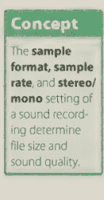

音频文件可能会迅速变大。只要场景仅在本地使用，这并不是一个主要问题，但如果例如导出了 Greenfoot 网站，那么文件大小就会产生巨大差异。声音和图像文件通常是 Greenfoot 场景中最大的部分，音频文件的大小将影响场景的下载时间。

为了避免音频文件过大，我们应该注意编码细节。在录制和保存声音时，我们可以在音质和大小之间进行权衡。我们可以非常高地录制并保存声音（导致大文件），也可以以较低质量录制并保存（导致较小文件）。我们可以更改的设置包括：

- 采样格式（通常为 16 位、24 位或 32 位）。
- 采样率，以赫兹 (Hz) 为单位，通常从 8,000 Hz 到 96,000 Hz 不等。
- 双声道与单声道。（双声道录制两个独立的轨道，因此数据量是两倍。）

如果你仔细查看图 10.1，可以看到截图中的声音是以 16 位、22,050 Hz、立体声录制的。

## 10.6 更多控制：GreenfootSound 类

有时，音频录制程序的默认设置甚至更高（例如 32 位和更高的采样率），这比简单音效所需的质量要高得多。（我们希望在听喜欢的音乐时有这种质量，但对于一个简短的“砰！”音效则不需要。）通常情况下，你应该考虑以较低质量保存声音，除非你觉得需要更多。

# 练习 10.23
在你的音频录制程序中寻找声音格式、采样率和双声道/单声道录制的设置。在某些程序中，你可以转换现有声音。在其他程序中，你只能为新录制指定这些设置。使用不同的采样格式、不同的采样率以及双声道和单声道进行声音录制。将它们保存为不同的文件并比较文件大小。制作一个包含不同设置的文件大小表格。哪种变化对文件大小处最大？

# 练习 10.24
听上一个练习中产生的声音。你能听出区别吗？在保持质量的同时，你可以降低多大的质量（以及文件大小）？

到目前为止，我们与声音的交互非常简单：我们播放了一个音频文件。这对于短音效已经足够，而 Greenfoot 声音方法是实现此点的简单方法。

然而，有时我们需要对声音有更多控制。当我们有背景音乐，或者如果我们想创建一个 MP3 播放器时，我们需要启动和停止声音、改变音量等。Greenfoot 有一个专门的类来实现此：`GreenfootSound` 类。

# 练习 10.25
在 Greenfoot 类文档中找到 `GreenfootSound` 类的文档。学习它。设置音量的接受值范围是多少？

# 练习 10.26
修改你的代码，使其使用 `GreenfootSound` 对象处理声音。该声音对象应该在你的 actor 构造函数中创建并存储在实例变量中。然后，当你点击 actor 时，它应该播放这个声音。

# 练习 10.27
再次修改你的代码，使其在点击 actor 时开始循环播放你的音效，并在再次点击时暂停声音。然后你可以通过多次点击 actor 来反复播放和暂停声音。

## 10.7 使用图像

更多使用声音类的一些练习位于在本章末尾的“训练与练习”（Drill and practice）部分中。

正如在之前的章节中简要讨论过的样（例如在第 9 章中制作小行星背景时），管理 actor 和世界背景的图像可以通过两种不同的方式实现：我们可以使用来自文件中的预制图像，或者我们可以动态绘制图像。我们将详细讨论这两种方法。

## 10.8 图像文件和格式

获取图像有多种方法。最简单的是 Greenfoot 网站。重要的是使用什么格式。我们可以读取 JPEG、PNG、GIF 或 TIFF。在这些格式中，JPEG 和 PNG 是两种格式。

JPEG 图像的优势是压缩良好。这意味着它们可以用较小的尺寸保存。在保存 JPEG 图像时，许多程序允许我们选择压缩程度。例如，Gimp 在我们保存图像时会显示“质量”滑块。我们压缩得越高，文件越小，但质量也会降低。

对我们非常有用的第二个图像格式是 PNG。

PNG 图像的优势是它们可以很好地处理透明度。任何像素都可以部分或完全透明。这允许我们创建非矩形的图像。（正如第 9 章所示，图像是矩形的，但具有透明部分可以产生锐利的边缘）

这种处理透明的能力结合良好的压缩，使 PNG 成为 图像的理想格式。JPEG 图像无法透明像素，因此无法在这里使用，除非 actor 恰好是矩形的。对于背景，这通常不是问题，因为背景通常具有透明度。

很少需要使用 BMP、TIFF 或 GIF 图像。BMP 的压缩效果不如其他格式且不支持透明度。TIFF 图像可以很好地保持质量，但会产生更大的文件。GIF 是一种专利格式，已被更好且免费的 PNG 格式所取代。

# 第10章 创建图像和声音

# 练习 10.32
为你的演员（actor）创建两个新图像（演员将在这两张图像之间切换）。将它们保存为 PNG 格式。将其中一张图像设置为你演员类的默认图像。

# 练习 10.33
修改你的演员代码，使其每当用鼠标点击演员时，它都在你的两个图像之间切换。

# 练习 10.34
修改你的演员代码，使其仅在按下鼠标时显示第二个演员。换句话说，演员开始时使用默认图像，当鼠标按下演员上时，它显示不同的图像，而一旦松开鼠标，它就会恢复到原始图像。

## 10.9 绘制图像

获取演员和背景图像的第二种方法是按主题地绘制它们。我们在前面的章节的某些场景中见过过这种方法的示例，例如在小行星（asteroids）程序中绘制星空时。

图像中的每个像素都由两个值定义：它的颜色值和透明度值（也称为 alpha 值）。

颜色值分为三个部分：红色、绿色和蓝色分量。这种方式表示的颜色通常被称为 RGB 颜色。

这意味着我们可以用四个数字来表示一个像素（带有颜色和透明度）。通常的顺序如下：

+ ( R, G, B, A )

也就是说，前三个值定义了红色、绿色和蓝色分量（按顺序），最后一个是 alpha 值。

在 Java 中，所有这些值都在 [0...255] 范围内（包含 0 到 255）。颜色分量值为 0 表示该分量无颜色，而 255 是全强度。alpha 值为 0 是完全透明的（不可见），而 255 是不透明的（实色）。

图10.2 显示了一些可能颜色的表格，所有颜色都没有透明度（alpha = 255）。图10.2 中的表格是使用 Greenfoot 场景颜色表生成的，该表位于书中场景文件夹的第 10 文件夹中。

# 练习 10.35
颜色/alpha 值为 (255, 0, 0, 255) 的像素看起来是什么样？(0, 0, 255, 128) 又是什么样？(255, 0, 255, 230) 又是什么？

> ³ 这只是表示颜色的一种可能模型。在计算机图形和打印中还有其他模型。然而，这是 Java 编程中最常用的模型，因此我们将集中在这一模型上。

### 10.2 颜色表

| 0,0,0 | 0,0,51 | 0,0,107 | 0,0,153 | 0,0,204 | 0,0,255 |
| 0,51,0 | 0,51,51 | 0,51,102 | 0,51,153 | 0,51,204 | 0,51,255 |
| 0,102,0 | 0,102,51 | 0,102,102 | 0,102,153 | 0,102,204 | 0,102,255 |
| 0,153,0 | 0,153,51 | 0,153,102 | 0,153,153 | 0,153,204 | 0,153,255 |
| 0,204,0 | 0,204,51 | 0,204,102 | 0,204,153 | 0,204,204 | 0,204,255 |
| 0,255,0 | 0,255,51 | 0,255,102 | 0,255,153 | 0,255,204 | 0,255,255 |
| 51,0,0 | 51,0,51 | 51,0,102 | 51,0,153 | 51,0,204 | 51,0,255 |
| 51,51,0 | 51,51,51 | 51,51,102 | 51,51,153 | 51,51,204 | 51,51,255 |
| 51,102,0 | 51,102,51 | 51,102,102 | 51,102,153 | 51,102,204 | 51,102,255 |
| 51,153,0 | 51,153,51 | 51,153,102 | 51,153,153 | 51,153,204 | 51,153,255 |
| 51,204,0 | 51,204,51 | 51,204,102 | 51,204,153 | 51,204,204 | 51,204,255 |
| 51,255,0 | 51,255,51 | 51,255,102 | 51,255,153 | 51,255,204 | 51,255,255 |


| 102,0,0 | 102,0,51 | 102,0,102 | 102,0,153 | 102,0,204 | 102,0,255 |
| 102,51,0 | 102,51,51 | 102,51,102 | 102,51,153 | 102,51,204 | 102,51,255 |
| 102,102,0 | 102,102,51 | 102,102,102 | 102,102,153 | 102,102,204 | 102,102,255 |
| 102,153,0 | 102,153,51 | 102,153,102 | 102,153,153 | 102,153,204 | 102,153,255 |
| 102,204,0 | 102,204,51 | 102,204,102 | 102,204,153 | 102,204,204 | 102,204,255 |
| 102,255,0 | 102,255,51 | 102,255,102 | 102,255,153 | 102,255,204 | 102,255,255 |
| 153,0,0 | 153,0,51 | 153,0,102 | 153,0,153 | 153,0,204 | 153,0,255 |
| 153,51,0 | 153,51,51 | 153,51,102 | 153,51,153 | 153,51,204 | 153,51,255 |
| 153,102,0 | 153,102,51 | 153,102,102 | 153,102,153 | 153,102,204 | 153,102,255 |
| 153,153,0 | 153,153,51 | 153,153,102 | 153,153,153 | 153,153,204 | 153,153,255 |
| 153,204,0 | 153,204,51 | 153,204,102 | 153,204,153 | 153,204,204 | 153,204,255 |
| 153,255,0 | 153,255,51 | 153,255,102 | 153,255,153 | 153,255,204 | 153,255,255 |
| 204,0,0 | 204,0,51 | 204,0,102 | 204,0,153 | 204,0,204 | 204,0,255 |
| 204,51,0 | 204,51,51 | 204,51,102 | 204,51,153 | 204,51,204 | 204,51,255 |
| 204,102,0 | 204,102,51 | 204,102,102 | 204,102,153 | 204,102,204 | 204,102,255 |
| 204,153,0 | 204,153,51 | 204,153,102 | 204,153,153 | 204,153,204 | 204,153,255 |
| 204,204,0 | 204,204,51 | 204,204,102 | 204,204,153 | 204,204,204 | 204,204,255 |
| 204,255,0 | 204,255,51 | 204,255,102 | 204,255,153 | 204,255,204 | 204,255,255 |
| 255,0,0 | 255,0,51 | 255,0,102 | 255,0,153 | 255,0,204 | 255,0,255 |
| 255,51,0 | 255,51,51 | 255,51,102 | 255,51,153 | 255,51,204 | 255,51,255 |
| 255,102,0 | 255,102,51 | 255,102,102 | 255,102,153 | 255,102,204 | 255,102,255 |
| 255,153,0 | 255,153,51 | 255,153,102 | 255,153,153 | 255,153,204 | 255,153,255 |
| 255,204,0 | 255,204,51 | 255,204,102 | 255,204,153 | 255,204,204 | 255,204,255 |
| 255,255,0 | 255,255,51 | 255,255,102 | 255,255,153 | 255,255,204 | 255,255,255 |

在 Greenfoot 中，颜色由 `java.awt` 包中的 `Color` 类表示。导入该类后，我们可以使用 RGB 值创建颜色对象：

```
Color mycol = new Color(255, 12, 34);
```

或者使用 RGB 值和 alpha 值创建：

```
Color mycol = new Color(255, 12, 34, 128);
```

如果我们不指定 alpha 值，颜色将完全不透明。

### 练习 10.36
创建一个名为 `color-test` 的新 Greenfoot 场景。在其中，创建一个显示图案的世界。创建一个演员子类 `ColorPatch`。编写 `ColorPatch` 类，使其生成一个固定大小、填充固定颜色的 `GreenfootImage`。使用此图像作为演员的图像。尝试不同的颜色和 alpha 值。

### 练习 10.37
修改你的代码，使得颜色块在创建时，获得一个具有随机大小、填充随机颜色和随机透明度的图像。

### 练习 10.38
再次修改你的代码，使得图像不是填充的，而是在演员图像内的随机位置绘制了 100 个微小的彩色点。

## 10.10 结合图像文件和动态绘制

一些最有趣的视觉效果是通过将来自静态图像与程序生成的动态变化相结合实现的。例如，我们可以从静态图像文件开始，然后在上面绘制不同的颜色，或者将其放大、缩小，或者通过改变透明度让它淡出。

为了尝试这一点，我们将创建一个烟雾效果。在下一个场景中，我们让一个球移动屏幕，留下一迹烟雾（见图 10.3）。

### 练习 10.39
创建一个名为 `smoke` 的新场景。为它创建一个漂亮且相当中性的背景图像。

### 练习 10.40
创建一个以恒定速度跨越屏幕的球。当它撞击屏幕边缘时，它会弹回来。（屏幕实际上是一个盒子，球在里面弹跳。）

### 图 10.3 烟雾效果
Greenfoot: smoke
![img/410f5f709c4688c1903940c91e75e8ab_218_0.png]

### 图 10.4 烟雾图像
![img/410f5f709c4688c1903940c91e75e8ab_218_1.png]

现在我们将制作烟雾效果。首先，创建一个显示一团烟雾的图像（图 10.4）。

注意网格背景并不是图像的一部分——在这里显示它是为了说明烟雾图像是半透明的（我们可以看到它背后的背景）。

你的烟雾不需要是绿色的——你可以让它变成喜欢的任何颜色——但它应该是透明的。在良好的图形软件中，你只需要用大、软、半透明的画笔画一个点来实现这一点。如果你在制作此图像上有困难，可以使用书中场景文件夹第 10 文件夹中准备好的图像文件 `smoke.png`。

### 练习 10.41
根据上述描述创建一个烟雾图像。

### 练习 10.42
在你的场景中创建一个 `Smoke`（烟雾）演员类。当被插入世界中时，`Smoke` 演员应该很快消失。也就是说，在每个 `act` 循环中，该演员的图像应该变得更小、更透明。`GreenfootImage` 类具有调整大小和透明度的方法。当它们完全透明或非常小时，它们应该将自己从世界中移除。

### 练习 10.43
修改你的小球，使其留下一缕缕烟雾。每次球移动都产生一团烟雾可能有点太多：只需在球移动的每第二个步长创建一个新的烟雾。进行测试。

### 练习 10.44
修改你的烟雾，使其消失速度不完全相同。让消失速度具有某种随机性，使得某些烟雾消失比其他更快。

如果你完成了上述所有练习，那么你现在应该在小球后面有一条漂亮的烟迹。如果你在这些练习中遇到困难，或者想将你的解决方案与我们的对比，可以查看我们项目中的烟雾场景。它实现了这里描述的任务。

## 总结

能够产生声音和图像是制作优秀游戏、模拟和其他图形化应用的一种非常宝贵的技能。了解声音和图像文件格式对于在文件大小和质量之间做出良好的权衡非常重要。

声音可以直接在 Greenfoot 中录制，也可以使用各种录音程序进行录制和编辑。各种参数决定了音质和文件大小。对于 Greenfoot 场景，我们通常使用质量的 WAV 格式。

图像也可以保存为多种不同的格式。不同格式在文件压缩能力、图像质量保持能力以及处理透明度方面各不相同。JPEG 和 PNG 是 Greenfoot 最常用的格式。

通过将文件中的图像与动态图像操作（如缩放和透明度变化）相结合，我们可以在场景中实现吸引的视觉效果。

# 10.10 结合图像文件与动态绘制

## 概念总结

- 我们可以使用 `mouseClicked` 方法检查用户是否点击了某个对象。
- 声音可以以多种格式和编码保存。并不是所有的程序都能播放所有声音格式。对于 Greenfoot，我们通常使用 WAV 格式。
- 声音录制的采样格式、采样率以及立体声/单声道设置决定了文件大小和音质。
- JPEG 图像格式对大图像的压缩非常好。这是背景的最佳选择。
- 图像中的像素具有透明度值，决定了我们是否能看透它们。像素可以是部分透明的。如果它们完全透明，它们就是不可见的。
- PNG 图像格式通常是演员图像的最佳选择，因为它可以处理透明度且压缩得良好。

## 训练与练习

以下是一些用于练习你的声音和图像处理技能的练习。

### 播放音乐

#### 练习 10.45
为一个（非常简单的）MP3 播放器创建一个新场景。为开始按钮创建一个演员。将一个 MP3 文件放入场景的 `sounds` 文件夹中。编写程序，点击按钮时开始播放 MP3 文件。在播放时点击它会停止文件。

#### 练习 10.46
确保按钮图像发生变化：当声音未播放时，它应该是典型的“播放”三角形，当播放时，变为通常的“暂停”符号（双竖线）。

#### 练习 10.47
添加一个停止按钮。这个按钮应该停止声音。当你再次按下播放时，声音将从头开始（而不是从停止的地方）。确保在声音停止时，播放按钮的图像发生相应的变化。

#### 练习 10.48
添加两个按钮来调节音量。

#### 练习 10.49
添加一个显示当前音量的显示器。

#### 练习 10.50
添加三个按钮来选择三首不同的歌曲（你必须将它们放在你的 sounds 文件夹中）。

### 处理图像

#### 练习 10.51
复制你第 2 章的 `fatcat` 场景并打开它。修改 `MyCat` 的构造函数，使猫具有随机尺寸（以当前的全尺寸为最大）。通过在构造函数中按随机量缩小猫的图像来实现。通过将几只猫放入世界中进行测试。

#### 练习 10.52
重写 `act` 方法，使得猫在你运行场景时会缓慢消失（像《爱丽丝仙游游》中的奇奇猫一样）。

#### 练习 10.53
修改你的猫，使其在你点击它后才开始消失。

对于以下练习，打开第 10 文件夹中的 `path-follower` 场景。该场景显示了一个应该遵循路径的生物（`Greep`）。它通过观察地面的颜色来实现这一点：如果地面是棕色的，它就是一条路，否则不是。

目前，这个场景是不完整的。（试一试！）大部分代码已经实现，但缺少处理颜色的最后几部分。你现在将编写它们。

我们将通过从 `Greep` 每只眼睛位置的背景中获取颜色来创建遵循路径的行为。如果我们用左眼看到绿色，我们就向右转一点，如果用右眼看到绿色，我们就向左转。这样，我们就能留在路径上。

有三个方法缺少代码：它们都在 `Greep` 类中。`leftEyeColor()`、`rightEyeColor()` 和 `isPath()`。其他所有内容都是完整的。

让我们从 `leftEyeColor()` 开始。此方法应该返回左眼位置背景的颜色。如果我们用左眼看到绿色，我们就向右转一点，如果用右眼看到绿色，我们就向左转。这样，我们就能留在路径上。

有三个方法缺少代码：它们都在 `Greep` 类中。`leftEyeColor()`、`rightEyeColor()` 和 `isPath()`。其他所有内容都是完整的。

我们将通过从 `Greep` 每只眼睛位置的背景中获取颜色来创建遵循路径的行为。如果我们用左眼看到绿色，我们就向右转一点，如果用右眼看到绿色，我们就向左转。这样，我们就能留在路径上。

我们需要执行以下操作：

- 获取世界。
- 从世界获取背景。
- 从点对象获取 x 和 y 坐标。
- 从背景图像获取颜色。
- 返回此颜色。

### 读取颜色

#### 练习 10.54
完成 `leftEyeColor()` 代码，使其返回左眼位置的颜色。

#### 练习 10.55
完成 `rightEyeColor()` 代码，使其返回右眼位置的颜色。

#### 练习 10.56
完成 `isPath()` 代码，使其仅在给定颜色为路径颜色时返回 true。你可以通过检查颜色的红色分量来实现这一点：如果红色分量大于 160，你可以假设我们看的是路而不是草。

# 第 11 章 模拟

主题：模拟

概念：涌现行为、实验

在本章中，我们将更详细地讨论一种软件类型：模拟。

模拟是计算迷人的例子，因为它们具有很强的实验性，并可能让我们预测未来。许多类型的模拟可以（已经）为计算机开发：交通模拟、天气预报系统、经济模拟（股市模拟）、化学反应模拟、核爆炸模拟、环境模拟等等。

> **概念** 模拟是模拟真实世界现象的计算机程序。如果模拟足够准确，我们就可以通过观察它们来关于真实世界的知识。

通常，模拟有两个不同的目的：它们可以用于研究和理解它们所模拟的系统，也可以用于预测。

在第一的情况下，对系统的建模（如对星体的建模）可以帮助我们理解其行为的某些方面。在第二种情况下，如果我们有一个准确的模拟，就可以推演“如果……”的情景。例如，我们可能有一个城市的交通模拟，我们观察到每天真实城市的某个交叉路口都会交通拥堵。我们如何改善这种情况？我们应该建立环岛吗？或者我们改变交通信号灯模式？或者我们应该修一条旁路？

任何这些干预措施的效果往往难以预测。我们无法在现实生活中尝试所有选项来查看哪个最好，因为那样会干扰太大且太昂贵。但我们可以模拟它们。在我们的交通模拟中，我们可以尝试每个选项并看看它如何改善交通。

如果模拟是准确的，那么我们在模拟中观察到的结果在现实生活中也将是真实的。但这是一个巨大的“如果”：开发一个足够准确的模拟并非易事，而且需要大量工作。但对于许多系统来说，在实用的范围内是有可能的。

天气预报模拟现在已经准确到让一天预报相当可靠。然而，七天预报的效果就像掷骰子一样：模拟的程度还不够好。

当我们进行模拟时，意识到其局限性是非常重要的：首先，模拟总会有某种程度的不准确性，因为我们没有对执行者的行为进行完全现实的建模，而且我们可能不知道初始系统的精确状态。

此外，模拟不可避免地只能模拟现实的一部分，我们必须意识到模拟之外的部分实际上可能是相关的。

例如，在我们交通拥堵的案例中，也许最好的解决方案既不是上述两种方案之一，而是提供更好的公共交通或自行车道以将汽车移出道路。如果我们的模拟不包含这一方面，无论它有多准确，我们永远无法仅通过模拟发现这一点。

尽管有这些局限性，但由于即使是非常简单的模拟也很好玩，而良好的模拟是极其用的。事实上，它们如此有用，以至于世界上几乎所有的快速计算机大部分时间（或至少很大一部分）都在运行模拟。

## 旁记：超级计算机

世界上最超级计算机列表定期发布在互联网 http://www.top500.org 上。大多数计算机都经过了详细描述，对于其中许多计算机，列表还包含了指向描述其用途和工作类型的网站链接。

阅读这些材料，你会发现许多计算机是由大型研究机构或军方运行的，而且几乎所有的都用于运行模拟，通常是物理模拟。军方利用这些在模拟中进行核爆炸测试，研究机构通过这种方式进行许多不同的科学实验。

模拟在面向对象编程的历史中占有特殊地位：面向对象方法的发明明确是为了运行模拟。

第一种面向对象的编程语言名为 `Simula`，是由 Kristen Nygaard 和 Ole-John Dahl 在 20 世纪 60 年代位于奥斯陆的挪威计算机中心设计的。正如其名称所示，它的目的是构建模拟。当今所有的面向对象编程的语言都可以追溯到那门语言。Dahl 和 Nygaard 因这项工作获得了 2001 年图灵奖——计算机科学等同于诺贝尔奖的荣誉。

## 狐狸和兔子

我们研究的第一个模拟被称为“狐狸与兔子”（图 11.1）。它是被称为“捕食者-猎物模拟”类模拟的典型示例——这是一种一个追逐（并吃掉）另一个的模拟。在我们的案例中，捕食者是狐狸，猎物是兔子。

这里的想法如下：场景显示了一个包含狐狸和兔子种群的区域。狐狸用蓝色正方形表示，兔子用黄色正方形表示。

这两个物种的行为都相当简单：兔子四处移动——如果它们足够大，可能会产生后代。在每一步中，兔子繁殖有一个特定的概率。兔子死亡有两种：它们可能会老死，也可能被狐狸吃掉。

狐狸移动和繁殖的方式与兔子相似（尽管它们的繁殖频率较低，后代也较少）。然而，还有一点，它们会狩猎。如果它们饿了并且看到旁边坐着一只兔子，它们就会移动去吃掉兔子。

狐狸也可以以两种不同的方式死去：它们可能会老死，也可能饿死。如果它们一段时间没有找到可以吃的兔子，它们就会死去。（假设兔子总能找到足够的食物。）

### 练习 11.1
打开“狐狸与兔子”（`foxes-and-rabbits`）场景。运行它。解释你在区域中看到的正在显的种群模式和移动模式。

### 练习 11.2
你会注意到此场景显示了另一个带有种群图的小窗口。其中一条曲线显示狐狸的数量，另一条显示兔子的数量。解释这些图的形状。

正如我们所看到的，模拟在许多方面是非常简单的：动物不需要遇到配偶就可以繁殖（它们可以独立完成），模拟中没有包含兔子的食物来源，忽略了其他死亡因素（如疾病）等等。然而，我们模拟的参数已经相当有趣了，我们可以对它们进行实验。


# 练习 11.3

当前的种群是稳定的吗？也就是说，它们是否总能在不在其中一个物种灭绝的情况下继续运行？如果物种灭绝了，它们的生存平均时间是多少？

## 区域的大小重要吗？

例如，想象一下我们有一个拥有濒危物种的国家公园。有人想在公园中间修建一条动物无法跨越的高速公路。如果我们的模拟不包含这一方面，无论它有多准确，我们永远无法仅通过模拟发现这一点。

尽管有这些局限性，但即使是非常简单的模拟也很好玩，而良好的模拟是极其有用的。事实上，它们如此有用，以至于世界上所有的快速计算机大部分时间（或至少很大一部分）都在运行模拟。

正如我们所看到的，模拟在许多方面是非常简单的：动物不需要遇到配偶就可以繁殖（它们可以独立完成），模拟中没有包含兔子的食物来源，忽略了其他死亡因素（如疾病）等等。然而，我们模拟的参数已经相当有趣了，我们可以对它们进行实验。

# 第 11 章 模拟

## 11.2 蚂蚁

### 11.2 蚂蚁模拟

Greenfoot: ants

世界类

- `World`
- `AntWorld`

Actor 类

- `Actor`
- `AntHill`
- `Creature`
- `Ant`
- `Food`
- `Counter`（计数器）
- `Pheromone`（费洛蒙）

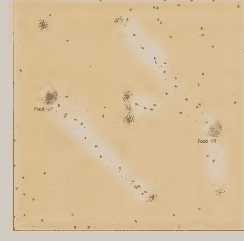

执行 | 暂停 | 重置 | 速度： | 编译

我们首先注意到蚂蚁并没有移动。它们在蚂蚁巢中间被创建出来，但由于它们不移动，过了一段时间它们都会堆叠在那里。因此，我们要做的第一件事是让蚂蚁移动起来。

**练习 11.12** 在蚂蚁的 `act()` 方法中添加一行代码让蚂蚁移动。不要使用 `Actor` 的 `move()` 方法，而是使用从父类 `Creature` 类继承的方法。查阅 `Creature` 类的文档以找到可以使用哪些方法。

现在我们将逐步对该场景进行一系列改进：

- 我们将在场景中引入一些食物，让蚂蚁有东西可以收集。
- 我们将改进蚂蚁，让它们找到食物并将一部分带回家。
- 我们将添加一个 `Pheromone`（费洛蒙）类。费洛蒙是某些动物产生的化学物质，用于为同种的其他动物留下信息。
- 我们将改进蚂蚁，让它们在找到食物时在地上留下费洛蒙，其他蚂蚁就可以闻到这些费洛蒙并调整它们的方向。

这些步骤共同模拟了蚂蚁群收集食物的行为。完成后，我们可以对模拟进行一些实验。

## 11.3 收集食物

我们的任务是在场景中创建一些食物，并让蚂蚁收集它们带回蚂蚁巢。

**练习 11.13** 创建一个名为 `Food` 的新类。该类不需要固定图像。我们将在类内部绘制图像。

每个 `Food` 对象代表一堆食物屑。我们的计划是为 `Food` 对象创建一个新的、动态绘制的图像，并为堆中的每个碎片画一个小点。一堆屑可能从例如 100 个碎片开始，每当蚂蚁找到这堆时，它就会带走几个。这意味着每当蚂蚁取一些食物，图像必须重新绘制以减少碎片的数量。

**练习 11.14** 在 `Food` 类中，创建一个字段来记录当前堆中碎片屑的数量。将其初始化为 100。

**练习 11.15** 创建一个名为 `updateImage()` 的新私有方法，它创建一个固定大小的图像，并在堆中目前的每个碎片屑处的一个随机位置画一个点。为碎片堆图像选择一个你认为好看的尺寸。在构造函数中调用此方法。

如果你完成了上面的练习，并在 `Food` 图像内的随机位置放置了食物屑（使用 `Greenfoot.getRandomNumber()` 方法获取坐标），那么你会发现这堆碎片屑呈某种正方形（图 11.3a）。这是因为图像本身是正方形的，而且碎片均匀分布在图像上。

图 11.3 使用不同随机化算法放置食物屑

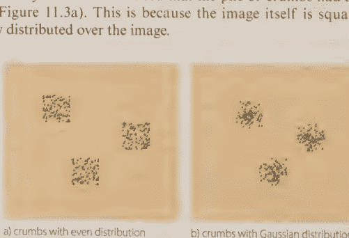

如果我们想让它看起来更像一堆（大部分碎片在中间，其他碎片在周围呈粗圆形分布，图 11.3b），那么我们可以使用另一个数学方法以不同的方式放置碎片。我们通过练习 11.16 和 11.17 完成此任务。注意，这些是高级练习，且纯是视觉上的；它们改变了食物堆的外观而非任何功能，因此可以安全地跳过。

**练习 11.16** 咨询标准 Java 类库的 API 文档。找到 `java.util` 包中 `Random` 类的文档。该类的对象是随机数生成器，比 Greenfoot 的 `getRandomNumber()` 更灵活。我们感兴趣的方法是返回高斯分布（也称为“正态分布”）数字的方法。该方法的名称是什么？它有什么作用？

**练习 11.17** 在你的 `Food` 类中，更改图像中食物屑的位置，利用随机数的高斯分布。如果你必须使用 `java.util.Random` 对象来创建随机数，而不是使用 `Greenfoot.getRandomNumber()`。

> **旁注：随机分布**
>
> 如果我们在程序中需要某些行为，思考我们需要哪种随机分布是有重要的。许多随机函数（如 `Greenfoot.randomNumber()`）产生的是均匀分布。在这种分布中，每个可能结果发生的概率是相同的。高斯随机数函数给出正态分布。在这种分布中，平均结果更有可能发生，极端情况更罕见。
>
> 如果我们在玩骰子游戏时，我们需要均匀分布。骰子的每个面出现的概率相等。相反，如果我们要在交通模拟中模拟汽车速度，正态分布会更好。大多数汽车都行驶在接近平均速度的地方，极少数汽车非常慢或非常快。

**练习 11.29** 为你的蚂蚁添加一个方法，使其能够在世界中释放一滴信息素。在蚂蚁回家的过程中，反复调用此方法。

如果在此上一个练习中，你在每个动作周期中都放置了一滴信息素，你会发现这会在世界中产生过多的信息素。蚂蚁无法产生无限量的信息素；在释放一滴后，它们需要一些时间来再生更多的信息素。

**练习 11.30** 修改蚂蚁，使其最多每隔 18 步才留下一滴信息素。为了实现这一点，你需要一个字段来存储蚂蚁当前的信息素水平。当蚂蚁释放一滴信息素时，信息素水平（蚂蚁体内剩余的信息素）会降至零，然后缓慢重新上升，直到蚂蚁准备好留出下一滴。

图 11.4 显示了我们的蚂蚁此时留下的信息素轨迹¹。信息素滴之间有间隔（蚂蚁需要一些时间来再生信息素），而且较旧的信息素滴部分挥发了——它们变得更小、更透明。

图 11.4 蚂蚁留下的信息素轨迹

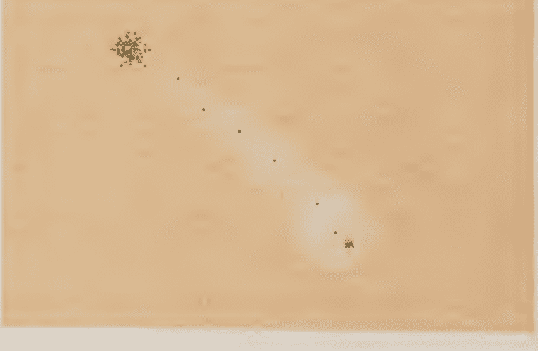

> ¹ 如果你仔细观察，你会发现我修改了信息素图像，在中间有一个小小的黑点。这样做即使在信息素是透明的情况下，也能更容易看到。

最后要添加的是，让蚂蚁能够闻到信息素，并在闻到时改变它们的移动方向。

如果蚂蚁闻到了某滴信息素，它应该在有限的时间内离开它的家山。如果过一段时间后它仍然没有发现或闻到新的信息素滴，它就应该恢复随机行走。我们寻找食物的算法可能如下：

```
if (we recently found a drop of pheromone) {
    walk away from home;
}
else if (we smell pheromone now) {
    walk towards the center of the pheromone drop;
    if (we are at the pheromone drop center) {
        note that we found pheromone;
    }
}
else {
    walk randomly;
}
check for food;
```

在自己的场景中实现这些内容时，请记住为每个不同的任务创建一个独立的方法。这样，你的代码将保持良好的结构，易于理解且易于修改。

**练习 11.31** 在你的场景中实现上述功能：当蚂蚁闻到信息素时，它们在接下来的 30 步内离开家山，然后恢复到默认行为。

如果你完成了这个练习，你的蚂蚁模拟就基本完成了（就像任何软件应用永远不会完全完成一样）。如果你现在运行场景，你将看到蚂蚁通往食物源的路径。

### 路径的形成

这个场景的一个有趣方面是，项目中没有任何代码提到路径的形成。单只蚂蚁的行为非常简单：“如果你有家，就回家；如果你闻到了信息素，就离开；否则就随处走走。”然而，蚂蚁聚在一起展示了相当复杂的行为：它们形成了稳定的路径，在信息素挥发时不断刷新，并高效地将食物运回蚂蚁窝。

这被称为**涌现行为**（emergent behavior）。这种行为并不是被编程到任何单个个体中的，而是系统从许多（相当简单的）个体之间的相互作用中产生的行为。

大多数复杂系统都会表现出某种涌现的系统行为，无论是城市中的交通系统、计算机网络还是人群。预测这些效应非常困难，计算机模拟可以帮助理解此类系统。

**练习 11.32** 我们对蚂蚁使用信息素的模拟有多大的真实性？对蚂蚁群实际使用信息素的情况进行研究，并写下我们的模拟中哪些方面是真实的，哪些是我们所做的简化处理。

**练习 11.33** 假设污染在蚂蚁的环境中引入了毒物质。结果是它们产生信息素的量减少到之前数量的四分之一。（释放信息素滴之间的时间延长了四倍。）它们仍然能够形成路径吗？进行测试。

**练习 11.34** 假设另一种污染物降低了蚂蚁记住它们最近闻到信息素是某种威胁的能力。它们不再能记住 30 步，而是只能记住 10 步。这对它们的行为会有什么影响？

你还可以做很多其他实验。最明显的是尝试不同的蚂蚁窝和食物源放置位置，以及决定蚂蚁行为的属性的不同值。

在第 11 文件夹下的场景 `ants-3` 显示了上述任务的实现。它在 `World` 类中包含了三个不同的设置方法，可以从 `World` 的弹出菜单中交互式调用。

## 总结

在本章中，我们看到了两个模拟的例子。这有两个目的。首先，这是一个练习我们在前面的章节中讨论过的许多编程技术的机会，而且我们必须使用之前介绍的许多 Java 结构。其次，模拟是一种有趣的用于实验的应用程序类型。许多模拟在现实生活中有许多用途，例如天气预报、交通规划、环境影响研究、物理研究等。

如果你能够解决本章中的所有练习，那么你已经理解了这本书试图教给你的大部分内容。

## 概念总结

- **模拟**（simulation）是一个模拟现实世界现象的计算机程序。
- 使用模拟允许我们学习关于现实世界的有趣事物。
- **涌现行为**（emergent behavior）不是编程到单个个体中的行为，而是许多个体相互作用产生的系统行为。

# 第 12 章 Greenfoot 与 Kinect

主题：使用 Kinect 编程

概念：身体追踪

我们已经学习了许多不同的编程结构，现在准备好将它们应用于另一个语境中。在本章中，我们不会引入新的编程结构，而是使用我们的编程技巧玩一个有趣的玩具：微软 Kinect。

微软 Kinect 是一个传感器板，包含彩色摄像头、红外投影仪和红外摄像头（见图 12.1）。红外投影和摄像头使其能够感知前方图像的深度，从而“看到”三维空间。

为了完成本章的练习，你需要一个 Kinect。如果没有，你可以安全地跳过本章。如果你考虑购买用于 Greenfoot 的 Kinect，请确保阅读 Greenfoot 网站上的购买说明¹。并不是所有型号的 Kinect 都适用于 Greenfoot。

图 12.1 微软 Kinect²


> ¹ 访问 `http://www.greenfoot.org/doc/kinect#purchase` 查看关于购买哪种微软 Kinect 的说明。
>
> ² 图像来源：Windows Magazine/Getty Images

在本章中，我们将观察一系列使用 Kinect 的场景。我们将先研究现成的场景以了解它们是如何工作的，然后编写我们自己的代码。

## Kinect 能做什么

Kinect 能够检测摄像头前方的人及其移动。通过 Greenfoot 和 Kinect，我们可以获取关于它前方的人数、位置和身体动作的信息。这允许我们编写通过在电脑前移动身体来控制的程序。

## 摄像头图像

Kinect 执行的第一且简单的事情是提供摄像头的图像。这和任何其他普通的摄像头图像一样，我们可以在 Greenfoot 中使用该图像。

## 深度图像

除了彩色图像外，我们还可以获取深度信息。“深度”是指摄像头前方任何一点的距离。图 12.2 将深度显示为灰度图像：每个像素的亮程度显示了它到摄像头的距离。

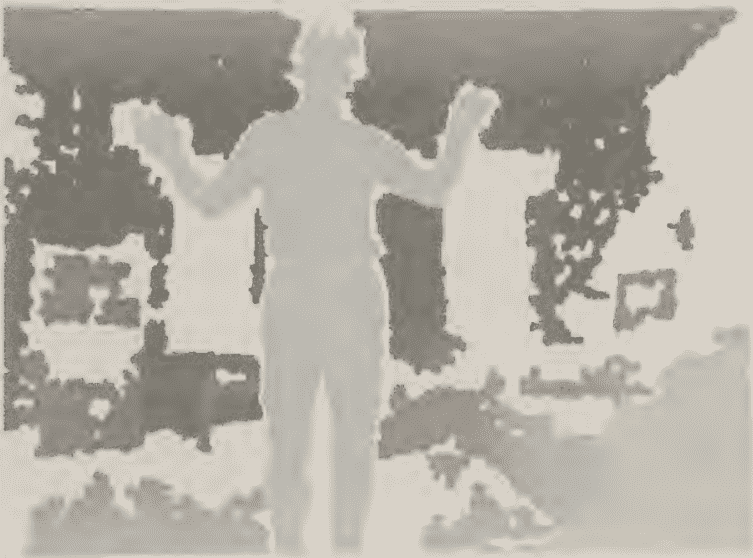

## 正文大纲

Kinect 能够识别视野范围内的人员，并相当可靠地确定它们在摄像头图像中的轮廓（图 12.3）。它可以区分不同的人员，并为它能看到的每一个人单独提供人体所在的位置信息。

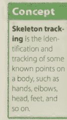

## 骨骼跟踪

Kinect 能做的最有用功能是骨骼跟踪：它可以在所有三个维度上识别我们身体各个部位的位置（图 12.4）。它可以给出我们手部、肩膀、脚部、臀部、头部等部位的位置。这使得编写由肢体动作控制的程序变得非常容易。例如，我们可以编写一个场景：当我们用右手触碰 Greenfoot 演员或当左脚抬过右膝时，会发生某些事情。我们不需要费力想象就能想出如何利用这些输入来编写出有趣且好玩的场景。

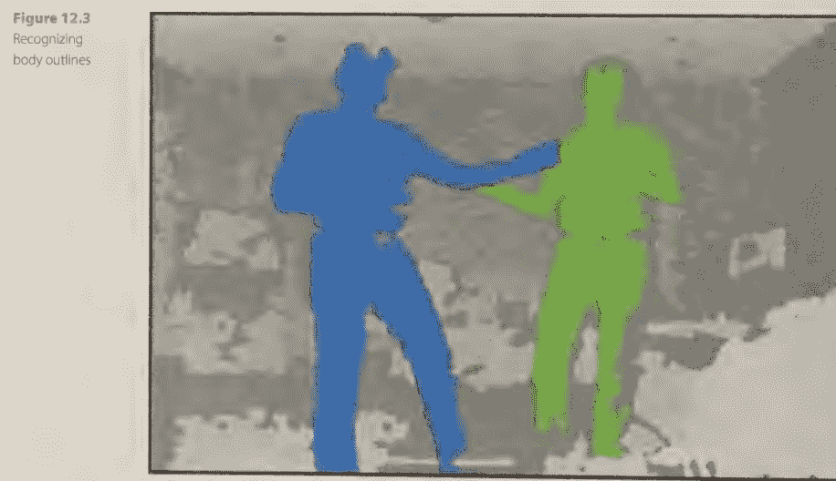

## 安装软件

在使用 Greenfoot 使用 Microsoft Kinect 之前，你必须安装一些驱动程序软件。驱动程序负责与硬件的通信，并提供一个控制设备的软件接口。

当 Greenfoot Kinect 场景运行时，我们需要 Greenfoot Kinect Server 在后台运行，以促进我们的 Greenfoot 场景与 Kinect 硬件之间的通信。而 Greenfoot Kinect Server 反过来又使用了一个名为 OpenNI 的库。图 12.5 显示了你的 Kinect 场景与 Kinect 硬件之间的通信层级。

这些软件组件的详细安装说明可以在 Greenfoot 网站 `http://www.greenfoot.org/doc/kinect` 查看。

针对 Windows、Linux (Ubuntu) 和 Mac OS X 都提供了相应的说明。在开始使用以下示例之前，请仔细遵循这些说明。

## 运行 Greenfoot Kinect 服务器

当我们想要运行 Greenfoot Kinect 场景时，首先必须启动 Greenfoot Kinect Server。它将在后台持续运行，只要我们还在使用 Greenfoot 和 Kinect，就必须保持它的运行。

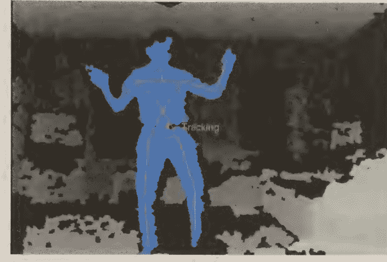

图 12.5 Greenfoot 与 Kinect 之间的通信层


上述安装说明提供了关于如何启动此服务器的细节。（如果你是从终端运行它的，你将看到打印出很多警告信息。不用担心这些——这是正常的。）

## 12.3 入门

为了开始，我们首先将看一个非常简单的示例：在屏幕上显示摄像头图像。我们将使用一个名为 `simple-camera` 的场景，你可以在书籍场景中找到它。

> **练习 12.1** 将你的 Kinect 连接到电脑。启动你的 Greenfoot Kinect Server。然后启动 Greenfoot 并打开 `simple-camera` 示例。运行它。

如果你的安装成功，你现在应该可以在你的世界中看到 Kinect 摄像头的图像。

在场景的类图中，你看到许多类。`KinectWorld`、`Joint`、`KinectClient`、`Point3D` 和 `UserData` 类是 Greenfoot 基础设施的一部分——在运行 Kinect 的场景中，它们将始终存在。唯一特定于此场景并持有我们用户代码的类是 `MyWorld`。

在尝试我们的代码之前，让我们快速看一眼标准的 Greenfoot Kinect 类。

### KinectWorld

此类应该作为你在 Kinect 场景中所有世界类的超类。它提供了与 Kinect 的基础通信，让你能够访问我们从 Kinect 接收到的数据（摄像头图像和用户数据）。你应该在某个阶段查看一下它的方法。你可能想将编辑器切换到文档（Documentation）视图来查看它的方法——目前实现细节并不重要。

### KinectClient

此类由 `KinectWorld` 内部使用——你不应该直接使用它。

### UserData

该类定义了包含有关被 Kinect 跟踪的用户信息的对象。你可以为 Kinect 可看到的每个用户获取一个对象。你可以通过使用来自 `KinectWorld` 的方法来接收 `UserData` 对象。

### Joint

`UserData` 对象反过来可以让你访问用户每个关节（如右手、肘部、膝盖）的信息。你以 `Joint` 类对象的形式接收这些信息。

### Point3D

最后，关节信息的一部分是关节的位置（三维的）。这是通过 `Point3D` 对象提供的。

书籍的场景文件夹包含一个名为 `kinect-start` 的场景，它只包含这些类，并可以作为你自己的项目的起始场景。

## 简单相机

在 `simple-camera` 场景中，唯一特定于场景的代码在 `MyWorld` 类中（代码 12.1）。让我们来看看它是做什么的。


# 第 12 章 Greenfoot 与 Kinect

`MyWorld` 的构造函数只是创建了 `KinectWorld` 的默认构造函数。

Kinect 硬件默认带给我们一张 640 x 480 像素的图像，`KinectWorld` 的默认构造函数将创建一个相同大小的世界。在 `simple-camera` 场景中，唯一特定于场景的代码在 `MyWorld` 类中（代码 12.1）。让我们来看看它是做什么的。

在该类中有趣的代码在 `act` 方法中。它调用父类的 `act` 方法。这并不困难——不要删掉这一行。这图像作为世界背景。

## 代码 12.1 简单的世界

```java
import greenfoot.*;

/**
 * 这是一个使用 Kinect 的简单世界演示。
 * @author Kölling
 * @Version 1.0
 */
public class MyWorld extends KinectWorld {
    /**
     * 世界的构造函数。
     */
    public MyWorld() {
        super();
    }

    /**
     * 在每个周期中，我们调用父类的 act 方法。
     * 这并不困难——不要删掉这一行。
     */
    public void act() {
        super.act();
        // 这两行是发生作用的地方：
        GreenfootImage cameraImage = getUnscaled();
        setBackground(cameraImage);
    }
}
```


### 练习 12.1
将你的 Kinect 连接到电脑。启动你的 Greenfoot Kinect Server。然后启动 Greenfoot 并打开 `simple-camera` 示例。运行它。

如果你的安装成功，你现在应该可以在你的世界中看到 Kinect 摄像头的图像。

在场景的类图中，你看到许多类。`KinectWorld`、`Joint`、`KinectClient`、`Point3D` 和 `UserData` 类是 Greenfoot 基础设施的一部分——在运行 Kinect 的场景中，它们将始终存在。唯一特定于此场景并持有我们用户代码的类是 `MyWorld`。

在尝试我们的代码之前，让我们快速看一眼标准的 Greenfoot Kinect 类。

### 练习 12.2
有哪些方法？

### 练习 12.3
有哪些方法？

### 练习 12.4
打开 `greenscreen` 场景。运行它。它做了什么？

## 12.6 火柴人：跟踪用户

与 `simple-camera` 示例相比，我们做了两处更改：

- 我们将显示图像作为演员的代码移动了，而不是作为世界背景显示。现在我们在世界中心放置一个演员，该演员使用 Kinect 图像作为其图像。效果与之前类似：图像与世界大小相同。
- 我们将调用 `getUnscaled` 方法替换为调用 `getCombinedImage`。这个方法也给了我们摄像头图像，过滤掉背景，并为我们只有用户的图像。

正如我们看到的，不带背景非常容易，因为 Kinect 为我们完成了所有工作。由于用户图像是以演员显示的，我们现在可以放入自己的背景了。

### 练习 12.5
为世界设置背景图像。你可以通过 `MyWorld` 弹出菜单中的 `Set Image` 功能来实现。场景提供了一个名为 `weather-map.png` 的图像供使用。

### 练习 12.6
用你的各种其他图片尝试该场景。

## 图 12.6
小人模型示例场景


缩略图是一种帮助我们快速获取概览的小图像。它因为它很小而被称为“缩略图”：我们使用它不是为了查看细节，而是获取基本信息。我们将看到，在许多 Kinect 场景中，使用缩略图帮助我们确定自己在摄像头面前的位置是有用的。

在小人场景中，你可以看到一个名为 `Thumbnail` 的类。

### 练习 12.8
运行你的小人场景。通过交互方式创建一个 `Thumbnail` 类的对象并将其放入世界。你看到了什么？

### 练习 12.9
在你的 `StickWorld` 类中添加代码，创建并添加一个 `Thumbnail` 对象。将其放置在你选择的任何位置。

### 练习 12.10
修改你的缩略图图片的位置，使其显示在屏幕的右下角。

`Thumbnail` 类的实现非常简单。它的方法中仅包含以下两行代码：

```java
KinectWorld world = (KinectWorld)getWorld();
setImage(world.getThumbnailUnscaled());
```

我们可以看到，缩略图执行者只是从 `KinectWorld` 获取缩略图图像并将其设置为自己的图像。

这还有第二部分，位于 `StickWorld` 的构造函数中：

```java
public StickWorld()
{
    super(THUMBNAIL_WIDTH, THUMBNAIL_HEIGHT, 1.0, false);
}
```

我们可以看到 `StickWorld` 调用了一个不同的 `KinectWorld` 构造函数，该构造函数有四个参数。前两个参数（在这种情况下使用了常量）指定了当我们在向 `KinectWorld` 请求时希望接收的缩略图图像的大小。这就是我们定义想要的缩略图精确尺寸的方法。

### 练习 12.11
此示例中使用的缩略图精确尺寸是多少？

### 练习 12.12
将缩略图图像的大小翻倍。

### 练习 12.13
在 `super` 调用中调用的 `KinectWorld` 构造函数的另外两个参数的意义是什么？

现在我们已经显示了一个缩略图，更容易把自己置于摄像头面前并知道站在哪里了。我们现在可以检查此场景是如何管理并绘制小人的。

相关代码在 `StickWorld` 类中（见代码 12.2）。

```java
/**
 * Act：将用户显示为小人。
 */
public void act()
{
    super.act();
    UserData[] trackedUsers = getTrackedUsers();
    paintStickFigures(trackedUsers);
}
```

```java
/**
 * 为我们看到的每个用户在世界背景上绘制小人。
 */
private void paintStickFigures(UserData[] trackedUsers)
{
    eraseBackground();
    for (UserData user : trackedUsers) {
        user.drawStickFigure(getBackground(), 60);
    }
}
```

```java
/**
 * 清除世界背景。
 */
private void eraseBackground()
{
    getBackground().setColor(Color.WHITE);
    getBackground().fill();
}
```

学习代码，我们可以看到绘制小人是很容易，因为 `UserData` 类提供了一个名为 `drawStickFigure` 的方法。所以我们只需要执行以下操作：

- 在每个 act 周期中，我们使用 `getTrackedUsers` 方法获取所有跟踪用户的数组。我们将此数组传递给自己的 `paintStickFigures` 方法。
- 然后我们清除世界（以清除之前绘制的小人），并通过为数组中的每个用户调用 `drawStickFigure` 方法来绘制新的小人。

我们可以看到为用户绘制小人得到了很好的支持。这在各种不同的 Kinect 场景中将非常有用。我们还看到我们的代码能够同时处理多个用户的小人。

### 练习 12.14
查找 `UserData` 类中的 `drawStickFigure` 方法。它的两个参数是什么？

### 练习 12.15
再次运行场景并在摄像头前放置多个人。场景是否正确跟踪了每一个人？

### 练习 12.16
同时可以跟踪多少个人？你能找到限制吗？尝试在摄像头前放置尽可能多的人。

## 图 12.7
用你的手绘画


## 用你的手绘画

我们到为止看到的示例在打开时大部分已经准备就绪，我们利用它们来学习一些基础技术。我们没有太多要做的。

现在我们对 Kinect 的接口有了基本的了解，可以开始编写一些自己的代码了。我们的下一个目标是编写一个让我们能使用手脚在屏幕上绘画的场景（图 12.7）。

### 练习 12.17
打开 `body-paint-start` 场景。运行它。尝试它的功能。

由于我们从一个包含一些原始代码的起始场景 `body-paint-start` 开始，通过尝试，我们可以看到它的行为与小人示例类似。唯一的区别是一个新类：`Canvas`。

该场景的设置使得图像初始时是透明的。图 12.7 显示了如何实现这一点。我们可以看到我们现在正在连续地在手的位置绘画。图 12.8。


## Canvas 构造函数

```java
public Canvas(int width, int height, UserData user)
{
    this.user = user;
    super(width, height, 1.0, false);
    setImage(user.getThumbnailUnscaled());
}
```

### 练习 12.18
这个构造函数唯一的作用存储在一个名为 `user` 的字段中。我们然后可以使用它。`getJoint` 将返回一个 `Joint` 对象，我们可以用它来获取 x y 坐标。

### 练习 12.19
`getJoint` 方法需要一个参数来指定我们感兴趣的关节。我们通常在这里使用 `Joint` 类中定义的常量（图 12.9）。查看 `Joint` 的文档以查看可用常量。

在我们的 `Canvas` 类的方法中，`UserData` 对象已经获取并存储在 `user` 字段中。因此我们可以直接从它获取右手关节：

```java
Joint rightHand = user.getJoint(Joint.RIGHT_HAND);
```

一旦我们获得了右手关节，我们现在就可以提取它的 x y 坐标并使用这些坐标在屏幕上画圆圈：

```java
getImage().fillOval(rightHand.getX(), rightHand.getY(), 20, 20);
```

### 练习 12.20
将上述代码插入你自己的 `Canvas act` 方法中。你只需要所示的两行。测试！

## 获取用户信息

通常，我们通过 `KinectWorld` 的 `getTrackedUsers` 方法获取用户信息（图 12.9）。这将为我们提供一个 `UserData` 对象数组，其中每个被跟踪的用户都有条目。然后我们可以使用 `UserData` 对象的各种方法（只显示了部分）获取每个用户的详细信息。对于我们来说，`getJoint` 方法目前是最有趣的。

## 停止绘画

为了让我们的绘画更具控性，如果我们能移动手而不绘画就好了。为了实现这一点，我们希望修改代码，使得当右手是距离摄像头最近的关节时才绘画。这样，我们可以通过向前伸手绘画，通过向后拉手停止。

`UserData` 类有一个名为 `getNearestJoint` 的方法，我们可以利用它来实现。在继续阅读之前，请先尝试自己完成这一点（我们将在练习后讨论）。

### 练习 12.21
修改你的代码，使其仅当右手是距离相机最近的关节时才进行绘画。通过获取最近的关节并检查它是否为右手来实现这一点。

如果你自己独立完成了这个练习，你会发现我们可以简单地添加一个 `if` 语句，将最近的关节与右手的常量进行比较。如果右手不是最近的，我们什么都不做；否则就进行绘画。

```java
Joint rightHand = user.getJoint(Joint.RIGHT_HAND);
if (user.getNearestJoint() == Joint.RIGHT_HAND)
{
    getImage().fillOval(rightHand.getX(), rightHand.getY(), 20, 20);
}
```

让我们再做两个改进——但这次你必须自己编写代码。

## 擦除你的画作

当我们画了一些东西，但如果对它并不满意或者想重新开始，如果能够擦除屏幕就太好了。通过使用 `GreenfootImage` 的 `clear` 方法可以轻松擦除屏幕（实际上是擦除演员的图像）：

```java
getImage().clear();
```

现在我们添加一项功能，让用户通过将左手举过头顶来擦除屏幕。原理非常简单：我们可以获取左手和头部的 y 坐标，并检查哪一个更大。

### 练习 12.22
在你的 `act` 方法中添加代码，当用户将左手举过头顶时擦除屏幕。

## 改变颜色

下一个改进在结构上非常相似：当用户抬起右脚时改变绘画的颜色。（你可以通过检查右脚是否在左膝盖上方来检测这一点。）现有的 `randomColor` 方法可以帮助你选择一个新的（随机）颜色。

### 练习 12.23
添加一些代码，当用户抬起右脚时将绘画颜色更改为不同的随机颜色。

# 12.8 一个简单的 Kinect 游戏：乒乓球 (Pong)

你可能能想到关于这个场景的很多其他事情。有很多想法可以尝试。这里讨论的练习代码可以在书的场景中作为 `body-paint` 找到，以防你想将自己的代码与我们的进行对比。

在这个场景中我们还没有讨论过的唯一代码位于 `PaintWorld` 类中，它负责从 `World` 中创建和移除画布。这其中最复杂的方面是在程序运行时跟踪新用户的出现和现有用户的离开，并据此创建和删除画布。我们不会在这里分析这一点，而是在下一个示例中讨论这个问题。

## 12.8 简单的 Kinect 游戏：乒乓球 (Pong)

我们在本章讨论的最后一个项目是一个非常简单的游戏：乒乓球。乒乓球是一种广为人知的简单游戏，我们用球板玩一种网球。在我们的情况下，将有两个球板，由我们的手各控制一个，我们将与有一个球板的电脑对（图 12.10）。

和往常一样，我们在 `book-scenarios` 文件夹中有两个版本的场景：一个是我们练习的起点，另一个是完成的解决方案。

### 练习 12.24
打开 `kinect-pong-start` 场景。运行它。找出如何玩。


当你尝试起始场景时，你会发现它实现了一个可以使用键盘玩的非常简单的 phong 风格游戏。你扮演一个玩家，电脑扮演另一个。（你可以通过阅读源代码或直接尝试来发现使用哪些键。）

在这个场景中没有我们目前不应该理解的新内容。让我们进行一些快速的代码阅读练习来熟悉现有项目。请以书面形式回答以下问题。

### 练习 12.25
哪些键控制球板？


# 练习 12.26-12.33

**练习 12.26** 玩家球板和电脑球板都从 `Paddle` 继承了哪些方法？

**练习 12.27** 当球板向右或向左移动时，它在每个 `act` 周期中移动多少步？

**练习 12.28** 当屏幕上没有球时，电脑球板做什么？（你可以通过交互式移除球然后运行场景来检查答案。）

**练习 12.29** 电脑球板使用什么策略来决定移动到哪里？

**练习 12.30** 场景初始化时插入了多少个对象？它们是什么？

**练习 12.31** 哪个类记录分数？

**练习 12.32** 场景开始和球开始移动之间有一个延迟。那个延迟有多长时间？

**练习 12.33** 解释这个延迟是如何实现的。

我们可以看到这个场景是一个非常直接的简单实现。我们现在将更改它以利用 Kinect 控制我们的球板。

这次，我们将从上一节遗留讨论的部分开始：检测用户何时进入摄像视野。

目标是：只要没有用户可见，游戏就处于空闲（等待）状态。当用户进入视野时，游戏开始。当视野中没有用户时（即用户离开），游戏再次停止。

## 检测用户

我们已经看到可以通过 `getTrackedUsers()` 获取所有当前使用用户的数组。我们可以通过检查长度是否大于零来检查是否存在用户：

```
if (users.length > 0) {
  ...
}
```

（如果有多个用户，我们只处理第一个用户。由于这是单人游戏，我们忽略其他的。）

所以，如果我们想将第一个用户的数据传递给 `startGame` 方法，我们可以写：

```
startGame(users[0]);
```

**练习 12.34** 为你的 `startGame` 方法添加 `UserData` 类型的参数，并在游戏开始时将第一个用户的数据传递进去。

**练习 12.35** 为 `Paddle` 类的构造函数添加类似的参数，并将 `startGame` 接收到的参数传递进去。

**练习 12.36** 在 `PlayerPaddle` 中，将构造函数接收到的 `UserData` 存储在名为 `user` 的字段中。

你的场景现在应该处于编译状态，我们到为止的工作还没有可见效果。我们现在需要做的是根据用户数据设置球板的位置。你可以从用户对象调用 `getJoint` 方法来获取右手。然后你可以使用手的 x 坐标和球板的 y 坐标作为参数调用 `setLocation`。

**练习 12.43** 从 `PlayerPaddle` 的 `act` 方法中删除代码。插入新代码以获取用户的右手，然后使用手部的 x 坐标设置球板的位置（保持其 y 坐标不变）。

## 控制球板

接下来的工作是实现实际的游戏。为了让玩家控制，必须将用户数据传递给球板。由于这是单人游戏，我们可以只处理用户数组中的第一个用户数据。

**练习 12.37** 在 `PlayerWorld` 中创建一个名为 `stopGame` 的私有方法。在其中从世界中移除球板。

**练习 12.38** 添加另一个名为 `stopGame` 的私有方法。在其中从世界中移除球板。

**练习 12.39** 扩展你的 `act` 方法，当游戏不是空闲时调用 `stopGame`。

现在我们可以玩了！使用玩家的手的位置非常简单。你的 `act` 方法只需要两到三行。

在完成之前，让我们进行进一步扩展：用双手玩。

**练习 12.44** 在 `PlayerPaddle` 类中，将手变为变量。在构造函数中使用额外的构造参数初始化此字段。在你的 `act` 方法中，使用这个变量而不是 `Joint.RIGHT_HAND` 来指定观察的关节。

**练习 12.45** 在创建玩家球板的 `PongWorld` 类中，将 `Joint.RIGHT_HAND` 作为第二个构造参数添加。

现在我们回到了起点：我们有一个由右手控制的挡板。但现在我们可以轻松地指定想要使用哪只手，从而能够为左手创建另一个挡板。

**练习 12.46** 在创建玩家挡板的地方，添加一个为左手创建的第二个挡板的代码。

就是这样！我们现在可以用双手玩游戏了。一如既往，如果你对自己的代码不确定，请检查书籍中 scenarios 文件夹下的 kinect-pong 场景。

## 总结

在本章中，我们将 Greenfoot 与 Microsoft Kinect 连接了一起。除了给我们提供了创建许多非常有趣的示例的机会之外，我们还发现与硬件设备进行编程与我们之前遇到的编程并没有太大区别。我们使用了与前面的章节相同的编程技术——方法调用、变量、参数、类型。

当我们与外部设备进行编程时，通常会得到一个 API（程序接口），它由若干个访问设备的类和方法组成。学习如何使用该设备就是研究该 API 并理解它允许我们做什么的问题。之后，我们只需要通用的 Java 和编程技能来编写一些程序即可。

## 概念总结

- 跟踪（tracking）是对身体上某些已知点进行识别和追踪，例如手、肘部、头部、脚等。

- 与硬件组件的通信通常通过某些驱动软件安排。

- 被跟踪的用户（Tracked users）是指那些当前被 Kinect 硬件识别和分析的用户。

## 训练与练习

这里是一些你可以利用上一个示例 kinect-pong 来完成的更多练习。当然，你也可以扩展任何其他示例，但我们将这些示例的想法留给你来发挥。

**练习 12.47** 在你的 Kinect 乒乓游戏中，添加一些音效。至少添加以下内容：球击中挡板时的音效、球出界时的音效以及游戏开始时的音效。

**练习 12.48** 改变背景。

**练习 12.49** 当一名玩家达到8 分时，宣布获胜者（带有消息和音效）。

**练习 12.50** 让顶部的挡板由第二个玩家控制。

**练习 12.51** 也给第二个玩家提供两个挡板。

**练习 12.52** 引入一个屏障：每个玩家可以通过抬起左脚来封锁自己的整个区域几秒钟。他们在一场游戏中只能这样做三次。

**练习 12.53** 如果任何玩家将双手举过头顶，球的速度就会增加。

书籍的 examples 文件夹包含另外一个场景，主要作为一个演示，向你展示如何画一个卡通角色而不是火柴人：我们的角色名为 `Fred`，场景名为 `fred-with-radio`。

我们在这里不会讨论这个场景，而是留给你自己去玩玩它。你可能想做的一件事情是将那两个音频文件替换为你喜的歌曲——这样你就可以用右手或左手触摸收音机来播放你最喜欢的两首歌曲。

# 第 13 章

# 额外的场景想法

主题：更多场景的构想

概念：（没有引入新概念）

这是本书的最后一章。它与其他章节的不同之处在于，它并没有尝试教你任何新的编程概念或技术。相反，它简要地介绍了一些额外的场景，为你可能感兴趣并想要调查和着手的事情提供一些灵感。

这里描述的所有场景在书的 scenarios 文件夹中都有带有源代码的 Greenfoot 项目可用。然而，它们中的大多数并不是它们所代表的想法的完整实现。

有些场景几乎是完整的，你可能喜欢通过学习它们来进一步学习技术并查看是如何实现某些效果的。另一些是开头，是一个想法的部分实现，你可以将其作为你自己项目的起点。还有一些是单个概念或想法的插图，可能会为你可以整合到你自己的某个场景中的东西提供灵感。

简而言之，将这些视为未来项目的想法合集，通过学习它们来简略了解一个胜任的程序员可以实现的其他可能性。

## 13.1 弹球 (Marbles)

弹球场景（图 13.1）实现了一个游戏，在游戏中，你在棋板上滚动一个金球，目标是在有限的步数内清除棋板上所有的银球。这个游戏是相当完整的。

关于这个场景有几点值得观察。最引人注目的是它看起来相当有吸引力。这与 Java 或 Greenfoot 编程几乎没有关系，主要是由于使用了良好的图形。使用设计精美的图形和音效可以对游戏的吸引力产生巨大影响。

弹球游戏使用了良好的背景图像（棋盘和用于文本显示的滚动条）以及带有半透明投影投影的 actor（弹球和障碍物）。

另一个值得检查的有趣方面是碰撞检测。弹球没有使用 Greenfoot 内置的任何碰撞检测方法，因为这些方法都作用于矩形 actor 图像。相反，弹球是圆形的，我们需要借此进行精确的碰撞。

可能，当 actor 是圆形的时，这并不困难。如果两个弹球之间的距离（从它们的中心点测量）小于它们的直径，就会发生碰撞。

下一个有趣点是移动方向的计算方式。这里涉及的三角函数，但如果你熟悉它，它也不太难。

与固定障碍物的碰撞较简单，因为它们总是水平或垂直方向的。因此，弹球撞击时会沿着其中一个轴（x 或 y）反转方向。

## 13.2 电梯 (Lifts)

电梯场景展示了一个电梯模拟（图 13.2）。它展示了多层建筑的几层以及三个移动的电梯。人们出现在楼层，按下按钮并进入电梯。

这实际上是一个非常原始、未完成的实现。我们在屏幕上看到的很多假的：电梯里的人数只是随机数。电梯对按钮没有反应——它们只是随机移动。电梯没有实现控制算法。

所以这只是一个展示想法和图形的快速演示。要完成这个项目，必须对人的移动进行正确建模（进出电梯）。然后我们可以尝试不同的电梯算法。

## 13.3 群鸟 (Boids)

Boids 示例展示了鸟类集群行为的模拟（图 13.3）。

“boids”一词源于 Craig Reynolds 在 1986 年开发的程序，该程序首次实现了这种集群算法。在程序中，每只鸟根据三条规则飞行：

- 分离（Separation）：如果离其他鸟太近则远离。
- 对齐（Alignment）：向周围其他鸟的平均朝向转向。
- 凝聚（Cohesion）：向周围其他鸟的平均位置转向。

本书的版本是由 Poul Henriksen 编写的。算法的一个版本曾用于提姆·伯顿 1992 年的电影《蝙蝠侠回归》中用于创建计算机生成的蝙蝠群和企鹅群的动画，并在《环王》电影中用于创建兽人的移动轨迹。

你可以通过在网上搜索“boids”来获取更多信息。虽然目前这个场景仅仅是展示运动，但人们觉得其中一定隐藏着一个游戏。

## 13.4 爆炸

爆炸场景（图 13.4）展示了我们如何实现一个视觉效果非常佳的效果。在这种情况下，爆炸的对象是一个简单的岩石，我们在之前的其他场景中遇到过它。（例如，它在小行星场景中扮演过小行星的角色。）但我们实际上可以爆炸任何我们喜欢的物体。

为了实现这种效果，我们有一个 `Debris` 类，它代表岩石的一部分。当岩石爆炸时，将其从世界中移除，并在原地放置 40 块碎片。

每块碎片都会经过随机的拉伸和旋转，使其看起来独一无二，并初始具有随机方向的运动向量。在每一步中，我们都会添加一点向下的运动来模拟重力，结果就是当你运行此场景时看到的爆炸效果。

在 Greenfoot YouTube 频道上有一个详细解释此场景的教程视频，网址为 https://www.youtube.com/user/18km。

## 13.5 炸块消除 (Breakout)

炸块消除是一款经典的电脑游戏，玩家控制屏幕底部的挡板将球向上反弹，以消除一些方块。如果你不知道这个游戏，请进行网络搜索。

炸块消除场景（图 13.5）是该游戏的部分实现。它使用了我们在第 10 章中讨论过的带烟雾效果的球，并增加了一个供玩家控制球的挡板。然而，它没有目标方块，因此目前的形式并不有趣。

随着时间的推移，人们创建了许多炸块消除变体。许多版本使用了不同级别的方块布局模式。大多数版本还有一些“道具”—隐藏在某些方块后面的奖励，当方块被移除时会浮落。捕捉它们通常会让游戏发生某些变化（额外的球、增加的速度或更小的挡板等）。

以一种有趣的方式完成这个游戏可以作为一个很好的项目。它可以被修改为有两个挡板（左右各一个），本质上将其变成经典的乒乓球游戏。

## 13.6 平台跳跃

一种常见的游戏类型是“平台”游戏。玩家通常控制一个游戏角色，该角色必须从屏幕上的一个区域移动到另一个区域，同时克服障碍。一种障碍可能是角色行走的地面上的缝隙，并需要某种方式跨过去。

企鹅场景实现了此类游戏的一小段（图 13.6）。屏幕两侧有两块地面，企鹅可以通过跳到移动的云朵上跨过去。

此处包含此场景是为了演示演员（actor）如何在另一个实体的顶部移动（地面上的企鹅），以及如何实现跳跃和掉落。

在 Greenfoot YouTube 频道上有一个更详细讨论此内容的教程视频，网址为 https://www.youtube.com/user/18km，名称为“Running, jumping and falling”。

## 13.7 波浪

下一个场景是波浪（图 13.7）。它是对弦上波传播的简单模拟。尝试玩一会儿，你就会发现它的作用。

这个示例引人入胜的方面是，一个相当简单的实现——在每个动作轮次中，每颗珠子简单地向其两个邻居的中间移动——竟然能实现对波传播各个方面的相当复杂的模拟。

此处包含此示例是为了说明，只要经过一些思考和准备，就可以模拟其他学科的各种行为。在这种情况下，这是一个简单的物理效果。同样，人们还可以模拟化学反应、生物相互作用、亚原子粒子的相互作用等等。通过仔细的规划，我们可以学习其他应用领域的知识，同时也学习编程。

该场景还实现了滑块和开关控制，这在其他项目中可能会有用。

## 13.8 地图

我们在这里展示的最后一个场景叫做地图（图 13.8）。它在世界背景上显示地图，并有放大和放小的按钮。

这个类的有趣之处在于它使用了通过互联网访问实时数据（在这种情况下是地图）。地图图像不是固定的；它不是构建在场景中的，而是在运行时从 Google maps 在线服务检索的。（这意味着该场景将只在连接互联网的计算机上运行。）

在目前的形式下，地图以英国的肯特大学为中心，但这很容易更改。查看 `MapViewer` 类，你会在注释中发现其他的各种示例。

# 附录

# Greenfoot API

Greenfoot API 包含五个类：

| 类名 | 说明 |
|---|---|
| Actor | 所有 Actor 子类均可使用 Actor 方法。 |
| World | World 方法对世界可用。 |
| Greenfoot | 用于与 Greenfoot 环境本身进行通信。 |
| GreenfootImage | 用于图像的显示和操作。 |
| GreenfootSound | 用于音频播放。 |
| MouseInfo | 提供有关上一次鼠标事件的信息。 |
| UserInfo | 在服务器上保存用户数据（仅限在 Greenfoot 网站运行时）。 |

此处显示的 API 适用于 Greenfoot 2.4.0 版本。如果您使用的是更高版本的 Greenfoot，请查阅在线文档。

## World 类

```
World(int worldwidth, int worldHeight, int cellSize)   构造一个新的世界。
World(int worldwidth, int cellSize, boolean bounded)   构造一个新的世界（可能是无边界的）。
void act()                                            世界的动作方法。每个 act 周期执行一次。
void addObject(Actor object, int x, int y)             向世界中添加一个 Actor。
GreenfootImage getBackground()                        返回世界的背景图像。
int cellSize()                                         返回单元格的大小（像素为单位）。
Color getColorAt(int x, int y)                        返回单元格中心的颜色。
int getHeight()                                       返回世界的高度（以单元格数为单位）。
```

## World 类（续）

| 方法 | 说明 |
|---|---|
| List getObjects(Class cls) | 获取世界中所有的对象。 |
| List getObjectsAt(int x, int y, Class cls) | 返回指定单元格中的所有对象。 |
| int getWidth() | 返回世界的宽度（以单元格数为单位）。 |
| int numberOfObjects() | 获取当前世界中的 Actor 数量。 |
| void removeObject(Actor object) | 从世界中移除一个对象。 |
| void removeObjects(Collection objects) | 从世界中移除一组对象。 |
| void repaint() | 重绘世界。 |
| void setActOrder(Class... classes) | 设置世界对象的动作顺序。 |
| void setBackground(GreenfootImage image) | 为世界设置背景图像。 |


| 方法 | 说明 |
|---|---|
| `void setBackground(String filename)` | 从图像文件为世界设置背景图像。 |
| `void setPaintOrder(Class... classes)` | 设置世界对象的绘制顺序。 |
| `void showText(String text, int x, int y)` | 在世界的指定位置居中显示某些文本。 |
| `void started()` | 执行开始时由 Greenfoot 系统调用。 |
| `void stopped()` | 执行停止时由 Greenfoot 系统调用。 |

# Actor 类

| 方法 | 说明 |
|---|---|
| `Actor()` | 构造一个 Actor。 |
| `void act()` | Greenfoot 框架调用 `act` 方法，让对象有机会执行某些动作。 |
| `protected void addedWorld(World world)` | 当对象被插入到世界中时，Greenfoot 系统调用此方法。 |
| `GreenfootImage getImage()` | 返回表示此 Actor 的图像。 |
| `protected List getIntersectingObjects(Class cls)` | 返回与此对象相交的所有对象。 |
| `protected List getNeighbors(int distance, boolean diagonal, Class cls)` | 返回给定距离内对象的邻居。 |
| `protected List getObjectsAtOffset(int dx, int dy, Class cls)` | 返回与给定位置（相对于此对象的位置）相交的所有对象。 |
| `protected List getObjectsInRange(int r, Class cls)` | 返回此对象周围范围“r”内的所有对象。 |
| `protected Actor getOneIntersectingObject(Class cls)` | 返回一个与此对象相交的对象。 |
| `protected Actor getOneObjectAtOffset(int dx, int dy, Class cls)` | 返回一个位于指定单元格的对象（相对于此对象的位置）。 |
| `int getRotation()` | 返回对象的当前旋转角度。 |
| `World getWorld()` | 返回此对象所在的世界。 |
| `int getX()` | 返回对象当前位置的 x 坐标。 |
| `int getY()` | 返回对象当前位置的 y 坐标。 |
| `protected boolean intersects(Actor other)` | 检查此对象是否与另一个给定对象相交。 |
| `boolean isAtEdge()` | 检测 Actor 是否到达世界的边缘。 |
| `protected boolean isTouching(Class cls)` | 检查此 Actor 是否触碰任何给定类的其他对象。 |
| `void move(int distance)` | 按当前朝向的方向移动此 Actor 指定的距离。 |
| `protected void removeTouching(Class cls)` | 移除此 Actor 当前触碰的给定类对象（如果存在）。 |
| `void setImage(String filename)` | 将此对象的图像设置为指定的图像。 |
| `void setLocation(int x, int y)` | 为此对象分配新位置。 |
| `void setRotation(int rotation)` | 设置对象的旋转角度。 |
| `void turn(int amount)` | 按指定量旋转此 Actor。 |
| `void turnTowards(int x, int y)` | 让此 Actor 朝向指定的位置旋转。 |

# GreenfootImage (续)

| 方法 | 说明 |
|---|---|
| `int getWidth()` | 返回图片的宽度。 |
| `void mirrorHorizontally()` | 将图像进行水平镜像（绕 x 轴翻转）。 |
| `void mirrorVertically()` | 将图像进行垂直镜像（绕 y 轴翻转）。 |
| `void rotate(int degrees)` | 围绕中心旋转此图像。 |
| `void scale(int width, int height)` | 将此图像缩放为新尺寸。 |
| `void setColor(Color color)` | 设置当前的绘制颜色。 |
| `void setColorAt(int x, int y, Color color)` | 将给定像素点的颜色设置为指定的颜色。 |
| `void setFont(Font f)` | 设置当前字体。 |
| `void setTransparency(int t)` | 设置图像的透明度（范围从 0 到 255）。 |
| `String toString()` | 返回此图像的字符串表示。 |

# GreenfootSound

| 方法 | 说明 |
|---|---|
| `GreenfootSound(String filename)` | 从给定文件创建一个新声音。 |
| `int getVolume()` | 获取声音当前音量，范围在 0（关闭）到 100（最响）之间。 |
| `boolean isPlaying()` | 如果声音正在播放，则返回真。 |
| `void pause()` | 如果声音正在播放，则暂停播放。 |
| `void play()` | 开始播放此声音。 |
| `void playLoop()` | 循环播放此声音。 |
| `void setVolume(int level)` | 设置声音当前音量，范围在 0（关闭）到 100（最响）之间。 |
| `void stop()` | 如果声音正在播放，则停止播放此声音。 |
| `String toString()` | 返回此声音对象的字符串表示。 |

# UserInfo

| 方法/字段 | 说明 |
|---|---|
| `static int NUM_INTS` | 可以存储的整数数量。 |
| `static int NUM_STRINGS` | 可以存储的字符串数量。 |
| `static int STRING_LENGTH_LIMIT` | 每个字符串可以存储的最大字符数。 |
| `int getInt(int index)` | 获取给定索引（0 到 `NUM_INTS-1`，包含）处的 int 值。 |
| `static UserInfo getInfo()` | 获取当前用户存储的数据。 |
| `static List getNearby(int maxAmount)` | 返回附近用户的列表。 |
| `int getRank()` | 获取用户在该场景下的总体排名。 |
| `int getScore()` | 获取用户的得分。 |
| `String getString(int index)` | 获取给定索引（0 到 `NUM_STRINGS-1`，包含）处的字符串值。 |
| `static List getTotal(int maxAmount)` | 获取该场景下 UserInfo 项目的排序后的列表，从顶部开始。 |
| `GreenfootImage getUserImage()` | 返回一个用户的图像。 |
| `String getUsername()` | 获取该存储器所属的用户的用户名。 |
| `static boolean isStorageAvailable()` | 指示存储器是否可用。 |
| `void setInt(int index, int value)` | 设置给定索引处的整数值。 |
| `void setScore(int score)` | 设置用户的得分。 |
| `void setString(int index, String value)` | 设置给定索引（0 到 `NUM_STRINGS-1`，包含）处的字符串值。 |
| `boolean store()` | 将数据存储到服务器。 |

# 附录

## 碰撞检测

在本书中，不同情况下使用了不同的碰撞检测方法。以下是 Greenfoot actor 可用的碰撞检测方法总结，以及它们用途的简要说明和使用时机。

### C.1 方法总结

Greenfoot 的碰撞检测方法可以在 `Actor` 类中找到。这里有七个相关方法。它们如下：

- `boolean isTouching(Class cls)`：检查此 actor 是否接触了给定类的任何对象。
- `List getIntersectingObjects(Class cls)`：返回所有与此对象相交的对象。
- `Actor getOneIntersectingObject(Class cls)`：返回一个与此对象相交的对象。
- `List getObjectsAtOffset(int dx, int dy, Class cls)`：返回所有与给定位置（相对于此对象的位置）相交的对象。
- `Actor getOneObjectAtOffset(int dx, int dy, Class cls)`：返回一个位于指定单元格（相对于此对象的位置）的对象。
- `List getNeighbours(int distance, boolean diagonal, Class cls)`：返回给定距离内与此对象的邻居。
- `List getObjectsInRange(int r, Class cls)`：返回此对象周围范围“r”内的所有对象。

### C.2 便利方法

`getIntersectingObjects` 和 `getObjectsAtOffset` 两个方法有关联的便利方法，以 `getOne...` 开头。

这些便利方法的工作原理与其基础非常相似，但它们返回的是单个 actor 而不是 actor 列表。在可能找到多个其他 actor 的情况下（例如，多个其他 actor 同时与我们的相交），返回所有相关 actor 的变体。返回单个 actor 的变体会从相交的 actor 中随机选择一个并返回。

这些方法的目的仅仅是为了简化代码：通常我们只对单个相交的 actor 感兴趣。在这种情况下，便利方法允许我们处理该 actor，而无需使用列表。

### C.3 低分辨率与高分辨率

正如我们在书中所示，Greenfoot 的分辨率（单元格大小）可能有所不同。在碰撞检测中，我们通常会使用不同的方法，取决于分辨率。

我们区分了两种情况：低分辨率世界，整个图像完全包含在一个单元格内（图 C1a）；以及高分辨率世界，图像跨越多个单元格（图 C1b）。


### C.4 相交对象

方法：

- `List getIntersectingObjects(Class cls)`：返回所有与此对象相交的对象。
- `Actor getOneIntersectingObject(Class cls)`：返回一个与此对象相交的对象。

### C.5 碰撞检测


这些方法用于检查 actor 当前位置偏移的对象。它们对于低和高分辨率场景都是用的。`dx` 和 `dy` 参数指定单元格数的偏移。图 C.3 展示了偏移位置（2,0）。

使用边界框（而不是图像的可见部分）产生的不准确性方法返回一个简单的布尔值：

```java
boolean isTouching(Class cls)
```

检查此 actor 是否接触了给定类的任何对象。

这些方法通常用于检查 actor 前方的区域（测试是否可以向前移动）或 actor 下方的区域（检查它是否站在某个东西）。

### C.6 邻居

方法：

- `List getNeighbours(int distance, boolean diagonal, Class cls)`：返回给定距离内与此对象的邻居。

此方法用于获取当前周围单元格的对象。它在低分辨率场景下很有用。

注意方法的拼写：它是 `getNeighbours`（英式拼写）——Greenfoot 不是美国系统。

参数指定了应该考虑的距离 actor 的距离，以及是否包含对角线单元格。图 C.4 展示了距离为 1 时包含不包含对角线的情况。距离 N 定义为从 actor 自身位置 N 步内到达的所有单元格。`diagonal` 参数决定算法是否允许对角线移动。

### C.7 偏移对象

方法：

- `List getObjectsAtOffset(int dx, int dy, Class cls)`：返回所有与给定位置（相对于此对象的位置）相交的对象。
- `Actor getOneObjectAtOffset(int dx, int dy, Class cls)`：返回一个位于指定单元格（相对于此对象的位置）的对象。

这些方法可以检查 actor 当前位置偏移的对象。它们对于低和高分辨率场景都是用的。


如果另一个 actor 图像的任何部分与指定单元格的中心点相交，则该 actor 被认为位于该偏移处。`cls` 参数再次提供了过滤待考虑对象的选项（见上文）。

### C.8 范围内的对象

方法：

- `List getObjectsInRange(int r, Class cls)`：返回此对象周围范围 "r" 内的所有对象。

此方法返回位于调用执行者（actor）给定范围内的所有对象。如果一个对象所在的单元格中心点距离调用执行者的距离小于或等于 `r`，则该对象在范围之内（图 C.5）。范围 `r` 以单元格为单位。


此方法在高分辨率场景中特别有用。与上述方法一样，可以应用类过滤器。

# D: Java 细节

### D.1 Java 数据类型

Java 包含两种类型：基本类型（primitive types）和引用类型（object types）。基本类型直接存储在变量中，它们具有值语义（赋值给另一个变量时会复制值）。引用类型通过存储对对象的引用（而不是对象本身）来存储。当赋值给另一个变量时，只复制引用，而不是对象。

#### D.1.1 基本类型

下表列出了 Java 语言所有的基本类型：

| 类型名称 | 描述 | 示例字面量 |
|---|---|---|
| **整数** | | |
| `byte` | 字节级整数（8 位） | `24` \| `-2` |
| `short` | 短整型（16 位） | `137` \| `-119` |
| `int` | 整数（32 位） | `5409` \| `-2003` |
| `long` | 长整型（64 位） | `423266353L` \| `55L` |
| **实数** | | |
| `float` | 单精度浮点数 | `43.889F` |
| `double` | 双精度浮点数 | `45.6324e5` \| `0.4` |
| **其他类型** | | |
| `char` | 单个字符（16 位） | `'m'` \| `'?'` \| `'\u00F6'` |
| `boolean` | 布尔值（true 或 false） | `true` \| `false` |

说明：

- 不带小数点的数字通常被解释为 `int`，但在赋值时会自动转换为 `byte`、`short` 或 `long` 类型（如果该值符合范围）。你可以在数字后添加“L”来将字面量声明为 `long`。（小写 L 也可以用，但应避免使用，因为它很容易被误认为是数字 1）。
- 带有小数点的数字是 `double` 类型。你可以在数字后添加“F”或“f”来指定 `float` 字面量。
- 字符可以用单引号括的单个 Unicode 字符表示，也可以用以“u”开头的四位 Unicode 值表示。
- 两个布尔字面量是 `true` 和 `false`。

由于基本类型的变量不引用对象，因此它们没有与之关联的方法。然而，在需要对象类型的语境中，可能会使用自动装箱（autoboxing）将基本值转换为对应的对象。

下表详细列出了数值类型中可用的最小值和最大值。

| 类型 | 最小值 | 最大值 |
|---|---|---|
| `byte` | -128 | 127 |
| `short` | -32768 | 32767 |
| `int` | -2147483648 | 2147483647 |


| long | -922337203685477808 | 922337203685477807 |
| 正数值 | 正最大值 | |
| float | 1.4e-45 | 3.402835e38 |
| double | 4.9e-324 | 1.79693134862315e308 |

#### D.1.2 引用类型

未在“基本类型”部分列出的所有类型均为引用类型。这些包括标准 Java 库中的类和接口类型（如 `String`）以及用户定义的类型。

引用类型的变量持有对对象的引用（或“指针”）。赋值和参数传递具有引用语义（即复制的是引用，而不是对象）。将一个变量赋值给另一个变量后，两个变量都引用同一个对象。这两个变量被视为同一个对象的别名。

类是对象的模板，定义了每个实例拥有的字段和方法。

数组的行为类似于引用类型——它们也具有引用语义。

### D.2.1 算术表达式

Java 提供了大量的运算符，用于算术表达式和逻辑表达式。表 D.1 显示了所有的运算符，包括类型转换和参数传递等操作。大多数运算符是二元运算符（接受一个左操作和一个右操作数）或一元运算符（接受单个操作数）。主要的二元算术运算包括：

- 加
- 减
- 乘
- 除
- 取模

运算顺序由运算符的优先级决定。乘、除、模的优先级高于加、减，并从左到右求值。当多个运算符具有相同优先级时，它们从左到右求值。

一元运算符是：

- `!`（非）

为了改变求值顺序，可以使用括号。

### D.2.2 布尔表达式

在布尔表达式中，运算符用于组合操作数以产生 `true` 或 `false` 值。此类表达式通常出现在 `if` 语句和循环中。

关系运算符通常组合一对操作数，尽管相等性测试也用于对象引用。Java 的关系运算符有：

- `==` 等于
- `!=` 不等于
- `<` 小于
- `<=` 小于等于
- `>` 大于
- `>=` 大于等于

二元逻辑运算符组合两个布尔表达式产生另一个值。运算符有：

- `&&` 与
- `||` 或
- `^` 异或（逻辑或）

`&&` 和 `||` 的应用方式略显不寻常。如果 `&&` 的左操作数为 `false`，则右操作数无关且不被求值。同样，如果 `||` 的左操作数为 `true`，则右操作数不被求值。因此，它们被称为短路运算符。

## D.3 Java 控制结构

控制结构影响方法或构造函数体内语句的执行顺序。主要分为两类：选择语句和循环。

选择语句提供了一个决策点，根据选择遵循方法或构造函数的某条路径而非另一条。`if-else` 语句涉及两个语句集之间进行选择，而 `switch` 语句允许从多个选项中选择一个。

循环提供了重复语句的选项，无论是有限还是无限次。前者以 `for-each` 循环和 `for` 循环为典型，后者以 `while` 循环和 `do` 循环为典型。

在实践中，应记住上述描述的例外相当常见。例如，`if-else` 语句可以从多个替代语句集中进行选择；而 `for` 循环可以用于无限循环。

### D.3.1 选择语句

#### D.3.1.1 if-else

`if-else` 语句有两种主要形式，两者都由布尔表达式的求值控制：

```
if (expression)
{
    statements
}
if (expression)
{
    statements
}
else
{
    statements
}
```

在第一形式中，布尔表达式的值被用于决定是否执行语句。在第二种形式中，表达式用于在两组备选语句之间进行选择，其中只有一组会被执行。

示例：

```
if (field.size() == 0)
{
    System.out.println("The field is empty.");
}

if (number < 0)
{
    reportError();
} else
{
    processNumber(number);
}
```

通常情况下，通过在第一个 if-else 的 `else` 部分放置第二个 if-else 来将 if-else 语句连接起来。这可以无限持续下去。始终包含一个最终的 `else` 部分是一个好习惯。

```
if (n < 0)
{
    handleNegative();
} else if (number == 0)
{
    handleZero();
} else
{
    handlePositive();
}
```

#### D.3.1.2 switch

`switch` 语句根据单个值切换到任意数量的 case（分支）。两种可能的用法模式如下：

```
switch (expression)
{
    case value: statements;
    break;
    case value: statements;
    break;
    further cases omitted
    default: statements;
    break;
}
switch (expression)
{
    case value1:
    case value2:
    case value3:
        statements;
        break;
    case value4:
    case value5:
        statements;
        break;
    further cases omitted
    default:
        statements;
        break;
}
```

说明：

- `switch` 语句可以有任意数量的 `case` 标签。
- 每个 `case` 之后的 `break` 指令是必需的，否则执行将“穿透到下一个标签的语句中”。第二种形式正利用了这一点。在这种情况下，前三个值将执行第一部分语句区域，而值四和五将执行第二部分语句区域。
- `default` case 是可选的。如果没有给出 `default`，可能会出现没有 `case` 被执行的情况。
- `default` 之后（如果没有 `default` 则为最后一个 `case`）的 `break` 指令不是必需的，但被认为是良好的代码风格。

示例：

```
switch(day)
{
    case 1: dayString = "Monday";
        break;
    case 2: dayString = "Tuesday";
        break;
    case 3: dayString = "Wednesday";
        break;
    case 4: dayString = "Thursday";
        break;
    case 5: dayString = "Friday";
        break;
    case 6: dayString = "Saturday";
        break;
    case 7: dayString = "Sunday";
        break;
    default: dayString = "invalid day";
        break;
}
```

```
switch(month)
{
    case 1:
    case 3:
    case 5:
    case 7:
    case 8:
    case 10:
    case 12:
        numberOfOfDays = 31;
        break;
    case 4:
    case 6:
    case 9:
    case 11:
        numberOfOfDays = 30;
        break;
    case 2:
        if(isLeapYear())
            numberOfOfDays = 29;
        else
            numberOfOfDays = 28;
        break;
}
```

### D.3.2 循环

Java 有三种循环：`while`、`do-while` 和 `for`。`for` 循环有两种形式。除了 `for` 循环外，每个循环都通过布尔表达式控制重复。

#### D.3.2.1 while

`while` 循环只要给定的表达式求值为真，就会执行语句块。表达式在执行循环体之前进行测试，因此循环体可能执行零次（即完全不执行）。这种能力是 `while` 循环的一个重要特性。

```
while (expression)
    statements;
}
```

示例：

```
System.out.print("Please enter a filename: ");
input = readInput();
while (input == null)
{
    System.out.print("Please try again: ");
    input = readInput();
}
```

```
int index = 0;
boolean found = false;
while (!found && index < list.size())
{
    if (list.get(index).equals(item))
    {
        found = true;
    }
    else
    {
        index++;
    }
}
```

#### D.3.2.2 do-while

`do-while` 循环只要给定的表达式求值为真，就会执行语句块。表达式在执行循环体之后进行测试，因此循环体至少执行一次。这是它与 `while` 循环的重要区别。

```
do {
  statements;
} while (expression);
```

示例：

```
do {
  System.out.print("Please enter filename: ");
  input = readInput();
} while (input == null);
```

#### D.3.2.3 for

循环有两种不同的形式。第一形式也被称为 `for-each` 循环，专门用于遍历集合中的元素。在循环的每次迭代中，循环变量会被赋予集合中连续元素的值。

```
for (variable-declaration : collection) {
  statements;
}
```

示例：

```
for (String note : list) {
  System.out.println(note);
}
```

第二种形式的循环只要条件求值为真就会执行。在循环开始之前，初始化语句精确执行一次。条件在每次执行循环体之前都会评估（因此循环可能执行零次）。增量语句在每次执行循环体之后执行。

```
for (initialization; condition; increment) {
  statements;
}
```

示例：

```
for (int i = 0; i < text.size(); i++) {
  System.out.println(text.get(i));
}
```

这两种循环都常用于固定次数地执行循环体——例如为集合中的每个元素执行一次。如果在迭代集合时修改了集合，则不能使用 `for-each` 循环。

## 索引

273

## E

- 爱因斯坦，阿尔伯特（Einstein, Albert），134, 135
- 涌现行为（蚂蚁场景）, 213–214
- 空参数列表, 8
- 等于 (`==`) 运算符, 68
- 错误信息, 22
- 可执行 jar 文件, 78
- 执行控制, 4
- 爆炸类 (`Explosion class`), 155, 162
- 爆炸场景, 241
- 导出场景, 78。另见共享场景 (Sharing scenario)
- 引力常数, 147
- 重力（牛顿实验室场景）
    - 加法, 143
    - 应用, 146–149
    - 与音乐, 151–152
- Greenfoot
    - 类, 4–6
    - 执行, 9–10
    - 主窗口, 4
    - 对象, 4–
    - 参数, 8–9
    - 返回类型, 7–8
    - 录制声音, 187
- Greenfoot 存档, 78–79
- Greenfoot 类（小蟹场景）, 185, 186
    - 添加声音, 45–46
    - 游戏结束, 43–45
- Greenfoot 类文档, 43–45
- `GreenfootImage`, 221, 227
- `GreenfootImage`, 62, 156–170
- Greenfoot 图像, 62–63
- `GreenfootImage` 的 `clear` 方法, 230
- Greenfoot Kinect 基础设施
    - `Joint` 类, 221
    - `KinectClient` 类, 221
    - `KWorld` 类, 220
    - `Point3D` 类, 221
    - `UserData` 类, 221
- Greenfoot Kinect 服务器, 219–220
- `Greenfoot.playSound` 方法, 191–192
- Greenfoot 编程, 129
- Greenfoot 网站, 179
    - 发布到, 75–77
- Greeps 技术, 222–223
- Greeps 竞赛, 179–183
    - 运行, 182–183
    - 技术细节, 183
- Greeps 场景, 180–182

## F

- 字段 (Fields)。另见实例变量 (fields)
- 文件格式。另见格式 (Formats)
- `for-each` 循环, 130–132
- `for` 循环, 157–158
- 格式
    - 图像文件, 192–194
        - BMP, 193
        - GIF, 193
        - JPEG, 193
        - PNG, 193
        - TIFF, 193
    - 声音文件, 189–191
- 狐兔兔子模拟, 204–206。另见捕食者-猎物模拟 (Predator-prey simulations)

## G

- 游戏结束 (`gameOver`), 165–168
- 通用类型 (Generic type)，另见列表类型 (Under List type)
- `CombinedUserImage`, 223
- `getImage()`, 174
- `getIntersectingObjects`, 163, 173
- `getNearestJoint`, 229
- `getObjectsInRange`, 173, 174
- `OneIntersectingObject`, 163
- `getRandomNumber` 方法, 31–82
- `getThumbnailUnscaled` 方法, 221
- `getTrackedUsers`, 226
- `getWidth()`, 174
- `getWorld()`, 85, 124–167
    - `getX()`, 82–83
    - `getY()`, 82–83
- GIF 图像格式, 193

## H

- Hendriksen, Poul, 240
- 隐藏已知文件类型的扩展名, 186
- `if` 语句, 25, 69
- `ignite` 方法, 161–162

## 索引

274

- 图像和格式, 192–194
    - BMP, 193
    - GIF, 193
    - JPEG, 193
    - PNG, 193
    - TIFF, 193
- 图像
    - 交替的, 68
    - 动画的, 61
    - 与动态绘制结合, 196–198
    - 绘制, 194–196
    - Greenfoot, 62–63
- `import` 语句, 127, 128–129, 143。另见 Java 类
- 缩进, 26–27
- 索引, 114, 115。另见数组 (Arrays)
- 无限循环, 112
- 继承, 23
- `initializeImages`, 169–171
- 按顺序, 21
- 实例 (Instances)。另见对象 (Objects)
- 实例变量 (字段), 63–66
    - `int direction`, 8–9
- 接口的定义, 129
- 调用 `act`, 10
- `isAtGet()`, 25–26
- `isTouching` 方法, 37
- `KinectClient` 类, 221
- `Kinect-pong` 场景, 235
- `Kinect-pong` 开始场景, 232
- `KinectWorld` 类, 220, 221–229

## L

- 库类。另见 Java 类
- `List` 场景, 239
- `Lining` 类, 81
- `Lining` 对象, 87
- `List` 的定义, 129
- `List` 类型, 129–130
    - 通用类型, 130
- 小蟹场景
    - 描述, 17–18
    - 添加龙虾, 40–41
    - 添加声音, 45–46
    - 添加虫子, 35–36
    - 创建新方法, 38–40
    - 吃掉虫子, 36–37
    - 游戏结束, 43–45
    - 键盘控制, 41–43
    - 制作声音, 46–49
    - 随机添加, 31–35
    - 自动添加对象, 52–54
    - 交替图像, 68
    - 计数虫子, 70–71
    - 屏幕边缘, 23–27
    - 调整, 20–22
- jar 文件, 78
- Java 文档, 148
- Java 库类, 127–129, 143
- Java 文档, 38, 127–128, 142。另见 Java 类
- `Joint` 类, 221


## 索引

- JPEG 格式, 193
- 键盘控制, 41–43
- Kinect, 216
- 身体轮廓, 218
- 相机图像, 217
- 深度图像, 217
- 功能, 217–219
- 安装软件, 219
- 局部变量, 111, 112
- Lock 场景, 77。另见共享场景 (Sharing scenario)
- 逻辑运算符
    - AND (`&`), 106
    - NOT (`!`), 106
- 循环
    - 无限, 112
    - while, 111–114
- 魔戒王, 240
- `Points()`, 97

## M

- Map 辅助类, 244
- Maps 场景, 244–245
- `MapView` 类, 244
- Marbles 场景, 237–238
- `Math` 类, 148–149
- 方法
    - 定义, 20, 38
    - 对象, 6
    - 载载, 138
    - 公有, 136, 142
    - 签名, 9
    - 方法调用, 20
    - 方法调用对话框, 9
    - 方法签名, 9
- `Clicked` 方法, 185
- `move()`, 160
- `move()`, 83
- `mysound.wav`, 186

## N

- New 语句, 54–55
- 牛顿，艾萨克 (Newton, Isaac), 134, 135
- 牛顿实验室场景, 134–135
- 添加引力, 143–146
- 应用重力, 146–149
- 重力与音乐, 151–152
- 辅助类
    - `SmoothMover`, 136–138
    - `Vector` (向量), 137–138
- `Newtons-Lab-1`, 134
- `Newtons-Lab-2`, 149
- `Newtons-Lab-3`, 151
- 世界方法, 136
- 非 void 返回类型, 25。另见 Void 类型
- 正态分布, 209
- 空值, 125–126
- Nygaard, Kristen, 203

## O

- 对象交互, 122–133
- 与演员交互, 124–125
- 与演员组交互, 126–127
- 与世界交互, 124
- 叶子列表, 130
- `List` 类型, 129–130
- 空值, 125–126
- 使用 Java 库类, 127–129
- 对象
    - for-each 循环, 130–132
    - Greenfoot, 4–6
    - 交互, 123
    - 与演员交互, 124–125
    - 与演员组交互, 126–127
    - 与世界交互, 124
    - 交互方式, 6–7
    - 小蟹场景改进, 52–54
    - 自动添加对象, 52–54
    - new 语句, 54–55
    - 引用, 123
- 逻辑运算符, 106
- 载载方法, 138

## P

- `paintStickFigures` 方法, 226
- 参数 (Parameter)
    - 定义, 8, 21
    - 空参数列表, 8
    - 参数列表, 8
    - 参数列表, 8
- Pengu 场景, 242–243
- 费洛素类 (`Pheromone` class), 207–211
- Piano 场景, 103–104
    - 动画键, 104–106
    - 创建多个键, 108–110
    - `piano-1`, 103–104
    - `piano-2`, 108
    - `piano-3`, 110
    - `piano-4`, 117
    - 产生声音, 107–108
- `playSound()`, 107, 186
- `playSound` 方法, 46, 93
- PNG 格式, 193
- `Point3D` 类, 221
- 极坐标表示, 138
- Pong, 231–235
- 控制拍子, 234
- 指导用户, 202–233
- 私有关键字, 64
- 私有方法, 83, 145
- 质子波, 168–172
- `ProtoWave` 类, 155, 170
- 公有方法, 83, 136, 142
- 发布到 Greenfoot 网站, 75–77
- 毕股达定理, 147–148
- 雷诺德，Craig (Reynolds, Craig), 240
- `Rocket` 类, 160

## 场景 (Scenario)

- 蚂蚁, 206–208
- 小行星, 12, 241
- 鸟群, 239–240
- 爆炸, 241
- greeps, 180–182
- Kinect-pong, 235
- Kinect-pong 开始场景, 232
- 地图, 244–245
- 大弹石, 237–238
- 牛顿实验室场景, 134–153
- pengu, 242–243
- piano, 103–104
- 平台跳跃, 242–243
- 共享（导出）, 75–79
- 简单相机, 221–222
- 烟雾, 196
- 火柴人, 223–227
- 波, 243–244

- 评分颜色, 26–27
- `ScoreBoard` 类, 155, 165
- 屏幕分辨率, 53
- `setDirection` 方法, 8–9
- `setImage()`, 62–63
- `setLocation`, 234
- `setLocation(x,y)`, 82–83
- `setPaintOrder` 方法, 91
- 共享场景导出到应用, 78
- 导出到网页, 77
- 发布, 75–77
- 短方法, 210
- 侧滚动移动, 86–87
- 签名。另见 Method 方法, 9
- 简单相机场景, 221–222
- 模拟
    - 蚂蚁, 206–208
    - 定义, 202
    - 狐兔兔子, 204–206
    - 牛顿实验室, 134–153

## Q

- 问。另见返回类型
- 非 void 返回类型, 8

## R

- 兔子。另见 狐兔兔子模拟
- 随机行为, 31–35
- `RandomBody` 方法, 152
- `RandomColor` 方法, 230
- 随机分布, 209
- 正态（高斯）分布, 209
- 均匀分布, 209
- 录制
    - 单声道, 190
    - 声音录制和编辑, 187–189
    - 立体, 190
- 红细胞, 89–90
- `removeObject` 方法, 85
- `remove` 方法, 37
- 分辨率。另见屏幕分辨率
- 返回类型
    - 概念, 7
    - 非 void, 25
    - void, 7, 25

## 索引

- 骨骼跟踪, 218–219
- 烟雾场景, 196
- `SmoothMover` 类, 136–138, 160
- 声音
    - 文件格式和文件大小, 189–191
    - AIFF, 189
    - AU, 189
    - 格式编码, 190
    - MP3, 189–190
    - 采样格式, 190
    - 采样率, 190
    - 立体和单声道录制, 190
    - WAV, 189
    - 播放, 107–108, 186
    - `playSound()`, 184–186
    - 准备, 184–186
    - 声音录制, 187–189
    - 使用, 186–187
- 声音测试场景, 186
- 源代码, 14
- 空间
    - 类, 151–152
    - 图像图, 10
    - 启动, 234
- 静态关键字, 64
- 私有方法, 83, 145
- 质子波, 168–172
- `ProtoWave` 类, 155, 170
- 公有方法, 83, 136, 142
- 发布到 Greenfoot 网站, 75–77
- 毕股达定理, 147–148
- 雷诺德，Craig (Reynolds, Craig), 240
- `Rocket` 类, 160

## 场景 (Scenario)

- 蚂蚁, 206–208
- 小行星, 12, 241
- 鸟群, 239–240
- 爆炸, 241
- greeps, 180–182
- Kinect-pong, 235
- Kinect-pong 开始场景, 232
- 地图, 244–245
- 大弹石, 237–238
- 牛顿实验室场景, 134–153
- pengu, 242–243
- piano, 103–104
- 平台跳跃, 242–243
- 共享（导出）, 75–79
- 简单相机, 221–222
- 烟雾, 196
- 火柴人, 223–227
- 波, 243–244

- `WhiteCell` 类, 81–83, 84, 92
- `Wombat` 类, 4–5
- `World`
    - 区域, 4
    - 类图, 10–12
    - 方法, 136
    - 对象, 交互, 124
- `World1` 类, 52, 59, 185
- `Worms` (小螃场景)
    - 添加, 35–36
    - 计数, 70–71
    - 进食, 36–37
