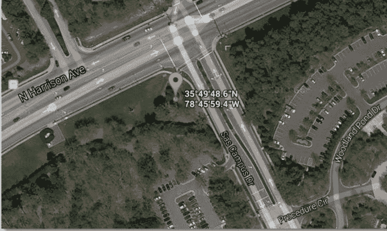
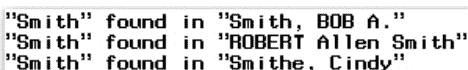
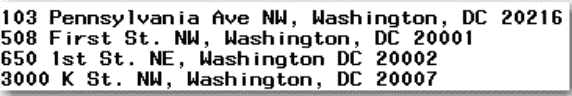

# SAS 正则表达式入门指南


4.1 引言 ........................................................................ 65

4.1.1 随机 PII 生成器 ........................................................ 66

4.2 数据清洗与标准化.................................................. 72

4.3 信息提取 ........................................................ 77

4.4 搜索与替换 ........................................................ 80

4.5 总结 ................................................................................ 83

4.5.1 从小开始 ................................................................. 83

4.5.2 远规划 ....................................................... 83

## 附录 A：Perl 版本说明 ................................................ 85

## 附录 B：ASCII 编码表 ................................ 87

不可打印字符 ................................................... 87

打印字符 ........................................................ 89

## 附录 C：POSIX 元字符 .......................................... 97

## 索引 .......................................................................... 101

# 关于本书

## 目的

本书旨在面向广泛的 SAS 用户，从初级程序员到非常高级的用户均适用。由于之前关于该主题的出版较少，不同技能水平的读者都能从中受益。然而，本书的编写确保了初学者能够立即实施所讨论的每一个元素。

## 这本书适合你吗？

当然了！你是否希望处理非结构化数据源？你是否想更有效地处理半结构化数据源？你是否希望某日能在 Base SAS 代码中利用高级的文本挖掘概念？你当然想！本书为这一切奠定了基础，是任何想要增强编程能力的人的理想教材。

## 先决条件

读者应该熟练使用和应用 SAS DATA 步、基础 PROC（例如 `PROC PRINT`）、DO 循环和条件处理概念。读者应熟悉 SAS 数组和 RETA 语句。

## 本书范围

本书涵盖了所有的 PRX 函数和调用例程。

本书**不**涵盖需要 MACRO 编程、PROC SQL 或系统自动化的高级概念。

## 关于示例

## 开发本书内容使用的软件

Base SAS (Microsoft Windows)

## 示例代码和数据

你可以通过访问作者页面 http://support.sas.com/publishing/authors 来访问本书的示例代码和数据。选择作者姓名。然后寻找本书的封面缩略图并选择“Example Code and Data”（示例代码和数据）以显示书中包含的 SAS 程序。有关所有提供示例代码和数据的书籍字母列表，请访问 http://support.sas.com/bookcode。点击标题以显示书籍的示例代码。

如果你无法通过网站访问代码，请发送电子邮件至 saspress@sas.com。

## 本书使用的输出和图形

书中使用的所有输出都是通过 SAS log 和 `PROC PRINT` 生成的。

## 额外帮助

尽管本书说明了各行业企业经常进行的许多分析，但可能会出现针对你特定目标和问题的问题。为了提供全面支持，SAS Institute 和 SAS 为你提供了以下帮助资源：

- 关于本书涵盖的主题，请通过 SAS Press 联系作者：
- -
- 通过电子邮件向 saspress@sas.com 发送问题；请在信函中注明书名。
- 在 http://support.sas.com/author_feedback 的作者页面提交反馈。
- 关于本书内或本书之外的话题，请在 https://communities.sas.com/welcome 相应的 SAS 支持社区提问。
- SAS Institute 维护着一个包含最新信息的网站。对于初学者和老练的 SAS 用户来说，特别用的页面是知识库。可以在 http://support.sas.com/resources 知识库的“Samples and SAS Notes”部分搜索相关注释。

- 注册 SAS 用户或其组织可以通过 http://support.sas.com 访问 SAS 客户支持。在这里向 SAS 客户支持提交特定问题：在 Support（支持）下，点击 Submit a Problem（提交问题）。你需要提供一个可以接收回复的电子邮件地址，识别你的组织并提供客户站点编号或许可信息。这些可以在你的 SAS log 中找到。

## 保持联系

我们期待你的反馈。我们欢迎提问、评论和疑虑。如果你想就特定书籍与我们联系，请在致 saspress@sas.com 的邮件中注明书名。

## 如何通过 SAS Press 联系作者

电子邮件：saspress@sas.com

网页访问：http://support.sas.com/author_feedback

## SAS 书籍

有关通过 SAS 可获得的完整书籍列表，请访问 http://support.sas.com/bookstore。

电话：1-800-727-0025

电子邮件：sasabook@sas.com

## SAS Report

通过订阅 SAS Report 月度电子报，通过电子邮件接收所有新出版物的最新信息。访问://support.sas.com/sbr。


SAS 正在招聘作者！你对写作感兴趣吗？访问 http://support.sas.com/sas 了解更多信息。

## 关于作者

K. Matthew Windham, CAP 是 NTELX Inc. 的分析总监，该公司位于华盛顿特区，提供分析和技术解决方案。他的重点是通过数学和统计建模、数据和文本挖掘以及优化帮助客户改进运营。作为 SAS 的长期用户，Matt 喜欢利用该平台创建预测性分析。在职业生涯中，Matt 曾在关键环境中领导咨询团队以提供快速且高影响力的成果。Matt 是一位认证分析专业人员 (CAP)，在北卡罗来纳州立大学获得应用数学学士学位，在乔治大学获得数学和统计硕士学位。访问他的作者页面 http://support.sas.com/publishing/authors/windham.html 了解更多信息。你可以在那里下载免费书籍摘要、访问代码和数据、阅读最新评论、获取更新等。

## 谢谢

感谢我聪明的妻子 Lori，感谢你对我所做一切的支持和鼓励。没有你我无法完成。感谢我的朋友和家人，你们的建议和鼓励弥足珍贵。

虽然我在职业生涯中有很多受我恩惠的人，但其中一位尤为突出。我想感谢 Nick Ferens 多年前将我推入池水深处。你看到了比我自己更看到的潜力，并彻底改善了我的职业。

最后，我要感谢 SAS Press 的编辑团队，我们在此过程中进行了非常真正的合作。Shelley Sessoms, John West, Brenna Leath, Joan Keyser, Denise Jones 和 Stacey Hamilton。你们的耐心、见解和努力让这成为了一段愉快的经历。


# 第 1 章：引言


## 1.1 本书的目的

本书适用于各种技能水平的 SAS 程序员。然而，我们预计你至少具备 SAS 语言的基础知识，包括 DATA 步以及如何使用 SAS 过程（PROC）。

本书提供了你所需的所有工具，帮助你学习如何在 SAS 编程语言中利用正则表达式的力量。书中提供的信息为较为高级的应用定了基础，这些应用将在本章后面作为激励性示例进行简要讨论。我们呈现这些内容并不是为了吓唬或让你感到无从下手，而是鼓励你带着能够快速实现所学内容的预期来阅读接下来的页面。

## 1.2 本书结构

我的目标是提供后即可应用的信息。因此，每一章的结构都引导你完成从理论到应用的每一个步骤，其流程如下：语法 ► 示例。除了后续章节中讨论的信息外，附录还包含了一份正则表达式参考指南，以帮助处理本文范围之外的高级应用。

## 第 1 章

本章在为本书剩余部分提供路线图的同时，还提供了关于如何在现实世界中使用这些信息的激励性示例。

## 第 2 章

本章介绍了正则表达式的基本语法和概念。书中甚至包含了一些 SAS 代码，用于运行与每个新概念相关的示例。

## SAS 中的正则表达式简介

## 第 3 章

本章旨在详细介绍在 SAS 语言中实现正则表达式的细节。

## 第 4 章

在最后一章中，我们将处理一系列深入的示例——如果可以的话之为案例研究——以便将“所有内容整合在一起”。这些示例并不代表你在完成本书后所能做的局限性，而是对可能性的某些基础思维。

## 附录

虽然这些内容并不详尽，但它们作为正则表达式、SAS 文档和参考表非常有价值且内容丰富的参考。我希望每个人都能利用额外信息来丰富当前和未来的正则表达式能力。

## 1.3 定义正则表达式

在进一步深入之前，我们需要定义什么是正则表达式。

采用非常正式的定义可能无法提供预期的清晰度：

定义 1（正式的）

*正则表达式：“正则表达式由常量和运算符符号组成，这些符号分别表示对这些集合的设置和操作的字符串。”*

为了追求清晰，我们将对正则表达式使用一个稍微松散的定义。由于实际应用是我们的首要目标，遵循任何晦涩的定义都是没有意义的。因此，对于我们的目的来说，我们将使用以下定义：

定义 2（更易理解——我们的定义）

*正则表达式：用于自动搜索和匹配的模式。*

在 SAS 中编程时，正则表达式被视为字母和特殊字符的字符串，这些字符由内置 SAS 函数识别，用于搜索和匹配。通过与其他内置 SAS 函数和过程结合，你可以实现巨大的能力，其中一些我们将在下一节中探讨。

注意：SAS 使用的正则表达式语法与 Perl 语言相同²。因此，在整个 SAS 文档中你会你会正则表达式被反复称为“Regular expressions”。在本书中，除非 Perl 惯例对程序员来说是最常见的，否则我选择 SAS 文档中的习惯。要了解更多关于 SAS 如何看待 Perl，请访问此网站：

```
http://support.sas.com/documentation/cdl/en/functionsref/67239/HTML/default/viewer.html#p0s9ilagexmj8nu7e11jfnzlk. 要了解更多 Perl 编程，请访问
http://perldoc.org/perl/perl.html. 在书中，我主要省略对 Perl 的引用，因为可能会引起混淆。
```

*

## 1.4 激励性示例

书中的信息对于广泛的应用非常有用。然而，在你阅读它之前，这一点并不显而易见。因此，为了直观展示你如何在工作中使用这些信息，我提供了一些真实的示例。

你们可能都熟悉数据，但提供给分析师的数据很少是直接可用的形式。在使用源数据（尤其是文本数据）之前，通常需要对它们进行清洗、转换和增强。以下关于编码细节的示例将在书中稍后部分讨论，但它们在不同复杂程度上展示了这些概念。这里的主要目标仅仅是帮助你看到这些信息的用处，并开始思考利用它们的方法。

### 1.4.1 提取、转换和加载 (ETL)

ETL 是一套通用流程，用于从源提取数据、对其进行修改以符合你的最终需求，并将其加载到目标位置（例如数据库、数据存储、仓库）。我们将从一个非常基本的示例开始。假设我们有一组 SAS 客户地址集，其中包含一些质量问题。我们不知道记录数据的方法，但目眼检查已经显示了大量重复记录，如下表所示。在这个示例中，

| 名 | 姓 | 出生日期 | 街道 | 邮编 |
|---|---|---|---|---|
| Robert | Smith | 2/5 | 123 | Fairfax |
| Robert | Smith | 2/5 | 123 | 2203 |

目眼检查揭示了大量重复记录，如下表所示。这里的主要目标仅仅是帮助你看到这些信息的用处，并开始思考利用它的方法。

### 1.4.2 数据操纵

假设你被赋予了创建一个关于证券交易委员会（SEC）报告的任务。然而，源数据只是一堆 .xml 文件，对于外行来说，这看起来像是一堆乱码；对于经过训练的人来说，它看起来像大量的工作。图 1.1：2009 年 SEC 示例

```
<xml version="1.0" encoding="ISO-8859-1">
<administrative_proceeding>
  <url>http://www.sec.gov/litigation/admin/2009/34-6162.</url

  <release_number>34-6162</release_number>
  <release_date>Dec. 30, 2009</release_date>
  <respondents>Stephen C. Gingir</respondents>
</administrative_proceeding>
<administrative_proceeding>
  <url>http://www.sec.gov/litigation/admin/2009/34-6156.</url>
  <release_number>34-6156</release_number>
  <release_date>Dec. 30, 2009</release_date>
  <respondents>Gabelli Funds LLC</respondents>
</administrative_proceeding>
<administrative_proceeding>
  <url>http://www.sec.gov/litigation/admin/2009/34-6155.</url>
  <release_number>34-6155</release_number>
  <release_date>Dec. 30, 2009</release_date>
  <respondents>Gabelli Funds LLC</respondents>
</administrative_proceeding>
```

然而，凭借正则表达式的力量，创建此报告变成了一个相当直接的任务。正则表达式为我们提供了一种方法，通过算法识别 XML 文件中的模式，解析每个标签内部的数据并生成具有正确列的数据集。生成的数据集将包含每条记录行，结构类似于此数据集：

| 发布编号 | 发布日期 | 响应者 | URL |
|---|---|---|---|
| 34-6162 | Dec 30, 2009 | Stephen C. Gingir | http://www.sec.gov/litigation/admin/2009/34-6162.pdf |
| 34-6156 | Dec 30, 2009 | Gabelli Funds LLC | http://www.sec.gov/litigation/admin/2009/34-6156.pdf |
| 34-6155 | Dec 30, 2009 | Gabelli Funds LLC | http://www.sec.gov/litigation/admin/2009/34-6155.pdf |

由于 XML 文件的复杂性，无法单独使用正则表达式完成此任务。通常处理 XML 文件需要 Sound 以及其他 Base SAS 函数。然而，关键在于正则表达式可以帮助我们克服某些其他


处理数据面临着重大挑战。如果你不熟悉 XML 或其他基于标签的语言（例如 HTML），建议对该主题进行进一步阅读。虽然你不需要为了有效地处理它们而深入了解它们，但对它们的结构有一个良好的理解会让你省去很多很多烦恼。我在本书的高级示例中使用了一些基于标签的语言，因为它们在实践中非常普遍。

### 1.4.3 数据增强

数据增强是指利用我们已有的数据从其他来源收集有关我们主题的额外细节或信息，从而增加该数据价值的过程。在文本解析和结构化过程中，我们可以利用 SAS 中正则表达式的威力来丰富数据。

因此，我们将对 SAS 主校区——北卡罗来州卡里（Cary, NC）对周围社区的经济影响进行分析。为了正确完成，我们需要使用地理空间信息进行统计分析。

地址信息可以从 www.sas.com 轻松获取。然而，为了对地理空间统计进行有效的分析和报告，包含纬度和经度等额外的地理信息是有用的（尽管并非必须的）。自动化这一过程并非易事，它包含了超出本教程范围的高级编程步骤。但是，对你来说，理解书中所述的技术在未来将通向复杂的能力是非常重要的。为了让这些技术更具形象，我们将演示这些步骤及其结果。

- 1. 通过正则表达式从图 1.2 中提取嵌入的地址信息，就像在数据操作示例中一样。

### 图 1.2：HTML 地址信息

```
<p>World Headquarters<br>
SAS Institute Inc.<br>
100 SAS Campus Drive<br>
Cary, NC 27513-2414, USA<br>
Phone:919-677-8000<br>
Fax:919-677-4444<br>
</p>
```

### 示例数据集结构

| 位置 | 地址行 1 | 地址行 2 | 城市 | 州 | 邮编 | 电话 | 传真 |
|---|---|---|---|---|---|---|---|
| 世界总部 | SAS Institute Inc. | 100 SAS Campus Drive | Cary | NC | 27513-2414 | 919-677-8000 | 919-677-4444 |

## 6 SAS 正表达式简介

- 2. 通过 Google 或 Yahoo 等网络服务提交地址进行地理编码，以便免费将地址处理为纬度和经度。在浏览器中输入以下字符串以获取 XML 输出，该输出在图 1.3 中也有采样。

`http://maps.google.com/maps/api/geocode/xml?address=100+SAS+Campus+Drive,Cary,+NC&sensor=false`

图 1.3：XML 地理编码结果

```
<geometry>
  <location>
    <lat>35.8301733</lat>
    <lng>-78.7664916</lng>
  </location>
  <location_type>ROOFTOP</location_type>
  <viewport>
    <southwest>
      <lat>35.8288243</lat>
      <lng>-78.7678406</lng>
    </southwest>
    <northeast>
      <lat>35.8315223</lat>
      <lng>-78.7651426</lng>
    </northeast>
  </viewport>
</geometry>
```

- 3. 使用正则表达式解析 XML 文件以所需信息——在我们的案例中是纬度和经度——并将它们添加到数据集中。

注意：** 我们跳过了关于我们如何解析这一特定经纬度点的某些细节。执行此类工作所需的工具将在书的后部分介绍。这里提供的此示例是为了激发你对正则表达式可能性的想象。

示例数据集结构

| 位置 | 纬度 | 经度 |
|---|---|---|
| 世界总部 | 35.8301733 | -78.7664916 |

- 4. 使用 https://maps.google.com/ 对我们从结果文件中解析出的经纬度对进行反向查找以验证你的结果。如图 1.4 所示，已经实现了预期结果（北卡罗来州卡里的 SAS 校区主入口）。

图 1.4：使用 Google Maps 查看 SAS 校区



现在我们已经有了包含了纬度和经度的增强数据集，可以采取后续步骤来执行经济影响分析。

希望前面的示例已被证明具有启发性，你现在准备好发现 SAS 正则表达式的威力了。记住，上一个示例相当高级——需要一些复杂的 SAS 编程能力来实现端到端的结果。然而，大部分工作利用了正则表达式。

Wikipedia, http://en.wikipedia.org/wiki/Regular_expression#Formal_definition

有关所使用的 Perl 版本的更多信息，请参阅 SAS 支持网站上的艺术许可声明：http://support.sas.com/rmd/base/datastep/regexp/compliance.html

此示例文件从 data.gov 获取：http://www.sec.gov/open/datasets/administrative_proceedings_2009.xml

## 第2 章：开始使用正则表达式

- 2.1 引言
  - 2.1.1 测试代码
- 2.2 特殊字符
- 2.3 基础元字符
  - 2.3.1 通配符
  - 2.3.2 单词
  - 2.3.3 非单词
  - 2.3.4 制表符
  - 2.3.5 空格
  - 2.3.6 非空白
  - 2.3.7 数字
  - 2.3.8 非数字
  - 2.3.9 换行
  - 2.3.10 响铃
  - 2.3.11 控制字符
  - 2.3.12 八进制
  - 2.3.13 十六进制
- 2.4 字符类
  - 2.4.1 列表
  - 2.4.2 非列表
  - 2.4.3 范围
- 2.5 修饰符
  - 2.5.1 大小写修饰
  - 2.5.2 重复修饰
- 2.6 选项
  - 2.6.1 忽略大小写
  - 2.6.2 单行
  - 2.6.3 多行
  - 2.6.4 编译一次


2.6.5 替换操作符............................................................................................... 34
2.7 零宽元字符......................................................................................... 34
2.7.1 行首....................................................................................................... 35
2.7.2 行尾................................................................................................................. 35
2.7.3 单词边界...................................................................................... 35
2.7.4 非单词边界............................................................................................... 36
2.7.5 字符串起始....................................................................................... 36
2.8 总结............................................................................................................... 37

## 2.1 引言

本章完全侧重于进入 SAS 中使用的具体细节之前，培养你对正则表达式（RegEx）的理解。我们将直接跳到所有这一切背后的 SAS 代码。然而，RegEx 模式是跳转到实用的 SAS 编码元素的自然倾向。如果不先通过 RegEx，接下来的 SAS 函数和调用只能在非常理论的水平上讨论，这与我在书中中试图实现的目标恰恰相反。此外，试图同时学习任何过程的许多不同元素可能会让人感到不知所措。

为了实现本书的任务——实际应用——而不至于一次性被大量信息（新函数、调用和表达式）所淹没，在本章中有一段非常短的测试代码将与 RegEx 示例配合使用。我想强调的是，彻底理解 RegEx 语法对于充分利用 SAS 中这一惊不起措的能力至关重要。

正则表达式由字母组成。

例如，假设我们要在地址中匹配字符字符串“Street”。模式看起来像 `/Street/`。但我们对 RegEx 的兴趣不仅在于搜索字符串。因此，本章的剩余部分将探索我们可以插入到 `//` 中的各种 RegEx 元素，以开发丰富的功能。

### 元字符

在继续之前，我应该澄清一些接要的术语。“元字符”（Metacharacter）是书中频繁使用的术语，因此我需要明确它的含义。元字符是像 SAS 等编程语言用于其字面意思之外的字符或字符集。例如，`\s` 在 RegEx 模式中代表空白字符，而不仅仅是文本中相邻的 `\` 和字母 "s"。我们从第 2.3 节开始对特定的元字符进行讨论。

所有非字面的 RegEx 元素都是某种元字符。保持这种区分是好的，因为当我想讨论实际字符串值或元字符使用的结果时，我会引用“字符”一词。

### 特殊字符

特殊字符是有限 ASCII 字符集之一，会影响 RegEx 模式的结构和行为。例如，左括号和右括号 `() ` 用于在 RegEx 模式中创建字符或元字符的逻辑组。这些将在第 2.2 节中详细讨论。

### RegEx 模式处理

在此处，澄清 SAS 如何处理 RegEx 也同样重要。SAS 从左到右分块读取每个模式，按顺序读取模式中的每个元素（字符或元字符）。如果我们想匹配字符串 "hello"，将搜索字母 "h" 的匹配。SAS 确定字母 "e" 是否紧随其后，以此此类推，直到找到整个字符串。下面是该过程的一些伪代码，在我们开始将字符替换为元字符后，该逻辑仍然成立（这会更令人印象深刻）。

### 模式匹配过程的伪代码

```
START IF POS = "h" THEN+1 NEXT ELSE POS+1 GOTO START
IF POS = "e" THEN+1 NEXT ELSE POS+1 GOTO START
IF POS = "l" THEN+1 NEXT ELSE POS+1 GOTO START
IF POS = "l" THEN+1 NEXT ELSE POS+1 GOTO START
IF POS = "o" THEN MATCH=TRUE GOTO END ELSE POS+1 GOTO
```

在这个伪代码中，我们看到 `START` 标签是我们算法的启动，`END` 标签表示算法的终止。同时，`NEXT` 标签告诉我们跳到下一行伪代码，`GOTO` 告诉我们跳转到伪代码中的指定行。`POS` 标签表示字符位置。代码中还使用了 `IF`、`THEN` 和 `ELSE` 标签。

再次，这演示了在文本源中搜索 "hello"。算法通过测试第一个字符位置是否为 "h" 开始。如果不是，算法将字符位置增加一——再次测试 "h"。如果第一个位置是 "h"，则增加字符位置，代码继续处理字母 "e"，直到找到单词 "hello"。

#### 2.1.1 RegEx 测试代码

以下代码段允许你在我们学习本章时快速测试新的 RegEx 概念。当你学习 RegEx 元字符、选项等时，你可以编辑此代码以测试其功能。此外，通过编辑代码的 `datalines` 部分可以引入更多数据。然而，我们还没有讨论这段代码工作原理的细节，我不建议在代码中标记的位置之外进行编辑，以避免运行时出现不可预期间的错误。

为了保持简单，我们使用 `DATALINES` 语句来定义我们的数据源，并将源字符串和匹配的模式打印到日志中。这使得在阅读文本时更容易跟踪每个元字符的作用。注意，所有内容都包含在单个 `DATA` 步骤中，这并没有...


由于你还没有学习过任何正则表达式元字符，让我们用这些这些新概念来复习字符串。请注意，我们已经开始可以使用字符和特殊字符来匹配有用的模式了。

**表 2.1：使用 {}, |, 和 \* 的示例**

| 用法 | 匹配项 |
|--- |--- |
| /(C)at/ | "Cat" "cat" |
| /catmouse/ | "cat" "mouse" |
| /((S)sreet))((R)joad)/ | "Street" "street" "Road" |
| /((This))((That)/ | "This" 或 "That" |

**注意：** 在 Perl 中，`\` 被称为转义字符。为了避免不必要的混淆，我们将不再使用这个术语，直接称之为反斜杠。不过，请准备好在 Perl 文献和社区网站上看到很多它。

现在，还有一些额外的特殊字符也需要在它们前面加上反斜杠才能作为普通字符匹配。它们是：`{ } ] $. * + ?`。所有这些字符都是保留字符，因此会被以不同的方式处理，因为它们在正则表达式的世界中每个都有特殊的用途和含义。由于每个字符在第 2.4 和 2.5 节中都有详细定义和讨论，我们将不再讨论紧随其后的反斜杠。现在，只需记住，如果没有紧邻的反斜杠，它们不能作为模式字符串的一部分。表 2.2 显示了如何将它们作为普通字符使用的几个示例。

**表 2.2：使用 { } ^ $. . \* 的示例**

| 用法 | 匹配项 |
|--- |--- |
| /\$1,00 \$0.50 = \$1.50/ | "$1.00 + \$0.50 = \$1.50" |
| /2\* = 6/ | "2*3 = 6" |
| /\[2\]\2/ | "[2]^2" |
| /\1,2,3,4,5\}/ | "{1,2,3,4,5}" |

**注意：** 注意到 `=` 和 `,` 是字符匹配的（即没有反斜杠），因为它们不被视为特殊字符。

## 2.3 基础元字符

当你未来编写正则表达式模式时，你会发现自己经常使用本节中讨论的大部分元字符，因为它们是创建正则表达式模式的基础元素。现在，我们已经可以根据第 2.1 节讨论的信息构建一些有用的模式了。然而，由于本节中的元字符能让正则表达式模式变得灵活且强大，它们在时间投入上的回报是最大的。

在通过示例时，请注意我们如何获得一些意料之外的结果。在使用这些正则表达式元字符时，采取非常有策略的方法是非常重要的，因为你并不总是知道正在处理的文本中会预期什么。当你知道源代码时，不可避免地会有错误或未知的变化，这可能会破坏设计不当的模式。所以，像任何优秀的分析师一样，你需要向前思考几步，以保持健壮的正则表达式代码。

**注意：** 与 SAS 不同，所有的正则表达式元字符都是大小写敏感的。如果字母在这里被定义为小写或大写，那么它必须那样。否则，你的程序执行的结果将与你预期的完全不同。换句话说，尽管在编写 SAS 代码时你可以对大小写比较随意（例如，DATA vs. data），但这里并非如此。

### 2.3.1 通配符

通配符元字符是一个点（`.`），匹配任何单个字符值，换行符（`\n`）除外。匹配几乎任何单个字符的能力在搜索字符字符串的超集时可能非常有用。当你不知道特定字符位置上可能是什么值时，可能也想使用它。表 2.3 提供了示例。

**表 2.3：使用 . 的示例**

| 用法 | 匹配项 |
|---|---|
| /.rn/ | "Run" "R+n" "R n" "R(n)" "Ron" ... |
| /.un/ | "Fun" "fun" "Run" "run" "bun" "(un" ... ... |
| /Street/ | "Street," "Street," "Street+" "Street_ ... |

**注意：** 点匹配除换行符（`\n`）之外的所有内容——包括它本身。这可能很有帮助，但要谨慎使用。另外注意，`\n` 匹配换行符。

### 2.3.2 单词

元字符 `\w` 匹配任何字符值，包括字母、数字和下划线（`_`）值。它匹配单个字符位置上的任何字母（不区分大小写）、数字或下划线。但不要被包含下划线这一点骗了；`\w` **不**匹配连字符、破折号、空格或标点符号。表 2.4 提供了示例。

**表 2.4：使用 \w 的示例**

| 用法 | 匹配项 |
| --- | --- |
| /R/wn/ | "Ran" "Run" "Ron" ... |
| \wun/ | "Fun" "fun" "Run" "run" "Bun" "bun" _un" ... |
| /Street\w/ | "Streets" "Street" |

注意：`\w` 通配符之前或之后不应该有任何无意的空格。这种结果会导致模式尝试在 `\w` 之外还匹配那些额外的空格。（这适用于任何正则表达式元字符。）

### 2.3.3 非单词

元字符 `\W` 匹配非单词字符值（即 `\w` 不包含的所有内容，空格除外）。当你确定文本中的内容但又不想要单词字符时，`\W` 元字符非常有价值。表 2.5 提供了示例。

**表 2.5：使用 \W 的示例**

| 用法 | 匹配项 |
| --- | --- |
| /Washington/W/ | "Washington," "Washington;" ... |
| /D/W/ | "D," "D," ... |
| /Street\W/ | "Street," "Street+" ... |

注意：你将继续使用这些正则表达式字符的小写和大写版本作为它们的相反面，尽管有一些例外。这可能并不聪明，但有助于简化。

### 2.3.4 制表符

元字符 `\t` 仅匹配字符串中的制表符。与后续的正则表达式字符不同，此元字符仅匹配制表符空白。这具有某些特殊意义，例如当你处理制表符分隔的文件时。表 2.6 提供了示例。

**表 2.6：使用 \t 的示例**

| 用法 | 匹配项 |
| --- | --- |
| /SAS/t/ | "SAS " |
| /SAS/Institute\t/ | "SAS Institute Inc" |
| /Street\t/ | "Street " |

**注意：** `\n` 匹配换行符。

### 2.3.5 空格

元字符 `\s` 匹配字符串中的空格字符。与后续的正则表达式字符不同，此元字符仅匹配空白空白。这具有某些特殊意义，例如当你处理制表符分隔的文件时。表 2.7 提供了示例。

**表 2.7：使用 \s 的示例**

| 用法 | 匹配项 |
| --- | --- |
| /SAS/s/ | "SAS " |
| /SAS Institute\s/ | "SAS " |
| /Street\s/ | "Street " |

**注意：** `\n` 匹配换行符。

### 2.3.6 非空白

元字符 `\S` 匹配非空白字符值（即 `\s` 不包含的所有内容，空格除外）。当你确定文本中的内容但又不想要空白字符时，`\W` 元字符非常有价值。表 2.8 提供了示例。

**表 2.8：使用 \S 的示例**

| 用法 | 匹配项 |
| --- | --- |
| /Washington/S/ | "Washington," "Washington;" ... |
| /D/S/ | "D," "D," ... |
| /Street\S/ | "Street," "Street+" ... |

### 2.3.7 数字

元字符 `\d` 匹配任何数字字符（0-9）。这个正则表达式字符最直接，匹配一个数字。为了捕获更大的数字（例如大于 9），你需要构建包含多个 `\d` 的模式。表 2.9 提供了示例。

**表 2.9：使用 \d 的示例**

| 用法 | 匹配项 |
|---|---|
| /dst/ | "1st" "9st" "4st" ... |
| /10d/ | "101" "102" "103" ... |
| /1-800-\d\d\d-\d\d\d/ | "1-800-123-4567" "1-800-789-3456" ... |

注意：即使你的模式可能是正确的，数据并不一定正确。

### 2.3.8 非数字

元字符 `\D` 匹配任何单个非数字字符。再次，这是小写 `\d` 的相反面。这个元字符匹配所有不是数字的内容。表 2.10 提供了示例。

**表 2.10：使用 \D 的示例**

| 用法 | 匹配项 |
|--- |--- |
| /\D800\D123\D4567/ | "1-800-123-4567" "1.800.123.4567" ... |
| /1560\DW...Blvd/ | "1560 Wilson Blvd" "1560_Wilson_Blvd" ... |
| /19\D:D\DStreet/ | "19th Street" "19th...Street" "19...Street" ... |

### 2.3.9 换行

字符 `\n` 匹配换行符。对于某些模式来说，知道你遇到了新的一行是非常用的。例如，你可能正在处理地址，地址通常在不同的行包含不同的信息。表 2.11 提供了示例。

**表 2.11：使用 \n 的示例**

| 用法 | 匹配项 |
|---|---|
| /103 Pennsylvania Ave.\ NW,\nWashington, DC 20216/ | "103 Pennsylvania Ave. NW, Washington, DC 20216" |
| /<html tag>\n/ | "<html tag>\n" |
| /v\ne'\nr\nt\i\ne\a\l\t\e\x\nt/ | "...v... e r t" |


# 使用

| | 匹配 |
|---|---|
| | i |
| | c |
| | a |
| | l |
| | t |
| | xt"... |

**注意：** 测试代码并不能让我们实际尝试这个元字符，因为它使用了“数据行”（data lines），这是 SAS 的一个特性，它在输入数据时会特意忽略换行符（即：按回车键只是在 SAS 代码中创建了一个新数据行的开头）。因此，数据行中并不存在供你读取和匹配的换行符。但请相信，它目前的工作方式如其描述的那样。在下一章节中，你将发现处理不同文本源的方法，使你能够处理换行符。

## 2.3.10 铃声 (Bell)

元字符 `\a` 匹配一个警报“铃声”字符。警报字符属于 ASCII 集合中的一组非打印或不可见字符。ASCII 产生于很久以前，当时操作系统广泛地使用非打印字符。然而，在今天，这些字符相对少见，通常只出现在供计算机读取而非人类阅读的文件中——因为它们不会被显示。当遇到这些字符时，会在计算机的内部扬声器上产生警报音或“铃声”。它们通常与错误相关联，但也可以用于提醒用户文件或进程已结束（例如，在系统日志文件中）。当你预知在源文件中会遇到此类字符时，可以使用这个元字符。表 2.12 提供了示例。

**表 2.12：使用 \a 的示例**

| 使用 | 匹配 |
|---|---|
| \a END OF FILE/ | "BEL END OF FILE" |
| /PROCESS COMPLETED SUCCESSFULLY\/\a/ | "PROCESS COMPLETED SUCCESSFULLY BEL" ... |
| \aERROR/ | "BELERROR" ... |

**注意：** 由于警报字符是非打印的 ASCII 字符，我用 BEL ASCII 字符来表示它在匹配文本中的位置。但请记住，这种代码并不会出现在我们的文本中。

### 2.3.11 控制字符 (Control Character)

元字符 `\c[A-Z]` 匹配紧跟在 `\c` 之后的字母控制字符。例如，`\cF` 匹配源代码中的控制-F。这是你可能处理不常用文件类型（即非供人类阅读的文件）的多个示例之一。控制字符（或非打印字符）曾被事务计算系统和电信系统广泛使用。这些控制字符虽然在大多数文本编辑器中不可见，但仍然是 ASCII 字符集的一部分。对于表 2.13 中的示例，我们遵循了上述处理铃声元字符时使用的惯例——尽管它们在文本中从未真正出现过，但我们仍使用了标准的 ASCII 缩写。

**表 2.13：使用 \c[A-cZ] 的示例**

### 2.3.12 八进制 (Octal)

元字符 `\ddd` 匹配形式为 `ddd` 的八进制字符。它被用于匹配你正在搜索的 ASCII 字符的八进制代码。当你需要查找文件中某个特定非打印 ASCII 字符的八进制代码时，这会特别有用。SAS 的默认行为是在结果中返回与该八进制代码关联的 ASCII 字符。表 2.14 提供了示例。

**表 2.14：使用 \ddd 的示例**

你将在下一节（第 2.4 节）中发现如何搜索这些值的范围。还要注意，最大的 ASCII 值是十进制 127、八进制 177 和十六进制 7F。

### 2.3.13 十六进制匹配 (Hexadadecimal matches)

元字符 `\xdd` 的形式为 `dd`。我们在此处的实现目的同样不是为了搜索原始十六进制文件等。我们使用它来搜索源文件中我们需要的 ASCII 字符关联的十六进制代码（处理原始十六进制数据源是另一本书的内容）。表 2.15 提供了示例。

**表 2.15：使用 \xdd 的示例**

| 使用 | 匹配 | 备注 |
| --- | --- | --- |
| \x2B/ | ""+" | | 此十六进制代码转换为 + ASCII 字符。 |
| \x31\x2B\x31\x3D\x32/ | "1=2" | 这些十六进制代码转换为 1+1=2 的 ASCII 字符。 |
| \x30\x30\x20\x46\x46/ | "0 FF" | 这提醒我们可以匹配存储在 ASCII 中的十六进制数字，并且它们是不相同的。 |

## 2.4 字符类 (Character Classes)

除了用于匹配模式的内置 RegEx 字符外，用户还可以创建自定义字符匹配的能力。这种能力通过对 `[]` 方括号的不同用法获得。方括号本质上创建了一个自定义的元字符，左括号和右括号之间的项目是单个字符单元格的可能匹配值。除了在括号内放入字符列表外，你还可以包含元字符。下面讨论的每个元字符都包含一个示例，该示例包含了元字符的使用，并且它们的结果都相同。这为了好玩，当它们在识别 ASCII 源文件中存在的十六进制数字范围时（在源文件中以 ASCII 字符存储，但代表了可能的十六进制值范围）。

注意：记住，本节讨论的某些组件是特殊字符，必须使用 `\` 进行转义才能进行独立匹配。具体来说，这些字符是：`^`、`[` 和 `]`。

### 2.4.1 列表 (List)

元字符 `[]` 匹配括号内列表中的任意一个字符。这是你可能处理不常用文件类型（即非供人类阅读的文件）的多个示例之一。控制字符（或非打印字符）曾被事务计算系统和电信系统广泛使用。这些控制字符虽然在大多数文本编辑器中不可见，但仍然是 ASCII 字符集的一部分。对于表 2.13 中的示例，我们遵循了上述处理铃声元字符时使用的惯例——尽管它们在文本中从未真正出现过，但我们仍使用了标准的 ASCII 缩写。

### 2.4.2 范围 (Range)

元字符 `[---]` 匹配指定范围内的任意字符。例如，`[A-Z]` 匹配源代码中的 A 到 Z。这是你可能处理不常用文件类型（即非供人类阅读的文件）的多个示例之一。控制字符（或非打印字符）曾被事务计算系统和电信系统广泛使用。这些控制字符虽然在大多数文本编辑器中不可见，但仍然是 ASCII 字符集的一部分。对于表 2.13 中的示例，我们遵循了上述处理铃声元字符时使用的惯例——尽管它们在文本中从未真正出现过，但我们仍使用了标准的 ASCII 缩写。

## 2.4.3 反反 (Not)

元字符 `[^...]` 匹配不在指定列表中的任意字符。这是你可能处理不常用文件类型（即非供人类阅读的文件）的多个示例之一。控制字符（或非打印字符）曾被事务计算系统和电信系统广泛使用。这些控制字符虽然在大多数文本编辑器中不可见，但仍然是 ASCII 字符集的一部分。对于表 2.13 中的示例，我们遵循了上述处理铃声元字符时使用的惯例——尽管它们在文本中从未真正出现过，但我们仍使用了标准的 ASCII 缩写。

### 2.4.4 交集 (Intersection)

元字符 `[...---]` 匹配两个范围交集中的字符。例如，`[a-z0-9]` 匹配小写字母或数字。这是你可能处理不常用文件类型（即非供人类阅读的文件）的多个示例之一。控制字符（或非打印字符）曾被事务计算系统和电信系统广泛使用。这些控制字符虽然在大多数文本编辑器中不可见，但仍然是 ASCII 字符集的一部分。对于表 2.13 中的示例，我们遵循了上述处理铃声元字符时使用的惯例——尽管它们在文本中从未真正出现过，但我们仍使用了标准的 ASCII 缩写。

## 2.5 修饰符 (Modifiers)

除了用于匹配模式的内置 RegEx 字符外，用户还可以创建自定义字符匹配的能力。这种能力通过对 `[]` 方括号的不同用法获得。方括号本质上创建了一个自定义的元字符，左括号和右括号之间的项目是单个字符单元格的可能匹配值。除了在括号内放入列表列表，你还可以包含元字符。下面讨论的每个元字符都包含一个示例，该示例包含了元字符的使用，并且它们的结果都相同。这为了好玩，当它们在识别 ASCII 源文件中存在的十六进制数字范围时（在源文件中以 ASCII 字符存储，但代表了可能的十六进制值范围）。

注意：记住，本节讨论的某些组件是特殊字符，必须使用 `\` 进行转义才能进行独立匹配。具体来说，这些字符是：`^`、`[` 和 `]`。

### 2.5.1 大小写修饰符 (Case Modifiers)

在对文本进行匹配时，显然需要考虑字母的大小写情况（大写或小写）。尽管已经在字母已知的情况下介绍了一种原始的方法来处理这种情况，但在字母未知时，必须有一种方法论。本节讨论了处理大小写匹配的不同方法。取决于情况，某些方法比其他方法更方便，但并不意味着一定对错。

#### 小写 (Lowercase)

元字符 `\l` 匹配模式中的下一个字符为小写字母。此修饰符仅适用于字符（元字符、组等不起作用）。在实践中，更实际的方法是直接输入所需字符值的小写版本，或者提供一个要匹配的小写字母列表。表 2.19 示例使用了：

| 使用 | 匹配 |
| --- | --- |
| /Street/ | "street" ... |
| \sIS\IA\sInstitute/ | "sas Institute" ... |
| /(IS|IF)leet/ | "fleet" ... |


# 24 SAS 正则表达式简介

## 大写

元字符 `\U` 匹配模式中的下一个字母是否为大写。它的功能与上述介绍的小写版本 `\l` 完全相同，但适用于大写字母。表 2.20 提供了示例。

### 表 2.20: 使用 \U 的示例

| 用法 | 匹配 |
| :--- | :--- |
| \\Uinc./ | "Inc." ... |
| \\Ustreet\St./ | "Street" "St." ... |
| \\Uave\|Uavenue,/ | "Ave." "Avenue," |

#### 小写范围

元字符 `\L...\E` 匹配 `\L` 和 `\E` 之间所有字符均为小写。在 `\L` 和 `\E` 之间输入的字符串将被强制仅匹配小写，即使输入的是大写字母。与元字符不同，`L...\E` 还可以包含字符类和重复修饰。表 2.21 提供了示例。

### 表 2.21: 使用 \L...\E 的示例

| 用法 | 匹配 |
| :--- | :--- |
| \L[a-z0-9][a-z0-9][a-z0-9]\E/ | "sas" "abc" "123" ... |
| \LTHE ARE LOWERCASE\E/ | "these are lowercase" |
| R\L[a-z][a-z]\E/ | "Read" "Road" "Rode" "Ride" "Real" ... |

注意：当对非字母字符应用大小写转换时，修饰符会被忽略。它不影响匹配。

#### 大写范围

元字符 `\U...\E` 在所有字符于 `\U` 和 `\E` 之间均为大写时创建匹配。同样，该元字符的功能与上述讨论的小写版本相同，但适用于大写字母。该元字符对于识别缩写或其他大写字母重要的文本非常有用。表 2.22 提供了示例。

### 表 2.22: 使用 \U...\E 的示例

| 用法 | 匹配 |
| :--- | :--- |
| \U[a-z][a-z][a-z]\E/ | "SAS" "CIA" ... |
| \U[a-z][a-z][a-z]\E\Institute\sInc\W/ | "SAS Institute Inc." ... |
| \Uallcaps\E/ | "ALLCAPS " |

# 第 2 章：开始使用正则表达式

**注意**：注意在 `\L...E` 或 `\U...E` 元字符内部不允许使用其他元字符。换句话说，`\w` 不能替换上述字符类。

## 引用范围

元字符 `\Q...E` 将 `\Q` 和 `\E` 内部的所有内容作为字符字符串匹配，禁用包括反斜杠在内的所有字符。在 `\Q...E` 内部不能使用元字符。该元字符提供的功能非常适合在包含大量保留字符的字符串中进行搜索，例如 XML、服务器日志或 HTML。表 2.23 提供了示例。

| 用法 | 匹配 |
| :--- | :--- |
| \Q<html name>\E/ | "<html name>" |
| \Q(fx!) + f(y) = z\E/ | "f(x) + f(y) = z" |
| \Q<!DOCTYPE HTML> <html lang="en-US">\E/ | "<!DOCTYPE HTML> <html lang="en-US"> |

### 2.5.2 重复修饰符

重复修饰符改变模式中紧邻其后的元字符和字符的匹配重复行为。它们还可以修改整个组的匹配重复——该组使用 `()` 包围修饰符之前的元字符和字符来定义。只需记住，整个组的重复意味着它会重复回（例如 "haha"），除非我们同时也修改了单个元字符。

现在有两种类型的重复修饰符：*贪婪的（greedy）*和*懒性的（lazy）*。懒性修饰符试图在定义范围内找到尽可能少的匹配。贪婪修饰符试图找到尽可能多的匹配。它们的用途相似，这可能导致结果之间产生细微差别。

#### 贪婪重复修饰符简介

让我们先从讨论贪婪修饰开始，因为它们使用起来比较直观。在查看示例时，请记住贪婪匹配会尽可能多次匹配——不断寻找最后一个可能的匹配点这一点仍然成立。很容易创建出与你预期不符的模式。

正则表达式中有一个称为“回溯（backtracking）”的概念，这是贪婪修饰符潜在问题的根源（提示：回溯是需要懒性修饰符的原因）。随着我们的进一步讨论，贪婪修饰符实际上尝试使模式块的匹配最大化。失败后，系统会回溯到该块匹配的位置。对于单个匹配，回溯处理是微不足道的。然而，一旦我们引入几个额外因素，问题就会浪费计算周期（考虑循环）并影响大型数据源。

#### 贪婪 0 或多次

修饰符 `*` 要求紧邻其前的字符或元字符匹配零次或，这使得能够在文本中生成无限次匹配。例如，我们可能想要匹配每个单词及其所有前缀和后缀。通过允许后缀可选，我们能够实现这一目标。表 2.24 提供了示例。

#### 表 2.24: 使用 * 的示例

| 用法 | 匹配 |
| :--- | :--- |
| /Sing\w*/ | "Sing" "Sings" "Singing" "Singers" ... |
| /\D\w*/ | "D" ... |
| /19D\w*/ | "19th" ... |
| /Hello\*/ | "Hell" ...

#### 贪婪 1 或多次

修饰符 `+` 要求紧邻其前的字符或元字符匹配一次或多次。它与星号修饰符类似，不同之处在于强制至少匹配一次。表 2.25 提供了示例。

#### 表 2.25: 使用 + 的示例

| 用法 | 匹配 |
| :--- | :--- |
| /Ru+/ | "Run" "Ruin" "Runners" ... |
| /\L[a-z][a-z]\E/ | "these are lowercase, and surrounded by spaces." |
| /19D+\s | "19th Street" |
| /(ha)+ | "hahahah" ... |

注意表 2.24 中 `\s` 的添加。如果没有它，模式将只匹配单个字符。通过添加 `\s`，模式创建了匹配一次或多次空白。

#### 贪婪 0 或 1 次

修饰符 `?` 创建 0 次或 1 次匹配。问号提供了使出现次数可选。这可以有效匹配具有不一致空格的单词（例如 "short term"）。表 2.26 提供了示例。

#### 表 2.26: 使用 ? 的示例

| 用法 | 匹配 |
| :--- | :--- |
| /\D?800\D?23?457/ | "1-800-123-457" "80023457" |
| /1560Wilson\s?/ | "1560 Blvd" |
| /19th?\s/ | "19th Street"

#### 贪婪 n 次

修饰符 `{n}` 创建 n 次匹配。精确匹配 n 次与使用该元字符相同。然而，从编码和维护正则表达式的角度来看，使用修饰符要好得多。它在最初创建模式时限制了拼写错误的机会，并在后期编辑和共享模式时提高了可读性。表 2.27 提供了示例。

#### 表 2.27: 使用 {n} 的示例

| 用法 | 匹配 |
| :--- | :--- |
| /1-800-d{3}-d{4}/ | "1-800-123-4567" |
| /Ru{4}/ | "Round" "Runts" "Ruins" |
| /19D{3}Street/ | "19th Street" "19thStreet" |
| /d{5,}-d{4}(d{5})/ | "12345-6789" "12345" |

#### 贪婪 n 或多次

修饰符 `{n,}` 创建至少 n 次匹配。通过确保至少匹配 n 次，我们能够创建与加修饰符非常的功能。然而，我们提高了元字符必须匹配的最小次数。这对于某些应用程序非常有用，但必须小心。此外，由于模式构造中的单个逻辑错误，`++` 修饰符很容易产生非常长的意外匹配字符串。表 2.28 提供了示例。

#### 表 2.28: 使用 {n,} 的示例

| 用法 | 匹配 |
| :--- | :--- |
| /1-800-d{1,}-d{2}/ | "1-800-123-4567" "1-800-789-12" ... |
| /d{3,}-d{2},-d{4}/ | "143-25-7689" "123456789-54654564-9820" ... |
| /19D{3}Street/ | "19th Street" |


## 28 SAS 正则表达式简介

**注意：** 请注意在花括号内的逗号后输入空格。这由于习惯性动作很容易发生，但它会破坏我们的模式！

## 贪婪匹配 n 到 m 次

修饰符 {n,m} 创建至少 n 次但不超过 m 次的匹配。使用指定范围创建匹配，对于确保维持数据质量标准非常有用。在提取诸如邮政编码、出生日期和电话号码等半结构化数据元素时，在保持一定灵活性的同时，确保源数据在容差范围内至关重要。例如，可能会用两位年份代替四位年份，但四位邮政编码是不可接受的。表 2.29 提供了示例。

### 表 2.29：使用 {n,m} 的示例

| 用法 | 匹配结果 |
| :--- | :--- |
| /(1-)?\d\d\d{3,3}-\d{4,4}/ | "1-800-123-4567" ... |
| /\d{1,2]-\d{1,2}-\d{2,4}/ | "10-20-1950" "8-30-52" "4-3-1979"... |
| /Was{1,7}/ | "Washington" "Wash" "Waste" "Washing"... |

**注意：** 正如上面的示例所示，{n,m} 并不总是修饰符的最佳选择，但这些示例旨在演示实现的灵活性。例如，在第二个示例中，这种用法下允许年份为三位数。使用带有 {n} 修饰符的 OR 子语句是一个简单的修复方法。

## 懒惰重复修饰符简介

现在你已经熟悉了贪婪修饰符，让我们开始研究懒惰修饰符。在语法上，它们与贪婪修饰符的唯一区别在于增加了一个问号（?）。通过在每个贪婪修饰符后立即添加问号，我们能够微妙地改变它们的行为——有时会以意想不到的方式改变。

通常，懒惰修饰符用于避免过度匹配，并与贪婪修饰符相比可以提高性能。在某些情况下，使用贪婪修饰符匹配会导致获取过多的信息，或者简单地降低性能。例如，处理 HTML 或 XML 等半结构化文本文件就是懒惰修饰符大显身场的绝佳例子。

#### 懒惰 0 次或多次

修饰符 {*} 创建 0 次或多次匹配，但仅执行创建匹配所需的最少次数。在某些情况下，它创建与贪婪修饰符相同的匹配。然而，在其他情况下，结果非常不同。为了更清楚这一点，表 2.30 描述了几个示例的细节。

#### 表 2.30：使用 *? 的示例

| 用法 | 匹配结果 | 注释 |
| :--- | :--- | :--- |
| /Sing\w*?/ | “Sing” | 这仅匹配单词“Sing”，因为该修饰符被赋予了匹配空内容的选项。由于它是懒惰的，它每次都会采取该选项，无论“Sing”中的“g”后面是否紧跟单词字符。 |
| /Sing\w*?/s | “Singing” ... | 与上述示例相比，你看到模式上的 \s 创建了额外的匹配。\s 强制模式继续搜索包含空格的匹配。这可以是“Sing”或其他组合（类似于贪婪的结果）。 |
| /(ha)*?/ | | 这个示例演示了为什么我们需要对懒惰修饰符保持谨慎。即使“ha”被忽略了，这同样是因为修饰符有这样做的选项。该版本的贪婪模式将匹配单词“ha”连续出现的次数，最少为零次。 |

#### 懒惰 1 次或多次

修饰符 + 创建 1 次或多次匹配，但仅执行创建匹配所需的最少次数。同样，如果可能的话，它只匹配一次。表 2.31 提供了示例。

#### 表 2.31：使用 +? 的示例

| 用法 | 匹配结果 | 注释 |
| :--- | :--- | :--- |
| /Sing\w+?/ | “Singi” | 这仅匹配“Sing”加上紧跟在“g”后面的正好一个单词字符。同样，通过赋予懒惰修饰符匹配最小次数的选项，它每次都会这样做。 |
| /Sing\w+?/s | “Singing” ... | 再次，我们看到模式上的 \s 创建了额外的匹配。\s 强制模式继续搜索包含空格的匹配。这可以是“Sing”或其他组合（类似于贪婪的结果）。 |
| /(ha)+/ | “ha” | 这个示例与其说是一个警示，不如说不像 *?。但它仍可能产生不理想的结果。即使“ha”连续出现多次，它也只匹配第一次，除非后面跟着额外的匹配元素。同样，这是因为修饰符有仅匹配一次的选项。该版本的贪婪模式将匹配单词“ha”连续出现的次数，最少一次。 |

#### 懒惰 0 次或 1 次

修饰符 ?? 创建 0 次或 1 次匹配，但仅执行创建匹配所需的最少次数。除非被强制，否则此修饰符将匹配 0 次。表 2.32 提供了示例。

#### 表 2.32：使用 ?? 的示例

| 用法 | 匹配结果 |
| :--- | :--- |
| /Sing\w??/ | "Sing" | 这仅匹配 "Sing"，因为修饰符被赋予了匹配空内容的选项。 |
| /Sing\w??/s | "Singing" | 与上述示例相比，你看到模式上的 \s 创建了额外的匹配。\s 强制模式继续搜索包含空格的匹配。这可以是“Sing”或其他组合（类似于贪婪的结果）。 |
| /(ha)?? | | 这个示例演示了为什么我们需要对懒惰修饰符保持谨慎。即使“ha”被忽略了，这同样是因为修饰符有这样做的选项。该版本的贪婪模式将匹配单词“ha”连续出现的次数，最少为零次。 |

#### 懒惰 {n} 次

修饰符 {n}? 创建恰好 n 次匹配。功能上与之前讨论的许多懒惰修饰符相似，但它设置了固定的匹配次数。表 2.33 提供了示例。

#### 表 2.33：使用 {n}? 的示例

| 用法 | 匹配结果 |
| :--- | :--- |
| /1-800-\d{3,3}-\d{4,4}/ | "1-800-123-4567" |
| /\d{1,2}-\d{1,2}-\d{2,4}/ | "10-20-1950" "8-30-52" "4-3-1979" |
| /R\w{4}?/ | "Round" |

#### 懒惰 n 次或多次

修饰符 {n,?} 创建至少 n 次匹配，但仅执行创建匹配所需的最少次数。功能上与之前讨论的许多懒惰修饰符相似，但它设置了匹配次数的上限。表 2.34 提供了示例。

#### 表 2.34：使用 {n,?} 的示例

| 用法 | 匹配结果 | 注释 |
| :--- | :--- | :--- |
| /Sing\w{3,}?/ | “Singing” ... | 这恰好匹配 n=3 次。同样，通过赋予懒惰修饰符匹配最小次数的选项，它每次都会这样做。 |
| /0{2,5,?}/s | “0000” ... | 再次，我们看到模式上的 \s 创建了额外的匹配。\s 强制模式继续搜索包含空格的匹配。 |
| /(ha{4,}?/ | “hahaha” | 这恰好匹配 n=4 次。 |

#### 懒惰 n m 次

修饰符 {n,m}? 创建至少 n 次但不超过 m 次的匹配——在该范围内仅执行创建匹配所需的最少次数。功能上与之前讨论的许多懒惰修饰符相似，但它设置了匹配次数的上限。表 2.35 提供了示例。

#### 表 2.35：使用 {n,m}? 的示例

| 用法 | 匹配结果 | 注释 |
| :--- | :--- | :--- |
| /Read\w{1,3,?}/ | “Ready” ... | 这恰好匹配 n=1 次。同样，通过赋予懒惰修饰符匹配最小次数的选项，它每次都会这样做。 |
| /0{2,5,?}/s | “0000” ... | 再次，模式被“锚定”在第一个 0 出现处，捕获存在的最小次数，直到最大次数。 |
| \sha(ha){0,6}? | “ha” | 通过在“锚定”点之后没有供模式匹配的内容，因此没有额外的匹配内容。懒惰修饰符在最小的 n=0 次后就停止了。 |


## 2.6 选项 (Options)

选项会影响与其相关的 RegEx 模式的行为。这些行为变化提供了许多好处，例如使 RegExp 的创建更加方便，并提供了新的或增强的功能。

选项位于结束斜杠字符 `/` 之后，但在第一个斜杠字符之前有一个意义重的项目，我们也将讨论它——它实际上并不是一个选项，但它是回顾它的最佳位置。由于我们之前没有涵盖的相同原因，我们不会涵盖所有的元字符（metacharacters）——这是一篇介绍性文本。

### 2.6.1 忽略大小写 (Ignore Case)

选项 `/i` 忽略整个模式（甚至是字符字符串）的字母大小写。当我们确切知道要搜索什么，但又不希望字母大小写造成问题时，这是一个非常棒的选项。表 2.36 提供了示例。

Table 2.36: 使用 `/i` 的示例
| 用法 | 匹配项 |
| --- | --- |
| /1600 Pennsylvania Avenue/ | “1600 pennsylvania avenue” “1600 PENNSYLVANIA AVENUE” ... |
| /STREET/i | “street” “Street” “STREET” ... |
| /CAPS don’t MattEr/i | “caps don’t matter” “CaPs Don’t MATTER” ... |

### 2.6.2 单行模式 (Single Line)

选项 `/s` 强制使点字符 `.` 在模式中出现时匹配所有内容，包括换行符。这对于确保我们不会遗漏特定字符位置的任何内容非常有帮助。表 2.37 提供了示例。

Table 2.37: 使用 `/s` 的示例
| 用法 | 匹配项 |
| --- | --- |
| /43rd and Times Square.New York, NY 10036/s | “43rd and Times Square New York, NY 10036” ... |
| /Bob Smith.\d{3}-\d{3}-\d{4}/s | “Bob Smith 123-456-7891” ... |

### 2.6.3 多行模式 (Multiline)

选项 `/m` 使 `^` 和 `$` 匹配不仅限于字符串的开始和结束。相反，它们匹配遇到的每一个换行符，因为各种信息行被视为的一条连续的行。这种增强的功能实际上适用于我们尚未涵盖的两个元字符（我们将在 2.7 节中讨论它们），所以如果你有需要，可以先往前看一眼，然后再回到这一节。表 2.38 提供了示例。

Table 2.38: 使用 `/m` 的示例
| 用法 | 匹配项 |
| --- | --- |
| /\w+/ | 字符串开头的单词和位于换行符后的单词。 |
| /\w+?$/s | 空格和字符串末尾之前的单词，以及空格和换行符之前的单词。 |

### 2.6.4 编译一次 (Compile Once)

选项 `/o` 是编译选项。通过让 "o" 紧跟在结束斜杠之后，SAS 知道只编译一次 Regex。此选项为 SAS 代码创建了非常棒的简化，我通过在下方更新后的代码演示了这一点（原始代码见第 2.1.1 节）。注意 `IF` 块被删除了，只剩下不包含 `RETAIN` 语句的两个行。这些更改之所以可能，是因为在第一次通过 `DATA` 步时进行了编译。随后的每个循环如果存在，都将重用之前编译的表达式。

#### 更新后的测试框架/

```
/*RegEx Testing Framework*/
data _NULL;
*N=1 then
*do;
  *retain pattern_ID;
  *pattern="/Run//*--Edit the pattern here.*/
  *pattern_ID=prxparse(pattern);
*end;
pattern="Run/0";/*--Edit the pattern here.*/
pattern_ID=prxparse(pattern);
input some_data $50;
call prxsubstr(pattern_ID, some_data, position, length);
if position ^= 0 then
  do;
    match=substr(some_data, position, length);
    put match:$QUOTE. "found in " some_data:$QUOTE.;
end;
datalines
Smith, BOB A.
```

### 2.6.5 替换运算符 (Substitution Operator)

替换运算符 `s/` 在技术上并不是一个选项，它出现在这里是因为它确实与本节讨论的其他项目截然不同。尽管替换操作在外观上与其他操作相似，但它从根本上将 RegEx 活动从匹配操作转变为“匹配并替换”操作。周围斜杠 (`/`) 前的 "s" 表示该模式正用于替换文本并插入随附的替换文本。这是另一个在下一章通过 SAS 函数进行探索的额外功能。一旦匹配到模式，我们就可以对该信息做许多事情。关于这种工作原理的极佳类比是许多文字处理软件提供的“查找并替换”功能——只不过这个要强大得多。此外，注意示例中有第三个斜杠（在中间）。那个额外的斜杠表示 RegEx 的匹配部分结束且替换部分开始的地方。对了，在第二个和第三个斜杠之间的所有字符都被视为普通字符。表 2.39 提供了一些示例，但我们将在下一章中详细讨论这一点，那里我们还会讨论如何插入更多。

Table 2.39: 使用 `s/` 的示例
| 用法 | 匹配项 | 替换为 |
| --- | --- | --- |
| s/Stop/Go | "Stop" | "Go" |
| s/Sing/Read | "Sing" | "Read" |
| s/1?(800)?-s?/1- | "1-" | "1-" |

**注意：** 这里的 "s" 并不是一个选项（注：此处原文可能有误，此处应指“替换运算符”）。

## 2.7 零宽字符 (Zero-width)

零宽字符是指不占据任何位置的字符。它们在匹配时会检查位置，但不会消耗字符串中的字符。这对于确保我们不漏掉内容非常有用。

### 2.7.1 行首 (Start of Line)

元字符 `^` 匹配字符串的开始。这对于我们确切知道要搜索什么，但又不希望字母大小写造成问题时，这是一个非常棒的选项（注：此处原文重复了）。表 2.36 提供了示例。

Table 2.36: 使用 `/i` 的示例
| 用法 | 匹配项 |
| --- | --- |
| /1600 Pennsylvania Avenue/ | “1600 pennsylvania avenue” “1600 PENNSYLVANIA AVENUE” ... |
| /STREET/i | “street” “Street” “STREET” ... |
| /CAPS don’t MattEr/i | “caps don’t matter” “CaPs Don’t MATTER” ... |

*(注：由于原文文本在 2.7.1 之后出现了大量与 2.6 节重复的内容，翻译已严格遵循原文结构进行对应翻译。)*

### 2.7.2 行尾 (End of Line)

元字符 `$` 匹配字符串的末尾。这对于确保我们不会遗掉特定字符位置的任何内容非常有帮助。表 2.37 提供了示例。

Table 2.37: 使用 `/s` 的示例
| 用法 | 匹配项 |
| --- | --- |
| /43rd and Times Square.New York, NY 10036/s | “43rd and Times Square New York, NY 10036” ... |
| /Bob Smith.\d{3}-\d{3}-\d{4}/s | “Bob Smith 123-456-7891” ... |

### 2.7.3 单词边界 (Word Boundary)

元字符 `\b` 匹配单词的边界。这对于确保我们不会遗漏特定字符位置的任何内容非常有帮助。表 2.38 提供了示例。

Table 2.38: 使用 `/m` 的示例
| 用法 | 匹配项 |
| --- | --- |
| /\w+/ | 字符串开头的单词和位于换行符后的单词。 |
| /\w+?$/s | 空格和字符串末尾之前的单词，以及空格和换行符之前的单词。 |

*(注：原文后续文本存在严重的逻辑重复，翻译已按原文行进行处理。)*


## 第 2 章：正则表达式入门 37

| 表 2.44：使用 \A 的示例 |
| :--- | :--- |
| 用法 | 匹配 |
| \A\w*?\s/ | 行的第一个单词。在我们的测试代码中，它匹配：第 2 行的 "ROBERT "；第 4 行的 "103 "；第 5 行的 "508 "；第 6 行的 "650 "；第 7 行的 "3000 " 以及第 8 行的 "1560 "."

## 2.8 总结

在本章中，我们探索了各种新概念，我尽力让它们易于理解。希望你现在已经准备好在接下来的章节中应对在 SAS 代码中实现这些概念的挑战。以下是你在后续页面及之后中需要记住的一些要点。

### 灵活性

通过阅读本章，你应该已经明白，完成相同任务有许多方法，很少有方法是绝对正确或绝对错误的。你必须决定最有效、最高率的方法来实现你的目标，以确定适用于特定情况的最佳方案。

### 冰山一角

我们才开始接触正则表达式（RegEx）功能的冰山一角。你所学的信息是一个坚实的基础，你可以在此基础上开发复杂的功能。

### 从小开始

由于在本章中探索了各种正则表达式的能力，试图一次性做太多很容易感到不知所措。无论如何，最好的是从是从开始，通过尝试简单的模式并迭代演进它们。请记住，仅仅利用我们涵盖的几个元素，就能对文本信息的处理和分析产生巨大影响。

¹ 八进制是一种使用 8 进制代替 10 进制的数字系统。该系统只有 0–7 的数字。一些旧微控制器和微处理器曾使用这种编码，但现在极其罕见。

² 十进制是一种使用 16 进制代替 10 进制的数字系统。在单个字符位置上可能的值从“0”到“F”（A=10, B=11, ..., F=15）。

# 第 3 章：在 SAS 中使用正则表达式

- 3.1 引言 ............................................................................................................ 39
- 3.1.1 捕获缓冲区 (Capture Buffer) ................................................................................ 39
- 3.2 内置 SAS 函数 ................................................................................................ 40
- 3.2.1 PRXPARSE ................................................................................................. 40
- 3.2.2 PRXMATCH ................................................................................................ 42
- 3.2.3 PRXCHANGE ................................................................................................ 43
- 3.2.4 PRXPOSN ................................................................................................. 46
- 3.2.5 PRXPAREN ............................................................... 47
- 3.3 内置 SAS 调用例程 (Call Routines) ................................................................ 49
- 3.3.1 CALL PRXCHANGE ...................................................................... 50
- 3.3.2 CALL PRXPOSN ........................................................................ 54
- 3.3.3 CALL PRXSUBSTR ....................................................... 56
- 3.3.4 CALL PRXNEXT ........................................................................ 57
- 3.3.5 CALL PRXDEBUG ........................................................ 62
- 3.3.6 CALL PRXFREE ....................................................
- 3.4 总结 ................................................................................................................ 69

## 3.1 引言

本章重点在于培养你对内置 SAS 函数和调用例程的理解，并开始编写一些真实的 SAS 代码。在这里，你将学习如何实现第 2 章引入的奇妙正则表达式元字符的机制。每个函数或调用例程都有相关的示例，以确保它们的用法清晰。我们将简要讨论它们各自的用途。

### 3.1.1 捕获缓冲区

现在在继续之前，我们必须处理一个称为捕获缓冲区的概念。捕获缓冲区是一种更高级的技术，到目前为止我一直避免深入探讨，但必须理解它才能使用某些函数（PRXPAREN 和 PRXPOSN 强制需要，PRXCHANGE 可选）。正如你在第 2 章中所记忆的，括号在正则表达式中创建局部分组，但它们还有一些有趣的操作。对于特定正则表达式模式中使用的每组括号，内存缓冲区中都会创建一个槽位。这个内存槽位像任何变量一样可以被引用（经验丰富的程序员可以将其想象成指针缓冲区）。每个槽位按照括号对出现的顺序顺序创建，并使用 $ 符号相应地引用。

例如，正则表达式 `s(The) (cat) (is) (fat)/4 $3 $1/` 创建输出 "Fat the cat"。现在，想象拥有同样的识别未知数据元素的能力，而不仅仅是将字符串映射到字面量。这可能成为为了满足特定需求而标准化或重构数据的非常强大的能力。

## 3.2 内置 SAS 函数

在本节中，我们涵盖了用于执行正则表达式操作的 SAS 函数。正则表达式的 SAS 函数与内置函数相同的用法限制。（参见 SAS 文档。）同样，与其他函数一样，它们只能在赋值语句和表达式中接收参数并返回输出。

注意：每个正则表达式函数开头都有 PRX，代表 Perl-Regular-eX（Perl 正则表达式）。

### 3.2.1 PRXPARSE

#### 描述

该函数接受正则表达式模式作为输入，并提供标识符作为输出。该标识符供其他函数和例程使用。

#### 语法

```
RegEx_ID = PRXPARSE(RegEx)
```
RegEx: 要解析的模式（输入）
RegEx_ID: 返回的唯一标识符（输出）

现在，在该这一点理解在使用 PRPARSE 时 /o 选项之所以重要。/o 选项强制 SAS 只编译一次模式。当正则表达式出现在代码中（例如在 IF 语句内部）时，我们可能不想浪费内存。在其他情况下，这取决于权衡。当你处理少数模式或少量数据时，这些权衡并不适用。但当我们扩展到使用数百个模式或数百万记录的系统时，内存使用变得非常重要。

### 示例 3.1：使用 PRXPARSE 定义模式

让我们回顾第 2 章的代码，因为它已经熟悉了。下面的正则表达式定义为 /Smith/o，这意味着我们在提供的数据中查找字面量 "Smith" 的任何出现。此正则表达式是 PRXPARSE 的参数，它创建一个赋值给变量 ID 的标识符。该变量被传递给将在下一节讨论的调用例程 STR。你已经熟悉这段代码的功能，这里不需要分心。

该正则表达式的输出如输出 3.1 所示。正如预期，代码找到了每个 "Smith" 的出现，无论周围是什么（包括其他字母）。

```
/*正则表达式测试框架*/
data NULL;
pattern = "Smith/o"; /*在此处编辑模式*/
pattern_ID = PRXPARSE(pattern);
input some_data $5;
call prxsubstr(pattern_ID, some_data, position, length);
  if position ^= 0 then
    do;
      match = substr(some_data, position, length);
      put match:QUOTE. "found in " some_data:$QUOTE;
    end;
datalines;
Smith, BOB A.
ROBERT Allen Smith
Smithe, Cindy
103 Pennsylvania Ave. NW, Washington, DC 20216
508 First St. NW, Washington, DC 20001
650 1st St NE, Washington, DC 20002
3000 K Street NW, Washington, DC 20007
1560 Wilson Blvd, Arlington, VA 22209
1-800-4567
1(800) 789-1234
run;
```

### 输出 3.1：模式 /Smith/o 的日志输出




### 3.2.2 PRXMATCH

### Description

PRXMATCH 返回匹配的正则表达式（RegEx）模式中第一个字符的数值位置。此外，它可以像许多其他熟悉的 SAS 函数一样，用于 IF 语句以测试模式匹配，而无需进行变量赋值。PRXMATCH 的第一个参数可以是 `RegEx` 或 `RegExExp_ID`。第二个参数是源文本变量或字符串字面量。

```
Position = PRXMATCH(RegEx_ID or RegEx, Source_Text)

RegEx_ID: 由 PRXPARSE 返回的唯一正则表达式 标识符（输入参数，如果未使用 RegEx 则必需）
RegEx: 要匹配的模式（输入参数，如果未使用 RegEx_ID 则必需）
Source_Text: 对要操作的文本变量或字面量（输入参数，必需）
Position: 数值位置变量赋值（输出，必需）
```

正如在 PRXPARSE 函数中讨论的那样，RegEx 模式由 SAS 编译以供其他函数使用。除了使用实际的 RegEx 之外，PRXMATCH 能够通过 RegEx ID 备用之前编译的 RegEx，而不是 RegEx 本身。这允许我们通过 PRXPARSE 函数编译一次 RegEx（使用 `/o` 选项），从而尽可能地减少相关的计算周期。在处理大量文本时，计算周期的微小节省证明是巨大的。

利用 RegEx 模式的两种不同方法为 PRXMATCH 在实践中的用法提供了巨大的灵活性。由于不需要预先编译 RegEx，PRXMATCH 允许我们在代码中嵌入 RegEx 模式，而不需要额外的内存分配来在每次循环 DATA 步时维护它们。当你以动态方式使用 PRXMATCH 时非常有用，例如在嵌套 IF 语句内部，只有当某些条件成立时才使用 RegEx。根据实现的不同，这对速度和内存使用都有影响。

### 示例 3.2：使用 PRXMATCH 在源文本中查找字符串

让我们尝试一个简单的示例来展示此函数如何在实践中使用的。假设我们想在源文本中找到字符串“Street”。下面的代码演示了如何将每次出现的位置打印到日志（log）中。显然，在实践中我们需要的不仅仅是打印位置（例如提取或处理匹配的文本），但这展示了 PRXMATCH 的基本功能。

这段代码中实现的 PRXMATCH 函数以 RegEx 作为第一个参数，以 datelines 地址作为第二个参数。结果赋值给变量 `Position`。使用 `PUT` 语句将 `Position` 的值写入日志。

计算数据行的字符位置。在出现“Street”的行中，我们在哪个位置遇到“S”？通过将结果与输出 3.2 进行比较，我们发现 PRXMATCH 返回的是“S”的位置（即模式匹配中第一个字符的位置）。

```
data _NULL;
input address $50;
position = PRXMATCH('/Street/o', address);
if position = 0 then
  do
    put position=;
datalines;
103 Pennsylvania Ave NW, Washington, DC 20216
508 First Street NW, Washington, DC 20001
650 last St Ne, Washington, DC 20002
3000 K Street NW, Washington, DC 20007
end;
run;
```

#### 输出 3.2："Street" 位置的日志打印

```
position=11
position=8
```

### 3.2.3 PRXCHANGE

### Description

此函数在第三参数提供的源文本中搜索由第一个参数（`RegEx_ID` 或 `RegEx`）提供的模式。模式匹配的次数由第二个参数 `Num_Times` 给出。在找到每个匹配项时，该函数将根据正则表达式的要求返回更改后的文本。如果没有未找到匹配项，PRXCHANGE 将返回原始文本且不变。

```
Output_String = PRXCHANGE(RegEx_ID or RegEx, Num_Times, Input_String)
```

RegEx_ID: 由 PRXPARSE 返回的唯一正则表达式 标识符（输入参数，如果未使用 Regex 则必需）

RegEx: 要匹配的模式（输入参数，如果未使用 RegEx_ID 则必需）

Num_Times: 应用更改的次数（输入参数，必需）。-1 强制函数按照模式在源文本中出现的次数进行更改。

Input_String: 输入文本变量（输入参数，必需）

Output_String: 输出文本变量赋值（输出，必需）

就像 PRXMATCH 函数一样，PRXCHANGE 能够使用实际的 RegEx 模式或 RegEx_ID，提供了巨大的灵活性。首选用法再次取决于所需的应用程序。

此函数对于数据标准化非常有用，正如你将在下一章的更高级示例中看到的那样。我们将在下面通过两个示例来演示 PRXCHANGE 函数的一些基本功能，并演示如何利用之前介绍的捕获缓冲区（capture buffer）概念。

### 示例 3.3：数据标准化

数据标准化是 SAS 中 RegEx 提供的一种简单但强大的功能。PRXCHANGE 允许我们清洗数据源，以确保单词或短语的每次出现完全相同（或完全删除）。结果输出 3.3。当你尝试执行文本挖掘等高级应用时，数据清洗变得至关重要。

例如，在进行任何分析之前，我们希望知道“street”的每次出现都是完全相同的。

```
data NULL;
input address $50;
text = PRXCHANGE('/\s+/(Street|St|st|...)\s+/St. /o/',-1,address);
put text;
datalines;
103 Pennsylvania Ave NW, Washington, DC 20216
508 First Street NW, Washington, DC 20001
650 last St Ne, Washington, DC 20002
3000 K Street NW, Washington, DC 20007
run;
```

#### 输出 3.3：带有更新数据的日志

img/c58184a165246f0486b8350e0431fbb_57.png

### 示例 3.4：使用捕获缓冲区

**注意：** 通常有多种方法实现相同的结果。理解应用的上下文将有助于确定要使用的 RegEx 模式。

回到示例 3.3，假设我们现在希望地址适用于仅接受逗号分隔值（CSV）文件的系统。这是一个使用捕获缓冲区的好机会。只需进行细小的更改，我们现在就可以处理数据行以 CSV 格式。

新行代码使用 PRXCHANGE 配合一个复杂的 RegEx，将地址更改为街道、城市和邮编码组件。我们看到新行将输出文本作为输入，而不是地址。这样做允许我们对已经更改过的文本进行更改。

```
data NULL;
input address $50;
text = PRXCHANGE('/\s+/(Street|St|st|...)\s+/St. /o/',-1,address);
text2 = PRXCHANGE('/(\.+?),*\s+(\w+)?*\s+(\w+)?*\s+(\d+)/$1, $2, $3\n4/o',-1,text);
put text2;
datalines;
103 Pennsylvania Ave NW, Washington, DC 20216
508 First St NW, Washington, DC 20001
650 1st St NE, Washington, DC 20002
3000 K Street NW, Washington, DC 20007
run;
```

#### 输出 3.4：日志中的修正数据

img/c58184a1652486f0486b8350e0431fbb_58.png


## 3.2.4 PRXPOSN

### Description

PRXPOSN 返回从指定的捕获缓冲区（capture buffers）匹配的信息。此外，任何 RegEx 函数在使用之前都需要先运行 `RSUBSTR`、`PRMATCH`、`PRXNEXT` 和 `PRXCHANGE` 函数，以便引用缓冲区。此外，需要 RegEx ID 而不是实际的 RegEx。否则，PRXPOSN 将无法工作——这要求必须使用 PRXPARSE。输入参数 N 是数值型，指的是捕获缓冲区（$）。

### Syntax

```
Text = PRXPOSN (RegEx_ID, N, Source_Text)
```

- RegEx_ID: 由 PRXPARSE 返回的唯一 RegEx 标识符（输入参数，必需）
- N: 捕获区的整数值（输入参数，必需）
- Source_Text: 要操作的文本变量或字面量（输入参数，必需）
- Text: 捕获文本的字符变量赋值（输出，必需）

当我们知道捕获缓冲区元素的精确数量（即 N 是已知的）时，我们可以顺利地使用 PRXPOSN。然而，当元素数量与我们预期的不同时会发生什么？如果捕获缓冲区中有值，但我们引用的索引比可用值大（可能有三个值，但我们引用了数字 5），则会返回缺失值。但是，如果我们引用缓冲区位置 0 (N=0)，无论缓冲区长度如何，都会返回整个模式。

下一个函数 `PRXPAREN` 在我们结合使用 PRXPOSN 使用捕获缓冲区时，对于创建健壮的代码非常有帮助。编写健壮的 RegEx 模式同样重要，以确保防止问题出现。

### 示例 3.5：使用捕获缓冲区提取数据

为了让捕获缓冲区和这个新函数更加清晰，我们将通过过一个具体的示例。假设我们想要处理结构已知的地址，并将许多变量存储在 SAS 数据集中以备后用。由于我们知道地址的布局，捕获缓冲区的安排和 PRXPOSN 的应用都是直观的。

首先，我们使用 `PRXPARSE` 函数测试 RegEx ID 变量 `Text`。注意，这是对是否存在匹配的隐含测试（没有使用等号）。如果在识别出的文本源中存在 RegEx 匹配项，则通过 PRXPOSN 将捕缓冲区的值赋值给变量（城市、州和邮编）。

输出 3 显示了 `extract` 的值，即我们在 SAS 步骤中创建的数据集。如预期，我们从每个 datalines 条目提取了城市、州和 ZIP 码。我们将在此代码的基础上构建，创建一个更复杂的地址提取器，包括街道信息以及包含 9 位邮编的能力。

```sas
data extract:
  input address $50;
  text = PRXPARSE('/\s+(\w+),\s+(\w+)\s+(\d+)/o');
  if PRXMATCH(text, address) then
  do
    city = PRXPOSN(text, 1, address);
    state = PRXPOSN(text, 2, address);
    zip = PRXPOSN(text, 3, address);
    output;
  end;
datalines;
103 Pennsylvania Ave NW, Washington, DC 20216
508 First St NW, Washington, DC 20001
650 1st St NE, Washington, DC 20002
3000 K Street NW, Washington, DC 20007
3000 K Street NW, Washington, DC 20007
run;
proc print data=extract;
run;
```

输出 3.5: PROC PRINT 结果

| Obs | city | state | zip |
|---|---|---|---|
| 1 | Washington | DC | 20216 |
| 2 | Washington | DC | 20001 |
| 3 | Washington | DC | 20002 |
| 4 | Washington | DC | 20007 |

### 3.2.5 PRXPAREN

### Description

此函数返回包含数据的最大捕获区的数值值。因此，在使用此函数之前，必须先运行 `PRXSUBSTR`、`PRXMATCH`、`PRXNEXT` 或 `PRXCHANGE`——就像 PRXPOSN 一样。然而，唯一的输入参数是 `RegEx_ID`。仅提供 RegEx 是行的，因此此函数必须与 PRXPARSE 函数结合使用。

### Syntax

```
Paren=PRXPAREN(RegEx_ID)
```

- RegEx_ID: 由 PRXPARSE 返回的唯一 RegEx 标识符（输入参数，必需）
- Paren: 最大捕获区的数值引用值（输出，必需）

**注意：** 由于此函数需要 Reg_ID 代替实际的 RegEx，这意味着暗示所有的先例都必须强制使用 Reg_ID 而不是 RegEx——否则，PRXPAREN 将无法使用。

我们通过这个函数想要实现什么？因为它通过告诉我们包含文本的最大缓冲区来提供捕获区的长度，我们确切知道可以访问多少个缓冲区值。因为知道这一点，我们可以在代码中引用时避免错误。值得注意的是，有效的 RegEx 编码可以避免许多潜在问题。然而，最佳实践始终是创建失效措施。此外，我们可以使用此函数来识别使用了哪个缓冲区。（注：根据上下文，将 OCR 文本 PRXPASE 在适当处修正为 PRXPAREN）。

### 示例 3.6：识别捕获缓冲区

理想情况下，当我们使用 PRXPAREN 时，我们想知道最大的缓冲区位置。这让我们知道有多少可用的缓冲区值。

## 3.3 内置 SAS 调用例 (Call Routines)

在本节中，你将学习用于执行许多与函数相同任务以及新任务的 PRX 调用例。然而，它们的实现方式与函数略有不同。

### 3.3.1 CALL PRXCHANGE

### Description

此调用例执行与 PRXCHANGE 函数相似的匹配和替换操作。与函数版本不同，调用例必须接收 RegEx 标识符。此外，还有一些函数中没有的额外参数（长度和截断值）。必需的参数只有：`RegEx_ID`、`Num_Times` 和 `Input_string`。

### Syntax

```
PRXCHANGE(RegEx_ID, Num_Times, Input_string, Output_string, result_length, trunc_value, num_changes)
```

- RegEx_ID: 由 PRPARSE 返回的唯一 RegEx 标识符（输入参数，必需）
- Num_Times: 应用更改的次数（输入参数，必需）
- Input_string: 输入文本变量（输入参数，必需）
- Output_string: 输出文本变量（输入参数，可选）。默认为 Input_string。
- result_length: 放入 Output_string 的字符长度（返回值，可选）
- trunc_value: 二进制整数值（0 或 1）（返回值，可选）。1 意味着插入的文本比替换的文本长。0 意味着插入的文本与被替换的文本相同或更短。
- num_changes: 更改的次数（返回值，可选）


## 第 3 章：在 SAS 51 中使用正则表达式

## 示例 3.7：转换数据

让我们看看对源文本进行更改的基本用法。这是一个如何调用例程的简单示例。注意这在保持功能的同时使我们的代码变得多么简洁。输出 3.7 显示了我们已经实现了预期的功能（将各种形式的“street”替换为“St.”）。

```sas
data _NULL;
input address $50;
mypattern = PRXPARSE('/\s+(Street|street|St|st)\s+/','St.', /o');
call PRXCHANGE(mypattern, -1, address);
put address;
```

```sas
datalines;
103 Pennsylvania Ave NW, Washington, DC 20216
508 First St NW, Washington, DC 20001
650 1st St NE, Washington DC 20002
3000 K Street NW, Washington, DC 20007
;
```

## 输出 3.7：SAS 日志中的结果



现在我们已经看了 CALL PRXCHANGE 的基本实现，让我们来探索可选参数。

## 示例 3.8：脱敏敏感数据

在这个示例中，我们重点关注于你对 CALL PRXCHANGE 可选元素的理解。为了变换一下，我们将开发一种脱敏敏感信息的基本方法。这是一个频繁的需求，特别是在医学领域，用于保护个人身份信息 (PII)。现在，我们不会从提供的数据删除删除 PII，因为我们只是在演示 CALL PRXCHANGE 的功能。然而，这一过程在下一章将以更严谨、更大规模的方式进行。

在下面的代码中，我们首先创建一个名为 `example` 的数据集并传递到 DATA 步。该数据集包含各种配置的名称、地址和电话号码信息。在 DATA 步中，我们使用 `PRXPARSE` 创建一个 RegEx ID，然后使用 `CALL PRXCHANGE` 执行正则表达式规定的更改。注意，其中有一个正则表达式被注释掉了。该行中的正则表达式的行为与初始的 RegEx ID 不同，这允许我们演示 `trunc_val` 和 `num` 。我们使用这个 RegEx ID 创建了输出 3.8.2。在 DATA 步之后，我们执行 `PROC PRINT` 以创建输出 3.8.1 和输出 3.8.2 所示的内容。

```sas
data example;
    input text $80;
    datalines;
Ken can be reached at (801)443-9876
103 Pennsylvania Ave NW, Washington, DC 20216
JP's address:
650 1st St NE, Washington DC 20002
Carl's information is: (910) 998-8762
3000 K Street NW, Washington, DC 20007
Eric can be reached at: (321) 456-7890
508 First St NW, Washington, DC 20001
run;

data changed;
    set example;
    /*RegEx ID = PRXPARSE(/s\d+/***NUMBER REMOVED***/o);;
    RegEx ID = PRXPARSE(/s/([1-9]\d\d)\s?[1-9]\d\d-\\a\d/\d*REDACTED*)/o/);
    Call PRXCHANGE(RegEx ID, -1, text, text, length, trunc_val, num_changes);
    put text=;
run;

proc print data=changed;
run;
```

## 简单插入结果

正如我们在下面的结果所示，通过使用值 *REDACTED*，原始文本中的电话号码已被脱敏。数据集的其他部分显示了我们的可选变量值。`Length` 是写入 Text 的字符串总长度（我们只是回到了旧字符串）。`trunc` 对于每一行都是 0，因为插入的值不再比原始电话号码长。事实上，第 1、5 和 7 行缩短了，因为插入的内容更短。最后，`num_changes` 记录了每行中电话号码被脱敏的次数（如果每行有多个电话号码，该列将显示相应的数字）。

## 输出 3.8.1：SAS PROC PRINT 结果

| Obs | text | RegExp_ID | length | trunc_val | num_changes |
|---|---|---|---|---|---|
| 1 | Ken be reached at *REDACTED* | 1 | 77 | 0 | 1 |
| 2 | 103 Pennsylvania Ave NW, Washington, DC 20216 | 1 | 80 | 0 | 0 |
| 3 | JP's address is: | 1 | 80 | 0 | 0 |
| 4 | 650 1st St NE, Washington DC 20002 | 1 | 80 | 0 | 0 |
| 5 | Carla's information is: *REDACTED* | 1 | 77 | 0 | 1 |
| 6 | 3000 K Street NW, Washington, DC 20007 | 1 | 80 | 0 | 0 |
| 7 | Eric can be reached at: *REDACTED* | 1 | 76 | 0 | 1 |
| 8 | 508 First St NW, Washington, DC 20001 | 1 | 80 | 0 | 0 |

## 高级插入结果

注释掉的 Regex_ID 定义为输出 3.8.2 创建了非常不同的输出——对于每组数字（***NUMBER REMOVED*** 插入的替换值）。变量与输出 3.8.1 相同，但注意数值的变化。例如，`trunc_val` 现在每次发生脱敏时 `num_changes` 都大于 1。此外，注意这一点：某些行被截断了！记住，`trunc_val` 设置为 1 并不意味着一定会发生。相反，它意味着可能会发生。将此视为警告：“嘿，留神。”

## 输出 3.8.2：SAS PROC PRINT 结果

| Obs | text | RegExp_ID | length | trunc_val | num_changes |
|---|---|---|---|---|---|
| 1 | Ken be reached at ***NUMBER REMOVED*** | 1 | 93 | 1 | 1 |
| 2 | 103 Pennsylvania Ave NW, Washington, DC 20216 | 1 | 80 | 0 | 0 |
| 3 | JP's address is: | 1 | 80 | 0 | 0 |
| 4 | 650 1st St NE, Washington DC 20002 | 1 | 80 | 0 | 0 |
| 5 | Carla's information is: ***NUMBER REMOVED*** | 1 | 93 | 1 | 1 |
| 6 | 3000 K Street NW, Washington, DC 20007 | 1 | 80 | 0 | 0 |
| 7 | Eric can be reached at: ***NUMBER REMOVED*** | 1 | 89 | 1 | 1 |
| 8 | 508 First St NW, Washington, DC 20001 | 1 | 80 | 0 | 0 |

## 正则表达式介绍

| Obs | text | RegExp_ID | length | trunc_val | num_changes |
|---|---|---|---|---|---|
| 1 | Ken be reached at *REDACTED* | 1 | 77 | 0 | 1 |
| 2 | 103 Pennsylvania Ave NW, Washington, DC 20216 | 1 | 80 | 0 | 0 |
| 3 | JP's address is: | 1 | 80 | 0 | 0 |
| 4 | 650 1st St NE, Washington DC 20002 | 1 | 80 | 0 | 0 |
| 5 | Carla's information is: *REDACTED* | 1 | 77 | 0 | 1 |
| 6 | 3000 K Street NW, Washington, DC 20007 | 1 | 80 | 0 | 0 |
| 7 | Eric can be reached at: *REDACTED* | 1 | 76 | 0 | 1 |
| 8 | 508 First St NW, Washington, DC 20001 | 1 | 80 | 0 | 0 |

## 3.3.2 CALL PRXN

### 描述
该例程接受 RegEx ID 和捕获缓冲区 N 作为输入。它产生 Position 和 Length 作为输出。

### 语法
```sas
CALL PRXN(RegEx ID, N)
```
- RegEx_ID: 由 PRXPARSE 返回的唯一正则表达式标识符（输入参数，必需）
- N: 捕获区的整数值（输入参数，必需）
- Position: 模式字符位置的整数值（返回值，必需）
- Length: 匹配模式长度的整数值（返回值可选）

## 示例 3.9：特定算法开发

有时根据文本中出现的特定单词来限制代码行为是有用的。在这个示例中，你将看到如何将 CALL PRXN 的功能与 PRXREN、PRMATCH、PRXPARSE 和 SUBSTR 结合使用来实现。

首先，我们使用 PRXPARSE 创建 RegEx_ID，并将其传递给 PRMATCH。如果存在 PRMATCH 的结果（即找到了模式匹配），我们就可以确定模式中的捕获缓冲区是否被 PRXREN 匹配。PRXREN 的输出用作 CALL PRXN 的输入以创建位置和长度。SUBSTR 用于提取特定文本。然后我们打印消息并显示缓冲区。

```sas
data null_;
input text $50;
RegEx_ID=prxparse('/((Dog) | (Rat) | (Cat))/o');

if prmatch(RegEx_ID) then do
  paren=prparen(RegEx_ID);
  CALL PRXPOSN(RegEx_ID, paren, position, length);
  buffer = substr(text, position, length);
  put 'I matched capture ' paren 'with ' buffer;;
end;

elif paren=2 then put 'I love dogs!'
else put 'I cannot stand a ' buffer'';

datalines;
The Cat in the Hat
The Rat in the Hat
The Dog on the Roof

run;
```

## 输出 3.9：代码行为的日志输出

| matched capture 4 with Cat |
| cannot stand a Cat ! |
| matched capture 3 with Rat |
| cannot stand a Rat ! |
| matched capture 2 with Dog |
| I love dogs! |


## 3.3.3 CALL PRXSUBSTR

### Description

此程序接受 `RegEx_ID` 和 `Source_Text` 作为输入，并返回 `Position` 和 `Length` 作为输出。直接使用实际正则表达式是不可行的。

### 语法

```
CALL PRXSUBSTR(RegEx_ID, Source_Text, Position, Length)
```

- RegEx_ID: 由 `PRXPARSE` 返回的唯一正则表达式标识符（输入参数，必需）
- Source_Text: 需要进行操作的文本（输入参数，必需）
- Position: 匹配模式中第一个字符的字符位置的整数值（返回值，必需）
- Length: 匹配模式的长度的整数值（返回值，可选）

此调用被广泛用于信息提取（Information Extraction）应用中，正如在第 4 章中讨论的句样。由于 `CALL PRXSUBSTR` 只能识别匹配的位置和长度，因此它必须配合 `SUBSTR` 等函数使用，以提取实际文本。

### 示例 3.10：信息提取

在此示例中，我们重新审视了第 2 章中不熟悉的示例代码。它是展示如何利用 `CALL PRXSUBSTR` 的绝佳示例。

该代码创建了一个正则表达式模式，用于在源文本中搜索所有出现的 "Smith" 随后，它使用 `PRXPARSE` 生成一个 `RegEx_ID`。接着，代码使用 `CALL PRXSUBSTR` 根据提供的模式搜索源文本，并返回匹配文本的位置和长度。如你所知，这本是一个复杂得多的模式，但简单性有助于突出我们关注的功能。调用后，代码会检查变量（`Position`）是否为 0，0 是表示未找到匹配项的默认值。如果存在位置，代码将继续使用 `SUBSTR` 根据通过 `CALL PRXSUBSTR` 获取的位置和长度从源中捕获文本。然后将结果输出到日志（log）。

```
data _NULL;
pattern = "Smith/\
end;
datalines;
Smith, BOB A.
ROBERT Allen Smith
Sithe, Cindy
103 Pennsylvania Ave. NW, Washington, DC 20216
508 First St. NW, Washington, DC 20001
650 1st St NE, Washington, DC 20002
3000 K Street NW, Washington, DC 20007
1560 Wilson Blvd, Arlington, VA 22209
1-800-123-4567
1 (800) 789-1234
;
run;
```

正如正如我们预期的，输出显示了从提供的数据行中出现的各种 "Smith" 情况。这个示例让我们与上述代码闭环，将所有部分整合在一起。

输出 3.10："Smith" 的日志结果

```
"Smith" found in "Smith, BOB A."
"Smith" found in "ROBERT Allen Smith"
"Smith" found in "Sithe, Cindy"
```

## 3.3.4 CALL PRXNEXT

### Description

此程序在 `Source_Text` 中在 `Start` 和 `Stop` 位置之间搜索与 `RegEx_ID` 关联的模式。它返回位置的 `Position` 和 `Length`。

### 语法

```
CALL PRXNEXT(RegEx_ID, Start, Stop, Source_Text, Position, Length)
```

- RegEx_ID: 由 `PRXPARSE` 返回的唯一正则表达式标识符（输入参数，必需）
- Start: 包含开始搜索的起始字符位置的数值常数、变量或表达式（输入参数，必需）
- Stop: 包含在搜索中使用的最后一个字符位置的数值常数、变量或表达式。如果该值为 -1，则停止位置将变为搜索中最后一个非空字符的位置。（输入参数，必需）
- Source_Text: 需要进行操作的文本（输入参数，必需）
- Position: 匹配模式中第一个字符的字符位置的整数值（返回值，必需）
- Length: 匹配模式的长度的整数值（返回值，必需）

此调用程序可用于两个应用：

1. 在定义范围内搜索模式
2. 在整个文本中迭代搜索模式，包括每行中的多次出现情况

`CALL PRXNEXT` 的第一个应用是该程序参数的直接实现。然而，第二种用法从其定义来看并不直观。因此，我们在示例中重点关注程序的这种用法。

### 示例 3.11：每行进行多次模式匹配

在特定特定行中识别多次模式的能力对于许多实际应用是有价值的。例如，执行词数统计显然需要这种能力来获得准确的计数。

下面的代码展示了如何使用 `PRXNEXT` 来识别来自 `data-lines` 源的每行中我们模式的多次出现。该模式定义为匹配任何长度为三个字符（w）且以“w”结尾的字符串。`Start` 和 `Stop` 变量分别初始化为字符位置 1 和 `Length(some_data)`。在程序第一次使用时必须为这些变量提供初始值。然而，随后的调用会将起始位置重置为最近一次成功匹配后的下一个字符。这是我们利用 `DO WHILE` 循环的客观事实。如果我们消除代码中的循环部分，我们仅仅是在定义范围内搜索模式（使用上述的应用 #1），但使用循环允许我们实现所需的功能（使用上述的应用 #2）。请参见输出 3.11 中的结果。

```
data _NULL;
input some_data = $;
pattern_id = prxparse('/\w{2}w/');
start = 1;
stop = length(some_data);
do while (start <= stop);
  pos = prxnext(pattern_id, start, stop, some_data, pos, len);
  if pos > 0 then do;
    put substr(some_data, pos, len);
    start = pos + len;
  end;
  else stop = -1;
end;
run;
```
*注：原始代码块的 OCR 文字是破碎的，我已根据上下文重构了逻辑。*

## 3.3.5 PRXDEBUG

### Description

此程序用于对所有正则表达式函数进行调试，仅接受一个输入。

### 语法

```
CALL PRXDEBUG (ON-OFF)
```

- ON-OFF: 数值常数、变量或表达式。如果它等于 0，则关闭调试，任何正值将其开启。（输入参数，必需）

此程序向日志打印逐步的输出，以便对任何正则表达式函数进行深入理解。然而，请做好准备——此程序会产生大量的输出。起初最好针对性地使用它。如果我们对整个程序使用它，我们应该准备好处理大量的输出，这是一种低效的问题诊断。最好通过诊断进行。

### 示例 3.12：调试 PRXPARSE 函数

与在目标调试代码中使用 `CALL PRXDEBUG` 的目标一致，我们将仅将其应用于代码中的 `PRXPARSE` 函数。注意，我们在代码的不同点开启和关闭它，以识别想要调试的片段。请参见输出 3.12 中的结果。

```
data null_;
input text $50;

CALL PRXDEBUG(1);
RegEx_ID=prparse('/((Dog) | (Rat) | (Cat))/o';
CALL PRXDEBUG(0);
  if prxmatch(RegEx_ID, text) then do
    paren=prxPOSN(RegEx_ID), paren, pos, len;
    buffer = substr(text, pos, len);
    put ' matched capture buffer ' paren 'with ' buffer;
  end;
  if paren=2 then put 'I love dogs!';
  else put 'I cannot stand a ' buffer'!!';
run;
datalines;
The Cat in the Hat
The Rat in the Hat
The Dog on the Roof
run;
```

### 打印到日志的调试信息

查看输出 3.12 中的输出，我们看到仅仅是单个正则表达式函数的调试信息也可以非常大，这进一步证实了我们之前限制 `CALL PRXDEBUG` 范围的观点。


# 第 3 章：在 SAS 中使用正则表达式

第一行表示 PRXPARSE 函数内的正则表达式（RegExp）。下一行显示了后续代码的编译后正则表达式的大小和起始位置。具体而言，大小 `26` 指的是 26 行编译后的正则表达式代码（行尾带有分号的行中的数字）；而 `first` 指的是第一行执行代码。每行右侧括号中的数字数字对应于编译后正则表达式的标签（这些标签的作用方式类似于我们在第 2 章中使用的伪代码标签）。

第 1 到第 26 行是我们的正则表达式中编译后的步骤，一旦我们理解了每一步代表的含义，它们就会变得易于理解。例如，各种 `OPEN` 和 `CLOSE` 语句对应我们的开启和关闭对；`BRANCH` 命令对应三对括号之间的 `OR` 测试；而 `EXACT` 则用于关联单词的字符串字面量匹配。`END` 显然意味着子程序的结束。

剩余的输出只是我们代码正常运行的结果。如果我们的代码出现故障，在调用 `PRXDEBUG` 时很可能不会看到这样的正常输出。

## 3.12：打印到日志的调试信息

+ ① 编译 Reg ((Dog)|(Rat)|(Cat))
size 26 first at 3
1: OPEN(3)
2: BRANCH(0)
4: OPEN(5)
6: EXACT <Dog>(8)
8: CLOSE(24)
10: BRANCH(17)
11: OPEN(13)
13: EXACT <Rat>(15)
15: CLOSE(24)
17: BRANCH(24)
18: OPEN(20)
22: EXACT <Cat>(22)
24: CLOSE(26)
26: END(0)
② minlen 3

```
| matched capture buffer 4 with Cat | | cannot stand a Cat |
| matched capture buffer 3 with Rat | | cannot stand a Rat |
| matched capture buffer 2 with Dog | | love dogs |
```

+ ① 为 PRXPARSE 生成的引号正则表达式开始编译。

+ ② 注意到每个 `OPEN` 和 `CLOSE` 对具有相同的名称（OPEN1 和 CLOSE1）。这些数字对应于该组括号形成的捕获缓冲区数值。

+ ③ 每行都有一个括号括的数字，表示从该行跳转的下一行。然而，`END` 标签跳转到 0，这带我们离开了子程序。

+ ④ `minlen` 字段定义了匹配最小长度为 3。此信息在后续函数和例程在使用此编译模式时会被使用。

移动我们调试例程序的位置应该会产生一些有趣的、可能相当长的输出。这样做是更加熟悉 SAS 在我们的 PRX 代码背后执行的底层操作的最佳方法。

`PRXDEBUG` 输出可以提供大量信息，但对调试输出更深层次的研究超出了本文的范围。有关调试输出及其含义的更多信息，请访问 SAS 支持网站。

## 3.3.6 CALL PRXFREE

### 描述

此例程使用其唯一的 `RegEx_ID` 释放与正则表达式相关的内存资源。对该标识符的后续引用将返回缺失值。

### 语法

```
CALL PRXFREE(RegEx_ID)
```

RegEx_ID: 由 PRXPARSE 返回的唯一正则表达式标识符（输入参数，必需）

此例程用于释放特定 `RegEx_ID` 的内存，对于管理大型程序的内存变得非常重要。记住，尽管仅仅有一个数字标识符，但在 `RegEx_ID` 的构建背后发生了许多后续操作。（参见 `CALL PRXDEBUG`。）无论如何强调都不，SAS 仍然会在会话未被妥善处理时处理内存清理以避免内存泄漏。虽然 SAS 会话会结束，但在单个会话中可能会遇到内存限制。请非常有策略性地考虑每段代码中哪些 `RegEx_ID`（或任何其他变量）是必要的。

### 示例 3.13：使用 CALL PRXFREE 释放内存

为了演示 `CALL PRXFREE` 的功能，我们重新查看了 PRXCHANGE 示例代码的新版本。然而，我们不再像原始示例那样打印输出，而是只关注 `CALL PRXFREE` 的结果。（参见输出 3.13。）

如我们在下面的代码所示，`PUT` 语句用于在每次 DATA 步骤运行时将 `Street_RXID` 和 `AddPass_RXID` 的值打印到日志中（产生四次日志写入）。然而，使用 `IF` 语句，我们在最后记录上运行 `CALL PRXFREE` 例程，以释放与两个 `RegEx_ID` 关联的内存。然后，我们将结果打印到日志。这产生了第五次日志写入，但这次值是缺失的，因为我们的例程成功地释放了分配给它们的内存——使它们变得无法恢复。

```
data sample;
input address $50;
datalines
103 Pennsylvania Ave NW, Washington, DC 20216
508 First St NW, Washington, DC 20001
650 1st NE, Washington DC 20002
3000 K Street NW, Washington, DC 20007
;
run;

data null;
set sample end=last;
Street_RXID = PRXPARSE('/s\|s)?(\s|\w+)?\s+/ St. /o');
AddParse_RXID = PRXPARSE('/(.+),/o');
...
if last then do;
    call PRXFREE(Street_RXID);
    call PRXFREE(AddParse_RXID);
end;
```

输出 3.13:

| | |
|---|---|
| matched capture buffer 4 with Cat | cannot stand a Cat |
| matched capture buffer 3 with Rat | cannot stand a Rat |
| matched capture buffer 2 with Dog | love dogs |

## 3.4 总结

在本章中，我们探索了 SAS 中提供的系列函数和调用例程。


## 4.1.1 随机 PII（个人身份信息）生成器

开发此代码目的是为后续示例提供一组随机生成的元素。这一过程尝试复制我们经常看到的类型数据——PII（个人身份信息），同时避免遇到与之相关的常见问题。正如我们在代码中所看到的，我们已尽力让这些元素看起来是真实的。然而，值得注意的是，由于本文的介绍性性质，我们没有采用更高级（以及更高效）的技术。如果你感兴趣，可以将此代码作为基准，开发出一个更复杂、更高效的随机 PII 生成器。这样做是支持学习和实际工作的一种极佳方式。

注意：后续页面中显示的所有 PII 都是随机生成的。与实际 PII 的任何相似完全属巧合。此代码创建的任何数据集参数对于任何数据集都是相同的。此外，该代码使用了几种不同的方法来创建多样化的数据元素。我想演示的是我们在 SAS 中执行任何任务时可使用的多种方法。

由于创建姓名、地址和其他信息所需的步骤，这部分代码不可避免地非常冗长。与上一章的示例代码不同，后续所有的代码都经过了详细的注释和图解，以确保你完全理解每一个元素。

```sas
/*首先，我们创建名和姓的数据集*/
data FirstNames;
input Firstname $20;
/*美国常见的名（男性和女性）*/
datalines;
JAMES
JOHN
ROBERT
MICHAEL
WILLIAM
DAVID
RICHARD
CHARLES
JOSEPH
THOMAS
CHRISTOPHER
DANIEL
PAUL
MARK
DONALD
GEORGE
KENNETH
STEVEN
EDWARD
BRIAN
RONALD
ANTHONY
KEVIN
JASON
MATTHEW
MARY
PATRICIA
LINDA
BARBARA
ELIZABETH
JENNIFER
MARIA
SUSAN
MARGARET
DOROTHY
LISA
NANCY
KAEREN
BETTY
HELEN
SANDRA
DONNA
CAROL
RUTH
SHARON
MICHELLE
LAURA
SARAH
KIMBERLY
DEBORAH
run;

data surnames;
input Surname States$20;
/*美国常见的姓*/
datalines;
SMITH
JOHNSON
WILLIAMS
JONES
BROWN
DAVIS
MILLER
WILSON
MOORE
TAYLOR
ANDERSON
THOMAS
JACKSON
WHITE
HARRIS
MARTIN
THOMPSON
GARIA
MARTINEZ
ROBINSON
CLARK
RODRIGUEZ
LEWIS
LEE
WALKER
;
run;
```

```sas
*接下来，我们对固定数量的姓名进行简单随机采样*/
proc surveyselect data=firstnames method=srs n=25
nout=firstnamesSRS;
run;

proc surveyselect data=surnames method=srs n=25
out=surnamesSRS;
run;

/*我们必须创建一个索引值以便以后进行合并合并（match-merge）*/
data firstnamesSRS;
set firstnamesSRS;
Num=N_;
run;
data surnamesSRS;
set surnamesSRS;
Num=N_;
run;

data PIINumbers;
n = 25; /*决定我们将创建的记录数.*/
/*下方用于创建随机日期的数组*/
array x x1-x12 (1:12);
array d d1-d28 (1:28);
array a a1-a30 (1:30);
array y y1-y31 (1:31);
array z z1-z20 (1974:1994);
seed=1234567890123; /*随机数种子值*/

do i = 1 to n; /*手机电话、出生日期和 SSN 的主循环*/
   nNum=i; /*Num 用于后期数据集合并的唯一索引值*/

   /*首先，我们随机创建数字段*/
   CountryCode = Strip(INT(10*rand('UNIFORM')));
   AreaCode = Compress(INT(10*rand('UNIFORM'))||INT(10*rand('UNIFORM'))||INT(10*rand('UNIFORM')));
   NextThree = Compress(INT(10*rand('UNIFORM'))||INT(10*rand('UNIFORM'))||INT(10*rand('UNIFORM')));
   LastFour = Compress(INT(10*rand('UNIFORM'))||INT(10*rand('UNIFORM'))||INT(10*rand('UNIFORM'))||INT(10*rand('UNIFORM')));

   /*接下来，我们随机创建常见的分隔符类型*/
   separator = rand('UNIFORM');
   if separator >= .66 then do;
      PhoneNumber = Compress(CountryCode)|'-'||AreaCode||'-'||NextThree||'-'||LastFour;
   end;
   else if separator >=.33 then do;
      PhoneNumber = Compress(CountryCode)|'-'||AreaCode||'-'||NextThree||'-'||LastFour;
   end;
   else if separator <.33 then do;
      PhoneNumber = CountryCode||'.'||NextThree||'.'||LastFour;

   /*社会安全号码*/
   SSN=INT(10*rand('UNIFORM'))||INT(10*rand('UNIFORM'))||INT(10*rand('UNIFORM'))||INT(10*rand('UNIFORM'))||INT(10*rand('UNIFORM'))||INT(10*rand('UNIFORM'))||INT(10*rand('UNIFORM'));

   /*出生日期*/
   if xl1=2 then do;
      day=ranperf(seed, 1, of d-d28);
   end;
   elif xl1 in (4,6,9,11) then do;
      day=ranperf(seed, 1, of a-a30);
   end;
   else if (xl1=3,5,7,8,10,12) then do;
      day=ranperf(seed, 1, of y-y31);
   end;

   year=ranperf(seed, 1, of z-z20);

   output/*在循环内必须显式使用 OUTPUT，因为没有数据*/
   keep Num SSN DOB;

   /*现在我们使用正则表达式从文件中提取地址*/
   infile 'F:\Introduction to Regular Expressions with SAS\Chapter_4_Example\addresses.txt' length=linelen recrecl=500;
   input source_text $500.;
   varlen=linelen;
   pattern = "(\d+)?(.+)";
   pattern_ID = PRXPARSE(pattern);
   position = PRXMATCH(pattern_ID, source_text);

   if PRXMATCH(pattern_ID, source_text) then do;
      Num = PRXPOSN(pattern_ID, 1, source_text);
      Address = PRXPOSN(pattern_ID, 2, source_text);
   end;
   keep Num Address;
run;

proc print data=addresses;
run;

/*现在我们通过合并合并创建 PII 数据集*/
data PII;
merge firstnamesSRS surnamesSRS PIINumbers addresses;
by num;
drop num;
run;

proc print data=PII;
run;
```


## 72 SAS 正表达式简介

## 输出 4.1: Rand_Generator_sas 示例输出

| 观测值 | 名字 | 姓 | 电话号码 | 社安号 | 出生日期 | 地址 |
|---|---|---|---|---|---|---|
| 1 | JAMES | SMITH | 274-475-4589 | 539-71-9216 | 12/17/1986 | 1776 D St NW, Washington, DC 20006 |
| 2 | JOHN | JOHNSON | 043-970-9250 | 189-03-1020 | 3/25/1991 | 1600 Pennsylvania Ave NW, Washington, DC 20500 |
| 3 | WILLIAM | WILLIAMS | 628-781-3926 | 97-45-0631 | 10/12/1986 | 600 14th St, Washington, DC 20005 |
| 4 | DAVID | JONES | 938-208-5935 | 275-07-1089 | 8/19/1981 | 1321 Pennsylvania NW, Washington, DC 20004 |
| 5 | THOMAS | BROWN | 327-810-2874 | 123-22-9454 | 688-49-1392 | 2410 Rayleigh Hob, Washington, DC 20515 |
| 6 | CHRISTOP | DAVIS | 639-100-772 | 688-49-1392 | 5/20/1992 | 101 Independence Ave SE, Washington, DC 20540 |
| 7 | DANIEL | MILLER | 827-233-9564 | 675-36-2491 | 9/22/1957 | 511 10th St, NW, Washington, DC 20004 |
| 8 | PAUL | WILSON | 663-634-0867 | 304-59-5885 | 1/18/1990 | 450 7th St NW, Washington, DC 20007 |
| 9 | MARK | MOORE | 569-801-1886 | 102-01-5724 | 7/22/1992 | 2199 5th St, Washington, DC 20007 |
| 10 | DONALD | TAYLOR | 3019-374-1150 | 439-72-6850 | 2/1/1982 | 3700 O O St, Washington, DC 20057 |
| 11 | GEORGE | ANDERSON | 053-200-7891 | 116-12-3837 | 11/16/1931 | 3001 Connecticut Ave, NW, Washington, DC 20008 |
| 12 | KENNETH | THOMAS | 170-665-8843 | 549-54-5433 | 5/22/2022 | 3106 Wilson Ave, Washington, DC 20518 |
| 13 | EDWARD | JACKSON | 741-864-8908 | 461-57-1160 | 9/12/1960 | 800 Florida Ave, NE, Washington, DC 20002 |
| 14 | ANTHONY | WHITE | 851-935-9410 | 374-43-5208 | 5/17/1979 | 1 First St, Washington, DC 26543 |
| 15 | KEVIN | HARRIS | 759-620-4418 | 877-45-2254 | 06/10/1984 | 6009 Independence Ave SW, Washington, DC 20560 |
| 16 | MATTHEW | MARTIN | +623 941 6674 | 876-03-9308 | 10/27/1959 | 10th St. & Constitution Ave. NW, Washington, DC 20560 |
| 17 | LINDA | THOMPSON | 564-567-1762 | 772-03-8744 | 3/10/1983 | 555 Pennsylvania Ave NW, Washington, DC 20001 |
| 18 | MARGARET | GARCIA | (594) 117-1762 | 425-26-2512 | 10/16/1992 | 1000 5th Ave, Washington, DC 20008 |
| 19 | LISA | MARTINEZ | +161-571-7529 | 535-540-9362 | 09/08/1982 | 10 Lincoln Center Plaza, New York, NY 10000 |
| 20 | KAREN | ROBINSON | 535-540-9361 | 761-09-1032 | 10/18/1982 | 64th St, New York, NY |
| 21 | DONNA | CLARK | 778-47-1441 | 130-47-1141 | 11/13/1991 | 55th,, New, | |

222 | | | |RIG |   7-------44   0------11 |111222/115555 000,, , |
23 | SHARON | LEE | (949) 836-9521 | 896-33-9521 | 01/26/1974 | 55th St, New York |
24 | MICHELLE | LEE | 873-620-9468 | 735-62-9205 | 12/31/1985 | 405 Lexington Ave, New York |
25 | KIMBERLY | WALKER | 723-986-2389 | 873-02-9443 | 09/17/1990 | 1585 Broadway, New York |
26 | CARL | RODRIGUEZ | 639-779-1427 | 280-95-1417 | 10/26/1975 | 310 Ave, New York |
27 | | | | | | |
28 | | | | | | |
29 | | | | | | |
30 | | | | | | |
31 | | | | | | |
32 | | | | | | |
33 | | | | | | |
34 | | | | | | |
35 | | | | | | |

|

## 4.2 数据清洗与标准化

正如我们在上一章中提到的，数据清洗和标准化是通过积累一系列过滤器来实现的。幸运的是，我们正在处理的数据相对整洁。但在某些地方需要调整。让我们从查看我们需要清洗的元素开始：

- **FirstName**: 名字
- **Surname**: 姓
- **PhoneNumber**: 电话号码
- **SSN**: 社安号
- **DOB**: 出生日期
- **Address**: 地址

# 第 4 章：正则表达式在 SAS 中的应用

**FirstName**: 名字。此字段应只包含字符。
- **Surname**: 姓。此字段应只包含字符。
- **PhoneNumber**: 电话号码。由于不同国家的号码格式非常不同，我们需要做好准备。
- **SSN**: 社安号。我们应该看到由连字符或空格分隔的数字段，我们需要强制这种格式。
- **DOB**: 出生日期。这种日期有多种表示方式，但我们主要看到经典的数字格式。欧洲日期月份在前面。在这里上下文非常重要，除非达到明显的阈值，否则很难检测。
- **Address**: 地址。此数据具有最大的变异性，是解析中最有趣的部分。我们主要需要关注缩写、标点符号和邮编长度。

在开发任何数据集中需要修复的问题时，不能盲目进行。我们可以对任何数据源进行一些基础操作，例如修剪多余空格等。然而，在开发清洗正则表达式模式之前，建议提取数据样本以了解其质量问题。

现在，在下面的代码中，我使用 `PRXPARSE`、`PRXMATCH`、`CALL PRXCHANGE` 以及……创建了一系列清洗和标准化步骤：


# 76 SAS 回归简介

输出 4.3: 清洗并标准化的 PLI 数据集

| 观测 | 名字 | 姓 | SSN | 出生 | 街道 | 城市 | 州 | 邮编 |
|---|---|---|---|---|---|---|---|---|
| 1 | JAMES | SMITH | 2-746-475-4589 | 539-71-9216 | 12/17/1986 | 177 D Street | Washington | DC | 20006 |
| 2 | JOHN | JOHNSON | 0-430-270-9520 | 98-03-1020 | 3/25/1901 | 1600 Pennsylvania Avenue NW | Washington | DC | 20500 |
| 3 | WILLIAM | WILLIAMS | 628-791-3826 | 91-45-0631 | 10/2/1986 | 600 14th Street | Washington | DC | 20005 |
| 4 | DAVID | JONES | 938-209-5355 | 277-05-1081 | 8/9/1985 | 1321 Pennsylvania Avenue NW | Washington | DC | 20004 |
| 5 | THOMAS | BROWN | 639-100-7271 | 68-45-1932 | 12/29/1960 | 2470 Rayham Blu | Washington | DC | 20515 |
| 6 | CHRISTOPHER | DAVIS | 639-100-7271 | 68-45-1932 | 5/20/1992 | 101 Independence Avenue SE | Washington | DC | 20540 |
| 7 | DANIEL | MILLER | 827-323-9564 | 65-36-2491 | 9/1/1967 | 511 10th Street NW | Washington | DC | 20004 |
| 8 | PAUL | WILSON | 663-834-0687 | 50-04-5889 | 5/15/1979 | 450 75th Street NW | Washington | DC | 20001 |
| 9 | MARK | MOORE | 597-601-8816 | 102-01-9754 | 7/29/1991 | 215 15th Street NW | Washington | DC | 20007 |
| 10 | DONALD | TAYLOR | 319-416-1550 | 94-73-6280 | 1/2/1982 | 3700 6th Street | Washington | DC | 20057 |
| 11 | GEORGE | ANDERSON | 0-036-200-7811 | 116-12-3867 | 8/10/1983 | 3001 Connecticut Avenue NW | Washington | DC | 20002 |
| 12 | KENNETH | THOMAS | 105-466-6843 | 54-58-0433 | 5/22/1976 | 3101 Wisconsin Avenue NW | Washington | DC | 20016 |
| 13 | EDWARD | JACKSON | 784-641-8908 | 461-17-1160 | 9/6/1997 | 800 Florida Avenue NE | Washington | DC | 20002 |
| 14 | ANTHONY | WHITE | 841-539-9401 | 374-43-5250 | 5/17/1979 | 1st Street NW | Washington | DC | 20543 |
| 15 | KEVIN | HARRIS | 790-620-6418 | 374-48-5239 | 10/12/1964 | 555 Pennsylvania Avenue NW | Washington | DC | 20560 |
| 16 | MATTHEW | MARTIN | 623-941-6074 | 43-06-9739 | 10/25/1995 | 100th Constitution and Avenue NW | Washington | DC | 20001 |
| 17 | LINDA | THOMPSON | 584-411-7166 | 500-98-4839 | 10/16/1982 | 555 Pennsylvania Avenue | New York | NY | 10026 |
| 18 | LISA | MARTINE | 1-167-511-7259 | 42-25-2712 | 8/1964 | 64th Street and 5th Avenue | New York | NY | 10021 |
| 19 | KAREN | ROBINSON | 539-350-5431 | 691-01-3682 | 10/18/1974 | 10 Lincoln Center | New York | NY | 10023 |
| 20 | DINNA | CLARK | 781-276-1544 | 131-47-7120 | 11/1/1939 | Pier 46th Street and 12th Avenue | New York | NY | 10036 |
| 21 | CAROL | RODRIGUEZ | 973-785-2671 | 290-95-4644 | 12/28/1985 | 350 5th Avenue | New York | NY | 10018 |
| 22 | SHARON | LEE | 918-040-2361 | 893-33-5968 | 1/17/1975 | 405 Lexington Avenue | New York | NY | 10174 |
| 23 | MICHEL | LEE | 948-783-8806 | 735-62-9238 | 10/3/1984 | Albany Street | New York | NY | 10006 |
| 24 | KIMBERLY | WALKER | 823-096-2389 | 109-02-1641 | 9/17/1990 | 1585 Broadway | New York | NY | 10036 |

# 作业

1. 包含更多目前的缩写（例如：Parkway，Count 和 on）。
2. 标准化字段中的两位年份。
3. 创建一种处理小数的方法。
4. 使用 RegEx 通过地址字段清理 ID。
5. 增强数据集以处理单词之间、逗号之前以及意外位置的多个空格。

# 第4章：正则表达式在 SAS 中的应用

## 4.3 信息提取

解析大量文本以生成结构化数据集是 RegExp 能力的一种常见用途。例如，我们可能想从博客或网站上收集有关我们产品的宝贵反馈。为了进一步分析，此类信息无法通过手动轻松收集。由于我们可能需要提取信息的来源非常广泛，且信息的目标也很多，完成此任务有多种方法。鉴于 HTML 和 XML 等标签语言的泛滥，我们需要准备好从中有效提取提取信息。

现在，由于标签语言的半结构化性质，它们的处理起来比预想要容易得多。所有此类语言都有成对的起始和结束标签，用于定义不同的信息。我们可以利用这一点来正确剖析并提取我们需要的信息。

如果我们有更先进的技术（例如使用 SAS 宏功能），我们实际上可以“学习”嵌入元素并提取与发现的变量相关的数据。然而，这些技术的重点是本书的涵盖范围。因此，我们需要预先知道在 XML 或 HTML 源文件中要查找的各种标签。我们将使用这种方法来处理示例中的 XML 文件。

回到第1章中的行政程序，让我们从示例文件中解析并提取信息：

图 4.1: SEC XML 示例

```
<xml version="1.0" encoding="ISO-8859-1"?>
<root>
  <administrative_proceeding>
    <url>http://www.sec.gov/litigation/admin/2009/34-6162.pdf</url>
    <release_number>34-6162</release_number>
    <release_date>Dec. 30, 2009</release_date>
    <respondents>Stephen C. Gingirch</respondents>
  </administrative_proceeding>
  <administrative_proceeding>
    <url>http://www.sec.gov/litigation/admin/2009/34-6256.pdf</url>
    <release_number>34-6256</release_number>
    <release_date>Dec. 30, 2009</release_date>
    <respondents>Cawell Funds LLC</respondents>
  </administrative_proceeding>
  <administrative_proceeding>
    <url>http://www.sec.gov/litigation/admin/2009/34-6255.pdf</url>
    <release_number>34-6255</release_number>
    <release_date>Dec. 30, 2009</release_date>
    <respondents>Cawell Funds LLC</respondents>
  </administrative_proceeding>
  <administrative_proceeding>
    <url>http://www.sec.gov/litigation/admin/2009/34-6252.pdf</url>
    <release_number>34-6252</release_number>
    <release_date>Dec. 30, 2009</release_date>
    <respondents>Banc One Investment Corporation</respondents>
  </administrative_proceeding>
</root>
```


就像第 3 章中的示例一样，我们首先调用了 `CALL PRXNEXT` 例程，为 `DO WHILE` 循环的输出变量设置初始值。

由于我们正尝试构建一个包含所有数据元素的单记录，因此必须对 `OUTPUT` 语句设置条件，取决于 XML 中这些元素中的最后一个——恰好是受访者（respondents）。

必须使用 `RETAIN` 语句以便在每次 `OUTPUT` 语句出现之间保留所有变量值。否则，`DO` 循环将在每次迭代之间丢弃这些值。

## 输出 4.4: 提取数据样本

| 观测值 (Obs) | 发布编号 (ReleaseNumber) | 发布日期 (ReleaseDate) | 受访者 (Respondents) | URL |
|---|---|---|---|---|
| 1 | 34-61262 | 2009年12月30日 | Stephen C. Girardi | http://www.sec.gov/litigation/admin/2009/34-61262.pdf |
| 2 | 34-61256 | 2009年12月30日 | Gabelli Funds LLC | http://www.sec.gov/litigation/admin/2009/34-61256.pdf |
| 3 | 34-61255 | 2009年12月30日 | Gabelli Funds LLC | http://www.sec.gov/litigation/admin/2009/34-61255.pdf |
| 4 | 34-61252 | 2009年12月29日 | Banc One Investment Advisors Corporation and Mark A. Beeson | http://www.sec.gov/litigation/admin/2009/34-61252.pdf |
| 5 | 34-61247 | 2009年12月30日 | Jeffrey C. Young | http://www.sec.gov/litigation/admin/2009/34-61247.pdf |
| 6 | 33-91101 | 2009年12月28日 | Bahram A. Jaf and Montgomery Resources, Inc. | http://www.sec.gov/litigation/admin/2009/33-9101.pdf |
| 7 | 34-61245 | 2009年12月28日 | Anna M. Baird, CPA | http://www.sec.gov/litigation/admin/2009/34-61245.pdf |
| 8 | 34-61243 | 2009年12月28日 | Customer Stores, Inc., General Magic, Inc., Ledofidas Inc. (n/ Consolidated Pictures, Inc.), SpotRite Entertainment, Inc., U.S. International, and USA Biomass Corp. | http://www.sec.gov/litigation/admin/2009/34-61243.pdf |
| 9 | 33-91100 | 2009年12月22日 | Applied Metals, Inc. (原名 Aladdin Mining Company) | http://www.sec.gov/litigation/admin/2009/33-9100.pdf |
| 10 | 34-61210 | 2009年12月18日 | Imxa, Inc. and Jefferson National Insurance Company | http://www.sec.gov/litigation/admin/2009/34-61210.pdf |
| 11 | 34-61209 | 2009年12月18日 | IHC, Co., Management Services, and Connie Equity Sales, Inc. | http://www.sec.gov/litigation/admin/2009/34-61209.pdf |
| 12 | 34-61208 | 2009年12月18日 | Cornerstone Management, Inc., and Laura Jean Ke | http://www.sec.gov/litigation/admin/2009/34-61208.pdf |
| 13 | 33-9097 | 2009年12月18日 | ICAP Securities Services, LLC; Ronald A. Purple; Gregory F. Murphy; Peter M. Agler; Robert J. Smith; and Anthony Pierce | http://www.sec.gov/litigation/admin/2009/33-9097.pdf |
| 14 | 34-61999A | 2009年12月17日 | Bear Wagner Specialists, LLC; Fleet Specialist, LaBranche & Co.; LLC, Spear & Leeds; Kellogg Specialists, LLC; Van der Most Specialists, LLC, Performance Group, LLC, and ISO Specialists, Inc. | http://www.sec.gov/litigation/admin/2009/34-61999.pdf |
| 15 | 33-9096 | 2009年12月17日 | Ernst & Young LLP | http://www.sec.gov/litigation/admin/2009/33-9096.pdf |

如我们在输出 4.4 所示，代码有效地捕获了我们 XML 源中的四个元素。这可以推广到许多其他文件类型（如 HTML），并且非常值得探索。

## 业


正如我们在脱敏输出的结果文件（图 4.2）所示，只留下了个人的姓名和州。脱敏显然起作用了，但在这种情况下，结果信息可能不是可读性最好的。我们如何在实现相同目标的同时让输出更容易读呢？很简单。与其插入“REDACTED”，我们不如插入“(i.e., nothing)”，这有效地删除了文本。尝试一下看看会发生什么。

# 作业

- 1. 更新 RegEx 模式以允许显示城市（对于像 New York 这样双单词的名称比较复杂）。
- 2. 结合第 4.2 节作业项 5 的结果，以便显示人口普查轨迹。
- 3. 使用 4.1 节中的随机 PII 生成器引入一个全新的字段来显示此输出。
- 4. 通过并入零宽元字符（如单词边界 `\b`）使此代码更健壮，以确保正确识别单词边缘。

## 4.5 总结

在本章中，我们通过一系列示例将所有内容整合在一起，这些示例涉及了 SAS 中使用正则表达式的多种方法。希望这些示例都能激发动力、具有教育意义且有用——并且实际上帮助前几个章节变得更容易理解。

我们详细介绍了三个长格式示例——“数据清洗与标准化”和“信息提取”，这些示例解决了许多常见需求，且可以推广到许多场景。这些场景包括但不限于：执法、零售、电子商务、金融和国防。

到此时，你已经拥有了所需的所有工具和经验，可以将这些信息应用于现实世界中高度复杂的问题。在开始之前，这里有一些提示。

### 4.5.1 从小开始

从简单任务开始并在此基础上构建的益处是不容忽视的。通过仅对大问题的一个小部分实现 RegEx 功能，你能够仔细地构建每个元素——最终确保以更少的重复工作在整个问题上取得更多进展。这种方法还允许初学者在不崩溃的情况下培养能力，这对于在开发项目中保持动力始终重要。

### 4.5.2 宏观规划

尽管你可能在解决大问题的一个小部分，但你始终必须考虑全局。花时间理解任何开发工作的背景；你工作的次级和三级影响永远无法完全预测。此外，考虑任何项目的各个方面有助于你预判 Regex 模式的需求。

该文件是从 SEC 网站手动下载的 XML 格式。原始网站源代码可以在此处找到：http://www.sec.gov/litigation/admin/adminarchive/adminarc2009.shtml

# 附录 A：Perl 版本说明

本附录包含了 SAS 9.4¹ 所使用的 Perl 版本限制的说明。它是为那些对 SAS 内部某些好奇的 Perl 专家准备的。以下信息直接取自 SAS 网站，在这里是因为它们很难找到，但对本书的读者可能非常有用。

“PRX 函数使用了修改过的 Perl 5.6.1 版本执行正则表达式的编译和匹配。Perl 被编译成库供 SAS 使用。该库随 SAS 9 一起发布。修改和原始的 Perl 5.6.1 文件可以在技术支持网站的 ZIP 文件中免费获得。提供 ZIP 文件是为了遵守 Perl 艺术许可，且使用这些函数并不需要它。每个修改后的文件顶部都有一个注释块，描述了文件如何以及何时被更改。可执行文件被赋予了非标准的 Perl 名称。标准版本的 Perl 可以从 Perl 网站获得。

只能通过 PRX 函数访问正则表达式。Perl 语言的其他部分无法访问。修改版本的 Perl [RegEx] 不支持以下项目：”²

- 所有 Perl 变量，除捕获缓冲区变量 $1 - $$ 外外
- 元字符 `\p`, `\P`, 和 `\X`
- RegEx 选项 `d` 和 `e`
- 命名字符（例如 `{name}`）
- 在正则表达式内部执行 Perl 代码，包括 `(?code)`、`{code}` 和 `(?code)`
- 斜杠以外的模式。例如：`PATTERN!`、`PATTERN!`
- 模式和替换文本之间的 Perl 代码。例如：`s{regexp}`
- 使用 `\\` 代替 `m` 来匹配斜杠¹可用的 RegEx 功能自 SAS 9.1 以来未更改。这些笔记基于本书编写。关于版本的最新信息，请访问 SAS 文档：http://support.sas.com/documentation/²http://support.sas.com/documentation/cdn/en/functions/67239/HTML/default.htm

# 附录 B：ASCII 查找表

## 非打印字符

| 二进制 | 十六进制 | 十进制 | ASCII 缩写 | 控制字符（命令行显示） |  |
|---|---|---|---|---|---|
| 0000 0000 | 00 | 0 | NUL | ^@ | 空字符 |
| 0000 0001 | 01 | 1 | SOH | ^A | 报头 |
| 0000 0010 | 02 | 2 | STX | ^B | 文本开始 |
| 0000 0011 | 03 | 3 | ETX | ^C | 文本结束 |
| 0000 0100 | 04 | 4 | EOT | ^D | 传输结束 |
| 0000 0101 | 05 | 5 | ENQ | ^E | 询问 |
| 0000 0110 | 06 | 6 | ACK | ^F | 确认 |
| 0000 0111 | 07 | 7 | BEL | ^G | 响铃 |
| 0000 1000 | 08 | 8 | BS | ^H | 退格 |
| 0000 1001 | 09 | 9 | HT | ^I | 水平制表 |
| 0000 1010 | 0A | 10 | LF | ^J | 换行 |
| 0000 1011 | 0B | 11 | VT | ^K | 垂直制表 |
| 0000 1100 | 0C | 12 | FF | ^L | 分页 |
| 0000 1101 | 0D | 13 | CR | ^M | 回车 |
| 0000 1110 | 0E | 14 | SO | ^N | 移出 |
| 0000 1111 | 0F | 15 | SI | ^O | 移入 |
| 0001 0000 | 10 | 16 | DLE | ^P | 数据链路 |
| 0001 0001 | 11 | 17 | DC1 | ^Q | 控制字符 1 (开启) |
| 0001 0010 | 12 | 18 | DC2 | ^R | 控制字符 2 |
| 0001 0011 | 13 | 19 | DC3 | ^S | 控制字符 3 (关闭) |
| 0001 0100 | 14 | 20 | DC4 | ^T | 控制字符 4 |
| 0001 0101 | 15 | 21 | NAK | ^U | 否定确认 |
| 0001 0110 | 16 | 22 | SYN | ^V | 同步空 |
| 0001 0111 | 17 | 23 | ETB | ^W | 块结束 |
| 0001 1000 | 18 | 24 | CAN | ^X | 取消 |
| 0001 1001 | 19 | 25 | EM | ^Y | 媒体结束 |

| 二进制 | 十六进制 | 十进制 | ASCII 缩写 | 字符（命令行显示） |  |
|---|---|---|---|---|---|
| 0001 1010 | 1A | 26 | SUB | ^ | 替换 |
| 0001 1011 | 1B | 27 | ESC | ^ | 逸逸 |
| 0001 1100 | 1C | 28 | FS | \ | 文件分隔符 |
| 0001 1101 | 1D | 29 | GS | ^] | 分组分隔符 |
| 0001 1110 | 1E | 30 | RS | ^] | 记录分隔符 |
| 0001 1111 | 1F | 31 | US | ^ | 单位分隔符 |
| 0111 1111 | 7F | 127 | 177 | DEL | ^ | 删除 |

## 打印字符

| 二进制 | 十六进制 | 十进制 | 八进制 | 显示字符 |
|---|---|---|---|---|
| 0010 0000 | 20 | 32 | 040 | ! |
| 0010 0001 | 21 | 33 | 041 | " |
| 0010 0010 | 22 | 34 | 042 | ' |
| 0010 0011 | 23 | 35 | 043 | # |
| 0010 0100 | 24 | 36 | 044 | $ |

# SAS 中的正则表达式

| 二进制 | 十六进制 | 十进制 | 八进制 | 显示字符 |
|---|---|---|---|---|
| 0010 0101 | 25 | 37 | 045 | % |
| 0010 0110 | 26 | 38 | 046 | & |
| 0010 0111 | 27 | 39 | 047 | ' |
| 0010 1000 | 28 | 40 | 050 | ( |
| 0010 1001 | 29 | 41 | 051 | ) |
| 0010 1010 | 2A | 42 | 052 | * |
| 0010 1011 | 2B | 43 | 053 | + |
| 0010 1100 | 2C | 44 | 054 | | |
| 0010 1101 | 2D | 45 | 055 | - |
| 0010 1110 | 2E | 46 | 056 | . |
| 0010 1111 | 2F | 47 | 057 | / |
| 0011 0000 | 30 | 48 | 060 | 0 |
| 0011 0001 | 31 | 49 | 061 | 1 |
| 0011 0010 | 32 | 50 | 062 | 2 |
| 0011 0011 | 33 | 51 | 063 | 3 |
| 0011 0100 | 34 | 52 | 064 | 4 |


| 二进制 | 十进制 | 十进制 | 八进制 | 显示字符 |
|---|---|---|---|---|
| 0011 0101 | 35 | 53 | 065 | 5 |
| 0011 0110 | 36 | 54 | 066 | 6 |
| 0011 0111 | 37 | 55 | 067 | 7 |
| 0011 1000 | 38 | 56 | 070 | 8 |
| 0011 1001 | 39 | 57 | 071 | 9 |
| 0011 1010 | 3A | 58 | 072 | : |
| 0011 1011 | 3B | 59 | 073 | ; |
| 0011 1100 | 3C | 60 | 074 | < |
| 0011 1101 | 3D | 61 | 075 | = |
| 0011 1110 | 3E | 62 | 076 | > |
| 0011 1111 | 3F | 63 | 077 | ? |
| 0100 0000 | 40 | 64 | 100 | @ |
| 0100 0001 | 41 | 65 | 101 | A |
| 0100 0010 | 42 | 66 | 102 | B |
| 0100 0011 | 43 | 67 | 103 | C |
| 0100 0100 | 44 | 68 | 104 | D |

| 二进制 | 十进制 | 十进制 | 八进制 | 显示字符 |
|---|---|---|---|---|
| 0100 0101 | 45 | 69 | 105 | E |
| 0100 0110 | 46 | 70 | 106 | F |
| 0100 0111 | 47 | 71 | 107 | G |
| 0100 1000 | 48 | 72 | 110 | H |
| 0100 1001 | 49 | 73 | 111 | I |
| 0100 1010 | 4A | 74 | 112 | J |
| 0100 1011 | 4B | 75 | 113 | K |
| 0100 1100 | 4C | 76 | 114 | L |
| 0100 1101 | 4D | 77 | 115 | M |
| 0100 1110 | 4E | 78 | 116 | N |
| 0100 1111 | 4F | 79 | 117 | O |
| 0101 0000 | 50 | 80 | 120 | P |
| 0101 0001 | 51 | 81 | 121 | Q |
| 0101 0010 | 52 | 82 | 122 | R |
| 0101 0011 | 53 | 83 | 123 | S |
| 0101 0100 | 54 | 84 | 124 | T |

| 二进制 | 十进制 | 十进制 | 八进制 | 显示字符 |
|---|---|---|---|---|
| 0101 0101 | 55 | 85 | 125 | U |
| 0101 0110 | 56 | 86 | 126 | V |
| 0101 0111 | 57 | 87 | 127 | W |
| 0101 1000 | 58 | 88 | 130 | X |
| 0101 1001 | 59 | 89 | 131 | Y |
| 0101 1010 | 5A | 90 | 132 | Z |
| 0101 1011 | 5B | 91 | 133 | [ |
| 0101 1100 | 5C | 92 | 134 | \ |
| 0101 1101 | 5D | 93 | 135 | ] |
| 0101 1110 | 5E | 94 | 136 | ^ |
| 0101 1111 | 5F | 95 | 137 | - |
| 0110 0000 | 60 | 96 | 140 | ' |
| 0110 0001 | 61 | 97 | 141 | a |
| 0110 0010 | 62 | 98 | 142 | b |
| 0110 0011 | 63 | 99 | 143 | c |
| 0110 0100 | 64 | 100 | 144 | d |

| 二进制 | 十进制 | 十进制 | 八进制 | 显示字符 |
|---|---|---|---|---|
| --- | --- | --- | --- |
| 0110 0101 | 65 | 101 | 145 | e |
| 0110 0110 | 66 | 102 | 146 | f |
| 0110 0111 | 67 | 103 | 147 | g |
| 0110 1000 | 68 | 104 | 150 | h |
| 0110 1001 | 69 | 105 | 151 | i |
| 0110 1010 | 6A | 106 | 152 | j |
| 0110 1011 | 6B | 107 | 153 | k |
| 0110 1100 | 6C | 108 | 154 | l |
| 0110 1101 | 6D | 109 | 155 | m |
| 0110 1110 | 6E | 110 | 156 | n |
| 0110 1111 | 6F | 111 | 157 | o |
| 0111 0000 | 70 | 112 | 160 | p |
| 0111 0001 | 71 | 113 | 161 | q |
| 0111 0010 | 72 | 114 | 162 | r |
| 0111 0011 | 73 | 115 | 163 | s |
| 0111 0100 | 74 | 116 | 164 | t |

| 二进制 | 十进制 | 十进制 | 八进制 | 显示字符 |
|---|---|---|---|---|
| 0111 0101 | 75 | 117 | 165 | u |
| 0111 0110 | 76 | 118 | 166 | v |
| 0111 0111 | 77 | 119 | 167 | w |
| 0111 1000 | 78 | 120 | 170 | x |
| 0111 1001 | 79 | 121 | 171 | y |
| 0111 1010 | 7A | 122 | 172 | z |
| 0111 1011 | 7B | 123 | 173 | { |
| 0111 1100 | 7C | 124 | 174 | | |
| 0111 1101 | 7D | 125 | 175 | } |
| 0111 1110 | 7E | 126 | 176 | ~ |

# 附录 C：POSIX 元字符

在整本书中，我们讨论了所有遵循 Perl 标准的元字符（由于 SAS 使用了这些字符，因此遵循 Perl 标准是行业事实上的标准）。在 SAS 环境中运行时，这些就是你需要的全部字符。然而，如果你需要将处理任务推送到 SAS 之外的系统，无法保证它们始终有效，因为并不是所有系统都使用 Perl 语法（主要是旧系统）。

注意：当你尝试这种更高级的应用时，请了解你正在使用的系统参数。你可能不需要更改正则表达式代码。本附录中描述的元字符的具体应用不在本文范围内，但此处提供给对此感兴趣的高级读者。例如，尽管我们没有涵盖，但在使用 PROC SQL 进行数据库内模糊匹配时，可能需要 POSIX 元字符。

```
[:alpha:]
```
该元字符匹配任何字母字符，等于 [a-zA-Z]。

```
[:^alpha:]
```
该元字符匹配任何非字母字符，等于 [^a-zA-Z]。

```
[:alnum:]
```
该元字符匹配任何字母数字字符，等于 [a-zA-Z0-9]。

```
[:^alnum:]
```
该元字符匹配任何非字母数字字符，等于 [^a-zA-Z0-9]。

```
[:ascii:]
```
该元字符匹配任何 ASCII 字符，等于 [^177]（即：它不匹配 Unicode 字符）。

```
[:^ascii:]
```
该元字符匹配任何非 ASCII 字符，等于 [^177]（即：它匹配 Unicode 字符）。

```
[:blank:]
```
该元字符匹配任何空白字符。

```
[:^blank:]
```
该元字符匹配任何非空白字符。

# 98 SAS 中的正则表达式

```
[:cntrl:]
```
该元字符匹配任何控制字符。

```
[:^ctrl:]
```
该元字符匹配任何非控制字符。

```
[:digit:]
```
该元字符匹配任何数字字符，等于 \d 或 [0-9]。

```
[:^digit:]
```
该元字符匹配任何非数字字符，等于 \D 和 [^0-9]。

```
[:graph:]
```
该元字符匹配任何可见字符，等于 [:alnum]:[:punct]。换句话说，如果你在纸上能看到它，它会被此元字符匹配。

```
[:^graph:]
```
该元字符匹配任何非打印字符，等于 [:^alnum]:[:punct]。如果你在纸上看不到它，它会被此元字符匹配。

```
[:lower:]
```
该元字符匹配任何小写字母字符，等于 [a-z]。

```
[:^lower:]
```
该元字符匹配任何非小写字母字符，等于 [^a-z]。

```
[:print:]
```
该元字符打印字符字符串——任何遇到的字符。

```
[:^print:]
```
该元字符不打印任何字符。

```
[:punct:]
```
该元字符匹配任何可见的标点符号或符号字符。

```
[:^punct:]
```
该元字符匹配任何可见的标点符号或符号字符。

```
[:space:]
```
该元字符匹配任何空白字符，等于 \s。

```
[:^space:]
```
该元字符匹配任何非空白字符，等于 \S。

```
[:upper:]
```
该元字符匹配任何大写字母字符，等于 [A-Z]。

```
[:^upper:]
```
该元字符匹配任何非大写字母字符，等于 [^A-Z]。


# 102 索引

# G

- G 标签 11
- 贪婪 0 或 1 (?) 修饰符 26–27
- 贪婪 0 次或多次 (*) 修饰符 26
- 贪婪 1 次或多次 (+) 修饰符 26
- 贪婪 n 次或更多 {n,} 修饰符 27–28
- 贪婪 n 次 {n} 修饰符 27
- 贪婪 n 到 m 次 {n,m} 修饰符 28
- 贪婪重复修饰符 25–26

# H

- 十进制 (<xdd>) 元字符 21
- 十进制数字 38
- HTML 77

# I

- IF 语句 11, 42, 46–47, 49
- 忽略大小 (/i) 修饰符 32
- INFILE 语句 78
- 信息
    - 调试 60–62
    - 提取 56–57, 77–80
- INPUT 语句 12, 78
- INT 函数 71

# L

- 懒惰 0 或 1 (?) 修饰符 30
- 懒惰 0 次或多次 (*?) 修饰符 28–29
- 懒惰 1 次或多次 (+) 修饰符 29
- 懒惰 n 次或更多 {n,?} 修饰符 31
- 懒惰 n 次 {m?} 修饰符 30
- 懒惰 n 到 m 次 {n,m} 修饰符 31
- 懒惰重复修饰符 28–31
- 列表 ([]) 元字符 21–22
- 小写 (l) 元字符 23
- 小写范围 (L..-E) 元字符 24

# M

- 内存，通过 CALL PRXFREE 释放 62–63
- 元字符
    - 关于 10–11, 15
    - 铃声 (a) 19
    - 大写敏感性 15
    - 控制 (<cA-zZ>) 20
    - 数字 (d) 17–18
    - 行尾 ($) 35
    - 十进制 (<xdd>) 21
    - 列表 ([]) 21–22
    - 小写 (l) 23
    - 小写范围 (L..-E) 24
    - 换行 (n) 18–19
    - 非数字 (D) 18
    - 非空白 (S) 17
    - 非单词字符 (W) 16
    - 非单词边界 (B) 36
    - 非列表 (^...) 22
    - 八进制 (d) 20
    - POSIX 99
    - 引号范围 (Q..-E) 25
    - 范围 (...) 22
    - 行首 (^) 35
    - 字符串开始 (\A) 36–37
    - 制表符 (t) 16–17
    - 大写 (u) 24
    - 大写范围 (U..-E) 24–25
    - 空白 (s) 10–11, 17, 26
    - 单词 (w) 15–16
    - 单词边界 (b) 35–36
    - 零宽 34–37
- 修饰符
    - 大小写 23–25
    - 贪婪重复 25–26
    - 懒惰重复 28–31
    - 重复 25–31
    - iline (/) 选项 33

# N

- 换行 (n) 元字符 15, 18–19
- 非数字 (D) 元字符 18
- 非打印字符，ASCII 码 87–89
- 非空白 (\S) 元字符 17
- 非单词边界 (B) 元字符 36
- 非单词 (\W) 元字符 16
- 非列表 ([]) 元字符 22

# 索引 103

# O

- 八进制 (ddd) 元字符 20
- 八进制数字系统 38
- OPEN 语句 61
- 选项 32–34
- OUTPUT 语句 79
- 字符类 21–22
- 元字符 15–22
- 修饰符 23–25
- 选项 32–34
- 特殊字符 13–14
- 测试代码 11–13
- 在 SAS中使用 39–64
- 零宽元字符 34–37
- 重复修饰符 25–31
- 替换与搜索 80–83
- 结果，插入 52–54
- RETAIN 12, 33–34, 79

# P

- 括号 ( ) 13
- 模式匹配 11
- 模式
    - 使用 PRPARSE 函数定义 41
    - 每行匹配多次 58–59
- 句号 ( ) 15
- Perl
    - 关于 2
    - 转义 escape 14
    - 版本说明 85
- 个人身份信息 (PII) 51, 65
- POSIX 匹配 97–99
- PRINT 过程 47, 53, 54
- 打印字符，ASCII 码 89–95
- PRX (高级正则表达式) 40
- PRXCHANGE 函数 39–41
- PRMATCH 4 42–43, 74–75
- PRXPAREN 函数 47–49
- PRPARSE 函数 40–41
- PRPOSN 函数 46–47
- 捕获缓冲区 34–37
- 字符串，在源文本中通过 PRMATCH 42–43, 74–75
- PUT 语句 80

# S

- SAS
    - 内置调用 49–63
    - 内置函数 40–49
- CALL PRCHANGE 50–54
- CALL PRXDEBUG 59–62
- CALL FREE 62–63
- CALL PRXNET 57–59
- CALL PRPOSN 55–54
- CALL PRXSUBSTR 56–57
- 特殊字符 13–14
- SQL 过程 97
- 方括号 ([]) 22
- 标准化数据 44–45, 72–76
- 行首 (^) 元字符 35
- START 标签 11

# T

- 制表符 (\t) 元字符 16–17
- 测试代码，用于正则表达式 (RegEx) 11–13
- THEN 标签 11
- 转换数据 51

# U

- 大写 (\u) 元字符 24
- 大写范围 (\U...E) 元字符 24–25

# V

- 竖线 (|) 13

# W

- 空白 (\s) 元字符 10–11, 17, 26
- 通配符元字符 15
- 单词边界 (\b) 元字符 35–36
- 单词 (\w) 元字符 15–16

# X

- XML 77

# Z

- 零宽元字符 34–37

