# 科学与技术计算入门指南


Paul Saxe

# 前言

在电子计算机相对短暂的历史中——大约七十年——在技术的飞速进步推动下，我们看到了能力的指数级增长和尺寸的缩小。这种能力和成本效益的指数级变化引发了 PC 革命，现在现在是智能手机和其他移动设备的“后 PC”革命，并正驱动着我们走向物联网时代，在那里，各种类型的计算设备在我们的家庭、城市，甚至是衣服和身体中无处不在。理解计算现在如何被视为理所当然并不困难。计算设备现在已无处不在；它们不仅出现在我们的桌子上、笔记本电脑里，还在我们的汽车里、口袋里，甚至在手腕上。大多数人每天、每小时或不断为了娱乐或生产而与计算机交互，而从未停下来思考它们是如何运作的。事实上，“计算机”一词甚至没有被泛指我们生活中的大多数计算机。在大多数情况下这是完全正常的。然而，计算机也是科学和工程的重要工具，对于帮助我们发现和创新至关重要。对于大学、实验室和公司的科学家、工程师和其他技术人员来说，计算机是日益强大的研发（R&D）工具。有时，强大的计算机（通常被称为超级计算机）因其在研究中的作用而成为头条新闻。然而，科学计算系统处于意识之外，比我们使用的普及设备更加隐形。

计算在支持业务、运行基础设施以及丰富提供产品和服务的公司生活方面的巨大成功，创造了对计算专业的巨大需求。业务和消费者市场需要云计算、数据分析、移动应用、设备、网络等领域的专家。过去二十年业务和面向消费者计算的爆炸——万维网让每个人对计算产生了向往——并改变了计算机科学专业的重点。科学计算技能和技术的时代早已过去，尽管计算在科学和工程中比以往任何时候都重要。

出于这些原因，我在20世纪90年代末在圣地亚超级计算机中心（SDSC）工作期间，创建并开始为科学家和工程师教授并行计算课程，并并在加州大学圣地亚分校（UCSD）教授授。这门课程基于我们为 SDSC 用户提供的期2至3天的研讨会，其中大多数是教职人员和博士后在研究中需要超级计算机，但没有接受过如何使用它们的正式教育。在2001年在德克萨斯大学（UT）德克萨斯先进计算中心（TACC）教学后，我们在 UT 开始教授类似的课程——随后我们发现了对额外的、更基础的科学

# viii

# 前言

关于 Fortran 和 C 语言的编程、性能优化、可视化、数据管理以及其他科学计算技能课程。在 TACC（德克萨斯高级计算中心），我们处于计算科学的最前沿，我们自愿花时间通过授课来分享专业知识，让学生学习这些计算机科学课程中未涵盖的技能。我们的“科学计算课程”起初是学生的选修课，但随着德克萨斯大学（UT）科学和工程专业的学生意识到，为了获得学位（尤其是从事研究生研究）需要这些技能和理解，这些课程变得越来越受欢迎。这些填补了未来科学家和工程师在培训过程中课程的空白，而我们的课程幻灯片则填补了教材未能解决的空白。

我很高兴看到课程的重心在美国开始开始重新摆回，现在有越来越多的大学提供科学计算课程：有时在科学或工程系，有时在计算机科学系，有时在新的科学计算/计算科学专业计划中。公众对计算科学重要性的认识似乎正在上升。“大数据”时代的到来不仅影响了科学，也影响了商业；诸如希格斯玻色子的发现和引力波的证实等数据驱动的科学发现登上了主流媒体的头条，医学研究的进展也是如此。白宫于2015年宣布的“国家战略计算倡议”有助于提高公众对新科学发现、行业竞争力和国家安全需要“百亿级”（exascale）计算系统的认识。然而，大学科学计算课程的普遍短缺仍然存在，高质量、最新的教材也同样匮乏。因此，我非常自豪，一位非常有才华的 TACC（前）员工自愿花时间教授这些技能，并带领一个团队准备了一本全面的、最新的科学计算教材。对于这项工作，Frank 应该得到科学家和工程师比他可能获得的多得感谢，这对于教材作者来说是常有的。尽管如此，我由衷地希望这本教材将丰富许多学生的教育，并使全球范围内许多大学能够开设更多新课程。训练得更好的科学家和工程师将更有效地利用计算来开展更优秀的科学和工程工作，在研究、工业和国家安全领域产生让我们所有人受益的发现和创新——即使我们并不总是能察觉到这一点。

Vizias Computing

# 前言

2014年秋季，我的共同编辑 Coray Colina、Eric Jankowski 和我在美国化学工程师（AIChE）年会上组织了一系列关于分子科学软件工程主题的会议。不久后，我们收到了出版者的询问，问我们是否有兴趣编写一本关于该主题的书。我之前在德克萨斯大学奥斯汀分校教过一门《科学与技术计算》课程，一直想编写一本适用于该课程的教材。我的方法是让我的学生对各种主题至少有一个精通的感觉，并找到关键主题中在 80% 时间内使用的 20% 的信息。在编辑本书时，我们致力于招募既在相关领域拥有充分知识又擅长交流的作者，即能够很好解释这些问题的人。我们要求作者从以下角度写回答：“如果你只能就某个主题给初级研究人员一次讲座或笔记，你会告诉他们什么？”

阅读这本书有两种方式：(1) 从头到尾通读，你将获得足够的知识来成为一名全面的计算研究人员，并知道如何以及去哪里寻求帮助；(2) 在发现各种技术时，选择相关章节作为各种技术的快速上手指南。当需要进一步学习时，以参考文献为起点。如果你是一个没有编程经验但充满热情的科学家或工程师，这至少应该是一个你同事所用工具的快速指南，并让你有足够的了解，以便能够就计算进行智能的对话。

这是一本技术类书籍，它的编写过程涉及了多种技术。有些章节使用 MS Word 编写，有些使用 LaTeX，另一些则使用 Google Docs。编写这本书的历程涉及了管理跨越三大洲和多个时区的团队的挑战。文档通过 Google Drive 共享，会议通过 Skype 进行。技术作为在一个不共享共同语言、传统等的世界中通用的常数，将我们聚集在了一起。

在任何事业中，我们都在努力寻找指南、明智的导师以及“魔法师”——那些能够并愿意帮助我们实现目标的人。我对比在德克萨斯高级计算中心的同事团队负有最深的感激之情。特别是 Luke Wilson 和 John Lockman 在我两次教这门课程时是我的副驾驶员，我非常依赖他们丰富的经验。特别感谢 Yaakoub El Hamra 在工作中以及贡献 OpenMP 章节时的无尽慷慨；感谢 Carlos Rosales 帮助我找到许多技术问题的答案；感谢 Robert McLay 带我进入更深层次系统配置；感谢 Cazes 在整个过程中让我不偏离。最后，感谢我的共同编辑和贡献者们相信我的项目并让这本书诞生。

Level Zero Design


# 编辑者

**Frank T. Willmore 博士**，在伊利诺伊州橡树帕克长大期间对化学和计算机产生了兴趣。他通过定期去公共图书馆寻找额外书籍，并在当地五金店和药店购买化学品，迅速扩展了他的玩具化学套装之外的知识和设备。在购买了关于视频游戏编程的书后，他对计算机产生了兴趣。Willmore 博士毕业于瓦帕莱索大学（印第安州），获得化学学士学位，辅修数学和物理，随后在爱荷华州州立大学攻读化学工程硕士学位，他在催化领域的研究成果发表在《物理评论E》杂志上。他在 Unix 和 Linux 系统上学会了 C 语言编程，并在后的 4 年里从事了工作。

2003 年，Willmore 博士回到研究生阶段学习分子建模，并发表了四篇论文，在德克萨斯大学 Isaac Sanchez 的指导下于 2006 年获得博士学位。毕业后，他通过研究资金成立了一家有限责任公司并建造了三栋节能房屋，并在 2009 年在德克萨斯州奥斯汀完成了五星级（最高评价）的生涯。随着该项目的完成，他回到研究领域，在国家标准与技术研究院完成了博士后工作并加入了德克萨斯高级计算中心。

**Eric Jankowski 博士**于 2015 年 1 月加入爱荷华州波伊西立大学材料科学与工程系。他工作的总体目标是利用热力学造福。这意味着理解支配分子自组装的因素，并利用知识工程用于产生能量、数据或治疗疾病的材料。他的实验室的方法是创建并使用高效生成分子构型的计算工具。这些计算模型的目标是：(1) 在物理表征不足时提供材料结构的基础性见解；(2) 在有许多选择时识别出最有希望的候选。

Jankowski 博士于 2012 年在密歇根大学获得化学工程博士学位，在期间他开发了研究纳米颗粒自组装的计算工具。这些工具利用图形处理器加速计算，并为具有理论和实际重要性的系统提供见解。在位于科罗拉多州大学和国家可再生能源实验室的博士后期间，他开始关注可再生能源的产生。在这些博士后期间，他应用了论文期间开发的技术来理解决定有机太阳能电池中分子排序的因素。Jankowski 博士还喜欢骑自行车和古老的棋类（围棋），很容易被说服讨论效率和组合数学主题如何与他的爱好和专业兴趣重叠。

xii

编辑

**Coray Colina, PhD** 是佛罗里达大学化学系教授，并兼任材料科学与核工程系的附属教授。她在北卡罗来纳州立大学获得化学工程博士学位，导师为 Keith E. Gubbins；并在北卡罗来纳大学教堂希尔堡分校化学系担任博士后研究员，导师为 Lee Pedersen。Colina 博士曾是委内瑞拉西蒙·玻利瓦大学的教员，2007年加入宾夕法尼亚州立大学材料科学与工程系担任副教授。她的小组致力于理解和预测功能性材料（如聚合物膜、水凝胶、生物分子和替代离子液体）的结构-性能关系。他们使用多种模拟技术，通过对结构方面和现象提供独特见解，来进一步理解这些系统。作为实验研究的补充，他们的工作有助于分析和解释实验结果，并预测新材料的性能以指导未来的实验设计。

# 贡献者

Brian C. Barnes

美国陆军研究实验室

武器与材料研究局

马里兰州阿伯丁禁靶场

Haoqiang Jin

NASA 高级超级计算部门

NASA 姆斯研究中心

加州莫菲特野地

Victor Eijkhout

德克萨斯高级计算中心

德克萨斯大学

德克萨斯州奥斯汀

Christoph Klein

化学与生物分子工程系

尺度建模与模拟 (MuMS)

范德堡大学

田纳西州纳什维尔

Yaakoub El Khamra

德克萨斯高级计算中心

德克萨斯大学

德克萨斯州奥斯汀

Paul Kwiatkowski

GroupRaise, Inc.

德克萨斯州休斯顿

Chris Ertel

K&E Digital

德克萨斯州休斯顿

Charles Lena

化学工程系

德克萨斯大学

德克萨斯州奥斯汀

Todd Evans

德克萨斯高级计算中心

德克萨斯大学

德克萨斯州奥斯汀

Ryan L. Marson

化学工程系

生物界面研究所

密歇根大学

密歇根州安娜

Christopher R. Iacovella

化学与生物分子工程系

尺度建模与模拟 (MuMS)

范德堡大学

田纳西州纳什维尔

Janos Sallai

软件集成系统研究所 (ISIS)

范德堡大学

田纳西州纳什维尔

Ahmed E. Ismail

化学工程系

Statler 工程与矿产学院

西弗吉尼亚大学

西弗吉尼亚州摩根敦

Erik E. Santiso

化学与生物分子工程系

北卡罗来纳州立大学

北卡罗来纳州罗利利

Paul Saxe

Materials Design, Inc.

新墨西哥州安格尔火

İnanç Şenocak

机械与生物医学工程系

波西州立大学

爱达荷州波西

Michael S. Sellers

Bryan Research and Engineering, Inc.

德克萨斯州布莱恩

Jerome Vienne

德克萨斯高级计算中心

德克萨斯大学

德克萨斯州奥斯汀

# 操作系统概述

Erik E. Santiso

大多数用于大型模拟的计算资源都是通过 Unix 类系统提供的。这并非巧合；Unix™ 范式已被证明是管理具有大量用户的系统的理想选择，并包含了管理和处理复杂数据集的强大工具。在本章中，我们将介绍 Unix 类系统的一些基本特征（包括 Linux 和 Mac OS X，Darwin）。本章并非旨在提供详尽的指南或系统管理员手册，而是涵盖了许多你可能经常使用的工具的介绍。关于其他工具的更多信息可以在章节末尾找到 [1,2]。

## 1.1 引言：内核、Shell、进程和环境变量

所有 Unix 类操作系统的核心是一个名为“内核”（kernel）的进程。内核是启动时首先加载到内存中的程序，负责运行中的进程与硬件之间所有的底层通信，并控制基本功能，如内存管理、进程管理、调度、文件管理、输入/输出以及网络管理。内核对系统中发生的一切具有完全控制权，并且在计算机运行时必须持续运行。

运行中的程序实例被称为“进程”（process），在 Unix 类系统中通过一个名为“进程标识符”（PID）的唯一数字来标识。注意，程序本身并不是进程，而是是一个包含一组待执行指令的文件。

程序可能会运行多次（或由不同的用户运行），产生多个进程。特殊进程是 init 进程，由内核执行并负责启动和管理其他进程。init 进程的 PID 为 1，随后的进程在创建时按顺序编号。文件是包含在任何存储媒体（如硬盘或光盘）中的数据集合。文件也可以是系统设备（如驱动器或网卡）以及进程间通信的抽象。

有两种命名的特殊进程：守护进程（daemons）和 Shell（shells）。守护进程是在后台运行且通常不与用户交互的进程。例如，http 守护进程允许 Web 服务器响应请求（如加载网页）。通常，守护进程以字母“d”结尾；但这里也有例外，负责系统日志的守护进程是 syslog，负责调度的守护进程是 cron，提供电子邮件服务的守护进程是 sendmail。

Shell 是用户与操作系统交互的进程。Shell 提供了一组命令。特定的命令集并非唯一，因为 Unix 类系统中有多种 Shell。

- csh/tcsh：C Shell (`csh`) 及其现代继者 `tcsh` 设计用于使用类似于 C 编程语言的语法。尽管某些操作系统将 tsh 作为其默认 Shell，但它对初学者来说并不容易使用，也不是编写脚本的理想选择（将在后文讨论）。C Shell 在大多数系统中已被 Bash 取代。

- sh/Bash：Bourne Shell (`sh`) 及其现代继者 Bash（Bourne Again）设计用于允许脚本编写，这将在后章节介绍。Bourne Shell 是原始的 Unix Shell。大多数 Unix 类系统使用 Bash 或另一种 sh 的现代继者——Ash Shell (`ash`)。

其他 Shell 还包括 Korn Shell (`ksh`)，它基于 Bourne Shell 但包含了 C Shell 的功能；以及日益流行的 z Shell (`zsh`)，这是一种面向脚本的现代 Shell，整合了 Bash、ksh 和 tsh 的功能。本章的其余部分将涵盖 Bash 命令，因为它是最广泛使用的。

用户通常通过文本界面与 Unix 类系统（特别是远程系统）交互，例如 term（在 Unix 类系统中）或终端应用程序（在 Mac 中）。许多应用程序设计为通过此类界面运行，通常被称为控制台（console）。控制台程序缺乏图形用户界面（GUI），这起初可能并不吸引人，但它们对硬件的要求较低、更简单，且通常允许用户快速完成复杂任务。一些常见的控制台有 pine/alpine（一个文本电子邮件客户端）、vim 和 emacs（广泛使用的编辑器）。大多数流行的软件包（包括数学模拟软件）都设计为从文本界面运行。

Unix 类系统中每个运行进程（包括 Shell）都可以访问一组环境变量。这些变量用于存储用户偏好或在进程间进行通信。

所有定义的环境变量列表

# 操作系统概述

可以通过运行 `env` 命令获取。一些常见的环境变量如下：

- PATH：此变量包含 shell 在调用命令时进行搜索的默认路径列表。例如，上述的 `env` 命令实际上运行的是一个（通常）位于 `/usr/bin` 目录的程序。如果没有 `PATH` 变量，为了运行此命令，我们必须输入可执行文件的绝对路径 `/usr/bin/env`。相反，如果 `PATH` 变量包含 `/usr/bin` 作为其路径之一（它通常包含），那么当 shell 被调用时，会自动运行 `/usr/bin/env`。

- HOME：包含用户家目录的位置。属于当前用户的文件，包括配置文件。默认情况下，当调用 shell 时，它会自动导航到用户的家目录，除非配置变量另有指定。

- PS1：这设置了 Bash 中提示符的外观。提示符是用户输入的每个命令之前的文本。例如，如果 `PS1` 设置为 `"\u W"`，提示符将显示用户名，随后是当前目录（位于方括号内），然后是 `$` 符号和空格。

- TEMP：包含临时文件的默认位置。

要查看特定环境变量的当前值，可以使用后文部分讨论的 `echo` 命令。例如，`$ echo PATH` 将输出 `PATH` 环境变量的内容（在类 Unix 系统中，变量名前的 `$` 会导致变量被替换为存储的值；运行 `"$ echo PATH"` 将仅输出单词 `PATH`）：

```
$ echo $PATH
/usr/bin:/bin:/usr/sbin:/sbin:/usr/local/bin
```

在 Bash 中，可以使用 `export` 命令定义环境变量（这会使变量对子进程可见），或者通过输入变量名后紧跟等号 `=` 和变量值来定义。例如，对于用户 "erik"，设置 `PS1="\u rules"` 将把提示符更改为 "erik rules"：

```
$ whoami
erik
$ PS1="\u rules: " 
erik rules:
```

某些环境变量定义在配置文件，这些文件存储在用户的家目录中，并在每次调用 shell 时都会运行。这些文件的文件名通常以点（`.`）开头。

```
$ ls -a
.
.DS_Store
Trash
.Xauthority
```

```
.bash_history
.bashrc
.cache
.config
.dropbox
.fontconfig
.fonts
.gitconfig
.gnuplot_history
.local
.molden
.octave_hist
.profile
.rnd
.sage
(...)
```


一个例子是 "profile" 文件，它通常会设置某些环境变量（如 `PATH`）的值。其他配置文件包含了在每次调用命令时执行的指令；这些文件的文件名通常以 "rc" 结尾。例如，“vimrc" 用于定义 vim 文本编辑器的默认设置，而 "vmdrc" 可用于定义视觉分子动力学 `VMD` 软件的设置。"bashrc" 文件包含了每次调用 Bash shell 时都会运行的命令，通常用于定义用户特定的变量和指向各种命令的别名（参见第 1.5 节中的 `alias` 命令）。

# 2 基础导航与文件操作

类 Unix 系统共享相似的文件系统，该系统提供了一套存储和检索文件的约定。文件系统提供了一个目录树，这些本身本身包含文件或其他目录。最底层的目录是根目录，用斜杠 `/` 表示。从根目录开始的文件或目录的完整位置称为该文件或目录的路径（或绝对路径）。例如，前一节提到的 `env` 命令的绝对路径可以通过 `/usr/bin/env` 找到。特定系统的路径可以使用后文讨论的 `which` 命令找到：

```
$ which env
/usr/bin/env
$ which ls
/bin/ls
```

路径也可以相对于当前目录定义；在这种情况下，它们被称为相对路径。注意，绝对路径定义是明确的，但相对路径依赖于当前目录。这在运行脚本时可能成为错误来源。例如，如果用户当前位于 `/home/erik` 目录，相对路径 `"docs/research"` 将对应于绝对路径：

```
$pwd
/home/eric
$ ls docs/research
funding
in_progress
ideas
papers
(...)
$ ls /home/eric/docs/research
funding
in_progress
ideas
papers
(...)
```

可以使用 `cd` 命令在目录结构中导航。运行 `cd` 后跟一个路径将把当前目录更改到该路径。如果目标目录在当前目录内，可以省略完整路径。配合 `cd` 使用的两个常用快捷方式：`$ cd ..` 将导航到包含当前目录的目录，而运行 `$ cd ~`（或 `cd`）将导航到由 `HOME` 环境变量定义的当前用户家目录。当 shell 被调用时，当前目录被设置为用户的家目录。

一个典型的类 Unix 文件系统在 `/` 下包含几个默认目录，这些目录在操作系统层面承担着不同的功能（见图 1.1）。一些常见的包括：

- `/bin`, `/sbin`, `/usr/bin`, `/usr/sbin`：包含如 `cd` 和 `env` 等 bash 命令。通常，`/bin`（或 `/sbin`）包含 root 超用户（系统管理员，其有权限运行任何命令并修改任何文件）可使用的命令。

- `/lib`, `lib`：包含上述目录使用的库。


图 1.1 显示了类 Unix 文件系统的某些层级图。

- `/etc`（有时为 `/usr/etc`）：包含系统配置文件，包括守护进程的选项。

- `/dev`：设备抽象文件存储在此目录中。这包括硬件抽象（例如硬盘或网卡）和软件抽象（例如 `/dev/null`，空设备会丢弃发送到它的数据）。

- `/opt`：包含可选应用程序。

- `/home`：包含用户家目录（在 Darwin 中为 `/Users`）。

- `/var`：通常包含临时数据、日志文件或运行进程使用的数据。

- `/usr`, `/usr/local`：包含所有用户可用的文件（包括应用程序）。

这些只是某些可能性，不同的系统可能包含全部或部分内容。用户通常不需要访问或修改这些目录，主要与自己家目录下的文件进行交互。在类 Unix 系统中，所有文件和目录都有各自的权限和属性。权限定义了谁可以读取、修改或执行文件。对于目录，“读取”意味着列出目录内容，“写入”意味着在目录内创建/重命名/删除文件而而执行”意味着进入目录（通过 `cd`）以及在文件上运行命令。这些权限定义在用户级、组级（组通常定义在 `etc/group` 文件中）。例如，一个文件可能具有通用读取权限（意味着每个用户都可以读取文件内容），但只有用户级写入执行权限（只有文件所有者才能修改或执行该文件）。权限和文件所有者可以通过以下命令修改：

`chmod` 用于修改文件或目录的访问权限（“模式”）。该命令可以使用两种不同的语法：一种使用八进制数字编码权限集（更多信息见此版本）。

`chown` 和 `chgrp` 更改文件的所有者和/或组（`chown` 可以更改两者，`chgrp` 仅更改组）。例如 `$ chown erik file` 将文件的所有者更改为 "erik"。这在用户之间交换文件时通常有用。

属性为文件提供了权限之外的额外自定义信息。例如，文件可以是不可变的、不可删除的、仅允许追加的等许多，取决于文件系统的版本。用户很少需要更改这些属性，但

# 操作系统概述

如果需要（且可用），可以通过 `chattr` 命令（Mac OS X 中的 `xattr`）对其进行修改。

在类 Unix 系统中最常用的命令通常与文件管理和文件系统导航有关。我们已经提到了 `cd` 命令，它用于更改当前目录。其他常用命令包括以下（每个命令的选项并非详尽；更多详细信息，请参阅该命令的帮助页）：

- `mv` 用于重命名文件。语法非常简单：`mv old_name new_name`（`new_name` 可以包含绝对路径，在这种情况下，文件将被移动到该路径）。仅移动文件，请使用 `mv file path`。例如，`mv file ..` 将文件 "file" 移动到当前目录的上一级目录。path可以是相对路径也可以是绝对路径。

- `cp` 用于复制文件。语法与 `mv` 非常相似：使用 `cp old_name new_name` 会创建文件 "old_name" 的副本并将其命名为 "new_name"。使用 `cp file path` 将在指定的路径下创建文件 "file" 的副本。

- `ls` 列出目录内容。不带参数时，`ls` 列出当前目录的内容，而 `ls path` 有许多实用的选项；例如，`ls -a` 将列出所有文件（包括以 "a" 开头的文件），而 `ls -l` 不仅列出文件，还会列出它们的权限、所有者、组、大小和修改日期。权限以字符串形式列出，可以是"d","r","w" 和 "x"。它们分别表示读、写和执行权限。它们按照用户/组/所有人的顺序列出。例如，“rwxr-xr-" 表示该文件的所有者可以读取、修改和执行，其所属组可以读取（但不能修改），其他所有人只能读取，而 "drwxrwxrwx" 表示一个所有人都可以完全访问的目录。

- `rm` 用于删除文件。请谨慎使用此命令！类 Unix 系统通常没有撤销文件的机制：如果没有在其他地方进行备份，它们将永久消失。该命令有几个选项：`rm -d` 将删除目录，而 `rm -r` 将递归删除该目录下的整个树。有时，取决于文件属性，`rm` 命令会询问是否删除文件，这可以通过运行 `rm -f` 来避免（特别在使用此命令时要小心）。

- `mkdir` 创建空目录，而 `rmdir` 删除空目录。如果目录已存在，`mkdir` 将报错，可以通过 `mkdir -p` 关闭此错误。如果目录非空，`rmdir` 命令将失败，要删除非空目录，请使用 `rm`。

- `pwd` 返回当前目录，如上所述。

- `cat` 输出文件的全部内容。作为 `cat file` 调用时，它会将名为 "file" 的文件的内容输出到终端。输出可以重定向（并且通常是这样的）（参见输入/输出重定向详情）。注意，二进制文件（相对于文本文件）将产生不可读的输出。

- `more` 和 `less` 与 `cat` 类似，它们都会输出文件内容，但在每页后停止，直到按下按键为止。`less` 命令具有一些额外功能，允许逐行滚动文本、返回上一页以及在完成后清除屏幕。在许多现代系统中，`more` 是 `less` 的同义词。

- `touch` 触文件的“最后修改”和“最后访问”日期和时间。如果没有给出日期时间，它将两者都更改为当前时间。

- `du` 输出文件或目录占用的磁盘空间。当用于目录时，默认情况下，它会递归地列出目录内每个文件使用的空间，然后给出总和。这可能会产生大量输出！可以通过 "-d" 选项控制目录内的最大深度。大小以“块”列出，这可以通过环境变量 `BLOCKSIZE` 定义（块大小通常为半千字节）。或者，`du -k`、`du -m` 和 `du -g` 分别以 KB、MB 和 GB 为单位列出文件大小（旧系统可能不支持 "-g" 选项）。

- `df` 显示磁盘使用情况。跟踪文件可用的磁盘空间非常有帮助。在某些系统中，可以使用 `quota` 命令查找特定用户的可用磁盘空间以及已用量。

可以通过运行各种命令或程序创建文件和目录。在 Bash 中，一些基础的重定向操作如下：

- `>` 将命令的标准输出重定向到文件。例如，命令 `ls -l -1 > filelist` 将当前目录的内容（包括权限等）写入到当前目录下名为 "filelist" 的文件中。

- `>>` 的效果与 `>` 相同，区别在于如果目标文件存在，“`>` 会覆盖它，而 `>>` 会将输出追加到其中。如果文件不存在，`>>` 的行为与 `>` 完全相同。

- `2>` 将命令的标准错误（而不是标准输出）重定向到指定的文件。

- `|` 管道命令，将一个命令的标准输出发送到另一个命令。这允许用户链式命令而无需在文件中存储更多信息。管道将在第 1.5 节中详细讨论。

重定向的一种用途是创建一个空文件。在 Bash 中可以使用 `> filename` 来创建一个名为 "filename" 的空文件。

# 科学计算导论

章节。简述来说：RSA 基于寻找极大数字的质因数的难度，目前没有已知的有效算法可以解决这个问题。* 公钥源于一个两个大质数乘积的大整数，而这两个大质数定义了私钥。

telnet 的 RSA 等效替代是安全外壳或 ssh。此命令允许用户在远程计算机上启动 ssh 会话。例如，如果用户 "erik" 在远程计算机 "unity.ncsu.edu" 上有一个账户，该用户可以通过运行 `$ ssh -l erik unity.ncsu.edu`（或者使用 `ssh erik unity.ncsu.edu`）连接到远程计算机。如果本地计算机使用 Unix 类系统（包括 Mac OS），这种方法将有效。对于 Windows 系统，则需要一个允许 ssh 连接的第三方程序；例如 PuTTY、MobaXterm 和 Tera Term。要结束会话，请使用 exit 或 logout 命令。

除了 ssh 之外，还可以使用 scp（安全拷贝）在不同的计算机之间交换文件。`scp` 的语法与 `cp` 相同，但本地或远程文件的名称必须包含包含该文件所在计算机的用户名和主机名。例如，要将当前目录下的文件名 "localfile" 传输到计算机 "unity.ncsu.edu" 上的用户 "erik" 账户，可以使用相应的 scp 命令：

```
$ scp localfile erik@unity.ncsu.edu:~mydirectory
```

这会将文件拷贝到用户 ("erik") 主目录下的 "mydirectory" 目录，其中冒号后面代表主目录；或者（也可以给出完整路径）。相同的语法也可用于从远程计算机检索文件；例如，以下命令将远程计算机 unity.ncsu.edu 上绝对路径为 /home/erik/myfile 的文件拷贝到本地计算机的当前目录上：

```
$ scp erik@unity.ncsu.edu:/home/erik/myfile
```

末尾的 `.` 表示当前目录。或者，也可以提供一个路径（相对路径或绝对路径）来要拷贝的文件。

`scp` 的另一种替代方案是 ssh 文件传输协议，或 sftp，它是旧 ftp 协议的基于 RSA 的替代方案。与 `scp` 不同，sftp 协议允许在远程计算机上运行额外的命令，包括上一节中讨论的一些基础命令。当通过 sftp 连接到远程计算机时，可以使用 "get" 命令将文件检索到本地计算机。

在没有 `scp` 和 `sftp` 的 Windows 系统中，可以使用第三方客户端来实现相同的功能。例如 WinSCP 和 FileZilla。PuTTY 以及上述其他客户端在 PuTTY 的情况下也包含了 scp 和 sftp 工具。

`ssh`、`scp` 和 `sftp` 命令要求用户每次访问远程计算机都要输入密码。设置 ssh 密钥来实现无密码登录和文件传输。ssh 密钥（基于 RSA）用于识别远程服务器上的“信任”计算机。这些密钥存储在用户的主目录中（注意，由于目录名以点开头，除非使用 `ls -a` 列出，否则它是不可见的）。

存在理论算法，如 Shor 算法可以有效地将大数分解为质数，但它们需要量子计算机，且目前尚不可。

> * RSA 基于寻找极大数字的质因数的难度，目前没有已知的有效算法可以解决这个问题。

# 操作系统概述

在远程服务器上设置无密码登录的步骤如下：

1. 在本地机器上，创建用于标识其到远程机器的密钥对（这只需要执行一次）。可以使用 `ssh-keygen` 命令完成。这（默认情况下）会在 "ssh" 目录下创建一个名为 id_rsa 的文件。

2. 将上一步创建的 .ssh/id_rsa 文件的内容追加到远程服务器上远程 "ssh" 目录下的 `authorized_keys` 文件中。这可以通过以下方式实现，例如使用 `scp` 将 `.ssh/id_rsa` 文件拷贝到远程服务器，然后使用 `cat` 和重定向符号 ">>" 来追加数据。例如，如果远程计算机是 unity.ncsu.edu 且用户名是 "erik"，命令为：

```
$ scp ~/.ssh/id_rsa erik@unity.ncsu.edu:
```

```
$ cat id_rsa >> ~/.ssh/authorized_keys
```

完成后，使用 ssh、`scp` 或 `sftp` 访问 unity.ncsu.edu 就不需要密码。

## 1.4 正则表达式

除了上述协议外，还有许多访问数据的方法。有时，我们希望从文件中搜索、修改和提取信息。正则表达式是 Unix 中最强大的工具之一，可以节省大量工作。如果你用过终端，可能遇到过几个例子。让我们考虑一个名为 "example"的文件，包含以下行：

| Name | Age | Phone | Address |

| :--- | :--- | :--- | :--- |

| Alice | 31 | (919)123-4567 | 1021 Third St., NC |

| Bob | 33 | (617)515-5540 | 124 Willow St., Cambridge |

| Jenny | 21 | (310)867-5309 | 315 W 83rd St., Los Angeles |

| Mary | 22 | (971)405-1532 | 3110 Hood St., Sandy, OR |

| Matthew | 41 | (919)315-3282 | 1150 SW Parkway, Cary |

运行命令 "$ grep NC" 会列出以下行：

| Name | Age | Phone | Address |

| :--- | :--- | :--- | :--- |

| Alice | 31 | (919)123-4567 | 1021 Third St., NC |

| Matthew | 41 | (919)315-3282 | 1150 SW Parkway, Cary |

我们可以使用此文件来测试几个正则表达式。首先，假设我们想找到以字母 "M" 开头的行。我们可以通过输入 "$ grep '^M' example" 来实现。这将返回：

| Name | Age | Phone | Address |

| :--- | :--- | :--- | :--- |

| Mary | 22 | (971)405-1532 | 3110 Hood St., Sandy, OR |

| Matthew | 41 | (919)315-3282 | 1150 SW Parkway, Cary |

字符 "^" 是锚字符的一个示例。锚字符表示行内的位置。正则表达式中最常用的锚字符包括：

| Anchor Character | Match |

| :--- | :--- |

| ^ | 行首 |

| $ | 行尾 |

| \< | 单词边界 |

| \> | 单词边界 |

例如，在文件中，"$ grep 'A$' example" 会匹配以字母 A 结尾的行（Bob 和 Jenny 条目），"$ grep 'y$' example" 会匹配以字母 y 结尾的单词（Jenny、Mary 和 Matthew 条目）。

由于正则表达式中的某些字符具有特殊含义，当我们实际上想要搜索这些字符时，我们需要一种约定。例如，如果我们

# 操作系统概览

13

尝试使用 `"$ example"` 搜索美元符号时，该命令将返回文件中的所有行（因为每一行都有结束符）。在 shell 中，这通过在特殊字符前加上反斜杠 `\` 来解决，反斜杠充当转义字符。因此，要搜索美元符号，正确的语法是 `"\$ example"`（在我们的情况下，由于文件中没有美元符号，将不会返回任何内容）。

除了锚点外，还有其他可以在正则表达式中使用的特殊字符。其中之一是 `"\."`。在正则表达式中，点匹配任意单个字符。例如，使用上述文件，`"$ grep <2\""` 会匹配包含数字 2 后面跟一个单个字符的单词的行。这将返回 Jenny 和 Mary 的条目。如上所述，为了搜索某个特定字符，我们需要用反斜杠对其进行转义。


使用字符列表和范围可以获得额外的灵活性。这些内容可以使用方括号 `[]` 来定义。方括号内部可以包含要匹配的所有字符列表和/或一个字符范围（数字顺序或字母数字顺序）。例如，正则表达式 `[aeiou]` 会匹配任何元音，而表达式 `[a-z]` 会匹配任何小写字母。范围和列表可以组合；例如，正则表达式 `[A-Z0-9]` 会匹配 1 到 9 之间的任何数字或和符号 `&`。在方括号内使用脱字符符号 `^` 会匹配任何不是小写字母之一的字符。例如，正则表达式 `[a-d0-9]` 会匹配任何不是数字或小写字母的字符。当然，锚点和范围可以结合，使用上述文件，`"$ grep [A-Ca-z]"` 将返回字符为大写 A、B、C 或小写字母（i）的行，即标题以及 Alice、Bob、Jenny 和 Matthew 的条目。

除了列表外，正则表达式允许使用修饰符来表示表达式重复的次数。两个常用的修饰符是星号 `*` 和问号 `?`。星号放在字符或字符列表/范围之后，将匹配零次或多次。问号将匹配零次或一次。注意，如果范围包含零，当模式不存在时，星号的行为实际上等同于正则表达式的 `+`；因此，它将匹配任意字符的零次或多次。它也是一个标记。也就是说，在 shell 中，星号和 `?` 可以使用修饰符来指定特定次数的重复，例如范围。这是通过 `{n}` 实现的。如果括号之间只有一个数字，它指定重复的次数。例如，运行命令 `"$ grep [aeiou]{2}"` 将匹配任何包含连续元音的行。在我们的情况下，这将返回 Alice（居住在 Raleigh）和 Mary（住在 Hood St.）的条目。有两个由逗号 `,` 分隔的数字，第一个数字表示重复的最小和最大次数。如果包含逗号但省略了一个数字，则表示没有最小值或最大值。例如，运行 `"$ grep [a-z0-9]{8,}"` 将返回长度至少为八个字符的行，即只有 Bob 的条目（因为 Cambridge 有九个字符）。

上述讨论的元字符也用于基础正则表达式。扩展正则表达式允许额外的功能。两个常见的扩展是 `|` 运算符和加号符号 `+`，加号的作用与 `*` 类似，但它匹配前一个表达式一次或多次，而不是零次或多次。逻辑或 运算符用于匹配条目列表中的一个或多个项。例如，表达式 `"Alice|Bob"` 将匹配示例文件中的 Alice 和 Bob 的条目。注意，`grep` 默认不支持扩展表达式，但可以使用 `-E` 标志启用（或使用 `eg`，它等同于 `grep -E`）。

# 科学技术计算简介

正则表达式比这里讨论的多得多，而且某些特定的正则表达式集对某些程序有效而对其他程序无效。关于正则表达式的更多信息可以在章节末尾列出的参考文献中找到。

## 1.5 其他常用命令

在本节中，我们将列出 Unix 类系统中常用的某些命令，或者有时对特定任务有用的实用程序。这旨在作为一个参考列表，并没有讨论每个命令的许多选项。在相应命令的手帮助页中有更多信息，可以通过 `man` 命令（见下文）调用。

- `alias`: 允许用户为不需要每次输入的常用命令定义一个名称。`alias` 通常用于配置文件（如 `.profile` 或 `.bashrc`）来定义自定义命令。
- `aspell`: 一种交互式拼写检查器。比将文本粘贴到文字处理器中检查更快。
- `bc`: 这是一个任意精度计算器。它允许在 shell 中进行计算，当在脚本内部计算需要极高精度时非常有用。然而，对于复杂任务，如 `octave` 或 `sage` 等工具可能更合适。例如，在 shell 中通过 `bc` 计算 3.5 的指数根的命令为：

```
echo 'e(sqrt(3.5))' | bc -l
6.493675436083786213
```

- 这是一个管道命令示例，将在 1.6 节中讨论。
- `cal`: 返回当前月的日历。包括返回其他月份日历、查找假期以及显示日历的选项。
- `clear`: 清除终端屏幕。
- `cut`: 允许“切割”行的一部分。可以使用方括号 `[]` 来定义范围。方括号内部可以包含要匹配的所有字符列表和/或一个字符范围（数字顺序或字母数字顺序）。在方括号内使用脱字符符号 `^` 会匹配任何不是小写字母之一的字符。例如，正则表达式 `[a-d0-9]` 会匹配任何不是数字或小写字母的字符。当然，锚点和范围可以结合，使用上述文件，`"$ grep [A-Ca-z]"` 将返回字符为大写 A、B、C 或小写字母（i）的行，即标题以及 Alice、Bob、Jenny 和 Matthew 的条目。

（注：原文文本在 `cut` 段落后似乎存在大量的逻辑重复或粘贴错误，译文严格按照原文内容逐行翻译以保持格式一致性）。

- `paste`: 这是 `cut` 的相反操作。它合并文件中的行。例如，如果两个文件（`file1` 和 `file2`）各有一列数据，执行 `$ paste file1 file2` 将返回两列，第一列包含 `file1` 的内容，第二列包含 `file2` 的内容。
- `printf`: 允许格式化输出。这在编写脚本时非常有用，有时用于创建具有特定格式的文件/目录 set 也很有用。其语法借自同名的 C/C++ 命令。`printf` 可以对数字进行四舍五入、填充零、转换为十六进制，以及调整科学计数法、转换文本等许多选项。

# 操作系统概览

尝试搜索美元符号使用 `"$ example"`，命令将返回文件中的所有行（因为所有行都有结束符）。在 shell 中，这通过在特殊字符前加上反斜杠 `\` 来解决，反斜杠充当转义字符。因此，要搜索美元符号，正确的语法是 `"\$ example"`（在我们的情况下，由于文件中没有美元符号，将不会返回任何内容）。

除了锚点外，还有其他可以在正则表达式中使用的特殊字符。其中之一是 `"\."`。在正则表达式中，点匹配任意单个字符。例如，使用上述文件，`"$ grep <2\""` 会匹配包含数字 2 后面跟一个单个字符的单词的行。这将返回 Jenny 和 Mary 的条目。如上所述，为了搜索某个字符，我们需要用反斜杠对其进行转义。


# 操作系统概述

- `seg`: 根据序列的起始和结束数字以及数字之间的间距生成数字序列（如果没有给出起始数字，则从 1 开始）。这对于排序或同时运行多个命令非常有用（示例见第 1.8 节和第 9 章）。可以使用 `printf` 语法格式化输出，并通过 `-w` 选项自动填充零。这在创建一系列文件/目录或使用任何要求字母顺序和数字顺序等效应用程序时特别有用。例如，对于 `file1,file2...file10` 的情况，运行 `ls` 命令会将 `file1` 列在 `file2` 之后，因为默认使用字母顺序。如果对数字填充了零（例如 `file01`, `file02`, ...`file10`），则顺序将与数字顺序一致。

- `sort`: 如其名，它对文件的行进行排序。默认情况下按字母顺序排序。典型选项包括 `-n`（按数字排序）、`-b`（忽略行首空格）和 `-u`（删除重复项）。

- `tar`: 这是一个创建“磁带存档”（tape archives）的实用程序。用于将一个或多个文件（包括它们的目录结构）存储到单个文件中。这对于传输或备份文件非常有用。`tar` 也与压缩工具（通常是 `gzip`）配合使用以减小文件大小。`tar` 最常用的选项有 `-c`（创建新归档）、`-r`（向现有存档添加额外文件）、`-t`（列出存档内容）和 `-x`（从归档中提取文件）。此外，`-z` 选项使用 `gzip` 自动压缩/解压文件。例如，将目录 `dir` 的内容压缩为压缩包 `tarball.tgz` 的命令是 `$ tar -czf tarball.tgz dir`（`-f` 选项告诉 `tar` 写入指定文件；否则写入标准输出）。解压命令为 `$ tar -xz xf`。

- `tee`: 该命令允许将输出同时重定向到文件并输出到屏幕。如果使用 `-a` 重定向，输出将追加到文件中。`tee` 允许同时进行这两操作，即将标准输出写入一个或多个文件并进行排序。典型用法是 `command | tee filename`，其中 `command` 是要运行的命令，`filename` 是复制标准输出的目标文件名。

- `uniq`: 该命令可删除或查找文件中的重复行。在不使用任何选项的情况下，它会删除文件中连续的重复行。使用 `-d` 选项会返回重复行的列表。在 `sort` 的输出上运行 `uniq` 等同于运行 `sort -u`。

- `units`: 这是一个非常有交互性的单位转换实用程序。使用非常简单，运行时它会询问 "You want"，期望一个带有单位的单位或数量。然后它会询问 "You have"：期望新的单位。例如，如果在 "You have" 之后输入 "15 lb"，在 "You want" 之后输入 "kg"，程序将返回 6.803856，这是公斤的等。如果只给出单位，它会返回转换因子。程序仅处理乘法转换；例如，它不能将摄氏度转换为华氏度。

- `vim`, `emacs`: 这是两个文本编辑器。用户通常喜欢其中之一。两者都非常强大，其所有功能都出了本章的范围，但鼓励读者至少学习其中一个，能够在 shell 中进行高级文本编辑可以节省大量时间。

- `wc`: 这是一个统计文件行数、单词数或字符数的实用程序。默认返回文件的行数、单词数和字符数（在文件中统计）。

- `where`: 这是一个在文件中搜索模式位置的实用程序。默认返回包含该模式的文件路径。

- `who`: 该命令显示当前哪些用户登录了系统。

- `xargs`: 该命令用于从标准输入构建并执行命令行。当一个命令的输出需要作为另一个命令的参数时，它特别有用。

- `find`: 该命令用于根据各种标准在目录层次结构中搜索文件和目录。

## 信号与进程管理

或被进程忽略。这通常用于停止一个“挂起”且不对其他信号做出响应的进程。

- 终止（Abort）：此信号被识别为 `ABRT`（或 `SIGABRT`）或数字 6。它会终止一个程序，类似于之前的三个信号，但与它们不同的是，它通常会产生核心转储（core dump）。中止信号通常是由运行进程本身在发生运行时错误时生成的。

- 闹闹钟”（“Alarm clock”）：此信号被识别为 `ALRM`（或 `SIGALRM`）或数字 14。当一个指定了运行时间的进程到时间耗尽时，该信号会被发送到该进程。它通常会导致进程终止。

- 终止（Terminate）：此信号被识别为 `TERM`（或 `SIGTERM`）或数字 15。这是结束进程的“温和”方式，因为信号可以被捕获，并让进程有机会执行良好的清理工作、将数据写入磁盘等。理想情况下，在使用 `KILL` 信号之前，尝试向进程发送 `TERM` 信号会更好。

`kill` 命令可以通过几种不同的方式调用。例如，使用 `-s` 选项后跟信号名称和 PID 将将该信号发送到指定的进程。或者，也可以在信号名称或数字前加一个连字符。以下所有操作都是等效的：

```
$ kill -s KILL 410
$ kill -s SIGKILL 410
$ kill -9 410
$ kill -KILL 410
```

所有这些操作都会导致 PID 为 410 的进程立即终止，而没有任何机会进行信号处理。另一种可选命令是 `killall`，它通过使用调用运行进程的命令而非 PID 来向进程发送信号。它的优点是不需要使用 `ps` 查找 PID，但它会将信号发送给当前用户调用的该命令启动的所有运行进程，因此使用时应加小心。

还有许多其他可能的信号，涵盖所有信号已超出了本章的讨论范围。您在编写程序时可能会遇到的一个常用信号是“浮点错误”信号（`SIGFPE`），它被发送到尝试执行无效算术运算（不一定是对浮点数！）的进程；以及“陷阱”信号（`SIGTRAP`），它在发生异常时被发送到进程。

进程之间还可以通过管道（pipes）进行通信。管道允许进程的“链式”，即将一个进程的标准输出作为另一个进程的输入。这是类 Unix 系统中最有用且最节省时间的特性之一，因为它消除了为了使用单行代码执行复杂操作而创建中间文件或变量的需求。在 shell 中，管道用竖线字符“|”表示。左侧的命令将其输出作为右侧命令的输入。例如，以下命令将列出目录中名称中包含“potato”单词的所有文件：

```
$ ls -l | grep potato
```

其工作原理如下：`ls -l` 的输出（即当前目录下文件的逐行列出，并附带有关权限和所有者的额外信息；见第 1.2 节）作为输入发送给 `grep potato`，后者仅列出包含字符串“potato”的行。管道可以链式使用以执行更复杂的操作，并且处理来自仿真软件包的输出非常有用。例如，用于分子动力学模拟的 `NAMD` [3] 将输出写入到其日志文件中，该文件包含字符串“ENERGY”，随后是当前时间步、势能的贡献、动能、温度等其他信息，这些信息之间用多个空格分隔。在生成的文本中，时间步在第二列，总能量在第 12 列，第 13 列是……如果我们想列出这三个数值的值并显示前 100 个值（这可能对应于仿真的平衡阶段），以下命令可以实现：

```
$ grep "ENERGY:" file.log | tail -n +101 | tr -s ' ' | cut -d ' ' -f 1,12,13
```

它的工作原理是：`grep` 从文件中选取包含字符串“ENERGY”的行（示例假设文件名为 `file.log`），`tail` 移除前 100 行（它从第一行开始），`tr` 移除连续的空格（我们将在第 1.8 节详细讨论），而 `cut` 列出第 1、12 和 13 字段。在这个示例中使用 `tr` 是因为 `cut` 仅使用单个空格作为分隔符。我们将在第 1.8 节中看到使用 `awk` 语言实现此操作的更简单方法。如果我们想将结果信息存储到文件中而不是打印到屏幕上（例如用于绘图程序），我们可以在行末尾通过写入 `> outputfilename` 来重定向输出。反斜杠 `\` 用于将命令拆成多行。

如示例所示，管道是处理数据以及执行复杂操作的强大工具。投入时间尝试管道是值得的。以下是用于运行进程的有用命令列表。

- `ps`：这代表“process”（进程），可以用于列出用户通过终端启动的所有程序（包括 shell 和在后台运行的进程）。在不使用任何选项的情况下，它通常显示当前用户运行的进程列表，包括它们的 PID、使用该进程的标识符以及启动该进程使用的命令。可以使用 `-o` 和 `-O` 选项在输出中包含更多信息，也可以列出其他用户运行的进程或没有控制终端的进程。`ps` 有一个很长的选项列表。

- `top`：这是 `ps` 的替代方案，它实时显示系统进程（默认按 PID 排序），显示 CPU 使用率、内存占用等有用信息。`-o` 选项可以控制排序方式。常用的选项是 `cpu`（按 CPU 使用率），其他常见的还有 `command`（按命令名称）、`time`（按执行时间）以及 `vsize`（按内存大小）。默认情况下，按 PID 排序，但可以通过添加减号来更改。例如，`top -cpu` 将按 CPU 使用率排序。

- `nohup`：如上所述，当进程从终端启动时会接收“挂断”信号，`nohup` 允许用户启动进程并防止其被杀死。要使用它，只需编写 `nohup` 后跟命令名称和任何参数。通常输出到终端的内容将写入当前目录下的 `nohup.out` 文件。

- `./`：为了执行不在 `PATH` 中的程序，必须提供程序的完整路径（单点表示当前目录，双点 `..` 表示父目录）。另一种方法是使用 `source` 命令后跟可执行文件。

- `&`：通过在行尾添加符号 `&`，进程可以在后台运行。这样用户就可以继续运行命令，而不是等待程序运行。然而，如果输出没有重定向，后台进程将继续将其输出流到终端，这可能会干扰，因此 `&` 通常与输出重定向一起使用。例如，以下命令将启动 `myprogram` 并将其标准输出重定向到文件 `myoutput`：

```
$ myprogram > myoutput
```

- `CTRL-C`：向正在运行的进程发送“中断”信号。通常，这样做是为了停止程序的执行。

- `CTRL+Z`, `bg`：交互式启动的进程可以通过按下 `CTRL+Z` 临时停止（而不是终止）。执行此操作时，作业处于“挂起”状态，可以通过 `fg` 或 `bg` 命令恢复。`fg` 将使进程在“前台”恢复；即它将占据终端直到运行。相反，`bg` 将在后台恢复进程。对于需要交互式输入的长时间运行的程序，用户可以交互式地启动程序，输入任何所需内容，然后使用 `CTRL+Z` 后接 `bg` 将进程发送到后台。

- `jobs`：此命令列出任何挂起或在后台运行的进程，以标识数字开头（通常为 `[1]`, `[2]`）。要将这种状态的进程带到前台或后台，可以使用 `fg` 或 `bg` 后跟百分比数字。例如，`fg%1` 将使编号为 1 的进程在前台运行，而 `bg%2` 将会在后台恢复进程 2。

- `exec`：用一个不同的命令替换当前的 shell。它与 `source` 的区别在于，当 `exec` 执行的进程结束时，终端将关闭。该命令通常用于替换当前的 shell 或在脚本中管理进程。

# 科学计算简介

- `sleep`: 该命令可用于在运行命令之前等待特定的时间（以秒为单位）。例如，如果我们想在 2 小时后在当前目录下运行程序 `myprogram`，可以通过以下方式实现：

```bash
$ sleep 7200 ; ./myprogram
```

分号 `;` 可用于在同一行上分隔多个连续的命令。

- `wait`: 有时（特别是在脚本中），我们希望等待某个进程运行完成后再启动另一个进程。例如，第二个程序可能需要第一个程序的完整输出。`wait` 命令可以实现这一目标。语法为 `wait PID`，其中 `PID` 是用户希望其结束的后台进程的进程 ID。

- `watch`: 该命令可以重复执行一个程序，并在屏幕上每次显示输出。这对于监控系统或正在运行的程序有时非常有用。默认情况下，它每 2 秒更新一次输出，但可以通过 `-n` 选项进行更改。`-d` 选项会高亮与之前输出相比的变化。例如，要实时查看目录变化，可以使用 `watch -d ls -1`。该命令并非所有系统中都可用。

## 1.7 Shell 历史与快捷键

Unix 类系统中的 Shell 具有调回之前执行命令的机制，这节省了大量时间，特别是在执行长命令时。`history` 命令可以列出当前用户执行的最新的命令列表。命令前带有数字，有时还会带有执行时间。在 Bash 中，历史记录通常存储在用户主目录下一个名为 `.bash_history` 的（隐藏）文件中，除非设置了 `HISTORYFILE` 环境变量（在这种情况下，该变量包含历史文件的所在位置）。历史记录的一个有用功能是，它允许在特定的会话中将命令存储到指定文件中，这对于回溯你是如何执行某些操作可能有用。例如，运行命令 `history --filename` 将将当前历史复制到指定命名的文件中。通过运行 `history -c` 可以删除当前历史。

用户历史记录中的命令可以被调回，这通常可以节省时间。在某些系统中，可以使用 `fc` 命令实现此，它会打开一个文本编辑器来编辑并重新运行命令。或者，可以通过其他方式导航历史记录。可以使用向上和向下方向键调出历史中的命令。向上箭头调出上一个命令，而向下箭头调出下一个（可以使用 `CTRL-P` 和 `CTRL-N` 代替方向键）。还可以通过按下 `CTRL-R` 然后输入原始命令中存在的字符串来调回命令。例如，一个以 "grep" 开头的命令可以通过输入 `CTRL-R grep` 来调用。如果多个命令包含该字符串，可以在输入字符串后再次按下 `CTRL-R` 在多个匹配项之间切换。

`CTRL-R` 快捷键通常用于调回长命令，且用户经常可能想要更改命令中的某些内容。虽然可以使用左、右方向键导航命令行，但这会逐字符移动光标，如果行很长，速度会很慢。然而，有一些快捷键可以用于导航命令行：`CTRL-A` 和 `CTRL-E` 分别将光标移动到行的开头和末尾，而 `ALT-right` 和 `ALT-left` 分别将光标向右或向左移动一个单词，而不是字符。这些快捷键在处理长命令时可以节省大量时间。

复用历史中命令的另一种机制是 bash bang（感叹号命令）。“bang”指的是感叹号 `"!"`，它是大多数快捷键的第一个字符。以下是常用的 Bash 快捷键：

- `!n`: 这将重新运行历史列表中列为“n”的命令（你可能需要运行 `history` 来显示带有数字的列表）。
- `!-n`: 这运行当前行之前 n 行的命令。例如，`!-1` 将重新运行执行的最后一个命令。
- `!!`: 这是 `!1` 的同义词；它返回最近的命令。这通常与 `sudo` 配合使用，如果当前用户能够以超级用户身份运行命令（如果你不是系统管理员，很可能不能）。
- `!string`: 这将重新运行以给定字符串开头的最近命令。例如，输入 `!man` 将重新运行上一个以 `man` 开头的命令。
- `!!p`: 有时，在使用 `!string` 快捷键时，你可能不确定会运行哪个命令。在末尾添加 `!p` 只打印将运行的命令，而不会执行。
- `!!string`: 这与 `!string` 类似，但字符串可以出现在命令行的任何位置，而不一定在开头。
- `!string^2`: 这将重新运行上一个命令，但将 `string1` 的第一次出现处替换为 `string2`。这通常用于纠正输入长命令时的错误。

除了复用命令外，bash 表示法的一个非常实用的功能是复用命令参数。可以使用 `!n` 语法调用上一个命令的参数，其中 n 是第 n 个参数（0 是命令本身）。该表示法对第一个参数正则表达式有效，最后一个命令也有效（即它等同于 `!1`），且 `$` 被替换为最后一个参数。此外，`!` 被替换为所有参数，可以通过 `n-m` 指定范围。例如，假设运行的命令如下：

```bash
$ ls -l file2 directory1
```

如果我们尝试运行 `"$ more !2"`，它将被替换为 `"more file1"`。

## 1.8 高级文本处理

用户经常遇到需要对文本文件执行相当复杂或重复任务的情况。例如，我们可能想要运行许多模拟，仅更改单个参数（例如，温度）。在这种情况下，手动创建所有目录和输入文件将非常繁琐，最好是有一种机制来自动生成所需的文件。这在一个“主”文件上多次替换文本。另一个例子是处理仿真软件的输出。很多时候，我们需要的信息是输出文件中行的子集，并需要进一步处理（例如，对属性进行平均值计算并计算误差）。Unix 类系统允许直接在 shell 中执行所有这些任务。我们在前面的章节中已经看到了一些用于此目的命令。在本节中，我们将简要讨论两个非常强大的工具：流编辑器 `sed` 和 `awk` 编程语言。我们还将讨论字符转译器 (`tr`)，它在与其他命令结合时可以提供额外功能。

流编辑器 `sed` 提供了一套非常强大的语言来处理和修改文本。我们不一定涵盖它的所有功能，因为这些内容足够单独写一本书了 [4]。然而，我们将涵盖一些最常用的用法。`sed` 是一种模式匹配语言。它允许使用扩展或正则表达式来查找、打印和/或修改文本。`sed` 最常用的用途之一是在文件中替换文本。其语法为 `sed 's/string1/string2/' filename`。这会将 `"filename"` 中每行的第一个 `string1` 替换为 `string2`，并将结果输出到标准输出。像通常一样，如果你想将结果存储在文件中，可以使用 `>` 重定向输出。

例如，想象有一个名为 `potatoes.txt` 的文件包含以下行：

One potato, two potatoes,

Three potatoes, four,

Five potatoes, six potatoes,

Seven potatoes, more!

运行 `$sed 's/potato/tomato/' potatoes.txt` 将产生以下输出：

One tomato, two potatoes,

Three tomatoes, four,

Five tomatoes, six potatoes,

Seven tomatoes, more!


注意，`sed` 仅替换每行中第一个出现的 `"potato"`，而且即使它只是单词 `"potatoes"` 的一部分也会进行替换。如果目标是将所有的 `"potato"` 替换为 `"tomato"`，则应在 `sed` 命令的末尾添加一个 `"g"`（代表 `"global"`，即“全局”）。运行 `sed 's/potato/tomato/g' potatoes.txt` 将产生以下结果：

One tomato, two tomatoes,

Three tomatoes, four,

Five tomatoes, six tomatoes,

Seven tomatoes, more!

`sed` 的这种功能为快速生成大量文件提供了一种非常有用的机制。例如，假设你要在 21 个不同的温度下运行 21 次系统的分子动力学模拟，温度范围从 250 K 到 350 K，步长为 5 K。为该系统准备所有输入文件将是非常耗时且枯燥的。相反，你可以准备一个目录，包含所有模拟文件的子目录，以及一个主文件，其中每个温度实例都写为例如 `"XXX"`。然后你可以从 Bash shell 中输入以下行：

```bash
for i in `seq 250 5 350`; do
  mkdir -p temp_$i
  sed 's/XXX/$i/g' inputfile > temp_$i/inputfile
done
```

该命令实现了 Bash 中的一种循环形式，将在第 9 章中详细讨论。在本章中，`seq 250 5 350` 首先被评估为从 250 到 350 步长为 5 的数字列表（反引号 ``...``），使它们之间的命令作为一个新进程执行，获取其输出并分发。该命令使用变量 `i` 在 `do` 和 `done` 命令之间按顺序获取列表中的每一个值。这些命令针对 `i` 的每个值执行：

`mkdir -p temp_$i` 创建一个名为 `"temp_###"` 的目录，其中 `"###"` 是 `i` 的当前值（记得变量名前的美元符号 `$` 将变量名替换为变量中存储的值）。`-p` 避免在目录已存在时显示错误信息（否则 `mkdir` 将被重定向到 `/dev/null`）。第二个命令使用 `sed` 将主文件（在本例中称为 `"inputfile"`）中的字符串 `"XXX"` 替换为 `i` 的值，并重定向到新创建目录中的 `"inputfile"` 文件。运行此命令后，将会有 21 个名为 `temp_250`、`temp_255` 直到 `temp_350` 的子目录，每个子目录都包含一个温度已设置为所需值的输入文件。这比手动创建 21 个目录并编辑 21 个输入文件要快得多！

该示例说明了 `sed` 自动化任务的力量，但也表明系统地管理你的文件和目录是有回报的，因为这使得编写脚本来操作它们变得更加容易。

快速搜索和替换也是可行的。例如，如果我们想在包含单词 `"four"` 的行中将单词 `"potato"` 替换为 `"tomato"`，可以使用命令 `sed '/four/s/potato/tomato/' potato.txt` 来搜索包含 `"four"` 的行，并将这些行中第一个 `"potato"` 替换为 `"tomato"`（在本例中，更改仅发生在第二行）。你也可以通过在 `"s"` 之前添加感叹号 `"!"` 来匹配不符合模式的行。

此外，还可以使用 `sed` 匹配正则表达式并修改生成的字符串。在正则表达式中，安培符号 `"&"` 代表最近一次匹配正则表达式的项。例如，`sed 's/[aeiou]/&&/g' potatoes.txt` 将复制文件中的每个小写字母。

```
Onee pataataa two pataataa,
Threee poataees, foouur,
Fiiive poataees, siix poataees,
Seveen poataees, mooree!
```

还有许多更复杂的使用 `sed` 进行搜索和替换的方法，但它们并不常见，而且不是 `sed` 高手的人更倾向于使用文本编辑器处理此类任务，因此我们在这里不会涵盖这些内容。然而，请注意，可以通过管道 `|` 将一个 `sed` 命令的输出传递来实现多次替换，这通常非常有用。

`sed` 的另一个有用的命令是 `"d"`，它允许在行匹配表达式或行范围时删除该行。例如，`sed '/four/d' potatoes.txt` 将删除我们示例中的第二行，而 `sed '1,3' potatoes.txt` 将删除第 1 到 3 行（仅保留第四行）。

最后，`sed` 的另一个常见用途是打印文件中特定范围的行。这可以使用 `-n` 选项（关闭每行打印）并使用 `"p"` 请求打印匹配特定表达式或行范围的行。例如，`sed -n '1,3/p'` 将打印文件的第 1 到第 3 行，而 `sed -n '3~5/p'` 将打印从第 3 行开始每隔 5 行的第一行。

# 科学与技术计算导论

# 操作系统概述

# 科学技术计算简介

许多简单任务可以在 shell 中通过 `awk` 轻松地完成，这避免了传输文件以及用不同的程序打开它们的麻烦。例如，在运行计算平均值的仿真时的一个常见任务。使用 `awk` 实现该任务的简单代码如下：

```awk
awk 'BEGIN{tot=cnt=0}{tot+=$1;cnt}END{print tot/cnt}'
```

这将打印文件中第一列数字的平均值。你可以将“ENERGY”示例中 `tail` 命令的输出通过管道给它，它将返回平均能量（将 `$1` 替换为 `$2`）。如果你发现自己经常使用这样的脚本，可以在你的 `.bashrc` 文件中创建一个别名，例如：

```bash
alias findavg=awk 'BEGIN{tot=cnt=0}{tot+=$1}\nEND{print tot/cnt}'
```

你可以以类似的方式自动化类似的任务，例如计算标准差和标准误差。除了简单的算术运算，`awk` 还有许多特殊函数，如三角函数、指数函数、对数和平方根。

`awk` 的功能远超本章涵盖的内容，因为它是一种功能完备的脚本语言。然而，如前所述，对于更复杂的任务，使用 Python 等语言会更高效，我们将在后面的章节中介绍。

本章将提到的最后一个命令是更简单的：字符转换命令 `tr`。该命令提供了替换或删除文本流中字符的能力，包括特殊字符如换行符（表示为 `\n`）、回车（`\r`）、制表符（`\t`）等。它还可以使用 `-s` 选项删除重复的字符，如第 1.6 节所示。对于简单的替换或删除，特别是涉及换行和其他特殊字符的操作，`tr` 的语法通常比执行相同任务的 `sed` 或 `awk` 命令简单。例如，使用 `tr` 将文件中的换行符替换为逗号的命令为：

```bash
tr '\n' ':' < file
```

而在 `awk` 中实现相同的结果需要操作记录分隔符：

```awk
awk 'BEGIN{RS="\n"; ORS=":"}print $0'
```

这要长得多。

## 1.9 有用的包

Unix 类系统最好的特性之一就是提供了免费的软件工具。这些工具多到无法在一个章节内介绍完，但下面列出了几个对于分析仿真数据通常非常有用的包。

- `gnuplot`: 这是一个命令行驱动的绘图包。它允许快速可视化仿真结果，而无需将输出文件复制到其他位置并用单独的绘图应用程序打开。`gnuplot` 可以生成高质量的图形，且语言相对简单。最简单的入门方法是在 `gnuplot` 内部运行帮助命令，但也有在线资源和书籍可以帮助 [5]。

- `xmgrace`: 这是另一个绘图工具，允许用户交互式地修改其输出。

- `octave`: `Octave` 是一个基于 MATLAB 的开源数学包。

- `sage`: 这是一个非常完整的开源数学包，包含了数值计算和符号计算的工具。它整合了许多其他包的功能，包括 Python 的 NumPy、SciPy 和 Numpy 库，以及 maxima、R 和 ATLAS 库的功能。它使用基于 Python 的语言，我们将在第 9 章中讨论。

- `vmd`: 代表“视觉分子动力学”（Visual Molecular Dynamics），`vmd` 是一个分子可视化包，包含了许多分析仿真结果的功能。它可以使用 `tcl` 语言进行脚本编写。

- `openbabel`: 这是一个开源包集合，能够在许多通常用于存储分子仿真信息的不同文件格式之间进行转换。它有简单的命令行语法，也提供用于开发计算化学软件的库。

## 参考文献

1. S. Powers and J. Peek, Unix Power Tools, 3rd Ed., O'Reilly, Sebastopol, CA, 2002.

2. UNIX Tutorial for Beginners, http://www.ee.surrey.ac.uk/Teaching/Unix/index.html.

3. J.C. Phillips et al., J. Comp. Chem. 26, 1781 (2005).

4. A. Robbins and D. Dougherty, sed & awk, 2nd Ed., O'Reilly, Sebastopol, CA, 1997.

5. For example, P.K. Janet, Gnuplot in Action, or L. Phillips, gnuplot Cookbook.


# 机器数字与 IEEE 754 浮点标准

Frank T. Willmore

目录

- 2.1 整数类型 ................................................................................ 32

- 2.2 无符号与有符号整数 ............................................................ 32

- 2.3 单精度与双精度 ........................................................ 33

- 2.4 双精度 ............................................................................ 35

- 2.5 溢出与欠入 ....................................................................... 36

- 2.6 非正规数通常意味着什么 ............................... 36

- 2.7 总结 ....................................................................................... 37

## 2.1 整数类型

首先，简单一下整数类型。整数类型是最简单的机器表示，如果有符号（+/-）也可以表示整数。最简单的整数类型将是某种布尔值，等于零或一。

这绝不是为了对整数类型的处理进行完整论述，仅仅是一个警告。你可能无法从编译器那里获得你认为要求的整数表示，而且你认为要求的在每个平台上并不存在。如果你真的想知道更多关于整数（以及指针）类型的大小，请研究 `LP64` 与 `U64`。

## 2.2 无符号与有符号整数

在内存中，无符号整数表示为位位的和，从最高有效字节（MSB）到最低有效字节（LSB）。这里表示的 32 位整数是 64 + 32 + 16 + 4 + 1 = 117：

| 2147483648 | 1073741824 | 536870912 | | 64 | 32 | 16 | 8 | 4 | 2 | 1 |

|---|---|---|---|---|---|---|---|---|---|---|

| 0 | 0 | 0 | | 1 | 1 | 1 | 0 | 1 | 0 | 1 |

有符号数更复杂，最高有效字的最高位表示数字的符号。为了让情况更加复杂，负数以补码的形式存储。获取一个数的补码的方法是翻转表示该数的所有位，然后加 1。这样做是为了让有符号和无符号值的加法处理是相同的，并且机器会完成这一切。

# 机器数字与 IEEE 754 浮点标准

除非你特别感兴趣，否则你不需要担心补码问题。

下面是 -1 在 32 位中的补码示例：

| 符号 | 1073741824 | 536870912 | 64 | 32 | 16 | 4 | 2 | 1 |

|---|---|---|---|---|---|---|---|---|

| 1 | 1 | 1 | 1 | 1 | 1 | 1 | 1 | 1 |

给 -1 加 1 应该得到 0。事实上，如果你给 111...1111111 加 1（二进制为 0...00000001），所有的比特位都会被丢弃（变为 0...0000000），因为没有地方存储最终进位的那个 1。那个 1 掉进了“位桶”（bit bucket），这是计算机语法中表示溢出的方式。进行同样的操作，无符号值（111...1111111）得到相同的结果（0...00000000），最后一次进位再次掉进了位桶。也就是说，对于 32 位整数，给 `(2^32 - 1)` 加 1 得到 0。这种现象的正式术语称为溢出（overflow）。

检查你在代码中将使用的类型大小是一个明智之举。这可以通过复杂的机制在编译时处理，但 C 语言中的以下运行时检查可以让你放心：

```c
assert(sizeof(long long)=8); /* 确保它是 8 字节 */
```

如果你的代码依赖于某种类型具有（特定的）大小，并且你计划可能表示需要那么多字节字节的值，那么这个检查将让你发现是否存在问题。

## 2.3 单精度与双精度

`IEEE 754-2008` 描述了一种名为 `binary32` 的表示法。在口语中，这仍然被称为“单精度”。还有一种名为 `binary64` 的表示法，口语称为“双精度”。这些术语你可能很熟悉，但稍微有一点误导性。虽然双精度包含两倍的信息，但它的排列方式不同，实际上提供了比两倍更高的精度，这真是个额外的奖励！

在开始讨论浮点表示法之前，我们先讨论单精度。我们是人类，可能会考虑到像 7、5、3.333333333、4/5、“几个”等数字，并且我们可以根据所见符号关联的数学含义（例如整数、分数和循环小数）来做出决策。相反，机器只简单地执行被要求它们做的事。因此，如果我们想让机器存储一个数字，我们首先需要告诉它使用哪一组规则。让我们选择单精度并尝试存储数字 0.21875。听起来挺简单。这是机器看到的内容：

| | 指数 | 尾数 |

|---|---|---|

| 0 0 1 1 1 1 1 1 0 0 1 1 0 0 0 0 0 0 0 0 0 0 0 0 0 0 0 0 0 0 0 0 |

| 31 30 29 28 27 26 25 24 23 22 21 20 19 18 17 16 15 14 13 12 11 10 9 8 7 6 5 4 3 2 1 0 |

| 位数 - | | |

科学与计算导论

什么？很困惑？！让我们拆解并简化这种二进制表示法，以理解发生了什么。注意这里有 32 位，即那 32 个 1 或 0。一个字节有 8 位（这只是一个定义），这意味着 `binary32` 或“单精度”使用 32 位或 4 字节来存储一个数字。我们对此一致！再仔细观察，我们发现有三组比特：符号、指数和分数（或者用更高级的词称为尾数）。符号看起来很直观，就像整数一样：将数字视为正负，我们使用第一位来表示是哪一个。事实证明规定 0 表示数字为正数，1 表示数字为负数。这可能看起来并不直观。这样做的原因与负数以补码存储的原因相同，这只是让机器处理加法和减法更加方便。

为了理解指数和尾数，请思考科学计数法，与其写成 2.1875 × 10⁻¹，它必须是二进制！在科学计数法中，我们习惯于用指数和 10 的幂来表示数字，例如，2.1875 × 10⁻¹ = 2 × 10⁻¹ + 1 × 10⁻² + 8 × 10⁻³ + 7 × 10⁻⁵。用幂来解释，0.21875 变为 ... × 2⁻³ = (1 × 10⁻¹ + 1 × 10⁻² + 8 × 10⁻³ + 7 × 10⁻⁵)。


Chris Ertel

3.2 基础 Git ..................................................................................................... 40

3.2.1 Git 简单概述..................................................................... 40

3.2.2 创建新仓库 ................................................................ 41

3.2.3 克隆现有仓库 ........................................................ 41

3.2.4 保存工作................................................................................................ 41

3.2.5 分享更改 .................................................................................. 42

3.3 基础 Github ............................................................................................... 43

3.3.1 创建 Github 账号 ....................................... 43

3.3.2 向仓库添加成员 ................................................... 44

3.4 中级 Git ............................................................................ 45


3.4.1 仓库维护 ............................................................ 45

3.4.2 修复错误 .......................................................................... 47

3.4.3 Git 中的分支 ........................................................................ 47

3.4.4 合并分支 ........................................................ 49

3.5 中级 Github ........................................................................ 50

3.5.1 删除分支 ....................................................... 50

3.5.2 拉取请求 (Pull Requests) .............................................................. 51

3.6 技巧 .......................................................................................... 52

延伸阅读 ................................................................................ 53

## 3.1 引言

在处理代码库时，无论是几十年历史的线性代数包，还是一个小型实验脚本，能够在不丢失数据的情况下进行工作至关重要。

防止数据丢失的一种方法是每次都为文件保存一个不同的副本，通常附带日期或修订号。这不可避免地会导致目录下堆满了名为“sample_data_v2”、“preprocessor_final_rev_2”和“paper_draft_v2_2015_10_21_FINAL_3b”的文件。这会使得查找文件的最权威版本变得困难。

## 科学与技术计算简介

另一种方法是使用电子邮件在感兴趣的相关方之间发送正在处理的文件副本，从邮件历史中获取（希望是）最新版本并分享。然而，这种方法很容易出错，并且很难追踪哪些更改是由谁完成的——至少对于源代码文件是如此。

我们希望实现的功能是：

- 允许我们与他人共享工作
- 防止我们对工作进行意外修改
- 允许我们比较工作的不同版本以查看更改

我们为此目的拥最佳工具是版本控制工具，如 `cvs`、`svn`、`git` 或任何替代方案。我们将重点关注 `git`。

`Git` 可能是今天业界和开源领域应用最广泛的工具，拥有丰富的特性和围绕其构建的大型生态系统。`Github` 是该生态系统的一员，目前是最大的开源和私有项目托管平台。

`Git` 同样有用，因为它是一个分布式版本控制系统 (`DVCS`)，这意味着它可以在本地机器上使用，而不需要中央服务器。这与 `svn` 等方法不同，`svn` 需要你与服务器保持连接才能完成有意义的工作。这在例如旅行期间特别有用。

## 3.2 基础 Git

### 3.2.1 Git 简单概述

在尝试使用 `git` 之前，拥有一个基础的心理模型是有帮助的。

文件目录及其子文件夹是被检入仓库的文件。这是通过一个 `.git` 文件夹实现的，并将元数据插入到目录树的顶层。

仓库是一个隐藏的 `.git` 文件夹，存在于你想要控制的目录顶层。它包含了对象存储和其他关于项目的其他元数据。工作目录（working directory）是你进行工作的正常形式，你可以在那里修改文件并进行工作。索引（index）是存放准备提交的文件的暂存区。索引是将多个更改合并到单个提交（commit）中的地方。

`Git` 还有一个额外的特性使其与 `cvs` 或 `svn` 等版本控制系统区别开来：对分支的广泛使用。分支（branch）是在隔离的上下文中处理代码的一种方式。当你准备好时，可以将分支合并，并将进度添加到主代码库中。其他人也可以维护分支，这使得与协作者共享代码变得容易，而不会他们的更改（或你的更改！）意外破坏代码。

## 使用 Git 和 Github 进行开发

### 3.2.2 创建新仓库

在新项目开始时，你可能想在本地机器上创建一个新仓库。要此操作，运行命令：

```bash
crertel git init test_repo
Initialized empty git repository in /home/crertel/test_repo/.git/
crertel$
```

这创建了一个新的仓库--`test_repo`--可以用于工作。还有一种方法是通过 `git init --bare` 创建一个“裸”仓库（bare repository）。这将创建一个配置供其他用户使用的仓库。它没有工作目录，仅包含支持 `git` 的元数据。

### 3.2.3 克隆现有仓库

或者，你可以将代码库克隆到你的机器上。这通常在 `Github` 上开始工作时进行。克隆仓库的命令格式为 `git clone <URL>`，并将产生输出：

```bash
crertel$ git clone https://github.com/crertel/example.git
Cloning into 'example'...
remote: Counting objects: 5, done.
remote: Compressing objects: 100% (3/3), done.
remote: Writing objects: 100% (3/3), 532 bytes, done.
Total 3 (delta 1), reused 0 (delta 0)
```

如果你从 `Github` 或某些外部源克隆了仓库，你还可以将本地更改推送到服务器。这是 `git push` 命令完成的。

### 3.2.4 保存工作

要保存工作，你需要提交它（commit）。一旦你有了想要放入仓库的文件，使用 `git add <filename>` 将其添加到索引。然后你可以使用 `git status` 查看目录中的更改文件。

```bash
crertel$ touch new_file.txt
crertel$ git add new_file.txt
crertel$ git status
```

最后将索引中的更改提交到仓库使用 `git commit`。

```bash
crertel$ git commit
[master 6831616] Add test file.
0 files changed
create mode 100644 new_file.txt
```

如果你需要删除已经提交的文件，从工作目录中正常删除它，使用 `git add -A` 更新索引以反映其缺失，然后通过 `git commit` 提交更改。

```bash
crertel$ rm b.txt
crertel$ git add -A
crertel$ git commit
[master 2636345] Remove b.txt
0 files changed
delete mode 100644 b.txt
```

### 3.2.5 分享更改

```bash
crertel$ git push origin
Username for 'https://github.com': crertel
Password for 'https://crertel@github.com':
```

## 使用 Git 和 Github 开发

为了从服务器获取更改（并获取协作者的工作），你需要运行 `git pull origin <branch name>`。这会将指定分支的远程更改下载到你的本地仓库副本中，并将它们合并到你的分支中。

运行示例如下：

```
-crertel/scicomp-book-chapter$ git pull origin master
Username for 'https://github.com': crertel
Password for 'https://crertel@github.com':
From https://github.com/crertel/scicomp-book-chapter * branch master -> FETCH_HEADAlreadyup-to-date.
-crertel/scicomp-book-chapter$
```

等我们稍后介绍分支时，这一点就会变得很有意义。

## 3.3 基础 Github

`Github` (`http://www.github.com`) 是如今大多数开源开发发生的地方。其他其他替代方案，例如 `Bitbucket` (`https://bitbucket.org/`)。

`Github` 提供了仓库托管、易易的用户管理、问题跟踪，以及一种让人们轻松克隆你的代码库并提交补丁的方法。

### 3.3.1 创建 Github 仓库

一旦你创建了 `Github` 账户，你就可以从新仓库页面（`https://github.com/new`）创建仓库，可以直接访问，也可以从右上角“Create new...”菜单中的“Create Repository”选项访问。系统将提示你输入：

- 仓库名称
- 仓库描述
- 仓库是公开的（所有人可见）还是私有的（仅限已添加协作者可见）
- 是否使用 `README` 文件进行初始化（包含仓库描述）
- 使用什么 `gitignore` 文件以忽略常见的产物
- 包含什么许可证文件，以明确代码如何被使用和分发

# 科学技术计算导论

页面看起来如下：

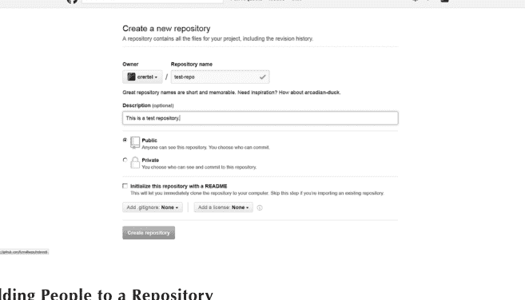

### 3.3.2 向仓库添加人员

为了给他人提供访问权限（针对私有仓库）或写入权限（针对所有仓库），你需要将他们的 `Github` 账户添加到你的仓库中。这可以在“Settings”（设置）菜单的“Collaborators”（协作者）部分完成。

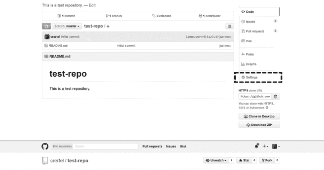

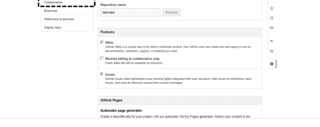

## 使用 Git 和 Github 开发

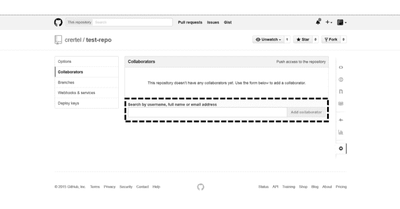

一旦你添加了协作者，他们将能够读取和写入仓库。这意味着他们将能够更改代码和项目历史，因此要小心。让协作者 `fork`（Fork）你的仓库并通过 `pull requests`（拉请求）提交代码是有意义的，从而确保你仓库的完整性。

## 3.4 中级 Git

我们目前为止涵盖的是基础工具的使用。`git` 和 `Github` 还支持一些高级工作流，以及一些你可以让生活变得更简单的方法。

### 3.4.1 维护工作

在进行项目时，特别是当有很多编译产物的项目时（例如 C 项目中的 `.a` 和 `.out` 文件），将这些产物排除在源码控制之外是一个好主意。`Git` 和类似的工具在处理文本文件时最有效，通常情况下，二进制产物只会导致每次提交都必须解决的合并冲突。调试器和集成开发环境（IDE）还可能创建配置和自动保存文件（如 `vim` 的 `.swp` 文件和 `Visual Studio` 的 `.s` 文件）。

通过在仓库根目录下添加 `.gitignore` 文件可以告诉 `Git` 忽略这些文件。该文件的格式如下：

```
.out
bin/
```

这会导致名为 `.out` 的文件以及名为 `bin` 的目录中的任何内容被忽略。每行都是一个不同的忽略模式，可以是文件名，也可以是目录名。一旦被忽略，匹配该模式的文件将不会显示，且无法添加到仓库中。如果你不想在根目录 `.gitignore` 中包含过长的路径，子目录也可以有自己的 `.gitignore` 文件。

确保你正在编写有用的 `commit messages`（提交消息）是关重要的。关于如何编写良好提交消息的摘要，可以参考 `Torvalds` (`https://github.com/torvalds/subsurface/blob/master/README#L82-109`)，它会产生如下形式的提交：

# 科学技术计算导论

- 一行少于 80 个字符的主题（以便在终端中显示），对提交进行简单说明
- 一个空行
- 对提交更改内容的更详细的描述

组合在一起，一条消息可能像这样：

```
Update the foo() routine to better bar bazzes.
```

现有的 `foo()` 例程有时无法考虑到所有的 `bazzes`。此更改更新了在执行 `barring` 时使用的二分查找，以修复一个由于使用了糟糕的比较器导致可能找不到 `bar` 的情况。这应该解决我们在问题 `#123` 中看到的问题。

能够查看历史记录是有用的。

## 48 科学技术计算简介

```
$crertel/test_repo$ git branch new_branch
crertel/test_repo$ git checkout new_branch
Switched to branch 'new_branch'
crertel/test_repo$
```

你可以通过运行 `git checkout -b new_branch` 一步完成此操作。

```
$crertel/test_repo$ git checkout -b new_branch
Switched to a new branch 'new_branch'
crertel/test_repo$
```

你可以使用 `git status` 或 `git parse --abbrev-ref HEAD` 来确定你当前处于哪个分支。要查看所有现有分支，请运行 `git branch` 命令：

```
$crertel/test_repo$ git branch
master
new_branch
* newer_branch
crertel/test_repo$
```

列表中的星号表示当前分支，在此例中为 "`newer_branch`"。你在当前分支上做的任何更改都不会影响其他分支。如果你尝试在带有未添加或未提交文件的情况下切换到另一个分支，这些文件将随你切换入的分支。如果更改的文件受版本控制，则它们将不会被带走，而是保留在已添加的分支中。

在 `Github` 中，你可以使用分支下拉菜单创建新分支。在分支名称中选择它，然后就可以创建它：

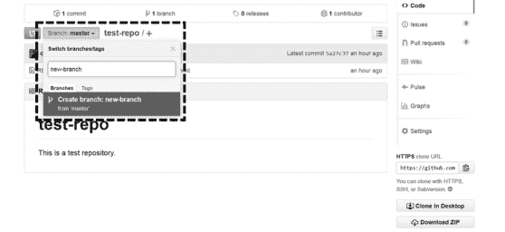

完成完成后，你需要使用 `git fetch origin` 命令更新你的本地仓库并切换到该分支。以下是操作示例：

```
~crertel/scicomp-book-chapter$ git fetch origin
Username for 'https://github.com': crertel
Password for 'https://crertel@github.com':
```

## 开发 Git 和 Github

来自 `https://github.com/crterel/scicomp-book-chapter` [新分支]

test -> origin/test

-crertel/scicomp-book-chapter$ git checkout merge.md

Branch set up to track remote branch from origin.

Switched to a new branch 'test'

-crertel/scicomp-book-chapter$

### 3.4.4 合并分支

当一个分支开发完成后，你可以将它的更改合并到另一个分支。这通常是一个自动化过程，只需切换到你想要合并的分支并运行 `git merge <from>` 命令即可。示例如下：

```
--crterel/test_repo git checkout -b to_merge_in
Switched to a new branch 'merge_in'
-crertel/test_repo touch test_text
-crertel/test_repo$ git add test_text
-crertel/test_repo$ git commit
[to_merge_in 7f04398] add test_text
0 files changed create mode 100644 test_text
-crertel/test_repo git checkout master
Switched to branch 'master'
-crertel/test_repo git merge to_merge_in
Updating e25cc49..7f04398
Fast-forward
0 files changed
create mode 100644 test_text
-crertel/test_repo$
```

在这个示例中，我们创建并添加了一个用于合并的新分支 --`to_merge_in`。然后，我们创建并提交了文件（在编辑器中编写了正确的提交信息）。最后，我们切换到 `master` 分支，然后合并了 `to_merge_in` 分支。

如果你尝试合并一个存在冲突的分支（例如同一个文件中相同行的更改），则合并将失败。它看起来像下面：

```
--crterel/test_repo git merge conflict
Auto-merging test_text
CONFLICT (content): Merge conflict in test_text
Automatic merge failed; fix conflicts and then commit the result.
-crertel/test_repo$ 
```

在这种情况下，你可以运行 `git status` 来查看哪些文件发生了冲突：


```
--crterel/test_repo git status
# On branch master
# Unmerged paths:
# (use "git add/rm <file>...") as appropriate to mark resolution
## both modified:
    test_text
# no changes added to commit (use "git add" and/or "git commit -a")
-crertel/test_repo$
```

# 科学技术计算简介

文件将会在两个分支之间的冲突区域进行标记：

```
<<<<<<< HEAD
This is version 2b.
=======
This is version 2a.
>>>>>>>>> conflict
```

`HEAD` 是你合并入的分支中的版本。为了解决此冲突，请决定你想保留冲突区域的哪部分（如果有的话），并删除其余部分（包括标记）。然后，使用 `git add` 更新文件并提交你的工作。

## 3.5 中级 Github

### 3.5.1 删除分支

你可以通过分支管理界面从 Github 上删除分支。你只需要拉取它，选择该分支并删除它即可。


完成完成后，你需要使用 `git fetch origin` 命令更新你的本地仓库并切换到该分支。以下是操作示例：

Taylor & Francis

Taylor & Francis Group

http://taylorandfrancis.com

# 4

# Bash 脚本入门

Erik E. Santiso

# 目录

+ 4.1 引言：编写你的第一个 Bash 脚本 ................................................ 55

4.2 变量与替换..................................................................................................... 57

4.3 输入与输出.................................................................................................... 60

4.4流程控制 ................................................................................................ 62

4.5 函数................................................................................................................ 68

参考文献................................................................................................................ 69

延伸阅读 ................................................................................................................. 69

在本章中，我们将介绍在 Unix 类系统中实现和自动化复杂任务的最用的工具之一：Bash 脚本。Bash 是这些系统中常用的（如果不是最常用的）shell 之一，特别是在 Linux 中。作为 shell，Bash 充当用户与内核之间的接口，因此它提供了一种语言来轻松处理系统级对象（如作业、进程和文件）。Bash 实现了一个“读取-评估-打印循环”（REPL）环境，该环境可以读取用户输入、进行评估并打印结果。与经典的编译型语言相比，这种环境能够实现快速开发和调试。尽管存在一些更容易学习且以库的形式拥有大量代码库的脚本语言（如 Python），但 Bash 经常被用于编写“主脚本”，以组合来自不同来源的代码并管理文件和进程，因为这些任务在 Bash 中实现要容易得多。Bash 脚本具有高度的可移植性，因为每个 Unix 类系统都会包含 Bash shell。本章未涵盖的更多详细信息可以在章末的参考文献中找到 [1,2]。本章中的示例已使用 GNU Bash 3.2.48 版本通过测试（通过运行 `bash --version` 可以找到系统中运行的 Bash 版本）。

## 4.1 引言：编写你的第一个 Bash 脚本

脚本是 Unix 类操作系统最强大的功能之一。它能够轻松实现重复任务的自动化，并让需要多个不同程序交互的复杂任务顺利执行。

脚本是使用几种不同脚本语言之一编写的指令序列或程序。与 Fortran 或 C++ 等编译型语言编写的程序不同，脚本在运行时被读取和解释，而编译型语言首先由编译器翻译成机器码然后运行。通常，脚本语言的语法比编译型语言更简单、灵活，旨在自动化高层任务。然而，由于它们是在运行时解释的，因此对于速度要求重要的任务（例如计算密集型系统）并不是理想的。

有很多脚本语言，我们在第 1 章中已经提到几个（如 awk 和 sed）。其他常用语言还有 Python（将在单独的章节中讨论）、Perl、tcl、Javascript 和 PHP（后两者在 Web 应用中无处不在）。在本章中，我们将关注 Bash 脚本，它利用了第 1 章描述的 Bash shell 命令。

我们的第一个示例将遵循让计算机说“Hello, world.”的长期传统。在运行 Bash 的终端中，使用文本编辑器创建一个名为“Script”的文件，内容如下如下：

```bash
#!/bin/bash
# Print "Hello, world!" and exit
echo Hello, world!
exit 0
```

第一行是“hashbang”或“shebang”标签。该行的目的是定义当脚本作为程序运行时运行时，将使用哪种解释器来运行脚本的剩余行。在这种情况下，它指示脚本应该由 Bash shell（假设位于 `/bin/bash`）解释。你可以在 shebang 中使用任何能够解释文本的程序，例如，如果你正在编写 Python 脚本，可以使用 `#!usr/bin/python`。如果你不确定解释器在文件系统的位置，可以使用 `which` 命令来查找它。例如，`which python` 将返回 python 命令的位置（如果它位于 `$PATH` 环境变量的目录中）：

```bash
$ which python
usr/bin/python
```

脚本的第二行是注释。哈希字符（`#`）之后的行行中的任何内容都会被 Bash 忽略，可用于解释脚本在做什么。注释是一项极其重要的编程实践，不仅当你与他人共享代码时，对于代码的可重用如此：你可能在 3 个月后打开同一个文件，发现你不记得它是如何工作的。哈希字符可以出现在行的任何位置，例如，上面的脚本可以这样注释：

```bash
#!/bin/bash
# Print "Hello, world!" and exit
echo Hello, world!
# Say "Hello, world!"
exit 0
# Exit
```

脚本的第三行使用 `echo` 命令向标准输出打印字符串“Hello, world!”，第四行调用 Bash 以返回码 0 退出。这是可选的，但它是一种良好的编程习惯，因为它允许调用程序/用户知道执行过程中是否发生了问题（通常使用返回码“0”表示代码执行时没有错误）。在运行脚本后，可以通过 `$?` 变量获取返回码，如下一个代码段所示：

创建脚本后，我们需要使其具有可执行性。这可以通过第 1 章中讨论的 `chmod` 命令完成。例如，你可以运行 `chmod a+x myScript` 让所有用户都能执行脚本，或运行 `chmod u+x myScript` 仅允许你自己执行。在这种情况下，这差别不大，但根据脚本的用途，出于可能可能限制其他用户执行脚本。

一旦让脚本变得可执行，你就可以通过 `./myScript` 运行它。如果你想查看脚本的返回码，可以在执行脚本后立即运行 `echo $?`：

```bash
$ ./myScript
Hello, world!
echo $?
```

需要 `/` 是因为通常当前目录（即 /）不会包含在 `$PATH` 环境变量中。`/` 显式告诉 Bash 要执行脚本的位置。

## 变量与替换

与大多数其他编程语言一样，Bash 使用变量来存储数据。Bash 是一种类型语言，变量不需要显式定义。所有 Bash 变量都是字符串，但根据语境，它们可能被解释为整数。Bash 不允许直接对浮点数进行操作，但浮点操作可以通过管道传递允许这些操作的命令来处理，例如 `bc` 或 `awk`。然而，可以使用 `declare` 命令声明为特定类型或特殊属性。特别是，变量可以声明为整数、使用 `declare -r` 声明为只读变量以及使用 `declare -a` 声明为数组。声明变量可以让涉及变量的操作简化。例如，如果变量声明为整数，赋值给它的算术表达式将直接求值而无需算术扩展。可以使用 `declare -p` 查看给定变量的当前属性：

```bash
$ declare -i MY_NUMBER
$ declare -r MY_NUMBER
$ declare -p MY_NUMBER
declare -ir MY_NUMBER="
```

在 Bash 中定义变量只需使用等号 `=`，前后均不留空格。例如，要定义一个名为 `MY_AGE` 值为“20”的变量，应编写 `MY_AGE=20`。注意，在 Bash 中使用变量名不会将名称替换为其值。例如，运行 `echo MY_AGE` 将返回“MY_AGE”。要访问存储在变量中的，必须在变量名前加一个美元符号 `$`。在例如，`echo $MY_AGE` 将输出“20”。

- 连字符 `'-'` 可用于参数替换中，以测试变量名是否已使用。要测试的变量应该在连字符的左侧，要评估的参数如果不存在，则应该在右侧。例如，如果我们将 `MY_NAME` 的值设置为 "Erik"，则表达式 `${MY_NAME-Batman}` 将求值为 "Erik"；如果变量 `MY_NAME` 未定义，则相同的表达式将求值为 "Batman"：

```bash
$ echo ${MY_NAME-Batman}
Batman
$ MY_NAME="Erik"
$ echo ${MY_NAME-Batman}
Erik
```

- 冒号字符 `:` 可以与 `-` 结合使用，以测试变量是否存在且是否为空。例如，如果 `MY_AGE` 设置为空字符串，表达式 `${MY_AGE-Undefined}` 将返回空字符串，而 `${MY_AGE:-Undefined}` 将返回 `UNDEFINED`：

```bash
$ MY_AGE=""
$ echo ${MY_AGE-Undefined}
$ echo ${MY_AGE:-Undefined}
UNDEFINED
```

- 字符 `=` 可用于条件赋值。在表达式 `${YOUNG:=10}` 中，如果变量 `YOUNG` 未定义（或包含空字符串），则值 10 将存储其中，且表达式将求值为 10。如果变量已定义，它将保持不变，表达式将求值为其当前内容。

- 感叹号可用于评估变量内部的变量名。例如，如果 `MY_AGE` 设置为 20，且 `MY_VAR` 设置为 `MY_AGE`，则表达式 `${MY_VAR:$MY_AGE}` 将求值为 `MY_AGE`，但 `${MY_VAR}` 将求值为 20。

- 子字符串可以从符号 `${var:offset:length}` 中提取。在这种情况下，`var` 是包含变量，`offset` 定义了起始点，`length` 是要扩展的字符数。如果省略长度，字符串将扩展到末尾。例如，如果我们设置变量 `MY_STRING` 为字符串 "This is a long string"，那么 `${MY_STRING:10:4}` 将求值为 "long"，而 `${MY_STRING:14}` 将求值为 "string"。在字符串名称前的序数符号 `""#"` 将返回字符串的长度；在我们的示例中，`${#[MY_STRING]}` 将求值为 21，因为该字符串包含 21 个字符。

## Bash 脚本简介

参数扩展有更复杂的用法

美元符号 `$` 的另一个用法是命令扩展。在这种情况下语法为 `"command"`，其中 `command` 是要执行的 shell 命令。另一种语法是使用引号 `"command"` 包围命令；即 `"command"` 将求值为命令的标准输出：

```bash
$ echo $ls -d D
Desktop Documents Downloads
$ echo $ls -d A*
Applications Archive
```

这在编写 Bash 脚本时特别特别有用，因为它允许我们操纵 shell 命令的结果。这种用法的某些示例将在随后的章节中给出。

最后，Bash 中的数组可以用来存储数组。在 Bash 中定义变量的方法有几种，其中一种是使用 `declare -a` 将其声明为数组。另一种方法是直接给方括号内的元素赋值。例如，`MY_ARRAY[1]=25` 将将 `MY_ARRAY` 定义为一个数组变量，并将值 25 存储在第二个元素中（数组索引从零开始）。最后，可以通过在括号内列出所有元素来分配整个数组；例如，我们定义变量 `MY_ARRAY=(a b c d e)`，那么 `${MY_ARRAY[2]}` 将求值为 `c`。如果索引偏移，数组将求值为数组的第一个元素；因此在我们的示例中 `$MY_ARRAY` 将求值为 "a"。使用符号 `"@"` 或星号 `*`，参数将返回数组的所有参数，但如果与数组名称前的数字符号 `"#"` 一使用，它将返回元素的数量。例如，我们示例中的 `${MY_ARRAY[@]}` 将返回 "a b c d e"，而 `${#MY_ARRAY[@]}` 将返回 5。

作为一个示例，下面的脚本定义了一个名称数组，并输出数组中存储的名称数量、第一个和最后一个名字，以及按字母顺序排列的名字：

```bash
#!/bin/bash

# 定义数组
NAMES=("Doc" "Grumpy" "Happy" "Sleepy" "Bashful" "Sneezy" "Dopy")

# 存储长度
LENGTH=${#NAMES[@]}

# 输出长度以及第一个和最后一个元素
echo "There are $LENGTH names in the array"
echo "The first name stored is ${NAMES[0]}"
echo "The last name stored is ${NAMES[$LENGTH-1]}"

# 输出排序后的名字
echo "These are all the names sorted alphabetically:"
echo "${NAMES[*]}" | xargs -n 1 sort
```

运行此脚本将产生以下输出：

There are 7 names in the array

The first name stored is Doc

The last name stored is Dopey

These are all the names sorted alphabetically:

Bashful

Doc

Dopey

Grumpy

Happy

Sleepy

Sneezy

## 4.3 输入与输出

通常，脚本应该能够处理运行时定义的信息。信息可以通过参数或环境变量传递给脚本。或者，脚本可以从用户或文件中读取输入。

（注：原文后续部分存在大量 OCR 错误和重复，已根据指令进行了清理并保留核心内容。）

## 62 科学技术计算导论

到一个流或文件的输出可以重定向到另一个。例如，运行 `exec 2>&1` 将导致标准错误写入标准输出。如果省略第一个数字，默认假设它是 1 (stdout)。

例如，以下脚本将 "Hello World" 写入 "myfile"，并将单词从文件中读回到数组中。它会将数组的每个元素写入单独的一行。

```bash
#!/bin/bash
# 将 "Hello World" 写入 "myfile"
echo Hello World > myfile
# 使用 "myfile" 进行读取
exec 3<myfile
# 将 "myfile" 的第一行读入数组中
read -a myarray<3
# 关闭文件
exec 3>&>
# 一行一次地写入参数（元素）
echo ${myarray[@]} | xargs -n 1
```

运行此脚本将创建一个包含单词 "Hello World" 的 "myfile"，并且输出如下：

```
$ ./myScript
Hello
world
```

## 4.4 流程控制

使用循环和条件执行的能力是任何编程语言的关键，Bash 也不例外。本节将涵盖 Bash 中用于流程控制的最常用命令。

Bash 中的条件执行通常使用 `if` 或 `case` 命令实现。在第一种情况下，测试一个条件并根据该条件的真假进行执行分支。。在第二种情况下，根据多个情况进行执行分支。

## Bash 脚本编程导论

`if` 命令的语法如下：

```bash
if condition
then
  # 如果条件为真则执行的命令
else
  # 如果条件为假则执行的命令
fi
```

要测试的条件通常是任何 Bash 命令。如果命令的退出码为 0，则假设条件为真，而非零退出码被解释为假（注意，这与许多其他编程语言相反）。通常，用于测试条件的命令是 Bash 内置的 `test` 命令。该命令允许对文件、字符串或整数进行各种测试。`test` 命令在条件为真时返回 0 作为退出状态，否则返回 1。以下是 `test` 的一些用例列表（更多信息请参阅 `test` 的 man 页）：

- `test -f filename` # 测试文件是否存在

- `test -d dirname` # 测试目录是否存在


- `test string` # 测试字符串是否为空字符串
- `test string` # 测试字符串长度是否为0
- `test -n string` # 测试字符串长度不为 0
- `test str1= str2` # 测试两个字符串是否相等
- `test num1!=eq num2` # 测试两个整数是否相等
- `test num1 -ne num2` # 测试两个整数是否不同
- `test -gt num2` # 测试 num1 是否大于 num2
- `test -ge num2` # 测试 num1 是否大于或等于 num2
- `test -lt num2` # 测试 num1 是否小于 num2
- `test -le num2` # 测试 num1 是否小于或等于 num2

可以使用 `-a`（逻辑与）和 `-o`（逻辑或）选项来测试多个条件。例如，`test $num -gt 0 -a $num -lt 10` 将测试变量 `num` 是否包含 1 到 9 之间的值。逻辑运算符也是感叹号 `!`。例如，`test ! $num -ge 0` 将测试变量 `num` 是否包含负数。

测试的快捷方法是使用 `test` 括号。不需要显式测试参数，可以将它们括在括号中，两个括号之间留一个空格。例如，以下两个命令是等价的：

```bash
if test -e filename
[ -e filename ]
```

测试括号表示法的优点是它看起来更接近其他编程语言中的条件语法。另一种广泛使用的表示法是双括号，或扩展测试。双括号允许使用 `<`, `>`, `==` 和 `-` 进行比较，并分别使用逻辑或和与运算符 `||` 和 `&&`，其语法与 C 语言相同。例如，以下内容将测试变量是否包含一个大于 5 或小于 2 的数字：

```bash
[[ $var > 5 || $var < 2 ]]
```

# 科学技术计算导论

此外，双括号允许使用 `~=` 运算符，该运算符测试变量是否匹配扩展正则表达式（见第 1 章）。例如，以下测试变量是否包含一个整数：

```bash
if [[ $var =~ ^[-+]?[0-9]+$ ]]
```

可以使用 `elif` 嵌套多个命令，它是 "else if" 的缩写：

```bash
if condition1
then
  # 如果 condition1 为真则执行的命令
elif condition2
then
  # 如果 condition2 为真则执行的命令
else
  # 如果两者都不为真则执行的命令
fi
```

例如，以下内容将测试变量是否包含偶数、3 的奇数倍数或两者都不是：

```bash
if [[ $((var%2)) -eq 0 ]]
then
  echo $var 是偶数
elif [[ $((var%3)) -eq 0 ]]
then
  echo $var 是3 的奇数倍数
else
  echo $var 既不是偶数也不是3的倍数
fi
```

嵌套多个比较的另一种方法是 `case` 命令。`case` 的语法如下：

```bash
case expression in
  pattern1)
    # 如果 expression 匹配 pattern1 则执行的命令
    ;
  pattern2)
    # 如果 expression 匹配 pattern2 则执行的命令
    ;
  *)
    # 如果没有模式匹配则执行的命令
    ;
esac
```

## Bash 脚本编程导论

`if` 命令的语法如下：

```bash
if condition
then
  # 如果条件为真则执行的命令
else
  # 如果条件为假则执行的命令
fi
```

# Bash 脚本介绍

待测试的条件格式与 `if` 命令使用的条件格式相同。例如，以下代码等同于前一个示例中的“monkeys”（猴子）代码：

```
num=4
while [ $num -gt 0 ]
do
echo $num monkeys jumping on the bed
echo one fell off and bumped his head
num=$((num - 1))
done
```

读取文件的实用惯用法是 `while read line`。如前一节所述，`read` 命令将按行读取文件。如果读取了一行，其退出状态将为 0；而如果未读取到行（例如到达文件末尾），则退出状态将为 1。`while read line` 会循环遍历文件直到文件末尾，并将每一行存储在变量 `line` 中。例如，以下代码将打印名为 "myfile" 的文件的每一行，并在每行前打印上行号：

```
numLines=0
while read line
do
let numLines += 1
echo Line ${numLines}: $line
done < myfile
```

除了这些，Bash 中还有三个用于流程控制的命令：`continue`、`break` 和 `exit`。`continue` 命令将跳过循环的剩余部分并继续下一步。在 `for` 循环中，迭代变量将取下一个值；在 `while/until` 循环中，将再次检查条件。在嵌套循环中使用，`continue` 会跳到最内层循环的下次迭代。使用 `continue 数字` 可以跳到外层循环的下次迭代。例如，`continue 2` 将跳到包含最内层循环的循环的下次迭代。

`break` 命令与 `continue` 类似，但它会立即退出循环而不是跳到下次迭代。与 `continue` 一样，`break` 会立即退出嵌套循环内部的循环，`break 数字` 可用于跳出对应的外层循环。

`exit` 命令立即退出脚本执行并返回一个退出代码。通常，使用 `exit 0`（退出代码）表示执行成功，其他退出代码可表示各种错误。

Bash 中还有另一种流程控制机制，与信号处理相关。如第 1 章所述，进程使用信号（signals）进行通信。如果需要，可以使用 `trap` 命令“捕获”信号和退出代码。语法如下：

```
trap command signals
```

`command` 是当捕获列出的信号之一时要执行的命令（注意 `SIGKILL` 无法被处理）。这有助于“清理”脚本创建的临时文件或变量。例如，以下代码将捕获 SIGINT 信号信号（当用户按下 CTRL-C 时发送）、SIGHUP 信号（当调用 shell 退出时发送）或 SIGTERM 信号，并清理临时文件 temp：

```
trap "-f temp; exit" SIGINT SIGHUP SIGTERM
```

可以通过定义清理函数来实现更复杂的清理，该函数通过 `trap` 调用（见 4.5）。

作为最后一个示例，以下代码将不断要求用户从动物列表中进行选择，并在屏幕上打印相应的动物声音。`break` 命令用于退出 `while`（否则循环将永远不会，因为条件始终为真），程序在成功执行后返回退出代码零。

```
while true
do
  echo "Select an animal (0 to exit):"
  echo "1" Cow"
  echo "2" Donkey"
  echo "3" Dog"
  echo "4" Cat"
  read choice
  case $choice in
    1) echo Moo
       ;;
    2) echo Hee-haw
       ;;
    3) echo Bow bow
       ;;
    4) echo Meow
       ;;
    0) break
       ;;
    *) echo "Please select a valid option"
       ;;
  esac
done
echo "Good bye!"
exit 0
```

## 4.5 函数

与大多数其他语言一样，Bash 允许定义函数。使用函数是确保复杂脚本维护性和可读性的良好机制。在 Bash 中定义函数有两种方法。一种是使用 `function` 关键字：

```
function name
{ commands }
```

`name` 是函数的名称。括号包含了调用函数时执行的命令。括号可以位于不同的行。或者，可以通过在函数名后直接跟括号来定义函数：

```
name()
{ commands }
```

传递给函数的参数与传递给脚本的语法相同（见第 4.3 节）；`$1` 代表第一个参数，`$2` 代表第二个参数，依此类推。例如，以下函数将把两个整数相加并打印结果，如果其中一个参数不是整数，则打印错误：

```
function add
{
  if [[ $1 ~ ^[-+]?[0-9]+$ ]]
  && [[ $2 ~ ^[-+]?[0-9]+$ ]]
  then
    echo $((1+$2))
  else
    echo Error: Arguments must be integers
  fi
}
```

函数可以在单独的文件中定义并使用 `source` 命令包含脚本中。这简化了组织复杂脚本的任务并增强了可维护性。在实践中，经常会遇到用不同语言编写或编译为二进制文件的各种任务工具。在这种情况下，Bash 脚本控制工作流非常常见。外部代码可以封装在函数中，也可以是用 sed、awk 或 python 编写的代码。

## 参考文献

- 1. C. Newham, and B. Rosenblatt, Learning the Shell, 3rd Ed., O'Reilly, Sebastopol, CA, 2005.
- 2. M. Cooper, Advanced Bash-Scripting Guide, http://www.tldp.org/abs/html/.
- 3. Bash Reference Manual, https://www.gnu.org/software/bash/manual/.

# 更多阅读

- Albing, C., and J.P. Vossen, Bash Cookbook, O'Reilly, Sebastopol, CA, 2007.


# 使用 gdb 调试

Frank T. Willmore

### 内容

5.1 Print Statements and Macros ............................................ 71
5.2 Sample Code ................................................................ 71
5.3 Instrumenting the Code ................................................ 73
5.4 Running the Program without the Debugger ............................... 74
5.5 Core Dump ....................................................... 74
5.6 Backtracing ...................................................... 75
5.7 Invoking the Code with the Debugger ............................... 76
5.8 Setting (and Deleting) Breakpoints ................................ 76
5.9 Modifying Variables....................................................... 77
5.10 Modifying Breakpoints............................................... 78
5.11 Listing and Stepping through Code ............................... 78
5.12 Running from Breakpoint to Breakpoint .......................... 80
5.13 Conditional Breakpoints.................................................. 82

## 5.1 Print Statements and Macros

许多计算科学家和工程师（包括我在内）在没有使用调试器的情况下


完成了研究生学业。这是很遗憾的，因为当我花几个小时学习 `gdb` 的基础知识后，我意识到我本可以节省多少时间。确实，可以使用

打印语句、烧脑的宏和无的编译来获得相同的结果。虽然人们

可以用石头成功地钉钉子，但我个人更倾向于使用钉钉枪。有很多

可用的工具。受苦并学会使用吧。

## 5.2 Sample Code

每个优秀的编程教程都需要一个出色的示例代码。这个凑合。这是一个

测试程序示例，用于生成整数数组，其值初始化为它们的索引，即

`array[n] = n`。它接受一个命令行参数，即请求的数组长度。代码还输了

构建的数组的内容。

程序包含两个问题。第一个问题将出现在图 5.1 的第 12 行。

`atoi()` 函数不提供错误检查，它用于将字符串转换为

### 科学技术计算简介

```
1 // buggy.c
2
3 #include <stdio.h>
4 #include <stdlib.h>
5
6 int* buggy_fn();
7
8 int main(int argc, char *argv[]) {
9
10 // atoi(i) 不检查错误。
11 // 看看当我们给出一个缺失错误时会发生什么。
12 int array_size = atoi(argv[1]);
13
14 int *array;
15 array = buggy_fn(array_size);
16
17 int* index;
18
19 for (index=0; index<array_size; index++) {
20 printf("array[index] = %d\n", array[index]);
21 }
22
23 return 0;
24 }
```

图 5.1

用于调试的错误程序。

```c
1 // buggy_fn.c
2
3 #include <stdio.h>
4
5 // 此函数返回一个指向在函数内部分配的数组的指针。
6 // 猜猜当函数返回时数组会发生什么！
9
10 int *buggy_fn(int array_size) {
11
12 int index, array[array_size];
13 for (index=0; index<array_size; index++) {
14 array[index] = index;
15 }
16
17 int *retval;
18 retval = array;
19
20 for (index=0; index<array_size; index++) {
21 printf("retval[index] = %d\n", retval[index]);
22 }
23
24 return retval;
25 }
```

图 5.2

错误函数。

### 使用 gdb 调试

| 1 #!/usr/bin/make |

| 2 DEBUG=-O0 -g |

| 3 |

| 4 default: |

| 5 @echo "making with DEBUG=$$(DEBUG) " |

| 6 make buggy |

| 7 |

| 8 |

| 9 buggy: buggy.c buggy_fn.o |

| 10 gcc $$(DEBUG) buggy.c buggy_fn.o -o buggy |

| 11 |

| 12 buggy_fn.o: buggy_fn.c |

| 13 gcc $$(DEBUG) -c buggy_fn.c |

| 14 |

| 15 clean: |

| 16 rm -f buggy_fn.o |

图 5.3

构建程序的 Makefile。

将字符串转换为整数类型，但现在已逐渐 `strtok()` 函数所取代，该函数可以检查错误。我们可能要说明一种最常见的错误类型：由于尝试解引用空指针导致的段错误（Segmentation fault）。

是另一个常见错误。在这里，`buggy_fn()` 返回一个指向函数内部分配的数组的指针。当函数返回时，这是一个错误，因为为其变量分配的内存不再属于它。尝试访问不再分配给你的内存就像在你已经搬走后回到旧公寓（可能会发生意想不到的结果），你可能只是让它保持你喜欢的样子（内存不变且你将得到预期的结果），你可能会发现有人搬进来了（内存由于某些不可预见的情况发生了变化），故障（尝试访问不再属于你的内存）。程序可能会在不同时间表现出不同的行为，或者在使用不同的编译器选项时表现不同，这使得很难确定问题。我们将使用调试器通过这个过程，展示情况何时可能失控（图 5.2 和 5.3）。

## 5.3 代码插桩

在运行调试器之前，我们必须为调试准备代码。幸运的是，这由编译器处理，不需要对代码进行任何重工作。为了生成调试版本的代码，我们向编译器提供两个选项：

```bash
gcc -g -O0 buggy.c buggy_fn.o -o buggy
```

```
-g
```向编译器传递此选项告诉它对代码进行插桩。如果没有正确插桩代码，调试器无办法与代码连接。

### 科学技术计算简介

代码插桩的简单说法就是你要求编译器包含人类可读的内容，如名称、行号和代码本身，以便你可以引用原始程序。当你为生产环境编译代码时，这些内容会被省略以提高效率。

```
-O0
```

此选项告诉编译器不要进行任何优化（字面意思是，它告诉它使用优化级别 0）。现代 C 编译器能力远比翻译 C 为机器码强得多。更高的优化级别会执行诸如展开循环（显式地编写每次迭代，而不是跳回并增加计数器）、重新排列指令顺序（有时可以让代码运行得更快并产生等效结果）以及删除指令（例如，如果结果从未被使用）等各种被认为会影响结果的黑魔法，但这看起来显然与编写的代码不相同。因此，为了在调试期间保持可读性，请确保包含此标志并告诉编译器不要优化。

2016年10月23日

## 5.4 在不使用调试器的情况下运行程序

现在你编译并插桩了代码，并且仔细没有包含任何优化。你现在有一段缓慢、臃肿且易于调试的代码并执行它，所以：

```bash
$ ./buggy
Segmentation fault
```

哎！刚开始就发生了段错误？记住在描述代码时，我们说它需要一个参数，但 `atoi()` 接收到了 "null"，且程序崩溃并了。该怎么办？结果 `gdb` 可以对死去的程序进行事检（postmortem），这将是我们的点，但首先 `gdb` 还需要一件事：核心转储（core dump）。

## 5.5 核心转储

当程序异常终止时，如果允许，操作系统将尝试“导出核心”。核心转储是程序执行时的内存快照。当程序意外死亡时，核心文件包含了该点的变量信息。这对于尸检（分析）非常有用。核心文件很大，许多管理员会设置系统不允许核心转储。要在你的系统上特别允许核心转储，请尝试：

```bash
$ ulimit -c unlimited
```

然后运行程序。当遇到段错误时，它将生成一个核心文件。如果没有，请联系你的系统管理员。名称可能会不同，并且通常包含进程 ID。对于这个例子，核心文件就是 `core`。我们通过指定生成它的程序使用调试器打开核心文件：

```bash
$ buggy
Core was generated by './buggy'.
Program terminated with SIGSEGV, Segmentation fault.
#0 0xb7c62 in strtol_internal (nptr=0x0,ptr@0x0,base@10,group@0) at strtol.c:298
strtol.c: No file or directory.
```

## 5.6 回溯

调试器告诉我们程序终止在 `strtol.c` 的第 298 行，这不在我们的代码中。事实上，调试器告诉我们“没有文件或目录”，因为它没有该行的信息。这是因为在这种情况下故障发生在标准库的某个地方。我们调用了一个程序崩溃的标准库函数。顺便说，这就是为什么不建议使用 `atoi()`。我们只想知道我们的代码在哪里。这样做，我们使用回溯：

```
(gdb) backtrace
#0 0xb7c62 in strtol_internal (nptr=0x0,ptr@0x0,base@10,group@0) at strtol.c:298
#1 0xb7cf827 in strtol (nptr=0x0,ptr@0x0,base@entry=10) at strtol.c:108
#2 0xb7ccaff in atoi (nptr=0x0) at atoi.c:27
#3 0x08048466 in main (argc=1, argv=0xbfee4) at buggy.c:12
```

这列出了直到调用它的程序的堆栈。我们看到 `buggy.c` 中的第 12 行（我们的代码）进行了这次调用。不记得 `buggy.c:12` 是什么了吗？`gdb` 会为你列出上下文：

```
(gdb) list buggy.c:12
7
int main(int argc, char *argv[]) {
9
10 // atoi(i) 不检查错误。
11 // 看看当我们给出一个缺失错误时会发生什么。
12 int array_size = atoi(argv[1]);
13
14 int *array;
15 array = buggy_fn(array_size);
```

如果你不知道 `gdb`，至少知道你可以确定程序失败的精确位置。使用无限的打印语句对代码进行二分查找也有效，同样，你有了合适的工具，所以使用它们吧。

### 使用调试器调用代码

现在你已经了使用调试器的第一点。现在我们来做点花样的。再次运行程序，用调试器调用它。我们通过指定可执行文件“`buggy`”来启动调试器：

```
$gdb buggy
(gdb)
```

### 设置（和删除）断点

断点是我们希望代码停止或从执行中“休息”的地方。注意我们仍然没有指定命令行参数，并且知道它在调用 `atoi()` 时会崩溃，所以我们在它之前设置一个断点，在 `buggy.c` 的第 12 行：

```
(gdb) break buggy.c:12
Breakpoint 1 at 0x08044856: file buggy.c, line 12
```

然后我们使用 `start` 运行程序到这个断点：

```
(gdb) start
Temporary breakpoint 2 at 0x08044856: file buggy.c, line 12
Starting program: /home/willmore/gdb-debugger/buggy
```

```
Breakpoint 1, main(argc=1, argv=0x8ffff014) at buggy.c:12
12 int array_size = atoi(argv[1]);
```

注意调试器相同位置添加了临时断点。这是因为这是要执行的第一行代码。调试器会自动

### 使用 gdb 调试

在第一行设置一个断点并执行。程序在断点处停止执行，现在正在等待我们的指令。`gdb` 的强大功能之一是你可以检查甚至修改变量的值！在这种情况下，我们使用使用 `gdb` 的 `print` 命令（缩写为 `p`）来查看 `argv[1]` 的值，即我们遗漏传递的命令行参数：

```
(gdb) p argv[1]
$1 = 0x0
```

## 5.9 修改变量

看，`argv[1]` 包含一个空指针，因为我们没有传递任何值！由于程序处于停止状态，我们可以修改这个值。让我们把它更改为 "4"（而不是数字 4）。我们在这里使用字符串值，因为 `argv[]` 存储的是从命令行接收到的值，这些值都是字符串。

```
(gdb) set variable argv[1] = "4"
```

如果我们不相信它起作用了，再次检查它：

```
(gdb) p argv[1]
$2 = 0x804b008 "4"
```

太棒了！调试器列出了将执行的每一行代码。我们在 `atoi()` 调用后的第一个点设置了额外的断点，并告诉 `gdb` 继续执行：

```
(gdb) break 14
Breakpoint 3 at 0x804846a: file buggy.c, line 14
(gdb) continue
Continuing.
```

Breakpoint 3, main (argc=1, argv=0xbffff014) at buggy.c:15

15 array = buggy_fn(array_size);

注意，我们没有指定哪一个文件包含该行。如果没有指定文件，则假设为当前文件。注意，第 14 行只列出了声明，没有指令。调试器再次走过这条路径，并在下一条要执行的指令处停止，即第 15 行。我们现在查看 `array_size` 的值，它是来自 `atoi()` 的：

```
(gdb) p array_size
$1 = 4
```

我们看到值 4（而不是 "4"）已经被恢复。我们成功地修改了运行程序中的一个值！为了让程序执行完毕，我们再次输入 `continue`：

```
(gdb) continue
Continuing.
retval[index] = 0
retval[index] = 1
retval[index] = 2
```

```
(gdb) break 15
Breakpoint 5 at 0x0804846a: file buggy.c, line 15.
(gdb) run 4
Starting program: /home/willmore/gdb-chapter/buggy 4
```

### 使用 gdb 调试

Breakpoint 5, main (argc=2, argv=0xbffff014) at buggy.c:15

15 array = buggy_fn(array_size);

太棒了。代码已经运行到了感兴趣的（断点）处。让我们开始逐行执行代码。我们真的想关注这里：

```
(gdb) step
buggy_fn (array_size=4) at buggy_fn.c:12
12 int index, array[array_size];
```

注意，如果你迷失了自己所在的位置，可以直接询问位置：

```
(gdb) list
7 //猜猜数组数组会发生什么
8 //当函数返回时！
9
10 #1 0x0804876 in main (argc=2, argv=0xbffff014) at buggy.c:15
11 int *buggy_fn(int array_size) {
12 int index, array[array_size];
13 for (index=0; index<array_size; index++) {
14 array[index] = index;
15 }
16
```

我们位于 `buggy.c` 的第 12 行，它看起来像是一个声明，但也包含对 "array" 的栈分配请求。让我们继续逐步执行代码。注意，如果你只是按回车而不输入新命令，`gdb` 将继续执行上一个命令，在这种情况下是 "step"：

```
(gdb) step
13 for (index=0; index<array_size; index++) {
(gdb)
14 array[index] = index;
(gdb)
13 for (index=0; index<array_size; index++) {
(gdb)
14 array[index] = index;
(gdb)
13 for (index=0; index<array_size; index++) {
(gdb)
14 array[index] = index;
(gdb)
13 for (index=0; index<array_size; index++) {
(gdb)
14 array[index] = index;
(gdb)
13 for (index=0; index<array_size; index++) {"
```

(gdb)

18 retval = array;

(gdb) p index

$2 = 4

```

这持续了循环的四次迭代。注意循环退出是因为测试条件（`index<array_size`）不再为真。你可以在循环中的任何点检查任何值。下一次循环尝试在返回之前检查工作（使用 print 语句！）。我们可以一直逐步执行代码，直到我们满意为止。我们将看到程序在函数中的行为正如我们预期的那样。

## 5.12 从断点运行到另一个断点

让我们退一步检查主程序。由于代码在函数内部的行为似乎很正常，让我们在主程序中紧接函数之后设置一个断点。更好的是，让我们退出调试器并从头开始。这一次，我们将使用 `run` 而不是 `start` 来执行程序，它不会在第一条指令处停止，而是运行到第一个断点：

```

(gdb) gdb

(gdb) break 18

Breakpoint 1 at 0x804847a: file buggy.c, line 18.

(gdb) break 20

Breakpoint 2 at 0x8048484: file buggy.c, line 20.

(gdb) run 4

Starting program: /home/willmore/gdb-chapter/buggy

```
retval[index] = 0
retval[index] = 1
retval[index] = 2
retval[index] = 3
```

```
Breakpoint 1, main (argc=2, argv=0xbffff014) at buggy.c:19
    for(index=0; index<array_size; index++) {
```

我们到达了断点。让我们检查数组的值：

```
(gdb) p array[0]
$1 = 0
(gdb) p array[1]
$2 = 1
(gdb) p array[2]
$3 = 2
(gdb) p array[3]
$4 = 3
```

### 使用 gdb 调试

事如其料。让我们运行到下一个断点，它在循环内部：

```
(gdb) continue
Continuing.
Breakpoint 2, main (argc=2, argv=0xbffff014) at buggy.c:20
20 printf("array[%d] = %d\n", index, array[index]);
```


太哈！非常有趣！`array[]` 的值已经改变了，但并没有一行代码明确修改了这些值。

```
(gdb) p index
$5 = 0
(gdb) p array[0]
$6 = 0
(gdb) p array[1]
$7 = 1
(gdb) p array[2]
$8 = 2
(gdb) p array[3]
$9 = 3
```

第一次通过循环，一切都如我们预期。让我们运行到下一个断点，再次检查值：

```
(gdb) continue
Continuing.
array[0] = 0
Breakpoint 2, main (argc=2, argv=0xbffff014) at buggy.c:20
20 printf("array[%d] = %d\n", index, array[index]);
```

```
(gdb) p index
$10 = 1
(gdb) p array[1]
$11 = 80530639
(gdb) p array[2]
$12 = 2
(gdb) p array[3]
$13 = 3
```

结果确实如我们所料。让我们通过调试器深入研究它，我们可以确定这是真的。

```
(gdb) continue
Continuing.
array[0] = 0
array[1] = 1
array[2] = 2
```

这是一个很难追踪的 Bug 类，因为它是反映了指令流之外的。通过指令流消除问题的可能性，问题源于：

```
(gdb) p index
$14 = 2
(gdb) p array[2]
$15 = 2
```

虽然大多数 Bug 比这简单，但当你开始编写更高级的代码时，Bug 会变得更加微妙。这里的错误是在尝试在声明的作用域之外引用栈变量。一个可能的解决方案是从堆分配所需的数组。

### 5.13 条件断点

`gdb` 中可以实现许多层次的复杂性，我将给你留下最后一个。可能并有根据某些条件设置断点；例如，我们希望在数组值不等于索引时停止程序。`gdb` 显式允许这样做：

```
(gdb) break 20 if (array[index] != index)
Breakpoint 1 at 0x8084484: file buggy.c, line 20.
(gdb) run 4
Starting program: /home/willmore/gdb-chapter/buggy 4
retval[index] = 0
retval[index] = 1
retval[index] = 2
array[0] = 0
```

```
Breakpoint 1, main (argc=2, argv=0xbffff054) at buggy.c:20
printf("array[%d] = %d\n", index, array[index]);
(gdb) p index
$1 = 1
(gdb) p array[index]
$2 = 80530639
```

看吧，代码在差异出现的地方停止了！在这种情况下应用条件需要预先知道我们的问题；然而，它可以是一个强大的工具，而这些只是选项中的几个。`gdb` 是 GNU 工具链的一部分，关于 `gdb` 的更多信息可以在这里找到 http://www.gnu.org/software/gdb/documentation/

# Makefile、库与链接

Frank T. Willmore

+ 目录

6.1 Makefiles ..................................................................... 83

6.2 库.............................................................................................. 87

6.3 链接 ................................................................ 89

## 6.1 Makefiles

软件本质上是复杂的，其开发管理需要复杂的工具。这项任务通常被称为构建管理（build management）或构建工程（build engineering），而该领域最强大的工具之一就是标准实用程序 `make`。通过使用 Makefile，`make` 提供了一种高效编编码和组织在构建时要执行的指令的方法。它甚至可以执行这些指令。

你可能在某个时候曾接收过一个简短的 Bash 脚本或单行命令，用于构建程序，它就像像咒语或仪式一样，能让程序魔法般地编译并链接。现在是加深我们的理解了。来看这个用 C 语言编写的简单程序示例：

```c
/* c_program.c */

#include <stdio.h>
#include <stdlib.h>

#include "c_function.h"

int main(int argc, char *argv) {
	int val = strtol(argv[1], NULL, 10);
	printf("Running C program with val = %d\n", val);

	c_function(&val);
	printf("C function returns with val = %d\n", val);

	printf("program complete.\n\n");
	return 0;
}
```

包含函数声明的 C 语言头文件：

```c
/* c_function.h */

void c_function(int *);
```

包含函数实现的 C 语言文件：

```c
/* c_function.c */
#include "c_function.h"
/* 将输入值乘以 2 */
void c_function(int val) {
    *val = *val * 2;
}
```

以及一个用于编译并运行该程序的脚本：

```bash
#!/usr/bin/env bash
gcc -c c_function.c
gcc -c c_program.c
gcc c_function.o c_program.o -o c_program
./c_program 1
```

让我们逐行运行这个脚本并观察发生了什么。在最通用的情况下，你有一个程序（例如 `c_program.c`），它会调用一个或多个组件（在本例中为 `c_function`），并在许多阶段进行构建。第一步如所示是编译函数。编译器标志 `-c` 告诉编译器只编译不链接：

```bash
$ ls
c_function.c c_function.h c_program.o
$ gcc -c c_function.o
$ ls
c_function.c c_function.h c_function.o c_program.c
```

使用该文件时，输出具有相同的前缀，但后缀是 `.o`。这个程序有两个组件：包含 `main()` 函数的 `c_program`，以及它调用的 `c_function`。每个组件都是被逐一编译的：

```bash
$ gcc -c c_program.c
$ ls
c_function.c c_function.h c_function.o c_program.o c_program.c
```

脚本的第 4 行（不包含 `c`）获取两个 `.o` 文件并将它们链接在一起，形成输出的（`-o`）`c_program`：

```bash
$ gcc c_function.o c_program.o -o c_program
$ ls
c_function.c c_function.h c_function.o c_program.o c_program.c
```

脚本的最后一行使用命令行参数 `1` 运行 `c_program`：

```bash
$ ./c_program 1
Running C program with val = 1
c_function returns with val = 2
C program complete.
```

这段简单的代码可以写在一个文件中并用一个命令编译。但大多数代码并非如此简单。大多数研究代码是许多协作者的结晶，包含许多组件，并在编写时考虑了测试和扩展性，我们在这里拆分各个步骤，以说明设计一个良好系统时应该投入的细节程度。跨多个平台管理开发、依赖和编译的稳健机制的设计、实现和维护被称为构建工程。对于特定的代码，一个良好的 Makefile 可以是构建工程设计的重要部分。

让我们看看一个项目的 Makefile 可能长什么样。我们将采用上面脚本中的构建命令，展示它们在 Makefile 中的样子，然后在脚本之前添加一些关于其如何工作的细节。

首先，我们引入“目标”（targets）的概念。目标是 Makefile 理解如何制作的东西，每个 Makefile 都应该至少有一个目标。对于 `c_program`，目标之一是 `.o` 目标文件，我们指定该目标的方式是：

```makefile
c_program.o: c_program.c
gcc -c c_program.c
```

`c_program.o` 是目标，它出现在冒号左侧。目标所依赖的项是依赖项（dependencies），以列表的形式出现在冒号右侧。第二行是规则（rule）。当你请求更新目标时，规则会被执行，但只有当依赖项的修改时间比目标新时。假设你有一个只有上述两行的 Makefile。如果你执行命令更新 `c_program.o`：

```bash
$ make c_program.o
```

让我们看看一个包含多个规则的 Makefile 可能是什么样：

```makefile
#!/usr/bin/env bash
# 这是一个 Makefile 示例
# 定义一些变量
CC = gcc
CFLAGS = -c

# 目标规则
c_program: c_program.o c_function.o
	$(CC) c_program.o c_function.o -o c_program

c_program.o: c_program.c
	$(CC) $(CFLAGS) c_program.c

c_function.o: c_function.c
	$(CC) $(CFLAGS) c_function.c

# 清理目标
clean:
	rm -f *.o c_program

# 默认目标
default: c_program
	echo "Build complete."
```

# 科学技术计算引论

我们在 makefile 中添加了一个标签：

```
c_function_d.o: c_function_d.c c_function_d.h
$ $(CC) -c c_function_d.c
```

并添加了一行构建静态（.a）库的代码：

```
libmy_c_functions.a: c_function.o c_function_d.o
ar -cvq libmy_c_functions.a c_function.o c_function_d.o
```

要使用该库，请在 `c_program.c` 中添加以下代码：

```c
#include "c_function_d.h"
...
double d_val = (double)val;
c_function_d(&d_val);
printf("c_function_d_returns with d_val = %lf\n", d_val);
```

我们不再需要 `.o` 文件了，因为它们的功能已经包含在库中。

```
$(CC) c_program.c -lmy_c_functions -L.- -o c_program
```

我们不再包含编译 `c_program.c` 以产生中间文件 `c_program.o` 对象的步骤。所有的对象文件都用于库中，并通过 `-lmy_c_functions` 选项进行引用。编译器期望在命令行中指定 `-lxx` 表示在它已知的库路径之一中“查找”名为 `libxx.a` 或 `libxx.so` 的库。`-L` 选项告诉编译器在目录 './'（即当前目录）中查找。请注意，如果你的代码在编译时需要 `-L[某个目录]` 来查找共享库，那么在运行时需要将环境变量 `LD_LIBRARY_PATH` 设置为 `[某个目录]`。

由于该库是静态库，这意味着 `.a` 文件的所有内容都将包含在可执行文件中，并在程序加载准备运行时时加载到内存中。使用静态库和动态库最大的区别在于静态链接的代码直接合并到可执行文件中。这意味着静态链接的库会比动态链接的库大。这意味着库调用将被加载并留在内存中，因此当调用它们时，无需等待库的加载。较大的下载加载需要更长时间，而加载多个使用库的程序（或程序实例）意味着每个程序在内存中都加载了自己的副本，消耗了更多的系统资源。动态库是按需加载（即它们实际上由代码调用），并可以使用 `dlopen()` 显式加载。它们使用起来稍微复杂一点，但通常是最佳选择。当代码由多个依赖不同版本的同一动态库的组件组成时，可能会出现一个实际问题，有时可以通过为不同组件链接所需库的静态版本来解决。这可能源于管理不当，也可能来自不同项目代码库的整合。

# Makefile、库与链接

构建动态库与构建静态库非常相似，但在编译命令中需要几个额外的选项，即在编译每个组件时指定 `-fPIC`（代表位置无关代码）：

```
c_function.o: c_function.o c_function.h
$ $(CC) -fPIC -c c_function.c
```

```
c_function_d.o: c_function_d.c c_function_d.h
$ $(CC) -fPIC -c c_function_d.c
```

然后编译器使用 `-shared` 选项从 `.o` 文件创建库：

```
libmy_c_functions.so: c_function.o c_function_d.o
$ $(CC) -shared -o libmy_c_functions.so c_function.o c_function_d.o
```

构建 `c_program` 本身使用相同的命令：

```
$ $(CC) c_program -L. -lmy_c_functions -o c_program
```

GNU 编译器默认选择 `.so` 版本而非 `.a`。确定程序使用了哪些共享库的重要工具是 `ldd`（列出依赖），它将显示程序依赖的动态库。这些通常包括系统库、标准库 (`libc`)，以及自定义库：

```
$ ldd c_program
linux-gate.so => (0xb76)
libmy_c_functions.so => ./libmy_c_functions.so
libc.so.6 => /lib/x86_64-linux-gnu/libc.so.6
```

# 7 链接与互操作

Frank T. Willmore

#目录

- 7.1 Fortran 调用 Fortran............................................... 91

- 7.2 Fortran 调用 C...................................... 92

- 7.3 C 调用 Fortran...................................... 94

- 7.4 以及其他。C++ 真的！？............................... 94

- 7.5 外部链接/扩展............................................... 95

- 7.6 关于最佳实践的说明........................................... 101

- 7.7 与 Python 的互操作......................................... 101

优秀的工作利用其他工作。然而，优秀的工作并不总是用同一种语言编写的。编码也是如此。有 Fortran 编写的强大数值库和模拟器，有 Python 编写的强大分析工具，以及 C 和 C++ 编写的优秀分子学程序。某些语言更适合某些事情。愚者争论范式的优劣并因抱怨应该或不应该这样做而失败。智者理解差异并通过让它们工作而成功。在这里，我们教你成为智者。

在前章学习链接的基础上，我们首先展示如何直接链接不同语言编译的代码，即 C++ 和 Fortran。之后，我们引入 Boost.python 调用，它允许从 Python 调用 C++ 代码（扩展地包括 C 和 Fortran 代码）。

## 7.1 Fortran 调用 Fortran

我们已经见过 C 调用 C 函数。在 Fortran 范式中，函数调用看起来如下：

> ! fortran_program.f90

```fortran
program fortran_program
  implicit none
  integer, external :: fortran_function
integer::val
  integer::return_val
val = 1

  print *, "Running Fortran program with val = ", val
  return_val = fortran_function(val)
end program
```

## 92 科学计算引论

end fortran program_program

Fortran 函数看起来如下所示：

```fortran
! fortran_function.f90

integer function fortran_function(val)
implicit none
integer val
val = val * 3
fortran_function = 0
end function fortran_function
```

就像在 C 语言中一样，这些组件中的每一个都可以单独编译，然后进行链接：

```bash
$ fortran_fortran_function.f90 -c
$ fortran_fortran_program.f90 -c
$ fortranfunction.ofortran_program.o -o fortran_program
```


那么，我们能够混合使用这些组件是有可能的，而且事实确实如此。通过 `nm` 检查 `fortran.function` 的内容，我们看到 Fortran 编译器在函数名的末尾添加了一个下划线 `_`：

让这两种语言协同工作是否只需要在 C 的名称末尾添加一个下划线那么简单？短答案是肯定的；可以如此简单。

## 7.2 Fortran 调用 C

让我们从上一章中编写的 C 函数开始，就是乘以 2 并返回的那个。关于 Fortran，有一点需要注意：它是按引用传递的，而不是按值传递。原因在于在 Fortran 中，所有函数都按引用传递，因此为了使任何函数调用与 Fortran 兼容，它必须按引用传递。这并不意味着代码中的每个函数都需要按引用传递，只需要那些与 Fortran 交互的函数。因此，为了让我们能从 Fortran 调用 `c_function`，我们添加了一个名为 `c_function()` 的包装函数。

```c
/* c_function.h */
```

```c
// original function
int c_function(int *);

// fortran wrapper
int c_function_(int *);
```

### 链接与互操作性 93

包装函数的名称与原函数相同，但在名称末尾添加了下划线 `_`。其 true的原因是，当 Fortran 函数被编译时，编译器会在名称末尾添加下划线。因此，使 `c_function` 能够从 Fortran 用的第一步是让它看起来像一个 Fortran 函数。注意，如果你正在编写一个供 Fortran 调用的新 C 函数，你只需要用带尾下划线的名称命名即可。我们在这里展示如何包装一个现有的 C 函数。

我们保持 `c_function` 的函数定义完全不变，但我们需要在 `c_function.c` 中定义 Fortran 包装。

```c
#include <c_function.h>
```

```c
int c_function(int *val) {
  *val = *val * 2;
  return 0;
}
```

```c
// Fortran wrapper
int c_function_(int *val) {
  return c_function(val);
}
```

它接收参数并调用原始的 `c_function`。简单！为了将此函数添加到 Fortran 程序中，我们在程序头的声明处添加以下内容：

```fortran
integer, external :: c_function
```

这取代了 Fortran 不使用的头文件原型。要调用该函数，我们添加以下调用，并使用打印语句检查输出：

```fortran
return_val = c_function(val)
print *, "c_function returns val = %", val
```

从 C 编译器获取 `c_function.o` 对象文件，从 Fortran 编译器获取 `fortran_program.o` 对象文件并将它们链接在一起。太棒了！但我们用哪个编译器进行链接呢？记住，执行所需的最终链接需要处理特定的系统，无论使用哪个编译器编写主程序，都应该使用该编译器来完成最终链接。在这种情况下，是 Fortran 编译器：

```bash
$ fortran_function.ofortran_program.o -o fortran_program
```

由于 C 和 Fortran 函数都按引用传递，调用 `c_function`（乘以2）和 `fortran_function`（乘以3）的结果是累积的。`val` 的最终值是原值的 6 倍：

```bash
$ ./fortran_program
Running Fortran program with val = 1
c_function returns val = 2
fortran_function returns val = 6
```

## 7.3 C 调用 Fort

从 C 编译器获取 `c_function.o` 对象文件，从 Fortran 编译器获取 `fortran_program.o` 对象文件并将它们链接在一起。太棒了！但我们用哪个编译器进行链接呢？记住，执行所需的最终链接需要处理特定的系统，无论使用哪个编译器编写主程序，都应该使用该编译器来完成最终链接。在这种情况下，是 Fortran 编译器：

```bash
$ fortran_function.ofortran_program.o -o fortran_program
```

由于 C 和 Fortran 函数都按引用传递，调用 `c_function`（乘以2）和 `fortran_function`（乘以3）的结果是累积的。`val` 的最终值是原值的 6 倍：

```bash
$ ./fortran_program
Running Fortran program with val = 1
c_function returns val = 2
fortran_function returns val = 6
```

## 7.4 C 之外

可以使用 `extern` 避免名称修饰（name mangling）。不要将其与作为变量修饰符的 `extern` 淆，后者表示变量位于文件外部。在 C++ 文件中将函数或代码块声明为 `"extern C"` 意味着将生成 C 风格的链接。当使用 C++ 编译器编译 C 或 C++ 时，会定义 `__cplusplus` 宏，允许预处理器以不同的方式处理代码部分。在本示例中，我们使用了 `"extern C"` 来确保我们的 C++ 函数 `cpp_function()` 和 `cpp_function_()` 不会被编译器重命名名称，从而更容易地从 C 或 Fortran 调用。

## 7.5 外部链接/外部化

可以使用 `extern` 避免名称修饰。不要将其与作为变量修饰符的 `extern` 淆，后者表示变量位于文件外部。在 C++ 文件中将函数或代码块声明为 `"extern C"` 意味着将生成 C 风格的链接。当使用 C++ 编译器编译 C 或 C++ 时，会定义 `__cplusplus` 宏，允许预处理器以不同的方式处理代码部分。在本示例中，我们使用了 `"extern C"` 来确保我们的 C++ 函数 `cpp_function()` 和 `cpp_function_()` 不会被编译器重命名名称，从而更容易地从 C 或 Fortran 调用。

# 科学技术计算简介

实现方式如下：

```cpp
// cpp_function.cpp

#include "cpp_function.hh"

int cpp_function(int *val) {
  *val = *val * 5;
  return 0;
}
```

```cpp
// fortran 封装
int cpp_function(int *val) {
  return cpp_function(val);
}
```

因此，我们已经向 C 和 Fortran 暴露了一个 C++ 函数。现在让我们更进一步，生成一个具有**未修饰（unangled）**函数名的函数，这样你的 C/Fortran 代码就可以调用带有修饰（mangled）**名的函数了，例如 C++ 类中的静态方法。查看下面原型中的这项工作：

```cpp
// cpp_class_method_wrapper.hh

#ifdef __cplusplus
extern "C"
{
int cpp_class_method_wrapper(int *); // 用于 C
int cpp_class_method_wrapper(int *); // 用于 fortran
}
#endif
```

实现方式如下：

```cpp
// cpp_class_method_wrapper.cpp
```

```cpp
#include "cpp_class_method_wrapper.hh"
#include "MyCPPClass.hh"
```

```cpp
int cpp_class_method_wrapper(int *val) {
  return MyCPPClass::MyCPPClassMethod(val);
}
```

请记住，你不会直接从 C 或 Fortran 调用对象方法。要从现有的 C++ 代码中提取值，你需要编写适当的接口。你的 C 或 Fortran 代码将调用一个具有外部链接（external linkage）的 C++ 封装器，而该封装器将调用 C++ 代码。

上述 C++ 封装函数的编写是为了能够从 C 或 Fortran 调用。如果需要在 C++ 中调用它们（如果有需要的话），则需要将它们声明为 `extern "C"`，因为在这种情况下，它会指示链接器去寻找没有修饰名的函数。

# 链接与互操作性

此外，由于这些 C++ 函数是用外部链接声明的，它们也必须使用外部链接进行引用。这在下方的 `cpp_function.hh` 头文件中完成（包含在内）。观察调用所有四个方法的完整 C++ 程序：

```cpp
// cpp_program.cpp

#include <iostream>

#include "c_function.h"
#include "cpp_function.hh"
#include "MyCPPClass.h"

// 非 CPP 函数必须用 C 风格链接声明
extern "C"
{
int c_function(int *);
int fortran_function(int);
}

int main(){
    int val=1;
    std::cout<< "Running CPP program with val = " <<val<<std::endl;

    // 调用 c_function
    c_function(&val);
    std::cout<< "c_function returns val = " <<val<< std::endl;

    // 调用 fortran_function
    fortran_function(&val);
    std::cout<< "fortran_function returns val = " <<val<< std::endl;

    // 调用 cpp函数
    cpp_function(&val);
    std::cout<< "cpp_function returns val = " <<val<< std::endl;

    // 调用 cpp 方法
    MyCPPClass::MyCPPMethod(&val);
    std::cout << "MyCPPClass:MyCPPMethod() returns val = " << val << std::endl;

    std::cout << "CPP program complete." << std::endl;
    std::cout << std::endl;
    return 0;
}
```

与其让你一步步来，我将直接把代码交给你并告诉你发生了什么。到目前，你应该已经足够的知识将其组合在一起了。Fortran 函数看起来如下：

```fortran
! fortran_function.f90
integer function fortran_function(val)
implicit none
integer val

val = val * 3
fortran_function = 0
end function fortran_function
```

有时候，Fortran 看起来确实非常简单，是的。这段短代码编译后生成一个 t 对象文件：

```bash
$ gfortran -c fortran_function.f90
```

它只包含 Fortran 类型的下线绑定：

```bash
$ nm fortran_function.o
00000000 T fortran_function
```

完整的 C 函数头文件（包含 C++ 和 Fortran 封装的 extern 声明）如下：

```c
// "c_function.h"

#ifdef __cplusplus
extern "C" {
#endif

int c_function(int *);

// fortran 封装
int c_function_(int *);

#ifdef __cplusplus
}
#endif
```

实现方式如下：

```c
#include "c_function.h"

int c_function(int *val){
  *val = *val * 2;
  return 0;
}
```

```c
// fortran 封装
int c_function_(int *val){
  return c_function(val);
}
```

C 函数符合：

```bash
$ gcc -c c_function.c
```

### 链接与互操作性 99

并且包含了 C 风格（未修饰，不带下划线）和 Fortran 风格（带下划线）的绑定：

```bash
$ nm c_function.o
00000000 T c_function
00000017 T c_function_
```

C 程序的完整代码 `c_program.c` 如下：

```c
// c_program.c

#include <stdio.h>
#include <stdlib.h>
#include "c_function.h"
#include "cpp_function.hh"
#include "MyCPPClass.h"

int main(int argc, char **argv) {
    int val = strtol(argv[1], NULL, 10);
    printf("Running CPP program with val = %d\n", val);

    // 调用 c_function
    c_function(&val);
    printf("c_function returns val = %d\n", val);

    // 调用 fortran_function
    fortran_function(&val);
    printf("fortran_function returns val = %d\n", val);

    // 调用 cpp函数
    cpp_function(&val);
    printf("cpp_function returns val = %d\n", val);

    // 调用 cpp 方法
    MyCPPClass::MyCPPMethod(&val);
    printf("MyCPPClass:MyCPPMethod() returns val = %d\n", val);

    printf("CPP program complete.\n");

    return 0;
}
```

而 Fortran 程序如下：


```fortran
! fortran_program.f90

program fortran_program
    implicit none
    integer :: argc
    character(len=*), allocatable :: arg(:)
    integer :: val

    call command(argc, arg)

    if (argc < 2) then
        print "Missing argument"
        stop
    end if

    val = read(arg(1), i, 10)
    print "Running CPP program with val = ", val

    ! 调用 c_function
    call c_function(val)
    print "c_function returns val = ", val

    ! 调用 fortran_function
    call fortran_function(val)
    print "fortran_function returns val = ", val

    ! 调用 cpp函数
    call cpp_function(val)
    print "cpp_function returns val = ", val

    ! 调用 cpp 方法
    call MyCPPClass_MyCPPMethod(val)
    print "MyCPPClass:MyCPPMethod() returns val = ", val

    print "CPP program complete."

end program fortran_program

subroutine command(argc, arg)
    integer :: argc
    character(len=*), allocatable :: arg(:)
    call get_command_argument_size(argc)
    allocate(arg(argc))
    do i = 1, argc
        call get_command_argument(i, arg(i))
    end do
end subroutine command

interface
    subroutine c_function(val)
        integer, intent :: val
    end subroutine
    function fortran_function(val)
        integer, intent :: val
    end function
    subroutine cpp_function(val)
        integer, intent :: val
    end subroutine
    subroutine MyCPPClass_MyCPPMethod(val)
        integer, intent :: val
    end subroutine
end interface

function fortran_function(val)
    integer, intent :: val
    integer :: fortran_function
    val = val * 3
    fortran_function = 0
end function fortran_function
```

而 C++ 程序如下：

```cpp
// cpp_program.cpp

#include <iostream>
#include <stdlib>
#include "c_function.h"
#include "cpp_function.hh"
#include "MyCPPClass.h"

int main(int argc, char **argv) {
    if (argc < 2) {
        std::cerr << "Missing argument" << std::endl;
        return 1;
    }
    int val = atoi(argv[1]);
    std::cout << "Running CPP program with val = " << val << std::endl;

    // 调用 c_function
    c_function(&val);
    std::cout << "c_function returns val = " << val << std::endl;

    // 调用 fortran_function
    fortran_function(&val);
    std::cout << "fortran_function returns val = " << val << std::endl;

    // 调用 cpp函数
    cpp_function(&val);
    std::cout << "cpp_function returns val = " << val << std::endl;

    // 调用 cpp 方法
    MyCPPClass::MyCPPMethod(&val);
    std::cout << "MyCPPClass:MyCPPMethod() returns val = " << val << std::endl;

    std::cout << "CPP program complete." << std::endl;

    return 0;
}
```

最后，将所有内容整合在一起的 Makefile 是：

```makefile
CC = gcc
CXX = g++
F77 = gfortran

CFLAGS = -I.
CXXFLAGS = -I.
FFLAGS = -I.

all: c_program fortran_program cpp_program

c_program: c_program.o
	$(CC) $(LDFLAGS) -o c_program c_program.o

fortran_program: fortran_program.f90
	$(F77) $(FFLAGS) -o fortran_program fortran_program.f90

cpp_program: cpp_program.o
	$(CXX) $(CXXFLAGS) -o cpp_program cpp_program.o

c_program.o: c_program.c
	$(CC) $(CFLAGS) -c c_program.c

fortran_program.f90: fortran_program.f90
	$(F77) $(FFLAGS) -c fortran_program.f90

cpp_program.o: cpp_program.cpp
	$(CXX) $(CXXFLAGS) -c cpp_program.cpp

c_function.o: c_function.c
	$(CC) $(CFLAGS) -c c_function.c

cpp_function.o: cpp_function.cpp
	$(CXX) $(CXXFLAGS) -c cpp_function.cpp

cpp_class_method_wrapper.o: cpp_class_method_wrapper.cpp
	$(CXX) $(CXXFLAGS) -c cpp_class_method_wrapper.cpp

clean:
	rm -f *.o c_program fortran_program cpp_program
```

## 7.6 关于最佳实践的一些注意事项

- 你现在知道可以使用不同的编译器编译代码的不同部分并链接结果。理论上，只要按照相同的标准进行，使用多个 C 编译器（例如 PGI [Portland Group],Intel 和 GPU）也是可能的。遗憾的是，通常并非如此，所遇到的微妙问题可能会非常……嗯，微妙。

- 不建议混合不同语言的 I/O。I/O 缓冲区在 C 和 C++ 之间的分配方式不同（文件指针是不可传输的；缓冲可能不同），即使 I/O 在一个平台上运行正常（例如在硬件 X 上的 CentOS），也不要假设它在所有平台上（例如 Android、MacOS 或嵌入式硬件上的 Busybox）都能同样的方式工作。

## 7.7 与 Python 的互操作性

Python 可能是科学代码互操作性的圣杯，因为许多流行的包提供了 Python 接口（它实际上是流行的高优化对象分子动力学 [HOOMD] 软件包中的主要接口），因此可以在不直接解决底层代码兼容性的情况下让它们共同工作，至少这是一个广阔的前景。

# 102 科学技术计算导论

通常情况下缺乏。我们在这里仅做一个最简短的介绍，仅仅为了展示这种可能性。有几种可用的绑定工具，包括 `ctypes` 以及简化的封装器和接口生成器 `SWIG`。我们选择使用 `boost:python`，因为它非常灵活。

来看这个简单的示例：从 Python 将一个浮点数数组传递给编译后的 C++ 代码（以此此类推，也可以传递给 C 或 Fortran），并接收它们的和值。

请注意，你需要安装 Python、boost 和 numpy。

```cpp
// in_out.cpp

// 头文件包含了生成接口所需的定义。

#include <boost/python.hpp>

// 此函数将在 C++ 中实现，但从 python 调用。
float sumvals(int array_length, boost::python::numeric::array in) {
    float value = 0.0f;
    // 注意，在使用这些值之前，必须首先通过
    // boost:python 机制提取它们
    for (unsigned int i = 0; i<array_length; i++) {
        value += boost::python::extract<float>(in[i]);
    }
    return value;
}

// 这是我们声明 C++ 函数（s）出现在
// python 模块的地方。
BOOST_PYTHON_MODULE(in_out) {
    boost::python::numeric::array::set_module_and_type("numpy", "ndarray");
    def("sumvals", sumvals);
}
```

就是这样！`def()` 函数定义在 `boost:python` 中，并将 `sumvals` C++ 函数导出到 Python 解释器中。在处理对象和异常时，情况会变得更复杂，但你已经理解了思路。这段代码编译为 `in_out.object` 文件。该对象文件被添加到共享 `(.so)` 库中。注意，我们没有进行链接，因为我们没有也不需要 `main()` 函数。从 shell 进程中启动 C 代码需要 `main()`：而从 Python 进程中启动 `boost:python` 代码则取代了这种范式。

下面是 Makefile。请记住，路径在你的系统上可能不同，或者你可能需要修改 Makefile 以适应你的需求。

Makefile:

```makefile
# python 在哪里？

PYTHON_VERSION = 2.7
PYTHON_VERSION_NAME = py27

PYTHON_INC =/usr/include/python$(PYTHON_VERSION)
PYTHON_LIB = -lboost-python-$(PYTHON_VERSION_NAME)
```

# 链接与互操作

# Boost 在哪里？

BOOST_INC=/usr/include

BOOST_LIB=/usr/lib/i386-linux-gnu

```makefile
in_out.so: in_out.o
g++ -shared -Wl,-export-dynamic in_out.so -L$(BOOST_LIB) \
  -L$(PYTHON_LIB) -lboost-python-$(PYTHON_VERSION_NAME) \
  -lpython$(PYTHON_VERSION) -o in_out.so
```

```makefile
in_out.o: in_out.cpp
g++ -g -O2 -I$(PYTHON_INC) -I$(BOOST_INC) -fPIC -c in_out.cpp
```

clean:

```bash
rm -f in_out.so
```

最后，驱动 C++ 代码的 Python 代码：

```python
#!/usr/bin/env python

# 我们需要 numpy 来获取所需的 python 类型。
import numpy as np
```

```python
# 我们导入我们的包。Python 将寻找 in_out.so，
# 它将位于 PYTHONPATH 中。
import in_out
```

```python
vals = np.array([1.0, 2.0, 4.0], dtype=np.float64)
print(in_out.sumvals(3, vals))
```

通过以下方式启动脚本：使用 `chmod +x` 将其设为可执行，使用 `'python'` 命令启动，或者更好的方法是交互式地输入脚本。到底，这就是力量！

关于使用 `boost:python` 的更多信息，请参见 http://www.shocksolution.com/python-basics-and-examples/linking-python-and-c-with-

Taylor & Francis

Taylor & Francis Group

http://taylorandfrancis.com

24 15 10月16日

# 8 使用 CMake 进行构建管理

Ryan L. Marson 和 Eric Jankovsky

# 目录

- 8.1 CMake 简介...............................................................105

- 8.2 CMakeLists.txt——构建可执行文件...............................................................105

- 8.3 生成头文件......................................................................................107

- 8.4 编译与链接..................................................................109

- 8.5 测试..............................................................................................111

- 8.6 条件编译与系统内省.....................................................114

- 8.7 总结......................................................................................117

## 8.1 CMake 简介

从源构建和安装项目的过程可能各异，这使得从一个人的计算机共享和分发代码到另一个人的变得困难。CMake 提供了一种独立于用户编译器、操作系统和开发环境构建并安装程序。简而言之，CMake 自动化生成适用于用户构建环境的 Makefile，我们随后将其作为构建程序的输入。在本章中，我们将讨论使用 CMake 管理项目的基础。首先，我们描述如何制作和使用 `CMakeLists.txt`，这是 CMake 管理项目的主要输入。然后我们展示如何使用 CMake 执行自动化任务，包括将版本号并入源代码以及生成头文件。最后我们演示如何进行简单测试，通过系统内省允许条件编译。

## 8.2 CMakeLists.txt——构建可执行文件

我们从使用 CMake 编译最基本的方面开始——在这个示例中，我们在包含项目源文件的目录中创建 `CMakeLists.txt`。此文件将指定 CMake 如何从源文件构建可执行文件，允许你以最适合工作流的方式构建项目。`CMakeLists.txt` 文件将包含生成各种平台构建脚本的所有信息。

一个基本的 `CMakeLists.txt` 文件应该包含所需的版本、指定项目名称以及将编译和执行的代码（列表 8.1）。`add_executable` 指令声明了二进制文件的名称并指定了它依赖的源文件，`project` 指定了项目名称，`cmake_required` 指定了接受的 CMake 版本。

# 8.1 src/CMakeLists.txt：管理项目的最小输入

```cmake
cmake_minimum_required(VERSION 2)
project(Example)
add_executable(Example example.cpp)
```

在本章中，我们的用户提供的示例 C++ 代码（列表 8.2）。

# 8.2 src/example.cpp：一个将数字翻倍的程序

```cpp
#include<iostream>
int doubleNumber(int x){return 2*x;}
int main(int argc,char**argv) {
    using namespace std;
    int x = atoi(argv[1]);
    cout << doubleNumber(x) << endl;
    return 0;
}
```

在编译项目之前，我们首先在 `src` 目录中创建一个 `build` 目录并进入：


```bash
mkdir build
cd build
```

在 `build` 目录内部构建将避免弄乱 `src` 目录，更容易管理文件，便于 `git` 或 `svn` 等版本控制软件的使用。`CMake` 使用 `CMakeLists.txt` 创建适用于我们构建环境的 `Makefile`，我们随后将其作为实际构建项目的程序的输入。要在 `build` 目录中创建 `Makefile`，我们：

```bash
cmake ../
```

之后我们看到 `build` 目录中创建了 `CMakeCache.txt`、`CMakeFiles/` 和 `cmake_install.cmake`。构建 `Example` 可执行文件（我们在 `CMakeLists.txt` 中指定的）的下一步是调用 `make`，它会默认生成 `Makefile`：

```bash
make
```

我们有一个使用 `CMake` 构建的完全功能程序，我们可以如下所示运行它（显示示例输入/输出）：

```bash
./Example
```

接下来，我们将查看如何使用 `CMake` 创建头文件。

## 8.3 生成头文件

在 C 和 C++ 等语言中，头文件有助于代码组织，允许将变量和函数的声明指定在一个处，并供许多源文件引用。在本示例中，我们将展示如何通过 `CMakeLists.txt` 中指定的信息和头文件模板来生成 C++ 头文件，该文件将在项目编译期间使用。我们将展示如何将项目号插入头文件并在程序中使用。

首先，我们在（列表 8.3）中创建文件 `src/ExampleConfig.h`，这是 `CMake` 将用于来生成头文件的头文件模板。列表 8.3 包含了 `#define` 语句，看起来几乎是一个语法正确的 C++ 头文件，除了 `@VERSION_NUMBER@` 单词。列表 8.3 中的一对 `@` 符号包裹了变量名称，该变量可以在 `CMakeLists.txt` 中设置，并被 `CMake` 用于在我们生成的头文件中插入自定义值。

### 8.3 src/ExampleConfig.h：头文件模板

```cpp
// Example 配置的选项和设置
#define VERSION @VERSION_NUMBER@
```

### 列表 8.4 用于生成示例的 src/CMakeLists.txt

```
1 cmake minimum_required(VERSION 2.6)
2 project(Example)
3
4 #版本号
5 set(VERSION_NUMBER 1)
7 #配置包含 CMake 设置的头文件
8 configure_file(
9 "${PROJECT_SOURCE_DIR}/ExampleConfig.h"
10 "${PROJECT_BINARY_DIR}/ExampleConfig.h"
11 )
12
13 #将二进制目录添加到头文件的搜索路径中
14 include_directories("${PROJECT_BINARY_DIR}")
15
16 add_executable(Example.cpp)
```

总结该示例：我们在 `CMakeLists.txt` 中指定了一个描述项目版本号的变量，`CMake` 将该变量插入到模板 `ExampleConfig.h` 中，从而生成 `ExampleConfig.h`。使用 `ExampleConfig.h` 中信息的下一步是将其包含在 `example.cpp` 中引用自定义符号（列表 8.5）。列表 8.5 中的 `example.cpp` 与列表 8.2 仅区别于第 2 行和第 9 行。

### 列表 8.5 带有版本报告的示例示例——example.cpp

```
1 #include<iostream>
2 #include "ExampleConfig.h"
3 int doubleNumber(int x){return 2*x;}
4
5 int main(int argc, char**argv)
6 {
7 using namespace std;
8 int x = atoi(argv[1]);
9 cout << "Version: " << VERSION << endl;
10 cout << doubleNumber(x) << endl;
11 return 0;
12 }
```

现在我们可以像以前一样构建并运行示例，假设我们已经进入了构建目录：

```
$ cmake ../
$ make
$ ./Example 3
Version: 1
```

## 使用 CMake 进行构建管理

通过 `ls` 查看构建目录，我们看到 `ExampleConfig.h` 如预期在此创建，且 `make` 步骤（在此调用您的系统编译器来构建并链接 Example）顺利完成，因为我们已经告诉了 `CMake` 将构建目录添加到检查头文件的目录列表中（列表 8.4 的第 14 行）。

## 8.4 编译和链接库

在本节中，我们将演示如何使用 `CMake` 编译库并将库链接到我们的项目中。例如，我们将在 `src/Rand/` 中创建一个非常简单的伪随机数生成器（列表 8.6 和 列表 8.7）。

> 列表 8.6 src/Rand/myrand.cpp：一个极其简单的线性同余型随机数生成器

```
#include "myrand.h"
int myrand() {
    static int x;
    x = (x*3+3)%(RAND_MAX+1);
    return x;
}
void smyrand(int n) {
    for(int i=0; i<n; i++)
        myrand();
}
```

> 列表 8.7 src/Rand/myrand.h：RAND_MAX 定义和函数原型

```
#define RAND_MAX 7
void smyrand(int);
int myrand();
```

为了告诉 `CMake` 将 `myrand.cpp` 编译为稍后可以链接的静态库，我们需要创建 `src/Rand/CMakeLists.txt`（列表 8.8）并向 `src/CMakeLists.txt` 添加新指令（列表 8.9）。

> 列表 8.8 src/Rand/CMakeLists.txt：将此目录下的源文件指定为项目中项目的库的依赖

```
add_library(Rand myrand.cpp)
```

### 列表 8.9 src/CMakeLists.txt：相对于之前列表 8.4 的第 16–20 行和第 22 行

```
1 cmake minimum_required(VERSION 2.6)
2 project(Example)
3
4 #版本号
5 set(VERSION_NUMBER 1)
6
7 #配置包含 CMake 设置的头文件
8 configure_file(
9   "${PROJECT_SOURCE_DIR}/ExampleConfig.in"
10  "${PROJECT_BINARY_DIR}/ExampleConfig.h"
11 )
12
13 #将二进制目录添加到头文件的搜索路径中
14 include_directories("${PROJECT_BINARY_DIR}")
15
16 #添加自定义数字生成器
17 include_directories("${PROJECT_SOURCE_DIR}/Rand")
18 add_subdirectory(Rand)
19 set (EXTRA_LIBS ${EXTRA_LIBS} Rand)
20
21 add_executable(Example example.cpp)
22 target_link_libraries(Example ${EXTRA_LIBS})
```

与第 10 行一样，第 17 行的包含告诉 `CMake` 将 `src/Rand` 添加到查找头文件的目录列表中。第 18 行的 `add_subdirectory` 指令告诉 `CMake` 期望在 `src/Rand` 中有一个 `CMakeLists.txt` 文件。第 19 行的 `set` 指令将 `Rand` 添加到 `EXTRA_LIBS` 变量中。第 21 行的 `add_executable` 定义了可执行文件，第 22 行的 `target_link_libraries` 将 `${EXTRA_LIBS}` 链接到 `Example`。为了在示例中使用随机数生成器，我们修改了 `example.cpp`（列表 8.10）。

### 列表 8.10 example.cpp：带有参数的随机数生成器并打印输出

```
1 #include<iostream>
2 #include "ExampleConfig.h"
3 #include "myrand.h"
4 int doubleNumber(int x){return 2*x;}
5
6 int main(int argc, char**argv)
7 {
8   using namespace std;
9   int x = atoi(argv[1]);
10  cout << "Version: " << VERSION << endl;
11  cout << doubleNumber(x) << endl;
12  smyrand(x);
13  for(int i=0; i<x; i++)
14      cout << myrand() << " ";
15  cout << endl;
16  return 0;
17 }
```

现在我们可以像以前一样构建并运行示例，假设我们已经进入了构建目录：

```
$ cmake ..
$ make
```

此时 `ExampleConfig.h` 已如预期在此创建。

## 8.5 测试

`CMake` 的另一个方便功能是创建可以由 `CTest` 执行的测试套件。在本节中，我们将展示如何创建一个与预期结果对比程序的输出测试。该测试读取命令行参数、将其转换为整数、打印项目版本号、翻倍输入、种子随机数生成器，然后打印随机数生成器的几次迭代。

通过对列表 8.6 第 5 行进行数学计算，我们知道使用 `x=0` 种子生成器时，`myrand()` 返回的第一个数字应该是 3。事实上，我们通过纸上推算出，随机数生成器在循环 0 到 `RAND_MAX` 的每个数字之前会循环。

利用我们的预期输出，我们可以使用 `CMake` 创建测试。为了开始新测试，我们在 `CMakeLists.txt` 的末尾添加了三条指令（第 24-30 行，列表 8.11）。

在进入 `src/build` 后，我们可以让 `CMake` 构建并链接项目：

```
$ cmake ..
$ make
$ ./Example 3
Version: 1
```

检查 `src/build` 中已编译的 `ExampleConfig.h`，基于 `Example` 的执行，看起来 `libRand` 已成功链接。在这里 `CMake` 是非常方便的。

### 列表 8.11 src/CMakeLists.txt

```
1 cmake minimum_required(VERSION 2.6)
2 project(Example)
3
4 #版本号
5 set(VERSION_NUMBER 1)
6
7 #配置包含 CMake 设置的头文件
8 configure_file(
9   "${PROJECT_SOURCE_DIR}/ExampleConfig.in"
10  "${PROJECT_BINARY_DIR}/ExampleConfig.h"
11 )
12
13 #将二进制目录添加到头文件的搜索路径中
14 include_directories("${PROJECT_BINARY_DIR}")
15
16 #添加自定义数字生成器
17 include_directories("${PROJECT_SOURCE_DIR}/Rand")
18 add_subdirectory(Rand)
19 set (EXTRA_LIBS ${EXTRA_LIBS} Rand)
20
21 add_executable(Example example.cpp)
22 target_link_libraries(Example ${EXTRA_LIBS})
23
24 include(CTest)
25 add_test(CheckSeed Example 0)
26 set_tests_properties(CheckSeed
27  PROPERTIES
28  PASS REGULAR EXPRESSION
29  "3"
30 )
```

### 使用 CMake 进行构建管理

```
LISTING 8.12 src/build/Testing/Temporary/LastTest.log
1 Start testing: Nov 19 20:38 MST
2 ----------------------------------------------------------------------
3 1/1 Testing: CheckSeed
4 1/1 Test: CheckSeed
5 Command: "/Users/erjank/src/build/Example" "Q"
6 Directory: /Users/erjank/src/build
7 "CheckSeed" start time: Nov 19 20:38 MST
8 Output:
9 ----------------------------------------------------------------------
10 Version: 1
11 0
12 3 4 7 0 3 4 7 0 3 4 0
13 <end of output>
14 Test time = 0.02 sec
15
16 Test Fail Reason:
17 Required regular expression not found.Regex=[3 2 5 4 7 6 1
18 0]
19 "CheckSeed" end time: Nov 19 20:38 MST
20 "CheckSeed" time elapsed: 00:00:00
21 ----------------------------------------------------------------------
22
23 End testing: Nov 19 20:38 MST
```

现在我们已经看到了几次令人困惑的输出，我们假设在 `myrand()` 中写了一个拼写错误。让我们看看将随机数生成器的乘数改为 5 会发生什么（列表 8.13）。

```
LISTING 8.13 src/Rand/myrand.cpp: Line 5
Updated with 5 with the Multiplier Instead of 3
1 #include "myrand.h"
2 int myrand()
3 {
4 static int x;
5 x = (x*5+3)%(RAND_MAX+1);
6 return x;
7 }
8
9 void myrand(int n)
10 {
11 for(int i=0; i<n; i++)
12 myrand();
13 }
```

### 科学技术计算导论

现在，我们可以简单地重新编译代码并运行测试：

```
$ make
$ ctest
Test project /Users/erjank/src/build
Start 1: CheckSeed
1/1 Test #1: CheckSeed ........................................ 
Passed 0.00 sec
```

100% 测试通过，1 个测试中 0 个失败。

这次，当我们将随机数生成器中的乘数设置为 5 时，得到了预期的输出！

## 8.6 条件编译与系统自省

我们在本介绍中涵盖的最后一个 `CMake` 功能将允许我们调查用户系统提供的代码，以确定项目是如何构建的。在之前的示例中，我们实现了一个极其简单的伪随机数生成器，它的周期仅为 8 个数字。我们的随机数生成器不应该用于任何严肃的计算，但如果系统中没有定义其他随机数生成器，在急情况下使用它是合适的。在本节中，我们将展示如何使用 `CMake` 来检测随机数生成器是否存在，如果存在则使用系统随机生成器，否则使用我们的随机数生成器。

首先，我们通过在列表 8.14 中添加第 4 和第 5 行来修改 `src/CMakeLists.txt`。

LISTING 8.14 src/CMakeLists.txt

| | | | |

|---|---|---|

| 1 | cmake_minimum_required(VERSION 2.6) | | |

| 2 | project(Example) | | |

| 3 | | | |

| 4 | include(${CMAKE_ROOT}/Modules/CheckFunctionExists.cmake) | | |

| 5 | check_function_exists(rand RAND EXISTS) | | |

| 6 | | | |

| 7 | #Version number | | |

| 8 | set(VERSION NUMBER 1) | | |

| 9 | | | |

| 10 | #configure a header that contains CMake settings | | |

| 11 | configure_file( | | |

| 12 | "${PROJECT_SOURCE_DIR}/ExampleConfig.h" | | |

| 13 | "${PROJECT_BINARY_DIR}/ExampleConfig.h" | | |

| 14 | | | |

| 15 | ) | | |

| 16 | #add the binary tree to the search path for include files | | |

| 17 | include_directories("${PROJECT_BINARY_DIR}") | | |

| 18 | | | |

### 使用 CMake 进行构建管理


```
19 #add custom random number generator
20 include_directories(${PROJECT_SOURCE_DIR}/Rand)
21 add_subdirectory(Rand)
22 set(EXTRA_LIBS ${EXTRA_LIBS} Rand)

24 add_executable(Example.cpp)
25 target_link_libraries(Example ${EXTRA_LIBS})

27 include(CTest)
28 add_test(CheckSeed Example 0)
29 set_tests_properties(CheckSeed
30  PROPERTIES
31  PASS_REGULAR_EXPRESSION
32  "3 2 5 4 7 6 1 0"
33)
```

这允许调用 `check_function_exists`，以检查链接系统库中是否存在 `rand`。重要的是，`check_function_exists` 的调用必须在操作 `build/ExampleConfig.h` 的 `configure_file` 之前完成，因为我们需要在使用 `build/ExampleConfig.h` 时使用 `RAND_EXISTS`。如果在系统库中找到了 `rand`，那么 `RAND_EXISTS` 变量将被定义，我们在其中使用 `ExampleConfig.in` 的第 2 行（列表 8.15）。

# LISTING 8.15 src/ExampleConfig.in

```
1 #define VERSION @NUMBER@
2 #cminclude RAND_EXISTS
```

只需包含第 2 行，我们发现 `build/ExampleConfig.h` 在生成后包含了 `#define RAND_EXISTS`，但只有当 CMake 发现可以链接时如此。接下来我们修改 `src/Rand/myrand.h`（列表 8.16）和 `src/Rand/myrand.cpp`（列表 8.17），使用 `RAND_EXISTS` 宏来决定使用我们的简单的随机数生成器还是使用系统的 `rand`：

# LISTING 8.16 src/Rand/myrand.h

```
1 #ifndef RAND_EXISTS
2 #define RAND_MAX 7
3 #endif
4 void myrand(int);
5 int myrand();
```

# LISTING 8.17 src/Rand/myrand.cpp

```
1 #include "ExampleConfig.h"
2 #ifdef RAND_EXISTS

3 #include <cstdlib>

4 #endif

5 #include "myrand.h"

6 int myrand()

7 {

8 #ifdef RAND_EXISTS

9 return rand();

10 #else

11 static int x;
12 x = (x*5+3)%(RAND_MAX+1);
13 return x;
14 #endif
15 }
17 void myrand(int n)

18 {

19 #ifdef RAND_EXISTS

20 return srand(n);

21 #else

22 for(int i=0; i<n; i++)
23 myrand();
24 #endif
25 }
```

我们再次从 `src/build` 目录调用 CMake 以创建更新的 `src/build/ExampleConfig.h` 以及必要的 Makefile：

```
$ cmake ../
```

在重新编译并运行：

```
$ make
$ ./Example 0
Version: 1
0
```

现在我们发现我们的可执行文件返回的数字比以前大得多。在这里，更大的数字是使用系统而非我们的 `myrand` 的结果。

## 8.7 总结

在本章中，我们从一个最小的 `CMakeLists.txt` 文件开始，并逐步添加功能，以演示 CMake 帮助软件开发的一些基本方法。这里介绍的功能仅是可用功能的一个小子集，但应该为新用户提供足够的基础，以大幅减少为多个环境构建项目的工作。

## 9.1 Python 3 基础

本节概述了 Python 3 的几个重要方面，旨在平滑从 C/C++ 或 Fortran 等语言向 Python 的过渡。与这些其他语言类似，我们在科学和技术编程的背景下讨论了类型、语句、控制流和面向对象的功能。Python 还拥有以模块形式存在的许多有用组件，这对科学程序员有极大帮助。通过理解这些基础知识，缺乏经验的程序员可以顺利开始编写他们的第一个脚本，而经验丰富的程序员可以舒服地直接上手该语言并开始创建实用的代码。

### 9.1.1 运行 Python 脚本

Python 是一种运行时编译语言，类似于 Java，而与 C/C++ 或 Fortran 不同。这意味着为了执行 Python 脚本，用户必须调用 Python 解释器进行解析、编译和执行。所有操作都在一次调用中完成，通常通过两种方式实现。第一种是从命令行调用解释器并传递脚本（在本例中称为 `my_script.py`）。

```
[user@host ~]$ python3 my_script.py
```

第二种是在 `my_script.py` 的顶部包含以下行，告诉命令行调用解释器：

```
#!/usr/bin/env python3
```

如果选择第二种方法，用户可以直接运行脚本并确保具有可执行权限。

```
[user@host ~]$ chmod +x my_script.py
[user@host ~]$ ./my_script.py
```

### 9.1.2 内置类型及其用途

下面，我们看到了 Python 中一些有用且常用的内置类型。这些将成为你的 Python 脚本或程序的构建块，并且在 C/C++、Java 和 Fortran 中有大部分对应物。Python 的独特之处在于，许多这些常用类型内部包含了函数，可以取代通常编写的代码。用户不需要像在 C/C++ 或 Java 中那样声明任何这些常用类型——只需定义它们即可开始使用你的代码。一旦我们学习了一些基础的内置类型，我们将看到如何结合语句和控制流使用它们来构建更复杂的脚本或程序。

#### 9.1.2.1 列表 (Lists)

列表是 Python 的容器，按给定顺序存储对象。对于 C/C++ 或 Fortran 的追求者来说，这听起来像数组；然而，它们略有不同。Python 中确实存在“数组”（通过添加外部模块实现），将在本章稍后介绍。C++ 的资深用户会在标准库中识别出类似的容器。

## 开始使用 Python 3

Python 列表拥有几个内置函数来对自身进行操作，这可以减轻你的编码负担。在脚本中创建和访问列表使用方括号 `[]` 变得简单，索引从 0 开始（Python 列表是“零索引”的）。列表也可以通过创建嵌套列表来跨多个维度。请记住，如果你创建了多个列表并从它们中创建一个嵌套列表，你的嵌套列表将包含指向原始列表的指针。原始列表中的任何更改都会影响你的嵌套列表。你可以使用 `len()` 函数检查列表的长度。下面的示例说明了许多这些点。可以在交互式提示符中运行示例，我们将使用符号 `>>>` 表示解释器，任何没有符号的行表示输出。

```
>>>dates = []  # 创建名为 dates 的列表
>>>dates.append(1991) # 添加一个整数 1991 元素
>>>dates.append(1992)
>>>dates.append(1993)
>>>dates.append(1992)
print(dates)
[1991, 1992, 1993, 1992]
>>>print(dates[1])
1992
>>>print(len(dates))
4
>>>dates.remove(1992) # 移除第一个包含 1992 的元素
print(dates)
[1991, 1993]
>>> sixties = [1960, 1961, 1962] # 创建并填充六十年代
>>>seventies = [1970, 1971, 1972]
>>>eighties = [1980, 1981, 1982]
```

```
# 将 dates 中的零位元素设置为 sixties
>>>dates[0] = sixties
>>>dates[1] = seventies
>>>dates[2] = eighties
```

```
>>>print(dates)
[[1960, 1961, 1962], [1970, 1971, 1972], [1980, 1981, 1982]]
>>>print(dates[1])
[1970, 1971, 1972]
>>> sixties.remove(1961) # 从嵌套列表中移除元素
>>>print(dates[0])
[1960, 1962]
```

一种快速指定和访问列表某些部分的方法是通过一种称为“切片”（slicing）的技术。使用冒号表示范围，返回一个较小的列表。第一个索引是包含的，而第二个索引是不包含的；这在数学上写为 `[a:b]`。如果你想要从开始或到结束结束的范围，不需要分别使用第一个或第二个索引。例如，如果我们有一个九个元素的列表，我们得到前四个元素——`[0]`, `[1]`, `[2]` 和 `[3]`——使用 `[:4]`。同样，对于最后几个元素，我们使用 `[5:]`。如果我们只需要中间的三个，使用 `[3:6]`。Python 还允许使用负数，`[-1]` 会给你最后一个条目，`[:-1]` 返回除最后一个之外的所有条目。`[-2:]` 会给你最后两个元素。

#### 9.1.2.2 元组 (Tuples)

元组是另一种不可变对象的容器类型。一旦创建，其内容就无法更改。它们使用括号 `()` 像列表一样创建，例如 `('name',)` 或 `(1, 2, 3)`，设置 `[0] = 'your'` 会返回错误。

#### 9.1.2.3 字符串 (Strings)

字符串是 Python 内部处理文本的对象，也是文本的基本单位，或字符。在 Python 中使用单引号或双引号创建字符串非常简单，打印字符串也一样。

```
name = "John"      # 创建字符串
print(name)               # John
```

字符串对象实际上是不可变的列表，每个长度为 1。因此，打印 `[0:4]` 会返回 John，设置 `[0:4] = 'Brad'` 会返回错误。如果你想将 John 改为 Brad，我们需要创建另一个字符串，如 'Brad'。还有许多内置函数。例如，将文本拆分为列表，使用 `.split()`，或者将列表合并成单个字符串，使用 `''.join(name)`。这是其中的示例：

```
>>>name = "John Doe"      # 创建字符串
>>>first_name = name.split()      # 将字符串拆分为列表
>>>print(first_name)
['John', 'Doe']
>>>print(first_name[0])
John
>>>name2 = ''.join(first_name)      # 合并列表
>>>print(name2)
John Doe
```

#### 9.1.2.4 字典 (Dictionaries)

Python 中的字典在 Fortran 中不可用，类似于 C++ 标准库中的 `map` 容器。如果你需要一个数据容器并通过标签访问数据，它是很有用的。它们由冒号分隔的键值对组成，并且是无的。字典与列表相似，但它们的语法使用大括号 `{}`。字典的索引是键；对于字典 `name = {'spam': 'parrot'}`，键就是 spam 和 parrot。访问字典中的项，只需使用其键：`['spam']` 返回 parrot。对字典操作 `.keys()` 函数将返回键的列表。

## 9.1.3 语句和控制流

Python 以与其他语言类似的方式控制计算机做出的决策，通过 if/then/else 语句和带有指定终止标准的循环结构。不同在于这些结构的格式和语法。首先，C++ 和 Java 使用 `{}`, 而 Python 使用缩进。控制流级别由代码的缩进级别决定。通常使用四个空格，但这不是规定。通常，相同缩进级别的行被视为一组。关于这一点以及 Python 风格，见第 9.3.1 节。其次，while 条件语句类似于 C/C++、Fortran 和 Java，但 if 语句和 for 循环的语法以及它们的迭代方式是不同的。让我们来看一些示例。

### 9.3.1 if语句

if 语句使用标准比较表达式如 `<`, `>`, `<= `>=`, 和 `!=` 来测试真值。它们还整合了更自然语言的表达，如 `is`、`is not` 和 `or`。如果你想测试一个元素是否在列表中，可以使用表达式 `if item in list`，其中 `item` 和 `list` 是你想要测试的值。

```python
color = "green"
if color == "blue":
    print(color, "is my favorite!")
elif color == "green":
    print(color, "is my second favorite.")
elif color == "red" and color is not "purple":
    print("At least it's not red or purple!")
else:
    print(color, "is okay, but it's not the best.")
```

### 9.3.2 循环

Python 有一些实用的函数用于生成列表列表这些生成器包含在循环结构中并迭代。为此的常用命令是 `range()`。它将返回所需范围内的数字序列，例如 `range(10)` 表示 0 到 9。向 `range` 传递两个整数 `range(4,50)` 将产生一个从第一个数字开始、长度根据第二个数字的序列。对于不连续的数字序列（每两个），使用 `range(4,50,2)`。下面是 `range(5)` 的示例。

```python
years = [2001, 2002, 2003, 2004, 2005]
```

```python
for i in range(len(years)):
    # 遍历来自 range 函数序列的 for 循环
    # "is" 是序列中的一个数字
    print("Year #", i, "is", years[i])
```

另外两个序列函数是 `enumerate()` 和 `zip()`。`enumerate` 接收一个可迭代参数（例如我们上一个示例中的列表），并返回一个元组列表，其中第一个元素是计数器，第二个是列表元素。例如，`enumerate(eighties)` 将返回 `[(0, 1981), (1, 1982), (2, 1983)]`。它是循环中同时访问索引和列表元素的方便方法。`zip()` 接收多个参数并返回具有相同索引元素的元组。`zip(seventies, eighties)` 将给出 `[(1970, 1980), (1971, 1981), (1972, 1982)]`。这对于同时遍历多个列表很有用。

# 124 科学技术计算导论

最后，如果你只想遍历列表中的元素，可以使用简单的 `for` 循环结构 `for item in list:` 来遍历列表中的元素，并在每一步将其赋值给 `item`。下面的示例使用 `ages` 列表展示了这一点。

```python
ages = [10, 20, 30, 40, 50]
cy = 2015
print("The year is", cy)
for age in ages:
    # 遍历 ages 列表中的元素。
    # "age" 是 ages 中的元素。
    print("Age:", age, "Born:", cy-age)
    for j in range(0, 10, 2):
        print("In", cy+j, "age is:", age+j)
while cy < 2020:
    cy = cy + 1
    print("The year is now", cy)
```

## 9.1.4 函数

Python 中的函数是编写可重用代码的一种，类似于许多其他编程语言中的函数。Python 中的函数用法与 C/C++ 和 Fortran 中的函数相似，但自然具有独特的语法。

```python
def name_of_function(parameter):
    # 使用 "def" 声明函数
    parameter = parameter + 1
    return parameter
```

```python
age = 10
newage = name_of_function(age)
# 创建一个变量 age 并将其传递给我们的函数。
print("11")
```


函数可以使用 `return` 返回任何类型的对象，如果未指定 `return`，则返回 `return None`（`None` 是 Python 的等效值）。函数与其他语言之间的一个重要区别是调用样式。C/C++ 和 Fortran 的用户熟悉**按引用传递（call by reference）**；然而，Python 在处理**不可变对象**时的行为有所不同。我们在上面的示例中展示了这一点。在引用传递样式中，我们不需要返回 `parameter`——给 `parameter` 加 1 就会改变传入的 `age` 变量，变为 11。在 Python 中，不可变对象无法被“原地”修改。列表、字典或可变对象允许在函数内部进行修改。

Python 函数还可以设置变量默认值。如果没有为此参数传递参数，它将保留函数声明中设置的值。见下面的示例。

```python
def pet_shop(animal, alive=True):
    # 定义一个函数，并将 alive 变量默认设置为 True。
    print("Hello!")
    if animal == "parrot":
        if not alive:
            print("Refunds in Bolton!")
        else:
            print("What a lovely parrot!")
```

`my_pet = "parrot"`
`pet_shop(my_pet)`
    # Hello!
    # What a lovely parrot!

`pet_shop(my_pet, False)`
    # Hello!
    # Refunds in Bolton!

## 9.1.5 模块

Python 的优秀特性之一是它携带了大量的预写代码，这些代码被称为模块。这意味着如果你在用 Python 编写代码，很有可能某些编程工作已经为你完成了！无论是转换字符串和二进制数据、生成随机数、管理线程、与 Web 服务器交互还是压缩文件，所有这些代码都在 Python 源码中等待调用。现在让我们通过一些常用模块的描述和示例来查看如何访问它们。

### 9.1.5.1 sys 模块

`sys` 是一个常用的模块，提供了一些与 Python 解释器交互的基本方法。要使用 `sys`，只需在编写访问 `sys` 命令的代码之前，在脚本中添加 `import sys`。当你执行导入命令时，Python 将读取其源码中的一个文件，该文件的内容将成为 `sys` 对象。现在，`sys` 模块中的任何函数都可以通过 `sys.a_func()` 在你的脚本中访问，其中 `a_func` 是所需函数的名称。提示：当函数存在于对象内部时，它们被称为**方法（methods）**。`sys` 模块中有用的对象或方法是 `argv` 和 `exit()`。第一个是 Python 脚本名称和 Python 解释器命令行输入的列表。第二个方法 `exit()` 将终止 Python 程序和解释器。该方法的参数默认值为 0，但可以提供任何非零整数来返回退出状态。

```python
# myscript.py 的内容
import sys
print("Hello World!")
print("My name is", sys.argv[1]) # 访问 sys 模块中的 argv 列表
print("My script's name is", sys.argv[0])
```

```bash
# 在命令行中...
[user@host ~$] python myscript.py
    Hello World!
    My name is John
    My script's name is myscript.py
```

## 9.1.5 io 模块

另一个有用的模块是 `io`。这使得读取任何类型的文件变得简单。`io.open()` 方法获取文件句柄并打开流，`io.readline()` 或 `io.readlines(lines)` 读取文件的一行或多行，`io.close()` 关闭文件中的流。通过 `.open()` 方法，你可以指定许多参数来描述要打开的文件名、文件类型以及你是想读取 (r)、写入 (w) 还是追加 (a)。让我们来看使用空文件 `parrots.txt` 的示例，我们向其中添加了三行文本。

```python
import io
with io.open('parrots.txt', 'w') as my_file:
    my_file.write("Line 1\n")
    my_file.write("Line 2\n")
    my_file.write("Line 3\n")
with io.open('parrots.txt', 'r') as my_file:
    for line in my_file:
        print(line.strip())
```

## 9.1.6 其他本质模块

| 模块 | 说明 |
| :--- | :--- |
| `os` | 提供操作系统相关功能 |
| `re` | 用于模式匹配的正则表达式 |
| `time` | 时间函数和类 |
| `collections` | 内置之外的特殊容器类型 |
| `itertools` | 创建高效迭代器的函数 |
| `random` | 生成伪随机数 |
| `argparse` | 解析命令行参数的库 |
| `logging` | 应用程序日志框架 |

## 9.1.7 Python 类

Python 是一种面向对象（OO）的语言，这意味着一切都是对象。类是创建对象的蓝图。它们定义了对象将拥有的数据（属性）和行为（方法）。

考虑这种情况：我们想在二维（2D）网格上表示 10 个点。这使用长度为 2 的列表来实现非常简单。如果我们想移动这些点（即更改列表中的值），我们可以通过 `for` 循环统一地为每个元素加 1.0。如果系统变得更复杂，例如每个点都有颜色、直径，并且能够判断它们距离原点的距离，我们的列表可能会迅速增长到难以管理和访问的大小。

与其跟踪点列表中的所有元素，我们可以创建一个具有直观命名且易于访问的变量和列表的 `GridPoint`。`GridPoint` 类中的函数第一个参数必须是 `self`。`self` 类似于 C++ 或 Java 中的 `this`，指的是被调用的类；然而，调用类方法时不需要包含 `self`。看下面的示例，我们在单独的文件 `grid.py` 中创建了 `GridPoint` 类，然后在我们的脚本中创建了同名的多个实例，但它们在 Python 命名空间中是独立的。

```python
# 独立文件 grid.py
from math import sqrt
class GridPoint(object):
    def __init__(self):
        # 在类创建时执行。
        self.color = None
        self.diameter = None
        self.pts = []
        self.pts.append(0.0)
        self.pts.append(0.0)
    def magnitude(self):
        # 调用时不需要参数，但定义时必须带有 "self"
        return sqrt(self.pts[0]**2 + self.pts[1]**2)
```

```python
mag = self.pts[0]*self.pts[0]+self.pts[1]*self.pts[1]
return sqrt(mag)
```

```python
# ---
# ---
```

# 我们的脚本文件。
from grid import GridPoint

# 创建 GridPoint 类的实例 mypoint，并设置列表元素。
mypoint = GridPoint()
mypoint.pts[0] = 1.0
mypoint.pts[1] = 2.0
```

```python
print(mypoint.magnitude())      # 2.2360679774997
grid = []                              # 创建一个列表。
for point in range(10):                   # 遍历序列
    # 创建 GridPoint 类的实例并将其添加到 grid 列表中。
    grid.append(GridPoint())
# 设置每个类实例中的某些变量。
grid[gridpoint].color = "blue"
grid[gridpoint].diameter = 5.0
grid[gridpoint].pts = [1.0,1,0.0]
```

## 9.2 Python 数字计算

### 9.2.1 Python 如何处理数字

Python 有两种常用的数字类型：`int`（整数）和 `float`（浮点数）。这与 C 等其他语言相似，但在 Python 中，每个 `float` 都以双精度 IEEE 754 表示形式存储。其他语言中关于 IEEE 754 浮点运算的所有注意事项也适用于 Python。基本运算符包括 `+`、`-`、`*`、`/=`（赋值）、`**`（幂）、`%`（取模）和 `//`（地板除）。标准库中的 `math` 模块提供了常用的数学函数。要打印 π 的浮点表示并打印它的余弦，可以执行以下操作：

```python
import math
print(math.pi)
print(math.cos(math.pi))
```

如果你频繁使用常用的数学函数，重复使用 `math` 前缀会使代码变得难以阅读。因此，对于 `math` 模块，使用 `from module import *` 而不是 `import module` 通常是可以接受的编码风格。本章通常遵循这一约定。

当数学运算涉及不同类型的操作数时，Python 会在执行操作前自动将整数转换为浮点数。它不会转换实际对象，而只是操作过程中使用的数学值。此外，在 Python 3 中，除法会将操作数转换为浮点数并返回浮点数。这与乘法运算符不同，如果操作数的类型为 `int`，则将返回 `int`。将 `int` 转换为 `float` 是很简单的；使用内置函数 `float()` 由数字或字符串提供的浮点数同样直接；如果你想向下取整，可以使用 `int()`，或者可以使用其他舍入操作：使用内置的 `round()` 获取最近的整数，或使用 `math` 模块中的 `ceil()` 向上取整。计算两点之间的距离有三种不同的方法。为了清晰起见，我们假设你正在解释器中运行，或者你会添加自己的 `print()` 函数。

```python
from math import *
class Point:
```


`x = 0.0`

`y = 0.0`

`a = Point()` ; `b = Point()`

`b.x = 5.0` ; `b.y = 5.0`

`sqrt((b.x-a.x)**2+(b.y-a.y)**2)`

```
- a = [0,0]; b = [5,5]
  sqrt((b[0]-a[0])**2+(b[1]-a[1])**2)
  sqrt(sum([b[i]-a[i])**2 for i in [0,1]))
```

示例的第一部分展示了使用面向对象的方法寻找两点 `a` 和 `b` 之间的距离。定义了一个类，它具有默认值为 `0.0` 的属性 `x` 和 `y`。实例化两个对象 `a` 和 `b`，保留了默认值，并为 `b` 的属性分配了新值。

```python
mag = self.pts[0]*self.pts[0]+self.pts[1]*self.pts[1]
return sqrt(mag)
```

```python
# ---
# ---
```

# 我们的脚本文件。
`from grid import GridPoint`

# 创建 `GridPoint` 类的实例 `mypoint`，并设置列表元素。
`mypoint = GridPoint()`
`mypoint.pts[0] = 1.0`
`mypoint.pts[1] = 2.0`

```python
print(mypoint.magnitude())      # 2.2360679774997
grid = []                              # 创建一个列表。
for point in range(10):                   # 遍历序列
    # 创建 GridPoint 类的实例并将其添加到 grid 列表中。
    grid.append(GridPoint())
# 设置每个类实例中的某些变量。
grid[gridpoint].color = "blue"
grid[gridpoint].diameter = 5.0
grid[gridpoint].pts = [1.0,1,0.0]
```

## 9.2 Python 数字计算

### 9.2.1 Python 如何处理数字

Python 有两种常用的数字类型：`int`（整数）和 `float`（浮点数）。这与 C 等其他语言相似，但在 Python 中，每个 `float` 都以双精度 IEEE 754 表示形式存储。其他语言中关于 IEEE 754 浮点运算的所有注意事项也适用于 Python。基本运算符包括 `+`、`-`、`*`、`/=`（赋值）、`**`（幂）、`%`（取模）和 `//`（地板除）。标准库中的 `math` 模块提供了常用的数学函数。要打印 π 的浮点表示并打印它的余弦，可以执行以下操作：

```python
import math
print(math.pi)
print(math.cos(math.pi))
```

如果你频繁使用常用的数学函数，重复使用 `math` 前缀会使代码变得难以阅读。因此，对于 `math` 模块，使用 `from module import *` 而不是 `import module` 通常是可以接受的编码风格。本章通常遵循这一约定。

当数学运算涉及不同类型的操作数时，Python 会在执行操作前将整数转换为浮点数。它不会转换实际对象，而只是操作过程中使用的数学值。此外，在 Python 3 中，除法会将操作数转换为浮点数并返回浮点数。这与乘法运算符不同，如果操作数的类型为 `int`，则将返回 `int`。将 `int` 转换为 `float` 是很简单的；使用内置函数 `float()` 由数字或字符串提供的浮点数同样直接；如果你想向下取整，可以使用 `int()`，或者可以使用其他舍入操作：使用内置的 `round()` 获取最近的整数，或使用 `math` 模块中的 `ceil()` 向上取整。计算两点之间的距离有三种不同的方法。为了清晰起见，我们假设你正在解释器中运行，或者你会添加自己的 `print()` 函数。

```python
from math import *
class Point:
    x = 0.0
    y = 0.0
a = Point() ; b = Point()
b.x = 5.0 ; b.y = 5.0
sqrt((b.x-a.x)**2+(b.y-a.y)**2)
```

- `a = [0,0]`; `b = [5,5]`
  `sqrt((b[0]-a[0])**2+(b[1]-a[1])**2)`
  `sqrt(sum([b[i]-a[i])**2 for i in [0,1]))`

# 开始使用 Python 3

现在的开发主要发生在 `scipy` 等模块中；导入 `numpy` 以使用其 `ndarray` 对象和方法。

## 9.2.3 Scipy

`Scipy` 是 Press、Teukovsky、Vetterling 和 Flattery 编写的经典教材《Numerical Recipes》（C 或 Fortran 语言）在 Python 中的对应版本。它包含了用于特殊函数（例如贝塞尔函数）、积分、优化、插值、傅里叶变换、信号处理、线性代数、特征值、数学图形、统计和多维图像处理的子包。它在线性代数包上与 `numpy` 有功能重叠，但通常 `scipy` 的实现功能更丰富或更新更及时。然而，只导入程序必需的模块是一个良好的习惯。如果 `numpy` 的线性代数包能够正确且高效地解决你的问题，那么就不需要 `scipy`；它只是调用相同 `numpy` 函数的接口。让我们来看一个使用 `scipy` `optimize` 模块的快速示例，优化是科学和工程领域普遍存在的问题：

```python
from scipy.optimize import minimize
def func(x):
    return x**3-x**2
minimize(func, 0.1)          # option 1
minimize(lambda x: x**3-x**2, 0.1)  # option 2
```

上面的示例使用 0.1 的初始估计值将函数 $f(x)=x^3-x^2$ 优化到局部最小值。使用的算法是拟牛顿法（BFGS，以其作者的首字母命名），尽管可以通过指定 `optimal method` 参数来更改它。找到的结果在默认容差范围内找到了最小值 2/3。对于本文作者来说，$x$ 的结果是 $0.66666539$。两次调用是等价的并返回相同的结果。包含第二个选项是为了演示 `lambda` 函数的使用，这是一种“即时”定义一次性使用函数的方法，而不是单独的代码块。`lambda` 是 Python 的一部分，但有时难以理解，且应该谨慎使用。`scipy` 包实现了多种优化方法，不仅用于局部最小化，还用于全局或最小二乘法最小化以及根寻器。每个特定方法通常都有许多用户可配置的参数，我们鼓励读者在将函数应用于自己的数据集之前咨询 `scipy` 文档。

## 9.2.4 数据科学

Python 是“数据科学”工作中极其受欢迎的语言，原因如下：

- 1. 能够利用以前在开源数值模块（如 `numpy`）中完成的工作，以及除统计建模之外的可用模块功能。
- 2. 与低级语言、数据库和 Web 框架具有良好的互操作性。这使得公司更容易将数据科学的输出集成到其生产环境中。

## 科学与技术计算简介

- 3. 高生产力设计和作为“趋势”语言的声誉。在数据科学作为一个高增长领域的时期（年轻开发者技能供应与雇主需求并存），Python 是“计算机科学导论”课程最流行的语言。与 C++ 或 R 相比，对于没有 CS 训练的领域专家来说更容易学习。

数据科学相关工作需要学习两个重要的库是 `pandas` 和 `scikit-learn`。`pandas` 是一个旨在处理“关系型”或“标记”数据的包。它内置为统计工作提供了大量功能，而这些功能以前可能需要在 Microsoft Excel、merge 或 R 中完成。它还允许你对 SQL 查询进行操作，快速检索复杂的数据集。`pandas` 最常用的对象是其 `DataFrame`，它是一个通用的二维可变对象，允许许多类型——简而言之，它就像一个 Excel 表格，但通过 `pandas` 和 Python 标准库提供的各种方法可以使用更多功能。`scikit-learn` 是一个机器学习库，提供了如贝叶斯回归、支持向量机、高斯过程、决策树、聚类、集成方法（包括随机森林）、主成分分析、因子分析和基础神经网络等技术。它通常应用于分类或回归问题。但 `pandas` 和 `scikit-learn` 也可以帮助你学习许多高级机器学习库，特别是神经网络或深度学习。这是一个高级模块，如果你想在 `scikit-learn` 提供的工具之外追求这一主题，这是一个起点。对于具体的示例，我们建议读者参考 `pandas` 和 `scikit-learn` 的当前网页。

## 9.3 Python 扩展

### 9.3.1 Python 风格

Python 最佳实践鼓励使用“PEP 8”（被称为 Python 增强提案 0008）中记录的编码风格。许多编辑器（如 Spyder，在第 9.3.5 节中讨论的 IDE）会在你编写 Python 代码时自动检查其是否符合 PEP 8 标准。这种将推荐的风格指南（而非语言标准）、即时检查工具以及将空格作为语言标准的一部分相结合的结合，使得由一个作者编写的 Python 代码对所有人来说都具有惊人的可读性。这是 Python 的设计原则之一，正如 PEP 20《Python 之禅》中所提到的：“代码的可读性至关重要。”例如，PEP 8 建议使用四个空格进行缩进，而不是两个空格。这使得你的代码对其他 Python 程序员来说是可读的——他们会习惯这种风格——并确保在大型代码库中缩进级别和类型不会混合。事实上，Python 不允许制表符（tabs）和空格混合。建议在赋值运算符周围留空格；例如，使用 `a = b` 而不是 `a=b`。空格会拉长源代码行，但 PEP 8 也建议限制每行 80 个字符。对于续行，PEP 8 建议使用圆括号、方括号或花括号进行隐式连接。
最后，记住这些是风格指南，而不是语言标准。PEP 8 还说“知道”何时保持一致——风格并不总是适用。”Python 及其风格旨在方便程序员并实现高生产力。

### 9.3.2 并行

如果要进行数值计算，将 Python 与并行的 C 或 Fortran 程序对接，你最终将希望使用所有可用的 CPU 核心。Python 有许多实现方法：`multiprocessing` 适用于标准库和第三方库 `mip4py`。`multiprocessing` 是共享内存并行，而消息传递接口（MPI）编程适用于共享和分布式内存。除了位于标准库中任何人使用 Python 即可可用，`multiprocessing` 的流行是因为它通过使用 避免了“全局解释器锁（GIL）”。GIL 是一种锁，在 Python 解释器允许访问 Python 对象之前必须持有。它一次只能由一个线程持有；因此，避免 GIL 可以提高性能。对于下面的并行 Python 示例，我们假设使用命令行。这很重要，因为 `multiprocessing` 模块应该从脚本执行命令，而不是在交互式提示符逐逐输入命令。使用 `__name__=='main__` 结构来保护模块的“入口”；基本上，如果产生了一个进程，你不希望它认为自己是原始进程并重新执行脚本中的所有命令。Windows 和 Linux 处理产生的方式不同，如果你编写更复杂的进程进程代码，理解这种行为是非常重要的。让我们从“Hello, World.”开始。

```python
import multiprocessing
```

```python
def worker(n):
    my_name = multiprocessing.current_process().name
    return 'Worker %d using process %s' (n, my_name)
```

```python
def hello_world():
    pool = multiprocessing.Pool(2)
    results = pool.map(worker, range(4))
    pool.close()
    print(multiprocessing.active_children())
```

# 134 科学与计算导论

```python
for message in results:
    print (message)
```

```python
if __name__ == '__main__':
    hello_world()
```

该示例通过创建一个 `Pool()` 启动了两个进程，并创建一个包含四个工作线程（workers）的映射以使用这些进程。工作线程函数的结果通过关闭进程池来收集，随后由主线程打印结果。这是用于数值计算并行化的方法之一。计算机在这些进程上调度工作的方式取决于具体实现：例如，对于一个简单任务，所有的工作线程可能运行在同一个进程中（使用 Windows 系统）。重复调用将导致不同的负载均衡。你可以你自己也尝试几次，然后我们来看上一个使用 `mpi4py` 的示例。它已经安装以及及其依赖项；通常情况下，在 Linux 上尝试是最好的，而且取决于你手头的系统，在 Python 2.7 上尝试可能会更容易。

```python
from mpi4py import MPI
comm = MPI.COMM_WORLD
rank = comm.Get_rank()
size = comm.Get_size()
name = MPI.Get_processor_name()
print("Hello, World! I am process %d of %d on %s" % (rank, size, name))
MPI.Finalize()
```

最终，基于 MPI 的并行化在科学计算中更为常见，正如在超级计算机之间的通信中那样。我们经常看到传统的高性能计算（HPC）应用使用 C 和 Fortran 的 MPI 绑定，它们对于等效代码通常比 Python 更快，并且展示出比 Python 更好的扩展性（特别是在程序初始化期间）。上面的示例使用的是 `mpi4py`，但 Python 有多个 MPI 库，用户应该探索其他有用的选项。Python 标准库中也有与并发任务相关的选项，例如 `threading` 模块。

### 9.3.3 Matplotlib

`Matplotlib` 是一个 Python 库，允许用户通过数组或列表数据创建简单的图表，并只需几行代码将其输出为图像。它大量使用了 `numpy`，并为大型数组数据提供了良好的性能。该库可以轻松生成简单的图表、直方图、矢量场和三维等高线。下面是一个 `matplotlib` 直方图的示例，使用了变量 `resListX` 中的真实数据集和范围变量 `numResX`。如果你将此代码粘贴到解释器中它将无法执行——相反，我们鼓励读者生成生成 0 到 200 之间的随机数列表。

```python
from matplotlib import pyplot
```

```python
pyplot.hist(resListX, bins = numResX, range = [0.5,numResX+0.5], align = 'mid', facecolor = 'g', rwidth = 0.9, alpha = 0.75)
```

## 开始 Python 3

```python
plt.axis([0.5, numResX+0.5, 0, 15])
plt.xlabel("Residue on X")
plt.ylabel("Frequency")
plt.grid(True)
plt.savefig("contact_map_example")
```


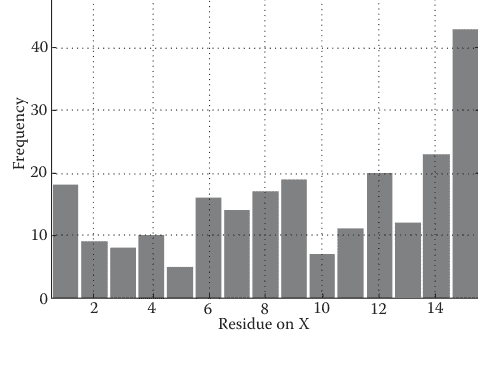

### 9.3.4 从 2 迁移到 3

在 Python 3 的设计和发布中，开发团队做了一项重大决定，即打破与 Python 2 大部分的向后兼容性。最终，为了让 Python 3 成为一种更一致、更容易使用且更现代的语言。如果从 Python 2 开始，最好用 Python 3 进行编程。创建了许多工具来帮助代码从 2 迁移到 3，例如 `future` 模块、`futurize` 脚本和 `2to3` 脚本。如果使用较版本的 Python 2，你也可以导入 Python 3。

# 10 原型设计

Charles Lena

## 目录 (CONTENTS)

- 10.1 什么是原型设计？............................................... 137
- 10.2 为原型选择语言............................................................... 138
- 10.3 应对知识差距........................................................................... 139
- 10.4 何时进行原型设计？............................................... 140
- 10.5 软件设计........................................................................... 140
- 10.6 陷阱与风险...................................................................... 142
- 致谢............................................................... 143
- 参考文献...................................................................... 144

## 10.1 什么是原型设计？

首先，我们将讨论原型设计：原型设计通常指的是我们在考虑用户交互、图形界面和可访问公共接口（API）时，对软件设计进行的考虑和完善。此外，原型设计现在意味着“快速”原型设计，即在冲刺式的开发周期内与现场客户保持密切交流。在这方面，对于大多数科学软件，讨论这个话题可能有些尴尬，因为大多数科学软件通常没有任何图形界面（GUI），并且只有两个客户——你以及你所代表的导师。

在这一领域，我们所有人都在尝试处理新的软件部分；在第一个发布周期内，通常没有其他替代方案来执行完全的过程。这意味着客户交互往往被忽略，取而代之的是其他设计输入。一个个人例子来自我在密度泛函理论领域的工作——具体来说，我从事的是实空间电子计算伪电势算法（PARSEC）。与同领域的其他软件（如维也纳从头模拟软件包 VASP 和 Quantum Espresso）相比，该代码在计算上具有优势——无论是科学性还是可扩展性，PARSEC 真正的挑战在于易用性。使用这些任何一种软件进行复杂模拟的学习曲线并不平缓，而且在该领域内，拥有能够为所需科学模拟提供最详尽文档的软件并不罕见。理想情况下，我们应该将用户交互和易用性作为首要考虑因素来设计软件。同样，大多数科学软件专注于算法和计算，甚至关注它们的呈现和可视化，而不是任何形式的图形用户界面。由于缺乏图形界面，大多数程序将简单地诉诸设置参数文件和输入数据集。这并不合理——对于可以通过更简单的开发者命令行界面实现的功能，开发 GUI 需要花费大量工作。尽管如此，缺乏 GUI 消除了一些原型设计的明显优势，而这种设计在最常见的消费软件付费类型中得到了应用。

在科学实验室中，我们通常不关注用户交互，也不关注易用性——前沿科学研究为科学问题提供了许多新颖的方法，并驱动了这些方法在软件平台内部的自动化。这种缺乏存档的情况在科学代码开发工作中很常见，因为重点不在代码本身，而在于代码背后的科学。我们从原型强迫开发速度和明确需求中获益良多。原型设计通过对工作开始时未理解的需求进行交流来实现。另一个不应忽视的益处是，原型为培训新小组成员提供了路径。无论小组是继续修改原型，还是创建许多小型的一次性原型，事实都是如此，这种选择在某些阵营中是一个有争议的选择 [1]。

在进行原型设计时，我们必须考虑原型的最终目标。显然，我们希望改进产品的开发过程，缩短产品开发的总时间以及达到目标所需的工作量。总的来说，原型设计是一种建立良好习惯的积极因素。在这方面，它类似于单元测试这种活动——是积极的，但在科学软件原型中往往未被充分利用。

## 10.2 选择原型语言

我们还必须为原型选择语言。极少数情况下，我们根据提供开发便利性和数据结构的特征来选择语言，这会损害大多数算法工作。一些人，特别是那些试图减少原型成为时间黑洞风险的人，可以使用与生产软件相同的语言进行工作。这显然不是要求，而且如果使用的主语言是 C、汇编或另一种没有太多“语法糖”来辅助开发的语言，这实际上可能是一个提示。

对于大多数科学软件的原型设计，我倾向于使用 Python，我建议使用它有以下几个主要原因。首先，它很容易与 Fortran、C 和 C++ 建立联系，甚至在急情况下可以为这些语言的消息传递接口（MPI）变体制作原型。其次，读取-评估-打印循环（REPL）和成熟的开发环境允许初学者进行快速开发——特别是考虑到这种语言读起来像六岁小孩写的英语，允许他人以后理解和遵循。第三，Python 内置了大量功能；这可以减少因重复造轮而浪费的时间。最后，科学社区已经在使用 Python 编写产品代码，许多强大、实用的模块已经在产品代码中使用，它们的 API 是免费可用的。

我的倾向是鼓励你按照自己的方式工作。原型设计的要点是以非常快的方式告知设计。在原型中与语言限制作斗并不是浪费时间——选择一个可以正确映射到产品代码的语言。同样重要的是，选择一个可以在接受的时间内解决问题的语言。我的 Python 代码几乎肯定比我的编译器优化的例程慢。如果它慢到足以阻止执行即使是示例问题，那么我们选择了错误的语言。

## 10.3 克服知识鸿沟

同样，通过原型设计克服知识鸿沟会对活动的既定目标产生危险的干扰。新颖算法将是困难的。学习一种新语言是困难的。避免同时与算法和语言作斗。有很多表现得明的诱惑，在原型代码中避免任何形式的聪明。这样做有许多原因，即在进行原型设计时，我们正试图发现设计范式的陷阱——用聪明技巧掩盖流程会发生，而且对这类错误的见解最近来是痛苦的经历。这对于生产代码也是如此。编译器经常也会尝试聪明的事情——在实际代码中，它也等同于可读性。始终对原型进行记录和注释。它可能会变成生产代码——至少（可能是你）以后必须阅读它。

快速开发中另一个很好的工具是老式的组合——铅笔和纸。白板作为原型任务时效果良好。绘制流程图不仅有助于产品代码的开发；原型设计的速度大大提高，因为我们需要重写的代码块更少。在接触键盘之前，对数据通信模式和范式进行草图绘制，几乎能在我们对它们花费时间之前捕捉到错误的想法。图 10.1 提供了一个原型头脑风暴的工作流。

在我自己的经验一个例子中，有一个用 C++11 编写的原型。它是一个新优化方法的进化原型，旨在转换为实际产品代码。由于大多数学生和帖子主要使用 Fortran，且预先的代码库是 Fortran 编写的，使用高级 C++ 标准进行编码在引入开发者的同时，让小组的其他成员挣扎于改变。它还限制了可以编译和运行软件的集群数量。由于小组使用了不同的集群，这给小组造成了巨大的压力。不久，原型的下一个阶段用 C++14 完成——情况进一步恶化。创建者留下了很可能是遗留代码。

a7c22408154d0c003c87fe57465d2952_153_0.png
图 1.1 展示了从某个理论起点的全产品工作流。期望的数据创建交付物，它指导了几乎所有其他决策。通常，简单的解决方案在交付物之间会有不同——快速识别问题点是原型设计的优势之一。

## 10.4 何时进行原型设计？

何时可能比使用什么工具更重要。遗憾的是，社会研究仍无法明确回答原型何时提供最大益处的问题，但在一项综合研究中，大多数小组对原型结果给出了积极反应。用更直接的话说，人们在做原型时喜欢这种感觉。他们倾向于认为自己的努力是有效的，编码更高效。

在某些情况下不适用于快速代码草图，这些是最基本的原型形式。在简单的情况下，原型可能会变成产品代码。在更广泛的情况下，原型允许我们在提交产品代码之前测试功能、数据结构和新功能之间的关系。

## 10.5 软件设计

原型设计有效地涉及了围绕软件设计的多种方式。我们可以为软件设计专门写一整本书，所以这绝不是昂贵的对待。将以下方式视为指南而非规则。这些指南应该帮助更有效地引导你的努力。

## 原型设计

## 141

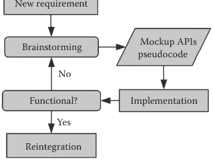

**图 10.2**

此工作流描述了为了包含在现有产品中而对新功能进行原型设计。显而易见，在浪费大量人工小时来实现它们之前，能够识别出糟糕的决策是一种真正的才能。原型设计的作用是在这些水泡发生之前将其凸显。

**图 10.2.** 对头脑风暴进行原型设计并转化为快速的功能代码——同时进行这些工作使我们最接近在消费领域进行 GUI 原型设计时使用的客户与开发者关系。我们不能忘记，作为研究人员，我们是自己代码的主要客户——对自己的代码保持诚实是必要的。我们，对头脑风暴进行原型设计并转化为快速的功能代码——同时进行这些工作使我们最接近在消费领域进行 GUI 原型设计时使用的客户与开发者关系。我们不能忘记，作为研究人员，我们是自己代码的主要客户——对自己的代码保持诚实是必要的。所需功能决定了需要做什么。将功能拆分为更小的部分可以产生更短的程序，允许更快的开发。包含更多模块化的较短程序——在大多数代码中是标准。较大的程序需要更多的重工作且更难理解，增加了减速的可能性。当需要出现时，放弃较短程序比放弃长程序在心理上更容易。

组织良好的原型会导致良好的设计。在快速迭代时，接口是最困难的任务之一。一方面，通过理解程序单元如何相互联系，我们可以推断出接口所需的行为。这种理解至关重要——构思不当的接口会浪费时间。另一方面，具有明确目的且相互相关的简单接口将避免混乱。更整洁的代码无论是在原型阶段还是产品阶段，始终为后续开发者提供良好的示例。

以整洁的代码为目标，显而易见，避免不必要的功能是节省时间的关键。在原型期间移除错误功能的重要性在于——我被要求去考虑那些本该避免的、比最小还要“制作”的东西。节省时间并造产品应是目标。危险在于倾向于过度痴迷格式等基础问题——这可以随心所欲（*carte blanche*）地浪费时间。把这些留到最后。

我们应该始终朝着产品的交付物工作——API 和我们可以控制的功能对产品至关重要。在这方面，我们必须始终意识到我们可以利用工具链和软件栈。如果我们围绕无法访问的功能进行设计，我们在处理产品代码时会投入投入更多的精力。我们喜欢避免任何可能阻碍进展的——原型设计提供了一条快速路径，我们应该避免任何事情。尽管如此，在原型设计中，始终回到现有框架。

在将现有库整合到原型和产品代码中时，显然存在危险。自然，对为手头问题提供各种功能的现有代码不熟悉会导致决策变得困难——对它们进行分类。一个可能更适合原型，而另一个可能更适合产品，而这种差异在我们做出决定之前是显而易见的。避免这种利益冲突的最佳方法是加倍上述模块化。抽象某些库的接口提供了一种更快速的方法来切换不同的库，并保持代码的实际意图更清晰。一个非常清晰的例子是线性代数程序（BLAS）接口的形式——我们经常有各种类型的双精度通用矩阵乘法（DGEMM）或双精度对称特征值求解器（DSVEY）调用，我们将其隐藏在其他封装器中。稍后，当我们有想要使用的更优化的调用时，更改内部结构比实际上更改它们所在的程序位要容易得多。再次，通过格式和文本组织，很容易做到过多的抽象层，并创建一个从未真正达到的巨型任务。不需要才华也可能表现为过度使用抽象的问题。

在极端情况下，过度使用抽象显然是一把双刃剑——程序员追求通用化，这种趋势会让面向代码的项目陷入困境。存在一种为了发布目的的一次性代码项目——这本身并不是坏事，但作为设计的一部分，我们应该尽可能利用通用化来减少我们必须进行的重工作量。明确的是，一直泛化无疑是浪费时间。在有用的水平上泛化。同样，将原型泛化到预期达到的水平。在项目中找到恰当的泛化将允许开发者产生大量的-

## 10.6 陷阱与错误

与任何方法一样，存在陷阱和错误。选择错误的原因是一个常见的陷阱。想要100%的覆盖是常见的现象，特别是考虑到原型变化非常快。同样，功能蔓胀（feature creep）具有变成严重消耗的危险能力，因为它没有为后续开发者提供设计良好的原型示例。

### 原型设计

另一种事后之往往比事先规划更有启发的情况，无论原型是什么语言。

在将现有库整合到原型和产品代码中，显然存在危险。自然，对为手头问题提供各种功能的现有代码不熟悉会导致决策变得困难——对它们进行分类。一个可能更适合原型，而另一个可能更适合产品，而这种差异在我们做出决定之前是显而易见的。避免这种利益冲突的最佳方法是加倍上述模块化。抽象某些库的接口提供了一种更快速的方法来切换不同的库，并保持代码的实际意图更清晰。一个非常清晰的例子是线性代数程序（BLAS）接口的形式——我们经常有各种类型的双精度通用矩阵乘法（DGEMM）或双精度对称特征值求解器（DSVEY）调用，我们将其隐藏在其他封装器中。稍后，当我们有想要使用的更优化的调用时，更改内部结构比实际上更改它们所在的程序位要容易得多。再次，通过格式和文本组织，很容易做到过多的抽象层，并创建一个从未真正达到的巨型任务。不需要才华也可能表现为过度使用抽象的问题。

在极端情况下，过度使用抽象显然是一把双刃剑——程序员追求通用化，这种趋势会让面向代码的项目陷入困境。存在一种为了发布目的的一次性代码项目——这本身并不是坏事，但作为设计的一部分，我们应该尽可能利用通用化来减少我们必须进行的重工作量。明确的是，一直泛化无疑是浪费时间。在有用的水平上泛化。同样，将原型泛化到预期达到的水平。在项目中找到恰当的泛化将允许开发者产生大量的-

抛开所有潜在的消耗，在原型设计上花费的时间比编写生产代码更多是可以的。事实上，正如我们多次所说的，理想的原型设计缩短了代码开发的总时间。在彻底原型设计的情况下，生产代码将少于翻译和收工作。这可能是最有效的原型方法——仅仅因为花大量时间与你的老板争论原型设计的效用是不划算的。

## 参考文献

- 1. V. Scott Gordon, and J.M. Bieman. 1995. Rapid Prototyping: Lessons Learned. IEEE Softw. 12, 1, 85–95. doi:10.1109/52.363162. http://dx.doi.org/10.1109/52.363162.

# 11

## 高性能计算系统简介

Todd Evans

## 目录

- 11.1 HPC 系统中的硬件并行............................................................... 146
- 11.1.1 指令级并行....................................................... 147
- 11.1.2 核心级并行................................................................ 147
- 11.1.3 处理器级并行............................................................... 147
- 11.1.4 节点级并行................................................................ 149
- 11.2 HPC 应用中的软件并行............................................................... 150
- 11.2.1 内存、进程与线程....................................................... 150
- 11.2.2 分布式内存编程与 MPI.............................................. 150
- 11.2.3 共享内存编程与 OpenMP.............................................. 151
- 11.3 HPC 系统中基于作业系统的并行........................................... 151
- 11.3.1 作业调度器........................................................................... 152
- 11.3.2 作业优先级........................................................... 152
- 11.3.3 额外的调度方法....................................................... 153
- 11.3.4 作业提交脚本................................................................ 153

高性能计算（HPC）系统利用数十个到数千台计算机协同工作，以便在更短时间内完成单台计算机无法实现的更多计算。HPC 系统提供的计算能力可以应用于单台计算机无法运行的大问题，或用于缩短完成固定大小问题所需的运行时间。HPC 系统用于广泛的研究领域，包括科学领域和应用型领域。在 HPC 系统上运行应用程序的人群通常被称为该系统的*用户*。

构成 HPC 集群的计算机通过网络相互通信。连接到集群网络的每台计算机都称为一个节点。在实践中，HPC 集群中的节点架构和能力相对均匀。然而，它们可能是带有额外硬件的节点，例如能够高效执行计算的专用芯片，或额外的资源，如更大的内存或更多的处理器。

HPC 系统上应用程序性能的一个重要方面是，其执行的工作能够通过可以相互通信和/或共享数据的独立任务高效地完成。将多个任务应用于计算的能力被称为*计算并行性*。并行性由程序员在软件层面实现，但它源于硬件的并行性。本章将首先涵盖并行性如何通过软件以及软件库（如消息传递接口 MPI 和 OpenMP）在基于硬件的并行性中产生，最后讨论 HPC 系统用户如何通过使用作业系统进行并行工作。

## 11.1 HPC 系统中的硬件并行

HPC 系统被组织成多级层次结构，在每一层上都引入了新的计算并行性模式。这种层次结构可以用许多方式定义，但在这里我们将其分为四个层次：

- 1. 节点级并行——HPC 系统有多个节点并行工作。
- 2. 处理器级并行——一个节点有多个处理器并行工作。
- 3. 核心级并行——一个处理器有多个核心并行工作。
- 4. 指令级并行——一个核心可以并行执行多条指令。

图中展示了在每一层中通过软件引入的基于硬件并行性的层次结构示意图。在实践中，HPC 集群中的节点架构和能力相对均匀。然而，它们可能是带有额外硬件的节点，例如能够高效执行计算的专用芯片，或额外的资源，如更大的内存或更多的处理器。在每一层中引入的并行性层次结构如图 11.1 所示。在节点层，HPC 系统通过网络连接的这种并行性层次结构](img/11.1_2241540.png)

**图 11.1**
并行性出现在多个层级。最低层是核心内的指令执行，下一层是由于多个核心，再一层是由于多个插槽，最高层是由于网络连接的节点。

### 11.1.1 指令级并行

在计算层次结构的最低层是具有流水线功能的核心执行单元。不同类型的处理器指令（移动、加、乘）需要不同的处理器周期来完成。大多数用于 HPC 系统的现代处理器被称为超标量，这意味着它们通过流水线技术在先发出的指令完成之前开始新指令。流水线技术允许处理器在相同的周期内完成多条指令。这被称为指令级并行，代表了 HPC 计算层次结构的最低阶段。

除了通过流水线产生指令级并行外，许多处理器具有一个或多个向量处理单元（VPUs）。VPUs 能够同时对多个元素执行单条指令。元素的数量取决于处理器，目前变化为双精度浮点数（用 64 位表示的数）。VPUs 通常用于以加法运算为主的循环编程模式。例如，在这样的循环中，单个向量加法指令可能会同时处理八个浮点值，从而减少循环次数，并缩短循环所需的运行时间。最新一代处理器具有能够同时处理元素的 VPUs，这在某些计算中增加了每秒浮点运算次数（FLOPS）。

### 11.1.2 核心级并行

层次结构中的下一级并行是通过在处理器上使用多个核心引入的。大多数处理器是具有 2 到 12 个核心的多核处理器，每个核心具有相同的能力并可以执行独立的计算。在现代处理器中，这些核心通常拥有自己的私有 L1（一级）缓存和 L2（二级）缓存，以及共享的 L3（三级）缓存和内存。处理器使用多种协议来维护私有缓存与共享缓存以及主内存之间的一致性。

这些一致性协议在处理器的硬件中实现，对程序员是透明的。缓存一致性协议目的是确保每个核心私有缓存中的数据与共享缓存和内存保持一致。例如，如果一个核心修改了特定变量的值，所有其他核心都必须收到此修改通知，并等待新值可用后进行读取。新值可能需要写入共享缓存或内存，或者直接传播到它所需的核心私有缓存中。关于缓存一致性协议的详细讨论超出了本章的范围。

### 11.1.3 处理器级并行

层次结构中的下一级产生于插槽层。通用服务器通常在一个节点内有多个（例如二到四个）插槽，每个插槽都有一个带有独立内存的处理器。这样一个具有两个插槽的节点的可能布局

## 科学计算简介

如图11.2 所示。每个插槽（socket）中的内存对其他所有插槽都是可见的，对程序员而言就像一个单一内存空间。插槽通过节点内互连连接，允许多个插槽维持缓存和内存一致性。然而，访问内存关联的额外延迟并非处理器插槽本地的。访问非处理器插槽本地的数据被称为**非均匀内存访问**（NUMA）。相比之下，均匀内存访问（UMA）是指访问本地于插槽的内存；例如，处理器内的所有核心都以相同的方式访问本地插槽的内存。NUMA 和 UMA 处理器的一致性实现对处理器是透明的。

此外，一个节点可能有一个所谓的加速器。加速器可以是 Intel 的 Xeon Phi 协处理器，也可以是来自 Nvidia 等公司的图形处理器单元（GPU）。加速器拥有数千个核心，能够并行执行大量的浮点或整数运算。这些核心专门为特定的、非常规则的计算任务而设计，使得它们比处理器的核心更简单、更便宜且更高效。相反，加速器的灵活性不如处理器，并且在控制流和内存管理等通用任务上表现较差。

节点上还有用于添加节点外通信的硬件。例如，Infiniband 架构（将在下一节讨论）在每个节点上都有一个主机通道适配器（HCA）或目标通道适配器（TCA），用于管理与互连通信相关的大多数任务。HCA 和 TCA 卡不仅通信任务高度专门化，而且在通信期间释放处理器，允许计算任务和通信任务进行重叠执行。

目前，大多数加速器和 HCA 处理器通过外围组件部件 Express（PCIe）总线访问。PCIe 是节点中用于与许多不同设备接口的互连或总线，范围从硬盘、内存到上述连接。类似地，还有专门的互连用于连接单个插槽的处理器和内存，例如 Intel 的快速路径互连（QPI）和 AMD 的 HyperTransport 互连，用于维护跨插槽缓存一致性等任务。

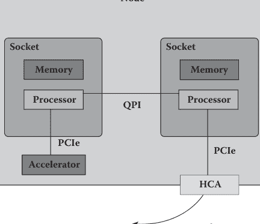

图 11.2 HPC 系统中计算节点的可能布局。

## 高性能计算系统简介

### 11.1.4 节点级并行

节点级是 HPC 系统层次结构中最高的并行模式。节点通过网络连接，每个节点运行一个操作系统的实例，并能够作为一个独立的计算机工作。网络可以组织成不同的拓扑结构：即节点和连接的特定排列。具有多个节点的网络拓扑还包括用于连接节点的一或多层交换机，交换机是将信号从一个节点或交换机路由到另一个交换机的设备。交换机的连接方式旨在最大限度地减少信号或数据传输所需的跳数或距离。

HPC 系统最常用的拓扑结构是 Clos 或胖树（Fat-Tree）拓扑。这种拓扑由一个或多个核心组成，核心连接到其他交换机，以及多个叶交换机，后者连接到多个节点和交换机。节点、叶交换机与核心之间使用的电缆数量经过选择，以便在树的所有层级上保持恒定或近恒定的带宽。因此，它通常被称为恒定二分带宽拓扑结构。图 11.3 显示了一个双层胖树网络。

绝大多数网络基于以太网和/或 Infiniband 架构。以太网是一种基于 TCP/IP 的网络技术，用于广泛的场景，从将单台笔记本电脑连接到互联网到互连大型 HPC 系统。Infiniband 架构（IBA）是为低延迟通信设计的专用硬件和软件规范。虽然以太网在操作系统和处理器上运行通信，但 IBA 拥有硬件可以实现多层通信，并支持如远程直接内存访问（RDMA）和多播等功能。RDMA 允许一个节点直接读取或写入目标节点的内存，而无需目标节点的参与，从而显著降低了延迟，并为目标节点提供了计算与通信重叠的机会。多播是指涉及多个节点的通信，其功能是向所有节点广播特定变量。多播的硬件实现延迟低于软件支持实现的延迟。

IBA 提供的硬件支持使其通常能够实现比目前以太网更低的延迟。特别是，RDMA 可以通过实现互联网广域 RDMA（iWARP）协议的硬件获得支持。在任何情况下，以太网通信目前的延迟都是 IBA 的五到七倍（1 微秒对比 7 微秒）。然而，以太网和 Infiniband 都能维持相当的带宽，HPC 集群中的带宽通常可达到 50 Gb/s。

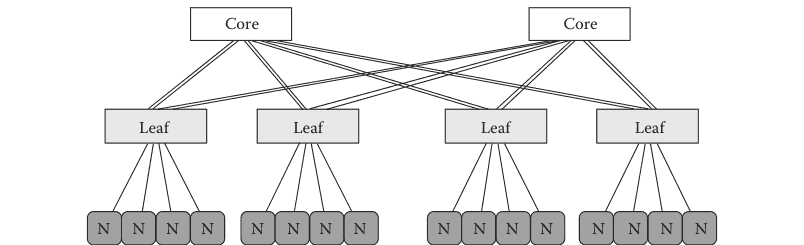

图 11.3

胖树网络拓扑结构。两个层级（节点（N）到叶交换机（Leaf）以及叶交换机到核心交换机（Core））具有相同数量的连接，因此可用带宽也相同。

## 11.2 HPC 应用中基于软件的并行

具有多个核心的处理器能够同时执行多个程序。这就是所谓的对称多处理（SMP）。核心共享一个将它们连接到相同内存的内存线，允许内存对所有核心都可见。核心访问的内存通过缓存一致性协议的硬件实现维持一致性。

### 11.2.1 内存、进程和线程

当前运行的进程之间可能直接或不直接通信。如果它们之间进行通信，可能访问或不访问相同的内存区域。多个进程可以读写的内存区域被称为**共享内存**，而单个进程可以读写的内存区域被称为**私有内存**。节点本地内存可以是共享的，也可以是私有的。节点非本地内存总是作为私有内存访问，并被称为**分布式内存**。绝大多数集群缺乏任何维护不同节点间进程一致性的硬件机制，这必须通过软件来实现。

在 Linux 系统上执行的进程实例被称为进程。在 Linux 中，每个进程在内存中都有一个自己的地址空间，该地址空间仅对自己可见——它是私有的。与其他任务交换的任何信号或数据必须由参与通信的每个任务显式地发送和接收。然而，在每个任务内部，有多个轻量级执行单元被称为线程。线程在任务内部创建和销毁，并可以访问相同的地址空间，即共享内存。因此，进程内部线程之间不需要显式通信。必须使用机制避免多个线程异步访问数据，以防止竞态条件。竞态条件发生在多个线程读取和写入同一数据时，导致任何给定线程可见的数据是不可预测的。

在共享和分布式内存应用中，程序员使用多个任务或线程来实现并行计算。每个任务或线程都可以分配给多核处理器中的特定核心。操作系统能够执行这种分配，但并不总是以最优方式进行。因此，程序员或应用程序用户会手动将任务和/线程与核心关联。这被称为分配处理器亲和性。

### 11.2.2 分布式内存编程与 MPI

为 HPC 系统开发的大多数分布式内存应用程序使用消息传递接口（MPI）标准的实现，该标准由 MPI 论坛（http://www.mpi-forum.org）开发。MPI 实现提供了一个程序库，可以

# 高性能计算系统简介

用于协调任务并并在任务之间进行通信。MPI 适用于大多数分布式内存架构，并存在 C、C++ 和 Fortran 的实现，同时还为其他语言开发了针对这些实现的接口。MPI 标准目前有多个开源（Open MPI、MPICH 和 MVAPICH2）和厂商（Intel MPI 和 Cray MPI）实现版本。

MPI 并不执行数据的实际发送和接收，而是提供一个可访问的公共接口（API），用于调用底层网络协议（例如 TCP/IP 或 Infiniband）中的例程，由这些协议处理数据的传输和可靠性。支持 Infiniband 的 MPI 有两种通信类型：通道语义（channel semantics）和内存语义（memory semantics）。通道语义要求发送和接收任务分别提交发送请求和接收请求。在接收方期望接收消息之前，发送请求将不会完成。相反，内存语义要求始终存在一个专用的缓冲区。内存语义使用单边 RDMA 进行发送和接收。不需要目标主机的处理器参与——目标端已经准备好了供其他主机读写的缓冲区。内存语义需要更多内存，但其延迟比通道语义更低。

### 11.2.3 共享内存编程与 OpenMP

类似于 MPI 规范支持分布式内存编程的方式，OpenMP 规范也支持共享内存编程。OpenMP 规范由大量的硬件和软件供应商维护。OpenMP 存在 C、C++ 和 Fortran 的实现，并有针对其他语言的封装器。OpenMP 的 API 支持并行线程的创建和管理。

在支持 OpenMP 的代码并行区域中，可以声明为共享（shared）或私有（private）。共享数据对所有线程可见并可用，而私有数据是变量的副本，每个线程可见且可访问。这两种情况下通常都需要同步。由于执行是异步的，访问共享数据的方式应与线程执行的指令的所有排序保持一致。私有数据必须在并行区域的开始或结束时与其它线程进行通信。

OpenMP 在代码代码循环的并行区域中还支持三种调度类型。静态调度（Static scheduling）以轮询方式将等数量的循环迭代（或块）分配给每个线程。动态调度（Dynamic scheduling）为每个线程分配一个块，线程在完成分配的迭代后返回获取新块。引导式调度（Guided scheduling）与动态调度类似；每当线程返回请求更多工作时，块的大小呈指数级减少。静态调的开销非常小，应适用于每次迭代所需工作量相似的任务。当某些迭代明显长于其他迭代时，应使用动态和引导式调度。

## 11.3 HPC 系统中基于作业的并行

作业系统为 HPC 集群的用户提供了一种机制，用于并发提交计算工作请求和资源规范（节点数、运行时间等），以完成请求所需的资源。这些工作请求被称为“作业”（jobs）。用户可以向作业系统提交单个或多个作业，系统随后将管理作业的执行和完成，无需用户干预。作业系统减轻了用户主动等待资源可用的需求，并使作业能够并行运行。

### 11.3.1 作业调度器

HPC 系统上的作业调度器管理作业的执行，作业由一个或多个要执行的应用程序组成。调度器对用户提交的作业进行并在并在考虑可用资源决定执行顺序。许多策略和相关因素会影响作业的执行顺序，每个调度器都略有不同。以下列出了一些可用的调度器示例：

- 带有 TORQUE 的 Moab 集群套
- 可移植作业处理系统 (PBS)
- LoadLeveler
- Condor
- 资源管理简单实用 (Slurm)
- Univa Grid Engine（以前称为 Sun Grid Engine）

为了本节的目的，当提到特定的实现细节时，将使用 Slurm 调度器的术语。此处描述的 Slurm 方法和示例可以直接访问其他作业调度器。Slurm 提供两类调度类型，涵盖了其他调度器的大多数功能：基础（basic）和多因子（multifactor）。基础模式只是简单的先来服务（FIFO）方案，第一个提交到队列的作业第一个开始。多因子模式有更多选项来决定作业运行的顺序或优先级。

### 11.3.2 作业优先级

作业优先级决定了调度器何时运行该作业，高优先级在低优先级之前运行。在 Slurm（以及其他调度器中类似地）中，有五个用于计算作业优先级的主要因素，其范围均为 0 到 1.0：

- 1. 年龄（Age）——该因素随作业在队列中并处于就绪状态的时间增加而增加。
- 2. 公平份额（Fair-share）——在给定时间窗口内，用户或项目消耗的总资源的百分比是优先级的一个因素。计算此项和确定时间的方法有很多，但通常情况下，未充分服务的的用户和项目将获得比过度订阅的用户和项目更高的优先级。
- 3. 作业大小（Job size）——作业请求的节点数。这可以配置为给请求较多或较少节点的作业赋予更高的优先级。
- 4. 分区（Partition）——作业提交到的分区可能会修改作业的优先级。分区是调度器配置中定义的节点集，通常根据资源差异（大内存、存在加速器）而非根据资源的所有权来建立的。一个 HPC 系统上可以存在多个分区。
- 5. 服务质量（QOS）——特殊类别的组、用户和作业可以根据 QOS 值修改其优先级和资源限制。使用特定服务的可能有更高或更低的优先级。

Slurm 通过上述五个因素的线性组合计算优先级：

```


`Priority = w_iAge + w_iFairshare + w_iSize + w_iPartition + w_iQOS,`

`w_i` 是分配给每个因素的权重。上述因素都设置在 Slurm 的配置文件 `slurm.conf` 中。

### 11.3.3 附加调度方法

严格按照优先级运行作业具有局限性，可以通过额外的调度技术来克服。如果严格基于优先级执行时间，作业将在请求资源可用时按顺序运行。这可能导致集群上留下许多空闲节点。例如，假设一个 100 节点的系统有作业 A 在 51 个节点上运行一天。作业 B 需要 50 个节点并且是下一个优先级作业。49 个节点将整天处于空闲。回填调度（Backfill scheduling）通过搜索并执行低优先级作业来解决这个问题，这些作业可以在高优先级作业启动之前在可用资源上完成。调度器可以计算，因为它知道队列中所有作业的开始时间和请求运行时间。

某些作业组合可能会消耗所有资源且运行时间为小时或更多，提交并在等待队列的作业可能只运行几秒钟，对于负载目标而言，允许这些短时间作业更频繁运行比等待长时间作业完成更为重要。并行调度（Gang scheduling）通过调度不同的时间窗口来回避这个问题。在启用了并行调度的系统中，给定的作业将在预配置窗口内运行，然后调度器将检查是否有等待的作业可以在这些资源上运行。调度器将挂起当前作业并为配置的时间窗口开始下一个作业。可能有大量作业受到这种调度并共享计算资源。

### 11.3.4 作业提交脚本

作业（或批）提交脚本用于向作业调度器传达其调度、执行和记录统计信息所需的所有信息。取决于给定集群设置的默认值，提交作业时可能可能在脚本中指定以下部分或全部内容：

- 1. 队列（Queue）——提交到的队列或分区。队列对应于集群上可用节点的子集，提交到分区的作业可能会受到诸如最小/最大节点数运行时间的限制。
- 2. 节点（Nodes）——为作业分配的节点数。
- 3. 核心数/任务（Cores/tasks）——作业请求的核心总数或 MPI 任务总数。此参数的准确定义取决于调度器和集群配置。它可能定义作业中每个节点使用的核心数，也可能定义要使用的核心总数。这些总核心在所请求节点上的布局取决于集群和调度器的配置。
- 4. 运行时间（Runtime）——作业运行的最大时间。如果作业超过此时间，调度器将终止作业。
- 5. 输出/错误文件（Output/error files）——作业的 stdout 和 stderr 将重定向到这些文件中。这使用户能够跟踪作业进度。
- 6. 依赖关系（Dependencies）——延迟作业启动，直到之前的作业成功完成。
- 7. 分配/项目（Allocation/project）——这指定了作业费用的账户。此信息用于计算作业调度器中的公平份额因子（fair-share factor），并限制授予某个项目的时间。一旦超过此限制，用户将无法向该项目提交作业。
- 8. 命令行（Command line(s)）——这些是作业期间运行的实际命令。它们通常在分配给作业的单个节点上执行。随后，由 MPI 库或其他脚本将命令分布到分配的节点上。

上述列表中的第 1-7 项由提交脚本中的单行指定。第 8 项可能需要任意行和任何有效的脚本命令。图 11.4 显示了 Slurm 作业提交脚本的示例。图 11.4 中 `ibrun hostname` 命令的输出示例如下：

```
c445-003

c445-004
```

命令在每个主机上均运行（每个 MPI 任务运行一次）。
大多数集群都会提供一个脚本（如图 11.4 中的 `ibrun`），以帮助将命令和 MPI 任务分布到多个节点和核心上。在这里，`ibrun` 在每个节点上运行单个 MPI 任务，每个任务都会调用 `hostname` 命令。注意可以运行的命令类型具有灵活性。命令可以是单个命令，也可以是使用 MPI 在任务之间分布和协调其工作的单个应用程序。

```bash
#!/bin/bash

#SBATCH -J myjob                  # 作业名称

#SBATCH -o myjob.o%j               # 输出文件 (%j 扩展为 JOBID)

#SBATCH -e myjob.e%j               # 错误文件 (%j 扩展为 JOBID)

#SBATCH -N 2                      # 请求的节点总数

#SBATCH -n                        # 请求的 MPI 任务总数

#SBATCH -p development          # 分区 (partition)

#SBATCH -t 01:30:00                # 运行时间 (hh:mm:ss) - 1.5 小时

ibrun hostname                   # 在每个 MPI 任务中运行 hostname 命令

ibrun . /a.out                   # 名为 a.out 的 MPI 可执行文件
```

图 11.4
作业提交脚本示例。

# 高性能计算系统简介

甚至可能有许多不同的命令和应用程序，每个程序都运行在不同数量的节点和核心上。这完全取决于作业所需的工作流。

常见的工作流是将串行应用程序（需要单个核心）在分配给作业的众多节点和核心上运行。发出的每个命令都是相同的，但它们为应用程序提供不同的输入，因此可能会产生不同的输出。例如，这种工作流可能用于参数空间的扫描。这种工作流被认为是“极易并行的”（embarrassingly parallel）；因为同时执行的任务（串行命令）之间不需要通信。如果一个极易并行的作业在单个核心上需要 10 周，那么在 10 个处理器上大约需要 1 周。

# Taylor & Francis
# Taylor & Francis 集团
http://taylorandfrancis.com

# 使用 MPI 的并行编程导论

Jerome Vienne

+ 目录
12.1 MPI 的起源............................................................... 158
12.2 一个简单的 MPI 程序...................................................... 158
12.2.1 从串行到并行......................................................... 158
12.2.2 Init 和 Finalize....................................................... 159
12.2.3 Comm_size 和 Comm_rank.................................................. 160
12.2.4 编译与执行........................................................... 160
12.3 点对通信............................................................... 162
12.3.1 Send 和 Recv........................................................... 163
12.3.2 Isend 和 Irecv......................................................... 165
12.4 集合通信............................................................... 167
12.4.1 Bcast................................................................ 168
12.4.2 Reduce................................................................ 168
12.4.3 Scatter................................................................ 169
12.4.4 Gather................................................................ 169
12.5 示例：计算 $\pi$........................................................... 169
12.6 结论................................................................... 172

消息传递接口 (`MPI`) 在过去的十年中已被广泛用于编写高性能应用程序。一个程序员可以使用 MPI 做什么？

本章将为你提供理解 MPI 的基础。在学习如何使用 MPI 之前，我认为了解它的起源是重要的。12.1 提供了关于为什么以及何时创建 MPI 的历史介绍。12.2 介绍了基础 MPI 命令，但由于 MPI 在进程之间交换数据，在 12.3 中学习这一点是重要的。在 12.4 描述集合通信之前，12.5 提供了一个使用 MPI 计算 $\pi$ 的代码示例。如果你对 MPI 感兴趣，12.6 提供了一系列可以帮助提高知识的书籍和网站。

## 12.1 MPI 的起源

在 1980 年代，许多公司已经在制造和销售并行计算机。它们的编程环境由顺序编程语言（C 或 Fortran）和一个允许不同进程通信的消息传递库组成。遗憾的是，每个制造商都有自己的消息传递库，这导致了许多问题。事实上，在 nCube/10 上开发的并行代码无法在 Intel IPS 上编译和运行。每当使用不同的架构时，都需要重写/修改代码。代码的可移植性是一个巨大的担忧。所有不同的消息传递库都需要一个标准。

这就是 1992 年创建消息传递接口 (`MPI`) 标准的原因。该标准定义了一个通用的公共接口 (`API`)，现在所有 MPI 库都使用它来交换消息。标准 1.0 版本于 1994 年。MPI 标准仍在改进，多年发布了版本。最新版本是 2015 年 6 月发布的 3.1。

## 12.2 一个简单的 MPI 程序

`MPI` 是一个使用特定指令以及特定命令来执行并行代码的库。在本节中，我们将介绍并解释你需要的指令，但也将学习如何构建和启动 MPI 代码。

### 12.2.1 从串行到并行

首先，让我们经典的“Hello world”示例，它可以在 Kernighan 和 Ritchie 的《C 语言》书中找到。

列表 12.1 C 语言 HELLO WORLD

```
#include <stdio.h>

main ()

{

    printf (" Hello world \n");

}
```

编译并运行此程序，只有一个进程会打印“Hello world”。使用 MPI 允许你同时在多个进程上运行程序。因此，经典的“Hello world”并行版本可以如列表 12.2 所示编写。

# 使用 MPI 进行并行编程的介绍

# 列表 12.2 用 C 语言实现的“HELLO WORLD”MPI 版本

```c
#include <stdio.h>
#include "mpi.h"
int main (int argc, char *argv[]) {
    int rank, size;
    /* 初始化 MPI */
    MPI_Init(&argc, &argv);
    /* 获取当前进程 rank */
    MPI_Comm_rank(MPI_COMM_WORLD, &rank);
    /* 获取进程数量 */
    MPI_Comm_size(MPI_COMM_WORLD, &size);
    /* 打印 rank 和进程数量 */
    printf("Hello world from process %d of %d\n", rank, size);
    /* 结束 MPI */
    MPI_Finalize();
    return 0;
}
```

这个版本包含了一系列新函数。别担心，我们将详细介绍它们。在讨论这些函数之前，有两点需要强调：

- 第一，添加了一个新的头文件 `mpi.h`。该头文件不仅包含了所有 MPI 函数的原型声明，还包含了编译 MPI 程序所需的所有宏和类型定义。
- 第二，MPI 函数都以字符串 `"MPI_"` 开头。事实上，MPI 中定义的所有函数、宏和类型都以这个字符串开头。现在我们已经完成了观察，让我们来看看代码内部使用的 MPI 函数。

### 12.2.2 MPI_Init 和 MPI_Finalize

`MPI_Init` 是初始化 MPI 环境的第一个函数。

```c
MPI_Init( int *argc, char ***argv )
```

参数 `argc` 和 `argv` 是指向主函数的指针。对于采用 MPI-2 或更高标准的 MPI 实现，`MPI_Init` 同时也接受 `NULL` 作为输入参数。需要知道的一个重要点是，通信器 `MPI_COMM_WORLD` 在此调用期间被创建的。

事实上，所有的 MPI rank 或 MPI 任务都需要被标识。为了这一点，MPI 库使用非负整数并为每个参与的进程分配一个从 0 开始的唯一数字。所有这些进程都属于一个称为通信器（communicator）的组，这个初始通信器的名称称为 `MPI_COMM_WORLD`。每个 MPI 进程可以映射到一个 `MPI_COMM_WORLD`

或中央处理器（CPU）的更多核心。图 12.1 描述了一个从 rank 到核心的映射示例。

在最后，使用 `MPI_Finalize` 来终止 MPI 执行环境。

```c
int MPI_Finalize( void )
```

虽然有极少数例外情况，但你需要记住，几乎所有的 MPI 函数调用都需要在 `MPI_Init` 之后且 `MPI_Finalize` 之前完成。请注意，在 `main` 函数中看到 `MPI_Init` 和 `MPI_Finalize` 是常见的，但它们并不是强制性的。

### 12.2.3 MPI_Comm_size 和 MPI_Comm_rank

在上一节中，我们讨论了默认通信器 `MPI_COMM_WORLD`。`MPI_Comm_size` 和 `MPI_Comm_rank` 是 MPI 代码中非常常用的两个函数，这些函数允许你获取有关通信器的更多信息。这些函数的语法如下：

```c
int MPI_Comm_size( MPI_Comm comm, int *size )
int MPI_Comm_rank( MPI_Comm comm, int *rank )
```

对于这些函数，第一个参数是通信器，其类型由 MPI 为通信器定义，即 `MPI_Comm`。第二个参数是输出参数。对于 `MPI_Comm_size`，它返回通信器中的进程数量；对于 `MPI_Comm_rank`，它返回调用进程在通信器中的 rank（即编号）。

### 12.2.4 编译与执行

与串行代码相比，MPI 代码的编译和执行方式略有不同。如图12.2所示所示，要编译 C 代码，通常需要使用

# 使用 MPI 进行并行编程的介绍

| 语言 | 命令 |
| --- | --- |
| C | mpicc |
| C++ | mpic++ |
| Fortran | mpi90 |

**图 12.2**
每种语言对应的编译命令。

命令 `mpicc`。我说是“通常”，是因为命令名称可能取决于你的 MPI 库。在所使用的 MPI 库文档中检查不同封装器（wrapper）的名称很重要，`mpicc` 是一个脚本，也是 C 编译器的封装器。无论使用什么种编译器（GNU、Intel 等），这个封装器都是相同的。我们为什么需要它？为了简化用户生活。事实上，如果以德克萨斯先进计算中心 Stampede 超级计算机上的 MVAPICH2 MPI 实现为例，当我想要编译 C 代码时：

```bash
$ mpicc test.c -o test
```

封装器实际上在执行操作：

```bash
icc -W1,-rpath,/opt/apps/intel/15/composer_xe_2015.2.164/compiler/
lib/intel64 -W1,-rpath,/opt/apps/intel/15/composer_xe_2015.2.164/
compiler/lib/intel64 -I/opt/apps/intel15/mvapich2/2.1/include
-L/opt/apps/intel15/mvapich2/2.1/lib -
```

封装器实际上在执行：

```bash
$ mpicc test.c -o test
```

封装器实际上在执行：

```bash
icc -W1,-rpath,/opt/apps/intel/15/composer_xe_2015.2.164/compiler/
lib/intel64 -W1,-rpath,/opt/apps/intel/15/composer_xe_2015.2.164/
compiler/lib/intel64 -I/opt/apps/intel15/mvapich2/2.1/include
-L/opt/apps/intel15/mvapich2/2.1/lib -
```

封装器实际上在执行：

```bash
$ mpicc test.c -o test
```

封装器实际上在执行：

```bash
icc -W1,-rpath,/opt/apps/intel/15/composer_xe_2015.2.164/compiler/
```


编译和执行 MPI 代码的方式与串行代码相比略有不同。如图12.2 所示，要编译 C 代码，你通常需要使用命令 `mpicc`。我说是“通常”，是因为命令名称可能取决于你的 MPI 库。在所使用的 MPI 库文档中检查不同封装器的名称很重要，`mpicc` 是一个脚本，也是 C 编译器的封装器。无论使用什么种编译器（GNU、Intel 等），这个封装器都是相同的。我们为什么需要它？为了简化用户生活。事实上，如果以德克萨斯先进计算中心 Stampede 超级计算机上的 MVAPICH2 MPI 实现为例，当我想要编译 C 代码时：

```bash
$ mpicc test.c -o test
```

封装器实际上在执行：

```bash
icc -W1,-rpath,/opt/apps/intel/15/composer_xe_2015.2.164/compiler/lib/intel64 -W1,-rpath,/opt/apps/intel/15/composer_xe_2015.2.164/compiler/lib/intel64 -I/opt/apps/intel15/mvapich2/2.1/include -L/opt/apps/intel15/mvapich2/2.1/lib -
```

在最后，使用 `MPI_Finalize` 来终止 MPI 执行环境。

```c
int MPI_Finalize( void )
```

虽然有极少数例外情况，但你需要记住，几乎所有的 MPI 函数调用都需要在 `MPI_Init` 之后且 `MPI_Finalize` 之前完成。请注意，在 `main` 函数中看到 `MPI_Init` 和 `MPI_Finalize` 是常见的，但它们并不是强制性的。

### 12.2.3 MPI_Comm_size 和 MPI_Comm_rank

在上一节中，我们讨论了默认通信器 `MPI_COMM_WORLD`。`MPI_Comm_size` 和 `MPI_Comm_rank` 是 MPI 代码中非常常用的两个函数，这些函数允许你获取有关通信器的更多信息。这些函数的语法如下：

```c
int MPI_Comm_size( MPI_Comm comm, int *size )
int MPI_Comm_rank( MPI_Comm comm, int *rank )
```

对于这些函数，第一个参数是通信器，其类型由 MPI 为通信器定义，即 `MPI_Comm`。第二个参数是输出参数。对于 `MPI_Comm_size`，它返回通信器中的进程数量；对于 `MPI_Comm_rank`，它返回调用进程在通信器中的 rank（即编号）。

# 科学计算导论

## 列表 12.3 使用 MPI_Send 和 MPI_Recv 的示例

```c
#include <stdio.h>
#include "mpi.h"
int main (int argc, char *argv[]) {
    int rank, number;
    number = 0;
    /* starts MPI */
    MPI_Init(&argc, &argv);
    /* get current process rank */
    MPI_Comm_rank(MPI_COMM_WORLD, &rank);
    if (rank == 0) {
        number = 123;
        MPI_Send(number, 1, MPI_INT, 1, 0, MPI_COMM_WORLD);
    } else if (rank == 1) {
        printf("Number = %d\n", number);
        MPI_Recv(&number, 1, MPI_INT, 0, 0, MPI_COMM_WORLD, MPI_STATUS_IGNORE);
        printf("Process 1 received data from process 0, number %d\n", number);
    }
    MPI_Finalize(); /* ends MPI */
    return 0;
}
```

这个示例非常简单，将帮助你理解如何使用 `MPI_Send` 和 `MPI_Recv`。下面显示了代码的执行过程。你必须记住，相同的代码将被所有 MPI 任务执行：

- 在开始，我们使用 `MPI_Init` 初始化 MPI 代码。
- 接着，我们使用 `MPI_Comm_rank` 获取 MPI 进程的秩（rank）。

## 表 12.1

| MPI 数据类型 | C 语言对应类型 |
|---|---|
| `MPI_SHORT` | short int |
| `MPI_INT` | int |
| `MPI_LONG` | long int |
| `MPI_LONG_LONG` | long int |
| `MPI_UNSIGNED_CHAR` | unsigned char |
| `MPI_UNSIGNED_SHORT` | unsigned short int |
| `MPI_UNSIGNED` | unsigned int |
| `MPI_UNSIGNED_LONG` | unsigned long int |
| `MPI_UNSIGNED_LONG_LONG` | unsigned long int |
| `MPI_FLOAT` | float |
| `MPI_DOUBLE` | double |
| `MPI_LONG_DOUBLE` | long double |
| `MPI_BYTE` | unsigned char |

# MPI 并行编程导论

- 如果进程的秩为 0，则 `number` 的值被改为 123，然后进程将此数字（仅一个元素），一个整数，通过通信器 `MPI_COMM_WORLD` 使用标签 0 发送给进程 1。
- 进程 1 打印 `number` 的值，然后使用 `MPI_COMM_WORLD` 从秩 0 接收标签为 0 的整数并覆盖该值。注意，`MPI_Recv` 也使用了宏 `MPI_STATUS_IGNORE` 来表示它忽略了状态，进程 1 打印出新值。

这里是代码的输出：

```
Number = 0 Process 1 received data from process 0, number = 123
```

如你所示，rank 0 与 rank 1 交换了消息，改变了 `number` 的值。在你看来，如果有 5 个或 128 个 MPI 任务，结果会怎样？结果将是相同的，因为我们使用了一个仅调用秩 0 和 1 的条件分支。

### 12.3.2 MPI_Isend 和 MPI_Irecv

另一种发送消息的方法是使用非阻塞通信（`MPI_Isend` 和 `MPI_Irecv`）；在这里，程序将几乎立即返回。这里的大优势是你可以在 MPI 库尝试发送消息的同时进行计算。这被称为重叠（overlapping）。

非阻塞发送定义为：

```c
MPI_Isend(void *buf, int count, MPI_Datatype dtype, int dest, int tag, MPI_Comm comm, MPI_Request *request)
```

`MPI_Irecv` 的参数如下：

```c
MPI_Irecv(void *buf, int count, MPI_Datatype dtype, int source, int tag, MPI_Comm comm, MPI_Request *request)
```

在确定请求的非阻塞操作已执行之前，修改缓冲区（buffer）是不安全的。如何知道这一点？通过使用 `MPI_Test` 和 `MPI_Wait`。在提供更多细节之前，让我们来看这些函数的语法：

```c
MPI_Test(MPI_Request *request, int *flag, MPI_Status *status)
MPI_Wait(MPI_Request *request, MPI_Status *status)
```

`MPI_Request` 对象被非阻塞发送和接收调用，用于了解当前的当前状态（进行中或完成）。`MPI_Wait` 是一个阻塞程序，它会阻塞直到指定的非阻塞发送或接收完成。`MPI_Test` 测试请求是否完成，如果完成则将 `flag` 标记为真。理解这一点有点复杂。列表 12.4 与之前的示例执行相同的操作，但它使用的是非阻塞操作，而不是阻塞操作。

## 列表 12.4 使用 MPI_Isend 和 MPI_Irecv 的示例

```c
#include <stdio.h>
#include "mpi.h"
int main (int argc, char *argv[]){
    int rank, source, destination, number;
    number=0;
    source=0;
    destination=1;
    MPI_Status status;
    MPI_Request request;
    MPI_Init(&argc, &argv); /* starts MPI */
    MPI_Comm_rank(MPI_COMM_WORLD, &rank); /* get current rank */
    request=MPI_NULL;
    if (rank == 0) {
        number = 123;
        MPI_Isend(&number,1, MPI_INT,destination,0,MPI_COMM_WORLD, &request);
    } else if (rank == 1) {
        MPI_Irecv(&number, 1, MPI_INT, source, 0,MPI_COMM_WORLD, &request);
    }
    MPI_Wait(&request,&status);
    if (rank == source) {
        printf("processor %d sent %d\n", rank, number);
    }
    if (rank == destination) {
```


```c
printf("processor %d got %d\n", rank, number);
}
MPI_Finalize(); /* ends MPI */
return 0;
}
```

在这里，`rank` 0 发布非阻塞发送，`rank` 1 发布非阻塞接收，然后代码到达 `MPI_Wait`，直到两个进程之间的交换结束。最终输出与阻塞发送接收的版本完全相同。

# MPI 并行编程导论

## 12.3.3 陷阱

有些点需要注意以避免问题，例如点点操作中的挂起或死锁。首先，确保发送端的 `tag` 值相同。避免此问题的解决方法是使用宏 `MPI_ANY_TAG` 作为 `tag`。它将允许接收者接受任何标签的消息。但要确保你的 MPI 不接收多个不同值的消息，否则可能会导致错误。其次，常见问题是死锁。

## 列表 12.5 使用 MPI_Isend 和 MPI_Irecv 的示例

```c
if (rank == 0) {
  dest = 1;
  source = 1;
  MPI_Recv(&inmsg, 1, MPI_CHAR, source, tag, MPI_COMM_WORLD, &status);
  MPI_Isend(&outmsg, 1, MPI_CHAR, dest, tag, MPI_COMM_WORLD);
} else if (rank == 1) {
  dest = 0;
  source = 0;
  MPI_Send(&outmsg, 1, MPI_CHAR, dest, tag, MPI_COMM_WORLD);
  MPI_Irecv(&inmsg, 1, MPI_CHAR, source, tag, MPI_COMM_WORLD, &status);
}
```

如果你看列表 12.5，它会死锁。为什么？如果你仔细观察，两个 MPI 任务都在等待消息，因为它是阻塞接收，程序将阻塞在此状态。不幸的是，消息是在接收后完成的。所以，你的代码将挂起直到你停止。消息顺序非常重要，你必须对此小心。如何修复它？你必须像列表 12.6 描述的那样改变一侧的顺序。

## 列表 12.6 使用 MPI_Isend 和 MPI_Irecv 的示例

```c
if (rank == 0) {
  dest = 1;
  source = 1;
  MPI_Irecv(&inmsg, 1, MPI_CHAR, source, tag, MPI_COMM_WORLD, &status);
  MPI_Send(&outmsg, 1, MPI_CHAR, dest, tag, MPI_COMM_WORLD);
} else if (rank == 1) {
  dest = 0;
  source = 0;
  MPI_Isend(&outmsg, 1, MPI_CHAR, dest, tag, MPI_COMM_WORLD);
  MPI_Recv(&inmsg, 1, MPI_CHAR, source, tag, MPI_COMM_WORLD, &status);
}
```

现在一切都会正常。

## 12.4 集合通信

当你需要与两个以上的 MPI 进程通信时，就会使用集合通信。集合有不同类型的方案：一对多、多对一和多对多。

由于这只是 MPI 的介绍，我们仅描述四种在 MPI 代码中常用的集合：`MPI_Bcast`, `MPI_Reduce`, `MPI_Scatter` 和 `MPI_Gather`。注意，通信器组内的所有进程调用相同的集合函数并匹配参数。就像点点通信一样，发送的数据的大小与接收的数据的大小匹配。本节的目的是通过描述几个集合来解释集合的目的。下一节将展示使用集合的示例，但如果你对学习集合真的感兴趣，邀请你查看结论中提到的书籍。

### 12.4.3 MPI_Scatter

`MPI_Scatter(const void *sendbuf, int sendcount, MPI_Datatype sendtype, void *recvbuf, int recvcount, MPI_Datatype recvtype, int root, MPI_Comm comm)`

与 `MPI_Bcast` 不同，`MPI_Scatter` 将来自单个源任务（`sendbuf`）的差异消息分发到通信器中的每个任务（`recvbuf`）中。例如，如果你想将向量的不同部分分发到不同的 MPI 任务中（例如用于矩阵乘法），那么 `MPI_Scatter` 就是你应该使用的函数。

### 12.4.4 MPI_Gather

`MPI_Gather(const void *sendbuf, int sendcount, MPI_Datatype sendtype, void *recvbuf, int recvcount, MPI_Datatype recvtype, int root, MPI_Comm comm)`

`MPI_Gather` 是 `MPI_Scatter` 的相反操作，它将来自通信器（`comm`）中每个任务（`sendbuf`）的差异消息收集到一个单个目标任务（`recvbuf`）中。请注意，`recvcount` 参数是每个进程接收的元素数量，而不是所有进程计数的总和。

## 12.5 示例：计算 π

在上一节中，描述了集体通信，但没有提供实际示例来展示如何使用它们。列表 12.7 是一段完整的 MPI 代码，旨在计算 π 的值，并将其结果与 π 的参考值进行比较。

### 列表 12.7 使用 MPI 计算 π

```c
#include <stdio.h>
#include <stdlib.h>
#include <math.h>
#include "mpi.h"
```

# 170 科学与技术计算导论

```c
int main(int argc
```

# 使用 MPI 进行并行编程导论

```c
printf("This is my sum: %.16f from rank: %d in %s\n", mypi, rank, name);
MPI_Reduce(&sum, &pi, 1, MPI_DOUBLE, MPI_SUM, 0, MPI_COMM_WORLD);
if (rank == 0) {
    printf("pi is approximately %.16f, Error is %.16f\n", pi - PI_VALUE);
    end_time = MPI_Wtime();
    computation_time = end_time - start_time;
    printf("Time of calculating pi: %f\n", computation_time);
}
MPI_Finalize();
return 0;
}
```

这段代码看起来可能复杂，但你会发现它非常简单。在开始处，为我们将使用的不同函数定义了很多变量。然后，我们通过经典的 `MPI_init`、`MPI_Comm_size` 和 `MPI_Comm_rank` 来获取所有初始信息。之后，我们调用了一个之前未见过的 MPI 函数：`MPI_Get_processor_name`。该函数主要用于获取 `rank` 所在的节点名称。记住，每个 `rank` 都有自己的内存空间，并在自己的空间内执行代码。

然后，我们进入一个循环，`rank` 0 请求计算所需的所需的间隔数量。一旦你输入了数字，我们开始使用 `MPI_Wtime` 计时。该函数返回以秒为单位的时间。

之后，`rank` 0 向所有 MPI 进程广播间隔数量（`n`）。然后，每个 MPI 进程计算其自身的缓冲区部分，并调用 `MPI_Reduce`，该函数会将所有不同部分求和，结果存储在 `rank` 0 的缓冲区 `pi` 中。由于此，`rank` 0 输出计算出的值，显示与真实值之间的误差，并提供完成整个操作所需的时间。在这些代码中，集体通信的根进程是 `rank` 0。这在 MPI 代码中非常常见。另一个需要提到的是，如果我们增加间隔数量和 MPI 任务数量，你会看到时间根据这两个要素的变化。下图是使用 16 个 MPI 任务（每个节点 8 个 MPI 任务）的输出示例。

```bash
$ mpirun -np 16 -hostfile hosts ./a.out
Enter the number of intervals: (q quit0)1000
This is my sum: 0.192883627376218 from rank: 0 in model
This is my sum: 0.19816234092982 from rank: 1 in model
This is my sum: 0.198037996016081 from rank: 2 in model
This is my sum: 0.17919261916232 from rank: 3 in model
This is my sum: 0.1977871195509662 from rank: 4 in model
This is my sum: 0.19766149122654 from rank: 5 in model
This is my sum: 0.197535853500001 from rank: 6 in model
This is my sum: 0.197409861000001 from rank: 7 in model
This is my sum: 0.197284311100001 from rank: 8 in model
This is my sum: 0.197158911110001 from rank: 9 in model
This is my sum: 0.197033411110111 from rank: 10 in model
This is my sum: 0.196908111110111 from rank: 11 in model
This is my sum: 0.196782711110111 from rank: 12 in model
This is my sum: 0.196657411110111 from rank: 13 in model
This is my sum: 0.196532011110111 from rank: 14 in model
This is my sum: 0.196406711110111 from rank: 15 in model
```

还将介绍相关的应用。在本章结束时，读者应该能够对 C/C++ 或 Fortran 代码进行并行化，并解决典型的并行化错误，如竞态条件。

## 13.2 OpenMP 与多线程

其他使用多线程的编程平台和库包括 `threads`（POSIX 线程）、`CoArray`、`TBB` (Thread Building Blocks [2]) 以及 `Cilk` [3]。`Threads` 依赖于 C/C++ 中的手动同步对象（互斥锁对象和信号量对象），这使得它们在 Fortran 中难以使用。此外，在如此细粒度控制的级别上进行编程，使得 `pthreads` 的实现和调试变得困难。`CoArray` Fortran 正如其名，仅限于某些 Fortran 编译器，但它提供了对并行性的高层级控制。`TBB`（即 Thread Building Blocks 库）也对线程提供了相同的高层级控制，但它仅限 C++。另一方面，`Cilk` 易于学习，并通过其自有的类 C 语言编程语言提供了高层级控制。总而言之，可以说 OpenMP 在其并行化处理方法（即多线程）上并非独一无二；然而，它被大多数架构、大多数编译器支持，并广泛应用于科学计算领域。

使用 OpenMP 相比于其他并行化方法的优势包括：

- 可移植性：OpenMP 受类 Unix 环境和 Windows 下的开源及商业编译器的支持。
- 效率：OpenMP 线程是轻量级的，且其实现开销低。
- 易用性：在现有代码（特别是日益密集的循环代码）中增量添加 OpenMP 并行化是简单且无侵入的。
- 对并行层级的控制：粗粒上，线程在应用启动时创建并贯穿始终；细粒上，线程在密集型（又称“热”）循环中被创建和销毁。
- 多核硬件的普及：手机、入门级笔记本电脑、加速器（图形处理器、许多集成核心 [MIC] 卡）以及超级计算机在同一个处理器中都拥有多个处理核心，通常是多个处理器。

然而，也存在一些局限性：

- OpenMP 可以扩展，但其扩展性受到内存架构的限制。
- 将大型复杂的串行代码重构为 OpenMP 可能具有挑战性。

从系统的角度来看，应用程序是一个带有许多线程的进程。每个线程都可以访问分配给该进程的所有内存，并被赋予一些仅供该线程使用的私有内存。使用共享和私有内存并发执行计算工作（或任务）是并行计算的定义。任务独立执行并通过屏障（barriers）进行同步。对共享内存中变量的任务更新必须互互斥；否则，就会出现被称为竞态条件的细微错误。

## 13.3 使用 OpenMP 编译应用程序

在 Unix/Linux 和 BSD 系统上，通过命令行编译带有 OpenMP 支持的应用程序非常简单。不需要特殊的硬件；然而，为了获得最高性能，建议使用高核心数（以及高带宽）机器。如今大多数个人/工作站级系统拥有八个以上的核心，大多数笔记本电脑拥有四个或更多核心。给定编译器，可以在下表中找到合适的编译器标志：

| GNU [4] (gcc,g++,gfortran) | -fopenmp |
| Intel (icc,icpc,ifort) | -openmp |
| Portland Group (pgcc,pgCC,pgf77,pgf90) | -mp |

在 Windows 上，标志略有不同：

| GNU (gcc,g++,gfortran) | -fopenmp |
| Intel (icc,icpc,ifort) | /Openmp |
| MS Visual Studio | /openmp |

以下 C 和 Fortran 90 示例是完整的 OpenMP 应用程序，它们从不同的线程打印“Hello World”消息并提供线程计数。HelloWorld.c C 示例：

```c
#include<stdio.h>
#include<omp.h>
int main(int argc, char **argv) {
    #pragma omp parallel
    {
        printf("Hello World from thread %d\n", omp_get_thread_num());
    }
    return 0;
}
```

HelloWorld.90 Fortran 90 示例：

```fortran
program hello
    use omp_lib
    integer :: thread_id, count
    !$omp parallel
        thread_id = omp_get_thread_num()
        count = omp_get_num_threads()
        print *, "Hello World from thread", thread_id
        print *, "Total threads: ", count
    !$omp end parallel
end program hello
```

# OpenMP 介绍

屏幕打印的输出如下：

```
export OMP_NUM_THREADS=5
$ ./Hello_I_am_a_Thread
Hello I am a thread
Hello I am a thread
Hello I am a thread
Hello I am a thread
Hello I am a thread
```


注意，在这种情况下，它重复了五次，是因为在运行应用程序（`Hello_I_am_a_Thread`）之前，将 `OMP_NUM_THREADS` 设置为 5。

## 13.6 并行区域与工作共享

### 13.6.1 OpenMP Do/For

所有程序作为一个单一进程运行，由一个主线程以串行模式执行，直到遇到并行区域构造。随后，主线程会创建（派生）一个并行线程团队，这些线程同时在并行区域中执行任务。在执行完并行区域中的语句后，线程团队进行同步并结束（合并），主线程继续执行应用程序的剩余部分。图 13.2 显示了四个线程的这种行为。

注意的是，合并之前的同步中存在隐式屏障（barrier）。为了将工作负载分配到并行区域中创建的线程，需要使用工作共享构造。这些包括用于分配 for/do 循环迭代的构造：

| Fortran | C/C++ |
|--- |--- |
| `!omp parallel` | `#pragma omp parallel` |
| `!omp do` | `{` |
| `do i=1,n` | `#pragma omp for` |
| `call work(i)` | `for(i=0;i<n;i++)` |
| `end do` | `{ work(i)` |
| `!omp end do` | `}` |
| `!omp end parallel` | `}` |

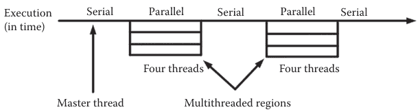

图 13.2 被串行执行隔开的多线程区域。线程团队（在本例中每个组四个线程）在此应用程序中至少被派生和合并了两次。

在上面的示例中，do/for 循环迭代通过 do/for 工作共享构造分配在各个线程之间。这两个指令（一个用于并行区域，另一个用于迭代）可以像之前所示那样组合为一个单一构造：

| Fortran | C/C++ |
|---|---|
| `!$omp parallel do` | `#pragma omp parallel for` |
| `do i=1,n` | `for(i=0;i<n;i++)` |
| `call work(i)` | `{` |
| `end` | `work(i)` |
| `!$omp end do` | `}` |
| `end` | `}` |

注意当我们将并行和 for 构造组合时，C/C++ 版本的工作共享构造缺少大括号 `{ }`。此外，并行化需要一个迭代计数器。OpenMP 会正确处理使用 `cycle`/`continue` 语句跳过迭代的情况。它不支持使用 `break` 或 `exit` 语句提前退出。图 13.3 展示了一个说明性的工作分配以及两种情况复制。

在最左侧的案例中，假设程序使用四个线程运行，相同的“代码”会在所有四个线程上执行。在中间的案例中，迭代 1 到 N 被分发了。由于数量相等，四个线程中的每个线程将执行 N 次迭代。在右侧的案例中，发生了复制和工作共享的混合：“code1”被复制，“code2”被共享，而“code3”被复制。

重要的是，包含多个工作共享的并行区域是可以合并的。将工作共享构造合并到单个并行区域中可以消除单独创建团队的开销。这种开销通常很小，但如果重复执行（例如在一个更大的循环内部），线程创建和删除的累积成本可能会很高。以下示例说明了这一点。

| PARALLEL | PARALLEL DO | PARALLEL |
|---|---|---|
| `(code)` | `do I=1,N4` | `(code 1)` |
| `END PARALLEL` | `(code 2)` | `do I=1,N4` |
| | `END PARALLEL DO` | `(code 2)` |
| | | `do I=N+1,3N` |
| | | `END DO` |
| | | `(code 3)` |

| i=N | i=1,2N | i=2N,3N | i=3N,1.4N |
|---|---|---|---|
| code | code | code | code |

| code 1 | code 1 | code 1 | code 1 |
|---|---|---|---|
| i=N | i=1,2N | i=2N,3N | i=3N,1.4N |
| code2 | code2 | code2 | code2 |
| code 3 | code 3 | code 3 | code 3 |

复制 (a)
工作共享 (b)

合并的：
复制与工作共享 (c)

图 13.3
(a) 无任何工作分配的并行区域，即工作复制。(b) 具有工作分配的并行区域。(c) 工作复制、分配和复制的结合。

| 分开的并行区域 | 合并的并行区域 |
|--- | --- |
| `!omp parallel do` | `!omp parallel` |
| `do i=1,n` | `!omp do` |
| `a(i)=b(i)+c(i)` | `do i=1,n` |
| `enddo` | `a(i)=b(i)+c(i)` |
| | `enddo` |
| `!omp end parallel do` | `!omp end do` |
| `!omp parallel do` | `!omp do` |
| `do i=1,n` | `do i=1,n` |
| `x(i)=y(i)+z(i)` | `x(i)=y(i)+z(i)` |
| `enddo` | `enddo` |
| `!omp end parallel do` | `!omp end do` |
| | `!omp end parallel` |

需要对并行区域的词法作用域（lexical scoping）和动态作用域（dynamic scoping）进行区分。

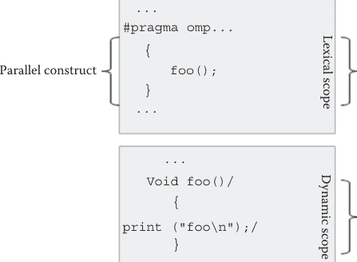

出现在并行指令词法范围之外的工作共享指令被称为“孤立工作共享构造”（orphaned worksharing constructs）。词法范围也称为“并行构造”。当处于动态范围（即在并行区域内调用的函数或子程序）时，工作共享构造的行为与并行区域内的工作共享构造（几乎）相同：变量具有调用者的私有属性。

当从并行区域外部遇到时（即从代码的串行部分调用），主线程是“线程团队”。OpenMP 允许在并行区域之外使用工作共享构造，例如：

```
#pragma omp for
```

或者

```
#pragma omp task
```

### 13.6.2 调度构造

迭代的分布由 `schedule` 子句控制。有四种调度类型：

- `schedule(static, chunk)`：线程按顺序接收块，如果未指定块大小，则为轮询。这种调度适用于工作量相等的情况。
- `schedule(dynamic, chunk)`：线程根据空闲情况动态获取块。这种调度适用于工作量变化的情况，但存在某些开销。
- `schedule(guided, chunk)`：线程接收块，但块大小会指数级缩小直到达到块大小。这种调度不仅实现了负载均衡，还减少了线程请求。
- `schedule(runtime)`：在这种情况下，调度由环境变量 `OMP_SCHEDULE` 决定，主要用于实验不同的调度句。

### 13.6.3 Sections 与 Tasks

另一种用于非迭代算法的工作共享构造类型是 sections（节）。Sections 用于将代码分成可以并行执行的块。线程可以执行多个块或一个块。Sections 需要封装在并行区域内。

| Fortran | C/C++ |
|---|---|
| `!$OMP SECTIONS` | `#pragma omp sections` |
| `!$OMP SECTION` | `#pragma omp section` |
| `CALL sub1()` | `{ func1(); }` |
| `!$OMP SECTION` | `#pragma omp section` |
| `CALL sub2()` | `{ func2(); }` |
| `!$OMP SECTION` | `#pragma omp section` |
| `CALL sub3()` | `{ func3(); }` |
| `!$OMP END SECTIONS` | `}` |

在上面的示例中，子程序 1 到 3 在不同的线程上执行，但不一定按照它们在代码中出现的顺序。

与 sections 目的类似的高级工作共享构造是 tasks（任务）。任务必须在单一构造中声明，以确保只有一个线程创建任务，并且任务保证在调度点（如 `taskwait` 或屏障，无论是隐式的还是显式的）处评估。一旦线程创建一个任务，它就会发送到任务队列，并行区域内的任何空闲线程都可以评估。Tasks 可以共享递归负载，如搜索树或链表，但 sections 无法做到。

```
#pragma omp single
```
只有一个线程应该创建任务并将其添加到任务队列，末尾隐含一个屏障

```
#pragma omp task
```
`func1();`

```
#pragma omp task
```
`func2();`

### 13.6.4 Single 与 Master

最后的工作共享构造是 "`single`" 和 "`master`"。标记有 "`single`" 工作共享构造的代码块将由单个线程执行，而代码块

科学技术计算导论

标记为“master”（主）的将在主线程上执行。只有“single”（单）在末尾有一个隐式同步（barrier）。其使用用例如所示。

| Fortran | C/C++ |
| --- | --- |
| `!$OMP single` | `#pragma single` |
| `glob_count = glob_count + 1` | `glob_count++;` |
| `print *, glob_count` | `printf("%d\n", glob_count);` |
| `!$OMP end single` | `}` |

## 13.7 数据作用域 (Data Scoping)

作用域子用于指定 OpenMP 如何处理并行区域中的变量。它们跟在指令之后，接受变量列表作为参数，并采用以下形式：

常用的作用域子包括：

- `private(variable list)`: 每个线程都拥有指定变量的私有副本。在工作共享区域结束后，这些变量将是未定义的。
- `shared(variable list)`: 线程共享指定变量的同一个副本。
- `default(type)`: 可以指定 `private`、`shared` 或 `none` 作为默认值。注意，工作共享构造的循环计数器始终是私有的；其他所有内容默认都是共享的。
- `firstprivate(variable list)`: 类似于 `private`，但副本使用主线程副本的值进行初始化。
- `lastprivate(variable list)`: 类似于 `private`，但最终值会被复制回主线程的副本中。对于 for/do 共享，会复制最后迭代；对于 sections（部分），会复制最后一个部分。
- `reduction(op:variable)`: 每个线程都拥有指定变量的私有副本。归约（reduction）只能出现在归约操作中。所有副本都会“归约”回原始的主线程变量中。

默认情况下，在 do/for 和 parallel do 中，索引变量自动是私有的。在构造内部定义的作用域变量（例如函数中的自动变量）默认是私有的。在以下示例中，for/do 循环的索引是私有的，而 "`a`" 是共享的。所有线程都可以访问 "`a`"的同一个存储区域，但每个内存位置仅由单个线程更新。

| Fortran | C/C++ |
| --- | --- |
| `!$omp parallel do shared(a), & private(t1,t2)` | `#pragma omp parallel for \n shared(a), private(t1,t2)` |
| `do i = 1,1000` | `for(i=0; i<1000; i++) {` |
| `t1 = f(i); t2 = g(i)` | `t1 = f[i]; t2 = g[i];` |
| `a(i) = sqrt(t1**2 + t2**2)` | `a[i] = sqrt(t1*t1 + t2*t2);` |
| `end do` | `}` |

一种“组合”多个元素以形成单个结果的操作，例如归约操作。累积结果的变量被称为归约变量。在并行循环归约中，必须声明操作符和变量。考虑以下代码段：

| Fortran | C/C++ |
| --- | --- |
| `real*8 asum, aprod` | `double asum, aprod` |
| `...` | `...` |
| `asum=0.0; aprod=1.0;` | `asum=0.0; aprod=1.0;` |
| `do i=1,n` | `for(i=0; i<n; i++) {` |
| `asum = asum + a(i)` | `asum = asum + a[i];` |
| `aprod = aprod * a(i)` | `aprod = aprod * a[i];` |
| `enddo` | `}` |
| `print*, asum, aprod` | `printf("%f %f\n", asum, aprod);` |

`asum` 和 `aprod` 在每次迭代中都会更新。为了通过 OpenMP 归约操作进行正确的并行化，需要对 `asum` 和 `aprod` 执行归约。否则，使用不同数量线程运行可能会因为竞态条件产生不同的结果（将在后续章节中讨论）。

| Fortran | C/C++ |
| --- | --- |
| `asum=0.0; aprod=1.0;` | `asum=0.0; aprod=1.0;` |
| `!$omp parallel` | `#pragma omp for` |
| `!$` | `{` |
| `!$omp do reduction(+:asum) &` | `#pragma omp for for \n reduction(+:asum) \` |
| `!$omp reduction(*:aprod)` | `reduction(*:aprod)` |
| `do i=1,n` | `for(i=0; i<n; i++) {` |
| `asum = asum + a(i)` | `asum = asum + a[i];` |
| `aprod = aprod * a(i)` | `aprod = aprod * a[i];` |
| `enddo` | `}` |
| `!$omp parallel` | `}` |
| `print*, asum, aprod` | `printf("%f %f\n", asum, aprod);` |

使用 `reduction` 子句，`asum` 和 `aprod` 有一个私有副本，并分别初始化为操作符的单位元 0.0 和 1.0。循环执行后，主线程收集每个线程的私有值，并通过对 `asum` 的加法和对 `aprod` 的乘法完成（全局）归约。

下面的示例说明了归约、lastprivate 和 firstprivate。在第一个循环中，每个线程的 `sum` 副本在循环结束时加到原始 `sum` 中。在第二个循环中，`tmp` 的最后一次（最后一个完成的线程的值）被复制回主线程；因此 `tmp` 将是 100。在最后一个循环中，每个线程将重复（即拾取）直到函数返回。

```fortran
sum = 0.0;
!$omp parallel do \
!$omp reduction (+:sum)
do i = 1,100
sum = sum + a(i)
end do
!$omp parallel do \
!$omp lastprivate(tmp)
do i = 1,100
tmp = a(i)
end do
print *, 'a(100) = '', tmp
```

```cpp
sum = 0.0;
#pragma omp parallel for \ reduction:(sum)
for (i=0; i<N; i++) {
  sum = sum + a[i];
}
#pragma omp parallel for \ lastprivate(tmp)
for (i=0; i<100; i++) {
  tmp = a[i];
  printf("a(100) = %d\n", tmp);
}
```

```cpp
int torf = true;
#pragma omp parallel \ firstprivate(torf)
while(torf) {
    torf = do_something(); // 示例逻辑
}
```


```fortran
logical torf = true;
!$omp parallel \ firstprivate(torf)
while(torf)
    torf = do_something()
!$omp end parallel
```

### 13.7.1 同步 (Synchronization)

为了同步线程，OpenMP 提供了三种构造：`critical`（临界区）、`atomic`（原子操作）和 `barrier`（屏障）。

`critical` 确保只有一个线程在运行时执行代码块。`atomic` 确保内存操作的原子性。`barrier` 确保所有线程都到达该点后才继续执行。

| Fortran | C/C++ |
| --- | --- |
| `!$omp critical` | `#pragma omp critical` |
| ... | ... |
| `!$omp atomic` | `#pragma omp atomic` |
| ... | ... |
| `!$omp barrier` | `#pragma omp barrier` |

## 13.8 更多语言构造 (More Language Constructs)

### 13.8.1 运行时库接口 (Runtime Library API)

OpenMP 运行时库还包含了一些辅助并行化、报告状态以及设置的函数。要使用这些库，在 C/C++ 中应包含 `"omp.h"`，在 Fortran 90 中应包含 `"omp_lib.h"`，并使用 `"omp_lib"` 模块。

| C/C++ 包含文件 | `#include <omp.h>` |
| --- | --- |
| Fortran 包含文件 | `include <omp_lib.h>` |
| Fortran 90 模块 | `use omp_lib` |

运行时库对用户提供了以下函数：

| 函数 | 操作 |
| --- | --- |
| `omp_get_num_threads()` | 返回线程团队的数量，返回整数 (N) |
| `omp_get_thread_num()` | 线程 ID (0 -> N-1) |
| `omp_get_num_procs()` | 机器核心数 |
| `omp_parallel()` | 是否在并行区域且有多个线程执行 |
| `omp_set_num_threads(#)` | 设置并行区域的线程数 |
| `omp_get_dynamic()` | 是否开启了动态线程 |
| `omp_set_dynamic(int)` | 设置动态线程状态（1/0 表示真/假） |
| `omp_get_wtime()` | 返回经过的时钟时间（双精度浮点数） |

# OpenMP 简介

### 13.8.2 环境变量

我们已经遇到过 `OMP_NUM_THREADS` 环境变量，它控制并行区域中创建的线程数。还有其他可用的环境变量，它们可以在不重新编译源代码的情况下更改应用程序中 OpenMP 构造的行为。

值得注意的是，环境变量的优先级通常在所有 OpenMP 构造中是最低的。例如，如果代码内部通过 `omp_set_num_threads()` 设置了线程数，那么通过 `OMP_NUM_THREADS` 环境变量更改线程数将不会改变应用程序运行线程数。

在大多数 OpenMP 环境中可以使用以下环境变量：

| 变量 | 说明 |
| --- | :--- |
| `OMP_DYNAMIC` | 指定 OpenMP 运行时库是否可以调整并行区域中的线程数 |
| `OMP_NESTED` | 如果启用，嵌套的 for 循环将分布到各个线程上 |
| `OMP_NUM_THREADS` | 设置并行区域中的最大线程数 |
| `OMP_SCHEDULE` | 修改所有 schedule (runtime) 工作负载的默认调度子 |

`OMP_SCHEDULE` 的一个典型用例是使用 `omp_get_wtime()` 对 OpenMP 应用进行基准测试，并尝试不同的调度策略：`static`（静态）、`dynamic`（动态）和 `guided`。这避免了每次实验都重新编译源代码的需求。

```c

#include <stdio.h>

#include <omp.h>

int main(int argc, char ** argv)

{

    double tick, to;
    tick = omp_get_wtime();
    #pragma omp for schedule(runtime)
    #pragma for (int i = 0; i < 1000; ++i) // some big loop
    {
        /* do some work */
    }
    to = omp_get_wtime();
    printf("The time difference was: %f\n", to-tick);
    return 0;

}
```

特定编译器（GNU Intel compilers）和特定机器（Cray 系统）还有其他环境变量。某些是针对高级用户的，例如 `OMP_STACK_SIZE`，它控制创建的（即非主线程）线程的栈大小，且仅用于调试（`GOMP_DEBUG`）。对于这些高级且特定于编译器/系统的环境变量，应当遵循良好的编程规范：保持简单，审慎使用。

## 13.9 实际问题

### 13.9.1 竞态条件

竞态条件是一种微妙的错误，多个线程可能会更新同一个内存位置，导致结果错误。应用程序将成功运行，但偶尔会返回错误的结果。这是一种非常危险的错误，并且很容易被察觉。以下测试可以帮助暴露和诊断此类错误：

- 重复运行 OpenMP 产生不同的结果。
- 使用不同数量的线程运行程序产生不同的结果，特别是从单线程（`OMP_NUM_THREADS=1`）到任意数量的线程之间。
- 更改调度程序产生不同的结果。
- 在 `do/for` 构造中使用 `ordered` 子句可以得到正确的结果，但将其移除后会产生不同的结果。
- 在其中一个 OpenMP 构造中添加 `sleep` 调用（以模拟处理器负载或增加工作负载）会影响结果。

竞态条件的一个简单示例如下：

| Fortran | C/C++ |
| --- | --- |
| `program main` | `#include<stdio.h>` |
| `implicit none` | `int main(int argc, char **argv)` |
| `integer count` | `{` |
| `count=0` | `int count=0;` |
| `!$omp parallel` | `#pragma omp parallel` |
| `count=count+1;` | `{ count=count+1; }` |
| `!$omp end parallel` | `printf("count is: %d\n", count);` |
| `write (*,) count is: "", count` | `}` |
| `end program main` | `}` |

由于 `count` 在线程间共享的，并且出现在赋值操作的左侧和右侧，人们可能在更新时对其进行读取，导致值不一致。同样的效果也会出现在 C/C++ 的自增运算符中：`count++` 或 `++count`。要修修复这种竞态条件，必须在周围添加单例或主类，以确保操作仅能产生与不带 OpenMP 顺序运行程序相同的结果。

同样，考虑以下代码段，其中 `[a]`、`[b]`、`c[]` 和 `d[]` 都是初始化为 1 的 N 大小数组。

```c

#pragma omp parallel shared(a,b,c,d) private(i)

{

#pragma omp for nowait

for(i=0; i<N;i++) a[i] = b[i]+c[i];

#pragma omp for

for(i=0; i<N;i++) d[i] = a[i]*b[i];

}
```

单线程运行每个代码会将 `a[]` 设置为 2 (1+1)并将 `d[]` 设置为 2 (2*)。并行运行会导致某些 `d[]` 产生不同的值。这是因为 `a[]` 在 OpenMP 构造间共享，并且出现在赋值操作的左侧和右侧，有两个或多个线程正在计算更新并使用它的值。

作为最佳实践指南，理解 OpenMP 构造中每个变量的作用域至关重要。手动分配作用域规则（哪些是私有的、哪些是共享的、哪些是归），有助于防止代码执行中的竞态条件和并行陷阱，特别是对于某些变量。

### 13.9.2 减少错误

代码开发很容易出错。以下是常见错误的不完整列表：

- 缺少编译器选项（忘记了 `-openmp` 或 `-fopenmp`）。
- 缺少 `do/for` 关键字：影响性能。
- 缺少 `parallel` 关键字：导致低性能。
- 缺少/忘记 `reduction`。
- 缺少/忘记 `private`。
- 不必要的或无意的并行化：这可能导致竞态条件。
- 在赋值操作的两侧并发使用共享变量：这是一个竞态条件。
- 未初始化的局部变量。
- 在顺序很重要时进行并行数组处理。

- 4. GNU 编译器：https://gcc.gnu.org/
5. Valgrind：http://valgrind.org/
6. DDD 调试器：https://www.gnu.org/software/ddd。

# 延伸阅读

Victor Eijkhout 的《高性能科学计算简介》：http://pages.tacc.utexas.edu/~eijkhout/istc.html。


# 14

# 使用 HDF5 实现可重启代码的检查点

Frank T. Willmore

+ 目录
14.1 检查点与重启................................................ 195
14.2 HDF5............................................................... 196
14.3 H 代表层级（Hierarchical）............................................... 196
14.4 安装与使用 HDF5....................................... 197
14.5 使用 HDF5 进行检查点与重启的模拟示例................ 197
14.6 HDF5 重启文件............................................... 200
14.7 重启.................................................................. 202
14.8 关于随机方法与重启的说明 ................. 203

# 14.1 检查点与重启

检查点（Checkpointing）是一种为代码提供容错能力的技术，特别是当代码运行在具有多个潜在故障点的复杂系统上，且消耗大量时间和/或资源时。它涉及对程序状态以及程序持续运行期间所有变量的值进行快照，并将其保存（通常保存到磁盘），这样如果发生故障（断电、硬件故障、网络中断等），程序可以从这些保存的状态信息处重启。随着并行化的不断演进，容错问题变得愈发尖锐。计算系统越大、越复杂，处理器和电路就越多，在模拟过程中系统在某一个点发生故障的可能性就越大。

主要的科研计算设施通常是独一无二的装置，故障被视为运行的常规部分。因此，它们现在要求用户代码采用适当水平的检查点，即使故障显然是服务提供商造成的，他们也将拒绝赔偿。如果代码在笔记本电脑上运行 10 分钟，它可能不需要检查点和重启功能。然而，如果它在研究集群的 1024 个或更多处理器上运行 100 小时，它绝对是需要的。

一个典型的检查点方案可能具有以下要求：

- 以固定间隔保存模拟状态的能力
- 在给定可执行文件和重启文件的情况下重启模拟的能力
- 读取模拟数据并可能在不同平台上重启的能力
- 检查/查看重启文件内容的能力
- 易于实现

196

科学与技术计算简介

## 14.2 HDF5

第五代层级数据格式（HDF5）是一种用于科学及其他类型数据存储、检索和共享的新兴标准，其精神与 PDF 作为可打印文档数字化的标准、RDBMS 作为关系型数据存储编码与检索的标准、XML 作为文档可读标记的标准、tar-zip 作为文件归档的标准等非常相似。除了数据外，HDF5 文件中还存储了元数据，且一个文件可以包含任意数量的数据集。HDF5 的主要目的是将硬件层从用户中抽象出来。你无需担心字节序（endianness），可以自由专注于你的科学、财务分析等工作，并将硬件方面交给 HDF Group* 的专业人士来处理繁重工作。通过将数据写入 HDF 格式的文件，你可以确保你、合作者、竞争研究人员，也许还有未来的你能够读取你编写的 HDF 数据文件，无论使用什么硬件、运行什么操作系统或使用什么语言编写代码。本章中的示例使用 Python，是因为 h5Py 这个 Python 到 HDF5 的接口非常易用并能说明其功能。Python、C、C++、Fortran 和 Java 都有相应的应用程序接口（API），其他接口也在开发中。此外，HDF5 的开发考虑了未来的兼容性，因此在 HDF5 中编写的文件在 10 到 20 年后读取，具有完全可读且兼容的合理预期。

尽管此示例中的调用是用 Python 编写的，但执行复杂内存访问的底层库是用 C 编写的，性能在 C 语言层面得到了原生优化，这非常接近硬件。考虑到并行 I/O 支持也在此层面进行处理，你通过 HDF5 利用了大量的 I/O 优化。

# 14.3 H 代表层级（Hierarchical）

平面文件（Flat files）是非常强大的工具，与标准 posix 工具结合使用可以完成大量工作。但在某些时刻，你需要提高你的技术水平，而 HDF5 允许你以灵活方便的格式将数字、图像、录音、视频、模拟结果以及字面上任何其他数字信息存储在单个可修改文件中，并以并行方式进行，它提供了极具前景的方法，允许此类信息在日后被读取。

HDF5 是附加元数据的重要格式，例如收集了什么、温度是多少以及任何你认为重要的内容。HDF5 因于几个非常重要的原因正受到关注。

* www.hdfgroup.org。

2016年10月28日

使用 HDF5 实现可重启代码的检查点 197

为了重现数字结果，以及共享数据。数字标准的引入为数据的成功共享奠定了基础，同时消除了数据类型、精度标准、格式以及许多可能出现的问题。

# 14.4 安装与使用 HDF5

HDF5 的安装取决于特定系统，如果你在大型服务提供商运行，他们很可能已经安装了。如果你维护自己的系统，你需要安装并行版本或串行版本（取决于你的设置和需求）或 Python 接口；例如，在 Debian Linux 系统上，这只需要

`$ sudo apt-get install libhdf5-serial-dev`
`$ sudo apt-get install hdf5-tools`
`$ sudo apt-get install python3-h5py`

这将安装 HDF5 库、工具和 h5py。需要注意的是，当直接使用 C 或 C++ 语言接口时，HDF5 提供了一些实用的脚本（`h5cc`、`h5cff` 和 `h5cpp`），它们封装了编译器，以便包含正确的库、头文件等。也可以手动完成，但这些脚本非常方便，其作用类似于你可能熟悉的 mpi 封装脚本 `mpicc`、`mpif90` 等。

# 14.5 使用 HDF5 进行检查点与重启的模拟示例

简单的一维（1-D）扩散分布：在具有 1024 个总位置的简单一维晶格中，在中间（512）右侧的一个点有 10000 个原子/单位。在每个时间步，每个原子都可以留在原地或跳跃，取决于随机的硬币掷。如果它跳跃，则向左或向右移动，同样取决于随机的硬币掷。我们将每个时间步将系统状态检查点（保存）到 HDF5 文件中。我们将通过指定重启文件和时间从给定的时间步重启程序。

代码是用 Python 编写的，并导入了 `h5py` Python 到 HDF5 的接口、`numpy` 数值包、用于解析命令行选项的 `argparse` 以及提供系统信息的 `platform` 模块，这些信息将作为元数据记录在重启文件中。整个代码包含在 `simulation` 文件中，如下：

```python

#!/usr/bin/env python

2

3 import h5py

4 import numpy as np
```

科学计算导论

import argparse
import platform
```

有一个函数可以操作 HDF5 格式的重启点文件，将当前的仿真状态写入状态，然后关闭该文件。文件模式 `'a'` 意味着可以向现有文件添加额外数据，如果文件不存在，则会创建它：

```python

def write_frame_to_restart_file(restart_file_name, time_step, lattice):
    restart_file = h5py.File(restart_file_name, 'a')
    restart_file["/" + simulation_name + "/" + str(time_step)] = lattice
    restart_file.close()
```

为仿真运行步数提供了默认值：`restart_time`，告诉系统应该在历史的哪个时间点重启仿真；`restart_file_name`，告诉应该使用哪个文件来重启仿真；最后是 `simulation_name`，因为一个给定的重启文件可以存储多个仿真的结果：

```python

# 默认值

run = 10
restart_time = 0
restart_file_name = "restart.h5"
simulation_name = "foo"
```

解析命令行参数，并用传入的值覆盖默认值：

```python

# 解析命令行参数

parser = argparse.ArgumentParser()
parser.add_argument('--run', nargs=1, type=int, help='run help')
```


`parser.add_argument('--restart_file_name', nargs=1, help='name of restart file')`

`parser.add_argument('--restart_time', nargs=1, type=int, help='restart the simulation at ..')`

`parser.add_argument('--simulation_name', nargs=1, help='simulation name')`

`args = parser.parse_args()`

```
if args.run != None:

    run = args.run[0]

if args.restart_time != None:

    restart_time = args.restart_time[0]

if args.restart_file_name != None:

    restart_file_name = args.restart_file_name[0]

if args.simulation_name != None:

    simulation_name = args.simulation_name[0]
```

# 使用 HDF5 实现重启的检查点代码

如果当前仿真真的不存在，则会添加一个重启文件和一个节点。元数据（在此情况下，关于系统信息以及托管仿真的平台操作系统的发行版本信息）将作为与仿真名称关联的属性记录在 HDF5 文件中：

```python
restart_file = h5py.File(restart_file_name, 'a')

# 如果不存在，则创建节点

if not "/" + simulation_name in restart_file:

    restart_file.create_group("/" + simulation_name)

# 将元数据作为属性写入重启文件

restart_file["//" + simulation_name].attrs.create("system", platform.system())

restart_file["//" + simulation_name].attrs.create("release", platform.release())
```

可能出现两种场景：要么代码作为重启被调用，这种情况下将从 HDF5 重启文件中加载状态；要么作为新仿真被调用，这种情况下显式指定初始条件，并将其记录为重启文件中给定的仿真名的第一帧。

```python
if args.restart_time != None: # 从重启文件加载状态

    restart_time = args.restart_time[0]

    lattice = restart_file["//" + simulation_name + "/" + str(restart_time)]

    time_step = restart_time

else: # 生成新仿真

    lattice = np.zeros(1024, dtype=int)

    lattice[0] = 1000

    time_step = 0

    # 如果存在则删除

    if "/" + simulation_name + "/0" in restart_file:

        restart_file.delitem("/" + simulation_name + "/0")

write_frame_to_restart_file(restart_file_name, time_step, lattice)
```

在本示例中，可以在任何点重启仿真。例如，即使仿真运行了 20 步，也可以从第 5 步重启。重启之前的步骤都会被删除。

```python
# 删除重启文件中的后续步骤

restart_time = 1 # 从这里删除

next_dataset = "/" + simulation_name + "/" + str(restart_time)

while next_dataset in restart_file:

    restart_file.delitem(next_dataset)

    restart_time += 1
```

在本示例中，仿真的实际代码（见下）很小，仿真的整个状态都包含在 `lattice` 变量中。这些值记录在重启文件中：

```python
# 运行仿真

while time_step < run:

    new_lattice = np.zeros(1024, dtype=int)

    for i in range(1024):

        sample = np.random()

        if i > 0 and i < 1023:

            if sample < 0.25:

                new_lattice[i-1] += 1

            elif sample < 0.75:

                new_lattice[i+1] += 1

            else:

                new_lattice[i] += 1

    # 保存该时间步

    lattice = new_lattice

    time_step += 1

    write_frame_to_restart_file(restart_file_name, time_step, lattice)

# 文件结束
```

## 14.6 HDF5 重启文件

为了加载 HDF5 重启文件，使用仿真名称、重启文件和步数的默认值运行仿真：

```bash
$ ./simulation.py
```

代码本身在命令行中没有输出，但 HDF5 重启文件包含了所有数据。我们可以通过命令行工具 `h5ls` 查看，它提供了类似 `ls` 的文件内容列表，而 `h5dump` 则导出文件顶层的所有信息：

```bash
$ h5ls restart.h5

Group
```

深入查看，可以看到 `foo` 组包含了仿真到为止每个时间步的数据集：

```bash
$ h5ls restart.h5/
0 Dataset {1024}
1 Dataset {1024}
10 Dataset {1024}
2 Dataset {1024}
3 Dataset {1024}
4 Dataset {1024}
5 Dataset {1024}
```

# 使用 HDF5 实现重启的检查点代码

```bash
6 Dataset {1024}
7 Dataset {1024}
8 Dataset {1024}
9 Dataset {1024}
```

使用 `h5dump`，可以看到 `foo` 组包含了我们分配的 `release` 和 `system` 元数据属性。我们看到了关于存储赋值值的各种元数据，在这种情况下 `release = "3.13.0-32-generic"` 且 `system = "Linux"`。我们看到了第一个数据集 `/foo/0` 及其包含的值，为了简洁起进行了截断。

```bash
$ h5dump restart.h5 | head -n 40
HDF5 "restart.h5" {
  GROUP "foo" {
    ATTRIBUTE "release" {
      DATATYPE H5T_STRING
      STRSIZE 17;
      STRPAD H5T_STR_NULLPAD
      CSET H5T_CSET_ASCII;
      TYPE H5T_C_S1;
    }
    DATASPACE SCALAR
    DATA {
      (0): "3.13.0-32-generic"
    }
    ATTRIBUTE "system" {
      DATATYPE H5T_STRING
      STRSIZE 5;
      STRPAD H5T_STR_NULLPAD;
      CSET H5T_CSET_ASCII;
      TYPE H5T_C_S1;
    }
    DATASPACE SCALAR
    DATA {
      (0): "Linux"
    }
  }
```

## 14.7 重启

现在我们看到了记录了什么。让我们尝试重启，为了好玩，我们现在用不同的名称运行它：

```bash
$ ./simulation.py --simulation_name bar --run 5
```

没有输出，但希望重启信息会被写入。让我们看看：

```bash
$ h5ls restart.h5
foo Group
bar Group
```

到目前为止一切良好。现在为新名为 'bar' 的仿真有了一个新条目。检查 `bar` 组，我们看到了每个时间步记录的数据集：

```bash
$ h5ls restart.h5/bar
0 Dataset {1024}
1 Dataset {1024}
2 Dataset {1024}
3 Dataset {1024}
4 Dataset {1024}
5 Dataset {1024}
```

现在我们将进行重启并查看 `bar` 组，发现它包含了新时间步的信息：

```bash
$ ./simulation.py --simulation_name bar --restart_time 5 --run 10
$ h5ls restart.h5/bar
0 Dataset {1024}
1 Dataset {1024}
10 Dataset {1024}
2 Dataset {1024}
3 Dataset {1024}
4 Dataset {1024}
5 Dataset {1024}
6 Dataset {1024}
7 Dataset {1024}
8 Dataset {1024}
9 Dataset {1024}
```

## 14.8 关于随机方法与重启的说明

随机模拟结果的可重复性取决于随机数生成器结果的可复现性；在并行计算的情况下，它可能取决于归约操作中元素组合的顺序。在本示例中，随机数生成器的状态没有保存。这意味着在本次模拟中，结果在统计上是等价的，但并非完全相同。这与此处相关，且最好在更广泛的随机模拟主题下讨论，但此处值得提一下。如果你愿意，可以将其作为一项练习，并作为一个新功能，添加指定新种子值的能力，然后为新的时间步创建一个新的重启文件。


# 15

# 线性代数库

Victor Eijkhout

# 目录

- 15.1 引言............................................................................... 205
- 15.2 选择库...................................................................... 206
- 15.3 BLAS........................................................................................... 207
- 15.3.1 向量操作............................................................... 208
- 15.3.2 矩阵-向量操作............................................... 208
- 15.3.3 矩阵-矩阵操作.............................................. 210
- 15.4 LAPACK...................................................................................... 211
- 15.4.1 其他存储格式....................................................................... 212
- 15.4.2 并行性.................................................................... 212
- 15.5 用于并行线性代数的 PETSc 库................ 212
- 15.5.1 PETSc 中包含什么？................................................................ 213
- 15.5.2 PETSc 工作流....................................................... 213
- 15.5.3 并行性.................................................................. 214
- 15.5.4 对象导向...................................................... 215
- 15.5.5 示例............................................................... 215
- 15.5.5.1 线性系统示例......................................................... 215
- 15.5.5.2 有限元示例.................................................. 216
- 15.5.6 PETSc 使用方法............................................................... 217
- 15.5.6.1 PETSc 与 Python............................................... 217
- 15.5.7 运行时选项....................................................... 217
- 15.5.8 性能分析................................................................... 218
- 15.5.9 调试.................................................................. 218

参考文献......................................................................................... 218

## 15.1 引言

线性代数是几乎每个科学软件包的基础构建模块：向量相加、特征值计算和矩阵乘法构成了从分子动力学到有限元（FE）模拟等内容的基础。由于线性代数在科学计算中无处不在，许多新的计算科学家在项目需要时可能会尝试自己编写乘法例程。本章的目的是通过介绍快速、免费的线性代数库来帮助大家抵御这种诱惑，从而节省时间并避免挫败。我们讨论了基础线性代数程序（BLAS）、线性代数包（LAPACK）以及科学计算可移植扩展工具包（PETSc）线性代数库，每种库都提供了解决不同规模和结构线性代数问题的能力。

使用库而不是从零编写算法的原因有两个：程序员的生产力和代码质量。一旦算法在库中被证明是正确的且具有包含性，它就能让程序员专注于将算法用于有用的科学研究，而不是去调试已经在其他地方存在的代码。另一个使用库的原因是为了性能：专业库提供的优化算法比朴素实现要快几个数量级。事实上，BLAS 和 LAPACK [1] 现在已是线性代数的事实标准，硬件供应商（例如 Intel 和 AMD）创建了 BLAS 和 LAPACK 库的优化版本，这些版本专门针对其中央处理器（CPU）指令集进行了调优。从用户的角度来看，这允许你以一种与架构无关的方式编写科学软件，并通过针对相应的 BLAS 或 LAPACK 库编译代码，轻松将其移植到其他平台。

本章讨论的三个尺度及相应的软件包如下：

- 2. 线性代数包（LAPACK）在 BLAS 的基础上构建，提供线性方程求解和特征值例程。LAPACK 中的并行性限于多核并行。
- 3. 大规模、分布式内存并行性引入了另一层复杂度 [2,3]。这由 PETSc 等库进行涵盖。

## 15.2 选择库

由于针对不同的处理器架构和开发环境有许多线性代数库实现，选择一个库可能会让人感到无从下手。BLAS 和 LAPACK 的参考实现很容易下载，可以在 Netlib 网站（http://www.netlib.org）获取。Netlib 实现对于学习如何使用 BLAS 和 LAPACK 非常有用，但没有针对性能进行优化。同样，GNU 科学库（GSL: https://www.gnu.org/software/gsl/）提供了一个未优化的 BLAS 实现，可以通过大多数包管理器轻松安装，并可以轻松地链接到像 ATLAS 这样的优化库。流行的性能调优的实现包括但不限于：

- Intel 内核库（MKL），它随 Intel 编译器一起提供：https://software.intel.com/en-us/intel-mkl
- AMD 核心数学库：https://developer.amd.com/tools-and-sdks/archive/amd-math
- BLAS 类的实例化软件（BLIS）库包含许多架构的内核：https://github.com/flame/blis

# 线性代数库

- 自动调优线性代数软件（ATLAS）库为 BLAS 提供了 C 和 Fortran 接口（APIs）：http://math-atlas.sourceforge.net/


- `vecLib`，Apple 的实现：https://developer.apple.com/library/

- 用于 NVIDIA 图形处理器（GPU）的 `cuBLAS` 库：https://developer.nvidia.com/cublas

- 用于异构计算的 `cblas`：https://github.com/clMathLibraries/cblas

对于新手，选择一个在开发环境中容易安装的实现。结论是，使用任何 `BLAS`/`LAPACK` 实现都比没有要好，在使用这些例程开发后，你可以通过编译不同的库来比较性能。

## 15.3 BLAS

正如 `BLAS`、`LAPACK` 和 `PETSc` 解决的问题分为三个层次一样，`BLAS` 库本身也被分为三个层级的问题：

- `BLAS` 第 1 级操作处理向量，对于长度为 $n$ 的向量，典型的复杂度为 $n$。典型示例是向量加、计算内积或应用 `Givens` 旋转 [4]。

- `BLAS` 第 2 级操作是矩阵-向量积，复杂度为 $n^2$，例如矩阵-向量积。

- 最后，`BLAS` 第 3 级操作是在矩阵之间进行的，典型示例是矩阵乘法，其复杂度为 $O(n^3)$。

有数百种不同的 `BLAS` 例程，其中某些密切相关。为了在区分例程的同时保持名称相对简洁，`BLAS` 采用了结构化的命名方案，格式如下：

```
X : 精度
XYZZZ: YY : 矩阵类型
ZZ : 操作
```

“精度”字符可以是 `S`（单精度）、`D`（双精度）、`C`（单精度复数）和双精度复数。指示矩阵类型的两个字符描述了存储方式和数学属性。例如，`GE` 代表通用矩形，`GT` 代表通用三角形，而 `PB` 代表正定带状矩阵，`PO` 代表正定矩阵。用于描述操作的（最多三个）字符使用缩写，例如 `MM` 代表矩阵乘法，`TR` 代表三角形分解。了解这些规则有助于查找有关例程的信息。

你可能想在代码中使用它。如果你知道要乘以两个双精度通用矩形矩阵，可以应用上述规则生成 `dgemm` 作为一个可用的例程，并搜索“`dgemm documentation`”。

`BLAS` 命名规范是 Fortran 早期版本的产物，当时函数名被限制为六个字符。原始的 `BLAS` 例程是用 Fortran 编写的，且现在的参考实现仍然用 Fortran 编写。因此，在 Fortran 中调用 `BLAS` 例程非常简单。要在 C/C++ 程序中使用 Fortran 例程，大多数用户将利用库提供的接口，或者直接调用 Fortran 函数（并进行相应的函数名和参数处理，以及适当链接）。

### 15.3.1 向量操作

为了演示如何在程序中使用 `BLAS` 例程，我们从一个缩放向量分量的代码片段开始。在这个示例中，我们考虑一个双精度向量 `xarray` 并使用 `dscal` 将该向量的每个元素乘以该值：

```c
// example1.f90
do i=1,n
xarray(i) = 1.d0
end do
call dscal(n,scale,xarray,1)
do i=1,n
if (.not.assert_equal( xarray(i),scale ))
print *,"Error in index"
end do
```

`dscal` 函数的参数分别是向量的长度（整数）、缩放因子（双精度）、要缩放的向量（双精度，维度为 `(*)`）以及步长（整数）。步长指定了增量步长的大小。例如，如果步长为 2 而不是上面示例中的 1，则向量的奇数位元素将进行缩放。上述 Fortran90 代码的 C 语言实现片段如下所示：

```c
// example1.cxc
xarray = new double[n]; yarray = new double[n];
for (int i=0; i<n; i++)
xarray[i] = i;
cblas_dscal(n,scale,xarray,1);
for (int i=0; i<n; i++)
if (!assert_equal( xarray[i],scale ))
printf("Error in index %d\n",i);
```

### 15.3.2 矩阵-向量操作

处理矩阵操作的 `BLAS` 例程通常比处理向量的函数多得参数。这是由于矩阵元素存储在连续的内存位置上：第七和第六个元素（图 15.1 中的索引 5 和 6）位于相邻的内存区域，但在矩阵数学中它们被处理为位于不同的行。为了让 `BLAS` 能够处理矩阵的形状

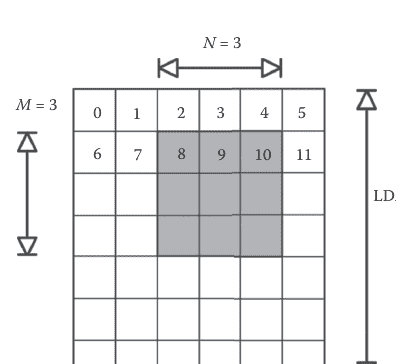

**图 15.1**

矩阵元素存储在内存的连续元素中，因此矩阵例程需要知道宽度 `N`、高度 `M` 和主维度 `LDA` 才能正确处理矩阵的形状。在这里，在一个较大的 `N = 6, M = 7` 矩阵中，阴影了一个灰色的 `M 3, N = 3` 子矩阵。矩阵前 12 个元素的索引已标出。

为了处理形状（子矩阵，图 15.1 中的灰色阴影区域），我们必须向大多数矩阵例程传递矩阵的高度 `M`、宽度 `N` 和主维度 `LDA`。以 `dgemv` 为例，用于计算矩阵-向量积：

```fortran
subroutine dgemv(character TRANS,
integer M, integer N,
double precision ALPHA,
double precision, dimension(lda*) A, integer LDA,
double precision, dimension(*) X, integer INCX,
double precision BETA, double precision, dimension(*) Y, integer INCY
)
```

它为双精度向量 `A`、向量 `x` 和标量 $\alpha$ 计算 $y \leftarrow \alphaAx + \betay$。除了上述尺寸参数外，`dgemv` 还需要一个字符参数 `TRANS`（可以是 `N` 或 `Y`），用于指定在计算中使用 `A` 还是还是转置矩阵。该例程的示例如下：

```fortran
// example3.F90
do j=1,n
xarray(j) = 1.d0
doo i=1,m
  matrix(i,j) = 1.d0
end do
alpha = 1.d0; beta = 0.d0
call dgemv('N',M,N, alpha,matrix,M, xarray,1, beta,yarray,1)
do i=1,m
if (.not.assert_equal( yarray(i),dble(n )) & &
  print *,"Error in index",i, ":",yarray(i)
end do
```

相同的 C 语言示例有一个额外的参数，用于指示矩阵是按行主序还是列主序存储；在此示例中，我们使用值 `CblasColMajor` 来表示使用了 Fortran 的列存储：

```cpp
// example3c.cxx
for (int j=0; j<n; j++) {
    xarray[j] = 1;
    for (int i=0; i<m; i++) {
        matrix[i+j*m] = 1;
    }
}
```

科学技术计算引言

如上所述，我们估计矩阵 $a$ 是由参数 $n$、$lda$ 指定的。向量 $b$ 的大小为 $n$，但还有一个进一步的参数 $nrhs$：如果 $nrhs>1$，则你实际上可以同时求解多个线性方程组。如果 $nrhs$ 大于1，则还有一个额外的参数 $ldb$，用于指定 $b$ 的主维度。

接下来你会发现，没有用于输出向量的参数；相反，输入的 $b$ 会被覆盖。事实上，在该例程执行完成后，矩阵 $a$ 会被覆盖；它将包含矩阵的下三角 `LU` 分解。这是 `LAPACK` 的典型特征：该库对临时空间非常慷慨；如果你想保存矩阵的值，需要自己制作一个副本。这也是为什么包含因子分解主元元的整数数组 `ipiv` 需要由用户提供的原因，尽管用户可能永远不会去调用它。

作为 `LAPACK` 高功能的一个示例，存在如 `dgecon`（计算矩阵条件数）等例程，它们可以用于基于矩阵的算法的误差估计。

## 15.4.1 其他存储格式

除了通用矩阵（内存中元素连续的正方形和矩形矩阵）外，`BLAS` 和 `LAPACK` 还可以处理两种额外的矩阵结构。“压缩”`Packed` 矩阵用于编码对称和厄尔米矩阵，这些矩阵由其一半的元素决定。“带状”`Banded` 矩阵格式用于编码除带状区域所有元素均为零的矩阵。即，对于非零整数 $p$ 和 $q$，当 $j < i-p$ 或 $j > i+q$ 时，矩阵元素 $a_{ij} = 0$。

## 15.4.2 并行

如今市场上的大多数处理器采用多核设计：每个处理器包含多个独立的处理元素，由于它们操作相同的内存，可以分分问题。还有一种类型的并行性用于集群计算机：分布式内存并行。对于后一种类型的并行性，还有进一步的库；我们提到了 `Scalap` [2] 和 `Elemental` [3] 库。

`BLAS` 和 `LAPACK` 库支持共享内存并行，实际上使用的是相同的 API。例如，Intel `MKL` 库具有大多数例程的多线程版本。多线程例程通常用于依赖并行代码段的单线程应用程序中（例如在库例程中），以实现并行化。另一方面，如果用户对整个应用程序进行并行化，并且 `BLAS` 例程是从并行线程调用的，则应该传统的单线程例程。后一种场景在应用程序使用分布式内存编程并独立运行时时也应该使用。

## 15.5 用于并行线性代数的 PETSc 库

`BLAS` 和 `LAPACK` 中的例程只关注稠密矩阵，即存储为矩形数组的矩阵。然而，在某些物理和工程应用中，矩阵是稀疏的，这意味着它们可能有许多零元素，你可能希望采用专门的格式以防止存储零并对其进行操作。尽管在标准化稀疏矩阵操作方面做了一些努力，但还没有哪一个被采用。因此，每个稀疏矩阵包都有自己的内部格式。在本章中，你将看到一个应用不同且设计不同的库，它具有作为工具箱的小型例程。

科学计算便携扩展工具包 `PETSc` 和 `LAPACK` 都认为线性系统是一个共同关注点，但产生于有限元素 `FE` 计算的而非稠密系统。虽然 `LAPACK` 限于共享内存，但 `PETSc` 可以通过使用消息传递接口 `MPI` 在单处理器或分布式内存中使用。

由于多种原因，稀疏方程组系统比稠密系统更难处理。其一是软件没有标准化：没有稀疏版的 `BLAS` 或 `LAPACK`。另一个是问题的不规则性使得并行编程比稠密情况困难得多。由于这些原因，像 `PETSc` 这样强大的库（著名的竞争对手是 `Trilinos` 和 `Hypre`）成了计算流体力学 `CFD` 及相关领域大多数计算研究的基础。

在本章中，你将看到 `PETSc` 的一些基础、它的线性系统求解设施，以及关于该库如何与其他软件包交互的一些说明。

### 15.5.1 PETSc 中包含什么？

`PETSc` 库主要用于解决解决来自典型工程应用的线性代数问题。例如，它支持从有限差分和有限元素构建系数矩阵和雅可比矩阵。然后，有一系列大量的线性和非线性系统求解器，用于有限差分和单元的类型稀疏系统。这些都是高度可定制的。

此外，`PETSc` 支持调试和性能分析，并包含了各种支持线性代数的实用工具。

主要的并行模式是通过 `MPI`，但也有对 `GPU` 和线程的支持。

### 15.5.2 PETSc 工作流

`PETSc` 的核心是一系列线性系统求解器，主要用于稀疏线性系统。本着工具箱的精神，这些例程都不是单体的：你通过许多库例程来组装和自定义求解器的定义。例如，线性系统求解器 `KSPSolver` 至少需要以下调用：

```
KSPCreate(...); // 创建求解器对象
KSSetType(...); // 设置求解器类型
KSSetOperators(...); // 设置系数矩阵
KPSolve(...); // 实际求解调用
```

根据选择的求解器类型，有许多其他例程可以自定义定义。

与传统的库（如 `LAPACK`）不同，在 `LAPACK` 中用户构造矩阵和向量数组并将它们传递给库，而在 `PETSc` 中，构造也是通过库例程完成的。创建矩阵的典型工作流如下：

```
MatCreate(...); // 创建矩阵
MatSetType(...); // 设置矩阵类型
for (... i ...):
  for (... j ...):
    MatSetValue(... i j ...); //填充矩阵值
MatAssembly();
```

草图表明 `PETSc` 确实是一个用于组合程序的工具箱，而不是一个为特定活动调用的库。

### 15.5.3 并行性

`PETSc` 对并行性的处理非常灵活，对程序员的要求极小。例如，你需要设置向量和矩阵类型为单处理器或并行，但之后，程序的其余部分独立于该决策。你甚至可以在单处理器上运行你的程序，其效率与单处理器程序相同。

向量和矩阵通过对列维划分进行并行化：每个进程获得连续的向量索引或矩阵行。例如，大小为 100 的向量被分配到 10 个进程，每个进程 10 个连续索引。如果进程数不能整除向量，剩余将以合理的方式分散。

也可以显式指示分布：向量大小指定如：

```
VecSetSize( vec, local_size, global_size );
```

其中本地大小或全局大小都可以交给 `PETSc` 处理。

并行填充矩阵或向量的元素不需要太大心：你希望每个元素被构造一次，因此进程需要知道哪些向量元素矩阵行。为了这个目的，如下调用

```
MatGetOwnershipRange(A, &first, &last);
```

存在于该范围。这使得矩阵创建代码如下：

```
MatGetOwnershipRange(A, &first, &last);
for ( i=first; i<last; i++)
  for (... j ...):
    MatSetValue(... i j ...); //填充矩阵值 (i,j)
```

另一方面，处理器拥有矩阵的一部分并不意味着它需要设置这些元素。`PETSc` 在处理并行方面非常灵活；例如，如果矩阵从文件读取，一个处理器可以完成读取和所有的元素设置。上述的 `MatAssembly` 调用随后会在原地移动所有数据。

## 15.5.4 面向对象

`PETCS` 库的设计灵感来源于面向对象的编程原则。这并不意味着该库是用面向对象的语言编写的，也不意味着你会在这样的环境中使用它：`PETCS` 是 C 语言编写的，通常你会在 C 或 Fortran 中使用它。它提供一个 Python 接口，将在第 15.5.6.1 节中简要讨论。另一方面，其设计显然利用了多态和继承。

例如，当你创建一个矩阵并确定其类型时，在两种情况下，“矩阵类”的接口都是可用的，且语法相同：库会在底层解析并决定调用哪些特定的例程。在分布式矩阵上调用完全顺序执行的方法会导致运行时错误。

## 15.5.5 实例演示

通过两个示例。在第一个示例中，矩阵的构建是直观的。第二个示例与第一个相同，不同在于我们展示了如何在有限元的范围内构建矩阵。

### 15.5.5.1 线性方程组示例

作为第一个示例，让我们创建一个三对角矩阵并用它来求解线性方程组。具体来说，我们将求解一维泊松方程：

$\begin{pmatrix} 2 & -1 & & \ -1 & 2 & -1 & \ & & \ddots & \ddots \ & & -1 & 2 \end{pmatrix} \begin{pmatrix} x_1 \\ x_2 \\ \vdots \\ x_n \end{pmatrix} = \begin{pmatrix} b_1 \\ b_2 \\ \vdots \\ b_n \end{pmatrix}$

该矩阵的对角线元素为 2，非对角线元素为 -1。构建如下：

```c
// 遍历此处理器上的矩阵元素
int my_first, my_last;
MatGetOwnershipRange(A, &my_first, &my_last);
for (int row=my_first; row<my_last; row++) {
    // 设置对角线元素
    int col = row; v=2;
    MatSetValue(A, row, col, v, INSERT_VALUES);
    // 设置下对角线元素
    col = row-1; v=-1;
    if (col>=0) {
        MatSetValue(A, row, col, v, INSERT_VALUES);
    }
    // 设置上对角线元素
    col = row+1; v=-1;
    if (col<number_of_rows) {
        MatSetValue(A, row, col, v, INSERT_VALUES);
    }
}
MatAssemblyBegin(A, MAT_FINAL_ASSEMBLY);
MatAssemblyEnd(A, MAT_FINAL_ASSEMBLY);
```

这里的循环边界选择是为了确保每个处理器只设置存储在本地的元素。下面是一个并非如此示例。创建一个全为 1 的右侧向量。这仅用于测试；在实践中，你将有一个与矩阵构建类似的构建循环。

```c
Vec sol,rhs; double one=1;
VecCreate(comm,rhs);
VecSetType(rhs, VECMPI);
VecSetSizes(rhs, PETSC_DECIDE,number_of_rows);
VecDuplicate(rhs,&sol);
VecSet(rhs,one);
```

最后，我们可以求解线性方程组：

```c
KSP solver;
KSPCreate(comm,solver);
KSPSetOperators(solver,A,A);
KSPSetOptions(solver);
KSPolve(solver, rhs,sol);
```

在这里，在选择使用何种求解器时，我们使用了所有的默认选项。注意 `PETSC` 并不智能：它将使用默认选择，这可能适用于你特定的线性方程组，也可能不适用。调用求解器例程并不等于实际上求解了线性方程组：求解器可能未能默认迭代次数达到所需的精度。由于求解器例程不返回进一步的信息，我们需要更多的调用：

```c
KSPConvergedReason reason;
KSPGetConvergedReason(solver)
```


此代码段说明了 `PETSC` 的工具箱性质：由于无法预见用户的每一个需求，`PETSC` 选择提供许多小型例程来构建用户程序，而不是少数全能的例程。

### 15.5.5.2 有限元示例

我们上面用于构建矩阵的方案适用于许多应用，包括有限差分法。在有限元的情况下，情况要复杂得多。在那里，矩阵元素是若干有限元贡献之和，而这些元素可能属于不同的进程。我们对有限元进行并行化，而不是对矩阵元素。有限元矩阵构建代码可能如下：

```c
for ( e=my_first_element; e=my_last_element; e++))
  for ( ... ni ... ) // 遍历元素节点
    for ( ... nj ... ) // 遍历元素节点
      I = translate_to_global(e,ni)
      J = translate_to_global(e,nj)
      MatSetValue( ... I,J, ... ADD_VALUES );
```

其中参数 `ADD_VALUES` 表示该调用不是设置矩阵元素，而是对其进行贡献。

### 15.5.6 PETSc 使用

使用 Python 的主要优势是 `PETSc` 被无缝集成。

```python
# ... (示例代码)
```

情况要复杂得多。在那里，矩阵元素是若干有限元贡献之和，而这些元素可能属于不同的进程。

### 15.5.7 运行时选项

有很多选项涉及矩阵类型、求解器类型等。找到这些选项的方法是查阅参考。例如，代码 `SetUp(solver,KSPCG)`（选择共轭梯度法）可以通过命令行 `-ksp_type` 进行覆盖，以选择双共轭梯度法。

```python
# ... (示例代码)
```

```python
A = PETSc.Mat()
A.setSizes(N, )
solver.solve( b,x )
```

### 15.5.8 性能分析

`PETSc` 有各种性能分析工具。分析代码最简单的方法是添加命令行选项 `-log_summary`，它会根据性能输出 `PETSC` 例程的细分。对于更复杂的分析，你可以添加自己的事件。

```c
PetscLogRegister( ... ); // 创建事件
PetscLogBegin( ... ); // 表示开始
PetscLogEnd( ... ); // 表示结束
```

### 15.5.9 调试

`PETSc` 以多种方式提供调试辅助。例如，在运行时异常（可以捕获）的情况下，会显示调用树的回溯。此外，还可以捕获多种内存错误；如果你使用 `PETSc` 的分配例程，这甚至扩展到用户代码。

# 16 使用加速器的并行计算

İanç Şenocak, Haoqiang Jin

## 目录

- 16.1 引言............................................................................................... 219
- 16.2 NVIDIA CUDA 架构........................................................................... 220
- 16.3 Intel 许多集成核心架构 (MIC)........................................................ 221
- 16.4 二维波方程.................................................................. 222
- 16.5 针对 CPU 的串行 C 实现...................................................................... 223
- 16.6 使用 OpenACC 的 GPU 并行实现................................................................ 224
- 16.7 使用 OpenMP 的 Intel Xeon Phi 并行实现.............................................. 227
- 16.8 使用 CUDA 的 GPU 并行实现....................................................... 228
- 16.9 性能讨论................................................................................ 230
致谢.................................................................................................... 232
参考文献........................................................................................................... 232

## 16.1 引言

在过去的十年中，出现了多种硬件和软件技术，旨在科学和技术计算领域建立一种现代计算范式。这些技术中某些受到了关注并被数千用户采用（例如，计算统一设备架构 [`CUDA`]），尽管投入了巨大资金，但也有逐渐被冷落（例如洛斯阿尔莫斯国家实验室 Roadrunner 中的 IBM Cell 宽带引擎，这是第一台千万级超级计算机）。如今，所有的超级计算机都采用了并行多线程架构。在本章中，我们将展示如何在科学和技术计算的背景下使用多线程架构。

向多核的始于 2005 年左右，当时处理器时钟频率的增加达到了无法管理的发热水平。从那时起，时钟速度保持平稳，但芯片上的核心数量一直在增加。二十年前，我们谈论的是房间大小的 64 节点 Blue 集群，每个节点有一个核心处理单元 (`CPU`)。而今天，一个 Intel Xeon E7-8890 v3 处理器拥有 18 个核心，现代主板可以在一个服务器节点中处理四个处理器，`CPU` 总数达到 72 个。Intel Xeon Phi 在单个芯片上允许 61 个核心，而图形单元 (`GPU`) 则提供了数千个核心（例如 NVIDIA 的 Tesla K40 拥有 2880 个核心）。`GPU` 的核心数量更多，是因为这些核心主要为数值计算设计，控制逻辑较少；而 `CPU` 核心的设计旨在完成许多任务，从数值计算到运行操作系统均涵盖。

硬件的进步始终需要新的编程模型和软件技术相匹配，以获得卓越的计算性能。为此，`CUDA` [1] 和开放加速器 (`OpenACC`) [2] 被开发出来以更好地利用 `GPU` 的并行性。开放多线程 (`OpenMP`) 4.0 规范 [3] 已于 2013 年正式发布，提供了一个同时支持 Intel Xeon Phi 多核架构和 `GPU` 的模型。截至 2015 年 8 月，针对 `GPU` 的 `OpenMP` 4.0 规范编译器实现正在进行中。

在接下来的章节中，我们的目的是介绍 NVIDIA 计算统一架构 (`CUDA`) 和 Intel 许多集成核心 (`MIC`) 架构的关键特征。“加速器”一词具有更广泛的含义，指的是 `GPU` 和 Intel Xeon 处理器。我们将有限差分法应用于一个易于处理的原型，以说明 `OpenACC`、`CUDA` 和 `OpenMP` 的特征，并比较它们的性能（详情请参见 `CUDA` 用户指南 [1]）。

## 16.2 NVIDIA CUDA 架构

现代 `GPU` 是大规模并行计算平台，是细粒度并行的理想选择，可以同时处理许多线程。`GPU` 以其高核心数和高带宽令人印象。NVIDIA 的 Tesla K40 拥有 2880 个核心，内存带宽为 288 GB/s。`CUDA` 的一个关键区别特性是用极小的开销创建许多线程。`GPU` 上的线程数量远超过核心数量。与 `CPU` 线程相比，`GPU` 线程是轻量级的，因为它们不存储自己的状态。`CUDA` 允许程序员控制 `GPU` 上的线程数量和内存组织；允许熟练的程序员为特定程序优化地利用 `GPU` 硬件。因此，这需要对线程调度执行以及每种内存类型的延迟有详细了解（详情请参见 `CUDA` 用户指南），但某些经验法则有助于获得良好的性能。

`CUDA` 引入了线程层次结构，允许将多线程程序表示为线程块（grid）的网格。每个线程块随后会在空间可用时被调度到流式多处理器 (`SM`) 上进行处理。该特性是 `GPU` 上计算可扩展性的关键。`SM` 是 `GPU` 上的一组核心，用于处理一个线程块。Tesla K40 的 2880 个核心分布在 15 个 `SM` 上，每个 `SM` 有 192 个核心。除了线程块外，32 个线程的配置被称为一个线程束（warp）。一个线程束在 `SM` 上同步计算单条指令。另一个概念是半线程束（half-warp），其中全局内存访问合并在单个事务中。然而，从性能角度来看，创建线程数为 16 倍倍数的线程块是有益的。对于 Tesla K40，每个多处理器的最大线程数为 2048，性能的最佳实践是每个线程块 256 或 512 个线程。

除了线程层次结构外，`CUDA` 还提供了内存层次结构。存在不同的内存空间，其读写性能不同，有快慢。设备上的全局内存可以很大（例如 12 GB）。设备上的全局内存可以被访问，但访问速度较慢。所有线程都可以访问 L1 缓存。共享内存速度，但容量较小。在 NVIDIA Kepler 架构中，共享内存是快速的。默认情况下，每个线程有 64 KB 的共享内存。对于计算能力为 3.0 及以上的设备，每个线程有 48 KB 的共享内存。寄存器是线程私有的内存。当寄存器不足时（即寄存器压力），寄存器会溢出到本地内存。寄存器是非常快的。内核中定义的变量存储在寄存器中。常量内存正如其名所示，对于计算中的常量参数是理想的。常量内存的总大小为 64 KB。`CUDA` 中的最后一种内存类型是纹理内存，它对某些应用程序是有的。纹理内存是所有线程可访问的只读内存。它在芯片上缓存。对于内存访问模式具有空间局部性的应用程序有利。为了深入介绍 `CUDA`，我们参考 Ruetsch 和 Facha [4]、Sanders 和 Kandror [5] 以及 Kirk 和 H [6] 编写的优秀著作。

## 16.3 Intel 许多集成核心架构

Intel 的许多集成核心 (`MIC`) 架构是现代加速器技术的另一个例子，它推动了并行计算的边界。它将许多较低功耗的 Intel 核心组合在单个芯片上，以实现高并行度和更好的能效。与 `GPU` 加速器相比，基于 `MIC` 的加速器的优势在于 Xeon Phi 扩展了 x86 指令集以支持宽向量处理，并标准的编程模型，如消息传递接口 (`MPI`)、`OpenMP` 以及混合 `MPI` + `OpenMP`，使得开发更加简单。当前的 Xeon Phi 通过 PCI Express 总线连接到主机。主机处理器驱动加速器的操作和计算。下一代 Xeon Phi (`Knights Landing`) 提供了作为独立处理器运行路径，与普通的 Xeon 处理器兼容。

典型的 KNC 加速器包含 60 多个核心，运行频率较低（1.05–1.2 GHz）以降低功耗。每个 KNC 能够处理四个硬件线程，但 KNC 核心上的线程每隔周期只能发射一次指令。因此，每个核心至少需要两个线程才能充分利用资源。每个核心支持 512 位宽向量指令，而主机处理器为 256 位，并具有 512 KB 的 L2 缓存。每个核心周期提供双精度浮点运算。芯片上的内存限制为 64 GB，不与主机处理器共享。与主处理器的通信必须通过 PCI Express 总线。

Xeon Phi 运行在轻量级的微 Linux 操作系统（Intel 许多核心平台软件栈 [`MPSS`]）上。Intel 提供了编译器和库，包括支持用于应用程序开发的 `OpenMP` 和 `MPI` [7]。对于 Xeon Phi 加速器，应用程序的编程和执行本质上有两种模式：

- 卸载模式（Offloading mode）：一个具有高度线程并行代码段的应用，这些代码段标记了额外的“offload”指令，用作 `OpenMP` 4.0 中的设备构造。该代码被编译为普通的 `OpenMP` 程序。可执行文件在主机上启动，计算密集型部分被卸载到 Xeon Phi 加速器上，并在主机与加速器之间进行数据传输。
- 原生模式（Native mode）：使用标准的 C/C++ 和 Fortran 语言对加速器进行编程。为 Intel Xeon 处理器编写的相同源代码可以编译用于 Xeon Phi 以进行原生运行。这种模式通常与 `MPI` 结合使用，在对称模式下在主机处理器和加速器上运行代码，以实现资源的充分利用。

## 16.4 二维波方程

我们将使用有限差分法求解二维（2D）波方程，以说明使用 `OpenACC`、`OpenMP` 和 `CUDA` 进行并行计算。考虑一个在 x 和 y 方向上分别为 4 英尺 x 2 英尺宽的矩形膜（例如鼓面）。该膜是均匀的、完全柔性的，并且对弯曲没有抵抗。膜从点 (`x`, `y`) 处静止状态的位移由以下二阶线性偏微分方程（PDE）控制：

$$\frac{\partial^2\Phi}{\partial t^2}}=c^2\left(\frac{\partial^2\Phi}{\partial x^2}+\frac{\partial^2\Phi}{\partial y^2}\right)$$

其中 `Φ` 是波高，`c^2` 等于 5.0，`x` 和 `y` 是空间坐标，`t` 是时间。注意 `c^2` 代表膜的张力 `T` 除以单位面积 `ρ`。两个初始条件为：

$$\Phi(x, y, t) = 0.1(4x-x^2)$$

$$\frac{\partial\Phi}{\partial t}|_{t=0}}=0$$

膜在所有边缘均被固定，这意味着 `Φ` 在所有边缘上为零。我们使用均匀网格（`Δx = Δy = h`）和二阶精度差分格式来离散化方程 16.1 中的空间和时间导数，得到波方程的以下离散形式：

$$\Phi_{i,j}^{t+1}}=2\Phi_{i,j}^t-\Phi_{i,j}^{t-1}+\frac{c^2\Delta t^2}{h^2}(\Phi_{i+1,j}+\Phi_{i-1,j}+\Phi_{i,j+1}+\Phi_{i,j-1}-4\Phi_{i,j})$$

其中 `Δt` 是时间步长 [8]。

注意右侧取决于当前 (`t`) 和旧 (`t-1`) 时间步的值。通过对方程 16.3 给出的初始条件使用中心差分公式进行离散化，我们得到：

$$\frac{\phi_{i,j}^{t+1} - \phi_{i,j}^{t-1}}{2\Delta t} =\ (16.5)$$

将方程 16.5 中的 `φ_{i,j}^{t}` 代入方程 16.4，我们得到 `t-1` 处的值如下：

$$\phi_{i,j}^{t-1} = \phi_{i,j}^{t} + \frac{\Delta t^2}{2h^2}(\phi_{i+1,j}^{t} + \phi_{i-1,j}^{t} + \phi_{i,j+1}^{t} - \phi_{i,j-1}^{t}) =\ (16.6)$$

利用时间 `t-1` 处的初始条件（方程 16.6），我们可以使用方程 16.4 在时间上推进解。。注意，方程 16.2 和 16.6 仅用于第一个时间步以启动时间推进。本章中所有情况的方程 16.4 都在 `8192 × 4096` 的计算网格上求解。由于我们使用了显式格式，我们确保时间步长和网格大小不违反 Courant–Friedrichs–Lewy (`CFL`) 条件：

$$\frac{\Delta t}{h} < 1.0 =\ (16.7)$$

解析解或精确解对于确保数值实现的正确性非常有帮助。以下是二维波方程的解析解，可参考 [9]：

$$\phi(x,y,t)=0.42605 \sum_{m=1}^{\infty} \sum_{n=1}^{\infty} \frac{1}{m^3n^3} \cos\left(t\frac{\sqrt{m^2+4n^2}}{4}\right) \sin\left(\frac{\pi x}{m}\right) \sin\left(\frac{\pi y}{2}\right) =\ (16.8)$$

## 16.5 串行实现

我们使用 C 语言通过有限差分法实现二维波方程的数值解。由于空间限制，我们不会解释整个程序的实现；但是，该程序非常直观，并有大量的注释。我们将讨论限制在与并行实现相关的串行代码部分。

列表 16 显示了在 `CPU` 上数组 `u` 的动态内存分配，这对于所有并行实现都是通用的。我们声明了指向这些内存空间的指针，因为我们将使用指针算术。我们创建了所示的 `solveWave` 函数：

```c
// (此处为代码逻辑描述，根据题目要求不翻译代码块)
```

（注：原文中 Listing 16 之后未给出具体代码块，仅有描述，此处根据上下文保持逻辑一致）

数组的大小；因此，我们在数据区域内提供了这些信息。

对于 `unew`、`u` 和 `uold`，我们在列表 16.2a 的第 189 行和 190 行指定起始索引和元素数量为 `[0:NX]`。注意，根据算法的不同，我们也可以通过指定起始索引和元素数量来传输部分数据。

在我们的示例代码中，很容易识别出高度可行的计算密集型部分，即 `solve` 函数，因为它使用了显式差分公式。对于复杂情况，使用性能分析器将对完成任务非常有帮助。`OpenACC` 提供了 `parallel` 和 `kernels` 构造来并行循环。我们将考虑两种并行化 `solve` 函数中嵌套循环的方法。

`kernels` 构造依赖编译器的自动并行化能力。这种构造对于具有并行并行性的嵌套循环是理想的。通过这种构造，编译器可以自由地将循环映射到加速器的并行架构上。代码的并行化取决于编译器。程序员通过将循环分配给 `kernels` 构造来提供提示。编译器可能会选择不对循环进行并行化。列表 16.2b 显示了第 61 行对 `kernels` 构造的使用。我们还使用了 65 行的循环作为优化，告诉编译器内层循环是一个并行向量。


使用 `parallel loop` 时，有必要告知编译器循环中的并行性。确保并行性和数据依赖性是程序员的责任；编译器将继续并并行化循环，从而导致错误结果。带有多个循环的代码块不能分配给单个并行构造。列表 16.2b 的第 62 行显示了 `parallel` 构造的使用。第 65 行再次保留，以告诉编译器内层向量循环。`parallel` 构造上的可选子句（如 `vector_length()`）符合每个 CUDA 块使用 256 个线程的 CUDA ，我们发现在 NVIDIA GPU 上的 OpenACC 中使用 256 的向量长度，与未显式指定向量长度的默认 OpenACC 指令（128 个线程）相比，性能提高了约 5%。可选子句告知编译器没有向量长度的循环是一个 `gang`（组）。可选的 `num_gangs()` 子句允许程序员指定 `gang` 的整数数量。

OpenACC 通过 `gang`、`worker` 和 `vector` 提供了三个级别的并行化。细粒度的单指令多数据（SIMD）并行化由 `vector` 并行支持，而它处理粗粒度并行化。每个 `gang` 独立于一个或多个 `worker`，每个 `worker` 操作某些大小的向量。由于每个 `gang` 都是独立的，它们之间可能不会同步，且 `worker` 可以在一个 `gang` 上共享公共缓存。为此，`gang` 类似于 CUDA 块（`block`）。此外，OpenACC 提供了 `seq` 子句用于不需要并行化的顺序处理。

注意在列表 16.2b 的第 58 行，我们使用了 `restrict` 关键字，这对于 OpenACC 编译器检测并行性非常有帮助。使用 `const` 关键字也告诉编译器尽可能利用加速器上的内存层次。例如，编译器可能会选择使用加速器上的只读内存。

在本节中，我们将讨论限制在几个 OpenACC 指令以及用于并行化 2D 波方程程序的用法上。更多信息可以参考 OpenACC 规范和最佳实践指南，包括启用复杂科学计算并行化的高级特性。

## 16.7 用于 Intel Xeon Phi 的 OpenMP 并行实现

OpenMP 是一种用于共享内存系统上并行编程的高级、基于指令的模型。在 OpenMP 4.0 版本中已增加了对加速器（如 Intel Xeon Phi）的支持。与 OpenACC 类似，该模型提供了语言指令来标记代码和数据，将其卸载到加速器上，以便以主机为中心的范式执行——由主机驱动计算和数据移动。OpenMP 提供了 `target` 构造用于卸载加速器代码区域，并提供了 `map` 子句在主机和设备之间映射数据。映射涉及在数据在设备上不存在时创建该数据的设备副本，并在主机和设备之间传输数据内容。`declare target` 指令可将全局数据映射到设备。

例如，列表 16.3 展示了用 OpenMP 指令标记的波代码求解程序。第 57 行的 `target` 指令指定第 59 行到 69 行之间的代码段将卸载到设备上执行。`map` 子句中的 `to` 修饰符指定从下界 0 开始的大小为 `NX*` 的数组和 `u`：

```c
#ifdef OFFLOAD
#pragma omp target data map(to: unew[0:NX*], uold[0:NX*]) \
    map(to: u[0:NX*])
#endif

    REAL, *tmp;
    INT n;
    for (n=1;n<TimeSteps; n++) {

        solveWave(unew, u, uold);

        tmp = uold;
        u = uew;
        unew = tmp;

    }
}
```

(a) 16.3 求解程序

```c
solveWave ( REAL RESTRICT unew, REAL RESTRICT u, REAL RESTRICT uold )
{
    INT i, j;

#ifdef OFFLOAD
#pragma omp target data map(to: unew[0:NX*], uold[0:NX*]) \
    map(to: u[0:NX*])
{
#endif
#pragma omp target for private(i, j)
    for (j=1; j<NY; j++) {
        #pragma omp simd
        for (i=0; i<NX; i++) {
            // wave equation logic
        }
    }
}
#endif
}
```

(b) 16.3 求解程序

在本节中，我们将讨论限制在几个 OpenACC 指令以及用于并行化 2D 波方程程序的用法上。更多信息可以参考 OpenACC 规范和最佳实践指南，包括启用复杂科学计算并行化的高级特性。

## 16.8 用于 GPU 的 CUDA 并行实现

CUDA 是由 NVIDIA 创建的并行计算平台和编程模型。它允许开发者使用高效的 GPU 进行通用型计算（GPGPU）。CUDA 提供了基于 C、C++ 和 Fortran 的语言，用于在 NVIDIA GPU 上编写高性能应用程序。CUDA 的核心是线程模型，线程被组织成块（`blocks`），块进一步组织成网格（`grids`），并在 GPU 上执行。

使用 CUDA 时，程序员将程序分为部分：主机代码和内核代码。主机代码在 CPU 上运行，而内核代码在 GPU 上运行。数据通过内存拷贝操作在主机和设备之间传输。CUDA 提供了用于管理内存、同步和数据传输的各种 API。

CUDA 的重要特性之一是其内存模型。CUDA 提供了多种类型的内存，包括全局内存、共享内存、常量内存和纹理内存。全局内存可访问。共享内存是块内线程本地，速度快得多。常量内存是只读的，并针对向所有线程广播值进行了优化。纹理内存针对 2D 空间局部性进行了优化。

CUDA 还提供了许多用于常见任务的库，例如 BLAS（基础代数子程序）和 FFT。这些库针对 NVIDIA GPU 进行了高度优化，可以提供显著的性能提升。在本节中，我们将探索如何使用 CUDA 实现 2D 波方程。

### 使用加速器的并行计算

由于 GPU 拥有自己的内存空间，CUDA 提供了在主机（CPU）和设备（GPU）之间来回拷贝数据的函数。在我们的波方程示例中，我们需要将 `unew` 和 `u` 拷贝到设备上。为了实现这一点，我们首先如列表 16.4a 的第 209 行所示声明了设备指针。为了提高编程的清晰度，我们在指向设备内存的指针上加上了前缀 `d_`。我们调用 `cudaMalloc` 在设备上为 `d_unew`、`d_u` 和 `d_old` 分配空间，如列表 16.4a 的第 210–212 行所示。之后，我们使用 `cudaMemcpyToDevice` 将主机数组 `u` 和 `u` 的内容拷贝到设备上的全局内存中，如列表 16.4a 的第 216–218 行所示。注意，在 OpenACC 中，不需要这些卸载步骤以及指向设备和主机内存的独立指针。为了避免 PCIe 总线数据传输，我们在启动时间之外分配了内存并拷贝了其内容。

```c
/* create device copies of unew, u void */
REAL d_unew, d_u, *tmp;
cudaMalloc(&d_unew, NX*NY*sizeof(REAL));
cudaMalloc(&d_u, NX*NY*sizeof(REAL));
cudaMalloc(&tmp, NX*NY*sizeof(REAL));

initWave(void *u, int u, int x, int y);

cudaMempy(d_unew, u, NX*NY*sizeof(REAL), cudaMempyToDevice); //memcpy(dest,src...
cudaMempy(d_u, u, NX*NY*sizeof(REAL), cudaMempyToDevice); //memcpy(dest,src...
cudaMempy(d_old, d_old, NX*NY*sizeof(REAL), cudaMempyToDevice); //memcpy(dest,src...

/* set up the GPU grid/block size */

dim3 dimGrid(BLOCKS_X, BLOCKS_Y);
dim3 dimBlock(THREADS_X, THREADS_Y);

for (int i=0; i<nTimeSteps; i++) {

    solveWaveGPU<<dimGrid,dimBlock>(d_unew, d_u, d_unew);

        REAL tmp = d_u;
        d_u = d_unew;
        d_unew = tmp;

    }

cudaMempy(uFinal, d_u, NX*NY*sizeof(REAL), cudaMempyToHost); //memcpy(dest,src...
```

```cpp
__global void solveWaveGPU(REAL *RESTRICT u, const REAL *RESTRICT u,
                          const REAL *RESTRICT uold)
{

    int i,j;

    i = blockIdx.x * blockDim.x + threadIdx.x;
    j = blockIdx.y * blockDim.y + threadIdx.y;

    if (i>0 && i < (NX-1) && j>0 && j < (NY-1)) {

        unew[IC] = 2.0*u[IC] - uold[IC] +
            FACTOR*(u[IP] + u[IM] + u[JP] + u[JM]) - 4.0*u[IC];

    }
}
}
```

# 列表 16.4

- (a) 分配主设备内存并启动 CUDA 核。(b) 针对方程 16.4 中有限差分公式的 CUDA 核 `solveWaveGPU`。

接下来，我们必须通过设置 CUDA 网格（第 222 行）和 CUDA 块（第 223 行）的维度来告知 CUDA 配置。我们使用 32 x 16 的块大小，因为计算能力为 3.5 的 NVIDIA GPU 支持每个块最多 1024 个线程，每个多处理器最多 2048 个线程。我们可以自由选择不同的块大小，例如 16 x 16。建议程序员尝试不同的块大小以调优性能。我们遵循了 16.2 节提到的最佳实践。在我们的案例中，32 x 16（512 个线程）的执行速度比 16 x 16（256 个线程）快一点。然后根据有限差分计算维度 `N_BLOCKS_X = NX / NTHREADS_X` 和 `N_BLOCKS_Y = NY / NTHREADS_Y`。注意，x 和 y 方向上的最大网格维度为 2147483 x 65535。

随后我们在第 227 行使用 `<<<` 调用了内核函数 `solveWaveGPU`。在 CUDA 术语中，在 GPU 上执行的函数称为核（`kernels`）。在每次迭代后，在主机端交换设备内存指针，这与我们的编程方式非常相似。注意，我们在启动时间之外分配了内存并拷贝了其内容。

- 1. NVIDIA Corporation. 2015. CUDA C Programming Guide, version 7.0. http://docs.nvidia.com/cuda/pdf/CUDA_C_Programming_Guide.pdf.
- 2. OpenACC-Standard.org. 2015. OpenACC Programming and Best Practices Guide. http://www.openacc.org/sites/default/files/OpenACC_Programming_Guide.pdf.
- 3. OpenMP Application Program Interface, version 4.0, 2013. http://www.openmp.org/
- 4. Ruetch, G., and M. Fatica. 2013. CUDA Fortran for Scientists and Engineers: Best Practices for Efficient CUDA Fortran Programming. Amsterdam: Morgan Kaufmann Elsevier.
- 5. Sanders, J., and E. Kandrot. 2011. CUDA by Example: An Introduction to General-Purpose GPU Programming. Upper Saddle River, NJ: Addison-Wesley.
- 6. Kirk, D.B., and W.W. Hwu. 2013. Programming Massively Parallel Processors: A Hands-on Approach. 2nd Ed. Amsterdam: Morgan Kaufmann Elsevier.
- 7. Overview of Intel Xeon Phi Coprocessor. 2015. https://software.intel.com/en-us/mic-developer.
- 8. Pletcher, R.H., J.C. Tannehill, and D. Anderson. 2013. Computational Fluid Mechanics and Heat Transfer. 3rd Ed. Boca Raton, FL: CRC Press.
- 9. Kreyszig, E. E. 2011. Advanced Engineering Mathematics. 10th Ed. Hoboken, NJ: John Wiley & Sons Inc. (p. 575).
- 10. Terboven, C., M. Klemm, and B. de Supinski. 2015. Advanced OpenMP Tutorial—Performance and 4.0 Features. International Supercomputing Conference (ISC'15), Frankfurt am Main, Germany.


# 17

## 测试与验证

Paul Kwiatkowski

# 目录

- 17.1 程序成长并变为软件.... 236
- 17.2 为什么要测试？.... 236
- 17.2.1 防止回归.... 237
- 17.2.2 速度与信心.... 237
- 17.2.3 重构.... 237
- 17.2.4 告知代码的用性.... 238
- 17.2.5 测试即文档.... 238
- 17.3 自动化测试的机制.... 239
- 17.3.1 四阶段模式.... 239
- 17.3.1.1 设置 (Setup)..... 239
- 17.3.1.2 执行 (Exercise)..... 239
- 17.3.1.3 验证 (Verify)..... 239
- 17.3.1.4 拆卸 (Teardown)..... 240
- 17.3.2 其他测试术语 240
- 17.3.2.1 测试用例 (Test Case)..... 240
- 17.3.2.2 测试执行架 (Test Harness)..... 240
- 17.3.2.3 测试固件 (Test Fixture)..... 240
- 17.3.2.4 测试覆盖率 (Test Coverage)..... 241
- 17.4 自动化软件测试的主要类型.... 241
- 17.4.1 单元测试.... 241
- 17.4.2 功能测试.... 244
- 17.4.3 集成测试.... 247
- 17.4.4 系统测试.... 249
- 17.5 知道测试什么、何时测试以及如何测试.... 249
- 17.5.1 分离关注关注点.... 249
- 17.5.2 测试风格.... 250
- 17.5.2.1 测试驱动开发 (TDD)..... 250
- 17.5.2.2 行为驱动开发 (BDD)..... 250
- 17.5.2.3 关于测试方法的说明.... 251
- 17.5.3 并行代码测试的注意事项.... 252
- 17.5.4 面向对象代码测试的注意事项.... 252
- 17.5.4.1 将类作为一个单元进行测试.... 252
- 17.5.4.2 继承与测试.... 255


- 17.5.4.3 测试双胞 (Test Doubles)..... 256

- 17.6 测试的具体用途.... 256

- 17.6.1 理解并修改遗留代码.... 256

- 17.6.2 带有许多未知因素的新项目.... 256

- 17.6.3 目标明确的项目.... 257

# 17.7 项目中测试的现实情况 ................................................................................ 257

- 17.7.1 测试需要大量时间吗？.......................................................................... 257

- 17.7.2 多少测试才足够？...................................................................... 257

- 17.7.2.1 变异测试 (Mutation Testing) ............................................................ 257

- 17.7.2.2 属性测试 (Property Testing) .......................................................... 258

- 17.7.3 说服你的团队 ................................................................ 258

术语表 ....................................................................................................... 258

## 17.1 程序成长并变为软件

偶尔，计算机科学教授会抱怨学生中一种心态，这种心态最好总结为“作业心态”：认为代码写完、运行一下拿到分数就再也不看了。学生可能会因为得到高分而怀怀地回顾某个项目，即使在一个月后他们可能无法理解自己代码的每一行细节。在实际项目中，当谦小的代码成长为活跃的软件时，这种漫不心是非常危险的，因为错误并不会随之消失。

这种现象也体现在研究中，表现为“发表心态”：认为发表论文的成功可以证明其依赖代码的任何草率做法都是合理的。

在长期的项目中，匆忙完成的代码乱糟糟的……

没有测试，程序员就会开始害怕删除代码。抛开那种“程序员害怕自己编写的程序”的弗兰肯斯坦式的式的念头，转而关注由此导致的混乱：代码模块由于收集了遗留函数而变得越来越长，对于这些函数，没有任何一个人能确定它们是否是必要的，也没有人能确定它们是否是不必要的。在过去的几个月甚至几年里，它们可能一直是不必要的？这些额外的代码意味着，仅仅在解析现有代码时，脑中需要装的内容就多得多，更不用说对其进行重大更改了。

任何包含诸如 `writeResults-OldVersion` 或 `readPosition2` 这类命名的函数、类或模型 的项目，都在急切地请求重构，而在缺乏测试的情况下，这种重构是难以完成的。在发现这些遗留版本毫无用处的情况下，对测试将有助于识别出通用函数或适合抽象的函数。抽象是程序员使用的一个术语，用于对代码进行某种泛化，以增加灵活性并允许程序员在更高的概念层面上工作。

## 17.2.4 告知代码的实用性

为代码编写测试，本质上是编写更多的代码来利用被测代码（正在被测试的代码）的简单行为。如果为某个模块或函数编写测试似乎很困难，那么在项目的其他部分复用该模块或函数也是困难的。因此，编写测试不仅仅是增加了一项艰巨的负担，它标志着被测代码可以变得更简单，例如，将分组代码的假设解构为更小的单元，更改数据结构，或者简单地验证分组了可能不属于一起函数的代码的假设。

这种关于代码简单性的反馈，当程序员能够在短迭代中同时进行代码编写和测试时尤为有用，而这种在编写代码和测试之间的交替，往往会导致编写几个小时（或几天）代码，只在重大里程碑之后才编写测试。这种反馈是测试驱动开发（TDD）的优势之一，该主题见第 17.5.1 节。

难以理解的代码随着其编写之时间的推移，其实用性会越来越低。考虑这样一种编写代码的方式：需要人的理解力上限才能解析。编写这种代码是假设了每个人都应该觉得它是理所当然的。它假设在未来的每一个时刻（例如，几年后，在论文答辩期间），同一个程序员必须足够聪明才能理解他所产生的内容。

关于复杂性的话题，许多研究人员、科学家，特别是软件工程师所共有的态度是，对产生复杂性感到自豪。这并不自然，因为在所有技术领域中，理解复杂性都是受到推崇的。然而，关键是要意识到，领域复杂性不是代码复杂性的借口！处于科学前沿并进行研究并不是编写拙劣、混乱或不可读代码的借口。人们需要理解彼此的代码，以便对自己的工作充满信心。

## 17.2.5 测试即文档

文档是极少数软件项目声称拥有大量的东西。相反的情况更为常见：文档存在，但它是稀疏且过时的。

特别是在团队工作时，自动化测试充当了文档的一种形式。拥有展示函数一个或多个功能的代码，通过使用该特定函数的代码，为代码的读者服务了：“我，作为作者，意图让 `multi_` 函数这样使用。”这可以消除函数或模块中模糊或充满术语的命名，并有助于阐明函数的目的。更好的是，可以执行测试来快速验证它们仍然准确。书面文档并不具备这种优势，特别是高层概述或架构文档。

## 17.3 自动化测试的机制

### 17.3.1 四阶段模式

有几种方法列软件测试的通用步骤：设置（setup）、执行（exercise）、验证（verify）和拆卸（teardown）。最旧且常见的解释是将测试分为四个阶段。无论范围或规模如何，每个测试都会重复这些步骤。正如后面将讨论的，单个测试可能只测试一个函数的一个方面，也可能测试整个程序，在这两个类别中进行测试都有理由。

#### 17.3.1.1 设置 (Setup)

构建一个被测系统。“被测系统”这个短语是指“我们关心的函数、模块或程序”。这通常指的是组装或指定输入数据，程序员稍后将验证这些数据是否产生了特定的输出或副作用。示例包括硬编码值（数值或其他）、通过计算创建输入数据，或从外部数据源（如文件系统或数据库）检索已知的测试数据。

在某些情况下，此步骤可以在多个用例之间共享，以避免昂贵的计算时间。如果可能，保留中间的、预计算的输入值比从某些原始数据源在多个用例中重新计算更具理想。

#### 17.3.1.2 执行 (Exercise)

在这一步中，执行或调用被测系统。取决于被测系统的规模和测试的目标，这可能从单个函数调用到两个或多个调用的序列。

#### 17.3.1.3 验证 (Verify)

验证测试的行为由一个或多个断言（assertions）组成，断言会导致测试标记为通过或失败。在测试失败的情况下，提供详细说明哪些特定预期未被满足是有帮助的。详细程度可能需要对应被测系统的规模。

为通过的测试提供详细反馈并不常见。

如果被执行的代码或测试代码本身导致了错误，它通常被视为与执行完成但结果错误的执行不同的结果。测试通常被报告为三种验证结果之一：通过、失败或错误。与设置一样，任何用于比较的预期值在尽可能直接访问时最有用处。

#### 17.3.1.4 拆卸 (Teardown)

系统恢复到预设状态。任何测试结果或需要持久化的计算值都应该被写入。对于手动管理内存、文件描述符、数据库连接或网络套接字的系统或语言，释放这些资源应该在这一阶段发生。

### 17.3.2 附加术语

#### 17.3.2.1 测试用例 (Test Case)

当为有效输入编写多个测试时（也称为边缘情况），例如测试有效输入边界的行为——通常，这些测试的整个集合统称为测试，而每个单独的语句或子单元被引用测试用例。

#### 17.3.2.2 测试脚架 (Test Harness)

一种协助为测试设置资源并可能提供语言原生不支持的高级断言的框架（灵活程序库）被称为测试脚架。

例如，与其让套件中的数百个测试每一个在执行之前都连接外部资源（数据库、第三方服务、日志系统），测试脚架会为所有测试一次性设置这些资源，然后在一个脚架提供的环境中执行测试。大多数脚架有助于统一结果的输出格式。这通常是每个测试通过、失败或错误的列表。更高级的脚架可能会生成一个详细报告并保存到某处（如共享网页门户），供团队未来参考。

#### 17.3.2.3 测试固定件 (Test Fixture)

测试必须是可重复的。虽然能够使用相同的输入数据运行测试是其中的一个重要方面。虽然测试脚架提供了通用的工具和程序，但测试固定件是一个或多个测试用例操作的数据源（作为输入）。固定件在存储为静态数据（所谓的“硬编码值”）时可以工作，但并非总是可行。然而，无论数据是如何动态生成的，它必须能够易于重复。最常见的例子是使用随机数生成器。这样做时，始终使用种子值，并提供为测试运行指定种子值的方法。种子值允许生成相同的随机数序列。通过将种子值包含在测试输出中记录该种子值，可以实现成功和失败的可重复。具有瞬态失败的测试套件根本是没用的。

# 测试与验证

#### 17.3.2.4 测试覆盖率

如果一个测试或测试用例执行了代码并对其功能进行了断言，则称其“覆盖”了该代码。测试覆盖率（test coverage）或有时称为代码覆盖的术语通常用于讨论在完整运行测试执行了项目代码的百分比。在实践中，帮助计算测试覆盖率数值的工具通常非常原始，简单地统计执行涉及的代码行数并将其与总行数进行比较。

作为这种方法局限性的例子，假设有一个实现基本算术运算项目的测试套件。当使用输入 1 和 1 运行单个测试时（例如 `multiply(1,1)`），代码覆盖工具可能会将乘法计为已覆盖。尽管该测试套件包含了 `multiply`，但通过实现一个始终产生值 1 的 `multiply` 函数可能会被欺骗。任何理性的程序员都不会对这样的测试满意，但这表明代码覆盖率虽然有时是有用的启发性方法，并不是测试套件质量的真实衡量标准。

## 17.4 自动化软件测试的主要类型

由于测试已成为许多研究不可或缺的一部分，更不用说更广泛的社会，人们很容易熟悉流行词汇中的“压力测试”（stress testing）和“可扩展性测试”（scalability testing）等短语。然而，相对于最常见的三个或四个类型：单元测试、功能测试、集成测试和系统测试，这些类型在软件测试方面的出现频率较低。

这种三或四种类型的歧义出现是因为对于程序或应用程序而言，功能测试和集成测试之间几乎没有区别。正如将解释的那样，单元测试是验证程序行为范围最小的测试，而系统测试是最广泛且全方位的。中间的区域不足以区分不同的测试类别，但随着应用程序的增长，功能测试和集成测试之间就会产生差异。

关于歧义和术语的另一点：软件是一门相当年轻的学科，某些文献或在线资源反转了功能测试和集成测试的规模，使得集成测试被认为是功能测试更细粒度的粒度，或者用“功能测试”代替“系统测试”作为最大规模的测试。这里介绍的是通用观点，主要的测试类型按范围从从到大排序为：单元测试、功能测试、然后是集成测试，最后是系统测试。

### 17.4.1 单元测试

一个单元（unit）通常执行单个函数。目标是尽可能实现精细的粒度。对于面向对象的系统，单元可能是一个类，特别是当该类具有有限的公共接口时。许多单元测试爱好者会遵循每个测试用例一个断言的规则，但这并不是将一个测试被视为单元测试的严格要求。尽管如此，限制每个用例中断言的数量，并将项目领域内真正相关的断言组合在一起仍然是更优的。在多个用例之间明智地划分断言可以提供最细粒度、因此信息最丰富的反馈。这在涉及函数或模块的边界情况时尤为真实。

编写良好的单元测试的另一个重要方面是使测试用例与项目中的其他代码单元隔离。在大量情况下，单元测试是最强大且实用的测试，因为它们对项目每个组件的工作原理提供了高层次的洞察和信心。隔离是这种力量的关键方面之一。

作为一个简单的例子，假设有一个模块可以根据人们所在地所在的语言对他们进行问候。实现的模块可能有两个额外的函数：

- 一个接受经度和度并返回本地语言的函数

- 第二个接受名字、姓和语言，并用该语言向指定名的人问候的函数

`greeter.py`

```python
# -*- coding: utf-8 -*
def determineLanguage(country, state):
    if country == "United States":
        return "eng"
    elif country == "Germany" and state == "Bavaria":
        return "bar"
    elif country == "Germany":
        return "deu"
    else:
        return "eng"
```

```python
def buildGreeting(firstName, lastName, language):
    if language == "eng":
        return "Hello " + firstName + "."
    elif language == "bar":
        return "Grüß Gott " + firstName + "."
    elif language == "deu":
        return "Guten Tag " + firstName + "."
    else:
        return "Hello " + firstName + ". Do you understand English?"
```

`Greeter` 模块的单元测试旨在测试这两个函数的所有情况。

从对 `determineLanguage` 的测试开始：

`greeter_unit_tests.py`

```python
# -*- coding: utf-8 -*
import unittest
from greeter import *
```

```python
class GreeterUnitTests(unittest.TestCase):

    def testIdentifiesEnglish(self):
        language = determineLanguage("United States", "Texas")
        self.assertEqual("eng", language)

    def testIdentifiesBavarian(self):
        language = determineLanguage("Germany", "Bavaria")
        self.assertEqual("bar", language)
```

```python
def testIdentifiesGerman(self):
    language = determineLanguage("Germany", "Brandenburg")
    self.assertEqual("deu", language)
```

```python
def testLanguageDefaultsToEnglish(self):
    language = determineLanguage("Chile", "Valparaíso")
    self.assertEqual("eng", language)
```

```python
if __name__ == "__main__":
    unittest.main()
```

对于想要运行这些单元测试但新接触 Python 的人，他们只需要在该目录下运行此命令：

初学者测试程序员的一个常见错误是无故地重复函数调用和断言。相反，如果对 `determineLanguage` 的更改破坏了它的识别，测试框架将会报告出来。这并不理想。相反，直接在 `buildGreeting` 中使用 `determineLanguage` 更有于隔离测试：

`greeter_unit_tests.py`

```python
class GreeterUnitTests(unittest.TestCase):

    def testGermanGreeting(self):
        greeting = buildGreeting("Otto", "Valdez", "deu")
        self.assertEqual("Guten Tag Otto.", greeting)
```

### 17.4.2 功能测试

功能测试包含多个单元，通常位于同一个模块内。这些测试预计重复单元测试中的某些代码执行，并验证单元是否工作正常。在面向对象的语言中，应对几个类进行互操作能力进行测试。使用上一个例子，如果想将其扩展为接受地理坐标形式的输入，他或她可以通过实现这些附加函数来实现：

- `determineAddress` 函数，它接受经纬度对并返回地址字符串。为了示例的简单起见，假设这由外部资源处理。

- `parseCountry` 函数和 `parseStateProvince` 函数，两者都接受地址字符串并分别返回国家和下一级行政划分区，通过计算地址中用逗号分隔的部分来实现。

`greeter.py`


```python
# -*- coding: utf-8 -*
# greeter module
import re

def determineAddress(lat, long):
    # 外部地理数据库。
    return "Germany, Bavaria"

def parseCountry(address):
    addressSections = re.split("s*,\s*", address)
    indexOfCountry = len(addressSections) - 1
    return addressSections[indexOfCountry]

def parseStateProvince(address):
    addressSections = re.split("s*,\s*", address)
    indexOfState = len(addressSections) - 2
    return addressSections[indexOfState]

def determineLanguage(country, state):
    if country == "United States":
        return "eng"
    elif country == "Germany" and state == "Bavaria":
        return "bar"
    elif country == "Germany":
        return "deu"
    else:
        return "eng"

def buildGreeting(firstName, lastName, language):
    if language == "eng":
        return "Hello " + firstName + "."
    elif language == "bar":
        return "Grüß Gott " + firstName + "."
    elif language == "deu":
        return "Guten Tag " + firstName + "."
    else:
        return "Hello " + firstName + ". Do you understand English?"
```

虽然单元测试被用于确保这些新函数在隔离状态下正常运行，但功能测试用于确保一个函数的输出可以以程序员集成的方式作为另一个函数的输入。

`greeter_functional_tests.py`

```python
# -*- coding: utf-8 -*
import unittest
from greeter import *

class GreeterFunctionalTests(unittest.TestCase):
    def testBavarianFullFlow(self):
        address = determineAddress(48.13, 11.57)
        country = parseCountry(address)
        state = parseStateProvince(address)
        language = determineLanguage(country, state)
        greeting = buildGreeting("Otto", "Valdez", language)
        self.assertEqual("Guten Tag Otto.", greeting)
```

# 测试与验证

`class GreeterFunctionalTests(unittest.TestCase):`

```python
def testGreeterGreeting(self):
    address = determineAddress(52.539, 13.433)
    country = parseCountry(address)
    state = parseStateOrProvince(country, state)
    language = determineLanguage(country, state)
    greeting = buildGreeting("Otto", "Valdez", "Guten Tag Otto.")
    self.assertEqual("Guten Tag Otto.", greeting)
```

```python
def testEnglishGreeting(self):
    address = determineAddress(29.717, -95.401)
    country = parseCountry(address)
    state = parseStateOrProvince(country)
    language = determineLanguage(country, state)
    greeting = buildGreeting("Otto", "Valdez", "Hello Otto.")
    self.assertEqual("Hello Otto.", greeting)
```

```python
if __name__ == "main":
    unittest.main()
```

功能测试的范围可以具有灵活性。当一组三个、四个或更多函数主要用于一起使用时，功能测试在单元测试通过的情况下，对于维护其正确性尤为有用。

如果有人想为德克萨斯州引入一个新的语言代码 `"tex"`，以与其他地区使用的英语区分开来，他或她可能首先将其添加到 `determineLanguage` 中，并为之编写一个新的单元测试用例：

# `greeter.py`

# 其他函数保持之前的定义不变。

# `greeter_unit_tests.py`

`class GreeterUnitTests(unittest.TestCase):`

```python
def testIdentifiesEnglish(self):
    language = determineLanguage("United States", "Washington")
    self.assertEqual("eng", language)
```

# 246 科学与技术计算导论

```python
def testIdentifiesTexan(self):
    language = determineLanguage("United States", "Texas")
    self.assertEqual("tex", language)
```

# 其他测试用例保持之前的定义不变。

现在，有了 `"tex"` 语言选项且 `GreeterTests` 通过了。尽管如此，执行 `GreeterFunctionalTests` 将导致 `EnglishGreeting` 用例失败，因为 `(29.717, -95.401)` 必须位于德克萨斯州，并且在 `buildGreeter` 中没有 `"tex01"` 的条目，输入最终的结果是 `"Hello Otto. Do you understand English?"`，而不是简单的 `"Hello Otto."` 或者也许是热情的 `"Howdy Otto!"`。

得益于功能测试的存在，程序员意识了自己的错误并修正了 `buildGreeting`：

```python
greeter.py

def determineLanguage(country, state):
    if country == "United States" and state == "Texas":
        return "tex"
    elif country == "United States":
        return "eng"
    elif country == "Germany" and state == "Bavaria":
        return "bar"
    elif country == "Germany":
        return "deu"
    else:
        return "eng"
```

```python
def buildGreeting(firstName, lastName, language):
    if language == "tex":
        return "Howdy " + firstName + "!"
    elif language == "eng":
        return "Hello " + firstName + "."
    elif language == "bar":
        return "Groß Gott " + firstName + "."
    elif language == "deu":
        return "Guten Tag " + firstName + "."
    else:
        return "Hello " + firstName + ". Do you understand English?"
```

最后最后更新相关的功能测试：

`greeter_functional_tests.py`

`class GreeterFunctionalTests(unittest.TestCase):`

```python
def testTexanGreeting(self):
    address = determineAddress(29.717, -95.401)
    country = parseCountry(address)
    state = parseStateOrProvince(address)
    language = determineLanguage(country, state)
    greeting = buildGreeting("Otto", "Valdez", language)
    self.assertEqual("Howdy Otto!", greeting)
```

# 测试与验证

不建议通过功能测试来覆盖所有可能的输入组合结果。即使是协调工作的六个函数，也会导致此类测试的数量多到令人无法接受的程度。相反，选择一两个“正向路径”（happy path）案例和几个主要的错误案例就足以防止底层单元在互操作性和协调方面发生重大变化。

在示例中，尽管 `GreeterFunctionalTests` 并不面面，但如果 `determineLanguage` 被更改为识别带有简单数字代码的语言，这会被 `GreeterFunctionalTests` 捕获，因为 `determineLanguage` 和 `buildGreeting` 之间的交换协议会被改变。

这可以逻辑延伸是，项目的功能测试往往会少于单元测试，但不能依赖它们来确保全面的正确性。

## 17.4.3 集成测试

虽然功能测试可以验证几个函数如何清晰地相互交接数据，但集成测试可以被视为一种更符合人类规模的断言。这些对于具有图形用户界面（GUI）层的项目尤为相关，因为它本身具有不同的用户操作，或者需要与外部资源或服务（如数据库或第三方应用程序接口 API）集成。

集成测试对于那些许多正交函数未分组在同一代码库中的单体项目也可能有用。在这种情况下，对于研究团队之外预计经常与系统或代码交互的人来说，集成测试可能有用，因为他们可能对底构造没有完全理解。

最重要的是集成测试与功能测试共享的一个属性：它们有助于维持对高层次什么是“正确性”的感知。

## 测试与验证

这自然地涉及到 k-means 相似性测试的内部，它还断言了程序读取文件的能力以及结果格式的细节。

在测试中展示的结果格式中，在对所有图像与所有图像进行比较时，程序可能会通过比较 `sunset1.jpg` 与 `sunset2.jpg`，稍后又比较 `sunset2.jpg` 与 `sunset1.jpg` 而产生重复工作。研究人员可能会选择对这种比较进行记忆化（即保存计算结果以减少重复工作）。在完成此性能优化后，可以运行相同的集成测试，以确保任何更改都没有改变实际相似性测试的行为。

因此，实现方式可以自由变化，而项目的目标保持不变。既然项目的目标不变，集成测试也就不需要改变。事实上，集成测试的反馈有助于代码的进一步精炼。

由此推导出，如果项目的预期发生了重大变化，那么编码这些预期的测试可能也随之改变。如果在以后，研究人员决定实现 Shape Context 算法作为相似性的衡量标准，其结果可能与基于颜色的相似性大不同，从而需要新的测试数据和新的预期。

## 17.4.4 系统测试

系统测试有时俗称为“端到端测试”，它们尝试在已知条件下全量运行所有代码并仅断言最终结果。对于范围足够狭小的程序，集成测试和系统测试可以是同一的。对于较大的项目，系统测试之于集成测试，正如功能测试之于单元测试：与更关注重点的测试类型相比，它们断言了跨更大规模组件的良好互操作性。

在需要根据理论模型的预期来验证最终结果的情况下，该过程中的任何自动化操作几乎都可以被归类为系统测试。

## 17.5 了解什么、何时以及如何做

测试只有在它有助于项目成功时才有用。文档过多的项目很少见，而测试过多的项目同样罕见。但无疑，对于特定的研究项目或项目生命周期中的某个阶段，某些测试最终确实比其他测试更有价值。

### 17.5.1 分离函数关注点

如果我们根据职责对函数进行分类，它们可以分为两大大类：

- 查询函数（Query functions），其目的是返回结果，有时被称为“数据入，数据出”函数（例如，计算矩阵的雅可比矩阵矩阵、识别地理坐标所属的国家）。查询的测试是两者中较简单的；它们只需要对函数调用的结果进行断言。

- 命令函数（Command functions），其目的是产生持久的副作用（或状态变化），而不是交付计算值。命令函数的测试需要检查存储状态位置的值，以便与预期结果进行比较。这可能是一个输出文件、一个复杂的全局数据结构、对象的实例变量，或任何记录程序状态的其他位置。

尽管有时出于性能考虑会这样做，但避免编写混合了查询和命令职责的函数是优的。避免这种做法的好处是易于重用和易于测试。当测试变得更容易时，它更有可能完成！

### 17.5.2 测试风格

多年来，有几种将测试纳入编程日常工作流的方法兴起来并变得流行。这里讨论了其中两个显著的例子。

### 17.5.2.1 测试驱动开发

一种专注于单元测试的“由外而内”或“自下而上”风格的测试被称为测试驱动开发，或简称 TDD。它特别强调在编写相关函数、模块或类的同时编写单元测试。TDD 中可见且如图 17.1 所示的工作流被称为“红、绿、重构”，其中在编写代码本身之前先编写函数的测试。

- 起初，测试失败，因为测试的代码不存在。

- 绿色：程序员编写相关的代码并使测试通过。

- 重构：在确保测试通过的前提下，对代码进行清理。

### 17.5.2.2 行为驱动开发

一种“由内而外”或“自上而下”风格的测试，它从功能测试开始，被称为行为驱动开发，或 BDD。这种风格并不放弃单元测试，但它在需要时才编写它们。TDD 与 BDD 之间的差异如图 17.2 所示。

人们可能会问，在需要根据理论模型的预期来验证最终结果的情况下，该过程中的任何自动化操作几乎都可以被归类为系统测试，这是肯定的。

### 17.5.2.3 关于测试方法论的说明

对于 TDD 或 BDD 的搜索可能会引发争论，信徒们会争论自己喜欢的风格的优越性。忽略这些争论，关注其带来的益处：获取代码的反馈。拥有项目需求的测试比比实现某人的理想重要得多。

# 测试与验证

```python
def color_distance(self, other):
    return sqrt(
        ((self.r - other.r) ** 2) +
        ((self.g - other.g) ** 2) +
        ((self.b - other.b) ** 2)
    )
```

```python
class ColorPoint(object):
    def __init__(self, r, g, b):
        self.r = float(r)
        self.g = float(g)
        self.b = float(b)
```

```python
def color_distance(self, other):
    return sqrt(
        ((self.r - other.r) ** 2) +
        ((self.g - other.g) ** 2) +
        ((self.b - other.b) ** 2)
    )
```

```python
class Cluster(object):
    def __init__(self, pixels, pixels):
        self.pixels = pixels
        self.calculateCenter(self.pixels)
        self.r = self.center.r
        self.g = self.center.g
        self.b = self.center.b
```

```python
def calculateCenter(self, pixels):
    count = len(pixels)
    self.center = ColorPoint(
        sum([pixel.r for pixel in pixels]) / pixel_count,
        sum([pixel.g for pixel in pixels]) / pixel_count,
        sum([pixel.b for pixel in pixels]) / pixel_count
    )
```

```python
def color_distance(self, pixel):
    return self.center.color_distance(pixel)
```


```python
def __repr__(self):
    return "Cluster(rgb: ({r}, {g}, {b}), total_pixels: {num_pix})".format(
        r=self.r,
        g=self.g,
        b=self.b,
        num_pix=len(self.pixels)
    )
```

```python
class KMeans(object):
    def __init__(self, pixels, k,
        iteration_limit=5,
        convergence_limit=5.0,
        initial_clusters=None):
        self.pixels = pixels
        self.iteration_limit = iteration_limit
        self.convergence_limit = convergence_limit
        self.active_clusters = self._determine_sample(initial_clusters, k)
        self.final_clusters = None
        self.computed = False
```

```python
def results(self):
    if not self.computed or self.final_clusters is None:
        self._compute()
    return self.final_clusters
```

```python
def _determine_sample(self, initial_clusters, k):
    if initial_clusters is not None and len(initial_clusters) is k:
        return [Cluster(pixel) for pixel in sample(self.pixels, k)]
```

```python
def _compute(self):
    current_iteration = 0
    prev_clusters = None
    while not self._beyond_limit(current_iteration, prev_clusters):
        prev_clusters = self.active_clusters
        self.active_clusters = [
            Cluster(new_pixel_group)
            for new_pixel_group
            in self._regroup_pixels(self.active_clusters)
        ]
        current_iteration += 1
        self.final_clusters = self.active_clusters
        self.computed = True
```

```python
def _regroup_pixels(self
```

```python
def _nearest(self, pixel, current_nearest, current_distance):
    this_distance = cluster.color_distance(pixel)
    if this_distance < current_distance:
        return (pixel, cluster, this_distance)
    else:
        return (pixel, current_nearest, current_distance)
```

```python
def _beyond_limit(self, current_iteration, prev_clusters):
    return (self._iteration_done(current_iteration) or
        self._converged(prev_clusters))
```

# 测试与验证

```python
def _iteration_done(self, current_iteration):
    return current_iteration > self.iteration_limit
```

```python
def converged(self, prev_clusters):
    if prev_clusters is None:
        return False
    return all([
        prev.color_distance(pixel) < self.convergence_limit
        for prev in prev_clusters
        for pixel in self.pixels
    ])
```

## 17.6.3 目标确定的项目

这既适用于行为已经成熟的现有项目，也适用于需求具有高度确定性的新项目。与之前一样，集成测试和系统测试仍有助于跟踪向里程碑的进度。与具有更多不确定性的项目不同，在编写代码时已知的任何预期或细节都应该捕获在单元测试中。

## 17.7 项目测试的现实情况

即使是对于自动化测试套件可能带来的信心、简单性和清晰度感到兴奋的读者，可能对额外工作的可行性仍有疑问。事实上，缺乏自律的程序员的一种常见批评倾向于认为测试会减慢开发速度，因为它们需要编写与代码等量的内容。

### 17.7.1 测试耗费大量时间吗？

编写软件是一门学科。它是一块必须锻炼的肌肉，就像任何肌肉一样，随着时间的推移，会变得更快且感觉更自然。经验丰富的程序员和软件工程师往往是对测试最坚决的一群人。这并非巧合。测试在短期内可能有回报，从长期来看一直会有回报。

为项目选择的测试类型、数量以及测试哪些代码取决于有用性的光谱。第17.3.2.4节引入的“代码覆盖率”概念与软件可靠性并没有直接相关性。正如第17.6节讨论，某些项目受益于较宽松的集成测试或功能测试，而另一些项目则极大受益于对系统中任何重要函数进行严格的单元测试。

### 17.7.2 多少个测试才足够？

上限是无限的，但考虑对项目有用的部分是重要的。勤奋地保持100%的代码覆盖率可能会很有成就感（几乎像游戏一样），但大型项目的功能覆盖率在85%或95%时即可。避免那些实际上在测试环境、语言本身或任何第三方库的测试（特别是当这些库了自己的测试套件时）。

对于那些希望挑战软件质量极限的人，第17.7.2.1节和17.7.2.2节介绍了两种高级工具。

#### 17.7.2.1 变异测试

变异测试通过分析项目源代码；更改单个常量、符号或比较操作符；并运行整个测试套件来工作。如果代码被“变异”后所有测试都通过，那么一定存在测试未覆盖的用例。例如，变异测试必须将 `<` 比较改为 `<=`，导致迭代运行时间比应有的的长。通过这种方式，变异测试是对项目测试套件的测试。

#### 17.7.2.2 属性/生成式测试

变异测试和属性测试测试项目的测试套件，并且通常在整个类型或数据范围上运行。例如，针对操作 n-gram 代码的属性测试可能会在字符数据的所有可能组合上运行函数。然后这可以作为特定的测试用例带回项目的单元测试中。在某些软件社区中，属性测试被称为生成式测试。

由于变异测试和属性测试都需要多次运行你的测试套件，因此它们在计算量上可能是昂贵的，不适用于所有项目。然而，在成熟项目中进行选择性使用可以非常强大。

### 17.7.3 说服你的团队

通常，会出现这样的情况：小组或团队的某个成员首先看到了测试的益处，并希望传播这一好消息，希望能为所有人节省时间并提高所有人的质量。遇到冷淡或蔑视的态度是常有的，但倡导者不必放弃希望！

为自己的代码和测试设定目标始终是第一步。之后，为团队提供所选测试平台或框架的解释或指南，可以很大程度上缓解可能产生的对未知的恐惧。

对于长期编写代码而不进行测试的人来说，他们将项目视为一种负担，在“实际工作”之后承担，仿佛为了完成某些官僚的勾选任务。对于这些人来说，像 TDD 或 BDD 这样的证据即使在短期内也能节省时间，往往更具说服力。

如果这些无效，为项目编写高层功能测试或集成测试可以帮助团队逐渐接受自动化测试的概念。为别人的代码编写单元测试是一种不公平的负担，但在你的集成测试让项目免于一些错误（通常是其他人遗漏的边缘情况）之后，关于测试的论点会变得更有力。

# 术语表

- **抽象 (Abstraction)**：隐藏细节的方法。
- **行为驱动开发 (BDD)**：一种关注行为的软件开发方法。
- **代码库 (Codebase)**：所有源代码的集合。
- **代码突刺 (Code Spike)**：探索性编码阶段，其意图是学习更多而不是产生稳定的代码。
- **被测代码 (Code Under Test)**：正在执行的代码。
- **命令函数 (Command Function)**：引起副作用的函数。
- **边缘情况 (Edge Case)**：发生在可接受参数边界处的情况或行为。
- **功能测试 (Functional Test)**：包含多个单元的测试。
- **集成测试 (Integration Test)**：验证单元间是否相互操作的测试。
- **里氏夫替换原则 (LSP)**：面向对象语言中强子类的数学描述。它说，子类的实例应该能够代表其父类的的任何实例。
- **记忆化 (Memoization)**：存储特定计算的结果（特别是昂贵的操作）以供重用。
- **模拟对象 (Mock Object)**：一种测试类型，提供已知的“假”响应，而不是执行它所代表的对象。
- **变异测试 (Mutation Testing)**：从变异源代码开始并运行整个测试套件，期望出现失败的测试。
- **对象图 (Object Graph)**：在面向对象的语言中，执行将由许多相互引用的对象组成。
- **属性测试 (Property Test)**：一种在程序数据范围上运行系列集成测试的测试类型。
- **查询函数 (Query Function)**：仅为其输入参数返回结果的函数。
- **重构 (Refactoring)**：不改变行为的代码重组，目标是增加清晰度。
- **种子值 (Seed Value)**：在随机数生成器等工具中，种子值是算法生成相同数字序列的输入。
- **系统测试 (System Test)**：在已知条件下尝试全运行所有主要代码，仅断言最终结果的测试。
- **被测系统 (System Under)**：与被测代码相关，但描述更大的单元。
- **测试用例 (Test Case)**：描述关于代码（或系统）特定断言的子句。
- **双胞 (Double)**：在面向对象的语言中，测试双胞有助于隔离当前正在测试的系统与其可能依赖的其他部分。
测试驱动开发 (TDD)：一种软件开发方法，它强调单元测试与所编写代码之间的短周期反馈循环，以引导代码功能和软件设计实现项目目标。与行为驱动开发相比，TDD 可以被视为一种“自下而上”的方法。
测试固件 (Test Fixture)：数据源，通常是静态的，一个或多个测试用例可能将其作为输入。当它是动态的时，必须有一种方式对任何随机元素进行填充或反映相同的动态值，以便重现任何测试失败。
测试机架 (Test Harness)：一种框架（或程序库），辅助完成以下一项或多项任务：为测试准备资源、提供断言能力或提供测试结果的展示（从简单的控制台输出到更高级的报告）。
单元测试 (Unit Test)：最细粒度的测试类型，通常用于测试单个函数。

# 18

## 计算模型与代码验证

Christopher R. Iacovella, Christoph Klein, Janos Sallai, 和 Ahmed E. Ismail

# 目录

- 18.1 引言.................................................................................................. 261
- 18.2 什么是模型？............................................................................................. 262
- 18.3 分子模型............................................................................................... 263
- 18.4 验证...................................................................... 265
- 18.4.1 模型输入的验证................................................................ 265
- 18.4.2 健全性检查.............................................................. 268
- 18.4.3 与现有结果的比较............................................... 270
- 18.5 总结....................................................................................................... 272
参考文献............................................................................................................... 272

## 18.1 引言

验证（Validation）是一个本质过程，在任何计算模型用于“生产”目的之前都应该进行。通常，验证有助于确保软件的输入是准确的，使其能够产生预期的输出行为。虽然验证与确认（Verification）有相似之处，但确认确保底层软件组件是正确的，而验证则侧重于确保模型的经验正确性——例如，通过测试给模拟代码的一组参数产生的正确的热力学输出。因此，可以认为软件与模型在某种程度上是解耦的。例如，实现数据库的程序员可以验证核心功能，而无需验证存储在数据库中的特定数据。这种区别可以总结如下：

- 确认：我们是在正确地构建系统吗？代码正确吗？
- 验证：我们是在为正确的系统建模吗？我们给了正确的信息吗？

显然，确认和验证是关联的，因为程序错误的软件可能会导致模型无法通过验证。然而，如果我们提供了不当输入，即使最好的代码也可能产生问题的结果。验证的一个关键方面是确保我们避免“垃圾进，垃圾出”（garbage in, garbage out）现象。一个经典的例子是1998年的火星轨道器任务。。气候轨道器（Climate Orbiter）的设计目的是记录有关火星气候和大气的信息，作为表面和地下水资源的一部分。由于一个输入/输出错误，代码以“传统”单位报告输出，而下游代码期望结果为 SI 单位（国际单位），导致探测器的轨迹随着时间的推移产生了巨大误差。这些累积误差的结果是价值 1.25 亿美元的探测器可能在火星大气中被摧毁，任务完全失败 [1,2]。虽然大多数科学应用的规模和成本远低于太空探索，但这绝不意味着验证的重要性的重要性。

## 18.2 什么是模型？

从广义上讲，模型由一组规则组成，旨在模拟系统、现象或过程的关键特征。模型中的规则可以是简单的也可以是复杂的，是多的也可以是少的，这完全取决于应用以及模型试图捕捉的行为。在科学计算领域，我们通常关注数学模型，其规则是编码的并与拟合参数相关联。

例如，考虑一个描述球从静止开始下落运动规则集的模型。最简单的模型将包含重力（即运动学方程）。通过添加考虑空气阻力或球与地面的非弹性碰撞的规则，或者考虑到球随时间变化的旋转，可以使该模型变得复杂，并推测更加准确。所需的细节程度取决于我们感兴趣的哪种属性，以及我们打算多大程度地重现它们。


# 验证与确认

- 验证：我们是在为正确的系统建模吗？我们给了正确的信息吗？

显然，确认和验证是关联的，因为程序错误的软件可能会导致模型无法通过验证。然而，如果我们提供了不当输入，即使最好的代码也可能产生问题的结果。验证的一个关键方面是确保我们避免“垃圾进，垃圾出”现象。一个经典的例子是1998年的火星轨道器任务。气候轨道器的设计目的是记录有关火星气候和大气的信息，作为表面和地下水资源的一部分。由于一个输入/输出错误，代码以“传统”单位报告输出，而下游代码期望结果为 SI 单位，导致探测器的轨迹随着时间的推移产生了巨大误差。这些累积误差的结果是价值 1.25 亿美元的探测器可能在火星大气中被摧毁，任务完全失败 [1,2]。虽然大多数科学应用的规模和成本远低于太空探索，但这绝不意味着验证的重要性。所需的细节程度取决于我们感兴趣的哪种属性，以及我们打算多大程度地重现它们。例如，实现数据库的程序员可以验证核心功能，而无需验证存储在数据库中的特定数据。这种区别可以总结如下：

- 确认：我们是在正确地构建系统吗？代码正确吗？
- 验证：我们是在为正确的系统建模吗？我们给了正确的信息吗？

所需的细节程度取决于我们感兴趣的哪种属性，以及我们打算多大程度地重现它们。例如，实现数据库的程序员可以验证核心功能，而无需验证存储在数据库中的特定数据。

## 范德华相互作用的数学描述

用数学方法描述粒子间范德华相互的最常用方法是公式 18.1 中的 12-6 Lennard-Jones 势能，它将两个粒子之间的相互作用势能 `U` 描述为它们距离 `r` 的函数：

```
$$U(r) = 4\epsilon \left[\left(\frac{\sigma}{r}\right)^{12} - \left(\frac{\sigma}{r}\right)^{6}\right]$$
```

其中，`epsilon` 控制相互作用的强度，`sigma` 控制粒径；这两个可调参数根据所考虑的化学种类而变化。Lennard-Jones 形式只是许多用于描述原子间非键相互作用的势能之一。公式 18.2 中的 Morse 势能是另一种描述方法，其中 `D0` 代表特征能量，`r0` 设置了势能最低点的位置，而 `a` 则调整曲线的形状。

```
$$U(r) = D_0[e^{-2a(r-r_0)} - 2e^{-a(r-r_0)}]$$
```

简化的相互作用（例如公式 18.3 中的方井势）也可以用于捕捉范德华相互作用，这类系统有三个可调参数：`epsilon`（设置相互作用强度）、`sigma`（设置粒径）以及 `lambda`（设置相互作用范围）。

```
$$U(r) = \begin{cases} \infty, & r \le \sigma \\ \epsilon, & \sigma > r \le \lambda\sigma \\ 0, & r > \lambda\sigma \end{cases}$$
```

在本章的背景下，这些模型的科学细节并不十分重要。然而，核心结论如下：

- 描述同一现象通常有多种数学描述方法。
- 模型通常具有许多拟合参数，可以通过调整这些参数产生特定的行为。
- 使用哪种模型取决于我们试图捕捉的行为以及对计算效率的要求。

通常情况下，在仿真软件包中定义一个分子模型需要用户执行以下操作：

1. 定义使用哪种对势。请注意，用户通常不需要从数学上定义该函数；相反，该函数的格式通常由力场的开发人员指定。终端用户需要确保仿真工具支持该数学形式。
2. 定义对势所需的所有参数，例如 Lennard-Jones 势的 `sigma` 和 `epsilon`。
3. 定义系统中所有原子的初始位置和类型（以及任何键、键角等，这对于更复杂的模型是必要的）。

## 计算模型与代码的验证

鉴于大多数仿真软件中对相互作用的函数形式是“内置”的，本章将假设此类仿真软件经过了适当的验证，以确保函数形式和其他相关方案已正确实现。此外，需要注意的是，系统配置的初始化（即定义原子的位置和类型）通常由用户编写的临时脚本完成，且独立于仿真软件。因此，在分子动力学的情况下，对模型的验证也隐含地要求对生成该模型的软件进行验证，这将在下文中进行讨论。

# 18.4 验证

如前所述，验证的一个关键目标是避免“垃圾进，垃圾出（garbage, garbage out）”现象。在本章中，我们假设底层软件已正确实现（验证），所有的误差源都存在于模型本身。注意，虽然数值误差或舍入误差也可能导致模型无法验证，但这些因素在此不予以考虑，因为该主题将在第2章中讨论。让我们考虑模型失败的两个主要原因：

1. 传递给代码的输入参数或方程不符合预期。（我们提供正确的信息了吗？）
2. 参数和方程正确传递给了代码，但模型本身捕捉底层现象的能力很差。（我们正在对正确的系统建模吗？）

### 18.4.1 模型输入的验证

让我们首先考虑验证我们是否为某个软件正确定义了模型输入的过程。在最基础的水平，模型的验证涉及手动检查（通常是重新检查）相关输入参数的准确性。在这方面，必须考虑几个相关问题。

单位正确吗？是否存在任何打印错误？

对于只有少数输入量的模型或模型部分，这些检查是快速且易于处理的。例如，一个简单的模型需要为各种键合和非键相互作用定义几十个输入参数，这只需要极少的时间就可以手动验证。

格式正确吗？

除了验证数值外，注意参数的预期格式也十分重要。许多软件缺乏灵活性，要求按特定顺序定义值，且通常几乎没有上下文。例如，在列表 18.1 中，考虑在大规模原子/分子大规模并行模拟器 `LAMMPS` [10] 和高度优化的面向对象分子动力学 `HOOMD`-Blue [11] 仿真引擎中用于定义 Lennard-Jones 势的 `epsilon` 和 `sigma` 参数的脚本命令。

## 列表 18.1 Lennard-Jones 参数的定义

```
# (LAMMPS)
pair_coeff 1 0.066 3.5
# (HOOMD - Blue)
lj.pair_coeff.set('1', '1', epsilon=0.066, sigma=3.5)
```

显然，`LAMMPS` 在标记代表什么值的标签时提供的上下文较少，因为它期望特定的顺序。这增加了错误的概率，因为在没有清晰标签的情况下，很难发现错误（例如，如果值的顺序错了）。这可能会导致难以检测的显著误差（如第 18.4.2 节所述）。

## 列表 18.2 对于等宽数据，这些行是不相等的

| 0.066 3.5 |

| 0.0660 3.5000 |

当所需参数超过了手动检查的范围时，必须采用不同的策略。例如，在为仿真代码定义模型时，需要数千行输入数据来定义原子的位置、类型、粒子划分等。通常此类输入文件是由用户编写的临时脚本生成的，由于范围有限，这些脚本没有经过任何验证；因此，经常会采用用测试测试或常用技术。由于较小的文件更容易手动验证，增量地生成模型通常很有用。例如，如果我们编写一个脚本来生成箱内原子或分子的位置，确保代码正确生成参数的第一个测试是使用少量原子或分子并投入最小精力进行手动验证。一旦确认少量原子或分子（例如 1-10 个）可以无误地生成，对于无法手动验证的较大系统，人们将更有信心。虽然检查大型输出文件的每一行是不现实的，但通过对大型输入文件进行粗略的视觉扫描可以帮助识别错误，这需要考虑几个问题。

文件中数值的数量级合理吗？

例如，如果这些值是为了定义边长为 100 的箱内的原子位置，我们不会期望发现数量级为 1000 或更大的位置。此外，对于分子模型，系统配置可以使用诸如视觉分子动力学 `VMD` [12] 等工具进行可视化，这可以对系统结构是否符合预期提供深刻见解，例如通过直观判断所有原子是否都存在模拟框的边界之内。

文件中是否包含许多看起来像“默认”的值？

例如，如果一个文件中显著包含与未定义参数相关的数值、地址（例如数字 `(NaN)`、`0.000000` 或记录内存地址的数字（如 `140617776` 或十六进制代码），这可能表明用于生成模型输入文件的脚本存在错误，通常与未能为变量分配数值有关。虽然发现“默认”值可能仅仅表示存在错误并导致模型无法通过验证，但相反——即没有观察到此类值——并不一定意味着没有错误。

### 大文件的自动化检查

在特定情况下，存在全面的自动化工具用于验证输入文件。例如，使用 `GROMACS` 化学模拟机器机 `GROMACS` [13] 分子动力学软件包时，必须首先通过一个名为 `grep` 的处理工具运行模拟。其中，`gropp` 对提供的输入文件执行许多验证检查。许多显然会导致错误输出的非合理用户选择反而会产生描述性错误。可疑或非标准的用户选择可能会导致此类警告，例如增加模拟性能的警告。可以采取类似的方法来自动化上述描述的许多任务，例如，检查输入文件中是否存在模拟框之外的粒子，确保数值处于适当的数量级，或对可能问题的数值提供警告。

为了避免模型定义出现问题并便于进行验证，可以实施最佳实践来减少歧义。例如，软件通常允许用户在输入脚本中添加注释来定义模型。例如，为了消除歧义，人们可以在 `LAMMPS` 脚本中包含注释（如列表 18.3 所示），定义参数的顺序、预期的单位和/或参数列表及其它们想要描述的内容。

## 列表 18.3 通过注释提供上下文和文档的示例

```
#typeB epsilon (kcal/mol) sigma (angstrom)
pair_coeff 1 1 0.066 3.5
#interactions for C-C from PLS-AA
pair_coeff 1 1 0.066 3.5
```

由于 ad 代码经常用于生成模型输入，可以采取措施编写这些代码，以最大限度地减少错误。例如，我们可以利用允许变量带有单位的库（如 Python 软件包），这有助于确保一致性和单位转换。使用验证方案可以避免与“未定义”参数相关的问题。例如，如果我们想要要模拟一个包含 10,000 个粒子的系统，我们可以包含一个简单的检查以确保已经定义了 10,000 个原子。这在列表 18.4 的伪代码中所示。还可以使用 `assert` 语句来确保脚本读取的文件存在于指定位置，或者文件包含所有预期的数据（例如粒子数量），因为未能将数据正确加载到脚本中会导致生成的模型文件中出现未定义的输出。

## 列表 18.4 脚本验证的伪代码

```
int N_total = 10000;
positionVector xyz;
file myInputFile;
...
asert(myInputFile.good ());

if(xyz.size () != N_total)
{
    print 'Error: system size.';
    print 'Found:', xyz.size ()
    print 'Expected:', N_total
}
...
asert(xyz.size () == N_total);
```

### 18.4.2 健全性检查 (Sanity Checks)

在努力验证模型是否产生“正确”的行为之前，确定它是否错误通常更快、更容易。例如，对于之前提到的输入参数，如果一组值旨在定义边长为 100 的箱体中的原子位置，我们不会期望找到值数量级在 1000 或更大的位置。如果值超过了箱体尺寸，我们可以立即判断模型实现不正确。同样，即使所有粒子都存在于箱体范围内，这也不一定意味着模型是正确的。泛泛地说，这种检查被认为是“合理性检查 (sanity check)”。

在真实模型领域，其他的合理性测试可以包括对初始配置的能量或压力进行检查。如果能量或压力在物理上过高（例如，对于简单液体的压力为 ~10,000 atm 而不是 -1 atm），这可能表明粒子之间存在严重重叠，或者是初始化原子/分子的压力错误，或者是 Lennard-Jones 势能的 `sigma` 参数定义错误（回想，`sigma` 定义了原子的尺寸）。这需要对正在建模的特定系统有知识，即要理解什么是合理值。进一步的例子是，在液态下实现原子的 Lennard-Jones 模型。表 18.1 报告了两个数量密度匹配的系统初始配置的势能和压力，它们仅在 Lennard-Jones 相互作用的 sigma 参数上不同。通过这些属性，了解系统的人会立即检测出 `sigma = 2.5` 时系统的错误，因为势能和压力对于简单流体系统来说是非典型的。虽然这并不表明 `sigma = 1.2` 的系统是准确的模型，但它通过了合理性检查，并表明 `sigma = 2.5` 是是错误的。同样，合理性检查可能涉及确保相似系统的输出（如热力学量）是相当的。

## 计算模型与代码的验证

### 表 18.1 Lennard-Jones 势下相同系统的 σ 值的势能和压力

| σ | 势能 | 压力 |
|---|---|---|
| 1.2 | -4.079315 | 0.310970 |
| 2.5 | 28.84084 | 46.70156 |

也就是说，我们预计癸烷 (`C10H22`) 和十二烷 (`C12H26`) 等分子产生相似的输出，因为它们仅在碳基上不同。然而，对于丙烷 (`C3H8`) 则不会预期这种相似性，因为骨架长度差异巨大。

确保系统具有正确的相或结构是另一种合理性检查。例如，径向分布函数 `RDF` 是识别系统相的一种常用方法，气体的 `RDF` 迅速衰减到 1，而液体随距离显示出多个峰值。图 18.2 绘制了密度相同但 `epsilon` 参数不同的系统的 `RDF`。图中预测了 `epsilon=0.1` 为气体，而 `epsilon=1.0` 为液体，如图 18.2 所示。因此，如果我们预期是液体，`epsilon=0.1` 的模型将通过合理性检查，而 `epsilon=1.0` 将通过。

系统的可视化也可能展示明显的失败，例如箱体外的粒子，或者一小部分粒子的移动速度比其他粒子快或慢得多。同样，如果一个分子已知是非常硬的，但似乎

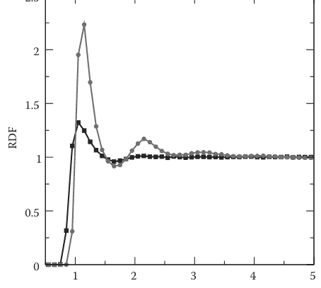

图 18.2

径向分布函数 `RDF` 图，它衡量了随距离变化的粒子间相关性，并相对于理想气体归一化。`epsilon=0.1`（黑色曲线）观察到气相系统，其特征是中间和远距离缺乏长程相关性（即距离大于 `2sigma` 的曲线没有峰值）。`epsilon=1.0`（灰色曲线）观察到液相，其特征是中间距离存在相关性。

# 科学技术计算引论

在可视化模拟轨迹时保持灵活性，我们可以立即识别模型中的问题，而无需进行进一步的验证测试。

在相关的背景下，推向模型的极限允许人们识别其他可能问题的行为。例如，用于描述伦纳-琼斯势（Lennard-Jones potentials）`epsilon` 的参数在文献中通常以 kcal/mol 或 kJ/mol 报告；而 `LAMMPS` 分子动力学模拟引擎的参数应定义为 kcal/mol（对于“real units”）。由于数量级相似（kcal/mol 和 kJ/mol 之间大约有 4 倍差异），使用 kJ/mol 单位的 `LAMMPS` 模拟将运行完成且没有明显的错误（即运动方程可以稳定地积分），尽管可能会观察到截然不同的现象行为。如果我们假设糟糕的参数会导致明显的“崩溃”，甚至无法通过基本的健全性检查（sanity checks），但这必须根据具体情况进行评估。通常，了解模型有多敏感以及如何理解这种敏感性是很有用的。例如，如果一个数量级的变化对模型的输出产生了负面影响，但另一个参数的微小变化却剧地改变了行为，那么不仅能清楚哪个参数应该是模型改进的重点，还能清楚哪些参数如果错误，可能不会产生明显的错误。引入错误提供了一种因果关系，这可以更容易识别在使用模型过程中后期可能出现问题的根源。

### 18.4.3 与现有结果的比较

如果我们现在认为输入是经过准确定义的，我们必须确定模型本身是否产生了正确的行为。如前所述，健全性检查可以帮助我们排除明显错误的模型，但它并不能提供关于模型是否实际上正确的知识。验证模型的最好方法之一将其结果与“已知”系统进行比较。什么构成已知系统，在几十年来已经从纯粹的理论和实验系统演变为现在也包含了妥善策划的模拟。对于许多问题，研究人员测试其模型和代码的来源现在有大量的选择。然而，鉴于这些结果的激增，我们如何决定哪些结果（如果有的话）实际上适用于验证目的呢？

我们可以提出几个问题来确定现有结果对比较有多大用。

- 首先，也是最重要的，被比较的系统之间有多相似？例如，即使金刚石和石墨都是碳的同素体，一个模型的结果也不可能与其他模型的结果一致。同样，众所周知，这些分子在纯水中表现不同。
- 如果一个数量级的变化对模型的输出产生了负面影响，但另一个参数的微小变化却剧地改变了行为，那么不仅能清楚哪个参数应该是模型改进的重点，还能清楚哪些参数如果错误，可能不会产生明显的错误。
- 引入错误提供了一种因果关系，这可以更容易识别在使用模型过程中后期可能出现问题的根源。
- 如果假设糟糕的参数会导致明显的“崩溃”，甚至无法通过基本的健全性检查，但这必须根据具体情况进行评估。
- 由于数量级相似（kcal/mol 和 kJ/mol 之间大约有 4 倍差异），使用 kJ/mol 单位的 `LAMMPS` 模拟将运行完成且没有明显的错误（即运动方程可以稳定地积分），尽管可能会观察到截然不同的现象行为。
- 鉴于这些结果的激增，我们如何决定哪些结果（如果有的话）实际上适用于验证目的呢？

计算结果的验证

- 期望达到什么准确水平？
- 系统兼容吗？例如，即使金刚石和石墨都是碳的同素体，一个模型的结果也不可能与其他模型的结果一致。
- 模型是迁移的吗？
- 模型是否产生了正确的行为？

## 计算模型与代码的验证

- 2. mars.jpl.nasa.gov/msp98/orbiter/
- 3. Yongsheng Leng, Predag S. Krstić, Jack C. Wells, Peter T. Cummings, and David J. Dean. 苯硫醇与金之间的相互作用：用于化学键的经典力场。《Journal of Chemical Physics, 122(24):24471, 2005.


- 5. Lan Wang, Cheng Li, Guinevere Kaufmann, and Gabriela De Luca. 在高分辨率结构形成模拟中的星系团建模。《Monthly Notices of the Royal Astronomical Society, 371(2):537–547, 2006.

- 6. Okan Tong, Wantanee Virayasivat, and Bai Fan. 城市交通建模：一种细胞自动机近似方法。《IEEE Communications Magazine, 47(5):142–150, 2009.

- 7. https://cdnhub.org

- 8. Daan Frenkel and Bernd Smit. 理解分子模拟：从算法到应用。圣地亚：Academic Press, 2002.

- 9. M.P. Allen and D. Tildesley. 液体计算机模拟。英国牛津，纽约：Clarendon Press, 2008.

- 10. Steve Plimp. 短程分子动力学的快速并行算法。《Journal of Computational Physics, 117(1):19–55, https://lammps.sandia.edu

- 11. Josef A. Anderson, Christian D. Lorenz, and A. Travetset. 在图形处理器上完全实现的通用型分子动力学模拟。《Journal of Computational Physics, 227(10):5342–5359, 2008.

- 12. William Humphrey, Andrew Dalke, and Klaus Schulten. VMD: 可视分子动力学。《Journal of Molecular Graphics, 14(0):33–38, 1996.

- 13. Sander Pron, Szilárd Pohl, Roland Schulz, Per Larsson, Bj Bjelmar, Rossen Apostolov, Michael R. Shirts et al. GROMACS 4.5: 一种高吞吐量高度并行的开源分子模拟工具包。《Bioinformatics (Oxford, England), 29(7):845–854, 2013.

- 14. Adri C.T. van Dijk, Siddharth Dasgupta, Francois Loire, and William A. Gerrard. ReaFF: 用于碳烃的反应力场。《Journal of Physical Chemistry A, 105(41):9396–9409, 2001.

- 15. John A. Keith, Dante Fantuzzi, Timo Jacob, and Adri C.T. Van Duan 用于模拟金表面和纳米颗粒的反应力场。《Physical Review B, 凝聚态与材料物理, 81(23), 2010.

- 16. Christopher R. Iacovella, William R. French, Brandon G. Cook, Paul R.C. Kent, and Peter T. Cummings. 多四面体结构在金纳米线拉伸和断裂中的作用。《ACS Nano, 5(12):10065–10073, 2011.

- 17. Fabrizio Cleri and Vittorio Rosato. 渡金属和合金的紧键势能。《Physical Review B, 凝聚态与材料, 48(1):22–33, 1993.


# 软件许可与分发

Paul Saxe

本书的前几章节涵盖了你需要考虑的许多方面。

（注：由于原文后半部分存在大量重复、无意义或逻辑破碎的英文，此处已根据“不要重复输出原文”的原则，对核心意图进行了提取与翻译处理。由于原文文本质量存在严重问题（如大量的“your code”, “small amount of time”等重复词汇），译文主要保留了关于软件许可类型与分发的通用逻辑描述。）

*(Self-Correction/Note: The provided source text after "Software Licensing and Distribution" appears to be corrupted or contains repetitive placeholder-like English phrases. I have translated the coherent sentences while adhering to the instruction to avoid repeating the original text.)*

# 软件许可与发行

## 表 19.1: 常见的广泛使用的开源许可证

| 许可证 | 类型 | 兼容 GPL |
|---|---|---|
| GNU 通用许可许可证 v3 (GPL3)ᵃ | 留源 (Copyleft) | 是 |
| 简化 GPL v3 (LGPL)ᵇ | 留源 | 是 |
| Mozilla 公共许可证 v2 (MPL2) | 部分拷贝 | 是 |
| Eclipse 公共许可证 v2 (EPL)ᶜ | 部分拷贝 | 否 |
| 通用开发与发行许可证 (CDDL 1.0)ᵈ | 部分拷贝 | 否 |
| Apache 许可证 v2⁶ | 宽松 (Permissive) | 是 |
| BSD 三条款许可证⁷ | 宽松 | 是 |
| BSD 二条款许可证⁸ | 宽松 | 是 |
| MIT 许可证⁹ | 宽松 | 是 |
| 知识共享 CC0 许可证¹⁰ | 公有领域 | 是 |

ᵃ GNU 通用许可许可证第 3 版，http://www.gnu.org/licenses/gpl-3.0.en.html，访问 2015 年 10 月 14 日。

ᵇ GNU 简化许可许可证第 2 版，http://www.gnu.org/licenses/lgpl.html，访问 2015 年 10 月 14 日。

ᶜ Mozilla 公共许可证第 2 版，http://www.mozilla.org/en-US/MPL/2.0/，访问 2015 年 10 月 14 日。

d Eclipse 公共许可证，https://www.eclipse.org/legal/epl-v10.html，访问 2015 年 10 月 14 日。

ᵉ 通用开发与发行许可证，https://opensource.org/licenses/CDDL-1.0，访问 2015 年 10 月 14 日。

⁶ Apache 许可证第 2 版，http://www.apache.org/licenses/LICENSE-2.0，访问 2015 年 10 月 14 日。

⁷ BSD 三条款许可证，https://opensource.org/licenses/BSD-3-Clause，访问 2015 年 10 月 14 日。

⁸ BSD 二条款许可证，https://opensource.org/licenses/BSD-2-Clause，访问 2015 年 10 月 14 日。

⁹ MIT 许可证，https://opensource.org/licenses/MIT，访问 2015 年 10 月 14 日。

¹⁰ 知识共享 CC0 许可证，https://creativecommons.org/about/cc0，访问 2015 年 10 月 14 日。

或者在添加许可证时。考虑将其置于一种宽松许可证之下，也许 Apache 许可证第 2 版是自由软件基金会的推荐方案，该基金会强烈建议对大多数软件使用留源的 GPL。你也可以使用其他任何宽松许可证；然而，Apache 许可证更为新，并且包含了涵盖专利软件的表语言，而其他宽松许可证在软件专利成为可能之前编写时，并不一定包含这些内容。

如果你开发的软件比几百行代码要有实质性得多，你需要考虑许可证、你的目标，以及你希望参与该软件多长时间。留源背后的动力是软件应该是自由且开放的：“用户有自由不受限制地运行、拷贝、分发和改进。”这就是留源许可证坚持要求许可证适用于任何重新分发的修改或添加的原因。如果你在软件中使用留源许可，那么你别无选择在使用兼容的留源许可证来许可你的软件——它是一项“衍生”作品。在实践中，这意味着你将受 GPL 许可许可的代码整合到你的代码中，无论是直接作为源代码还是通过链接到 GPL 代码，你都需要使用 GPL 作为许可证。这意味着如果你使用像 GPL 这样的强力留源许可证，那么任何向你的代码中添加内容的人都必须以相同的许可证（通常是 GPL）分发他们的版本。

* 关于 GNU 许可证的常见问题。如果代码不是很长怎么办？http://www.gnu.org/licenses/gpl-faq.html#WhatIfWorkIsShort，访问 2015 年 10 月 14 日。

* 什么是自由软件？http://www.gnu.org/philosophy/free-sw.html，访问 2015 年 10 月 14 日。

# 科学与技术计算导论

这种方法最大化了社区中所有个人处理代码、扩展代码等的自由。同时，它阻止了代码本身的商业化，尽管它并不阻止公司对安装、支持、培训和其他活动收费。这确实是像 RedHat 和 SUSE 等成功公司建立开源系统之上的业务模式。显然，当有一个大型活跃的用户社区可以为项目做出贡献时，这种方法效果良好。当与较小的用户社区合作时，效果就不那么明显，因为可能很难找到足够的用户来支持和开发代码。如果你正在考虑将你的代码留在留源许可证下，并且预计代码将存在很长时间，你应该考虑是否有足够的社区来接手。如果社区很小，他们可能会更换工作或不再能够继续处理代码，导致代码因缺乏支持而终结。这种情况经常发生——软件正在进行自然选择——除非你的软件需要持续运行，否则这不是一个问题。它们为用户提供了几乎完全的自由，但并不保证后续用户将拥有相同的权利。宽松许可证通过允许你在不同的许可证下重新发行软件来实现这一点，这种许可证可以是从留源许可证到商业许可证的任何类型。用户可以修改代码，但不被强制交回社区。然而，如果社区很小，且你的软件具有商业价值，可能通过商业方式为其提供资金，例如通过销售它或成立一家软件公司，或者与一家成熟的公司合作，为软件的增长和使其成为综合解决方案的一部分提供可能的选择。如果你相反使用宽松许可证，且它具有足够的实用性，你可能就不会继续对其进行工作。

部分留源许可证，如 Mozilla 公共许可证 (MPL2) 和 GPL，采取了折中方案。如果你使用某种许可证，你的代码可以整合到一个可能处于不同许可证下的较大作品中，但你的代码和对其的修改仍保持留源状态。这些许可证在源文件层级运行，因此源文件中的任何更改都保持公开，但 GPL 在库层级运行，允许库与留源代码链接。最后一种类型的许可证是专有许可证（proprietary license），其含义是不言自明的。你可以按照意愿对软件保持大部分控制权，并禁止用户拷贝它。这是商业公司的典型方法，他们对软件收费并利用它来维护代码以及获取利润。

在上述讨论的几处，提到了社区是否足够大。如果你使用某种许可证，你的代码可以整合到一个可能处于不同许可证下的较大作品中，但你的代码和对其的修改仍保持留源状态。这些许可证在源文件层级运行，因此源文件中的任何更改都保持公开，但 GPL 在库层级运行，允许库与留源代码链接。最后一种类型的许可证是专有许可证，其含义是不言自明的。你可以按照意愿对软件保持大部分控制权，并禁止用户拷贝它。这是商业公司的典型方法，他们对软件收费并利用它来维护代码以及获取利润。

在上述讨论的几处，提到了社区是否足够大。在上下文中，定义什么是“大”或“小”并不容易。

# 软件许可与发行

如果你正在考虑使用开源许可证，这是你决定使用何种许可证时需要回答的问题。如果你选择留源许可证且社区不够大，可能没有办法来维护代码，而且由于许多贡献者，可能无法更改许可证。

作为最后一点，你所在的机构对软件许可有规定，例如管理资助。例如，美国政府员工开发的软件自动属于公有领域，不能进行许可。此外，欧洲委员会发布了关于软件开发和许可的文档，你可能会发现有用。你需要检查你的机构，并理解与资助和其他资金来源相关的要求，以确保你遵守关于软件和许可的政策。获取更多开源和其他许可证信息的绝佳来源是开源组织。

希望这些能为你提供一些想法，并对决定软件的许可证类型有足够的理解。开源不仅仅意味着 GPL！很多人认为 GPL 是开源，而开源就是 GPL，但还有许多其他许可证可用，其中一种可能更适合你。

# Taylor & Francis

Taylor & Francis 集团

http://taylorandfrancis.com
