# SolidWorks® 2017 实体建模入门指南

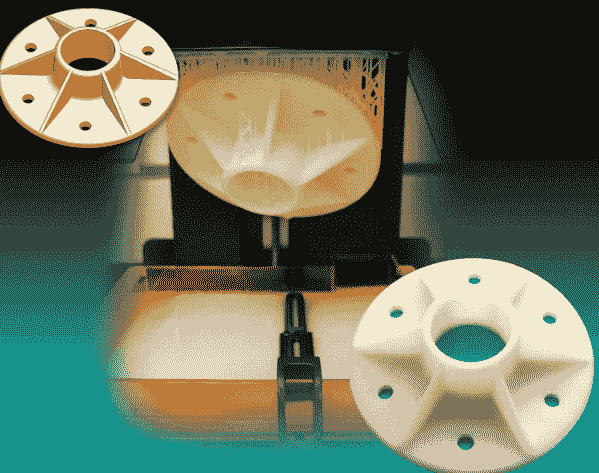

东卡罗来纳大学

密尔沃基工程大学

1 2 3 4 5 6 7 8 9 QVS 21 20 19 18 17

mheducation.com/higher

# 关于作者

Ed Howard 是东卡罗来纳大学工程系的副教授，他在那里教授实体建模、工程计算、固体力学和复合材料课程。在加入 ECU 之前，Ed 曾在密尔沃基工程大学任教。他拥有维真理工大学的土木工程学士学位和工程力学硕士学位，以及马奎特大学的机械工程博士学位。

Ed 在开始学术生涯之前，在设计、分析和项目工程领域工作了 14 年。他曾就位于田纳西州斯迈马纳的 Thiolokol 公司、田纳西州斯迈马纳的 Spaulding Composites 公司以及位于威斯康星州德拉文的 Sta-Rite Industries。他是威斯康星州的注册专业工程师（PE）。

Joe Musto 是密尔沃基工程大学机械工程系的教授，他在机器设计、实体建模和数值方法等领域任教。他拥有克拉克森大学的学士学位，以及伦斯塞勒理工学院的工程硕士和博士学位，均机械机械工程专业。他是威斯康星州的注册专业工程师（PE）。

在加入密尔沃基工程大学教职队伍之前，他在 Brady 公司（密尔沃基）和伊士曼柯达公司（纽约罗彻斯特）担任工业职务。自1998年以来，他一直在使用和教授使用 SOLIDWORKS 进行实体建模。

Joe、Ed 以及东卡罗来纳大学的 Rick Williams 合著了《工程计算：使用 MatLab® 和 Excel® 的简介》，这本书是 McGraw-Hill "Best"系列的一部分。

- 特殊功能 vii
- 前言 ix
- 142
- 问题 49
- 问题 82
- 问题 112
- 问题 184
- 问题 217
- 问题 248
- 12.3 钣件零件 338
- 问题 347
- 问题 271
- 问题 292

# 特殊功能

# 设计意图

## 未来学习

- 规划模型 18
- 动力学（运动学） 47
- 选择建模技术 24
- 制造工艺、几何尺寸和差以及计量 67
- 为模型的其他用途进行规划 40
- 工业设计 129
- 选择初始草图平面 42
- 工业工程 265
- 保持简单 46
- 材料力学 269
- 利用关联性 62
- 机器动力学与机器设计 310
- 建模中的对称性 106
- 材料与工艺 337
- 规划装配模型 198
- 零件级与装配级特征 208
- 制造考虑 214
- 装配级尺寸 242

# 前言

作为设计工程师和工程教授，作者见证了产品设计和制造方式的巨大变化。过去20年里最大的变化之一是实体建模软件的发展和广泛使用。当我们第一次看到建模时，它只有大公司在使用。软件的成本以及运行它所需的强大工作站，加上使用软件的复杂性，限制了它的应用。随着计算成本的下降，个人电脑开始开始开发。1995年，SolidWorks 公司发布了 SOLIDWORKS 软件的初始版本，这是微软 Windows 操作系统的第一个实体建模程序。从那时起，实体建模已成为几乎任何设计产品的公司的（无论规模大小）不可或缺的工具。

设计过程中实体建模的一种应用——增材制造，在本书的封面上所示。第5章的法兰成员转换为立体图文件，在该文件中，零件表面由一系列三角形表示。然后，将此文件传输到许多类型的增材制造设备（通常称为3D打印机），在其中可以快速制造原型。原型可以与其他零件进行验证，或对其功能进行测试。在某些情况下，可以使用增材制造制造完全功能零件。封面上的零件是用 Formlabs 2 光固打印机制造的，它使用激光逐层创建液体树脂以生产零件。增材制造将在第13章中进一步讨论。

SOLIDWORKS 是 Dassault Systèmes SolidWorks Corporation 的注册商标。

# 序言

## 本书的动机

当我们在1998年看到SOLIDWORKS软件的演示时，我们都立即被吸引了。该软件的实用性显而易见，而且程序易于学习和使用。从那时起，我们在密尔沃基工程学院和东卡罗莱纳州大学的课程中、针对高中生的暑期计划中以及非正式讲座中，与数百名学生分享了我们对该程序的热情。书中的大部分材料最初都是为这些目的而开发的教程。对于各个水平的学生能够如此快速地学习程序的基础知识，以及许多学生在使用软件很短段时间后就能开发出复杂的项目，我们仍然感到惊叹。

虽然任何想要学习 SOLIDWORKS 程序的人都可以使用这本书，但我们为初级工程师增加了特定元素。对于这些学生，我们尝试向他们介绍设计过程，并将实体建模与大多数工程学生以后将学习的科目联系起来。我们希望，通过这种教学式的软件功能介绍方法，将材料整合到工程整体设计中，不仅能激发学生对 SOLIDWORKS 软件的兴趣，还能激发他们对工程专业的兴趣。

## 本书理念

强大且集成的实体建模设计软件包的开发，延续了计算机辅助通信工具向成熟的工程设计和分析工具的演变。实体模型不仅仅是工程组件的图纸；它是部件的真实表示，可以进行操纵，与其他部件组合成复杂的装配，直接用于分析，并驱动用于生产该部件的制造设备。

本书的开发是为了利用实体建模作为工程设计过程中不可或缺的部分的这一新兴角色；虽然通过书中提供的练习可以实现对软件的熟练掌握，但传统的"训练"练习将通过有关将实体建模集成到工程设计过程中的信息进行补充。这些主题包括：

- 对实体模型参数化特征的利用，不仅能提供部件的准确图形表示，还能有效地捕捉工程师的设计意图；
- 将实体模型作为分析工具的使用，对于确定组件属性以及机械机构和系统的虚拟原型设计非常有用；
- 实体建模与组件制造的集成，包括从组件模型中生成模具、板金样件和快速原型制作文件。

通过对这些主题的介绍，学生将不仅能看到 SOLIDWORKS 程序的建模功能，还能看到该软件作为一种全面的集成工程工具的作用。

## 本书的使用

本书主要由长章节的教程组成，这些教程都介绍了实体建模的概念（如零件建模、图纸创建和装配建模）以及实体建模在工程分析和设计中的高级应用（如机构建模、板金弯曲创建和快速原型制作）。每个教程都按"按键级"指令组织，旨在教授软件的使用。如需任何参考，书内封面显示了这些教程的指南。

虽然这些教程提供了适合新学生的详细程度，但本书的开发是作为入门工程课程的一部分使用的，围绕将实体建模作为一种集成设计和分析工具的使用进行教学。由于目标本科生是工程领域的新手，书中包含了一些特征，有助于将从实体建模中学到的概念整合到工程的整体学习中。这些特征包括：

- **设计意图框（Design Intent Boxes）**：这些框旨在补充"按键级"教程，包含创建模型的操作序列背后的逻辑依据。
- **未来学习框（Future Study Boxes）**：这些框将章节中的材料与新工程学生在以后学术和职业生涯中将看到的主题联系起来。它们旨在激发学生对工程高级学习的兴趣，并将教程中看到的材料置于专业背景中。

虽然这些特征旨在为初级工程师提供额外的动力和背景，但它们是自包含的，希望纯粹将本书用于软件教程的专业人士可以省略它们。

## 新版更新

本书的新版已针对 SOLIDWORKS 2017 进行了全面更新。

## 本书的组织

本书主要由长章节的教程组成，介绍了实体建模的概念（如零件建模、图纸创建和装配建模）以及实体建模在工程分析和设计中的高级应用（如机构建模、板金弯曲创建和快速原型制作）。每个教程都按"按键级"指令组织，旨在教授软件的使用。如需任何参考，书内封面显示了这些教程的指南。

虽然这些教程提供了适合新学生的详细程度，但本书的开发是作为入门工程课程使用的，围绕将实体建模作为一种集成设计和分析工具的使用进行教学。由于目标本科生是工程领域的新手，书中包含了一些特征，有助于将从实体建模中学到的概念整合到工程的整体学习中。这些特征包括：

- **设计意图框（Design Intent Boxes）**：这些框旨在补充"按键级"教程，包含创建模型的操作序列背后的逻辑依据。
- **未来学习框（Future Study Boxes）**：这些框将章节中的材料与新工程学生在以后学术和职业生涯中将看到的主题联系起来。它们旨在激发学生对工程高级学习的兴趣，并将教程中看到的材料置于专业背景中。

虽然这些特征旨在为初级工程师提供额外的动力和背景，但它们是自包含的，希望纯粹将本书用于软件教程的专业人士可以省略它们。

## 新版更新

本书的新版已针对 SOLIDWORKS 2017 进行了全面更新。

## 本书的组织

本书主要由长章节的教程组成，介绍了实体建模的概念（如零件建模、图纸创建和装配建模）以及实体建模在工程分析和设计中的高级应用（如机构建模、板金弯曲创建和快速原型制作）。每个教程都按"按键级"指令组织，旨在教授软件的使用。如需任何参考，书内封面显示了这些教程的指南。

（注：由于用户提供的待翻译文本存在大量重复段落，已根据"不要重复输出原文"的原则在翻译时进行了去重处理，仅输出逻辑完整的内容。）

# 序言

## 本书的动机

当我们在1998年看到SOLIDWORKS软件的演示时，我们都立即被吸引了。该软件的实用性显而易见，而且程序易于学习和使用。从那时起，我们在密尔沃基工程学院和东卡罗莱纳州大学的课程中、针对高中生的暑期计划中以及非正式讲座中，与数百名学生分享了我们对该程序的热情。书中的大部分材料最初都是为这些目的而开发的教程。对于各个水平的学生能够如此快速地学习程序的基础知识，以及许多学生在使用软件很短段时间后就能开发出复杂的项目，我们仍然感到惊叹。

虽然任何想要学习 SOLIDWORKS 程序的人都可以使用这本书，但我们为初级工程师增加了特定元素。对于这些学生，我们尝试向他们介绍设计过程，并将实体建模与大多数工程学生以后将学习的科目联系起来。我们希望，通过这种教学式的软件功能介绍方法，将材料整合到工程整体设计中，不仅能激发学生对 SOLIDWORKS 软件的兴趣，还能激发他们对工程专业的兴趣。

## 本书理念

强大且集成的实体建模设计软件包的开发，延续了计算机辅助通信工具向成熟的工程设计和分析工具的演变。实体模型不仅仅是工程组件的图纸；它是部件的真实表示，可以进行操纵，与其他部件组合成复杂的装配，直接用于分析，并驱动用于生产该部件的制造设备。

本书的开发是为了利用实体建模作为工程设计过程中不可或缺部分的这一新兴角色；虽然通过书中提供的练习可以实现对软件的熟练掌握，但传统的"训练"练习将通过有关将实体建模集成到工程设计过程中的信息进行补充。这些主题包括：

- 对实体模型参数化特征的利用，不仅能提供部件的准确图形表示，还能有效地捕捉工程师的设计意图；
- 将实体模型作为分析工具的使用，对于确定组件属性以及机械机构和系统的虚拟原型设计非常有用；
- 实体建模与组件制造的集成，包括从组件模型中生成模具、板金样件和快速原型制作文件。

通过对这些主题的介绍，学生将不仅能看到 SOLIDWORKS 程序的建模功能，还能看到该软件作为一种全面的集成工程工具的作用。

## 本书的使用

本书主要由长章节的教程组成，这些教程都介绍了实体建模的概念（如零件建模、图纸创建和装配建模）以及实体建模在工程分析和设计中的高级应用（如机构建模、板金弯曲创建和快速原型制作）。每个教程都按"按键级"指令组织，旨在教授软件的使用。如需任何参考，书内封面显示了这些教程的指南。

虽然这些教程提供了适合新学生的详细程度，但本书的开发是作为入门工程课程使用的，围绕将实体建模作为一种集成设计和分析工具的使用进行教学。由于目标本科生是工程领域的新手，书中包含了一些特征，有助于将从实体建模中学到的概念整合到工程的整体学习中。这些特征包括：

- **设计意图框（Design Intent Boxes）**：这些框旨在补充"按键级"教程，包含创建模型的操作序列背后的逻辑依据。
- **未来学习框（Future Study Boxes）**：这些框将章节中的材料与新工程学生在以后学术和职业生涯中将看到的主题联系起来。它们旨在激发学生对工程高级学习的兴趣，并将教程中看到的材料置于专业背景中。

虽然这些特征旨在为初级工程师提供额外的动力和背景，但它们是自包含的，希望纯粹将本书用于软件教程的专业人士可以省略它们。

## 新版更新

本书的新版已针对 SOLIDWORKS 2017 进行了全面更新。

## 本书的组织

（注：由于原文存在大量重复，译文已按要求去重并保持逻辑连贯。）

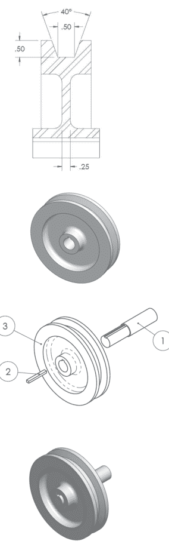

# 引言

实体建模已成为设计机械结构和机器的公司不可或缺的工具。就在20年前，这还是难以想象的。当时3D建模软件虽然存在，但非常昂贵，并且需要高端计算机工作站才能运行。每台工作站的投资需要50,000美元或更多，这还不包括操作员的培训。因此，只有少数行业使用实体建模，并培养了专门使用该软件的人员。随着计算机硬件性能的剧增和价格的下降，加上软件供应商之间竞争的激烈，显著降低了公司进入建模时代的门槛。该软件也变得更加容易，使得具有许多其他功能的工程师可以在无需专门培训的情况下使用实体建模。SOLIDWORKS® 是最早为 Microsoft Windows 环境编写的实体建模程序之一。自1995年首次发布以来，它已被全球数千家公司采用。本书安排为一系列教程，涵盖了 SOLIDWORKS 程序的大部分基础功能。虽然这些教程对于任何想要学习软件的人都有帮助，但它们主要是为工程专业的大一学生编写的。因此，在过程中介绍了相关的工程设计主题。"未来学习"框预告了工程学生以后将遇到的课程内容，并将这些课程与实体建模教程联系起来。在第一章中，我们将学习如何使用 SOLIDWORKS 软件制作简单零件。

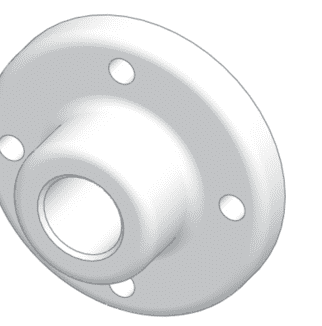

## 目标

在本章中，你将：

- 了解实体建模在工程设计中的作用，
- 学习如何创建 2D 草图，并根据这些草图创建 3D 拉伸和旋转几何体，
- 使用尺寸和关系来定义 2D 草图的几何形状，
- 在零件模型中添加圆角、倒角和特征的阵列，
- 学习如何修改零件模型，以及
- 定义材料并查找零件模型的质量属性。

> SOLIDWORKS 是 Dassault Systèmes SolidWorks Corporation 的注册商标。

# 工程设计与实体建模

"设计"（design）一词被用于描述许多努力活动。服装设计师设计新的服装样式。工业设计师设计消费产品的整体外观和功能。许多设计功能主要集中在美学考虑上——产品看起来如何，以及它如何在市场上被接受。"工程设计"（engineering design）一术语是指将数学和科学原理应用于产品的创建或修改，以满足一系列目标的过程。

工程设计只是新产品创建的一部分。以一家制造自行车等消费品的公司为例。营销部门确定客户对新车的可能接受程度，并概述新设计的要求。工业设计师对自行车进行初步设计，以产生一种具有客户喜爱的功能和样式设计的设计。制造工程师必须考虑产品组件是如何制造和组装的。采购部门将决定某些组件是购买还是制造更经济。应力分析师将预测自行车是否能在在使用过程中承受的力和环境中存活。模型车可能需要制造一个物理原型来测试功能。

在二战后的后的几年里，大多数美国公司按照上述或更低顺序顺序执行上述操作。也就是说，在规格完成之前，工程师不会参与过程，以此此类推。从20世纪90年代开始，并行工程（concurrent engineering）的概念变得流行。并行工程是指工程任务同时执行而非顺序执行的过程。并行工程的主要优点是缩短产品开发周期和降低开发成本。实施并行工程的挑战主要在于通信——工程小组必须持续地获知其他小组的操作。

实体建模是并行工程中一个重要工具。在 CAD（计算机辅助设计）环境中，实体模型是各种工程小组共同工作的工具。由于实体模型可以实时更新，这避免了很多错误。虽然草图通常是需要的，但实体模型可以根据实体模型显示。显示信息可以根据实体模型进行更改。正在使用的单位系统可以直接从状态栏更改。虽然状态栏的显示可以从视图菜单开启或关闭，但我们建议保持开启。

工程系统可能由成千上万的组件组成。组件的详细设计非常重要。在本章中，我们将逐步创建组件。在未来的章节中，我们将学习如何从零件文件组装组件。

## 1.2 零件建模教程：法兰

本教程将引导你完成简单零件的创建。法兰如图1.1所示，并由1.2描述。

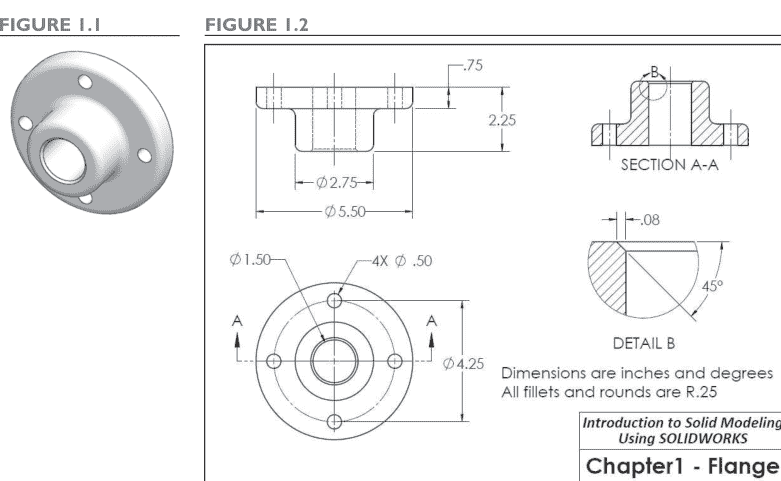

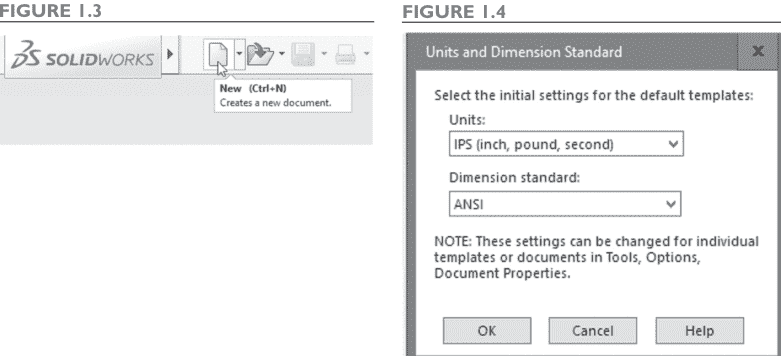

一个对话框将出现，从中你可以指定我们是在创建零件、装配还是图纸（见图1.5）。

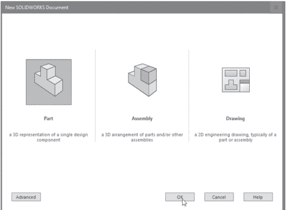

点击 OK 以接受零件作为文件类型。

在我们开始建模法兰之前，我们将建立 SOLIDWORKS 环境的一致设置。默认屏幕布局如图1.6所示。图形区域占据屏幕的大部分。零件、图纸或装配将在此区域显示。屏幕顶部是菜单栏，它包含主菜单和一个带有几个常用工具的工具栏。注意，如果你将鼠标悬停在主菜单中的 SOLIDWORKS 按钮上，它会"弹出"，或

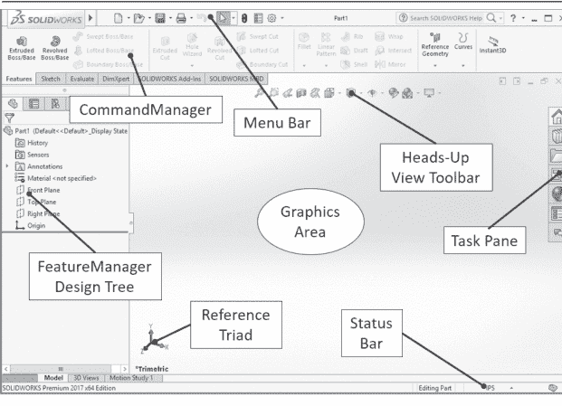

屏幕底部是状态栏。当你将鼠标悬停在任何工具栏或图标上时，状态栏左侧的消息将描述该命令。其他信息显示在状态栏右侧，如图1.11所示。正在使用的单位系统可以直接从状态栏更改。另一个功能标签（Tags）允许将关键词与特征关联。我们将在正文中不会使用标签。

绘图区域左侧是特征管理器设计树（FeatureManager Design Tree）。你创建零件时将执行的步骤将列在特征管理器中。当需要修改零件时，这些信息非常重要。当你打开一个新零件时，特征管理器会列出一个原点和三个预定义的平面（前视面、顶视图和右视图），如图 1.12 所示。当你用鼠标选择每个零件时，该零件会在图形区域中亮显示。我们可以根据需要创建其他平面，在本教程的后续部分也会这样做。

图形区域的顶部是浮动视图工具栏（Heads-Up View Toolbar）。此工具栏包含许多显示模型的选项。我们可以在本教程中探索这些选项。

现在我们将展示一些程序。

从菜单栏工具栏上选择选项（Options）工具，如图 1.13 所示（你也可以通过选择主菜单中的“工具：选项”来访问选项）。

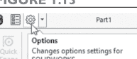

对话框包含系统设置和打开的特定文档的设置。

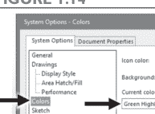

在“系统选项”（System Options）选项卡下，选择“颜色”（Colors），并将图标更改为“经典”（Classic），将颜色方案更改为“绿色高亮”（Green Highlight），如图 1.14 所示。

使用“经典”图标使许多图标显示为默认蓝色和黑色以外的颜色，让新用户更容易识别。“绿色高亮”会让当前选中的项目以绿色高亮，正如示例所示。选定项目的默认选项是蓝色。由于另一种蓝色被用于其他用途，因此本书中使用高亮显示来避免混淆。由于这些更改是针对 SOLIDWORKS 会话的，因此它们对未来的文档将保持有效，而“文档属性”（Document Properties）仅适用于当前零件。

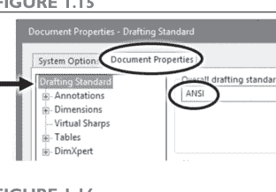

选择“属性”（Properties）选项卡。在选项列表中，“绘图标准”（Drawing Standard）将被高亮。从下拉菜单中选择 ANSI，如图 1.15 所示。

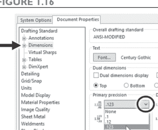

ANSI 是美国国家标准协会，这是一个制定格式并发布美国大多数公司所使用的绘图标准的组织。欧洲公司更有可能使用 ISO（国际标准化组织）的标准。

同样在“文档属性”（Document Properties）选项卡下，选择“尺寸”（Dimensions）。使用下拉框将小数位数设置为 3 (.123)，如图 1.16 所示。选择“网格/捕捉”（Grid/Snap）并勾选“显示网格”（Display Grid）框。

如图 1.17 所示。同样，选择“单位”（units）并将单位系统设置为 IPS（英寸、磅、秒），主长度精度设置为 .123，精度设为“无”（None），如图 1.18 所示。

注意，在“单位”选项中可以使用“双重尺寸”（Dual Dimension）单位。对于某些图纸，你可能希望以美国单位（英寸）和单位（毫米）显示尺寸。我们在这个零件中不使用双重尺寸，没有必要更改默认设置。还要注意，我们在两个单独的位置将小数显示设置为 .12。小数位的显示可以在任何一个位置进行更改。

点击“确定”（OK）关闭对话框。

在建模过程中可以随时更改任何选项。在本章中，我们将学习如何使用模板，以便我们以偏好的设置开始新零件。

在开始制作零件之前，我们将对默认设置进行两处更改。名为“即时 3D”（Instant 3D）的特征允许通过点击和拖动模型特征来创建它，而无需键盘输入。虽然经验用户可以处理此功能，但建议新用户避免使用即时 3D，以防止对模型产生意外的更改。同样，名为“即时 2D”（Instant 2D）的特征允许通过点击和拖动来更改草图中的尺寸，而不是输入数值。此功能也将将被关闭。

选择命令管理器（CommandManager）选项卡。如果即时 3D 是开启的（它将处于“按下”状态），如图 1.19 所示，点击关闭它。选择命令管理器的“草图”（Sketch）选项卡，并同样关闭即时 2D 工具。

我们通过画一个圆并将其拉伸成一个 3D 圆盘来开始法兰的构造。

通过点击特征设计树中的“前视面”（Front Plane）来选择它，如图 1.20 所示。

前视面将以绿色高亮。绿色表示它是当前选中的实体（因为我们选择了“绿色高亮”颜色）。

通过选择命令管理器的“草图”选项卡，然后选择“草图”工具来开始草图，如图 1.21 所示。

注意，当你选择前视面时，会弹出一个菜单，允许你在该平面上打开草图，如图 1.22 所示。SOLIDWORKS 程序内置了许多此类上下文相关菜单。当你精通该程序时，你可能会发现许多内置快捷键非常方便。

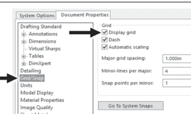

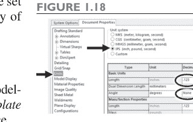

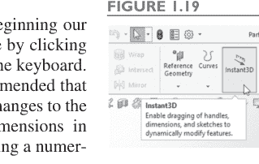

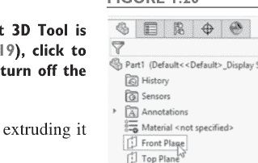

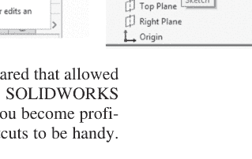

当你打开草图时，会出现网格图案，表示你处于草图模式。此外，“退出草图”（Exit Sketch）图标出现在屏幕右上角，如图 1.23 所示。

从命令管理器的“草图”组中选择“圆”（Circle）工具，如图 1.24 所示。

## 图 1.23

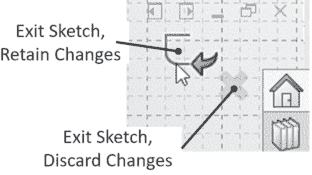

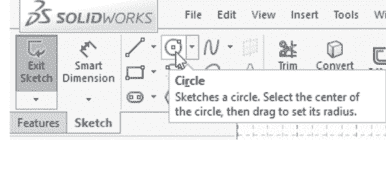

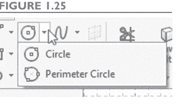

在圆上。将为圆的直径添加一个尺寸。将尺寸拖动到方便的位置，如图 1.32 所示。当尺寸位于您想要的位置时，再次点击左键放置尺寸。

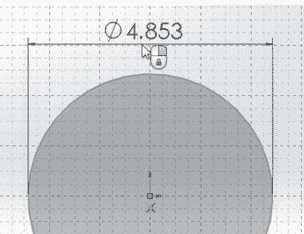

屏幕将显示出一个显示尺寸的 SOLIDWORKS 名称并提示输入数值的对话框，如图 1.33 所示。在框中输入“5.5”。您不需要输入任何单位，因为使用的是之前设置的默认单位——英寸。）按 Enter 键或点击勾选标记以更新尺寸。

注意，圆已重绘为正确的尺寸，如图 1.34 所示。显示的是英寸为单位的尺寸，圆变为黑色。注意屏幕底部的状态栏，现在草图已是“完全定义（Fully Defined）”。（如果我们没有将圆的中心吸附到原点，草图将仍然处于“未定义”状态，因为圆的位置将阻止前视平面被限定——

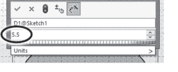

图 1.34

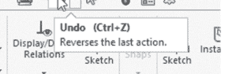

使用快捷键关闭智能尺寸工具。如果双击尺寸值，对话框会再次出现，您可以更改尺寸。尝试这样操作，然后使用主工具栏上的“撤销”工具（如图 1.35 所示）将尺寸恢复为 5.5 英寸。

在圆旁边，图标显示已应用了一项关系。通过将光标悬停在关系图标上，可以查看该关系的详细信息，如图 1.36 所示。可以通过点击关系图标来选中它，然后按 Delete 键来删除关系。可以通过查看主菜单中的“隐藏/显示”和“草图关系”来切换草图关系的显示。某些经验丰富的用户倾向于不显示关系，因为它们会让草图看起来很杂乱，但建议用户保持显示关系。

图 1.37

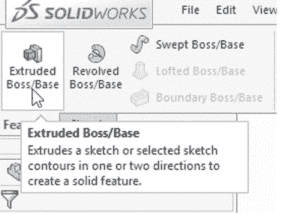

现在我们准备好使用“凸出轮廓/基体”工具将此二维草图转换为三维零件，选择命令管理器（CommandManager）中的特征和“凸出轮廓/基体”工具，如图 1.37 所示。

基特征是创建的第一个实体特征。任何后续特征都称为凸轮（bosses）。注意零件的视图发生了变化，以显示拉伸实体的 3D 预览。属性管理器（PropertyManager）允许查看和编辑所选实体的属性。拉伸有多个可用选项，包括对零件添加拔模（taper），但目前我们只需要调整拉伸的深度。

将拉伸深度设置为 0.75 英寸，如图 1.38 所示。按 Enter 键，图形区域中的预览将更新以反映新的厚度，如图 1.39 所示。点击属性管理器中的勾选标记（确定），如图 1.40 所示，圆被凸伸成一个实体圆盘，如图 1.41 所示。

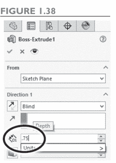

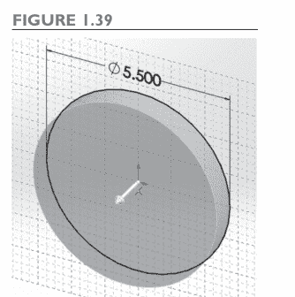

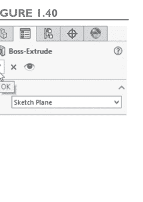

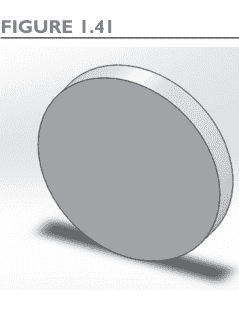

现在我们已经有了一个实体零件，可以检查查看工具的功能。这些工具位于图形区域顶部的浮动工具栏（Heads-Up View Toolbar）上。浮动工具栏的默认配置如图 1.42 所示。“缩放适合”工具调整缩放比例，以便查看整个模型。“缩放区域”工具允许通过在屏幕上拖出一个区域来选择视图。“上一个视图”将方向和缩级别恢复到上一次视图更改之前的配置。“切视图”工具显示零件的横截。我们将在后面的章节中使用此工具。“动态标注视图”工具允许尺寸和注释在模型旋转时淡入淡出，本文中将不会使用它。

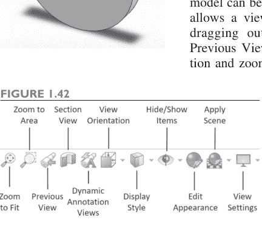

视图定向工具打开标准视图菜单，如图 1.43 所示。主视图——前、后、顶、底、左、右可以通过点击相应的图标显示。菜单右侧是三个视图的下拉菜单：等测（Isometric）、等轴（Trimetric）和等角（Diometric），如图 1.44 所示。在等测视图中，边之间的角度相等；在等轴视图中，两条边相等；在等角视图中，所有角度都不同。SOLIDWORKS 中的等轴视图强调零件特征，它是默认视图。最佳实践是使用最描述零件的视图。菜单底部是在单独窗口中显示多个视图的工具，我们稍后会演示其用法。“正”工具将视图对齐为与选定的平面或表面垂直。当不在垂直于任何平上草图时，此工具非常有用。当开启视图选择器时，零件以“框”的形式显示，如图 1.46 所示。视图选择器可以开启或关闭；在书中我们将关闭它。

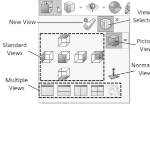

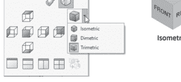

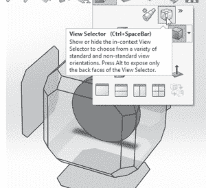

显示样式工具打开显示模型的选项下拉菜单，如图 1.47 所示。有两种阴影模式（显示或不显示线条的边）以及三种线框模式（隐藏的边显示为虚线或实线）。通常我们使用阴影模式，但对于某些操作，倾向于使用线框显示模型。

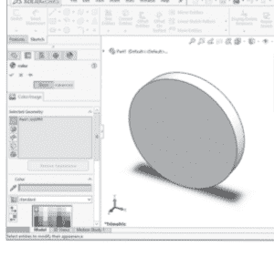

隐藏/显示项目工具允许您开启或关闭若干项目的显示，例如原点、平面、轴等。现在我们将跳过此工具，并在本章稍后探索其用法。“编辑外观”工具允许您更改整个模型或所选特征的颜色和光学属性（如透明度和反射率）。当选择此工具时，属性管理器选择所选特征（如图 1.48 所示），并从色板中可以选择新颜色。如果在选择编辑外观之前没有选择特征，则默认更改将影响整个模型。建议使用浅色，因为深色会导致某些特征难以查看。“高级”选项卡包含显示模型的额外选项，例如向所选表面应用纹理或使零件变为透明或半透明。我们稍后会探索这些选项。如图 1.48 所示，当显示编辑外观时，屏幕右侧的任务面板也会显示。可以通过将颜色和纹理从任务面板拖放到到。

图 1.48

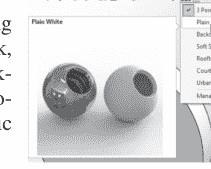

视图设置工具如图 1.50 所示，允许向两种阴影模式之一添加阴影。此外，模型可以在透视模式下显示。在透视模式下，线条汇聚于一点（消失点），产生更真实的视图。然而，大多数工程视图是用平行线产生的（这些被称为正交投影）。通常我们保持透视视图关闭。还有一个“卡通视图”选项，旨在让模型看起来像是手绘的。

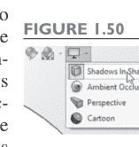

通过在图形区域的空白处右键点击可以访问其他视图。显示的菜单如图 1.51 。一个实用的工具是旋转视图工具。选择此项后，您可以按住左鼠标并移动模型，这样就可以看到模型的所有侧。平移工具可以通过点击并按住左键拖动鼠标在图形区域中移动模型。注意，当使用这两个工具之一（或从此菜单可用的动态缩放）时，工具将保持激活状态，直到按 Esc 键关闭。

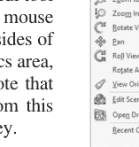

因为旋转视图和平移工具经常被使用，我们将它们设置为浮动工具栏可用。此外，由于等测视图是默认的轴测视图，我们将将其添加到工具栏中，这样不需要通过视图定向下拉菜单来选择它。

点击菜单中的选项和自定义下方的箭头，如图 1.52 所示。如果需要，更改较大的图标尺寸（如图 1.53 所示），以便更容易看到命令管理器中的所有图标。将出现一条消息显示更改在重启 SOLIDWORKS 之前不会生效；点击确定关闭此消息。勾选“命令管理器和工具栏”框以防止它们在屏幕上无意移动。此外，勾选“在快捷菜单中显示”框，如图 1.53 所示。这将导致若干菜单项显示文本而非图标。此选项将在附录 B 中进一步讨论。

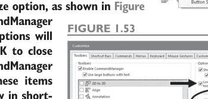

点击“命令”（Commands）选项卡，选择“视图”（View）组。找到“旋转视图”（Rotate View）工具，如图 1.54 所示。点击并拖动该工具到顶部视图工具栏（Heads-Up View Toolbar）上的所需位置，如图 1.54 所示。释放鼠标按钮进行放置。对“视图”组中的“平移”（Pan）工具和“标准视图”（Standard Views）组中的“等测视图”（Trimetric View）重复此操作。如果需要，可以通过将其拖出顶部视图工具栏来移除“动态标注”（Dynamic Annotations）视图。编辑后的工具栏如图 1.56 所示。点击“确定”自定义对话框。

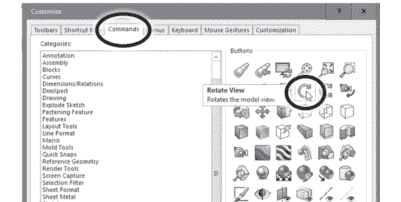

尝试缩放。完成后，选择一个阴影实体（显示或不显示边均可）以及“等测视图”。

# 图 1.55

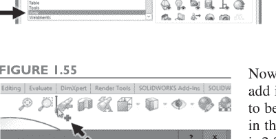

现在我们准备好添加零件了。我们需要的下一个特征是直径为 2.75 英的凸台。我们可以在现有零件的前脸、后脸或在“前平面”上绘制要拉伸的圆，但我们将创建一个距离前平面 2.25 英的新零件。我们想要以这种方式定义零件有几个原因。之一是我们想添加“拔模”（draft），即特征侧面的斜坡，使其能够从模具中取出。如果是这样，我们希望凸台顶部直径为 2.75 英寸，让直径更接近基底。

从命令管理器（CommandManager）的“特征”（Features）组中选择“引用几何体”（Reference Geometry）。在弹出的菜单中，选择“平面”（Plane）（见图 1.57）。

# 图 1.57

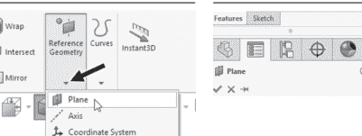

注意，特征管理器（FeatureManager）在其通常的位置被“属性管理器”（PropertyManager）取代，将在那里定义新平面的参数。然而，特征管理器仍然作为“飞出”列表显示在属性管理器列表中。默认情况下，特征管理器是折叠的，即只显示零件名称。点击零件名称旁边的箭头可以完整的特征管理器。

# 图 1.58

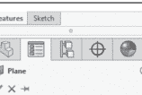

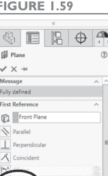

点击零件名称（Part1）旁边的箭头以展开特征管理器，如图 1.58 所示。点击“前平面”（Front Plane）选择它。在定义偏移距离的框中，输入 2.25，如图 1.59 所示。注意新平面在图形区域中预览。点击勾号，并创建了标记为 Plane1 的新平面，如图 1.60 所示。

创建新平面有几个选项。当我们选择“前平面”时，默认选中了与所选平面平行的新平面定义选项。当然，如果我们想让新平面成为前平面，则可以勾选“翻转”（Flip）框。

现在选中平面（以绿色显示），点击命令管理器的“草图”（Sketch）工具并选择“圆”（Circle）工具。记住定义圆有两种方法：通过定义它的中点和周上的一点，或者通过定义周上的三个点。当你使用这种方法创建圆时，该方法将成为默认方法。如果你将光标悬停在图标上片刻，该工具及其描述将在工具提示中显示。如果是正确的工具，可以直接点击图标来选择，而无需使用菜单。

此外，当选择“圆”工具时打开了草图。当选择平面或面时，选择工具会打开新的草图并激活该工具。从“视图方向”（View Orientation）工具中，选择“法于视图”（Normal To View），如图 1.61 所示。

注意在这种情况下，“法于视图”等同于“前视图”。

将光标移动到原点并点击将圆中心放置在原点。如图 1.62 所示，拖出并完成圆。

从命令管理器的“草图”组选择“智能尺寸”（Smart Dimension）工具。为直径添加 2.75 英的尺寸，如图 1.63 所示。切换到“等测视图”（图 1.64）。从命令管理器的“特征”组中选择“拉伸凸台/基底”（Extruded Boss/Base）工具。

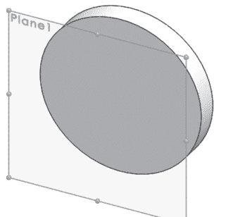

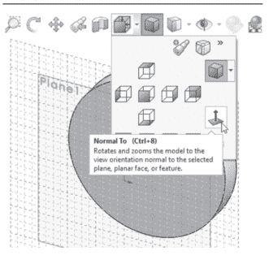

# 法于视图（X-Z）将模型旋转到垂直于所选特征视图。

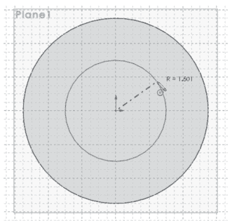

# Plane1 旋转并缩放模型到所选方向。

## 设计意图规划模型

当我们构建法兰的 2.75 英直径时，我们可以从两个现有的平面/面中选择，或者构造一个新的平面。构造新平面以便我们为零件添加拔模是设计意图的一个例子：即对零件未来可能变化的考虑。在整书中，我们将识别建模时考虑设计意图的示例。

如预览（图 1.65）所示，拉伸是远离基底而不是靠近。在属性管理器中，点击“反转方向”（`Reverse Direction`）按钮，使拉伸指向基底（图 1.66）。在下拉菜单中，选择“向上”（`Up`）作为拉伸类型，如图 1.67 所示。点击勾号完成拉伸，如图 1.68 所示。

使用“向上”作为拉伸类型而不是定义，可以轻松进行更改。如果我们以后决定更改 `Plane1` 和前平面之间的距离，零件将正确重建；默认情况下，拉伸仍将延伸到基底。注意在添加新特征时，默认选择了“合并结果”（`Merge result`）选项。如果没有勾选该选项，则特征表示独立的体。

我们可以关闭 `Plane1` 的显示。从“隐藏/显示项目”（`Hide/Show Items`）工具中，点击“平面”图标以切换平面显示，如图 1.69 所示。

`Plane1` 仍然存在于模型中，但关闭平面显示可以获得更整洁的视图。注意，可以通过点击特征管理器中的条目并选择“隐藏”来隐藏 `Plane1`。

定期保存工作是一个好习惯。

从主菜单中选择“文件：保存”（`File: Save`）。用“`Flange`”命名保存零件。文件类型将是“`sldprt`”。

注意新文件名出现在菜单栏和特征管理器设计树的顶部。

接下来我们将添加中心孔。这次我们将选择一个面来定义草图平面。当光标悬停在正面时，注意会出现矩形图标。这表示点击左鼠标键时将选择表面。同样，线条图标表示将选择边。

将光标移动到正面，使矩形图标出现，如图 1.70 所示。点击选择此面；它将变为绿色显示。会弹出一个工具栏，称为“上下文工具栏”（`Context Toolbar`）。点击“法于视图”（`Normal To View`），如图 1.71 所示。

## 图 1.70

（注：如果选择面时没有出现上下文工具栏，请选择自定义工具栏并确保勾选标记为“在选择时显示”（`Show on selection`）的框，如图 1.53 所示。）

点击命令管理器的“草图”标签并选择“圆”工具。在原点画出一个圆。选择“智能尺寸”工具并将直径尺寸为 1.5 英，如图 1.72 所示。点击命令管理器的“特征”标签并选择“拉伸切除”（`Extrude Cut`）工具，如图 1.73 所示。在属性管理器中将类型选择为贯穿”（`Through All`），如图 1.74 所示。

点击勾选标记完成切除。此操作的结果如图 1.75 所示。

我们现在将添加四个螺栓孔。

选择图 1.76 所示的表面。切换到“视线”（`Normal To View`）。点击管理器（`CommandManager`）中的草图选项卡，并选择圆形工具。从原点开始拖动出一个圆。在属性管理器（`PropertyManager`）中，勾选“构造轮线”（`For construction`）框，如图 1.77 所示。

构造实体帮助您定位和确定草图参数的大小，并用虚线表示。刚刚绘制的圆代表螺栓圆。

选择智能尺寸工具。为圆添加一个 4.25 英寸的直径尺寸，如图 1.78 所示。选择圆形工具。将光标移动到构造圆上的顶象限点，如图 1.79 所示。注意会出现的红色菱形，以及共线和垂直关系图标。拖动出一个圆，如图 1.80 所示。选择智能尺寸工具并添加一个 0.50 英寸的尺寸，如图 1.81 所示。

## 图 1.81

草图已完全定义，因为刚刚绘制的圆的中心已位于螺栓圆的顶象限点。

从管理器的“特征”组中选择伸出切除工具，伸出一个类型为“通穿”（`Through All`）的孔。点击勾选标记。

第一个螺栓孔已就位，如图 1.82 中的三向投影视图所示。请注意，当我们选择伸出切除工具时，仅使用了小圆作为切除的几何形状。螺栓圆因为被识别为构造几何形状，所以没有包含在待伸出的草图中。

在特征管理器中单击一次“`Cut-Extrude2`”（图 1.83），选择并高亮该名称。再次点击以编辑名称。（使用两次鼠标点击，而不是双击）输入“`Bolt Hole`”来重命名特征，如图 1.83 所示。按 `Enter` 键获取新名称。

- `Boss-Extrude1`
- `Plane1`
- `Boss-Extrude2`
- `Cut-Extrude1`
- `Bolt Hole`

我们可以分别创建三个孔，但将单个孔创建圆形阵列（`circular pattern`）更简单。此外，由于我们的意图是让孔以圆阵列的形式存在，因此以这种方式构造它们是合理的。如果我们以后更改孔的直径、螺栓圆的直径或孔的数量，如果我们已经通过阵列创建了它们，将很容易做到。

确保选中了第一个螺栓。点击管理器的选项卡，点击线性阵列工具（`Linear Pattern`）下方的箭头以显示阵列工具菜单，如图 1.84 所示。选择圆形阵列工具。

在属性管理器中，点击顶部的框（阵列轴）以激活它，如图 1.85 所示。要定义阵列轴，选择一个圆柱面或圆边（螺栓孔除外），如图 1.86 所示。在属性管理器中，勾选“等间距”（`Equal spacing`）选项，这将导致角度变为 360 度。将孔的数量改为 4，如图 1.87 所示。点击勾选标记完成阵列，如图 1.88 所示。

现在通过对三个尖锐边缘添加圆角（`fillets`）来完成法兰。圆角是处理尖锐边缘的特征。实际上，它是通过添加材料创建的，而圆（`round`）是通过移除材料创建的。`SOLIDWORKS` 通过同一个命令创建圆角和圆。

从管理器的“特征”组选择圆角工具，如图 1.89 所示。选择图 1.90 所示的三个边缘进行圆角。确保光标旁边的线条（如图 1.91 所示）表示选中的是边缘而不是面。如果选择了面，则该面的所有边缘都将被圆角。在属性管理器中，输入半径 0.25，如图 1.92 所示。勾选预览选项查看将生成的圆角。点击勾选标记添加图 1.93 所示的圆角。

切线边缘的显示通常是不需要的。可以从选项菜单控制切线边缘的显示。选择选项工具。在系统选项选项卡下，“显示”下，选择“移除”（`Removed`）作为零件/装配边缘显示，如图 1.94 所示。点击确定。零件应该如图 1.95 所示。

## 设计意图 选择建模技术

通过在单个圆角命令中选择要圆角的三个边缘，可以一步添加三个圆角。使用这种方法，只有第一个圆角进行了尺寸标记。添加圆角的另一种方法是在每个圆角创建后关闭圆角工具，然后分步创建圆角。首选的方法取决于你如何编辑圆角。如果你希望所有圆角始终具有相同的半径，第一种方法允许为三个圆角更改一个值。如果你喜欢单独编辑圆角，那么第二种方法为每个圆角提供了可编辑的版本。

现在我们可以为中心孔添加倒角（`chamfer`）。倒角是从边缘移除材料形成的锥形特征。在管理器中圆角工具下选择箭头，选择倒角工具，如图 1.96 所示。点击图 1.97 所示的边缘将其选择为要倒角的边缘。在属性管理器中，将倒角参数设置为 0.080 英寸和 45 度，如图 1.98 所示，并点击勾选标记完成。

完成的零件如图 1.99 所示。

从主菜单中选择文件：保存。保持零件文件打开进入下一节，在下一节中学习如何对零件进行修改。

## 1.3 修改法兰

实体建模的主要优势之一能够轻松地更改。正如我们观察到的，特征管理器记录了制作法兰的所有操作，如图 1.100 所示。如果我们点击特征旁边的箭头，我们会看到与每个特征关联的草图也被存储了。当光标悬停在特征管理器中的特征或草图名称上时，箭头显示特征与零件中其他特征的关系。例如，第一个螺栓是孔特征的基础。在图 1.100 中，尺寸显示了从“父级”螺栓到“子级”（`CirPattern1`）的移动。这些箭头的显示可以关闭，也可以通过在特征管理器中右键点击零件并选择动态引用（父级）和（子级）项来切换。

让我们通过将直径从 5.5 英寸增加到 7 英寸来更改我们创建的第一个项目。

在特征管理器中右键点击 `Sketch1`。注意，如果菜单中没有编辑草图，则草图图标出现在顶部的上下文工具栏。在本章早期，我们选择了自定义工具并勾选了“显示在快捷菜单”。这会导致编辑草图、编辑特征、隐藏等命令作为菜单项出现，而不是图标。如果你错过了这一步，建议现在勾选该框。（有关自定义 `SOLIDWORKS` 界面的更多信息请参阅附录 B。）

接下来展示了编辑草图尺寸或伸出深度另一种方法。

## 26 第一部分学习 SOLIDWORKS

### 图 1.104

在特征管理器中，双击 `Boss-Extrude1` 图标。创建该特征所需的所有尺寸都会显示出来，如图 1.104 所示。草图尺寸以黑色显示，而特征尺寸（在本例中为拉伸深度）以蓝色显示。（注意，特征中的尺寸方向设置为与草图底部平行，而不是与尺寸线平行。要以这种方式显示尺寸，请选择选项：系统选项：显示，并勾选“显示尺寸相对于屏幕”复选框。）双击直径尺寸并将其改为 5.5。点击重建工具，如图 1.105 所示。

### 图 1.105

若要向草图添加内容，请从属性管理器中选择 `Boss-Extrude2`，右键点击并选择“编辑特征”，如图 1.106 所示。开启斜太（见图 1.107）并将角度设置为 3 度。勾选“拔模引出”框，使斜太在拉伸时增大。点击打勾标记完成。

从顶视图或侧视图可以更容易地看到斜太。你可以使用“四视图”选项显示前视图、顶视图和右视图（带三等投影视图）。

从头部视图工具栏的视图方向工具中选择“四视图”窗口，如图 1.108 所示。

在顶视图和右视图中可以清楚地看到斜太特征，如图 1.109 所示。注意，图 1.109 显示顶视图在前视图上方，右视图在视视图的右侧。以这种方式排列的视图称为第三角法投影。如果你屏幕上的视图排列为顶视图在前视图上方，那么你看到的是第一角法投影，这是欧洲图纸的典型特征。要从第一角法投影切换到第三角法投影，选择选项：系统选项：显示，并在四视图视口中选择“第三角”作为选项。完成后，你需要再次选择四视图窗口以刷新视图。

若要还原单个视图，点击显示三等投影的窗口，从头部视图工具栏的视图方向工具中选择“单视图”，如图 1.110 所示。

修改后的零件如图 1.112 所示。

这两处更改说明了在建模时考虑设计意图的重要性。如果第一个凸轮是从基座特征拉伸出来的，那么添加斜太将要求我们更改凸轮的直径，计算出在包含斜太的情况下，凸轮顶部将产生 2.75 英寸的直径。通过在凸轮顶部绘制草图平面，可以轻松地保持关键的 2.75 英寸尺寸；通过通过圆周阵列创建孔而不是单独创建，可以很容易地修改孔的数量。

### 单视图

显示单个视图的视口

*三等投影*

### 图 1.112

点击撤销工具以撤销之前的命令。

我们可以使用“编辑外观”工具更改零件或零件单个特征和面的外观。

按 `Esc` 键取消任何可能激活的选择。从头部视图选择“编辑外观”工具，如图 1.113 所示。在属性管理器中，注意由于没有选择特定的实体，整个零件将采用。

### 编辑外观

现在显示整个零件。

可以显示特征。

### 图 1.116

### 图 1.117

### 图 1.119

### 图 1.120

### 图 1.122

圆、线和弧线都可以通过点击实体然后点击远离实体的方向来标注尺寸。（弧线会自动以半径而非直径进行标注。）这些是应用于单个实体的尺寸示例。智能尺寸工具（`Smart Dimension Tool`）还允许创建两个实体之间的尺寸。例如，考虑图 1.126 所示的两条平行线。在选了智能尺寸工具的情况下，第一次鼠标点击选择其中一条线。如果第二次鼠标点击位于远离任何其他实体的图形区域，则会为该线的长度创建一个线性尺寸，如上所述。然而，如果第二次鼠标点击点击的是另一个实体，则会在两个实体之间创建一个尺寸，并且需要第三次鼠标点击来放置尺寸。在这个示例中，尺寸标注了两条线之间的距离，如图 1.126 所示。如果这两条线不平行，则相同的鼠标点击将创建一个角度尺寸，如图 1.127 所示。

当其中一个实体是圆时，生成的尺寸始终指向圆的圆心，如图 1.128 所示。不需要选择圆的中心点；点击圆的周线即可创建到圆心的尺寸。当中心线是实体之一时，生成的尺寸可以定义为从中心线到第二个实体的距离，也可以定义为从第二个实体到中心线另一侧镜像实体的距离。例如，考虑图 1.129 所示的水平线和中心线。点击中心线和线会创建一个线性尺寸，因为它们是平行的。如果下一次鼠标点击在两个实体之间，就会创建图 1.129 所示的尺寸。然而，如果在点击放置尺寸之前将光标拖动到中心线的另一侧，则会创建图 1.130 所示的尺寸。这种尺寸标注方法在处理旋转几何体（如下一节所示）时特别有用，因为它允许指定旋转特征的直径。

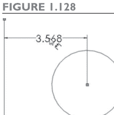

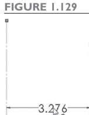

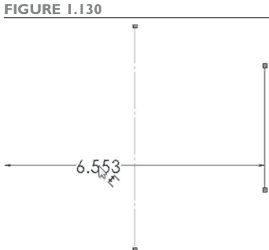

而非半径。由于直径可以直接测量，因此使用直径定义组件是良好的做法。没有草图关系的情况下，通常无法完全定义草图。在法兰上使用的圆的情况下，必须指定中心点的位置才能使草图被完全定义。在每个草图中，定义圆和原点的关系通过捕附（snap）自动添加——在第一次鼠标点击之前，光标移动到原点，草图的中心便“吸附”到了原点。在定义螺栓孔的草图中，捕附到了圆的一个象限点。这些都是自动关系的示例。默认情况下，SOLIDWORKS 会创建自动关系。可以通过主菜单中的“设置：自动关系”（Settings: Automatic Relations）来关闭此功能，但大多数用户不会发现这样做的理由。此外，在指定实体的几何形状时也会创建自动关系。例如，当画线时，线旁边的一个小图标表示该线将是水平或垂直的，如图 1.131 所示。当线完成后，它将关联一个水平或垂直关系，如图 1.132 所示的图标所示。

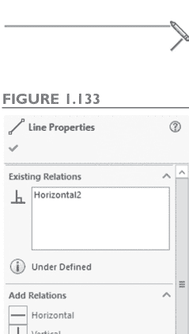

选中实体时，其关系显示在属性管理器（PropertyManager）中，如图 1.133 所示。在属性管理器中，可以通过选择关系并按 Delete 键或添加相应的图标来删除关系。当然，关系必须相互以及与草图中存在的任何尺寸保持兼容。例如，在这种情况下点击垂直图标将导致错误，因为线不能既是水平又是垂直的。

水平和垂直关系，以及“固定”（Fix，它仅用于固定实体在草图中的位置）是应用于单个实体的关系。大多数关系适用于多个实体。例如，图 1.134 在现有线上添加了一条新线。在选择线条工具（Line Tool）的情况下，靠近第一条线的中点

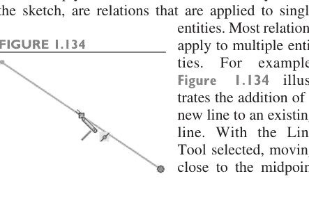

会导致第二条线的第一个点捕附到中点。随着线的移动，屏幕上会出现垂直于第一条线的虚线引导线，如图 1.135 所示。如果第二次鼠标点击在两个实体之间，就会创建图 1.129 所示的尺寸（此处原文编号可能有误，应指后续操作）。此处会创建图 1.136 所示的垂直关系。

FIGURE 135

FIGURE 136

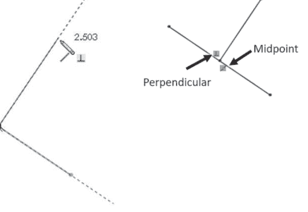

关系也可以手动添加。例如，考虑图 1.137 所示的两条线。点击第一条线会选中它并在属性管理器中显示属性。可以通过点击垂直图标添加垂直关系。如果我们想合并两条线的端点，可以选中第一个。然后按住 Ctrl 键选择另一个端点，如图 1.138 所示。这种方法的用处是，如果我们进行更改（例如更改腿的厚度），只需要更改一个尺寸，等尺寸的设计意图得以实现。我们还可以通过拖动第二条线的端点直到其捕附到第一条线的端点来合并，创建如图 1.139 所示的自动关系。

FIGURE 137

FIGURE 138

FIGURE 139

FIGURE 140

FIGURE 141

现在可以选择两条线，并添加垂直关系，如图 1.140 所示。结果如图 1.141 所示。

应该注意的是，草图关系的图标显示可以通过主菜单中的“视图：草图关系”（View: Sketch Relations）来开启或关闭。在某些情况下，草图变得混乱，关闭关系显示是理想的，但在大多数情况下，显示在创建和编辑草图时是有用的。

正如我们所提到的，尺寸和关系都用于完全定义几何。作为一般原则，我们尽可能少地使用尺寸，并依靠关系来完成几何定义。例如，考虑图 1.142 所示的工字截面。草图由水平和垂直线组成，底线固定在原点。要完全定义草图需要六个尺寸。然而，零件的设计意图是由该草图决定的。我们可能希望顶部的两个“腿”具有相同的厚度和宽度。因此，我们可以删除两个尺寸，并用图 1.143 所示的关系替换它们。这种方法的用处是，如果我们进行更改（例如更改腿的厚度），只需要更改一个尺寸，等尺寸的设计意图得以实现。

FIGURE 142

FIGURE 143

FIGURE 144

这两种解决方案都会导致预定义的右平面（Right Plane）成为所得零件的对称面（假设草图在正面上）。使用对称性是良好的设计实践，将在下一节的滑轮教程以及第三章的教程中予以强调。

# 第一章 基础零件建模技术 35

关系图标列表如图 1.145 所示。除了最后两个外，所有图标在 2-D 草图中都是常见的：穿过 [Pierce] 关系用于扫描和放样等多草图应用，而 X 轴关系用于 3-D 草图（还有类似的“沿 Y 轴”和“沿 Z 轴”关系）。

图 1.145

| 水平 | 重合 | 同心 | 相切 |
|---|---|---|---|
| 垂直 | 中点 | 同径 | 对称 |
| 平行 | 相交 | 固定 | 穿过 |
| 垂直于 | 等长 | 共线 | 沿 X 轴 |

图 1.146

图 1.147

## 打开一个新零件。

你会注意到之前对界面进行的某些更改，例如命令管理器（CommandManager）上的标签数量和视图工具栏（Heads-Up Toolbar）上的工具仍然有效。其他设置，例如背景颜色，已恢复到初始设置并需要再次更改。这些特定的设置存储在零件模板（Part template）中。我们将编辑模板，这样每次开始建模时就不需要重复进行这些更改。

从视图工具栏的应用场景工具（Apply Scene Tool）将背景颜色更改为纯白色。选择选项（Options Tool），并点击文档属性（Document Properties）选项卡。将绘图标准改为 ANSI。在尺寸（Dimensions）下，将主精度（Primary precision）设置为 .123（三位小数）。选择网格/捕捉（Grid/Snap），并勾选“显示网格”框。选择单位（Units），将单位系统改为 IPS，长度尺寸的小位数改为 .123，角度的小位数设置为无。

注意，我们在两个不同的位置设置了小数位数。可以在任何一个位置更改该位数；通过将两者都设置为 .123，我们确保了模板设置正确。

你任何想要更改的其他设置都可以存储在模板的文档属性选项卡中。例如，你可能想要更改尺寸的字体，或者关闭网格显示（本书中的大多数零件都使用了较大的字体并开启了网格以便于显示）。

# 图 1.148

从主菜单中，选择文件：另存为。将文件类型更改为模板 (*.prtdot)。点击“Part.prtdot”文件进行选择，如图 1.148 所示，然后点击保存。当询问是否要替换现有模板时，点击“是”。

下一次你开始新零件时，你刚刚做的设置将生效。注意，当你将文件类型更改为模板时，工作目录自动更改为 SOLIDWORKS 的默认目录。该目录位于包含操作系统的驱动器上的 Program Files 或 Data 目录。此外，在这里存储你的工作并不是个好习惯。下次你保存文档时，目录将默认到上次访问的目录；在本例中，就是保存模板的目录。在保存文档之前，确保将目录更改为你想要的目录。我们将在本节稍后的部分保存拉伸文件时注明这一点。

# 第一章 基础建模技术 37

点击右侧平面（Right Plane）进行选择，如图 1.149 所示。从命令管理器的“草图”（Sketch）组中，点击线条工具（Line Tool）下方的箭头，选择中心线工具（Centerline Tool），如图 1.150 所示。从原点画一条中心线，如图 1.151 所示。

这条中心线允许我们利用截面的对称性。

点击矩形工具（Rectangle Tool）上方的箭头，选择中心矩形工具（Center Rectangle Tool），如图 1.152 所示。点击中心线上的原点上方，如图 1.153 所示，以设置矩形的中心。然后拖动矩形的一个角，如图 1.154 所示。尺寸并不重要，但要保持整个矩形位于原点上方。重复此操作在第一个矩形上方创建第二个矩形，如图 1.155 所示。

在属性管理器（PropertyManager）中，将矩形的类型从“中心”改为“角”，如图 1.156 所示。将光标移动到底部矩形的顶部直线（而不是角或中点；当整条线变为红色时，表示你捕捉到了线条而非特定点），如图 1.157 所示，点击矩形的一个角。拖动矩形直到另一个角对齐顶部矩形的底部直线，如图 1.158 所示 # 38 学习 SOLIDWORKS

当我们使用中心矩形工具并将中心点沿中心线放置时，这些矩形是对称的。然而，为了连接前两个矩形我们使用的是角矩形，它并没有以中心线为中心。因此，我们需要手动添加此矩形的对称性。

点击图 1.159 中的两条直线和中心线以选择它们，在进行多选时记得按住 Ctrl 键。从工具栏中点击“对称”（Symmetric）图标，如图 1.160 所示

选择智能尺寸工具（Smart Dimension Tool），点击矩形的顶部直线创建一个线性尺寸。将尺寸拖到所需位置并点击放置。将值输入 1.5 英寸，如图 1.161 所示。将图 1.161 所示的 2.0 英寸添加到底部直线。

选择智能尺寸工具，点击矩形的垂直线之一，然后点击另一条垂直线创建一个线性尺寸。将尺寸拖到所需位置，然后点击放置。将值输入 0.25 英寸，如图 1.162 所示。

图 1.160

图 1.161

图 1.162

 # 第一章 基础零件建模技术 39

在为智能尺寸命令选择多个实体时，不需要按住 Ctrl 键。如果你点击单个实体并点击其他任何实体进行放置，智能尺寸工具会创建一个基于实体的尺寸（线条长度、圆的直径、弧的半径）。如果你点击一个实体再点击第二个实体，智能尺寸工具将创建一个关联这两个实体的尺寸。当我们选择两条平行线时，两条线之间的距离被添加为尺寸。如上一节所述，如果我们选择两条非平行线，将创建一个角度尺寸。

如果你参考图 1.147，你会发现用于定义此截面的其他尺寸也已标注。为了放置尺寸，我们需要建立中心线，它将成为最终实体的旋转轴。

图 1.163

草图应该是被完全定义的。

图 1.164

图 1.165

 # 设计意图：模型其他用途的规划

在为滑轮的初始草图添加尺寸时，我们可以将某些尺寸指定为直径或半径。对于定义滑轮总体尺寸的 7 英寸直径，可以很容易地输入为 3.5 英寸半径。然而，如果我们计划为该零件制作 2-D 图纸，那么直径在图中应定义为直径。通过以相同的方式标注零件，我们将标注图纸，这样尺寸就可以从零件文件中直接获取。这防止了我们必须手动添加尺寸或覆盖尺寸属性。当你计划为零件制作 2-D 图纸；在装配中使用该零件；将零件用于其他用途（如进行应力分析、创建快速原型或开发刀路）；考虑模型的用途将影响创建和定义零件几何形状的方法。从命令管理器的特征（Features）组中，选择旋转凸/底（Revolved Boss/Base）工具，如图 1.166 所示。

注意，当我们之前选择凸/底（Boss/Base）工具时，屏幕上没有显示预览。这是因为我们的草图中存在两个必须定义的歧义：

- 草图中存在多个封闭区域，因此我们需要定义旋转哪些区域。

- 草图中存在两条中心线，因此我们需要定义哪条中心线是旋转轴。

处理第一个歧义的方法是使用修剪工具（Trim Tools）移除草图中重叠的部分，使草图由单个封闭轮廓组成。另一种简单的方法是直接选择多个轮廓。

在属性管理器中，点击选取轮廓（Selected Contour）框，如图 1.167 所示。将光标移动到顶部矩形内并点击选择矩形区域，如图 1.168 所示。对另外两个区域重复此操作，如图 1.19 所示。可能需要放大和/或切换到等轴视图来选择中间区域。

## 第一章 基础零件建模技术

在属性管理器（PropertyManager）中点击“旋转轴”（Axis of Revolution）框以进行选择，图 1.170 所示（图 1.170）。如图 1.171 所示，点击水平中心线。

现在将显示预览，如图 1.172 所示。在属性管理器中，如果我们希望生成的零件不是完全旋转的，可以更改旋转角度数。由于我们需要将截面旋转 360 度，我们可以接受默认值。

# 图 1.171 图 1.172

点击勾选标记完成旋转。图 1.173。

生成的实体零件如图 1.173 所示。

从主菜单选择“文件（File）: 保存（Save）”。确保更改文件目录到您想要保存文件的位置，因为默认路径是包含模板文件的目录。还将文件类型从“零件模板”（Part Template）更改为“零件”（Part）。保存文件命名为“Pulley”（滑轮）。

选择“右基面”（Right Plane），并从上下文工具栏选择“法于”（Normal To），如图 1.174 所示。选择“中心线工具”（Centerline Tool），从原点创建垂直和水平中心线，如图 1.175 所示。

# 图 1.174 图 1.175

# 42 第一部分 学习 SOLIDWORKS 

## 设计意图 选择初始草图平面

在绘制第一个草图之前，应该考虑零件初始草图平面的选择。标准做法是调整零件方向，使“前视图”提供所有主视图（前、后、顶、底、右、左）中部分零件的最佳可视化效果。强调零件正面的等测视图（Trimetric View）提供了最佳（3D）视图。正如我们在第 2 章将看到的，正确地延续零件将使多视图图的创建变得更加容易。对于之前创建的法兰零件，前基面上的初始圆导致了法兰的正确方向。

对于通过旋转视图（evolved views）创建的滑轮，零件的圆形轮廓是最描述性的视图，因此我们选择“右基面”作为初始草图的平面。我们也可以在“上基面”上绘制草图并获得相同的结果。

一旦在某个方向上创建了零件，重新调整方向就会很困难。没有命令可以相对于轴旋转零件。可以通过在特征管理器（`FeatureManager`）中右键点击草图并选择“编辑草图平面”（`Edit Sketch Plane`）来更改草图所在的平面。然而，这会导致后续特征出现错误。因此，在选择初始草图平面之前仔细考虑零件的方向是一个良好的习惯。

当使用“中心线工具”或“直线工具”时，请注意绘制线段有两种不同的方法。如果您点击一次设置第一个端点，移动光标然后再次点击设置另一个端点，然后就可以移动光标在先一个端点处创建另一个线段。这种技术允许您在放置最后一个端点后双击，从而开始新一组线段，而按 `Esc` 键则关闭“直线工具”或“中心线工具”。第二种方法用于创建不连续的线段。点击放置第一个端点，按住鼠标按钮拖动到另一端。释放鼠标按钮放置第二个端点。此时光标可以移动到新线段的起始点。

# 第一章 基础零件建模技术 43

选择“直线工具”，绘制两条水平线和两条对角线以形成图 1.176 所示的闭合形状，确保形状的上角与实体零件的上边缘重合。

选择两条对角线和垂直中心线，使用 `Ctrl` 键进行多选，如图 1.177 所示。添加一个“对称关系”（`symmetric relation`）。

选择“智能尺寸工具”（`Smart Dimension Tool`）。点击两条对角线以创建一个角度尺寸。将其值设为 40 度。添加图 1.178 所示的两个线性尺寸。

草图应该是完全定义的。

从特征（`Features`）组中选择“旋转切去工具”（`Revolved Cut`），如图 1.179 所示。点击中心线将其作为旋转轴，如图 1.180 所示。点击勾选标记完成切去，如图 1.181 所示。

选择“圆角工具”（`Fillet Tool`）。在属性管理器中，将半径设置为 0.25。切换到“等测视图”（`Trimetric View`），如图 1.182 所示（带有“预览”选项，如图 1.183 所示）。

选择“旋转工具”（`Rotate Tool`）关闭旋转，如图 1.180 所示。点击中心线以完成旋转，如图 1.181 所示。

从特征（`Features`）组中选择“旋转切去工具”，选择旋转以的边缘，如图 1.184 所示。点击勾选标记完成切去，如图 1.185 所示。

选择“拉伸切去工具”（`Extruded Cut`）。在属性管理器中，将切去类型设置为“贯穿”（`Through All`），如图 1.186 所示。点击勾选标记完成切去，如图 1.187 所示。

选择“直线工具”（`Line Tool`）关闭直线，如图 1.188 所示。将中点关系到原点，如图 1.189 所示。

## 设计意图 保持简单

在本次练习中，我们使用四个特征对滑轮进行了建模：一个旋转基座、一个用于 V 型皮带槽的旋转切除、圆角，以及一个用于键槽的拉伸切除。这前三个特征本可以通过将整个截面绘制成单个草图来合并，如图所示（使用了“草图圆角工具”来创建圆角轮廓）。哪种方法更好？虽然成品是相同的，但将零件的创建分解为多个步骤通常是最佳方法。在制作与草图相关的零件时，会遇到许多错误——重复实体、开放轮廓、线段和弧不相交的端点以及未定义的几何结构，都是与草图相关的错误示例。（使用“显示草图轮廓”选项有助于发现复杂草图中的错误，因为只有闭合轮廓会被着色。）草图越复杂，发生这些错误的概率就越高，排除故障也越困难。此外，通过简单步骤创建的零件更容易进行设计更改。

## 第一章 基础零件建模技术 47

## 未来学习

### 动力学（动学）

在物理学中，你学习了牛顿第二定律：使左侧轮加速所需的扭矩与右侧轮相等（在相同的时间内）。虽然低惯性质量通常是理想的，但一个显著的例外是飞轮。高速旋转发动机中飞轮的惯性使其难以减速。因此，尽管功率有微小波动，发动机的转速仍保持平稳。

`F = ma`，作用物体上的力（`F`）等于物体质量（`m`）乘以加速度（`a`）。对于设计带有运动部件机器的机械工程师，应用此定律需要以特定方式移动物体所需的力。在工程材料领域，轻质强度材料的发展使得运动部件能够以极加速度移动，从而获得更高的性能。

复杂形状的质量和惯性矩计算可能非常繁琐。使用实体建模软件执行这些计算可以为进行此类分析的工程师节省时间。

所给出的牛顿第二定律适用于沿线性或平移运动的物体。大多数组件还以旋转运动移动。旋转运动的牛顿第二定律为：

`T = IR`

或作用于物体上的扭矩（`T`）等于惯性质量（`I`）乘以物体的角加速度（`β`）。质量惯性矩是物体质量以及质量相对于旋转轴分布方式的函数。例如，考虑这里的两个轮。这两个轮直径相同且重量相同，但左侧轮的惯性质量几乎是右侧轮的两倍。如果将轮安装在轴上，它将

不对称的。如果显示的任何数量需要更多小数位，可以在“质量属性”对话框中选择“选项：使用自定义设置”，并选择所需的位数。你也可以通过选择“工具：选项：文档属性：单位”并更改“质量/截面属性”下的“长度”值来更改默认位数。还显示了零件的惯性矩，这在动力学分析中非常重要，且通常用手计算会非常困难（见“未来学习”框）。

## 48 第一部分学习 SOLIDWORKS

关闭属性窗口并保存零件文件。

## 图 1.196

通常，我们会有兴趣查看对零件几何形状的更改如何影响其质量。传感器允许连续显示更改。

在特征管理器中右键点击“传感器”，并选择“添加传感器”，如图 1.196 所示。

将传感器类型设置为“质量属性：质量”，如图 1.199 所示，并点击标记。

## 图 1.197

点击特征管理器中传感器项旁边的箭头以显示新传感器。零件的质量将显示，如图 1.198 所示。此传感器可用于跟踪其他类型的数据，例如应力分析和运动分析结果。在“质量属性”组中可以使用传感器跟踪体积、表面积和质量坐标。

## 图 1.198

在特征管理器中双击 V 型皮带槽（`Cut-Revolve1`）。双击 0.5 英寸尺寸，如图 1.199 所示（此处从右视图），并更改为 0.4 英寸。重建模型。

## 图 1.199

现在，传感器报告的质量已更改以反映模型，如图 1.200 所示。

假设我们想找到没有 V 型皮带槽和键槽的铸件的质量。一种简单的方法是抑制这些特征。在特征管理器中双击 V 型皮带槽（`Cut-Revolve1`）。双击 0.5 英寸尺寸，如图 1.199 所示（此处从右视图），并更改为 0.4 英寸。重建模型。

## 图 1.200

现在传感器报告的质量已经更改以反映模型，如图 1.200 所示。

假设我们想找到没有 V 型皮带槽和键槽的铸件的质量。一种简单的方法是抑制这些特征。在特征管理器中双击 V 型皮带槽（`Cut-Revolve1`）。双击 0.5 英寸尺寸，如图 1.199 所示（此处从右视图），并更改为 0.4 英寸。重建模型。

## 49 基础建模技术

## 问题

- 1.1 使用旋转和圆角创建一个实体（如图 1.1A 所示）。
- 1.2 这种方法（如图 1.2B 所示）。
- 1.3 这种方法（如图 1.3A 所示）。
- 1.4 这种方法（如图 1.4B 所示）。
- 1.5 这种方法（如图 1.5A 所示）。
- 1.6 创建这个 2 毫米厚的的钢制自行车刹盘的实体。计算零件的质量，使用 AISI 304 钢。注意：虽然此零件可以通过复杂草图的单拉伸来建模，但你会发现拉伸出一个实体圆盘然后使用一系列实体拉伸切除和圆形阵列要简单得多。

# 第一章 基础零件建模技术 53

1. 在背板的前视面上打开一个草图。从命令管理器（`CommandManager`）的草图组（`Sketch Group`）中选择“转换实体”（`Convert Entities`）工具，并点击图 P1.BC 所示的两个圆形边。点击勾选标记在草图中创建圆形实体。从轮毂边缘到背板边缘绘制两条线。顶部的线应与轮毂边缘相切。底线应与顶部线平行。在两条线之间添加一个 5-mm 的尺寸。虽然线的径向对齐至关重要，但将其中一条线设置为水平将使草图变为完全定义。

2. 将由线条和圆构成的轮廓进行伸伸，深度与轮毂相同的 30-mm（尝试使用“伸到表面”作为伸伸类型来创建叶轮上的第一个叶片）。在叶轮底座添加一个 5-mm 的圆角，并使用圆阵列工具（`Circular Pattern Tool`）创建六个叶片和半径的图案，如图 P1.BD 所示。

3. 添加 5-mm 厚的前板，该板有一个直径为 75-mm 的“孔”以允许流体进入。

P1.9 通过在右视平面（`Right Plane`）上绘制截面并绕法兰线轴进行旋转，创建图 1.1 所示和图 1.2 详细说明的法兰体。使用草图圆角工具（`Sketch Fillet Tool`）在草图中包含圆角。

P1.10 创建图 P1.10A 所示连杆的实体模型。使用图 P1.10B 所示的尺寸。分配材料为铸碳钢（`Cast Carbon Steel`），并添加传感器以确定质量。注意：在绘制连杆形状时，使用对角线边与圆角边之间的相切关系，如图 P1.10C 所示。为了保持连杆的对称性，请在前视平面（`Front Plane`）中绘制草图，并选择中面（`Midplane`）作为伸伸类型。这将导致草图从前视平面向两个方向等距离伸伸。

# 图 P1.10A

# 图 P1.10B

# 图 P1.10C

**相切**

P1.11 考虑在 P1.10 中创建的连杆。由于设计限制，连杆的重量必须降低到 1.70 lb。在连杆的两侧添加一个如图 P1.11 所示的凹面槽（以保持对称性），并选择合适的尺寸将零件重量降低到可接受的水平。注意：在创建凹面槽时，尝试使用偏移实体工具（`Offset Entities Tool`）。该工具允许在所选线条或圆弧的指定距离创建新实体。此外，尝试使用镜像工具（`Mirror Tool`）创建第二个凹面槽，并以前视平面为镜像面。这些工具将在后面的章节中进行详细介绍。

# 图 P1.11

# 第2章 工程图

## 章节目标

即使是仅使用实体建模软件设计零件的公司，仍然需要生产 2-D 图纸。多视图 2-D 图是设计的最佳方式，它显示了生产零件所需的所有尺寸。由于没有任何制造工艺能生产“完美”的零件，重要尺寸允许的公差（零件标注尺寸的偏差）也会显示在 2-D 图纸上。

`SOLIDWORKS` 程序允许从 3-D 模型快速方便地生成 2-D 图纸。图纸将与零件文件完全关联，因此零件的变化会自动反映在图纸上，反之亦然。

- 在本章中，你将：
- 从 `SOLIDWORKS` 零件创建 2-D 图纸，
- 创建自定义图纸格式，
- 使用 `eDrawings` 软件创建一个易于共享和协作编辑的图纸文件。

## 2.1 图纸教程

在本教程中，将制作第 1 章中法兰的 2-D 图纸。

打开 `SOLIDWORKS` 程序。点击新建文档工具，如图 2.1 所示。选择图纸图标，如图 2.2 所示，并点击确定。

图 2.1

图 2.2

* `eDrawings` 是 `Dassault Systèmes` 公司的商标。

开始学习 `SOLIDWORKS`

当你手工绘制图纸时，第一步是选择使用的纸张尺寸和类型。我们将查看带标题块的幅格式，但现在先使用空白的 8.5 x 11 英寸纸张（A 横向）。

图 2.3

选择纸张尺寸为 A 横向，取消勾选“显示格式”框，如图 2.3 所示。点击确定关闭对话框。点击模型视图（`Model View`）中的 X（取消）。新图会自动启动模型视图，但在格式化之前我们将设置一些选项。

图 2.4

选择选项工具（`Options`），如图 2.5 所示。在系统选项（`System Options`）中，选择显示样式（`Display Style`），并如图 2.6 所示设置隐藏线和相切边。

图 2.5

选择零件或装配以创建图纸，然后点击下一步。是否显示隐藏和相切边取决于零件的复杂度。正如我们之后看到的，可以为每个模型视图更改这些选项。选择颜色：图纸。点击编辑，如图 2.7 所示。选择白色并点击确定。

图 2.6

# 图 2.7

第2章 工程图

在文档属性（`Document Properties`）选项卡下，选择标准（`Standard`）并将标注标准设置为 `ANSI`，如图 2.8 所示。选择尺寸（`Dimensions`），确保小数位设置为 2，如图 2.9 所示。选择详细信息（`Detailing`），关闭中心线的自动显示，如图 2.10 所示。选择单位（`Units`），将系统设置为 `IPS`（英寸，磅），并将小数位设置为 2，如图 2.11 所示。将角度的小位设置为零。点击确定。

图 2.8

# 图 2.9

# 图 2.10

# 图 2.11

虽然修改零件时小数位设置为 3，但小数位数不会影响模型的精度，仅影响尺寸的显示方式。对于图纸，小数位数与大多数尺寸的公差水平有关。注意有一个设置长度单位的选项。通常图纸在主单位中显示一组尺寸，并在框中显示第二组尺寸。通过这种方式，可以在一张图纸上显示美国和 SI 单位。由于我们需要两种单位，因此不需要更改默认设置。正如我们在第 1 章中修改并保存零件一样，我们设置了两次小数位数。由于位数可以在两个地方更改，我们在两个地方都设置了小数位数以确保它们保存到绘图模板中。

在模板中保存这些设置之前，我们将投影类型设置为三角法。三角法选项将主视图、顶视图、右视图和等轴视图位于左下角（大多数美国图纸的标准），而第一角法显示主视图、顶视图和左视图，主视图位于左上角（大多数欧洲图纸的标准）。

图 2.12

在图纸空间中，右键点击并从出现的菜单中选择属性（`Properties`）。可能需要点击菜单底部的双箭头来显示属性选项）。将投影类型设置为三角法，如图 2.14 所示，并点击更改关闭图纸属性框。

图 2.13

# 图 2.14

图纸属性

| 名称 | 区域参数 | |
| --- | --- | --- |
| Sheet1 | 投影类型 | |
| 比例 | 1 : 1 | |

## 第一角投影

# 图 2.15

# 第 2 章 工程图

我们在第 1 章中对零件进行建模时，我们在命令管理器（`CommandManager`）中找到了大部分需要的命令。在绘图模式下，命令管理器有三组我们经常使用的命令。为了保持界面尽可能简单，我们将隐藏其他命令。

右键点击`CommandManager`的任何选项卡。点击除视图布局（View Layout）、注释（Annotation）和草图（Sketch）以外的每个组名称，取消勾选并关闭图纸显示，如图 2.16 所示。

我们现在准备好从零件文件中导入几何形状。

从`CommandManager`的视图布局（View Layout）组，选择模型视图工具（Model View Tool），如图 2.17 所示。

图 2.16

图 2.17

如果您在另一个窗口中打开了法兰，它将出现在属性管理器（PropertyManager）中。双击文件名以选择它，然后点击视图（View）按钮，如图 2.18 所示，并找到存储该零件的文件。在属性管理器中，选择多个视图并点击主视图（Front）和顶视图（Top），如图 2.19 所示。如果选择了任何其他视图（如三视图（TriView）），点击模型名称旁边的框以取消勾选并取消选择。点击勾框放置视图。

注意图 2.19 中主视图和顶视图显示的“A”标记表示尺寸与这些视图相关联。

图 2.18

图 2.19

图 2.20

当您的光标悬停在每个图视图上时，注意会出现一个定义视图边界的矩形框。将光标移动到图纸边界上会显示移动箭头，如图 2.20 所示。当移动箭头显示时，您可以点击并拖动图视图到新位置。注意，视图将保持原有的对齐状态。

注意我们在这里只显示了主视图和顶视图，因为右视图（Right View）的比例被自动选择，以使图视图适应图纸。您可以通过在图纸区域点击右键、选择属性（Properties）并定义新比例来覆盖该比例。

## 第一部分 学习 SOLIDWORKS

我们可以使用智能尺寸工具（Smart Dimension Tool）手动添加尺寸，但我们通常更倾向于从模型导入尺寸。这样做的好处是导入的尺寸可以更改，并且会反映在模型中。使用智能尺寸工具添加到图纸上的尺寸将是驱动尺寸，这意味着当模型发生更改时，它们的值将更新，但尺寸不能用于更改模型图纸。导入尺寸的另一个优点是，如果使用完全定义的草图来创建零件，那么检查尺寸也有助于确保图纸是完全定义的。（然而，使用完全定义的草图并不能保证图纸是完全定义的。特别是当一个特征通过关系定位时，通常仍然需要在图纸上添加额外的尺寸来精确定位该特征。）

图 2.21

图 2.22

点击`CommandManager`的注释（Annotation）选项卡，并如图 2.21 所示选择模型项（Model Items）。在属性管理器中，选择“导入项到所有视图（Import items into all views）”和“消除重复（Eliminate duplicates）”，如图 2.22 所示。点击勾框导入图纸视图中的项（尺寸）。

虽然模型项属性管理器包含了控制尺寸导入的公差等选项，但勾选默认值通常足够了。并不是所有用于创建模型的尺寸都导入了——例如 45 角的倒角。未导入尺寸是因为该尺寸应用于当前图视图中隐藏的特征。如果勾选了模型项属性管理器中的“包含特征（Include items from features）”，那么该尺寸就会被导入。相反，我们将该尺寸导入到以后添加的详细视图中。此外，定义圆角的 R 尺寸可能取决于在模型中创建圆角时先选择了哪一个。

图 2.23

点击并拖动图上的尺寸使其清晰可见，如图 2.23 所示。注意当您将尺寸拖到某个位置时，它会自动与其他尺寸对齐。拖动尺寸时按`Alt`键可以关闭自动对齐，允许您更精确地放置尺寸。

图 2.24

您还可以显示线性尺寸上的箭头，例如图 2.24 所示的 25 英寸尺寸。当您点击尺寸时，尺寸将变为绿色，箭头处会出现圆点。

点击这些圆点之一，箭头将从外部切换到内部或反之，如图 2.25 所示。

尺寸显示在创建它们的视图中。例如，5.5 英寸和 2.75 英寸直径显示在主视图中，因为它们是在主平面上绘制的。然而，标准的制图做法是将实体特征的直径显示在其呈现为圆的视图中。因此，我们希望将这些尺寸移动到顶视图。通过从主视图删除这些尺寸并添加到顶视图，我们只需移动它们即可。

按下并保持`Shift`键。点击并拖动 5.5 英寸尺寸，直到光标进入顶视图的边界。释放引线按钮，尺寸将放置在顶视图，如图 2.26 所示。（确保在释放`Shift`键之前释放引线按钮；否则操作将无效。）对 2.75 英寸尺寸重复此操作。

孔尺寸应用引线显示而不是线性尺寸。取决于您对零件模型中心进行建模，0.5 英寸尺寸可能作为线性尺寸导入（如图 2.23 所示），或使用引线。如果 0.5 英寸直径以线性尺寸出现，右键点击尺寸并选择显示选项：显示为（Display Options: Display as），如图 2.27 所示。点击并拖动尺寸到方便的位置，如图 2.28 所示。

尺寸的方向可以通过点击并拖动直接出现在尺寸值上方点来更改。例如，如果 4.25 英寸直径是以水平尺寸导入的，可以通过点击并拖动引线将其旋转 90 度，如图 2.29 所示。（这将允许孔尺寸的引线穿过 4.25 英寸尺寸的延伸线。）

更改尺寸、尺寸线和引线外观的选项非常多，本文将仅介绍其中几个。通过点击任何尺寸并选择显示选项（Display Options）或属性（Properties），您将发现更改尺寸的外观很容易。

## 利用关联性

在第 1 章中，我们通过创建一个构造圆并指定圆的直径，定义了螺栓在法兰上的位置。或者，我们可以通过指定其相对于法兰中心点的径向尺寸来定位单个孔。我们对法兰进行了建模，任何一种标注技术都能将第一个孔定位在我们需要的位置，且任何替代方案都是接受的。然而，在绘制尺寸时，我们看到绘制螺栓圆并对其进行标注是显示径向尺寸的优方法。

如果距离是由径向尺寸定义的，那么我们可以在图纸上定义径向尺寸，添加构造圆并添加新尺寸。然而，新尺寸与零件没有关联。也就是说，添加的 4.2 英寸尺寸不会改变螺栓位置，更改径向尺寸也不会导致图纸更新。因此，维护零件和图纸之间的完全关联性需要编辑零件文件。

## 第 2 章 工程图 63

将光标移动到主视图（Front View）。将出现剖线的预览。注意，该线将完全穿过零件。将光标移动到视图的中心标记，这将使剖切通过零件中心，如图 2.32 所示。点击放置剖线。将弹出菜单，其中包含创建偏移剖的选项，如图 2.33 所示。由于我们正在创建一个全剖，只需点击勾选标记。

将光标移动到视图。默认情况下，该视图将与主视图对齐。在主视图之后绘制剖视图，并点击放置视图，如图 2.34 所示。剖视图应指向外部，以便使剖视图处于所需的方向。如果箭头向下，请点击翻转（Flip）按钮，如图 2.34 所示。

在剖视图框内点击右键，从出现的菜单中选择对齐：断开对齐（Alignment: Break Alignment），如图 2.35 所示。将光标移动到剖视图边界框的边缘，使箭头出现。点击并拖动视图到图纸上的新位置，如图 2.36 所示。

## 第一部分 学习 SOLIDWORKS

图 2.37

注意，图纸头部视图工具栏（Drawing Heads-Up View Toolbar）包含了一些与零件头部视图工具栏相同的图标，还包含一个图纸到图纸工具（Sheet to Sheet Tool），如图 2.37 所示。当选择此工具时，整个图纸将显示在头部视图工具栏下方。您可以按照第 1 章介绍的方法向头部视图工具栏添加工具。其中一个工具是平移工具（Pan Tool），它允许在不更改缩放比例的情况下查看图纸的不同区域。

### 缩放至图纸

缩放图纸以适应窗口。

图 2.38

由于我们在设置图纸模板选项时指定了自动添加中心线，因此它们出现在视图中。如果不需要这些中心线，可以通过点击其中一个按`Delete`键来删除它们。也可以通过`CommandManager`中注释（Annotation）组中的中心工具（Center Tool），为单个特征或特定视图中的所有实体添加中心线，如图 2.38 所示。

- 中心标记
- 审核符号
- 模块
- 中心线
- 审核云
- 中心工具：向视图或选定的实体添加中心线。

图 2.39

注意，视图显示时没有“隐藏边”作为选项，且隐藏边在主视图和顶视图中显示。隐藏边通常不显示在视图中，但可以通过选择视图然后从头部视图工具栏中选择样式来更改任何视图中隐藏边的显示，如图 2.39 所示。

### 隐藏视图

当选中时，隐藏边将以不同的颜色显示在视图中。

## A-A 剖

倒角在默认比例（1:2）下很难看到。一个放大倒角区域的局部视图将会有帮助。

从`CommandManager`的布局（Layout）组中选择局部视图（Detail View），如图 2.40 所示。

图 2.40

圆形工具将自动激活。在要包含在局部视图中的区域周围拖出一个圆，如图 2.41 所示。将光标移动到您希望局部视图出现的位置，并点击放置视图，如图 2.42 所示。如果局部视图中出现倒角，选择它并按`Delete`键。（有两条中心线——一个用于孔，一个用于倒角，所以两个都删除。）

图 2.41

图 2.42

`SOLIDWORKS`

`文件 编辑 视图 工具 帮助`

`标准 模型 投影装配 侧视图 局部视图 拆分 局部 剖视图 裁剪 交替投影视图`

`视图 布局 绘图`

`局部视图`

添加局部视图以显示视图的一部分，通常采用放大的比例。`R=0.36 @view`

## 局部 B 比例 1:1

## 第 2 章 工程图 65

注意局部视图的比例为 1:1。任何图纸视图的比例都可以更改，我们将更改局部视图的比例以进一步放大倒角。

图 2.43

选择局部视图，在`PropertyManager`中“使用自定义比例”选项将比例更改为 2:1，如图 2.43 所示。

尺寸可以导入到剖视图和局部视图。在这种情况下，局部视图中可以看到 45 度角。此外，尺寸不应导入到特征。因此，45 度尺寸未导入主视图或顶视图。

图 2.44

点击局部视图的空白区域选择此视图，从`CommandManager`的注释组选择模型（Model），如图 2.44 所示。点击勾选标记导入尺寸。45 度尺寸将在图 45 显示。按`Esc`取消选择局部视图。

图 2.45

我们还希望在局部视图中显示 0.080 宽倒角，但该尺寸已导入到主视图。我们将该尺寸从主视图移动到局部视图。

按住`Shift`键。将主视图中的 0.080 英寸倒角尺寸拖入局部视图。释放鼠标按钮时，尺寸将移动到局部视图。释放`Shift`键，并将尺寸拖到最终位置，如图 2.46 所示。

图 2.46

图 2.47

剖线和局部视图上的标签（A 和 B）以及视图标题显示默认字体。这些尺寸可以在文档选项中更改，也可以单独更改。

## 局部 比例 2:1

点击线条选择它，如图 2.47 所示。在`PropertyManager`中，清除“文档字体”框，点击字体按钮并增大字体。当您点击`OK`时，将提示应用此设置。点击局部视图标签和标题。注意，可能需要重绘图纸才能显示增大后的字体。此外，如果您想更改与视图相关的字母，也可以从管理器中进行。如果您想更改剖线的样式，选择选项：文档属性：视图，并选择不同的线条样式或厚度。

## 第一部分 学习 SOLIDWORKS

图 2.48

您的图纸现在应该如图 2.48 所示。现在是保存工作的时机。

选择文件：保存并另存为“Flange Drawing”，文件类型为`.slddraw`（SOLIDWORKS Drawing）。由于上次保存操作将图纸模板存储到默认目录，请确保将图纸文件保存到所需位置。

如所述，图纸中显示的位数与应用于每个尺寸的公差有关。通常某些尺寸比其他尺寸关键，需要指定值。例如，假设 1.5 英寸直径孔需要公差，以便与插入孔的零件良好配合。

图 2.49

点击 1.50 英寸尺寸的数字部分。将出现代表尺寸面板的图标，如图 2.49 所示。将鼠标悬停在图标上，尺寸面板将展开。

尺寸面板包含许多修改尺寸的工具。可以通过在左侧添加文本（例如直径尺寸自动出现的直径符号）或在右侧添加文本（例如“Typ”，表示该尺寸是相似特征的典型值）来修改尺寸值。此外还可以修改位数（单位精度）并添加公差。在尺寸面板中，使用下拉菜单将位数设置为三位（.123），如图 2.51 所示。将公差类型设置为双向，如图 2.52 所示。点击正公差的数值，并输入`.003`的值，如图 2.53 所示。点击尺寸面板外部以关闭。

图 2.53

图 2.54

## 制造工艺、几何尺寸与公差以及计量

在这个示例中，我们对中心孔的直径设置了较紧的公差，以便法兰与配合该孔的部件之间实现紧密配合。你如何知道公差应该是多少呢？也许更好的问题是：在装配中，设计的零件需要什么样的公差？在很多情况下，这个问题的答案决定了可以使用什么制造工艺。许多工程师研究制造工艺，但不可能学习目前正在使用的特定制造工艺的细节。在工作中，工程师会尽可能多学习公司及其供应商所使用的制造工艺，以理解哪些公差在实践中是可行且经济的。

在零件的状态中，考虑其功能。在我们刚刚讨论的示例中，可能需要简单的公差。在本章的绘图教程中，我们对一个密封至关重要的表面添加了规范。正确应用 GD&T 标准可以降低许多零件的制造成本，因为与简单收紧所有尺寸的公差值相比，它们更有效地控制零件的重要特征。在许多公司中，详细图画得很糟糕，因为部门之间使用非正式的图纸和草图。然而，工程师会绘制自己的详细图。对于工程师来说，学习 GD&T 标准和实践是必要的。

在工程图上应用尺寸和公差比表面看起来要复杂。例如，考虑一个简单的零件，如一个需要装入孔的钉子。如果我们简单地定义钉子的直径并在直径上放置公差，我们就能确保钉子能装入孔中吗？如果钉子稍微弯曲了呢？它的直径可能在公差定义的范围内，但它可能无法实现预期用途。几何尺寸与公差（GD&T）过程允许设计人员指定接受...

计量学的一个相关领域，即测量科学。许多特征很难用传统方法准确测量，坐标控制测量机（CMMs）现在工业界被广泛使用。通过对测量数据使用统计方法，质量保证工程师会跟踪变化，并控制用于生产组件的工艺。这种统计过程控制（SPC）方法允许在产生缺陷零件之前检测并纠正问题。

图 2.55 在顶视图中，点击对应于法兰背面的线条，如图 2.55 所示。从`CommandManager`的注释（Annotation）组中选择几何公差工具，如图 2.56 所示。

图 2.56

## 第一部分 学习 SOLIDWORKS

图 2.57

图 2.58

在对话框中，从拉框符号菜单中选择平面度（Flatness）符号，如图 2.57 所示。输入 `0.010` 作为公差 I 的值，将出现公差标注的预览，如图 2.58 所示。点击将注释放置在所需位置。点击 `OK` 应用公差，并将标注框拖到所需位置，如图 2.59 所示。如果需要在 `PropertyManager` 中更改字体大小。

## 几何公差

### 图 2.59

由于我们没有使用带有单位系统和默认公差的标题框，我们将在注释中指定它们。

从 `CommandManager` 的注释（Annotation）中选择注释（Note）工具，如图 2.60 所示。将光标拖到将放置注释的大致位置（图纸底部附近），不要直接在图纸上点击它，否则注释将带有引线出现。从点击位置处出现的工具栏框中选择字体类型和大小，开始输入图 2.61 中的注释文本。

### 图 2.60

### 图 2.61

所有尺寸单位均为英寸和角度

线性尺寸的默认公差为 ±02

角度尺寸的默认公差为 ±2

### 图 2.62

使用 `Enter` 键创建注释。± 符号通过点击 `PropertyManager` 中的添加符号工具（Add Symbol Tool）（图 2.62）并从可用符号列表中选择正/负来插入，如图 2.63 所示。点击框外部放置注释。按 `Esc` 键完成注释；否则后续点击将在图纸上产生重复注释。

### 图 2.63

如果需要，可以通过双击注释并更改出现的工具栏来更改字体类型和大小。

由于我们对所有圆角使用了单个圆角命令，零件中只有一个圆角被标注了。我们可能更愿意在注释中列出圆角半径，并保持关联性。

双击注释。将光标移动到最后一行并按 `Enter` 键移动到新行。输入“所有圆角和，”并点击 `.25` 英寸尺寸。该值将出现在 `PropertyManager` 中。

所有尺寸单位均为英寸和角度

线性尺寸的默认公差为 ±02

角度尺寸的默认公差为 ±2

### 图 2.64

由于我们对所有圆角使用了单个圆角命令，图纸中只有一个圆角被标注了。我们可能更愿意在注释中列出圆角半径，并保持关联性。

### 图 2.65

### 图 2.66

### 图 2.67

### 图 2.68

### 图 2.69

## 2.2 创建图纸格式

大多数工程图都包含一个标题框和一个边框。标题框可以包含大量信息。除了基础数据（如零件名称、零件号、创建日期等）之外，许多公司还要求在图纸发布给用户之前列出必须批准图纸的人员姓名或缩写。有些公司需要修订历史来跟踪对图纸进行的更改。另一些公司则要求列出图纸在装体中使用位置的信息。

`SOLIDWORKS` 程序包含了若干默认的标题框、边框和图纸格式。这些图纸格式可以进行编辑以适应公司的特定需求。每个标准纸张的图纸格式都是不同的。在本节中，我们将为 A 画图纸创建一个简单的图纸格式。我们的格式将包含一些基本信息，不会占用图纸上大部分空间。我们将修改现有的标题框，而是从零开始构建。

打开一个新图。选择纸张尺寸为 A 横向（A-Landscape），并取消勾选“图纸格式”框，如图 2.70 所示。在属性管理器（`PropertyManager`）中勾选 `X` 关闭模型视图命令，如图 2.71 所示。

注意，在属性管理器中创建新图纸时，通过清除“启动命令”（Start command）框中的标记可以防止模型视图自动启动。然而，由于我们将从现有零件创建图纸，我们将允许命令继续自动启动。

在图纸区域上点击右键。选择“编辑图纸格式”（Edit Sheet Format），如图 2.72 所示。

在图纸中，你可以在编辑图纸本身和编辑包含标题框及边框的图纸格式之间切换。

### 图 2.73

从命令管理器的“草图”组中选择“角形矩形工具”。拖出一个填充了大部分页面的矩形，如图 2.73 所示。

在菜单栏或命令管理器上点击右键，从可用工具栏列表中选择“线条格式”（Line Format），如图 2.74 所示。找到“线条格式”工具栏（默认显示在屏幕左下角），并选择“线宽”（Line Thickness），如图 2.75 所示。在矩形仍被选中的情况下，选择较粗的线条，如图 2.76 所示。

如果你选择了一个带有实体的新线条格式，它将更新选中的项目。如果你选择了一个没有实体的线条格式，则新的线条格式将作为添加到集合中的实体的默认值。

### 图 2.74

### 图 2.75

### 图 2.76

### 图 2.77

| 静态 | 线宽 |
|---|---|
|  | 更改边缘和草图实体的厚度 |

更改边缘和草图实体的厚度。

点击矩形的左下角以选择它，如图 2.77 所示。在属性管理器中，输入其 `x` 和 `y` 坐标均为 `0.375` 英寸，如图 2.78 所示。点击“固定”（Fix）图标。

### 图 2.78

- 点

选择矩形的右上角。将其坐标设置为 `x = 10.625` 英寸，`y = 8.125` 英寸。固定此点。

缩放图纸的右下部分。从边框的角部拖出一个矩形。选择“智能尺寸”工具，并将矩形标注为 `3.5` 英寸乘 `1.4` 英寸，如图 2.79 所示。

### 图 2.79

选择“线条工具”，添加图 2.80 所示的水平和垂直线。确保端点对齐到线条而不是特定点（如中点）。

选择“智能尺寸”工具，添加 `1.1` 英寸和 `1.4` 英寸的尺寸。

选择“线条工具”，添加图 2.81 所示的两条水平线。使用“智能尺寸”工具添加 `.5` 英寸和 `.75` 英寸的尺寸。

添加图 2.82 所示的另外两条线，并添加 `.75` 英寸和 `.25` 英寸的尺寸。图纸现在应该是完全定义的。

我们现在将隐藏刚刚添加的尺寸。

从主菜单中，选择“视图”（View）：“隐藏/显示注释”（Hide/Show Annotations），如图 2.83 所示。点击每个尺寸，它将变为灰色。当所有尺寸都被选中时，按 `Esc` 键隐藏。

从命令管理器的“注释”组中选择“注释工具”（Note Tool）。点击任何空白区域以放置注释，并按所需字体并将大小设为 `10` 磅。（记住，如果你点击了草图实体，注释将有一个指向该实体的引线。为了防止这种情况发生，请在任何实体之外点击注释并将其拖动到最终位置）。按图 2.85 所示输入文本，使用 `Enter` 键移动到新行。选择“居中”工具将文本在图框内居中。点击文本框之外并按 `Esc` 键结束注释（在移动文本时按住 `Alt` 键可以临时取消对齐，如图 2.86 所示。由于对齐功能，移动文本有时比较困难）。

### 图 2.85

### 图 2.86

添加图 2.87 所示的其余两条线，并添加 `.75` 英寸和 `.25` 英寸的尺寸。以所需的字体大小添加到标题框中。

### 图 2.87

我们现在将比例值添加到图纸中。

打开新注释。在属性管理器中，选择“链接到属性”（Link to Property）图标，如图 2.28 所示。从对话框中的下拉菜单中选择“SW-图纸比例”（Sheet Scale），如图 2.29 所示，并点击确定。

图纸比例将被添加到注释中。如果更改了图纸比例，标题框将自动更新。

点击文本框之外，按 `Esc` 键结束注释命令。将比例注释移动到标题框中的正确位置，如图 2.90 所示。在图纸区域点击右键并选择“编辑图纸”，如图 2.91 所示。

### 图 2.90

| 绘制者: |
|---|
| 比例: 1:1 |

### 图 2.91

| 选择工具 |
|---|
| 缩放/平/旋转 |
| 最近命令 |
| 图纸（图纸字段） |
| 标题框... |
| 自动边框... |
| 编辑图纸 |
| 添加图纸... |
| 复制 |
| 删除 |

现在标题框和边框位于背景中，如果不切换回“编辑图纸格式”，则无法编辑。从主菜单中，选择“文件”（File）：“保存格式”（Save Format），如图 2.92 所示。给图纸格式命名唯一的名称并将其保存到目录，如图 2.93 所示。关闭图纸。当你想保存图纸时点击“保存”。

刚刚创建的图纸格式可以在开始新图纸时选择，也可以应用于现有的图纸。我们现在将该格式应用于法兰图图纸。

### 第 2 章 工程图 77

根据需要移动图视图。删除定义比例、单位和公差的注释，因为这些值现在已包含在标题框中。添加显示图纸标题和日期的注释。完成后的图如图 2.95 所示。保存该图，以便在后续 `eDrawings` 教程中使用。

### 图 2.95

## 2.3 创建 eDrawing

使用与零件文件完全关联的图纸的一个缺点是，为了与其他共享文件……

与他人（包括没有 `SOLIDWORKS` 软件访问权限的用户）共享图的另一种方法是创建 `eDrawing`。可以免费下载 `eDrawing` 查看器，且 `eDrawings Publisher` 还允许创建可在任何计算机上读取的可执行文件。即便是在使用了 `SOLIDWORKS` 软件的组织内部，也可以使用 `eDrawings` 共享信息。标记工具允许用户发表注释和修正，`eDrawings` 较小的文件大小使得通过电子邮件交换数据更加实用。

要将 `SOLIDWORKS` 图另存为 `eDrawing`，只需从主菜单中选择“文件：保存”，并选择 `eDrawing (.edrw)` 作为文件类型，或直接从 `SOLIDWORKS` 环境中发布 `eDrawing`，正如我们将在后续说明中演示的。`eDrawing` 文件格式非常高效，生成的尺寸很小。

`eDrawings` 文件比大多数用于电子通信图纸的图像（`.bmp`、`.tif` 等）要小，但是，`eDrawing` 不仅仅是 2D 图像。查看器可以在 3D 空间中旋转任何图纸。

打开你在上一节中保存的法兰图。从主菜单中选择“文件：发布到 `eDrawings`”，如图 2.96 所示。系统将创建一个 `eDrawing` 并打开 `eDrawings Publisher`，如图 2.97 所示。

注意：可以从“文件”菜单方便地访问 `eDrawing` 程序；它是一个独立程序，可以从“开始”菜单或桌面图标打开。

### 图 2.96

### 图 2.97

### 第 2 章 工程图

默认情况下，`eDrawing` 视图以阴影模式显示。显示模式可以轻松更改为显示线图。从头上工具栏中，从“显示”选项选择“线框”模式，如图 2.98 所示。

### 图 2.98

`eDrawings` 查看器允许图纸制作动画。播放工具会自动从一个切换到另一个。“下一个”工具允许你控制动画步骤。

### 图 2.99

选择动画图标并点击右箭头将视图从一个切换到另一个，包括剖视图和局部视图，如图 2.99 所示。当剖视图激活状态时，从头上工具栏中选择“旋转”工具，如图 2.100 所示。（你可能需要点击图纸以激活旋转工具。）点击并拖动旋转模型视图，如图 2.101 所示。选择“重置”工具，如图 2.102 所示以返回图纸概览。

### 图 2.100

### 图 2.101

### 图 2.102

`eDrawings` 的一个重要功能是审核人员添加注释。为了说明，我们将为 `2.75` 英寸直径凸部的外表面添加一个关于拔模（设置拔模以便零件更容易从模具中取出）的注释。

选择标记工具，如图 2.103 所示。

选择标记工具，如图 2.104 所示。

### 图 2.104

在出现的框中，你可以设置注释设置喜好。多位审核人员可以在同一张图上添加注释，且每个审核人员可以有一个唯一的颜色。

输入审核人员名称，选择颜色和字体类型/大小，如图 2.105 所示。点击确定。

从标记工具中，选择“新注释”，如图 2.106 所示。然后选择“带引线的标签和文本”，如图 2.107 所示。点击顶视图中需要拔模的边缘，如图 2.108 所示。点击放置此标记的位置，在弹出的对话框中输入注释类型，如图 2.109 所示。点击勾选标记关闭对话框。图纸上显示的注释如图 2.110 所示。

### 图 2.105

### 图 2.106

### 图 2.107

### 图 2.108

### 图 2.109

### 图 2.110

审核人员可以添加注释，这是 `eDrawings` 的一个重要功能。注释列在图纸上，如图 2.110 所示。

### 图 2.111

### 图 2.112

### 图 2.113

## 习题

P2.1 创建如图 2.1 所示的实体模型。标注为英寸。创建正视图、右视图和顶视图。

## 图 2.1

P2.2 创建如图 2.2 所示各零件的工程图。让空间等于一英寸。零件 C 底部的槽和零件 D 的孔是通的。

## 图 2.2

# 第 2 章 工程图 83

P2.3 创建第 1 节中创建的轮滑的工程图。包括正视图、右视图和剖视图。显示键槽区域的局部视图。

## 图 2.3

P2.4 为习题 P2.3 的轮滑创建一个 `eDrawing`。

P2.5 创建习题 1.5 所示的塑料 T 型工程图。包括正视图、右视图和剖视图。

## 图 2.5

P2.6 为习题 P2.5 的管道 T 型创建一个 `eDrawing`。

P2.7 创建习题 1.7 所示的制动器的工程图。包括正视图和右视图。

## 图 2.7

P2.8 为习题 P2.7 的制动器创建一个 `eDrawing`。

P2.9 创建习题 1.10 所示的连杆的工程图。

## 图 2.9

P2.10 为习题 P2.9 的连杆创建一个 `eDrawing`。

P2.11 习题 P1.11 描述了对习题 P1.10 连杆所需的修改。使用 `eDrawing` 标记工具在习题 P2.10 的 `eDrawing` 上添加标记，告知设计人员减重修改是必要的，并建议去除重量的区域。

# 第 3 章 附加零件建模技术

## 引言

第 1 章中建模的法兰和滑轮部分需要许多基础实体建模构造技术。在本章中，将探索一些额外的构造和尺寸技术。本章将建模的零件是图 3.1 所示的宽幅梁段和图 3.2 所示的壁挂支架。

## 本章目标

- 在本章中，你将：
- 在零件建模中使用对称性，
- 学习创建零件的不同配置，
- 学习使用加强肋（`Rib Tool`），
- 创建线性孔阵，
- 创建零件的 `eDrawing`，以及
- 学习如何创建零件的动画。

图 3.1

图 3.2

对于每个零件，我们将利用其对称性。如果零件在某平面一侧的一半是另一部分的镜像，则存在一个对称平面。当零件包含一个对称平面时，将该平面与预定义的 `SOLIDWORKS` 平面（前视、顶视和右视）之一对齐是一项良好的做法，并使许多建模和装配操作变得更容易。

## 3.1 零件建模教程：宽幅梁截

结构钢构件由美国钢结构协会（`AISC`）定义的标准形状制成。宽幅梁常用于钢结构。宽幅梁由两个通过垂直腹缘连接的水平翼缘组成。如图 3.3 所示，使用四个尺寸定义截面的形状：总深度 $d$、翼缘厚度 $t_f$ 和腹缘厚 $t_w$。（腹缘与翼缘之间的边缘是填充的，但圆角半径允许有一定的偏差，且不被视为标准尺寸。）

三种宽幅梁形状的尺寸列在表 3.1 中。

表 3.1 某些宽幅梁形状的尺寸

| 规格 | 深度 d (英寸) | 翼缘宽度 b (英寸) | 翼缘厚度 t_f (英寸) | 腹缘厚度 t_w (英寸) | 面积 (英寸$^2$) |
|---|---|---|---|---|---|
| W12 x 65 | 12.1 | 12.000 | 0.405 | 0.390 | 19.1 |
| W10 x 45 | 10.10 | 8.020 | 0.430 | 0.350 | 13.3 |
| W8 x 31 | 8.00 | 7.995 | 0.435 | 0.285 | 9.13 |

我们将建模长一英尺的 `W8 x 31` 截。规格 `W8 x 31` 意味着梁的深度约为 8 英寸，每英尺的重量约为 31 磅。

当我们开始建模梁截面时，注意到它关于三个平面对称。我们创建模型时，使三个对称平面与模型的前视、顶视和右视平面重合，如图 3.4 的前视图和右视图所示。

## 第 3 章 附加零件建模技术

打开一个新零件。在特征管理器中，点击“前视平面”将其选择为初始草图平面。从命令管理器的草图组中，选择组合矩形工具，如图 3.5 所示。绘制两个矩形，一个在上方，一个在下方，如图 3.6 所示。

选择线条工具，画两条连接两个矩形的垂直线，如图 3.7 所示。确保端点吸附在矩形的边缘上，而不是吸附到任何特定点（角或中点）。选择中心线工具，如图 3.8 所示，从原点绘制垂直和水平中心线，如图 3.9 所示。

## 图 3.5

## 图 3.6

## 图 3.7

## 图 3.8

## 图 3.9

注意，我们的草图由三个封闭区域组成。对于第 1 章的滑轮，我们看到可以使用多区域草图通过选择拉伸或旋转的区域（轮廓）来创建 3D 形状。我们将采取不同的方法，修剪掉草图中不需要的部分。选择修剪实体，如图 3.10 所示。在属性管理器中，选择修剪，如图 3.11 所示。将光标移动到两个之间的下方矩形的顶部线条。

## 图 3.10

## 图 3.11

- **修剪实体**: 修剪或扩展草图实体以重合，或删除草图实体。学习 `SOLIDWORKS` 垂直线，如图 3.12 所示。点击修剪掉线条的线条，如图 3.13 所示。注意剩余线条之间自动创建了共线关系。对于上方矩形的底部线重复此操作。如果中心线穿过待修剪的线条部分，则必须分两步修剪中心线两侧的线条部分，如图 3.14 和 3.15 所示。按 `Esc` 键关闭修剪实体。

## 图 13

## 图 15

现在准备好使用尺寸和关系定义梁截面的几何形状。我们希望仅使用四个尺寸来实现完全定义的草图。开始参考表 3.1，并使用关系实现关于原点的完全定义截面。

点击草图的顶部水平线条选择它。按住 `Ctrl` 键允许多项选择，点击底部水平线和水平中心线，点击上下文工具栏中的对称图标，如图 3.16 所示，或属性管理器中的对称图标。选择代表腹缘的两条垂直线和垂直中心线，如图 3.17 所示，并添加对称关系。

## 图 3.16

## 图 3.17

## 第 3 章 附加技术

选择智能尺寸，添加表 3.1 中的四个尺寸，如图 3.18 所示。按 `Esc` 键关闭工具。

## 图 3.18

有几乎无限的方法建立完全定义草图的关系，利用相等、对称和/或共线关系。这里的方法可能是简单的，只需要两个额外的关系。选择图 3.19 所示的四条水平线并添加相等关系。

图 3.20 中该关系的结果是整个草图关于垂直中心对称。要确定是否还需要其他关系，查看哪些实体仍为蓝色（表示它们已定义）是有帮助的。另一种方法是找到未完全定义的实体并拖动角点。如果点不移动，则位置已定义。如果点移动，则允许的移动就是完全定义草图所需关系的指示。例如，如果你点击并拖动图 3.21 所示的角点，你会看到底部翼缘允许向下移动，表明底部翼缘的厚度未定义。你还会看到它随着左部分一起移动，由于之前的操作自动应用了共线关系。最后，你会发现点无法从左向右移动，这表明点在该方向上的位置（属性管理器中的 `X` 坐标）是固定的。通过移动点，很容易确认需要关系来定义底部翼缘的厚度。

## 图 3.19

## 图 3.20

## 图 3.21

## 图 3.22

## 图 3.23

草图现在已完全定义。请注意，我们可以使用“草图过滤器工具”（`Sketch Filter Tool`）在草图中添加圆角。然而，这样做会改变连接圆角处的边缘长度，导致应用于其他线条的等长关系被临时丢失。此外，我们的方法论是尽可能保持草图的简单，因为草图中不会产生错误。因此，我们将把圆角作为一个独立的特征添加，而不是在草图内部定义它们。

从命令管理器（`CommandManager`）的特征组中选择“伸出凸/基体工具”（`Extr Boss/Base Tool`）。将伸出类型设置为“中面”（`Mid Plane`），并将深度设置为 12 英寸，如图 3.23 所示。点击勾号创建伸出，如图 3.24 所示。

## 图 3.24

注意，当指定为中面伸出时，深度是总深度，而不是单方向的深度。

## 图 3.25

## 图 3.26

选择“圆角工具”（`Fillet Tool`）。将半径设置为 0.375 英寸，并选择四个要倒角的边缘。注意，可以“穿过”零件选择隐藏边缘，如图 3.25 所示。点击时要小心，以选择正确的边缘。点击勾号应用圆角，如图 3.26 所示。

可以使用“截面属性工具”（`Section Properties Tool`）找到截面面积。

## 图 3.27

## 图 3.28

点击零件的前表面以选择它，如图 3.27 所示。从主菜单中，选择工具(`Tools`)：评估(`Evaluate`)：截面属性(`Section Properties`)，如图 3.28 所示。

结果如图 3.29 所示。注意，截面面积 9.11 in² 与表 3.1 中的 9.13 in² 略有不同。这种微差异并不出乎意料，因为我们选择的半径可能与平板上使用的半径不同。计算的其他属性还包括截面的位置...

## 图 3.29

## 第 3 章 附加零件建模技术

截面的质心（几何中心）以及截面绕不同轴的惯性矩。这些惯性矩对于结构分析至关重要，是衡量梁刚度的度量。注意，质量/属性计算的默认小数位数显示可以在“文档属性”选项卡下的“单位”条目下设置。

## 图 3.30

我们现在将指定零件的材料并检查其重量。

关闭截面属性窗口。在特征设计树（`FeatureManager`）上点击右键并选择“编辑材料”（`Edit Material`），如图 3.30 所示。在材料列表中找到 `ASTM A36` 钢并选择它，如图 3.31 所示。点击“应用并关闭”。从主菜单中，选择工具(`Tools`)：评估(`Evaluate`)：质量属性(`Mass Properties`)，如图 3.32 所示。

## 图 3.31

## 图 3.32

如图 3.33 所示，确认此一英尺长梁段的重量为 31 磅。

关闭质量属性窗口，并将零件保存为名称“`W8 X 31 Beam Section`”。

由于我们只使用了表 3.1 中的四个维度来定义截面草图，因此很容易将此梁模型更改为另一种标准。例如，我们将通过修改 `W8 X 31` 模型来创建一个 `W10 X 45` 截面模型。

双击特征设计树中的“`Boss` 伸出”（`Boss-Extrude`），其维度将显示出来，如图 3.34 所示。如果需要，可以在截面周围移动维度以获得更好的可视性。双击每个维度，并将其值更改为表 3.1 中 `W10 X 45` 截面所示的值，如图 3.35 所示。点击“重建工具”（`Rebuild Tool`），如图 3.36 所示。

## 图 3.34

## 图 3.35

## 图 3.36

## 第一部分 学习 SOLIDWORKS

新零件如图 3.37 所示。如果你检查它的质量属性，你会发现它的重量略小于 45 磅（44.81 磅）。如果将圆角半径增加到 0.50 英寸，则重量将略大于 45 磅（45.13 磅）。

## 图 3.37

将修改后的零件保存为“`W10 X 45 Beam Section`”。

使用这种技术，你可以创建一个梁段族，每个都是一个单独的文件。另一种方法是在单个文件中使用不同的配置。以下步骤将向你如何创建一个包含两个梁段的单。

## 图 3.38

从主菜单选择文件(`File`)：另存为(`Save As`)。将文件保存为“`Beam Segments`”。选择配置管理器（`Configuration Manager`），如图 3.38 所示。右键点击默认配置并选择“属性”（`Properties`），如图 3.39 所示。作为配置名称输入 `W10 X 45`，如图 3.40 所示。点击勾号。

## 图 3.39

右键点击“`Beam Segments(s)`”并选择“添加配置”（`Add Configuration`），如图 3.41 所示。为新配置输入 `W8 X 31` 并点击勾号。

现在有两个配置，但它们是相同的。最后创建的配置 `W8 X 31` 是现在的选中配置，我们现在可以编辑此配置。

## 图 3.40

## 图 3.41

## 第 3 章 附加建模技术

点击特征设计树图标，如图 3.42 所示。右键点击注释（`Annotations`）并选择“显示特征”（`Show Features`），如图 3.43 所示。右键点击 8.020 英寸的宽度。从菜单选择“配置”（`Configuration`），如图 3.44 所示。将出现“修改配置”对话框。将与 `W X 31` 配置相关的尺寸更改为 7.995 英寸，如图 3.45 所示，并点击确定。对于每个截面尺寸重复此操作，将与 `W X 31` 相关的尺寸更改为图 3.46 所示。

现在有两个不同的配置，你可以通过配置管理器切换。切换到配置管理器。双击 `W10 X 45` 配置，注意尺寸将变为选中配置的尺寸。添加第三个配置来定义表 3.1 中详细的 `W12 X 65` 截面。保存文件。

在这个示例中，我们手动创建了配置。在第 5 章中，我们将使用电子表格来定义螺丝的多个配置。

## 图 3.42

## 图 3.43

## 图 3.44

## 图 3.45

## 图 3.46

## 零件建模教程：支架

我们将建模图 3.2 所示的支架。该零件有一个对称面，我们将与右侧平面（`Right Plane`）对齐。

打开一个新的零件文件。在特征设计树中点击“前平面”（`Front Plane`）以选择它。

从命令管理器的草图组中选择“中心矩形工具”（`Center Rectangle Tool`）。

拖出一个以原点为中心的矩形。

点击“智能尺寸工具”（`Smart Dimension Tool`），将矩形的水平边标注为 6 英寸，垂直边标注为 4 英寸，如图 3.47 所示。

## 图 3.47

矩形现在已标注并定位，因此草图已完全定义。通过将矩形置于原点，我们将放置右侧平面，使其成为零件的对称面。

点击“特征”（`Features`）选项卡，然后点击“伸出凸/基体工具”（`Extr Boss/Base Tool`）。在属性管理器（`PropertyManager`）中，输入 `0.25` 英寸作为厚度，并点击勾号。

现在将构造支架的水平凸。该特征将在基体顶表面下方 `1.25` 英处的平面上绘制草图。为了实现这一点，我们首先需要创建一个用于绘制草图的参考平面。

选择基体的顶表面，如图 3.48 所示。

## 图 3.48

## 第3章 附加零件建模技术

确保已选择该面（在选择之前，光标旁边会出现正方形符号）。

## 图 3.49

从命令行管理器的特征（`Features`）组中，选择参考几何体：平面（`Plane`），如图 3.49 所示。在属性管理器（`PropertyManager`）中，点击“反转偏移”框以改变方向，使新平面位于顶部的下方（如预览所示），并将距离设置为 `1.25` 英寸，如图 3.50 所示。点击勾号创建平面，该平面将命名为 `Plane`。

注意，平面的边界尺寸和形状与顶表面相似。当然，平面是无限延伸的，因此可以调整这些边界以获得更好的可视性。

点击并拖动 `Plane1` 上的移动手，按需要更改平面的边界，如图 3.51 所示。

现在将在此新平面上绘制凸出特征。凸出特征的对称性将在此新平面上绘制。在草图中将利用右平面（`Right Plane`）的对称性。

## 图 3.51

## 图 3.50

## 切换到顶视图。如有必要，使用缩放和平移工具将零件放置在屏幕顶部，如图 3.52 所示。

## 图 3.52

我们将使用镜像来辅助构造对称草图。这需要我们绘制一条线。

## 图 3.53

如果未选中 `Plane`（未高亮），则在特征管理器（`FeatureManager`）中点击 `Plane` 以选中它。点击命令行管理器的草图（`Sketch`）选项卡以显示草图工具。从线条工具相关的下拉菜单中选择中心线（`Centerline`）。从原点向下拖动绘制中心线，如图 3.53 所示。当您向下拖动线条时，光标旁边的垂直符号显示该线将是垂直的。按 `Esc` 键关闭中心线工具。

## 第3章 附加零件建模技术

从命令行管理器的草图组中选择线条工具（`Line`）。将光标移动到实心矩形的下边缘附近，如图 3.54 所示。

## 图 3.54

光标旁边将出现重合（`coincident`）关系符号，表示您正在对齐到实体的边缘。

## 图 3.55

点击并按住，同时向下并按角度拖动线条，如图 3.55 所示。

从圆弧工具的下拉菜单中选择切圆弧（`Tangent Arc`），如图 3.56 所示。将光标移动到线条的端点，将圆弧的起点对齐到此端点。按住左鼠标键拖出一个圆弧，使圆弧的端点对齐到中心线，如图 3.57 所示。按 `Esc` 键关闭切圆弧工具。

无论草图尺寸如何变化，您绘制的圆弧将保持与第一条线相切。

现在我们将利用支架的对称性，并围绕中心线构造我们草图的镜像。

## 图 3.56

## 图 3.57

# 第一部分学习 SOLIDWORKS

## 图 3.58

按住 `Ctrl` 键（允许多选），点击以选择中心线、实线和切圆弧，如图 3.58 所示。从命令行管理器中选择镜像实体（`Mirror Entities`），如图 3.59 所示。将围绕选定的中心线创建一个对称草图，如图 3.60 所示。

## 图 3.59

## 图 3.60

虽然此草图显示了所需的对称性，但它并没有捕捉我们的设计意图。我们需要在两个切弧之间添加额外的关系。

选择两个圆弧，并在右键菜单或属性管理器中应用同心（`Concentric`）关系，如图 3.61 所示。注意：您的草图中可能只有一个圆弧。如果您恰好拖动第一个圆弧使其中心点位于中心线上，那么当您使用镜像实体时，镜像圆弧和原始圆弧将同心并合并为一个圆弧。如果是这种情况，则可以进行下一步。

两个圆弧现在相互相切，如图 3.62 所示。注意，我们可以指定切关系而不是同心关系，但切关系有两个解决方案。同心关系只提供一种解决方案。

## 图 3.61

## 图 3.62

## 第3章 附加零件建模技术

选择线条工具，用一条连接草图自由端的水平线完成草图，如图 3.63 所示。使用智能尺寸（`Smart Dimension`）工具对草图进行标注，如图 3.64 所示。添加 `0.75` 英寸的半径。

## 图 3.63

## 图 3.64

注意 `0.60` 英寸的指向圆弧中心。

点击命令行管理器的特征（`Features`）选项卡。选择凸出实体（`Extruded Boss/Base`）。在属性管理器中，点击反转方向图标，如图 3.65 所示，向下凸出 `0.25` 英寸。切换到等轴视图预览凸出，并点击勾号完成操作。

支架应如图 3.66 所示。可以通过在特征管理器上右键点击并选择“隐藏”，或者通过顶部工具栏的隐藏/显示项目来隐藏 `Plane1`。

现在我们将在成为安装孔的地方凸出一个圆柱体特征。

选择水平凸出体的顶表面，如图 3.67 所示。选择法线（`Normal To`）。

## 图 3.66

## 图 3.67

我们希望与凸体的圆端同心。为了建立这种关系，我们首先需要“激活”创建该凸起部分的圆弧，以便中心点作为草图中的捕捉点。

## 图 3.68

点击命令行管理器的草图选项卡。在不点击的情况下，移动光标直到它接触圆弧，如图 3.68 所示。

圆弧的中心点现在出现了，可以作为圆的中心的捕捉点。

## 图 3.69

从中心标记开始拖出一个圆。使用智能工具，将圆的直径标注为 `1` 英寸，如图 3.69 所示。

从命令行管理器的特征组中选择凸出实体工具。将草图向上凸出 `0.050` 英寸，如图 3.70 所示。

现在将零件添加一个加强筋。

从特征管理器中选择右平面（`Right Plane`），并选择右视图（`Right View`）。从命令行管理器的草图组中选择线条工具，绘制如图 3.71 所示的线条。您的线条端点应对齐到实体的边缘，而不是边缘上的任何特定点。记得光标旁边的重合符号表示您正在对齐到边缘。

## 图 3.70

添加一条与实体边缘重合的水平线和垂直线（对齐第一条线条的端点和边缘的交点），完成加强筋的轮廓，如图 3.72 所示。

## 图 3.71

## 图 3.72

## 第3章 附加零件建模技术

使用智能尺寸工具，对草图进行标注，如图 3.73 所示。

## 图 3.73

从命令行管理器的特征组中选择凸出实体工具。在属性管理器中，从下拉菜单中选择中面（`Mid Plane`）作为类型，输入 `0.187` 英寸的厚度，如图 3.74 所示。点击勾号完成凸出。

零件的正视图显示加强筋相对于右平面是对称的，如图 3.75 所示。

## 图 3.74

## 图 3.75

下一个加强筋将稍微不同的方式添加，使用加强筋工具（`Rib`）。但首先，我们必须为加强筋创建一个平面。到此为止，我们一直使用命令行器的参考几何体中的平面工具。在这里，我们将使用类似于其他 Windows 应用程序的拖放技术。

选择等轴视图。在特征管理器中点击右平面以选中它。按住 `Ctrl` 键，并将光标移动到定义平面的线条之一上直到出现鼠标箭头，如图 3.76 所示。点击并向右拖动鼠标。当释放鼠标时，创建了一个平面，如图 3.77 所示。在属性管理器中，将偏移设置为 `1` 英寸，如图 3.78 所示。点击勾号完成新平面的定义，该平面将标记为 `Plane2`。

## 图 3.76

## 图 3.77

## 图 3.78

切换到右视图。在选中 `Plane2` 的情况下，从管理器（`CommandManager`）的草图（`Sketch`）组选择线条工具（`Line Tool`）。如图 3.79 所示绘制一条对角线，将端点吸附到实体的边缘（但不相对于任何特定点）。添加所示的两个尺寸。不要添加额外的线来封闭草图轮廓。

对于第一个肋筋，我们添加了两线来封闭草图，并使用拉伸凸轮（`Extuded Boss`）来完成肋筋。可以使用肋筋工具（`Rib Tool`）从开放的草图中创建肋筋。

从管理器的特征（`Features`）组选择肋筋工具，如图 3.80。在特征管理器（`FeatureManager`）中，将厚度设置为“两侧”（`Both Sides`）和 `0.100` 英寸，如图 3.81 所示。

厚度可以设置为相对于平面的任意方向偏移，或者使肋筋关于平面对称（类似于第一个肋筋使用的中面拉伸）。默认情况下，选中三个按钮中间的那个，即指定肋筋关于平面对称。对于拉伸方向，肋筋可以定义为平行草图平面（默认）或垂直于平面。对于我们的肋筋，不需要更改这些设置。

如图 3.81 所示，勾选“翻转材料侧”（`Flip material side`）框，使定义肋筋方向的箭头指向零件，如图 3.82 所示。点击勾标记完成肋筋，如图 3.83 所示。隐藏 `Plane2`。

之前，我们使用镜像实体工具（`Mirror Entities Tool`）在草图中创建对称元素。管理器的特征组中有一个类似的工具，称为镜像工具（`Mirror Tool`），用于在零件中创建对称特征。我们使用此工具来创建最后一个肋筋。

图 3.79

图 3.80

图 3.81

图 3.82

图 3.83

# 第 3 章 其他零件建模技术

点击管理器的特征（`Features`）标签。选择镜像工具，如图 3.84 所示。在属性管理器（`PropertyManager`）中，镜像面/平面（`Mirror Face/Plane`）框处于激活状态（高亮）。

图 3.84

点击特征管理器中的右平面（`Right Plane`），它已经“飞”到了属性管理器的右侧，如图 3.85 所示。可能需要点击零件名称旁边的箭头以通过选择展开特征管理器。刚刚创建的肋筋应该被列为要镜像的特征。如果不是，点击该框使其激活并从特征管理器中选择该肋筋。

点击勾标记完成肋筋。

三个肋筋如图 3.86 所示。

现在将将孔添加到零件中。

图 3.85

图 3.86

# 第一部分 学习 SOLIDWORKS

选择凸起圆形的顶部表面，如图 3.87 所示。从管理器的草图（`Sketch`）组选择圆工具（`Circle Tool`）。选择顶视图（`Top View`）。

# 图 3.87

与之前一样，有必要“唤醒”一个孔中心所需的中心线（`center mark`）。

将光标移动到零件圆端的边缘，或加固区域的圆形边缘，无需点击鼠标按钮。这将显示中心线，如图 3.88 所示。

从中心线点击并拖出一个圆。选择智能尺寸工具（`Smart Dimension Tool`），并将圆的直径标注为 `0.50` 英寸，如图 3.89 所示。

# 图 3.88

# 图 3.89

从特征中选择拉伸切除工具（`Extruded Cut Tool`），选择“通过实体”（`Through All`）完成孔。如图 3.90 所示。

# 图 3.90

现在将添加用于将支架安装到墙上的四孔图案。这将通过创建一个单孔并根据该孔定义阵列来实现。在第 1 章中，使用了圆形阵列来创建法兰。在练习中，引入了一种新的阵列类型——线性阵列。第一步是创建一个单。

# 第 3 章 其他零件建模技术

# 图 3.91

选择图 3.91 所示的基础大垂直面，并选择“垂直”（`Normal`）。从管理器的草图组选择圆工具，在面的左上角绘制一个圆。选择智能尺寸工具并将孔标注为 `0.375` 英寸。

在圆和边缘之间添加线性尺寸，如图 3.92 所示。从特征管理器选择拉伸切除工具，并将“通过实体”作为类型。点击勾标记完成孔，如图 3.93 所示。

# 图 3.92

定义此单孔后，现在可以创建线性阵列。选中新孔，从管理器的特征组选择线性阵列工具（`Linear Pattern`），如图 3.94 所示。

# 图 3.93

# 图 3.94

## 设计意图 建模中的对称

在本章中，我们学习镜像草图实体技术来定义零件中的对称元素。支架中的四个安装孔可以使用线性阵列创建，也可以使用镜像命令定义。这样做的好处是，如果我们更改支架的尺寸（`6` 英寸 `4` 英寸），孔的位置将更新。如果使用线性阵列，可以添加孔位置与支架尺寸之间的关联性，但这需要方程，将在第 5 章解释。

在零件中使用对称元素是良好的建模习惯。如果零件包含对称平面，请规划你的模型以利用这些平面。在支架模型中，我们将草图相对于原点对齐。我们放置零件，使右平面与整个零件的对称平面对齐，顶平面与零件部分的另一个对称平面对齐。

“特征阵列”中将显示 `Feature-Extrude2`（所使用的孔），表示这是线性阵列的基础。属性管理器中的“方向 1”框将高亮；这允许建立阵列的第一方向。

点击矩形基础顶部水平边缘建立第一个方向，如图 3.95 所示。在属性管理器中，将方向 1 距离设置为 `5` 英寸，数量设置为 `2`，如图 3.96 所示。属性管理器中的“方向 2”框将高亮。

点击矩形基础的垂直边缘建立第二个方向，如图 3.97 所示。

图 3.95

图 3.96

图 3.97

# 图 3.98

在属性管理器中，选择方向 2 距离为 `3` 英寸，数量为 `2`，如图 3.98 所示。

如果阵列孔的预览显示阵列按错误的方向创建，点击定义阵列方向的边缘末端的箭头，如图 3.99 所示。

# 图 3.99

当阵列预览看起来正确时，如图 3.100 所示，点击勾标记完成阵列。

完成的零件如图 3.101 所示。

从特征管理器中，右键点击材料（`Material`），从塑料（`Plastics`）组选择 `ABS`，如图 3.102 所示。点击应用，然后关闭。

保存零件文件。

# 图 3.100

# 图 3.101

# 图 3.102

## 3.3 共享和显示实体模型

# 图 3.103

在第 2 章中，我们创建了一个 2D 图纸的 eDrawing。你可以为零件创建一个 eDrawing。任何下载了免费 eDrawing 查看器的人都可以查看 eDrawing。eDrawing 文件尺寸较小，易于通过电子邮件共享。

打开上一节创建的支架。从主菜单中，选择“文件（File）：发布到 eDrawing（Publish to eDrawing）”，如图 3.103 所示。

eDrawing 程序将打开，并显示支架模型，如图 3.104 所示。虽然 eDrawing 模型不包含我们创建它时的步骤历史，且无法编辑，但它包含了足够从各个角度查看模型和查看截面的几何数据，还包含了质量属性数据。

点击“动画（Animate）”按钮，将出现“下一步（Next）”按钮。多次点击“下一步”，如图 3.105 所示。

# 图 3.104

# 图 3.105

模型视图将从 SOLIDWORKS 文件的默认视图（三轴测）切换到等轴视图，并到每个主视图。“播放（Play）”按钮将自动旋转零件通过各种视图直到按下“停止（Stop）”按钮。“重置（Reset）”按钮将视图重置为默认。你可以使用与 SOLIDWORKS 类似的工具进行放大和缩小。

# 图 3.106

# 图 3.107

选择“重置（Reset）”按钮，然后选择“截面工具（Section Tool）”，如图 3.106 所示。在弹出按钮中，选择 YZ 平作为截面。

# 图 3.108

注意，你可以点击并拖动平面通过零件，如图 3.107 所示。

再次点击“截面工具”将其关闭，并选择“属性工具（Properties Tool）”，如图 3.108 所示。

## 第 3 章 额外的零件建模技术

质量、体积和表面积如图 3.109 所示。你可能会注意到，如果需要，你可以选择不同的单位和更多的小数。

# 图 3.109

注意有一个“测量工具（Measure Tool）”，但该工具在你的计算机上可能处于未激活状态。如有需要你可以更改。

在不保存 eDrawing 文件的情况下关闭 eDrawings 程序。在 SOLIDWORKS 中，选择“文件（File）：另存为（Save As）”，将文件类型更改为 eDrawing (.eptrt)。点击“选项（Options）”按钮，然后勾选显示测量值的框，如图 3.110 所示，点击“取消（Cancel）”关闭另存为窗口，然后选择“发布到 eDrawing”。

# 图 3.110

点击“测量工具”，如图 3.112 所示。点击一条边，将显示该边的参数（直径或半径）。如果选择了两个实体，将显示两个实体之间的尺寸。图 3.113 显示选择了两个圆。会显示圆心之间的距离，以及 x、y、z 坐标的差。当你点击零件周围的空间时，选择项将被清除。使用“测量工具”清除，然后选择“保存（Save）”并将文件保存到所需位置。

# 图 3.111

# 图 3.112

注意文件大小与一个小文字处理文件相似。这使得文件非常适合通过电子邮件共享。eDrawings 中的“邮件工具（Mail Tool）”允许以包含 eDrawings 查看器在其他格式发送文件。这些格式在第 2 章中有详细讨论。

关闭 eDrawings，返回 SOLIDWORKS。

通常，你想在文本文档或演示稿中显示你的模型。最简单的方法是使用模型的截屏。

从主菜单中，选择“视图（View）：屏幕截屏（Screen Capture）：图像捕取（Image Capture）”，如图 3.114 所示。打开 Word 文档并选择“粘贴（Paste）”。

# 图 3.114

图像被复制到剪贴板并粘贴到 Word（或 PowerPoint）文档中。虽然 Prnt Scr 键具有基本功能，但 SOLIDWORKS 图像捕取的优势是只捕获图形。使用 Prnt Scr 键会捕获整个屏幕，如果只需要模型，则必须进行裁剪。

菜单还包含“录制视频（Record Video）”选项，它会在屏幕运动旋转时录制屏幕。然而，我们可以使用 MotionManager 创建动画，这让我们对模型的操作有更好的控制。

# 图 3.115

选择屏幕底部的“运动研究（Motion Study）”选项卡，如图 3.115 所示。（如果选项卡不可见，在命令管理器（CommandManager）中点击右键并勾选 MotionManager。）

模型视图将从 SOLIDWORKS 文件的默认视图（三轴测）切换到等轴视图，并到每个主视图。“播放”按钮将自动旋转零件通过各种视图直到按下“停止”按钮。“重置”按钮将视图重置为默认。你可以使用与 SOLIDWORKS 类似的工具进行放大和缩小。

## 问题

**P3.1** 修改第 3.1 节创建的宽幅梁模型，创建一个 1 英尺长的 W12 × 65 梁段，并使用表 3.1 中的尺寸。

**P3.2** W14 × 370 宽幅梁的截面如图 P3.2A 所示。通过创建图 P3.2B 中的草图并绕两条中心线进行镜像，创建一个长度为 36 英角的 W14 × 370 梁段模型。（注意：必须分两个步骤完成。选择要镜像的实体和其中一条中心线，然后选择“镜像实体”工具。然后选择所有实体和另一条中心线，并选择“镜像实体”工具。每次镜像操作只能选择一条中心线。）拉伸该草图以产生图 P3.2C 所示的梁截面。将材料类型设置为普通碳钢并查找该梁段的重量。

（答案：1101 lb）

图 P3.2A

图 P3.2B

图 P3.2C

## 第 3 章其他零件建模技术

P3.3 修改问题 P3.2 中的宽幅梁段，在梁的每个末端添加直径为 1 英寸的孔，如图 P3.3A 所示。孔的位置如图 P3.3B 所示。创建一个单孔，并使用线性阵列在末端放置另外五个孔。使用镜像命令在另一端放置孔。

图 P3.3A

图 P3.3B

P3.4 创建图 P3.4A 所示且图 P3.4B 详细说明的塑料支架零件模型。在模型中使用对称性，以便当你将零件宽度从 2 英寸改为 3 英寸时，加强筋和孔的位置仍保持对称，如图 P3.4C 所示。

图 P3.4A

图 P3.4B

图 P3.4C

所有尺寸单位均为英寸

P3.5 按照以下步骤创建图 P3.5A 所示的穿孔板模型：

- a. 从以原点为中心的 4 英寸乘 2 英寸的草图开始（图 P3.5B）。

- b. 拉伸草图 0.1 英寸。

- c. 创建并定位一个方形贯通孔，如图 P3.5C 所示。

- d. 使用线性阵列创建一个间距均匀的 40 × 20 孔网格。

图 P3.5A

图 P3.5B

图 P3.5C

# P3.6 使用线性切除创建锯齿，创建一个钢锯实体模型（如图 P3.6A 所示，图 P3.6B 显示了锯齿的放大视图）。遵循下方列出的程序。

- a. 使用图 P3.6C 所示的尺寸创建锯片“空白件”，并将形状拉伸至 0.02 英寸深。

- b. 绘制单个锯齿轮廓，并穿过空白件进行切除（见图 P3.6D）。

- c. 创建线性阵列沿锯片的长度复制锯齿轮廓。

P3.7 创建图 P3.7A 所示且图 P3.7B 详细说明的松饼模实体模型。整个模厚度为 0.050 英寸。每个松饼顶部直径为 3 英寸，深度为 1.5 英寸，并具有斜面边，如图 P3.7C 所示。整个表面和松饼内部需涂有不粘材料。找到需要涂层的面积。（提示：“质量”工具可以给出整个零件的面积，但要获取单个表面或一组表面的面积，请使用 Ctrl 键选择多个，并在主菜单中选择“测量”。）

图 P3.7A

图 P3.7B

图 P3.7C

P3.8 使用以下程序创建图 P3.8A 所示的齿轮实体模型：

- a. 通过拉伸 0.75 x 0.75 英寸的截面至 1.16 英寸深创建一个“齿轮空白件”。

- b. 在空白件末端创建图 P3.8B 所示的草图（单位英寸），并拉伸切除以定义锯齿。

- c. 给锯齿添加 0.005 英寸的圆角。

- d. 对切除部分和鳍创建线性阵列以生成最终的齿轮轮廓。齿与齿之间的间距应为 0.215 英寸。

图 P3.8A

图 P3.8B

P3.9 许多电子设备使用散热片散热。简单的散热片由带有鳍金属零件组成。鳍提供了很大的面积使热量传递到空气中（通常配合风扇使空气流过鳍）。图 P3.9A 显示了一个铜散热片；详情见图 P3.9B。建立此模型并找到暴露在空气中的零件面积（底部与电子元件接触；所有其他表面暴露在空气中）。所有尺寸均为 mm。

图 P3.9A

图 P3.9B

# 第 4 章：高级零件建模

## 引言

到目前为止，零件主要是通过拉伸和旋转基、凸以及切除制造的。在本章中，我们将引入其他用于创建和修改零件的工具，包括放样、抽壳和扫描工具。

## 目标

在本章中，你将：

- 从多个草图创建放样特征；

- 使用抽壳工具创建薄壁零件；

- 学习如何更改创建和修改的顺序；

- 在零件上创建凸字母；

- 学习如何创建 3D 草图，以及

- 通过沿平面或 3D 路径扫描创建特征。

# 4.1 放样和抽壳零件

在练习中，我们将构建图 4.1 所示的卡片架。注意零件顶部是圆形的，而底部是矩形的。这些不同的形状将使用放样工具连接成实体。此外，注意零件不是实心的，如图 4.2 所示所示下方是空空的。抽壳工具允许这种构造被轻松建模。

图 4.1

图 4.2

打开一个新零件。选择顶基平面。从命令管理器草图组中选择中心矩形工具。拖出一个以原点为中心的矩形。

# 图 4.3

选择智能尺寸工具，将矩形尺寸设定为 5.50 英寸乘 2.00 英寸。生成的草图如图 4.3 所示。

在之前的教程中，完成草图后，我们使用“特征”将草图转换为 3D 对象。然而，放样特征至少需要两个草图。因此，我们将关闭此草图并开始第二个草图。

# 图 4.4

点击屏幕右上角图 4.4 所示的图标关闭草图。

也可以通过命令管理器草图组中的“退出草图”来关闭草图。

定义顶部的第二个草图将在新平面上创建。

# 图 4.5

从特征树选择顶基平面。点击引用几何工具，从列出的选项中选择平面，如图 4.5 所示。在属性管理器中设置偏移距离为 1 英寸。

确保新平面位于顶基平面上方，如图 4.6 所示（如有需要勾选反转以更改方向），并点击勾标记创建新平面。

# 图 4.6

选中新平面（Plane1），从命令管理器（CommandManager）的草图组中选择中心点直线槽槽工具（Centerpoint Straight Slot Tool），如图 4.7 所示。在属性管理器（PropertyManager）中，勾选“添加尺寸”（Add dimensions）框，如图 4.8 所示。

切换到顶视图（Top View）。点击原点，并将光标向右移动，如图 4.9 所示。点击定义槽几何体中心线的端点，并将光标向上移动，如图 4.10 所示。确保不要将光标拖到第一个草图的构造线上；否则会创建一个不需要的约束关系。点击完成槽槽，将会自动添加尺寸。按 Esc 键结束槽槽命令。双击每个尺寸，并如图 4.11 所示设置其值。关闭草图。通过在特征管理器（FeatureManager）中右键点击 Plane1 的名称并选择隐藏。

用于放凸特征所需的两个草图现在都已就位。

点击命令管理器的特征（Features）选项卡。选择放凸基体/基础工具（Lofted Base/Base Tool），如图 4.12 所示。点击两个草图中对应的各个角，如图 4.13 所示。

放凸特征将基于“引导线”（guide curve）创建。引导线是在所选点上创建的。点击勾钩完成放凸。生成的零件如图 4.14 所示。

选择零件的顶表面。从弹出工具栏中选择草图（Sketch），如图 4.15 所示，以便在选定的表面上打开草图。选择偏移实体工具（Offset Entities Tool），如图 4.16 所示。

将显示偏移操作的预览，如图 4.17 所示。注意，由于顶表面仍被选中，因此表面的边缘是实体。要偏移的实体可以预先选择（如我们在这里所做的），也可以先选择偏移实体工具，然后点击要偏移的实体。

图 4.14

图 4.15

图 4.16

图 4.17

# 第4章 高级零件建模 123

在属性管理器中，将偏移距离设置为 0.20 英寸。勾选反向（Reverse）框，如图 4.18 所示，使偏移实体位于面边缘内部。

# 图 4.18

完成后的草图如图 4.19 所示。注意，0.20 英寸的偏移距离显示为一个可以通过双击编辑的尺寸。另外注意，草图组中的大多数工具（偏移实体工具）无法通过选择草图平面然后点击工具来激活。相反，必须在选择偏移实体工具之前打开草图。转换实体工具（Convert Entities Tool）在这方面也类似；访问工具之前必须打开草图。

# 图 4.19

在将草图切入零件之前，我们需要考虑设计意图。我们希望这个切口是**盲切**（`blind`），这样卡片就能位于孔的底部，但我们希望切除深度能随卡架的总高度而变化。无论是盲切还是贯穿（`Through-All`）切切都不起作用。相反，我们将指定切除深度，使切口底部距离卡架底部保持一段固定距离。

从命令管理器的特征组中选择拉伸切去工具（`Extruded Cut Tool`）。切换到等轴视图（`Isometric View`）。将拉伸类型设置为偏移表面（`Offset Surface`），并将偏移距离设置为 `.125` 英寸，如图 4.20 所示。在操作过程中，我们将选择零件的底部。为了选择底表面，我们切换到底视图（`Bottom View`）直到该表面可见，但在后续步骤中，我们将学习一种在不旋转等轴视图的情况下选择不可见面的技巧。

# 图 4.20

将光标置于底部上方。不要点击左键以选择可见表面。右键点击，从菜单中选择“其他”（`Other`），如图 4.21 所示。（注意：菜单中的项目比图 4.21 中显示的更多；大部分已隐藏。）当底表面被高亮时（如图 4.22 所示），点击左键。如果有其他选择，可以从弹出菜单中选择。

# 图 4.21

点击勾钩完成切除。生成的几何体如图 4.23 所示。我们现在将引入抽壳（`Shell`）命令。此命令通常用于模制零件创建薄壁几何体。由于零件不需要任何强度，使其实心将浪费材料。我们将零件壁厚设为固定的 `0.060` 英寸。

# 图 4.22

图 4.23

# 第4章 零件建模 125

从命令管理器的特征组中选择抽壳工具（`Shell`），如图 4.24 所示。选择零件底部作为要移除的面，如图 4.25 所示。在属性管理器中，将壁厚设置为 `0.060` 英寸。点击勾钩完成抽壳操作，结果如图 4.27 所示。

从命令管理器的特征组中选择圆角工具（`Fillet`），如图 4.28 所示。在属性管理器中，将圆角半径设置为 `0.10` 英寸。选择顶面，如图 4.29 所示，并点击勾钩应用圆角。

注意圆角通常应用于边缘而不是面。选择一个面会导致该面的所有边缘都被圆角，如图 4.30 所示。

选择圆角工具。选择空腔底部的边缘之一，如图 4.31 所示（如果勾选了“切线传播”（`Tangent propagation`）框，圆角将完全扩展到底部边缘）。将半径设置为 `0.050` 英寸，并点击勾钩应用圆角。

尽管我们的零件看起来完成了，但从标准视图查看零件可能会有一个并不明显的问题。我们将使用截面视图来观察问题区域。

# 126 第一部分 学习 SOLIDWORKS

# 图 4.32

从特征管理器中选择前平面（`Front Plane`）。点击头部工具栏（`Heads-Up Toolbar`）中的截面视图工具（`Section View`），如图 4.32 所示。点击勾钩，显示零件的截面，如图 4.33 所示的前视图所示。

注意我们预选择了前平面作为截面平面，但也可以从属性管理器中选择其他两个主平面（顶或右）。此外，可以通过在属性管理器中输入偏移距离或拖动选择截面视图工具时出现的箭头，使截面平面相对于选定平面偏移。

# 图 4.33

放大圆角边缘显示了问题。由于圆角是在抽壳操作后执行的，顶角的壁厚比要求的薄，如图 4.34 所示。（同样，底部的壁厚比要求的厚。）

# 图 4.34

为了解决这个问题，我们可以对尖角进行圆角以保持恒定的壁厚。我们也可以在创建圆角后对零件进行抽壳。这是产生恒定壁厚更容易的方法。不需要删除圆角和壳操作并重新执行；我们只需要在特征管理器中重新排列它们。

点击特征管理器中的抽壳特征，如图 4.35 所示，并按住左键。拖动光标直到箭头和弹出消息显示抽壳将移动到第二个圆角之后，如图 4.36 所示。

释放鼠标按钮，特征已重新排列，如图 4.37 所示。

# 图 4.35

# 图 4.36

# 图 4.37

现在壁厚是恒定的，如图 4.38 所示。注意，并不是所有特征都可以重新排列，因为某些操作是基于之前操作创建的几何体。

# 图 4.38

点击截面视图工具。

这将关闭截面视图的显示。

## 第 4 章 高级零件建模 127

文本可以作为草图实体添加到零件中，然后通过拉伸形成凸起或压出的字母。我们将在零件底部以凸起字母添加零件号。

点击 `CommandManager` 中的**草图 (`Sketch`)** 选项卡。切换到**底视图 (`Bottom View`)** 并选择如图 4.39 所示的平面。

从 `CommandManager` 中选择**文本 (`Text`)** 工具，如图 4.40 所示。在属性管理器 (`PropertyManager`) 中，输入如图 4.41 所示的文本。

# 图 4.39

# 图 4.40

# 图 4.41

默认情况下将使用选项中指定的字体。如果想使用其他字体，请取消勾选“使用文档 (`Use document`)”框，这将允许您点击**字体 (`Font`)** 按钮并编辑字体类型和大小。

在草图中文本所在的近似位置点击，然后点击属性管理器中的勾标记关闭文本框。可以通过点击并拖动来在草图周围移动文本。如图 4.42 所示，将文本在面上上居中。

# 图 4.42

如有必要，可以在文本左下角的标记处添加尺寸以精确定位文本。然而，在本例中，仅将文本大致位于位于面中心。

点击 `CommandManager` 中的**特征 (`Features`)** 选项卡，并选择**拉伸凸/基座 (`Extrude Boss/Base`)** 工具。

# 图 4.43

将草图向零件外拉伸 `0.020` 英寸，如图 4.43 所示。

此卡架可以使用半透明塑料制成。`SOLIDWORKS` 允许以所需的颜色显示零件，并可以设置透明度和光泽等光学属性。

## 128 第一部分 学习 SOLIDWORKS

# 图 4.44

从特征管理器树 (`FeatureManager`) 中选择零件名称（以便选中整个零件），并从头上工具栏中选择**编辑外观 (`Edit Appearance`)**，如图 4.44 所示。

在属性管理器中，在**基本 (`Basic`)** 选项下，选择灰色，如图 4.45 所示。（如果您喜欢，也可以从任务窗格中选择颜色和纹理）。选择**高级 (`Advanced`)** 选项、**照明 (`Illumination`)** 选项卡，并将**透明度 (`Transparency`)** 量滑块向右移动，如图 4.46 所示。点击勾标记应用所需的颜色和属性。

# 图 4.45

# 图 4.46

半透明零件在显示边缘时看起来更真实，请选择**着色（无边缘）(`Shaded (without edges)`)**作为显示模式，如图 4.47 所示。

# 图 4.47

图 4.48 显示了该半透明零件。

保存此零件供以后练习使用。

注意，可以使用两个以上的草图创建放样特征 (`lofted feature`)。考虑图 4.49 所示的三个草图。

# 图 4.48

# 图 4.49

## 第 4 章 高级零件建模 129

## 未来学习

### 工业设计

在本章中，我们使用**放样 (`Loft`)** 命令平滑地融合两个形状来创建了一个零件。许多行业中的工程师有时不愿使用这种构造类型，因为生成的表面在数学上很难定义。这使得几何形状在工程图上难以指定，并且往往无法通过传统的制造方法实现。

工业设计者的形象可能是一个艺术家正在汽车粘土模型上工作，创造出最终会在展厅地板上看到的形状。粘土模型将通过测量表面数千个点来数字化，以便定义用于冲压板金属车身部分的模具形状。工业设计师现在使用“虚拟粘土”——实体建模、数控加工中心和快速原型方法来创建他们的许多模型。

复杂的几何形状一直是工业设计者的重要工具。工业设计师是产品开发团队的重要成员，但执行的任务与工程师不同。美国工业设计师协会 (`IDA`) 定义了工业设计师的角色：其独特贡献体现在直接与人类特征、需求和兴趣相关的产品各个方面。工程师和工业设计师的角色开始重叠，因为他们可以使用相似的产品开发工具。然而，工程师应该识别并利用工业设计师的能力。

由这些草图创建的放样实体如图 4.50 所示。此外，可以引入额外的草图来定义**引导线 (`guide curve`)**，从而对放样进行更多控制。图 4.51 显示了添加的引导线。生成的实体如图 4.52 所示。

# 图 4.50

# 图 4.51

# 图 4.52

## 144 4.2 使用扫描几何形状创建零件 (`Swept Geometry`)

在本节中，我们将学习如何沿路径“扫描 (`sweeping`)”截面来创建实体。我们创建的第一个零件是沿路径的弯管。在下一节中，我们将使用**螺旋线 (`helix`)** 来形成弹簧。

我们创建的第一个零件是沿路径的弯管。路径几何形状如图 4.53 所示。打开新草图。从 `CommandManager` 中选择**顶平面 (`Top Plane`)**，从原点开始画一条直线。使用**切线 (`Tangent`)** 工具从直线上拖出一个圆弧，如图 4.54 所示。

# 图 4.53

# 图 4.54

## 145 第 4 章 高级零件建模

使用**智能尺寸 (`Smart Dimension`)** 工具添加如图 4.56 所示的尺寸。草图应该是完全定义的。如果草图未完全定义，请检查关系 (`relations`)。如果缺少任何关系，请手动添加。点击图形区域右上角的图标，或点击 `CommandManager` 中的**退出草图 (`Exit Sketch`)**来关闭草图。

# 图 4.56

# 图 4.57

切换到**前视图 (`Front View`)**。从**前平面 (`Front Plane`)** 选择并画两个圆，都圆心位于原点。使用智能尺寸工具添加 `0.40` 和 `0.50` 的尺寸，如图 4.58 所示。关闭草图。

点击 `CommandManager` 选项卡。选择**扫描凸/基座 (`Swept Boss/Base`)** 工具，选择包含两个圆的草图 (`Sketch2`) 作为**轮廓 (`Profile`)**（即要扫描的截面），并选择中心线几何形状 (`Sketch1`) 的第一个尺寸作为**路径 (`Path`)**，如图 4.60 所示。扫描几何形状的预览如图 4.61 所示。点击勾标记完成操作。

# 图 4.58

# 图 4.59 (注：原文此处跳过4.59，对应4.60/4.61)

# 图 4.60

# 图 4.61

12 **第一部分 学习 SOLIDWORKS**

完成的部分如图 4.62 所示。

在下一个练习中，我们将使用一个更复杂的扫描路径——螺旋线，来创建一个螺旋形体。

打开一个新零件。。在命令管理器（`CommandManager`）的特征组中选择前基准面（`Front Plane`）。使用草图组中的圆形工具（`Circle Tool`）绘制一个圆。选择智能尺寸工具（`Smart Dimension Tool`），将圆的直径标注为 `2` 英寸，如图 4.63 所示。

从主菜单中，选择插入：曲线：图 4.63 螺旋线/螺旋形线，如图 4.64 所示。

螺旋线可以通过指定以下数量中的任意两个来定义：

- 1. 高度，或螺旋线的总长度，

- 2. 螺距，螺旋线连续旋转之间相似点之间的距离，以及

- 3. 圈数，螺旋线完整旋转的总数。

我们将定义高度和圈数，并允许系统计算螺距。

# 图 4.64

# 图 4.65

在“定义方式”（`Defined By`）框中选择“高度”（`Height`）和“圈数”（`Revolution`）。将高度设置为 `6` 英寸，圈数设置为 `8`。将起始角度设置为 `135` 度，如图 4.65 所示。

**第4章 高级零件建模 133**

螺旋线的几何形状预览如图 4.66 所示。起始角度在这里并不关键。将起始角度设置为 `90` 度的倍数，然后我们可以在右侧平面（`Right Plane`）或上平面（`Top Plane`）中定义我们的轮廓草图。我们选择了一个不是 `90` 度倍数的角度值，以说明在路径草图末端创建面的步骤。

图 4.66

点击勾钩接受螺旋线定义并点击草图。

我们将在螺旋线的末端创建一个新平面，垂直于该处的螺旋线。

点击命令管理器的“特征”（`Features`）选项卡。点击参考几何体（`Reference Geometry`）工具并选择“平面”（`Plane`），如图 4.67 所示。点击螺旋线曲线，然后点击曲线的端点，如图 4.68 所示。注意，创建的平面将垂直于曲线，通过端点显示并垂直于曲线，如图 4.69 所示。点击勾钩创建平面。

图 4.67

# 图 4.68

# 图 4.69

选择 2

（端点）

选择 1

（螺旋线）

134 **第一部分 学习 SOLIDWORKS**

图 4.70

点击命令管理器的“草图”（`Sketch`）选项卡。在选中新平面的情况下，选择圆形工具。拖出圆，如图 4.70 所示。点击勾钩完成圆。

无法将圆的曲线捕捕捉到螺旋线的端点上。相反，我们将使用“贯穿”（`Pierce`）配合关系。贯穿配合关系定义在点和曲线之间，并将点设置在曲线“穿过”包含该点的草图的位置。

点击圆的中心点以选中它。按住 `Ctrl` 键的同时，选择端点，如图 4.71 所示。在属性管理器（`PropertyManager`）中，点击“贯穿”（`Pierce`），如图 4.72 所示。点击勾钩添加配合。选择智能尺寸工具，为圆添加一个 `0.25` 英寸直径的尺寸。该草图现在应该是完全定义状态了，如图 4.73 所示。关闭草图。

图 4.71

## 选择

点击命令管理器的“特征”选项卡。选择“扫描凸/底”（`Sweep Boss/Base`）工具。在属性管理器中，选择包含轮廓的草图，并将螺旋线作为路径（`Path`），如图 4.74 所示。点击勾钩完成扫描操作。隐藏平面和螺旋线。

图 4.73

完成的扫描如图 4.75 所示。在本次练习中，我们使用 3D 曲线来布置扫描路径。这条曲线是由 2D 草图（一个圆）创建的。在下一节中，我们将使用通用 3D 草图工具来定义扫描路径。

图 4.74

图 4.75

| 属性 | 扫描 |
| :--- | :--- |
| 选取实体 | 边 |
| 现有配合 | 点 |
| 已定义 | 正常 |
| 轮廓和路径 | 圆形轮廓 |
| 草图 | 螺旋线/螺旋形线 |

## 使用3D 草图作为扫描路径创建零件

使用3D 草图作为扫描路径允许更复杂的零件。正如名称所示，3D 草图包含 3D 空间实体，而典型的草图存在于平面中。3D 草图中的所有实体都可用。

在本次练习中，我们将建模如图 4.76 所示的手柄。由于手柄是以公制单位定义的，我们需要设置单位。

打开一个新零件。在屏幕底部的状态栏，点击单位系统（`IPS`）并选择 `MMGS` 作为新单位系统，如图 4.77 所示。

如果你想更改小数位数，也可以从状态栏通过选择“编辑单位...”来实现。

从命令管理器的草图组中，点击草图工具下的箭头并选择“3D 草图”，如图 4.78 所示。

图 4.77

| | |
| :--- | :--- |
| MKS - 米，公斤 |
| CGS - 厘米，克 |
| MMGS - 毫米，克 |
| IPS - 英寸，磅 |
| 编辑单位... |

在处理 3D 草图时，草图角落显示的轴（如图 4.79 所示）尤为重要。当我们绘制线时，将在主平面——`XY`、`YZ` 或 `ZX` 上进行。注意光标旁边显示了将绘制的线。我们希望前两条线在 `ZX` 平面上绘制，因此在继续之前将更改方向。

按下 `Tab` 键，草图平面会在三个平面之间循环。当草图平面为 `ZX` 时，如图 4.80 所示。

**第一部分 学习 SOLIDWORKS**

切换到等轴测视图（`Isometric View`）。沿 `X` 轴拖出一条线，如图 4.81 所示。在释放鼠标按钮之前确保显示“沿 `X` 轴”（`Along X-axis`）配合图标。

从第一线的端点拖出一条对角线，如图 4.82 所示。

# 图 4.81

对 3D 草图进行标注时，并非所有2D选项都可用。例如，如果我们尝试从原点到第二线的端点添加尺寸，可以显示两点之间的直线距离。同样，给线添加尺寸时，生成的水平或垂直尺寸不可用。如果我们想标注原点到点的 `x` 距离，则必须使用中心线。

注意，3D 草图中的配合关系默认不显示，就像2D 草图一样。可以通过“视图：隐藏/显示：配合”来显示配合关系。为了清晰起见，本节的 3D 草图中未显示配合关系。

# 图 4.82

从线工具下拉菜单中选择“中心线”工具。确保光标旁边仍显示 `ZX` 指定。沿 `Z` 轴拖出一条中心线，如图 4.83 所示。

图 4.83

# 图 4.84

选择智能尺寸工具。点击绘制的第一条实线，并放置一个 `50 mm` 的尺寸，如图 4.84 所示。注意小数位数没有从我们的默认值三改变，`SI` 单位的惯例是不带小数点的偶数毫米显示值。

如图 4.85 所示添加其他尺寸。要添加 `210 mm` 的尺寸，点击中心线然后点击对角线的端点。要添加 `20 mm` 的尺寸，点击对角线的端点。注意，在等轴测视图中进行时，通过选择“选项工具：系统选项：显示/选择”并勾选“尺寸相对于屏幕”复选框来调整尺寸可能会很有帮助。

点击 `50 mm` 长的线，然后在等轴测视图中的该标注处操作，通过选择“选项工具：系统选项：显示/选择”并勾选“尺寸相对于屏幕”复选框来调整尺寸可能会很有帮助。

图 4.85

# 138 第一部分 学习 SOLIDWORKS

草图的其余线条将在 `YZ` 平面上绘制。

图 4.86

选择线条工具（`Line Tool`）。按下 `Tab` 键，直到 `YZ` 显示为绘图平面，如图 4.86 所示。

从第二条实线的最后一个端点沿 `Z` 方向拖动出一条线，如图 4.87 所示。

图 4.87

图 4.88

向下拖动线（在 `-Y` 方向上），如图 4.88 所示。

沿 `-Z` 方向拖动最后一条线，如图 4.89 所示。

选择智能尺寸工具（`Smart Dimension Tool`）。添加图 4.90 所示的尺寸。

注意，草图尚未完全定义。3D 草图比 2D 草图更难完全定义。虽然线可以在特定平面内绘制，但除非它与主轴之一对齐，否则它不会锁定在该平面上。我们可以固定一些端点来完全定义草图，但这不是必须的。

图 4.89

图 4.90

# 第 4 章 高级零件建模 139

我们将为草图的尖角添加圆角。要添加的圆角半径如图 4.91 所示。

选择草图倒角工具（`Sketch Fillet Tool`），如图 4.92 所示。在属性属性管理器（`PropertyManager`）中，确保大头针（保持显示 `Keep Visible`）处于“按下”状态，这样草图倒角工具就可以保持打开以进行多个圆角，如图 4.93 所示。确保勾选了“保持约束”（`Keep constraints`）框框；否则在创建圆角时将丢失到角的角的距离。除非你有多个相同半径的圆角，否则不要勾选“每个圆角尺寸”（`Dimension each fillet`）框框。将半径设置为 `100 mm`，并选择第一个要倒角的角，如图 4.94 所示。点击对钩将圆角半径改为 `30 mm`，选择下一个要倒角的角，然后点击对钩。

对另外两个圆角重复此操作，然后再次点击对钩关闭草图倒角工具。完成的草图如图 4.95 所示。

关闭草图。记住，扫描特征的路径和轮廓必须在不同的草图中定义。

从特征管理器（`FeatureManager`）中选择右侧平面（`Right Plane`）。选择圆工具（`Circle Tool`）。从原点拖出两个圆，如图 4.96 所示。

# 图 4.97 添加 `25.4 mm` 和 `23.4 mm` 的直径尺寸，如图 4.97 所示。

（尽管大多数自行车组件是以公制单位指定的，但 1 英寸（`25.4 mm`）的外车把直径是一个标准尺寸。）

点击草图。

点击命令管理器（`CommandManager`）的特征选项卡。选择扫描凸轮/基体（`Swept Boss/Base`）工具。在属性管理器中，选择 2D 草图作为轮廓，3D 草图作为路径，如图 4.98 所示。

点击对钩完成草图。结果如图 4.99 所示。

选择镜像工具（`Mirror Tool`），如图 4.100 所示。在属性管理器中，选择右侧平面作为镜像平面，如图 4.101 所示，并点击对钩。（记住点击零件名称旁边的箭头可以展开“飞出”特征管理器并允许选择右侧平面。）

# 图 4.100

# 图 4.101

# 第 4 章 高级零件建模 141

完成的手柄显示在图 4.102 的视图中。

# 图 4.102

现在我们将确定由 `6061` 铝制成的车把重量。在特征管理器中右键点击材料（`Material`）。选择编辑并选择 `6061 Alloy`。点击应用。

从主菜单选择工具：评估：质量属性（`Mass Properties`）。

车把的重量计算约为 `221` 克，如图 4.103 所示。

将零件保存为“`Handlebars`”（车把）。

# 图 4.103

## 练习

`P4.1` 创建图 `P4.1` 所示的实体，在方形底座和圆形顶部之间进行扫描（尺寸为英寸）。

# 图 P4.1

`P4.2` 创建图 `P4.2A` 所示的零件。在顶平面（`Top Plane`）上创建图 `P4.2B` 所示的草图。在顶平面上方创建一个平面，创建由图 `P4.2C` 所示的两个区域和两条线的第二个草图，捕捉第一个草图的相应点。确保两个草图都完全定义，否则扫描操作可能无法正常工作。两个草图之间进行扫描以完成零件。尺寸为英寸。

# 图 P4.2A

# 图 P4.2B

# 图 P4.2C

`P4.3` 创建此处所示的零件，具有 1 英寸直径的圆形截面。尺寸为英寸。

# 图 P4.3A

`P4.4` 创建图 `P4.4A` 所示的形状，由图 `P4.4B` 所示的两个椭圆和一个圆进行扫描定义。尺寸为英寸。

# 图 P4.4A

# 图 P4.4B

要创建椭圆，从命令管理器的草图组中选择椭圆工具。从原点拖出出一个圆，如图 `P4.4C` 所示，然后点击并拖动圆边缘的点将其“展平”为椭圆，如图 `P4.4D` 所示。椭圆上的四个位置创建了捕捉点；使用这些点定义椭圆的长轴和短轴。从原点向捕捉点添加中心线，如图 `P4.4E` 所示，并将设置为水平和垂直，以正确对齐椭圆并完全定义草图。

在定义扫描顶部的1 英寸圆时，在水平象限点处添加中心线，如图 `P4.4F` 所示。这将为扫描提供最终引导（见图 `P4.4B`）。

# 图 P4.4C

# 图 P4.4D

# 图 P4.4E

# 图 P4.4F

# 第 4 章 高级零件建模 145

`P4.5` 将 `P4.4` 中的形状转换为图 `P4.5A` 所示的瓶。如图 `P4.5B` 所示，伸出一个圆形颈部，在颈部与瓶身的连接处添加一个 `0.25` 英寸的圆角，并使用壳体（`Shell`）工具将瓶掏空，留出 `0.020` 英寸的壁厚。瓶内部空间的体积是多少？（提示：要找到结果，将滚动条移动到壳体命令之前，如图 `P4.5C` 所示，并找到壳化之前的实体体积。然后将滚动条移过壳体命令，找到瓶本身的体积。两者的差值就是瓶内部的容积。）

# 图 P4.5A

# 图 P4.5B

# 第一部分学习 SOLIDWORKS

- 在对杯体进行抽壳（`shell`）处理后，通过绘制扫描路径和圆形轮廓并使用扫描凸轮工具（`Swept Boss Tool`）创建手柄。为了确保杯体和手柄之间没有间隙，将扫描路径一直延伸到杯体内部，如图 `P4.6B` 所示。通过打开每个手柄的草图来修剪手柄部分：使用实体转换工具（`Convert Entities Tool`）在草图平面上创建一个圆，然后使用类型为“到表面”（`Up to Surface`）的拉伸切除（`Extruded Cut`）去除手柄的多余部分。选择杯内表面作为切除终点的表面，如图 `P4.6C` 所示。（如果在创建手柄后再对杯子进行抽壳，则可以避免这一步，但这会导致手柄也被抽壳为）

- 在手柄和体体的交汇处添加圆角。

- 如果你的 `SOLIDWORKS` 许可证包含 `PhotoView360` 插件，你可以尝试使用不同的材料和背景对杯子进行写实渲染，如图 `P4.6D` 所示。要检查你是否可以访问该插件，请选择工具：加载项（`Tools: Add-Ins`）并在列表中查找 `PhotoView 360`。书籍网站提供了 `PhotoView360` 的使用教程：`www.mhhe.com/howard2017`。

## 图 P4.6B

## 图 P4.6C

## 图 P4.6D

`P4.7` 建模外径为 `0.5` 英寸、内径为 `0.375` 英寸的弯管，用于连接图 `P4.7A` 所示的两个末端。遵循图 `P4.7A` 中中心线所示的路径，并在角处添加 1 英寸半径的圆角。

完成后的模型如图 `P4.7B` 所示。

## 图 P4.7A

## 图 P4.7B

`P4.8` 重复问题 `P4.7`，使用不同的路径。使用一种能够在保持两端直段的同时使管长度最短的管几何形状，如图 `P4.8` 所示。

## 图 P4.8

`P4.9` 零件上的螺纹通常不需要建模。相反，外观外观（`cosmetic threads`）来表示螺纹。我们将在第 5 章学习如何应用外观螺纹。但在某些情况下，螺纹零件需要制作原型，因此必须对螺纹进行建模。图 `P4.9A` 显示了台式虎钳上的驱动丝钉。驱动丝钉上的螺纹通常是字形螺纹（`Acme threads`），一种梯形截面螺纹。从图 `4.9B` 中丝钉的截面上可以看到螺纹形状。按照以下步骤建模丝钉：

- 1. 创建一个直径 `0.5` 英寸、长度 6 英寸的圆柱。

2. 在圆柱一端偏移 `0.1` 英寸处创建一个新平面。

3. 在新平面上绘制直径 `0.5` 英寸的圆，并插入一个间距为 `0.1` 英寸（每英寸 10 螺纹）、高度为 `6.2` 英寸的顺时针螺旋线，如图 `4.9C` 所示。

- 4. 在与螺旋线端点正法的平面上打开一个新草图。绘制如图 `P4.9D` 所示的轮廓，并关闭草图。

## 图 P4.9D

- 5. 选择扫描切除工具（`Swept Cut Tool`）。沿螺旋线扫描轮廓以切出螺纹。

- 6. 使用图 `P4.9E` 所示的尺寸添加丝钉头。

## 图 P4.9E

`P4.10` 测量标准回别针，并根据测量结果创建一个与图 `P4.10` 所示的实体模型。

## 图 P4.10

# 第 5 章 参数化建模

## 引言

实体建模的巨大优势之一是以参数化形式表示几何关系。在参数化模型中，模型的描述包含几何描述（形状、朝向等）和特定参数（数量等）。考虑一个简单的圆柱实体模型；通过几何描述（直径和长度）来完全定义模型。可以使用单一参数化模型建模具有不同尺寸和长度的圆柱“族”。第 3 章中用于定义孔的线性阵列是参数化模型的另一个好例子；其几何信息包括：

- 孔的形状（圆形）
- 孔的类型（贯穿）

还必须定义数值参数：

- 定义两个方向的轴
- 两个方向的“重复”尺寸
- 每个方向的孔数

可以轻松更改参数来更新模型，而无需更改几何信息。这种使用数值参数驱动实体模型的概念可以被利用。一种强大的工具是开发数学关系（方程）来关联模型中两个或多个参数的值。

## 目标

在本章中，你将：

- 使用拔模工具（`Draft Tool`）为现有实体添加拔模
- 学习如何使用共享草图创建多个特征
- 开发将参数化关系嵌入实体模型中
- 使用设计创建一个零件族
- 创建多配置零件

例如，在我们的孔阵列中，我们可能希望限制模型，使一个方向的孔数与另一个方向的孔数相同。这是通过方程关联两个参数实现的，例如：

`(方向2的数量) = (方向1的数量)`

一旦建立了这种参数化关系，对依赖参数（方向1的数量）的任何更改都会自动更新依赖参数（方向2的数量）的值并更新模型。这允许工程师将设计智能和“经验”直接嵌入实体模型中。

在本章中，将展示一个嵌入方程以驱动特定参数的机械示例。教程将介绍之前章节未使用的建模操作。第二个示例将展示基于电子表格的设计来驱动模型的尺寸，产生整个零件族。

## 5.1 建模教程：注塑法兰

在本次练习中，将创建图 5.1 所示的法兰。由于这是一个注塑零件，将在相应的表面上添加拔模。

### 图 5.1

从开始新零件，并在特征管理器中选择基平面。在命令管理器的草图组中选择圆工具。从原点拖出一个圆。使用智能尺寸工具添加 6 英寸的直径尺寸，如图 5.2 所示。

在命令管理器的特征组中选择拉伸凸/底（`Extrude Boss/Base`）。将草图向外拉伸厚度为 0.25 英寸。

### 图 5.2

### 图 5.3

拉伸后的实体如图 5.3 所示。

由于下一个特征将进行拔模处理，我们将在新平面上定义其尺寸并将其草图向零件其余部分拉伸。因此，我们需要创建一个相对于基平面偏移的新构造平面。

从特征管理器中选择基平面。

被选平面将高亮。

按住 `Ctrl` 键，点击并向外拖动平面。在点击之前确保出现如图 5.4 所示的移动箭头。松开鼠标按钮，即可看到如图 5.5 所示的新平面。

### 图 5.4

在属性管理器中，将偏移设置为 1.5 英寸，如图 5.6 所示，并点击勾号完成操作。

新平面将在特征管理器中标记为 `Plane1`。一个圆柱凸轮将从此新平面向基底特征进行拉伸。

### 图 5.5

### 图 5.6

点击新平面的边界（`Plane1`）并从上下文工具栏中选择正法视图（`Normal to View`），如图 5.7 所示，或使用顶部视图工具栏。在命令管理器的草图组中选择圆工具。从原点拖出一个圆。使用智能尺寸工具将圆的直径标注为 2.2 英寸，如图 5.8 所示。

### 图 5.7

### 图 5.8

# 154 第一部分学习 SOLIDWORKS

### 图 5.9

从命令管理器（`CommandManager`）的特征组中选择“伸出凸轮廓”（`Extruded Boss/Base`）工具，并设置方向使凸部向基座拉伸。将拉伸类型更改为“后续”（`Up To Next`）。（注意：如果“后续”不可用，说明拉伸方向错误。）开启拔角。将拔角角度设置为 3 度，并勾选“向外拔角”（`Draft outward`）框，如图 5.9 所示。点击勾标记完成拉伸。从头显视图工具栏（`Heads-Up View Toolbar`）的“隐藏/显示项”菜单中选择“视图平面”（`View Planes`），如图 5.10 所示。这将切换关闭平面的显示。

### 图 5.10

控制平面的可见性。

选择图 5.12 所示的面，并选择“正对于视图”（`Normal To View`）。从命令管理器的草图组（`Sketch group`）选择“圆形”工具（`Circle Tool`）。拖出一个以原点为圆的圆。选择“智能尺寸”（`Smart Dimension`）工具。将圆的直径标注为 1.8 英寸，如图 5.13 所示。

### 图 5.11

### 图 5.12

### 图 5.13

拉伸的结果如图 5.11 所示。

从命令管理器的特征组中选择“伸出切去”（`Extruded Cut`）工具。将类型选择为“贯穿”（`Through All`），开启拔角并将拔角角度设置为 2 度。确保勾选了“向外拔角”（`Draft outward`）框，如图 5.14 所示。

### 图 5.14

## 第5章 参数化建模技术

### 图 5.15

点击勾标记应用切去，如图 5.15 所示。

为了观察拔角对孔产生的影响，使用截面视图（`section view`）查看模型很有帮助。

从头显视图工具栏中选择“截面”工具（`Section View Tool`），如图 5.16 所示。在属性管理器（`PropertyManager`）中，选择中间的按钮，代表“上平面”（`Top Plane`），如图 5.17 所示。

点击平面选择旁边的图标反转截面方向。

### 图 5.16

### 图 5.17

**截面视图 (Section View)**

使用一个或多个截面平面显示零件或装配体的剖视图。

**反转方向-上平面 (Reverse Direction Top Plane)**

点击勾标记应用截面视图设置。从头显视图工具栏中选择“底视图”（`Bottom View`），如图 5.18 所示。

### 图 5.18

零件的截面如图 5.19 所示，清晰地显示了带拔角的中心孔。截面视图将一直显示，直到使用“截面”工具关闭。

点击“截面”工具返回整个模型的显示。

### 图 5.19

# 156 第一部分学习 SOLIDWORKS

在添加加强筋和孔之前，我们将对零件的几个尖锐边缘倒圆角（`fillet`）。

首先从命令管理器的特征组选择“圆角”工具（`Fillet Tool`），如图 5.20 所示。

### 图 5.20

由于两个边缘具有相同的半径，我们可以同时添加这些圆角。

将半径设置为 0.125 英寸，并选择图 5.21 所示的两个边缘。

务必同时选择边缘和面。如果选择了面，则该面上的所有边缘将进行倒圆角处理。

点击勾标记应用圆角。使用类似的步骤，对图 5.22 所示的边缘进行半径为 0.25 英寸的圆角处理。

倒角的零件如图 5.23 所示。

### 图 5.21

### 图 5.22

### 图 5.23

将为零件添加若干加强筋。这将通过创建一个单个加强筋并使用“环阵列”（`circular pattern`）多次复制完成。

### 图 5.24

- `self (Annotations)`
- 材料属性 (`Material properties`)
- 前平面 (`Front Plane`)
- 上平面 (`Top Plane`)
- 右平面 (`Right Plane`)

从特征树（`FeatureManager`）中选择“上平面”。如图 5.24 所示，从命令管理器的草图组选择。切换到“底视图”。

注意，大多数情况下我们在开始草图时只需选择草图工具。但对于即将执行的这一步，必须在选择所需工具（转换实体）之前打开草图。

## 第5章 参数化建模技术

### 图 5.25

选择“线框显示”（`Wireframe display`）并显示隐藏线，如图 5.25 所示。缩放查看零件右侧。

由于加强筋将弯曲成半径，我们需要选择半径与平面的交点。虽然从此视角看实体边缘似乎是一个弧，但它并没有关联草图；我们可以使用“转换实体”（`Entities Tool`）构造该弧。

**显示隐藏线 (Hidden Lines Visible)**

显示模型的边缘。当前视图中隐藏的边缘以不同的颜色或字体显示。

将光标移动到顶部圆角与平面的交点。当将光标置于合适位置时，将轮廓（图 5.26）。

### 图 5.26

按住 `Ctrl` 键，定位并选择图 5.27 所示的另一个圆角的边缘轮廓。

选择好轮廓后，点击“转换实体”工具（`Convert Entities`），如图 5.28 所示。

### 图 5.27

这会在草图中添加与圆角重合的弧，如图 5.29 所示。

选择“直线”工具。将光标移动到顶部弧上，出现“重合”（`coincident`）关系，如图 5.30 所示，表示直线端点将吸附到弧的中点。

### 图 5.28

### 图 5.29

### 图 5.30

# 158 第一部分学习 SOLIDWORKS

### 图 5.31

### 图 5.32

点击并拖动直线到另一个弧。放置端点使“重合”关系图标，如图 5.31 所示。按 `Esc` 键关闭“直线”工具。

缩放查看图 5.32 所示的弧顶部的圆角。弧和直线之间应已添加添加切（`tangent`）关系。

如果关系没有自动添加，可以通过选择两个实体（使用 `Ctrl` 键选择多个实体）并在属性管理器（`PropertyManager`）中手动添加相切关系。注意还有“在边”（`On Edge`）关系图标（弧在圆角的轮廓边上）和“重合”（`Coincident`）关系（直线末端在弧上）。

我们现在将修剪草图中不需要的弧部分。

缩放查看一个弧与直线的交点。选择“修剪”工具（`Trim Tool`），如图 5.33 所示。选择“修剪至最近”（`Trim to closest`）作为修剪选项，如图 5.34 所示。点击修剪要移除的弧部分，如图 5.35 所示。

### 图 5.33

### 图 5.34

### 图 5.35

### 图 5.36

### 图 5.37

修剪操作的结果如图 5.36 所示。

在另一个弧/线交点上重复此过程，如图 5.37 所示。

# 第5章 参数化建模技术 159

### 图 5.38

添加图 5.38 所示的两条线来封闭草图。

如果线条是水平和垂直的，则草图应为完全定义。

从命令管理器的特征组选择“伸出凸轮廓”（`Extruded Boss/Base`）。将加强筋拉伸为“中面拉伸”（`Mid Plane Extrusion`），厚度为 0.125 英寸，如图 5.39 所示。

### 图 5.39

在添加之前的草图之前，我们需要对加强筋的定义进行细微的更改。由于草图（特征管理器中的 `Sketch4`）只有一个闭合轮廓，因此在定义加强筋（`Boss-Extrude3`）时没有必要选择轮廓。然而，当我们编辑草图时，需要添加第二个轮廓。因此，除非我们指定要使用的轮廓，否则加强筋的定义将产生歧义。

### 图 5.42

在特征管理器中选择 `Boss-Extrude3`，并从上下文工具栏中选择“编辑特征”（`Edit Feature`），如图 5.42 所示。点击箭头展开标记为“已选轮廓”（`Selected Contours`）的框。已选轮廓框将变亮，如图 5.43 所示。点击草图中的闭合区域进行选择，如图 5.44 所示。点击勾钩。

- 剪切伸出 (`Cut-Extrude`)
- 圆角1 (`Fillet1`)
- 圆角2 (`Fillet2`)
- 伸出实体3 (`Boss-Extrude3`)

### 图 5.43

### 图 5.44

如果未执行此步骤，草图的添加将导致重建加强筋时出现错误。可以通过编辑加强筋并选择轮廓来修复错误，但在编辑草图之前选择轮廓会更容易避免错误的发生。

### 图 5.45

- 圆角1 (`Fillet1`)
- 圆角2 (`Fillet2`)
- 伸出实体3 (`Boss-Extrude3`)
- 草图4 (`Sketch4`)

点击 `Boss-Extrude` 旁边的箭头展开它。点击加强筋草图（`Sketch4`）以选择它，并从上下文工具栏中选择“编辑草图”（`Edit Sketch`），如图 5.45 所示。切换到底视图（`Bottom View`）。在图 5.46 中添加四条水平和垂直线，这两个尺寸将完整定义该草图。

0.5 英的尺寸是任意的。然而，通过放置这些尺寸，我们可以确保如果法兰尺寸发生变化，刀具轮廓也将始终大于法兰。

### 图 5.46

### 图 5.47

重建零件。点击 `Sketch4` 选择它，并从命令行管理器的“特征”群组中选择“旋转切除”（`Revolved Cut`）。点击高亮“已选轮廓”框。选择草图的上部分作为要旋转的轮廓，如图 5.47 所示。

# 第 5 章 参数化建模技术

## 161

我们需要定义旋转轴。我们可以在草图中添加一条中心线，但我们将使用法兰的中心轴。每个圆柱特征都有一个关联的轴，称为临时轴。默认情况下，这些轴是不可见的。

### 图 5.48

从上显示工具栏中，点击“隐藏/显示项目”图标并点击“查看临时轴”（`View Temporary Axes`），如图 5.48 所示。在属性管理器中点击“旋转轴”（`Axis of Revolution`）框以将其高亮，然后点击法兰中心的轴，如图 5.49 所示。点击勾钩完成切除。

### 图 5.49

加强筋和圆角连接处过渡得非常平滑，如图 5.50 所示。（注意，加强筋和圆角之间有一个切线边缘。如果关闭了切线边缘显示，则将看不到任何边缘。如果切线边缘可见，选择“选项：系统选项：显示”，并勾选“零件/组件移除切线边缘显示”，正如我们在第 1 章中所做的那样。）

### 图 5.50

注意，`Sketch4` 在特征管理器中同时位于加强筋（`Boss-Extrude3`）和切除（`Cut-Revolve1`）下方。每个草图图标下的手形（如图 5.51 所示）表示该草图与另一个特征共享。

### 图 5.51

我们现在将为加强筋添加拔角。与伸出特征和伸出切除不同（在这者中拔角是在伸出步骤中指定的），加强筋所需的拔角方向与伸出方向一致。因此，拔角必须作为次要操作添加。

## 162 第一部分 学习 SOLIDWORKS

### 图 5.52

从命令行管理器的“特征”群组中选择“拔角工具”（`Draft Tool`），如图 5.52 所示。确保选择了“手动”（`Manual`）选项卡。对于“中性平面”（`Neutral Plane`），选择图 5.53 所示的平面表面（确保不要选择曲面）。

注意指向法兰的箭头。这是特征随着拔角应用而变小的方向（由于使用了中性平面，请尝试在图 5.53 所示处拔角）。

### 图 5.53

在“面”（`Faces`）选项中，点击图 5.54 所示的表面。设置角度为 5 度。

### 图 5.54

从前视图（`Front View`）可以看到拔角，如图 5.55 所示。加强筋的宽度相对于底部是恒定的。

### 图 5.55

### 图 5.56

我们现在通过阵列来添加其他加强筋。点击特征名称旁边的箭头展开它。从阵列工具选择加强筋（`Boss-Extrude3`）和切除（`Cut-Revolve1`），如图 5.57 所示。

## 图 5.57

## 参数化建模技术 163

在特征管理器中选择“圆形阵列工具”（`Circular Pattern`）。设置“等距”（`Equal`），设置实例数量为 6，点击勾钩。

隐藏图 5.58 所示的临时轴（从“隐藏/显示项目”工具中隐藏它们）。

加强筋阵列如图 5.59 所示。设置为“法线”（`Normal`），并在图 5.60 所示的视图。

## 图 5.59

## 图 5.60

从草图群组中选择“圆工具”（`Circle Tool`）。在原点绘制一个圆。勾选属性管理器中的“构造”（`For construction`）框。选择智能尺寸工具，将圆直径定义为 4.5 英寸。

选择“中心线工具”（`Centerline Tool`）并绘制两条均自原点的中心线。其中一条应该是水平的，另一条是对角线，如图 5.61 所示。选择智能尺寸工具，在中心线之间添加 30 度的角度尺寸。

## 图 5.61

选择圆工具。将光标移动到构造圆与对角线中心线的交点，直到出现交叉图标，如图 5.62 所示。

拖出一个圆。选择智能尺寸工具，为圆添加一个 3/8 英寸的直径尺寸，如图 5.63 所示。

从特征群组中选择“伸出切除工具”（`Extruded Cut`）。将类型设置为“贯穿”（`Through All`），并点击勾钩创建第一个孔。

选择“圆形阵列工具”（`Circular Pattern`）。创建一个六孔阵列。

最终完成的零件如图 5.64 所示。

在下一节中，我们将添加方程来链接加强筋和孔阵列。如果我们重命名这些特征，这样做将更容易。

在特征管理器中，将定义第一个加强筋的伸出特征重命名为`Rib`，圆形阵列重命名为`Rib Pattern`，第一个螺栓孔重命名为`Bolt Hole`，第二个圆形阵列重命名为`Hole Pattern`，如图 5.65 所示。保存零件。

## 图 5.65

# 第 5 章：参数化建模技术 165

## 5.2 参数化方程的创建

在模型中嵌入参数化方程来控制尺寸是一种强大的工程技术。这些方程可以将设计智能直接嵌入实体模型中。在本节中，将对第 5.1 节中创建的法兰进行修改，以包含孔阵列与肋条阵列相关的参数化方程。

打开法兰模型后，从主菜单选择“工具”>“方程”，如图 5.66 所示。

将出现“方程、全局变量和尺寸”对话框。在模型中，孔阵列（`Hole Pattern`）特征中的孔数将由肋条阵列（`Rib Pattern`）中的肋条数量控制。将编写一个方程来建立这种参数化关系。方程可以建立模型参数之间的关系，也可以建立模型参数与用户定义变量之间的关系。在本教程中，由于模型较为复杂，且有两个不同的方程控制肋条阵列中的参数，我们将使用涉及创建定义变量的技术。因此，我们首先定义一个包含肋条数量的全局变量。

在特征管理器（`FeatureManager`）中，双击“肋条阵列”。

这将在模型窗口中显示参数（6 个肋条，360° 间距）。

选中“方程视图”按钮后，点击“名称”列中的“添加全局变量”列，如图 5.67 所示。在单元格中，输入变量名`Ribs`。点击其旁边的“值/方程”列，如图 5.68 所示。

# 图 5.69

在建模窗口中点击参数“6"（表示肋条数量），如图 5.69 所示（你可能需要放大才能找到它）。点击绿色勾钩，该参数的值（6）将与变量关联并添加到“计算结果”列中，如图 5.70 所示。

# 图 5.70

| 名称 | 值 / 方程 | 计算结果 |
| --- | --- | --- |
| 全局变量 | | |
| `"Ribs"` | `"D1@Rib Pattern"` | 6 |

变量`Ribs`可以用作方程中的驱动值。我们将建立一个方程，将孔阵列中的孔数与肋条阵列中的肋条数量联系起来，该数量已命名为`Ribs`。

在特征管理器中，点击“孔阵列”条目。

# 图 5.71

这将在模型窗口中显示参数（6 个孔，360° 间距）。

点击“名称”列中标记为“添加”的单元格，如图 5.71 所示。在模型窗口中，选择参数“6”。

此名为默认名称`D1@Hole Pattern`的参数将被添加到单元格中，如图 5.72 所示。该变量变为方程的左侧。

# 图 5.72

| 名称 | 值 / 方程 | 计算结果 |
| --- | --- | --- |
| 全局变量 | | |
| `"Ribs"` | | |
| 添加全局变量 | | |
| 特征 | | |
| 添加特征抑制 | | |
| 方程 | | |
| `"D1@Hole Pattern"` | | |

在“值/方程”列中，从弹出的菜单中选择“全局变量”。从列表中选择变量`Ribs`，如图 5.73 所示。

注意，我们只创建了一个变量；如果创建了更多，每个变量都将出现在全局变量列表中。

点击勾钩以完成并计算方程。点击“确定”关闭对话框。

该方程建立了一个参数化关系，将孔阵列中的孔数与肋条阵列中的肋条数量联系起来。我们现在在此测试该方程。

# 图 5.73

| 名称 | 值 / 方程 | 计算结果 |
| --- | --- | --- |
| 全局变量 | | |
| `"Ribs"` | `"D1@Rib Pattern"` | 6 |
| 添加全局变量 | | |
| 特征 | | |
| 添加特征抑制 | | |
| 方程 | | |
| `"D1@Hole Pattern"` | | |

双击“肋条阵列”以显示其参数，双击值“6"（阵列中的肋条数量）并将其更改为“3”。点击勾钩，然后点击“重新生成”工具重建模型。

# 图 5.74 174

模型将被重建，肋条阵列将被修改，受驱动的孔也会随之修改，如图 5.74 所示。

虽然孔数已正确关联到肋条数量，但我们的设计意图可能无法通过此模型满足。注意，当阵列中有六个肋条时，孔的角度位置被设置为距离肋条中心 30 度，当肋条数量被修改时，它不再能提供孔的居中。我们将创建一个新方程来建立设计意图所需的关系；该方程将驱动孔的角度尺寸，使其在肋条之间居中。

从主菜单中，选择“工具”>“方程”。在对话框中，在特征管理器上点击“添加方程”以显示与螺栓相关的尺寸。肋条之间的角间距是 360 度除以肋条数量。第一个孔位于距离第一条肋条该值分之一处。因此，设置角度单位尺寸所需的方程为：`角度 = (1/2) * (360/肋条数量)`。在模型窗口中，点击“名称”列中标记为“添加”的单元格，如图 5.71 所示。选择参数“6”。

此默认名为`D1@Hole Pattern`的参数将被添加到单元格中，如图 5.72 所示。该变量变为方程的左侧。

# 图 5.72

| 名称 | 值 / 方程 | 计算结果 |
| --- | --- | --- |
| 全局变量 | | |
| `"Ribs"` | | |
| 添加全局变量 | | |
| 特征 | | |
| 添加特征抑制 | | |
| 方程 | | |
| `"D1@Hole Pattern"` | | |

在“值/方程”列中，从弹出的菜单中选择“全局变量”。从列表中选择变量`Ribs`，如图 5.73 所示。

注意，我们只创建了一个变量；如果创建了更多，每个变量都将出现在全局变量列表中。

点击勾钩以完成并计算方程。点击“确定”关闭对话框。

该方程建立了一个参数化关系，将孔阵列中的孔数与肋条阵列中的肋条数量联系起来。我们现在在此测试该方程。

# 图 5.73

| 名称 | 值 / 方程 | 计算结果 |
| --- | --- | --- |
| 全局变量 | | |
| `"Ribs"` | `"D1@Rib Pattern"` | 6 |
| 添加全局变量 | | |
| 特征 | | |
| 添加特征抑制 | | |
| 方程 | | |
| `"D1@Hole Pattern"` | | |

双击“肋条阵列”以显示其参数，双击值“6"（阵列中的肋条数量）并将其更改为“3”。点击勾钩，然后点击“重新生成”工具重建模型。

# 图 5.74 174

模型将被重建，肋条阵列将被修改，受驱动的孔也会随之修改，如图 5.74 所示。

虽然孔数已正确关联到肋条数量，但我们的设计意图可能无法通过此模型满足。注意，当阵列中有六个肋条时，孔的角度位置被设置为距离肋条中心 30 度，当肋条数量被修改时，它不再能提供孔的居中。我们将创建一个新方程来建立设计意图所需的关系；该方程将驱动孔的角度尺寸，使其在肋条之间居中。

从主菜单中，选择“工具”>“方程”。在对话框中，在特征管理器上点击“添加方程”以显示与螺栓相关的尺寸。肋条之间的角间距是 360 度除以肋条数量。第一个孔位于距离第一条肋条该值分之一处。因此，设置角度单位尺寸所需的方程为：`角度 = (1/2) * (360/肋条数量)`。在模型窗口中，点击“名称”列中标记为“添加”的单元格，如图 5.71 所示。选择参数“6”。

此默认名为`D1@Hole Pattern`的参数将被添加到单元格中，如图 5.72 所示。该变量变为方程的左侧。

# 图 5.72

| 名称 | 值 / 方程 | 计算结果 |
| --- | --- | --- |
| 全局变量 | | |
| `"Ribs"` | | |
| 添加全局变量 | | |
| 特征 | | |
| 添加特征抑制 | | |
| 方程 | | |
| `"D1@Hole Pattern"` | | |

在“值/方程”列中，从弹出的菜单中选择“全局变量”。从列表中选择变量`Ribs`，如图 5.73 所示。

注意，我们只创建了一个变量；如果创建了更多，每个变量都将出现在全局变量列表中。

点击勾钩以完成并计算方程。点击“确定”关闭对话框。

该方程建立了一个参数化关系，将孔阵列中的孔数与肋条阵列中的肋条数量联系起来。我们现在在此测试该方程。

# 图 5.73

| 名称 | 值 / 方程 | 计算结果 |
| --- | --- | --- |
| 全局变量 | | |
| `"Ribs"` | `"D1@Rib Pattern"` | 6 |
| 添加全局变量 | | |
| 特征 | | |
| 添加特征抑制 | | |
| 方程 | | |
| `"D1@Hole Pattern"` | | |

双击“肋条阵列”以显示其参数，双击值“6"（阵列中的肋条数量）并将其更改为“3”。点击勾钩，然后点击“重新生成”工具重建模型。

# 图 5.74 174

模型将被重建，肋条阵列将被修改，受驱动的孔也会随之修改，如图 5.74 所示。

虽然孔数已正确关联到肋条数量，但我们的设计意图可能无法通过此模型满足。注意，当阵列中有六个肋条时，孔的角度位置被设置为距离肋条中心 30 度，当肋条数量被修改时，它不再能提供孔的居中。我们将创建一个新方程来建立设计意图所需的关系；该方程将驱动孔的角度尺寸，使其在肋条之间居中。

从主菜单中，选择“工具”>“方程”。在对话框中，在特征管理器上点击“添加方程”以显示与螺栓相关的尺寸。肋条之间的角间距是 360 度除以肋条数量。第一个孔位于距离第一条肋条该值分之一处。因此，设置角度单位尺寸所需的方程为：`角度 = (1/2) * (360/肋条数量)`。在模型窗口中，点击“名称”列中标记为“添加”的单元格，如图 5.71 所示。选择参数“6”。

此默认名为`D1@Hole Pattern`的参数将被添加到单元格中，如图 5.72 所示。该变量变为方程的左侧。

# 图 5.72

| 名称 | 值 / 方程 | 计算结果 |
| --- | --- | --- |
| 全局变量 | | |
| `"Ribs"` | | |
| 添加全局变量 | | |
| 特征 | | |
| 添加特征抑制 | | |
| 方程 | | |
| `"D1@Hole Pattern"` | | |

在“值/方程”列中，从弹出的菜单中选择“全局变量”。从列表中选择变量`Ribs`，如图 5.73 所示。

注意，我们只创建了一个变量；如果创建了更多，每个变量都将出现在全局变量列表中。

点击勾钩以完成并计算方程。点击“确定”关闭对话框。

该方程建立了一个参数化关系，将孔阵列中的孔数与肋条阵列中的肋条数量联系起来。我们现在在此测试该方程。

# 图 5.73

| 名称 | 值 / 方程 | 计算结果 |
| --- | --- | --- |
| 全局变量 | | |
| `"Ribs"` | `"D1@Rib Pattern"` | 6 |
| 添加全局变量 | | |
| 特征 | | |
| 添加特征抑制 | | |
| 方程 | | |
| `"D1@Hole Pattern"` | | |

双击“肋条阵列”以显示其参数，双击值“6"（阵列中的肋条数量）并将其更改为“3”。点击勾钩，然后点击“重新生成”工具重建模型。

# 图 5.74 174

模型将被重建，肋条阵列将被修改，受驱动的孔也会随之修改，如图 5.74 所示。

| 添加特征抑制 | | | |

| 方程 | | | |

| `"D1@Hole Pattern"` | | | |

在“值/方程”列中，从弹出的菜单中选择“全局变量”。从列表中选择变量`Ribs`，如图 5.73 所示。

注意，我们只创建了一个变量；如果创建了更多，每个变量都将出现在全局变量列表中。

点击勾钩以完成并计算方程。点击“确定”关闭对话框。

该方程建立了一个参数化关系，将孔阵列中的孔数与肋条阵列中的肋条数量联系起来。我们现在在此测试该方程。

# 图 5.73

| 名称 | 值 / 方程 | 计算结果 |

| --- | --- | --- |

| 全局变量 | | | |

| `"Ribs"` | `"D1@Rib Pattern"` | 6 |

| 添加全局变量 | | | |

| 特征 | | | |

| 添加特征抑制 | | | |

| 方程 | | | |

| `"D1@Hole Pattern"` | | | |

双击“肋条阵列”以显示其参数，双击值“6”（阵列中的肋条数量）并将其更改为“3”。点击勾钩，然后点击“重新生成”工具重建模型。

# 图 5.74 174

模型将被重建，肋条阵列将被修改，受驱动的孔也会随之修改，如图 5.74 所示。

虽然孔数已正确关联到肋条数量，但我们的设计意图可能无法通过此模型满足。注意，当阵列中有六个肋条时，孔的角度位置被设置为距离肋条中心 30 度，当肋条数量被修改时，它不再能提供孔的居中。我们将创建一个新方程来建立设计意图所需的关系；该方程将驱动孔的角度尺寸，使其在肋条之间居中。

从主菜单中，选择“工具”>“方程”。在对话框中，在特征管理器上点击“添加方程”以显示与螺栓相关的尺寸。肋条之间的角间距是 360 度除以肋条数量。第一个孔位于距离第一条肋条该值分之一处。因此，设置角度单位尺寸所需的方程为：`角度 = (1/2) * (360/肋条数量)`。在模型窗口中，点击“名称”列中标记为“添加”的单元格，如图 5.71 所示。选择参数“6”。

此默认名为`"D1@Hole Pattern"`的参数将被添加到单元格中，如图 5.72 所示。该变量变为方程的左侧。

从 CommandManager 的特征（Features）组中选择伸出凸/基（Extruded Boss/Base）工具，将圆形伸出 0.50 英寸以形成螺头部，如图 5.85 所示。

选择螺钉顶部，如图 5.86 所示。选择法线视图（Normal To View）。

图 5.85

图 5.86

从 CommandManager 的草图（Sketch）组中选择多边形工具（Polygon Tool），如图 5.87 所示。从原点拖出一个多边形，如图 5.88 所示。默认情况下，边数是六（六边形）。

图 5.87

取消选择多边形工具，点击六边形的一条边进行选择。为该边添加水平（Horizontal）关联，如图 5.89 所示。

从 CommandManager 的草图组中选择智能尺寸（Smart Dimension）工具，在六边形的两个相对边之间添加一个 0.375 英寸的尺寸，如图 5.90 所示。

此时草图已完全定义。

图 5.88

图 5.89

图 5.90

# 第 5 章 参数化建模技术

图 5.91

从 CommandManager 的特征组中选择伸出切去（Extruded Cut）工具，伸出深度为 0.245 英寸的切口以形成头部的六角内孔，如图 5.91 所示。

虽然螺纹可以使用螺纹工具（Thread Tool）建模为实体特征，但很少这样做，因为这会降低计算机的性能。此外，由于螺纹是标准化的，因此不需要在图中指定螺纹轮廓。相反，更常用外观螺纹（cosmetic threads），它是用于显示螺纹区域的图形特征。外观螺纹可以添加到任何柱形特征中。

图 5.92

选择螺纹开始的边缘，如图 5.92 所示。

从主菜单选择插入（Insert）> 注释（Annotations）> 外观螺纹（Cosmetic Thread），如图 5.93 所示。

图 5.93

设置螺纹长度为 1.00 英寸，小径底径为 0.40 英寸，其他选项如图 5.94 所示。点击勾号添加螺纹。切换到前视图（Front View）。生成的螺纹显示如图 5.95 所示（为了清晰起见显示为线框模式）。

图 5.94

图 5.95

小径底径（minor diameter）是螺纹“根部”处的直径。1/2-UNC（统一系列粗牙）螺纹的实际值直径为 0.408 英寸。由于外观螺纹的小径底径仅用于显示，添加近似值是可以接受的。

如果需要，外观螺纹可以使用表面上的阴影螺纹图案显示，而不是图 5.95 中的虚线。如果你想更改外观螺纹的显示模式，选择选项（Options）和文档属性（Document Properties）选项卡，点击处理（Dealing）。点击“阴影外观螺纹”（shaded cosmetic threads）框，如图 5.96 所示。生成的显示如图 5.97 所示。注意，软件的某些限制发布版本可能不支持显示阴影螺纹。

FeatureManager 中定义的螺纹连接到要螺纹的柱形特征上，如图 5.98 所示。

# 图 5.96

# 图 5.97

将零件文件保存为“Cap Screw”（滚螺钉）。

我们现在定义了滚螺钉的一种配置。为了定义更多配置，我们将创建一个设计表（design table）。

我们需要访问用于创建零件的所有尺寸。

要显示尺寸，在 FeatureManager 中右键点击注释（Annotations），并选择显示特征尺寸（Show Feature Dimensions），如图 5.99 所示。

# 图 5.99

# 第 5 章 参数化建模技术

移动屏幕上的尺寸，使它们都变得可见，如图 5.100 所示。

如果需要，可以更改尺寸的显示方式使其始终相对于屏幕，选择选项（Options），勾选“显示尺寸到屏幕”。注意，如果外观螺纹尺寸没有出现，应在 FeatureManager 中找到外观螺纹，右键点击它并编辑（Edit）。只需关闭属性管理器，尺寸就会出现。

从主菜单选择表格（Tables）> 设计表（Design Table），如图 5.101 所示。

图 5.100

在属性管理器中，将源（Source）设置为自动创建（Auto-create）。在第二个选项中，如图 5.102 所示，以便在表之外更改尺寸。清除添加新行和列的所有选项，点击标记开始创建表格。将打开对话框，提示你选择包含在表中的尺寸，如图 5.103 所示。通过点击第一个并按住 Shift 键点击最后一个来选择所有它们。

# 图 5.101

# 图 5.102

# 图 5.103

# 图 5.104

一个包含 Microsoft 表格的窗口将打开，如图 5.104 所示。当表格打开时，屏幕顶部可以使用 Excel 工具。注意不要在表格打开时点击窗口空间；这将关闭表格。如果不小心关闭了，可以通过点击 FeatureManager 上方的配置管理器（ConfigurationManager），右键点击配置管理器中的表名称并编辑（Edit）来重新打开。

注意 SOLIDWORKS 表的第 2 行是每个尺寸，第 3 行是“默认”（default）配置的当前值。我们需要添加的唯一尺寸是长度，因为与外观相关的尺寸不会添加到设计表中。

# 图 5.105

点击 H2 单元格选择它，如图 5.105 所示。双击外观螺纹的长度尺寸，如图 5.106 所示。

# 图 5.106

尺寸名称将放在 H2 单元格中。尺寸的当前值（1 英寸）将放在 H3 单元格中，如图 5.107 所示。

# 图 5.107

要使用大字体大小，清除表格左上角的空白区域，如图 5.108 所示。这选择了表格中的所有单元格。从 Excel 带的首页（Home）组选择新的字体大小（14-16 是一个很好的选择）。要调整每列的宽度，将光标移动到列头的右边界，如图 5.109 所示，并点击拖动进行更改。更改列宽以显示所有尺寸。

在 A3 单元格中将默认配置名称更改为“Part 101”。在表中输入两个更多配置，如图 5.110 所示。

当表格关闭时，程序将搜索 A 列（第 2 行以下）中的配置名称，类似于 Excel 中的查找表。

点击建模窗口中电子表格窗口外的空白处。这将导致设计表关闭，并显示一条指示新配置已创建的消息，如图 5.111 所示。点击确定。

# 图 5.111

注意屏幕上的路径没有 way。是因为默认配置是带有尺寸的那个。要从设计表查看新配置，我们需要使用配置管理器（ConfigurationManager）。在 FeatureManager 顶部，有对应于 FeatureManager、属性管理器、配置管理器和显示器的选项卡（如果存在某些，可能还有其他选项卡）。

# 图 5.112

# 图 5.113

# 图 5.114

零件按照设计表指定的尺寸进行重建，如图 5.115 所示。有一个尺寸保持不变：外观螺纹的最小螺纹直径。由于这不是用于定义零件的尺寸，因此我们不会将其添加到设计表中。我们希望外观螺纹的显示在屏幕上看起来合理。我们可以添加方程来控制它。在前面的节中，我们建立了关联模型参数与用户定义变量的方程。在这个模型中，我们将直接在两个参数之间建立方程。

# 图 5.115

# 图 5.116

# 176 第一部分学习 SOLIDWORKS

图 5.117

点击勾号以计算公式，再次点击确定关闭对话框。

# 图 5.118

更新后的螺丝直径如图 5.117 所示。

点击 FeatureManager 选项卡返回 FeatureManager。在 FeatureManager 中右键点击“注释”（Annotations），并选择“选择尺寸”（Select Dimensions），如图 5.118 所示，以关闭屏幕上的尺寸。切换回 Part 101 配置并保存零件文件。

## 5.4 在图中引入设计表格

我们将制作一张图纸，详细说明凸盖的所有三个配置。

打开一个新图，选择 A 尺寸横向纸张尺寸，并选择图纸的“显示格式”（Display format）框，或选择你在第 2 章中创建的纸张格式。

# 图 5.119

# 图 5.120

如果模型视图命令没有自动启动，请从命令管理器的绘图组中选择“模型工具”（Model Tool）。如果需要，勾选“开始创建新图”（Start creating new drawing）框，如图 5.119 所示。在打开文档框中点击“圆头螺钉”（Cap Screw），或浏览查找它。点击向右箭头。

选择“创建多个视图”（Create multiple views），并选择前视图和右视图。选择带有隐藏线可见的线框显示样式，如图 5.120 所示。

# 第 5 章 参数化建模技术 177

点击勾号创建视图，视图如图 5.121 所示。

图 5.121

创建的模型视图反映了创建图纸时的当前配置。可以通过点击该视图并在“图视图属性管理器”中更改“引用配置”（Reference Configuration）来更改任何模型视图使用的配置。对于本教程，使用的配置并不重要。

图 5.122

在选择了一个图视图的情况下，从命令管理器“注释”组的“表格”工具选择“设计表格”（Design Table），如图 5.122 所示。

设计被插入到图中，如图 5.123 所示。可以通过点击并拖动在图纸上移动设计表格，但表格的格式不是我们想要的。图中可以看到空白的行和列，尺寸仅显示我们设置的小数位数等。我们现在将编辑表格以改进其外观。

图 5.123 圆头螺钉

圆头螺钉的设计表格

| | D1@Screw1 | D1@Boss-Extrude1 | D1@Screw2 | D1@Extrude2 | D1@Screw3 | D1@Custom-Thread1 | |

|---|---|---|---|---|---|---|---|

| Part 101 | 0.5 | 1.5 | 0.75 | 0.375 | 0.245 | 1 | |

| Part 102 | 0.75 | 2.1 | 0.75 | 0.605 | 0.375 | 1.5 | |

| Part 103 | 1 | 3 | 1.5 | 1 | 0.75 | 2 | |

# 图 5.124

双击设计表格，你将返回到零件界面，并在窗口中打开电子表格，电子表格如图 5.124 所示。

| A | B | C | D | E | F | G | H | I |

|---|---|---|---|---|---|---|---|---|

| Design Table for Cap Screw | | | | | | | | |

| @DesignSketch1 | @Boss-Extrude1 | @Boss-Extrude2 | @Sketch3 | @CutThread1 | @Cosmetic Thread1 | | | |

| Part 101 | 0.5 | 0.75 | 0.5 | 0.245 | 1 | | | |

| Part 102 | 0.75 | 1.125 | 0.75 | 0.625 | 1.5 | | | |

| Part 103 | 1 | 1.5 | 0.75 | 0.495 | 2 | | | |

记住，设计表格是一个 Microsoft 电子表格，我们将按照编辑任何其他电子表格的方式进行编辑。开始时，前两行不需要显示在图上。我们无法删除它们，因为它们包含了设计表格所需的信息，但我们可以隐藏它们。

点击并按住电子表格左侧的数字 1，将光标拖到 2，选择第 1 行和第 2 行将高亮，如图 5.125 所示。右键点击并选择“隐藏”（Hide）。

# 图 5.125

| A | B | C | D | E | F | G | H |

|---|---|---|---|---|---|---|---|

| Design Table for Cap Extrude | | | | | | | | |

| @DesignSketch1 | @Boss-Extrude1 | @Boss-Extrude2 | @Sketch3 | @CutThread1 | @Cosmetic Thread1 | | | |

| Part 101 | 0.5 | 0.75 | 0.5 | 0.245 | 1 | | | |

| Part 102 | 0.75 | 1.125 | 0.75 | 0.625 | 1.5 | | | |

| Part 103 | 1 | 1.5 | 0.75 | 0.495 | 2 | | | |

# 图 5.126

# 图 5.127

| A | B | C |
|---|---|---|
| Part 101 | 0.5 | |
| Diameter | | 75 |
| Part 103 | 0.5 | |

我们现在向表格添加表头。我们有一个包含 SOLIDWORKS 尺寸的行，现在将添加一个包含描述性名称的行。右键点击表格左侧的`3`，选择“插入”，如图 5.127 所示。在插入的新行中，在`B`格输入“Diameter”，如图 5.128 所示。

# 图 5.128

注意文本旋转了 90 度。默认情况下，SOLIDWORKS 名称为了节省空间会旋转。但为了在我们的图上显示，我们希望名称不旋转。点击表格左侧的`3`进行选择。点击 Excel 功能带中“方向”（Orientation）组旁边的箭头，如图 5.129 所示。“向上旋转”（Rotate Text Up）已选中；取消选择，如图 5.130 所示。

# 图 5.129

# 图 5.130

输入其他名称，如图 5.131 所示。调整列宽使标签完全显示。要将较长的名称显示两行，选中所需的单元格并选择“换行”（Wrap Text）工具，如图 5.132 所示。确保留空`A`列。`A`列留给配置名称。选中所有包含数值的单元格。点击图 5.133 所示的“增加小数”（Increase Decimal），直到所有值显示三位小数。点击并拖动表格右下角的句柄，直到所有空白行都被隐藏，如图 5.134 所示。在图形区域的空白处关闭表格。从菜单中选择“窗口”（Window）并选择...

# 图 5.133

# 图 5.134

| | | | Head Diameter | Head Length | Head Width | Hex Depth | Thread Length |
|---|---|---|---|---|---|---|---|
| Part 101 | 0.500 | 1.500 | 0.750 | 0.500 | 0.375 | 0.245 | 1.000 | |
| Part 102 | 0.750 | 2.000 | 1.125 | 0.700 | 0.625 | | 1.500 | | |
| Part 103 | 1.000 | 3.000 | 1.500 | | | | | |

# 180 第一部分学习 SOLIDWORKS

# 图 5.135

| Part | Length | Height | Hex | Thread |
|---|---|---|---|---|
| Part 101 | 0.500 | 1.500 | 0.750 | 0.500 | 0.375 | 0.245 | 1.000 |
| Part 102 | 0.750 | 2.000 | 1.125 | 0.700 | 0.625 | | 1.500 | |
| Part 103 | 1.000 | 3.000 | 1.500 | | | | | |

不使用隐藏线是一个良好的习惯。在向图中添加尺寸之前，我们需要添加一个视图。放大查看螺钉的选择。从草图管理器（SketchManager）中选择“直线工具”（Line Tool），如图 5.136 所示。将光标停留在顶边缘中间以“唤醒”，如图 5.137 所示。将光标向右移动，如图 5.136 所示。将出现配合（coincident）关系，表示光标与顶边缘中间水平对齐。点击并拖过螺头部画一条水平线，如图 5.139 所示。注意配合和水平图标。点击勾号并按`esc`键关闭工具。

# 图 5.136

# 图 5.137

# 图 5.138

# 图 5.139

选择剖视图，通过从命令管理器“布局”（Layout）组中选择“剖视图”（Section View）来创建部分剖视图，如图 5.140 所示。将剖视图移离头部并点击放置。右键点击并选择“对齐：断开对齐”（Alignment: Break Alignment），如图 5.141 所示。

# 图 5.140

# 图 5.141

# 第 5 章 参数化建模技术 181

你现在可以点击并拖动剖视图到图纸上的任何位置，如图 5.142 所示。如果需要，可以更改截面标签的字体。

图 5.142

## 视图 A-A

我们现在将给图中添加尺寸。由于我们希望大多数尺寸出现在正视图中，我们将首先将尺寸导入到该视图中。

选择正视图。在命令管理器（CommandManager）的注释（Annotations）组中，选择模型项目工具（Model Items Tool）。在属性管理器（PropertyManager）中，选择“整个模型”（Entire Model）作为源，如图 5.143 所示。确保“将项目导入到所有视图”（Import items into all views）框框未勾选。点击对号标记应用尺寸。

图 5.143

# 第一部分学习 SOLIDWORKS

图 5.144

对右视图，然后对剖视图重复此操作，以便所有尺寸都已导入，如图 5.144 所示。

显示的尺寸是针对 Part 101 配置的，这是已保存的配置文件。如果你在选择另一个配置的情况下保存了零件，那么尺寸将会有不同。这不是一个问题，因为我们将用尺寸名称替换数值。

由设计表定义的尺寸可能显示为与黑色不同的颜色（默认颜色为洋红色）。虽然这在零件文件中可能是理想的，但在图图中，我们更希望所有尺寸都以黑色显示。

选择选项工具（Options Tool）。在系统选项（System Options）选项卡下，选择颜色（Colors），并向下滚动实体列表以找到“由设计表控制的尺寸”（Dimensions, Controlled by Design Table），如图 5.145 所示。选择编辑（Edit），并将颜色设置为黑色。

## 图 5.145 - 颜色

| 系统选项 | 文档属性 |
| :--- | :--- |

在屏幕上移动尺寸和/或，使它们都可见。

显示的尺寸是针对某一个配置的尺寸。为了使这张图纸定义所有配置的尺寸，我们需要在图视图中显示尺寸名称。

点击定义 `<DIM>` 的尺寸，如图 5.146 所示。在属性管理器中，将尺寸文本（Dimension Text）框中的 `<DIM>` 替换并输入 "Length"长度），如图 5.147 所示。将出现一条消息，警告你此尺寸的任何公差将不会被显示（见图 5.148）。勾选“不再询问我”（Don't ask me again）框，并点击“是”。

## 第 5 章 参数化建模技术

图 5.146

图 5.147

对其他尺寸重复此操作。添加一个注释说明 UNC-2A 螺纹（UNC = 统一粗牙系列，2 公差等级，A = 外螺纹）以及一个指定单位为英寸的注释。完成的图图如图 5.149 所示。

图 5.148

图 5.149

| 直径 | 头部 | 头部 | 六角 | 宽度 | 深度 | 长度 |
| :--- | :--- | :--- | :--- | :--- | :--- | :--- |
| Part 101 | 0.500 | 1.500 | 0.750 | 0.500 | 0.375 | 0.245 | 1.000 |
| Part 102 | 0.750 | 2.000 | 1.125 | 0.750 | 0.625 | 0.370 | 1.500 |
| Part 103 | 1.000 | 3.000 | 1.500 | 1.000 | 0.750 | 0.495 | 2.000 |

六角深度

所有尺寸单位均为英寸

## 习题

**P5.1** 考虑第1章中开发的法兰法模型。为此零件创建一个“空白件”（不带孔），如图 P5.1A 所示，使用以下步骤：

- a. 在顶层平面（Top Plane）上绘制一个直径 5.5 英寸的圆，向上拉伸 2.25 英寸以创建一个实心圆柱（图 P5.1B）。
- b. 在前视平面（Front Plane）上，绘制一个“切削工具”以从实体中创建法兰“空白件”（图 P5.1C）。
- c. 使用旋转切除（Revolved Cut）命令创建空白件。

**P5.2** 创建一个实心箱体，如图 P5.2A 所示。使用方程设置深度 `d = 2w`，高度 `h = 3w`，其中 `w` 是驱动尺寸。显示驱动尺寸几个值下的箱体，如图 P5.2B 所示。

## 图 P5.2A

## 图 P5.2B

**P5.3** 建立如图 P5.3A 所示的支架。使用图 P5.3B 所示的尺寸来定义尺寸。

点击定义 `<DIM>` 的尺寸，如图 5.146 所示。在属性管理器中，将尺寸文本框中的 `<DIM>` 替换并输入 "Length"长度），如图 5.147 所示。将出现一条消息，警告你此尺寸的任何公差将不会被显示（见图 5.148）。勾选“不再询问我”框，并点击“是”。

1. 尺寸 = 0.40 * 高
2. 深度 = 0.50 * 间距
3. 间距 = 0.50 * 宽
4. 位置 = 0.50 * (高 - .25)
5. 宽 = 0.50 * 深度
6. 位置 = 0.50 * 宽

## 图 P5.3A

## 图 P5.3B

**P5.4** 在此练习中，你将建模一个孔数量由整数控制的零件。

- a. 建立如图 P5.4A 所示的零件。使用图 P5.4B 所示的尺寸；使用对称（symmetry）关系来定义这些尺寸（圆角半径 .125 是通用的）。
- b. 如图 P5.4C 所示的尺寸。添加方程设置孔的数量 = 长度 / 6。
- c. 将长度改为 5 英寸，如图 P5.4D 所示。
- d. 如图 P5.4E 和 P5.4F 所示。尝试不同的长度值，以显示方程产生预期的结果。

## 第 5 章 参数化建模技术 187

## 图 P5.4F

**P5.5** 重访第3.5 题中创建的孔板。根据所需的孔数添加方程来调整整体尺寸（使用原始问题中的孔尺寸和间距）。通过为以下情况生成新板来显示方程是有效的：

- a. 70 x 50 孔格
- b. 80 x 30 孔格
- c. 45 x 15 孔格

**P5.6** 重访第3.6 题中创建的锯片。添加方程根据锯片长度（图 P3.6C 中的 12 英寸）和齿长（图 P3.6D 中的 .050 英寸）计算正确的齿距和齿数。通过为以下三种情况创建锯片来显示方程是有效的：

- a. 18 英寸长度，.050 英寸齿长
- b. 15 英寸长度，.060 英寸齿长
- c. 15.5 英寸长度，.060 英寸齿长

**P5.7** 考虑 P3.9 中的散热器，如图 P5.7A 所示。制作此零件的副本，并添加如下方程（尺寸名称见图 P5.7）：

1. 深度 = 宽度的一半，10 mm。
2. 高度 = 宽度的三分之一。
3. 鳍片数量 = 宽度除以 6 mm。
4. 第一片鳍片的偏移量使鳍片对称地放置在零件上。

对于宽度从 60 mm 到 180 mm 的值，显示方程工作正常。

## 图 P5.7A

## 图 P5.7B

## P5.8

根据图 P5.8 和表 P5.8，使用设计表格创建 W18 系列宽翼钢。梁的模型在所有配置下都应拉伸至 36 英寸。

## 图 P5.8

## 表 P5.8

| 名称 | 深度 d | 翼缘宽度 b | 翼缘厚度 t | 腹缘厚度 |
|---|---|---|---|---|
| W18 × 106 | 18.71 | 11.200 | 0.940 | 0.590 |
| W18 × 76 | 18.21 | 11.035 | 0.680 | 0.425 |
| W18 × 50 | 17.99 | 7.495 | 0.570 | 0.355 |
| W18 × 35 | 17.70 | 6.000 | 0.425 | 0.300 |

注：所有单位均为英寸。

## P5.9 为图 P5.8 中创建的模型创建一个多配置图。

## P5.10 创建第 1 章中创建的翼缘的副本，图中隐藏了某些尺寸。使用方程和设计表格创建翼缘的三种不同配置（第 1 章中创建的翼缘将是第一个配置），详细如下所示。

## 图 P5.10A

- 添加两个方程：
  (1) 凸台直径（2.75 英寸）等于翼缘直径（5.50）的一半。
  (2) 中心孔直径（1.50 英寸）等于凸台直径减去 1.25 英寸。

按照表 P5.10 的规定，创建一个设计表格来定义两个额外配置的尺寸。

制作一张 2D 图显示三种配置，仅显示发生变化的尺寸，如图 P5.10B 所示。这种类型的图通常用于产品文献和目录，用以说明不同部分的相对尺寸。

在图中插入三个前视图和三个顶视图。右键点击每个视图并选择“属性”，为每个视图选择相应的名称。通过从主菜单中选择“视图：隐藏/显示注释”并选择要隐藏的尺寸来隐藏不需要的尺寸。按`Esc`键返回正常模式。

## 表 P5.10

| 翼缘 | 直径 | 高度 | 螺栓圆直径 | 螺栓孔数量 |
|---|---|---|---|---|
| 部件1 | 5.5 | 2.25 | 4.25 | 4 |
| 部件2 | 7.0 | 3.00 | 5.25 | 6 |
| 部件3 | 8.0 | 3.50 | 6.25 | 8 |

注：所有单位均为英寸。

## 第5章 参数化建模技术 189

为了精确对齐视图，选择一个视图，右键点击并选择“对齐：按原点水平对齐”，然后选择另一个视图进行对齐。重复此操作直到所有视图对齐。

## 图 P5.10B

部件1 部件2 部件3

所有尺寸均为英寸

使用 SOLIDWORKS 进行实体建模介绍

## P5.10 翼缘

## P5.11 O 型圈是一种环形形状的弹性密封圈，如图 P5.11A 所示。美国使用的标准 O 型圈尺寸由汽车工程师学会（SAE）规范定义。创建一个 O 型圈实体模型，具有表 P5.11 中详细列出的六种配置。（注意，虽然通常的做法是标注圆圆特征的中心而非边缘，但 O 型圈是通过其内径定义的。这允许设计工程师确定密封圈如何配合到指定尺寸的槽中）。

## 图 P5.11A

## 表 P5.11

| 部件号 | 内径 | 厚度 |
|---|---|---|
| 125 | 1,299 ± .030 | .103 ± .003 |
| 142 | 2,362 ± .020 | .103 ± .003 |

| 235 | 3,109 ± .024 | .139 ± .004 |

| 254 | 5,484 ± .035 | .139 ± .004 |

| 350 | 4,600 ± .030 | .210 ± .005 |

| 362 | 6,225 ± .035 | .210 ± .005 |

制作一个多配置图，如图 P5.11B 所示。在定义定义的草草图中添加内径时，注意智能尺寸工具允许定义到代表 O 型圈截面圆的中心。若要标注到圆的边缘，请使用点工具在圆的象限处添加一个点，并对该点进行标注。

## 图 P5.11B

| 内径 | 直径公差 | 厚度公差 |
|---|---|---|
| 125 | 1,299 | .030 | .003 |
| 142 | 2,362 | .020 | .003 |
| 235 | 3,109 | .024 | .004 |
| 254 | 5,484 | .035 | .004 |
| 350 | 4,600 | .030 | .005 |
| 362 | 6,225 | .035 | .005 |

由于公差值在设计表中显示，尽管在零件中通常以中心为准是良好做法，但它们可以在设计表中添加。

# 第6章 装配模型

## 介绍

在之前的章节中，已经介绍了如何创建单个零件。本章将介绍如何将这些零件组合成一个 SOLIDWORKS 装配模型。

## 目标

- 在 SOLIDWORKS 中创建装配
- 在装配中插入零件
- 创建并编辑装配中的配合关系
- 在装配中使用移动零件
- 在装配中使用固定零件
- 查看装配中的零件
- 查看装配中的配合关系
- 更新装配中的配合关系
- 检测装配中的干涉
- 检查并解决装配中的干涉
- 使用装配生成 BOM
- 评估装配的性能

## P5.10 翼缘

## P5.11 O 型圈

O 型圈是一种环形形状的弹性密封圈，如图 P5.11A 所示。美国使用的标准 O 型圈尺寸由汽车工程师学会（SAE）规范定义。创建一个 O 型圈实体模型，具有表 P5.11 中详细列出的六种配置。（注意，虽然通常的做法是标注圆圆特征的中心而非边缘，但 O 型圈是通过其内径定义的。这允许设计工程师确定密封圈如何配合到指定尺寸的槽中）。

## 图 P5.11A

## 表 P5.11

| 部件号 | 内径 | 厚度 |
|---|---|---|
| 125 | 1,299 ± .030 | .103 ± .003 |
| 142 | 2,362 ± .020 | .103 ± .003 |
| 235 | 3,109 ± .024 | .139 ± .004 |
| 254 | 5,484 ± .035 | .139 ± .004 |
| 350 | 4,600 ± .030 | .210 ± .005 |
| 362 | 6,225 ± .035 | .210 ± .005 |

制作一个多配置图，如图 P5.11B 所示。在定义零件的草图中添加内径时，注意智能尺寸工具允许定义到代表 O 型圈截面圆的中心。若要标注到圆的边缘，请使用点工具在圆的象限处添加一个点，并对该点进行标注。

## 图 P5.11B

| 内径 | 直径公差 | 厚度公差 |
|---|---|---|
| 125 | 1,299 | .030 | .003 |
| 142 | 2,362 | .020 | .003 |
| 235 | 3,109 | .024 | .004 |
| 254 | 5,484 | .035 | .004 |
| 350 | 4,600 | .030 | .005 |
| 362 | 6,225 | .035 | .005 |

由于公差值在设计表中显示，尽管在零件中通常以中心为准是良好做法，但它们可以在设计表中添加。

# 第6章 装配模型

## 介绍

在之前的章节中，已经介绍了如何创建单个零件。本章将介绍如何将这些零件组合成一个 SOLIDWORKS 装配模型。

## 6.1 什么是装配

装配模型是由一个或多个零件组合而成的。在装配中，我们定义零件之间的配合关系（mates），以确定它们如何相互作用。装配模型允许我们模拟零件的运动，检查干涉，并生成装配清单。

## 6.2 练习 1

我们将创建一个简单的装配体。

## 目标

- 在 SOLIDWORKS 中创建装配
- 在装配中插入零件
- 创建并编辑装配中的配合关系
- 在装配中使用移动零件
- 在装配中使用固定零件
- 查看装配中的零件
- 查看装配中的配合关系
- 更新装配中的配合关系
- 检测装配中的干涉
- 检查并解决装配中的干涉
- 使用装配生成 BOM
- 评估装配的性能

## 6.2.1 创建装配体

1. 打开 SOLIDWORKS，点击“文件”>“新建”，选择“装配体”。
2. 将文件保存为 `SimpleAssembly.sldasmm`。

## 6.2.2 插入零件

1. 点击“插入组件”按钮。
2. 在设计库浏览器中选择 `Part1.sldprt`。
3. 将其放置在装配体中心，并单击。
4. 重复此步骤插入 `Part2.sldprt` 和 `Part3.sldprt`。

### 6.2.3 创建配合关系

1. 点击“配合”按钮。
2. 选择 `Part1` 的一个面和 `Part2` 的相应面，创建配合。
3. 选择 `Part2` 的一个面和 `Part3` 的相应面，创建配合。

## 6.2.4 移动零件

1. 尝试拖动 `Part2`。观察它如何受配合关系限制而移动。

## 6.2.5 固定零件

1. 右键点击 `Part1`，选择“固定”。
2. 再次尝试拖动 `Part1`，它现在不会移动了。

## 6.2.6 检查干涉

1. 点击“评估”选项卡>“检测干涉”。
2. 点击“运行”，查看是否有零件之间的干涉。

## 6.2.7 生成 BOM

1. 点击“装配”>“装配清单”。
2. 配置并导出 BOM 文件。

从 CommandManager 的特征（Features）组中选择孔向向工具，如图 6.13 所示。

出现“孔向向”对话框。孔向向可用于创建适应大多数标准紧固件类型的孔。我们将为 #10 平头螺钉创建沉头孔。（螺丝直径由 1 到 12 的数字指定，之后则以英寸的分数形式指定。#10 螺丝的直径为 0.190 英寸。）

在选项卡（Tab）下的孔规格（Hole Specification）属性管理器中，点击将孔规格设置为“沉孔（Countersink）”。将标准设置为“ANSI Inch”，类型设置为“平头螺丝 (82)”，结束条件设置为“贯穿所有（Through All）”，如图 6.14 所示。点击属性管理器中的位置（Positions）选项卡以启动孔位置属性管理器。

现在提示我们输入孔的位置，如图 6.15 所示。

切换到顶视图（Top View）。在平面上，通过点击点击图 6.16 所示的近似位置放置孔的中心。

选择智能尺寸工具（Smart Dimension Tool），并为孔的位置添加尺寸，如图 6.17 所示。

点击勾选标记创建孔，如图 6.18 所示。

## 第 6 章 装配体模型的创建

从特征管理器（FeatureManager）中选择新孔，并创建一个包含四个总实例的线性阵列，沿合页链的长侧间距 2 英寸，沿短侧间距 0.9 英寸，如图 6.19 中的预览所示。

合页链的最终模型如图 6.20 所示。由于它将在后的装配体中使用，因此必须将其保存。

图 6.19

图 6.20

使用文件名“Hinge”保存此文件，并关闭文件。

现在，将创建第二个主要组件。

打开一个新零件，在前视平面（Front Plane）上草绘制一个 16 英寸乘以 16 英寸的正方形，以原点为中心。将其拉伸 2.5 英寸。

此基础特征如图 6.21 所示。

图 6.21

在前面上，以原点为中心草绘制一个 10 英寸的正方形。从该面外拉伸 1 英寸。

这完成了第二个组件的创建，如图 6.22 所示。当我们以后装配零件时，如果它们有不同的颜色，将会很有帮助。

如果需要，从头显视图工具栏（Heads-Up View Toolbar）中选择编辑外观（Edit Appearance Tool），如图 6.23 所示。为栅格选择新颜色，并点击勾选标记关闭颜色属性管理器。

使用文件名“Hatch”保存它。关闭文件。

图 6.22

图 6.23

这些零件现在将用于创建门装配体模型。

## 6.2 创建简单的零件装配体

我们将采用的软件功能是装配能力。装配体是复杂的实体模型，由更简单的零件模型组成，零件之间具有特定定义的几何关系。SOLIDWORKS 程序使我们能够将一个零件的表面和其他几何特征与另一个零件的特征相关联。例如，我们可以：

- 定义两个平面为*重合（coincident）*：这把两个平面放置在同一个平面上。
- 定义两个平面为*平行（parallel）*。
- 定义两个面为预设的*间距（distance apart）*：这使得两个面平行，彼此之间有指定的距离。
- 定义两条线或两个平面相互*垂直（perpendicular）*。
- 定义两条线或两个平面以预设的*角度（angle）*。
- 定义一个圆柱特征与另一个圆柱特征同心（concentric）：这对齐了圆柱特征的轴。
- 定义一个圆柱特征与线或面相切。

这些几何关系被称为“配合”（mates）。还有许多可以支持的几何关系。在本教程中，我们通过将栅格连接到合页链来创建一个简单的装配体，如图 6.24 所示。

图 6.24

要开始装配，新建一个文档。如果属性管理器没有出现，请从主菜单选择“插入：装配体（Insert: Assembly）”。找到合页文件。

图 6.25

属性管理器将打开，如图 6.26 所示。

图 6.26

当我们导入第一个零件装配体时，仔细将零件的原点与装配体的原点对齐。这是必要的。标记 (f) 表示该组件是固定的，无法移动或旋转。特征管理器底部的配合（mates）组。当我们定义组件之间的几何关系时，这些关系将存储在配合组下。

图 6.27

按照图 6.28 所示的消息提示，点击勾选标记（确定）在原点插入栅格。

图 6.28

这将栅格导入装配体，栅格的原点和默认平面与装配体的原点重合。从头显视图工具栏中，点击场景工具（Scene Tool）并选择白色作为背景，如图 6.29 所示。（有关装配模板创建的说明见附录 A）。

图 6.29

注意组件（H格）现在出现在特征管理器中（图 6.30）。标记 (f) 表示该组件是固定的，无法移动或旋转。

| 装配体 1 (Default+1) |
| --- |
| 历史 (History) |
| 搜索 (Search) |
| 特征 (Features) |
| 上视平面 (Top Plane) |
| 右视平面 (Right Plane) |
| 原点 (Origin) |
| Hatch-1 (Default<Default>) |
| 配合 (Mates) |

合页链将被带入装配体。注意 CommandManager 有一个装配组，包含我们在装配组件时使用的许多工具。

图 6.31

从 CommandManager 的装配组中选择插入组件（Insert Components）工具，如图 6.31 所示。找到合页文件。点击打开，并将合页链移动到图 6.32 所示的近似位置。点击放置合页链。

图 6.32

## 第 6 章 装体模型的创建

这将导入合页链组件，其原点位于所选点。

此时，精确的位置和朝向并不重要，因为之后将使用配合工具（Mate Tool）来建立相对于基部的位置和朝向。

注意，合页链组件的名称现在出现在特征树（FeatureManager）中，其前面带有 (-) 标记。该标记表示该组件是“浮动”的，并且可以移动或旋转（即其自由度）。

虽然命令管理器（CommandManager）包含了移动组件（Move Component）和旋转组件（Rotate Component）工具，但也可以通过点击并拖拽直接移动或旋转零件。

用鼠标左键点击合页链，按住按键并将合页链拖到新位置，如图 6.33 所示。按 Esc 键退出此模式。

用鼠标右键点击合页链，按住按键并将合页链旋转到新的朝向，如图 6.34 所示。按 Esc 键退出此模式。

通过三轴工具（Triad Tool）可以对移动和旋转命令进行更多控制。三轴工具可以通过组件的右键菜单激活。

右键点击合页链并从菜单中选择“使用三轴移动”（Move with Triad），如图 6.35 所示。

图 6.33

图 6.34

图 6.35

| 选择工具 |
| :--- |
| 选择相切 |
| 缩放/平移/旋转 |
| 最近命令 |
| 组件 (合页链) |
| 虚拟 |
| 隔离 |
| 配置组件 |
| 组件显示 |
| 固定 |
| 使用三轴移动 |
| 临时固定/组 |
| 创建新装配 |

# 200 第一部分 学习 SOLIDWORKS

图 6.36

三轴如图 6.36 所示。箭头对应于装体的主轴。点击并拖动其中一一个箭头（如图 6.37 所示），即可在该方向上平移零件。点击并拖动其中一个圆圈（如图 6.38 所示），即可在该圆定义的平面内旋转零件。

图 6.37

图 6.38

图 6.39

尝试使用三轴工具移动和旋转合页链组件。将合页链放置在图 6.39 所示的大致位置和朝向。点击合页链周围的空白区域关闭三轴工具。

虽然在定义配合指令之前严格不需要将组件放置在其大致的位置和朝向，但这可以消除歧义并简化配合关系的建立。

现在将使用配合工具来建立合页链与盖板之间的第一个几何关系。

图 6.40

| 配合组件预览 | 线性组件特征 | 智能固件 |
| :--- | :--- | :--- |
| 建立两个组件之间的相对位置。 | | |

从命令管理器的“装配”组中点击配合工具，如图 6.40 所示。

这将弹出配合属性管理器（Mate PropertyManager）。

使用旋转视图工具（Rotate View Tool），如图 6.41 所示，旋转视图以便可以看到合页链的底面。按 Esc 键关闭旋转视图工具。选择底面（图 6.42）。

图 6.41

旋转视图：旋转视图。

图 6.42

该面的名称将出现在配合对话框的高亮区域中。

如果在配合操作期间意外选择了错误的内容，可以随时在图形区域点击右键并选择“清除选择”（Clear Selections）选项来清除选择框。

## 第 6 章 装体模型的创建

201

# 图 6.43

# 返回三向视图，并选择盖板连接的顶面（图 6.43）。

在配合对话框中，会显示所选的面，并列出可能的配合列表（图 6.44）。默认情况下，当选择两个平面时，会选择重合配合（coincident mate）。这意味着两个选定的面是共面的。合页链将移动以满足图 6.45 所示的选定配置。

图 6.44

# 图 6.45

对话框中的对齐工具很重要，因为通常有多个配置符合选定的配合。例如，合页链可以是倒过来的，但仍然满足选定的配合。在应用配合之前放置并对齐的优势在于默认对齐通常是正确的。然而，我们将在配合盖板和合页链之前演示对齐工具的使用。

图 6.46

在对齐（`Aligned`）和反对齐（`Anti-Aligned`）工具之间切换，如图 6.46 所示。注意合页链翻转了，如图 6.47 所示。选择产生正确对齐的工具。为了更好地查看效果，切换到右视图。

图 6.47

如图 6.48 所示，合页链的底部和盖板的顶部是共面的。

图 6.48

点击配合对话框或弹出框中的勾号以应用配合。注意合页链组件可以相对于固定盖板移动，但两个配合的面保持共面。这就是配合的几何效果。现在将添加第二个配合，为合页链提供相对于固定盖板的额外位置。

图 6.49

旋转视图使盖板的背面可见。点击并拖动合页链到图 6.49 所示的大致位置。

在配合对话框打开的情况下（如果已关闭，请点击配合工具），选择图 6.50 所示的两个面。点击勾号应用此第二个配合。配合的结果如图 6.51 所示。

图 6.50

图 6.51

图 6.52

选择图 6.52 所示的两个面。在这种情况下，我们不想应用默认配合。相反，我们希望这些面之间有特定的距离。

从配合对话框或弹出框中选择距离配合（`Distance mate`），如图 6.53 所示。将距离设置为 1"，如图 6.54 所示。

| 图 6.53 | 图 6.54 |
| :--- | :--- |
|  |  |

距离配合有两种可能的配置。如果你勾选翻转尺寸（`Flip Dimension`）框，则选择另一种配置，如图 6.55 所示。

当配合定义正确（如图 6.56 所示），点击勾号应用配合。

图 6.55

图 6.56

按 `Esc` 关闭配合对话框。尝试通过点击并拖拽来移动合页链。

出现一条消息，如图 6.57 所示，表示零件无法移动。我们应用的三个配合完全定义了它相对于固定盖板的位置和朝向。

图 6.57

现在将向装体添加第二个合页链。由于第二个合页链与第一个相同，不需要创建新组件。只需将第一个合页链的第二个实例添加到装体中。

返回三向视图。选择插入组件工具（`Insert Component Tool`），并到合页链文件。将合页链放入装体窗口，如图 6.58 所示。

使用本章之前述的类似程序，添加两个重合配合和一个距离配合，以完全约束第二个合页链在图 6.59 所示的位置。

图 6.58

图 6.59

图 6.60

- 配合
  - `Coincident1(Hatch<1>,Hinge<1>)`
  - `Coincident2(Hatch<1>,Hinge<1>)`
  - `Distance1(Hinge<1>,Hatch<1>)`
  - `Coincident3(Hatch<1>,Hinge<2>)`
  - `Coincident4(Hatch<1>,Hinge<2>)`
  - `Distance2(Hinge<2>,Hatch<1>)`

点击特征树中配合项旁边的箭头。找到与第二个合页链相关的距离配合（`Distance2`），右键点击配合名称，如图 6.60 所示。选择编辑特征（`Edit Feature`）。

与此配合相关的属性管理器将重新打开，允许对配合进行编辑。

将距离值更改 4.00 英寸，如图 6.61 所示。点击勾号接受更改。

图 6.61

第二个铰链的最终位置如图 6.62 所示。

图 6.62

通过这种方式，可以很容易重新定义配合体的参数。由于我们希望继续使用 1 英寸的值而不是修改后的 4 英寸值，我们将恢复之前的值。

按 `Esc` 键关闭配合对话框。点击图 6.63 所示的“撤销”工具恢复到 1 英寸尺寸。使用名称“Door”保存装配体文件并关闭文件。

图 6.63

注意，新文件的扩展名为 `.SLDASM`，表示这是一个 SOLIDWORKS 装配体文件。

## 6.3 在装配体级别添加特征

装配体模型是由现有的零件创建的。然而，在创建装配体的过程中，有时需要对零件进行修改。在本节中，将描述在装配体级别添加特征。

在示例中，根据设计意图，我们希望在门板组件中产生一个孔，对应于铰链组件中四个沉头孔的每一个。因此，我们将利用铰链中有的孔来建立关系，精确确定我们新孔的位置，使其与添加孔的门板顶面的创建点匹配。

在“Door”装配体中，选择门板的顶表面并选择“正视视图”，如图 6.64 所示。放大右侧的铰链。

图 6.64

图 6.65

图 6.66

从 `CommandManager` 的草图组中选择“点”工具，如图 6.65 所示（如果收到警告，可以忽略它）。在门板每个孔的中心处添加点，如图 6.66 所示。（可能需要将光标临时悬停在孔的边缘上以“唤醒”其中心）。退出草图，如图 6.67 所示。

如果隐藏门板，在正确位置添加孔将变得更容易。否则，孔向向导可能找不到定义孔的正确表面。

图 6.67

在 `FeatureManager` 中右键点击该特征，并选择“隐藏”，如图 6.68 所示。

图 6.68

门板现在从视图中隐藏，如图 6.69 所示。刚刚创建的草图点应该是可见的。如果可见，请从头部视图工具栏的“隐藏/显示”菜单中选择“草图”。

图 6.69

图 6.70

图 6.71

选择树中的“装配体”组。点击“装配体特征”工具，这将显示一个装配体级别特征的菜单，如图 6.70 所示。选择“孔向导”。

门板上将添加四个引导孔，与门板上孔的位置匹配。（注意：门板上的孔是未完成的，以便允许螺钉钻入门板。）

在孔属性管理器中，在选中“类型”选项卡的情况下，将“孔的类型”设置为“孔”，“尺寸”设置为 7/64 (英寸)，“结束条件”设置为“盲孔”，并将“深度”设置为 0.75 英寸，如图 6.71 所示。

点击属性管理器中的“位置”选项卡，“孔位置”属性管理器将提示你孔的位置。要么选择顶表面，要么点击“3D 草图”，如图 6.72 所示。点击之前创建的每个点，如图 6.73 所示，并点击勾号创建孔。

在 `FeatureManager` 中右键点击铰链并选择“显示”。添加的孔与铰链上孔的位置匹配，如图 6.74 所示。对另一个铰链重复此操作。

通过在 `FeatureManager` 中右键点击每个草图来隐藏它们。保存装配体的更改。

图 6.72

图 6.73

## 6.4 向装配体添加固件

我们现在向装配体添加木螺钉。商业版和教育版的 SOLIDWORKS 有一个名为“智能固件”的插件，可以智能地将固件插入装配体。某些限量版 SOLIDWORKS 产品没有此特征，因此我们将创建一个木螺钉零件。

图 6.75

打开新零件。在“上平面”上，绘制草图并以原点为中心绘制直径 0.190 英寸的圆。将圆向上拉伸到高度 1.00，如图 6.75 所示。

### 设计意图：零件级与装配级特征

由于我们要添加的孔只影响门板零件，我们本可以将其添加到文件中。相反，我们在装配体级别添加了它们，它们在向装配体添加一个或多个孔后没有出现在零件模型中。有两种类型的特征：零件级和装配级。应用特征影响了制造和组装过程。例如，如果是在带有铰链的门板中拉伸孔，那么孔将添加到零件模型中并视为零件级特征。如果在将铰链放在门板后使用铰链定位钻孔，那么它们就是装配级特征。

零件级和装配级特征之间的差异在创建图时特别重要。在这个示例中，零件图将包含制造铰链和门板所需的信息。装配体图显示哪些部分组成装配体（在材料表中），并仅包含组装它们所需的尺寸。在这种情况下，定位铰链的孔定义将在装配体图上定义（我们将在第8章学习如何制作装配体图）。

 切换到“前视图”。在“前平面”上，绘制草图并绘制图 6.76 所示的三条线和垂直中心线。通过点击角点和中心线添加 0.365 英寸直径，并将尺寸拖动到中心左侧。从 `CommandManager` 的特征组中选择“旋转凸”工具，如图 6.77 所示。点击勾号接受 360 度旋转。

旋转螺钉如图 6.78 所示。

| 旋转凸 | 轮放凸 | 伸伸切去 |
|---|---|---|
| 边界凸 | | |

在螺钉底部，在“前平面”上绘制草图并绘制图 6.79 所示的线条。添加一条垂直中心线。

注意“切工具”轮廓延伸到零件底部。当轮廓到达中心线上的一点时，会遇到错误。

从 `CommandManager` 的特征组中选择“旋转切”工具，如图 6.80 所示。点击勾号接受 360 度旋转。

实体如图 6.81 所示。

在头部上打开草图并绘制一个以原点为中心的矩形。矩形应超出草图边缘 0.05 英寸（使用构造线有助于建立此尺寸），高度应为 0.055 英寸，如图 6.82 所示。拉伸一个 0.040 英寸深的切去以创建头部的槽，如图 6.83 所示。将此零件文件保存为“Screw”。

图 6.80

图 6.81

图 6.82

图 6.83

回到门装配体。在 `FeatureManager` 中展开第一个铰链的定义，并点击头部创建的第一个孔，如图 6.84 所示。这将选择并高亮该孔。记住这个第一个孔的位置，它将在下一步中使用。

通过将我们的第一个螺钉放置在第一个的孔中，我们可以使用之前为孔定义的模式来放置其他螺钉，而不是一个一个地放置或定义新模式。

图 6.85

将螺丝插入装配体，将其放置在类似于图 6.85 所示的位置。

选择配合工具（`Mate Tool`）。如图 6.86 所示，选择螺丝头的锥形面。如图 6.87 所示，选择合链第一个孔的锥形面。

对这两个锥形面添加重合配合（`Coincident mate`）将使螺丝完全定位在孔中。

图 6.86

图 6.87

图 6.88

在配合属性管理器中，将配合类型设置为“重合配合”（`Coincident`），如图 6.88 所示。点击勾号应用配合，再次点击勾号关闭配合属性管理器。

图 6.89 显示了螺丝的最终位置。与其逐个添加剩余的螺丝，我们将创建一个阵列。

图 6.89

由于螺丝的布局将遵循合链孔的分布，我们将使用阵列创建一个特征驱动阵列（`feature-driven pattern`）。

从命令的装配体组中，点击线性组件阵列工具下的箭头，选择驱动组件阵列（`Driven Component Pattern`），如图 6.90 所示。选择螺丝作为要阵列的组件。对于驱动特征或组件，点击合链中的一个孔，如图 6.91 所示。

图 6.90

| 组 | 智能 | 移动 | 对齐 |
|---|---|---|---|
| 组件 | 组件 | 隐藏 | 特征 |
| 阵列 | 固件 | | |
| 圆形组件阵列 | | | |
| 驱动驱动组件阵列 | | | |
| 草图驱动组件阵列 | | | |
| 数量驱动组件阵列 | | | |
| 组件阵列 | | | |

图 6.91

点击勾号完成阵列，如图 6.92 所示。

图 6.92

对另一个链重复此操作，如图 6.93 所示。保存装配体的更改。

图 6.93

## 6.5 创建爆炸图

爆炸图通常用于装配体的视觉化。在本节中，将创建门装配体的爆炸图。

图 6.94

从 `CommandManager` 的装配体组中选择爆炸视图工具（`Exploded View Tool`），如图 6.94 所示。

点击每个螺丝以选择它们。如果你不小心选择了其中一个合链，点击它以取消选择。

这些组件将出现在属性管理器的设置框中。模型窗口中将出现一个操作手柄，如图 6.95 所示。这允许对组件进行“拖放式”爆炸处理。

点击并按住指向 Y 方向的操作手柄，将固件向上拖到所需位置，如图 6.96 所示。松开鼠标按钮放置组件。

图 6.95

图 6.96

图 6.97

注意，此爆炸属性标记为 `Explode Step1`，现在出现在属性管理器的爆炸步骤（`Explode Steps`）框中。我们可以通过属性管理器项对此步骤进行修改。

在属性管理器的爆炸步骤框中双击 `Explode Step1` 以选择它。将距离更改为 4 英寸，如图 6.97 所示。应用以更改距离，点击完成结束 `Explode Step1`。

爆炸属性管理器（`Explode PropertyManager`）应该已经打开。设置框应高亮显示，提示选择要爆炸的组件。

点击每个合链以选择它们。

点击并按住指向 Y 方向的操作手柄，将合链拖到所需位置，如图 6.98 所示。松开鼠标按钮放置组件。

图 6.98

在属性管理器的爆炸步骤中双击该项。将距离更改为 2 英寸。应用更改距离，点击完成结束爆炸。现在已定义爆炸视图，你可以随时在爆炸视图和配合视图之间切换。在`FeatureManager`中，右键点击门装配体名称。选择配合（`Collapse`），如图 6.99 所示。

# 图 6.99

爆炸视图将切换到配合视图。再次右键点击名称，选择爆炸（`Explode`），如图 6.100 所示。

# 图 6.100

## 设计制造考虑因素

门和合链孔的位置可以通过三种方法完成，每种方法都模拟了装配体的不同制造方法。首先，可以在零件级别将孔添加到门，正如合链所示。在最终方法中，合链将带有孔。合链与门的孔对齐。在这种方法中，孔被分类为零件级特征。在第二种方法中，在装配之前合链和门都没有孔，孔被分类为装配级特征。在第三种方法中，门没有孔，合链预先钻孔。门的孔与合链的孔匹配。这是教程中开发的方法。在这种情况下，我们将零件级特征（合链上的孔）与装配级特征（门上的孔）相结合。无论使用哪种方法最终结果都相同，但添加孔定义是制造工艺中的重要考虑因素，创建实体模型的方法应代表真实的制造步骤。

# 图 6.101

可以将草图线添加到爆炸视图以显示零件如何组合。虽然它们对于简单的装配不是真正必要的，但在复杂的装配中非常有帮助。

爆炸线草图（`Explode Line Sketch`）添加或编辑爆炸组件之间的 3D 草图。

从`CommandManager`的装配体组中选择爆炸线草图工具，如图 6.101 所示。

将打开一个 3D 草图。默认情况下，路径工具（`Route Tool`）处于激活状态，如图 6.102 所示。

# 图 6.102

# 图 6.103

点击门上相应孔的圆柱面下半部分，如图 6.103 所示。点击勾号创建草图线。

对其他固件重复此操作，关闭草图以完成操作。

完成的爆炸线如图 6.104 所示。点击配置管理器标签显示包含爆炸线的关联爆炸配置的 3D 草图，如图 6.105 所示。

# 图 6.104

# 图 6.105

虽然这种爆炸配置提供了组件如何组合的清晰图像，但我们可能希望生成分步爆炸动画。我们不仅可以使用`SOLIDWORKS`轻松制作此动画，还可以将其导出为标准的`AVI`文件，可以使用任何播放软件查看。

# 图 6.106

在配置管理器中右键点击门配置（`Door Configurations`）项，选择配合动画（`Animate Collapse`），如图 6.106 所示。

动画控制器将启动（如图 6.107 所示），配合/爆炸动画将开始。动画控制器包含控制屏幕上动画播放、播放模式和速度的按钮。

尝试播放、停止和播放模式按钮。点击停止按钮停止动画，如图 6.108 所示。确保播放模式设置为“正常”（`Normal`），如图 6.109 所示。

# 图 6.107

# 图 6.108

# 图 6.109

# 216 第一部分学习 SOLIDWORKS

## 图 6.110

为了使用动画控制器（`Animation Controller`）查看此动画，需要访问配体模型、装配体中所有零件模型以及`SOLIDWORKS`软件包。为了让没有模型访问权限的人也能查看此动画，我们可以将其保存为`AVI`视频文件。

在动画控制器中，点击“保存动画”（`Save Animation`）按钮，如图 6.110 所示。

## 图 6.111

将打开“保存动画到文件”（`Save Animation to File`）对话框，如图 6.111 所示。这允许我们为视频选择合适的目录和文件名。它允许设置一些控制文件大小和质量的参数，例如创建视频文件时保存的帧数。对于此应用，我们将接受默认值。

浏览到文件位置，并点击“保存”（`Save`）。

出现“视频压缩”（`Video Compression`）对话框，如图 6.112 所示。此对话框允许我们选择视频分辨率和其他视频文件参数。高分辨率图像将导致更大的文件尺寸。对于此应用，我们不使用关键帧（`Key Frames`，在某些操作系统上会导致错误）。

将压缩设置为`Microsoft Video`，并取消勾选关键帧选择框。点击“确定”（`OK`）关闭视频压缩对话框。

## 图 6.112

动画将在图形窗口中渲染。在此期间，视频文件将按照指定的每秒帧和压缩级别写入。

视频文件将使用我们指定的名称和位置存储。在这种情况下，文件将命名为`Door.avi`。它与您的任何`SOLIDWORKS`零件文件都没有关联。因此，可以使用任何标准视频播放软件（如`Windows Media Player`或`RealPlayer`）查看。但请注意，与模型的所有关联性已丢失；随后在`SOLIDWORKS`中对配配体的更改将不会影响此视频文件。如果需要更改，必须创建新的视频文件。

关闭配配体，不保存最后的更改。

## 习题

**P6.1** 创建一个 6.5 英寸 × 2.5 英寸 × 2 英寸的块。使用孔向导（`Hole Wizard`）为 1/2 英寸内圆头螺钉添加一个深度为 2 英寸的沉孔（见图 P6.1A）。使用线性阵列（`linear pattern`）在块中创建四个均匀分布的孔，孔心之间的间距为 1.5 英寸。生成的块如图 P6.1B 所示，截面图如图 P6.1C 所示。

**P6.2** 将问题 P6.1 中创建的零件模型导入新的配配体中。从第 5 章导入一个内圆头螺钉到配配体中。右键点击螺钉并选择“属性”（`properties`）。选择 101 配置。添加配合（`mates`）来定位螺钉，并定义一个线性阵列将螺钉放置在其他孔中。

**P6.3** 创建长 5 英尺、直径 1.5 英寸的柱的实体模型（图 P6.3A），以及一个直径 4 英寸、中心有一个 1.5 英寸孔的球体（图 P6.3B 和图 P6.3C）。使用这些模型和第 1 章创建的法兰板模型（图 P6.3D），创建一个旗杆的配配体模型（图 P6.3E）。

## 图 P6.3A

## 图 P6.3B

## 图 P6.3C

## 图 P6.3D

## 图 P6.3E

**P6.4** 创建图 P6.4A 和图 P6.4B 所示的轴段实体模型，以及图 P6.4C 所示的键。使用这两个零件和第 1 章描述的滑轮模型创建一个配配体。完成的配配体如图 P6.4D 所示的爆炸状态和 P6.4E 所示的正常状态。

## 图 P6.4A

## 图 P6.4B

## 图 P6.4C

## 图 P6.4D

## 图 P6.4E

**P6.5** 创建图 P6.5A 所示的 2×4 成员的实体模型（注意 2×4 的实际尺寸为 1.5 × 3.5 英寸）。从图 P6.5B 所示的这些 2×4 创建配配体。考虑使用一个或多个子配配体以减少配合的数量。

## 图 P6.5A

## 图 P6.5B

**P6.6** 使用简单组件（平板、2×4 等）为你的房间设计一个架子。自定义设计，使你的物品（电视、音响等）能够放在架子上。

**P6.7** 金属的原子晶体通常使用球体表示原子。图 P6.7A 所示的结构被称为体心结构。按照以下步骤创建此晶体的模型：

- a. 创建一个直径 2 英寸的球零件。
- b. 打开一个新的配配体。
- c. 在配配体中打开 3D 草图。
- d. 添加线条形成图 P6.7B 所示的箱形。使所有线条对齐 x、y 轴。为定义立方体的三线添加相等（`Equal`）配合。
- e. 添加连接立方体对角的中心线。此线的 4 英寸尺寸将确保角上的原子接触中心原子。在中心线的中心添加一个点，如图 P6.7C 所示。
- f. 关闭草图。
- g. 将九个原子插入配配体。开启原点显示。
- h. 在每个原子的原点与 3D 草图的中心点之间添加配合，如图 P6.7D 所示。
- i. 关闭原点显示，并隐藏 3D 草图。

## 图 P6.7A

## 图 P6.7B

## 图 P6.7C

**P6.8** 晶体结构的填充因子（`packing factor`）量化了结构原子的堆积程度，定义为单元格（晶体结构的基本构建单元）内的原子体积除以单元格内的总体积。按照以下程序寻找体心立方结构的填充因子：

- a. 切除问题 6.7 中创建的模型的部分以创建一个单元格，如图 P6.8 所示。（注意：可以使用与零件类似的工具进行伸展切除。配配体的伸展切除可以通过配配体特征工具访问）。
- b. 使用质量属性（`Mass Properties`）工具查找单元格内的原子体积。
- c. 计算与单元格尺寸相同的实立方体体积。
- d. 将原子体积除以实立方体体积。

（答案：68%）

## 图 P6.8

**P6.9** 对图 P6.9A 所示的面心立方结构重复问题 6.7。定义原子位置的 3D 草图如图 P6.9B 所示。注意必须在立方体六个面的每个中心添加一个点。

**P6.10** 寻找 P6.9 中面心立方结构模型的填充因子。单元格如图 P6.10 所示。

（答案：74%）

## 图 P6.10

**P6.11** 创建如图 P6.11A 所示的分离式轮毂夹的配配体模型。为完成此，创建图 P6.11B 所示的零件。将该零件实例与两个尺寸合适的内圆头螺钉组配以完成配配体。

## 图 P6.11A

## 图 P6.11B

**P6.12** 如图 P6.12 所示的工作台。工作台由 2 × 4 木材（实际尺寸为 1.5 英寸乘以 3.5 英寸）以及 1 英寸厚的胶板台面和层板组成。台面宽 72 英寸，深 30 英寸，离地面 34 英寸。台面正面和两侧（背面除外）有 2 英寸的悬挑。将所有成员的材料设置为松木，并使用质量属性工具（`Mass Properties Tool`）估计装配工作台的重量。

## 图 P6.12

**P6.13** 为问题 P6.2 创建的装配创建一个爆炸视图。

## 图 P6.13

**P6.14** 为问题 P6.3 创建的旗杆装配模型创建一个爆炸视图。

## 图 P6.14

**P6.15** 为问题 P6.4 创建的滑轮装配模型创建一个爆炸视图。

## 图 P6.15

**P6.16** 为问题 P6.15 的爆炸过程创建并导出动画（`*.avi` 文件）。

**P6.17** 为问题 P6.11 创建的分离式轮毂夹装配模型创建一个爆炸视图。

## 图 P6.17

**P6.18** 为问题 P6.17 的爆炸过程创建并导出动画（`*.avi` 文件）。

# 第7章

## 高级装配操作

## 引言

在第 6 章中，我们介绍了创建`SOLIDWORKS`装配所需的基本操作。在本章中，将开发一些高级建模、可视化和分析操作。将创建的新装配模型如图 7.1 所示。它包含了第 6 章创建的门装配，以及额外的零件模型。

## 本章目标

在本章中，你将：

- 将装配模型作为子装配用于更复杂的装配模型，
- 创建一个允许组件之间发生运动的装配模型，
- 使用干涉检测（`interference detection`）和碰撞检测（`collision detection`）功能来分析装配模型。

## 7.1 创建零件模型

必须为新的装配模型创建两个额外的零件。

我们将创建的第一个模型是销。

打开一个新零件，在右平面（`Right Plane`）上以原点为中心画一个直径为 0.5 英寸的圆。将其拉伸 4 英寸。在销上添加一个直径为 1 英寸的端盖，向销轴体外拉伸 0.25 英寸。

销如图 7.2 所示。为此组件使用新颜色有助于最终装配的可视化。

如果需要，更改零件颜色，并将零件保存为命名为“`Pin`”的文件。

关闭该文件。

装配所需的最后一个组件是框架。

打开一个新零件，在正平面（`Front Plane`）上以原点为中心画一个 25 英寸的正方形。拉伸至 4 英寸的深度。拉伸出一个 14 英寸的正方形切口（以组件正面的中心为中心），得到图 7.3 所示的零件。

如果需要，更改颜色。将其保存为命名为“`Frame`”的文件，并关闭它。

这些零件连同第 6 章的装配模型将用于创建百叶窗装配模型。

## 7.2 创建子装配与零件的复杂装配

在本节中，我们将使用上一章创建的门装配作为子装配创建一个新的装配。该装配将是一个百叶窗门的模型，如图 7.4 所示。

打开一个新装配体。如果装配属性管理器（`Assembly PropertyManager`）没有自动打开，从命令管理器（`CommandManager`）的装配组选择插入组件工具（`Insert Components Tool`）。浏览`Frame`文件，点击勾选将其放入装配中，如图 7.5 所示。

在下一步中，上一步创建的门装配将作为子装配在新的装配中。装配可以像零件一样插入。

选择插入组件工具并浏览文件。在对话框中，将文件类型选项选择文件（`Files`）或所有文件（`All Files`），找到它并点击打开，如图 7.6 所示。

## 第7章 高级装配操作

将子装配拖入装配窗口，位置如图 7.7 所示。

## 图 7.7

虽然门是一个装配而不是零件，但它可以像装配窗口中的零件一样被处理（配合、移动）。右键点击并拖动门装配将其旋转到如图 7.8 所示的方向，使铰链的弯曲部分朝向框架。

在之前的配合中，我们已经建立了表面之间的关系。相比于使用默认的（`Front`）、顶（`Top`）或右（`Right`）平面来对齐门装配，我们将在门装配中的`Right Plane`和框架的`Right Plane`之间建立配合（`coincident mate`）。

## 图 7.8

选择配合工具（Mate Tool）。点击箭头展开特征管理器（Flyout），展开 `Frame` 和 `Door`。选择各自的 `Right Plane`，在它们之间建立配合关系，如图 7.9 所示。点击勾选应用配合并关闭配合工具。

图 7.9

零件的实例将添加到框架中。选择插入组件工具。浏览文件，将文件类型改为零件。选择 `hinge` 零件。将其拖入装配，并旋转铰链将其放在如图 7.10 所示的位置和方向。

图 7.10

## 学习 SOLIDWORKS

点击配合工具开始配合。不要通过旋转视图来选择铰链的面，而是将光标移动到铰链上，右键点击并选择其他（`Other`），如图 7.11 所示。带有图 7.12 所示的高亮背面，点击左按钮。

图 7.11

选择框架的正脸，如图 7.13 所示。点击勾选应用配合。

图 7.12

图 7.13

下一个配合将对齐两个铰链的面。选择图 7.14 所示的刚与框架配合的铰链上的面。

同样选择铰链上的对应面，如图 7.15 所示。点击勾选应用配合。

配合的效果最容易从正视图（`Front View`）看到，如图 7.16 所示。

图 7.14

图 7.15

图 7.16

图 7.17

这两个面现在位于同一平面上，但还需要额外的配合来完全约束这些组件之间的所需关系。铰链现在将汇合在一起共享一个公共旋转轴。

如图 7.17 所示，选择要配合的两个铰链中每个的圆柱面。

## 第7章 高级装配操作

默认情况下，两个圆柱面之间将预览同心配合（`concentric mate`），如图 7.18 所示。

图 7.18

点击勾选应用配合。

最后一个配合将铰链定位在框架上。如有必要，点击并拖动百叶窗向下，直到铰链的顶部位于框架顶部下方。

选择铰链和框架的上表面，如图 7.19 所示，并应用 2 英寸距离配合。关闭属性管理器（`PropertyManager`）。

图 7.19

销尚未完全定义。我们可以通过尝试移动百叶窗来查看配合的效果。

点击并拖动百叶窗，如图 7.20 所示。

注意，百叶窗绕铰链有一个自由度，但被限制了所有其他类型的运动。

同样注意，百叶窗似乎穿过了框架旋转，如图 7.21 所示。这是因为我们只定义了实体之间的几何关系，但没有赋予对象真实的物理特性。（我们将在下一节中学习如何使用碰撞检测来限制模型的运动。）

图 7.20

插入第二个铰链零件，并添加配合将其放置如图 7.22 所示。

我们现在向装配中添加销。

# 232 第一部分学习 SOLIDWORKS

选择“插入组件”工具。如果打开了浏览对话框，请将其关闭。点击图 7.23 所示的大头针图标。这将启用插入多个零件。浏览并找到销钉，点击两个位置在装配体中放置销钉，如图 7.24 所示。点击勾选标记关闭“插入组件”属性管理器。

图 7.23

图 7.24

为了便于选择细小细节，有时会使用过滤器（`filter`）。当过滤器处于激活状态时，只能选择某些实体。我们正在面与面之间配合，因此一个只允许选择面的过滤器将非常有帮助。

在菜单栏或命令管理器（`CommandManager`）上点击右键。在可用工具列表中，选择“选择过滤器”，如图 7.25 所示。

在“选择过滤器”工具条板中，选择“选择面”工具，如图 7.26 所示。

图 7.25

图 7.26

每当过滤器激活时，光标旁边就会出现一个过滤器图标，如图 7.27 所示。

- 运动管理器（`MotionManager`）
- 快速吸附（`Quick Snaps`）
- 参考几何体
- 渲染工具
- 屏幕截屏
- 选择过滤器
- 图纸格式
- 金属板

过滤面（`X`）仅允许选择面。

图 7.27

图 7.28

选择“配合”工具，选择其中一个销钉的圆柱面，如图 7.28 所示。（注意，设置了过滤器后，你无法选择边缘。）

选择相应合页的一个圆柱面，如图 7.29 所示。（可以选择外面，也可以选择内面；由于它们是同心的，产生的配合将是相同的。）建立一个同心配合。

图 7.29

# 第 7 章 高级装配操作

# 233

销钉和合页将在配合预览中同心对齐。如有必要，更改配合的对齐方式（从非对齐到对齐，或反之）以正确引导销钉头，并将销钉拖到图 7.30 所示的位置。点击勾选标记应用配合。

图 7.30

选择图 7.31 所示的合页上的面，然后选择销钉头的底部，如图 7.32 所示。

点击勾选标记应用配合，结果如图 7.33 所示。关闭“配合”属性管理器。

图 7.31

图 7.32

图 7.33

使用此步骤，复制第二个销钉的装配体。

图 7.34

图 7.35

装配现在已完成，如图 7.34 所示。由于我们不再需要过滤器，清除它们是个好主意。

选择“清除所有过滤器”工具，如图 7.35 所示。在菜单栏上点击右键，选择“选择过滤器”工具。

“过滤面”工具在处理配合时非常有用。因为经常使用，所以有一个键盘快捷键可以激活它。按下 `X` 键可以切换“过滤面”工具的开启或关闭。`E` 和 `Y` 键可以用类似的方式激活“过滤边缘”工具和“过滤顶点”工具，`F6` 键可以关闭所有过滤器。

使用第 6.3 节和 6.4 节中的步骤，添加孔和固件以完成装配，如图 7.36 所示。

图 7.36

将装配体保存为名为“Hatch Assembly”（活盖装配体）的文件。

## 7.3 检测干涉和碰撞

在装配模式下，`SOLIDWORKS` 程序具有检查组件之间干涉的能力。它通过确定实体体积何处重叠来实现这一点。本教程将演示这些功能。

打开 `Hatch` 文件。在活盖上点击并拖动，将其旋转到图 7.37 所示的大致位置。按 `Esc` 键释放活盖。

在此过程中，我们特意在活盖和框架之间引入了干涉。从主菜单中，选择工具：评估：干涉检测。

属性管理器显示了要分析干涉的零件。默认情况下，选择了整个装配体。点击“计算”按钮开始干涉检测，如图 7.38 所示。

在属性管理器中，识别了框架和活盖之间的干涉，如图 7.39 所示。注意，这里处有 17 个干涉检测区域。除了活盖和框架的重叠外，还检测到 16 颗螺钉在尺寸过小的孔中。可以使用“忽略”（`Ignore`）按钮从列表中消除干涉。点击属性管理器中的 `X` 结束干涉检测。虽然我们已经看到装配体中的组件可以通过简单的点击和拖动来移动，但“移动组件”工具允许碰撞检测整合到零件移动中。点击并拖动活盖，使其不再与框架重叠。

# 第 7 章 高级装配操作

从装配命令管理器中选择“移动组件”工具，如图 7.40 所示。在属性管理器中，勾选“碰撞检测”、“在碰撞时停止”。在高级选项下，选择“高亮面”和“颜色”，如图 7.41 所示。

图 7.40

将活盖向框架移动直到停止，如图 7.42 所示。当活盖和框架接触时，面会被高亮并显示颜色。

图 7.41

将活盖尽可能向上移动，如图 7.43 所示。

图 7.42

图 7.43

当合页发生碰撞时，移动停止，如图 7.44 所示。

点击勾选标记或按 `Esc` 键取消选择移动工具，并关闭文件。

## 习题

**P7.1** 使用第 6 章中的零件，创建一个单合页的装配模型（图 P7.1）。

图 P7.1

**P7.2** 在合页装配模型中，面之间添加一个角度配合，如图 P7.2 所示。使用带有碰撞检测的移动工具移动合页到极限位置。合页旋转的总角度是多少？（答案：284 度）

图 P7.2

**P7.3** 打开问题 6.3 中的旗杆装配体。将杆组件的直径改为 2.00 英寸，并重新装配。使用干涉检测工具找到装配体组件之间的干涉。

**P7.4** 创建如图 P7.4A 所示的圆柱轴承装配模型。为执行此操作，执行以下步骤：

图 P7.4A

- a. 通过旋转图 P7.4B 所示的截面创建轴承（尺寸为英寸），并对外部边缘添加 .02 英寸的圆角。
- b. 通过建模长 0.4 英寸、直径 0.32 英寸的圆柱创建滚子，并对边缘添加 .02 英寸的圆角。
- c. 将轴承插入新装配模型中，并插入单个滚子。使用一个同心配合和一个切配合添加第一个旋转元件，如图 P7.4C 视图所示。它应位于轴承的中心。

图 P7.4B

图 P7.4C

- d. 插入第二个滚子。使用一个同心配合和一个切配合将滚子放入轴承中，并使用第二个切配合使两个滚子接触（如图视图所示）。
- e. 重复之前的步骤，直到所有滚子都放入模型中。在配合完成后检查是否可以进行旋转。

**P7.5** 创建一个尺寸适当的阶梯轴模型，并将问题 P7.4 中的轴承装配到轴上。装配体应与图 P7.5 所示。证明装配体中没有干涉。

# 第 8 章 装配图

## 引言

在第 6 章和第 7 章中，介绍了如何从 `SOLIDWORKS` 零件文件开发装配实体模型。在本章将介绍如何通过 2D 装配图对这些装配进行文档编制。

## 本章目标

- 本章中，你将：
- 创建 2D 装配图。
- 在装配图中包含爆炸视图，并
- 生成材料清单（`BOM`）。

## 8.1 创建装配图

在本节中，将为第 6 章创建的装配制作装配图。

打开装配文件“Door.sldasm”。确保装配处于“折叠”（`collapsed`）配置。点击“新建文档”工具旁边的箭头，选择“从零件/装配创建图”，如图 8.1 所示。

如果需要，选择你在第 2 章中创建的图纸，如图 8.2 所示。如果你倾向于使用空白图纸，选择 `A-横幅` 并勾选“显示图纸格式”框。

图 8.1

图 8.2

图 8.3

从命令管理器的“视图布局”组中选择“标准 3D 视图”，如图 8.3 所示。在属性管理器（`PropertyManager`）中，点击装配名称（“Door”）以选择它。点击勾选标记。

将显示三个标准视图，如图 8.4 所示。

如果你的图纸显示了隐藏线，请点击“主视图”，并在“浮动视图工具栏”的“显示样式”菜单中选择“取消隐藏线样式”，如图 8.5 所示。同样，点击每条中心线（如图 8.6 所示）并将其删除。

- 标准 3 视图：添加三个标准的正交视图。视图的类型和方向可以是第一投影角法或第三投影角法。

图 8.4

图 8.5

取消隐藏线：仅显示从当前视图方向可以看到模型边缘。

由于装配图的目的是显示组件是如何连接的，因此通常不显示隐藏边缘和中心线。

图 8.6

在图纸的空白区域点击右键，如果有必要，点击双箭头展开菜单，并选择“属性”。将比例更改为 1:5，如图 8.7 所示。

我们将向图纸上添加尺寸。对于装配图，我们希望显示与装配级特征和操作相关的尺寸。

图 8.7

图 8.8

选择“顶视图”。从命令管理器的“注释”组中选择“模型项目”，如图 8.8 所示。

| 图纸属性 | 区域参数 |
| :--- | :--- |
| 名称: | Sheet1 |
| 比例: | 1 : 5 |

| 模型项目 | 拼写检查器 | 格式打印机 | 仅注释 | 线性阵列 |
| --- | --- | --- | --- | --- |
| | | | | |

从引用模型将尺寸、注释和参考几何体导入到所选视图中。

在“模型项目”属性管理器中，从“源”菜单中选择“仅装配”，如图 8.9 所示。点击勾选标记完成操作。

相对于合链放置位置的尺寸被导入。将它们拖到图 8.10 所示的位置。

图 8.10

由于两个合链是在装配中分开放放置的，因此导入了两个独立的 1 英寸尺寸。注意，如果我们想在装配模型中添加方程，那么只需要一个尺寸了。

## 8.2 添加爆炸视图

在第 6 章中，创建了门装配的爆炸视图。此爆炸视图可以很容易地添加到图纸。

从命令管理器的“布局”组中选择“模型视图”工具，如图 8.11 所示。

属性管理器中默认应选择了门装配。如果不是，请选择它。点击“下一个”箭头，如图 8.12 所示。

图 8.11

图 8.12

模型视图：基于现有零件或装配添加正交视图或命名视图。

### 装配级尺寸

在导入尺寸时，我们选择了“仅装配”而不是“整个模型”。结果是我们只导入了装配级特征。如果选择了另一个选项，组件也会被导入。这些尺寸可能会导致零件文件的更改。

不建议在装配图中包含组件尺寸。原因之一组件是在单独的图中定义的，因此在装配中添加尺寸是冗余的。另一个原因是组件可能被用于多个装配，因此修改装配可能会对其他装配产生意外变化。

属性管理器现在将包含与装配相关的方向列表。

插入单个三测视图，如图 8.13 所示。在属性管理器中向下滚动，选择“取消隐藏线”作为显示样式，并勾选“使用图纸比例”，如图 8.14 所示。

点击三测视图将出现的图纸窗口，如图 8.15 所示。如有必要，删除新视图中的每条中心线。

在三测视图上点击右键，从菜单中选择“属性”。

将出现图纸属性对话框。

图 8.16

勾选“在爆炸图中显示”框将当前视图更改为爆炸视图（图 8.16），点击确定。

爆炸视图将出现在图纸窗口，如图 8.17 所示。

图 8.17

我们现在将添加关于填充中孔放置的注释。

图 8.18

从命令管理器的“注释”组中选择“注释”工具，如图 8.18 所示。

点击爆炸视图中一个孔的边缘。这将为注释创建一个引线。

点击注释的大致位置，如图 8.20 所示。

图 8.19

注释：添加注释。

## 图 8.20

## 图 8.21

钻 `7/64` 的孔，深度 `.75`，以匹配合链中的孔。

如果需要，更改字体类型和大小。输入图 8.21 所示的文本。

点击图纸窗口放置注释，然后按 `Esc` 键结束注释命令。点击并拖动注释到最终位置。

图如图 8.22 所示。

## 图 8.22

## 8.3 创建材料清单

通常需要生成与装配相关的零件列表或材料清单（BOM）。`SOLIDWORKS` 程序可以从装配中自动创建此列表。

## 图 8.23

选择任何图纸视图。从命令管理器的“注释”组中选择“表格：材料清单”，如图 8.23 所示。

| 表格 |
| :--- |
| 通用表格 |
| 孔表格 |
| 材料清单 |
| 基于 Excel 的材料清单 |
| 版本表格 |
| 焊接表格 |
| 冲孔表格 |
| 表格 |

接受属性管理器中列出的默认选择，并点击勾选标记（图 8.24）。

点击图纸中的任何位置以放置材料清单，如图 8.25 所示。

## 图 8.25

| 项目编号 | 零件号 | 描述 |
| --- | --- | --- |
| 1 | 填充 | |
| 2 | 合链 | |
| 3 | 螺丝 | |

表格可以像 `Excel` 表格一样进行编辑。你的材料清单格式可能略有不同；可以使用通用步骤控制外观。

点击表格中的任意位置打开编辑。

我们将更改表格的外观和格式。

点击表格左上角的箭头。这会导致选中整个表格。点击“使用文档字体”图标（如图 8.26 所示）以覆盖默认字体。如果需要，选择新的字体类型和更大的尺寸，如图 8.27 所示。

通过点击并拖动列的右边界更改任何列的宽度，如图 8.28 所示。

可以删除不需要列，例如示例中的“描述”列。

点击顶部列以选择整个列。在所选列上点击右键，从菜单中选择“删除：列”，如图 8.29 所示。

单独行的高度可以类似于列宽的方式进行更改；但我们通常希望所有行的高度相同。因此，我们将为所有行指定高度。

## 第一部分 学习 SOLIDWORKS

## 图 8.30

右键点击表格左上角的箭头。选择“格式：行高”，如图 8.30 所示。将行高设置为 `0.30` 英寸，如图 8.31 所示。

点击左上角的箭头以选择整个表格。选择“居中对齐”工具，如图 8.32 所示。

## 图 8.31

默认情况下，其中一列标记为“PART NUMBER”（零件编号）。该列包含许多存储零件编号，而不是我们在书中使用的描述性名称。我们可以轻松地更改列标题以反映我们的零件命名。

## 图 8.33

双击“PART NUMBER”标签。将文本更改为“PART NAME”（零件名称），如图 8.33 所示。点击表格外部接受更改。

点击并拖动物料清单（Bill of Materials）左上角的图标到所需的位置。

我们的图纸几乎完成了，但物料清单中的项目编号与图中的组件尚未关联。我们可以在图中添加带有零件编号的“料泡”（balloons）。

选择爆炸三向视图（Exploded Trimetric View）。从 `CommandManager` 的“注释”（Annotation）组中选择“自动标注”（AutoBalloon）工具，如图 8.34 所示。

## 图 8.34

## 图 8.35

料泡将被添加到视图中，如图 8.35 所示。可以从属性管理器（PropertyManager）更改料泡的外观。

## 第8章 装配图 247

在属性管理器中，从尺寸下拉菜单中选择“字符”（Character），如图 8.36 所示。点击勾选标记关闭属性管理器。如果需要，可以通过点击“选项”（Options）工具，然后选择“文档属性：注释：料泡”（Document Properties: Annotations: Balloons）来更改料泡字体大小。

## 图 8.36

点击并拖动零件编号和视图，将料泡放置在所需的位置。

你也可以移动引线的末端。注意，如果引线连接到边或点，则会出现箭头。如果引线连接到面，则在引线末端会出现一个点。

将图视图移动到所需位置，并使用 `CommandManager` 中“注释”组的“注释”（Note）工具添加注释和标题。完成的图纸如图 8.37 所示。

以“Door”（门）为文件名保存图纸并关闭它。

注意图纸的扩展名为 `.SLDDRW`。

## 图 8.37

| 项目编号. | 零件名称 | 数量. |
|---|---|---|
| 1 | 填充页 | 1 |
| 2 | 铰链 | 2 |
| 3 | 螺丝 | 8 |

## 练习

P8.1 为问题 P7.1 中创建的铰链装配创建一个装配图，包括完整的爆炸视图和物料清单。

## 图 P8.1

P8.2 为问题 P6.3 中创建的旗杆装配创建一个装配图，包括完整的爆炸视图和物料清单。

## 图 P8.2

P8.3 为问题 P6.4 中创建的轴装配创建一个装配图，包括完整的爆炸视图和物料清单。

## 图 P8.3

P8.4 为问题 P6.5 中创建的框架装配创建一个装配图，包含物料清单。

## 图 P8.4

P8.5 为问题 P6.11 中创建的分离式轮毂夹具模型创建一个装配图，包括完整的爆炸视图和物料清单。

## 图 P8.5

P8.6 为问题 P6.12 中创建的工作台创建一个装配图，包含爆炸视图和物料清单。

## 图 P8.6

P8.7 为第 7 章创建的装配体创建一个装配图。

## 图 P8.7

# 第二部分 SOLIDWORKS 应用

此页特意留白。

# 第9章 2D 布局生成

## 引言

之前我们学习了从实体零件和装配体创建 2D 图。然而，对于某些任务，直接在 2D 环境中工作更为合适。例如，平面图、电气原理图通常在 2D 中创建。`SOLIDWORKS` 程序可以用于这些应用，并且更改尺寸的配置非常方便。

## 本章目标

在本章中，你将：

- 为 2D 布局选择并设置比例；
- 使用英制单位系统；
- 创建平面图并学习如何修改布局；
- 扩展使用 2D 实体关系的知识；
- 计算 2D 面积、质心位置和惯性矩。

## 9.1 简单平面布局

在本次练习中，我们将为制造车准备一个简单的质量保证实验室布局图。以下项目需要放置：

- 拉伸试验机，占地面积为 `4` 英尺宽 `3` 英尺深；
- 检验台，`8` 英尺宽 `3` 英尺深；
- 书桌，`4` 英尺宽 `30` 英寸；
- 三个用于存放工具和夹具的柜子，`4` 英尺宽 `2` 英尺深。

## 图 9.1

`SOLIDWORKS` 应用

零件是以 `4` 英尺正方形箱运入的，因此需要一个零件箱的空间。建议的实验室房间如图 9.1 所示。我们希望准备一张布局图，显示如何在房间内放置设备。

打开新图纸时，提示选择纸张格式，选择“横向”（Landscape）作为纸张大小，并取消勾选“显示纸张格式”（Display sheet format），如图 9.2 所示。点击确定。如果属性管理器中出现“模型视图”（Model View），点击“x”结束模型视图命令。

## 图 9.2

当我们把零件导入图纸时，会自动设置合适的比例。在准备 2D 布局时，我们指定比例。为了给零件留出空间，我们可以将比例设置为 `1` 英寸等于 `2` 英尺。因此，`14` 英尺的尺寸在图纸上将显示为 `7` 英寸。

在绘图区域任意点击右键，并将比例设置为 `1:24`，如图 9.3 所示。点击确定。

## 图 9.3

## 第9章 2D 布局生成

我们可以为此布局使用英尺、英寸或混合英尺和英寸。我们将使用混合英尺和英寸。

## 图 9.4

点击状态栏上的单位标记，选择“编辑文档单位”（Edit Document Units）。选择“自定义”作为单位系统，并在长度单位的下拉菜单中选择“英尺和英寸”（feet & inches）。将小数位设置为“无”，如图 9.4 所示。点击确定。

从 `CommandManager` 的“草图”（Sketch）组中选择“角线工具”（Corner Tool），并拖出一个矩形。为矩形的边标注尺寸，如图 9.5 所示。当以英尺为输入尺寸时，在数字后包含英尺符号（`'`）。否则，尺寸单位默认为英寸。

如果图纸上没有出现草图关系图标，请从主菜单选择“视图：隐藏/显示：草图关系”（View: Hide/Show: Sketch Relations）。

## 图 9.5

## 图 9.6

关闭标注工具后，点击并拖动矩形的左上角，直到形状大致位于图纸中心。在属性管理器中选择“固定”（Fix）将该点固定在图纸上，如图 9.6 所示。

- 点
- 现有关系
- 未定义
- 固定

图纸应该是完全定义好的。

有多种方法可以绘制和标注门以及代表其开启路径的弧。这里的方法使用关系来定义几何形状。

绘制如图 9.8 所示的垂直线。

## 图 9.8

## 第 9 章 2D 布局的生成

从图 9.9 命令管理器的草图组中选择“圆心弧”工具，如图 9.9 所示。

此工具允许你通过选取弧圆心和两个端点来构造弧。

## 图 9.10

将光标直接移动在一条垂直线与相邻水平线的交点上，如图 9.10 所示。点击交点一次设置设置圆心。再次点击垂直线的另一端（如图 9.11 所示），设置弧的起点。拖动弧 `90` 度（如图 9.12 所示），点击完成弧的构造。

## 图 9.11

## 图 9.12

在属性管理器中勾选“构造线”框框。

对另一扇门重复此操作，如图 9.13 所示。

按住 `Ctrl` 键，选择弧的端点，如图 9.14 所示。

## 图 9.13

## 图 9.14

## 第二部分 SOLIDWORKS 的应用

在属性管理器中，点击“合并”将两点合并，如图 9.15 所示。选择两个弧，并添加“相等”和“切线”关系。弧现在将如图 9.16 所示。

图纸应再次变为完全定义。

为了让外墙和门更加醒目，我们将把这些线条加粗。为此，我们将使用“线格式”工具栏，如图 9.17 所示。

如果没有显示“线格式”工具栏，请在菜单栏或命令管理器上点击右键。点击“线格式”添加该工具栏。

选择代表墙和门的线条。在“线格式”工具栏中，选择“线宽”工具（如图 9.17 所示），并选择比默认更粗的线条。点击属性管理器中的标记以应用所选的线宽。

墙和门现在从尺寸线和构造线脱颖出来，如图 9.18 所示。

我们现在将拉伸试验机放在房间内。

在房间某处画一个矩形，并将其尺寸标注为 `4` 英尺乘 `3` 英尺，如图 9.19 所示。

## 图 9.19

我们添加的尺寸对于显示图纸并非必要，但对于设置机器占地尺寸是要求的。我们可以隐藏尺寸使其不显示，但仍然控制矩形的大小。

关闭“尺寸工具”。右键点击其中一个尺寸并选择“隐藏”，如图 9.20 所示。对另一个尺寸重复此操作。

矩形在图纸上的位置已完全定义。通过点击并拖动其中一个角，你可以移动它。

点击并拖动矩形的一个角，直到其放置在房间上角，如图 9.21 所示。

注意：如果拖动角直到它接触另一个点或线（如图 9.22 所示），则会自动与该实体创建一种关系，你将无法将矩形移开。如果你想这样做，请点击“重合”图标并将其删除。

## 图 9.20

## 图 9.21

## 图 9.22

虽然没有必要将矩形固定位置，但这样做是一个好主意，因为在所有其他尺寸和关系存在的情况下，这将使图纸变为完全定义。如果你固定了矩形的位置而状态栏报告未定义，那么你可能需要检查现有的尺寸和关系。

点击矩形的一个角并在属性管理器中显示其属性。点击“固定”该点并关闭属性管理器。按 `Esc` 键取消选择点。

## 图 9.23

图纸应该是完全定义的。我们现在将矩形标记为拉伸试验机的位置。

点击“注释”命令管理器。选择“注释”工具，如图 9.23 所示。点击矩形附近的注释位置。

设置所需的字体（Arial）、大小（`20` 点）和对齐方式（居中），如图 9.24 所示。在文本框中输入“Tensile Test Machine”。

## 图 9.24

点击注释框外的任何地方，然后按 `Esc` 结束注释创建（如果你想在另一个位置放置相同的注释，可以使用 `Esc` 键在多个位置结束过程）。

点击并拖动注释到最终位置，如图 9.25 所示。

如果你想更改整个图纸的注释字体，请从“属性：注释”操作，如图 9.26 所示。

## 图 9.25

## 图 9.26

通过绘制和标注矩形来添加第一个柜子，如图 9.27 所示。隐藏尺寸。

在绘制柜子并移动其位置后，你可能会决定将柜子旋转 `90` 度以更好地适应空间。实现此最简单的方法是切换尺寸值。这需要显示并编辑当前尺寸。

## 图 9.28

从主菜单选择“显示/隐藏：注释”，如图 9.28 所示。隐藏的尺寸将以灰色显示。点击每个尺寸以显示，如图 9.29 所示。选择“显示/隐藏：注释”或按 `Esc` 返回编辑模式。更改柜子尺寸，如图 9.30 所示。隐藏尺寸。

添加一个标识柜子的注释。如果需要，通过清空“使用文档框”并在属性管理器中更改角度将文本旋转 90 度，如图 9.31 所示。点击勾标记。

图 9.29

图 9.30

图 9.31

添加另外两个柜子。对它们进行标注、定位和标记，如图 9.32 所示。

图 9.32

注意，如果你想使用“复制和粘贴”添加柜子，则定义其尺寸的尺寸也必须复制，否则柜子在拖动到新位置时会改变尺寸。隐藏尺寸无法复制，因此在使用“复制和粘贴”命令之前必须取消隐藏尺寸。

添加并标注代表检测台和工作桌的矩形，如图 9.33 所示。

图 9.33

标记检测台工作桌。添加标记 4 英尺正方形零件箱，并将代表它的线条显示为构造线。固定所有实体的位置，使图纸完全定义。隐藏定义检测台、工作桌和零件箱的尺寸。完成的图纸如图 9.34 所示。注意，打印图纸时不会显示草图关系图标。

假设我们想将拉伸试验机旋转 45 度，以便操作人员更好地接触机器。为了这样做，有必要删除绘制矩形时创建的一些关系，并添加一些新关系以保持矩形形状并正确取向矩形。

点击“固定”图标，如图 9.35 所示。删除它。删除定义机器位置的四条线上的水平和垂直关系。在每对相对边之间添加平行关系，如图 9.36 所示。选择两个相邻边，并添加一个垂直关系，如图 9.37 所示。

这些关系的添加将形状定义为矩形，而移除水平和垂直关系允许其旋转。隐藏的尺寸仍然适用于矩形，并固定其尺寸。

# Perpendicular

# 264 第二部分 SOLIDWORKS 的应用

图 9.38

选择智能尺寸工具。选择矩形的一条垂直线，然后选择一条水平墙，如图 9.38 所示。

图 9.39

这将在这些线之间创建一个角度尺寸，如图 9.39 所示。将尺寸更改为 135 度，反映出 45 度的旋转，如图 9.40 所示。

点击选择注释。将标记机器文本旋转 -45 度，如图 9.41 所示。

图 9.40

隐藏角度尺寸，将框和文本拖动到位置，并固定框的一个角。

图纸现在已完成，如图 9.42 所示。如果需要，可以添加尺寸以精确地放置房间内的物体。（如果需要添加这些尺寸，则必须删除点的固定关系。）

图 9.41

图 9.42

为了方便在房间内移动物体，你可以创建一个包含物体形状和文本的块（block）。

删除设置检测台（Inspection Bench）位置的固定（Fixed）关系设置，使其和它的标签可以自由移动。按住 Ctrl 键，选择组成检测台的四条线和文本。从主

# 寻找 2D 形状的属性

可以使用 SOLIDWORKS 程序来确定区域的属性。例如，可以确定复杂形状的面积，并计算质心位置和面积惯性值。

# 9.2.1 计算形状的面积

考虑图 9.45 中的建成地块。假设我们想要找到该地块的面积。第一步是在8-1/2 x 11 英寸的纸上绘制该地块，可能的最小比例因子将 1320 英寸（110 英尺）除以 8.5 英寸 = 155。我们将使用 1:200 的比例因子。

图 9.45

图 9.46

打开一个新图。选择没有默认纸张格式的 A 横向（A-Landscape）尺寸。将图设置为 1:200，单位设置为英尺和英寸。绘制并显示图 9.45 中的尺寸。固定地块的一个角，图纸应该是完全定义的。

按 Esc 键取消对任何点或线的选择。从主菜单中选择工具（Tools）：评估（Evaluate）：截面属性（Section Properties），如图 9.46 所示。点击选项（Options）按钮，确保取消勾选科学计数法（Scientific Notation）框，并使用自定义设置（custom settings）选项。将单位设置为英尺，小数位数设置为 6，如图 9.47 所示。点击确定。

图 9.47

# 第 9 章 2D 布局的生成 267

面积将以所选单位显示，在本例中为平方英尺。然而，显示的面积将是图纸的面积，而不是实际面积。由于图纸的平方英尺面积很小，为了准确需要很多小数。

图 9.48

面积显示为 0.318910 平方英尺，如图 9.48 所示。要确定实际面积，必须根据比例对局部面积进行调整。由于面积的单位是长度的平方，实际面积必须乘以比例因子的平方：

Area = (0.318910 ft)/(200²) = 12.756 ft²

要转换为英亩，必须应用 43,560 ft²/acre 的转换因子：

Area = (12,756 ft²)/(43,560 ft²/acre) = 0.29 acres

# 9.2.2 计算形状的截面属性

图 9.49

在材料力学中，通常需要计算结构构件截面的惯性量矩。对于简单形状（如矩形或圆形），可以使用简单的公式进行计算。对于复合形状（例如由两个矩形构成的 T 型梁），计算过程非常长。

打开一个新图。选择没有纸张格式的 A 横向纸。绘制一个尺寸和一个矩形，如图 9.49 所示。

图 9.50

添加并标注图 9.50 所示的第二个矩形的尺寸，确保将新矩形的第一个点吸附到第一个矩形的边缘。

# 第二部分 SOLIDWORKS 的应用

图 9.51

为了相对于第一个矩形使第二个矩形位于，我们可以添加额外的尺寸或关系。添加图 9.51 所示的中心线，并在它们之间添加相等（equal）关系。

计算形状的面积或惯性量矩，不需要确定图纸在页面上的位置。然而，如果我们想在房间内移动物体，可以创建一个包含物体形状和文本的块。删除设置检测台位置的固定（Fixed）关系设置，使其和它的标签可以自由移动。按住 Ctrl 键，选择组成检测台的四条线和文本。从主

# 寻找 2D 形状的属性

可以使用 SOLIDWORKS 程序来确定区域的属性。例如，可以确定复杂形状的面积，并计算质心位置和面积惯性值。

# 9.2.1 计算形状的面积

考虑图 9.45 中的建成地块。假设我们想要找到该地块的面积。第一步是在8-1/2 x 11 英寸的纸上绘制该地块，可能的最小比例因子将 1320 英寸（110 英尺）除以 8.5 英寸 = 155。我们将使用 1:200 的比例因子。

图 9.45

图 9.46

打开一个新图。选择没有默认纸张格式的 A 横向（A-Landscape）尺寸。将图设置为 1:200，单位设置为英尺和英寸。绘制并显示图 9.45 中的尺寸。固定地块的一个角，图纸应该是完全定义的。

按 Esc 键取消对任何点或线的选择。从主菜单中选择工具（Tools）：评估（Evaluate）：截面属性（Section Properties），如图 9.46 所示。点击选项（Options）按钮，确保取消勾选科学计数法（Scientific Notation）框，并使用自定义设置（custom settings）选项。将单位设置为英尺，小数位数设置为 6，如图 9.47 所示。点击确定。

图 9.47

# 第 9 章 2D 布局的生成 267

面积将以所选单位显示，在本例中为平方英尺。然而，显示的面积将是图纸的面积，而不是实际面积。由于图纸的平方英尺面积很小，为了准确需要很多小数。

图 9.48

面积显示为 0.318910 平方英尺，如图 9.48 所示。要确定实际面积，必须根据比例对局部面积进行调整。由于面积的单位是长度的平方，实际面积必须乘以比例因子的平方：

Area = (0.318910 ft)/(200²) = 12.756 ft²

要转换为英亩，必须应用 43,560 ft²/acre 的转换因子：

Area = (12,756 ft²)/(43,560 ft²/acre) = 0.29 acres

# 9.2.2 计算形状的截面属性

图 9.49

在材料力学中，通常需要计算结构构件截面的惯性量矩。对于简单形状（如矩形或圆形），可以使用简单的公式进行计算。对于复合形状（例如由两个矩形构成的 T 型梁），计算过程非常长。

打开一个新图。选择没有纸张格式的 A 横向纸。绘制一个尺寸和一个矩形，如图 9.49 所示。

图 9.50

添加并标注图 9.50 所示的第二个矩形的尺寸，确保将新矩形的第一个点吸附到第一个矩形的边缘。

# 第二部分 SOLIDWORKS 的应用

图 9.51

为了相对于第一个矩形使第二个矩形位于，我们可以添加额外的尺寸或关系。添加图 9.51 所示的中心线，并在它们之间添加相等（equal）关系。

计算形状的面积或惯性量矩，不需要确定图纸在页面上的位置。然而，如果我们想在房间内移动物体，可以创建一个包含物体形状和文本的块。删除设置检测台（Inspection Bench）位置的固定（Fixed）关系设置，使其和它的标签可以自由移动。按住 Ctrl 键，选择组成检测台的四条线和文本。从主

（此处后续由于原文内容重复，译文已按要求合并并去重）

# 270 第二部分 SOLIDWORKS 的应用

## 图 9.55

显示截面属性，如图 9.55 所示。

除了面积和重心，还计算了面积的惯性矩。标记为 "Lxx" 的力矩是关于通过截面重心且平行于 x 轴的轴的惯性矩。重心的位置（在截面底部上方 5.75 英寸和 y = 4.75 英寸处）如图 9.56 所示设置在截面底部的一个点。绕此轴的惯性矩为 55.25 in²。标记为 "Lyy" 的惯性矩是关于图 9.57 所示的轴。该轴的惯性矩的值为 18.50 in²。

## 图 9.56

## 图 9.57

# 第 9 章 2D 布局的生成 271

## 习

P9.1 将 9.1 节中的项目放置在此处空间内，该空间包含两个 18 英寸见的正方柱。

图 P9.1

P9.2 绘制你所在房间或公寓的平面图，显示家具的位置。

P9.3 一位建筑者希望在所示的不规则地块上建造房屋。理想的房屋将是矩形，尺寸为 55 英尺乘以 40 英尺，房屋正面宽为 55 英尺。房屋正面将平行于街道。如果当地法规要求边界线与房屋任何点之间留有 10 英尺，那么拟议的房屋可以在该地块建造吗？

图 P9.3

# 第二部分 SOLIDWORKS 的应用

注意：三个角度尺寸将是驱动尺寸，因为所有边的长度和一个角度定义了地块的形状。然而，在对财产进行测量时，所有的长度和角度都会被测量。然后使用三角函数来确保尺寸在一定的公差内是一致的。这种方法允许检测出测量或记录错误的长度和角度。角度以度分分进行测量（1 分 = 1/60 度）。

**提示：** 使用偏移实体工具（Offset Entities Tool）将边界线向内偏移 10 英寸。然后你可以检查房屋图纸是否位于偏移后的线范围内。

P9.4 计算 P9.3 中描述的地块的平方英尺数。（答案：6506 ft²）

P9.5 找到所示槽型截心的位置和主惯性矩（尺寸为英寸）。绘制一张草图显示重心轴的位置。

图 P9.5

P9.6 工业设备的框架有时由预制的铝制挤型材制成。这些挤型材被切割成所需长度并用定制固件组装，为工程师提供了在不需要复杂的夹具和焊接的情况下构建定制框架的能力。此类挤型材的典型截面如图 P9.6 所示（尺寸为英寸）。创建此截面的图，并用它来确定该形状的截面面积和主惯性矩。

图 P9.6

# 274 第二部分 SOLIDWORKS 的应用

P9.7 a. 纤维增强复合板通常通过堆叠材料层制成，纤维沿指定的方向排列。考虑一个 6 英寸乘以 12 英寸的矩形板，它由两层纤维方向相对于板长轴为 +30 度的层，以及两层纤维方向为 -30 度的组成，如图 P9.7A 所示。如果纤维增强材料以宽度 24 英寸的卷材形式提供，纤维沿卷的长度排列，确定从可以切割出四层材料的矩形部分材料所需的长度 L（见图 P9.7B 中的示例）。由于材料昂贵，请尝试以减少废料量的方式放置这些层。计算废料的百分比。

## 图 P9.7A

## 图 P9.7B

+ b. 假设你被要求评估一项建议将材料切割成矩形部分，从中可以制出两个完整的板（即可以从矩形部分中切出四层和四层 -30 度层）。你能开发出一种减少部分计算出的废料的切割图案吗？

P9.8 如图 P9.8 所示的槽型泡沫垫（尺寸为英寸）。这种垫通过从 11 英寸的材料中切割出来生产的。这种切割要求零件与材料边缘之间尽可能保持 11 英寸。以 11 英寸的材料中切割它，并使用属性（Properties）来确定废料的百分比。

## 图 P9.8

# 内容 矢量问题

## 引言

许多工程问题涉及矢量。矢量是具有方向的物理量的表示。例如，速度是一个标量，而矢量则具有大小和方向。SOLIDWORKS 2D 环境允许在特定的公差内处理矢量问题。

## 目标

在本章中，你将：

- 学习如何通过图法添加矢量

- 处理带有驱动尺寸的矢量

- 学习对任何未知矢量进行分析

## 10.1 矢量相加

考虑图 10.1 所示的两个力。矢量通常用加粗字体或箭头 $\vec{A}$ 符号表示。合力是这两个力的和。

## 图 10.1

# 第二部分 SOLIDWORKS 的应用

解析法，矢量可以通过相加分量来相。如果我们定义一个 x-y 坐标系，每个矢量都可以分解为它的 x 和 y 分量，如图 10.2 所示。

合力的 R 分量如下：

| x 分量 | y 分量 |

| :--- | :--- |

| A: -60 cos (25°) = -54.38 lb. | 60 sin (25°) = 25.36 lb. |

| B: 70 cos (60°) = 35.00 lb. | 70 sin (60°) = 60.62 lb. |

| R: -19.38 lb. | 85.98 lb. |

从这些分量可以确定 R 的大小和方向（见图 10.3）：

## 图 10.2

$R = \sqrt{(-19.38)^2 + (85.98)^2} = 88.14$ lb.

$\theta = \tan^{-1} \left(\frac{85.98}{19.38}\right) = 77.3$ deg

## 图 10.3

## 10.2 SOLIDWORKS 中的矢量相加

打开新图。选择 A-横向作为纸张尺寸，取消勾选“显示格式”。如果模型视图管理器自动打开，请将其关闭。

我们现在必须选择比例：一个用于矢量的大小，另一个用于绘图。矢量必须按比例绘制，使得矢量的长度与其大小成比例。如果我们让 1 英寸代表力单位，那么我们的两个矢量将是 6 英寸和 7 英寸长。为了适应 8-1/2 x 11 英寸的图纸，可能需要按半比例绘制矢量。

默认比例是在创建图纸时选择的模板中定义的。

右键点击绘图区域任意位置，从菜单中选择属性（`Properties`）。将比例改为 `1:2`。

从`CommandManager`的草图组中选择线条工具（`Line Tool`），并绘制一条对角线来表示矢量`B`。从该矢量的起点开始，绘制一条水平中心线，如图 10.4 所示。

## 图 10.4

# 第 10 章 向量问题的解决方案 277

如果草图关系不可见，请通过主菜单选择“视图：隐藏/显示：草图关系”来显示它们。此外，为了让向量从尺寸线中脱出来，选择“选项”工具，并在“属性”选项卡下选择“线条：草图曲线”。如图 10.5 所示，选择较粗的厚度，并点击“确定”。

# 图 10.5

长度线的尺寸为 7 英寸，向量线与水平线之间的角度为 60 度，如图 10.6 所示。如果需要，可以通过选择“选项”工具并在“文档属性”选项卡下，选择“尺寸：字体”，并将尺寸设置为较大的字号。

| 选项 | 文档属性 | 样式 |
| :--- | :--- | :--- |
| | 注释 | 可见边缘 | 实线 |
| | 尺寸 | 构造线 | 0.077mm |
| | 中心线/标记 | 切线边缘 | 0.077mm |
| | 视图 | 隐藏切线边缘 | 0.0096mm |
| | 表格 | 虚线 | 0.0178mm |
| | 虚拟阴影 | 可见边缘 (SpeedPad) | 0.0178mm |
| | 对齐注释 | 0.0394mm |
| | 画图纸 | 弯折点、平直图案 | 0.0394mm |
| | 单位 | 强调的轮廓 | 0.0378mm |
| | 线条样式 | | |
| | 线条厚度 | 自定义尺寸 |

# 图 10.6

要以图形方式添加向量，请将其设置为“首尾相接”。即第二个向量从第一个向量的末端开始。

从第一个向量的末端对角线画出第二个向量。（确保不要将此向量线与出现的任何虚线对齐。这样做会将线条增加到在定义向量大小和方向之前将被删除的线条上。）添加另一条水平构造线，并如图 10.7 所示添加 6 英寸和 25 度的尺寸。

合向量从第一个向量的起点延伸到第二个向量的终点。

# 图 10.7

添加代表代表合向量的线，如图 10.8 所示，吸附到端点。为此线添加一个长度尺寸。

# 图 10.8

# 278 第二部分 SOLIDWORKS 应用

# 图 10.9

当你添加此尺寸时，将收到一条消息，说明添加此尺寸将导致图纸过驱动，并询问你是想让尺寸变为驱动的还是保持为驱动（图 10.9）。点击“确定”使尺寸变为驱动的。

驱动尺寸有助于控制图纸或草图的大小和位置，而驱动尺寸则不会。默认情况下，尺寸显示为灰色。我们将在下一节介绍如何更改此选项。

# 图 10.10

添加一条水平中心线和合向量的角尺寸，如图 10.10 所示。点击“确定”使尺寸变为驱动的。

要将合向量的显示改为三位小数，选择尺寸并将光标移动到旁边的尺寸调板。如图 10.11 所示，选择精度 3 (.123)。同样，将合向量的角尺寸设置为三位小数。

合向量的长度为 8.814，对应 88.14 磅，相对于水平的角度为 77.3 度。点击并拖动第一个向量的起点，使草图位于图纸上。（你可能需要移动中心线的端点，因为线条尚未定义。）在此点添加一个固定关系。所有向量线现在都应该是黑色的，因为图纸已完全定义。

# 10.3 修改向量图

刚刚创建的图纸对于计算合向量的大小和方向很好，但在视觉上并不清晰。向量通常用箭头指示方向。合向量的尺寸可以用不同的方式显示，以便与输入尺寸区分开。我们将修改图纸使其更容易理解，并方便修改数量。

# 图 10.12

我们将首先为向量添加箭头。我们将使用简单的线条箭头：在 7 英寸向量的末端添加一条线。（确保新线是水平的。）如图 10.12 所示，添加 1 英寸长度尺寸和 20 度角尺寸。

# 第 10 章 向量问题的解决方案 279

# 图 10.13

为其他向量线添加箭头。在每个箭头与其对应的向量线之间添加 20 度角尺寸。而不是为每个箭头线添加 1 英寸尺寸，而是选择所有三条线并添加等长关系。这将允许长度被轻松更改。如图 10.13 所示，隐藏箭头相关的尺寸（带有草图关系）。

在选项工具旁边的下拉菜单中选择“自定义”。在可用工具栏列表中，勾选“格式”和“线条格式”，如图 10.14 所示。点击“确定”。通过选择合向量相关的尺寸并将其尺寸大于其他向量。你也可以通过点击“格式”工具栏上的“B”将这些项目加粗，如图 10.15 所示。

# 图 10.14

要将驱动尺寸的默认颜色从灰色改为黑色，选择“选项”工具。在“系统属性”选项卡下，选择“颜色”，将“导入（驱动）”尺寸的颜色改为黑色（或根据需要改为其他颜色）。为了使合向量易于识别，同时选择合向量和相关的箭头线，从“线条格式”工具栏选择“线条颜色”，如图 10.16 所示。选择一种新颜色并取消勾选“默认”框。点击“确定”。关闭“格式”和“线条格式”工具板。

# 图 10.15

图 10.17 显示了完成向量图。使用 SOLIDWORKS 程序添加向量的主要优点之一是可以轻松修改向量图以解决不同的问题。我们将使用图处理另一对向量。

# 图 10.16

| 线条颜色 |
| :--- |
| 更改边缘、草图实体和任何注释接触点的颜色。 |
| 线条格式 |

# 图 10.17

# 第二部分 SOLIDWORKS 应用

# 图 10.18

通常，我们倾向于通过从公共基准测量的角度来定义每个向量的方向。通常使用 +x 轴作为基准。

删除 25 和 77.3 度尺寸以及相关的参考线。如图 10.18 所示，添加新的中心线和尺寸。先添加 155 度尺寸，以便 102.7 度尺寸是唯一的驱动尺寸。可以通过右键点击尺寸并取消勾选来将尺寸从驱动变为驱动或进行检查。如果太多尺寸是驱动的，图纸将过定义。

让我们使用此图纸添加图 10.19 所示的两个向量。为了保留上一个问题的结果，我们将向量图复制到新工作表中。

右键点击图纸底部的工作表名称 (`Sheet1`) 并选择“复制”。再次右键点击工作表名称接受新工作表的默认位置，该标签为 `Sheet1(2)`。注意，你可以通过右键点击工作表标签并选择“重命名”来重命名工作表。

# 图 10.19

我们将让 1 英寸等于 1 磅作为向量的比例。在新工作表中，将输入向量的尺寸更改为：第一个向量 22 英寸和 110 度（相对于水平），第二个向量 45 英寸和 15 度。

# 图 10.20

当然，图纸现在超出了图纸的边缘。

| 图纸比例已更改。 |
| 你想... |
| [x] 缩放注释的位置 |
| [ ] 缩放文本高度 |
| [ ] 不再显示 [确定] |

在图纸边界内的任意位置右键点击，选择“属性”。将比例设置为 1.5。在出现的对话框中，如图 10.20 所示设置复选框并点击“确定”。

## 第10章 矢量问题求解 281页

如有必要，删除起始点的“固定”（`Fixed`）关系，将图纸拖入图纸边界内，然后重新应用“固定”关系。将尺寸拖到所需位置，如图 10.21 所示。如果需要，显示定义箭头长度的 `l-英寸`尺寸，将其更改为 4 英寸，然后重新隐藏该尺寸。如果 41.96 度角变为 221.96 度，请点击并拖动水平中心线的端点到起始点的右侧，以便角度相对于 +x 轴进行测量。

图 10.21

合力矢量的量为 48.3 磅，方向为 +x 轴顺时针（CCW）旋转 42 度。

## 10.4 矢量方程的进一步求解

在在上一个中中，通过相加两个矢量来找到合力矢量的幅和方向。在矢量中，任何两个未知数（幅和/或方向）都可以被确定。以下示例说明了这一概念。

图 10.22

一架小型飞机可以以每小时 300 英里的空速飞行。飞行航线的航向为 15 度。（航向是从正北开始顺时针测量的角度。）风从西西北（WNW）吹来，如图 10.22 所示，风速为 60 mph。求飞机的地速以及飞机相对于空气的方向。

## 282页 第二部分 SOLIDWORKS 应用

该题的矢量方程为：

$V_{plane} = V_{air} + V_{plane/air}$

其中：

- $V_{plane}$ = 飞机的绝对速度（地速）——幅未知，方向已知
- $V_{air}$ = 风速——幅和方向已知
- $V_{plane/air}$ = 飞机相对于空气的速度（空速）——幅和方向未知。

打开一个新尺寸的图纸或向当前图纸添加新幅，并将图纸缩放比例设置为 1:50。我们将 1 英寸等于每小时 1 英里。

首先在图纸底部绘制并标注代表风速的矢量，如图 10.23 所示。如果需要，可以更改草图曲线的线宽和尺寸的字体大小。

以任意角度添加一个 300 mph 的空速矢量，如图 10.24 所示。

图 10.23

图 10.24

## 第10章 矢量问题求解 283页

如图 10.25 所示，在垂直方向 15 度处添加合力（地速）矢量。如果需要，更改合力矢量线的颜色，以便于与空速矢量和风速矢量区分来。

图 10.25

选择地速矢量和空速矢量的端点，如图 10.26 所示。在属性管理器（`PropertyManager`）中，点击“合并”（`Merge`）将这些点合并，如图 10.27 所示。

图 10.26

图 10.27

| 添加关系 (Add Relations) |
| :--- |
| 水平 (Horizontal) |
| 垂直 (Vertical) |
| 固定 (Fix) |
| 合并 (Merge) |

固定第一个矢量的起始点，使图纸完全定义。添加地速幅的驱动尺寸，如图 10.28 所示。如果需要，添加箭头以使矢量的方向易于视觉化。

图 10.28

结果是地速为每小时 279 英里。相对于风，飞机必须向正北东约 4 度飞行以达到预定航线。

该问题的变体可以通过改变输入量轻松求解。例如，考虑风从正西吹来且风速为 70 mph的情况。

## 284页 第二部分 SOLIDWORKS 应用

更改定义风速矢量的定义，如图 10.29 所示。通过将角度值更改为零，或删除 30 度尺寸并向线添加水平关系，使风速矢量直接从西向东变化。

图 10.29 显示了结果矢量方程。现在地速为每小时 310 英里，因为风对飞机飞行的东西方向分量做了贡献。

## 10.5 运动草图

在第11章中，我们将学习SOLIDWORKS 的装配。通常，第一步是运动草图，这是一个二维表示。例如，四杆连杆用于许多机器。

## 第10章 矢量问题求解 285页

任何分析的第一步都是位置。在许多情况下，链路的位置是固定的。链路的位置由三角函数决定。使用图纸的优点是可以方便地更改和标注。

图 10.31

在之前的章节中，我们使用图纸创建草图。在本示例中，我们将使用零件文件。打开一个新的零件文件。选择正平面。从原点开始绘制任意方向的线，如图 10.32 所示，不要添加垂直、水平或垂直关系。

添加代表 `Link I` 的中心线，并为该线添加水平关系，如图 10.33 所示。

图 10.33

添加长度尺寸，如图 10.34 所示。确保添加的是沿链路的尺寸，而不是水平或垂直尺寸。如果需要，激活线条格式工具并将代表链路的线条粗宽加厚。

添加 `Link 1` 和 `Link 2` 之间的角度尺寸，将其设置为 90 度，如图 10.35 所示。现在草图已完全定义。

图 10.34

# 图 10.35

添加水平中心线，从中测量 `Link 3` 和 `Link 4` 的角度位置，如图 10.36 所示。

图 10.36

# 第10章 矢量问题求解 287

在连杆 3 与相邻的水平中心线之间添加一个角度尺寸。将弹出一个框，显示此尺寸将驱动绘图。点击确定使该尺寸变为驱动状态，如图10.37所示。

再添加另一个角度尺寸来定义连杆 4 的位置。在属性管理器（`PropertyManager`）中，将这些尺寸的小数设置为两位。

选择选项工具（`Options Tool`）。在系统选项：颜色（`System Options: Colors`）下，滚动到尺寸，非导入（驱动）(`Dimensions, Non Imported (Driven)`)并点击编辑，如图10.38所示。将颜色更改为蓝色。

完成后的草图如图10.39所示。

图 10.37

当尺寸以不同的颜色显示时，可以清楚看出这些尺寸并不控制机构的位置。双击这些驱动尺寸将无法编辑其值。

图 10.38

在 SOLIDWORKS 环境中建模机构的优势在寻找机构的多种变体时尤为明显。例如，如果我们需要找到当 $\theta = 45$ 度时的 $\theta$ 和 $\theta'$，我们只需要更改该尺寸。

双击 90 度的尺寸，将其值更改为 45 度。

图 10.39

# 第二部分 SOLIDWORKS 应用

图 10.40

注意到驱动尺寸 $\theta$ 和 $\theta'$ 已相应更新，如图10.40所示。

可以通过右键点击并选择“驱动”（`Driven`）来更改驱动尺寸，如图10.41所示。（在此上下文中选择时，右键菜单很长；你可能需要向下滚动以找到菜单底部的“驱动”项目）。你也可以在属性管理器的 `Tab` 选项卡中将尺寸设置为驱动或驱动。

将 45 度的尺寸更改为“驱动”。

我们可以绘制并拖动连杆 2 的端点，如图10.42所示，以研究可能运动的范围。该机构被分类为曲柄摇杆机构（`crank-rocker`），因为一个成员绕固定点旋转并可以旋转 360 度（曲柄），而另一个成员绕固定点旋转并往复摆动（摇杆）。我们注意到曲柄连杆 2 正在旋转，当摇杆连杆 4 垂直时，存在两个位置。如果我们想确定适用于此条件的曲柄位置，那么我们需要将 $\theta_1$ 设置为驱动尺寸。

图 10.41

图 10.42

# 第10章 矢量问题求解 289

拖动其中一个连杆，直到连杆 4 几乎垂直，如图10.43所示。

图 10.43

右键点击定义连杆 4 角度位置的尺寸，并取消勾选“驱动”。将该尺寸更改为 90 度。将连杆 2 角度位置的设置为两位小数。

我们在图10.44中看到 $\theta$ 等于 59.95 时导致连杆 4 垂直。

图 10.44

当拖动连杆 2 越过整个运动范围时，我们发现存在两种连杆 4 垂直的配置。

将定义连杆 4 的 $90^{\circ}$ 角度设置为驱动。将机构移动到大约如图 10.45 所示的位置，并将尺寸改回“驱动”。将尺寸设置为 90 度。

图 10.45

我们看到 $\theta_2 = 11.13$ 度是摇杆垂直的另一个解。

我们现在可以检查其中一个连杆长度的影响。

## 290 第二部分 SOLIDWORKS 应用

将机构恢复到原始位置，`θ1` 为值为 90 度的驱动尺寸，`θ2` 为驱动尺寸，如图10.46所示。

双击 6 英寸尺寸，将其值更改为 4 英寸，如图10.47所示。

将 90 度尺寸更改为 150 度。

图 10.46

图 10.47

图 10.48

注意连杆的位置未变，显示了图10.48中的信息。为了理解位置无效，我们可以拖动连杆来确定它们的运动范围。更改此值将导致几何冲突。之前的草图已恢复。点击清除信息，并将90度尺寸设置为驱动。按逆时针方向尽可能拖动连杆 2 的端点，如图10.49所示。

图 10.49

我们发现当 `θ` 达到 123 度时，连杆 3和4对齐，阻止了连杆 2 继续旋转。这定义了机构的位置（toggle position）。该机构被称为双摇杆机构，因为任何绕固定点的成员都无法旋转 360 度。

为了找到该位置的位置，可以在连杆 3和4之间添加共线关系。选择连杆 3和4并添加共线关系。图10.50所示的 `θ2` 值为123.20 度，定义了位置。

图 10.50

在 `θ1 = -123.20` 度存在第二个位置。如果你想移动机构，需要点击绘图上的共线图标并按删除键，选择连杆 3或4从属性管理器中删除共线关系，或使用撤销（Undo）移除机构。

在图10.50中注意，定义 `θ3` 的角度显示为相对于 x 轴逆时针 343.80 度。如果你希望显示此角度小于 180 度，右键点击尺寸并选择“显示：基本角度”（Elementary Angle）。这将导致角度相对于 x 轴顺时针测量，如图10.51所示。

图 10.51

## 习

P10.1–10.6 对于每个问题，创建一个绘图，通过图 P10.1 到 P10.6 所示矢量的相加找到合矢量。报告合矢量的大小及其相对于 x 轴逆时针的角度。

P10.7 这两个矢量的合矢量是方向沿 +x 轴方向的矢量。创建一个绘图找到矢量 A 和合矢量的大小。

P10.8 这两个矢量的合矢量是一个沿 +x 轴方向的矢量，大小为 80 磅。创建一个绘图找到角度 `θA` 和 `θB`。

P10.9 考虑两辆车 A 和 B 正在接近交叉路口，如图 P10.9 所示。使用矢量方程 `vB = vA + vB/A`，找到速度 `vB/A`，即 B 相对于 A 的速度（从 A 车观察 B 车的表观速度）。对结果进行评价。如果 B 车以 40 英里的速度离开交叉路口，则重复该问题找到 `vB/A`。

图 P10.9

P10.10 活塞在圆缸内的运动可以用图 P10.10a 所示的运动草图表示。这是一个滑块曲柄机构的示例。创建此草图，代表活塞的矩形中心与垂直中心线重合。当曲柄（2英寸连杆）绕原点旋转时，检查其运动。添加图 P10.10b 所示的两个角度尺寸，连接角（22.5度尺寸）为驱动尺寸。找到连接角的的极值。

图 P10.10a

图 P10.10b

P10.11 图 P10.11 所示的机构称为偏置滑块机构。

当曲轴（连杆 2）旋转时，滑块（连杆 4）沿水平线往复移动。距离 `L1` 是曲轴节点到连接杆（连杆 3）与滑块之间销轴关节的水平距离。连杆 1 为固定，距离 `L1` 为偏移距离。

绘制该机构的布局图，其中 `L1 = 30 mm`，`L2 = 50 mm` 且 `L3 = 150 mm`。

a. 当曲角 `θ = 45` 度时，求 `L4` 和 `θ`。

[答案：`170.4 mm`，`25.8` 度]

b. 分别当 `θ` 为 `0, 90, 180` 和 `270` 度时，求 `L4`。

c. Find `L4` 的最小值和最大值以及对应的曲角。

FIGURE P10.11

## 第 11 章

机构分析

### 引言

机构是连接在一起的连杆和关节的组合，用于实现预定的运动任务。连杆提供了机构的机械结构，而关节提供了机构运动的能力。机械工程师常用的某些典型机构如图 11.1 所示。

### 本章目标

+ 在本章中，你将：

- 学习一些与机构设计相关的基本术语，

- 使用第 6 章中学到的装配建模技术开发机构的运行模型，

- 对机构进行运动仿真，以及

- 将运动仿真导出为视频文件。

FIGURE 11.1

我们用关节连接连杆并赋予机构运动能力的方法似乎是无穷尽的。此外，连杆可以采用任何形状和大小，当我们修改连杆时，运动可能会以复杂且看似不可预测的方式发生变化。机构的设计可能是一项艰巨的任务。

296 第二部分 SOLIDWORKS 应用

计算机辅助设计 (CAD) 软件包已成为机构设计和分析的价值工具。设计工程师能够调整连杆和关节的尺寸、形状和互连性，并快速评估对机构的影响，这加速了机构的设计周期。SOLIDWORKS 程序能够使用装配配合（mates）表示结构组件之间的几何约束，非常适合复杂机构的设计和虚拟原型制作。

本章的余下部分将通过一个涉及四杆机构设计的案例研究，介绍如何使用 SOLIDWORKS 程序进行机构设计。在第 10 章中，我们在 2D 草草图中评估了四杆机构的运动，用直线代表连杆。在本章中，将在 3D 部中对连杆进行建模，并使用运动研究使连杆的运动视觉化。

### 11.1 使用 SOLIDWORKS 装配进行机构设计

考虑图 11.2 所示的四杆机构，这是一种工程中常用的经典机构。

它由三个结构连杆组成，它们相互连接，并通过固定销轴关节允许连杆之间旋转运动。虽然只有三个物理连杆，但它被称为四杆机构，是因为存在一个隐含的第四结构连杆，它代表连接机构的固定机架，并连接了固定地面点，如图 11.3 所示。

虽然选择四杆机构作为初步设计方案是一个重要步骤，但选择合适的连杆长度和地面枢轴位置以产生所需运动的参数化设计问题是一项困难的工程任务。我们将开发一个模型来辅助这一参数化设计阶段。

我们将使用的装配功能。装配的定义在第 6 章中介绍过。配合配合装配是设计的理想选择。

## 第 11 章 机构分析 299

完成的零件如图 11.13 所示。注意，我们的草图包含多个闭合轮廓。在之前的章节中，当我们拥有多个闭合轮廓的草图时，我们必须选择想要伸出的轮廓。然而，在这种情况下，一个轮廓（整体形状）完全包裹了其他轮廓（圆），且内部轮廓之间互不接触也不重叠。在这种情况下，默认对外轮廓进行伸出，而对内部轮廓不进行。

图 11.13

将零件保存为“Link1”。

其他每个连杆除长度外都是完全相同的。与其单独创建每个其他连杆，我们可以像第 3 章解释的那样，制作该零件的不同配置，或者修改零件长度并用不同的名称保存每次修改。我们将使用后一种。

在特征管理器中双击 `Boss-Extrude1`。将显示定义此特征的尺寸，如图 11.14 所示。

图 11.14

图 11.15

双击 7 英寸长度并将其更改 3 英寸。重建模型。修改后的连杆如图 11.15 所示。

## 300 第二部分 SOLIDWORKS 应用

从主菜单选择“文件：另存为”。将此零件保存为“Link2”。

使用表 11.1 所示的长度创建另外两个连杆，并使用名称“Link3”和“Link4”保存它们。

### 表 11.1 四个连杆零件的长度

| | 长度 |

|---|---|

| Link1 | 7 in. |

| Link2 | 3 in. |

| Link3 | 6 in. |

| Link4 | 5 in. |

### 11.3 配装的开发

四杆机构的模型

在第 11.2 节中开发的零件模型现在将用于构建四杆机构的配装模型。正是这个配装模型允许我们对机构进行参数化设计和简单的运动分析。

## 图 11.16

打开一个新的配装。如果没有出现图 11.16 所示的属性管理器，请通过选择命令管理器中“配装”组的“插入组件”工具来打开它。（当启动新配装时，只要勾选了“创建新配装时启动命令”框，就会打开开始配装属性管理器。）当前打开的任何零件或配装文件将显示在属性管理器中；可以通过选择“浏览”并导航到所需的文件位置选择其他文件。选择“浏览”，选择文件 Link1。点击此复选框标记此零件。

第一个零件将固定在空间中——注意特征管理器中其名称旁边的（（f）。我们将其称为“地”连杆，因为所有其他连杆都相对于这个固定连杆。

选择“插入组件”工具。浏览并选择文件 Link2。在图形区域将 Link2 放置在图 11.17 所示的近似位置。

## 图 11.17

## 第 11 章 机构分析 301

注意，你可以点击并拖动 Link2 将其移动到新位置，如图 11.18 所示。

图 11.18

将定义一个对齐这些连杆面面的重合配合。

按 Esc 键取消移动 Link2 时所做的任何选择。

选择“配合”工具启动新的配合。

配合属性管理器将打开。

使用“旋转视图”工具旋转零件，以便可以看到连杆的后面。选择 Link2 的后面，如图 11.19 所示。

图 11.19

切换到三向视图，并选择 Link1 的正面，如图 11.20 所示。

图 11.20

## 302 第二部分 SOLIDWORKS 应用

Link2 将自动向 Link1 移动，使选定的面显示重合配合。

点击属性管理器或弹出窗口中的标记以应用配合。

必须添加孔径之间的同心配合以模拟销轴约束。

## 图 11.21

选择连杆左端孔的内表面，如图 11.21 所示。

将预览同心配合，如图 11.22 所示。点击属性管理器或弹出窗口中的标记应用配合。再次点击标记关闭配合管理器。

销轴的运动约束现在完全定义。只要运动不违反我们放置的配合，Link2 仍然可以移动。点击并拖动 Link2。确认连杆可以旋转 360 度。将 Link2 留在图 11.23 所示的近似位置。

## 图 11.22

注意唯一的未约束运动是绕配合孔旋转。选择“插入组件”工具。选择 Link4 并将其放入配装。

选择“配合”工具。

在前面的章节中，我们学习了从当前视图选择不可见面的快捷方法。我们将使用该技术选择 Link4 的后面。

## 图 11.23

## 第 11 章 机构分析 303

将光标移动到 Link4 上。右键点击并选择“其他”，如图 11.24 所示。

图 11.24

连杆的后面被高亮，如图 11.25 所示。点击鼠标左键接受选择。选择 Link1 的正面。将预览重合配合；点击标记接受配合。

## 图 11.25

在 Link1 和 Link4 对应孔的内面添加同心配合。关闭配合管理器。

点击并拖动 Link4 到图 11.26 所示的近似位置。

将 Link3 插入配装。添加三个配合：

- 1. Link3 后面与 Link2 或 Link4 前面的重合配合

- 2. Link2 和 Link3 对应孔内面之间的同心配合

- 3. Link3 和 Link4 对应孔内面之间的同心配合

注意只需要一个重合配合。Link3 后面与另一个连杆面面的重合配合完全定义了 Link3 的 z 方向位置。

完成的配装如图 11.27 所示。

点击 Link2 并拖动旋转。连杆将旋转 360°，可以观察其他连杆的运动。以文件名“Linkage”保存配装。如果提示，选择重建并保存文档。

### 11.4 使用运动研究创建仿真和动画

在 11.3 中，我们创建了一个四杆机构模型，并通过手动拖动一个连杆来演示运动。在本节中，我们将学习使用配装模式内置的仿真工具在我们的机构中创建运动。

SOLIDWORKS 及其插件提供了多个级别的运动仿真。包括：

- 动画（Animation），通过运动管理器可用，用于使直线和旋转电机驱动的配装动画；

- 基本运动（Basic Motion），通过运动管理器可用，用于研究成员间接触、重力和弹簧对运动影响的配装运动；

- SOLIDWORKS Motion，一个插件包，用于对速度、加速度和力进行定量分析的物理仿真。使用 SOLIDWORKS Motion 的教程可以在书籍网站 www.nih.com/howard2017 上找到。

本节涵盖了使用动画工具的简单动画；第 11.5 章将演示使用基本运动工具进行更复杂的仿真。

在配装视图的右下角，注意图 11.28 显示了三个标签页：模型标签页、3D 视图标签页和运动标签页（标记为运动研究 1）。注意，如果运动研究不可用，可以通过主菜单中的：用户界面：运动管理器来选择。

## 图 11.28

点击运动研究 I，如图 11.28 所示。

运动管理器将出现，图 11.29 如图 11.29 所示。运动管理器允许我们向模型添加仿真组件（如电机、弹簧和重力），定义仿真的持续时间和分辨率，并赋予我们输出仿真动画能力。

如果需要，可以通过选择“视图：工作区：宽屏”为图形区域和运动管理器提供更多空间。这将如图 11.30 所示将命令管理器移动到屏幕左侧，并允许属性管理器在屏幕上移动。要返回常规屏幕配置，选择“视图：工作区：默认”。

## 图 11.30

我们仿真的第一步将添加一个旋转电机来驱动 Link2。

## 第二部分 SOLIDWORKS 应用

## 图 11.31

按下 Esc 键取消选择所选零件。点击“电机工具”（Motor Tool），如图 11.31 所示。

## 图 11.32

电机作为作用力移动组件。

电机属性管理器（MotorPropertyManager）将打开，如图 11.32 所示，并突出显示“组件/方向”（Component/Direction）。

选择 Link2 的正面，如图 11.33 所示。

这为该连件添加了一个电机，电机的“驱动轴”垂直于所选面。红色箭头显示了旋转方向；如果需要，可以通过点击“反转方向”（Reverse Direction）反转方向。还可以设置运动的类型和速度；我们将使用默认的恒速。

## 图 11.33

## 图 11.34

将速度更改为 10 RPM，如图 11.34 所示。点击勾选标记关闭属性管理器。

我们将调整仿真时间，以显示电机完成了两旋转。

点击并按住标记总仿真时间的菱形键，如图 11.35 所示。

# 图 11.35

关键属性：5 秒

拖动到结束时间，或右键点击输入数字。按 `Alt` 拖动进行放大或缩小。

向右拖动，在 12 秒处停止，如图 11.36 所示。

# 图 11.36

点击“运动研究属性工具”（`Motion Study Properties Tool`），如图 11.37 所示。

# 图 11.37

默认情况下，仿真的分辨率设置为每秒 8 帧；这意味着仿真每隔 0.125 秒产生一个运动的“快照”（或者每旋转 7.5° 产生一个，因为我们的速度是 10 RPM）。设置的每秒帧数越高，仿真中的运动看起来越平滑，但需要更多的内存和计算时间。

将每秒帧数设置为 60（通过滚动滚轮、点击向上箭头或直接输入值），如图 11.38 所示，并点击勾选标记关闭属性管理器。这将每运动旋转 1° 产生一个运动的“快照”。

# 图 11.38

保存装体。

点击“计算工具”（`Calculate Tool`）计算仿真，如图 11.39 所示。仿真将计算并显示在屏幕上。

# 图 11.39

**SOLIDWORKS 应用**

只要不对模型进行任何修改，仿真只需计算一次；之后，可以使用图 11.40 所示的启动、播放（`Play`）和停止（`Stop`）控件进行重放。回放速度可以更改为实际速度的倍数（例如，`.5` = 半速）或总播放持续时间。通过拖动时间轴到所需时间，可以显示连件的任何位置。回放下拉菜单允许如循环动画或向前向后连续播放等选项。我们将使用“保存动画”（`Save Animation Tool`）创建仿真视频文件。

点击“保存动画”。

出现“保存动画”（`Save Animation to File`）对话框，如图 11.41 所示。这允许我们为视频文件选择相应的目录和文件名。它允许我们选择一些控制文件大小和质量的参数，例如每秒帧数。

# 图 11.41

# 图 11.42

# 第 11 章 机构分析 311

图 11.45

修改后的模型如图 11.45 所示。

点击“运动研究”（`Motion Study`）选项卡以打开运动管理器（`MotionManager`）。将出现“更新初始状态”对话框（图 11.46）。点击“是”关闭对话框。

图 11.46

**更新初始动画状态**

由于模型发生了变化，以下组件或特征无法在动画开始时设置为之前指定的位置或值：

模型可能会暂时显示为拆散状态，如图 11.47 所示。请忽略此；在计算仿真时，连杆将正确到位。

图 11.47

| 您是否要更新受影响的关键帧？选择“是”将动画起始位置更新为新的位置或值。选择“否”以保持动画不变。 |
| --- |
| 是 | 否 |

为了更好地模拟机构运动背后的物理原理，我们将使用一种更高级的运动仿真工具，称为“基础运动”（`Basic Motion`）。

将“类型”下拉菜单从“动画”更改为“基础运动”，以将研究类型更改为“基础运动”（图 11.48）。选择“运动研究属性”并将帧率设置为每秒 60 帧。点击“计算”工具以生成运动仿真。

图 11.48

| 历史 | |
| --- | --- |
| 动画 | |
| 基础运动 | 使用装配体配合、弹簧、重力和电机进行的更逼真的仿真。 |
| 连杆机构 | |
| 取向和摄像视图 | |

# 312 第二部分 SOLIDWORKS 应用

连杆像以前一样开始移动，直到基础运动仿真检测到一个连杆“锁死”的位置，如图 11.49 所示。注意，在这一位置上，`Link3` 和 `Link4` 对齐了，`Link2` 无法进一步旋转。机构“锁死”的位置是一个摆动位置（toggle position）（这在第 10 章中也演示过）。摆动位置的存在有时是不希望的，它阻止了输入连杆的完全旋转。然而，有时摆动位置被设计在连杆机构中，以便用作夹具或固定装置。使用这些新维度检查我们的方程，我们现在有 `L = 7` 英寸，`S = 3` 英寸，`P = 5` 英寸和 `Q = 4` 英寸。该方程不再成立，这进一步证明了摆动位置的存在。

# 图 11.49

在我们的机构中还存在第二个摆动位置。我们将通过进一步修改运动仿真来找到它。

点击运动管理器顶部的时间轴滑块，它显示我们仿真的当前时间，如图 11.50 所示。在运动管理器树中，右键点击电机（`RotaryMotor1`）并选择“编辑特征”，如图 11.52 所示。在属性管理器中点击“反向方向”按钮，如图 11.53 所示。点击勾选标记应用更改。

# 图 11.50

# 图 11.51

# 图 11.52

# 图 11.53

# 第 11 章 机构分析 313

在进行此更改之前将时间移回零，会导致对电机的修改在仿真开始时生效。可以在仿真的其他时间点编辑电机参数，导致电机在仿真过程中改变速度和/或方向。

点击“计算”工具计算新的仿真。

图 11.54

机构将再次停止在摆动位置，如图 11.54 所示。

我们检查了 `L + S < P + Q` 的四杆连杆运动情况（此时 `Link2` 可以旋转 360°），以及 `L + S > P + Q` 的情况（在此种情况下我们找到了摆动位置）。现在我们将探索 `L + S = P + Q` 的特殊情况。

点击“模型”选项卡返回装配体。将 `Link3` 的长度更改为 5 英寸并重建。

重建后的模型如图 11.55 所示。

图 11.55

在连杆上点击并拖动，将看到移动连杆可以移动，使它们都位于地面连杆下方，如图 11.56 所示。

图 11.56

# 314 第二部分 SOLIDWORKS 应用

在稳定的四杆连杆中，连杆可以在两种配置之一中装配，如图 11.57 和 11.58 所示。一旦装配完成，配置就固定了。要从一种配置变为另一种，需要拆卸一个关节，重新排列连杆并重新装配关节。在图 11.57 所示的连杆中，`Link 4` 的振动路径将完全位于地面连杆上方。在图 11.58 所示的连杆中，`Link 4` 的振动路径将完全位于下方。在不稳定机构中，两种配置都是可能的，机构可能会从一种配置切换到另一种。不稳定的机构通常是不希望的。

图 11.57

图 11.58

## 问题

**P1.1** 一种用于工程系统的机构类型是曲柄滑动机构图 11.1A。在滑动机构中，曲柄连续旋转 360 度，而滑块沿固定表面滑动。此外，曲柄滑动机构是内燃机的单缸。使用图 11.1B 所示的尺寸创建该机构的工作模型。（提示：单位为 mm。）

图 11.1A

图 11.1B

**P1.2** 图 11.1 描述的机构可以通过偏移曲柄相对于滑块的位置来修改，如图 11.2A 所示。这种机构有时被称为回转机构，因为滑块的往复运动方向不同。使用图 11.2B 所示的尺寸创建该机构的工作模型。（单位为 mm。）

图 11.2A

图 11.2B

**P1.3** 在四杆连杆中添加额外的连杆以修改其运动。一种常见的工程实例是六杆机构图 11.3A 显示了汽车刮玻璃器的模型。曲柄连接到刮玻璃器电机并恒定速度旋转。连接 2 连接两个刮玻璃器使它们平行移动。

图 11.3A

建模图 11.3B 所示的组件并将其装配到机构中，使用图 11.3C 所示的关节间距。

图 11.3B

图 11.3C

在 1700 年代，工程师詹姆斯·瓦特（`James Watt`）发明并专利了一种产生直线运动的旋转输入机构。在图 11.4A 所示的机构中，当输入连杆（`Link 2`）旋转时，`Link 3` 的中心点将在空间中画出直线，如图 11.4B 所示。该机构最初设计用于引导蒸汽机活塞行程，目前用于引导汽车悬挂的轴向运动。开发瓦特直线机构的工作模型。`Link 2` 和 `4` 的长度为 8 英寸，`Link 3` 的长度为 4 英寸。固定旋转点之间的距离为 16 英寸。（注意：这被视为双摇杆机构；输入连杆无法旋转 360 度。）

图 11.4A

图 11.4B

**P11.5** 日内瓦机构（如图 P11.5A 所示）用于将恒定旋转运动转换为间歇运动。在其他用途中，这种机构被用于控制生产线上分度台的运动。分度台将静止一段时间，然后旋转固定角度。

对创建日瓦机构模型所需的组件进行建模。

图 P11.5A

1. 日内瓦轮，详见图 P11.5B。

图 P11.5B

| 使用 SOLIDWORKS 进行实体建模引论 |
| --- |
| 日内瓦轮 |

锁定盘，详见图 P11.5C。

图 P11.5C

曲柄臂，详见图 P11.5D。

图 P11.5D

4. 固定臂，如图 P11.5E 所示。

5. 一根圆柱轴，直径 0.75 英寸，长度 2 英寸。

6. 一个圆柱销，直径 0.375 英寸，长度 0.50 英寸。

由轴和日内瓦轮创建一个如图 P11.5F 所示的配体。添加配合关系，使轮子相对于轴完全固定。

由轴、曲柄臂、销和锁定盘创建一个如图 P11.5G 所示的配体。添加配合关系，使曲柄臂、销和盘都相对于轴完全固定。

创建一个以固定臂为固定组件的新体。添加上述创建的两个配体，并创建配合关系，使轴可以在固定臂内旋转。调整装体，使曲柄臂配体上的销与日内瓦轮上的一个槽对齐。

# 第 11 章 机构分析 321

要查看运动，点击移动工具（图 P11.5H）。在属性管理器中，点击物理动态选项（图 P11.5I）。圆形拖动曲柄臂以查看运动，如图 P11.5J 所示。

# 图 P11.5H 图 P11.5I 图 P11.5J

**P11.6** 为 P11.5 中创建的日内瓦机构模型开发运动仿真。为了实现这一点，请执行以下步骤：

- a. 创建运动研究，并向曲柄臂配添加旋转电机。
- b. 使用下拉菜单将运动类型更改为基础运动（`Basic Motion`）。
- c. 通过以下步骤在销和日内瓦轮之间添加 3D 接触：
  - 从运动管理器中选择接触工具（图 P11.6A）

# 图 P11.6A

  - 点击销（来自曲柄臂配体）和日内瓦轮零件，在属性管理器中定义这些组件之间的接触（图 P11.6B）

图 P11.6B

  - 点击勾选标记关闭 3D 接触属性管理器。现在可以进行运动仿真。设置属性以仿真曲柄臂旋转四圈。导出运动的 AVI 文件。

注意：可能需要在锁定盘和日内瓦轮之间添加第二个 3D 接触，以防止这两个部分发生重叠。

**P11.7** 滑楔机构（`Scotch yoke mechanism`）用于将连续旋转运动转换为往复线性运动。该机构如图 P11.7A 所示。通过以下步骤创建滑楔机构的仿真。

图 P11.7A

- a. 使用 P11.5 中的曲柄臂、轴和销零件创建一个如图 P11.7B 所示的配体。所有零件应被完全约束。将配体文件保存为“`Scotch crank`”。

图 P11.7B

- b. 绘制如图 P11.7C 所示的槽型零件。将其拉伸到 0.25 英寸的高度，保存零件文件“`yoke`”。

图 P11.7C

| 1.00 | 8.00 |
| --- | --- |
| .50 | 7.00 |
| 5.665 | 1.00 |
| .375 | 尺寸均为英寸 |
| 厚度 = .25 | 实体建模引论 |
| | 问题 11.7 |

- c. 创建如图 P11.7D 所示的底座。将其保存为“`Scotch base`”。

图 P11.7D

- d. 装配滑楔机构以允许运动。（提示：在曲柄臂配体的销和 `yoke` 部分的槽之间使用切向配合，并在底座零件和 `yoke` 部分之间使用相同配合。）
- e. 为曲柄臂添加 10 rpm 电机，并创建两次完整旋转的动画。将动画保存为 AVI 文件。

# 第 12 章 模具与零件设计

设计任何零件时必须考虑制造方法。否则会导致设计成本过高、报废率高或完全无法制造。

从实体建模的角度来看，某些制造工艺带来了挑战。例如，在设计模具时，从模具内部移除的零件形状通常需要考虑到冷却循环期间的收缩。钣件是从材料中切割然后弯曲成最终形状的。因此，零件定义应包括展开形状和成品几何形状。`SOLIDWORKS` 程序具有处理模具和钣件的专用工具。

## 目标

- 在模座内创建一个腔
- 创建与模座连接的两个模半
- 创建一个简单的钣件
- 学习如何以展开或弯曲状态显示钣件
- 制作钣件的展开图

## 12.1 简单零件模具

在此练习中，我们将制作一个模具来生产简单的圆柱零件。我们将制作零件本身。

打开新零件。在右平面上绘制并标注直径 3 英寸的圆。使用等距离面拉伸该圆，如图 12.1 所示。设置拉伸总深度为 5 英寸。创建一个名为“`Cylinder Mold`”的新文件夹以包含此练习的文件。将零件保存为“`Cylinder`”。

下一步是创建一个模座，从中移除零件形状的腔。模座必须足够大以容纳零件。

打开新零件。在顶平面上绘制并标注 4 英寸乘以 6 英寸的矩形（图 12.2）。

# 图 12.1

# 图 12.2

使用等距离面拉伸矩形，如图 12.3 所示。设置拉伸总深度为 4 英寸。将此零件保存为文件名“`Mold Base`”。不要关闭零件窗口。

现在我们将零件放置在模座中。

从主菜单中选择文件：从零件创建配体，如图 12.4 所示。

# 图 12.3

# 图 12.4

# 第 12 章 模具与钣件设计 327

将打开一个新的配体窗口，插入组件工具处于激活状态。

从打开的文档列表中选择 `Mold Base`，如图 12.5 所示。点击勾选标记将零件放入配体，并将零件的原点放在配体的原点处。

# 图 12.5

注意，不需要将配体第一个组件的原点放在配体自身的原点，因为第一个组件将是固定的，后续零件将相对于第一个零件。然而正如前面的章节所述，以这种方式放置第一个零件是良好做法，因为配体的前平面、顶平面、右平面以及原点都可以作为配合实体。

选择插入组件工具。从打开的文件列表中选择 `Cylinder`。

点击勾选标记将圆柱放入配体，并将圆柱的原点放在配体的原点处。将此配体保存为文件名“Mold Assembly”。

现在圆柱位于底座的中心，如图 12.6 的线框视图所示。与其在线框模式下工作，不如显示透明的会有帮助。

# 图 12.6

# 328 第二部分 SOLIDWORKS 的应用

## 图 12.7

在特征树管理器（`FeatureManager`）中右键点击“Mold Base”（模座）。选择外观：外观。在属性管理器（`PropertyManager`）中，选择高级（`Advanced`）选项卡。选择照明（`Illumination`），向右移动透明度滑块（如图 12.7 所示），以显示不同程度的透明度底座。点击勾标记应用所需的透明度。

现在可以在底座内看到圆柱体，如图 12.8 所示。

我们现在将创建型腔。由于型腔将在底座中创建，因此必须选择底座进行编辑。

## 图 12.8

从特征树管理器中选择 `Mold Base`。从命令管理器（`CommandManager`）的组配组中选择编辑组件工具，如图 12.9 所示。

从主菜单中，选择插入：模具：型腔（`Insert: Molds: Cavity`），如图 12.10 所示。

在属性管理器中，从特征树管理器中选择定义型腔的圆柱体。将“关于...缩放”（`Scale about`）选项设置为“组件坐标”（`Component Origins`），并将比例设置为 3%，如图 12.11 所示。点击勾标记创建型腔。点击编辑组件工具结束对底座的编辑。保存装配体。

## 图 12.9

## 图 12.10

## 图 12.11

# 第 12 章 模具与钣金零件的设计 329

比例因子会导致型腔比第一个零件大。大多数成型材料在固化或冷却过程中会收缩，因此比例因子允许这种收缩。

现在可以在底座中看到型腔，如图 12.12 所示。图 12.12 如果你仔细观察，会发现零件边缘与型腔相应边缘之间存在间隙，这是由于收缩因子造成的。

现在包含型腔的底座需要被分成两半。对于这个简单模型，这两个部分将是相同的，因此我们可以切割原始零件底座的任何一半。然而，如果两个部分是不同的（在下一次练习中），则必须创建底座的副本。这里演示了这种创建派生零件的过程。

从特征树管理器中选择 `Mold Base`。从主菜单中，选择：派生组件零件（`Derive Component Part`），如图 12.13 所示。图 12.13 点击勾标记将新零件置于原点。

打开一个新零件窗口，并创建一个底座的副本（包含型腔）。创建派生零件而不是简单保存底座零件副本的优点是保持了**关联性**。也就是说，如果对圆柱零件进行了更改，装配体中的型腔、模具底座以及派生的模具半部分零件都将得到更新。

在新零件的正面上打开一个草图。选择线条工具，并画一条完全穿过零件并经过原点的线，如图 12.14 所示。拉伸切去一个类型为“贯穿”（`Through All`）的切除，切除方向箭头指向向上。

生成的零件如图 12.15 所示。

## 图 12.14

## 图 12.15

# 330 第二部分 SOLIDWORKS 的应用

## 图 12.16

以文件名“Mold Half”（模具半）保存零件。

为了说明零件之间的关联性，打开圆柱零件文件，并将直径从 3 英寸改为 2 英寸。重新生成零件。切换到模具装配体，然后切换到模具半。在每一步中，新的圆柱直径都会反映出来，如图 12.16 所示。

现在可以装配两个这样的模具半，并可以添加模具级特征（浇口和排气口、对位销等）。

关闭所有窗口且不保存更改。

## 12.2 筋腔模

在本次练习中，将创建一个用于制作第 4 章中卡架的双件式模具，如图 12.17 所示。该零件的形状需要一个从分模线凸出的筋半（图 12.18），和一个从分模线向内切入的腔半（图 12.19）。

## 图 12.17

## 图 12.18

我们的过程将与上一节类似。由于涉及到多个文件，考虑图 12.20 所示的步骤将很有帮助。将从底座创建一个中间装配体，以便将型腔放置在底座中。从装配体派生底座副本（包含型腔）。这些副本将被修改为两个模具半。最后，将这两个部分带入装配体。

## 图 12.20

| 卡 (Card) | 模座 (Mold Base) |
| :--- | :--- |
| 槽 (Holder) | |
| 中间装配体 (Interim Assembly) | |
| 上模半 (Upper Mold Half) | 下模半 (Lower Mold Half) |
| 模具装配体 (Mold Assembly) | |

# 第 12 章 模具与钣金零件的设计 331

过程的第一步是创建模座，尺寸必须使卡架完全位于其中。创建一个名为“Core and Cavity Mold”（腔模）的新文件夹并将卡架零件复制进去。打开一个新零件。在顶面上，围绕原点绘制一个矩形，如图 12.21 所示。

## 图 12.21

尺寸各比卡架相应的尺寸大 1 英寸，为零件和模座边缘留出 1/2 英寸的间隙。

模座的高度将在零件上下留出 1/4 英寸的空间。

## 图 12.22

将矩形向上拉伸 1.5 英寸。

从上方工具栏中选择编辑外观工具，如图 12.22 所示。选择高级选项卡和照明，向右移动透明度滑块，如图 12.23 所示。

透明零件如图 12.24 所示。

## 图 12.23

将此零件保存为之前创建的文件夹中的“Mold Base”。

## 图 12.24

# 332 第二部分 SOLIDWORKS 的应用

从主菜单中选择文件：从零件创建装配体（`File: Make Assembly from Part`）打开一个新的装配体。点击勾标记将模座插入装配体。选择插入组件工具并浏览找到卡架。点击将其放置在图 12.25 所示的大致位置。

我们现在将卡架与模座对齐。

旋转视图，使卡架和模座的底部可见，如图 12.26 所示。

## 图 12.25

## 图 12.26

## 图 12.27

选择配合工具（`Mate Tool`）。选择卡架的底部（图 12.27），然后选择模座的底部。将预览一个重合（`coincident`）关系。从属性管理器中（图 12.28）选择距离配合（`Distance Mate`）。设置两个表面之间的偏移距离为 0.25 英寸。如有必要，勾选翻转尺寸（`Flip Dimension`），使卡架的底部位于模座底部的上方，如图 12.29 所示。点击勾标记应用配合。

## 图 12.28

## 图 12.29

# 第 12 章 模具与钣金零件的设计 347

点击装配体名称旁的箭头展开弹出式特征树管理器，然后点击每个零件名称旁边的箭头展开两个卡架的条目。如图 12.30 所示，选择两个零件的前视面。添加一个重合配合，如图 12.31 所示。

## 图 12.30

## 图 12.31

现在将卡架放置在模座内，如图 12.32 所示。

## 图 12.32

将装配体保存为“InterimMoldAssy”。

从特征树管理器中选择 `Mold Base`。从命令管理器的装配组中选择编辑组件工具。

从主菜单中选择插入：模具：型腔。在属性管理器中，选择卡架作为定义型腔的组件。将“关于...缩放”选项设置为“组件重心”，并将比例设置为 1%，如图 12.33 所示。点击勾标记创建型腔。点击编辑组件工具结束对底座的编辑。保存装配体和底座。

## 图 12.33

在顶表面上创建一个新的草图。使用“转换实体”（`Convert Entities`）工具将图 12.37 所示的八条边转换为线。

执行切除，类型选择为“到表面”（`Up to Surface`）。对于表面，选择腔体的底部，如图 12.38 所示，该处对应分线。

完成的模具半如图 12.39 所示。

图 12.38

图 12.39

将此零件保存为“MoldHalfFlower”。

现在我们来创建上模半。

切换回包含模座和卡架的装配体（`InterimMoldAssy`）。选中模座后，选择：派生组件（`Derive Component Part`）。点击勾钩。

在新零件中，从抬头视图工具栏中选择“切视图”（`Section View`）工具。点击勾钩以接受前基准（`Front Plane`）作为切面。缩放至腔体底部，并点击底表面进行选择，如图 12.40 所示。通过选择 `CommandManager` 草图组中的“草图”（`Sketch`）工具，在该表面打开一个草图。

图 12.40

图 12.41

关闭切视图并切换到顶视图。使用“角线矩形”（`Corner Rectangle`）工具拖动出一个矩形，使整个零件包含在矩形内，如图 12.41 所示。

# 336 第二部分 SOLIDWORKS 其它

图 12.42

选择“拉伸切除”（`Extruded Cut`）工具，并将切除类型设置为“通穿”（`Through All`）。确保切除方向向下。旋转视图使零件底部可见，如图 12.42 所示，并点击勾钩。

由于此切除将产生两个独立的实体（模具半件和芯的一部分），系统会提示你识别保留哪一个实体。在我们的案例中，我们不想保留与上模一起的芯。在对话框中，勾选“所选实体”（`Selected bodies`）允许你选择想要保留的实体，以及哪些实体将被删除。

图 12.43

选择“所选实体”选项。勾选实体 1（模具半件）的框并取消实体实体 2（芯）的框，如图 12.43 所示。被选中的实体会被高亮。点击确定完成切除。

生成的零件如图 12.44 所示。

将此零件保存为“MoldHalfupper”。

图 12.44

打开一个新装配体。插入两个模具半件，如图 12.45 所示。确保将下模半件放置在装配体的原点处。

选择三个配合（`Mates`）将模具半件对齐，如图 12.46 所示。

从抬头视图工具栏中选择“切视图”工具。

图 12.45

图 12.46

# 第 12 章 模具与钣板零件设计 337

## 未来研究

## 材料与工艺

我们简单的两件式模具包含一个与制成品形状相同的腔体。如果我们制造这种模具是为了使用常温固化材料（如聚氨酯）制作几个原型零件，我们可以添加用于固定叶片的孔、一个用于浇注材料的孔以及排气孔，这样我们的模具就具有功能了。

（为了将零件从下模半件中取出，需要克服……）由于塑料模具必须注塑但在从模具中取出前允许其冷却，通常会在模具体上添加用于循环水的冷却水。

其他材料有不同的加工要求。用于汽车材料的复合材料大多采用压成型，即将原料放在两个模具之间，通过施加压力成型。批量零件可以通过模成型生产，将干织物放入模具并在压力下泵入液体树脂。然而，大多数模具还需要许多其他特征，但模具设计是任何制造公司的一项重要功能。如果要注塑塑料制件，则必须仔细设计注射点和排气位置，以确保熔融零件填充腔体。在设计零件和模具时，必须考虑塑料的熔融和冷却温度及其流动阻力。零件的公差可能要求添加顶出针来帮助零件从模具中取出。（注意在我们的示例中，尽管零件壁是倾斜的，零件或芯的收缩会导致……）

工艺的选择取决于零件的数量。高质量的注塑模具可能花费数千美元，但如果将此成本分摊到 10 万或 100 万个零件上，良好的模具设计带来的快速周期可以节省大量成本。点击勾钩接受前基准作为切面。现在可以清晰地看到模腔（图 12.47）。

将文件保存为“Card Holder”。

假设我们要更改注塑零件的厚度。通常，如果指定了材料，则需要更改厚度，因为材料在模具中的流动是限制性的因素。

# 338 SOLIDWORKS 应用

# 图 12.48

打开 `Card Holder` 零件。在 `FeatureManager` 中右键点击“壳”（`Shell`）特征。编辑特征，并将厚度从 0.06 增加到 0.125 英，如图 12.48 所示。重建模型。

打开或切换到中间装配体，然后模具装配体。点击“是”重建模型。更新后的装配体如图 12.49 所示。当然，如果没有某种方法让材料进入模具……这种方法取决于未来研究中讨论的成型工艺。模具可能还需要许多其他特征。模具设计是一个结合机械设计与材料科学的专业领域。然而，任何模具设计的本质部分是创建模腔以及芯的分离，正如我们在练习中所做的那样。

图 12.49

不保存更改关闭所有窗口。

## 12.3 钣板零件

在本练习中，我们将创建图 12.50 所示的钣板零件。零件可以显示弯曲状态或展开状态。

# 图 12.50

# 图 12.51

打开新零件。点击状态栏上的单位（`IPS`）并选择 `MM`（毫米）作为单位系统。

选择右基准面。绘制并标注图 12.51 所示的三条线。首先绘制垂直线，从可用线条工具中选择“中点”（`Midpoint`）。此工具允许你在原点绘制线条并向两个方向等距离延伸。注意你必须关闭中点线工具并选择“直线”（`Line`）工具来添加斜线。使用垂直中心线对齐斜线的端点。

# 第 12 章 模具与钣板零件设计 339

注意我们没有为尖角添加半径。在钣板零件中，弯曲图 12.52 是作为独立特征添加的。

从 `CommandManager` 的特征组中选择“拉伸凸/基”（`Extuded Boss/Base`）。将模式设置为“中面”（`Mid Plane`），拉伸距离设置为 100 mm。由于草图是打开的，将创建一个特征拉伸。将厚度设置为 2 mm，如图 12.52 所示。

如有必要，更改厚度方向，使尺寸应用于零件外部，如图 12.53 的右视图所示。点击勾钩完成拉伸。

有很多专门钣板零件的工具。我们可以通过钣板工具栏或通过将钣板工具栏添加到`CommandManager`来使用这些工具。

右键点击`CommandManager`的一个选项卡。在显示的工具列表中，点击“钣板”（Sheet Metal），如图 12.54 所示。

钣板工具现在包含在`CommandManager`中，如图 12.55 所示。

选择钣板选项卡。选择“插入弯曲”（Insert Bends）工具，如图 12.56 所示。

选择中间面作为弯曲过程中保留的特征，如图 12.57 所示。将半径设置为 4 mm，展开弯曲裕量（Bend Allowance）参数，并将 K 因子设置为 0.5。保持自动放空勾选，类型为矩形，且因子设置为 0.5，如图 12.58 所示。点击勾钩完成操作。

# 340 第二部分 SOLIDWORKS 的应用

生成的弯曲几何形状如图 12.59 所示。

K因子（K-factor）用于将弯曲几何形状转换为平面几何形状。0.5 的 K 因子意味着展平金属的长度将根据金属中厚度处的弧长进行计算。这对于大弯曲半径是典型的。如果需要极紧凑的弯曲，可能需要调整 K 因子，以获得平面几何形状与弯曲尺寸之间更好的相关性。

图 12.59

特征树管理器（FeatureManager）现在显示了几个新项目，如图 12.60 所示。这些新项目包括：钣件（Sheet-Metal，用于定义弯曲半径、K 因子和自动应力切口因子）、放平弯曲1（Flatten-Bends1，可以编辑单个弯曲）以及处理弯曲1（Process-Bends1，在重建零件时恢复弯曲）。显示为抑制状态的放平图（Flat-Pattern）包含了有关零件展平配置的信息。

可以使用放平工具（Flatten Tool）在平面和弯曲配置之间切换零件。

点击放平工具（图 12.61）以展平状态显示零件，如图 12.62 所示（此处以线框模式显示以清晰地展示线条）。

| 图 12.60 | 图 12.61 | 图 12.62 |
| --- | --- | --- |
| > 伸伸-薄壁1 | > 展开 | |
| > 钣件 | 否 | |
| > 放平弯曲1 | 折叠 | 插入弯曲 |
| > 处理弯曲1 | | |
| > 放平图 | > 放平 | |
| | 显示现有钣件零件的形状。 | |

注意放平图现在在特征树管理器中处于激活状态。展开放平图可以显示弯曲线和单个弯曲属性，如图 12.63 所示。

| 图 12.63 |
| --- |
| > 钣件 |
| > 放平弯曲1 |
| > 处理弯曲1 |
| > 放平图 |
| | (-弯曲线2 |
| | (-边界框2 |
| | 放平-<尖锐弯曲1> |
| | 放平-<尖锐弯曲2> |

# 第12 章 具和金属零件的设计 341

再次点击放平工具以显示图 12.64 中弯曲状态的零件。

当零件处于弯曲配置时，可以使用无弯曲工具（No Bends Tool）抑制弯曲本身，如图 12.64 所示。此工具允许你在具有尖锐角的几何形状和具有弯曲的几何形状之间切换。

选择无弯曲工具，如图 12.64 所示。注意特征树管理器中的弯曲属性呈灰色，且回滚条在弯曲属性上方，如图 12.65 所示。

要添加凸边（tabs），我们需要创建一个新平面。由于凸边是为了让零件在表面平齐，因此新平面必须对应零件的前边缘。

从主菜单或命令管理器的特征组中选择“插入：参考几何：平面（Insert: Reference Geometry: Plane）”。如果已选择任何项目，请右键点击空白区域并选择“清除选择”。

选择图 12.66 所示零件顶部的边缘，然后选择图 12.67 所示零件底部的边缘。点击勾钩创建平面。

从右视图选择该平面，以确保它位于正确位置，如图 12.68 所示。

图 12.64

图 12.65

图 12.66

图 12.67

图 12.68

# 342 第二部分 SOLIDWORKS 的应用

图 12.69

选择新平面。绘制草图并对零件左上角的第一个凸边进行标注，如图 12.69 所示（以线框模式显示并隐藏了构造线以保持清晰）。确保在凸边底部添加一条线以创建闭合轮廓。

零件前边缘

两点间的连线

将凸边向零件后部伸伸。勾选图 12.70 所示的“链接厚度（Link to thickness）”框，将厚度设置为定义零件为钣件时选择相同的值。点击勾钩完成伸伸。选中伸伸1（Extrude1），选择镜像工具（Mirror Tool）。选择右视图作为镜像平面，如图 12.71 所示。点击勾钩。再次选择镜像工具，选择顶视图作为镜像平面。

图 12.70

# 图 12.72

注意图 12.72 所示凸边具有尖锐角而非弯曲。这是因为凸边是使用无弯曲工具添加的。在特征树管理器中，注意凸边（伸伸1和镜像特征）出现在弯曲属性之前，如图 12.73 所示。因此，当我们关闭无弯曲工具时，弯曲将应用于凸边。

# 第12 章 具和金属零件的设计 343

点击无弯曲工具应用弯曲。凸边现在弯曲，如图 12.74 所示。弯曲周围的金属是为了自动应力切口（Auto Relief）而切割的（切口宽度为厚度的0.5倍，延伸出弯曲端00.5倍）。零件中的切口必须在展平状态下添加，以便作为圆进行切割。

将回滚条拖到特征树管理器中放平弯曲下方，如图 12.75 所示。要显示零件上的弯曲边缘，选择选项工具。在系统选项：显示中，将弯曲边缘设置为“可见”。在正面草图中对图 12.76 所示的5mm圆进行标注，使用中心线关系放置圆。

图 12.74

# 图 12.75

# 图 12.76

- 伸伸1
- 镜像1
- 镜像2
- 放平弯曲1
- 处理弯曲1
- 放平图

使用通穿切切割孔。通过将回滚条拖到特征树管理器的末端以弯曲形状显示零件，如图 12.77 所示。完成的零件出现在图 12.78 中，此时边缘隐藏。

图 12.77

# 图 12.78

- 镜像1
- 镜像2
- 放平弯曲1
- 伸伸1
- 处理弯曲1
- 放平图

# 第二部分 SOLIDWORKS 的应用

将零件保存为“钣件”。

虽然通常会制作显示最终尺寸的钣件图，但制造图将显示形状的尺寸和弯曲注释，说明形状如何弯曲成最终配置。我们现在为刚刚建模的零件制作一张制造图。

打开A幅图纸，如果需要，添加标题块。模型视图管理器中应高亮“钣件”。点击下一个箭头，选择“放平图”作为视图，如图 12.79 所示。将光标移动到绘图区域查看视图放置预览。如有必要，将视图旋转90度并点击翻转视图，使方向如图 12.80 所示。点击放置视图。点击勾钩或按Esc键结束视图插入。

图 12.79

# 图 12.80

选择选项工具。在文档属性下，选择单位，并将单位制设置为MMGS，长度尺寸保留一位小数，角度不保留小数。选择钣件，并将弯曲样式设置为“带引线”，如图 12.81 所示。如果需要，更改注释的字体大小以制作弯曲顺序。点击确定。注释现在显示有指向弯曲线的引线，如图 12.82 所示。

图 12.81

# 图 12.82

每条注释都显示了弯曲半径和弯曲角度，以及相对于展开图平面的弯曲方向（向上或向下）。将尺寸导入图纸对于大多数尺寸无法正常工作，因为零件尺寸是相对于弯曲配置的。相反，应使用智能智能”工具（Smart Dimension Tool）手动添加尺寸。

如图 12.83 所示添加尺寸和注释。添加一个局部视图来显示其中一个法片的尺寸，并添加一个等测视图来显示弯曲后的零件。根据需要更改尺寸和注释的字体大小。保存图纸文件。

## 图 12.83

比例尺 = 1:2

单位为毫米和度

厚度 = 2

实体建模简介

使用 SOLIDWORKS

第 12 章

钣金件

# 第 12 章 模具与钣金件设计 347

## 习题

P12.1 打开在 12.2 节中创建的模座和卡架的临时装配（图 P12.1）。对装配进行干涉检测。发现的干涉与创建腔时使用的收缩率有什么关系？

图 P12.1

P12.2 为第 1 章中的法兰部件创建一个两件式模具，允许 2% 的收缩率。图 P12.2A 显示了模具下半部。注意形成孔的材料包含在模具下半部。图 P12.2B 显示了模具上半部。注意倒槽包含在模具上半部。

图 P12.2A

提示：从模具半部分切除材料简单的方法是使用旋转切除。图 P12.2C 显示了定义“切除工具”的草图，该工具将绕中心线旋转以创建模具下半部。

图 P12.2B

图 P12.2C

P12.3 为 P12.2 中的两个模具半部分和法兰创建一个装配。显示装配的截面视图，模具半部分设透明，如图 P12.3 所示。评述法兰与模具半部分之间可见的干涉。

图 P12.3

P12.4 创建如图 P12.4 所示的钣金件模型。金属厚度为 0.060 英寸，弯曲半径为 0.125 英寸。显示的所有尺寸单位均为英寸。整体尺寸针对零件的外表面。

图 P12.4A

图 P12.4B

# 第 12 章 模具与钣金件设计 349

P12.5 创建如图 P12.5 所示的钣金件模型。金属厚度为 0.060 英寸，弯曲半径为 0.125 英寸。显示的所有尺寸单位均为英寸。

图 P12.5A

图 P12.5B

P12.6 使用练习 P12.4 和 P12.5 中创建的零件创建所示的箱体。由于该箱体是由练习 P12.4 和 P12.5 中创建的零件制成的，因此需要对这些零件进行装配。打开文件，选择零件，并使用装配工具将它们连接起来。然后，使用镜像工具创建箱体。

图 P12.6

P12.7 设计一个与 P12.7A 所示相似的钣金支架。该支架旨在用于必须承受高应力的应用中，如图 P12.7B 所示。

图 P12.7A

图 P12.7B

# 第 13 章 增材制造

## 使用 SOLIDWORKS 加速产品开发

## 简介

增材制造（AM），也被广泛称为“3D 打印”，是一种与实体建模紧密相关的的技术。在增材制造中，零件是根据计算机模型逐层构建的。这种逐层构建的过程被称为增材制造，以与传统的从固体材料切除材料的工艺形成对比。

增材制造技术可以分为以下七类：

- 光固固化
- 粉末床熔融
- 材料挤出
- 粘结喷射
- 材料喷射
- 薄层层胶
- 直接能量沉积

## 第 13 章 使用 SOLIDWORKS 加速产品开发周期 353

该过程的一个示例是由选择性激光烧结（SLS）引起的。过程中，粉末通过精确引导的激光束的热量进行烧结或熔融。SLS 工艺如图 13.2 所示。当每一层完成后，构建平台移动一个层的厚度，并在零件上铺设一层新的粉末并使其平整。激光投射到新的粉末层上，将粉末烧结成所需的形状。这种和其他粉末熔融工艺的一个主要优势是可以使用包括尼龙、聚碳酸酯在内的许多材料。这些工艺的另一个优势是在构建过程中可以制造复杂部件。在大多数其他增材制造（AM）过程中，必须为复杂部件构建支撑结构，并在后处理中移除。

图 13.2

材料挤出工艺可能是工业、学术机构甚至是今天最常见的。这种技术最常见的形式被称为熔融沉积建模（FDM）。FDM 工艺如图 13.3 所示。FDM 工艺被认为是通过精确引导一条细细的热胶线来构建零件。热塑性材料（如 ABS、聚碳酸酯或 PLA）从线轴上送入。在大型工业系统中，实际上有两个进料口和挤出头，因为构建支撑结构的材料与零件材料不同，后者可溶解在水或其他溶剂中。FDM 的引入具有特别重要意义，因为它不需要激光或有害材料，允许机器放置在办公环境中（尽管机器应在通风良好的区域使用，以尽量减少塑料产生的烟雾）。

图 13.3

喷结工艺可以被认为与粉末熔融工艺相似，不同之处在于不是使用激光将粉末烧结，而是使用喷墨打印头将粘结剂体喷涂在零件表面。图 13.4 显示了一个基于粉末的概念模型。注意第 5 章中打印的带肋条法兰零件的截面。

图 13.4

材料喷射工艺在概念上与传统的喷墨打印相似，不同在于材料滴层沉积在索引平台上，而不是墨水沉积在纸上。这些层被固化，通常是暴露在紫外光源下。这种工艺再次适用于多材料零件的生产，因为可以使用具有不同材料的多个打印头在固化前在单层上打印。

在层压工艺中，使用某种形式的减材制造（通常是激光或计算机引导切割系统）将单个层切割成形状。然后使用粘粘剂或超声焊接将这些熔合成固体零件。可用材料从纸、塑料到金属板等等。

定向能量沉积是金属零件增材制造的一种新兴技术。它使用极高电源（如电子束）来沉积并熔融以粉末或丝形式提供的材料。在某种意义上，它可以被认为通过计算机控制的焊接生产固体零件。这些系统的购买和操作费用非常昂贵。它们能生产极高质量的功能部件。

增材制造技术长期以来用于机械部件的原型制作，但随着速度的提高和材料性能的改进，这些技术正在工业和商业应用的末端部件生产中获得认可。虽然生产质量的成本可能花费几十万美元，但基于 FDM 甚至 SLA 技术的低成本机器只需几千美元。基于 FDM 技术的低成本机器仅需几百美元。爱好者上传实体模型文件并使用增材制造工艺对其进行构建的网络业务正变得越来越流行，并使“3D 打印”一词成为家喻户晓的术语。

大多数现代 AM 机器接受称为立体体（.stl）的文件作为输入。.stl 文件的结构非常简单：表面被分解成一组组三角形，这是最简单的平面区域。每个三角形由四个参数定义：三个顶点的坐标，以及一个背离零件的法向量，用于识别三角形的两个面中的哪一个代表零件的外部表面。

图 13.5

图 13.6

为了说明 .stl 文件如何定义实体零件，考虑图 13.5 所示的简单零件。由于该零件只有平坦的矩形表面，两个三角形就可以精确定义每个表面，如图 13.6 所示。由于零件有六个表面，该零件可以用 12 个三角形描述。

## 第 13 章 使用 SOLIDWORKS 加速产品开发周期 355

为了说明如何为曲面创建 .stl 文件，考虑第 5 章中建模的带肋条法兰零件，如图 13.7 所示。

要从 SOLIDWORKS 零件创建 stl 文件，请从主菜单中选择“文件：另存为”，并在下拉菜单中选择 STL 作为文件类型，如图 13.8 所示。

图 13.7

在保存文件之前，选择“选项”按钮。这将打开导出对话框，允许您调整`.stl`文件的分辨率。如果选择了“预览”，则`.stl`文件的三角形将显示窗口窗口。

图 13.8

## SOLIDWORKS 的两个应用 356

图 13.9

设置为“粗（Coarse）”分辨率的三角形如图 13.10 所示。注意圆角的近似表示。

生成的三角形数量和文件大小显示在导出对话框中。对于粗分辨率，使用了 2326 个三角形，`.stl`文件的大小为 116 kb。

如果将分辨率改为“细（Fine）”，则曲面上会增加更多三角形，产生更光滑的近似，如图 13.11 所示。在此示例中，创建了 6358 个三角形，文件大小为 318 kb。此文件大小足够通过电子邮件或临时存储介质传输。

图 13.11

通常，“细”质量已经足够。对于需要分辨率的零件，可以选择“自定义”质量，并将滑块向右移动。这种更高质量的代价是文件大小。然而，由于近年来通过电子邮件或互联网传输大文件变得更容易，文件大小通常不是主要问题。

当`.stl`文件被控制 AM 机器的计算机接收时，机器特定软件将其“切片”成截面。某些机器允许调整厚度。较薄的层意味着更高的精度，但构建时间更长。大多数机器允许同时制造多个零件。

图 13.12 显示了从喷结机取出带肋法兰模型。与 SLS 工艺一样，散粉在构建过程中支撑着它。当取出模型时，它的强度较低，必须小心处理。然后用蜡、氰酸乙酯胶水（超级胶）或环氧树脂浸渍模型以增加强度。浸渍了环氧树脂的成品模型如图 13.13 所示。

图 13.12

图 13.13

# 第13章 使用 SOLIDWORKS 加速产品开发周期 357

## 13.2 有限元分析

有限元分析（FEA）是一种通过将结构分解为许多小部件（单元）来预测结构对载荷响应的方法。单元汇合的角点称为节点。预测每个单元响应的方程被汇成一系列联立方程。求解该方程组可以得到节点的位移。根据这些位移，可以计算出每个预测单元的应力（单位面积上的力）。根据应力，可以预测结构失效的安全性系数。有限元法还可以应用于流体流动分析、热传以及许多其他应用。

实体建模使得 FEA 的使用率不断提高，因为它解决了过去最耗时间的任务：创建几何模型和有限元网格。只需点击几次鼠标，即可从实体模型中创建有限元网格。图 13.14 显示了从第3章支架模型创建的网格。

法兰的末端将施加 50 磅的负载。创建网格后，将应用载荷和边界条件。边界条件是由外部影响控制的位移。例如，假设将支架固定在墙上的螺栓导致支架背面完全固定，那么我们就对该面上的节点运动应用相应的约束。50 磅载荷产生的应力如图 13.15 中的应力等值线所示。

随着 FEA 变得越来越容易使用，它也变得更容易误用。虽然软件负责计算，但仍需要知识丰富的工程师来设置分析并解释结果。

缺乏经验的 FEA 用户常犯的错误包括：

- 单元选择不当。使用带有内置 FEA 网格生成器的实体建模可以从实体模型中轻松创建实体单元网格。然而，在许多情况下，实体单元并非最佳选择。承受弯曲载荷的较薄结构通常用壳单元进行近似效果更好。由焊接件构成的框架可能需要数万个实体单元才能产生可接受的网格，而几个梁单元就能以更短的计算时间产生更好的结果。

- 使用线性行为。线性分析基于结构响应随载荷呈线性变化的假设。例如，在线性行为的假设下，支架在承受 100 磅载荷时的位移和应力恰好是 50 磅载荷产生的两倍。然而，可能存在两种非线性情况，会违反这一假设。当结构在位移状态下的刚度与原始状态显著不同时，就存在几何非线性。当材料应力超过其屈点时，就存在材料非线性。当材料发生屈服后，它可能不会断裂但在很少或没有额外载荷的情况下就会变形。这两种情况都需要迭代求解，而不是一次性施加所有载荷：应用载荷增量并求解方程。根据第一次求解的结果重新制定方程并再次求解。重复此过程直到找到解。虽然这种程序需要更多的处理时间，但对于许多问题来说，获得准确的解是必要的。

- 边界条件不当。在支架的示例中，背面被固定在刚性墙上。这是一个合理的假设吗？也许吧，但如果固定支架的螺松松，支架将与墙分离，对支架底部施加更大的力。大多数实际限制既不是完全固定的也不是完全自由的，需要工程师在指定放置在模型上的约束时做出判断。在某些情况下，可以使用不同的边界条件进行多次分析，以获得可能的结构响应极限。

- 对结果的解读错误。在图 13.15 中，显示的应力是 von Mises 应力。这些应力是根据特定的失效准则（von Mises 准则）计算的，该准则是预测延性材料屈服的优秀指标，但对于预测许多材料的失效可能并不合适。

介绍这些常见错误并不是为了阻碍正确使用该方法。工程师在将 FEA 用于任何重要应用之前，应该对材料力学有良好的理解，并至少对 FEA 理论有初步介绍。书籍网站 `www.mhhe.com/howard2017` 上提供了对第3章支架简单分析的教程。

## 13.3 产品数据管理

我们之前提到过，实体建模支持并行工程，因为许多工程功能可以从同一个数据库（实体模型）进行工作。然而，允许多个用户处理同一个模型或图纸会带来挑战，公司如何管理其零件文件和图纸以控制谁可以进行更改？

在考虑这个问题之前，回顾在实体建模引入之前公司是如何管理纸质图纸和其他数据的。当绘图员完成图纸后，会进行检查，然后通过发布流程，在该流程中由各个部门代表（设计工程、制造工程、安全等）批准并签字确认。制作副本并分发，然后将发布的图纸存储在库中。中大型公司具有配置管理，用于控制发布和随后的更改。当请求更改时，会遵循正式的变更流程。当更改获得批准后，会修改图纸上，如果更改很大，还会赋予一个修订号。需要注意的是，许多图纸会有大量的变更单，这使得这项工作至关重要。同样，每个零件的物料清单（BOM）会被维护并提供采购和制造部门。除了控制图纸更改，配置管理还会维护相互相关的树。

零件的更改可能会影响上级的装配。其他数据可能受到了控制，但并不一定与图纸关联。例如，应力分析报告可能已经发布并存储在库中，查看图纸的人可能并不知道已进行分析，或者不知道在哪里找到它。同样，在对重量重要的行业中，产生了质量属性报告，但通常未关联图纸。

实体建模的引入为配置管理带来了新挑战。让设计工程师感到兴奋的特性——零件、装配和图纸之间的关联——使用实体模型进行许多功能——从数据管理的角度来看存在巨大的问题。也就是说，某人对组件进行看似简单的更改可能会在不知道其影响的情况下改变整个装配。现在一些公司使用实体建模构建大型系统，控制谁可以更改至关重要。

产品数据管理（PDM）软件用于执行配置管理部门的一些任务，同时简化不同部门之间的通信。PDM 涉及两类功能：

- 数据管理，对文档（零件文件、图纸、应力报告等）的控制，以及

- 过程管理，对哪些人员创建和修改文档的控制。

数据管理功能与纸质配置管理部门相似，不同之处在于图纸是电子文件，存储在虚拟库而非物理库中。（实际上，虚拟库的备份带和磁盘通常存储在物理库中。）由于零件和图纸信息存储在关系型数据库中，文件的定位和检索是可能的，并有助于减少冗余，特别是在紧固件等标准组件之间。需要指定紧固件的设计工程师可以很容易判断系统中已经分配了零件号的类似紧固件。如果是，采购部门就不需要购买额外的项目。

过程管理是主动的控制程序：产生数据的方式以及数据如何在小组之间传输。一个重要的特性是

PDM 系统是一种工作管理。在纸质系统中，拥有旧的、过时的图纸会给问题带来隐患，因为它们可能会被误用。然而，通过销毁旧图纸，图纸的修改历史也容易丢失。PDM 软件可以跟踪零件的变更历史，这是全面质量管理（TQM）中的一项重要功能，能够防止意外误用。

未来将如何？在 PDM 流行之前，大多数制造企业都实施了制造资源计划（MRP）系统。MRP 系统允许对工厂内的原材料、半制品和成品库存进行跟踪。减少库存和调整准时原材料交付的趋势使得采用 MRP 系统变得成为必要。在许多方面，在工程职中实施 PDM 与在制造业中实施 MRP 有异同工之妙。

下一步是将所有开发数据集成到一个称为产品生命周期管理（PLM）的单一系统中。对于任何新的大型系统，其实施成本都是昂贵且耗时的，因此某些系统在工业中并未被广泛使用。

工程数据复杂性以及管理此类数据挑战的一个例子是 2006 年宣布的空客 A380 超级客客机的生产推迟。空客及其在商用飞机市场的竞争对手波音都有大量的供应商。协调这些供应商的工作是一项艰巨的。2006 年 10 月 3 日，空客首席执行官 Strief 宣布， 550 座的 A380 交付将大幅推迟，这是由于德国工程师（他们负责设计和制造飞机线束）与法国工程师（飞机进行最终组装的地方）之间的数据翻译问题导致的。由于这些错误，线束无法正确匹配——对于一架拥有数百英里布线的飞机来说，这是一个大问题。预计这些问题将导致空客损失超过 560 亿美元的利润。

## 13.4 一些总结

实体建模的广泛采用是产品设计和开发方式革命的一部分。许多公司随着新技术而繁荣，而另一些没有跟上潮流的公司则无法竞争并被迫关闭。虽然没有人能预测未来，但有一点是肯定的：更快、更好开发新产品的压力不会减轻。

从个人角度来看，这一概念对许多工程师也同样。一个反感变化、不愿学习新工具的工程师与其同行相比，将处于巨大的竞争劣势。

好消息是，大多数进入工程领域的人是因为他们对新事物的好奇心。保持这种好奇心将允许工程师拥有一份回报、新鲜且有趣的职业生涯。

> ¹PLM：“波音的梦想，空客的噩梦，”Mel Duvall 和 Doug Bartholomew, Baseline, 2007年2月1日, 第1卷第69期, Ziff Davis Media.

## 附录 A

## 建议设置

本附录总结了对 SOLIDWORKS 程序默认设置的建议更改。这些更改在文中不同的部分引入，但某些用户可能倾向于一次性更改所有设置，或者在不逐节阅读书中早期章节的情况下为新安装的 SOLIDWORKS 应用设置。对于这些用户，这里提供了更改和保存建议设置的逐步说明，并在附录末尾显示了建议设置的汇总列表。

### A.1 系统设置

打开一个新的 SOLIDWORKS 会话。将光标移动到屏幕左上角的 SOLIDWORKS 标志上以显示主菜单，如图 A.1 所示。点击图钉图标（如图 A.2 所示），使菜单始终显示。

选择选项（Options），如图 A.3 所示。在“系统选项：图纸：显示样式”下，选择新视图的显示样式为“隐藏线”，并选择“在新视图中删除作为切线的边缘”，如图 A.4 所示。在“颜色”下，

图 A.1

选择“经典（Classic）”作为图标方案，“绿色高亮（Green Highlight）”作为配色方案，如图 A.5 所示。在仍在“颜色”选项中，浏览到图纸、纸张颜色的颜色设置并选择“编辑”，如图 A.6 所示。选择白色作为纸色，如图 A.7 所示，并点击确定。（注意，执行此操作后，“当前颜色方案”框将为空。）

图 A.5

图 A.6

在“显示”下，选择“已删除”作为零件/装配体切线边缘的选项，如图 A.8 所示。同样，在对话框底部，将四个视图视口的“投影类型”选择为“第三角投影”，如图 A.9 所示。点击确定保存选项。

图 A.7

图 A.8

图 A.9

### A.2 零件设置

选择“新建文档”工具，如图 A.10 所示。如果是你第一次打开 SOLIDWORKS，系统将提示选择单位系统和制图标准。选择 IPS 和 ANSI，如图 A.11 所示，然后点击“零件”，如图 A.12 所示，点击确定。

图 A.10

图 A.11

图 A.12

右键点击管理器的任何选项卡。在管理器的选项卡列表中，点击清除“特征”和“草图”的所有选项卡，如图 A.13 所示。在选项旁边的下拉菜单中选择“自定义”，如图 A.14 所示。勾选“锁定管理器和工具栏”，防止界面意外重新排列。你也可以更改图标大小。根据屏幕大小，从“视图”组中找到“旋转”工具（如图 A.16 所示）并将其拖动到上方工具栏（如图 A.17 所示）。对“视图”组中的“平移”工具和“标准视图”组中的“等轴测”工具重复此操作。点击确定关闭自定义窗口。

图 A.13

图 A.14

图 A.15

图 A.16

图 A.17

图 A.18

图 A.19

上方工具栏应包含图 A.20 所示的工具。（新添加工具的位置并不重要。）

图 A.20

注意，到目前为止的所有设置已准确保存，将在未来的会话中应用。本节剩余部分的更改仅适用于打开的文档，如果要应用于未来的文档，则需要将其保存到模板文件中。本节末尾提供了保存模板文件的说明。

选择场景工具下方的箭头，从下拉菜单中选择“纯白”，如图 A.21 所示。

在管理器的“特征”组中，如果开启了“即时 3D”工具（以工具的“凹陷”状态为，如图 A.22 所示），点击将其关闭。同样，在“草图”组中关闭“即时 2D”工具。

图 A.21

图 A.22

选择“选项”工具。在“文档属性”选项卡下，选择“制图标准”并将总标准设置为“ANSI 制图”，如图 A.23 所示。在“尺寸”下，将主精度设置为三位小数（.123），如图 A.24 所示。（如果看到您的制图标准已更改的消息，请忽略它。）在“网格/捕捉”下，勾选标记为“网格”的复选框，如图 A.25 所示。在“单位”下，将单位系统设置为 IPS，单位小数设置为 .123，角度小数设置为“无”，如图 A.26 所示。点击确定关闭选项。

图 A.23

图 A.24

图 A.25

图 A.26

如前所述，最后的更改仅适用于当前打开的文档。若要在以后使用这些设置，必须将它们保存到模板文件中。

## 附录 A 推荐设置

从主菜单中，选择文件(File)：另存为(Save As)。将类型更改为零件模板(Part Templates)，如图 A.27 所示。目录将自动变为存储模板的目录。点击名为零件(Part)的文件进行编辑，然后点击保存(Save)。系统将提示你确认是否覆盖现有文件；点击确定(OK)。

## A.3 绘图设置

选择新建文档(New Document)工具，选择绘图(Drawing)，如图 A.28 所示，并点击确定(OK)。对话框将提示你选择尺寸，如图 A.29 所示。（如果没有出现此提示，说明模板中已经定义了尺寸和格式，你稍后将有机会进行更改。）如果你已经创建了标题块，请取消勾选“仅显示标准格式(Only show standard formats)”的框框，并从列表中选择你的标题，勾选“显示图纸格式(Display Sheet format)”框框，使标题出现在图纸上。否则，对于 A 横幅（长边水平的 8-1/2 x 11 英寸纸张），勾选“显示格式(Display format)”框并点击确定(OK)。

如果弹出模型视图(Model View)命令，点击 X 关闭它，如图 A.30 所示。

右键点击命令管理器(CommandManager)的任何标签页。在命令管理器标签页列表中，点击以清除除视图布局(View Layout)、注释(Annotation)和比例尺(Scale)以外的所有标签页。

选择选项(Options)工具。在文档属性(Document Properties)选项卡下，选择绘图标准(Drafting)并选择 ANSI。将精度设置为两位小数 (.12)。在详细信息(Detail)下，勾选自动插入小数的框框，如图 A.31 所示。在单位(Units)中，将系统单位设置为 IPS，单位的小数设置为 .12，角度的小数设置为无(None)。点击确定(OK)并选项选项窗口。

在绘图区域右键点击并选择属性（`Properties`）。注意，你可能需要点击菜单底部的双箭头以显示属性（`Properties`）选项。为了在每次选择菜单时都显示属性（`Properties`）选项，选择自定义（`Custom`）并勾选属性（`Properties`）。将投影类型设置为第三角法投影（`Third Angle`），如图 A.32 所示。如果你之前没有被提示纸张尺寸，且希望指定自定义标题块，现在从列表中选择它。点击确定（`OK`）关闭属性窗口。

在绘图模板中保存设置之前，请注意，如果你选择了除空白页以外的纸张格式，或者之前在默认模板中存储了纸张，则该纸张将作为图纸格式（`Sheet Format`）存储在特征管理器的 `Sheet1` 下，如图 A.33 所示。如果你这样保存模板，则每个新图纸创建时都将加载指定的图纸格式。如果你删除了图纸格式（`Sheet Format`），则每次创建新图纸时系统都会提示你指定纸张尺寸。

如果你想为每个新图纸选择纸张尺寸，那么如果特征管理器中存在图纸格式1，请将其删除。

从主菜单中，选择文件（`File`）：另存为（`Save As`）。将文件类型更改为绘图模板（`Drawing Templates`）。文件目录将自动变为存储模板的目录。选择名为绘图（`Drawing`）的文件名，并点击保存（`Save`）。系统将提示你确认是否覆盖现有文件；点击确定（`OK`）。

## A.4 装配设置

选择新建工具（`New Tool`），选择装配（`Assembly`），并点击确定（`OK`）。如果打开了开始装配（`Begin Assembly`），点击 `X` 关闭它，如图 A.34 所示。

右键点击命令管理器（`CommandManager`）的任何标签页。在命令管理器标签页列表中，点击以清除除装配（`Assembly`）和草图（`Sketch`）以外的所有标签页。

从下拉菜单中使用装配场景工具（`Assembly Scene`），选择纯白色（`Plain White`）。

选择选项（`Options`）工具。在文档属性（`Document Properties`）选项卡下，选择绘图标准（`Drafting Standard`）并将总体标准设置为 `ANSI`。在尺寸（`Dimensions`）下，将主精度设置为三位小数（`.123`）。在单位（`Units`）中，将单位系统设置为 `IPS`，单位的小数设置为 `.123`，角度的小数设置为无（`No`）。点击确定（`OK`）关闭选项窗口。

从主菜单中，选择文件（`File`）：另存为（`Save As`）。将文件类型更改为装配模板（`Assembly Templates`）。文件目录将自动变为存储模板的目录。选择名为装配（`Assembly`）的文件名，并点击保存（`Save`）。系统将提示你确认是否覆盖现有文件；点击确定（`OK`）。

下次你保存文档时，默认目录将是保存模板的目录。请确保将目录更改为你想要保存文件的目录。你的计算机现在已设置为与书中使用的配置匹配。如果你想备份设置...

## A.5 备份与传输设置

在绘图模板中保存设置之前，请注意，如果你选择了除空白页以外的纸张格式，或者之前在默认模板中存储了纸张，则该纸张将作为图纸格式（`Sheet Format`）存储在特征管理器的 `Sheet1` 下，如图 A.33 所示。如果你这样保存模板，则每个新图纸创建时都将加载指定的图纸格式。如果你删除了图纸格式（`Sheet Format`），则每次创建新图纸时系统都会提示你指定纸张尺寸。

如果你想为每个新图纸选择纸张尺寸，那么如果特征管理器中存在图纸格式1，请将其删除。

从主菜单中，选择文件（`File`）：另存为（`Save As`）。将文件类型更改为绘图模板（`Drawing Templates`）。文件目录将自动变为存储模板的目录。选择名为绘图（`Drawing`）的文件名，并点击保存（`Save`）。系统将提示你确认是否覆盖现有文件；点击确定（`OK`）。

## A.6 推荐设置汇总

*（注：由于原始文本在 A.5 之后出现了大量重复和截断，此处已根据上下文逻辑进行对齐）*

## 附录 B

## SOLIDWORKS 界面：使用与自定义

SOLIDWORKS 用户界面允许通过多种方式访问命令，并且可以对界面进行自定义以反映用户的偏好。

在书中，我们通过命令管理器（`CommandManager`）访问大多数命令。当打开任何零件、图纸或装配体时，可以通过选择“选项（`Options`）选项卡下标记为“启用命令管理器（`Enable CommandManager`）下拉框中的“自定义（`Customize`）”来切换命令器的开启，如图 B.1 所示；并在“工具栏（`Toolbars`）选项卡下勾选或取消勾选“锁定命令管理器（`Lock CommandManager`）框框，如图 B.2 所示。

为了按照讨论移动工具栏或命令管理器，必须取消勾选“锁定命令管理器和工具栏”框框。

当关闭命令管理器时，命令管理器活动组对应的工具栏将会显示。例如，如果命令管理器上的“特征（`Features`）”和“草图（`Sketch`）”组处于激活状态，那么当关闭命令管理器时，相应的工具栏就会显示，如图 B.3 所示。

图 B.1

图 B.2

图 B.3

图 B.4

注意，这些工具栏“停靠”在屏幕的左边缘和右边缘。可以通过点击并拖动停靠工具栏顶部或左侧的“手柄”将工具栏从默认位置移动，如图 B.4 所示。（如果手柄不存在，则如图 B.2 所示的“锁定命令管理器和工具栏”复选框已勾选）。工具栏可以停靠在屏幕任意边缘的其他位置，如图 B.5 所示，或者“浮动”在图形区域上方，如图 B.6 所示（例外是头部视图工具栏，它是可以编辑或关闭的，但始终位于图形区域的顶部）。

图 B.5

浮动时，可以通过点击并拖动其标题栏来移动工具栏的手柄。可以通过点击并拖动工具栏的边缘来调整工具栏的大小，如图 B.7 所示（尽管某些工具的大小调整受限于工具在工具栏内的分组方式）。点击工具栏右上角的“`X`”可以关闭该工具栏，并按照下一段落描述的方法重新打开。

图 B.6

还有许多其他可用工具栏。要选择完整列表，从“选项工具（`Options Tool`）旁边的下拉菜单选择“自定义（`Customize`）”（或对任何工具栏或命令管理器点击右键）。任何激活的工具栏在其名称旁边都会有一个勾标记。要打开另一个工具栏，点击放置勾标记，如图 B.8 所示。注意，如果工具栏停靠的位置没有足够的空间显示所有工具，如图 B.9 所示，则工具栏底部或右端的双箭头表示并非所有工具都已显示。点击双箭头将显示隐藏的工具，如图 B.10 所示。

图 B.7

图 B.8

图 B.10

使用工具栏而非命令管理器的优势是单击即可使用所有工具，而在使用命令管理器时通常需要点击一次展开组，然后再次选择所需的工具。对于新用户，命令管理器更受青，因为许多工具带有文字标签。

图 B.9

与工具栏一样，命令管理器也可以移动到屏幕上的其他位置。当命令管理器意外移动或关闭时，可以通过选择“视图：默认（`View: Default`）”恢复默认位置。使用宽显示器的用户可以尝试选择“视图：宽屏（`View: Widescreen`）”。宽屏模式将命令管理器放置在屏幕左侧，如图 B.11 所示，创建了更好的宽高比。当激活命令管理器时，属性管理器（`PropertyManager`）可以浮动。属性管理器也可以可以移动，但它的默认位置是与特征管理器（`FeatureManager`）相同。除非选择了特征管理器，否则会显示属性管理器。当你点击并拖动命令管理器到新位置时，屏幕上会出现几个“停靠”位置，如图 B.12 所示。将属性管理器拖到特征管理器顶部的停靠位置使其与默认工作配置共享空间。要返回命令管理器位于屏幕顶部的布局，请选择“视图：默认（`View: Default`）”。

图 B.11

图 B.12

图 B.13

可以从工具栏和命令管理器中添加或移除工具。从“选项工具”旁边的下拉菜单选择“自定义（`Customize`）”时，可以编辑所有工具栏和命令管理器。要移除简单工具，点击并将其拖到图形区域。例如，如图 B.13 所示，用于在 `3D` 草图中创建平面的平面工具，通过将其从命令管理器草图组中的位置拖到图形区域来移除。如图 B.14 所示，组中的其他工具重新排列以适应它。平面工具已被移除（注意，从命令管理器中移除此工具并不意味着工具本身被删除；它可以从主菜单的“工具（`Tools`）”下访问）。

要添加工具，必须首先在“命令（`Commands`）”选项卡下的自定义框中找到它。命令按分组列出。例如，你可能想添加中心线工具（`Centerline Tool`），这样在使用它时就无需从工具的下拉菜单中选择了。中心线工具位于草图组，如图 B.15 所示。要移动它，点击并将其拖到所需位置。在工具放置的位置光标附近会出现一个加号，如图 B.16 所示。释放鼠标按钮将放置工具，如图 B.17 所示。注意，所有带有下拉菜单的工具都包含在弹出工具栏（`Flyout Toolbars`）”组中。例如，单个直线（`Line`）和中心线工具包含在草图组，而包含直线和中心线工具的下拉菜单直线包含在弹出组中。

图 B.14

图 B.15

图 B.16

图 B.17

在工具栏中，只出现图标。在命令管理器中，混合有带有图标和仅带文字的工具。当你将工具拖入命令管理器的工具组时，新工具的外观将与组中的其他工具匹配。例如，当你拖入一个没有文字的工具时，中心线工具被移动到一个没有文字的组，然后中心线工具将无文字的形式添加。然而，文字标签的外观可以对每个工具进行自定义。通过右键点击工具，可以选择“显示为文本（`Text As`）”，如图 B.18 所示。这将导致文本在工具列的旁边出现。右键点击允许你选择“文本在下方（`Text Below`）”，如图 B.19 所示。结果（如图 B.20 所示）命令管理器占据了宽度。如果所有工具都这样显示，屏幕上将没有足够的空间。对于宽显示器，通常有足够的空间来添加和自定义工具。

# 376 附录 B SOLIDWORKS 接口：使用与自定义

# 图 B.25

如图 B.25 所示。默认组无法删除，但如附录 A 中讨论的，可以切换其显示或隐藏。

显示工具栏和命令管理器（`CommandManager`）的其他选项由图 B.26 所示的复选框控制。当勾选“启用命令管理器”框时，标记为“使用带文本的大按钮”的框将如之前所述，显示带有文本的工具标签。当取消勾选时，命令管理器将保留类似于工具栏的图标，如图 B.27 所示。

# 图 B.26

# 图 B.27

图标大小选项是一目自明的；工具栏和命令管理器中的大按钮更容易解释，而工具提示（`Tooltips`）是每个工具的描述，会占用更多的屏幕空间。当光标短暂悬停在工具上时，就会显示工具提示。如果取消勾选“使用大工具提示”，显示的工具提示仅包含工具名称，如图 B.28 所示。如果勾选了该框，则显示更完整的描述，如图 B.29 所示。

# 图 B.28

# 图 B.29

当勾选“在选择时显示”框时，当选择某些实体时会出现上下文工具栏。如果选择了平面，菜单如图 B.30 所示。虽然图标很小，但将光标悬停在图标上会显示其功能，如图 B.31 所示。（如果关闭了工具提示，则如此）。我们在文中较少使用这些上下文工具栏，但发现它们对于在表面上打开草图或查看相对于选中表面的法向等快捷操作非常方便。

### 切线弧

绘制与实体相切的圆弧。选择草图实体的端点，然后拖动以创建切线。

# 图 B.30

# 图 B.31

# 附录 B SOLIDWORKS 接口：使用与自定义

“在选择时显示”框下方有一个标记为“在快捷菜单中显示”的框。快捷菜单是您在图形区域或特征管理器（`FeatureManager`）中点击右键时出现的菜单。例如，在 B.32 播放中右键点击快捷菜单名称。如果启用了“显示菜单”选项，则快捷菜单中将显示上下文工具栏，如图 B.32 所示。如果清除它，上下文工具栏中的许多命令将显示在快捷菜单中，如图 B.33 所示。

# 图 B.32

# 图 B.33

- 标注 <未指定>
- 材料 <未指定>
- 前平面特征（基体凸伸）
- 右侧平面
- 编辑草图
- 编辑特征
- 原点
- 基体凸伸
- 回滚
- 回到上一个
- 注释
- 父级/子级...
- 连续特征

大多数用户可能会发现从菜单中选择“插入草图”命令比选择一个小图标更容易。因此，在文中和附录 A 中，我们建议保持“在选择时显示”选项关闭状态。勾选“在选择时显示”框并取消勾选“在快捷菜单中显示”可以利用任一种选项：可以通过选择（左键）特征从上下文工具栏中选择命令，也可以通过右键点击特征从菜单中选择命令。

# 图 B.34

许多用户发现键盘快捷键很有用。例如，当您想要缩小模型时，按下 `Z` 键即可进行缩小，而无需访问任何菜单。同样，在按住 `Shift` 键的同时按下 `Z` 键可以放大。`F` 键可以缩放视图，使可以看到整个模型（缩放至适应）。

一个值得提及的键盘快捷键是快捷栏（`Shortcut Bar`），通过按下 `S` 键访问。快捷栏是环境敏感的；也就是说，如果打开了草图，它会显示草图工具，否则显示特征工具。例如，假设我们要在 B.34 所示的方块顶部表面添加一个孔。我们可以通过从上下文工具栏选择草图工具来打开草图。在草图打开状态下，按下 `S` 键会显示 B.35 中的菜单。可以选择圆形工具并添加一个圆。再次按下 `S` 键可以选择智能尺寸工具，如图 B.36 所示，并对草图进行尺寸标注。

# 图 B.36

# 附录 B SOLIDWORKS 接口：使用与自定义

图 B.37

然后也可以从快捷菜单关闭，如图 B.37 所示。草图关闭状态后，按下 `S` 键将显示一个特征工具菜单，从中选择“凸伸切除”工具，如图 B.38 所示。注意，当按下 `S` 键时，快捷栏出现在光标位置。这使得选择某些命令非常容易，最大限度地减少选择之间的鼠标移动。快捷栏可以像任何其他工具栏一样自定义，通过右键点击工具栏并选择“自定义”。然而，默认设置包含了最常用的快捷键和特征工具，大多数用户会发现这些已经足够了。

# 图 B.38

在菜单的右侧是搜索。命令搜索允许您通过输入几个字母来访问命令，如图 B.39 所示。点击命令管理器旁边的“搜索”图标，可以显示这些命令，如图 B.40 所示。

# 图 B.39

# 图 B.40

# 图 B.41

要查看所有快捷键，从选项工具的下拉菜单中选择“自定义”并选择“键盘”。选择“带快捷键的命令”选项意味着浏览快捷键，如图 B.41 所示。快捷键可以删除或重新分配，但应谨慎操作，例如复制和粘贴等 `Windows` 快捷键。

# 附录 B SOLIDWORKS 接口：使用与自定义

这里列出了一些常用的键盘快捷键：

| 键(S) | 命令 |
|---|---|
| 查看工具 | |
| `F` | 缩放至适应 |
| `Z` | 缩小 |
| `Shift + Z` | 放大 |
| 空格键 | 显示标准视图的弹出菜单 |
| `F10` | 切换工具栏和命令管理器以提供更大的 |
| 选择工具 | |
| `E` | 过滤边：允许选择边 |
| `X` | 过滤面：允许选择面 |
| `F6` | 切换过滤器：开启选定的过滤器 |
| 文件工具 | |
| `Ctrl+N` | 新文件 |
| `Ctrl+O` | 打开文件 |
| `Ctrl+P` | 打印 |
| `Ctrl+S` | 保存文件 |
| 其他命令 | |
| `F6` | 快捷栏 |

关于选择过滤器工具的说明，它们经常用于配合配合辅助选择正确的实体：当选择过滤器激活时，光标旁边会出现“过滤器”图标，如图 B.42 所示。当选择过滤器激活时，只有过滤器指定的实体类型可以被选择。有时，用户会意外按键（最可能是 `X` 键），导致过滤器激活，阻止其他选择。如果发生这种情况，按下 `F6` 键可以清除过滤器。

另一种选择命令的方法是鼠标手势。启用鼠标手势后，按住右鼠标并向任何方向稍微移动，就会显示如图 B.43 所示的圆形菜单。如果鼠标移动到圆形的任何部分，就会执行相应的命令。鼠标手势通过从选项工具旁边的下拉菜单中选择“自定义”来控制。

选择“鼠标手势”选项卡，如图 B.44 所示。如果启用了鼠标手势，菜单可以设置为包含四个命令（如图 B.43 所示）或八个命令（如图 B.45 所示）。鼠标手势菜单上的命令取决于上下文。图 B.43 和 B.45 中的命令与零件和装配体文档相关；在图纸或草图激活状态下，会显示另一组命令。鼠标手势起初看起来可能很笨拙，但通过练习，一些用户会发现它们有用。

在本附录中，我们已经看到 SOLIDWORKS 用户界面允许多种选择命令的方法，并可以大量自定义以适应用户的偏好。在书中，我们主要关注使用命令管理器（`CommandManager`）和头部工具栏（`Heads-Up Toolbar`）来选择命令，并进行少量的自定义（例如将旋转视图、和平和等轴视图工具添加到头部工具栏），我们建议新用户限制自定义。经验丰富的用户无疑会在设置和使用界面方面有许多个人偏好。

## 索引

### A

增材制造 (AM), 352–356

美国钢结构协会 (AISC), 86

美国国家标准协会 (ANSI), 88

动画, 304–309

动画控制器, 215–216

动画工具, 305

ANSI. 参见 美国国家标准 (ANSI)

缩放比例工具, 15

弧, 30–98

形状面积，计算, 266–267

装配体图纸物清单, 244–247 创建, 239–241

装配体级尺寸, 240–241, 242

装配体级特征, 208

装配体模型

添加紧固件, 207–211

添加特征, 205–206

创建, 196–205

定义的, 191

显示视图, 212–216

导入零件, 198–199

干涉与碰撞, 234–235

简介, 191

配合工具, 200–205

子装配体和零件, 228–233

装配体设置, 366–367

自动配合, 32

自动重流因子, 340–367

### B

端，以及钣金零件, 338–339

弯曲管, 130–134

物料清单 (BOM), 244–247

引序号, 246–247

编辑, 245–246

粘结喷射, 353

块, 265

螺栓孔, 20–22, 103–107

四孔阵, 104–106

BOM. 参见 物料清单 (BOM)

边界, 71

凸台, 13

边界条件, 357

支架, 94–97

用于弧线, 97–99

圆柱特征, 99–100

孔, 103–107

水平凸台, 94

加强肋, 100–103

实体零件创建, 94

对称草图, 96–98

备份, 367–368

基础特征, 133

基础运动工具, 305

基础运动, 311–314

弯曲注释, 344–346

### C

CAD (计算机辅助设计), 4

卡通视图, 15

内六头螺钉, 169–176

中心孔，添加, 19

中心线，以及 31

中心工具, 41–42

中心锚点, 257

中心矩形工具, 37–38, 94

倒角, 24

倒角工具, 24

圆, 10–12

中心点定义, 11 以及尺寸, 31

绘图, 10, 11–12

设计方法，点参数, 41

智能尺寸,

圆, 10–11

圆阵列工具, 162

配合, 32

配合点, 297, 301

配合关系, 97

命令管理器, 7

和组, 375–376

工具栏, 372–373

锁定, 371–372

命令搜索, 337

同心, 98

同心距离, 232, 297, 302

并发工程, 4

配置管理, 358–359

配置管理器, 29

上下文工具栏, 19, 376

坐标测量机 (CMM), 67

空心模具, 330–338

矩形工具, 37

修饰螺纹, 171–172

倒螺丝孔, 193–195

槽轮, 288

### D

数据管理, 359

依赖参数, 152

派生零件, 329

设计意图, 18

重要性, 27

结合绘图, 176–183

插入, 177

Microsoft Excel 表格, 174–178

拆分图, 77

尺寸

导入, 60

和草图关系, 30–35

公差, 66, 67

等轴视图, 14

尺寸管理器, 29

直接实体, 354

显示管理器, 29

显示样式, 14

文档属性选项卡, 8–9

门装配体, 223

双配合, 291

斜坡工具, 162

2-D 法兰, 55–70

图纸格式, 71–77

图纸设置, 365–366

图纸树, 359

驱动尺寸, 60, 278, 288

驱动参数, 168

双重单位, 9

动态缩放, 15

### E

外观, 14

编辑草图, 25

添加注释, 79–81

创建, 77–81

零件建模, 108–109

通过电子邮件共享, 108–109

工程设计, 4–5

方程, 165–168

退出工具, 10

爆炸视图, 212–216

装配体图, 241–244

### F

特征阵列, 211

特征管理器, 16

特征设计树, 8

圆角, 22, 24

圆角工具, 22–23, 43–44

过滤器, 232

有限元分析 (FEA), 357–358

用户常见错误, 357

边界条件, 358

曲轴, 288

双配合, 291

驱动机构, 278

元素不当, 357

### G

几何尺寸标注, 67

几何尺寸和公差 (GD&T), 67

几何公差工具, 67

几何公差, 66, 67

几何定义, 88

扫掠和零件创建, 130–134

全局变量, 165

组, 375–376

### H

句柄, 135–136

头部工具栏, 13

螺旋, 132–134

隐藏场景, 56

显示/隐藏项目, 14

铰链, 227–228

孔，以及螺栓孔, 103–107

水平配合, 193–322

### I

独立参数, 152

工业设计, 129

工业工程, 265

立即 3D, 9

交集和不匹配, 159

ISO (英寸, 磅), 8

ISO 标准 (ISO)

等轴视图, 124

装配体模型, 300–304

机构设计, 309–314

修改长度, 309–314

运动设计, 304–309

仿真和动画, 304–309

视图选项, 26

前基面, 9

选择前基面, 9–10

正视图, 17

完全定义, 11

熔融沉积建模 (FDM), 353

### J

喷射粘结, 353

材料, 353–354

连接, 295

### K

键盘快捷键, 377–379

K 因子, 340

运动分析, 284–285, 285

位置分析, 285

机构分析, 295–314

设计调查, 309–314

使用 SOLIDWORKS 装配体设计, 296–297

四杆连杆开发, 300–304

装配体模型开发, 295–296

零件开发, 297

机构设计, 309–314

仿真和动画, 304–309

测量学, 307

运动研究, 304–309

运动研究属性, 307

运动管理器, 310–311

运动工具, 305

鼠标手势选项卡, 379–380

### L

布局草图, 285

直线工具, 42

放伸和抽壳零件, 119–129

设计意图, 123

引导曲线, 122

圆角, 125–126

抽壳命令, 124–125

线性行为, 358

误解, 358

平面图, 253–265

四杆连杆, 295–297, 296

四孔阵, 104–106

### M

机器设计, 310

机器动力学, 310

制造工艺, 67

制造资源计划 (MRP), 360

质量属性, 45–47–48, 91

配合对齐工具, 201

配合对话框, 297

配合管理器, 200

材料挤出, 353

材料喷射, 353

材料和工艺, 337

材料，质量属性, 45–47–91

配合, 197

配合工具, 200–205

材料力学, 269

机构, 295

菜单栏, 6–7

### N

牛顿第二定律, 47

无弯工具, 341

法线工具, 140

### O

偏移实体, 122

选项工具, 8

未定义, 11

### P

平移工具, 15

参数方程, 165–168

派生零件, 151–152

零件级特征, 208

零件建模动画, 304

零件料座, 94–107

零件设置, 362–365

零件模板, 36

视角模式, 15

聚合物, 352

PhotoView 360, 15

贯穿关系, 134

引导孔, 206

销钉连接, 296, 297

平面对齐, 85

播放模式, 308

创建新基面, 16–17

对称面对面, 85

位置分析, 285

粉末供料, 352

上一个视图工具, 13

过程管理, 359–360

产品数据管理 (PDM), 358–360

产品数据管理 (PDM) 软件, 359

产品开发周期, 351–360

有限元分析 (FEA), 357–358

简介, 351

产品数据管理, 358–360

产品生命周期管理 (PLM), 360

属性，查找, 266–268

属性管理器, 10, 13, 28

圆工具, 10

移动的, 373

以及工具选择, 10

### R

半径尺寸, 39

录视频选项, 110–111

参考几何工具, 133

参考基面, 95

关系. 参见 草图关系

分辨率，以及 .stl 文件, 356

合矢量, 277

旋转凸/基座工具, 40

旋转特征, 31, 35

旋转几何, 31–32, 35–48

智能尺寸工具, 11–12, 17–29

实体建模与工程设计, 4–5

3-D 打印, 352

3-D 草图

圆角, 138–139

完全定义, 138–139

手柄, 135–141

选项, 136

和扫描路径, 135–141

肋条阵样, 162–163, 165–166

肋条, 100–103, 156–157

旋转电机，添加, 306–307

旋转视图, 105

圆形, 22

SOLIDWORKS 界面，使用与自定义, 371–380

瓦块, 71

公差, 55

和尺寸, 66, 67

工具栏

添加工具, 374

和命令行管理器, 371–372

图标和文本标签, 374–375

混合与组合, 375

### S

保存, 18

比例因子, 329

“剪刀”动作, 297

螺纹线程, 171–192

形状的截面属性, 267–268, 270

SOLIDWORKS 程序，定义, 3

SOLIDWORKS Motion, 305

统计过程控制 (SPC), 67

状态栏, 7–8

光固化立体, 352, 354–356

光固化立体 (.stl) 文件, 354–356

Stl 文件, 355

创建, 355

分辨率, 355

截面属性工具, 90

截面视图工具, 13

选择性激光烧结 (SLS), 352–353

推荐设置, 361–368

纸张格式, 71–

纸张层压工艺, 354

钣金零件, 338–346

钣金工具, 339

外壳命令, 124–125

外壳零件，参见 Lofted and shelled part

外壳工具, 125

模具材料中的收缩, 329

仿真, 304–309

已烧结的, 353

国际单位, 9

草图和特征选项卡, 7

草图尺寸，编辑, 25–26

草图关系, 12, 30–35, 127, 136

扫描路径, 130–134

3-D 草图, 135–141

螺旋线, 132–134

对称路径, 94

对称, 38

系统设置, 361–362

推荐设置摘要, 369

### T

选项卡，钣金零件, 341–343

切圆弧工具, 97

任务窗格, 7, 28

应用纹理, 28

技术，参见建模技术

模板, 36

文本，添加到, 127

细特征拉伸, 192

工具选择, 10

全面质量管理 (TQM), 360

传输设置, 367–368

三向轴工具, 199–200

实体实体工具, 87–88

三测投影视图, 14

2-D 图纸, 4, 55–66

中心孔, 62–64

斜角, 64–66

尺寸, 60–62

法兰, –50

选项和设置, 56–59

零件文件导入, 59

轴测视图, 69–70

三测投影视图, 69–70

2-布局, 253–268

平面图, 253–265

2-D 形状的属性, 266–268

### U

未定义, 11

撤销工具, 27

单位与尺寸

标准框, 5–6

默认值, 5–6

美国单位, 9

### V

槽光聚聚, 352

矢量加法, 275–281

矢量绘制, 275–281

方程, 281–284

运动学草图, 284–291

修改, 278–281

垂直关系, 32

视频，与零件建模, 110–111

视频压缩, 308

视图取向工具, 14

视图选择工具, 14

视图设置工具, 15

### W

宽屏模式, 373

### Z

缩放区域工具, 13

缩放适应工具, 13
