# Scala 编程艺术入门指南


- 5.7 类型声明 ........................................................ 103
- 5.8 综合应用 ........................................................ 103
- 5.9 章末材料 .................................................... 105
- 5.9.1 问题解决思路 ............................................... 105
- 5.9.2 概念总结 .................................................. 106
- 5.9.3 自主学习 .................................................. 106
- 5.9.4 练习 ........................................................ 107
- 5.9.5 项目 ........................................................ 108

- 6 递归用于迭代 ....................................................... 111
- 6.1 递归基础 .......................................................... 111
- 6.2 编写递归 ........................................................... 113
- 6.3 用户输入 .................................................................. 117
- 6.4 抽象 ................................................................. 120
- 6.5 匹配 .................................................................... 123
- 6.6 综合应用 .......................................................... 125
- 6.7 展望 ............................................................... 127
- 6.8 章末材料 ..................................................... 128
- 6.8.1 问题解决思路 ............................................... 128
- 6.8.2 概念总结 .................................................... 128
- 6.8.3 自主学习 .................................................... 129
- 6.8.4 练习 ........................................................ 130
- 6.8.5 项目 ........................................................ 131

- 7 Scala 中的数组和列表 ...................................................... 135
- 7.1 创建数组 ............................................................... 136
- 7.2 使用数组 ............................................................... 137
- 7.3 列表 ....................................................................... 140
- 7.4 标准方法 ........................................................... 143
- 7.4.1 基础方法 ............................................................ 143
- 7.4.2 高阶方法 ................................................... 146
- 7.4.3 组合/迭代器方法 ....................................... 151
- 7.5 类型世界 ............................................................ 153
- 7.5.1 Option 类型 .......................................................... 154
- 7.5.2 参数化函数 .................................................... 154
- 7.5.3 子类型 ................................................................ 156
- 7.6 可变长度参数列表 ............................................ 156
- 7.7 可变性与别名 ..................................................... 159
- 7.8 基础参数传递 ..................................................... 162
- 7.9 按名传递 ............................................................... 165
- 7.10 Fill 和 Tabulate .......................................................... 167
- 7.11 完整成绩脚本/软件开发 ........................... 168
- 7.12 章末材料 .................................................... 173
- 7.12.1 问题解决思路 .............................................. 173
- 7.12.2 概念总结 ................................................... 173
- 7.12.3 自主学习 .................................................... 174
- 7.12.4 练习 ........................................................ 175
- 7.12.5 项目 ........................................................ 177


## 目录

- 12.5 使用计时器进行动画 ........................................ 303
- 12.6 综合应用 ........................................... 304
- 12.7 章末材料 ...................................... 307
  - 12.7.1 概念总结 ..................................... 307
  - 12.7.2 练习 .............................................. 309
  - 12.7.3 项目 ............................................... 309

# 13 排序与搜索 ........................................ 315

- 13.1 基础比较排序 ..................................... 315
  - 13.1.1 冒泡排序 ............................................ 316
  - 13.1.2 选择排序（最小/最大） .............................. 318
  - 13.1.3 插入排序 ......................................... 319
  - 13.1.4 测试与验证排序 ........................... 320
  - 13.1.5 排序可视化 ..................................... 321
  - 13.1.6 顺序分析 ......................................... 323
  - 13.1.7 Shell 排序（递减间隔排序） ...................... 324
- 13.2 搜索 .................................................... 325
  - 13.2.1 顺序搜索（线性搜索） ..................... 326
  - 13.2.2 二分搜索 .......................................... 327
- 13.3 性能与计时 ....................................... 332
- 13.4 分类错误 ............................................. 333
- 13.5 内存布局 ................................................ 336
- 13.6 使用 case 类进行排序/搜索 .......................... 336
- 13.7 综合应用 .......................................... 341
- 13.8 章末材料 ...................................... 343
  - 13.8.1 概念总结 .................................... 343
  - 13.8.2 练习 .............................................. 344
  - 13.8.3 项目 ............................................... 345

# 14 XML .......................................................... 349

- 14.1 XML 描述 ......................................... 350
  - 14.1.1 标签 ................................................... 350
  - 14.1.2 元素 ............................................... 350
  - 14.1.3 属性 ............................................. 351
  - 14.1.4 内容 ................................................. 351
  - 14.1.5 特殊字符 ..................................... 351
  - 14.1.6 注释 ................................................ 351
  - 14.1.7 整体格式 .......................................... 352
  - 14.1.8 与平面文件的比较 ................................ 352
    - 14.1.8.1 XML 中的灵活性 ................................ 352
- 14.2 Scala 中的 XML ................................................. 353
  - 14.2.1 加载 XML ............................................. 353
  - 14.2.2 解析 XML ............................................. 354
  - 14.2.3 构建 XML ............................................ 356
  - 14.2.4 将 XML 写入文件 ..................................... 357
  - 14.2.5 XML 模式 ............................................. 358
- 14.3 综合应用 .......................................... 358
- 14.4 章末材料 ...................................... 364
  - 14.4.1 概念总结 .................................... 364
  - 14.4.2 自主学习 .................................... 365
  - 14.4.3 练习 .............................................. 365
  - 14.4.4 项目 366

# 15 递归 369

- 15.1 递归的力量 369
- 15.2 斐波那契数 370
- 15.3 排列 373
- 15.4 汉诺塔 374
- 15.5 迷宫 377
- 15.6 排序 380
  - 15.6.1 分而治之排序 381
    - 15.6.1.1 归并排序 381
    - 15.6.1.2 快速排序 383
- 15.7 综合应用 384
- 15.8 章末材料 386
  - 15.8.1 概念总结 386
  - 15.8.2 练习 386
  - 15.8.3 项目 387

# II 面向对象、抽象与数据结构 391

# 16 面向对象 393

- 16.1 面向对象基础 394
  - 16.1.1 方法与成员 394
    - 16.1.1.1 参数作为成员 395
    - 16.1.1.2 可见性 396
  - 16.1.2 this 关键字 399
  - 16.1.3 封装/接口与实现分离 399
  - 16.1.4 特殊方法 400
    - 16.1.4.1 运算符方法 400
    - 16.1.4.2 一元运算符 402
    - 16.1.4.3 属性赋值方法 403
    - 16.1.4.4 apply 方法 404
    - 16.1.4.5 update 方法 405
    - 16.1.4.6 方法重载 405
    - 16.1.4.7 向量示例 406
  - 16.1.5 object 声明 408
    - 16.1.5.1 应用程序 408
    - 16.1.5.2 伴生对象简介 409
  - 16.1.6 对象分解 409
- 16.2 重新审视 API 409
- 16.3 case 类的含义 410
- 16.4 import 选项 410
- 16.5 章末材料 412
  - 16.5.1 概念总结 412
  - 16.5.2 练习 414
  - 16.5.3 项目 415

# 17 更大的程序/新工具 423

- 17.1 Eclipse IDE 423
- 17.2 并发版本系统（CVS） 430
  - 17.2.1 创建仓库 430
  - 17.2.2 Eclipse 中的设置 430
  - 17.2.3 在其他系统上获取访问权限 432
  - 17.2.4 仓库使用与规则 432
- 17.3 Scaladoc 注释 433
- 17.4 章末材料 434
  - 17.4.1 概念总结 434
  - 17.4.2 练习 435
  - 17.4.3 项目 435

# 18 一个项目（绘图程序） 437

- 18.1 软件开发阶段 437
- 18.2 分析 438
- 18.3 设计 440
- 18.4 创建包 441
- 18.5 项目分析与设计 442
- 18.6 实现 GUI 442
- 18.7 章末材料 447
  - 18.7.1 概念总结 447
  - 18.7.2 练习 448
  - 18.7.3 项目 448

# 19 抽象与多态 451

- 19.1 多态 452
- 19.2 包含多态（继承与子类型） 452
  - 19.2.1 private 可见性与继承 459
  - 19.2.2 Protected 可见性 459
  - 19.2.3 在超类型上调用方法 460
  - 19.2.4 匿名类 461
  - 19.2.5 抽象类 461
  - 19.2.6 traits 463
  - 19.2.7 final 464
  - 19.2.8 方法解析 466
  - 19.2.9 从函数类型继承 467
- 19.3 项目中的继承 468
  - 19.3.1 可绘制对象 468
  - 19.3.2 与绘图的集成 478
- 19.4 参数化多态 481
  - 19.4.1 参数化类型 482
  - 19.4.2 参数化函数与方法 485
  - 19.4.3 类型边界 488
- 19.5 章末材料 492
  - 19.5.1 概念总结 492
  - 19.5.2 练习 493
  - 19.5.3 项目 493

# 20 其他集合类型 . . . . . . . . . . . . . . . . . . . . . . . . . . . 497

- 20.1 The scala.collection 包 . . . . . . . . . . . . . . . . . . 497
- 20.1.1 scala.collection.immutable . . . . . . . . . . . . . . . . . . . 498
- 20.1.2 scala.collection.mutable . . . . . . . . . . . . . . . . . . . . . 500
- 20.2 集合 . . . . . . . . . . . . . . . . . . . . . . . . . . . . . . . . . . . . . . . . 501
- 20.2.1 遍历集合 . . . . . . . . . . . . . . . . . . . . . . . . 502
- 20.2.2 可变与不可变 . . . . . . . . . . . . . . . . . . . . . 502
- 20.2.3 使用集合 . . . . . . . . . . . . . . . . . . . . . . . . 504
- 20.3 映射 . . . . . . . . . . . . . . . . . . . . . . . . . . . . . . . . . . 505
- 20.3.1 遍历映射 . . . . . . . . . . . . . . . . . . . . . 507
- 20.3.2 使用映射 . . . . . . . . . . . . . . . . . . . . . . . . . . 508
- 20.4 缓冲区 . . . . . . . . . . . . . . . . . . . . . . . . . . . . . . . . 510
- 20.5 集合作为函数 . . . . . . . . . . . . . . . . . . . . . . . . . . 512
- 20.6 项目集成 . . . . . . . . . . . . . . . . . . . . . . . . . . . . . . 512
- 20.6.1 命令 . . . . . . . . . . . . . . . . . . . . . . . . . . 512
- 20.6.2 添加可绘制对象 . . . . . . . . . . . . . . . . . . . . 515
- 20.7 章末材料 . . . . . . . . . . . . . . . . . . . . . . . . . 517
- 20.7.1 概念总结 . . . . . . . . . . . . . . . . . . . . . . . . . 517
- 20.7.2 练习 . . . . . . . . . . . . . . . . . . . . . . . . . . . . 517
- 20.7.3 项目 . . . . . . . . . . . . . . . . . . . . . . . . . . . . . 518

## 21 多线程与并发 . . . . . . . . . . . . . . . . . . . . . 521

- 21.1 多核的未来 . . . . . . . . . . . . . . . . . . . . . 522
- 21.2 基础线程 . . . . . . . . . . . . . . . . . . . . . . . . . . 523
- 21.2.1 线程的问题 . . . . . . . . . . . . . . . . . . . . . . 526
- 21.2.1.1 竞态条件 . . . . . . . . . . . . . . . . . . . . . 526
- 21.2.1.2 死锁 . . . . . . . . . . . . . . . . . . . . . . . 528
- 21.2.2 同步 . . . . . . . . . . . . . . . . . . . . . . . . . . . . 529
- 21.2.3 等待/通知 . . . . . . . . . . . . . . . . . . . . . . . . 532
- 21.2.4 其他线程方法 . . . . . . . . . . . . . . . . . . . . . . 534
- 21.3 并发库 . . . . . . . . . . . . . . . . . . . . . . . . . . . . . 535
- 21.3.1 执行器与执行器服务 . . . . . . . . . . . . . . . . 535
- 21.3.2 Callable 与 Futures . . . . . . . . . . . . . . . . . . . 536
- 21.3.3 并行数据结构 . . . . . . . . . . . . . . . . . . . . . . 539
- 21.3.3.1 共享屏障 . . . . . . . . . . . . . . . . . . . . . . . 539
- 21.3.3.2 交换 . . . . . . . . . . . . . . . . . . . . . . . . . . 540
- 21.3.3.3 流水线 . . . . . . . . . . . . . . . . . . . . . . . . 540
- 21.3.3.4 票务乘客 . . . . . . . . . . . . . . . . . . . . . 541
- 21.3.3.5 其他线程安全类型 . . . . . . . . . . . . . . . 541
- 21.3.4 原子（java.util.concurrent.atomic） . . . . . . . . 542
- 21.3.5 锁（java.util.concurrent.locks） . . . . . . . . . . . 542
- 21.4 并行集合 . . . . . . . . . . . . . . . . . . . . . . . . . . . . 543
- 21.5 Scala Actors 简介 . . . . . . . . . . . . . . . 546
- 21.6 多线程曼德勃罗（项目集成） . . . . . . . . . . 548
- 21.7 GUI 中的多线程 . . . . . . . . . . . . . . . . . . . . . 551
- 21.8 动画弹跳球（项目集成） . . . . . . . . . . . . 553
- 21.9 章末材料 . . . . . . . . . . . . . . . . . . . . . 555
- 21.9.1 概念总结 . . . . . . . . . . . . . . . . . . . . . . . . . 555
- 21.9.2 练习 . . . . . . . . . . . . . . . . . . . . . . . . . . . . 556
- 21.9.3 项目 . . . . . . . . . . . . . . . . . . . . . . . . . . . . . 557


# 22 流 I/O 561
- 22.1 java.io 包 ................................ 561
- 22.2 文件流 ................................... 562
- 22.3 异常 .......................................... 564
- 22.3.1 try-catch-finally ................................. 565
- 22.3.2 异常的影响 .............................. 567
- 22.3.3 借出模式 ...................................... 567
- 22.4 流的装饰 .................................. 568
- 22.4.1 缓冲 ......................................... 568
- 22.4.2 二进制数据 ....................................... 569
- 22.4.3 序列化 ..................................... 572
- 22.4.3.1 二进制序列化 ............................ 572
- 22.4.3.2 XML 序列化 ............................... 577
- 22.5 保存绘图（项目集成） ................ 578
- 22.6 章末内容 .............................. 594
- 22.6.1 概念总结 ............................... 594
- 22.6.2 练习 ......................................... 595
- 22.6.3 项目 .......................................... 596

# 23 网络 597
- 23.1 TCP 与 UDP ........................................ 597
- 23.2 套接字 ............................................. 598
- 23.2.1 TCP 套接字 ....................................... 598
- 23.2.2 UDP 套接字 ....................................... 599
- 23.2.3 套接字流 ......................................... 601
- 23.3 URL ................................................ 606
- 23.4 远程方法调用（RMI） ....................... 608
- 23.5 协作绘图（项目集成） .......... 616
- 23.6 章末内容 .............................. 628
- 23.6.1 概念总结 ............................... 628
- 23.6.2 练习 ......................................... 628
- 23.6.3 项目 .......................................... 629

# 24 栈与队列 633
- 24.1 抽象数据类型（ADT） .......................... 634
- 24.2 栈与队列的操作 ...................... 634
- 24.3 O 的真正含义 .................................... 635
- 24.4 O(1) 要求 ..................................... 636
- 24.5 基于数组的栈 .................................... 637
- 24.6 基于数组的队列 .................................... 641
- 24.7 单元测试 ........................................... 644
- 24.7.1 测试环境搭建 ..................................... 644
- 24.7.2 编写测试 ...................................... 645
- 24.7.3 测试套件 ....................................... 648
- 24.7.4 测试驱动开发 ............................ 649
- 24.8 RPN 计算器 ....................................... 649
- 24.9 章末内容 .............................. 653
- 24.9.1 概念总结 ............................... 653
- 24.9.2 练习 ......................................... 654
- 24.9.3 项目 .......................................... 654

# 25 链表 657
- 25.1 List/Seq 抽象数据类型 ............................. 657
- 25.2 数组的本质 .................................... 658
- 25.3 链表的本质 ............................... 658
- 25.4 可变单向链表 ........................... 660
- 25.4.1 实现 mutable.Buffer ...................... 663
- 25.4.2 迭代器 ....................................... 666
- 25.5 可变双向链表 ........................... 668
- 25.6 不可变单向链表 ......................... 671
- 25.7 基于链表的栈与队列 .................. 674
- 25.7.1 基于链表的栈 ........................... 674
- 25.7.2 基于链表的队列 ........................... 675
- 25.8 章末内容 .............................. 676
- 25.8.1 概念总结 ............................... 676
- 25.8.2 练习 ....................................... 676
- 25.8.3 项目 ....................................... 677

# 26 优先队列 679
- 26.1 两种实现方式 .................................... 679
- 26.1.1 按优先级搜索 ............................ 680
- 26.1.2 有序链表 ............................... 680
- 26.1.3 数组的问题 ............................. 682
- 26.2 项目集成：离散事件模拟 ....... 683
- 26.2.1 单元拆分 .................................. 683
- 26.2.2 碰撞处理 ............................... 686
- 26.3 章末内容 .............................. 693
- 26.3.1 概念总结 ............................... 693
- 26.3.2 练习 ....................................... 694
- 26.3.3 项目 ....................................... 694

# 27 重构 697
- 27.1 坏味道 ............................................ 698
- 27.2 重构方法 ...................................... 701
- 27.2.1 内置重构方法 ..................... 701
- 27.2.2 引入空对象 ............................ 702
- 27.2.3 添加和移除参数 .......................... 702
- 27.2.4 switch 语句的解决方案 ...................... 703
- 27.2.5 合并条件表达式 ................ 705
- 27.2.6 将过程化设计转换为对象 ............. 705
- 27.2.7 封装集合 ............................ 705
- 27.2.8 下移或上移字段或方法 ............. 706
- 27.2.9 替换算法 ............................. 707
- 27.3 章末内容 .............................. 707
- 27.3.1 概念总结 ............................... 707
- 27.3.2 练习 ....................................... 708
- 27.3.3 项目 ....................................... 708

# 28 递归 709
- 28.1 回顾 709
- 28.2 项目集成：迷宫 710
- 28.2.1 重新审视基本方法 713
- 28.2.2 图形化编辑 714
- 28.2.3 优化迷宫 716
- 28.3 图遍历 718
- 28.4 分治法 725
- 28.4.1 归并排序 725
- 28.4.2 快速排序 727
- 28.4.3 公式解析器 730
- 28.5 章末内容 731
- 28.5.1 概念总结 731
- 28.5.2 练习 732
- 28.5.3 项目 732

# 29 树 735
- 29.1 一般树 735
- 29.1.1 实现 736
- 29.1.2 遍历 737
- 29.2 项目集成：公式解析 740
- 29.2.1 公式树的遍历与中序遍历 744
- 29.3 二叉搜索树：将二叉树用作映射 745
- 29.3.1 复杂度分析 751
- 29.3.2 不可变二叉搜索树 752
- 29.4 章末内容 755
- 29.4.1 概念总结 755
- 29.4.2 练习 756
- 29.4.3 项目 757

# 30 正则表达式与上下文无关解析器 759
- 30.1 乔姆斯基文法 759
- 30.1.1 正则文法 761
- 30.1.2 上下文无关文法 761
- 30.1.3 上下文相关文法 762
- 30.1.4 递归可枚举文法 762
- 30.2 正则表达式 762
- 30.2.1 字符与字符类 763
- 30.2.2 逻辑运算符与捕获组 764
- 30.2.3 贪婪量词 765
- 30.2.4 边界要求 765
- 30.2.5 在代码中使用正则表达式 766
- 30.2.6 正则表达式的缺点 768
- 30.3 上下文无关解析器 768
- 30.3.1 默认输出 770
- 30.3.2 指定输出 770
- 30.4 项目集成 771
- 30.5 章末内容 774
- 30.5.1 概念总结 774
- 30.5.2 练习 775
- 30.5.3 项目 776


# 31 空间树 777
### 31.1 空间数据与网格 ................. 777
### 31.2 四叉树与八叉树 ................... 782
### 31.3 kD树 ............................... 785
### 31.4 高效弹球模拟 ................ 789
### 31.5 章末材料 ................. 789
#### 31.5.1 概念总结 ................... 789
#### 31.5.2 练习 ............................ 790
#### 31.5.3 项目 ............................. 790

# 32 二叉堆 793
### 32.1 二叉堆 ............................ 793
#### 32.1.1 数组形式的二叉堆 ................ 793
### 32.2 堆作为优先队列 ................ 794
### 32.3 堆排序 ............................... 801
### 32.4 章末材料 ................. 802
#### 32.4.1 概念总结 ................... 802
#### 32.4.2 练习 ............................ 803
#### 32.4.3 项目 ............................. 803

# 33 直接访问二进制文件 805
### 33.1 随机访问文件 ..................... 805
#### 33.1.1 固定记录长度 ................... 806
#### 33.1.2 索引可变记录长度 ........... 811
### 33.2 文件中的链接结构 .............. 813
### 33.3 章末材料 ................. 821
#### 33.3.1 概念总结 ................... 821
#### 33.3.2 练习 ............................ 821
#### 33.3.3 项目 ............................. 822

# 34 参与者 823
### 34.1 参与者模型 ............................. 823
### 34.2 scala.actors 包 .................... 824
#### 34.2.1 receive 方法与消息 ........... 825
#### 34.2.2 react、loop 与 loopWhile ............ 828
### 34.3 电路模拟 ...................... 830
### 34.4 章末材料 ................. 840

# 35 增强树 843

17.7 此图展示了 Eclipse CVS 仓库浏览透视图。. . . . 431
17.8 此图展示了在上述程序上运行 scaladoc 的结果。. . 435

18.1 这是一个 UML 用例图的简单示例。参与者用火柴人表示。被分析的系统是一个方框。参与者使用系统的方式用椭圆表示。. . . . . . . . . . . . . . . . . 439
18.2 这是一个简单的 UML 类图，显示一个课程可以包含多个学生。. . . . . . . . . . . . . . . . . . . . . . . . . . . . . . 440
18.3 这是我们的绘图程序的用例图。. . . . . . . . . . . . . . . 443
18.4 这是我们的绘图项目的初步类图。. . . . . . . . . . . . . . 444
18.5 此图显示添加一个绘图后基本 GUI 的截图。. . . . . . . . . . . . . . . . . . . . . . . . . . . . . . . . . . . . 447

19.1 Scala 中一般子类型关系图。此图改编自 Odersky、Spoon 和 Venners 所著的《Programming in Scala》中的类似图。带实心箭头的粗线表示子类型关系。带空心箭头的细线表示隐式转换。. . . . . . . . . . . . . . . . . . . . . . . . . . . . . . . . . . . . 453
19.2 这是一个简单的类图，显示水果的子类型。. . . . . . . 454
19.3 这个水果类图添加了一些我们可能想要的方法，以及它们如何在子类中被重写。. . . . . . . . . . . . . . . . . . 455
19.4 此 UML 类图展示了常见的菱形问题。这种构造的挑战在于它可能导致显著的歧义。不同的语言有不同的处理方式。. . . . . . . . . . . . 467
19.5 此 UML 类图展示了为我们前三个 Drawable 子类型建立层级结构的一种可能方式。. . . . . . . . . . . . . . . . . . . . . . . . . . . . . . 470
19.6 此 UML 类图展示了为我们前三个 Drawable 子类型建立的更有用的层级结构。. . . . . . . . . . . . . . . . . . . . . . . . . . . . . . 471

20.1 这是 scala.collection 包中主要类型的 UML 图。我们处理过的集合类型，包括 List[A] 和 Array[A]，都位于 Seq[A] 层级之下。. . . . . . . . . . . . . 498
20.2 这是 scala.collection.immutable 包中主要类型的 UML 图。此图已大幅简化。如果你查看 API，会发现大多数类型继承自多个其他类型。. . . . . . . . . . . . . . . . . . . . . . . 499
20.3 这是 scala.collection.mutable 包中主要类型的 UML 图。此图已大幅简化。如果你查看 API，会发现大多数类型继承自多个其他类型。. . . . . . . . . . . . . . . . . . . . . . . . 500

21.1 此图展示了 1978 年至 2010 年间生产的 x86 处理器的频率、晶体管数量和核心数量。图中的对数刻度使得指数曲线呈现为直线。虚线显示了对完整晶体管数量数据和截至 2000 年的频率数据的拟合。显示的时钟速度为每款芯片的最高发布频率。. . . . . . . . . . . . . . . . . 522
21.2 此 UML 图展示了三个不同并行集合包中的主要类型。. . . . . . . . . . . . . . . . . . . . . . . . . . . . . . . . . . . . 544
21.3 这是绘图程序的屏幕截图，其中使用代码中的默认值绘制了曼德博集合图像。. . . . . . . . . . 550

23.1 此图展示了我们想要编写的基于套接字/流的聊天程序的不同用例。. . . . . . . . . . . . . . . . . . . . . . . . . . . 601
23.2 这是 RMI 聊天客户端的截图，有两个用户已连接。. . 615

# 图形列表

31.1 此图展示了一个空间分布非常不均匀的示例点集。其上覆盖了一个规则网格，以清楚说明网格单元中的点密度将如何剧烈变化。此处显示的网格大小对许多低密度区域效果良好，这些区域每个单元仅有少量粒子。一个在高密度区域每个单元只有少量粒子的网格将是极细的网格，在低密度区域会有极大比例的单元为空。

31.2 这是一个四叉树，包含许多非均匀分布的点，用以说明空间如何被划分。在此示例中，每个节点仅允许保存一个点。基于树的方法的关键优势在于分辨率不必是均匀的。高密度区域可以更精细地划分空间。

31.3 这是一个 kD 树，包含许多非均匀分布的点，用以说明空间如何被划分。在此示例中，每个节点最多可保存三个点。虽然此示例仅使用二维，但将 kD 树扩展到更高维度无需增加额外开销。

32.1 此图展示了一个二叉堆的示例。数字是优先级，数值越大优先级越高。请注意，与 BST 中的键不同，重复优先级没有问题。

32.2 此图展示了与图 32.1 相同的堆，并用下标按广度优先顺序对节点编号。下方是一个数组，元素位于相应位置。

32.3 将一个优先级为 9 的新元素添加到图 32.1 所示的堆中，需要经历以下步骤。在完全树的下一个位置添加一个气泡。它向上移动，直到到达一个可以添加新值而不破坏堆序的位置。

32.4 在图 32.3 末尾的堆上调用 dequeue 会迫使树经历以下步骤。最后一个元素被移动到临时变量中，并在堆顶部放置一块石头。这块石头下沉，直到到达一个临时值可以停止而不破坏堆序的位置。石头总是朝着优先级较高的子节点方向下沉。

32.5 此图展示了一种可用于碰撞处理的高效优先队列的替代数据结构。顶部数组在时间步长内保存不同时间段的链表头。左侧数组是不同粒子的链表头。所有链表都是双向的，因此可以在不查找前一个节点的情况下删除节点。

33.1 保存链表的二进制文件具有以下格式。文件开头是一个头，包含四个以 Long 类型写入的值。它们分别是头节点的位置、尾节点的位置、节点数量以及第一个空闲节点的位置。

33.2 B 树的节点可以存储一定数量的记录。记录数量被选择为匹配磁盘读写的最优大小。非叶子节点在开头、结尾以及每条记录之间都有指向子节点的引用。节点中的记录按键排序。此外，子节点中的记录的关键值必须介于它们所夹记录的键值之间，对于开头和结尾的子节点则分别低于或高于相应记录。B 树始终是平衡的，并且查找记录所需的磁盘访问次数很少，但确实可能浪费一些空间。


# 表格列表

- 3.1 整数类型及其大小和范围。 . . . . . . . . . . . . . . . . . 55
- 3.2 浮点类型及其大小和范围。 . . . . . . . . . . . . . . . . 57
- 3.3 Scala 中特殊字符转义序列表。 . . . . . . . . . . 59

- 4.1 本表显示了 Scala 的布尔运算符以及每个运算符的作用。 . 77
- 4.2 不同布尔运算符的真值表。 . . . . . . . . . . . . . . . . 77
- 4.3 Scala 中运算符优先级表。运算符的优先级由第一个字符决定。 . . . . . . . . . . . . . . . . . . . . . . . 80
- 4.4 主题公园食品项目费用。 . . . . . . . . . . . . . . . . . . . . . . . 81

- 13.1 $\log_2 n$ 作为 $n$ 的函数的近似值表。我们使用 $2^{10} \approx 10^3$ 的近似。实际情况是 $2^{10} = 1024$，但这种近似相当接近，是在头脑中进行快速近似时值得记住的一个好近似。 . . . . . . . . . . . . . . . . . . . . . . . . . . . . . . . . . . . . . . . 329

- 16.1 本表显示了 Scala 中运算符的优先级规则。优先级基于运算符中的第一个字符。 . . . . . . . . . . . 401

- 33.1 本表显示了使用 DataOutputStream 或 RandomAccessFile 时写入磁盘的每种基本值类型的字节数。 . . . . 806

# 致谢

有许多人在本书的创作过程中发挥了作用，理应得到认可。首先也是最重要的是我那[content]

# 表格列表

- 3.1 整数类型及其大小和范围。 . . . . . . . . . . . . . . . . . 55
- 3.2 浮点类型及其大小和范围。 . . . . . . . . . . . . . . . . 57
- 3.3 Scala 中特殊字符转义序列表。 . . . . . . . . . . 59

- 4.1 本表显示了 Scala 的布尔运算符以及每个运算符的作用。 . 77
- 4.2 不同布尔运算符的真值表。 . . . . . . . . . . . . . . . . 77
- 4.3 Scala 中运算符优先级表。运算符的优先级由第一个字符决定。 . . . . . . . . . . . . . . . . . . . . . . . 80
- 4.4 主题公园食品项目费用。 . . . . . . . . . . . . . . . . . . . . . . . 81

- 13.1 $\log_2 n$ 作为 $n$ 的函数的近似值表。我们使用 $2^{10} \approx 10^3$ 的近似。实际情况是 $2^{10} = 1024$，但这种近似相当接近，是在头脑中进行快速近似时值得记住的一个好近似。 . . . . . . . . . . . . . . . . . . . . . . . . . . . . . . . . . . . . . . . 329

- 16.1 本表显示了 Scala 中运算符的优先级规则。优先级基于运算符中的第一个字符。 . . . . . . . . . . 401

- 33.1 本表显示了使用 DataOutputStream 或 RandomAccessFile 时写入磁盘的每种基本值类型的字节数。 . . . . 806

# 致谢

有许多人在本书的创作过程中发挥了作用，理应得到认可。首先也是最重要的是我那 wonderful 的妻子 Cat。撰写如此篇幅的书籍需要相当多的时间。如果没有她的爱和理解，我不可能完成。我还要感谢我的女儿们，因为如果她们不是如此优秀的孩子，我就不可能做到这一点。

当然，一个人不会在真空中成为撰写自己教学材料的教授。我要感谢我的父母培养我欣赏学习和教学。在教学方面，我也受到了许多老师的影响。我相当确定，我的高中英语老师们，他们可能觉得要让我写一篇五页的论文简直是在拔牙，从未料到会有今天。

为本书开发基于 Scala 的材料大约花了两年时间，在此期间我充分利用了我的学生来帮助完善它。我非常感谢这些作为试验品的学生。在此特别感谢 Kelsey Daniels，她仅从本书前半部分就为我提供了超过 140 处错别字。我还要感谢我的岳母提供建议和校对，以及我妻子的朋友 Jen Hogan 提供的推广协助。

如果不是 Peter DePasquale 向 Taylor and Francis 的 Randi Cohen 提及本书并获得她对出版的支持，这本书永远不会付印。

最后，我要感谢 Martin Odersky 和 Scala 的其他创造者，他们提供了我认为美丽的语言，让编写真正的程序成为一种乐趣。

# 前言

欢迎阅读《使用 Scala 进行编程艺术导论》。本书旨在用于大学第一和第二学期的课堂，教授学生入门编程。为实现这一目标，使用了 Scala¹ 编程语言。本书的构建重点关注学生需要了解的主题。这些主题随后被编织成被认为是最好的传达这些思想的格式。因为可能有两种截然不同的读者群，本前言的其余部分分为两个部分。

### 给学生

欢迎来到编程的世界。你即将踏上一个学习领域，希望能打开你的思维，让你以新的方式思考，并影响你对周围世界一切事物的看法。对于有意主修计算机科学并从事计算机技术职业的学生来说，这是你学习如何与计算机交流并指示计算机为你解决问题第一步。

对于那些不打算从事计算领域职业的人来说，计算机编程课程仍然可以非常有益。计算机编程从根本上说是关于问题解决。它是关于弄清楚如何解决问题并以计算机可以理解的方式表达出来。你整个未来的生活，在某种程度上，都会涉及如何解决问题。你需要有在自己头脑中形成良好的解决问题方法，并能够以无歧义的方式传达给他人，让他们理解你的意图并付诸行动。学习编程计算机将帮助你培养和磨练这种能力。

还有更直接的好处。你生活的世界已经极度依赖计算。许多你不称之为计算机的东西包括微芯片和数字处理。那些设备/物体运行程序来完成其任务。你在一天中做的许多任务也得益于计算机的强大功能和快速处理和存储信息的能力。像为工作或休闲浏览网页这样的活动明确涉及这一点。其他活动，如使用除现金以外的任何方式进行的金融交易，则隐含地涉及这一点。数字处理的无处不在只会随着时间的推移而增长。因此，即使你将来生活中永远不需要直接编写程序，了解其内部运作也只会让你受益。即使你自己不编写软件，你也有很大可能与编写软件的人互动，也许当你或你的公司试图通过改进使用的信息技术来获得竞争优势时。即使是基本的编程知识，也能帮助你理解这些人正在做什么并更有效地与他们沟通。

即使那些不打算将编程作为职业的人，也偶尔会遇到可以节省大量时间的问题，如果能让计算机来做的话。当这种情况发生时，即使是基本的编程知识也能让你的生活好很多。数据正变得越来越成为商业世界的一部分。现代技术创建和收集的海量数据无法由人类手动处理。为了从这些数据中筛选出意义，需要使用机器，这意味着使用软件。你可以付钱给别人写，也可以自己写。后者只有在你懂得编程时才是一种选择。

虽然许多人可能倾向于将编程视为高级概念，但现实是本书将带你多次回到早期教育。原因是你在这几年里花了很多时间学习如何解决某些基本问题。这些方法变得自然，你不再思考它们，只是去做。在编程的背景下，你必须回顾自己是如何解决问题，即使是已经做很久的问题。原因现在你必须告诉计算机如何做同样的事情，而计算机需要详细的说明。现实是，本书中介绍的编程不是高级主题，而是基本逻辑和问题解决，在你很年轻时可能就已经在那个水平上工作过。

本书的标题将编程称为艺术。编程与传统艺术如创意写作、绘画或雕塑有很多共同特征。程序员首先在他/她的脑海中创造出一个模糊的形象，想象他/她想要创造的存在。随后是把这个心理形象变成更真实形式的工作。最终结果是源于创作者想象力诞生的新事物，可以被他人体验。数字媒介在某种意义上可能看起来比油漆、粘土或石头更不真实，但它也非常动态。你可以在计算机中创造出手工在现实世界中无法创造的东西。你也可以创造出非常有用的东西。你每天互动的所有软件，无论是为了完成任务还是仅为娱乐，都是由程序员编写的。本书中的练习和项目旨在让你具备表达创造力的能力。

编程与其它创造性艺术还有一个共同特征，如果你想擅长它，你需要练习。任何问题的解决方案都有很多种编程方式。这引入了很多细微差别。本书将努力指导你了解不同方法的优缺点，但要真正理解如何编写良好的代码来解决问题，你需要解决类似问题的经验。想象一个艺术专业学生除了课堂项目外从不画画或绘画，甚至笔记也不涂鸦，或一个创意写作专业学生除了课堂要求的作品外从不写故事。希望这些对你来说显得荒谬。一个除了课堂作业外从不写代码的计算机科学专业学生完全一样。所以探索编程艺术。尽情享受并尝试做一些你感兴趣的事情。

# 使用本书

本书的目标是帮助你在学习编程的努力中。除了刚才提到的练习之外，还有一些建议说明如何充分利用本书。显然，完成尽可能多的练习和项目算作练习。此外，你应该真正阅读本书中的描述并确保你理解其中展示的代码示例。太多时候，学生把阅读课程材料的任务当作在脑海中读出所有的词。虽然这符合字面定义，但含义是你把词串在一起并理解它们共同的意思。

¹ 本书中的代码示例使用 Scala 2.9.x 编译和测试。


阅读是为了理解，而不是仅仅为了说你已经读完了一章。在本主题中，理解早期内容尤其重要，因为任何给定章节的材料通常高度依赖于之前的章节。如果你没有理解某一章，那么你也不太可能理解后续章节。因此，花在早期章节上的努力会在以后得到回报。幸运的是，有一些资源伴随本书，可以帮助你做到这一点。

进入本课程且有编程背景的学生应考虑走一条“快速路径”到第 6 章和第 7 章。你不想完全跳过它们，因为 Scala 的某些方面可能与你之前做过的不同。一种方法是去到任何给定章节的末尾并尝试做练习。必要时回头参考章节以完成它们。一旦你能完成练习和一两个项目，你应该会感到有信心继续前进。

# 书籍网站

作者在 www.programmingusingscala.net 上发布了许多本书的补充材料，可以帮助你学习材料。其中一些材料是由于篇幅限制而无法放入书中的代码或散文。网站上最有用的东西是那些无法用静态文本表示的东西。

许多不同的章节在网上都有视频讲解材料。编程是一个非常非线性的过程。本书通常展示完成的代码片段来完成我们想要的功能。在书籍格式中，很难展示构建该代码的过程。视频从头开始展示代码的构建过程，并包含程序员在进行时的思维描述。这种“现场编码”在学习编程时非常宝贵，因为它让你进入更有经验的程序员的思维，你可以看到与代码开发相关的思维过程。

网站还包括一些练习的解决方案供你参考，以及某些项目的示例实现。特别是本书后半部分的某些项目，用文字描述起来可能具有挑战性。为了让你更好地了解预期内容，作者实现了可以运行的示例解决方案，你可以看到它们的作用。该网站还包括一些额外的练习以及指向数据文件和远程站点的链接，使练习更相关。

本书的后半部分还包括大型项目。对于这些项目，提供了作者示例解决方案的 UML 图，以帮助学生了解分解问题的可能方式。

# 给教师的说明

如果你正在阅读这部分，这可能意味着你已经意识到 Scala 的许多特性使其成为一种很棒的编程语言。² Scala 的灵活性意味着事情可以用许多不同的方式来涵盖。本书采用的方法可以概括为半函数式/半命令式，后期再使用对象。值得详细描述这意味着什么。

本书利用了 Scala 支持小规模编程的方面。预计学生将在至少前 10 章中主要在读取-求值-打印循环（REPL）和脚本环境中操作，可能延续到前 15 章。其好处是你可以专注于逻辑而不是额外的关键字和作用域规则。学生很容易在早期感到不知所措，这种方法有助于稍微平缓学习曲线。

Scala 是纯面向对象的，因此学生将非常早地使用对象并在对象上调用方法。然而，构建类以创建自己的对象被推迟到后面。符合这种方法，书的前半部分程序被写成脚本，而不是应用程序。因此 object 关键字和诸如 def main(args: Array[String]) : Unit 之类的东西被推迟到学生准备好编写足够大的程序以需要通过多文件进行适当的面向对象（OO）组织时。

该方法被描述为半函数式，因为大量使用了高阶函数和函数字面量，并且通常更喜欢不可变风格。然而，这并不是以狂热的方式强制执行的，可变状态很早就被引入。学生被展示了对若干问题的可变和不可变方法，并讨论了每种方法的优点和陷阱。

虽然理想的方式是通过本书以线性方式进行，特别是如果你想将章节末尾的项目用作作业，但严格的线性并不是必需的，你可以选择移动一些主题，以便像类声明这样的概念更早地被涵盖。尽管会更具挑战性，但完全可以用更纯粹的函数式方式使用本书，只需让学生避免 var 声明（参见第 3 章）、对可变集合（如数组）的赋值以及使用 while 循环。

# 使用本书

本书旨在涵盖 CS1 和 CS2。它分为两部分，第一部分涵盖入门编程概念，第二部分涵盖面向对象、抽象和数据结构。虽然第一部分和第二部分之间的分界点接近 CS1 和 CS2 之间学期分界点的位置，但两者不必相同。事实上，在我自己使用本书时，我通常在第一学期就涵盖第二部分的前两章，基于各种教学原因。

当查看第一部分中的章节时，你可能会觉得第 11 章和第 12 章在某些方面是异类。它们确实打破了其他章节的直接算法、问题解决性质。这种中断是在学生要求下放在本书的这一点的，因为学生们常常发现视觉界面比基于文本的界面更有吸引力。得益于 Scala 的语法，可以在不显式声明类或使用与其相关的关键字（如 extends）的情况下构建 GUI。图形也是如此，其组件自行绘制，唯一例外是 paint 方法上出现了 override 关键字。可以跳过这些章节，但不建议这样做，因为图形在本书后期的许多示例中都发挥了作用。

如果你希望更早地涵盖完整的 OO 概念，第 16 章和第 17 章可以移动到紧跟第 10 章之后。本书中还有许多章节包含可以完全跳过的内容。例如，第 14 章涵盖 XML。Scala 使其变得相当容易完成，并且它与给学生练习格式化存储数据的项目非常契合。然而，如果你不想花时间在该主题上，可以跳过它，对后续内容的影响很小，除了项目和后续章节中的偶尔使用。

为了帮助你决定可以跳过什么、不能跳过什么，图 1 显示了本书中不同章节的大致依赖关系。箭头从一章指向依赖于它的较后章节。偶尔会引用不在依赖箭头线上的材料，但材料仍应可理解。

# 前言

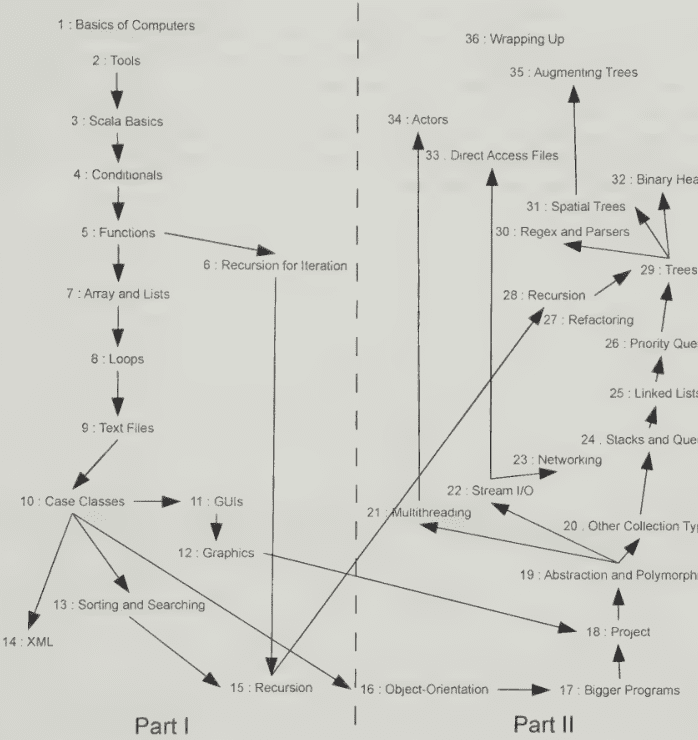

**FIGURE 1:** 本图显示了本书中不同章节之间的依赖关系，以便你可以计划想要涵盖的内容或让你能够明智地选择通过本书的替代路径。箭头指向使用早期章节材料的后期章节。第一部分中的章节沿左侧向下，第二部分的章节沿右侧向上。

课程网站 www.programminginscal.net 包含多种对教师有帮助的材料类型。有某些练习的解决方案，因此在将练习用于评分目的之前应先查看那里。网上还提供有最新链接和数据集的额外练习。

一些项目的可执行 JAR 文件可帮助学生和教师理解对学生的要求是什么。在本书的后半部分，项目变得更大，网站显示了作者解决方案的 UML 图。项目代码从未给出，因此它们可用于评分材料。

此外，许多章节的文本都发布了视频。这些通常是“现场编码”会话。教师应随意将这些用作预讲座，或与倒置讲座格式一起用于某些课堂会议。

²如果你目前尚未确信 Scala 在教授 CS1 和 CS2 方面的好处，完整的讨论见 www.programmingusingscala.net。


最后，本书的主要目标之一是成为一本计算机专业学生在课程结束后仍愿意保留在书架上的书。对于CS1和CS2教材来说，这是一项具有挑战性的任务。这也是本书（尤其是后半部分）包含许多更高级主题的重要原因。你很可能不会选择涵盖本书后面的几章，但这些章节涉及计算领域的重要概念，而且这些概念很难在单一来源中找到。希望这些主题，加上许多问题清晰简洁的代码解决方案，能使本书值得在书架上占有一席之地。

# 第一部分
### 入门概念

# 第1章
### 计算机、计算与编程基础

- 1.1 历史 ......................................................... 3
- 1.2 硬件 ......................................................... 5
- 1.3 软件 ......................................................... 7
- 1.4 编程的本质 ............................................ 9
- 1.5 编程范式 ........................................... 11
- 1.5.1 命令式编程 ....................................... 11
- 1.5.2 函数式编程 ....................................... 11
- 1.5.3 面向对象编程 .................................. 12
- 1.5.4 逻辑编程 ............................................ 13
- 1.5.5 Scala的本质 .............................................. 13
- 1.6 章末材料 ......................................... 13
- 1.6.1 概念总结 .......................................... 13
- 1.6.2 练习 .................................................... 14
- 1.6.3 项目 ..................................................... 14

在任何事情上，在深入细节之前先了解一些基础材料是有益的。这有助于为你打下基础并提供一些背景。不可避免的是，你已经拥有一些使用计算机的经验，这确实为你提供了一点可供工作的背景。然而，你的经验很可能仅限于较新的技术。塑造计算机科学世界的因素之一是它发展迅速且不断变化。了解我们如何走到今天，或许可以帮助我们预见未来的方向。

### 1.1 历史

有人可能会认为计算机科学是一个历史相当短的领域。毕竟，计算机存在的时间并不长，而作为标准设备的时间更短。然而，计算机科学的历史在数学中有着深厚的根源，可以追溯到很久以前。人们可以有力地论证，计算机科学的大部分内容实际上与计算机无关。这一点或许最好地体现在艾兹格·迪杰斯特拉（Edsger Dijkstra）的引语中：“计算机科学之于计算机，如同天文学之于望远镜。”相反，计算机科学研究的是算法。算法是陈述解决问题方法的形式化规范。这个术语本身是花拉子米（al-Khwārizmī）这个名字的变体。他是一位生活在11世纪的波斯数学家，著有《代数问题证明论》，这是现代之前最重要的代数论著。他还写了《论印度数字的计算》，其中提出了将算术应用于代数的系统方法。

根据我们对“计算”一词的灵活定义，我们甚至可以追溯得更远。可以考虑那些用于辅助算术的设备。这将时间推回到公元前2400年左右。用于天文学的机械自动机也存在了许多世纪。然而，我们将重点关注更完整的计算设备，即可编程执行各种不同类型计算的设备。在这种情况下，第一个真正的机械计算机设计将是分析机，它由查尔斯·巴贝奇设计，并于1837年首次描述。阿达·洛芙莱斯通常被称为第一位程序员，因为她在分析机笔记中包含了一个原本可以作为该机器程序的内容。由于种种原因，这台设备从未被建造出来，因此，第一批完整的计算机直到100年后才出现。

直到20世纪40年代，我们今天所认识的计算机形式才出现。这始于1941年在德国制造的Zuse Z3。到20世纪40年代末，世界各地已有相当多的数字计算机在运行，包括1946年在美国建造的ENIAC。这些机器的建造在很大程度上受到了十年前进行的更多理论工作的影响。

有人可能会说，计算机科学理论方面的基础始于1931年，当时库尔特·哥德尔发表了不完备性定理。这一定理证明了在任何足够复杂的正式系统中，包括数学的标准集合论，都会存在无法证明或证伪的命题。证明本身的性质引入了计算元素，因为逻辑表达式被表示为数字，而操作则是这些数字的变换。五年后，艾伦·图灵和阿隆佐·丘奇创建了我们现在认为是计算的独立模型。在许多方面，他们在1936年所做的工作才是计算机科学作为一门学科真正诞生的标志，并且它推动了第一轮数字计算机的出现。

图灵创建了一种称为图灵机的计算模型。图灵机非常简单。它有一条无限长的符号带和一个可以读写磁带的读写头。机器跟踪一个当前状态，该状态只是一个数字。机器的指令保存在一张表中。表中每个允许的状态对应一行，每个允许的符号对应一列。表中的条目给出要写入磁带的符号、磁带移动的方向以及机器将要进入的新状态。磁带在每一步只能向左或向右移动一个符号，或者停留在原处。表中的单元格也可以写着“停止”，在这种情况下，机器应停止运行，计算终止。

机器的工作方式是：查找表中对应于机器当前状态和读写头下方磁带符号的条目。然后，将表中的符号写入磁带，替换之前的内容，按指定方向移动磁带，并将状态更改为指定状态。如此重复，直到达到停止状态。

大约在图灵研究图灵机概念的同时，丘奇开发了lambda演算。这是一种基于数学的形式化方式，用于表达计算思想。虽然它看起来与图灵机非常不同，但很快被证明两者是等价的。也就是说，任何可以用图灵机解决的问题都可以用lambda演算解决，反之亦然。这导致了所谓的丘奇-图灵论题，即任何可计算的东西都可以由图灵机或lambda演算，或任何其他可证明与这些等价的计算系统来计算。

### 1.2 硬件

当我们谈论计算机时，通常会将话题分为两部分：硬件和软件。事实上，这种划分可以追溯到巴贝奇和洛芙莱斯的工作。巴贝奇设计了硬件，并专注于其所能实现的基本计算能力。洛芙莱斯致力于为机器组合指令组，使其能够做一些有趣的事情。她的笔记表明，她看到了这种设备的进一步潜力，以及它如何不仅仅用于计算。

这种划分至今仍然存在，并且非常重要，因为本书的大部分内容只专注于划分中的一半——软件。要理解软件，至少对硬件有所掌握是有帮助的。如果你继续学习计算机科学，希望将来某个时候会有一门完整的课程专注于硬件的性质及其工作细节。目前，我们的目标要简单得多。我们希望你对计算机的有形元件如何工作有一个基本的心理图像，从而使我们输入的命令得以执行并给出我们想要的答案。

现代计算机通过调节流经导线的电流来工作。这些导线中的大多数是被蚀刻在硅片上的微小元件，宽度仅有几十纳米。导线上的电压用于表示一个比特的状态，比特是存储的最小单元，只有开或关两种可能的值。导线连接晶体管，晶体管以允许逻辑处理的方式布局。虽然现代计算机处理器实际上包含数亿乃至数十亿个晶体管，但我们可以在更高的层次上看待事物，通常可以忽略那些单独的导线和晶体管的存在。

总的来说，现代计算机建立在冯·诺依曼体系结构之上，并进行了少量修改。约翰·冯·诺依曼是计算领域的另一位奠基人。他的一个观点是，计算机的程序不过是数据，可以与数据存储在同一位置。借助图1.1中的基本示意图，这一点可以很好地描述。有一个单一的内存，既存储程序，也存储程序使用的数据。它通过总线连接到中央处理器（CPU）。CPU，更普遍地称为处理器，能够执行简单指令、从内存读取和写入内存。当计算机运行时，CPU从内存中加载一条指令，执行该指令，然后再加载另一条。这个过程反复进行，直到计算机关闭。这种加载和执行的简单组合称为一个周期。

CPU要做的事情之一就是跟踪内存中下一条要执行指令的位置。我们称内存中的位置为地址。默认情况下，每次向前移动适当的量以获取下一条指令。不同类型的计算机可以有不同的指令。所有计算机都会有从内存读取值、将值存储到内存、执行基本数学运算以及更改执行地址以跳转到程序不同部分的指令。

计算机能执行的单个指令通常非常简单。计算机的速度来自于它们非常快速地执行周期。现在大多数计算机以几千兆赫兹的频率运行。这意味着它们每秒可以执行几十亿条指令。真正的现代计算机有很多复杂性，这些复杂性是使其可能所必需的，但并未包含在这个简单的计算机图像中。在许多方面，这些细节在开始时我们不必过多担心，但它们在专业编程中很重要，因为它们可能对程序的性能产生深远影响。

我们将用几段话来讨论现代计算机中的两个复杂性。


操作系统还负责将文件写入磁盘以及从磁盘读取文件。此外，它还有将其他程序加载到内存并启动它们的任务。随着时间的推移，操作系统中的功能数量不断增长，以至于现在人们期望它们提供美观的界面，并具备各种各样的“基础”功能，而这些功能其实并不那么基础。

在最高层级的是用户运行的程序。当用户指示操作系统运行一个程序时，操作系统会将该程序加载到内存中并设置执行地址，以便计算机开始运行该程序。程序能够做的事情范围几乎是无限的。1 世界上每台数字设备上运行的一切都是程序。你用它们来打字写论文和收发电子邮件。它们可能还运行着你汽车中的燃油喷射系统并控制着路口的灯光。程序调节着电力在电网中的流动以及自来水流向你室内管道的流动。程序不仅仅为你的手机提供应用；当你打电话时，它们也在运行，将你的语音压缩成数字形式并发送到本地基站，在那里另一个程序会检查它并将其继续发送向目的地。在途中，它很可能经过多个地点，并在每个站点由一个或多个程序处理。在另一端某个时刻，另一个程序会将数字压缩形式转换回模拟信号，以便发送到扬声器，让你通话的对象能够听到它。有人编写了每一个这样的程序，并且随着时间的推移，越来越多的程序被编写出来，服务于我们生活中越来越多的不同用途。

在上一节中我们提到，较新的处理器上面有多核。多个核心（以及可能多个处理器）的可用性对软件也很重要。首先，它们使操作系统能够同时进行多项任务。除了最简单的操作系统外，所有操作系统都执行多任务处理。这使它们能够同时运行多个程序或进程。这可以在单核上通过给每个进程一小段时间然后在它们之间切换来实现。当存在多个核心时，它允许程序真正同时运行。

每个进程也可以通过创建多个线程来利用自身的并行性。操作系统通常仍然负责调度在任何给定时间哪些线程处于活动状态。这允许单个程序利用比单核上更多的机器资源。对于某些专用应用来说这可能无关紧要，但多核的使用变得越来越普遍，大型机器以及小型设备的核心数量目前正以指数速率攀升。因此，使程序多线程化的需求变得越来越重要。

机器中核心数量的增加导致了服务器领域另一个有趣的发展。服务器是公司用来存储大量数据并对这些数据进行大量处理的更强大的计算机。你在网络上所做的一切都在从服务器提取数据。如果你在一所大学，很可能他们至少有一个房间装满了服务器，作为校园的控制和数据存储中心。服务器所做的工作性质通常与普通个人电脑大不相同。它们的工作很大一部分只是传递信息，而这种工作负载的分布可能非常不均匀。这种情况加上多核的出现导致了虚拟化使用的增加。虚拟机是一个像计算机一样运行的程序。它有 BIOS 并加载操作系统。操作系统可以调度并运行程序。整个过程发生在可能在另一台真实机器上的不同操作系统运行的程序内部。通过虚拟化，你可以在一台机器上启动一个或多个操作系统的多个实例。只要机器有足够的核心和内存，

1计算理论中存在一些计算的真实限制。某些问题可能对任何程序来说都不可解。

它就可以支持所有这些虚拟机的工作。这样可以减少需要购买和运行的真实机器数量，从而降低材料和电力消耗方面的成本。

# 1.4 编程的本质

从每个设备的 BIOS 到操作系统以及它们运行的众多应用程序，每一块软件都是由程序员编写的程序。那么我们所说的编程是什么，我们又如何做呢？我们如何给计算机提供指令让它为我们做事？从某种意义上说，编程只是以计算机能够处理的格式向计算机提供指令。在根本层面上，计算机所做的 nothing 超过处理数字。请记住图 1.1 中的模型。每个周期计算机加载一条指令并执行它。曾经有一段时间，编程是通过编写机器执行的指令来完成的。我们将这些指令的语言称为机器语言。虽然机器语言真的是计算机唯一理解的语言，但它并不是人类使用起来很好的语言。机器语言的数字对人类来说没有内在意义，而且很容易出错。因此，人们开发出了比写出机器语言指令更好的编程方式。

从机器语言向上迈出的第一步是汇编语言。汇编语言基本上与机器语言相同，因为每条机器语言指令都有对应的汇编指令。然而，汇编指令以描述其功能的单词输入。汇编语言还有助于跟踪事物在内存中的布局，这样程序员就不必像在机器语言中那样主动考虑这些问题。为了让计算机理解汇编语言，我们使用一个程序将汇编语言翻译成机器语言。这个程序称为汇编器。

即使汇编语言在表达我们想要放入程序中的想法方面也不够理想。因此，其他语言已被创建。这些高级语言使用更完整的单词并允许更复杂的思想组织，以便更容易编写更强大的程序。计算机也不理解这些语言。因此，它们要么使用编译器将高级语言翻译成汇编然后再翻译成机器语言，要么使用解释器逐条执行指令而从不将它们转换为机器语言。

编程语言 literally 有数百种。每一种都是为了解决其他语言中看到的某些缺陷或满足特定需求而创建的。本书使用 Scala 编程语言。要向从未编程过的人完全解释 Scala 或任何其他编程语言的好处是很困难的。我们只说 Scala 是一种非常高级的语言，它允许你以简洁的方式向计算机传达想法，并让你可以访问大量现有的库来帮助你编写有趣、有趣或有用的程序。

在你学习编程的早期，你很可能会为如何用编程语言而不是你习惯的自然语言来表达你的想法而苦恼。这部分是因为编程语言与自然语言在根本上不同，因为它们不允许歧义。此外，它们通常要求你以比自然语言中习惯的更低的层次来表达想法。这两者实际上也是每个人都应该学习如何编程的一个重要原因


virtual. Being virtual has benefits. Physical media have limitations on them imposed by the laws of physics. Whether you are painting, sculpting, or engineering a device, there are limitations to what can be created in physical space. Programming does not suffer from this. The ability of expression in programming is virtually boundless. If you go far enough in Computer Science you will learn where there are bounds, but even there the results are interesting because it is possible that the bounds on computation are bounds on human thinking as well.

This ability for near infinite expression is the root of the power, beauty, and joy of programming. It is also the root of the biggest challenge. Programs can become arbitrarily complex. They can become too complex for humans to understand what they are doing. For this reason, a major part of the field of Computer Science is trying to find ways to tame the complexity and make it so that large and complex ideas can be expressed in ways that are also easy for humans to follow and determine the correctness of.

# 1.5 Programming Paradigms

The fact that there are many ways to break up problems or work with problems has not only led to many different programming languages, it has led to whole families of different approaches that are called paradigms. There are four main paradigms of programming. It is possible others could come into existence in the future, but what appears to be happening now is that languages are merging the existing paradigms. Scala is one of the languages that is blurring the lines between paradigms. To help you understand this we will run through the different paradigms.

### 1.5.1 Imperative Programming

The original programming paradigm was the imperative paradigm. That is because this is the paradigm of machine language. So all the initial programs written in machine language were imperative. Imperative programming involves giving the computer a set of instructions that it to perform. Those actions change the state of the machine. This is exactly what you get when you write machine language programs.

The two keys to imperative programming are that the programmer specifically states how to do things and that the values stored by the computer are readily altered during the computation. The converse of imperative programming would be declarative programming where the programmer states what is to be done, but generally is not specific about how. The Scala language allows imperative style programming and many of the elements of this book will talk about how to use the imperative programming style in solving problems.

### 1.5.2 Functional Programming

Functional programming was born out of the mathematical underpinnings of Computer Science. The first functional languages were actually based very heavily on Church’s lambda calculus. In a way this is in contrast to imperative programming which bares a stronger resemblance to the ideas in the Turing machine. “Programming” a Turing machine is only loosely correlated writing machine language, but the general ideas of mutable state and having commands that are taken one after the other are present on the Turing machine. Like the lambda calculus, functional languages are fundamentally based on the idea of functions

in mathematics. We will see a lot more of the significance of mathematical functions on programmatic thinking in chapter 5.

Functional languages are typically more declarative than imperative languages. That is to say that you typically put more effort into describing what is to be done and a lot less in describing how it is to be done. For a language to be considered purely functional the key is that it not have a mutable state, at least not at a level that the programmer notices. What does that mean? It means that you have functions that take values and return values, but do not change anything else along the way. The only thing they do is give you back the result. In an imperative language, little traces of what has been done can be dropped all over the place. Certainly, functional programs have to be able to change memory, but they always clean up after themselves so that there is nothing left behind to show what they did other than the final answer. Imperative programs can leave alterations wherever they want, and there is no stipulation that they set things back the way they found it. Supporters of functional programming often like to say that functional programs are cleaner. If you think of a program as being a person this statement makes for an interesting analogy. Were it to enter your room looking for something, you would never know, because the functional program would leave no trace of its passing. At the end, everything would be as it had started except that the function would have the result it was looking for. An imperative program entering your room might not change anything, but more than likely it would move the books around and leave your pillow in a different location. The imperative program would change the “state” of your room. The functional one would not.

Scala supports a functional style of programming, but does not completely enforce it. A Scala program can come into your room and it is easy to set it up so that it does not leave any trace behind, but if you want to leave traces behind you can. The purpose of this combination is to give you flexibility in how you do things. When a functional implementation is clean and easy you can feel free to use it. However, there are situations where the functional style has drawbacks and in those cases you can use an imperative style.

### 1.5.3 Object-Oriented Programming

Object-oriented programming is a relative newcomer to the list of programming paradigms. The basic idea of object-oriented programming first appeared in the SIMULA67 programming language. As the name implies, this dates it back to the 1960s. However, it did not gain much momentum until the 1980s when the Smalltalk language took the ideas further. In the 1990s, object-orientation really hit it big and now virtually any new language that is created and expects to see wide use will include object-oriented features.

The basic idea of object-orientation is quite simple. It is that data and the functions that operate on the data should be bundled together into things called objects. This idea is called encapsulation and we will discuss it a fair bit in Part II of this book. This might seem like a really simple idea, but it enables a lot of significant extras that do not become apparent until you have worked with it awhile.

Object-orientation is not really independent of the imperative and functional paradigms. Instead, object-oriented programs can be done in either a functional or an imperative style. The early object-oriented languages tended to be imperative and most of the ones in wide use today still are. However, there are a number of functional languages now that include object-oriented features.

Scala is a purely object-oriented language, a statement that is not true of many languages. What this means and the implications of it are discussed in detail in later chapters. For most of the first half of this book, the fact that Scala is object-oriented will not even be that significant to us, but it will always be there under the surface.

### 1.5.4 Logic Programming

The fourth programming paradigm is logic programming. The prime example language is Prolog. Logic programming is completely declarative. As the name implies, programs are written by writing logical statements. It is then up to the language/computer to figure out a solution. This is the least used of the paradigms. This is in large part because of significant performance problems. The main use is in artificial intelligence applications. There is some indication that logic programming could reappear in languages where it is combined with other paradigms, but these efforts are still in the early stages.

### 1.5.5 Nature of Scala

As was indicated in the sections above, Scala provides a mix of different paradigms. It is a truly hybrid language. This gives you, as the programmer, the ability to solve problems in the way that makes the most sense to you or that best suits the problem at hand. The Scala language directly includes imperative, functional, and object-oriented elements. The name Scala stands for Scalable Language, so it is not completely out of the question for them to add a library in the future that could support logic programming to some extent if a benefit to doing so was found.

# 1.6 End of Chapter Material

### 1.6.1 Summary of Concepts

- Computing has a much longer history than one might expect with roots in mathematics.
- Hardware is the term used for the actual machinery of a computer.
- Software is the term used for the instructions that are run on hardware. Individual pieces of software are often called programs.
- The act of writing instructions for a computer to solve a problem in a language that the computer can understand or that can be translated to a form the computer understands is called programming.
- Programming is very much an art form. There are many different ways to solve any given problem. and they can be arbitrarily complex. Knowing how to design good programs takes practice.
- There are four different broad types or styles of programming called paradigms.
  - The imperative programming paradigm is defined by explicit instructions telling the machine what to do and a mutable state where values are changed over time.
  - The functional paradigm is based on Church’s lambda calculus and uses functions in a very mathematical sense. Mathematical functions do not involve a mutable state.
  - Object-orientation is highlighted by combining data and functionality together into objects.


- 逻辑编程极具声明性，这意味着你只需描述你想要什么解，而不必说明如何实现。
- Scala 是纯面向对象的，同时支持函数式和命令式编程风格。

# 1.6.2 练习

- 1. 了解你的计算机硬件和软件的一些详细情况。
  - (a) 处理器
    - i. 由哪家公司生产？
    - ii. 时钟速度是多少？
    - iii. 有多少个核心？
    - iv. 不同缓存级别各有多少缓存？（可选）
  - (b) 这台机器有多少内存（RAM）？
  - (c) 它有多少非易失性存储（通常是磁盘空间）？
  - (d) 它运行的是什么操作系统？
- 2. 如果你有一台平板电脑，请针对该设备重复练习 1。
- 3. 如果你有一部智能手机，请针对该设备重复练习 1。
- 4. 简要描述不同的编程范式，并对它们进行比较。
- 5. 列出几种使用不同编程范式的语言。
- 6. 在互联网上搜索编程语言的谱系。查找并列出对 Scala 发展产生关键影响的语言。
- 7. 访问一个可以配置计算机的网站（如 http://www.dell.com）。你在一台 PC 上最多可以配置多少个核心？服务器呢？
- 8. 访问 http://www.top500.org，这是一个跟踪全球最快 500 台计算机的网站。目前世界最快计算机的规格是什么？第 500 快的呢？

# 1.6.3 项目

- 1. 在网上搜索一份编程语言列表。选择两三种语言，写出每种语言的基本属性描述，包括它们的创建时间以及可能的原因。
- 2. 比较并对比以下活动：规划/建造一座桥、种植一个花园、画一幅画。鉴于你目前对编程的了解，你认为编程与这些活动相比如何？
- 3. 制作某类计算机技术的时间线。这可以是处理器、内存或其他任何技术。从你能找到的最早时间一直追溯到现代。哪些技术进步是最重大的？它们分别发生在什么时候？

4. 计算硬件领域最著名的预测之一是摩尔定律。该术语用来描述一种预测：集成电路上的元器件数量大约每 18 个月翻一番。这一名称来自英特尔® 联合创始人戈登·摩尔，他在 1965 年指出，从 1958 年到当时，该数量每年翻一番，并预测这一趋势至少会持续十年。如今，这已推动计算能力和性能呈指数级增长超过五十年。³ 请就这对该领域的影响及其对未来可能意味着什么写一篇简短的报告。

5. 调查并撰写一篇关于未来硬件技术某些发展的简短报告。务必包括当硅的物理极限被触及时可能会出现的一些问题。

6. 调查并撰写一篇关于未来软件技术某些发展的简短报告。即将出现的重大新应用领域有哪些？这绝对应包括对人工智能和机器人技术的展望。

7. 随着计算机越来越深入地运行我们的日常生活，计算机安全和信息保障变得越来越重要。研究计算机受到攻击的一些方式，并描述这对编写应用程序和其他软件的编程人员有何重要意义。

更多练习和项目可在网站上找到。

# 第 2 章

# 了解工具

2.1 Unix/Linux（包括 Mac OS X）........................................................ 18
2.1.1 命令行 ........................................................ 18
2.1.1.1 文件和目录 ........................................................ 18
2.1.1.2 补充说明 ........................................................ 22
2.1.1.3 实用技巧 ........................................................ 23
2.1.1.4 权限 ........................................................ 24
2.1.1.5 压缩/归档 ........................................................ 26
2.1.1.6 远程操作 ........................................................ 27
2.1.1.7 其他命令 ........................................................ 29
2.1.2 输入/输出重定向 ........................................................ 30
2.1.3 文本编辑器（vi/vim） ........................................................ 31
2.2 Windows ........................................................ 33
2.2.1 命令行 ........................................................ 34
2.2.1.1 文件和目录 ........................................................ 34
2.2.2 文本编辑器 ........................................................ 36
2.2.2.1 Edit ........................................................ 36
2.2.2.2 Notepad ........................................................ 36
2.2.2.3 其他 ........................................................ 36
2.2.3 其他命令 ........................................................ 37
2.3 Scala 工具 ........................................................ 38
2.4 章末材料 ........................................................ 40
2.4.1 概念总结 ........................................................ 40
2.4.2 练习 ........................................................ 41

你在计算机上所做的一切都涉及软件的运行。在最基本的层面上，你的计算机上运行着某个操作系统，它控制着所发生的一切，组织数据，并让你在其中执行其他程序。你选择使用什么操作系统和工具集，会对你做事的方式产生重大影响。本章将带你了解一些你可能使用过但并不熟悉的工具。然后继续介绍标准 Scala 发行版中包含的一些工具，这些工具将在本书其余部分中使用。

你对工具的选择始于对操作系统的选择。你很可能熟悉 Windows PC 或 Macintosh 环境中常见的图形界面。因此，我们不打算花时间介绍它们。相反，本章讨论如何使用文本界面与各种操作系统交互。能够使用这种界面有很多好处。就我们的目的而言，最重要的是这是我们将要使用的某些 Scala 工具的交互方式。

### 2.1 Unix/Linux（包括 Mac OS X）

本节介绍在 Linux 和 Unix 环境中你将遇到的环境。Mac OS X 基于 BSD Unix 构建，因此这里的所有内容也适用于 Mac。如果你使用的是 Mac，可以打开控制台来访问命令行工具。

### 2.1.1 命令行

如今大多数人习惯于图形用户界面（GUI）的点击方式。但这并不是人们一直以来与计算机交互的方式。实际上，GUI 需要消耗大量的处理能力来运行。多年来，计算机不得不采用更简单的界面。即使在今天，有时你也需要在没有 GUI 的情况下与计算机交互。这可能发生在计算机出现故障时，或者你需要使用一台位于远处的计算机时。还有一些情况下，人们会选择不在计算机上运行 GUI，仅仅是因为他们不想浪费处理能力。

即使计算机正在运行 GUI，你也可以选择使用命令行界面进行交互。GUI 可以让你同时打开多个命令提示符，而使用命令行本身也提供了 GUI 难以轻松完成的功能。许多人选择不使用命令提示符的原因在于它确实有一定的学习曲线。你必须知道一些基本命令才能做任何事情。如果你打算在计算机上花大量时间工作，那么值得花一点精力学习操作系统的命令提示符界面的基本命令。你很可能不仅会发现它通常能加快操作速度，而且在某些情况下，它能让你做到原本根本无法做到的事情。

图 2.1 显示了 Linux 下提供命令提示符的终端窗口。你的命令提示符可能与此不同。通常，提示符应显示一些有用信息，后面跟着一个表示提示符结束的字符。在该图中，提示符显示用户名和计算机名，后跟当前目录和一个 `$`。这个 `$` 表示提示符的结束。你输入的命令出现在 `$` 之后。命令显示的任何内容都会打印在提示符下方。命令完成后，会出现另一个提示符。

#### 2.1.1.1 文件和目录

在 GUI 中，你将文件组织在文件夹中。你有代表不同文件类型或文件夹的图标，你可以将文件/文件夹放入文件夹中以进行组织。这些概念来自命令行上已有的系统。唯一改变的是术语。“文件夹”一词从图形角度来看很合适。在命令行上，它们长期以来一直被称为目录。

我们要学习的第一组命令允许我们处理文件和目录，以便我们能够导航并完成你习惯于通过单击、双击或拖放来完成的各类操作。以下是一份命令列表，并附有简要说明。你会注意到，它们通常是其功能的缩写。

- cat – 显示一个或多个文件的内容。
- cd – 更改目录。
- cp – 将文件复制为另一个名称或位置。


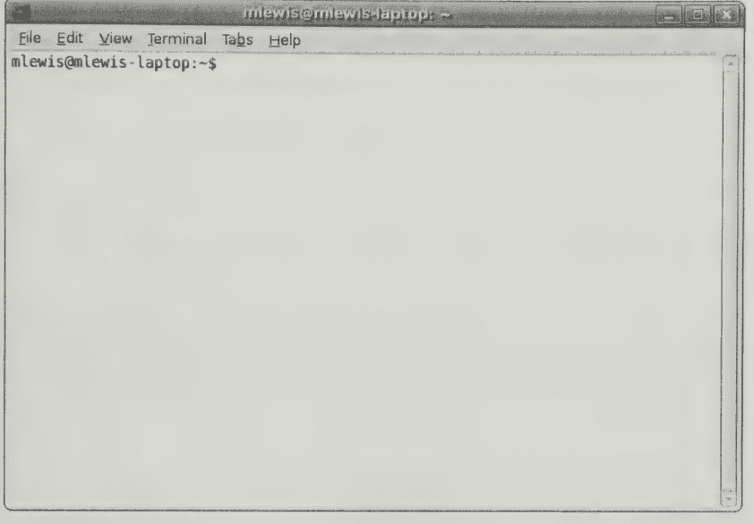

图 2.1：Linux 终端及命令提示符的示例。

- **less** – 显示一个或多个文件的内容，并可向前、向后移动、搜索等。（Less is more than more。）
- **ls** – 列出目录的内容。
- **mkdir** – 创建目录。
- **more** – 显示一个或多个文件的内容，并可分页浏览或搜索。
- **mv** – 将文件移动到新的名称或位置。
- **pwd** – 代表“print working directory”。它会打印出你当前所在的工作目录。
- **rm** – 删除文件。
- **rmdir** – 如果目录为空则删除目录。

命令行的一大优势是每个命令都可以跟随参数。仅输入命令就像双击程序图标一样。是参数让你能够指定额外的信息。大多数这些命令如果不给出一个或多个要操作的文件/目录名就不会做任何事情。

为了了解如何使用这些命令，我们将从 **pwd** 开始。它是一个非常简单的命令，在你刚开始使用时或在目录结构中迷失方向时非常有用。在命令提示符下只需输入 **pwd** 并按 Enter。输出的具体内容取决于许多因素，但它应该打印出一行输出，显示当前目录。它可能看起来像这样。

```
mlewis@mlewis-laptop:~$ pwd
/home/mlewis
mlewis@mlewis-laptop:~$
```

在这种情况下，目录是 /home/mlewis。打印输出后我们会得到一个新的提示以输入下一个命令。

> **旁注**
> 
> 在 Unix 和 Linux 系统中，整个文件系统的基点是 /。这就是为什么它出现在 /home/mlewis 目录开头的缘故。以 / 开头的目录是绝对目录。

我们要输入的下一个命令是 ls 命令。输入 ls，然后按 Enter，你将得到当前目录中所有文件的列表。这是该命令最基本的使用方式。你也可以通过在 ls 命令后跟随目录名来查看其他目录的内容。这里我们看到根目录的内容列表。

```
mlewis@mlewis-laptop:~$ ls /
bin dev initrd lib lost+found opt sbin tmp vmlinuz
boot etc initrd.img lib32 media proc srv usr vmlinuz.old
cdrom home initrd.img.old lib64 mnt root sys var
```

如果列出的目录不以 / 开头，则它是一个相对目录。因此你列出的内容将被附加到当前目录的末尾。你可能在当前目录中有名为 Desktop 的目录。输入 ls Desktop 将列出当前目录下 Desktop 目录的内容。

```
mlewis@mlewis-laptop:~$ ls Desktop
AdobeReader.desktop QtCreator.desktop
```

你也可以指定多个文件或目录，它们都会被列出，如下所示。

```
mlewis@mlewis-laptop:~$ ls Desktop /
/:
bin dev initrd lib lost+found opt sbin tmp vmlinuz
boot etc initrd.img lib32 media proc srv usr vmlinuz.old
cdrom home initrd.img.old lib64 mnt root sys var

Desktop:
AdobeReader.desktop QtCreator.desktop
```

你可能不会认为自己通常会一次列出多个东西，但这是一个人们经常使用通配符字符的功能。如果你在一个名称中放入 *，系统会将其替换为所有匹配的文件或目录，如果 * 被替换为零个或多个字符。这里有一个使用示例。

```
mlewis@mlewis-laptop:~$ ls /vmlinuz*
/vmlinuz /vmlinuz.old
```

对于第一个文件，* 被替换为空。对于第二个文件，它被替换为 “.old”。你也可以使用 ? 来代表任意一个字符。这些通配符永远不会被 ls 命令或其他命令看到。命令 shell 会将它们替换为所有匹配的文件，然后是多个文件名或目录名传递给命令。

ls 命令还有很多其他可能的选项。选项都以连字符开头。最常用的选项是 -l，它告诉 ls 使用长显示格式。以下是一个示例。

```
mlewis@Mlewis-laptop:~$ ls -l Desktop
total 8
-rw-rw-rw- 1 root root 1261 2008-11-28 12:21 AdobeReader.desktop
-rw-r--r-- 1 mlewis mlewis 250 2009-12-22 11:03 QtCreator.desktop
```

长格式将每个文件或目录放在单独的一行。除了文件名之外，它还显示了许多其他信息。前十个字符显示文件的权限。权限在第 2.1.1.4 节中讨论。权限之后是一个数字，显示指向该文件的链接数。之后是文件所有者的用户名和文件所属的组。最后两条信息是文件的大小，以字节为单位，以及该文件最后一次修改的日期和时间。

另一个最常用的选项是 -a。它告诉 ls 列出所有文件，包括隐藏文件。Unix 和 Linux 中的隐藏文件是名称以句点开头的文件。我们在这里看到此选项与长选项的组合。组合选项时只需一个连字符。

```
mlewis@Mlewis-laptop:~$ ls -al Desktop
total 16
drw--xr--x 2 mlewis mlewis 4096 2010-02-27 20:02 .
drw-xr--x 106 mlewis mlewis 4096 2010-08-09 16:57 ..
-rw-rwxw 1 root root 1261 2008-11-28 12:21 AdobeReader.desktop
-rw-r--r-- 1 mlewis mlewis 250 2009-12-22 11:03 QtCreator.desktop
```

这增加了两行。最左边的字母 d 告诉我们这些实际上是目录。 . 目录是当前目录的名称。 .. 目录是当前目录所在的目录的名称。我们也可以称之为父目录。

默认情况下，命令在当前目录中的事物上工作。因此，你会最常使用其中一个命令来更改当前目录，cd。cd 命令后跟单个目录名。该目录将成为新的当前目录。正如我们刚才看到的，每个目录内部都有 . 和 .. 作为目录名。如果你想在目录结构中向上移动一级，只需执行 “cd ..”。你也可以在任何时候不带目录输入 cd 以返回到你的主目录。

当你在 GUI 中操作文件时，经常要做的其他任务是复制、移动或删除。对应的命令是 cp、mv 和 rm。cp 和 mv 命令的使用方式大致相同。一种用法是输入两个文件名，其中第一个文件将被复制到第二个名称或重命名为第二个名称。另一种用法是输入一个或多个文件名，然后以目录名结尾。在这种用法中，列出的所有文件都将被复制或移动到最后列出的目录中。如果你包含一个带有通配符的名称，它将被扩展为所有文件名。我们可以在这里看到它们与 cd 一起使用。

```
mlewis@Mlewis-laptop:~$ cd Desktop
```

```
mlewis@mlewis-laptop:~/Desktop$ mv ../*.txt .
mlewis@mlewis-laptop:~/Desktop$ cp test.txt test2.txt
```

我们首先更改到 Desktop 目录。注意此示例中使用的提示已更改，以便我们可以看到我们已进入这个新目录。然后我们将主目录中以 .txt 结尾的所有文件移动到当前目录。此行中的 mv 同时使用了 .. 来引用当前目录上方的目录和 . 来引用当前目录。在这种情况下，其中一个文件名为 test.txt。最后一条命令复制该文件并将副本命名为 test2.txt。

如果你想删除文件，使用 rm 命令。rm 命令可以跟随一个或多个文件。同样，可以使用通配符匹配多个文件。这里我们删除所有以 .txt 结尾的文件。

```
mlewis@mlewis-laptop:~/Desktop$ rm *.txt
```

关于在大多数基于 Linux 的系统上使用命令行删除文件，有一点警告，它是无情的。这在使用 rm 时是如此，如果你不小心将 mv 或 cp 指向已存在同名文件的文件名时也是如此。虽然你可能使用过的许多 GUI 会将你删除的文件移动到某种形式的回收站，然后允许你稍后清空它，但使用 rm 删除文件会立即真正删除它。你无法在回收站中挖掘找到它。一般来说，当你使用这些系统上的 rm 删除文件时，它就消失了，你唯一的恢复机会是如果你有备份。¹

这在使用命令行处理通配符的方式时尤其危险。以上面的 rm 命令为例。如果你不小心在星号和点之间插入一个空格，你将删除当前目录中的每个文件。这是因为单独的 * 匹配所有内容。² 因此在使用 rm 时要小心，在按 Enter 之前检查命令，确保你没有打错字或插入任何不需要的空格。

目录存在是为了保持文件的有序。因此，你可能应该为你拥有的每个不同的主要工作分组创建目录。你也可以将它们嵌套以进一步细化组织方案。你可以使用 mkdir 命令创建新目录。只需在命令后跟随你想要创建的一个或多个目录的名称。例如，最好为本书或你正在学习课程的所有工作创建一个目录。你可以在其中为不同的作业/项目或你在课堂上编写的代码创建子目录。

默认情况下，rm 不会删除目录。要删除目录，请使用 rmdir 命令。与 mkdir 类似，你在它后面跟随要删除的一个或多个目录的名称。rmdir 只有在目录为空时才会删除目录。因此，你需要在删除目录之前先删除目录中的内容。

# 2.1.1.2 旁注

如果你真的想删除整个目录及其所有内容，包括潜在的其他目录，有一个 rm 的选项可以做到这一点。-r 选项


告诉 rm 或 cp 递归³地运行到目录中并删除或复制其所有内容。这在你想要复制一个包含大量内容的目录时非常有帮助。如果想要删除这样的目录，也能派上大用场。只不过要小心使用。使用带 -r 标志的 rm 有可能抹掉你可能想保留的大量文件。下面这个命令使用 -r 与复制一起使用，将整个目录及其所有内容复制到当前目录。

```
mlewis@Mlewis-laptop:~/Desktop$ cp -r ../Music/ .
```

你可能还想做的一件事就是查看文件中的内容。有很多种方法可以做到这一点。事实上，你电脑上大多数程序的一个重要部分就是能够让你查看特定类型文件的内容。我们在这里考虑的命令最适合纯文本文件。我们在这本书中会处理很多这类文件。查看此类文件最基本的方法是使用 cat 命令，它只是将一个或多个文件的内容打印到标准输出。更进一步的是 more 命令，它会一次显示一屏内容，并让你通过按回车键向下移动一行，或按空格键向下移动一整屏。你也可以通过按 / 后输入想要搜索的内容来搜索。更进一步的是 less 命令，它允许你使用方向键或上下翻页键自由移动，以及像 more 一样进行搜索。

# 2.1.1.3 有用的技巧

许多不熟悉命令行的人起初会被需要输入的字符量吓到。经常使用命令行的人并不一定喜欢打字更多，他们知道更多使用键盘而不必大量打字的技巧。下面是一些有助于你更高效使用命令行的实用技巧。⁴

输入完整的文件名可能很繁琐，而且经常容易出错。如果你打错了什么，它就不会工作，你必须重新输入整个内容。更糟的是，它可能能工作并做一些你并不真正想做的事情。正因为如此，Tab 自动补全可能是你在命令行环境中找到的最有帮助的功能。如果你输入文件或目录的前几个字母然后按 Tab，shell 会尽可能多地补全字符。如果只有一个文件以这种方式开头，它会给出整个文件名。如果有多个，它会尽可能多地补全，直到你需要做出选择的地方。如果你双击 Tab，它会列出符合条件的不同选项。

你可以通过回到你的主目录来尝试一下（记住你可以在任何时候通过输入 cd 然后按回车而不给出目录来做到这一点），然后输入 cd Desktop 并按 Tab。很有可能 Desktop 这个词会被为你补全，并在末尾加上 /，因为它是一个目录。使用 ls 来查看是否有两个文件/目录以相同的几个字母开头。输入 cat 后跟前两个字母并按 Tab。shell 会尽可能多地补全然后停止。快速按两次 Tab 它会显示不同的选项。它可能看起来像这样。

```
mlewis@mlewis-laptop:~$ cd Do
Documents/ Downloads/
```

> ³递归是你可能还不熟悉的一个主题，但在本书中我们会在多次提到它。

> ⁴本节中讨论的技巧取决于你使用的确切命令 shell。描述的是 bash shell 的功能，这是许多 Linux 安装的标准。

不仅 Tab 自动补全可以帮你省去输入大量额外字符，它永远不会拼错文件名或目录名。经常使用 Tab 会为你节省大量按键次数和许多小错误。

并不少见你想要多次输入相同的命令或非常相似的命令。最简单的方法，如果是最近输入的命令，就是使用上、下箭头键在命令历史中向前和向后导航。当你到达一个命令时，你可以编辑它以进行更改。

如果命令是你在很久以前输入的，使用箭头键就不那么方便了。重复旧命令最简单的方法是在行首加上感叹号（通常读作“bang”），然后跟上命令的一部分。这会回溯历史并找到最近以这些字符开头的命令。该命令将在没有编辑机会的情况下执行。你不能编辑它或在执行前确切看到将要执行的命令，这意味着 ! 最适用于以相当独特方式开头的命令。

你也可以按 Ctrl-r 来获得搜索历史的能力。按 Ctrl-r 后，开始输入命令中连续出现的字符。它会调出最近包含你输入内容的命令，你可以编辑它。

另一个在一般情况下非常有用的命令是 man 命令。它是 manual 的缩写，基本上充当系统上命令或已安装程序的帮助页面。最基本的使用方法是输入 man 后跟你想要信息的命令。你也可以加上 -k 选项来在手册页中搜索内容。

# 2.1.1.4 权限

所有现代操作系统都有权限来控制谁可以访问不同类型的文件。你可以访问哪些文件取决于你是谁以及你拥有什么权限。登录机器的行为决定了你的身份。你可以使用 whoami 命令查看你以哪个用户身份登录到机器。

```
mlewis@mlewis-laptop:~$ whoami
mlewis
```

在这种情况下提示符也显示了用户名，但并非总是如此。每个用户也可以是各种组的成员。你可以使用 groups 命令查看你所属的组。

```
mlewis@mlewis-laptop:~$ groups
mlewis adm dialout cdrom floppy audio dip video plugdev fuse lpadmin admin
```

你是谁以及你所属的组将决定你在机器上可以访问的内容。

在 Unix 和 Linux 中，每个文件都有其所有者、其组和其他人的读、写和执行权限。这些权限连同文件的所有者和组都会在你使用 -l 选项时由 ls 显示。让我们回到 Desktop 目录并再次查看文件的长列表。

```
mlewis@mlewis-laptop:~/Desktop$ ls -l
total 8
-rw-rwxrwx 1 root root 1261 2008-11-28 12:21 AdobeReader.desktop
-rw-r--r-- 1 mlewis mlewis 250 2009-12-22 11:03 QtCreator.desktop
```

这种情况的场景是如果你想将组更改为共享组，以便一组选定的用户可以访问某些内容。如果组名为 **project**，那么你会输入“**chown** : **project files** ”。

> **旁注**
> 
> 与 **cp** 和 **rm** 命令一样，有时你会想要更改整个目录中大量文件的权限。**chmod** 和 **chown** 都接受 **-R** 选项，以便它们执行此操作。

# 2.1.1.5 压缩/归档

如果你在系统上花费大量时间，你最终很可能会需要与压缩或归档文件交互。这两者都起到将许多单独文件变成一个大文件的作用。如果是压缩的，那个大文件应该比进入其中的文件的总和更小。你可能想要安装在电脑上的许多程序都以压缩文件的形式出现。如果你有跨多个文件的作业或项目，你的讲师可能希望你将它们合并成一个文件以便提交。有许多不同的压缩和归档实用程序。我们只在这里谈论主要的一些。

- * **tar** – 将文件归档到单个 tarball。
- * **gzip/gunzip** – 将一个或多个单独文件压缩为 gzip 格式。
- * **zip/unzip** – 将多个文件压缩为单个 zip 文件。zip 格式在许多操作系统上被广泛使用。

前两种在 Unix/Linux 世界中使用。它们分别进行归档和压缩，但通常一起使用以同时完成两者。归档程序称为 **tar**。它最初是为将文件从磁盘归档到磁带而创建的。它只是将多个文件收集到一个称为 tarball 的单个文件中。它也可以从 tarball 中提取文件。与我们的其他程序一样，**tar** 通过传递参数来控制。你可以使用 **man** 页面查看 **tar** 的许多不同选项。我们只讨论基本选项。

你与 tarball 交互的三种主要方式是创建它、查看其内容或从中提取文件。这些不同的选项用字符 c、v 和 x 给出。大多数时候你会与一个文件交互，为此你会给出 **f** 选项。**f** 选项之后紧跟的是你正在创建、查看或提取的 tarball 的文件名。Tarball 文件通常应以 **.tar** 扩展名结尾。如果你正在创建 tarball，那将跟随你想要放入 tarball 的文件和目录名。以下是一些示例调用。

```
tar cf assign1.tar header.txt Assign1/
tar tf assign1.tar
tar xf assign1.tar
```

第一个命令是你可能执行的用于创建名为 **assign1.tar** 的 tarball 的命令，其中包含一个头文件和目录 **Assign1** 的所有内容。第二个命令可能用于验证文件中是否包含你想要的所有内容，或在提取之前查看其中有什么。最后一个命令将提取内容。

**tar** 的对应物是 **gzip**。此命令将压缩一个或多个文件。只需在 **gzip** 命令后跟上一组要压缩的文件名。那将创建一个新的集合


压缩文件的扩展名为 .gz。gunzip 命令会解压任何文件，还原出原始文件。你可以使用 -r 选项递归进入目录。

tar 与 gzip 的组合非常常见，以至于你可以让 tar 自动使用 gzip 压缩或解压文件。只需在 tar 的选项中加上 z 标志，就会调用 gzip 或 gunzip。这样创建的文件通常会使用 .tgz 扩展名。

tar 和 gzip 都比较特定于 Unix/Linux 世界。如果你需要处理与其它系统之间传输的压缩文件，你可能想使用更广泛使用的 zip 格式。zip 命令可以跟上 zip 文件名以及要打包进指定 zip 文件的文件名集合。如果你想压缩整个目录结构，你需要使用 -r 选项。unzip 命令可以提取 zip 文件的内容。

### 2.1.1.6 远程

Unix/Linux 的一大优势是其真正多用户的能力。在 Windows 上，你可能习惯于一次只有一个人在电脑上登录。那个人会坐在电脑前，如果没人坐在电脑前，电脑就没在使用。对 Unix/Linux 来说并非如此。这些系统允许多人同时登录。即使没人坐在电脑前，电脑也可能处于满负荷使用中。事实上，这也是你应该熟悉命令行的重要原因之一。在长距离互联网连接上运行图形界面会非常不愉快。然而，命令行的纯文本形式即使在慢速网络上也会非常响应。

那么你如何从另一台电脑登录到一台电脑呢？如果你在一台 Unix/Linux 机器上，想要登录到另一台，有几个命令可以用来建立连接。最基础的，也是可能最没用的，是 telnet^5。只需输入 telnet 后跟上你想连接的机器的名称或 IP 地址即可。这会在机器之间建立一个非常简单的网络连接。因为 telnet 连接不安全，而且在某种程度上过于灵活，你可能会发现这种方法被大多数机器的安全设置所阻止。

接下来是 rsh。它代表 remote shell，可以像 telnet 一样调用。rsh 连接同样不安全，因此在许多系统上也被阻止。然而，出于各种原因，如果你登录到本地防火墙内部的可信机器上，它可能在你的系统上被允许。

你默认应该使用的连接类型是 ssh。它代表 secure shell，正如名字所示，通过 ssh 连接的所有通信都使用公钥加密进行加密。因此，如果系统允许你远程登录，系统管理员最有可能为你保留的就是这种方法。

当你远程连接到一台机器时，系统会要求你输入密码，假设你输入正确，你将被放到该机器的命令行提示符下。本节讨论的所有内容在远程机器上与本地机器一样有效，无论机器离多远。当你完成输入命令并想回到当前机器时，输入 logout 或 exit 以终止远程会话。

> ^5你在本书的后半部分开始编写自己的网络代码时会用到 telnet。其中一个来自本书后半部分的项目构想是一个名为 MUD 的基于文本的网络游戏，用户将通过 telnet 连接。

# 旁注

如果你在远程机器上的用户名与当前机器上的不同，你可以使用 “ssh username@machine” 来指定远程用户名。此外，`ssh` 命令有一个参数，在你读到第 11 章之后会特别有帮助。`-Y` 选项允许远程机器将窗口发送回当前机器。使用 “ssh `-Y` machine” 来激活此功能。

如果你在 Windows 机器上怎么办？如何连接呢？你的 Windows 机器在打开命令提示符时很可能自带 `telnet`。如上所述，这种类型的连接很可能因安全原因被阻止。值得庆幸的是，你可以为 Windows 获取免费的 `ssh` 程序。其中一个叫做 `putty`，它允许你从 Windows 机器 `ssh` 到远程机器并使用它。如果你发现你喜欢 Unix/Linux 命令提示符，你也可以在 Windows 下安装 Cygwin，并在你的 Windows 机器上获得 `rsh`、`ssh` 以及我们将要讨论的所有其它命令。

# 旁注

你可以通过 `putty` 使用 X-forwarding 将远程窗口发送回你的机器。这稍微复杂一些，所以你应该查看 `putty` 的帮助以了解如何操作。

如果你有一台 Windows 机器，一个更好的方法是直接在机器上运行 Linux。有 Ubuntu® 和 Linux Mint® 等 Linux 版本专门针对新手用户或希望无需太多困难就能让事情运行起来的人。你可以从其网站 `http://www.ubuntu.com` 和 `http://linuxmint.com` 分别下载这些发行版。如果你不想双启动你的机器，你甚至可以使用免费的虚拟化软件，如 VirtualBox®(`http://www.virtualbox.org`) 或 VMWare Player®(`http://www.vmware.com/products/player/`) 在 Windows 下在一个窗口中运行 Linux。

telnet、`rsh` 和 `ssh` 都提供了登录到远程机器并在该机器上执行命令的方法。有时你需要的是在机器之间移动文件。对于这种情况，你应该使用 `scp` 或 `sftp`。`scp` 命令代表 secure copy。你可以像使用普通的 `cp` 命令一样使用它。唯一的区别是你的文件名可以加上机器名和冒号，以表示它们来自或要去往不同的机器。下面显示了一个示例调用。

```
scp cs.trinity.edu:Desktop/fileINeed.txt .
```

这会将文件 `fileINeed.txt` 从机器 `cs.trinity.edu` 上的 `Desktop` 目录复制到当前机器的当前目录。如果第二个参数带有机器名和冒号，则文件将被发送到该远程位置。与 `cp` 一样，`-r` 选项可用于复制整个目录结构。

**sftp** 命令是经典 **ftp** 程序的安全版本。**ftp** 代表 File Transfer Protocol。它允许你浏览本地和远程目录结构，查看远程机器上的文件，然后在它们之间移动。**sftp** 的完整用法超出了我们在此想要涵盖的范围，但你应该知道它的存在，以防你需要移动文件而不确定想要移动什么或应该从哪里移动到哪里。

### 2.1.1.7 其他命令

在 Unix/Linux 命令行上还有许多其它命令可供你使用。你不需要熟悉所有命令就能使用命令行完成任务。事实上，在本章之后，你应该已经足够应付本书所需的任务。这里我们列出几个你可能会觉得有帮助的命令。

- **clear** – 清除终端，让你获得一个全新的屏幕。这只是外观上的，但有时会很有帮助。
- **df** – 代表 disk free。它会列出当前磁盘系统上的所有不同卷，并显示其使用情况信息。
- **du** – 代表 disk usage。它会告诉你当前目录及其子目录使用了多少磁盘空间。
- **echo** – 将命令后面的内容打印回终端。
- **find** – 查找具有命令行上指定属性的文件。
- **grep** – 在指定文件中搜索文本。
- **head** – 打印文件的前几行。
- **ps** - 显示机器上正在运行的进程信息。
- **tail** – 打印文件的最后几行。
- **touch** – 将指定文件的编辑时间更新为当前时间。
- **top**   列出当前正在运行的资源消耗最多的程序。
- **w** – 告诉你谁登录到你的机器，他们来自哪里，以及他们在运行什么。
- **wget** - 你给这个命令一个 URL，它会将该 URL 上的文件下载到当前目录。
- **where** – 这个命令应跟上可执行文件的名称。它会告诉你该可执行文件在当前路径中的完整路径。

最后提示一下，你可以在任何命令后加上 `&` 使其在后台运行。


# 2.1.2 I/O 重定向

到目前为止，我们一直在谈论可以从命令行运行的不同命令。我们在需要时向控制台输入输入，命令会将输出到终端，以便我们可以看到。Unix/Linux 命令行之所以功能强大，很大程度上是因为你可以重定向输入和输出。重定向的简单形式是将程序的输出发送到文件，或将输入从文件获取来。这些在后面章节的许多项目中都会用到，即使你现在还看不出好处。

要将程序的输出发送到文件，你在命令后加上大于号 `>`，然后跟上文件名。输出会进入该文件。下面是一个例子。

```
mlewis@mlewis-laptop:~/Desktop$ ls -l > list.txt
mlewis@mlewis-laptop:~/Desktop$ ls -l
total 16
-rw-rwxrwx 1 root root 1261 2008-11-28 12:21 AdobeReader.desktop
-rw-r--r-- 1 mlewis mlewis 259 2010-08-12 22:32 list.txt
drwxr-x--- 2 mlewis mlewis 4096 2010-08-11 19:59 NewDir
-rw-r--r-- 1 mlewis mlewis 250 2009-12-22 11:03 QtCreator.desktop
mlewis@mlewis-laptop:~/Desktop$ cat list.txt
total 12
-rw-rwxrwx 1 root root 1261 2008-11-28 12:21 AdobeReader.desktop
-rw-r--r-- 1 mlewis mlewis 0 2010-08-12 22:32 list.txt
drwxr-x--- 2 mlewis mlewis 4096 2010-08-11 19:59 NewDir
-rw-r--r-- 1 mlewis mlewis 250 2009-12-22 11:03 QtCreator.desktop
```

第一次调用 `ls` 并没有打印到屏幕。相反，由于后面跟了大于号和文件名，它将输出发送到文件 `list.txt`。然后我们可以再执行一次 `ls`，让它打印到屏幕以验证新文件是否存在。确实，我们有一个新的文件，长度为 259 字节。我们也可以使用 `cat` 查看文件内容，你会看到来自 `ls` 的预期输出。其中有一个有趣的地方。我们输出到的文件已经存在，但大小为零。这是因为文件在我们执行命令时就创建了，但内容并不是立即写入的。而是在输出的部分足够大需要从内存中的缓冲区移动到文件时才逐步写入。

使用 `>` 进行输出重定向，如果文件不存在会创建新文件，如果文件已存在则会清空其内容。如果你想将命令追加到现有文件，请改用 `>>`。这会重定向输出，但会追加到现有文件。

我们也可以使用小于号 `<` 符号告诉命令从文件而不是标准输入获取输入。我们迄今为止查看的命令中，除非需要密码，否则不需要从标准输入获取额外输入，而密码你不希望放在未加密的文件中。你编写的许多程序都需要你输入文本。你经常需要多次运行这些程序，在尝试让程序工作时，反复输入相同的值会非常繁琐。让它从文件读取输入可以节省时间，因为你只需将输入一次录入文件，然后在测试程序时使用该文件。

重定向的真正威力来自于能够将一个命令的输出发送到下一个命令作为输入的能力。这称为“管道”，使用竖线 `|` 完成，该符号读作 pipe。管道最常见的用法是将很长的输出发送到 `grep` 以在其中搜索内容。此处示例将查找当前目录中最后编辑于 2009 年 12 月的文件。对于我们迄今为止所做的目录列表，这种做法可能用处不大，但在像本示例执行的那样的大型目录中会更有帮助。

```
mlewis@mlewis-laptop:~$ ls -l | grep 2009-12
drwxr-xr-x 6 mlewis mlewis 4096 2009-12-22 11:03 qt-sdk-2009.05
drwxr-xr-x 4 mlewis mlewis 4096 2009-12-23 17:33 QtWorkspace
-rwx------ 1 mlewis mlewis 2291366 2009-12-28 12:21 SwiftVis-0.3.0.jar
```

另一个例子是某些运行时间很长的程序会产生非常长的输出文件。即使你使用 `grep` 将输出削减为仅包含你感兴趣的行，那可能仍然是很多页的材料。你可以将该输出通过管道传递给 `head`、`tail` 或 `less` 等程序，以便更易于处理地查看它们。例如，如果你有一个程序的日志文件，其中包含你关心的带有单词“Step”的行，并且你只想查看最后几行，你可以这样做。

```
grep Step log | tail
```

# 2.1.3 文本编辑器（vi/vim）

大多数编程语言的程序都是用纯文本编写的。因此，你可以使用任何简单的文本编辑器来编辑你的程序。文字处理器，如 Microsoft Word® 或 Open Office® 并不是纯文本编辑器。你不应该用它们来编辑程序。文字处理器会存储除文本本身之外的各种额外信息，如字体和文本格式。程序只需要纯文本。在 Windows 机器上，记事本就是文本编辑器的一个例子。

你可以用记事本来编辑 Scala 程序，但并非所有文本编辑器对编程都同样有用。由于纯文本编辑器常用于编程，许多文本编辑器都包含专门针对编程的功能。在 Unix/Linux 上，这方面的一个主要例子是 `vi` 编辑器。虽然 Unix/Linux 上可以选择的编辑器很多，但我们将使用 `vi`，因为它轻量且几乎安装在所有此类机器上。7 许多其他编辑器会弹出单独的窗口或不是默认安装的一部分。如果你决定不喜欢 `vi` 或有其他偏好，你完全可以在阅读本书时使用任何你想要的编辑器。

要开始运行 `vi`，只需输入 `vi`，然后跟上你要编辑的文件名。如果文件存在，你会在屏幕上看到其内容。如果不存在，你会得到一个 mostly blank 的屏幕，左侧有波浪线，并在底部有一些额外信息。

关于 `vi` 最需要知道的是它有两个主要模式。刚启动时，你处于命令模式。要输入内容，你需要进入编辑模式。在编辑模式下，你可以像在记事本中一样输入。`vi` 对程序员有额外帮助的能力在于使用命令模式。要从命令模式进入编辑模式，输入以下其中一个。

- i – 在当前字符前插入。
- I – 在当前行开头插入。
- a – 在当前字符后追加。
- A – 在当前行末尾追加。

> 7 许多 Linux 安装技术上随带的是 vim 而不是 vi。vim 代表“vi improved”，这里关于 vi 的所有内容都适用于 vim。在这些系统上执行 vi 通常默认运行 vim，因此你可能永远不会注意到区别。事实上，本节中描述的一些功能，如多次撤销和重做，仅在 vim 中有效，而在标准 vi 中无效。

- R – 从当前位置开始替换字符。

大多数时候你可能只会使用 i，但在某些情况下其他选项会很有帮助。终端底部的行应该会改变以显示你现在处于编辑模式。进入编辑模式后开始输入。在 vim 中，你也可以使用方向键以及 Home、End、Page Up 和 Page Down 来移动。如果你在真正的 vi 安装中，这将不起作用，相反你需要返回命令模式来移动光标。

要返回命令模式，只需按 Escape（Esc）。底行会让你知道你已返回命令模式。在命令模式下你可以移动光标。在 vim 中特殊键仍可用于此目的。如果你使用的是真正的 vi 安装，你需要使用以下键来移动。

- h – 向左移动。
- j – 向下移动。
- k – 向上移动。
- l – 向右移动。
- Ctrl-d – 向下翻页。
- Ctrl-u – 向上翻页。

你可以在命令模式下进行其他编辑。以下是命令模式下为你执行操作的某些键。

- x – 删除一个字符。
- dd – 删除一行并放入剪贴板。 （前面加上数字可删除多行。）
- yy 或 Y – 复制一行到剪贴板。 （前面加上数字可复制多行。）
- p – 在当前行后粘贴剪贴板内容。
- P – 在当前行前粘贴剪贴板内容。
- r – 替换单个字符。
- J – 合并行。
- / – 搜索内容。 在 `/` 后输入搜索字符串。
- n – 重复上一次搜索。
- cw – 更改当前词。这会删除到下一个空白字符并进入插入模式。
- . – 重复上一个命令。
- u – 撤销上一个命令。
- Ctrl-r – 重做上一个被撤销的命令。


如果你在 vi 中的任何命令前输入一个数字，该命令将被重复相应次数。这包括进入编辑模式。因此，如果你输入 100 然后输入 ‘A’，你在 Esc 之前添加的任何文本都会被添加 100 次。如果你不想要这种结果，你会发现 ‘u’ 命令非常有用。

一些命令在模式中配合使用效果很好。例如，如果你想进行查找并替换操作，并在每次替换前查看每个实例，你可以使用 ‘/’ 搜索第一个实例，然后使用 ‘cw’ 替换该词并按下 Esc。之后，你使用 ‘n’ 移动到字符串的下一个实例，并使用 ‘.’ 重复 ‘cw’ 命令（如果你想替换该实例）。‘.’ 命令在撰写学期论文时价值有限，但在编程任务中会派上更大用场。

还有一组完整的命令，你可以通过输入冒号来调用。例如，你可能想知道如何保存文件或如何完全退出 vi。下面是一些你可能会觉得有帮助的冒号命令。

- :n – 跳转到文件的第 n 行，其中 n 为数字。
- :w – 按原样保存文件。
- :q – 安全退出 vi。如果自上次保存以来你做了更改，此命令将无法工作。
- :q! – 不安全退出 vi。这将退出并丢弃任何未保存的更改。
- :wq – 保存文件并退出 vi。

你应该花一些时间来熟悉这些命令。如果你真的想了解 vi 能做什么，请阅读 man 手册。许多刚接触 vi 的学生都会陷入先按 ‘i’ 启动然后像使用记事本一样使用它的陷阱，直到准备保存为止。这种方法忽略了 vi 的所有强大功能，从长远来看会减慢你的速度。尽量在每次暂停输入时养成按 Esc 的习惯。至少这样可以让你同时按 ‘:w’，从而更频繁地保存更改。在带有 vim 的系统上，你可以运行 vimtutor 来获得指导游览。

vi 设置

你可以通过编辑主目录中名为 “.exrc” 的文件来更改 vi 的设置。特别是，你应该考虑添加这一行。

set tabstop=2

这使得制表符显示为四个字符。你也可以使用 4，但默认值为 8，这对于 Scala 来说有点太大了。

# 2.2 Windows

根据安装统计，很可能你最常使用的计算机运行的是某种形式的 Microsoft Windows®。这并不会阻止你进行编程或完成本书中描述的任何活动。Scala 语言的一个优势是它与平台无关，并且在包括 Windows 在内的许多操作系统上都能同样良好地运行。⁸

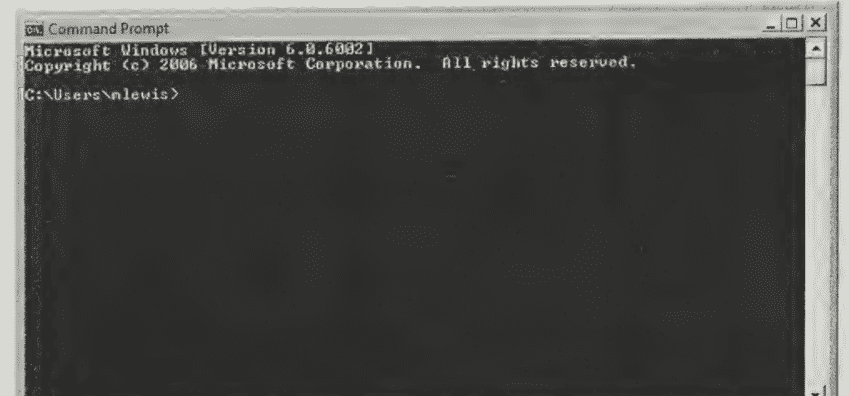

图 2.2：此图显示了 Windows 命令提示符。这是 Windows 的命令行界面。

### 2.2.1 命令行

大多数人使用 GUI 与 Windows 交互。情况就是如此，以至于你可能甚至没有意识到存在命令行界面。如果你查看程序菜单上的附件选项，你会看到“命令提示符”选项。如果你选择并运行它，你应该会看到一个类似图 2.2 的窗口。与 Unix/Linux 的终端一样，这是一个文本界面，会给你一些带有基本信息的提示。在图中，它显示了当前目录后跟一个 '>'. 在这种情况下，我们位于目录“C:\Users\mlewis”。

虽然 Windows 命令提示符看起来和行为都与 Unix/Linux 终端非常相似，但它有一套不同的命令。Windows 及其命令提示符的历史可以追溯到 DOS（磁盘操作系统），而今天在 Windows 命令提示符中使用的命令在很大程度上与那个纯命令行操作系统相同。Unix/Linux 与 Windows 之间应立即注意到的一个区别是，与 Unix/Linux 不同，Windows 系统不区分大小写。这里的命令以小写呈现，但在大写或混合大小写下也能正常工作。

#### 2.2.1.1 文件和目录

与 Unix/Linux 环境一样，你在 GUI 中习惯的文件夹在命令行中称为目录，它们用于在计算机上组织文件。有许多不同的命令可用于使用 Windows 命令提示符处理目录和文件。

> 即使你可以在 Windows 下进行编码，你可能仍想考虑安装 Cygwin 或通过虚拟化或双启动配置运行 Linux，只是为了获得一些新体验。

- `cd/chdir` – 更改当前目录。
- `copy` – 将文件从一个位置/名称复制到另一个位置。
- `del/erase` – 删除文件。这不会像从 GUI 删除那样将它们移至回收站。一旦执行，文件将无法恢复。
- `dir` – 列出指定目录的内容，或如果未列出则列出当前目录的内容。
- `md/mkdir` – 创建指定目录。
- `more` – 一屏一屏地打印文件内容。
- `move` – 将文件移动到不同目录。
- `path` – 让你查看当前路径或更改路径。
- `ren/rename` – 重命名现有文件。
- `rd/rmdir` – 删除指定目录。
- `tree` – 以 ASCII 树的形式显示目录或驱动器的内容。

Windows 下的目录与 Unix/Linux 下的目录存在一些显著差异。首先，目录由反斜杠 ‘\\’ 分隔，而不是正斜杠 ‘/’。你需要牢记这一点，但它并不会显著影响任何命令的使用。另一个区别是 Windows 机器有不同的驱动器，每个驱动器都有自己的目录树。

上面的提示显示当前目录为“C:\Users\mlewis”。开头的 C: 指定了驱动器。Windows 机器上的驱动器指定为单个大写字母。默认情况下，C: 是机器的主硬盘。如果你想处理其他驱动器上的位置，你需要在使用的路径中明确指定驱动器名称。此外，默认情况下 cd 命令要么更改驱动器，要么移动到不同目录。要同时执行两者，你必须给出 ‘/d’ 选项。

> **旁注**
> 
> C: 作为硬盘的标准很早就出现了。最早的 DOS 机器没有硬盘。相反，它们通常有一个或两个软盘驱动器。这些被命名为 A: 和 B:。当硬盘被添加后，它们采用了字母表中的下一个字母。即使如今很难找到带有软盘驱动器的计算机，主磁盘仍然获得 C: 的区分，而其他驱动器则使用字母表中的更高字母。
> 
> 相比之下，Unix/Linux 系统中的不同驱动器表示为主目录树下以 `/` 开始的目录。 removable 驱动器通常挂载在 `/media` 的子目录下。

图 2.3 显示了运行 `dir` 命令后命令提示符的样子。这显示了许多与在 Unix/Linux 机器上运行“ls -l”相同的信息。

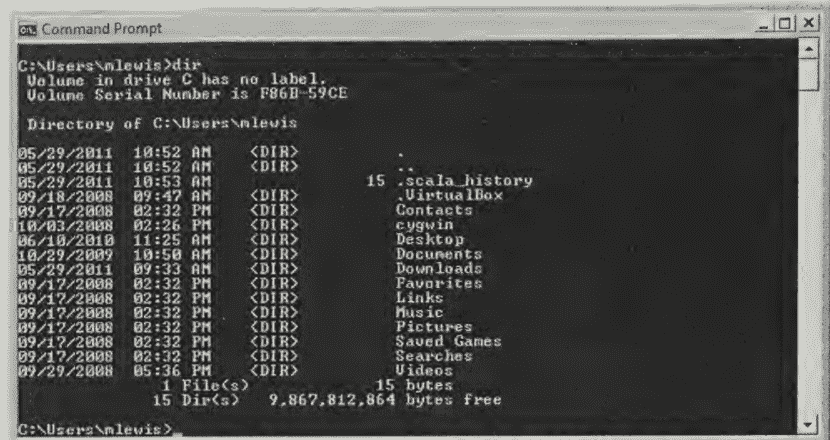

图 2.3：此图显示了在 Windows 上运行 dir 命令后的命令提示符。

### 2.2.2 文本编辑器

无论操作系统如何，程序通常仍以纯文本文件编写，因此你需要一个纯文本编辑器来完成此操作。在本节中，我们将介绍 Windows 上可用的一些选项。

#### 2.2.2.1 Edit

在 32 位 Windows 上使用命令行，命令“edit”会启动一个文本程序，其工作方式类似于 GUI。你可以在图 2.4 中看到它的样子。它有一组菜单，你可以通过按 Alt 访问。这些菜单让你执行编辑器中期望的常规操作。edit 程序更像是一个通用编辑器，并且比 vi 更用户友好。因此，你可以在没有太多介绍的情况下使用它。缺点是它缺乏对编程特别有益的功能。如果你有较新的 Windows 安装，它可能为 64 位，并且不会安装 edit。你可以使用基于 GUI 的文本编辑器代替。

#### 2.2.2.2 Notepad

当然，你不必在命令提示符中编辑文本文件。你可以随意在 Windows 机器上打开记事本并以这种方式编辑文件。然后你只需使用命令提示符来运行需要该界面的程序。记事本的简单 GUI 具有与 edit 相同的优点和缺点。它对于小事情来说工作正常，但它不是为编程而构建的，在某个阶段会减慢你的速度。

#### 2.2.2.3 其他

在 Windows 上，你可以使用许多其他更直接面向编程的文本编辑器。尝试列出所有此类编辑器并提供任何类型


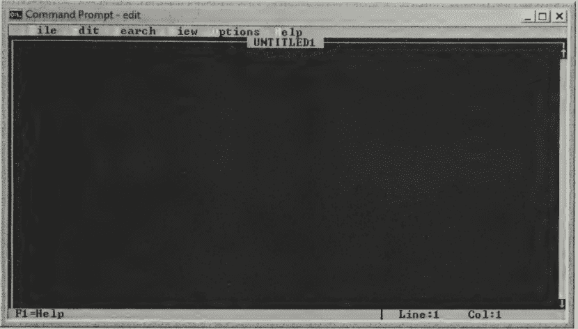

**FIGURE 2.4:** This figure shows a command prompt with the edit program running.

of comparison or judge their relative merits in this space would be pointless. Not only are there too many of them, they can change over time. Doing a web search for “text editor” will likely provide you with many different options. In addition, other people have done the work of compiling a list with comparisons on Wikipedia®. Simply go to `http://en.wikipedia.org/wiki/Comparison_of_text_editors` and you can see tables comparing different editors and check out other information on the ones that seem interesting.

### 2.2.3 Other Commands

There are a number of other commands that you might find it helpful to know when working with the Windows command prompt.

- `cls` - Clears the screen and puts you at a blank prompt. This command only impacts appearance, but can be useful at times.
- `echo` - Like the Unix/Linux command, this will print out whatever text is passed in to it.
- `exit` - This will close the command prompt.
- `find` - This is the equivalent of grep in Unix/Linux. It will find strings in a file for you.
- `help` - This gives you help on commands. If you enter it without specifying a command it will list the possible commands for you.
- `where` - Takes one argument which is the name of a command. It will tell you the full path of that command.
- `whoami` - Tells you the name of the user account you are logged in as.

When you installed Scala, a lot of different stuff was put into the install directory. That included a subdirectory called “bin” with different files in it for the different executables. If you are on a Windows machine, odds are that you installed the program in C:\Program Files\scala so the scala.bat file that you want to run is in C:\Program Files\scala\bin\scala.bat. You can type in that full command or you can add the bin directory to your PATH. To do this right click on the Computer and go to the Advanced Settings and change the Environment Variables.

Under Unix/Linux you can do this from the command-line. Odds are that Scala was installed in a directory called scala in your user space. To add the bin directory to your path you can do the following.¹⁰

```
export PATH=$PATH:/home/username/scala/bin
```

Replace “username” with your username. To make it so that you do not have to do this every time you open a terminal, add that line to the .bashrc file in your home directory.

There are three ways in which the scala command can be used. If you just type in scala and press Enter you will be dropped into the Scala REPL (Read-Execute-Print Loop). This is an environment where you can type in single Scala commands and immediately see their values. This is how we will start off interacting with Scala and it is something that we will come back to throughout the book because it allows us to easily experiment and play around with the language. The fact that it gives us immediate feedback is also quite helpful.

To see how this works, execute scala. It should print out some information for you, including telling you that you can get help by typing in :help. It will then give you a prompt of the form scala>. If you type in :help you will see a number of other commands you could give that begin with a colon. At this time the only one that is significant to us is :quit, which we will use when we are done with the REPL and want to go back to the normal command prompt.

It is customary for the first program in a language to be Hello World. So as not to break with tradition, we can start by doing this now. Type the following after the scala> prompt.

```
println("Hello World!")
```

If you do this you will see that the next line prints out “Hello World!”. This exercise is less than exciting in the REPL because it always prints out the values of things, but it is a reasonable thing to start with. It is worth asking what this really did. println is a function in Scala that tells it to print something to standard output and follow that something with a newline character. In this case, the thing that was printed was the string “Hello World!”. You can make it print other things if you wish. One of the advantages of the REPL is that it is easy to play around in. Go ahead and test printing some other things to see what happens. We will come back and do a lot more with this in the next chapter.

The second usage of the scala command is to run small Scala programs as scripts. The term script is generally used in regards to short programs that perform specific tasks. There are languages that are designed to work well in this type of usage and they are often called scripting languages. The design of Scala makes it quite usable as a scripting language. Unlike most scripting languages, however, Scala also has many features that make it ideal for developing large software projects as well. To use Scala for scripting, simply type in a

> ¹⁰This syntax assumes you are using the bash shell. If it does not work for you, you can do a little searching on the web for how to add directories to your path.

little Scala program into a text file that ends with “.scala” and run it by putting the file name after the scala command on the command-line.

# 2.4 End of Chapter Material

### 2.4.1 Summary of Concepts

- The software you use to interact with your computer comprises a tool set. The nature of these tools is extremely important to software developers.
- The first half of this book is written with the expectation the reader is using command-line tools. These vary between operating systems.
- Linux and Unix based operating systems, including Mac OS X, include a powerful command-line that is often utilized.
  - There are a number of different commands that you use to give instructions to the computer using the command-line. You will likely commit these to memory over time as you use them. The real power of these commands is that they can be given arguments to make them behave in specific ways or do specific things.
  - Files are organized in directories. Some of the most important commands you will need to learn are for dealing with directories and navigating the directory structure. The name . always represents the current directory and .. represents the parent directory.
  - Input and output for commands can be redirected in different ways.
    * Use > to send the output of a program to a file, deleting anything that is there.
    * Use >> to send the output of a program to a file, appending to the end of current contents.
    * Use < to have the contents of a file act as the standard input for a program.
    * Use | to have the output of one program sent to the input of another. You can chain multiple programs together with this technique called “piping”.
  - Programs are typically written in plane text with a text editor. The text editor described in this chapter is vi. It is very common on Linux/Unix installs and the capabilities of the command mode make it a good editor for programming.
- Windows also incorporates a command prompt that resembles the older DOS interface.
  - There are a different set of commands that you can use in the Windows command prompt. I/O redirection works like it does in Linux/Unix.
  - The command-line text editor is called edit. It is not included in 64-bit Windows installs. You can use Notepad or some other GUI text editor. Microsoft Word and other word processing programs are not text editors.
- When you install Scala on your computer you get a number of different executable commands.
  - The scala command can run scripts or applications. If no argument is given it opens up the REPL for you to type in individual statements.
- The `scalac` command is used to compile Scala source code to bytecode. This usage is more significant in the second half of the book.

### 2.4.2 Exercises

- 1. Make a directory for the work associated with this book in your user directory.
- 2. Enter the “Hello World” program in the directory you created. Make sure the file name that you use ends with `.scala`. Run it using the `scala` command.
- 3. (Linux/Unix/Mac) Use `wget` to download the file for the primary page of Google. This should give you a file called `index.html`. Move this to the name `google.html`. Count how many times the word “google” appears in that file. Describe how you did this and how many times it occurred.
- 4. Ask your instructor if you have a web space on the machines you work on. If so, make a directory in that space called `CS1`. Put a file called `persinfo.txt` in that directory that tells your instructor a little about you and why you are taking the course. Set permissions on the directory and the file so that they are visible for the web (`a+rX` for Linux). You can test if you did this correctly by pointing a browser at your web space to make certain the files are there.
- 5. (Linux/Unix/Mac) The `ps` command can tell you what is running on a machine. Run “`ps -ef`” and send the output to a file called `allprocs.txt`. Look at the file to see what all is running.
- 6. (Linux/Unix/Mac) Do a long listing (`ls -l`) of the `/etc` directory. Pipe the output to `grep` to see how many files contain your first and last initials (e.g., `jd` for John Doe).

Additional exercises can be found on the website.


在 Scala 中，整数运算会把一切都保持为 Int。在除法运算中，你可能期望得到的小数答案会被截断，小数部分被丢弃。请注意，这不是四舍五入，而是截断。为什么会这样？因为在整数运算中，5/2 的值不是 2.5，而是 2 余 1。也就是说，当 5 除以 2 时，你会得到两组 2，还剩 1 个余数。在小学教育的某个阶段，当你第一次学习除法时，老师实际上就是教你这样思考的。那时你只能使用整数，所以这样理解是合理的。

Scala 所做的正是你第一次学习除法时做的事情。它给你商的整数部分，去掉小数部分。这部分小数通常用余数来表示。还有另一种运算叫做取模，用百分号表示，它给出除法之后的余数。下面我们看看它的实际效果。

```scala
scala> 5%2
res3: Int = 1
```

取模运算符在计算机领域用得相当多，因为它非常适合表达某些概念。你应该花一些时间重新熟悉它。你可能会忍不住说这是你第一次接触它，但事实上，在你学会用小数的形式表示分数之前，你自己做除法时就是这样做的。

如果你确实希望除法得到 2.5 呢？在 Scala 中，2.5 是一个 Double。我们可以通过对 Double 做除法来得到这个结果。

```scala
scala> 5.0/2.0
res4: Double = 2.5
```

我们所有的基础数值运算对 Double 也同样适用。你可以亲自试试它们，看看它们如何工作。你还可以构建更大的表达式，放入多个运算符，并使用一些圆括号。

在转向其他类型之前，我们最后要看的是：当你在表达式中组合一个 Double 和一个 Int 时会发生什么。考虑这个例子：

```scala
scala> 5.0/2
res5: Double = 2.5
```

这里是一个 Double 除以一个 Int，结果是 Double。当你在表达式中组合数值时，Scala 会改变其中一个以匹配另一个。选择改变哪一个的原则相当简单：它会把更受限制的类型转换成更不受限制的类型。在这个例子中，任何 Int 也同时是 Double，但并非所有 Double 值都是 Int。因此，合理的做法是把 Int 转换为 Double，然后以这种方式进行运算。

# 3.2 对象与方法

Scala 语言的一个特点是，Scala 中的所有值都是对象。在编程语境中，对象一词指的是将数据和对数据的操作结合在一起的东西。在 Scala 中，我们把对象能做的事情称为方法。调用对象方法的常规语法是：在对象后面加一个句点（通常读作“点”），然后写上方法名。有些方法需要额外信息，我们称之为参数。如果方法需要参数，这些参数就放在方法名后面的圆括号中。

在许多编程语言中，像我们目前使用的这些数字字面量并不是对象。它们是一些简单值，称为原始值（primitives），我们无法对它们调用方法。不过，在 Scala 中，即使是最基本的字面量也会被当作程序中的对象处理，因此我们可以对它们调用方法。一个可能需要这样做的场景是，当我们需要把一种类型转换为另一种类型时。在下面的示例中，我们通过调用 toInt 方法将 Double 值 5.6 转换为 Int。在这种简单场景下，我们通常只会使用 Int 字面量，但后面会遇到一些情况：我们得到的值是 Double，需要将它们转换为 Int。届时我们可以用 toInt 方法来完成。

```scala
scala> 5.6.toInt
res6: Int = 5
```

关于这个例子，你需要注意一点：把 Double 转换为 Int 不会四舍五入，而是执行截断操作。数字的任何小数部分都会被切掉，只剩下整数部分。

我们在本章开头已经看到，Scala 在语句末尾是否需要分号这一点上非常灵活。如果某行末尾需要分号，Scala 会推断出一个分号。这种行为让代码更容易编写，也让代码的书写更流畅。在 Scala 中，对象和方法之间的点号也是可选的。因此我们也可以这样写：

```scala
scala> 5.6 toInt
res7: Int = 5
```

如果方法只有一个参数，那么参数外面的圆括号也是可选的。这种灵活性让 Scala 的某些部分更加连贯，也为程序员提供了极大的灵活性。虽然你当时没有意识到，但在上一节中你已经用到了这一点。为了看到这一点，进入 Scala 后输入“5.”，然后按 Tab。Scala REPL 和命令行一样具有 Tab 补全功能，所以你会看到所有可以在这个 Int 上被调用的方法列表。它看起来应该类似下面这样。

```scala
scala> 5.
!=      #       %       &       *
+       -       /       <       <<
<=      ==      >       >=      >>
>>>     ~       asInstanceOf equals hashCode
isInstanceOf toByte toChar toDouble toFloat
toInt   toLong  toShort toString unary_+
 unary_- unary_- |
```

这里的大部分方法我们不会详细说明，但其中一些你已经见过并且使用过。我们刚刚在 Double 上使用了 toInt，我们也可以在 Int 上调用 toDouble。不过，最显眼的可能是上一节中用到的基本数学运算。我们上面用到的 +、-、*、/ 和 % 实际上只是 Int 类型上的方法。在 Scala 看来，表达式 5+6 实际上就是 5 .+ (6)。事实上，你可以把这个输入到 Scala 中，看到结果完全相同。

```scala
scala> 5 .+ (6)
res8: Int = 11
```

这里必须保留 5 与点号之间的空格，否则 Scala 会认为你想要一个 Double。除了用空格分开，你也可以把 5 放在圆括号中。所以，当你输入 5+6 时，Scala 会把它视为对对象 5 上的方法 + 的一次调用，参数是 6。我们可以使用这种简写形式，只是因为 Scala 在这种情况下允许省略点号和圆括号。

# 3.3 其他基本类型

Scala 中并非一切都是数字。Scala 中还有其他非数值类型，它们同样拥有字面量。我们先从简单的开始，再逐步增加复杂度。Scala 中最简单的类型也许是 Boolean 类型。Boolean 类型的对象要么是 true，要么是 false，这两个值也是 Boolean 的有效字面量。

```scala
scala> true
res9: Boolean = true

scala> false
res10: Boolean = false
```

我们将在第 4 章介绍布尔逻辑时，看到更多关于 Boolean 以及如何利用它的内容。

另一个并非显式数值类型的类型是 Char 类型。该类型用于表示单个字符。我们可以把字符放在单引号中，从而创建字符字面量，如下所示。

```scala
scala> 'a'
res11: Char = a
```

从计算机的工作方式来说，所有字符数据本质上都是数字，不同的数字对应不同的字符。我们可以使用 toInt 方法找出某个字符关联的数值。从下面这行可以看到，小写字母 “a” 的数值是 97。

```scala
scala> 'a'.toInt
res11: Int = 97
```

由于字符有与之关联的数值，我们也可以对它们做数学运算。当我们这样做时，Scala 会把该字符转换成对应的 Int 数值，然后用这个 Int 进行运算。结果会是 Int，如下例所示。

```scala
scala> 'a'+1
res12: Int = 98
```

在上一节中，你可能已经注意到 Int 类型有一个名为 toChar 的方法。我们可以用它把整数值转换回字符。从下面的例子可以看出，当你对 ’a’ 加 1 时，会得到合乎逻辑的结果 ’b’。

```scala
scala> ('a'+1).toChar
res13: Char = b
```


Char 类型的对象只能是一个单独的字符。如果你试图在单引号内放入多个字符，就会得到一个错误。试图用空单引号创建 Char 同样也是错误。不过，在很多情况下你会希望表示多个字符，甚至零个字符。这包括单词、句子以及许多其他内容。为此，有一种不同的类型叫做 String。字符串字面量的写法是将零个或多个字符放在双引号内，就像我们在本例中看到的那样。

```
scala> "Scala is a programming language"
res14: java.lang.String = Scala is a programming language
```

注意，其类型显示为 java.lang.String。Scala 与 Java 紧密集成，并在标准代码中使用部分 Java 库元素。它还允许你自由调用 Java 库中的代码。String 类型的完整名称是 java.lang.String，但 Scala 会自动补全 java.lang 部分，因此我们通常会省略它。

某些看起来像数学运算的操作也适用于 String。例如，当你对 String 使用 + 时，它会执行字符串拼接。也就是说，它会返回一个新字符串，该字符串由拼接在一起的两个字符串的字符组合而成，如下所示：

```
scala> "abc"+"def"
res15: java.lang.String = abcdef
```

这类操作同样适用于其他类型。下面的例子展示了当我们把一个 String 与一个 Int 拼接时会发生什么。Int 会通过 toString 方法转换为 String，然后执行正常的字符串拼接。

```
scala> "abc"+123
res16: java.lang.String = abc123
```

无论 String 是 + 的第一个还是第二个参数，这种操作都有效。

```
scala> 123+"abc"
res17: java.lang.String = 123abc
```

除了拼接之外，你还可以用一个整数乘以一个字符串，得到的新字符串会将原始字符串重复指定的次数。

```
scala> "abc"*6
res18: String = abcabcabcabcabcabc
```

这在某些场景中很有用，比如用适当数量的空格填充值，使字符串达到指定长度。你可以通过将字符串 " " 与所需空格数量“相乘”来实现这一点。

在我们继续之前，还有其他一些类型值得注意。其中之一是 Unit 类型。Scala 中的 Unit 类型基本上表示一个非值或没有意义的值。在许多其他语言中，与之等价的是 void。我们实际上已经见过一个使用 Unit 的代码示例。我们在第 2 章看到的第一个程序使用了一个名为 println 的函数。当我们调用 println 时，Scala 做了一些事情，但没有返回给我们一个值。当我们在 REPL 中输入一个返回 Unit 值的表达式时，就会发生这种情况。

我们这里要讨论的 Scala 中的最后一个类型是不同种类的组合，称为元组（tuple）。元组是一个由指定数量的特定类型组成的序列。它基本上是一个值集合，对其中值的数量和类型有严格要求。我们可以

```
scala> 1500000000+1500000000
res9: Int = -1294967296
```

数学家会认为这是一个错误。实际上，它反映了数字在计算机中的实现方式。这种实现的细节会影响你程序的运行方式，因此值得花点时间来讨论。

在基础层面上，计算机上的所有信息都用数字表示。我们在字符就是数字这一点上已经看到了这一点。在现代计算机中，所有这些数字都以二进制（即基数为 2）表示。计算机中的电子元件在表示 1 和 0（或开和关）的两种状态之间切换。这些位的集合表示数字。一个取值为 0 或 1 的单个值称为一个位（BIT）。它是二进制数中的一位数字。术语字节（BYTE）指的是 8 位的组合，可以表示 256 个不同的数字。在 Scala 中，这些数字的范围是 -128 到 127。要理解这一点，我们需要简单回顾一下二进制数的原理。

你可能一生都在使用十进制（即基数为 10）数字。在这个系统中，每一位有十个可能的值：0、1、2、3、4、5、6、7、8 和 9。不同位置上的数字代表 10 的不同次幂。因此，数字 365 实际上是 3×10²+6×10¹+5×10⁰。十进制除了与人类手指的数量关系良好之外，并没有什么特别独特之处。你完全可以采用其他进制，在这种情况下，每个数字位都需要适当数量的符号，并且每个位置代表该进制的一个幂。

二进制以 2 为基数。为此，我们只需要两个不同的数字：0 和 1。这在计算机上非常方便，因为电子元件可以高效地表示两种状态。不同的位置代表 2 的幂：1、2、4、8、16、32……因此，数字 110101=32+16+4+1=53。这个例子展示了如何将二进制转换为十进制。只需将位为 1 的那些 2 的幂相加即可。一个字节存储 8 个位，这些位本应表示从 128 到 1 的 2 的幂。这里使用“本应”一词是因为其中涉及负数处理的重要细微差别，我们稍后会讨论。

将十进制转换为二进制有两种基本方法。一种是反复减去 2 的幂，另一种是反复除以 2。我们先从第一种方法开始，使用十进制值 296 进行转换。我们首先找到小于该值的最大 2 的幂。在这种情况下是 256 = 2⁸。因此，在 2⁸ 位（即第 9 位）¹ 上会有一个 1。现在我们相减，得到 296 − 256 = 40，然后重复。小于 40 的最大 2 的幂是 32 = 2⁵。所以 2⁷ 和 2⁶ 位上的数字为 0。再次相减得到 40 − 32 = 8。现在我们得到 8 = 2³，所以最终的二进制数是 100101000。这个过程就是你在图 3.1 中可能实际看到的那种写法。

¹记住，第一个数字是 2⁰ = 1。

| 值 | 2 的幂 | 位 |
| 296 | 256 | 1 |
| 40 | 128 | 0 |
| 40 | 64 | 0 |
| 40 | 32 | 1 |
| 8 | 16 | 0 |
| 8 | 8 | 1 |
| 0 | 4 | 0 |
| 0 | 2 | 0 |
| 0 | 1 | 0 |

图 3.1：使用减法将十进制转换为二进制的图示。该方法从上往下进行。要得到二进制数，只需从上到下读取位列表。

| 值 | 位 |
| 1 | 1 |
| 2 | 0 |
| 4 | 0 |
| 9 | 1 |
| 18 | 0 |
| 37 | 1 |
| 74 | 0 |
| 148 | 0 |
| 296 | 0 |

图 3.2：使用反复除法将十进制转换为二进制的图示。该方法从下往上进行，因此你得到的位从最低位开始。

另一种方法在本质上更具算法性，可能更不容易出错。它的原理基于这样一个事实：在二进制中，乘以或除以 2 会移动“二进制小数点”，就像十进制中乘以或除以 10 会移动小数点一样。其工作方式是：查看这个数字，如果是奇数，就写一个 1；如果是偶数，就写一个 0。然后将数字除以 2，丢弃任何余数或小数部分，并重复上述操作，每次新得到的数字写在之前数字的左侧。重复这一过程，直到得到 0 为止。你还可以把它理解为反复除以 2，并将余数作为二进制数中的一位，而商则是你继续处理的对象。

数字 296 是偶数，因此我们先写一个 0，然后除以 2 得到 148。它也是偶数，所以再写一个 0。除以 2 得到 74。它同样也是偶数，所以再写一个 0。除以 2 得到 37。这是奇数，所以写一个 1。除以 2 得到 18，它是偶数，所以你写一个


二进制中的乘法也可以像十进制中那样进行，而且需要记忆的乘法口诀要少得多。零乘以任何数都为零，一乘以任何数都等于那个数本身。我们只需要知道这些。让我们用刚才用过的数字来做乘法。首先，我们要得到所有需要相加的数。

```
110101
* 101110
----------
1101010
11010100
110101000
11010100000
```

这些数最好成对相加。原因是，在二进制中一旦把3个或更多个数加在一起，就有可能遇到一件你在十进制中不习惯做的事情：向高两位进位。在十进制中，某一列的和必须达到一百或更大时才会发生这种情况。而在二进制中，只需达到四（二进制写作100）就会出现。在这次具体的计算中，这种情况发生在第6位。为了降低出错的概率，最好像我们这里展示的那样一次只加两个数。

```
1101010
+ 11010100
----------
100111110
+ 110101000
----------
1011100110
+11010100000
----------
100110000110
```

你可以像做整数长除法那样进行二进制除法，但我们这里不讨论这个内容。

# 3.4.2 二进制中的负数

我们还没有解决如何在计算机中表示负数的问题。到目前为止，我们给出的描述只涉及正值。以这种方式解读的数称为无符号数（UNSIGNED）。而Scala中所有数值类型都是有符号的（SIGNED），所以我们应该弄清楚其原理。² 为此，有两点需要牢记。第一，我们的数值具有有限的精度。也就是说，它们只能存储一定数量的位，超出范围的内容会丢失。第二，负数被定义为其对应正数的加法逆元。换句话说，对于任意x，x + (−x) = 0。

为了演示如何得到负数，我们用数字110101（十进制中的53）来操作。与之前不同的是，现在我们将自己限制为单个字节。因此我们有8位可用，最高的几位是零。存储在一个字节中的这个数实际上是00110101。那么负数应该是什么，这个问题的答案就是找出我们要加上什么值才能得到零。

| 类型 | 位数 | 最小值 | 最大值 |
|---|---:|---:|---:|
| Byte | 8 | -128 | 127 |
| Short | 16 | -32768 | 32767 |
| Int | 32 | -2147483648 | 2147483647 |
| Long | 64 | -9223372036854775808 | 9223372036854775807 |

**表 3.1：** 整数类型及其大小和范围。

五十亿不是有效的Int值。如果在字面量里省略L就会出错。L可以用小写，但那样它看起来很像数字1，所以最好使用大写。

我们上面讨论了二进制，Scala有一个方法可以让你查看数字的二进制形式。这个方法适用于四种常规数值类型和Char。这里我们用它在Int和Long类型下查看53和-53的二进制表示。

```
scala> 53.toBinaryString
res15: String = 110101

scala> (-53).toBinaryString
res16: String = 11111111111111111111111111001011

scala> 53L.toBinaryString
res17: String = 110101

scala> (-53L).toBinaryString
res18: String =
  11111111111111111111111111111111111111111111111111111001011
```

toBinaryString方法不显示前导零，因此正值在两种格式下都只显示六位数字。然而，负数形式有许多前导的1，而且所有这些1都会被打印出来。

# 3.4.4 八进制与十六进制

二进制是机器使用的进制，但对人类来说并不是那么实用。这在很大程度上是因为二进制数的位数往往很多，即使数字本身在我们看来并不算大。在编程和使用计算机时，还有另外两种常见的进制：基8的八进制（OCTAL）和基16的十六进制（HEXADECIMAL，简称HEX）。与十进制一样，这些进制可以用相对较少的位数表示相当大的数字。与十进制不同的是，从八进制或十六进制与二进制之间的转换非常简便。原因在于8和16都是2的幂。

为了理解这一点，我们先从八进制开始。在基8制中，数字可以是0到7，每一位数字对应8的递增幂次。与二进制相互转换的简便性源于8等于2³。在二进制中，值0到7用三位表示，范围从000到111。第四位及之后的位表示8的倍数。正因为如此，我们可以通过将位按每三位分组并转换这些组，从而将二进制数转换为八进制数。唯一的注意事项是分组必须从个位开始。因此，我们最喜欢的二进制数110101在八进制中是65。最低三位101转换为5，接下来的三位110转换为6。我们可以用toOctalString方法来确认这一点。

```
scala> 53.toOctalString
res21: String = 65
```

反过来，从八进制到二进制，我们只需将八进制数字转换为三位二进制数。于是八进制值3726转换为011111010110。我们可以通过空格来强调位的分组：011 111 010 110。

在十六进制和二进制之间转换也同样简单。唯一的注意事项是现在单个数字需要有16种可能的值。因此我们习惯用的0–9就不够用了。通常做法是用字母A–F补充常规数字，其中A代表十，F代表十五。因为$16 = 2^4$，在十六进制和二进制之间转换时我们使用4位一组。同样地，从低位开始向高位处理。因此110101变成35。上面从八进制得到的大数0111 1101 0110在十六进制中变成7D6。同样，有一个名为toHexString的方法可用于数值类型，以快速获取数字的十六进制表示。

虽然toOctalString和toHexString给了我们十进制数值对应的八进制和十六进制表示，但有时在程序中使用八进制或十六进制输入值也很有帮助。在Scala中可以用这些进制输入字面量。要得到八进制字面量，请在数字前加一个前导零。要得到十六进制字面量，请在其前加上0x。下面的用法证实了我们上面针对大数所做的转换。

```
scala> 03726.toBinaryString
res23: String = 11111010110

scala> 0x7D6.toBinaryString
res24: String = 11111010110
```

当你想要确保自己知道数字的二进制表示中会包含多少位时，十六进制或八进制的值尤为重要。

# 3.4.5 非整数

你现在已经对整数数值类型及其在机器中的表示方式有了相当完整的了解。那么非整数数值呢？我们之前看到，如果输入一个包含小数点的数值，Scala会告诉我们它的类型是Double。Double字面量的格式比仅仅包含小数点更强大。它还允许你使用科学计数法输入非常大或非常小的数字。只需在数字后面跟上e和需要乘以的10的幂次即可。因此15000.0也可以写作1.5e4。

Double这个名称是双精度浮点数（double precision floating point number）的简称。完整的名称包含了这些数字在计算机内存中如何存储的信息。与计算机中的所有值一样，Double以位的集合形式存储。具体来说，Double使用64位。这个大小与“双精度”这部分相关。还有另一种类型叫做Float，它是一种单精度浮点数，只使用32位。在这两种情况下，内部表示都使用浮点格式。在许多方面，这类似于科学计数法，只不过使用的是二进制而非十进制。浮点数中的位被分成三个不同的部分。我们把它们称作s、e和m，数值由$(-1)^s * (1+m) * 2^{(e-bias)}$给出。数字中的第一位是符号位s。当该位为1时，数字为负；当它为0时，数字为正。符号位之后是一组指数（EXPONENT）位e。指数不是用二进制补码来确定是否为负，而是使用一个偏置值进行偏移，该偏置值根据指数的位数来选取。使用偏置而不是二进制补码


| 类型 | e 位 | m 位 | 偏移 | 最小值 | 最大值 |
|------|--------|--------|------|-----|-----|
| Float | 8 | 23 | 127 | -3.4028235E38 | 3.4028235E38 |
| Double | 11 | 52 | 1023 | -1.7976931348623157E308 | 1.7976931348623157E308 |

# 表 3.2：浮点类型的大小和范围。

意味着浮点值之间的比较可以用与具有相同位数整数值相同的逻辑来完成。所有剩余位都用于存储尾数，m。存储的尾数是归一化二进制中数字的小数部分。因此最高有效位为 ½，下一位为 ¼，以此类推。表 3.2 下面给出了 Double 和 Float 类型中 e 和 m 使用的位数、偏移量以及它们可以表示的数字范围。E 表示法是 10 的该次幂的简写。

正如我们所见，浮点字面量默认被视为 Double 类型。如果您特别需要 Float，可以在字面量的末尾加上 f。浮点值还有许多其他细节。这里只强调一个主要点。那就是浮点值，无论是 Double 还是 Float，在您习惯的数学意义上都不是实数，具有任意精度。浮点数具有有限的精度。像整数一样，它们会溢出。与整数不同，它们本质上是不精确的，因为它们用有限的位数表示分数值。

为了理解这一点，让我们来看一个你应该以前见过的情况。考虑简单的分数，⅓。现在考虑该值作为十进制数的表示。十进制表示为 0.33333... 为了在十进制中准确写出这个分数，你需要无限多位数字。在数学中，我们可以通过在数字后加上三个点或在重复的数字上画一条线来表示此类事物。对于浮点值，数字在到达尾数的末尾时就简单地截断。因此，它们不是精确的，计算机中的电路采用舍入方案来处理这个问题。这种不精确性大多数时候不可见，但它一个直接的含义是，如果它们是通过算术计算得出的，你不能信任两个浮点数相等。它还意味着你不应该使用浮点数来处理涉及金钱的程序。十进制值 0.1 在二进制中是循环小数，因此不能完美表示。当处理人们的金钱时，这通常被认为是不好的事情。相反，你应该使用整数类型并存储美分而不是美元。

# 3.5 math 对象

谈到数字时，除了加法、减法、乘法和除法之外，你可能还想对数字做一些标准函数。运算符中还有一些其他东西我们稍后会讨论。诸如平方根、对数和三角函数之类的东西不是运算符。它们作为方法存在于 math 对象中。你可以在 REPL 中使用制表符补全来查看可以在 math 上调用的所有不同方法。

```
scala> math.
```

BigDecimal

BigInt

- E
- Fractional
- Integral
- Numeric
- Ordering
- PartiallyOrdered
- ScalaNumber
- abs
- asin
- atan2
- ceil
- cosh
- expm1
- hypot
- log10
- max
- package
- random
- round
- sin
- sqrt
- tanh
- toRadians
- Equiv
- IEEEremainder
- LowPriorityOrderingImplicits
- Ordered
- PartialOrdering
- Pi
- ScalaNumericConversions
- acos
- atan
- cbrt
- cos
- exp
- floor
- log
- log1p
- min
- pow
- rint
- signum
- sinh
- tan
- toDegrees
- ulp

其中许多现在可能没有意义，你不必担心它们。然而，其中许多可以通过名称识别出来。所以如果我们想对一个数字取平方根，我们可以这样做。

```
scala> math.sqrt(9)
res15: Double = 3.0
```

你会使用类似的语法来取余弦和正弦。math 对象中提供的函数应该足以满足大多数人的需求。math 中以大写字母开头的两个内容目前值得注意。Pi 和 E 是 π 和 e 的数值常量。

```
scala> math.Pi
res16: Double = 3.141592653589793
```

# 3.6 Char 和 String 的细节

我们还在第 3.3 节中介绍的 Char 和 String 有很多内容。其中一些在我们继续之前你真的应该知道。我们看到了如何制作包含键盘上按键的字符字面量或字符串字面量，并且它们很好地进入文本文件。那么那些我们不能像这样优雅地输入或具有其他含义的东西呢？例如，你如何在 String 中放入双引号？输入双引号会关闭字符串字面量而不是放入一个。你如何制作一个单引号的字符？你如何换行？你不允许让一个普通字符串跨行断开。

我们可以用转义字符来完成所有这些以及更多。这些字符由一个或多个字符前面的反斜杠表示。例如，如果你想在字符串中放入双引号，只需在双引号前加上反斜杠。对于字符中的单引号也是如此。你可以用 \n 插入换行符。如果想插入反斜杠本身呢？只需输入两个反斜杠。表 3.3 显示了其他常用的转义字符。

| 字面量 | 含义 | Unicode 十六进制编码 |
| :--- | :--- | :--- |
| `\b` | 退格 | `\u0008` |
| `\f` | 换页 | `\u000C` |
| `\n` | 换行 | `\u000A` |
| `\r` | 回车 | `\u000D` |
| `\t` | 制表符 | `\u0009` |
| `\"` | 双引号 | `\u0022` |
| `\'` | 单引号 | `\u0027` |
| `\\` | 反斜杠 | `\u005C` |

**表 3.3：** Scala 中特殊字符转义序列表。

除了转义字符之外，反斜杠还可以用来将任何类型的特殊字符放入字符串中。如果你知道特殊字符的 Unicode 值，可以在字符串中放入 \u 后跟四个十六进制数字来指定该字符。对于用 ASCII 表示的最低 256 个字符中，你可以在反斜杠后跟 0 到 377 之间的八进制数。

有时使用转义字符会变得很麻烦。例如，有时你需要构建包含大量反斜杠的字符串。你想要的每个反斜杠都需要你输入两个。这可能会变得难以处理。此外，如果你有一个长得多行的字符串，很难将字符串格式化成你想要的样子。对于这些情况，Scala 包含一种特殊的字符串形式，以三个双引号开头和结尾。你在三重双引号集合之间输入的任何内容都被视为字符串的文字部分，不做任何更改。以下显示了在 REPL 中输入长字符串时使用此方法的示例。

```
scala> """This is a long string.
| It spans multiple lines.
| If I put in \n and \\ or \" they are taken literally."""
res8: java.lang.String =
This is a long string.
It spans multiple lines.
If I put in \n and \\ or \" they are taken literally.
```

# 3.7 命名值和变量

我们已经学到足够多，可以解决一些简单问题。例如，如果你被给出不同成绩并被要求求平均值，你可以输入一个表达式将它们全部加起来并除以它们的个数来得到平均值。我们基本上现在可以用 Scala 解决我们可以用计算器解决的任何问题。随着时间的推移，我们将开发出更多功能，但我们必须从某个地方开始。现状是我们不仅限于解决可以用计算器解决的问题，我们是以使用计算器的方式解决它们。我们像在纸上写数学表达式那样输入数学表达式并得到答案。真正的编程涉及将多行指令联系起来以解决更大的问题。为了做到这一点，我们需要一种方法来为我们完成的工作命名并回溯引用它们。

Scala 中有三个关键字可以为值命名。我们在这里会看到前两个：val 和 var。首先，让我们看一下 val 和 var 的完整语法在两个示例中的情况。然后我们可以拆分它们，讨论它们的作用，看看它们有何不同，并讨论它们中哪些部分是可选的。

```
scala> val age:Int=5
age: Int = 5
```

```
scala> var average:Int=(2+3+4+5)/4
average: Int = 3
```

在语法上，这两者之间的唯一区别是一个说 val，另一个说 var。后面跟着一个名称，后面有一个冒号和一个类型。Scala 中名称的规则是它们需要以字母或下划线开头，后跟零个或多个字母、数字和下划线。Scala 区分大小写。因此名称 AGE、age、Age 和 agE 都是不同的。通常认为使用仅大小写不同的名称是非常糟糕的风格。Scala 从 Java 借用了一种标准命名约定，称为驼峰命名法。值的名称以小写字母开头，后续单词的首字母大写。例如，theClassAverage 是一个遵循此约定的名称。类型名称使用相同的约定，只是首字母大写。这被称为驼峰命名法，因为大写字母看起来像驼峰。

在这两个示例中，类型后面跟着等号和一个表达式。与许多其他编程语言不同，这在 Scala 中不是可选的。在 Scala 中，当你声明一个 val 或 var 时，你必须在该点给出它的初始值。³

虽然初始值不是可选的，但类型通常是。这与大多数编程语言也不一样。正如我们已经看到的，Scala 能够在许多情况下为我们推断类型。如果我们省略冒号和类型，Scala 只会使用它认为对初始值表达式合适的类型。大多数时候，它给我们的类型正是我们想要的。使用它，我们可以改为使用以下更短形式的这些声明。

```
scala> val age=5
age: Int = 5
```

```
scala> var average=(2+3+4+5)/4
average: Int = 3
```

使用 val 或 var 声明的原因是它们为我们可以稍后回溯引用的值提供了一个名称。例如，我们现在可以输入 age+10，Scala 会给我们 15。名称有两个目的。它们防止我们一遍又一遍地输入表达式。它们还有助于赋予我们所做的事情以意义。你应该尝试选择有助于你或其他读者弄清楚代码中正在发生什么的名称。

到目前为止，我们讨论了 val 和 var 之间的所有相似之处，你可能会想知道它们在什么方面不同。声明本身基本上是相同的。区别不在于语法，而在于含义，或语义。val 声明为值引用命名。该引用不能更改。它将

> 3 要求变量初始化有非常好的理由。即使在不需要它的语言中，程序员也可以通过在创建时初始化所有变量来让自己的生活更轻松。声明和初始化理想情况下应该在你有实际值要放入变量时发生。这可以防止许多错误，因此可以节省你在编程中的大量时间。


the thing it was originally set to forever. In the REPL, you can declare another val with the same name, but it does not do anything to change the original. A var declaration, on the other hand, allows the reference to change. In both cases we are not naming the value, we are naming a box that stores a reference to the value. The significance of this will be seen in section 7.8.

The act of changing the reference stored in one of these boxes we call variables is referred to as an assignment. Assignment in Scala is done with the same equal sign that was used to set the initial value. In an assignment though there is no val or var keyword. If you accidentally include either var or val you will be making a new variable, not changing the old one.

```
scala> average=8
average: Int = 8

scala> average=2*average
average: Int = 16
```

The first assignment causes the box named average to change from referring to the object 3 to the object 8. The second one uses the previously referred to value and multiplies it by two, then stores a reference to that new value back into the variable.

There is a bit more to the initialization of val and var declarations than was mentioned above. Technically, the assignment is able to do something called PATTERN MATCHING that we will get to in detail in chapter 6. For now, the only aspect we will care about is that we can put tuples on the left-hand side of the equals sign where we would normally put just a variable name. First, let us see what happens if we do a val declaration with a tuple on the right-hand side.

```
scala> val t=(100,5.7)
t: (Int, Double) = (100,5.7)
```

Note that t refers to the tuple and has a type (Int,Double). This is exactly what we would expect. The new power that pattern matching provides is that if you put multiple names inside of a parentheses on the left of the equals, much like a tuple, all the names will be bound. That type of behavior is shown here.

```
scala> val (price,weight)=(100,5.7)
price: Int = 100
weight: Double = 5.7
```

The same can be done with a var and then all the names will have the ability to change what they refer to. This is the second way of getting values out of tuples. It is more readable because we can pick meaningful names for the variables.

Let us use the ability to name values to do a little problem solving. We are given a total time in seconds and we want to know what that is in hours, minutes, and seconds. We then want to print that out in a reasonable format of “hh:mm:ss”. The first step in solving this problem is to figure out how to go from just seconds to hours, minutes, and seconds. Once we have that, we can worry about formatting it to get the right string value.

How do we get from seconds to hours, minutes, and seconds? First, how do you get from seconds to minutes? That is fairly easy, you simply divide by 60. Thanks to the fact that integer division truncates, you will get the proper number of whole minutes. Here are two lines that define a number of total seconds as well as a number of total minutes.

```
scala> val totalSeconds=123456
totalSeconds: Int = 123456
```

```
scala> val totalMinutes=totalSeconds/60
totalMinutes: Int = 2057
```

That number of minutes is not exactly the amount of time we want though. There are seconds left over. How do we figure out how many seconds we should display? We could do totalSeconds-(60*totalMinutes), but a simpler expression is used here.

```
scala> val displaySeconds=totalSeconds%60
displaySeconds: Int = 36
```

The modulo gives us the remainder after we have gotten all the full groups of 60. That is exactly what we want. Now how do we get the number of hours and the number of minutes to display? The math is the same because there are 60 minutes in each hour.

```
scala> val displayMinutes=totalMinutes%60
displayMinutes: Int = 17
```

```
scala> val displayHours=totalMinutes/60
displayHours: Int = 34
```

What we see from this is that 123456 seconds is 34 hours, 17 minutes, and 36 seconds. We could repeat this same process for a different number of seconds if we used a different value for totalSeconds.

Now that we have these values, we want to figure out how to get them into a string with the format "hh:mm:ss". A first attempt at that might look like the following.

```
scala> val finalString=displayHours+":"+displayMinutes+":"+
| displaySeconds
finalString: java.lang.String = 34:17:36
```

For this particular number of seconds, this works just fine. However, if you play around with this at all, you will find that it has a significant shortcoming. If the number of minutes or seconds is less than 10, only one digit is displayed when we want two. So we need to come up with a way to get a leading zero on numbers that only have one digit. To do this, we will break the problem into two steps.

The first step will be to get the number of minutes and seconds as Strings.

```
scala> val min=displayMinutes.toString
min: java.lang.String = 17
```

```
scala> val sec=displaySeconds.toString
sec: java.lang.String = 36
```

This might seem odd, but the string version has something that the number itself does not, an easy way to tell how many digits/characters are in it. When there is only one digit, we want to add an extra zero. When there is not, we leave it as is. We can get this effect by using the * method on the String and a little math. The short names were selected to keep our expression shorter for formatting, but that is not required.

```
scala> val finalString=displayHours+":"+("0"*(2-min.length))+min+":"+(
| "0"*(2-sec.length))+sec
finalString: java.lang.String = 34:17:36
```

The result for these values is the same, but we could force some different value into min and sec to see that this does what we want.

```
scala> val min="5"
min: java.lang.String = 5

scala> val sec="2"
sec: java.lang.String = 2

scala> val finalString=displayHours+":"+("0"*(2-min.length))+min+":"+(
| "0"*(2-sec.length))+sec
finalString: java.lang.String = 34:05:02
```

# 3.8 Sequential Execution

Working in the REPL is great for certain tasks, but what if you have a sequence of things you want to do, and you want to do it multiple times. Having to type in the same set of instructions repeatedly is not a very good option. What we just did is a perfect example of that. If we want to do this for a different number of seconds, we have to repeat all the commands we just performed. Indeed, you can not really say that you have programmed until you put in a fixed set of instructions for solving a problem that you can easily run multiple times. That is what a program really is. So now it is time to write our first program of any significance.

We have used the REPL to enter commands one at a time. This is a great way to test things out in Scala and see what a few commands do. A second way of giving commands to Scala is to write little programs as SCRIPTS. The term script is used to describe small programs that perform specific tasks. There are languages, called scripting languages, that have been created specifically to make the task of writing such small programs easier. Scala is not technically a scripting language, but it can be used in that way. The syntax was created to mirror a lot of the things that are commonly put into scripting languages and if you run the scala command and give it the name of a file that ends in .scala, that file will be run as a script where the statements in it are executed in order.⁴ We will use Scala as a scripting language until chapter 17 when we move up to a different style that helps us to organize larger pieces of code. The script for our time conversion looks like this.

```
val totalSeconds=123456
val displaySeconds=totalSeconds%60
val totalMinutes=totalSeconds/60
val displayMinutes=totalMinutes%60
val displayHours=totalMinutes/60
val sec=displaySeconds.toString
val min=displayMinutes.toString
val finalString=displayHours+":"+("0"*(2-min.length))+min+
":"+("0"*(2-sec.length))+sec
println(finalString)
```

If you put this into a file called TimeScript.scala and then run scala TimeScript.scala, you will get the output 34:17:36. The println statement is required for the script because

> ⁴We will see later that the statements are not always executed in order because there are statements that alter the flow of control through the program. Since we have not gotten to those yet though, execution is completely sequential at this point.


与 REPL 不同，脚本不会打印出所有语句的值。你可以使用 `:load` 命令在 REPL 中运行这段代码。如果你执行 `":load TimeScript.scala"`，你将看到它打印出所有中间值以及 `println` 的结果。

这个脚本允许我们在不重新输入的情况下重复运行命令。通过编辑 `totalSeconds` 的值，我们可以相当快速地测试其他总时间。然而，更好的解决方案是允许用户在每次运行脚本时告诉我们使用多少秒。我们可以通过用下面这两行替换脚本顶部的那一行来轻松获得这种行为。

```
```python
print("Enter the number of seconds. ")
val totalSeconds= readInt()
```
```

第一行除了打印提示让用户知道我们正在等待输入之外什么也不做。之后我们修改了 `totalSeconds` 的初始化，使其不再赋予一个固定数字，而是初始化为 `readInt` 返回的值。这会调用一个从用户读取单个整数的函数。如果你做出这个更改并运行脚本，你就可以输入任意秒数，前提是它是一个有效的 Int，并看到它被转换为小时、分钟和秒。

### 3.8.1 注释

在文件中编写程序，而不是在 REPL 中时，通常很有用在代码的各部分包含纯英语描述。这是通过编写注释来完成的。如果你为课程编写代码，你可能需要在代码中包含你的名字。你的名字很可能不是有效的 Scala，所以它应该放在注释中。不同的讲师和公司会有不同的注释标准，你应该遵循这些标准。在专业环境中，注释主要出于两个原因使用。第一个是为了说明代码中正在发生的事情，特别是对于读者可能难以理解的代码部分。第二个是为了文档目的，正如我们在 17.3 节中将看到的那样。

Scala 中有两种基本注释类型，单行注释和多行注释。单行注释是通过在代码中放置 `//` 来创建的。该行之后的所有内容都将成为注释，并且在程序编译和运行时会被忽略。多行注释以 `/*` 开始，以 `*/` 结束。你可以在它们之间放置任何你想要的内容，并且它们可以跨越多行分布。本书中显示的代码注释有限，因为代码的描述出现在本书的正文中，重复这些内容意义不大。

你现在已经了解了 Scala 和编程。这个给出一系列特定指令以按我们需要发生的顺序解决问题的想法，是我们将在本书中做的一切的基础。然而，这只是个开始。还有很多东西需要探索，我们将在下一章开始打开这些可能性之门。

# 3.9 学习编程的技巧

在许多方面，学习编程，无论是 Scala 还是其他任何编程语言，都非常类似于学习一种新的自然语言。学习自然语言的最佳方式是通过沉浸式学习。你需要练习它并被它包围。关键不是简单地记忆规则和词汇，而是将它们投入使用并通过常规使用学习。你应该认真考虑以同样的方式对待编程。

那么，将自己沉浸在一种编程语言中意味着什么？显然你不会用它进行对话，也不会享受电视或广播节目。让自己沉浸在像 Scala 这样的编程语言中的方法是每天花几分钟时间用它来写。你应该考虑每天花 15-30 分钟编写代码。Scala 中的 REPL 是你输入语句查看它们作用的绝佳工具。尝试在语言中玩耍。不要把它当作记忆关键字和规则来对待，尝试将事物投入使用。你经常使用的东西会留下并变得自然。你不经常使用的东西你需要查阅，但这是正常的。程序员，甚至是拥有多年语言经验的专业程序员，仍然会随身携带参考资料。

随着时间的推移，你每天在这些短时间间隔内编写的代码行数会随着基础变得自然而增加，你开始练习更高级的概念。到本书结束时，你可能会发现自己在某个时间段内的某些日子里编写大约一百行函数式代码。到那时，你希望也能找到一个“宠物项目”，即你真正感兴趣的编程项目，你会更频繁地思考其结构和逻辑。

尤其是在早期，你可能会发现很难想到可以编写的内容。为了帮助你，本书的许多章节都包含一个“自学研究”部分，如下面的部分。使用这些作为每个章节材料的跳板。之后会有一组练习，通常还有一组称为项目的较大问题。请记住，学习编程的一个重要目标是提高你的问题解决能力。虽然自学研究部分将帮助你熟悉章节中介绍的细节，但练习和项目是实际问题，你应该以正式的方式使用 Scala 解决它们。你应该利用这些来帮助你获得学习语言所需的沉浸感。

# 3.10 章节结束材料

### 3.10.1 问题解决思路

许多刚开始编程的学生在将他们脑海中用英语描述的解决问题的方法放入他们正在学习的编程语言时遇到困难。现实情况是，对于任何给定的代码行，你可以写的可“产生”效果的东西只有相当少量的选择。在 REPL 中你可以测试任何你想要的语句，但在脚本中，像 4+5 这样的表达式单独作为语句使用时并不会做太多。这些部分将在我们介绍可能作为独立语句存在的新概念，或以显著方式改变我们之前讨论过的语句的章节末尾出现。这些部分的目的是帮助你集中思考，以便在你试图决定下一行代码中放入什么时，随时缩小可能性列表。

根据我们刚刚学到的内容，你会把只有三种类型的语句放在脚本中作为独立存在：

+   1. 调用 print 或 println 向用户显示信息的调用。函数名后面应跟随包含你想要打印的表达式的括号。

+   2. 使用 val 或 var 的变量声明。val 声明看起来像 val name = expression。名称后面可以跟随冒号和类型，但大多数时候不会。

3. 对先前声明的 var 的赋值，形式为 name = expression。表达式必须具有与变量创建时类型一致的类型。

如果你想使用 readLine()、readInt() 或 readDouble() 等函数读取信息，它应该作为上述语句之一中的表达式的一部分出现。

### 3.10.2 概念总结

+   - 编程语言有相对简单的规则，它们始终遵循且没有歧义。
+     - 标记是具有意义的最小片段。它们就像英语中的单词。
+     - 表达式是具有值和类型的标记组合。
+     - 语句是对语言的完整指令。在 Scala 中，任何表达式都是有效的语句。
+     - 最简单的表达式是字面量。
+       * Int 字面量只是没有小数点的数字，如 42 或 365。
+       * 在整数数字末尾添加 L 使其成为 Long 字面量。
+       * 包含小数点或使用 e 语法进行科学记数法的数字属于 Double 类型。
+       * 在数字末尾添加 f 使其成为 Float
+       * Char 字面量是单引号之间的单个字符。
+       * 字符串字面量可以在双引号之间包含多个字符。原始字符串以三个双引号开始和结束，并允许换行。
+   - 对象是信息和对该信息进行操作的功能的组合。
+     - 信息称为数据成员、字段或属性。
+     - 功能称为方法。
+     - Scala 中的所有值都是对象。
+     - 方法通常使用“点”符号调用。参数放在方法名后面的括号中。
+       * Scala 允许省略 .。
+       * 参数列表长度为零或一时，括号也是可选的。
+       * 运算符实际上是方法调用。所以 4+5 实际上是 (4).+(5)。
+   - 计算机中的数字不完全像数学中的数字，你需要知道其中的一些差异，以便理解它们何时导致意外行为。
+     - 计算机中存储的所有值都以二进制、基数 2 的数字存储。每个数字称为位。不同类型使用不同数量的位进行存储。位的有限数量意味着每种类型都有可存储的最小值和最大值。
+     - 负整数值使用二进制补码数字存储。


– 二进制数需要大量的数字位，虽然它们都只能是 0 或 1，而且与十进制之间的转换并不简单。因此，计算机应用经常使用基数为 8 的八进制（octal）和基数为 16 的十六进制（hex）。你可以通过在整数前面加前导 0 来构造八进制字面量，通过在整数前面加前导 0x 来构造十六进制字面量。

– 非整数的数值以浮点记法存储。这类似于二进制的科学记数法。这些值使用 *Float* 和 *Double* 类型。由于精度有限，并非所有十进制数都能被完美地表示，算术运算会出现小的舍入误差。

– * 额外的数学函数（如三角函数和平方根）是 *math* 对象的方法。

– * 你可以使用关键字 **val** 和 **var** 声明变量。变量名应以字母或下划线开头，后面可以跟字母、下划线或数字。var 声明可以被重新赋值以引用不同的值。

– * 指令可以一起写在脚本中。脚本的默认行为是让代码行按顺序执行。脚本文件的名称应以 .scala 结尾。你可以将文件名作为命令行参数传递给 scala 命令来运行脚本。

– * 学习编程语言很像学习自然语言。不要试图记住所有东西。相反，让自己沉浸其中，你经常使用的东西会变成第二天性。对编程语言的沉浸意味着每天花几分钟编写代码。

# 3.10.3 自主学习

将以下语句输入 REPL，看看它们会做什么。尝试一些变体，确保你理解了正在发生的事情。并非所有这些语句都是有效的。你应该试着弄清楚原因。

```
scala> val a=5
scala> val b=7+8
scala> var c=b-a
scala> a=b+c
scala> c=c*c
scala> b=a/c
scala> b/2
scala> b/4
scala> b/a
scala> 0.3*b
scala> val name = "Your name here."
scala> name.length
scala> name+a
scala> println("Hi there "+name)
scala> println("\n\n")
scala> println("""\n\n""")
scala> 'a'+5
scala> ('a'+5).toChar
scala> math.Pi/2
scala> math.sqrt(64)-4.0
```

```
scala> math.sqrt(1e100)
scala> math.cos(math.Pi)
scala> 3000000000
scala> 3000000000L
scala> 3000000000.0
scala> 3e9
scala> 1/0
scala> 1.0/0.0
scala> 0.0/0.0
```

# 3.10.4 练习

- 1. 以下表达式的类型是什么？
- (a) 1
- (b) 1.7
- (c) 1.0
- (d) 'h'
- (e) "hi"
- (f) 5/8
- (g) 1+0.5
- (h) 7*0.5
- (i) "hi".length

- 2. 用手算完成以下 8 位二进制算术运算。
- (a) 10101101₂ + 11010100₂
- (b) 00111110₂ + 00111011₂
- (c) 01001010₂ * 00110010₂

- 3. 用手算将以下十进制值转换为二进制（8 位）、十六进制（2 位）和八进制（3 位）。
- (a) 7
- (b) 18
- (c) 57
- (d) 93
- (e) 196

- 4. 用手算将以下十六进制值转换为二进制和十进制。
- (a) 0x35
- (b) 0x96
- (c) 0xA8
- (d) 0x7F

- 5. 用手算将以下十进制值转换为二进制（8 位）和十六进制（2 位）。
- (a) -87

(b) -32

(c) -105

(d) -1

6. 编写一个脚本，在忽略摩擦的情况下，根据给定的发射速度和角度计算抛射体飞行的距离。假设抛射体从地面发射，速度以 m/s 为单位，角度以弧度为单位。利用重力加速度为 9.8m/s² 这一事实。具体步骤是：使用 math.sin 和 math.cos 计算平行于地面和垂直于地面的速度，然后计算抛射体减速到垂直速度为零所需的时间（v = v₀ − at），再用这个时间的两倍作为它在空中停留的时间。

7. 使用 Scala 作为计算器，假设税率为 27%，计算每年需要赚多少钱才能到手 100,000 美元。

8. 在 REPL 中，声明一个类型为 String、名称为 str 的变量。给它任意你想要的字符串值。在下一行，输入 str. 然后按 Tab 键查看 String 的方法。通过在 REPL 中尝试，弄清楚以下方法的作用。

- - toUpperCase

- - trim

- - substring——此方法接受两个 Int 参数。

- - replace——此方法可以用两个 Char 参数或两个 String 参数调用。

9. 开普勒行星运动第三定律指出 P² ∝ a³，其中 P 是轨道周期，a 是轨道的半长轴。对于我们的太阳，如果 P 以年为单位，a 以天文单位（AU）为单位，那么比例关系就变成等式。查找太阳系中除地球外三个天体的半长轴值，并使用 Scala 作为计算器，根据开普勒第三定律求出周期。

10. 在这个选项中，你将编写一个小脚本，完成 1040-EZ 表单的一部分。我们还没有讲足够的内容让你完成全部，但你可以编写足够的内容来提出疑问，并完成第 1-13 行的大部分计算。尽力去做，记住这是一次学习练习。

11. 本练习的目标是编写一个脚本，计算一个简单的、包含 3 种原料的食谱成本。首先向用户询问三种原料的名称和用量。然后提示他们输入每种原料的单价。输出每种原料的总成本和整个食谱的总成本。为了简单起见，请随意使用 Double 类型。

# 第 4 章

# 条件语句

- 4.1 动机示例 ......................................................... 71
- 4.2 if 表达式 ........................................................... 72
- 4.3 比较 ............................................................... 75
- 4.4 布尔逻辑 .............................................................. 76
- 4.5 更复杂的表达式 ......................................................... 79
- 按位运算 ........................................................... 81
- 4.6 章末材料 .................................................... 83
- 4.6.1 问题解决方法 ............................................... 83
- 4.6.2 概念总结 .................................................... 84
- 4.6.3 自主学习 ..................................................... 84
- 4.6.4 练习 ............................................................... 85
- 4.6.5 项目 ............................................................... 87

我们在上一章解决了一些基本问题，但到目前为止，我们所能使用的技术从根本上说是有限的。真正的问题在于，脚本中的所有行在每次运行时都按照从上到下的相同顺序执行。在大多数实际问题中，我们需要能够进行所谓的条件执行，即在特定情况下才发生某些操作。在本章中，我们将学习在 Scala 中进行条件执行的最基本方法，并了解如何利用它来解决更复杂的问题。

为了正确地做到这一点，我们需要开发一种形式化的方式来表达逻辑并将其放入程序中。这个称为布尔逻辑的系统，将使我们能够说明程序各个部分会发生或不发生的条件。

### 4.1 动机示例

你被要求编写一个程序，计算参观当地游乐园的人的收费。成人和儿童的收费不同，还取决于他们是否携带冷藏箱，以及是否还想进入水上乐园。我们需要编写代码来告诉我们这个人应付多少钱。我们将让用户输入所需信息，例如一个 Int 表示人的年龄，一个 Boolean 表示他们是否携带冷藏箱，另一个 Boolean 表示他们是否想进入水上乐园。

这是我们在上一章无法做到的事情，因为我们没有执行逻辑的方法。我们无法表达只想在特定情况下做某事。这种在不同情况下做不同事情的能力称为条件执行，它是编程中一个非常重要的概念。它对于一般的问题解决也至关重要。条件执行使你能够表达逻辑，并解决比没有它时复杂得多的问题。


对于任何不适合单行的 if 表达式，你应该考虑使用如下格式。

```
if(condition) {
    ...
} else {
    ...
}
```

保持与此格式一致可以帮助使你的代码更易读并防止错误。

# 常见错误

初学者在使用 if 语句时经常会遇到的一种常见错误是，当他们在 if 或 else 后放置多于一个表达式而未使用大括号时就会出现。这里有一个例子说明这种情况是如何发生的。我们从以下计算面积的代码开始。

```
val area = if(shape=="circle")
    math.Pi*radius*radius
else
    length*width
```

这里 if 跨越多行，因此没有一条很长的代码行。这可以使阅读更容易。没有大括号，但它们不是必需的，因为 if 的每个部分只有一个表达式。

现在考虑这个程序的一部分无法正常工作的情况。为了帮助弄清楚发生了什么，你加入了打印语句，以便知道它何时使用圆形情况，何时使用矩形情况。错误出现在代码被改为如下所示时。

```
val area = if(shape=="circle")
    println("Circle")
    math.Pi*radius*radius
else
    println(Rectangle)
    length*width
```

现在两个分支都有两个表达式，我们就有了问题。这段代码需要大括号，但由于缩进使代码看起来不错，很容易忘记。Scala 不关心缩进。那只是为了人类的利益。实际上，这段代码应该看起来像下面这样。

```
val area = if(shape=="circle") {
    println("Circle")
    math.Pi*radius*radius
} else {
    println("Rectangle")
    length*width
}
```

我们入场公园入口费用中的其他部分呢？我们还想检查这个人是否带了 cooler 或是否想进入水上乐园。这些都应该是 Boolean 类型的变量。我们可以称它们为 cooler 和 waterPark。假设带入 cooler 额外花费 $5，进入水上乐园花费 $10。如果我们将 if 用作表达式，我们可以输入以下内容：

```
val cost = (if(age<13) 20 else 35)+(if(cooler) 5 else 0)+
    (if(waterPark) 10 else 0)
```

这里我们把三个不同的 if 表达式的结果加在一起。这种格式在函数式语言中是比较特定的。在大多数语言中，更常见的是看到这样：

```
var cost=20
if(age>=13) cost=35
if(cooler) cost=cost+5
if(waterPark) cost=cost+10
```

在这种第二种形式中，我们将 if 用作语句而不是表达式，并且让 if 的主体改变、或变异 cost 变量的值。

# 风格说明

虽然在不同应用中，函数式和命令式代码版本在性能和出错可能性等方面存在差异，但在这个阶段，这些不应该是你的首要关注点。你应该选择对你最有意义的风格。以后你可以评估差异并选择最适合任务的方法。

在第二个和第三个 if 语句中，名称 cost 被重复了。这种重复在编程中通常会被避免。许多语言，包括 Scala，都包含允许我们避免它的操作。当重复是由这种赋值和变量同时出现在等号两边引起时，可以使用一种简写语法，其中运算符放在等号前面，像这样：

```
var cost=20
if(age>=13) cost=35
if(cooler) cost+=5
if(waterPark) cost+=10
```

# 4.3 比较

上一节中显示的第一个 if 语句使用 >= 来比较两个值。你可能很容易就能理解这可以读作大于或等于。你的键盘上没有 ≥ 键，所以我们改用两个字符连写。你熟悉的所有正常比较在 Scala 中都存在，但有些，比如大于或等于，与我们在纸上写的方式不同。

你可以做的最简单的比较是检查两件事是否相同或不同。你可以读作说两件事相等或不相等。在 Scala 中我们分别用 == 和 != 表示它们。请注意，等值检查使用两个等号。Scala 中的单个等号代表赋值，我们已经看到它将值存储到变量中。双等号检查两个表达式是否具有相同的值，并产生比较结果的 Boolean 值。以下是 REPL 中使用的几个示例。

```
```scala
scala> 2==3
res1: Boolean = false

scala> 7==7
res2: Boolean = true

scala> 'a'=='a'
res3: Boolean = true

scala> "hi"=="there"
res4: Boolean = false

scala> "mom".length=="dad".length
res5: Boolean = true
```
```

!= 运算符基本上是 == 的相反。它告诉我们两件事是否不同，应该读作不等于。正如我们将看到的，在 Scala 中习惯将感叹号， pronounced “bang” 在许多计算环境中，读作 not。上面的任何示例都可以用 != 代替 ==，结果将与所示的相反。

除了相等和不相等之外，还有像我们上面使用的 age>=13 这样的大小比较。Scala 中的大小比较使用 <、>、<= 和 >=。这些也给我们返回 Boolean 类型的值，因此它将是 true 或 false。<= 和 >= 中字符的顺序很重要。它们与你说它们的顺序相同，“小于或等于”和“大于或等于”，所以不会很难记住。如果你颠倒顺序，Scala 将无法弄明白你的意思并会返回错误。

```
```scala
scala> 5<=9
<console>:6: error: value <= is not a member of Int
   5<=9
    ^
```
```

你可以在 Scala 中的任何不同类型上使用 == 或 !=，包括我们谈论过的和我们尚未谈论过的所有内容。对于大小比较则不然。虽然你可以使用 <、>、<= 和 >= 用于我们迄今为止看到的许多类型，但并非每种类型都有一个顺序使得这些比较有意义。我们将会有颜色、形状和水果等事物的类型。大小比较对这些没有意义，如果你尝试使用它们，它们将不起作用。

# 相等 vs. 恒等（高级）

如果你有 Java 经验，你可能会发现 == 的行为令人困惑。这是因为在 Scala 中，== 做的是大多数人期望的事情，它检查值之间的相等性。对于从未在 Java 编程过的人，他/她可能会想知道还有什么其他选择。我们稍后会看到，具有相同值的对象不一定是同一个对象。如果你去商店并拿起两盒相同类型的物品，它们在你能分辨的范围内基本上是相等的，但它们不是同一个对象。每个都有自己的身份。

在编程中有时你不想只检查两件事是否相等，你想真正知道它们是否是同一件事。这需要进行恒等检查。在 Scala 中我们使用 eq 来检查两件事是否是同一件事。我们可以举一个 eq 和 == 返回不同结果的例子。

```
scala> "sssss" eq "s"*5
res8: Boolean = false
```

```
scala> "sssss" == "s"*5
res9: Boolean = true
```

# 4.4 布尔逻辑

想象一下，如果主题公园有这样一项政策，即老年人收取与儿童相同的费用。因此，现在 65 岁以上或 13 岁以下的人都应支付减免费率。我们可以通过在函数式或命令式方式中使用单独的 if 语句来实现这一点。

```
val cost = if(age<13) 20 else if(age>65) 20 else 35
```

或

```
var cost=20
if(age>=13) cost=35
if(age>65) cost=20
```

这两种方法都很冗长，可能效率低下，并且容易出错。错误发生是因为在这两种情况下我们都必须在两个地方输入数字 20。我们真正想说的是我们在英语中所说的。我们想说的是，如果这个人未满 13 岁或超过 65 岁，我们使用较低的费率，否则使用较高的费率。布尔逻辑使我们能够表达这一点。

我们可以使用四种不同的 BOOLEAN OPERATORS 来从简单布尔表达式构建复杂布尔表达式。这些显示在表 4.1 中。表 4.2 显示了对不同参数应用这些不同运算符得到的结果值。


| 描述 | 用法 | 含义 |
|---|---|---|
| and | a && b | 当 a 和 b 皆为真时为真。 |
| or | a || b | 当 a 或 b 为真时为真。允许两者皆为真。 |
| exclusive or (xor) | a ^ b | 当 a 或 b 中仅有一个为真时为真，但不能同时为真。 |
| not | !a | 当 a 为假时为真，当 a 为真时为假。 |

表 4.1：此表显示了 Scala 的布尔运算符以及每个运算符的作用。

| a && b | a=true | a=false |
|---|---|---|
| b=true | true | false |
| b=false | false | false |

| a || b | a=true | a=false |
|---|---|---|
| b=true | true | true |
| b=false | true | false |

| a ^ b | a=true | a=false |
|---|---|---|
| b=true | false | true |
| b=false | true | false |

|  | !a |
|---|---|
| a=true | false |
| a=false | true |

表 4.2：不同布尔运算符的真值表。

我们可以用 || 运算符，就像我们在上面用英文描述我们想要的内容时使用 or 一样。如果我们这样做，我们的函数式方法将简化为如下。

```
val cost = if(age<13 || age>65) 20 else 35
```

我们可以用 && 来表示 and。

```
var cost=20
if(age>=13 && age<=65) cost=35
```

第一个重现了英文描述并使用一个 or 来给出一个单一的布尔表达式，说明何时收取较低费用。第二个是其逆运算，并使用一个 and 来确定何时应收取较高费用。第二个表达式也可以改写为使用 || 和 !，使其更明确，从而成为第一个的逆运算。

```
var cost=20
if(!(age<13 || age>65)) cost=35
```

这里需要额外的括号集，以便对整个表达式进行否定。

值得注意的是，|| 并不是英语中正常的“or”。在正常用法中，当你说“or”时，你指的是逻辑异或，^。例如，当父母给孩子提供“蛋糕或饼干”的选择时，父母并不打算让孩子两者都拿。包容性或 || 允许两者都取。排他性或 ^ 则不允许。

另一个例子是代码告诉我们两个正方形是否相交。每个正方形由其左上角的 x 和 y 坐标以及两个正方形的边长定义。我们希望得到一个布尔结果，告诉我们正方形是否相交。

在我们能够编写程序来执行此操作之前，我们需要弄清楚如何在不依赖程序的情况下做到这一点。

你最初的想法可能是，给定两个正方形，很明显它们是否相交。事实上，初学者程序员倾向于对许多问题给出这种类型的描述。这并不是因为解决方案真的很明显，而是因为初学者程序员尚未发展出分析他们在解决问题时所做事情的技能。这是一种你会随着时间发展的能力，也是任何真正的程序员的要求。

那么，当你说这样的问题是显而易见的时，你缺少什么？对于这里的情况，给定一组六个数，大多数人不会觉得解决方案很明显。为了使其明显，他们会画出正方形并观察它们。这种对视觉处理的利用基本上是在作弊，并且隐含地引入了大脑自动完成的大量处理。出于这个原因，我们将避免任何你会想说“看一下”之类的解决方案类型。

即使我们采用绘制正方形的方法，这也不是你想象的那么简单。当你想象绘制正方形时，你可能想象的是大小相近且坐标易于绘制的正方形。如果其中一个正方形比另一个大数百万倍，绘图就会变得困难得多。如果你的程序试图查看一只蚂蚁是否进入了一栋建筑，这完全有可能发生。所以我们不能满足于“只要看一下”或“很明显”。这意味着我们必须仅使用数字来弄清楚两个正方形相交的真正含义。

虽然把“看一下”作为解决方案是不允许的，但它可以帮助我们弄清楚我们真正的意思。拿纸画一些不同的正方形。用数字 1 和 2 为它们标记。方块之间可能有哪些不同的相对位置？它们不相交的情况有哪些？它们要发生什么才能相交？这些不是修辞问题。在阅读之前，请通过这个练习并想出一些东西。将一个“明显”的问题分解为人类在潜意识层面所经历的真正步骤的能力是编程的基石。对于那些不打算成为程序员的人来说，这也很有用，因为它可以帮助你理解你在各种主题上的思考方式。

当你进行绘制正方形的处理时，你可能会发现的一件事是，正方形可以在 x 或 y 方向上重叠，但它们只有在两个方向上都重叠时才相交。这给了我们一些可用的东西。我们的答案可以说类似这样：overlapX && overlapY。我们现在要做的就是弄清楚在一个给定方向上重叠意味着什么。即使这一点也有很多不同的可能性，但如果你尝试一下，你会看到任何重叠的情况都满足以下条件：第一个范围的最小值必须小于第二个范围的最大值，并且第一个范围的最大值必须大于第二个范围的最小值。回到你的绘图并验证这一点是否正确。

在这一点上，我们有能力说出我们想要的内容。我们可以有许多方法来实现这一点。我们将选择一种将问题分解为更小块的方法。这对人们来说更容易阅读。我们上面说过，正方形重叠如果它们在 x 和 y 两个维度上的范围都重叠。所以我们可以编写代码来检查两个范围在一个维度上是否重叠，然后在另一个维度上。我们可以将这些组合起来查看正方形是否重叠。

```
val overlapX = x1<x2+size2 && x1+size1>x2
val overlapY = y1<y2+size2 && y1+size1>y2
val squareOverlap = overlapX && overlapY
```

布尔值 squareOverlap 告诉我们问题的答案。

# 短路运算符

关于布尔 && 和 || 运算符的另一个重要因素是它们是短路运算符。这意味着如果在第一个参数求值后就能知道它们将给出什么值，则第二个参数将不会被求值。对于 &&，如果第一个参数为假，就会发生这种情况，因为无论第二个参数是什么，最终值都将为假。类似地，如果 || 的第一个参数为真，最终值将为真，因此没有必要花费时间求值第二个参数。这将在我们以后遇到可能导致错误的表达式时对我们很重要。现在唯一可能导致错误的事情是除以零。我们可以用它来演示短路如何防止错误，以及 ^ 运算符不是短路的。

```
scala> val n=0
n: Int = 0

scala> 4/n
java.lang.ArithmeticException: / by zero
  at .<init>(<console>:7)
  at .<clinit>(<console>)
  at RequestResult$.<init>(<console>:9)
  at RequestResult$.<clinit>(<console>)
  at RequestResult$scala_repl_result(<console>)
  at sun.reflect.NativeMethodAccessorImpl.invoke0(Native Method)
  at sun...

scala> n!=0 && 4/n==6
res3: Boolean = false

scala> n==0 || 4/n==6
res4: Boolean = true

scala> n==0 ^ 4/n==6
java.lang.ArithmeticException: / by zero
  at .<init>(<console>:7)
  at .<clinit>(<console>)
  at RequestResult$.<init>(<console>:9)
  at RequestResult$.<clinit>(<console>)
  at RequestResult$scala_repl_result(<console>)
  at sun.reflect.NativeMethodAccessorImpl.invoke0(Native Method)
  at sun...
```

# 4.5 更大的表达式

到目前为止，我们所有的表达式都相当小。当它们变大时，其他因素会发挥作用。一个变得重要的因素是优先级。这是操作的执行顺序。你从数学中知道乘法在加法之前发生，Scala 遵循该规则。当我们开始包含这些用于比较值和其他布尔运算符的操作时，会发生什么？这些不是你在数学课上学过的内容，但对于大多数情况来说是可以理解的。本节中引入的所有运算符都在我们之前使用的所有数学运算符之后发生。这是有意义的，因为否则我们就不能在不使用括号的情况下输入类似 `a+5<b*2` 的内容。同样，比较的优先级高于布尔运算符。`overlapX` 和 `overlapY` 的表达式同时使用了这两个事实，因为它们结合了加法、比较和 `&&`。

如前所述，运算符在 Scala 中实际上只是方法。我们到目前为止讨论过的那些只是 Scala 库中在适当类型上定义的方法。所以 `&&` 和 `||` 是在 `Boolean` 类型上定义的。比较运算符是在数值类型上定义的，等等。当你使用运算符表示法使用方法时，优先级由运算符中的第一个字符决定。表 4.3 显示了顺序。

我们已经隐含地使用了另一个有趣的点，但值得明确指出。这就是 `if` 表达式可以嵌套在另一个里面。我们在第一次尝试以较低成本增加老年人时看到了这一点。

```
val cost = if(age<13) 20 else if(age<=65) 20 else 35
```

第一个 `if` 的 `else` 部分本身就是一个 `if`。这是大多数编程语言的通用属性。Scala 中的 `if` 需要在其 `true` 和 `false` 可能性内部有一些形式的表达式，如果它是 Scala 中的表达式。作为这样，`if` 本身就是一个完全有效的表达式，可以嵌套。所以你可以根据解决问题的需要尽可能多地嵌套 `if`。

为了更明确，让我们回到我们的主题公园，这次考虑小吃。菜单并不广泛，是快餐的标准。他们有饮料、薯条和各种主菜，如汉堡和热狗。你也可以点套餐，其中包含每种各一份。对于这些，你可以指定尺寸。费用由表 4.4 所示的简单矩阵指定。

我们需要将此表转换为代码。我们将首先读取两个字符串。第一个是项目类型，第二个是尺寸，两者均为 `Strings`。最后我们希望变量 `cost` 为 `Double`。

```
println("What item are you ordering?")
```

| 第一个字符 | | | | | | | | |
| --- | --- | --- | --- | --- | --- | --- | --- | --- |
| （其他特殊字符） |  |  |  |  |  |  |  |  |
| * / % |  |  |  |  |  |  |  |  |
| + - |  |  |  |  |  |  |  |  |
| : |  |  |  |  |  |  |  |  |
| = ! |  |  |  |  |  |  |  |  |
| < > |  |  |  |  |  |  |  |  |
| & |  |  |  |  |  |  |  |  |
| ^ |  |  |  |  |  |  |  |  |
| \| |  |  |  |  |  |  |  |  |
| （所有字母） |  |  |  |  |  |  |  |  |
| （所有赋值运算符） |  |  |  |  |  |  |  |  |

**表 4.3：** Scala 中运算符优先级的表。运算符的优先级由第一个字符决定。


| 项目 | S | M | L |
|---|---|---|---|
| 饮品 | $0.99 | $1.29 | $1.39 |
| 配菜 | $1.29 | $1.49 | $1.59 |
| 主菜 | $1.99 | $2.59 | $2.99 |
| 套餐 | $4.09 | $4.99 | $5.69 |

# 表 4.4：主题公园食品项目费用。

```
val item = readLine()
println("What size do you want?")
val size = readLine()
val cost = if(item=="Drink") {
  if(size=="S") 0.99
  else if(size=="M") 1.29
  else 1.39
} else if(item=="Side") {
  if(size=="S") 1.29
  else if(size=="M") 1.49
  else 1.59
} else if(item=="Main") {
  if(size=="S") 1.99
  else if(size=="M") 2.59
  else 2.99
} else {
  if(size=="S") 4.09
  else if(size=="M") 4.99
  else 5.69
}
```

这段代码有一个顶层的 if 语句集合来选择项目类型。每个分支内部都有一个 if 语句来从不同的尺寸中选择。这种写法下，如果项目未被识别，将默认使用套餐；如果尺寸未被识别，将默认使用大号。处理这个问题有更好的方法，但目前这样可行。

这种方法展示了使用这种结构时采用的标准格式化风格，其中 else 中唯一的内容是另一个 if。不要在 else 之后加上另一组大括号并缩进所有内容，而是去掉大括号，直接写上 if。这样可以防止缩进变得过深。

# 位运算

二进制数中的位就像布尔值一样。我们可以对整数值中的位执行布尔逻辑，就像对标准的真假值一样操作。为此我们使用略有不同的运算符。我们使用 & 和 | 而不是 && 和 ||。带单个字符的版本不是短路的。短路的概念对于这种类型的操作没有意义，因为位不能是需要求值的复杂操作。另一个区别是，我们使用 ~ 而不是 ! 来进行位否定。

如果你回想一下第 3 章，你会记得计算机上的每个数字都以二进制表示。我们存储 1 或 0 的值来表示不同的 2 的幂。

当我们执行位运算时，我们只是取相同位置的位并对其执行指定的操作以得到结果中的位。为了说明其工作原理，让我们通过一组示例来演示二进制运算符，其中使用四位数字 1100 和 1010。

```
1100
& 1010
------
1000
```

```
1100
| 1010
------
1110
```

```
1100
^ 1010
------
0110
```

否定相当直接：~1001=0110。当然，这些位组合都有数值十进制值。我们可以将命令放入 Scala 中执行同样的操作。我们的第一个值是 12，第二个是 10，我们取否定值的是 9。以下是 Scala 中执行的运算。检查它们是否与我们得到的结果相符。

```
scala> 12 & 10
res3: Int = 8
```

```
scala> 12 | 10
res4: Int = 14
```

```
scala> 12 ^ 10
res5: Int = 6
```

```
scala> ~9
res6: Int = -10
```

最后一个很有趣。当你检查它是否合理时，请记住负值使用补码表示，而 Int 有 32 位。

在谈到位运算时，还有另外两种值得提及。它们是左移和右移，在 Scala 中写为 << 和 >>。这些运算符将整数值中的位向指定数量的位置移动。如果你思考位的含义，这就像乘以或除以 2 的幂一样，就像在十进制数末尾添加零与乘以十相同。一些简单的例子展示了我们如何利用它来得到 2 的幂。

```
scala> 1 << 0
res7: Int = 1
```

```
scala> 1 << 1
res8: Int = 2
```

```
scala> 1 << 2
res9: Int = 4
```

```
scala> 1 << 3
res10: Int = 8
```

还有一种右移的变体写为 >>>。普通版本不会移动符号位，从而保持符号。第二个版本不会这样做，并且会连同其他位一起将符号位向下移动。

你可能会想知道为什么要做这些事情。将单个整数值用作布尔值集合在基于 C 语言的库中很常见，并且经常出现在操作系统代码中。本书后面的项目中也可能用到另一种用法。

如果你调整过计算机的显示设置，你可能看到颜色可以表示为 8 位、16 位、24 位或 32 位值。鉴于现代计算机的内存充足，大多数时候人们会使用 32 位颜色。你有没有想过这意味着什么？如果你写过网页或查看过网页，你会看到颜色以六位十六进制数字表示。前两位数字指定红色量，接下来的两位指定绿色量，最后两位指定蓝色量。这被称为 RGB，原因显而易见，这正是 24 位颜色提供的。32 位颜色使用额外的 8 位，因为计算机在处理 32 位块的内存时可以更快，因为它们通常被设计为处理 32 位整数。额外的 8 位存储 alpha 通道，可用于透明度。对你的屏幕来说可能没什么大不了，但它可以在我们将在第 12 章讨论的 2D 绘图中发挥出色的效果。

32 位颜色通常称为 ARGB，因为它将 alpha、红、绿和蓝值全部打包到 32 位中。每个值各占 8 位或一个字节。这就是位运算发挥作用的地方。你可能会被给出 alpha、红、绿和蓝四个颜色值，需要将它们打包成一个 32 位整数。或者，你可能会被给出一个作为 32 位整数的单个 ARGB 值，需要找出各个分量。事实上，这两种情况都出现在下面的练习中。

# 4.6 本章结束材料

### 4.6.1 问题解决思路

if 可以用作语句。在 if 包含副作用的情况下，你可以将其用作顶层命令。这是将脚本中使用的第 4 种语句选项。因此，当你考虑下一行代码是什么时，你应该思考这四种可能性之一。

- 1. 调用 print 或 println。
- 2. 使用 val 或 var 声明变量。
- 3. 为变量赋值。
- 4. 写一个 if 语句。注意，要作为语句有意义，真假两种情况的表达式应包含此列表中的一个或多个语句。当代码需要在不同情况下做不同的事情时，你应该使用 if。当“如果”这个词适合你用英语描述问题解决方案时，很可能它也适合放入代码中。

### 4.6.2 概念总结

- 允许根据代码中的不同条件执行不同代码片段的构造称为条件语句。
- 最基本的条件语句是 if。
  - 语法是 if(condition) trueExpression else falseExpression。
  - 条件需要是一个具有布尔类型的表达式。
  - 在 Scala 中它可以作为有值的表达式使用，也可以作为语句使用。作为表达式时，需要有 else 子句。
  - 大括号可以定义作为大型表达式发挥作用的代码块。表达式的值是块中最后一个语句的值。
- 布尔表达式通常涉及值的比较。
  - 任何值都可以使用 == 或 != 分别检查相等或不相等。
  - 具有自然顺序的值也可以使用 <、<=、> 或 >= 进行比较。
- 更复杂的布尔表达式可以通过使用布尔逻辑组合简单表达式来构建。
  - || 运算符是包含或。这意味着当两个参数中任一为真时为真，当两者都为真时也为真。
  - && 运算符表示逻辑与。只有当两个参数都为真时才为真。
  - ^ 运算符表示异或。这就是日常英语中使用的“或”，结果在只有一个参数为真时为真，但两者都为真时为假。
  - ! 运算符是逻辑否定。
  - || 和 && 运算符是短路运算符。
- 构建大型表达式时，运算符应用的顺序很重要。这称为优先级。Scala 中运算符的优先级取决于第一个字符。表 4.3 给出了 Scala 中优先级的完整列表。
- 位可以视为布尔值。位运算是对数字作为位集合而不是普通数字进行的操作。
  - | 是位或。
  - & 是位与。
  - ^ 是位异或。
  - ~ 是位否定。

### 4.6.3 自学

将以下语句输入 REPL 并查看它们的作用。尝试一些变体以确保你理解发生了什么。请注意，有些行会读取值，因此 REPL 会暂停直到你输入这些值。其他行的结果将取决于你输入的内容。


scala> val a = readInt()
scala> val b = readInt()
scala> val minimum = if(a<b) a else b
scala> if(minimum != (a min b)) {
  println("Oops, something went wrong.")
} else {
  println("That's good.")
}
scala> true && true
scala> true && false
scala> false && true
scala> false && false
scala> true || true
scala> true || false
scala> false || true
scala> false || false
scala> !true
scala> !false
scala> true ^ true
scala> true ^ false
scala> false ^ true
scala> false ^ false
scala> a < b || { println("a>=b"); a >= b }
scala> a < b && { println("a>=b"); a >= b }
scala> a match {
  case 7 => "That is a lucky number."
  case 13 => "That is an unlucky number."
  case _ => "I'm not certain about that number."
}
scala> 13 & 5
scala> a.toBinaryString
scala> a & 0xff
scala> (a & 0xff).toBinaryString
scala> a ^ 0xff
scala> (a ^ 0xff).toBinaryString
scala> (a << 3).toBinaryString
scala> ((a >> 8) && 0xff).toBinaryString

# 4.6.4 Exercises

- 1. Write Boolean expressions for the following:
  - (a) Assume you have a variable called age. Tell if the person is old enough to legally drink.
  - (b) Given a height in inches, tell if a person can ride an amusement park ride that requires riders to be between 48" and 74".

- 2. Determine if the following expressions are true or false. Assume the following, a=1, b=2, c=3, d=true, e=false.
  - (a) a==1
  - (b) c<b || b>c
  - (c) a<=c && d==e

- (d) 1+2==c
- (e) d
- (f) !e
- (g) d || e
- (h) 6-(c-a)==b && (e || d)
- (i) c>b && b>a
- (j) a+b!=c || (c*a-b==a && c-a>b)

3. Determine if the following expressions are true or false. Assume the following, a=1, b=10, c=100, x=true, y=false.

- (a) x
- (b) x && y
- (c) a==b-9
- (d) a<b || b>a
- (e) !y && !x
- (f) (c/b)/b==b/b
- (g) (c+b+a==b*b+c/c) || y
- (h) a <= b && b <= c && c >= a
- (i) c/(b/b)==b/b
- (j) !(x || y)

4. The reverse method can be called on a String. Use this to write a script where the user inputs a word (use readLine) and you tell them whether or not it is a palindrome.

5. It is customary to express colors on a computer as a combination of red, green, and blue along with another value called alpha that indicates transparency. A single Int has 32 bits or 4 bytes. The four different color values are often packed into a single Int as an ARGB value. The highest byte is the alpha and below that you have red, green, and blue in order. Each byte can store values between 0 and 255. For alpha, 0 is completely transparent and 255 is completely opaque.

Write code that reads four Int values for alpha, red, green, and blue and calculates an Int with the combined ARGB value. If one of the numbers passed in is outside the 0 to 255 range, use 0 or 255, whichever it is closer to. Note that bitwise operations are appropriate for this exercise. You might find hexadecimal representation of numbers to be useful as well.

6. Repeat the previous exercise, but this time the input should be Doubles between 0.0 and 1.0 that you convert to Ints in the proper range.

7. Write code that does the opposite of what you did for exercise 5. It should take an Int with an ARGB value and calculate the four Int values with the component values between 0 and 255.

8. Write code that does the opposite of what you did for exercise 6. It should take an Int with an ARGB value and calculate four Double values with the component values between 0.0 and 1.0.

9. Write a script that has the user input a location as x and y coordinate values which tells whether the point specified is in the unit circle.

# 4.6.5 Projects

- 1. Write a script that asks the user for the coefficients of a quadratic equation (a, b, and c in ax² + bx + c). It should print the roots for those coefficients. It needs to handle different options for the roots and print one or two solutions with real or complex values as appropriate.
  
- 2. Write a script that tells you whether or not a rectangle overlaps with a circle. It needs to prompt the user for the required information for the two shapes that includes positions and sizes and it prints an appropriate message based on the Boolean result.
  
- 3. You have built a simple robot that is supposed to move along a straight line from wherever it is placed to a flag. The robot can move in one of two ways. It can roll any distance at a speed of one inch per second. It can jump and each jump takes one second and moves a predetermined amount. When it jumps it always jumps that amount, not a fraction of it. Write a script that reads the distance you start from the flag and the distance covered in each jump and prints how many seconds it will take to get to the flag using an optimal approach. (The trick with this problem is to make sure you consider all the possibilities.)
  
- 4. This problem starts a track of options that you can work on that build up to having a functioning ray tracer at the end of the semester that can render images in 3-D. For this first step you are to write a script that determines if and where a ray intersects either a plane or a sphere.
  
  The script should start by asking for information on the ray. That includes the start point of the ray, r⃗0, and the direction vector for the ray, r⃗. It should then ask if you want to consider a plane or a sphere. The code will have an if that splits into two possibilities at that point. One will ask for information on the sphere, a center point and radius, and do the proper calculation for a sphere. The second will ask for information on a plane, a normal direction and distance, and do the proper calculation for the plane. The script finishes by printing out information about the intersection.
  
  A ray can be defined as a start point and a direction vector using the parametric equation r⃗(t) = r⃗0 + t * r⃗, for t ≥ 0. You find intersections by solving for the t that satisfies certain conditions like coming a certain distance from a point (for a sphere) or satisfying the equation r⃗(t) · n⃗ = d (for a plane with normal n⃗ that is d units from the origin). You can view coming within a certain distance from a point as solving the equation (r⃗(t) − n⃗) · (r⃗(t) − n⃗) = radius². With a little algebra you can reduce this to a quadratic equation. You only care about the solution with the smaller value of t. This option is a bit more conceptually challenging, but if you do all the ray tracing options the results can be impressive. The website at www.programmingusingscala.net includes a number of images made using a ray tracer the author wrote in Scala.
  
- 5. You have been going through your book of Simple 2-Ingredient Recipes looking for something to cook. The problem is, you are really running low on ingredients. You only have four items and they are in short supply. For this project you will write a script that will take the four items you have and how much of each you have. After that it will ask for two ingredients and how much of each is needed. It should output whether or not you have enough stuff to make that recipe.

  For the input, items will be strings and you do not care about units on the amount. Item names have to match exactly to be the same and assume the same units are used for any given item.

# Chapter 5

# Functions

- 5.1 Motivating Example ......................................................... 89
- 5.2 Function Refresher ........................................................... 90
- 5.3 Making and Using Functions ................................................... 91
- 5.4 Problem Decomposition ....................................................... 95
- 5.5 Function Literals ............................................................ 100
- 5.6 Non-Functional Functions/Procedures ....................................... 101
- 5.7 type Declarations ........................................................... 103
- 5.8 Putting it Together ......................................................... 103
- 5.9 End of Chapter Material ..................................................... 105
- 5.9.1 Problem-Solving Approach ................................................. 105
- 5.9.2 Summary of Concepts ...................................................... 106
- 5.9.3 Self-Directed Study ...................................................... 106
- 5.9.4 Exercises ................................................................ 107
- 5.9.5 Projects ................................................................. 108

Earlier in the book we made the statement that programming was all about problem solving. It is basically the art of giving a computer a set of instructions to solve a problem in terms that the computer can understand. One of the key foundational elements of good problem solving is problem decomposition. The idea of problem decomposition is that good solutions of large, complex problems are built out of solutions to smaller, more manageable problems. This is especially important in programming because the problems can be arbitrarily complex and, at the base, we have to break them down to the level where we can communicate them to the computer, which is fundamentally quite simplistic.

One of the key elements of problem decomposition in programming is the FUNCTION. A function is a collection of statements to solve a specific problem that we can call as needed. The scripts we have built to this point share some characteristics with functions. They were collections of statements we put together to do something repeatedly without retyping it. Functions give us that and much more. We’ll even put functions in our scripts in this chapter.

# 5.1 Motivating Example

Imagine a script where you you had to calculate admission or the cost of food items in multiple places. You could accomplish this by repeating the code to do the calculation in multiple places, but there are many problems with this approach. The ability to cut and paste means that it will not take all that much extra effort, but it will make your code a lot longer and harder to manage. The primary problem arises if you realize that you have to change something in the calculation. If you have multiple copies of the code that do the


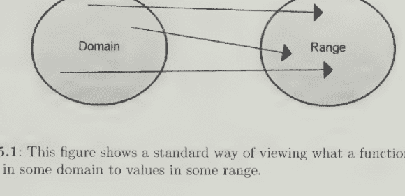

FIGURE 5.1: 该图展示了查看函数作用的一种标准方式。它将某个定义域中的值映射到某个值域中的值。

# 5.3 创建和使用函数

在 Scala 中有多种创建函数的方式。我们将从标准的定义格式开始。在第 3 章中我们看到可以使用关键字 val 和 var 来声明变量。类似地，我们使用关键字 def 来定义一个函数。我们将从上一节中使用的简单数学示例开始，并在 REPL 中创建与之对应的 Scala 函数。

```
scala> def square(x:Double):Double = x*x
square: (x: Double)Double
```

在数学中，函数被赋予 f 和 g 之类的名称。在有限的上下文中这样做是可以的，但如果使用大量不同的函数，这种方式扩展性不好。我们在这里使用名称 square，因为它描述了函数的作用。名称写在 def 之后，之后是一组括号，其中包含一个名称和一个用冒号分隔的类型。这类似于 val 声明，只是它不包含初始值。值是在调用此函数时指定的，就像数学函数一样。括号中的内容是函数的形式参数。

括号之后是另一个冒号和该函数返回给我们的类型，或返回类型。在 Scala 中我们称之为结果类型。在本例中，因为我们是在镜像数学函数，所以类型是 Double。结果类型之后是等号和表达式 x*x。输入后，REPL 告诉我们我们创建了一个名为 square 的东西，其类型为 (x: Double)Double。这是 Scala 告诉我们我们有一个接受 Double 并返回 Double 的函数的方式。

现在我们已经定义了 square，我们就可以使用它了。在上一节中我们通过执行 f(3) 来使用函数 f。Scala 中的语法是相同的。

```
scala> square(3)
res0: Double = 9.0
```

我们给出函数名，后跟包含我们希望用作 x 的值的括号。当我们使用值 3 执行此操作时，Scala 给我们返回一个值为 9.0 的 Double。这个特定值也可以表示为 Int，但函数说明它使用 Double 类型，因此我们传入的 Int 被转换为 Double，结果也是 Double。

让我们现在来看第二个示例数学函数。在本例中我们将使用简短名称 g 并使其使用 Int 类型以作演示。

```
scala> def g(x:Int,y:Int):Int = x+y*y
g: (x: Int,y: Int)Int
```

请注意，两个参数都放在括号中并用逗号分隔。一般来说，你可以有任意数量的参数。它们可以全部具有不同的类型，并用逗号分隔。函数通过给出函数名和用逗号分隔的值来调用的方式与预期一致。

```
scala> g(3,5)
res1: Int = 28
```

在本例中我们对函数的参数使用了简单的字面量，但参数可以是具有正确类型的任何表达式。例如，我们可以执行以下操作：

```
scala> val a=5
a: Int = 5

scala> g(a+2,square(3).toInt)
res2: Int = 88
```

在这里我们展示了 g 的参数可以包含对 val 的引用或对 square 函数的调用。对 square 的调用需要后跟转换为 Int，因为 g 声明为接受 Int 类型，而 square 的结果是 Double。如果你省略它，你会得到如下错误：

```
scala> g(a+2,square(3))
<console>:9: error: type mismatch;
 found   : Double
 required: Int
        g(a+2,square(3))
                 ^
```

使用 val 和 var 声明时，我们看到通常可以省略类型，让 Scala 为我们推断出来。对于函数，参数上的类型是必需的。结果类型不是必需的，因为它通常可以被推断出来，但指定它被认为是更好的风格。¹ 这样做的原因是，如果你告诉 Scala 一个类型，而函数中的错误导致它产生不同类型，Scala 可以更早地告诉你出了问题。

这些函数作用范围有限。我们可以编写更长的函数。为此，我们需要使用大括号使用代码块。回到英语类比，一段代码块可能类似于一个段落。这是一个薄弱的类比，因为块不仅由语句组成，它本身就是一个语句并且可以是一个表达式。当用作表达式时，从块中得到的值是块中最后一个表达式的值。为了了解其工作原理，我们可以将第 3 章末尾脚本中的语句放入一个函数中。如果我们将其输入到 REPL 中，函数可能看起来像这样。

```
scala> def secondsToTimeString(totalSeconds:Int):String = {
     |   val displaySeconds=totalSeconds%60
     |   val totalMinutes=totalSeconds/60
     |   val displayMinutes=totalMinutes%60
     |   val displayHours=totalMinutes/60
     |   val sec=displaySeconds.toString
     |   val min=displayMinutes.toString
     |   displayHours+":"+("0"*(2-min.length))+min+":"+
     |   ("0"*(2-sec.length))+sec
     | }
secondsToTimeString: (totalSeconds: Int)String
```

此函数接受一个 Int，表示秒数。它产生一个 String。在等号之后是一个打开大括号，打开一个代码块。此块在函数末尾关闭，在一个给出我们想要返回的 String 的表达式之后。

这种方法的优点是我们可以使用不同的秒数轻松调用该函数，即使在 REPL 中也是如此。

```
scala> secondsToTimeString(123456)
res0: String = 34:17:36

scala> secondsToTimeString(654321)
res1: String = 181:45:21
```

以这种方式，函数允许我们组织代码并为我们可能经常想要做的事情赋予有用的名称。

此代码还做了我们从未见过的事情，它在函数内部声明变量。当我们这样做时，这些变量被称为局部变量，它们只能在函数内部访问。如果在输入此函数后，你尝试在函数外部使用 sec 或其他局部变量，你将收到错误消息。

```
scala> sec
<console>:6: error: not found: value sec
      sec
      ^
```

一个名称可以被访问的代码部分称为该名称的作用域。当你在脚本中在任何代码块之外声明变量或函数时，它的作用域会贯穿脚本的其余部分。如果你在一个代码块中声明它，它的作用域从声明点开始到声明它的块结束。块用大括号表示，因此你可以使用该名称直到遇到关闭该名称所在成对大括号的右大括号。一般来说，你希望最小化变量的作用域，使其只能在需要的地方访问。这减少了如果该变量出现问题时你需要查看的代码量。

这些示例利用了数学中函数的概念，即它接受输入值并将它们映射到输出值。在编程中，函数可以做的事情不仅仅是返回一个值。我们已经见过这样的函数的例子。我们的第一个程序调用了函数 println。你可能会注意到，如果你在 REPL 中使用 println，会打印一个值，但不会显示结果值。这是因为 println 给我们返回一个类型为 Unit 的值，该值在第 3 章中讨论过。当你编写一个返回 Unit 的函数时，你可以使用正常语法并在参数列表后加上 :Unit。另一种更短的语法是省略等号，只有一个代码块。以下是此的简单示例。

```
scala> def printMultiple(s:String,howMany:Int) {
    | println(s*howMany)
    | }
printMultiple: (s: String,howMany: Int)Unit
```


```
scala> printMultiple("hi ",3)
hi hi hi
```

我们稍后会看到更多有用的例子。

在继续之前，我们将再做一个更有趣的函数示例，比如计算课程平均分。课程平均分是通过结合若干不同成绩的平均值来计算的。例如，你可能有测验、作业和小测验。每种成绩可能占总成绩的不同比例。测验可能占 40%，作业占 40%，小测验占 20%。你也会有不同数量的每种成绩。例如，你可能有 2 次测验、3 次作业和 4 次小测验。在许多课程中，课程平均分的一部分是通过去掉最低分并取剩余成绩的平均值来计算的。在本例中，我们假设去掉最低分的小测验成绩。

我们想要做的是编写一个函数，接收所有成绩并返回课程平均分。起初，它可能看起来像这样：

```
def courseAverage(test1:Double,test2:Double,assn1:Double,
assn2:Double,assn3:Double,quiz1:Double,quiz2:Double,
quiz3:Double,quiz4:Double):Double = {
...
}
```

这个函数接收九个 Double 并返回整个班级的平均分作为 Double。我们希望分别计算每种成绩部分的平均值，然后用适当的百分比组合它们。填入更多内容后如下所示。

```
def courseAverage(test1:Double,test2:Double,assn1:Double,
assn2:Double,assn3:Double,quiz1:Double,quiz2:Double,
quiz3:Double,quiz4:Double):Double = {
val testAve=(test1+test2)/2
val assnAve=(assn1+assn2+assn3)/3
val minQuiz=...
val quizAve=(quiz1+quiz2+quiz3+quiz4-minQuiz)/3
testAve*0.4+assnAve*0.4+quizAve*0.2
}
```

剩下的就是要算出最小的小测验成绩。为了实现这一点，我们将使用在 Int 类型上定义的方法 min。如果你有两个 Int 值 a 和 b，那么表达式 a min b 会给出两者中的较小值。这是对 Int 的 min 方法的调用，可以写成 a.min(b)。然而，当我们有多个值时，去掉点号和括号的运算符语法更优越，因为我们可以将值排成一列来得到所有值中的最小值。这给出了函数的完整版本，看起来如下。

```
def courseAverage(test1:Double,test2:Double,assn1:Double,
assn2:Double,assn3:Double,quiz1:Double,quiz2:Double,
quiz3:Double,quiz4:Double):Double = {
val testAve=(test1+test2)/2
val assnAve=(assn1+assn2+assn3)/3
val minQuiz=quiz1 min quiz2 min quiz3 min quiz4
val quizAve=(quiz1+quiz2+quiz3+quiz4-minQuiz)/3
testAve*0.4+assnAve*0.4+quizAve*0.2
}
```

如果你把它放到 REPL 中，可以调用它并得到如下所示的输出。

```
scala> courseAverage(90,80,95,76,84,50,70,36,89)
res4: Double = 81.93333333333334
```

# 5.4 问题分解

正如我们所说，编程就是解决问题。问题解决的一个主要方面是将难题分解成更小的部分。这样做有许多原因。最明显的原因是，大问题很难解决。如果你能把大问题分解成更小的部分，通常更容易解决这些部分，然后从这些部分的答案构建出完整问题的答案。这可以对每个子问题重复，直到问题变得简单易解。

将问题分解的第二个好处是，各个部分的解决方案本身可能很有用。这使你有可能重用代码片段。重用现有代码的能力在编程中至关重要。有很多不同的方法可以分解问题。一个好的判断标准是看哪一种能给你提供更可能重用的函数。

将问题分解的第三个好处是，所产生的代码可能更容易理解和修改。如果你给函数起好名字，那么人们可以轻松阅读和理解顶层函数，并对底层函数的工作原理有更好的了解。此外，如果你在某个时候决定需要修改某事的实现方式，如果问题以逻辑方式分解，就更容易确定更改需要在哪里进行以及如何进行。

我们研究了两个不同的问题，并看到了它们如何可以被编程为一组可以放在函数内部的指令。现在的问题是我们如何分解这些东西？如果你回顾最初的讨论，解决问题的描述是按部就班地进行的，这非常适合分解。

让我们从评分程序开始。这个问题有四个基本部分。我们求出测验、作业和小测验的平均值。得到这些之后，我们用适当的百分比将它们组合起来。每部分都可以拆分为单独的函数。如果我们把它写成文件，可能看起来像这样。

```
def testAve(test1:Double,test2:Double):Double=(test1+test2)/2
```

```
def assnAve(assn1:Double,assn2:Double,assn3:Double):Double =
(assn1+assn2+assn3)/3
```

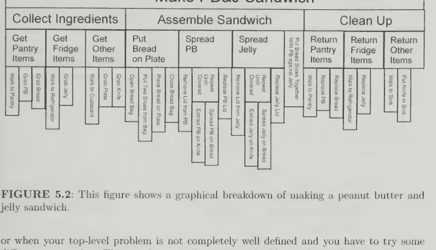

# 图 5.2：该图显示了制作花生酱和果酱三明治的图形分解。

或者当你的顶层问题没有完全定义清楚，你需要尝试不同的方法时。这在为客户构建软件时可能会发生，因为客户可能对他们想要程序的样子只有模糊的想法。在那种情况下，你可以构建已知会很有用的部分，并尝试以不同的方式将它们组合起来，直到客户满意为止。

为了帮助你理解这一点，请考虑图 5.2 中所示的常见例子，即制作花生酱和果酱三明治。经常使用这个例子来说明编程所需的明确性。这里的主要重点是问题如何被分解并逐块解决。顶部是完整问题。它被分解为三个子问题，每个子问题进一步分解。为了真正明确，步骤需要被分解得更进一步。想象一下指令是给机器人而不是人类。“抓取果酱”时，你必须指示它移动手臂到正确位置、抓取等。

这个例子还表明问题可能包含一些可重用的部分。底部有几个以“Grab”或“Walk to”开头的框。理想情况下，我们会找到一种方法编写一个行走函数，可以传递关于去哪里的信息。

与其以图中所示的图形方式查看它，还可以将其视为下面所示的大纲。嵌套显示了一个动作是如何分解为其他动作的。

- 制作 PB&J 三明治
- 1. 收集配料
  - (a) 获取储藏室物品
    - i. 走到储藏室
    - ii. 抓取花生酱
    - iii. 抓取面包
  - (b) 获取冰箱物品
    - i. 走到冰箱
    - ii. 抓取果酱
  - (c) 获取其他物品
    - i. 走到橱柜
    - ii. 抓取盘子
    - iii. 抓取刀
- 2. 组装三明治
  - (a) 将面包放在盘子上
    - i. 打开面包袋
    - ii. 从袋中取出两片
    - iii. 将面包放在盘子上
    - iv. 关闭面包袋
  - (b) 涂抹花生酱
    - i. 取下花生酱盖
    - ii. 重复直到面包被覆盖
      - A. 用刀取出花生酱
      - B. 将花生酱涂在面包上
    - iii. 盖回花生酱盖
  - (c) 涂抹果酱
    - i. 取下果酱盖
    - ii. 重复直到面包被覆盖
      - A. 用刀取出果酱
      - B. 将果酱涂在面包上
    - iii. 盖回果酱盖
  - (d) 将面包片合在一起，使花生酱与果酱相对
- 3. 清理
  - (a) 归还储藏室物品
    - i. 走到储藏室
    - ii. 归位花生酱
    - iii. 归位面包
  - (b) 归还冰箱物品
    - i. 走到冰箱
    - ii. 归位果酱
  - (c) 归还其他物品
    - i. 走到水槽
    - ii. 将刀放入水槽

这种大纲格式及其缩进看起来更像我们在 Scala 中将要编写的代码。

我们在上面用 Scala 编写的那些问题的解决方案是这样的：分解后的解决方案需要的文本比原始的单体解决方案更多。我们已经表达了这并不是一件坏事，因为分解后的解决方案具有某些优势。当分解问题时，你还应该记住另一个因素。关于自顶向下方法的讨论要求你不断分解问题，直到得到


将其简化为相对容易解决的问题。这不仅对问题求解很实用，而且事实证明保持函数简短是有充分理由的。长函数比小函数更可能包含错误。因此，通常建议程序员保持函数相对简短。你让函数有多短可以是风格和个人偏好的问题，但有一个有研究支持的良好规则可以遵循。规则是函数应保持足够短，以便一次完全显示在你的屏幕上。当函数长到无法全部显示在屏幕上时，程序员开始不得不依赖他/她的记忆来记住屏幕外部分的内容。人类记忆并不是可以依赖的东西，因此，当函数的一部分无法在屏幕上看到时，错误率会显著上升。

我们也可以在函数内部使用我们在第 4 章中学到的 if 构造。考虑我们编写的用于计算主题公园购买物品成本的代码。这可以转换为以下函数。²

```
def itemCost(item:String, size:String):Double = {
  if(item=="Drink") {
    if(size=="S") 0.99
    else if(size=="M") 1.29
    else 1.39
  } else if(item=="Side") {
    if(size=="S") 1.29
    else if(size=="M") 1.49
    else 1.59
  } else if(item=="Main") {
    if(size=="S") 1.99
    else if(size=="M") 2.59
    else 2.99
  } else {
    if(size=="S") 4.09
    else if(size=="M") 4.99
    else 5.69
  }
}
```

此函数不包括从用户读取输入。相反，假设调用它的代码会读取值并传入。在一般情况下，将值传递给函数并返回值比在函数中读取它们并打印结果到输出更灵活。一个在内部执行读取和/或打印的函数如果值来自标准输入之外或你想以不同方式格式化输出，就无法重用。或者，你可能想把一天的所有费用加起来。你不能对打印出来的东西求和。这需要返回值。

为了理解，请考虑一个简单的例子，即想知道应为两件物品支付多少钱。

```
println("What is the first item?")
val item1 = readLine()
println("What size?")
val size1 = readLine()
```

> ²Double 类型真的不应该用于货币，因为它会四舍五入。记住计算机中的数字以二进制表示。十进制中的值 0.1 是一个无限循环的二进制数。该数字在一定位数后被截断，因此 0.1 不能在 Double 中完美表示。这对于大多数应用，包括科学应用，是可以的。对于处理真实货币的应用则不理想。

```
println("What is the second item?")
val item2 = readLine()
println("What size?")
val size2 = readLine()
val totalCost = itemCost(item1,size1)+itemCost(item2,size2)
println("The total cost is "+totalCost)
```

计算 totalCost 的那一行展示了将代码放入返回值的函数中的真正好处。

# 5.5 函数字面量

在第 3 章我们看到，对于 Int、Double、String 和一些其他类型，最简单的表达式形式是字面量形式。例如，仅数字 5 就是 Int 类型的字面量。字面量允许你以简短格式编写一种类型的表达式，而无需为其声明名称。Scala 因为包含函数式编程的元素，所以也允许你将函数表达为字面量。

函数字面量的语法以一组包含以逗号分隔的参数列表的括号开始，后跟由等号和大于号组成的箭头，以及函数体在该箭头之后。这种类型的箭头通常读作“火箭”。因此，如果我们回到我们前两个函数，我们可能会以这种方式编写它们。

```
scala> (x:Double)=>x*x
res9: (Double) => Double = <function1>
```

```
scala> (x:Int,y:Int)=>x+y*y
res10: (Int, Int) => Int = <function2>
```

在这种用法中，参数的类型是必需的。正如我们将看到的，有许多用法不需要它。如果函数更长，可以使用大括号来容纳多个语句。理论上可以用函数字面量表示任意长度的函数，实际上这是风格问题，你不会想使用过长的函数字面量。函数字面量将被嵌入到其他函数中，你不希望这些函数超过屏幕长度，因此字面量最多不应超过几行。

Scala 对某些特殊情况的函数字面量有一种更短的形式。这种形式使用下划线表示参数并完全跳过参数列表和火箭。它只能在每个参数仅使用一次并且按传入的相同顺序使用时使用。在这种形式中，函数字面量 (x:Int,y:Int)=>x+y 可以表示为 ((_:Int)+(_:Int))。当 Scala 能推断出类型时，我们可以使用更短的形式 (_+_)。请注意，这不能用于写成 x*x 的 x²，因为我们使用了两次 x。它有显著的限制，但在许多情况下使用它很方便，因此我们在后面的章节中会使用它。

# 5.6 非函数式函数/过程

本节的标题可能看起来很奇怪。函数怎么可能不是函数式的？在纯函数式编程中，函数接收输入并计算一个值。它返回的值仅取决于参数，函数除了返回该值之外什么也不做。通常在编程中，函数也会做其他事情，或者可能对相同的输入返回不同的值。这些类型的函数在技术上不是“函数式”。当它们做其他事情时，我们称之为副作用。这种术语类似于药物。服用药物是因为它有某种期望的效果。然而，它也可能有称为副作用的其他效果。虽然药物的副作用通常是不期望的，但函数副作用有时是期望的。最简单的例子是打印。打印语句不返回任何内容。相反它将信息发送到输出。那就是副作用。

可以有返回值的函数同时具有副作用。然而，很频繁地你会发现具有副作用的函数不返回任何数据。对 Scala 来说，这意味着它们的返回类型是 Unit。以下是此类函数的简单示例。

```
scala> def introduce(name:String):Unit = {
|   println("Hi, my name is "+name+". ")
| }
introduce: (name: String)Unit

scala> introduce("Mark")
Hi, my name is Mark.
```

这在非函数式编程中很常见。事实上，一些语言包含一个特殊的构造，过程，用于此目的。Scala 没有单独的函数类型，但它确实允许我们之前提到的更短语法。这使得我们之前的函数看起来像这样：

```
scala> def introduce(name:String) {
|   println("Hi, my name is "+name+". ")
| }
introduce: (name: String)Unit
```

这种简写语法很方便，你可能会经常使用它。事实上，它看起来更像许多其他语言中的函数语法。然而，它确实引入了一种你应该注意的语法错误³，因为它可能导致奇怪的错误信息且难以定位。语法错误是在应该有等号的函数声明中遗漏等号。这种遗漏可能导致两个问题之一。如果你遵循建议并为返回值的函数加上返回类型，Scala 会因缺少等号而困惑并给出错误信息。在某些情况下，错误信息会说你可能缺少等号。如果你不遵循风格建议并允许 Scala 推断返回类型，那么省略等号会使你的函数返回类型为 Unit，因为没有返回类型且没有等号是 Unit 结果的简写语法。这个问题在函数声明时根本不会被识别。它只会在你尝试调用函数并对返回值做些什么时出现。

³ 语法错误是由你在语言中输入无效内容而引起的错误。


计算所需的信息被传入，这个函数只对数据进行计算，并返回一个数字。

现在我们可以把这些代码片段组合起来，编写一个脚本，它能告诉你最多四人的团队费用，包括购买套餐。我们将假设整个团队要么都带冷藏箱，要么都不带；所有人都要么去水上乐园，要么不去；并且他们都点某种规格的套餐。以下代码可以放在一个脚本中，与 `entryCost` 和 `itemCost` 函数一起使用。

```
def individualCost(cooler:Boolean, waterPark:Boolean): Double = {
  println("What is the person's age?")
  val age = readInt()
  println("What size combo are they ordering?")
  val size = readLine()
  entryCost(age,cooler,waterPark)+itemCost("Combo",size)
}
```

```
println("How many people are in your group? (1-4)")
val numPeople = readInt()
if(numPeople<1 || numPeople>4) {
  println("This script can not handle "+numPeople+" people.")
} else {
  println("Is the group bringing a cooler? (Y/N)")
  val cooler = readLine()=="Y"
  println("Will they be going to the water park? (Y/N)")
  val waterPark = readLine()=="Y"
  val totalCost = individualCost(cooler,waterPark) +
    (if(numPeople>1) individualCost(cooler,waterPark) else 0) +
    (if(numPeople>2) individualCost(cooler,waterPark) else 0) +
    (if(numPeople>3) individualCost(cooler,waterPark) else 0)
  println("The group cost is $"+totalCost+".")
}
```

请注意，这段代码不在函数中。当你编写脚本时，函数声明所做的正是这些：它们声明了一个函数。你需要在函数之外编写代码来让某些事情发生，通常是通过调用一个或多个已声明的函数。

这个脚本确实有一个重大局限：它只适用于1-4人。我们还不能让一段代码执行任意次数。我们将在下一章学习如何做到这一点。

# 运行 Scala 程序的方式（附注）

学生偶尔会遇到的一个难题是如何运行他们的 Scala 程序。运行 Scala 有三种不同的方式。你已经见过其中两种：REPL 和脚本。第三种方式——编译为应用程序——将在本书后半部分讨论。要使用 REPL，你可以在命令行中输入 `scala`，不指定要执行的文件。要运行脚本，你可以在命令行中输入 `scala`，并给它一个以 `.scala` 结尾的文件名。起初，这两种方式可能看起来完全不同。然而，REPL 有一个 `:load` 命令，你可以用它从 Scala 文件中加载代码。使用这个命令，你可以加载一个

4. 编写一个 if 语句。

# 5.9.2 概念总结

- 函数用于将问题分解成更小的部分。
  - 有助于解决问题。
  - 信息丰富的名称使代码更易理解。
  - 更小的函数更容易处理。
- 编程中的函数与数学中的函数类似。信息通过形式参数传入。参数的值在调用函数并传入实参时确定。
- 在 Scala 中，函数使用 `def` 声明。后面依次是函数名、参数列表、结果类型，然后是等号和函数表达式。结果类型可以省略并由编译器推断，但仍建议你显式包含它。
- 函数也可以写成 Scala 中的字面量。
  - 火箭记号用 `=>` 分隔参数列表和函数体。
  - 更简短的记法使用下划线表示参数。这只适用于某些函数。
- 仅因其副作用而被调用且不需要返回值的函数返回 `Unit`。这种情况很常见，因此有一种简化语法：省略冒号、结果类型和等号，花括号直接放在参数列表后面。
- 如果你的函数经常接受或返回元组，使用类型声明为元组提供更短、更有意义的名字会很有用。

# 5.9.3 自主学习

在 REPL 中输入以下语句，观察它们的作用。有些会产生错误。你应该弄清楚原因。尝试一些变体，以确保你理解正在发生的事情。

```
scala> def succ(n:Int):Int = n+1
scala> succ(1)
scala> succ(succ(1))
scala> var cnt = 0
scala> def inc { cnt=cnt+1 }
scala> cnt
scala> inc
scala> cnt
scala> inc
scala> inc
scala> cnt
scala> val f = (x:Double,y:Double)=>math.sqrt(x*x+y*y)
scala> f(3,4)
scala> def doThreeTimes(g:(Double)=>Double,x:Double) = g(g(g(x)))
```

```
scala> doThreeTimes(y=>y+1,1)
scala> doThreeTimes(y=>y+2,1)
scala> doThreeTimes(a=>a-5,100)
scala> doThreeTimes(_+1,1)
scala> doThreeTimes(_*2,1)
scala> def incChar(c:Char,offset:Int) = (c+offset).toChar
scala> incChar('a',1)
scala> incChar('a',2)
scala> incChar('z',-3)
scala> def tnp1(n:Int):(Int,Int) = {
  val odd = n%2
  (n/2*(1-odd),(3*n-1)*odd)
}
scala> odd
scala> var name = ""
scala> def introduction {
  println("What is your name?")
  name = readLine()
  println("Hello "+name)
}
scala> name
```

# 5.9.4 练习

1. 对于完成以下任务的函数，其参数和结果的类型分别是什么？（注意：你不必编写这些函数，只需说明它们的类型。）
   - 告诉你一个人的名字中有多少个单词。
   - 接受一个通常写法的人名，并以“姓, 名”的格式返回。
   - 接受三个单词，并返回它们的 TLA（三字母缩写）。
   - 接受二维空间中的十个点（x-y 坐标），并返回其中有多少个在单位圆内。
   - 接受一个数字，并告诉它有多少个不同的质因数。
   - 接受一个数字，并告诉它有多少个正因数。
   - 接受一个华氏温度值，并返回等效的摄氏温度。
   - 接受一个华氏温度值，并返回等效的摄氏温度和开尔文温度。

2. 编写函数，为练习1（第85页）的不同部分返回一个 Boolean。

3. 编写一个函数，接受一个 String 参数，并返回一个 Boolean，说明该参数是否为回文。

4. 为练习5（第86页）的解答编写一个函数。

5. 为练习6（第86页）的解答编写一个函数。

6. 为练习7（第86页）的解答编写一个函数。

7. 为练习8（第86页）的解答编写一个函数。

8. 将你为练习9（第86页）编写的代码转换为一个函数，该函数以 x 和 y 值作为参数，并返回一个 Boolean，指示该点是否在单位圆内。

9. 编写一个函数，将温度从华氏度转换为摄氏度。

10. 编写一个函数，将英里转换为公里。

11. 编写一个函数，将秒转换为年。

12. 编写一个函数，将 AU（天文单位）转换为英里。

13. 编写两个函数，接受四个数字并返回最小的一个。第一个可以使用 `min`，但第二个不能。

14. 编写一个函数，接受三个数字并返回中位数。

# 5.9.5 项目

1. 编写一组函数，对 Int 的二元组执行以下操作，就像它们是分数的分子和分母一样。
   (a) 加法
   (b) 减法
   (c) 乘法
   (d) 除法

2. 编写一组函数，对 Double 的三元组执行以下操作，就像它们是向量一样。
   (a) 加法
   (b) 减法
   (c) 点积
   (d) 叉积

3. 编写一组函数，对 Double 的二元组执行以下操作，就像它们是复数一样。
   (a) 加法
   (b) 减法
   (c) 乘法
   (d) 除法
   (e) 模

4. 使用你对练习3的解答来编写一个函数，该函数接受两个复数 z 和 c，并返回 z² + c 的值。

5. 编写一个函数来求解二次方程的实数值。你的解答应返回两个根的 (Double, Double) 元组。

6. 增强练习5的解答，使其返回一个 ((Double, Double), (Double, Double))。这是一个由两个二元组构成的二元组。它表示两个根，每个根都可以是一个以 (Double, Double) 表示的复数。


7. 双曲三角函数 sinh、cosh 和 tanh 均以自然对数的底 e 的幂来定义。以下是每个函数的基本定义：

sinh(x) = 1/2 (e^x − e^−x)
cosh(x) = 1/2 (e^x + e^−x)
tanh(x) = sinh(x)/cosh(x)

为每个函数编写函数。你可以使用 math.exp(x) 来表示 e^x。

8. 编写两个在笛卡尔坐标系和极坐标系之间转换的函数。第一个接收 x:Double 和 y:Double 并返回一个 (Double, Double) 其中包含 r 和 θ。第二个接收 r:Double 和 theta:Double 并返回 (Double, Double) 其中包含 x 和 y。你可以使用 math.tan2(y:Double, x:Double) 函数来获取角度。这避免了当 x 为零时使用除法的问题。

9. 这个选项要求你进行科学计算。我们现在还不能做太多，但我们会逐步推进。我们将尝试计算自转速度中等到较快的行星的无温室效应温度。这看起来可能是一个复杂的事情，但并不困难。你需要两条信息和一点代数。第一条信息是斯特藩-玻尔兹曼定律 (j* = σT^4, σ = 5.670400*10^−8 [J/(s*m^2*K^4)])，用于描述任何物体通过热辐射释放的能量。第二条是辐射强度随 1/r^2 衰减的事实。

要计算行星的无温室效应温度，你需要以下信息。你应该提示用户输入这些值。为了简化，使用 mks 单位并将温度保持在开尔文。

- 恒星的半径。
- 恒星的表面温度。
- 行星的轨道半长轴。
- 行星的反照率。

使用斯特藩-玻尔兹曼定律确定恒星表面每平方米的能量输出。将其制作为一个接收所需值的函数。利用平方反比关系，你可以计算行星位置处的强度（使用行星轨道距离与恒星半径的比率）。将其制作为另一个函数。星光会以面积为 πr^2 的区域覆盖行星，其中 r 为行星半径。其中一部分由反照率决定被反射。未被反射的部分会使行星变暖。行星通过其表面积为 4πr^2 的自身热辐射冷却。令吸收和发射值相等即可求解温度。（注意行星半径应相互抵消。）制作一个函数，接收入射功率和反照率并返回温度。

10. 如果你为项目 4 编写了代码，你可以将其转换为使用函数。为球体编写一个函数，为平面编写另一个函数。每个函数都应接收射线的信息以及被相交的几何体的信息。它们应返回交点处的 t 值。如果不相交，可以使用适当的负值。

11. 在项目 5 中，你编写了条件语句来判断是否有足够的原料制作一些简单的食谱。那里的数字之所以保持较小，很大程度上是因为代码长度和重复问题的问题。针对你有五种食材在储藏室而食谱涉及四种配料的情况重新做这个问题。使用函数使之易于管理。

12. 将项目 6 的代码转换为使用函数。

13. 忽略空气阻力，被抛掷或发射到空中的物体沿抛物线路径运动，形式为 $x(t) = v_x t$，$y(t) = -\frac{1}{2}gt^2 + v_y t + h$，其中 $v_x$ 和 $v_y$ 是速度的分量，$g$ 是重力加速度，$h$ 是初始高度。编写一个函数，传入物体的速度、相对于地面的角度以及初始高度，并得出物体在 $y(t) = 0$ 时撞击地面前所走的距离。

# 第 6 章

# 递归用于迭代

- 6.1 递归基础 111
- 6.2 编写递归 113
- 6.3 用户输入 117
- 6.4 抽象 120
- 6.5 匹配 123
- 6.6 综合 125
- 6.7 展望 127
- 6.8 章末材料 128
- 6.8.1 问题解决思路 128
- 6.8.2 概念总结 128
- 6.8.3 自主学习 129
- 6.8.4 练习 130
- 6.8.5 项目 131

获得条件语句为我们提供了很大的能力。我们现在能够在代码中表达逻辑。添加函数使我们能够将问题分解成部分并在不重写代码的情况下重复使用功能。仍然有一个非常重要的东西我们缺少。现在当我们编写一段逻辑时，它只会发生一次。我们可以将该逻辑放入函数中然后反复调用该函数，但它只会发生我们调用它的次数。我们不能轻易改变某事发生的次数。在 Scala 中有不止一种方法使某事多次发生。其中一种方法，递归，我们可以用我们已经学过的函数和条件语句来实现。

### 6.1 递归基础

递归是一个来自数学的概念。数学函数是递归的，如果它以自身来定义。要了解其工作原理，我们将从阶乘开始。你可能还记得在数学课上 $n!$ 是从 1 到 $n$ 的所有整数的乘积。我们可以将其写为 $n! = 1 * 2 * ... * n$。更正式地我们可以这样写。

$$n! = \prod_{i=1}^{n} i$$

正式和非正式的方法都用仅乘法来定义阶乘，并假设我们知道如何使该乘法反复发生。如果我们使用递归像这样写定义，我们可以更明确地说明重复。

n! = { 1          n < 2
       n * (n - 1)!  otherwise }

在这个定义中，阶乘函数是以自身来定义的。为了描述阶乘是什么，我们使用了阶乘。

为了了解其工作原理，让我们通过一个例子并求 5 的阶乘。根据我们的定义我们得到 5! = 5 * 4!。这是因为 5 不小于 2。随后，我们可以看到 4! = 4 * 3! 所以 5! = 5 * 4 * 3!。这导致 5! = 5 * 4 * 3 * 2! 最后得到 5! = 5 * 4 * 3 * 2 * 1。

这个定义及其应用说明了递归的两个关键方面。这个函数的值有两种可能性。我们使用哪一个取决于 n 的值。在 n 小于 2 的情况下，阶乘的值为 1。这称为基例。所有递归函数都需要某种基例。基例的关键在于它不是递归的。当你到达基例时，它应该有一个可以直接计算而无需参考函数的值。没有它就会出现所谓的无限递归。也可以有多个不同的基例。没有限制只能有一个，但必须至少有一个。

为了了解为什么需要基例，考虑没有它会发生什么。我们仍然会得到 5! = 5 * 4 * 3 * 2!，但之后会发生什么？没有基例，2! = 2 * 1!。技术上那里没有问题，但 1! 呢？1! = 1 * 0! 在没有基例的情况下，而 0! = 0 * (-1)!。这个过程永远持续下去。这就是为什么它被称为无限递归。

递归定义的第二种情况展示了递归情况。不仅这种情况下引用了函数本身，它还使用不同的值并且该值应使我们更接近基例。在这种情况下，我们将 n! 定义为 (n - 1)!。如果递归情况使用相同的 n 值，我们将再次得到无限递归。同样，如果它使用大于 n 的值，我们也会得到无限递归，因为我们的基例是针对小数字，而不是大数字。

我们还能递归定义什么？我们可以递归定义乘法，这是阶乘所使用的。毕竟，至少对于正整数而言，乘法不过是重复的加法？与阶乘一样，我们可以写出正整数之间乘法的定义，使用一个假设某种重复的数学符号，如下所示。

m * n = Σ (i=1 to n) m

这表示 m * n 是 m 加自身 n 次。这可以写成递归函数如下。

m * n = { 0                n = 0
          m + m * (n - 1)  otherwise }

这个函数再次有两个情况，有一个针对小值的基例和一个递归情况，该情况以我们正在递归的值定义，使用该参数的较小值。

我们可以用相同的方法在乘法的基础上定义指数运算。我们也可以使用递增（加 1）来定义更高数字的加法。值得看看它会是什么样子。

m + n = { m                n = 0
          1 + m + (n - 1)  otherwise }


虽然这看起来有点荒谬，但如果我们给函数命名的话就没那么荒谬了。考虑以下另一种写法。

```
$$\operatorname{add}(m,n)=\begin{cases}m & n=0\\1+\operatorname{add}(m,n-1)&\text{otherwise}\end{cases}$$
```

现在很清楚，只要我们能做递增（+1）和递减（-1）就能写出完整的加法。有了完整的加法就能写出乘法。有了乘法就能写出指数或阶乘。事实证明这并不是你能做的全部。可能很难相信，但如果你有变量、递归（它只需要函数和一个 if 结构）、递增和递减，你就拥有了一个完整的计算模型。它可以计算你想要的任何东西。当然，我们不会那样做，因为那样会极其缓慢。尽管如此，从理论角度来看，知道用这么少的东西能做这么多是很令人感兴趣的。

# 6.2 编写递归

我们已经看到了递归的数学方面，并且将一些基本的数学函数写成了递归函数。现在我们需要看看如何在 Scala 中编写这些东西以及更多内容。从数学函数到编程函数的翻译并不困难。事实上，从数学记法到 Scala 记法几乎不会有什么变化。

和之前一样，我们将从阶乘函数开始。这里是在 REPL 中用 Scala 编写的阶乘函数。

```
scala> def fact(n:Int):Int = if(n<2) 1 else n*fact(n-1)
fact: (n: Int)Int
```

我们将函数命名为 fact，是 factorial 的简写。函数的体是一个单一的 if 表达式。首先它检查 n 的值是否小于 2。如果是，表达式的值为 1。否则它就是 n*fact(n-1)。我们可以在这里看到使用此函数的结果：

```
scala> fact(5)
res1: Int = 120
```

我们在这里看到它正确地计算出了 5 的阶乘。

Scala 中递归函数和非递归函数的一个显著区别是，我们必须指定递归函数的返回类型。如果你不指定，Scala 会很快让你知道它是必需的。

```
scala> def fact(n:Int) = if(n<2) 1 else n*fact(n-1)
<console>:6: error: recursive method fact needs result type
      def fact(n:Int) = if(n<2) 1 else n*fact(n-1)
                                            ^
```

阶乘是一个有趣的函数，在计算机科学中谈论某些程序需要做多少工作时很重要。某些程序需要做的工作量会随着它们处理的事物数量的阶乘而增长。我们可以用我们的阶乘函数来看看这意味着什么。让我们取几个不同值的阶乘。

```
scala> fact(10)
res2: Int = 3628800
```

```
scala> fact(15)
res3: Int = 2004310016
```

```
scala> fact(20)
res4: Int = -2102132736
```

前两个例子向你展示了阶乘函数增长得非常快。的确，做阶乘工作的程序被称为不可处理的，因为你甚至不能将它们用于中等规模的问题。然而第三个例子却展示了另一种有趣的现象。20! 的值应该非常大。它绝对不应该是负数。发生了什么？

如果你还记得第 3 章，我们谈到了计算机上数字的表示方式。计算机上的整数由有限数量的位表示。因此它们只能大到一定程度。Scala 中内置的数字表示使用 32 位的 Int。如果我们稍微修改一下函数使用 Long，我们就可以得到 64 位。让我们看看它是如何工作的。

```
scala> def fact(n:Long):Long = if(n<2) 1L else n*fact(n-1)
fact: (n: Long)Long
```

```
scala> fact(20)
res5: Long = 2432902008176640000
```

```
scala> fact(30)
res6: Long = -8764578968847253504
```

Long 中的 64 位足以存储 20!，但仍然不足以存储 30!。如果我们放弃使用内置到计算机中的数字类型的速度，我们可以表示更大的数字。然后我们就受限于计算机中的内存量。那是一个以位为单位衡量的值，但以十亿字节为单位。要做到这一点，我们使用 BigInt 类型。

BigInt 类型为我们提供了任意精度的算术。它以速度和内存为代价来实现这一点。你不应该在真正需要它之前使用 BigInt。然而，使用像阶乘这样有可能变得非常大的函数来玩它还是很有趣的。让我们使用这种类型重新定义我们的函数，看看它是如何工作的。

```
scala> def fact(n:BigInt):BigInt = if(n<2) 1L else n*fact(n-1)
fact: (n: BigInt)BigInt
```

```
scala> fact(30)
res7: BigInt = 265252859812191058636308480000000
```

```
scala> fact(150)
res8: BigInt = 57133839564458545904789328652610540031895535786011264182548375833179829124845398393126574488675311145377107878746854204162666250198684504466355949195922066574942592095735778929325357290444962472405416790722184454371222696755200000000000000000000000000000000000
```

不仅这个版本可以计算 30 的阶乘，它还可以计算更大的值，如你在这里所见。没有太多应用需要这种类型的数字，但它们确实可以很有趣地玩。

```
```
(2,5) => prints 2
  ↓
(3,5) => prints 3
  ↓
(4,5) => prints 4
  ↓
(5,5) => prints 5
```
```

最后一次调用不会调用自身，因为条件 **from!=to** 为 *false*。

现在考虑如果我们用参数反过来调用这个函数会发生什么。似乎合理地要求函数从 5 数到 2。它只需要倒数。为了看看它会做什么，我们可以追踪它。

```
```
(5,2) => prints 5
  ↓
(6,2) => prints 6
  ↓
(7,2) => prints 7
  ↓
(8,2) => prints 8
  ↓
 ...
```
```

这个函数会计数很长时间。它在技术上并不是无限递归，因为 Int 类型只有有限数量的值。一旦它计数超过 $2^{31}-1$ 它就会回绕到 $-2^{31}$ 并从那里开始计数到 2，在那里它会停止。要看到这种行为你需要有耐心。即使它不是无限的，这也不是我们想要的行为。我们宁愿让函数从 5 倒数到 2。问题是，我们如何做到这一点？要回答这个问题，我们应该回到追踪并弄清楚为什么它一开始没有那样做。

查看代码和追踪，你应该很快就会发现问题是由于递归调用传递的值为 **from+1**。因此下一次调用总是使用比上一次大 1 的值。我们需要的是在递增时使用 **+1**，在递减时使用 **-1**。这种行为可以通过用 if 表达式替换 1 来轻松添加。我们的修改后函数如下所示。

```
```scala
def countFromTo(from:Int,to:Int) {
  println(from)
  if(from!=to) {
    countFromTo(from+(if(from<to) 1 else -1),to)
  }
}
```
```

现在当 **from** 值小于 **to** 值时我们加 1。否则我们将加 -1。由于我们在两者相等时不会到达那一点，所以我们不必担心这种情况。你应该输入这个函数并测试它以确保它按我们想要的方式工作。

在函数名之后为声明和调用都加上括号。这是一个风格问题，因为它们不是必需的。如果函数有副作用，则使用括号被认为是适当的风格，如果没有则省略。你会记得在第 5 章中，副作用是函数改变超出仅仅返回值的东西的方式。这个函数做了什么导致我们说它有副作用？这里的副作用是以读取输入的形式出现的。读取输入是一种副作用，因为它可能对超出该一个函数产生影响。考虑有两个不同的函数都读取输入。你调用它们的顺序可能会改变它们的行为。那是因为第二个函数会在第一个函数之后留下的状态下读取输入。

这个函数做得很好，可以让我们加总任意数量的用户输入，但它有一个显著的限制，它只适用于正值。那是因为我们将负值保留为停止条件。肯定会有这种情况限制会成为问题。我们如何绕过它？我们可以用什么其他方法来告诉函数停止递归？我们可以选择某个特定的特殊值，如 -999 作为结束条件。虽然 -999 可能看起来不是一个特别常见的数字，但这与我们之前的情况并没有什么不同，因为我们的函数仍然不能对任何有效整数值进行操作。我们希望终止输入是像单词“quit”这样的东西。一些特殊的东西不是数字。

如果我们不使用 readInt，我们就可以做到这一点。我们可以改用 readLine 函数，它将读取整行输入并返回一个 String。你可能想创建一个像这样的 方法：

```
def sumUntilQuit(): Int = {
  val n=readLine()
  if(n!="quit") {
    n+sumUntilQuit()
  } else {
    0
  }
}
```

如果你将它输入到一个文件中然后加载到控制台，你会得到以下错误。

```
<console>:8: error: type mismatch;
found : java.lang.String
required: Int
    n+sumUntilQuit()
    ^
```

这是因为函数应该返回一个 Int，但 n 是一个 String，而当我们用 String 使用 + 时得到的是一个 String。为什么 n 是一个 String？因为那是 readLine 返回的类型，Scala 的类型推断在 val n=readLine() 那一行决定 n 必须是 String。

这个问题可以很容易地修复。我们知道如果用户给我们有效输入，唯一可以输入的东西是整数值，直到输入单词“quit”。¹ 所以我们应该能够将 String 转换为 Int。这可以按如下所示完成。

```
def sumUntilQuit(): Int = {
  val n=readLine()
  if(n!="quit") {
```

> ¹ 在本书的前半部分，我们通常假设用户输入是有效的。处理无效输入需要异常处理，这在第 22 章中讨论。


```
val (sum,count)=sumAndCount()
sum.toDouble/count
}
```

这个函数第一次看起来可能有点奇怪的地方在于 Double 出现了两个位置。它被用作返回类型，并且在最后的表达式中对 sum 调用了 toDouble 方法。这么做是因为平均值通常不是整数。我们必须对 sum 或 count 调用 toDouble，因为否则 Scala 会执行整数除法，从而截断值。我们可以将两者都转换为 Double，但这不是必需的，因为 Double 和 Int 之间进行数值运算时会自动将 Int 转换为 Double，并且结果为 Double。

# 6.4 抽象

如果我们不是想对一批用户输入求和，而是想求积呢？我们需要在 sumAndCount 中做哪些改动才能让它变成 productAndCount？显而易见的改动是在 if 的递归分支中把加法改为乘法。另一个不太明显但必要的改动是，基本情况需要返回 1 而不是 0。所以修改后的函数可能看起来像这样。

```
def productAndCount():(Int,Int) = {
val n=readLine()
if(n!="quit"){
val (s,c)=productAndCount()
(s*n.toInt,c+1)
}else{
(1,0)
}
}
```

这几乎与我们之前的内容完全相同。我们只是换了个名字，并在其中改了两个字符。这种对代码进行复制并做少量修改的做法通常是不被提倡的。你可能会说它“闻起来不对”。2 避免做这种事情的原因有很多。首先，如果你的第一个版本有 bug 怎么办？好吧，你现在把它复制了，当你发现有问题时，就必须在多个地方修复它。第二个密切相关的问题是，当你意识到想要增加一点功能时，需要添加一些内容。同样，你现在有多个版本需要添加进去。此外，这只是让代码库更难维护。代码越长，出错的地方就越多，出现问题时需要检查的代码也越多。出于这个原因，我们力求减少代码重复。我们实现这一点的一种方式是引入抽象。我们寻找让原始代码更灵活的方法，使其能够满足我们所有的需求。我们将在本书中看到抽象会反复出现。它是计算机科学中最重要的工具之一，也是你需要理解的一个非常强大的概念。这里我们从一个相当简单的例子开始。

为了将这些函数抽象成一个，我们关注它们之间不同的地方，并问是否有办法将这些信息作为参数传入一个能够同时完成两者的函数版本。对于这个例子，名称的改变并不重要。重要的是我们改变了所执行的运算以及返回的基本值。基本值很容易处理。我们只需向方法传入一个参数，该参数是基本情况下返回的值。它可能看起来像这样。

```
def inputAndCount(base:Int):(Int,Int) = {
  val n=readLine()
  if(n!="quit") {
    val (s,c)=inputAndCount(base)
    (s*n.toInt,c+1)
  } else {
    (base,0)
  }
}
```

参数 base 会通过递归传递下去，并在基本情况下返回。然而，这个版本仍然只能做乘法，所以我们并没有获得太多好处。

处理乘法要困难一些。为此，我们需要思考乘法和加法到底是什么，特别是它们在这里是如何使用的。乘法和加法都是运算符。它们接收两个操作数并返回一个值。这样描述时，我们可以看到它们很像函数。事实上，我们需要的是一个接收两个 Int 并返回一个 Int 的函数。那个函数可以是乘法也可以是加法，然后 inputAndCount 函数就足够灵活，可以处理求和或求积。它可能看起来像这样。

```
def inputAndCount(base:Int,func:(Int,Int)=>Int):(Int,Int) = {
  val n=readLine()
  if(n!="quit") {
    val (s,c)=inputAndCount(base,func)
    (func(s,n.toInt),c+1)
  } else {
    (base,0)
  }
}
```

inputAndCount 的第二个参数 func 的类型更复杂。它是一个函数类型。它是一个接收两个 Int 作为参数并返回一个 Int 的函数。与 base 一样，我们在递归调用中传递 func。我们还在递归情况下返回元组的第一个元素中使用了 func，代替了 * 或 +。现在我们不是做 s*n.toInt 或 s*n.toInt，而是做 func(s,n.toInt)。它具体做什么取决于传入的函数。

为了确保我们理解这个过程，我们需要看到它实际运行。让我们从求和开始，使用最长、最易理解的语法。我们定义一个执行加法的函数并将其传入。对于输入，我们输入数字 3、4 和 5，然后输入“quit”。这些值不会由 REPL 显示。

```
scala> def add(x:Int,y:Int):Int = x+y
add: (x: Int,y: Int)Int
```

```
scala> inputAndCount(0,add)
res3: (Int, Int) = (12,3)
```

在对 inputAndCount 的调用中，我们使用了上面定义的 add 函数作为第二个参数。以这种方式使用已定义的函数会让我们输入很多字符。这正是 Scala 包含函数字面量的原因。你会记得在第 5 章中，函数字面量允许我们在 Scala 中即时定义一个函数。这种语法的正常形式看起来很像 inputAndCount 定义中的函数类型。它使用 => 在参数和函数体之间。使用函数字面量，我们可以在不定义 add 函数的情况下调用 inputAndCount。这种方法看起来像这样。

```
scala> inputAndCount(0,(x,y)=>x+y)
res4: (Int, Int) = (12,3)
```

这里需要注意的一点是，我们不必在 x 和 y 上指定类型。这是因为 Scala 知道 inputAndCount 的第二个参数是一个接收两个 Int 值的函数。因此，它假定 x 和 y 必须是 Int 类型。并非所有函数字面量的使用都会给 Scala 这种信息，但很多会，而且在这种情况下，我们可以通过让 Scala 为我们推断类型来减少输入。

如果你记得函数字面量的部分，你会回忆起在某些情况下声明它们的更短语法，那就是使用 _ 作为参数占位符的语法。这种语法只有在每个参数恰好出现一次且按顺序出现时才可以使用。在本例中确实如此，所以我们可以使用简写。这将我们的调用简化为如下。

```
scala> inputAndCount(0,_+_)
res5: (Int, Int) = (12,3)
```

当然，我们这么做的原因是为了能够在不编写第二个函数的情况下也做乘积。乘积函数与求和函数的区别在于基本情况为 1 且使用 * 而不是 +。如果我们对上面做这两个改动，就会发现我们确实创建了一个可以同时做求和或求积的单一函数。

```
scala> inputAndCount(1,_*_)
res6: (Int, Int) = (60,3)
```

我们不仅成功了，而且这种方式让我们感到满意。为什么？因为我们的抽象可以用最小的方式使用，只有必要的变化需要表达。我们不需要做很多额外的输入来使用抽象。调用 inputAndCount 的长度与调用 sumAndCount 或 productAndCount 时相差无几。此外，我们在两次调用之间唯一改变的就是把 0 改为 1，把 + 改为 *。这正是如果我们完整复制粘贴函数时需要改动的地方。这意味着我们想要表达的概念清晰地传达出来，没有被大量的开销所掩盖。

inputAndCount 函数是我们所说的 higher-order function，即高阶函数。因为它是一个使用其他函数来操作的函数。我们为它提供一个函数来帮助它完成工作。这种构造主要在函数式语言中看到。在其他语言中也可以创建这种效果，但语法通常要长得多。

你可能会说我们只需要复制一次代码来得到求和和求积。防止这种情况发生的抽象努力真的值得吗？这真的有那么“臭”吗？仅有求和和求积时，答案可能是否定的。一次代码重复并不是世界末日。然而，如果我接下来要求你完成返回最小值或最大值的版本，你会怎么做呢？没有抽象，你就得再复制粘贴两个版本的代码并做类似的微小改动。有了抽象，你只需用不同的参数调用 inputAndCount。是否值得抽象真的取决于你对未来扩展的预期。如果抽象不需要太多努力，一开始就做可能是值得的


因为未来是否需要扩展某事物往往难以预测。你在课程中可能感受不到这一点，但在专业开发中却非常重要，因为通常不会事先明确告知你具体需要做什么，即使告知了，客户在流程后期也很容易改变主意。

# 6.5 匹配

if 表达式并不是 Scala 中唯一的条件构造。还有第二个、表达能力更强的条件构造，match。虽然 if 构造基于表达式为真或为假在两种不同的可能性之间进行选择，但 match 构造允许你从大量选项中进行选择，以查看特定表达式是否与其中任何一个匹配。这里的“匹配”一词很模糊。事实上，match 构造的强大之处来自于一种叫做模式匹配的东西。

match 表达式在最简单的形式下的语法如下。

```
expr match {
  case pattern1 => expr1
  case pattern2 => expr2
  case pattern3 => expr3
  ...
}
```

在 match 关键字之前表达式的值会按顺序与 case 关键字之后的不同模式进行检查。第一个匹配的模式会对其表达式进行求值，并且该值将成为整个 match 表达式的值。

我们可以用它来重复第 4 章中关于主题公园食物成本的例子。

```
def foodPriceMatch(item:String,size:String):Double = item match {
  case "Drink" => size match {
    case "S" => 0.99
    case "M" => 1.29
    case _ => 1.39
  }
  case "Side" => size match {
    case "S" => 1.29
    case "M" => 1.49
    case _ => 1.59
  }
  case "Main" => size match {
    case "S" => 1.99
    case "M" => 2.59
    case _ => 2.99
  }
  case _ => size match {
    case "S" => 4.09
    case "M" => 4.29
    case _ => 5.69
  }
}
```

当整个函数是一个单一的 match 时，通常会将 match 的开始放在等号之后，就像这里做的那样。内部我们有四个不同的 case，每个 case 都有自己的 size 匹配。这里可能看起来有点奇怪的是下划线的用法。作为模式的下划线匹配任何内容。这样做是为了使行为与 if 版本中默认为“Combo”作为 item 和“large”作为 size 的行为一致。

这个例子表明 match 表达式可以嵌套，并且 _ 可以用来匹配任何内容。match 表达式还有更多内容。以下示例展示了如何使用 match 来给出是否可能购买不同食物的响应。

```
def buy(food:(String,Double)):Boolean = food match {
case ("Steak",cost) if(cost<10) => true
case ("Steak",_) => false
case (_,cost) => cost<1
}
```

这是一个非常有限的例子，但它展示了 match 的几个值得注意的方面。首先，food 是一个元组，case 会从该元组中取出两个项目。这就是模式匹配的一部分。我们以后在有其他作为模式的东西时也会使用它。我们看到的第二件事是，如果我们在模式中放置一个变量名，它将与任何内容匹配，并且会被绑定到该内容的值。在示例中，第一和第三个 case 中元组的第二个元素被命名为 cost。该变量可以出现在 case 的表达式中，就像最后一个 case 中我们会购买任何低于一美元的东西一样。它也可以成为“保护”case 的 if 的一部分。第一个 case 中的模式将匹配任何食物为“Steak”的内容。但是 if 意味着我们只有在成本小于 10 时才会使用该 case。否则它会向下检查后面的 case。

> match 与 switch
> 
> 虽然这是一个简单的小例子，但它 hopefully 展示了我们从 match 表达式中可以获得的显著强大功能。如果你熟悉其他编程语言，你可能听说过 switch 语句。在表面上，match 可能看起来像 switch，但 match 在允许你使用它的方式上远比 switch 更强大、更灵活。

对于本章来说，match 的一个合适例子是演示使用它而不是 if 的递归。我们可以从像 countDown 这样简单的例子开始。

```
def countDown(n:Int) = n match {
case 0 =>
case i =>
println(i)
countDown(i-1)
}
```

这个函数并不完全与我们使用 if 时的函数相同，因为它只在值为 0 时停止。这使得它有点不够健壮，但它很好地说明了使用 match 进行递归的语法和风格。递归参数，即每次函数调用时发生变化的参数，是 match 的参数。至少有一个 case 不涉及递归调用，并且有一个 case 涉及递归调用。

一个更重要的例子是使用 match 重写 inputAndCount 函数。

```
def inputAndCount(base:Int,func:(Int,Int)=>Int):(Int,Int) = readLine() match {
  case "quit" =>
    (base,0)
  case n =>
    val (s,c)=inputAndCount(base,func)
    (func(s,n.toInt),c+1)
}
```

这里 readLine 的调用是 match 的参数。这是因为该函数没有标准的递归参数。是否递归的决定基于用户输入。因此用户输入需要是我们匹配的内容。

# 6.6 综合应用

回到主题公园。让我们取我们之前编写的一些函数，并将它们用于一个递归函数中，该函数是脚本的一部分，我们可以在公园入口处出售入场票时使用。递归让我们能够处理多个付费入场的团体，每个团体人数不定。它还会把所有入场费用加起来，以便我们获得每日总额。此外，它还会跟踪进入的人数和团体数。代码的这些假设与我们之前关于团体在凉箱和水上乐园方面的假设相同。

```
def entryCost(age:Int, cooler:Boolean, waterPark:Boolean): Double = {
  (if(age<13 || age>65) 20 else 35) +
  (if(cooler) 5 else 0) +
  (if(waterPark) 10 else 0)
}
```

```
def individualAdding(num:Int, cooler:Boolean, waterPark:Boolean): Double = {
  if(num>0) {
    println("What is the persons age?")
    val age = readInt()
    entryCost(age, cooler, waterPark)+individualAdding(num-1, false, waterPark)
  } else 0.0
}
```

```
def groupSizeCost(): (Int,Double) = {
  println("How many people are in your group?")
  val numPeople = readInt()
  println("Is the group bringing a cooler? (Y/N)")
  val cooler = readLine()=="Y"
  println("Will they be going to the water park? (Y/N)")
  val waterPark = readLine()=="Y"
  (numPeople,individualAdding(numPeople,cooler,waterPark))
}
```

```
def doAdmission(): (Int,Int,Double) = {
  println("Is there another group for the day? (Y/N)")
```

```
val another = readLine()
if(another=="Y") {
  val (people, cost) = groupSizeCost()
  val (morePeople, moreGroups, moreCost) = doAdmission()
  (people+morePeople, 1+moreGroups, cost+moreCost)
} else (0,0,0.0)
}

val (totalPeople, totalGroups, totalCost) = doAdmission()
println("There were "+totalPeople+" people in "+totalGroups+
    " groups who paid a total of "+totalCost)
```

这段代码有两个不同的递归函数，一个用于团体，一个用于个人。`doAdmission` 函数在完整的团体上递归。它每次询问是否还有另一个团体，如果有，它就使用 `groupSizeCost` 获取下一个团体的个人数和总成本，然后将这些值添加到递归调用的返回值中。`groupSizeCost` 函数使用递归的 `individualAdding` 函数遍历适当数量的人，询问他们的年龄，并将它们全部加起来。

关于 `individualAdding` 的一个有趣点需要注意的是，该函数接收一个布尔值来表示是否携带凉箱，但在递归调用自身时，它总是为该参数传递 `false`。这是一种简单的方法来强制执行我们每个团体只带一个凉箱的规则。如果初始调用对凉箱使用 `true`，则该值将用于第一个人。所有后续调用都将使用 `false` 值，而不管初始调用的值如何。

# 错误输入、异常和 try/catch 表达式

到目前为止，你可能已经注意到，如果你调用 `readInt` 并输入不是有效 `Int` 的内容，程序就会崩溃。如果你仔细观察发生这种情况时的输出，你会注意到它以 `java.lang.NumberFormatException` 开头。这是当程序期望一个数字但得到不符合该要求的内容时报告的错误类型。`NumberFormatException` 只是 `Exception` 的一种类型。还有许多其他类型，我们将在第 22.3 节学习你也可以创建自己的异常。

在本书记的第一半部分，我们通常假设用户会输入适当的值。因此，我们不包含处理他们没有这样做的情况的代码。如果你想使代码更灵活，或者只是优雅地处理用户提供无效输入的情况，你需要使用 `try/catch` 表达式。这以一个 `try` 块开始，它会尝试执行一段代码，同时知道它可能会失败。这后面跟着一个 `catch` 块，其中包含可能出错的不同情况。以下是非常基本的示例，我们尝试读取一个整数，如果成功则返回读取的值，否则返回零。

```
val num = try {
  readInt()
} catch {
  case _ => 0
}
```

正如这所示，`try/catch` 是一个具有值的表达式。需要记住的一点是


关于这一点在于，不同情况下返回的值通常需要与 try 块的最后一个表达式的类型相匹配。

你也可以通过给与之关联的 case 中的异常命名来看到异常的正常打印输出。所有异常对象都有一个名为 printStackTrace 的方法。

```
val num = try {
  readInt()
} catch {
  case e =>
    e.printStackTrace
    0
}
```

这在调试期间尤其有用，而且该堆栈跟踪包含大量有用的信息。

这两个示例都有一个缺陷，那就是当出现任何错误时都会返回零值。如果你确实需要读取一个整数，并且只想处理 NumberFormatExceptions，你可以考虑如下代码。

```
def readIntRobust():Int = try {
  readInt()
} catch {
  case e:NumberFormatException =>
    println("That was not an integer. Please try again.")
    readIntRobust()
}
```

这个递归函数将反复调用自身，直到用户输入一个有效的整数。这里的 case 仅匹配 NumberFormatException 类型的异常。因此，如果发生其他类型的异常，仍然会导致崩溃。这种行为通常是你想要的。你应该只处理在代码的该点你知道如何处理的错误。

# 6.7 展望

这本书中这不是我们最后一次看到递归。事实上，我们才刚刚触及表面。我们在本章中仅使用递归来重复任务，作为重复的模型。递归的真正威力在于它能做远不止重复。它具有记忆性。递归调用不仅仅知道自己在哪里，它们还记得自己做过什么。当递归函数调用自身不止一次时，这一点就变得非常重要。那是以后要讨论的话题，但在我们离开这次与递归的首次接触之前，这里有一个小脑筋急转弯供你思考。

下面是一段代码。你会注意到它几乎与本章开头我们编写的 countDown 函数完全相同。除了方法名更改之外，唯一的区别是两行代码被交换了位置。把这个函数放入 Scala 中。它做什么？更重要的是，为什么它会这样做？

```
def count(n:Int) {
    if(n>=0) {
        count(n-1)
        println(n)
    }
}
```

# 6.8 章末材料

### 6.8.1 问题解决思路

虽然递归赋予我们以任意次数重复代码的更大灵活性，但它使用的是我们之前学过的相同构造，因此对于任何给定的一行来说，它并不会增加我们可选项的列表。它只是在我们之前已有的选项上提供了新的思考和使用方式。本章确实包含了一种新的语句/表达式类型，即 match 条件表达式。现在它与 if 一起作为条件选项。

- 1. 为了副作用而调用函数。以前 print 或 println 是我们唯一见过的例子，但现在我们可以更一般化。
- 2. 声明某物：
  - 使用 val 或 var 声明一个变量。
  - 使用 def 声明一个函数。函数内部的语句可以从这些规则中任意提取。
- 3. 为变量赋值。
- 4. 编写条件语句：
  - 一个 if 语句。
  - 一个 match 语句。

### 6.8.2 概念总结

- 递归的概念来自数学，在数学中它指的是以自身定义的函数。
  - 所有递归函数必须至少有一个不调用自身的基例，以及至少一个调用自身的递归例。
  - 缺少基例会导致无限递归。
- 在编程上下文中，递归函数是指调用自身的函数。
  - 在本章中，递归用于提供重复。
  - 通常会向函数传入一个参数，并且在每次后续调用中，参数会更接近基例。

```
scala> log2ish(32)
scala> log2ish(35)
scala> log2ish(1100000)
scala> def tnpl(n:Int):Int = if(n<2) 1 else
1+(if(n%2==0) tnpl(n/2) else tnpl(3*n+1))
scala> tnpl(4)
scala> tnpl(3)
scala> def alpha(c:Char):String = if(c>'z') "" else c+alpha((c+1).toChar)
scala> alpha('a')
```

### 6.8.4 练习

- 1. 编写函数，从用户输入的数字中找出最小值或最大值，直到用户输入“quit”。
- 2. 使用 inputAndCount 找出用户输入的数字的最小值和最大值。
- 3. 使用乘法编写幂运算。你的函数只需要适用于正整数值。
- 4. 如果你做了 3，那么很可能你的函数在把一个数提高到 N 次幂时，会做 N 次（或也许是 N − 1 次）乘法。考虑如何让它更聪明。事实证明，你可以做一个乘法次数远更少的版本，正好是 log₂ N。思考如何做到这一点并为其编写代码。
- 5. 编写一个递归函数，打印到某个幂为止的 2 的幂。
- 6. 编写一个递归函数，打印到某个值为止的 2 的幂。
- 7. 编写递归函数，打印到 10 为止的乘法表。先尝试让它运行，然后考虑如何使一切对齐。
- 8. 描述本章中最后一个 count 函数的行为。
- 9. 编写一个名为 isPrime 的递归函数，返回一个布尔值，告诉你一个数是否为质数。
- 10. 编写一个函数，打印一个数的质因数。
- 11. 寻找两个整数的最大公约数 gcd 的一种有效方法是欧几里得算法。这是一种递归算法，可以用数学符号表示如下。

gcd(a, b) = { a                     b = 0
              gcd(b, a mod b)      otherwise }

将其转换为 Scala 代码。
- 12. 某些问题可以使用比欧几里得算法在练习 11 中提供的 gcd 多一点的信息。特别是，通常很有帮助的是拥有满足方程 gcd = xa + by 的 x 和 y 的最小绝对值。这类信息可以使用扩展欧几里得算法高效地找到。那是该函数的数学表示。

eEuclid(a, b) = { (a, 1, 0)                                 b = 0
                  (d, x, y) = eEuclid(b, a mod b), (d, y, x − [a/b] * y)   otherwise }

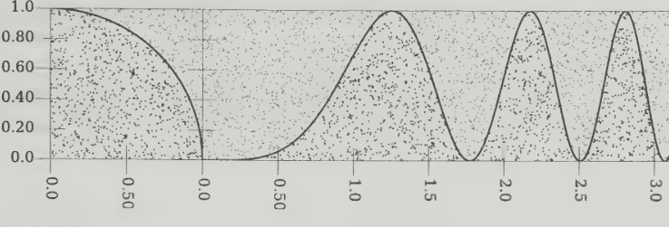

**FIGURE 6.1:** 该图与项目 7 相关。它展示了如何使用随机数来估计曲线下的面积。该图显示了两条曲线以及包围这些曲线的正方形区域中的随机点。位于曲线下方的点比位于上方更暗。下方点的比例与曲线下的面积成正比。

| Grade | GPA |
| :----- | :------ |
| A       | 4.000   |
| A-      | 3.666   |
| B+      | 3.333   |
| B       | 3.000   |
| B-      | 2.666   |
| C+      | 2.333   |
| C       | 2.000   |
| C-      | 1.666   |
| D+      | 1.333   |
| D       | 1.000   |
| F       | 0.000   |

- 6. Mandelbrot 集是复平面上的一个分形。它由简单的方程 $z_{n+1} = z_n^2 + c$ 描述，其中 $z_0 = 0$ 且 $c$ 是平面上的点。如果序列是有界的，则该点在集合中。如果它趋向无穷，则不在其中。使用练习 5.3 的解编写一个函数，该函数接收 $c$ 的值和 $z$ 的值，并返回 $z_n$ 的幅度变得大于 4.0 所需的迭代次数，或如果在 1000 次迭代内未变大则返回 1000。

- 7. 使用计算机，你可以通过选择随机数来估计 $\pi$ 的值。事实上，你可以通过选择随机数来找到大多数积分问题的数值解。这种解决此类问题的方法称为蒙特卡洛方法。对于此选项，你将编写代码来使用对 `math.random()` 的调用生成随机数并用其积分曲线下的面积。你将有一个脚本使用此方法解决两个问题，其中一个是估算 $\pi$ 的值。

  该方法如图 6.1 所示。如果你能围绕函数的一个区域画一个边界框，你就可以在该框内随机选择点，曲线下的面积可通过

  $$A \frac{N_{below}}{N_{total}},$$

  来估计，其中 $A$ 是框的面积。你随机绘制的点越多，估计就越准确。

  编写一个具有以下签名的递归函数。


```
def countUnder(nPnts:Int,xmin:Double, xmax:Double, ymin:Double, ymax:Double,f: Double=>Double):Int
```

此函数应在给定边界的矩形中生成指定数量的随机点，并返回其中有多少个点位于由函数 f 定义的曲线下方。注意，你可以使用类似这样的代码在 [min, max) 范围内获取随机数。

```
val r = min+math.random()*(max-min)
```

你需要在 x 轴和 y 轴上都这样做。

要估计 π，可使用函数 √1−x²，其中 x 和 y 的范围在 [0,1) 内。整个矩形的面积为 1，而曲线下的面积为 π/4。如果将位于曲线下方的点所占比例乘以 4，就能得到 π 的估计值。

除了打印出你对 π 的估计值外，你还应使用相同数量的随机点打印出 ∫₀^π (sin x²)² 的估计值。

8. 如果你完成了第 1 项目（p.108），现在可以为其添加另一个选项。编写一个函数，将有理数作为 (Int,Int) 传入并返回一个 (Int,Int)，其中已去除所有公因子，使其化为最低形式。

在添加了该功能后，编写一个脚本，使用递归函数对有理数进行计算。该脚本向用户呈现一个菜单，提供加、减、乘、除和退出选项。如果选择前四项中的任意一项，则应要求输入一个分数，并在“当前”分数与输入的分数之间执行该运算。程序启动时，“当前”值为 1/1，由 (1,1) 表示。每次操作后打印新的当前值，并确保其始终处于最低形式。

网站提供了额外的练习和项目，其中包含可使用输入重定向处理的数据文件。

# 第 7 章

# Scala 中的数组和列表

- 7.1 创建数组 ......................................................... 136
- 7.2 使用数组 ........................................................... 137
- 7.3 列表 ............................................................... 140
- 7.4 标准方法 ...................................................... 143
- 7.4.1 基本方法 ....................................................... 143
- 7.4.2 高阶方法 ................................................ 146
- 7.4.3 组合/迭代器方法 ...................................... 151
- 7.5 世界的类型 ....................................................... 153
- 7.5.1 Option 类型 ..................................................... 154
- 7.5.2 参数化函数 ................................................ 154
- 7.5.3 子类型 ........................................................... 156
- 7.6 可变长度参数列表 .............................................. 156
- 7.7 可变性与别名 ................................................ 159
- 7.8 基本参数传递 ................................................... 162
- 7.9 按名传递 ........................................................... 165
- 7.10 Fill 和 Tabulate ..................................................... 167
- 7.11 完整成绩脚本/软件开发 ........................... 168
- 7.12 本章结束材料 ............................................... 173
- 7.12.1 问题解决思路 ........................................... 173
- 7.12.2 概念总结 ............................................... 173
- 7.12.3 自主学习 ................................................ 174
- 7.12.4 练习 .......................................................... 175
- 7.12.5 项目 ........................................................... 177

添加条件和逻辑极大地扩展了我们的能力。将它与递归结合，我们就能做几乎任何想做的事情。从技术上讲，我们拥有了完整的计算能力。然而，有一些概念用我们目前所知的知识来表达是具有挑战性的，而且在 Scala 和编程语言中通常有更好的表达方式。

其中一个概念就是能够引用许多不同的对象。在第 3 章中，我们获得了通过 val 和 var 声明按名称引用对象的能力。利用这些，我们可以创建任意多的名称并硬编码对它们的引用。我们甚至可以拥有大的匹配语句，根据某个值选择特定的变量。这些方法冗长且实用性不强。在本章中，我们将开始学习 Scala 中的集合。集合是允许我们使用单个名称存储和查找许多不同值的类型。本章的大部分内容将集中在最基本的类型，即数组和列表。它们在表面上似乎提供相似的功能，但我们稍后会看到它们实际上非常不同。

这种强制必须与你传入的内容相匹配。如下面所示，Scala 不允许你对无效转换执行此操作。

```
scala> Array[Int]("Does","this","work")
<console>:6: error: type mismatch;
found   : java.lang.String("Does")
required: Int Array[Int]("Does","this","work")
<console>:6: error: type mismatch;
found   : java.lang.String("this")
required: Int Array[Int]("Does","this","work")
<console>:6: error: type mismatch;
found   : java.lang.String("work")
required: Int Array[Int]("Does","this","work")
```

我们还可以创建具有默认值初始值的数组。这对于创建更大的数组很有帮助。数组拥有成千上万甚至数百万个元素的情况并不少见。我们当然不希望手动输入这些值。以下是该语法。

```
scala> new Array[Int](101) res7: Array[Int] = Array(0, 0, 0,
0, 0, 0, 0, 0, 0, 0, 0, 0, 0, 0, 0, 0, 0, 0, 0, 0,
0, 0, 0, 0, 0, 0, 0, 0, 0, 0, 0, 0, 0, 0, 0, 0, 0, 0, 0,
0, 0, 0, 0, 0, 0, 0, 0, 0, 0, 0, 0, 0, 0, 0, 0, 0, 0, 0,
0, 0, 0, 0, 0, 0, 0, 0, 0, 0, 0, 0, 0, 0, 0, 0, 0, 0, 0,
0, 0, 0, 0, 0, 0, 0, 0, 0, 0, 0, 0, 0, 0, 0, 0, 0, 0, 0)
```

数值类型的默认值是零。**Boolean** 类型的默认值为 **false**。对于大多数其他类型，其中许多我们尚未学习，默认值是 **null**。¹

### 7.2 使用数组

现在你知道了如何创建数组，但可以用它们做什么呢？我们首先需要能够获取数组中存储的值并更改数组中存储的值。这是通过在数组名称后跟一对括号和一个表示我们想要的元素的索引的数字来完成的。数组与大多数现代编程语言中的大多数事物一样是零索引的。所以数组中的第一个元素位于索引零处，如果数组中有 N 个元素，最后一个位于索引 N-1 处。以下是一个示例。

```
scala> val arr=Array(7,4,6,3,9,1)
arr: Array[Int] = Array(7, 4, 6, 3, 9, 1)
```

```
scala> arr(0)
res8: Int = 7
```

```
scala> arr(1)
```

```
res9: Int = 4
```

```
scala> arr(5)
res10: Int = 1
```

第一个语句创建一个名为 arr 的新变量，它是一个整数数组，并为该数组存储六个值。接下来的三个命令基本上是从该数组中提取值。表达式 arr(0) 获取第一个元素，arr(1) 获取第二个，arr(5) 获取最后一个。

放在括号中的内容不一定是简单的整数。它也可以是类型为 Int 的任何表达式。你可以做更复杂的操作来提取一个值。

```
scala> val i=2
i: Int = 2
```

```
scala> arr(2*i-2)
res12: Int = 6
```

相同类型的表达式也可以用于赋值表达式。因此，我们可以根据需要更改数组中存储的值，如以下示例所示。

```
scala> arr(4)=99
```

```
scala> arr
res13: Array[Int] = Array(7, 4, 6, 3, 99, 1)
```

这里我们看到如何使用赋值来更改数组中某个元素的值。这可能会让你感到惊讶，因为我们最初将 arr 声明为 val。之前我们说过，不能更改用 val 创建的变量所引用的内容。这实际上并没有违反该规则。你看，名称 arr 仍然引用同一个数组。发生变化的是数组中的值。一个类比可能是数组是一栋房子，值是房子里的人。变量 arr 引用一栋特定的房子。人们可能会进出房子，但房子本身是相同的。我们可以通过尝试更改变量 arr 引用的数组来证明这一点。

```
scala> arr=Array(2,7,5)
<console>:6: error: reassignment to val
      arr=Array(2,7,5)
```

我们称 Array 类型为可变类型，因为它内部的值可以被更改。内部值不能被更改的类型称为不可变类型。这种区别对我们来说在 Scala 中以及编程中总体上非常重要，因为它改变了我们处理数据的方式。我们将进一步讨论它，因为本章中我们还将看到的 List 类型恰好是不可变的。事实上，我们迄今为止看到的所有类型都是不可变的。一旦创建，它们的数值永远不会改变。Array 是我们遇到的第一个可变的东西。

数组并非所有内容都可以更改。如我们所见，我们可以更改数组中存储的值。然而，我们不能更改数组中存储的项目数量。数组所持有的项目数量可以称为长度或大小。事实上，Array 类型具有名为 length 和 size 的方法，可为我们提供此信息。

```
scala> arr.length
res5: Int = 6
```

> ¹值 null 表示无效引用或对无物的引用。对 null 值执行任何操作都会导致错误。因此，我们通常会避免这种创建数组的方法。我们通常更喜欢使用 `Array.fill` 或 `Array.tabulate`，它们将在本章后面介绍。


```
scala> arr.size
res6: Int = 6
```

当你创建一个数组时，你必须指定一个长度，而且该长度永远不会改变。如果使用 var 风格的变量，你可以创建一个长度不同的新数组并让名称引用它，但这样做时你创建的是一个完全新的数组，你并没有改变旧数组的大小。

如果你尝试使用负数或过大的索引值，Scala 会给出错误信息，提示你已超出数组的边界。我们可以在这里通过尝试访问和更改越界索引来看到这种情况。

```
scala> arr(100)
java.lang.ArrayIndexOutOfBoundsException: 100
  at .<init>(<console>:7)
  at .<clinit>(<console>)
  at RequestResult$.<init>(<console>:9)
  at RequestResult$.<clinit>(<console>)
  at RequestResult$scala_repl_result(<console>)
  at sun.reflect.NativeMethodAccessorImpl.invoke0(Native Method)
  at sun...
```

```
scala> arr(100)=0
java.lang.ArrayIndexOutOfBoundsException: 100
  at .<init>(<console>:7)
  at .<clinit>(<console>)
  at RequestResult$.<init>(<console>:9)
  at RequestResult$.<clinit>(<console>)
  at RequestResult$scala_repl_result(<console>)
  at sun.reflect.NativeMethodAccessorImpl.invoke0(Native Method)
  at sun...
```

现在我们知道了使用数组的基本规则，我们就可以编写一些利用它们的有用函数。在上一章中，我们使用递归读取一组数字，然后对其进行操作。我们使用集合的一个动机是，我们无法存储值以便对其执行两个或多个操作。因此，两个有用的函数可能是：一个从用户输入填充数组，另一个执行我们之前所做的类型操作，但这次针对数组。

我们将从填充数组的函数开始，该函数从用户输入读取。这个函数需要传入它将要填充的数组。当使用数组时，最简单的方法是在开始时指定要读取的数字个数。这是因为数组大小固定。数组知道自己的大小，因此不需要传递该信息。需要传递的是下一个数字将被读入的索引。终止条件是我们尝试读取数组末尾之外的位置。该函数可能如下所示。

```
def fillArray(arr:Array[Int],index:Int) {
if(index<arr.length) {
  arr(index)=readInt()
  fillArray(arr,index+1)
}
}
```

这个函数很直接，但值得注意的是它不返回任何内容。数组是可变的，这意味着我们可以传入一个数组并让函数修改其内容。因此，无需返回任何内容。该函数的结果保存在修改后的数组内容中。以下展示了该函数的使用情况。

```
scala> val numbers=new Array[Int](4)
numbers: Array[Int] = Array(0, 0, 0, 0)
```

```
scala> fillArray(numbers,0)
```

```
scala> numbers
res3: Array[Int] = Array(2, 3, 4, 5)
```

创建了一个可以容纳四个值的整数新数组。我们调用 fillArray 并输入值 2、3、4 和 5。完成后，我们可以检查 numbers，看到它现在保存了这些值。

现在我们需要在数组内容上执行操作。我们将跳过为仅做加法或乘法制作特殊函数的步骤，直接进入更抽象、更灵活的方法，即传入一个用于操作内容的函数。除了执行操作的函数外，我们还需要一个数组和当前索引的整数。与上一章的做法不同，我们不需要传入基准值，因为我们知道何时到达数组的开头或结尾。该函数可能如下所示。

```
def operateOnArray(arr:Array[Int],index:Int,func:(Int,Int)=>Int):Int = {
  if(index<arr.length-1) {
    func(arr(index),operateOnArray(arr,index+1,func))
  } else {
    arr(arr.length-1)
  }
}
```

如果传入的索引位于或超出数组的最后一个元素，则此函数返回数组的最后一个元素。否则，它将函数应用于当前元素和对后续元素递归调用的结果。我们可以在之前定义的数组 arr 上通过以下命令看到其运行情况。

```
scala> operateOnArray(arr,0,_+_)
res0: Int = 30
```

```
scala> operateOnArray(arr,0,_*_)
res1: Int = 4536
```

这已经让我们看到了使用数组所带来的额外能力。值的存储使我们能够多次对其进行操作，而无需多次输入它们。

# 7.3 列表

数组是非函数式语言中最常用的内置集合。数组通常存储为一块连续的内存。这使得它们对许多操作来说快速且高效。但正如我们所见，数组是可变的。函数式语言倾向于远离突变和其他副作用。如果不允许突变，数组的效率会大大降低。如果你想更改数组中的单个值，就必须完整复制整个数组。因此，函数式语言更倾向于使用列表。严格来说，这些是链表，这是一种将在本书后面讨论的数据结构。你不需要详细了解其结构就能知道如何使用它。

我们可以使用与使用初始值构建数组相同的语法来构建列表。

```
scala> List(7,4,6,3,9,1)
res2: List[Int] = List(7, 4, 6, 3, 9, 1)
```

与数组类型一样，列表类型也是参数化的，如果使用这种语法，Scala 会推断出最佳类型。没有用于创建未初始化列表的语法。这是因为列表是不可变的。一旦创建了列表，其中的值就不能更改。因此，创建包含默认值的大列表意义不大。更改它需要创建一个新列表。

然而，当我们最初不知道将存储在其中的所有值时，还有另一种方法可以将列表组合起来。如果我们将元素添加到列表的前面，我们就可以高效地一次一个元素地构建列表。要向列表添加元素，我们使用“cons”运算符，::。以下是向现有列表添加单个元素的示例。

```
scala> val lst=List(2,3,4)
lst: List[Int] = List(2, 3, 4)
```

```
scala> 1::lst
res3: List[Int] = List(1, 2, 3, 4)
```

我们首先创建一个包含 2、3 和 4 的列表，然后将 1 cons 到列表的开头。此操作并未改变原始列表。相反，它给了我们一个在开头多了一个元素的新列表。由于列表的工作方式，这很高效。它实际上不需要复制整个列表即可实现。我们可以再次查看 lst，看到它没有改变。

```
scala> lst
res4: List[Int] = List(2, 3, 4)
```

如果使用 cons 运算符构建列表，通常会从空列表开始。在 Scala 中表示空列表有两种方法。一种是像我们之前那样使用它，但不向括号中放入任何参数。另一种是使用 Nil。因此，我们可以用这种方式构建之前相同的列表。

```
scala> 1::2::3::4::Nil
res5: List[Int] = List(1, 2, 3, 4)
```

你必须将 Nil 放在末尾，因为 :: 运算符需要在右手边有一个列表。请注意，要使其工作，:: 运算符是右结合的。所以 1::2::3::Nil 与 1::(2::(3::Nil)) 相同。这与通常的数学运算符相反，后者是左结合的。在 Scala 中，任何以冒号结尾的运算符都将是右结合的。

我们可以使用 cons 运算符编写一个从用户输入构建数字列表的函数。这是一个递归方法，它将读取数字直到遇到“quit”。使用“quit”作为结束条件对于列表来说效果很好，因为我们可以轻松高效地向列表添加新元素。对于数组来说并非如此，我们需要在开始时设置数组的大小。执行此操作的方法非常简单。

```
def inputList():List[Int] = {
```


```
val in=readLine()
if(in=="quit") Nil else in.toInt::inputList()
}
```

我们也可以通过运行它并在单独的行中输入 3、4、5 和 “quit” 来看到它的运行情况。

```
scala> inputList()
res1: List[Int] = List(3, 4, 5)
```

可以通过在括号内放置索引来访问列表的元素，就像访问数组一样。然而，对于列表来说这种方式非常低效。首选的方法，特别是在递归函数中，是使用 head 和 tail 方法。head 方法会返回列表的第一个元素。tail 方法会返回除第一个元素之外的所有元素的列表。利用这些方法，我们可以编写一个 operateOnList 函数，使其与 operateOnArray 函数类似，如下所示。

```
def operateOnList(lst:List[Int],func:(Int,Int)=>Int):Int = {
    if(lst.tail==Nil) lst.head else
    func(lst.head,operateOnList(lst.tail,func))
}
```

请注意，我们不需要传入索引。我们在这个函数中也没有任何 +1 或 -1。这种行为来自于我们在递归时传入 lst.tail 的事实。我们可以在这里看到该函数的运行情况。

```
scala> val lst=List(7,4,6,3,9,1)
lst: List[Int] = List(7, 4, 6, 3, 9, 1)
```

```
scala> operateOnList(lst,_+_)
res0: Int = 30
```

```
scala> operateOnList(lst,_*_)
res1: Int = 4536
```

该函数是使用 if 语句编写的。当处理列表时，使用模式匹配也很常见。:: 可以在模式中使用来表示具有不同部分的列表。此特定函数可以重写如下所示。

```
def operateOnList2(lst:List[Int],func:(Int,Int)=>Int):Int = lst match {
  case h::Nil => h
  case h::t => func(h,operateOnList2(t,func))
  case _ => 0
}
```

你可能会对最后一个 case 感到好奇。这不是必需的，但如果我们省略它，我们会收到一个警告，提示匹配不是穷举的。这不仅仅是编译器过于挑剔。事实证明，使用 if 表达式的原始方法并不是完全安全的。尝试用空列表调用它，你就会明白原因。

# 7.4 标准方法

Scala 的强大之处之一在于它具有丰富的接口。这些接口包含大量不同的方法。我们在 Array 上查看了 length 和 size，在 List 上查看了 head 和 tail，但这只是冰山一角。你实际上可以在 Lists 或 Arrays 上调用其中任何一个。然而，length 和 size 对于 Lists 来说效率不高，而 tail 在数组上效率低下。在本节中，我们将介绍在使用 Lists 和 Arrays 时可供我们使用的其他方法的采样。我们将从简单的方法开始。

### 7.4.1 基础方法

方法根据其执行的操作分为几组。在每个组内，方法按字母顺序排列。那些说它们会给你一个新集合的方法会返回与调用它们的类型相同的集合。因此，如果你在 Array 上调用它们，你会得到一个 Array。如果你在 List 上调用它们，你会得到一个 List。每个方法都使用上面定义的 lst 变量展示了简短的示例。类型 Seq 偶尔会出现。你可以将其视为 Array 或 List。

- 获取集合的一部分的方法

- drop(n:Int) – 接受一个 Int 并返回一个新的集合，其中跳过该数量的元素之后的所有元素。

  lst.drop(2)
  res0: List[Int] = List(6, 3, 9, 1)

- init – 不接受参数并返回一个不包含最后一个元素的新集合。

  scala> lst.init
  res0: List[Int] = List(7, 4, 6, 3, 9)

- last – 不接受参数并返回集合中的最后一个元素。

  scala> lst.last
  res0: Int = 1

- slice(from:Int, until:Int) – 接受两个参数，它们都是整数索引。它返回一个新集合，其中包含从第一个参数的索引开始到第二个值的索引之前的所有元素。

  scala> lst.slice(2,4)
  res0: List[Int] = List(6, 3)

- `take(n:Int)` – 接受一个 Int 并返回一个包含该集合开头该数量元素的新集合。

  ```scala
  scala> lst.take(3)
  res0: List[Int] = List(7, 4, 6)
  ```

- `takeRight(n:Int)` – 与 take 类似，但获取最后 n 个元素。

  ```scala
  scala> lst.takeRight(3)
  res0: List[Int] = List(3, 9, 1)
  ```

- 布尔测试

- `contains(elem:Any)` – 接受一个元素并返回集合是否包含与其相等的元素。

  ```scala
  scala> lst.contains(8)
  res0: Boolean = false
  ```

- `endsWith(that:Seq[B])` – 接受一个元素集合并判断当前集合是否以与传入集合中的元素相等的元素结尾。

  ```scala
  scala> lst.endsWith(List(3,9,1))
  res0: Boolean = true
  ```

- `isEmpty` – 返回集合是否为空。

  ```scala
  scala> lst.isEmpty
  res0: Boolean = false
  ```

- `nonEmpty` – isEmpty 的相反。

  ```scala
  scala> lst.nonEmpty
  res0: Boolean = true
  ```

- `startsWith` – 接受一个元素集合并判断当前集合是否以与传入集合中的元素相等的元素开头。

  ```scala
  scala> lst.startsWith(List(7,5,6))
  res0: Boolean = false
  ```

- 搜索某物

- `indexOf(elem:A)` – 接受一个元素并返回集合中等于传入值的第一个元素的索引。如果未找到元素则返回 -1。

  ```scala
  scala> lst.indexOf(3)
  res0: Int = 3
  ```

- `lastIndexOf(elem:A)` – 接受一个元素并返回集合中等于传入值的最后一个元素的索引。如果未找到元素则返回 -1。

  ```scala
  scala> lst.lastIndexOf(4)
  res0: Int = 1
  ```

# 其他值得注意的简单方法

- diff(that:Seq[A]) – 接受一个与调用它的类型相同的集合作为参数，并返回两个集合之间的多重集差。这意味着它会返回原始集合中在参数集合中没有匹配的所有元素。

  scala> lst.diff(List(1,2,3,4))
  res0: List[Int] = List(7, 6, 9)

- mkString – 可以使用零个、一个或三个参数调用。它从元素的字符串表示构建一个长字符串。如果未提供参数，则元素字符串之间不放置任何内容。如果指定一个参数，它应为一个用于分隔元素字符串的字符串。如果指定三个参数，中间的是分隔符，第一个和最后一个是放在元素之前和之后的字符串。

  scala> lst.mkString("; ")
  res0: String = 7; 4; 6; 3; 9; 1

- reverse – 不接受参数并返回一个元素顺序相反的新集合。

  scala> lst.reverse
  res0: List[Int] = List(1, 9, 3, 6, 4, 7)

- toArray, toList – 不接受参数并使用当前集合中的元素制作指定类型的新集合。

  scala> lst.toArray
  res0: Array[Int] = Array(7, 4, 6, 3, 9, 1)

- zip(that:Iterable[B]) – 接受另一个集合作为参数并返回一个元组集合，其中第一个元素来自调用它的集合，第二个元素来自传入的集合。结果的长度是两者中较短的一个。

  scala> lst.zip(lst.reverse)
  res0: List[(Int, Int)] = List((7,1), (4,9), (6,3), (3,6), (9,4), (1,7))

- zipWithIndex – 返回一个新集合，其中包含元组，第一个是集合中的元素，第二个是其索引。

  scala> lst.zipWithIndex
  res0: List[(Int, Int)] = List((7,0), (4,1), (6,2), (3,3), (9,4), (1,5))

上面列出的方法适用于任何类型的序列。因此它们适用于 List[Int]、List[String]、Array[Double] 或 List[Array[Double]]。有一些方法提供了对列表中内容的特殊要求。它们要求定义某些操作。这些方法，顾名思义，是 min、max、sum 和 product。min 和 max 方法适用于可以排序的类型。这不仅包括像 Int 和 Double 这样的东西，还包括 String 以及许多其他有意义的排序类型。sum 和 product 方法要求集合的类型为数值类型。


因此，虽然我们编写了 operateOnList 和 operateOnArray 来对这些集合进行求和和求积，但 Scala 允许我们直接调用 sum 或 product 方法，如下所示。

```
scala> lst.sum
res2: Int = 30
```

```
scala> lst.product
res3: Int = 4536
```

要求值必须是数值型意味着虽然你可以用 + 连接 String，但不能用 sum 把它们组合起来。对于 List[String] 或 Array[String]，你应该使用 mkString 来连接值。

# 7.4.2 高阶方法

虽然你可能会觉得这里列出的方法列表相当多，并且给了我们很多能力，但我们还没有触及 Scala 集合的真正威力。所有这些方法都接受普通值作为参数。就像我们最初的递归方法一样，通过增加一些抽象并使它们成为高阶方法，可以使它们更加强大。下面是 Scala 序列中包含的许多高阶方法的列表。类型 A 是 List 或 Array 中包含的类型。类型 B 可以是任何其他类型。

- count(p:(A)=>Boolean) -- 接受一个作用于元素并返回 Boolean 的函数。返回该函数返回 true 的元素数量。

```
scala> lst.count(_>5)
res0: Int = 3
```

- dropWhile(p:(A)=>Boolean) -- 接受一个作用于元素并返回 Boolean 的函数。返回一个新集合，其中包含该函数为 true 的第一个组之后的所有元素。

```
scala> lst.dropWhile(_>3)
res0: List[Int] = List(3, 9, 1)
```

- exists(p:(A)=>Boolean) -- 接受一个作用于元素并返回 Boolean 的函数。如果集合中存在某个元素使该函数为 true，则返回 true。

```
scala> lst.exists(x => x>4 && x<7)
res0: Boolean = true
```

- filter(p:(A)=>Boolean) -- 接受一个作用于元素并返回 Boolean 的函数。返回一个仅包含该函数为 true 的元素的新集合。

```
scala> lst.filter(_<5)
res0: List[Int] = List(4, 3, 1)
```

```
scala> lst.map(_*2)
res0: List[Int] = List(14, 8, 12, 6, 18, 2)
```

- partition(p:(A)=>Boolean) - 接受一个作用于元素并返回 Boolean 的函数。返回一个包含两个新集合的元组。第一个仅包含该函数为 true 的元素，第二个是其余部分。

```
scala> lst.partition(_<5)
res0: (List[Int], List[Int]) = (List(4, 3, 1),List(7, 6, 9))
```

- takeWhile(p:(A)=>Boolean) – 接受一个作用于元素并返回 Boolean 的函数。返回一个新集合，其中包含开头所有使该函数为 true 的元素。

```
scala> lst.takeWhile(_>3)
res0: List[Int] = List(7, 4, 6)
```

虽然第一组方法很直接，但这一组可能需要更多的解释。我们将重点关注 map 和 filter，因为它们在函数式编程世界中非常标准。想象我们有一个人名列表或数组。这个列表可能很长，但为了我们的示例代码，我们只使用几个，以便你可以看到说明。名字采用人们通常书写的格式：“名字 中间名 姓氏”，中间名是可选的或可能有多个中间名。出于编程目的，我们希望它们采用“姓氏, 名字 中间名”的格式，因为我们通常更关心姓氏。我们在这里描述的是将一个函数应用于序列的每个元素，以获得一个包含修改后元素的新序列。这正是 map 方法为我们做的事情。我们要做的就是弄清楚如何编写一个执行该转换的函数，然后我们就可以用 map 使用它。我们想要执行的转换是取名字中的最后一个词并将其移到前面，并在其与名字之间加上逗号和空格。基本上，我们想要在最后一个空格处拆分字符串。上面列出的方法本可以很好地完成这项工作，如果它们能作用于 String 的话。事实证明，它们确实可以。我们可以将 String 用作字符序列。因此，我们可以使用 lastIndexOf 找到最后一个空格，并使用 splitAt 制作两个 String。我们可以在这里在一个特定的字符串上看到这一点。

```
scala> val name="Mark C. Lewis"
name: java.lang.String = Mark C. Lewis
```

```
scala> name.splitAt(name.lastIndexOf(' ')+1)
res45: (String, String) = (Mark C. ,Lewis)
```

现在我们需要做的就是以相反的顺序重新组合，并加上逗号和空格。

如果我们经常需要重新组织名字，我们可以将此代码放入一个独立的函数中。如果不是，我们可以使用函数字面量在飞行中定义它。对于此示例，我们将采用后一种方法。

```
scala> val names=List("Mark C. Lewis","Jason C. Hughes",
"Glen R. Stewart","Jen Hogan")
names: List[java.lang.String()] = List(Mark C. Lewis, Jason C. Hughes,
Glen R. Stewart, Jen Hogan)
```

```
scala> val lnames=names.map(n => {
val (rest,last)=n.splitAt(n.lastIndexOf(' ')+1) last+","+rest } )
lnames: List[java.lang.String] = List(Lewis, Mark C. , Hughes, Jason C. , Stewart, Glen R. , Hogan, Jen )
```

因此，使用 map 让我们能够以快速简洁的方式完成一项任务，而使用其他方法可能需要相当多的代码。

如果你有一个很长的名字列表，你可能想要做类似查找姓氏以特定字母开头的所有人的操作。例如，我们可能想要找到所有姓氏以 ‘H’ 开的人。为此我们将使用 filter 函数。filter 函数会挑选出满足某些条件的数值，并给我们一个仅包含这些值的序列。

```
scala> lnames.filter(_.startsWith("H"))
res48: List[java.lang.String] = List(Hughes, Jason C. , Hogan, Jen )
```

得益于 filter 和 startsWith 方法，这是一个非常简单的单行代码。

还有一些其他方法没有在上面列出，因为它们需要更多的解释。如果你在这一章中跟随到此，它们不应该太难理解，因为它们与我们本章前面用 operateOnArray 和 operateOnList 函数自己所做的完全一样。我们将从 reduce 方法开始，reduceLeft 和 reduceRight。这些方法接受一个作用于序列中两个元素并返回该类型值的函数。reduce 方法反复将函数应用于连续的元素，就像 operateOnArray 和 operateOnList 方法所做的那样。两者之间的区别在于它们是从左到右还是从右到左应用操作。如果操作是可交换的，如加法或乘法，则顺序不会影响结果，只可能影响效率。对于不可交换的操作，顺序很重要。下面是使用我们之前定义的 lst 变量的几个示例。

```
scala> lst.reduceLeft(_+_)
res49: Int = 30
```

```
scala> lst.reduceLeft(_*_)
res50: Int = 4536
```

```
scala> lst.reduceLeft(_- )
res51: Int = -16
```

```
scala> lst.reduceRight(_- )
res52: Int = 14
```

前两次调用做了我们之前见过的事情，即取列表的和与积。后两次使用差值，这不是可交换的，并展示了 reduceLeft 和 reduceRight 的结果不同。reduceLeft 方法给我们 (((((7 − 4) − 6) − 3) − 9) − 1。reduceRight 方法给我们 7 − (4 − (6 − (3 − (9 − 1))))。

在上一章中，我们制作了一个递归方法，可以用用户输入执行此类操作。这与本章所做的不同之处在于，我们必须传入一个额外的值，以便在用户终止递归时使用。我们对它没有做任何特别的事情，但它本可以开启其他可能性。reduce 操作必须对集合的元素类型使用两个参数，因为这就是最深层应用中发生的情况。如果我们指定了基值，函数就可以接受一个与序列中的元素类型不同的参数，只要它也返回该类型即可。如果我们说序列具有类型 A，并且我们想要一个函数


List(6, 9, 1)
List(3, 9, 1)

- grouped(size:Int) 遍历序列，将项目按指定大小分组。

```
scala> lst.grouped(2).foreach(println)
List(7, 4)
List(6, 3)
List(9, 1)
```

```
scala> lst.grouped(3).foreach(println)
List(7, 4, 6)
List(3, 9, 1)
```

- inits - 提供一个从完整序列到空序列的迭代器，从末尾移除元素。

```
scala> lst.inits.foreach(println)
List(7, 4, 6, 3, 9, 1)
List(7, 4, 6, 3, 9)
List(7, 4, 6, 3)
List(7, 4, 6)
List(7, 4)
List(7)
List()
```

- permutations - 让你遍历序列的所有排列。注意，这里示例仅对前三个元素进行排列，因为完整列表有 6! = 720 种不同的排列。

```
scala> lst.take(3).permutations.foreach(println)
List(7, 4, 6)
List(7, 6, 4)
List(4, 7, 6)
List(4, 6, 7)
List(6, 7, 4)
List(6, 4, 7)
```

- sliding(size:Int) - 提供一个迭代器，其效果是在序列上滑动指定大小的窗口。

```
scala> lst.sliding(2).foreach(println)
List(7, 4)
List(4, 6)
List(6, 3)
List(3, 9)
List(9, 1)
```

```
scala> lst.sliding(3).foreach(println)
List(7, 4, 6)
List(4, 6, 3)
List(6, 3, 9)
List(3, 9, 1)
```

tails – 提供一个迭代器，从完整列表开始，到空列表结束，每一步从左侧移除一个元素，遍历子列表。

```
scala> lst.tails.foreach(println)
List(7, 4, 6, 3, 9, 1)
List(4, 6, 3, 9, 1)
List(6, 3, 9, 1)
List(3, 9, 1)
List(9, 1)
List(1)
List()
```

如果你想对迭代器提供的值做更复杂的操作，可以使用 toList 或 toArray 将其转换为 List 或 Array。然而，如果元素很多，就像 lst.permutations 的情况，你可能希望先对其进行过滤或做其他操作来缩小范围，然后再进行转换。

这些方法提供了一种轻松地对数据进行更有趣操作的方式。例如，使用 sliding，你可以快速通过对数据序列在一个窗口上取平均来平滑噪声数据。使用 combinations 或 permutations，你可以遍历某种类型的所有可能选项，并找到在某种意义上最好的那个。

在某个时候你可能会想知道在哪里可以了解到所有这些方法。即使本节讨论了所有内容，我们的列表也不完整。所有可用类型及其方法的完整列表可以在应用程序编程接口 API 中找到。你可以在 Scala 主网站上找到 Scala API。它包含超出你当前知识范围的许多内容，但本书的主要目标之一是，你能够在对如何在 Scala 中做事有疑问时，在 API 中查找信息。

# 7.5 世界的类型

到目前为止，我们对 Scala 中的类型只是触及了皮毛。到本书结束时，我们将看到不仅 Scala 语言/库提供了许多、许多类型，我们还可以定义自己的类型并为其命名。尽管如此，明确说明什么是类型以及 Scala 中类型的一些细节仍然是有价值的。

让我们从什么是类型这个问题开始。类型是一组值以及可以在这些值上执行的相关操作。考虑类型 Int。我们可以用 Int 的实例表示的一组不同值。它们是 -2147483648 到 2147483647 之间的所有整数值。还有一组可以在 Int 或其对上执行的操作，例如加法和减法。

在本章中，我们开始看到 Scala 中的类型不仅仅是 Int 这样的基础。类型 List 和 Array 本身并不完整。它们是参数化类型。要完整，它们必须具有类型参数。因此 List[Int] 是一个完整类型，Array[String] 也是如此。List 和 Array 远不是唯一的参数化类型。Scala 库中的许多类型都是参数化的。在本书的后半部分我们将创建自己的参数化类型。现在只需在现有库代码中讨论它们以及它们如何与函数一起使用就足够了。

### 7.5.1 Option 类型

如果你大量挖掘 API，你会发现类型 Option 出现得相当频繁。Option 类型的思想是，当你不确定是否会有值时应使用它们。Option[A] 可以是 Some[A] 或 None。如果是 Some，它将包含一个值，可以通过 get 检索。如果没有值，则得到 None，并且知道它没有值。一个执行此操作的示例方法是序列上的 find 方法。你可以在 List 或 Array 上调用 find，并传入一个接受元素并返回布尔值的函数。find 方法应该返回使函数返回 true 的第一个元素。这个描述听起来很简单，但如果没有呢？如果 find 遍历整个序列而没有任何东西使函数返回 true 会怎样？因此，find 方法返回 Option[A]，其中 A 是序列中包含的类型。因此如果没有任何东西匹配，它可以返回 None。

让我们通过本章一直使用的整数列表运行两个示例来看看这是如何工作的。

```
scala> lst.find(_<4)
res20: Option[Int] = Some(3)
```

```
scala> lst.find(_<1)
res21: Option[Int] = None
```

列表确实包含小于 4 的元素。其中第一个是 3，所以我们得到 Some(3)。然而，它不包含小于 1 的任何东西，所以该调用返回 None。你可能会想知道如何使用这种类型的返回值。答案是使用 match。这个小例子取 find 的结果并告诉我们它找到了什么，或者告诉我们没有找到任何东西。

```
scala> lst.find(_<4) match {
| case Some(i) => "Found "+i
| case None => "Nothing found"
| }
res22: java.lang.String = Found 3
```

### 7.5.2 参数化函数

像 List、Array 和 Option 这样的类型并不是唯一可以具有参数的东西。函数也可以具有参数。这是我们稍后会重新讨论的内容，但如果你想阅读 API，提前了解语法会有所帮助。我们会在想要使函数适用于多种不同类型时使函数参数化。参数化函数的最简单示例是此处所示的 identity 方法。

```
scala> def ident[A](a:A)=a
ident: [A](a: A)A
```

此方法接受任意类型的参数并返回传入的值。虽然很少有你想要这样做的场景，但它演示了参数化函数的语法。你只需在函数名和普通参数列表之间用方括号放置类型参数名。它还演示了参数化函数的强大功能，特别是如果我们像下面这样使用它。

```
scala> ident(3)
```

function f。所以这里涉及三种类型，传入 g 的类型、g 返回然后传入 f 的类型，以及 f 返回的类型。得益于参数化类型，我们可以用一行 Scala 编写这样的函数。

```
def compose[A,B,C] (f: (B)=>A, g: (C)=>B) : (C)=>A = (x)=>f(g(x))
```

### 7.5.3 子类型

到目前为止，我们谈论类型时好像它们是完全独立且无关的。我们编写了可能适用于 Int 或 String 或 Tuple 的函数。通过添加参数，我们能够编写可用于任何类型的函数，但这仍然没有暗示类型之间的关系。实际上，像大多数面向对象的语言一样，Scala 支持子类型。如果类型 B 是类型 A 的子类型，那么在我们希望使用类型 A 的对象的地方，我们也可以使用类型 B 的对象。

我们将在第 19 章讨论继承时详细介绍子类型，但现在你应该意识到这个术语，因为它会在某些时候出现。Scala 中一些常见的子类型关系如图所示 7.1。图的最顶部有一个终极超类型，称为 Any。Scala 中的每个对象都是 Any 的实例。由于 Scala 中的所有值都是对象，一切都是 Any 的实例，要么直接，要么间接。我们在第 3 章学到的像 Int 和 Double 这样的类型在图 7.1 的左侧，一个名为 AnyVal 的类型，它是 Any 的子类型。在右侧还有另一个名为 AnyRef 的类型，下面有一堆未指定的类型。我们谈论过或将要谈论的所有其他类型都落在 AnyRef 之下。图表底部是一个名为 Nothing 的类型，它是 Scala 中所有其他类型的子类型。Nothing 类型没有值。该类型存在是为了使类型系统完整，并在函数不返回时处理情况。

我们直到本书第 19 章才会在很大程度上显式地使用参数化函数和子类型。然而，这些概念在那之前会以隐式的方式出现，所以你应该意识到它们的存在。

# 7.6 可变长度参数列表

你是否想过使用这样的调用构造 List 和 Array？

```
val lst=List(7,4,6,3,9,1)
```

有一些细节我们不会深入探讨，但这种类型调用的一个方面是我们现在有足够知识来讨论。我们能够在此调用中传递可变数量的参数。在这种情况下我们传递了六个参数，但用任何其他数量也同样有效。我们编写的函数不能做到这一点。我们到目前为止编写的每个函数都有一个参数列表，其中包含特定数量的值。那么我们如何才能使我们的函数允许传递可变数量的参数呢？事实上，这并不难。只需在参数列表中最后一个参数的最后一个类型后添加一个星号。这将允许调用者传递零个或多个该类型的值。

一个方便的地方是平均函数，就像我们可能用于计算成绩的那样。这样的一个方法可能看起来像这样。

```
def average(nums:Double*):Double =
```


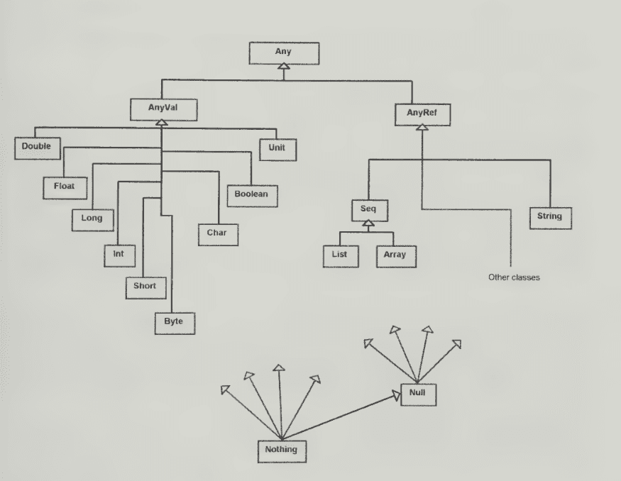

**图 7.1：** Scala 中一般子类型关系的示意图。此图改编自 Odersky、Spoon 和 Venners 所著 *Programming in Scala* 中的类似图表 [9]。虽然 `Array` 并不是真正 `Seq` 的子类型，但由于隐式转换，它可以被当作 `Seq` 使用，该主题在附录 B 中有所介绍。

```
...
```

问题是，我们如何在函数内部使用 `nums`？正如你可能猜到的，这个主题之所以出现在本章，是因为我们把 `nums` 当作 `List` 或 `Array` 一样对待。严格来说，它是一个 `Seq`，是两者 的超类型，并且本章讨论的所有方法都可以在其上使用。这些方法将使编写平均值函数变得非常容易。

```
def average(nums: Double*): Double =
    nums.sum/nums.length
```

就这样。无需其他，因为我们可以在 `Double` 值的序列上使用 `sum`，并且可以获取任何序列的 `length`。

如果我们想去掉最小值后再求平均值呢？这并不会增加太多复杂性，因为我们也可以调用 `min` 方法。

```
def averageDropMin(nums: Double*): Double =
    (nums.sum-nums.min)/(nums.length-1)
```

我们可以用这些方法以及第 5 章中的 `fullAve` 函数来制作 `courseAverage` 的修订版本。

```
def courseAverage(test1: Double, test2: Double, assn1: Double,
    assn2: Double, assn3: Double, quiz1: Double, quiz2: Double,
    quiz3: Double, quiz4: Double): Double = {
  val aveTest=average(test1, test2)
  val aveAssn=average(assn1, assn2, assn3)
  val aveQuiz=averageDropMin(quiz1, quiz2, quiz3, quiz4)
  fullAve(aveTest, aveAssn, aveQuiz)
}
```

这样我们比以前的总代码更少，因为我们能够重用平均值函数。然而，现在我们已经了解了 `Lists` 和 `Arrays`，这种调用方法的方式有点不令人满意。它需要固定数量的测验成绩、作业成绩和测验成绩。如果我们改为传入这些不同值的 `Lists`，会更灵活。然后函数会更像这样。

```
def courseAverage(tests: List[Double], assns: List[Double],
    quizzes: List[Double]): Double = {
  ...
}
```

不幸的是，如果你尝试按最先想到的方式编写它，你会发现 Scala 不喜欢这样。

```
def courseAverage(tests: List[Double], assns: List[Double],
    quizzes: List[Double]): Double = {
  val aveTest=average(tests)
  val aveAssn=average(assns)
  val aveQuiz=averageDropMin(quizzes)
  fullAve(aveTest, aveAssn, aveQuiz)
}
```

你会得到类似这样的错误。

```
<console>:10: error: type mismatch;
 found : List[Double]
```

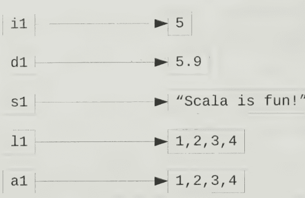

**图 7.2：** 几个变量的内存布局的简单示意图。右侧的对象过于简化，尤其是列表，但这足以在此时理解正在发生的事情。

所有这些都被设为 vars，只是为了给我们下面修改它们的选项。通常我们希望使用 val，除非我们明确找到必须更改它们的理由。在本例中，原因只是为了说明。

内存布局看起来与图 7.2 所示类似。这是一个理想化的表示。实际上内存是线性的，并且具有将在第 13 章讨论的结构。目前，这个视图已足够。在左侧是代表变量的框。在 Scala 中，最好的心理图像是将变量视为存储对值的引用的框。在某些情况下，Scala 会将实际值放入变量的框中，但这是你无法真正控制的优化，并且不会改变行为，因此将内存想象成这样是好的。

如果我们更改其中两个变量的值会怎样？例如，假设我们现在执行这两行代码。

```
i1=8
s1="New string."
```

第一行更改 i1 使其引用值 8。第二行更改 s1 使其引用这个替代的 String。这在内存中会是什么样子？结果如图 7.3 所示。5 和字符串 “Scala is fun!” 并未被更改。它们仍然像以前一样留在内存中。由于没有任何引用指向它们，这些对象将被自动收集并释放。发生变化的是 i1 和 s1 中的引用。它们现在指向存储这些新值的新内存块中的新对象。`Int` 和 `String` 类型都是不可变的。因此，一旦对象被创建，就无法更改它们。它们不允许任何会改变其值的操作。如果我们使用 val 创建这些变量，我们也无法更改箭头指向的位置。

事实上，这里使用的所有类型都是不可变的，除了 `Array`。因此 `Array` 是唯一可以在右侧框中更改值的类型。要了解这如何

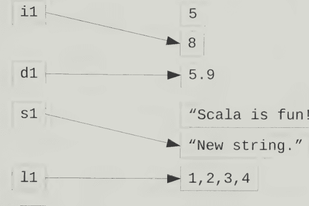

图 7.3：在两个变量被赋予不同值后，内存的修改视图。

这可能会产生影响，我们将只考虑 `List` 和 `Array` 变量，并向图中添加另外两行代码。

```
val l2=l1
val a2=a1
```

这给出了如图 7.4 所示的略有不同的图。现在我们有两个不同的变量指向 `List` 和 `Array` 对象。这些对同一对象的第二个引用通常称为别名。别名化是可变性开始导致问题的根源。如果你还没有弄明白为什么，也许这段代码会让你明白。

```
scala> a2(3)=99
```

```
scala> a1
res1: Array[Int] = Array(1, 2, 3, 99)
```

在第一行我们更改了 a2 中最后一个槽的值。在下一行我们查看 a1 的值。请注意它已被更改。我们没有明确对 a1 做任何操作，但值被更改了，因为 a2 是 a1 的别名。你不能用 l2 做这种事，因为 `List` 类型是不可变的。

有时能够创建别名并更改它是非常好的。对于某些任务，这可以使事情变得更高效。然而，如果你失去了对正在发生的事情的跟踪，以及哪些值是哪些值的别名，你可能会遇到严重问题。

在脚本的顶层：

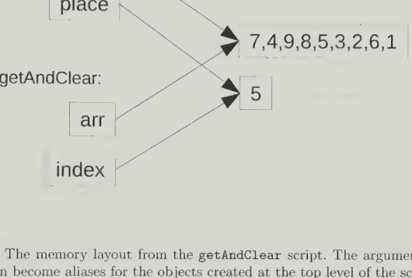

在 getAndClear 中：

# 图 7.5：getAndClear 脚本的内存布局。传递给函数的参数成为脚本顶层创建的对象的别名。

在该函数之外所看到的那样。看到像 getAndClear 这样的名称，你大概可以猜到这种类型的副作用可能会发生。然而，当你将任何可变值传递给函数时，你需要意识到函数可能会更改你的值，即使你并不真的希望它这样做。

如果使用 `List` 会怎样？好吧，`List` 类型是不可变的，所以函数不可能更改列表。如果你希望它被更改，函数需要返回一个包含获取的值和该值已被更改的新列表的元组。下面代码展示了如何使用本章介绍的一些方法来实现这一点。

```
def getAndClear(lst:List[Int],index:Int):(Int,List[Int]) = {
  (lst(index),lst.zipWithIndex.map(tup => {
    val (n,i)=tup
    if(i==index) 0 else n} ) )
}
```

这个函数中只有一个表达式，即要返回的元组。元组中的第一个元素是 lst(index)。它查找适当的值并使用该值。请记住，以这种方式在 `List` 中查找并不是真正高效的，但如果给定 `List` 和索引，我们必须这样做。元组的第二部分稍微复杂一些。它在 lst 上调用了 zipWithIndex 方法。这返回一个新列表，其中每个元素都是一个元组，包含来自列表的元素以及该元素的索引。我们必须这样做，因为我们需要索引来决定是否清除它。如果我们是基于值而不是位置进行清除，则不需要这样做。

map 方法立即在元组列表上调用，并给定一个函数字面量，该字面量接受一个名为 tup 的参数，缩写为 tuple。这个函数字面量使用大括号


在 `getAndClear` 之后脚本的顶层：

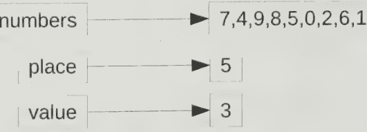

**图 7.6：** *getAndClear* 执行后内存的配置。

大括号并有两行。第一行是一个 `val`，它从元组中取出两个部分。`List` 中的数字称为 **n**，索引称为 **i**。函数字面量以一个 `if` 表达式结束，该表达式检查索引并根据 **i** 是否与 `index` 相同给出 0 或 **n** 的值。还有其他写法。其中一种在 `index` 相对于 `List` 的长度较小时可能更高效，如下所示。

```scala
def getAndClear2(lst:List[Int], index:Int): (Int, List[Int]) = {
  (lst(index), lst.take(index):::(0::lst.drop(index+1)))
}
```

此版本使用了我们之前见过的 cons 运算符 `::`。它在 `List` 前面添加一个新元素并返回该结果。它还使用了一个我们之前未见过的运算符，即 `:::` 运算符。这大致与 `::` 做同样的事情，只是左边的参数是一个完整的 `List`，应附加到第二个 `List` 的前面。

当然，因为 `List` 版本需要重建 `List`，它可以更进一步真正清除该值。它可以用零覆盖的方式改为从 `List` 中移除该值。这可以用 `filter` 代替第一个版本中的 `map` 来完成。第二个版本更改起来甚至更容易。我们将把这作为读者的练习来创建和尝试。

现在一个有趣的问题是这两种方法哪种更好？是使用可变的 `Array` 还是不可变的 `List` 更好？答案是取决于你是否希望函数能够改变数据。如果函数应该改变数据，那么传递可变对象会有速度上的好处。然而，如果你不希望数据被改变，那么传递可变数据就会有问题。当你将可变数据传递给函数时，你无法控制它是否会被修改。在你不希望数据被修改的情况下，这就要求你进行 **防御性复制**。为了保护你自己的数据版本，你会复制它并将副本传递给函数。

因此，是否使用可变或不可变结构的问题在很大程度上取决于你如何使用该数据。如果它会被频繁修改，那么让它可变可能有意义。然而，如果它不会被频繁修改，那么不可变可能更有意义，这样你就不必进行防御性复制。即使在可能存在相当多修改的情况下，你也需要考虑如果选择可变结构会需要多少防御性复制。

# 7.9 按名传递

之前我们研究了 Scala 中参数的传递方式。这种风格称为 按值传递。函数会得到调用代码中变量的副本。函数不能改变该变量，它只能改变它所引用的内容，如果被引用的内容是可变的。某些语言提供了一种替代的传递方式，称为 按引用传递。当按引用传递时，函数有能力改变调用函数中的变量本身。由于 Scala 中所有变量基本上都是引用，这模糊了两者之间的界限，但从根本上说 Scala 只允许按值传递，并且函数只能在变量引用可变对象时才修改对外部可见的东西。

虽然 Scala 没有提供真正的按引用传递，但它提供了一种很少有其他语言提供的传递风格，即 按名传递。按名传递的想法是参数不是作为值传递，而是作为一个 THUNK 传递，它基本上是一段代码，当函数中使用该参数时会被执行并给出一个值。你可以把按名传递想象成自动创建一个不带参数的函数并返回一个值，每次使用参数时都会执行该函数。为了帮助你理解这一点并看到语法，我们将给出一个简单的例子。我们将以我们习惯的方式开始制作一个基本自增函数。

```scala
scala> def incr(n:Int):Int = {
  | println("About to increment.")
  | n+1
  | }
incr: (n: Int)Int
```

打印语句只是为了帮助我们跟踪何时发生的事情。现在我们将再次编写同一个函数，但这次按名传递参数。

```scala
scala> def incrByName(n : =>Int):Int = {
  | println("About to increment.")
  | n+1
  | }
incrByName: (n: => Int)Int
```

按名传递参数的语法是在参数类型前加上一个火箭符号。这是函数字面量中使用的相同箭头。如果我们在它前面加上空括号得到 `()=>`，我们将得到一个不带参数并返回 Int 的函数类型。按名参数大致相同，只是调用函数时你不必显式地创建一个函数。首先，我们将以最简单的方式调用此函数。

```scala
scala> incr(5)
About to increment.
res0: Int = 6

scala> incrByName(5)
About to increment.
res1: Int = 6
```

这里没有惊喜。它们看起来都做同样的事情。两者都打印语句并给出 6。然而，两者实际上并没有做同样的事情。为了使其清晰，我们将再次调用它们，并让参数成为包含打印的块。

```scala
scala> incr({println("Eval"); 5})
Eval
About to increment.
res2: Int = 6

scala> incrByName({println("Eval"); 5})
About to increment.
Eval
res3: Int = 6
```

现在很清楚它们不是做同样的事情。当按值传递参数时，它在函数开始之前就被求值，以便你有值可传递。当按名传递时，求值发生在参数在函数中使用时。这就是为什么在第二种情况下，“Eval”行在“About to increment.”之后打印出来的原因。函数中的 println 在 n 的值被访问之前就发生了。

使用按名传递在涉及值突变时可以让你做一些相当有趣的事情。为了看到这一点，我们可以编写一个稍微不同的函数。

```scala
scala> def thriceMultiplied(n : => Int):Int = n*n*n
thriceMultiplied: (n: => Int)Int
```

乍一看，这个方法应该叫做立方，但正如我们将看到的，这可能并不总是适用，因为它使用了按名传递。首先，让我们用一个给出简单值但先打印一些内容的表达式调用它。

```scala
scala> thriceMultiplied({println("Get value."); 5})
Get value.
Get value.
Get value.
res4: Int = 125
```

请注意 println 语句发生了三次。这是因为函数中 n 被使用了三次。如果参数不是按名传递，就不会发生这种情况。它只会在函数被调用时打印一次。自己试试。

这次调用仍然给出了一个有效的立方体。那么为什么函数不简单地叫做 cube 呢？原因是如果参数中的代码做正确的事情，结果就不会是立方体。这里有一个例子。

```scala
scala> var i=5
i: Int = 5
```

```scala
scala> thriceMultiplied({i+=1; i})
res5: Int = 336
```

336 不是一个完全立方体。那么我们是如何得到这个值的？在这个例子中我们引入了一个 var。按名传递参数中的代码改变了这个 var。因此，每次使用 n 时，n 给出的值都不同。第一次使用 n 时值为 6，因为原来的 5 被递增后返回。第二次为 7，因为它上次被设置为 6 时再次递增。最后一次为 8。所以答案是 6 * 7 * 8 = 336。

这些同时使用圆括号和大括号的调用可能看起来很奇怪。Scala 的创建者也是这么想的。因此，他们使得如果函数或方法只接受一个参数列表中的一个值，该值可以用大括号而不是圆括号。 这允许一种更短的调用语法，看起来像这样。

```scala
scala> thriceMultiplied {i+=1; i}
res6: Int = 990
```

你可能会想去掉圆括号改变了发生的事情，因为结果不同。不是圆括号。记住在上一次调用后 i 已经递增到 8。所以这次结果是 9 * 10 * 11 == 990。

# 7.10 Fill 和 Tabulate

在本章中引入按名传递的一个原因是有一些其他方法可以制作 Arrays 和 Lists。其中一种使用按名传递。之前我们看到如何跟在 Array 或 List 后面加上圆括号中的列表来获取包含这些值的 Array 或 List。我们也可以使用 `new` 来获取默认值的数组，或使用 `::` 来组合 Lists。Array 和 List 上还有可以调用的方法 `fill` 和 `tabulate`。两者都可用于制作新的 Array 或 List。它们都非常适合制作大型 Arrays 和 Lists，不像必须指定各个值的方式。让我们看看它们是如何工作的。

`fill` 方法是一个柯里化方法，它接受第一个参数指定要创建多少个元素，以及第二个参数，即按名传递参数，给出值。这种最简单的调用可能看起来如下。

```scala
scala> Array.fill(10)(4)
res3: Array[Int] = Array(4, 4, 4, 4, 4, 4, 4, 4, 4, 4)

scala> List.fill(6)(23)
res4: List[Int] = List(23, 23, 23, 23, 23, 23)

scala> List.fill(6)("hi")
res5: List[java.lang.String] = List(hi, hi, hi, hi, hi, hi)
```

如果第二个参数是常量，则调用只需用该值填充整个 Array 或 List。然而，该参数是按名传递的，因此它会对序列的每个元素重新求值，如果它有副作用，它们会多次发生。最简单的方法是让第二个参数打印一些内容来看到这一点。

```scala
scala> Array.fill(4){ println("Evaluating argument"); 5 }
Evaluating argument
Evaluating argument
Evaluating argument
Evaluating argument
res6: Array[Int] = Array(5, 5, 5, 5)
```

请注意这里第二个参数只放在大括号中。记住 Scala 允许你对只有一个参数的参数列表这样做。你可以添加额外的括号，但你仍然需要大括号，因为这是


code with two expressions in it. This example is illustrative, but not really all that useful. A more interesting example involves using a **var**.

```
scala> var i=1
i: Int = 1
```

```
scala> List.fill(5){ i*=2; i }
res7: List[Int] = List(2, 4, 8, 16, 32)
```

Here the **var** i is initialized to be 1. The value argument multiplies i by 2 and stores that value back in i. Then it gives back i as the value to use. You can see in the output that this gives us powers of 2. While there are situations where this can be helpful, this method of filling an array with powers of two is likely to confuse most people reading your code. An even more useful example is to have the value argument read input.

```
scala> Array.fill(5){ readInt() }
res8: Array[Int] = Array(6, 4, 8, 2, 3)
```

This is what we started off the chapter doing, writing functions to read values into an **Array** or **List**. It turns out that as long as we know how many elements we want, we can do this with a single line of code thanks to **fill** and pass-by-name.

It is often helpful, when calculating values for an **Array** or **List**, to know the index of the value you are calculating for. The **fill** method does not do this for us by default. We could use a **var** to keep track of that, in a manner similar to what we did above, but this is a pain and quite error prone. That is why the *tabulate* method exists. You call *tabulate* much like you do **fill**, only the second argument is not a pass-by-name variable, but is a function that takes an **Int** and returns the type the sequence should be filled with. So if you want to fill an array with the result of evaluating a polynomial on the index you could do the following.

```
scala> Array.tabulate(6)(x => 3*x*x+5*x-7)
res9: Array[Int] = Array(-7, 1, 15, 35, 61, 93)
```

This fills the array with values of 3x^{2} + 5x - 7 where x is the index in the array.

### 7.11 Complete Grades Script/Software Development

In chapter 5 we spent some time writing functions to calculate averages in a class. We now have the ability to put together everything that we have learned and write a script that will keep track of the grades for a single student and be able to calculate that student’s average. This could be extended to multiple students, but we will not do that here.

When we solve a large problem there are certain steps that must be taken. The first is to get a clear description of what problem you are solving. This step is called **ANALYSIS**. The analysis step does not involve any coding or even thinking about coding. We just want a description that has enough detail that we know what it is we are supposed to create. Once we have that we can move on to the next step which is called **DESIGN**. In the design step we figure out how we are going to go about solving the problem described in the analysis. The design step does not involve coding either, but it specifies what we will do when we get to the coding. The design phase is where we do our problem decomposition. We think about how to break the problem down and what pieces we will need to put together to get a

something repeatedly an unspecified number of times is with a recursive function. So we will need a recursive function that contains all this other functionality. That function will call itself until we hit the condition where it exits. There is a natural decomposition at this point. Printing the menu is an obvious function. We have already seen that we can write functions for taking averages or averages dropping the minimum grade as well as one to calculate the final average.

That breaks down the functionality. If you were to run to the keyboard now and start typing you would quickly realize that something significant was left out of the design, how we are storing the grades. There are many ways that we could do this, but given that our only functionality is to add grades and calculate averages, the solution is fairly clear. Our only real options at this point are `Arrays` and `Lists`. Arrays have a fixed size and are inefficient to add to. That is less than ideal for this application because we will be adding grades and have not specified how many there can be. So `Lists` make more sense. We can use three `Lists` that store the three different types of grades. If we do this in an imperative style, the `Lists` will be declared with `var` before the main recursive function. If we use a functional style, they will be passed into the next call for the iteration. We will look at both to illustrate the differences. Most of the functions will not be altered by this distinction.

That gives us a decent design for this little application. Now we turn to the implementation. We will reuse the course average function from section 7.6 and the functions that it calls for now. We need new functions for our main recursive function and printing the menu. We will start with an imperative version of the main function and look at a functional adaptation afterward.

```
def printMenu {
  println("""Select one of the following options:
  1. Add a test grade.
  2. Add a quiz grade.
  3. Add an assignment grade.
  4. Calculate average.
  5. Quit.""")
}

var tests = List[Double]()
var quizzes = List[Double]()
var assignments = List[Double]()


def mainGrades {
  printMenu
  readInt() match {
    case 1 =>
      println("Enter a test grade.")
      tests = readDouble() :: tests
    case 2 =>
      println("Enter a quiz grade.")
      quizzes = readDouble() :: quizzes
    case 3 =>
      println("Enter an assignment grade.")
      assignments = readDouble() :: assignments
    case 4 =>
      println("The average is "+courseAverage(tests,assignments,quizzes))
    case 5 =>
      return
    case _ =>
      println("Unknown option. Try again.")
    }
}
```

```
}
mainGrades
}
```

This begins with the printMenu function which simply prints a menu. The only thing of interest here is the use of the triple quote string so that the string can be made to span multiple lines. If you do not do this, you will have to use `\n` to denote line breaks.

In this imperative version, the printMenu function is followed by the declaration of three variables. They are all vars and they are of the type List[Double]. The have to be vars because the List itself is immutable. So whenever something is added we have to change the variable reference and point to a new List. Remember, this can be done efficiently for the List type so that is fine.

If you type this code in and play with it a bit, you will probably find that you can make it behave poorly. In particular, you can get it so that when you ask for the average you get an output like this.

The average is NaN

This should lead you to two questions. First, what is this thing called NaN? Second, what is causing this? Technically the second matters more because we need to know that to fix it. However, knowing the answer to the first can help you figure it out if you were not able to do so from your testing. The Double type, as we have discussed previously, is used to represent numeric values that have fractional parts. It has a rather large range and good precision, but it is technically a fixed precision type. You can not represent any real number with it. In addition, some mathematical operations produce results that are not well defined. Consider the following.

```
scala> 1.0/0.0
res2: Double = Infinity

scala> -1.0/0.0
res3: Double = -Infinity
```

You should have learned in a math class that you can not divide by zero. If you do this with Ints you get an error. However, if you do it with Doubles you get what you see here. Any operation that goes outside the range of the Double will also get you either Infinity or -Infinity, depending on which side of the range it goes out on as is shown here.

```
scala> 1e150*1e200
res6: Double = Infinity
```

What does all of this have to do with NaN? Well, NaN stand for “Not-a-Number” and it is the result of an operation when it is not clear what the result should be. One way to get this is to add Infinity and -Infinity or do other operations with Infinity or -Infinity that the computer can not know the result of. Consider this example.

```
scala> 1e150*1e200-1.0/0.0
res10: Double = NaN
```

In general the computer can not know if this would be out of range on the positive or negative so it goes to NaN because it gives up. There is one other way to get a NaN: divide zero by zero.

```
scala> 0.0/0.0
res11: Double = NaN
```


这就是导致我们出现错误的原因，并且当未输入任何测试或作业成绩或仅输入了一个测验成绩时就会发生这种情况。

如果我们没有测试或作业成绩，正常平均值将返回 0.0/0，因为总和是 Double 0.0 而长度是 Int 0。如果测验成绩列表只有一个元素，那么它就是最小值。因此函数返回 (x-x)/(1-1)，其中 x 是作为 Double 的那个成绩。显然这将得到一个 NaN。那么我们如何修复这个问题呢？我们需要让 average 和 averageDropMin 函数变得更智能一些，以便在不应该进行除法运算的情况下具有特殊情况。我们可以通过在两者中放入 if 表达式来实现。

```
def average(nums:Double*):Double =
    if(nums.isEmpty) 0 else nums.sum/nums.length
```

```
def averageDropMin(nums:Double*):Double =
    if(nums.isEmpty || nums.tail.isEmpty) 0 else
    (nums.sum-nums.min)/(nums.length-1)
```

如果使用这些版本的函数，事情应该会正常工作。

现在来看函数式替代方案。命令式版本在函数外部使用了三个 var 声明。这些声明可以被脚本中后续的任何内容看到。我们通常将此称为 GLOBAL SCOPE。对于小型脚本，这可能不是问题，但你不希望养成让事物变为全局的习惯。在大型程序中，任何全局内容都可能被代码的任何一行破坏，使得某些类型的错误非常难以追踪。最好让我们的变量声明在 LOCAL SCOPE 中，在函数内部。

如果我们简单地在 mainGrades 内部声明变量，将不起作用，因为当你进行递归调用时，你会得到所有局部变量的新版本。相反，我们希望将三个列表作为参数传递给函数。函数参数的作用就像局部 val 声明一样，只是值由调用代码提供。此新版本不包含任何 var 声明，也不会有任何可变值，因为所有内容都存储在不可变的 List 中。因此，除了打印之外，它是完全函数式的。下面是一个这样的函数示例。

```
def mainGrades(tests:List[Double],assignments:List[Double],
    quizzes:List[Double]) {
printMenu
readInt() match {
    case 1 =>
        println("Enter a test grade.")
        mainGrades(readDouble() :: tests,assignments,quizzes)
    case 2 =>
        println("Enter a quiz grade.")
        mainGrades(tests,assignments,readDouble() :: quizzes)
    case 3 =>
        println("Enter an assignment grade.")
        mainGrades(tests,readDouble() :: assignments,quizzes)
    case 4 =>
        println("The average is "+courseAverage(tests,assignments,quizzes))
        mainGrades(tests,assignments,quizzes)
    case 5 =>
    case _ =>
        println("Unknown option. Try again.")
        mainGrades(tests,assignments,quizzes)
    }
}
```

与其变异值，这个版本将新构建的 List 传递到递归调用中，在递归的下一层中它成为一个全新的参数值。那些不改变 List 的选项只是传递相同的数值。

# 7.12 章节结束材料

### 7.12.1 问题解决思路

尽管本章篇幅很长，但并未引入任何新的有效语句类型。相反，在使用现有语句类型时增加了大量的灵活性。特别是，你现在可以使用包含集合类型的表达式并在这些集合类型上调用方法。你还了解到类型本身可以通过类型参数变得更加复杂。你可以创建接受可变数量参数的函数，并且可以使用按名传递将参数传递给函数。

### 7.12.2 概念总结

- Arrays 和 Lists 是集合，允许我们在单个名称下存储多个值。它们是有序的，这意味着值有顺序并且每个值都与一个整数索引相关联。索引从零开始。
- 两者都可以通过多种方式创建。
  - `Array(e1,e2,e3,...)` 或 `List(e1,e2,e3,...)` 来创建你提供所有值的短集合。
  - `new Array[Type](num)` 将创建一个指定类型的 Array，元素数量为指定数量。所有元素都将具有默认值。这是 Scala 中最不常见的用法。
  - 使用 `::` 运算符将元素追加到 Lists 的前面并创建新的 List。使用 `Nil` 表示空 List。
  - `Array.fill(num)(byNameExpression)` 将创建一个指定大小的 Array，其值来自对指定表达式的重复执行。这对 Lists 也适用。
  - `Array.tabulate(num)(functionOnInt)` 将创建一个包含 num 个元素的 Array，其值来自评估函数并传入索引。经常在这里使用函数字面量。这对 List 也适用。
- Arrays 具有固定大小且是可变的。使用索引在括号中访问和变异：`arr(i)`。
- Lists 完全不可变，但你可以高效地在前面添加以创建新的 Lists。可以用索引访问，但使用 head 和 tail 通常更高效。
- Scala 集合，包括 Array 和 List，有很多可以调用的方法来做事情。
- 有相当多的基本方法接受普通值作为参数并返回值、集合的部分或事物出现的位置。
- 集合的真正威力在于高阶方法。你将主要使用的有 `map`、`filter` 和 `foreach`。
- 有一小撮方法会返回集合的各种片段，包括组合可能性，如排列和组合。
- 你可以让函数的最后一个参数接受可变数量的参数，`var args`，方法是在其类型后加上星号。赋予该参数的名称充当序列。要将真实序列作为 `var args` 参数传递给函数，请在其后加上 `: _*` 以告诉 Scala 你希望该序列作为某种类型的 `*` 参数。
- 当两个变量引用内存中的同一对象时，我们称它们为别名。
- 可变对象会因别名而出现问题，因为对象可以通过任何别名进行更改，并且更改会反映在所有别名中。
- 默认情况下，Scala 中的参数按值传递。引用值被传递到函数中。这会自动创建对象的别名。如果你想保护可变对象在传递给函数时不被意外更改，你需要进行防御性复制。
- Scala 还允许按名传递参数。不是传递值，而是传递每次使用参数时都会被求值的代码块，称为 thunk。

### 7.12.3 自学研究

将以下语句输入 REPL 并查看它们的作用。尝试一些变体以确保你理解正在发生的事情。其中一些旨在失败。你应该理解原因。

```
scala> val arr = Array(1, 2, 3)
scala> arr(0)
scala> arr(1)
scala> arr(0) = 5
scala> arr.mkString(" ")
scala> val lst = List(2, 3, 5, 7, 11, 13, 17)
scala> lst.head
scala> lst.tail
scala> val bigArr = new Array[String](100)
scala> bigArr(0) = "A string"
scala> bigArr(1) = "Another string"
scala> bigArr(0).length
scala> bigArr(1).length
scala> val lst2 = 1 :: 2 :: 3 :: 4 :: 5 :: Nil
scala> lst.zip(lst2)
scala> lst.zipWithIndex
scala> val arr3 = Array.fill(5)(readLine())
scala> val lst3 = List.tabulate(20)(i => i*i)
scala> def printList(lst: List[Int]) = lst match {
  case h :: t =>
    println(h)
    printList(t)
case Nil =>
}
scala> printList(lst3)
scala> lst3.mkString(" ")
scala> lst3.map(i => math.sqrt(i))
scala> arr3.map(s => s.length)
scala> bigArr.filter(s => s!=null)
scala> arr.permutations.foreach(println)
scala> lst.sliding(4)
scala> def printWords(copies:Int,words:String*) {
         words.foreach(w => println(copies*w))
       }
scala> printWords(3,"Hi")
scala> printWords(2,"This","is","a","test")
scala> val numWords = lst.map(_.toString)
scala> printWords(4,numWords)
scala> printWords(4,numWords:_*)
scala> val arrAlias = arr
scala> arrAlias.mkString(" ")
scala> arr.mkString(" ")
scala> arrAlias(0) == 42
scala> arr.mkString(" ")
scala> def alterArray(a:Array[Int]) {
         a(0) = 99
         a(1) = 98
         a(2) = 97
       }
scala> alterArray(arr)
scala> arr.mkString(" ")
scala> def getIndex[A](index:Int,a:Array[A]):Option[A] = {
         if(index<a.length) Some(a(index)) else None
       }
scala> getIndex(1,arr)
scala> getIndex(4,arr)
scala> lst.find(_ == 5)
scala> lst.find(_ == 9)
scala> def recursiveWhile(cond: =>Boolean)(body: =>Unit) {
         if(cond) {
           body
           recursiveWhile(cond)(body)
         }
       }
scala> var i=0
scala> recursiveWhile(i<10) {
         println(i)
         i += 1
       }
```

### 7.12.4 练习

- 1. 想出尽可能多的创建 `Array[Int]` 的方法，使其包含值 1-10。全部写出来以测试它们是否有效。前两种应该很容易。如果你努力的话，根据目前所学的内容至少可以得到另外三种。


+   2. 想出尽可能多的方法来创建一个包含值 1-10 的 `List[Int]`。将它们全部写出来以测试它们是否有效。前两种方法应该很简单。如果努力的话，利用迄今为止所学的内容至少可以得到另外三种方法。

+   3. 创建一个包含 ’a’-’z’ 的 `List[Char]`，而无需输入所有字符。 （使用 `toChar` 使其工作。）

+   4. 给定两个长度相同的 `Array[Double]` 值，编写一个函数返回逐元素求和的结果。这是一个新的 `Array`，其中每个元素是两个输入数组在该位置的值之和。所以如果有 `Array(1,2,3)` 和 `Array(4,5,6)`，你将得到 `Array(5,7,9)`。

+   5. 编写一个产生素数序列的函数。你可以使用你在练习 9（p.130）中编写的 `isPrime` 函数。该函数应接受一个参数，指定列表中需要的素数个数。

+   6. 编写一个函数，接受多个值并返回在排除最大和最小值后的平均值。

+   7. 编写一个函数，接受多个成绩并返回在去掉最低两个成绩后的平均值。确保该函数即使对于较小的输入集也能合理地表现。

+   8. 编写多个版本的代码，将 `Array[Int]` 作为输入并返回数组中偶数值的数量。每个版本将使用不同的技术。要在更大的数组上测试此功能，可以使用 `Array.fill(100)(util.Random.nextInt(100))` 创建一个数组。
   
+   (a) 使用递归函数。
   
+   (b) 使用 count 高阶方法。
   
+   (c) 使用 filter 高阶方法结合常规方法。
   
+   (d) 使用 map 高阶方法结合常规方法。

+   9. 编写一个使用 `List` 并完全删除指定索引处值的 `getAndClear` 版本。

+   10. 你可以将 `String` 视为 `Char` 的序列，并使用我们在此处为 `List` 和 `Array` 引入的所有方法来操作它。利用这一点，对于以下内容，你会使用什么代码？对于所有这些，假设 `str` 是用户通过 `readLine()` 提供的 `String`。
   
+   (a) 获取删除所有空格的 `String` 版本。
   
+   (b) 获取删除所有元音的 `String` 版本。
   
+   (c) 分离 `String` 的第一个单词。编写代码，给你一个 `(String, String)`，其中第一个元素是 `str` 中第一个空格之前的所有内容，第二个元素是其余所有内容。
   
+   (d) 转换为一个序列，其中包含 `str` 中每个字符的整数值。
   
+   (e) 编写代码，将像你刚刚创建的那样的 `Int` 序列作为输入并返回一个 `String`。 （注意，如果你得到一个 `Char` 序列，你可以使用 `mkString` 从中得到一个简单的 `String`。）

# 7.12.5 Projects

1. 我们可以用

```
$A_nx^n + A_{n - 1}x^{n - 1} + A_{n - 2}x^{n - 2} + ... + A_2x^2 + A_1x + A_0$
```

来表示一个一般的多项式，其中 *A* 值是不同项的系数。你可以将 *Doubles* 的序列视为多项式，方法是说索引 *n* 处的值是 *A_n* 的值。使用这种表示法，`Array(1.0,0.0,0.2,0.0)` 将表示 $2x^2+1$。请注意，当你查看 `Array` 时的顺序与多项式中看到的顺序相反。

使用这种多项式表示法，编写两个多项式相加和相减的函数。你可以假设传入的 `Arrays` 长度相同。还编写函数给出多项式的导数和不定积分。请注意，不定积分函数需要一个额外的参数作为常数项的值。

为了帮助你学习，尝试使用带索引的递归和序列上的标准方法两种方式编写这些函数。对于前一种选项，尝试也用 `Lists` 实现，使用 `::` 在递归中构建 `Lists`。对于后一种方法，一个提示是在编写 `add` 和 `subtract` 时考虑使用 `zip` 方法。

如果你想要额外的挑战，尝试编写乘法也是如此。这是一个显著更难的问题，但如果你能用递归和内置方法两种方式实现，你应该对自己的理解感到满意。

2. 在本项目中，你实现一种简单的加密和解密形式。你应该编写至少两个名为 `encrypt` 和 `decrypt` 的函数。

我们使用的加密形式是偏移加密，你只需偏移字母表中的字母。如果你选择偏移量为 1，那么如果原始消息中有 `'a'`，加密消息将有 `'b'`。首先，编写这些函数，使其仅对所有字符添加或减去指定的偏移量。 （注意，当你对 `Char` 进行算术运算时，你会得到一个 `Int`。使用 `toChar` 方法将其转换回该类型。所以 `('a'+1).toChar` 将给你 `'b'`。）你的方法都将接受一个 `String` 和一个 `Int` 并返回一个 `String`。传入的 `Int` 是要应用于字符的偏移量。

这种方法很简单，但它会在某些情况下产生非字母字符，例如对 `'z'` 进行偏移时。完善你的函数，使其跳过任何非字母字符并环绕，使得如果偏移量超过 `'z'` 则回到 `'a'`。你必须处理大写字母也是如此。 （注意，`Char` 类型有 `isLetter`、`isUpper` 和 `isLower` 方法可以帮助你完成此操作。你也可以对 `Char` 类型进行比较和数学运算。）

如果你想要额外的挑战并使他人更难破解你的代码，修改你的方法，使其接受一个额外的 `Int` 并在该间隔的字符之间插入随机字符。所以如果值是 5，你将在每五个字符之间插入一个额外的随机字符。你可以用表达式 `('a'+util.Random.nextInt(26)).toChar` 生成一个随机的字母字符。

对于整个问题，请记住你可以将 `Strings` 视为序列。所以你可以用它们像 `Array[Char]` 一样使用，只是它们是不可变的。

3. 在本项目中，你将进行一些简单的数据分析。如果你访问本书网站并查看本章的页面，你会找到一个用于此练习的文本文件，其中包含值。它是 2010 年 2 月 17 日德克萨斯州圣安东尼奥的天气数据

来自 Weather Underground (http://www.wunderground.com)。它每小时有一行，每行有一个数字，即该小时的温度。编写一个函数，使用重定向和 readDouble 将其读入 `Array[Double]`。然后编写函数计算以下内容：标准差和每小时变化。标准差将返回一个 Double。变化将返回一个 `Array[Double]`，其长度比原始数据集短一个。

4. 本项目是在项目 6.3 的基础上构建的。对于这个项目，你要制作函数，接受表示球体和平面的值组成的 List 或 Array，并返回射线命中的第一个物体的撞击参数以及该几何体的信息。

5. 对于本项目，你将编写一个可以帮助玩 Scrabble® 的人使用的函数。你需要将其分解，以便最终有多个函数，但最后一个才是最重要的。如果你访问本书的网站，本章的页面将有一个用于此练习的数据文件，名为 2of12.txt。这是一个包含 41238 个英语单词的文件。每行一个单词。使用输入重定向和 readLine，你将把此文件的内容读入 `Array[String]`。

一旦你读入此文件，你的目标是返回玩家可能使用其手中的字母制作的单词。你的最终目标是一个函数，它接受字典单词列表和玩家手中要玩的字母字符串，返回所有可以用其字母加上另一个字母制作的单词。另一个字母是你不知道的，应该在棋盘上的某个地方被下。 就我们的目的而言，我们不关心它是什么。你应该返回任何可以用玩家字母的子集加上一个额外字母形成的单词。

为此，你真的需要使用函数来分解问题。考虑哪些高阶方法会有帮助以及你需要使用哪些类型的函数。 为了使所有这些工作正常进行，使用输入重定向下载并编辑 2of12.txt 文件并插入顶行，其中放置玩家手中的字母。脚本将读取该行以获取字母，然后读取正确数量的行以获取所有单词。

最后，为了帮助你解决这个问题，考虑使用 diff 方法。此方法告诉你两个序列之间的差异。尝试使用不同的字符串调用 diff 来查看它的作用。从 "aabbcc".diff("abcde") 和 "abcde".diff("aabbcc") 开始。

6. 现在你可以在 Lists 和 Arrays 中存储多个值，你可以将食谱程序扩展为使用任意数量的项目。制作一个脚本，要求用户输入他们储藏室中的物品。它应要求输入物品名称和他们拥有的数量，直到用户输入名称 "quit"。之后，程序将让用户浏览食谱，输入一个食谱名称，然后输入若干配料，然后输入每种配料的名称和数量。它应然后告诉用户他们是否有足够的材料制作该食谱，并询问他们是否想检查另一个食谱。

7. 每学期你都要制定下一学期要修的课程表。这是一些项目的开始，最终你将编写一个程序来帮助你做到这一点。对于这第一部分，你希望用户输入他/她感兴趣修读的课程以及他们想要修读这些课程的程度。用户然后应告诉程序下一学期应修读的课程数量以及“想要修读”总和将被接受的最低分数。程序应打印出所有符合条件的课程组合

许多符合条件的课程。（提示：使用组合来遍历所有可能性。对于每种可能性，你可以使用 map 和 sum 来获得该选项的总“分数”。）

- 8. 编写一个函数，接收一个 Double*，并以 Double 形式返回中位数值。你的解决方案不要求高效。这更多是对你运用本章所介绍方法进行逻辑推理能力的测试。⁶
- 9. 编写一个函数，接收一个 Int* 并返回这些值的众数。与上一个项目一样，这里的目标更多是让你思考如何制定解决方案，而不是编写高效的解决方案。

本书网站上还发布了其他带有数据文件的练习和项目。

# 第 8 章

# 循环

- 8.1 while 循环 ......................................................... 181
- 8.2 do-while 循环 ........................................................ 183
- 8.3 for 循环 ............................................................. 184
  - 8.3.1 Range 类型 ....................................................... 186
  - 8.3.2 yield ............................................................. 188
  - 8.3.3 if 守卫 .......................................................... 188
  - 8.3.4 多生成器 ................................................ 189
  - 8.3.5 for 循环中的模式 .............................................. 190
  - 8.3.6 变量声明 .............................................. 191
- 8.4 多维数组 ............................................... 191
- 8.5 测试 ............................................................... 195
- 8.6 综合应用 ................................................... 198
- 8.7 章节末材料 ............................................... 200
  - 8.7.1 问题解决方法 .......................................... 200
  - 8.7.2 概念总结 ............................................... 201
  - 8.7.3 自主学习 ............................................... 202
  - 8.7.4 练习 ....................................................... 203
  - 8.7.5 项目 ....................................................... 204

我们在第 6 章看到了如何使用递归来产生迭代行为，即多次执行某些操作。我们还在第 7 章看到可以使用集合让某些操作多次发生。这些方法是函数式语言中使用的主要方法，并且通常能很好地提供我们在 Scala 中所需的功能。大多数语言，包括 Scala，都提供了其他称为循环的结构，专门用于创建这种迭代行为。在本章中，我们将探索 Scala 中存在的循环结构，并了解如何在程序中使用它们。我们将从重复之前使用递归完成的一些事情开始。

### 8.1 while 循环

在 Scala 和许多其他语言中，最基本的循环结构是 while 循环。这个名称大致说明了它的作用：你应当在某个条件为 true 时重复执行某些操作。while 循环的语法如下。

```
while(condition) statement
```

条件可以是任何能求值为布尔类型的表达式。语句通常是一个代码块，因此你通常会看到 while 后面跟着花括号。

为了看一个例子，让我们在一个函数中使用 `while` 循环来构建用户输入数字的 `List`。当用户输入 “quit” 时，`List` 将结束。这与我们用递归做的例子完全一样。我们不能用集合来做这件事，因为我们事先不知道会有多少数字。

```
def readInts:List[Int] = {
    var lst=List[Int]()
    var input=readLine()
    while(input!="quit") {
      lst=input.toInt :: lst
      input=readLine()
    }
    lst
}
```

这段代码显然是命令式的。我们必须用 `var` 声明两个变量才能让它工作。实际上，`while` 循环及其搭档——我们将在下一节讨论的 `do-while` 循环——只能作为语句使用。它们不是表达式，不能用于需要值的地方。`while` 循环必须以命令式方式使用，这一点在其工作方式中已有所暗示。要让 `while` 循环内的代码执行，条件最初必须为 `true`。为了使循环结束，条件的值必须变为 `false`。这种改变需要在某个时刻对数据进行修改，因此完全以函数式方式使用 `while` 循环是不可能的。

关于 `while` 循环，另一件需要注意的事情是它是一个前置检查循环。这意味着在循环体执行之前会检查条件。因此，循环内容可能永远不会执行。如果首次到达循环时条件为 `false`，则循环体将永远不会执行。

让我们看另一个 `while` 循环的例子。我们最早使用递归实现迭代的例子之一是阶乘。我们可以用 `while` 循环重写阶乘，如下所示。

```
def factorial(n:Int):Int = {
    var product=1
    var i=1
    while (i<=n) {
      product*=i
      i+=1
    }
    product
}
```

我们在开头声明了两个变量 `product` 和 `i`，并将它们都初始化为 1。`while` 循环的条件使它在 `i` 小于或等于 `n` 时不断迭代。在循环内部，`product` 的值乘以 `i`，然后 `i` 增加 1。

`*=` 和 `+=` 运算符是赋值运算符的例子。它们提供了一种便捷的简写方式，当你想要对某个值应用数学运算并将结果存回原变量时可以使用。你可以将任何运算符后跟一个等号，Scala 会将其视为复合操作，执行指定的运算符并存储值。值的存储是一种修改操作。因此，这些运算符必须与可变数据一起使用。这要么需要 `var` 声明，要么需要像 `Arrays` 这样的可变结构。

这个函数还展示了大多数 `while` 循环共有的另一个元素，它可能导致一种常见的错误。`i += 1` 这一行就是我们常说的循环迭代器。它使循环中从一个情况移动到下一个情况。常见的错误是意外遗漏迭代器。想想如果你这样做了，这段代码会发生什么。如果没有 `i += 1` 这一行，`i` 的值永远不会改变。结果，条件也永远不会改变，如果它起初是 `true`，它将永远是 `true`。这导致我们所谓的无限循环，即永远不会退出的循环。这类错误在 `while` 循环中很容易引入，因为循环的结构中没有包含任何提醒你添加迭代器的东西。

### 8.2 do-while 循环

Scala 提供了另一种与 `while` 循环密切相关的结构，即 `do-while` 循环。`do-while` 循环的语法如下。

```
do {
    statements
} while(condition)
```

这里从技术上讲也不强制要求花括号，但很少看到不带花括号的 `do-while` 循环。同样，语句的作用也正如其名：它会在条件为 `true` 时执行这些语句。

鉴于这在听感上与普通的 `while` 循环非常相似，你可能会想知道区别在哪里。区别隐含在布局中。普通的 `while` 循环在执行循环体中的语句之前检查条件。`do-while` 循环在执行循环体之后检查条件。因此，`do-while` 循环的循环体至少会执行一次。

`do-while` 循环在编程中并不常用。它只在某些情况下使用，即循环的**后置检查**特性很有帮助，并且你希望循环内容至少执行一次。一个常见的例子是基于菜单的应用程序，你需要读取用户想要执行的操作，然后据此采取行动。是否再次执行循环的决定基于用户选择了哪个选项。

上一章末尾的 mainGrades 函数就是这样一个例子。在那章中，我们使用递归编写程序，因为那是我们知道的让程序重复执行相同代码的唯一方法。这个函数可以改写为使用 `do-while` 循环，结果可能如下所示。

```
def mainGrades {
    var tests = List[Double]()
    var assignments = List[Double]()
    var quizzes = List[Double]()
    var option = 0

    do {
        printMenu
        option = readInt()
        option match {
            case 1 =>
```


```
println("Enter a test grade.")
tests := readDouble()
case 2 =>
  println("Enter a quiz grade.")
  quizzes := readDouble()
case 3 =>
  println("Enter an assignment grade.")
  assignments := readDouble()
case 4 =>
  println("The average is "+
    courseAverage(tests,assignments,quizzes))
case 5 =>
case _ =>
  println("Unknown option. Try again.")
}
} while(option!=5)
}
```

是否使用此代码或第 7.11 节中的代码主要是一个风格问题。大多数开发者可能会默认编写这个版本，但这主要是因为大多数开发者有命令式编程的背景，并且由于熟悉的原因倾向于这种方法。

# 8.3 for 循环

while 循环是最简单的循环，但它并不是大多数语言中最常用的循环。在提供 for 循环的语言中，它通常是最常用的循环。Scala 中的 for 循环与许多其他语言提供的略有不同，但你会发现当你在代码中加入迭代时，它是你最常使用的一种。

在大多数语言中，for 循环的自然用法是计数，因此我们将从这里开始。在 Scala 中，从 1 数到 10 并打印出值的 for 循环写法如下。

```
for(i <- 1 to 10) {
  println(i)
}
```

名称 i 是一个变量名，就像你在 Scala 中使用 val 声明时得到的那样。因此你可以随意命名它。对于计数循环，使用 i、j 和 k 等名称是很常见的。但是任何名称都可以使用，并且与其他变量名一样，你的选择最好能传达一些信息给阅读代码的人，使其更容易理解。变量名之后是一个指向左的箭头，由小于号和连字符或减号组成。你将在 Scala 的所有 for 循环中看到它。你可以将 <- 读作“in”。之后是一个你应该能够读懂的漂亮表达式。我们稍后会更详细地讨论这意味着什么。你可以把这个 for 循环读作“对于 i 在 1 到 10 中”。

正如我们在第 7 章中所看到的，Scala 中集合的索引并不是从 1 开始计数。相反，它们是从 0 开始计数。因此，你通常不会从 1 数到 10。相反，我们通常会从 0 数到 9。这可以在 Scala 中通过将 1 to 10 替换为 0 to 9 来表达。然而，很常见的是你想要从零开始并表达要遍历的元素数量。出于这个原因，以下写法在 Scala 中也有效。

```
for(i <- 0 until 10) {
  println(i)
}
```

使用 until 会使计数在列出的最后一个值之前结束。

Scala 中的 for 循环不仅仅是关于计数。事实上，这种用法在 Scala 中有点特殊。一般来说，for 循环中 <- 右侧的表达式可以求值为任何类型的集合。在其他语言中，这种遍历集合元素的循环通常称为 FOR-EACH 循环，因为它对集合的每个元素执行某些操作。这可能让你想起第 7.4 节中的 foreach 方法。这不仅仅是表面相似，但那是你现在不需要理解的东西。

为了说明 for 循环的这种用法，考虑 REPL 中的以下代码。

```
scala> List.tabulate(10)(i => i*i)
res0: List[Int] = List(0, 1, 4, 9, 16, 25, 36, 49, 64, 81)
```

```
scala> for(elem <- res0) {
  | println(elem)
  | }
```

```
0
1
4
9
16
25
36
49
64
81
```

在这种情况下，for 循环实际上做的事情与 foreach 完全相同，并对列表中的每个不同元素运行循环内部的代码。你可以在 for 循环中放入任意复杂的代码。这里显示的 println 语句只是为了简单示例。

for 循环语法的一个更通用描述如下。

```
for(name <- collection) statement
```

name 可以是任何有效的 Scala 名称。collection 可以是任何求值为集合的表达式。statement 可以是你想要发生的事情。经常使用代码块，你会看到花括号中的多个语句。

让我们使用 for 循环来求值一个多项式。我们将 Array[Double] 视为多项式，其中数组中的每个元素都是多项式中一项的系数。例如，多项式 $3x^3 + 6x^2 - 4x + 7$ 表示为 Array(3.0, 6.0, -4.0, 7.0)。我们希望函数对传入函数的特定 $x$ 值求值多项式。我们将以几种方式编写它。第一个将使用计数循环。

```
def evalPolyCount(coefs: Array[Double], x: Double): Double = {
  var ret=0.0
```

```
for(i <- 0 until coefs.length) {
    ret+=coefs(i)*math.pow(x,coefs.length-1-i)
}
ret
}
```

这会起作用，但特别低效。对小整数指数使用 math.pow 非常低效。用索引遍历 Array 不算坏事，但如果我们决定对系数使用 List，那就会改变。

回想一下，for 循环旨在遍历集合的元素。因此，我们可以简单地遍历 coefs 的元素并执行数学运算。在这方面唯一的挑战是我们曾使用索引 i 来计算 x 的幂。我们可以通过简单地以相反顺序遍历 Array 来消除这一点并移除 pow 的使用。把这个逻辑写成代码得到以下内容。

```
def evalPolyReverse(coefs:Array[Double],x:Double):Double = {
var ret=0.0
var power=1.0
for(c <- coefs.reverse) {
    ret+=c*power
    power*=x
}
ret
}
```

这个版本不使用索引计数。相反，它遍历数组元素。Array 中的每个值都放入 c 中，然后返回值递增。创建一个名为 power 的单独变量，值为 1.0，每次循环时乘以 x。这为我们提供了 x 的运行幂，并消除了调用 math.pow 的需要。

这个函数也是完全正确的。它的主要缺点是，为了正确地进行 x 的幂运算，Array 必须被反转。鉴于这种用法，这将创建一个全新的 Array 并以相反顺序复制元素。虽然这也很低效，但这使我们能够很好地说明 for 循环用于遍历任何集合，甚至是通过对其他集合进行操作而创建的集合。

### 8.3.1 Range 类型

现在你已经看到 for 循环实际上只是遍历一个集合，你可能会对使用类似这样的计数用法感到好奇。

```
for(i <- 0 until 10) { ...
```

要理解这一点，可能会有所帮助将一些表达式输入 REPL 并看看实际发生了什么。这里我们做了这件事。

```
scala> 1 to 10
res8: scala.collection.immutable.Range.Inclusive with
scala.collection.immutable.Range.ByOne = Range(1, 2, 3, 4, 5, 6, 7, 8, 9, 10)

scala> 0 until 10
res9: scala.collection.immutable.Range with
scala.collection.immutable.Range.ByOne = Range(0, 1, 2, 3, 4, 5, 6, 7, 8, 9)
```

我们不会试图以任何细节来理解这给了我们什么，但有一点很重要要意识到。表达式 1 to 10 和 0 until 10 给我们返回的值实际上是集合。这些是 Range 类型的实例。

Scala 中的 Range 类型为我们提供了一种简单的方法，使用 Scala 提供的 for-each 风格循环来执行大多数程序员习惯于使用 for 循环完成的计数操作。你可以使用 to 和 until 与其他整数类型，包括 Char 类型。所以表达式 'a' to 'z' 会给你所有小写字母的集合。

如果想倒数呢？Range 类型在其上定义了 by 操作，这将允许你指定 Range 中元素之间的步长。因此，如果你想从 10 倒数到 1，你可以使用 10 to 1 by -1。我们可以用它来获得一个多项式求值函数的版本，该版本使用索引计数，但不需要 math.pow，而是跟踪 x 的指数。

```scala
def evalPolyCountDown(coefs:Array[Double],x:Double):Double = {
  var ret=0.0
  var power=1.0
  for(i <- coefs.length-1 to 0 by -1) {
    ret+=coefs(i)*power
    power*=x
  }
  ret
}
```

这个版本结合了前两个版本的大部分优点。它不需要反转 Array，也不要求使用 math.pow。唯一的缺点是它仍然不能很好地转换为 List。

如果你使用 by，你也可以使用 Double 类型的 Range。其他不太标准的数值类型，如 BigInt，也能很好地与 Range 类型配合使用。Range 类型实际上是一个集合这一事实意味着上一章中讨论的所有方法都可用于它们。这导致了一种简洁的阶乘表达方式。

```scala
scala> (1 to 5).product
res21: Int = 120
```

除了 product 和 sum，你还可以对 Range 类型的实例应用 map、filter 或其他操作。

有时你想遍历集合如 Array 的索引。你可以用以下代码做到这一点，假设你有一个名为 a 的 Array。

```scala
for(i <- 0 until a.length) ...
```

你也可以在集合上使用 indices 方法。调用 a.indices 会给你一个从第一个索引到最后一个索引的 Range。因此，这个循环也可以用这种方式表达。

```scala
for(i <- a.indices) ...
```

不仅更短，而且在出错方面也稍少，因为你不会意外地从 1 而不是 0 开始，也不会意外地使用 to 而不是 until。


# 8.3.2 yield

while 循环只是一个语句，不能用作表达式。for 循环则不是这样。你可以让 for 循环产生一个值，使其可以作为表达式使用。这是通过在 for 循环的右括号后放置 yield 关键字来实现的。当你使用 yield 时，需要的是一个表达式，而不是一个语句。for 表达式的结果是一个新的集合，其中包含所有被 yield 的值。以下展示了此功能的一个简单示例。

```
scala> for(i <- 1 to 10) yield i*i
res22: scala.collection.immutable.IndexedSeq[Int] =
Vector(1, 4, 9, 16, 25, 36, 49, 64, 81, 100)
```

另一个稍有不同的示例展示了如何使用 for 循环来创建一个集合，该集合填充了从输入中读取的值。

```
val nums=for(i <- 1 to 10) yield readInt()
```

如果你觉得这样更易读，这可以作为 fill 的替代方案。

你应该注意，示例给出的结果类型是我们之前没有见过的。一般类型列为 IndexedSeq[Int]，具体对象是 Vector[Int]。不要让这些不同的类型让你困惑。对于我们的目的，我们将像使用 Array 类型一样使用它们。Array 和 Vector 之间的区别在于 Vector 是不可变的。你可以像 Array 一样高效地对其进行索引，但像 List 一样，你不被允许更改元素的数值。我们之前对 Array 和 List 看到的所有标准函数对这些类型也适用。

# 8.3.3 if Guards

Scala 中的 for 循环也允许条件判断。在第一个生成器之后，你可以放置一个带有条件的 if。for 循环只会在条件为真时发生。这比在 for 循环内部放置 if 语句能带来更紧凑的语法。它也可能更高效。最重要的是，当你有 yield 时，它很有用，这样你就不会向表达式的值中添加不需要的元素。

作为此功能的示例，以及 for 循环的其他方面，让我们考虑一组存储为 (Double,Double) 的二维点。我想要一个表达式，给我返回到这些点的距离的序列。条件是我只想要小于一的距离。如果没有 if guard，这需要两个步骤。第一步计算距离，第二步过滤掉较大的值。if guard 让我们可以在一次循环中完成此操作。

```
for((x,y) <- points; if magnitude(x,y)<1.0) yield magnitude(x,y)
```

这个示例假设存在一个名为 magnitude 的函数，其可能如下所示。

```
def magnitude(x:Double,y:Double):Double = math.sqrt(x*x+y*y)
```

此循环的开头说明了如何使用元组的模式来提取点中的两个元素。这实际上是 Scala 中 for 循环的强大之处之一，有助于简化你的编程。

### Syntax Note

请注意，在 if guard 中的 if 后面你不必包含括号。你可以包含，但与普通的 if 不同，它不是必需的。

这种方法的一个显著缺点是 magnitude 函数被调用了两次。sqrt 函数可能很昂贵，所以这并不理想。我们很快就会看到如何解决这个问题。

# 8.3.4 Multiple Generators

Scala 中的 for 循环还支持在单个 for 循环中遍历多个集合的能力。这可以通过在括号中放置多个 variableName <- collection 来实现。你放入 for 循环中的每个生成器都会从其集合中生成值以运行逻辑。第一个生成器将从其集合中取出第一个值。然后第二个生成器将遍历其所有值，然后第一个生成器再进行到第二个选项。因此，循环体发生的次数是生成器集合中元素数量的乘积，而不是和。为了帮助你理解这一点，请考虑以下示例。

```
scala> for(i <- 1 to 5; c <- 'a' to 'c') println(i+" "+c)
1 a
1 b
1 c
2 a
2 b
2 c
3 a
3 b
3 c
4 a
4 b
4 c
5 a
5 b
5 c
```

你可以看到字符变量 c 会对 i 的每个取值都遍历其所有值。因此，打印了 15 行。

你可能会想知道为什么要这样做。再次考虑使用 2-元组来表示点的示例。你可能想要创建一个在 x 和 y 值某个范围内的网格上的所有点的集合，并且网格上有特定的间距。你可以用以下代码做到这一点。

```
val xmin = -1.5
val xmax = 0.5
val xstep = 0.01
val ymin = -1.0
val ymax = 1.0
val ystep = 0.01
val pnts=for(x <- xmin to xmax by xstep;
    y <- ymin to ymax by ystep) yield (x,y)
```

最后一行的输出在 REPL 中会出现如下所示的内容：

```
```text
pnts: scala.collection.immutable.IndexedSeq[(Double, Double)] =
Vector((-1.5,-1.0), (-1.5,-0.99), (-1.5,-0.98), (-1.5,-0.97),
(-1.5,-0.96), (-1.5,-0.95), (-1.5,-0.94), (-1.5,-0.93), (-1.5,-0.92),
(-1.5,-0.91), (-1.5,-0.9), (-1.5,-0.89), (-1.5,-0.88), (-1.5,-0.87),
(-1.5,-0.86), (-1.5,-0.85), (-1.5,-0.84), (-1.5,-0.83), (-1.5,-0.82),
(-1.5,-0.81), (-1.5,-0.8), (-1.5,-0.79), (-1.5,-0.78), (-1.5,-0.77),
(-1.5,-0.76), (-1.5,-0.75), (-1.5,-0.74), (-1.5,-0.73), (-1.5,-0.72),
(-1.5,-0.71), (-1.5,-0.7), (-1.5,-0.69), (-1.5,-0.68), (-1.5,-0.67),
(-1.5,-0.66), (-1.5,-0.65), (-1.5,-0.64), (-1.5,-0.63), (-1.5,-0.62),
(-1.5,-0.61), (-1.5,-0.6), (-1.5,-0.59), (-1.5,-0.58), (-1.5,-0.57),
(-1.5,-0.56), (-1.5,-0.55), (-1.5,-0.54), (-1.5,-0.53), (-1.5,-0.52),
(-1.5,-0.51), (-1.5,-0.5), (-1.5,-0.49), (-1....
```
```

在这种情况下，输出在甚至还没有到达 x 的第二个值之前就被截断了。

# 8.3.5 Patterns in for Loops

上面一个示例使用了模式 `(x,y)` 放在 for 循环中 `<-` 的左侧。你可以在 for 循环的该位置使用任何你想要的模式。随着时间的推移，我们将学习更多模式来展示其强大之处。使它在 for 循环中真正有用的是，任何与模式不匹配的值都会被跳过。

这种真正的有用性将在本书的后半部分体现出来。在前半部分，主要用途是快速轻松地从元组中提取值。然而，我们可以在这里展示另一个有趣的用法，它利用了集合可以用作模式这一事实。考虑以下代码，它创建一个 `Array[Array[Double]]`，其中每个包含的 Array 的长度在 3 到 9 之间可变。

```
```scala
scala> val twoD = Array.fill(100){
     | Array.fill(util.Random.nextInt(7)+3)(math.random)
     | }
twoD: Array[Array[Double]] = Array(Array(0.9714402463829903, 0.14015197447391436,
  0.8524582916143384, 0.6162004743306447, 0.620366190244299, 0.36698269639501,
  0.46318519546397396), Array(0.6436214632596926, 0.48145976017298175,
  0.5205354884596076, 0.20188086494076174, 0.9186534118857578,
  0.206412655336915), Array(0.41326520865491023, 0.5388572013936772,
  0.3835287127371739, 0.840667735649998, 0.5776048750341035, 0.8564378792435797,
  0.33358311231736193), Array(0.8386133676386185, 0.19634635871412187,
  0.85047321636848, 0.8920110191832437, 0.22432093122102714, 0.9053781210756321,
  0.7642421256500077), Array(0.7958975255688977, 0.30398364976466374,
  0.8810424486159291, 0.1328719423800543, 0.7129174140431204),
 Array(0.6067234631262645, 0.5276942206810142, 0.06504059155788122,
  0.4145379572950526...
```
```

你可以想象一种情况，这是你从某个数据集获得的数据，你只关心其中恰好有三个值的条目，并且对于那些条目，你只想要平均值。以下 for 循环将提供完全这样的数据。

```
```scala
scala> for(Array(d1,d2,d3) <- twoD) yield (d1+d2+d3)/3
res1: Array[Double] = Array(0.7844266684464944, 0.4057923197637461,
  0.44310232980470454, 0.5634809009372609, 0.576642991638965,
  0.3789396949661376, 0.5706536514773105, 0.5844720273258665,
  0.3445436835569556, 0.3547819380526076, 0.5996534540605474,
```
```


```
0.38416980809208406, 0.8018516553113365, 0.2244482193993954,
0.5098449834833878, 0.6578966352311121)
```

注意数组 `twoD` 的长度为 100，但 `res1` 只有 16 个元素。这是因为其他 84 个元素中包含的元素多于三个。模式 `Array(d1, d2, d3)` 只匹配恰好包含三个元素的数组。这三个元素被绑定到名称 `d1`、`d2` 和 `d3`。

### 8.3.6 变量声明

有了 if 守卫、多个生成器和匹配模式，for 循环看起来像梦想成真，但等等！还有更多！你可以在 for 循环内部定义变量。这对于我们之前遇到的那种情况很有帮助，即我们不希望在每次迭代中重复计算幅度。

```
for((x, y) <- points; val dist = magnitude(x, y); if dist < 1.0) yield dist
```

在此示例中，幅度被计算并存储在 `dist` 中。然后该值被用于之前计算过两次的两个不同位置。

生成器、if 守卫和值声明可以以任何方式组合，前提是生成器排在最前面。这在一个构造中提供了大量的能力。只是不要滥用它来编写任何人都无法理解的代码。

### For 推导式

实际上，Scala 中的 for 循环只是一种“语法糖”。当你编写 for 循环时，它会被转换为对 `foreach`、`map`、`flatMap` 和 `filter` 的适当调用。这样，实现就可以针对所讨论的集合类型进行优化。

此外，因为在 for 循环中同时具有多个生成器、if 守卫和变量声明是很常见的，所以 Scala 允许你省略分号并改用换行符，只要你将它们全部用大括号括起来而不是用括号括起来。

# 8.4 多维数组

当我们在第 7 章首次介绍数组和列表时，我们看到这些类型是参数化的。这意味着该类型需要一个类型参数才能完全定义。因此你不能只有数组或只有列表。相反你有 `Array[Int]` 或 `List[String]`。每一种都是 Scala 中的一种类型。这些参数化类型的参数可以是任何类型。如果将它们组合在一起，你可以构建诸如 `Array[Array[Double]]`、`List[List[String]]` 或 `List[Array[Int]]` 之类的结构。你不必就此止步。Scala 会很乐意接受 `List[Array[List[List[Array[Int]]]]]`。不清楚你会想要这种类型做什么，但如果你找到了用途，Scala 会支持它。

在数组的数组类型的情况下，我们有一个专门的术语来称呼它们。它们被称为

1 可以对参数化类型施加限制，但集合通常允许使用任何类型。

```
8841761993739701954543616000000
304888344611713860501504000000
10888869450418352160768000000
403291461126605635584000000
15511210043330985984000000
620448401733239439360000
25852016738884976640000
1124000727777607680000
51090942171709440000
2432902008176640000
121645100408832000
6402373705728000
355687428096000
20922789888000
1307674368000
```

```
scala> for(i <- 30 to 15 by -1 par) println(fact(i))
1124000727777607680000
51090942171709440000
2432902008176640000
265252859812191058636308480000000
121645100408832000
6402373705728000
403291461126605635584000000
355687428096000
15511210043330985984000000
20922789888000
620448401733239439360000
304888344611713860501504000000
25852016738884976640000
10888869450418352160768000000
1307674368000
8841761993739701954543616000000
```

在 BigInt 上使用阶乘部分原因是它相当慢。在第一个版本中，一切都按预期运行，30! 到 15! 的值按顺序打印出来。添加了 `par` 之后，值不再按顺序打印。相反，工作被分解到不同的线程中，每个值在计算完成后打印。最大的值需要更长时间计算，因此它们不是最先打印的。

虽然你可以用它来加快速度，但必须谨慎使用。想要了解原因，可以考虑在 REPL 中输入以下几行。

```
scala> var count = 0
count: Int = 0
```

```
scala> for(i <- 1 to 1000000 par) count +=1
```

```
scala> count
res0: Int = 930420
```

在此之后，count 应该是 1000000，但事实并非如此。它比预期少约 70000。如果你用自己的机器做这个，你肯定会得到不同的值。第二次在同一台机器上执行也会产生不同的值。此代码具有所谓的竞态条件，这是一个在第 21 章中详细讨论的问题。就目前而言，你可以考虑在不修改值时使用 `par`。如果它在 `for` 循环的一部分中，你可能应该使用 `yield`。

# 8.5 测试

我们现在已经到了可以编写合理复杂度的程序的地步。你已经了解了 Scala 编程语言中存在的大多数构造。一旦你开始编写更大的程序，编程过程中的一些新元素变得更加重要，例如测试和调试。

仅仅因为你编写了代码并且它编译并运行并不意味着它是正确的。为了确定它是否真正按你想要的方式工作，你需要对其进行测试。这意味着你需要使用各种不同的输入运行代码，以确保它们都能正常工作，然后在它们不工作时修复问题。

其中的第一部分，即使用不同的输入运行程序，被称为测试。测试的挑战在于尝试找出哪些输入能构成良好的测试。当你测试代码时，你实际上是在寻找会破坏你所编写内容的输入。你希望给它一些你知道它能处理的东西，但你也希望给它一些你认为可能会破坏它的东西。此外，一组良好的测试将涵盖代码的所有功能。

思考会破坏代码的事情通常涉及寻找边界条件。处于有效输入边缘的东西。例如，如果你有一个接受数组或列表的函数，如果传入的列表或数组为空会怎样？你也想检查不同数量的小输入集以及大的输入集。如果代码接受数值，它对正数和负数都有效吗？零呢？给出错误或不合理的答案可能比崩溃更糟。如果输入是字符串，字符串为空时会怎样？

有些情况下你会确定输入具有特定的结构。在其他情况下，输入将来自用户，他们可能会提供一些不太符合你预期的东西。即使输入来自程序的另一部分，并且你认为它将具有正确的格式，也可能存在你未考虑到的情况。良好的测试将帮助你找到这些情况。

如果你的代码的某些部分要求某些条件为真，你可以使用 Scala 中的 `require` 函数来强制程序在条件被违反时终止。你可以用仅一个布尔参数调用 `require`。如果布尔值为 false，程序将终止。通过提供第二个参数，即在要求失败时给用户的信息，可以使终止更有信息量。以下展示了如何使用它。

```scala
def weightedAverage(values:Array[Double], weights:Array[Double]):Double = {
  require(values.length==weights.length,
    "Must have same number of values and weights.")
  require(weights.length>0,"Average of zero elements not defined.")
  require(weights.sum!=0.0,"Sum of weights can't be zero.")
  (for((v,w) <- values.zip(weights)) yield v*w).sum/weights.sum
}
```

覆盖的终极形式，即路径覆盖，对于任何规模适中的程序通常都是无法实现的。具有路径覆盖意味着你已经测试了执行可能通过代码的所有路径。考虑一个简单的函数，后面跟着三个 if 语句。通过代码的一种路径是三个都求值为 true。另一种路径可能是前两个为 true，最后一个为 false。实际上这样的函数有八条不同的路径。如果你再添加一个 if，路径数就会翻倍到 16 条。路径覆盖要求随着条件语句的增加而呈指数级增长的不同用例被测试。如果这还不够糟糕，一个单一的 while 循环会产生无限多个不同的路径，因为循环可能执行零次、一次、两次或更多次。每一种都是代码中的不同路径。因此，路径覆盖通常被视为除相当简单的函数之外任何东西都无法实现的理想。

由于在大块代码上获得良好的覆盖存在挑战，因此通常一次对小块进行测试。此过程称为 **单元测试**。代码的每个不同单元都有为其编写的测试套件，检查其功能而不依赖于代码的其他部分。这些测试套件在开发过程中一遍又一遍地运行，以确保新的更改不会破坏之前编写的代码。

单元测试的真正优势在于，在一个小的单元中，可以希望获得相当完整的路径覆盖。然而，仅做单元测试是不够的。随着不同单元的组装，它们必须经过集成测试，以测试各部分如何协同工作。两个代码单元在隔离时可能完美运行，但在组合时却惨败。

# 视图（高级主题）

我们在第 7 章中学到的集合方法提供了编写简洁表达式的能力，这些表达式具有惊人的威力。不幸的是，如果你将许多这些方法串联起来，结果可能是低效的代码。考虑以下某个 Int 的列表。

```
numList.filter(_>70).map(_/10-6).sum
```

此表达式创建了两个列表，并总共三次遍历列表。它首先使用 filter 遍历 `numList` 并生成一个通过过滤的新列表。然后它遍历该列表并映射元素以创建另一个列表。最后它遍历该列表并取元素的和。多个中间列表及其遍历是低效的。

所有这些额外的工作之所以发生，是因为 List 类型是 **严格类型**。这意味着它包含的内容确实作为真实结构保存在内存中。对于像这样的表达式，我们希望能够拥有列表的非严格表示。在 Scala 中，这样的东西称为视图。大多数视图上的操作会累积操作而不实际执行它。稍后，可以强制执行操作，这将导致它们实际发生并产生严格的表示。

要获取视图，请调用集合的 `view` 方法。对视图进行的 `map` 和 `filter` 等操作会给你一个新的视图类型，该类型记住要执行的操作，但工作尚未完成。你可以使用 `force` 方法强制操作应用以返回数据的严格表示。一些其他方法，例如 `sum`，会产生最终值，也会强制累积的操作执行。因此，上述内容可以使用视图按以下方式完成。


```
numlist.view.filter(_>70).map(_/10-6).sum
```

这段代码只在调用 sum 时遍历集合一次，并且不会创建任何中间 List。如果 numList 特别长，这可能会带来显著的益处。

# 8.6 综合应用

回到主题公园，假设你负责为游乐设施安排工作人员。你的排班需要考虑多个不同的因素。每个游乐设施都需要最少数量的操作员，并且在乘坐人数很多的日子里，这个数量需要增加。此外，工作人员必须经过培训才能操作游乐设施。并非每个人都接受过所有游乐设施的培训，因此你必须确保为每个游乐设施安排足够能操作它的人。

你有多周的数据，记录了不同星期几每种游乐设施的乘坐人数。数据相当稳定，因此你将使用这些值的平均值来为每一天进行规划。可以编写一个程序来为整个星期生成最优排班。我们目前还没有准备好编写这样的程序。相反，我们将编写一个程序，输出每周每一天可能的排班。这将帮助你制定排班，但不会为你完成整个任务。

脚本需要首先读取所有关于游乐设施和员工的数据。由于数据量会相当大，所以这个脚本最好使用输入重定向运行，将文件内容作为标准输入传入。输入将首先告诉你游乐设施的数量，然后是每个游乐设施的信息。该信息将包括名称、淡日所需的操作员数量，以及被视为重日所需的骑手数量。我们假设在重日，需要多一名操作员。随后是员工数量。对于每位员工，将有一个姓名、他们接受培训的游乐设施数量，以及这些游乐设施的名称。

输入中的最后一种数据类型是样本日的信息。这将首先告诉你样本的数量。每个样本将包含一天的名称、游乐设施的名称，以及当天乘坐的总人数。不会对天数或每一天出现的次数做出任何假设。

一旦所有数据都被读取，脚本应遍历存在数据的每一天，计算该天每种游乐设施的骑手平均数，并列出可以覆盖当天游乐设施的工作人员组合。任何在给定天没有数据的游乐设施都可以假设为关闭状态，无需操作员。

寻找游乐设施操作员组的思路是遍历当天活跃的游乐设施，并根据数据中的骑手平均数确定每个游乐设施需要多少操作员。我们的代码将通过为每个游乐设施所需的每个操作员存储一个条目，从而用一个序列来存储。序列的长度告诉我们总共需要多少操作员。

然后使用 combinations 方法挑选出这么多工作人员的所有分组，因为我们的目标是不比必要的人更多。对于每个组合，代码将使用 permutations 运行游乐设施-操作员列表的排列。它会检查该排列是否具有与他们会操作游乐设施相匹配的操作员。如果
任何排列都匹配，则该操作员组合是可能的，并且会被打印出来。执行此操作的代码如下所示。

```
def readRide(): (String, Int, Int) = {
    val name = readLine()
    val numOps = readInt()
    val heavyRiders = readInt()
    (name, numOps, heavyRiders)
}

def readEmploy(): (String, List[String]) = {
    val name = readLine()
    val num = readInt()
    val rides = List.fill(num)(readLine())
    (name, rides)
}

def readDay(): (String, String, Int) = {
    val day = readLine()
    val ride = readLine()
    val numRiders = readInt()
    (day, ride, numRiders)
}

val numRides = readInt()
val rideInfo = Array.fill(numRides)(readRide())
val numEmploy = readInt()
val employInfo = Array.fill(numEmploy)(readEmploy())
val numDays = readInt()
val daysInfo = Array.fill(numDays)(readDay())

val days = daysInfo.map(_._1).distinct
for(day <- days) {
    val thisDay = daysInfo.filter(_._1 == day)
    val rides = thisDay.map(_._2).distinct
    val operatorRides = rides.flatMap(ride => {
        val nums = thisDay.filter(_._2 == ride).map(_._3)
        val avg = nums.sum / nums.length
        val rideData = rideInfo.find(_._1 == ride).get
        Array.fill(rideData._2 + (if (avg >= rideData._3) 1 else 0))(ride)
    })
    val totalOps = operatorRides.length
    for (choice <- employInfo.combinations(totalOps)) {
        val perms = operatorRides.permutations
        var works = false
        while (!works && perms.hasNext) {
            val perm = perms.next
            if ((perm, choice).zipped.forall((r, op) => op._2.contains(r)))
                works = true
        }
        if (works) {
            println(day + " : " + choice.map(_._1).mkString(", "))
        }
    }
}
```

2. 声明某物：
- 使用 val 或 var 的变量。
- 使用 def 的函数。函数内部的语句可以从这些规则中的任何一个中提取。

3. 给变量赋值。

4. 编写条件语句：
- if 语句。
- match 语句。

5. 编写循环语句：
- 当你没有集合或不知道某事会发生多少次，也不需要将其用作表达式时，使用 while 循环。
- 在可以考虑 while 循环但你知道它应该至少执行一次的情况下，使用 do-while 循环。
- 使用 for 循环遍历集合的元素或进行简单计数。

# 8.7.2 概念总结

- while 循环是预测试条件循环。它会重复循环体，直到条件检查返回 false。条件在循环体第一次执行之前检查，然后在每次后续执行之前检查。while 循环仅用作语句。它没有值，因此不能用作表达式。
- do-while 循环与 while 循环类似，只是条件在每次循环体执行后检查。这意味着 do-while 循环的循环体将始终至少执行一次。
- 最常用的循环是 for 循环。Scala 的 for 循环是 for-each 循环，遍历集合的每个成员。它有许多选项，使其具有很大的灵活性和强大功能。

- for 循环中的生成器具有模式，后跟 <-，后跟被遍历的集合。<- 符号应读作“在”。
- 为了便于计数，有一种 Range 类型可以指定数值范围。to 和 until 方法可以在数值类型上生成 Range。by 方法可以调整步长。浮点 Range 需要步长。
- yield 关键字可以放在 for 循环的循环体之前，使其产生值，从而成为表达式。当你让 for 循环产生值时，它会生成一个与生成器迭代的集合相似的集合，其中包含循环体表达式产生的值。
- for 循环中生成器的左侧是一个模式。这可以让你从集合的元素中提取值，例如元组的各个部分。此外，任何与模式不匹配的集合元素都会被跳过。
- if 保护条件可以放在 for 循环中。这在特别使用 yield 时非常有帮助，未通过条件检查的值不会在结果中产生输出。

- 你也可以在 for 循环的规范中放置变量声明。这可以使代码更短、更易读、更快。

- 集合上的类型参数本身也可以是其他集合。这允许在 Scala 中创建多维 Array 和 List。fill 和 tabulate 方法可以通过向第一个参数列表传递正确数量的参数来生成这些。

- 测试是软件开发的重要组成部分。这就是你使用各种输入运行程序以确保其不会失败并产生正确输出的地方。适当的测试应覆盖代码的所有部分。虽然通常不可能测试代码中的所有路径，但对该方面的良好覆盖也是理想的。具有挑战性的测试用例通常包括边界值。

# 8.7.3 自学研究

将以下语句输入 REPL 并查看它们的作用。有些会产生错误。你应该尝试弄清原因。尝试一些变体以确保你理解发生了什么。

```
scala> var i = 0
scala> while(i<20) {
  println(i)
  i += 2
}
scala> while(i<30) {
  println(i)
}
scala> do {
  println(i)
  i -= 1
} while(i>0)
scala> var resp = ""
scala> do {
  println("Go again? (Y/N)")
  resp = readLine()
} while(resp=="Y")
scala> 1 to 10
scala> 1 to 10 by 2
scala> 0.0 to 1.0 by 0.1
scala> for(i <- 1 to 10) println(i)
scala> for(i <- 1 to 10) yield i
scala> for(i <- 1 to 5; j <- 2 to 4) println(i+" "+j)
scala> val tups = for(i <- 1 to 5; j <- 2 to 4) yield (i,j)
scala> for((n1,n2) <- tups) yield n1*n2
scala> val twoD = List.fill(6,4)(99)
scala> val mult = Array.tabulate(10,10)((i,j) => i*j)
scala> mult(3)(4)
scala> twoD(1)
```


# 8.7.4 练习

这些练习中的许多与第 6 章中给出的一样。唯一的区别是那些问题是用递归求解，而这些是用循环求解。

- 1. 编写 `isPrime`，使用循环返回一个布尔值，判断一个数是否为质数。
- 2. 编写一个使用循环的函数，打印出到某个值为止的 2 的幂。
- 3. 编写一个使用循环的函数，打印出到某个幂为止的 2 的幂。
- 4. 编写一个使用循环的函数，打印出到 10 为止的乘法表。先尝试让它运行，然后考虑如何使所有内容对齐。
- 5. 编写一个函数，使用循环返回一个 `List[Int]`，其中包含一个数的质因数。
- 6. 使用循环而不是递归重复练习 6（p.130）。
- 7. 编写代码，可以接收一个 `List[Int]` 并返回一个新的列表，其中所有值都已加倍。用 `while` 循环、没有 `yield` 的 `for` 循环，以及带 `yield` 的 `for` 循环来完成。
- 8. 这个问题与练习 8（p.170）类似，你需要统计 `Array[Int]` 中偶数的个数。不同之处在于，现在你将分别用 `while` 循环和 `for` 循环来完成。
- 9. 在进行真正的密码学时，另一个重要的问题是在模算术下求解线性方程。这听起来很复杂，但实际上只是对以下问题的求解：

    ax ≡ b  mod n,

其中我们已知 a、b 和 n，想要求 x。为了解决这个问题，可能存在多个解，你需要使用练习 12（p.130）中的扩展欧几里得算法。

你首先对 a 和 n 调用扩展欧几里得算法，将返回的值放入 d、x 和 y 中。如果 b 不能被 d 整除，则无解。否则令 x₀ = x(b/d) mod n。解由 (x₀ + i(n/d)) mod n 给出，其中 i ∈ [0, d − 1]。
- 10. 尝试编写函数以以下方式对 `String` 执行这些不同的操作：使用 `while` 循环和索引，使用 `for` 循环和索引，使用 `for` 循环且不使用索引，使用 `Range` 和高阶方法但不使用循环，以及仅使用高阶方法。
    - 判断一个 `String` 是否为回文。
    - 统计某个字母出现的次数。
    - 删除所有出现的某个字母。
    - 替换所有出现的某个字母（不使用任何 `replace` 方法）。
    - 统计子字符串出现的次数。
    - 删除所有出现的子字符串。
    - 替换所有出现的子字符串（不使用任何 `replace` 方法）。

- 统计元音字母的个数。

- 删除所有元音字母。

- 将所有字符转换为大写（不使用 `toUpper`）。

- 将所有字符转换为小写（不使用 `toLower`）。

# 8.7.5 项目

- 1. 这个项目基于项目 4（p.178）。对于这个项目，你将用一组几何体的交点参数填充整个网格。大多数计算机上的图像都是以网格值形式制作的，其中值给出颜色。我们目前还没有引入颜色和图像的能力，但我们已经接近了。

现在你将用一个集合的几何体的 t 参数填充一个 `Array[Array[Double]]`。你应该编写一个函数，接受以下参数：观察者的位置作为 3-D 点，观察者的前向方向作为 3-D 向量，观察者的上方向作为 3-D 向量，⁴ 一组几何体（球体或平面），以及正方形网格应有的单元格数。你将为网格中的每个单元格投射一条射线，查看它是否击中任何东西，如果击中，则击中位置有多远。用最小交点参数的值填充网格。

网格代表空间中距离观察者位置前方一个单位的平面，其左上角位于上方一个单位、向左一个单位处。（你可以通过对上向量和前向向量做叉积来找到左向量。）网格延伸到右侧一个单位和下方一个单位。这是用光线追踪构建图像的基本方法。

- 2. 在微积分中，你学到的一个有用的东西是函数可以被近似。你的微积分教材会提到麦克劳林级数近似和泰勒级数近似。它们基本上是相同的，除了麦克劳林级数总是关于 x = 0 取值，而我们在这里将使用这种方法。麦克劳林级数的定义是
$$f(x) \sim \sum_{i} \frac{f^{(i)}(0)}{i !} x^{i}$$

因此，这是从 i=0 到某个 n（如果你想更准确，可以到无穷大）的和。在和中，我们有 x 的 i 次幂乘以 f(x) 的 i 阶导数在 0 处求值除以 i 阶乘。显然，对于导数不易求的函数，使用起来很麻烦。然而，对于导数很简单的函数，执行这种近似非常容易。例子包括 eˣ、sin(x) 和 cos(x)。

编写一个程序，对 cos(x) 进行麦克劳林近似。这并不难，因为导数是 -sin(x)，其导数是 -cos(x)，然后是 sin(x)，然后又回到 cos(x)。另外请注意，你总是要在 x=0 处求值，因此 sin 的所有项都为零。

该级数的前几项为：
$$1 - 0 - \frac{x^{2}}{2 !} + 0 + \frac{x^{4}}{4 !} - 0 - \frac{x^{6}}{6 !} + 0 + \frac{x^{8}}{8 !} + \ldots$$

> ⁴对于标准投影，上方向和前向方向应该是垂直的。然而，只要它们不平行，数学上仍然成立。这种情况下你只是得到一个扭曲的视图。

对于这个项目，你应该要求用户输入要使用的 x，以及一个精度。使用 `math.cos` 函数获取该 x 值处余弦的“真实”值。迭代直到级数值与该函数给出的值之间的差异小于输入的精度。循环结束后，打印出真实值、你从级数得到的数值，以及为达到该精度所需要求和的项数。（额外挑战：让你的程序使用泰勒级数代替。这意味着输入另一个值 x₀，级数围绕该值展开。）

- 3. 计算机被广泛用于模拟物理系统，尤其是在系统难以或不可能在实验室中构建时。对于这个项目，你将编写一个简单的引力开普勒问题的模拟。你还将探索所做工作的准确性。想象一个物体绕恒星运行。我们假设恒星比另一个物体大得多，因此它保持在坐标系的原点，(0, 0)。另一个物体从某个位置 (x, y) 开始，速度为 (vx, vy)。对于这种系统，可以通过牛顿定律的离散化构造一个简单的“积分器”（一种花哨的说法，即我们避免使用微积分，并以更适合计算机的方式进行）。牛顿第二定律告诉我们 F₁ = m₁ ∗ a₁，对于重力 F = -G\frac{m₁∗m₂}{d²}。我们将为我们的玩具系统简化这一点，只说 a = -\frac{1}{d²}。我们可以将其分解为分量，得到 aₓ = -\frac{x}{d³} 和 aᵧ = -\frac{y}{d³}。现在，计算机上的技巧是说粒子不是平滑移动，而是以一定的时间步长 Δt 跳跃。因此，经过一个时间步后，新位置为 x = x + Δt ∗ vₓ 和 y = y + Δt ∗ vᵧ。类似地，vₓ = vₓ + Δt ∗ aₓ 和 vᵧ = vᵧ + Δt ∗ aᵧ。在循环中执行此操作可“积分”物体的运动。（使用 `math.sqrt` 函数计算 d。）

这个积分器非常简单，但远不完美。如果你的物体从 (1, 0) 开始，速度为 (0, 1)，它应该在圆形轨道上保持该距离。通过测量该距离的变化，你可以衡量积分器的准确性或不准确性。你可以尝试其他位置和速度，看看会发生什么。

你将编写一个程序，将初始 x、y、vx 和 vy 以及时间步长 Δt 作为输入。它应将系统推进总共 10.0 的时间（因此如果 Δt = 0.1，则需要 100 次迭代）。结束时，你应测量与原点的距离并打印一条消息，给出该距离和原始距离。然后检查变化是否小于 1%。如果是，就说积分足够准确，否则说不准确。在代码中的注释中，你应该说明对于坐标 1 0 0 1，需要使时间步长多小才能达到这一点。（注意，这种准确性度量仅适用于圆形轨道。我们没有做足够的物理学来超越这一点，但如果你想的话，真正的目标是保持总能量守恒。额外挑战：比较系统的初始和最终总能量。）

为有趣起见，你可以让它在模拟过程中打印 x 和 y 值，并使用电子表格或类似项目 4（p.131）中描述的 gnuplot 的方式查看发生了什么。这对于调试也很有帮助。网站上显示了此类绘图。

- 4. 另一种可以用与上一项目相同的方式解决的物理问题是计算抛射体的轨迹。如果考虑空气阻力，物体的路径就不是简单的抛物线。使用上一项目中描述的数值积分器，可以在假设存在空气阻力的情况下计算出抛射体将飞行多远。


地面附近的重力可近似为 F⃗g = −gmĵ。空气的摩擦力可近似为 Fd = ½ρv²CdA，其中 ρ 为流体的密度，Cd 为形状的阻力系数，A 为粒子的横截面面积。光滑球体的 Cd 值为 0.1。空气的密度约为 1.2kg/m³。该力的方向与运动方向相反。

使用 while 循环编写一个脚本，告诉你一个球在击中地面之前会走多远，用户指定投掷/发射的高度、初始速度、初始角度、半径和密度。如果你想要一点额外的挑战，允许用户输入风速。

5. 对于这个问题，你将做一些与化学中的化学式相关的字符串解析。我们将保持事情相当简单。基本思想是用户输入一个字符串，即化学式，你的程序应解析该字符串并告诉等式两边每种元素的数量。这是平衡化学方程式的第一步。稍后的项目将让你完成实际平衡的过程。

化学方程式的格式看起来像这样：CH4+O2=H2O+CO2。这是燃烧/氧化甲烷的反应。请注意，它没有很好地平衡，因为每个项前面都需要系数。你的程序将假设等式中每个项的系数为从左到右按字母顺序从 ‘a’ 开始的小写字母，并输出每种元素的数量。对于此输入，输出将为：

```
C: a*1=d*1
H: a*4=c*2
O: b*2=c*1+d*2
```

或者如果你想清理一下，

```
C: a=d
H: a*4=c*2
O: b*2=c+d*2
```

这给出了我们可能尝试求解的三个线性方程（实际上我们有 3 个方程对应 4 个未知数，所以系统是欠定的，但这种情况经常发生，所以我们将找到 a、b、c 和 d 具有可能最小值且均为整数的解，但你现在不必担心）。我们将不在本项目中求解它。

更具体地说，输入由 + 或 = 分隔的项序列组成。试剂在 = 左侧的项中，产物在 = 右侧的项中。每个项可以有一个或多个元素名称，每个元素后面跟着该分子中该元素的数量。元素名称将全部为一个字符长且大写。此外，元素的数量将为一位数字。如果没有数字，则假设只有一个。允许元素名称超过一个字母（大写后跟小写）或数字超过一位数字，这对寻求额外挑战的人来说是一个不错的项目。

输出应为等式中出现的每个元素各有一行。它应列出元素的符号，后跟冒号，然后是说明该元素的系数在等式的两边必须满足什么条件才能平衡的方程。你可以选择上述任一格式。

6. 对于本项目，你可以继续使用食谱。你可以将其视为项目 6（p.178）的扩展，但你不必完成该项目即可完成此项目。对于本项目，你将编写一个文本菜单，具有以下选项。

(a) 添加一个储藏室物品。
(b) 打印储藏室内容。
(c) 检查食谱。
(d) 烹饪食谱。
(e) 退出

如果用户选择添加储藏室物品，你会询问物品名称和添加的数量，然后返回菜单。检查食谱的选项让他们输入名称和数量，直到他们输入名称 “quit”。然后根据他们当前拥有的物品告诉他们是否可以制作食谱。最后一个选项将从上次成功检查的食谱中减去相应物品的数量。如果没有成功检查过食谱，则应打印适当的提示信息。

7. 对于本项目，你可以升级你在项目 7（p.178）中所做的工作，以便有一个文本菜单，选项如下。

(a) 添加感兴趣的课程。
(b) 打印当前课程。
(c) 删除感兴趣的课程。
(d) 制定时间表。
(e) 退出

添加课程应让他们输入课程编号或描述的唯一字符串，以及他们想要该课程的数值和时间段的整数。当他们选择删除时，他们应输入唯一 ID，该课程将被从考虑中删除。制定时间表选项应询问他们该学期想要多少小时。然后它将打印出三个“最佳”时间表，这些时间表匹配该小时数且不包含时间冲突的课程。

附加练习和项目以及数据文件可在本书网站上获得。

实际时间段涉及日期和时间。这会使这个问题变得困难得多。如果你想要挑战，可以这样做，但为了保持简单，你可以使用数字表示日程中的每个标准时间段。所以使用 1 表示第一个 MWF（星期一、星期三、星期五）时段，2 表示下一个时段，以此类推。

on how to find things. 如果它看到在本地未声明的类型或值的名称，它将在已导入的内容中查找，看是否能找到它。import 语句的基本语法是使用关键字 import 后跟你想要导入的内容。为了方便使用 scala.io.Source，你可以执行以下操作。

```
import scala.io.Source
```

在放入这一行后，你就可以直接使用名称 Source 而不是完全指定的名称，Scala 将知道你的意思。

Scala 中的 import 语句非常灵活和强大。你可以在任何你想要的地方使用 import，并且它将从该点起一直有效到当前代码块的末尾。因此，导入具有与其它声明相同的范围。如果它出现在大括号内，它将仅在这些大括号内有效。在许多情况下，你会想要导入包（或其他结构）中的所有内容。你可以通过使用下划线作为通配符来告诉 Scala 你想要这样做。例如，这一行会将 scala.io 包中的所有内容带入作用域。

```
import scala.io._
```

你也可以通过将想要导入的内容分组在大括号中，使用单行导入多个内容。如果你想要 scala.io 包中的 Source 类和 BufferedSource 类，但没有其他类，你可以使用如下一行。

```
import scala.io.{Source,BufferedSource}
```

Scala 中 import 的其他可能性还有很多，我们将在它们对我们很重要时再考虑。

默认情况下，Scala 总是为每个文件包含三个导入。

```
import java.lang._
import scala._
import Predef._
```

第一个导入将 Java 中的所有标准类带入作用域。这是 Java 语言中唯一的默认导入。它还导入了基本的 scala 包，然后导入对象 scala.Predef 的所有内容。这个最后一个导入就是你可以使用像 readInt() 这样的方法的原因，就像你可以使用它们一样容易。

最后一个导入演示了 Scala 包的另一个特性，它们是真正嵌套的。最后一个导入也可以这样写。

```
import scala.Predef._
```

然而，由于上面的那一行导入了 scala 包的内容，可以省略它。对 scala._ 的隐式导入也意味着我们可以将 scala.io.Source 称为只是 io.Source，无论是在导入中还是在正常使用中。因为 io.Source 实际上并没有比 Source 长多少，你甚至可能感觉不到需要包含导入。

你可以通过查看 Scala 网站上的应用程序编程接口（API）（http://www.scala-lang.org/）来查看 Scala 包的完整结构。API 通常是一个非常有用的资源。它列出了标准库中所有内容的所有方法。到我们读完这本书时，你应该能够去 API 并查找你可能需要的任何功能。现在有相当多的东西不会有意义，因为我们还有更多东西要学习。


# 9.3 从文件读取

现在你已经看到了 **packages** 和 **import** 语句，是时候实际使用 `scala.io.Source` 来帮助我们从标准输入之外的来源读取信息了。还有其他使用 Java 库从文件读取的方式，其中一些我们将在第 22 章和第 33 章讨论，但现在我们将使用 `Source`，因为它为我们提供了足够的<|message|>能力。 本节中的任何代码都假定你已经执行了 `scala.io.Source` 的 **import**，这样我们就可以用简短的名称引用它。

有一个名为 `Source` 的对象，它具有我们可以调用的方法来获取类型为 `Source` 的实例，我们将使用它来读取内容。 从文件读取的最简单方法是使用 `Source` 对象的 `fromFile` 方法。

```
scala> val fileSource=Source.fromFile("ch8.txt")
fileSource: scala.io.BufferedSource = non-empty iterator
```

正如你从此输出中看到的，我们得到的对象的具体类型是 `scala.io.BufferedSource`。 `BufferedSource` 类型将为文件提供更好的性能，这就是我们得到它的原因。 事实上，从硬盘读取是计算机上最慢的操作之一。 减速的很大一部分是由于必须移动到磁盘的正确部分的结果。 因此，一次性读取大量数据，即使你现在还不需要全部，也比一次读取一个字节要快得多。 `BufferedSource` 正是这样做的。 它将相对大量的数据读入缓冲区，然后在你请求时给你这些数据。 当缓冲区被清空时，它会再次读取。

当你完成对 `Source` 对象的操作时，你应该在其上调用 `close`。 在这种情况下，它看起来如下。

```scala
fileSource.close
```

你应该记住这样做的理由有很多，但有两个特别突出。 第一个是程序在给定时间只能打开一定数量的文件。 如果你在较长时间内未能关闭文件，你可能会用完可用的文件描述符，然后你尝试打开一个文件并使其失败。 它还向 Scala 表明你已完成文件的处理，以便它可以清理诸如缓冲区所使用的内存之类的内容。

> **FileNotFoundException and IOException**
> 
> 文件处理活动包括许多可能出错的操作。 在 `fromFile` 的情况下，你可能输入了错误的文件名，或者指定的文件可能不是你可以读取的文件。 这两种情况都会导致 `java.io.FileNotFoundException`。 在从文件读取时，你还可能尝试执行诸如读取文件末尾之外之类的操作。 这和其他错误会导致更一般的 `java.io.IOException`。 如果我们想让你的代码优雅地处理这些情况，你将需要使用第 6 章中提到的 *try/catch* 表达式。
> 
> 该构造的完整细节留待第 22.3 节。 然而，如果出现这种情况，你可能有如下代码。

```
def readStuffFromFile(fileName:String):SomeType = {
 try {
  val fileSource = Source.fromFile(fileName)
  // ...
  fileSource.close()
 } catch {
  case e:java.io.FileNotFoundException =>
   // An expression to build an empty SomeType
 }
}
```

## 9.3.1 Iterators

当 `BufferedSource` 的值被打印时，它只显示“non-empty iterator”。 这是因为 `BufferedSource`，以及普通的 `Source`，都是更通用的类型 `Iterator`。 `Iterator` 与我们之前看到的 `Array` 和 `List` 类型非常相似。 事实上，我们可以在 `Array` 和 `List` 上调用的几乎所有方法都可以在 `Iterator` 上使用。 不同之处在于基本 `Iterator` 只能使用一次。 `Array` 和 `List` 被称为可迭代的，这意味着它们可以为我们提供多个 `Iterator`，以便我们反复调用这些方法。 在 `Iterator` 的情况下，一旦你调用一个遍历整个内容的方法，它就用完了，你不能再使用它。

```
scala> fileSource.mkString
res0: String = This is a sample text file that I have written to use
for chapter 9. There really is not all that much to this file. It is
simply supposed to be used to illustrate how we can read from files.

scala> fileSource.mkString
res1: String =

scala> fileSource
res2: scala.io.BufferedSource = empty iterator
```

第一次调用 `mkString` 给我们返回一个包含文件内容的字符串。 第二次调用给我们返回空。 如果我们查看 `fileSource` 的值，原因就很清楚了。 第一次读取文件后，它已从非空迭代器变为 empty iterator。 我们没有剩下任何东西可供读取。 `Source` 类型提供了一个名为 `reset` 的方法，你在大多数 `Iterator` 中都得不到。 `reset` 方法会给你一个新的 `Source`，它被设置回开头以便再次读取。

在根本层面上，`Iterator` 类型基于两个方法：`hasNext` 和 `next`。 `hasNext` 方法返回一个 `Boolean`，告诉你 `Iterator` 中是否还有更多内容。 `next` 方法将给出下一个内容。 你应该能够想象如何在这两个方法在 `while` 循环或使用递归中被使用，以便让你遍历 `Iterator` 的整个内容。

`BufferedSource` 只是一个迭代器的原因并不难理解。 请记住，读取文件极其缓慢。 你应该只读取一次并在那时获取你想要的信息。 反复读取会效率低下。 为了帮助你强制走向效率，你必须显式地重置文件或重新打开它以再次迭代。

使用 `List` 和 `Array` 类型时，你会看到它们是参数化的。 我们可以创建一个 `List[Int]` 或 `List[String]`。 这对 `Iterator` 也同样适用。 `Source` 和 `BufferedSource` 类型 specifically 是 `Iterator[Char]`。 这意味着它们自然地在单个字符上操作。 如果你调用诸如 `map` 或 `filter` 之类的函数，或者将 `Iterator` 转换为 `List` 或 `Array`，结果将是一堆字符。

虽然从技术上讲你想要的所有数据都以字符的形式存在，但以这种格式操作可能有点困难。 出于这个原因，有一个名为 `getLines` 的方法，它会给你返回一个不同的 `Iterator`。 这个新的 `Iterator` 的类型是 `Iterator[String]`，每个元素都是文件中的整行，不带行尾的换行符。

## 9.3.2 String split Method

即使行也不总是那么有用，因为每一行上可能有多个数据片段。 有许多方法可以将 `String` 拆分为不同的片段。 对于大多数目的来说，最简单的方法是 `split` 方法。 `split` 方法接受一个参数，即一个 `String`，它应该是你想要拆分的片段之间的分隔符。 然后它将返回一个 `Array[String]`，其中包含被该分隔符分隔的所有内容。 这里有一个简单的例子。

```
scala> "This is a test.".split(" ")
res4: Array[java.lang.String] = Array(This, is, a, test.)
```

字符串 “This is a test.” 使用单个空格作为分隔符拆分。 结果将字符串中的每个单词作为单独的元素。

从技术上讲，`split` 的参数是一个 REGULAR EXPRESSION。 我们将在第 30 章讨论正则表达式的细节。 在这一点上，有几件事值得一提。 正则表达式可以有多个字符。 另外，字符 ‘+’ 和 ‘*’ 有特殊的含义。 ‘+’ 表示它前面的字符可以出现一次或多次，而 ‘*’ 表示它可以出现零次或多次。 这在这一点上值得一提，因为输入可能在单词之间有多个空格的情况并不少见。 为此，你通常会使用 " +" 而不是只用一个空格调用 `split`。

现在我们想将 `split` 方法与逐行读取文件的能力结合起来。 我们想要做的是创建代码，将数值数据从文件读入 2-D 数据结构。 在这种情况下，我们将创建一个 2-D `Array`，因为直接访问能力对于我们想要使用它的大多数应用程序很有用。 我们将以两种不同的方式做到这一点。 我们将把它分成两个函数。 第一个函数将使用任何 `Iterator[String]` 并为我们提供我们想要的 `Array[Array[Double]]`。 `Iterator[String]` 很有帮助，因为 `getLines` 会给出它，而且这比强制它成为文件更灵活。 第二个函数将接受一个文件名并返回 `Array[Array[Double]]`。 它本身不会做太多事情，只是使用 `Source` 读取文件并将该 `Iterator` 传递给第一个函数。 两个函数还将接受 `split` 的分隔符，以便调用它们的人可以选择我们在其上拆分的内容。

```
def dataGrid(lines:Iterator[String],delim:String):Array[Array[Double]] = {
  (lines.map(s => s.split(delim).map(_.toDouble))).toArray
}
```

```
def fileToDataGrid(fileName:String,delim:String):Array[Array[Double]] = {
  dataGrid(Source.fromFile(fileName).getLines,delim)
}
```


现在我们可以通过在我们创建的一个名为 numbers.txt 的文件上调用它来演示其工作原理。该文件包含 3x3 单位矩阵的值，值之间用逗号分隔，如下所示。

```
1.0, 0.0, 0.0
0.0, 1.0, 0.0
0.0, 0.0, 1.0
```

格式的选择是特定的，因为这就是如果你让 Excel® 以仅包含数字的 CSV 格式写出文件时所得到的结果。CSV 代表 Comma Separated Values，即逗号分隔值。如果我们包含非数值数据，情况会更复杂。在 CSV 文件中，任何非数值内容都会用双引号括起来。我们现在忽略这一点，只处理数字。

我们可以读取此文件并在 REPL 中查看结果。

```
scala> fileToDataGrid("numbers.txt", ", *", "*")
res0: Array[Array[Double]] = Array(Array(1.0, 0.0, 0.0),
Array(0.0, 1.0, 0.0), Array(0.0, 0.0, 1.0))
```

这里的一切都应该很清楚，除了分隔符的可能例外。对于此文件，使用分隔符 ", " 也能工作。然而，该分隔符并不算很健壮。如果逗号前后有任何额外的空格，它就会失败。如果逗号后省略了空格，它也会失败。

即使使用此分隔符，dataGrid 方法仍有些不足。我们并不打算让它处理 String，因此如果文件中出现不是数字的字符串而导致此函数崩溃，我们不认为这是问题。更成问题的是，它对空白的处理也不好。在 CSV 文件中可能出现两种类型的空白。一种是两个逗号之间什么都没有，另一种是完全空白的行。如果文件现在出现了这两种情况中的任何一种，我们的代码都不会有好的响应。我们可以在当前版本中通过添加一些额外逻辑来修复这个问题，但只要我们只想跳过空白，使用 for 循环和 if 守卫会更容易做到。

```
def dataGrid(lines:Iterator[String],delim:String):Array[Array[Double]] = {
  (for(l <- lines; if(!l.trim.isEmpty)) yield {
    for(n <- l.split(delim); if(!n.trim.isEmpty)) yield n.trim.toDouble
  }).toArray
}
```

if 守卫使得跳过不符合我们期望的内容变得很容易。在这种情况下，我们想要的是一个非空的 String。String 上的 trim 方法会返回一个新的 String，去除了所有前导和尾随的空白。

## 9.3.3 从其他事物读取

scala.io.Source 对象的一大优点是，它提供的不仅仅是用于读取文件的 fromFile 方法。实际上，scala.io.Source 中有相当多的以 from 开头的方法。我们在这里只考虑其中一个，不过你可以去 API 查看其他方法。你可能会觉得最有趣的是 fromURL(s:String) 方法。URL 代表 Uniform Resource Locator，即统一资源定位符，它们就是你在网页浏览器地址栏中输入的内容。你调用此方法并传入一个 URL 作为 String，就像你会在网页浏览器中输入的那样。

这使得让你的程序从网络上读取信息变得异常容易。

例如，执行以下行将以 *String* 的形式返回我的网页内容。

```
Source.fromURL("http://www.cs.trinity.edu/~mlewis/").mkString
```

你可以用这个 *Source* 做任何你对文件 *Source* 所能做的事。就像文件一样，*Source* 是一个 *Iterator*，因此在不调用 *reset* 的情况下你只能读取一次。这也说得通，因为在现代计算机上，没有什么比从硬盘读取更慢的了，读取网络信息就是其中之一。

## 9.3.4 其他选项（基于 Java）

使用 *scala.io.Source* 和 *getLines* 的优点是，你获得了一个基于 Scala 的 *Iterator*，它具有你在处理 *List* 和 *Array* 类型时所习惯的所有方法。然而，这并不意味着 *Source* 总是最好的选择。对于许多情况，你可能会发现 *java.util.Scanner* 类更好。

*java.util.Scanner* 类具有用于读取特定类型数据的方法，以及用于检查是否有特定类型数据可用的方法。以下是可用的方法的示例。

- *hasNext()*:*Boolean* - 检查是否有另一个“word”。
- *hasNextDouble()*:*Boolean* - 检查是否有 *Double* 准备好读取。
- *hasNextInt()*:*Boolean* - 检查是否有 *Int* 准备好读取。
- *hasNextLine()*:*Boolean* - 检查是否有文本行准备好读取。
- *next()*:*String* - 读取下一个“word”。
- *nextDouble()*:*Double* - 读取下一个 *Double*。
- *nextInt()*:*Int* - 读取下一个 *Int*。
- *nextLine()*:*String* - 读取下一行文本。
- *useDelimiter(pattern: String)* - 更改用于分隔符的模式。

这个列表应该相当不言自明。唯一可能让人疑惑的是为什么“word”被加了引号。原因体现在最后列出的方法中。当你想用 *Scanner* 读取一个“word”时，它会读取到下一个分隔符为止，无论分隔符是什么。默认情况下，它是任何一组空白字符。

为了使用 *Scanner*，你必须先创建它。为此，你可能希望 *import java.util.Scanner* 并使用以下表达式。

```
new Scanner(file)
```

*file* 需要是一个表达式，其类型为 *java.io.File*，我们也将使用 *new* 表达式来创建它，并且可能也希望导入它。把这些组合起来，你可以在程序中放入类似以下的代码来读取并打印一堆 *Ints*。

```
import java.util.Scanner
import java.io.File

val sc = new Scanner(new File("numbers.txt"))
while(sc.hasNextInt) {
println(sc.nextInt())
}
sc.close()
```

这里选择打印的原因是 Scanner 并不会很好地生成一个 Scala 集合。你可以将值放入集合中，但通常需要多花一些功夫。你还应该记住在使用完 Scanner 后关闭它。如果它们链接到文件，它们就会占用宝贵的资源。

# 9.4 写入文件

Scala 在其自己的库中不提供任何写入文件的功能。那是 Java 已经很好支持的东西，添加 Scala 库尚未被认为能带来显著的好处。在 Java 中设置一个用于写入的文件有很多种方法。最简单的一种，也是我们将使用的一种，是 java.io.PrintWriter。我们可以用 new 创建一个新的 PrintWriter，并将要写入的文件名作为唯一参数告诉它。因此，我们可以用以下代码获得一个可用于输出的 PrintWriter。

```
import java.io.PrintWriter
val pw = new PrintWriter("output.txt")
```

现在我们可以调用 pw 上的方法，使内容写入该文件。你可以使用 print 和 println 方法以与你在 Scala 中将这些函数用于向标准输出打印大致相同的方式向文件打印。

使用它我们可以编写以下代码来打印 100 个随机点，其 x 和 y 值介于 0 和 1 之间。

```
for(i <- 1 to 100) {
  pw.println(math.random+" "+math.random)
}
pw.close()
```

最后一行至关重要，因为 PrintWriter 也在使用文件资源和缓冲，就像 BufferedSource 一样。然而，它会将内容保留在内存中，直到积累到值得写入磁盘的数量。如果不关闭文件，缓冲区中的文本将不会被写出。如果你尚未完成文件，但想确保已写入的内容进入文件，可以使用 flush 方法。

```
pw.flush
```

调用它时，缓冲区中的任何内容都会被写出。这样如果计算机崩溃、断电或出现其他问题，这些信息就不会留在易失性内存中。

### 9.4.1 追加到文件

以刚才描述的方式创建 PrintWriter 会产生一个副作用，即它会创建新文件或删除现有文件并覆盖它。如果存在现有文件并且你想在文件末尾追加而不是覆盖它，则需要多一步


需要添加。我们不是直接告诉 `PrintWriter` 要使用的文件名，而是告诉它使用一个 `java.io.FileWriter`。当我们创建 `FileWriter` 时，可以告诉它文件名，并提供一个布尔值来指示是否追加。如果布尔值为 true，现有文件的内容将保留，所有其他写入的内容将追加到文件末尾。如果为 false，则行为与之前一样。因此，如果你想追加到 `output.txt` 文件，可以执行以下操作。

```
import java.io.{FileWriter,PrintWriter}
val pw = new PrintWriter(new FileWriter("output.txt",true))
```

# printf 与 format

如果你的应用对输出格式有严格要求，那么你应该了解一些额外的函数/方法：用于在屏幕或文件中打印的 `printf` 函数，以及 String 上的 `format` 方法。这两种方法让你能够编码设定内容打印的方式或字符串的外观。它们使用的格式化风格是 C 编程语言中的默认方式。

关于格式化的完整描述超出了本书的范围，可以在 Java API 的 `java.util.Formatter` 下找到。你可以通过网络搜索或访问 `java.oracle.com` 网站找到 Java API。在撰写本文时，Java 7 是当前版本。你应该查看 Java SE 7 版本的 API，或者任何可用的更新版本。这里只做一个简要介绍。

让我们先创建几个变量，并按照我们习惯的方式使用 `println` 将它们打印出来。

```
scala> val g = 6.67e-11
g: Double = 6.67E-11

scala> val name = "Mark"
name: java.lang.String = Mark

scala> val classSize = 20
classSize: Int = 20

scala> println(g+" "+name+" "+classSize)
6.67E-11 Mark 20
```

这种方法需要大量使用 `+` 进行字符串连接，而且对每个值的打印方式几乎无法控制。这两个问题都可以通过使用 `printf` 来解决。

`printf` 函数使用可变长参数列表。第一个参数是一个格式字符串，后面跟着该格式所对应的参数。格式字符串可以包含格式说明符。这些说明符以百分号开头，以一个指定转换类型的字符结尾。在这两者之间，可以有一些额外的信息来描述应如何应用转换。一些较常见的转换类型有：

- d – 整数的十进制格式
- e – 浮点值的科学计数法
- f – 浮点值的标准十进制表示
- g – 根据数字、精度和宽度，使用 e 或 f 格式
- s – 字符串
- x – 整数的十六进制格式

下面是一个使用上述变量并用空格分隔它们的示例。

```
scala> printf("%e %s %d",g,name,classSize)
6.670000e-11 Mark 20
```

默认情况下，科学计数法会显示相当多的尾随零。通过在百分号和转换字符之间放入一个数字，可以指定值的宽度（以字符为单位）。对于小数，还可以通过放入一个小点和所需精度的位数来指定精度。下面是一些示例。

```
scala> printf("%.2e %s %d",g,name,classSize)
6.67e-11 Mark 20
scala> printf("%19.2e %s %d",g,name,classSize)
      6.67e-11 Mark 20
scala> printf("%19f %s %d",math.Pi,name,classSize)
          3.141593 Mark 20
```

默认情况下，当宽度大于显示字符数时，值会右对齐。可以通过在百分号后放置一个标志来改变这一点。`-` 标志表示你想要左对齐的值。逗号标志表示你希望在长数字中加入适当的区域分隔符。下面展示了两者的示例。

```
scala> printf("%-19f %s %d",math.Pi,name,classSize)
3.141593           Mark 20
scala> printf("%,19d %s %d",Int.MaxValue,name,classSize)
      2,147,483,647 Mark 20
```

# 9.5 用例：简单加密

为了演示文件的使用，我们将编写一些非常基础的加密和解密脚本。目前我们不会使用任何严肃的加密方法。随着时间推移，我们可以逐步深入。现在，我们使用一些较简单的方法。这些方法可能能阻止别人阅读你的内容，但你不会想用它们来访问银行账户。

### 9.5.1 命令行参数

我们将采用的方法是编写脚本，允许我们在命令行上指定所有所需信息，包括输入和输出文件名。为此，我们需要讨论如何在 Scala 程序中获取命令行参数。

当你在 Scala 中作为脚本运行程序时，命令行中出现在脚本文件名之后的任何内容都可以作为数组 `args` 的元素在程序中使用，其类型为 `Array[String]`。我们可以像操作其他任何数组一样从该数组中取出值。你可以通过 `args(0)` 获取文件名之后的第一个参数，`args(1)` 获取第二个，依此类推。一个说明参数使用的简单示例是：一个脚本，将两个参数转换为 Double 并相加。

```
println(args(0).toDouble+args(1).toDouble)
```

如果我们将其放入一个名为 add.scala 的文件中，可以在命令行上使用以下命令调用它。

```
scala add.scala 88 12
```

这将打印 100.0 作为总和。出现小数点是因为字符串被转换为 Double，因此总和是 Double，并以 Double 形式打印。

### 9.5.2 映射文件

首先，我们将编写一个脚本，使用两个命令行参数分别作为输入文件名和输出文件名。脚本的核心是一个函数，它读取一个文件，并通过一个作为参数传入的函数将读取的字符映射为要打印的字符，从而写出一个修改后的文件。

为了使格式合理，转换函数只会对字母表中的字符（无论大写还是小写）进行调用。这样，空格和标点符号将保持不变。这样的函数可以写成如下形式。

```
def mapFile(inFile:String,outFile:String,trans:Char=>Char) {
val pw=new PrintWriter(outFile)
val in=Source.fromFile(inFile)
for(c <- in) {
  pw.print(if(c>='a' && c<='z' || c>='A' && c<='Z') trans(c) else c)
}
in.close
pw.close
}
```

确保在函数退出前在末尾调用两次 close 来清理资源。pw 和 in 都是局部变量，因此如果离开这个函数，你将无法手动关闭它们。

这个函数可以通过一个简单的恒等函数来调用，从而复制文件。

```
mapFile(args(0),args(1),c=>c)
```

函数 `c=>c` 只是返回传入的任何内容。如果你将其放入一个导入了 Source 和 PrintWriter 的文件中，就可以在命令行上指定输入和输出文件名来调用它。

### 9.5.3 字符偏移

一种让任何人更难读取你文件内容的简单方法是：将字符在字母表中偏移指定的量。完成此操作的最简单代码可能如下所示。

```
val offset=args(2).toInt
mapFile(args(0),args(1),c=> (c+offset).toChar)
```

这里我们将第三个参数转换为 Int，然后将其添加到我们正在加密的任何字符上。必须用 toChar 将其转换回 Char，因为使用 Char 类型进行算术运算会隐式产生 Int。

这足够简单，并且对编码和解码都有效。要解码消息，只需使用原始偏移量的相反数。唯一不足的是，字母可能被移出字母表，导致文本打印时看起来有些奇怪。这个问题可以通过让字符在字母表末尾处回绕来解决。因此，如果偏移会使字母超出 'z'，就将其回绕到 'a'。类似地，我们需要处理偏移会在 'a' 之前回绕的情况。简单的做法是使用取模运算符。以下代码适用于任何大于 -26 的偏移量。

```
val offset=args(2).toInt
mapFile(args(0),args(1),c=> {
  if(c.isLower) ('a'+(c-'a'+offset+26)%26).toChar
  else ('A'+(c-'A'+offset+26)%26).toChar
})
```

这段代码稍微复杂一些，因为它必须区分小写字母和大写字母，以便知道要从字符减去什么，从而得到一个可以取模的值。

这段代码还做了一些起初可能让你觉得有点奇怪的事情。函数字面量现在包括花括号。请记住，花括号只是构成一个代码块，代码块是一个表达式，其值是代码块中最后一个表达式的值。这个块只有一个语句，一个 if 表达式，但将其放在块中有助于将其分隔开来，使其更易读。

### 9.5.4 字母表翻转

另一种略微不同的字母更改方式是将字母表反转。因此 'z' 会变成 'a'，'y' 会变成 'b'，依此类推。这种编码不需要像偏移那样的额外参数。它还有一个有趣的副作用：该转换是它自身的逆操作。执行此操作的代码可能如下所示。

```
mapFile(args(0),args(1),c=> {
  if(c.isLower) ('a'+(25-(c-'a'))).toChar
  else ('A'+(25-(c-'A'))).toChar
})
```

这与普通偏移版本的基本结构相同。只是不需要获取偏移量，并使用 25 减去字符在字母表中的位置作为调整量。


# 9.5.5 关键字

上面描述的两种方法都相对容易破解，前提是有人对你正在做的事情有所了解。对于偏移方法，他们只需要知道你使用的偏移量，如果他们能看到足够多的编码文本样本，他们很可能就能推断出来。对于字母翻转模型，他们只需要知道你在做什么，就能解密你发送的任何消息。

为了让事情变得更困难一些，你可以使用一个关键字字符串来提供可变的偏移量。编码从关键字字符串中的第一个字母开始，并将消息字符偏移该字符相对于 'a' 的位置数。然后它使用关键字字符串中的第二个字母来偏移消息中的第二个字符。这会重复，直到到达关键字字符串的末尾，此时它会绕回并开始使用开头处的字符。执行此操作的代码如下所示。

```
val key=args(2)
val factor=args(3).toInt
var keyIndex=0
mapFile(args(0),args(1),c=> {
  val offset=factor*(key(keyIndex)-'a')+26
  keyIndex=(keyIndex+1)%key.length
  if(c.isLower) ('a'+(c-'a'+offset+26)%26).toChar
  else ('A'+(c-'A'+offset+26)%26).toChar
})
```

此方法需要一个关键字和一个因子。因子是必需的，因为解码是通过使用负因子应用相同的关键字来完成的。大多数情况下，因子应为 1 或 -1。这种代码的写法要求关键字只能包含小写字母。在用两个参数创建关键字和因子之后，它随后为关键字中的索引创建一个可变变量，该索引从零开始。转换函数使用索引处的关键字值计算偏移量，然后使用取模递增索引，以便值回绕到零。计算新字符的代码与第一种偏移方法中使用的代码相同。

# 9.5.6 综合起来

为了制作更有用的脚本，可以将这三种方法全部放入一个脚本中，该脚本接受一个额外的参数来指定要使用的样式。此类脚本的完整内容如下所示，包括导入和 mapFile 函数的重复。

```
import scala.io.Source
import java.io.PrintWriter

def mapFile(inFile:String,outFile:String,trans:Char=>Char) {
  val pw=new PrintWriter(outFile)
  val in=Source.fromFile(inFile)
  for(c <- in) {
    pw.print(if(c>='a' && c<='z' || c>='A' && c<='Z') trans(c) else c)
  }
  in.close
  pw.close
}

args(2) match {
case "copy" =>
```

- getLines 方法返回一个 Iterator[String]，其元素是完整的行。
- String 上的 split 方法对于将行分解为其组成部分很有用。它接受一个分隔符作为 String，并返回一个 Array[String]，其中包含由该分隔符分隔的字符串的所有部分。
- 你可以使用 Source.fromURL(url:String) 方法获取一个 Source，该 Source 可以从以 URL 形式位于网络上的源读取数据。
- 对于某些应用程序，使用 java.util.Scanner 读取数据更容易。这不提供 Scala 风格的集合，但它具有检查是否存在某些类型的值并以更独立于换行的方式读取它们的方法。
- 你可以使用 java.io.PrintWriter 将文本数据写入文件。此类型具有打印方法，如你已经熟悉的那样。

# 9.6.2 自学

将以下语句输入 REPL 并查看它们的作用。有些会产生错误。你应该尝试找出原因。尝试一些变体以确保你理解正在发生的事情。

```
scala> import java.io._
scala> import scala.io._
scala> val pw = new PrintWriter(new File("RandomMatrix.txt"))
scala> for(i <- 1 to 20) {
|   pw.println(Array.fill(20)(math.random).mkString(" "))
| }
scala> pw.close()
scala> val nums = {
|   val src = Source.fromFile("RandomMatrix.txt")
|   val lines = src.getLines
|   val ret = lines.map(_.split(" ").map(_.toDouble)).toArray
|   src.close()
|   ret
| }
scala> import java.util.Scanner
scala> val sc = new Scanner(new File("RandomMatrix.txt"))
scala> var nums = List[Double]()
scala> while(sc.hasNextDouble) {
|   nums ::= sc.nextDouble()
| }
scala> nums
scala> val webPageSource = Source.fromURL("http://www.google.com")
scala> val webLines = webPageSource.getLines
scala> webLines.count(_.contains("google"))
scala> webPageSource.close()
```

# 9.6.3 练习

- 1. 如果你做了项目 5（p.178），现在可以修改它，使其不必使用输入重定向。制作一个函数来读取单词词典，然后

他们保留的私有信息，即私钥。对于本项目，你将实现 RSA 密码系统的简单版本。

RSA 密码系统的工作方式如下：

- (a) 选择两个素数 $p$ 和 $q$，使得 $p \ne q$。系统的安全性取决于 $p$ 和 $q$ 的大小。对于良好的安全性，你希望它们是 512-1024 位的数字，远大于你可以在 Int 或甚至 Long 中存储的数字。寻找大素数超出了本书的范围，因此为了保持简单，你应该使用两个素数，它们的乘积在 128 到 256 之间。
- (b) 计算 $n = pq$。
- (c) 选择一个小的奇整数 $e$，它与 $(p - 1)(q - 1)$ 互质。
- (d) 计算 $d$，它是 $e$ 模 $(p - 1)(q - 1)$ 的乘法逆元。寻找此的方法在练习 9（p.203）中描述。
- (e) 对 $(e,n)$ 是 RSA 公钥。任何想要给你发送消息的人都知道这些值。
- (f) 对 $(d,n)$ 是私钥。你需要知道它来解码消息，并且你不希望任何其他人拥有它。
- (g) 要编码消息 $M$，发送方使用 $P(M) = M^e \bmod n$。为此工作，你需要将消息分解为可以编码为小于 $n$ 的数字 $M$ 的块。
- (h) 要解码消息，你使用 $S(C) = C^d \bmod n$，其中 $C$ 是你从发送方收到的加密消息。

3. 表示食谱的正确方法是使用文件。你的储藏室内容也是如此。对于本项目，你将扩展项目 6（p.207），以包含构建食谱书的选项以及储藏室内容的访问文件。脚本应接受两个命令行参数，一个用于储藏室文件，一个用于食谱文件。程序启动时应加载这些文件。菜单应具有以下选项。

- (a) 添加储藏室项目。
- (b) 打印储藏室内容。
- (c) 添加食谱。
- (d) 检查食谱。
- (e) 烹饪食谱。
- (f) 退出

当用户选择“退出”选项时，文件应被写入以反映新的更改。你可以决定使用什么文件格式。你只需要使写入它的代码与读取它的代码兼容即可。

在此版本中，“添加食谱”选项应让用户输入食谱的唯一名称，然后输入项目名称和数量。这应该被记住，以便“检查食谱”选项允许用户仅输入名称。

4. 对于本项目，你将扩展你在项目 7（p.207）中完成的工作，以便你感兴趣的课程将存储在文件中以供重复使用。脚本应接受一个命令行参数作为存储文件的名称。文件存储课程信息以及兴趣水平。菜单选项应如下。

# 10.1 用户定义类型

我们真正需要摆脱使用元组来处理数据分组的限制的能力是定义我们自己的具有有意义名称的类型。元组绝对有其用武之地，并且在这些地方非常有用。然而，有很多时候创建特定于特定目的的类型会很方便。然后我们可以给类型一个表示其目的的名称，并让编译器检查我们是否以正确的方式使用该类型。

用户定义类型是现代编程语言中的常见功能，已有数十年历史。Scala 提供了三种用于创建用户定义类型的构造：类、特征和单例对象。对于本章，为了保持简单，我们将只考虑其中一种特定类型，即 case class。其他内容将在我们全面考虑面向对象时详细讲解。

在第 7.5 节中，我们将类型定义为值的集合以及可以在其上执行的操作。用户定义类型通常采用其他类型的集合形式。这使得它们与仅使用元组基本相似。它们证明比元组更胜一筹的地方在于它们赋予你在确定可以对类型做什么方面的控制。我们现在在这方面会受到一些限制，但即使有这些限制，你也应该发现我们的用户定义类型显著提升了我们的编程能力。

# 10.2 Case 类

在 Scala 中使用用户定义类型的最简单方法是通过 case class。也许最好的介绍方式是展示一些示例。我们将从上面提到的两个开始：一个 3D 点和一个带有一些成绩的学生。

```
case class Point3D(x:Double,y:Double,z:Double)
```

```
case class Student(name:String,assignments:List[Double],tests:List[Double],
quizzes:List[Double])
```

第一个声明了一个名为 Point3D 的类型，它内部存储了三个名为 x、y 和 z 的 Double。第二个声明了一个名为 Student 的类型，它有一个 String 类型的 name 和三个 Double 的 List 用于成绩。

case class 的声明可以有更多内容，但现在我们将限制在此语法中，该语法以关键字“case class”开头。之后是你要给类型起的名字。这可以是任何有效的 Scala 名称，但通常类型名称以大写字母开头并使用驼峰命名法，因此后续单词也以大写字母开头。之后是括号中的名称/类型对列表。这些的格式就像函数的参数一样。此列表中的元素给出此新类型中存储的值的名称和类型。


# 10.2.1 创建对象

在声明了一个类型之后，你需要能够创建该类型的对象。对于 **case** 类，你可以用一个以类名开头后跟参数列表的表达式来做到这一点，就像函数调用一样。上面列出的两个类可以用以下代码行创建并存储在变量中。

```
val p = Point3D(1,2,3)
val s = Student("Mark",Nil,Nil,List(89))
```

第一行创建了一个 x=1、y=2、z=3 的点，并将其引用存储在名为 p 的变量中。下一行创建了一个名为 "Mark" 的学生，他没有作业或测验成绩，但有一个测验成绩 89，并将其引用存储在名为 s 的变量中。

你可以在等号后面插入 **new** 这个词和一个空格，使这些行看起来如下所示。

```
val p = new Point3D(1,2,3)
val s = new Student("Mark",Nil,Nil,List(89))
```

结果完全相同。第一种语法更短，并且适用于所有 case 类，因此我们在示例代码中将坚持使用它。¹

# 10.2.2 访问元素

为了能够使用这些对象，我们必须能够访问其中的不同元素。这非常简单，只需使用点符号来访问元素即可。所以如果你想获取上面我们创建的 Point3D p 中的 x 值，你只需这样做。

```
scala> p.x
res1: Double = 1.0
```

要获取学生的姓名，你可以这样做。

```
scala> s.name
res2: String = Mark
```

Scala 中的点符号 simply 意味着你正在使用对象内部的东西。它可以是方法，也可以是存储在对象中的值。目前我们只关心存储在 case 类中的值。

我们可以通过编写一个函数来查找两个 Point3D 之间的距离来使用它。它可能看起来像这样。

```
def distance(p1:Point3D,p2:Point3D):Double = {
  val dx=p1.x-p2.x
  val dy=p1.y-p2.y
  val dz=p1.z-p2.z
  math.sqrt(dx*dx+dy*dy+dz*dz)
}
```

我们也可以用类似这样的代码来计算学生的平均分。

```
def classAverage(s:Student):Double = {
```

¹在第 16 章你将了解到普通类默认需要使用 new。为了绕过这一点需要在伴生对象中编写一些代码，这一技术也在该章中介绍。

```
val assnAve=if(s.assignments.isEmpty) 0.0
  else s.assignments.sum/s.assignments.length
val quizAve=if(s.quizzes.length<2) 0.0
  else (s.quizzes.sum-s.quizzes.min)/(s.quizzes.length-1)
val testAve=if(s.tests.isEmpty) 0.0
  else s.tests.sum/s.tests.length
0.5*assnAve+0.3*testAve+0.2*quizAve
}
```

这里的 if 表达式防止我们进行除零操作。

关于 case 类需要注意的一点是，它们中的元素是 vals。因此，你不能更改它们所引用的内容。如果你尝试进行这样的更改，你会得到类似以下的结果。

```
scala> p.x=99
<console>:8: error: reassignment to val
    p.x=99
```

你是否可以更改从 case 类创建的对象中的任何内容，取决于其中内容是否可变。在我们的两个示例中，所有内容都是不可变的。因此，case 类整体上是不可变的。一旦你创建了一个 Point3D 或 Student，你创建的对象在任何方面都无法更改其值。但是，如果 case 类中的一个或多个字段是 Array，则 Array 中的值是可变的。你无法在不创建新对象的情况下更改 Array 的大小，但你可以更改其中存储的值。

# 10.2.3 命名参数和默认参数（高级）

在 Scala 2.8 版本中，关于函数参数和调用函数添加了一些选项。通常，Scala 通过它们的顺序来确定传递给函数的参数与哪个形式参数相关联。考虑这个函数。

```
def evalQuadratic(a:Double,b:Double,c:Double,x:Double):Double = {
  val x2=x*x
  a*x2+b*x+c
}
```

如果你将其加载到 REPL 中，可以按如下方式执行它。

```
scala> evalQuadratic(2,3,4,5)
res0: Double = 69.0
```

在此调用中，a=2，b=3，c=4，x=5。这是因为参数在函数定义和调用中出现的顺序相同。对于参数数量较多且全部为相同类型的函数，这可能导致混淆。为了解决这个问题，Scala 提供了命名参数。当你调用函数时，你可以指定你希望值与其关联的名称。因此上面的调用将如下所示：

```
scala> evalQuadratic(a=2,b=3,c=4,x=5)
```

```
res2: Double = 69.0
```

在此调用中，现在明确了哪些值会传给哪些参数。这一个优点是当你以不同的顺序输入参数时，其含义会是你想要的。例如，你可能认为 x 是第一个参数而不是最后一个。没有命名参数，这会导致错误且没有错误信息。你只会得到错误答案。然而，如果你使用命名参数，一切都很好，因为名称优先于顺序。

```
scala> evalQuadratic(x=5,a=2,b=3,c=4)
res3: Double = 69.0
```

这里我们看到即使 x 在前面，我们得到的值也是正确的。

你可以使用命名参数而无需命名所有参数。你可以先用基于位置的参数开始列表，然后对后面的参数使用名称。第一个命名参数之后的所有参数都必须命名，并且不能重复你已使用位置给出的参数。

对于某些函数，某些参数在很多情况下会有一个特定的值。在这种情况下，很好地让调用函数的人不必提供它们，并且它们将使用默认值。当你声明函数时，只需在类型后面跟上等号和你想要的默认值即可。如果调用者对默认值满意，则可以省略该参数。列表末尾的默认参数可以简单地省略。如果它们在中间，则你将必须使用命名参数来指定列表中它们之后的参数。考虑一个向 Student 添加成绩的函数。

```
def addGrade(name:String,grade:Int = 0):Student = ...
```

这里默认成绩为零。因此，此函数可以以两种方式调用。

```
addGrade("Jane",95)
addGrade("Joe")
```

第一次调用与我们到目前为止看到的一切一样。第二次调用省略了成绩。因此，Joe 的成绩为 0，无论这是什么成绩。

# 10.2.4 copy 方法

你不能改变 case 类中的值这一事实意味着提供一种方法来创建仅略有变化的新的 case 类对象会很有帮助。为了说明这一点，考虑当你想要向 Student 添加一个新成绩时会发生什么。成绩在 Lists 中，很容易向 List 添加内容。问题是，这不会改变原始 List 中的内容，它只是给了我们一个包含新值以及已有内容的新 List。

为了帮助解决这个问题，case 类带有 copy 方法。copy 方法旨在与第 10.2.3 节中讨论的命名参数一起使用。copy 的参数名称与类中的字段名称相同。使用命名参数，你只提供想要更改的那些参数。你省略的任何内容都将直接复制到新对象中。因此，使用我们上面给 Student 命名的对象 s，我们可以使用 copy 来执行以下操作。

```
val ns = s.copy(tests = 99::s.tests)
```

这给了我们一个新的 **Student**，它与 s 中的相同，只是它在原本已有的 89 测验成绩之外还多了一个 99 的测试成绩。

你可以指定 **case class** 中任意多个或任意少的字段。你为其提供名称的字段将被更改为你指定的值。如果你将括号留空，你将只得到你原来对象的副本。

# 10.2.5 case 类模式

**case classes** 带来的另一个功能是你可以将它们用于模式。这可以作为从实例中提取值或在匹配中选择对象的一种简单方法。作为提取值的示例，考虑使用 Point3D 的以下代码。

```
for(Point3D(x,y,z) <- points) {
// 对 x、y 和 z 执行操作。
}
```

这是一个 **for** 循环，遍历一组点。不是用 point 这样的名称调用每个点，而是提取点中的值并将它们命名为 x、y 和 z。这可以在循环体中使事情更短更清晰。

作为限制所考虑内容的示例，我们可以使用另一个 **for** 循环遍历一门课程中的学生。

```
for(Student(name,_,List(t1,t2,t3),_) <- courseStudents) {
// 对具有三个测试成绩的学生进行处理。
}
```

这对模式做了我们之前没有见过的事情；它嵌套了它们。你可以以任何你想要的方式嵌套模式。这就是它们极其强大的原因之一。在这种情况下，作业和测验成绩被忽略，并且循环仅限于考虑具有恰好三个测试成绩的学生。那些成绩被命名为 t1、t2 和 t3。这也可以用模式 t1::t2::t3::Nil 指定。具有更多或更少测试成绩的学生将被此循环跳过。

# 10.3 可变类

**case classes** 并不是创建 **classes** 时的唯一选择。我们将在第 16 章详细介绍 **classes**。对于某些应用程序，你不需要类可以提供的全部功能，但你希望类中的字段是可变的。记住 case 类中的每个字段都像 val，因此 case 类通常是不可变的。case 类中某物的值发生变化的唯一方式是如果其中一个字段引用了可变值，如 **Array**。

当你想要创建具有可变字段的对象时，你需要去掉 **case** 关键字，只定义一个 **class**。为了能够使用字段，鉴于你目前所知，每个字段都需要前面加上 val 或 var。如果你把 val 放在字段前面，其值不允许更改。如果你使用 var，字段将被允许更改。因此，如果你有对象确实需要被更改，因为它们变化非常快并且


修改后的副本效率不高，你可以使用 var 为每个需要更改的字段创建一个类。

请注意，通过省略 case 关键字，你做的不仅仅是允许 **var** 字段。你还失去了 copy 方法、在创建类的新实例时省略 new 的能力，以及进行模式匹配的能力。总的来说，不可变性有很多好处，所以你不应该没有充分理由就采用这种方法。

# 10.4 综合应用

现在我们想要使用 **case class** 以及我们学到的其他知识来创建一个小型基于文本的应用程序。我们将编写的应用程序将使用我们之前定义的 Student 以及 classAverage 函数和其他我们将编写的函数来制作一个成绩簿。该程序将从文本菜单运行，并提供各种选项，类似于第 8.2 节中所做的那样。

该程序还将使用我们学到的文件处理功能，以便课程中学生的成绩可以保存下来，并在我们重新启动程序时加载回来。程序的菜单将具有以下选项：

- 1. Add Test Grade
- 2. Add Assignment Grade
- 3. Add Quiz Grade
- 4. Print Averages
- 5. Save and Quit

程序将接受一个命令行参数来加载文件。如果没有给出，用户将被要求输入该班级有多少学生、他们的姓名以及保存的文件名。当选择前三个菜单选项之一时，程序将列出每个学生的姓名并要求输入他们的成绩。“Print Averages”选项将打印出每个学生的姓名以及他们在各个方面的成绩、该方面的平均成绩和总平均成绩。

这个程序内容相当多，所以值得将其分解为不同的函数然后分别编写。为此我们可以概述运行程序时会发生什么，并使用大纲将其分解然后为其分配函数名称。

- **Startup**
  - load a file (**loadSection**)
  - or create a section (**createSection**)
- **Main menu** (**mainMenu**)
  - print the menu (**printMenu**)
  - act on the selection
    * add a test grade (**addTest**)
    * add an assignment grade (**addAssignment**)
- * add a quiz grade (**addQuiz**)
- * print the averages (**printAverages**)
- * Save when done (**saveSection**)

现在我们已经大致弄清楚需要做什么，我们可以按任何我们想要的顺序编写这些函数。一般来说，编写此类函数的过程可能非常非线性。你不应该觉得必须按任何特定顺序遍历函数。经常在实际项目中，你会随着弄清楚如何做而按一定顺序做事。

随着经验的积累，你在编写代码时会更加得心应手，然后你可能会选择某些函数，因为它们能提供你可以测试的功能。拥有 REPL 作为后盾的一个优势是，我们可以加载文件并逐个测试函数，沿途查看结果。如果没有它，**printAverages** 函数对我们来说将变得极其重要，因为它将是我们了解正在发生的事情的唯一方式。

就我们的目的而言，我们将从 **createSection** 和 **saveSection** 开始。这两个函数配对得很好并且密切相关，因为我们必须决定如何在计算机内存中以及在文件中表示一个 section。我们将从 **createSection** 开始以及事物在计算机内存中的表示方式。

我们已经创建了一个名为 **Student** 的 case class，可以用来表示 section 中的一名学生。我们只需要很多这样的学生。我们还需要意识到，随着成绩的添加，它们会随时间变化。仅仅保留一个 **Array[Student]** 可能就足够了。然而，将数组包装在另一个 case class 内部确实有好处，就像这样。

```
case class Section(students: Array[Student])
```

就我们的目的而言，这里的一个优势是，这是一章关于 **case classes** 的内容，这提供了另一个示例。一般来说，这也可以提供更大的灵活性。我们可能在某个时候决定想要为每个 **Section** 附加课程名称、学期、讲师等数据。那些东西不能添加到简单的 **Array** 中。然而，它们可以很容易地添加到 **case class** 中。它还有提供额外含义的优势。这不仅仅是一个随机的 **Students** 集合，它代表一个班级的 section。

现在我们知道了这一点，我们可以编写 **createSection** 函数。此函数将提示用户输入创建 **Section** 所需的信息。目前这些是保存它的文件名、学生人数以及学生的姓名。该函数将返回文件名和 **Section**。

```
def createSection: (String, Section) = {
  println("What file would you like to save this as?")
  val fileName=readLine()
  println("How many students are in the class?")
  val numStudents=readInt()
  println("Enter the student names, one per line.")
  (fileName, Section(Array.
    fill(numStudents)(Student(readLine(),Nil,Nil,Nil))))
}
```

此函数的头五行相当不言自明，提示被打印出来并读取值。之后是返回元组，其中包含对 **Array.fill** 的调用，该调用在按名称传递参数中有一个 **readLine**。这意味着它不仅创建返回值，还包括名称的输入。

```
case _ => println("Invalid option. Try again.")
}
} while(option!=5)
```

你还不能测试这段代码，因为 mainMenu 调用了四个尚未编写的其他函数。一旦我们编写了这些函数，我们就可以在脚本末尾在调用 saveSection 之前放置一个对 mainMenu 的调用。

三个不同的 add 函数看起来都差不多。我们只展示 addTest 函数，让你自己弄清楚其他函数。思考一下该函数的工作方式是值得的。Student 类型是不可变的。case class 中的所有字段都是 vals，所以它们不能被更改。String 和三个不同的 List[Int] 值都是不可变的，所以一旦 Student 被创建，它就永远固定了。幸运的是，Section 类型将 Students 存储在 Array 中。这意味着我们可以更改所引用的 Student 对象。我们可以使用 case class 的 copy 能力来创建几乎相同但只有少量变化的新实例。利用这一点，addTest 函数可以按如下方式编写。

```
def addTest(section:Section) {
    for(i <- 0 until section.students.length) {
        println("Enter the grade for "+section.students(i).name+".")
        section.students(i)=section.students(i).
            copy(quizzes=readInt()::section.students(i).quizzes)
    }
}
```

这段代码工作得很好，但由于我们必须多次输入 section.students(i) 而显得有点冗长。我们需要索引，因为我们需要能够对 Array 的元素进行赋值。赋值中等号之前的 section.students(i) 很难以这种代码设计的方式去掉，因为我们必须改变该值的值。通过适当的导入使用，可以缩短代码，但还有另一种更有趣的解决方案。

```
def addTest(section:Section) {
    for((s,i) <- section.students.zipWithIndex) {
        println("Enter the grade for "+s.name+".")
        section.students(i)=s.copy(tests=readInt()::s.tests)
    }
}
```

这个版本使用 zipWithIndex 和对元组的模式匹配，为我们提供了一个学生的简短名称 s 和数组中的索引 i。两者都同样正确，所以使用对你更有意义的那一个并将其复制到 assignments 和 quizzes 中。

菜单中的下一个函数是 printAverages。对此的一个非常基本的实现只是打印学生姓名和课程平均值。然而，看到所有成绩和部分平均值也会有所帮助。这就是此版本所做的。

```
def printAverages(section:Section) {
    for(s <- section.students) {
        println(s.name)
        val asgnAve=if(s.assignments.isEmpty) 0.0
            else s.assignments.sum/s.assignments.length
        println(s.assignments.mkString("Assignments:", ",", " = "+asgnAve))
        val quizAve=if(s.quizzes.length<2) 0.0
```


else (s.quizzes.sum-s.quizzes.min)/(s.quizzes.length-1)
println(s.quizzes.mkString("Quizzes:",", "," = "+quizAve))
val testAve=if(s.tests.isEmpty) 0.0
else s.tests.sum/s.tests.length
println(s.tests.mkString("Tests:",", "," = "+testAve))
println("Average = "+(0.5*assnAve+0.3*testAve+0.2*quizAve))
}
}

这个函数使用了之前班级平均分函数中的代码，并插入了一些 `print` 语句。这里唯一可能显得奇怪的地方是使用了接受三个参数而不是一个参数的 `mkString` 方法。在这个更长的版本中，第一个字符串放在所有元素之前，第三个字符串放在所有元素之后。中间的参数是分隔符，和之前的用法一样。

```
def loadSection(fileName:String):(String,Section) = {
val src=Source.fromFile(fileName)
val lines=src.getLines
val section=Section(Array.fill(lines.next().toInt)(Student(
lines.next(),
lines.next().split(" ").filter(_.length>0).map(_.toDouble).toList,
lines.next().split(" ").filter(_.length>0).map(_.toDouble).toList,
lines.next().split(" ").filter(_.length>0).map(_.toDouble).toList
)))
src.close
(fileName,section)
}
```

这个函数包含三行用于处理文件的代码。函数的实质部分在 `section` 变量的声明中，每当需要从输入文件读取新的一行时，它都会调用 `lines.next()`。第一次调用是为了读取该班有多少学生，以便构建 `Array`。每个学生会读取四行：一行姓名和三行不同类型的成绩。成绩行在被转换为 `List` 之前会经过 `split`、`filter`，然后映射为 `Double`。当你没有输入任何特定类型的成绩时，`filter` 是必需的。

你可能想知道为什么这个函数的返回类型包含传入的 `fileName`。从技术上讲这并不是必需的，但它使这个函数在脚本底部更容易集成。

```
val (fileName,section)=if(args.length<1) createSection
else loadSection(args(0))
mainMenu(section)
saveSection(fileName,section)
```

让 `createSection` 和 `loadSection` 返回相同的信息大大简化了这部分代码，因为它们可以在一个简单的 `if` 表达式中一起调用。

这就是全部内容。现在你有了一个完整的、可用于存储某门课程成绩簿的小应用程序。试着将这段代码放进去，并运行一段时间看看效果。

# 元组 Zipped 类型（高级）

有一项相当常见的需求是同时遍历两个集合，并从每个集合的相同位置取值。一种方法是使用 `zip` 方法将集合压缩成一个由元组组成的新集合。虽然这对于两个集合来说效果很好，尤其是当你使用 `for` 循环时，但对于三个或更多集合则不太理想，而且本质上效率较低，因为 `zip` 方法会费心创建一个包含一堆元组的真实集合。

为了绕过这些限制，长度为 2 和 3 的元组类型有一个关联类型，名为 `Zipped`。`Zipped` 类型的唯一目的是让你在不必真正执行压缩操作的情况下，获得遍历一个压缩集合的好处。要获得 `Zipped` 类型的实例，只需创建一个包含所有你想要遍历的集合的元组，并调用 `zipped` 方法。`Zipped` 类型具有你惯用于集合的一些主要高阶方法：`exists`、`filter`、`flatMap`、`forall`、`foreach` 和 `map`。不同之处在于，`Zipped` 类型中的这些方法接受多个参数。具体来说，它们接受的参数个数与元组中的元素个数相同。这一点很重要，因为如果你调用像 `map` 这样映射一个元组集合的函数，该函数必须接受一个参数，并花一些功夫从元组中取出元素。而对于 `Zipped` 类型，你不必这样做，因为函数字面量应该接受多个参数，而不是一个包含多个值的单一元组。

这两种方法的比较如下所示。

```
val l1=List(1,2,3)
val l2=List(4,5,6)
l1.zip(l2).map(t => t._1*t._2)
(l1,l2).zipped.map((v1,v2) => v1*v2)
```

在这个例子中，第一种写法稍微简短一些，但通常情况并非如此。更重要的是，第一种写法依赖于 `_1` 和 `_2` 方法，这会使代码在包含更多逻辑时难以阅读和理解。若要利用 `zip` 获得易于阅读的名称，你需要这样做。

```
l1.zip(l2).map(t => {
  val (v1,v2)=t
  v1*v2
})
```

如果你想使用 `zip` 遍历三个集合会发生什么，这留给读者作为练习。也可以将其与使用 `zipped` 进行比较。当你需要同时遍历两个或三个集合时，请考虑使用 `Zipped` 类型。

# 10.5 章末材料

### 10.5.1 概念总结

- 在编程中，将数据分组在一起非常有用。我们一直在使用元组来做到这一点。元组的问题在于它们不提供意义，其语法可能使代码难以阅读和理解。
- 用户自定义类型允许你创建自己的类型，这些类型与正在解决的问题具有关联意义。
- 创建用户自定义类型的一种方法是使用样例类（case class）。我们将使用它们将值分组在一起，并赋予它们有用、易读的名称。
- 要创建一个样例类，请在 `case class` 关键字后面跟一个参数列表，就像函数的参数列表一样，名称和类型用逗号分隔。类型名称通常以大写字母开头。
- 创建样例类实例时，给出类型名称，后跟一个参数列表，列出应存储的值。
- 当你想访问样例类的成员时，使用我们一直在其他对象上使用的点表示法。
- 样例类的成员都是 `val`。因此，样例类的实例往往是不可变的。唯一可能不成立的情况是某个成员本身是可变的。
- 要创建与原实例略有不同的新样例类实例，请使用 `copy` 方法。调用此方法时，对于希望在新副本中更改的成员，使用命名参数。
- 样例类的另一个有用功能是它们可以用作模式。
- 如果你需要修改值的能力，你可以创建一个普通类，去掉 `case` 关键字，并指定成员是 `val` 还是 `var`。
- 这些类型的实例需要使用 `new` 来创建。
- 不会自动定义 `copy` 方法。
- 这些类型不会隐式地用作模式。

### 10.5.2 自主学习

在 REPL 中输入以下语句，观察它们的作用。其中一些会产生错误。你应该试着找出原因。尝试一些变体，以确保你理解正在发生的事情。

```
scala> case class Accident(dlNumber1:String,dlNumber2:String)
scala> case class
Driver(name:String,dlNumber:String,dob:String,history:List[Accident])
scala> def wreck(d1:Driver,d2:Driver):(Driver,Driver,Accident) = {
| val accident = Accident(d1.dlNumber,d2.dlNumber)
| (d1.copy(history = accident :: d1.history),
| d2.copy(history = accident :: d2.history),
| accident)
| }
scala> var me = Driver("Mark","12345","long ago",Nil)
scala> var otherPerson = Driver("John Doe","87654","01/01/1990",Nil)
scala> val (newMe,newOther,acc) = wreck(me,otherPerson)
scala> me = newMe
scala> otherPerson = newOther
scala> println(me.name)
scala> println(otherPerson.dlNumber)
scala> println(me.history.length)
scala> otherPerson.name = "Jane Doe"
scala> case class Vect2D(x:Double,y:Double)
scala> def magnitude(v:Vect2D):Double = {
| math.sqrt(v.x*v.x+v.y*v.y)
| }
scala> def dot(v1:Vect2D,v2:Vect2D):Double = v1.x*v2.x+v1.y*v2.y
scala> def makeUnit(angle:Double):Vect2D = {
| Vect2D(math.cos(angle),math.sin(angle))
| }
scala> def scale(v:Vect2D,s:Double):Vect2D = Vect2D(v.x*s,v.y*s)
scala> val a = makeUnit(math.Pi/4)
scala> val b = makeUnit(3*math.Pi/4)
scala> dot(a,b)
scala> magnitude(a)
scala> magnitude(b)
scala> magnitude(scale(a,3))
```

### 10.5.3 练习

1. 编写一个样例类来表示学生成绩单。
2. 使用你上一个练习的答案，定义一个函数，向成绩单中添加一个学期的成绩。
3. 使用你第1题的答案，编写一个函数，返回学生的GPA。
4. 编写一个样例类来表示食谱。
5. 使用你第4题的答案，编写一个函数，接收一个食谱和一种配料的名称，并返回需要该配料的数量。
6. 编写一个样例类来表示房地产经纪人发布信息中房屋所需的信息。
7. 以完全函数式的方式重写成绩簿程序，使其既不使用 `Array`、`var`，也不使用其他可变对象。
8. 使用3个集合玩一玩 `zip`。并将它与使用 `zipped` 进行比较。
9. 选择一种你喜欢的运动，创建一个可以用来存储运动员信息的样例类。
10. 在你上一个练习的基础上扩展，创建一个存储球队信息的样例类。


# 10.5.4 项目

- 1. 这是对项目 3（p.205）的扩展。你将使用数组和类使开普勒模拟器更进一步。在那个程序中，你只有一个绕“中心质量”运动的物体，而中心质量本身完全不动。现在你可以用数组或 case class 来存储和处理多个物体的位置和速度，因为你可以将它们的分量数据存储在数组中。也就是说，你可以为 x 位置、y 位置、vₓ 和 vᵧ 各自建立一个数组，或者建立一个存储这些值的 case class 的数组。这使你能够同时模拟多个粒子的运动，这更有趣。之前你只需要计算中心粒子产生的加速度。现在你需要计算所有粒子之间相互作用产生的加速度。你也可以让中心粒子成为数组中的一个粒子，或者甚至不使用中心粒子。

对于多个粒子，你需要一个嵌套循环（或带两个生成器的 for 循环）来计算每个粒子受其他所有粒子的加速度并将它们全部累加起来。请记住，如果粒子 i 拉动粒子 j，那么粒子 j 也会以同样大小但方向相反的力拉回粒子 i。这并不意味着加速度相同。加速度与施力者的质量成正比，因为受力者的质量会被其惯性抵消。之前我们有 aₓ = -x/d³ 和 aᵧ = -y/d³。当施力粒子不在原点时，d 是粒子之间的距离，x 和 y 是它们在 x 和 y 方向上的距离。我们还需要一个因子 m 表示施力者的质量。你需要将每个粒子受到的所有其他粒子的加速度累加起来并存储到数组中，所以

aₓ(i) = - Σⱼ (xⱼ - xᵢ) * mⱼ / dᵢⱼ³

y 也有类似的公式。dᵢⱼ 值是粒子 i 和粒子 j 之间的距离。另外请注意，给定一个值 c，最好的立方方法是 c*c*c，而不是 math.pow(c,3)。

当你在代码中写公式时，多思考一下。这个公式如果直接使用 d 会有问题，因为粒子可能靠得太近。建议你令 d = √(dₓ² + dᵧ² + ε)，其中 epsilon 是一个很小的值。你可以根据问题的尺度自行调整它的大小。还建议你不要让积分器使用普通的欧拉方法，即先计算加速度，然后更新位置，再更新速度。确保它先对速度应用加速度，然后再用速度更新位置。请记住，你希望将其拆分为配合良好且有用的函数。如果你不这样做，你的大脑会更痛苦。

程序的输入第一行是天体数量、时间步长、停止时间以及输出间隔步数。随后是每颗粒子的 x、y、vₓ、vᵧ 和质量值。每行对应一个粒子。示例输入文件可以在本书网站本章页面上找到。请注意该文件中中心质量的质量为 1，而其他质量都小得多。

作为输出，你应该每隔 n 步将模拟中所有粒子的位置写入文件一次，其中 n 是输入第一行给出的值。这样做后，你就可以用电子表格或 gnuplot 来绘制它。如果你使用 gnuplot 并给出命令 plot 'output'，它会生成一个小散点图，显示模拟中粒子的路径。

- 2. 本项目基于项目 8.1（p.204）。你很可能一直在用元组或单独的值来表示光线追踪器中的几何元素。这些信息更自然地表示为 case class。对于本项目，你应该修改现有代码，使其包含三种不同的 case class，一种用于球体，一种用于平面，一种用于场景，该场景具有 `List[Sphere]` 和 `List[Plane]`。

- 3. 这是你构建自己的文本冒险游戏的第一部分。你的程序将从你手工编写的地图文件读取，并让用户通过使用“north”等命令在地图中移动，从一个房间移动到另一个房间。地图文件目前格式相当简单，你将使用 `vi` 创建自己的地图文件。确保提交程序时同时提交脚本和地图文件，以便用你的地图进行测试。

地图文件的格式应以一行表示房间数量开头，然后类似如下内容。你也可以根据需要使用略有不同的格式：

```
room_number
room_name
long line of room description
number_of_links
direction1
destination1
direction2
destination2
...
```

这会重复多次。（顶部的房间数量有助于将信息存储在 `Array` 中，以便知道要创建多大的数组。）每个房间应有唯一的房间编号，并且应从 0 开始。原因是你会将所有房间信息放入数组中。本书网站上有一个示例地图文件的链接，但如果你不想严格遵循该格式也可以。你可能会在考虑以后添加的其他选项时有所偏离。很可能你会在以后的项目中重构代码。

你的程序接口非常简单。运行程序时，它应读取地图文件并将所有地图信息存储在 `Array[Room]` 中，其中 `Room` 是你创建的 case class，用于保存每个房间的重要信息。² 你将让用户从房间 0 开始，并打印该房间的描述以及可以去的不同方向以及这些出口通向何处，然后跟上一个提示。你一开始可以只使用 `>` 作为提示。以后当你有真正的游戏功能时，它可能会变得更复杂。所以当用户开始游戏时，如果你读取示例地图文件，可能看起来像这样。

```
Haskell 228
You are standing in a room full of computers and comfy chairs with a giant air conditioning unit hanging from the ceiling. While the surroundings are serene enough, you can't help feeling a certain amount of dread. This isn't just a fear that the air conditioning unit is going to fall either. Something in you tells you that this room is
```

²许多实现还创建了一个 case class 来表示房间的 `Exit`。

# 第 11 章

# GUI

- 11.1 GUI 库和历史 ......................................................... 247
- 11.2 GUI 组件 ......................................................... 248
- 11.2.1 框架和窗口 ......................................................... 248
- 11.2.2 组件 ......................................................... 250
- 11.2.3 面板和窗格 ......................................................... 251
- 11.2.4 菜单 ......................................................... 255
- 11.2.5 工具提示 ......................................................... 258
- 11.3 基本交互 ......................................................... 258
- 11.3.1 部分函数 ......................................................... 258
- 11.3.2 发布者和反应器 ......................................................... 259
- 11.3.3 助记符 ......................................................... 260
- 11.4 FileChooser ......................................................... 261
- 11.5 表格 ......................................................... 262
- 11.5.1 表格操作 ......................................................... 264
- 11.5.2 表格模型 ......................................................... 266
- 11.6 综合应用 ......................................................... 268
- 11.7 章末材料 ......................................................... 278
- 11.7.1 概念总结 ......................................................... 278
- 11.7.2 自主学习 ......................................................... 279
- 11.7.3 练习 ......................................................... 280
- 11.7.4 项目 ......................................................... 280

到目前为止，我们所做的所有编程都是文本界面的部分。程序将信息打印到终端窗口，我们通过键盘输入文本来提供输入。这类程序在计算中有一定的地位，但如今很少有人真正使用它们。它们通常在后台运行，做人们看不到的事情。你习惯使用的程序更具图形化。它们会打开窗口，你可以通过鼠标点击以及打字与之交互。

这类程序称为 GUI（图形用户界面）。在本章中，我们将研究如何在 Scala 中编写 GUI 并使其与用户交互。

# 11.1 GUI 库和历史

我们从控制台开始编程是有原因的。编写 GUI 涉及某些复杂性。其中一些是媒介本身固有的。在 Scala 中，其中一些是由于历史原因。Scala 依赖于底层虚拟机及其库来完成 GUI 中的大量工作。Scala 只是在其之上添加了东西，当


通过这样做，可以在很大程度上改进它们。在我们使用的 Scala 实现中，这意味着对 Java GUI 库存在依赖。

Java 最初发布时，只有一个 GUI 库，称为抽象窗口工具包 Abstract Windowing Toolkit，AWT。AWT 库通过直接调用操作系统或窗口环境来构建 GUI 的元素。这使 AWT 在速度方面具有显著优势。然而，它也带来了显著的限制。由于 Java 的跨平台特性，他们只在 AWT 中包含了几乎所有平台上都存在的元素。它们是 GUI 构建的最基本部分，如窗口、按钮、文本框等。这些元素由底层平台绘制，并且始终看起来像底层平台。

外观的限制和组件类型的有限数量导致为 Java 标准创建了第二个 GUI 库。这个第二个库称为 Swing，它是一个“纯”Java 库。这意味着 Swing 中的所有代码都是用 Java 编写的。它使用对 AWT 的调用来实现功能，但不会直接调用 Java 本身之外的任何东西。Swing 库包含大量比 AWT 提供的更强大、更灵活的 GUI 元素。它还包括使 GUI 元素的呈现方式不同而不必看起来像底层系统的能力。最初这种灵活性是以速度为代价的。随着时间的推移，进行了各种优化，现在只要程序员不做任何愚蠢的事情来减慢速度，Swing 运行得非常好。

Scala 有自己的库，它是 Swing 的包装器。它对 Swing 进行调用，我们称之为 Swing，但我们以独特于 Scala 的方式与之交互。这使事情变得更简单，也是本书如此早地包含 GUI 的一个重要原因。

各种 GUI 库层层构建的方式使得我们将使用其中每个库的一点。Scala Swing 库是我们将重点关注的大部分时间。我们使用的类型位于 scala.swing 和 scala.swing.event 包中。每隔一段时间我们可能不得不回到 Java Swing 库，它位于 javax.swing¹ 以及其下的各个包中。偶尔甚至需要降到 AWT。我们将在下一章中使用相当数量的 AWT 类型。它们来自 java.awt 包及其子包。

# 11.2 GUI 组件

GUI 的构建非常模块化。它们是通过组合不同的称为组件的部件构建的。我们使用的特定类型，例如 **Button**，是更通用的 **Component** 类型的子类型。子类型化在第 7.5.3 节中简要讨论，将在第 19 章中更详细地讨论。

### 11.2.1 框架和窗口

要显示 GUI，我们需要首先打开一个窗口。有不止一种类型的窗口。我们将用作应用程序主窗口的类型称为

¹ 你可能会对包名中的 java x 感到好奇。Java 中有几个库以这种方式开头。这些是最初作为非标准库扩展包开始的库。当它们被纳入标准库时，原始名称被保留以免破坏使用它们的现有代码。

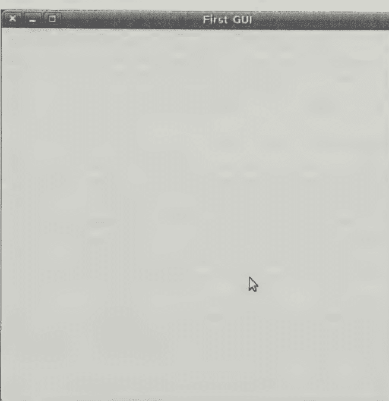

**图 11.1：** 这是一个由简单脚本打开的示例窗口。窗口为 500x500 像素，标题为“First GUI”。关闭窗口时，脚本将退出。

a **MainFrame**。其他选项包括常规 **Frame** 和 **Dialog**。**MainFrame** 的优点是关闭时终止程序。以下是一个可以运行以打开窗口的小脚本。

```
import scala.swing._

val frame=new MainFrame {
	title = "First GUI"
	size = new Dimension(500,500)
}

frame.visible=true
```

运行它时应该会弹出一个看起来像图 11.1 的窗口。这个脚本中有很多值得描述的内容。我们从一个 **import** 语句开始。下划线是一个通配符，告诉 Scala 导入 `scala.swing` 包中的所有内容。我们在这里不需要这样做，但随着我们继续下去会更有用，因为我们将使用这个包中的许多不同类型。

导入之后，我们创建 **Frame** 并将其存储在名为 **frame** 的 **val** 中。这里的语法可以这样读。我们正在创建一个新的 **MainFrame** 对象，花括号括起我们想要放入此对象的内容。在花括号内，我们更改了一些内容，使其不会使用 MainFrame 的默认值。第一个是设置标题。它出现在窗口顶部。之后我们设置大小。大小的类型为 Dimension（技术上是 java.awt.Dimension）。在这个脚本中，我们创建一个新的 Dimension 对象，宽度和高度都设置为 500。

创建 frame 之后，有一行将 frame 中的 visible 值设置为 true。这会导致窗口弹出并可见。²

### 11.2.2 组件

为了使 GUI 执行某些操作，我们需要向其中添加其他组件。scala.swing 包中有许多不同的组件。下面列出了部分内容及其简要描述。

- **Button** - 一个标准的按钮，点击后可执行操作。通过调用 Button(text:String)(action : => Unit) 创建。
- **CheckBox** - 一个可选择或取消选择的带标签框。使用 new CheckBox(label:String) 创建。包含 selected:Boolean，可告诉您框当前是否被选中。
- **ComboBox** - 这是一个下拉框，允许用户从多个选项中选择。使用 new ComboBox(items:Seq[A]) 创建。内部有一个名为 selection 的对象，用于处理当前选择。使用 selection.index 获取当前选择的索引。
- **EditorPane** - 一个复杂的文本元素，显示多行和格式。使用 new EditorPane(contentType:String,text:String) 创建。
- **Label** - 一个简单、非活动的标签。使用 new Label(text:String) 创建。
- **ListView** - 一个可选择的列表信息显示。使用 new ListView(items:Seq[A]) 创建。内部有一个名为 selection 的对象，用于处理列表上的选择。您可以使用集合 selection.indices 与所选的索引值交互。
- **PasswordField** - 一个隐藏输入数据的文本字段。如果没有默认值，使用 new PasswordField 创建；如果想使用默认值，使用 new PasswordField(text:String)。有一个名为 text:String 的成员，可告诉您当前输入的文本。
- **ProgressBar** - 用于显示进度的图形显示。具有名为 min:Int、max:Int 和 value:Int 的字段，用于控制/读取进度显示。
- **RadioButton** - 一个可选择的按钮，可以放入 ButtonGroup 中以便一次只能选择一个。有一个名为 selected:Boolean 的字段，可告诉您当前是否被选中。
- **ScrollBar** - 一个水平或垂直的滚动条。ScrollBar 具有 minimum、maximum 和 value，均为 Ints，可让您设置或检查其位置。很少有应用程序会直接使用 ScrollBar。您通常想要的功能是下一节中描述的 ScrollPane 的一部分。

有一些组件可以容纳多个其他组件并控制布局方式。这些可以嵌套在彼此内部以产生程序员想要的整体效果。

简单的容器组件，仅定位和调整其内容的大小，称为面板。还有更复杂的容器，提供一些用户交互。这些称为窗格。下面列出了 scala.swing 中包含的不同面板和窗格。

- **BorderPanel** - 可在 North、South、East、West 和 Center 位置容纳多达五个不同的组件。组件作为 (Component,Position) 的元组添加到 BorderPanel 的布局中。Positions 属于 BorderPanel.Position（例如，BorderPanel.Position.North）。
- **BoxPanel** - 可容纳可变数量的组件，方向为垂直或水平，每个组件占用其所需空间。创建新的 BoxPanel 时，您会传递一个方向（例如 new BoxPanel(Orientation.Vertical)）。组件可以一次一个地添加到 contents（例如 contents+=Button("text")(action)）。
- **FlowPanel** - 可容纳多个组件，从左到右布局，当变得太长时像文字处理器中的文本一样换行。您可以在构造时传递可变长度的 Components 列表作为参数，或将组件添加到 contents。
- **GridBagPanel** - 一个灵活且强大的容器，将内容保存在可变大小的网格中。组件作为 (Component,GridBagPanel.Constraints) 的元组添加到布局中。此面板很复杂，本章中不会使用。
- **GridPanel** - 包含组件的规则网格。您在创建时指定网格的行数和列数（例如 new GridPanel(3,4) 表示 3 行 4 列）。内部的 Components 添加到面板的 contents。
- **ScrollPane** - 一个容纳单个 Component 的窗格，可作为构造参数传入。如果内容 Component 比此显示的更大，则会自动添加滚动条以便用户滚动。
- **SplitPane** - 一个容纳两个 Components 的容器。它们被一个用户可以按需移动的栏分隔开。在构造时应提供方向和两个子组件（例如 new SplitPane(Orientation.Horizontal,leftComp,rightComp)）。
- **TabbedPane** - 这可以容纳多个不同的 Components。一次只显示一个 Component，但所有它们的标签始终显示。用户可以点击标签将一个带到前面。您可以通过将它们添加到 TabbedPane 内部的 page 对象来添加 Components。添加到其中的是 Page 对象。每个 Page 对象通过为其提供一个用于标签的 String 和应放在该标签下的 Component 来构造（例如 pages += new Page("A Tab",tabComponent)）。

单独的这些都不足以创建复杂的 GUI。相反，通常的做法是将面板和窗格嵌套在彼此内部以创建所需的效果。

为了说明这一点，我们将为本章中将构建的一个小程序布局 GUI。该程序将类似于数字食谱书。该程序应能够存储多个食谱。对于每个食谱，它应允许用户指定配料及其用量，以及烹饪说明的文字描述。


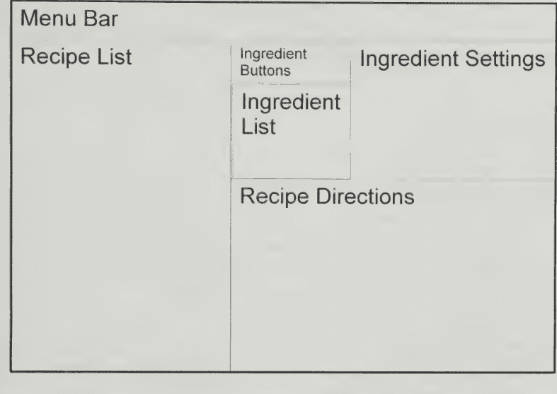

# FIGURE 11.2: This shows a possible layout for the GUI that we want to build for editing recipes.

图 11.2：这展示了我们想要为编辑食谱而构建的 GUI 的一种可能布局。

The GUI should give the user the ability to add and remove recipes. They should be able to select recipes and edit the various information that we have on them.

GUI 应该使用户能够添加和删除食谱。他们应该能够选择食谱并编辑我们所拥有的各种信息。

At this point in the analysis you would probably want to sketch out a little picture of what you want the GUI to look like. That is done for this GUI in figure 11.2. The left side is taken up by a ListView that shows all the recipes. When the user clicks on a recipe, the information for it should be shown on the right. That includes a list of all the ingredients and the directions. The ingredients can also be edited and there need to be some buttons to help with this. The options for adding and removing recipes will be in the menus, which will be discussed in the next section.

在分析的这个阶段，你可能想要草拟一张小图，说明你希望 GUI 看起来是什么样子的。这在图 11.2 中已为此 GUI 完成。左侧由一个 ListView 占据，显示所有食谱。当用户点击一个食谱时，其信息应显示在右侧。这包括所有配料的列表和做法。配料也可以被编辑，并且需要一些按钮来帮助完成此操作。添加和删除食谱的选项将在菜单中，这些将在下一节讨论。

The question is how we should lay this out. Any GUI can be built in multiple different ways using the different panel and pane options that were listed above. For example, the separation between the recipe list and the information about the selected recipe could be created by a BorderPanel, a BoxPanel with a horizontal orientation, or a SplitPane. Which of these you pick will normally be determined by the way in which the panels would size things or whether you want to give the user the control of a SplitPane. We will use a BorderPanel for the top-level split. We will then use a SplitPane to separate the directions from the ingredient information. We will use two BorderPanels for the ingredient information and the Buttons will be built using a GridPanel. The settings area will also need to be refined a bit more. It probably just needs the name of the ingredient along with the amount needed. That can be laid out using a combination of BorderPanel and GridPanel.

问题是如何布局。任何 GUI 都可以使用上面列出的不同面板和窗格选项以多种不同的方式构建。例如，食谱列表与所选食谱信息之间的分隔可以通过 BorderPanel、具有水平方向的 BoxPanel 或 SplitPane 来创建。你选择哪一个通常取决于面板如何调整大小，或者你是否希望用户控制 SplitPane。我们将使用 BorderPanel 进行顶层分割。然后我们将使用 SplitPane 将做法与配料信息分开。我们将为配料信息使用两个 BorderPanel，并且按钮将使用 GridPanel 构建。设置区域也需要进一步细化。它可能只需要配料名称以及所需用量。这可以使用 BorderPanel 和 GridPanel 的组合来布局。

The code to do this is shown below. It is the full script and it is fairly long.

```
import scala.swing._
```

```
val recipeList=new ListView(List("Pop Tarts"))
val ingredientList=new ListView(List("Pop Tarts"))
val directionsArea=new TextArea("Toast the poptarts ...\nor don’t.")
val ingredientNameField=new TextField("Pop Tart")
val amountField=new TextField("1 packet")

val frame=new MainFrame {
  title="Recipe Book"
  contents=new BorderPanel {
    layout += (new ScrollPane(recipeList)
      -> BorderPanel.Position.West)
    layout += (new SplitPane(Orientation.Horizontal,
      new BorderPanel {
        layout += (new BorderPanel {
          layout += (new GridPanel(1,2) {
            contents+=Button("Add") (println("Add ingredient"))
            contents+=Button("Remove") (println("Remove ingredient"))
          } -> BorderPanel.Position.North)
          layout += (new ScrollPane(ingredientList)
            -> BorderPanel.Position.Center)
        } -> BorderPanel.Position.West)
        layout += (new BorderPanel {
          layout += (new GridPanel(2,1) {
            contents += new Label("Name")
            contents += new Label("Amount")
          } -> BorderPanel.Position.West)
          layout += (new GridPanel(2,1) {
            contents += ingredientNameField
            contents += amountField
          } -> BorderPanel.Position.Center)
        } -> BorderPanel.Position.Center)
      }, new ScrollPane(directionsArea)
    ) -> BorderPanel.Position.Center)
  }
  size=new Dimension(800,600)
}

frame.visible=true
```

The interactive elements were stored as values with names at the beginning. The purpose of that will become clear in section 11.3. Indentation has been used to indicate the nesting of panels and panes. Alternately, each different part could have been given a name as a value and then the parts could have been put together. The choice between these options is an issue of style. This example is just big enough, and the panels nested just deep enough that it could be worth considering breaking it up some with named constructs for some of the more deeply nested sections. Here is a different version that uses that approach.

交互元素在开头以带名称的值形式存储。其目的将在第 11.3 节中变得清晰。缩进已用于指示面板和窗格的嵌套。或者，每个不同的部分都可以作为值命名，然后将各部分组合起来。这两种选项之间的选择是风格问题。此示例足够大，并且面板嵌套足够深，以至于考虑使用命名结构拆分一些更深层的嵌套部分是值得的。下面是一个使用该方法的不同版本。

```
import scala.swing._

val recipeList=new ListView(List("Pop Tarts"))
val ingredientList=new ListView(List("Pop Tarts"))
val directionsArea=new TextArea("Toast the poptarts ...\nor don’t.")
val ingredientNameField=new TextField("Pop Tart")
val amountField=new TextField("1 packet")
```

```
val ingredientListPanel = new BorderPanel {
  layout += (new GridPanel(1,2) {
    contents+=Button("Add")(println("Add ingredient"))
    contents+=Button("Remove")(println("Remove ingredient"))
  } -> BorderPanel.Position.North)
  layout += (new ScrollPane(ingredientList)
    -> BorderPanel.Position.Center)
}

val ingredientDataPanel = new BorderPanel {
  layout += (new GridPanel(2,1) {
    contents += new Label("Name")
    contents += new Label("Amount")
  } -> BorderPanel.Position.West)
  layout += (new GridPanel(2,1) {
    contents += ingredientNameField
    contents += amountField
  }-> BorderPanel.Position.Center)
}

val frame=new MainFrame {
  title="Recipe Book"
  contents=new BorderPanel {
    layout += (new ScrollPane(recipeList)
      -> BorderPanel.Position.West)
    layout += (new SplitPane(Orientation.Horizontal,
      new BorderPanel {
        layout += (ingredientListPanel
          -> BorderPanel.Position.West)
        layout += (ingredientDataPanel
          -> BorderPanel.Position.Center)
      },
      new ScrollPane(directionsArea))
      -> BorderPanel.Position.Center)
  }
  size=new Dimension(800,600)
}

frame.visible=true
```

This second version would likely be preferred because the deepest nesting has been cut down two levels and the named values can help readers figure out what different parts of the code are doing. This can be taken further if you desire.

这个第二个版本可能更受欢迎，因为最深的嵌套减少了两层，并且命名值可以帮助读者弄清楚代码的不同部分在做什么。如果需要，可以进一步扩展。

When you run either of these scripts you get a window like what is shown in figure 11.3. In the code you might notice that each of the ListViews and the large TextArea are put inside of ScrollPanes. This is to make it so that if the lists get large or the directions get long, scroll bars will be added to allow the user to scroll around and see everything they need to.

运行这两个脚本中的任何一个，你都会得到一个像图 11.3 所示的窗口。在代码中，你可能会注意到每个 ListView 和大的 TextArea 都放在 ScrollPane 内。这样做是为了如果列表变大或做法变长，就会添加滚动条，让用户可以滚动查看所需的一切。

# 11.2.4 Menus

# 11.2.4 菜单

All we lack in the appearance of the GUI now is the menus. The MainFrame has a field called menuBar that we can set to be an object of type MenuBar. The MenuBar type has

现在 GUI 外观所缺少的只是菜单。MainFrame 有一个名为 menuBar 的字段，我们可以将其设置为类型为 MenuBar 的对象。MenuBar 类型具有

contents, like the panels and panes, but you should only add objects of the **Menu** type to a **MenuBar**.

contents，就像面板和窗格一样，但你只能向 **MenuBar** 添加 **Menu** 类型的对象。

The **Menu** objects are created with `new` and should be passed a `String` that you want as the title of the **Menu**. The `contents` of a **Menu** can be of one of five types.

**Menu** 对象使用 `new` 创建，并且应传递一个 `String` 作为 **Menu** 的标题。**Menu** 的 `contents` 可以是以下五种类型之一。

- * **MenuItem** - This is the most common thing you will put in a **Menu**. You create them with `new` and the easiest approach is to give them an `Action` object. The `Action` object can be made like a **Button** with a `String` and an action that is passed by-name. For example `new MenuItem(Action("Exit")(exit(0)))`.
- * **Menu** - You can add a **Menu** to a **Menu**. This will appear as a submenu when you run the program.
- * **CheckMenuItem** - Menus can also have options on them that are selected. To do this use the type **CheckMenuItem**. You make these with `new` and pass in a `String` for the text to display.
- * **RadioMenuItem** - If you have multiple values and you only want to allow one to be selected use a **RadioMenuItem**. These are made like **CheckMenuItems**. All the **RadioMenuItems** and you want to have grouped together should be added to a single object of the **ButtonGroup** type.
- * **Separator** - This is a simple component used to space items out to improve appearance and usability.

- * **MenuItem** - 这是你将放入 **Menu** 中最常见的内容。你使用 `new` 创建它们，最简单的方法是为它们提供一个 `Action` 对象。`Action` 对象可以像 **Button** 一样创建，具有一个 `String` 和一个按名称传递的操作。例如 `new MenuItem(Action("Exit")(exit(0)))`。
- * **Menu** - 你可以将一个 **Menu** 添加到另一个 **Menu**。运行时这将显示为子菜单。
- * **CheckMenuItem** - 菜单上也可以有被选中的选项。要做到这一点，请使用类型 **CheckMenuItem**。你使用 `new` 创建它们，并传入一个 `String` 作为要显示的文本。
- * **RadioMenuItem** - 如果你有多个值并且只想允许其中一个被选中，请使用 **RadioMenuItem**。它们像 **CheckMenuItems** 一样创建。你希望分组在一起的所有 **RadioMenuItems** 应该添加到一个类型为 **ButtonGroup** 的对象中。
- * **Separator** - 这是一个简单的组件，用于分隔项目以改善外观和可用性。

We can set up a simple menu system for our recipe script by adding the following code inside the `MainFrame` right before we set the `size`.

我们可以通过在设置 `size` 之前将以下代码添加到 `MainFrame` 内部，为我们的食谱脚本设置一个简单的菜单系统。

```
menuBar = new MenuBar {
    contents += new Menu("File") {
        contents += new MenuItem(Action("Open")(openFile))
        contents += new MenuItem(Action("Save")(saveFile))
        contents += new Separator
        contents += new MenuItem(Action("Exit")(exit(0)))
    }
    contents += new Menu("Recipe") {
        contents += new MenuItem(Action("Add")(addRecipe))
        contents += new MenuItem(Action("Remove")(removeRecipe))
    }
}
```

In order to get this to run, we have to put declarations of the four functions that are called in the script before we make `frame`. For now these can be left completely empty.

为了让它运行，我们必须在创建 `frame` 之前在脚本中放置四个被调用函数的声明。现在这些可以完全为空。

```
def openFile {
}

def saveFile {
}

def addRecipe {
}

def removeRecipe {
}
```


With these additions we now have a script that will bring up a fairly complete GUI. Unfortunately, it still does not do anything yet. We will get to that soon enough.

### 11.2.5 Tooltips

You have probably seen GUIs where, if you leave the mouse hovering above something for a while, a message will pop up telling you something about what it does. These are called **TOOLTIPS**. All the components have a field in them called `tooltip` that is a `String`. You can set the `tooltip` to be a message that you want to pop up. This will happen automatically if the user leaves their mouse pointer over that component for a period of time.

# 11.3 Basic Interactivity

The GUI that we have created for our recipe book looks fine and has all pieces that we need. Unfortunately, it does not do anything at this point. In order to make it interactive, we need to code that in. Interactivity in GUIs is significantly different from that in console programs. For a console program, the only real input is to have the user type in information. We were able to read that information using functions like `readInt()`, `readLine()`, `readDouble()`, etc. Similarly, the only output was to print things back to the console. In addition, while the user was typing stuff in, the program was supposed to be paused. We describe this by saying that user input is BLOCKING. So nothing else was happening when we called `readLine()`. That call would block the execution and it would not continue until the user had entered something.

When you move to a GUI environment, all the rules of interactivity change. There are now multiple components that the user can interact with. Each one might respond in different ways. For example, a `Button` can just be clicked. On the other hand, a `TextField` can have the user type into it and you need to know when they are done. Each different component has different ways the user can interact with them, and each of them needs to be waiting for the user to interact. No single component can block execution while it waits for the user. They all have to be active at the same time.

This section looks at the way we do user input in a GUI built with the `scala.swing` library.

### 11.3.1 Partial Functions

There is one feature of the Scala language that we have not talked about before that is required for doing interactions in GUIs: the PARTIAL FUNCTION. The idea of a partial function comes from mathematics. It is a function that can only operate on certain values of the arguments and is undefined for other arguments. The syntax for partial functions in Scala is basically like having a `match` expression without the argument and the `match`. You simply have curly braces with different `cases` inside of them.

```
{
  case 1 => // code goes here
  case 2 => // code goes here
}
```

This example partial function would operate on an Int, but would only be defined if the argument was 1 or 2.

This is more useful when we use more of the options for cases and the pattern matching they do. For GUIs in particular, it is most important to be able to match on different types. If the case includes a name that begins with a lowercase letter, it will use that as a variable name to store the value of the match in.

```
{
  case v => println(v) // this will happen for everything
}
```

Using the colon syntax that you have been using all along to specify the types of arguments to functions and the fields in case classes, you can also specify that a named value in a case has to have a specific type.

```
{
  case i:Int => println("Partial functions called on an Int "+i)
  case d:Double => println("Partial functions called on a Double "+d)
  case s:String => println("String = "+s)
}
```

This example partial function is only defined for Int, Double, and String. If you pass in any other type, it will fail. If you call it with one of those types, it will give that value to the name i, d, or s, then print the appropriate output.

### 11.3.2 Publishers and Reactors

The model for having users interact with GUIs in the scala.swing library is based on types called Publisher and Reactor. The idea is that the components in a GUI are Publishers. When something happens to them, let us call it an EVENT. The Publisher will publish that event. Code can be set up in a Reactor to pay attention to a particular Publisher and then it can react to these events in the proper way. There is a type called Event that represents something that can happen in the GUI. There are lots of different subtypes of Event that are part of the scala.swing.event package.

As we saw above, you do not have to do this for Buttons because when you create a Button, there is a simple syntax for providing the code that will be executed. Not everything is so simple though. For many components there are several different possible events that you might react to or there is other information that you need to know when the interaction occurs.

To see this, consider the example of a ListView. Two of these were placed in the GUI for the recipe book. When the user clicks on something in the ListView, the program needs to be able to display the appropriate information in other fields. To illustrate how this works, we will start with a simpler example that contains only a ListView and a TextField. When the user selects an item from the ListView, the text field should be set to the value of what was clicked. This example can be set up with the following code.

```
import scala.swing._
import scala.swing.event._

val options = "A list of words".split(" ")
val list = new ListView(options)
val field = new TextField
```

```
val frame = new MainFrame {
  title = "First GUI"
  contents=new BorderPanel {
    layout += (list -> BorderPanel.Position.Center)
    layout += (field -> BorderPanel.Position.South)
  }
  size=new Dimension(500,500)
}

frame.visible=true
```

To make this interactive we need to tell the frame to listen to the selection Publisher in the ListView and then give it a partial function to handle the events that we are interested in.

This can be accomplished by adding the following text inside the block of code for building the frame.

```
listenTo(list.selection)
reactions += {
  case e:SelectionChanged =>
    field.text=list.selection.items.mkString("; ")
}
```

The first line of code has the frame listen to the selection Publisher. If you later decided that you did not want to listen to that anymore, you could call deafTo on the frame. After that, a partial function is added to the reactions of the frame that has a single case for handling the SelectionChanged event. The selection field of ListView has a collection in it called items that contains all the items that are selected from the ListView. This is a collection because the ListView allows multiple items to be selected at a time. The text for the field is set to be all of the items separated by semicolons.

The type SelectionChanged is part of the scala.swing.event package. There are a large number of different event types in this package for all the different things that can happen in a GUI. The list is long enough that they will not be put in here. Readers can go to the Scala API to see the list of different events. We will introduce a few more in this chapter for the recipe book example.

In general, your partial function for the reactions will have more than one case. This example simply did not need that.

### 11.3.3 Mnemonics

It is often helpful to put keyboard shortcuts into GUIs so that the user can execute certain commands without having to use the mouse to do so. These shortcuts are referred to as MNEMONICS and the different components in scala.swing that have simple modes of interaction, like Buttons, MenuItems, and CheckBoxes have a member called mnemonic that can be set to the keystroke that you want people to use. The following example demonstrates adding mnemonics to a short menu.

```
menuBar = new MenuBar {
  contents += new Menu("File") {
    mnemonic = Key.F
    contents += new MenuItem(Action("Exit")(exit(0))) {
      mnemonic=Key.X
    }
  }
}
```


这可以添加到上面创建的简单 GUI 中，以添加一个可以通过 Alt-F 拉下的“文件”菜单，以及一个在菜单展开时按“X”即可执行的“退出”项。

# 11.4 FileChooser

GUI 库中至少还有一个值得指出的选项，因为它被使用得非常频繁，那就是文件选择对话框。许多程序在菜单中都有“打开”和“保存”选项。当选择这些选项时，程序通常会弹出一个对话框，允许用户浏览目录结构并选择文件。你可以自己编写对话框来实现此功能，但这需要大量的工作，而且这是一个如此常见的任务，以至于它已被添加到库中。

FileChooser 类型用于显示文件选择对话框。你可以带或不带一个用于起始目录的单个参数来创建一个新的 FileChooser。如果省略起始目录，它将使用默认目录开始。有三种以“show”开头的方法在 FileChooser 中，都可用于弹出对话框：showDialog、showOpenDialog、showSaveDialog。全部三个都接受第一个参数，即你希望对话框在其上方弹出的 Component。如果为该参数传递 null，对话框将出现在屏幕中央。showDialog 方法还接受第二个参数，即一个 String，将显示在确认按钮上。这些方法将返回以下其中之一：FileChooser.Result.Approve、FileChooser.Result.Cancel 或 FileChooser.Result.Error。如果返回 Approve，则 FileChooser 将在 selectedFile 和 selectedFiles 成员中具有有效值。

为了帮助理解这一点，请考虑以下在上一节中创建的菜单中添加的“打开”选项的示例。此选项可以通过在菜单栏的块中添加以下代码添加到菜单中。

```
contents += new MenuItem(Action("Open")(openFile)) {
    mnemonic = Key.O
}
```

要使此功能正常工作，我们需要一个 openFile 函数。它可以按以下方式定义，并放置在 list 和 field 的声明之后以及 frame 之前。

```
def openFile {
    val chooser = new FileChooser
    if(chooser.showOpenDialog(list)==FileChooser.Result.Approve) {
        list.listData = Source.fromFile(chooser.selectedFile).getLines.toList
    }
}
```

此代码创建一个 FileChooser 并显示一个打开对话框。如果用户选择了一个文件，则该文件用于打开一个 Source，并且从该 Source 中获取的行被转换为一个 List，该 List 被设置为 ListView 的数据。

# 11.5 Tables

Swing 中更复杂的 GUI 元素之一是 Table。名称很好地描述了此元素的功能。它呈现用户可以交互的二维数据单元格网格。虽然 scala.swing.Table 类型可以轻松提供基本功能，但 javax.swing.Table 类型可以做更多的事情，这需要你进入原始的 Java 库。因此，本节专门讨论此组件。

当你创建一个 scala.swing.Table 时，有三种传递给它的参数选项。你可以告诉它在表中放置多少行和列作为两个 Int 参数。这将创建一个指定大小的简单表格，所有元素都是空白的。你可以通过在 REPL 中输入以下代码来尝试此操作。

```
val frame = new Frame {
  title = "Table Test"
  contents = new Table(3,4)
}
frame.visible = true
```

此代码将弹出一个窗口，其中包含一个具有 3 行 4 列且所有单元格为空的 Table。此示例使用 Frame 而不是 MainFrame，因为它 intended 在 REPL 中完成。如果使用 MainFrame，关闭窗口时整个 REPL 将被终止。

你也可以传入参数 rowData: Array[Array[Any]]、columnNames: Seq[_]。这将创建一个具有 rowData 大小的表格并以这些值开始。记住从图 7.1 中 Any 是 Scala 中可以表示任何其他类型的类型。你的 Table 不必包含 String 数据。它们可以更复杂，但我们在这里不会涉及所有这些细节。第二个参数是一个序列，其中包含你希望出现在列顶部作为标签的值。这些标签只有在表格嵌套在 ScrollPane 中时才会出现。

要测试其工作原理，请尝试在 REPL 中输入以下内容。

```
val data = Array(Array(1,2,"hi"),Array(3,4,"bye"))
val colHeads = Seq("Num","Num","Word")
val frame = new Frame {
  title = "Table Test"
  contents = new Table(data,colHeads)
}
frame.visible = true
```

这将弹出一个小窗口，其中包含一个具有两行三列的 Table。请注意，列标题在此版本中未出现。要获取列标题，请将设置 Frame 内容的代码行更改为以下内容。

```
contents = new ScrollPane(new Table(data,colHeads))
```

现在当你使 Frame 可见时，你会得到一个更大的窗口，其中包含相同的表格，只是现在列标题可见。

构建 Table 的第三种方式根本不传递任何参数。如果你选择此选项，你将需要做更多的工作来设置，因此现在我们将重点关注其他选项。

如果你在 REPL 中使用上述示例创建的 Table 进行操作，你可能会发现你可以选择单元格、使用箭头键移动，甚至

编辑单元格中的值。要在代码中处理 Table，我们需要有一个名称来引用 Table。我们可以通过稍微修改代码来实现这一点，以便我们有一个名为 `table` 的变量。

```
val table = new Table(data,colHeads)
...
  contents = new ScrollPane(table)
...
```

要从表中获取值，只需用行和列对其进行索引。因此，如果你在 REPL 中执行以下行，你将看到左上角单元格的值。

```
println(table(0,0))
```

如果你在创建表后立即执行此操作，你将获得值 1。但是，如果你手动编辑该单元格中的 Table 然后打印它，你将看到修改后的值。你可以用相同的方式修改 Table 中的值。只需按行和列索引对 Table 进行赋值。尝试在 REPL 中执行以下操作。

```
table(1,1) = "New text"
```

你会看到 Table 中单元格 (1,1) 的值在图形上更新以反映更改。此方法只能用于修改 Table 正常范围内的单元格。如果你超出首次创建 Table 时设置的大小，你将收到错误。如果你在 REPL 中尝试输入 `table(0,0)`，你将获得类型为 Any 的结果。这可能有点问题，因为你可以用 Any 类型做的事情并不多。例如，你可能会尝试执行以下操作。

```
table(0,0)+table(1,0)
```

对于任何数值类型或 String 类型，这种加法都完全可以正常工作，因为所有这些类型都为其定义了 `+` 方法。但是，如果你尝试这样做，你将收到以下错误消息。

```
<console>:12: error: type mismatch;
 found   : Any
 required: String
        table(0,0)+table(0,0)
                    ^
```

这是因为 Any 类型没有 + 方法。这是有道理的，因为有一些符合 Any 的类型你不应该能够使用 +。要对从表中获取的值做任何事情，我们必须调用存在于 Any 上的方法。挑战在于这些方法并不多。你可以检查相等或不相等，进行将在第 21 章讨论的多线程相关操作，检查对象的实际类型，或将对象转换为 String。后两种方法可以提供我们想要的功能。我们将重点关注最后一种方法，因为它只使用我们之前见过的方法。

要将任何对象转换为 String，调用 `toString` 方法。你可以尝试以下操作来了解其工作原理。

```
table(0,0).toString
```

一旦你这样做了，你就可以使用 + 来进行 String 拼接。如果你想做


对 Table 中的值进行数值运算时，可以对 String 使用 toInt 或 toDouble。因此，如果你想乘以两个表值，可以这样做。

```
table(0,0).toString.toDouble * table(1,0).toString.toDouble
```

这有点冗长，但这是我们为能够在 Table 中放置各种不同类型事物所付出的代价。

如果你足够多地尝试这个，你很可能会遇到这种方法的首要缺陷，如果单元格的内容不是数字，这将失败。为了避免这种情况，你需要使用 try/catch 构造。我们将在第 22.3 节详细讨论 try-catch。现在我们将给出一个简要介绍。你可能已经看到，当语句出错时，你得到的错误消息通常以提供一个包含单词“Exception”的类型名称开头。EXCEPTION 是一个表示问题的对象，当出现问题时代码会 THROW 一个异常。如果你知道这种情况可能会发生并且你想处理它，你就告诉 Scala 你想 TRY 一些代码，然后如果发生异常就 CATCH 它。可以捕获的异常用 cases 指定，就像 match 表达式一样。

Scala 中的 try-catch 可以用作表达式。如果没有异常，你会得到你尝试执行的代码的值。如果有异常并且有一个匹配的 case，值将是该 case 中发生的情况。为了帮助你理解这一点，请考虑以下函数。

```
def asDouble(a:Any):Double = {
  try {
    if(a==null) 0.0 else a.toString.toDouble
  } catch {
    case e:NumberFormatException => 0.0
  }
}
```

此函数接受一个 Any 对象并为其返回一个数字。如果值为 null，则返回零。否则，它使用上面所示的 .toString.toDouble 方法调用。在此函数中，该代码放在 try 中，它会捕获 NumberFormatException。正如名称所示，这是当你尝试将某些格式不正确的内容制作成数字时发生的异常。如果发生这种情况，case 会返回值为 0.0。上面的和现在可以用这种方式表示。

```
asDouble(table(0,0))+asDouble(table(1,0))
```

如果 Table 单元格包含非数字内容，此代码更健壮，因为它不会因异常而停止，而是为该单元格使用 0.0。

### 11.5.1 Table Actions

你现在知道如何设置 Tables 以及如何读取和更改其中的值。对于许多应用程序来说，这已经足够了。GUI 中的操作通常可以通过让用户点击按钮或选择菜单项来启动，并由该操作启动的代码利用表中的值。然而，有些应用程序需要实际响应 Table 本身发生的事件。在这种情况下，你需要监听 Table 或可能 Table 中的 selection 对象。

Tables 可以发生的事件有一个相当长的列表。你可以在 API 中查找完整信息，但这里列出了主要的一些。

- `TableChanged` – 表示 Table 的结构保持不变，但其他任何内容都可能已更改。
- `TableColumnsSelected` – 表示当前选中的列发生变化。
- `TableRowsAdded` – 当向 Table 添加额外行时发生此事件。
- `TableRowsRemoved` – 当从 Table 中删除行时发生此事件。
- `TableRowsSelected` – 表示当前选中的行发生变化。
- `TableStructureChanged` – 此事件表示最一般类型的更改。Table 中的任何内容都可能已更改，包括行数和列数。
- `TableUpdated` – 表示 Table 指定部分中的值已更改。

要获取指示选择更改的事件，请监听 `table.selection`。要获取其他事件，只需监听 `table`。

如果你只关心单元格值何时被更改，可以使用如下代码。

```
import scala.swing._
import scala.swing.event._

val sumLabel = new Label("0.0")
val table = new Table(8,5)

def asDouble(a:Any):Double = {
  try {
    if (a==null) 0.0 else a.toString.toDouble
  } catch {
    case e:NumberFormatException => 0.0
  }
}

val frame = new MainFrame {
  contents = new BorderPanel {
    layout += sumLabel -> BorderPanel.Position.North
    layout += table -> BorderPanel.Position.Center
  }
  size = new Dimension(500,400)
  listenTo(table)
  reactions += {
    case e:TableUpdated =>
      val sum = (for(i <- 0 until table.rowCount;
        j <- 0 until table.model.getColumnCount) yield {
          asDouble(table(i,j))
      }).sum
      sumLabel.text = sum.toString
  }
}

frame.visible = true
```

此代码以一个空 Table 和一个显示 0.0 的 Label 开始。每当用户编辑一个单元格时，代码会遍历所有单元格并将每个单元格中的值相加，如果没有有效数字则使用零。它更改 Label 以反映此总和。将此代码输入到文件中并作为脚本运行。进行更改以查看还能做什么。

```
case Some(name) =>
    data = data.map(_ :+ "")
    headers :+= header.get
    table.model = new DefaultTableModel(data,headers)
case None =>
}
}
```

```
val frame = new MainFrame {
    title = "Resizable Table"
    contents = new ScrollPane(table)
    menuBar = new MenuBar {
        contents += new Menu("File") {
            contents += new MenuItem(Action("Add Column")(addColumn))
            contents += new Separator
            contents += new MenuItem(Action("Exit")(sys.exit(0)))
        }
    }
    size = new Dimension(500,500)
}

frame.visible = true
```

Table 的信息存储在 data 和 headers 中。为了与构建 DefaultTableModel 所需的类型相匹配，它们分别是 Array[Array[AnyRef]] 和 Array[AnyRef]。不幸的是，这些类型不能使用正常的 Scala 创建方法，因此而不是传递 data，table 的声明中包含一行设置模型的代码。

table 监听自身并对 TableUpdated 事件做出反应。更新的数据始终存储回 data 数组。请注意，这需要做一些额外的工作，因为从 table 中提取的数据类型为 Any。使用了 match 来确保我们拥有 AnyRef。还有一个检查以查看正在更改的行是否是最后一行。在这种情况下，会将新行附加到 data 并更新模型。

addColumn 方法由菜单选项调用。它使用 Dialog.showInput 提示用户输入名称，然后在每一行的末尾附加一个空白并将其用作更新后的 data。它还将新的 header 名称附加到 headers 的末尾。它最后要做的是更新 table 模型。showInput 的完整签名如下。

```
def showInput [A] (parent: Component, message: Any, title: String, messageType: Value, icon: Icon, entries: Seq[A], initial: A): Option[A]
```

在我们的使用中，我们让对话框框在 table 上方弹出。我们告诉它我们是在提问，没有图标，没有条目，初始值为一个空 String。这让用户可以输入他们选择的 String。如果 entries 不为空，用户将获得下拉框而不是文本字段。

请注意 showInput 返回一个 Option 类型。这是因为用户可能会点击“取消”或关闭对话框。这是使用 match 的原因。如果用户没有提供适当的响应，Option 为 None 且不会执行任何操作。

此代码未演示删除行或列，但任一操作都可以用 patch 以与此处所示非常相似的方式完成。

# 11.6 Putting it Together

我们现在可以将 GUI 的各个方面组合到食谱书脚本中。之前我们构建了一个 GUI 并向其添加了菜单。然而，GUI 并不是交互式的。点击各个元素不会对 GUI 的其他元素做任何事情。现在我们知道如何使 GUI 交互式，我们可以向此脚本添加适当的 functionality。为了能够做到这一点，我们首先需要做一些基础工作。特别是，我们需要一种很好的方式来存储与食谱相关联的信息。这需要一些 case classes。

我们 definitely 想要一个 case class 来表示食谱。由于食谱可以包含多个配料，因此拥有一个配料的 case class 也是有利的。这导致了如下内容。

```
case class Ingredient(name:String,amount:String)
case class Recipe(name:String,ingredients:List[Ingredient],directions:String)
```

你可以将它放在脚本顶部，因为脚本的其他许多部分都会参考它。

我们还需要一种方法来存储多个食谱。我们将使用一个 Recipes 数组的变量声明。也可以选择使用 var List，但其中一些交互需要交换值，而其他交互可能需要直接访问。两者都将更容易且更高效地使用 Array。添加新食谱的操作对于 List 来说会更容易，但该操作可能发生的频率较低，并且几乎可以像使用 Array 一样轻松完成。

```
var recipes = Array(Recipe("Pop Tarts",List(Ingredient("Pop Tart","1 packet")),"Toast the poptarts ...\nor don't."))
```

```
val recipeList = new ListView(recipes.map(_.name))
val ingredientList = new ListView(recipes(0).ingredients.map(_.name))
val directionsArea = new TextArea(recipes(0).directions)
val ingredientNameField = new TextField(recipes(0).ingredients(0).name)
val amountField = new TextField(recipes(0).ingredients(0).amount)
```

此代码包括数组的声明以及使用数组中一个 Recipe 的活动组件声明的修订。

现在我们已经设置好了，我们可以从完成由菜单调用的函数开始。我们将从 saveFile 函数开始，因为它定义了我们将在文件中使用的格式，而且它有点更容易。

```
def saveFile {
  val chooser = new FileChooser
  if(chooser.showSaveDialog(recipeList)==FileChooser.Result.Approve) {
    val pw = new PrintWriter(chooser.selectedFile)
    pw.println(recipes.length)
    for(r <- recipes) {
      pw.println(r.name)
      pw.println(r.ingredients.length)
      for(ing <- r.ingredients) {
        pw.println(ing.name)
        pw.println(ing.amount)
      }
    }
  }
}
```


```
    pw.println(r.directions)
    pw.println(".")
}
pw.close()
}
```

此函数允许用户选择一个文件，然后将 `Array` 的大小写入文件。写入大小之后，它会写入每个食谱。食谱的格式相当简单，以名称开头，然后是配料数量，以及交替的配料名称行和用量行。唯一可能显得有点奇怪的是方向后面有一行句点。这是因为方向可能有多行长，我们需要一种方法来知道何时停止读取它们。

在我们编写完保存并定义了文件格式之后，我们可以编写 `openFile` 函数。这稍微复杂一些，主要是因为我们必须处理方向。

```
def openFile {
  val chooser = new FileChooser
  if (chooser.showOpenDialog(recipeList)==FileChooser.Result.Approve) {
    val src = Source.fromFile(chooser.selectedFile)
    val lines = src.getLines
    recipes = Array.fill(lines.next.toInt)(Recipe(
      lines.next,
      List.fill(lines.next.toInt)(Ingredient(lines.next,lines.next)),
      {
        var dir = ""
        var line=lines.next
        while(line!=".") {
          dir += (if(dir.isEmpty) "" else "\n") +line
          line = lines.next
        }
        dir
      }
    ))
    src.close()
    recipeList.listData = recipes.map(_.name)
    recipeList.selectedIndexes(0)
    setFields(recipes(0))
  }
}
```

代码与保存并没有太大不同，只是它使用了一个源并构建了一个 `Array` 来存储在 recipes 中，使用 `fill`。方法长度很大一部分来自用于读取方向的代码块。该块被用作表达式。它在名为 `dir` 的变量中构建方向，并使用 `while` 循环继续读取，直到遇到仅包含单个句点的行。

关闭 `Source` 后，还有另外两行。第一行更改 `recipeList` 的内容，使其与刚刚读取的内容相匹配。第二行调用一个尚未定义的名为 `setFields` 的函数，该函数应将 `GUI` 的其他元素设置为特定食谱的值。此函数可以按以下方式编写。

```
def setFields(r:Recipe) {
  ingredientList.listData = r.ingredients.map(_.name)
```

```
directionsArea.text = r.directions
if(r.ingredients.isEmpty) {
    ingredientNameField.text = ""
    amountField.text = ""
} else {
    ingredientNameField.text = r.ingredients.head.name
    amountField.text = r.ingredients.head.amount
}
}
```

此函数在我们稍后加入让用户从 recipeList 中选择不同元素的代码时将会很有用。

现在我们可以转向添加食谱或删除食谱的函数。addRecipe 函数可能看起来像这样。

```
def addRecipe {
  val name = Dialog.showInput(recipeList, "What is the name of this recipe?",
    "Input", Dialog.Message.Question, null, Nil, "")
  name match {
    case Some(n) =>
      recipes = recipes :+ Recipe(name.get,
        List(Ingredient("ingredient","amount")),"Directions")
      recipeList.listData = recipes.map(_.name)
      recipeList.selectIndices(recipes.length-1)
      setFields(recipes.last)
    case None =>
  }
}
```

这会创建一个新的食谱数组，其中包含一个新的默认食谱。这使用了我们之前未见过的运算符。 :+ 运算符可用于向 `Array` 或 `List` 的末尾添加元素。这不是你在经常发生的循环中想要使用的东西，因为对于这两种类型来说效率都很低，但这只会在用户从菜单中选择选项时发生，因此对于此代码来说不会经常发生。这还使用了 javax.swing 库的一部分。Dialog 对象具有可用于弹出简单输入对话框的方法。对于其中大多数，scala.swing.Dialog 对象中有类似的功能。允许用户输入 String 的输入对话框在 Scala 库中没有镜像，因此我们使用 Java 中的那个。

removeRecipe 函数需要从用户选择的食谱列表中删除项目。作为其一部分，它需要检查是否选择了任何内容。代码可以这样编写。

```
def removeRecipe {
  if(!recipeList.selection.items.isEmpty) {
    recipes = recipes.patch(recipeList.selection.leadIndex,List(),1)
    if(recipes.isEmpty) {
      recipes = Array(Recipe("New recipe",
        List(Ingredient("ingredient","amount")),"Directions"))
    }
    recipeList.listData = recipes.map(_.name)
    recipeList.selectIndices(0)
    setFields(recipes(0))
  }
}
```

这里也有一个可能显得奇怪的元素。与其拥有一个简单的 remove 方法来删除特定索引处的项目，Scala 集合有一个更灵活的 patch 方法。patch 方法可以从特定索引开始用其他集合替换集合的一部分。当使用空集合调用时，它将删除指定位置的指定数量的元素。此代码还检查是否删除了最后一个元素，如果是，则添加一个默认元素。因此食谱书永远不会为空。

写完之后，GUI 现在有能力对我们所有的菜单选项做出反应。它所缺乏的是显示不同食谱的信息或编辑该信息的能力。对于第一部分，我们需要监听 ListView 以了解何时更改选择。我们也需要在其更改时做出反应。已经编写了 setFields 函数，使得第二部分变得相当容易。

```
listenTo(recipeList.selection)
reactions += {
case e:SelectionChanged =>
    if(!recipeList.selection.items.isEmpty) {
        setFields(recipes(recipeList.selection.leadIndex))
    }
}
```

此代码可以添加到框架的块中，以获得所需的行为。

剩下的唯一事情就是能够编辑食谱。这需要对与配料相关面板可能发生的不同事件做出反应。此代码可以放在多个不同的位置。有两种风格是有意义的。一种是将代码放在程序的单个位置，以便于找到所有不同的反应。第二种方法是将反应放在靠近将这些元素添加到 GUI 的代码附近的附近。这种第二种方法的优点是与给定组件相关的一切往往保留在代码的某个部分。我们将在此处采用第二种风格。

添加和删除配料的按钮之前只是打印它们被点击的行。那些需要更改，以便它们调用执行我们想要的功能。所有编辑食谱内容的函数只有在 recipeList 中选择了食谱时才能工作。因此，第一件事是检查是否选择了某些内容。如果没有选择任何内容，就不会执行任何操作，因为我们不知道要编辑哪个食谱。鉴于此，addIngredient 函数及其使用的辅助函数可以这样编写。

```
def setIngredients(ingr:Ingredient) {
    ingredientNameField.text = ingr.name
    amountField.text = ingr.amount
}
def addIngredient {
    if(!recipeList.selection.items.isEmpty) {
        val index = recipeList.selection.leadIndex
        val oldIngrs = recipes(index).ingredients
        val newIngr = Ingredient("Stuff","Some")
        recipes(index) = recipes(index).copy(ingredients=oldIngrs:+newIngr)
        ingredientList.listData = recipes(index).ingredients.map(_.name)
        ingredientList.selectIndices(recipes(index).ingredients.length-1)
        setIngredients(recipes(index).ingredients.last)
    }
}
```

此代码检查是否选择了某些内容，找到选择的索引，创建一个新的默认配料，然后制作一个修改后的食谱并调整 GUI。removeIngredient 函数类似，但它还需要检查是否从该 ListView 中选择了配料。

```
def removeIngredient {
  if(!recipeList.selection.items.isEmpty &&
    !ingredientList.selection.items.isEmpty) {
    val rIndex = recipeList.selection.leadIndex
    val iIndex = ingredientList.selection.leadIndex
    val shortIngr = recipes(rIndex).ingredients.patch(iIndex,List(),1)
    recipes(rIndex) = recipes(rIndex).copy(ingredients=shortIngr)
    ingredientList.listData = recipes(rIndex).ingredients.map(_.name)
    ingredientList.selectIndices(0)
    setIngredients(recipes(rIndex).ingredients.head)
  }
}
```

正如我们之前看到的，此代码使用局部变量来存储频繁使用的值。它还利用 patch 方法从 List 中删除元素。

剩下的唯一事情就是让编辑 TextFields 或 TextArea 会改变存储在 recipes `Array` 中的数据，并且选择配料会改变显示的内容。最容易更改的字段是 directions，因为它是食谱本身的字段。使此操作发生需要监听 directionsArea 发生的某些事情。当用户在 TextArea 或 TextField 中输入文本时，它会触发 ValueChanged 事件。然而，我们实际上并不想为每个字符都更改事情。我们只需要知道他们何时完成编辑。对于文本元素，用户在将焦点移至 GUI 的其他部分时完成编辑。因此，我们将监听 FocusLost 事件。我们还需要开始监听不同的文本元素。下面是我们需要在框架中更改监听和反应代码的内容。

```
listenTo(recipeList.selection,ingredientList.selection,
  directionsArea,ingredientNameField,amountField)
reactions += {
  case e:SelectionChanged =>
    if(e.source==recipeList) {
      if(!recipeList.selection.items.isEmpty) {
        setFields(recipes(recipeList.selection.leadIndex))
      }
    } else if(e.source==ingredientList) {
      if(!recipeList.selection.items.isEmpty &&
        !ingredientList.selection.items.isEmpty) {
        val rIndex = recipeList.selection.leadIndex
        val iIndex = ingredientList.selection.leadIndex
        setIngredients(recipes(rIndex).ingredients(iIndex))
      }
    }
  case e:FocusLost =>
    val rIndex = recipeList.selection.leadIndex
    if(e.source==directionsArea) {
      recipes(rIndex) = recipes(rIndex).
        copy(directions = directionsArea.text)
    } else if(e.source==ingredientNameField) {
      if(!recipeList.selection.items.isEmpty &&
        !ingredientList.selection.items.isEmpty) {
```


```
val rIndex = recipeList.selection.leadIndex
val iIndex = ingredientList.selection.leadIndex
changeIngredientName(rIndex,iIndex)
}
} else if(e.source==amountField) {
if(!recipeList.selection.items.isEmpty &&
!ingredientList.selection.items.isEmpty) {
val rIndex = recipeList.selection.leadIndex
val iIndex = ingredientList.selection.leadIndex
changeAmount(rIndex,iIndex)
}
}
```

这段代码适用于 `directionsArea` 和选择食材。它还为两个不同的 `TextField` 设置了相关内容，所以我们剩下的就是编写两个函数。在 `FocusLost` 的情况下，代码会检查事件的来源。事件的来源是它发出的组件。如果是 `directionsArea`，它会按此处所示的方式修改食谱。食材的修改是通过以下这些函数完成的。

```
def changeIngredientName(r:Int,i:Int) {
  val ing = recipes(r).ingredients(i)
  recipes(r) = recipes(r).copy(ingredients = {
    recipes(r).ingredients.patch(i,List(Ingredient(
      ingredientNameField.text,ing.amount)),1)
  })
  ingredientList.listData = recipes(r).ingredients.map(_.name)
  ingredientList.selectIndices(i)
}
def changeAmount(r:Int,i:Int) {
  val ing = recipes(r).ingredients(i)
  recipes(r) = recipes(r).copy(ingredients = {
    recipes(r).ingredients.patch(i,List(Ingredient(
      ing.name,amountField.text)),1)
  })
}
```

`patch` 在这里再次被使用，但这次被修补的列表包含一个修订后的食材。

所有这些不同的部分组合成一个单一的脚本。为了帮助你了解它们是如何组合在一起的，这里是完整的脚本。

```
import scala.swing._
import scala.swing.event._
import java.io.PrintWriter
import scala.io.Source

case class Ingredient(name:String,amount:String)
case class Recipe(name:String,ingredients:List[Ingredient],directions:String)

var recipes = Array(Recipe("Pop Tarts",List(Ingredient("Pop Tart","1 packet")),
"Toast the poptarts ...\nor don’t."))
val recipeList = new ListView(recipes.map(_.name))
val ingredientList = new ListView(recipes(0).ingredients.map(_.name))
val directionsArea = new TextArea(recipes(0).directions)
```

```
val ingredientNameField = new TextField(recipes(0).ingredients(0).name)
val amountField = new TextField(recipes(0).ingredients(0).amount)

def setFields(r:Recipe) {
    ingredientList.listData = r.ingredients.map(_.name)
    directionsArea.text = r.directions
    if(r.ingredients.isEmpty) {
        ingredientNameField.text = ""
        amountField.text = ""
    } else {
        ingredientNameField.text = r.ingredients.head.name
        amountField.text = r.ingredients.head.amount
    }
}

def setIngredients(ingr:Ingredient) {
    ingredientNameField.text = ingr.name
    amountField.text = ingr.amount
}

def addIngredient {
    if(!recipeList.selection.items.isEmpty) {
        val index = recipeList.selection.leadIndex
        val oldIngrs = recipes(index).ingredients
        val newIngr = Ingredient("Stuff", "Some")
        recipes(index) = recipes(index).copy(ingredients=oldIngrs:+newIngr)
        ingredientList.listData = recipes(index).ingredients.map(_.name)
        ingredientList.selectIndices(recipes(index).ingredients.length-1)
        setIngredients(recipes(index).ingredients.last)
    }
}

def removeIngredient {
    if(!recipeList.selection.items.isEmpty &&
        !ingredientList.selection.items.isEmpty) {
        val rIndex = recipeList.selection.leadIndex
        val iIndex = ingredientList.selection.leadIndex
        val shortIngr = recipes(rIndex).ingredients.patch(iIndex,List(),1)
        recipes(rIndex) = recipes(rIndex).copy(ingredients=shortIngr)
        ingredientList.listData = recipes(rIndex).ingredients.map(_.name)
        ingredientList.selectIndices(0)
        setIngredients(recipes(rIndex).ingredients.head)
    }
}

val ingredientListPanel = new BorderPanel {
    layout += (new GridPanel(1,2) {
        contents += Button("Add")(addIngredient)
        contents += Button("Remove")(removeIngredient)
    } -> BorderPanel.Position.North)
    layout += (new ScrollPane(ingredientList)
        -> BorderPanel.Position.Center)
}

val ingredientDataPanel = new BorderPanel {
```

```
layout += (new GridPanel(2,1) {
    contents += new Label("Name")
    contents += new Label("Amount")
} -> BorderPanel.Position.West)
layout += (new GridPanel(2,1) {
    contents += ingredientNameField
    contents += amountField
} -> BorderPanel.Position.Center)
}
```

```
def openFile {
    val chooser = new FileChooser
    if(chooser.showOpenDialog(recipeList)==FileChooser.Result.Approve) {
        val src = Source.fromFile(chooser.selectedFile)
        val lines = src.getLines
        recipes = Array.fill(lines.next.toInt)(Recipe(
            lines.next,
            List.fill(lines.next.toInt)(Ingredient(lines.next,lines.next)),
            {
                var dir = ""
                var line = lines.next
                while(line!=".") {
                    dir += (if(dir.isEmpty) "" else "\n")+line
                    line = lines.next
                }
                dir
            }
        ))
        src.close()
        recipeList.listData = recipes.map(_ .name)
        recipeList.selectIndices(0)
        setFields(recipes(0))
    }
}

def saveFile {
    val chooser = new FileChooser
    if(chooser.showSaveDialog(recipeList)==FileChooser.Result.Approve) {
        val pw = new PrintWriter(chooser.selectedFile)
        pw.println(recipes.length)
        for(r <- recipes) {
            pw.println(r.name)
            pw.println(r.ingredients.length)
            for(ing <- r.ingredients) {
                pw.println(ing.name)
                pw.println(ing.amount)
            }
            pw.println(r.directions)
            pw.println(".")
        }
        pw.close()
    }
}

def addRecipe {
```

```
```scala
val name = Dialog.showInput(recipeList, "What is the name of this recipe?",
    "Input", Dialog.Message.Question, null, Nil, "")
name match {
  case Some(n) =>
    recipes = recipes :+ Recipe(name.get,
      List(Ingredient("ingredient","amount")),"Directions")
    recipeList.listData = recipes.map(_.name)
    recipeList.selectIndices(recipes.length-1)
    setFields(recipes.last)
  case None =>
}
```
```

```
```scala
def removeRecipe {
  if(!recipeList.selection.items.isEmpty) {
    recipes = recipes.patch(recipeList.selection.leadIndex,List(),1)
    if(recipes.isEmpty) {
      recipes = Array(Recipe("New recipe",
        List(Ingredient("ingredient","amount")),"Directions"))
    }
    recipeList.listData = recipes.map(_.name)
    recipeList.selectIndices(0)
    setFields(recipes.head)
  }
}
```
```

```
```scala
def changeIngredientName(r:Int,i:Int) {
  val ing = recipes(r).ingredients(i)
  recipes(r) = recipes(r).copy(ingredients = {
    recipes(r).ingredients.patch(i,List(Ingredient(
      ingredientNameField.text,ing.amount)),1)
  })
  ingredientList.listData = recipes(r).ingredients.map(_.name)
  ingredientList.selectIndices(i)
}
```
```

```
```scala
def changeAmount(r:Int,i:Int) {
  val ing = recipes(r).ingredients(i)
  recipes(r) = recipes(r).copy(ingredients = {
    recipes(r).ingredients.patch(i,List(Ingredient(
      ing.name,amountField.text)),1)
  })
}
```
```

```
```scala
val frame=new MainFrame {
  title = "Recipe Book"
  contents = new BorderPanel {
    layout += (new ScrollPane(recipeList)
      -> BorderPanel.Position.West)
    layout += (new SplitPane(Orientation.Horizontal,
      new BorderPanel {
        layout += (ingredientListPanel
          -> BorderPanel.Position.West)
        layout += (ingredientDataPanel
          -> BorderPanel.Position.Center)
```

```
},
new ScrollPane(directionsArea)
-> BorderPanel.Position.Center)
}
listenTo(recipeList.selection,ingredientList.selection,directionsArea,
    ingredientNameField,amountField)
reactions += {
    case e:SelectionChanged =>
        if(e.source==recipeList) {
            if(!recipeList.selection.items.isEmpty) {
                setFields(recipes(recipeList.selection.leadIndex))
            }
        } else if(e.source==ingredientList) {
            if(!recipeList.selection.items.isEmpty &&
                !ingredientList.selection.items.isEmpty) {
                val rIndex = recipeList.selection.leadIndex
                val iIndex = ingredientList.selection.leadIndex
                setIngredients(recipes(rIndex).ingredients(iIndex))
            }
        }
    case e:FocusLost =>
        val rIndex = recipeList.selection.leadIndex
        if(e.source==directionsArea) {
            recipes(rIndex) = recipes(rIndex).copy(directions=directionsArea.text)
        } else if(e.source==ingredientNameField) {
            if(!recipeList.selection.items.isEmpty &&
                !ingredientList.selection.items.isEmpty) {
                val rIndex = recipeList.selection.leadIndex
                val iIndex = ingredientList.selection.leadIndex
                changeIngredientName(rIndex,iIndex)
            }
        } else if(e.source==amountField) {
            if(!recipeList.selection.items.isEmpty &&
                !ingredientList.selection.items.isEmpty) {
                val rIndex = recipeList.selection.leadIndex
                val iIndex = ingredientList.selection.leadIndex
                changeAmount(rIndex,iIndex)
            }
        }
    }
menuBar = new MenuBar {
    contents += new Menu("File") {
        contents += new MenuItem(Action("Open")(openFile))
        contents += new MenuItem(Action("Save")(saveFile))
        contents += new Separator
        contents += new MenuItem(Action("Exit")(sys.exit(0)))
    }
    contents += new Menu("Recipe") {
        contents += new MenuItem(Action("Add")(addRecipe))
        contents += new MenuItem(Action("Remove")(removeRecipe))
    }
}
size = new Dimension(800,600)
}
```


```scala
frame.visible = true
```

花点时间运行这段代码并确保你理解其中的所有部分。它在本节中的呈现方式反映了你可能会编写它的方式。编写代码是一个非常非线性的过程。你不能期望从上到下直线写完一个程序。你通常会在代码的不同部分之间跳转，集中处理需要完成的部分。这段代码大量使用函数来分解事物。在你自己的代码中这样做将有助于保持组织性并使其更容易理解。

这段代码有若干方面并不理想。有办法将 GUI 置于不一致的状态。它在文件读取方面也并不完全健壮，如果你稍微玩弄一下就可以使其崩溃。找出这些不足并修复它们留给学生作为练习。

# 11.7 本章结束材料

### 11.7.1 概念总结

- 如今人们交互的大多数程序都有图形用户界面，GUI。

- 我们可以使用 `scala.swing` 包中的类型在 Scala 中编写 GUI。该包封装了 `javax.swing` 包中的代码，而后者本身建立在 `java.awt` 包之上。偶尔我们需要回到 Java 库以包含某些类型的功能。

- GUI 的元素称为 **Components**。`scala.swing` 库中有许多不同的活动和被动 Components。你应该查阅 API 以查看所有可用内容。

  - 要表示窗口可以使用 Frame、Dialog 或 MainFrame。

  - 有许多不同的活动 Components，从简单的 Button 到复杂的 Table。

  - 复杂的 GUI 使用 panel 和 pane Components 构建。这些 Components 可以容纳其他 Components，包括其他 panels 和 panes。不同的 panels 和 panes 对其内容放置和大小调整有不同的规则。

  - 窗口类型可以赋予一个 MenuBar 来容纳 Menus。这些可以容纳多种类型包括 MenuItems 和其他 Menus。

  - 你可以通过将 tooltip 成员设置为适当的 String 值，使在用户将鼠标悬停在 Component 上时出现额外信息。

- GUI 的用户交互与具有单一输入点且在等待信息时可以阻塞的终端应用程序不同。

  - `scala.swing` 中的模型使用发布者和反应者。任何可能接受输入并需要通知其他代码发生的 Component 都是一个 Publisher。Components 可以被告知 `listenTo` 或 `deafTo` 各种 Publishers。然后它们需要设置适当的 reactions 来处理它们所监听的内容。

  - Reactions 以偏函数给出。这些看起来像 match 中的 case 部分。

  - GUI 动作可以使用将击键附加到它们上的 mnemonics 使其更快、更易于用户使用。

  - FileChooser 类型提供一个标准的文件选择对话框。

  - Table 组件是显示数据网格的一种易于使用的方法。

  - Tables 可能发生的各种不同动作是你可能想要对其做出反应的。

  - 要完全控制 Table，你需要编写一个新的 TableModel。你可以通过简单地创建具有修改后大小的 DefaultTableModel 的新实例来获得调整 Table 大小的能力。

### 11.7.2 自主学习

将以下语句输入 REPL 并查看它们的作用。有些可能会产生错误。你应该尝试弄清原因。尝试一些变体以确保你理解正在发生的事情。

```scala
scala> import scala.swing._
scala> import event._
scala> val frame = new Frame {
  | title = "Small"
  | contents = new Label("A Label")
  | }
scala> frame.visible = true
scala> frame.size = new Dimension(500,500)
scala> frame.dispose
scala> val frame = new Frame {
  | title = "Large"
  | contents = new Label("Another Label")
  | size = new Dimension(600,600)
  | }
scala> frame.visible = true
scala> frame.dispose
scala> val frame = new Frame {
  | title = "4 Buttons"
  | contents = new GridPanel(1,4) {
  | for(i <- 1 to 4) contents += Button("b"+i)(println(i))
  | }
  | }
scala> frame.visible = true
scala> frame.dispose
scala> val frame = new Frame {
  | title = "Append Numbers"
  | val field = new TextField
  | contents = new BorderPanel {
  | layout += field -> BorderPanel.Position.North
  | layout += new GridPanel(1,10) {
  | for(i <- 1 to 10) {
  | val str = (i%10).toString
  | contents += Button(str)(field.text += str)
  | }
  | } -> BorderPanel.Position.Center
  | }
  |}
scala> frame.visible = true
scala> frame.dispose
```

### 11.7.3 练习

- 1. 使用三个 ComboBoxes 和一个 TextField 设置一个小 GUI，用户可以在其中做简单的数学问题。ComboBoxes 应该排成一行，第一和第三个有数字，中间一个有数学运算符。当用户选择不同的值或运算时，TextField 应该用正确的答案更新。
- 2. 编写一个简单文本编辑器的 GUI。使用 TextArea 作为主要编辑字段并放入打开和保存文件的菜单选项。
- 3. 编写一个 GUI，其中有一个 Table 可以显示 CSV 文件的内容。你可以取一个普通电子表格并保存为 CSV 格式。你希望能够加载它并使值出现在你的 Table 中的适当位置。
- 4. 使用 3x3 网格的按钮编写井字棋。让每次点击时打印一些内容。
- 5. 使用本章提到的每一种 Component 类型制作一个 GUI，排除 panels 和 panes。你可以决定它是否做任何事情。
- 6. 找出本章给出的 recipe 脚本中的错误并修复它们。
- 7. 在上一个 table 示例中添加用于删除行或列的菜单选项并实现执行这些操作的代码。
- 8. 制作一个 GUI，其中有一个 Slider 和一个 TextField。当用户移动 Slider 时，其移动到的值应出现在 TextField 中。
- 9. 编写一个 GUI，其中有两个 ListViews，中间有两个 Buttons。Buttons 应该写着 "Add" 和 "Remove"。
- 10. 编写一个 GUI，其中有三个 CheckBoxes 和一个 ListView。CheckBoxes 应标记为 "Uppercase"、"Lowercase" 和 "Digits" 分别对应大写字母、小写字母和数字。当 CheckBox 的状态被更改时，ListView 应更改为仅显示所选内容的取值。
- 11. 重复上述练习，但使用 RadioButtons 并将它们放在 ButtonGroup 中，以便一次只能选择一个选项。

### 11.7.4 项目

- 1. 在 GUI 中编写一个功能性计算器。你需要至少有基本的四种数学运算。也可以随意加入其他功能。
- 2. 如果你做了第 5 页 206 的项目关于解析化学方程式，你也可以考虑做这个题目。化学解析器不是必需的，所以如果你想的话可以从这里开始。在那个问题中，化学方程式被转换为线性方程组。线性方程组可以表示为矩阵方程。对于这个项目，你将构建一个 GUI 将矩阵表示为 tables，然后让用户编辑它们并对它们执行加法和乘法等基本运算。

  为了保持简单，矩阵将是方形的。你应该有一个菜单选项让用户设置矩阵的大小。它们至少应为 2x2。GUI 将显示三个我们称为 A、B 和 C 的矩阵。用户可以输入 A 和 B 的值。C 的值在用户选择加法或乘法菜单选项时设置。
- 3. 编写一个 GUI 来玩一个基本的扫雷游戏。你可以使用 GridPanel 的 Buttons 用于显示和用户交互。这个问题的挑战在于如何存储地雷并将它们与 Buttons 关联。有很多方法可以做到这一点。学生应该思考不同的方法，而不是急于采用一种。
- 4. 这个项目延续了光线追踪的思路。你应该构建一个 GUI 让用户编辑场景。你应该有球体、平面和光源的 ListViews。每个都应具有几何设置以及颜色信息。你需要有保存到文件或从文件加载的菜单选项。
- 5. 使用第 3 页 244 项目中的地图遍历的房间编辑在基本文本文件中用文本编辑器进行可能具有挑战性且容易出错。因此，有一个 GUI 让用户编辑房间会很有帮助。它可以显示一个房间的 ListView供用户选择，然后是设置所选房间值的其他选项。你需要有加载文件、保存文件和添加房间的菜单选项。作为一点额外挑战，考虑加入删除房间的选项。注意，当你这样做时，该房间之后所有房间的索引都会改变。
- 6. 对于这个项目，你将编写一个 GUI 让用户构建课程表。它应从文件中读取正在开设的课程信息。它需要有 GUI 元素让你选择想要修读的课程并将它们放入另一个 ListView。你也应该能够从该 ListView 中删除课程。给用户菜单选项来保存和加载构建的课程表。你现在不需要处理时间冲突甚至课程重复。只需让用户从选项中构建课程表。考虑如何防止不同类型的冲突，如果你想要额外挑战的话可以实现它。
- 7. 制作一个程序显示音乐数据库。你想要存储不同歌曲的重要信息，包括歌曲名称、艺术家、专辑、发行年份以及你认为重要的任何其他内容。程序应能够显示所有歌曲的信息以及允许用户将其缩小到特定艺术家、专辑、年份等。
- 8. 对于这个项目，我们希望将第 4 页 245 项目的菜单驱动脚本转变为 GUI 驱动程序。你可以使用 ListView 或 Table 来显示与 pantry 和 recipe 项目相关的信息。你需要有保存和加载的菜单选项。像菜单版一样，用户应该能够向他们的 pantry 添加物品，向 recipe book 添加食谱，检查他们是否可以制作食谱，并告诉程序他们已经制作了食谱并从他们的 pantry 内容中减去适当的数量。外观的细节以及你是否对大部分功能使用 Buttons 或 MenuItems 由你决定。
- 9. 本章未使用主题公园示例，因此它出现在这个项目创意中。你应该为主题公园功能编写一个 GUI，使用 TabbedPane 中的不同标签页用于公园的不同区域。GUI 应与文件交互用于


# 第12章
# 图形

- 12.1 自定义绘制面板 ................................................... 284
- 12.2 java.awt.Graphics2D ................................................... 284
- 12.2.1 形状 .............................................................. 285
- 12.2.2 设置 ............................................................. 287
- 12.2.2.1 填充 ............................................................. 287
- 12.2.2.2 笔触 ............................................................ 290
- 12.2.2.3 字体 .............................................................. 292
- 12.2.2.4 裁剪 .............................................................. 294
- 12.2.2.5 变换 ....................................................... 294
- 12.2.3 仿射变换 .................................................. 294
- 12.3 图像 ............................................................... 297
- 12.3.1 BufferedImage ...................................................... 297
- 12.3.2 读取和写入图像 ....................................... 298
- 12.3.3 双缓冲 .................................................. 298
- 12.3.4 重新审视 TexturePaint ........................................... 299
- 12.4 其他事件 ........................................................ 299
- 12.4.1 鼠标事件 ...................................................... 301
- 12.4.2 键盘事件 ................................................... 302
- 12.5 使用 Timer 的动画 ............................................... 303
- 12.6 综合应用 ................................................ 304
- 12.7 本章结束材料 ............................................ 307
- 12.7.1 概念总结 .............................................. 307
- 12.7.2 练习 ......................................................... 309
- 12.7.3 项目 .......................................................... 309

并非所有你可能想放入图形用户界面 GUI 中的内容都是标准 GUI 库的一部分。它们只添加了使用频率相当高的元素。也有时候你想要在 GUI 中显示自己的图形，完全独特于你的程序。在这种情况下，你必须能够编写图形代码。

Scala 没有自己的图形库。这是因为 Java 中的图形库相当完整，并且在 Scala 风格下使用良好。我们将使用的 Java 图形功能统称为 Java2D，因为它们是 Java 中的 2D 图形库。我们将使用的类型主要位于三个不同的包中：java.awt、java.awt.geom 和 java.awt.image。

### 12.1 自定义绘制面板

要在 GUI 中添加自己的图形，你需要创建一个在屏幕上显示时绘制你想要内容的面板。实现方法是创建一个新的面板，然后改变它绘制到屏幕的方式。Panel 类型中有一个名为 paint 的方法，它接收一个类型为 java.awt.Graphics2D 的单个参数。我们希望在我们的面板中替换此方法。改变方法行为的动作称为覆盖，我们将使用 override 关键字来实现。语法如下所示。

```
val panel=new Panel {
  override def paint(g:Graphics2D) {
    // Draw to g
  }
}
```

如果你在代码中尝试此操作，请确保导入 java.awt.Graphics2D，这样它就知道在哪里找到该类型。

然后可以将此面板以与将任何其他面板添加到 GUI 相同的方式添加到 GUI。对于本章，我们将简单地让我们的自定义绘制面板成为 Frame 的全部内容。

### 12.2 `java.awt.Graphics2D`

Java2D 库的主要功能是通过 java.awt 包中的 Graphics2D 类访问的。此类有许多不同的方法，我们可以将其分为不同的组。这里列出了其中一些。要查看全部内容，你需要查阅 Java API。

- 绘制/填充方法
  - `draw(s:Shape)`
  - `drawLine(x1:Int, y1:Int, x2:Int, y2:Int)`
  - `drawRect(x:Int, y:Int, width:Int, height:Int)`
  - `drawImage(img:RenderedImage, x:Int, y:Int, obs:ImageObserver)`
  - `drawImage(img:RenderedImage, x:Int, y:Int, width:Int, height:Int, obs:ImageObserver)`
  - `drawRenderedImage(img:RenderedImage, trans:AffineTransform)`
  - `drawString(str:String, x:Int, y:Int)`
  - `fill(s:Shape)`
  - `fillRect(x:Int, y:Int, width:Int, height:Int)`

- 设置方法
  - `setPaint(paint:Paint)`
  - `setStroke(stroke:Stroke)`
  - `setTransform(trans:Transform)`
  - `setFont(font:Font)`
  - `setClip(clip:Shape)`

- 获取方法
  - `getPaint:Paint`
  - `getStroke:Stroke`
  - `getTransform:Transform`
  - `getFont:Font`
  - `getClip:Shape`

- 其他方法
  - `rotate(theta:Double)`
  - `rotate(theta:Double, x:Double, y:Double)`
  - `scale(sx:Double, sy:Double)`
  - `shear(shx:Double, shy:Double)`
  - `translate(tx:Double, ty:Double)`

`draw` 和 `fill` 方法实际执行绘制。`set` 方法改变绘制方式，而 `get` 方法让我们查询当前设置。其他方法也影响绘制方式。

为了说明其工作原理，我们可以用一行最简单的绘制代码替换 `paint` 方法中的注释。

```
g.fillRect(20,20,200,200)
```

此行绘制一个矩形，其左上角位于左边缘右侧 20 像素、顶部下方 20 像素处。¹ 它还具有 200 像素的宽度和高度。添加此行的结果如图 12.1 所示。

你也可以对 `drawLine` 和 `drawRect` 进行类似调用。这些通过传入坐标调用的方法是早于 Java2D 的 Java 图形库的一部分。虽然它们使用简单，但缺乏灵活性和功能。

### 12.2.1 形状

Java2D 库通过提供接受 `Shape` 的 `fill` 方法增加了显著的抽象层次。这个方法非常强大，但在本章中我们只会看到其中一小部分功能。为了使用此方法或密切相关的 `draw` 方法，我们必须能够创建 `Shape` 类型的对象。`java.awt.Rectangle` 类型是一个 `Shape`。此外，大多数 `java.awt.geom` 包都致力于为你提供不同类型的 Shapes。以下是你可以选择的几种类型以及如何创建它们。如果你打算使用这些类型，你可能希望在代码中加入 `import java.awt.geom.*`。

> ¹ 术语 PIXEL 是 “picture element” 的缩写。它指的是图像中的一个点。这些点通常排列成称为光栅的网格。它们的大小取决于你使用的设备的分辨率。


图 12.1：在 paint 内部执行简单的 fillRect 的结果。

- **Arc2D** – 这是一个椭圆弧。它可以创建为开放弧，也可以闭合为饼状切片或使用弦。可以使用 new Arc2D.Double(x:Double, y:Double, w:Double, h:Double, start:Double, extent:Double, type:Int) 创建。type 可以是 Arc2D.OPEN、Arc2D.CHORD 或 Arc2D.PIE。
- **Area** – 这是一种非常通用的形状类型，你可以从任何其他 Shape 使用 new Area(s:Shape) 初始创建。此类型的强大之处在于你拥有 add、intersect 和 subtract 等方法，可以组合区域以创建任意复杂的形状。
- **CubicCurve2D** – 制作一个由 x、y 和 z 中的三次多项式描述的曲线。你可以通过调用 new CubicCurve2D.Double(x1:Double, y1:Double, ctrlx1:Double, ctrly1:Double, ctrlx2:Double, ctrly2:Double, x2:Double, y2:Double) 创建此曲线。
- **Ellipse2D** – 一个椭圆，你可以使用 new Ellipse2D.Double(x:Double, y:Double, w:Double, h:Double) 创建。指定的 x 和 y 位置是椭圆边界矩形的左上角。
- **Line2D** – 一条线，你可以使用 new Line2D.Double(x1:Double, y1:Double, x2:Double, y2:Double) 或 new Line2D.Double(p1:Point2D, p2:Point2D) 创建。
- **Path2D** – 一个在 2D 空间中的通用路径，你可以将其构建为空或使用一个


现有的 Shape。您可以使用 moveTo、lineTo、quadTo 或 curveTo 等方法向路径添加内容。

- Point2D – 二维空间中的一个点，您可以使用 `new Point2D.Double(x:Double, y:Double)` 创建。
- QuadCurve2D – 生成一条由 x 和 y 的二次多项式描述的曲线。您可以调用 `new QuadCurve2D.Double(x1:Double, y1:Double, ctrlx1:Double, ctrly1:Double, x2:Double, y2:Double)` 来创建。
- Rectangle2D – 表示一个矩形。您可以使用 `new Rectangle2D.Double (x:Double, y:Double, w:Double, h:Double)` 创建一个，其中 (x, y) 指定左上角。
- RoundRectangle2D – 这是一个带圆角的矩形。您可以使用 `new RoundRectangle2D.Double(x:Double, y:Double, w:Double, h:Double, arcw:Double, arch:Double)` 创建一个。

这些类型大多相当简单。例外的是 Area 和 Path2D 类型。感兴趣的读者可查阅 Java API 以了解这些类型及其用法的更多细节。对于以 2D 结尾的类型，可以使用 .Float 或 .Double 创建。我们在上面的列表中使用了 .Double，因为它让事情更简单。

我们只需几行代码就能演示其中相当多的类型。在 paint 方法的方法体中，用下面的代码行替换对 g.fillRect 的调用。

```
g.fill(new Rectangle2D.Double(20,20,50,80))
g.draw(new Ellipse2D.Double(0,200,500,300))
g.fill(new Arc2D.Double(250,0,250,250,45,270,Arc2D.PIE))
g.draw(new QuadCurve2D.Double(0,500,250,0,500,500))
```

运行此代码时，您将看到一个类似图 12.2 所示的窗口。

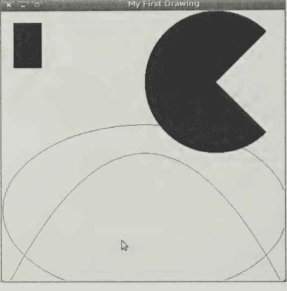

**图 12.2：** 一个示例绘图，展示了通过调用 fill 和 draw 绘制的矩形、椭圆、圆弧和二次曲线。

# 12.2.2 设置

绘制形状提供了强大的功能和灵活性。然而，在图 12.2 中可以看到一些明显的限制。其中最显著的是，所有内容都以相同的颜色显示在默认的浅灰色背景上。另一个限制是，这些形状是用细的单像素线绘制的。为了克服这些限制，我们需要能够告诉 Graphics2D 对象以不同的方式绘制内容。这可以通过更改各种设置来实现。

### 12.2.2.1 绘制（Paint）

在大多数应用程序中，最重要的设置是 Paint 设置。在 Java 2D 之前，这只是一个简单的颜色设置。然而，当您绘制内容时，可用的选项远不止单一纯色。Paint 类型是表示这些不同选项的一种方式，就像 Shape 类型是概括表示您可能想要绘制的不同类型对象的一种方式。可用于 Paint 的主要选项如下。

- Color – 纯色仍然有用，Color 类型表示这些颜色。许多标准颜色已经为您预定义。因此，您可以使用 Color.white、Color.black、Color.red、Color.green、Color.blue 等。您还可以通过组合不同数量的红、绿、蓝来“混合”自己的颜色，使用 `new Color(r:Float, g:Float, b:Float)` 或 `new Color(r:Int, g:Int, b:Int)`。如果使用 Float 版本，值应在 0.0f 到 1.0f 之间（含）。如果使用 Int 版本，它们应在 0 到 255 之间（含）。这两个构造函数都可以添加第四个参数，即 ALPHA 值，它表示不透明度。alpha 值为零会使颜色完全透明。
- Gradient Paints（渐变绘制） – 您可以使用多种渐变绘制，包括以下两种。
  - LinearGradientPaint – 这种 Paint 允许颜色沿一条线逐渐变化。您可以指定这条线的端点、所需的多个 Color 以及它们在线上的位置。在与线垂直的方向上，颜色没有变化。您可以使用 `new LinearGradientPaint(startX:Float, startY:Float, endX:Float, endY:Float, fractions:Array[Float], colors:Array[Color])` 创建一个。fractions 中的值应介于 0.0f 和 1.0f 之间，应以 0.0f 开头并以 1.0f 结尾，并且 fractions 中的元素数量应与 colors 中相同。
  - RadialGradientPaint – 这种 Paint 样式允许颜色从给定位置沿径向向外移动时发生变化。您可以使用 `new RadialGradientPaint(cx:Float, cy:Float, radius:Float, fractions:Array[Float], colors:Array[Color])` 或 `new RadialGradientPaint(cx:Float, cy:Float, radius:Float, fx:Float, fy:Float, fractions:Array[Float], colors:Array[Color], cycleMethod:MultipleGradientPaint.CycleMethod)` 创建一个。后一种形式允许您指定一个偏离中心的焦点。cycleMethod 将在下文中描述。
  - Cycle Options（循环选项） – 对于上面列出的每种渐变绘制，您可以在创建它们时提供一个额外参数，指定在渐变的正常边界之外希望发生什么。默认情况下不进行循环，因此这些区域使用纯色。但是，您也可以指定颜色重复或反射。为此，请使用以下三个常量之一。
    - `MultipleGradientPaint.CycleMethod.NO_CYCLE`
    - `MultipleGradientPaint.CycleMethod.REPEAT`
    - `MultipleGradientPaint.CycleMethod.REFLECT`
- TexturePaint – 这会使用指定的图像填充绘制区域，该图像在某个区域内平铺，并在该区域外重复。您可以使用 `new TexturePaint(txtr:BufferedImage, anchor:Rectangle2D)` 创建一个。BufferedImage 类型将在第 12.3.1 节中描述。

这些不同的 Paint 样式为我们提供了强大的能力和对绘制对象着色的控制。我们可以用它们将面板填充为空白白色背景，然后用不同类型的 Paint 填充上面绘制的每个不同对象。

可以将以下代码放入 paint 方法中，以演示除 TexturePaint 之外的不同 Paint 类型。

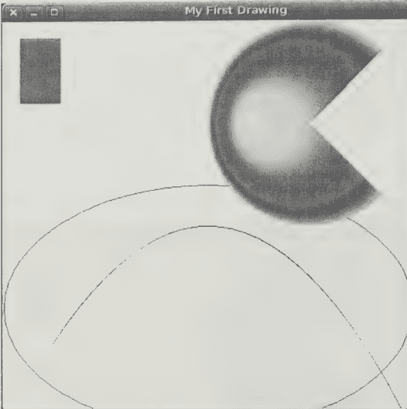

**图 12.3：** 此图显示了在我们之前的 Shapes 绘图中添加一些 Paint 设置后得到的结果。

```
g.setPaint(Color.white)
g.fill(new Rectangle2D.Double(0,0,size.width,size.height))
g.setPaint(Color.red)
g.fill(new Rectangle2D.Double(20,20,50,80))
g.setPaint(Color.blue)
g.draw(new Ellipse2D.Double(0,200,500,300))
g.setPaint(new RadialGradientPaint(375,125,125,300,125,
    Array(0.0f,0.3f,0.8f,1.0f),
    Array(Color.yellow,Color.cyan,Color.magenta,Color.green),
    java.awt.MultipleGradientPaint.CycleMethod.REPEAT))
g.fill(new Arc2D.Double(250,0,250,250,45,270,Arc2D.PIE))
g.setPaint(new LinearGradientPaint(200,500,300,250,
    Array(0.0f,0.4f,0.7f,1.0f),
    Array(Color.white,Color.darkGray,Color.lightGray,Color.black)))
g.draw(new QuadCurve2D.Double(0,500,250,0,500,500))
```

此代码将产生如图 12.3 所示的输出。每个不同的 Shapes 都使用在其之前指定的 paint 绘制。

### 12.2.2.2 描边（Stroke）

图 12.3 所示的主要问题是，您无法真正分辨出那些被绘制（而非填充）的图形是什么颜色。这是因为它们是用宽度仅为一个像素的线条绘制的。为了解决这个问题，我们需要引入 Graphics2D 上的下一个设置：Stroke。标准中只提供了一种 Stroke 类型。

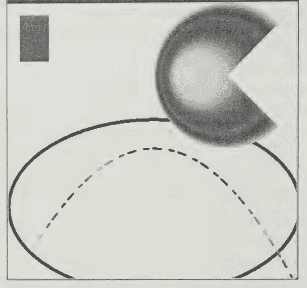

**图 12.4：** 这是在我们为两个被绘制而非填充的元素添加了一些 Stroke 设置后，绘图看起来的样子。

```
g.setStroke(new BasicStroke(4f,BasicStroke.CAP_ROUND,
BasicStroke.JOIN_BEVEL,1f,
Array(8f,8f,14f,14f),0f))
```

这会生成一条四像素粗的虚线，线段末端带有圆头端点。当我们为这两个元素都添加设置后得到的结果如图 12.4 所示。

### 12.2.2.3 字体（Font）

当您调用 drawString 方法时，文本会使用当前的 Font 在指定位置绘制。值得注意的是这个位置具体在哪里。为了帮助说明这一点，我们将以下代码添加到 paint 方法的末尾。

```
g.setPaint(Color.black)
g.drawString("A test string to print.",20,20)
g.setStroke(new BasicStroke(1.0f))
g.drawLine(20,20,200,20)
```

这段代码将颜色设置为黑色，绘制一个字符串，然后将 Stroke 重新设置为细线，并从字符串的同一位置向右侧绘制一条线。添加这段代码后的结果如图 12.5 所示。从中可以看出，字符串的位置并不是大多数形状所用的左上角。对于字符串而言，如果文本写在横线纸上，这个位置将是底线的起点。因此，像“g”和“p”这样的字母会低于 y 坐标，但大部分文本位于 y 坐标上方。所有内容都位于 x 坐标的右侧。


这些的任意组合也是一种仿射变换。

AffineTransform 在计算机中用一个 3x3 矩阵表示，其细节我们通常会忽略。有兴趣的读者可以查看应用程序编程接口（API）页面了解一些细节，或者应该考虑学习图形课程，该课程应涵盖矩阵变换在二维和三维图形应用中的细节。当你调用 new AffineTransform() 时，你会得到一个恒等变换。这是一个不改变任何东西的变换，其表示为单位矩阵。也有传递参数的选项，可以让你以你想要的任何方式构建变换矩阵。

通常，你不想深入到矩阵元素的层面。通常你想要能够指定想要多少旋转或平移。有许多方法可以调用来实现这一点。

- AffineTransform.getRotateInstance(theta:Double)
- AffineTransform.getRotateInstance(theta:Double, anchorx:Double, anchory:Double)
- AffineTransform.getScaleInstance(sx:Double, sy:Double)
- AffineTransform.getShearInstance(shx:Double, shy:Double)
- AffineTransform.getTranslateInstance(tx:Double, ty:Double)

这些方法返回产生指定变换的 AffineTransform 实例。对于旋转，角度 theta 应以弧度给出。

AffineTransforms 也可以组合。这可以通过通用的 concatenate(tx:AffineTransform) 方法完成。还有构建更复杂变换的方法。

- rotate(theta:Double)
- rotate(theta:Double, anchorx:Double, anchory:Double)
- scale(sx:Double, sy:Double)
- shear(shx:Double, shy:Double)
- translate(tx:Double, ty:Double)

这些方法会修改变换对象，该对象是可变的，以包含此新变换。需要注意的是，Graphics2D 对象整体上也有几乎相同的方法。调用这些方法会将这些更改应用于用于绘图的 AffineTransform。

为了说明变换能做什么，我们将在正在运行的示例中添加一行代码。

```
g.rotate(math.Pi/4)
```

此行应在绘制 QuadCurve 之后、在绘制 String 之前插入。添加此行的结果如图 12.6 所示。注意 String 的方向已被改变。此版本的 rotate 是围绕原点进行的，默认情况下原点位于左上角。我们将其旋转了 π/4 弧度，这相当于 45 度。

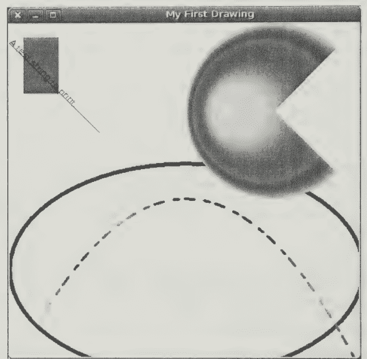

FIGURE 12.6: This figure shows what happens when we do a rotation before drawing our String.

```
override def paint(g:Graphics2D) {
    if(img == null || img.getWidth < size.width ||
        img.getHeight < size.height) {
        img=new BufferedImage(size.width, size.height,
            BufferedImage.TYPE_INT_ARGB)
    }
    val g2=img.createGraphics
    // Draw to g2
    g.drawImage(img,0,0,null)
}
```

Panel 中的第一行代码创建一个新变量来存储图像。这里需要 BufferedImage 类型说明，否则 Scala 会推断出 Null 类型。在 paint 方法中，首先会检查图像是否已创建并且是否足够大以覆盖 Panel。如果不是，则会创建一个新图像。

在确定我们拥有足够大小的图像后，代码获取用于向该图像绘制的 Graphics2D 对象，并且我们想要绘制的任何内容都会绘制到该图像上。该方法中最后发生的事情是将图像绘制到 Panel 上，以便它出现在屏幕上。

# 12.3.4 Revisiting TexturePaint

现在我们知道了图像，我们可以重新审视前面讨论过的 Paint 类型之一，TexturePaint。TexturePaint 的想法是用指定的图像填充绘制/填充的形状，该图像在某个网格上重复。当你创建一个 TexturePaint 时，你提供一个图像和一个被称为锚点的矩形。图像会出现在该矩形内部，并以平铺模式在其周围重复。为了说明这一点，我们可以在为椭圆设置颜色为蓝色之前输入以下代码。

```
g.setPaint(new TexturePaint(ImageIO.read(new File("rtImg.png")),
    new Rectangle2D.Double(0,0,200,200)))
g.fill(new Ellipse2D.Double(0,200,500,300))
```

这填充了相同的椭圆，但使用的是从磁盘加载的文件的纹理。 使用此特定文件的结果如图 12.7 所示。

# 12.4 Other Events

Swing 库中的标准组件在其内部包含代码来发布特定于你如何与其交互的事件，或使其非常容易为这些交互提供操作。Panel 没有任何标准的交互模式。用户如何与其交互完全由你决定。因此，你必须在 somewhat 更低的级别处理事件。我们需要直接监听鼠标和键盘操作并对其做出适当反应。

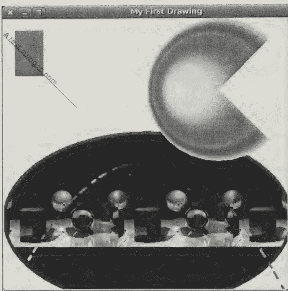

FIGURE 12.7: This image displays the use of a TexturePaint. The ellipse is filled with a tiling of an image that is loaded from a disk.

### 12.4.1 Mouse Events

鼠标通常是与 GUI 组件交互最自然的方式。起初你可能会认为你只想对鼠标按钮点击做出响应。然而，如果你花一点时间思考，你会意识到许多程序与鼠标的交互方式比仅仅点击要复杂得多。鼠标可以触发八种不同类型的事件。你不太可能在单个面板中关心所有这些事件，但你可能需要处理其中几种以产生你想要的效果。

这些鼠标事件在所有 **Components** 上都可用，即使是已经以自己的方式处理事情的标准组件也是如此。这允许你包含自己的自定义行为。因此，所有 **Components** 都包含一个名为 *mouse* 的对象。*mouse* 对象反过来包含三个 **Publisher** 对象，称为 `clicks`、`moves` 和 `wheel`。每个不同的 **Publisher** 都会为你提供有关鼠标正在做什么的不同信息。你需要监听产生你需要的事件的那一个或那些。你只需要知道鼠标何时被点击，你就需要执行 `listenTo(mouse.clicks)`。如果你想知道鼠标移动或被拖动到哪里，你就会将 `mouse.moves` 添加到你正在监听的事物列表中。

这是 `scala.swing.event` 中不同事件的列表，按产生它们的 **Publishers** 组织。

- MouseEvent - All of the events listed below are all subtypes of MouseEvent.
- `mouse.clicks`
  - `MouseClicked`
  - `MouseEntered`
  - `MouseExited`
  - `MousePressed`
  - `MouseReleased`
- `mouse.moves`
  - `MouseMoved`
  - `MouseDragged`
- `mouse.wheel`
  - `MouseWheelMoved`

所有鼠标事件都包含 *point*、*source* 和 *modifiers* 作为成员。*point* 成员是一个 `java.awt.Point`，它内部有 *x* 和 *y* 成员。*source* 是一个 **Component**，这样你就可以弄清楚在事件产生时鼠标在 GUI 中的什么位置。修饰符存储在 **Int** 中，可以为你提供有关哪个鼠标按钮或按钮被按下的信息。

只要鼠标按钮按下，就会触发 **MousePressed** 事件。当鼠标按钮松开时，就会触发 **MouseReleased** 事件。**MouseClicked** 事件仅在鼠标按钮按下并在鼠标移动之前放开时才触发。如果鼠标在按下时移动，而不是得到 **MouseClicked** 事件，你将通过移动得到 **MouseDragged** 事件。

在对事件的 **reactions** 内部，你可能会更改一些可变数据，从而改变绘制的内容。然而，这种更改不会自动在绘图中显示。


为了使其可见，你需要告诉 Panel 它应该重新绘制自身。为此，你可以调用 Panel 的 `repaint()` 方法。这个方法并不会实际进行绘制，而是安排绘制在将来程序不太繁忙的时候进行。这种机制的具体原理将在第 21 章讨论。现在你只需要知道，如果你希望 Panel 被重新绘制，就应该调用 `repaint()`。

# 12.4.2 键盘事件

你可能还希望你的 GUI 对键盘上的按键按下做出响应。例如，让你的图形中的某个对象随字母键而变化，或在按下方向键时移动。键盘事件由组件中的 `keys` 对象发布。因此，如果你想要对键盘做出反应，可以在代码中添加 `listenTo(keys)`。

与鼠标类似，键盘可以产生多种不同类型的事件。所有这些事件都属于 KeyEvent 这一大类。

- KeyEvent
- KeyPressed
- KeyReleased
- KeyTyped

这比鼠标简单。只有四种不同类型的事件。与鼠标一样，按下和释放有独立的事件。KeyTyped 事件类似于 MouseClicked，但没有与鼠标未移动相对应的事件。在这种情况下，KeyTyped 事件仅在按下的是普通字符键时触发。它也应该按照按住按键时通常得到的重复速率触发。因此，如果你想要对方向键或其他非字符按键做出反应，就需要使用 KeyPressed 和 KeyReleased。

当你监听 KeyTyped 时，可以使用事件的 `char:Char` 字段来找出输入的是哪个字符。KeyPressed 和 KeyReleased 事件不能简单地用 Char 来表示按下的键，因为它们可以处理非普通字符。它们有一个名为 key 的字段，其值在 `scala.swing.event.Key` 对象中指定。因此，如果你想检查是否按下了上箭头键，可以在代码中写入以下内容。

```
if(e.key==Key.Up) ...
```

这假设 KeyPressed 或 KeyReleased 的变量名为 e。Key 对象也包含了键盘上所有其他按键的成员。完整列表请查阅 API。

如果你在代码中监听了 keys 发布者，然后添加了对所关心事件的处理反应，当你运行程序却发现什么都没有发生时，你很可能会非常失望。以为哪里出了问题，你可能会在代码中加入打印语句来尝试弄清楚发生了什么。你会发现，尽管你在监听键盘事件并且有正确的反应代码，却根本没有收到任何键盘事件。这个问题与一个称为“焦点”（FOCUS）的概念有关。

GUI 中当前选中的元素被称为具有焦点。按键输入只会发送到该组件。要理解这一点，只需想象一个包含多个文本字段的 GUI。当你输入时，字符不会同时进入所有文本字段。相反，你的输入只会出现在一个字段中，即具有焦点的那个字段。要让你的 Panel 接收按键输入

你必须给它焦点。你可以通过调用 Panel 的 `requestFocus` 方法来实现这一点。在 Panel 显示之前调用此方法没有用，因此你应该在将 `frame` 设置为可见之后再调用。最好也添加一个请求焦点的鼠标事件。根据应用程序的不同，你可能希望在 `MouseClicked` 事件或 `MouseEntered` 事件中执行此操作。前者只有在用户点击面板时才会获得焦点。后者则只要鼠标进入面板区域就会赋予焦点。

# 12.5 使用定时器的动画

你也可能希望在无需按下任何按键或使用鼠标的情况下，让某些事情发生。动画就是一个例子。为了实现这一点，你应该使用 `javax.swing.Timer` 对象。`Timer` 对象会按固定时间间隔执行代码。我们使用 `new Timer(delay: Int, listener: java.awt.event.ActionListener)` 来构建一个 `Timer`。`delay` 是以毫秒为单位的值。`ActionListener` 类型在 Java 版的 Swing 中用于响应简单的动作，例如点击按钮。这些类型使用得如此频繁，以至于 Scala 版的 Swing 提供了一个简单的方法来创建它们：`Swing.ActionListener(action: (java.awt.event.ActionEvent) => Unit)`。这里我们又看到了一个来自 Java 库的类型。不过，你在代码中很少需要使用这个类型。

把所有这些放在一起，你可以用以下代码创建一个 `Timer`。

```
val timer=new javax.swing.Timer(100,Swing.ActionListener(e => {
// code to mutate values used in drawing.
panel.repaint()
}))
```

调用 `repaint` 的原因与 12.4.1 节讨论的相同。用户只有在屏幕下次绘制后才会看到所做的更改。这里使用了 `Timer` 的全名而不是 `import` 语句，因为这很可能是它唯一被使用的地方。如果你发现自己多次输入它，那么你可能需要使用 `import` 语句。

`Timer` 有 `start` 和 `stop` 方法，它们的作用与名称一致。`Timer` 最初不会运行。你必须调用 `start` 方法来启动它。如果停止的原因是 `Timer` 中应该发生的动作的一部分，那么 `stop` 方法可能会带来一个有趣的问题。使用上面展示的风格，`Timer` 中的动作是在声明 `timer` 变量时构建的。这实际上使其成为递归声明。因此，使用这种方法，你不能在动作代码中调用 `timer.stop`。有两种方法可以绕过这个问题。一种是在 `timer` 声明上指定类型。这会重复类型信息，并且可能表明应该使用 `import`。如下所示。

```
import javax.swing.Timer
val timer=new javax.swing.Timer(100,Swing.ActionListener(e => {
// code that potentially includes timer.stop().
panel.repaint()
}))
```

另一种方法是使用一种略有不同的方式来设置 `timer`，在这种方式中

我们先给它一个 null 动作，然后再向其添加一个 ActionListener。使用这种方法的代码可能如下所示。

```
val timer=new javax.swing.Timer(100,null)
timer.addActionListener(Swing.ActionListener(e => {
  // code that potentially includes timer.stop().
  panel.repaint()
}))
```

# 12.6 综合应用

我们以一个包含鼠标和键盘输入、并使用 Timer 定期更新内容的示例程序来结束本章。为了让示例更有趣，我们将使用这些功能制作一个小游戏。在游戏中，玩家用键盘控制一个绿色小点。红色小点试图抓住绿色小点，如果成功了，玩家就输了。鼠标用来在屏幕区域“绘制”水坑，这些水坑会减慢玩家和敌人的速度。这就是基本思路。

在分析中还有一些细节。水坑会随着时间消失，敌人也只能存活一段时间。不过敌人确实会重生。随着游戏的进行，敌人开始更快地重生，并且存活更长时间。所以真正的目标是看玩家能存活多久。下面是这个游戏的代码。

```
import scala.swing._
import event._
import java.awt.{Graphics2D,Color}
import java.awt.geom._
import java.awt.image.BufferedImage
import javax.swing.Timer
```

```
case class Enemy(x:Int,y:Int,time:Int)
case class Player(x:Int,y:Int)
```

```
val PanelSize = 600
```

```
var enemies = List(Enemy(PanelSize-100,PanelSize-100,0))
var player = Player(300,300)
var leftPressed = false
var rightPressed = false
var upPressed = false
var downPressed = false
var currentTime = 0
var regenDelay = 100
var enemyLifespan = 100
val puddleImage = new
  BufferedImage(PanelSize,PanelSize,BufferedImage.TYPE_INT_ARGB)
for(i <- 0 until PanelSize; j <- 0 until PanelSize) {
  puddleImage.setRGB(i,j,0)
}
```

```
val panel = new Panel {
```


override def paint(g:Graphics2D) {
    g.setPaint(Color.black)
    g.fillRect(0,0,size.width,size.height)
    g.drawImage(puddleImage,0,0,null)
    for(enemy <- enemies) {
        g.setPaint(new Color(1f, 0f, 0f, (currentTime-enemy.time)/enemyLifespan.toFloat))
        g.fill(new Ellipse2D.Double(enemy.x-5,enemy.y-5,10,10))
        val dx = enemy.x-player.x
        val dy = enemy.y-player.y
        if(dx*dx+dy*dy<25) {
            g.setPaint(Color.white)
            g.drawString("You Lose!",200,200)
            timer.stop
        }
    }
    g.setPaint(Color.green)
    g.fill(new Ellipse2D.Double(player.x-5,player.y-5,10,10))
}

val imageG = puddleImage.createGraphics()
imageG.setColor(new Color(200,150,50))

def drawPuddle(x:Int,y:Int) {
    val radX = util.Random.nextInt(5)+5
    val radY = util.Random.nextInt(5)+5
    imageG.fill(new Ellipse2D.Double(x-radX, y-radY, radX*2, radY*2))
    repaint
}

listenTo(mouse.clicks,mouse.moves,keys)
reactions += {
    case mp:MousePressed => drawPuddle(mp.point.x, mp.point.y)
    case md:MouseDragged => drawPuddle(md.point.x, md.point.y)
    case me:MouseEntered => requestFocus
    case kp:KeyPressed =>
        if(kp.key==Key.Left) leftPressed = true
        if(kp.key==Key.Right) rightPressed = true
        if(kp.key==Key.Up) upPressed = true
        if(kp.key==Key.Down) downPressed = true
    case kp:KeyReleased =>
        if(kp.key==Key.Left) leftPressed = false
        if(kp.key==Key.Right) rightPressed = false
        if(kp.key==Key.Up) upPressed = false
        if(kp.key==Key.Down) downPressed = false
}

preferredSize = new Dimension(PanelSize,PanelSize)
}

def inMud(x:Int,y:Int):Boolean = {
    (puddleImage.getRGB(x,y) >>> 24) > 0
}

val timer:Timer = new Timer(100,Swing.ActionListener(e => {
val speed = if(inMud(player.x,player.y)) 1 else 3
if(leftPressed) player = player.copy(x = player.x-speed)
if(rightPressed) player = player.copy(x = player.x+speed)
if(upPressed) player = player.copy(y = player.y-speed)
if(downPressed) player = player.copy(y = player.y+speed)

enemies = for(e <- enemies; if e.time+enemyLifespan>currentTime) yield {
  val speed = if(inMud(e.x,e.y)) 1 else 4
  val dx = if(e.x<player.x) speed else if(e.x>player.x) -speed else 0
  val dy = if(e.y<player.y) speed else if(e.y>player.y) -speed else 0
  e.copy(x = e.x+dx+util.Random.nextInt(5)-2,
    y = e.y+dy+util.Random.nextInt(5)-2)
}

for(i <- 0 until PanelSize; j <- 0 until PanelSize) {
  val argb = puddleImage.getRGB(i,j)
  val alpha = argb >>> 24
  if(alpha>0) puddleImage.setRGB(i,j,(argb & 0xffffff) | ((alpha-1) << 24))
}
currentTime += 1
if(currentTime%regenDelay==0) {
  val cx = util.Random.nextInt(2)
  val cy = util.Random.nextInt(PanelSize-10)
  enemies ::= Enemy(10+cx*(PanelSize-20), cy, currentTime)
  if(regenDelay>10) regenDelay -= 1
  if(math.random<0.1) enemyLifespan += 1
}
panel.repaint()
})

val frame = new MainFrame {
  title = "Puddle Dash"
  contents = panel
  menuBar = new MenuBar {
    contents += new Menu("File") {
      contents += new MenuItem(Action("Start")(timer.start))
      contents += new Separator
      contents += new MenuItem(Action("Exit")(sys.exit(0)))
    }
  }
}

frame.visible = true
panel.requestFocus

这段代码实际上分为四大块。顶部是各种变量声明。接下来是Panel的定义，接着是Timer，最后是MainFrame。在变量中，有两个样例类的声明，分别叫做Enemy和Player。敌人们存储在一个List中，玩家则只有一个变量。还有一些变量用来跟踪当前按下了哪些方向键。这使得移动由Timer代码完成，而非事件处理。这让我们能够控制玩家和敌人的相对速度。为了让游戏更有趣，玩家的速度大约比敌人慢25%。还有一些变量用于跟踪时间，以及一个**BufferedImage**，用于绘制和跟踪水坑。²

**Panel**有一个*paint*方法，用于清空屏幕、绘制*puddle*图像、绘制敌人，然后绘制玩家。**puddleImage**一开始完全透明。敌人一开始也是透明的，随着时间推移逐渐变得不透明，直到死亡。这增加了一点难度，因为很难看到它们从哪里出现，但比起敌人在接近死亡时变得透明，这会让游戏更好玩。**Panel**还有事件处理器，为**MousePressed**或**MouseDragged**调用**drawPuddle**，另有针对**KeyPressed**和**KeyReleased**的处理器，它们会设置控制玩家移动的*Boolean*变量的值。

大部分逻辑都在**Timer**中。它根据按键和泥泞情况移动玩家。然后，它根据泥泞情况以一定速度将敌人移向玩家。敌人的移动还带有一个随机成分，以防止一切过于可预测。移动敌人后，会遍历**puddleImage**的每一个像素，如果alpha值大于零，就将其*递减*。之后，**currentTime**递增，并检查是否到了生成新敌人的时间。如果是，就沿着边缘随机选择一个位置，将敌人添加到那里。同时，敌人出现的间隔也会缩短，还有10%的概率会让敌人的寿命增加。

代码最后创建了一个*frame*，它包含**Panel**，并有一个带基础菜单的菜单栏。输入这段代码并稍微玩一下这个游戏。对于125行代码来说，这是一个相当有趣的游戏。观看它的实际运行也有助于你理解正在发生的事情。

# 12.7 章末材料

### 12.7.1 概念总结

- 如果你理解如何进行图形绘制，你就能超越标准的GUI组件，在**Panel**上绘制任何你想要的内容。
- 2-D图形是通过*Java2D*库生成的。这些库以**java.awt.Graphics2D**类型为核心。
  - 在**Graphics2D**中有多种绘制对象的方法，最灵活的是**draw(s:Shape)**和**fill(s:Shape)**。**java.awt.Shape**类型非常灵活，可以描述多种形状。相关示例可以在**java.awt.geom**中找到。
  - **Graphics2D**实例如何绘制对象由各种设置决定。
    - **setPaint**方法可以改变对象的填充方式。**Paint**有多种不同类型，包括**java.awt.Color**、**java.awt.LinearGradientPaint**和**java.awt.TexturePaint**。
    - 直线和曲线的绘制方式称为*Stroke*。你可以通过调用**setStroke**并传入一个**java.awt.BasicStroke**来更改笔画。
- 可以用不同字体绘制字符串。这通过向`setFont`传递一个`java.awt.Font`对象来设置。
- 你可以通过调用`setClip(s:Shape)`来调整用于任何绘图部分的裁剪区域。
- 所有绘制到`Graphics2D`的内容都可以使用任何仿射变换进行变换。

仿射变换是任何保持平行线的变换。它们由`java.awt.geom.AffineTransform`表示。仿射变换有四种基本类型，可以任意组合以创建更复杂的仿射变换。

- 平移在二维空间中移动所绘制的内容。
- 旋转围绕空间中的某个特定点转动绘制内容。
- 缩放可以独立地在x或y方向上改变绘制内容的大小。
- 剪切会将一个轴的部分引入到另一个轴中。

除了绘制到屏幕，你还可以绘制到图像。基本的图像类型是`java.awt.Image`。它非常通用，可以表示许多类型的设备。

- 你最常使用的是`java.awt.image.BufferedImage`，它表示一个像素光栅。
- 你可以使用`javax.imageio.ImageIO`类中的方法从文件读取图像或将图像写入文件。
- 图像的一个非常重要用途是双缓冲，即在屏幕之外的图像上进行绘制，然后将完成的图像绘制到屏幕上。

Panel类型没有自然的默认交互形式，例如点击Button或在TextField中键入。相反，你需要通过直接处理鼠标和键盘事件来使其具有交互性。

- 所有Component都有一个mouse对象，其中包含三个对象，用于处理不同类型的鼠标事件。
  - mouse.clicks提供MouseClicked、MousePressed、MouseReleased、MouseEntered和MouseExited事件。
  - mouse.moves提供MouseMoved和MouseDragged事件。
  - mouse.wheel提供MouseWheelMoved事件。
- 要获得所按键的信息，你可以侦听Component中的keys对象。
  - 键盘事件只会发送到具有焦点的Component。使用requestFocus方法将焦点给予正确的Component。
  - 当一个普通字符键在键盘上按下并抬起时，会返回一个KeyTyped事件。它有一个char成员，会告诉你所键入键的Char值。
  - KeyPressed和KeyReleased事件让你知道某个键何时被按下或抬起，并且适用于任何键，包括非字符键。要了解按下或释放的是哪个键，请将key成员与scala.swing.event.Key对象中的值进行比较。

若要在无需用户交互的情况下按固定间隔触发事件，例如动画，请使用`javax.swing.Timer`对象。

²曾经考虑过创建一个*Puddle*类型并保存一个列表的方案。之所以采用当前方式，是因为它更高效，同时也很好地展示了**BufferedImage**的用法。


# 12.7.2 练习

- 1. 创建一个面板，使用不同类型的画笔（Paint）和描边（Stroke）绘制几种几何形状。
- 2. 使用 `java.awt.geom.Area` 类型创建一个有趣的形状。
- 3. 使用 `java.awt.geom.Path2D` 类型创建一个有趣的形状，其中至少包含一段不是直线的部分。
- 4. 使用渐变风格的画笔和 `Timer` 制作一个颜色会移动的图案。
- 5. 在宽描边上使用虚线，并结合 `Timer`，让虚线随着 `Timer` 的每次触发而移动。
- 6. 编写一个脚本，用方向键控制一个几何图形的移动。在鼠标单击的位置放置另一个图形，当两者相交时用不同颜色绘制它们。
- 7. 完善本章末尾的躲避游戏。

# 12.7.3 项目

- 1. 如果你已经完成项目 1（第 243 页），你应当已经注意到，仅靠查看数字来弄清楚发生了什么相当痛苦。要想判断粒子是否正确运动，绘制出它们的运动轨迹确实很有帮助。在本项目中，你要在原有程序上添加一个带自定义绘制面板的 GUI，以便绘制出粒子所在的位置。

这样做唯一的挑战是如何把粒子所在的坐标转换为适合普通窗口的坐标。有两种做法。一种是自行计算：为 x 和 y 指定最小值和最大值，然后用线性方程把 `(min, max)` 范围映射到 `(0, width)` 或 `(0, height)`。另一种是使用 `AffineTransform`，结合 `scale` 和 `translate` 来完成。两种方法各有好处，难度也相差不大。

为了让 GUI 更实用，你可以加入文本框（`TextField`），让用户修改 `X_min`、`X_max`、`Y_min` 和 `Y_max` 的值。你也可以加入复选框（`CheckBox`），让用户选择每次绘制粒子时是否清除背景。不清除背景时，你会看到粒子移动时留下的路径；清除背景时，你只会看到用来绘制粒子的那些图形。

- 2. 本项目要求你编写一个脚本，读取包含数字的文本文件并绘制数据。你可以自行选择想要实现的绘图样式以及数据格式。与上一个项目一样，主要挑战在于把数据点所在的坐标转换为能在屏幕上良好显示的形式。

- 3. 1982 年上映的电影《Tron》（http://www.imdb.com/title/tt0084827/）包含了许多不同的早期街机风格游戏。其中一种叫做“光轮摩托”的游戏可以简化到非常容易编写的地步。本项目正是要求你完成这件事。

游戏中，玩家骑乘光轮摩托，身后会留下彩色墙壁。程序运行时，应在面板的点击位置添加一个新的“种子”（只需把图像中该点的颜色设置为晶体颜色）。

应该有一个按钮（`Button`）或菜单选项来释放更多粒子。当一个粒子被释放时，它应从某条边开始移动。你只需要记录它的 x、y 位置。使用 `while` 循环让粒子随机移动，直到这次移动会把它放到一个已有晶体的位置上。此时，把粒子原来所在位置的像素改成晶体颜色。

要让粒子随机移动，可以使用 `util.Random.nextInt(4)` 得到一个 0-3 之间的数字，然后根据这个值向上、向下、向左或向右移动。如果某次移动会把粒子移出图像，就忽略这次移动。菜单选项大概应该通过一个循环释放 100 个左右的粒子，并让每个粒子一直移动直到附着。你只需要在所有粒子都找到位置后重绘一次。

请注意，尤其是在晶体种子还很小的时候，粒子可能要移动很久才能碰到种子。

- 7. 如果你在之前的项目中一直在选做光线追踪，现在是时候真正看到一些结果了。你可以使用为项目 2（第 244 页）编写的代码来生成参数值网格，然后直接根据相交参数 t 在 `BufferedImage` 中设置颜色。为此，你很可能需要构建自己的颜色。你可以通过 `new Color(r:Int, g:Int, b:Int)` 创建新的 `Color` 对象，其中 r、g、b 在 0-255 范围内。超出该范围的值会导致错误。只需把图像显示在放到 GUI 中的 `Panel` 上，即可看到光线追踪的深度信息。

- 8. 编写一个你自选的简单 2D 游戏，使用简单几何图形或精灵图（用于角色的小图片）。你的游戏应有一个 `Timer` 来驱动动作的发生，并接受用户以按键或鼠标移动形式提供的输入。到目前为止，你已有的知识足以编写多种类型的游戏，但建议你尽量保持简单。要有移动和一定的碰撞检测。

- 9. 这个项目要求你编写另一个你可能很熟悉的简单“游戏”：在一个 4×4 网格中滑动方块，其中有一个空位。方块上可以是数字，也可以是图片的一部分。你的目标是通过把方块滑入那唯一的空位来移动它们，直到它们处于期望的顺序。

编写一个带有 `Panel` 的 GUI 来显示这个 4×4 网格。你可以选择使用数字还是图片的一部分。如果要用图片的一部分，可以先加载完整图像，再按偏移量把它绘制到较小的图像中，使每个方块只需要的那部分出现在对应的小图像中。

用户应通过单击想滑动的方块来与游戏交互。在最简单的实现中，他们必须单击与空位相邻的方块。如果想增加一点挑战，你可以让他们单击与空位同一行或同一列的任意方块，并同时移动多个方块。

- 10. 如果你已经完成项目 8（第 281 页），那么你已经有了一个用于记录某人的食品储藏室（pantry）内容并查看食谱的 GUI。然而，这个 GUI 相当平淡。既然你已经知道如何加入图形，你就有能力让它更美观。在本项目中，你应在之前的 GUI 上增加将图片与食材和食谱关联起来的能力，还应在 GUI 中添加食谱的制作步骤说明。

基本实现应指定图片的文件名。图片文件需要复制到脚本运行所在的目录。如果你想更有挑战性，可以利用 `ImageIO.read` 接收 `URL` 对象的能力，这样图片路径就可以用完整 URL 给出并从网络加载。更进一步，你可以让用户第一次输入 URL，然后将其本地保存为图片。你可以使用 `ImageIO` 的 `write` 方法保存图片，细节见 API。

- 11. 对项目 8（第 281 页）的另一种升级是让它帮助你规划购物行程。为此，你需要第二个数据文件，说明商店中各商品所在的位置。这可以简单到只列出商品所在的货架。如果你还想提供每件商品大致位于过道的什么位置的信息，也可以。

你需要让用户能够使用商店文件中的商品来建立购物清单。他们应该能在查看当前食品储藏室内容的同时完成这一点，或者至少能快速在两个视图之间切换。购物清单应能指定商品和数量。用户应能表明自己要购买该清单，并让这些商品加入食品储藏室。

货架信息用来构建商店的简单图形表示。你可以用矩形表示货架，并在每个货架中为商品放置带标签的圆点。具体细节由你决定。

- 12. 在本选项中，你可以为项目 10（第 282 页）中构建的日程表添加图形表示。目标是让日程表呈现为相当标准的“周视图”。每天对应一列，课程应以带标签的矩形显示，矩形跨越该课程占用的当天时间段。这样更容易看出什么时候有过长的上课时间块，或者周围零散分布着太多小段休息。

如何指定时间由你决定。在这一系列的上一个项目中，曾建议为日程中的每个时间指定一个唯一的整数编号。如果沿用这一做法，你需要为这些时间段硬编码时间和日期。另一种方案是增加功能，让用户输入具体的时间和日期。如果走这条路，在构建日程时将需要更复杂的代码，以确保没有两门课程被安排在同一时间。

- 13. 曼德博集合（Mandelbrot Set）是复平面中一个著名的分形，由伯努瓦·曼德博（Benoit Mandelbrot）发现。在网上搜索会得到大量关于这一美丽结构的信息。曼德博集合之所以如此引人注目，部分原因在于它的定义非常简单，却包含着无限复杂的结构。该集合定义为复平面中的点 *c*，使得方程 \( z_{n+1} = z_n^2 + c \)（其中 \( z_0 = 0 \)）给出一个有界序列。

实际上，如果 \(|z|\) 的值一旦超过 4，序列就会发散。因此，探索曼德博集合的程序会统计达到该点所需的迭代次数，并根据迭代次数分配颜色。由于集合内部的点永远不会发散，所以必须设定一个最大迭代次数，达到该次数后就认为该点属于集合。

在本项目中，你要编写一个显示曼德博集合的 GUI 程序。你需要提供一个该集合的视图，包含实轴和虚轴上的最小值和最大值。允许用户通过单击放大。

- 14. 大多数允许你管理音乐的应用程序，例如为项目 7（第 281 页）编写的那个，都会显示专辑封面。请把这一点加入你的解决方案，以便


当选中专辑（或可能是歌曲）时，会显示该专辑的封面图。封面图可以存储在脚本和数据文件所在的同一目录中，也可以使用 URL。

- 15. 大多数交互式计分板不仅仅像你在项目12（第282页）中那样呈现统计数据，还会使用图形来显示球队标志和球员照片等内容。对于这个项目，你应该扩展你在项目12中的成果，使其显示这些信息。你还应该让它具有交互性，使得球员等对象的图像可以通过用户操作而改变。例如，你可以监听他们姓名标签上的 MouseEntered 事件。如果计分板涉及不同的球队，队标的显示应随当前计分板中的球队而变化。

本书网站上还提供了额外的练习和项目，以及数据文件。

# 第13章

# 排序与查找

- 13.1 基本比较排序 ......................................................... 315
- 13.1.1 冒泡排序 ......................................................... 316
- 13.1.2 选择排序（最小值/最大值） ......................................................... 318
- 13.1.3 插入排序 ......................................................... 319
- 13.1.4 测试与验证排序 ......................................................... 320
- 13.1.5 排序可视化 ......................................................... 321
- 13.1.6 复杂度分析 ......................................................... 323
- 13.1.7 希尔排序（缩小增量排序） ......................................................... 324
- 13.2 查找 ......................................................... 325
- 13.2.1 顺序查找（线性查找） ......................................................... 326
- 13.2.2 二分查找 ......................................................... 327
- 13.3 性能与计时 ......................................................... 332
- 13.4 Bug 分类 ......................................................... 333
- 13.5 内存布局 ......................................................... 336
- 13.6 使用样例类进行排序/查找 ......................................................... 336
- 13.7 综合运用 ......................................................... 341
- 13.8 章末内容 ......................................................... 343
- 13.8.1 概念总结 ......................................................... 343
- 13.8.2 练习 ......................................................... 344
- 13.8.3 项目 ......................................................... 345

我们在计算机上所做的一些最基础的事情，就是按照特定值对数据进行排序，以及在数据中查找各种内容。这些活动分别被称为排序（SORTING）和查找（SEARCHING）。由于它们在解决许多不同类型的问题时都很重要，人们投入了大量工作，力求尽可能快速高效地完成它们。在本章中，我们将从一些更简单的方法入手，开始对这些主题的探索。

### 13.1 基本比较排序

排序数据的方式有很多种。最通用的方式对数据本身的性质没有太多要求。它们只需要能够比较元素，以判断一个元素是否应该排在另一个元素之前。这些比较排序是最常用的，主要是因为它们非常灵活。由于它们没有针对特定数据定制，速度上会有限制，但通常其通用性比速度更重要。

现在我们还不会考虑速度最快的基于比较的排序。相反，我们会从一些概念上更简单的排序开始。不过在开始之前，你应该花点时间想一想，作为一个人你会如何排序。有几种不同的场景可以思考。你小时候很可能在学校做过这样的作业：把一组单词按字母顺序排列。你当时采用的是哪种方法？你能不能写出一个分步过程，向一个第一次做这件事的小孩解释他/她该怎么做？

你采用的方法可能会因你手头处理的对象而有所不同。对于单词列表，你可能需要把它写成一份排好序的列表，并且尽可能不想擦掉或移动任何内容。你可能是在整理文件柜里的文件夹。文件夹可以前后滑动，没有固定的位置，移动一个文件夹也不是什么难事。另一方面，想象一下这种有点荒唐的情形：你需要把停车场里的汽车按车牌号排序。汽车移动起来并不容易，每次移动都很费劲，而且它们肯定不能随意滑动。

花点时间想一想，在这些不同场景中你会如何排序。对象的类型会怎样影响你的方法？空间也可能是一个问题。如果你在一个大房间里整理文件夹，你可能会选择与在带文件柜的小储物间里不同的方法。对于汽车，如果你要把汽车从一长排车位移到另一排完全不同的车位，你可能会选择一种方法；而如果移动时只有一个空车位可用，你可能会选择另一种方法。

我们这里要学习的排序不仅基于基本的比较操作，而且是为数组设计的，并且可以“原地”（IN-PLACE）完成。这意味着只需使用一个数组即可完成排序，不必复制数组。并非所有排序都有这个性质。所以这就像只有几个空车位的停车场。

#### 13.1.1 冒泡排序

我们要介绍的第一种排序在计算机科学中算得上经典。它并不高效。事实上，你很难说服任何人在手工排序时使用这种方法。它对计算机来说是可行的，因为计算机只会照你说的去做，哪怕这些步骤极其重复、琐碎。它之所以被广泛讲授，只是因为它描述和编码都极其简单。

冒泡排序的基本思想是遍历数组，查看相邻的元素。如果两个元素顺序不对，就交换它们。只遍历一遍数组并不能让数组有序，除非它一开始就非常接近有序。然而，如果反复重复这一过程，数组最终会达到有序状态。根据这段描述，冒泡排序可以有多种写法。它们都有一个内层循环，大致如下所示。

```scala
for(i <- 0 until a.length-1) {
    if(a(i) > a(i+1)) {
        val tmp=a(i)
        a(i)=a(i+1)
        a(i+1)=tmp
    }
}
```

这个循环的结束索引可以在不同次迭代中变化，以提高效率，但思想是一样的。变量 i 遍历数组，将每个元素与它后面的元素进行比较。如果第一个元素大于第二个元素，就交换它们。

交换代码就是 if 内部的这三行。为了形象地理解它在做什么，可以类比停车场里的汽车。tmp 变量相当于一个额外的可以停放一辆汽车的空间。你先把第一辆车移到这个空位上，然后把第二辆车移到第一辆车原来所在的位置。最后，把临时空间里的那辆车开到第二个位置。汽车类比并不完美。当我们把汽车从一个位置移到另一个位置时，空出来的位置会留下空位。但当我们做一次赋值时，被取值的那一侧的变量或数组位置并不会丢失值。相反，会有两个内存位置都引用着这个值。这就像出现了第二辆相同的汽车。大多数时候这只是技术上的细节，但有时它可能很重要，因为那些多余的引用可能一直占着你实际上不再使用的内存。

为了完成完整排序，这个循环需要反复执行。需要重复多少次呢？要回答这个问题，我们可以观察到：每执行一次，最大的未排序值都会被一路推到它应该在的位置。如果数组中有 n 个元素，那么经过 n – 1 趟之后，所有元素肯定都到位了。[^1] 根据这个逻辑，我们可以写出下面的代码。

```scala
def bubbleSort(a: Array[Double]) {
    for(j <- 0 until a.length-1) {
        for(i <- 0 until a.length-1-j) {
            if(a(i) > a(i+1)) {
                val tmp=a(i)
                a(i)=a(i+1)
                a(i+1)=tmp
            }
        }
    }
}
```

在这段代码中，外层循环执行 n – 1 次，因为 j 的值从 0 递增到 n – 2。你还会注意到内层循环的另一个变化：i 的结束值从 a.length-1 改成了 a.length-1-j。这是基于这样的观察：在一趟遍历之后，最大元素已经位于结尾的正确位置；两趟之后，第二大元素也处于正确位置，依此类推。因此，内层循环每趟可以提前一个位置停止，因为我们无需再检查那些已经知道已排序的值。如果只减去 1（而不是同时减去 j），排序仍然可以正常工作，但工作量会大约翻倍。

这个完整排序还有一点是只看内层循环看不出来的：这个函数被写成只能对 Array[Double] 排序。按现在这样写，如果你传入的不是 Array[Double]，它就无法工作。如果你需要对其他类型排序，就必须另写一个排序函数。这有很多地方不尽如人意，尤其是因为除了类型声明之外，其余代码对 Array[Int]、Array[String] 或任何支持大于比较的类型的数组都能同样工作。我们将在第19章讨论如何解决这个问题。

严格来说，这个版本的冒泡排序可能在数据已经排好序后仍然继续执行。较小的元素每趟只向前移动一个位置。如果数据的乱序程度不太严重，没有任何元素需要向前移动太远，排序可能在 n – 1 次迭代完成之前就已经使数据有序了。因此，你可能会希望使用带标记的冒泡排序（FLAGGED BUBBLE SORT）。这是在普通冒泡排序基础上的一种小改动：外层循环改用 while 循环。它会在 n – 1 次迭代之后退出，或者如果某一趟内层循环没有进行任何交换也会退出，因为那意味着所有元素已经有序。

```scala
def flaggedBubbleSort(a: Array[Double]) {
```

[^1]: 我们并不需要把 n 个元素都放到正确位置上，因为如果总共只有 n 个位置，而其中 n – 1 个已经在正确位置，那么最后一个也必定在正确位置，因为它是唯一剩下的一个。


```scala
var flip=true
var j=0
while(flip && j<a.length-1) {
  flip=false
  for(i <- 0 until a.length-1-j) {
    if(a(i) > a(i+1)) {
      val tmp=a(i)
      a(i)=a(i+1)
      a(i+1)=tmp
      flip=true
    }
  }
  j+=1
}
```

这段代码增加了几行来处理标志位，并且我们必须用 while 循环自己进行计数。这个标志位叫做 `flip`，初始值为 true。然而，在内层循环开始之前，它总是被设置为 false，只有当发生了交换时才会被重新设为 true。

# 13.1.2 选择排序（最小值/最大值）

我们要考虑的第二种排序是更可能被人类采用的排序，尤其是在像整理汽车这样的场景中，移动汽车需要付出相当大的努力。这种排序就是选择排序（SELECTION SORT），之所以这样命名，是因为它会遍历所有的值，选择一个放到它应该在的位置。要做到这一点，你必须知道这个值应该放在哪里。如果这个值是集合中的最大值或最小值，这就很容易。因此，选择排序通常实现为最小值排序（MIN SORT）或最大值排序（MAX SORT）。理论上，你还可以编写一个同时挑选最小值和最大值并把它们放到对应位置的最小-最大排序。

我们这里将编写一个最小值排序。将其转换为最大值排序非常简单。最小值排序的内层循环会遍历当前所有未排序的元素，找出其中的最小元素。如果该元素不在它应该在的位置，就把它交换到正确的位置。对于数组而言，这里是交换操作这一点很重要。要想理解这一点，可以想想那些汽车。把所有的车都挪动一个位置是很费力的，交换两辆车则容易得多。数组就像一个车位固定的停车场。某些其他数据结构可能更像文件夹，它们容易滑动并且可能允许移位。如果你使用数组并且用移位代替交换，你编写的代码不仅更长，而且速度也会明显更慢。

```scala
def minSort(a:Array[Double]) {
  for(j <- 0 until a.length-1) {
    var min=j
    for(i <- j+1 until a.length) {
      if(a(i) < a(min)) min=i
    }
    if(min!=j) {
      val tmp=a(j)
      a(j)=a(min)
      a(min)=tmp
    }
  }
}
```

与标准冒泡排序一样，外层循环执行 n − 1 次，因为它需要将 n − 1 个元素交换到它们所属的位置。这里内层循环的内容非常简短，只是一个检查，如果需要就改变 min 变量。交换本身比循环还要长。

总的来说，选择排序并不比冒泡排序更高效。然而，因为交换操作位于内层循环之外，在那些交换代价高昂的情况下，这种排序会高效得多。在 Scala 中，普通数组并不会出现这种情况，但在其他一些语言的数组中，或者当被排序的值存储在文件中而不是计算机内存中时，这种情况是可能发生的。

# 13.1.3 插入排序

我们要在本节讨论的最后一种排序是另一种人类可能会考虑使用的排序。它被称为插入排序（INSERTION SORT），因为它的工作方式是在数组的开头构建一个已排序的元素组，每个新元素被插入到该组中的适当位置。这种排序的优点是它可以减少检查次数。一旦它找到了放置元素的位置，就可以停下来并移动到下一个元素。如果数组已经接近有序，它尤其高效，因为每个元素通常不需要移动很远。

插入排序的代码可以写成如下形式。

```scala
def insertionSort(a:Array[Double]) {
  for(j <- 1 until a.length) {
    var i=j-1
    val tmp=a(j)
    while(i>=0 && a(i)>tmp) {
      a(i+1) = a(i)
      i -= 1
    }
    a(i+1) = tmp
  }
}
```

这里的外层循环仍然执行 n − 1 次，但方式不同，原因也不同。它不是从 0 开始并在最后一个元素之前停止，而是从 1 开始并一直走到数组的最后一个元素。原因是，只有一个元素的数组可以被视为已排序的数组。所以我们把第一个元素看作它在大小为 1 的组中已经处于正确位置。然后我们从第二个元素开始，如果需要的话就可能把它向前移动。

外层循环内部的代码也需要一些解释，因为这与我们看到的其他两种排序有点不同。它首先声明变量 i，从 j-1 开始。这是我们需要与正在移动的元素进行比较的下一个元素的索引。我们还声明了一个临时变量 tmp，用于存储数组中我们正在向前移动的那个值。在这里使用临时变量可以避免我们进行完整的交换，并且使代码更短、更快。要理解这一点，请再次考虑在停车场中移动汽车的例子。假设你有十辆车，前八辆已经排好序。你需要把第九辆向前移动到它该在的位置，可能需要移动好几个位置。你不会通过一辆接一辆地交换汽车来实现。相反，你会把那辆车拉出来，放到旁边的一个空位。然后你一次一辆地把已排序的车往后移，直到你空出

```scala
def isSorted(a:Array[Double]):Boolean = {
  (a,a.view.tail).zipped.forall(_ <= _)
}
```

这段代码更短一些，但要高级得多。事实上，它使用了 8.5 和 10.4 节中的高级主题。这里的方法是创建一个元组，第一个元素是原始元素，第二个元素是除第一个元素之外的所有元素。如果我们用 zip 方法将这两个集合压缩，结果将是一个元组序列，每个元素和它后面的元素组成一个元组，第一个和最后一个元素只在第一个和最后一个元组中出现一次。然后可以使用 foreach 来处理这个压缩后的集合。然而，这种解决方案效率非常低，因为它实际上会构造很多新对象并进行大量复制。使用高级主题是为了让它更高效。

第一个高级主题是 8.5 节中的 view。view 是一种集合的表示形式，除非被强制要求，否则不会进行完整的复制。在这段代码中，对普通数组取 tail 会产生一个全新的数组，并将大量数据复制到其中。然而，view 的 tail 只是一个小对象，它会以与 tail 相同的方式与代码交互，但这是通过逻辑实现的，而不是进行真正的复制。

第二个高级主题是 10.4 节中元组 zipped 方法的使用。这是二元组和三元组类型的一个方法，它允许你更高效地运行需要同时遍历两个或三个集合的常用函数。它不会创建一个全新的元组压缩集合，而是返回一个对象，该对象具有 map、filter 和 forall 等方法，这些方法声明的参数个数与元组中的元素个数相同。所以我们得到一个 forall 版本，它需要一个双参数函数，我们可以轻松地使用简写语法提供该函数。

无论你选择哪种方法，你都可以用如下代码来测试某种特定的排序。

```scala
val nums=Array.fill(args(0).toInt)(math.random)
flaggedBubbleSort(nums)
assert(isSorted(nums))
```

这段代码创建一个随机 Double 的数组，其长度由命令行参数决定。然后对该数组调用某种排序，再使用 assert 函数确保排序结果正确。assert 是 Scala 中的一个标准函数，可以用一个或两个参数调用。第一个参数是一个应为 true 的布尔值。如果它不是 true，就会产生一个错误并终止程序。可以提供第二个参数，该参数按名传递，当 assert 失败时应该提供一条有用的消息。

assert 函数可以普遍用于你的代码中。还有一个 require 函数，功能类似，但应该用于参数值。因此，在函数的开头，如果该函数只对某些参数值有效，你可以调用 require 来确保当传入错误的参数时，代码能够以提供信息的方式失败。

# 13.1.5 排序可视化

如果你能看到排序的实际运行过程，会有助于你理解它们。许多网站都有动画，可以向你展示这些排序及其他排序是如何工作的。已经学习过图形的一个好处是，我们可以编写自己的代码来可视化排序过程。这也是为什么上面的排序被设置为处理 Double 类型的原因之一。这样既容易通过调用 math.random 生成数据，也容易绘制，因为随机数在 0.0 到 1.0 之间均匀分布。

为了做好可视化的准备工作，我们将使用上面的 nums 数组，并在调用排序之前添加一些其他代码。我们从头开始。


```
val img=new BufferedImage(nums.length,500,BufferedImage.TYPE_INT_ARGB)

val panel=new Panel {
    override def paint(g:Graphics2D) {
        g.drawImage(img,0,0,null)
    }
    preferredSize=new Dimension(img.getWidth,img.getHeight)
}

val frame=new MainFrame {
    title="Sort Animation"
    contents=panel
    resizable=false
}
```

这会创建一个图像，其宽度等于数组中值的个数，高度为 500。然后创建一个绘制该图像的 Panel，并将其 `preferredSize` 设为与图像大小相同。最后，我们创建一个 Frame 并将 Panel 添加进去。我们还在 Frame 中使用了一个之前没有用过的标志，使 Frame 无法调整大小。

有了这个框架，我们可以定义一个方法，将 Double 数组渲染到图像上。该函数还应该能够绘制两条标记线，以帮助显示选择排序中发生的事情——在选择排序中，我们实际上不常移动元素，而是花更多时间搜索最小的元素。

```
def renderSort(a:Array[Double],m1:Int = -1,m2:Int = -1) {
    import java.awt._
    val g=img.createGraphics
    g.setPaint(Color.white)
    g.fillRect(0,0,a.length,500)
    g.setPaint(Color.red)
    for(i <- 0 until a.length) {
        g.drawLine(i,500,i,500-(a(i)*400).toInt)
    }
    g.setPaint(Color.black)
    g.drawLine(m1,0,m1,50)
    g.setPaint(Color.green)
    g.drawLine(m2,0,m2,50)
    panel.repaint()
    Thread.sleep(20)
}
```

从顶部开始，这个函数接收一个 Array 和两个 Int。这两个 Int 是标记线的位置，默认值为 -1。这意味着如果你不需要标记线，可以只传入 Array 调用此函数，标记线将被绘制在边界之外。函数中的第一行是对 `java.awt` 包的局部导入。局部导入是 Scala 允许的特性，这样你就不必在文件顶部导入所有内容来过多地污染命名空间。相反，你可以在需要的时候和需要的地方导入所需内容。

函数的中间部分是基本的绘制。它获取图像的 Graphics2D，用白色清除图像。然后用红色绘制，为数组中的每个元素绘制一条线。这些线从底部向上延伸，值越大线越高。绘制完数组值后，用两种不同颜色绘制标记线，并通知面板重绘。

这个方法的最后一行是我们之前没见过的东西，但如果我们真的想看到发生了什么，就必须要有它。`Thread.sleep(millis: Long)` 方法会让当前执行暂停指定的毫秒数。选择数字 20 是为了每秒获得 50 次更新。这个速度足够慢，你能看到正在发生什么，但又足够快，你可以在合理的时间内对相当多的元素进行排序。我们将在第 21 章更详细地讨论线程。

现在剩下要做的就是在排序算法中添加对 `renderSort` 的一些调用。把它们放入内层循环效果最好。对于 `minSort`，你需要将 `i` 和 `min` 作为标记值传入。其他的则不需要绘制标记线。

# 13.1.6 阶分析

我们之前说过，上面介绍的排序并不是最高效的排序。这些排序之所以最先介绍，是因为它们相当简单直接。然而，问一问它们到底有多“快”是一个合理的问题。这个问题很难回答，因为速度可能取决于许多不同的因素，包括你运行的计算机以及你究竟在排序什么。为了解决这个问题，算法通常用特定操作中的“阶”来描述。阶是对操作数量如何随输入规模变化的一种粗略的函数描述。我们将在 24.3 节更详细地讨论阶。现在我们先粗略地使用这个术语。

因此，阶分析的思想是选取对算法特别重要的一两个操作，并尝试找到一个函数来模拟这些操作的数量如何随输入规模变化。对于排序而言，有两个特别重要的操作：比较和赋值。大多数时候我们关心比较，对于这里编写的代码来说，这是合适的。

那么，完整的 `bubbleSort` 对一个有 n 个元素的数组要进行多少次比较？第一遍循环进行 n − 1 次比较。第二遍进行 n − 2 次。第三遍进行 n − 3 次，依此类推。用数学术语，我们可以这样写出比较次数：

C = Σ_{i=1}^{n-1} i = n(n-1)/2 = 1/2 n² - 1/2 n。

这给出了将要进行的元素间比较的确切次数。巧合的是，选择排序的比较次数完全相同。我们通常将其称为 O(n²)。对于阶分析，我们通常忽略系数和除最高次幂之外的所有项。这并不能提供完美的性能图景，但一般来说效果很好，尤其是在讨论更大输入时。

关于 O(n²) 算法，最重要的一点是，如果你将元素数量加倍，那么进行的比较次数将是原来的四倍。因此，你通常可以预期，对两倍数量的数据排序所需的时间是原来的四倍。这种缩放特性通常是我们最关心的。不同的计算机可能更快或更慢，但只要知道这种缩放关系以及某个规模问题的运行时间，你就能很好地感受到改变问题规模后运行时间会是什么样。

选择排序和冒泡排序的比较次数只取决于被排序数据集的大小，而不取决于数据的性质。但对于带标记的冒泡排序或插入排序来说，情况并非如此。这些排序的比较次数可能因给定数据的不同而有很大差异。例如，如果你

2 真实硬件在某些临界点上会破坏这些缩放论点。例如，如果输入集大于机器的缓存，你通常会看到一种不完全按 O(n²) 缩放的速度下降。

给带标记的冒泡排序一个已经排好序的数组，它只会运行一遍，进行 n − 1 次比较。我们称之为 O(n)。诚然，这是最佳情况（BEST-CASE）。最佳情况很少是我们在意的。相反，我们通常关心平均情况（AVERAGE-CASE）和最坏情况（WORST-CASE）。³

那么，插入排序的平均和最坏情况行为是怎样的？外层循环显然会执行 n − 1 次。所以我们可以像上面那样做求和。然而，内层循环执行的次数是可变的。在最坏情况下，即数据按逆序排列时，内层循环会执行 i 次，我们得到的行为与冒泡排序和选择排序完全相同。在最佳情况下，即数据按正确顺序排列时，内层循环只进行一次检查。这给出了线性性能 O(n)，因为

C = Σ_{i=1}^{n-1} 1 = n − 1。

平均而言，我们期望处于这两个极端之间，期望内层循环进行 i/2 次比较。这给出

C = Σ_{i=1}^{n-1} i/2 = n(n − 1)/4 = 1/4 n² − 1/4 n。

虽然这比其他排序的行为好两倍，但它仍然是 O(n²)。这是因为输入规模加倍仍然会使耗时变为原来的四倍，而这通常是我们最关心的。

那么 O(n²) 到底有多好或多坏？像这样按多项式函数增长的问题，通常被泛泛地称为可处理的（tractable），因为你可以对相当大的 n 使用它们，并且仍然期望计算能在合理时间内完成。我们稍后会看到，并非所有算法都有这种行为。然而，如果 n 变得非常大，O(n²) 就不那么好了。我们使用这些排序对包含 100 或 1000 个值的数组没有问题。但是，随着你不断在后面加零，这些方法就会被证明太慢。规模每增加 10 倍，程序就要进行 100 倍的比较，通常这会导致完成时间延长 100 倍。因此，如果 n 足够大，这些方法就变得不可用了。幸运的是，还有替代方案。

# 13.1.7 希尔排序（缩减增量排序）

我们要看的第一个替代排序是希尔排序，也称为缩减增量排序。这种排序由 Donald Shell 于 1959 年首次提出，是最早开发的比 O(n²) 更快的通用排序算法之一，尽管为了在最坏情况下获得那样的性能，不得不做一些小的修改。这种排序的基本思想可能看起来有点反直觉。它对整个数组的不同子集反复执行插入排序。首先，子集被取为间隔较大的元素组。每个子集中元素之间的间距称为“间隔”。正如这个别名所暗示的，在每一轮排序中，间隔的大小都会减小。

这种排序反直觉的地方在于，多次执行插入排序应该比对整个数组直接排序更快。这之所以可行，是因为较小间隔的排序会保持较大间隔排序时的顺序，从而不会撤销之前的工作，而且插入排序对部分有序的数据非常高效。具有大间隔的排序确实


与较小的间隔相比，工作量非常少，因为它们不包含许多元素，但一旦到达较小的间隔，数据大多已排序，因此你能接近插入排序的最佳情况性能。排序总是以间隔大小为 1 结束，这相当于执行普通的插入排序，因此你知道结果已完全排序。

Shell 排序唯一的技巧在于如何处理间隔。最初的建议是从数组大小的一半开始，然后以 2 的因子递减。这通常效果不错，但间隔相差 2 的倍数会使偶数子集和奇数子集保持分离，直到间隔降到 1，在某些情况下这实际上会导致 $O(n^2)$ 行为。因此，我们使用一个略有不同的因子。

```scala
def shellSort(a:Array[Double]) {
  var gap=a.length/2
  while(gap>=1) {
    for(j <- gap until a.length) {
      var i=j-gap
      val tmp=a(j)
      while(i>=0 && a(i)>tmp) {
        a(i+gap) = a(i)
        i -= gap
        renderSort(a)
      }
      a(i+gap) = tmp
      renderSort(a)
    }
    gap=(gap/2.2).round.toInt
  }
}
```

这段代码是通过定义 var gap 并编写 while 循环，然后将插入排序剪切并粘贴到 while 循环内部创建的。之后，所有 i 增加或减少 1 的地方都被改为以 gap 为步长。因子 2.2 能给出更好的间隔，不过你需要进行四舍五入并转换回 Int。这里保留了两次对 renderSort 的调用，以便你能轻松可视化它。在我们迄今讨论过的排序中，这个排序可能是最需要可视化来把握其运作方式以及缩小间隔过程重要性的排序。

Shell 排序的确切顺序更难确定。这在很大程度上是因为它随间隔缩放的选择而变化，其范围从糟糕时的 $O(n^2)$ 到良好时的 $O(n\log^2 n)$。像这里展示的合理实现通常会给出 $O(n^{3/2})$ 的性能。这可能看起来不是巨大的改进，但如果 $n$ 变得很大，差异会非常显著。

# 13.2 搜索

虽然用计算机对数据进行排序是我们经常做的事情，但搜索数据则是一项更常见的任务。你日常使用计算机做的许多事情都涉及搜索信息，要么是为了检索它，要么是为了修改与找到内容相关的信息。这是有道理的，因为遍历数据是计算机特别快速高效的操作。

### 13.2.1 顺序搜索（线性搜索）

最基本的搜索形式是顺序搜索或线性搜索。这涉及逐个遍历数据中的元素并检查每个元素是否与你要查找的内容匹配。如果找到了，它要么返回数据，要么返回可以找到它的索引。如果遍历到末尾仍未找到，它会返回一个表示数据不存在的值。以下代码是对 Int 数组的线性搜索。

```scala
def linearSearch(a:Array[Int],value:Int):Int = {
  var i=0
  while(i < a.length && a(i)!=value) {
    i+=1
  }
  if(i >= a.length) -1 else i
}
```

此搜索返回数组中第一个元素值的索引，该值与传入的值相同。它使用 while 循环，以便在找到时可以提前停止。

if 语句是必要的，因为返回索引的常见惯用法是在未找到值时返回 -1。如果我们倒着计数，就可以去掉最后的这个条件。

```scala
def linearSearchForLast(a:Array[Int],value:Int):Int = {
  var i=a.length-1
  while(i >= 0 && a(i)!=value) {
    i-=1
  }
  i
}
```

这个修改版的代码从末尾开始向后进行。它稍微简单一些，但从根本上改变了函数的描述，因为我们现在找到的是最后一次出现而不是第一次。

Scala 集合上有相当多的不同搜索方法。对于我们所学过的集合，这些方法都在执行线性搜索。它们包括以下内容，大致按在 Seq[A] 中的定义顺序排列：

- `def find(p: (A) => Boolean): Option[A]`
- `def indexOf(elem: A, from: Int): Int`
- `def indexOf(elem: A): Int`
- `def indexOfSlice(that: Seq[A], from: Int): Int`
- `def indexOfSlice(that: Seq[A]): Int`
- `def indexWhere(p: (A) => Boolean, from: Int): Int`
- `def indexWhere(p: (A) => Boolean): Int`
- `def lastIndexOf(elem: A, end: Int): Int`
- `def lastIndexOf(elem: A): Int`
- `def lastIndexWhere(p: (A) => Boolean, end: Int): Int`
- `def lastIndexWhere(p: (A) => Boolean): Int`

> 4 部分方法的确切签名已被简化，以便在本书的这一阶段能够理解。

其中许多方法成对出现，其中一对中的一个接受一个额外的 Int 参数，表示它应从集合中的哪个索引开始工作。只有第一个方法返回集合中的元素，其余方法都返回索引。返回元素的那个方法将其包装在 Option 中，以便如果未找到匹配项可以返回 None。如果返回索引的方法未找到匹配项，它们将返回 -1。

### 13.2.2 二分搜索

即使计算机非常快，线性搜索也远非理想，主要原因是搜索是如此频繁地执行。如果数据没有任何顺序，线性搜索是你唯一的选择。要理解这一点，想象你拿到一本普通的电话簿，被要求查找拥有给定电话号码的人。由于电话簿不是按电话号码排序的，你唯一的办法就是逐行查看并将号码与你要查找的内容进行比较。在任何合理大小的城市，这都是人类不会真正尝试的事情。

如果这是翻阅电话簿的唯一方法，人们就不会保留它们。⁵ 然而，人们确实保留电话簿，因为他们很少按号码查找。相反，人们通常按姓名查找，而电话簿是按姓名排序的。这种元素的排序可以带来更高效的搜索。你可能无法为你在电话簿中实际查找的方式写出一个好的算法，但我们可以考虑你的第一步，并以此作为编写高效算法的方向。

给定一本大电话簿和一个姓名，你会打开它并查看打开的那一页上的内容。你很可能不会恰好打开正确的页面。然而，将你要查找的内容与页面上的内容进行比较会给你一个重要信息。如果你要查找的内容在字母顺序上早于页面上的内容，你只会查看该页之前的其他页面。你基本上在不查看的情况下就排除了该页之后的所有内容。类似地，如果你要查找的内容在打开的页面之后，你只会考虑当前页面之后的内容。你通常会以一种难以用算法描述的方式重复此过程，因为你选择页面的方法可能会受到书籍装订以及某一页是否比另一页突出一点等因素的影响。

查看一个位置并根据排序顺序只考虑其之前或之后的事物的想法可用于创建快速搜索算法。其中最通用的是二分搜索。在二分搜索中，你通过两个整数索引来跟踪正在考虑的元素范围。我们称它们为 start 和 end。在任何给定时间，你都知道你要查找的值，如果存在的话，其索引将在范围 i ∈ [start,end) 中。⁶ 因此，如果我们搜索整个数组，则初始时 start 为 0，end 为数组的长度。我们考虑范围的中点 mid=(start+end)/2，并检查 mid 处的元素是否是要查找的值。如果是，我们返回 mid。否则，我们检查要查找的内容是大于还是小于 mid 处的元素，并相应地缩小范围。

首先，我们将展示一个使用 while 循环和多个 var 声明的命令式版本的该算法。


```
def binarySearch(a:Array[Int],value:Int):Int = {
  var start=0
  var end=a.length
  var mid=(end+start)/2
  while(end>start && a(mid)!=value) {
    if(value < a(mid)) {
      end=mid
    } else {
      start=mid+1
    }
    mid=(end+start)/2
  }
  if(end<=start) -1 else mid
}
```

while 循环只要范围包含至少一个元素且中间点不是我们想要的值就会继续。在循环内部，会检查中间点是小于还是大于我们正在查找的值。如果它更小，我们设置 end=mid。这之所以有效，是因为 end 是排他的，并且我们已经验证该元素不是 mid。否则我们设置 start=mid+1。start 是包含的，所以我们必须将其移动到 mid 之外的一个元素。当循环完成时，我们根据元素是否找到返回 mid 的值或 -1。

这段代码的版本相当直接，但有更简单的方法。二分查找恰好是一种非常适合作为递归算法实现的算法。以下代码展示了它可能的样子。

```
def binarySearchRecur(a:Array[Int],value:Int,start:Int,end:Int):Int = {
  if(end <= start) -1 else {
    val mid=(start+end)/2
    if(a(mid) == value) mid
    else if(a(mid) < value) binarySearchRecur(a,value,start,mid)
    else binarySearchRecur(a,value,mid+1,end)
  }
}
```

很明显，这段代码比我们之前的那段更短。大多数人也会觉得这段代码比命令式版本更容易阅读。唯一的缺点是该函数有两个额外的参数。通常的解决方法是提供一个仅有两个参数的包装函数，让它调用这个版本。一个合适的包装器可以这样写。

```
def binarySearch(a:Array[Int],value:Int):Int =
  binarySearchRecur(a,value,0,a.length)
```

递归版本的逻辑与迭代版本完全相同。只有方法发生了变化。

现在我们有了执行二分查找的代码，有趣的问题是这个函数的阶是什么。再次我们说数组中有 n 个元素。最坏的情况是元素未找到且范围缩小到一个不是我们正在查找的元素。所以我们需要弄清楚将范围从 n 缩小到 1 需要多少次比较。一次比较后范围被削减到 n/2。两次比较后是 n/4。一般来说，经过 t 次比较后，范围中大约还剩下 n/2^t 个元素。

7 这只有在 n 为 2 的幂时才是精确的。否则会发生一些舍入，但这是在讨论阶时可以忽略的细节。

| n | ~ log₂ n |
|---|---|
| 1,000 | 10 |
| 1,000,000 | 20 |
| 1,000,000,000 | 30 |
| 1,000,000,000,000 | 40 |

**表 13.1**：$\log_2 n$ 作为 n 的函数的近似值表。我们使用近似 $2^{10} \approx 10^3$。实际情况是 $2^{10} = 1024$，但这个近似相当接近，是快速近似时值得记住的好近似。

我们现在有足够的信息来找到最大比较次数。

```
$n / 2^t = 1$  
$n = 2^t$  
$t = \log_2 n$
```

这通常被称为 $O(\log n)$，因为不同底数的对数之间的差异只是常数倍数。这个阶通常被认为相当快，因为随着输入变大，它增长缓慢。

为了感受这一点，让我们看几个 $\log_2 n$ 随 n 变化的例子。表 13.1 中给出了这些近似值。为了真正说明问题，请考虑第一个数字是顺序查找的最坏情况，第二个数字是二分查找的最坏情况。当 n 很小时，差异并不那么显著。然而，随着 n 变大，进行二分查找的成本节约变得非常明显。最后两个 n 值足够大，即使对计算机来说也构成问题，尽管它们速度很快。

当然，你只能对已排序的数据使用二分查找，而对即使是百万个项目进行 $O(n^2)$ 排序也可能耗时。所以这种 $O(\log n)$ 缩放的真正威力在我们讨论更好的排序方法之前纯粹是学术性的。

# 线性二分查找（高级）

二分查找对于一般的有序数据是理想的。然而，如果你恰好知道你的数据分布相当均匀，你可以做得更好。不是让 `mid` 为范围的中点，你可以将其放置在基于数据在 `start` 和 `end-1` 处的值之间线性分布时预期值的位置。假设 `Array` 包含 `Doubles`，这可以用以下这样的行来完成。

```
val mid = start+((value-a(start))/(a(end-1)-a(start))*(end-1-start)).toInt
```

这根据线性近似选择 `mid` 的值。需要小心以确保这不会陷入无限循环。此外，如果数据不是均匀分布，这种方法可能会比正常的二分查找慢得多。事实上，它可能退化为 $O(n)$。

# 搜索 Doubles（高级）

细心的读者可能会注意到，在排序部分和搜索部分之间，做了一个小的改动。排序部分使用了 Array[Double]，而搜索部分使用了 Array[Int]。选择 Double 类型用于排序的动机是它们易于生成和可视化。然而，它们不适合搜索。这是由 Double 类型的性质决定的。在我们的讨论中，我们只将 Double 类型呈现为当需要小数部分时使用的数字类型。我们忽略了 Double 类型发生的事情的细节。要理解为什么 Doubles 不适合搜索算法，我们需要更深入地挖掘它们是什么。

术语 Double 代表双精度浮点数。我们通常忽略的 Float 类型是单精度浮点数。Float 类型也可以表示分数，但它具有更小的范围和更低的精度。与所有计算机上的数字一样，浮点数，无论是单精度还是双精度，实际上以二进制存储。思考浮点数最好的方式是将其视为规范化科学记数法中的数字。在十进制中，你可以将科学记数法中的数字视为以下形式，

(-1)^s * m * 10^e

其中 s ∈ [0,1]，1 ≤ m < 10 或 m = 0。我们称 s 为符号，m 为尾数，e 为指数。当数字变为二进制时变化不大，只是 s、m 和 e 以位而不是十进制数字存储，并且我们想要 2 的幂而不是 10。所以二进制中的科学记数法将是

(-1)^s * m * 2^e.

这仍然没有解释为什么用浮点数进行搜索很困难。关键在于我们只有有限数量的位来存储 m。为了理解这一点的影响，考虑一种情况，你只有 7 个十进制数字来写 m。现在尝试写分数 1/3 的十进制形式。你会写 (-1)^0 * 3.333333 * 10^-1。这不完全等于 1/3，但这是用只有 7 个数字能得到的最近值。现实是，要用十进制写出 1/3，你需要无限多个数字。许多分数在十进制中需要无限重复的表示。

同样的事情在计算机上的二进制中也会发生。没有无限的二进制数字会导致一些有趣的结果，对于不能完美表示的小数。要理解这一点，请考虑以下来自 Scala REPL 的简单示例。

```
scala> 0.1==1.0-0.9
res0: Boolean = false
```

在数学上，你期望表达式 0.1==1.0-0.9 为真，但十进制值 0.1 在二进制中是无限重复序列。因此，它在某一点被截断，我们得到一个近似值。同样，0.9 也不能完美表示。结果是，从 1 中减去 0.9 得到的值不完全等于 0.1 的近似值。为了看看两者有多不同，我们可以从一个中减去另一个。

```
scala> 0.1-(1.0-0.9)
```


```
res1: Double = 2.7755575615628914E-17
```

这是一个极小的数字，但它不是零，而且正因为它不是零，这两者就不相等。

这是在浮点数中一个众所周知的挑战，从事数值工作的人已经学会不要对它们进行相等性检查，因为由于即使是最简单的算术运算中也存在舍入，结果通常是不可预测的。对于我们的讨论，我们看到的证据表明，在 Double 类型上使用 `==` 进行搜索算法很可能会产生意外的结果。那么下一个问题是，我们如何绕过这个问题。

解决方案背后的基本思想是，我们通常认为只要浮点数彼此足够接近就等价。那么多接近才算足够接近呢？这取决于你使用的是单精度还是双精度数字。在数学中，希腊字母 ε，epsilon，通常用来表示一个趋近于零的值。在计算机数值计算中，它用来描述你可以加到 1 上并且仍然得到大于 1 的数的最小值。如果你小于 ε，值将在求和中被舍入，你得到的只是 1。以下是为 Double 和 Float 类型声明并计算它的代码。

```
```scala
scala> val doubleEpsilon = {
|   var eps=1.0
|   while(1.0+eps > 1.0) eps*=0.5
|   eps*2.0
| }
doubleEpsilon: Double = 2.220446049250313E-16
```
```

```
```scala
scala> val floatEpsilon = {
|   var eps=1.0f
|   while(1.0f+eps > 1.0f) eps*=0.5f
|   eps*2.0
| }
floatEpsilon: Double = 1.1920928955078125E-7
```
```

任何单次操作都可能产生数量级为 ε 的误差。当你把许多操作串联起来时，误差会增长。因此，标准做法是如果相对误差小于 ε 的平方根，则认为两个值相等。这意味着你只信任该数字中一半的精度。因此，以下值是你真正需要关注的。

```
```scala
scala> val sqrtDoubleEpsilon=math.sqrt(doubleEpsilon)
sqrtDoubleEpsilon: Double = 1.4901161193847656E-8
```
```

```
```scala
scala> val sqrtFloatEpsilon=math.sqrt(floatEpsilon)
sqrtFloatEpsilon: Double = 3.4526698300124393E-4
```
```

出于简单的数量级目的，你可以记住，对于 Double 这大约是 $10^{-8}$，对于 Float 它是 $10^{-4}$。我们将在下面的代码中使用这个近似值。

那么我们如何修改我们的搜索以使用 Double 类型呢？我们只需要用两个数之间的相对差值检查来替换相等性检查。对于线性搜索，它看起来如下。

```
def linearSearch(a:Array[Double],value:Double):Int = {
  var i=0
  while(i < a.length && (a(i)-value).abs > 1e-8*value.abs) {
    i+=1
  }
  if(i > a.length) -1 else i
}
```

while 循环中条件的后半部分执行关键检查。它取数组中的值与我们要查找的值之间的差值的绝对值。它比较该值是否大于我们对 ε 平方根的近似值乘以我们要查找的值。你不能简单地与 1e-8 比较，因为如果 value 和 a(i) 的量级远小于 1，这种比较可能是错误的。例如，想象一下如果这些值是以米为单位测量的物体中原子的位置。相隔 10⁻⁸ 米的分离很可能相当显著。

# 13.3 性能和计时

本章介绍了许多不同的排序和搜索算法。我们已从数量级角度讨论了这些算法的性能。这告诉我们它们在输入数量变化时的扩展情况，而且通常这就是你真正关心的全部。你可能不知道或不在乎你将运行的硬件或数据集的细节，或者你知道这些细节会随着时间的推移而改变。然而，有时你确实关心算法在特定机器上的确切运行速度，并且需要将其与其他类似算法在同一台机器上进行比较。当你这样做时，你需要对算法进行计时测试。

获取程序计时信息有多种不同方法。Linux 有一个名为 time 的命令，可以让你知道程序运行时消耗了多少时间。对于某些应用程序来说这是理想的。然而，对于我们的目的，我们只想测量程序的特定部分花费了多长时间。我们不想测量启动或初始化数组所花费的时间。我们只想测量对数组进行排序所花费的时间。你可以从 PROFILER⁸ 中获得非常详细的信息，但对于我们想要做的事情来说，这有点过头了。对于我们的目的，我们只需要能够确定开始时间和停止时间并取两者之间的差值。我们可以通过调用 System.nanoTime() 来做到这一点。这是对 Java 库的调用，它返回一个以纳秒为单位的当前时间的 Long。⁹

我们还想做的一件事是使测试更加公平，对每个排序都对相同的数字进行排序。为了实现这一点，我们确实需要对数组的一个副本进行排序并保留原始数组，以便我们可以为其制作其他副本。我们需要对每个排序都这样做，因此最好将代码放入一个函数中，我们可以轻松地用不同的排序调用它。为了使其适用于不同的排序，我们需要将排序函数作为参数传递。以下函数为我们做了这件事。

⁸你可以使用 Java -Xprof 选项调用 Java 分析器。要让 Scala 运行此选项，你将 JAVA_OPTS 环境变量设置为包含 -Xprof。

⁹纳秒是 10⁻⁹ 秒。

```
def timeFunc(sortFunc:(Array[Double])=>Unit,a:Array[Double]) {
  val copy=Array.tabulate(a.length)(i => a(i))
  val start=System.nanoTime()
  sortFunc(copy)
  val end=System.nanoTime()
  println("Time:"+(end-start)/1e9)
  assert(isSorted(copy))
}
```

print 语句将时间差除以 1e9。这给我们一个以秒而不是纳秒为单位的值，这对我们来说更容易阅读和处理。我们可以通过在脚本末尾放置以下代码来调用它。

```
args(1) match {
  case "bubble" => timeFunc(bubbleSort,nums)
  case "flagged" => timeFunc(flaggedBubbleSort,nums)
  case "min" => timeFunc(minSort,nums)
  case "insert" => timeFunc(insertionSort,nums)
  case "shell" => timeFunc(shellSort,nums)
}
```

在使用它之前，你需要确保删除进行渲染的调用，因为渲染有意减慢速度，以便你可以看到它们在做什么。

如果你尝试一下，你会注意到一些事情。首先，你必须将数组中的数字增加到至少 10000 个，计时才有意义。如果数组太小，排序会太快，机器时钟的分辨率就会成为问题。其次，在不同的调用中进行排序所花费的时间可能会有所不同。因此，任何真正的性能测量尝试都会多次运行代码并取不同值的平均值。

# 13.4 分类错误

到目前为止，你肯定已经了解到，仅仅编写代码并不意味着它是正确的并且会工作。程序中的错误通常被称为 BUGS。bug 这个词源于历史，因为最早的一个是飞蛾。最早的计算机非常庞大。它们占用的房间大小相当于体育馆。一个早期的故障最终被发现是一只飞进来的飞蛾导致了短路。

虽然“bug”这个词一直沿用下来，但这个词的含义已不再适用。这个词及其历史暗示它是程序员无法控制的东西，只是自己进入了代码，现在程序员必须为此搜索。在现实中，几乎所有现代错误实际上都是程序员的失误。它们是程序员放入代码中的东西，现在程序员需要纠正它们。

并非所有错误都相同。有三种根本不同的错误类型。

- 1. SYNTAX ERROR – 编译器发现的代码结构错误。
- 2. RUNTIME ERROR – 导致程序在运行时崩溃的错误。
- 3. LOGIC ERROR – 不会使代码崩溃，但会导致其产生错误答案的错误。


这些错误类型每一种都值得详细讨论。我们还将探讨它们之间的比较方式，以及它们对程序员的影响。

当你刚开始学习编程时，最常遇到的错误可能就是语法错误。这些错误可以简单到拼写错误或拼写错误。也可以更复杂，比如类型不匹配错误，或者调用函数/方法时参数个数不对。构成语法错误的共同要素是：当编译器试图将人类编写的代码转换成更计算机友好的格式时，它会发现这类错误。不同的编程语言在编译时进行错误检查的程度不同。这通常被称为静态检查（STATIC CHECKING），因为它在不实际运行程序的情况下即可完成。

Scala 在静态错误检查方面做了大量工作。10 我们通过 REPL 或脚本运行程序的方式中，编译阶段与程序运行阶段并没有清晰分离。Scala 系统在后台运行编译器，然后执行编译的结果。语法错误会显示如下消息：

```
timing.scala:5: error: not found: value This
This line will not compile
_
one error found
```

它们会告诉你文件名和行号。然后描述错误，并显示出错的行以及该行中出错的位置。

第二种类型的 bug 是运行时错误。这种错误发生在一切语法正确、程序编译并运行的情况下。然而，在运行过程中，该错误会导致程序崩溃。在 Scala 中，运行时错误会产生类似如下的消息：

```
java.lang.ArrayIndexOutOfBoundsException: -1
    at Main$$anon$1.<init>(timing.scala:5)
    at Main$.main(timing.scala:1)
    at Main$.main(timing.scala)
...
```

这条消息会告诉你出了什么问题，然后打印包含行号的堆栈跟踪。在这个简单的例子中，代码在第 5 行失败。

运行时错误发生的原因有很多，可能取决于用户输入。因此，运行一次或两次程序可能不会发现运行时错误。要减少程序中的运行时错误数量，必须使用多个不同的测试输入来运行程序，如第 8.5 节所讨论的。从一般意义上讲，不可能证明代码没有运行时错误。

最后一种错误是逻辑错误。如果代码编译并运行到正常终止，但提供了不正确的输出或以其他方式行为异常，则该错误就是逻辑错误。这类错误形式多样，没有任何消息会告诉你有问题。你需要通过检查程序的输出或行为是否符合预期来发现问题。与运行时错误类似，逻辑错误可能不会对所有输入都出现。可能只有特定的输入才会触发错误。

如果有选择的话，你会希望错误属于列表中更靠前的类型。作为新手程序员，你可能厌倦了处理语法错误并觉得它们令人沮丧。然而，现实是语法错误是迄今为止最好的一种错误类型。这是因为语法错误为你提供了最多的修复信息，并且它们由编译器检测到。

# 13.5 内存布局

计算机的内存基本上就像一个巨大的字节数组。它由操作系统和许多不同的程序共享。内存的不同部分可以分配给不同的用途或关联不同的设备。Scala 向你隐藏了内存的大部分复杂性。它不是为底层系统编程而设计的语言。在你的计算机科学训练中，你迟早应该学习计算机内存的细节。就我们这里的用途而言，我们只关心单个程序分配内部的内存组织。

一个程序的内存分为两大块：栈（STACK）和堆（HEAP）。这些术语是刻意选择的，它们在你脑海中唤起的形象可能相当准确。栈是有序的，一个项目放在前一个项目之上。堆则不那么有组织，项目几乎是随机放置的。局部变量和函数参数在栈上分配。正如第 7.8 节所讨论的，Scala 的内存模型是变量是引用，引用指向对象。在这种内存模型中，对象在堆上分配。每次调用新函数时，参数和局部变量的内存以及一些用于记账的内存会被分配在一个称为栈帧（STACK FRAME）的块中。如果该函数调用了另一个函数，则会为另一个函数在其之上分配另一个帧。当函数返回时，该函数的栈帧被释放。相同的内存以后会用于另一个函数。

这应该有助于解释运行时错误的输出。栈隐式地跟踪每个函数在调用下一个函数时所在的位置。你可以想象每个函数都堆叠在调用它的那个函数之上。这就是堆栈跟踪打印出来的内容。每一行告诉你哪个函数被调用，接着是文件名和行号。

堆上的对象在空闲空间中分配。当对象不再使用时，对象的内存会自动释放。堆内存的自动释放通过一个称为垃圾回收（GARBAGE COLLECTION）的过程来完成。如果通过从栈开始的引用链无法再到达某个对象，那么该对象就可以被回收。并非所有语言都包含垃圾回收器。在不包含垃圾回收器的语言中，程序员负责释放堆上分配的内存。

# 13.6 使用 case class 进行排序/搜索

在我们看过的排序和搜索中，使用的都是数值类型。更一般地说，所编写的代码适用于任何支持比较运算符的类型。因此，如果你简单地改变传入排序的类型，我们的代码就可以用于 Array[Char] 或 Array[String]。我们编写的 case class 不满足这个要求。因此，如果要对 case class 排序，除了类型之外，还需要对代码做其他修改。幸运的是，这些修改并不算太大。

我们将使用以下 case class。

```
case class Weather(id:String,year:Int,month:Int,precip:Double,tmax:Double,
  tmean:Double,tmin:Double)
```

这个**case class** 是为了存储历史天气数据而创建的。它用于表示每月温度和降水数据的记录。你可以将整个文件中的这些记录加载到一个 **Array** 中。如果你想查看最热的十个月，可以按高温对该数组排序。这种排序的代码如下所示。

```
def bubbleSortWeatherHighTemps (a:Array[Weather]) {
for (j <- 0 until a.length-1) {
for (i <- 0 until a.length-1-j) {
if (a(i).tmax > a(i+1).tmax) {
val tmp=a(i)
a(i)=a(i+1)
a(i+1)=tmp
}
}
}
}
```

选择冒泡排序是因为其简单性。很容易看出哪里发生了变化。唯一的变化是传入的 **Array** 参数类型，以及比较是在 **Array** 元素的字段之间进行的。在对该 **Array** 应用此排序后，你可以使用 **take** 或 **takeRight** 从一端或另一端取出元素。

**case class** 还提供了另一种我们之前处理单一值时所没有的可能性：基于多个字段进行比较的能力。对于天气数据，它很可能按时间顺序存储在数据文件中。正确的时间顺序是年份和月份字段的组合。如果你想能够按时间搜索条目，你可能希望有一个二分搜索，可以查找特定的年份和月份。相关代码如下。

```
def binarySearchWeather (a: Array [Weather], year: Int, month: Int): Int = {
var start=0
var end=a.length
var mid=(end+start)/2
while (end>start && (a (mid).year!=year || a(mid).month!=month)) {
if (year < a(mid).year || (year=a(mid).year && month < a(mid).month)) {
end=mid
}
else {
start=mid+1
}
}
mid=(end+start)/2
}
if (end <= start) -1 else mid
}
```

注意，比较变得明显更加复杂。它必须首先比较年份，如果年份相等，则再通过月份来打破平局。

不幸的是，以这种方式编写时，我们必须为 **case class** 可能需要的每种排序单独编写一个完全独立的排序或搜索函数。例如，如果你想找最潮湿的月份而不是最热的月份，你就需要一个单独的排序函数。你可能会觉得复制整个排序或搜索函数仅仅是为了做如此小的改动并不高效，并且应该有某种方法可以让排序或搜索更通用。我们可以在这里改进这些 **case class** 的函数。稍后，在第 19 章中，我们将获得抽象这些概念的能力，使函数适用于多种类型，而不仅仅是单个类型上的不同排序顺序。


回到第 6.4 节我们看到如何通过向递归函数传递函数来使其更强大。这种方法正是 Scala 集合库中高阶函数所采用的方法。因此，从那以后我们自己并没有太多用到它。然而，不想为 case class 的每一种可能的排序都编写全新的排序或搜索函数的需求，促使我们再次提取这些想法。

如果你要编写一个新版本的冒泡排序，按降水量对 Weather 对象进行排序，你会发现唯一改变的是与元素比较相关的代码。为了得到一个可以按最高温度、降水量或与 Weather 类型相关的任何其他内容进行排序的排序，我们所要做的就是使其能够从外部改变比较。这可以通过传入一个执行比较的函数来实现。对于我们的排序，我们一直使用小于和大于进行比较，所以我们只需要传入一个代表其中之一的函数。我们在这里选择小于，但代码也可以很容易地用大于重写。更改后的排序代码如下所示。

```
def bubbleSortWeather(a:Array[Weather],lessThan:(Weather,Weather)=>Boolean) {
  for(j <- 0 until a.length-1) {
    for(i <- 0 until a.length-1-j) {
      if(lessThan(a(i+1),a(i))) {
        val tmp=a(i)
        a(i)=a(i+1)
        a(i+1)=tmp
      }
    }
  }
}
```

比较运算符被表示为一个函数，它接受两个 Weather 对象并返回一个 Boolean。在 if 语句中使用对该函数的调用。

使用这个修改后的版本，我们可以通过如下调用按最高温度排序。

```
bubbleSortWeather(weather,(w1,w2)=>{w1.tmax < w2.tmax})
```

或者，同样的方法也可以用来按降水量排序，调用如下。

```
bubbleSortWeather(weather,(w1,w2)=>{w1.precip < w2.precip})
```

更重要的是，使用这个版本的排序，很容易将其更改为从大到小排序，而不是标准的从小到大排序。在降水量的情况下，这是通过以下方式更改调用来实现的。

```
bubbleSortWeather(weather,(w1,w2)=>{w1.precip > w2.precip})
```

唯一改变的是比较运算符的方向。正如你所见，这种使用函数而不是硬编码比较运算符的抽象版本要灵活得多。

既然我们看到了在排序中使用它所带来的好处，很高兴能够以同样的方式启用搜索。如果你开始用相同的比较运算符编写搜索代码，你会发现有一个显著的问题，搜索需要的不仅仅是小于或大于。搜索需要我们能够判断两个事物是否相等。处理此问题的标准方法是使用返回 Int 而不是 Boolean 的函数。Int 为负数、零或正数分别表示小于、等于或大于。使搜索有点不同的另一个变化是函数只接受一个 Weather 对象，因为我们只想知道我们要查找的东西相对于我们正在搜索的这个值的相对位置。

将所有这些翻译成代码得到以下内容。

```
def binarySearchWeather(a:Array[Weather], comp:(Weather)=>Int):Int = {
    var start=0
    var end=a.length
    var mid=(end+start)/2
    var c=0
    while(end>start && {c=comp(a(mid)); c!=0}) {
        if(c<0) {
            end=mid
        } else {
            start=mid+1
        }
    }
    mid=(end+start)/2
    if(end <= start) -1 else mid
}
```

该函数名为 comp，它接受一个 Weather 并返回一个 Int。为了防止代码比需要的多调用 comp，我们引入了一个名为 c 的变量来存储最近比较的结果。我们在条件中的代码块中对其进行赋值。循环检查它是否不为零。if 检查它是否小于零。在我们计算新的 mid 之后，我们也进行新的比较。

现在问题是，我们如何使用这个搜索来查找数组中的不同元素。我们给出的第一个例子是重复我们上面搜索特定年份和月份的搜索。

```
binarySearchWeather(data,w => {
    if(w.year>1896) -1
    else if(w.year<1896) 1
    else if(w.month>2) -1
    else if(w.month<2) 1
    else 0
})
```

在这种情况下，我们正在搜索 1896 年的二月。这个版本使用一系列 if 表达式来确定元素 w 是否在那个时间之前或之后。通过一点数学，我们可以利用每年有 12 个月这一事实使其更简短。

```
binarySearchWeather(data,w => (1896*12+2)-(w.year*12+w.month))
```

基于日期的搜索数据变得更加复杂，因为它取决于两个值。如果我们使用灵活的排序按降水量重新排序数组，我们可以使用以下方法搜索降雨量为 1.43 英寸的月份。

```
binarySearchWeather(data,w => {
    val diff = 1.43-w.precip
    if(diff > 1e-8) 1
    else if(diff < -1e-8) -1
    else 0
})
```

编写此逻辑可能具有挑战性。值得庆幸的是，返回负数、零或正数的行为是一个常见的标准，Scala 库包含使用内置数字类型执行此操作的代码。因此，代码可以更简单地表示如下。

```
binarySearchWeather(data, w => 1.43 compare w.precip)
```

compare 调用实际上是我们可以在 Double 上调用的方法。由于句点对数字有其他含义，我们使用了运算符表示法而不是更标准的点和括号表示法来表示该方法。

# Bucket/Radix Sort（高级）

本章前面讨论的排序只需要比较元素的能力。存在一些情况，你对值有更多信息，可以利用它更有效地对它们进行排序。非通用排序的例子包括 BUCKET SORT 和 RADIX SORT。两者都使用有关正在排序的数据的知识来将它们分成组。

要理解其工作原理，请考虑你被要求按名称对大量文件夹进行排序并且你在一个大房间里的情况。许多人会先浏览堆栈并将其分成不同的堆。堆将用于字母表的不同部分。如果原始堆栈真的很大并且你有一个非常大的房间，你可能会为每个起始字母制作一个堆。你可以以这种方式继续分解，每次针对每个堆或在堆变小时切换到其他方法。这种通用方法称为桶排序，堆将被称为桶。桶排序实际上是一种将排序问题分解为更小、更易于管理的部分的通用方法。

基数排序使用类似的方法，但它是对整数值进行排序的特定算法。它一次组织一个数字的每一位。以一种违反直觉的方式，它从最低有效位开始。这之所以有效，是因为每次遍历都会保留元素的顺序。因此，如果 A 在一次遍历中的数字低于 B，并且下一次遍历将它们放在同一个 bin 中，A 将在该 bin 中排在 B 之前。

按照惯例，我们将使用十进制数字实现基数排序，使用十的幂的除法和取模。以下代码是一个相当高效的实现，它使用 Array[List[Int]] 作为 bin 对 Array[Int] 进行排序。请注意，将项目移动到 bin 不是原地操作。值在分箱后复制回数组，但它确实至少需要原地排序两倍的内存。

```
```scala
def radixSort(a:Array[Int]) {
  var max = a.max max a.min.abs
  var powerOf10 = 1
  while(max>0) {
    val byDigit = Array.fill(19)(List[Int]())
    for(num <- a) {
      val digit = num/powerOf10%10+9
      byDigit(digit) ::= num
    }
    var i = 0
    for(bin <- byDigit; num <- bin.reverse) {
```
```


```
    a(i) = num
    i += 1
  }
  powerOf10 *= 10
  max /= 10
}
}
```

The max variable starts with the largest magnitude value and is divided by ten each time so that we know when to stop. The powerOf10 variable keeps track of what digit we are currently binning. Each time through the loop, 19 empty bins are set up. You might wonder why there are 19 bins instead of just 10. The answer is that division and modulo preserve sign. If you only use 10 bins, this sort can only work on positive values. By going up to 19, it is able to handle negative numbers as well. To make that work, the bin value we get from division and modulo is incremented by 9 so that the values slide up to the domain of the Array index values.

The binning runs through all the numbers in the array and conses them onto the List for the proper digit. Consing to a List adds to the front. For that reason, the for loop that moves the values back to the Array has to run through each bin in reverse.

This sorting algorithm is $O(kn)$ where $k = \lceil\log_{10}(max)\rceil$. In the case of an Int, the value of $k$ can not be larger than 10. So the performance scales linearly for really large Arrays.

# 13.7 Putting it Together

To illustrate concepts in this chapter and link them together with earlier chapters we will return to the theme park example. Every month the theme park picks a top employee. This is based on performance relative to the average for that month. For every day of the month you have data that tells you what operators were working each ride, and how many people went on the ride. From this, we can calculate average ridership for each ride during the month as well as how many riders rode each ride for each day that a given operator was working it. Each operator can be given an efficiency for any particular ride as the average number of people who rode on days he/she was working divided by the average for all days. Averaging these efficiencies gives an overall rating to each operator. Those can be sorted and displayed to show relative performance. Code for doing that is shown here.

```
import scala.io.Source

case class DailyData(ride:String, operators:Array[String], numRiders:Int)
case class RideAverage(ride:String, avgNum:Double)
case class OperatorDailyData(name:String, ride:String, numRiders:Int)
case class OperatorRideAverages(name:String, rideAvs:Array[RideAverage])
case class OperatorEfficiencyFactor(name:String,factor:Double)

def parseDailyData(line:String):DailyData = {
  val parts = line.split(" *; *")
  DailyData(parts(0), parts.slice(1, parts.length-1), parts.last.toInt)
}
```

# 13.8 End of Chapter Material

### 13.8.1 Summary of Concepts

- The act of ordering data according to some value is called sorting. It is a common operation on a computer as it benefits humans who view the data as well as programs when they process it. Several types of sorts were discussed in this chapter.
  - A bubble sort runs through the Array comparing adjacent elements and swapping them if they are out of order. This action is repeated until all the values are in proper order.
  - A selection sort picks specific elements and puts them into place. We demonstrated a minSort, which finds the smallest unsorted element and swaps it to the correct location. Selection sort does few swaps so it is most useful in a situation where moving data is an expensive operation.
  - An insertion sort takes each element and pushes it forward through the Array until it gets it into sorted order with the elements that came before it. Insertion sort is extremely efficient in situations where the data starts off close to the proper order.
  - The Shell sort is also called the diminishing gap sort. It does insertion sorts over partial data in such a way that things are moved toward proper ordering. It winds up being more efficient that any of the other three.

- When we talk about the performance of different algorithms in Computer Science, we typically use order analysis. This gives a rough idea of how the number of times an operation is performed will scale with the size of the input. The first three sorts above all do O(n²) comparisons.

- One of the most common tasks done on computers is looking for data, an activity we call searching.
  - If data is unorganized, that only approach is to go through all elements in a sequential/linear search. This type of search is O(n).
  - When the data has a sorted order to it, you can use a binary search to find elements. A binary search is significantly faster that a sequential search because it effectively throws out half the data with each comparison. This provides O(log(n)) performance.

- To compare the performance of different algorithms when you really care about how quickly a program runs, you can measure how much time it takes. To measure the runtime of a whole program you can use the Linux time command. To measure only specific parts of code call System.nanoTime() before and after the section you want to time and subtract the results. Profilers can also provide more detailed information on what is taking time in a program.

- Programmers often put errors into their code by accident. These errors are commonly called bugs. The process of fixing the errors is called debugging. Bugs can be categorized into different types.
  - Syntax errors are errors where the programmer enters something that is not valid for the language. These are found when the program is compiled. The compiler

- The PRINT command can be followed either by a variable name or a string in double quotes. When executed, this will print either the value of the variable or the string to the output.

Variables do not have to be declared. They come into existence when first used and they should have a value of 0 to start with if no other value was given to them.

The GUI for this program should have three main elements. The program itself is displayed in a ListView. This makes it simple for users to select a line to edit without letting them type random text. There should also be a TextField where the user can enter/edit lines. If a line is selected in the ListView, the text from it should appear in the TextField. The user can edit that line or enter anything else. The number at the beginning of the line will be user to put it in place. If a number is used that duplicates an existing line, the new one replaces the old one. Lastly there is a TextArea that shows the output when the program is run.

When the user hits enter on the TextField your program should check if what was entered is a valid command. If it is, it should put it in the program and clear. If it is not, it should leave the text there and not alter the existing program.

There should be at least four menu items for this program: “Save”, “Open”, “Remove”, and “Run”. The “Save” option saves the program to a text file. The “Open” option allows the user to select a file and open it up as a program. The “Remove” option will remove the currently selected lines in the program. Nothing happens if nothing is selected in the ListView. The “Run” option runs the program. It starts running at the first line and continues until execution goes beyond the last line.

- 3. On the book, website, under this chapter, you will find files with historical weather data for some different cities in the United States along with a link to the source of the data. You should read this data into an Array of some case class that you create. The data is separated by commas. Note that the second line tells you what each column of data represents. You will skip the top two lines when reading the information. Write a script that will report the months with the five warmest average temperatures and those with the five lowest average temperatures.

For a bit of an extra challenge make it so that the user can tell the program whether to report the top and bottom five months for any of the values in the file. You could do this with a lot of typing, but by passing in a function pointer you can cut down on the length of the code greatly.

If you did any of the problems in the last chapter that included plotting points or data, you should consider sticking that functionality onto this project. That way you can bring up a GUI and show the plots of whatever field(s) the user selects.

- 4. If you did a game for one of the projects in chapter 12, for this one you can enhance it by adding a high scores list. That means having some way to score games. It also means saving scores to a file in a format of your choosing. Lastly, the high scores need to be sorted. Each score record needs to have at least a score and an identifying name or initials. All other details are up to the student.

- 5. If you have been working with the recipe projects, you now have the ability to order a shopping list according to where things are in the store. This follows most logically from project 11 (p.312), but it does not require the graphical functionality, only a data file listing what aisles different items are in and the ability for a user to make a shopping list.


你的脚本应该具备按行以升序或降序对用户构建的杂货清单进行排序的功能，以便在商店中按顺序采购。排序后的清单应可在 **TextArea** 中显示，以便用户可以剪切并粘贴以便打印。

6. 该项目与课程表构建项目序列相契合。特别是，如果你已经完成了项目 10（第 282 页），在其中使用 GUI 构建并显示课程表，那么做这个项目是有意义的。该项目按用户选择的顺序显示所选课程。然而，按其他标准显示它们通常会很有帮助。例如，按院系和编号或用户对它们的兴趣程度进行排序可能会有所帮助。

为了增加一点挑战，你可以为每门课程包含一些额外信息，指示例如它是否毕业所需或满足什么毕业要求。使用 ComboBox 允许用户从多种排序方式中选择。

7. 如果你做了项目 15（第 313 页）或 12（第 282 页）查看比赛数据，你可能会注意到缺少的一个重要功能是更改球员名单以便按特定统计数据对球员进行排序的能力。现在你已经知道如何排序，可以修复这个问题。你如何做到这一点取决于你选择如何显示比赛数据，但它可以简单到为按不同统计类别排序添加几个 **Buttons**。

更多练习和项目，以及数据文件，都可在本书网站上获得。

# Chapter 14
# XML

+   14.1 Description of XML .................................................... 350
+   14.1.1 Tags ............................................................... 350
+   14.1.2 Elements ............................................................ 350
+   14.1.3 Attributes ........................................................... 351
+   14.1.4 Content .............................................................. 351
+   14.1.5 Special Characters ................................................... 351
+   14.1.6 Comments ............................................................. 351
+   14.1.7 Overall Format ....................................................... 352
+   14.1.8 Comparison to Flat File ............................................... 352
+   14.1.8.1 Flexibility in XML ................................................. 352
+   14.2 XML in Scala ............................................................ 353
+   14.2.1 Loading XML ........................................................... 353
+   14.2.2 Parsing XML ........................................................... 354
+   14.2.3 Building XML .......................................................... 356
+   14.2.4 Writing XML to File ................................................... 357
+   14.2.5 XML Patterns .......................................................... 358
+   14.3 Putting it Together ..................................................... 358
+   14.4 End of Chapter Material ................................................. 364
+   14.4.1 Summary of Concepts ................................................... 364
+   14.4.2 Self-Directed Study ................................................... 365
+   14.4.3 Exercises ............................................................. 365
+   14.4.4 Projects .............................................................. 366

本章讨论 XML，即可扩展标记语言的缩写。XML 在技术上是一个完全与语言无关的主题。Scala 是考虑到 XML 而开发的，使得使用它变得容易。

在第 9 章中，我们学习了如何“从”文本文件读取和“写入”文本文件。我们在该章及后续章节中使用的文件被称为“平面”文本文件。它们包含数据，但除了格式之外，没有任何内容告诉我们数据的性质。优点是它相当简单易读易写，并且可以用标准工具如文本编辑器进行读写。缺点是它可能很慢，并且缺乏固有意义，因此很难将信息从一个程序转移到另一个程序。它也容易出错，因为太多信息在格式中。XML 解决了后一个缺点，同时保留了优点。

可扩展标记语言是格式化文本文件以编码任何类型信息的标准。它是一种标记语言，而不是编程语言。该标准仅定义了一种以结构化方式编码信息的格式。你可能听说过另一种名为 HTML 的标记语言，即超文本标记语言。HTML 用于编码网页，其格式与 XML 非常相似。事实上，一个更新的标准 XHTML 基本上是符合 XML 规则的 HTML。

### 14.1 Description of XML

XML 文件中的所有内容都可以归类为标记或内容。XML 中的标记出现在 '<' 和 '>' 之间或 '&' 和 ';' 之间。内容是任何非标记的内容。为了帮助你理解 XML，我们将查看一个示例 XML 文件。此示例基于计算课程成绩的想法。

```
```xml
<course name="CSCI 1320">
    <student fname="Jason" lname="Hughes">
        <quiz grade="98"/>
        <quiz grade="100"/>
        <quiz grade="90"/>
        <test grade="94"/>
        <assignment grade="100">
            <!-- Feedback -->
            Code compiled and runs fine.
        </assignment>
    </student>
    <student fname="Kevin" lname="Peese">
        <quiz grade="85"/>
        <quiz grade="78"/>
        <test grade="67"/>
        <assignment grade="20">
            Code didn't compile.
        </assignment>
    </student>
</course>
```
```

仅阅读它就能告诉你它包含什么信息。现在我们想通过 XML 的不同部分来看看这是如何构建的。

### 14.1.1 Tags

位于 '<' 和 '>' 字符之间的文本称为 TAG。我们的示例 XML 文件中几乎所有内容都在标签内。标签中的第一个词是标签的名称，它是标签中唯一必需的内容。XML 文件中可以出现三种类型的标签。

-   Start tag - 以 '<' 开始并以 '>' 结束。
-   End tag - 以 '</' 开始并以 '>' 结束。
-   Empty-element tag - 以 '<' 开始并以 '/>' 结束。

标签还可以包含属性，它们出现在名称之后并在标签关闭之前。这些将在下面讨论。

### 14.1.2 Elements

标签用于定义 ELEMENTS，为 XML 文档提供结构。元素要么是开始标签和结束标签以及两者之间的所有内容，要么是空元素标签。空元素标签只是开始标签后面跟着一个空内容的结束标签的简写版本。

元素可以嵌套在彼此内部。在我们的示例文件中，有一个包含所有其他内容的 course 元素。其中包含两个 student 元素。每个元素都包含不同成绩的元素。其中大部分是空元素，但作业不是空的，并且包含内容。

只要有一个开始标签，就应该有一个匹配的结束标签。当元素嵌套时，它们必须正确嵌套。也就是说，如果 element-2 开始于 element-1 内部，那么 element-2 也必须在 element-1 结束之前结束。除了其他元素之外，你还可以将普通文本放在元素内部。

### 14.1.3 Attributes

附加信息可以以 ATTRIBUTES 的形式附加到开始标签和空元素标签上。属性是一个名称值对，其中值用引号括起来，两者由等号分隔。示例 XML 充满了属性。事实上，示例中的每个开始或空元素标签都有一个属性。这些标签不需要有属性，但它是将简单数据与标签关联的好方法。示例中的一些标签表明你也可以将多个属性与它们关联。

### 14.1.4 Content

在开始标签和结束标签之间，你不仅可以放置其他标签，还可以放置纯文本。此文本是元素的内容。在示例 XML 中，assignment 元素包含作为成绩评论的文本。你放入元素内部的文本是未格式化的，可以包含你想要的任何内容。与 XML 文档的标记部分不同，内容没有特殊格式。

### 14.1.5 Special Characters

虽然内容没有特殊格式，但它仍然嵌入在 XML 文档中。XML 中有一些特殊字符，你不能直接在内容中包含。例如，如果你在内容中放置 '<'，它将被解释为标签的开始。因此，有一种特殊的语法可用于在 XML 文件的内容中包含符号。此语法使用以 & 开始并以 ; 结束的另一种标记形式。XML 定义了五个标准值。

-   &amp; = &
-   &apos; = '
-   &gt; = >
-   &lt; = <
-   &quot; = "

还有许多其他值定义用于其他特定标记语言。如果你曾经查看过 HTML，你可能见过 &nbsp; 用于表示空格。

### 14.1.6 Comments

就像代码一样，在 XML 中偶尔放置注释也是有帮助的。注释以 '<!--' 开始并以 '-->' 结束。你可以在两者之间放置任何你想要的文本，只要它不包含结束注释的序列即可。


# 14.1.7 整体格式

对于 XML 来说，还有两条重要的规则。首先，整个 XML 文档必须位于单个元素内部。在上面的示例中，所有内容都位于 *course* 元素内。如果我们想要有多个 *course* 元素，就必须创建某个更高级别的元素来容纳它们。

此外，大多数 XML 文件会以 XML 声明开头，该声明紧跟在包含信息的元素之前。该声明的语法略有不同，可能看起来像下面这样。

```
<?xml version="1.0" encoding="UTF-8" ?>
```

# 14.1.8 与平面文件的比较

为了更好地理解 XML 的优势，我们将 XML 文件与可能用于存储基本相同信息的平面文件进行比较。下面是上述 XML 中成绩信息的平面文件表示形式。

```
CSCI 1320
2
Jason Hughes
98 100 90
90
100
Kevin Peese
85 78
67
20
```

这个文件短得多，但除非你恰好知道它编码的是什么，否则你很难从中看出什么信息。也就是说，文件中的数字很难区分。你可能能猜出靠近顶部的 2 是什么意思，但如果没有额外信息，就无法确定哪些成绩行是作业、测验还是考试。

平面文件还缺少 XML 中的一些信息。特别是，XML 格式中作业的注释在此文件中缺失。虽然可以让平面文件包含此类信息，但这样做会导致解析平面文件所需的代码复杂得多。

### 14.1.8.1 XML 的灵活性

XML 的一个显著“第 22 条军规”是，表达同一信息的方式有很多种。例如，注释可以作为名为 *comment* 的属性给出，而不是作为元素的内容。类似地，如果你不想允许注释，可以将 XML 缩短为更接近平面文件的形式，改为以下格式。

```
<course name="CSCI 1320">
    <student fname="Jason" lname="Hughes">
        <quizzes>98 100 90</quizzes>
        <tests>94</tests>
        <assignments>100</assignments>
    </student>
    <student fname="Kevin" lname="Peese">
```

```
<quizzes>85 78</quizzes>
<tests>67</tests>
<assignments>20</assignments>
</student>
</course>
```

这里，所有相同类型的成绩都作为具有相应名称的元素内容给出。这使得内容简短得多，并且不会显著增加解析成绩的难度。但它确实失去了为每个成绩附加额外信息（如注释）的灵活性。

并没有一条规则告诉你信息应该存储在单独的标签中、作为标签的属性，还是作为元素内的文本。对于特定的应用程序，会有某些标准。XHTML 就是一个很好的例子。对于你自己的数据，将由你作为开发者或你的团队来决定如何编码信息。无论决定如何，你都需要保持一致。

# 14.2 Scala 中的 XML

XML 并不是计算机科学第一学期课程中的常规主题，但 Scala 让 XML 变得如此简单，以至于没有理由不使用它。要了解这一点，只需进入 REPL 并输入有效的 XML。

```
scala> <tag>Some XML.</tag>
res0: scala.xml.Elem = <tag>Some XML.</tag>
```

Scala 语言内置了 XML 解析器，允许你直接将 XML 写入代码中。你可以看到这个表达式的类型是 scala.xml.Elem。

scala.xml 包包含与 XML 相关的类型。我们将在这里介绍其中一些比较重要的类型。

- Elem - 表示单个元素。它是 Node 的子类型。
- Node - 表示 XML 文档中更一般的节点。它是 NodeSeq 的子类型。
- NodeSeq - 表示 Node 的序列。
- XML - 一个辅助对象，具有读取和写入 XML 文件的方法。

在 API 中你还可以看到其他一些类型，但我们将重点关注这些，因为它们为我们提供了所需的功能。

### 14.2.1 加载 XML

XML 对象有一些方法，我们可以用来从文件读取或写入文件。loadFile 方法可用于读取文件。如果将前面显示的第一个 XML 示例放入名为 'grades.xml' 的文件中，那么下面的调用将加载它。

```
scala> xml.XML.loadFile("grades.xml")
res4: scala.xml.Elem =
<course name="CSCI 1320">
```

```
<student lname="Hughes" fname="Jason">
<quiz grade="98"></quiz>
<quiz grade="100"></quiz>
<quiz grade="90"></quiz>
<test grade="94"></test>
<assignment grade="100">

Code compiled and runs fine.
</assignment>
</student>
<student lname="Peese" fname="Kevin">
<quiz grade="85"></quiz>
<quiz grade="78"></quiz>
<test grade="67"></test>
<assignment grade="20">

Code did not compile.
</assignment>
</student>
</course>
```

显然，这就是我们创建的 XML 文件的内容。唯一缺少的是注释，注释是为了给人看的，而不是让其他程序去关心的。此外，空标签也被转换成了开始和结束标签，中间没有任何内容。这说明空标签也只是为了方便人类阅读，其含义与一对空的开始和结束标签相同。

### 14.2.2 解析 XML

一旦我们将这个 Elem 对象存储在 res4 中，问题就变成了如何从中获取信息。NodeSeq 类型，以及作为其子类型的 Node 和 Elem 类型，声明了名为 \ 和 \\ 的运算符。这些运算符用于在对象的内容中搜索。两个运算符都接受一个 *String* 类型的第二个参数，该参数给出你要查找的内容的名称。区别在于它们搜索的深度。\ 运算符只查找顶层的内容，如果当前是真正的 NodeSeq，则查找当前序列中的节点；如果是 Node 或 Elem，则查找该节点的子节点。另一方面，\\ 会查找当前层级以下任何深度匹配的内容。为了说明这一点，我们将进行三个示例搜索。

```
scala> res4 \ "student"
res5: scala.xml.NodeSeq =
NodeSeq(<student lname="Hughes" fname="Jason">
<quiz grade="98"></quiz>
<quiz grade="100"></quiz>
<quiz grade="90"></quiz>
<test grade="94"></test>
<assignment grade="100">

Code compiled and runs fine.
</assignment>
</student>, <student lname="Peese" fname="Kevin">
<quiz grade="85"></quiz>
<quiz grade="78"></quiz>
<test grade="67"></test>
<assignment grade="20">
```

```
</assignment>
</student>
```

```scala
scala> res4 \ "test"
res6: scala.xml.NodeSeq = NodeSeq()
```

```scala
scala> res4 \\ "test"
res7: scala.xml.NodeSeq = NodeSeq(<test grade="94"></test>, <test grade="67"></test>)
```
```

前两次搜索使用 \ 运算符。第一次搜索查找标签名为 “student” 的元素。它找到了两个，因为它们位于顶层，并返回一个包含它们的 NodeSeq。第二次搜索查找标签名为 “test” 的元素。这次搜索返回一个空的 NodeSeq。这是因为虽然 res4 中存在标签名为 “test” 的元素，但它们嵌套在 “student” 元素内部更深的位置，因此 \ 运算符无法找到它们。最后一个示例搜索相同的标签名，但使用 \\ 进行更深层次的搜索，因此返回一个包含两个节点的 NodeSeq。

\ 和 \\ 运算符也可以用于获取元素的属性。要获取属性而不是标签，只需在你搜索的字符串开头加上 '@'。这里有三个搜索来说明这一点。

```
```scala
scala> res4 \ "@name"
res8: scala.xml.NodeSeq = CSCI 1320
```

```scala
scala> res4 \ "@grade"
res9: scala.xml.NodeSeq = NodeSeq()
```

```scala
scala> res4 \\ "@grade"
res10: scala.xml.NodeSeq = NodeSeq(98, 100, 90, 94, 100, 85, 78, 67, 20)
```
```

第一次搜索使用 \ 获取顶层节点的名称。使用 \ 在顶层节点查找 @grade 不会得到任何结果，但使用 \\ 将返回文档中所有 @grade 的值。

当然，你真正想做的是将 XML 文件中的信息放入程序中可以使用的结构中。根据我们所学的内容，这意味着我们希望将信息放入 case class 中。这个 XML 文件中的数据与第 10 章中创建的 student 类型非常对应。那个 case class 看起来像这样。

```
```scala
case class Student(name:String,assignments:List[Double],tests:List[Double], quizzes:List[Double])
```
```

在那章中，我们将一个平面文件解析为 Student 数组。现在我们将演示如何使用 XML 做同样的事情。我们将从一个函数开始，该函数接受一个应该是 student 元素的 Node，并返回一个 Student 对象。这样的函数可能如下所示。

```
```scala
def studentFromXML(elem:xml.Node):Student =
Student((elem \ "@fname")+" "+(elem \ "@lname"),
(elem \ "assignment").map(n =>
(n \ "@grade").toString.toDouble).toList,
(elem \ "test").map(n => (n \ "@grade").text.toDouble).toList,
```


```
(elem \ "quiz").map(n => (n \ "@grade").text.toDouble).toList
```

这个函数构建一个 Student 对象，并传入四个必需的参数。第一个是姓名，由元素的 fname 和 lname 属性组成。之后依次是三个 List，分别对应作业、测试和测验的成绩。这些 List 的形式都很相似。它们首先搜索正确的标签名，并将结果映射到一个函数，该函数将 grade 属性的值转换为 Double。这里必须调用 text，因为 `\` 的结果是一个 Node，而不是 String，并且 Node 类型没有 toDouble 方法。每种成绩类型的最后一步是调用 toList。这是必需的，因为 map 操作的对象是 NodeSeq，返回的是 Seq，而 Student 类型要求的是 List。

你可能一开始并不会注意到这里使用了 map。希望到目前为止，你已经对 map 和其他高阶方法相当熟悉了。不过，如果你仔细想想，就会意识到这里有点令人惊讶，因为调用 map 的对象并不是 List 或 Array，而是 NodeSeq。这之所以可行，是因为 NodeSeq 本身是 Seq[Node] 的子类型，也就是说我们之前在其他序列上使用的所有方法也都可以在它上面正常工作。

这对于获取我们的学生数组也同样有用。下面的代码行展示了如何使用 map 和 toArray，通过 studentFromXML 函数得到我们想要的结果。

```
scala> (res4 \ "student").map(studentFromXML).toArray
res15: Array[Student] = Array(Student(Jason
Hughes,List(100.0),List(94.0),List(98.0, 100.0, 90.0)), Student(Kevin
Peese,List(20.0),List(67.0),List(85.0, 78.0)))
```

同样，调用 toArray 会返回我们想要的 Array[Student]，而不是更通用的 Seq[Student]。

将 text 方法应用于完整的 Elem，将得到它内部及其所有子元素中出现的全部文本。因此，对 res4 调用 text 会得到两条注释以及大量空白字符。如果只想获取某个特定成绩上的注释，就需要解析到那个特定元素，然后对其调用 text 方法。

# 14.2.3 构建 XML

现在你已经知道如何将 XML 文件的内容转换为 Scala 中有用的形式。那么反过来呢？假设我们刚刚编写的代码被用在了第 10 章的基于菜单的应用程序中，并且已经做了一些更改，现在我们希望把结果写回文件。第一步就是构建代表数据的 Node。

上面我们已经看到，可以将 XML 直接放入 Scala 程序或 REPL 中，它会被解析并理解。然而，仅凭这一点并不能让我们把程序中的值放回 XML 文件。幸运的是，这也不难做到。在嵌入到 Scala 程序中的 XML 里，你可以在花括号中嵌入 Scala 表达式。我们先从一个简单的例子开始。

```
scala> <tag>4+5 is {4+5}</tag>
res19: scala.xml.Elem = <tag>4+5 is 9</tag>
```

这里，表达式 4+5 被放在花括号中，正如你所看到的，它会计算得到值 9。你放在花括号中的代码可以复杂得多，并可以构建额外的 XML 内容或标签。

我们将利用这一点编写一个函数，把 Student 对象打包成 XML 节点。代码如下所示。

```
def studentToXML(stu:Student):xml.Node = {
  val nameParts=stu.name.split(" +")
  <student fname={nameParts(0)} lname={nameParts(1)}>
    {stu.quizzes.map(q => <quiz grade={q.toString}/>)}
    {stu.tests.map(t => <test grade={t.toString}/>)}
    {stu.assignments.map(a => <assignment grade={a.toString}/>)}
  </student>
}
```

第一行按空格将学生姓名拆分成多个部分。这里假定第一个元素是名字，第二个元素是姓氏。这两个部分被用作 student 标签的属性值。在该元素内部有三行代码，分别对应测验、测试和作业。每一行都将对应的 List 映射到一组带有 grade 属性的元素。

关于使用代码作为属性值，有两点值得注意。首先，引号不需要显式写出。当值是 Scala 代码时，引号会自动添加。其次，用于属性值的 Scala 表达式的类型必须是 String。这一点在成绩值上体现得很明显。它们是 Double 类型，必须显式转换为 String。

# 14.2.4 将 XML 写入文件

一旦你得到了想要写入的 Node，写入过程就如同调用 XML 对象的 save 方法一样简单。

```
xml.XML.save("grades.xml",node)
```

第一个参数是你要写入的文件名。第二个参数是你要写入的 Node。

# 验证 XML（高级）

当 XML 用于大型应用程序时，能够验证文件内容是否符合应用程序要求的格式非常重要。这一过程称为验证。当 XML 标准首次发布时，验证是通过文档类型定义（DTD）文件完成的。DTD 是一种文本文件，其格式相当简单，允许你指定文件中应包含哪些类型的元素。对于每个元素，你都可以规定其中必须包含什么，或者可以包含什么。这种能力涵盖了属性和子元素。

人们普遍认为 DTD 有两个问题。首先，它们有些局限且过于简单。例如，你可以规定一个元素必须包含某个属性，但无法对该属性的类型施加任何约束。你不能规定它必须是数字或日期。此外，DTD 有自己的语法。XML 的目标是成为一种通用的数据存储格式，但一些人觉得，必须使用另一种格式来指定 XML 文件的内容不太合适。

出于这些原因，人们创建了 XML schema。XML schema 是一种 XML 文档，它使用特定的标签来规定某个 XML 文件中可以包含什么和不能包含什么。XML schema 往往庞大而复杂，但它们能对 XML 文件的格式提供很强的控制力。

对于 DTD 和 XML schema，都有相应的工具可以对 XML 文件进行检查，并告诉你它们是否符合给定的规范。Scala 标准库中还有一个名为 scala.xml.dtd 的包，可以帮助使用 DTD 进行验证。

# 14.2.5 XML 模式

到目前为止，我们已经多次看到模式（pattern）的使用。借助 XML，我们还可以引入另一种模式。XML 不仅可以直接写入 Scala 语言，还可以用来构建模式。这些模式看起来与构建 XML 时使用的形式完全相同，只不过放在花括号中的内容应当是你希望绑定为变量的名字。有一个重要的限制：你不能在模式中包含属性。可以通过 REPL 中的下面这个小例子来理解这种用法。

```
scala> val personXML = <person><name>Mark</name><gender>M</gender></person>
personXML: scala.xml.Elem = <person><name>Mark</name><gender>M</gender></person>
```

```
scala> val <person><name>{name}</name><gender>{sex}</gender></person> = personXML
name: scala.xml.Node = Mark
sex: scala.xml.Node = M
```

# 14.3 综合应用

为了展示 XML 的真正威力，我们将编写一个更完整的主题公园程序，其中包含前面一些脚本的功能，以及编辑能力。所有信息都将存储在一个 XML 文件中。这最后一点是之前没有强调过的，但它本身就蕴含着给数据赋予含义的能力。在纯文本文件中，是文件中的位置赋予了数据含义。这使得插入不同类型的新信息变得非常困难。对于 XML 来说，这不是问题，因为可以根据需要添加新标签。只要新标签的名称不与原有标签冲突，原有代码就能继续正常工作。

在第 8 章中，我们编写了一个帮助制定排班的脚本。在第 13 章中，我们编写了另一个可用于评选月度员工的脚本。这两个脚本都涉及与员工和游乐设施相关的信息，但它们所需的数据并不完全重合，而且文件格式也大不相同。我们想在这里编写一个脚本，包含那两个脚本的功能，同时还能添加游乐设施和员工信息，并将所有信息存储在一个 XML 文件中。

下面给出了该脚本的代码。代码首先定义了许多 case class，然后是能够从 XML 构建这些 case class 的实例、或从这些实例构建 XML 的函数。在这些函数之后，有四行代码声明了程序的主要数据，同时从命令行指定的 XML 文件中读取这些数据。接下来是前几章中的排班构建器和员工排名器的略微修改版本。

```
import scala.io.Source
import scala.xml._
```


```scala
case class DayData(ride:String, dayOfWeek:String, operators:Array[String],
  numRiders:Int)
case class MonthData(month:Int, days:List[DayData])
case class YearData(year:Int, months:List[MonthData])
case class RideData(name:String, numberOfOperators:Int, heavyCount:Int)
case class EmployeeData(name:String, rides:List[String])

def parseDay(node:Node):DayData = {
  val ride = (node \\ "@ride").text
  val dow  = (node \\ "@dayOfWeek").text
  val num  = (node \\ "@numRiders").text.toInt
  val ops  = (node \\ "operator").map(_.text).toArray
  DayData(ride, dow, ops, num)
}

def dayToXML(day:DayData):Node = {
  <day ride={day.ride} dayOfWeek={day.dayOfWeek} numRiders={day.numRiders.toString}>
    {day.operators.map(op => <operator>{op}</operator>)}
  </day>
}

def parseMonth(node:Node):MonthData = {
  val month = (node \\ "@month").text.toInt
  val days = (node \\ "day").map(parseDay).toList
  MonthData(month, days)
}

def monthToXML(month:MonthData):Node = {
  <month month={month.month.toString}>
    {month.days.map(dayToXML)}
  </month>
}

def parseYear(node:Node):YearData = {
  val year = (node \\ "@year").text.toInt
  val months = (node \\ "month").map(parseMonth).toList
  YearData(year, months)
}

def yearToXML(year:YearData):Node = {
  <year year={year.year.toString}>
    {year.months.map(monthToXML)}
  </year>
}

def parseRideData(node:Node):RideData = {
  val name = (node \\ "@name").text
  val numOps = (node \\ "@numberOfOperators").text.toInt
  val heavy = (node \\ "@heavyCount").text.toInt
  RideData(name, numOps, heavy)
}

def rideDataToXML(rd:RideData):Node = {
  <ride name={rd.name} numberOfOperators={rd.numberOfOperators.toString}
    heavyCount={rd.heavyCount.toString}/>
}
```

```
}

def parseEmployeeData(node:Node):EmployeeData = {
  val name = (node \\ "@name").text
  val rides = (node \\ "trainedRide").map(_.text).toList
  EmployeeData(name, rides)
}

def employeeToXML(ed:EmployeeData):Node = {
  <employee name={ed.name}>
    {ed.rides.map(r => <trainedRide>{r}</trainedRide>)}
  </employee>
}

val xmlData = XML.loadFile(args(0))
var years = (xmlData \ "year").map(parseYear).toList
var rideInfo = (xmlData \ "ride").map(parseRideData).toList
var employeeInfo = (xmlData \ "employee").map(parseEmployeeData).toList

def buildWeeklySchedules {
  val daysInfo = for(y <- years; m <- y.months; d <- m.days) yield d
  val days = daysInfo.map(_.dayOfWeek).distinct
  for(day <- days) {
    val thisDay = daysInfo.filter(_.dayOfWeek==day)
    val rides = thisDay.map(_.ride).distinct
    val operatorRides = rides.flatMap(ride => {
      val nums = thisDay.filter(_.ride==ride).map(_.numRiders)
      val avg = nums.sum/nums.length
      val rideData = rideInfo.find(_.name==ride).get
      Array.fill(rideData.numberOfOperators+(if(avg>=rideData.heavyCount) 1 else 0))(ride)
    })
    val totalOps = operatorRides.length
    for(choice <- employeeInfo.combinations(totalOps)) {
      val perms = operatorRides.permutations
      var works = false
      while(!works && perms.hasNext) {
        val perm = perms.next
        if((perm,choice).zipped.forall((r,op) => op.rides.contains(r)))
          works = true
      }
      if(works) {
        println(day+" - "+choice.map(_.name).mkString(", "))
      }
    }
  }
}

case class RideAverage(ride:String, avNum:Double)
case class OperatorDailyData(name:String, ride:String, numRiders:Int)
case class OperatorRideAverages(name:String, rideAvs:List[RideAverage])
case class OperatorEfficiencyFactor(name:String,factor:Double)

def insertionSortByEfficiency(a:Array[OperatorEfficiencyFactor]) {
  for(j <- 1 until a.length) {
```

```
var i=j-1
val tmp=a(j)
while(i>=0 && a(i).factor>tmp.factor) {
    a(i+1) = a(i)
    i -= 1
}
a(i+1) = tmp
}

def rankEmployees(data:List[DayData]):Array[OperatorEfficiencyFactor] = {
    val rides = data.map(_.ride).distinct
    val averages = for(ride <- rides) yield {
        val days = data.filter(_.ride==ride)
        RideAverage(ride, days.map(_.numRiders).sum.toDouble/days.length)
    }
    val dataByOperator = for(day <- data; op <- day.operators) yield {
        OperatorDailyData(op, day.ride, day.numRiders)
    }
    val operators = dataByOperator.map(_.name).distinct
    val opRideAverages = for(op <- operators) yield {
        val opDays = dataByOperator.filter(_.name == op)
        val rideAvs = for(ride <- rides; if opDays.exists(_.ride==ride)) yield {
            val opRides = opDays.filter(_.ride == ride)
            RideAverage(ride, opRides.map(_.numRiders).sum.toDouble/opRides.length)
        }
        OperatorRideAverages(op, rideAvs)
    }
    val operatorFactors = (for(OperatorRideAverages(op, rideAvs) <- opRideAverages)
        yield {
            val factors = for(RideAverage(ride,av) <- rideAvs) yield {
                av/averages.filter(_.ride==ride).head.avNum
            }
            OperatorEfficiencyFactor(op,factors.sum/factors.length)
        }).toArray
    insertionSortByEfficiency(operatorFactors)
    operatorFactors
}

def rideInput(ri:RideData):Array[String] = {
    println(ri.name)
    println(employeeInfo.filter(_.rides.contains(ri.name)).map(_.name)
        .zipWithIndex.mkString(" "))
    readLine().split(" +")
}

def inputDay:List[DayData] = {
    println("What day of the week is this for?")
    val dow = readLine()
    println("For each ride displayed, enter the number of riders for the day followed by employee numbers from this list with spaces in between.")
    for(ri <- rideInfo;
        val input = rideInput(ri)
        if input.head.toInt>=0) yield {

```

```
DayData(ri.name, dow, input.tail.map(_.toInt).map(employeeInfo).map(_.name),
    input.head.toInt)
}
}

def inputRideDayData {
    println("What month/year do you want to enter data for?")
    readLine().trim.split("/") match {
        case Array(monthText, yearText) =>
            val (month, year) = (monthText.toInt, yearText.toInt)
            if(years.exists(_.year==year)) {
                years = for(y <- years) yield {
                    if(y.year==year) {
                        y.copy(months = {
                            if(y.months.exists(_.month==month)) {
                                for(m <- y.months) yield {
                                    if(m.month==month) {
                                        m.copy(days = inputDay ::: m.days)
                                    } else m
                                }
                            } else MonthData(month, inputDay) :: y.months
                        })
                    } else y
                }
            } else {
                years ::= YearData(year,MonthData(month, inputDay)::Nil)
            }
        case _ =>
            println("Improper format. Needs to be numeric month followed by numeric year with a / between them.")
    }
}

def hireEmployee {
    println("What is the new employees name?")
    val name = readLine()
    employeeInfo ::= EmployeeData(name,Nil)
}

def trainEmployee {
    println("Which employee is training for a new ride?")
    println(employeeInfo.map(_.name).zipWithIndex.mkString(" "))
    val empNum = readInt()
    employeeInfo = for((e,i) <- employeeInfo.zipWithIndex) yield {
        if(i==empNum) {
            val avail = rideInfo.map(_.name).diff(e.rides)
            println("Which rides should be added? (Enter space separated numbers.)")
            println(avail.zipWithIndex.mkString(" "))
            e.copy(rides = (readLine().split(" +").map(_.toInt)).map(avail).toList ::: e.rides)
        } else e
    }
}

def addRide {
```

```
println("What is the name of the new ride?")
val name = readLine()
println("How many operators does it need?")
val ops = readInt()
println("At what rider count should another operator be added?")
val heavy = readInt()
rideInfo ::= RideData(name, ops, heavy)
}

var input = 0
do {
println("""What would you like to do?
1) Add ridership for a day.
2) Add an Employee.
3) Add training to an employee.
4) Add a ride.
5) Get schedule options for a week.
6) Rank Employees.
7) Quit.""")
input = readInt()
input match {
case 1 => inputRideDayData
case 2 => hireEmployee
case 3 => trainEmployee
case 4 => addRide
case 5 => buildWeeklySchedules
case 6 =>
println("What month/year or year do you want to rank for?")
println(readLine().trim.split("/") match {
case Array(monthText,yearText) =>
val year = yearText.toInt
val month = monthText.toInt
val y = years.filter(_.year==year)
if(y.isEmpty) "Year not found."
else {
val m = y.head.months.filter(_.month==month)
if(m.isEmpty) "Month not found."
else {
rankEmployees(m.head.days).mkString("\n")
}
}
case Array(yearText) =>
val year = yearText.toInt
val y = years.filter(_.year==year)
if(y.isEmpty) "Year not found."
else {
rankEmployees(y.head.months.flatMap(_.days)).mkString("\n")
}
case _ => "Invalid input"
})
case _ =>
}
while(input!=7)

XML.save(args(0), <themeParkData>
```


```
```scala
{years.map(yearToXML)}
{rideInfo.map(rideDataToXML)}
{employeeInfo.map(employeeToXML)}
</themeParkData>)
```
```

底部有全新的代码用于允许将数据输入添加到主变量中。还有一个 do-while 循环来处理菜单功能。脚本通过将主要数据元素保存回同一个 XML 文件结束。

# 14.4 本章结束材料

### 14.4.1 概念总结

- XML 是一种文本标记语言，可用于编码任意数据。文本意味着它与纯文本文件一样易于处理，但它允许你为文件中的值附加意义，并且解析的灵活性使其比纯文本文件更容易扩展 XML 文件。
- XML 文件由标记和内容组成。内容是纯文本。标记有若干选项并且必须遵循一定的格式。
  - 主要标记是标签。标签以 `<` 开始并以 `>` 结束。每个标签都有一个名称。
  - 匹配的开始标签和结束标签的组合定义了一个元素。元素可以包含内容和其他元素。
  - 开始标签可以赋予属性以存储基本信息。
  - 不能作为纯文本出现的特殊字符可以通过以 `&` 开始并以 `;` 结束的标记令牌来指定。
  - 你可以通过以 `<!--` 开始并以 `-->` 结束将注释放入 XML 文件中。
  - XML 文件的整个内容必须包含在单个元素内。
- Scala 语言对 XML 有原生支持。这使得在 Scala 中处理 XML 比在大多数其他语言中容易得多。XML 元素可以直接写入 Scala 源代码中。
  - XML 文件可以使用 `XML.loadFile(fileName:String):Elem` 加载。
  - `\` 和 `\\` 运算符可用于从 XML 中提取内容。
  - 你可以通过输入 XML 字面量来构建 XML。你可以通过用大括号将其包围在 XML 中放入 Scala 代码。
  - XML 可以使用 `XML.save(fileName:String,node:Node)` 写回文件。
  - 可以使用 XML 制作模式，但限制是属性不能成为匹配的一部分。值可以通过在大括号中包含名称来绑定。

### 14.4.2 自学研究

将以下语句输入 REPL 并查看它们的作用。有些会产生错误。你应该尝试弄清楚原因。尝试一些变体以确保你理解正在发生的事情。

```
scala> val xml1 = <tag>contents</tag>
scala> xml1.text
scala> val <tag>{str}</tag> = xml1
scala> val xml2 = <data type="simple">
| <language>Scala</language>
| <lesson>Programming is an art.</lesson>
| <lesson>Software runs the world</lesson>
| </data>
scala> xml2 \ "language"
scala> xml2 \ "lesson"
scala> val xml3 = <randPoints>
| {(1 to 20).map(i => <point x={math.random.toString} y={math.random.toString}/>)}
| </randPoints>
scala> (xml3 \ "point").map(p => {
| val x = (p \ "@x").text.toDouble
| val y = (p \ "@y").text.toDouble
| math.sqrt(x*x+y*y)
| })
scala> for(<point x={x} y={y}/> <- xml3) yield math.sqrt(x*x+y*y)
scala> val xml4 = <randPoints>
| {(1 to 20).map(i => <point><x>{math.random}</x><y>{math.random}</y></point>)}
| </randPoints>
scala> for(<point><x>{x}</x><y>{y}</y></point> <- xml4 \ "point") println(x+" "+y)
```

### 14.4.3 练习

1. 第 10 章有几个练习，要求你为多种不同类型的数据设计 case 类。对于每一种，编写代码以在 XML 之间进行转换。
   - 学生成绩单。
   - 房屋的房地产经纪人信息。
   - 运动队的数据。

2. 在本书网站上，有许多 XML 数据文件。编写 case 类来表示每个文件中的数据，然后编写代码加载文件并从中构建对象。

3. 选择你编写的某个其他 case 类并创建代码以将其转换为 XML 以及从 XML 转换回来。

4. 找到你访问的网站的 Really Simple Syndication (RSS) 源并将源保存为文件。使用 Scala 查看 XML。

### 14.4.4 项目

- 1. 如果你一直在为早期项目的不同图形选项工作，本章的材料为你提供了一个清晰的扩展，将你的几何数据存储在 XML 文件而不是纯文本文件中。你可以使用诸如“sphere”和“plane”之类的标签为信息赋予意义。还添加一个“light”标签以便在未来的项目中添加照明。

在你设置好 XML 格式并有一些可玩的数据后，修改项目 7 (p.311) 的代码以使用此数据格式。

- 2. 项目 3 (p.244) 上的文本冒险非常适合使用 XML 数据文件进行扩展。使用 XML 也使扩展文件以包含额外信息变得更容易。对于此项目，你应该将地图转换为 XML 格式并让代码以该格式读取。此外，你应该添加物品。这将涉及为物品添加另一个 case 类并将一些物品放入 XML 数据文件中的房间中。

为了使物品有意义，你需要让房间的 case 类包含该房间中的物品，并且房间的文本描述列出其中的物品。你还应该给玩家一个库存并实现“get”和“drop”命令。因此，如果玩家输入“get”后跟房间中的物品名称，该物品将被移出房间并添加到玩家的库存中。“inv”命令会很好，让玩家看到他/她的库存中有什么。如果玩家使用“drop”命令后跟库存中的物品，该物品应从库存中移除并放置在当前房间中。如果“get”或“drop”提供了无效的物品名称，为用户打印适当的提示信息。

- 3. 如果你做了项目 4 (p.346) 扩展你的游戏，你有一个文本文件指定了特定游戏玩家的最高分。对于此项目，你应该修改你的代码和文本文件以使用 XML 而不是纯文本文件。

- 4. 如果你一直在做其他食谱项目，你可以更改格式以使用 XML 保存数据。如果你这样做，你需要添加食谱的说明以及添加评论和其他信息（如某些食谱的偏好程度）的能力。如果你愿意，可以将目前分开的文本文件合并为单个 XML 文件。

你的脚本跟踪食谱和 pantry 内容这一事实指向你应该能够添加的另一项功能。允许用户只查看他们有食材可以烹饪的食谱。如果你有偏好级别，按偏好排序它们。

- 5. 如果你一直在做排程选项，将课程的数据文件转换为 XML。在此过程中，你还可以添加对课程、讲师或其他对你有意义但在纯文本文件的有限格式中不太合适的事项的评论的能力。

- 6. 你可以通过将数据文件格式从纯文本文件更改为 XML 文件来扩展项目 14 (p.312) 上的音乐库。使用 XML 的层次结构来简化文件。你可以在更高级别有 <artist> 标签，在其中有 <album> 标签，在最低级别有 <song> 标签。有了 XML，你可以添加让用户为任何元素插入笔记的能力，这些笔记将以类似于专辑封面在 GUI 中选择相应项目时的显示方式显示。菜单选项可用于允许编辑笔记。

7. 这是项目 5 (p.310) 关于使用 L 系统生成的分形形状的海龟绘图的延续。你可以在 "The Algorithmic Beauty of Plants" 中找到 L 系统的完整描述，该书可在网上找到 http://algorithmicbotany.org/papers/#abop。第一章包含本项目将使用的所有材料，后面还有一章。

在上一个海龟项目中，你让海龟可以使用字符 'F'、'f'、'+' 和 '-' 从字符串绘制图形。L 系统是我们将用来生成具有有趣海龟表示的字符串的形式文法。L 系统由初始字符串和一组产生式定义。每个产生式将一个字符映射到一个字符串。因此产生式 F -> F-F++F-F 将导致字符串中的任何 F 被替换为 F-F++F-F。L 系统的工作方式是所有产生式同时应用于所有字符。没有产生式的字符保持不变。

因此使用此示例，你可能从 F 开始。经过一次迭代后，你将得到 F-F++F-F。经过第二次迭代后，你将得到 F-F++F-F-F-F++F-F++F-F++F-F-F-F++F-F。下一个迭代将比那长约五倍。L 系统中的字符串长度呈指数增长。因此，你可能希望让海龟对 F 或 f 的移动长度呈指数级缩短。从一个好的值开始，并在每次迭代时除以适当的值。对于此示例，除以因子 3 是理想的。这个也最好使用 60 度的转角。

L 系统的产生式可以实现为 List[(Char,String)]。你可以在 List 上使用 find 方法并将其与 flatMap 结合起来遍历字符串的迭代。你可以决定你的 GUI 想多么复杂以及用户是否应该能够输入产生式或它们将被硬编码。查看 "The Algorithmic Beauty of Plants"，第 1 章，了解其他有趣产生式规则的示例。

8. 如果你做了任何最近三章中的记分板选项，你可以扩展以使用 XML 编码记分板。你可能希望通过具有加载纯文本记分板并将其添加到包含所有记分板的 XML 文件的功能来实现。为了真正利用 XML 格式，你应该允许用户对你认为合适的任何元素添加评论。

本书网站上提供了额外的练习和项目，以及数据文件。


# 第 15 章 递归

- 15.1  递归的威力 . . . . . . . . . . . . . . . . . . . . . . . . . . . . . . . . 369
- 15.2  斐波那契数 . . . . . . . . . . . . . . . . . . . . . . . . . . . . . . . . . 370
- 15.3  排列 . . . . . . . . . . . . . . . . . . . . . . . . . . . . . . . . . . . . . . 373
- 15.4  汉诺塔 . . . . . . . . . . . . . . . . . . . . . . . . . . . . . . . . . . . . 374
- 15.5  迷宫 . . . . . . . . . . . . . . . . . . . . . . . . . . . . . . . . . . . . . . 377
- 15.6  排序 . . . . . . . . . . . . . . . . . . . . . . . . . . . . . . . . . . . . . . . . 380
  - 15.6.1  分治排序 . . . . . . . . . . . . . . . . . . . . . . . . . . . . . . . . . 381
    - 15.6.1.1  归并排序 . . . . . . . . . . . . . . . . . . . . . . . . . . . . . . . . . . . 381
    - 15.6.1.2  快速排序 . . . . . . . . . . . . . . . . . . . . . . . . . . . . . . . . . . . . . 383
- 15.7  综合应用 . . . . . . . . . . . . . . . . . . . . . . . . . . . . . . . . . . . 384
- 15.8  章末材料 . . . . . . . . . . . . . . . . . . . . . . . . . . . . . . . . . . . . 386
  - 15.8.1  概念总结 . . . . . . . . . . . . . . . . . . . . . . . . . . . . . . 386
  - 15.8.2  练习 . . . . . . . . . . . . . . . . . . . . . . . . . . . . . . . . . . . . . . . . 386
  - 15.8.3  项目 . . . . . . . . . . . . . . . . . . . . . . . . . . . . . . . . . . . . . . . . . 387

早在第 6 章中，我们就初次接触了递归。当时我们使用递归来提供迭代。在第 8 章中，我们学习了如何使用循环来产生迭代，并且从那以后我们使用循环的次数要多于递归。如果递归的唯一能力就是产生迭代，那么它在计算机科学中就不会那么重要了，因为循环完全可以替代它，并且在大多数情况下语法更简单。然而，事实并非如此。递归能让我们表达的东西远不止简单的迭代，正因为如此，递归是编写许多不同问题的简洁解决方案的关键工具。

### 15.1 递归的威力

要理解递归的真正威力及其来源，不妨回顾一下第 6 章末尾的一些代码。在该章的前面部分，我们使用了一个递归函数，仅通过一个参数从指定数字开始倒数。实现这一功能的代码如下所示。

```
def countdown(n:Int) {
  if(n>=0) {
    println(n)
    countdown(n-1)
  }
}
```

只要参数没有小于零，这个函数就会打印该数字并继续倒数。我们还编写了使用两个参数向上计数的代码，其中一个参数是

**调用栈**

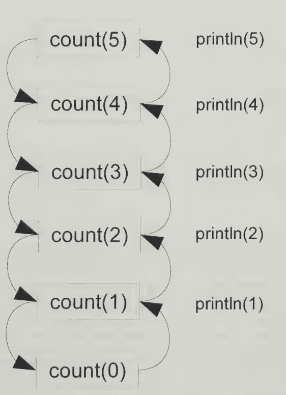

**图 15.1：** 这展示了函数 count 的调用栈，它会打印向上计数的数字。当你以 5 调用该函数时，它会先以 4 调用自身，然后才做其他事情。接着又以 3 调用自身，依此类推，一直递减到 0。以 0 调用时不做任何事，只是返回。它返回到 count(1) 的调用中，后者执行打印，然后继续沿着调用栈向上返回。

### 15.2 斐波那契数

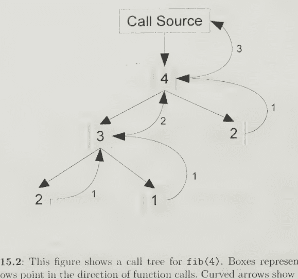

**图 15.2：** 此图展示了 fib(4) 的调用树。方框表示栈帧。直箭头指向函数调用的方向。弯曲箭头表示返回，并标有返回值。

```
def fib(n:Int):Int = if(n<3) 1 else fib(n-1)+fib(n-2)
```

因此，对于 n=1 和 n=2，我们得到 1。对于 n=3，我们得到 1+1=2。对于更大的数字，这一过程会更加复杂，试着将其可视化是颇有教益的。我们可以通过类似图 15.1 的方式来观察调用栈上发生的情况。与图 15.1 中的代码不同，这个函数会调用自身两次，这使得情况稍微复杂一些。

例如，考虑对 fib(4) 的调用。它等于 fib(3)+fib(2)。要知道这个值，就必须分别对这两个函数进行递归调用。按照惯例，我们设想这些调用从左到右依次处理。于是它先调用 fib(3)，fib(3) 获得一个栈帧。然后 fib(3) 又调用 fib(2)，fib(2) 获得一个栈帧。与我们之前看到的示例不同，当 fib(3) 返回时，还有一个对 fib(2) 的调用在等待。因此，在 fib(3) 刚刚所占用的位置，立刻会出现一个新的栈帧。这种栈帧返回后被新栈帧替换的过程，在斐波那契数的计算以及其他调用自身超过一次的递归函数中经常发生。与图 15.1 中那样画成垂直的栈不同，习惯上将其画成一种称为树的分支结构，如图 15.2 所示。每个新栈帧仍然位于调用它的那个栈帧下方，但栈中处于同一深度的不同栈帧会水平地相互并列绘制。箭头用来追踪这些关系。

在这种表示中，方框代表栈帧。我们省略了函数名，只保留参数值。直箭头表示函数调用，弯曲箭头表示返回，并标有返回值。当你试图搞清一个复杂递归函数的执行过程时，这类图会非常有帮助。如果你自己绘制这样的图，可以省略方框和箭头，通常只需在值之间画上连线就够了。

斐波那契数是递归的标准示例，但除了教学目的之外，它们并不是很好的例子。你可以相当容易地写出一个使用循环而非递归来计算斐波那契数的函数，而且它会快得多。但后续示例就不是这样了。

### 15.3 排列

下一个示例更具实用性。我们给定一个值的 List，并希望对这个 List 的所有排列执行某个函数。一个集合的排列包含所有相同的元素，但顺序可能不同。如果你有不同的任务，并且需要根据某种规则找到执行这些任务的最优顺序，那么这种行为可能就派上用场了。

那么下一个问题是，我们该如何实现它？我们之前已经看到，Scala 中的序列有一个名为 permutations 的方法，可以为我们完成这件事，但我们想看看如何自己实现。为了弄清楚这一点，我们将采用构建递归函数时常用的一种惯用方法。这个方法在第 6 章介绍更简单的递归函数时谈到过。其思想是，把一个大的问题分解开来，先解决一步，然后应用同一个函数去解决剩下的部分。在这个问题中，一步就是选取第一个元素。与第 6 章所做的不同，这里通常有多个选项。当前 List 中的任何元素都可以作为排列中的第一个元素。接下来的部分，就是对 List 中其余元素进行排列。这样就得到了一个递归定义。我们要先挑选一个元素放在首位，然后对其余部分进行递归调用。该调用返回后，再挑选一个不同的元素放在首位，并再次递归。这一过程应对 List 中的所有元素重复进行。

要将其转换成一个函数，我们需要确定必须传入哪些信息。显然，我们必须传入正在排列的值的 List。我们还需要传入到目前为止已经构建好的排列中的元素。这可以通过第二个 List 来完成。如果我们让函数返回一个包含所有排列的 List 的 List，那么这些就是所需的全部参数。然而，这样的函数在许多情况下并不实用，因为排列的数量会随着 List 的长度增长得非常快，内存开销会变得难以承受。因此，我们改为传入一个操作 List 的函数，每当构建出一个完整的排列时，我们就调用这个函数。这样，调用者就可以决定如何处理这些不同的排列。

因此，我们要编写一个接受三个参数的函数：要排列的数字 List、一个应用于已完成排列的函数，以及当前这个排列的 List。下面的代码实现了这一点。

```
def permute(nums: List[Int], f: (List[Int]) => Unit, p: List[Int]) {
  if (nums.isEmpty) {
    f(p)
  } else {
    var before = List[Int]()
    var after = nums
    while (!after.isEmpty) {
      val perm = after.head :: p
      permute(before ::: after.tail, f, perm)
      before ::= after.head
      after = after.tail
    }
  }
}
```


peg上有若干个大小不同的盘子，盘子上都有孔可以套在peg上。你在游戏中要遵循两条规则将盘子从一个peg移到另一个peg：

- 1. 一次只能移动一个盘子。
- 2. 不能把一个盘子放在比它小的盘子上。

我们想写一个程序来解决这个问题。为此，我们需要先对问题进行更深入的分析。

如果你先想象一个peg上堆着7个盘子，从底部最大到顶部最小，然后试图想象解法，你可能会觉得很困难。第一步显然是把顶部的盘子移到另一个peg上，但移到哪一个呢？之后会变得更复杂。与其试图解决一个难题，我们应该从一个简单问题开始，然后逐步构建。

最容易解决的设置是只有一个盘子时。只需将盘子从起始位置移到你想要它结束的peg上。这有点太 trivial 了，那么两个盘子呢？首先你必须把上面的盘子移到你不想结束的peg上，然后把第二个盘子移到目标peg，再把较小的盘子移到它上面。到目前为止可能还不明显，但这指向了一个通用解法。为了看清这一点，想想三个盘子的情况。我们可以逐一列出每一步的移动，但我们刚刚看到了如何移动两个盘子，所以我们可以假设我们知道怎么做。利用这一点，我们把两个盘子移到中间peg。注意，我们并不是字面意义上一次移动两个盘子，因为那样会违反规则。相反，我们使用刚刚开发的方法，用三次单盘移动来移动两个盘子。然后把最大盘子移到目标peg，再把两个盘子移到它上面。

这指向了一个通用解法。如果我们假设我们知道如何移动 N-1 个盘子，我们就可以通过先把上面的 N-1 个盘子移到备用peg，然后把最大盘子移到目的地，最后把 N-1 个盘子移回最大盘子顶部来移动 N 个盘子。注意这是一个递归定义。N 个盘子的解法依赖于 N-1 个盘子的解法。基本情况是平凡的，即移动单个盘子。

我们现在有了解决这个问题的思路。接下来需要弄清楚如何在计算机内存中表示这个问题。我们需要想出一种表示盘子和peg的方法。对于盘子，我们真正关心的只是盘子的大小。这可以用一个 Int 很好地表示。一个peg本质上只是一个盘子堆，所以我们需要类似 Array 或 List of Ints 的东西。为了决定用哪一个，我们应该考虑它们的使用方式。peg上的盘子数量会随时间变化，但它们总是从一个位置添加或移除，即堆的顶部。这指向使用一个 List，其中 List 的 head 是顶部的盘子。我们可以用 :: 把一个盘子添加到peg上，tail 就是移除盘子后剩下的部分。下面的脚本展示了代码如何将三个peg实现为 Array[List[Int]]。有一个移动一个盘子的函数，其中包含检查以确保我们没有违反第二条规则。

```
val num = if(args.length>0) args(0).toInt else 7
val pegs = Array(List.tabulate(num)(i => i+2), List[Int](), List[Int]())
```

```
def moveDisk(from:Int,to:Int) {
  require(pegs(to).isEmpty || pegs(from).head < pegs(to).head)
  pegs(to) = pegs(from).head :: pegs(to)
  pegs(from) = pegs(from).tail
}
```

```
def moveNDisks(n:Int,from:Int,to:Int) {
```

```
val other = 3-from-to
if(n==1) {
    moveDisk(from, to)
} else {
    moveNDisks(n-1, from, other)
    moveDisk(from, to)
    moveNDisks(n-1, other, to)
}
}

moveNDisks(pegs(0).size, 0, 2)
```

```
println(pegs.map(a => a.mkString(" ")).mkString("\n"))
```

函数 moveNDisks 是递归的并且依赖于 moveDisk 函数，所以我们可以确信程序没有作弊。行 val other = 3-from-to 最初看起来可能有点奇怪。该函数只传入要移动的peg编号和要移动到的peg编号，但函数中必须引用第三个peg，因为那是上面 n-1 个盘子要先去的地方。那一行使用简单的观察计算出其他peg的编号，即所有peg的索引相加为 3。脚本以调用 moveNDisks 函数结束，然后打印最后剩下的内容。这使得验证拼图是否真正被解决变得简单。

鉴于汉诺塔的物理和视觉特性，文本打印有点不令人满意。这是一个真正值得图形显示的问题。下面的脚本添加了一个 BufferedImage、一个 Panel 和一个 Frame，这样你就可以在递归解决拼图时观看盘子的移动。

```
import scala.swing._
import java.awt.image.BufferedImage
import java.awt.{Graphics2D,Color}

val num = if(args.length>0) args(0).toInt else 7
val pegs = Array(List.tabulate(num)(i => i+2), List[Int](), List[Int]())

val img = new BufferedImage(600, 300, BufferedImage.TYPE_INT_ARGB)
val g = img.createGraphics

val panel = new Panel {
    preferredSize = new Dimension(img.getWidth, img.getHeight)
    override def paint(g:Graphics2D) {
        g.drawImage(img, 0, 0, null)
    }
}
```

```
def renderPegs {
    g.clearRect(0, 0, img.getWidth, img.getHeight)
    g.setPaint(Color.red)
    for(i <- 0 until pegs.length) {
        for(j <- 0 until pegs(i).length) {
            val s=pegs(i)(j)*10
            g.fillRect(100+i*200-s/2,
                       img.getHeight-(pegs(i).length-j)*30, s, 20)
        }
    }
    panel.repaint()
```

```
Thread.sleep(100)
}

def moveDisk(from:Int,to:Int) {
    require(pegs(to).isEmpty || pegs(from).head < pegs(to).head)
    pegs(to) = pegs(from).head :: pegs(to)
    pegs(from) = pegs(from).tail
    renderPegs
}

def moveNDisks(n:Int,from:Int,to:Int) {
    val other = 3-from-to
    if(n==1) {
        moveDisk(from, to)
    } else {
        moveNDisks(n-1, from, other)
        moveDisk(from, to)
        moveNDisks(n-1, other, to)
    }
}

val frame=new MainFrame {
    title="Hanoi"
    contents=panel
    resizable=false
}

frame.visible=true

moveNDisks(pegs(0).size, 0, 2)

println(pegs.map(a => a.mkString(" ")).mkString("\n"))
```

如果你稍微修改一下这段代码，你会注意到高堆的盘子移动需要很长时间。这就引出了一个问题：要把 N 个盘子从一个peg移到另一个peg需要多少次移动？递归代码使得这个问题相当容易回答，如果我们对递归函数作为答案感到满意的话。

f(N) = 1                     N = 1
       1 + 2 * f(N - 1)   otherwise

这可以简化为 f(N) = 2^N - 1。所以移动次数在盘子数量上呈指数增长。20 或 30 个盘子的堆确实需要很长时间才能完成。

# 15.5 迷宫

另一个需要递归的问题类别是涉及迷宫的问题。这可能也看起来更像是娱乐，但迷宫是被称为图的一种简化情况，图在计算机科学中非常重要，并用于表示各种各样的问题。我们在这里为迷宫使用的相同方法同样适用于图。

还有许多应用，其中执行诸如在某种受限路径如迷宫中寻找最优路线之类的操作是重要的。

为了保持简单，我们将使用一种相当基础的方法来构建迷宫。与其在单元格之间有墙的网格，我们将有一个网格，其中完整的方块要么是开放的，要么被墙占据。这种表示意味着我们可以使用一个 2-D Array 的值来告诉我们是否有墙。理论上我们可以用 Array[Array[Boolean]] 来实现此目的，但在实践中我们将使用能够在“房间”中放置数值，所以 Array[Array[Int]] 会更实用。

我们将用类似以下的代码定义迷宫。

```
val maze=Array(Array( 0, 0, 0, 0, 0, 0, 0, 0, 0, 0),
    Array(-1,-1,-1, 0,-1,-1,-1,-1,-1,-1),
    Array( 0, 0, 0, 0,-1, 0, 0, 0,-1, 0),
    Array( 0,-1, 0,-1,-1,-1,-1, 0, 0, 0),
    Array( 0,-1, 0,-1, 0, 0,-1,-1,-1, 0),
    Array( 0,-1,-1,-1,-1, 0, 0, 0, 0, 0),
    Array( 0,-1, 0, 0,-1, 0,-1,-1,-1, 0),
    Array( 0, 0, 0,-1,-1, 0, 0, 0, 0, 0),
    Array( 0,-1, 0,-1,-1, 0,-1, 0,-1,-1),
    Array( 0,-1, 0, 0, 0, 0,-1, 0, 0, 0))
```

这构建了一个 Ints 的 2-D Array，使用 0 表示开放方块，使用 -1 表示墙。使用 -1 表示墙是有意为之，这样正数以后就可以用来表示其他东西。这个特定迷宫的大小只有 10x10。这对于我们的目的来说是一个很好的起点，尽管它不允许非常复杂的迷宫。

我们的第一个任务是大多数人可能想对迷宫做的事情。我们想知道如何以最少的步数穿过它。首先，我们将问一个简单的问题：最短路径有多长。这比试图实际返回一条路径有显著优势。不仅它是一个简单的数值，而且还是唯一的。可以有多条路径长度相同。如果我们要求最优路径，这会产生歧义。它也恰好是，拥有一个函数来查找最短路径的长度是足够的，因为对该函数的多次调用可以用来构建最优路径，即使这种构造效率不高。

你可以用循环写一个函数来查找最短路径的长度，但代码相当复杂。我们可以用递归写一个更简单的解法。和所有递归函数一样，我们可以将解法分解为两个主要部分，基本情况和递归情况。基本情况应该很容易解决。对于迷宫问题，有两个很好的基本情况。一个基本情况是到达出口时。如果你在出口处，出来需要零步。另一个基本情况是检查的位置在迷宫之外或在墙内。对于这种情况，我们希望返回一个不可能成为解的值。我们在讨论递归情况后会再回来讨论这个问题。

想象你站在迷宫中的某个位置，想要知道从当前位置到出口的最短路径需要多少步。递归的方法是想象你有一个神谕，它可以告诉你从任何相邻方格的答案，并弄清楚你将如何结合这些值来确定你所在位置的距离。正如我们在本章前面所说，我们通过假设有一个可工作的函数并基于该假设编写来编写递归函数。一旦完成，假设我们正确处理了情况，它就会工作。神谕就是我们假设的可工作函数。如果你身处迷宫中，并且可以询问神谕从北、南、东、西一步之遥的地方出来需要多少步，你将如何利用这些信息来确定你所在位置的最短距离？


为了更具体地说明，想象你站在一个四岔路口。你向预言机询问每个方向，得到的值分别为 7、13、4 和 19。因此最短路径位于返回 4 的那个方向。然而，那是从该方向走一步后的距离。你所在位置的最小距离比那个值大 1，也就是 5 步。它是四个值中的最小值，再加上一步才能到达那个位置。取最小值的这个解法也为我们处理撞墙或走出边界的基本情况指明了正确方向。如果最佳解是最小值，那么对于一条糟糕的路径，我们应该返回一个不可能成为最小值的数。像十亿这样的大数对于几乎任何迷宫来说都足够了。你可能会想用 Int.MaxValue，但请记住我们还要给它加 1。在 REPL 中试试 Int.MaxValue+1，你就会明白为什么这不是一个理想的选择。

这就定义了我们的递归情形。还需要考虑另一个因素。如果你曾置身于树篱迷宫或其他无法越过墙壁看到远处的迷宫中，你会发现很难区分各个位置，除非你采取措施标记之前到过的地方，否则可能会绕圈子，永远找不到出口。格林兄弟在《汉塞尔与格莱特》中描述了一个相当著名的解决方案，他们留下面包屑来标记路径。我们也会采用同样的方法。假设你的电脑里没有鸟，这对你来说应该比那对兄妹更有效。如果你的电脑里确实有鸟，你可能应该在继续阅读之前先处理一下这个问题。

因此，我们的算法所需的最后一个方面是能够放下面包屑来标记路径。如果我们再次遇到自己的面包屑，就把它当作撞墙或越界一样处理。在从一条路径返回之前，我们还会清扫掉面包屑。汉塞尔和格莱特并不需要这样做，他们只是想找到自己的路。然而，我们希望找到最优路径，而到处留下面包屑常常会导致我们错过这样的路径。将所有这些转换为代码，结果如下。

```scala
def shortestPath(maze:Array[Array[Int]],x:Int,y:Int,endX:Int,endY:Int):Int = {
  if(x<0 || y<0 || y>=maze.length || x>=maze(y).length || maze(y)(x)!=0) {
    1000000000
  } else if (x==endX && y==endY) {
    0
  } else {
    maze(y)(x)=1
    val dist=(shortestPath(maze,x+1,y,endX,endY) min
      shortestPath(maze,x-1,y,endX,endY) min
      shortestPath(maze,x,y+1,endX,endY) min
      shortestPath(maze,x,y-1,endX,endY)) + 1
    maze(y)(x)=0
    dist
  }
}
```

整个函数由 if 表达式构成。第一个分支用于处理越界、撞墙或遇到我们留下的面包屑，并返回十亿。这个数大到不可能是有效路径，但又足够小，即使在迷宫中为其他步骤加 1 也不会溢出。第二个分支是到达终点的情况。这两个分支可以互换，如果出口位于边界之外或在数组中以特殊值标记，那就需要交换。最后一个分支是递归情形，它会丢下面面包屑，进行四次递归调用，用 min 组合它们，然后拾起面包屑并返回。可以使用以下调用来调用这段代码。

```scala
println(shortestPath(maze,0,0,9,9))
```

对于上面显示的迷宫，这次调用的返回值是 36。对于这个特定的迷宫，这是从 (0,0) 到 (9,9) 的唯一路径的长度。你应该多玩玩这个迷宫，以确保该函数能为其他配置找到最短路径。

这个函数实际上测试了迷宫中的每一条路径，并返回最短的一条。这种方法有优点也有缺点。缺点是，如果路径很多，可能会花一些时间。我们将在第 28 章进一步探讨并考虑解决方法。优点是，只需对这段代码做很小的修改，就能产生其他类似的函数，例如寻找最长路径或统计路径数量的函数。这些特定问题留给学生作为练习，但现在我们要告诉你，真正需要修改的只是基本情况的返回值以及递归调用的组合方式。

# 15.6 排序

在第 13 章中，我们使用循环来实现所有迭代。我们本可以使用递归。实际上，有些排序用递归来表达非常优雅。考虑一个 maxSort。两个循环可以写成两个递归函数，其中一个可以嵌套在另一个内部。内层函数在某个位置之前查找最大值的索引。它嵌套在一个函数中，该函数从后向前遍历数组，找到最大值并将其交换到正确位置，然后再向前移动一个位置。实现这一点的代码如下。

```scala
def maxSort(a:Array[Double],end:Int) {
  def maxIndex(end2:Int):Int =
    if(end2==0) 0 else {
      val m=maxIndex(end2-1)
      if(a(m) > a(end2)) m else end2
    }

  if(end>0) {
    val index=maxIndex(end)
    if(index!=end) {
      val tmp=a(index)
      a(index)=a(end)
      a(end)=tmp
    }
    maxSort(a,end-1)
  }
}
```

这比使用循环的版本稍长一些，但也没长太多。如果我们希望有一个只需单个参数即可调用的版本，就需要一个包装函数。

也许一个更好的例子是插入排序。插入排序的内层循环在执行插入操作，因此我们编写一个递归的 insert 函数。它被一个执行排序的外层函数调用，该函数简单地遍历数组，将每个元素放到正确位置。

```scala
def insertionSort(a:Array[Double],i:Int=1) {
  def insert(v:Double,i:Int) {
```

一个接收 List[Int] 并返回 List[Int] 的函数。1 它使用递归的 merge 函数来将列表合并到一起。

```scala
def merge(lst1: List[Int], lst2: List[Int]): List[Int] = (lst1, lst2) match {
    case (Nil, _) => lst2
    case (_, Nil) => lst1
    case (h1 :: t1, h2 :: t2) =>
        if (h1 < h2) h1 :: merge(t1, lst2)
        else h2 :: merge(lst1, t2)
}
```

```scala
def mergeSort(lst: List[Int]): List[Int] = lst match {
    case Nil => lst
    case h :: Nil => lst
    case _ =>
        val (l1, l2) = lst.splitAt(lst.length / 2)
        merge(mergeSort(l1), mergeSort(l2))
}
```

这两个函数都使用模式匹配来处理递归中的不同情况。这使它们简洁、易读。遗憾的是，递归版本的 merge 必须为每个被合并的元素分配一个新的栈帧。这意味着这个版本的代码无法扩展到大规模。

为了克服这个限制，我们需要使用一个更命令式的、基于 while 循环的 merge，这样的版本可能如下所示。

```scala
def merge(lst1: List[Int], lst2: List[Int]): List[Int] = {
    var l1 = lst1
    var l2 = lst2
    var ret = List[Int]()
    while (l1.nonEmpty && l2.nonEmpty) {
        if (l1.head < l2.head) {
            ret ::= l1.head
            l1 = l1.tail
        } else {
            ret ::= l2.head
            l2 = l2.tail
        }
    }
    if (l1.nonEmpty) ret ::= l1.reverse
    else ret ::= l2.reverse
    ret.reverse
}
```

这个版本没那么优雅，而且长度大约是原来的两倍。然而，它能处理明显更长的列表，因此实用性强得多。

关于归并排序，最后需要注意的一点是它的工作方式。当递归调用沿栈向下时，几乎没有什么操作。输入的 List 被分成两半，这两半被传递下去。这个过程不断重复，直到到达单个元素。真正的工作发生在递归沿栈向上返回时。在函数返回之前，它会调用 merge，而 merge 才做真正的工作。所以，如果你在脑海中想象类似图 15.1 的画面，

> 1 与使用数组的版本不同，使用 List 的排序必须返回一个新的 List，因为原始 List 无法被修改。


the down arrows are not associated with much work. It is the up arrows where the work is done.

# 15.6.1.2 Quicksort

另一种分而治之的排序是 QUICKSORT。快速排序的思路是选择一个特殊的元素称为 pivot，然后将其移动到正确的位置，使其之前的所有元素都小于它，其之后的所有元素都大于它。这些两侧的元素尚未排序，因此会进行递归调用来分别对它们进行排序。递归在降到单个元素时终止。

与归并排序不同，快速排序可以原地完成。然而，这将留作第 28 章的练习。现在我们将快速排序做得像我们的归并排序一样，并在 List 上工作，对于原地完成的概念来说，这没有意义。

快速排序的质量在很大程度上取决于 pivot 的选择。好的 pivot 会位于集合的中间，将其切成两半。非常糟糕的 pivot 可能是最小或最大元素，这对数据的拆分没有任何作用，只是在递归的下一层中抽出该一个元素。为了保持本章实现上的简单性，我们将使用第一个元素作为 pivot。一般来说这不是一个好的做法，并且在已经排序的序列上会导致非常糟糕的行为。这也将在第 28 章中解决。

在这些简化到位后，我们可以用以下代码编写一个快速排序版本。

```
def quicksort(lst:List[Double]):List[Double] = lst match {
case Nil => lst
case h::Nil => lst
case _ =>
  val pivot = lst.head
  val (less, greater) = lst.tail.partition(_<pivot)
  quicksort(less) ::: (pivot :: quicksort(greater))
}
```

pivot 被设置为 List 的头部。然后我们使用 partition 将其余元素分成小于 pivot 的元素和不小于 pivot 的元素。最后，我们对这两个子列表调用 quicksort 并将整个结果组合起来。结果是一个简短而简单的排序函数，在随机数据上实际上效果相当不错。

值得问一下这种排序的顺序到底是什么。与工作量非常稳定的归并排序不同，我们的快速排序的性能会根据输入而大幅变化。像归并排序一样，递归的每一层都做 O(n) 的工作。在这种情况下，这项工作是 partition 和粘合 Lists。如果 pivot 位于值的中间，每个层级的数据都会被切成一半，我们得到 O(log(n)) 层的递归和 O(n log(n)) 的整体性能。对于随机数据，这是预期的行为。然而，我们简单的 pivot 选择可能导致非常糟糕的行为，如果输入已经排序，这种排序是 O(n²)。

关于快速排序最后要说明的是，与归并排序不同，它在调用栈向下时完成了大部分工作。调用 partition 是所有比较发生的地方。这个 List 版本在调用栈返回时确实需要合并 Lists。第 28 章中我们用 Arrays 编写的版本甚至不需要做那一步。

# 15.7 Putting it Together

为了再看一个递归的用途，我们想解决一个之前用不同方法做过的问题。到目前为止，我们已经两次包含了根据乘客数据为员工排班提供建议的代码。寻找排班的工作是使用序列上的排列和组合方法完成的。正如我们在本章前面看到的，递归也可以用来生成排列。它也可以做组合。

与其完全重复我们之前做过的事情，我们将使用递归将其推进得更进一步。与其显示每天员工的可能分组，我们想显示整周的可能排班，其中包括每个乘务员每周愿意/能够工作的天数限制。

我们不会重复第 14 章中各种菜单选项的全部代码。这只展示了一个可以用来构建这些更完整排班类型的函数。为此，在 EmployeeData case class 中添加了一个 daysPerWeek:Int 成员。你也可以修改菜单选项 5 来调用此函数：

```
def recursiveBuildWeeklySchedule {
  val daysInfo = for(y <- years; m <- y.months; d <- m.days) yield d
  val days = daysInfo.map(_.dayOfWeek).distinct

case class WorkerDays(name:String, numDays:Int)
case class WorkerAssigns(day:String, workerRide:List[(String, String)])

def printSchedule(schedule:List[WorkerAssigns]) {
  println("Possible Schedule:")
  println(schedule.mkString("\n"))
}
```

```
def recurByWorker(daysLeft:List[String], workerAvail:List[WorkerDays],
    schedule:List[WorkerAssigns], workersLeft:List[String],
    ridesNeedingOps:List[String]) {
  if(ridesNeedingOps.isEmpty) {
    recurByDay(daysLeft, workerAvail, schedule)
  } else if (workersLeft.length>=ridesNeedingOps.length) {
    val worker = employeeInfo.filter(_.name == workersLeft.head).head
    for(ride <- worker.rides) {
      ridesNeedingOps.indexOf(ride) match {
        case -1 =>
        case i =>
          val newAvail = (for(w <- workerAvail) yield {
            if(w.name == worker.name) w.copy(numDays = w.numDays-1)
            else w
          }).filter(_.numDays>0)
          val newSchedule = schedule.head.copy(workerRide = (worker.name, ride) :: schedule.head.workerRide) :: schedule.tail
          recurByWorker(daysLeft, newAvail, newSchedule, workersLeft.tail,
            ridesNeedingOps.patch(i,Nil,1))
      }
    }
  }
  recurByWorker(daysLeft, workerAvail, schedule, workersLeft.tail,
    ridesNeedingOps)
}
```

```
}
}

def recurByDay(daysLeft: List[String], workerAvail: List[WorkerDays],
               schedule: List[WorkerAssigns]) {
    if (daysLeft.isEmpty) {
        printSchedule(schedule)
    } else {
        val day = daysLeft.head
        val thisDay = daysInfo.filter(_.dayOfWeek == day)
        val rides = thisDay.map(_.ride).distinct
        val operatorRides = rides.flatMap(ride => {
            val nums = thisDay.filter(_.ride == ride).map(_.numRiders)
            val avg = nums.sum / nums.length
            val rideData = rideInfo.find(_.name == ride).get
            Array.fill(rideData.numberOfOperators + (if (avg >= rideData.heavyCount) 1 else 0))(ride)
        })
        recurByWorker(daysLeft.tail, workerAvail, WorkerAssigns(day, Nil) :: schedule,
                      workerAvail.map(_.name), operatorRides)
    }
}

recurByDay(days, employeeInfo.map(e => WorkerDays(e.name, e.daysPerWeek)),
           List[WorkerAssigns]())
}
```
```

这是一个比我们之前看过的更复杂的递归函数。值得花一些时间研究正在发生的事情。递归被拆分为嵌套在主函数中的两个独立函数。主函数除了汇总天数信息然后调用 `recurByDay` 外几乎没有做更多的事情。

顾名思义，`recurByDay` 函数使用天作为主要的递归参数。调用栈向下每一层 `daysLeft` 列表的元素就少一个。基本情况是 `daysLeft` 为空。这意味着我们有一周的完整排班，准备打印它。此函数借用了早期版本的代码来构建一个包含多个副本的乘车名称列表，以对应所需的操作员数量。

`recurByDay` 中传入的所有信息，以及它计算出的其他信息都会传递给 `recurByWorker`。这里的名字再次旨在给出正在发生的事情的图像。此函数遍历员工，每次调用考虑一个员工。基本情况是没有更多需要操作员的乘车。在递归情况下，代码遍历该员工受训操作的所有乘车，如果其中任何一个仍需要操作员，就会进行一个递归分支，将该员工分配给该乘车。最后还有一个递归分支，当前员工不被分配在那天工作。

请注意，`recurByWorker` 的基本情况包含对 `recurByDay` 的回调，因此这些是相互递归的函数。在更复杂的情况下，当递归需要在具有几个不同独立参数的空间中运行时，将问题像这样拆分为处理不同选项变化并相互依赖以获得完整解决方案的不同函数是相当常见的。


# 15.8 章末材料

### 15.8.1 概念总结

- 递归可以做的远不止迭代。调用栈上栈帧所保存的信息使得递归函数可以多次调用自身，并尝试解决问题的不同可能性。
- 递归函数多次调用自身最常见的例子之一是生成斐波那契数列的函数。该数列中的每个数字都是前两个数字之和，因此这个递归函数会以当前值减 1 和当前值减 2 作为参数调用自身。
- 一个更有趣的例子是汉诺塔。这里我们看到，如果知道如何解决 N 个圆盘的问题，就能将其扩展到 N + 1 个圆盘。这一点加上一个基本情形，就构成了任意 N 值的完整解法。
- 在迷宫中寻找最短路径非常适合作为递归问题。在每个位置，你需要求出每个可选方向对应的距离，然后将它们组合得到当前位置的适当值。
- 排序也可以用递归编写。我们之前看过的任何排序算法都可以转换为递归形式，但这样做的动机并不充分。
- 使用递归的分治方法进行排序，会引出另外两种排序算法：它们只需进行 O(n log(n)) 次比较，而不是我们之前排序算法的 O(n²) 次。
  - 归并排序在沿调用栈向下时反复将集合一分为二，然后在返回调用栈时合并排序后的结果。
  - 快速排序的工作原理是选取一个基准（pivot）并将其放到正确位置，然后对小于基准的元素以及不小于基准的元素递归排序。

### 15.8.2 练习

1. 编写使用以下方法计算斐波那契数的函数。
   - 使用循环和 Array 或 List。
   - 使用循环和三个 var 声明。
   - 使用一个接收三个参数但只调用自身一次的递归函数。
2. 编写一个函数，计算穿越迷宫的最长不自交路径。
3. 编写一个函数，统计穿越迷宫的不自交路径数量。
4. 找出递归搜索函数能在不超过一分钟内求解的最大完全空白迷宫的大小。
5. 下面是一个称为阿克曼函数的函数，它在理论计算机科学中具有重要意义。将其用 Scala 写出来，并稍加实验。

```
$f(0,n) = n+1$
$f(m+1,0) = f(m,1)$
$f(m+1, n+1) = f(m, f(m+1, n))$
```

6. 编写一个递归函数，构建一个 List 的幂集。幂集是给定集合的所有子集构成的集合。由于它是集合，意味着我们不关心顺序，这与排列不同。例如，List(1,2,3) 的幂集是 List(Nil, List(1), List(2), List(3), List(1,2), List(1,3), List(2,3), List(1,2,3))。
7. 编写一个递归函数，构建 List 的组合而非排列。调用者应能指定组合中期望包含的元素个数。（提示：所有大小的所有组合都是幂集的一部分。）

### 15.8.3 项目

1. 如果你一直在做光线追踪和图形学相关项目，本项目将继续沿着这条线进行。光线追踪器可以利用递归实现反射和透明效果。如果你有一个函数可以告诉某条特定光线应绘制成什么颜色，你可以用反射光线递归调用该函数，并将得到的颜色与反射表面自身的颜色合成，从而实现反射。最终颜色中各占多少取决于物体的反射率。

   在本次项目中，你要为物体指定颜色，但仍不需要考虑光照。因此，当光线击中物体时，除非物体具有反射性，否则它将直接取该物体的完整颜色。如果物体的反射率为 $R$，那么最终颜色中 $(1-R)$ 来自该物体本身的颜色，$R$ 来自反射光线的颜色。要将颜色相加，你需要能够构造自己的颜色并从颜色中提取各分量。`java.awt.Color` 类有 `getRed`、`getGreen` 和 `getBlue` 方法，它们返回颜色中每种基色的分量。这些值是 `Ints`，范围是 0 到 255（含端点）。你也可以通过调用 `new Color(red: Int, green: Int, blue: Int)` 创建新的 `Color` 对象。传入的值必须在此范围内，否则会出错。

   要计算反射，你需要被反射表面的单位法向量。对于平面来说这很容易，因为法向量处处相同。对于球体，法向量就是从球心到交点的向量。两种情况下，你都需要将其归一化。有了它，反射光线的方向由下式给出

```
$\vec{r}_{reflected} = \vec{r} - 2(\vec{r} \cdot \vec{n}) \vec{n}$,
```

   其中 $\vec{r}$ 是入射光线的方向，$\vec{n}$ 是单位法向量。单位法向量在后续项目计算光照时也会很重要。

2. 在本项目中，你将编写一个程序，通过递归函数求解 9x9 数独谜题。

   输入将是九行文本，每行有九个字符。字符要么是空格，要么是一位数字。你应该输出一个填好所有空格的盘面，并在数字之间加上空格，使其易于阅读。事实证明，大多数谜题都不止一个解。你只需提供其中一个解即可。

   作为额外挑战，让你的程序带有一个图形用户界面（GUI）。它应从文件加载谜题，并使用 `Table` 或 `GridPanel` 显示谜题。用户应能选择“求解”选项，让其余空格被自动填充。

3. 在本项目中，你将编写一个程序，递归解析一个算术表达式字符串并返回其值。示例有 `5+7` 或 `9*(5+7.5)/2`。你的解析器应正确处理运算优先级（括号内的运算优先级最高，`*` 和 `/` 先于 `+` 和 `-`，同一优先级从左到右）。

   我希望你采用分治递归算法来解决这一问题：从优先级最低的运算开始，将问题分解为若干部分。你将编写一个函数 `parse(exp: String): Double`。该函数返回 `String` exp 中表达式的值。首先，它应找到优先级最低的运算符（该运算符不能在括号内）。如果找到，就以该运算符两侧的子字符串分别递归调用两次（使用 `String` 的 `substring` 方法，或 `take` 和 `drop`）。如果没有不在括号内的运算符，你可以检查 `String` 是否以 `'('` 开头，若是，则去掉最外层的括号并对剩余部分递归。如果它不是以 `'('` 开头，就可以知道这部分表达式只是一个数字，因此使用 `toDouble` 获取其值。

   用户会在命令行给你一个不含空格的公式，你只需输出它计算出的值。因此，你的程序可能的调用方式如下：`scala parser.scala 5+3*(70/5)`。

4. 如果你已完成项目7（第367页），可以在本项目中进行扩展。如果继续深入阅读《植物的算法之美》第1章，你会发现可以用 L-系统 为草本植物和树木建模。我们不会做 3D 实现，但你可以增加对 `'['` 和 `']'` 的处理，以支持分支结构。实现这一点的最佳方法是：遇到 `'['` 时发起递归调用，遇到 `']'` 时返回。不要传入 `String`，而是传入通过对 `String` 调用 `iterator` 方法得到的 `Iterator[Char]`。`Iterator` 的优点是：当你调用 `next` 时元素会被消耗，因此从函数调用返回后，代码会自动处理 `']'` 之后剩余的内容。

5. 判断能否用食品储藏室中的食材制作某个特定食谱并不是特别难，也不需要递归。为一顿大型晚宴规划一整套餐食则是另一回事。要做到这一点，食谱需要标注菜肴类型：主菜、甜点、配菜等。在规划餐食时，用户必须能指定每种类型的菜肴各做多少道。然后你可以使用递归，在现有食材条件下找出满足这些要求的餐食方案。

   你应该附上用户对某些食谱的喜欢程度，以便只显示排名前 5 左右的餐食方案。如果你想接受一点额外挑战，考虑处理手头食材无法做出任何餐食的情况，然后列出只需少量额外食材的几套最佳餐食方案。

6. 如果你一直在做课表构建类项目，现在可以使用递归扩展其功能。标注每门课程在你课程体系中的定位。这样你不仅可以指定想修读多少学时，还可以指定要满足哪些要求。

   这个问题可以用 `permutations` 和 `combinations` 解决，但随着可选课程数量的增加，这些方法的效率会降低。而使用递归，一旦你确定某个组合不可行，就可以提前终止对该组合的递归。


这不可能行得通。例如，如果你在完成课程之前已经达到了规定的学时数，你不需要考虑剩余课程的变化，只需检查你是否满足了其他要求。

- 7. 拥有递归能力为有障碍物的游戏中计算机控制的角色的移动开辟了许多可能性。如果游戏空间开阔且空旷，直线移动到某个位置是可行的，但当存在障碍物（如迷宫）时，找到一条穿越它们的路径就很重要。递归提供了一种实现方式。在这个项目中，你可以实现你选择的简单游戏，其中敌人使用递归来绕过障碍物。注意，你很可能不希望敌人拥有跟随玩家最短路径的能力，除非玩家拥有显著的速度优势。相反，你可以加入一些随机性，使其做出一些不太最优的选择。

- 8. 如果你一直在做文字冒险/文字地图的项目选项，你可以编写一些实用函数来帮助检查地图。递归可以让你看到诸如你是否能从一间房间到达另一间、需要多少步、有多少条路径，甚至路径本身。你可以在运行程序时将这些实现为新命令。例如，可以给“canReach”命令一个房间号/标识符，以查看从当前房间是否能够到达指定房间。

- 9. 如果你一直在做音乐库项目，如果你给出一些提示，你也可以在其中加入递归。你需要为歌曲标注提示，说明哪些歌曲适合作为后续歌曲。你可以让递归仅在用户推荐值得这样做时，才从一首歌跳到另一首歌。这些推荐也可以被赋予一个“强度”。用户应该选择一首起始歌曲，程序应该找到所有连接中总强度最高的播放列表。

请注意，如果有很多歌曲和大量连接，这个问题可能会遇到麻烦。使用简单的递归算法可能会导致运行时间极长。然而，假设用户没有输入太多连接，只要你不对用户未标记的歌曲组合进行测试，递归应该可以正常工作。这就是为什么你不能简单地考虑每种歌曲排序的原因。

本书网站上提供了额外的练习和项目，以及数据文件。

# 第二部分

### 面向对象、抽象与数据结构

# 第16章 面向对象

| 章节 | 页码 |
| --- | --- |
| 16.1 面向对象基础 | 394 |
| 16.1.1 方法与成员 | 394 |
| 16.1.1.1 参数作为成员 | 395 |
| 16.1.1.2 可见性 | 396 |
| 16.1.2 this 关键字 | 399 |
| 16.1.3 封装/接口与实现分离 | 399 |
| 16.1.4 特殊方法 | 400 |
| 16.1.4.1 运算符方法 | 400 |
| 16.1.4.2 一元运算符 | 402 |
| 16.1.4.3 属性赋值方法 | 403 |
| 16.1.4.4 apply 方法 | 404 |
| 16.1.4.5 update 方法 | 405 |
| 16.1.4.6 方法重载 | 405 |
| 16.1.4.7 向量示例 | 406 |
| 16.1.5 对象声明 | 408 |
| 16.1.5.1 应用 | 408 |
| 16.1.5.2 伴生对象简介 | 409 |
| 16.1.6 对象分解 | 409 |
| 16.2 重温 API | 409 |
| 16.3 类的含义 | 410 |
| 16.4 导入选项 | 410 |
| 16.5 章末材料 | 412 |
| 16.5.1 概念总结 | 412 |
| 16.5.2 练习 | 414 |
| 16.5.3 项目 | 415 |

从一开始我们就说过，Scala 是一门完全面向对象的语言。早在第 3 章我们初次接触这门语言时，你就在使用对象并在其上调用方法。尽管如此，我们实际上在面向对象方面做得很少。这是有意为之的。到目前为止，我们一直在培养你的逻辑技能，教你将问题分解为不同的功能单元。既然你的问题解决能力已经达到足够水平，我们将采取下一步，让你对问题进行完整的面向对象分解。从本章开始，我们还将真正揭示许多我们一直在使用的东西背后的细节。

### 16.1 面向对象基础

对象的基本思想是：它既包含数据，也包含操作这些数据的功能。我们最初用元组来对数据分组，然后在第 10 章开始使用**样例类**以更有意义的方式将数据组合在一起。对于这两者，我们都没有将任何功能直接绑定到它们上。我们编写了可以操作它们的函数，但这些函数独立于数据本身。对于元组，我们无法将功能绑定到对象中。*样例类*确实允许我们这样做，只是我们没有做而已。

在本章中，我们将学习如何在 Scala 中进行真正的面向对象编程。这也是我们在本书其余部分将使用的模型。Scala 是一门**基于类**的面向对象编程语言。这意味着程序员在程序中创建*类*，这些**类**定义了用于创建对象的类型。我们已经看到了如何用我们创建的**样例类**来定义新类型。不过，我们在其中只放置了一些我们希望任何函数都能访问的数据元素。

**case** 关键字放在**样例类**前面，对我们在第 10 章的需求来说效果很好，但它并不是定义**类**所必需的。你应当把*类*看作对象的蓝图。*类*告诉 Scala 这种类型的对象中包含什么，以及这些对象应具有哪些功能。*类*的语法如下：

```
class TypeName(arg1:Type1, arg2:Type2, ...) {
    // Methods and Members
}
```

如你所见，这与我们之前使用的**样例类**之间唯一的不同在于缺少了 **case** 关键字，以及 *类* 后面带有内容的花括号。这些花括号与 Scala 中所有花括号一样，定义了一个新的作用域。这个作用域与*类*相关联，任何你想放入*类*的内容都放在其中。这应该不会让你感到太意外。

#### 16.1.1 方法与成员

在*类*内部，你可以像在其他任何地方一样编写代码。有一些细微差别将在后面讨论，含义和术语也会稍有变化。当你在*类*主体内使用 **val** 或 **var** 编写变量声明时，这就是成员声明。它是存储在该*类*创建的对象中的数据。当你使用 **def** 创建函数时，我们称之为方法，因为它位于*类*的作用域内，并且你可以在从该*类*创建的对象上调用它。你编写的任何不是成员声明（**val** 或 **var**）或方法（**def**）的语句，都将在这种类型的对象被实例化时简单地运行。

为了看看这是如何工作的，我们将编写一个包含*类*声明的小脚本。对于这个*类*，我们将回到课程成绩的概念，并编写一个表示学生的*类*。以下是这个*类*的初稿，以及一些使用该*类*的代码行。

```
class Student(name:String, id:String) {
    var tests = List[Double]()
    var quizzes = List[Double]()
    var assignments = List[Double]()
}
```


```scala
def testAverage = tests.sum/tests.size
def quizAverage = quizzes.sum/quizzes.size
def assignmentAverage = assignments.sum/assignments.size
}

val john = new Student("John Doe", "0123456")
john.tests ::= 78
john.tests ::= 85
println(john.testAverage)
```

类以一段类声明开始，看起来很像样例类（case class），实际上与 `def` 也并没有太大区别。在关键字 `class` 之后是类型的名称，在本例中为 `Student`。紧接着是类的参数列表，这里有两个 `String` 类型参数，分别名为 `name` 和 `id`。类的主体用花括号括起来，内部有三个成员变量声明用于存放成绩，以及三个方法声明用于计算平均值。后续还需要添加更多内容，但在那之前我们需要先弄清楚这些代码的真正含义。

类声明之后是四行代码。第一行声明了一个名为 `john` 的变量，它被初始化为一个新的 `Student`，姓名为 `John Doe`，学号为 `0123456`。第二和第三条语句为该学生添加了 78 和 85 两个测试成绩。虽然这样很简单，但我们并不清楚是否真的希望成绩能被这样直接访问。关于这一点我们将在后面详细讨论。脚本中的最后一条语句通过调用 `testAverage` 方法打印测试平均分。

# 16.1.1.1 参数作为成员

这个例子中的一切都看起来相当直白，跟我们以前做过的事情相比确实没有太大区别。不过，如果我们尝试把打印语句变得更丰富一些，情况就会有所变化。

```scala
println(john.name+" has a "+john.testAverage+" test average.")
```

如果你把 `println` 改成这样并运行脚本，会得到一个可能让你有些摸不着头脑的错误消息。

```text
ScalaBook/ch17.scala:15: error: value name is not a member of this.Student
println(john.name+" has a "+john.testAverage+" test average.")
       ^
one error found
```

你肯定会对此感到惊讶。这在样例类中是可行的。实际上，如果你在类声明开头加上 `case` 关键字，这段代码就能正常工作。值得探讨的是，为什么没有 `case` 关键字时它无法工作，以及我们该如何修复它。

错误消息告诉我们 `name` 不是 `Student` 的成员。这是因为默认情况下，传入类的参数并不会自动变成成员。其背后的逻辑是：成员必须由每个创建出来的类实例来存储，因此额外的成员会消耗内存。即使这些参数确实需要被记住，它们也不会对类外部的任何代码可见。例如，如果你在类中添加以下方法，你可以调用它来获取姓氏，但仍然无法获取名字本身。

```scala
def lastName = name.split(" ").last
```

如果你希望参数成为成员，只需在参数名之前加上 `val` 或 `var`。这样它就会成为一个成员，并具有 `val` 或 `var` 对应的适当行为。对于我们的 `Student` 类，我们很可能希望两者都是常量，所以应该把类声明改成下面这样。

```scala
class Student(val name:String, val id:String) {
```

如果你做出了这个修改，就可以无错误地使用上面那个打印语句了。

# 16.1.1.2 可见性

事物是否可见这个概念对我们来说比较新鲜，但它是面向对象编程中非常重要的一方面，因为它允许你将对象内部工作的细节对使用该类的代码隐藏起来。这样做的好处是，你可以在不影响依赖该类工作的代码的前提下修改这些内部细节。对于成员数据而言，你也可以隐藏那些你不想让其他代码随意访问的细节。

银行账户就是一个很好的例子，可以用来展示隐藏细节的价值。让我们考虑一个最简单的、用来表示银行账户的类。

```scala
class Account {
    var balance=0
}
```

这个类在构造时不接收任何参数，因此省略了括号。它只有一个成员数据，即用于表示余额的 `Int`。你可能还记得第 3 章中提过，金钱应该用 `Int` 来存储，因为 `Double` 类型的算术运算因精度有限而不准确。这种表示方式很简单，但有一个显著的缺点：`balance` 成员是一个 `var`，任何拿到 `Account` 对象的代码都可以直接设置它。对于真实的银行程序来说，这是不可接受的。余额不能是任意值，例如通常不允许负数。此外，余额的变化通常应该发生在特定的操作中，即存款和取款。这些操作可以执行某些规则，并且对于真实银行而言，会记录余额的任何变动，以便事后追溯到底发生了什么。虽然我们可以为这些操作编写函数，但没有任何机制能强制程序员使用它们。程序员可能会在某个时候“偷懒”而直接访问余额，这在银行软件中可能造成非常严重的后果。

强制对数据的访问只能通过特定方法进行，这是面向对象最显著的能力之一，也是改进软件构造和控制复杂性的重要手段。这种能力的真正好处在于，它将正确使用的责任从对象的用户身上转移开。如果使用对象的唯一途径是那些对用户安全的方法或数据，那么用户就知道自己不会搞砸，也无需为此担心。相反，他们可以专注于自己正在处理的逻辑。

那么我们如何在类中实现这一点呢？通过设置成员的可见性。Scala 中有三个主要的可见性级别，它们与其他基于类的面向对象语言非常相似。

-   **公有（Public）**——这意味着类内部或外部的任何代码都可以访问它。在 Scala 中，这是元素的默认可见性，因此没有对应的关键字。
-   **`private`（私有）**——这意味着该成员只能在类内部被访问。在类外部尝试访问该成员会导致语法错误。如果在类中的声明前加上 `private` 关键字，该成员就是 `private` 的。
-   **`protected`（受保护）**——这与 `private` 类似，不同的是 `protected` 成员在子类型中也是可见的。这将在第 19.2.2 节中详细讨论。

在我们的 `Account` 示例中，我们确实希望 `balance` 是 `private` 的。只需在 `var` 前面加上它即可。

```scala
class Account {
  private var balance = 0
}
```

不幸的是，这让我们得到了一个完全无用的类。在做出这个修改之前，我们可以做类似下面的事情。

```scala
val myAccount=new Account
println(myAccount.balance)
myAccount.balance += 100
println(myAccount.balance)
```

如果现在我们这样做，会得到一组错误消息。

```text
/ScalaBook/ch17.scala:24: error: variable balance cannot be accessed in
  this.Account
myAccount.balance += 100
^

/ScalaBook/ch17.scala:24: error: reassignment to val
myAccount.balance += 100
^

/ScalaBook/ch17.scala:25: error: variable balance cannot be accessed in
  this.Account
println(myAccount.balance)
^

5 errors found
```

请注意这里的错误消息与我们之前在 `Student` 类上针对 `name` 看到的错误消息有何不同。它并没有告诉我们 `balance` 不是成员，而是告诉我们 `balance` 无法被访问。这正是因为 `balance` 现在是 `private` 的，而代码位于类外部。

为了让这个类变得有用，我们需要在类中添加一些公有方法，这些方法以允许的方式操作余额。我们将从 `deposit` 和 `withdraw` 方法开始。下面是 `deposit` 方法可能的样子。注意它是缩进的，因为它位于 `Account` 类内部。

```scala
  def deposit(amount:Int):Boolean = {
    if (amount>0) {
      balance += amount
      true
    } else false
  }
```

该方法将要存入的 `amount` 作为 `Int` 参数接收，并返回一个 `Boolean` 来告知存款是否成功。该方法目前不支持日志记录，因为添加该功能会比我们现阶段想要的更深入。它的确会检查 `amount`


# 高级可见性选项

Scala 在可见性修饰符方面比这里描述的更加灵活。private 或 protected 后面都可以跟上方括号，其中包含某个包、类、特质或对象类型的封闭作用域的名称。（object 构造将在本章后面介绍；特质构造将在几章后出现。）这将使该成员对处于该作用域内以及更接近该声明处的所有内容都公开可见。这样做的主要好处是，你可以在不将该成员对整个世界公开的情况下，给予密切相关的代码片段特殊访问权限。

方括号中还可以包含关键字 this。将成员声明为 `private[this]` 意味着它不仅对其他代码片段是私有的，而且对包含该成员的类的任何其他实例也是私有的。通常，如果一个方法获得了对另一个同类型对象的引用，它们可以访问私有成员。但如果成员是 `private[this]`，情况就并非如此。

### 16.1.2 this 关键字

默认情况下，当你在类中编写代码调用方法或使用该类成员时，调用是在当前对象上进行的，或者使用的是来自当前对象的值。所有调用都在当前实例上隐式进行。在大多数情况下，这正是你想要的，而且考虑到变量的作用域，这感觉非常自然。这种对对象的隐式指定让你不必自己去指定一个对象。这通常没问题，但偶尔你会需要能够为当前对象指定一个名称。例如，你可能需要调用一个需要对象实例作为参数的函数/方法，并且希望使用代码当前正在其上执行的那个实例。当出现这种情况时，你会使用 this 关键字。this 是一个在类中始终引用当前实例的名称。

Scala 会在你调用方法或访问局部成员时隐式地在前面添加 `this.`。例如，代码行

```
bal += amount
```

实际上是以下代码的简写

```
this.bal += amount
```

Scala 只是为你添加了 this。

### 16.1.3 封装/将接口与实现分离

数据和函数绑定在一起被称为封装（ENCAPSULATION）。这看起来可能没什么，但它会对软件开发方式产生深远影响。将功能绑定到对象中使它们更加自足。它还可以让程序员不必再去考虑许多类型的细节。

在面向对象程序中，我们希望努力实现的目标之一是接口与实现的分离（SEPARATION OF INTERFACE AND IMPLEMENTATION）。对象或其他代码模块的接口是你可以直接交互的一组构造。对于类的实例对象来说，这些构造就是公共成员和方法。接口的实现则是让接口完成它应该做的事情。你希望将这两者分开有几个原因。

原因之一是，对实现细节的修改不会破坏其他代码。如果接口和实现真正分离，那么调用接口的代码就完全不依赖于实现的细节。它所依赖的只是接口元素遵循特定的契约（CONTRACT）。该契约告诉你需要哪些信息、你会得到哪些信息，以及期间会发生哪些副作用（如果有的话）。它不应该告诉你事情在中间是如何完成的。只要新方法不违反契约，就应该可以完全重写事情发生的细节，同时仍然让所有使用该实现的代码正常工作。

试图保持接口与实现分离的另一个原因是，接口通常比实现简单得多，而且让程序员不必同时在脑海中记住太多细节是有好处的。软件能够任意复杂。这既是好事也是坏事。它提供的灵活性正是软件能做如此多不同事情的部分原因。然而，人类在任何给定时间都只能理清这么多细节。当软件的复杂度超出程序员能够处理的范围时，能够安全地忽略复杂性的某些部分是至关重要的。

事实上，你在本书中做过的每一件事都在利用这种分离；只要你编程，你就会继续这样做。当你调用 println 时，你并不真正关心从调用到字符出现在显示器之间发生的所有细节。谢天谢地，你也不必去想它们。所有这些细节都可能改变；只要 println 遵守将你的信息发送到标准输出的契约，你就不会在意它被改变了。这不仅适用于 println，也适用于我们一直使用的大部分 Scala 库代码。

### 16.1.4 特殊方法

在 Scala 中，有少数方法名在类中定义时比较特殊。从某种意义上说，这些特殊方法是你必须作为特殊案例来学习的规则。这类东西常常给语言带来负担。在这种情况下，它们的数量并不多，而它们提供的功能却相当惊人。

#### 16.1.4.1 运算符方法

我们可能首先要考虑的特殊方法就是运算符方法。事实证明，它们在 Scala 中并不是真正特殊的。实际上，它们与 Scala 中的任何其他方法一样。正如第 3 章所讨论的那样，你可以使用运算符语法来调用任何接受单个参数的方法。这意味着你可以省略点和括号，只需将运算符放在两个操作数之间。更有趣的是，Scala 接受包含符号的名称，而大多数语言不允许这样做。这也包括方法的名称。

我们一直在使用只包含字母和数字且以字母开头的名称。¹ 你还可以以某些方式包含符号运算符字符。你可以使用只包含运算符字符的名称，也可以使用以字母开头的字母和数字，后跟下划线和运算符字符。请注意，一旦名称中出现运算符字符，后续所有字符都必须为运算符字符。

所以，虽然我们一直使用诸如 timesTwo 或 times2 这样的名称，但 `*`、`**`、`****` 等名称，

¹ 名称也可以以下划线开头或包含下划线，尽管本书一直避免这样做。

也完全是有效的。正如生活中的许多事情一样，仅仅因为你可以为方法使用符号运算符名称，并不意味着你就应该这样做。它们有自己的用武之地，但如果你滥用它们，就可能导致代码非常难以阅读。作为一般规则，你只应该在它们有意义时使用符号名称。从人们可以阅读的文本名称转变为任意的符号序列，将使你或他人几乎不可能理解正在发生的事情。

当你使用普通方法记法调用方法时，事情发生的顺序是显而易见的。这是因为方法的参数位于括号内，括号决定了顺序。当你使用运算符记法时，就必须有优先级（PRECEDENCE）规则。你已经知道 `2+3*4` 等于 14，而不是 20。这是因为乘法的优先级高于加法。这在 Scala 中与在数学中一样。然而，`+` 和 `*` 在这个表达式中只是 `Int` 中方法的名称。那么 Scala 是如何决定 `*` 应该先执行，或者说优先级高于 `+` 呢？当方法以运算符记法使用时，Scala 使用名称中的第一个字符来确定优先级。表 16.1 列出了所使用的不同优先级层次。

| 优先级（最高在顶部） |
|---|
| 其他特殊字符 |
| * / % |
| + - |
| : |
| = ! |
| < > |
| & |
| ^ |
| | |
| 所有字母 |
| 赋值运算符 |

表 16.1：该表展示了 Scala 中运算符的优先级规则。优先级基于运算符中的第一个字符。

对于 `+` 和 `*` 来说，第一个字符恰好也是唯一的字符。表告诉我们 `*` 的优先级高于 `+`，所以先执行 `*`。如果你在类中放置名为 `***` 和 `+++` 的方法，那么 `***` 会因其以 `*` 开头而具有更高的优先级。如果你还放置了一个名为 `^*` 的方法，它将因为 `^` 的优先级较低而比另外两个优先级都低。这类优先级规则在大多数其他编程语言中同样存在。与 Scala 的唯一区别在于，你能够定义自己的方法，将它们用作运算符并获得相应的优先级。

如果两个运算符处于同一优先级，那会发生什么？哪个先执行？例如，`5-3+2` 等于 4 还是 0？如果先执行 `-`，你会得到 4。如果先执行 `+`，你会得到 0。相同优先级运算符的执行顺序取决于结合性（ASSOCIATIVITY）。你习惯于运算符是左结合（LEFT-ASSOCIATIVE）的。这意味着给定优先级中最左边的运算符先执行。`+` 和 `-` 就是这种情况，因此表达式 `5-3+2` 的值为 4。然而，有些运算应该是右结合（RIGHT-ASSOCIATIVE）的。标准数学中的一个例子是幂运算。例如，`3^3^3 = 3^(3^3) ≠ (3^3)^3`。这里的数字是从右到左进行分组的，而不是其他运算通常从左到右的方式。

在 Scala 中，运算符如果以 `:` 结尾，则是右结合的。除了右结合之外，它是在其右侧的对象上被调用的，并且左侧的值


是该方法的参数。我们实际上之前已经见过使用 :: 运算符时的这种行为。

```
3 :: 4 :: lst
```

这个表达式只有在 :: 运算符是右结合的情况下才有意义。:: 运算符没有定义在 Int 上，它定义在 List 上。所以 Scala 将其视为如下形式。

```
3 :: (4 :: lst)
```

这恰好与下面这个相同。

```
lst.::(4).::(3)
```

在应用程序编程接口（API）中还有相当多的其他方法以这种方式工作。我们将在第 20 章看到更多。

在继续之前，关于符号运算符方法还有一个值得讨论的方面，那就是赋值方法。我们见过像 cnt += 1 这样的语句。这种情况下的运算符是赋值运算符。它在一个步骤中执行操作并进行赋值。你可以编写名称像 += 或 -= 的方法。如果这样做，Scala 将在像 cnt += 1 这样的表达式中使用它们。然而，如果 Scala 找不到以 = 结尾的运算符的匹配项，它会尝试将其展开。所以如果 cnt 的类型上没有定义 +=，那么 Scala 会尝试将 cnt += 1 翻译成 cnt = cnt + 1。如果这样仍然不行，你会得到一个语法错误。

其意义在于，除非你确实需要特定赋值运算符的特定行为，否则你不必编写它。相反，只要包含二元运算符，你就会自动获得想要的行为。所以如果你定义了 +，你通常会免费获得 +=。请注意，这仅适用于符号运算符。对于普通方法，即使你可以用运算符语法使用它们，也没有赋值形式。

# 16.1.4.2 一元运算符

并非所有运算符都接受两个参数。只接受单个参数的运算符称为一元运算符。你可以在 Scala 中通过编写不接受任何参数的方法来编写这些运算符。无论你编写的方法是由运算符字符组成还是由普通字母和数字组成，只要将其放在它所操作的对象之后，就可以用作运算符。为了说明这一点，请考虑 String 的 toInt 方法。

```
scala> "5".toInt
res0: Int = 5
```

```
scala> "5" toInt
res1: Int = 5
```

这里第一个版本使用了“正常”的点语法。第二个版本省略了点，只将 toInt 指定为后缀运算符。后缀仅仅意味着运算符出现在参数之后。我们在上一节中考虑的二元运算符是中缀使用的。对于某些一元运算符，使用前缀记法而不是后缀记法是标准做法。考虑 - 来使数字为负。对于像 -5 这样值，你可以说它只是数字的一部分。然而，对于 -(a+7)，- 的作用显然是对 a+7 的结果执行的操作。! 和 ~ 方法是我们见过的其他前缀一元运算符的例子。

允许方法以运算符语法使用的主要目标之一是，你可以创建自己的类型，使其工作方式与你期望语言特性工作的方式相同。事实上，+、-、! 和 ~ 的前缀一元运算是 Scala 库的一部分。你可以在类中编写被解释为前缀一元运算符的方法。为此，只需将方法命名为 unary_op，其中 op 被替换为 +、-、! 或 ~。所以如果你想要自己的取反，你可以创建一个名为 unary_- 的方法。

# 16.1.4.3 属性赋值方法

在银行账户示例中，我们说过，方法名以 get 开头后跟你要获取的值是 Java 风格的做法，而在 Scala 中你只需将方法命名为人们希望看到的属性名。在我们的示例中这是 balance。在 Java 风格中，get 方法的配对是 set 方法。在 Scala 中，set 的对应物是赋值方法。赋值方法的优点是它允许你使用正常的赋值语法设置属性。要创建赋值运算符，请编写名称为 prop_= 的方法，其中 prop 是属性的名称。

为了帮助你理解这一点，让我们假设你确实希望能够输入类似 myAccount.balance = 700 的内容。我们在 public var 中有这个能力，但我们认为控制太少。我们可以通过添加以下方法来恢复它。

```
def balance_=(b:Int) = bal=b
```

得益于 Scala 处理赋值运算符的方式，这将使以下两行都能工作。

```
myAccount.balance = 700
myAccount.balance += 40
```

因此，+= 将像存款一样工作，而 -= 将像取款一样工作。缺点是两者都不返回布尔值来让你知道是否成功。正如所写，两者也都不检查存款或取款的值。

这个特定方法让事情变得过于开放。我们也一样可以使用 var，因为我们所做的正是 var 会做的。然而，赋值方法的优点是它可以更复杂并在其背后有更多逻辑。例如，balance-= 方法可以修改为如下。

```
def balance_=(b:Int) = {
if(b>=0) {
if(b>bal) withdraw(bal-b) else deposit(b-bal)
} else false
}
```

这个版本将重用 withdraw 或 deposit 中的代码，包括任何错误检查、日志记录等。它还加入了检查，以防止对无效余额的赋值通过。

请注意，你只为可变属性包含 set 方法，因此在许多情况下它们被省略。如果你以更函数式的方式编程，你将不会有这些赋值方法。只有当对象确实需要能够被变异时，这些才有帮助。这种情况下真正的优势是代码看起来像正常的赋值，但会调用可以执行各种类型错误检查的方法。

# 16.1.4.4 apply 方法

apply 方法以一种更微妙的方式使事情变得更有趣。你像编写类中的任何其他方法一样编写 apply。你也可以像调用任何其他方法一样调用它。然而，Scala 允许你在不使用点或名称 apply 的情况下调用 apply 方法。当你去掉这些后，它看起来就像你在把对象当作函数使用。事实上，这就是 Scala 中所有函数的工作方式。正如很早就说过的，Scala 中的一切都是对象。这包括函数。函数只是一个具有适当方法的 apply 方法的类型对象。

对 apply 的智能使用就是你一直在对所有集合类型进行索引的方式。考虑以下你可以在 REPL 中编写的代码。

```
scala> val arr=Array(5,7,4,6,3,2,8)
arr: Array[Int] = Array(5, 7, 4, 6, 3, 2, 8)

scala> arr(3)
res0: Int = 6

scala> arr.apply(3)
res1: Int = 6
```

对 arr(3) 的调用实际上只是 arr.apply(3) 的简写。Scala 在这里所做的只是假设存在对 apply 的调用。

我们如何在自己的代码中使用它？考虑我们编写一个名为 CourseSection 的类，它将为我们跟踪课程中的学生。我们可以使其能够使用学生姓名或学生 ID “寻址”课程部分。

```
class CourseSection(val subject:String,val number:Int,
    val title:String) {
    private var students=List[Student]()

    def addStudent(stu:Student) {
        students ::= stu
    }

    def apply(key:String):Option[Student] = {
        students.find(s => s.id==key || s.name==key)
    }
}
```

这里的 apply 方法返回 Option[Student]，因为可能没有匹配的学生。在这种情况下它返回值 None。否则，它将返回包含正确 Student 数据的 Some[Student]。有了这个，你可以编写以下代码。

```
val course=new CourseSection("CSCI",1321,
    "Principles of Programming II")
course.addStudent(john)
course("0123456").get.quizzes += 88
```

这创建了一个新课程，然后添加了上面在变量 john 中创建的学生。最后一行通过他的 ID 查找我们的学生并添加一个测验成绩。对 get 的调用是必需的，因为 apply 返回 Option。请注意，如果课程中没有匹配的学生，这段代码将导致错误。


# 16.1.4.5 The update Method

拥有一个 apply 方法对于许多情况已经足够了。例如，对于不可变集合来说，它就是所需要的一切。对于我们编写的 CourseSection 类来说，这也是我们想要的全部。然而，如果你想做类似对 Array 进行赋值的操作，它就不够了。基本上，它只是查找事物，并不会改变事物。要做到这一点，就要使用 update 方法。当 Scala 看到类似这样的表达式时

```
obj(args) = e
```

它会将其转换为如下形式的调用

```
obj.update(args,e)
```

因此，只需实现适当的 update 方法即可获得索引的赋值。

# 16.1.4.6 Overloading Methods

方法可以重载。这意味着你可以有两个名称相同但参数个数不同或参数类型不同的不同方法。重载方法的能力有时会很有用，但你不希望滥用它，因为它会使读者难以理解正在发生的事情，甚至可能使代码变得模糊而无法编译。对于特殊方法而言，由于必须具有特定的名称，重载是唯一能够使你在使用不同类型时获得所需功能的方法。

要理解这一点，请考虑你有一个代表数字网格的类，也许是用于电子表格。这是一个使用 apply 方法获取值的合适情况。然而，引用电子表格中的单元格有几种方式。在程序中最明显的方法是传递两个 Int 表示行和列。然而，当你运行电子表格程序时，通常使用字母表示列、数字表示行来引用单元格。你可能希望允许以 String 和 Int 传递（例如 "C", 13）或仅以 String 传递（例如 "C13"）。通过重载，你可以编写三个不同的 apply 方法和 update 方法，如下所示。

```
class Spreadsheet(rows:Int, columns:Int) {
  private val data = Array.fill(rows,columns)(0.0)

  def apply(c:Int, r:Int) : Double = data(r)(c)

  def update(c:Int, r:Int, v:Double) = data(r)(c)=v

  def apply(c:String, r:Int) : Double = data(r)(calcColumn(c))

  def update(c:String, r:Int, v:Double) = data(r)(calcColumn(c))=v

  def apply(cell:String) : Double = {
    val (c,r) = cell.partition(_.isLetter)
    data(r.toInt)(calcColumn(c))
  }

  def update(cell:String, v:Double) = {
    val (c,r) = cell.partition(_.isLetter)
    data(r.toInt)(calcColumn(c))=v
  }
}
```

```
private def calcColumn(c:String) : Int = {
  c.toLowerCase.foldLeft(0)((v,c) => v*26+(c-'a'))
}
```

使用这段代码，你可以做类似这样的事情。

```
val ss = new Spreadsheet(10,10)
ss("c5") = 14
ss(3,8) = 24
println(ss("c",5)+" "+ss("d8"))
```

这提供了一种非常自然的方式，使用任何方便的样式访问元素。通常，你最好不要在可以使用稍微不同的名称时重载方法。大多数情况下，不同的名称会导致代码更不易出错且更易读。

# 16.1.4.7 Vector Example

为了演示这些不同特性如何协同工作，我们将编写一个代表 3-D 向量的类。我们将为其提供 x、y 和 z 分量，然后定义我们希望能够对其执行的操作类型。我们为此必须做出的第一个重要设计决策是，我们是否希望向量对象是可变的还是不可变的。对于此示例，我们将采用不可变版本，因为它更好地展示了函数式设计，并且在这里效果更好。这种方法更耗内存，并且在某些应用中可能更慢，因为它不会改变向量。然而，它通常会产生更好、更可靠的代码，在某些应用中会更快，因为它防止了防御性拷贝。防御性拷贝是指在不想让自己的对象版本被更改时，将对象拷贝一份传递给其他代码。

我们将从包含 +、-、* 和 / 运算符的类声明开始。它还具有两个版本的 apply。最后有一个名为 toString 的方法，我们将在第 19 章中更详细地学习。该方法决定了当 Vect 类型的对象被打印出来时我们看到的内容。拥有一个有助于你了解正在发生的事情以纠正问题的形式是非常有用的。

```
class Vect(val x:Double, val y:Double, val z:Double) {
  def +(v:Vect):Vect = new Vect(x+v.x,y+v.y,z+v.z)

  def -(v:Vect):Vect = new Vect(x-v.x,y-v.y,z-v.z)

  def *(c:Double):Vect = new Vect(c*x,c*y,c*z)

  def /(c:Double):Vect = new Vect(c/x,c/y,c/z)

  def apply(i:Int):Double = i match {
    case 0 => x
    case 1 => y
    case 2 => z
  }

  def apply(is:Seq[Int]):Seq[Double] = {
    is.map(Array(x,y,z))
  }
}
```

```
override def toString = "<"+x+", "+y+", "+z+">"
}
```

第一个版本的 `apply` 让你可以索引不同的坐标。它是使用 match 表达式编写的，尽管当然还有其他方法可以实现。第二个版本的 `apply` 更不寻常。它允许你通过传入索引序列来将 x、y 和 z 值作为序列取回。²

写完这段代码后，我们可以实例化 `Vect` 类型的对象并对其执行指定的操作。

```
scala> val v1=new Vect(1,2,3)
v1: Vect = <1.0, 2.0, 3.0>
```

```
scala> val v2=new Vect(2,-4,7)
v2: Vect = <2.0, -4.0, 7.0>
```

```
scala> val v3=v1+v2
v3: Vect = <3.0, -2.0, 10.0>
```

```
scala> val v4=v3*8
v4: Vect = <24.0, -16.0, 80.0>
```

请注意，使用我们这里的代码，我们必须将标量放在乘法的右边。如果你尝试做 `8*v3` 你会得到一个错误。这是因为 Scala 将其视为 `(8).* (v3)`。值 8 是一个 `Int`，它没有适用于 `Vect` 的 `*` 版本。可以绕过这个问题，但它需要另一个更高级的概念，即隐式转换，我们现在不想考虑它。现在我们满足于将标量放在右边。

3-向量上的另外两个常见操作是点积和叉积。点积返回一个标量，叉积返回一个向量。编写它们时，我们必须做出一个重要的决定，我们希望它们是符号还是单词？我们不能对两者都使用 `*`，因为 Scala 无法弄清楚在任何给定时间我们指的是哪一个。同样，阅读代码的人也可能无法弄清楚。Scala 确实给了我们使用多运算符符号的较长符号名称的能力。所以也许 `**` 用于点积和 `**` 用于叉积。你不能使用 `*.*` 和 `*x*` 因为 `.` 和 `x` 不是运算符字符。这些中的 `+` 和 `-` 的选择来自于点积和叉积公式的知识，但两者都不能很好地契合，也不会让大多数人读起来像点积和叉积。因此，我们将坚持使用普通的字母方法名。

```
def dot(v:Vect):Double = x*v.x+y*v.y+z*v.z
def cross(v:Vect):Vect =
    new Vect(y*v.z-z*v.y, z*v.x-x*v.z, x*v.y-y*v.x)
```

我们仍然可以用运算符表示法使用它们。唯一的问题是字符的优先级低于乘法，因此为了强制执行运算顺序，必须使用括号。

由于这些是不可变的，因此没有提供 `update` 方法。理论上，你可以使它们可变并提供 `update`。你可能还想提供 `+=`、`-=`、`**=` 和 `/=` 运算符，使其变异而不是创建新拷贝。将其留作读者的练习。

²这种类型的索引是 MATLAB® 中的标准操作，在该语言中处理数组和矩阵是主要用途。

# 16.1.5 object Declarations

*Scala* 还有另一种与 **class** 在语法上相似但含义非常不同的类型声明。**object** 声明在当前作用域中创建一个单一对象，其中包含你放入其中的成员和方法。与 **class** 不同，你不能向 **object** 传递任何参数。这是因为你不会用 **new** 来创建 **object**。**object** 的声明就是使其存在的方式。

即使 **object** 声明不会创建新类型，我们仍使用名称的首字母大写来将其与普通实例化对象区分开。要使用 **object** 的成员或方法，使用 **object** 名称并像对 **class** 的实例一样调用它。**object** 声明可以在你想要一个 **object** 但只想要一个该类型对象的任何作用域中使用。在顶层，它们通常用作组织函数的场所，但其多功能性远不止于此。

### 16.1.5.1 Applications

你可以在不实例化的情况下使用 **object** 这一点非常重要。**objects** 在程序开始运行后就有效地存在了。你不需要有一行代码来新建一个。这在我们超越 REPL 和脚本进入完整应用程序时最为重要。顶层 **object** 声明如果包含一个名为 **main** 的方法，该方法接受 Array[String] 类型的参数并返回 Unit，则定义了应用程序的入口点。这里有一个简单的例子：

```
object FirstApp {
    def main(args:Array[String]) {
        println("My first application.")
    }
}
```

我们使用过的脚本可以通过在 **object** 中的 **main** 中放入代码来转换为应用程序。如果使用变量名 **args** 表示命令行参数，那么在脚本中对它们的引用甚至会正常工作。

脚本和应用程序之间的主要区别在于你在文件中组织代码的方式以及如何运行它们。按定义，脚本应该是小型程序。脚本的所有代码都放在单个文件中。当所需代码量变大时，就需要将其拆分并组织起来。在 *Scala* 中，几乎所有情况下你都应遵循的组织结构是，将每个顶层 **class** 或 **object** 放在一个单独的文件中，文件名是 **class** 或 **object** 的名称后跟 “.scala”。

考虑一个成绩簿应用程序的例子。我们可能会使用上面的 **Student** 类并将其放在名为 “Student.scala” 的文件中。上面的 **CourseSection** 类将放在 “CourseSection.scala” 中。最后，我们将有一个用于成绩簿的 **object** 声明，将放在 “Gradebook.scala” 中。除了具有 **main** 方法外，这将保存课程集合并提供我们想要的成绩簿的任何功能，无论是文本还是图形界面。

运行这样的应用程序是一个两步过程。首先你必须编译代码。这是用 scalac 命令完成的，代表 “*Scala* compiler”。你必须告诉 *Scala* 编译器你想要编译哪些文件。如果你组织代码，使应用程序的所有代码都在一个目录下，你可以执行类似 scalac *.scala 的操作。这将编译当前目录下所有以 “.scala” 结尾的文件。这样做时，如果有任何语法错误，它们将被找到并以与你作为脚本运行程序时相同的方式报告给你。一旦你找到并修复了所有语法错误，编译器将生成一组可以运行的编译后 BYTECODE 文件。这些文件将以 “.class” 扩展名结尾。要运行应用程序，你


go back to using the scala command. Only now you follow it by the name of the object you want to run the main from. So in the case of our grade book we could run it by entering scala Gradebook. Other command-line arguments can be specified after the name of the object.

The application has to be an object because methods in a class can only be called on instances of that class, not the class itself. So in order to call a method you have to have executed new on that type. However, main has to be called right off the bat, before any other logic has been executed. This is not a problem with an object as the single instance exists without a call to new.

### 16.1.5.2 Introduction to Companion Objects

The most common use of objects is as COMPANION OBJECTS. A companion object is an object that has the same name as a class. Both the class and its companion object should be placed in the same file. The companion object has access to private members of the class it is a companion with. Similarly, the class can see private elements in the object.

You might have wondered why it is that when we are building objects in Scala, sometimes we use new and sometimes we do not. The reality is that making a new object always invokes new. When you do not type it, it means that you are calling other code that does. When you use the name of the type without new to build an object, you are calling the apply method on the companion object and that apply method is calling new.

Unfortunately, you can not easily write classes with companion objects in the REPL or in scripts. For us to create our own companion objects, we have to be working in the mode of writing applications, compiling with scalac, and running the compiled files with scala. We will come back to this next chapter.

### 16.1.6 Object Decomposition

At first, the use of object-orientation might not seem all that significant. Anything that is a method could be written as a function that takes the object as a first argument. However, over time you will come to see that bundling data and functionality actually has the ability to change a lot of how we approach solving problems. Instead of simply thinking of what functions you should break your problem down into and how to group the data as separate considerations, you take them together. You think of what data members and what functionality belong together in objects.

It is common to use the analogy when teaching object-orientation that objects are nouns and the methods are the verbs that act on those nouns. This analogy oversimplifies the situation though. Objects in programming do not always have to reflect things that we consider to be objects in the real world. They can represent much more abstract concepts. Indeed, functions in Scala are objects. A large portion of the second half of this book will be devoted to helping you see how we can use objects to express various ideas and to make our lives easier as we develop software.

# 16.2 Revisiting the API

Another significant change in the second half of the book will be our reliance on the API. In the next few chapters we will be uncovering many elements of Scala that will help you to understand different parts of the API and you will be expected to go into the API to get information on what you can do with the libraries.

We have already learned enough to help a bit with understanding what some things mean in the API. When you open up the API, the left side has a frame that looks like figure 16.1. We have used the generic word “type” to describe the things that are listed in this frame. Now we can be more specific. There are really three different declaration styles in Scala that appear over there and the API indicates which one you are dealing with.

The circles next to the names contain one of three letters in them. The meaning of these letters is as follows.

- c — For a class.
- o — For an object.
- t — For a trait, which we will learn about in chapter 19. For now you can think of a trait as being like a class.

When you click on one of these, you are shown the methods and members that are defined in them, whether it be a class, an object, or a trait. The API itself is built by running a program called scaladoc on Scala code to generate Hyper-Text Markup Language (HTML) descriptions of what is in the code.

When there is an “o” next to a “c” or a “t” it is a companion object. If you want to know if you can build objects without a direct use of new, look there and see if there is an apply method defined. If there is, it generally implies that is the preferred way to make instances of that type.

# 16.3 Meaning of case classes

The first usage of the term class that we encountered was back in chapter 10 when we looked at case classes. Now that you know a bit about regular classes, you might wonder what case keyword does for a case class. It does not do anything that you could not do without the use of case, it simply adds a lot of code for you.

First, all the data passed into the case class are turned into public vals instead of just being arguments. Second, it automatically creates a companion object that has an apply method that you can use to make instances of the case class without using new. It also adds a copy method to the class that has default arguments for all the values. There are a few other things added in that allow the pattern matching that we have not talked about yet.

# 16.4 import Options

The usage of import that we have seen so far with all the import statements at the top of the file giving full package names is the most basic usage in Scala. It mirrors the way import has to be used in Java. There are a lot of additional options in Scala that we have not really considered. Here is a list of some details of import starting with the general usage. Each one includes situations where you might want to use it.

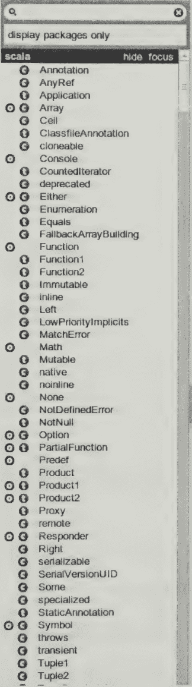

**FIGURE 16.1:** This is part of the right panel that you see when you first enter the API. The little circles with the letters c, o, and t indicate whether it is a class, object, or trait.

- So far, we have been putting **import** statements at the top of the file. This is not required though, they can go anywhere. **import** follows normal scoping rules. So if you put the **import** at the top of the file then the names brought in by it are visible through the whole file. However, if you put it inside of curly braces, the names that are **import**ed will only be visible through the end of the current scope.

- As we have seen before, you can use an underscore as a wildcard to represent everything in a certain scope.

- If you do not want to **import** everything, but you do want to **import** several things, you can put multiple names inside of curly braces.

- Names of **packages** and **classes** in Scala are truly nested. So if you have **import**ed all the contents of some **package**, and want to then **import** a subpackage, you can leave off the first part of the name for the subpackage. For example, after you do **import scala.swing._** you can do **import event._** instead of **import scala.swing.event._**. For that matter, because **scala._** is **import**ed by default, you can leave that off of everything.

- So far we have used **import** to bring in the contents of packages. It can be used to bring a lot more into the current scope. You can **import** package names or the members of objects. Things like the members of objects should definitely be done in limited scopes.

- You can give a different name to things that you **import** using a rocket, `=>` inside of the curly braces. Put the name the thing normally goes by on the left side and the name you want on the right side. For example, if you need to use the **java.util.List** you probably do not want it hiding the **List** in Scala. To get around this you could do **import java.util.{List => JList}** so that the name **JList** refers to the Java version. You can also hide a name by putting an underscore to the right of the rocket. So if you want to **import** all of the **java.util** package except the **List** you could do this: **import java.util.{List => _, _}**.

- Due to the nesting of packages, there are times when a particular name could refer to more than one package. To remove ambiguity, that name `_root_` can be used to refer to the base below all packages. So `import _root_.scala.io.Source` can be used to refer to the **Source** type even if there are conflicts with the names **io** or **Source**.

# 16.5 End of Chapter Material

### 16.5.1 Summary of Concepts

- Objects are constructs that combine data and the functionality that operates on that data.

- The standard way of making objects in Scala is to define a **class** and instantiate objects from it. You can think of a **class** as a blueprint for making objects.

- A **def** declaration in a class defines a method. A **val** or **var** declaration defines member data.


- 类可以带参数。默认情况下它们不是成员。在名称前添加 `val` 或 `var` 会使其成为成员数据。
- 默认情况下，在类内部声明的结构是公共的，任何代码都能看到。面向对象威力的一大部分来自隐藏信息、使其他代码无法访问它们的能力。`private` 修饰符使得类之外的任何代码都无法看到该声明。还有一个 `protected` 修饰符，它让声明只对子类型可见。
- 将东西设为 `private` 的一大好处是，它可以用来隐藏实现细节。这有助于接口与实现的分离。
- 为了增强语言的表达能力，Scala 允许比大多数语言更广泛的名称，并以特殊方式解释某些方法名。
  * 除了以字符或下划线开头、后面跟字符、数字或下划线的“标准”名称之外，Scala 还允许另外两种名称。其中一种是只包含运算符字符的名称。另一种是“普通”名称后跟下划线以及一个或多个运算符符号。省略点和圆括号的运算符语法适用于任何带单个参数的方法。运算符优先级由第一个字符决定。以 `:` 结尾的运算符是右结合的。
  * 一元前缀运算符可以通过名为 `unary_` 后跟 `+`、`-`、`~`、`!` 等符号的方法来声明。
  * Scala 在方法和成员之间没有很强的语法区别。你可以通过编写一个不带参数或圆括号的方法，外加一个用于赋值的特殊方法，来模拟类的属性。该特殊方法的名字是属性名后跟 `_=`。
  * 函数调用语法会被展开为对 `apply` 方法的调用。
  * 索引赋值会被展开为对 `update` 的调用。
- 只要参数不同，你可以有多个同名方法。这称为重载。
- Scala 还允许 `object` 声明，这会创建单例对象。它们不能带参数，也不能用 `new` 实例化。一个单独的实例就那样存在，供你使用。
  - 脚本适合小型程序，但更大的程序是以应用程序的形式编写和运行的。应用程序的入口点由对象中的 `main` 方法定义。顶层声明会分散到不同文件中。代码用 `scalac` 编译，用 `scala` 运行。
  - 可以在同一个文件中声明一个与类同名的 `object`，它就成为伴生对象。伴生对象可以访问私有声明。
- 在 `case class` 上使用 `case` 关键字，实际上等于给类添加了一些代码。它会把所有参数变成 `val` 声明，还会添加一个 `copy` 方法和用于模式匹配的代码。
- `import` 语句可以让你做很多不同的事情。它们可以放在代码中的任何位置，可以重命名东西，也可以隐藏它们。

# 16.5.2 练习

- 1. 本章中的代码开发了一个不可变向量类。在本练习中，你应该开发一个可变的向量类。操作时，请保持现有方法的行为不变。它之所以是可变的，是因为你还要定义 `+=`、`-=`、`*=` 和 `/=` 方法，这些方法会修改被调用向量本身。

- 2. 你可以将之前写的任何脚本转换为应用程序，方法是将所有内容嵌入到 `main` 方法中的一个 `object` 里。这样做的结果应该能用 `scalac` 编译，并可以用 `scala` 运行。³

    这种简单转换的结果通常并不理想。任何方法或 `case class` 声明通常都应该从 `main` 中提取出来。这些方法很可能应该放在 `object` 内部，但在 `main` 之外。如果这些方法不是普遍有用的，就应该设为 `private`。`case class` 可以放在 `object` 内部，在那里它们可以设为 `private`，也可以不设，具体取决于它们的通用程度。然而，如果它们确实能够独立存在并具有意义，就应该放到 `object` 外部，放入以它们命名的单独文件中。

    修改后的结果可能无法编译。这取决于原始代码的质量，以及你是否在那些方法中使用了在方法外部声明的变量。如果你在方法体中使用了在方法外部定义的变量，你有两种选择。通常，你的第一选择应该是通过给方法增加额外参数来传入这些变量。如果一个变量确实应该成为对象的数据成员/属性，那么可以把它上移一层，让它也位于 `object` 中，而不是在 `main` 中。⁴

    本练习的目标是，对你在本书前面写过的多个脚本完整地执行这一过程。操作时，建议你为每个要转换的脚本创建一个子目录，然后把文件复制到那里。这样你不仅保留了原始脚本，还能更容易地编译那个单独的应用。在多个脚本上这样做，会非常有助于你建立起对新方法与之前做法之间差异的感受。

- 3. 另一件可以帮助你习惯面向对象模型某些方面的事情，是把 `case class` 转换为普通类。这通常是一个不太大的修改，但它会要求你更改代码的其他部分，例如在实例化对象时必须使用 `new`。你还会失去 `copy` 方法。

    尽管把脚本转换为应用程序有一定通用价值，但请记住，并非所有 `case class` 都需要修改。Scala 中存在 `case class` 是有原因的，这一原因超出了本书中让我们受益的教学目的。很可能你的一些 `case class` 从长远来看最好保持原样。练习修改它们有助于你理解这其中的影响，但这并不总是你想做的事情。

- 4. 对于你编写为应用程序的任何东西，你都可以添加合适的 `scaladoc` 注释，然后在源码上运行 `scaladoc`，查看生成的 HTML 文件。

³请记住，当你用 `scala` 运行一个应用程序时，你只给出对象的名称，而不是文件名。大多数情况下，文件名应以对象名开头，所以你只需去掉 `.scala` 后缀。

⁴注意，如果一个变量是由用户输入设置的，它几乎肯定需要留在 `main` 中。让单例对象请求用户输入，在较大的程序中会导致非常奇怪和意外的行为。

要让这一点与上面描述的 `Formula` 类型配合，你需要构建一个 `String`，其中像 `ma` 和 `mb` 这样的变量已被替换为所考虑的粒子质量的正确数值。你甚至可以考虑将这些公式保存在 `Array[Array[String]]` 中，这样它们就不必每次都重新构建。然后让 `Formula` 使用粒子之间的正确距离来进行求值。

你也可以扩展 `Formula` 类型，使其接受 `x`、`ma`、`mb` 以及你可能想定义的其他变量。第二种方法对 `Formula` 类型来说不太理想，因为它降低了通用性，但可能是让你在力函数中为用户提供一些灵活性的最简单方式。

请注意，这个版本的积分器会明显比以前慢，因为每次力的计算都涉及 `String` 解析。在第 29 章中，我们将学习如何在仍然允许力函数由用户决定的同时，恢复大部分速度。

3. 如果你在早先的项目中做过 Tron，你可以把它更新为面向对象的版本。对于 Tron，你可以创建一个表示光轮摩托的类，包含位置、方向和颜色。它可以有一个名为 `move` 的方法，根据方向适当地改变位置。其他方法可以包括由按键反应调用的左转或右转，或者一个在适当位置画点的 `draw` 方法。你还可以把光轮是否存活封装进类中。

有了这一改动，现在就可以加入更多玩家，并让某个玩家的光墙在该玩家死亡时消失。扩展游戏，使其拥有三名人类玩家（或添加一个电脑玩家），并做到当玩家死亡时，该玩家的轨迹消失。

4. 如果你在之前的章节中做过任何其他类型的图形游戏，你也应该能够用面向对象的方法将其转换为应用程序：将游戏的不同元素变成类，存储相关信息并拥有合适的方法。

5. 如果你之前实现过 Mandelbrot 集的计算和显示，那么这个项目就是为你准备的。首先，使用本章所学，创建一个名为 `Complex` 的类来表示复数，并修改你原来的 Mandelbrot 计算以使用它。完成之后，你可以进一步利用它，添加显示二次多项式的 Julia 集的功能。

Mandelbrot 集中的每个点都对应这些 Julia 集之一。二次多项式的方程看起来与 Mandelbrot 集的方程非常相似：z_{n+1} = z_n^2 + c，其中 c 是一个固定值，z_0 是你要计算的平面上的点。相比之下，Mandelbrot 集对每个点使用不同的 c 值，且 z_0 = 0，因此 z_1 = c。同样，你要迭代计算，直到值离开原点附近的区域，或达到某个预先指定的迭代次数为止。

如果用户点击某个位置（使用 `MouseClicked` 事件），那么你应该弹出另一个窗口（对该窗口使用 `Frame`，而不是 `MainFrame`），其中有一个不同的面板，绘制与用户点击点相关联的 Julia 集。你可以自行决定要在窗口中放入哪些功能。它的初始范围应为 r ∈ [−2, 2] 和 i ∈ [−2, 2]，分别对应实轴和虚轴。添加缩放功能应该不难，但这不是必需的。

6. 这个项目延续了项目 5（第 206 页），当时你需要弄清楚有多少

每个类型的元素都在化学方程式的不同两侧。你应该记得该程序的输出类似于以下内容。

```
C: a*1=d*1
H: a*4=c*2
O: b*2=c*1+d*2
```

我们想把这当作一个线性方程组来处理并求解 a、b、c 和 d 的合适值。这些特定的公式给出了四个未知数的三个方程。如果你记得方程组的情况，这通常不是好事，因为系统是欠定的，所以有无穷多个解。解决它的简单方法是假设系数中的某个数为 1，这样我们就剩下方程数和未知数相等。

上面给出的形式手动求解方程已经足够了，但要在计算机上求解，我们需要稍微调整一下。思路是我们希望将其化为 $Ax = y$ 的形式，其中 $A$ 是一个给出方程中显式数字的矩阵，$x$ 是一个包含我们求解变量的向量，$y$ 是一个包含等于号右侧常数的向量。让我们通过重新排列上面的方程使其更接近我们想要的形式来更明确地说明这一点。

```
1*a-1*d=0
4*a-2*c=0
2*b-1*c-2*d=0
```

现在我们必须选择一个系数设为 1 以便将方程数和系数数降到相等。任何一个都同样好，但从编程角度来看，你可能会发现将最后一个系数设为常数值最容易（这样在代码中仍然是零索引）。在这种情况下是 d。如果我们这样做并将常数移到右侧，我们得到以下方程。

```
1*a=1
4*a-2*c=0
2*b-1*c=2
```

如果

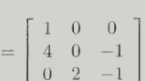

并且

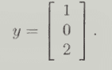

则可以将其转化为 $Ax = y$。这里 $x$ 和 $y$ 都是列向量，因此它们只有一个列和多行。记住

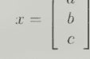

这就是我们想要求解的。实现这一点的方式是通过一个过程

我们可以通过从上往下处理矩阵来求解。最后一行告诉我们 c=4。我们将其代入下一行得到 2*b-4=2 并求得 b=3。对我们来说很容易说出来，但我们应该大概看看计算机如何找到这些值。对于第一个，计算机简单地执行 `c=y(2)/A(2)(2)`。然后当我们向上移动时，我们必须在除法之前做一些循环来减去项。在这种情况下 `b=(y(1)-c*A(1)(2))/A(1)(1)`。注意我们总是除以对角线上的分量，并且减去对角线右侧的所有项。现在我们剩下顶部的方程 a=c/4 所以 a=1。在程序中它将是 `a=(y(0)-c*A(0)(2)-b*A(0)(1))/A(0)(0)`。y(0) 和 A(0)(1) 的值都为零，但程序中的数学仍会包含它们，这无关紧要。

你的程序应该接受一个输入，就像你输入化学方程式的早期项目一样。它应该然后打印出与该作业中相同的输出，并在其后跟随一个解。在这种情况下它将打印出“a=1 b=3 c=4 d=1”作为输出的最后一行。也可能有一些小数点。这个例子表现良好，给出了整数结果。然而，我们的程序并不保证这一点。如果你想要一个额外的挑战，你可以将其放大以便全部为整数。

通过创建一个应用程序并拥有一个代表化学公式的类，使其面向对象。你可以添加方法来访问使用上面描述的方法计算的信息。

- 是时候将你的地图程序变成真正的文字冒险游戏了。你可以用任何方式做到这一点，但你需要在游戏中加入一个目标并告知玩家他/她是否赢了或输了。大多数原始的文字冒险游戏都有某种类型的解谜，其中物品可以以某些方式相互作用或与房间互动从而产生事情。你可能不想走角色扮演游戏（RPG）路线并拥有装备、战斗等，尽管简单的战斗可能是可行的。你必须添加一个“help”命令，该命令打印出游戏的目标和玩法。这应该读取并打印文件的内容，这样你就不必在 print 语句中输入完整的帮助。

- 如果你做了第 1 页第 387 页的递归光线追踪以及之前的图形项目，现在是时候添加光照和适当的颜色并使其成为真正的图像。你还将把事物组织成具有对象和类的应用程序。

你已经有一个包含球体、平面和光源的 case class scene。到目前为止你还没有使用光源。几何对象和光源中的每一个都应该附带一个颜色。你需要编写一个函数，该函数接受一条射线和场景并告诉你使用什么颜色。如果它从未击中任何东西，颜色应为黑色。建议为此制作一个名为 DColor 的自己的类，该类使用 Double 表示红色、绿色、蓝色和 alpha 值。你可以加入方法以有意义的方式缩放和组合这些值。这可能包括用于添加 DColor 的 `+` 方法和用于在乘以 Double 时缩放的 `*` 方法。

使用自己的 DColor 类的原因是你可以在进行计算时使用超出正常 0.0 到 1.0 范围的分量表示颜色。你只需要在构建普通 Color 对象时将事物带回该范围。那项操作对 DColor 类型来说也是一个很好的方法。

你还应该更新现有的光线追踪代码，使其使用类来表示各种组件，包括点/向量、球体、平面、光源等。特别是 Point 和 Vect 类可以拥有执行数学运算的方法，这将使你的代码更简单、更易读。像 mag 和 normalize 这样的方法也可能很有用。

要为一个点着色，你需要被击中的对象的颜色以及该点的光照。要获得光照，从接触点向光源发送一条射线。如果中间有任何几何体（t 值在 0.0 到 1.0 之间），则该点处于阴影中，光线无法到达。如果没有阻挡，该光线会为该点做出贡献。颜色应为光线颜色和被击中对象颜色的分量乘积，按法线与指向光线的方向之间的角度的余弦缩放。要找到余弦，请记住 $\vec{a} \cdot \vec{b} = |a||b| \cos \theta$。为了让这更容易，你应该使用 DColor 存储光源和几何体的颜色。这希望能证明在 DColor、Point 和 Vect 中放置适当的方法将有助于使代码更易于编写和阅读。

如果被击中的几何体是反射的，你进行递归调用以查找它击中了什么并将结果颜色相加，按适当的比例缩放，以得到入射射线的颜色值。

- 9. 你可以将第 6 页第 388 页的调度脚本从项目 6 变成面向对象的应用程序。为此，你希望在 Course case class 上放一个主体。你可能会将其保留为不可变的 case class 并只向其添加方法。方法可能包括一个接受另一个 Course 并确定两者是否重叠的方法。也可能有方法设计用于执行你经常进行的特定类型的复制操作，例如在不同时间或不同教授的情况下复制课程。

由于教授的选择通常会影响你想要修读课程的程度，你可以将其拆分并创建一个名为 Professor 的类，该类具有教授姓名和喜好评级。Course 然后可以保存对 Professor 的引用并具有独立于教授的评级。可以编写一个方法来给出综合喜好度。这样你就可以轻松地复制带有不同教授选择的课程选项并自动考虑这种变化。

你还可以构建一个可变的 Schedule 类来跟踪用户在日程表中想要的内容以及迄今为止已满足的内容，以及已放入日程表中的课程。把这一切放在一个应用程序中并在 GUI 中将其联系起来。

- 10. 要将 15.5 的食谱项目升级为更面向对象的形式，你主要会将 case class 转换为具有方法和可能的可变类。你还将把脚本的主要功能移入具有 main 方法的对象中。

除了为 Pantry、Recipe 和 Item 拥有类之外，你可能还想要一个类来跟踪程序中已使用的所有已知 Item 类型。该类应具有方法以便于按名称或其他属性查找项目，以便用户不会创建 Item 对象的重复项。

- 11. 第 9 页第 389 页的音乐库脚本可以通过填充不同的 case class 的方法或将其转换为可变类来转换为面向对象的应用程序。


你还可以为播放列表或其他有利于封装的信息分组创建类型。将主脚本放入带有`main`的`object`中，你就有了一个应用程序。

+   12. 项目4（第388页）中的L-Systems脚本有许多特性需要面向对象化。从最上层开始，一个L-System应该由一个`class`表示，其中包含多个`Productions`以及一个初始值。`Production`类型应该是一个`class`，包含一个`Char`表示被替换的字符，以及一个`String`表示替换后的结果。

将产生式封装在L-System中的一个好处是，你可以制作概率产生式。这些产生式从一个单一字符开始，但根据随机值可以产生多种不同的`Strings`。一个`Production`是否是确定性的，对整个系统来说并不重要，因为系统所做的只是询问给定字符将被转换成什么。

使用`String`来表示L-System在任意时刻的状态是可以的，但创建一个包装了`String`的自定义`class`也有一些好处。这个`class`还可以包含关于你在应用产生式时处于第几代的信息。这样做的好处是，该类型明确了这不是任意`String`，而是L-System的状态。

你应该进行这些修改，并将脚本调整到带有`main`的`object`中，以创建一个完整的应用程序。

更多练习和项目，以及数据文件，可在本书的网站上下载。

# 第17章

# 更大的程序/新工具

| 章节 | 标题 | 页码 |
|---|---|---|
| 17.1 | Eclipse IDE | 423 |
| 17.2 | 并发版本系统（CVS） | 430 |
| 17.2.1 | 创建仓库 | 430 |
| 17.2.2 | 在Eclipse中设置 | 430 |
| 17.2.3 | 在其他系统上获取访问权限 | 432 |
| 17.2.4 | 仓库的使用与规则 | 432 |
| 17.3 | Scadoc注释 | 433 |
| 17.4 | 章末材料 | 434 |
| 17.4.1 | 概念总结 | 434 |
| 17.4.2 | 练习 | 435 |
| 17.4.3 | 项目 | 435 |

到目前为止，我们一直在命令行环境中工作，因为这是一件值得了解的事情，而且它对于REPL和脚本都非常适用。它支持了我们早期所需的小步骤。然而，现在是时候超越脚本，编写更大的应用程序了。这可以通过命令行来完成，如上一章所述，但有更简单的方法。

# 17.1  Eclipse IDE

大型软件通常借助许多工具进行开发，包括集成开发环境（IDE）。此时，我们希望将自己的工作从命令行转移到IDE上。在本书中，我们选择使用Eclipse IDE。当然你也可以尝试其他IDE，但Eclipse支持多种语言，并且是最早为Scala创建插件的平台之一。它也是Typesafe官方支持Scala的IDE。

IDE使得管理编写大型应用程序时通常创建的多个文件变得更加容易。它还自动化了编译代码的过程，并可以在你编写代码时显示语法错误。

你可以从http://www.eclipse.org免费下载Eclipse。有多个不同版本的Eclipse，针对不同类型的使用进行了定制。你应该下载Classic版本。按照他们的说明进行安装。当你运行Eclipse时，它会要求你选择一个工作区目录。默认设置完全适合初学者使用。第一次运行Eclipse时，你会看到一个欢迎屏幕，如图17.1所示。你可以花任意多的时间浏览他们的教程和其他信息。当你准备好开始编程时，点击进入工作区的气泡。

图17.2展示了Eclipse工作区首次运行时的样子。该窗口分为多个不同的区域，并具有图形应用程序所期望的常规菜单。如果你浏览菜单，会发现有很多不同的选项。不要被这些吓到。在本书中我们只会用到其中一小部分，你不需要知道其他所有选项的作用也能使用Eclipse。

默认情况下，Eclipse Classic是为Java编程设置的。你可以从右上角看到一个小按钮，上面有一个图标和“Java”字样，表示当前是Java视角。为了用Scala编程，我们需要向Eclipse添加一些东西。如果你访问http://www.scala-ide.org，那里有将Scala插件添加到Eclipse的说明。如果你正确遵循这些说明，系统会要求你重启Eclipse。重启后，界面看起来一样，但你已经具备了用Scala编写的能力。要做到这一点，你需要切换到Scala视角。你可以点击工作区右上角的图标，然后选择Scala，如图17.3所示。如果初始菜单中没有列出Scala，请选择“Other”，然后在弹出的窗口中选择Scala。

在命令行中，你可以直接开始编辑以`.scala`结尾的文件，这就是一个程序了。Eclipse会让你经过一些其他步骤来保持代码的组织性。Eclipse中的所有代码都放在项目中。不同的项目可以使用不同的开发语言。我们要创建一个与Scala关联的项目。你可以从“File”菜单中操作，或者右键单击工作区左侧的“Package”区域。如果你处于Scala视角，“New”子菜单的顶部应该就有“Scala Project”选项。如果没有，请选择“Other”并找到“Scala Project”选项。这样做会弹出一个如图17.4所示的对话框。你可以输入一个名称并点击“Finish”。默认选项在目前阶段应该足够满足我们的需求。

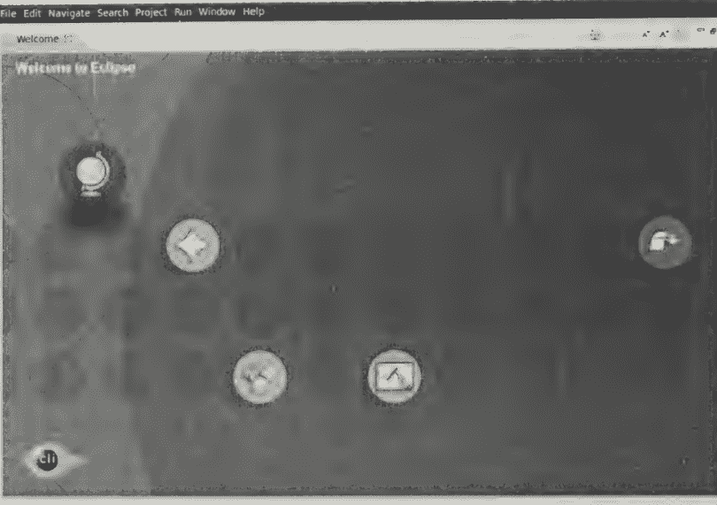

**图 17.1：** Eclipse的欢迎屏幕，你第一次运行时就会看到。

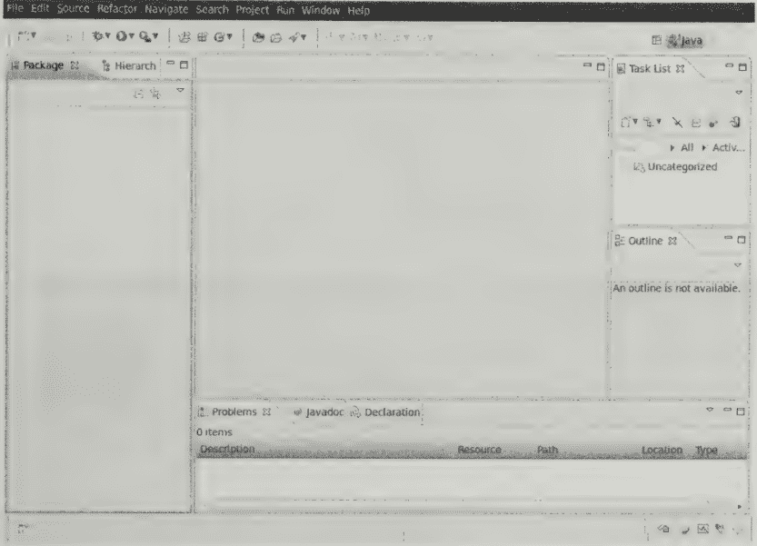

# 图 17.2：一个空白的Eclipse工作区。这是你准备好开始在Eclipse中编程时看到的初始状态。


图 17.3：此图显示带有视角切换菜单的工作区。

# 图 17.4：创建新Scala项目的对话框。

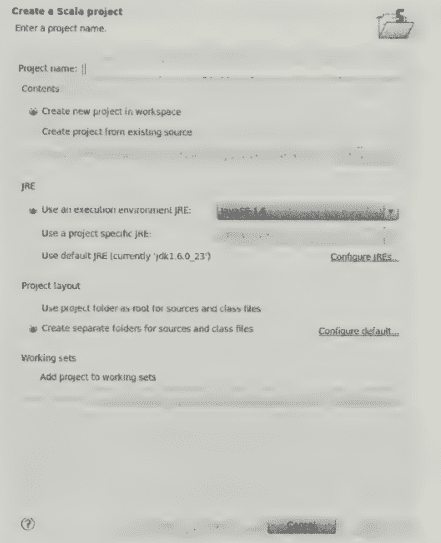

在这个示例中，我们将创建一个名为“ScalaBook”的项目，用于存放本书剩余部分编写的所有代码。如果你愿意，也可以选择其他名称。请记住，项目旨在作为相对较大的代码组。不要为你编写的每个十行小程序都创建一个新项目。当你真正有一个项目需要处理时，才创建新项目。

在项目内部，你需要将代码组织到包中。我们第一次遇到包是在第9章，当时我们需要从标准库包中导入代码。现在我们要开始创建自己的包了。在编写应用程序时，不使用包被认为是不好的风格。如果你不指定包，你的代码会被放入所谓的默认包中。

要让你的代码成为包的一部分，严格来说你只需要放入一条`package`语句。这可以通过两种方式完成。如果你在文件顶部放置一条`package`语句，那么文件中出现的所有代码都属于该包。这种风格是从Java中借鉴来的。Scala的包具有真正的嵌套特性，你可以在包声明后跟一个代码块，该代码块花括号内的所有代码都将位于该包中。在本书中，我们通常使用前一种方法，主要是为了组织代码。

在Java中，包也是目录，当代码放入某个包时，你必须将其放在与包同名的目录中。虽然Scala不要求这样做，但推荐如此，因为它更容易找到你想要的代码。这也是本书中我们坚持遵循Java风格的部分原因。当你在Eclipse中创建包时，相应的目录会自动为你创建。

我们将继续创建第一个包来存放我们的第一段代码。要让你的代码成为包的一部分，严格来说你只需要放入一条`package`语句。


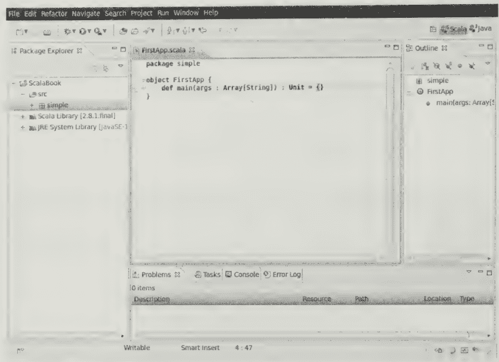

**图 17.5**：此图显示了在选择创建第一个应用程序后的工作区外观。

要创建一个包，你可以右键点击项目，然后从“新建”菜单中选择“包”。这将弹出一个对话框，你可以在其中输入包名。现在我们创建一个名为“simple”的包。请注意，名称全部使用小写字母。这是包命名所接受的风格。所有字母都应小写，不能有空格或特殊字符。我们把这个包命名为simple，因为我们将在这里放置一些偶尔需要编写的小代码片段。我们也会创建其他包来组织我们所编写的其他部分代码。

现在我们有了包，需要在其中放入一些内容。如果你展开项目和src目录，可以右键点击包。“新建”菜单中会有许多与Scala相关的选项。你会看到可以创建类、特质、对象或应用程序。我们想创建一个应用程序，但我们会通过创建一个对象并包含适当的main方法来实现。你可以给这个对象命名为FirstApp，并保留所有默认设置。完成此操作后，会创建一个文件并在主编辑器区域中打开。输入main方法后，你的屏幕应该如图17.5所示。

应用程序只是一个定义了适当main方法的对象。要让你的第一个Eclipse小程序做点什么，只需填写main方法的主体。一个println就足以证明它能运行。有多种方式可以告诉Eclipse运行程序。也许最直接的方式是右键点击包含应用程序的编辑器窗口，进入“运行方式”子菜单。选择将其作为Scala应用程序运行。结果

> 1 直接创建应用程序的选项使用了我们尚未介绍的技术。

# 17.2 并发版本系统（CVS）

软件开发的一个重要工具是版本控制系统。这些系统帮助开发人员跟踪代码，并处理多人同时在同一个软件上工作的困难。它们对在多个不同电脑上处理同一份代码的个人开发者也很有用，因为这有助于保持不同电脑上的代码同步。

开发人员会根据不同原因选择多种版本控制系统。本书将使用并发版本系统（CVS）。CVS是较老的版本控制系统之一，但非常可用。它也是Eclipse默认自带的版本控制系统。你也可以选择使用其他系统，比如Subversion或Git，但你需要为Eclipse安装不同的插件才能获得该功能。

### 17.2.1 创建仓库

要使用CVS，你需要在某台电脑上创建一个CVS仓库，该电脑必须能让你从项目工作的任何位置访问。如果你在Linux系统上，可以在命令行中完成此操作。首先，你需要为仓库创建一个目录。在你的主目录中创建一个叫CVS的目录就行。如果你在主目录中，可以使用mkdir完成此操作。

```
mkdir CVS
```

创建目录后，你需要将其设置为CVS仓库。Linux下的cvs命令可以完成此操作，以及你使用CVS所需的其他任何功能。要查看所有不同选项，可以使用man命令。如果你只想初始化刚创建的目录，可以使用以下命令。

```
cvs -d$HOME/CVS init
```

如果你的系统未定义$HOME，可以用主目录的完整路径来替换它。

你可以使用cvs命令向仓库提交代码或从仓库更新代码。我们将从Eclipse内部执行这些功能，而不是在命令行中。

### 17.2.2 在Eclipse中设置

要在Eclipse中开始使用CVS，你应打开Eclipse中的“CVS仓库浏览”透视图。这将把工作区变为图17.7所示的样子。如果你右键点击左上角的“CVS仓库”视图，可以选择设置新仓库。这将弹出一个窗口，你需要在其中输入系统和仓库的信息。如果有安全限制，你可能需要询问系统管理员连接信息。例如，如果你的系统需要安全连接，则可能需要“extssh”。

一旦设置了仓库，你可以回到Scala透视图，右键点击要使用该仓库的项目。从该菜单中选择“团队 > 共享项目”。这将让你选择要放置代码的仓库。对于共享仓库，你可以跳过前面设置仓库的步骤，在自己选择共享时再设置。但要反向操作，则需要先设置仓库。

```
package simple
object FirstApp {
  def main(args : Array[String]) : Unit = {
    println("Hello Eclipse!")
  }
}
```

**图 17.7**：此图显示了Eclipse CVS仓库浏览透视图。

此时，系统会要求你将代码提交到仓库。会弹出一个对话框，让你选择要提交哪些文件，并询问与此次提交相关的注释。当你点击完成时，当前版本的代码会被复制到仓库中。

### 17.2.3 在其他系统上访问

当你想要在另一台系统上访问自己的项目时，将再次打开“CVS仓库浏览”透视图并打开相应的仓库。仓库下有一个名为“HEAD”的选择项。展开它，它会告诉你该仓库中当前的所有项目。右键点击你想要的项目并检出。这将把当前存储在仓库中的该代码版本下载到本地机器，并放入一个项目中。然后你可以切回Scala透视图来编辑该项目。

### 17.2.4 仓库的使用与规则

在任何机器上编辑代码并不会自动更改仓库中的内容。要做到这一点，你必须提交更改。同样，你也不会自动获得仓库中的更改。为此，你必须更新。一旦项目连接到仓库，“团队”菜单中就会出现提交和更新两个选项。

通常，查看你正在提交或更新仓库的什么内容是有好处的。你可以通过从“团队”菜单中选择“与仓库同步”来做到这一点。该选项会要求你切换到另一个透视图，你应允许切换。在那里，你可以看到需要提交哪些文件，可以更新哪些文件，如果有文件需要同时进行两者，它会显示为冲突，供你查看并解决。

当你独自工作，只是利用仓库在多个电脑之间实现单一代码库时，只需记住：在任何电脑上开始工作时更新代码，完成时提交代码。如果忘记这样做，当你在另一台机器上工作时就不会拥有最新版本。独自工作时，你可能会发现自己需要提交不能正常工作的代码，因为你需要去别处，也许还要去会见能帮你修复问题的人。然而，当你们作为一个团队在同一个代码库上工作时，CVS或任何其他代码仓库系统的主要规则是：永远不要提交不完整的代码。

原因很简单。如果你提交了不能工作的代码，而别在你修复之前更新了代码，那么他们就拿到了有问题的代码，这可能会阻止他们编译或运行整个项目。仅仅在提交前修复自己的问题还不够。在你做了更改并确保所有内容都能正常编译和运行后，你需要再次从仓库更新，并在提交前再检查一次代码。要理解为什么需要这样做，假设你在工作环境中，一小时前刚刚更新过代码。你的团队中有多个开发人员，有些人可能在你更新之后已经提交了他们自己的更改。仅仅因为你的代码与一小时前仓库中的内容配合良好，并不意味着它也能与现在仓库中的内容配合良好。如果你在未更新的情况下提交，而你的代码与其他人更新的提交不兼容，你就会让仓库处于一种任何更新的人都会得到坏代码的状态。因此，在提交之前，你需要更新并检查错误。如果没有错误，你就可以提交。如果有错误，你必须在修复它们后再次更新并重复此过程。基本上，只有在你刚刚完成的更新下代码检查通过时，你才能提交。


# 17.3 Scaladoc 注释

你在第 3 章中已经接触过 Scala 注释。在本书的大部分内容中，我们并没有特别强调在代码中添加注释，因为代码的描述是文本的一部分。随着转向进行更大规模的面向对象项目，添加注释还有另一个原因。你之前使用的注释，使用 // 表示单行注释，使用 /* 后跟 */ 表示多行注释，是被动的。你会在代码中添加它们来提醒自己某段代码在做什么。如果你与一群人一起工作代码，这些注释对于让其他人理解你的代码会很有用。这样的注释可能非常有帮助，但也存在一定的风险。风险在于，如果程序员不够极其细心，注释可能会与代码不同步。这会导致严重的混淆并引发真正的问题。因此，有很多程序员试图不要过分依赖注释来解释代码，而是尝试让代码“自文档化”。这是通过选择反映所发生事情的变量和方法名称并以更易读的方式分解问题来实现的。

现在你正在编写完整的类和对象，注释还有另一个需要考虑的因素，即外部文档。到目前为止，注释的意义仅在于为查看源代码的程序员提供便利。希望以这种方式访问代码的人知道如何阅读它，并且可以从代码中推断出许多事情。类和对象可以成为库的一部分，这些库会被没有访问你代码的人调用，或者真的不应该期望他们浏览你的代码来弄清楚它做什么。这种情况非常常见，因此有专门的注释格式来支持旨在在没有代码的情况下使用的文档。这并不是一个全新的概念。你已经使用了一段时间的应用程序编程接口 API 文档，其工作原理完全相同。你需要知道库中有哪些类型，这些类型有哪些成员，以及如何使用它们。API 在你不必浏览代码查找的情况下告诉你这些信息。API 是通过在代码中放置具有特定格式的注释，然后运行名为 scaladoc 的程序来生成网页而创建的。

你可以在代码中插入自己的 scaladoc 风格注释并从中生成网页。虽然这些注释与普通注释一样容易与代码不同步，但它们对于外部文档具有更积极的作用，因此值得付出维护它们所需的努力。

scaladoc 注释就像多行注释一样，只是开头多了一个星号。所以你用 /** 打开注释。这仍然以 /* 开头，因此编译器会像对待其他多行注释一样忽略它。然而，这个开头告诉 scaladoc 工具内容与注释后面的内容相关。你应该将 scaladoc 注释直接放在注释所修改的类/对象/方法/成员之上。以下代码显示了一个示例。

```
/**
* This is an object where I am putting math functions.
*
* If I had more to say about this object I could put that here. You can
* use HTML tags if you want. To show code use triple curly braces.
* {{{ val a=5 }}}
*/
object MathFuncs {
/**
```

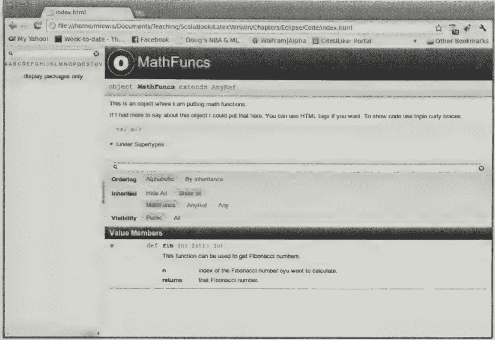

图 17.8：该图显示了在上述程序上运行 scaladoc 的结果。

- 你可以在 Linux 机器上设置一个 CVS 仓库来跟踪你的代码。
- 当你想拉取代码时，你执行更新。在你做出更改后，你将代码提交到仓库。与团队合作时，你绝不应提交不能工作的代码。

- scaladoc 工具会将注释代码直接转换为 API 文档。用于此的注释应以 /** 开头并直接位于它们所描述的内容之前。

# 17.4.2 练习

- 1. 花一些时间在 Eclipse 中编写简单的代码示例。它们不需要很大。它们只需要帮助你熟悉在 Eclipse 中的工作方式。它们现在都可以放在一个项目中。Eclipse 不支持脚本这一事实也意味着这将让你获得在更面向对象的方式下做事的一些经验。
- 2. 创建一个 CVS 仓库并在一台计算机上签入一些代码。然后去另一台计算机并签出该项目。

# 17.4.3 项目

与其在此列出单个项目，你应该将上一章的任何项目迁移到 Eclipse。不要将代码放在默认包中。相反，创建一个至少有一个合适名称的包。如果有许多类并且你觉得其中一些属于自己的包，你可以以这种方式组织它们。

本书网站上提供了额外的练习和项目以及数据文件。

# 第 18 章

# 一个项目（绘图程序）

- 18.1 软件开发阶段 ................................... 437
- 18.2 分析 ........................................................ 438
- 18.3 设计 ........................................................... 440
- 18.4 创建包 .................................................. 441
- 18.5 项目分析和设计 ...................................... 442
- 18.6 实现 GUI .............................................. 442
- 18.7 章末材料 ........................................... 447
- 18.7.1 概念总结 ............................................ 447
- 18.7.2 练习 ...................................................... 448
- 18.7.3 项目 ....................................................... 448

现在我们专注于面向对象和大型程序的开发，有一个我们将在本书中逐步工作的较大程序会很有帮助。本章将介绍一个项目，我们将在接下来的许多章节中逐步开发它。你将在本书其余部分的项目中构建其他大型程序，但看到除了你自己创建的代码之外的东西对你来说是有帮助的，以便更全面地了解事物的工作方式。

我们要开发的程序是一个绘图程序。它不会像 Paint® 或像其他“普通”绘图程序那样。我们会做一些不同的事情，以便该程序能够在本书的其余部分更好地说明关键概念。一些东西只是为了教育目的而加入，但总体而言，功能将被包含以产生一个最终应用程序，其功能是你通常在绘图程序中看不到的，包括动画。

# 18.1 软件开发阶段

正如最初在第 7.11 节中讨论的那样。任何大型软件系统的生产都涉及五个阶段。有许多不同的组织这五个阶段的方法，但它们的一般性质始终相同，并且都必须参与其中。五个阶段如下。

分析 这就是开始的地方。在分析期间，开发人员弄清楚程序 supposed to do。这是一个问题定义阶段。分析越详细，其他阶段就越容易。在实践中，不可能获得涵盖所有内容的初始分析，并且不可避免地，真实产品上的事情会随着时间的推移而变化。因此，出于这个原因，虽然所有软件都必须从分析开始，但这并不是你完成并离开的事情，你通常必须回到它。分析与编程完全独立，只关注你想要做什么，而不是如何做。


**设计** 在你进行了充分的分析、知道自己想要做什么之后，开发工作就转向了弄清楚如何在代码中产生期望的结果。这就是设计阶段，你要规划出代码中将发生什么。同样地，更完整的设计会让后续的工作更轻松，但也要认识到一开始就做出完美而完整的设计基本上是不可能的，因此这也是需要反复重新审视的内容。设计阶段会讨论代码，但实际上并不涉及编写代码。

**实现** 五个阶段的中间阶段是你实际编写代码的地方。本书以及你接触的大部分计算机科学（CS）入门内容，都专注于培养你编写代码的能力。然而，这只是软件开发生命周期中的一个阶段，而且如果做得好，它相对于其他阶段来说实际上可能是一个很小的阶段。不过在早期它仍是焦点，因为除非你对实现如何运作有扎实的把握，否则你无法真正地完成其他任何阶段（可能除了分析之外）。

**调试** 此时你应该已经明白，仅仅编写程序并不是你要跨越的最大障碍。找出程序中的错误可能要花费更长的时间。查找并修复错误的过程称为调试。这是软件开发中持续进行的过程，而且通常比实现阶段花的时间要长得多。

**维护** 当软件被认为已完成且足够没有错误/缺陷时，就会发布。这便进入了维护阶段。维护在课堂环境中很难模拟，但对大多数专业软件来说却是至关重要的。花钱购买软件的人通常希望知道，如果他们发现了问题，会有人来修复。客户也常常会想到他们希望看到的新增功能。维护是软件发布后处理其中问题的总体过程。

在以后的许多CS课程中，你会再次接触到这些不同的步骤。软件工程领域所关注的正是如何以最少的努力产生最佳结果的方式来做好这些事情。

# 18.2 分析

那么，软件设计的分析阶段到底包含哪些内容？你需要做些什么才能说你了解自己要解决的问题是什么？处理这个问题的一个关键方法是思考软件将被如何使用。想象一个用户正在运行该软件。有哪些不同类型的用户？他们与系统交互的方式有哪些不同？通过回答这些问题，你可以真正理解软件的主要功能。

有许多不同的方法来进行软件分析（和设计）。简单地写下描述系统的文字是一种选择，但不是一个很好的选择，因为这种文字信息密集，需要任何查看文档的人都进行大量阅读才能从中获取所需信息。因此，有一些图解式的分析方法可以快速传达关键想法。这些方法由散文提供图中未捕获的细节作为补充。其中一种就是用例图。这张图

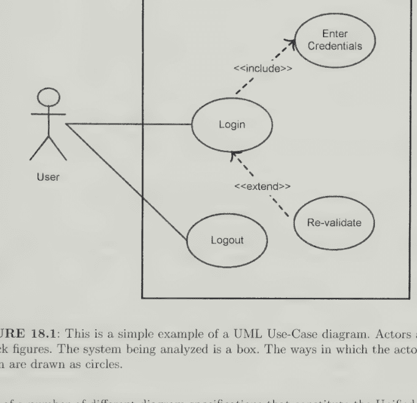

**图 18.1：** 这是一个简单的 UML 用例图示例。参与者被绘制成火柴人。被分析的系统是一个方框。参与者使用系统的方式被绘制成圆圈。

是构成统一建模语言（UML）的众多不同图示规范之一。

用例图包括各种参与者以及他们参与的用例。参与者通常代表不同角色的人类，但也可以代表当前系统外部的软件，这些软件与该系统通信并请求系统执行操作。图 18.1 展示了一个非常简单的用例图，只有一个参与者和几个基本用例。正如你所看到的，参与者用火柴人表示。易于绘制是 UML 图的一个重要特点。可以说它们非常适合在白板上使用。实际上，白板是许多软件开发公司的常见配置，而用例图和其他 UML 图的主要作用之一，就是提供一种高效、共通的语言来与他人交流想法。

图 18.1 中有一个大方框，表示正在被分析的系统。这是用例图的标准表示法。注意参与者位于系统外部。这是合理的，除非你碰巧把人放进你的软件里。这也是为什么其他软件也被表示为参与者的原因。它们不是你关注的对象的一部分。它们是外部的，通过发送命令来触发事情的发生。

在系统内部有一些带有文本的气泡，它们代表用例。从参与者到“登录”和“注销”用例之间有线，表示这些是“用户”可以发起的操作。气泡代表软件中能做的事情，线则表示谁能做。如果系统中有普通用户和管理员这两种参与者，那么管理员会有指向某些用例的连线，这些用例

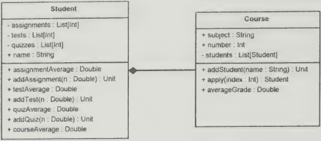

**图 18.2：** 这是一个简单的 UML 类图，展示了一个可以包含多名学生的课程。

是普通用户无法使用的。像删除用户帐户这样的操作不应属于普通用户的选项。

还有另外两个用例气泡，文本为“输入凭据”和“重新验证”。这两个都有带注释的箭头连接到“登录”用例。从“登录”指向“输入凭据”的箭头标注有“<<include>>”。这表示当调用“登录”用例时，可以包含让用户输入其凭据的步骤。从“重新验证”指向“登录”的箭头标注有“<<extends>>”。这意味着箭头的源是目标的一个子类型。因此，让用户重新验证被表示为登录的一种特殊情况。

用例图可能看起来有点简单，但它们可以迫使你真正思考用户应该能在你的应用中执行的所有不同操作，然后看看这些不同操作是如何组合在一起的。当你进入构建软件的设计步骤时，这会非常有用。

# 18.3 设计

在本书的前半部分，你在设计过程中所做的大部分工作是将问题分解为不同的函数，并决定需要在哪些函数之间传递哪些数据。当你以面向对象的方式工作时，设计过程涉及弄清楚程序中需要的对象类型，并为它们布置类、对象和特质。每个类、对象和特质都可以包含成员数据和方法。

在 UML 中表示这一点的方式是使用类图。图 18.2 展示了一个简单的类图，显示了两个类，一个是 Student 类型，另一个是 Course 类型。每个类用一个方框表示，方框有三个不同的部分。顶部是类型名称。其下是类型的数据成员。底部列出该类型的方法。数据成员和方法前面有一个符号表示其可见性。‘+’ 表示它是公有的，‘-’ 表示它是私有的，‘#’ 表示它是受保护的。

该图还显示了 Course 类和 Student 类之间的箭头。类图中使用多种类型的箭头。随着时间推移，我们会看到更多这样的箭头。这种特定风格的箭头表示组合关系。它意味着一个 Course 由多个 Student 组成。

与用例图一样，类图并不会向你展示关于系统的所有信息。然而，它确实以一种人们可以快速轻松阅读的格式传达了相当多的信息。它所传达的信息对于帮助人们理解系统如何工作尤其重要。最明显的信息是系统中使用的类/类型。它还通过方法和成员数据为你提供了不同元素功能的快速参考。

不那么明显的是，线条和箭头同样重要。通过展示系统不同部分之间的连接，类图可以让你快速看到哪些部分对其他部分的运行至关重要。这使你能够识别系统中可能导致故障或漏洞的关键点。在这个更高的层面上审视系统，还可以帮助你发现那些原本可能不会引起你注意的结构。

你偶尔会看到更简略的类图版本，它仅用带箭头的简单方框表示每个类，省略了成员数据和方法。这种视图之所以存在，是因为通常了解类以及它们之间的关系比了解任何一个类的细节更重要。

UML 类图还有更多内容，不仅包括表示不同关系的其他类型的箭头，还包括表示包的方框以及类型之间关系上的注释。这些不同的方面将在后续章节中根据需要介绍。

# 18.4 创建包

包含大量代码的大型软件项目需要进行组织。这可以通过添加包来完成。我们在上一章中看到了如何在 Eclipse 中创建新包。在 Java 中，包始终表示为目录，而在 Eclipse 中创建包会镜像这种安排。Scala 并不要求源文件组织成镜像包的目录结构，但建议这样做以便更容易找到文件。

在源文件中，你使用 **package** 关键字指定包。如果文件中的所有内容都属于同一个包，你可以在文件顶部放置一行来指定包。你也可以在包声明后跟一对花括号，该块内的代码将位于指定的包中。在本书中，我们将采用第一种方法，其理念是包应该是相当大的代码分组，单个文件不应太长。

请注意，在 Eclipse 中，如果你想将 main 方法作为应用程序运行，需要确保文件中的对象名和 **package** 名与文件和目录的名称匹配。如果文件中的 **package** 声明与目录位置不匹配，或者文件名与对象名不匹配，当你尝试运行时，Eclipse 会告诉你找不到类。


# 18.5 项目分析和设计

现在是时候开始着手我们将在本书剩余部分推进的项目了。这将是一个相当大的软件，因此正如刚才所讨论的，我们应该先进行分析，然后在尝试实现任何东西之前再做一些设计。我们现在不会试图弄清楚软件中可能包含的每一种选项。我们想要弄清楚足够多的内容，以便我们有方向可循。我们还希望确定以后可能想要添加功能的位置，以便在进入设计阶段时能够牢记这些。

该程序本身是一个绘图程序，具有文本输入的灵活性来发出命令。图 18.3 显示了我们系统的用例图。图中包含两个参与者。显而易见的是正在运行程序的用户。该用户具有向绘图添加元素以及编辑绘图元素的权限。他们还具有向程序发出文本命令的能力。图中不太明显的部分涉及让程序的两个独立实例相互通信。这导致了用例，即本地用户连接到程序的其他实例并执行诸如向它们发送绘图的一部分或其他形式的通信等操作。

该图显示了一些连接不同用例的箭头。带空心箭头的实线表示泛化。这意味着一个用例是另一个用例的特定类型。还有一条带空心箭头的虚线，标记为 <<include>>。这种箭头表示每当一个用例发生时，另一个用例将被包含在其中。该图足以满足我们当前的需求。它列出了程序的基本操作，并且其创建迫使我们思考我们希望程序能够做什么。有了这些，我们就可以开始设计。

与分析一样，我们目前也只会进行到设计的一定程度。与分析不同，部分原因是我们需要学习更多东西才能完成设计。我们可以用类图实现一些东西。这些显示在图 18.4 中，其中包含四个框，代表三个类和一个对象。该对象包含应用程序的主方法以及图形用户界面（GUI）所需的一些其他方面。主窗口中使用了 TabbedPane，以便可以打开多个绘图，每个绘图都有自己的标签。还有一个私有方法，在用户选择创建新绘图时调用，以及当前打开的绘图的 Buffer。DrawMain 对象到 Drawing 类画有一条 <<uses>> 箭头，表示 DrawMain 依赖于 Drawing 的功能。

Drawing 类型跟踪一个根 Drawable 和两个对与 Drawing 交互很重要的 GUI 组件。它有一个方法来获取 Component，让用户与 Drawing 的属性进行交互。Drawing 类包含另一个名为 DrawPanel 的类，其名称所示，是一个自定义绘制面板，绘图将实际显示在其中。

# 18.6 实现 GUI

此时我们对想要做什么有了足够的了解，可以开始实际编写一些代码了。至少最初，我们只会设置程序的 GUI 以及一些让程序运行的其他代码。

该应用程序中最简单的类是 Drawable 类。这在很大程度上是因为

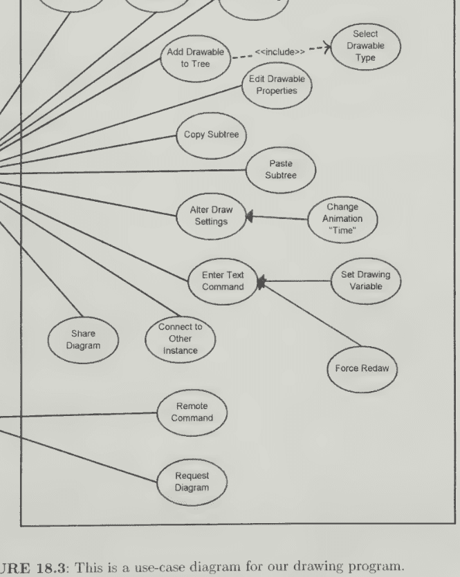

图 18.3：这是我们绘图程序的用例图。

我们尚未掌握应放入其中的知识。当前代码，不包括包语句和导入，只是这样。

```
class Drawable {
  def draw(g:Graphics2D) {}
}
```

在许多方面，这段代码现在只是一个占位符，以便其他部分的代码能够编译。下一章将为我们提供在此处添加更多内容的方法。

下一个复杂程度更高的步骤是 DrawingMain 对象。此时，这是一个相当基本的 GUI，它打开一个带有菜单和标签页面的框架。最初没有标签。用户创建或打开的每个绘图都将显示为一个标签。此处的代码如下所示。

```
object DrawingMain {
 private val tabbedPane = new TabbedPane

 private val openDrawings = mutable.Buffer[Drawing]()

 private def newDrawing {
   val nd = new Drawing
   openDrawings += nd
   tabbedPane.pages += new TabbedPane.Page("Unnamed",nd.propertiesPanel)
 }

 private val frame = new MainFrame {
   contents = tabbedPane
   menuBar = new MenuBar {
     contents += new Menu("File") {
       contents += new MenuItem(Action("New")(newDrawing))
       contents += new Separator()
       contents += new MenuItem(Action("Exit")(sys.exit(0)))
     }
   }
   size = new Dimension(800,600)
 }

 def main(args : Array[String]) : Unit = {
   frame.visible = true
 }
}
```

如你所见，目前只有两个菜单选项用于添加新绘图和退出。新建绘图选项会创建一个新绘图并为其添加一个标签。显然这并不能完全实现用例图。构建它需要更多努力。

最后两个类位于同一个文件中，DrawingPanel 嵌入在 Drawing 类型内部。该类负责布局 GUI 的大部分内容。这是一项重要任务，因为程序的大部分交互都将在此环境中进行。如果限制太多，就无法让我们做想做的事情。

该绘图程序基于 SCENE GRAPH 的概念。这是一种数据结构，按层次组织绘图的不同元素，以便在一个地方进行更改会影响一组几何元素。我们需要显示的四个基本信息是：绘图本身、Drawables 的层次结构、所选 Drawable 的属性，以及命令输入和输出元素。很难提前知道用户希望为这些元素分配多少空间，因此 SplitPanes 是设置时使用的良好 GUI 组件选择。将事物嵌套在 ScrollPanes 中也有助于用户在它们变得比屏幕空间更大时看到它们。在这里我们看到构建此类 GUI 的代码。

```
class Drawing {
    private val drawPanel = new DrawPanel
    private val root = new Drawable {}
    private var propPanel:Component = null

    def propertiesPanel = {
        if(propPanel == null) {
            val commandField = new TextField()
            val commandArea = new TextArea()
            commandArea.editable = false
            val commandPanel = new BorderPanel {
                layout += commandField -> BorderPanel.Position.North
                layout += new ScrollPane(commandArea) -> BorderPanel.Position.Center
                preferredSize = new Dimension(500,200)
            }
            val tree = new javax.swing.JTree
            val drawProps = new GridPanel(1,1)
            propPanel = new SplitPane(Orientation.Vertical,
                new GridPanel(2,1) {
                    contents += new ScrollPane(new Component {
                        override lazy val peer = tree
                    })
                    contents += new ScrollPane(drawProps)
                },new SplitPane(Orientation.Horizontal,
                    new ScrollPane(drawPanel),
                    commandPanel))
        }
        propPanel
    }

    class DrawPanel extends Panel {
        preferredSize = new Dimension(500,500)
        override def paint(g:Graphics2D) {
            g.setPaint(java.awt.Color.white)
            g.fillRect(0,0,size.width,size.height)
            root.draw(g)
        }
    }
}
```

顶部有一个垂直条的 SplitPane 位于 GUI 顶部。在条的左侧是一个 GridPanel，顶部是 JTree，底部是空的 GridPanel。JTree 将用于显示 Drawables 的层次结构，而名为 drawProps 的空面板将显示所选 Drawable 所需的设置信息。在顶部 SplitPane 的右侧是另一个具有水平条的 SplitPane。条上方是 DrawPanel 形式的绘图，条下方是包含用于输入命令的 TextField 和用于显示这些命令输出的 TextArea 的面板。

有了这三个文件，我们就可以将 DrawingMain 作为应用程序运行，并在添加


图18.5：此图显示了添加一个绘图后的基本 GUI 截图。

添加一个新绘图后，会出现如图18.5所示的窗口。正如你所看到的，窗口的很大一部分仍然是空白的。JTree 中有一些可以交互的内容，但它们与这个程序正在执行的操作没有任何关系。它们是默认外观的一部分，之后当我们实现适当的功能时，它们会消失。TextField 允许你在其中输入，但不会触发任何操作。这些缺点中的许多将在下一章中得到修复。

# 18.7 章末材料

### 18.7.1 概念总结

- 软件生命周期是创建软件时所经历的不同步骤。
  - 确定程序实际应该做什么的过程称为分析。
  - 规划代码将如何编写的过程称为设计。
  - 实现是编写软件的实际行为。
  - 代码编写完成后，你必须进行调试，以纠正代码中出现的任何错误。
- 软件发布后，为增强功能和进一步修复错误而进行的持续工作称为**维护**。
- **UML** 代表统一建模语言（Unified Modeling Language），它是软件开发过程中使用的多种图表类型的标准。本章介绍了其中的两种。
- **用例图**是在分析阶段使用的一种图，用于帮助考虑用户和其他外部实体与软件交互的方式。
- **类图**是一种显示主要代码分组（如 `classes`、`objects` 和 `traits`）及其之间关系的粗略草图的图。
- 本章还介绍了一个将在本书其余部分使用的项目，并开始对该项目进行分析和设计。

### 18.7.2 练习

1. 描述软件生命周期的不同阶段。
2. 假设你在编写一个必须对汽车进行建模的软件。绘制一个 UML 图，说明你可能会如何分解该问题。
3. 为上一章中的某个项目绘制用例图和类图。

### 18.7.3 项目

本章描述了一个新项目，该项目将在本书其余部分中贯穿始终，并且每章末尾还会有新的项目条目。本书其余部分会开发几个不同的项目。关于这些项目以及每章中不同项目如何与不同的最终项目相关的信息，以及一些示例实现，可以在本书的网站上找到。本章中的项目让你通过建立一些初步基础并积累相关经验来开始。请注意，你在这个早期阶段编写的代码不太可能一直保留到本书结尾。你将学会更好的做事方法，届时你会修改这里所写的代码。

1. 一个选项是让你编写一个多用户、基于网络的文本游戏，有时称为 MUD。如果你已经完成了本书前半部分的文本游戏，那么你已经拥有一些可以用于此处的代码。对于当前这个项目，你应该创建一些 `classes` 来表示游戏中的角色、房间和物品等。让它们能够从文件读取并写入文件。创建一个带有 `main` 方法的 `object`，用来运行游戏，并让单个玩家在虚拟世界中行走。

   完整的 MUD 实现还将包括计算机控制的角色。在目前阶段，只需要包含其中一种。让该角色在玩家执行命令时随机在地图上移动。如果玩家进入与该角色相同的房间，描述应该像显示房间中的物品一样显示出它们。

**一个项目（绘图程序）**

2. 项目的另一个选项是用于数据收集和处理的网络爬虫。这个选项可以定制以适应许多领域。网络爬虫的基本思想是加载页面并跟随链接到达其他页面。像 Google® 这样的搜索引擎使用爬虫来查找数据并为其建立索引，以便搜索的人能够找到它。这个项目将更加专注，因此你不需要一整组服务器来运行它。

   这里的思想是，你爬取一个站点或一个简短列表中的站点，以获取特定类型的文件。你可能在寻找某些数据集、图像、比分表或任何你能找到方法识别的其他内容。你可能希望有几种可能性。程序将编译这些信息，然后为用户提供有用的查看方式。

   对于这个项目选项，你目前可以构建一个 GUI，考虑要收集哪些数据，并设置一些类来存储这些信息。手动下载一两个文件（考虑使用 wget），并让 GUI 对这些文件中的信息进行最小化的显示。

3. 你可以制作一个相当简单的图形游戏，但包含网络功能，以便多个玩家可以相互协作或对抗。其可能性非常广泛，从类似俄罗斯方块（Tetris）的益智游戏（其中有棋盘（Board）和方块（Piece）类）到策略或角色扮演游戏（其中有单位（Units）、城市（Cities）、角色（Characters）和物品（Items））。

   在目前阶段，你应该构建一个 GUI，并编写代码，使运行应用程序的计算机上的玩家能够移动 GUI 中可见的某个对象。

4. 如果不做网络功能，你可以制作一个更复杂的图形游戏，其中包含具有更强人工智能的计算机控制玩家。目前这个选项的步骤与上一个选项大致相同。

5. 到本学期末，你将能够解析、求值并操作函数。这些是像 Mathematica® 这样的图形数学软件的关键方面。因此，你可以选择制作一个类似 Mathematica 的工作表程序。最终，这个程序将能够绘制函数图像，并对这些函数进行基本的符号操作。它还应该在一个简单语言中具有一定的可编程性。所有这些都将在一个 GUI 中完成。

   目前，你应该构建一个 GUI，为 Worksheet 创建一个类，并尝试让它绘制一些预编程的函数。

6. 另一个你可以尝试的选项是一个图像处理程序，其性质在某种程度上类似于 Photoshop®。目标是能够从多个图层构建图像，并提供多种用于处理图像的不同滤镜以及一些用于创建图像的工具。最终的结果不会像 Photoshop 本身那样复杂，但会比 Paint 复杂得多，功能也更强大。

   目前，你可以编写一个类似 Paint 的程序。让它能够加载和保存文件，并提供多种不同的绘图工具，用于绘制线条、矩形和类似的图元，以及颜色选择。

7. 对于更倾向于数值计算的人来说，你可以考虑模拟工作台这个选项。本书前面的一些项目让你使用我们所能编写的最简单的积分器，对引力系统进行基本的牛顿力学计算。对于这个选项，我们将探索其他系统和其他积分技术，包括让用户指定力定律并观察这样一个系统将如何表现的能力。这还将涉及离散事件模拟的一些内容。

   到本学期末，这个项目将发展到了你可以在多台机器上分配工作并查看模拟运行情况的程度。你还需要实现一些空间数据结构，使长程力的积分更高效。你甚至可能能够使用粒子网格技术模拟布料等效果。

   目前，制作一个对多个粒子进行牛顿引力计算的应用程序。将这个问题分解为不同的 `classes`，并包含一个 GUI，以便你可以观察粒子的运动。它还应该具备保存到文件和从文件加载的能力。

8. 你的导师可能还有其他想法。请与他/她核实他们考虑的其他可能性以及这些可能性会涉及哪些内容。

额外的练习和项目以及数据文件可在本书的网站上获取。


# 第 19 章：抽象与多态

- 19.1 多态 .................................................... 452
- 19.2 包含多态（继承与子类型） ............................... 452
    - 19.2.1 private 可见性与继承 ........................ 459
    - 19.2.2 protected 可见性 ...................................... 459
    - 19.2.3 在超类型上调用方法 .......................... 460
    - 19.2.4 匿名类 ......................................... 461
    - 19.2.5 抽象类 .......................................... 461
    - 19.2.6 特质 .................................................... 463
    - 19.2.7 final ..................................................... 464
    - 19.2.8 方法解析 ......................................... 466
    - 19.2.9 从函数类型继承 ............................ 467
- 19.3 项目中的继承 ...................................... 468
    - 19.3.1 Drawable .................................................. 468
    - 19.3.2 与绘图的集成 .................................. 478
- 19.4 参数多态 .......................................... 481
    - 19.4.1 参数类型 ........................................... 482
    - 19.4.2 参数化函数和方法 ........................... 485
    - 19.4.3 类型边界 ................................................. 488
        - 结构类型 ............................................... 491
- 19.5 章末材料 ........................................... 492
    - 19.5.1 概念总结 ........................................ 492
    - 19.5.2 练习 .................................................. 493
    - 19.5.3 项目 ................................................... 493

理解抽象的概念对于提升你作为程序员的能力至关重要。以更抽象的方式表达思想的能力，是让现代软件系统能够扩展到如今规模的一个重要因素。我们已经接触过一些抽象。在第 6.4 节中，我们看到了如何将函数作为参数传递，从而用单个递归函数累加多种不同类型的值。抽象的基本思想是，你希望编写的代码中，某些行为直到被使用时才完全确定。我们已经通过应用程序编程接口（API）中的各种方法大量使用了这一思想。现在，是时候探索那些让我们能够创建抽象并编写使用这些抽象的代码的机制了。

### 19.1 多态

为代码添加抽象的最强大方式之一就是**多态**。从希腊词根来看，这个词的字面意思是“多种形态”。但在编程语境下，它意味着多种类型。到目前为止，我们编写的代码（除了第 7.5.2 节中的几行代码之外）都是单态的。这意味着我们的代码只适用于一种类型。也许最好的一个体现这种局限性的例子来自第 13 章：我们编写的排序最初使用 `Double` 类型，但当想要对样例类排序时，不得不编写第二个版本。那是因为我们最初的排序是单态的，它只适用于我们编写时所针对的那一种类型，而不能用于其他类型。

如果你回头看看那段代码，就会发现这有多么低效。我们的排序版本之间差异非常小。我们复制粘贴，然后只修改了代码中的两行。这种重复非常浪费，而且会使代码过长，容易出错且难以处理。此外，人们会期望既然版本之间改动如此之少，应该有可能做出一个能处理所有情况的版本。换句话说，我们应该能够抽象出这些差异，从而有一个版本能在我们想要的不同情况下工作。在这种情况下，抽象的一部分就是针对类型进行抽象。要做到这一点，我们需要多态。

多态有多种不同的形式，但我们可以将其归为两大类：**通用**多态和**特设**多态。通用多态意味着代码可以处理无限多种类型。相比之下，特设多态只能处理有限数量的类型。我们将主要考虑通用多态的两种形式：**包含多态**和**参数多态**。

### 19.2 包含多态（继承与子类型）

包含多态是一种通用多态，它来自于**子类型化**。也就是说，当一种类型的所有元素同时也是另一种类型的元素时，就发生了子类型化。这个主题在第 7.5.3 节中已经有所涉及，图 7.1 展示了一个简化的统一建模语言（UML）类图，其中包含 Scala 中的一些不同类型。图 19.1 展示了该图的一个更新版本，其中包含了直接子类型关系以及 Scala 库中为了让你更方便而编写的一些隐式转换。

这张图向你展示了存在哪些子类型关系，但并没有解释这些关系如何进入代码，或者我们如何利用它们来编写多态代码。第一个问题的答案就是所谓的继承。继承是大多数基于类概念构建的面向对象语言中获得子类型化和包含多态的标准方式。当一个类 B 继承自另一个类 A 时，它意味着两件事。其中之一是 B 是 A 的子类型。另一个是 B 获得 A 所拥有的所有数据和方法的。后一点我们将称为**代码复用**。它帮助我们避免重复代码，看起来似乎是这两个方面中更重要的一个；然而，多态的真正力量是子类型化的结果。

那么，类型 B 是类型 A 的子类型意味着什么呢？我们可以说，如果在任何需要类型 A 的对象的情况下，我们都可以给它一个类型 B 的对象并且它能正常工作，那么 B 就是 A 的子类型。为了更具体地说明，考虑下面的例子。你有一个食谱，需要三种不同类型的水果。食谱给出了如何处理这些水果并将其与其他食材混合的说明。在这种情况下，`Fruit` 是超类型，而我们有一段关于如何用它做某事的描述。我们可选择的 `Fruit` 子类型有很多，包括 `Apple`、`Cherry`、`Banana` 和 `Strawberry`。这个特定的例子在图 19.2 中用简单的 UML 图进行了说明。

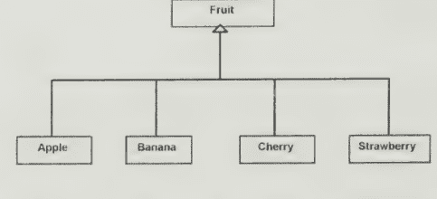

**图 19.2：** 这是一个简单的类图，展示了 `Fruit` 的子类型。

这里我们看到了顶部的类型 `Fruit`，泛化箭头将其连接到各个子类型。UML 中箭头的方向很重要，因为虽然子类型必须知道它们的超类型，但超类型通常不需要也不应该知道子类型。

#### 为什么超类型不应当知道子类型

超类型不应该知道子类型的原因是，这样的知识会限制多态的通用性。当超类型被创建时，可能只有少数几个子类型。在我们的水果示例中，子类型的数量是四个。为了让多态具有通用性，应该可以在之后创建新的子类型而无需修改超类型，并且任何已经使用超类型的代码都能很好地与新子类型协同工作。

在代码中，这意味着你可以编写一个像 `makeBreakfastShake` 这样的函数，它处理 `Fruit` 类型，并且应该能处理 `Apple`、`Banana`、`Cherry` 或 `Strawberry` 的实例。考虑下面这段可能表示该函数的代码。

```
def makeBreakfastShake(fruit:Fruit) {
  if(!fruit.canEatSkin) {
    fruit.peel
  }
  blender += fruit
  blender += juice
  blender += ice
  blender.blend
}
```

我们的想法是，我们可以像这样调用这个函数。

```
makeBreakfastShake(new Banana)
makeBreakfastShake(new Strawberry)
```

我们希望它能正常工作，因为 `Banana` 和 `Strawberry` 都是 `Fruit` 的子类型。问题是，要实现这一点需要什么条件？为了让 `Fruit` 类型能与


```
scala> val jHat = new Vect3D(0,1,0)
jHat: Vect3D = Vect3D@24753433

scala> jHat.toString
res0: java.lang.String = Vect3D@24753433
```

这里我们有一个 `class`，用于表示一个不可变的 3-D 向量类型，它没有方法，只有三个分量的公共成员。第二行在此类上创建了一个实例，其后会通知变量 `jHat` 的类型为 `Vect3D` 且具有给定值。该值有点奇怪，由类名后跟 @ 符号和一个数字组成。第三行显示了对从 `AnyRef` 继承的方法之一的调用，即 `toString` 方法。此调用清楚地表明了值的文本来源。`toString` 方法实际上是在类型 `Any` 上定义的，因此在 Scala 中可以安全地对任何对象调用它。正因如此，它被广泛用于获取对象的表示形式。这里我们看到它是由 `REPL` 调用的。

不幸的是，`toString` 的默认实现并不是很有信息量。因此，这通常是你会重写的内容。下面的代码清单展示了我们如何做到这一点。

```
scala> class Vect3D(val x:Double,val y:Double,val z:Double) {
|  override def toString():String = "Vect3D("+x+", "+y+", "+z+")"
|  }
defined class Vect3D

scala> val jHat = new Vect3D(0,1,0)
jHat: Vect3D = Vect3D(0.0, 1.0, 0.0)

scala> jHat.toString
res1: String = Vect3D(0.0, 1.0, 0.0)
```

使用 `override` 并提供一个与继承的 `toString` 具有相同签名的 `def`，我们得到了不同的实现。你可以看到，这现在在 `REPL` 中打印对象值时以及直接调用该方法时都会被使用。

这个例子展示了继承的方法以及我们如何重写它，但它并没有真正演示如何在我们的代码中获得继承。它使用的是我们默认获得的继承。如果我们想继承自 `AnyRef` 以外的东西，我们使用 `extends` 关键字。此关键字放在类参数之后，并在以大括号打开类体之前。

```
class Name(args) extends Supertype { body }
```

如果你不使用 `extends` 关键字，默认情况下会得到 `extends AnyRef`。

为了说明这一点，让我们看一个不同的例子，这是一个经典的继承案例。我们定义一个名为 `Shape` 的超类型，它具有我们期望所有形状都能执行的一些方法。

```
class Shape {
    def area: Double = 0.0
    def circumference: Double = 0.0
    def draw(g: Graphics2D) {}
}
```

我们可能想要作为此类子类型的形状有很多不同类型。下面是两个可能的例子。

```
class Rectangle(val width:Double, val height:Double) extends Shape {
	override def area:Double = width*height
	override def circumference:Double = 2.0*(width+height)
	override def draw(g:Graphics2D) {
		g.fill(new Rectangle2D.Double(0.0,0.0,width,height))
	}
}
```

```
class Circle(val radius:Double) extends Shape {
	override def area:Double = math.Pi*radius*radius
	override def circumference:Double = 2.0*math.Pi*radius
	override def draw(g:Graphics2D) {
		g.fill(new Ellipse2D.Double(0.0,0.0,2.0*radius,2.0*radius))
	}
}
```

这些类中的每一个都接受一些参数并扩展 `Shape`，然后重写 `Shape` 的所有方法。

我们现在可以编写接受 `Shape` 实例的代码，并传入 `Rectangle` 或 `Circle` 的实例，它就会工作。它能工作的原因是继承保证了我们可以在 `Shape` 实例上调用的任何方法都将在子类型中定义。

考虑以下函数及其两次调用。

```
def areaCircumferenceRatio(s:Shape):Double = {
	s.area/s.circumference
}
```

```
val circleACR = areaCircumferenceRatio(new Circle(5))
val rectACR = areaCircumferenceRatio(new Rectangle(4,5))
```

这是多态的核心，一段代码可以处理多种类型。这是一种通用多态，因为在未来的任何时间点，我们都可以创建一个 `Shape` 的新子类型，它也将与此代码一起工作。

作为一般规则，继承应用于表示“is-a”关系。在我们迄今为止看到的例子中，说一个苹果 *is-a* 水果或一个矩形 *is-a* 形状似乎很自然。如果你不能这样说，那么继承可能不是你想要使用的构造。相反，你应该使用组合。这就是你将类型的实例作为某个类的成员而不是从它继承。获取功能时，你对该成员进行调用。组合用于建模“has-a”关系。我们将在本书后面看到许多这种构造的例子。应该强调的是，你不想滥用继承。代码重用的方面可能看起来很棒，但子类型化只有在有意义时才应使用。

反之亦然。也有时候你会有 *is-a* 关系并且子类型化是有意义的，但通过代码重用获得的并非所有方法都合适。在这些情况下，你也应避免使用继承。一个例子是正方形。显然，正方形 *is-a* 形状。此外，正方形 *is-a* 矩形。这种关系可以用以下一行类来表达。

```
class Square(length:Double) extends Rectangle(length,length)
```

这里类 `Square` 接受一个表示边长的参数。它扩展 `Rectangle`，并将该 `length` 作为 `height` 和 `width` 参数传递。正如这个例子所示，当子类型接受参数时，它们会传递在 `extends` 之后、超类型名称之后的参数列表中。

鉴于我们为 Rectangle 所写的，这样的 Square 实现是完全可以接受的，并且对 Square 实例的所有方法调用都将按预期工作。这只是因为我们的 Rectangle 类型碰巧是不可变的。考虑 Rectangle 的这种替代实现。

```
class Rectangle(var width:Double,var height:Double) extends Shape {
    override def area:Double = width*height
    override def circumference:Double = 2.0*(width+height)
    override def draw(g:Graphics2D) {
        g.fill(new Rectangle2D.Double(0.0,0.0,width,height))
    }
}
```

如果你将它与上面 Square 的定义一起使用，一切都能正常编译，甚至看起来运行正常。然而，这个实现中存在真正的问题。要看到这一点，请考虑以下代码。

```
val square = new Square(5)
square.width=20 // WARNING: Works in code, but not what we want.
println(square.area)
```

这做了不应该发生的事情。它创建了一个 20×5 的“正方形”。这显然不符合正方形的正常定义。

问题在于，当我们使 Rectangle 类型可变时，我们实际上引入了两个新方法：def width_=(w:Double) 和 def height_=(h:Double)。这些方法不适合 Square，但由于继承，我们的 Square 类型获得了它们。

人们很容易尝试通过显式重写设置 width 和 height 字段的方法来修复它，如以下代码所示。

```
class Square(length:Double) extends Rectangle(length,length) {
    override def width_=(w:Double) { // ERROR: Can’t override mutable variables.
        width = w
        height = w
    }
    override def height_=(h:Double) { // ERROR: Can’t override mutable variables.
        height = h
        width = h
    }
}
```

这无法编译，因为不允许重写与变量关联的方法。即使允许，或者如果我们使用不同的方法来访问和设置变量，这也不是一个好主意。要理解原因，请考虑程序员在执行类似 rect.width = 20 这样的行时期望发生什么。很明显，编写此行的程序员期望它更改 width 字段中存储的值。如果 height 字段也发生变化，那将是意外的行为，并且可能会违反函数其他地方做出的假设。这可能导致难以找到的错误，因为代码在使用 Rectangle 实例时工作正常，并且对程序的推理可能不会帮助程序员找到错误。

因此，请谨慎使用继承。它只有在你同时想要子类型化和代码重用时才应使用。


# 19.2.1 private 可见性和继承

在我们的 Shape 示例中缺少的一点是形状的颜色。由于存在 draw 方法，它们在绘制时拥有一种颜色是有意义的，而且由于所有形状都会有该颜色值，因此将其作为 Shape 类的一部分是有意义的。以下是 Shape、Rectangle 和 Circle 的实现，其中 color 字段是 Shape 中的私有可变值。

```
class Shape(private var color:Color) {
def area:Double = 0.0
def circumference:Double = 0.0
def draw(g:Graphics2D) {}
}

class Rectangle(val width:Double, val height:Double, c:Color) extends Shape(c) {
override def area:Double = width*height
override def circumference:Double = 2.0*(width+height)
override def draw(g:Graphics2D) {
  g.setPaint(color) // ERROR: Can't get to the private color data member.
  g.fill(new Rectangle2D.Double(0.0,0.0, width, height))
}
}

class Circle(val radius:Double, c:Color) extends Shape(c) {
override def area:Double = math.Pi*radius*radius
override def circumference:Double = 2.0*math.Pi*radius
override def draw(g:Graphics2D) {
  g.setPaint(color) // ERROR: Can't get to the private color data member.
  g.fill(new Ellipse2D.Double(0.0,0.0, 2.0*radius, 2.0*radius))
}
}
```

之所以它是私有的，是因为它是可变的，我们不希望任何拿到 Shape 对象的代码都能更改该值。如注释所示，这些类将无法编译。虽然子类型会获得超类型中的所有内容的副本，但它们无法直接访问私有元素。因此，使用这种方法，子类型无法访问 color，除非我们添加一个方法让它们通过该方法访问。

这种行为正是我们真正期望的。当某物被设为私有时，这意味着类之外的其他代码部分不应能够访问它。任何人都可以创建一个类的子类型。如果这给了它们访问私有数据的权限，那么私有就不会真正安全了。当然，如果 color 被声明为 val 而不是 var，我们就不需要隐藏它，因为 java.awt.Color 类是不可变的，所以即使其他代码可以访问它，也无法更改它。

# 19.2.2 Protected 可见性

当然，像我们的彩色形状示例这样的情况，你确实希望有只能被子类型访问的数据或方法。这就是 protected 可见性的原因。当方法或数据成员使用 protected 关键字修饰时，它在该类及其子类中可见，但对其他任何代码不可见。使用它，我们可以将 Shape 类修改如下。

```
class Shape(protected var color:Color) {
```

```
def area:Double = 0.0
def circumference:Double = 0.0
def draw(g:Graphics2D) {}
}
```

将 color 设为 protected 后，之前 Rectangle 和 Circle 的代码将可以工作。

protected 可见性并不是经常使用。如果一个值确实需要隐藏，它应该是 private。将其设为 protected 是向程序员发出信号，表明它被子类需要，但如果他们要使用或更改它，就需要知道自己在做什么。

# 19.2.3 在超类型上调用方法

有时当你在子类型中重写一个方法时，你仍然希望运行超类型的代码。实际上存在这样的情况，你需要在执行额外工作之前调用超类型中的方法。为了支持这种行为，你可以使用 super 关键字，就像一个引用当前对象中属于超类型部分的对象的对象一样。

这可以用来以一种保持 color 私有的方式解决着色问题。考虑 Shape 的以下实现。

```
class Shape(private var color:Color) {
  def area:Double = 0.0
  def circumference:Double = 0.0
  def draw(g:Graphics2D) {
    g.setPaint(color)
  }
}
```

它有一个私有成员 color，因此对子类型不可见，并且封装良好，所以我们不必担心其他代码更改它。与上一个私有 color 的版本不同，这个版本在 draw 方法中有一些代码，将 Graphics2D 对象的画笔设置为 color。将其放在代码中允许我们在 Rectangle 中执行以下操作。

```
class Rectangle(val width:Double,val height:Double,c:Color) extends Shape(c) {
  override def area:Double = width*height
  override def circumference:Double = 2.0*(width+height)
  override def draw(g:Graphics2D) {
    super.draw(g)
    g.fill(new Rectangle2D.Double(0.0,0.0,width,height))
  }
}
```

通过对 super 进行 draw 调用，这个版本可以在调用 draw 时设置颜色，而无需实际访问超类型中的值。同样的方法也可以在 Circle 中使用。

这种方法的优点是，只要所有 Shape 的子类型都遵循在绘制自身几何形状之前调用 super.draw 的模式，就可以在不修改子类型中 draw 方法的情况下向 Shape 类型添加其他设置，例如不同的笔触或变换。在大型库中，同样的行为可能有问题，因为它迫使超类型坚持某种行为，因为所有子类型，包括由其他作者编写的子类型，都期望它得到维护。

# 19.2.4 匿名类

在本章的某个时刻，你可能会想起书中前面提到的一些内容，并想知道它们与继承的关系。以下代码段可能会特别引起你的注意。

```
val panel = new Panel {
  override def paint(g:Graphics2D) {
    ...
  }
}
```

这是我们第一次看到 override 关键字的情况。正如你刚刚学到的，这表示你正在创建一个类，为某个方法提供替代实现。虽然当时你并不知道，但这种语法正在创建一个新的类，即匿名类。在这种情况下，该新类继承自 Panel。你可以将其视为如下代码。

```
class AnonymousPanelClass extends Panel {
  override def paint(g:Graphics2D) {
    ...
  }
}
```

```
val panel = new AnonymousPanelClass
```

在第一个版本中，编译器实际上会创建一个新类，其名称包含你在程序中不允许用于类名的字符，因此不可能引用你创建的类型。相反，你必须将新对象视为超类型的实例。

你会发现这种事情在 Scala 中经常被使用。幸运的是，Scala 中匿名类的语法非常自然，以至于你很少会把自己正在做的事情看作是继承。相反，你更像是为某个类型制作一个专门的实例，该实例具有一些额外的功能。

一个地方是当你尝试使用 this 时，你会意识到自己处于匿名类或某些嵌套类中。默认情况下，this 指的是最紧密绑定类的当前实例。如果你想引用包裹你正在使用的代码的类的实例，但不是最近的一个，只需将 this 前缀为你感兴趣的边界类型的名称即可。因此，如果上面的 panel 声明嵌套在某个名为 GUIProgram 的其他类中，你就可以通过使用 GUIProgram.this 在为 panel 编写的代码内部引用 GUIProgram 的当前实例。

# 19.2.5 抽象类

让我们现在回到具有两个子类的 Shape 示例。这个版本具有常量公共颜色，但使用对 super 的调用来提供统一行为。

```
class Shape(val color:Color) {
  def area:Double = 0.0
  def circumference:Double = 0.0
  def draw(g:Graphics2D) {
    g.setPaint(color)
  }
}
```

```
class Rectangle(val width:Double,val height:Double,c:Color) extends Shape(c) {
    override def area:Double = width*height
    override def circumference:Double = 2.0*(width+height)
    override def draw(g:Graphics2D) {
        super.draw(g)
        g.fill(new Rectangle2D.Double(0.0,0.0,width,height))
    }
}
```

```
class Circle(val radius:Double,c:Color) extends Shape(c) {
    override def area:Double = math.Pi*radius*radius
    override def circumference:Double = 2.0*math.Pi*radius
    override def draw(g:Graphics2D) {
        super.draw(g)
        g.fill(new Ellipse2D.Double(0.0,0.0,2.0*radius,2.0*radius))
    }
}
```

这段代码的某些方面可能让你感觉不太理想。它们可以概括为以下一行。

```
val s = new Shape(Color.red)
```

这行代码可以顺利编译和运行。问题是，它到底意味着什么？如果你对 s 引用的对象调用 area 或 circumference，你会得到 0.0。如果调用 draw，则不会绘制任何内容。

问题在于，虽然 Shape 确实是一个有效类型，但它并不是一个完整的对象规范。这是因为虽然我们当然认为所有形状都应具有面积和周长，但我们无法在完全一般的情况下定义它们。我们需要能够说明一个类型具有方法或某个成员数据，但不给出其定义。我们还希望 Shape 只代表一个超类型，并且对象只应为子类型实例化。这可以通过以下代码完成。

```
abstract class Shape(val color:Color) {
    def area:Double
    def circumference:Double
    def draw(g:Graphics2D) {
        g.setPaint(color)
    }
}
```

这里改变了两件事。我们去掉了 area 和 circumference 的等号及其后面的内容。我们还在类声明中添加了 abstract 关键字。

在类声明中未给出值的 方法和成员数据 被认为是抽象的。如果类中存在任何抽象内容，则该类本身必须标记为 abstract。如果省略它，你会得到语法错误。当一个类型继承自抽象类时，它必须为抽象成员和方法提供实现，或者该子类型也必须标记为 abstract。

给定这个修订后的 Shape 类，上面显示的 Rectangle 和 Circle 类将工作得很好，我们将不再有直接实例化 Shape 类所产生的概念困难。此外，当你在超类型中实现一个抽象方法时，override 关键字不是必需的。这有两个原因。首先，在语义上，你并不是在重写超类型中的实现。其次，


更重要的是，如果该方法抽象且你未实现它，除非将类标记为 abstract，否则会产生语法错误。

为了帮助你理解这个第二个原因，让我们看一个 Scala 在你重写方法时为何首先要求 override 关键字的例子。考虑 Rectangle 的这个版本。

```
class Rectangle(val width: Double, val height: Double, c: Color) extends Shape(c) {
  def area: Double = width * height
  def circumference: Double = 2.0 * (width + height)
  override def draw(g: Graphics) { // ERROR: Not really an override
    g.setPaint(color)
    g.fill(new Rectangle2D.Double(0.0, 0.0, width, height))
  }
}
```

override 关键字已从 area 和 circumference 中去掉，因为它们在超类型中是抽象的。draw 方法上有一条注释告诉你它无法编译。你能看出哪里错了吗？这里有一个非常微妙的错误，大多数人如果没有注释会忽略它，即使有注释，你也可能很难识别出来。错误在于 `g` 被列为 Graphics 类型而不是 Graphics2D。编码时出现这种小笔误很容易，如果它不是语法错误，就可能产生很难追踪的逻辑错误。Scala 在这种用法中要求 override，这样如果你更改了类型，就会成为语法错误。在 override 不是必需的情况，即超类型中的方法是抽象的，参数或方法名的笔误会使该方法未实现，这会产生不同的错误，指出类必须为 abstract，因为某个方法是抽象的。

# 19.2.6 traits

class 和 object 构造并不是在 Scala 中创建新类型的唯一方式。第三种选择，对本章而言很重要，是 trait。trait 在很多方面都非常类似于抽象类。两个主要区别是 trait 不能接受参数，并且你可以继承多个 trait。

上面没有明确说明，但你可能已经注意到没有描述如何在 extends 之后列出多个类。这不是疏忽，你不允许在那里列出多个类。你可以让类后面跟多个 trait，或者只有一个或多个 trait。你继承的各种类型由 with 关键字分隔。

为了理解你为什么会想要这样做，请考虑以下示例。想象你在编写软件来模拟人们在建筑物中的移动，以帮助设计空间。你有一个名为 Person 的类型，表示模拟中可以出现的每个人。你工作的公司知道有某些类别的人，其行为与模拟必须处理的方式显著不同。例如，他们需要 Parent、Child 和 GeneralAdult 的类型。出于建筑设施的需求，他们还需要 Male 和 Female 的类型。这最后一部分为单继承带来了问题，因为你希望能够通过继承 Parent 和 Male 来表示 Father 类型。子类型关系在那里是有意义的，但如果这两个类型都写成类，你将无法同时使用它们。

你可以用 trait 以两种方式解决这个问题。一个相当标准的继承方案可能使用以下结构。

```
trait Person { ... }
trait Parent extends Person { ... }
trait Male extends Person { ... }
class Father extends Parent with Male { ... }
```

这里 Parent 和 Male 都是 Person 的子类型，而 Father 同时继承自两者。在这种情况下 Person 必须是一个 trait。这是因为 trait 只能继承自其他 trait，不能继承类。在其下方，Parent 或 Male 中的任何一个都可以是类，但不能同时是类，因为 Father 然后就不能同时继承它们。没有迫切理由将其中一个设为类，选择 trait 提供了统一性。

构造这些类型的另一种方法可以是使用 trait 作为 mix-in 类型。代码可能如下所示。

```
class Person { ... }
trait Parent { ... }
trait Male { ... }
class Father extends Person with Parent with Male { ... }
```

在这个构造中，Parent 和 Male 类型都是不继承自 Person 的 trait。相反，它们与 Person 混合以创建 Father。这种方法可能有点更高级，如果 Parent 和 Male 类型涉及需要它们知道将与 Person 一起使用的代码，你将需要使用 self-types，这在附录 B 中讨论。现在重要的是你要意识到这个选项的存在，这样在我们构建不同的继承层次结构时，你就能理解发生了什么。

### trait or abstract class?

程序员在 Scala 中编写将用于继承的抽象类型时经常遇到的一个标准问题是，在编码抽象类型时选择抽象类还是 trait。经验法则是优先选择 trait，因为它允许多重继承的灵活性。虽然它不能接受参数，但你希望作为参数提供的任何值都可以放入 trait 中并保持未定义，这样最终实现它们的类就必须提供这些值。

# 19.2.7 final

当某物是抽象的时，这基本上意味着它必须在子类中“被重写”。¹ 也有时候有用的是能够说某物不能被重写，或在子类型中被更改。final 关键字可以强制执行这一要求。你可以使用 final 来修改你不希望在子类型中更改的成员数据或方法。它也可以用来修改整个类，当你不希望允许该类有任何子类型时。

你可能会想知道为什么你会想要使某物 final。对这个问题的回答之一是，你希望在当前实现中保留某种行为，而不希望在子类型中被更改。它也可以作为一种方式告诉使用该类的事物，不可能从该类型的对象获得与该特定类型不同的行为。

在类定义不可变类型时，你应该使用 **final** 来保留类型行为的最常见示例。不可变类型的优势，以及它们如何简化代码，在本书中已经相当多地讨论过。没有继承，如果你编写一个类型使其不可变，你就知道该类型的任何对象都可以安全地传递给其他代码，而不用担心它被更改。² 有了继承，除非你使 **class** final，否则这不自动成立。原因在于子类型可以添加可变数据和/或重写方法，使得新实现包含对可变状态的引用。

为了帮助你理解这一点，请考虑以下示例类。

```
class CharInStrComp(str: String) {
    def positionCompare(str2: String, index: Int): Int = {
        if (index >= str.length) {
            if (index >= str2.length) 0 else 1
        } else if (index >= str2.length) -1 else {
            str(index).compareTo(str2(index))
        }
    }
}
```

这个类是不可变的。从技术上讲，它甚至没有可变成员数据。因此，如果你从这个类创建了一个对象，它可以自由传递。有了继承，情况就不同了，可以这样做。

```
class CntCharInStrComp(str: String) extends CharInStrComp(str) {
    var cnt = 0
    override def positionCompare(str2: String, index: Int): Int = {
        cnt += 1
        super.positionCompare(str2, index)
    }
}
```

如果你创建 CntCharInStrComp 的一个实例，它可以在任何想要 CharInStrComp 的地方使用。唯一的问题是，如果这是在依赖对象不可变的代码中完成，该代码现在可能会中断，因为它被传递了一个可变对象。为了防止这种情况发生，原版本应设为 **final**，如下所示。

```
final class CharInStrComp(str: String) {
    def positionCompare(str2: String, index: Int): Int = {
        if (index >= str.length) {
            if (index >= str2.length) 0 else 1
        } else if (index >= str2.length) -1 else {
            str(index).compareTo(str2(index))
        }
    }
}
```

现在任何尝试创建子类型，无论是可变还是不可变，都会产生错误。

**final** 关键字在编程中经常被低估。然而，养成在不应该有子类型或某物不应该被重写时使之 **final** 的习惯是好的。这不仅是一种安全的实践；标记为 **final** 的代码有时也可以被编译为更快的实现。

2. 我们将在第 21 章中看到，这样的对象可以在多个线程间安全使用。


# 19.2.8 方法解析

当你使用继承时，你可能会创建存在多种不同方法实现的类型。至关重要的是，你要理解 Scala 在对对象调用方法时，会如何确定使用哪一个方法实现。

如果方法是在创建该对象的类或对象中定义的，那么就会使用该版本。如果在那里没有定义，就会使用其超类型中的一个版本。它会从列表中最后一个开始检查超类型。如果不在最后一个类型中，它会在转到列表中更早的元素之前，先尝试该类型所继承的内容。这种从完整的继承结构转换为要检查的类型列表的过程称为线性化。需要注意的是，如果某个类型出现多次，则按解析列表中出现的顺序，最后一次出现的那一个会被使用。

让我们考虑上面定义的 Father 类型。两种方法的线性化实际上是相同的。在第一种情况下，如果你从列表末尾开始列出所有类型，忽略重复项，你会得到 Father、Male、Person、Parent 和 Person。第一个 Person 实例被移除，剩下 Father、Male、Parent 和 Person。在第二种方法中，从末尾开始直接得到 Father、Male、Parent 和 Person。

# 为什么要线性化？

能够从多个事物继承称为多重继承，这种特性只在某些语言中允许，C++是最著名的例子。然而，它会导致许多并发症，许多较新的语言选择避免这种情况。在 Scala 的情况下，你只能从类进行单继承，而多重继承仅允许使用 trait。

你不被允许对类这样做的原因是，从类继承的语义是子类获得超类中所有内容的完整副本。考虑到这一点，请看图 19.4 所示的 UML 图所产生的问题。这种情况被称为菱形问题。

C++ 语言遵循超类在子类中完全包含的规则，这说明了这个问题有多糟糕。使用此规则，类型 B 和 C 在其中都有 A 的完整副本。然后 D 拥有 B 和 C 的完整副本，这意味着它有两个 A 的完整副本，这显然是有问题的。C++ 包含一种称为虚继承的构造，可以将其减少到一个副本。想象一下你创建一个类型 D 的实例并尝试使用值 a，或调用方法 foo 或 bar。它会使用哪一个？会执行什么代码？D 从两个地方继承了这些方法，而在 bar 的情况下，两个代码可能不同。

在 C++ 中，程序员必须在这种情况下指定要使用哪个超类型。在 Scala（以及 Perl 和 Python）中，超类型会被“线性化”，以便以特定顺序检查它们来解析方法调用。这消除了任何歧义。其他语言，如 Java，使继承多个实现或数据值变得不可能，因此这类问题不会出现。


**图 19.4：** 该 UML 类图显示了通常的菱形问题。这种构造的挑战在于它可能导致显著的歧义。不同语言对此有不同的处理方式。

# 19.2.9 从函数类型继承

我们在第 16 章中看到过，当你像函数一样对待一个对象并传递值参数时，Scala 会将其扩展为对该对象 apply 方法的调用。当你输入代码 `o(i)` 时，Scala 会看到 `o.apply(i)`。因此，你可以轻松地创建像函数一样使用的类型。为了使该类型真正成为函数类型，以便你可以在期望函数的地方使用它，如 map、filter、foreach 等调用中，你需要使你的类型实际上是函数类型的子类型。

为了说明这一点，考虑一个简单的自定义类型示例，它是一个将整数加倍的函数。我们可以像这样编写此类类型。

```
class G { def apply(i: Int) = 2*i }
```

如果我们实例化此类型的对象，我们就可以像函数一样使用它。

```
scala> val g = new G
g: G = G@28f2e328

scala> g(5)
res0: Int = 10
```

然而，如果我们尝试在 map 调用中使用同一个对象，就会得到一个错误。

```
scala> List(1,2,3) map g
<console>:10: error: type mismatch;
  found   : G
  required: (Int) => ?
      List(1,2,3) map g
```

正如错误消息所示，这不起作用，因为 map 方法期望的参数是一个形如 (Int) => ? 的函数。那是接受一个 Int 作为单个参数并输出任何内容的东西。我们可以创建一个符合此条件的类型，但需要使用继承来做到这一点。

```
scala> class F extends ((Int)=>Int) { def apply(i:Int) = 2*i }
defined class F
```

```
scala> val f=new F
f: F = <function1>
```

```
scala> List(1,2,3) map f
res1: List[Int] = List(2, 4, 6)
```

类型 F 和类型 G 之间唯一的差异是 F 显式扩展了 (Int)=>Int。这一点的第一个影响可以在创建对象 f 时看到，我们得到了 toString 方法的不同版本。

# 19.3 项目中的继承

你现在已经足够了解继承的知识，可以看到如何在我们的项目代码中使用它。继承最明显出现的地方是我们想要包含的不同 Drawable 类型。

### 19.3.1 Drawables

我们可能想要绘制的每一种不同类型的事物都将是 Drawable 的不同子类型。至少，我们可以从一些基本形状开始，比如矩形和椭圆。我们还将包含另一种类型，它将绘制中的多个元素组合在一起并表示一种变换。在第 12 章中我们学习了 java.awt.geom.AffineTransform 类型，并将其与 Graphics2D 对象上的绘图一起使用。我们希望 Drawable 元素能够在我们的绘图中包含这种类型的功能。

Drawable 类型的另一个方面与它在图形用户界面 GUI 中的包含方式有关。我们希望正在绘制的不同事物出现在 GUI 中的 JTree 元素中。javax.swing.JTree 显示的对象必须是 javax.swing.tree.TreeNode 类型的子类型。⁴ 为了实现这一点，我们只需让 Drawable 类型扩展 TreeNode 即可。

鉴于本章前面对 Shape 的描述，你可能也已经意识到 Drawable 中的 draw 方法应该是抽象的，因为实际上没有一个好的默认实现来说明如何绘制。我们将进一步采取的步骤是将 Drawable 变成一个 trait。 resulting 代码如下所示。

```
/**
```

⁴TreeNode 类型在 Java 中被称为接口。这类似于 Scala trait，其中所有方法都保持抽象且未定义成员数据。

抽象与多态性 469

```

* This represents the supertype for all the different types that can appear in
  our drawing.
*/
trait Drawable extends TreeNode {
  /**
   * Causes this object to be drawn to g.
   *
   * @param g a Graphics2D object to draw to.
   */
  def draw(g : Graphics2D) : Unit

  /**
   * Gives back a GUI component that allows the user to change drawing properties.
   *
   * @return A component that should be put in the GUI so the user can edit this
   * object.
   */
  def propertiesPanel() : scala.swing.Component
}
```

请注意，还添加了一个额外的方法。该方法返回一个 GUI 组件，当用户选择特定的 **Drawable** 时可以显示该组件。该 GUI 组件应允许用户更改该对象的设置。

我们将从上面提到的三个 **Drawable** 子类型开始。其中一种可能的安排如图 19.5 所示。查看此图，你可能会想知道 **DrawTransform**、**DrawRectangle** 和 **DrawEllipse** 类中的所有方法是从哪里来的。这些类中列出的所有方法，除了 **draw** 之外，都是来自 **TreeNode** 的抽象方法。因为它们是抽象的，所以必须在任何具体子类型中实现，这就是为什么它们会出现在该图中。

事实证明，除了 **draw** 之外的所有方法的实现在 **DrawRectangle** 和 **DrawEllipse** 中是完全相同的。事实上，这些方法的实现对于图 19.6 中 **Drawable** 的所有子类型，除了 **DrawTransform** 之外，都是完全相同的。因此，在层次结构中加入另一个类型是有意义的，如图 19.6 所示。

新的 **DrawLeaf** 类型可以以适用于我们将在本书中创建的几乎所有 **Drawable** 子类型的方式实现来自 **TreeNode** 的方法。虽然现在拥有此类型只会防止我们制作两份代码的副本，但在完成之前，它将使我们免于制作这些方法的许多单独副本。我们没有在 **DrawTransform** 侧这样做，因为我们不期望有其他具有 **Drawable** 子类的类。如果该决定发生变化，我们可能也希望从层次结构的这一侧提取这些方法。

在完成此设计工作后，我们现在可以转向这三个新类和一个新 trait 的实现。我们将从 **DrawTransform** 类开始，因为它独立存在，并且可能有助于我们了解图 19.6 另一侧的层次结构中可以做什么。以下是该类的代码。

```
package scalabook.drawing

import java.awt.Graphics2D
import javax.swing.tree.TreeNode
import scala.collection.mutable
import swing._
import event._
import java.awt.geom.AffineTransform
```


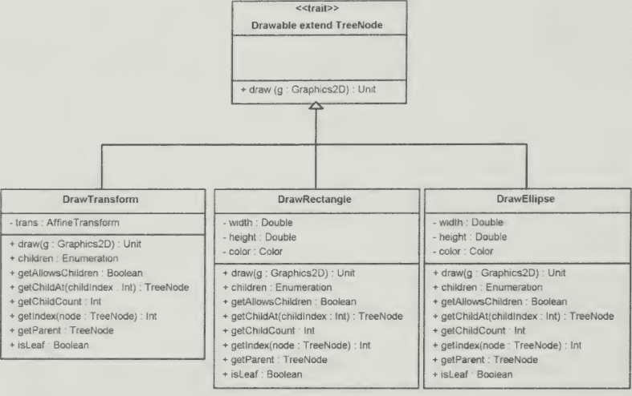

**图 19.5：** 该 UML 类图展示了一种为我们前三个 Drawable 子类型设置层次结构的可行方式。

```
/**
 * This class represents a transformation with children.
 *
 * @param parent the DrawTransform that is the parent of this Drawable.
 */
class DrawTransform(parent:DrawTransform) extends Drawable {
  private val subnodes = mutable.Buffer[Drawable]()
  private var propPanel:Component = null

  private object TransformType extends Enumeration {
    val Translate,Rotate,Scale,Shear = Value
  }
  import TransformType._

  private var transformType = Translate
  private val transformValue = Array.fill(3)(0.0)

  /**
   * This method applies a transform and draws all the subnodes.
   *
   * @param g the Graphics2D object to draw to.
   */
  def draw(g:Graphics2D) {
    val oldTrans = g.getTransform
    g.transform(buildTransform)
    subnodes.foreach(_.draw(g))
    g.setTransform(oldTrans)
  }

  private def buildTransform:AffineTransform = transformType match {
    case Translate =>
      AffineTransform.getTranslateInstance(transformValue(0),transformValue(1))
    case Rotate =>
      AffineTransform.getRotateInstance(transformValue(0),transformValue(1),transformValue(2))
    case Scale =>
      AffineTransform.getScaleInstance(transformValue(0),transformValue(1))
    case Shear =>
      AffineTransform.getShearInstance(transformValue(0),transformValue(1))
  }

  /**
   * Returns a GUI element for setting parameters.
   * If this method is called multiple times, the same object will be returned.
   *
   * @return a Component that can be added to a Swing GUI.
   */
  def propertiesPanel() : Component = {
    if(propPanel == null) {
      propPanel = new BorderPanel {
        layout += new GridPanel(transformValue.length+1,1) {
          contents += new ComboBox(TransformType.values.toSeq) {
            listenTo(selection)
            reactions += { case e => if(selection.item!=null)
              transformType=selection.item }
          }
          for(i <- transformValue.indices) {
            val textField = new TextField(transformValue(i).toString) {
              listenTo(this)
              reactions += { case e:EditDone => transformValue(i)=text.toDouble }
            }
            contents += textField
          }
        } -> BorderPanel.Position.North
      }
    }
    propPanel
  }

  /**
   * Returns an object that can be used to run through the children.
   *
   * @return a java.util.Enumeration object for the subnodes.
   */
  def children : java.util.Enumeration[Drawable] = new
    java.util.Enumeration[Drawable] {
    val iter = subnodes.iterator
    def hasMoreElements() = iter.hasNext
    def nextElement() = iter.next
  }
  /**
   * Tells whether this can have children.
   *
   * @return always true for this type.
   */
  def getAllowsChildren : Boolean = true
  */

  /**
   * Returns the child at a specified index.
   *
   * @param childIndex the index in the sequence of children.
   * @Return the child at that index.
   */
  def getChildAt(childIndex : Int) : Drawable = subnodes(childIndex)

  /**
   * Returns how many children this node has.
   *
   * @Return the number of children currently under this node.
   */
  def getChildCount : Int = subnodes.length

  /**
   * Returns the index of a particular object.
   *
   * @param node a TreeNode to search for in the sequence of children.
   * @Return the index of that child of -1 if it isn't a child.
   */
  def getIndex(node : TreeNode) : Int = subnodes.indexOf(node)

  /**
   * Returns the parent of this node.
   *
   * @Return the parent of this node. Will be null if this is the root.
   */
  def getParent : DrawTransform = parent

  /**
   * Tells is this node is a leaf in the tree.
   *
   * @Return true if there are currently no children, otherwise false.
   */
  def isLeaf : Boolean = subnodes.isEmpty

  /**
   * Adds a child to this node.
   *
   * @param c the node to add.
   */
  def addChild(c : Drawable) { subnodes += c }

  /**
   * Removes the specified drawable from the sequence of children.
   *
   * @param c the node to remove.
   */
  def removeChild(c : Drawable) { subnodes -= c }

  override def toString() = "Transform"
}
```

该类有四个私有数据成员。第一个名为 subnodes，它是一个 Buffer，用于存储变换的所有子节点。5 这些子节点就是变换将被应用到的对象。下一章将详细介绍 Buffer 类型。第二个是一个 Component，用于保存对属性面板的引用。出于下面将看到的原因，它最初为 null。其余两个成员数据分别是变换类型的枚举和与变换关联的数值数组。枚举类型在私有对象中定义。有关枚举的详细信息请参见旁注。

# 枚举

DrawTransform 的 transformType 成员需要能够取一组很小的值中的一个。使用 Int 来实现这一点是可行的，但 Int 类型允许超过 40 亿个不同的可能值。我们只希望允许四种。需要一种只有少量可能值的类型在编程中非常常见。满足此要求的类型称为枚举。许多语言仅为创建这些类型而包含特殊的语言构造，通常使用关键字 enum。Scala 的目标之一是可扩展性，而枚举正是这一点的完美体现。

DrawTransform 的定义展示了通过让对象扩展 scala.Enumeration 类来创建的枚举类型。枚举的不同值是通过 val 声明创建的，其中将我们想要的四个可能选项设置为 Value。Value 来自 Enumeration。

在此声明之后，类型 TransformType.Value 仅允许 Translate、Rotate、Scale 和 Shear 作为值。如果尝试将该类型的引用，例如 transformType 设置为其他任何值，将导致语法错误。

成员之后是各种方法，首先是继承自 Drawable 的那些方法。首先是 draw 方法。该方法将 g 中的当前变换存储在临时变量中，然后将要使用的变换应用到 g 上。buildTransform 方法根据枚举值进行匹配，并生成适当的变换类型，同时传递数组中的 2 或 3 个值。之后，subnodes 的每个元素都被告知绘制自身。绘制完成后，g 上的变换被设置回原来的状态。

draw 之后是 propertiesPanel 方法。如 scaladoc 注释所述，如果多次调用此方法，应返回相同的对象。因此，它始终返回 propPanel。但是，如果 propPanel 为 null，它会将其更改为引用一个新构建的面板，该面板具有一个 ComboBox 和三个 TextFields，并带有适当的事件处理，以便在 ComboBox 选择更改时更改 transformType，或在文本字段被编辑时更改 transformValue 数组中的值。6

文件中的接下来是 TreeNode 所要求的七个方法。其中大多数基于 subnodes 的内容有直接的实现。其中有两个方法值得进一步讨论。第一个是 children 方法。该方法值得注意

5 Buffer 类型将在下一章详细介绍。简而言之，它就像一个具有增长和收缩能力的数组。

6 此代码如果用户输入的不是有效的 Double 值则不会进行适当的异常处理。修复此问题留给读者作为练习。

因为它必须返回 java.util.Enumeration 类型的对象。此类型不像我们刚才看到的枚举那样。此类型基本上是一个迭代器，最初包含在 Java 库中。Java 的后续版本创建了自己的 Iterator 类型，也在 java.util 中，但任何已经使用 Enumeration 的库类，如 TreeNode，都被困在了那个类型上。

Scala 集合通常不会生成 java.util.Enumeration，因此我们必须自己创建。我们通过创建一个继承自 java.util.Enumeration 的匿名类来实现。幸运的是，Enumeration 只有两个抽象方法需要实现：hasMoreElements 和 nextElement。这些方法的实现非常直接，使用我们从 subnodes 获取的迭代器。

另一个有趣的方法是 getParent。此方法的实现非常简单，但它迫使我们在类的顶部放置一个参数，以便在创建 DrawTransform 时必须提供父节点。关于 getParent 的另一个有趣点是返回类型。TreeNode 类型中的 getParent 方法指定返回类型为 TreeNode。但是，当你重写一个方法时，允许将返回类型更改为更具体的子类型。在这种情况下，我们知道所有父节点都将是 DrawTransform 类型，它是 TreeNode 的子类型，因此我们没有违反超类型指定的内容。getChild 方法也返回比 TreeNode 要求更具体的类型。

DrawTransform 中的接下来两个方法是 addChild 和 removeChild。这些方法没有从任何超类型继承。它们存在于此处，以便 Drawing 类型可以在不完全破坏 subnodes 封装的情况下对子节点执行所需的操作。最后是 toString 方法的重写，以便变换对象在 GUI 中显示得更好。

完成 DrawTransform 后，我们现在可以转向 Drawable 层次结构的另一侧。我们将从 DrawLeaf 开始。它是一个 trait，只会实现 TreeNode 所要求的那些方法。

```
package scalabook.drawing

import javax.swing.tree.TreeNode
import java.util.Enumeration

/**
 * A supertype for Drawables that don't allow children.
 */
trait DrawLeaf extends Drawable {
  val parent:DrawTransform

  /**
   * Returns an empty enumeration.
   */
  def children : Enumeration[Drawable] = new Enumeration[Drawable] {
    def hasMoreElements() = false
    def nextElement() = null
  }

  /**
   * Returns false.
   */
  def getAllowsChildren : Boolean = false
```


```
* Returns null for any input.
*/
def getChildAt(childIndex : Int) : Drawable = null

/**
 * Returns 0.
 */
def getChildCount : Int = 0

/**
 * Returns -1 for any input.
 */
def getIndex(node : TreeNode) : Int = -1

/**
 * Returns the parent of the current node.
 */
def getParent : DrawTransform = parent

/**
 * Returns true.
 */
def isLeaf : Boolean = true
}
```

这些方法相当直接。唯一可能在这个代码中显得有趣的是父对象的抽象声明。getParent 方法在这里定义，并且必须能够返回某个东西。然而，trait 不能接受参数，所以我们确保子类型提供值的方式是放入一个抽象的 val。我们可以通过查看 DrawRectangle 来了解这一点是如何发挥作用的。

```
package scalabook.drawing

import java.awt.Graphics2D
import java.awt.Color
import java.awt.geom.Rectangle2D
import swing._
import event._

/**
 * A Drawable that displays a filled colored rectangle.
 */
class DrawRectangle(p:DrawTransform) extends DrawLeaf {
  val parent = p
  private var propPanel:Component = null
  private var color = Color.black
  private var width = 100.0
  private var height = 100.0

/**
 * Draws a rectangle.
 *
 * @param g the Graphics2D object that is drawn to.
 */
def draw(g:Graphics2D) {
```

```
g.setPaint(color)
 g.fill(new Rectangle2D.Double(0,0,width,height))
}

/**
 * Returns a Component for editing the settings of this object.
 *
 * @return a GUI component for editing the settings of the rectangle.
 */
def propertiesPanel() : Component = {
 if(propPanel == null) {
  propPanel = new BorderPanel {
   layout += new BorderPanel {
    layout += new GridPanel(2,1) {
     contents += new Label("Width")
     contents += new Label("Height")
    } -> BorderPanel.Position.West
    layout += new GridPanel(2,1) {
     contents += new TextField(width.toString) {
      listenTo(this)
      reactions += { case e:EditDone => width = text.toDouble }
     }
     contents += new TextField(height.toString) {
      listenTo(this)
      reactions += { case e:EditDone => height = text.toDouble }
     }
    } -> BorderPanel.Position.Center
   } -> BorderPanel.Position.North
   layout += Button("Select Color") {
    val newColor = javax.swing.JColorChooser.showDialog(peer,"Select Color",color)
    if(newColor!=null) color=newColor
   } -> BorderPanel.Position.South
  }
 }
 propPanel
}

override def toString() = "Rectangle"
}
```

DrawRectangle 是一个类这一事实意味着它可以接受父对象的参数。它在类中做的第一件事就是定义抽象的 parent 成员并赋予传入的值。之后是一些成员数据声明和方法。首先是一个简单的 draw 方法，然后是 propertiesPanel，它与我们在 DrawTransform 中看到的类似，只是它为矩形的设置而构建。最后我们重写 toString 用于 GUI 的目的。

DrawEllipse 类型基本上与 DrawRectangle 类型完全相同，只是 draw 方法在 Ellipse2D 上调用 fill。由于代码有如此多的共同点，你可能会期望能够抽象出这种差异并为 DrawRectangle 和 DrawEllipse 使用同一个类。事实上这是可能的。这里没有这样做是因为我们想要说明继承。做得更好留给学生作为练习。

```
contents += Button("Add"){  executeOnSelection(d -> addTo(d),addTo(root))}  contents += Button("Remove"){  executeOnSelection(d -> remove(d))} -> BorderPanel.Position.North layout+= new ScrollPane(new Component { override lazy val peer = tree tree.addTreeSelectionListener(new TreeSelectionListener { def valueChanged(e:TreeSelectionEvent) { executeOnSelection(d => { drawProps.contents.clear() drawProps.contents += d.propertiesPanel drawProps.revalidate drawProps.repaint }) }}) -> BorderPanel.Position.Center } contents += new ScrollPane(drawProps),new SplitPane(Orientation.Horizontal, new ScrollPane(drawPanel), commandPanel)) } propPanel private def executeOnSelection(f: Drawable=>Unit,default: =>Unit = {} ){ val path = tree.getSelectionPath if(path!=null){ val last = path.getLastPathComponent match { case drawable:Drawable if(drawable!=null)=> f(drawable) case _ => } } else default } private def addTo(d:Drawable) = { assert(d!=null) val parent = d match { case dt:DrawTransform => dt case _ => d.getParent } val options = Seq("Ellipse","Rectangle","Transform") val choice = Dialog.showInput(propPanel, "What do you want to add?","Draw Type",Dialog.Message.Question, null,options,options(0)) if(choice.nonEmpty){ parent.addChild(options.indexOf(choice.get) match { case 0 => new DrawEllipse(parent) case 1 => new DrawRectangle(parent) case _ => new DrawTransform(parent)
```

将会在本书的剩余部分不断增长，你需要确保你理解它发生了什么。

# Scala 应用回顾

如果你曾经在 Eclipse 中选择创建 Scala 应用选项，你不可避免地会注意到它并没有创建一个带有 main 方法的对象。相反，它会创建一个扩展名为 App 的类型的对象。App 类型提供了 main 方法，因此你的代码只需放入对象的 body 中。你可以使用变量 args 来获取任何命令行参数。以下是一个示例。

```
object MyApp extends App {
  println(args mkString (" "))
}
```

现在你知道了继承，你可以选择使用这种制作应用的方法，如果你愿意的话。

# 19.4 参数化多态

我们从继承和子类型化获得的包含多态并不是唯一的通用多态形式。还有第二种称为参数化多态的类型。这种多态类型在第 7.5.2 节中简要讨论过。这也是我们自第 7 章以来一直在大量使用的东西。每当你处理 List 或 Array 时你都会使用它。这就是我们在编写具有类型参数的代码时得到的东西。

你已经熟悉使用圆括号在调用方法时或在构造新对象时向类传递值。以同样的方式，你可以使用方括号传递类型参数。考虑以下两个声明。

```
scala> val lst1 = Array(1,2,3)
lst1: Array[Int] = Array(1, 2, 3)
```

```
scala> val lst2 = Array[Any](1,2,3)
lst2: Array[Any] = Array(1, 2, 3)
```

它们都声明了存储值 1、2 和 3 的数组。这些值都是 Int，所以如果我们让 Scala 推断类型，如第一个例子，我们得到 Array[Int]。在第二个例子中我们显式传入参数类型 Any，我们得到该类型。语法是在方括号中传递任何类型参数，然后在值参数的圆括号之前。你可能会觉得这两个列表之间没有区别，但类型参数改变了你能对它们做什么。

```
scala> lst1.sum
res0: Int = 6
```

```
scala> lst2.sum
<console>:9: error: could not find implicit value for parameter num: Numeric[Any]
```

```
lst2.sum
```

你不能对类型 Any 做求和。你可能会质疑为什么你不能对 lst2 的元素求和，但考虑这里发生的事情。

```
scala> lst2(1)=true

scala> lst2(2)=List('a','b','c')

scala> lst2
res3: Array[Any] = Array(1, true, List(a, b, c))
```

类型 Any 在 Scala 中确实意味着任何东西。希望很清楚为什么尝试对这个列表求和应该会失败。

# 19.4.1 参数化类型

关于在我们的代码中使用类型参数使其更灵活呢？当你有想要适用于非常广泛、可能彼此毫无关系的类型集的代码时，你会使用类型参数。这是最常见的例子是集合。像列表和数组这样的东西应该能够容纳你想要的任何东西，但你确实关心它们所容纳的内容，因为你在取出东西时需要知道类型。这是我们将在第 20、24、25、26、29、31 和 32 章中看到很多的用法。现在，我们可以提供一些简单的例子来让你了解这种参数化多态的使用。

我们将回到主题公园的例子。当你为公园的不同方面编写代码时，你意识到很多不同的东西都是按一天中的时间记录的。这可能是销售数字、乘客计数、资源使用量或当班员工。没有参数化多态，你最终会重复大量代码，因为虽然时间的代码方面是相同的，但类型可能非常不同。以下是你可能用来处理此事的类的第一个草案实现。

```
package scalabook.themepark

/**
 * This is a Time of Day Values collection to help reduce code usage
 * when dealing with values that are associated with the time of day.
 * @tparam A the type of data being stored.
 */
class ToDValues[A] {
  private val values:Array[Option[A]] = Array.fill(24)(None:Option[A])

  /**
   * This allows you to get a value for a particular hour. If there isn’t
   * a value, it will throw an exception.
   *
   * @param hour the hour of the day to get. Should be between 0 and 23 inclusive.
   * @return the value stored for that hour.
   */
  def apply(hour:Int) : A = values(hour).get
```


```
ret
}

override def toString() : String = "ToD :\n"+
(for((o,i) <- values.zipWithIndex) yield i+" : "+o).mkString("\n")

private def hourFromTime(time:String) : Int = {
    time.substring(0,time.indexOf(':')).toInt +
    (if(time.endsWith("PM") && !time.startsWith("12")) 12 else 0)
}
}
```

这个类是参数化的。类名`ToDValues`后面跟着一个类型参数`[A]`。方括号将其与值参数区分开。习惯上使用单个大写字母，从`A`开始，作为类型参数的名称。这段代码可以这样使用。

```
val riders1 = new ToDValues[Int]
val riders2 = new ToDValues[Int]
val worker1 = new ToDValues[String]
val worker2 = new ToDValues[String]

riders1(12) = 5
riders1("8:24AM") = 10
riders1(14) = 7
riders2("2:13PM") = 8

worker1(12) = "Jason"

val totalRiders = riders1.combine(riders2,(o1,o2) => (o1,o2) match {
  case (None,None) => None
  case (Some(a),None) => Some(a)
  case (None,Some(b)) => Some(b)
  case (Some(a),Some(b)) => Some(a+b)
})

println(riders1)
println(totalRiders)
```

这段代码创建了该类的四个不同实例，两个存储`Int`，两个存储`String`。然后它向其中三个添加了一些值，并使用`combine`将骑手数量相加。

拥有参数多态意味着我们可以编写一个类，并让它与`Int`、`String`或我们想要的任何其他类型一起工作。这个类仍然有一些明显的局限性。首先，它很难初始化。如果你在其他序列中拥有想要的数据，并且想将其放入这里，除非编写代码手动逐元素复制，否则无法做到。`combine`方法也有些局限，因为我们只能合并相同类型的数据并返回该类型。例如，我们不能将工人与骑手合并。这种功能可能很有用，但它要求我们在方法上放置类型参数。

# 19.4.2 参数化函数和方法

在Scala中，让用户以不同方式创建某种类型对象的标准方法是创建一个伴生对象，其中包含接受所需不同参数的`apply`版本。然后我们让类本身接受适当的数据作为参数。下面是一个可能看起来像这样的示例。

```
object ToDValues {
  // First attempt that lacks type parameter and does not compile.
  def apply() : ToDValues = new ToDValues(Array.fill(24)(None))
}
```

正如注释所暗示的，这行不通。原因是`ToDValues`本身不是一个有效的类型。它必须有一个类型参数才能被完全指定。为了在那里获得一个类型，我们需要给方法一个类型参数。其语法很简单。我们只需在名称和值参数之间用方括号放置类型参数即可。这样做，我们可以创建两个如下所示的`apply`方法。

```
object ToDValues {
  def apply[A]() = new ToDValues[A](Array.fill(24)(None))
  def apply[A](a:A*) = {
    val d = a.map(Option(_)).toArray
    new ToDValues[A](if(d.length<24) d.padTo(24,None) else
      if(d.length>24) d.take(24) else d)
  }
}
```

第二个`apply`方法允许我们通过以下方式构造一个`ToDValues`对象。

```
val riders1 = ToDValues[Int]()
val riders2 = ToDValues(0,0,0,6,7,3,9)
```

这里你应该注意到的关键是，第二种用法没有指定类型参数。这是因为当它们与方法一起使用时，类型参数通常是推断出来的。只要类型出现在方法的参数中，你就不必告诉Scala要使用什么，它会自行推断。创建`riders1`的那一行要求我们指定`[Int]`，因为没有参数，但第二行可以推断出它是在使用`Int`类型。

这段代码之所以有效，是因为该类已设置为接受一个参数。这意味着声明将从上面显示的内容更改为类似这样的内容。

```
class ToDValues[A](private val values:Array[Option[A]]){
```

这里有一个非常大的问题：有可能创建一个带有不包含24个元素的数组的`ToDValues`对象。这显然是不良行为，我们需要防止它。一种防止方法是使该类拥有一个私有构造函数。这意味着只有与该类或其伴生对象相关联的代码才能对这个对象调用`new`。语法上，这是通过在值参数前放置`private`关键字来实现的，如下所示。

```
class ToDValues[A] private(private val values:Array[Option[A]]){
```

现在，外部代码唯一能实例化`ToDValues`对象的方式是通过伴生对象的`apply`方法，而且我们很容易确保这些方法总是使用包含24个元素的数组来创建实例。

我们想要做的另一个添加是增强`combine`方法，使其能够处理不同的类型。理想情况下，我们希望能够让输入类型成为两种不同的类型，而输出类型是第三种类型。我们可以通过在方法上引入两个类型参数来实现，如下所示。

```
def combine[B,C](o:ToDValues[B])(f:(Option[A],Option[B])=>Option[C]) :
    ToDValues[C] = {
new ToDValues((values,o.values).zipped.map((v1,v2) => f(v1,v2)))
}
```

现在我们可以做类似将工人与骑手合并的事情，以跟踪可能用于奖金的关联关系。

如果你仔细观察，会发现这里除了添加类型参数外，还有其他变化。不再是包含两个参数的一个值参数列表，而是两个列表，每个列表包含一个参数。你应该记得，这是一种称为柯里化的技术。这不是必需的，但它使方法的使用更加容易。下面是一个使用示例。

```
val totalRiders = riders1.combine(riders2)((o1,o2) => (o1,o2) match {
case (None,None) => None
case (Some(a),None) => Some(a)
case (None,Some(b)) => Some(b)
case (Some(a),Some(b)) => Some(a+b)
})
```

如果我们不对这个方法进行柯里化，Scala中的局部类型推断将不会自动推断出`o2`的类型，而我们将不得不在函数声明中用`(o1, o2: Int)`来指定它。

我们还有另一对任务可以通过类型参数受益，那就是排序和搜索。我们在第13章中编写的排序和搜索只适用于一种类型。当我们想处理不同类型时，必须复制它们并进行修改。现在我们知道我们希望有一个像`sort[A]`这样的方法，可以对任何我们想要的类型进行排序。一个简单的尝试会向我们展示一个我们尚未讨论的类型参数细节，它会引发问题。

```
object Sorts {
  def bubbleSort[A](a:Array[A]) {
    for(i <- 0 until a.length) {
      for(j <- 0 until a.length-1-i) {
        if(a(j)>a(j+1)) { // Error: > undefined for Any
          val tmp = a(j)
          a(j) = a(j+1)
          a(j+1) = tmp
        }
      }
    }
  }
}
```

这段代码中的注释描述了如果我们尝试编译这段代码会得到的错误。考虑到代码并没有显式使用`Any`类型，这可能会让你停顿一下。

小于或大于，这种方法是有益的。如果值相等，函数将返回0。如果第一个较小，它将返回一个负值。如果第一个较大，它将返回一个正值。我们将在后面的章节中看到这种对比较函数的使用。

这种使用第二个函数参数进行比较的方法的优势在于它使排序更加灵活。例如，在上面任何一个示例中，我们都可以通过简单地传入`>_`而不是`<_`，将数字从大到小排序，而不是从小到大。此外，它确实对类型`A`没有任何限制。这允许你根据任何想要的排序顺序对事物进行排序。例如，如果你有一个学生类型，你可能在某些上下文中想按姓氏排序，在另一些上下文中按成绩排序。这种方法允许你这样做，因为排序顺序并不依附于对象类型。这种方法的缺点是，调用排序方法的人每次想使用它时都必须编写一个比较函数。在上面的例子中，这并不是什么大问题，因为我们的比较很简单。然而，有时情况并非如此。

# 19.4.3 类型边界

正如我们刚刚看到的，一个普通的类型参数，比如`[A]`，当我们在代码中使用该类型的对象时，会被视为`Any`。虽然这是一种非常常见的用法，但肯定会有一些时候，你想限制类型参数中可以使用的类型，以便可以安全地调用除了`Any`可用的那一小部分方法之外的其他方法。做到这一点的方法是在类型上设置边界。

最常见的形式是在类型上设置上界。这是用`<:`符号完成的。为了理解为什么你可能想要这样做，让我们考虑一个使用之前关于水果的代码的示例。我们在本章开头编写的`makeBreakfastShake`函数只使用了一个水果。这通常不是它的工作方式。你可能希望能够包含多个水果，也许是不同类型的。一个常见的例子是同时含有香蕉和草莓的奶昔。为此，你可能会考虑使用如下代码，传入一个`Array[Fruit]`。

```
def makeBreakfastShake(fruits:Array[Fruit]) {
  for(fruit <- fruits) {
    if(!fruit.canEatSkin) {
      fruit.peel
    }
    blender += fruit
  }
  blender += juice
  blender += ice
  blender.blend
}
```

这段代码可能看起来没问题，而且在很多情况下它都会起作用。然而，它并不完美。下面是一个出现问题的地方的例子。

```
scala> val berries = Array(new Strawberry,new Strawberry)
berries: Array[Strawberry] = Array(Strawberry@51d36f77, Strawberry@103b1799)

scala> makeBreakfastShake(berries)
<console>:16: error: type mismatch;
found   : Array[Strawberry]
required: Array[Fruit]
```


注意：Strawberry <: Fruit，但类 Array 在类型 T 上是不变的。
你可能希望研究一个类似 '_ <: Fruit' 的通配符类型。 (SLS 3.2.10)
makeBreakfastShake(berries)

这里变量 berries 的类型为 Array[Strawberry]，这确实可行。以这里编写的 makeBreakfastShake 方式，传入的参数实际上必须是一个 Array[Fruit]。类型 Array[Strawberry] 并不是 Array[Fruit] 的子类型。要理解为什么会这样，只需想象如果在此代码中允许这样的调用会发生什么。

```
def subCherries(bowl:Array[Fruit]) {
    if(!bowl.isEmpty) bowl(0)=new Cherry
}
```

如果你用 Array[Fruit] 调用它，这是没问题的，但如果你被允许用 Array[Strawberry] 调用此函数，你就会在不允许存放樱桃的数组中得到一个樱桃。

解决这个问题的办法在上面的错误信息中已经暗示了。makeBreakfastShake 函数需要说明它可以接受任何是 Fruit 子类型的数组的类型。这是通过使用 <: 指定类型边界来实现的，如下所示。

```
def makeBreakfastShake[A <: Fruit](fruits:Array[A]) {
    for(fruit <- fruits) {
        if(!fruit.canEatSkin) {
            fruit.peel
        }
        blender += fruit
    }
    blender += juice
    blender += ice
    blender.blend
}
```

使用 <: 符号可以让你对类型参数 A 施加约束。这样，我们就可以说可以安全地假设类型 A 的对象比 Any 更具体。在此示例中需要这一点，因为 Any 没有 canEatSkin 或 peel 方法。

你也可以使用 >: 指定类型下界。我们将在第 25 章构建不可变数据类型时看到这种类型约束的用法。

# 协变和逆变

值得注意的是，我们使用 Array[Strawberry] 遇到的问题如果使用 List 而不是 Array 就不会发生。这里显示的代码版本对于任何是 Fruit 子类型的列表都适用，而无需类型边界。

```
def makeBreakfastShake(fruits:List[Fruit]) {
    for(fruit <- fruits) {
        if(!fruit.canEatSkin) {
            fruit.peel
        }
        blender += fruit
    }
    blender += juice
    blender += ice
    blender.blend
}
```

之所以可行，是因为 List 是一个协变类型，这意味着类型 List[Strawberry] 是 List[Fruit] 的子类型，而这对于 Array 来说并非如此。

如果你查看 API，你会看到 List 有一个类型参数 +A。这意味着它是协变的，并且整个类型上的子类型关系与类型参数匹配。协变、逆变和不变的细节更高级，出现在附录 B 中。为什么这样工作的简单解释是，因为 List 是不可变的，我们的例子中替换樱桃导致 Array 出问题，而这种操作在 List 上是不允许的。

特征的一个用途是作为混入，为类型添加特定功能。一个例子是特征 Ordered[A]。该特征有一个抽象方法 compare(that: A): Int。此方法对类型 A 进行比较，如果 this 在排序中排在 that 之前则返回负值，如果排在之后则返回正值，如果相等则返回零。它有具体方法基于 compare 的结果定义正常的比较运算符。

任何是 Ordered 的子类型的对象都应该在排序或搜索算法中很好地工作。它是 Ordered 的子类型这一事实意味着它具有我们希望用于排序的自然排序。这种自然排序意味着我们不必传入比较函数，它已内置于类型中。我们只需要将可使用的类型限制为 Ordered 的子类型。下面展示了一个采用这种方法的冒泡排序版本。

```
object Sorts {
  def bubbleSort[A <: Ordered[A]](a: Array[A]) {
    for(i <- 0 until a.length) {
      for(j <- 0 until a.length-1-i) {
        if(a(j)>a(j+1)) {
          val tmp = a(j)
          a(j) = a(j+1)
          a(j+1) = tmp
        }
      }
    }
  }
}
```

你应该特别注意此示例中的类型边界：[A <: Ordered[A]]。这是一个递归类型边界，其中边界引用回它所约束的类型。在此上下文中，我们需要能够构建递归类型边界，因为在排序内部，代码在两个类型 A 的对象之间进行比较。

- 不应被重写的方法和成员可以声明为 `final`。你也可以使整个 `classes` 为 `final` 以防止其他 `classes` 扩展它们。
- Scala 允许方法/函数、`classes` 和 `traits` 对类型参数进行类型化。这些在方括号中传递，在任何正常的括号参数之前出现。这种能力导致了参数化多态，另一种通用多态形式。
- 当一个 `class` 接受类型参数时，类型必须在实例化点使用 `new` 指定。这与参数化函数/方法形成对比，后者通常可以推断参数的正确类型。
- 你可以在类型参数上放置边界。没有边界时，类型参数必须广泛假设为 `Any` 类型。

# 19.5.2 练习

- 1. `Drawable` 子类型中属性面板的代码在用户输入非数字内容时处理异常做得不好。编辑代码以修复此问题。
- 2. `DrawRectangle` 和 `DrawEllipse` 类共享了大量代码。事实上，这两个文件仅在少数位置将“Rectangle”替换为“Ellipse”而有所不同。编辑代码，使你拥有一个名为 `DrawBoundedShape` 的单一类，它保持这些类的相同成员数据，但抽象出创建的确切形状。有几种方法可以做到这一点。其中一种使用 `(Double,Double) => Shape` 的函数。
- 3. `ToDValues` 类中的 `hourFromTime` 方法并不特别健壮。有哪些情况可能导致它失败？为它编写一个更好的替代方案。
4. 画出你可能会设计的继承层次结构，以表示以下类型的对象。
  - 动物生命
  - 学校/大学组织
  - 大型银行的账户（储蓄、支票等）
  - Facebook 好友的类型
  - 你学校的学生类型
  - 你能想到的任何其他“is-a”关系的良好示例。
- 5. 使用上面的一两个简单方法实现其中一个层次结构。

# 19.5.3 项目

这里有几个不同的选项，你可以根据上一章开始的项目选择。总体思路是，你将为与项目相关的事物构建一个类型层次结构。你也可以在项目适合时加入参数化多态。

在这样做时，有一件非常重要的事情需要牢记。仅仅因为两件事符合“is-a”要求并不意味着它们应该用继承来建模。另一种选择是使用单一类型，让差异由数据驱动。是否应该使用继承还是只存储提供差异的值，最好由差异是否真正是功能上的差异还是量级上的差异来回答。例如，在一个有不同敌人或单位的游戏中，大多数不同类型不应该是不同的子类型，因为唯一的区别是强度或速度之类的差异。然而，当差异需要对特定方法的实现使用非常不同的实现时，这就是调用继承的理由。

- 1. 在第一个 MUD 项目中，建议你创建一些在地图上游荡的角色，而不是你的玩家。这些其他角色可能在最终游戏中扮演各种角色。在标准的 MUD 中，这些就是玩家进行战斗的对象。在许多方面，这些计算机控制的角色与玩家一样，只是它们的移动和其他动作由计算机而不是人类控制。这是继承的一个很好的潜在用途。你可能还能想出其他用途。
- 2. 对于两个游戏项目，可能性在很大程度上取决于你在做什么。与 MUD 一样，可能你会有镜像玩家功能的计算机控制实体。即使不合适，很可能还有其他类型的实体，活跃或不活跃，进入游戏，它们在许多方面共享功能，但并不完全相同。（注意，对于网络游戏，本地玩家和远程玩家的行为是不同的，但这是在第 23 章之前不需要处理的事情。）
- 3. 在网络蜘蛛中使用继承的一个潜在位置是收集的数据类型。你可以创建一个表示数据的超类型，具有抽象的显示能力。这取决于你计划为数据收集做什么的确切内容。
- 4. 如果你在做数学工作台项目，你将有一个工作表，其中可以包含多种不同的东西。这使得继承层次结构成为一个很好的可能性。至少，你应该有命令和绘图。然而，当你更深入思考时，你可能还有很多其他可能性。
  
  你可以添加到此项目中的另一个使用继承的元素是实现命令模式以提供撤销和也许重做功能 [6]。这通过创建一个顶级命令类型来实现，该类型有两个可能被命名为 execute 和 undo 的方法。当用户做一些应该以某种方式改变工作表的事情时，而不是直接改变工作表，你构建一个命令类型的子类型，其 execute 方法执行操作，其 undo 方法撤销它。你将该对象传递给主控制对象，它执行命令。你可以跟踪命令以提供撤销和重做功能。
- 5. 如果你正在做类似 Photoshop 的项目，明显的使用继承层次结构的地方是不同的可绘制事物。用户可以选择的其他元素也可以放入其中。此外，你还可以实现上面项目中描述的命令模式，以帮助使其工作并提供撤销和重做功能。
- 6. 模拟工作台项目将处理许多不同类型的模拟。每一种都有一点不同，但它们都需要有能力


to run, draw, provide analysis data, and perhaps be paused and restarted. Create a supertype that can provide this type of functionality, then write a simple N-body gravity simulation with the ability to draw itself. This is what was done for project 1 and the projects leading into it. Through inheritance, you will make that whole sequence of projects into a small piece of this project.

# Chapter 20 Other Collection Types

- 20.1 The scala.collection Packages ........................................ 497
    - 20.1.1 scala.collection.immutable ........................................ 498
    - 20.1.2 scala.collection.mutable ......................................... 500
- 20.2 Sets ............................................................... 501
    - 20.2.1 Running Through Sets ............................................. 502
    - 20.2.2 Mutable vs. Immutable ............................................ 502
    - 20.2.3 Using a Set ...................................................... 504
- 20.3 Maps ............................................................... 505
    - 20.3.1 Looping Through a Map ............................................ 507
    - 20.3.2 Using Maps ....................................................... 508
- 20.4 Buffers ............................................................ 510
- 20.5 Collections as Functions ............................................ 512
- 20.6 Project Integration ................................................ 512
    - 20.6.1 Commands ....................................................... 512
    - 20.6.2 Adding Drawables ................................................ 515
- 20.7 End of Chapter Material ............................................. 517
    - 20.7.1 Summary of Concepts .............................................. 517
    - 20.7.2 Exercises ....................................................... 517
    - 20.7.3 Projects ....................................................... 518

Back in chapter 7 we talked about the most basic sequence collections in Scala, the Array and the List. Since then we have seen other similar types. These collections share a large number of different methods that we have used to great effect. The sequences are not the only type of collection though. The Scala collections library is far more extensive than what we have seen so far. In this chapter we will examine the inheritance hierarchy of the entire collections library and look at three other types of collections in detail.

### 20.1 The scala.collection Packages

At this point you have likely seen in the Application Programming Interface (API) that there are a number of packages that start with scala.collection including one called simply scala.collection. A class diagram showing the inheritance relationships in this top-level package is shown in figure 20.1. At the top of the hierarchy is the Traversable[A] type. This is a trait that underlies the rest of the hierarchy and can be used to represent anything that has the capability for running through it.

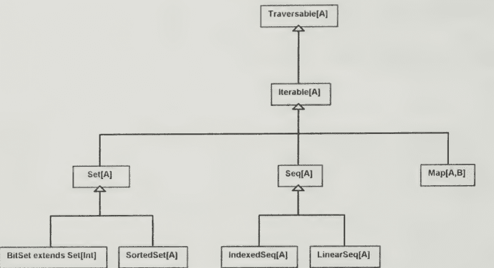

**FIGURE 20.1:** This is a UML diagram of the main types in the scala.collection package. The collection types we have dealt with, including List[A] and Array[A], have been under the Seq[A] part of the hierarchy.

Below Traversable[A] is the Iterable[A] trait. As the name implies, this type, and its subtypes, have the ability to provide Iterators. Anything that is Iterable[A] will have a method called iterator that will give you an Iterator[A]. Though not shown in the figure, the Iterator[A] is also in scala.collection and it inherits from a type called TraversableOnce[A]. Both of these types represent collections that are consumed as they are read.

There are three main subtypes of Iterable[A] in the Scala libraries. These are Seq[A], which we have worked with previously, Set[A], and Map[A]. The latter two allow you to run through their contents, hence they are subtypes of Iterable[A], but they handle their contents in a very different way than does a sequence. The sections below will go into the details of those types.

In this top package there are two subtypes of Set and Seq. The BitSet type is optimized to work with sets of Int. It stores one bit for each integer. If the value is in the set, the bit will be on, otherwise it will be off. The SortedSet type is a specialized version of Set that works when the contents have a natural ordering.

The two subtypes of Seq are IndexedSeq and LinearSeq. These two types differ in how the elements can be efficiently accessed. A List is an example of a LinearSeq. This type has the property that to get to an element, you have to run through all the ones before it. On the other hand, an IndexedSeq allows you to quickly get to elements at arbitrary indexes, like an Array. Each of these types implements their methods in a different way, depending on what is the most efficient way to get to things.

These types are implemented in two different ways in the Scala libraries based on whether the implementations are immutable or mutable. To keep these separate, there are packages called scala.collection.immutable and scala.collection.mutable.

#### 20.1.1 scala.collection.immutable

The scala.collection.immutable package stores various types of collections that are all immutable and which have been optimized so that common operations can be done efficiently with them. This means that "updates" can be made without making complete copies. Of course, because these collections are immutable, no object is really updated, instead, a new, modified version is created. To be efficient, this new object will share as much memory as possible with the original. This type of sharing is safe because the objects are immutable. A simple class diagram showing the inheritance relationships between the main classes and traits in this package is shown in figure 20.2.

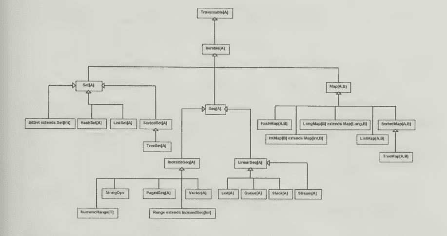

**FIGURE 20.2:** This is a UML diagram of the main types in the scala.collection.immutable package. This image is significantly simplified. If you look in the API you will see that most of the types inherit from multiple other types.

The top part of the hierarchy looks the same as that shown in figure 20.1 for the scala.collection package. It begins with Traversable and Iterable then has three main subtypes in the form of Set, Seq, and Map. The difference is that there are many more subtypes of those three listed here. We will not go into details on most of these, but it is worth noting a few. First there is List. This is the immutable sequence collection that we have been using for most of the book. You can see here that it is a LinearSeq. This means that you can't efficiently jump to random elements. We will see exactly why that is in chapter 25.

If you want an immutable collection that has efficient indexing, your default choice would generally be Vector. The other immutable subtypes of IndexedSeq include Range, which we saw in chapter 8, and a type called StringOps. The StringOps type provides Scala collection operations on strings. Many of the methods that you have been using with strings are not defined on the java.lang.String type. Instead, there is an implicit conversion from java.lang.String to scala.collection.immutable.StringOps. That is how you can do things like this.

```
val (upper,lower) = "This is a String.".filter(_.isLetter).partition(_.isUpper)
```

The java.lang.String type does not actually have methods called filter or partition. You can verify this by looking in the Java API. When Scala sees this line of code, it sees that those methods are missing and looks for an implicit conversion that will give a type that has the needed methods. In this case, the conversion will be to StringOps.

There are a number of different types listed under Map as well. Two of these are optimized specifically to work with Int and Long. For most applications the HashMap will probably be ideal. The details of HashMap are beyond the scope of this book. You should cover those in a course on data structures. We will cover possible implementations of the TreeMap in chapter 29.

#### 20.1.2 scala.collection.mutable

The last package under scala.collection that we will concern ourselves with right now is the scala.collection.mutable package. As the name implies, this package includes collections that are mutable. This is the most extensive of the three packages. It is worth scanning through the API to look at the various types in this package and to see what they are used for. Figure 20.3 shows a UML diagram with the main types in this package.

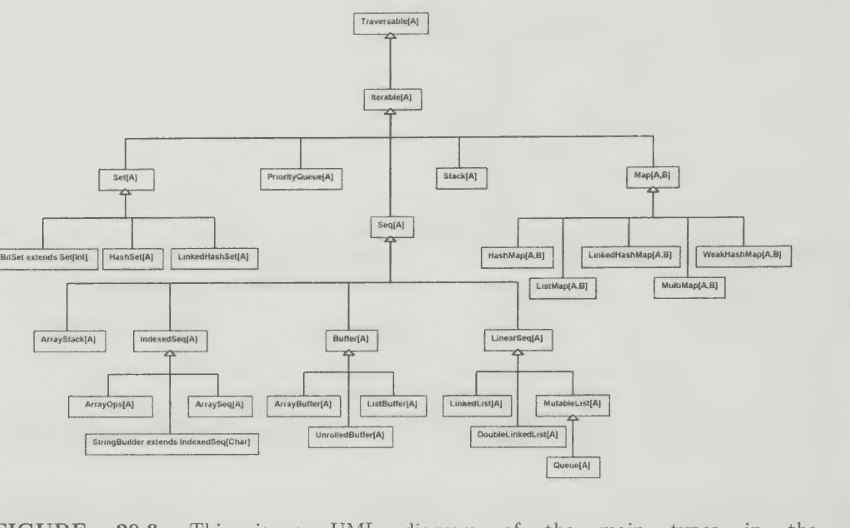

**FIGURE 20.3:** This is a UML diagram of the main types in the scala.collection.mutable package. This image is significantly simplified. If you look in the API you will see that most of the types inherit from multiple other types.

The fact that these types are mutable implies that they include methods that will change their values. When using them you need to try to remember that the “standard” methods, those we have been using regularly to this point, are still non-mutating methods. For example, filter does not change the contents of a collection, even if the collection is mutable. Instead, they introduce a few additional methods that do perform mutations. We’ll talk about these a bit more below.

It is also worth noting that one of the mutable types is ArrayOps. This class is much like StringOps. In truth, the Array type that we have been using is scala.Array and it has very few methods defined on it. When you use the various sequence operations, an implicit conversion is invoked to convert the Array object to an ArrayOps object.


现在我们将学习 Set、Map 和 Buffer 类型。这些类型能显著提升你的编程效率，并使某些任务的完成变得容易得多。

# 20.2 Set

集合（Set）的概念源自数学。Set 类型与 Seq 类型之间有两个主要区别。最重要的一点是 Set 不允许包含重复值。如果你向一个 Set 添加某个元素，而其中已经有一个与之相等的元素，那么它不会添加新值，最终集合的大小与之前相同。另一个区别是 Set 中元素的顺序是不保证的。¹ 我们可以在下面的一系列 REPL 命令中看到这两种效果。

¹ 如果你碰巧使用的是 SortedSet，那么对象的顺序将与类型的自然顺序一致，但这属于例外情况而非普遍规律。

```scala
scala> Set(1,2,3)
res0: scala.collection.immutable.Set[Int] = Set(1, 2, 3)

scala> res0 + 4
res1: scala.collection.immutable.Set[Int] = Set(1, 2, 3, 4)

scala> res1 + 2
res2: scala.collection.immutable.Set[Int] = Set(1, 2, 3, 4)

scala> res1 + -10
res3: scala.collection.immutable.Set[Int] = Set(-10, 4, 1, 2, 3)
```

这里从一个包含值 1、2 和 3 的集合开始。与 List 和 Array 类型一样，Scala 会推断出这是一个 `Set[Int]`。你还可以从推断出的类型中看到，默认情况下我们得到的是一个不可变集合。

你可以使用 `+` 向集合中添加元素，你会得到一个新集合，其中包含了加号后面的那个元素。第二条语句返回的集合在 1、2、3 之外还包含了 4。在第三条命令中，我们向这个新集合添加了一个 2。结果看起来与添加 2 之前的集合相同。这是因为集合不能包含重复元素。

最后一条语句将值 -10 添加到了 res1 的集合中。由于之前没有 -10，这个值被加入了结果集合。然而，结果显示集合中并不保留顺序。将 -10 加入集合不仅把它放到了开头这个奇怪的位置，还改变了 4 在集合中的位置。由此你可以看出，当你关心的是元素的唯一性而非获取它们的顺序时，才应该使用集合。

顺序可能改变这一事实意味着，像我们对 Array 或 List 所做的那样对集合进行“索引”意义不大。你可以对 Set 执行此类操作，但含义略有不同。请考虑以下示例。

```scala
scala> res3(2)
res4: Boolean = true

scala> res3(5)
res5: Boolean = false

scala> res3(-10)
res6: Boolean = true
```

对集合进行这种操作不会返回某个特定位置的值。相反，它返回一个 Boolean，告诉你指定的值是否在集合中。如果集合包含的是 Int 以外的值，这种方式也同样有效。请考虑以下情况。

```scala
scala> val strSet=Set("Mark","Jason","Kevin")
strSet: scala.collection.immutable.Set[java.lang.String] = Set(Mark, Jason, Kevin)

scala> strSet("Jason")
res7: Boolean = true

scala> strSet("Bill")
res8: Boolean = false
```

在这个示例中，集合包含 String，“索引”通过传入 String 来完成。两种方式的含义相同。如果传入的参数在集合中，返回值就是 true，否则就是 false。要理解为什么是这样，请到 Scala API 中查看 Set 的某个版本。它们都有一个名为 A 的类型参数，并定义了以下方法。

```scala
def apply (elem: A): Boolean
```

记住，apply 是一个特殊方法，当对象以函数调用语法使用时会被调用。因此 Scala 中的 f(5) 会被展开为 f.apply(5)。这里的 apply 接收一个参数 elem，其类型必须为 A。这是整个集合的类型参数，所以你必须传入一个集合所包含类型的对象。然后该方法返回一个 Boolean，告诉你该值是否在集合中。

### 20.2.1 遍历集合

除了 map、filter 和 foreach 等标准高阶方法（这些方法对 Set 和之前使用过的序列都可用）之外，Set 类型同样可以很好地与 for 循环配合使用。

```scala
scala> for(v <- res3) println(v)
1
2
-10
3
4
```

事实上，你无法真正使用 while 循环来遍历 Set，因为你不能按位置索引。而且，循环遍历集合值的顺序也是你无法预测的。它甚至不必与 Set 被转换为字符串打印时值的显示顺序一致。

### 20.2.2 可变与不可变

上面的示例展示的是默认的不可变 Set 类型。与我们之前见过的 List 类型一样，不可变集合在创建之后不会改变。当我们使用 `+` 运算符向集合添加元素时，我们得到一个新集合，原集合保持不变。我们可以通过重新调用原集合来证明这一点。

- `--=(xs : TraversableOnce[A])` - 从集合中移除 xs 中的所有元素。
- `add(elem : A) : Boolean` - 向集合添加指定元素。如果在调用之前不存在该元素则返回 true，否则返回 false。
- `clear() : Unit` - 从集合中移除所有元素。
- `remove(elem : A) : Boolean` - 从集合中移除指定元素，如果该元素存在并被移除则返回 true，否则返回 false。
- `retain(p : (A) => Boolean) : Unit` - 从集合中移除所有不满足谓词的元素。

可变集合还可以使用赋值来进行更新。这基本上是我们之前用 apply 看到的“索引”操作的逆操作。索引是你正在集合中调整的值，而赋值要么是 true 要么是 false。要了解其工作原理，请考虑以下示例。

```scala
scala> mset(7)=true

scala> mset(2)=false

scala> mset
res14: scala.collection.mutable.Set[Int] = Set(1, 4, 7, 3)
```

第一行将 7 添加到集合中，而第二行移除了 2。这是可行的，因为 `scala.collection.mutable.Set` 类型定义了一个如下所示的 update 方法。

```scala
def update (elem: A, included: Boolean): Unit
```

因此 `mset(7)=true` 这一行会被展开为 `mset.update(7,true)`。

本节前面提到过，map 和 filter 等标准方法在可变集合上的行为与在不可变集合上相同。这是有意为之的。像这样的子类型上的相同操作始终应该具有相同的外部表现和显著效果。这降低了程序员犯低级错误的几率。如果你想修改集合，就必须调用相应的专用方法。例如，你应该调用 retain 而不是 filter。如果你意外地对不可变类型使用这些操作之一，代码将无法编译。如果同名操作具有不同的行为，程序员就很容易引入逻辑错误，因为他/她认为一个对象是某种类型而实际上却是另一种类型，或者后来程序员改变了赋给变量的具体类型时也会引入 bug。

### 20.2.3 使用集合

为了了解 Set 类型的实用性，我们将编写一个函数，它告诉我们文本文件中所有唯一的单词。该函数将文件名作为参数，并返回一个包含所有小写单词的 `Set[String]`。与任何具有一定复杂度的函数一样，实现方式有很多种。我们将大量使用 Scala 的集合方法来完成。由于我们使用了集合方法，使用 Source 比使用 Scanner 更为合理。下面是可以实现此功能的代码。

```scala
def uniqueWords(fileName:String):Set[String] = {
  val source = io.Source.fromFile(fileName)
  val words = source.getLines.toSeq.flatMap(_.split(" +"))
    .map(_.filter(_.isLetter).toLowerCase).toSet
  source.close()
  words
}
```

使用所描述的签名定义了一个函数。该函数只包含四条语句。函数中的第一条和第三条语句负责打开和关闭文件。最后一条语句只是一个表达式，返回从源数据创建的集合。第二条语句完成了所有主要工作，值得详细研究。

这一行声明了变量 words，并使其等于一个单词集合。为此，它从 Source 中获取行并将它们转换为序列。toSeq 调用使类型与 flatMap 更好地配合。你可能还记得，getLines 返回一个 Iterator。Iterator 类型是一种只能遍历一次的集合，在遍历过程中它会被消耗殆尽。通过将其提升为序列，我们得到的东西能更好地与 split 方法返回的 `Array[String]` 配合。

行被转换为序列之后，有一个对 flatMap 的调用。这是集合上标准的高阶方法之一。我们之前用得不多，所以值得花一点时间讨论一下。从名称可以看出，flatMap 与 map 密切相关。map 方法对集合中的每个元素应用某个函数，并创建一个包含该函数应用结果的新集合。flatMap 做的事情基本相同，只是它期望传入的函数返回集合。与 map 返回集合的集合不同，flatMap 会将所有内部集合展开成一个长的集合。如果你对行的序列使用 map 并使用相同的映射函数，你会得到一个 `Seq[Array[String]]`。序列中的每个元素将包含该行单词的数组。然而，这并不是我们想要的。我们想要的是一个简单的单词序列，而不是单词数组的序列。这正是 flatMap 为我们做的事情。它将每个数组首尾相接放入新序列中，从而得到一个 `Seq[String]`。

如果我们知道文件只包含简单的小写单词，就可以到此为止了。然而，大多数文本文件还会包含大写字母和标点符号。这会打乱集合，因为“Hi”不等于“hi”，当我们只想要一个时，两者都会出现在结果中。类似地，如果单词恰好出现在标点符号之前，单词“dog”也会与“dog.”或“dog,”不同。第二条语句的第二行包含了处理这一问题的逻辑。文件被拆分出的每个单词都会经过一个 map。该 map 过滤掉任何非字母字符，并将结果字符串转换为小写。过滤非字母字符的做法可能过于激进，因为它会移除缩略词中的撇号等内容，但它提供的结果对于我们当前的目的而言已经足够正确了。

第二条语句中最后做的事情是将序列转换为 Set。这给了我们想要的类型，并凭借 Set 的特性移除了所有非唯一元素。

# 20.3 Map

另一种极其有用的集合类型是 Map，在大多数程序中它可能比 Set 更常用。与 Set 一样，术语 Map 也起源于数学。数学中的映射是指从一个集合中取值并返回另一个集合中的值。数学中的函数在技术上就是一种映射。Map 集合类型与此并没有太大不同


由此可知。它将一种类型的值（称为键类型）映射到另一种类型的值（称为值类型）。键类型和值类型可以相同，但通常情况下它们是不同的。

为了帮助您理解映射，让我们看一些示例。我们将从创建新映射的语句开始。

```
scala> val imap=Map("one" -> 1, "two" -> 2, "three" -> 3)
imap: scala.collection.immutable.Map[java.lang.String,Int] = Map((one,1), (two,2),
(three,3))
```

Map 类型接受两个参数。在这个示例中，它们是 String 和 Int。传入用于构建 Map 的值实际上是元组，其中键是第一个元素，值是第二个元素。在此示例中，我们使用了第 3 章中讨论过的 -> 语法。这种语法被添加到 Scala 库中正是为了这个目的。你可以这样理解：创建一个映射，其中字符串 "one" 映射到整数 1，依此类推。

当你对映射进行索引时，需要使用键类型的值进行索引。你得到的返回值是相应的值对象。

```
scala> imap("two")
res0: Int = 2
```

如果你愿意，可以将映射视为一个集合，它可以通过你想要的任何类型进行索引，而不仅仅是序列中使用的整数索引。如果你试图取出一个映射中不存在的键，就会得到一个异常。这是可行的，因为 Map 类型定义了如下的 apply 方法。

```
def apply (key: A) : B
```

类型 A 和 B 是 Map 的类型参数，其中 A 是键类型，B 是值类型。

除了允许键使用任何类型之外，映射还有一个优点，即它不要求索引具有任何特定的“起始”值。因此，有时你可能希望构建一个使用 Int 作为索引的映射。请看这个示例。

```
scala> val imap2=Map(10 -> "ten", 100 -> "hundred", 1000 -> "thousand")
imap2: scala.collection.immutable.Map[Int,java.lang.String] = Map((10,ten),
(100,hundred), (1000,thousand))
```

从技术上讲，你可以构建一个在适当索引处包含 "ten"、"hundred" 和 "thousand" 值的序列。然而，这是非常浪费的，因为 0 到 1000 之间有许多索引你不会用到，而这些索引位置将包含空引用。

与 Set 类型一样，你可以使用 + 运算符向映射中添加新的键值对。

```
scala> imap + ("four" -> 4)
res1: scala.collection.immutable.Map[java.lang.String,Int] = Map((one,1), (two,2),
(three,3), (four,4))
```

键和值需要放在一个元组中，就像构建原始映射时一样。此示例中的括号是必需的，以确保正确的运算顺序。否则，+ 会在 -> 之前执行，结果将是一个看起来相当奇怪的 (String,Int)。

你还可以使用 - 运算符来获得元素更少的映射。对于此操作，第二个参数只是你想要移除的键。你不必拥有，甚至不需要知道与该键关联的值。

```
scala> imap - "two"
```

```
res6: scala.collection.immutable.Map[java.lang.String,Int] = Map((one,2), (two,4), (three,6))
```

这两个示例展示了如何使用 map 或带 yield 的 for 循环来实现这一点。

# 20.3.2 使用映射

我们将用于说明 Map 用法的示例与之前用于 Set 的示例密切相关。我们不再简单地识别所有单词，而是统计每个单词出现的次数。这个函数的开头与我们之前所做的非常相似。我们将从这个模板开始。

```
def wordCount(fileName:String):Map[String,Int] = {
  val source = io.Source.fromFile(fileName)
  val words = source.getLines.toSeq.flatMap(_.split(" +")).
    map(_.filter(_.isLetter).toLowerCase)
  val counts = // ???
  source.close()
  counts
}
```

这里 words 只是一个单词序列，我们将使用它来构建计数，并返回一个包含这些计数的 Map。我们将用两种不同的方式来完成这最后一部分。

第一种方法将使用可变映射。这里的逻辑是，我们想要遍历单词序列，如果之前没有见过这个单词，就向映射中添加计数 1。如果之前见过，我们就重新添加相同的键，但值比之前的大 1。实现此功能的代码如下所示。

```
def wordCount(fileName:String):mutable.Map[String,Int] = {
  val source = io.Source.fromFile(fileName)
  val words = source.getLines.toSeq.flatMap(_.split(" +")).
    map(_.filter(_.isLetter).toLowerCase)
  val counts = mutable.Map[String,Int]()
  for(w <- words) {
    if(counts.contains(w)) counts += w -> (counts(w)+1)
    else counts += w -> 1
  }
  source.close()
  counts
}
```

请注意，这里用于遍历单词的 for 循环位于 counts 声明之后。因为 counts 是可变的，所以这种方法可行。你还应该注意，函数的返回类型已改为 mutable.Map[String,Int]。如果省略这一点，你必须在末尾、counts 之后添加对 .toMap 的调用，以便将 counts 转换为不可变类型。可变类型和不可变类型之间的这种区别对于程序的安全性非常重要。一般来说，可能还有其他对给定 Map 的引用保留在代码的其他部分中。如果在期望得到不可变映射时却可能获得可变映射，那么代码的其他部分就有可能在你不期望的时候修改该映射。这将导致非常难以追踪的逻辑错误。

使用可变版本在逻辑上相当合理，并且可能具有一定的效率优势，但正如刚才提到的，可变值伴随着风险。因此，我们将编写第二个版本，使用不可变映射和 foldLeft 方法。foldLeft 方法是一个更复杂的方法，我们之前并没有真正处理过。然而，它非常适合我们在这里要做的事情，因为它有效地完成了我们之前编写的内容，但不需要 for 循环。foldLeft 方法从左到右遍历集合，对每个元素应用一个函数，并在遍历过程中逐步累加结果。该函数是柯里化的，第一个参数列表是一个单一值，指明累加值应以什么作为初始值。在本例中，我们累加的是一个 Map，因此我们将从一个空 Map 开始。我们要应用的代码与之前 for 循环中的代码非常相似。将它们组合在一起时看起来是这样的。

```
```text
def wordCount2(fileName:String):Map[String,Int] = {
  val source = io.Source.fromFile(fileName)
  val words = source.getLines.toSeq.flatMap(_.split(" "))
    .map(_.filter(_.isLetter).toLowerCase)
  val counts = words.foldLeft(Map[String,Int]())((m,w) => {
    if(m.contains(w)) m + (w -> (m(w)+1))
    else m + (w -> 1))
  }
  source.close()
  counts
}
```
```

传入 foldLeft 的函数接受两个参数。第一个是迄今为止的累加值，第二个是被操作的值。在本例中，累加值是一个 Map，我们使用变量 m 来表示它。传入的值是我们接下来要计数的单词，用名称 w 表示，就像之前在 for 循环中一样。

作为第二个参数列表传入 foldLeft 的函数体与之前在 for 循环中的内容有两处不同。第一，我们使用参数名 m，而不是引用可变映射 counts。第二，我们不使用 +=，而是只使用 +。+= 运算符没有为不可变映射定义，我们在这里所做的是构建一个新的不可变映射，并将其向前传递以供下一个单词使用。

如果你真的想更进一步，可以完全去掉 words 的声明。毕竟，它的唯一用途就是作为 foldLeft 的参数来构建 counts。这样做，并去掉一些技术上并不需要的大括号，就得到了下面的代码。

```
```text
def wordCount3(fileName:String):Map[String,Int] = {
  val source = io.Source.fromFile(fileName)
  val counts = source.getLines.toSeq.flatMap(_.split(" "))
    .map(_.filter(_.isLetter).toLowerCase)
    .foldLeft(Map[String,Int]())((m,w) =>
      if(m.contains(w)) m + (w -> (m(w)+1))
      else m + (w -> 1))
  source.close()
  counts
}
```
```

这段代码很紧凑，但是否真的要这样做，还有待商榷。引入变量 words 确实增加了代码的长度，但对大多数读者来说，它可能也让代码更易于理解。

拥有任何版本的 wordCount 也隐式地给了我们一个单词集合。这是因为 Map 类型有一个名为 keySet 的方法，它返回一个包含 Map 中所有键的 Set。由于每个键只能出现一次，因此将键作为集合获取时不会丢失任何内容。出于效率考虑，你可能希望保留 uniqueWords

如果你打算经常使用它，可以围绕该函数进行包装，而不是用`wordCount("file.txt").keySet`替换对它的调用，因为单词计数做了生成集合所不需要的额外工作。

映射（Map）更通用的用例是将其作为一种快速查找数据组的方式，例如通过特定的键值查找样例类。一个例子是通过学生的ID或其唯一登录号来查找表示学生的样例类。Map类型的真正威力在于键和值的类型可以是任何你想要的类型。

# 20.4 缓冲区

本章我们将详细讨论的最后一种新集合类型是`Buffer`。Buffer类型类似于可以改变大小的`Array`。因此，Buffer类型隐式可变。没有不可变的Buffer。如果你使用其他可变类型，导入`scala.collection.mutable`并将Buffer称为`mutable.Buffer`的规则仍然有效，并且它能让任何阅读代码的人清楚地知道你正在使用可变类型。然而，由于Buffer类型只能是可变的，你也可以考虑导入`scala.collection.mutable.Buffer`，然后在代码中直接称其为Buffer。

Scala库中有几个Buffer的子类型。最重要的两个是`ArrayBuffer`和`ListBuffer`。一个使用数组存储值，另一个使用称为链表的结构。Scala中的List类型也是链表，尽管它不被ListBuffer直接使用，因为ListBuffer需要是可变的。本章我们将使用ArrayBuffer。ListBuffer的性质及其不同之处将在第25章中变得更加明显。

你可以完全按照预期的方式创建缓冲区。

```scala
scala> val buf = mutable.Buffer(1,2,3,4,5)
buf: scala.collection.mutable.Buffer[Int] = ArrayBuffer(1, 2, 3, 4, 5)
```

你还可以使用我们学到的一些用于`Array`和`List`的方法，如`fill`和`tabulate`。

```scala
scala> val rbuf=mutable.Buffer.fill(10)(math.random)
rbuf: scala.collection.mutable.Buffer[Double] = ArrayBuffer(0.061947605764430924,
 0.029870283928219443, 0.5457301708447658, 0.7098206843826819,
 0.8619215922836797, 0.5401420250956313, 0.6249953821782052,
 0.1376217145656472, 0.26995766937532295, 0.8716257556831167)
```

你可以像对数组那样，通过索引访问缓冲区并更改值。

```scala
scala> rbuf(3)
res0: Double = 0.7098206843826819

scala> buf(3)=99
```

```scala
scala> buf
res1: scala.collection.mutable.Buffer[Int] = ArrayBuffer(1, 2, 3, 99, 5)
```

Buffer类型与`Array`类型的不同之处在于它可以轻松地增长和收缩。有一整套方法利用了这一点。以下是其中一些。

- `+=(elem: A): Buffer[A]` - 将元素追加到缓冲区并返回同一个缓冲区。
- `+=:(elem: A): Buffer[A]` - 将元素前置到缓冲区并返回同一个缓冲区。
- `++=(xs: TraversableOnce[A]): Buffer[A]` - 将xs中的元素追加到缓冲区并返回同一个缓冲区。
- `++=:(xs: TraversableOnce[A]): Buffer[A]` - 将xs中的元素前置到缓冲区并返回同一个缓冲区。
- `-=(elem: A): Buffer[A]` - 从缓冲区移除元素并返回同一个缓冲区。
- `--=(xs: TraversableOnce[A]): Buffer[A]` - 从缓冲区移除xs中的所有元素并返回该缓冲区。
- `append(elem: A): Unit` - 将元素追加到缓冲区。
- `appendAll(xs: TraversableOnce[A]): Unit` - 将xs中的元素追加到缓冲区。
- `clear(): Unit` - 从缓冲区移除所有元素。
- `insert(n: Int, elems: A*): Unit` - 在指定索引处插入指定元素。
- `insertAll(n: Int, elems: Traversable[A]): Unit` - 在索引n处插入elems中的所有元素。
- `prepend(elems: A*): Unit` - 将元素前置到该缓冲区。
- `prependAll(xs: TraversableOnce[A]): Unit` - 将xs中的所有元素前置到该缓冲区。
- `remove(n: Int, count: Int): Unit` - 从索引n处的元素开始移除count个元素。
- `remove(n: Int): A` - 移除索引n处的单个元素并返回它。
- `trimEnd(n: Int): Unit` - 从该缓冲区移除最后n个元素。
- `trimStart(n: Int): Unit` - 从该缓冲区移除最前面的n个元素。

这些方法大多是不言自明的。唯一可能让你疑惑的是涉及符号字符的方法。这里有两个有趣的地方。首先是它们都返回被调用的缓冲区。原因在于这允许你将它们串联起来，连续追加或前置多个元素。考虑下面这个追加示例。

```scala
scala> buf += 6 += 7
res2: buf.type = ArrayBuffer(1, 2, 3, 99, 5, 6, 7)
```

这里6和7都在一行内被追加。

其他可能看起来奇怪的操作是`+=:`和`++=:`。这些操作表示前置。有趣的是它们的用法。这里有一个例子。

```scala
scala> 0 +=: buf
res3: buf.type = ArrayBuffer(0, 1, 2, 3, 99, 5, 6, 7)
```

要前置的值在操作符左侧，缓冲区在右侧。考虑到前置后它在缓冲区中的位置，这在某种程度上是有道理的。我们之前也见过类似情况。列表上的cons操作符是`::`，它将元素前置到列表。该操作符也以冒号结尾。这是Scala较深奥的规则之一。任何以冒号结尾的符号操作符方法都是右结合的，而不是像大多数操作符那样左结合。这意味着操作符作用的对象在操作符右侧，并且操作是从右向左分组的。

# 20.5 集合作为函数

不同的集合类型都继承自PartialFunction，而PartialFunction继承自标准函数类型。这意味着你可以将集合用在通常期望使用函数的地方。例如，`Seq[A]`类型可以作为一个`Int => A`函数。类似地，`Map[A,B]`可以用作`A => B`。

一个简单的用法示例是，通过用所需的索引映射一个范围，并将数组作为函数参数，来取出数组的每隔三个元素。

```scala
val nums = Array.fill(30)(math.random)
val everyThird = (nums.indices by 3).map(nums)
```

这样，以集合作为参数应用map，使我们能够对集合进行任意索引。

# 20.6 项目集成

我们可以在很多地方使用这些不同的集合。在上一章中，`mutable.Buffer`类型被用于`DrawTransform`中保存子项。这使得包含添加和删除子项的代码变得容易。在本节中，我们将使用Map类型来帮助处理文本命令。之后，我们将利用Array来清理向Drawing添加Drawables的代码。这是我们以前可以做的事，但在查看集合的不同用途时，放在这里更合适。

### 20.6.1 命令

命令处理器是代码的一部分，可以用继承来实现。我们可以创建一个名为Command的类型，让其他类型继承它。这种构造在逻辑上有道理，但可能不是我们真正需要的。关于继承，你需要学到的一个方面是，在不需要时不要使用它。要知道是否需要它，我们必须做一些分析。

你可能想知道为什么我们要在绘图程序中加入基于文本的命令处理器。也许最好的类比是，为什么你希望在具有图形用户界面（GUI）的操作系统（OS）中包含命令行界面。有些操作通过键入执行比通过指向和点击执行效果更好。现在我们从一个简单的例子开始，作为命令工具的使用案例。我们将从三个命令开始：

- `echo` - 打印命令后面的任何内容，
- `add` - 后面应跟一系列用空格分隔的数字，并打印它们的和，
- `refresh` - 不接受参数，并导致绘图刷新。

因此，用户可能会输入“echo Hello, World!”、“add 1 2 3 4 5”或“refresh”。前两个接受参数，调用它们的唯一结果是输出中显示某些内容。最后一个非常不同，它不接受参数，也不显示任何内容。相反，它需要导致显示的Drawing对象重新绘制自身。

为了在代码中实现这一点，我们需要在TextField上添加一个监听器来处理用户输入，该监听器响应EditDone事件。当这种情况发生时，输入的文本行需要识别出第一个单词，并根据该单词调用相应的功能。

实现此功能的一种方式是让每个命令包含一个形如`(String,Drawing) => Any`的函数。该函数的第一个参数是命令之后行的剩余部分。第二个参数是调用命令时所针对的Drawing对象。这是必要的，以便像refresh这样的命令可以触发与绘图相关的事情。返回值是我们想要返回的任何内容。在大多数情况下，该对象会被转换为String并添加到输出中。

仅仅拥有这些函数还不够。我们还需要能够根据输入的第一个单词快速识别应该调用哪个函数。这是Map的完美用法。更具体地说，我们希望使用`Map[String, (String,Drawing)=>Any]`。这是一个从每个命令字符串到该命令应调用的函数的映射。

使用这种方法，我们可以声明一个包含命令功能的对象。一个包含上述三个命令的实现可能如下所示。

```scala
package scalabook.drawing

/**
 * This object defines the command processing features for the drawing.
 * Use apply to invoke a command.
 */
object Commands {
    private val commands = Map[String,(String,Drawing)=>Any](
        "add" -> ((rest,d) => rest.trim.split(" +").map(_.toInt).sum),
        "echo" -> ((rest,d) => rest.trim),
        "refresh" -> ((rest,d) => d.refresh)
    )

    def apply(input:String,drawing:Drawing):Any = {
        val spaceIndex = input.indexOf(' ')
```


这种设计的主要优点是它使得添加新命令变得非常容易。只需向命令映射中添加一个新成员即可完成。对于这些命令，函数代码可以在行内完成。更长的函数可以很容易地作为 Commands 对象中的方法编写。如果需要，命令的功能甚至可以放在代码的其他部分，只要它可以从 Commands 访问或通过传入的 Drawing 对象访问即可。

# 20.6.2 添加 Drawable

我们可能在另一个地方使用集合以有趣的方式来清理代码，使其更具可扩展性且不易出错。这是在添加新 Drawable 的代码中。我们在第 18 章中使用的该方法如下所示。

```
private def addTo(d:Drawable) = {
  assert(d!=null)
  val parent = d match {
    case dt:DrawTransform => dt
    case _ => d.getParent
  }
  val options = Seq("Ellipse","Rectangle","Transform")
  val choice = Dialog.showInput(propPanel,
    "What do you want to add?","Draw Type",Dialog.Message.Question,
    null,options,options(0))
  if(choice.nonEmpty) {
    parent.addChild(options.indexOf(choice.get) match {
      case 0 => new DrawEllipse(parent)
      case 1 => new DrawRectangle(parent)
      case _ => new DrawTransform(parent)
    })
    drawPanel.repaint
    tree.getModel match {
      case m:javax.swing.tree.DefaultTreeModel => m.reload
      case _ =>
    }
  }
}
```

该方法并不算太长，但其中包含一个特别容易出错且可能导致在项目中添加更多 Drawable 类型时后期开发出现令人恼火的错误的重要部分。此代码的薄弱点在于 match case 的顺序与 options 字符串的顺序相关联。随着时间的推移，随着更多选项的添加会发生什么？你必须向 options 添加一个字符串，然后在相同位置添加一个新的 case。如果决定按字母顺序保持字符串，这将变得具有挑战性，因为所有 case 的编号都需要更改。即使不是这样，使用这种机制很容易使事情顺序错乱，并且在列表变长时检查两者之间的顺序会非常耗时。

另一种方法是把名称与创建 Drawable 对象的功能分组。在这种情况下，我们将使用元组数组来实现这一点，因为 showOptionDialog 方法需要传入一个数组并返回一个 Int。如果它返回的是所选的值而不是 Int，那么 Map 可能是首选。

```
private def addTo(d:Drawable) = {
assert(d!=null)
val parent = d match {
```

# 20.7 本章结束材料

### 20.7.1 概念总结

- Scala 集合库远远超出了我们之前查看的像 Array 和 List 这样的序列。在相关的不同层次中存在显著的类型层次结构。
- Set 类型基于数学集合的概念。Set 中的所有值都是唯一的且顺序无关紧要。与序列相比的优势在于成员检查速度快。存在可变和不可变的 Set 类型。
- Map 是一个允许你使用任意键类型存储和查找值的集合。这使你能够使用字符串、元组或任何其他内容来存储和索引值。用于键的类型应真正是不可变的。存在可变和不可变的 Map 类型。
- Buffer 是终极的可变序列类型。值可以像 Array 一样被修改，但你也可以以改变大小的方式插入或删除元素。

### 20.7.2 练习

- 1. 实现以下函数，该函数将从任何具有可从值生成键的函数的序列构建一个 Map。

```
def buildMap[A,B](data:Seq[A], f: A => B):Map[B,A]
```

- 2. 编写代码来表示一副牌。以以下内容作为起点。

```
case class Card(suite:String,value:Char)
class Deck {
  private val cards = mutable.Buffer[Card]()

  def dealHand(numCards:Int):List[Card] = ...
  def shuffle() { ... }
  def split(where:Int) { ... }
}
```

请注意 cards 是一个 mutable.Buffer，因此发牌实际上会移动牌，而另外两个方法应改变元素的顺序。

- 3. 在概率的数学讨论中，使用“弹珠袋”中不同颜色的弹珠作为心理图像来说明某些概念是很常见的。“袋子”不是 Seq，因为没有顺序。在 Scala 中，它更适合建模为 Set。

编写一个小脚本来创建一个 Set[Marble] 并尝试使用 Marble 的这两种定义。

```
case class Marble(color:String)
class Marble(val color:String)
```

4. 数学工作表项目将具有命令，就像 MUD 一样。此时，这就明确表明使用 Map 是合适的。此外，工作表本身将是一个不同元素的序列，随着用户添加内容而增长，或者当用户删除内容时可能缩小。阅读本章后，这听起来就像一个 Buffer。

5. Photoshop® 项目充满了可以用 Buffers 很好实现的各个方面。例如，像 Photoshop 这样的软件的标准功能之一是包含可以独立工作的多个图层。绘制在图层上的元素也可以存储在 Buffers 中。

6. 如果你正在进行仿真工作台项目，使用 Buffer 来保存同时运行的不同仿真是有意义的。你可以将它链接到一个显示不同仿真的 TabbedPane。

拥有一个粒子的 Buffer 对于某些仿真来说可能很有趣，但对于你现在拥有的重力仿真可能不是。

向此项目添加更多集合的另一种方法是添加完全不同的仿真类型。你可以考虑添加用于布料仿真的粒子网格。这种方法的工作原理是，你有一组每个具有少量质量的粒子。它们通过“弹簧”连接，因此如果它们彼此靠得太近或太远，就会产生恢复力。在许多方面，这与重力仿真的工作方式完全相同，唯一的区别是力只发生在网格中连接的粒子之间，并且力不是 1/r² 类型的力。

这种最基本的实现将使用标准的胡克定律 Fₛ = −k x，其中 k 是弹簧常数，x 是偏离弹簧静止长度的偏移量。力沿着连接粒子的线段方向。粒子网格与同一行和列中相邻粒子之间的弹簧提供了一个简单的设置，可以进行测试。为了使其动态，考虑固定一个或两个粒子，使力无法移动它们。你也可以添加一些随机的强制力来模拟风。

更准确的仿真可以通过添加额外的、较弱的弹簧来获得。这些弹簧将位于每个粒子与网格中与其相邻的对角线粒子之间，以及同一行或列中相隔两个的粒子之间。这些额外的弹簧使织物具有“强度”，并使其以更自然的方式弯曲。简单的网格配置会以不自然的折痕完全折叠。

# 第 21 章

# 多线程与并发

- 21.1 多核的未来 ......................................................... 522
- 21.2 基础线程 ............................................................... 523
  - 21.2.1 线程的问题 ................................................... 526
    - 21.2.1.1 竞态条件 ...................................................... 526
    - 21.2.1.2 死锁 .............................................................. 528
  - 21.2.2 同步 .......................................................... 529
  - 21.2.3 等待/通知 .............................................................. 532
  - 21.2.4 其他线程方法 ..................................................... 534
- 21.3 并发库 ......................................................... 535
  - 21.3.1 执行器和执行器服务 .......................................... 535
  - 21.3.2 Callable 和 Futures ..................................................... 536
  - 21.3.3 并行数据结构 ................................................. 539
    - 21.3.3.1 共享屏障 ....................................................... 539
    - 21.3.3.2 交换 .......................................................... 540
    - 21.3.3.3 装配线 ......................................................... 540
    - 21.3.3.4 票务乘客 ................................................... 541
    - 21.3.3.5 其他线程安全类型 ................................................ 541
  - 21.3.4 原子 (java.util.concurrent.atomic) ..................................... 542
  - 21.3.5 锁 (java.util.concurrent.locks) ...................................... 542
- 21.4 并行集合 ........................................................ 543
- 21.5 Scala Actors 简介 ................................................ 546
- 21.6 多线程曼德博集合 (项目集成) ................................ 548
- 21.7 GUI 中的多线程 ....................................................... 551
- 21.8 动画弹跳球 (项目集成) ................................ 553
- 21.9 本章结束材料 ...................................................... 555
  - 21.9.1 概念总结 ...................................................... 555
  - 21.9.2 练习 ................................................................ 556
  - 21.9.3 项目 ................................................................. 557

我们迄今编写的程序都是基于这样一个基本假设：任何给定时间只有一个事情在发生。程序中的指令一个接一个地执行，控制可能会从一个方法跳转到另一个方法，但在任何给定时间你都可以指出一行代码并说那就是当时正在发生的事情。这种指令的顺序处理称为线程。我们迄今编写的程序是为使用单个执行线程而编写的。这种程序无法充分利用现代硬件。在本章中，我们将学习如何使程序使用多个线程。多线程可以在某些地方简化逻辑，但大多数时候我们将使用它来使程序运行更快。


图 21.1：该图显示了 1978 年至 2010 年间生产的 x86 处理器的频率、晶体管数量和核心数量。图表上的对数刻度使得指数曲线显示为直线。虚线显示了对全部晶体管数量数据以及 2000 年之前的频率数据的拟合。所示时钟速度为每个芯片的最高发布速度。

# 21.1 多核未来

在集成电路开发后的数十年里，计算机之所以持续变快，是因为两个因素的结合。最显著的是所谓的摩尔定律。这是英特尔的戈登·摩尔提出的一个预测，即可以在芯片上蚀刻的晶体管数量大约每两年翻一番。这种增长得益于技术改进，使得晶体管可以做得越来越小。伴随而来的是能够以更高频率驱动这些晶体管的能力。

图 21.1 显示了 1978 年至 2011 年间英特尔和超微半导体公司 AMD 发布 x86 处理器的时钟频率、晶体管数量和核心数量。纵轴上的对数刻度使得指数增长显示为直线。虚线显示了对晶体管数量数据的指数拟合。从中可以看出，摩尔定律保持得相当不错。晶体管数量呈指数增长，其翻倍时间与预测的两年相当接近。

从图开始到 2000-2005 年时间段，芯片的时钟频率也呈指数增长。1978 年和 1979 年可用的芯片运行在 5 MHz。到 2000 年，它们已超过 1 GHz 的速度。虚线显示了 2000 年之前的时钟速度的指数拟合。然而，正如你所见，时钟速度在几 GHz 处停滞下来，自 2000 年后不久以来几乎没有上升。这是由散热问题造成的。在这些速度以上，基于硅的芯片需要特殊冷却才能稳定运行。

> 1 2008 年和 2011 年的低异常点是专门针对低能耗、移动计算的芯片。这就是为什么它们与同时期生产的其它芯片相比晶体管数量较低。

直到 2005 年，计算机的大部分速度提升来自时钟频率的提高。当这条路走到尽头时，芯片制造商不得不寻找另一种提高芯片速度的方法。毕竟，没有人会购买新电脑只是为了让程序比旧电脑运行得更慢。因此，从 2005 年开始，商品化计算机芯片开始朝不同的方向发展。² 它们所走的方向由图 21.1 中带三角形点的点划线显示。芯片制造商不再主要使用额外的晶体管来增加单条指令的数据路径的复杂性或只是增加更多缓存，而是开始制造具有多个核心的芯片。

当芯片具有多个核心时，这意味着它可以在任何给定时间执行多条指令。我们通常说代码可以并行执行。不幸的是，以我们迄今为止的方式编写的程序不会自动利用多个核心。相反，它必须被重写，以便在这些更新的计算机上运行得更快。这与处理器时钟速度提高时发生的情况相比是一个重大变化。这种变化的重要性在题为“免费午餐结束了”的文章[1]中有所描述。所指的“免费午餐”是指在程序员无需做任何工作的情况下从新处理器获得更多速度。为了充分利用更新的处理器，程序必须多线程化。在本章中，我们将开始探讨这具体意味着什么。

# 21.2 基本线程

当你想象你的一个程序运行时，你可以想象计算机将一个箭头从一行移动到下一行。箭头指向当前正在执行的行。当你调用一个函数/方法时，箭头会跳转到代码的另一部分，然后在函数/方法返回时跳回来。我们用来描述这种行为的术语是“线程”。我们迄今为止编写的程序使用单个执行线程。我们从这里开始是因为它更容易，但当前计算机硬件的性质使得你需要尽早了解多线程的概念。

多线程程序的想法是你有两个或多个箭头指向不同的行并同时在程序中移动。这些不同的线程可以在不同的核心上运行，使你能够更充分地利用现代处理器。就像多个人在任务上合作一样，个体之间必须进行某种协调才能获得最大收益。通常也有可以富有成效地共同工作的人数限制。如果你想挖一个小洞，你可能无法有效地使用超过两个人或最多三个人。然而，如果你想挖一条大沟，你可以让数百甚至数千人富有成效地参与其中。程序也可能适用同样的限制。

在 Scala 中使用线程来产生并行性有很多种方法。我们将从最基本的部分开始，即 `java.lang.Thread` 类及其相关元素。这不是你可能在 Scala 中进行大部分并行编程的方式，但它提供了一个良好的基础，并且可以展示在我们将要查看的所有不同选项的最低级别上使用的基本操作。

我们将从一个相当简单的示例开始。这是一个脚本，它会询问你的年龄并从 10 倒数到 1。如果你没有在倒计时结束前回答，它将会在你回答之前终止。如果回答，它会根据你是否年满 18 岁打印一条消息并停止计数。

```
val countThread = new Thread {
    override def run {
        for(i <- 10 to 1 by -1) {
            println(i)
            Thread.sleep(1000)
        }
        println("Time's up.")
        sys.exit(0)
    }
}
countThread.start()
println("Enter your age.")
val age = readInt()
if(age<18) println("Sorry, you can't come here.")
else println("Welcome.")
sys.exit(0)
```

这里使用 new 和类型 Thread 创建了一个新线程并重写了 run 方法。你也可以创建一个新 Thread 并传递一个 Runnable 类型的实例，该实例必须定义 run:Unit 方法。在这里的 run 方法中，我们放置了希望另一个线程执行的代码。在本例中，它有一个从 10 倒数到 1 的 for 循环。每次打印数字后，都会调用 Thread.sleep(1000)。sleep 方法顾名思义，它使线程暂停执行一段时间。一个参数告诉它等待多长时间，以毫秒为单位。这里的参数 1000 告诉该线程在打印每个数字之间暂停一秒。循环结束后，它会打印时间到并调用 sys.exit(0)。此调用会强制 Scala 程序终止。0 是退出代码。根据惯例，0 值表示正常终止。其他值将表示错误。

创建新的 Thread 对象不会导致它开始工作。为此我们必须调用 start 方法。在本例中，这是在定义后立即完成的。随后是几行简单的代码，使用条件打印读取输入，然后再次调用 sys.exit。将此输入到文件中并作为脚本运行以查看其工作原理。

该脚本背后的想法是演示程序中可以同时进行两件不同的事情。一个线程进行倒计时，而另一个线程进行一些基本输入输出以获取用户的信息。你几乎可以把它想象成两个人做事情，尽管在这种情况下提示应该在线程代码中打印。这段代码演示了线程就像人一样可以独立运行。在本例中，我们并不是为了获得速度，而是简单地追求并发。

使用 sys.exit 非常粗暴。它在这个简单示例中有效，但很容易想象出你不希望终止整个程序执行的情况。线程中的 sys.exit 调用在这里是必要的，因为 readInt 是一个阻塞方法，一旦调用就无法退出。最后的 sys.exit 调用是由于我们对线程中循环的结构方式所必需的。让我们试着看看我们如何能摆脱这两个调用。

我们将从脚本末尾的调用开始，因为它更容易处理。


```
timeUp = true
}
}
}
countThread.start()
println("Enter your age.")
while(!timeUp && !Console.in.ready) {
    Thread.sleep(10)
}
if(!timeUp) {
    val age = readInt()
    answered = true
    if(age<18) println("Sorry, you can’t come here.")
    else println("Welcome.")
}
```

这段代码引入了另一个可变的布尔变量，用来跟踪时间是否已经耗尽。在倒计时结束时，这个变量会被设为 true。

更有趣的部分出现在提示用户输入年龄之后。这里你会看到一个这样的 while 循环。

```
while(!timeUp && !Console.in.ready) {
    Thread.sleep(10)
}
```

这个循环会在以下两个条件之一满足时停止：要么时间耗尽，要么 `Console.in` 已经就绪。要理解第二个条件，需要仔细查阅应用程序编程接口。当你调用 `readInt` 之类的函数时，读取的对象是 `scala.Console`；当你执行 `println` 时，写入的对象也是它。输入来自一个名为 `Console.in` 的对象，它是一个 `java.io.BufferedReader`。我们会在下一章详细讨论 `java.io` 中的各种类，但现在你只需要知道，这个类型有一个名为 `ready` 的方法，它能够告诉你何时可以读取而不至于阻塞。

循环内部又一次调用了 `Thread.sleep`。这里加入它只是为了不让 while 循环进行“忙等待”，从而避免处理器做大量毫无实际意义的额外工作。这个循环仍然会每秒检查 100 次用户是否输入了内容，或者时间是否已经耗尽。对于这里所涉及的用户交互类型来说，这已经绰绰有余了。循环结束后，之前的代码被放在一个 `if` 里，这样如果循环是因为时间耗尽而停止的，那段代码就不会执行。

# 21.2.1 线程带来的问题

这个例子展示了使用线程是多么简单。遗憾的是，这种表面上的简单性掩盖了使用线程时可能出现的诸多问题。多线程的挑战正是它不到万不得已不会采用的原因。人们常遇到的两个主要问题被称为**竞态条件**和**死锁**。我们依次来看。

### 21.2.1.1 竞态条件

“竞态条件”这个术语用来描述这样一种情况：程序的结果可能取决于线程到达程序中不同点的顺序。通常，如果你用相同的输入运行一个程序，你会期望得到相同的输出。这……

事实上，我们在上一节中展示的脚本就存在发生竞态条件的可能，因为两个线程都在访问 `answered` 和 `timeUp`，并且至少有一个线程对每个变量进行了写入。尽管你可能会多次运行这个脚本却从未发现问题，但在某一次运行中，你有可能回答了问题、得到了回应，却又被提示时间已到。要理解这一点，可以把线程想象成箭头：假设你在最后一秒倒计时的同时按下了回车键。那么 `if(!answered)` 和 `if(!timeUp)` 这两行就会同时执行。这意味着两个值仍然都是 false，程序就可能进入这两个 `if` 语句。

希望你能够看出，这两个例子都可能引发问题。然而，它们都需要特定的时机才能使错误显现出来。这并不意味着它们无关紧要，只是让它们难以被演示出来。事实上，这类 bug 是最难诊断和修复的，因为它非常罕见且难以复现。如果你想亲眼看到竞态条件所引发的问题，下面的代码可以做到。

```
var cnt = 0
val threads = Array.fill(100){
  new Thread {
    override def run {
      for(i <- 1 to 1000000) cnt += 1
    }
  }
}
threads.foreach(_.start)
threads.foreach(_.join)
println(cnt)
```

这段代码有一个从零开始的计数器，然后创建并启动 100 个线程，每个线程都包含一个计数到一百万的 for 循环，并且在循环过程中不断给计数器加一。最后，打印计数器的值。

在开始和打印之间，有一行对所有线程调用 `join` 的代码。`join` 方法的作用是阻塞，直到被调用它的那个线程完成为止。当线程完成后，程序才会继续执行。如果把这行代码从代码中删除，打印语句可能会（而且很可能会）在仍有线程向计数器累加时执行。在这里使用 `join` 只是为了确保所有线程在我们打印之前都已经完成。

只看这段代码，很明显我们期望最后一行打印出一亿。然而，如果你运行它，你会发现它永远不会打印出一亿。³ 即使你在只有单核的机器上运行它，最终打印出来的结果也会小于一亿。这是因为在单核机器上，线程无法在同一时刻真正并行执行，所以它们只能相互切换。

### 21.2.1.2 死锁

当存在可变状态时，防止线程产生竞态条件的方法是对代码的关键部分加锁，使得在任意时刻只有一个线程能够进入这些临界区。有些时候，你还需要让某些线程等待其他线程完成之后，再继续执行后续任务。例如，你可能不应该在所有的挖掘工作完成并且每个人都出来之前，就开始往沟里灌水。

让一个线程能够暂停并等待另一个线程完成某件事，这一点至关重要。然而，这也可能导致一种称为死锁的情况：不同的线程相互等待，结果没有一个线程能够继续执行。考虑下面这个伪代码示例。$^4$

```
var l1 = new Lock
var l2 = new Lock

def processA {
    l1.lock {
        do stuff A
        l2.lock {
            do more stuff A
        }
}

def processB {
    l2.lock {
        do stuff B
        l1.lock {
            do more stuff B
        }
}
```

现在想象一下，一个线程调用 `processA`，同时另一个线程调用 `processB`。`processA` 一旦开始，就会锁定 `l1` 并做一些工作。类似地，`processB` 会锁定 `l2`，然后做一些工作。在释放它们已持有的锁之前，它们会尝试获取自己尚未持有的锁。这可能会导致死锁，因为 `processA` 在 `processB` 完成之前无法获得 `l2` 的锁，而 `processB` 在 `processA` 完成之前也无法获得 `l1` 的锁。结果是，它们会永远互相等待，代码也就此停止。

你可能会说这是一个刻意构造的例子，并且你绝不会在真实代码中编写这种交替加锁的结构。但实际上，内层的锁很可能会位于某个被外层锁调用的函数或方法中，因此代码中存在这种交替加锁的结构根本不会很明显。

> ³从技术上讲，它有可能打印出一亿，但这种情况发生的概率微乎其微。

# 21.2.2 同步

处理竞态条件的第一种方法是同步。当一段代码被同步时，意味着当该代码块执行时，它会首先检查指定对象上的监视器。如果监视器未被锁定，该线程就会获得该监视器上的锁并执行代码体。如果监视器已被另一个线程锁定，那么该线程就会阻塞，直到那个线程释放锁为止。这是通过调用 `AnyRef` 中的 `synchronized` 方法来实现的。该方法具有以下签名。

```
def synchronized[T](body: => T): T
```

注意，`body` 是按名称传递的，返回类型是参数化类型。这使得你可以在调用 `synchronized` 之后，把你通常会编写的任何代码作为代码体写下来。由于它定义在 `AnyRef` 中，这意味着你可以在任何类、对象或特质的声明内部调用它，而且通常不必指定它被调用所针对的对象。但你一定要留意它到底是在哪个对象上被调用的。

> $^4$这里展示的语法并不是正确的 Scala 代码。我们将在接下来的章节中看到这类事情应该如何真正实现。


is being called on though as that will be the object the monitor is locked on and using the wrong one can lead to incorrect results.

作为第一个示例，让我们看看如何修复银行账户类使其同步化，这样我们就不必担心存款和取款同时发生的情况。

```scala
/**
 * A class that represents a bank account. The balance is stored as an Int
 * representing a number of cents.
 */
class BankAccount(private var bal:Int = 0) {
  def balance:Int = bal
  def deposit(amount:Int) = synchronized {
    assert(amount>=0)
    val oldBalance = balance
    val newBalance = oldBalance+amount
    bal = newBalance
  }
  def withdraw(amount:Int) = synchronized {
    assert(amount>=0 && amount<=bal)
    val oldBalance = balance
    val newBalance = oldBalance-amount
    bal = newBalance
  }
}
```

如你所见，我们所做的只是对 deposit 和 withdraw 的整个方法加上 synchronize 调用。因为我们不再使用返回 Unit 的方法的简写语法，所以添加了一个等号。这就是该示例所需的一切。

你可能会想，为什么同步有效，而我们之前使用 if 检查变量然后自动设置它的代码却无效。其原因在于对监视器上锁的检查和设置是一个原子操作。什么叫做操作是原子的？单词 atom 的希腊词根意思是不可分割。这个名字之所以被赋予粒子，是因为当时认为它们是物质最小的片段且无法分割。虽然在自然界中原子并不真的如此，但对于计算机上的原子操作来说是成立的。在这种另类意义上，当我们说它不能被分割时，我们的意思是它不能被中断。一旦原子操作开始，就不会有其他东西在它完成之前接管。if 后跟 set 的问题在于它不是原子的，并且在该线程读取值、查看它并设置它之间，另一个线程有可能更改变量的值。

那么对于在多个线程中增加计数器的示例呢？根据我们所见，你的第一次尝试可能看起来像这样。

```scala
var cnt = 0
val threads = Array.fill(100) {
  new Thread {
    override def run {
      for (i <- 1 to 1000000) synchronized { cnt += 1 }
    }
  }
}
```

使用这种结构，同步可以在 `ThreadCounting` 对象上完成。如果 `ThreadCounting` 是一个类或一个 trait，你可以执行 `ThreadCounting.this.synchronized`。

此时你可能会想，为什么不将所有内容都同步以避免竞争条件。原因是同步在执行速度上是有成本的。对监视器上锁的检查和设置需要实际时间。此外，它还阻止多个线程同时运行。如果你真的同步所有内容，你很可能会使程序运行非常缓慢，大部分时间只有一个线程处于活动状态，并且有很大的死锁风险。相反，你必须小心如何同步事物。

如果你尝试了本节中的不同程序，你可能会发现通过同步得到正确答案的程序运行得更慢。在为本书测试它们时，发现它们完成所需的时间大约是无同步时的 10 倍。你如何绕过这个问题？尽量不要共享可变状态。在本例中，最好为每个线程设置一个变量进行递增，最后再将所有结果加在一起。以下是这样做的解决方案。

```scala
class CountThread extends Thread {
  var cnt = 0
  override def run {
    for (i <- 1 to 1000000) cnt += 1
  }
}
val threads = Array.fill(100)(new CountThread)
threads.foreach(_.start)
threads.foreach(_.join)
var cnt = threads.view.map(_.cnt).sum
println(cnt)
```

请注意，在这个版本中我们必须定义一个 `Thread` 的子类型的新类。这使我们能够访问 `cnt` 字段。`java.lang.Thread` 类没有名为 `cnt` 的成员，所以我们需要一个具有该成员的新类型。此代码运行速度与之前没有同步的版本几乎相同，并且得到正确答案。

关于此代码的最后一件事是它使用了 `view`。这是一个在第 197 页作为高级主题介绍的话题。这里使用它是因为我们对计时结果感兴趣，并且不让 `map` 创建一个完全新的集合会稍微更高效。

### 21.2.3 Wait/Notify

`synchronized` 方法可以帮助你防止竞争条件，但通常不足以协调不同线程的行为。在基本的线程库中，这是通过 `wait`、`notify`[^5] 和 `notifyAll` 来完成的。更高级的工具已在我们下面将讨论的库中引入，但了解事物在最低层级如何工作是有益的，因此我们将简要讨论这些。

与 `synchronized` 方法一样，`wait`、`notify` 和 `notifyAll` 也是 `AnyRef` 中的方法，可以在该类型的任何对象上调用。`wait` 方法正如其名所示，它会导致当前线程停止执行并等待某事。那件事就是由另一个线程调用 `notify` 或 `notifyAll` 来唤醒它。

所有这些调用都需要当前线程持有对调用该方法对象的监视器的锁。此外，**notify** 和 **notifyAll** 只会唤醒在同一对象上被设置为等待的线程。你通常会在 synchronized 块中看到这些调用。`wait` 的调用会释放该监视器的锁。它将在线程重新唤醒时重新获取。

为了说明它如何工作，请考虑以下示例，其中有多个不同的线程使用 wait 按顺序计数，并且在任何给定时间最多只有一个线程处于活动状态。

```scala
object WaitCounting {
  def main(args: Array[String]) {
    val numThreads = 3
    val threads = Array.tabulate(numThreads)(i => new Thread {
      override def run {
        println("Start " + i)
        for (j <- 1 to 5) {
          WaitCounting.synchronized {
            WaitCounting.wait()
            println(i + " : " + j)
            WaitCounting.notify()
          }
        }
      }
    })
    threads.foreach(_.start)
    Thread.sleep(1000)
    println("First notify.")
    synchronized { notify() }
  }
}
```

每个线程都有一个 **for** 循环，计数到 5。在循环中同步代码所在的对象的代码并调用 **wait**。一旦线程被另一个线程唤醒，它将打印出线程号和循环中的数字，然后通知其他线程。之后它会立即再次进入睡眠，因为下一次循环会导致再次调用 wait。线程构建后，它们被启动，主线程休眠一秒，然后调用 **notify**。

对 **sleep** 的调用确保所有线程都有时间启动并调用 **wait**，然后再进行第一次 **notify** 调用。如果你省略它，第一次 notify 调用可能发生在线程启动之前。更严格的方法是使用一个计数器，在每个线程启动时递增。

每次对 **notify** 的调用都会唤醒一个正在等待 WaitCounting 对象的单个线程，因此这就像多米诺骨牌一样，打印会按 notify 唤醒的顺序在线程中运行。无法预测哪个线程会被唤醒是一个问题。真正的问题在于，在以后的开发中，可能会有其他线程开始等待同一个对象，而该线程可能不遵循打印然后调用 notify 的规则。这可能导致死锁。在本例中，如果你在调用 **notify** 之后在底部简单地添加以下行，你就可以创建死锁。

```scala
synchronized { wait() }
```

这会造成问题，因为现在当其他线程之一调用 **notify** 时，它唤醒的是主线程而不是其中一个打印线程。主线程不会

[^5]: 通常不鼓励使用 `notify`，因为你无法控制它会唤醒哪个线程。这很容易导致死锁。


不过，它被唤醒之后的任何操作都不会执行，因此我们只剩下永远沉睡的打印线程。

**notify** 缺乏可预测性，因此产生了不应使用它的标准规则。推荐的风格是：所有对 **wait** 的调用都出现在检查某个条件的 **while** 循环中，并且始终使用 **notifyAll**。下面的代码展示了这一规则的实际应用。

```
object WaitCountingSafe {
  val numThreads = 3
  def main(args:Array[String]) {
    var handOff = Array.fill(numThreads)(false)
    val threads = Array.tabulate(numThreads)(i => new Thread {
      override def run {
        println("Start "+i)
        for(j <- 1 to 5) {
          WaitCountingSafe.synchronized {
            while(!handOff(i)) {
              WaitCountingSafe.wait()
            }
            handOff(i) = false
            println(i+" : "+j)
            handOff((i+1)%numThreads) = true
            WaitCountingSafe.notifyAll()
          }
        }
      }
    })
    threads.foreach(_.start)
    Thread.sleep(1000)
    println("First notify.")
    handOff(0) = true
    synchronized { notifyAll() }
  }
}
```

现在，每个线程都有自己的一个布尔标志，用来告知它是否有另一个线程将控制权交给了它。如果该标志不为真，线程将重新进入等待状态。通过这种方式，我们重新获得控制权，并降低了死锁的几率。事实上，在这段代码的末尾加上同样的 **wait** 调用根本不会引起任何问题。

# 21.2.4 其他线程方法

还有一些值得了解的 **Thread** 方法。我们已经看到过 **sleep** 方法，它会让线程在指定的毫秒数内停止处理。与 **sleep** 类似的是 `yield` 方法。调用 `Thread.‘yield‘` 会让当前线程放弃控制权，这样如果有另一个线程在等待，它就可以接管。这个调用中必须使用反引号，因为“yield”是 Scala 中的一个关键字。你可以将它与 **for** 循环一起使用，使其成为一个表达式。使用反引号可以让 Scala 将这些标记解释为普通标记，即使它们是该语言的关键字。

**dumpStack** 方法会打印出当前的堆栈跟踪信息。如果你在某个方法中遇到问题，并且不确定是什么调用序列导致你到达那里，这会很有帮助。你还可以使用 **Thread.currentThread()** 获取一个表示当前线程的 **Thread** 对象的引用。

如果你有一个 **Thread** 对象，无论它是你创建的还是通过调用 Thread.currentThread() 获得的，你都可以在该线程上调用其他方法。join 方法就是我们之前见过的例子。完整的列表请参考 API。其中值得一提的一对方法是 setPriority 和 getPriority。每个线程都有一个关联的整数优先级。优先级较高的线程会被线程调度器优先调度。如果你有需要在后台完成、并且不是关键、或者不应影响系统其余部分功能的工作，可以考虑将其设置为较低优先级。

此外，java.lang.Thread 中还有一些可以在 API 中找到的方法已被弃用。这意味着它们不应再被使用。其中包括 stop、suspend 和 resume。这些方法从根本上来说是不安全的，不应使用。能够告诉一个线程停止运行，这看起来似乎是个好主意。事实上，Java 原始库的编写者们也曾这样认为。然而，经验告诉他们，这实际上是一件非常糟糕的事情。从外部强制停止一个线程，常常会使事物处于不可接受的状态。一个简单的例子是，如果你在一个线程正在写入文件的过程中将其杀死。这不仅会使文件保持打开状态，还很可能使文件处于不一致的状态，从而导致其日后无法使用。

如果你使用了已弃用的库调用，Scala 会给出警告。你应该注意这些警告，在代码中找到它们，并查阅 API 以了解应如何处理。在停止线程的情况下，正确的技术是让长时间运行的线程偶尔检查一些 Boolean 标志，这些标志会告知它们是否应该继续运行。如果标志已被更改，它们就应以适当的方式终止。

# 21.3 并发库

直接控制线程使你在多线程并行处理中拥有做任何想做的事情的能力，但要正确完成却很难，而且许多常见任务背后可能涉及大量代码。因此，Java 5 中添加了 java.util.concurrent 包，以使并行编程中的许多常见任务更容易完成。一般来说，如果你有一些无法使用我们稍后将介绍的 Scala 库完成的精细线程任务，你将使用 java.util.concurrent 中的元素以及 synchronized 来完成你想要的功能。

### 21.3.1 执行器与执行器服务

创建新线程的过程代价高昂，并且不具备抽象性，这意味着它不能针对不同平台轻松变化。java.util.concurrent 包通过 Executor 和 ExecutorService 类型解决了这个问题。Executor 类型是一个非常简单的抽象类型，只有一个方法。

```
def execute(command: Runnable): Unit
```

当调用这个方法时，命令的 run 方法会被调用。在这个层次上你不知道的是，这将会如何完成。有可能创建一个新线程并在该线程中运行。然而，它也有可能在一个之前已创建的线程中运行，甚至可能在当前线程中运行。请注意，最后一种选项意味着当前线程可能必须等到命令执行完毕后才能继续。

> ⁶ 在 Java 中，该方法的签名实际上是 void execute(Runnable command)。

抽象类型 ExecutorService 扩展自 Executor，并为其添加了更多的功能。以下方法对我们来说很重要。完整的列表请参阅 Java API。

- shutdown():Unit - 告诉服务开始有序关闭，允许当前任务完成。将不再接受新任务。
- submit[T](task:Callable[T]):Future[T] - 提交指定的任务以供执行，并返回一个表示该计算的 Future[T] 对象。
- submit(task:Runnable):Future[_] - 提交指定的任务以供执行，并返回一个表示该计算的 Future[_] 对象。

这些方法中出现了两种新类型：Callable[T] 和 Future[T]。

# 21.3.2 Callable 与 Future

对于普通线程，计算只能以 Runnable 形式提交。遗憾的是，Runnable 中的 run 方法不返回任何值。这是一个很大的局限，因为我们常常希望从线程中获取结果。Callable[T] 类型包含一个具有返回值的方法。

```
def call[T]():T
```

提交的任务可能需要一段时间才能完成，因此 submit 方法不能直接返回 T 对象，因为那将需要阻塞。相反，它返回一个 Future[T] 对象，该对象可用于检查计算状态（使用 isDone():Boolean），并在计算完成时获取结果（使用 get():T）。

Executor 和 ExecutorService 都是抽象类型。获取具体实例的标准方法是调用 java.util.concurrent.Executors 上的几个方法之一。你可能会用到的方法是 newCachedThreadPool():ExecutorService 和 newFixedThreadPool(nThreads:Int):ExecutorService。缓存线程池会创建与活动任务数量一样多的线程。一旦某个任务完成，该线程就会处于等待状态，以便后续任务可以复用它。固定线程池只有指定数量的线程。如果所有线程都被占用时提交了新任务，它将等待，直到某个活动线程完成。

为了实际演示这些内容，我们来看一个使用 BigInt 且多线程化的阶乘版本。回想一下，该函数的单线程版本可以写成下面这样。

```
def fact(n:BigInt) = (BigInt(1) to n).product
```

如果你对足够大的 n 值调用这个函数，你会发现计算可能需要一段时间才能完成。这使它成为我们考虑并行化的一个合理函数。我们应该如何着手实现呢？我们想要一个使用执行器服务将乘法分配至多个线程上的函数。因此，在创建并行程序时经常出现的问题是：我们如何分解工作？

一种解决方法是将所有数字分成若干组。如果 n 能被 nThreads 整除，这可以看作 n! = 1 * ... * n/nThreads * (n/nThreads+1) * ... *

> 7 如果在其他任务内部向固定线程池添加新任务，你必须小心。第二个任务可能会卡在等待第一个任务完成的状态。如果发生这种情况，并且第一个任务有获取第二个任务结果的代码，你就会遇到死锁。
> 8 视你的计算机而定，“足够大”至少会是几万。


2^n/nThreads * (2^n/nThreads+1)*... 当 n 不能被 nThreads 整除时，我们需要让其中一些分组更大一些。下面是实现这一点的代码。

```scala
def parallelFactorial(n:BigInt,es:ExecutorService,nThreads:Int):BigInt = {
  val block = n/nThreads
  val rem = n%nThreads
  var i=BigInt(1)
  val futures = Array.tabulate(nThreads)(j => es.submit(new Callable[BigInt] {
    def call():BigInt = {
      val start = i
      val end = start + block + (if(BigInt(j)<rem) 1 else 0)
      i = end
      (start until end).product
    }
  }))
  futures.map(_.get).product
}
```

这个函数首先计算每个块的基准大小，以及有多少个块需要多 1。然后创建一个变量 i，帮助我们跟踪当前在范围中的位置。调用 `Array.tabulate` 可以向 `ExecutorService` 提交适当数量的任务。每个任务将 i 作为起始值，并加上适当的偏移量得到结束值。然后更新 i，并使用标准的 `product` 方法将该块中的数值相乘。这段代码最后通过 `get` 映射各个 `Future[BigInt]` 对象。这会阻塞直到它们完成，并给我们一个结果集合。再一次调用 `product` 即可得到最终结果。

你可以把它放在脚本中，或加载到 REPL 中进行测试。这样做时，你可能需要先进行 import，然后创建你的 ExecutorService。

```scala
import java.util.concurrent._
val es = Executors.newCachedThreadPool()
```

现在你可以调用这个函数，并将其与上面的非并行版本进行比较。理想情况下，你可以将线程数指定为计算机的核心数，但你可以调整这个值来观察它对执行时间的影响。无论是放在脚本末尾，还是在退出 REPL 之前，你都需要调用 `es.shutdown()`。

这种拆分工作的方式并不是我们唯一的选择。这种方法的一个潜在问题是，我们创建的不同线程实际上并没有均等的工作负载。由于 BigInt 的工作方式，处理大数比处理小数更慢。按照这里拆分工作的方式，第一个线程最终得到的数值远小于最后一个线程，因此工作量也更小。另一种替代方案是让每个线程处理分布在整个范围内的数值。具体来说，第一个线程计算 1*(nThreads+1)*(2*nThreads+1)*...，而第二个线程计算 2*(nThreads+2)*(2*nThreads+2)*...，依此类推。Scala 中 Range 类型的方法实际上让这个版本短了很多。

```scala
def parallelFactorial(n:BigInt,es:ExecutorService,nThreads:Int):BigInt = {
  val futures = Array.tabulate(nThreads)(j => es.submit(new Callable[BigInt] {
    def call():BigInt = {
      (BigInt(j+1) to n by nThreads).product
    }
  }))
  futures.map(_.get).product
}
```

`by` 方法让我们能够以正确的间隔获取一个值范围。只要它从正确的值开始，其他一切都会按照我们需要的方式运行。

你可以使用 Java 中的 System.nanoTime() 方法来测量完成计算实际花费的时间。只需在计算前后各调用一次，然后取差值，即可得到所花费的纳秒数。你可以将该值除以 1e9，得到以普通秒为单位的值。

如果你试着运行这里给出的三个阶乘版本，你会发现并行版本比串行版本更快，但差距并不太大。如果你能访问一台拥有足够多核心的机器，你可能还会注意到存在收益递减的临界点。从一个线程增加到两个线程会带来显著的提升，甚至可能超过两倍。然而，增加到四个线程几乎肯定不会再次带来两倍的改进，而且继续增加线程的收益会越来越小。这里涉及很多因素，但其中一个重要因素就是所谓的阿姆达尔定律 [1]。

阿姆达尔定律的基本思想是，你通过提高代码中某一部分的速度而获得的收益，取决于你能对多少代码进行这种改进。在并行处理的情况下，并非程序的所有部分都会并行执行，有些部分仍然是串行执行的。如果用 P 表示并行执行的代码比例，用 (1 − P) 表示仍然串行执行的比例，那么阿姆达尔定律指出，使用 N 个处理器能获得的最大加速比为

1 / ((1 − P) + P/N)

当 N 趋近于无穷大时，该值收敛于

1 / (1 − P)

因此，无论你有多少个处理器，你能获得的速度提升都受限于你实际能够并行执行的代码比例。

我们的函数在这里有多少工作是串行执行的呢？在第二个版本中很明显，唯一的串行工作就是提交任务和计算最终乘积。对于较大的 n 值，提交任务的开销应该相当小。遗憾的是，最终乘积却不能忽略。请记住，针对 BigInt 的操作中，数值越大，耗时越长。计算中最大的数值将是这个串行部分末尾出现的那些数值。如果我们真的想让它尽可能快，就需要让最后的乘积计算也并行进行。这项任务就留给读者作为练习。

# 计算机性能（进阶）

在第 13 章中，当我们讨论排序和搜索算法时，你应该已经体会到，衡量计算机程序的性能可能是一项很有挑战性的工作。同一个程序在同一台计算机上使用相同的输入运行，执行所需的时间也可能会有所不同。为了处理这种情况，你需要进行多次计时测试并取平均值。

性能也可能以奇怪的方式随输入规模而变化。这一点在排序中可能也已经体现出来了。对于一系列输入，当你把输入规模翻倍时，冒泡排序所花费的时间可能会按预期的 4 倍增长，但在某些点上会出现剧烈跳变。它可能不是增长 4 倍，而是最多跳变 100 倍。这通常是由于计算机的内存层级结构造成的。在你学习过程中的某个阶段，你应当会了解缓存内存及其工作原理。在这种情况下，一旦你访问的数据超过了机器某一级缓存的大小，速度就可能急剧下降，因为数据必须从更远的内存存储中取出。

进行并行处理会让事情变得更加复杂。如果程序的运行时间能够随着所用线程数的增加而线性扩展，直到达到机器的核心数，那当然很好。我们已经看到，阿姆达尔定律排除了这种可能性，除非每一行代码都能并行执行。不过，情况可能更加奇怪，而且并不总是坏事。在某个测试系统上，并行阶乘程序使用两个线程时，运行时间显著降低到原来的一半以下。你可能想知道这怎么可能。实际上，要回答这个问题，需要对具体机器进行详细测试，但一种常见的可能性又和缓存有关。多核芯片有一些缓存是单核私有的，另一些则是共享的。将一个问题拆分到多个线程上，可能会导致每个线程只使用总内存的一小部分。发生这种情况时，线程使用的内存可能会降到芯片内存层级结构中某个关键阈值以下，从而带来异常好的速度提升。另一方面，多个线程可能会频繁写入相邻的内存区域，这会降低速度，因为各个核心必须相互通信，以确保它们拥有最新版本的数据。

现代处理器非常复杂，其性能表现涉及很多因素。其中的细节远远超出了本书的范围。就我们的目的而言，我们将尝试找到安全的方式，在多个线程之间拆分工作负载，同时避免引入不必要的开销。

### 21.3.3 并行数据结构

`java.util.concurrent` 中提供了多种不同的数据结构，可帮助完成常见任务。我们不会简单地告诉你这些数据结构的作用，而是会考虑一些你想完成不同任务的场景，然后介绍能帮助你完成这些任务的数据结构。

#### 21.3.3.1 共享屏障

之前我们举过一个例子：许多人一起挖一条壕沟，之后沟里会灌满水。这类任务的特点是，你有很多工人（由计算机中的线程代表）共同处理一项任务，并且存在某些关键点，只有当所有人都到达这些关键点时，每个人才能继续推进。

考虑一个需要处理场景中移动物体之间碰撞的计算机程序。为了保证准确性，碰撞需要在它们发生的精确时刻进行处理。程序中还有其他一些事情需要按一定间隔计算。我们将这个间隔称为时间步长，其长度为 $\Delta t$。碰撞在整个时间步长内以更连续的方式处理。因此，在任意给定的步长中，你会根据初始配置查找在给定步长内会发生的碰撞，处理这些碰撞以及由先前碰撞所导致的更新，然后在该步长结束时执行所需的任何处理。

为了加快速度，你会希望尽可能多地将这些工作拆分到多个线程上。你将粒子分成若干组，并让一个线程遍历，根据粒子的初始轨迹找出该时间步长内的所有碰撞。你不能


start processing collisions until all the threads are done identifying the first round because it is possible that the last one found could be the first one you need to process. So all the threads have to finish finding collisions before the first one can be processed. There are schemes for processing collisions in parallel as well that make sure that you do not ever work on two collisions at the same time if they are too close. All collisions have to be processed and all threads have to get to the same point before the other processing can be done.

There are three different types in java.util.concurrent that can help give you this type of behavior. The first one is a type called CountDownLatch. You instantiate a CountDownLatch with new CountDownLatch(count), where count is an integer value. The two main methods of this type are countDown, which decrements the count by one, and await which will block until the count reaches zero. If the count is already at zero, a call to await does nothing.

The second type that can provide this type of behavior is the CyclicBarrier. While the CountDownLatch is only good for one use, the CyclicBarrier can be cycled many times. You make a CyclicBarrier with new CyclicBarrier(parties), where parties is an integer number specifying how many threads should be involved in the barrier. When each thread has finished doing its task, it makes a call to the await method on the CyclicBarrier. Once all “parties” have called await, they are all allowed to proceed forward.

The third type is the Phaser type. This type is more complex than the other two. It is also newer, having been added in Java 1.7. Interested readers should consult the API for usage of this type.

# 21.3.3.2 The Exchange

Imagine a situation where two parties work mostly independently, but they perform calculations that require some information from another party. You do not want to try reading the information at any old time as the value might not contain a valid, final result most of the time. Instead, you need to arrange a point when the parties pause and come together for an exchange.

An example might be a large simulation of a solid body like an airplane. These are often done with finite-element models. Each thread would have a chunk of the plane to work with and it would calculate the stresses on the elements in that chunk as they change over time. The stresses on one chunk will depend on what is happening with all the elements in adjacent chunks that are connected to elements in the first one. In order to do a full calculation, the threads need to meet up to exchange information about the boundary elements. This type of thing can be done with an Exchanger.

You instantiate an Exchanger with new Exchanger[A](), where A is the type of information you want to exchange. When a thread is ready to exchange, it calls exchange(x:A):A on the Exchanger. This method will block for the first thread until the second thread also calls it. At that point, both calls return and each thread gets the value that was passed in by the other one.

# 21.3.3.3 Assembly Line

When you picture humans working in parallel on a task, one way to break things up is the assembly line. Here you have one group of people who do some part of the work and get products to a certain point. Then they pass their results on to others in a different group who do the next step. This continues until the final result is produced. This arrangement has a critical junction at the point where the product moves from one station to the next. Generally, one person in line can not start working on something until the person before

them is done. If there are not any products in the right state, then that person needs to wait until one shows up.

There are two different types in `java.util.concurrent` that will allow you to achieve this behavior, **BlockingQueue**[A] and **BlockingDeque**[A]. The two main methods on both of these types are put and take. The put method will add a new value. Some implementations of these types will have limited space. If there is not space to add the new value, the call will block until space is freed up. The take method will remove a value. If no value is available, then the call will block until one becomes available.

Both of these types are abstract. In the case of **BlockingDeque** there is one implementation provided called **LinkedBlockingDeque**. For the **BlockingQueue** type there are a number of different implementations: **ArrayBlockingQueue**, **DelayQueue**, **LinkedBlockingQueue**, **LinkedTransferQueue**, **PriorityBlockingQueue**, and **SynchronousQueue**. We will talk about queues in general and specific implementations using arrays and linked lists in chapters 24 and 25. After covering that material you might consider revisiting the concept of the **BlockingQueue**.

# 21.3.3.4 Ticked Passengers

Some types of work are limited by resources. If you are building a house the number of people involved in driving nails will be limited by the number of hammers that you have. If you are transporting people on a plane, there are a limited number of seats. On a computer, there might be limits to how many threads you want involved in activities that deal with hardware, like reading from the network. There might be some types of processing that are particularly memory intensive for which you need to limit the number of threads doing them at any given time. For these types of situations, the **Semaphore** provides a way to limits how many threads can get to a certain region of code at a given time. Unlike the monitors described with synchronized, the **Semaphore** is more flexible than just allowing one thread in at a time.

You can instantiate a **Semaphore** with new **Semaphore(permits)**, where permits is an Int specifying how many of the resource you have. The main methods for the **Semaphore** are acquire and release. The acquire method will get one of the permits. If none are available, it will block until a different thread calls release to make one available. There is also a tryAcquire method that returns a Boolean that does not block. If a permit was available, it takes it and returns true. Otherwise it simply returns false.

# 21.3.3.5 Other Threadsafe Types

Various types in `java.util.concurrent` for working in applications with multiple threads. These types all begin with Concurrent. If you are using mutable data types from the Scala libraries, you can mix-in the proper synchronized traits, but because that gives you types where all methods are synchronized, the concurrent versions can provide better performance.

For example, if you are dealing with a mutable map, the Scala libraries would let you do the following.

```
val smap = new mutable.HashMap[String,Data] with mutable.SynchronizedMap[String,Data]
```

This would give you a mutable map that uses a String for the key with some type called Data for the values where all the methods are synchronized so that it can be safely used across threads. Alternately, you could use the Java libraries and get a ConcurrentHashMap like this.

It is much like a `Semaphore` with only one permit. The main concrete subclass is called `ReentrantLock`, which you can make by calling `new ReentrantLock`.

# 21.4 Parallel Collections

Even working with the concurrency library, parallelism can be hard to do well. For this reason, beginning with version 2.9, Scala has added another layer in the form of parallel collections. These are collections that have their basic operations performed in parallel. Not only do they do their operations in parallel, they have been written in such a way that they will automatically load balance. If one thread finishes its own work load, it will steal work from another thread that has not yet finished. For this reason, if your problem can be solved using parallel collections, you should probably use them. Not only will they be easier to write, they will probably be more efficient than anything you are going to take the time to write yourself.

The structure of the parallel collections largely mirrors the structure of the normal collections with a `scala.collection.parallel` package that has subpackages for `immutable` and `mutable` types. The parallel collections are not subtypes of the normal collections we have used to this point. Instead, they have mutual supertypes that begin with `Gen` for general. The reason for this is that the original collections had an implicit contract to go through their elements in order and in a single thread. A lot of the code we have written did not depend on this, but some of it did. The general types explicitly state that they do not have to preserve that behavior.

The parallel collections have names that begin with `Par`. Not all of the types we used previously have parallel equivalents. This is because some types, for example the `List`, are inherently sequential. If you think back to the last chapter, we saw that there were a whole set of types under the `LinearSeq` type that had linear access behavior. None of those types can be efficiently implemented in parallel because of that. Figure 21.2 shows a Unified Modeling Language (UML) class diagram of the parallel collections.

To convert from a normal collection to a parallel collection call the `par` method on the standard collection. To convert back, call the `seq` method on the parallel collection. These calls are efficient for types that have a parallel equivalent. You can convert a `Range`, a `Vector`, an `Array`, a `HashSet`, or a `HashMap` from sequential to parallel and back in O(1) time. For other types, the conversion will be less efficient as it has to build a completely new collection. Consider the following examples from the REPL.

```
scala> 1 to 10 par
res0: scala.collection.parallel.immutable.ParRange = ParRange(1, 2, 3, 4, 5, 6, 7, 8, 9, 10)
```

```
scala> Array(1,2,3,4) par
res1: scala.collection.parallel.mutable.ParArray[Int] = ParArray(1, 2, 3, 4)
```

```
scala> List(1,2,3,4) par
res2: scala.collection.parallel.immutable.ParSeq[Int] = ParVector(1, 2, 3, 4)
```

The first two calls are able to simply wrap the sequential version in a parallel collection. The last one has to convert the `List` over the the `ParVector`. The choice of `ParVector` in this situation is made because preserving immutability is the primary consideration.


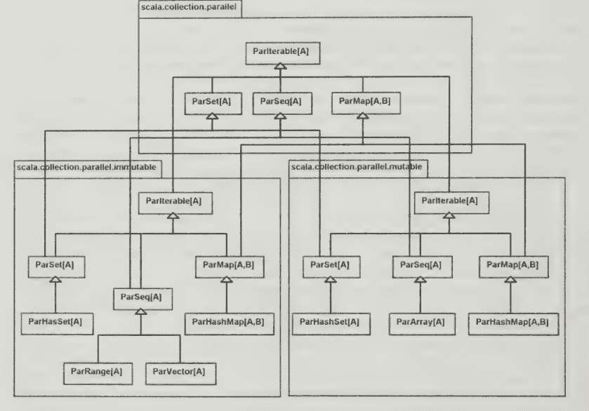

图 21.2：该 UML 图展示了三个不同并行集合包中的主要类型。

并行集合拥有你惯用的所有常规方法。因此，你可以使用 `BigInt` 通过以下代码编写阶乘的并行版本。

```
def parFact(n:BigInt) = (BigInt(1) to n).par.product
```

这个版本明显比我们之前编写的那些更短。更重要的是，如果你测试它，你会发现它更快且扩展性更好，因为它没有那么多本质上串行的代码。

对于并行集合，有一个非常重要的方法叫做 `aggregate`。在许多方面，你可以将这个方法视为 `fold` 或 `reduce` 方法的并行版本。你特别调用 `foldLeft`、`foldRight`、`reduceLeft` 或 `reduceRight` 这一事实表明这些操作本质上是串行的。并行版本必须能够以它想要的任何顺序遍历元素。不同的线程将同时遍历集合的不同部分。对于并行，有 `fold` 和 `reduce` 方法，它们以与顺序无关的方式执行这些操作。

在元素的处理顺序无关紧要的情况下，`reduce` 方法完全可以替代 `reduceLeft` 或 `reduceRight`。但 `fold` 并非如此。为了解原因，请比较 API 中 `ParIterable[T]` 的 `fold` 和 `foldLeft` 的签名。

```
def fold [U >: T] (z: U)(op: (U, U) U): U
def foldLeft [S] (z: S)(op: (S, T) S): S
```

`fold` 方法在可使用的类型上受到更多限制。`foldLeft` 可以产生你想要的任何类型，而 `fold` 必须产生一个集合所包含类型的超类型。这种限制的原因是，当并行执行 `fold` 时，一个线程可以对集合的一部分应用 `op`，而另一个线程同时对另一部分做同样的事情。为了得到最终答案，你必须能够合并两个线程的结果。只有在函数的两个参数与该函数的输出类型相同时，合并操作才能使用相同的函数。

`aggregate` 方法解决了这个缺陷，但这样做需要两个单独的操作符。以下是该方法的签名。

```
def aggregate [S] (z: S)(seqop: (S, T) S, combop: (S, S) S): S
```

`seqop` 等同于传递给 `foldLeft` 的 `op`。`combop` 用于合并处理不同部分的结果。任何时候，当你使用 `foldLeft` 或 `foldRight` 且结果类型与集合中存储的类型明显不同，并且处理顺序对获得正确答案不关键时，你可以改用 `aggregate`。

作为该方法的简单示例，考虑以下代码：它生成一个包含 1000 个随机双精度数的并行数组，然后使用 `aggregate` 查找最小值和最大值。

```
val data = ParArray.fill(1000)(math.random)
val (min,max) = data.aggregate((data(0),data(0)))(
  (mm,n) => (n min mm._1,n max mm._2),
  (mm1,mm2) => (mm1._1 min mm2._1,mm1._2 max mm2._2)
)
```

简单编写 `data.min` 和 `data.max` 会更短，但这两个调用中的每一个都必须遍历完整的数据集。这种方法只遍历一次数据就能同时找到最小值和最大值。考虑到创建元组的开销，它

# GPU

多核芯片并不是计算机硬件走向并行化的唯一例子。另一个重要趋势是使用图形处理单元（GPU）来帮助进行通用计算。这通常称为 GPGPU。高端 GPU 通常位于独立的显卡上，尽管主板上也有集成显卡，并且从 2010 年左右开始，将 GPU 元件蚀刻到与 CPU 相同的硅片上也变得更加普遍。

在显卡上进行通用计算的想法起初可能看起来很奇怪。要理解它为何有效，你需要了解一些显卡的工作原理。图形本质上涉及大量数学运算。早期的 GPU 专门用于执行图形所需的数学运算。它们以尽可能最快的方式完成这些运算，并且不遵循浮点数标准，因为老实说，要生成一幅大约 1000 像素宽的图像，你并不需要很多位的精度。

随着时间的推移，对更逼真图形能力的需求催生了像素着色器的诞生。这些着色器允许程序员编写有限的逻辑，这些逻辑可以针对图像或屏幕上的每个像素运行。这是与早期设计的一个重大决裂，因为它允许在 GPU 上进行真正的可编程逻辑运算。起初，这种逻辑仍然非常侧重于与图形相关的计算，但 GPU 能够极快地执行浮点数学运算这一事实促使人们尝试将像素着色器用于其他目的。

从那时起，GPU 变得更具灵活性和可编程性。对 GPGPU 的支持成为卖点，因此硬件制造商加入了适当的 IEEE 浮点算术。起初只有单精度，但后来也加入了双精度。这最终催生了专门为 GPGPU 构建的显卡。这些显卡拥有大量内存和一个或多个 GPU 芯片，但它们通常没有任何图形输出。它们的设计和销售目的仅仅是支持 GPGPU 风格的计算。

虽然多核芯片只有几个核心，并且有计划将其扩展到几十个甚至几百个，但 GPU 将支持数千或数万个线程。你必须将问题分解成大量小块才能让 GPU 保持忙碌。此外，GPU 上的线程不如 CPU 核心上的线程功能完备。通常，GPU 线程需要以组的形式运行，这些组都在对不同数据执行几乎相同的操作。

目前有两个主要接口支持 GPGPU 风格的编程：CUDA® 和 OpenCL®。CUDA 是 NVIDIA® 创建的 API，只能在 NVIDIA GPU 上运行。OpenCL，正如其名称所示，是一个开放标准，支持 GPU 和其他高线程数计算模型。目前，Scala 通过 ScalaCL 包提供了对 OpenCL 的初步支持。ScalaCL 在很大程度上通过一套增强的集合来工作，这些集合在 GPU 上分配工作，而不是像普通并行集合那样在多个核心上分配工作。

如果你主修计算机科学，GPGPU 可能是一个你应该关注的话题，而且所有迹象都表明，带有集成 GPU 的 CPU 将变得普遍。正如本章开头所示，不久之前大多数程序还不需要多线程，因为大多数计算机不需要多线程就能全速运行。类似的改变可能正在 GPU 和程序员中酝酿。

不同版本几乎完全相同，除了一个字符串和两个变量名。这种代码希望会让你觉得不太理想。这是一种代码重复的形式，往往会使代码变得脆弱且难以处理。在第 27 章中，我们将讨论与代码相关的“坏味道”。你完全可以说原始代码是“有坏味道的”。你在这里看到的是解决这个问题的一种方法。

基本问题是我们有七段几乎相同的代码。我们想要的是代码的一份副本，可以放入类似循环的结构中，该结构抽象出不同版本之间变化的部分。这回到了本书后半部分我们所强调的，将抽象作为工具来帮助你使程序更强大、更易于维护。在这种情况下，我们引入了一个包含三个元组的序列。元组中选择三个值是因为原始代码中有三个地方不同。第一个是描述属性名称的 `String`。第二个是使用该属性的值来初始化 `TextField` 的地方。第三个是当 `EditDone` 事件发生时设置属性的代码。这些成为元组的三个元素。元组的类型在声明处给出，这样我们就不必指定每个元组第三个元素中的参数 `s` 是 `String`。每个元组的第二个元素被赋予一个函数，而不是一个值，这样每当构建图形用户界面（GUI）时，它都会获取最新的值。

# 21.7 GUI 中的多线程

实际上，从第 11 章开始你就一直在编写多线程代码。这是因为包含 GUI 的代码本质上是多线程的。你可以通过以下代码演示这一点。

```
val frame = new swing.MainFrame {
  title = "Thread Demo"
  contents = swing.Button("Click Me")(println("Button Clicked"))
}
frame.visible = true
for(i <- 1 to 20) {
  println(i)
  Thread.sleep(1000)
}
```

这将创建一个带有单个按钮的小框架，你可以点击它。任何时候你点击按钮，它都会打印一条消息。在使框架可见后，主线程进入一个 for 循环，计数到二十，每个值之间间隔一秒。当你点击按钮时，消息会在数字之间打印。这是因为 GUI 中的事件处理在其自己的线程中完成。这个另一个线程，称为事件线程，负责处理 GUI 中发生的所有事件以及重绘屏幕上看到的内容。当我们调用 `repaint` 时，它实际上并不是在那个时候进行绘制。相反，它会在事件线程上调度一个事件，以便下次可以进行重绘时执行重绘。

单个线程负责处理所有事件和重绘这一事实意味着你必须小心在该线程中做什么，否则你可能会阻止 GUI 的所有响应。以下代码演示了这一点。

```
val frame = new swing.MainFrame {
  title = "Thread Blocking"
```


```
contents = swing.Button("Click Me")(Thread.sleep(10000))
}
frame.visible = true
readLine
```

如果你点击按钮，它会让事件线程在十秒内无法做其他任何事情。如果你运行这个程序，你可以点击按钮并看到效果。其中一个效果是按钮会“卡住”。更有趣的是，尝试关闭或调整窗口大小时会发生什么。关闭操作要等到十秒结束才会生效。在这段时间里，窗口也不会重绘。

要以更大规模看到同样的效果，将以下行添加到项目代码中 Commands 对象里的 commands map 中。

```
"freeze" -> ((rest,d) => Thread.sleep(rest.trim.toInt*1000))
```

现在你可以运行绘图程序，添加一个绘图，然后输入命令“freeze 10”。这样做之后，GUI 中你做的任何操作在十秒内都不会生效。这个命令在下一节中也很有用，可以用来观察阻塞事件线程如何影响 GUI 中的其他事情。

本章很大一部分都集中在与使用线程相关的挑战上。对于与 GUI 相关的线程，这些挑战依然存在。正如你刚才看到的，让事件线程忙碌太久会导致 GUI 无响应。让其他线程修改事件线程使用的可变数据也很危险，因为这会导致竞态条件。这种组合使得事情变得有点棘手，因为你需要让任何重要的工作负载在单独的线程中执行，但你不应该让那个其他线程修改用于绘制或事件处理的数值。相反，你应该让其他线程通过事件通知 GUI。这就是调用 repaint 时发生的情况。不是在发出调用的线程中执行绘制，而是触发一个事件告诉 GUI 进行绘制。

所有不同的 GUI 组件都是 Publishers，因此它们都有一个名为 publish 的方法，该方法接受一个事件。为了了解如何使用它，我们可以让 Drawing 中的命令处理在单独的线程中执行工作，并通过事件通知 GUI。考虑对 Drawing 中 commandField 声明的以下修改。

```
val commandField = new TextField() {
  listenTo(this)
  reactions += {
    case e:EditDone =>
      if(!text.isEmpty) {
        val t = text
        Actor.actor {
          publish(new ResultEvent(t,Commands(t,Drawing.this)))
        }
        text=""
      }
    case e:ResultEvent =>
      commandArea append "> "+e.text+"\n"+e.result+"\n"
  }
}
```

此代码使用 Actor.actor 在单独的线程中启动命令执行。命令完成后，结果会与执行的文本一起打包到 ResultEvent 中并发布。当接收到 ResultEvent 时，commandArea 会被更新。为使此功能正常工作，在 propertiesPanel 方法上方添加了以下 ResultEvent 的声明。

```
private class ResultEvent(val text:String,val result:Any) extends Event
```

使用 publish 并让 commandArea 的更改在事件线程中发生意味着，由 actor 创建的线程不会在重要时刻，例如重绘时，将 GUI 置于不一致的状态。

要真正看到此代码的影响，你需要运行 DrawingMain 并添加一个绘图，然后再次尝试使用“freeze”命令。你会发现 GUI 不再冻结。如果你执行“freeze 10”，你仍然可以使用 GUI，十秒内什么都不会发生。十秒结束时，输出区域会显示适当的反馈以表明命令已完成。你甚至可以在 freeze 命令正在执行时输入其他命令。如果其他命令在 freeze 时间结束前完成，它们的反馈会在输出面板中先于 freeze 的反馈出现。

线程对 GUI 重要的另一个地方是在动画期间。在第 12 章中，我们创建了一个 javax.swing.Timer 并为其提供了一个 ActionListener，这是在 GUI 中进行动画的最简单、最安全的方法。ActionListener 是 Java 事件处理库中的一种类型，因此此代码会在 GUI 事件线程中运行定时代码，不会引起任何线程问题。我们将在下一节中再次使用这种方法。

# 21.8 动画弹跳球（项目集成）

为了说明在绘图程序中使用 javax.swing.Timer，我们将制作一个新的 Drawable，在一个小盒子内显示弹跳的球。虽然此时并不是真正需要的，但我们还将使用并行集合功能让移动球的代码并行执行。以下是这个新类的代码。

```
package scalabook.drawing
```

```
import java.awt.{Graphics2D,Color}
import java.awt.geom._
import swing._
import event._
```

```
class DrawBouncingBalls(p:DrawTransform,drawing:Drawing) extends DrawLeaf {
  val parent = p
  private var propPanel:Component = null
  private var (minSize, maxSize) = (0.01, 0.05)
  private var balls = Vector.fill(20){
    val size = minSize+math.random*(maxSize-minSize)
    new Ball(size+math.random*(1-2*size),size+math.random*(1-2*size),
      (math.random-0.5)*0.02,(math.random-0.5)*0.02,size)
  }
}
```

```
private case class Ball(x:Double,y:Double,vx:Double,vy:Double,size:Double)
```

```
private val timer = new javax.swing.Timer(100,Swing.ActionListener(e => {
  balls = (for(Ball(x,y,vx,vy,s) <- balls par) yield {
```

用于运行一段代码。**Executors** 中有一些有用的方法可以提供 **ExecutorService** 对象，这些对象以通常有用的方式表现。许多方法允许重用线程，因为创建 **Thread** 对象有相当大的开销。

- **Callable** 类型允许你在 **ExecutorService** 上运行一个任务并返回一个值。提交此类任务时，你会得到一个 **Future** 对象，该对象会提供结果。
- 并发库还包括许多并行数据结构。
  * **CyclicBarrier** 和 **CountDownLatch** 类使多个线程在代码的某一点暂停，直到所有线程都到达该点变得容易。
  * **Exchanger** 可用于在特定点在线程之间传递值。
  * **BlockingQueue** 是一种数据结构，允许一组线程与另一组线程交换对象，并在没有空间放置某物或没有可用对象时阻塞。
  * **Semaphore** 提供了一种控制在任何给定时间有多少线程在代码的特定部分工作的机制。
- *java.util.concurrent.atomic* 包提供了基本类型的类，这些类型具有不可被中断的操作。这些通常比同步提供更简单、更高效的防止竞态条件的方法。
- *java.util.concurrent.locks* 包定义了可用于跨越单个方法调用或代码块的同步类型行为的锁。

- Scala 通过并行集合使某些类型的并行变得简单。这些集合具有自动在多个线程之间拆分工作的<|message|> 方法。对常规集合调用 **par** 会得到并行版本。对并行版本调用 **seq** 会得到回顺序版本。
- Scala 中还有另一个用于基于 Actor 的并行的并行库。对于我们的当前目的，它提供了使用 **Actor.actor** 和 **Futures.future** 创建线程的简便、Scala 风格的方法。

# 21.9.2 练习

- 1. 在关于并行阶乘和 Amdahl 定律的讨论中，我们得出结论，我们为扩展而编写的代码的主要限制是最终的乘积。使用 *java.util.concurrent* 中的技术，编写代码以使该操作并行发生。

- 2. 确保你理解并行的一种好方法是使用本章介绍的每种不同技术来实现许多不同的简单问题。应解决的问题列在下面。对于每个问题，尝试使用以下方法编写解决方案。
  * 普通的 *java.lang.Threads* 或调用 **Actor.actor** 并使用 **synchronized** 和 **wait/notifyAll**。
  * 来自 *java.util.concurrent* 的元素，例如 **ExecutorServices**、线程安全的数据结构和原子值。


+   Scala 并行集合。 （请注意，这并不足够灵活，无法处理所有问题，因此仅在适用的情况下使用。）

对于你编写的每个解决方案，你都应该进行计时测试，以了解在你可用的最高核心数机器上，不同解决方案的速度比较。对于速度比较，你还应考虑编写一个顺序版本。对于其中大多数要在并行情况下引起兴趣，输入需要相当大。

+   （a）在一个 Double 序列中找到最小值。

+   （b）给定一个 Seq[Int]，找到使以下函数返回最大值的数值。

```
def goldbach(num:Int):Int = {
  var ret = 0
  var n = num
  while(n>1) {
    n = if(n%2==1) 3*n-1 else n/2
    ret += 1
  }
  ret
}
```

+   （c）使用两个存储为 Array[Array[Double]] 的矩阵进行矩阵加法。

+   （d）使用两个存储为 Array[Array[Double]] 的矩阵进行矩阵乘法。

+   （e）在给定的 String 中查找子字符串的所有出现位置。

# 21.9.3 项目

不出所料，本章的所有项目都要求你在项目中添加多线程。如何做到这一点在很大程度上取决于项目。总体而言，值得注意的是这两个方面。首先，通常不能对屏幕进行多线程绘图。这是因为图形是由单个设备完成的。通常，即使你有单独的线程在单独的图像上执行单独的工作，对不同图像并行绘图也不会有帮助，因为对图像的绘图通常涉及图形卡上的图形管道，因此它是一个瓶颈。

另一个需要注意的事情是不要过度使用多线程。为每个线程创建许多线程而每个线程的工作量很小只会减慢程序速度。创建太多线程甚至可能消耗足够的资源使机器瘫痪。使用 Actor.actor 等东西很容易创建线程，但在你使用它时需要考虑自己在做什么。过度使用线程还可能导致极难调试的竞态条件。适当使用 java.util.concurrent 中的线程安全集合可以极大地帮助解决这个问题。

+   1. 文本冒险游戏通常在用户输入命令之前不会做任何事情。到目前为止你编写的代码可能也是如此。readLine 的调用是阻塞的，在此之前不会发生任何事情。MUD 的情况并非如此。首先，将会有多个玩家可能以不同的速率尝试做事情。此外，MUD 中的其他角色即使用户只是站在原地什么也不做也有能力四处走动。

现在你知道了如何多线程，你可以改变这种行为。你将让游戏的逻辑在一个线程中运行，而收集输入的任务发生在

# 第 22 章

# 流 I/O

+   22.1 The java.io Package ... 561
+   22.2 Streams for Files ... 562
+   22.3 Exceptions ... 564
+   22.3.1 try-catch-finally ... 565
+   22.3.2 Effect of Exceptions ... 567
+   22.3.3 Loan Pattern ... 567
+   22.4 Decorating Streams ... 568
+   22.4.1 Buffering ... 568
+   22.4.2 Binary Data ... 569
+   22.4.3 Serialization ... 572
+   22.4.3.1 Binary Serialization ... 572
+   22.4.3.2 XML Serialization ... 577
+   22.5 Saving Drawings (Project Integration) ... 578
+   22.6 End of Chapter Material ... 594
+   22.6.1 Summary of Concepts ... 594
+   22.6.2 Exercises ... 595
+   22.6.3 Projects ... 596

在第 9 章中，我们看到了如何使用 `scala.io.Source` 和 `java.util.Scanner` 从文件中读取。我们还看到了如何使用 `java.io.PrintWriter` 写入文件。在本章中，我们将探讨 `java.io` 包的整体结构，并了解流如何用于表示输入和输出的通用方法。这将在下一章为我们使用流进行网络通信做好准备。

### 22.1 The java.io Package

Java 中进行输入和输出的原始库是 `java.io` 包。虽然现在有 `java.nio` 包可以提供更高的性能，但原始库仍然用作 Java 库中许多其他部分的<|message|>


在 `while` 循环中调用，因为文件发生了某些变化。异常导致 `try` 块停止，控制跳转到 `catch` 中的相应 `case`。执行完该 `case` 中的代码后，程序会继续执行 `catch` 块之后的内容。这意味着 `try` 块中异常发生位置之后的代码永远不会被执行。这是个问题，因为该代码包含了关闭文件的操作。对于大型、长时间运行的程序而言，未关闭文件可能是一个严重问题，因为任何给定程序在特定时间只能打开有限数量的文件。

我们需要解决这个问题的方法是能够指定一段代码，无论 `try` 块中发生什么情况都会在之后运行。这就是使用 `finally` 块实现的。你可以在 `catch` 块之后或直接在 `try` 块之后放置 `finally` 块。为了解决我们的文件读取问题，可以使用以下代码。

```
import java.io._

try {
val fis = new FileInputStream(args(0))
try {
var byte = fis.read()
while(byte>=0) {
print(byte+" ")
byte = fis.read()
}
println()
} catch {
case ex:IOException =>
println("There was a problem working with the file.")
} finally {
fis.close()
}
} catch {
case ex:FileNotFoundException =>
println("The file "+args(0)+" could not be opened.")
}
```

这有一个包含所有内容的 `try` 块，内部还有另一个用于读取文件并带有用于关闭文件的 `finally` 的 `try` 块。这有点冗长。我们稍后会看到如何设置以避免重复。

与 Scala 中的几乎所有其他构造一样，`try-catch-finally` 也有值，可以用作表达式。如果 `try` 块执行时未抛出异常，则其值将是 `try` 块的值。如果抛出异常并被捕获，则整个表达式的值为该 `case` 的 `catch` 的值。`finally` 的任何值都会被忽略，因为 `finally` 通常用于清理，而不是正常计算的一部分。

`try` 块执行并抛出未被捕获的异常也是可能的。在这种情况下，整个 `try` 表达式的值为 `Nothing`。你可能还记得图 19.1 中的这个类型。它位于类型图的底部。`Nothing` 类型是所有其他类型的子类型。`Nothing` 没有实例。它主要由类型推断系统使用。当尝试推断具有多个可能返回值复杂表达式的类型时，Scala 会选择类型层次结构中最低的、是所有可能性超类型的类型。由于 `try` 可能抛出未被捕获的异常，因此它几乎总是可能产生 `Nothing`。`Nothing` 位于类型层次结构的底部这一事实意味着它不会影响推断的类型。

如果你将 `try-catch-finally` 用作表达式，你必须注意 `catch` 中每个不同 `case` 的最后一个表达式的类型。特别是，你可能做

缓冲类型实际上并不从任何特定源读取或向任何特定接收器写入。要使用缓冲类型之一，你需要为其提供一个用于提取数据的流或用于推送数据的流。执行此操作的语法可能如下所示。

```
`val bis = new BufferedInputStream(new FileInputStream(fileName))`
```

由于磁盘访问的延迟非常高，因此你应该始终用缓冲流包装文件流。对于大文件，这样做的速度提升可能非常显著。

# Latency and Bandwidth

要理解为什么读取/写入一大块数据比单独读取字节更好，你需要了解一些关于我们如何描述通信速度的知识。当我们谈论数据在计算机内部或计算机之间移动的速度有多快时，有两个重要值，延迟和带宽。大多数时候你听到人们提到带宽。这是在特定时间内可以移动多少数据。带宽通常在每秒几 Mb 到几 Gb 的范围内。$^{2}$

带宽值仅在通信块的中间才相关。每次新的通信开始时，都会有一个称为延迟的暂停。读取 N 位块所需的时间大致为 time = $latency + N/bandwidth$。如果你以一个字节/八位为增量读取数据，第二项很小，你几乎所有时间都在等待延迟。读取更大的块可以最大限度地减少延迟开销，使实际速度更接近完整带宽。

### 22.4.2 Binary Data

标准 InputStream 和 OutputStream 的另一个缺点是它们仅使用字节工作。几乎所有应用程序都需要以某种更复杂的格式处理数据。我们已经看到如何使用纯文本文件和使用 XML 来做到这一点。当我们在第 14 章介绍 XML 时，我们研究了纯文本文件的几个缺点。XML 格式在文件中放置了更多信息，以便任何人都可以拿起它并有机会弄清楚其中包含的内容。它还增加了灵活性。XML 并未解决速度和占用大量内存的问题。如果有的话，它使这些问题更糟。为了获得速度并使用少量空间，我们必须牺牲 XML 的好处，并以与计算机内存中存储方式匹配的格式写入数据。我们需要以二进制格式存储数据。

读取/写入二进制格式数据的第一种方式是使用 DataInputStream 和 DataOutputStream。这些类型被包装在其他流周围，如 BufferedInputStream 和 BufferedOutputStream。它们提供给我们的是额外的一组方法。对于 DataInputStream，这些方法包括以下内容。

- readBoolean():Boolean  
- readByte():Byte  
- readChar():Char  
- readDouble():Double  
- readFloat():Float  
- readInt():Int

> $^{2}$这些是每秒兆位和每秒千兆位的缩写。

```
readLong() : Long
readShort() : Short
readUTF() : String
```

每个方法都从被包装的流中读取指定的数据值。DataOutputStream 具有匹配的用于写入数据的方法。它还具有一些额外的方法，可以以其他方式写入字符串。

```
writeBoolean(v: Boolean) : Unit
writeByte(v: Int) : Unit
writeBytes(s: String) : Unit
writeChar(v: Int) : Unit
writeChars(s: String) : Unit
writeDouble(v: Double) : Unit
writeFloat(v: Float) : Unit
writeInt(v: Int) : Unit
writeLong(v: Long) : Unit
writeShort(v: Int) : Unit
writeUTF(str: String) : Unit
```

这些方法的组合使你能够将数据写入文件并读回。

如果你正在处理二进制数据的<|message|> 文件，出于性能原因，你仍然需要缓冲。`java.io` 流库的工作方式的美妙之处在于你可以按需装饰流。在这种情况下，你希望将数据流包装在缓冲流周围，缓冲流包装在文件流周围。代码如下所示。

```
val dis = new DataInputStream(new BufferedInputStream(new FileInputStream(file)))
```

顺序在这里很重要，主要是因为我们想要调用的方法是 `DataInputStream` 的一部分。一般规则是，最外层的类型需要具有你想要调用的方法。介于其与实际源/接收器流之间的那些应该以改变的方式实现基本方法，例如缓冲。它们应按对应用程序有意义的顺序堆叠。

使用二进制数据文件的挑战在于它们不能使用任何标准程序轻松编辑。要理解这一点，请考虑以下代码。

```
import java.io._

def withDOS[A](fileName: String)(body: DataOutputStream => A) : A = {
val dos = new DataOutputStream(new BufferedOutputStream(new
FileOutputStream(fileName)))
try {
body(dos)
} finally {
dos.close()
}
}

def withDIS[A](fileName: String)(body: DataInputStream => A) : A = {
val dis = new DataInputStream(new BufferedInputStream(new
FileInputStream(fileName)))
try {
body(dis)
```


```
} finally {
    dis.close()
}
}
```

```
def writeDoubleArray(fileName:String,data:Array[Double]) {
  withDOS(fileName)(dos => {
    dos.writeInt(data.size)
    data.foreach(x => dos.writeDouble(x))
  })
}
```

```
def readDoubleArray(fileName:String):Array[Double] = {
  withDIS(fileName)(dis => {
    Array.fill(dis.readInt)(dis.readDouble)
  })
}
```

这段代码包含两个函数，可用于一般性地操作 DataOutputStreams 和 DataInputStreams。在应用程序中，这些方法最好放在包含多个此类实用方法的对象中。接下来的两个方法使用前两个方法，并写入或读回一个 Double 数组。如果你将它加载到 REPL 中，可以用以下方式进行测试。

```
scala> writeDoubleArray("data.bin",Array.fill(10)(math.random))
```

```
scala> readDoubleArray("data.bin")
res3: Array[Double] = Array(0.6609985904587437, 0.49319578039338174,
0.5859229163803784, 0.965200016272522, 0.4832664731158809, 0.7969665973550756,
0.7572733105097633, 0.1578906904549643, 0.08416227543386434,
0.6824199253206102)
```

完成此操作后，你应该去查看 "data.txt" 文件的内容。使用 less、cat 或 vi 查看时，你会发现内容看起来像随机的垃圾字符。如果你使用 vi 编辑该文件，然后尝试用 readDoubleArray 读入，数据几乎肯定会被弄乱，如果能读入的话。

查看 "data.bin" 这类文件的问题在于，普通字符只占每个字节可能取值的一小部分。二进制数据往往使用所有可能的值，包括许多不可打印的值。有像 hexdump 和 xxd 这样的命令行工具可以用来查看二进制文件。以下显示了 xxd 的输出。

```
> xxd data.bin
0000000: 0000 000a 3fe5 26e6 8417 1dea 3fdf 9085 ....?.&....?...
0000010: 08d4 253c 3fe2 bfe1 6a7a 94d5 3fee e2eb .%<?...jz..?...
0000020: 24ff a71e 3fde edd6 8052 4d5c 3fe9 8024 $...?...RM\?..$
0000030: 17f4 9f55 3fe8 3b95 3cd8 bd20 3f c4 35c3 ...U?.;.<.. ?.5.
0000040: 1bec 683c 3fb5 8ba8 ac8b 9ec8 3fe5 d662 ..h<......?...b
0000050: 4fac 814c           0..L
```

第一列显示文件中的位置。接下来八列显示文件内容的十六进制值。因为 256 = 16²，所以每个字节用两个字符表示。因此每一行显示 16 个字节。最后一列显示 ASCII 字符，任何不可打印的字符显示为点。xxd 工具还执行反向编码。你可以

让它输出到一个文件，编辑该文件的十六进制部分，然后运行反向编码以得到回二进制文件。执行此操作有点精细，因为很容易弄乱。

# Big Endian vs. Little Endian

由 DataOutputStream 产生的文件中的数据可能与你计算机内存中的数据并不完全匹配，因为 Java 库以平台无关的方式写入数据。第 3 章中关于二进制数据的讨论是对二进制算术的一般准确描述，并且在字节级别上是完全正确的。然而，当计算机制造商开始为更大的组如 Int 或 Double 在内存中布局字节时，不同的制造商选择了不同的顺序。对于 x86 芯片，Intel 将最低有效字节放在最前面。这种顺序称为 Little Endian。大多数其他芯片制造商使用相反的顺序，称为 Big Endian。Big Endian 和 Little Endian 的术语源自《格列佛游记》，其中小人国为煮鸡蛋时应从哪一端敲开而进行了一场激烈的战争。

仔细查看上面的十六进制转储，你可以看到 Java 以 Big Endian 顺序写入文件。你可以判断这一点，因为我们知道文件中的第一项是 Int 值 10。Int 存储在四个字节中，因此十六进制为八个字符 "0000000a"。如果文件使用 Little Endian 写入，这将是 "0a000000"。Java 即使在你的计算机上不可避免地不使用该格式时仍使用此格式的原因，与 Sun® 创建 Java 时拥有自己的 Big Endian SPARC® 架构必然相关。

# 22.4.3 Serialization

当你将数据保存到文件时，通常希望写入整个对象。将对象转换为以后可以写出并读回的某种格式的过程称为序列化。Java 和许多其他现代平台都有内置的序列化方法。Java 序列化方法使用二进制输出格式。你也可以编写自己的代码以其他格式序列化对象。XML 恰好是一个有用的序列化格式。我们将分别讨论这些。

### 22.4.3.1 Binary Serialization

Java 平台具有一种相当强大的序列化形式，已内置于系统中。其他系统有不同的支持方式。要使 Scala 中的类型可序列化，请让它继承自 Serializable。³ 你希望事物可序列化的原因是它们可以与 ObjectInputStream 和 ObjectOutputStream 一起使用。这些类型具有与 DataInputStream 和 DataOutputStream 相同的方法，外加 readObject():AnyRef 和 writeObject(obj:AnyRef):Unit，分别。

为了说明这一点，请考虑以下包含可序列化类以及一些将实例写入文件或从文件读入并打印的代码的小型应用程序。

³ case 类自动继承自 Serializable。

```
import java.io._

class Student(val name:String, val grades:Array[Int]) extends Serializable

object Main {
	def main(args:Array[String]) {
		args(0) match {
			case "-r" =>
				val ois = new ObjectInputStream(new BufferedInputStream(new
						FileInputStream(args(1))))
				ois.readObject() match {
					case s:Student => println(s.name+" "+s.grades.mkString(",", ","))
					case _ => println("Unidentified type.")
				}
				ois.close()
			case "-w" =>
				val oos = new ObjectOutputStream(new BufferedOutputStream(new
						FileOutputStream(args(1))))
				val s = new Student(args(2), args.drop(3).map(_.toInt))
				oos.writeObject(s)
				oos.close()
			case _ =>
				println("Usage: -r filename | -w filename name g1 g2 ...")
		}
	}
}
```

将此放入文件中并使用 scalac 编译它。从命令行你可以使用以下命令调用此第一步。<sup>4</sup>

```
scala Main -w obj.bin John 98 78 88 93 100 83
```

运行后将有一个名为 “obj.bin” 的文件。你可以用 cat 或 xxd 查看它。你会看到这显然是一个二进制文件，但其中有一些人类可读的字符串部分。其中一个是名称本身，但还有其他部分给出了类型名称，如 Student 和 java/lang/String。这些必须在文件中，因为当你 *反序列化* 文件时，它必须知道要创建什么类型的对象。你可以用以下命令验证此过程是否有效。

```
scala Main -r obj.bin
```

这将读回你刚刚创建的文件并打印读取的 Student 对象。

关于 -r 选项代码的一个关键方面需要注意的是，它包含了一个 match。如果你省略 match 并将 ois.readObject() 的结果赋给一个变量，该变量的类型将是 AnyRef。这是因为 readObject 的返回类型是 AnyRef。你将无法从 AnyRef 获取 name 或 grades，因为该类型没有这些。match 允许你检查读取对象的类型，并在它是 Student 时执行我们想要的打印语句，如果不是则打印错误消息。<sup>5</sup>

当对象被序列化时，会写入其类型的一些指示，后跟

> 4你也可以在 Eclipse 中执行此操作。你需要打开运行设置并更改参数。在终端中使用命令行参数更容易。如果你想在 Eclipse 中测试，可以考虑将 args 改为使用标准输入和输出。

> 5这种类型的操作也可以使用 isInstanceOf[A] 和 asInstanceOf[A] 方法完成。然而，在 Scala 中强烈不鼓励使用这些方法。使用 match 是确定对象类型并获取正确类型对象引用的适当 Scala 风格。


序列化其内容。这只有在所有内容都是可序列化的情况下才有效。如果你尝试在这里运行这段代码，你会发现它会抛出一个异常。

```
import java.io._

class OtherData(val id:String,val course:String)
class Student(val name:String,val grades:Array[Int],val od:OtherData) extends Serializable

object Main {
    def main(args:Array[String]) {
        val oos = new ObjectOutputStream(new FileOutputStream("fail.bin"))
        val s = new Student("John",Array(98,90),new OtherData("0123","CS2"))
        oos.writeObject(s)
        oos.close()
    }
}
```

异常的详细信息如下所示。

```
java.io.NotSerializableException: OtherData
```

这段代码的问题在于 od:OtherData 是 Student 的一个成员，但它不可序列化。因此，当序列化过程处理到 od 成员时，它就会失败。在这种情况下，只需让 OtherData 扩展 Serializable 就能很容易地修复它。在其他情况下你可能无法控制这种类型，因为你处理的可能是由其他人编写的类型，并且不可序列化。

处理不可序列化信息的一种方法是简单地不将其写入。还有其他情况下这种方法也是有效的。例如，DrawRectangle 类型保存 propPanel 变量，这样用户每次查看设置时就不会每次都新建一个图形用户界面（GUI）组件。然而，如果你保存一个 DrawRectangle，就没有必要保存与 GUI 组件相关联的所有信息。这些信息可以从其他信息中轻松重建。为了在 Scala 中实现这一点，我们使用一个注解。

注解由一个普通的名称指定，该名称前面有一个 @。注解为程序提供元信息。也就是说，这些信息供更高级别的工具使用，并不是真正属于正常程序代码的一部分。Scala 编译器的一部分是一些标准注解。你可以在 API 中通过它们以小写字母开头来识别它们。与序列化相关的两个注解是 @transient 和 @SerialVersionUID。如果你有一个类中的成员不想被序列化，只需用 @transient 对其进行注解。这里我们有这段代码已经这样做了 od。

```
import java.io._

class OtherData(val id:String,val course:String)
class Student(val name:String,
              val grades:Array[Int],
              @transient val od:OtherData) extends Serializable

object Main {
    def main(args:Array[String]) {
        val oos = new ObjectOutputStream(new FileOutputStream("pass.bin"))
        val s = new Student("John",Array(98,90),new OtherData("0123","CS2"))
```

```
oos.writeObject(s)
oos.close()

val ois = new ObjectInputStream(new FileInputStream("pass.bin"))
ois.readObject() match {
  case s2:Student => println(s2.name+" "+s2.grades+" "+s2.od)
  case _ => println("Unknown type read.")
}
ois.close()
}
```

这段代码还将对象读回并打印不同的字段。这是为了说明当你读取一个具有 transient 字段的序列化对象时会发生什么。那个字段不是序列化的一部分，所以当对象被读回时，该字段会被赋予默认值。对于 AnyRef 的任何子类型，默认值都是 null。运行这段代码会显示你，最后打印的值确实是 null。

另一个注解 @SerialVersionUID 用于为类型附加版本号。这样做是为了当你加载回一个对象时，可以将保存版本的版本号与加载版本的版本号进行比较，以确保它们相同。Java 会自动为你生成这些，但它们几乎每次类型代码更改时都会改变。这会导致保存的文件损坏，即使它们仍然可以正常工作。为了防止这种情况，你可以考虑在类型声明之前放置此注解，后跟一个数字 ID 的参数。

这对你的编程的含义是，任何 transient 的东西通常必须是一个 var 而不是一个 val。这是因为当你反序列化这样的对象时，该成员将具有一个默认值，而该默认值几乎肯定需要被更改。另一方面，使用任何 transient 成员的地方可能需要有条件代码来在它们未正确设置时初始化值。这正是我们在所做的 Drawable 类型中对 propPanel 所做的。如果该字段被频繁访问，你应该考虑使用一个仅通过方法访问的私有局部 var。这里是遵循该规则的 Student 的一个替代版本。

```
class Student(val name:String,
    val grades:Array[Int],
    @transient private var lod:OtherData) extends Serializable {
  assert(lod!=null)
  def od : OtherData = {
    if(lod==null) {
      lod = new OtherData("012345","Default")
    }
    lod
  }
}
```

你可以用代码中的这个版本替换它，你就不会在打印输出中得到 null 了。这是因为现在对 s2.od 的引用是对将会在成员 lod 未被分配时创建一个默认值的方法的调用。

# 自定义序列化

默认序列化在许多情况下都很棒。然而，对于某些类型来说，它可能非常低效。此外，可能存在你确实需要为成员存储信息的情况，即使它不可序列化。出于这个原因，可以覆盖默认实现并使用自己的自定义序列化。

要覆盖默认实现，你实现私有方法 writeObjects(oos:ObjectOutputStream) 和 readObjects(ois:ObjectInputStream)。在这两个方法中你首先要做的是分别调用 oos.defaultWriteObject() 和 ois.defaultReadObject()。这将写入或读入应属于默认序列化的一部分的所有信息。即使没有要序列化的字段，你仍然需要调用它。之后你写入或从流中读取。这里是 Student 使用这种方法的示例。

```
class Student(val name:String,
    val grades:Array[Int],
    @transient private var lod:OtherData) extends Serializable {
  assert(lod!=null)
  def od = lod
  private def writeObject(oos:ObjectOutputStream) {
    oos.defaultWriteObject()
    oos.writeUTF(od.id)
    oos.writeUTF(od.course)
  }
  private def readObject(ois:ObjectInputStream) {
    ois.defaultReadObject()
    lod = new OtherData(ois.readUTF,ois.readUTF)
  }
}
```

lod 成员仍然是一个私有 var。它必须是私有的，因为它是一个 var。它必须是一个 var，因为 readObject 中的行对其进行了赋值。外部代码通过 od 方法访问该值。请注意，在这种情况下该方法更简单，因为它不需要检查 lod 的值。

这可能看起来像一个愚蠢的例子，但找到自定义序列化的实际用途并不难。碰巧 java.awt.image.BufferedImage 类我们在第 12 章中介绍过，它不可序列化。这种类型使用得相当频繁，你可能会发现如果它能用对象写入会很有帮助。以下演示了你如何做到这一点。

```
class Painting(val name:String,
    // ...
    @transient private var lImg:BufferedImage) extends Serializable {
  assert(lImg!=null)
  def img = lImg
  private def writeObject(oos:ObjectOutputStream) {
    oos.defaultWriteObject()
    oos.writeInt(img.getWidth)
    oos.writeInt(img.getHeight)
    oos.writeInt(img.getType)
    for(i <- 0 until img.getWidth; j <- 0 until img.getHeight) {
      oos.writeInt(img.getRGB(i,j))
```

```
}
}
private def readObject(ois:ObjectInputStream) {
  ois.defaultReadObject()
  val (w,h,t) = (ois.readInt(),ois.readInt(),ois.readInt())
  lImg = new BufferedImage(w,h,t)
  for(i <- 0 until w; j <- 0 until h) {
    lImg.setRGB(i,j,ois.readInt())
  }
}
}
```

这段代码首先写入图像的宽度、高度和类型，然后跟随所有红、绿、蓝（RGB）像素值。当读取回一个对象时，首先读取前三个值，然后创建图像，然后读取图像的其余部分。

# 22.4.3.2 XML 序列化

Java 的默认序列化带有二进制格式的标准优点和限制。此外，它仅适用于在 Java 虚拟机（JVM）下运行的程序。这不仅包括 Java 和 Scala，还包括许多其他语言。它不包括所有语言。C 和 C++ 是没有 JVM 实现的语言的典型代表。还有一些情况，你不需要二进制格式的好处，而更希望 XML 的可移植性和可读性。

没有内置的方法将对象转换为 XML 或将其取回，但你可以相当容易地将这种功能添加到自己的代码中。为此，我们将对我们想要能够序列化的每个类遵循三条相当简单的规则。

- 在类中放置一个 toXML : scala.xml.Node 方法，该方法返回一个包含你想要为这些对象保存的所有信息的 XML 元素。
- 包含一个伴生对象，其中有一个 apply(node:scala.xml.Node) : Type 方法，该方法反序列化 XML 节点并返回你创建的类型的一个对象。
- 使所有被序列化的字段都成为类的参数。

如果你在类型中始终如一地这样做，当一个类型包含对另一个类型的引用时，你可以简单地在该类型上调用 toXML。⁶ 你可以使用 scala.xml.XML 中的常规方法从文件读取 XML 或将其写回文件。

# 压缩流

如果你在计算机上花费了大量时间或从互联网下载文件，很可能在某个时候你遇到过 ZIP 文件。Windows® 中的压缩文件使用这种格式。它允许你将许多文件组合成一个，并且对于某些文件，特别是存储文本数据的文件，它使它们变得更小


```
private def saveBinary {
    withSaveFile(file => {
        val oos = new ObjectOutputStream(new BufferedOutputStream(new
            FileOutputStream(file)))
        withOutputStream(oos)(strm => {
            serializeDrawingToStream(strm,file.getName())
        })
    })
}
```

```
private def saveZip {
    withSaveFile(file => {
        val zos = new ZipOutputStream(new BufferedOutputStream(new
            FileOutputStream(file)))
        zos.putNextEntry(new ZipEntry(file.getName().dropRight(3)+"bin"))
        val oos = new ObjectOutputStream(zos)
        withOutputStream(oos)(strm => {
            serializeDrawingToStream(strm,file.getName())
        })
    })
}
```

`withSaveFile` 方法打开一个对话框并允许用户选择文件，然后在该文件上执行传递的函数。`withOutputStream` 将 try/finally 代码分离出来以确保流被关闭。7 最后，`serializeDrawingToStream` 方法接收一个 `ObjectOutputStream` 和文件的名称，然后将当前绘图序列化到该流中并将选项卡上的文本更改为文件名。

我们可以使用以下代码在 `saveXML` 方法中重用 `withSaveFile` 方法。

```
private def saveXML {
    withSaveFile(file => {
        val drawing = openDrawings(tabbedPane.selection.index)
        xml.XML.save(file.getAbsolutePath(),drawing.toXML)
        tabbedPane.selection.page.title = file.getName()
    })
}
```

为了使此代码编译，你必须向 `Drawing` 类添加一个 `toXML : xml.Node` 方法。此时，该函数只需返回 `<drawing></drawing>`。

`load` 方法稍长，因为它可以根据扩展名处理三种类型的文件中的任何一种。对于应用程序来说，加载和保存选项保持对称会是更好的整体设计，但在这种情况下混合它们使我们能够演示如何使用一个菜单选项或多个菜单选项来完成。这牺牲了适当的 UI 设计以服务于其他教学目的。

```
private def load {
    val chooser = new FileChooser()
    if(chooser.showSaveDialog(tabbedPane)==FileChooser.Result.Approve) {
        if(chooser.selectedFile.getName().endsWith(".bin")) {
```

7 对象流的工作方式使得你需要关闭对象流，而不是它所包装的流之一，例如文件流。

```
oos.writeObject(drawing)
tabbedPane.selection.page.title = name
}

private def withSaveFile(body: File=>Unit) {
  val chooser = new FileChooser
  if(chooser.showSaveDialog(tabbedPane)==FileChooser.Result.Approve) {
    try {
      body(chooser.selectedFile)
    } catch {
      case ex:FileNotFoundException => ex.printStackTrace()
      case ex:IOException => ex.printStackTrace()
    }
  }
}

private def saveBinary {
  withSaveFile(file => {
    val oos = new ObjectOutputStream(new BufferedOutputStream(new
      FileOutputStream(file)))
    withOutputStream(oos)(strm => {
      serializeDrawingToStream(strm,file.getName())
    })
  })
}

private def saveZip {
  withSaveFile(file => {
    val zos = new ZipOutputStream(new BufferedOutputStream(new
      FileOutputStream(file)))
    zos.putNextEntry(new ZipEntry(file.getName().dropRight(3)+"bin"))
    val oos = new ObjectOutputStream(zos)
    withOutputStream(oos)(strm => {
      serializeDrawingToStream(strm,file.getName())
    })
  })
}

private def saveXML {
  withSaveFile(file => {
    val drawing = openDrawings(tabbedPane.selection.index)
    xml.XML.save(file.getAbsolutePath(),drawing.toXML)
    tabbedPane.selection.page.title = file.getName()
  })
}

private def withInputStream[A,B <: InputStream](is:B)(body:B=>A):A = {
  try {
    body(is)
  } finally {
    is.close()
  }
}

private def deserializeDrawingFromStream(ois:ObjectInputStream,name:String) {
```

```
val obj = ois.readObject()
obj match {
  case nd : Drawing =>
    openDrawings += nd
    tabbedPane.pages += new TabbedPane.Page(name, nd.propertiesPanel)
  case _ =>
}
}

private def load {
  val chooser = new FileChooser()
  if(chooser.showSaveDialog(tabbedPane)==FileChooser.Result.Approve) {
    if(chooser.selectedFile.getName().endsWith(".bin")) {
      val ois = new ObjectInputStream(new BufferedInputStream(new
        FileInputStream(chooser.selectedFile)))
      withInputStream(ois)(strm => {
        deserializeDrawingFromStream(strm, chooser.selectedFile.getName())
      })
    } else if(chooser.selectedFile.getName().endsWith(".zip")) {
      val zis = new ZipInputStream(new BufferedInputStream(new
        FileInputStream(chooser.selectedFile)))
      zis.getNextEntry
      val ois = new ObjectInputStream(zis)
      withInputStream(ois)(strm => {
        deserializeDrawingFromStream(strm, chooser.selectedFile.getName())
      })
    } else if(chooser.selectedFile.getName().endsWith(".xml")) {
      val nd = Drawing(xml.XML.loadFile(chooser.selectedFile))
      openDrawings += nd
      tabbedPane.pages += new
        TabbedPane.Page(chooser.selectedFile.getName(), nd.propertiesPanel)
    }
  }
}

private val frame = new MainFrame {
  contents = tabbedPane
  menuBar = new MenuBar {
    contents += new Menu("File") {
      contents += new MenuItem(Action("New")(newDrawing))
      contents += new MenuItem(Action("Save Binary")(saveBinary))
      contents += new MenuItem(Action("Save Zip")(saveZip))
      contents += new MenuItem(Action("Save XML")(saveXML))
      contents += new MenuItem(Action("Load Drawing")(load))
      contents += new Separator()
      contents += new MenuItem(Action("Exit")(sys.exit(0)))
    }
  }
  size = new Dimension(800,600)
}

def main(args : Array[String]) : Unit = {
  frame.visible=true
}
}
```

`withInputStream` 和 `withOutputStream` 方法是柯里化的，以便于类型推断。如果没有柯里化，就需要在传递进来的函数中为 `strm` 参数指定类型。

此代码中的错误处理最多只能算作最小化。在代码中打印堆栈跟踪对程序员来说非常有帮助。然而，它对用户没有任何说明。对于像这样基于 GUI 的应用程序，用户甚至可能看不到会打印堆栈跟踪的控制台。此代码应弹出一个窗口让用户知道发生了什么。这里为了不使代码臃肿而省略了它，并留给读者作为练习。

如果你现在尝试运行此代码，没有任何选项会真正起作用。为了使它们工作，我们必须修改 `Drawing` 和 `Drawable` 层次结构以支持默认和 XML 序列化。我们将从 `Drawing` 开始，因为我们实际序列化的是它。对于默认序列化，这意味着 `Drawing` 类需要扩展 `Serializable`，并且不应保存的成员应设为 transient。此外，代码需要被修改，以便在反序列化时 transient 字段的值为 null 时不会引起问题。

对于基于 XML 的序列化，这意味着实现 `toXML` 方法以将我们想要保存的任何值放入 XML 元素中，并在伴生对象中实现反序列化的 apply 方法。为了使它工作，被保存的值也应被移上去作为类的参数。对 `Drawing` 进行此操作后，我们得到的代码如下所示。

```
package scalabook.drawing

import swing._
import event._
import javax.swing.event._
import actors.Actor

/**
 * This type represents a Drawing that you can have open in the program.
 */
class Drawing(private val root:DrawTransform) extends Serializable {
@transient private var lDrawPanel = new DrawPanel
@transient private var propPanel:Component = null
@transient private var lTree = new javax.swing.JTree(root)

root.drawing=this

private def drawPanel = {
if(lDrawPanel==null) lDrawPanel = new DrawPanel
lDrawPanel
}

private def tree = {
if(lTree==null) lTree = new javax.swing.JTree(root)
lTree
}

private[drawing] def refresh { drawPanel.repaint() }

private class ResultEvent(val text:String,val result:Any) extends Event
/**
```


```
/**
 * Returns a panel that displays the properties for this drawing.
 * @return a Component that can be put into a GUI.
 */
def propertiesPanel = {
  if(propPanel == null) {
    val commandArea = new TextArea()
    commandArea.editable = false
    val commandField = new TextField() {
      listenTo(this)
      reactions += {
        case e:EditDone =>
          if(!text.isEmpty) {
            val t = text
            Actor.actor {
              publish(new ResultEvent(t,Commands(t,Drawing.this)))
            }
          }
          text=""
        }
        case e:ResultEvent =>
          commandArea append " "+e.text+"\n"+e.result+"\n"
      }
    }
    val commandPanel = new BorderPanel {
      layout += commandField -> BorderPanel.Position.North
      layout += new ScrollPane(commandArea) -> BorderPanel.Position.Center
      preferredSize = new Dimension(500,200)
    }
  }

  val drawProps = new GridPanel(1,1)

  propPanel = new DrawingPane(new SplitPane(Orientation.Vertical,
    new GridPanel(2,1) {
      contents += new BorderPanel {
        layout += new GridPanel(1,2) {
          contents += Button("Add"){ executeOnSelection(d => addTo(root))}
        }
        contents += Button("Remove"){ executeOnSelection(d => remove(d)) }
      } -> BorderPanel.Position.North
      layout+= new ScrollPane(new Component {
        override lazy val peer = tree
        tree.addTreeSelectionListener(new TreeSelectionListener {
          def valueChanged(e:TreeSelectionEvent) {
            executeOnSelection(d => {
              drawProps.contents.clear()
              drawProps.contents += d.propertiesPanel
              drawProps.revalidate
              drawProps.repaint
            })
          }
        })
      }
    )
  ) -> BorderPanel.Position.Center
```

```
}
contents += new ScrollPane(drawProps)
},new SplitPane(Orientation.Horizontal,
new ScrollPane(drawPanel),
commandPanel)
)
}
propPanel
}

def toXML : xml.Node =
<drawing>
{root.toXML}
</drawing>

private def executeOnSelection(f: Drawable=>Unit,default: =>Unit = {}) {
val path = tree.getSelectionPath
if(path!=null) {
val last = path.getLastPathComponent match {
case drawable:Drawable if(drawable!=null)=>
f(drawable)
case _ =>
}
} else default
}
```

```
private def add(d:Drawable) = {
assert(d!=null)
val parent = d match {
case dt:DrawTransform => dt
case _ => d.getParent
}
val options = Array[(String, ()=>Drawable)](
("Bouncing Balls", () => DrawBouncingBalls(parent)),
("Ellipse", () => new DrawEllipse(parent)),
("Mandelbrot", () => new DrawMandelbrot(parent)),
("Rectangle", () => new DrawRectangle(parent)),
("Transform", () => new DrawTransform(parent))
).toMap
val choice = Dialog.showInput(propPanel,
"What do you want to add?", "Draw Type", Dialog.Message.Question,
null,options.keys.toSeq,options.keys.head)
choice match {
case Some(ch) =>
val newChild = options(ch)()
parent.addChild(newChild)
drawPanel.repaint
tree.getModel match {
case m:javax.swing.tree.DefaultTreeModel => m.reload
case _ =>
}
case _ =>
}
```

```
private def remove(d:Drawable) {
  assert(d!=null)
  if(d.getParent!=null) {
    d.getParent.removeChild(d)
    drawPanel.repaint
    tree.getModel match {
      case m:javax.swing.tree.DefaultTreeModel => m.reload
      case _ =>
    }
  }
}
```

```
private class DrawPanel extends Panel {
  override def paint(g:Graphics2D) {
    g.setPaint(java.awt.Color.white)
    g.fillRect(0,0,size.width,size.height)
    root.draw(g)
  }
}
```

```
class DrawingPane(c:Component) extends GridPanel(1,1) {
  contents += c
  def drawing = Drawing.this
}
```

```
object Drawing {
  def apply(data:xml.Node):Drawing = {
    new Drawing(DrawTransform(null,(data \ "drawTransform")(0)))
  }

  def apply():Drawing = {
    new Drawing(new DrawTransform(null))
  }
}
```

主要改动在开头和结尾。为了使此代码能够编译，你必须为 DrawTransform 添加一个 toXML 方法以及一个带有 apply 方法的伴生对象。这里还有一些其他更改是必需的，因为我们稍后会遇到一些改动。

由于 DrawTransform 是继承层次结构的一部分，再加上默认序列化是通过继承完成的，因此我们希望从顶部开始。所以在查看 DrawTransform 之前，我们将先查看 Drawable。以下是该 trait 的代码。

```
package scalabook.drawing

import java.awt.Graphics2D
import javax.swing.tree.TreeNode

/**
 * This represents the supertype for all the different types that can appear in
   our drawing.
 */
trait Drawable extends TreeNode with Serializable {
```

```
/**
 * Stores the Drawing this Drawable is part of.
 */
@transient protected var lDrawing:Drawing = null

/**
 * Causes this object to be drawn to g.
 *
 * @param g a Graphics2D object to draw to.
 */
def draw(g : Graphics2D) : Unit

/**
 * Gives back a GUI component that allows the user to change drawing properties.
 *
 * @return A component that should be put in the GUI so the user can edit this object.
 */
def propertiesPanel() : scala.swing.Component

/**
 * Return an XML serialization of this object.
 */
def toXML : xml.Node

/**
 * Make it so that the getParent inherited from TreeNode returns a DrawTransform.
 */
override def getParent : DrawTransform

/**
 * Returns the drawing this Drawable is part of.
 */
def drawing = lDrawing

/**
 * Sets the Drawing this is part of. Implementations in subtypes
 * should recursively descend through Drawables.
 */
def drawing_=(d:Drawing):Unit
}
```

我们已将 Serializable 添加到被继承的类型列表中，并加入了一个抽象的 toXML 方法。前者现在使所有子类型都可序列化。后者将迫使我们在子类型中放入具体的 toXML 方法。对于子类型，我们需要使适当的数值变为 transient，编写 toXML，并添加一个带有适当 apply 方法的伴生对象。此代码还包含一个名为 lDrawing 的受保护成员，并提供公共方法来访问或设置它。这是为了处理我们将在 DrawBouncingBalls 中遇到的一个问题。将其放在这里也将允许我们执行一些以前未执行的操作。

对于子类型，我们将从 DrawRectangle 开始，因为它相当简单。以下是该类的修订代码，省略了未更改的 draw、propertiesPanel 和 toString 方法。

```
class DrawRectangle(p:DrawTransform,
```

```
private var width:Double = 100.0,
private var height:Double = 100.0,
private var color:Color = Color.black) extends DrawLeaf {
val parent = p
@transient private var propPanel:Component = null

...
```

```
def toXML : xml.Node = {
  val colStr = color.getRGB.toHexString
  <drawRectangle width={width.toString} height={height.toString}
    color={"0"*(6-colStr.length)+colStr}/>
}
}
```

```
object DrawRectangle {
  def apply(p:DrawTransform,data:xml.Node) = {
    new
      DrawRectangle(p,(data\"@width").text.toDouble,(data\"@height").text.toDouble,
      new Color(Integer.parseInt((data\"@color").text,16)))
  }
}
```

DrawRectangle 的简单性意味着 XML 元素可以用简写形式编写并赋予三个属性。为了便于存储颜色，RGB 值被转换为十六进制并填充至八个字符。八个字符分别代表 alpha、红色、绿色和蓝色的 AARRGGBB。为了将其转换回 Int，我们使用 Java 库中的 Integer.parseInt 方法，因为它可以接受第二个参数来指定使用的进制。DrawEllipse 对 DrawRectangle 的更改是相同的。

你可能会注意到，DrawRectangle 的代码缺少 drawing_= 方法。该方法已添加到 DrawLeaf 中，因此无需添加到所有子类型中。DrawLeaf 中的方法如下所示。

```
def drawing_=(d:Drawing) { lDrawing = d }
```

由于叶子元素没有子元素，它们所需要做的只是设置其本地存储的 lDrawing 值。

其他 Drawable 子类型各自代表一个更重大的挑战。在 DrawMandelbrot 的情况下，有大量数据成员需要移动以作为具有默认值参数。可以在此处看到更改。

```
package scalabook.drawing
```

```
import java.awt.{Graphics2D,Color}
import java.awt.image.BufferedImage
import swing._
import event._
```

```
class DrawMandelbrot(p:DrawTransform,
  private var rmin:Double = -1.5,
  private var rmax:Double = 0.5,
  private var imin:Double = -1.0,
  private var imax:Double = 1.0,
  private var width:Int = 600,
```


```
override def toString() = "Mandelbrot"

def toXML : xml.Node = {
  <drawMandelbrot rmin={rmin.toString} rmax={rmax.toString}
    imin={imin.toString} imax={imax.toString}
    width={width.toString} height={height.toString} maxCount={maxCount.toString}/>
}

private def mandelIter(zr:Double,zi:Double,cr:Double,ci:Double) =
  (zr*zr-zi*zi+cr, 2*zr*zi+ci)

private def mandelCount(cr:Double,ci:Double):Int = {
  var ret = 0
  var (zr, zi) = (0.0, 0.0)
  while(ret<maxCount && zr*zr+zi*zi<4) {
    val (tr,ti) = mandelIter(zr,zi,cr,ci)
    zr = tr
    zi = ti
    ret += 1
  }
  ret
}

object DrawMandelbrot {
  def apply(p:DrawTransform,data:xml.Node) = {
    new DrawMandelbrot(p,
      (data\"@rmin\").text.toDouble,
      (data\"@rmax\").text.toDouble,
      (data\"@imin\").text.toDouble,
      (data\"@imax\").text.toDouble,
      (data\"@width\").text.toInt,
      (data\"@height\").text.toInt,
      (data\"@maxCount\").text.toInt)
  }
}
```

除了添加处理 XML 的代码之外，另一个重要的变化是：properties 已从 val 转换成了 def，并且在 propertiesPanel 方法中使用它的地方，现在引入了一个名为 props 的临时变量。这样做是因为数据成员会与序列化产生交互，而方法则不会。properties 数据成员不需要被序列化，它可以在需要时重建。以前使用 val 会稍微方便一些，但在涉及序列化时，情况就不再是这样了。

到目前为止，我们创建的 DrawLeaf 的另一个唯一子类型是 DrawBouncingBalls。这里的挑战主要在于它包含一个完整的集合，因此 XML 必须具备处理这种情况的能力。

```
package scalabook.drawing

import java.awt.{Graphics2D,Color}
import java.awt.geom._
import swing._
import event._
import javax.swing.Timer
```

```
class DrawBouncingBalls(p:DrawTransform,
private var balls:Vector[DrawBouncingBalls.Ball]) extends DrawLeaf {
val parent = p
@transient private var propPanel:Component = null
@transient private var lTimer:Timer = null
private def timer = {
if(lTimer==null) {
lTimer = new Timer(100,Swing.ActionListener(e => {
balls = (for(DrawBouncingBalls.Ball(x,y,vx,vy,s) <- balls par) yield {
var nvy = vy + 0.01 // gravity
var nvx = vx
var nx = x+nvx
var ny = y+nvy
if(nx-s<0.0) {
nx = 2*s-nx
nvx = nvx.abs
} else if(nx+s>1.0) {
nx = 2.0-(nx+2*s)
nvx = -nvx.abs
}
if(ny-s<0.0) {
ny = 2*s-ny
nvy = nvy.abs
} else if(ny+s>1.0) {
ny = 2.0-(ny+2*s)
nvy = -nvy.abs
}
DrawBouncingBalls.Ball(nx,ny,nvx,nvy,s)
}).seq
drawing.refresh
}))
}
lTimer
}
def draw(g:Graphics2D) {
g.setPaint(Color.black)
g.draw(new Rectangle2D.Double(0,0,100,100))
g.setPaint(Color.green)
for(DrawBouncingBalls.Ball(x,y,-,-,s) <- balls) {
g.fill(new Ellipse2D.Double((x-s)*100,(y-s)*100,s*200,s*200))
}
}
def propertiesPanel() : Component = {
if(propPanel==null) {
propPanel = new BorderPanel {
layout += new GridPanel(1,1) {
val button = new Button("Start")
button.action = Action("Start"){ 
if(button.text == "Start") {
timer.start()
button.text="Stop"
} else {
```

```
timer.stop()
    button.text="Start"
  }
}
  contents += button
} -> BorderPanel.Position.North
}
}
propPanel
}

override def toString = "Bouncing Balls"

def toXML : xml.Node =
<drawBouncingBalls>
{balls.map(_.toXML)}
</drawBouncingBalls>
}

object DrawBouncingBalls {
  def apply(p:DrawTransform,data:xml.Node) = {
    new DrawBouncingBalls(p,Vector((data\"ball\").map(bxml => {
      val x=(bxml\"@x\").text.toDouble
      val y=(bxml\"@y\").text.toDouble
      val vx=(bxml\"@vx\").text.toDouble
      val vy=(bxml\"@vy\").text.toDouble
      val size=(bxml\"@size\").text.toDouble
      Ball(x,y,vx,vy,size)
    }):_*))
  }

  def apply(p:DrawTransform,minSize:Double = 0.01,maxSize:Double = 0.05) = {
    new DrawBouncingBalls(p,Vector.fill(20) {
      val size = minSize+math.random*(maxSize-minSize)
      Ball(size*math.random*(1-2*size),size*math.random*(1-2*size),
        (math.random-0.5)*0.02,(math.random-0.5)*0.02,size)
    })
  }

  case class Ball(x:Double,y:Double,vx:Double,vy:Double,size:Double) {
    def toXML = <ball x={x.toString} y={y.toString}
      vx={vx.toString} vy={vy.toString} size={size.toString}/>
  }
}
```

为了让集合能够以这两种方式正确序列化，需要将创建球的代码移入伴生对象的 apply 方法中。此外，定时器需要标记为 transient，这样在加载文件后，属性面板上的按钮仍然可以继续工作。

唯一还需要转换的类型是 DrawTransform。为支持默认序列化而对此类型所做的修改相当少；而为支持 XML 序列化所做的修改则更为重要一些。

```
class DrawTransform(val parent:DrawTransform,
private var transformType:DrawTransform.TransformType.Value =
    DrawTransform.TransformType.Translate,
private val transformValue:Array[Double] = Array.fill(3)(0.0)
) extends Drawable {
private val subnodes = mutable.Buffer[Drawable]()
@transient private var propPanel:Component = null

import DrawTransform.TransformType._

...

def toXML : xml.Node =
<drawTransform type={transformType.id.toString}
    values={transformValue.mkString(":") }>
{subnodes.map(_.toXML)}
</drawTransform>

private def buildTransform:AffineTransform = transformType match {
  case Translate =>
    AffineTransform.getTranslateInstance(transformValue(0),transformValue(1))
  case Rotate =>
    AffineTransform.getRotateInstance(transformValue(0),transformValue(1),
        transformValue(2))
  case Scale =>
    AffineTransform.getScaleInstance(transformValue(0),transformValue(1))
  case Shear =>
    AffineTransform.getShearInstance(transformValue(0),transformValue(1))
}

...

def drawing_=(d:Drawing) {
  lDrawing = d
  subnodes.foreach(_.drawing=d)
}

...
}

object DrawTransform {
object TransformType extends Enumeration {
  val Translate,Rotate,Scale,Shear = Value
}

def makeDrawable(p:DrawTransform,cxml:xml.Node):Drawable = {
  cxml.label match {
    case "drawTransform" => DrawTransform(p,cxml)
    case "drawRectangle" => DrawRectangle(p,cxml)
    case "drawEllipse" => DrawEllipse(p,cxml)
    case "drawMandelbrot" => DrawMandelbrot(p,cxml)
    case "drawBouncingBalls" => DrawBouncingBalls(p,cxml)
    case _ => throw new IllegalArgumentException("XML contains unknown type: " +cxml)
  }
}
}
```

```
def apply(p: DrawTransform, data: xml.Node) = {
  val ret = new DrawTransform(p, TransformType((data\"@type\").text.toInt),
    (data\"@values\").text.split(\":\").map(_.toDouble))
  data.child.filter(cxml => cxml match {
    case e: xml.Elem => true
    case _ => false
  }).map(cxml => makeDrawable(ret, cxml)).foreach(ret.addChild)
  ret
}
```

变换类型的 Enumeration 被移到了伴生对象中，以消除它可能带来的序列化问题。subnodes 成员没有包含在参数列表中，因为当我们反序列化一个变换时，它下面的 Drawable 需要以它作为父节点。因此，我们必须先实例化一个完整的、但还没有子节点的变换，然后再创建子节点并将它们添加到该变换中。这一切都由伴生对象中的方法处理。最后，这里实现的 drawing_= 方法不仅设置局部值，还会递归地设置所有子节点的值。

有了这些改动，你现在就可以绘制任何你想要的图形，并以三种样式之一保存，然后再重新加载。在实践中，你可能会在二进制序列化和 XML 序列化方法之间做出选择，因为很少有应用程序需要同时支持两者。

# 22.6 章末材料

### 22.6.1 概念总结

- `java.io` 包中包含了相当多有用的类型。有四个扩展的类型层次结构，分别以 `InputStream`、`OutputStream`、`Reader` 和 `Writer` 为根。前两个具有读写字节的操作。后两个则操作字符。我们之前已经了解了如何使用 `scala.io.Source` 和 `java.io.PrintWriter` 进行文本访问，因此本章主要关注这两个流层次结构。
- `InputStream` 和 `OutputStream` 类都是抽象的。它们的子类型有两种一般形式：一种是实际指定读取或写入的来源（source）或汇（sink）的类型，另一种是修改读取和写入方式或功能的类型。`FileInputStream` 和 `FileOutputStream` 属于前者。它们提供与文件相关联的流行为。
- 异常是处理代码中意外情况或其他错误的一种方式。当出现问题时，可以抛出异常。然后由调用发生错误的函数的代码来决定如何处理它。
  - 异常处理通过 `try-catch` 表达式完成。可能失败的代码放在 `try` 块中。`catch` 偏函数包含针对程序员在当时知道如何处理的各种异常的分支。
  - 当抛出异常时，它会立即开始在调用栈中逐层向上传播。


直到遇到一个能够处理它的 catch 为止。如果不存在这样的 catch，它会一直向上传播到调用栈的顶部，并使该线程崩溃。

- 在 Scala 中，借出模式（loan pattern）是一种方便的方法，可以轻松编写可能抛出异常的代码。

主要的流类型还有其他的子类型，它们本身并不与源或汇（sink）绑定。这些类会改变基本方法的行为，或者添加额外的方法来提供新功能。你可以用它们来“装饰”现有的流。

- 最常见的装饰形式之一是缓冲。这可以确保像磁盘访问这类慢速操作能够以较大的块进行。

- DataInputStream 和 DataOutputStream 提供了额外的方法，允许你以二进制形式读取或写入数据。这通常比文本更快、更紧凑，但失去了人类可读的便利性。

- ObjectInputStream 和 ObjectOutputStream 更进一步，除了提供基本的二进制数据读写能力之外，它们还允许你将整个对象序列化，前提是这些对象遵循一定的规则。

# 22.6.2 练习

- 1. 将绘图的保存设为单个选项，并为对话框提供不同的文件类型和扩展名。
- 2. 在本章所写代码的基础上，添加出错时使用 Dialog.showMessage 弹出错误消息的代码。
- 3. 本章展示的保存绘图代码有一个严重 bug：当没有打开的绘图时尝试保存会触发该问题。请找出问题所在并修改代码以修复它。
- 4. 创建一个名为 Matrix 的类，其内部有一个 Array[Array[Double]]。编写代码，使你的类能够使用 Java 序列化、XML 和自定义二进制格式进行序列化和反序列化。
- 5. 使用 DataOutputStream 的 writeInt 创建一个包含 1,000,000 个整数值的二进制文件。尝试在 DataInputStream 和 FileInputStream 之间加或不加 BufferedInputStream 来读回该文件。计时比较结果，看看在你的硬件上差异有多大。
- 6. 编写一个包含十个整数值的二进制文件。让这些值各不相同，可以是随机数。使用 xxd 尝试将每个值加一，并将结果放入另一个文件中。编写 Scala 代码读回该文件，看看你的操作是否成功。
- 7. 如果你完成了上一个练习，并且想要迎接重大挑战，试着用 Double 代替 Int 做同样的事情。
- 8. 编写代码将一些 XML 数据保存到文件中。这里的挑战是：数据应写入 ZIP 文件，而不是纯文本。使用解压缩工具验证你的操作是否成功。另外，尝试使用 Scala 将数据读回来。

# 22.6.3 项目

本章的项目涉及通过对象序列化来保存和加载数据。你可以决定是采用默认二进制序列化、基于 XML 的序列化，还是自定义二进制序列化。哪种方式最好，很大程度上取决于你所做的项目。

关于默认二进制序列化，需要特别注意的是：如果你选择这条路线，几乎肯定希望将可序列化的类标记为 `@SerialVersionUID`，这样保存的文件就不会那么频繁地损坏。它们仍然会损坏，只是不会那么频繁。相比之下，XML 提供的额外控制使其在这方面具有一定优势。

- 1. 在 MUD 中需要保存的主要内容是玩家。随着时间推移，他们会收集不同的物品，并且能力可能会提升。目前，一次只能有一个玩家进行游戏。但是，你可以添加玩家登录和重新登录的功能。这样，游戏就可以从一个玩家切换到另一个玩家。当玩家注销时，应该保存其信息。你可以自行决定用于保存玩家的格式和方法。
- 2. 如果你正在构建网络爬虫，你不可避免地希望将感兴趣的数据以易于处理的格式存储在本地。你可能不想在本地存储图像，但至少要在本地保留一份 URL 副本。对于你处理的文本数据，以处理后的形式存储会使其更易于处理。

因此，对于这个项目，你需要先构建所关注数据的内部表示，然后将其序列化输出。对于数值或表格数据，使用默认二进制序列化可能是理想选择。真正的文本和图像类内容可以使用 XML。选择与你关注内容相匹配的格式。
- 3. 与 MUD 类似，网络多人游戏必然需要一种方式来存储各个玩家的进度信息。请为该游戏实现此功能，并添加用于保存的菜单选项。
- 4. 即使是未联网的游戏，也很可能具有需要记住的状态。如果你在开发这类项目，请添加用于保存和加载游戏的菜单选项。
- 5. 如果你正在开发数学练习册，那么它需要被保存。你可以选择默认序列化或 XML 来实现。
- 6. 显然，Photoshop® 类型的应用程序需要能够保存你正在绘制的内容。在这种情况下，默认序列化可能是最简单的途径。你需要为图像编写一些自定义序列化代码，但图像在 XML 中的存储效果也不理想。
- 7. 将模拟数据以纯文本存储可以方便地使用简单的绘图工具加载。然而，大型模拟需要二进制形式的空间效率和速度。为此，理想方式既不是 XML，也不是默认序列化。相反，你应该编写自定义二进制序列化。例如，如果有 N 个粒子，每个粒子具有 x、y、z、v_x、v_y、v_z 坐标以及一个质量，那么高效的二进制序列化从将 N 写为二进制 Int 开始，然后是表示粒子数据值的 7N 个二进制 Double。

# 第 23 章

# 网络

23.1 TCP 和 UDP ......................................................... 597

23.2 套接字 ............................................................... 598

23.2.1 TCP 套接字 ........................................................ 598

23.2.2 UDP 套接字 ........................................................ 599

23.2.3 来自套接字的流 .................................................. 601

23.3 URL ................................................................ 606

23.4 远程方法调用（RMI） ............................................. 608

23.5 协同绘图（项目整合） .............................................. 616

23.6 章末材料 ......................................................... 628

23.6.1 概念总结 ......................................................... 628

23.6.2 练习 ............................................................. 628

23.6.3 项目 .............................................................. 629

20 世纪 90 年代，Sun Microsystems®——一家服务器硬件公司，也是 Java 的创造者——曾发起一场广告宣传活动，口号是“网络就是计算机”。考虑到当时的日期，他们的宣言具有非凡的前瞻性。如今，你在计算机上所做的事情几乎很少有不使用网络访问的，而且许多计算设备就是为了以某种形式连接网络而专门制造的。你可能会经常发现，当设备没有连接网络时，它们对你的用处会大打折扣。

从根本上说，网络就是让计算机相互通信。这使得它们能够共享信息，并让一台计算机上的程序能够对另一台计算机上发生的事情做出反应。到目前为止，我们编写的程序都只在本地运行，并且只处理以文件形式读取的数据。¹在本章中，我们将在此基础上进一步扩展，学习如何编写能够与其他计算机通信的程序。

# 23.1 TCP 和 UDP

当计算机通过网络通信时，它们基本上是通过有线电缆或无线信号发送比特。为了让其他计算机理解这些比特，并让这些比特到达它们应去的计算机，必须有约定的解释方式。这种关于如何解释二进制数据的约定就是我们所说的网络协议（PROTOCOL）。目前已经开发出许多不同的协议，针对不同通信层级也有不同的协议。为了在网络中移动信息，Java 库提供了对传输控制协议（TCP）和用户数据报协议（UDP）/indexUDP 的支持。

这两种协议都会将你发送的信息分解为数据包。每个数据包

> ¹你之前完成的部分工作很可能是在网络文件系统上进行的。在这种情况下，你其实已经在使用网络连接，即使你并没有意识到这一点。


包含了一定量的你的数据，以及带有数据去向等信息的协议数据。大多数网络通信使用 TCP，我们将沿用这一方式。原因是 TCP 是“安全的”。你可以把 TCP 想象成类似于挂号信。当 TCP 数据包被发送出去时，它会经过网络直到到达目的地。接收方会发回一个确认信息，表示已收到数据包。如果某些东西丢失了，TCP 会尝试重新发送。如果失败次数太多，发送数据的程序将会收到错误消息通知。在 Scala 中，该通知将以异常的形式出现。

UDP 更像普通邮件，缺乏 TCP 的安全机制。你将信息放入一个 UDP 数据包并发出去，然后只能希望它能到达。如果你处于良好的网络中，大多数数据包都能到达。然而，UDP 实际上不会告诉你它们是否到达。作为程序，你有责任编写代码，使得数据包可以被丢弃，而程序能够处理这种情况。UDP“不安全”的优势在于它可以快得多。系统不会一直等待确认数据是否传输成功，它只是发送出去。这使得它成为游戏等场景的首选协议，因为网络速度会显著影响用户体验。但它也给游戏公司带来了额外的开发成本，因为必须投入精力让程序处理丢弃的数据包。

# 23.2 套接字（Sockets）

机器之间的通信通过套接字完成。一台机器上的程序，通常称为“服务器”，会等待来自外部的连接。运行在其他计算机上的程序，称为“客户端”，然后连接到正在等待的那台机器。为了支持多种不同类型的连接，每台计算机都有许多“端口”，套接字可以连接到这些端口。服务器指定它将监听的端口，而客户端应连接到他们想要通信的服务器对应的适当端口。

### 23.2.1 TCP 套接字

使用套接字的库可以在 `java.net` 中找到。对于 TCP 连接，服务器端的程序创建一个 `ServerSocket` 并给它一个要使用的端口号。在 `ServerSocket` 上调用 `accept` 会一直阻塞，直到建立连接。`accept` 方法返回一个 `Socket` 实例。如果你想要接受单个连接并对其进行处理，代码可能如下所示。

```
import java.net._

val ss = new ServerSocket(8000)
val serverSock = ss.accept()
// 通过 serverSock 进行通信的内容
```

客户端对应的代码只使用 `Socket` 类来连接到远程计算机。你传入要连接的机器和端口号，如下所示。

```
val clientSock = new Socket("localhost",8000)
// 通过 clientSock 进行通信的内容
```

客户端和服务器的端口号需要一致才能连接。在这个例子中，客户端将与服务器运行在同一台机器上。名称“localhost”用于表示本地机器。你也可以通过名称或 IP 地址提供远程机器。

### 端口号的详细信息

端口号是 16 位无符号值，因此范围可以从 0 到 65535。其中前 1024 个（从 0 到 1023）只能由具有管理员权限的程序使用。其中大多数分配给了众所周知的系统级程序。例如，ssh 默认使用端口 22，而 SMTP 邮件服务使用 25。

从 1024 到 49151 的端口是注册端口，根据对 IANA 的应用程序分配了特定用途。在大多数系统上，这些端口对用户开放，但你不能使用已被其他应用程序占用的端口。本章中的代码使用端口 8000。从技术上讲，该端口已注册用于 Intel® 远程桌面管理接口（iRDM）。然而，除非你恰好在该系统上运行该服务，否则它对你的程序应该完全正常。

从 49152 到 65535 的端口不能注册，用于自定义应用程序或临时目的。你应该放心让你的应用程序使用该范围内的端口，以确保不会与应用程序可能运行的任何系统上的任何东西冲突。

### 23.2.2 UDP 套接字

使用 UDP 时，客户端和服务器的作用不太明显。有一个 `DatagramSocket` 类，既用于发送数据也用于接收数据。它是通过 `DatagramPacket` 来完成这一工作的。构建 `DatagramPacket` 的两种最简单方式如下：

```
new DatagramPacket(buf:Array[Byte], len:Int) // 接收数据包
new DatagramPacket(buf:Array[Byte], len:Int, address:InetAddress, port:Int) //
    发送数据包
```

第一种情况下，你正在构建一个用于接收数据的包。数据进入指定的数组，并且应当读取指定数量的字节。数组的长度不必与 `len` 匹配，但为了简单使用，可能应该匹配。

第二种方式带有额外的参数，用于指定数据应发送到何处。`InetAddress` 类型也在 `java.net` 中。`InetAddress` 中有几种不同的方法可用于获取该类型的实例。你最有可能使用以下两种。

```
getByAddress(addr:Array[Byte]):InetAddress
getByName(host:String):InetAddress
```

你可能最习惯于使用名称来表示计算机，因此很可能会使用第二种选项。

`DatagramSocket` 有名为 `send` 和 `receive` 的方法，它们各自接收一个 `DatagramPacket` 并对其执行相应的操作。`receive` 方法会一直阻塞，直到有消息到达正确的端口。使用 UDP 的真正挑战在于，你必须自己将要发送的任何数据打包到数据包的字节数组中。因此，本书不会大量使用 UDP。下面的例子就是我们能做到的最远程度。

```
import java.net._
import scala.collection.mutable

object DatagramDoubles {
  def packDouble(d:Double,v:mutable.IndexedSeq[Byte]) {
    var dlong = java.lang.Double.doubleToLongBits(d)
    for(i <- v.indices) {
      v(i) = dlong.toByte
      dlong >>= 8
    }
  }

  def unpackDouble(v:mutable.IndexedSeq[Byte]):Double = {
    val dlong = v.foldRight(0L)((b,dl) => (dl << 8) | (b & 0xff))
    java.lang.Double.longBitsToDouble(dlong)
  }

  def packArray(ds:Array[Double]):Array[Byte] = {
    val ret = new Array[Byte](8*ds.length)
    for(i <- ds.indices) packDouble(ds(i),ret.view(8*i,8*(i+1)))
    ret
  }

  def main(args:Array[String]) {
    if(args.length>1) {
      val socket = new DatagramSocket()
      val data = packArray(args.map(_.toDouble))
      val packet = new DatagramPacket(data,data.length,InetAddress.getByName("localhost"),8000)
      socket.send(packet)
    } else if(args.length==1) {
      val socket = new DatagramSocket(8000)
      val num = args(0).toInt
      val data = new Array[Byte](8*num)
      val packet = new DatagramPacket(data,data.length)
      socket.receive(packet)
      for(i <- 0 until 8*num by 8) println(unpackDouble(data.view(i,i+8)))
    } else println("Specify one int for number to read or multiple doubles to send.")
  }
}
```

这段代码能够使用 UDP 发送 `Double` 数组。请注意，为了将 `Double` 打包成字节数组，我们使用了 Java 库中的一些调用，如 `doubleToLongBits`，以及位运算操作，如 `>>`、`<<`、`|` 和 `&`。

要运行这段代码，你首先启动接收端，因为 `receive` 方法会阻塞。如果我们想发送三个数字，你可以用 `scala DatagramDoubles 3` 来启动。它会一直停在那里，直到我们用类似这样的调用运行发送端：`scala DatagramDoubles 2.3 7.8 1.8775`。这次调用之后，另一个实例会打印出这三个值，每个在不同的行。

显然，只有当你真的需要 UDP 的速度时，你才会费心去编写这样的代码。除了手动打包数据，你还可以使用 `java.io.ByteArrayInputStream`，并用 `java.io.DataInputStream` 或


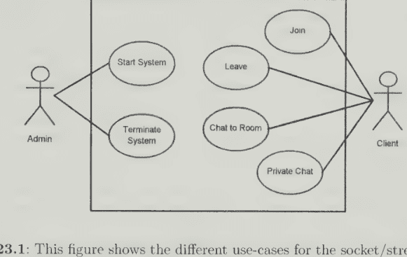

图23.1：本图展示了我们想要编写的基于套接字/流的聊天程序的不同使用场景。

`java.io.ObjectInputStream`。如果你使用这种方法，可以通过将`java.io.ByteArrayOutputStream`包装在适当的数据或对象输出流中来取出数据。这种方法并不简单多少。

### 23.2.3 来自套接字的流

对于UDP，我们看到数据必须打包到`DatagramPacket`中才能发送到其他机器，然后在到达时解包。我们没有讨论如何使用普通的`Socket`类通过TCP发送数据。为此，我们使用流。`Socket`类有以下方法。

```
getInputStream() : InputStream
getOutputStream() : OutputStream
```

这些方法的作用与其名称所预期的大致相同。如果你在套接字上调用`getInputStream`，它将返回一个连接到该套接字的`InputStream`实现，这样当从中读取数据时，读取到的将是通过套接字从另一台机器发送过来的数据。你可以像包装连接到文件的流一样包装这些流。这正是流库灵活性的体现。你可以编写使用`InputStream`或`OutputStream`的代码，无论传入的是哪种类型的流，它都能正常工作。因此，同样的代码既可以用于套接字，也可以用于文件。

为了了解这是如何工作的，我们将创建一个简单的聊天室，其中包含一个服务器，并能够容纳多个客户端。为了明确我们真正需要什么，我们应该做一些分析。图23.1展示了我们想要做的用例图。系统有两类用户：一类用户将在某台特定计算机上以服务器身份启动聊天室。其他用户将作为服务器的客户端，连接到聊天室，并可以选择聊天或离开。当一个人连接时，他必须提供一个昵称，以便其他人知道某条消息是谁发的，也便于发送私密消息。为了实现这一点，任何给定时间只能有一个用户使用某个特定的昵称。

我们将从客户端代码开始，因为它更简单。它只需要向服务器创建一个套接字，获取用户的昵称，请求用户输入要发送到服务器的聊天内容，并显示来自服务器的聊天文本。以下代码通过控制台界面实现了这些功能。

```scala
package scalabook.chat

import java.net._
import java.io._
import actors.Actor.actor
import annotation.tailrec

/**
 * 此应用程序运行一个聊天室的服务器，演示基于套接字的网络编程。
 */
object ChatClient {
  def main(args : Array[String]) {
    if(args.isEmpty) {
      println("Usage: scala ChatClient host [port]")
    } else {
      val port = if(args.length>1) args(1).toInt else 8000
      val sock = new Socket(args(0),port)
      val dis = new DataInputStream(new BufferedInputStream(sock.getInputStream()))
      val dos = new DataOutputStream(new
        BufferedOutputStream(sock.getOutputStream()))
      println("What is your handle for the chat room?")
      val name = readLine()
      dos.writeUTF(name)
      dos.flush()
      val response = dis.readUTF()
      if(response!=":quit") {
        actor { incoming(dis) }
        println("Welcome! Begin chatting.")
        outgoing(dos)
      } else {
        println("The server has rejected you.")
      }
      sock.close()
    }
    sys.exit(0)
  }

  @tailrec private def incoming(dis:DataInputStream) {
    val line = dis.readUTF()
    println(line)
    incoming(dis)
  }

  @tailrec private def outgoing(dos:DataOutputStream) {
    print("> ")
    val input = readLine().trim
    dos.writeUTF(input)
    dos.flush()
    if(input!=":quit") outgoing(dos)
  }
}
```

输入“:quit”作为聊天内容将终止聊天。请注意，传入消息是在单独的线程中处理的。该线程是使用`actor`快捷方式生成的。这样做的原因是，传入和传出的消息处理都包含阻塞方法，即**readUTF**和**readLine**。如果要在单个线程中处理这两者，我们就必须编写更复杂的代码，只在有内容可读时才读取，以避免阻塞。

**incoming**和**outgoing**方法中包含了一些我们以前没见过的新内容，一个名为**@tailrec**的注解。这个注解告诉Scala编译器，某个递归方法必须针对尾递归进行优化。如果不能，编译器应该生成错误。这意味着什么？尾递归是一个术语，用来描述只包含一个递归调用，并且在调用返回后不做大量工作的递归函数。这类递归函数通常可以转换为**while**循环。这样，你既能获得**while**循环的效率，又能获得递归的编程便利。如果Scala编译器无法将该函数转换为循环，**@tailrec**注解将强制产生错误。这一点很重要，因为你可能还记得，递归调用会消耗堆栈上的内存，如果递归太深，内存就会耗尽，程序会因堆栈溢出而崩溃。

服务器的代码稍微复杂一些，因为它要做的工作更多。它需要一个接受新连接的**ServerSocket**，每个套接字都需要有接收聊天消息的代码，还需要有让运行服务器的人输入命令来停止它的代码。与客户端一样，其中一些操作涉及阻塞调用，因此多线程会很有帮助。以下是编写该代码的一种方式。

```scala
package scalabook.chat

import java.net._
import java.io._
import actors.Actor._
import annotation.tailrec
import collection.mutable

/**
 * 此应用程序运行一个聊天室的服务器，演示基于套接字的网络编程。
 */
object ChatServer {
  def main(args : Array[String]) {
    val port = if(args.isEmpty) 8000 else args(0).toInt
    actor { startServer(port) }
    checkQuit()
    sys.exit(0)
  }

  private case class User(name:String, sock:Socket, dis:DataInputStream,
        dos:DataOutputStream)
  private val users = new mutable.HashMap[String,User] with
    mutable.SynchronizedMap[String,User] {}

  private def startServer(port:Int) {
    val ss = new ServerSocket(port)
    while(true) {
      val sock = ss.accept()
      actor { addUser(sock) }
    }
  }

  private def addUser(sock:Socket) {
    val dis = new DataInputStream(new BufferedInputStream(sock.getInputStream()))
    val dos = new DataOutputStream(new BufferedOutputStream(sock.getOutputStream()))
    val name = dis.readUTF()
    if(users.contains(name)) {
      dos.writeUTF(":quit")
      dos.flush()
      sock.close()
    } else {
      dos.writeUTF(":accept")
      dos.flush()
      val user = User(name,sock,dis,dos)
      users += name -> user
      doChat(user)
    }
  }

  @tailrec private def doChat(user:User) {
    val input = user.dis.readUTF().trim
    if(input!=":quit") {
      val index = input.indexOf("<-")
      if(index>0) {
        val oname = input.take(index).trim
        if(users.contains(oname)) {
          users(oname).dos.writeUTF(user.name+" -> "+input.drop(index+2).trim)
          users(oname).dos.flush()
        } else {
          user.dos.writeUTF(oname+" is not a valid handle.")
          user.dos.flush()
        }
      } else {
        val output = user.name+" : "+input
        for((name,ouser) <- users; if name!=user.name) {
          ouser.dos.writeUTF(output)
          ouser.dos.flush()
        }
      }
      doChat(user)
    } else {
      users.remove(user.name)
    }
  }

  @tailrec private def checkQuit() {
    if(readLine() != ":quit") checkQuit()
  }
}
```

main方法获取一个端口号，然后在单独的线程中启动服务器。主线程等待用户输入。

创建ServerSocket的函数进入一个无限循环，在其中接受连接，并通过actor创建的新线程调用addUser。这意味着每个客户端都可以在单独的线程中。实际上，actor库会管理线程，我们无法确定它会创建多少个线程来处理这些操作。

addUser方法从套接字获取流，并将它们包装在数据流中。然后读取一个字符串，该字符串应该是该客户端的昵称。请注意，服务器定义了一个名为User的case类，并维护一个将名称与用户关联的可变映射。这个可变映射是同步的，这样就不会因涉及多个线程而出现问题。这个映射使我们很容易确保永远不会有两个用户使用相同的昵称。它也使得发送私密消息更加容易。读取到的名称会与映射进行核对。如果映射中已经有该键，服务器会告诉客户端终止，然后关闭套接字。否则，它会告诉客户端已接受，向映射中添加一个新User，并继续执行doChat方法。

doChat方法是另一个尾递归方法。它从该用户的输入流中读取数据，并检查他们是否已断开连接。如果尚未断开，它要么向正确的用户发送一条私密消息，要么遍历所有用户并向每个人发送消息。如果用户退出，该用户名将从映射中移除，并且不再进行递归调用。你还会看到私密消息在此方法中处理。它会在文本中查找<-，并假定该符号之前的内容是用户昵称，之后的内容是要发送的消息。

在客户端和服务器的代码中，有多个地方可以看到输出流被刷新。实际上，每次写入后都会进行刷新。原因是大多数写入都很小，如果不刷新，整个内容就会滞留在缓冲区中。

输入这些文件并检查它们是否工作。如果你使用“localhost”作为机器名，你可以在单台计算机上与自己进行对话。玩了一段时间后，你可能会注意到一些不足之处。首先，它不太美观。这只是控制台中的纯文本。传入的聊天消息会打印在你正在输入的内容中间，这不仅看起来有点难看，而且可能难以使用，因为你无法跟踪自己正在写什么。

还有一些其他问题不仅仅是外观上的。目前，任何内容都可以作为昵称。只要你的用户不试图破坏系统，这不会造成问题。然而，有些名称可能会导致不太理想的行为。仅包含空白字符或开头或结尾包含空白字符的字符串会阻止私密消息的发送。服务器在接收到名称时应该进行更多的检查，以拒绝任何会导致问题的内容。

你可能注意到的另一个问题是，如果客户端在没有输入“:quit”的情况下断开连接，服务器中会出现异常。网络代码抛出的异常比使用文件的代码还要多。这段代码从不包含try/catch，但在每次调用readUTF或writeUTF时，它们都可能很有用。如果客户端不恰当地断开连接，会导致异常的通常是doChat中的第一行以及用于发送消息的writeUTF调用。解决办法是使用try/catch来检测链接何时失败。此时，它应该停止该用户的doChat，并将其从users映射中移除。这项练习留给读者完成。

# 网络安全

计算中的安全性和信息保障主题范围极其广泛，在我们这个现代、由计算机驱动的世界中至关重要。处理机密信息的程序需要努力保护这些信息。


这样外部实体就无法访问到它。运行关键系统的程序需要采取预防措施，以确保只有获得授权的人才能将其关闭。

我们刚刚编写的聊天程序在安全方面完全失败。添加适当的错误处理将是确保只有运行服务器的人才能将其关闭的重要一步。然而，进出服务器的每条消息几乎都是以明文发送的，如果通过网络发送，在客户端和服务器之间的任意多个点都可能被轻易读取。 granted，这本不是一个高度安全的系统。它甚至不验证谁连接到它。这并不意味着它永远不会被用来讨论人们可能想要保密的事情。有人可能会觉得，如果他们只是临时在一台机器上设置服务器，那么没有被邀请的人就没有机会进来窥探正在说的内容。这个假设的问题在于，另一方可能在根本不知道服务器的情况下监视通信。

规避他人监听网络通信的常规方法是加密消息。对方仍然可以看到消息经过，但由于它是加密的，他们无法读取它。在 Scala 中使用套接字通信实现此目的的最简单方法是服务器上使用 javax.net.ssl.SSLServerSocket 并使用 javax.net.ssl.SSLSockets 连接。这些套接字使用安全套接层（SSL）协议加密所有通信。这与 ssh 和 scp 使用的协议相同。

# 23.3 URLs

正如本章开头提到的，你可能已经使用了多年的网络程序。其中最值得注意的就是你的网络浏览器。网络浏览器最初只是编写成从服务器拉取信息并在屏幕上显示这些信息的程序。许多网络应用程序现在都有一些双向通信，但网络上仍有大量内容可以通过简单地拉取信息来访问。

当你使用网络浏览器访问信息时，你必须告诉它你想从哪里拉取信息以及想拉取什么信息。这是通过统一资源定位符或 URL 完成的。你输入到浏览器的大多数 URL 都以 "http" 开头。这告诉浏览器它应该使用超文本传输协议（HTTP）与服务器通信。这是通过套接字使用相当简单的文本命令请求信息的标准。默认情况下，HTTP 服务器位于端口 80，尽管也可以在 URL 的一部分中指定其他端口号。你可以通过打开一个套接字并发送适当的命令来从 HTTP 服务器拉取信息。然而，由于 HTTP 如此普遍，java.net.URL 类可以帮助你完成此操作。

构建 URL 有多种方法，你可以指定 URL 的不同部分，但最简单描述的方法只是使用一个 String，其文本与你输入到浏览器中的文本相同，提供所需信息的完整规范。例如，你可以使用以下代码行获取 Scala 主页的 URL。

```
import java.net._
val scalaURL = new URL("http://www.scala-lang.org/")
```

URL 类有一个名为 openStream 的方法，它将返回一个 InputStream，可用于读取 URL 的内容。我们可以在如下代码中使用它来读取该 URL 的完整内容并将其转换为 String。

```
import java.io._
import collection.mutable
val urlis = new BufferedInputStream(scalaURL.openStream())
val buffer = mutable.Buffer[Byte]()
var res = urlis.read()
while(res>=0) {
  buffer += res.toByte
  res = urlis.read()
}
val contents = new String(buffer.toArray)
```

此代码打开流并将其包装在 BufferedInputStream 中以提高性能。然后创建一个 Buffer[Byte] 来保存读取的值，然后进入一个循环，按字节一次读取并添加到缓冲区中。当读取的值小于零时，表示流的末尾已到达，此过程结束。到达末尾后，缓冲区转换为数组，并从该数组构建一个新的 String。

这里使用 while 循环是因为我们事先不知道要加载多少数据，而其他方法需要知道这一点。除了 while 循环之外，这也可以很容易地转换为使用递归函数。只要确保指定 @tailrec，这样你就知道所写的内容不会导致栈溢出。知道内容的长度将允许这种替代版本，它要简单得多。挑战在于问号处应填入什么。

```
import java.io._
val urlis = new BufferedInputStream(scalaURL.openStream())
val buffer = new Array[Byte](???) // Needs the size of the contents in bytes.
urlis.read(buffer)
val contents = new String(buffer)
```

调用流上的 available 很诱人。不幸的是，这不是一个好的解决方案。该方法返回在阻塞之前可以读取的字节数。该数字通常与总大小不同。如果流刚刚打开，它会很小。等待所有内容可用并不是合适的解决方案。

一种可行的方法是使用 java.net.URLConnection。URL 类有一个名为 openConnection:URLConnection 的方法，可以返回此类对象之一。URLConnection 有一个 getContentLength:Int 方法，可以告诉你该 URL 内容的大小。还有一个 getContentLengthLong:Long 方法，可以为超过 Int 最大大小的内容提供大小。对 URLConnection 的 getInputStream:InputStream 的调用将提供一个可以从中读取的输入流。

```
import java.io._
val connection = scalaURL.openConnection()
val urlis = new BufferedInputStream(connection.getInputStream())
val buffer = new Array[Byte](connection.getContentLength)
urlis.read(buffer)
val contents = new String(buffer)
```

不幸的是，getContentLength 方法并不适用于所有类型的内容。如果长度不可用，将返回 -1，这将导致此代码崩溃。因此，while 循环可能是最稳健的解决方案。

如果 URL 指向的不是文本文件，则读取的数据必须以不同的方式处理。例如，它可能指向一张图像。URLConnection 有一个名为 getContentType:String 的方法，可以帮助你确定 URL 引用的数据类型。然后你必须编写代码来加载数据并适当地处理它。URL 和 URLConnection 都是一个名为 getContent:AnyRef 的方法。此方法可以根据内容类型返回各种内容。例如，如果 URL 引用的是图像，getContent 将返回一个图像对象。它返回 AnyRef 意味着你应该对该值进行匹配，并根据其类型适当地处理它。代码可能看起来像这样。

```
url.getContent() match {
  case img:java.awt.Image =>
    // Code for handling an image.
  case is:InputStream =>
    // This is what you get for text so you need code to read it.
  case _ =>
    // Some other type.
}
```

# 23.4 远程方法调用（RMI）

在下一节中，我们将以一种让用户在不同程序上工作时协作绘制的方式为项目添加网络功能。为了实现这一点，他们需要能够共享绘图、相互聊天并修改共享绘图中的元素。我们还可以考虑为共享添加其他功能，例如一个可以涂鸦想法的草图板。现在想象一下使用套接字实现这些功能所需的代码。

这种实现将面临的挑战是，两个用户之间发送的消息有许多不同类型，而这些不同的消息可能会对两端的代码产生非常不同的影响。使用套接字处理这种情况的代码会变得非常混乱。可能很诱人为每种类型的消息使用不同的端口并保持许多不同的套接字打开，但这种解决方案很粗糙且无法扩展。操作系统对单个应用程序可以使用资源的数量有限制。相反，你必须在每条消息中发送额外的信息来标识消息的类型，以及它应该指向哪些对象。

处理这些额外的簿记工作具有挑战性，编码耗时。也很难调试。出于这些原因，以及这是许多应用程序中都会发生的事情，Java 库提供了一个简化的替代方案，称为远程方法调用（RMI）。顾名思义，RMI 让你可以在位于其他机器上的对象上进行方法调用。它自动处理簿记，以便信息发送到正确的位置，并在另一侧调用正确的代码。RMI 的缺点是它确实有一点学习/设置曲线，它只在语言之间工作


运行在 Java 虚拟机（JVM）上，而且相比于针对同一任务精心优化的专门代码，它的运行速度更慢。本节剩余部分将讨论环境搭建，并帮助你跨越学习曲线。我们的应用运行在 JVM 上，因此这对我们来说不是问题。我们的应用对性能的依赖程度也不高，所以由此带来的成本不会很大，并且 RMI 所提供的便利性将远远弥补这些成本。

要让一个应用使用 RMI，需要经历多个步骤。下面将这些步骤列出。

- 1. 设置抽象类型，用于指定可以远程调用的方法。这可以通过为任何希望进行远程访问的类型创建 trait 来实现。这些 trait 需要继承自 `java.rmi.Remote`，并且其中只应包含抽象方法。因此，trait 中只应包含使用 `def` 进行声明且不指定任何运行代码的方法。[^2] 每个方法都需要声明它可以抛出 `java.rmi.RemoteException`。更多细节见下文。
- 2. 编写一个类，使其扩展 `java.rmi.server.UnicastRemoteObject`，并混入你刚刚创建的 trait。你必须实现 trait 中的所有方法。根据需要提供其他方法，以使你的程序获得完整实现。[^3]
- 3. 创建一个服务器应用，将服务器对象绑定到 RMI 注册表。你可以通过调用 `java.rmi.Naming` 上的 `bind` 或 `rebind` 来完成此操作。这些方法接受两个参数。第一个是注册表识别该对象所用的名称，第二个是要绑定的对象。如果该名称已被使用，`bind` 方法会抛出异常。`rebind` 方法会解除旧对象的绑定，并将新对象绑定到其位置。
- 4. 创建一个客户端应用，使用 `java.rmi.Naming` 的 `lookup` 方法来获取服务器对象。`lookup` 方法接受一个参数，即要查找的服务器和对象的 URL。该 URL 的协议应为“rmi”，名称与服务器之间用斜杠分隔。一个示例是“rmi://computer.college.edu/ServerObjectName”。这里使用的名称必须与服务器绑定到注册表时使用的名称一致。
- 5. 最后，你需要运行 `rmiregistry`，然后启动服务器和客户端。`rmiregistry` 程序是 Java 开发工具包（JDK）安装的一部分。对于 Java 程序，注册表需要能够访问应用程序编译后的“.class”文件。这可以通过设置 `CLASSPATH` 环境变量，或在程序编译输出到的基目录中运行 `rmiregistry` 来实现。[^4] 对于 Scala 程序，很可能它还需要能够找到某些 Scala jar 文件。这些文件位于 Scala 安装目录的 `lib` 文件夹中。更多细节将在下面的示例中说明。

这份清单看起来可能令人望而生畏，但实际上只有五个步骤，而且一旦你完成了这些步骤，扩展你的网络应用就会变得容易得多。我们很快就会在示例中重新回顾这些步骤。

在示例之前，还需要介绍 RMI 的另一个细节：参数的传递。在第 7.8-7.9 节中，我们讨论了 Scala 中参数是如何传递的。通常的风格是传递对象的引用，同时也支持按名传递（pass-by-name）语义。使用 RMI 时，有两种不同的传递方式：按值传递（pass-by-value）和按引用传递（pass-by-reference）。具体使用哪种方式取决于所传递对象的类型。按值传递意味着对象被复制，另一台机器获得自己的副本，该副本与原始对象相互独立。这种情况发生在 `Serializable` 数据上，包括你在 Scala 中习惯使用的标准类型。类型实现了 `Remote` 的对象则作为远程引用传递。远程机器不会获得对象的副本，而是获得一个实现了远程接口的对象，该对象能够通过网络进行调用通信。在这些对象上调用方法时，实际会回到原始值上。由于涉及网络通信，这些调用比本地对象上的调用要慢得多。

如果你尝试传递一个既不可序列化也不是远程对象的值，你将得到一个异常。原因对你来说应该很清楚：RMI 利用对象流来进行通信。只有可以被序列化的对象才能通过这些对象流。因此，22.4.3 中关于如何使对象可序列化的讨论在使用 RMI 时同样适用。

为了帮助你理解这一切是如何结合在一起的，我们将编写另一个聊天应用，这次使用 RMI 而不是直接使用套接字。我们将逐步运行上述步骤，并指出每一步所编写的代码。不过在编写之前，我们需要先弄清楚我们要编写什么。这个聊天应用将与上一个有所不同。具体来说，它将为客户端提供一个 GUI。该 GUI 不仅包含标准的聊天元素，还包含所有登录到服务器上的用户列表。其思路是，用户在进行聊天时，可以通过从列表中选择一个或多个用户来发送私密消息。只有被选中的用户才能收到消息。

从 RMI 步骤中的第 1 步开始，我们规划出希望具有远程访问权限的类型，并放入需要远程调用的方法。我们首先从服务器开始。

```scala
package scalabook.chat

import java.rmi._

trait RMIServer extends Remote {
    @throws(classOf[RemoteException]) def connect(client:RMIClient):String
    @throws(classOf[RemoteException]) def disconnect(client:RMIClient):Unit
    @throws(classOf[RemoteException]) def getClients:Seq[RMIClient]
    @throws(classOf[RemoteException]) def publicMessage(client:RMIClient,
        text:String):Unit
}
```

基本结构是，我们有一个扩展 `java.rmi.Remote` 的 trait。在该 trait 内部，有四个我们希望在服务器上远程调用的方法。这些方法允许客户端连接、断开连接，并获取当前客户端列表。还有一个名为 `publicMessage` 的方法，每当客户端公开发送消息时都应调用它。这允许服务器保留简短的历史记录，以便新登录的人可以看到最近讨论了什么。

这段代码使用了一个我们之前从未见过的注解：`@throws`。这个注解允许我们明确指定方法可能抛出的异常。它接受一个参数，即可能抛出的异常类。在 Scala 中，我们并不经常需要这样做。等价的代码在 Java 中更为常见，而在这个例子中，Scala 需要它是因为我们想让代码与 Java RMI 库顺畅地协同工作。

第二个 trait 是为我们希望能够在客户端上远程调用的方法而设置的。它看起来如下：

```scala
package scalabook.chat

import java.rmi._

trait RMIClient extends Remote {
    @throws(classOf[RemoteException]) def name:String
    @throws(classOf[RemoteException]) def message(sender:RMIClient, text:String):Unit
    @throws(classOf[RemoteException]) def clientUpdate(clients:Seq[RMIClient]):Unit
}
```

客户端上只有三个方法。这些方法用于获取客户端的名称、向该客户端传递消息，以及告诉客户端更新其登录到服务器的客户端列表。

查看这两个接口，你可能会觉得缺少了什么东西，比如服务器上用于发送公开或私密聊天的方法。在上一个聊天应用中，当一个人编写聊天消息时，该消息只是作为一个 `String` 发送到服务器，服务器自行决定如何处理，然后将其发送给各个聊天参与者。这使用了标准的客户端-服务器网络应用结构，所有通信都通过服务器进行。这种结构在套接字中运行良好，并且让我们的生活更轻松。然而，它的效率并不高，因为服务器成为了一个显著的瓶颈。更重要的是，如果你真的希望消息是私密的，就会缺乏一些安全性，因为所有消息都必须经过服务器进行处理。基本上，服务器能看到一切，并且在发送所有消息时做了大量工作。

RMI 让我们很容易偏离客户端-服务器结构，转而采用更多的点对点（peer-to-peer）方法。客户端不仅会拥有对服务器的远程引用，还会拥有对所有其他客户端的远程引用。这意味着每个客户端都可以调用它希望消息送达的其他客户端上的 `message` 方法。这减轻了服务器的压力，并使其不再成为瓶颈。如果我们不想在服务器上保留聊天内容的历史记录，那么聊天流量根本就不会发送到服务器。

接下来的这段代码涵盖了服务器部分的第 2 步和第 3 步。第 2 步在类 `RMIServerImpl` 中，而第 3 步在伴生对象中。

```scala
package scalabook.chat

import java.rmi._
import java.rmi.server.UnicastRemoteObject
import collection.mutable

class RMIServerImpl extends UnicastRemoteObject with RMIServer {
    private val clients = mutable.Buffer[RMIClient]()
    private var history = mutable.ListBuffer("Server Started\n")

    @throws(classOf[RemoteException]) def connect(client:RMIClient):String = {
        clients += client
        sendUpdate
        history.mkString("\n")+"\n"
    }

    @throws(classOf[RemoteException]) def disconnect(client:RMIClient) {
        clients -= client
        sendUpdate
    }

    @throws(classOf[RemoteException]) def getClients:Seq[RMIClient] = clients
```

[^2]: Java 有一种称为接口（interface）的构造，它是纯抽象的。这正是 RMI 实际要求的。没有数据且只包含抽象方法的 Scala trait 会被编译为 Java 接口。

[^3]: 除了 `UnicastRemoteObject` 之外，你也可以使用其他服务器。之所以指定这个，是因为它是最直接明了的。

[^4]: 如果你使用 Eclipse，项目中有一个 `bin` 目录，它就是编译文件输出的基目录。


```
@throws(classOf[RemoteException]) def publicMessage(client:RMIClient,text:String)
{
  history += client.name+" : "+text
  if(history.length>10) history.remove(0)
}

private def sendUpdate {
  val deadClients = clients.filter(c =>
    try {
      c.name
      false
    } catch {
      case ex:RemoteException => true
    }
  )
  clients --= deadClients
  clients.foreach(_.clientUpdate(clients))
}
}

object RemoteServerImpl {
  def main(args:Array[String]) {
    val server = new RMIServerImpl
    Naming.rebind("ChatServer",server)
  }
}
```

该类为存储客户端和历史记录定义了两个字段，然后以相当简短的方法实现了接口中的四个方法。你可以看到 connect 方法返回历史记录。connect 和 disconnect 都使用了其中包含的那个私有方法 sendUpdate。该方法向所有客户端发送消息，让他们知道客户端列表已被修改。该方法稍长一些，因为它首先遍历所有客户端并调用它们的 name 方法。该值未被用于任何用途，但它可作为客户端是否仍在的检查。这是过滤操作的一部分，用于检查死客户端。在将列表发送给所有活动客户端之前，无法访问的客户端会被从列表中移除。

运行服务器的主方法非常简单。它创建一个 RemoteServerImpl 实例，然后使用 rebind 将其绑定到 rmiregistry。

下面这段代码展示了客户端的步骤 2 和 4。该代码稍长一些，因为它包含了对 GUI 的支持。即使如此，它也并不算太长。

```
package scalabook.chat

import java.rmi._
import java.rmi.server.UnicastRemoteObject
import collection.mutable
import swing._

class RMIClientImpl(myName:String,server:RMIServer) extends UnicastRemoteObject with RMIClient {
private val chatText = new TextArea(server.connect(this))
chatText.editable = false
private var clients = server.getClients
private val userList = new ListView(clients.map(_.name))
```

```
private val chatField = new TextField("") {
  listenTo(this)
  reactions += {
    case e:event.EditDone => if(text.trim.nonEmpty) {
      val recipients = if(userList.selection.items.isEmpty) {
        server.publicMessage(RMIClientImpl.this,text)
        clients
      } else {
        userList.selection.indices.map(clients).toSeq
      }
      recipients.foreach(r => try {
        r.message(RMIClientImpl.this,text)
      } catch {
        case ex:RemoteException => chatText.append("Couldn't send to one recipient.")
      })
      text = ""
    }
  }
}

private val frame = new MainFrame {
  title = "Chat"
  contents = new BorderPanel {
    import BorderPanel.Position._
    val scrollList = new ScrollPane(userList)
    scrollList.preferredSize = new Dimension(200,500)
    layout += scrollList -> West
    layout += new BorderPanel {
      val scrollChat = new ScrollPane(chatText)
      scrollChat.preferredSize = new Dimension(500,200)
      layout += scrollChat -> Center
      layout += chatField -> South
    } -> Center
  }
  listenTo(this)
  reactions += {
    case e:event.WindowClosing => server.disconnect(RMIClientImpl.this)
    case _ =>
  }
}
frame.visible = true

@throws(classOf[RemoteException]) def name:String = myName

@throws(classOf[RemoteException]) def message(sender:RMIClient,text:String) {
  chatText.append(sender.name+" : "+text+"\n")
}

@throws(classOf[RemoteException]) def clientUpdate(cls:Seq[RMIClient]) {
  clients = cls
  if(userList!=null) userList.listData = cls.map(c =>
    try {
      c.name
    } catch {
```

```
case ex:RemoteException => "Error"
} )
}
}

object RMIClientImpl {
  def main(args:Array[String]) {
    val mName = Dialog.showInput(null, "What server do you want to connect to?",
      "Server Name", Dialog.Message.Question, null, Nil, "")
    mName match {
      case Some(machineName) =>
        Naming.lookup("rmi://"+machineName+"/ChatServer") match {
          case server:RMI Server =>
            val name = Dialog.showInput(null, "What name do you want to go by?",
              "User Name", Dialog.Message.Question, null, Nil, "")
              if(name.nonEmpty) new RMIClientImpl(name.get, server)
          case _ => println("That machine does not have a registered server.")
        }
      case None =>
    }
  }
}
```

GUI 包含一个 TextArea 用于显示聊天文本，一个 TextField 用于输入聊天文本，以及一个 ListView 用于显示客户端名称，以便发送私信。文本字段具有事件处理代码，用于在用户停止编辑字段时发送消息。这就是代码中点对点方面的体现，因为每个客户端都可以直接在其他客户端上调用 message。

这些元素使用嵌套的 BorderPanels 设置在框架中。列表和主区域都嵌入在 ScrollPanes 中，其首选大小已设置，以便 GUI 看起来合理。框架还包含事件代码，以便在窗口关闭时，该客户端将从服务器断开连接。整体 GUI 看起来像图 23.2。

客户端的远程方法实现也很简短。只有客户端列表的更新稍长一些，这是因为对 name 的调用是远程调用，需要一些错误处理，以便代码不会在第一个无法访问的客户端上就崩溃。

这就是我们需要的所有代码。剩下的就是步骤 5，在其中启动 rmiregistry 并运行服务器和客户端。Scala 的使用给第一部分带来了一个小麻烦，因为 rmiregistry 是 Java 程序，而不是 Scala 程序，默认情况下它会知道 Java 库，但不知道 Scala 库。因此，我们需要告诉它 Scala 库的位置。

当你安装 Scala 时，会有一系列 JAR 文件被放到名为 lib 的目录中。JAR 代表 Java archive，是 Java 打包文件的标准方式。并非所有程序都需要这些文件中的全部，但名为 "scala-library.jar" 的文件会被大多数 Scala 程序所需要，包括这个程序。在 Linux 或 Mac 上，如果你位于编译后的 .class 文件的根目录，可以执行以下操作：CLASSPATH=$(SCALA_HOME)/lib/scala-library.jar:. rmiregistry。如果你的系统上未设置 SCALA_HOME，只需将其替换为 Scala 安装的路径即可。一旦运行起来，就在同一台机器上启动服务器，然后在该机器或可以访问它的其他机器上启动客户端。每个客户端都会询问你想要连接到哪台机器以及想要使用什么名称。如果客户端与服务器在同一台机器上，你可以使用 "localhost" 作为机器名。

该应用程序的一个方面可能被视为弱点。对客户端 name 方法的调用比可能需要的次数更频繁。name 在远程 trait 中是一个方法这一事实意味着每次调用都会产生网络开销。在本例中，“频繁”实际上只是指聊天进行时或客户端列表更新时。鉴于这些操作由人类交互驱动，这可能不是问题。频繁更新名称可能使“伪造”系统并冒充他人变得更困难。一般来说，你需要意识到何时进行远程调用，因为它们确实有显著的开销。有时你会按值传递事物以允许客户端进行快速处理，然后再传回修改后的副本，只是为了避免多次远程调用的开销。

要真正理解 RMI 的好处，请考虑添加功能所需的步骤。也许你想要为诸如共享图像或共享画板之类的功能添加菜单选项。使用套接字，这些添加会使代码变得显著复杂。而使用 RMI，你只需在 RMIClient trait 和 RMIClientImpl 类中添加一两个方法。你实现这些方法并放入调用它们的代码即可完成。设置 RMI 有点麻烦，但一旦就位，你就可以几乎像为非网络应用程序一样轻松地为基于 RMI 的应用程序添加新功能。

# FIGURE 23.2: This is a screen shot of the RMI chat client with two users connected.


# 23.5 协作绘图（项目集成）

现在是时候将各部分整合到绘图程序中了。我们将通过两种方式来实现。为了演示套接字（socket）技术，我们将添加一个简单功能：允许将绘图副本从一个用户发送到另一个用户。实现起来很简单，因为我们已经有了将绘图发送到写入文件的流的代码。我们想要添加的网络另一个方面更为重要，我们将使用 RMI。这将是一个协作面板，多个用户可以在其中发布绘图供他人下载，互相聊天，甚至绘制基本草图。

我们将在 DrawingMain 中框架的菜单栏上添加一个标题为“Collaborate”的第二个菜单。该菜单将有四个选项。前两个用于通过网络基本发送绘图。后两个用于更复杂的基于 RMI 的协作方案。我们先从前两个开始，并在创建“File”菜单之后，将以下代码添加到 DrawingMain 类中。

```
contents += new Menu("Collaborate") {
    contents += new MenuItem("Start Server") {
        action = Action("Start Server"){
            startServer
            enabled = false
        }
    }
    contents += new MenuItem(Action("Send Drawing")(sendDrawing))
}
```

第一个选项用于在当前机器上设置一个 `ServerSocket`，它将一直驻留直到程序停止，并接受来自其他想要共享绘图的机器的连接。第二个选项允许我们将当前所选标签页中的绘图发送到另一台机器。为了让这段代码能够编译，我们需要实现 `startServer` 和 `sendDrawing` 方法。

这两个方法相当简单，可以直接放在 `DrawingMain` 中，因为我们已经使 `Drawing` 类型可以被序列化。如果之前没有为了通过流保存而完成这项工作，我们现在就必须添加该功能。下面是 `startServer` 方法的一种可能实现。

```
private def startServer {
    actors.Actor.actor {
        val ss = new ServerSocket(8080)
        while(true) {
            val sock = ss.accept
            val ois = new ObjectInputStream(new
                BufferedInputStream(sock.getInputStream()))
            val sender = ois.readUTF()
            val title = ois.readUTF()
            ois.readObject() match {
                case drawing:Drawing =>
                    val response = Dialog.showConfirmation(tabbedPane,"Accept "+title+" from "+sender+"?","Accept Drawing?")
                    if(response==Dialog.Result.Yes) {
                        addDrawing(title,drawing)
                    }
                case _ =>
```

这两个方法都没有包含适当的错误检查。这大大减小了代码长度，但生产级网络代码却不能忽视这一点，因为网络任务可能产生多种类型的异常。

这种基本的套接字方法在技术上足以让我们开始绘图，但如果你使用一段时间，就会注意到它实际上并没有太多的协作感。不同用户之间没有任何真正的交互。要实现真正的交互，需要在机器之间发送多种不同类型的消息。这正是 RMI 的优势所在。

理想的特性是真正的绘图协作，即两个或多个用户可以同时查看和编辑同一张绘图。本章曾考虑过这条路，但最终放弃了，因为所需代码过于复杂。由于我们已经使用标准序列化保存绘图，而 RMI 特性与序列化相互作用，这使得实现更加困难。此外，网络连接两侧的用户都需要通过 GUI 与元素交互。GUI 元素恰好是可序列化的，但要正确处理事件处理则更为复杂。最终，我们决定采用这种更简单的协作形式，它展示了实时交互，同时不包含许多会模糊教学目标的细节。

使用 RMI 意味着我们需要遵循 RMI 的基本步骤。首先确定我们希望拥有哪些远程接口，以及这些接口中应该包含哪些方法。我们这里的应用程序仍然足够简单，可以只使用一种服务器类型和一种客户端类型。在这种情况下，服务器类型将相当简单。远程特质（trait）和实现都展示在这里。

```
package scalabook.drawing
import java.rmi._
import server.UnicastRemoteObject
import collection.mutable

trait CollaborationServer extends Remote {
  @throws(classOf[RemoteException]) def joinCollaboration(col:Collaborator) :
    (Array[Collaborator], Array[(String,Drawing)])
  @throws(classOf[RemoteException]) def addDrawing(title:String, drawing:Drawing) :
    Unit
}

class CollaborationServerImpl extends UnicastRemoteObject with CollaborationServer {
  private val collaborators = mutable.Buffer[Collaborator]()
  private val drawings = mutable.Buffer[(String,Drawing)]()

  @throws(classOf[RemoteException]) def joinCollaboration(col:Collaborator) :
    (Array[Collaborator], Array[(String,Drawing)]) = {
    collaborators += col
    (collaborators.toArray,drawings.toArray)
  }

  @throws(classOf[RemoteException]) def addDrawing(title:String, drawing:Drawing) {
    drawings += title -> drawing
    for(c <- collaborators) {
      try {
        c.addDrawing(title, drawing)
```

```
} catch {
    case ex:RemoteException =>
    }
}
}
```

该特质只有两个方法：一个用于加入协作，一个用于共享绘图。实现包含了这两个方法，它们都相当简短，同时还包含两个数据成员，用于存储当前参与协作的人员以及已共享的绘图及其标题。`joinCollaboration` 方法返回所有协作者以及已共享的绘图。有趣的是，这些内容的传递方式不同。绘图和它们的标题都是可序列化的，但不是远程的，因此它们按值传递，新的协作者会得到一份副本。另一方面，协作者是远程的，所以传输过去的数组将充满远程引用，允许新用户与其他人通信。

值得注意的是，我们在为这些类型安排文件时采用了略有不同的方法。文件中并非只包含一个类或特质，而是同时包含了远程特质和实现类。5 这样做是因为两者密切相关，并且可以减少对 `java.rmi` 等内容的额外导入。这样做的缺点是，查找 `CollaborationServerImpl` 的人可能需要很长时间才能找到它，因为没有同名的文件。这很大程度上是一个风格问题，不同的老师和雇主可能会要求不同的规则。

实现协作特性的大部分代码都在客户端代码中。这包括 `Collaborator` 的远程接口及其实现。同样，两者放在一个文件中。这次文件更长，因为实现更长。如果特质和实现都很长，我们一定会把它们拆分成两个文件，以避免文件过长。然而，将特质移出并不能显著减少该文件的长度。这段代码让我们能够生成一个如图 23.3 所示的窗口。

```
package scalabook.drawing
```

```
import java.rmi._
import server.UnicastRemoteObject
import java.awt.image.BufferedImage
import java.awt.{Color,Font}
import java.awt.geom._
import swing._
import event._
import collection.mutable
```

```
trait Collaborator extends Remote {
  @throws(classOf[RemoteException]) def name:String
  @throws(classOf[RemoteException]) def post(text:String):Unit
  @throws(classOf[RemoteException]) def requestSketch:Array[Byte]
  @throws(classOf[RemoteException]) def updateSketch(who:Collaborator,
    img:Array[Byte]):Unit
  @throws(classOf[RemoteException]) def addDrawing(title:String,
    drawing:Drawing):Unit
}
```

> 5 这是你在 Scala 中可以做到的事情，但在其他语言（如 Java）中则不行。在 Java 中，每个文件只能有一个公共类型，并且该类型必须与文件名相同。


/**
 * This implementation will run on the clients and bring up a window that will show
 * thumb nails of the shared drawings, a simple sketch pad, and chat window.
 */
class CollaboratorImpl(server:CollaborationServer) extends UnicastRemoteObject
        with Collaborator {
  private[drawing] val sketch = {
    val img = new BufferedImage(CollaboratorImpl.sketchSize,
        CollaboratorImpl.sketchSize, BufferedImage.TYPE_INT_ARGB)
    for(i <- 0 until img.getWidth; j <- 0 until img.getHeight)
      img.setRGB(i,j,0)
    img
  }

  private[drawing] val (sketches,drawings) = {
    val (cols,draws) = server.joinCollaboration(this)
    mutable.Map(cols.map(c => {
      try {
        Some(c -> ImageHandling.imageFromBytes(c.requestSketch()))
      } catch {
        case ex:RemoteException => None
      }
    }).filter(!_.isEmpty).map(_get:_*) -> mutable.Buffer(draws:_*)
  }

  private val nameField = new TextField("Name")
  private val chatField = new TextField
  private val chatArea = new TextArea
  chatArea.editable = false

  object SharedPanel extends Panel {
    preferredSize = new Dimension(150,200)
    val bigFont = new Font(Font.SERIF,Font.PLAIN,75)

    override def paint(g:Graphics2D) {
      g.setPaint(Color.white)
      g.fillRect(0,0,size.width,size.height)
      g.scale(0.15,0.15)
      g.setPaint(Color.black)
      for(i <- drawings.indices) {
        drawings(i)._2.renderTo(g)
        g.setPaint(Color.black)
        g.setFont(bigFont)
        g.drawString(drawings(i)._1,0,100/0.15f)
        g.translate(0,200/0.15)
      }
    }
  }

  def setSize() {
    preferredSize = new Dimension(150,200*drawings.size)
  }

  listenTo(mouse.clicks)
  reactions += {
case mc:MouseClicked =>
if(mc.clicks==2 && mc.point.y<drawings.size*200) {
val index = mc.point.y/200
DrawingMain.addDrawing(drawings(index)._1,drawings(index)._2)
}
}

val sketchPanel = new SketchPanel(this)

sketchUpdated()

import BorderPanel.Position._

val collabSplit = new SplitPane(Orientation.Horizontal,sketchPanel,
new BorderPanel {
layout += chatField -> North
layout += chatArea -> Center
})

private val frame = new Frame {
contents = new BorderPanel {
layout += new BorderPanel {
layout += new Label("Name") -> West
layout += nameField -> Center
} -> North
layout += new ScrollPane(SharedPanel) -> West
layout += collabSplit -> Center
}
listenTo(chatField)
reactions += {
case ed:EditDone =>
if(chatField.text.trim.nonEmpty) {
foreachCollaborator(_.post(name+" : "+chatField.text))
chatField.text = ""
}}
size = new Dimension(800,600)
}

def showFrame {
frame.visible = true
collabSplit.dividerLocation = 0.7
}

private def forCollaborators[A](f:Collaborator=>A):Seq[A] = {
(for(c <- sketches.keys) yield try {
Some(f(c))
} catch {
case ex:RemoteException => None
}).toSeq.filter(!_.isEmpty).map(_.get)
}

private def foreachCollaborator(f:Collaborator=>Unit) {
  for(c <- sketches.keys) try {
    f(c)
  } catch {
    case ex:RemoteException =>
  }
}

@throws(classOf[RemoteException]) def name:String = nameField.text

@throws(classOf[RemoteException]) def post(text:String) {
  chatArea.append(text+"\n")
}

@throws(classOf[RemoteException]) def requestSketch:Array[Byte] = {
  ImageHandling.imageAsBytes(sketch)
}

@throws(classOf[RemoteException]) def
  updateSketch(who:Collaborator,img:Array[Byte]) {
    sketches(who)=ImageHandling.imageFromBytes(img)
    sketchPanel.sketchSlider.max = sketches.size-1
    sketchPanel.repaint()
}

private[drawing] def sketchUpdated() {
  val bytes = ImageHandling.imageAsBytes(sketch)
  foreachCollaborator(c => {
    c.updateSketch(this,bytes)
  })
}

@throws(classOf[RemoteException]) def addDrawing(title:String,drawing:Drawing) {
  drawings += title->drawing
  SharedPanel.setSize()
  SharedPanel.repaint()
}

object CollaboratorImpl {
  val sketchSize = 1000
}

该类首先创建了一个填充透明颜色的草图图像。之后是加入协作的代码，然后使用该返回结果获取所有其他协作者的草图以及所有共享绘图。随后是用于在框架中设置 GUI 的代码，以及两个便于在不担心异常的情况下对协作者执行操作的辅助方法。实现类以对 trait 中定义的五个远程方法的定义结束。伴生对象包含一个常量，可用于调整草图所用图像的大小。

CollaboratorImpl 依赖于另外两个文件中的代码。由于 BufferedImage 不可序列化，因此在协作者之间发送草图时存在问题。如果查看远程接口，草图使用类型 Array[Byte] 在各处传递。

mouseDown=true
sx=x
sy=y
ex=x
ey=y
}
def released(x:Int,y:Int) {
    ex=x
    ey=y
    drawCurrent
    mouseDown=false
}
def dragged(x:Int,y:Int) {
    ex=x
    ey=y
}
}
object LineDrawer extends PositionDrawer {
    def draw(g:Graphics2D) { if(mouseDown) g.draw(new Line2D.Double(sx,sy,ex,ey)) }
}
object RectangleDrawer extends PositionDrawer {
    def draw(g:Graphics2D) { if(mouseDown) g.fill(new Rectangle2D.Double(sx min ex, sy min ey, (ex-sx).abs, (ey-sy).abs)) }
}
object EllipseDrawer extends PositionDrawer {
    def draw(g:Graphics2D) { if(mouseDown) g.fill(new Ellipse2D.Double(sx min ex, sy min ey, (ex-sx).abs, (ey-sy).abs)) }
}
var curDrawer:Drawer = FreeDrawer
val buttons = new GridPanel(6,1) {
    val b = Array(
        new ToggleButton {
            selected = true
            action = Action("Free")(curDrawer = FreeDrawer)
        },
        new ToggleButton { action = Action("Line")(curDrawer = LineDrawer) },
        new ToggleButton { action = Action("Rectangle")(curDrawer = RectangleDrawer) },
        new ToggleButton { action = Action("Ellipse")(curDrawer = EllipseDrawer) }
    )
    val group = new ButtonGroup(b:_*)
    b.foreach(contents += _)
    contents += Button("Clear") {
        for(i <- 0 until collab.sketch.getWidth; j <- 0 until collab.sketch.getHeight)
            collab.sketch.setRGB(i,j,0)
        collab.sketchUpdated()
    }
    contents += Button("Color") {
        val c = javax.swing.JColorChooser.showDialog(peer,"Select Color",curColor)
        if(c!=null) curColor = c
    }
}
val sketchDraw = new Panel {

override def paint(g:Graphics2D) {
    g.setPaint(Color.white)
    g.fillRect(0,0,size.width,size.height)
    val sketchSeq = collab.sketches.toSeq
    for(index <- 0 until collab.sketches.size) {
        val (c,i) = sketchSeq((index+sketchSlider.value)%sketchSeq.size)
        g.drawImage(i,0,0,null)
    }
    g.setPaint(curColor)
    curDrawer.draw(g)
}
import BorderPanel.Position._
layout += sketchDraw -> Center
layout += buttons -> East
layout += sketchSlider -> North
listenTo(sketchDraw.mouse.clicks,sketchDraw.mouse.moves,sketchSlider)
reactions += {
    case mp:MousePressed =>
        curDrawer.pressed(mp.point.x,mp.point.y)
        sketchDraw.repaint()
    case mp:MouseDragged =>
        curDrawer.dragged(mp.point.x,mp.point.y)
        sketchDraw.repaint()
    case mp:MouseReleased =>
        curDrawer.released(mp.point.x,mp.point.y)
        sketchDraw.repaint()
    case vc:ValueChanged =>
        sketchDraw.repaint()
}
该类接收 CollaboratorImpl 作为参数，因为它需要访问草图以及该对象的其他部分。该类的很大一部分专注于处理用户对其草图的绘制。有组 ToggleButtons 允许用户选择绘制方式，以及用于清除草图和选择颜色的其他按钮。ToggleButtons 被添加到 ButtonGroup 中，因此一次只能选择一个。

状态模式被用来使鼠标输入能够针对用户可以绘制的每种不同类型得到正确解释[6]。其工作原理是，我们有一个名为 Drawer 的 trait，其中包含四个抽象方法。这些方法处理鼠标按下、释放和拖动，以及在鼠标释放时应如何绘制内容。每种绘制样式都由扩展该接口的对象表示。名为 curDrawer 的可变变量存储对其中一个对象的引用，该对象与当前选定的绘制模式相关联。事件会传递给该对象，并放置在屏幕或图像上需要绘制适当形状的位置。

你可能会想通过保留一个整数值来告诉你正在绘制的样式，然后使用多个 if/else 条件在不同情况下采取正确操作来编写代码。虽然这种方法可行，但它灵活性较差且更容易出错。这里展示的抽象的真正优势在于添加新绘制模式的简易性。你只需在 GUI 中添加一个新按钮并为该样式处理的新 Drawer 对象即可正常工作。这是一个使用抽象使代码更灵活的示例。


我们最后需要做的是将这个功能添加到GUI中。首先，我们给`DrawingMain`添加以下两行，以便它能够跟踪一个服务器和一个客户端。

```
private var server:CollaborationServer = null
private var client:CollaboratorImpl = null
```

之后，可以将以下代码添加到“协作”菜单中，放在两个简单共享选项的下方。

```
contents += new Separator
val joinItem = new MenuItem("Join") {
  action = Action("Join") {
    text = "View"
    if(server==null) {
      val host = Dialog.showInput(null, "What server host do you want to use?", "Server Name", Dialog.Message.Question, null, Nil, "")
      if(host.nonEmpty && host.get.trim.nonEmpty) {
        try {
          Naming.lookup("rmi://"+host.get+"/Collaborate") match {
            case svr:CollaborationServer =>
              server = svr
              client = new CollaboratorImpl(server)
            case _ => Dialog.showMessage(tabbedPane,"The wrong type of object was found on that server.")
          }
        } catch {
          case ex:NotBoundException =>
            server = new CollaborationServerImpl()
            Naming.bind("Collaborate",server)
            client = new CollaboratorImpl(server)
        }
      }
    }
    if(client!=null) client.showFrame
  }
}
contents += joinItem
contents += new MenuItem(Action("Share"){
  val title = Dialog.showInput(null, "What do you want to call this drawing?", "Drawing Title", Dialog.Message.Question, null, Nil, "")
  if(title.nonEmpty) {
    server.addDrawing(title.get, openDrawings(tabbedPane.selection.index))
  }
})
```

这就提供了一个“加入”选项，它会询问主机，然后使用RMI尝试在该主机上查找服务器。如果找到了服务器，就连接到它；否则会创建一个服务器并绑定到该主机。“共享”选项则只询问绘图的标题，然后将当前选中的绘图发送到服务器。

这一节包含了不少确实需要探索的代码。强烈建议你把这些代码全部输入并运行一下，看看它是如何工作的。值得注意的是，虽然RMI代码看起来可能不涉及线程，但RMI调用确实是在单独的线程上进行的，因此一些应用程序必须考虑到这一点。

一种模型是，一个独立应用程序作为服务器运行，然后各种客户端进行连接。

在客户端-服务器模型中，大部分游戏逻辑很可能在服务器上进行处理。客户端成为图形显示器和用户交互的媒介。给予客户端的命令很可能几乎不加解释地被发送到服务器。

如果你的游戏只是一个双人联网游戏，你可以不设服务器，而是只使用一个应用程序，用户可以将其实例设置为某种本地服务器，供第二个实例连接。在这种情况下，游戏逻辑将主要发生在那个“主”实例上，而第二个客户端主要只是发送和显示信息。

当你在处理这一问题时，可能会很快意识到一件事：分布式并行应用程序（即通过网络在多台机器上运行的那些应用程序）可能有它们自己类型的竞态条件，因为不同的客户端可能并不总是看到同一个世界。

- 4. 一个本不应涉及网络功能的游戏，可能是最难与网络结合的项目。你可能想要加入网络的一个原因是，能够在正常显示之外跟踪游戏中正在发生的事情，或提供其他类型的基本交互。这主要对调试很有用。
- 
- 大型复杂软件通常需要具备“日志记录”的能力。也就是说，代码中的不同步骤会将它们正在做的事情写入文件或类似的地方。当出现问题时，你可以查阅日志文件来了解发生了什么。除了记录到文件，你也可以让你的游戏将日志记录到网络上。让游戏创建一个接受连接的`ServerSocket`。所有日志都应发送到所有连接。如果没有连接，则基本上跳过日志记录。
- 
- 尽管记录到网络缺少记录到文件的一些优点，比如方便地回顾内容，但它提供了灵活性，你可以使用写入网络连接的命令。这些命令可以用于查询信息以辅助调试，也可以像超级用户模式一样，设置一些在测试程序时难以创建的情形。
- 5. 数学练习册程序至少可以通过两种不同的方式涉及网络。一种是添加协作功能，就像本章中为绘图程序添加的那样，以便用户可以将完整或部分工作表从一台计算机发送到另一台计算机。
- 
- 也可以添加日志记录功能，如项目4中描述的那些。数学练习册的日志记录功能很可能用于调试目的，以检查后台正在发生的事情。
- 
- 你可以决定是在代码中实现其中一个还是两个选项。选择你最感兴趣、最适合你项目目标的那一个。
- 6. 对于Photoshop™项目，你可以通过协作、日志记录和/或使用URL从网络获取图像的形式来添加网络功能。协作方式可能与本章中展示的非常相似，但应加以修改以适合你所开发的程序的流程。日志记录对于调试最有用，如项目4中所述。这两个选项都比较重要，你只需要选一个即可。
- 
- 通过URL从网络加载图像这个功能非常简单直接，而且确实是这类应用应该具备的。无论你选择其他两种网络选项中的哪一种，你都可能应该在此基础上加入这一功能。

7. 模拟工作台为应用程序添加网络功能提供了一个非常不同的特性。模拟可能高度依赖处理器，因此将工作负载不仅分散到多个线程，还分散到多台机器上会带来好处。这种分布式计算形式需要网络。

你应该为辅助节点制作第二个应用程序，它可以运行在其他计算机上。该辅助应用程序将与主应用程序建立网络连接，并等待被分配工作。划分工作的最简单方法是在每台机器上运行独立的模拟，偶尔传回信息，以便向用户显示数据，或许还用于保存。如果模拟中的粒子数量非常大，那么将该模拟分布到多台机器上是有意义的。这是一个更具挑战性的问题，因为不同机器必须交流它们所控制的粒子状态，以进行力计算。

关于你希望在分布式模拟中参与多深，由学生自己决定。

# 第24章

# 堆栈与队列

- 24.1 抽象数据类型（ADTs） ......................................................... 634
- 24.2 堆栈和队列的操作 .................................................... 634
- 24.3 O的真实含义 ............................................................... 635
- 24.4 O(1)要求 ............................................................... 636
- 24.5 基于数组的堆栈 .............................................................. 637
- 24.6 基于数组的队列 .............................................................. 641
- 24.7 单元测试 ............................................................... 644
- 24.7.1 设置 ............................................................... 644
- 24.7.2 编写测试 ........................................................ 645
- 24.7.3 测试套件 ........................................................ 648
- 24.7.4 测试驱动开发 ............................................... 649
- 24.8 RPN计算器 .............................................................. 649
- 24.9 章末材料 ...................................................... 653
- 24.9.1 概念总结 ................................................... 653
- 24.9.2 练习 ........................................................... 654
- 24.9.3 项目 ........................................................... 654

过去几章加深了你在库方面的知识深度，使你能够在程序中做更多事情。现在，我们要暂时转换方向，开始研究构建数据结构以及编写一些基础库所需的内容。你在第7章开始使用默认库中的简单数据结构。在第20章中，我们看到了其他类型的数据结构。大多数时候你编写程序，都会使用这类预先存在的库。毕竟，它们是由经验丰富的人编写的，他们投入了大量时间和精力进行调优，使其灵活高效。

你通常使用别人编写的库，这一事实可能会诱使你认为自己真的不需要了解这些数据结构内部发生了什么。恰恰相反，理解数据结构的内部工作原理是任何合格开发人员的基本技能。其中一个原因是，当你选择数据结构时，往往会有许多不同的选项可供选择，而选出正确的选项需要了解某些细节。例如，到目前为止，在需要`Seq`时，我们几乎可以互换地使用`List`和`Array`类型，唯一的例外是`List`类型不可变。在第25章中，我们将看到这两者的差异远不止于此，而且即使只关注列表，也有很多选择。

如果你必须自己实现数据结构，也需要知道不同数据结构如何工作以及如何实现。这可能由几个原因之一造成。一个原因是，你正在为一个系统进行开发，而该系统要求你使用一种未附带高级集合库的低级语言。另一个原因是，你的问题有非常具体的要求，而所提供的结构中没有一种真正合适。如果你不理解数据结构，也没有编写数据结构的经验，你将会


几乎可以肯定，他们不具备为特定任务编写高效且正确的数据结构的能力。这些技能正是区分普通开发者与优秀开发者的关键。

在本章中，我们将从一些尽可能简单的数据结构——栈和队列——开始探索。我们还会编写基于数组存储的栈和队列的基本实现，并使用参数多态，以便它们可以与任何类型一起使用。我们将特别关注这些实现的性能表现，以及我们需要采取什么措施来确保在处理更大数据集时它们不会变慢。

# 24.1 抽象数据类型（ADT）

栈和队列的实现存在于 Scala 的集合库中，因为它们用于持有或收集数据。也可以用“数据结构”这个术语来称呼它们。然而，对它们最准确的术语是抽象数据类型（ADT）。其中“抽象”部分与我们第19章首次看到的用法含义相同。ADT 规定了可以对其执行的特定操作，但并不告诉我们这些操作是如何完成的。“如何完成”的部分可以因实现而异，正如抽象方法的实现在不同子类型中有所不同。

不同的实现可能有不同的优势和劣势。本书后半部分的学习目标之一是让你了解不同 ADT 的能力以及不同实现的优缺点，以便你能做出恰当的选择。在某些情况下，最困难的部分可能是确切了解特定应用中的用法。

# 24.2 栈和队列的操作

决定一个特定 ADT 的是它必须包含的方法集合以及这些方法行为的描述。大多数实现会超出最低要求，添加额外的方法以提高可用性，但最重要的还是那些必需的方法。对于栈和队列 ADT，绝对必需的方法只有两个：一个添加元素，另一个移除元素。

对于栈，这两个方法通常称为 push 和 pop。对于队列，它们称为 enqueue 和 dequeue。这些 ADT 极其简单，以至于移除方法 pop 和 dequeue 不需要参数。你无法指定要取出什么。栈和队列之间的区别在于，当移除元素时，它们各自如何选择返回给你的元素。在栈中，被 pop 移除的对象是最近添加的那个。我们说它遵循“后进先出”（LIFO）顺序。相反，dequeue 移除的是最早通过 enqueue 添加的元素。队列则遵循“先进先出”（FIFO）顺序。

这些 ADT 及其方法的名字意在唤起一种画面。对于栈，你应想象一个弹簧加载的盘子架，就像你在自助餐厅里可能看到的那样。当新盘子放上去时，它的重量会把下面的一叠盘子压下去。当盘子被拿走时，整叠盘子会弹起来。按照这个画面，你只能接触到栈顶的盘子。通常，这些装置会防止你随意抽出任何想要的盘子。

在世界上许多英语地区，人们使用 queue 这个术语，而美国人则使用 line。当你去买活动门票时，你不是“get in line”，而是“get on queue”。queue ADT 的设计目标就是像一条服务队列那样运作。当人们排入这样的队列时，他们期望按到达顺序得到服务。这是一种先到先服务的结构。队列应该以同样的方式工作，dequeue 方法取出在队列中等待时间最长的元素。

# 24.3 $O$ 的真正含义

在第13章中，你已经接触过 $O$ 阶的概念。它被用来描述搜索或排序的速度。我们想在这里更深入地探讨这个概念，因为在讨论不同 ADT 的性能时我们会大量使用它，并且我们还会用它来对某些 ADT 的可接受实现施加约束。

虽然我们通常关心某件事运行所需的时间长短，但这并不是描述程序或程序部分性能的好方法。运行时可能因机器而异，而且会以特定于该硬件的奇特方式变化。一个更稳定的定义是：考虑一个或多个感兴趣的操作，观察这些操作的执行次数如何随我们所处理的输入集规模变化。假设我们有程序中某个感兴趣的部分，它可能是一个函数/方法，也可能是整个程序的运行。我们会在不同规模的输入上运行该程序，并统计感兴趣的操作发生多少次。我们可以把计算量随输入规模变化的函数记为 $g(n)$。我们说，对于某个函数 $f(n)$，$g(n)$ 是 $O(f(n))$，如果存在 $m,c$，使得对所有 $n > m$，都有 $c \times f(n) > g(n)$。理解这一含义的最佳方式是图形化。图24.1展示了 $g(n)$ 和 $c \times f(n)$ 在图中可能呈现的样子。

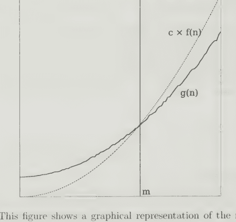

图24.1：此图展示了 O 的含义的图形表示。实线代表 g(n)，它是对输入规模 n 所完成计算量的度量。虚线是函数 c × f(n)，我们想说明 g(n) 是 O(f(n))。图中标注了一个位置 m，超过该位置后，虚线总是位于实线上方。

关于这个定义，有一些重要的地方需要注意。首先，$O$ 只是一个上界。如果 $g(n)$ 是 $O(n)$，那么它也是 $O(n^2)$ 和 $O(n^3)$。此外，代码的 $O$ 行为只有在 $n$ 变大时才真正重要。从技术上讲，这是一种渐近分析。它处理的是 $n \rightarrow \infty$ 的情况。一般来说，这非常重要，因为我们在计算机上做的很多事情都涉及大量数据，并且我们一直在努力让计算机处理更多信息。然而，如果你遇到一个已知输入规模很小的问题，那么使用一个 $O$ 行为较差的算法很可能反而更快。

$O$ 定义中的因子 $c$ 意味着在性能方面你通常忽略所有常数因子。因此，$2n$ 和 $100n$ 都是 $O(n)$，尽管前者显然比后者好。类似地，虽然 $100n$ 的阶优于 $3n^2$（$O(n)$ 对比 $O(n^2)$），但对于小输入，后者可能更高效。

$O$ 记号还忽略所有低阶项。函数 $n^3 + 2n^2 + 100$ 和 $n^3 + \log n$ 都是 $O(n^3)$。当 $n$ 变大时，真正重要的只有增长最快的项。尽管所有这些细节在 $O$ 记号中在技术上都不被考虑，但人们在发表新算法时常常会包含系数和低阶项，因为它们在人们可能关心的输入规模范围内可能是显著的。

# 24.4 O(1) 要求

栈和队列非常简单，这使我们能够对放入其中的方法施加严格的限制。我们将要求实现中的所有方法都是 $O(1)$。要理解为什么我们需要如此严格的限制，可以考虑一下：如果一个栈或队列增长到 n 个元素，整个程序的速度会发生什么变化。要达到这样的规模并使其有用，你至少需要对添加和移除方法各进行 $O(n)$ 次调用。将阶数可以相乘这一事实与一个较慢的 $O(n)$ 实现结合起来，我们会得到整个程序的性能为 $O(n²)$。这对许多应用来说都是极其昂贵的。

$O(1)$ 性能要求仅针对均摊成本。也就是说，我们允许偶尔有一次调用耗时较长，且其耗时随数据结构规模增长，只要这种情况发生得足够少，使得每次调用的平均成本为常数。例如，我们可以接受一次 $O(n)$ 成本的调用，只要它每 $O(n)$ 次调用中仅出现一次。

对于大多数 ADT，不可能施加如此严格的性能要求。只有栈和队列的简单性才使这成为可能。对于其他 ADT，我们将不得不接受某些操作的 $O(n)$ 行为；或者，当我们能让最昂贵的操作成本达到 $O(\log n)$ 时，我们就会感到满意。


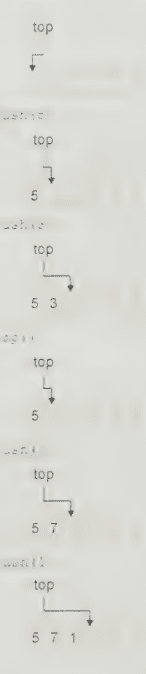

图 24.2：此图展示了基于数组的栈的图形化表示，以及它在多次操作中的变化。栈将数据存储在数组中，并使用一个整数索引来跟踪顶部的位置。

这个特质有效地在 Scala 中定义了 ADT。一旦有了它，我们就可以编写一个扩展该特质并提供具体方法实现的类。在展示这种实现的代码之前，我们应当停下来思考它是如何工作的，以及它在内存中会是什么样子。图 24.2 展示了可能的一种视图。为了便于说明，这个栈存储 Int 值。我们有一个数组存储各种值，还有一个名为 top 的整数值，用于存储下一个元素应放入栈中的索引。每次压入一个值时，它会被放置在正确的位置，并且 top 递增。当弹出一个值时，top 递减，然后返回该位置的值。

尽管图中没有显示，我们还需要处理一种情况：当压入足够多的元素导致数组填满时。在这种情况下，需要分配一个更大的数组，并将原有值复制过去，以便为更多元素腾出空间。

```
package scalabook.adt

class ArrayStack[A : Manifest] extends Stack[A]{
  private var top = 0
  private var data = new Array[A](10)
```

|  | data.length*2 |  | data.length+10 |  |
|---|---|---|---|---|
| 扩容事件 | 大小 | 总工作量 | 大小 | 总工作量 |
| 1 | 10 | 10 | 10 | 10 |
| 2 | 20 | 30 | 20 | 30 |
| 3 | 40 | 70 | 30 | 60 |
| 4 | 80 | 150 | 40 | 100 |
| 5 | 160 | 310 | 50 | 150 |
| 6 | 320 | 630 | 60 | 210 |
| ... | ... | ... | ... | ... |
| m | 10 × 2^m | 10 × (2^{m+1} − 1) | 10m | 5m(m + 1) |

为了得到均摊成本，我们将总工作量除以大小，因为我们需要调用那么多次 push 才能使栈达到该大小。对于第一种方法，我们得到

```
\frac{10 \times (2^{m+1} - 1)}{10 \times 2^{m}} = \frac{2^{m+1} - 1}{2^{m}} = 2 - \frac{1}{2^{m}} \approx 2 \in O(1).
```

对于第二种方法，我们得到

```
\frac{5m(m + 1)}{10m} = \frac{m + 1}{2} \in O(m).
```

乘以 2 还是加上 10 都并非什么神奇的操作。按照大于 1 的固定倍数增长数组将带来均摊常数成本。按照任何固定值增长数组将导致均摊线性成本。固定倍数的优势在于，虽然复制事件呈指数级增大，但它们发生的频率也呈指数级降低。

# Manifest（高级）

要理解 Manifest，最好先对 Java 的历史有所了解，因为 Java 虚拟机（JVM）的特性对它们的存在起到了作用。Java 中与 Scala 类型参数对应的是泛型。泛型在最初的 Java 语言中并不存在。事实上，它们直到 Java 5 才被加入。当时，全球已经安装了大量的 JVM，人们认为，做出会使它们全部失效的更改是不可行的。出于这个原因，以及为了保持虚拟机相对简单的动机，泛型是通过类型擦除来实现的。这意味着泛型的信息在编译时使用，但在编译后的版本中被擦除，因此在运行时无法判断泛型类型之前是什么。这样，生成的代码看起来就像泛型引入之前所生成的代码。

这对 Java 程序的编写方式产生了相当多的影响。在 Scala 中，它表现为对某些类型参数需要拥有 Manifest。Manifest 基本上保存了一些类型信息，以便在运行时可以使用。要理解为什么需要它，我们应该回到那个导致我们需要 Manifest 的表达式：`new Array[A](10)`。这将创建一个包含 10 个元素的 `new Array[A]`，并将这 10 个元素设置为适当的默认值。正是最后这部分导致了对 Manifest 的需求。对于任何 AnyRef 的子类型，默认值是 null。对于 AnyVal 的子类型，默认值各不相同。对于 Int，它是 0。对于 Double，它是 0.0。对于 Boolean，它是 false。为了执行该表达式，你至少需要充分了解类型，才能放入正确的默认值。¹ 类型擦除从运行时夺走了这些信息。Manifest 让 Scala 能够重新访问这些信息。

同样值得注意的是，我们的栈实现在调用 pop() 时，严格来说并不会真正地从数组中移除该值。对于栈的正确执行来说，这种移除并不是必需的。然而，它可以改善内存使用和性能，尤其当类型 A 很大时。不幸的是，这需要有一个默认值放入该位置的数组中，而我们刚才已经讨论过，对于完全通用的类型参数来说，这是很难做到的。

# 24.6 基于数组的队列

与栈类似，基于数组的队列的代码也是从将 ADT 设置为完全抽象的特质开始的。该特质接收一个类型参数，以便可以处理任何类型，如下所示。

```
package scalabook.adt

/**
 * This trait defines a mutable Queue ADT.
 * @tparam A the type of data stored
 */
trait Queue[A] {
  /**
   * Add an item to the queue.
   * @param obj the item to add
   */
  def enqueue(obj:A)

  /**
   * Remove the item that has been on the longest.
   * @return the item that was removed
   */
  def dequeue():A

  /**
   * Return the item that has been on the longest without removing it.
   * @return the most recently added item
   */
  def peek:A

  /**
   * Tells whether this queue is empty.
   * @return true if there are no items on the queue, otherwise false.
   */
  def isEmpty:Boolean
}
```

¹ 你还需要其他信息，例如应该预留多大的内存块。例如，Int 需要 4 字节，而 Double 需要 8 字节。

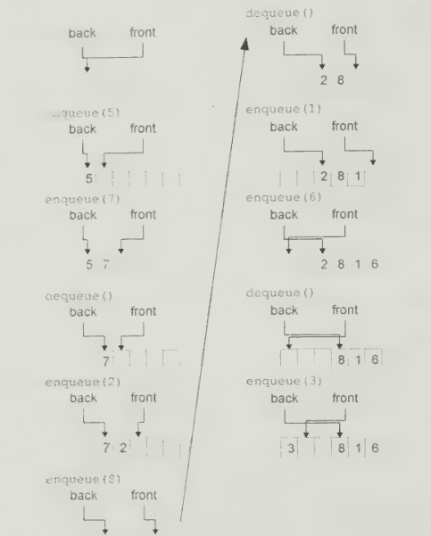

图 24.3：此图展示了基于数组的队列的图形化表示，以及它在多次操作中的变化。队列将数据存储在数组中，并使用整数索引跟踪队首和队尾。

与栈一样，这里只有方法签名以及描述它们功能的注释。

队列 ADT 也可以使用数组实现。图 24.3 展示了它在若干操作中的样子。与栈不同，队列需要跟踪数组中的两个位置：队首和队尾。队尾是新元素加入队列时进入的位置，而队首是移除元素时取值的位置。在相应操作中，两个索引都会递增。当一个索引移动到数组末尾之后时，它会绕回到开头。这使我们能够持续添加和移除项，而无需扩展数组或复制元素。这两者都将需要 O(n) 操作，并会使得我们的整体性能无法达到 O(1)。

此图并未展示队列变满时会发生什么。此时需要更大的数组，并且需要将值从旧数组复制到新数组中。队列的细节并不像栈那样直接。图 24.4 展示了这个问题以及一种可能的解决方案。直接复制元素是不合适的，因为环绕可能导致队首和队尾颠倒的情况。相反，复制时需要移动元素，使它们保持连续。front 和 back 的值也需要相应调整。存在

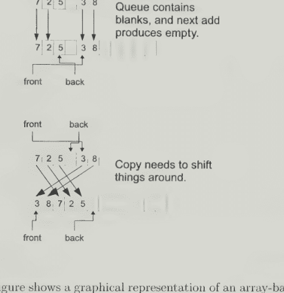

图 24.4：此图展示了基于数组的队列在入队时需要扩展时的图形化表示。当 front==back 时，队列被视为空。因此，扩容操作应发生在最后一个槽位将要被填满时。除了扩展为更大的数组，复制操作还需要移动数组中的元素并改变 front 和 back 的位置。

许多方法可以做到这一点。图 24.4 演示了我们在代码中采用的方法，即将 front 移回数组的开头。

这种基于数组的队列实现的图形化描述可以用如下代码实现。

```
package scalabook.adt

class ArrayQueue[A : Manifest] extends Queue[A] {
    private var front,back = 0
    private var data = new Array[A](10)

    def enqueue(obj:A) {
        if((back+1)%data.length==front) {
            val tmp = new Array[A](data.length+2)
            for(i <- 0 until data.length-1) tmp(i) = data((i+front)%data.length)
            front = 0
            back = data.length-1
            data = tmp
        }
        data(back) = obj
        back = (back+1)%data.length
    }

    def dequeue():A = {
        assert(!isEmpty,"Dequeue called on an empty queue.")
```


```
val ret = data(front)
front = (front+1)%data.length
ret
}

def peek:A = data(front)

def isEmpty:Boolean = front==back
}
```

这段代码与我们之前为栈编写的代码非常相似。你可能会觉得奇怪的唯一元素是，从数组末尾回绕到开头是通过取模完成的。`dequeue` 中的回绕以及 `enqueue` 结尾处的回绕完全可以用一个 `if` 来完成。对于另外两种情况，回绕需要在表达式中进行。这使得取模更加有效。

所有操作摊还成本均为 O(1)。与栈上的 `push` 一样，`dequeue` 方法在需要扩容的调用中会是 O(n)。然而，这些情况很少，以至于平均下来为常数时间。

# 24.7 单元测试

到目前为止你应该已经很清楚，代码能够编译并不意味着代码是正确的。代码中仍可能存在运行时和逻辑错误。为了找到这些错误，你需要对代码进行测试。测试的主题最早在第 8.5 节中被讨论过。那时描述的测试是手动测试。每个测试都必须由开发者显式运行，如果我们想测试代码的话。此外，其中一些测试会打印出需要由程序员验证正确性的值。在大规模开发中，这些方法不足以帮助我们生产出可靠的代码。在本节中，我们将通过引入自动化单元测试的概念来解决这个问题。

单元测试是对程序中某个特定单元的功能进行检查的测试。通常它类似于一个单一的类，甚至是类中的某些方法。单元测试旨在自动运行，因此不依赖于程序员的交互来判断测试是否通过或失败。这种逻辑应该内置于测试中。这使得单元测试可以频繁运行。思路是，每当你对代码进行更改时，都重新运行所有单元测试，以确保更改没有破坏任何东西。

有许多类型的单元测试框架。其中一些，如 ScalaTest、ScalaCheck 和 Specs，是专门为 Scala 编写的。在本书中，我们将使用 JUnit，即 Java 的主要单元测试框架。选择它的原因包括 JUnit 被广泛使用，使用简单，并且在 Eclipse 和其他 IDE 中有内置支持。

### 24.7.1 设置

为了在 Eclipse 中让 JUnit 与我们的项目一起运行，我们需要执行几个步骤。首先，访问 http://www.junit.org/ 并点击 “Download JUnit”。这会带你到一个包含许多不同下载的页面。你应该获取最新版本的 “Basic jar”。将此文件保存在你的 Eclipse 工作区或某个容易找到的位置。

现在进入 Eclipse，右键点击你想要添加测试的项目。从弹出菜单中选择 “Build Path” > “Configure Build Path...”。转到 “Libraries” 选项卡并点击 “Add External JARs...” 按钮。导航到该文件并选择它后，你就完成了为该项目设置运行 JUnit 测试的工作。

### 24.7.2 编写测试

与我们会放在伴生对象 `main` 方法中的测试不同，单元测试放在单独的文件中，甚至放在单独的包或项目中。我们将采用的方法是把所有测试代码放在以 `test` 开头的并行包层次结构中。由于 `ArrayStack` 和 `ArrayQueue` 位于 `scalabook.adt` 包中，我们的测试将位于 `test.scalabook.adt` 中。要创建测试，我们只需编写包含方法和使用 JUnit 的 `@Test` 注解来注解测试方法的类。为此能够编译，你应该执行 `import org.junit._`。你放置 `@Test` 注解的每个方法都将作为单元测试的一部分运行。

在测试方法内部，你需要调用 JUnit 的断言方法。有诸如 `assertTrue`、`assertFalse` 和 `assertEquals` 等方法。通常，测试是从测试非常简单需求的测试开始构建到更重要的测试。 为了理解其简单程度，请考虑以下示例。

```
@Test def emptyOnCreate {
  val stack = new ArrayStack[Int]
  assertTrue(stack.isEmpty)
}
```

```
@Test def nonEmptyOnPush {
  val stack = new ArrayStack[Int]
  stack.push(5)
  assertFalse(stack.isEmpty)
}
```

```
@Test def pushPop {
  val stack = new ArrayStack[Int]
  stack.push(5)
  assertEquals(5,stack.pop)
}
```

前两个测试只检查新栈是否为空，以及在推送某些内容后是否不为空。直到第三个测试，我们才真正弹出栈并检查是否得到正确的值。

你会注意到所有这些方法都以同一行开头。测试中的代码重复与在正常代码开发中一样令人反感。然而，由于 JUnit 每次单独运行测试，你必须使用一个标签来确保你想要运行的代码在每次测试之前都发生。用于此目的的标签是 `@Before` 标签。如果你在 “before” 方法中发生的事情之后需要代码在每次测试后进行清理，还有一个 `@After` 标签。你可以在下面的代码中看到这些用法，以及对 `ArrayStack` 的更完整的测试集。

```
package test.scalabook.adt
```

```
import org.junit._
import org.junit.Assert._
import scalabook.adt._
```

```
class TestArrayStack {
  var stack:Stack[Int] = null

  @Before def initStack {
    stack = new ArrayStack[Int]
  }

  @Test def emptyOnCreate {
    assertTrue(stack.isEmpty)
  }

  @Test def nonEmptyOnPush {
    stack.push(5)
    assertFalse(stack.isEmpty)
  }

  @Test def pushPop {
    stack.push(5)
    assertEquals(5,stack.pop)
  }

  @Test def pushPopPushPop {
    stack.push(5)
    assertEquals(5,stack.pop)
    stack.push(3)
    assertEquals(3,stack.pop)
  }

  @Test def pushPushPopPop {
    stack.push(5)
    stack.push(3)
    assertEquals(3,stack.pop)
    assertEquals(5,stack.pop)
  }

  @Test def push100Pop100 {
    val nums = Array.fill(100)(util.Random.nextInt)
    nums.foreach(stack.push(_))
    nums.reverse.foreach(assertEquals(_,stack.pop))
  }
}
```

这些测试是不完整的。把更多的测试想出来并实现作为学生的练习留给读者。

现在这些测试已经写好，我们只需要运行它们并确保我们的实现通过了所有测试。如果你选择在 Eclipse 中为该文件运行选项，你应该会看到 “JUnit Test” 选项。如果你选择它，你应该会看到类似于图 24.5 所示的内容。这显示了上面六个测试全部通过。当一切通过时，我们得到绿色条。如果任何测试失败，就会显示红色条，并且失败的测试会以红色显示。你可以点击失败的测试来找出导致失败的断言。

类似的测试也可以为我们的队列编写。它们可能看起来像以下内容。

```
package test.scalabook.adt
```

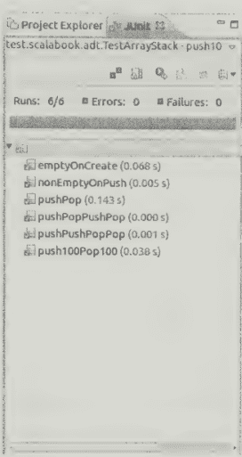

图 24.5：当 JUnit 测试运行且所有测试都通过时，Eclipse 会显示此内容。绿色条意味着一切正常。如果出现红色条，则一个或多个测试失败，它们会为你列出。

```
import org.junit._
import org.junit.Assert._
import scalabook.adt._

class TestArrayQueue {
  var queue:Queue[Int] = null

  @Before def initQueue {
    queue = new ArrayQueue[Int]
  }

  @Test def emptyOnCreate {
    assertTrue(queue.isEmpty)
  }

  @Test def nonEmptyOnEnqueue {
    queue.enqueue(5)
    assertFalse(queue.isEmpty)
  }

  @Test def enqueueDequeue {
    queue.enqueue(5)
    assertEquals(5,queue.dequeue)
  }

  @Test def enqueueDequeueEnqueueDequeue {
    queue.enqueue(5)
    assertEquals(5,queue.dequeue)
    queue.enqueue(3)
    assertEquals(3,queue.dequeue)
  }

  @Test def enqueueEnqueueDequeueDequeue {
    queue.enqueue(5)
    queue.enqueue(3)
    assertEquals(5,queue.dequeue)
    assertEquals(3,queue.dequeue)
  }

  @Test def enqueue100Dequeue100 {
    val nums = Array.fill(100)(util.Random.nextInt)
    nums.foreach(queue.enqueue(_))
    nums.foreach(assertEquals(_,queue.dequeue))
  }
}
```

你也可以检查这些，并会发现我们基于数组的队列实现通过了所有这些测试。

### 24.7.3 测试套件

自动化测试的目的是使在开发过程中定期运行所有测试变得容易。能够定期运行所有测试的能力让你在对代码进行更改时更有信心。如果你运行测试并且它们通过，然后进行更改并导致一个或多个测试失败，你就知道确切导致失败的原因，并且更容易定位和诊断。

不幸的是，遍历每个测试类并运行它与遍历大量定义了 `main` 用于测试的对象一样痛苦。为了整合你的测试运行，你可以创建一个测试套件。这让你可以指定一组包含应一起运行的测试代码的不同类。要构建测试套件，你创建一个类并用 `@RunWith` 和 `@Suite.SuiteClasses` 注解进行注解。这里是一个包含我们刚刚编写的两个测试的套件示例。

```
package test

import org.junit.runner.RunWith
import org.junit.runners.Suite

@RunWith(classOf[Suite])
@Suite.SuiteClasses(Array(
    classOf[scalabook.adt.TestArrayStack],
    classOf[scalabook.adt.TestArrayQueue],
    classOf[scalabook.util.TestRPNCalc]
))
class AllTests
```

请注意，该类实际上什么也没包含。正是注解告诉 JUnit 这里应该完成的所有工作。随着我们添加更多测试类，我们也会将它们添加到我们的套件中。


# 24.7.4 测试驱动开发

单元测试是被称为“测试驱动开发”（TDD）的开发方法的核心部分。这种开发风格的显著特点是：在实际编写代码之前，先为代码编写测试。在 TDD 环境中，想要编写新类的程序员会先创建该类，并放入空白方法，这些方法只包含足以让类编译的代码。返回值的方法被设置为返回默认值，如 null、0 或 false。不放入任何逻辑或数据。

之后，开发者为该类编写一个基本测试并运行它，观察其失败。然后添加刚好足够的代码使该测试通过。一旦所有现有测试通过，就再编写一个会失败的测试，然后重复这个过程，直到编写出足够多的测试，这些测试能证明该类必须满足预期需求才能全部通过。

虽然教科书没有采用 TDD 方法，但 TDD 有一些显著的好处。最主要的是它迫使开发者小步前进，并定期验证一切正常。它还让你在修改代码时有一种安全感，因为通常你会确信，如果你做出的更改破坏了某些东西，它会立即在测试中显示为红色条。这对新手程序员尤其重要，因为他们经常因为害怕出错而不敢删除大段代码，只好将其注释掉。因此，关于 TDD 的文献将测试称为给你“勇气”去修改代码。

关于单元测试还有很多我们在这里没有涉及的内容。感兴趣的读者可以访问 JUnit 网站，或者了解基于 Scala 的测试框架，如 ScalaCheck 和 ScalaTest。完整的开发不仅仅需要单元测试。单元测试本质上确保小块代码能独立工作。要对整个应用程序有信心，你需要测试各个组件协同工作的情况。这被称为集成测试，在 TDD 中同样需要相当频繁地进行。

# 24.8 RPN 计算器

栈的一个经典使用示例是逆波兰表示法（Reverse Polish Notation，RPN）计算器。在 RPN 模式下，操作符输入在其操作数之后。这也被称为后缀表示法。“2 + 3”的 RPN 表示是“2 3 +”。虽然这看起来可能很奇怪，但它有一个非常重要的优点：不需要括号来指定操作顺序。使用标准表示法，也称为中缀表示法，表达式“2 + 3 * 5”和“5 * 3 + 2”结果都是 17，因为无论书写顺序如何，乘法都会在加法之前执行。如果你希望先做加法，必须用括号指定：“(2 + 3) * 5”。使用后缀表示法，你可以写“3 5 * 2 +”得到 17，或者如果希望先做加法得到 25，可以写“2 3 + 5 *”。没有括号可以显著减少复杂表达式的长度，这在处理此类问题时很有吸引力。

使用一个保存操作数的栈，可以非常容易地计算后缀表达式。只需遍历表达式，对每个元素执行以下操作之一：如果是数字，将该数字压入栈中；如果是运算符，从栈中弹出两个元素，对它们执行相应操作，然后将结果压回栈中。最后，栈上应只剩下一个值，即最终结果。我们可以使用以下对象来实现这一基本功能。

```scala
object RPNCalc {
  def apply(args:Seq[String]):Double = {
    val stack = new ArrayStack[Double]
    for(arg <- args; if(arg.nonEmpty)) arg match {
      case "+" => stack.push(stack.pop+stack.pop)
      case "*" => stack.push(stack.pop*stack.pop)
      case "-" => val tmp = stack.pop; stack.push(stack.pop-tmp)
      case "/" => val tmp = stack.pop; stack.push(stack.pop/tmp)
      case x => stack.push(x.toDouble)
    }
    stack.pop
  }
}
```

这些参数作为序列传入，并通过 for 循环遍历。减法和除法运算符与加法和乘法略有不同，因为它们不满足交换律，操作数的顺序很重要。该代码还假定，四个运算符之外的任何内容都是数字。

在这个基础之上，还可以添加一些不错的功能。例如，除了标准的四种算术运算外，增加一些其他函数会更好。另外，如果能支持变量，就不必让每个值都是字面数值。下面展示一个支持这些扩展的最终对象。

```scala
package scalabook.util

import scalabook.adt.ArrayStack

object RPNCalc {
  def apply(args:Seq[String],vars:collection.Map[String,Double]):Double = {
    val stack = new ArrayStack[Double]
    for(arg <- args; if(arg.nonEmpty)) arg match {
      case "+" => stack.push(stack.pop+stack.pop)
      case "*" => stack.push(stack.pop*stack.pop)
      case "-" => val tmp = stack.pop; stack.push(stack.pop-tmp)
      case "/" => val tmp = stack.pop; stack.push(stack.pop/tmp)
      case "sin" => stack.push(math.sin(stack.pop))
      case "cos" => stack.push(math.cos(stack.pop))
      case "tan" => stack.push(math.tan(stack.pop))
      case "sqrt" => stack.push(math.sqrt(stack.pop))
      case v if(v(0).isLetter) => stack.push(try { vars(v) } catch { case ex => 0.0 })
      case x => stack.push(try { x.toDouble } catch { case ex => 0.0 })
    }
    stack.pop
  }
}
```

这里添加了三个主要三角函数以及一个平方根函数。这些操作只弹出一个值，应用函数，然后将结果压回。该代码还包含一个类型为 Map[String,Double] 的额外参数，用于按名称存储变量。这里使用 scala.collection.Map 类型，它是可变和不可变映射的父类型。此代码不关心可变性，因此提供了额外的灵活性。最后，添加了一些错误处理，以便如果传入的值既不是数字也不是有效变量，则向栈中压入 0.0。

在我们声明这段代码有效之前，需要对其进行测试。² 下面是一个可能的测试配置。

```scala
package test.scalabook.util
import org.junit._
import org.junit.Assert._
import scalabook.util.RPNCalc
class TestRPNCalc {
@Test def basicOps {
assertEquals(5,RPNCalc("2 3 +".split(" "),null),0.0)
assertEquals(6,RPNCalc("2 3 *".split(" "),null),0.0)
assertEquals(3,RPNCalc("6 2 /".split(" "),null),0.0)
assertEquals(1,RPNCalc("3 2 -".split(" "),null),0.0)
}

@Test def twoOps {
assertEquals(20,RPNCalc("2 3 + 4 *".split(" "),null),0.0)
assertEquals(3,RPNCalc("2 3 * 3 -".split(" "),null),0.0)
assertEquals(5,RPNCalc("6 2 / 2 +".split(" "),null),0.0)
assertEquals(0.25,RPNCalc("3 2 - 4 /".split(" "),null),0.0)
}

@Test def vars {
val v = Map("x" -> 3.0, "y" -> 2.0)
assertEquals(20,RPNCalc("2 x + 4 *".split(" "),v),0.0)
assertEquals(3,RPNCalc("y 3 * x -".split(" "),v),0.0)
assertEquals(5,RPNCalc("6 2 / y +".split(" "),v),0.0)
assertEquals(0.25,RPNCalc("x y - 4 /".split(" "),v),0.0)
}

@Test def specials {
val v = Map("pi" -> 3.14159, "x" -> 3.0, "y" -> 2.0)
assertEquals(0,RPNCalc("pi cos 1 +".split(" "),v),1e-8)
assertEquals(math.sqrt(2)+3,RPNCalc("y sqrt x +".split(" "),v),1e-8)
assertEquals(1,RPNCalc("pi 2 / sin".split(" "),v),1e-8)
assertEquals(0.0,RPNCalc("x y y 2 / + - tan".split(" "),v),1e-8)
}
```

与之前的测试一样，这些测试相当简单。理论上，可以有无数种测试来验证 RPN 计算器。这套测试只是挑选了几个与计算器预期支持的不同功能类型相关的不同测试。

真正的单元测试拥护者会希望将每个 assertEquals 拆分成单独的方法，因为每个断言都不依赖于之前的断言结果。这不仅仅是风格问题，这种方法确实有功能性好处。JUnit 会独立运行所有测试方法，但每个测试方法在断言失败时会停止。因此，如果处理“2 3 +”失败，按照当前写法，我们将无法得知该测试中其他三行的结果。这使得更难定位失败原因。如果“2 3 +”失败而其他所有单运算符调用都通过，我们可以相当确定问题出在“+”的处理上。按现在的写法，我们无法获得这些额外信息。之所以使用这里所示的格式，唯一原因是它只需不到一半的行数就能保持可读性。

> ² 值得注意的是，这段代码最初有一个错误，正是这些测试发现了它。


这个 RPNCalc 对象也可以作为命令集成到绘图程序中。为了使用变量，我们在 Drawing 类中增加了一个额外的 val，名为 vars，它是一个 mutable.Map[String,Double]。然后我们添加了两个名为 “rpn” 和 “set” 的命令。第一个使用指定的参数调用该 RPNCalc 对象。第二个允许你在该绘图的 Map 中设置变量。下面是 Commands 的修改版本代码

```
package scalabook.drawing

/**
 * This object defines the command processing features for the drawing.
 * Use apply to invoke a command.
 */
object Commands {
  private val commands = Map[String,(String,Drawing)=>Any](
    "add" -> ((rest,d) => rest.trim.split(" +").map(_.toInt).sum),
    "echo" -> ((rest,d) => rest.trim),
    "refresh" -> ((rest,d) => d.refresh),
    "freeze" -> ((rest,d) => Thread.sleep(rest.trim.toInt*1000)),
    "rpn" -> ((rest,d) => scalabook.util.RPNCalc(rest.trim.split(" +") ,d.vars)),
    "set" -> ((rest,d) => {
      val parts = rest.trim.split(" +")
      d.vars(parts(0)) = parts(1).toDouble
      parts(0)+" = "+parts(1)
    })
  )

  def apply(input:String,drawing:Drawing):Any = {
    val spaceIndex = input.indexOf(' ')
    val (command,rest) = if(spaceIndex < 0) (input.toLowerCase(),"")
    else (input.take(spaceIndex).toLowerCase(),input.drop(spaceIndex))
    if(commands.contains(command)) commands(command)(rest,drawing)
    else "Not a valid command."
  }
}
```

得益于原始设计的灵活性，添加两个额外命令几乎不需要任何工作。添加 vars 到 Drawing 则需要更多的工作。最明显的地方是在顶行传递参数。

```
class Drawing(private val root:DrawTransform,private[drawing] val vars:mutable.Map[String,Double]) extends Serializable {
```

更大的挑战来自于伴生对象中反序列化 XML 的 apply 方法需要一个合适的 map。下面是两个版本的 apply 代码以及从 XML 构建 map 的一个方法。

```
def apply(data:xml.Node):Drawing = {
  new Drawing(DrawTransform(null,(data \ "drawTransform") (0)),buildVars(data \
    "variable"))
}

def apply():Drawing = {
  new Drawing(new DrawTransform(null),mutable.Map[String,Double]())
}
```

```
def buildVars(nodes:NodeSeq):mutable.Map[String,Double] = {
	mutable.Map((for(n <- nodes) yield (n \ "@name").text -> (n \ "@value").text.toDouble): _ *)
}
```

要从 XML 中提取数据，就意味着数据必须先进入 XML。为此，我们还必须修改 Drawing 中的 toXML 方法，以包含变量的额外元素。这可以用以下代码完成。

```
def toXML : xml.Node =
<drawing>
  {root.toXML}
  { for(n,v) <- vars) yield (<variable name={n} value={v.toString}/>) }
</drawing>
```

这里使用了一个 for 循环来简化处理从 map 中出来的元组时的语法。

# 24.9 本章末尾材料

### 24.9.1 概念总结

- • 术语抽象数据类型，ADT，用于描述具有良好定义的操作的程序结构，但不指定这些操作是如何实现的。这个概念与接口与实现分离的思想相联系。

- • 栈是一种简单的 ADT，具有两个基本操作，push 和 pop。push 操作将元素添加到栈顶。pop 操作移除最近添加的元素。这种内容移除的顺序称为后进先出，LIFO。

- • 队列是另一种简单的 ADT，具有 enqueue 和 dequeue 操作。enqueue 将元素添加到队列，而 dequeue 取出在队列中停留最久的元素。这种元素移除的排序方案称为先进先出，FIFO。

- • 阶数分析帮助我们理解算法随着输入规模增大时的行为。O 记号忽略常数倍数和低阶项。它只有在输入规模变得很大时才真正相关。

- • 由于其简单性，栈或队列的任何合理实现都应具有 O(1) 的摊还成本操作。

- • 实现该栈 ADT 的一种方法是使用 Array 来存储数据。只需在 Array 中维护指向栈顶的索引并从 0 开始构建。当 Array 已满时，应通过乘性因子增长，以在复制操作上保持 O(1) 的摊还成本。

- • 也可以用 Array 实现队列。实现稍微复杂一些，因为数据在一端添加，在另一端移除。当它们到达末端时，前端和后端会绕回，以便 Array 保持小巧且大多数操作不需要复制。与栈一样，当 Array 确实需要增长时，应通过乘性因子增长。

- 测试是软件开发中非常重要的一部分。单元测试是对代码小单元的功能测试，例如单个类。JUnit 框架提供了一种简单的方法来构建可在软件开发期间定期运行的单元测试。

### 24.9.2 练习

- 1. 为 RPN 计算器添加额外的函数。
- 2. 为书中所示的 JUnit 测试编写更多测试。
- 3. 编写一些代码，以便通过网络发送的请求被排队并按到达顺序处理。你可以用 Thread.sleep 模拟长时间运行的计算。
- 4. 对于此练习，你应该实现队列和栈的几种可能版本，然后对它们进行计时测试，以查看它们的扩展效果。你将包含本章中开发的实现以及一些略有修改的实现，以查看细微选择如何影响最终实现的速度。
- 5. 使用 synchronized.wait 和 notifyAll 构建你自己的 BlockingQueue 版本，以重现 java.util.concurrent 中的版本行为。

### 24.9.3 项目

正如你可能猜到的，本章的项目要求你在代码中添加栈和/或队列。其中许多要求你制作线程安全的队列，以便在代码中放置在你可能使用过 java.util.concurrent.BlockingQueue 的地方。

- 1. 如果你一直在做 MUD 项目，对于本次迭代，你应该制作自己的线程安全队列，专门用于将从服务器套接字线程登录的玩家传递给主游戏线程。你可以决定包含的确切功能，但两个关键方面是它需要是 FIFO 并且线程安全。
- 2. 如果你一直在做网页爬虫项目，请制作并使用自己的线程安全队列，用于在套接字读取线程和解析线程之间传递信息以及返回。至少会有两个队列实例用于这些功能，每个数据流方向至少有一个。
- 3. 如果你正在做网络图形游戏，你需要为与 MUD 相同的目的编写一个线程安全队列。
- 4. 回到项目 4（p.494）关于数学练习表，建议你可以通过使用命令模式将多态性集成到你的项目中。命令模式的主要用途之一是实现撤销和重做功能。栈是执行此操作的理想数据结构。你让主应用程序跟踪两个栈。一个是撤销栈，你在命令执行时将其推入。当用户选择撤销时，你弹出撤销栈上的最后一个命令，调用其 undo 方法，然后将其推到第二个栈，即重做栈。当用户选择重做时，事情向相反方向移动。注意，任何正常活动可能都应清除重做栈。

你在此使用的栈可能与默认实现略有不同。首先，你需要重做栈具有 clear 方法。此外，你可能不想要无限撤销，因此你可能希望栈在推送一定数量的元素后“丢失”元素。如何以保持 $O(1)$ 行为的方式实现这一点留给学生作为练习。

- 项目 5（p.494）建议你在 Photoshop® 项目中添加命令模式以实现撤销和重做功能。正如上面对数学练习表所描述的那样，这最好用两个栈完成。对于本次迭代，你应该为 Photoshop 做上面为数学练习表描述的内容。

- 到目前为止，仿真工作台的项目让你使用像重力或布粒子网格这样的 N 体仿真。现在我们要加入一种根本不同类型的仿真，离散事件仿真。这些在第 26 章中讨论得更深入，但你可以在这里创建第一个简单的仿真，单服务器队列。

单服务器队列的想法是你有人们到达并排队以从单个服务器接收服务。人们以随机间隔到达，服务器花费随机时间处理请求。当人们到达而服务器忙时，他们进入队列。仿真可以跟踪人们等待多长时间以及队列的平均长度等信息。

离散事件仿真的关键是你只关心事件，而不是事件之间的时间。在此系统中，只有两种类型的事件，客户到达和服务完成。每次只能安排其中一种。要模拟到达，你将使用指数分布，要模拟服务时间，你将使用 Weibull 分布。以下公式可用于从这些分布生成数字，其中 $r$ 是对 `math.random` 的调用结果。

- $a(\lambda)_{exponential} = -\frac{-\ln(1-r)}{\lambda}$
- $a(k, \lambda)_{Weibull} = \lambda(-\ln(1-r))^{\frac{1}{k}}$

对于 Weibull，使用 $k = 2$。$\lambda$ 值决定到达或服务之间的平均时间。你应该让用户更改这些值。

仿真应从 $t = 0$ 开始，队列中没有人。你从指数分布生成一个值，$a_{exponential,1}$ 并立即推进到那个时间，此时第一个人进入。由于此时没有人被服务，他们直接进入服务器。你还从指数分布生成另一个数字，$a_{exponential,2}$ 并将其保留为下一个人进入的时间。第一个人进入服务器导致你生成一个服务时间，$a_{Weibull,1}$ 表示那个人何时完成服务，你将其存储。

然后你立即推进到两个事件时间中较小的那个。因此，要么第二个人到达并进入队列，要么第一个人被服务且服务器空闲且无人。每次有人到达时，你都会安排下一次到达。每次有人进入服务器时，你都会安排他们何时


完成。注意生成的时长是间隔，因此你需要将其加到当前时间上以得知事件发生的时间。

让用户决定模拟运行多久。计算并显示平均等待时间、平均队列长度以及服务器忙碌的时间比例。

7. 对于非联网游戏，很难预测什么会合适。对于某些游戏，你可以实现如项目 4 中所述的撤销和重做功能。这最适用于回合制游戏。也有可能你可以在线程之间传递信息或在操作耗时存在延迟时将用户命令排队的地方使用队列。

# 第 25 章

# 链表

- 25.1 List/Seq 抽象数据类型 ........................................................ 657
- 25.2 数组的本质 ............................................................. 658
- 25.3 链表的本质 ....................................................... 658
- 25.4 可变单向链表 .................................................. 660
- 25.4.1 实现 mutable.Buffer ........................................ 663
- 25.4.2 迭代器 ................................................................. 666
- 25.5 可变双向链表 .................................................. 668
- 25.6 不可变单向链表 ................................................ 671
- 25.7 基于链表的栈和队列 ....................................... 674
- 25.7.1 基于链表的栈 ............................................... 674
- 25.7.2 基于链表的队列 ............................................... 675
- 25.8 章末材料 ....................................................... 676
- 25.8.1 概念总结 .................................................... 676
- 25.8.2 练习 ................................................................... 676
- 25.8.3 项目 ..................................................................... 677

到目前为止，在本书中我们很乐意在不完全理解其工作原理的情况下使用集合库。对于我们所做的大部分工作以及计算机科学（CS）第一年的学习来说，这已经足够了，但真正的开发者需要了解实际发生的情况，以便他们能够就不同情况下使用何种集合类型做出明智的判断。本章将开始揭示我们如何通过链接存储少量数据的对象来构建自己的数据存储结构。

# 25.1 List/Seq 抽象数据类型

本章的主题是链表。这是一种存储数据的方法，可以应用于一些不同的抽象数据类型（ADT）。本章后面我们将看到链表如何用作栈和队列的存储。在此之前，我们想介绍一种能力阶梯上更高一级的新 ADT，即列表 ADT。该 ADT 提供了存储由整数索引的数据序列的能力，并具有随机检索、插入和删除的功能。以语言无关的方式，人们可能会期望这些功能以如下方法实现。

```
def get(index:Int) : A
def set(index:Int, data:A)
def insert(index:Int, data:A)
def remove(index:Int) : A
```

这里 A 是存储在列表中的数据的类型。insert 和 remove 方法会移动元素，使得指定索引之后的所有元素在插入时向后移动一个索引，在删除时向前移动一个索引。

这组方法最适合可变列表实现。也可以制作不可变列表实现。这些在执行插入或删除等操作时会返回新的集合。它们通常也避免进行一般的插入或删除，因为这些操作可能非常低效。

在 Scala 集合中，该 ADT 的行为由 Seq 特质在没有 insert 和 remove 功能的情况下表示，而由 Buffer 特质更完整地表示。它们的方法与上面列出的方法略有不同。我们将在后面的章节中看到这些方法，在那里我们构建继承自这些特质的实现。

# 25.2 数组的本质

要理解链表，有助于有一个可供比较的对象。数组是最简单的集合类型。数组是一块内存，其大小足以容纳所有需要存储的内容。计算机中的内存以数字地址布局，每个数组元素必须相同大小。这意味着只要知道数组中任何元素的地址，就可以通过几次数学运算找到该元素的地址。因此，如果你知道数组中第一个元素的位置，就可以用 O(1) 的工作量找到任何其他元素。

列表 ADT 可以使用数组作为存储来实现。这就是 ArrayBuffer 所做的。当你用数组构建列表时，get 和 set 方法可以在 O(1) 操作中完成，因为它们只是直接访问数组。这使得它们非常快，如果你将大量调用这些方法在列表上，那么基于数组的列表可能是理想的。另一方面，基于数组的列表中的 insert 和 remove 方法必须复制 O(n) 个元素，以便为新元素腾出空间或在删除元素后填补空缺。更具体地说，所有指定索引之后的元素都必须移动。这不仅是 O(n) 操作，复制过程中的内存写入部分在大多数现代硬件上往往特别慢，因此它在相当昂贵的操作中是 O(n)。如果你总是向列表末尾添加或从末尾删除，那么访问就类似于我们之前编写的栈，一切都是 O(1) 或接近 O(1)。如果你的程序将花费大量时间进行随机插入和删除，更糟的是在列表开头附近进行，那么基于数组的版本可能并不理想。

像基于数组的栈和队列一样，列表应允许数组大于当前列表，真实大小存储在 Int 中。此外，数组应以乘法步长而不是加法步长增长，以便摊还成本为 O(1)。这种列表的实际构造留给读者作为练习。

# 25.3 链表的本质

在某些方面，链表可以被视为数组的替代方案，其在数组薄弱的领域很强，但在数组擅长的领域很弱。数组不是拥有计算机可以高效访问的单个大内存块，只要它知道第一个元素的位置就可以访问任何元素，链表则由存储单个元素的节点组成，这些节点链接在一起。内存中的组织实际上是随机的，因此从一个节点可以直接到达的唯一节点是它所链接到的节点。有许多不同类型的链接数据结构具有这种形式。链表具有顺序结构，每个节点将链接到其后的节点以及可能其前的节点。当只有一个指向下一个节点的链接时，称为单向链表。当同时有指向前一个和下一个的链接时，称为双向链表。

图 25.1 显示了多种不同类型的链表的图形表示。在此图中，每个节点由一组框表示。对于单向链表，第一个框代表存储在该节点中的数据的引用，而第二个框是下一个节点的引用。箭头显示引用链接的位置。数据的箭头未显示，因为这通常与功能无关。从某种意义上说，列表并不关心它们包含的内容。这种图形表示对于理解用于操作链表的代码非常有帮助。

从图中可以看到，单向和双向链表都可以设置成

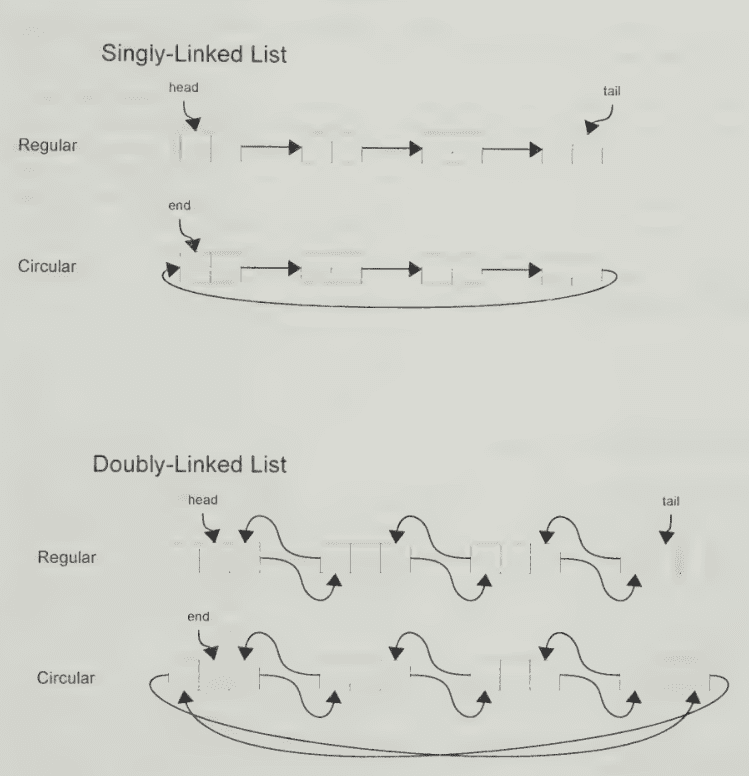

**图 25.1：** 该图显示了一些不同形式的链表的基本结构。


链表可以组织成常规或循环配置。在常规配置中，列表的末端（第一个或最后一个元素）由空引用表示。在循环配置中，这些引用会指向列表的另一端。

程序必须始终跟踪链表的至少一个元素。对于常规单链表，这必须是头。列表中的所有元素都可以通过头访问，但由于引用是单向的，如果你丢失了对头的引用，那么在你保留的节点之前的所有节点都将丢失。图示在列表的另一端显示了另一个引用到尾部。存储尾部通常不是必需的，但它可以使某些操作显著加快。特别是，如果不跟踪尾部，向可变列表末尾添加元素的时间复杂度为 O(n)，但如果跟踪尾部，则可以在 O(1) 时间内完成。因此，出于这个原因，我们将在最终的可变单链表中跟踪尾部，尽管这会给代码增加相当多的复杂性。

# 25.4 可变单链表

我们将实现的第一个链表形式是一个非常基础的可变单链表。我们将只包含上面列出的四个方法，即使这种最小实现并不太有用。从这里开始是有启发性的，这样其他方法的细节就不会妨碍你的理解。

下面的类展示了这样的链表可能是什么样子。get 和 set 方法已被更改为 apply 和 update 以利用 Scala 对这些特殊方法的语法规则，但它们内部的逻辑没有改变。

```scala
package scalabook.adt

/**
 * This is a very simple implementation of a basic linked list.
 * @tparam A the type stored in the list.
 */
class SinglyLinkedList[A] {
  private class Node(var data:A, var next:Node)
  private var head:Node = null

  /**
   * This method gets the value at a specified index. If the index is beyond the
   * length of the list a NullPointerException will be thrown.
   * @param index the index to get.
   * @return the value at that index.
   */
  def apply(index:Int) : A = {
    assert(index>=0)
    var rover = head
    for(i <- 0 until index) rover = rover.next
    rover.data
  }

  /**
   * Sets the value at a particular index in the list. If the index is beyond the
   * length of the list a NullPointerException will be thrown.
   * @param index the index to set the value at.
   * @param data the value to store at that index.
   */
  def update(index:Int, data:A) {
    assert(index>=0)
    var rover = head
    for(i <- 0 until index) rover = rover.next
    rover.data = data
  }

  /**
   * Inserts a new value at a particular index in the list. If the index is beyond
   * the length of the list a NullPointerException will be thrown.
   * @param index the index to set the value at.
   * @param data the value to insert at that index.
   */
  def insert(index:Int, data:A) {
    assert(index>=0)
    if(index==0) {
      head = new Node(data,head)
    } else {
      var rover = head
      for(i <- 0 until index-1) rover = rover.next
      rover.next = new Node(data,rover.next)
    }
  }

  /**
   * Removes a particular index from the list. If the index is beyond the length
   * of the list a NullPointerException will be thrown.
   * @param index the index to remove.
   * @return the data value that had been stored at that index.
   */
  def remove(index:Int) : A = {
    assert(index>=0)
    if(index==0) {
      val ret = head.data
      head = head.next
      ret
    } else {
      var rover = head
      for(i <- 0 until index-1) rover = rover.next
      val ret = rover.next.data
      rover.next = rover.next.next
      ret
    }
  }
}
```

该类采用一个名为 A 的类型参数，表示列表中数据的类型。该类包含一个名为 Node 的私有小类，用于存储对数据和对下一个节点的引用。链表类还通过一个名为 head 的变量跟踪列表的头。

该类中的四个方法都相当简单，并且包含非常相似的结构。让我们先看 apply 方法。它以一个 assert 开始，以确保索引不小于零。注释还说，如果提供超出列表长度的索引，将抛出 NullPointerException。虽然这对于我们当前的需求来说已经足够，但这并不是理想的行为。如果请求超出边界的索引，抛出一个包含请求内容和数量信息的适当异常会好得多。这个缺陷将在稍后更完整的实现中得到纠正。

此类中的所有方法都声明了一个名为 rover 的变量，用于遍历列表。对于数组，我们通过使用索引计数来遍历元素。节点不必在内存中连续，因此我们必须通过从一个节点跟随引用到另一个节点来遍历元素。这就是 for 循环内部的赋值 `rover = rover.next` 所做的。

> 问题：你如何从这个简单的链表实现中删除重复代码？

insert 和 remove 方法有一个 apply 和 update 中都没有的元素，即处理列表开头的特殊情况。insert 和 remove 都会更改列表中的引用，并且必须为第一个元素的情况包含特殊处理。正常情况会更改 next 引用，而特殊情况会更改 head。

读者还应注意到 insert 和 remove 中的 for 循环只运行 n−1 次。这是因为在单链表中，添加或删除一个节点需要更改其前一个节点的 next 引用。如果你想删除索引 3 处的节点，你必须拥有索引 2 处节点的引用，并将其 next 引用更改为指向当前索引 4 处的节点。这就是 `rover.next = rover.next.next` 行发生的情况。如果 rover 一直走到我们想要删除的节点，我们将无法访问需要修改的引用，因为单链表中无法向后移动。

为了说服自己这段代码有效，我们可以实现以下测试来进行一些最小检查。

```scala
package test.scalabook.adt

import org.junit._
import org.junit.Assert._
import scalabook.adt._

class TestSinglyLinkedList {
  var list:SinglyLinkedList[Int] = null

  @Before def setup {
    list = new SinglyLinkedList[Int]
  }

  @Test def appendOne {
    list.insert(0,10)
    assertEquals(10,list(0))
  }

  @Test def appendTwo {
    list.insert(0,10)
    list.insert(0,20)
```

```scala
def +=(elem: A): Buffer.this.type
def +=:(elem: A): Buffer.this.type
def apply(n: Int): A
def clear(): Unit
def insertAll(n: Int, elems: Traversable[A]): Unit
def iterator: Iterator[A]
def length: Int
def remove(n: Int): A
def update(n: Int, newelem: A): Unit
```

这意味着如果我们想扩展 mutable.Buffer 类型，我们必须实现这九个方法。回报是，mutable.Buffer 的大量其他方法将自动为我们工作。这是因为那些其他方法是以这九个抽象方法为基础实现的。所以花费九个方法就可以获得许多其他方法。

下面的代码展示了这样一个类的实现。此实现同时跟踪头和尾，分别称为 hd 和 tl，以便它们不与 Scala 序列中通用的 head 和 tail 成员冲突。该类还跟踪一个名为 num 的 Int，以便对 length 和边界检查都可以高效完成。

```scala
package scalabook.adt

import collection.mutable

class MutableSList[A] extends mutable.Buffer[A] {
  private var hd:Node = null
  private var tl:Node = null
  private var num = 0
  private class Node(var data:A, var next:Node)

  def +=(elem: A) = {
    if(tl==null) {
      tl = new Node(elem,null)
      hd = tl
    } else {
      tl.next = new Node(elem,null)
      tl = tl.next
    }
    num += 1
    this
  }

  def +=:(elem: A) = {
    hd = new Node(elem,hd)
    if(tl==null) {
      tl = hd
    }
    num += 1
    this
  }

  def apply(n: Int): A = {
    if(n<0 || n>=num) throw new IndexOutOfBoundsException(n+" of "+num)
    var rover = hd
```


```scala
for(i <- 0 until n) rover = rover.next
rover.data
}

def clear() {
  hd = null
  tl = null
  num = 0
}

def insertAll(n: Int, elems: Traversable[A]) {
  if(n<0 || n>=num+1) throw new IndexOutOfBoundsException(n+" of "+num)
  if(elems.nonEmpty) {
    val first = new Node(elems.head,null)
    var last = first
    num += 1
    for(e <- elems.tail) {
      last.next = new Node(e,null)
      last = last.next
      num += 1
    }
    if(n==0) {
      last.next = hd
      hd = first
      if(tl==null) tl=last
    } else {
      var rover = hd
      for(i <- 1 until n) rover = rover.next
      last.next = rover.next
      rover.next = first
      if(last.next==null) tl = last
    }
  }
}

def iterator = new Iterator[A] {
  var rover = hd
  def hasNext = rover!=null
  def next:A = {
    val ret = rover.data
    rover = rover.next
    ret
  }
}

def length : Int = num

def remove(n: Int): A = {
  if(n<0 || n>=num) throw new IndexOutOfBoundsException(n+" of "+num)
  num -= 1
  if(n==0) {
    val ret = hd.data
    hd = hd.next
    if(hd==null) tl = null
    ret
  } else {
    var rover = hd
    for(i <- 1 until n) rover = rover.next
    val ret = rover.next.data
    rover.next = rover.next.next
    if(rover.next==null) tl = rover
    ret
  }
}

def update(n: Int, newelem: A) {
  if(n<0 || n>=num) throw new IndexOutOfBoundsException(n+" of "+num)
  var rover = hd
  for(i <- 0 until n) rover = rover.next
  rover.data = newelem
}

override def toString = mkString("MutableSLList(", ", ", ")")
}
```

对公共方法的注释已被省略，因为它们会与主 API 中的注释相镜像。

与之前的列表一样，`insertAll` 和 `remove` 中都有特殊情况来处理边界情况。这些情况是列表的头部或尾部被修改的情况。由于包含对尾部的引用，这里有更多的特殊情况代码。包含此引用的主要动机是，当我们拥有尾部引用时，追加到列表的 `+=` 方法为 $O(1)$，我们应该期望它会被相当规律地调用。

### 25.4.2 迭代器

此代码还包含对 `iterator` 方法的实现。该方法应该为我们提供一个 `Iterator`，可以高效地遍历列表。使用带索引的循环和 `apply` 来遍历链表效率不高。更具体地说，以这种方式遍历链表需要 $O(n^2)$ 操作。这是因为 `apply` 会遍历到请求索引为止的整个列表。因此，第一次请求需要 $0$ 步，接下来需要 $1$ 步，第三次需要 $2$ 步。这一直持续到最后一次调用，需要遍历 $n-1$ 个链接。这些之和为 $n(n-1)/2$，即 $O(n^2)$。使用 `Iterator` 提供了一种让任何外部代码以 $O(n)$ 操作遍历列表元素的方法。正如我们之前所见，`Iterator` 具有 `next` 和 `hasNext` 方法，让我们可以遍历元素。创建我们自己的 `Iterator` 时只需要编写这些方法。在我们列表的实现中，它们看起来与类内部使用的循环代码非常相似。我们有一个 `rover` 从头部开始。`hasNext` 方法只是检查 `rover` 是否到达了列表末尾的 `null`。`next` 方法将 `rover` 移动到 `rover.next` 并返回 `rover` 先前引用的数据。

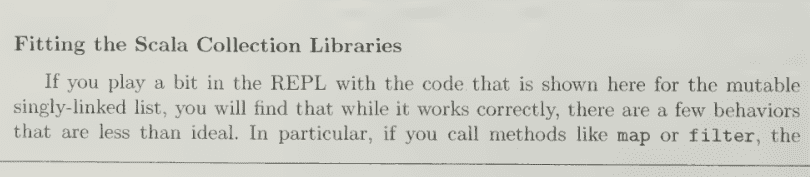

### 适配 Scala 集合库

如果你在 REPL 中稍微尝试一下这里展示的可变单链表代码，你会发现虽然它能正确工作，但有一些行为不太理想。特别是，如果你调用像 `map` 或 `filter` 这样的方法，结果集合会是一个 `ArrayBuffer`。这不是你从 Scala 集合中期望的行为，因为这些方法通常会返回与操作对象相同的类型。这是因为我们没有编写这些方法，并且依赖于 `Buffer` 超类型中的实现来提供它们。`Buffer` 类型默认返回 `ArrayBuffer`，所以这里我们看到的就是它。

如果解决这个问题需要重写所有返回集合的方法，那么扩展 `Buffer` trait 的好处就会大大降低。Scala 集合库的设计使得这不是必需的，但让这些方法返回不同类型仍然有点具有挑战性。为了让你的集合真正融入主集合库，需要做一些事情。除了扩展 `Buffer` 类型之外，我们还扩展了 `BufferLike` 类型。`BufferLike` trait 是众多以 `Like` 结尾的 trait 之一，可用于添加到库中。

`BufferLike` trait 接受两个参数。一个是元素类型，另一个是集合类型。在本例中为 `MutableSLList[A]`。这个第二个类型参数告诉它对于创建新集合的调用，例如 `filter` 和 `map`，应该返回什么。之后，事情变得稍微复杂一些。我们需要指定这些类型是如何构建的。对于我们的代码，这导致继承自 `GenericTraversableTemplate`，创建一个是 `SeqFactory` 的伴生对象，并让我们的类也继承自 `Builder`。把所有内容放在一起，改动看起来像这样。

```scala
import collection.generic._

class MutableSLList[A] extends mutable.Buffer[A]
    with GenericTraversableTemplate[A,MutableSLList]
    with mutable.BufferLike[A,MutableSLList[A]]
    with mutable.Builder[A,MutableSLList[A]] {
...

override def companion: GenericCompanion[MutableSLList] = MutableSLList

def result() = this
...
}

object MutableSLList extends SeqFactory[MutableSLList] {
    implicit def canBuildFrom[A]: CanBuildFrom[MutableSLList[_], A, MutableSLList[A]] =
        new GenericCanBuildFrom[A]
    def newBuilder[A]: mutable.Builder[A, MutableSLList[A]] =
        new MutableSLList[A]
}
```

这开始引入了 Scala 语言中主要对库编写者重要的方面。由于本书的目标不是让你成为熟练的 Scala 库编写者，我们将不会在未来的集合中加入这种类型的功能，因为它会模糊你应该学习的概念。

# 25.5 可变双向链表

现在我们要考虑双向链表。双向链表相对于单向链表的明显优势是可以双向遍历。这需要每个节点多一个引用以及处理它的额外代码。然而，正如我们在上一节看到的，额外代码的主要来源并不是处理 `next` 引用，而是处理头部和尾部引用的特殊情况。幸运的是，当我们使用双向链表时，有一种方法可以消除这种特殊情况代码，因此处理前一个引用的开销会被更多地补偿。我们通过引入一个特殊节点来实现这一点，称为哨兵。

哨兵是一个不存储数据的额外节点，但它充当列表的开始和结束。为了使这成为可能，列表必须是循环的。如果我们将哨兵称为 `end`，那么 `end.next` 就是列表的头部，而 `end.prev` 就是列表的尾部。这种改变节省了大量的代码，因为现在头部和尾部只是 `next` 和 `prev` 引用，因此在这些位置的添加和删除与在其他位置的操作没有区别。

这里展示了该 `Buffer` trait 实现的代码。类顶部声明与单链表中的非常相似，只是有一个名为 `end` 的节点引用，并且最初该节点的 `next` 和 `prev` 被设置为指向自身。该类的顶部还有另外两点需要注意。`end` 节点必须赋予一个数据值。这带来了一些问题，因为类型参数 `A` 没有单一的值可以用作默认值。为了绕过这个问题，我们使用了与基于数组的栈和队列相同的方法，要求类型具有 manifest，然后 `end` 中的数据是通过创建一个包含一个元素的数组并使用该第一个元素来设置的。还有其他使用继承的解决方案，但它们需要更多的代码，并且可能模糊此示例的目的。

```scala
package scalabook.adt

import collection.mutable

class MutableDLList[A : Manifest] extends mutable.Buffer[A] {
  private var num = 0
  private class Node(var data:A, var prev:Node, var next:Node)
  private val end = new Node(new Array[A](1)(0),null,null)
  end.next = end
  end.prev = end

  def +=(elem: A) = {
    val newNode = new Node(elem,end.prev,end)
    end.prev.next = newNode
    end.prev = newNode
    num += 1
    this
  }

  def +=:(elem: A) = {
    val newNode = new Node(elem,end,end.next)
    end.next.prev = newNode
    end.next = newNode
    num += 1
  }
}
```


```
this
}

def apply(n: Int): A = {
    if(n<0 || n>=num) throw new IndexOutOfBoundsException(n+" of "+num)
    var rover = end.next
    for(i <- 0 until n) rover = rover.next
    rover.data
}

def clear() {
    end.prev = end
    end.next = end
    num = 0
}

def insertAll(n: Int, elems: Traversable[A]) {
    if(n<0 || n>=num+1) throw new IndexOutOfBoundsException(n+" of "+num)
    if(elems.nonEmpty) {
        var rover = end.next
        for(i <- 0 until n) rover = rover.next
        for(e <- elems) {
            val newNode = new Node(e,rover.prev,rover)
            rover.prev.next = newNode
            rover.prev = newNode
            num += 1
        }
    }
}

def iterator = new Iterator[A] {
    var rover = end.next
    def hasNext = rover!=end
    def next:A = {
        val ret = rover.data
        rover = rover.next
        ret
    }
}

def length : Int = num

def remove(n: Int): A = {
    if(n<0 || n>=num) throw new IndexOutOfBoundsException(n+" of "+num)
    num -= 1
    var rover = end.next
    for(i <- 0 until n) rover = rover.next
    val ret = rover.data
    rover.prev.next = rover.next
    rover.next.prev = rover.prev
    ret
}

def update(n: Int, newelem: A) {
    if(n<0 || n>=num) throw new IndexOutOfBoundsException(n+" of "+num)
    var rover = end.next
    for(i <- 0 until n) rover = rover.next
    rover.data = newelem
  }

  override def toString = mkString("MutableDLLST(", ", ", ")")
}
```

其他方法在你看过单向链表之后应该相当直接。最大的变化是每个节点-节点链接需要分配两个指针，并且所有的特殊情况代码都消失了。总的来说，这个版本更短、更不复杂、更不容易出错，因为去除了特殊情况代码。读者应该画图来看看像 `rover.prev.next = rover.next` 这样的行的效果。*remove* 中的这一行特别利用了双向链表可以向前和向后遍历的事实，因此对我们要删除的节点的引用就足够了。我们不需要像单向链表那样拥有对前一个节点的直接引用。

# 通过继承使用哨兵

强制类型具有显式声明并仅仅为了在哨兵中存储一个数据值而创建一个小数组，从风格上讲是不理想的。有一种替代方案。使用继承，我们可以创建一个特殊的节点类型来表示哨兵，它本身不包含数据。以下是使用该方法编写的替代代码。

```
class MutableDLLST[A] extends mutable.Buffer[A] {
  private var num = 0
  private trait Node {
    var data:A
    var prev:Node
    var next:Node
  }
  private class DNode(var data:A, var prev:Node, var next:Node) extends Node
  private class ENode extends Node {
    def data:A = throw new IllegalArgumentException("Requested value of sentinel node.")
    def data_=(d:A) = throw new IllegalArgumentException("Value assigned to sentinel node.")
    var next:Node = this
    var prev:Node = this
  }
  private val end = new ENode
}
```

使用这种方法，`Node` 类型现在是一个 *trait*，其子类型为 `DNode` 和 `ENode`。节点定义了我们之前在 `Node` 中拥有的不同字段的抽象 `vars`。`DNode` 类型继承自它，并且在其他方面看起来与我们原来的 `Node` 类完全一样。这种方法不同之处在于用于哨兵的 `ENode`。该类对 `next` 和 `prev` 使用常规的 `var` 声明，但对 `data` 的处理则完全不同。不是声明一个 `var`，而是有两个 `def` 声明用于获取和设置 `data`。这两个都抛出异常而不是返回一个值。这之所以可行，是因为 `var` 声明实际上

编译成这些 getter 和 setter 方法，而 throw 表达式的类型是 Nothing，它是 Scala 中每种其他类型的子类型。

在这两种方法之间的选择大多是风格问题，但这里使用继承可能会导致编译后的代码稍慢一些。继承的方法使用虚拟函数调用，其开销比调用没有任何覆盖的 final 方法更大。编译器是否在这种情况下生成更慢的代码取决于编译器。在你自己的平台上测试这一点留给读者作为练习。

# 25.6 不可变单向链表

我们之前查看的两个链表实现都是可变链表。因此我们可以实例化一个列表然后以各种方式修改其内容。这与 Buffer trait 配合得很好，但事实证明我们在 Scala 中工作的第一个链表类是 List 类，它表示一个不可变链表。

不可变链表只有作为单向链表才有意义，因为不允许更改数据或链接。一旦列表创建，它必须完全保持完整和不变。添加到列表前端的操作，即我们用 :: 完成的操作，会在不以任何方式改变之前节点的情况下附加一个新节点。与可变链表不同，可变链表将列表包裹在节点周围并将其隐藏，在不可变链表中，节点就是列表。它们周围没有任何东西被包裹。

下面的代码给出了一个不可变单向链表的实现。这使用了与 List 类本身类似的设计。不是单个类，而是一个小型层次结构，我们通常用来引用列表的主要类是抽象的，并且有两个子类型来表示空节点和非空节点。

```
package scalabook.adt

import collection.immutable.LinearSeq

sealed abstract class ImmutableSLList[+A] extends LinearSeq[A] {
  def ::[B >:A](elem:B):ImmutableSLList[B] = new Cons(elem,this)
  override def iterator = new Iterator[A] {
    var rover:LinearSeq[A] = ImmutableSLList.this
    def hasNext = !rover.isEmpty
    def next = {
      val ret = rover.head
      rover = rover.tail
      ret
    }
  }
}

final class Cons[A](hd:A,tl:ImmutableSLList[A]) extends ImmutableSLList[A] {
  def length = 1+tl.length
  def apply(index:Int):A = if(index==0) hd else tl.apply(index-1)
  override def isEmpty = false
  override def head = hd
  override def tail = tl
}
```

```
object MyNil extends ImmutableSLList[Nothing] {
  def length = 0
  def apply(index:Int) = throw new IllegalArgumentException("Nil has no contents.")
  override def isEmpty = true
  override def head = throw new IllegalArgumentException("Nil has no head.")
  override def tail = throw new IllegalArgumentException("Nil has no tail.")
}
```

```
object ImmutableSLList {
  def apply[A](data:A*):ImmutableSLList[A] = {
    var ret:ImmutableSLList[A] = MyNil
    for(d <- data.reverse) {
      ret = new Cons(d,ret)
    }
    ret
  }
}
```

这段代码中有一些我们之前没有见过的内容，可能需要一些解释。从顶部开始，主要类被标记为 sealed 和 abstract。我们见过 abstract，但 sealed 是新的。这个关键字所暗示的是，该类的所有子类型都必须出现在当前文件中。这可以用来为模式匹配提供更好的类型检查。在这种情况下，它提供了我们知道其他程序员不能产生与我们对列表期望的行为不同的不良子类型的保障。通常我们可以用 final 来强制执行这一点，以确保没有任何东西继承自一个类。在这种情况下这不是一个选项，因为我们需要一些继承。

接下来是 ImmutableSLList 的类型参数。它是 +A 而不是只是 A。加号表示列表在类型参数上是协变的。这是一个在附录 B 中更详细讨论的话题。现在只需说这意味着如果 B 是 A 的子类型，那么 ImmutableSLList[B] 就是 ImmutableSLList[A] 的子类型。如果没有加号，类型参数是不变的，并且不同类型参数的类型的类在有效上是无关的。

类中的第一个方法是 ::，以模仿标准 List 类中使用的那个。这个奇怪之处在于类型参数的边界。这是我们第一次看到 >: 类型边界的使用。这表示我们可以使用任何类型 B，只要它与 A 相同或 A 的超类型。这一符号在 19.4.3 小节中提到过，但在现在之前我们没有用武之地。为了看看这会产生什么效果，考虑在 REPL 中使用标准 List 的以下代码。

```
scala> val nums = List(1,2,3)
nums: List[Int] = List(1, 2, 3)

scala> "hi" :: nums
res0: List[Any] = List(hi, 1, 2, 3)
```

注意 res0 的类型。它是 List[Any]。我们的列表也会以相同的方式表现。新的元素 "hi" 不是一个 Int，所以 Scala 必须找出一个类型 B 来使用。String 和 Int 的唯一超类型是 Any，所以那就是使用的类型。如果继承层次结构中更低位置存在一个共同超类型，则会改用它。

在 iterator 方法中，rover 的声明需要一个显式的类型，因为


rover.tail 是父类型的一个方法。同样值得注意的是，rover 被初始化为当前节点。这是以下事实带来的副作用：在这种实现中，节点并非隐藏在一个列表中，它们本身就是列表。实际上，每个节点要么作为空列表，要么作为某个列表的头部来表示一个列表。

主类的定义之后是两个子类型。第一个表示非空节点，在这里被称为 Cons，它保存该节点中的数据元素以及列表中其余部分对应的节点。为了完成 LinearSeq，该类必须实现 length 和 apply。为了使实现对标准用法更高效，我们还重载了 isEmpty、head 和 tail。这些相同的方法也放在表示空列表的对象 MyNil 中。它是一个对象，因为我们只需要存在一个这样的对象。它扩展了 ImmutableSLList[Nothing]，从而可以成为任何列表类型的子类型。这就是 ImmutableSLList 相对于 A 的协变性变得重要的地方。如果没有这一点，每种列表类型都需要一个单独的空列表对象。

代码最后是一个带有 apply 方法的伴生对象。这使我们能够使用习惯上用于 List 的相同语法来创建新的列表类型。

一些测试代码可以很好地展示我们列表的用法。你可以看到，它在功能上与普通的 List 类型非常相似。

```
package test.scalabook.adt

import org.junit._
import org.junit.Assert._
import scalabook.adt._

class TestImmutableSLList {
    @Test def nilIsEmpty {
        assertTrue(MyNil.isEmpty)
    }

    @Test def buildCons {
        val lst = 1 :: 2 :: 3 :: MyNil
        assertEquals(3,lst.length)
        assertEquals(1,lst.head)
        assertEquals(2,lst(1))
        assertEquals(3,lst(2))
    }

    @Test def buildApply {
        val lst = ImmutableSLList(1,2,3)
        assertEquals(3,lst.length)
        assertEquals(1,lst.head)
        assertEquals(2,lst(1))
        assertEquals(3,lst(2))
    }
}
```

我们的代码不会做的一件事是在 :: 上进行模式匹配。要实现这一点需要更高级的技术，这些技术留待附录介绍。

实际的 scala.collection.immutable.List 代码比我们这里编写的代码更复杂，但主要是为了引入更高的效率。这个类完全不可变，也就是说，任何节点一旦创建就永远不能改变。这迫使我们在希望获得任何效率时，只能通过将新节点添加到头部来构建列表。这一点出现在我们代码的末尾：在 for 循环中，apply 方法的输入被反转。这是一种开销，真正的库版本设法绕过了这种开销。

# 25.7 基于链表的栈和队列

回顾一下，ADT 的主要特征是它告诉我们不同的方法是做什么的，而不是它们如何实现。链表是一种实际实现，正如我们所见，它可以用来实现列表 ADT。它也可以用作其他 ADT 的存储机制。特别是，对于目前所考虑的仅有的其他 ADT——栈和队列，它也能很好地工作。与基于数组的实现一样，我们要求这些集合上的所有操作都是 O(1)，因为它们在根本上是简单的。

### 25.7.1 基于链表的栈

为了用链表实现栈，我们可以把在前面某一节中编写的某个列表的实例作为成员放入这个类中，并对其进行操作。从软件工程的角度来看，这种方法是有价值的，因为代码复用可以显著提高生产力。然而，本章的重点是链表的性质和结构。为此，从头构建，并在这个类中包含一个节点类型以及直接操作它的代码，是有价值的。这种方法还有助于我们更好地控制所写代码的效率。

下面展示了一个使用单向链表实现的栈。Node 类型使用 case class 创建，因为其中的值不会改变。这为创建不可变节点提供了一种简便方法。

```
package scalabook.adt

class ListStack[A] extends Stack[A] {
    private case class Node(data:A, next:Node)
    private var top:Node = null
    
    def push(obj:A) {
        top = Node(obj, top)
    }
    
    def pop():A = {
        assert(!isEmpty, "Pop called on an empty stack.")
        val ret = top.data
        top = top.next
        ret
    }
    
    def peek:A = top.data
    
    def isEmpty:Boolean = top==null
}
```

top 成员是一个 var，充当链表的头部。这些方法的实现非常直接了当。如你所见，这是一个非常短的类，即使我们在这里重新实现了一个单向链表。这种简洁性是可能的，因为栈 ADT 本身很简单。不需要循环或复杂逻辑，因为所有访问（添加和删除）都发生在栈顶。

这个类的测试代码与 ArrayStack 的测试代码完全相同，只是把 Array 一词换成了 List。在这些替换中，只有一处是功能性的而非表面性的，即 @Before 方法中栈的实例化。

### 25.7.2 基于链表的队列

可以使用相同的过程来创建一个使用链表存储数据的队列。对于栈，我们只需要维护链表的一端，既可以添加也可以删除。对于队列，我们需要跟踪链表的两端。其中一端是 front，另一端是 back。哪一端是 head、哪一端是 tail，取决于我们需要实现的功能。新元素应从 back 添加，从 front 移除。我们刚刚看到，head 可以高效地完成这两种操作。那么 tail 呢？

对于单向链表，我们只能高效地在 tail 处添加，却不容易从那里删除。这又回到了那个问题：要从单向链表中删除某个节点，你需要知道被删除节点前面的那个节点，而我们不能反向遍历链表。因此，如果我们要保持 O(1) 性能，队列的 back 必须是链表的 tail。

下面展示了基于链表的队列代码。有一些额外的特殊情况需要处理，这使得该代码比栈的代码长一些。特别是，当向空队列添加元素，或者删除操作取走队列中最后一个元素时，需要对 back 进行调整。

```
package scalabook.adt

class ListQueue[A] extends Queue[A] {
  private class Node(val data:A,var next:Node)
  private var front:Node = null
  private var back:Node = null

  def enqueue(obj:A) {
    if(front==null) {
      front = new Node(obj,null)
      back = front
    } else {
      back.next = new Node(obj,null)
      back = back.next
    }
  }

  def dequeue():A = {
    assert(!isEmpty,"Dequeue called on an empty queue.")
    val ret = front.data
    front = front.next
    if(front==null) back = null
    ret
  }

  def peek:A = front.data

  def isEmpty:Boolean = front==null
}
```

# 25.8 章末材料

### 25.8.1 概念总结

- 比栈或队列稍微复杂一点的 ADT 是 List/Seq ADT。这个 ADT 提供了随机访问元素的方法。
- 我们一直在使用的数组以单一内存块的形式存储，可以容纳所需数量的引用。这意味着当你知道内存块的位置时，你就知道每个元素的位置。然而，插入和删除很慢。
- 链表是以顺序方式存储值的一种替代方法。它不是使用一个大内存块，而是由节点组成，每个节点链接到一个或两个其他节点。链表至少跟踪一个节点，然后可以从该节点到达其他节点。这使得随机访问变慢，但插入和删除可以通过 O(1) 次内存移动完成。
- 在单向链表中，每个节点保存对位于它前方的那个节点的引用，链表必须跟踪第一个节点。它也可以跟踪最后一个节点。这些边界成为特殊情况，使代码更复杂。
- 双向链表的节点保存对下一个元素和前一个元素的引用。它们最好使用哨兵节点来实现，该节点不存储数据，实际上就是链表中的第一个和最后一个节点。哨兵节点使双向链表的代码保持简短，无需处理特殊情况。
- 虽然链表的随机访问很慢，但迭代器允许高效的线性访问。
- 单向链表也可以写成不可变的。List 类型正是这样做的。在这类代码中，节点本身表示一个列表，并且有一个专门表示空列表的对象。
- ADT 不规定具体实现方式这一事实，可以通过使用链表作为数据存储机制重新实现栈和队列 ADT 来加以说明。

### 25.8.2 练习

1. 编写列表 ADT 的基于数组的实现。你可以选择只实现本章第一节列出的四个方法，或者实现 Buffer trait。
2. 使用下面一组操作，比较你的基于数组的列表和链表的速度。
3. 比较使用两种不同节点类型的双向链表的速度。


- 在末尾添加，随机读取元素，随机设置元素，从末尾移除。
- 在随机位置添加，随机读取元素，随机设置元素，从随机位置移除。
- 在开头添加，随机读取元素，随机设置元素，从开头移除。
- 在随机位置添加，使用迭代器顺序读取元素，从随机位置移除。
- 4. 修改链表的代码，将使用 rover 遍历节点的操作抽取到一个单独的函数中，并在需要该行为的地方调用该函数。
- 5. 为链表测试代码添加更多测试。确保包含使用 remove 完全清空列表然后重新填充的情况。
- 6. 比较基于列表的栈与基于数组的栈在不同大小和不同使用模式下的速度。
- 7. 比较基于列表的队列与基于数组的队列在不同大小和不同使用模式下的速度。

### 25.8.3 Projects

本章的项目没有单独的描述。在所有项目中，你应该已经在使用某种形式的 Seq 或 Buffer 来存储重要数据。对于本项目，你需要将代码转换为使用你自己构建的链表类，而不是你一直在使用的 Scala 库类。

# Chapter 26 Priority Queues

- 26.1 Two Approaches ......................................................... 679
- 26.1.1 Searching by Priority ................................................... 680
- 26.1.2 Sorted Linked List ...................................................... 680
- 26.1.3 Problems with Arrays .................................................... 682
- 26.2 Project Integration: Discrete Event Simulation ................................ 683
- 26.2.1 Cell Splitting ........................................................... 683
- 26.2.2 Collision Handling ...................................................... 686
- 26.3 End of Chapter Material .................................................... 693
- 26.3.1 Summary of Concepts ..................................................... 693
- 26.3.2 Exercises ................................................................ 694
- 26.3.3 Projects ................................................................. 694

我们之前研究的队列抽象数据类型 ADT 可以被视为对服务线的建模。所有添加进去的实体都被视为相等，并且按到达顺序取出。并非所有系统都以这种公平的方式运作。在现实生活中，有 VIP 通道之类的东西。某些系统有充分的理由对实体进行不同对待。急诊室就是此类系统的例子。如果你带着纸割伤来到急诊室，你可以预期要等待很长时间。这是因为急诊室中人们被服务的顺序更多地基于病情的严重程度，而非到达时间。预约制的情况也是另一个例子。提前很久到达预约时间通常并不会让你显著提前就诊。

这类系统需要一种新的 ADT，即优先级队列。优先级队列具有与普通队列相同的方法，但 dequeue 和 peek 方法的行为不同，它们会给出队列中优先级最高的对象，并且只有当最高优先级项的优先级相等时才考虑在队列中的时间长短。

### 26.1 Two Approaches

本章我们将考虑两种不同的优先级队列实现方法，两者都使用链表进行存储。两者的区别在于是在向队列添加新项时做额外工作，还是将工作推迟到项被移除时。我们将讨论这两种方法并比较其效率，但只实现其中更好的那一种。与普通队列不同，优先级队列不可能对所有方法都获得 O(1) 性能。对于我们将讨论的实现，一些方法将是 O(n)。我们将在第 32 章讨论另一种可以改进这一点的实现。

所有优先级队列的实现都将扩展以下 trait。

```scala
package scalabook.adt

/**
 * This trait defines a mutable Priority Queue ADT.
 * @tparam A the type of data stored
 */
trait PriorityQueue[A] {
  /**
   * Add an item to the priority queue.
   * @param obj the item to add
   */
  def enqueue(obj:A)

  /**
   * Remove the item that has the highest priority or, in the case of a tie,
   * has been on the longest.
   * @return the item that was removed
   */
  def dequeue():A

  /**
   * Return the item that has the highest priority or, in the case of a tie,
   * has been on the longest without removing it.
   * @return the most recently added item
   */
  def peek:A

  /**
   * Tells whether this priority queue is empty.
   * @return true if there are no items on the priority queue, otherwise false.
   */
  def isEmpty:Boolean
}
```

### 26.1.1 Searching by Priority

一种使用链表创建优先级队列的方法是像普通队列一样将元素添加到尾部，但随后修改 dequeue 和 peek 中的代码，使其遍历元素以找到优先级最高的元素。在 dequeue 的情况下，该元素随后被移除。

我们可以通过查看每个方法所做的工作量来评估这种方法的质量。enqueue 和 isEmpty 方法将是 O(1)。然而，dequeue 和 peek 都必须搜索所有元素以找到优先级最高的元素。这需要 O(n) 时间。更深入地看，这个搜索特别昂贵，因为不可能在早期就知道我们在寻找什么，所以每次搜索都必须考虑每个元素。

### 26.1.2 Sorted Linked List

第二种方法是在元素添加时做额外工作，并保持列表有序，以便我们始终知道最高优先级项的位置并能高效地移除它。使用这种方法，dequeue、peek 和 isEmpty 方法都是 $O(1)$。**enqueue** 方法 however 必须执行搜索以找到正确的插入位置，因此是 $O(n)$。

这两种方法都至少包含一个 $O(n)$ 的方法。由于大多数应用程序对 **enqueue** 和 **dequeue** 的调用次数大致相等，且调用次数至少也是 $O(n)$，我们可以预期这两种实现整体性能为 $O(n^2)$。第二种方法对大多数应用程序更好，原因有几个。首先，**peek** 调用是 $O(1)$。虽然在逻辑上 **enqueue** 和 **dequeue** 的调用应该大致平衡，但 **peek** 的调用很容易比其他两个更多。此外，将项目放入有序列表不需要遍历整个列表。此过程类似于插入排序的内层循环。你只需要遍历列表直到找到放置新元素的位置即可。对于许多应用程序，新元素自然会比许多先前元素具有更低的优先级。这意味着代码在每次 **enqueue** 时平均只需与少于一半的元素进行比较，而另一种方法中 **dequeue** 和 **peek** 需要与所有元素进行比较。

以下是使用有序链表实现优先级队列的示例实现。

```scala
package scalabook.adt

class SortedListPriorityQueue[A : Manifest](comp: (A,A)=>Int) extends
PriorityQueue[A] {
 private class Node(var data:A, var prev:Node, var next:Node)
 private val end = new Node(new Array[A] (1) (0),null,null)
 end.next = end
 end.prev = end

 def enqueue(obj:A) {
   var rover = end.prev
   while(rover!=end && comp(obj,rover.data)>0) rover = rover.prev
   rover.next.prev = new Node(obj,rover,rover.next)
   rover.next = rover.next.prev
 }

 def dequeue():A = {
   val ret = end.next.data
   end.next = end.next.next
   end.next.prev = end
   ret
 }

 def peek:A = end.next.data

 def isEmpty:Boolean = end.next==end

 def removeMatches(f: A => Boolean) {
   var rover = end.next
   while(rover!=end) {
     if(f(rover.data)) {
       rover.prev.next = rover.next
       rover.next.prev = rover.prev
     }
     rover=rover.next
   }
 }
}
```


可能会听起来很奇怪，因为许多应用程序的平局很少，甚至没有。 在这种放宽的情况下，当找到最高优先级项时，可以将其移除，并将数组中的最后一项交换到其位置，而不是复制所有项向下。

# 26.2 项目集成：离散事件模拟

优先队列得到显著应用的领域之一是离散事件模拟领域。 这是一种模拟风格，其中系统中的所有变化都被建模为在特定时间发生的事件，并且模拟从一个事件瞬间跳到下一个事件。 通常的做法是使用一个优先队列来放置事件。 对 dequeue 的调用会按事件发生的时间顺序取出事件。 大多数事件都有安排一个或多个其他事件的能力。 模拟会一直继续，直到经过一定的时间，或者队列变为空。

离散事件模拟的一个非常标准的例子是柜员前排队的人。 该系统中的事件是人们到达并排队，以及柜员完成与一个人的服务并接待另一个人。 这类模拟使企业能够确定在不同时段需要多少人工作。 其一个小的变体可用于设置交通信号灯的计划。

### 26.2.1 细胞分裂

离散事件模拟的一个非常简单的例子是对培养皿中细胞分裂的简单模型。 该模拟的简单性之一在于只有一种类型的事件，即细胞分裂。 培养皿最初有一个细胞。 经过一段时间后，该细胞分裂成两个细胞。 这两个细胞随后各自再分裂成两个。 这一过程一直持续到我们停止模拟为止。 我们忽略细胞死亡以保持简单。

细胞首次“出生”到分裂之间的延迟不是固定值。 相反，它具有一定的随机性。 花费一个学期来讲解随机数、如何从各种统计分布中抽取随机数以及如何为不同数据集找到合适的分布是可能的。 由于这些细节与我们无关，我们将说每个细胞在产生它的分裂之后，在最小和最大时间单位之间分裂，任何该范围内的值都有相同的概率。 这使用了均匀分布，这就是我们从 math.random 获得的。

在这种情况下，事件只是分裂时间，可以用一个 Double 表示。 我们首先在队列上放置一个值，即第一个细胞分裂的时间。 我们还需要启动一个计数器来跟踪有多少细胞。 它从一开始，每次发生一个事件时都会增加一，因为一个细胞分裂成两个。 这种基本代码如下所示。

```
def runSimulation:Double = {
  val pq = new SortedListPriorityQueue[Double]((a,b) => b.compareTo(a))
  pq.enqueue(minSplitTime+math.random*(maxSplitTime-minSplitTime))
  var pop = 1
  while(pop<maximumPopulation-1) {
    val time = pq.dequeue()
    pop += 1
    pq.enqueue(time+minSplitTime+math.random*(maxSplitTime-minSplitTime))
    pq.enqueue(time+minSplitTime+math.random*(maxSplitTime-minSplitTime))
  }
}
```
```
}
pq.dequeue()
}
```

这段代码将运行模拟，但它对我们来说并没有真正做太多有用的事情，因为它没有为我们做太多事情。 它返回达到停止种群所需的时间。 我们可以通过将其放在一个可绘制的类中并让它绘制种群随时间变化的函数来制作一些更有功能的东西。 执行此操作的代码如下所示。

```
package scalabook.drawing

import swing._
import event._
import java.awt.{Color}
import java.awt.geom._
import java.awt.image.BufferedImage
import collection.mutable
import scalabook.adt._

class DrawCellSim(p:DrawTransform,
    private var width:Int,
    private var height:Int,
    private var maximumPopulation:Int,
    private var minSplitTime:Double,
    private var maxSplitTime:Double,
    private var numSims:Int) extends DrawLeaf {
val parent = p
@transient private var propPanel:Component = null
@transient private var img:BufferedImage = null

private def runSimulation(splits:mutable.Buffer[Double]) {
val pq = new SortedListPriorityQueue[Double]((a,b) => b.compareTo(a))
pq.enqueue(minSplitTime+math.random*(maxSplitTime-minSplitTime))
while(splits.length+1<maximumPopulation) {
val time = pq.dequeue()
splits += time
pq.enqueue(time+minSplitTime+math.random*(maxSplitTime-minSplitTime))
pq.enqueue(time+minSplitTime+math.random*(maxSplitTime-minSplitTime))
}
}

private def redoImage {
if(img==null || width!=img.getWidth || height!=img.getHeight) {
img = new BufferedImage(width,height,BufferedImage.TYPE_INT_ARGB)
}
for(i <- 0 until width; j <- 0 until height) img.setRGB(i,j,0) // transparent
val data = mutable.Buffer[Double]()
var maxTime = -1.0
val g = img.createGraphics()
g.setPaint(Color.black)
for(i <- 0 until numSims) {
runSimulation(data)
if(maxTime < 0) {
maxTime = data.last*1.2
```

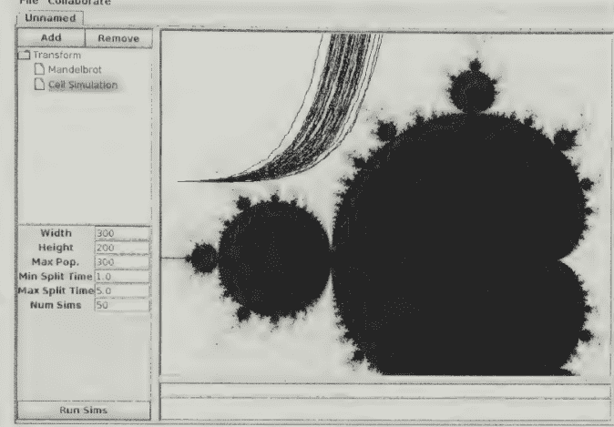

图 26.1：此屏幕截图显示了细胞模拟可绘制的输出。 左侧窗口中可见使用的属性。

处理，例如渲染粒子或应用非碰撞力如重力，可以执行。 这种处理也可以通过偶尔跳出事件处理循环来执行。 经过一些小的修改，我们可以使我们之前编写的 DrawBouncingBalls 类以这种方式工作。

我们要做的第一个修改不是针对弹跳球，而是针对我们的队列。 与前面提到的其他示例不同，此示例要求我们能够在不处理它们的情况下从队列中移除事件。 每次处理修改粒子速度的事件时，涉及该粒子的所有未来事件都必须被移除。 为我们添加该功能的最通用方法是使用以下方法。

```
def removeMatches(f: A => Boolean) {
  var rover = end.next
  while(rover!=end) {
    if(f(rover.data)) {
      rover.prev.next = rover.next
      rover.next.prev = rover.prev
    }
    rover=rover.next
  }
}
```

它接受一个谓词函数并移除所有使函数为真的元素。

有了这个，我们可以对 DrawBouncingBalls 本身进行修改。 我们将在此处显示整个类，因为修改或添加的内容比保留的内容更多。

```
package scalabook.drawing
```

```
import java.awt.{Graphics2D,Color}
```

```
timer.stop()
    button.text="Start"
  }
}
  contents += button
} -> BorderPanel.Position.North
}
}
propPanel
}

override def toString = "Bouncing Balls"

def toXML : xml.Node =
<drawBouncingBalls>
  {balls.map(_.toXML)}
</drawBouncingBalls>

private def collisionTime(b1:DrawBouncingBalls.Ball,
  b2:DrawBouncingBalls.Ball):Double = {
  val (sx1,sy1) = (b1.x-b1.vx*b1.time, b1.y-b1.vy*b1.time)
  val (sx2,sy2) = (b2.x-b2.vx*b2.time, b2.y-b2.vy*b2.time)
  val radSum = b1.size+b2.size
  val (dx,dy) = (sx1-sx2, sy1-sy2)
  val (dvx,dvy) = (b1.vx-b2.vx, b1.vy-b2.vy)
  val c = dx*dx+dy*dy-radSum*radSum
  val b = 2*(dx*dvx+dy*dvy)
  val a = dvx*dvx+dvy*dvy
  val root = b*b-4*a*c
  if(root<0) {
    -1.0
  } else {
    (-b-math.sqrt(root))/(2*a)
  }
}

private def findEventsFor(i:Int,against:Seq[Int],curTime:Double) {
  for(j <- against) {
    val t = collisionTime(workCopy(i),workCopy(j))
    if(t>=curTime && t<1.0) {
      pq.enqueue(new BallBallColl(t,i,j))
    }
  }
  for((tfunc,bfunc) <- DrawBouncingBalls.wallInfo) {
    val t = tfunc(workCopy(i))
    if(t>=curTime && t<1.0) {
      pq.enqueue(new BallWallColl(t,i,bfunc))
    }
  }
}

private trait CollEvent {
  def time:Double
  def handle:Unit
}
```


```scala
private class BallBallColl(val time: Double, val b1: Int, val b2: Int) extends CollEvent {
    def handle {
        val ball1 = workCopy(b1).advanceTo(time)
        val ball2 = workCopy(b2).advanceTo(time)
        val m1 = ball1.size * ball1.size * ball1.size
        val m2 = ball2.size * ball2.size * ball2.size
        val cmvx = (ball1.vx * m1 + ball2.vx * m2) / (m1 + m2)
        val cmvy = (ball1.vy * m1 + ball2.vy * m2) / (m1 + m2)
        val dx = ball1.x - ball2.x
        val dy = ball1.y - ball2.y
        val dist = math.sqrt(dx * dx + dy * dy)
        if (dist > 1.01 * (ball1.size + ball2.size)) {
            println("Warning: collision with big separation. " + b1 + " " + b2 + " " + dist)
        }
        if (dist < 0.99 * (ball1.size + ball2.size)) {
            println("Warning: collision with little separation. " + b1 + " " + b2 + " " + dist)
        }
        val vx1 = ball1.vx - cmvx
        val vy1 = ball1.vy - cmvy
        val nx = dx / dist
        val ny = dy / dist
        val mag = nx * vx1 + ny * vy1
        workCopy(b1) = ball1.copy(vx = ball1.vx - 1.9 * mag * nx, vy = ball1.vy - 1.9 * mag * ny)
        workCopy(b2) = ball2.copy(vx = ball2.vx + 1.9 * mag * nx * m1 / m2, vy = ball2.vy + 1.9 * mag * ny * m1 / m2)
        pq.removeMatches {
            case bbc: BallBallColl => bbc.b1 == b1 || bbc.b2 == b1 || bbc.b1 == b2 || bbc.b2 == b2
            case bwc: BallWallColl => bwc.b == b1 || bwc.b == b2
            case _ => false
        }
        val others = workCopy.indices.filter(b => b != b1 && b != b2)
        findEventsFor(b1, others, time)
        findEventsFor(b2, others, time)
    }
}

private class BallWallColl(val time: Double, val b: Int, val newDir: (Double, Double, Double, Double) => (Double, Double)) extends CollEvent {
    def handle {
        val ball = workCopy(b)
        val nx = ball.x + (time - ball.time) * ball.vx
        val ny = ball.y + (time - ball.time) * ball.vy
        val (nxv, nyv) = newDir(ball.x, ball.y, ball.vx, ball.vy)
        workCopy(b) = DrawBouncingBalls.Ball(nx, ny, nxv, nyv, ball.size, time)
        pq.removeMatches {
            case bbc: BallBallColl => bbc.b1 == b || bbc.b2 == b
            case bwc: BallWallColl => bwc.b == b
            case _ => false
        }
        findEventsFor(b, workCopy.indices.filter(_ != b), time)
    }
}

object DrawBouncingBalls {
    def apply(p: DrawTransform, data: xml.Node) = {
        new DrawBouncingBalls(p, Vector((data \ "ball").map(bxml => {
            val x = (bxml \ "@x").text.toDouble
            val y = (bxml \ "@y").text.toDouble
            val vx = (bxml \ "@vx").text.toDouble
            val vy = (bxml \ "@vy").text.toDouble
            val size = (bxml \ "@size").text.toDouble
            Ball(x, y, vx, vy, size, 0.0)
        })): _*)
    }

    def apply(p: DrawTransform, minSize: Double = 0.01, maxSize: Double = 0.05) = {
        new DrawBouncingBalls(p, Vector.fill(20) {
            val size = minSize + math.random * (maxSize - minSize)
            Ball(size + math.random * (1 - 2 * size), size + math.random * (1 - 2 * size),
                (math.random - 0.5) * 0.02, (math.random - 0.5) * 0.02, size, 0.0)
        })
    }

    case class Ball(x: Double, y: Double, vx: Double, vy: Double, size: Double, time: Double) {
        def toXML = <ball x={x.toString} y={y.toString}
            vx={vx.toString} vy={vy.toString} size={size.toString}/>

        def advanceTo(t: Double) = {
            val dt = t - time
            copy(x = x + vx * dt, y = y + vy * dt, time = t)
        }
    }

    private val wallInfo = Seq[(Ball => Double, (Double, Double, Double, Double) => (Double, Double))](
        (b => if (b.vx < 0) b.time - (b.x - b.size) / b.vx else -1, (x, y, vx, vy) => (vx.abs, vy)),
        (b => if (b.vx > 0) b.time + (1 - b.x - b.size) / b.vx else -1, (x, y, vx, vy) => (-vx.abs, vy)),
        (b => if (b.vy < 0) b.time - (b.y - b.size) / b.vy else -1, (x, y, vx, vy) => (vx, vy.abs)),
        (b => if (b.vy > 0) b.time + (1 - b.y - b.size) / b.vy else -1, (x, y, vx, vy) => (vx, -vy.abs))
    )
}
```

最显著的变更体现在顶部：新增了两个类级变量，并修改了定时器中的代码。新的类级变量是一个数组，用于在处理过程中镜像向量；以及一个优先队列，其元素类型为 CollEvent，CollEvent 是稍后在代码中声明的特质。

定时器代码会检查这两个变量是否为空，如果是则创建它们。这是出于序列化的需要而必须做的。逻辑上的主要变化发生在定时器的 action 中。workCopy 变量被初始化为应用了重力后的球的副本。然后，对于每个球，找出在下一个时间单位内相对于数组中位于它之后的所有球可能发生的所有事件。只检查列表中位于该球之后的粒子，可以避免我们重复发现碰撞。然后，只要优先队列非空，我们就取出下一个事件并处理它。接着，将球复制到一个用于绘图的 Vector 中。绘图、生成属性和生成 XML 的代码保持不变。

在 toXML 方法之后，主类中新增了许多方法和类。其中第一个方法接受两个 Ball 对象，并返回两者之间的碰撞时间。该方法假设球沿直线运动，因此两球之间距离的平方是关于时间的二次函数。我们只需解出它们之间的距离等于两球半径之和的时刻。每个粒子在一步中会记录它所处的“时间”，因此计算时必须考虑这一点。如果没有碰撞，该方法返回 -1.0。否则，它返回较小的根，因为那是粒子相撞的时刻。另一个根则是粒子如果相互穿过时彼此分离的时刻。下面是求二次方程系数的数学推导。

d²(t) = ((x₁ + vx₁ * t) − (x₂ + vx₂ * t))² + ((y₁ + vy₁ * t) − (y₂ + vy₂ * t))²
= (Δx + Δvx * t)² + (Δy + Δvy * t)²
= Δx² + Δy² + 2(ΔxΔvx + ΔyΔvy)t + (Δvx² + Δvy²)t²

当粒子运动比直线更复杂时，求碰撞时间就需要更复杂的代码，因为通常情况下不存在像本例这样有闭式解的情况。

在求碰撞时间的方法之后，还有一个方法，用于查找某个特定粒子在当前时间之后，与某些其他粒子以及墙壁之间发生的所有事件。由于代码的组织方式，处理粒子和墙壁的结构非常相似。我们遍历希望检查的对象，计算事件时间；如果该事件时间落在当前步骤的有效范围内，就将其加入队列。稍后我们会说明墙壁代码是如何按这种方式工作的。

该模拟包含两种碰撞类型，它们都是 CollEvent 特质的子类型，即 BallBallColl 和 BallWallColl。每个类型都知道事件发生的时间，并包含处理事件的代码。墙壁类比较简单，或许值得看一下，弄清它的工作原理。首先，求出球在事件发生时的位置。然后，调用一个在事件构造时传入的函数，该函数接收球的位置和速度，并返回一个新的速度。用新的速度和位置构建一个新的球对象，并将其存储在数组中，替换原来的对象。然后，删除涉及该球的未来事件，并查找新的事件。

球与球碰撞的代码做的事情相同，但涉及两个球，处理这种碰撞需要更多数学计算。除非你想了解，否则理解这些数学并不重要。它首先计算两个球的相对质量，然后求出两个球的质心速度。² 这段代码会将距离与半径之和进行比较，如果距离与期望值不够接近，就打印一条错误信息。这段代码对于确保一切正常运转非常有帮助；虽然最终代码在技术上并不需要它，但保留它可以防止将来修改时出现问题。每个粒子的速度变化量是按速度在分离两粒子的连线方向上的投影的倍数计算的。这段代码中使用了常量 1.9，以便产生一些能量损失。完美的碰撞会使用 2.0。遗憾的是，这段代码的重力积分并不守恒能量，因此让碰撞对系统稍作阻尼会很有帮助。³

² 在质心参考系中计算碰撞要容易得多。在这个运动的参考系中，每个球都像是撞上了一堵静止的墙。

³ 这段代码在步长开始时对每个粒子施加一个完整的向下加速度。如果粒子在步长中途垂直方向反向，重力的影响也应当是反向的。但这里并没有这样做，因此粒子每次从底部反弹时都可能获得能量。


### 26.3.2 练习

1. 编写基于搜索的优先队列代码，并进行速度测试，将其与维护有序链表的版本进行比较。在速度测试中，插入具有随机时间的元素并出队。使用指数范围的元素数量来测量其对性能的影响。

2. 使用有序**数组**和无序**数组**（需要搜索）实现基于**数组**的优先队列。进行速度测试，将它们彼此比较，并与基于链表的实现进行比较。对于基于**数组**的搜索方法，既要做向下移动元素的操作，也要做将最后一个元素交换到被移除元素留下的空洞中的操作。

3. 使用**ArrayBuffer**和**ListBuffer**实现优先队列，看看它们相对于我们的“自定义”实现效率如何。

4. 为碰撞模拟实现一些额外的墙壁类型。考虑尝试非直线墙壁，或编写一个创建墙壁段的方法。

5. 查找一些不同的随机变量分布，并尝试使用这些分布进行细胞分裂模拟。

### 26.3.3 项目

1. 在你的 MUD 中，有几种方式可以很好地利用优先队列。所有这些方式都涉及一个单一的优先队列，动作可以被添加到其中，以便在稍后的时间执行。这将允许诸如法术具有延迟效果或逐渐失效之类的功能。它也可以被计算机控制的角色使用，并用于实现角色的随机生成。优先队列的优点是，你不必在每个角色/房间/物品中都检查是否有事情应该发生。相反，所有这些事物都可以将事件以延迟的方式放入优先队列，而主线程只在需要时取出相应的事件。

   这里的思想是使用有序链表或**数组**来实现优先队列，以便 **peek** 操作能够快速执行。其思路是，在大多数“时钟滴答”中，优先队列上不会有任何需要处理的事件。在这种情况下，代码只需执行一次 **peek**，看到第一个元素的时间在当前时间之后，然后继续处理其他需要完成的事情。

2. 如果你正在从事网络爬虫项目，你可能已经注意到许多网站非常庞大。即使你将爬虫限制在单个域名内，比如只处理以 cnn.com、espn.go.com 或 google.com 结尾的域名页面，仍然可能会有极其大量的页面。如果你按照链接被发现的顺序进行处理，由于资源限制，你可能永远无法访问到许多你感兴趣的数据。处理这个问题的一种方法是使待读取的页面队列以优先队列的方式工作。

   如果你知道你正在寻找的页面类型，并大致了解它们在你所爬取网站上的路径，你可以为这些页面赋予更高的优先级。这样，你就会优先访问这些页面。只要程序持续发现具有你已经编码为感兴趣结构的页面，它就会处理这些页面，而不会去访问那些可能不太包含感兴趣信息的其他页面。

3. 如果你正在开发联网或非联网的图形游戏，你可以在游戏的主循环中使用优先队列，其方式与上述 MUD 的描述大致相同。玩家可能会做一些不应立即产生效果的事情。同样，游戏中可能有很多单位不需要在每个时钟滴答时更新。在任一情况下，你都可以制作一个事件/命令的优先队列，这些事件/命令仅在它们该发生时才会被执行。

4. 本章对离散事件模拟这一主题进行了合理的介绍。为你的模拟工作台添加一些支持通用离散事件模拟以及碰撞模拟的功能。创建一些用户可以生成并运行的离散事件模拟的具体实例。允许用户调整某些重要参数，并跟踪模拟状态的重要方面。

5. 数学工作表中没有明显的地方可以加入优先队列。两种可能性是：让用户能够在工作表中构建简单的离散事件模拟，或者让工作表的元素按优先级处理。如果你希望当前屏幕上的元素先于屏幕外的元素被计算，或者你认为图形元素的处理优先级应低于数值元素，那么后一种可能性可能很有用。

   如果这两种方案都不吸引你，或者不适合你项目的需求，你也可以改为完成本章的前三个练习。

6. Photoshop® 项目也不会自然而然地适合包含优先队列。如果你能想到一个应用场景，可以编写一个。对绘制元素进行优先级排序可能可行，但你必须确保不会破坏在画家算法中用户对覆盖关系的控制。

   如果这个选项不适合你项目的需求，你也可以改为完成本章的前三个练习。

# 第 27 章：重构

- 27.1 坏味道 ......................................................... 698
- 27.2 重构方法 .................................................... 701
  - 27.2.1 内置重构方法 ......................................... 701
  - 27.2.2 引入空对象 ........................................... 702
  - 27.2.3 添加和移除参数 ....................................... 702
  - 27.2.4 开关语句的疗法 ....................................... 703
  - 27.2.5 合并条件表达式 ....................................... 705
  - 27.2.6 将过程化设计转换为对象 ............................... 705
  - 27.2.7 封装集合 ............................................. 705
  - 27.2.8 下移或上移字段或方法 ................................. 706
  - 27.2.9 替换算法 ............................................. 707
- 27.3 章末材料 .................................................... 707
  - 27.3.1 概念总结 .............................................. 707
  - 27.3.2 练习 .................................................. 708
  - 27.3.3 项目 .................................................. 708

在本书的后半部分，当你处理更长的代码片段时，你应该已经意识到在处理大型程序时的一些事项。例如，你第一次编写代码时，可能不会以最优的方式完成。此外，当你最初布局如何组合某些东西时，你很可能会遗漏一些必须添加的细节。更有甚者，以随意的方式向代码上粘贴片段往往会导致代码非常脆弱，难以处理。如果你是在专业环境中编写软件，这里还可以添加另一条规则：客户通常并不真正知道自己想要什么。

当把所有这些因素放在一起时，会得出一个一般性的规则：代码需要具有动态性和适应性。你必须愿意并且能够随着时间推移修改做事的方式。同时，理想情况下，这种修改应以良好的方式进行，这样结果就不会只是在粗陋拼凑的解决方案中不断叠加错误的方法来达到最终目标。

在本章中，我们将研究软件开发人员工具包中用于随着时间有效管理代码的主要工具之一，因为旧的方法会被新的方法取代，功能也会不断堆积。这个工具被称为重构，它是在不改变功能的情况下修改现有代码。乍一看，在不改变功能的情况下修改代码的想法可能有些奇怪，但这样做有充分的理由。


# 27.1 坏味道

并非所有代码都是一样的。虽然有效地有无限多种方法可以构建解决问题的正确方案，但你应该已经学到，许多在技术上正确但并不理想的解决方案。有些情况下这显而易见。在其他情况下，这取决于应用程序，甚至取决于你问谁。代码非常像是一门艺术，因此美往往在欣赏者眼中。即使代码并不完全理想，也不意味着值得花费精力重写成更好的形式。技术术语上，具有使之不理想的属性的代码被称为有坏味道。

“坏味道”这个词带有强烈的意象。坏味道可以很强也可以很轻微。即使某物闻起来不好，如果它真的很轻微，那么除非有充分的理由，否则你可能不会费力去纠正它。此外，并非所有程序员对不同的坏味道都同样敏感。在他的书 *Refactoring: Improving the Design of Existing Code* 中，Martin Fowler 与 Kent Beck 一起列出了可能困扰代码的 22 种不同的坏味道 [5]。我们将在此全部列出，并附上简要解释以及它们可能在我们编写的代码中出现的地方的示例。

- **不同接口的替代类** - 当你在不同类中有方法做同样的事情，但调用名称不同时。这使得代码非常难以使用。你应该选择一个合适的名称并将所有内容重命名以匹配。

- **注释** - 一些注释绝对是有用的。太多注释，尤其是当它们没有真正增加额外信息时，就会显得有坏味道。与代码不同步的注释也极其难闻。程序员会阅读注释来帮助他们弄清楚代码中发生了什么。如果注释没有随代码一起更新，这可能导致严重的混淆并浪费大量时间。与其有糟糕的注释，不如没有注释更好。

- **数据类** - 这些类除了存储数据之外什么都不做，并且没有真正的功能。用单独的文件充斥这些类会使人们很难浏览代码。你可以考虑将它们嵌套在与 case class 有有意义关系的对象内部。

- **数据块** - 总是几乎一起出现并且应该合并成一个类的数据片段。这是一个简单示例是数据点信息。不要将 x、y 和 z 分开并作为三个单独的参数传递给许多不同的方法，而是使用可以存储三个值的类。这样做的好处是调用代码明确知道数据是一个点，而不是三个不相关的 Doubles。

- **发散式变更** - 当你因不同原因在不同时间更改同一段代码（通常是一个类）时。这可能意味着代码在承担过于宽泛的职责。尝试将其拆分为更专注于其任务的更小块。

- **重复代码** - 名字说明了一切。我们从本书很早的时候就一直在讨论如何避免这种坏味道。到此时，读者也应该充分意识到重复代码的弊端，例如错误重复以及对某些更改需要修改所有副本。已经介绍了多种减少代码重复的方法，从函数到集合和循环，然后最终到抽象和多态，你应该努力将任何特定逻辑的编写次数尽可能少。

### 功能嫉妒

这是指一个类中的方法对另一个类进行了大量调用，特别是如果只是为了获取进行计算的数据。这很可能意味着该方法位于错误的类中，应该移得更靠近它使用的数据。

### 不当亲密

对象本应封装一个概念。如果有两个类不断相互引用对方的元素，这就意味着事物没有被适当拆分。考虑重新安排事物，使每个类更独立地存在。

### 不完整的库类

当你使用的库缺少你需要的功能时，就会产生这种坏味道。它之所以在库中很重要，是因为你通常不能修改库代码。在 Scala 中，你通常可以通过隐式转换来解决这个问题。这是一种更高级的技术，在附录 B 中讨论。

### 过大类

类变得过大时就难以管理。你希望任何给定类的功能都特定于某个任务。如果一个类变得过大，这表明它可能应该被拆分为部分。

### 懒惰类

如果你有一个类几乎什么都不做，它就是懒惰的，你应该考虑删除它。至少，将此类类放在适当的其他类或对象内部，以便它们不占用自己的文件。

### 过长方法

正如本书前半部分所讨论的，过长函数容易出错。方法也一样。如果一个方法变得过长，就应该将其拆分为块。

### 参数列表过长

参数列表极长的方法很难使用。通常，过长的参数列表伴随着“数据块”坏味道。可以通过传递包含所需值的小数量对象来缩短参数列表。

### 消息链

这种坏味道发生在某个类通过许多对象来获取所需内容时。例如，val stu = school.teacher.course.student。这样的问题在于，你编写此代码的类依赖于 teacher、course 和 student 这三个不同类中方法的确切名称和一般契约。如果其中任何一个发生变化，此代码将中断。那是不好的。

### 中间人

这种坏味道出现在一个类的许多方法只是将调用转发给另一个类时。转发者是“中间人”。如果这种情况发生太多，并且没有提供其他好处，你应该考虑直接访问执行工作的对象。

### 平行继承层次结构

这是“霰弹式修改”的特殊情况。在这种情况下，你有两个相互镜像的继承层次结构。当一个类被添加到其中一个时，它也必须被添加到另一个。

### 原始类型偏执

在 Java 和许多其他语言中，Int、Double、Char 和 Boolean 等类型被称为原始类型，并且它们与对象被不同对待。Scala 不保持这种区别，但这种坏味道仍然适用。当你过度使用基本或内置类型而不是创建自己的类型时，代码就会有这种坏味道。在你学习 case class 之前，你的所有数据分组都是用元组完成的。这使得代码有坏味道，因为对 `_1` 和 `_2` 的引用无法说明值的含义。同样，`(Int, Int)` 可能是月份/年份组合或平面网格上的坐标。使用特定于任务的类型不仅使代码更易读，还允许类型检查器帮助你确定何时出错，通过在类型不匹配时产生语法错误。

- **拒绝请求** - 这种坏味道发生在类继承自另一个类或 trait，但不“想要”该超类型中的某些方法时。这通常是糟糕设计选择的标志。继承背后的动机应该是成为超类型的子类型。这意味着可以对超类型实例进行的方法调用也应该在子类型上工作。如果不是这样，那么继承可能就是错误的方法。

- **霰弹式修改** - 这是指代码中的特定更改倾向于迫使你在多个不同地方进行编辑。这是有坏味道的，因为很容易忘记其中一个编辑，从而导致错误。添加一个新的 `Drawable` 有点霰弹式修改的感觉。我们可以通过将 `DrawTransform` 对象中的 `makeDrawable` 方法移入 `Drawing` 对象中，放在 `makeOptionsFor` 方法旁边来修复它。然后添加新的 drawable 只需在彼此相邻的这两个方法中添加代码，而不是修改两个单独文件中的代码。

- **推测性泛化** - 我们经常希望代码具有很大的灵活性，但比实际使用更通用的代码会人为地难以理解、使用和维护。这发生在代码编写者期望需要某种灵活性，而最终使用却没有利用这种灵活性时。

- **Switch 语句** - Scala 没有 switch 语句。最接近的近似是 `match`，它比普通 switch 语句强大得多。这种坏味道仍可能出现在 Scala 代码中，如果 `match` 以特定方式使用。这种坏味道发生在你有多个 `match` 语句/表达式具有完全相同的 case，并且每当需要在一个中添加 case 时，就必须添加到所有 case 中。这会将添加 case 变成霰弹式修改。通常，这应该通过创建一个 `trait` 来处理，该 trait 为每个不同的 `match` 出现提供一个方法，以及为每个 case 提供不同的具体子类型。然后代码中的每个 `match` 都变成对跟踪状态的对象适当方法的调用。

- **临时字段** - 这是指类的一个字段仅在某些时候需要。这使得代码难以理解，因为该字段在其他时候会有值，但该值可能对对象没有任何意义。

重构的目标，以及你在考虑代码中的坏味道时应该思考的内容，是你希望保持代码的可读性和可维护性，同时保持其正确性和对你的需求的足够优化。其中一些坏味道几乎相互竞争，将你推向相反的方向。在做出更改之前，请考虑动机。更改是否会改善代码并使其更易于使用？对特定坏味道的“治愈”产生的副作用是否会比原始坏味道更糟？仅仅因为你在代码中看到似乎匹配这些坏味道之一的东西，并不意味着代码真的有坏味道。这种判断需要真正思考代码的行为方式以及程序员如何与之交互。


# 27.2 重构

Fowler 关于重构的书籍列出了 72 种不同的重构方法。这里只会讨论其中几种。不仅感兴趣的读者应该查阅原书以获得完整描述，而且书中介绍的许多重构方法涉及的概念超出了本书的范围，或超出读者在计算机科学教育这一阶段所期望理解的内容。

### 27.2.1 内置重构方法

许多重构方法在本质上是算法性的。因此，像 Eclipse 这样的集成开发环境（IDE）内置了其中许多方法。使用内置的重构工具可以让事情进行得快得多。它们还被设置成对代码的行为没有影响。它们改变结构而不改变功能。

截至本文撰写时，在 Eclipse 中右键单击 Scala 代码时，重构菜单下可用的选项如下。³

³鉴于 Scala 及其 Eclipse 插件的开发速度如此之快，你的列表很可能更长。

- Rename - 这可以应用于任何程序员指定的名称，例如变量名、方法名或类名。正如不再适合代码的注释是臭味一样，使用难以理解的或更糟糕的是具有误导性的名称在你的程序中，也应该让你闻到一股难闻的气味。当然，你可以自己更改某物的名称，但这意味着找到它被使用过的所有地方并同时更改它们。对于大型项目中公共方法之类的名称，这可能意味着在许多不同的文件中追踪调用。此重构选项会为你完成所有这些工作。因此，如果你发现项目早期选择的一个名称不再合适，选择此选项并将其更改为合适的名称。
- Inline Local - 这将删除一个本地 val 并将对其的所有引用更改为其初始化的值。这只能对不可变值执行，因为如果对象在某些使用中被修改，此操作可能会改变行为。你会在期望它很长或被多次使用而后发现两者都不是时使用它。
- Organize Imports - 这个非常方便的选项，其快捷键为 Ctrl-Alt-O，会自动为缺少导入的任何类型添加导入。它还会整理文件顶部的 import 语句。需要注意的是，这使用的是 Java 风格的导入，即放在文件顶部且每行一个类。如果你需要导入是局部的，你应该自己添加。格式较长并不重要，因为你不必自己输入。
- Extract Local - 这是 Inline Local 的逆操作。如果方法中的表达式出现多次，或者如果为其关联一个名称会更合理，则可以使用它。这有时也称为 Introduce Explaining Variable。
- Extract Method - 这个非常方便的重构应该用于拆分大型方法，或在发现需要使用代码的次数超过最初预期时将其提取到方法中。只需突出显示你想要的方法中的代码并选择此选项。它会确定所需的参数，你只需选择一个名称。

像 Eclipse 这样的 IDE 中的内置重构工具可以使某些类型的更改变得异常容易。最重要的是，它们降低了障碍，使得你真的没有借口不使用它们。如果你将一个命名不佳的变量或方法留在代码中，或者如果你决定容忍一个 200 行长的方法，你只是在偷懒。

### 27.2.2 引入空对象

并非所有重构方法都如此容易执行。有些需要你付出一些努力，但在需要时绝对值得。为此，我们可以考虑第 25 章中的一个练习，其中要求你在不使用哨兵的情况下编写一个双向链表。如果你真的完成了那个练习，你会发现代码最终变成了一个条件嵌套，用来处理 prev 或 next 引用为 null 的边界情况。这种为处理 null 引用而进行的特殊情况编码相当常见。事实上，常见到有一种专门用于处理它的重构方法，称为“Introduce Null Object”。顾名思义，目标是引入一个对象，用来代替 null 引用。这个对象应该在其上具有基本上是存根且功能有限的方法。你希望在发现代码中有许多类似这样的行时这样做。

```
if(ref==null) ...
```

哨兵在双向链表中扮演了 Null Object 的角色。更好的例子是不可变单向链表中的 Nil。你理论上可以在不创建 Nil 对象的情况下制作一个不可变单向链表。相反，列表将以 null 引用终止，就像我们的可变单向链表一样。这种代码往往更难编写和处理，使得调试和维护更困难。我们将在第 29 章中在制作不可变二叉搜索树时看到另一个 Null Object 的用法。

### 27.2.3 添加和删除参数

我们在第 25 章中编写的代码最初使用了 Null 对象，我们不需要为此重构。描述这种重构会很困难。为了更清楚地说明这可能如何运作，请考虑“Add Parameter”重构。这里的想法是你编写了一个方法，它接受一定列表的参数。例如，考虑一个记录员工工资的方法。这可能是公司使用的某个更大应用程序的一部分。当前版本如下所示。

```
def logHours(employeeID:ID, hoursWorked:Int, wagesPaid:Int) = {
  // Stuff to do logging
}
```

它运行正常，一切都很好，直到确定日志需要包含额外信息以符合某些新的政府法规。例如，也许这是一家大型跨国公司，他们还必须记录员工在那些小时内工作的位置。显然这需要对 logHours 方法进行更改。重构的想法是将这些更改分为两部分。第一部分是执行 Add Parameter 重构。这会给你以下代码。

```
def logHours(employeeID:ID, hoursWorked: Int, wagesPaid: Int,
              location:OfficeLocation) = { 
// Same stuff as before
}
```

请注意，方法中的代码未更改。添加此参数会在调用点强制进行更改，但它并不会实际改变代码的行为。你应该进行此更改，让代码再次编译，然后运行所有现有测试并验证其是否正常工作。一旦确认代码仍然可用，你就可以进行第二步，即实际更改方法的功能。

```
def logHours(employeeID:ID, hoursWorked: Int, wagesPaid: Int,
              location:OfficeLocation) = { 
// Modified stuff to include the location.
}
```

重构的全部目标是使你的更改方法形式化，这样当代码需要更改时，你更愿意去做，并且更有信心它会正常工作。更改现有代码可能是一件非常可怕的事情。学生们经常会把代码的大段内容注释掉但不删除，因为他们害怕真正承诺更改。结合重构技术和自动单元测试可以帮助你获得做出必要更改的勇气。代码应该是动态和灵活的。只有程序员愿意更改事物时才会发生这种情况。

Add Parameter 的对应方法是“Remove Parameter”。此重构的动机是，对方法或其周围代码的更改使得某个参数在曾经提供所需信息时不再被使用。也许系统中的更改使得工资支付的值应该使用员工信息和工作小时数计算，而不是传入。在这种情况下，你可能仍有 wagesPaid 作为参数，但该参数从未被使用。这是有异味的，因为它不仅是代码的开销，还可能让查看它的人感到困惑。这样的参数应该被删除以使代码更易于理解和操作。

### 27.2.4 Switch 语句的治疗方法

如上所述，Scala 在传统意义上没有 switch 语句。然而，通常与 switch 语句相关联的异味可以在任何条件执行中产生，包括不仅是 match，而且还有 if。沿用上面的例子，考虑我们需要计算与员工相关的不同值，并且计算的性质取决于所考虑的员工类型。这可以用看起来像这样的代码完成。

```
val monthlyPay = employeeType match { 
case Wage => ...
case Salary => ...
case Temp => ...
}
```

这种相同的模式可能在代码的不同部分中重复，用于计算福利和休假时间等。值 Wage、Salary 和 Temp 可能是某些


object, or objects themselves. They could also be enums, a topic discussed in appendix B. This could also appear in code using if expressions.

```
val monthlyPay = if(employeeType == Wage) ...
  else if(employeeType == Salary) ...
  else ...
}
```

The key to this being a smell is that the pattern above is repeated in multiple locations. If a new category or employee were added, all of those would need to be modified. Missing one or more occurrences will lead to difficult to track errors.

There are two refactoring methods that can be employed to remove this smell. They are “Replace Conditional with Polymorphism” and “Replace Type Code with Subclasses”. This would appear in the code as an abstract supertype that has methods for each of the different types of actions/calculations that are required. That might look like the following.

```
trait EmployeeType {
  def monthlyPay(hours:Int, wage:Int):Int
  def logBenefits(employee:Employee, hours:Int):Unit
  def leaveTime(hours:Int):Double
}
```

Using this, the match or if constructs shown above would be replaced by this simple line.

```
val monthlyPay = employeeType.monthlyPay(hours,wage)
```

This works because the employeeType will be a reference to an appropriate subtype of EmployeeType. That subtype will have the appropriate code in it for that type. The code might look like the following with proper implementations of all the methods. Then the parts of the code that give a value to employeeType would provide the appropriate subtype.

```
class WageEmployee extends EmployeeType {
  def monthlyPay(hours:Int, wage:Int):Int = ...
  def logBenefits(employee:Employee, hours:Int):Unit = ...
  def leaveTime(hours:Int):Double = ...
}
```

```
class SalaryEmployee extends EmployeeType {
  def monthlyPay(hours:Int, wage:Int):Int = ...
  def logBenefits(employee:Employee, hours:Int):Unit = ...
  def leaveTime(hours:Int):Double = ...
}
```

```
class TempEmployee extends EmployeeType {
  def monthlyPay(hours:Int, wage:Int):Int = ...
  def logBenefits(employee:Employee, hours:Int):Unit = ...
  def leaveTime(hours:Int):Double = ...
}
```

Note that if each of these had no state, fields that differ between different instances, they could be declared as objects instead of classes.

There are two main benefits to this change that improve upon the switch statement smell. The first is that this new structure makes it significantly easier to add new types of employees. If it is decided that any of these categories needs to be resolved into different classifications, that can be done easily. It also localizes code from any given type of employee and makes it much easier to find the code when changes need to be made.

# 27.2.5 Consolidate Conditional Expression

In the calculation of how much you should pay wage employees, it is likely that you will have to include expressions for normal overtime and perhaps even double overtime. These might look something like hours>=40 && hours<60 and hours>=60. The first problem that you notice with these expressions is that they include "magic numbers" in the form of 40 and 60. As a general rule, you do not want to have these magic numbers spread through your code. The other potential problem is that these expressions do not have obvious meaning and it is possible that the requirements might need to be changed in the future. All of these can be fixed, to one degree or another, by pulling the Boolean expression out into a method like this.

```
def overtime(hours: Int): Boolean = hours>=40 && hours<60
```

Then you condition in other parts of the code becomes overtime(hours). This is easy to read, highly informative, and makes it easy to change the nature of the condition. However, if the expression is not used multiple times, this approach is overkill and only adds to the complexity of the code.

# 27.2.6 Convert Procedural Design to Objects

In part I of this book, the focus was functional decomposition of problems. We did not get into constructing classes or proper object-oriented design. This was for educational purposes. Object-orientation introduces additional concepts that are not essential for solving small problems. This approach where data and functionality are viewed as being independent is called the procedural approach. Bigger programs, however, gain a lot from being built in a proper object-oriented manner. There is also a benefit to consistent design across a project. For this reason, if you have aspects of a large program that contains occasional segments that are more procedural, you should refactor them to use an object-oriented approach. This is done by grouping the functionality with the data that it should operate on and putting the two together into objects. This can be done in an incremental way by extracting methods from long procedures and moving them into the appropriate class, trait, or object.

# 27.2.7 Encapsulate Collection

Picture a class that has a data member that is a mutable collection. This might be something like an Array or a Buffer. For example, in our company you have a type for a Department that has a collection filled with the Employee type. Now imagine that the class has a method like the following.

```
def employees: mutable.Buffer[Employee] = lEmployees
```

Note that this method is public and gives any outside code access to the local employee collection. This is a risky thing to do with a mutable collection. The reason being that any code can call this method and then start making whatever changes it desires to the employees in that department without the Department class having any control over it. That is not something one would expect to allow in real life and it is best avoided in code as well. Even if it seems like a reasonable thing to do when you write it, even if the collection

# 27.2.9 Substitute Algorithm

The last refactoring to be considered in this chapter is “Substitute Algorithm.” There are many different reasons why your first choice of an algorithm for some part of a problem might not wind up being ideal. A simple example that the author dealt with was a sort algorithm for a small number of data values. By default, the built-in sort from the libraries was selected. It was easy to use, and it was a well-tuned, general purpose merge sort algorithm. One of the language library writers had certainly worked hard to make it efficient. However, when the full application was completed, performance turned out to be quite poor. Profiling indicated that an inordinate amount of time was being spent in the sort. A simple insertion sort written with the specific comparison required for that code was put in place instead. This switch of algorithm did not alter the final results of the program at all. However, it led to a remarkable improvement in speed.

When you first solve a problem you are likely to use whatever is easiest to write correctly. That is exactly what you should do because most of the time that will work best and be the easiest to maintain. There are situations where your initial guesses about the nature of the data will be incorrect and different approaches turn out to be significantly faster. Optimizing for speed is one of the last things you should do in developing a program and even then it should only be done when you know that it is required. A well-known quote from Donald Knuth is that “We should forget about small efficiencies, say about 97% of the time: premature optimization is the root of all evil”. [7] When you do come to realize that an early choice of algorithm is slowing things down in an unacceptable way, do not be afraid to refactor the code and put in a different algorithm that is better suited for the specific task at hand.

# 27.3 End of Chapter Material

# 27.3.1 Summary of Concepts

- Smells
  - Something in the code that makes it less than ideal.
  - Sometimes related to a specific piece of code, but often deals with structure and includes many distributed elements.
  - They often build up over time as code is modified.
  - Make code harder to work with and maintain.
- Refactoring
  - The act of changing the structure of code or how it works without changing the end behavior.
  - Can be done to remove smells.
  - Also done to help change the structure of code to allow new features to be implemented.
  - Many IDEs include certain options for automatic refactoring.


# 27.3.2 练习

+   1. 在 Eclipse 中测试每一种内置的重构选项。
+   
+   2. 该书的网站上有一些有异味代码的示例。逐一查看它们，弄清楚为什么它有异味，并对其进行重构。

# 27.3.3 项目

与其为每个项目提供单独的描述，本章更侧重于一般性描述。浏览你所编写的代码并找出其中的异味。当你找到它们时，对其进行重构，使其不再有异味。

今后，很可能会出现需要你更改项目某些设计方面的项目。当这些情况出现时，请确保先重构代码，然后再添加新功能。力求不要混合步骤。先进行重构并验证代码的工作方式与之前相同，然后再对其进行添加。

# 第 28 章

# 递归

+   28.1 复习 ......................................................................................... 709
+   28.2 项目集成：迷宫 ........................................................................... 710
+   28.2.1 重新审视基本方法 ................................................................... 713
+   28.2.2 图形编辑 ............................................................................... 714
+   28.2.3 优化迷宫 ............................................................................ 716
+   28.3 图遍历 .................................................................................... 718
+   28.4 分而治之 ................................................................................. 725
+   28.4.1 归并排序 ................................................................................ 725
+   28.4.2 快速排序 ................................................................................ 727
+   28.4.3 公式解析 ................................................................................. 730
+   28.5 章节结束材料 ............................................................................. 731
+   28.5.1 概念总结 ........................................................................... 731
+   28.5.2 练习 ........................................................................................ 732
+   28.5.3 项目 ......................................................................................... 732

递归首次出现在本书第 6 章中，当时它被用来提供基本的迭代。这在第 15 章中得到了扩展，其中利用了栈的内存，使用递归函数，这些函数会调用自身不止一次。本章将重新审视递归的概念，以帮助你在脑海中巩固它。¹ 接下来的三章将利用递归，这使得现在提供复习并将其整合到我们的项目中成为理想时机。

# 28.1 复习

递归函数只不过是一个调用自身的函数。这意味着它是用自身来定义的。这种看似循环的定义方式之所以可行，是因为所有递归函数都需要某种形式的基线情况，在该情况下它们不会调用自身。其他情况应朝着基线情况进展。仅调用自身一次的递归函数提供迭代，并且在大多数编程语言中通常会被循环所取代。²

递归的真正威力在于函数调用自身不止一次。这使得递归函数能够测试多种替代方案。栈的内存对于此至关重要，因为真正发生的是一个调用被执行，并且在它完成后，栈会跟踪代码所在的位置，然后再次执行。像这样的函数可以转换为循环，但通常需要付出显著更大的努力。我们在第

> ¹递归是许多学生难以掌握的主题，但它非常强大，因此多次返回它是有价值的。
> ²值得注意的是，即使函数只调用自身一次，如果它在从栈中弹出时做一些工作，仍然可以从递归中受益。我们将在第 29 章中看到此类的示例。

15 章中看到，某些使用普通循环解决起来相当具有挑战性的问题，可以通过递归代码非常轻松地处理。

# 28.2 项目集成：迷宫

我们在第 15 章中考虑过的一个问题是完成迷宫。特别是，我们想要找到穿过迷宫的最短路径长度。所采用的递归方法也很好地适用于类似的问题，例如找到迷宫中最长路径或找到迷宫中路径的数量。迷宫是人类喜欢以图形方式表示的东西。因此，它们很适合放入我们的绘图程序中。

为此，我们将为迷宫创建一个可绘制对象。最终组合起来的代码如下所示。我们将在接下来的小节中逐步介绍它。

```
package scalabook.drawing

import java.awt.{Graphics2D,Color}
import java.awt.geom._
import scala.swing._
import scala.swing.event._
import actors.Actor

class DrawMaze(p:DrawTransform,m:Seq[Seq[Int]],
	private var ex:Int,
	private var ey:Int) extends DrawLeaf with Clickable {
val parent = p
private var maze = m.map(_.toArray).toArray
@transient private var propPanel:Component = null
@transient private var clickAction: (Int,Int)=>Unit = null

def draw(g:Graphics2D) {
	lastTransform = g.getTransform()

g.setPaint(Color.black)

g.drawRect(-1,-1,20*maze.length+1,20*maze(0).length+1)
	for(i <- 0 until maze.length; j <- 0 until maze(i).length) {
		g.setPaint(maze(i)(j) match {
			case -1 => Color.black
			case -2 => Color.yellow
			case 0 => Color.white
			case s => new Color(0, (255-s) max 0,0)
		})
		g.fillRect(i*20,j*20,20,20)
	}

g.setPaint(Color.green)

g.fillOval(ex*20,ey*20,20,20)
}

def propertiesPanel() : Component = {
if(propPanel == null) {
	import BorderPanel.Position._
	propPanel = new BorderPanel {
```

```
layout += new BorderPanel {
  layout += new GridPanel(2,1) {
    contents += new Label("Width")
    contents += new Label("Height")
  } -> West
  layout += new GridPanel(2,1) {
    contents += new TextField(maze.length.toString) {
      listenTo(this)
      reactions += { case e:EditDone =>
        val size = text.toInt
        if(size>5) resize(size,maze(0).length)
      }
    }
    contents += new TextField(maze(0).length.toString) {
      listenTo(this)
      reactions += { case e:EditDone =>
        val size = text.toInt
        if(size>5) resize(maze.length,size)
      }
    }
  } -> Center
val radioButtons = Seq(
  new RadioButton { action = Action("Draw Walls") {
    clickAction = (x,y) => {
      maze(x)(y) = if(maze(x)(y) == -1) 0 else -1
      drawing.refresh
    }
  } },
  new RadioButton { action = Action("Place Exit") {
    clickAction = (x,y) => {
      ex = x
      ey = y
      drawing.refresh
    }
  } },
  new RadioButton { action = Action("Shortest Path") {
    clickAction = (x,y) => Actor.actor {
      Dialog.showMessage(propPanel,"The shortest path has length " +
        shortestPath(x,y) + ".")
      drawing.refresh
    }
  } },
  new RadioButton { action = Action("Shortest Path Fast") {
    clickAction = (x,y) => Actor.actor {
      Dialog.showMessage(propPanel,"The shortest path has length " +
        shortestPathFast(x,y,0) + ".")
      drawing.refresh
    }
  } }
)
val group = new ButtonGroup(radioButtons:_*)
layout += new GridPanel(radioButtons.length+1,1) {
  radioButtons.foreach(rb => contents += rb)
  contents += Button("Clear Breadcrumbs") {
    for(i <- maze.indices; j <- maze(i).indices)
```

```
if(maze(i)(j)>0) maze(i)(j) = 0
    drawing.refresh
}
} -> South
} -> North
}
}
propPanel
}

override def toString() = "Maze"

def toXML : xml.Node = {
<drawMaze ex={ex.toString} ey={ey.toString}>
{maze.map(_.mkString(",")).mkString("\n")}
</drawMaze>
}

def react(evt:Event,cx:Double,cy:Double) {
    evt match {
        case mc:MouseClicked =>
            val x = cx.toInt/20
            val y = cy.toInt/20
            if(x>=0 && x<maze.length && y>=0 && y<maze(x).length && clickAction!=null) {
                clickAction(x,y)
            }
        case _ =>
    }
}

private def resize(w:Int,h:Int) {
    maze = Array.tabulate(w,h)((i,j) => {
        if(i<maze.length && j<maze(i).length) maze(i)(j) else 0
    })
    drawing.refresh
}

private def shortestPath(x:Int,y:Int):Int = {
    if(x==ex && y==ey) 0
    else if(x<0 || x>=maze.length || y<0 || y>=maze(x).length || maze(x)(y)<0) {
        100000000
    } else {
        maze(x)(y) = -2
        drawing.refresh
        Thread.sleep(10)
        val ret = 1+(shortestPath(x+1,y) min
                    shortestPath(x-1,y) min
                    shortestPath(x,y+1) min
                    shortestPath(x,y-1))
        maze(x)(y) = 0
        ret
    }
}

private def shortestPathFast(x:Int,y:Int,steps:Int):Int = {
```


if(x==ex && y==ey) 0
else if(x<0 || x>=maze.length || y<0 || y>=maze(x).length || maze(x)(y)<0) {
    1000000000
} else if(maze(x)(y)>0 && maze(x)(y)<=steps) {
    1000000000
} else {
    maze(x)(y) = steps
    drawing.refresh
    Thread.sleep(10)
    val ret = 1+(shortestPathFast(x+1,y,steps+1) min
                shortestPathFast(x-1,y,steps+1) min
                shortestPathFast(x,y+1,steps+1) min
                shortestPathFast(x,y-1,steps+1))
    ret
}
}

object DrawMaze {
    def apply(p:DrawTransform,data:xml.Node) = {
        new DrawMaze(p,
            data.text.trim.split("\n").map(_.split(",").map(_ .toInt).toSeq).toSeq,
            (data"@ex").text.toInt,
            (data"@ey").text.toInt)
    }

    def apply(p:DrawTransform) = {
        new DrawMaze(p,
            Seq(Seq( 0,-1, 0, 0, 0, 0, 0, 0, 0),
                Seq( 0,-1, 0,-1,-1,-1,-1,-1, 0),
                Seq( 0,-1, 0,-1, 0, 0, 0, 0, 0),
                Seq( 0,-1, 0,-1, 0,-1,-1,-1,-1),
                Seq( 0, 0, 0,-1, 0, 0, 0, 0, 0),
                Seq( 0,-1,-1,-1,-1,-1,-1,-1,-1, 0),
                Seq( 0,-1, 0, 0, 0, 0, 0, 0,-1, 0),
                Seq( 0,-1, 0,-1, 0, 0,-1, 0, 0, 0),
                Seq( 0,-1, 0,-1,-1, 0,-1,-1,-1,-1),
                Seq( 0, 0, 0,-1, 0, 0, 0, 0, 0, 0)),
            9,9)
    }
}

点击绘图中的迷宫会根据用户选择的选项激活不同的功能，其中包括寻找迷宫的最短路径。

# 28.2.1 重新审视基本方法

shortestPath 方法使用的是我们之前介绍过的方法。它会测试迷宫中的所有路径并返回最短路径的长度。该方法的代码如下所示。

```
private def shortestPath(x:Int,y:Int):Int = {
    if(x==ex && y==ey) 0
    else if(x<0 || x>=maze.length || y<0 || y>=maze(x).length || maze(x)(y)<0) {
        1000000000
} else {
  maze(x)(y) = -2
  drawing.refresh
  Thread.sleep(10)
  val ret = 1+(shortestPath(x+1,y) min
                shortestPath(x-1,y) min
                shortestPath(x,y+1) min
                shortestPath(x,y-1))
  maze(x)(y) = 0
  ret
}
}
```

基本情况是到达出口，返回 0 表示到达出口所需的步数，以及超出边界，返回 1000000000 作为不可能成为解且永远不会成为最小值的数字。这很重要，因为递归情况会在四个不同方向上进行递归调用并取其最小值。

行 maze(x)(y) = -2 是在迷宫上留下“面包屑”，以便计算机不会在循环中运行。你可以将其视为将递归推向基本情况。方格中的负值是基本情况，而该行在调用递归之前使另一个方格变为负值。这只能发生有限次数，然后递归就会用完空方格。完成四次递归调用后，该操作会被撤销，以便在未来以不同方式到达该方格的路径可以重新访问该方格。刷新绘图和休眠线程的代码只是为了动画化搜索过程。你可以减少休眠时间或完全删除该行，以加快解决耗时过长的迷宫的速度。

# 28.2.2 图形编辑

这是第一个真正需要用户使用鼠标与之交互的可绘制对象。解决迷宫需要一个起始位置，很希望能够调整它。合适的迷宫也应该是可编辑的，允许我们更改墙壁的位置以及出口的位置。将这种类型的编辑放入属性面板是可行的，但考虑到迷宫已经在绘图中绘制，这有点愚蠢。我们完全有理由让用户能够通过在绘图中的迷宫上的鼠标活动与迷宫进行交互。

当然，存在一些挑战。这些挑战来自三个不同的来源。最明显的挑战是用户将点击的面板位于 Drawing 类中，而不是 DrawMaze 或我们可能希望执行反应的其他 Drawable 类型中。另一个挑战是绘图中的元素可以被转换，因此面板上的点击位置与相对于绘制对象的点击位置之间存在非常间接的联系。最晦涩的挑战，也许是解决起来最困难的挑战是，我们不希望实现破坏序列化的更改。可以通过添加以下 trait 并对 Drawing 类进行一些更改来部分解决这三个问题。

```
package scalabook.drawing
```

```
import scala.swing._
import scala.swing.event._
import java.awt.geom._
```

```
trait Clickable {
    @transient private var lReactor:Reactor = null
    @transient protected var lastTransform:AffineTransform = null

    def reactor = {
        if(lReactor==null) {
            lReactor = new Reactor {}
            lReactor.reactions += {
                case me:MouseEvent =>
                    val dest = new Point2D.Double
                    lastTransform.inverseTransform(me.point,dest)
                    react(me,dest.x,dest.y)
            }
            lastTransform = new AffineTransform
        }
        lReactor
    }

    def react(evt:Event,cx:Double,cy:Double)
}
```

这个想法是，任何我们希望用户能够使用鼠标与之交互的可绘制对象都应继承此 trait。inverseTransform 的调用将点击位置从屏幕坐标转换为该可绘制对象的坐标。为了使这项工作正常进行，行 lastTransform = g.getTransform() 必须包含在该可绘制对象的 draw 方法中。

该 trait 本身包含用于创建能够很好地处理序列化的 Reactor 的代码，并跟踪可绘制对象最后一次绘制时使用的变换。它还提供了一种特殊类型，我们可以在 Drawing 中查找它以确定是否应将鼠标信息发送到某处。为了使这项工作正常进行，必须将以下代码添加到 Drawing 中。

```
// This was added in the declarations at the top.
@transient private var currentReactor:Reactor = null

// It is used in this code that was added at the end of the executeUnSelection
// code in the TreeSelectionListener.
    if(currentReactor!=null) {
        currentReactor.deafTo(drawPanel.mouse.moves,
            drawPanel.mouse.clicks,
            drawPanel.mouse.wheel)
    }
    d match {
        case r:Clickable =>
            currentReactor = r.reactor
            currentReactor.listenTo(drawPanel.mouse.moves,
                drawPanel.mouse.clicks,
                drawPanel.mouse.wheel)
        case _ =>
    }
```

类型信息对于检查所选 Drawable 是否是 Clickable 的子类型的 match 表达式很重要。如果是，它会记住 reactor 并使其监听面板上的鼠标事件。当选择其他内容时，该 reactor 将对这些事件变得聋。

与其创建 Clickable 类型，不如直接让可绘制对象继承自 Reactor，这很诱人。事实上，作者最初就是这样做的。然而，这会破坏序列化，因为 Reactor 类型包含指向不可序列化数据的链接。代码使用新创建的 Clickable trait 进行了重写，以修复序列化问题，并且还带来了将转换代码合并的好处。完整的 Event 会传递给 react 方法以允许匹配，并提供屏幕坐标以防需要。

在 DrawMaze 类内部，react 方法使用整数除法找到被点击的块，然后使用名为 clickAction 的函数变量来确定点击时发生的情况。clickAction 的值在用户从属性面板中选择单选按钮时设置。这种方法将行为从 react 方法抽象出来，并直接放入单选按钮代码中，以便向用户显示的名称和行为的代码相邻。请注意，路径查找调用使用 Actor.actor 在单独的线程中运行，因为这些操作可能需要相当长的时间，我们希望事件处理线程可以自由地为动画重绘。

# 28.2.3 优化迷宫

如果你在第 15 章或在此代码中玩过迷宫，你可能会注意到一些事情。如果你不断拆除墙壁并运行最短路径函数，随着墙壁的移除，函数会变得越来越慢。某一时刻，你会使迷宫空到足以让函数运行的时间超过你有耐心让它运行的时间。这是因为基本算法会测试所有可能的路径以找到最短路径。空迷宫中可能存在的路径数量极其庞大。DrawMaze 允许你更改大小。10x10 的迷宫如果空置，足以花费比人类寿命长数倍的时间，20x20 或更大的迷宫会使情况变得更糟。

有办法解决这个问题。我们在这里讨论的方法使面包屑变得更智能，以便它们可以提供额外信息，从而在完全探索之前就消除没有机会成为理想的路径。执行此操作的代码如下所示。

```
private def shortestPathFast(x:Int,y:Int,steps:Int):Int = {
  if(x==ex && y==ey) 0
  else if(x<0 || x>=maze.length || y<0 || y>=maze(x).length || maze(x)(y)<0) {
    1000000000
  } else if(maze(x)(y)>0 && maze(x)(y)<=steps) {
    1000000000
  } else {
    maze(x)(y) = steps
    drawing.refresh
    Thread.sleep(10)
    val ret = 1+(shortestPathFast(x+1,y,steps+1) min
                  shortestPathFast(x-1,y,steps+1) min
                  shortestPathFast(x,y+1,steps+1) min
                  shortestPathFast(x,y-1,steps+1))
    ret
  }
}
```

这看起来与早期版本非常相似，但函数多了一个参数，多了一个基本情况，并且面包屑不会被拾取。额外的参数跟踪当前路径中已采取的步数。面包屑除了标记你是否到过某个方格外，还会跟踪到达该方格所需的步数


there on the shortest path so far. The extra base case is for a room that is reached taking more steps than the current step count. In that situation, the path can not possibly be the shortest and the recursion is terminated.

If you make the maze big enough, even this approach will be insufficient. If you test an empty 30 by 30 maze you will discover this for yourself. An alternate approach is to abandon recursion completely and do a *breadth-first* search of the maze. By its nature, recursion is *depth-first*. This means that it goes as far down one path as possible before trying another path. For a shortest-path algorithm, the first solution reached is the winner. For that reason, it is more efficient to try all paths at the same time, taking one step forward on each. That approach works very well of a maze, but there are some problems for which the number of independent paths is so large that you can not keep track of all the different paths without running out of memory. The breadth-first approach also does not help with problems such as finding the longest path or counting the number of paths.

# How Many Paths Are There?

You can empirically check to see that an empty maze takes a long time to solve. With a little work we can estimate more accurately how long it would take. Imagine a 10 by 10 empty maze. In the recursive case, the function calls itself four times. Some of those will lead to base cases and immediately return. For our estimate we will say that two of the calls are not base cases. So the initial call splits to two, which split to four, and so on. After n steps in the recursion, there are roughly 2^n paths being worked on. The longest path in a 10 by 10 maze is 100 steps. To keep things simple we will stick with that number for how deep the recursion goes. It is an overestimate, but it is somewhat offset by assuming only two branches. This implies on the order of 2^100 paths.

Hopefully, it is clear that 2^100 is a very big number. Such big numbers can be hard for people to really comprehend. After all, computers are really fast. Modern computers run at clock frequencies of several gigahertz. To help us put this number into perspective, assume that your computer can do 10^9 recursive calls each second. We then use two other rough estimates: 2^10 ~ 10^3 and 1yr ~ 3 × 10^7 sec. This gives us the following:

2^100 ops ~ 10^30 ops ~ 10^21 sec ~ 3 × 10^13 yr.

That is a few times longer than the best estimates for the current age of the Universe.

This type of exponential growth is common for recursive algorithms. If each non-base case calls the function m times and this goes n calls deep, then there will be m^n total calls. For some problems, this seems to be unavoidable. A lot of effort goes into trying to find ways of getting around this. You should learn about approaches to dealing with this later in your studies.

# 28.3 Graph Traversals

A maze is a special case of a very general data structure called a graph. If you draw a bunch of dots and put lines between them, you have made a graph. If you are following the end-of-chapter projects, you might well have a form of a graph in the code that you are writing. For example, the multiuser text game has rooms that are connected by exits. That is an example of a graph. For a graphical game you might have different rooms/levels that have doors or other connections between them. This is also a graph.

Using the foundation of code that we created for the maze, it is not to hard to make a DrawGraph type which the user can interact with by clicking on the drawing. The full code is shown here. It is fairly long in large part because of the ability to interactively edit the graph. There is a text field that can be used to enter an integer weight for edges that are added to the graph.

```
package scalabook.drawing

import java.awt.{Graphics2D,Color}
import java.awt.geom._
import scala.swing._
import scala.swing.event._
import actors.Actor
import collection.mutable

class DrawGraph(p:DrawTransform,nloc:Seq[Point2D],edges:Seq[(Int,Int,Int)],en:Int)
    extends DrawLeaf with Clickable {
  val parent = p
  import DrawGraph.{Node,Edge}
  private val nodes = mutable.Buffer[Node]()
  for(p <- nloc) nodes += new Node(p.getX(),p.getY())
  for((f,t,w) <- edges) nodes(f).edges ::= new Edge(nodes(f),nodes(t),w)
  private var endNode = if(en<0) {
    if(nodes.nonEmpty) nodes(0) else null
  } else nodes(en)
  @transient private var propPanel:Component = null
  @transient private var weight:TextField = null
  @transient private var clickAction:(MouseEvent,Double,Double)=>Unit = null
  @transient private var hoverNode:Node = null
  @transient private var hoverEdge:Edge = null
  @transient private var startNode:Node = null
  @transient private var (dx,dy) = (0.0, 0.0)
  @transient private var pathSet:Set[Node] = null

  def draw(g:Graphics2D) {
    def drawNode(n:Node) {
      g.setColor(if(n == endNode) Color.green else Color.black)
      g.fill(new Ellipse2D.Double(n.x-5,n.y-5,10,10))
      if(n==hoverNode) {
        g.setColor(Color.red)
        g.fill(new Ellipse2D.Double(n.x-4,n.y-4,8,8))
      }
    }
  }
```

```
def drawEdge(e:Edge) {
    g.setColor(if(e==hoverEdge) Color.red else Color.black)
    g.draw(new Line2D.Double(e.from.x,e.from.y,e.to.x,e.to.y))
    g.drawString(e.weight.toString,0.5f*(e.from.x+e.to.x).toFloat,
        0.5f*(e.from.y+e.to.y).toFloat)
}

for(n <- nodes) {
    drawNode(n)
    for(e <- n.edges; if(nodes.indexOf(e.from)<nodes.indexOf(e.to))) {
        drawEdge(e)
    }
    g.setPaint(Color.black)
    if(startNode!=null) g.draw(new Line2D.Double(startNode.x,startNode.y,dx,dy))
}
if(pathSet!=null) {
    g.setPaint(Color.blue)
    for(n <- pathSet) {
        g.fill(new Ellipse2D.Double(n.x-2,n.y-2,4,4))
    }
}

def propertiesPanel() : Component = {
    if(propPanel == null) {
        import BorderPanel.Position._
        propPanel = new BorderPanel {
            val radioButtons = Seq(
                new RadioButton { action = Action("Add Node") {
                    clickAction = (e,x,y) => e match {
                        case mc:MouseClicked =>
                            nodes += new Node(x,y)
                            if(nodes.length==1) endNode = nodes(0)
                        case _ =>
                    }
                }},
                new RadioButton { action = Action("Add Edge") {
                    clickAction = (e,x,y) => e match {
                        case mp:MousePressed =>
                            if(hoverNode!=null) {
                                startNode = hoverNode
                                dx = startNode.x
                                dy = startNode.y
                            }
                        case mp:MouseDragged =>
                            if(startNode!=null) {
                                dx = x
                                dy = y
                            }
                        case mp:MouseReleased =>
                            if(startNode!=null && hoverNode!=null) {
                                startNode.edges ::= new
                                    Edge(startNode,hoverNode,weight.text.toInt)
```

```
hoverNode.edges ::= new
    Edge(hoverNode,startNode,weight.text.toInt)
}
    startNode = null
    case _ =>
}
} },
new RadioButton { action = Action("Move Node") {
    clickAction = (e,x,y) => e match {
        case mp:MousePressed =>
            if(hoverNode!=null) {
                startNode = hoverNode
                dx = startNode.x
                dy = startNode.y
            }
        case mp:MouseDragged =>
            if(startNode!=null) {
                startNode.x = x
                startNode.y = y
                dx = x
                dy = y
            }
        case mp:MouseReleased =>
            if(startNode!=null && hoverNode!=null) {
                startNode.x = x
                startNode.y = y
            }
            startNode = null
        case _ =>
    }
} },
new RadioButton { action = Action("Remove") {
    clickAction = (e,x,y) => e match {
        case mc:MouseClicked =>
            if(hoverNode!=null) {
                nodes -= hoverNode
                for(n <- nodes) n.edges = n.edges.filter(_.to != hoverNode)
                if(hoverNode==endNode && nodes.nonEmpty) endNode = nodes(0)
                pathSet = null
            } else if(hoverEdge!=null) {
                hoverEdge.from.edges = hoverEdge.from.edges.filterNot(_ sameAs hoverEdge)
                hoverEdge.to.edges = hoverEdge.to.edges.filterNot(_ sameAs hoverEdge)
            }
        case _ =>
    }
} },
new RadioButton { action = Action("Set End") {
    clickAction = (e,x,y) => e match {
        case mc:MouseClicked =>
            if(hoverNode!=null) {
                endNode = hoverNode
            }
        case _ =>
```


```scala
</drawGraph>
}

def react(evt:Event,cx:Double,cy:Double) {
  evt match {
    case me:MouseEvent =>
      hoverNode = null
      hoverEdge = null
      var lastDist = 1e100
      for(n <- nodes) {
        val dx = cx-n.x
        val dy = cy-n.y
        val dist = math.sqrt(dx*dx+dy*dy)
        if(dist<10 && dist<lastDist) {
          hoverNode = n
          lastDist = dist
        }
      }
      if(lastDist>3) for(e <- n.edges; 
          if(nodes.indexOf(e.from)<nodes.indexOf(e.to))) {
        val line = new Line2D.Double(e.from.x,e.from.y,e.to.x,e.to.y)
        val edist = line.ptSegDist(me.point).abs
        if(edist<3 && edist<lastDist) {
          hoverEdge = e
        }
      }
      if(hoverNode!=null) hoverEdge = null
      if(clickAction!=null) clickAction(me,cx,cy)
      drawing.refresh
    case _ =>
  }
}

private def canReach(n:Node,visited:mutable.Set[Node]):Boolean = {
  if(n==endNode) true
  else if(visited(n)) false
  else {
    visited += n
    n.edges.exists(e => canReach(e.to,visited))
  }
}

private def shortestPath(n:Node,visited:Set[Node]):Option[(Int,Set[Node])] = {
  if(n==endNode) Some(0 -> visited)
  else if(visited(n)) None
  else {
    val newVisited = visited+n
    n.edges.foldLeft(None:Option[(Int,Set[Node])])((last,e) => {
      (last,shortestPath(e.to,newVisited)) match {
        case (None,Some((len,v))) => Some(len+e.weight,v)
        case (_,None) => last
        case (Some((len1,_)), Some((len2,v))) => if(len1<len2+e.weight) last
                                                    else Some(len2+e.weight,v)
      }
    })
  }
}
```

```
}
}
}

object DrawGraph {
    def apply(p:DrawTransform) = new DrawGraph(p,List(new Point2D.Double(100,100)),List(),-1)

    def apply(p:DrawTransform,n:xml.Node) = {
        val end = (n \ "@en").text.toInt
        val pnts = (n \ "node").map(pn => {
            val x = (pn \ "@x").text.toDouble
            val y = (pn \ "@y").text.toDouble
            new Point2D.Double(x,y)
        })
        val edges = (n \ "edge").map(en => {
            val from = (en \ "@from").text.toInt
            val to = (en \ "@to").text.toInt
            val weight = (en \ "@weight").text.toInt
            (from,to,weight)
        })
        new DrawGraph(p,pnts,edges,end)
    }

    private class Node(var x:Double,var y:Double) extends Serializable {
        var edges = List[Edge]()
    }

    private class Edge(val from:Node,val to:Node,val weight:Int) extends Serializable {
        def sameAs(e:Edge):Boolean = {
            weight==e.weight && ((from==e.from && to==e.to) || (from==e.to && to==e.from))
        }
    }
}
```

一般来说，图中的边可以是有向的，即只能从一个节点到另一个节点，而不能反过来。示例中存储节点的方式保留了这种灵活性，但代码维护的是双向连接，因此用户界面不必能够区分同一对节点之间的两条连接。

由于这段代码与 `DrawMaze` 类型的相似性，你应该可以比较轻松地读懂其中大部分内容。你应该将它放入自己的项目，向 `Drawing` 和 `DrawTransform` 添加适当代码以支持新增该类型并从 XML 加载它，然后使用它一段时间。这里我们想重点关注的是两个递归遍历图的方法，因为项目中的一些可选任务包括向你的代码添加类似功能。

第一个方法只是检查能否从你点击的节点到达终点节点。该方法使用一个可变集合来记录已经访问过的节点。这个集合在这个算法中扮演了“面包屑”的角色。使用 `Set` 类型是出于效率考虑。让集合是可变的，得到的算法行为就像不再捡回面包屑一样。在这里这样做是可以的，因为我们只想知道某个节点是否可达，完全不关心经过的路径。

```scala
private def canReach(n:Node,visited:mutable.Set[Node]):Boolean = {
    if(n==endNode) true
    else if(visited(n)) false
    else {
        visited += n
        n.edges.exists(e => canReach(e.to,visited))
    }
}
```

基准情况包括到达终点节点和遇到已访问过的节点。每访问一个节点，就把该节点加入集合。递归发生在对当前节点所有出边调用 `exists` 的过程中。`exists` 方法很适合我们，因为只要运行到任意一个返回 `true` 的元素，它就会停止执行。因此，如果从某个节点出发的第一条边就能到达终点，其他边就不需要被遍历了。

第二个方法是另一个最短路径算法，但这次是在带权图上，而不是在迷宫中。这里同样传入一个集合，用来记录已访问的元素。在这种情况下，集合是不可变的，因为路径很重要，我们需要把面包屑收回来。这个方法的返回类型也明显更复杂，是 `Option[(Int,Set[Node])]`。`Option` 部分表示可能没有解；例如，如果从选定的起始节点无法到达终点，就会出现这种情况。这种写法通常比用 `null` 表示“没有任何结果”更受青睐。其中的 `Int` 是路径长度，`Set[Node]` 是在找到的路径上访问过的所有节点。严格来说，这并不等同于返回一条路径，但它提供了足够的信息，让用户在大多数情况下都能很容易地推断出所走的路径。而且这种方法也很容易实现，因为我们本来就在用不可变集合跟踪已访问节点。

```scala
private def shortestPath(n:Node,visited:Set[Node]):Option[(Int,Set[Node])] = {
    if(n==endNode) Some(0 -> visited)
    else if(visited(n)) None
    else {
        val newVisited = visited+n
        n.edges.foldLeft(None:Option[(Int,Set[Node])])((last,e) => {
            (last,shortestPath(e.to,newVisited)) match {
                case (None,Some((len,v))) => Some((len+e.weight,v))
                case (_,None) => last
                case (Some((len1,_)), Some((len2,v))) => if(len1<=len2+e.weight) last
                    else Some(len2+e.weight,v)
            }
        })
    }
}
```

这里的基准情况与上面检查可达性的方法相同，只是返回值略有不同。递归分支的代码也要长一些，以处理各种不同情况。它使用 `fold` 来汇总答案，遍历当前节点的不同出边。`fold` 以一个指定了合适类型的 `None` 值开始。`fold` 中的函数对传入的值和当前边的递归调用结果进行匹配。当其中一个是 `None` 时，就使用另一个值。如果两个值都是 `Some`，则用模式匹配取出长度，以便返回较短的一个。这里的匹配模式展示了 `_` 的用法：只为必要的最少值命名。

这种针对图的最短路径解法，与最初的迷宫解法如出一辙。

# 28.4 分治法

使用递归的一种标准问题求解技术是分治法。其思想是：取一个大问题，把它分成两个或更多较小的部分，解决这些部分，然后组合结果，得到完整解决方案。这与我们在第 5 章首次讨论的问题分解思想类似。解决难题的标准方法是将其分解成更容易的问题。这是编程的一个基本方面，因为程序可能任意复杂。程序也可以用类似的方法来解决问题。

分治法是递归的，因为解决整个问题的函数也被用来解决各个部分。基准情况就是当你把问题缩小到无需再分解就能解决的程度。这通常会让你一直缩小到问题变得微不足道为止。由于每次递归调用处理的问题都比原来的问题更小，递归会不断把你推向基准情况。我们将通过几个不同的分治算法示例来了解这种方法如何运作。

我们将首先考虑的分治算法示例是第 15 章中简要介绍过的排序算法：归并排序和快速排序。这两种排序的做法都是取一个数字序列，将其分成两个部分，再递归处理。默认的基准情况是单个元素，因为只有一个元素的数组总是已经正确排序的。不过，在元素数量较大的某个阈值处停止递归，转而使用我们之前探索过的某种排序来完成较小分段的排序，可能会更高效。

### 28.4.1 归并排序

归并排序的工作原理是：将数组递归地分成两个相等的部分⁴，然后递归调用自身处理这两个部分。归并排序中真正的工作发生在代码从调用栈中返回、已排序的子段合并在一起的过程中。归并排序的一个关键优势是它的工作量非常稳定。它总是从中间对半划分，因此递归深度始终为 log₂(n) 层。对两个各含 n/2 个元素的列表进行合并，需要 n − 1 次比较和 n 次内存移动。因此，无论输入形式如何，归并排序的复杂度总是 O(n log₂(n))。

归并排序的主要缺点是它无法原地完成。这是因为，如果不用额外空间，就无法将已经分别排序的两个数组半段合并成一个有序数组。这使得归并排序很适合列表：列表容易合并，但列表不可变，因此原地操作的概念对列表没有意义。要编写一个适用于数组且内存消耗不超过 O(n) 的归并排序，会稍微棘手一些。

我们先从最简单的归并排序形式开始。这是一种对 `List` 排序的实现，使用递归合并。该函数的代码如下所示。


```
def mergeSort[A](lst:List[A])(comp:(A,A)=>Int):List[A] = {
  def merge(l1:List[A],l2:List[A]):List[A] = (l1,l2) match {
    case (_,Nil) => l1
    case (Nil,_) => l2
    case (_,_) =>
      if(comp(l1.head,l2.head)<=0) l1.head :: merge(l1.tail,l2)
      else l2.head :: merge(l1,l2.tail)
  }

  val len = lst.length
  if(len<2) lst
  else {
    val (front,back) = lst.splitAt(len/2)
    merge(mergeSort(front)(comp),mergeSort(back)(comp))
  }
}
```

请注意，merge 函数嵌套在 mergeSort 内部。这样做的优点在于，它可以防止该函数被外部代码访问，并使其隐式地获得比较函数的访问权。主方法的主体出现在底部，其中包含针对长度小于二的列表的基线条件。否则，它会在中点处拆分列表，对两半递归调用排序，然后合并结果。列表的长度存储在一个变量中，因为这是一个 O(n) 调用，我们不希望重复超过必要的次数。

这里的 merge 是递归的，包含三种情况。如果任一列表为空，结果就是另一个列表。当两者都不为空时，会比较两个头部元素，并将较小者 cons 到剩余部分合并结果的前面。对于一种承诺 O(n log(n)) 性能的排序来说，这是相当简单的代码，但不幸的是，它对于长列表并不能很好地工作。递归的 merge 函数不是尾递归的，因此，如果被合并的列表太长，它可能会导致栈溢出。可以通过使用带有 while 循环的 merge 函数来消除这一限制。

```
def merge(l1:List[A],l2:List[A]):List[A] = {
  var (lst1,lst2,ret) = (l1,l2,List[A]())
  while(lst1.nonEmpty || lst2.nonEmpty) {
    if(lst2.isEmpty || (lst1.nonEmpty && comp(lst1.head,lst2.head)<=0)) {
      ret ::= lst1.head
      lst1 = lst1.tail
    } else {
      ret ::= lst2.head
      lst2 = lst2.tail
    }
  }
  ret.reverse
}
```

这个函数以逆序构建合并后的列表，然后调用 reverse 方法将其反转。这看起来可能有些奇怪，但请记住，向 List 的头部添加元素是 O(1)，而向尾部添加是 O(n)。因此，采用这里展示的方法比追加后不进行反转要高效得多。

这为我们提供了一种相当不错的针对列表的归并排序。对不可变类型进行排序，迫使我们为结果创建独立的存储空间。然而，在处理数组时，可变性意味着许多排序算法所使用的内存不会超过所提供的数组加一个临时占位符。如上所述，对于合并操作来说，这种方式并不可行。不过，如果处理数组时采用我们用于列表的风格，效率会极其低下，需要 O(n log(n)) 的内存。事实证明，我们可以相当轻松地创建一个基于数组的版本，通过制作第二个数组并在原始数组与第二个数组之间来回合并，使用 2n ∈ O(n) 的内存。下面的代码演示了这一点。

```
def mergeSort[A : Manifest](a:Array[A])(comp:(A,A)=>Int) {
  val data = Array(a,new Array[A](a.length))

  def mergeSortRecur[A](start:Int,end:Int,dest:Int) {
    val src = 1-dest
    if(start==end-1) {
      if(dest==1) data(dest)(start) = data(src)(start)
    } else {
      val mid = (start+end)/2 // Can fail for arrays over 2^30 in length
      mergeSortRecur(start,mid,src)
      mergeSortRecur(mid,end,src)
      var (p1,p2,pdest) = (start,mid,start)
      while(pdest<end) {
        if((p2>=end || comp(data(src)(p1),data(src)(p2))<=0) && p1<mid) {
          data(dest)(pdest) = data(src)(p1)
          p1 += 1
        } else {
          data(dest)(pdest) = data(src)(p2)
          p2 += 1
        }
        pdest += 1
      }
    }
  }

  mergeSortRecur(0,a.length,0)
}
```

这里的第一行创建了一个 Array[Array[A]]，它保存原始数组和我们分配的第二个大小相同的数组。声明了一个嵌套的递归函数，它接收我们要排序的范围的起始和结束位置，以及 data 中目标位置的索引。随着调用栈向下推进，该目标位置在 0 和 1 之间交替。合并从 src 写入 dest。初始调用使用目标位置 0，因此最终排序后的版本会出现在原始数组中。

关于 mid 计算的注释值得注意。对于元素数量略超过十亿的数组，start+end 可能会溢出 Int。这会导致 mid 变成负值。你可以改用 mid = start+(end-start)/2 来避免这个问题。这个表达式适用于所有合法的数组大小。

# 28.4.2 快速排序

分治法的第二个排序示例是快速排序。与归并排序不同，快速排序可以原地进行，并且以这种方式编写时，它所有的操作都在递归向下进行时完成，而不是在回溯时完成。与归并排序不同，快速排序稳定性较差，并且可能退化到 O(n²) 的性能。这通常是由于选择了不佳的基准元素。回顾第 15 章，快速排序的工作原理是选择一个元素作为“基准”，然后移动元素，使基准处于正确的位置。如果选择的基准位于数组中间附近，则会产生 O(n log(n)) 的性能。然而，如果你持续选择靠近边缘的元素，递归就会深入到 O(n) 层，最终的性能会非常糟糕。第 15 章中编写的版本对于已排序的数据就会出现这种情况，此外还有未能原地进行的额外开销。仅仅随机选择基准就会使这种行为不太可能发生。通过加入更多逻辑，我们可以使其几乎不可能发生。

我们将从一个通用的原地快速排序版本开始，该版本在基准选择方面易于修改。这第一个版本总是使用第一个元素，但它将该选择逻辑提取到了一个函数中，以便于修改。

```
def quicksort[A](a:Array[A])(comp:(A,A)=>Int) {
  def pickPivot(start:Int,end:Int) = start

  def qsRecur(start:Int,end:Int) {
    if(start<end-1) {
      val pivot = pickPivot(start,end)
      val p = a(pivot)
      a(pivot) = a(start)
      a(start) = p
      var (low,high) = (start+1,end-1)
      while(low<=high) {
        if(comp(a(low),p)<=0) {
          low += 1
        } else {
          val tmp = a(low)
          a(low) = a(high)
          a(high) = tmp
          high -= 1
        }
      }
      a(start) = a(high)
      a(high) = p
      qsRecur(start,high)
      qsRecur(low,end)
    }
  }
  qsRecur(0,a.length)
}
```

这段代码保留了那种不幸的特性：当用于已排序的数组时，它会有 O(n²) 的性能。然而，通过进行以下更改，可以纠正这一点。

```
def pickPivot(start:Int,end:Int) = start + util.Random.nextInt(end-start)
```

这个修改后的 pickPivot 函数为基准随机选择一个值。它仍然可能出现 O(n²) 的行为，但概率非常低，尤其是对于大型数组，因为它需要反复随机选择某个范围内接近最小或最大的元素。

快速排序的行为可以通过在基准选择中加入更多逻辑，以及当我们要排序的片段足够小时使用插入排序来进一步改进。依赖一种我们知道是 O(n²) 的排序来帮助改进一种应该是 O(n log(n)) 的排序，这看起来可能违反直觉。然而，只要记住渐进记号实际上只对较大的 n 值有意义，就可以理解这一点。当 n 较小时，我们通常认为较差的排序实际上可能表现出明显更好的性能。融合了这两项改进的代码如下所示。

```
def quicksort[A](a:Array[A])(comp:(A,A)=>Int) {
```

```
def insertionSort(start:Int,end:Int) {
    for(i <- start+1 until end) {
        val tmp = a(i)
        var j = i-1
        while(j>=0 && comp(a(j),tmp)>0) {
            a(j+1) = a(j)
            j -= 1
        }
        a(j+1) = tmp
    }
}

def pickPivot(start:Int,end:Int) = {
    val mid = start + (end-start)/2
    val sm = comp(a(start),a(mid))
    val se = comp(a(start),a(end-1))
    if(sm<=0 && se>=0 || sm>=0 && se<=0) start
    else {
        val me = comp(a(mid),a(end-1))
        if(sm<=0 && me<=0 || sm>=0 && me>=0) mid else end-1
    }
}

def qsRecur(start:Int,end:Int) {
    if(start<end-7) {
        val pivot = pickPivot(start,end)
        val p = a(pivot)
        a(pivot) = a(start)
        a(start) = p
        var (low,high) = (start+1,end-1)
        while(low<=high) {
            if(comp(a(low),p)<=0) {
                low += 1
            } else {
                val tmp = a(low)
                a(low) = a(high)
                a(high) = tmp
                high -= 1
            }
        }
        a(start) = a(high)
        a(high) = p
        qsRecur(start,high)
        qsRecur(low,end)
    } else {
        insertionSort(start,end)
    }
}
qsRecur(0,a.length)
}
```

基准选择的工作原理是找到范围内第一个、中间和最后一个元素的中位数。虽然从技术上讲，这仅排除了选择最小或最大元素的情况，但它极大地提高了选择接近中间元素的概率。同时，它也为已经排序的数组提供了理想的性能。


这种选择枢轴的方法还要求在元素少于三个时使用 quicksort 之外的其他方法。毕竟，如果第一个、中间和最后一个元素不不同，枢轴选择过程就毫无意义了。在这段代码中，我们对少于七个元素的任何数组都切换到了插入排序。该值是通过一些经验测试选定的，用于统计在随机数据集上执行的比较次数。

# 28.4.3 公式解析器

本章我们将要考虑的最后一个分治问题是公式解析问题。考虑一个应用程序，你希望用户能够输入基本的数学公式以进行求值。这会给你一些类似于绘图计算器的应用，它可以像你在纸上书写那样求值表达式。所以如果用户输入“3+5*2”，你希望有一个函数能够将其作为 *String* 接收并返回值为 13。⁵

对此有多种不同的方法。其中一种方法是在最低优先级运算符处将公式分割，对该运算符两侧进行递归，然后将运算符应用于两个返回值以得到答案。如果找不到运算符，我们就有一个数字的基准情况，或者我们可以编写代码来支持括号，在这种情况下，函数应该对括号的内容进行递归。

这里展示了一个带有名为 `eval` 的方法用于执行此操作的 object。它只是调用递归函数，并传递去掉所有空格的公式。parse 定义了一些变量，然后有一个循环来查找最低优先级的运算符。它以一组 if 语句结束，用于处理不同的可能性。

```
```scala
package scalabook.util

object Formula {
val ops = "+-*/".toSet

  def eval(form:String):Double = evalParse(form.filter(!_= ' '))

  private def evalParse(f:String):Double = {
    var opLoc = -1
    var parensCount = 0
    var i = f.length-1
    while(i>0) {
      if(f(i)=='(') parensCount += 1
      else if(f(i) == ')') parensCount -= 1
      else if(parensCount==0 && (f(i)=='+' || f(i)=='-' && !ops.contains(f(i-1)))) {
        opLoc = i
        i = -1
      } else if(parensCount==0 && opLoc == -1 && (f(i)=='*' || f(i)=='/')) {
        opLoc = i
      }
      i -= 1
    }
    if(opLoc<0) {
      if(f(0)=='(') {
        evalParse(f.substring(1,f.length-1))
      } else f.toDouble
      } else {
```
```

> ⁵该示例之所以被选中，是因为它说明了我们希望具有正确的运算顺序，以便乘法在加法之前进行。

```
f(opLoc) match {
    case '+' => evalParse(f.take(opLoc))+evalParse(f.drop(opLoc+1))
    case '-' => evalParse(f.take(opLoc))-evalParse(f.drop(opLoc+1))
    case '*' => evalParse(f.take(opLoc))*evalParse(f.drop(opLoc+1))
    case '/' => evalParse(f.take(opLoc))/evalParse(f.drop(opLoc+1))
}
}
```

第一个变量是 opLoc，它应存储运算符的位置。它初始化为 -1，如果未找到运算符，结束时仍将具有该值。之后是 parensCount，它跟踪我们在括号中嵌套的深度。该函数编写为不能将括号内的任何运算符视为顶层。最后是循环变量 i，它从字符串末尾开始。我们使用的运算符都是左结合的，因此最低优先级的运算符将是最右边的。

while 循环首先检查是否存在括号。之后是检查是否找到了不同的运算符。其中有一些细节值得注意。两个运算符检查都要求括号计数为零。减号的检查还要求它前面的字符不是运算符。这是为了确保像 "5+-3" 这样的公式能够正常工作。在这种情况下，'-' 是取反，而不是二元运算符。当找到 '+' 或 '-' 时，其位置存储在 opLoc 中，并且 i 的值被设为负数以使循环停止。这是因为找到的第一个加法或减法将始终是最低优先级的运算符。

对于乘法和除法，行为有点不同。那些字符只有在 opLoc 为 -1 时才重要，并且它们不会改变 i 的值。这是因为找到 '*' 或 '/' 并不能自动意味着我们找到了最低优先级的运算符。仍可能存在更靠左的 '+' 或 '-' 具有更低的优先级。因此，循环必须继续工作。然而，如果在第一个看到的运算符左侧又找到另一个 '*' 或 '/'，则应跳过它，因为结合性。

我们将在后面的章节继续使用公式解析器。在下一章中，我们将添加处理变量的能力。这将使我们能够在项目中包含公式。我们不想用这段代码来做，因为字符串解析本质上很慢，我们不希望每次求值公式时都解析字符串。

# 28.5 本章结束材料

### 28.5.1 概念总结

本章旨在让你再次审视递归，并更详细地探索一些使用它的算法。

- 通过迷宫寻找最优路径的算法。
  - 暴力方法检查所有路径并选择最短的。有可能存在大量路径，使得这种方法在某些情况下不切实际。
  - 使用“智能面包屑”允许在发现它们不可能正确时立即忽略某些路径。
- 一个 drawable 可以被制作成对绘图上的鼠标点击做出响应。
- drawable 需要继承自特定类型，以便绘图知道是否应监听事件。
- 使用 Reactor 作为超类型会破坏序列化。
- 可以通过记住最后使用的变换并使用 inverseTransform 来考虑变换。
- 我们首次审视了图。这些结合了节点和边，可以用于表示许多不同类型的问题。
  - 可达性算法的代码使用可变集合的已访问节点进行递归边跟踪。
  - 最短路径算法的代码使用不可变集合的已访问节点进行递归边跟踪。
- 分治算法。这些算法将大问题分解成小块，解决这些小块，并将解决方案组合起来得到最终答案。基准情况通常是在规模缩小到解决方案变得微不足道时。
  - 重新审视了归并排序和快速排序，并探索了它们的多种实现。
  - 编写了一个分治的公式解析解决方案，允许使用基本运算符和括号。

### 28.5.2 练习

- 1. 为 DrawMaze 添加最长路径函数和图形用户界面 GUI 选项。
- 2. 为 DrawMaze 添加路径计数函数和 GUI 选项。
- 3. 通过防止在迷宫解决方案计算期间点击穿透，使动画线程安全。
- 4. 比较不同归并排序和快速排序版本的速度。
- 5. 扩展公式解析器，使其也能进行平方根和三个基本三角函数。

### 28.5.3 项目

- 1. 现在是时候在你的 MUD 中实现许多额外的命令了。希望你一直在添加内容使其可玩，并致力于拥有真正的地图。在真正的 MUD 中，地图编辑是可以由某些用户使用 MUD 内部的标准命令完成的。你不应该不得不出去手动编辑 XML 或类似的东西。如果你还没有为你的 MUD 添加此功能，现在应该添加。

  对于任何尝试构建地图的人来说，还有一些其他命令会非常方便，主要是为了检查结果是否符合预期。特别是，你需要能够跳转到随机房间，检查是否可以从一个房间到达另一个房间，以及房间之间有多少条路径。这些不是正常命令。


它们只应提供给拥有创建房间权限的用户。最后两个可以写成递归算法，沿着连接房间的出口，从一个房间运行到另一个房间。

-   2. 网络爬虫的一个很好的递归问题是确定从一个页面到另一个页面需要多少次点击。与此密切相关的是，你可以按点击次数来衡量数据集中不同数据元素之间的距离。

-   3. 递归可用于图形游戏中的许多不同任务。具体选择哪一种实际上取决于你的游戏类型。所有这些任务至少都与迷宫算法大致相关。如果你的游戏包含多个相互连接的屏幕（想象一下经典的《塞尔达传说》），那么有一个工具告诉你不同屏幕之间如何连接会很有用。
    如果你的游戏中有计算机控制的角色和会阻挡移动的障碍物，那么可以用递归算法来寻找从该角色到玩家的路径。请注意，一般来说，你不希望让一个人工智能（AI）走通往玩家的最短路径。原因是那样玩家将无法躲避敌人。

-   4. 如果你正在做数学练习册项目，你应该添加让用户定义命名函数的功能。然后让一个函数的定义可以包含对另一个函数的调用。这会在你的代码中用到递归。你不必一路做到在函数中加入条件判断，从而使函数本身可以递归。你当然可以尝试，但那是你以后能够添加的功能。

-   5. 每个优秀的绘图程序都需要一个泛洪填充选项。你的 Photoshop® 项目也不例外。泛洪填充可以用递归写成非常紧凑的形式。你应该实现它并尝试一下。你会发现，如果图像很大，只需在空白区域点击一下，就很容易使栈溢出。
    为了避免这种情况，你必须从使用递归改为使用循环，并借助手动栈或队列来跟踪相关内容。如果使用栈，填充的顺序将与递归时的顺序一致；如果使用队列，则会得到广度优先的顺序。对于这个应用而言，差异并不显著。

-   6. 你在第 26 章中向模拟工作台添加了一个使用优先队列的碰撞模拟。该代码有两个不同的方面迫使每一步都需要 $O(n^2)$ 的时间：一是比较粒子以确定碰撞时间，二是将项目插入到有序链表优先队列中。我们将研究改进其中第一方面的一种方法。
    目前，你的代码通过对模拟中的每一对粒子进行比较来发现碰撞。实际上，碰撞是局部化的。在模拟中一个时间步长所代表的相当短的时间内，一个粒子通常不可能与模拟区域另一侧的粒子发生碰撞。从技术上讲，你只能与满足 $d < \Delta t|\vec{v}_{1} - \vec{v}_{2}|$ 的粒子发生碰撞，其中 $d$ 是两个粒子之间的距离，$\Delta t$ 是时间步长的长度，$\vec{v}_{1}$ 和 $\vec{v}_{2}$ 是两个粒子的速度。因此，你实际上只需要与邻近的事物进行比较。问题在于，你无法提前知道哪些事物是邻近的。一种处理方式是在每个粒子中维护其最近邻的信息。让每个粒子跟踪最近的 $m$ 个其他粒子。对于二维模拟，$m$ 的值可能至少应为四；对于三维模拟，应为六到八。建立这些连接最初需要一次完整搜索和 O(n²) 次检查。建立之后，可以通过沿连接进行的递归搜索来查找需要进行碰撞检查的粒子。只要遇到一个距离过远的粒子，搜索就可以停止。
    同样的方法也可用于维护最近的 m 个粒子。如果递归搜索命中一个比当前正在追踪的某个粒子更近的粒子，新粒子就可以替换它。可以每隔一段时间再做一次 O(n²) 搜索，以确保所有连接都是良好的，但这使得大多数步骤中每个粒子只需与少得多的其他粒子进行比较。

# 第 29 章
# 树
29.1 一般树 ......................................................... 735
29.1.1 实现 ............................................................... 736
29.1.2 遍历 ............................................................. 737
29.2 项目整合：公式解析 ......................................... 740
29.2.1 公式树遍历与中序遍历 ........................... 744
29.3 二叉搜索树：作为映射的二叉树 .................................... 745
29.3.1 复杂度分析 ....................................................... 751
29.3.2 不可变的二叉搜索树（BST） ....................................................... 752
29.4 章末材料 ................................................... 755
29.4.1 概念总结 ................................................... 755
29.4.2 练习 .............................................................. 756
29.4.3 项目 ............................................................... 757

> “我想我永远不会见到
> 一首像树一样可爱的诗。” —— 乔伊斯·基尔默

在本章中，你将了解计算机科学中所说的树的概念。虽然我们不会为树写诗，但我们会编写一些漂亮的代码，为某些抽象数据类型（ADT）提供高效的实现。

### 29.1 一般树

第 25 章以最简单的链表形式引入了链式结构的概念。链式结构最一般的表现形式是第 28 章中简要介绍的图。树是一种介于这两个极端之间的链式结构。与另外两者一样，树由节点以及节点之间的边组成。我们认为这些边具有方向，从一个节点指向另一个节点。与图不同——在图里我们几乎可以随意处理节点之间的边——要成为一棵树，需要满足一些限制。我们将逐一介绍这些限制，并引入基本术语，这些术语主要是生物学和家谱学隐喻的混合。

一棵树可以包含任意数量的节点。其中一个节点是树的根（ROOT）。假设你有一个节点 C 和另一个节点 P，并且存在一条从 P 到 C 的边。参见图 29.1 中的示例。我们称 P 为 C 的父节点（PARENT），C 为 P 的子节点（CHILD）。要成为一棵树，每个节点都有一条入边，但根节点除外，根节点有零条入边。因此，从根到任意给定节点有且仅有一条路径。其他具有从 P 出发到达它们的边的节点是 C 的兄弟节点（SIBLINGS）。继续使用家谱学隐喻，从一个节点沿边向下可到达的节点称为该节点的后代（DESCENDANTS）。类似地，从一个节点到根节点的路径上的所有节点（包括根节点）称为该节点的祖先（ANCESTORS）。

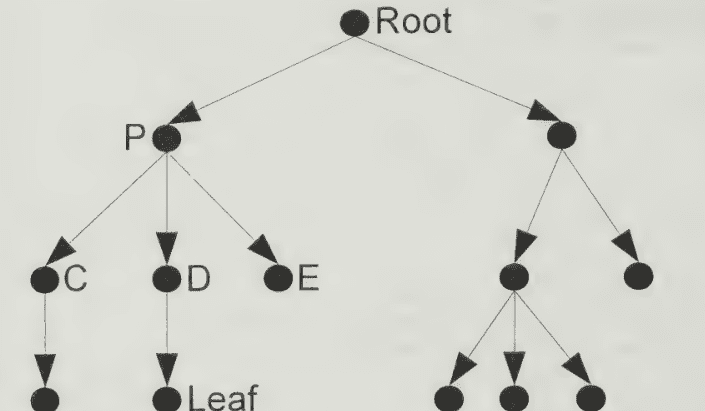

图 29.1：本图展示了一个示例树，并标注了部分节点。节点 P 是节点 C、D 和 E 的父节点。D 和 E 是 C 的兄弟节点。节点 P 的深度为 1，高度为 2，而节点 C 的深度为 2，高度为 1。节点 P 的大小为 6，而节点 C 的大小为 2。

沿用生物学隐喻，任何没有出边的节点称为叶子（LEAF）。根与一个节点之间的边数称为该节点的深度（DEPTH）。一个节点与最深叶子之间的边数称为该节点的高度（HEIGHT）。术语大小（SIZE）指的是一个节点的后代数量加上它自身。

我们还可以用递归的方式定义树。根据这个定义，树要么是空节点，要么是一个带有零条或多条指向其下非空子树的边的节点。这个定义将直接体现在某些实现中。

请注意，在所有这些定义中，当你画出一棵树时，不会出现任何形式的环。这可能是你想到树时脑海中应有的关键画面：树不允许有环。你还应从这个描述中注意到，链表实际上也完全是一棵合格的树。树的根相当于链表的表头，每个节点只有一条指向子节点的出边。它也许是一棵平淡无奇的树，但标准的单向链表绝对算得上一棵树。

### 29.1.1 实现

一般树允许每个节点拥有任意数量的子节点。这导致了多种不同的实现策略。一种方法是让节点存储所需数据以及一组子节点序列。我们的 Drawable 类型定义了树中的一个节点，我们正是采用了这种方法。回想一下，Drawable 实际上继承自 javax.swing.tree.TreeNode。这样做是为了能在图形用户界面（GUI）中将其与 javax.swing.JTree 一起使用。在那棵树中，内部节点都属于 DrawTransform 类型，而叶子节点则继承 DrawLeaf。DrawTransform 包含下面这行代码。

```
private val subnodes = mutable.Buffer[Drawable]()
```


FIGURE 29.2: 图 29.2 显示了与图 29.1 中显示的同一棵树，但为使用 first-child、next-sibling 方法构建树绘制了箭头。

这是子节点的序列。对于此示例，使用了可变缓冲区，但对于其他树，其他序列实现同样可以很好地工作。

计算机上的文件系统是另一种通用树的例子。根据你的操作系统，你将拥有一个驱动器或根目录。在其下将是文件和目录的某种组合。普通文件都是叶子，而目录可以是具有子节点的内部节点。

与其在节点中使用序列，可以通过显式利用链表来构建通用树。在这种方法中，每个节点保存其需要的数据以及对第一个子节点和下一个兄弟节点的引用。下一个兄弟节点的链接为给定节点的子节点提供了一个链表。内存中此情况的图形表示如图 29.2 所示。给定这种实现，没有任何节点需要存储超过两个对其他节点的引用。这通常使其在内存方面更高效一些，如果在代码中处理起来更具挑战性。

### 29.1.2 Traversals

与链表一样，树是我们存储信息的方式。树只是具有更多结构。 我们希望对任何数据集合执行的最重要活动之一是通过元素的遍历。对于数组，我们通过计数索引来做到这一点。对于链表，这是通过有一个我们称为 rover 的引用，从头部开始并沿着链接向下跟随列表来实现的。对于树，事情稍微复杂一些。树没有单一的自然顺序。让子节点从左到右处理是有意义的，但关于父节点是否应在其子节点之前或之后出现，或者子节点是否应在其兄弟节点之前处理存在疑问。这导致了树遍历的多种可能性。

我们首先要考虑的遍历族是 DEPTH FIRST 遍历。它们都先处理子节点，然后再跟随兄弟节点。它们是一个选项族，因为即使在


FIGURE 29.4: 图 29.4 显示了当我们解析左侧公式 $3*(x-5)+x*x$ 时发生的递归。右侧是我们希望从此公式构建的树。

```
val n = queue.dequeue()
    handler(n.data)
    n.children.foreach(queue.enqueue)
}
```

注意这看起来几乎与基于循环的先序遍历相同，只是使用队列而不是栈。如果你将它运行在我们的示例树上，处理的顺序是 A, B, C, D, E, F, G, H, I, J, K, L, M。

# 29.2 Project Integration: Formula Parsing

如前所述，当前项目代码中有一个树来跟踪并为可绘制对象排序。在本节中，我们将向我们的公式解析代码中添加一种 somewhat 不同的树类型，这将使公式求值更快，以便我们可以引入变量并使用变量的不同值多次求值相同的变量。我们然后可以向 GUI 添加一个额外的元素来调整时间变量，以便我们的绘图可以具有动画。

回想一下，公式解析器找到了优先级最低的运算符，并在其上分割。它递归地求值两侧并使用找到的运算符组合它们的答案。这涉及大量的字符串操作和遍历字符串以查找内容。然而，相同的过程可以生成一个结构良好的树结构，求值速度很快。

图 29.4 显示了两种不同的树。左侧是一棵显示递归的树，假设该函数被增强为处理变量。每个节点都是一个函数调用，其中包含将传递给该调用的字符串。右侧是一棵树，其中包含每个调用的重要运算符、数字或变量。此树有效地表示原始公式，可用于快速求值。

为此，我们创建一个表示树中节点的 trait，并为其提供一个可以被求值的方法。然后我们创建继承自该 trait 的类，定义我们想要的所有不同类型的节点。我们之前编写的 evalParse 函数可以更改为仅进行解析并返回一个 Node 而不是 Double。以下代码显示了该实现的示例。除了解析为树之外，此代码还添加了对一些三角函数和平方根函数的支持。

```
package scalabook.util

import scala.collection.Map

class Formula(val formula:String) extends Serializable {
    private val root = Formula.parse(formula)

    def eval(vars:Map[String,Double]):Double = root eval vars

    override def toString = formula
}

object Formula {
    val ops = "+-*/".toSet

    def eval(form:String, vars:Map[String,Double] = null):Double = {
        val root = parse(form.filter(_!=' '))
        root.eval(vars)
    }

    private def parse(f:String):Node = {
        var opLoc = -1
        var parensCount = 0
        var i = f.length-1
        while(i>=0) {
            if(f(i)=='(') parensCount += 1
            else if(f(i)==')') parensCount -= 1
            else if(parensCount==0 && (f(i)=='+' || f(i)=='-' && !ops.contains(f(i-1)))) {
                opLoc = i
                i = -1
            } else if(parensCount==0 && opLoc == -1 && (f(i)=='*' || f(i)=='/')) {
                opLoc = i
            }
            i -= 1
        }
        if(opLoc<0) {
            if(f(0)=='(') {
                parse(f.substring(1,f.length-1))
            } else if(f.startsWith("sin(")) {
                new SingleOpNode(parse(f.substring(4,f.length-1)),math.sin)
            } else if(f.startsWith("cos(")) {
                new SingleOpNode(parse(f.substring(4,f.length-1)),math.cos)
            } else if(f.startsWith("tan(")) {
                new SingleOpNode(parse(f.substring(4,f.length-1)),math.tan)
            } else if(f.startsWith("sqrt(")) {
                new SingleOpNode(parse(f.substring(5,f.length-1)),math.sqrt)
            } else {
                try {
                    new NumberNode(f.toDouble)
                } catch {
                    case ex:NumberFormatException => new VariableNode(f)
                }
            }
        } else {
            f(opLoc) match {
                case `+` => new BinaryOpNode(parse(f.take(opLoc)), parse(f.drop(opLoc+1)),
                    _+_)
                case `-` => new BinaryOpNode(parse(f.take(opLoc)), parse(f.drop(opLoc+1)),
                    _-_)
                case `*` => new BinaryOpNode(parse(f.take(opLoc)), parse(f.drop(opLoc+1)),
                    _*_)
                case `/` => new BinaryOpNode(parse(f.take(opLoc)), parse(f.drop(opLoc+1)),
                    _/_)
            }
        }
    }
}

private trait Node extends Serializable {
  def eval(vars:Map[String,Double]):Double
}

private case class NumberNode(num:Double) extends Node {
  def eval(vars:Map[String,Double]):Double = num
}

private case class VariableNode(name:String) extends Node {
  def eval(vars:Map[String,Double]):Double = vars get name getOrElse 0.0
}

private case class BinaryOpNode(left:Node, right:Node, op:(Double,Double) => Double) extends Node {
  def eval(vars:Map[String,Double]):Double = op(left eval vars,right eval vars)
}

private case class SingleOpNode(arg:Node, op:Double => Double) extends Node {
  def eval(vars:Map[String,Double]):Double = op(arg eval vars)
}
```

此代码包含一个名为 `Formula` 的类，此外还有对象，这样你就可以实例化 `Formula` 类型的对象并解析字符串一次，然后记住树以供以后求值。在伴生对象上调用 `Formula.eval` 会比之前更慢，但它已被保留用于简单的“一时”调用。顶部的导入使得我们使用的 `Map` 类型是通用的，可以是可变的或不可变的。

仔细阅读这段代码，你会看到我们使用了几种根本不同的 Scala 代码风格。有许多地方方法使用运算符表示法，即使它们有正常名称。例如，顶部附近的 `root eval vars`。这与 `root.eval(vars)` 相同。`eval` 方法只是使用运算符语法，因此不需要点也不需要括号。这种风格在专业 Scala 开发者中很常见，随着我们阅读本书，它会越来越多地出现。

有了这段代码，我们可以为绘图添加重要功能。首先，我们需要对 `Drawing` 类型进行一些增添和小的修改以放置一个 `Slider`


在 GUI 的顶部放置它并让它更新 vars 映射中与名称 "t" 关联的值，以便在公式中使用。

// Add this.
@transient private var tTimeSlider:Slider = null

...

// Add this.
private def timeSlider = {
  if(tTimeSlider==null) {
    tTimeSlider = new Slider {
      min = 0
      max = 800
      listenTo(this)
      reactions += {
        case vc:ValueChanged =>
          vars("t") = value
          drawPanel.repaint()
      }
    }
    if(!vars.contains("t")) vars("t") = 0
    tTimeSlider.value = vars("t").toInt
  }
  tTimeSlider
}

...

// Change to this.
},new SplitPane(Orientation.Horizontal,
  new BorderPanel {
    layout += new ScrollPane(drawPanel) -> Center
    layout += timeSlider -> North
  },
  commandPanel))

vars 映射是在我们向命令添加逆波兰表示法 RPN 计算器时引入的。它可以在这里与 Formula 类型一起再次使用。这不仅仅是复用，它增加了能力。现在命令可以用来设置在公式中引用的变量。我们现在需要做的只是让我们绘制的东西也使用公式。

这也不难做到。例如，DrawRectangle 类型的宽度和高度可以更改为使用公式，改动如下。

```
class DrawRectangle(p:DrawTransform,
  private var width:Formula = new Formula("100.0"),
  private var height:Formula = new Formula("100.0"),
  private var color:Color = Color.black) extends DrawLeaf {
```

...

```
def draw(g:Graphics2D) {
  g.setPaint(color)
```

你会输入到 RPN 计算器中的内容，并且不需要括号来指定运算顺序。虽然你可能不会通常认为方程是树，但事实证明这种形式非常好地包含了它们的含义，并且可以很容易地转换为表达式的不同有用版本。

# 29.3 二叉搜索树：作为映射的二叉树

上面的例子是树的一个有趣用法，也是树强大功能的一个有趣说明。然而，这些结构最主要的使用是存储数据。在本节中，我们将探讨二叉搜索树 BST 的细节，作为实现 Map ADT 的一种手段。

map ADT 的性质在第 20 章中描述过，当时我们查看了 Scala 集合库中内置的那些。二叉搜索树首先是一个二叉树。这是一种允许每个节点有 0、1 或 2 个子节点的树。在 BST 的情况下，子节点通常称为左和右，并且可能有右子节点而没有左子节点。存储在节点中的数据至少一部分包括一个具有完全顺序的键。这意味着对于任意两个键值，你可以询问其中一个是否小于、等于或大于另一个。BST 的主要标准是左边的后代具有较小的键值，而右边的后代具有更大的键值。

二叉搜索树的名称应该让人联想到第 13 章中讨论的二分搜索。这并非偶然。平衡良好的 BST 在用户查找元素时，其行为会非常类似于二分搜索。为了理解这一点，我们将考虑一个例子。图 29.5 显示了一个使用基本整数作为键以保持简单性的 BST 示例。该树以正确的 BST 组织方式包含值 0 - 9。¹ 粗体箭头指示搜索值 2 时所走的路径。

向基本 BST 添加新元素相当直接。如果树为空，没有根，那么我们创建一个包含当前元素的节点并使其成为根。对于任何其他情况，我们从根开始，以与搜索相同的方式向下走，当新值小于节点中存储的值时向左走，当它更大时向右走。最终，这个过程会到达没有子节点在指示方向上的点。创建一个新节点来存储新值并将其放置在树中的该位置。图 29.6 按 5、3、1、8、7、4、2、9、0、6 的顺序逐步完成此过程。结果是图 29.5 中显示的树。请注意，添加数字的顺序很重要。虽然某些其他顺序会产生相同的树，但大多数不会。

从 BST 中删除的过程比添加要复杂一些。考虑我们想要从示例树中删除值为 5 的节点的情况。这恰好是根节点。我们不能简单地将其拿走，因为那样会使我们剩下两棵独立的树。我们必须做一些修改树的方式，使结果仍然是一个有效的 BST。一个方法是把右子树放在左子树的底部右侧，反之亦然。在这种情况下，这会把 8 放在 4 的右侧或把 3 放在 7 的左侧。虽然这些在技术上可行，但远非理想，因为它们倾向于使树失衡。我们很快就会看到这会产生很大的差异。

另一种方法是移动来自一个更低的节点的数据，该节点更容易删除，然后将其提升以替换 5，然后删除该下层节点。如果节点有零个或一个子节点，则很容易删除。当然，被移动的数据必须能够取代被删除的节点的位置而不破坏树的正确顺序。只有两个节点可以做到这一点，左边的最大元素或右边的最小元素。在这种情况下，它们是值 4 和 6。如果 5 被其中任何一个替换，其余的树结构保持完全完整并保留正确的顺序。虽然这个过程描述起来相当容易，但不幸的是它有许多特殊情况需要处理。

以下是使用 BST 实现 Scala 库中可变映射的代码。此代码对键和值类型都有类型参数，在此代码中称为 K 和 V。TreeMap 必须在构造时传递一个比较函数。这提供了键所需的完全顺序。可变 Map 类型有四个必须实现的抽象方法，+=、-=、get 和 iterator。完整的实现如下所示。

```
package scalabook.adt

import collection.mutable
import annotation._

class TreeMap[K,V](comp:(K,K)=>Int) extends mutable.Map[K,V] {
  private class Node(var key:K, var data:V) {
    var left:Node = null
    var right:Node = null
  }

  private var root:Node = null

  def +=(kv:(K,V)) = {
```

```
```
}
}

root = findVictim(root)
this
}

def get(key:K):Option[V] = {
var rover = root
var c = comp(key,rover.key)
while(rover!=null && c!=0) {
rover = if(c<0) rover.left else rover.right
if(rover!=null) c = comp(key,rover.key)
}
if(rover==null) None else Some(rover.data)
}

def iterator = new Iterator[(K,V)] {
val stack = new ListStack[Node]
pushRunLeft(root)
def hasNext:Boolean = !stack.isEmpty
def next:(K,V) = {
val n = stack.pop()
pushRunLeft(n.right)
n.key -> n.data
}
@tailrec def pushRunLeft(n:Node) {
if(n!=null) {
stack.push(n)
pushRunLeft(n.left)
}
}
}
}

object TreeMap {
def apply[K,V](data:(K,V)*)(comp:(K,K)=>Int):TreeMap[K,V] = {
val tm = new TreeMap[K,V](comp)
val d = data.sortWith((a,b) => comp(a._1,b._1)<0).toIndexedSeq
def binaryAdd(start:Int,end:Int) {
if(start<end) {
val mid = (start+end)/2
tm += d(mid)
binaryAdd(start,mid)
binaryAdd(mid+1,end)
}
}
binaryAdd(0,data.length)
tm
}
}
```

这段代码中最简单的方法是 **get** 方法。它创建一个 **rover** 和一个存储比较结果的变量，然后有一个 **while** 循环，直到找到正确的键或 rover 从树的底部掉落。变量 **c** 用于存储比较结果


图 29.5：这是一个使用整数值键的二叉搜索树示例。在树中搜索元素所遵循的步骤与二分搜索执行的步骤非常相似。粗体箭头显示了搜索值 2 时会走的路径。


因为 **comp** 函数可能很昂贵，而且每次循环遍历时我们都需要检查相等性和至少一种不等式。将结果存储在变量中可以将调用次数减少两次，并且不会真正损害代码的可读性。

`+=` 方法是下一个最简单的方法，它在很大程度上基于 **get** 方法。它对向空树添加元素有特殊情况，因为这需要更改 **root** 的值，而不是节点中的 **left** 或 **right**。其他情况包含一个 **while** 循环，其方式与 **get** 中的循环非常相似，只是它保留了一个名为 **parent** 的引用，该引用跟随漫游器向下遍历树。这是因为在出现新键值的情况下，漫游器会从树的底部掉落。此时，我们需要知道父节点才能添加一个节点。这与从单链表中删除非常相似，在那里我们需要对要删除的节点之前的节点的引用。这也可以通过使用相当于 **parent** 的尾随节点来实现，但只需检查节点中的 **next** 引用会更容易。在这种情况下，存在 **left** 和 **right** 引用，因此使用尾随引用方法会更容易。在循环中断后，键小于、大于或等于最后检查的节点的三种情况。

传递给 `+=` 的键与树中已有的键相同的情况引出了上面避免的一个问题，当存在重复键时会发生什么？map ADT 设计为对任何给定的键只保存一个值。因此，此处的代码用传入的值替换节点中存储的内容。如果 BST 用于允许重复键的情况，例如 multimap，则必须采用不同的方法。一个选项是让节点存储值列表而不是单个值，其他选项，例如让相等的值向左或向右移动，可能会导致某些应用程序出现问题。

**iterator** 方法是下一个最简单的方法。任何遍历方法都可以使用，但使用中序遍历有一定的逻辑，因为对 BST 的该遍历会按其键的排序顺序处理节点。虽然递归遍历 BST 写起来很容易，但对于迭代器来说效果不佳，因为迭代器需要能够一次提供一个元素，而不是作为单次调用的一部分处理所有元素。因此，我们的迭代器需要保留一个栈来记住已通过但尚未访问的元素。

为了获得中序遍历，我们反复将沿任何子树左分支运行的所有元素压入栈中。这是由 **pushRunLeft** 方法完成的。它最初在根上调用以设置栈。然后每次弹出一个节点时，在返回数据元素之前都会在该节点的左子节点上调用该方法。只要栈中包含项目，迭代器就不是空的。

这就剩下 `-=` 方法了。这里显示的实现不是最高效的，但比更高效的实现更容易理解。此版本将问题进一步分解，并包含两个实际执行工作的嵌套函数。从 BST 中删除有许多可能的特殊情况。通过使递归设置在每个级别分配值，代码中的开销得以减少。

第一个递归方法称为 **findVictim**，它在此重复。它返回父节点或根应该引用的节点。顾名思义，此方法的首要目的是找到需要删除的键值。最简单的基准情况是函数使用 **null** 节点调用。这意味着遍历在没有找到元素的情况下从树上掉落，因此无需删除任何内容。

```
def findVictim(n:Node):Node = {
if (n==null) null
else {
val c = comp(key,n.key)
```

这些是之前示例中使用的相同值，只是现在它们已排序。应该很清楚，这样做会产生一个以 0 为根的树，其他值沿右侧向下运行。这是一棵具有单链表结构的树，其上的操作具有与单链表相同的性能。也就是说，对于这棵树，三个主要操作都是 O(n)。

树的结构通常根据左右子树的高度相似程度描述为平衡或不平衡。图 29.5 中显示的原始示例树是平衡的。对于这些键值，没有任何节点配置的总高度更低，如果你在树中选择一个节点，左右子树之间的高度差异永远不会超过一。另一方面，如果按排序顺序添加相同的键值，则得到的树完全不平衡。

平衡的 BST 对搜索、插入和删除的性能为 O(log(n))。这是因为所有这些操作都从根沿着树中的单一路径运行。在平衡树中，深度为 d 的节点数按 O(2^d) 比例缩放，因此 n 个节点的总深度为 O(log2(n))。考虑到与前面讨论的二分搜索的相似性，这并不令人惊讶。

因此，理想的树给出 O(log(n)) 行为，而最坏的树配置为 O(n)。这些被称为 BEST-CASE 和 WORST-CASE 阶数。我们通常更关心系统的 AVERAGE-CASE 行为。如果键以随机顺序添加到 BST 中，则生成的树相当平衡，给出平均情况下 O(log(n)) 的行为。平均情况的系数高于最佳情况，但仍是相同的阶数。不幸的是，导致 BST 最坏性能的场景并不少见。我们已经看到，排序或接近排序的数据会导致最坏情况的行为。还可能从相当平衡的树开始并使其变得不平衡。例如，如果 BST 的使用方式是旧节点被删除并添加新节点，但新节点往往高于或低于旧节点的平均值，则树可能开始时是平衡的，但会随着时间的推移而倾斜。可能的解决方案在第 35 章中描述。

这段讨论应该使人们清楚为什么文件以一个伴生对象结束，该对象具有一个 apply 方法，用于使用排序数据的递归下降来构建树。这确保了生成的树是完全平衡的。当然，这带来了必须对序列进行排序并将其转换为索引序列的开销。这种转换是必要的，以防止 binaryAdd 方法中的随机访问产生 O(n²) 行为。

# 29.3.2 Immutable BSTs

现在你已经看到了如何使用 BST 实现可变映射，那么不可变映射呢？为此，可以使用与为不可变单链表所做的工作非常相似的方法。不可变映射本身的类型是抽象的，并重新定义了需要使其返回更具体类型的方法。节点也有子类型，以及空树的子类型。后者相当于 List 类型的 Nil。以下是此类型的可能实现。

```
package scalabook.adt
```

```
abstract sealed class ImmutableTreeMap[K <% Ordered[K],+V] extends Map[K,V] {
  def +[B >: V](kv:(K,B)):ImmutableTreeMap[K,B]
  def -(k:K):ImmutableTreeMap[K,V]
}
```

```
private class Node[K <% Ordered[K],+V](private val key:K,
```

```
private val data:V, private val left:ImmutableTreeMap[K,V],
private val right:ImmutableTreeMap[K,V]) extends ImmutableTreeMap[K,V] {

def +[B >: V](kv:(K,B)) = {
    if(kv._1 == key) new Node(kv._1, kv._2, left,right)
    else if(kv._1 < key) new Node(key, data, left+kv, right)
    else new Node(key, data, left, right+kv)
}

def -(k:K) = {
    if(k == key) {
        left match {
            case _:Empty[K] => right
            case i:Node[K,V] => {
                right match {
                    case _:Empty[K] => left
                    case _ => {
                        val (k, d, newLeft) = i.removeMax
                        new Node(k, d, newLeft, right)
                    }
                }
            }
        }
    } else if(k < key) {
        new Node(key, data, left-k, right)
    } else {
        new Node(key, data, left, right-k)
    }
}

def get(k:K):Option[V] = {
    if(k==key) Some(data)
    else if(k<key) left.get(k)
    else right.get(k)
}

def iterator = new Iterator[(K,V)] {
    val stack = new ListStack[Node[K,V]]
    pushRunLeft(Node.this)
    def hasNext:Boolean = !stack.isEmpty
    def next:(K,V) = {
        val n = stack.pop()
        pushRunLeft(n.right)
        n.key -> n.data
    }
    def pushRunLeft(n:ImmutableTreeMap[K,V]) {
        n match {
            case e:Empty[K] =>
            case i:Node[K,V] =>
                stack.push(i)
                pushRunLeft(i.left)
        }
    }
}
```


ImmutableTreeMap 在类型参数 K 上是不变的。这是附录 B 中涵盖的概念，但在这里重要的是，我们无法选择一个适用于所有键类型的类型。这可能会导致显著的内存浪费，如果每棵树的每个叶子都引用了 Empty 的不同实例。事实上，在这种情况下，空对象将占用几乎与树的其余部分一样多的内存。然而，正如这段代码所写的那样，使用 ImmutableTreeMap 对象的 apply 方法创建的每棵树都会创建一个单一的 Empty 对象，并且该对象作为终止符被共享给该树中的所有内容，即使随着更多元素的添加和叶子数量的增长。Node 和 Empty 都是私有的这一事实意味着 apply 方法是实例化这些树中一个的唯一方式。

这种树与上一棵树之间的另一个区别是，这种树要求 K <: Ordered[K]，而不是传入比较器。这是因为不可变树中的每个节点都是一个完全功能且独立的树。使用比较器函数将要求所有节点都保留对该函数的引用。那是我们宁愿避免的开销，如果可能的话。这对于可变 BST 来说不是问题，因为每棵树中存在许多节点，只有包含的树需要跟踪比较器。

不可变树对于修改操作的开销确实稍高。然而，整体性能仍然是 O(log(n))。区别在于，只要添加或更改节点，从该节点到根节点路径上的所有内容都必须被替换。这允许树的任何早期版本保持完整。因此，不可变 BST 不仅对 + 和 - 操作执行 O(log(n)) 次比较和内存读取，它还为这些操作创建 O(log(n)) 个新节点。这仍然远远优于对不可变列表进行随机修改时必须创建的 O(n) 个节点。

# 29.4 章节结束材料

### 29.4.1 概念总结

- 树是一种具有节点和从一个节点到另一个节点的边的结构。所有节点都有恰好一条入边，除了根节点没有入边。
- 描述树的术语是系谱和生物学的结合。
  - 父节点有一条指向子节点的边。
  - 同一父节点的子节点称为兄弟节点。
  - 节点下方的所有内容称为后代，而上方的一线称为祖先。
  - 没有子节点的节点称为叶子。
  - 从根向下走的边数称为深度。
  - 从最低叶子向上走的边数称为高度。
  - 后代数加上自身是节点的尺寸。
- 有多种遍历树的方式。
  - 深度优先遍历在处理后面的兄弟节点之前先处理子节点。
    - 与递归配合良好。
    - 先序：先处理节点再处理子节点。
    - 后序：先处理子节点再处理节点。
    - 中序：在子节点之间处理节点。这对于每个节点最多有两个子节点的树最有意义。
  - 广度优先遍历在进入下一代之前遍历整个一代。这需要用循环和队列来实现。
- 树是表示解析公式的便捷方式。之前编写的递归解析代码可以很容易地修改以生成这种结构。树结构允许比重新解析字符串快得多的求值。
- 二叉搜索树，BST，是在某些键类型上存在完全顺序时存储值的有效结构。
  - BST 中的每个节点可以有一个左子节点和/或一个右子节点。
  - 左子节点的键必须小于父节点的键，右子节点的键必须大于父节点的键。
  - 从平衡树中获取、添加和删除都可以以 $O(\log(n))$ 操作完成。
  - 标准 BST 可能退化为链表。这种高度不平衡的树给出 $O(n)$ 行为。

### 29.4.2 练习

1. 测试我们在上一章中编写的递归解析求值方法与本章中构建的树的相对速度。修改上一章的代码以包含变量，并在公式上调用该函数足够多次以使你的机器暂停。用本章的树版本重复同样的操作，但构建一个 `Formula` 对象并使用不同的变量值进行求值。
2. 向公式节点添加一个方法，该方法将返回该节点的简化版本。简化应包括以下内容：

   - 与零相加简化为另一个值。
   - 减去零简化为另一个值。
   - 乘以一简化为另一个值。
   - 除以一简化为另一个值。
   - 乘以零简化为零。
   - 分子为零的除法简化为零。
   - 两个数字之间的任何运算都可以变成具有结果的数字。

   以递归方式编写代码，以便简化在递归返回时发生，以便当节点被简化时，它会考虑到简化的子节点。

   作为额外的挑战，你可以尝试识别其他简化并实现它们。

3. 向公式节点添加一个方法，该方法将返回该节点的导数。鉴于我们拥有的运算，这只需要记住乘积法则和商法则即可。
4. 结合练习 2 和 3，以便你拥有一个尽可能简化表达式的导数方法。
5. 修改 TreeMap 的 -= 方法，使其不递归，并且只有在子节点实际更改时才重新分配引用。确保测试你的代码以确保你处理了所有可能的情况。一旦你确信它有效，就将代码的复杂性和执行速度与递归解决方案进行比较。

### 29.4.3 项目

1. 如果你正在编写一个 MUD，你应该使用基于 BST 的映射来按唯一名称查找房间。
2. 如果你正在编写网络蜘蛛，请制作一个站点树并以图形方式显示它。允许用户指定用作根的页面。将其他页面链接起来，使深度为从根开始的最小点击次数。如果一个页面可以以相同的点击次数从根到达，则优先选择在最低深度页面中更早出现的那个。
3. 如果你正在编写图形游戏，请使用基于 BST 的映射作为快速查找或跳转到游戏不同元素的方式。
4. 如果你正在做数学练习表，本章为你提供了将公式解析为求值树的 ability，这可以使处理速度快得多。你也可以使用树作为进行符号操作的一种手段。你需要为此进行简化，但你可以轻松编写代码来对树求导并生成新树。稍加努力，你可以编写代码来对某些函数进行反导数/不定积分。请注意，并非所有函数都有闭式反导数，因此有些事情根本就不会起作用。如果你想要更大的挑战，尝试进行符号定积分并以合理的方式简化它们。
5. 表达式树也可以在 Photoshop® 程序中发挥良好效果。你可以让用户通过指定用于组合当前像素周围像素颜色的函数来制作自定义滤镜。鉴于任何真实图像中的像素数量，这对于我们之前的字符串解析求值来说是不可接受的缓慢。基于树的求值使其成为可能。你可以决定让用户使用什么语法来指定不同的相邻像素红色、绿色、蓝色 RGB 值。
6. 对用户输入公式的快速求值也为仿真工作台项目提供了显著的好处。你可以使用自定义力来指定粒子相互作用的力函数，或作为离散事件模拟的随机数生成的一部分。


# 30.1.3 上下文敏感文法

层次结构中的下一步去除了产生式选择不能依赖于非终结符周围内容的限制。规则的一般形式是 αAβ → αγβ，其中 α、β 和 γ 都是终结符和非终结符的任意字符串，并且可能为空。注意 α 和 β 并没有真正参与产生式。相反，它们只是限制产生式何时可以应用。

上下文敏感文法比上下文无关文法难处理得多，而且需要上下文敏感性的应用数量相当有限。因此，我们不会详细介绍其用法。

# 30.1.4 递归可枚举文法

乔姆斯基层次结构中最强大的文法类是递归可枚举文法。这些文法的产生式没有任何限制。左手边可以有任何东西产生右手边你想要的任何东西。关于这个文法类真正 remarkable 的事情是它是一个完整的计算模型。任何在图灵机或 lambda 演算的理论意义上可计算的东西，都可以用一个设计良好的递归可枚举文法来计算。

这篇对乔姆斯基文法和乔姆斯基层次结构的简要介绍为本章的其余部分奠定了基础。然而，这是一个更广泛的话题，有兴趣的读者应该对该主题做更多探索。如果没有别的，计算机科学理论的正规课程应该比这里呈现的更详细地涵盖这些主题。

# 30.2 正则表达式

计算机科学的理论基础因多种原因极其重要，并在该领域的主要发展中发挥着重要作用。然而，本书的主要重点是问题解决和编程技能的发展。因此，我们现在将重点转向文法和语言的更实际应用，从正则表达式开始。

顾名思义，正则表达式与正则文法相关。它们提供了一种匹配和解析文本的简单机制。与正则文法一样，它们也有其局限性。它们仍然相当强大，对于它们擅长的那些问题，可以让生活变得轻松得多。

正则表达式通常写成具有特定格式的字符串，其中某些字符具有特殊含义。它们被相当多的不同工具使用，包括你已经使用了一段时间的一些工具。grep 和 vi 的搜索功能都使用正则表达式。它们与编程语言 Perl 的紧密集成是许多人使用该语言进行小型文本处理任务的重要原因之一。我们一直在字符串上使用的 split 方法也使用正则表达式。

虽然正则表达式的大部分方面相当统一，但有些特性因实现而异。Scala 中的正则表达式由 scala.util.matching.Regex 类和伴生对象支持，并建立在 java.util.regex 中的 Java 实现之上。以下小节将介绍正则表达式的许多主要特性。更权威的

示例正则表达式也说明了因为括号是正则表达式中用于分组的特殊字符，所以如果你想匹配一个括号，就必须对其进行转义。

### 30.2.3 贪婪限定符

正则表达式的真正威力在于限定符。限定符允许你对表达式出现的次数进行一定程度的控制。默认的限定符称为“贪婪”限定符，因为它们会在仍允许整个模式匹配的情况下匹配尽可能多的字符。贪婪限定符有六个选项。

- X? - 匹配模式 X 或无。可以认为这是 0 或 1 次。
- X* - 匹配无或模式 X 重复任意次数。可以认为这是 0 或多次。
- X+ - 匹配模式 X 1 次或多次。
- X{n} - 匹配模式 X 重复恰好 n 次。
- X{n,} - 匹配模式 X 重复 n 次或多次。
- X{n,m} - 匹配模式 X 重复至少 n 次，但不超过 m 次。

电话号码的正则表达式可以用限定符表示为 \((\d{3})\) ((\d{3})-(\d{4})). 这些限定符也允许我们表达 30.1.1 小节中描述的文法的语言。例如 a+b+ 匹配一个或多个“a”后跟一个或多个“b”。请注意，使用这些限定符，没有什么好方法可以让每种类型字符的数量匹配而不指定它们出现的次数。

这现在应该清楚地说明了为什么我们想要在空格上拆分字符串时传递给 split 的参数是 " +"。这里的 + 是一个限定符，因此它匹配一个或多个空格。万一用户还使用了制表符，使用 "\s+" 会更安全。

限定符还有非贪婪的选项。有兴趣的读者可参考 Java API 和其他资料了解 reluctant 和 possessive 限定符的信息。

### 30.2.4 边界要求

我们在这里要考虑的正则表达式的最后一个选项是边界要求。在一般用法中，正则表达式可用于匹配字符串的任何部分，并且可用于在单个字符串内进行多次匹配。有时你希望限制匹配的通用性。为此，你可以在正则表达式的开头或结尾放置字符以指定其开始或结束的位置。以下是一些允许的选项。

- ^ - 作为正则表达式中的第一个字符时，要求匹配从行的开头开始。
- $ - 作为正则表达式中的最后一个字符时，要求匹配在行的末尾结束。
- \b - 可放置在正则表达式的开头或结尾，强制匹配在单词边界开始或结束。

参考方法上方声明的变量。我们希望使用以小写字母开头的名称的变量来做到这一点，我们必须在模式中使用反引号，如下所示。

```
val `commandSplit`(command,_,rest) = input
```

将模式中使用的变量设为大写字母只是风格上的选择。你可以决定自己喜欢哪种风格。

正则表达式模式最有用的地方可能是 for 循环中。回想一下，在 for 循环中 <- 之前输入的内容被匹配为 val 模式。任何不匹配的内容都会被跳过。如果你在遍历一个字符串集合，其中一些可能不匹配你正在寻找的内容，这对于正则表达式来说非常有帮助。

来看一个例子，假设有一个文件，其中一些行有编号，其他行没有。你只关心有编号的行，它们在第一个非空格字符处都有数字后跟一个句点。句点之后是你关心的文本。你想要构建一个 Map[Int,String]，让你可以根据行的编号快速查找字符串。以下代码会为你完成此操作。

```
val NumberedLine = """\s*(\d+)\.(.+ )""".r
val source = Source.fromFile(fileName)
val lines = source.getLines
val numberedLines = (for(NumberedList(num,text) <- lines) yield {
    num -> text
}).toMap
source.close
```

for 循环只会在匹配模式的行上执行，并跳过不匹配的任何内容。这会产生简洁且相当易于维护的代码。

### 30.2.6 正则表达式的缺点

正则表达式的主要缺点是它们可能晦涩难懂且难以维护。事实上，强调使用正则表达式的语言经常因其可读性差而受到嘲笑。想出一个问题恰好合适的正则表达式也可能相当具有挑战性。这在以下经常重复引用的名言中得到了表达。

> 有些人，面对一个问题时，想
> “我知道，我会用正则表达式。” 现在他们有两个问题。
> - Jamie Zawinski (1997 Usenet 帖子)

这句话不可避免地有一些真实性。然而，希望上面的例子已经向你展示了，在正则表达式表现良好的情况下，它们可以让生活变得轻松得多。只是不要试图用它们解决你遇到的每个问题。

# 30.3 上下文无关解析器

如果你需要解析超出正则表达式能力的文本，你有哪些选择？Scala 包含包 scala.util.parsing，其中有许多不同的子包提供不同的解析能力。我们将重点关注


scala.util.parsing.combinator 包，它赋予我们解析上下文无关文法的能力。⁴

第 30.1.2 小节中对上下文无关文法（CF）的介绍采用了与理论计算机科学相契合的记法。与数学家一样，理论计算机科学家也乐于用单个字母或符号来命名事物。在实际应用中，使用更长、更具信息量的名称通常更有帮助。在为编程语言之类的对象表达 CF 文法时，符号系统也会稍有变化。为了说明这一点，我们将回到前两章中使用过的公式解析示例。仅使用四种基本运算符的基础数学表达式的 CF 文法可以写成这样。

```
form ::= term {(" +" | " -") term}
term ::= factor {(" *" | " /") factor}
factor ::= floatingPointNumber | "(" form ")"
```

在这种记法中，花括号表示可以重复零次或多次的元素。也可以使用方括号来表示可选元素。

这个文法说明，一个公式（formula）是一个项（term）后跟零个或多个 + 或 − 符号，再后跟项。项（term）是一个因子（factor）后跟零个或多个用 * 或 / 分隔的因子。最后，因子可以是一个数字，也可以是括号内的完整公式。你可以动手实验，让自己相信它能表示所有期望的可能性。同样值得注意的是，这个文法正确处理了运算顺序，* 和 / 的结合层级低于 + 和 −。

使用组合子解析器库，这可以直接转换成下面的 Scala 代码。

```scala
object FormulaP extends JavaTokenParsers {
  def form:Parser[Any] = term ~ rep(("+") | "-") ~ term
  def term:Parser[Any] = factor ~ rep(("*") | "/") ~ factor
  def factor:Parser[Any] = floatingPointNumber | "(" ~ form ~ ")"
}
```

原始文法中的每条产生式都变成一个返回 Parser 的方法，Parser 是 scala.util.parsing.combinator.Parsers 中的一个类。为了完全通用，这里使用了 Parser[Any]。原始文法中连续出现的符号使用 `~` 运算符连接。花括号被替换为对 rep 的调用。如果有方括号，它们会被替换为对 opt 的调用。还有一个名为 repsep 的方法，可用于交替出现的产生式，比如逗号分隔的列表。

利用这些规则，你可以将任何你感兴趣的 CF 文法轻松构建成解析器。在本例中，FormulaP 通过 JavaTokenParsers 获得了 parseAll 方法，你可以调用它来使用任何这些解析器。⁵ 下面的 main 方法就会这样做，并打印解析器产生的值输出。

```scala
def main(args:Array[String]) {
  println(parseAll(form,"3+5*2").get)
}
```

# 30.3.1 默认输出

如果你运行这个 main 方法，会得到以下输出。

```
(3~List()~List((+~(5~List((*~2)))))
```

这个字符串能够被解析，但默认输出有些难以理解。要理解它，我们需要知道不同解析器元素的默认输出是什么。

- 字符串或正则表达式 - 返回匹配到的字符串。
- P ~ Q - 返回 ~(p,q)，其中 p 是 P 的匹配结果，q 是 Q 的匹配结果。注意 ~(p,q) 输出为 p~q。
- rep(P) - 返回匹配结果的列表：List(p1,p2,p3,. . .
- repsep(P,Q) - 返回匹配结果的列表：List(p1,p2,p3,. . . 。注意 Q 可以是一个完整的解析器，但输出会被忽略。这就是为什么它最适合用于逗号分隔的列表这类你并不关心分隔符的场景。
- opt(P) - 返回匹配结果的 Option。如果没有使用可选项，你得到 None；否则得到 Some(p)

凭借这些信息和原始文法，你可以弄清楚这个解析器是如何产生它所生成的输出的。

# 30.3.2 指定输出

虽然默认输出提供了解析的完整信息，而且你可以通过 match 语句遍历它来提取所需信息，但通常更有用的是为解析器指定你自己的输出。这是通过 `^^` 方法完成的。`Parser[+T]` 中 `^^` 的签名是 `def ^^[U](f: (T) => U): Parser[U]`。它接受一个函数，将解析器的正常输出转换为某种其他类型 U，并返回一个 `Parser[U]`。

我们可以在上面编写的解析器中利用这一点，让它输出数值解，而不是我们之前得到的默认解析输出。要做到这一点，第一步是将各个产生式的返回类型改为 `Parser[Double]`。这会引入一些错误，我们可以通过添加适当的转换来修复。结果代码如下。

```scala
object FormulaP extends JavaTokenParsers {
    def form:Parser[Double] = term ~ rep(("+" | "-") ~ term) ^^ {
        case d ~ lst => lst.foldLeft(d)((n,t) => if(t._1=="+") n+t._2 else n-t._2)
    }
    def term:Parser[Double] = factor ~ rep(("*" | "/") ~ factor) ^^ {
        case d ~ lst => lst.foldLeft(d)((n,t) => if(t._1=="*") n*t._2 else n/t._2)
    }
    def factor:Parser[Double] = floatingPointNumber ^^ (_.toDouble) | ("(" ~> form <~ ")")

    def main(args:Array[String]) {
        println(parseAll(form,"3+5*2").get)
    }
}
```

在这个例子中，`^^` 最简单的应用是在 `floatingPointNumber` 之后。它是一个 `Parser[String]`，因此正常输出只是一个字符串，我们可以通过调用 `toDouble` 将其转换为 Double。另外两条产生式在 `^^` 后面跟随的是偏函数，它们会被转换为我们所用的全函数。每个偏函数都有一个 case，匹配一个数字后跟波浪号和列表。数字将是第一个 term 或 factor 的结果。列表将是 rep 的结果，类型为 `List[[String,Double]]`。为了得到答案，我们需要遍历列表并累加一个值。在每一步，都应该对当前值和运算符之后的内容的解析结果应用相应的运算。这可以通过 `foldLeft` 简洁地完成。注意 `~` 类型支持中缀模式匹配，并且像元组一样具有 `_1` 和 `_2` 方法来获取第一个和第二个元素。

factor 的解析器还加入了一些别的东西以保持代码紧凑。它使用了在 `~` 之前或之后放置 `<` 或 `>` 的运算符。这些运算符提供了一种简写方式，用于在输出中忽略匹配的某些部分。箭头指向的方向是真正重要的内容。如果没有这些运算符，我们将不得不在最后那个 case 后面加上 `^^` 运算符，并用一个函数去掉括号并丢弃它们。

通过这些改动，你可以运行这个程序，会看到输出现在是 13.0。将此与我们原来的递归解析器进行比较，后者也能处理同样的运算，你会发现在代码长度上这个版本明显更短。然而，这个版本对于不熟悉 CF 文法或组合子解析器的人来说也完全是晦涩难懂的。

当然，组合子解析器还有很多其他选项和可能性。浏览一下 API 中诸如 `scala.util.parsing.combinator.Parsers` 和 `scala.util.parsing.combinator.Parsers.Parser` 等类，就能快速了解部分可能性。

# 30.4 项目集成

现在是将所有内容（包括上一章的一些概念）整合在一起的时候了。FormulaP 类可以扩展为解析到一棵树，而不是一个 Double。这将使得变量能够以良好的速度被使用。为了展示组合子解析器的真正威力，这个实现不仅包含四种基本数学运算和一些额外函数，还将包含乘方运算和一个 if 条件表达式。这两个特性带来了有趣的挑战。乘方是左结合的，而其他运算符是右结合的。为了支持 if，我们必须有返回布尔值的比较运算符。同时拥有标准的布尔运算符也会很不错。所有这些都需要集成到一个保持正确运算顺序的系统中。

首先，我们需要开发一个 CF 文法来解析我们试图实现的这个小语言。下面是我们将在代码中使用的文法。⁶

```
cond ::= "if(" bform ")" cond "else" cond | form
form ::= term {(" + " | " - ") term}
term ::= exp {(" * " | " / ") exp}
exp ::= func {" ^" func}
func ::= "sin" | "cos" | "tan" | "sqrt" "(" cond ")" | factor
factor ::= floatingPointNumber | "(" form ")"
bform ::= bterm {"||" bterm}
```

⁶这个文法包含了一些超出本书范围的内容。例如，如果你将第一条产生式改为 `cond ::= form | "if(" bform ")" cond "else" cond`，就会出现问题，因为字符串 `"if"` 是一个合法的标识符，它与 form 相匹配。


- 正则表达式是一种用于字符串解析的语法，其能力大致相当于正则文法。
- 字符类可以表示可匹配的一组字符。你可以用方括号构建字符类。还有一些内置字符类用于常见字符集。
- 量词指定字符或分组可以出现特定次数。量词包括 ?, *, 和 +。
- 字符串可以通过 **r** 方法转换为 **Regex**。**Regex** 对象具有名为 **findAllIn** 和 **replaceAllIn** 的方法。它们也可以用作模式。

- 上下文无关解析器
- Scala 中的 **combinator parser** 库使得从 CF 文法构建解析器变得容易。
- 解析器的默认输出包含字符串、`~` 对象和列表的混合。这可能很难处理。
- 使用 `~` 运算符你可以强制解析器输出你想要的特定类型。

# 30.5.2 Exercises

- 1. 编写一个简单的程序，它将接受一个乔姆斯基文法并允许用户从该语言生成字符串。

- 2. 对于以下每个文法，尝试弄清楚它们生成什么语言。对于那些是正则的，创建适当的正则表达式。对于那些是上下文无关的，编写适当的解析代码。
  - $\begin{aligned} S& \rightarrow A \\ A& \rightarrow a A \mid B \\ B& \rightarrow b B \mid b \end{aligned}$
  - $\begin{aligned} S& \rightarrow a A \\ A& \rightarrow a A \mid b C \\ C& \rightarrow c C \mid c \end{aligned}$
  - $\begin{aligned} S& \rightarrow A B C \\ A& \rightarrow a A \mid a \\ B& \rightarrow b B \mid b \\ c& \rightarrow c C \mid c \end{aligned}$
  - $\begin{aligned} S& \rightarrow A B \\ A& \rightarrow a A \mid a \\ B& \rightarrow A b B \mid b \end{aligned}$
  - $\begin{aligned} S& \rightarrow e L A e \\ e L A& \rightarrow e R A \end{aligned}$
  - $\begin{aligned} A L A& \rightarrow A A L \\ A R e& \rightarrow A L A e \\ A R A& \rightarrow R A A \end{aligned}$

- 3. 尝试想出，或查阅，一个简单的英语上下文无关文法。为它编写一个解析器并包含一个简单的词典。

- 4. 编写罗马数字的文法。使其解析为树，使得输出具有 `eval` 方法，该方法将返回作为 `Int` 的数值。

# 30.5.3 Projects

- 1. 如果你一直在进行 MUD 项目，本章赋予你使用复杂度显著更高的命令的能力。这可以用正则表达式或解析器完成。你可以决定使用哪一个，但建议是为更复杂的命令编写一个简单的文法，可以放入你的 MUD 中，然后编写一个解析器来解析它们并从中构建可用的表达式树。
- 2. 正则表达式和解析器在从文本文件提取数据以供网络蜘蛛使用时非常有用。你可能为从 HTML 文件中获取所需数据编写了相当多的 *ad-hoc* 代码。将该代码转换为使用带正则表达式的解析器。
- 3. 网络和非网络图形游戏程序都避免了大量的文本输入。然而，在这两种情况下，通常有理由能够向程序提供超出普通用户应能做到的命令，以便于测试和调试。

对于此项目，你应该为你的游戏添加一个小的命令语言。如果对普通用户这样做有充分理由，请随意这样做。网络游戏可以将此与聊天功能集成。非网络游戏可以将其放入图形用户界面（GUI），或使用第 23 章中添加的日志套接字。
- 4. 本章的材料对数学练习表项目尤其有益。使用组合解析器，你可以创建更复杂、更强大的公式解析器，以相对轻松的方式引入额外命令，甚至考虑加入一个简单的编程语言。你还可以将条件表达式包含在解析器中，以便你的数学函数可以使用递归定义。

对于所有这些添加，你应该让解析器构建表达式树以实现更快的求值。添加你认为能使项目朝你想要的方向发展的任何功能集。
- 5. Photoshop® 是另一个包含数学公式的项目，可以从简单的语言中受益。鉴于本章中学到的内容，你应该能够为用于滤镜的公式添加更强大的解析。
- 6. 仿真工作台项目也将从真实公式中受益。第 29 章中公式的所有应用在使用组合解析器时同样适用。此外，组合解析器使得将公式扩展为更真实的语言变得合理。

# Chapter 31

# Spatial Trees

- 31.1 Spatial Data and Grids ......................................................... 777
- 31.2 Quadtrees and Octrees ........................................................... 782
- 31.3 kD-Trees ....................................................................... 785
- 31.4 Efficient Bouncing Balls ....................................................... 789
- 31.5 End of Chapter Material ....................................................... 789
    - 31.5.1 Summary of Concepts ...................................................... 789
    - 31.5.2 Exercises ................................................................ 790
    - 31.5.3 Projects ................................................................. 790

你在某些计算领域处理的许多数据是空间的。有一些数据结构可用于使在空间某些部分查找元素的过程更高效。这些空间数据结构可以显著提高某些操作的执行速度，尤其是在涉及大量元素时。本章将考虑其中的一些选项。

# 31.1 Spatial Data and Grids

空间数据的例子可以是物理模拟中的物体，或游戏中分布在大型世界中的角色。这些物体或智能体的行为通常受附近其他事物的影响。这使得寻找附近邻居的问题变得重要。为了说明此问题的性质，让我们考虑一个简化的例子。给定 N 个点在某个 M 维空间中。为了可视化目的，我们通常将 M = 2，但它可以更高。我们想要找到所有点对 (p1, p2)，使得它们之间的距离小于给定阈值，|p2 − p1| < T。

解决此问题的最容易编写的方案是暴力方法，它在一个循环中遍历所有粒子，用嵌套循环遍历序列中该粒子之后的所有粒子并计算和比较距离。如果我们将点建模为可转换为 Int => Double 的任何东西，我们可以编写一个类作为我们将编写的所有基本邻居访问方法的基础接口。

```
package scalabook.adt
```

```
abstract class NeighborVisitor[A <% Int => Double](val dim:Int) {
  def visitAllNeighbors(tDist:Double, visit:(A,A) => Unit)
  def visitNeighbors(i:Int, tDist:Double, visit:(A,A) => Unit)
```

1 这被写成类而不是 trait 以保持代码更简单。<% 符号会被展开为包含一个隐式参数。由于 trait 不能接受参数，我们必须深入到更复杂的细节才能使用 trait。有关详细信息，请参阅附录 B。


最简单的方法是使用常规空间网格。使用这种方法，你将粒子所在的空间划分为适当维度的规则间隔的盒子网格。对于网格中的每个盒子，我们保存落在其内部的粒子列表。搜索邻居时，只需对位于足够附近单元的列表中的粒子进行搜索即可。下面是使用此方法实现的 NeighborVisitor 的代码。

```
package scalalook.adt

import collection.mutable

class RegularGridNeighborVisitor[A <% Int => Double](
    val p: IndexedSeq[A]
    ) extends NeighborVisitor[A](2) {

    private val grid = mutable.ArrayBuffer.fill(1,1)(mutable.Buffer[Int]())
    private var currentSpacing = 0.0
    private var min = (0 until dim).map(i => p.foldLeft(1e100)((d,p) => d min p(i)))
    private var max = (0 until dim).map(i => p.foldLeft(-1e100)((d,p) => d max p(i)))

    def visitAllNeighbors(tDist: Double, visit: (A,A) => Unit) {
        if (tDist < 0.5*currentSpacing || tDist > 5*currentSpacing) rebuildGrid(tDist)
        val mult = math.ceil(tDist / currentSpacing).toInt
        val offsets = Array.tabulate(2*mult+1, 2*mult+1)((i,j) => (i-mult, j-mult)).
            flatMap(i => i).filter(t => t._2 > 0 || t._2 == 0 && t._1 > 0)
        for {
            cx <- grid.indices
            cy <- grid(cx).indices
            (dx,dy) <- offsets
            val gx = cx + dx
            val gy = cy + dy
            if gx >= 0 && gx < grid.length && gy >= 0 && gy < grid(gx).length
            i <- grid(cx)(cy).indices
            val pi = p(grid(cx)(cy)(i))}
        if (dx == 0 && dy == 0) {
            for (j <- i+1 until grid(cx)(cy).length)
            val pj = p(grid(cx)(cy)(j))
            if dist(pi,pj) <= tDist} visit(pi,pj)
        } else {
            for (j <- grid(gx)(gy))
            val pj = p(j)
            if dist(pi,pj) <= tDist} visit(pi,pj)
        }
    }

    def visitNeighbors(i: Int, tDist: Double, visit: (A,A) => Unit) {
        if (tDist < 0.5*currentSpacing || tDist > 5*currentSpacing) rebuildGrid(tDist)
        val mult = math.ceil(tDist / currentSpacing).toInt
        val offsets = Array.tabulate(2*mult+1, 2*mult+1)((i,j) => (i-mult, j-mult)).
            flatMap(i => i)
        val cx = ((p(i)(0) - min(0))/currentSpacing).toInt
        val cy = ((p(i)(1) - min(1))/currentSpacing).toInt
```

答案以周为单位衡量。毋庸置疑，他花时间实现了本章中的一种方法。

```
val pi = p(i)
for{(dx,dy) <- offsets
    val gx = cx+dx
    val gy = cy+dy
    if gx>=0 && gx<grid.length && gy>=0 && gy<grid(gx).length
    j <- grid(gx)(gy)
    if i!=j
    val pj = p(j)
    if dist(pi,pj)<=tDist} visit(pi,pj)
}

/**
 * Rebuild the grid to a size that is appropriate for the searches. Note that
 * this method was not written for efficiency. A true implementation should
 * include a rewrite of this method.
 */
def rebuildGrid(spacing:Double) {
  min = (0 until dim).map(i => p.foldLeft(1e100)((d,p) => d min p(i)))
  max = (0 until dim).map(i => p.foldLeft(-1e100)((d,p) => d max p(i)))
  val cells = (0 until dim).map(i => ((max(i)-min(i))/spacing).toInt+1)
  if(grid.size<cells(0)) grid.append(mutable.Buffer.fill(cells(0)-grid.size)
    (mutable.ArrayBuffer.fill(cells(1)) (mutable.Buffer[Int]()):_*)
  else if(grid.size>cells(0)) grid.trimEnd(grid.size-cells(0))
  for(col <- grid) {
    if(col.size<cells(1))
      col.append(mutable.Buffer.fill(cells(1)-col.size)(mutable.Buffer[Int]()):_*)
    else if(col.size>cells(1)) col.trimEnd(col.size-cells(1))
    col.foreach(_.clear)
  }
  for(i <- p.indices) {
    val cx = ((p(i)(0)-min(0))/spacing).toInt
    val cy = ((p(i)(1)-min(1))/spacing).toInt
    grid(cx)(cy) += i
  }
  currentSpacing = spacing
}
}
```

显然，这段代码比暴力方法更长、更复杂。然而，对于许多情况，这将使访问所有邻居对的方法具有 O(N) 行为，而仅访问单个粒子的邻居的行为为 O(1)。

此网格硬编码为仅支持二维。虽然并非不可能，但编写使用任意维度数组的代码要困难得多。除此之外，规则网格在高维中效果不佳。想象一下，你有一个 n 维立方体，搜索半径约为单元大小的 1/100，所以你在每个维度上想要 100 个划分。对于 2D 空间，这给出适中的 10,000 = 10^4 个网格单元。对于 3D 空间，你得到一个有 1,000,000 = 10^6 个单元的立方体。随着维度的增加，这继续以 10^{2n} 的速度增长。这在三维以上会造成严重问题，尤其是大多数问题需要在每个维度上使用超过 100 个 bin。我们可以编写一个 3D 网格，但实际上很少有应用需要超过这一点。

网格方法理想的情况是粒子分布相当均匀，搜索半径相对于整个区域很小，并且区域随 N 增加，而不是密度增加。换句话说，如果每个粒子的邻居数量相当相似，并且当 N 增加时，点以保持邻居数量不变的方式添加，那么网格几乎就是最优结构。为了说明网格的好坏，进行了简单的运行，使用 1000 个点随机均匀地分布在一个正方形区域中，这是网格的理想配置。暴力方法始终执行 \(N * (N - 1)/2 = 499500\) 次距离计算。网格的数量随粒子随机分布和搜索大小而变化。然而，使用搜索距离为点分布大小的 1/100 时，从未见过需要超过 500 次距离比较来找到 100 到 200 个邻居对。

还需要注意的是，构建网格是一个 \(O(N)\) 操作。因此，假设你正在处理的程序的输入符合上述条件，你可以在 \(O(N)\) 操作中构建网格并找到所有粒子的所有邻居。这与暴力方法的 \(O(N^2)\) 行为相比是一个巨大的改进。暴力方法在大约 \(10^6\) 个粒子时变得难以处理，甚至在 \(N = 10^5\) 时在大多数机器上也很慢。使用网格方法，速度可能不是限制因素。你可以在机器内存中处理的点数，你可能也能处理它们。

### 31.2 Quadtrees and Octrees

网格不适用时会怎样？最明显的例子是点分布不均匀。考虑图 31.1 所示的点分布。这里有两个高密度区域，周围是密度较低的区域。画在该区域上的示例网格对于低密度区域来说效果相当好，因为每个单元中只有几个点。然而，网格在高密度区域帮助不大。基于网格的搜索仍将遍历大量粒子对。然而，如果网格以适合高密度区域的大小绘制，低密度区域将大多是空单元，可能会浪费大量时间处理它们。甚至可能保持所有这些空单元的内存开销成为一个问题。

解决办法是使用树。就像二叉搜索树 BST 比排序数组更动态、更可调整一样，空间树能够根据不同区域数据的性质调整分辨率。在某种程度上，你可以把 BST 树想象成 1 维空间中的空间树。沿着给定线存在一个完整的值排序。需要考虑如何将其扩展以处理存在多个正交排序的系统。已经开发了许多不同的方法，我们将在本章中明确考虑其中两种。

最容易理解的空间树可能是四叉树。有多种类型的四叉树。我们将重点关注基于区域的四叉树。对于此树，每个节点代表空间中的一个正方形区域。我们从包含我们处理的所有点的边界正方形开始。该区域由树的根表示。每个节点可以有四个子节点。子节点各自代表其父节点的等大小象限。在此树中，点全部进入叶子。每个叶子允许的点数因应用而异。经验测试可用于找到最佳效果。当某个区域中的点数超过允许数时，该区域会分裂为四个子节点，点会向下移动。$^{3}$

使用一些非均匀数据构建四叉树的结果如图 31.2 所示。此树中有大约 1000 个数据点。你可以看到，在点较少的区域，分隔较大。然而，在树的高密度部分，单元会细分为非常小的尺寸以隔离点。

下面显示了此树的代码。与网格一样，四叉树用于 2D 空间划分，并且该划分硬编码在代码中。树有一个名为 `Node` 的超类型，有两个子类型 `LNode` 和 `INode`，分别代表叶子节点和内部节点。这种代码设置方式下，只有叶子节点保存粒子。因此，使用两种子类型的方案是有意义的，因为除了位置信息外，它们存储的数据非常不同。`INode` 还具有额外的功能，用于在子节点之间拆分粒子并构建树的下层部分。方法 `childNum` 返回 0 到 3 之间的数字，该数字基于位置的索引。集合方法 `groupBy` 被调用作为获取每个象限中不同粒子的简便方法。

```
package scalabook.adt

class QuadtreeNeighborVisitor[A <% Int => Double](
	val p: IndexedSeq[A]
```

$^{3}$再次值得注意的是，这有点是基于区域的四叉树的标准实现。可以根据应用的不同而改变不同的方面。我们将在本章后面看到与八叉树密切相关的另一种替代方法。


图31.2：这是一个四叉树，包含一些不均匀分布的点，用于说明空间如何被划分。在此示例中，每个节点仅允许容纳一个点。基于树的方法的关键优势在于分辨率不必均匀。密度较高的区域可以更精细地划分空间。

```
) extends NeighborVisitor[A](2) {

private class Node(val cx:Double, val cy:Double, val size:Double)
private class LNode(x:Double, y:Double, s:Double, val pnts:IndexedSeq[Int])
    extends Node(x,y,s)
private class INode(x:Double, y:Double, s:Double, pnts:IndexedSeq[Int]) extends
    Node(x,y,s) {
val children = {
    val groups = pnts.groupBy(pn => childNum(p(pn)(0),p(pn)(1)))
    val hs = s*0.5
    val qs = s*0.25
    val ox = cx-qs
    val oy = cy-qs
    Array.tabulate(4)(i => makeChild(ox+hs*(i%2),oy+hs*(i/2),hs,
        if(groups.contains(i)) groups(i) else IndexedSeq[Int]()))
}
def makeChild(x:Double, y:Double, s:Double, pnts:IndexedSeq[Int]):Node =
    if(pnts.length>maxPoints) new INode(x,y,s,pnts)
    else new LNode(x,y,s,pnts)
def childNum(x:Double, y:Double):Int = (if(x>cx) 1 else 0)+(if(y>cy) 2 else 0)
}

private val maxPoints = 1
private val root = {
val minx = p.foldLeft(1e100)((mx,pnt) => pnt(0) min mx)
val maxx = p.foldLeft(-1e100)((mx,pnt) => pnt(0) max mx)
```


# 图31.3：这是一个kD树，包含一些不均匀分布的点，用于说明空间如何被划分。在此示例中，每个节点最多可容纳三个点。虽然此示例仅使用两个维度，但将kD树扩展到更高维度很简单，且不会增加开销。

图31.3展示了使用这种方法生成的二维树，每个叶节点允许三个点。这里没有包围盒是有意为之。kD树在需要跨越的范围内进行分割。末端的分割实际上是无限的。内部的分割则被其他分割所截断。

```
package scalabook.adt

class KDTreeNeighborVisitor[A <% Int => Double : Manifest](
    d:Int,
    val pIn:IndexedSeq[A]
) extends NeighborVisitor[A](d) {

private val p = pIn.toArray
private val maxPoints = 3

class Node
private class LNode(val pnts:Seq[Int]) extends Node
private class INode(start:Int, end:Int) extends Node {
val splitDim = {
    val min = (0 until dim).map(i => p.view.slice(start,end).
```

```
foldLeft(1e100)((m,v) => m min v(i))
val max = (0 until dim).map(i => p.view.slice(start,end).
    foldLeft(-1e100)((m,v) => m max v(i)))
(0 until dim).reduceLeft((i,j) => if(max(j)-min(j)>max(i)-min(i)) j else i)
}
val (splitVal,left,right) = {
    val mid = start+(end-start)/2
    indexPartition(mid,start,end)
    (p(mid)(splitDim),makeChild(start,mid+1),makeChild(mid+1,end))
}
def indexPartition(index:Int, start:Int, end:Int) {
    if(end-start>1) {
        val pivot = if(end-start<3) start else {
            val mid = start+(end-start)/2
            val ps = p(start)(splitDim)
            val pm = p(mid)(splitDim)
            val pe = p(end-1)(splitDim)
            if(ps<=pm && ps<=pe || ps>=pm && ps<=pe) start
            else if(ps<=pm && pm<=pe || ps>=pm && pm>=pe) mid else end-1
        }
        val ptmp = p(pivot)
        p(pivot) = p(start)
        p(start) = ptm p
        var (low,high) = (start+1,end-1)
        while(low<=high) {
            if(p(low)(splitDim)<=ptmp(splitDim)) {
                low += 1
            } else {
                val tmp = p(low)
                p(low) = p(high)
                p(high) = tmp
                high -= 1
            }
        }
        p(start) = p(high)
        p(high) = ptm p
        if(high<index) indexPartition(index,high+1,end)
        else if(high>index) indexPartition(index,start,high)
    }
}
def makeChild(s:Int, e:Int):Node = {
    if(e-s>maxPoints) new INode(s,e) else new LNode(s until e)
}
}

private val root = new INode(0,p.length)

def visitAllNeighbors(tDist:Double, visit:(A,A) => Unit) {
    for(i <- 0 until p.length) {
        val pi = p(i)
        def recur(n:Node):Unit = n match {
            case ln:LNode =>
                ln.pnts.foreach(j => if(j>i && dist(p(j),pi)<=tDist) visit(pi,p(j)))
            case in:INode =>
                if(pi(in.splitDim)-tDist<=in.splitVal) recur(in.left)
```

由于节点必须反复分割才能解析这些点，kD树不会以同样的方式受到紧密聚类的影响，但如果相同位置的点数超过maxPoints，两者都会崩溃。无论树向下延伸多深，这些点都无法分割，这意味着代码将尝试创建无数个INode来将它们分开。如果点被放置在边界之外，尤其是角落之外，四叉树也会遇到同样的问题。

# 31.4 高效的弹球模拟

空间数据结构可以带来极大好处的一个应用示例是我们之前为其创建了Drawable的弹球问题。对于之前执行的20球模拟，任何空间数据结构都显得大材小用。然而，如果球的数量增加几个数量级，空间数据结构就会成为必需。

如果我们使用空间数据结构，就会出现搜索半径的问题。对所有粒子都安全的单一搜索半径是最大速度的两倍乘以时间步长，再加上最大粒子半径的两倍。由于这些值可以在O(N)时间内轻松计算出来，因此将它们添加到代码中并不困难。为每个粒子使用唯一的搜索半径会稍微高效一些，该半径使用该粒子的速度和大小加上最大值，以考虑另一个粒子的最坏情况。

使用空间数据结构时，代码中需要做一些修改。你可以在第687页的第26章找到原始代码。任何需要调用`findEventsFor`的地方，都需要空间数据结构。`findEventsFor`方法接受一个`Seq[Int]`，其中包含要搜索的粒子索引。当前的实现是蛮力法。在进行完整搜索以初始化队列时，它会传递计时器中当前索引之后的所有索引；然后在碰撞后搜索时，传递除碰撞涉及的两个粒子之外的所有值。前一种情况应该使用`visitAllNeighbors`，并传入一个访问器，该访问器调用`collisionTime`方法检查粒子是否碰撞，并在需要时将粒子加入优先队列。仍然需要调用`findEventsFor`来获取墙壁碰撞，不过可以传入一个空的其他粒子列表进行检查，因为`visitAllNeighbors`的调用已经完成了该工作。对单个粒子的搜索应使用`visitNeighbors`来查找对照列表。

有趣的是，时间步长与搜索半径有关。弹球代码使用1.0作为时间步长。这发生在`findEventsFor`中，那里对事件加入队列的时间有一个截止值。如果缩短这个值，粒子在绘制的帧之间移动就会减少。对于旧方法，除了让重力积分更精确之外，没有明显的动机这么做。对于空间数据结构，它可以显著加快碰撞事件的查找处理速度，因为它减少了需要搜索的区域。

# 31.5 章末材料

# 31.5.1 概念总结

+   - 空间数据有多种形式，并与计算领域的许多方面相关联。


- 诸如在空间中查找邻近点之类的暴力方法，其复杂度往往为 $O(N^2)$。

- 空间数据结构可以极大地改善这种扩展性。
  - 网格很简单，对于低维、相当均匀的数据来说，它们是理想的选择。
  - 基于区域的四叉树和八叉树将包含所有数据的区域划分为依次更小、大小均匀的部分。这为需要它的地方提供了可变分辨率。
  - kD 树可扩展到任意高维。每个内部节点在特定值处分割数据，较小的值放在左侧，较大的值放在右侧。

# 31.5.2 练习

- 1. 为本章介绍的不同空间数据结构编写单元测试。
- 2. 编写一个包含 **addPoint** 方法的四叉树。
- 3. 对本章介绍的任何一种树进行并行化，使搜索在多个线程上进行。如果你想增加一点挑战，就让树的构建也并行进行。
- 4. 选择一种你喜欢的空间树并对其进行速度测试。一种做法是将随机点放入树中，然后搜索所有距离小于某值的点对。对于所描述的每一种树，你都可以改变叶节点中允许的点的数量。使用数据集中不同数量的点以及叶节点中允许不同数量的点来进行速度测试。
  比较同一维度下不同树的相对速度也很有趣。

# 31.5.3 项目

- 1. 几乎任何数据都可以被视为存在于适当维度的空间中。如果你在做网络爬虫项目，就应该这样做，以找到在某种程度上密切相关的对象。你具体对什么数据做这件事，可能取决于你在收集什么数据。一个明显的例子是，如果你在浏览某项运动的比赛数据，你可以为每个重要的统计类别设置一个不同的维度。你可以将所有条目放入一个这么多维度的 kD 树中，然后搜索距某个特定点一定距离内的所有内容。这可以让你找到在不同方面具有可比性的球员或球队。
  如果你存储的数据不是数值型的，你仍然可以基于文本或其他信息来分配空间值。例如，你可以选择一组与你所关注内容相关的单词，并将每个单词出现次数的某个函数用作不同坐标轴的值。如果你有 100 个感兴趣的单词，这意味着你将有一个 100 维的空间，网页将被放入其中。[5] 这些数据可以被...
放入 kD 树中，并根据不同的度量标准来查找相似的页面。

即使你在为图像编目，你也可以将一系列数值与图像关联起来。这些数值可以与大小、颜色、亮度、饱和度、对比度或许多其他因素相关。图像由大量 RGB 值组成，因此你可以设计出许多能产生有趣结果的函数。

- 2. MUD 项目可能是空间树用途最不明显的项目。毕竟，MUD 中的地图完全是基于文本的，而不是空间的。尽管如此，你仍然可以将上面针对网络爬虫描述的方法类似地用于 MUD。角色，包括玩家控制的角色和非玩家控制的角色，可能拥有表明他们在不同方面强大程度的属性。这些属性可以用来将他们置于一个更高维的空间中，你可以用 kD 树来映射这个空间，从而实现诸如让玩家能够找到实力相近的潜在对手或伙伴等功能。

你也可能希望对 MUD 使用词频统计这类方法，但这可能不太有用，因为你需要的样本点数量远多于维度数量，而且除非你一直非常忙碌，否则你的 MUD 的房间数量不太可能有多高。

- 3. 图形游戏，无论是联网的还是非联网的，天生就具有空间特性。虽然你的游戏可能并不真正需要空间数据结构来高效定位物体，但你应该加入一个，以让自己积累使用它们的经验。如果你确实创建了一个世界非常庞大的游戏，这些空间数据结构可以带来显著的好处。

- 4. 你可以加入数学工作表项目的一种有趣分析，是测量数据集的分形维数。分形维数有许多不同的正式定义。我们将使用一种称为关联维数的定义。相关性是通过关联积分来确定的，其正式定义为：

```
$C(\varepsilon)=\lim_{N\to\infty}\frac{g(\varepsilon)}{N^{2}}$,
```

其中 $g(\varepsilon)$ 是距离小于无穷大的点对数量。关联维数可以通过以下关系求得：

```
$C(\varepsilon)\sim\varepsilon^{\nu}$,
```

其中 $\nu$ 是关联维数，等于关联积分在对数-对数图上的斜率。求这个值需要两个步骤。首先，我们需要计算 $C(\varepsilon)$。一旦我们得到它，就需要对曲线上所有点的 $x$ 和 $y$ 值取对数，然后对这些点进行线性拟合以求得斜率。

实际上，计算 $C(\varepsilon)$ 在点的数量上是 $O(N^{2})$ 的，这使得它对于大型数据集而言不可行。由于答案的质量随 $N\to\infty$ 而提高，因此最好使用非常大的数据集，这样一来，完整的暴力计算就变得不可行了。这正是空间树的用武之地。不同大小节点中的点的数量，可以近似给出距离小于等于该长度的点对数量。要实现这一点，我们需要使用一棵在特定层级上所有节点大小都相同的树。这适用于本章中的四叉树和八叉树结构，也适用于 kD 树。这种树的构建方式有所不同，它在空间上沿中间进行分割，而不是在中位数点处分割。一旦你构建了这样一棵树，就可以使用以下近似：

$$C(\varepsilon) \sim \sum_{\text{cells of size }\varepsilon} n_{cell}^2.$$

这表示距离小于等于 $\varepsilon$ 的点对数量，等于所有大小为 $\varepsilon$ 的单元格中每个单元格内点数的平方之和。从技术上讲，这会将一个单元格内的连接数多算一倍，但不会计算单元格之间的任何连接。此外，任何乘法误差在所有层级上都是系统性的，因此 $\nu$ 的值不会改变。

一旦你有了表示 $C(\varepsilon)$ 的一组点，最后要做的就是对这些点 $(\log(\varepsilon), \log(C(\varepsilon)))$ 进行线性拟合。线性最小二乘拟合可以通过求解一个线性方程来完成，这与项目 6（第 416 页）中所做的非常相似。其思想是，对于你的数据点 $(x_j, y_j) = (\varepsilon_j, C(\varepsilon_j))$，你要找到最优系数 $c_i$，以最小化以下差值的平方和：

$$y_j - (c_1 f_1(x_j) + c_2 f_2(x_j) + c_3 f_3(x_j) \cdots).$$

这可以通过求解方程 $A^T A x = A^T y$ 来完成，其中

$$A = \begin{bmatrix} f_1(x_1) & f_2(x_1) & f_3(x_1) & \cdots \\ f_1(x_2) & f_2(x_2) & f_3(x_2) & \cdots \\ f_1(x_3) & f_2(x_3) & f_3(x_3) & \cdots \\ \vdots & \vdots & \vdots & \ddots \end{bmatrix}$$

而 $y$ 是你的 $y_j$ 值构成的列向量。

对于简单的线性方程，只有两项，因此 $f_1(x) = x$，$f_2(x) = 1$。这样就可以化简为一个 2x2 矩阵，比较容易求解。对于这个问题，你通常还可以进一步化简，即假设 $C(0) = 0$。只要没有两个点恰好位于完全相同的位置，这个假设就成立。在这种情况下，$A^T A = \sum_{j=1}^N x_j^2$，$A^T y = \sum_{j=1}^N x_j y_j$。这一个系数的值可以通过简单的除法求得。

- 5. 如果你一直在做 Photoshop® 项目，你可以使用二维 kD 树为图像创建一个有趣的滤镜。kD 树滤镜将图像中的像素分解为小区域，并将每个叶节点涂成单一颜色。这可以产生一种由矩形区域构成的彩色玻璃效果。你可以选择如何进行分割，以产生你想要的效果。一个建议是在交替的维度上进行切割，使每一侧的亮度或某个颜色通道的总强度保持平衡。因此，如果第一次切割是垂直的，你需要找到一个位置，使切割左侧的红色总量与切割右侧的红色总量尽可能接近。然后，按照相同的算法，在该切割线的每一侧进行水平切割。在指定的切割次数之后，你停下来，对每个区域中所有像素的颜色取平均，并用该平均颜色填充该区域。

- 6. 空间树可以用来改进模拟工作台中的碰撞处理。项目 6（第 416 页）描述了碰撞检测默认情况下是 $O(n^2)$ 的，并研究了一种在大多数时间步中改进它的方法。空间数据结构也可以用来减少需要检查的点对数量。最简单的方法就是使用树来搜索与目标粒子在特定搜索半径范围内的粒子。搜索半径由 $\Delta v \Delta t + 2R_{max}$ 给出，其中 $\Delta v$ 是粒子的相对速度，$\Delta t$ 是时间步长，$R_{max}$ 是最大粒子的半径。这应该能将需要检查的点对数量从 $O(n^2)$ 降至 $O(n \log(n))$。


# 第32章：二叉堆

| 标题 | 页码 |
|------|------|
| 32.1 二叉堆 | 793 |
| 32.1.1 二叉堆作为数组 | 793 |
| 32.2 堆作为优先队列 | 794 |
| 32.3 堆排序 | 801 |
| 32.4 章节末尾材料 | 802 |
| 32.4.1 概念总结 | 802 |
| 32.4.2 练习 | 803 |
| 32.4.3 项目 | 803 |

在第26章中我们研究了优先队列抽象数据类型 ADT。在该章节中，所编写的实现使用了排序链表。虽然它很容易编写，但这种实现有一个缺点，即入队方法为 O(n)。这使得队列大小的整体性能为 O(n²)。在本章中，我们将研究一种不同的实现，该实现为入队和出队都提供 O(log(n)) 的性能，即堆。

### 32.1 二叉堆

堆有相当多的不同样式。共同点是它们具有树结构。最简单，也是可能使用最广泛的是二叉堆。顾名思义，它基于二叉树类型的结构，其中每个节点可能具有左孩子和右孩子。对于二叉树要成为二叉堆，它必须具有两个属性：

- 完全 - 树从左到右填充每一层。适当的二叉堆中永远不会有间隙。
- 堆排序 - 优先队列要求元素具有完全排序。二叉堆的规则是父节点始终具有大于或等于其子节点的优先级。

堆排序意味着最高优先级元素始终位于树的根部。示例显示在图 32.1 中。


图 32.1：该图显示了二叉堆的示例。数字是优先级，值越高优先级越高。注意，重复的优先级没有问题，这与 BST 中的键不同。

#### 32.1.1 二叉堆作为数组

虽然我们概念上将堆视为二叉树，但我们并不是这样实现的。将其实现为数组要高效得多。这之所以可行，是因为堆是完全的。图 32.2 显示了与图 32.1 相同的堆，其下标按广度优先顺序对节点进行编号。仔细观察下标，你应该会发现父节点和子节点之间存在很好的数学关系。具体来说，如果将索引除以二，使用整数除法，结果就是父节点的索引。反向关系是，节点的子节点具有索引为节点索引的两倍和节点索引的两倍加一。

该图显示数组将 0 索引位置留空。可以实现一个堆，将所有元素向下移动一个位置，使其没有空白。然而，这需要在代码的许多不同点放置 +1 和 -1。这使代码更复杂，更难理解和维护。虽然它减少了一点内存浪费，但它在优先队列的每次调用中引入了开销。出于这个原因，并且为了使代码更简单，这里显示的实现将数组的第一个元素保留为默认值。


图 32.2：该图显示了与图 32.1 相同的堆，其下标按广度优先顺序对节点进行编号。下面是元素位于这些位置的数组。

### 32.2 堆作为优先队列

要将二叉堆用作优先队列，我们必须能够实现 enqueue、dequeue、peek 和 isEmpty。最后两个很简单，最高优先级元素始终是根，因此 peek 只需返回它。isEmpty 方法只需检查堆上是否有任何内容。enqueue 和 dequeue 稍微复杂一些，因为它们必须改变堆的结构。

我们从 enqueue 开始，在其中将元素添加到队列中。将元素添加到二叉搜索树 BST 只需找到放置新元素的合适位置。对于堆，工作有点不同。堆必须保持完整，因此当添加新元素时，关于必须占据哪些节点集没有疑问。当前正在填充的行中的下一个空闲空间，或当最低行完成后下一行的第一个空间必须被填满。然而，新元素可能不属于那里。我们处理这个问题的方法是，在必须填充的位置放置一个“气泡”，让它向上移动，直到到达新元素所属的位置。只要新元素的优先级高于气泡的父节点，就复制父节点向下，气泡向上移动。将优先级为 9 的新元素添加到示例堆中的示例显示在图 32.3 中。


图 32.3：将优先级为 9 的新元素添加到图 32.1 所示的堆中会经历以下步骤。在完整树中的下一个位置添加一个气泡。它向上移动，直到到达可以在不破坏堆顺序的情况下添加新值的点。

对 dequeue 的调用应从树的根部移除元素，因为那里始终具有最高优先级。然而，为了保持树的完整性，需要腾出的位置位于最后一行的末尾。为了解决这个问题，我们将堆的最后一个元素取出放入临时变量，然后在根部放置一个我们称为“石头”的占位符。这块石头然后通过堆下沉，直到到达临时变量可以在不破坏堆顺序的情况下停止的点。向下通过堆移动时，有选择石头应下沉到哪个子节点的选择。为了保持堆顺序，它必须移动到优先级更高的子节点，因为我们不允许将优先级较低的子节点移动到其优先级更高的兄弟节点上方的父节点位置。此过程在图 32.4 中说明。


**图 32.4：** 对图 32.3 末尾堆调用 **dequeue** 会使树经历以下步骤。最后一个元素被移动到临时变量，堆顶放置一块石头。这块石头下沉，直到到达临时变量可以在不破坏堆顺序的情况下停止的点。石头始终向优先级更高的子节点方向下沉。

使用基于数组的二叉堆实现这些操作的代码如下所示。这扩展了在第 26 章中创建的 PriorityQueue[A] 类型。与排序链表实现一样，比较函数作为参数传递，以为此类实例的元素提供完全排序。此类需要的唯一数据是称为 heap 的数组和称为 end 的整数，用于跟踪下一个元素应添加的位置。这些最初创建为 10 个元素，其中一个永远不会使用，因为索引零留空，另一个设置为 1。

```scala
package scalabook.adt

class BinaryHeapPriorityQueue[A : Manifest](comp: (A,A)=>Int) extends
    PriorityQueue[A] {
private var heap = new Array[A](10)
private var end = 1

def enqueue(obj:A) {
    if(end>=heap.length) {
        val tmp = new Array[A](heap.length*2)
        Array.copy(heap,0,tmp,0,heap.length)
        heap = tmp
    }
    var bubble = end
    while(bubble>=1 && comp(obj,heap(bubble/2))>0) {
        heap(bubble) = heap(bubble/2)
        bubble /= 2
    }
    heap(bubble) = obj
    end += 1
}

def dequeue():A = {
    val ret = heap(1)
    end -= 1
    val temp = heap(end)
    heap(end) = heap(0) // Clear reference to temp
    var stone = 1
    var flag = true
    while(flag && stone*2<end) {
        var greaterChild = if(stone*2+1<end && comp(heap(stone*2+1),heap(stone*2))>0)
            stone*2+1 else stone*2
        if(comp(heap(greaterChild),temp)>0) {
            heap(stone) = heap(greaterChild)
            stone = greaterChild
        } else {
            flag = false
        }
    }
    heap(stone) = temp
    ret
}

def peek:A = heap(1)

def isEmpty:Boolean = end==1
}
```

enqueue 方法首先检查数组中是否有空间容纳新元素。如果没有，则创建更大的数组。与本书中编写的其他类似代码一样，数组的大小加倍，以便复制的摊销成本为 O(1)。enqueue 方法的其余部分创建了一个名为 bubble 的 Int，它将沿堆向上走以找到新元素应放置的位置。它初始化为 end，即数组中第一个未使用的位置。主要工作在 while 循环中完成，只要气泡大于 1 且气泡的父节点，位于索引 bubble/2 处，具有高于新元素的优先级，循环就继续。当循环终止时，新元素被放置在气泡的位置，end 被递增。


The dequeue method starts off by storing the current root in a variable that will be returned at the end of the method. It then decrements **end**, stores the last element in the heap in a temporary, and clears out that element with the default value stored at `heap(0)`. A variable called `stone` is created that starts at the root and will fall down through the heap. There is also a `flag` variable created to indicate when the `while` loop should terminate. This style is helpful when the determinant of whether to stop the loop is complex and would be difficult to put in a single line. In this case part of the determinant is easy, if the stone has gotten to a leaf, it must stop there. Otherwise, it requires checking the temporary against the child or children to see if the temporary has lower priority than the higher-priority child. That would require a complex Boolean expression that would be hard to read. The use of a `flag` generally improves the readability and maintainability of the code.

Inside the loop, the first task is determining which child has a higher priority. The check in the `while` loop condition guarantees that there is at least one. If there is a second, and it has higher priority, it is the one we want, otherwise we want the first child. Then that child is compared to the `temp` to see if the stone should keep sinking. If it should not keep sinking then the loop needs to stop so `flag` is set to `false`. When the loops terminates, the temporary is moved to the location where the `stone` stopped and the original root value is returned.

Using the image of the tree we can argue that both `enqueue` and `dequeue` are always $O(\log(N))$. This can also be argued from the code. The variable `end` is effectively $n$. In the `enqueue` method the `bubble` starts at `end` and is divided by 2 in every iteration through the loop. This can only happen $\log_2(n)$ times before it gets to 1. With `dequeue` the `stone` starts at 1 and each iteration it changes to either `stone*2` or `stone*2+1`. This too can only happen $\log_2(n)$ times before `stone` gets to `end`.

Testing this code is a simple matter of copying the test for the sorted linked-list priority queue and changing what type is instantiated. It can also be used to improve the performance of any other code that requires only the priority queue interface to operate. For example, the cell division example from chapter 26 could be altered and would gain a significant performance boost for large populations.

# Priority Queue with Frequent Removes

Back in subsection 26.2.2, when the sorted linked-list was used for an event-based simulation of collisions, we had to add a method called `removeMatches`. This method was needed because whenever a collision between two bodies is processed, all future events involving either of those bodies needs to be removed from the queue. The new velocity of the body will make those events invalid. This method was not hard to add to the sorted linked list implementation and the fact that it was $O(n)$ was not a problem as the `enqueue` method was also $O(n)$.

In the last chapter we saw how adding spatial data structures can improve the overall performance of a time step from $O(n^2)$ to $O(n \log(n))$ or even, in certain ideal cases, $O(n)$. However, the sorted linked-list priority queue will still limit performance to $O(c^2)$, where $c$ is the number of collisions in the time step. That number generally does increase with the number of particles so using a sorted linked list is still a potential performance bottleneck.

We have just seen that a heap-based priority queue gives $O(\log(n))$ performance for the main operations, which would provide $O(n \log(n))$ overall performance for the number of elements added and removed. This could provide a significant performance improvement for collisions if we could implement `removeMatches` on the heap. Unfortunately, removing an element from the heap is $O(\log(n))$ and can not be improved significantly when done in bulk. Fortunately, collision handling has aspects that are predictable and can be used to make an alternate implementation.

What is important about collision handling is that from one time step to the next, the number of collisions is fairly consistent and the distribution of times for collisions is fairly uniform. This points to an implementation that combines arrays and linked lists. ${ }^{1}$ Let us say that in the previous time step there were $c$ collisions for $n$ particles and each time step lasts $\Delta t$ time units. We start with an array that spans time from 0 until $\Delta t$ with $c$ elements that each represent $\frac{\Delta t}{c}$ time. The array references nodes for linked lists. There is another array with $n$ elements, one for each particle in the simulation, that also keeps references to nodes. Each node is part of two or three orthogonal doubly-linked lists and stores information about an event. One doubly-linked list going through a node is sorted and based on time. The others are not sorted, represent particles, and there is one for each particle involved. So particle-particle collisions are part of two of these and particle-wall collisions are part of two.

A graphical representation of this structure is shown in figure 32.5. The array across the top is for time. The first cell keeps the head of the list for any events between 0 and $\frac{\Delta t}{c}$. The second is for events between $\frac{\Delta t}{c}$ and $2 \frac{\Delta t}{c}$. The array on the right has one cell for each particle in the simulation and the list keeps track of any collisions that particle is involved in. The lists are doubly linked so that any element can be removed without knowing about the one before it in any given list. This figure is greatly simplified in many ways to make it understandable. In a real situation the number of elements in each array should be at least in the thousands for this to be relevant. In addition, while the vertical lists are sorted and there will be a nice ordering for elements, the horizontal links will often double back around and produce a far more complex structure than what is shown here.

So what is the order of this data structure? Linked lists are inherently $O(n)$ for random access. This includes adding to sorted linked lists. On the other hand, adding to the head of a linked list is $O(1)$. In the worst case, all the events could go into a single, long linked list. That would result in $O\left(n^{2}\right)$ performance. Such a situation is extremely unlikely given the nature of collision events. We expect roughly $c$ events that are roughly evenly distributed. That would result in sorted linked lists of an average length of 1 and it should be very rare to have a length of longer than a few. The deque operation has to remove all the other events for any particles involved, but that is required by any implementation and the advantage of having doubly-linked lists by particles is that this can be done as fast as possible considering only the nodes involving those particles have to be visited. So the expected time for all operations is optimal. For deques is always $O(1)$, the implementation simply keeps track of the element in the time array that has the first element. The enqueues could be $O(n)$, but we expect $O(1)$ performance because the time lists are short. The removeParticle method will perform $O(n)$ operations in the number of events for that particle, but this too should be a small number.

You might wonder why, if this data structure is so great, it is not used more generally. The reason is that it is not generally good. It requires knowing that there should be about $c$ events, they will all lie in a certain finite time range, and they will be evenly distributed. Change any of those conditions and this structure can be worse than a standard sorted linked list. If you ever wonder why you should bother to learn how to create data structures, like linked lists, when there are perfectly good implementations in libraries, here if a reason why. Library priority queues are typically implemented


FIGURE 32.5: 这展示了可作为碰撞处理高效优先队列使用的替代数据结构的示意图。顶部数组保存了时间步长期间不同时间区间的列表头。左侧数组是不同粒子的列表头。所有列表都是双向链表，因此可以在不找到其前一个节点的情况下删除节点。

> 使用堆。对于一般情况，这是理想的结构。并非所有问题都符合一般情况。在这种情况下，堆可能比排序链表更差，而且你唯一能显著提高性能的方法是编写自己的数据结构。

# 32.3 Heapsort

任何优先队列实现都可以变成一种排序。只需将所有元素添加到队列中并将其移除即可。它们会按排序顺序弹出。如果使用排序数组或链表执行此操作，得到的排序大致是插入排序。上面旁注中描述的优先队列会得到类似桶排序的结果。如果从基于堆的优先队列构建排序，则得到的就是堆排序。理想堆使用数组这一事实意味着
堆排序可以完全就地完成。只需在一侧的数组上构建堆，然后提取到另一侧即可。

下面是堆排序的实现。它使用值作为优先级构建堆，因此值更高的元素会更早出队。然后将它们出队以填充数组，从末尾开始。

```
def heapsort[A](a:Array[A])(comp:(A,A)=>Int) {
  for(end <- 1 until a.length) {
    val tmp = a(end)
    var bubble = end
    while(bubble>0 && comp(tmp,a((bubble+1)/2-1))>0) {
      a(bubble) = a((bubble+1)/2-1)
      bubble = (bubble+1)/2-1
    }
    a(bubble) = tmp
  }
  for(end <- a.length-1 until 0 by -1) {
    val tmp = a(end)
    a(end) = a(0)
    var stone = 0
    var flag = true
    while(flag && (stone+1)*2-1<end) {
      val greaterChild = if((stone+1)*2<end &&
        comp(a((stone+1)*2),a((stone+1)*2-1))>0)
        (stone+1)*2 else (stone+1)*2-1
      if(comp(a(greaterChild),tmp)>0) {
        a(stone) = a(greaterChild)
        stone = greaterChild
      } else {
        flag = false
      }
    }
    a(stone) = tmp
  }
}
```

你应该注意到这段代码的某些部分与堆实现相似。第一个 for 循环包含看起来像入队代码的部分。第二个循环包含看起来像出队代码的部分。必须进行一些修改，因为传入的数组在前面不包含空白元素。

这种排序的时间复杂度为 O(n log(n))，与归并排序和快速排序相同。与后两者不同，堆排序不是递归的。它也是稳定的，像归并排序一样，并且可以就地完成，像快速排序一样。这些因素使其成为许多不同应用的良好排序方法。

# 32.4 End of Chapter Material

### 32.4.1 Summary of Concepts

- 二叉堆是一种允许快速检索最大优先级元素的数据结构。
- 它们基于二叉树结构。
- 它们始终是完整的并且具有堆序。
- 从 1 开始按广度优先顺序对树元素编号，给出了父节点和子节点索引之间简单的数学关系。
- 这导致使用数组实现最有效，因为堆始终是完整的。

- 二叉堆可用于实现高效的优先队列。`enqueue` 和 `dequeue` 始终为 $O(\log(n))$，因为堆是完整树。
- 堆可作为一种称为堆排序的排序的基础。

### 32.4.2 Exercises

- 1. 执行速度测试，比较第 26 章中使用排序列表的基于排序列表的优先队列的速度与本章介绍的堆版本的速度。使用指数间隔的元素数量以获得广泛的 $n$ 值范围。
- 2. 实现一个不留 0 元素空位的二叉堆。测试并调试它以确保其正常工作。
- 3. 如果你完成了上面的练习，现在可以对文本中的堆代码与从零索引开始的堆元素代码进行速度比较。
- 4. 本章最后的旁注描述了一种适用于碰撞模拟的优先队列的替代实现，其中需要定期删除已安排的事件。编写此代码并将其速度与其他优先队列实现进行比较。

### 32.4.3 Projects

对于本章，你应该将你在第 26 章中完成的内容从你在该章中使用的实现转换为本章介绍的实现之一。对于仿真工作台，如果你已完成碰撞模拟，请考虑使用便于删除事件的特殊优先队列。

# Chapter 33

# Direct Access Binary Files

- 33.1 Random Access Files ......................................................... 805
- 33.1.1 Fixed Record Length ......................................................... 806
- 33.1.2 Indexed Variable Record Length .............................................. 811
- 33.2 Linked Structures in Files .................................................... 813
- 33.3 End of Chapter Material ........................................................ 821
- 33.3.1 Summary of Concepts .......................................................... 821
- 33.3.2 Exercises .................................................................... 821
- 33.3.3 Projects .................................................................... 822

在第 9 章中我们学习了关于基本文本文件。这些文件的优点是简单。它们编程相对容易，而且文件本身可以用标准文本编辑器编辑。不幸的是，它们没有任何固有含义，并且编辑起来非常脆弱。小的错误很容易使整个文件失效。这些问题通过从第 14 章开始使用 XML 得到纠正。平面文本和 XML 都有一个缺点，那就是它们速度慢且占用空间大。在这些方面，XML 比平面文本更糟。为了修复这些问题，我们需要朝相反方向移动并转向二进制文件。不幸的是，这种移动取消了文本和 XML 具有的优势，即可以用文本编辑器轻松读取和编辑。我们在第 22 章中看到了如何使用 DataInputStream 和 DataOutputStream 以原生二进制方式读写，以及如何使用 ObjectInputStream 和 ObjectOutputStream 将整个对象序列化为二进制。

在本章中，我们将对二进制文件再迈进一步，使其可以像大型数组一样使用，能够在随机位置访问和读取值。这使得文件可以实现更多功能，并且是处理极大数据集的应用程序不可或缺的一部分。

# 33.1 Random Access Files

在第 22 章中我们专注于流。术语流与其性质相匹配。就像水流过一样，流中的数据可以随着流过而被读取，但一旦流过就无法带回。你也不能选择只在任意位置。你也不能选择只在任意位置。对于这种能力，我们转向 java.io 包中的另一个类 RandomAccessFile。查看 API 中的这个类会发现它包含了来自 DataInputStream 的所有读取方法和来自 DataOutputStream 的写入方法。很明显，这个单一类赋予了你在二进制格式下进行输入和输出的能力。这个类的真正强大之处来自于 seek(pos:Long) 方法，它可以跳转到文件中的任何位置。seek 的伴侣是 getFilePointer():Long，它返回文件中的当前位置。把这些结合起来意味着你可以随意跳转文件并以任何方式读写数据。

要创建新的 RandomAccessFile，你需要传递要打开的文件参数，作为 java.io.File 或 String，以及 mode:String。mode 指定文件将如何访问。只允许以下值之一。

- “r” - 以只读方式打开文件。如果使用此模式并调用任何写入方法，将抛出 IOException。
- “rw” - 以读写方式打开文件。此模式如果文件不存在会尝试创建文件。
- “rws” - 以读写方式打开文件，并额外要求以任何方式修改文件的调用同步写入存储设备。这会减慢速度，因为它使磁盘活动的缓冲变得不可能，但对于需要文件无论应用程序发生什么情况都保持一致配置的关键应用程序很重要。
- “rwd” - 与“rws”类似，但仅在文件内容被更改时才要求同步。

如果为 mode 使用其他值，将抛出异常。我们通常会使用“rw”作为模式，因此看起来像这样。

```
val raf = new RandomAccessFile("binaryFile.bin","rw")
```

### 33.1.1 Fixed Record Length

二进制文件最简单的用法是使用固定长度记录。这就是将数据以相同大小的块存储。在数据由固定数量的固定大小元素组成时，例如 Int 和 Double，这种方式相当容易。在这种情况下，你只需将所有元素的大小相加。表 33.1 显示了写入文件时 Scala 中基本类型的大小（以字节为单位）。因此，如果要写入的记录是与整数值相关联的 3D 空间中的点，你将写入三个 Double 和一个 Int，使用总共 $3 * 8 + 4 = 28$ 字节。

许多类型的数据会使确定长度的过程变得稍微复杂一些。

| Type | Size in Bytes |
| --- | --- |
| Byte | 1 |
| Short | 2 |
| Int | 4 |
| Long | 8 |
| Float | 4 |
| Double | 8 |
| Boolean | 1 |
| Char | 2 |

TABLE 33.1: 本表显示使用 DataOutputStream 或 RandomAccessFile 时，每个基本值类型写入磁盘的字节数。

¹文件还与其关联元数据。 “rws” 模式将在元数据或内容更改时强制同步。


例如，表33.1中缺少String类型。这是因为字符串占用的空间大小取决于其长度。如果要在定长记录文件中使用包含字符串的记录，你必须首先确定允许的字符串最大长度，然后将其写成Char或Byte序列。选择哪种类型取决于你是否预期文本中会出现标准英语之外的字符。普通英文字符属于低ASCII码，完全可以放入Byte中。如果应用程序需要国际化或包含Unicode中的特殊符号，你可能应该坚持使用Char。如果选择Byte方式，可以使用String的getBytes(): Array[Byte]方法。在你的代码中，你可以决定如何处理过长的字符串，是抛出异常还是静默截断。无论哪种方式，你都必须强制规定最大大小，确保能够读回你写入的内容，并且绝不越过记录边界写入数据。

包含集合的记录在很多方面与String类似。你需要选择一个要存储到文件中的最大元素数量。计算一个元素的大小，乘以你将存储的最大数量，即可确定该集合在总记录大小中所占的贡献。

为了应用这一思路，我们将编写一个类，它使用定长记录随机访问文件作为mutable.IndexedSeq的后备存储，从而使数据能够在一次运行与下一次运行之间保留。如果你在不同的运行中附加到同一文件，你将自动访问到相同的数据。使用文件还允许你拥有一个非常大的集合而不会消耗太多内存。缺点是访问这个集合会明显变慢。

```
package scalabook.ad

import collection.mutable
import java.io.{File, DataOutput, DataInput, RandomAccessFile}

class FixedRecordSeq[A](
    file:File,
    recordLength:Int,
    reader:DataInput => A,
    writer:(DataOutput,A) => Unit) extends mutable.IndexedSeq[A] {

private val raf = new RandomAccessFile(file,"rw")

def apply(index:Int):A = {
    raf.seek(recordLength*index)
    reader(raf)
}

def update(index:Int, a:A) {
    raf.seek(recordLength*index)
    writer(raf,a)
}

def length:Int = (raf.length()/recordLength).toInt

def close() = raf.close()
}
```

这个类继承自mutable.IndexedSeq，其update方法的行为有本质上的不同。对这个集合进行越界赋值不会抛出异常。

相反，它会将集合增长到该索引的大小。这从技术上讲并不违背超类型的API文档，但用户应该意识到这一点。

apply方法会根据索引乘以记录长度来定位文件中的位置，然后执行读取。这种简洁性正是定长记录文件真正的优势。给定一个索引，一个简单的数学运算就能得到数据在文件中的位置。update方法同样简单，只需调用seek，然后调用write函数。

为了清楚说明这个类如何使用，我们可以查看它的一些单元测试。

```
package test.scalabook.adt

import org.junit._
import org.junit.Assert._
import scalabook.adt._
import java.io.{File, DataInput, DataOutput}

class TestFixedRecordSeq {
  private var file:File = null
  private case class PointRec(x:Double, y:Double, z:Double, d:Int)
  private case class StudentRec(first:String, last:String, grades:List[Int])

  @Before def setFile {
    file = new File("TextFile.bin")
    file.deleteOnExit()
    if(file.exists()) file.delete()
  }

  @Test def emptyStart {
    val frs = new FixedRecordSeq[Int](file, 4, din => din.readInt(), (dout,i) =>
      dout.writeInt(i))
    assertTrue(frs.length==0)
  }

  @Test def write4 {
    val frs = new FixedRecordSeq[Int](file, 4, din => din.readInt(), (dout,i) =>
      dout.writeInt(i))
    frs(0) = 3
    frs(1) = 8
    frs(2) = 2
    frs(3) = 9
    assertEquals(4, frs.length)
    assertEquals(3, frs(0))
    assertEquals(8, frs(1))
    assertEquals(2, frs(2))
    assertEquals(9, frs(3))
  }

  @Test def write100 {
    val frs = new FixedRecordSeq[Double](file, 8, din => din.readDouble(), (dout,d)
      => dout.writeDouble(d))
    val nums = Array.fill(100)(math.random)
    for(i <- nums.indices) frs(i)=nums(i)
    assertEquals(nums.length,frs.length)
    for(i <- nums.indices) assertEquals(nums(i),frs(i),0)
  }
```

```
val frs = new FixedRecordSeq[StudentRec](file, 20+20+4*10, readStudent,
    writeStudent)
val students = Array.fill(100){
    val first = Array.fill(util.Random.nextInt(15))
      (('a'+util.Random.nextInt(26)).toChar).mkString
    val last = Array.fill(util.Random.nextInt(15))
      (('a'+util.Random.nextInt(26)).toChar).mkString
    val grades = List.fill(util.Random.nextInt(5)+6) (60+util.Random.nextInt(40))
    new StudentRec(first,last,grades)
}
for(i <- students.indices) frs(i) = students(i)
assertEquals(students.length,frs.length)
for(i <- students.indices) assertEquals(students(i),frs(i))
}
```

```
@Test def writeStudentsLong {
  val frs = new FixedRecordSeq[StudentRec](file, 20+20+4*10, readStudent,
    writeStudent)

  val students = Array.fill(100){
    val first = Array.fill(10+util.Random.nextInt(15))
      (('a'+util.Random.nextInt(26)).toChar).mkString
    val last = Array.fill(10+util.Random.nextInt(15))
      (('a'+util.Random.nextInt(26)).toChar).mkString
    val grades = List.fill(util.Random.nextInt(5)+6) (60+util.Random.nextInt(40))
    new StudentRec(first,last,grades)
  }

  for(i <- students.indices) frs(i) = students(i)
  assertEquals(students.length,frs.length)
  for(i <- students.indices) {
    if(students(i).first.length>20 || students(i).last.length>20) {
      assertEquals(students(i).copy(first=students(i).first.take(20),
        last=students(i).last.take(20)), frs(i))
    } else {
      assertEquals(students(i),frs(i))
    }
  }
}
```

前几个测试使用简单的Int。其他测试使用两个不同的case类。第一个case类PointRec具有上述结构：三个Double和一个Int。读写Int类型的任务非常简单，以至于可以直接使用函数字面量。对于case类，则使用了辅助函数。PointRec的辅助函数既简单又直接。

第二个case类StudentRec包含两个String和一个List[Int]。三个元素的大小都不固定，这对于定长记录文件来说几乎是最坏的情况。read和write方法决定了记录将如何被截断。在本例中，两个字符串都被截断为20个字符，成绩列表被截断为10个成绩。写入时，任何短于此长度的内容，多余的位置会用占位符填充以补全记录。最后一个测试包含长度超过20个字符的字符串，以确保截断正常工作。

```
def length:Int = (indexFile.length()/12).toInt

def close() = {
	indexFile.close()
	dataFile.close()
}
```

使用索引文件使**apply**方法稍微复杂一些。它先在索引文件中执行**seek**，并读取数据在主数据文件中的位置。然后将该值传递给数据文件上的**seek**，并从该文件中读取我们想要的值。从这段代码可以看出，索引文件本质上是一个记录长度为12的定长记录文件。12这个值源于我们在该文件中存储了一个**Long**（数据文件中的位置）和一个**Int**（数据记录在该文件中的长度）。存储长度并不是必需的，但它能让**update**在数据文件中存储内容时更高效一些。

使用变长记录文件的大部分工作都集中在**update**方法上。当一个新值写入文件时，如果它能放入旧值所占的空间，就应该写入同一空间。如果这是一个全新的记录，或者新值需要的空间比旧值更大，最简单的处理方式是将其放在数据文件的末尾。这些标准描述起来很容易，但它们有一个重大挑战：你必须在写入文件之前知道将要写入的内容的长度。而且，我们确实不希望强迫这个类的用户额外传入一个计算记录大小的函数。为了解决这个问题，**update**方法使用了**ByteArrayOutputStream**。这是一个**OutputStream**，它会将所有写入其中的内容收集到一个**Array[Byte]**中。它被包装在**DataOutputStream**中，并在做其他任何事之前传递给**writer**函数。

在**update**开头这样做，可以让我们获得需要写入数据文件的字节数组，而无需额外的求大小函数或写入真实数据文件。之后，会执行一点逻辑来判断数据是可以覆盖旧值，还是需要放到文件末尾。如果是新记录，或者**outData**的长度长于数据文件中可用空间的长度，就必须放在数据文件末尾，长度就是这个输出值的长度。否则，它将放在旧位置，我们使用旧长度，因为那是我们可以安全使用的空间量。

**update**方法最后会跳到数据文件中的适当位置，将数组写入文件，然后跳到索引文件中的正确位置，写入位置和长度。这段代码可以与定长记录版本的相同测试代码一起工作，只需要对**readStudent**、**writeStudent**和最后一个测试做少量修改。在这个版本中，不再需要裁剪数据或填充内容。这里是修改后的代码，并提供了更强大的最后一个测试，以确保变更记录正常工作。

```
private def readStudent(din:DataInput):StudentRec = {
	val first = din.readUTF()
	val last = din.readUTF()
	val num = din.readInt()
	val grades = List.fill(num)(din.readInt())
	new StudentRec(first,last,grades)
}
```

```
private def writeStudent(dout:DataOutput,s:StudentRec) {
	dout.writeUTF(s.first)
	dout.writeUTF(s.last)
```
标签内。需要检查是否需要翻译？用户说忽略，不翻译。但是原文中包含code blocks，标记为代码块，因此里面内容不翻译。还有一般的英文文本需翻译成中文。以及figure? "FIGURE 33.1..."需要翻译。还有"chapter 25"等？需要翻译但保留网址？没有网址。需要保留格式。我们逐段处理。

内容以三个代码块和英文段落、列表等。用户原文开头第一段：
[content]
```
dout.writeInt(s.grades.length)
s.grades.foreach(dout.writeInt)
}
```
...
```
@Test def rewriteStudents {
  ...
}
```

Notice that this code uses readUTF and writeUTF. We could not do this with the fixed record length file because the number of bytes it writes to file can vary by string contents, not just length. This freedom to use things that we do not know the exact size of can be quite useful. With a little modification, this class could be changed to work with serializable objects. We do not have strong control over the number of bytes written when an object is serialized, but using this approach that is not a problem.

This code does have a weakness though. Every time you update a record with a longer record, the old position in the data file becomes wasted space. Nothing will ever be written there again. Over time, this wasted space can build up and become problematic. To get around that weakness, you can add another method that will build a new data file without the gaps and get rid of the old one. This is left as an exercise for the reader.

# 33.2 Linked Structures in Files

The two file-backed sequences that we just wrote behave like arrays. They have fast direct access, but trying to delete from or insert to any location other than the middle will


FIGURE 33.1: The binary file holding the linked list has the following format. The beginning of the file is a header with four values written as Longs. They are the position of the head node, the position of the tail node, the number of nodes, and the position of the first free node.

be very inefficient. This discussion should remind you of a similar one in chapter 25 that motivated our initial creation of a linked list. We now want to do that same thing, but in a file. That way we can have the benefits of data retention between runs and large data sets along with the ability for inserts and deletes.

When we built the linked list in memory, the links were created by references from one node to another. The nature of those references is not explicit in Scala. However, it is likely that they are stored as addresses in memory. Languages like C and C++ explicitly expose that detail in the form of constructs called pointers. A pointer stores an address in memory, and allows mathematical operations on it that move the pointer forward or backward through the memory. The languages that expose pointers are, in many ways, ideal for binary files and random access. This is because they allow direct copies of memory to and from a disk. For most values, this is ideal and highly efficient. It does not work at all for pointers. Pointers are attached to memory and do not have meaning when they are separated from the memory of the execution of the program. The addresses of values will change from one run of a program to another and there is no simple way to go from an address in memory to another location in a file to recover the meaning of the link. For this reason, pointers have to be replaced with something that keeps a meaning in the file. The same is true of references.

Whether it is referred to as a pointer or a reference, the equivalent in a file is a position or something roughly equivalent to it. Either one would be stored as an integer value. If it were a true position in the file, it should probably be stored as a Long.

There is another detail when doing a linked list, or other linked structure, that we were able to ignore when working in memory, but which becomes fairly significant when we are responsible for dealing with things on our own in a file. The detail is what to do about space in the file that was part of a node that has been deleted. A very sloppy implementation could ignore this and always add new records to the end of the file. Such an implementation would require an extra function to compact the file that would need to be called fairly often. A much more efficient approach is to keep track of those places in the file using a separate linked list that we will call the "free list". The name comes from the fact that it is a linked list of nodes that are free to be used again.

Putting an array into a file is quite straightforward. That is why the code for the fixed record length sequence was so simple. Doing the same for a linked list requires a bit more planning as the linked list needs to keep track of certain information. Think back to our singly-linked list implementation in chapter 25 and the values it stored. It included a head reference, a tail reference, and a length. Our file version will need those as well as the head of the free list. These values will be written at the front of the file. After that will be the nodes, each having a next position at the beginning. This format is drawn out in figure 33.1.

To take advantage of the functionality of a linked list, the code will implement the Buffer trait. To make things a bit simpler, it will assume a fixed record size. The class keeps a single RandomAccessFile as well as variable to store the current head, tail, length, and first free position. These variables are not directly accessed. Instead, there are methods for getting and setting each. The setters include code that seeks to the proper part of the beginning of the file and writes the new value to the file. This way the variables and the contents of the file should always agree. There is also a method to get the position of a new node. If there are no free nodes, it returns the end of the file. Otherwise it will return the first free node, but before doing that it jumps to the node, reads its next reference, and stores that as the new firstFree.

```
package scalabook.ad t

import collection.mutable
import java.io.{File, DataOutput, DataInput, RandomAccessFile}

class FixedRecordList[A](
    file:File,
    reader:DataInput => A,
    writer:(DataOutput,A) => Unit) extends mutable.Buffer[A] {

private val raf = new RandomAccessFile(file,"rw")
private var (localHead,localTail,localLen,localFirstFree) = {
    if(raf.length()>=3*8) {
        raf.seek(0)
        val h = raf.readLong()
        val t = raf.readLong()
        val l = raf.readLong()
        val ff = raf.readLong()
        (h,t,l,ff)
    } else {
        raf.seek(0)
        raf.writeLong(-1)
        raf.writeLong(-1)
        raf.writeLong(0)
        raf.writeLong(-1)
        (-1L,-1L,0L,-1L)
    }
}

private def lhead:Long = localHead

private def lhead_=(h:Long) {
    raf.seek(0)
    raf.writeLong(h)
    localHead = h
}

private def length_=(len:Long) {
    raf.seek(8*2)
    raf.writeLong(len)
    localLen = len
}

private def ltail:Long = localTail
```

```
private def ltail_(t:Long) {
  raf.seek(8)
  raf.writeLong(t)
  localTail = t
}

private def firstFree:Long = localFirstFree

private def firstFree_=(ff:Long) {
  raf.seek(3*8)
  raf.writeLong(ff)
  localFirstFree = ff
}

private def newNodePosition:Long = if(firstFree == -1L) raf.length else {
  val ff = firstFree
  raf.seek(ff)
  firstFree = raf.readLong()
  ff
}

def +=(elem:A) = {
  val npos = newNodePosition
  raf.seek(npos)
  raf.writeLong(-1L)
  writer(raf,elem)
  if(lhead == -1L) {
    lhead = npos
  } else {
    raf.seek(ltail)
    raf.writeLong(npos)
  }
  ltail = npos
  length += 1
  this
}

def +=:(elem:A) = {
  val npos = newNodePosition
  raf.seek(npos)
  raf.writeLong(lhead)
  writer(raf,elem)
  lhead = npos
  if(ltail == -1L) ltail = npos
  length += 1
  this
}

def apply(n:Int):A = {
  if(n>=length) throw new IllegalArgumentException("Requested index "+n+" of "+length)
  var i = 0
  var pos = lhead
  while(i<=n) {
```

[/content]

看起来原文已经包含[content]标签。用户要求输出应包含在“[content]...[/content]”中，所以我们需要将翻译后的内容放在这些标签里。在原文中，三个代码块分别隔开了。我们需要保持每个代码块前后文本。代码块中所有文本原样保留（但注意可能会有个小错误"package scalabook.ad t" 也许原本是"adt"? 但代码不翻译，保留原样）。翻译代码块外的英文。

需要确保不要漏掉任何一行。特别是第1个代码块之后紧接着第二个代码块？第一个代码块:
```
dout.writeInt(s.grades.length)
s.grades.foreach(dout.writeInt)
}
```
然后紧接着另一个代码块：
```
@Test def rewriteStudents {
  ...
}
```
它们之间没有文本。原文就是在[content]标签后立刻三个? Actually 原文：

[content]

```
dout.writeInt(s.grades.length)
s.grades.foreach(dout.writeInt)
}
```

```
@Test def rewriteStudents {
...
}
```

Notice that this code uses readUTF and writeUTF. We could not do this with the fixed record length file because the number of bytes it writes to file can vary by string contents, not just length. This freedom to use things that we do not know the exact size of can be quite useful. With a little modification, this class could be changed to work with serializable objects. We do not have strong control over the number of bytes written when an object is serialized, but using this approach that is not a problem.

This code does have a weakness though. Every time you update a record with a longer record, the old position in the data file becomes wasted space. Nothing will ever be written there again. Over time, this wasted space can build up and become problematic. To get around that weakness, you can add another method that will build a new data file without the gaps and get rid of the old one. This is left as an exercise for the reader.

# 33.2 Linked Structures in Files

The two file-backed sequences that we just wrote behave like arrays. They have fast direct access, but trying to delete from or insert to any location other than the middle will


FIGURE 33.1: The binary file holding the linked list has the following format. The beginning of the file is a header with four values written as Longs. They are the position of the head node, the position of the tail node, the number of nodes, and the position of the first free node.

be very inefficient. This discussion should remind you of a similar one in chapter 25 that motivated our initial creation of a linked list. We now want to do that same thing, but in a file. That way we can have the benefits of data retention between runs and large data sets along with the ability for inserts and deletes.

When we built the linked list in memory, the links were created by references from one node to another. The nature of those references is not explicit in Scala. However, it is likely that they are stored as addresses in memory. Languages like C and C++ explicitly expose that detail in the form of constructs called pointers. A pointer stores an address in memory, and allows mathematical operations on it that move the pointer forward or backward through the memory. The languages that expose pointers are, in many ways, ideal for binary files and random access. This is because they allow direct copies of memory to and from a disk. For most values, this is ideal and highly efficient. It does not work at all for pointers. Pointers are attached to memory and do not have meaning when they are separated from the memory of the execution of the program. The addresses of values will change from one run of a program to another and there is no simple way to go from an address in memory to another location in a file to recover the meaning of the link. For this reason, pointers have to be replaced with something that keeps a meaning in the file. The same is true of references.

Whether it is referred to as a pointer or a reference, the equivalent in a file is a position or something roughly equivalent to it. Either one would be stored as an integer value. If it were a true position in the file, it should probably be stored as a Long.

There is another detail when doing a linked list, or other linked structure, that we were able to ignore when working in memory, but which becomes fairly significant when we are responsible for dealing with things on our own in a file. The detail is what to do about space in the file that was part of a node that has been deleted. A very sloppy implementation could ignore this and always add new records to the end of the file. Such an implementation would require an extra function to compact the file that would need to be called fairly often. A much more efficient approach is to keep track of those places in the file using a separate linked list that we will call the "free list". The name comes from the fact that it is a linked list of nodes that are free to be used again.

Putting an array into a file is quite straightforward. That is why the code for the fixed record length sequence was so simple. Doing the same for a linked list requires a bit more planning as the linked list needs to keep track of certain information. Think back to our singly-linked list implementation in chapter 25 and the values it stored. It included a head reference, a tail reference, and a length. Our file version will need those as well as the head of the free list. These values will be written at the front of the file. After that will be the nodes, each having a next position at the beginning. This format is drawn out in figure 33.1.

To take advantage of the functionality of a linked list, the code will implement the Buffer trait. To make things a bit simpler, it will assume a fixed record size. The class keeps a single RandomAccessFile as well as variable to store the current head, tail, length, and first free position. These variables are not directly accessed. Instead, there are methods for getting and setting each. The setters include code that seeks to the proper part of the beginning of the file and writes the new value to the file. This way the variables and the contents of the file should always agree. There is also a method to get the position of a new node. If there are no free nodes, it returns the end of the file. Otherwise it will return the first free node, but before doing that it jumps to the node, reads its next reference, and stores that as the new firstFree.

```
package scalabook.ad t

import collection.mutable
import java.io.{File, DataOutput, DataInput, RandomAccessFile}

class FixedRecordList[A](
...
while(i<=n) {
```

[content]

可以看到原文中图之后的段落被分割：句子"The two file-backed sequences... but trying to delete from or insert to any location other than the middle will" 然后插图，然后是图题，然后是"be very inefficient." 这意味着英文文本被图分隔：一个段落实际上跨图：...will be very inefficient. 在原文中，由于图片插入在句子中间，需要保留吗？翻译时应该保留图片和alt文本，并相应处理断句。由于中文语序可能不同，需要决定怎么处理。图片在"will"和"be very inefficient"之间，原文可能故意在句子中插图。中文翻译可以调整成完整句，但图片位置需要保留？因为格式复杂，最好按原样结构：先翻译前半句，然后图片，再翻译后半句。但中文里"将"的位置？例如：

我们刚刚编写的两个文件支持序列（file-backed sequences）行为类似数组。它们可以快速直接访问，但如果想删除或插入到除中间之外的任何位置，将


图33.1：...

是非常低效的。

这样把“将”和“是非常低效的”分开有点怪。但为了保留原文的图片位置，可能应这样处理。或者我们可以把整句翻译完整："...任何位置，操作都会非常低效。", then put image and caption after? However原始Markdown中图片在句子中间，标点/句子被分割。如果改变图片位置可能改变原文布局。指令要求保留格式，翻译内容。我们应该保留图片位置。但可以调整中文句子，尽量自然。比如翻译："...但是，要想在除中间以外的任何位置进行删除或插入，将会" 然后图片，然后"非常低效。" 但这个中文断句仍然可接受："将会" 后接图片，图片下方是图题，然后"非常低效"。也许更好："...将（见下图）非常低效" 但不改结构。原文结构是 "will [figure] be very inefficient." The figure breaks the sentence but text remains continuous around it. In Chinese, we could say "将" + 图片 + "非常低效。" 有点不自然，但保留位置。也可以将图片放在完整句后，但这就改变位置了。注意用户说保留格式，列表、表格、引用块，图片没有特别要求。一般图片保留原位较好。可以这样：

"我们刚刚编写的两个文件支持序列（file-backed sequences）行为类似数组。它们具有快速的直接访问能力，但要删除或插入到除中间之外的任何位置，将"


**图 33.1：** 保存链表的二进制文件具有以下格式。文件开头是一个头部，包含四个以 Long 形式写入的值。它们分别是头节点的位置、尾节点的位置、节点数量，以及第一个空闲节点的位置。

"非常低效。"

这样中文中“将”和“非常低效”隔开，但可以理解。结尾加上句号。有点别扭，但可接受。或者我们重排为："这种操作将非常低效。" 但图片就只能放句后。我觉得严格保留格式更重要。我们可以将句子拆分为："...插入到除中间之外的任何位置，操作将" / 图 / "非常低效。" 实际上"将"后接"非常低效"隔了图片。可读性稍差。也可以译成："...但若试图删除或插入到除中间以外的任何位置，都会" + 图片 + "非常低效。" 也是这样。没有其他办法。但是，用户可能期望将图像留在原位，但句子可以自然。也许可以把图片放在完整句子后面，而图题紧跟。这稍微改变原文结构，但可能更好。指令“保留格式”并不要求严格保留图片在句中的位置？我认为图片是块级元素，在段落中插入会断开段落。通常Markdown渲染会将图片作为内联块？这里图片独立一行，但夹在段落文字中。严格说在Markdown中这是一个段落中插入图片? It is inline? Actually markdown source:
The two file-backed sequences... will


FIGURE 33.1: ...

be very inefficient.

This creates separate paragraphs? Let's parse: after "will" line then blank? There is a blank line before image? The source shows:

```
The two file-backed sequences that we just wrote behave like arrays. They have fast direct access, but trying to delete from or insert to any location other than the middle will


FIGURE 33.1: The binary file holding the linked list has the following format...
```

There's a blank line around image, so the sentence is split into two paragraphs: para1 ends with "will", then image and caption (probably not in same paragraph), then para2 "be very inefficient." That's because original PDF extraction. In such cases, we can preserve as separate paragraphs. Translation: para1 ends with "将" perhaps, image + caption, para2 "非常低效。" Chinese can tolerate. We'll do that.

Now headings and code blocks. Need to ensure code blocks not translated. Text in code blocks unchanged. We need to include exactly the code lines. Let's inspect the original code blocks exactly.

First code block:
```
dout.writeInt(s.grades.length)
s.grades.foreach(dout.writeInt)
}
```
Wait it starts with no blank. The second code block has `@Test def rewriteStudents {` etc. We need copy exactly.

Third code block includes package line "package scalabook.ad t" maybe "adt" with a space? It says `package scalabook.ad t` — likely original is `package scalabook.adt` but due OCR? Since user says code block not translate. We preserve exactly. But should we fix "ad t"? We must not alter code. If there is a typo, still preserve. In output, if we put code block with non-translated, okay.

Need to translate words like "Notice that this code uses..." etc.

Also note figure caption: "FIGURE 33.1: The binary file holding the linked list has the following format. The beginning of the file is a header with four values written as Longs. They are the position of the head node, the position of the tail node, the number of nodes, and the position of the first free node." Should translate to Chinese. In Markdown, maybe bold? Actually "FIGURE 33.1:" is caption text. Could translate "图 33.1：". Might need to keep "FIGURE"? Usually translate to "图33.1". We'll do "图 33.1：".

Need to translate "file-backed sequences" etc. Need "chapter 25" translated? "第25章" likely.

Let's plan translation paragraph by paragraph.

Original begins with code blocks before "Notice that..." So output starts with code block (code unchanged). Then second code block unchanged. Then paragraph:

"Notice that this code uses readUTF and writeUTF. We could not do this with the fixed record length file because the number of bytes it writes to file can vary by string contents, not just length. This freedom to use things that we do not know the exact size of can be quite useful. With a little modification, this class could be changed to work with serializable objects. We do not have strong control over the number of bytes written when an object is serialized, but using this approach that is not a problem."

Translate:
"注意，这段代码使用了 `readUTF` 和 `writeUTF`。对于定长记录文件，我们无法这样做，因为写入文件的字节数可能会随着字符串内容的不同而变化，而不仅仅是长度。这种使用我们无法确切知道大小的对象的自由度是非常有用的。只需稍加修改，这个类就可以改为处理可序列化对象。当对象被序列化时，我们无法严格控制写入的字节数，但使用这种方法就不成问题。"

Need inline code `readUTF` and `writeUTF` preserved as code? The original has no backticks? It says "readUTF and writeUTF" as plain text. It doesn't use backticks. Wait original: "Notice that this code uses readUTF and writeUTF." No backticks. In our translation should we add backticks? Better not; keep as plain text. But since they are code identifiers, maybe we can keep English. "readUTF 和 writeUTF" plain. If original no backtick, no need.

Then paragraph:
"This code does have a weakness though. Every time you update a record with a longer record, the old position in the data file becomes wasted space. Nothing will ever be written there again. Over time, this wasted space can build up and become problematic. To get around that weakness, you can add another method that will build a new data file without the gaps and get rid of the old one. This is left as an exercise for the reader."

Translate:
"不过，这段代码确实有一个弱点。每次你用更长的记录更新一条记录时，数据文件中旧的位置就会变成浪费的空间。以后再也不会有什么内容被写入那个位置。随着时间的推移，这些浪费的空间会不断累积，最终成为问题。要绕过这个弱点，你可以添加另一个方法，构建一个没有空隙的新数据文件，并丢弃旧文件。这项工作留给读者作为练习。"

Then heading "## 33.2 Linked Structures in Files" should translate heading:
"## 33.2 文件中的链式结构" or "文件中的链表结构"? "Linked Structures" more general. "链式结构" okay. Since context linked list. "文件中的链式结构" is good. Could also "文件中的链表结构". Let's choose "文件中的链式结构" to match.

Then paragraph with split:
"The two file-backed sequences that we just wrote behave like arrays. They have fast direct access, but trying to delete from or insert to any location other than the middle will


FIGURE 33.1: The binary file holding the linked list has the following format. The beginning of the file is a header with four values written as Longs. They are the position of the head node, the position of the tail node, the number of nodes, and the position of the first free node.

be very inefficient. This discussion should remind you of a similar one in chapter 25 that motivated our initial creation of a linked list. We now want to do that same thing, but in a file. That way we can have the benefits of data retention between runs and large data sets along with the ability for inserts and deletes."

Need handle "file-backed sequences" maybe "文件支持的序列" but earlier "fixed record length sequence" etc. Maybe "基于文件的序列" better. Translation before image:
"我们刚刚编写的这两个基于文件的序列行为类似数组。它们支持快速的直接访问，但若试图在除中间以外的任何位置进行删除或插入，将"

Image and caption.

Caption translation:
"图 33.1：保存链表的二进制文件具有以下格式。文件开头是一个头部，包含四个以 Long 类型写入的值。它们分别是头节点的位置、尾节点的位置、节点的数量以及第一个空闲节点的位置。"

Then continuation:
"非常低效。这一讨论应该让你想起第 25 章中类似的讨论，正是那次讨论促使我们最初创建了链表。现在我们想做同样的事情，但这次是在文件中。这样一来，我们既能获得两次运行之间数据保留和大数据集的好处，又能具备插入和删除的能力。"

Maybe "data retention between runs" = 程序运行之间的数据持久化。 "between runs and large data sets" two benefits: data retention between runs and large data sets. We'll say "在多次运行之间保留数据以及处理大数据集" 的好处. Could translate: "这样，我们既可以获得多次运行之间数据持久化的好处，也可以获得处理大数据集的好处，同时还具备插入和删除的能力。" Good.

Next paragraph:
"When we built the linked list in memory, the links were created by references from one node to another. The nature of those references is not explicit in Scala. However, it is likely that they are stored as addresses in memory. Languages like C and C++ explicitly expose that detail in the form of constructs called pointers. A pointer stores an address in memory, and allows mathematical operations on it that move the pointer forward or backward through the memory. The languages that expose pointers are, in many ways, ideal for binary files and random access. This is because they allow direct copies of memory to and from a disk. For most values, this is ideal and highly efficient. It does not work at all for pointers. Pointers are attached to memory and do not have meaning when they are separated from the memory of the execution of the program. The addresses of values will change from one run of a program to another and there is no simple way to go from an address in memory to another location in a file to recover the meaning of the link. For this reason, pointers have to be replaced with something that keeps a meaning in the file. The same is true of references."

Translate carefully.

"当我们在内存中构建链表时，链接是通过从一个节点指向另一个节点的引用（reference）来创建的。这些引用的本质在 Scala 中并不明确。不过，它们很可能以内存地址的形式存储。像 C 和 C++ 这样的语言通过称为指针（pointer）的结构明确地暴露了这一细节。指针存储一个内存地址，并允许对其进行数学运算，从而在内存中向前或向后移动指针。在某些方面，暴露指针的语言非常适合处理二进制文件和随机访问。这是因为它们允许将内存内容直接复制到磁盘或从磁盘复制回来。对于大多数值来说，这既理想又高效。但对于指针来说完全行不通。指针附着于内存，一旦脱离了程序执行时的内存环境，它们就失去了意义。值的地址会随着程序的每次运行而改变，而且没有简单的方法可以从内存中的一个地址转到文件中的另一个位置来恢复链接的含义。因此，必须用能够在文件中保持意义的东西来代替指针。引用也是如此。"

Need consider "pointers are ideal for binary files" Actually "The languages that expose pointers are ideal" yes. Fine.

Next paragraph:
"Whether it is referred to as a pointer or a reference, the equivalent in a file is a position or something roughly equivalent to it. Either one would be stored as an integer value. If it were a true position in the file, it should probably be stored as a Long."

Translation:
"无论是称为指针还是引用，它们在文件中的等价物都是一个位置，或者与位置大致等价的东西。两者中的任何一个都可以存储为整数值。如果它是文件中的真实位置，那么可能应该存储为 Long 类型。"

Next paragraph:
"There is another detail when doing a linked list, or other linked structure, that we were able to ignore when working in memory, but which becomes fairly significant when we are responsible for dealing with things on our own in a file. The detail is what to do about space in the file that was part of a node that has been deleted. A very sloppy implementation could ignore this and always add new records to the end of the file. Such an implementation would require an extra function to compact the file that would need to be called fairly often. A much more efficient approach is to keep track of those places in the file using a separate linked list that we will call the "free list". The name comes from the fact that it is a linked list of nodes that are free to be used again."

Translation:
"在实现链表或其他链式结构时，还有一个细节在内存中工作时我们可以忽略，但当我们自己负责在文件中处理这些事情时，它就变得相当重要了。这个细节就是：如何处理文件中属于已删除节点的空间。一种非常粗糙的实现可以忽略这一点，总是将新记录添加到文件末尾。这样的实现需要一个额外的压缩文件的函数，并且需要相当频繁地调用它。一个高效得多的方法是使用一个单独的链表来跟踪文件中的这些位置，我们称之为“空闲列表”（free list）。这个名字源于它是一个由可以再次使用的空闲节点组成的链表。"

Need perhaps "free list" as code? It uses quotes. We can keep quotes and add Chinese. "空闲列表（free list）".

Next paragraph:
"Putting an array into a file is quite straightforward. That is why the code for the fixed record length sequence was so simple. Doing the same for a linked list requires a bit more planning as the linked list needs to keep track of certain information. Think back to our singly-linked list implementation in chapter 25 and the values it stored. It included a head reference, a tail reference, and a length. Our file version will need those as well as the head of the free list. These values will be written at the front of the file. After that will be the nodes, each having a next position at the beginning. This format is drawn out in figure 33.1."

Translation:
"将数组放入文件相当直接。这就是为什么定长记录序列的代码如此简单。对链表做同样的事情则需要更多的规划，因为链表需要跟踪某些信息。回想一下我们在第 25 章中的单向链表实现以及它存储的值。它包括一个头引用、一个尾引用和一个长度。我们的文件版本将需要这些值，还需要空闲列表的头。这些值将写在文件的开头。之后是各个节点，每个节点的开头都有一个 next 位置。图 33.1 画出了这种格式。"

Need "drawn out" maybe "图33.1展示了这种格式。" Good.

Next paragraph:
"To take advantage of the functionality of a linked list, the code will implement the Buffer trait. To make things a bit simpler, it will assume a fixed record size. The class keeps a single RandomAccessFile as well as variable to store the current head, tail, length, and first free position. These variables are not directly accessed. Instead, there are methods for getting and setting each. The setters include code that seeks to the proper part of the beginning of the file and writes the new value to the file. This way the variables and the contents of the file should always agree. There is also a method to get the position of a new node. If there are no free nodes, it returns the end of the file. Otherwise it will return the first free node, but before doing that it jumps to the node, reads its next reference, and stores that as the new firstFree."

Translate:
"为了利用链表的功能，代码将实现 `Buffer` trait。为了让事情稍微简单一些，它将假设记录大小固定。该类维护一个 `RandomAccessFile`，以及用于存储当前头、尾、长度和第一个空闲位置的变量。这些变量不被直接访问，而是有各自的获取和设置方法。设置器（setter）包含这样的代码：定位到文件开头的相应位置，并将新值写入文件。这样，变量和文件内容应当始终保持一致。还有一个用于获取新节点位置的方法。如果没有空闲节点，它返回文件末尾；否则它会返回第一个空闲节点，但在返回之前，它会跳到该节点，读取其下一个引用，并将其存储为新的 firstFree。"

Need inline code `Buffer`, `RandomAccessFile`, `firstFree`? Original plain text no backticks? It says `Buffer trait`? Actually no backticks: "the code will implement the Buffer trait." It uses capitalized names, no backticks. Should we add backticks? Probably not. But translation can preserve name. "firstFree" variable name in plain text. Keep as `firstFree`? Since code identifiers, can use plain. Use no backticks? For clarity, maybe backticks but not original. However translation guidelines: inline code with backticks not translated. But adding backticks to identifiers not necessary. To be safe, follow original; no backticks unless original. We'll use no backticks, except where original has code. But maybe "Buffer" and "RandomAccessFile" are terms; keep English.

Then final code block (starting `package scalabook.ad t`). Need copy all code exactly. Let's copy from user's original code block. It starts with:

```
package scalabook.ad t

import collection.mutable
import java.io.{File, DataOutput, DataInput, RandomAccessFile}

class FixedRecordList[A](
    file:File,
    reader:DataInput => A,
    writer:(DataOutput,A) => Unit) extends mutable.Buffer[A] {

private val raf = new RandomAccessFile(file,"rw")
private var (localHead,localTail,localLen,localFirstFree) = {
    if(raf.length()>=3*8) {
        raf.seek(0)
        val h = raf.readLong()
        val t = raf.readLong()
        val l = raf.readLong()
        val ff = raf.readLong()
        (h,t,l,ff)
    } else {
        raf.seek(0)
        raf.writeLong(-1)
        raf.writeLong(-1)
        raf.writeLong(0)
        raf.writeLong(-1)
        (-1L,-1L,0L,-1L)
    }
}

private def lhead:Long = localHead

private def lhead_=(h:Long) {
    raf.seek(0)
    raf.writeLong(h)
    localHead = h
}

private def length_=(len:Long) {
    raf.seek(8*2)
    raf.writeLong(len)
    localLen = len
}

private def ltail:Long = localTail
```

Then there is a separate code block closing? The original splits code block: after `private def ltail:Long = localTail` then another code block with remainder. Since source has two adjacent code blocks separated? In original user content:
```
...
private def ltail:Long = localTail
```

```
private def ltail_(t:Long) {
...
```

They are separate code blocks. Need preserve separation? Probably yes, maintain as two separate code blocks because original used two fenced blocks. We'll copy both exactly with a blank line between? Actually in original, code block ends and new code block begins. We should preserve that. So after first code block close (```), blank line, then second code block. It is okay.

Potential issue: The user asked "不要重复输出原文" and output in [content]. We should not include the original [content] tags again? Wait the input includes [content] tags. We need output should contain `[content]...[/content]`. So we can put `[content]` at start, then translated content, then `[/content]`. Inside, code blocks unchanged. We should not include another [content] inside? No.

Need think about translating "Notice that this code uses readUTF and writeUTF. We could not do this with the fixed record length file because the number of bytes it writes to file can vary by string contents, not just length." Let's refine. Original: "We could not do this with the fixed record length file because the number of bytes it writes to file can vary by string contents, not just length." Actually "the number of bytes it writes to file can vary by string contents, not just length" maybe "会随着字符串内容而变化，而不仅仅取决于长度。" Good.

Need translate "This freedom to use things that we do not know the exact size of can be quite useful." "能够使用这些我们不知道确切大小的东西，这种自由可能非常有用。"

"With a little modification, this class could be changed to work with serializable objects." "We do not have strong control over the number of bytes written when an object is serialized, but using this approach that is not a problem." Chinese:
"稍加修改，这个类就可以改成处理可序列化对象。当对象被序列化时，我们并不能严格控制写入的字节数，但使用这种方法就不成问题。"

Need perhaps "serializable objects" = "可序列化的对象". Fine.

Now, consider "This discussion should remind you of a similar one in chapter 25 that motivated our initial creation of a linked list." "similar one" = "类似的讨论". "motivated our initial creation" = "促使我们初次创建了链表". We can phrase:
"这一讨论应该会让你想起第 25 章中类似的讨论，正是那个讨论促使我们最初创建了链表。"

Then "We now want to do that same thing, but in a file." "现在我们想做同样的事情，只不过是在文件中。" Good.

Potential issue with "the two file-backed sequences that we just wrote" — "file-backed sequences" maybe "基于文件的序列". The term "file-backed" means backed by file. We can use "文件支撑的序列" or "以文件为后端的序列". For consistency, later "fixed record length sequence" = "定长记录序列". Maybe "两个基于文件的序列" good.

"behave like arrays. They have fast direct access" — "行为类似数组。它们具有快速的直接访问能力" Good.

"but trying to delete from or insert to any location other than the middle will" - in Chinese "但若试图删除或插入到除中间以外的任何位置，将" Note "delete from or insert to" requires object. "删除（某个位置）或插入（到某个位置）" In Chinese: "尝试在除中间以外的任意位置进行删除或插入，将" better. Then after image "非常低效。" Use "在" rather than "到". Good.

Caption "written as Longs" — "以 Long 类型写入" maybe "以 Long 值的形式写入". Fine.

Then proceed.

Need maybe translate "free list" as "空闲链表" rather than "空闲列表". Since it is a linked list. The text says "separate linked list that we will call the 'free list'." So "空闲链表" better. Use "空闲列表" could be less precise. Let's use "空闲链表（free list）" but later "head of the free list" = "空闲链表的头节点". Since linked list in Chinese is "链表", free list is also a linked list. So translate "free list" as "空闲链表" consistently. The name "free list" because it's a list of free nodes. "列表" maybe okay; "空闲链表" captures linked list. We'll use "空闲链表（free list）".

Need "the current head, tail, length, and first free position." "当前头、尾、长度以及第一个空闲位置" okay.

Potential issue with "firstFree" variable: original uses `firstFree` not `first free`. In translation, "new firstFree" perhaps "新的 firstFree" or "新的 firstFree 值". Use "firstFree" as code.

Need ensure no empty translations in code blocks.

Now, possible tricky part: The excerpt begins with code block containing `dout.writeInt...` and another code block; no preceding text. So our output starts directly with code blocks. That is okay.

Let's compose final output. Need preserve exact code. Use triple backticks. We'll copy from user. But need be careful: the first code block in user has `}` on a line by itself after foreach. It likely ends method. We'll include.

Second code block:
```
@Test def rewriteStudents {
  val frs = new VariableRecordSeq[StudentRec](iFile, dFile, readStudent, writeStudent)
  val students = Array.fill(100){
    val first = Array.fill(10+util.Random.nextInt(15))
      (('a'+util.Random.nextInt(26)).toChar).mkString
    val last = Array.fill(10+util.Random.nextInt(15))
      (('a'+util.Random.nextInt(26)).toChar).mkString
    val grades = List.fill(util.Random.nextInt(5)+6) (60+util.Random.nextInt(40))
    new StudentRec(first,last,grades)
  }
  for(i <- students.indices) frs(i) = students(i)
  assertEquals(students.length,frs.length)
  for(i <- students.indices) assertEquals(students(i),frs(i))
  for(i <- 0 until students.length/2) {
    val index = util.Random.nextInt(students.length)
    students(index) = {
      val first = Array.fill(10+util.Random.nextInt(15))
        (('a'+util.Random.nextInt(26)).toChar).mkString
      val last = Array.fill(10+util.Random.nextInt(15))
        (('a'+util.Random.nextInt(26)).toChar).mkString
      val grades = List.fill(util.Random.nextInt(5)+6)
        (60+util.Random.nextInt(40))
      new StudentRec(first,last,grades)
    }
    frs(index) = students(index)
  }
  for(i <- students.indices) assertEquals(students(i),frs(i))
}
```
Copy exactly. Note indentation.

Third code block:
```
package scalabook.ad t

import collection.mutable
import java.io.{File, DataOutput, DataInput, RandomAccessFile}

class FixedRecordList[A](
    file:File,
    reader:DataInput => A,
    writer:(DataOutput,A) => Unit) extends mutable.Buffer[A] {

private val raf = new RandomAccessFile(file,"rw")
private var (localHead,localTail,localLen,localFirstFree) = {
    if(raf.length()>=3*8) {
        raf.seek(0)
        val h = raf.readLong()
        val t = raf.readLong()
        val l = raf.readLong()
        val ff = raf.readLong()
        (h,t,l,ff)
    } else {
        raf.seek(0)
        raf.writeLong(-1)
        raf.writeLong(-1)
        raf.writeLong(0)
        raf.writeLong(-1)
        (-1L,-1L,0L,-1L)
    }
}

private def lhead:Long = localHead

private def lhead_=(h:Long) {
    raf.seek(0)
    raf.writeLong(h)
    localHead = h
}

private def length_=(len:Long) {
    raf.seek(8*2)
    raf.writeLong(len)
    localLen = len
}

private def ltail:Long = localTail
```

Then second part:
```
private def ltail_(t:Long) {
  raf.seek(8)
  raf.writeLong(t)
  localTail = t
}

private def firstFree:Long = localFirstFree

private def firstFree_=(ff:Long) {
  raf.seek(3*8)
  raf.writeLong(ff)
  localFirstFree = ff
}

private def newNodePosition:Long = if(firstFree == -1L) raf.length else {
  val ff = firstFree
  raf.seek(ff)
  firstFree = raf.readLong()
  ff
}

def +=(elem:A) = {
  val npos = newNodePosition
  raf.seek(npos)
  raf.writeLong(-1L)
  writer(raf,elem)
  if(lhead == -1L) {
    lhead = npos
  } else {
    raf.seek(ltail)
    raf.writeLong(npos)
  }
  ltail = npos
  length += 1
  this
}

def +=:(elem:A) = {
  val npos = newNodePosition
  raf.seek(npos)
  raf.writeLong(lhead)
  writer(raf,elem)
  lhead = npos
  if(ltail == -1L) ltail = npos
  length += 1
  this
}

def apply(n:Int):A = {
  if(n>=length) throw new IllegalArgumentException("Requested index "+n+" of "+length)
  var i = 0
  var pos = lhead
  while(i<=n) {
```

Need preserve the trailing `{` at the end, which is incomplete (next part cut off). It's okay.

Now, should we include blank line between the two code blocks? Original has [content]...first code block... blank line...second... Yes include a blank line.

Now, text around code blocks: After second code block, no blank? We'll add blank line and translated paragraph.

Now, need perhaps handle "FIGURE 33.1" caption formatting. We can write `**图 33.1：**`? Original not bold but maybe a figure caption. User asked preserve formats; if original plain text, we can keep plain. But in Markdown, figures often written as `FIGURE 33.1: ...` plain. We'll keep plain text "图 33.1：..." without bolding. Since they said not to add formatting. Good.

Now, possible issue: "figure 33.1" lower-case in text "in figure 33.1." We translate "图 33.1" but maybe "如图 33.1 所示". Good.

Need "Buffer trait" perhaps "Buffer 特质" (Scala trait). In Chinese tech docs, "特质" is standard for trait. Or "Buffer trait" can be kept. Since "trait" is Scala keyword, I'd say "实现 `Buffer` 特质" or "实现 Buffer 这个 trait." Which is better? We'll use "实现 Buffer 特质" maybe no backticks. To preserve source, no backticks. "特质" is the Chinese translation of trait.

Need "RandomAccessFile" in Chinese? Usually keep. Maybe "一个 RandomAccessFile 对象". Good.

Need "setters include code that seeks to the proper part of the beginning of the file" — "setter 方法包含这样的代码：seek 到文件开头的相应位置，并将新值写入文件." In Scala `seek` maybe "定位". Use "定位到". Fine.

Let's think if there are any hidden "inline code" with backticks? The original has no backticks except code blocks. If there are code words in plain text like `readUTF`, `writeUTF`, `Long`, `Buffer`, `RandomAccessFile`, `firstFree`; no backticks. We can leave as plain, but maybe when translating, use code formatting for readability? Guidelines say inline code (`code`) doesn't need translate; if original doesn't have backticks, not inline code. Avoid adding.

Now, let's craft the translation accurately.

Let's produce final output:

[content]
``` 
dout.writeInt(s.grades.length)
...
```

Need ensure there is no extra leading/trailing outside [content]. The final answer should be exactly with [content] tag lines. We'll include no extra prose outside.

Let's double-check line-by-line for missing text.

Original after the second code block:
"Notice that this code uses readUTF and writeUTF. We could not do this with the fixed record length file because the number of bytes it writes to file can vary by string contents, not just length. This freedom to use things that we do not know the exact size of can be quite useful. With a little modification, this class could be changed to work with serializable objects. We do not have strong control over the number of bytes written when an object is serialized, but using this approach that is not a problem."

We should translate "This code" - "这段代码". "uses readUTF and writeUTF" - "使用了 readUTF 和 writeUTF". Good.

Then "we could not do this with the fixed record length file" - "对于定长记录文件，我们无法这样做。" The phrase "because the number of bytes it writes to file can vary by string contents, not just length." "it" = readUTF/writeUTF? Actually "the number of bytes it writes to file" = they write to file? "它写入文件的字节数可能因字符串内容而变化，而不仅仅取决于字符串长度." Need maybe "the fixed record length file" "定长记录文件" okay.

Next "This freedom to use things that we do not know the exact size of can be quite useful." "这种使用我们无法确切知道大小的对象的自由可能非常有用。" Actually "things" = objects/data. Good.

Next "With a little modification, this class could be changed to work with serializable objects." "只需稍加修改，这个类就可以改成处理可序列化对象。" Good.

Next "We do not have strong control over the number of bytes written when an object is serialized, but using this approach that is not a problem." "当对象被序列化时，我们无法严格控制写入的字节数，但使用这种方法就不是问题。"

Then paragraph 2.

"Every time you update a record with a longer record, the old position in the data file becomes wasted space. Nothing will ever be written there again. Over time, this wasted space can build up and become problematic." "每次用一个更长的记录更新一条记录时，数据文件中旧的位置就会变成浪费的空间。那个位置再也不会写入任何内容。随着时间推移，这些浪费的空间会不断累积，变成一个问题。" Good.

"To get around that weakness, you can add another method that will build a new data file without the gaps and get rid of the old one." "要绕过这个弱点，你可以添加另一个方法：构建一个没有空隙的新数据文件，并丢弃旧文件。" Good.

Heading "## 33.2 Linked Structures in Files" translate.

Then paragraph split.

"The two file-backed sequences that we just wrote behave like arrays. They have fast direct access, but trying to delete from or insert to any location other than the middle will"

"我们刚刚编写的两个基于文件的序列，行为类似于数组。它们可以快速直接访问，但若试图在除中间以外的任何位置进行删除或插入，将"

The phrase "trying to delete from or insert to any location other than the middle" – "尝试在除中间以外的任意位置执行删除或插入" better. Use "在...位置" not "到". Let's render:
"我们刚刚编写的这两个基于文件的序列，行为类似于数组。它们具有快速的直接访问能力，但若试图在除中间以外的任何位置进行删除或插入，将"

Image:


Caption:
"图 33.1：保存链表的二进制文件具有以下格式。文件开头是一个头部，其中包含四个以 Long 形式写入的值。它们分别是头节点的位置、尾节点的位置、节点数量，以及第一个空闲节点的位置。"

然后 "be very inefficient." -> "将会非常低效。" Because preceding "将" already, no need "将会" to avoid duplicate? Actually "将" before image and then "非常低效" after image. In Chinese if we put "将" at end of para and "非常低效" after image, it reads "将 ... 非常低效" and in caption inserted. To make sense, after image "非常低效。" But "将非常低效" would be split. We can write before image "将" and after image "非常低效。" This is a bit unnatural but okay. Or to make more natural, before image "将" (line break), caption, after "非常低效。" That's exactly "将 [image/caption] 非常低效。" Maybe Chinese reader can bridge. No need "将会". We'll just use "将" before image, and "非常低效。" after. Actually "将" at end of a sentence is not normally final; but because image interrupts, okay.

Better: before image "将：", after image "非常低效。" But colon is odd. Let's think: "但若试图在除中间以外的任何位置进行删除或插入，将" then image then "非常低效。" The "将" modifies "非常低效" but distance is large. This preserves original. Good.

Then "This discussion should remind you of a similar one in chapter 25..." continue after "非常低效。" Since original: "be very inefficient. This discussion should remind..." So after "非常低效。" add "这一讨论应该会让你想起第25章中类似的讨论，正是它促使我们最初创建了链表。现在我们想做同样的事情，只不过是在文件中。这样一来，我们就能获得多次运行之间数据保留和大数据集的好处，同时还具备插入和删除的能力。"

Need "data retention between runs" maybe "程序多次运行之间的数据保留". We'll use "多次运行之间数据持久化" or "数据保留". Let's use "数据保留" to align.

Next paragraph.

Need maybe "in chapter 25" should be "在第25章中". Good.

Next paragraph translation more carefully:

Original: "When we built the linked list in memory, the links were created by references from one node to another. The nature of those references is not explicit in Scala. However, it is likely that they are stored as addresses in memory. Languages like C and C++ explicitly expose that detail in the form of constructs called pointers. A pointer stores an address in memory, and allows mathematical operations on it that move the pointer forward or backward through the memory. The languages that expose pointers are, in many ways, ideal for binary files and random access. This is because they allow direct copies of memory to and from a disk. For most values, this is ideal and highly efficient. It does not work at all for pointers. Pointers are attached to memory and do not have meaning when they are separated from the memory of the execution of the program. The addresses of values will change from one run of a program to another and there is no simple way to go from an address in memory to another location in a file to recover the meaning of the link. For this reason, pointers have to be replaced with something that keeps a meaning in the file. The same is true of references."

Translation:
"当我们在内存中构建链表时，链接是通过从一个节点到另一个节点的引用（references）创建的。这些引用的本质在 Scala 中并不明确。不过，它们很可能以内存地址的形式存储。像 C 和 C++ 这样的语言会通过称为指针（pointers）的结构明确地暴露这一细节。指针存储一个内存地址，并允许对其进行数学运算，使指针在内存中向前或向后移动。在许多方面，暴露指针的语言非常适合处理二进制文件和随机访问。这是因为它们允许将内存内容直接复制到磁盘或从磁盘复制回来。对于大多数值来说，这既理想又高效。但对于指针来说完全行不通。指针与内存相关联，当它们与程序执行时的内存分离时，就失去了意义。值的地址会随着程序的一次次运行而改变，而且不存在简单的方法可以从内存地址映射到文件中的另一个位置来恢复链接的含义。因此，必须用能在文件中保持意义的东西来代替指针。引用也是如此。"

Need "references" maybe "引用". Good.

Next paragraph:

"Whether it is referred to as a pointer or a reference, the equivalent in a file is a position or something roughly equivalent to it. Either one would be stored as an integer value. If it were a true position in the file, it should probably be stored as a Long."

Translation:
"无论是叫指针还是引用，它在文件中的等价物都是一个位置，或者与位置大致相当的东西。两者中的任意一个都可以存储为整数值。如果它真是文件中的一个位置，那么可能应该以 Long 类型来存储。"

Good.

Next paragraph:

"There is another detail when doing a linked list, or other linked structure, that we were able to ignore when working in memory, but which becomes fairly significant when we are responsible for dealing with things on our own in a file. The detail is what to do about space in the file that was part of a node that has been deleted. A very sloppy implementation could ignore this and always add new records to the end of the file. Such an implementation would require an extra function to compact the file that would need to be called fairly often. A much more efficient approach is to keep track of those places in the file using a separate linked list that we will call the "free list". The name comes from the fact that it is a linked list of nodes that are free to be used again."

Translation:
"在实现链表或其他链式结构时，还有一个细节是我们在内存中工作时可以忽略的，但当我们自己负责在文件中处理事情时，它就变得相当重要。这个细节是：对于文件中那些属于已被删除节点的空间，应该如何处理。一种非常粗糙的实现可以忽略这一点，总是把新记录追加到文件末尾。这样的实现需要一个额外的压缩文件函数，并且需要相当频繁地调用。一个高效得多的做法是使用一个单独的链表来跟踪文件中的这些位置，我们称之为“空闲链表”（free list）。这个名称源于它是一个由可再次使用的空闲节点组成的链表。"

Need "when doing a linked list, or other linked structure" could mean "在构建链表或其他链式结构时" not "实现". We can use "在实现链表或其他链式结构时". Fine.

Next paragraph:

"Putting an array into a file is quite straightforward. That is why the code for the fixed record length sequence was so simple. Doing the same for a linked list requires a bit more planning as the linked list needs to keep track of certain information. Think back to our singly-linked list implementation in chapter 25 and the values it stored. It included a head reference, a tail reference, and a length. Our file version will need those as well as the head of the free list. These values will be written at the front of the file. After that will be the nodes, each having a next position at the beginning. This format is drawn out in figure 33.1."

Translation:
"将数组放入文件是相当直接的事。这就是为什么定长记录序列的代码如此简单。对链表做同样的事情则需要多一些规划，因为链表需要跟踪某些信息。回想一下我们在第25章中的单向链表实现以及它存储的值。它包含一个头引用、一个尾引用和一个长度。我们的文件版本将需要这些值，还需要空闲链表的头。这些值将被写在文件的开头。之后是各个节点，每个节点开头都有一个 next 位置。图 33.1 展示了这种格式。"

Should "next" be "next 位置" (plain) or "next 位置" with code? Fine.

Next paragraph:

"To take advantage of the functionality of a linked list, the code will implement the Buffer trait. To make things a bit simpler, it will assume a fixed record size. The class keeps a single RandomAccessFile as well as variable to store the current head, tail, length, and first free position. These variables are not directly accessed. Instead, there are methods for getting and setting each. The setters include code that seeks to the proper part of the beginning of the file and writes the new value to the file. This way the variables and the contents of the file should always agree. There is also a method to get the position of a new node. If there are no free nodes, it returns the end of the file. Otherwise it will return the first free node, but before doing that it jumps to the node, reads its next reference, and stores that as the new firstFree."

Translation:
"为了利用链表的功能，代码将实现 Buffer 特质。为了让事情更简单一些，它将假设记录大小固定。该类维护一个 RandomAccessFile，以及用于存储当前 head、tail、length 和 first free position 的变量。这些变量不会被直接访问，而是有各自的获取和设置方法。设置器（setters）包含这样的代码：定位到文件开头的相应位置，并将新值写入文件。这样，变量和文件内容应当始终保持一致。还有一个用于获取新节点位置的方法。如果没有空闲节点，它返回文件末尾；否则，它会返回第一个空闲节点，但在返回之前，它会跳转到该节点，读取其 next 引用，并将其存储为新的 firstFree。"

Maybe use English terms: "current head, tail, length, and first free position" = "当前的 head、tail、length 和 first free position" could be too much English. But these are variable names? Actually "head, tail, length" are generic. Could translate to "头、尾、长度和第一个空闲位置". Let's do Chinese:
"以及用于存储当前头、尾、长度和第一个空闲位置的变量。"

Later "the variables and the contents of the file should always agree" = "变量与文件内容应当始终保持一致."

"get the position of a new node" = "获取新节点位置".

"first free node" = "第一个空闲节点".

"reads its next reference" = "读取它的 next 引用" (keep next). Good.

"stores that as the new firstFree" = "将其存储为新的 firstFree".

Need maybe "setters" -> "setter 方法".

Finally, code block. Need include `package scalabook.ad t` as is. It may be weird but okay.

Now, ensure output not include extra [content] nested. We'll have:
[content]
<pre><code>...
</code></pre> ... We'll use triple backticks.

Need perhaps the first code block and second code block are separate, as original. Yes.

Let's verify code block content exactly.

From original second code block:
```
@Test def rewriteStudents {
  val frs = new VariableRecordSeq[StudentRec](iFile, dFile, readStudent, writeStudent)
  val students = Array.fill(100){
    val first = Array.fill(10+util.Random.nextInt(15))
      (('a'+util.Random.nextInt(26)).toChar).mkString
    val last = Array.fill(10+util.Random.nextInt(15))
      (('a'+util.Random.nextInt(26)).toChar).mkString
    val grades = List.fill(util.Random.nextInt(5)+6) (60+util.Random.nextInt(40))
    new StudentRec(first,last,grades)
  }
  for(i <- students.indices) frs(i) = students(i)
  assertEquals(students.length,frs.length)
  for(i <- students.indices) assertEquals(students(i),frs(i))
  for(i <- 0 until students.length/2) {
    val index = util.Random.nextInt(students.length)
    students(index) = {
      val first = Array.fill(10+util.Random.nextInt(15))
        (('a'+util.Random.nextInt(26)).toChar).mkString
      val last = Array.fill(10+util.Random.nextInt(15))
        (('a'+util.Random.nextInt(26)).toChar).mkString
      val grades = List.fill(util.Random.nextInt(5)+6)
        (60+util.Random.nextInt(40))
      new StudentRec(first,last,grades)
    }
    frs(index) = students(index)
  }
  for(i <- students.indices) assertEquals(students(i),frs(i))
}
```
Need there is a line `val grades = List.fill(util.Random.nextInt(5)+6) (60+util.Random.nextInt(40))` with space before `(60...`? Original yes: "List.fill(util.Random.nextInt(5)+6) (60+util.Random.nextInt(40))". We'll copy exactly. In second occurrence, split over two lines:
```
      val grades = List.fill(util.Random.nextInt(5)+6)
        (60+util.Random.nextInt(40))
```
Copy.

Third code block first part:
Need check `if(raf.length()>=3*8) {` yes. Else etc. Good.

Second part of third code block:
```
private def ltail_(t:Long) {
  raf.seek(8)
  raf.writeLong(t)
  localTail = t
}
...
```
Need note original has `ltail_` not `ltail_=`? It is `ltail_` in original (error maybe should be ltail_=). Preserve.

Now, possible nuance: User said "不要输出原文" meaning don't duplicate the original all at once? Actually they said "注意一定不要重复输出原文！！！" maybe meaning don't output both original and translation; just translation. So our output should not include English text except code blocks. Fine.

Let's now consider whether to translate "We could not do this with the fixed record length file because the number of bytes it writes to file can vary by string contents, not just length." Maybe "not just length" refers "not just string length". In Chinese: "写入文件的字节数可能会随字符串内容的不同而变化，而不仅仅是随长度变化." Good.

Let's maybe produce more polished translations:

- "This freedom to use things that we do not know the exact size of can be quite useful." "这种可以使用大小未知对象的能力可能非常有用。" Good.

- "With a little modification, this class could be changed to work with serializable objects." "只需少量修改，这个类就可以改成处理可序列化对象。"

- "We do not have strong control" = "无法严格控制".

- "This code does have a weakness though." "不过，这段代码确实有一个弱点。"

- "Every time you update a record with a longer record, the old position in the data file becomes wasted space." "每次用更长的记录来更新一条记录时，数据文件中原来的位置就会变成浪费的空间。"

- "Nothing will ever be written there again." "那个位置以后再也不会写入任何内容。"

- "Over time, this wasted space can build up and become problematic." "随着时间推移，这些浪费的空间会不断积累，最终带来问题。"

- "To get around that weakness, you can add another method that will build a new data file without the gaps and get rid of the old one." "要绕过这个弱点，你可以添加另一个方法，构建一个没有间隙的新数据文件，并丢弃旧文件。" Good.

Now, let's handle the split sentence better. The original paragraph is split by an image and caption, but technically Markdown has separate paragraphs. Our translation can preserve as:

"我们刚刚编写的两个基于文件的序列，行为类似于数组。它们具有快速的直接访问能力，但若试图在除中间以外的任何位置进行删除或插入，将"


"图 33.1：..."

"非常低效。这一讨论..."

This matches original. However, because "将" is at end of paragraph, it may look like there is a typo. But okay. Alternatively, to avoid awkwardness while preserving image position, we can translate "删除或插入到除中间以外的任何位置，都会非常低效。" and put image after the sentence? But then image would follow the complete sentence, not between "will" and "be". Which is better? Let's assess instruction "保留格式". It means keep image at the same location in the flow. The image is between text fragments. If we move image after complete sentence, the image would still be around same paragraph but not inline. Maybe not ideal. We'll preserve as close as possible. The reader can understand "将" refers to after image.

Actually Chinese phrase "将" at the end of a line is common in text wrapping before a line break; it's okay: "如果..., 将" then next paragraph begins "非常低效". The image interrupts, but a caption is also there. Acceptable.

Could change "将" to "会" before image? "会" also expects continuation. "会非常低效" after image. Fine. Use "将" as written.

Now, note original "FIGURE 33.1: The binary file holding the linked list has the following format." Should "holding" mean "containing" = "保存链表的二进制文件". Good.

Need maybe "Long" should remain `Long`? Original "Longs" with capital L. Chinese "Long" can be used. "以 Long 类型写入的值" good.

Now, heading level "## 33.2 Linked Structures in Files" should have space after ##? Use "## 33.2 文件中的链式结构". Good.

Now, perhaps "The two file-backed sequences that we just wrote behave like arrays." "file-backed sequences" could be "文件支持的序列" but "基于文件的序列" good.

Now, ensure no translation of code comments? There are no comments in code. Good.

Need maybe "using this approach that is not a problem" means "using this approach, that is not a problem." "使用这种方法，这就不是问题." Good.

Now, possible missing text: "With a little modification, this class could be changed to work with serializable objects." We translated. Good.

Now, let's produce final output with exact code block lines. Need watch indentation. We'll use triple backticks with no language specification, as original uses plain ```. Fine.

Potential issue: The original code block second line `private var (localHead,localTail,localLen,localFirstFree) = {` is part of code, no translation.

Need maybe include blank lines inside code block exactly. We'll copy carefully.

Let's craft final answer in full.

One more thing: The user says "原文可能有多行，不要漏掉任何一行，并且注意一定不要重复输出原文！！！" This could mean do not omit lines from code blocks. We won't.

Let's perhaps include the code blocks with original exact line breaks. For the first code block:
``` 
dout.writeInt(s.grades.length)
s.grades.foreach(dout.writeInt)
}
```
Note first line ends `length)` no semicolon. Good.

Second code block as above.

Third code block: Need be careful with `package scalabook.ad t` maybe there is a space. We'll copy.

Need maybe after `private def ltail:Long = localTail` there is a blank line before closing code block? Original:
```
private def ltail:Long = localTail
```

```
private def ltail_(t:Long) {
```
So first code block ends after "localTail", then there is a blank line before next fence? In user's rendered text, there is a blank line between the two code blocks. We'll include a blank line. Good.

Third code block first part:
```
private def ltail:Long = localTail
```
Then close. Then open next code block:
```
private def ltail_(t:Long) {
...
```

No extra blank line at beginning of second part? In user, no. We'll copy.

Now, final response. We'll use Chinese punctuation。

Let's draft final answer in full.</think>[content]
```
dout.writeInt(s.grades.length)
s.grades.foreach(dout.writeInt)
}
```

```
@Test def rewriteStudents {
  val frs = new VariableRecordSeq[StudentRec](iFile, dFile, readStudent, writeStudent)
  val students = Array.fill(100){
    val first = Array.fill(10+util.Random.nextInt(15))
      (('a'+util.Random.nextInt(26)).toChar).mkString
    val last = Array.fill(10+util.Random.nextInt(15))
      (('a'+util.Random.nextInt(26)).toChar).mkString
    val grades = List.fill(util.Random.nextInt(5)+6) (60+util.Random.nextInt(40))
    new StudentRec(first,last,grades)
  }
  for(i <- students.indices) frs(i) = students(i)
  assertEquals(students.length,frs.length)
  for(i <- students.indices) assertEquals(students(i),frs(i))
  for(i <- 0 until students.length/2) {
    val index = util.Random.nextInt(students.length)
    students(index) = {
      val first = Array.fill(10+util.Random.nextInt(15))
        (('a'+util.Random.nextInt(26)).toChar).mkString
      val last = Array.fill(10+util.Random.nextInt(15))
        (('a'+util.Random.nextInt(26)).toChar).mkString
      val grades = List.fill(util.Random.nextInt(5)+6)
        (60+util.Random.nextInt(40))
      new StudentRec(first,last,grades)
    }
    frs(index) = students(index)
  }
  for(i <- students.indices) assertEquals(students(i),frs(i))
}
```

注意，这段代码使用了 readUTF 和 writeUTF。对于定长记录文件，我们无法这样做，因为写入文件的字节数可能会随字符串内容的不同而变化，而不仅仅是随字符串长度变化。这种可以使用我们无法确切知道大小的对象的自由度是非常有用的。只需稍加修改，这个类就可以改成处理可序列化对象。当对象被序列化时，我们无法严格控制写入的字节数，但使用这种方法就不是问题。

不过，这段代码确实有一个弱点。每次用更长的记录来更新一条记录时，数据文件中原来的位置就会变成浪费的空间。那个位置以后再也不会写入任何内容。随着时间的推移，这些浪费的空间会不断累积，最终成为问题。要绕过这个弱点，你可以添加另一个方法，构建一个没有空隙的新数据文件，并丢弃旧文件。这项工作留给读者作为练习。

# 33.2 文件中的链式结构

我们刚刚编写的这两个基于文件的序列，行为类似于数组。它们具有快速的直接访问能力，但若试图在除中间以外的任何位置进行删除或插入，将


图 33.1：保存链表的二进制文件具有以下格式。文件开头是一个头部，其中包含四个以 Long 形式写入的值。它们分别是头节点的位置、尾节点的位置、节点数量，以及第一个空闲节点的位置。

非常低效。这一讨论应该让你想起第 25 章中类似的讨论，正是那场讨论促使我们最初创建了链表。现在我们想做同样的事情，只不过是在文件中。这样一来，我们既能获得多次运行之间数据保留和大数据集的好处，同时也具备插入和删除的能力。

当我们在内存中构建链表时，链接是通过从一个节点到另一个节点的引用来创建的。这些引用的本质在 Scala 中并不明确。不过，它们很可能以内存地址的形式存储。像 C 和 C++ 这样的语言通过称为指针（pointers）的结构明确地暴露了这一细节。指针存储一个内存地址，并允许对其进行数学运算，使指针在内存中向前或向后移动。在许多方面，暴露指针的语言非常适合处理二进制文件和随机访问。这是因为它们允许将内存内容直接复制到磁盘或从磁盘复制回来。对于大多数值来说，这既理想又高效。但对于指针来说完全行不通。指针与内存相关联，当它们与程序执行时的内存分离时，就失去了意义。值的地址会随着程序的一次次运行而改变，而且不存在简单的方法可以从内存地址转到文件中的另一个位置来恢复链接的含义。因此，必须用能够在文件中保持意义的东西来代替指针。引用也是如此。

无论是称为指针还是引用，它们在文件中的等价物都是一个位置，或者与位置大致等价的东西。两者中的任意一个都可以存储为整数值。如果它真的是文件中的一个位置，那么可能应该以 Long 类型来存储。

在实现链表或其他链式结构时，还有一个细节是我们在内存中工作时可以忽略的，但当我们自己负责在文件中处理事情时，它就变得相当重要了。这个细节是：对于文件中那些属于已删除节点的空间，应该如何处理。一种非常粗糙的实现可以忽略这一点，总是把新记录添加到文件末尾。这样的实现需要一个额外的压缩文件的函数，并且需要相当频繁地调用它。一个高效得多的做法是使用一个单独的链表来跟踪文件中的这些位置，我们称之为“空闲链表”（free list）。这个名称源于它是一个由可以再次使用的空闲节点组成的链表。

将数组放入文件是相当直接的事。这就是为什么定长记录序列的代码如此简单。对链表做同样的事情则需要更多的规划，因为链表需要跟踪某些信息。回想一下我们在第 25 章中的单向链表实现以及它存储的值。它包含一个头引用、一个尾引用和一个长度。我们的文件版本将需要这些值，还需要空闲链表的头。这些值将被写在文件的开头。之后是各个节点，每个节点的开头都有一个 next 位置。图 33.1 展示了这种格式。

为了利用链表的功能，代码将实现 Buffer 特质。为了让事情更简单一些，它将假设记录大小固定。该类维护一个 RandomAccessFile，以及用于存储当前头、尾、长度和第一个空闲位置的变量。这些变量不会被直接访问，而是有各自的获取和设置方法。设置器包含这样的代码：定位到文件开头的相应位置，并将新值写入文件。这样，变量和文件内容应当始终保持一致。还有一个用于获取新节点位置的方法。如果没有空闲节点，它返回文件末尾；否则，它会返回第一个空闲节点，但在返回之前，它会跳转到该节点，读取其 next 引用，并将其存储为新的 firstFree。

```
package scalabook.ad t

import collection.mutable
import java.io.{File, DataOutput, DataInput, RandomAccessFile}

class FixedRecordList[A](
    file:File,
    reader:DataInput => A,
    writer:(DataOutput,A) => Unit) extends mutable.Buffer[A] {

private val raf = new RandomAccessFile(file,"rw")
private var (localHead,localTail,localLen,localFirstFree) = {
    if(raf.length()>=3*8) {
        raf.seek(0)
        val h = raf.readLong()
        val t = raf.readLong()
        val l = raf.readLong()
        val ff = raf.readLong()
        (h,t,l,ff)
    } else {
        raf.seek(0)
        raf.writeLong(-1)
        raf.writeLong(-1)
        raf.writeLong(0)
        raf.writeLong(-1)
        (-1L,-1L,0L,-1L)
    }
}

private def lhead:Long = localHead

private def lhead_=(h:Long) {
    raf.seek(0)
    raf.writeLong(h)
    localHead = h
}

private def length_=(len:Long) {
    raf.seek(8*2)
    raf.writeLong(len)
    localLen = len
}

private def ltail:Long = localTail
```

```
private def ltail_(t:Long) {
  raf.seek(8)
  raf.writeLong(t)
  localTail = t
}

private def firstFree:Long = localFirstFree

private def firstFree_=(ff:Long) {
  raf.seek(3*8)
  raf.writeLong(ff)
  localFirstFree = ff
}

private def newNodePosition:Long = if(firstFree == -1L) raf.length else {
  val ff = firstFree
  raf.seek(ff)
  firstFree = raf.readLong()
  ff
}

def +=(elem:A) = {
  val npos = newNodePosition
  raf.seek(npos)
  raf.writeLong(-1L)
  writer(raf,elem)
  if(lhead == -1L) {
    lhead = npos
  } else {
    raf.seek(ltail)
    raf.writeLong(npos)
  }
  ltail = npos
  length += 1
  this
}

def +=:(elem:A) = {
  val npos = newNodePosition
  raf.seek(npos)
  raf.writeLong(lhead)
  writer(raf,elem)
  lhead = npos
  if(ltail == -1L) ltail = npos
  length += 1
  this
}

def apply(n:Int):A = {
  if(n>=length) throw new IllegalArgumentException("Requested index "+n+" of "+length)
  var i = 0
  var pos = lhead
  while(i<=n) {
```


```
```
 raf.seek(pos)
 pos = raf.readLong()
 i += 1
}
reader(raf)
}

def clear() {
 raf.seek(ltail)
 raf.writeLong(localFirstFree)
 localFirstFree = lhead
 lhead = -1
 ltail = -1
 length = 0
}

def insertAll(n:Int, elems:Traversable[A]) {
 if(n>length) throw new IllegalArgumentException("Insert at index "+
 " of "+length)
 var i = 0
 var (prev,next) = if(n==0) (-1L,lhead) else {
 var (pp,nn) = (lhead,-1L)
 while(i<n) {
 raf.seek(pp)
 if(i<n-1) pp = raf.readLong()
 else nn = raf.readLong()
 i += 1
}
 (pp,nn)
}
 if(prev != -1L) raf.seek(prev)
 for(elem <- elems) {
 val npos = newNodeePosition
 if(prev == -1L) {
 lhead = npos
 prev = npos
 } else raf.writeLong(npos)
 raf.seek(npos+8)
 writer(raf,elem)
 raf.seek(npos)
}
 if(next == -1L) ltail = raf.getFilePointer()
 raf.writeLong(next)
 length += elems.size
}

def iterator = new Iterator[A] {
 var pos = lhead
 def hasNext = lhead > -1L
 def next = {
 raf.seek(pos)
 pos = raf.readLong()
 reader(raf)
}
}
```
```

```
```
def length:Int = localLen.toInt
```

```
```
def remove(n:Int):A = {
  if(n>=length) throw new IllegalArgumentException("Remove index "+n+
  " of "+length)
  var i = 0
  var pos = lhead
  var last,next = -1L
  while(i<=n) {
    raf.seek(pos)
    if(i==n) {
      next = raf.readLong()
    } else {
      last = pos
      pos = raf.readLong()
    }
    i += 1
  }
  val ret = reader(raf)
  if(last == -1L) {
    lhead = next
  } else {
    raf.seek(last)
    raf.writeLong(next)
  }
  if(pos == ltail) {
    ltail = last
  }
  length -= 1
  ret
}
```
```

```
```
def update(n:Int, elem:A) {
  if(n>=length) throw new IllegalArgumentException("Updating index "+n+
  " of "+length)
  var i = 0
  var pos = lhead
  while(i<=n) {
    raf.seek(pos)
    pos = raf.readLong()
    i += 1
  }
  writer(raf,elem)
}
```

```
def close() = raf.close()
}
```

阅读这段代码，你会注意到有很多地方先调用了 **seek**，然后是 **readLong** 或 **writeLong**。这是因为每个节点的前八个字节用于存储下一个值的位置。

与普通的链表一样，这段代码有很多 **while** 循环遍历列表进行计数。它还有处理头部和尾部引用的边界情况的开销。这些特殊情况，再加上文件访问更加冗长


# FIGURE 33.3: Part A on the top shows the tree from figure 33.2 with the addition of a record whose key value is 75.

上图 Part A 显示了图 33.2 中的树，并添加了一个键值为 75 的记录。

Part A on the top shows the tree from figure 33.2 with the addition of a record whose key value is 75. The 75 is simply placed in sorted order in a leaf because there is still space left in that node. For part B of this figure, a record with a key value of 82 has been added. It would go right after the 75 record, but there is no more space in that node. Of the five records that would be in the node, the 75 is the median so it is moved into the parent and the other records are split into two different nodes. This process can propagate to higher levels in the tree if the parent is also full. A new level is created when the root node fills and has to split.

只要该叶子仍有空位，该新记录就会按正确位置插入，添加操作就完成了。这在图 33.3-A 中有所说明。如果新记录所属的叶节点已满，则需要创建一个新节点。这是通过将该节点拆分为两个，将中值记录推入父节点，并在两侧放置指向两个子节点的链接来实现的。这在图 33.3-B 中显示。
实际的 B 树在每个节点中通常包含的记录数远多于这些图中所示的记录数。它们的平均分裂因子非常高，这意味着它们可以用很少的层级容纳极大量的记录。来看一个例子，假设一个 B 树每个节点有 200 条记录，且大致半满。这意味着每个节点大约有 100 条记录，每个内部节点大约有 100 个子节点。² 所以顶层将容纳 100 条记录。下一层将容纳 10,000 条。下一层将容纳 1,000,000 条。这仍然是 O(log(n)) 的行为，但从技术上讲是 O(log₁₀₀(n))，增长非常缓慢。一个包含十亿条记录的树仅会勉强超过五层。这很重要，因为在查找记录时，每一层最终都会变成一次查找和一次读取。

# 33.3 End of Chapter Material

### 33.3.1 Summary of Concepts

- 直接访问，或随机访问文件允许你从一个位置跳转到另一个位置，进行读写。
- 这种功能使它们可以用作类似数组的数据结构，具有极大的容量。
- 处理所有记录长度相同的文件最容易，因为这样我们可以轻松计算出文件中的任何给定记录的位置。
- 也可以使用可变记录长度，但需要更多的簿记。通常这是通过使用固定记录长度的索引来告诉我们数据文件中元素的位置来实现的。
- 我们可以使用文件位置来模拟引用，从而在文件中创建链接数据结构。
  - 在文件中放置头信息使我们能够跟踪诸如列表的头或尾，或树的根等内容。
  - 可以为每条记录存储额外信息以包含对数据结构中其他节点的引用。
  - 虽然我们可以在直接访问文件中编码链表，但它非常低效，因为它需要大量的磁盘访问。
  - 存在其他链接结构专门用于解决访问速度慢的问题。B 树就是一个例子。

### 33.3.2 Exercises

- 1. 编写代码来比较不同文件支持的序列（类似数组和类似链表）之间的速度，并将其与内存支持的序列进行比较。
- 2. 为 VariableRecordSeq 编写一个紧凑方法。此方法应被调用以消除数据文件中的空白空间。它通过创建新的数据文件并一次移动一条记录从旧文件到新文件，同时相应地更新索引的新位置来实现。一旦完成，旧数据文件可以被删除，新文件的名称可以更改为与原始名称匹配。
- 3. 对 FixedRecordList 进行适当的更改以制作 VariableRecordList。
- 4. 为链表编写一个 linearize 方法，该方法将创建一个所有节点已重新排序为列表中出现顺序并且所有空闲节点已被移除的新文件。
- 5. 编写一个仅在内存中工作的 B 树。
- 6. 将上一练习中的 B 树转换为使用磁盘访问。

每个参与者都可以独立工作，与其他参与者无关，并执行可能只有它才做的专业任务。

参与者的行为由其他参与者发送的消息驱动。在装配线类比中，一条消息可以是移动到下一个站点的托盘中的物体，或是提供信息的喊声。不管怎样，消息只是从一个参与者传递信息到另一个参与者。如果该信息以物理对象的形式出现，传递它的参与者在传递后就不再与该物理对象交互。

actor 模型在线程中工作的方式以及它如何防止标准问题如竞态条件，取决于当某物通过消息传递时，发送方停止更改它的条件。你可以想象每个参与者都有自己的线程。¹ 每个参与者还可以拥有它私下保留的可变数据。这就是 actor 模型与纯函数式方法不同的地方。允许可变性，但它需要一次内部于一个参与者。参与者接收消息以执行操作，而不是在它们上面调用方法。区别很微妙，但很重要。方法调用将线程的控制权从一个对象传递到另一个对象。从一个参与者发送到另一个参与者的消息不会赋予接收参与者对发送者线程的控制权。它只是被发送的信息，而不是线程控制。这防止了竞态条件和死锁，因为可变数据被本地化到单个参与者/线程。

使用 actors 的一大优势，以及它们通常比使用线程级控制更容易且不易出错的原因是，你可以在更高层次上思考你的问题。不是思考线程和同步，你将问题视为拥有不同的参与者，每个参与者大多独立工作并相互通信。每个参与者可以有状态并改变该状态。它们的行为取决于它们所处的状态。事实上，当你处理基于 actor 的程序时，你可能不应该花太多时间思考 actors 可以并行执行操作这一事实。那部分会自动出现，并且在合适时会使用多个线程。

actor 并行模型并不独特于 Scala。Erlang 编程语言可能是与 actors 最常关联的语言。Erlang 是一种函数式语言，几乎所有事情都通过 actors 完成。Scala 库甚至借用了 Erlang 语法，因此在 Scala 中向 actors 发送消息看起来与在 Erlang 中相同。

# 34.2 scala.actors Package

Scala 的标准 actor 实现位于 scala.actors 包中。该包在第 21 章中简要提到，作为使用 Futures.future 或 Actor.actor 分别有无返回值地生成线程的简单方法。虽然使用 Actor.actor 技术上创建了一个 actor，但它的功能非常有限，因为主体不在 Actor 类的子类型的新的类范围内。要创建完全功能的 actors，我们需要创建一个扩展 Actor 的新类。

Actor 类型有一个抽象方法，必须由所有具体实现。

> ¹ 正如我们稍后在本章中将看到的，你通常不希望这种极端观点成为现实，因为可能有数百万个 actors，而你实际上并不想拥有数百万个线程。尽管如此，作为程序员不会手动控制线程，唯一安全的假设是每个 actor 都可能在单独的线程上运行。


subtypes，act():Unit。正如名称所示，此方法定义了 actor 在开始运行时将执行的操作。以下 REPL 序列演示了这一点。

```
scala> import actors._
import actors._

scala> val actor = new Actor {
|   def act {
|       println("Hello world!")
|   }
| }
actor: java.lang.Object with scala.actors.Actor = $anon$1@368e091

scala> actor.start
res0: scala.actors.Actor = $anon$1@368e091

scala> Hello world!
```

请注意，打印语句在 actor 被告知启动之前实际上并未执行。当它被告知启动时，该行会使用与 REPL 不同的线程打印出来。在这种情况下，这导致它在提示符之后打印。这里所做的基本上是这个的更长版本。

```
scala> Actor.actor{ println("Hello world!") }
Hello world!
res1: scala.actors.Actor = scala.actors.Actor$$anon$1@7c7bd649
```

当你调用 Actor.actor 时，参数会成为 Actor 的一个新子类型的体，并且会在该类型的实例上调用 start 方法。

你只能调用一次 start 方法。对该方法的进一步调用不会导致任何事情发生。要使 act 方法再次发生，可以调用 restart 方法。

# 34.2.1 receive 方法和消息

以上面所示的方式使用，actor 不过是某个操作发生的单独线程。要更好地利用 actor 模型，我们需要在 actor 之间传递消息并让 actor 对这些消息做出反应。消息的发送使用感叹号，使用形式 actor ! message。消息的类型为 Any，因此你可以发送任何你想要的消息作为消息。有些东西，比如 case class，因我们将在此处讨论的原因而更适合使用。

让 actor 获取消息的一种方式是让它调用 receive。receive 方法接受一个部分函数的单个参数。该部分函数应针对 actor 应使用该 receive 处理的消息提供 case。receive 接受具有 case 的部分函数这一事实是 case class 作为消息有意义的第一个原因之一。你可以在编写部分函数时对任何可以进行模式匹配的东西进行操作。这包括数字、字符串和元组的字面量。使用此类内置类型的问题在于类型本身不携带含义，并且随着应用程序的增长，这可能导致问题。使用有意义的类型与为变量、方法或类型本身使用有意义的名称一样重要。

简单的 actor 示例在说明力方面有点不足。它们有点像面向对象的小例子。它们不足以激发该主题。为此，我们将改为查看与


### 图 34.1：这些是“与”、“或”和“非”门的标准图形表示。

将在第 34.3 节中完全展开的更大示例相关的代码片段相关代码。我们将在该部分开发的示例代码使用 actor 来模拟电路中逻辑门级别的元素。这将被放入绘图程序中并使用 Clickable trait，如 DrawGraph 所做的那样，以便用户可以图形化地构建电路。

计算机电路使用晶体管这一基本组件构建。晶体管可以以产生我们自第 4 章以来一直在逻辑运算中使用的逻辑运算行为的方式连接：与，或，非。这些通常在图形图中用图 34.1 所示的形状表示。从门进出门的实线代表可以处于表示 0 或 1 的电压的导线。

模拟将使用 actor 表示门和导线。Wire 类的基本实现以及将发送到导线的消息类型的 case class 如下所示。导线具有其上电压的布尔状态、应绘制的笛卡尔位置的值，以及连接到的门的 Buffer。

```
private class Wire(private[this] var state:Boolean,
    private[this] var x:Double,
    private[this] var y:Double) extends Actor{
private[this] val outs = mutable.Buffer[Gate]()
def act {
    while(true) {
    receive {
    case SetWire(v) =>
        if(v!=state) {
        state = v
        outs foreach (_ ! WireChange(state,this))
        drawing.refresh
        }
    }
    case MoveTo(nx,ny) =>
        x = nx
        y = ny
    case GetPos => sender ! (x,y)
    case GetPosAndState => sender ! PositionAndState(x,y,state)
    case ConnectWireOutput(g) =>
        outs += g
        g ! WireChange(state,this)
    case DisconnectOut(g) => outs -= g
    }
    }
}
```

```
private case class SetWire(value:Boolean)
private case class MoveTo(x:Double,y:Double)
```

```
private case class ConnectWireOutput(g:Gate)
private case class DisconnectOut(g:Gate)
private case object GetPos
private case object GetPosAndState
private case class PositionAndState(x:Double,y:Double,state:Boolean)
```

`Wire` actor 中唯一的 method 是 `act`。此方法在使用 `receive` 时遵循许多 actor 的某种标准形式。有一个 `while` 循环，直到 actor 不再需要时才结束，调用 `receive` 在该循环内部。在这种情况下，循环无限期进行，因为电路仅在整个应用程序停止时才应停止运行。需要这样的循环，因为每次对 `receive` 的调用只处理一条消息。

在这种情况下，有六种不同的 case 对应于可以传递给导线的六种不同类型的消息。第一个设置状态。如果有变化，此变化会传递给所有连接的门。请注意使用 `!` 向每个门发送 `WireChange` 消息。这很重要。actor 应该只通过消息进行通信，而不是直接方法调用。直接方法调用可能导致 actor 方法的安全性崩溃，并出现随之而来的竞争条件。为了明确表示除了当前 actor 之外没有任何东西可以更改 `x, y, state` 或存储在 `outs` 中的值的值，所有四个成员值都被声明为 `private[this]`。这种表示法在第 399 页的一个旁注中简要描述过。它意味着这些成员只能由它们存在的对象访问。甚至同一类型的其他对象也无法查看或更改这些值。所有四个值都是可变的，这使它们成为竞争条件的潜在原因。在正确完成的情况下，actor 模型将限制此类可变值的修改为单个线程。声明它们为 `private[this]` 有助于强制执行我们想要维护的访问要求。

将访问限制为单个线程的目标是使用 case class 作为消息的另一个原因。通过消息发送的数据隐式地为两个不同的 actor 所知。如果该数据是可变的，那么两个 actor 就有可能对数据进行更改并导致竞争条件。防止这种情况的最简单方法是使用不可变数据作为消息。case class 的一个特性是它们是不可变的。因此，如果你的所有消息都是 case class 且内容不可变或基本不可变类型如 `Int, Double, String`，或元组，你就不必担心两个 actor 通过消息修改相同的数据。

虽然不可变消息是首选，因为它们使生活更简单，但使用可变消息也是可能的。装配线示例，如果按字面理解，就是可变消息的示例。从一个工位传递到另一个工位的物品就是消息。如果工人们在改变这些物品，那么它们就是可变的。这种情况可以在代码中复制，但你必须确保当可变对象被传递出去时，发送消息的 actor 停止修改它。理想情况下，它会删除对其的所有引用以确保安全。

处理的两个消息都有代码向 `sender` 发送消息返回。在这种上下文中使用时，名称 `sender` 完全按你期望的方式工作。这就是我们如何从消息处理程序返回一个值。`!` 不设置任何处理响应的东西。它返回类型为 `Unit` 的值。对于需要响应的消息，我们可以使用另外两个发送运算符。`!!` 运算符返回一个 `scala.actors.Future[Any]`。这与我们在第 21.5 节中看到的对 `Futures.future` 的调用中看到的相同的 `Future` 类型。有一个 `apply` 方法返回响应，如果没有可用则阻塞。如果不想冒阻塞的风险，`isSet:Boolean` 方法会告诉你值是否已准备好。我们可以用 `GetPos` 消息使用如下代码。

```
val fut = comp !! GetPos
val (ccx:Double,ccy:Double) = fut()
```


调用 comp !! GetPos 给我们返回一个 Future[Any]，我们称之为 fut。下一行获取该 future 的值并将其匹配到一个 Double 元组。这被硬编码为一个 Double 元组的模式，因为我们确信 GetPos 消息的响应就是这个。如果我们担心其他可能性，使用 match 并提供一个 case _ => 分支来返回默认值而不是抛出模式匹配异常是合适的。

当在开始计算和想要使用结果之间需要做一些事情时，Future 会非常有帮助。这里并不是这种情况。我们在这里自动应用 future 来获取值。这使代码变长并强制创建实际上不需要的 Future 对象。对于这种情况，!? 操作符是更可取的选择。与 ! 和 !! 不同，!? 是阻塞的。因此当你使用它时，使用它的线程会阻塞，直到 actor 处理该消息并做出响应。这正是上面对 fut() 的调用所发生的情况，所以这不是问题。使用它可以使我们的代码段简化为如下

```
val (ccx:Double,ccy:Double) = comp !? GetPos
```

这里要提醒一点，如果你使用 !? 向一个不对该消息做出响应的 actor 发送消息，线程将永远阻塞。这基本上就像启动了一个包含无限循环的计算。

# 34.2.2 react, loop, 和 loopWhile

receive 方法对于许多应用来说工作得很好，对于我们这里要做的事情可能也足够好。然而，它无法扩展到具有大量 actor 的程序。原因在于 receive 会阻塞 actor 的线程，直到有消息到达且偏函数可以处理为止。阻塞线程意味着使用 receive 的每个 actor 都需要自己的线程。可能有些 actor 你希望为其保留线程，那么这就没问题，或者你的 actor 总数很少，为每个 actor 分配一个线程不是问题。如果你的应用需要数千个 actor 或更多，那么拥有这么多线程的开销将对应用造成巨大拖累。完整的线程开销实在太大。

解决办法是使用 react 而不是 receive。react 方法的调用方式与 receive 类似。你向它传递一个偏函数，其中包含要处理的各种消息的处理程序。仔细查看应用程序编程接口（API）条目会发现两者之间存在差异。

```
def receive[R](f: PartialFunction[Any, R]): R
def react(handler: PartialFunction[Any, Unit]): Nothing
```

receive 方法在返回类型上是参数化的。你可以将其用作表达式，当收到适当的消息时，它会给出偏函数的返回值。react 的返回类型是 Nothing。你可能还记得图 19.1 第 453 页中的这个类型。它位于 Scala 类型层次结构的底部，是所有其他类型的子类型。Nothing 类型没有实例，这意味着该类型的方法不能返回。事实上，这正是 react 的行为。

当你调用 react 时，它永远不会返回。react 调用之后放置的任何内容都永远不会发生。它是完全不可达的。这样做的优点是，当你在 actor 中使用 react 时，actor 库可以在适当的消息到达之前或之后将该线程拿去做其他事情。如果你有成千上万个 actor 都使用 react，它们可以共享数量更适合所用机器的线程来完成工作，而不是被迫为每个 actor 分配一个线程。

不幸的是，该方法永远不返回这一事实给前面展示的 while 循环惯用法带来了问题。while 循环在普通线程中重复。如果你在 while 循环中调用 react，即使你尝试用 while(true) 制作无限循环，处理消息的偏函数也只会被调用一次。为了解决这个问题，Actor 中还有另外两个方法，loop 和 loopWhile。如果你打算使用 react，你最好使用其中之一。上面的 while(true) 惯用法将被如下代码取代。

```
def act {
  loop {
    react {
      case ...
    }
  }
}
```

标准的 loop 会导致 react 在应用终止之前一直执行。如果你有一个 actor 应该停止工作的条件，你可以使用如下所示的 loopWhile。

```
def act {
  var flag = true
  loopWhile(flag) {
    react {
      case ...
    }
  }
}
```

请注意，loopWhile 的语法与标准的 while 循环完全相同。这得益于 Scala 语法的三个要素。首先，循环的条件和体都使用按名传递语义，以便代码被多次执行。其次，两个参数使用柯里化参数分开传递。第三，Scala 允许仅有一个参数的参数列表使用大括号而不是圆括号括起来。这里仅对体这样做，但它使调用的结构与语言语法中的循环相同。

与 react 一样，loop 和 loopWhile 都不返回。如果你把代码放在它们之后，这些代码是不可达的，永远不会被执行。

# 领域特定语言（DSLs）

专门的问题领域通常可以通过拥有自己的编程语言来受益，该语言具有该领域所需的精确构造。科学计算领域有很多为解决特定类型问题而开发的完整语言的例子。像 MATLAB®、Mathematica®、Maple® 等工具内置的语言很好地证明了这一点。这些领域特定语言，DSLs，可以使该领域的工作进展更快得多。然而，创建完整的语言实现是一项困难的任务，需要大量精力。做得好，使 resulting 语言健壮且性能良好就更难了。

Scala 被设计为高度可扩展。这一努力的结果之一是能够创建看起来像是语言特性的库，并在 Scala 内部创建 DSLs。actor 库就是一个例子。用 actor 编程就是用 Scala 编程，但如果你唯一的目的是开发 actor 并行工具，你可以学习 Scala 的特定子集和 actor 库，很快就能上手。这样编写的应用将受益于 Scala 健壮性的投入，同时也能获得 Scala 的性能。在 Scala 中编写 DSL 库需要对 Scala 语言有深入的了解，使用本书中未详细涵盖的高级特性，但这仍然比创建自己的完整语言容易得多。

如果你想要一个动态的 DSL，可以嵌套在应用内部，并且不太关心性能，第 30 章讨论的组合子解析器会有所帮助。正如我们在该章中所见，如果你能为一种语言编写上下文无关（CF）文法，你就可以相当快地启动一个组合子解析器。然后该语言可以让你的用户在运行的程序内部编写简单的逻辑。

# 34.3 电路仿真

如前所述，我们将使用电路仿真的例子把 actor 集成到绘图框架中。电路中的门具有对输入电压进行逻辑运算的能力。不过门不会瞬间翻转。当输入线的电位发生变化时，输出线调整到适当电压之前会有一段短暂的延迟。我们可以用第 26 章讨论的离散事件仿真来模拟这个过程。虽然这是一种严谨的串行方法，但电路本质上是高度并行的。这里采用的方法使用 actor 来捕捉这种并行性。

这个仿真并不会高效地利用多核机器。这在很大程度上是因为图形更新。相反，这是一个使用 actor 进行事件驱动编程的例子。消息在 actor 之间传递以表示电路中发生的事件。例如，当设置其电压的门发生变化时，会通知一条线。然后该线向所有以它为输入的门发送关于此新值的消息。这里的目标是在门和线的更高层次上思考电路，而不必担心队列或线程之类的问题。

新的 DrawCircuit 类将扩展我们首次在 DrawGraph 中使用的 Clickable 特质。相当多的代码模仿了该类，以便用户可以通过点击绘图来添加门和开关，然后连接导线。不过存在一个显著差异。电路组件中的所有值都将通过消息进行编辑。这包括门的位置。此外，线的状态也是通过消息查询的。这看起来像是细节，但它使应用更具线程安全性。请回想一下，图形用户界面（GUI）事件发生在单独的线程中。当 GUI 事件修改被其他线程使用的值时，就会发生竞争条件。这些竞争条件极难复现，因为它们需要用户交互。Actor 为我们提供了一种方法来


修复一个我们甚至可能没有意识到在更早编写的代码中存在的 bug。

下面展示了 DrawCircuit 的代码。它超过 400 行，是我们在本书中见过的最长的代码片段之一。表示电路结构的数据被传入并构建到名为 comps 的数组中。还有一个可通过 GUI 编辑的 mutable Int，名为 speedMult。这是对电路动画的速度乘数。较小的值会缩短导线值发生变化与门实际翻转之间的延迟。还有一些不同的 transient 变量用于图形用户交互。

```
package scalabook.drawing

import java.awt.{Graphics2D,Color}
import java.awt.geom._
import scala.swing._
import scala.swing.event._
import actors.Actor
import collection.mutable

class DrawCircuit(p:DrawTransform,
    compData:Seq[DrawCircuit.CompData],
    wireData:Seq[DrawCircuit.WireData],
    private var speedMult:Int) extends DrawLeaf with Clickable {
  val parent = p
  private val comps = mutable.Buffer[CircuitComponent]()
  def setupComponents {
    import DrawCircuit._

    val gridLinks = for(cd <- compData) yield {
      val (cc,ins) = (cd match {
        case SwitchData(s,x,y,s) => (new Switch(s,x,y),Seq[Int]())
        case GateData(t,x,y,in) => t match {
          case "or" => (new OrGate(x,y),in)
          case "and" => (new AndGate(x,y),in)
          case "not" => (new NotGate(x,y),in)
        }
      })
      comps += cc
      cc.start
      (cc,ins)
    }
    for((cc,in) <- gridLinks)
      for(i <- in.indices; if in(i)>=0) {
        comps(in(i)) match {
          case w:Wire => cc ! ConnectGateInput(20*i-10,w)
        }
      }
  }

  setupComponents

  @transient private var propPanel:Component = null
  @transient private var speedField:TextField = null
  @transient private var clickAction:(MouseEvent,Double,Double)=>Unit = null
  @transient private var hoverComp:CircuitComponent = null
```

```
@transient private var startComp:CircuitComponent = null
@transient private var (dx,dy) = (0.0, 0.0)
@transient private var (sx,sy) = (0.0, 0.0)

def draw(g:Graphics2D) {
  val posAndState = comps.map(_ !? GetPosAndState match {
    case pas@PositionAndState(x,y,S) => pas
  })

def drawGate(gate:Gate) = {
  val (gx,gy) = gate !? GetPos match {
    case (x:Double,y:Double) => (x,y)
  }

g.setPaint(if(gate==hoverComp) Color.red else Color.black)
gate match {
  case og:OrGate =>
    val orPath = new GeneralPath()
    orPath.moveTo(-15+gx,-10+gy)
    orPath.quadTo(5+gx,-10+gy,15+gx,0+gy)
    orPath.quadTo(5+gx,10+gy,-15+gx,10+gy)
    orPath.quadTo(0+gx,0+gy,-15+gx,-10+gy)
    orPath.closePath()
    g.fill(orPath)
  case ag:AndGate =>
    g.fill(new Rectangle2D.Double(gx-15,gy-10,20,20))
    g.fill(new Arc2D.Double(gx-5,gy-10,20,20,-90,180,Arc2D.PIE))
  case ng:NotGate =>
    val triangle = new GeneralPath()
    triangle.moveTo(-15+gx,-10+gy)
    triangle.lineTo(10+gx,0+gy)
    triangle.lineTo(-15+gx,10+gy)
    triangle.closePath()
    g.fill(triangle)
    g.fill(new Ellipse2D.Double(gx+10,gy-2.5,5,5))
}
val (ins,outs) = gate !? GetWires match {
  case (i:List[Wire],o:List[Wire]) => (i,o)
}
for((iw,i) <- ins.zipWithIndex; if iw!=null) {
  val index = comps.indexOf(iw)
  g.setPaint(if(posAndState(index).state) Color.green else Color.black)
  g.draw(new Line2D.Double(posAndState(index).x, posAndState(index).y,
    gx-15, gy+20*i-10))
}
for((ow,i) <- outs.zipWithIndex) {
  val index = comps.indexOf(ow)
  g.setPaint(if(posAndState(index).state) Color.green else Color.black)
  g.draw(new Line2D.Double(posAndState(index).x, posAndState(index).y,
    gx+15, gy+20*i))
}
if(startComp!=null) {
  g.setPaint(Color.black)
  g.draw(new Line2D.Double(sx,sy,dx,dy))
}
```

```
def drawWire(i:Int) {
    val PositionAndState(x,y,s) = posAndState(i)
    g.setPaint(if(s) Color.green else Color.black)
    g.fill(new Ellipse2D.Double(x-3,y-3,6,6))
    if(comps(i)==hoverComp) {
        g.setPaint(Color.red)
        g.fill(new Ellipse2D.Double(x-2,y-2,4,4))
    }
}

def drawSwitch(sw:Switch,i:Int) {
    val PositionAndState(x,y,s) = posAndState(i)
    g.setPaint(if(s) Color.green else Color.black)
    g.fill(new Rectangle2D.Double(x-4,y-4,8,8))
    if(sw==hoverComp) {
        g.setPaint(Color.red)
        g.fill(new Rectangle2D.Double(x-3,y-3,6,6))
    }
    val wIndex = comps.indexOf(sw.out)
    g.setPaint(if(posAndState(wIndex).state) Color.green else Color.black)
    g.draw(new Line2D.Double(posAndState(wIndex).x, posAndState(wIndex).y, x, y))
}

for((comp,i) <- comps.zipWithIndex) comp match {
    case g:Gate => drawGate(g)
    case w:Wire => drawWire(i)
    case s:Switch => drawSwitch(s,i)
}

def propertiesPanel() : Component = {
    if(propPanel == null) {
        import BorderPanel.Position._
        propPanel = new BorderPanel {
            val radioButtons = Seq(
                new RadioButton { action = Action("Add Switch") {
                    clickAction = (e,x,y) => e match {
                        case mc:MouseClicked =>
                            val sw = new Switch(false,x,y)
                            comps += sw
                            sw.start
                        case _ =>
                    }
                } },
                new RadioButton { action = Action("Add And Gate") {
                    clickAction = (e,x,y) => e match {
                        case mc:MouseClicked =>
                            val and = new AndGate(x,y)
                            comps += and
                            and.start
                        case _ =>
                    }
                } },
                new RadioButton { action = Action("Add Or Gate") {
```

```
        }
    } },
new RadioButton { action = Action("Flip Switch") {
    clickAction = (e,x,y) => e match {
        case mp:MouseClicked =>
            if (hoverComp != null) {
                hoverComp match {
                    case s:Switch => hoverComp ! FlipSwitch
                    case _ =>
                }
            }
            case _ =>
        }
    } }
) 

val group = new ButtonGroup(radioButtons:_*)
layout += new GridPanel(radioButtons.length+1,1) {
    radioButtons.foreach(rb => contents += rb)
    speedField = new TextField(speedMult.toString) {
        listenTo(this)
        reactions += {
            case ed:EditDone => speedMult = text.toInt
        }
    }
    contents += speedField
} -> North
}
)
propPanel
}

override def toString() = "Circuit"

def toXML : xml.Node = {
    <drawCircuit speed={speedMult.toString}>
        {comps.map(_.toXML)}
    </drawCircuit>
}

def react(evt:Event,cx:Double,cy:Double) {
evt match {
    case me:MouseEvent =>
        hoverComp = null
        var lastDist = 1e100
        for(comp <- comps) {
            val (ccx,ccy) = comp ?? GetPos match {
                case (x:Double,y:Double) => (x,y)
            }
            val (dx,dy) = (cx-ccx, cy-ccy)
            val dist = math.sqrt(dx*dx+dy*dy)
            if (dist<15 && dist<lastDist) {
                hoverComp = comp
                lastDist = dist
            }
        }
}
```

```
case GetPosAndState => sender ! PositionAndState(x,y,false)
case GetWires => sender ! (inputs.toList,outputs.toList)
case ConnectGateInput(my,w) =>
  val index = (my-y+19).toInt/20 min inputs.length-1 max 0
  if(inputs(index)!=null) inputs(index) ! DisconnectOut(this)
  inputs(index) = w
  w ! ConnectWireOutput(this)
}
}

def toXML:xml.Node = <comp type={gateType} x={x.toString} y={y.toString}>
  { inputs.map(g => <in>{comps.indexOf(g).toString}</in>) }
</comp>

private[this] val inputs = Array.fill(inWires)(null:Wire)
private[this] val inputValues = Array.fill(inWires)(false)
private[this] val outputs = Array.tabulate(outWires)(i => new Wire(false,x+25,y+20*i))
outputs.foreach(o => { o.start; comps += o })
val delay:Int
val gateType:String
def setOutputs(ins:IndexedSeq[Boolean],outs:IndexedSeq[Wire]):Unit
}

private class OrGate(x:Double,y:Double) extends Gate(2,1,x,y) {
  val delay = 20
  def setOutputs(ins:IndexedSeq[Boolean],outs:IndexedSeq[Wire]) {
    outs(0) ! SetWire(ins(0) || ins(1))
  }
  val gateType = "or"
}

private class AndGate(x:Double,y:Double) extends Gate(2,1,x,y) {
  val delay = 15
  def setOutputs(ins:IndexedSeq[Boolean],outs:IndexedSeq[Wire]) {
    outs(0) ! SetWire(ins(0) && ins(1))
  }
  val gateType = "and"
}

private class NotGate(x:Double,y:Double) extends Gate(1,1,x,y) {
  val delay = 5
  def setOutputs(ins:IndexedSeq[Boolean],outs:IndexedSeq[Wire]) {
    outs(0) ! SetWire(!ins(0))
  }
  val gateType = "not"
}

private class Switch(private[this] var state:Boolean,
  private[this] var x:Double,
  private[this] var y:Double) extends CircuitComponent {
val out = new Wire(state,x+20,y)
out.start
comps += out
```

def act {
  loop {
    react {
      case FlipSwitch =>
        state = !state
        out ! SetWire(state)
        drawing.refresh
      case MoveTo(nx,ny) =>
        x = nx
        y = ny
      case GetPos => sender ! (x,y)
      case GetPosAndState => sender ! PositionAndState(x,y,state)
    }
  }
  def toXML:xml.Node = <comp type="switch" x={x.toString} y={y.toString}
    state={state.toString}/>
}

private case class WireChange(value:Boolean,wire:Wire)
private case class SetWire(value:Boolean)
private case class MoveTo(x:Double,y:Double)
private case class ConnectGateInput(y:Double,w:Wire)
private case class ConnectWireOutput(g:Gate)
private case class DisconnectOut(g:Gate)
private case object GetPos
private case object GetPosAndState
private case object GetWires
private case object FlipSwitch
private case class PositionAndState(x:Double,y:Double,state:Boolean)
}

object DrawCircuit {
  def apply(p:DrawTransform) = new DrawCircuit(p,Seq(),Seq(),20)

  def apply(p:DrawTransform,n:xml.Node) = {
    val compData = (n \\ "comp").map(cn => {
      val x = (cn \\ "@x").text.toDouble
      val y = (cn \\ "@y").text.toDouble
      (cn \\ "@type").text match {
        case "switch" => SwitchData(x,y,(cn \\ "@state").text.toBoolean)
        case t => GateData(t, x, y, (cn \\ "in").map(_.text.toInt))
      }
    })
    val wireData = (n \\ "wire").map(wn => {
      val x = (wn \\ "@x").text.toDouble
      val y = (wn \\ "@y").text.toDouble
      val index = (wn \\ "@index").text.toInt
      val state = (wn \\ "@state").text.toBoolean
      WireData(index,x,y,state)
    })
    val speed = (n \\ "@speed").text.toInt
    new DrawCircuit(p,compData,wireData,speed)
  }
}


# 图34.2：这是添加了DrawCircuit的绘图程序的屏幕截图

其中包含两个不同的电路。每个电路在左侧有两个用方块表示的开关。单击一个方块可以将其打开或关闭。你可以把它们看作输入A和B。底部的电路是“异或”门。它实现了逻辑 A xor B = (A or B) and not (A and B)。顶部电路没有输出。然而，当两个开关都打开时，信号会在环路中传播。

```
case class WireData(index:Int, x:Double, y:Double, state:Boolean)
class CompData
case class GateData(gType:String, x:Double, y:Double, ins:Seq[Int]) extends CompData
case class SwitchData(x:Double, y:Double, state:Boolean) extends CompData
}
```

如果运行这个程序，你可以制作一些简单的电路，如图34.2所示，然后拨动开关，观察信号在电路中传播。

这段代码中新的元素集中在actor的使用上。不是对comps的任何元素调用方法，而是传递消息。当需要立即获取值（例如绘图时）时，消息通过!?发送。²

> ²需要说明的是，在开发这段代码期间，当!?操作符用于一个尚未启动或未响应该消息的actor时，曾多次导致应用程序挂起。

除了Wire类型之外，还有Gate（具有若干子类型）和Switch，它们也是CircuitComponent的子类型。每个Gate子类型都必须定义一个delay值。该值与输入线变化和输出线变化之间所需的时间成正比。请注意，Gate类中对WireChange消息的处理包含对Thread.sleep的调用以实现延迟。由于这种延迟，并且不希望阻塞actor线程，因此将其放入对Actor.actor的调用中，以便在单独的线程中执行，并允许actor在此期间处理其他消息。

这里actor消息处理方式的编写看起来几乎就像

> ²需要说明的是，...

方法一样。case类的名称类似于方法名，模式中绑定的变量非常类似于方法的参数。其后的内容是方法体。消息传递方式比普通方法调用更动态。这有一些好处，但缺点是编译器无法为你发现同样多的错误。向一个不响应某消息类型的actor发送消息并不是错误。如果你使用!或!!发送消息，甚至不会引发运行时错误，因为未被处理的消息只是停留在actor的消息队列中。这也意味着，在原本使用标准方法时会采用包含多态和子类型的地方，代码中会出现多得多的match表达式。

这段代码中还有另一个非常重要的方面需要指出。按照目前的写法，DrawCircuit类型无法序列化。这意味着包含DrawCircuit的绘图无法保存为二进制或zip格式，也无法用于网络协作，因为这些功能依赖于对象流和序列化。原因在于Actor类型不可序列化。更具体地说，actor的消息队列无法序列化。即使我们让CircuitComponent扩展Serializable，序列化尝试仍然会失败。我们可以通过将comps设为transient并覆盖默认序列化来绕过这个问题。考虑到当前代码的长度，为此再添加更多代码并非好主意。由于提供了XML保存和加载支持，因此可以保存带有电路的绘图，而不必每次重新绘制。

# Akka

本章讨论的actor使用Scala标准库中自带的一个库。这个库相当简单易用，能满足大多数需求。还有一个这里没有讨论的scala.actors.remote包，它允许你将actor分布在多台机器上。尽管如此，还有一个为Scala编写的actor库，被推荐用于真正大规模的基于actor的项目或性能至关重要的项目。这就是Akka库，http://akka.io/。Akka被认为是基础Scala安装的主要扩展之一，它被加入Typesafe技术栈（http://typesafe.com/）就证明了这一点。Akka actor比Scala actor的开销更低，因为它们不使用相同类型的消息邮箱结构。它还设计为容错的，这样当出现问题时，程序可以继续运行。Akka同样支持远程actor，适合需要扩展到单台计算机之外的应用。

# 34.4 章末材料

### 34.4.1 概念总结

- • actor模型是编程中一种不同的并发和并行方法。
- – 你可以想象每个actor拥有自己的线程。
- – actor通过发送消息进行通信，而不是调用方法。
- - actor可以拥有可变数据。只要它们不共享可变数据，就不会有竞争条件的风险。
- - Scala在scala.actors包中提供了对actor的支持。
- - 要创建功能完整的actor，需要创建继承Actor特质（trait）的类。
- - 这些类应该实现act方法。这就是actor启动时被调用的方法。
- - 为了处理消息，act方法应包含对receive或react的调用，通常位于循环结构内部。
- * receive和react都接受一个参数，该参数是一个偏函数。它应该针对actor可能被发送的不同消息提供case分支和相应的处理代码。
- * receive方法是一个标准方法，会阻塞直到有合适的消息发送给该actor。它占用actor的线程并返回一个值，因此可以作为一个表达式使用。
- * react方法不返回。它后面的任何代码都不可达。这允许actor之间共享线程。你需要使用loop或loopWhile来使其重复。简单的while循环无法工作。
- - 消息最好是不可变的，并能与模式匹配配合使用。因此，通常使用case类来创建不同类型的消息。
- - 我们已为逻辑门级电路编写了一个基于actor的事件模拟示例。

### 34.4.2 练习

- 1. 编写一个简单的actor，使用不带循环的receive。启动该actor，并验证它只能处理一条消息而无需重启。
- 2. 将上一练习中的actor的receive调用放入while循环中，然后验证它现在可以处理多条消息。
- 3. 编写一个actor，使其能够知道另一个同类型actor，从而协作倒计时。该actor应处理两条消息。一条消息会向它传递一个actor作为其“朋友”。另一条消息处理一个数值，如果该值大于零，则打印该值，然后向朋友发送一个比打印值小1的消息。创建两个这样的actor并让它们倒计时。为了验证两个actor都参与了对话，你可以给它们命名，并在打印数值时同时打印这些名称。


FIGURE 35.1: 该图显示了向左和向右的单次旋转。当节点的外部孙节点左侧或右侧长得过高导致节点失衡时，可以使用这些旋转。

在内部孙节点，即左孩子的右孩子或右孩子的左孩子，长大导致树失衡的情况下，需要进行两次旋转。第一次旋转应用于高度更大的孩子，使其向外移动。第二次旋转然后将父节点移动到相反的一侧。图 35.2 显示了其工作原理。请注意，这些双重旋转中的每一步都是图 35.1 中所示的单次旋转之一。这在代码中也很重要，因为在实现单次旋转后，使用它们构建双重旋转是一个简单的任务。

# 35.2.2 Implementation

要实现 AVL 树，我们将使用第 29 章中编写的不可变 BST 作为基础并对其进行适当的编辑。使 AVL 树可变留给读者作为练习。与该树一样，我们有一个代表树的公共类型，没有任何功能。我们还有两个私有类来实现该公共类型。顶层类型在功能上增加了 rotate 和 height，以及用于调试目的的 verifyBalance。rotate 方法 supposed to 检查平衡并在需要时执行适当的旋转。height 成员存储节点的高度。它是一个抽象 val，因此子类型必须提供一个值。这里显示了该代码。

```
package scalabook.adts

abstract sealed class ImmutableAVLTreeMap[K <% Ordered[K], +V] extends Map[K,V] {
  def +[B >: V](kv:(K,B)):ImmutableAVLTreeMap[K,B]
  def -(k:K):ImmutableAVLTreeMap[K,V]
  def rotate:ImmutableAVLTreeMap[K,V]
  val height:Int
  def verifyBalance:Boolean
```


FIGURE 35.2: 该图显示了向左-右和向右-左的双重旋转。当节点的内部孙节点左侧或右侧长得过高导致节点失衡时，可以使用这些旋转。请注意，每一个都只是图 35.1 中旋转的两次应用。

```
}
```

```
private final class AVLNode[K <% Ordered[K],+V](private val key:K,
    private val data:V, private val left:ImmutableAVLTreeMap[K,V],
    private val right:ImmutableAVLTreeMap[K,V]) extends ImmutableAVLTreeMap[K,V] {

val height = (left.height max right.height)+1

def +[B >: V](kv:(K,B)) = {
    val ret = if(kv._1 == key) new AVLNode(kv._1, kv._2, left,right)
    else if(kv._1 < key) new AVLNode(key, data, left+kv, right)
    else new AVLNode(key, data, left, right+kv)
    ret.rotate
}

def -(k:K) = {
    val ret = if(k == key) {
        left match {
            case _:AVLEmpty[K] => right
            case i:AVLNode[K,V] => {
                right match {
                    case _:AVLEmpty[K] => left
                    case _ => {
                        val (k, d, newLeft) = i.removeMax
                        new AVLNode(k, d, newLeft, right)
                    }
                }
            }
        }
    }
```

```
}
}
} else if(k < key) {
    new AVLNode(key, data, left-k, right)
} else {
    new AVLNode(key, data, left, right-k)
}
ret.rotate
}

def get(k:K):Option[V] = {
    if(k==key) Some(data)
    else if(k<key) left.get(k)
    else right.get(k)
}

def iterator = new Iterator[(K,V)] {
    val stack = new ListStack[AVLNode[K,V]]
    pushRunLeft(AVLNode.this)
    def hasNext:Boolean = !stack.isEmpty
    def next:(K,V) = {
        val n = stack.pop()
        pushRunLeft(n.right)
        n.key -> n.data
    }
    def pushRunLeft(n:ImmutableAVLTreeMap[K,V]) {
        n match {
            case e:AVLEmpty[K] =>
            case i:AVLNode[K,V] =>
                stack.push(i)
                pushRunLeft(i.left)
        }
    }
}

def rotate:ImmutableAVLTreeMap[K,V] = {
    if(left.height>right.height+1) {
        left match {
            case lNode:AVLNode[K,V] => // Always works because of height.
                if(lNode.left.height>lNode.right.height) {
                    rotateRight
                } else {
                    new AVLNode(key,data,lNode.rotateLeft,right).rotateRight
                }
            case _ => null // Can't happen.
        }
    } else if(right.height>left.height+1) {
        right match {
            case rNode:AVLNode[K,V] => // Always works because of height.
                if(rNode.right.height>rNode.left.height) {
                    rotateLeft
                } else {
                    new AVLNode(key,data,left,rNode.rotateRight).rotateLeft
                }
            case _ => null // Can't happen.

```

```
}
} else this
}

def verifyBalance:Boolean = {
  left.verifyBalance && right.verifyBalance && (left.height-right.height).abs<2
}

private def removeMax:(K,V,ImmutableAVLTreeMap[K,V]) = {
  right match {
    case e:AVLEmpty[K] => (key, data, left)
    case i:AVLNode[K,V] =>
      val (k, d, r) = i.removeMax
      (k, d, new AVLNode(key,data,left,r).rotate)
  }
}

private def rotateLeft:AVLNode[K,V] = right match {
  case rNode:AVLNode[K,V] =>
    new AVLNode(rNode.key,rNode.data,new
      AVLNode(key,data,left,rNode.left),rNode.right)
  case _ => throw new IllegalArgumentException("Rotate left called on node with empty right.")
}

private def rotateRight:AVLNode[K,V] = left match {
  case lNode:AVLNode[K,V] =>
    new AVLNode(lNode.key,lNode.data,lNode.left,new
      AVLNode(key,data,lNode.right,right))
  case _ => throw new IllegalArgumentException("Rotate right called on node with empty left.")
}
}
```

```
private final class AVLEmpty[K <% Ordered[K]] extends
  ImmutableAVLTreeMap[K,Nothing] {
  def +[B](kv:(K,B)) = {
    new AVLNode(kv._1, kv._2, this, this)
  }

  def -(k:K) = {
    this
  }

  def get(k:K):Option[Nothing] = {
    None
  }

  def iterator = new Iterator[(K,Nothing)] {
    def hasNext = false
    def next = null
  }

  def rotate:ImmutableAVLTreeMap[K,Nothing] = this
```

```
def verifyBalance:Boolean = true

val height:Int = 0
}
```

```
object ImmutableAVLTreeMap {
    def apply[K <%
        Ordered[K],V](data:(K,V)*)(comp:(K,K)=>Int):ImmutableAVLTreeMap[K,V] = {
        val empty = new AVLEmpty[K]()
        val d = data.sortWith((a,b) => comp(a._1,b._1)<0)
        def binaryAdd(start:Int,end:Int):ImmutableAVLTreeMap[K,V] = {
            if(start<end) {
                val mid = (start+end)/2
                new AVLNode(d(mid)._1,d(mid)._2,binaryAdd(start,mid),binaryAdd(mid+1,end))
            } else empty
        }
        binaryAdd(0,data.length)
    }
}
```

对 AVLEmpty 类型的添加很简单。height 始终为 0，rotate 返回 this 因为它总是平衡的，并且 verifyBalance 方法始终返回 true。

内部节点类型稍微复杂一些。height 被设置为明显的 (left.height max right.height)+1 的值。verifyBalance 方法检查子节点的高度并递归地在这些子节点上调用自身。更改的核心在于 rotate 方法。该方法检查子节点的高度，如果它们不平衡，则执行一次或两次旋转以返回具有平衡子树的节点。旋转本身在名为 rotateLeft 和 rotateRight 的私有方法中实现。

在不同的 rotate 方法中进行了多次匹配。这是因为它们必须获取左右孙节点。这需要匹配，因为顶层类型没有 left 和 right。这是有意义的，因为它们未定义在 AVLEmpty 上。代码的编写方式，不应可能将这些方法与 AVLEmpty 节点一起调用。旋转方法编写为在发生这种情况时抛出异常。

唯一的其他更改是在 + 和 - 方法中添加了对 rotate 的调用。这些调用在向上弹出堆栈时发生，因此每次都会重新平衡整个树。对该类的测试从原始 BST 的测试代码开始。为了确保其正常工作，必须使用 + 构建树然后使用 verifyBalance 检查。伴生对象中实现的快捷方式方法始终生成完美平衡的树，因此使用它实际上并不会测试旋转代码。

# 35.3 Order-Statistic Trees: Trees as Sequences

AVL 树使用高度的扩增来实现自平衡。通过大小扩增可以生成一个树，该树作为序列工作，对于随机访问以及随机插入和删除都相当高效。相当高效的意思是 O(log(n))，因为它会保持高度扩增并且是平衡树。


# FIGURE 35.3: 该图显示了两个数组及其可能的树表示。第二个是在第一个的索引 5 处添加字母 't' 后得到的。在树中，每个节点都有一个值，即一个字母，用大号字体绘制，其前面有一个数字表示节点的尺寸，后面有一个数字表示索引。

BST 和 AVL 树都已被用于实现 map ADT。我们在此描述的类型是一个序列。这很重要，因为 map ADT 需要一个具有用于访问数据的顺序的键值。在序列中，事物是通过索引访问的，而不是通过键。而且，如果在它之前插入或删除其他项目，元素的索引可能会发生变化。map 的键必须是不可变的。使用可变键是使用 map 产生错误的好方法。那么这是如何工作的，大小扩充与此有什么关系呢？

假设一棵二叉树，我们说索引是键。这与通过索引查找值的序列非常相似。图 35.3 显示了这可能是什么样子。这里使用字母作为数据。左边有一个包含九个字符的序列，以及一个具有相同九个字符的平衡树，并带有数字注释。字母前的数字是节点的尺寸。字母后的数字是索引。右边在索引 5 处插入了字母 't'。注意这如何改变了所有索引大于或等于 5 的字母的索引值。

要将树用作序列，我们必须能够有效地根据索引查找节点。这将允许我们进行直接访问，以及查找插入和删除的节点或位置。将索引与节点关联的关键在于大小。首先表明这一点的是，'o' 的节点的尺寸与根 'h' 的索引相同。这不是巧合。'o' 的尺寸是序列中“在”根之前的节点数。由于索引从 0 开始，根的索引应为左子树的尺寸。这种逻辑在整棵树中都成立，因此拥有尺寸允许我们通过索引进行二分搜索。

为了说明这一点，假设我们想要查找索引 6 处的项目。我们首先查看左子树的尺寸。它是 4，小于 6。这告诉我们我们要找的东西在树的右侧。这是二分搜索的特征。我们进行一次比较就可以舍弃一半的数据。所以我们转向右子节点。我们并不是在右子节点中查找索引 6。相反，我们是在查找索引 1。左子树是前 4 个，根本身是另一个。所以我们舍弃了前 5 个元素，并从我们要查找的索引中减去它。

因此，经过一次比较后，我们在以 'z' 为顶部的子树上查找索引 1。左子树的尺寸为 2。这大于我们要查找的索引，所以我们向左移动。当我们向左移动时，索引保持不变，因为我们没有跳过任何元素。经过两次比较后，我们在 'c' 上查找索引 1。'c' 的左子节点为空，因此其尺寸为零。这小于我们要查找的索引，所以我们向右移动并从我们要查找的索引中减去 1，因为我们跳过了 'c' 节点。我们现在在 'q' 节点上查找索引 0。'q' 的左子节点为空，给出尺寸为零，与我们要查找的索引相同，因此 'q' 就是我们要查找的值。

这个过程说明了仅存储尺寸就可以让我们在与树的高度成比例的操作次数内找到索引处的值。这比数组慢，但比链表提供的要快得多。

如果在添加 't' 之后再次查看索引 6 会怎样？同样，我们从 'h' 开始，看到左子树的尺寸为 4。然后我们向右移动到 'z'，查找索引 1。左子树的尺寸为 3，所以我们向左移动，仍然查找索引 1。'c' 的左子树的尺寸为 1，这意味着 'c' 是我们要查找的节点。

也可以使用索引注释进行同类型的搜索。然而，索引注释无法有效地维护。仔细观察图 35.3 中注释节点的数字之间的差异。尺寸值仅对具有 'c'、'z' 和 'h' 的节点发生了变化。那是从新节点到根的路径，在平衡树中该路径的长度为 $O(\log(n))$。索引注释已对 'c'、'q'、'z' 和 'p' 发生了变化。这是插入值之后的所有内容。在这种情况下差异是 3 到 4，但你可以想象将新值放在索引 1 处，看看需要更改的索引数量按 $O(n)$ 比例增长。这告诉我们，我们希望用尺寸而不是索引值来扩充我们的节点。

下面的代码是对 `mutable.Buffer` trait 的扩展的 order-statistic tree 的实现。此类使用内部类 `Node` 和 `INode` 以及内部对象声明 `Empty`。虽然这模仿了上一节中不可变树的某些风格，但这棵树是可变的，并且 `INode` 中的所有内容都是 `var`。虽然它使用与不可变 AVL 树相似的类结构，但它具有非常不同的实现，包含更多重载的方法和更少的使用 `match`。

`Buffer` 方法本身的代码通常很短，`Empty` 中的方法也是如此。大部分代码在 `INode` 中，具体在删除和旋转的方法中。使用具有 `+`、`+:` 和 `insert` 方法的 `Empty` 使插入代码保持简短。我们在这段代码中反复看到的主题是将索引与左子树的尺寸进行比较。

```
package scalabook.adt

import collection.mutable

class OrderStatTreeBuffer[A] extends mutable.Buffer[A] {
  abstract private class Node {
    def size: Int
    def height: Int
    def +(elem: A): Node
    def +::(elem: A): Node
    def apply(n: Int): A
```

```
def remove(n:Int):(A,Node)
def removeMin:(A,Node)
def update(n:Int, elem:A):Unit
def insert(n:Int, elem:A):Node
def rotate:Node
}
```

```
private class INode(var data:A, var left:Node, var right:Node) extends Node {
 var size = 1+left.size+right.size
 var height = 1+(left.height max right.height)

 private def setSizeAndHeight {
 size = 1+left.size+right.size
 height = 1+(left.height max right.height)
 }

def +(elem:A):Node = {
 right += elem
 setSizeAndHeight
 rotate
 }

def ++:(elem:A):Node = {
 left += elem
 setSizeAndHeight
 rotate
 }

def apply(n:Int):A = {
 if(n==left.size) data
 else if(n<left.size) left(n)
 else right(n-left.size-1)
}

def remove(n:Int):(A,Node) = {
 val ret = if(left.size==n) {
 val d = data
 if(right==Empty) (data,left)
 else if(left==Empty) (data,right)
 else {
 val (newData,r) = right.removeMin
 right = r
 data = newData
 setSizeAndHeight
 (d,this)
 }
 } else if(left.size>n) {
 val (d,l) = left.remove(n)
 left = l
 setSizeAndHeight
 (d,this)
 } else {
 val (d,r) = right.remove(n-left.size-1)
 right = r
 setSizeAndHeight
```

```
(d,this)
}
(ret._1,ret._2.rotate)
}

def removeMin: (A,Node) = if(left==Empty) (data,right) else {
  val (d,l) = left.removeMin
  left = l
  setSizeAndHeight
  (d,rotate)
}

def update(n:Int, elem:A) {
  if(n==left.size) data = elem
  else if(n<left.size) left(n) = elem
  else right(n-left.size-1) = elem
}

def insert(n:Int, elem:A):Node = {
  if(n<=left.size) left = left.insert(n,elem)
  else right = right.insert(n-left.size-1,elem)
  setSizeAndHeight
  rotate
}

def rotate:Node = {
  if(left.height>right.height+1) {
    left match {
      case lNode:INode => // Always works because of height.
        if(lNode.left.height>lNode.right.height) {
          rotateRight
        } else {
          left = lNode.rotateLeft
          rotateRight
        }
      case _ => null // Can't happen.
    }
  } else if(right.height>left.height+1) {
    right match {
      case rNode:INode => // Always works because of height.
        if(rNode.right.height>rNode.left.height) {
          rotateLeft
        } else {
          right = rNode.rotateRight
          rotateLeft
        }
      case _ => null // Can't happen.
    }
  } else this
}

private def rotateLeft:INode = right match {
  case rNode:INode =>
    right = rNode.left
    rNode.left = this
```


```
setSizeAndHeight
rNode.setSizeAndHeight
rNode
case _ => throw new
  IllegalArgumentException("Rotate left called on node with empty right.")
}

private def rotateRight:INode = left match {
case lNode:INode =>
  left = lNode.right
  lNode.right = this
  setSizeAndHeight
  lNode.setSizeAndHeight
  lNode
case _ => throw new
  IllegalArgumentException("Rotate right called on node with empty left.")
}

private object Empty extends Node {
val size = 0
val height = 0
def +(elem:A):Node = new INode(elem,Empty,Empty)
def +:(elem:A):Node = new INode(elem,Empty,Empty)
def apply(n:Int):A = throw new
  IllegalArgumentException("Called apply on Empty.")
def remove(n:Int):(A,Node) = throw new
  IllegalArgumentException("Called remove on Empty.")
def removeMin:(A,Node) = throw new
  IllegalArgumentException("Called removeMin on Empty.")
def update(n:Int, elem:A) = throw new
  IllegalArgumentException("Called update on Empty.")
def insert(n:Int, elem:A):Node = new INode(elem,Empty,Empty)
def rotate:Node = this
}

private var root:Node = Empty

def +=(elem:A) = {
  root = root+elem
  this
}

def +=:(elem:A) = {
  root = elem+:root
  this
}

def apply(n:Int):A = {
  if(n>=root.size) throw new
    IndexOutOfBoundsException("Requested index "+n+" of "+root.size)
  root(n)
}

def clear() {
```

```
root = Empty

}

def insertAll(n: Int, elems:Traversable[A]) {
var m = 0
for(e <- elems) {
root = root.insert(n+m,e)
m += 1
}
}

def iterator = new Iterator[A] {
var stack = mutable.Stack[INode]()
def pushRunLeft(n:Node): Unit = n match {
case in:INode =>
stack.push(in)
pushRunLeft(in.left)
case Empty =>
}
pushRunLeft(root)
def hasNext:Boolean = stack.nonEmpty
def next:A = {
val n = stack.pop
pushRunLeft(n.right)
 n.data
}
}

def length:Int = root.size

def remove(n:Int): A = {
if(n>=root.size) throw new
IndexOutOfBoundsException("Remove index "+n+" of "+root.size)
val (ret,node) = root.remove(n)
root = node
ret
}

def update(n:Int, newelem:A) {
if(n>=root.size) throw new
IndexOutOfBoundsException("Update index "+n+" of "+root.size)
root(n) = newelem
}
)
```

请注意，这段代码中的旋转看起来有点不同。这是因为这段代码使用的是可变旋转，其中引用会被重置而不是构建新的节点。这需要更改两个引用，然后确保增广值是正确的。

值得注意的是，作者最初在没有旋转的情况下编写了这段代码。它是一个实现了 **Buffer** 特性的非 AVL 二叉树。在重构为进行 AVL 平衡之前，该代码经过了测试以确保其正常工作。非 AVL 版本的数据结构除非你恰好进行大量随机添加，否则可能与链表差不多好。有了旋转后，代码在外部的行为看起来完全相同，但我们可以确信对于任何单个数据元素操作，性能都是 $O(log(n))$。¹ 树和旋转确实会增加开销，所以除非你的集合需要相当大，并且你确实需要大量随机访问以及随机添加和删除，否则这可能不是理想的结构。

这种数据类型是又一个说明为什么你需要知道如何编写自己的数据结构的例子。scala.collection.mutable 包中包含基于数组和链表的 Buffer 实现。它不包含基于顺序统计树的实现。如果你的代码需要均匀的 O(log(n)) 操作，你确实需要有能力自己编写它。

# 35.4 增广空间树

二叉树并不是唯一可以被增广的树。增广空间树也有非常好的理由。增广空间树的数据通常与普通树中的数据有点不同。例如，你可能会存储子树的点的平均位置或子树中粒子的总质量。在其他情况下，你想知道树中不同方向的极值。在我们第 31 章看到的碰撞情况下，树节点可以存储子树中的最大速度和半径信息，以便搜索可以使用根据局部群体属性调整的搜索半径。这在某个粒子异常快速移动或明显大于其他粒子时，可以使事情变得更快。

为了说明增广空间树，本书的最后一个示例会有所不同。我们将创建一个八叉树，旨在为碰撞或射线相交等事物提供快速计算。这个树与我们之前的空间树有几个不同之处。显然，它会用其他数据进行增广。我们将使用 x、y 和 z 的最小值和最大值进行增广。此外，添加到树中的对象可以进入内部节点，而不仅仅是叶子。增广旨在让我们估计“何时”一个单元变得相关。² 将值存储在树上层的能力旨在让这种结构对对象大小差异极大的数据集工作得更好。非常大的东西将有能力影响更多潜在的碰撞或相交，而非常小的东西则不会。通过将对象放置在与它们大小相关的树高度上，我们允许搜索“尽早”命中它们，并且不会让一个大对象改变较低层级的边界。这与放入完全包含它们的节点不同。那会让任何对象，即使是小的，只要恰好落在边界附近，就被放置在树上层。

下面显示了这种树的代码。类名为 IntersectionOctree。有一个伴生对象定义了两个需要被任何想要使用此结构的代码扩展的 trait。一个具有放入树中的对象所需的方法，另一个是可以用于基于不同标准检查相交的类型。IntersectionOctree 上的类型参数必须继承自前者。当构建八叉树时，调用代码需要提供一组对象、八叉树的中心、八叉树的尺寸，以及分割的最小尺寸。这个最后一个参数将防止在添加非常小的对象时树变得极其深。

> ¹insertAll 方法是 O(m log(n))，其中 m 是正在添加的元素数量，n 是集合中的元素数量。

> ²“何时”周围的引号表示我们想要知道参数的阈值，而该参数可能不是时间。

```
package scalabook.adts

import collection.mutable

class IntersectionOctree[A <: IntersectionOctree.IntersectionObject](
    objects:Seq[A], centerX:Double, centerY:Double, centerZ:Double,
    treeSize:Double,minSize:Double) {

private class Node(val cx:Double,val cy:Double,val cz:Double,val size:Double) {
    val objs = mutable.Buffer[A]()
    var children:Array[Node] = null
    var min:Array[Double] = null
    var max:Array[Double] = null

    import IntersectionOctree.ParamCalc

    def add(obj:A) {
        if(obj.size>size*0.5 || size>minSize) objs += obj
        else {
            if(children==null) {
                val hsize = size*0.5
                val qsize = size*0.25
                children = Array.tabulate(8)(i =>
                    new Node(cx-qsize+hsize*(i%2), cy-qsize+hsize*(i/2%2),
                        cz-qsize+hsize*(i/4), hsize))
            }
            children(whichChild(obj)).add(obj)
        }
    }

    private def whichChild(obj:A):Int = {
        (if(obj(0)>cx) 1 else 0)+(if(obj(1)>cy) 2 else 0)+(if(obj(2)>cz) 4 else 0)
    }

    def finalizeNode {
        if(children!=null) children.foreach(_.finalizeNode)
        min = (0 to 2).map(i =>
            objs.view.map(_ .min(i)).min min
            (if(children==null) 1e100 else children.view.map(_ .min(i)).min)).toArray
        max = (0 to 2).map(i =>
            objs.view.map(_ .max(i)).max max
            (if(children==null) -1e100 else children.view.map(_ .max(i)).max)).toArray
    }
}

def findFirst(pc:ParamCalc[A]):Option[(A,Double)] = {
    val o1 = firstObj(pc)
    val o2 = firstChildObj(pc)
    (o1,o2) match {
        case (None,_) => o2
        case (_,None) => o1
        case (Some((_,p1)),Some((_,p2))) => if(p1<p2) o1 else o2
    }
}

private def firstObj(pc:ParamCalc[A]):Option[(A,Double)] = {
```


```
objs.foldLeft(None:Option[(A,Double)])( (opt,obj) => {
val param = pc(obj)
if(opt.nonEmpty && opt.get._2 < param) opt else Some(obj,param)
})
```

```
private def firstChildObj(pc:ParamCalc[A]): Option[(A,Double)] = {
if(children == null) None else {
val cparams = for(c <- children; val p=pc(min,max); if
c!=Double.PositiveInfinity) yield c -> p
for(i <- 1 until cparams.length) {
val tmp = cparams(i)
var j = i-1
while(j > 0 && cparams(j)._2 > tmp._2) {
cparams(j+1) = cparams(j)
j -= 1
}
cparams(j+1) = tmp
}
var ret:Option[(A,Double)] = None
var i = 0
while(i < cparams.length && (ret.isEmpty || cparams(i)._2 < ret.get._2)) {
val opt = cparams(i)._1.findFirst(pc)
if(opt.nonEmpty && (ret.isEmpty || opt.get._2 < ret.get._2)) ret = opt
i += 1
}
ret
})
```

```
private val root = new Node(centerX,centerY,centerZ,treeSize)

objects.foreach(root.add)
root.finalizeNode

def findFirst(pc:IntersectionOctree.ParamCalc[A]):Option[(A,Double)] = {
root.findFirst(pc)
}
```

```
object IntersectionOctree {
trait IntersectionObject extends (Int => Double) {
def apply(dim:Int):Double
def min(dim:Int):Double
def max(dim:Int):Double
def size:Double
}
```

```
/**
* The A => Double should calculate the intersect parameter for an object.
* The (Array[Double],Array[Double]) => Double should calculate it for a box
* with min and max values
*/
trait ParamCalc[A <: IntersectionOctree.IntersectionObject] extends
```

```
(A => Double) with ((Array[Double],Array[Double])=>Double)
}
```

树的定义方式是可变的，具有 add 方法。然而，在进行任何相交测试之前，必须在树上调用 finalizeNode 方法。按其编写的方式，所有对象都在原始构造时被添加，并且树被最终确定。

finalizeNode 方法的任务是设置最小和最大边界。这可以在添加粒子的同时完成，但这样树中更高层的节点的值会为每个添加的粒子被检查并可能调整。在最后进行一次最终确定步骤更高效。

IntersectionOctree 中定义的唯一方法是 findFirst。该方法应接受 ParamCalc 类型的子类型，该类型可以计算树中平面和对象的相交参数。此方法的工作在对根的递归调用中完成。节点中的版本会找到第一个被命中的对象以及子节点中第一个被命中的对象。它返回所有这些中的第一个。

树发挥作用的地方在 firstChildObj 中。它首先为每个子节点的边界找到相交参数。这些节点可能重叠。如果任何节点未被相交，它们将完全不被考虑。被相交的节点按相交参数使用插入排序进行排序。这就是“劣质”排序可以提供更好性能的情况之一。永远不会超过八个项目，因此常规的顺序分析没有意义。排序后，代码按顺序遍历它们，对每个调用 findFirst。这是在 while 循环中完成的，以便如果找到一个在边界区域相交之前发生的相交就可以停止。这里的想法是，如果以低于进入边界框的相交参数命中的东西，边界框中没有任何东西会先于已找到的内容。按这种方式工作，递归首先通过从未被命中的框进行剪枝，其次通过在更近的框中的东西之后被命中的框进行剪枝。对于大型数据集，这可以显著降低总工作量。

此树需要定义两种类型才能有用。这些类型将取决于你想要解决的问题。可以用它来寻找碰撞，但这可能最好通过一种方法来完成，该方法不是找到第一个相交，而是找到到特定时间为止的所有相交。真正需要第一个相交的问题是光线追踪。以下是与树一起工作的光线和球体的实现。这是数据结构测试所使用的代码。

```
case class Ray(p0:Array[Double],d:Array[Double]) extends
    IntersectionOctree.ParamCalc[Sphere] {
def apply(s:Sphere):Double = {
val dist = (p0 zip s.c).map(t => t._1-t._2)
val a = d(0)*d(0)+d(1)*d(1)+d(2)*d(2)
val b = 2*(d(0)*dist(0)+d(1)*dist(1)+d(2)*dist(2))
val c = (dist(0)*dist(0)+dist(1)*dist(1)+dist(2)*dist(2))-s.rad*s.rad
val root = b*b-4*a*c
if(root<0) Double.PositiveInfinity
else (-b-math.sqrt(root))/(2*a)
}

def apply(min:Array[Double], max:Array[Double]):Double = {
if((p0,min,max).zipped.forall((p,l,h) => p>=l && p<=h)) 0.0 else {
val minp = (0 to 2).map(i => (min(i)-p0(i))/d(i))
val maxp = (0 to 2).map(i => (max(i)-p0(i))/d(i))
var ret = Double.PositiveInfinity
for(i <- 0 to 2) {
```

```
val first = minp(i) min maxp(i)
if(first>=0 && first<ret) {
  val (j,k) = ((i+1)%3,(i+2)%3)
  if(first>=(minp(j) min maxp(j)) && first<=(minp(j) max maxp(j)) &&
    first>=(minp(k) min maxp(k)) && first<=(minp(k) max maxp(k)) ret =
      first
  }
}
ret
}
}
```

```
class Sphere(val c:Array[Double],val rad:Double) extends
  IntersectionOctree.IntersectionObject {
  def apply(dim:Int):Double = c(dim)
  def min(dim:Int):Double = c(dim)-rad
  def max(dim:Int):Double = c(dim)+rad
  def size:Double = rad*2
}
```

Ray 类型在这里做了真正的工作。第一个方法接受一个球体并返回光线与球体相交的参数，如果不相交则返回正无穷大。第二个方法接受边界框的 min 和 max 值数组，并确定光线与框相交的参数。如果光线从框内开始，它返回 0.0。

Sphere 类除了返回球体的基本信息外几乎没有做更多的事情。然而，很容易为几何类型制作一个完整的层次结构，并在 Ray 中的第一个 apply 方法中添加适当的代码以相交该几何体，从而将此变成一个功能齐全的光线追踪器的有用数据结构。

# 35.5 本章末尾材料

### 35.5.1 概念总结

- 增强树是在节点中存储额外数据以提供额外功能的行为。数据可以与树结构或树中存储的信息相关。
- 为了在标准操作中有用，增强值必须能够在 O(log(n)) 操作或更好时间内维护。
- 通过用与节点高度相关信息进行增强，我们可以使自平衡二叉树。
  - AVL 树强制执行规则，兄弟节点的高度不能相差超过一。
  - 当我们找到一个子节点破坏高度限制的父节点时，问题通过旋转的应用得到纠正。
  - 显示了基于不可变 BST 的实现。它也可以以可变方式完成。

这大大受益于只覆盖一个小区域。当在较大区域移动时，路径由一个节点到另一个节点拼接而成。递归下降可以剪除已知不重要的子节点。

4. 人工智能中有一个常用构造称为 min-max 树，这是一种增强树，用于比较不同玩家的移动以帮助给定玩家找到最佳移动。这种树可以在任何你想要为计算机控制的玩家提供合理智能的游戏中实现。min-max 树的思想是为每个玩家获胜的结束分配值。所以如果玩家 A 获胜，其值为 1。如果玩家 B 获胜，其值为 -1。在允许平局的游戏中，0 表示平局。在这棵树中，玩家 A 希望选择使值最大化的路径，而玩家 B 希望选择使值最小化的路径。由于每个玩家通常交替移动，因此有交替的层级是最大化和最小化值。因此得名 min-max 树。

如果你能为游戏中所有可能的移动构建一棵树，你就可以准确地知道在一场打得好的游戏中谁应该获胜。³ 对于任何有意义的大多数游戏，你都无法构建这整棵树。相反，你将其构建到某一层级，在该层级停止并应用对玩家相对位置的启发式评估。启发式应该根据哪个玩家似乎处于更有利的获胜位置给出介于 -1 和 1 之间的值。没有启发式是完美的，但使用 min-max 树来评估许多启发式，你通常可以合理地预测在任何给定时间理想的移动是什么。

对于像跳棋或国际象棋这样的游戏，这如何工作是相当明显的，但你可能在做不同的事情。在这种情况下，有移动位置、采取行动、建造等选择。那些也可以使用这样的树在两者之间进行选择。请注意，如果选项数量非常大，树就会变得巨大。你可能需要做一些工作来防止树爆炸，通过及早修剪掉非常糟糕的选择。

5. 如果你一直在做数学练习表，你可以考虑更改 Buffer 实现，使其使用 order-statistic 树。如果你添加了任何会受益于增强树的特性，你应该为其编写代码。

6. 使用 IntersectionOctree 为你的 Photoshop® 程序添加光线追踪元素。

7. 仿真工作台有两个不同的增强，可以对空间树进行以提高性能。对于碰撞树，搜索距离可以随位置变化。较早的实现使用了统一的搜索距离，这应该是树中任何地方的最大值。你可以通过增强树来使用局部值。

请记住，搜索半径由 ΔvΔt + 2Rmax 给出，其中 Δv 是粒子的相对速度，Δt 是时间步长，Rmax 是最大粒子的半径。从技术上讲，这些值对不同的子树是不同的。可以使用局部值编写更高效的实现。为每个子树中的 Δv 和 Rmax 的值增强树。

树也可以用来提高重力计算的效率。重力树的技巧最初由 Barnes 和 Hut [2] 开发。原始工作


使用了八叉树，但许多更新的实现使用 kD-tree。引力树代码的思路是，虽然附近质量的引力需要精确处理，但对于远处的事物，单个天体的精确位置并不重要。例如，在计算木星系统对一个质量的引力时，如果该质量靠近地球，就不需要对所有卫星分别进行计算。对系统在系统质心处的总质量做一次计算就足够了。然而，如果你在木星的外层卫星之一的位置，某些卫星的确切位置可能就很重要。

为了快速近似来自遥远质量集合的引力，树可以通过关于子树中所有粒子的信息来增强。最简单的增强方式是每个节点存储该子树的总质量和质心位置。为了计算粒子上的引力，代码会对树进行递归下降。在任何给定的节点，都会进行一次检查，将节点的尺寸与它与当前考虑的粒子之间的距离进行比较。如果条件 $d < \beta s$ 成立，其中 $d$ 是粒子与节点之间的距离，$s$ 是节点的尺寸，$\beta$ 是用于调整精度的参数，${}^{4}$ 则必须向下递归到子节点。如果不满足该条件，则可以针对该节点的质心计算引力，而可以忽略子节点。

> ${}^{4}$对于此处描述的单极树，$\beta$ 的值应在 0.1 到 0.3 之间。较小的值使计算更精确，但会增加所做的工作量。

# 第 36 章
# 总结

- 36.1 你学到了什么 ......................................................... 865
- 36.2 可能性/一个宠物项目 .................................................... 866
- 36.2.1 通用 2-D 应用 ....................................................... 866
- 36.2.2 3-D 应用 ............................................................... 866
- 36.2.3 移动 ................................................................... 867
- 36.2.4 Web ..................................................................... 867
- 36.2.5 GPGPU ................................................................... 867
- 36.2.6 AI、NLP 和机器学习 ................................................... 867
- 36.2.7 开源及其他 ............................................................... 868
- 36.3 本章结束材料 ............................................................... 868
- 36.3.1 练习 ................................................................... 868
- 36.3.2 项目 ................................................................... 868

我们已经结束了编程之旅。虽然本书涵盖了相当多的不同主题，但这只是对编程的基础介绍，而编程只是进入计算机科学领域的垫脚石。本书的目标是为你奠定一个可以继续构建的基础。现在由你来继续建设过程。

### 36.1 你学到了什么

本书的早期部分主要集中于用于告诉计算机如何做事的基本构造。你学习了使用条件逻辑和循环构造，这些构造可以围绕简单的顺序命令来表达你希望机器执行的动作。你学习了如何将问题分解。起初的方法是构建分别处理问题一部分的函数，以及使数据分组有意义的方法。后来你看到问题可以分解为将数据与功能结合的对象。这种分解问题的学习应该对你通过生活和计算机科学以外的学习来看待许多事情产生了影响。

你处理问题的方式的进一步发展体现在对抽象的思考上。解决一个问题是可能的，但如果调整该解决方案，使其部分可以在许多不同问题中发挥作用，就能获得更多收益。抽象代码的愿望在书中以许多不同的上下文出现，抽象在类型、功能或两者上各不相同。

现代世界充斥着数据。所有类型设备在所有类型活动中都会产生数据。你已经学会如何给计算机下指令，让它为你处理数据。手工能做的有限，但计算机可以快速读取和处理数百万甚至数十亿个值。你现在知道如何从文件或通过网络提取这些数据。你可以处理纯文本、XML 或二进制数据。你可以使用高阶构造进行处理并应用多线程来加速。

你也有能力编写显示图形用户界面（GUIs）并绘制自定义图形的程序。你可以编写通过网络套接字相互通信的程序。归根结底，你已经学会了让计算机做几乎任何事情的基本工具。你有创建任何你能想象的应用的基础。

### 36.2 可能性/一个宠物项目

那么你下一步该去哪里？记住编程是一门艺术。你主要通过应用这门艺术来获得技能。如果你不应用它，你就会失去技能。因此，你需要练习这门艺术。有很多方法可以做到这一点。对你来说最重要的是挑选一个项目。它不必是一个非常大的项目。如果它很小，完成它后你只需再挑一个。然而，在正常课程作业之外有一个项目，可以让你以极好的方式进一步发展技能。它还能让你建立自己的作品集。

当你挑选项目时，你需要研究做它的要求。并非所有项目都适合你在 Scala 中工作。这不是问题。学习另一种语言是一项很好的练习。学习第二种语言总是比学习第一种容易，而且了解多种语言通常有助于你从不同角度看待问题。尽管如此，你可以用 Scala 完成很多类型的项目。考虑以下可能性。

#### 36.2.1 通用 2-D 应用

你目前最擅长做的是编写应用程序。如果你能想到一个感兴趣且作为应用程序工作的东西，就去做吧。无论是有用的还是只是为了好玩，计算机能做的事情可能性非常广。利用你做图形和 GUI 的能力。做一些联网的或充分利用新硬件的并行处理。

#### 36.2.2 3-D 应用

如果你在玩图形，你可能想做一些 3-D 的东西。你可以用光线追踪或其他在 2-D 中工作的技术来渲染 3-D 东西。然而，如果你愿意做一些额外的阅读，而你应该这样做，你就可以使用 Scala 通过一些不同的 Java 库编写完整的 3-D 应用程序。

最标准的 3-D 图形库是 OpenGL®。有几个基于 Java 的 OpenGL 包装器。其中最成熟的是 JOGL，即 OpenGL 的 Java 绑定。OpenGL 利用 3-D 硬件使 3-D 渲染变得快速。

OpenGL 的主要缺点是它是一个低级 API。这意味着你以接近机器想要的方式设置几何体并给出渲染指令。也有更高层的库如 Java3D®。这些使用场景图表示，通常在你想快速启动时更容易使用。

新库不断被编写。到本书撰写时，至少有两个专门为 Scala 开发的 3-D 图形库，包括 Sgine。随着时间的推移，不可避免地会有更多选择可用。

#### 36.2.3 移动

并非所有应用程序都必须像我们一直工作那样在桌面机器上运行。移动已成为一个巨大的市场，你也可以用 Scala 进行移动开发。Google® 的 Android® 平台默认使用 Java 进行开发，但它同样可以很好地使用编译后的 Scala 代码。有个名为“Scala for Android”的项目正在开发中，以帮助更轻松地将 Scala 程序放到 Android 手机上。这打开了手机和平板选项。Android 环境的开放性意味着你可以轻松开发一些东西与他人分享。

#### 36.2.4 Web

即使在桌面上，许多人大部分时间也不使用标准应用程序。计算机上做的许多事情都已转移到网络浏览器。丰富的网络应用程序提供了非常类似桌面的感觉，具有响应式的用户交互，但它们实际上发生在浏览器中，信息存储在网络上。

你也可以使用 Scala 进行 Web 开发。到本书撰写时，使用 Scala 的大型知名公司大多在 Web 应用程序领域。Lift® 框架是第一个专门为 Scala 编写的 Web 框架。到本书出版时，Play! 框架的 2.0 版也应该可用，并且应成为 Typesafe 堆栈的一部分。Play! 2.0 是从头为 Scala 编写并利用 Scala 的工作方式。Typesafe 支持意味着你可以期望它与 Scala 工具集的其他主要部分很好地集成。

#### 36.2.5 GPGPU

在第 21 章我们看了如何使用 Scala 利用多核处理器。新计算机不仅有多核处理器，还有可编程图形卡或内置于 CPU 中的处理单元，包含类似图形卡的电路。事实上，高端游戏机的图形卡上的原始计算能力通常比普通处理器更多。编写利用这种处理能力的程序并在图形卡上进行数值计算是可能的。

做这类工作的一个标准是 OpenCL®。它是由创建 OpenGL 的同一团队提供的库/语言。就像 JOGL 是 OpenGL 的 Java 绑定一样，有一个名为 JavaCL 的 OpenCL Java 绑定，你可以用它在 Java 中、因此也在 Scala 中进行图形处理单元（GPUs）的低级编码。此外，还有一个名为 ScalaCL 的 Scala 扩展正在开发中。使用 ScalaCL，你可以创建类似于并行集合的集合，但不是在多核机器上使用多个线程，而是利用 GPU。

#### 36.2.6 AI、NLP 和机器学习

还有可用的库可以让你快速上手人工智能（AI）、自然语言处理（NLP）和机器学习。记住，任何为 Java 编写的库也可以轻松地在 Scala 中调用。只需一点点


searching you can find libraries that parse English and help you derive meaning from plain written text or that can be trained to identify patterns in images.

# 36.2.7 开源及其他

如果你对某个程序不确定，你可以随时看看其他人都在做什么。考虑加入一个开源项目。参与开源不仅能帮助很多人，而且在简历上看起来很棒。有开源项目致力于你能想象到的几乎任何事情，甚至还有许多你从未想象过的事情。你只需要去寻找它们。

归根结底，计算机是一台极其强大的机器，而你刚刚迈出了第一步，进入了一个你可以控制这些机器来做你想做事情的世界。拥抱这种能力，花点时间做出一些美妙的东西。

# 36.3 章末材料

### 36.3.1 练习

- 1. 在项目 2（p.14）中，你被要求将编程与另外三种活动进行比较，基于极其有限的介绍。现在你有了显著更多的经验，请重新审视同一个问题。
- 2. 查阅本章中提到的其中一项技术，并安装使用它所需的任何额外文件/项目。
- 3. 尝试为你在上一个练习中选择的技术编写一个小型示例程序。

### 36.3.2 项目

到目前为止，你应该已经构建了至少一个包含大量代码和功能性的项目。现在是完成它的时机。添加那些你之前一直推迟的功能，并将其打磨好，使其具有所需的功能。

# 附录 A

# Java 快速预览

- A.1 Hello World ... 869
- A.2 数组、原始类型及其他 ... 871
- A.3 文件名和接口 ... 872
- A.4 构造器和 @Override ... 874
- A.5 泛型和多态 ... 875
- A.6 缺乏函数式特性 ... 876
- A.7 更多内容 ... 876

Scala 在编译到 Java 虚拟机（JVM）以及能够调用 Java 库函数之外，在其根源上与 Java 编程语言有着许多联系。因此，在学习了 Scala 之后，学习 Java 应该不会太难。本附录旨在帮助你做到这一点。为了实现这一目标，我们将运行一些不同的简单 Java 代码示例，并查看它们与 Scala 代码的不同之处。鉴于你已经熟悉 Eclipse，这将使用该平台完成。只需切换到 Java 透视图，即 Eclipse 的默认设置，创建一个项目，然后尝试操作。¹

### A.1 Hello World

我们将以与开始 Scala 相同的方式开始 Java，使用基本的“Hello World”应用程序。Java 中的代码如下所示。它看起来像一个 Scala 应用程序。在 Java 中，没有脚本模型，也没有 REPL。因此，这就是最简单的形式。

```
```java
package javacode;

public class HelloWorld {
    public static void main(String[] args) {
        System.out.println("Hello World!");
    }
}
```
```

仅从这个小例子中，就有许多明显的不同。首先，Java 不会推断分号。你必须自己输入。在此代码中，我们在包声明的末尾看到一个分号，在打印语句的末尾看到另一个分号。

> ¹用于 Scala 的 Eclipse 插件允许你将 Java 代码放入 Scala 项目中以进行混合语言项目。从技术上讲，这就是编写本附录时所做的。如果你想学习 Java，那么最好做一个干净的切割。

进入类后，你会看到它以 public 关键字开头。Scala 没有 public 关键字，因为这是默认的可见性。Java 也有 private 和 protected 可见性的关键字。在 Java 中，public 可见性不是默认可见性。相反，Java 中的默认是包私有。这就是我们在 Scala 中如果说 private[javacode] 时会得到的结果，因为这个类在 javacode 包中。Java 没有 Scala 那样精细的可见性控制，因此你只有 public、private、protected 和包私有这几个选项。

在 Java 中，强烈建议数据成员永远不要设为 public。与 Scala 不同，你不能在不破坏代码的情况下将一个 public 数据成员更改为适当的方法以包含值检查。因此，在 Java 编程时，所有数据成员的默认值绝对应该是 private。这部分也是因为 Java 中方法调用总是需要括号，而成员数据访问永远不需要。因此在 Java 中，语法总是告诉你你正在使用方法还是数据成员。Scala 则采取了另一种方式，以便可以在不破坏代码的情况下更改实现。

类声明后面有大括号。大括号在 Java 中分组代码，就像在 Scala 中一样，但它们是语句组，而不是表达式。在 Java 中，使用大括号的代码块不会给你一个值。

查看类内部的唯一方法，main 方法的声明也排除了一些差异。第一个是 static 关键字，Scala 中不存在。Java 没有单例对象。Java 中最接近它们的近似是静态数据成员和方法。Java 中的 static 关键字意味着被声明的东西与类相关联，而不是与该类的实例相关联。它们非常类似于伴生对象中的成员，只是没有伴生对象将它们封装起来，这降低了它们的灵活性一点。main 方法在 Java 中必须是 static，与 Scala 中它们必须放在单例对象中的原因相同。否则，在没有先实例化某个类之前就无法调用它。

在 static 关键字之后是 Scala 中未见的另一个词，void。这是在 Java 中表示无的类型。void 在 Scala 中的等价物是 Unit。区别在于 void 没有实例，而 Unit 有一个实例由 () 表示。还要注意 void 在方法名之前，而不是像 Scala 中类型那样在冒号之后在末尾。所有 Java 类型都位于它们所关联的名称之前。这一个优点是 Java 不需要 val、var 或 def 关键字来进行这些声明。

类型告诉语言你正在声明某物。缺点是你必须指定类型。Java 不会像 Scala 那样为你进行类型推断。

在方法名 main 之后是 String[] args。基于你对 Scala 的了解，你应该意识到 args 是形式参数的名称，你可以推断出 String[] 指定了一个等价于 Scala 类型 Array[String] 的类型。我们稍后会回到 Java 数组语法，但简短的版本是 Java 只对数组使用方括号，而不是类型参数，并且你通过在类型后放置方括号来指定另一种类型的数组类型。形式参数再次表明 Java 中的类型位于它们所关联的名称之前。

在 main 方法内部是对 println 的单个调用。默认情况下，Java 中没有任何设置将 println 方法引入作用域。相反，你指定全名 System.out.println。将其分解，System 是 java.lang 中的一个类，该包默认导入。System 中有一个名为 out 的静态成员，它是一个 java.io.PrintStream，后者具有针对不同类型的 println 方法。

### A.2 数组、原始类型及其他

下一个示例更具意义。它创建一个包含 1000 个整数的数组，用前 1000 个质数填充它，然后将它们加起来并打印总和。

```
package javacode;

import static java.lang.System.out;

public class PrimeArray {
    private static boolean isPrime(int n) {
        for(int i = 2; i*i<=n; ++i) {
            if(n%i==0) return false;
        }
        return true;
    }

    public static void main(String[] args) {
        int[] primes = new int[1000];
        int pos = 0;
        int i = 2;
        while(pos<primes.length) {
            if(isPrime(i)) {
                primes[pos] = i;
                pos++;
            }
            i++;
        }
        int sum = 0;
        for(int j=0; j<primes.length; ++j) {
            sum += primes[j];
        }
        out.println(sum);
    }
}
```

为了稍微缩短对 System.out.println 的调用，文件顶部有一个静态导入。Java 中的普通导入只能导入包的内容。静态导入还具有导入静态成员的能力。请注意，Scala 版本不区分使用类型。另请注意，Java 导入语句需要在文件顶部，并且缺乏 Scala 中导入的许多灵活性。如果你想在 Java 中导入包的所有内容，使用 * 而不是 _。

此文件中的类有两个方法，称为 isPrime 和 main。两者都是 static。main 方法必须是 static 才能作为应用程序的入口点。isPrime 方法在这里需要是 static，因为只有 static 方法才能在不实例化类来调用它之前从另一个 static 方法调用。它也应该是 static，因为它不使用类的任何实例的信息。

查看 isPrime 方法显示了 Java 和 Scala 之间更多的差异。这里出现了另外两种类型，boolean 和 int。你应该对它们很熟悉。它们与你在 Scala 中习惯的类似，只是它们以小写字母开头。你可能也注意到了 void 类型的这一点，尽管 String 不是这样。这不仅仅是大小写的问题。它具有语义


这也是有影响的。Java 并不像 Scala 那样面向对象。Java 中基本类型的实例不是对象。它们被称为原始类型（primitives），不包含任何方法。这就是为什么这些类型以小写字母开头。String 是一个类，String 的实例是对象。

for 循环是另一个显著差异。Scala 中的 for 循环本质上是一种 for-each 循环，会遍历集合的内容。而 Java 的基本 for 循环更像是一种包装过的 while 循环。在圆括号中有三个部分，用分号分隔。第一部分是初始化器（initializer），用于进行设置。它只在循环到达时执行一次。如果在此处声明变量（如本例中那样），该变量的作用域仅限于这个循环。

第二部分是条件，就像你在 while 循环中写的那样。条件会被预先检查，循环将一直迭代直到条件为假。这就是为什么 Java 的 for 循环可以说成是包装过的 while 循环。终止条件的判断方式与 while 循环完全相同。包装的部分就是条件两侧分号前后多出来的内容。

for 循环圆括号中出现的最后一部分是迭代器（iterator）。这段代码在循环体执行之后、下一次条件检查之前执行。在本例中，表达式是 `++i`。这是对变量 i 的前置递增。Java 中的 `++` 运算符表示加 1。它可以放在变量之前或之后。放在之前时，该表达式的结果是递增后的值；放在之后时，结果是递增前的值。

Java 中还有一种 for 循环，其功能类似于 for-each 循环。语法是 for(type name : iterable)，其中 type 是集合中的类型，name 是你想要的变量名，iterable 是类型为 Iterable 的对象。

关于 for 循环最后要注意的一点是，它永远不是表达式。它从不返回任何值。也没有与 yield 对应的机制。Java 中的 while 循环看起来和你熟悉的 Scala 中的 while 循环一模一样。

isPrime 方法也使用了 return 关键字。这在 Scala 中是合法用法，但通常你并不需要它，因为每个块都是一个表达式，其值等于块中最后一条语句的值。在 Java 中，块不是表达式，所以每个需要返回值的方法都必须专门在末尾包含一条 return 语句。如果方法执行过程中遇到 return 语句，它会终止该方法的执行，并立即跳转回调用处。

main 方法演示了 Java 的数组语法。primes 变量的类型是 int[]。你可以看到数组本身是使用 new 语法构建的。在 while 循环内部，你可以看到对数组的下标访问也是通过方括号进行的，传入你想要访问的索引。Java 中的数组是对象，因此你可以通过 length 询问它们的长度。注意这里的 length 是一个数据成员。在 Java 中，你可以通过它后面没有括号来识别这一点。而 String 的长度则是通过方法获取的，后面必须始终带有空括号。

# A.3 文件名与接口

为了说明 Java 更多的特性，我们将使用另一个颇受青睐的例子：银行账户。我们首先引入银行账户的一个超类型。

```
package javacode;
```

这个类中有很多值得注意的地方。不过在查看细节之前，我们应该注意一些在这里完全不明显的事情。BankAccount 接口位于名为“BankAccount.java”的文件中。CheckingAccount 类位于另一个名为“CheckingAccount.java”的文件中。在 Scala 中，建议将不同的类、特质和对象声明放在名称匹配的单独文件中。在 Java 中，这不仅仅是建议，而是要求。每个 Java 文件中只能有一个顶层公共（public）声明，并且其名称必须与文件名匹配。

那么，这段代码与你用 Scala 编写的代码有哪些不同呢？首先，name 成员之前有 final 关键字。在 Scala 中，final 表示某个东西不能被子类型重写。当应用于方法时，它在 Java 中也有同样的含义。然而，当用在变量声明之前时，它表示该变量的值在设置后不能被更改。Java 中的 final 变量就像 Scala 中的 val 声明。没有 final，就像在使用 var。

关于 name 还有一点值得注意：它没有被赋予值。在 Scala 中，任何没有值的成员都被视为抽象成员。在 Java 中则不是这样。你可以在局部或类成员中声明变量而不提供初始值。对于局部变量，Java 会检查它们是否在初始化前被使用，如果有这种情况会报错。对于成员变量则不会报错。相反，它们会被赋予默认值。对于原始类型，根据具体类型，默认值分别是 0、0.0 或 false。对于对象类型（在 Java 中通常称为引用类型），它们被赋予 null 值。这是 Java 中一个非常常见的错误来源，也是 Scala 强制要求初始化变量的原因之一。

# A.4 构造函数与 @Override

从这个例子中也可以开始看出，类没有参数列表。对于 Scala，参数列表不是必需的，但在这种情况下显然会很有用。Java 的类没有参数列表。在 Java 中，要在实例化对象时向对象传入信息，需要编写构造函数（CONSTRUCTORS）。构造函数是在对象实例化时被调用的方法。默认情况下，Java 会创建一个不接受参数的构造函数。如果你自己定义了任何构造函数，默认构造函数就不会再提供。构造函数看起来像方法，但它没有返回类型，连 void 都没有，并且名称与类名相同。在 CheckingAccount 中，你可以看到在声明成员数据的两行之后紧跟着一个构造函数。这个构造函数接收成员数据的初始值并设置它们。

这里有一些值得注意的地方。首先，在 Java 中编写一个带有可在构造时设置的成员数据的小型类，比在 Scala 中要冗长得多。类需要包含数据成员的声明以及一个设置它们的构造函数，而不是仅仅在参数列表中用 val 或 var 列出它们。有人可能会说，这样做的好处是多构造函数语法稍微简洁一些。

在构造函数之后，是由超类型要求的两个方法，以及另外两个用于存款和取款的方法。到了现在，这些应该都相当直接了。唯一真正新鲜的是 @Override 注解。Scala 将 override 设为了语言中的关键字。Java 最初没有这样做，而是在后来增加了这个注解。在 Java 中这不是必需的，但出于与 Scala 中要求它相同的原因，它被强烈

# A.5 泛型与多态

为了使账户有用，需要将它们放入银行。这可能会涉及大量代码，但我们将用一个非常简短的示例来演示基本概念。下面是一个简单的 Bank 类，它使用 Java 集合来跟踪账户。

```
package javacode;

import java.util.*;

public class Bank {
    private List<BankAccount> accounts = new ArrayList<BankAccount>();

    public void makeNewCheckingAccount(Scanner sc) {
        System.out.println("Who is the new checking account for?");
        String name = sc.next();
        System.out.println("What is the starting balance in cents?");
        int bal = sc.nextInt();
        accounts.add(new CheckingAccount(name,bal));
    }

    public static void main(String[] args) {
        Scanner sc = new Scanner(System.in);
        Bank bank = new Bank();
        bank.makeNewCheckingAccount(sc);
        for (BankAccount ba:bank.accounts) {
            System.out.println(ba.getName()+" "+ba.getBalance());
        }
    }
}
```

这些账户专门存储在 java.util.List 中。在 Scala 中与之最接近的是 mutable.Buffer。与 Buffer 一样，List 也是既可用数组又可用链表实现的。你可以看到这里我们使用了基于数组的实现。

Java 使用方括号表示数组，这意味着必须使用其他符号来表示类型参数。在 Java 中这被称为泛型（GENERICS），它们被放在尖括号中，也就是我们通常读作小于号和大于号的字符。与 Scala 一样，你可以让 Java 类或方法成为泛型。对于方法，泛型类型通常是推断出来的，但对于类则不是。

如果你想在 Java 中创建一个可以容纳“任何东西”的集合或引用，其公共超类型是 Object。从技术上讲，Object 相当于 AnyRef。原始类型不是对象，这意味着它们不是任何类的实例。它们不参与超类型/子类型关系。为了解决这个问题，Java 提供了像 java.lang.Integer 这样的包装类型，并做了称为自动装箱（autoboxing）的处理，以一种方式包装原始类型

这让程序员的生活更轻松。从技术上讲，Scala 这样做同样是为了效率，但它完全对程序员隐藏了这些原语。

# A.6 缺少函数式特性

前面提到，Java 在面向对象程度上不如 Scala。截至 Java 7，Java 完全没有函数式特性。Java 中没有函数字面量。函数不是对象，也不能随意传递。Java 中没有按名传递（pass-by-name）语义。没有柯里化方法，也没有真正的高阶方法。Java 中最接近函数字面量的东西，是继承自包含单个方法的接口的匿名内部类。

Java 8 很可能会改变部分现状，因为 Java 将以 lambda 表达式的形式加入函数字面量。这将对语言整体走向函数式产生何种影响，目前尚不清楚。像 `map` 和 `filter` 这样的方法很可能会开始出现在标准 Java 集合库中，但目前还没有。

# A.7 远不止这些

Java 的内容远不止这里所介绍的这些。这一点已经得到了体现。在某些方面，Java 相当简单直接，但在其他方面却并非如此。Java 的语言规范比 Scala 的三倍还长，而且 Java 的关键字数量也明显多于 Scala。幸运的是，网上有许多资源以及相关书籍可以帮助你学习 Java。更重要的是，通过探索用于 Scala 程序的 Java 应用程序编程接口（API），你已经在学习过程中占据了一些先机。

在提供边界的类型之前。如果没有边界，你只能以对 `Any` 安全的方式使用该类型。

# B.2 枚举

许多语言都包含一种称为 enum 的构造，它是 enumeration 的缩写。这与我们在第 19 章讨论过的 `java.util.Enumeration` 类型不同。后者类似于迭代器。标准的枚举用于定义一小组值，比如交通灯的颜色。Scala 并未将枚举作为语言特性提供，而是提供了一个名为 `Enumeration` 的类，你可以通过继承它来获得这种功能。

你应该创建一个继承 `Enumeration` 的对象，如下所示。

```
object LightColors extends Enumeration {
  type LightColors = Value // 不是必需的。
  val Red, Yellow, Green = Value
}
```

其中的类型声明不是必需的，但它给你一个好名字来引用该枚举类型。任何会大量使用此枚举的代码，可能都应该包含 `import LightColors._` 这一行。

# B.3 隐式转换

本书中有几个地方提到了隐式转换。该特性的思想是：如果你在一个对象上调用一个该对象并未定义的方法，或者将一个对象传递给一个类型不匹配的方法，Scala 会检查作用域中是否存在能够使其工作的隐式转换。

这些隐式转换给 Scala 带来了强大的能力。`Array` 和 `String` 类型基本上都是 Java 类型。它们实际上并没有 `map` 和 `filter` 这样的方法。尽管如此，你仍然可以对数组和字符串调用 `map` 和 `filter`。这是因为默认导入了一些隐式转换，分别将这些类型转换为 `ArrayOps` 和 `StringOps`，而这两种类型拥有我们与 Scala 集合关联的方法。

### B.3.1 基本隐式转换

你可以通过让一个“函数”处于作用域中来创建自己的隐式转换，该“函数”接受你想要转换的类型，返回你想要转换成的类型，并在 `def` 之前加上 `implicit` 关键字。这里的“函数”加了引号，因为通常情况下这实际上是一个方法，但它需要被引入作用域，以便无需提供对象名。

为了说明隐式转换的创建及其存在的原因，请看下面的类和伴生对象。

```
class Vect3D(val x:Double,val y:Double,val z:Double) {
```

```
def +(v:Vect3D) = Vect3D(x+v.x,y+v.y,z+v.z)
def -(v:Vect3D) = Vect3D(x-v.x,y-v.y,z-v.z)
def *(c:Double) = Vect3D(c*x,c*y,c*z)
def /(c:Double) = Vect3D(c/x,c/y,c/z)
def dot(v:Vect3D) = x*v.x+y*v.y+z*v.z
def cross(v:Vect3D) = Vect3D(y*v.z-z*v.y,z*v.x-x*v.z,x*v.y-y*v.x)
}

object Vect3D {
  def apply(x:Double,y:Double,z:Double) = {
    new Vect3D(x,y,z)
  }
}
```

这个类定义了一个表示三维空间向量并具有一些适当操作的类。你想做的大部分事情这里都有了，但缺了一样东西。如果 `v` 是一个 `Vect3D`，你可以执行 `v*3` 将向量的各个分量缩放 3 倍。然而，你不能执行 `3*v`。要理解原因，请记住 `v*3` 在 Scala 中被视为 `v.*(3)`，即在 `Vect3D` 类的 `v` 实例上调用 `*` 方法。这能生效是因为已经定义了这样的方法。另一方面，`3*v` 是试图在一个数字上调用 `*(Vect3D)` 方法。这个方法并不在标准库中，所以无法工作。

解决方案是使用隐式转换。虽然 `Double` 没有所需的 `*` 方法，但我们可以将 `Double` 转换成其他具有该方法的类型。为了实现这一点，我们可以将以下代码添加到伴生对象中。

```
implicit def doubleToScaling(c:Double):VectScaler = new VectScaler(c)

class VectScaler(c:Double) {
  def *(v:Vect3D):Vect3D = Vect3D(c*v.x,c*v.y,c*v.z)
}
```

第一行是从 `Double` 到 `VectScaler` 类型的隐式转换。下面是 `VectScaler` 的定义，它是一个简单的类，只包含我们这里需要的与 `Vect3D` 相乘的方法。要使用它，你需要将该方法导入到本地作用域，可以使用 `import Vect3D._` 完成。

你应该注意到，这实际上是为 `Double` 类添加了一个新方法。让一个类型看起来拥有原本不属于它的方法，这种能力被称为“接口升级”（pimping an interface），因为你是在添加新特性以提供更符合你需求的功能。

### B.3.2 隐式转换的规则和限制

虽然隐式转换带来了强大的功能，但滥用会使代码更难阅读和理解。为了帮助防止这种情况，Scala 对何时调用隐式转换有相当严格的规则。首先，它们必须处于作用域中。如果调用转换函数需要任何名称前的限定符，那么它就不会被用作该部分代码中的隐式转换。其次，隐式转换不能嵌套。如果需要两次转换才能从声明类型转换到可工作的类型，Scala 不会这样做。类似地，如果存在歧义，即两个不同的隐式转换都可以使调用生效，那么两者都不会被使用，并且你会得到一个错误。

这些不同的规则和限制共同使得 Scala 的隐式转换更加安全。它们不应以你未预期或会感到过于困惑的方式被触发。此外，集成开发环境（IDE）插件能够向你展示

### B.3.3 隐式参数

Scala 也可以隐式地向方法传递额外参数。这可以出于多种原因，包括传递隐式类型转换。Scala 只会隐式地包含方法或函数的最后一个参数列表。通常，具有隐式参数的方法都是柯里化的。要使最后一个参数列表被隐式提供，该参数列表必须标记为 `implicit`，并且作用域中必须有一个与参数列表中每个类型匹配且标记为 `implicit` 的值。注意，这意味着你可以声明 `implicit val`，也可以声明 `implicit def`。

如果你查看应用程序编程接口（API），例如 `scala.collection.Seq`，你会看到许多包含隐式参数的方法示例。在集合库中，隐式参数列表几乎总是一个 `CanBuildFrom` 类型的单一参数。

### B.3.4 <% 的含义

当你在类型参数上使用 `<%` 作为边界时，Scala 会将它转换为普通的类型边界，并向方法中添加一个柯里化的隐式参数。如果当前作用域中有合适的隐式转换，这个额外参数就会被填充。

# B.4 sealed 类

许多函数式语言都有一种称为代数类型的构造。这允许你说明一个类型可以由少量不同的可能结构/值来表示。如果你只需要独立的值，上面描述的 `Enumeration` 就是合适的方式。当不同的可能性具有不同的结构时，通常的面向对象方式是使用继承。在这种情况下，继承的一个缺点是，任何人都可以在以后添加其他子类型，这可能是一个问题。如果你将类设为 `final`，则不允许任何子类型。而在这种情况下，你希望能够将子类型限制为特定数量。

Scala 通过 `sealed` 关键字提供了这种机制。一个 `sealed` 类可以被继承，但所有的子类型都必须出现在与原始声明相同的文件中。这让你对存在的子类型有更强的控制力。

`sealed` 类还有另一个好处，即对 `match` 表达式进行错误检查。如果你对一个类型为 `sealed` 类的表达式进行 `match` 操作，而你没有覆盖所有子类型的 case，Scala 将会产生语法错误。这种完整性检查使得当你遇到一个未预期的类型时，不应该出现 `MatchException`。

`sealed` 类的标准用法是在层次结构顶部使用一个完全空白的 `sealed abstract class`，然后使用各种 case 类或 case 类（原文截断）


objects¹ which extend the first class. The use of case classes makes it easier to take full advantage of the pattern matching.

# B.5 Covariant, Contravariant, and Invariant Types

Chapter 25 brought up the concept of covariant types in relation to immutable linked lists. This deals with how Scala treats type parameters when it comes to determining subtype relationships for the main type. Imagine you have the following declarations.

```scala
class Stuff[A](val a:A)
class MoreStuff[A](a:A, val b:A) extends Stuff[A](a)
```

You can see from this that `MoreStuff` is a subtype of `Stuff`. However, this ignores the fact that `Stuff` and `MoreStuff` are not well-defined types on their own. In reality, you have to provide a type parameter to have a well defined type. In this case we can say that `MoreStuff[String]` is a subtype of `Stuff[String]`. The question is, is `MoreStuff[String]` a subtype of `Stuff[AnyRef]`? You might be tempted to say that it is, but as written, it is not. If you try to pass an instance of `MoreStuff[String]` into a function/method that accepts `Stuff[AnyRef]`, Scala will complain. If you put the types above into the REPL, you can quickly test that with the following.

```scala
scala> def hasNull(s:Stuff[AnyRef]) = s.a==null
hasNull: (s: Stuff[AnyRef])Boolean

scala> val s = new Stuff("Hi")
s: Stuff[String] = Stuff@c8d310f

scala> hasNull(s)
<console>:11: error: type mismatch;
 found : Stuff[String]
 required: Stuff[AnyRef]
Note: String <: AnyRef, but class Stuff is invariant in type A.
You may wish to define A as +A instead. (SLS 4.5)
        hasNull(s)
                 ^

scala> val ms = new MoreStuff("hi","mom")
ms: MoreStuff[String] = MoreStuff@035e20aca

scala> hasNull(ms)
<console>:12: error: type mismatch;
 found : MoreStuff[String]
 required: Stuff[AnyRef]
Note: String <: AnyRef, but class Stuff is invariant in type A.
You may wish to define A as +A instead. (SLS 4.5)
        hasNull(ms)
                 ^
```

This happens because the default behavior is for type parameters to be invariant. That means that types with different type parameters are always unrelated, regardless of the inheritance relationships between the main types or the type parameters.

The type `MoreStuff` does not even have to be involved. You might expect that `Stuff[String]` should be a subtype of `Stuff[AnyRef]`. However, if `A` is invariant that is not the case either, as shown here.

```scala
scala> val s = new Stuff("Hi")
s: Stuff[String] = Stuff@c8d310f

scala> hasNull(s)
<console>:11: error: type mismatch;
found   : Stuff[String]
required: Stuff[AnyRef]
Note: String <: AnyRef, but class Stuff is invariant in type A.
You may wish to define A as +A instead. (SLS 4.5)
hasNull(s)
```

As the error message above indicates, this could be fixed by using the type parameter `+A` instead of just `A`. That makes the type parameter covariant. When the type parameter is covariant, the full types will be subtypes if the parameters are subtypes and the main types are the same or subtypes. In this particular example just adding a `+` will make this work.

```scala
class Stuff[+A](val a:A)
```

With this one character, everything else from above will work.

So you might wonder why invariance is the default instead of covariance. To make that clear, consider the following change to `Stuff` and a function that works on it.

```scala
class Stuff[A](var a:A)
def changeStuff(s:Stuff[AnyRef]) = s.a = List(1,2,3)
```

Now that the `a` member is a `var`, things are a bit different. Consider what happens if Scala let you pass in an instance of `Stuff[String]`. In that object, `a` has to be a `String`. This function would try to assign to it a `List[Int]`, an operation that should clearly fail. The switch to a `var` makes covariance for this class unsafe. Scala can even tell you that.

```scala
class Stuff[+A](var a:A)
<console>:7: error: covariant type A occurs in contravariant position in type A of value a_
    class Stuff[+A](var a:A)
```

As the error message indicates, it is the assignment method into the `var` that is really causing the problem. This also shows you that Scala can tell if it is safe for a type to be covariant or contravariant. It is always safe to be invariant. That is why invariant is the default. The algorithm that Scala uses to determine what is safe is beyond the scope of this appendix, but a quick rule of thumb is that when the type is passed into a method, that is a contravariant position. When they are returned from methods, that is a covariant position. For a type parameter to be either covariant or contravariant, it cannot occur in a position of the other end. Since a public `var` implicitly makes one of each, any type of a public `var` has to be invariant.

```scala
val parts = s.substring(1, s.length - 1).split(",")
if (parts.length != 3) None
else
    Some((parts(0).trim.toDouble, parts(1).trim.toDouble, parts(2).trim.toDouble))
}
}
```

This example will pattern match on a String that should have three numbers, separated by commas, inside of parentheses. It gives back three values that are the numbers of the three components. A simple usage of this might look like the following.

```scala
"(1,4.5,83)" match {
  case Vect3D(x, y, z) => println(x + " " + y + " " + z)
}
```

Note that while you can make `unapply` methods that take different inputs and return whatever, you cannot make methods that differ only in their return type. So in this example, you cannot also have a second version that creates a `Vect3D` instance. You have to pick between the two.

### B.6.2 unapplySeq

There are also situations where the number of fields in the pattern match can vary from one match to another. Examples of this include matching on List or Array, or the matching of regular expressions where each group defines a field. To get this functionality, you need to implement the `unapplySeq` method in your object. The return type of this method can be an `Option[Seq[A]]`, for whatever type `A` you want. It can also have an `Option` of a tuple where the last element of the tuple is a `Seq[A]`. The first version could match any number of things, but they will all have the same type. The second version can force a certain number of fields of different types at the beginning of the pattern followed by the sequence of unknown length.

# B.7 lazy Member Data

`val` and `var` declarations in class, trait, and object declarations can be labeled as `lazy`. This changes when the value of that member data will be set. Normally member data is initialized when the object is instantiated. `lazy` members are not initialized until they are used.

This is particularly helpful if the value requires a significant calculation or requires significant resources such as memory. In that situation, you do not want to go through the effort of making the value unless it is actually needed. If the object can go through its life without ever needing that member, setting it to be `lazy` will make it so those resources are never consumed.

# B.8 scala.collection.immutable.Stream

There is another type in the Scala collections that was not used in this book, the `scala.collection.immutable.Stream` type. `Stream` is a subtype of `Seq` and you access members of it just like you would any other `Seq` using an integer index. What makes `Stream` interesting is that it is a lazy sequence. The last section described how the `lazy` keyword modifies members so that they are not calculated until they are needed. This same idea can be applied to a sequence as well. The values at different indexes are not calculated until they are needed. Once calculated they are remembered so they do not have to be calculated again, but if you never use an index, it will never be calculated.

At first glance this might seem like just an interesting way to save memory. However, it can be used for more than that. The fact that the values of a `Stream` are not actually calculated and stored means that it is possible to make `Stream`s of infinite length. The Scala API includes an example that builds an infinite `Stream` of prime numbers. If you look at that you will notice that it uses the method `Stream.cons` instead of the `::` method to add elements to the front of the stream. It also adds elements using a recursive definition of everything after the head. This is required for an infinite `Stream` because the tail of the `Stream` never really exists in full.

If you have a block of code that is going to be working with `Stream`s a lot, you should include `import Stream._`. One of the useful things this brings into scope is an implicit conversion from `Stream` to `Stream.ConsWrapper`. This will allow you to use the `#::` and `#:::` operations to cons and concatenate `Stream`s. This allows you to write the following code to define Fibonacci numbers.²

```scala
import Stream._
def fibFrom(a: BigInt, b: BigInt): Stream[BigInt] = a #:: fibFrom(b, a + b)
```

To test this you can do the following.

```scala
fibFrom(1, 1).take(100).toList
```

You can use this type of approach generally for any place that you need to define something that is accurately represented by an infinite sequence. It is worth noting though that you have to be careful with these. Many of the methods in the collection API keep going until they get to the end of the collection. Needless to say, that is not a good thing to do with an infinite collection.

# B.9 Nested Types

We have seen quite a few places in this book where classes are written inside of other classes. What we did not generally do is refer to these types from outside of the outer class. This was in large part because none of the code we wrote really needed to do this. In fact, in most places where we did nest types in this way, we made the nested type private so that it could not be seen from the outside. For example, the `Node` type in a linked list should not be known to outside code as that is an implementation detail. However, there


有些情况下，外部代码需要使用这些嵌套类型，并且其中有一些重要的细节值得提及。

当你把一个**类**或**特质**放在另一个类或特质中时，该类型的每个实例都会拥有自己的版本。如果你使用标准的“点”记法来引用这个类型，那么它必须是针对某个对象，而不是针对**类**的，而且你得到的类型是特定于该对象的。你也可以用**类**名后跟一个 `#` 来引用所有实例中的通用类型。下面的代码演示了这一点。

```
class NestedClasses(x:Double,y:Double) {
  val root = new Plus(new Num(x),new Num(y))
  
  trait Node {
    def eval:Double
  }

  class Plus(left:Node,right:Node) extends Node {
    def eval = left.eval+right.eval
  }

  class Num(n:Double) extends Node {
    def eval = n
  }
}
```

```
object NestedClass {
  def main(args:Array[String]) {
    val a = new NestedClasses(4,5)
    val b = new NestedClasses(8.7,9.3)

    a.root match {
      case n:a.Num => println("A number")
      case n:a.Node => println("Not a number")
    }

    def evalNode(n:NestedClasses#Node) = n.eval
    def evalNodeA(n:a.Node) = n.eval
    def evalNodeB(n:b.Node) = n.eval

    println(evalNode(a.root))
    println(evalNodeA(a.root))
    println(evalNodeB(a.root)) // This is a type mismatch.
    println(evalNode(b.root))
    println(evalNodeA(b.root)) // This is a type mismatch.
    println(evalNodeB(b.root))
  }
}
```

顶层的**类**包含了一个小型表达式树的类型。这个例子做了极大的简化。在伴生**对象**中有一个**main**方法，它创建了顶层类的两个实例，分别称为 **a** 和 **b**。对 **a.root** 进行 **match** 展示了如何引用对象 **a** 内部的类型。如果你试图在 case 中放入一个不属于 **a** 内部 **Node** 子类型的内容，Scala 会报错，说它不可能是该类型。在 **match** 之后是三个局部函数的 **def** 声明。第一个被编写为接受来自任何 **NestedClasses** 实例内部的通用 **Node**。另外两个则特定于 a 和 b。共有六次调用，这三个方法分别在 a 和 b 的 root 对象上被调用。其中两次会产生错误，因为 a.root 与 b.Node 不匹配，b.root 与 a.Node 不匹配。

### B.10 自身类型

有些时候，你会创建一个特质，用于与其他特质或类混合使用。偶尔，在混入特质内部，你需要引用它所混入的那个类型的成员。从概念上讲，这是合理的，因为你清楚这始终是安全的。然而，编译器并不知道这是安全的。为了解决这个问题，你需要有一种方式来告诉编译器，该特定特质只会被用在它作为其他类型一部分的情况下。这可以通过自身类型（self type）来实现。

自身类型的语法如下。

```
trait A {
  this: B =>
  ...
}
```

这告诉 Scala，任何包含特质 A 的对象，都必须在其解析线性化中把类型 B 放在 A 的上方。有了这个约束，A 的函数体就可以引用 B 的成员。

在 Scala 中，一个常见的用法是所谓的蛋糕模式（Cake pattern）。感兴趣的读者可以以这个术语为起点，搜索更多相关信息。

### B.11 制作可执行的 JAR 文件

Scala 程序编译为字节码，而不是真正的可执行文件。如果你希望把自己的程序交给别人运行，你需要将它打包成适当的形式。对于编译为 Java 字节码的代码，这种形式就是可执行的 JAR 文件。你可以使用 Java 开发工具包（JDK）中的 jar 命令来制作这类文件。完整的说明可以在本书的网站上找到，因为最佳步骤可能会随着时间而变化。

# 附录 C

### 术语表

- **抽象** 缺少定义。类或特质中的 val、var、def 或类型声明可以不加定义，从而使其成为抽象。如果一个类包含任何抽象成员，则它必须被声明为抽象的。抽象类型，无论是类还是特质，都不能被实例化。只有定义了所有抽象成员的子类型才能被实例化。

- **抽象化** 编写代码的一种概念，使得某些行为在使用的时点之前并不是具体的。功能可以通过传入函数来抽象。类型可以通过子类型或类型参数来抽象。

- **参与者** 一种接收消息并对其采取行动的对象。它应当能够以独立于执行工作的线程的方式处理这些消息。

- **仿射变换** 这是一个图形学术语，定义为保持平行线的空间变换。基本的仿射变换包括平移、旋转、缩放和错切。这些变换的任意组合仍然是仿射变换。

- **实参** 传递给函数或方法的值。

- **数组** 一种基本的值的集合，是由单一内存块表示的序列。数组具有高效的直接访问能力，但不容易增长/收缩。

- **类** 作为对象蓝图的结构。

- **CPU** 术语中央处理器（Central Processing Unit）用于描述计算机中的主要计算元件。你编写的程序的大部分工作都在这里进行。

- **具体** 用于描述所有成员都已定义且可以被实例化的类型。非抽象类是具体的。

- **并发** 并发执行是指程序的两个部分以对用户来说似乎是同时的方式执行，而程序员在任意时刻对正在发生的事情控制有限。并发程序不一定是并行的。并发程序包括两个控制线程相互切换但从未同时活跃的程序。

- **条件** 一种布尔类型的表达式，用于决定代码是否被执行。

- **易并行** 这个术语用于描述一个问题可以分解为完全独立的子问题。这类问题很容易并行化，因为各个部分之间不必真正相互通信。

# 参考文献

- [1] 吉恩·M·阿姆达尔. 面向实现大规模计算能力的单处理器方法的有效性. 载于 *1967年4月18-20日春季联合计算机会议论文集*, AFIPS '67 (Spring), 第483–485页, 美国纽约州纽约市, 1967年. ACM.

- [2] 乔什·巴恩斯和皮特·胡特. 一种分层的 O(N log N) 力计算算法. *自然*, 324:446–449, 1986年12月.

- [3] 鲁道夫·拜耳和爱德华·M·麦克雷特. 大型有序索引的组织与维护. *信息学报*, 1:173–189, 1972年.

- [4] 诺姆·乔姆斯基. 语言描述的三种模型. *IRE信息论汇刊*, 2:113–124, 1956年. http://www.chomsky.info/articles/195609--.pdf – 最后访问于2009年1月14日.

- [5] 马丁·福勒. *重构：改善既有代码的设计*. 艾迪生-韦斯利出版社, 美国马萨诸塞州波士顿, 1999年.

- [6] 埃里希·伽马, 理查德·赫尔姆, 拉尔夫·E·约翰逊和约翰·弗利西德斯. *设计模式：可复用面向对象软件的元素*. 艾迪生-韦斯利出版社, 美国马萨诸塞州雷丁, 1995年.

- [7] 唐纳德·高德纳. *使用 Go To 语句的结构化编程*, 第257–321页. 尤尔登出版社, 美国新泽西州上鞍河, 1979年.

- [8] 迈克尔·P·马德. *科学研究方法*. 剑桥大学出版社, 美国纽约州纽约市, 第1版, 2011年.

- [9] 马丁·奥德斯基, 莱克斯·斯普恩和比尔·文纳斯. *Scala编程：全面逐步指南（第2版）*. Artima出版社, 美国, 第2版, 2011年.

- [10] 罗伯特·塞奇威克. *算法*. 艾迪生-韦斯利出版社, 马萨诸塞州雷丁, 1983年.

- [11] 赫布·萨特. 免费午餐已经结束：软件领域向并发的根本转变. *Dr. Dobb's 杂志*, 30(3):202–210, 2005年.


# 索引

!, 77
#::, 885
#:::, 885
<<, 82
>>, 82
>>>, 83
&&, 77
(, 357
<, 75
</, 491, 880
<=, 75
==, 75
>, 75
>=, 75
@After, 645
@Before, 645
@RunWith, 648
@SerialVersionUID, 574
@Suite.SuiteClasses, 648
@Test, 645
@tailrec, 603
@throws, 610
@transient, 574
&, 81
~, 81
~, 77
|, 81
||, 77

抽象, 461
抽象数据类型, 634
抽象类型成员, 877
Actor, 546
Actor 模型, 823
Actor, 546（复数）
特设多态, 452
添加参数, 702
地址, 5
ADT
  列表/序列, 657
  映射, 745
  优先队列, 679
  队列, 634
  栈, 634
AffineTransform, 294
聚合, 545
Akka, 840
算法, 3
别名, 159
alpha, 289
阿姆达尔定律, 538
摊还代价, 636
分析, 168, 437, 438
分析机, 4
祖先, 735
注解, 574, 610
匿名类, 461
API, 409
应用程序, 408
apply, 404
ARGB, 83
参数, 90
参数, 47
Array, 135
ArrayBlockingQueue, 541
ASCII, 807
asInstanceOf, 754
断言, 321
结合性, 401
原子, 530, 542
AtomicInteger, 542
平均情况, 324, 752
AVL 树, 844

巴贝奇, 查尔斯, 4
带宽, 569
基本情况, 112
最佳情况, 324, 752
大端序, 572
二进制, 51
二叉堆, 793
二分查找, 327
二叉搜索树, 745
BIOS, 7
位, 51
按位与, 81
按位运算, 81
按位取反, 81
按位或, 81
阻塞, 258
阻塞方法, 525
BlockingDeque, 541
BlockingQueue, 541
布尔逻辑, 76
布尔运算符, 76
BorderPanel, 252
BoxPanel, 252
广度优先, 717, 739
BST, 745
  平衡的, 752
  顺序, 751
    不平衡的, 752
冒泡排序, 316
桶排序, 340
Buffer, 510
BufferedImage, 297
BufferedReader, 526
缓冲, 568
缺陷, 333
Button, 250
字节, 51
字节码, 408

缓存, 539
Callable[T], 536
样例类, 230
cat, 18
catch, 565
cd, 18, 35
chdir, 35
CheckBox, 250
CheckMenuItem, 257
子节点, 735
chmod, 25
乔姆斯基文法, 759
乔姆斯基, 诺姆, 759
chown, 26
丘奇, 阿隆佐, 4
丘奇-图灵论题, 4
基于类的面向对象编程, 394
类图, 440
clear, 29
客户端-服务器, 611
cls, 37
代码复用, 452
集合, 135
ComboBox, 250
命令行, 34
伴生对象, 409
比较, 75
Console, 526
合并条件表达式, 705
构造器, 874
契约, 400
逆变, 881
将过程化设计转换为对象, 705
copy, 35
关联维数, 791
CountDownLatch, 540
协变, 672, 881
cp, 18
CUDA, 547
柯里化函数, 150
柯里化, 150, 486, 829
CVS, 430
CyclicBarrier, 540

死锁, 528
调试, 169, 438
装饰器模式, 568
def, 91
默认包, 427
默认值, 233
防御性复制, 164
del, 35
DelayQueue, 541
深度, 736
深度优先, 737
深度优先, 717
后代, 735
设计, 168, 438, 440
df, 29
菱形继承问题, 466
迪杰斯特拉, 艾兹赫尔, 3
缩减增量排序, 324
dir, 35
离散事件模拟, 683
分治法, 381, 725
do-while 循环, 183
领域特定语言, 829
双缓冲, 298
双精度浮点数, 330
双向链表, 659
下移, 82
du, 29

echo, 29, 37
Eclipse IDE, 423

不变式, 672, 755, 881
is-a 关系, 457
isInstanceOf, 754
Iterator, 213

JAR 文件, 614
Java 虚拟机, 869
java.io, 561
java.io.net, 598
java.lang.Error, 564
java.lang.Exception, 564
java.lang.Thread, 523
java.lang.Throwable, 564
java.rmi.Remote, 609
java.util.concurrent, 535
java.util.concurrent.atomic, 542
java.util.concurrent.locks, 542
java.util.zip, 578
javax.net.ssl.SSL Socket, 606
join, 528
JUnit, 644
JVM, 609, 869

kD 树, 785

Label, 250
λ 演算, 4, 11, 762
延迟, 569
惰性, 884
叶子, 736
左移, 82
左结合, 401
less, 19
线性查找, 326
线性化, 466
链表, 657
LinkedBlockingDeque, 541
LinkedBlockingQueue, 541
LinkedTransferQueue, 541
Linux 命令
  cat, 18
  cd, 18
  chmod, 25
  chown, 26
  clear, 29
  cp, 18
  df, 29
  du, 29
  echo, 29
  find, 29
  grep, 29, 762
  groups, 24
  gunzip, 26
  gzip, 26
  head, 29
  less, 19
  ls, 19
  mkdir, 19
  more, 19
  mv, 19
  ps, 29
  pwd, 19
  rm, 19
  rmdir, 19
  rsh, 27
  scp, 28, 606
  sftp, 28
  ssh, 27, 606
  tail, 29
  tar, 26
  telnet, 27
  top, 29
  touch, 29
  unzip, 26
  vi, 31, 762
  w, 29
  wget, 29
  where, 29
  whoami, 24
  zip, 26
List, 135, 140
列表 ADT, 657
ListView, 250
字面量, 44
小端序, 572
借贷模式, 567
局部作用域, 172
局部变量, 93
Lock, 542
锁, 542
逻辑错误, 333
逻辑门, 826
逻辑编程, 13
逻辑与, 77
逻辑非, 77
逻辑或, 77
洛夫莱斯, 艾达, 4
ls, 19

维护, 169, 438
尾数, 57
Map, 505
匹配, 123
数学, 57
最大排序, 318, 380
md, 35
成员, 394
内存堆, 336
内存栈, 336
Menu, 257
MenuBar, 255
MenuItem, 257
归并排序, 381, 725
方法, 394
方法, 46
最小排序, 318
mkdir, 19, 35
助记符, 260
监视器, 529
蒙特卡洛方法, 133
摩尔定律, 522
more, 19, 35
move, 35
多核芯片, 522
多维数组, 191
多继承, 466
多线程, 193, 521
可变的, 138
相互递归函数, 385
mv, 19

命名参数, 232
嵌套类型, 885
网络
  客户端, 598
  端口, 598
  服务器, 598
Nothing, 566
notify, 532
notifyAll, 532
数值字面量, 45

O 阶, 635
对象, 46
对象, 408
面向对象编程, 12
八进制, 55
反码, 54
OpenCL, 547
操作系统, 7
Option, 154
阶分析, 323
顺序统计树, 849
OutputStream, 561
溢出, 54
重写, 284
重写, 284, 455

包, 441
包, 210
数据包, 597
Paint, 287
并行集合, 543
参数化类型, 136
参数函数, 154
参数多态, 481
父节点, 735
解析器组合子, 768
偏函数, 258
按名传递, 165, 829
按引用传递, 165
按值传递, 165
PasswordField, 250
路径, 35
模式, 234
模式匹配, 61, 123
对等网络, 611
权限, 24
Phaser, 540
像素, 285
多态, 452
后测, 183
后缀, 402, 649
后序, 738
前测, 182
前缀, 402
前序, 738
优先级, 401
基本类型, 699
printf, 218
PriorityQueue, 541
私有, 459
私有, 396
私有构造器, 485
问题分解, 95
过程, 101
性能分析器, 332
性能分析, 707
编程范式, 11
ProgressBar, 250
受保护, 459
受保护, 397
协议, 597
ps, 29

split, 214
SplitPane, 252
ssh, 27
SSL, 606
栈帧, 336
语句, 44
静态检查, 334
流, 562
流
  缓冲的, 568
  压缩的, 577
  数据的, 569
  文件的, 562
  对象的, 572
严格类型, 197
Stroke, 290
结构类型, 491
替换算法, 707
子类型, 452
同步, 529
同步的, 529
SynchronousQueue, 541
语法错误, 333

Tab 补全, 23
TabbedPane, 252
Table, 251, 262
tail, 29
尾递归, 603
tar, 26
TCP, 597
telnet, 27
测试驱动开发, 649
测试套件, 648
测试, 169, 195
文本文件, 209
TextArea, 251
TextField, 251
this, 399, 461
Thread
  currentThread, 534
  dumpStack, 534
  getPriority, 535
  setPriority, 535
  sleep, 524, 534
  yield, 534
Thread, 523
线程, 523
throw, 564
Throwable, 564
thunk, 165

记号, 43
工具提示, 258
top, 29
touch, 29
汉诺塔, 374
特质, 463
tree, 35
try, 565
try/catch, 126, 212, 264
元组, 49
图灵机, 4, 11, 762
图灵, 艾伦, 4
补码, 82
反码, 54
类型, 44
类型声明, 103
Typesafe, 840

UML, 439
unapply, 883
unapplySeq, 884
一元运算符, 402
统一建模语言, 439
统一资源定位符, 606
单元测试, 644
单元测试, 197
通用多态, 452
无符号, 53
unzip, 26
上移, 82
update, 405
URL, 606
用例图, 438

val, 60
var, 60
可变长参数列表, 156
变量, 59
vi, 31
视图, 197, 532
虚拟机, 8
虚拟化, 8
可见性, 396
冯·诺依曼体系结构, 5
冯·诺依曼, 约翰, 5

w, 29
wait, 532
wget, 29
where, 29, 37
while 循环, 181


- whoami, 24, 37
- Windows 命令
  - cd, 35
  - chdir, 35
  - cls, 37
  - copy, 35
  - del, 35
  - dir, 35
  - echo, 37
  - Edit, 36
  - erase, 35
  - exit, 37
  - find, 37
  - help, 37
  - md, 35
  - mkdir, 35
  - more, 35
  - move, 35
  - path, 35
  - rd, 35
  - ren, 35
  - rename, 35
  - rmdir, 35
  - tree, 35
  - where, 37
  - whoami, 37
- Windows, 33
- with, 463
- 最坏情况, 324, 752
- Writer, 561

- XML, 349
  - 属性, 351
  - 注释, 351
  - 元素, 350
  - 标签, 350
- XML 模式, 358
- XML 架构, 357
- xxd, 571

- yield, 188

- zip, 26
- Zipped, 240
- ZippedInputStream, 578
- ZippedOutputStream, 578
- Zuse Z3, 4

# 使用 Scala 的编程艺术导论

凭借其在小型和大型项目编程中的灵活性，Scala 是教授初学者编程的理想语言。然而，目前还没有适用于 CS1/CS2 级别的 Scala 教科书。**使用 Scala 的编程艺术导论**使用一种现代化的、基于 JVM 的语言，既适用于小型编程，也适用于大型编程，呈现了 CS1 和 CS2 中的许多概念。

本书从真正的小型编程逐步推进到更重要的项目，充分利用了面向对象的全部优势。它首先聚焦于使用 REPL 和脚本环境进行基本问题求解和小型编程。它涵盖了基本逻辑和问题分解，并解释了如何在程序中使用 GUI 和图形。随后，本书阐述了面向对象设计的好处，并介绍了大量基本数据结构，展示了关键 ADT 的不同实现以及更非典型的数据结构。它还引入了多线程和网络，以提供更多激励性的示例。

### 特色

- 是第一本通过 Scala 教授入门编程的书籍，Scala 是一种现代化的语言，其 JVM 实现支持大型和小型编程
- 通过并行集合提前引入并行性的概念
- 涵盖多种高级主题，包括多线程和网络
- 每章包含大量练习和动手项目
- 在本书网站上提供视频讲座、数据集、额外的练习和项目以及示例解决方案

通过使用 Scala 作为 CS1 和 CS2 主题的语言，本书为读者提供了进入小型项目编程的便捷入口，以及承担更大规模项目的坚实基础。
