# 视觉计算入门指南：计算机视觉、图形学和图像处理的核心概念

http://www.taylorandfrancis.com

以及 CRC Press 网站

http://www.crcpress.com

## 前言

本书是十多年教学成果的结晶，教学内容是一个全新设计的关于 *视觉计算* 的伞形课程，该课程为学生提供计算机图形学、计算机视觉和图像处理不同领域的 fundamentals。回首过去，这是一个非常具有前瞻性的课程体系，它成为加州大学欧文分校所有计算机图形学、计算机视觉和图像处理学生的起飞平台，并帮助在此方向招聘的新教师能够依靠这门课程为学生提供这些领域共有的基础知识的 exposure。这门课程是研究生课程体系中的核心入门课程，为学生提供在进入计算机图形学、计算机视觉和/或图像处理的更专注方向之前探索更广阔范围的机会。它也被采纳为我们于 2017 年秋季开始的专业硕士学位项目的核心课程之一。有趣的是，研究界也遵循了这一趋势，自 2006 年以来，我们开始看到来自计算机图形学、计算机视觉和图像处理其中一个领域的 researchers 在其他领域拥有强大的 presence，从而形成了一个年轻而充满活力的研究子社区，该社区以同等的娴熟程度跨越所有这些领域。因此，今天在视觉计算的一般领域拥有广博的知识被视为一种优势，有助于学生轻松深入到计算机科学内部以及其他广泛使用该技术的领域中的跨学科领域。

撰写本书的灵感来自许多向我们咨询 UCI 视觉计算课程的讲师和教育工作者，他们在自己的机构设计了类似的课程，并请求一本标准单一教材来涵盖所有主题。我们在撰写本书之前所做的关键练习是（a）仔细选择一套 *精简* 的主题，以为视觉计算入门课程提供足够的广度，使学生能够在决定想要追求的方向之前先修一门课程，而不是在计算机图形学、计算机视觉和图像处理中修读三门不同的课程；（b）仔细设计每个主题的 *深度*，使其能够在单门课程的授课中很好地处理，而不会过于繁重；（c）从视觉计算的角度对主题进行分类，以便学生能够看到贯穿这些不同领域的共同线索。这一练习导致本书被组织成五个不同的部分。

1. **第 1 部分：** 基础部分提供了对各种视觉数据的介绍（例如 2D 图像和视频以及 3D 几何），以及在 CG、CV 或 IP 领域中对其进行处理所需的核心数学技术（例如插值和线性回归）。
2. **第 2 部分：** 基于图像的视觉计算涉及处理 2D 图像的若干基本技术（例如卷积、频谱分析和特征检测），并对应于人类视觉系统通路中眼睛发生的低水平视网膜图像处理。
3. **第 3 部分：** 几何视觉计算涉及用于结合来自多个眼睛的几何信息以创建我们周围物体和世界的 3D 解释的基本技术（例如变换、投影几何和极几何）。这涉及大脑中发生的更高层次的处理，该处理结合了来自双眼的信息，帮助我们在周围的 3D 世界中导航。
4. **第 4 部分：** 放射度视觉计算涉及处理光与我们周围物体相互作用产生的信息的基本技术。该主题涵盖了人类视觉系统中处理光强度（例如阴影、反射率、照明和颜色属性的解释）的低层次和高层次处理。
5. **第 5 部分：** 视觉内容合成介绍了创建虚拟计算机生成世界的基础，该世界模仿了前面各节中介绍的所有处理。

本书适用于为期 16 周的学期课程编写，可用于本科和研究生教学。建议的教学时间安排为：第 1 部分用两周时间，第 2 部分和第 4 部分各用三周，第 3 部分和第 5 部分各用三周半。每章后的练习可用于提供每周或每两周一次的书面作业。提供实践实施经验的理想方式是让一次编程作业伴随课程的每个部分，根据学生的专业水平从每个部分教授的主题中选择一个子集。本书独立于任何编程语言或平台的决定是为了使每位讲师能够根据手头的资源和受众的技能水平，为其作业选择最方便的主题、平台和编程语言。评估通过第 6 周和第 12 周结束时的两次期中考试以及一次综合期末考试进行可能是最有利的。

在为期 10 周的季度中教授本书的材料通常会带来挑战。可以有多种处理方式。最简单的方法是增加该课程的学分，从而增加授课时间以弥补周数减少。第二个方法是精简或划分在标准学期课程中提供的课程内容。例如，视觉计算-I 可以专注于低水平视觉计算，重点关注第 1-5 章和第 9-10 章以及第 11 章的前两个部分，而视觉计算-II 可以专注于更高水平的视觉处理和表示，重点关注第 6-8 章、第 11 章的最后一部分以及第 12-15 章。或者，可以跳过章节的一部分或完整章节，以创建精简版课程，避免降低课堂上教授的概念的严谨性。这种方法在过去在 UCI 中已被探索，通过删除第 8 章、第 10 章、第 15 章以及第 14 章中除纹理映射之外的绝大部分内容来实现。决定呈现什么、缩短什么以及完全删除什么最好由讲师决定。本书经过精心编写，以最大限度地减少章节和部分之间的依赖性，以便讲师可以独立选择，而无需过分担心对本书其他部分的依赖。

我们希望本书中介绍的材料及其非传统的组织能够激励讲师在其机构中设计视觉计算课程，使用本书作为其课程的教科书，并希望看到学生对视觉计算这一通用领域的学习兴趣增加。我们希望收到将本书用作教科书的讲师的反馈。请随时写信给我们，告诉我们您在使用本书时遇到的任何问题——期望的补充、细节或组织。这样的反馈对于后续更精炼、更合适的版本将至关重要。

我们感谢加州大学欧文分校的同事们在设计非传统课程方面的支持，这些课程导致了实验，为本书提供了构建模块。我们要感谢众多在 UCI 修读视觉计算课程的学生以及帮助我们在该课程的不同开设中执行和实验的助教，他们促成了本书中介绍的材料的发展和组织。我们还要感谢我们的学生 Nitin Agrawal 和 Zahra Montazeri 在设计和完美呈现本书中使用的各种插图方面提供的帮助。我们深深感谢加州大学欧文分校的 Shuang Zhao 教授、不列颠哥伦比亚大学的 Amy 和 Bruce Gooch 教授、nVidia 的 David Kirk 博士、纽约大学的 Chee Yap 教授以及伊利诺伊大学芝加哥分校的 Jan Verschelde 教授在提供本书中关于基于物理建模、非真实感渲染、几何压缩和 GPU 架构的图像方面所做的特别努力。

Aditi Majumder

Gopi Meenakshisundaram


Hill。他的研究兴趣包括计算机图形学中的几何和拓扑、用于交互式渲染的大规模几何数据管理，以及生物医学传感器、数据处理和可视化。他在用单个三角形带表示流形、三角流形的无层次简化、用于交互式渲染的大数据冗余表示以及生物医学图像处理方面的工作获得了高度赞誉，包括在两届 Eurographics 会议和 ICVGIP 上获得最佳论文奖。他是 Thiagarajar工程学院学术卓越金牌获得者、UCI 教学卓越奖获得者以及 Link Foundation Fellow。他曾于 2012 年和 2013 年分别担任 ACM 交互式 3D 图形会议的项目联合主席和论文联合主席，2010 年和 2012 年担任 ICVGIP 的领域主席，2006 年国际视觉计算研讨会的项目联合主席，《图形模型杂志》的副主编，《IEEE 可视化与计算机图形学汇刊》的客座编辑，并担任 ACM 交互式 3D 图形指导委员会成员。

## 数据

在视觉计算的背景下，数据可以被视为依赖于一个或多个独立变量的函数。例如，音频可以被视为一维（1D）数据，依赖于变量时间。因此，它可以表示为 `A(t)`，其中 `t` 表示时间。图像是二维（2D）数据，依赖于两个空间坐标 `x` 和 `y`，可以表示为 `I(x, y)`。视频是三维（3D）数据，依赖于三个变量——两个空间坐标（`x, y`）和一个时间坐标 `t`。因此可以用 `V(x, y, t)` 表示。

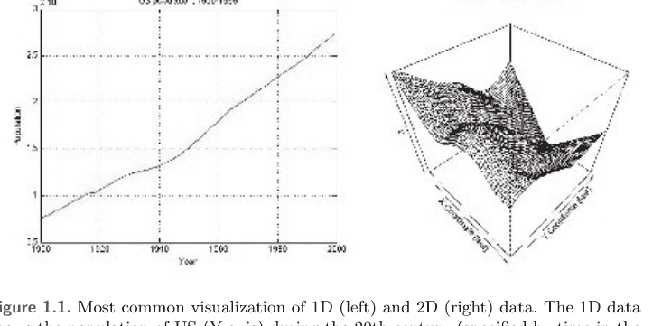

图 1.1. 1D（左）和 2D（右）数据最常见的可视化。1D 数据显示了 20 世纪（X 轴指定时间）美国的人口（Y 轴），而 2D 数据显示了地理区域（X 和 Y 轴指定）的地表高程（Z 轴）。这通常被称为高程场。

**图 1.2.** 有助理解的可视化：一幅图像可以表示为三个二维函数 `R(x, y)`、`G(x, y)` 和 `B(x, y)`。但与其用三个高度场，更有助理解的可视化方式是让每个像素 `(x, y)` 都以 RGB 颜色显示（左图）。类似地，体数据 `T(x, y, z)` 可以通过在每个三维点上用透明度来表示数据进行可视化（右图）。

## 1.1 可视化

多维数据最简单的可视化是传统曲线图，将因变量相对于自变量绘制出来，如图 1.1 所示。例如，这种二维可视化称为高度场。然而，随着数据变得越来越复杂，这类可视化就不够用了，因为人类天生无法可视化三维以上的几何结构。因此，需要使用替代的感知模态（如颜色）来编码数据。例如，彩色图像包含三个颜色通道的信息，通常是红、绿、蓝，每个通道都依赖于两个空间坐标 `(x, y)`——`R(x, y)`、`G(x, y)` 和 `B(x, y)`。然而，通常将这三个函数放在一起可视化，比将它们作为三个不同的高度场分别可视化信息丰富得多。因此，理想的可视化是一幅图像，其中每个空间坐标以颜色来显示，而颜色本身也是一个三维量。类似地，三维体数据 `T(x, y, z)` 在每个三维网格点上提供标量数据，其三维可视化方式是为每个网格点赋予颜色或透明度，这些颜色或透明度由用户定义的传递函数 `f(T(x, y, z))` 计算得到，该函数对整个数据集通用（见图 1.2）。

## 1.2 离散化

数据在自然界中以连续函数的形式存在。例如，我们听到的声音随时间连续变化；我们周围看到的动态场景也随时间和空间连续变化。然而，如果我们要以数字方式表示这些数据，就需要将连续函数转换为离散函数，即只在自变量的某些值上有定义的函数。这个过程称为*离散化*。例如，当对在连续空间坐标 `(x, y)` 中定义的图像进行离散化时，对应离散函数的值只在 `(x, y)` 的整数位置（即像素）处有定义。

### 1.2.1 采样

一个*样本*是连续函数 `f(t)` 在自变量 `t` 的某个指定值处的值（或一组值）。采样是从连续信号 `f(t)` 中提取一个或多个样本，从而将其化为离散函数 `\hat{f}(t)` 的过程。样本可以在自变量的相等间隔处提取，这称为*均匀采样*。注意，可以通过改变函数被采样的间隔来改变采样的*密度*。如果样本是在不等间隔处提取的，则称为*非均匀采样*。这些过程如图 1.3 所示。

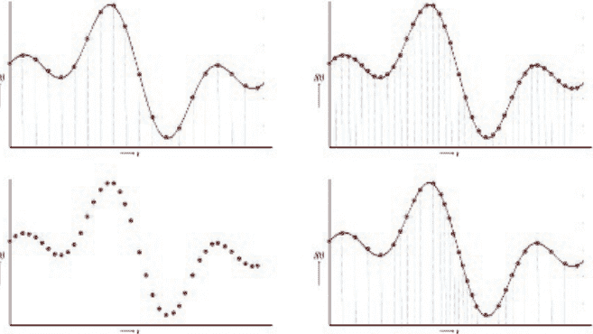

**图 1.3.** 此图说明了采样的过程。左上图中，函数 `f(t)`（蓝色曲线）被均匀采样，样本用红点表示，函数被采样处的 `t` 值用蓝色竖直虚线表示。右上图中，同一个函数以两倍密度采样。对应的离散函数显示在左下图中。右下图中，同一个函数改为非均匀采样，即其采样点处不同 `t` 值之间的间隔是变化的。

从离散函数 `\hat{f}(t)` 恢复连续函数 `f(t)` 的过程称为重建。

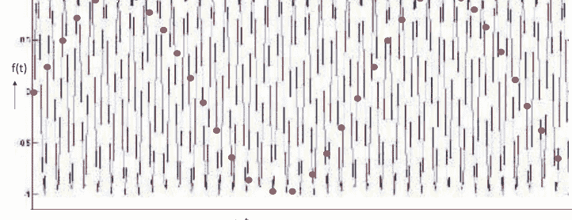

**图 1.4.** 此图说明了采样频率对重建的影响。考虑图中以蓝色显示的高频正弦波，再考虑分别由蓝色样本和红色样本表示的两种采样方式。注意，这些采样方式都没有充分地对高频正弦波进行采样，因此样本表示的是不同频率的正弦波。

为了获得准确的重建，在离散化过程中充分地对 `f(t)` 进行采样非常重要。例如，在图 1.4 中，一个高频正弦波（蓝色）以两种不同的方式被采样，两种方式都是均匀采样，分别由红色样本和蓝色样本表示。但这两种情况下的采样频率或采样率都不足。因此，重建出了不同频率的正弦波——对于蓝色样本，重建出零频率的正弦波；对于红色样本，重建出比原始波频率低得多的正弦波。这些错误重建的函数称为别名（或假象），这种现象称为混叠。

这让我们思考一个问题：什么样的采样频率才是充足的？事实证明，对于频率为 `f` 的正弦波或余弦波，要保证正确重建，至少需要以两倍的频率（即 `2f`）进行采样。这个速率称为奈奎斯特采样率。但要注意，重建并不是仅仅连接样本的过程。重建过程将在后续章节中详细讨论。

我们刚刚讨论了正弦波和余弦波的充分采样。但是，对于一般信号——不是正弦波或余弦波——什么样的采样才算充分呢？要回答这个问题，我们必须求助于一种与重建互补的操作，即分解。19 世纪的传奇数学家傅里叶证明，任何周期函数 `f(t)` 都可以分解为若干正弦波和余弦波，将这些波相加即可还原该函数。我们将在第 4 章更详细地重新讨论傅里叶分解。目前，只需理解存在一种方法，可以将任何一般信号分解为若干正弦波和余弦波。

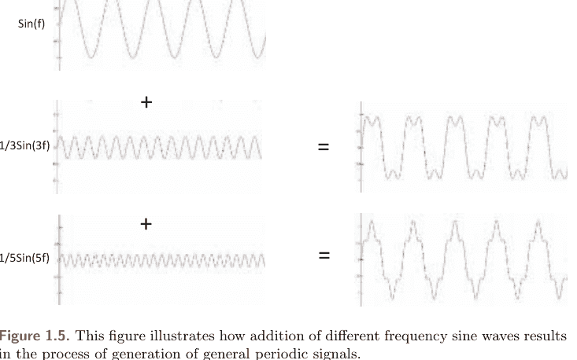

**图 1.5.** 此图说明了不同频率的正弦波相加如何生成一般周期信号的过程。

图 1.5 显示了一个例子，其中不同频率的正弦波相加产生了新的信号。因此，一般信号的充分采样率由其中存在的最高频率正弦波或余弦波决定。如果信号的采样率大于信号中存在的最高频率正弦波或余弦波的两倍，则采样是充分的，信号也能被重建。因此，图 1.5 中的信号至少要以 `6f` 的速率采样，才能保证正确重建。

### 1.2.2 量化

模拟信号或连续信号可以具有无限精度的任意值。然而，一旦将其转换为数字信号，它就只能具有有限的一组值。因此，一个范围内的模拟信号值会被映射为一个数字值。这个过程称为量化。信号的原始值与其数字值之间的差值称为量化误差。

离散值可以等间隔放置，从而在连续值的范围内产生均匀的步长。每个连续值通常被赋予离它最近的离散值。因此，最大误差是步长的一半。如图 1.6 所示。

### 人物小传

哈里·西奥多·奈奎斯特被认为是通信理论的奠基人之一。他于 1886 年 2 月出生，父母是瑞典人，18 岁时移居美国。他分别于 1914 年和 1915 年获得北达科他大学电气工程学士学位和硕士学位，并于 1917 年在耶鲁大学获得物理学博士学位。1917 年至 1934 年，他在 AT&T 的开发与研究部工作；该部门后来成为贝尔电话实验室，他继续在那里工作，直到 1954 年退休。他于 1976 年 4 月去世。

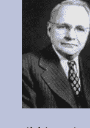

然而，人类的感知通常不是线性的。例如，人类对光亮度的感知是非线性的：如果亮度提高到原来的 2 倍，感知到的增加量小于原来的 2 倍。事实上，人类感知的任何模态（如视觉、听觉、神经感知）都是非线性的。已有研究表明，大多数人类感知模态遵循史蒂文斯幂定律，该定律指出，对于输入 `I`，感知 `P` 通过方程 `P \propto I^\gamma` 相关联。如果 `\gamma < 1`，例如人类对光亮度的响应，则该响应称为亚线性响应。如果 `\gamma > 1`，例如人类对电击的响应，则该响应称为超线性响应。

由于人体系统具有这种非线性响应，在许多情况下，将连续信号转换为数字信号时需要非均匀的步长。例如，在显示设备中，输入电压与产生的亮度之间的关系需要是超线性的，以补偿人眼的亚线性响应。显示设备（如投影仪、显示器）中的这种函数通常称为伽马函数。当在将连续信号转换为数字信号时使用这种非均匀步长，最大量化误差为最大步长的一半，如图 1.6 所示。

## 1.3 表示

在本节中，我们将在视觉计算的背景下讨论数据表示，即音频、图像、视频和网格。数据的一种解析表示形式是一个或多个自变量的函数。音频数据 `A(t)`（其中 `t` 表示时间）可以表示为 `A(t) = \sin(t) + \frac{1}{2}\sin(2t)`。然而，对于任意音频信号的数字表示，我们通常使用一维数组来表示音频数据。从现在起，我们将用 `A[t]` 代替 `A(t)`，以区分数字表示与模拟表示。注意：

## 1.3. 表示

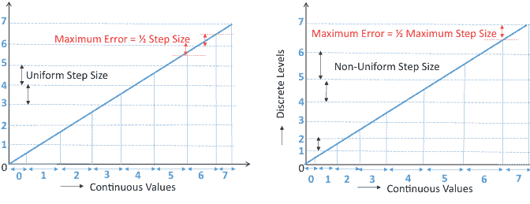

**图 1.6.** 该图说明了步长对量化误差的影响。蓝色虚线显示了八个离散值。请注意，这些值可以以等间隔分布，从而在连续值的整个范围内步长均匀。间隔也可以改变以产生非均匀步长。被分配给特定离散值的连续信号值的范围显示在独立轴上，导致最大量化误差为最大步长的一半。因此，对于均匀步长，最大误差为均匀步长的一半。

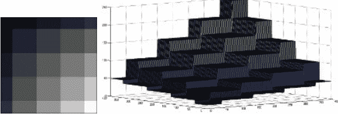

**图 1.7.** 该图说明了灰度图像（左）被表示为高度场（右）。

使用 1D 数组的表示遵循这样一个基本假设：数据是*结构化*的，在本例中意味着均匀采样。

类似地，2D 数字灰度图像 `I` 用 2D 数组 `I[x,y]` 表示，其中 `x, y` 表示空间坐标。这也假设数据是结构化的。这可以可视化为每个 `(x,y)` 坐标都分配一个灰色调的图像。它也可以可视化为一个*高度场*，其中高度（Z 值）是每个 `(x,y)` 坐标处的灰度值，形成一个表面（图 1.7）。

彩色图像还具有多个通道，通常为红色、绿色和蓝色。

因此，它们由三维数组 `I[c, x, y]` 表示，其中 `c` 表示通道，`c \in \{R, G, B\}`。视频涉及时间的额外维度，因此由四维数组 `V[t, c, x, y]` 表示。请注意，所有这些数据都是结构化的，这假设在每个维度上均匀采样。所有上述表示都称为时域或空间域表示。

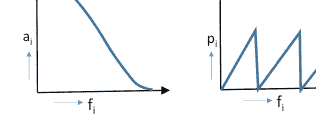

另一种表示，称为*频域表示*，将信号视为若干更基本信号的组合（例如线性组合）（例如正弦或余弦波）。然后信号可以由这些基本信号的系数表示，这些系数组合起来会产生原始信号。例如，傅里叶

图 1.8. 1D 信号频域响应的非正式表示

变换为我们提供了一种找到构成信号的正弦和余弦波的权重的方法。由于这些基本信号的频率是根据其采样率预先确定的，因此信号可以由这些波的系数集表示。在本章中，我们将简要讨论傅里叶变换，并在第 4 章中更详细地重新讨论这一主题。

让我们考虑一个 1D 信号 `c(t)`（例如音频）。它可以表示为

```
$c(t) = \sum_{i=1}^{\infty} a_i Cos(f_i + p_i)$
```


其中 $a_i$ 和 $p_i$ 分别表示构成余弦波的振幅和相位。因此，$c(t)$ 的频域表示为两幅图——振幅图显示 $a_i$ 随 $f_i$ 变化，相位图显示 $p_i$ 随 $f_i$ 变化。它们一起显示了频率为 $f_i$ 的每个波的振幅和相位。典型的 1D 频率响应图如图 1.8 所示。由于较高频率的波只产生尖锐特征，它们通常以非常小的振幅存在。因此，大多数振幅图，尤其是自然信号，在较高频率处衰减，如 1.8 所示。

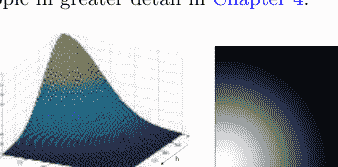

图 1.9. 左：2D 信号频域响应振幅部分的非正式表示。右：左侧相同图的灰度表示。

让我们现在尝试将这一概念直观地扩展到 2D 信号（例如灰度图像）。请注意，当考虑 2D 中的这些波时，它们不仅可以在频率 $f$ 上不同，还可以在方向 $o$ 上不同。即使频率相同，水平余弦波也与垂直余弦波完全不同。因此，2D 信号的频率响应导致 2D 图，其中振幅/相位是频率和方向的函数。然而，理解一个轴为频率、另一轴为方向的 2D 图对我们来说非常困难。一种更简单的绘图方法是使用极坐标 $g$ 和 $h$，使得坐标 $(g, h)$ 处的频率 $f$ 由长度 $\sqrt{g^2 + h^2}$ 给出，而方向由角度 $\tan^{-1} \frac{h}{g}$ 给出。这意味着 $(g, h)$ 中的一个圆将提供相同频率但不同方向的余弦波，而从原点发出的射线将提供相同方向但不同频率的余弦波。图 1.9 显示了一个示例 2D 振幅图。请注意，这里较高的频率也具有比较低频率更小的振幅，由图的径向递减值给出。或者，相同的图可以可视化为灰度图像，其中振幅归一化并作为介于黑色和白色之间的灰度值绘制（图 1.9）。

### 1.3.1 几何数据

几何实体（例如线、平面或曲面）可以进行解析表示。也可以使用离散表示。连续表示可以是隐式的、显式的或参数化的。

显式表示是指一个因变量表示为所有自变量和常数的函数。2D 直线的显式方程为

$$y = m x + c$$

其中 $m$ 和 $c$ 分别为直线的斜率和 y 截距。类似地，2D 二次曲线的显式表示可以为

$$y = a x^2 + b x + c$$

其中 $a$、$b$ 和 $c$ 是表示曲线的二次函数的系数。物理和信号处理中出现的另一个流行的显式函数是

$$y = A \sin(\omega t + \phi).$$

这表示振幅为 $A$、频率为 $\omega$、相位为 $\phi$ 的正弦波。请注意，显式表示允许在自变量的不同值处轻松求值函数。

然而，更复杂的函数有时不便于使用显式形式表示。隐式表示认为点 $\mathbf{p}$ 在满足方程 $F(\mathbf{p}) = c$ 时是有意义的，其中 $c$ 是常数。2D 直线的隐式方程为

$$a x + b y + c = 0,$$

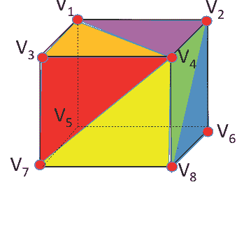

### 顶点

`V₁` `(x₁, y₁, z₁)`

`V₂` `(x₂, y₂, z₂)`

●

●

●

`V₈` `(x₈, y₈, z₈)`

### 三角形

`V₁, V₂, V₄; V₁, V₄, V₃; V₃, V₄, V₇;`

`V₄, V₈, V₇; V₄, V₂, V₈; V₂, V₆, V₈;`

`V₁, V₅, V₂; V₂, V₅, V₆; V₃, V₅, V₁;`

`V₃, V₇, V₅; V₅, V₇, V₆; V₆, V₇, V₈`

图 1.10. 该图显示了立方体 3D 网格的表示。它由顶点列表后跟三角形列表组成。每个三角形由构成它的顶点的索引描述。

而 3D 平面的方程为

`ax + by + cz + d = 0.`

类似地，2D 圆的隐式方程为

$$(x − a)² + (y − b)² = r²$$

其中 $(a, b)$ 是圆心，$r$ 是圆的半径。3D 球体的隐式方程为

$$(x − a)² + (y − b)² + (z − c)² = r²$$

其中 $(a, b, c)$ 是球心，$r$ 是球的半径。在显式函数中，有时需要交换因变量和自变量以表示特殊情况。例如，使用显式方程 `y = mx + c` 不可能表示垂直线，因为 `m = ∞`。因此我们需要将 `x` 更改为因变量以表示这条垂直线 `x = m′y + c′`，其中 `m′ = 0`。另一方面，隐式函数表示中没有特殊情况。隐式表示的优点是易于进行内部或外部测试。如果 `F(p) < 0`，则该点在表面‘上方’或‘外部’，如果 `F(p) > 0`，则该点在表面‘下方’或‘内部’。

最后，参数方程允许使用一个或多个参数表示函数。例如，线段上的点 `p = L(t)`

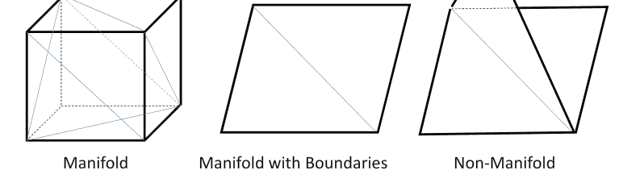

流形  

带边界的流形  

非流形

**图 1.11.** 本图说明了流形（封闭物体）、带边界的流形（带孔的物体）和非流形（带折痕和褶皱的物体）。

两点 `P` 和 `Q` 之间的线段可以用参数形式表示为

```
L(t) = P + t(Q - P)
```

其中参数为 `t` 且 `0 ≤ t ≤ 1`。类似地，由 `P`、`Q` 和 `R` 形成的三角形内部一点的参数方程由双参数方程给出

```
p = P + u(Q - P) + v(R - P)
```

其中参数为 `u` 和 `v` 满足 `0 ≤ u, v ≤ 1` 且 `u + v ≤ 1`。参数方程允许轻松采样参数空间并在这些不同采样值上求值任意函数。

在离散表示中，几何实体被表示为其他几何实体的集合，而不是解析方程。例如，2D 正方形可以由嵌入 2D 空间的一组线段定义；3D 立方体可以由嵌入 3D 空间的一组四边形或三角形定义。这种表示称为网格。例如，当使用三角形定义 3D 物体时，我们称之为三角网格。构成网格的实体（例如线段、三角形或四边形）称为基元。

尽管有许多不同的 3D 几何表示方法，但最常见的是三角网格。因此，我们在此讨论三角网格表示的一些关键要素。其他几何表示的更多细节及其用途将在后续章节中介绍。三角网格由一组顶点和由这些顶点连接形成的一组三角形定义。因此表示包含两个部分：（a）由其 3D 坐标表示的顶点列表；以及（b）由其角顶点的顶点索引定义的三角形列表。图 1.10 显示了简单 3D 物体立方体的网格表示示例。顶点的坐标定义了网格的*几何*。换句话说，改变这些坐标会改变物体的几何形状。例如，如果我们想将立方体变为长方体或更大的立方体，顶点的 3D 坐标将被改变。然而请注意，这不会改变三角形列表，因为构成三角形的顶点的连接性不会改变。因此后者被称为网格的*拓扑*属性。拓扑指的是在数据几何属性发生变化时保持不变的连接性。

接下来，我们将定义网格的某些几何和拓扑属性，但不是以严格的方式。我们将给出直观和非正式的定义。闭合网格（非正式地定义为没有孔）具有在计算机图形学操作如变形、网格简化与编辑方面的若干优良特性。此类网格是流形，其中每条边恰好有两个相邻三角形。每条边具有一个或两个相邻三角形的网格称为带边界的流形。例如，由两个三角形表示的一张纸，其构成纸张四边的四条边仅有一个相邻三角形，这就是带边界的流形。请注意，带边界的流形比流形限制更少，因而是流形的超集。边可以有超过两个相邻三角形的网格称为非流形。请注意，非流形是带边界流形的超集。图 1.11 说明了这一点。

网格可以定义几何属性或属性。在图 1.10 中每个顶点都有 3D 空间坐标。除了此基本信息外，每个顶点可以具有 RGB 颜色、法向量、或用于贴到网格上的图像的 2D 坐标（正式称为纹理坐标），或对给定应用有用的任何其他基于顶点的属性。拓扑属性是在几何属性改变时不发生变化的属性。对于网格处理，少数拓扑属性非常重要。第一个是*欧拉示性数*定义为 `V − E + F`，其中 `V` 是顶点数，`E` 是边数，`F` 是网格的面数（不一定是三角形）。请注意，如果你通过改变顶点位置将立方体改为平行六面体，这是一个几何属性，`E` 不会改变。

本质上，`E` 只有在物体经历网格连接性变化时才会改变。网格的亏格定义为柄的数量。例如，球面亏格为零，甜甜圈亏格为 1，双甜甜圈亏格为 2。要从一个亏格变为另一个亏格，需要改变网格的拓扑，而仅几何变化就足以将一个物体变为同一亏格的另一个物体（图 1.12）。

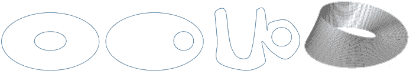

**图 1.12.** 左图：这显示了亏格 1 的甜甜圈如何仅通过改变几何形状就变为亏格 1 的杯子。右图：莫比乌斯带的示意图。

最后，如果你从网格顶部开始行走并最终到达其背面，则网格不可定向。不可定向网格的例子是莫比乌斯带（图 1.12）。

### 有趣的事实

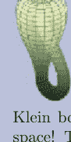

对拓扑学家来说引人入胜的不可定向曲面是克莱因瓶。与莫比乌斯带不同，它没有任何边界。它是将两个莫比乌斯带放在一起得到的。克莱因瓶最早由德国数学家费利克斯·克莱因于 1882 年描述。它不能嵌入 3D 空间，只能嵌入 4D 空间。

克莱因瓶会容纳自身，在嵌入 4D 空间时会包含自身！这并没有阻止人们尝试将其嵌入 3D 空间，而且伦敦科学博物馆展出了一些精美制作的 3D 模型！

到目前为止，我们只考虑了网格的三角形基元。虽然可以使用其他基元（例如，用六个四边形代替 12 个三角形来表示立方体的网格），但三角形因多种原因而被偏好。首先，三角形总是平面的，因为三个非共线点定义一个平面。因此建模软件包在输出网格表示时无需确保曲面符合顶点。其次，正如我们在下一章将看到的，在计算机图形学中，重要的是通过称为插值的技术，从基元的顶点属性推断出位于基元内部点的属性，而在这种情况下三角形基元具有很大优势。

## 1.4 噪声

任何关于数据的讨论都不能不讨论噪声。噪声可能由多种因素引起，如机械不精确、传感器不精确（例如偶尔总是死掉或总是活着的像素）等等。不同系统的噪声来源不同。它最好被描述为在数据的随机位置添加随机值。在本章中我们将讨论一些常见的噪声类型。

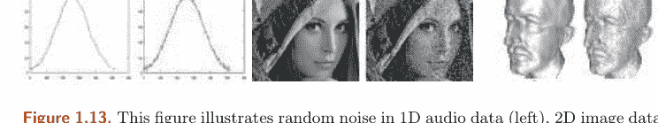

**图 1.13.** 本图说明了 1D 音频数据（左）、2D 图像数据（中）和 3D 曲面数据（右）中的随机噪声。在每个示例中，左侧显示干净数据，右侧显示对应的噪声数据。

最常见和最一般的噪声是我们称之为随机噪声，即在数据的任何位置添加小的随机值。图 1.13 显示了一些示例。减少数据中此类噪声的常用技术是我们称之为低通滤波，它将在第 3 章中详细讨论。

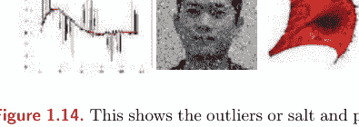

另一种常见的噪声类型源于数据中存在异常值，即明显不属于数据样本。例如，在相机中某些传感器像素可能已损坏，从而阻挡或允许所有光线，提供始终为黑色或始终为白色的像素。此类像素的位置可能是随机的。在 2D 图像的特定情况下，这种噪声称为椒盐噪声（见图 1.14）。此类异常值可通过中值滤波器或其他顺序统计滤波器得到充分处理。我们将在第 5 章看到其中的一些。

**图 1.14.** 这显示了 1D（左）、2D（中）和 3D（右）数据中的异常值或椒盐噪声。左侧，我们展示了中值滤波器去除红色异常值的效果。

最后，一些噪声在空间域看起来是随机的，但在频谱域可被隔离到少数几个频率。这种噪声的一个例子如图 1.15 所示。此类噪声可通过在频域应用称为陷波滤波器的滤波器来去除，我们将在第 4 章中详细讨论。

## 1.5 结论

在本章中，我们讨论了表示和可视化不同类型视觉数据如图像、3D 曲面和点云的基础。我们还了解了数据在时空域和频域的两种替代表示。我们谈到了数据中噪声的实际问题。

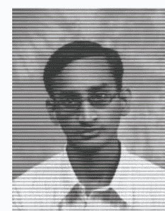

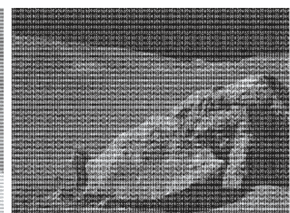

Figure 1.15. 该图显示了可通过陷波滤波器去除或降低的频域噪声。

以及如何根据具体情况进行处理。以下是一些关于熟悉某些高级概念的参考资料。 [Ware 04] 详细探讨了信息可视化的所有内容。 [Goldstein 10] 为与感觉和人类感知相关的主题提供了极佳的入门阅读。 [Ferguson 01] 中关于 3D 图形数据结构的章节提供了 3D 模型表示的详细描述。 [Gonzalez and Woods 06] 中关于噪声的章节提供了值得阅读的关于噪声的非常详细的论述。

## Bibliography

[Ferguson 01] R. Stuart Ferguson. Practical Algorithms for 3D Computer Graphics. A. K. Peters, 2001.

[Goldstein 10] Bruce E. Goldstein. Sensation and Perception. Thomas Wadsworth, 2010.

[Gonzalez and Woods 06] Rafael C. Gonzalez and Richard E. Woods. Digital Image Processing (3rd Edition). Prentice-Hall, Inc., 2006.

[Ware 04] Colin Ware. Information Visualization: Perception for Design. Morgan Kaufmann Publishers Inc., 2004.

## Summary: Do you know these concepts?

- Height Field

- Discretization

- Sampling and Nyquist Sampling Theorem

- Decomposition and Reconstruction

- Aliasing

- Quantization

- Time and frequency domain representation

- Mesh - Geometry and Topology

- Manifold, manifold with boundaries and non-manifolds

- Euler characteristics, genus, orientability

- Random Noise

- Salt and Pepper Noise

## Exercises

- 1. Consider an 8-bit grayscale image `I(x, y)` whose size is 256 × 256. Each column of the image has the same gray value which starts from 0 for the left most column and increases by 1 as we sweep from left to right. What kind of shape does the height field of this image form? Find its equation?

- 2. Consider a height field `H(x, y)` of size 256 × 256 given by the function `H(x, y) = (x mod 16) * 16`. What kind of shape would this height field have? How many gray levels would this image have? Create a table to show the percentage of pixels that belong to each of these gray levels.

- 3. Consider a gray scale spatial function `A(x, y)` which does not vary in the y-direction but form a sine wave as we go from left to right in x-direction making 50 cycles. What will be the minimum horizontal resolution of an digital image that can sample this function adequately? Consider another function `B(x, y)` formed by rotating `A` about the axis perpendicular to the plane formed by `x` and `y`. Now consider the function formed by adding `A` and `B`. What is the minimum horizontal and vertical resolution of the image required to sample `A + B` adequately?

- 4. Consider an object moving at 60 units per second. How many frames per second video is required to adequately capture this motion? What kind of artifact would you expect if the frame rate is lesser than this desired rate? What is this artifact more commonly known as?

- 5. The image of your TV looks washed out. The technician says that the intensity response curve of the TV is linear and hence the problem. To correct the problem, he has to make it non-linear. Why? What kind of non-linear response do you think he will put in?


- 6. If the number of bits used for representing the color of each pixel is increased quantization error is reduced. Justify this statement.

- 7. Can quantization be explained as an artifact of insufficient sampling? Justify your answer.

- 8. Your TV has three channels – R, G and B. However one of these channels is broken and now you can only see blacks and purples. Which channel is broken?

- 9. A 1D function contains all the harmonics of the sine wave that makes 1 cycle with a spatial span of 1 unit. Choose the correct answer.

  (a) The amplitude plot of the frequency domain response of this function is a (i) a sine wave; (ii) a horizontal line; (iii) a comb function.

  (b) The phase plot of the frequency domain response of this function is a (i) a sine wave; (ii) a horizontal line; (iii) a comb function.

- 10. What is the euler characteristics of a cube represented by six planar quadrilaterals. Euler characteristics of an object are related to its genus by the formula `e = 2 − 2g`. Can you derive the genus of a sphere from the Euler characteristics of a cube? If so, how?

- 11. Topologically, a cube is an approximation of a sphere using quadrilateral faces. In such a cube, all vertices have degree three. It is claimed that one can construct an approximation of a sphere using quadrilaterals where each vertex has degree 4. Prove or disprove this claim.

- 12. Objects like spheres are usually approximated in computer graphics by simpler objects made of flat polygons. Start with a regular tetrahedron constructed from four triangles. Derive one or more methods to obtain a close approximation of a sphere based on subdividing each face of the tetrahedron recursively using the same geometric operation. Does these constructions change the topological properties of the sphere? Can you think of some criteria to evaluate the quality of these constructions?

- 13. Match the noisy images in the top row with the filters that will remove the noise in the bottom row.

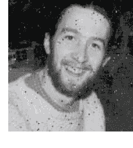

Notch Filter

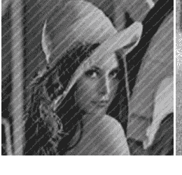

Low Pass Filter

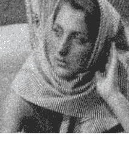

Median Filter

- 14. Consider the mesh representing a pyramid with a quadrilateral as base and four triangles attached to each of its sides to form the structure of the pyramid. Find its Euler characteristics and genus.

## 2

## Techniques

We are familiar with different kinds of data. In this chapter, we will introduce two fundamental techniques that we will be using throughout this book: interpolation and computation of geometric intersections.

### 2.1 Interpolation

Consider a function `f` e.g. attributes or properties like color or position sampled at certain parametric values. Interpolation is a process by which this function is estimated at parametric values at which it has not been measured or sampled. An image data can be considered as samples of a 2D function `I(x,y)` that provides color at each spatial location `(x,y)`. Typically, image data points are sampled at integer values of `x` and `y`. Given the function values of `I(x,y)` at the integer grid points `(x, y)`, we use interpolation to find the function value `I(x, y)` at in-between, and possibly non-integer values of `x, y`. Or, consider a triangle. The position function defined by 3D coordinates is defined only at the vertices. We need to interpolate the positions of the vertices to the interior of the triangle to compute the position of any point lying inside the triangle.

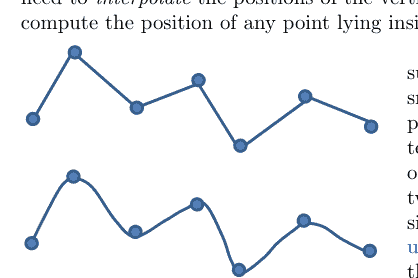

Figure 2.1. This shows the assumption of smooth transition between samples in interpolation and how it can be modeled differently. Top: Linear; Bottom: Non-Linear.

Interpolation is based on the assumption that the function changes smoothly between the different sampled values. However, interpolation techniques differ based on the degree of smoothness of change assumed between the samples. For example, consider the 1D function shown in Figure 2.1. The simplest assumption is that the 1D function changes linearly between two adjacent samples, i.e. two adjacent samples are connected by straight lines. Therefore, the function can be estimated at a parameter where it is not sampled, by considering the function values at its two nearest neighbors which defines the straight line. This kind of interpolation that uses a straight line to estimate function values at points where it is not sampled is called linear interpolation. However, it is evident from Figure 2.1 that at sample points, the function values can changes abruptly also called `$C^0$` continuity. In many applications such discontinuities in the derivative of the function values are not acceptable. Therefore, in more sophisticated interpolation techniques, it is assumed a smooth curve passes through multiple of these samples such that the tangent vector of the curve also smoothly changes. In order to compute the derivatives, we need a larger neighborhood of sample points rather than just two that we used for linear interpolation. For tangent continuity aka first derivative continuous, `$C^1$` continuous, quadratic interpolation, we use three sample points. Similarly, for second derivative continuous cubic curve `$C^2$` continuous, we use four sample points, and so on. In this book we will almost always use only linear interpolation and therefore we will explore this in detail. We will first describe linear interpolation in 1D as shown in Figure 2.1 and then extend the concept to 2D data e.g. images and meshes in which case it is called a bilinear interpolation.

#### 2.1.1 Linear Interpolation

Let us consider a straight line segment between the endpoints `V1` and `V2`. Let the color at these two vertices be `C(V1) = (r1, g1, b1)` and `C(V2) = (r2, g2, b2)` respectively. Any point `V` on the line segment `V1V2` is given by `V = α V1 + (1-α)V2` where `0 ≤ α ≤ 1`.

We say a function `f` is linear if `f(aX + bY) = a f(X) + b f(Y)`. Similarly, we say the color at the point `V`, `C(V)`, in the line segment `V1V2` is linearly interpolated when

```
C(V) = C(α(V1) + (1 - α)(V2)) = α C(V1) + (1 - α)C(V2).
```

`2.1`

We can see that rate of change of color of a point between `V1` to `V2`, with respect to the distance traveled between `V1` and `V2`, is constant.

Technically, the above interpolation is much more specific than a general linear interpolation or linear combination – it is called a convex combination of `C(V1)` and `C(V2)` where the coefficients are positive and they add up to 1.0. It is said that the function value at `V` in this case color is interpolated from the function values at `V1` and `V2` linearly by weighting the function at those values using coefficients `α` and `(1 - α)`. The coefficients `α` are typically computed as a relative function of the distance of the point `V` from `V1` and `V2`. For example, we know that the parametric equation of a line is given by

```
(x, y, z) = α(x1, y1, z1) + (1 - α)(x2, y2, z2)
```

`2.2`

where `(x, y, z)` are the 3D coordinates of any point on the line `V1V2`. Note that, though the coordinates are 3D, the geometric entity is 1D line embedded in 3D

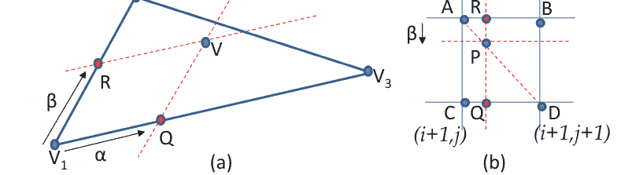

图 2.2。左：三角形中从 `V1`、`V2` 和 `V3` 对 `V` 进行双线性插值。右：在图像中由整数像素 `(i, j)`、`(i + 1, j)`、`(i, j + 1)` 和 `(i + 1, j + 1)` 处 `F` 的值求 `P` 处 `F` 值的双线性插值。

因此我们使用的是线性插值。已知点 `V1`、`V2` 和 `V` 的位置，可通过求解方程

```
x = α x1 + (1 - α) x2
```

求出 `α`，并用该 `α` 从 `C(V1)` 和 `C(V2)` 求出 `C(V)` 的值。`V1` 和 `V2` 的系数均在 0 到 1 之间且其和等于 1.0。因此，`V` 处的函数由 `V1` 和 `V2` 处函数的加权和估计，其中每个权重都是 0 到 1 之间的分数且其和等于 1。这称为 `V1` 和 `V2` 的凸组合。

如果仅要求系数之和为 1.0，但系数可以取任意值，则称为仿射组合。如果系数没有约束，则称为线性组合。需要注意的是，线性组合并不总是意味着线性插值。例如，如果方程 2.1 为 `C(V) = α² C(V1) + (1 − α²) C(V2)`，它在 `α` 上不是线性插值，但仍是 `C(V1)` 和 `C(V2)` 的线性组合，因为 `α²` 和 `(1 − α²)` 仍是标量值。换句话说，对于线性插值，插值函数的导数应为常数。

#### 2.1.2 双线性插值

与其考虑一维数据，现在让我们考虑二维数据，其中样本的邻域沿两个不同方向延伸。双线性插值是指先在一个方向上插值，然后在第二个方向上插值。


为此，让我们考虑一个具有三个顶点 `V1`、`V2` 和 `V3` 的三角形（图 2.2a）。为了估计三角形内部一点 `V` 处的函数 `C`，我们首先在两个方向 `V1V3` 和 `V1V2` 上估计函数。`V1V3` 上的点 `Q` 由线性插值给出

$$Q=(1-\alpha)V_1+\alpha V_3.$$

类似地，沿 `V2V1` 的点 `R` 给出为

$$R=(1-\beta)V_1+\beta V2.$$

其中 $0.0\leq\alpha,\beta\leq1.0$。因此 `V` 由 `V1`、`R` 和 `Q` 的矢量相加给出

$$V=V_1+((1-\alpha)V_1+\alpha V_3-V_1)+((1-\beta)V_1+\beta V_2-V_1)$$

$$=(1-\alpha-\beta)V_1+\alpha V_3+\beta V_2.$$

因此 `C` 在 `V` 处可估计为

$$C(V)=(1-\alpha-\beta)C(V_1)+\alpha C(V_3)+\beta C(V_2).$$

双线性插值也产生凸组合，且 `alpha` 和 `beta` 的值可通过求解方程 2.7 中由 `V`、`V1`、`V2` 和 `V3` 的坐标形成的两个方程得到。此外，你可以自行验证，求 `V` 的系数不会因考虑不同的两个方向而改变，例如 `V3V2` 和 `V3V1` 或 `V1V2` 和 `V2V3`（参见关于此问题的练习）。

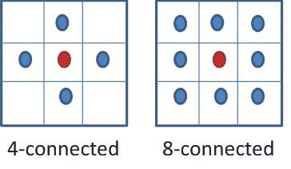

**图 2.3。** 这显示了中心红色像素的 4- 和 8-连通邻居，蓝色表示。

现在，让我们考虑图像中另一种场景的双线性插值（图 2.2b）。任何非整数空间位置在由四个最近邻点定义其邻域时可视为 4-连通，其中两个在水平方向，两个在垂直方向。邻域也可以是 8-连通，当对角邻居也被包含时。8-连通邻域中邻居的距离可以不同（例如，对角邻居的距离为 $\sqrt{2}$，而水平和垂直邻居的距离为单位距离）。这在图 2.3 中有所说明。

让我们考虑一个函数 `F`，它定义了整数像素 `(i,j)`、`(i,j+1)`、`(i+1,j)` 和 `(i+1,j+1)` 处的颜色，分别记为 `A`、`B`、`C` 和 `D`。让我们考虑图 2.2b 所示需要估计 `F` 的点 `P`。注意，在这种情况下，每个像素的位置都使用二维坐标定义。因此，像素 `(i,j)` 与 `P` 在水平和垂直方向上的距离可从其位置求出。设其分别为 `alpha` 和 `beta`，其中 0 ≤ `alpha`, `beta` ≤ 1。因此，像素 `Q` 处的 `F` 值由水平方向的线性插值给出

$$F(Q) = (1 - \alpha)C + \alpha D \tag{2.9}$$

类似地，`F` 在 `R` 处的值为

$$F(R) = (1 - \alpha)A + \alpha B. \tag{2.10}$$

现在，`P` 处的 `F` 值通过在垂直方向上对 `R` 和 `Q` 进行线性插值求得

$$\begin{aligned}F(P) &= F(Q)\beta + F(R)(1 - \beta) &&\tag{2.11}\\ &= \beta(1 - \alpha)C + \beta\alpha D &&\tag{2.12}\\ &\quad + (1 - \beta)(1 - \alpha)A + (1 - \beta)\alpha B &&\tag{2.13}\\ &= \beta(1 - \alpha)F(i + 1, j) + \beta\alpha F(i + 1, j + 1) &&\tag{2.14}\\ &\quad + (1 - \beta)(1 - \alpha)F(i, j) + (1 - \beta)\alpha F(i, j + 1) &&\tag{2.15}\end{aligned}$$

现在，考虑 `P` 恰好位于连接 `A` 和 `D` 的直线上的情况。在这种情况下，`P` 可表示为这两个点的线性组合。距离 `AP` 为 $\sqrt{\alpha^2 + \beta^2}$，距离 `PD` 为 $\sqrt{(1 - \alpha)^2 + (1 - \beta)^2}$。因此，

$$F(P) = \frac{\sqrt{\alpha^2 + \beta^2}}{\sqrt{2}}\,D + \frac{\sqrt{(1 - \alpha)^2 + (1 - \beta)^2}}{\sqrt{2}}\,A \tag{2.16}$$

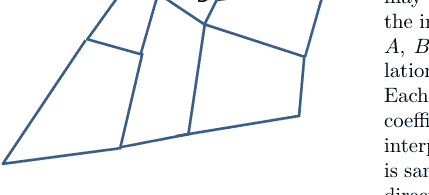

因此，存在多种方法可对 `P` 处的 `F` 进行插值，可使用方程 2.14 或 2.16，还可找到更多方法。例如，我们可能希望使用 `A`、`B` 和 `C` 对 `AD` 与 `BC` 的交点进行插值，然后将该点与 `A` 进行插值得到 `P`。每种方法都会产生不同的系数。这种在图像数据中沿相同两个方向——水平和垂直——均匀采样时的插值非唯一性，可通过始终沿这两个方向进行插值来避免。你可以验证，先在垂直方向插值再在水平方向插值会得到与方程 2.14 相同的结果。

图 2.4。这显示了一个由四边形构成的网格。

然而，与这种均匀平面网格不同，如果该二维曲面是 **图 2.4** 中的网格，则插值结果将完全取决于所使用的特定中间点。考虑 **图 2.4** 中红色高亮的四边形。设一对对角顶点颜色为黑色，记为 `B`，另两个顶点颜色为白色，记为 `W`。两条对角线交点处的一个点，如图中红色虚线所示，可被插值为两种完全不同的颜色。若从黑色顶点插值，则为黑色；若从白色顶点插值，则为白色。

因此，三角形是特殊的，三角形内部的点无论如何插值都具有唯一性。这是因为三角形是单形。单形是通过在 $(n-1)$ 维中连接 $n$ 个点而得到的几何构造。直线是 1D 单形。三角形是 2D 单形（包围一个曲面）。类似地，四面体是 3D 单形。这些在 **图 2.5** 中有所说明。这些单形上的线性插值（二维称为双线性，三维称为三线性）产生唯一的插值系数，也称为点相对于构成单形的顶点的重心坐标。因此 **方程 2.8** 给出了 **图 2.2a** 中点 `V` 相对于 `V1`、`V2` 和 `V3` 的重心坐标。这就是为什么在表示几何网格时选择三角形而不是其他多边形的原因。当本书后面介绍计算机图形学时，其优势将更加明显。

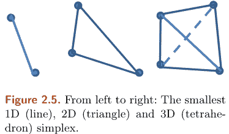

## 2.2 几何相交

线性方程表示直线（使用 2 个变量时）或平面（使用三个变量时），我们经常需要计算此类几何实体的交点。相交是通过求解一组线性方程来计算的。为了求解具有 $n$ 个未知数的方程，我们至少需要 $n$ 个方程。首先，让我们为这个问题推导矩阵形式。让我们考虑 $n$ 个线性方程，含 $n$ 个未知数 `x1,x2,...,xn`，其中第 `i` 个方程为

$$a_{i1}x_1+a_{i2}x_2+\cdots+a_{in}x_n=b_i \tag{2.17}$$

现在，这可以写成

$$Ax=b \tag{2.18}$$

其中，\(A\) 是一个 \(n \times n\) 矩阵，由下式给出

\[

A = \begin{pmatrix}

a_{11} & a_{12} & \cdots & a_{1n} \\

a_{21} & a_{22} & \cdots & a_{2n} \\

\vdots & \vdots & \ddots & \vdots \\

a_{n1} & a_{n2} & \cdots & a_{nn}

\end{pmatrix} \tag{2.19}

\]

而 `x` 和 `b` 分别是 \(n \times 1\) 列向量，其中 `x^T = (x1, x2, ..., xn)`，`b^T = (b1, b2, ..., bn)`。该线性方程组的解为

\[

x = A^{-1}b \tag{2.20}

\]

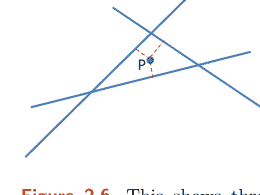

**图 2.6.** 图中展示了二维平面上的三条非平行直线，它们可能不会相交于一点。红色线段表示每条直线到点 `P` 的垂直距离。

注意，`A^{-1}` 仅在所有方程彼此线性无关时存在。从几何上看，你可以想象一个 \(n\) 维空间中的问题：\(n\) 个方程各自定义一个超平面，而 `x` 将给出这 \(n\) 个超平面在 \(n\) 维空间中的交点。满秩的 `A` 表示这些超平面不平行，因此存在唯一的交点。例如，当 `n = 2` 时，两条非平行直线总会相交于一点。

现在考虑另一种情况：未知数的个数相同，但方程的数量更多，记为 `m`，且 `m > n`。这样的方程组称为过约束方程组。在这种情况下，注意可能不存在一个公共交点。例如，考虑 `m = 3` 和 `n = 2`，此时我们有三条直线，它们可能不会相交于一点，如图 2.6 所示。因此，求解这组过约束方程的一种（也可能是最常用的）几何方法，等价于寻找一个点 `P`，使得从 `P` 到这组线性方程所定义的各条直线的距离的平方和最小。采用平方运算是为了确保负距离和正距离不会相互抵消。这一过程称为线性回归。由于使用的是距离的平方，因此它通常也被称为线性最小二乘优化。

过约束线性方程组可以用同样的式 2.18 表示。不过，此时 `A` 的维数为 `m × n`，`b` 的维数为 `m × 1`。现在，由于 `A` 不再是方阵，其逆矩阵未定义。因此，

即它们表示彼此正交的单位向量。标准正交矩阵在此处的一个重要性质是：它们的逆矩阵等于它们的转置。因此，`U^{-1} = U^T`，`V^{-1} = V^T`。现在，考虑一个矩阵 `D*`，它通过对 `D` 的 `r × r` 子矩阵求逆得到，而其余元素与 `D` 中一样保持为零。注意，`D*` 仍然是一个对角矩阵，其左上角的 `r × r` 子矩阵的对角元素是 `D` 中相应元素的倒数。可以证明，`A V D* U^T b = b`。因此，`x = V D* U^T b` 是 `Ax = b` 的解。

## 2.3 结论

本章提供了足够的细节，足以帮助你通读全书。然而，这些数学基础及其几何解释本身就是一个有趣的研究领域。要了解更多内容，可参考 [Lengyel 02]。矩阵本质上表示几何，对矩阵的分析实际上就是对它们所表示的底层几何的分析。若想在这一方向了解更多，可参考 [Saff and Snider 15, Nielsen and Bhatia 13]。

## 参考文献

[Lengyel 02] Eric Lengyel. *3D游戏编程与计算机图形学中的数学*. Charles River Media Inc., 2002.

[Nielsen and Bhatia 13] Frank Nielsen and Rajendra Bhatia. *矩阵信息几何*. Springer Verlag Berlin Heidelberg, 2013.

[Saff and Snider 15] Edward Barry Saff and Arthur David Snider. *矩阵分析基础及其应用*. John Wiley and Sons, 2015.

## 小结：你了解这些概念吗？

- 插值
- 双线性插值
- 线性回归
- 奇异值分解

## 第二部分：基于图像的视觉计算


Taylor & Francis  

Taylor & Francis Group  

http://taylorandfrancis.com

## 卷积

### 3.1 线性系统

*系统*定义为修改信号的一种方法。将一维音频信号放大（即修改）的音频放大器，或者修改二维图像信号以检测某些特征的图像处理方法，都是系统的几个例子。系统可能非常复杂，但我们主要讨论一类更简单的特定系统，即*线性系统*。

线性系统满足线性的一些有利性质。我们将系统记为 `S`，系统输入记为 `x`，输出记为 `y` 和 `z`。为简化说明，我们假设一维信号只依赖于单一参数 `t`。不过，以下性质对任意维度的线性系统都成立。

- **1. 齐次性：** 如果线性系统的输入按比例缩放，输出也会按相同比例缩放。

  

- **2. 可加性：** 当多个不同输入信号相加时，它们各自的独立响应（输出）也会相加。这意味着每个信号都独立地通过系统，不会与其他信号相互作用。

  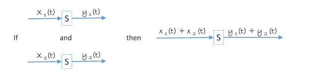

- **3. 平移不变性：** 最后，平移后的输入所产生的输出也会相应平移。

  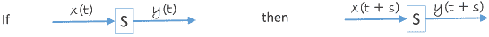

当数据通过多个系统时，线性性质保证了以下特性。

- **1. 交换性：** 如果两个线性系统以级联方式（即串联）作用于一个信号，那么它们的应用顺序无关紧要。给定两个线性系统 `S_A` 和 `S_B`，先应用 `S_A` 再应用 `S_B` 所产生的输出，与先应用 `S_B` 再应用 `S_A` 所产生的输出相同。

  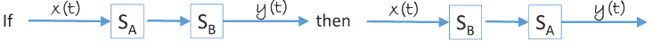

- **2. 叠加性：** 如果在线性系统中每个输入产生多个输出，那么输入相加将导致输出相加。

  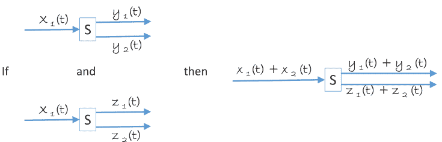

这种叠加性质对于求解复杂信号通过线性系统时的响应尤为重要。复杂的输入信号 `x(t)` 可以通过不同的*分解*过程拆分成一组较简单的输入信号 `x1(t), x2(t), ..., xn(t)`。通常更容易求出这些较简单的输入信号 `xi(t)` 通过系统时的输出 `yi(t)`。然后通过*合成*过程将这些输出组合或相加，从而生成复杂信号的输出 `y(t)`。**图 3.1** 对此进行了说明。在接下来的章节中，我们将研究多种不同的分解与合成方法。

### 3.1.1 线性系统的响应

*冲激* `i[t]` 是一种只有一个非零样本的离散信号。因此，它是一个在某处有尖锐脉冲、在其他位置为零的信号。Delta（`delta[t]`）被定义为系统对输入 `delta[t]` 的输出。

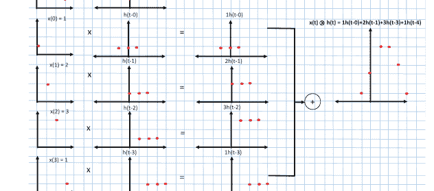

**图 3.2.** 该图展示了卷积的输入侧算法。

`h` 的大小（对于一维 `h` 而言是宽度）也称为其支撑集。由于平移不变性和齐次性的性质，同一线性系统对一般冲激函数的响应可表示为经过缩放和平移的 `h`，即 `k h[t - s]`。

卷积是一种求解具有冲激响应 `h` 的线性系统对一般信号或函数响应的方法。因此很明显，卷积是一个相当强大的函数。

考虑一个离散信号 `x[t]`，其中 `t = 1, 2, ..., n`。注意，`x` 可以分解为 `n` 个冲激函数 `i1[t], i2[t], ..., in[t]` 之和，其中 `il[t]` 在 `t = l` 处的非零值为 `x[l]`，且 `x[t] = sum_{l=1}^{n} i_l[t]`。系统对每个 `il[t]` 的响应为 `x[l]h[t - l]`。根据线性系统的可加性，线性系统对 `x[t]` 的响应 `R[t]` 为

\[

R[t] = \sum_{l=1}^{n} x[l]h[t - l] = x[t] \star h[t]. \tag{3.2}

\]

`x[t] star h[t]` 是 `x[t]` 与冲激响应 `h[t]` 的卷积。我们将用符号 `star` 表示卷积。图 3.2 对此进行了说明。

既然我们已经定义了卷积，那么让我们稍微思考一下图 3.2。首先注意，当 `x` 的前几个或后几个样本与 `h` 相乘时，`h` 会延伸到 `x` 未定义的左右两侧（例如，我们不知道 `x` 在 `t = 0`、`t = -1` 或 `t = n+1` 处的值）。在这种情况下，我们需要为 `x` 假定一些任意值。最常见的假设是认为 `x` 在这些索引处为 `0`。有时，也会对 `x` 的左右两端进行镜像反射。无论采用哪种方式，这都会带来两个重要问题。首先，`R` 的大小大于

of x。若 `h` 的支撑为 `m`，则 `R` 的大小为 `n + m - 1`。这在图 3.2 中有所说明，其中 `n = 4` 且 `m = 3`，因此输出的大小为 `4 + 3 - 1 = 6`。其次，`R` 的某些值并不准确，因为它们涉及从假设信息中计算得出的结果。例如在图 3.2 中，`t = -1`、`0`、`3`、`4` 处的卷积输出取决于 `t = -1`、`4`、`5` 处的 `x` 值，而 `x` 在这些位置未定义。因此，只有 `R` 的子集样本，事实上只有 `n - m + 1` 个样本，是从精确定义的信息中获得的，这些样本称为完全浸没样本。在图 3.2 中，唯一完全浸没的样本是 `t = 1` 和 `2` 处的样本。

这里还需要注意的一点是，在使用公式 3.2 时，输入 `x` 的每个样本对应于一个缩放并平移的脉冲响应，以创建一个中间函数 `x[l]h[t - l]`。所有这些中间函数相加形成 `R`（图 3.2）。因此，`R` 的任何单个输出样本都是通过从所有这些中间函数中累加同一位置的样本生成的。由于输入 `x` 中的单个样本 `l` 会通过对应的中间函数 `x[l]h[t - l]` 贡献给多个输出样本，因此这被称为输入侧算法

现在仔细查看图 3.2 中 `t = 1` 处的一个完全浸没样本。注意它由下式给出

```
R[1] = h[1]x[0] + h[0]x[1] + h[-1]x[2]
```


这与翻转 h 并用此翻转后的 h 加权 t = 1 处 x 的邻域相同。因此，另一种求卷积的方法是生成 t 处的每个输出样本，将翻转后的 h 平移使其中心与 l 对齐，并求出底层 x 与翻转后平移的 h 的加权和。因此，l 处的样本 R[l] 由 x[t] 与平移后的翻转 h 的点积生成

R[l] = x · h[−(t − l)]. (3.3)

注意，对于 h 值未定义的所有索引，假定其为 0。在此方法中，R 的每个输出样本在每一步中都是通过从 h 的多个样本中收集贡献来构造的。因此，这被称为输出侧算法。这是一种更高效的算法，因为无需维护中间函数。每个输出都可以直接从输入和 h 生成。此外，如果 h 是对称的（如图 3.2 所示），则翻转也可以避免。

将卷积扩展到 2D 其实非常简单。x、R 和 h 现在都是二维函数。在图像的情况下，这两个维度来自两个空间坐标 s 和 t。然而，h 的支撑通常远小于 x。R[s, t] 现在是通过将 h 在两个维度上翻转后移动到所需位置 (s, t)，并求出此翻转后的 h 与 x 的点积来获得的。然而，注意在图像处理的大多数情况下，我们使用对称滤波器或 h，这使得翻转变得不必要。

在本章的剩余部分，我们将研究卷积的性质，使用 1D 信号，因为它们易于理解。这些概念可以很容易地扩展到 2D，我们将在每个关于 1D 信号的论述末尾提及它们。

### 3.1.2 卷积的性质

在本节中我们将讨论卷积的性质。考虑一个信号 x 与 δ 卷积。这意味着如果系统的脉冲响应是脉冲本身，它对任意函数 x[t] 的响应会是什么。直观上可以认为该系统输出脉冲不变，因此它也会输出信号 x 不变。因此，

x[t] ★ δ[t] = x[t]. (3.4)

这称为全通系统。

现在我们考虑一个简单地缩放脉冲响应的系统。因此，

x[t] ★ kδ[t] = kx[t]. (3.5)

如果 k > 1，则该系统称为放大器，因为它增加了信号 x[t] 的强度。另一方面，如果 k < 1，则称为衰减器，因为它降低了 x[t] 的强度。

最后，如果我们考虑一个其脉冲响应是将信号平移的系统，则

x[t] ★ δ[t + s] = x[t + s]. (3.6)

这称为延迟系统。

作为一种数学运算，卷积具有以下有益的性质。

首先，它是可交换的，即

a[t] ★ b[t] = b[t] ★ a[t]. (3.7)

这表明在卷积两个函数时，顺序无关紧要。这就是为什么我们总是使用尺寸较小的函数作为核以实现更高效的处理。

其次，卷积是结合的，即

(a[t] ★ b[t]) ★ c[t] = a[t] ★ (b[t] ★ c[t]). (3.8)

这意味着如果一个函数 x 使用两个不同的核 b 和 c 进行级联卷积，则可以通过先设计一个新的核 d = b ★ c 并将 x 与此新的 d 卷积来提供 x ★ d 实现相同的操作（图 3.3）。

第三，卷积是分配的，即

a[t] ★ b[t] + a[t] ★ c[t] = a[t] ★ (b[t] + c[t]).


图 3.3。此图说明了级联卷积的效果。

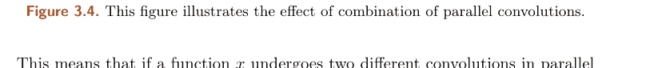

图 3.4。此图说明了并行卷积组合的效果。

这意味着如果一个函数 x 并行使用 b 和 c 进行两种不同的卷积然后组合，可以通过设计一个新的核 d 通过相加 b 和 c（d = b + c）然后与此新的核 d 进行单次卷积来获得相同的效果（图 3.4）。

## 3.2 线性滤波器

接下来要问的问题是，了解卷积对我们有什么帮助？事实上，卷积可以在设计系统时极大地帮助我们，因为我们无需担心复杂的信号，只需担心简单的 δ 函数即可。如果我们能设计系统的脉冲响应，我们就知道将输入信号与脉冲响应卷积将为任何一般函数提供正确的答案。

让我们以设计一个将任意一般信号模糊的滤波器（或脉冲响应）为例。要设计它，我们必须首先直观地思考模糊的 delta 信号会是什么样子。换句话说，当 delta 作为输入提供时，一个模糊信号的线性系统会产生什么？为此请考虑图 3.5。Delta 是一个在 0 处具有单个值为 1 的样本的函数，本质上是一个尖锐的尖峰。因此，直观上，模糊 delta 函数预计会产生一个基底更宽、高度更小的尖峰。这由一个以 0 为中心、值小于 1 的多个样本的函数表示。现在下一个问题是，基底应该宽多少，尖峰应该短多少？事实上，这个问题有很多答案。例如，它可以是三个以 0 为中心的样本，每个值为 0.7。或者，它可以是五个以 0 为中心的样本，每个值为 0.5。那么，我们如何约束这个问题以找到这些问题的适当答案呢？

约束问题的一种方法可能是首先将尖峰的基底作为模糊量的参数来固定。因此，七像素的宽度表示比五像素更多的模糊。而五像素的宽度表示比三像素更多的模糊。现在剩下的问题是，一旦基底宽度固定，我们应该如何决定模糊尖峰的高度？为了决定这一点，我们可以应用约束，即 delta 函数的能量（由描绘函数的曲线下的面积定义）不会因模糊而改变。该约束是 delta 函数尖峰的高度为 1，宽度为 1。因此，其能量由其宽度和高度的乘积给出，即 1。现在，如果一个三像素宽的模糊尖峰需要具有面积 1，则其高度应为 1/3。因此，这个额外的能量约束现在允许我们定义模糊的 delta 为一个以 0 为中心、宽度为三像素、值为 1/3 的尖峰。因此，如果 delta 作为我们想要设计的模糊系统的输入给出，我们期望其输出为上述更短更宽的尖峰。因此，该模糊系统的脉冲响应由一个以 0 为中心、宽度为三像素、在这三个像素处具有恒定值 1/3 的函数给出。定义此脉冲函数的优点是，如果我们现在将任何其他一般函数与此脉冲响应卷积，它将导致该函数的模糊。

现在，如果我们想要设计一个使信号更模糊的系统，我们必须再次为该系统设计脉冲响应。由于我们知道更多的模糊意味着进一步拓宽基底并缩短尖峰高度，一个可能的脉冲响应将是以零为中心、宽度为五像素、高度为 1/5 的尖峰。因此，该系统的脉冲响应将是

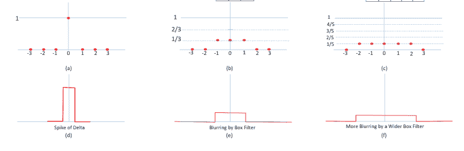

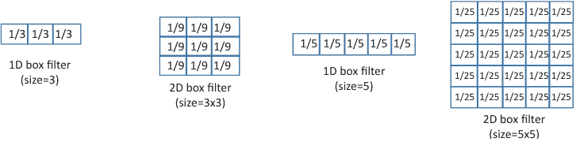

**图 3.6.** 该图展示了 1D 盒滤波器扩展到 2D 的过程。

size with a value of \(\frac{1}{5}\) at every pixel as shown in **Figure 3.5(c)**. Notice the analog representations of these filters in (d) and (e). Since they look like boxes, these are most commonly referred to as *box filters*.

However, there are multiple ways to maintain the same energy as the \(\delta\) of which only one is to assign the same value at every pixel. Therefore, conceptually, the shape of the filter can change and still remain a blurring filter as long as the support of the kernel increases. It is indeed true that many such blurring filters exist and we will revisit this issue in the next chapter where we will find that though box filter is the easiest to implement, it is not the best for blurring.

Now the next question is how do we extend this blurring filter to 2D. In this case, the energy of the \(\delta\) should be spread around a 2D box around the surrounding of origin. So, the extension of the three pixel 1D box filter to 2D will be a \(3 \times 3\) filter with each value as \(\frac{1}{9}\) and that of the wider box filter will be a \(5 \times 5\) array with each value as \(\frac{1}{25}\) (**Figure 3.6**).

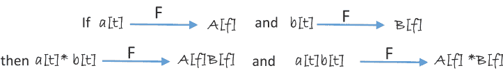

**图 3.7.** 卷积的对偶性体现在空间域中两个函数的卷积在频域中是它们频率响应的乘积，反之亦然。这里的 \(F\) 表示将时域函数转换为频域的操作。

### 3.2.1 全通、低通、带通和高通滤波器

有趣的是你会发现盒滤波器通常被称为 *低通滤波器*。为了理解原因，回顾一下 **第 1 章** 中讨论的频域表示可能是有价值的。在本章中我们将非常非正式和直观地理解这一概念，并在下一章中更正式地重新审视它。

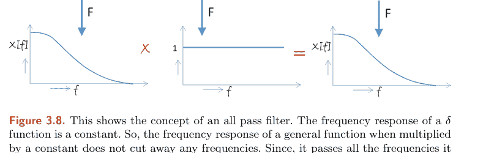

**图 3.8.** 这展示了全通滤波器的概念。δ 函数的频率响应是一个常数。因此，一般函数与常数相乘后的频率响应不会削减任何频率。由于它通过了所有频率，因此被称为全通滤波器。

让我们再次从 1D 中的 delta 函数开始。这可以被视为原点处的一个非常尖锐的尖峰。现在，直观地说，你会期望 δ 函数的频域表示是什么？记住，形成尖锐特征需要非常高的频率信号。这一事实可能让你相信，像 δ 这样最尖锐的数字函数会涉及所有高频。事实上，可以正式证明，创建 δ 需要所有频率的等强度。因此，δ 函数的频域响应（我们这里只考虑幅度）是一个常数。现在，让我们问一下常数函数的频域响应会是什么，即时域中保持恒定值的函数。很显然可以看出，这种函数由零频率余弦波表示。因此，该常数函数的频域响应在频域中原点处有一个单一值，即频域中的 δ 函数。

你可能注意到了这里的一个有趣模式。时域中的 δ 是频域中的常数，而时域中的常数是频域中的 δ。这真的是巧合吗？事实证明不是！这被称为对偶性，我们将在下一章中更正式地探讨它。但我们将利用这一概念来理解本章中的一些内容。

对偶性的概念产生了一个重要的卷积性质，即如下所示。如果空间域中两个函数 \(a[t]\) 和 \(b[t]\) 的频域响应分别为 \(A[f]\) 和 \(B[f]\)，则它们在时域中的卷积的频域响应由它们的频域响应的乘积给出，反之亦然（图 3.7）。

这为我们理解全通、低通、高通和带通滤波器提供了背景。让我们首先重新审视方程 3.4。我们提到，任何函数 \(x[t]\) 与 delta 的卷积被称为全通系统。让我们看看是否可以用我们刚刚学到的关于对偶性的知识来解释这一点。首先，δ 的频率响应是一个常数。因此，\(x[t] \star \delta[t]\)

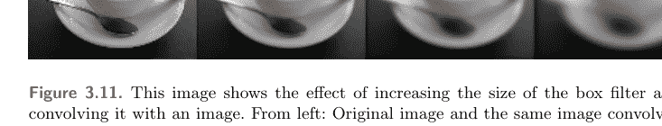

**图 3.11.** 该图像显示了增大盒滤波器尺寸并与图像卷积的效果。从左到右：原始图像以及与 \(3 \times 3\)、\(5 \times 5\) 和 \(15 \times 15\) 盒滤波器卷积后的同一图像。

Frequencies — essentially everything above f2 where f2 < f1 — are thrown away, thereby creating an even blurrier signal in Figure 3.10(c). Since higher frequencies are thrown away as a result of convolution with box filters while the lower frequencies are passed, these are called low pass filters. However, note that box filters are only one kind of low-pass filter. The shape of the filter need not be an exact box to spread the energy of the delta from a single pixel to multiple ones. For example, a triangular shaped filter can also be used for this purpose. The difference between these filters will be in the way they spread the energy which is defined by their shape. In a box filter, the energy is spread equally to all the pixels while in a triangular filter the amount of the energy reduces from the center towards the periphery. Another important thing to note in this context is that all the frequencies that are passed by the low-pass filter are not passed unchanged. In fact, different frequencies are attenuated differently, with the higher of the passed frequencies getting more severely attenuated. The figures in this chapter focuses on the frequency content (the range of frequencies passed) rather than the exact shape of the frequency response of the filters so that your attention is not distracted from the most important aspect of frequency domain analysis, the frequency content. The exact shape of the frequency response of the filter will only affect the amount of attenuation of the passed frequencies and will be discussed in details in the next chapter.

Now consider this same situation in 2D. Consider an image which is being progressively convolved with filters of larger and larger size (3, 5, 7 and so forth). The images that would be created would be progressively blurrier (Figure 3.11) with the final one being a flat gray colored image where the gray color is given by the average of all the pixels in the original image. In the frequency domain, we know that the cut-off frequency for each of these images will be progressively reducing. In 2D, different frequencies are represented as concentric circles with the length of the radius representing the frequency. Figure 3.12 illustrates the cut-off frequency of low pass filters beyond which all frequencies are blocked. With larger kernel size, this cut-off frequency gets smaller.

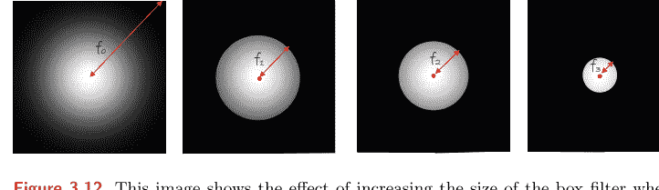

**图 3.12.** 该图像显示了在频域中与图像卷积时增大盒滤波器尺寸的效果。频率响应被可视化为灰度图像。从左到右：原始图像的频率响应以及与尺寸越来越大的滤波器卷积后的同一图像的频率响应。请注意，截止频率由一个圆表示，超出该圆的每个频率的贡献都为零，因此为黑色。随着滤波器尺寸的增大，该圆的半径减小，表明更多的高频被切除。

### 采样问题


让我们现在考虑对图像进行低通滤波的采样后果。奈奎斯特采样准则指出，采样图像所需的最小采样数是图像中包含的最高频率的两倍。随着图像经过低通滤波，其频率含量会降低（图 3.12 中 \(f3 < f2 < f1\)）。这意味着充分采样低通滤波后图像所需的最小采样数也会下降。这表明低通滤波后的图像可以比原始图像尺寸更小。或者，随着我们逐步增大低通滤波器的尺寸，我们不需要以原始尺寸保存图像，而是可以重新采样并以更小的尺寸存储，只要足够大以采样其中的最高频率即可。

这一特性被用来构建一个由逐步低通滤波的图像组成的金字塔，称为高斯金字塔。为此，我们将原始图像重新采样为 \(2^n \times 2^n\) 的尺寸。这构成了金字塔的第 0 层。将该图像的 \(2 \times 2\) 像素块进行低通滤波以创建下一层层次结构中的单个像素，从而得到一个 \(2^{n-1} \times 2^{n-1}\) 的图像。使用盒滤波器时，这相当于将第 n 层的每个 \(2 \times 2\) 像素块的像素取平均值来创建第 \(n+1\) 层的每个像素。请注意，由于第 \(i+1\) 层的图像是从第 i 层的图像低通滤波得到的，因此较低的分辨率足以采样频率含量较低的该图像。如果逐步继续这一过程，将创建金字塔的 n 个层级，最后一个层级为单个像素，可以被视为 \(2^{n-n} \times 2^{n-n} = 1 \times 1\) 的图像。这在图 3.13 中有所说明。

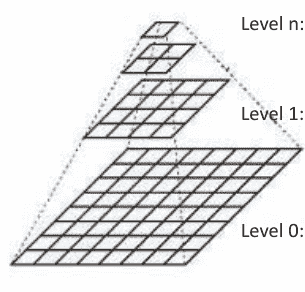

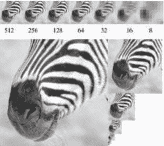

**图 3.13** 该图展示了高斯金字塔的概念。左侧显示了一个 n=3 的 4 层图像金字塔。右侧展示了一个以 512 × 512 图像为起点、n=9 的高斯金字塔示例。请注意图像尺寸如何逐层减半，以及较小的图像内容如何难以辨认。因此，在顶部，每幅图像都以相同尺寸重新采样显示，以展示频率内容的降低。

## 认识这位名人

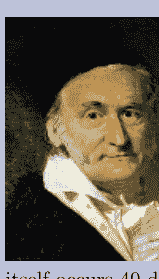

约翰·卡尔·弗里德里希·高斯（1777年4月30日－1855年2月23日）是一位德国数学家，在数论、代数、统计学、分析学、微分几何、大地测量学、地球物理学、力学、静电学、天文学、矩阵理论和光学等领域做出了重大贡献。他出身于贫穷的工人阶级家庭。他的母亲是文盲，从未记录过他的出生日期，只记得他出生在一个星期三，是耶稣升天节（复活节后第40天）前的第八天。高斯后来解决了关于自己出生日期的这个谜题，推导出计算过去和未来年份日期的方法。三岁时，高斯纠正了父亲在一项复杂的工资计算中出现的算术错误。

高斯在十几岁时就做出了开创性的数学发现。19岁时，他展示了一种希腊人一直未能找到的方法，仅用直尺和圆规构造正十七边形。高斯的才智引起了不伦瑞克公爵的注意，公爵于1792年至1795年将他送往卡罗琳学院（现布伦瑞克工业大学），并于1795年至1798年送往哥廷根大学。1798年，年仅21岁的高斯完成了他的杰作《算术研究》，尽管该书直到1801年才出版。这部著作在巩固数论作为一门学科方面发挥了基础性作用，并影响了该领域直至今日。对数学而言不幸的是，高斯不断修改和完善自己的论文，因此只发表了其作品的一小部分，这符合他的座右铭“pauca sed matura”（少而精）。他保存了一本简短的日记，只有19页，后来证实了他在许多未发表的成果上的优先权。高斯希望在自己的墓碑上刻一个正十七边形，但雕刻师拒绝了，称它与圆形难以区分。不过，正十七边形确实出现在他家乡布伦瑞克为他竖立的雕像基座上。

假设我们使用的是一个方框滤波器。因此，第0层每个2×2像素块取平均，生成第1层的一个像素。第1层的2×2像素再取平均，生成第2层的一个像素。当第1层的2×2像素取平均时（即权重相等、均为1/4的加权和），等价于对第0层的4×4像素取平均（即权重相等、均为1/16的加权和）。换句话说，将2×2方框滤波器应用到第1层，等价于将4×4 = 2²×2²的方框滤波器应用到第0层以生成第2层的图像。这一概念可以推广为：第*i*层等价于对第0层应用\(2^i \times 2^i\)的滤波器。因此，随着我们逐层上升，每一幅图像都是原始图像的低通滤波版本，但使用的滤波器尺寸越来越大，因此频率内容越来越低，如图3.10所示。不过，从第*i*−1层使用2×2滤波器来生成，计算效率更高。将这个概念推广开来，你可以看到第*n*层是通过对第0层应用大小为\(2^n \times 2^n\)的方框滤波器生成的，这本质上是对图像所有值取平均。因此，金字塔的第*n*层是一个单一的灰度值。请注意，这一概念适用于任何低通滤波器，不一定是方框滤波器。对于其他滤波器，滤波时使用的权重并不对每个像素都相等，但滤波器尺寸随层数增加而增大的概念保持不变。

根据上述解释，你可能会认为高斯金字塔中的图像尺寸应当逐层减小。但事实并非如此。尺寸减小只是定义了每一层的最小采样要求，这一点可以通过数学方式证明。然而，对于第*i*层而言，尺寸大于\(2^{n-i} \times 2^{n-i}\)仅意味着采样密度高于最小采样要求。因此，构建金字塔的另一种方法是：仅将第*i*层的图像与2×2方框滤波器进行卷积，生成第*i*+1层，同时使第*i*+1层的图像尺寸与第*i*层相同。在这种情况下，尽管高斯金字塔各层的图像尺寸相同，但随着层数升高，内容细节会逐渐丢失。然而，由于尺寸不变，这种细节的去除更容易被察觉。在这两种情况下，金字塔都仍被称为高斯金字塔，因为这里的重要概念是随着层数升高，频率内容逐渐降低。只要满足最小采样标准，采样方式无关紧要。图3.13展示了图像尺寸递减的表示方式，而图3.14展示了图像尺寸保持不变的表示方式。

事实上，这也可以利用卷积的性质从数学上加以证明。我们将高斯金字塔第*i*层的图像记为\(G_i\)，大小为2×2的低通滤波器记为\(l\)。因此，

$$G_1 * l = (G_0 * l) * l = G_0 * (l * l) \qquad (3.9)$$

注意，\(l \times l\)是一个比\(l\)尺寸更大的核。类似地，对于第*i*层，\(l\)与自身多次卷积，形成一个更宽的核，因此滤波后的图像具有更低的频率内容。这类运算也被称为多尺度运算。这是因为金字塔每一层中出现的物体尺度不同。例如，在高斯金字塔的最低层，所有细微的边缘都存在。但随着层数上升，只有较大的变化会以边缘形式出现，细节则丢失了。

到此，还有一个问题：高斯金字塔有什么用处？这里有一个非常常见的应用。假设我们想将图像尺寸缩小一半，以便在较小的移动设备上显示。这种情况下，人的第一反应是*子采样*图像，本质上就是在水平和垂直方向上每隔一个像素丢弃一个。然而，这可能导致采样低于图像最高频率所需的奈奎斯特率，从而产生混叠伪影。因此，更好的做法是首先对图像进行低通滤波，然后再进行子采样。这样，低通滤波先通过去除高频内容降低奈奎斯特采样要求，随后子采样分辨率便能提供足够的采样。这被称为预滤波后再子采样。将图像尺寸缩小一半，等价于高斯金字塔的下一高层。图3.14说明了这一点。图3.15给出了此类情况下更极端的混叠实例。

### 3.2.2 设计新滤波器

既然我们已经了解了低通滤波器的概念，接下来看看如何利用这一点以及卷积的数学性质来设计新滤波器。能够设计新滤波器，就相当于拥有了一套全新的工具，我们可以在多种场景下使用它们。

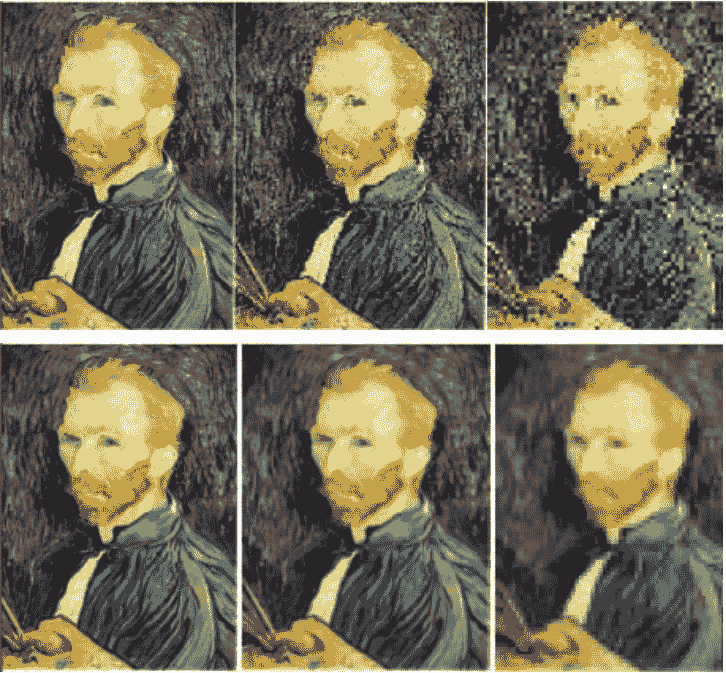

**图 3.14** 该图说明了简单子采样（上方）与预滤波后子采样（下方）之间的区别。从左到右分辨率减半——但图像是以另一种方式生成的，以便在整个金字塔中保持尺寸不变。

低通滤波器是允许图像低频部分保留的滤波器。现在考虑一种与之互补的滤波器——它丢弃低通滤波器所允许通过的那些频率，并保留低通滤波器所丢弃的高频部分。你可能已经猜到，这种滤波器被称为*高通滤波器*。问题是如何设计高通滤波器？大多数人可能想到的一种方法，就是从原始图像中减去低通滤波后的图像。而这正是完美的思路。

设*I*为图像，*l*为低通滤波器。设低通

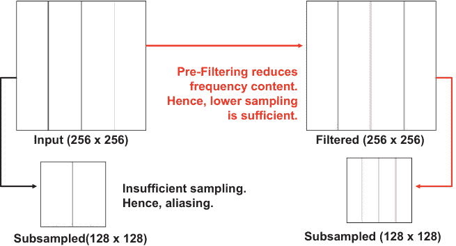

**图 3.15。** 该图说明了由于在不进行预滤波的情况下进行子采样而可能出现的严重混叠伪影。

设低通滤波后的图像为 $I_l$，高通滤波后的图像为 $I_h$。因此

$$I_h = I - I * l$$  (3.10)

$$= I * \delta - I * l$$  (3.11)

$$= I * (\delta - l)$$  (3.12)

在上述代数的第二行中，我们将图像视为其自身的全通滤波版本。利用这一事实和卷积的数学性质，我们看到高通滤波后的图像 $I_h$ 可以表示为原始图像 $I$ 与单个滤波器 $\delta-l$ 的卷积。这给出了 *高通滤波器* 的设计，该滤波器由从 $\delta$ 中减去任意低通滤波器得到，如 **图 3.16** 所示。该图还显示了任意高通滤波器的一般形状，其特征是中心附近的正尖峰和相邻的负瓣。例如，高斯函数是另一种良好的低通滤波器，其响应比盒式滤波器平滑得多。在这种情况下，高通滤波器仍将看起来相同，具有更平滑且更深的负瓣。通过高通滤波形成的图像将具有互补的频率，从而给出图像的细节。这在 **图 3.17** 中有所说明。现在，不要将高斯滤波器与高斯金字塔混淆。两者都以同一个人命名，但完全是不同的概念。高斯滤波器是一种低通滤波器，而高斯金字塔是通过对图像逐步应用任意低通滤波器形成的图像金字塔，不一定是高斯滤波器。

现在，让我们考虑高斯金字塔 $G_0, G_1, \ldots, G_n$。让我们再构建

# 图 3.16。 该图说明了从大小为 3（上）和 5（中）的盒式滤波器创建高通滤波器（下）在 1D 中的情况

另一个金字塔 L0, L1, ..., Ln−1 其中 Li = Gi − Gi+1。请注意，为了构建此金字塔，Gi+1 必须以双倍分辨率重新采样，因为 Gi 和 Gi+1 的分辨率不同，无法进行图像减法（本质上是逐像素减法）。现在注意在此金字塔中从频率角度会发生什么。如果 f0, f1, ..., fn 被认为是 G0, G1, ..., Gn 的截止频率，则每个 Li 仅由 fi − fi+1 的一个频带或频率范围组成。因此，这些图像是通过通过一个频带而创建的。此金字塔称为拉普拉斯金字塔，如图 3.18 所示。

现在，让我们考虑我们在 G0 上使用的单个滤波器，以创建拉普拉斯金字塔 Li 的第 i 级。该单个滤波器是通过将 l 与自身卷积 i + 1 次然后减去将 l 卷积 i 次得到的。该滤波器通过 fi 和 fi+1 之间的频带，是带通滤波器。

### 3.2.3 2D 滤波器可分离性

从上述讨论中，我们现在能够可视化或生成 2D 滤波器，如 2D 盒式滤波器或 2D 高通滤波器（图 3.19）。现在，在考虑 2D 滤波器时，还有另一个重要的属性需要注意。这称为可分离性。让我们考虑一个 p × q 2D 滤波器 h[i][j]，其中

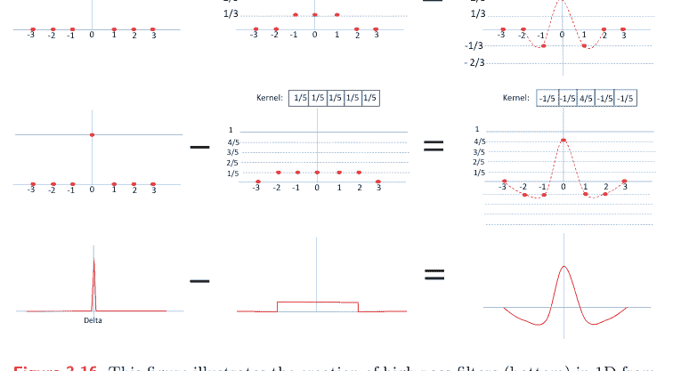

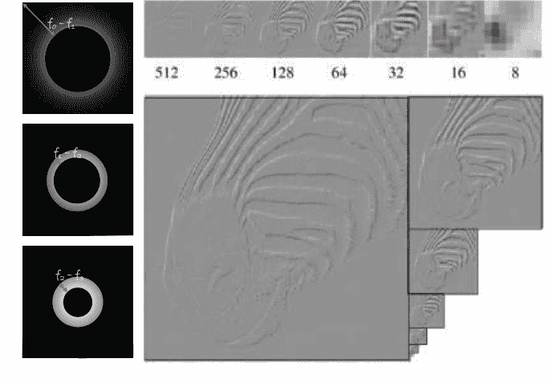

图 3.18。 左侧我们显示了带通滤波器的频率响应，该滤波器可以作用于原始图像以创建拉普拉斯金字塔的前三个层级。右侧我们显示了与图 3.13 中所示相同图像的拉普拉斯金字塔本身。顶部以相同大小显示图像以便更好地感知。

我们将在下一章看到，该高斯函数是一个非常好的低通滤波器（图 3.19）。现在，让我们考虑 2D 高斯滤波器

φ(x, y) = 1/(2πσ²) e^(-(x²+y²)/(2σ²))  (3.15)

= φ(x) × φ(y).  (3.16)

由于 2D 高斯可以如上所述表示，因此它是可分离滤波器。因此，它可以使用

I ⋆ φ(x, y) = (I ⋆ φ(x)) ⋆ φ(y)

有效地实现

### 3.2.4 相关性和模式匹配

在本节中，我们将介绍卷积的又一个应用。考虑一幅棋盘图案的图片和一个看起来像棋盘角落的滤波器（图 3.20）。假设图像和模板均为灰度，值介于 0 和 1 之间（0 为黑色，1 为白色）。

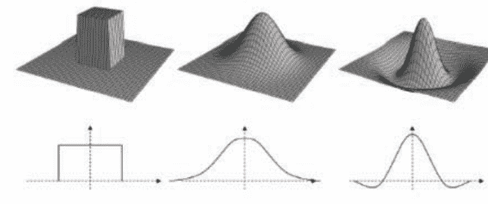

图 3.19。 从其 1D 对应部分可视化 2D 滤波器：盒式滤波器（左）、高斯滤波器（中）是很好的低通滤波器以及通过从 delta 中减去高斯得到的高通滤波器（右）。

在图 3.20 左侧，显示了样本彩色窗口的卷积值。请注意，卷积值在模板与图像在蓝色窗口中匹配时最高。它在图像与模板完全互补时最低，如红色窗口所示。此外，在紫色窗口中，它介于两者之间，该窗口也显示了一个角落，但周围的黑白分布不同。但问题是，像绿色窗口这样的其他区域也显示出最高值，而黄色窗口显示出最低值。直观上，相关性应提供模板与所考虑的图像子区域之间匹配程度的度量。从这个角度来看，绿色和黄色窗口定义的子区域尽管颜色差异很大（一个为黑色，一个为白色），但相似。这一说法的依据是模板中存在的颜色变化可以认为是最大的。由于相关性是相似性的度量，人们会期望蓝色窗口具有最高值，因为它与模板具有相同的空间分布（右上和左下象限为白色，其他地方为黑色）。使用相同的相似性度量，红色窗口应具有最低值，尽管它具有相同的颜色变化，但由于空间分布互补（右上和左下象限为黑色，其他地方为白色）。此外，人们会期望黄色和绿色窗口具有介于这些最低值和最高值之间的某个值，因为模板必须经过其中之一才能到达红色窗口中的互补模式。同样，紫色窗口中的模式也应具有介于最低值和最高值之间的值，但它应更接近最低值（红色方块）而不是最高值（蓝色方块），因为紫色窗口中黑白像素的空间分布与前者比后者更相似。

图 3.20。 该图像显示了 8 × 8 模板与棋盘图像中相同子区域的匹配卷积。在左侧图像中，这是通过模板与图像的简单卷积实现的，而在右侧图像中，这是通过先从模板和待匹配区域的所有像素中减去平均值，然后再应用卷积实现的。在左侧图像中，不同颜色的窗口显示了这些窗口中卷积的结果。在右侧图像中，信息还增加了这些窗口中均值（μ）的值。

## 为名字贴上脸

皮埃尔-西蒙·拉普拉斯（Pierre-Simon Laplace，1749 年 3 月 23 日至 1827 年 3 月 5 日）是一位有影响力的法国学者，其工作对数学、统计学、物理学和天文学的发展至关重要。他在五卷本《天体力学》（Celestial Mechanics）（1799–1825）中总结并扩展了前辈的工作。这项工作将经典力学的几何研究转化为基于微积分的研究，打开了更广泛的问题范围。他提出了在数学中广泛使用的拉普拉斯微分算子，开创了构成许多数学物理分支基石的拉普拉斯变换，并且是首批提出黑洞存在和引力坍缩概念的科学家之一。

拉普拉斯是农夫和苹果酒商的儿子，他打算

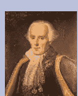

他被祝圣为罗马天主教神职人员，16岁时被送往卡昂大学学习神学。在大学里，两位热情的数学教师 Christophe Gadbled 和 Pierre Le Canu 激发了他对该学科的热情。他的数学才华很快被认可，而在仍在卡昂期间，他就在拉格朗日创办的期刊上发表了第一篇论文。认识到自己对神职没有兴趣，拉普拉斯成为无神论者，脱离教会并前往巴黎成为让·勒朗·达朗贝尔的学生（今天因兰伯特反射模型而闻名）。兰伯特最初试图通过让他阅读艰深的数学书籍并解决未解的数学问题来摆脱拉普拉斯。但当拉普拉斯的才华使他能够在规定时间内以更短的时间完成这些任务时，他便收他为门下，并在比利时皇家军事学院为他争取到一个教职，在那里拉普拉斯在接下来的十七年里致力于开创性的研究。拉普拉斯于1806年成为第一法国帝国的伯爵，并于1817年被封为侯爵（贵族）。他于1827年去世。对他才华的巨大程度感到好奇，他的医生取出了他的大脑并保存下来，后来在英国的一个解剖博物馆展出。据报道，它比普通人脑小得多。

为了得到这个直观的结果，我们仍然会做卷积，但首先在进行卷积之前，我们会从模板和图像中与之重叠的区域的所有像素颜色中减去均值。这在图 3.20 的右图中显示，其中均值也用 μ 表示。请注意，现在卷积为我们提供了我们直观上从相关操作中期望的结果。蓝色窗口的值最高为 1，红色窗口的值最低为 −1，而黄色和绿色窗口的值为 0，介于 −1 和 1 之间。此外，请注意紫色窗口的值为负，使其更接近红色窗口而不是蓝色窗口。因此，当卷积用于对其均值进行偏移的函数时，可以用来找到模板与图像中某区域之间相似性的程度。此过程称为 *cross-correlation*。

请回忆，卷积通常涉及翻转脉冲响应，而在本章中（以及许多图像处理应用中）我们不需要这样做，因为我们大多数时候处理的是对称滤波器。互相关与卷积的不同之处在于不需要翻转核。

接下来，让我们从另一个角度来看待这种互相关。你可以把它看作是模板元素与模板重叠的底层图像元素逐元素相乘，然后将它们加起来。这让你想起了什么？嗯，这就是两个向量的点积，一个向量由模板的元素组成，另一个由模板重叠的图像区域的元素组成。点积的值给出了一个向量与另一个向量有多接近的估计。点积为 1 表示相同的向量，点积为零表示正交的向量，点积为 −1 表示相反的向量。请注意，互相关也同样适用。


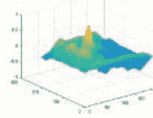

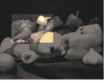

图 3.21。左侧是一幅图像和要在图像中匹配的模板。中间是归一化互相关过程的结果。右侧是模板（彩色）在归一化互相关值最高的位置叠加，找到了完全匹配。


现在，你可能记得在对向量执行点积时，它们需要被归一化。这是为了确保我们只考虑向量的方向而不是其大小。仅当应用这种归一化时，该点积的值范围才在 −1 到 +1 之间。我们在图 3.21 中显示的均值减去是一种近似这种归一化的尝试。但减法并不会影响颜色的大小以确保单位向量。因此，理想情况下，我们应该减去均值并除以标准差，即每个值与均值之差的平方和的平方根。此步骤将实现所需的归一化。

在图像处理的上下文中，这种归一化意味着什么。根本上，互相关是一种检查图像的任何部分是否与模板图像匹配的方法。理想情况下，我们应该能够在两个图像之间改变的三个因素下进行这种匹配：（a）场景照明；（b）决定图像亮度的相机曝光；以及（c）决定图像对比度的相机增益。归一化使我们能够使互相关对这三种变化具有鲁棒性，通常称为归一化互相关。

## 3.3 Implementation Details

这就引出了线性系统和卷积背后的基本概念的结尾。然而，在实现卷积时你仍可能遇到一些挑战。因此，以下是为此目的需要记住的事情。

- 1. 当对图像进行滤波器卷积时，重要的是将滤波器与每个像素对齐，然后应用卷积。请注意，每个像素的卷积结果应存储在不同的图像中。否则它会影响稍后执行的其他像素的卷积。
- 2. 如果滤波器大小为偶数，你将无法找到一个中心像素来与正在执行卷积的图像像素对齐。这种情况下通常的做法是将图像像素与滤波器的左上角像素对齐。这将使图像在每个方向上偏移核大小的一半，并在操作后应将其移回。
- 3. 当滤波器与图像边缘外的区域重叠时，那些像素的像素值是未定义的。那我们该怎么办呢？通常你可以将图像用 0 或 1 填充，或通过关于边缘反射图像或你选择的任何其他方式进行填充。选择什么并不重要，因为这些只会贡献给未完全浸入的样本，因此从数据准确性的角度来看应被忽略。
- 4. 卷积由许多浮点运算组成，而图像通常以 8 位整数存储。对整数执行浮点运算会在操作的每一步（例如每次乘法和加法）累积误差。最好的处理方法是首先将图像和滤波器转换为浮点表示，执行滤波，然后再将其舍入回整数表示。
- 5. 最后，有时卷积会导致结果图像中出现超出范围的值（超出 0 到 1 或超出 0 到 256）。最好的处理方法是找到操作后的最小值和最大值，并将图像重新缩放回范围内。

## 3.4 Conclusion

在本章中，你被介绍到视觉计算最基本概念之一——系统及其响应以及如何找到系统对任意输入的响应。我们试图给你一个更少数学、更多工程的卷积视图，该视图可直接应用于数字图像处理。要获得该主题的更数学性论述，尤其是考虑一般多维连续信号，请参阅 [Pratt 07, Gonzalez and Woods 06]。

## Bibliography

- [Gonzalez and Woods 06] Rafael C. Gonzalez and Richard E. Woods. *Digital Image Processing (3rd Edition)*. Prentice-Hall, Inc., 2006.
- [Pratt 07] William K. Pratt. *Digital Image Processing*. John Wiley and Sons, 2007.

## 概要：你知道这些概念吗？

- 线性系统及其性质
- 卷积及其性质
- 低通滤波器
- 高斯滤波器
- 高斯金字塔
- 高通滤波器
- 带通滤波器
- 拉普拉斯金字塔
- 二维滤波器可分离性
- 归一化互相关

## 习题

1. 考虑一个信号模糊系统。输出信号的每个样本都是由输入信号中该样本本身及其左、右邻域的值取平均而生成的。（假设输入信号边界处的样本为零。）
   - (a) 这个系统是线性的吗？证明你的答案。
   - (b) 该系统的冲激响应是什么？
   - (c) 如果考虑更大的五个样本邻域，这个冲激响应会如何变化？

2. 计算以下信号的卷积（你的答案将以方程形式给出）。
   - (a) $h[t] = \delta[t - 1] + \delta[t + 1], x[t] = \delta[t - a] + \delta[t + b]$
   - (b) $h[t] = \delta[t + 2], x[t] = e^t$
   - (c) $h[t] = e^{-t}, x[t] = \delta[t - 2]$
   - (d) $h[t] = \delta[t] - \delta[t - 1], x[t] = e^{-t}$

3. $g[t]$ 是一个一维离散信号，定义在 $-3 \le t \le 4$ 上。线性系统的冲激响应 $h[t]$ 是另一个离散信号，定义在 $2 \le t \le 6$ 上。$g[t]$ 通过该系统后的响应由 $g[t]$ 与 $h[t]$ 的卷积给出，记为 $y[t]$。$y[t]$ 的长度是多少？$y[t]$ 被生成时 $t$ 的范围是什么？输入 $g[t]$ 完全包含在输出 $y[t]$ 中时，$n$ 的范围是什么？

4. 低通滤波器是一种线性运算。基于此，证明高通滤波器也是一种线性运算。

5. 系统 A 是一个“全通”系统，即其输出与其输入完全相同。系统 B 是一个低通滤波器，它让截止频率以下的所有频率无变化地通过，并阻挡所有截止频率以上的频率。设系统 B 的冲激响应为 $b[t]$。
   - (a) 系统 A 的冲激响应是什么？
   - (b) 系统 B 的冲激响应需要如何改变，才能使系统产生反相输出（即输出相同，只是符号改变）？
   - (c) 如果两个系统并联且输出相加，组合系统的冲激响应是什么？
   - (d) 如果两个系统并联，并且从系统 A 的输出中减去系统 B 的输出，组合系统的冲激响应是什么？
   - (e) (d) 中的系统是什么类型的滤波器？
   - (f) 在本问题中，系统 B 具有让某些频率“无变化地”通过的理想特性。如果这个低通滤波器相对于输入信号将输出信号延迟（即移位）一小量，那么 (c) 和 (d) 中所描述系统的输出会如何受影响？

6. 设计一个三像素的一维核来实现图像重影，其中重影出现在图像右侧两个像素处，且其强度为原图像的一半。将此概念推广，设计一个二维滤波器，使两个重影以同样的方式出现在水平和垂直方向上。

7. 设 $f(x,y)$ 表示一幅图像，$f_G(x,y)$ 表示将高斯滤波器 $g(x,y)$ 应用于 $f(x,y)$ 后得到的图像。在摄影行业中，一种称为高频提升滤波的操作生成图像 $f_B(x,y) = a f(x,y) - f_G(x,y)$，其中 $a \ge 1$。
   - (a) 要求你使用单个滤波器实现高频提升滤波。请推导出这样一个滤波器的表达式 $h(x,y)$。
   - (b) 该滤波器的频率响应 $H(u,v)$ 会是什么样子？

8. 要求你增强图像的边缘。你如何利用高斯金字塔在多个尺度上实现这一操作？你能设计一个单一的滤波器，在金字塔的每一层上应用它来实现同样的效果吗？

9. 考虑一个具有宽度为 $n$ 像素的可重复模式的一维信号。提供一种利用相关性找出 $n$ 值的方法。

10. 给定一幅图像的拉普拉斯金字塔，你如何重建原始图像？

11. 考虑相同尺寸的方框滤波器和高斯滤波器的频域响应。你认为哪一个会更平滑？证明你的答案。

12. 考虑由一对立体相机（两台像人眼一样彼此靠近放置的相机）拍摄的两幅图像。我们在第一幅图像中标记了一些特征。提供一种在第二幅图像中精确定位这些特征的方法。


Taylor & Francis

Taylor & Francis Group

http://taylorandfrancis.com

## 频谱分析

在本章中，我们将学习一种将信号分解为更简单信号的新方法，其中每个更简单信号都是一个正弦波。研究这些正弦波中每一个的性质以及它们彼此之间的关系，可以让我们获得关于该信号的重要见解，并帮助我们缓解常见滤波技术中的问题。这种对信号的分析通常被称为*频谱分析*——因为它将一个复杂信号分解为一组跨越频率、相位和方向谱的信号。这样的研究也为我们提供了一种合成信号的方法，我们也将学习其中的一些内容。

在本章中，我们将重点讨论频谱分析中最基础、最常用的技术——离散傅里叶变换（DFT）。然而，重要的是要认识到，频谱分析存在多种不同的方式。它们的主要区别在于用于将复杂信号分解成的更简单信号（或基函数）的种类。径向基函数或小波可以提供一种使用依赖数据的基函数进行的不同的频谱分析。然而，DFT 提供了对视觉信号进行频谱分析的最常用工具之一，它使用独立于数据的或标准的基函数。我们将首先研究一维信号的 DFT。这通常会为我们提供一些可应用于更高维数据的关键见解。在本章后面，我们将研究它对图像等二维数据的解释。

### 4.1 离散傅里叶变换

离散傅里叶变换（DFT）是一种将无限长的周期信号作为输入，并将其分解为一组正弦波和余弦波的技术，这些波组合在一起（通过称为逆 DFT 的过程）将能得到该周期信号本身。当我们这样定义 DFT 时，脑海中首先出现的问题可能是：我们如何在数字信号上使用 DFT？数字信号几乎不可能是周期的，也绝不是无限的。为了使数字信号成为周期且无限的信号，我们假设信号的跨度就是其周期，并且该信号跨度被无限次重复。例如，如果我们有一个包含 100 个样本的音频信号，我们将考虑一个周期信号，其中每个周期长为 100 个样本，并且是由给定的 100 个样本定义的函数，如图 4.1 所示。这个假设有其后果，我们将在本章后面讨论。

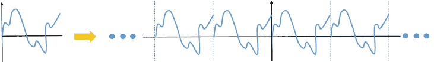

**图 4.1.** 该图展示了左侧的有限一维信号如何被重复，从而被视为一个周期性无限信号，以便适合应用 DFT。

设 DFT 的输入为信号 `x`，它有 `N` 个样本，记为 `x[0], x[1], ..., x[N-1]`。DFT 是一个从 `x` 生成两个数组的过程，这两个数组分别记为 `x_c` 和 `x_s`，各自有 `N/2 + 1` 个样本，分别记为 `x_c[0], x_c[1], ..., x_c[N/2]` 和 `x_s[0], x_s[1], ..., x_s[N/2]`。称 `x` 位于时间域或空间域，而 `x_c` 和 `x_s` 是同一函数/信号在频率域中的表示，如图 4.2 所示。


**图 4.2.** 该图展示了 DFT 和逆 DFT 将时间/空间域中的信号转换为其频率域表示，以及反向转换的过程。

那么，`x_c` 和 `x_s` 意味着什么？DFT 将 `x` 分解为 `N/2 + 1` 个余弦波和正弦波，每个波的频率都不同。这些余弦波和正弦波相加后产生信号 `x`。`x_c` 和 `x_s` 分别给出余弦波和正弦波的幅度。注意，这些波中的每一个长度都是 `N`。`x_c[k]` 表示在 `N` 个样本上完成 `k` 个周期的余弦波的幅度。例如，`x_c[N/2]` 是一个在 `N` 个样本上完成 `N/2` 个周期的余弦波，即每个周期 2 个样本。注意，在给定 `N` 个样本并遵守奈奎斯特采样准则的情况下，这是可能达到的最高频率波。类似地，`x_s[k]` 表示在 `N` 个样本上完成 `k` 个周期的正弦波的幅度。

接下来，我们将讨论表示这些波的频率的其他方式。我们已经看到，索引为 `k` 的波在 `N` 个像素（样本）上完成 `k` 个周期。这意味着每个像素对应 `f = k/N` 个周期。这是以每像素周期数表示频率的另一种方式。注意，当 `k` 从 0 到 `N/2` 变化时，`f` 的范围是 0 到 0.5。最后，频率可以表示为其自然频率 `ω = f × 2π`。`ω` 的范围是 0 到 `π`。在处理频谱数据时，你可能会遇到这些表示方式中的任何一种。检查这类数据各独立轴的范围，将立即告诉你


图 4.3。该图显示了正弦波和余弦波如何被 `x_c` 和 `x_s` 中产生的因子所缩放。这些波相加后会形成 `x`，即左侧所示的原始信号。

你使用的特定表示。

现在，考虑幅度由 `x_c[k]` 给出的余弦波 `c_k`。请注意 `c_k` 是一个具有 `N` 个样本的信号。此外，它是一个在这些 `N` 个样本上进行 `k` 个周期的余弦波，且幅度为 `x_c[k]`。该余弦波可以描述为

c_k[i] = cos( (2π k i)/N ) = cos(2π f i) = cos(ω i)    (4.1)

其中 `i` 表示 `c_k` 的第 `i` 个样本，0 ≤ `i` ≤ `N − 1`。类似地，第 `k` 个正弦波 `s_k` 给出为

s_k[i] = sin( (2π k i)/N ) = sin(2π f i) = sin(ω i)    (4.2)


**图 4.5。** 显示了两个示例信号与同一基函数相关。第一个导致值为 0.5，表示合成方程中该基函数的幅度为 1.0。第二个导致值为 0，表示该基函数在合成函数中没有贡献。

实际的合成方程为

$$x[i]=\sum_{k=0}^{N/2}\hat{x}_c[k]\cos\left(\frac{2\pi ki}{N}\right)+\sum_{k=0}^{N/2}\hat{x}_s[k]\sin\left(\frac{2\pi ki}{N}\right)\tag{4.8}$$

这些比例因子与模拟傅里叶变换在数字处理过程中离散化的底层过程相关，我们稍后会回到这个问题。

下一个问题是我们如何真正找到 `x_c` 和 `x_s`。请注意，这种分解试图弄清楚信号 `x` 中包含多少这些正弦波和余弦波。这让你想起了什么？当然，这最好通过相关性来计算。如果 `x` 是一个余弦波或正弦波，它将与相同频率的正弦波和余弦波完全相关，导致 `x_c` 和 `x_s` 中只有一个元素非零。因此，我们可以写出 DFT 作为相关性的方程为

```
x_c[k] = \sum_{i=0}^{N-1} x[i] cos\left(\frac{2\pi k i}{N}\right) \tag{4.9}
```

```
x_s[k] = \sum_{i=0}^{N-1} x[i] sin\left(\frac{2\pi k i}{N}\right) \tag{4.10}
```

这里同样，由于相同的比例因子，实际系数由 `\hat{x}_c` 和 `\hat{x}_s` 给出。事实上，这些正是图 4.3 中使用的权重。从 `x` 生成的数组 `x_c` 和 `x_s` 如图 4.4 所示。相关过程的示例如图 4.5 所示。


让我们先简要检查一下方程 4.10。请注意 `x_c[0]` 是与 `cos(0) = 1` 的相关性得到的。这意味着

```
\hat{x}_c[0] = \frac{1}{N} \sum_{i=0}^{N-1} x[i], \tag{4.11}
```

即余弦波的第一个系数是 `x` 的所有样本的平均值。这通常被称为直流分量。其次，请注意 `sin[0] = sin[πi] = 0`。因此，`\hat{x}_s[0] = x_{N/2} = 0`。你们中的一些人可能之前一直在想，我们如何在空间域的 `N` 个样本中生成频率域的 `N + 2` 个样本。这里你可以看到我们实际上并没有生成更多信息，因为 `N + 2` 个样本中有两个为零。

## 图 4.6。该图显示了方程 4.8 中比例因子的来源。蓝色线表示 DFT 生成的频率。红色虚线表示每个频率所代表的频率范围的边界。

让我们现在重新审视生成方程 4.8 的比例因子问题。在本书中，我们不讨论模拟傅里叶变换。然而，在数学上，离散傅里叶变换是从模拟傅里叶变换推导出来的。在 DFT 中，当我们从时域/空间域移动到频域时，我们会生成一些离散频率，它们之间具有均匀的距离。换句话说，DFT 只创建在 `N` 个样本上进行 `k` 个周期的频率，其中 `k` 限于整数。然而，当我们在模拟域中执行相同的傅里叶变换时，它可以生成许多不同的频率，因为概念上 `k` 和 `N` 都可以取任意值。

因此，DFT 生成的频率集合可以被认为是连续域中频率的采样。这些离散频率中的每一个都可以被认为是一个频率范围的代表。所有频率 `k = 1, 2, ..., N/2` 都可以被认为代表宽度为 `2/N` 的频率范围（图 4.6）。然而，第一个和最后一个频率，即 `k = 0, N/2` 所代表的频率范围是其一半，即 `1/N`。这些正是方程 4.8 中用于不同频率的比例因子。因此，这些比例因子源于每个离散频率所代表的频谱带宽。

### 为名字贴上脸


让·巴蒂斯特·约瑟夫·傅里叶是一位法国数学家（1768 年 3 月 21 日 – 1830 年 5 月 16 日），他在法国大革命期间发挥了重要作用，因此曾被短暂监禁。他于 1798 年随拿破仑·波拿巴参加埃及远征，并为拿破仑创立的开罗埃及研究院做出了巨大贡献。傅里叶最大的贡献在于对傅里叶级数及其在热传递和振动问题中的应用的调查。

尽管傅里叶变换可能是图像处理中最基本的支柱之一，但傅里叶发表这项工作并不容易。傅里叶首次于 1807 年尝试发表这项工作时声称“任何连续周期信号都可以表示为适当选择的正弦波之和”。当时两位坚定的数学家拉格朗日和拉普拉斯审阅了该论文。虽然拉普拉斯希望发表该论文，但拉格朗日强烈反对，称正弦波不足以表示具有拐角的信号。该论文在拉格朗日去世 15 年后才发表。至于谁是对的——好吧，两者都对。确实，你无法用正弦波表示具有拐角的信号，但你可以非常接近。事实上，你可以接近到能量差为零，这后来由吉布斯证明，被称为吉布斯效应。此外，还表明这仅在模拟域中成立。在数字域中，表示是精确的，即使对于具有拐角的信号也是如此。

### 4.1.1 为什么是正弦波和余弦波？


到目前为止，每个人脑中可能都悬着一个问题，即正弦波和余弦波有什么特别之处，为什么我们要将一般信号分解为正弦波和余弦波？事实上，正弦波和余弦波确实很特别。你可以证明不同频率的正弦波和余弦波彼此完全独立。换句话说，这些波中的任何一个都不能由具有一定幅度和相位的余弦波给出。这是因为正弦波和余弦波是彼此的相移版本。因此，对于每对相同频率的正弦波和余弦波，我们可以执行以下操作。

```
x_c[k]cos(ωi) + x_s[k]sin(ωi) = M_k cos(ωi + θ_k)      (4.12)
```

其中 `M_k = √[x_c[k]^2 + x_s[k]^2]` 且 `θ_i = tan^{-1}(x_s[k]/x_c[k])` 分别是第 `k` 个余弦波的幅度和相位。因此，与其使用两个数组 `x_c` 和 `x_s` 使分析变得有点复杂，我们可以用一组仅由余弦波表示 `x`，每个余弦波具有不同的幅度和相位。`N/2` 个这样的余弦波，每个都按正确的幅度缩放并按正确的相位偏移，相加后形成原始信号。该幅度和相位生成两个 1D 绘图，构成信号 `x` 的频域表示。这种表示称为极坐标表示。现在请注意，相位可以用度或弧度表示。如果用度表示，独立轴的范围将从 −180 到 180。如果用弧度表示，其范围将从 −π 到 π。编码时要记住的另一个方面是计算 `θ` 涉及除以 `x_c[k]`。因此，有时这可能导致除零。`x_c[k] = 0` 的情况应作为异常情况处理并分配适当的相位。其中大部分在你需要编码 DFT 时更为相关，而这种情况很少见，因为今天有多个数学包（例如 Matlab）可供使用。


**图 4.8.** 该图显示了相位解缠绕的过程。

图 4.7 显示了 1D 信号 DFT 的矩形表示和相应的极坐标表示。现在，让我们花点时间更深入地研究一下这个极坐标表示。解释这个图对于内化图像分析中的概念绝对至关重要。虽然多个计算机程序可以在瞬间为你生成这个图，但没有一个会告诉你如何解释它。首先，请注意图的独立轴可以是 `k` 从 0 到 `N/2`，或 `f` 从 0.0 到 0.5，或 `ω` 从 0 到 π（在图 4.7 中我们使用了 `f`）。你应该准备好看到任何这些表示。范围将告诉你使用的是哪个特定参数。其次，请注意相位为我们提供了不同波的上升和下降是否同步的信息，表明它们是否产生特征（例如边缘、拐角）。此类特征最好在空间/时间域中研究，而不是在频域中研究。因此，正如我们在上一章中所见，幅度图对我们来说是最重要的。

然而，极坐标表示并非没有问题。考虑以下两种情况，其中 $x_s[k] = x_c[k] = 1$ 和 $x_s[k] = x_c[k] = -1$ 这两种情况下，$M[k] = 1.414$。但其中一种的相位是 $45^\circ$，另一种则是 $-135^\circ$。这是由于相位模糊性造成的。类似的问题还会出现，例如，$\theta$ 的相位移与 $\theta + 2\pi$ 或 $\theta + 4\pi$ 等的相位移相等。计算出 $\theta$ 之后还需要处理这种表示上的模糊性。这个过程称为相位解卷绕，如图 4.8 所示。

### 4.2.1 性质

现在是时候探讨 DFT 的一些基本性质了，如下所示。

**1. 齐次性：** 如果信号 $x[t]$ 的 DFT 为 $M[f]$，那么信号按因子 $k$ 缩放后，其 DFT 也按 $k$ 缩放。换句话说，齐次性意味着如果信号在空间域中被缩放，其频域中的幅度也相应地按同样方式缩放。假设 $\rightarrow$ 表示 DFT，这可表示为：

$$
x[t] \rightarrow (M[f],\theta[f]) \Longrightarrow kx[i] \rightarrow (kM[f],\theta[f]) \tag{4.13}
$$

注意，相位 $\theta[f]$ 在缩放时保持不变。

**2. 可加性：** 空间域中信号的相加会导致其频域响应相加。这可表示为

$$
x[t] \rightarrow (x_c[f], x_s[f]), y[t] \rightarrow (y_r[f], y_i[f]) \tag{4.14}
$$

$$
\Longrightarrow x[t] + y[t] \rightarrow (x_c[f] + y_r[f], x_s[f] + y_i[f]) \tag{4.15}
$$

两个正弦波或余弦波的相加只有在它们相位相同时才有意义。因此，这种相加不能在极坐标表示法中执行（在极坐标表示法中，我们将 $x$ 表示为具有不同相位和幅度的不同余弦波之和）。因此，我们采用直角坐标表示法（在这种表示法中，我们将信号表示为相位相同的正弦波和余弦波之和）来实现这种相加。

**3. 线性相位移：** 信号在空间域中的平移会导致频域中与该空间平移成正比的线性相位移，如下所示。

$$
x[t] \rightarrow (M[f],\theta[f]) \Longrightarrow x[t + s] \rightarrow (M[f],\theta[f] + 2\pi f s) \tag{4.16}
$$

这也可以直观地解释。想象 $x[t]$ 在空间域中平移了 $s$。这意味着组成 $x[t]$ 的所有波都会平移 $s$。注意，相同的平移 $s$ 对于低频波来说占据了周期的较大部分，而对于高频波则只占较小部分，因此对应的相位移也较小。所以每个波的相位移与其频率成正比。


**图 4.9.** 这展示了一个对称信号如何被分解为两个互为复共轭的信号。

### 4.2.2 信号分析示例

让我们看看能否用目前所学来解释一些现象。这将帮助您理解如何利用这些性质来分析信号。首先考虑一个如图 4.10 所示的对称信号。关于对称信号的相位，你能得出什么结论？

为此，我们需要理解所谓信号的复共轭。一个信号，其频域响应具有相同的幅度但相位为负，称为 $x$ 的复共轭，记为 $x^*$。还可以证明，如果信号的频率响应与其复共轭的频率响应相加，所得信号在所有频率上的相位都为零。此外，如果频域中的相位响应像上面那样取负，则信号在空间域中会被翻转。

现在考虑这一点，让我们来看一个如图 4.9 所示的对称信号。一个对称信号可以分解为两个信号，其中每一个都是另一个的翻转版本，即另一个的复共轭。因此，这两个信号相加后得到的信号其相位响应为零。所以对称信号的相位始终为零，如图 4.10 所示。

接下来，让我们考虑这种对称信号发生平移时的情况。为此，请参考图 4.10。这里我们展示了对称信号的循环平移。注意，根据空间域平移引起线性相位移的性质，我们知道任何这样的平移都会导致相位发生线性变化。该变化斜率将为正或为负，分别取决于平移是向右还是向左。最后，当循环平移得到另一个对称信号时，如图 4.10 所示，它又会产生一个零相位信号。

这为我们提供了一个如何使用这些性质来分析信号的示例。然而，对称信号相位问题也引出了一个疑问：非线性相位意味着什么？通常非线性相位是指在线性相位上叠加了非线性特征，如图 4.11 所示。它通常出现在更一般的非对称信号中。


**图 4.10.** 这展示了对称信号的频率响应及其循环移动。

让我们再看一个称为幅度调制的信号分析示例。考虑一个音频信号 $x[t]$，其频域响应 $X[f]$ 的带宽限制为 $b$。该信号乘以一个非常高频率的余弦波 $y[t]$，这个余弦波称为载波或载频。该波的频率称为载波频率，记为 $c$。注意，由于这是一个单一的余弦波，其频率响应 $Y[f]$ 是位于 $c$ 处的一个移位后的冲激。

空间域中的乘法对应于频域中的卷积，这会生成以 $c$ 为中心的两份 $X[f]$ 的镜像副本。要在频域中恢复信号，只需使用一个提取 $c$ 左侧或右侧带宽为 $b$ 的区域的滤波器，通常称为陷波滤波器。这正是 AM（幅度调制）广播的工作原理：每个电台都有自己的载波频率，用载波调制信号进行发射。当我们调谐收音机时，就是在应用陷波滤波器来恢复信号。注意，要实现这一点，需要 $c >> b$，而且不同信道的载波频率至少需要相隔 $2b$，以确保信号不发生混叠。我们将在 4.4 节看到，这种信号混叠有一个名称和独特的特征。


**图 4.11.** 这展示了典型非对称信号的非线性相位。


**图 4.12.** 这展示了幅度调制现象。空间域中的音频信号 $x[t]$（频域中带宽限制为 $b$）乘以一个频率极高为 $c$ 的载波正弦波 $y[t]$。这种乘法导致音频信号频率响应 $X[f]$ 与一个移位后的冲激进行卷积。结果得到一个以频率 $c$ 为中心的 $X[f]$ 的移位副本。


**图 4.13.** 频域中的幅度图是周期性的，并作为偶函数重复自身。该图表示我们目前所见过的 $[0, \pi]$ 范围。

载波频率必须相隔 $2b$ 这一约束无法容纳随着电台数量快速增长而需要的更多载波频率。因此，频率调制（FM）后来出现了。在这种方式中，被传输信号的频率（而不是幅度）根据空间信号的幅度进行调制。例如，一个电台的频率可以在 55KHz 到 65KHz 之间调制，另一个电台则在 40–50KHz 之间。这里同样在接收端用频域陷波滤波器提取信号。然而，用于调制的频率范围可以小得多，从而可以容纳更多的电台。

## 4.3 频域的周期性

如图 4.1 所解释的，DFT 认为信号会无限地周期性重复。然而，我们尚未讨论这种假设的后果。你可能心中有一个疑问：一个无限周期函数怎么会具有有限的 DFT？实际上，它并不具有！我们现在将讨论空间域中的这种周期性如何引起频域中的周期性。让我们探讨这种周期性看起来是什么样。

DFT 将信号分解为具有不同幅度和相位的余弦波。如果我们考虑一个频率 $f$，从三角学中我们知道

$$
A\cos(f)=A\cos(-f)=A\cos(2\pi-f)=A\cos(n2\pi-f) \tag{4.17}
$$

其中 $n$ 是任意整数。由此可以看出，如果 DFT 幅度响应在 $f$ 处的幅度值为 $A$，那么同样的值会在 $-f$、$2\pi-f$ 等处重复出现。因此，幅度按如下方式重复：

$$
M[f]=M[-f] \tag{4.18}
$$

如图 4.13 所示。因此它作为偶函数重复，偶函数是其……


**图 4.14.** 相位图在频域中是周期性的，并且作为奇函数重复出现。红色曲线表示我们目前所见过的 [0, π] 范围。

在相反参数处的值与其在对应正参数处的值相同。

现在让我们看看相位会发生什么。根据三角学知识，我们知道：

```
cos(f + θ) = cos(-f - θ). (4.19)
```

因此，相位 `θ` 的负值在 `−f` 处重复。因此，相位如下重复：

```
θ[f] = −θ[−f] (4.20)
```

如图 4.14 所示。这是一个奇函数，即函数在相反参数处的值是其对应正参数处值的相反数。此外，请注意，今后大多数情况下，当你看到一个一维频率图时，你将会看到整个 [−π, π] 范围内的图。

## 4.4 混叠

既然我们已经理解了周期性，这就引出了一种非常重要的现象，称为混叠。让我们从我们在第 4.2.2 节中做的幅度调制开始。假设不同电台的载波频率相距小于 `2b`。让我们看看在这种情况下会发生什么。

请看图 4.15。我们在这里看到两个信号，蓝色和绿色，分别以载波频率 `c` 和 `d` 传输。在左侧，当 `c` 和 `d` 相距 `2b` 时，蓝色和绿色信号在卷积后互不重叠。因此，当使用频率范围从 `c` 到 `c + b` 的陷波滤波器重建蓝色信号时，原始信号通过逆 DFT 得以重建。但现在请注意右侧所示的情况，即 `c` 和 `d` 不是相距 `2b` 时会发生什么。在这种情况下，蓝色和绿色信号相互重叠，在重建过程中，绿色信号的较高频率部分混入蓝色信号，从而放大了蓝色信号的较高频率。这将在重建信号中产生高频伪影。来自其他信号的幽灵频率污染一个信号的现象称为混叠。


**图 4.15.** 左图：`Y` 和 `X` 分别表示载波和待发送信号的频域响应。由于载波是单一频率的余弦或正弦波，它们的响应是载波频率处的一个尖峰。两个这样的载波频率 `c` 和 `d` 恰好相距 `2b`，通过频率范围从 `c` 到 `c + b` 的陷波滤波器重建信号，可以恢复正确的信号。右图：`c` 和 `d` 相距小于 `2b`。现在，在重建过程中，绿色信号的一部分被添加到蓝色信号中，产生了一个带有一些额外高频分量的信号。该重建信号以深蓝色突出显示。

为了开始讨论这个问题，我们从最简单的情况入手。考虑一个大小为 `n = 100` 个样本的离散一维信号 `x[t]` 与大小为 `m = 25` 的滤波器 `h[t]` 进行卷积。我们知道结果信号的大小将为 `n + m − 1 = 125` 个样本。现在考虑通过先求 `x` 和 `h` 的 DFT 来执行相同的卷积，得到的 `X` 和 `H` 大小分别为 50 和 13。然后，我们将 `X` 和 `H` 相乘，得到大小为 50 的响应，再进行逆 DFT，结果得到一个包含 100 个样本的信号。因此，使用一种方法我们得到一个长度为 125 个样本的答案，而使用另一种方法我们得到一个包含 100 个样本的信号。


**图 4.16.** 该图展示了由 DFT 的周期性导致的混叠。

那么，问题在哪里呢？事实上，由于卷积后的信号应该有 124 个样本，根据奈奎斯特准则，需要 0 到 62 个周期的正弦波来表示这个卷积信号。然而，在频域相乘时，我们仅使用 50 个样本，没有对频域进行充分采样。因此，通过该途径得到的卷积信号会出现混叠伪影。这里的混叠纯粹是由采样不足造成的。为了正确地在频域中执行此操作，首先应适当填充 `x` 和 `h`，使它们的大小都为 125 个样本。接下来，我们求 `x` 和 `h` 的 DFT，得到 $X$ 和 $H$，每个大小为 62 个样本。它们经过逆 DFT 后将产生正确的 124 个样本大小的卷积信号。

请注意，这种混叠本质上源于 DFT 的周期性，如图 4.16 所示。频域响应数组的大小应为 62，而使用 50 个样本时，频域响应会相互重叠。就好像最后 12 个样本在不应该翻转的情况下翻转并成为频域响应的一部分。这导致高频泄漏，表现为混叠伪影。

## 4.5 二维解释的扩展

在本章中，到目前为止我们只考虑一维信号。现在让我们考虑二维数据。如你所知，灰度图像被视为二维数据。因此，它们也可以进行 DFT。许多软件都可以执行这种 DFT，但解释 DFT 的结果非常重要。那么，让我们看看二维数据的 DFT 频域表示应如何解释。我们已经在第 1 章第 1.3 节中简要提到过这一点。如果你愿意回头复习一下这一节，可能会有所帮助。在本章中，我们将深入探讨更多细节。


**图 4.17.** 该图展示了左侧图像频域表示所对应的右侧幅度和相位图。

正如我们在第 1 章中所见，二维数据的频域响应将产生二维图。因此，$M$ 和 $\theta$ 现在是二维函数，分别表示不同频率（如在一维情况下）和不同方向余弦波的幅度和相位。设 $M$ 和 $\theta$ 依赖于两个变量 $g$ 和 $h$，使得 $M[g,h]$ 和 $\theta[g,h]$ 分别给出频率为 $\sqrt{g^2+h^2}$、方向为 $\tan^{-1}(h/g)$ 的余弦波的幅度和相位。最常用来可视化 $M$ 和 $\theta$ 的方式是将其绘制为灰度图像，其中 $M[g,h]$ 和 $\theta[g,h]$ 的值以黑白之间的灰度值呈现。

现在让我们彻底理解这种表示。考虑一个作为二维数据的灰度图像——请注意，RGB 图像由于具有多个通道，通常被视为三维数据。然而，RGB 图像的每个通道通常被视为二维数据。一个示例图像的频域表示如图 4.17 所示。在幅度图和相位图中有几点需要注意。首先，零频率（或直流分量）位于图像的底部中心。其次，余弦波的方向可以从 0 到 180 度。超过该范围，方向可以映射回 0 到 180 度。因此，底部水平线右侧表示 0 度频率，左侧表示 180 度频率。第三，注意正如预期的那样，较高的灰度值位于离中心较低半径处，表明信号的大部分能量集中在较低频率。在该特定图中，注意垂直频率（90 度）具有较高的频率。最后，请注意，几乎无法从相位图中看出任何有意义的信息。这是意料之中的，因为该图未进行相位解缠。此外，如前所述，相位图显示余弦波上升和下降的同步程度。此信息对于检测特征（例如边缘）非常相关。然而，特征检测通常在空间域中进行，因此相位图通常不用于频谱分析。

这可能会让你觉得相位图并不那么重要。但这是一种严重的误解，如图 4.18 所示。在这里，我们取猎豹图像的相位响应和斑马图像的幅度响应，通过逆 DFT 将它们结合起来，重新创建一幅新图像。请注意，这幅图像给人的主要感知是猎豹。

```
频域
幅度
相位
空间域

频域
幅度
相位
空间域

逆 DFT
```

**图 4.18.** 该图表明，当一个图像的相位信息与另一个图像的幅度信息结合，通过逆 DFT 创建新图像时，使用相位信息的图像的感知将占主导地位。

### 4.5.1 周期性的影响

其相位图已被使用。这表明相位信息非常重要，只是研究它在空间域比在频率域更容易。

现在让我们看看这种周期性如何扩展到 2D。我们已经看到幅度图和相位图分别作为偶函数和奇函数在正负方向上无限重复。在 2D 中也将如此。但现在由于我们处理的是 2D 函数，图将在四个象限方向上重复。我们主要使用幅度图来工作，并且为了展示图的一个周期，我们将展示四个象限，其中下两个象限是上两个象限的反射。


现在让我们看一下图 4.19 中的一些频率响应图（仅幅度），以便更好地理解这些。(a) 是水平方向上产生 8 个周期的正弦波的图像。请注意，水平方向的正弦波会产生垂直条纹，反之亦然。因此，你会在 x 轴上看到两个高点，表示水平正弦波的对称位置，其方向可以认为是 0° 或 180°。中心处的亮点是由于对图像中所有像素的平均。(b) 仅包含垂直方向的一个频率。因此，我们再次在垂直轴的 90° 和 270° 处找到两个高亮。接下来的两幅图像，(c) 和 (d)，同时包含垂直和水平频率，因此在频率域的幅度图中你会看到四个高亮而不是两个。最后，(e) 显示的图像只是单个正弦波的旋转。理想情况下，你会在与条纹方向垂直的方向上看到两个高亮，如 (g) 所示。然而，相反，我们在图 4.19 中看到了强烈的水平和垂直模式。这可能看起来令人惊讶，但这正是由于周期性造成的。由于周期性，我们发现图像 (e) 在两个方向上多次重复的 `DFT` 如 (h) 所示。由此产生的边缘导致了频率域中的水平和垂直高亮。为了减轻这种效应，我们对该图像执行 `windowing` 操作，如 (f) 所示。这本质上是将图像与高斯图像进行逐像素相乘，该高斯图像在中心处亮度最高，亮度根据高斯函数平滑地衰减到边缘附近的中灰。虽然这带来了新的效应——在水平和垂直方向重复时消除边缘——但我们可以更好地近似原始的非重复正弦波，其中两个高亮至少可以辨认出来。

**Figure 4.19.** 上一行显示空间域图像，下一行显示其在频率域中的幅度响应。(a) 8 个水平周期的余弦。(b) 32 个垂直周期的余弦。(c) 水平 4 个周期和垂直 16 个周期的余弦。(d) 水平 32 个周期和垂直 2 个周期的余弦。(e) 这是 (a) 旋转 45 度。无限图像的理想频率域响应是 (g)。但由于平铺产生的额外模式和频率，因此被抑制，如 (h) 所示。(f) 该图像是 (e) 的图像，但带有“`windowing`”，缓慢地在边缘衰减到中灰，因此频率响应更接近 (g)。

### 4.5.2 陷波滤波器

到目前为止，你可能想知道频率域计算的可能用途，以及它如何比空间域计算更有效。为此，让我们看一个陷波滤波器的例子。考虑一个图像，其上叠加了一些周期性高频模式——这可能是由于其创建技术造成的（例如，新闻印刷、挂毯）。在空间域中去除这种叠加模式并不明显。但如果你现在看到图像的光谱响应，你会发现其幅度图会清楚地显示这种模式作为异常的高频。很容易在幅度图中分离出这个高频，去除它，然后应用逆 `DFT` 得到新的图像回来。瞧！这个高频模式已从该图像中去除。这个例子在图 4.20 中进行了说明。


**Figure 4.20.** A: 原始图像，其上叠加了高频模式；B: A 中图像的 `DFT` - 请注意对应于高频模式的白色高频区域；C: 在光谱域中去除异常频率；D: 对 C 应用逆 `DFT` 得到新的图像回来。该图像已不含高频模式。

### 4.5.3 混叠的例子

为了在 2D 图像的上下文中讨论混叠，数字图像生成和显示的过程提供了一个很好的例子。我们将使用 1D 图像来讨论，但你会发现这已经足够。模拟图像被采样以创建数字图像。这个过程称为采样。使用特定大小和强度轮廓的光点（称为像素）来显示这些样本的过程称为重建。我们现在将对这两个过程进行频率域分析，并展示在这些过程中如何产生混叠伪影。

现在让我们考虑一个带宽为 `f_s` 的模拟信号，这意味着信号中存在的最高频率波为 `f_s`。现在对该图像进行采样以将其转换为数字域，可以认为是空间域中与梳状函数的相乘。梳状函数是一个周期函数，其中缩放的脉冲周期性地重复自身（图 4.21）。由于梳状函数的频率域响应是另一个梳状函数，因此采样过程在频率域中成为与梳状函数的卷积。由于函数中存在的最大频率为 `f_s`，因此至少以 `2f_s` 的速率对其进行采样。这意味着空间域中梳状函数之间的间隔为 `1/(2f_s)`。因此，通过对偶性，频率域中梳状函数之间的间隔为 `2f_s`，如图 4.21 所示。请注意，如果频率域中梳状函数之间的距离小于 `2f_s`（通过对偶性，如果空间域中梳状函数之间的间隔大于 `1/(2f_s)`），则由于频率域中的卷积而产生的副本会相互重叠，导致混叠。这也是奈奎斯特准则所陈述的内容。


**Figure 4.21.** 该图显示了通过与梳状函数卷积在频率域中将模拟信号采样为其数字对应物的过程。模拟图像的带宽为 `f_s`。

现在，让我们考虑在显示器上显示数字信号的过程。现在请注意，像素虽然被认为是光点，但实际上是由照亮有限区域形成的。虽然理想情况下我们希望该区域均匀照明，并且光在像素边界之外被急剧切断，但实际上几乎不可能实现。像素的照明通常在中心最高，然后平滑地向其边界下降，希望在到达下一个像素之前消失。让我们将像素的照明轮廓视为空间域中的信号。我们称此函数为点扩散函数或 `PSF`。图像重建的过程是在空间域中将采样信号与 `PSF` 的核进行卷积。因此，它在频率域中是相乘，如图 4.22 所示。现在请注意，如果 `PSF` 的带宽（或 `PSF` 中的最高频率）恰好为 `f_s`，则可以确保正确重建。然而，如果带宽稍高（即像素更锐利，并在到达边界之前变暗），如橙色函数所示，重建的信号将会有来自其他副本的高频泄漏，导致混叠伪影。这种伪影通常称为 *pixelization*。如果带宽稍小（即像素更大并渗入下一个像素），只有较小的频率带会

## 频域重建


图 4.22。该图展示了数字信号在频域中重建为其模拟对应物的过程。请注意，如果 `PSF` 没有 `f_s` 的完美带宽，就会产生伪影。如果 `PSF` 过宽，较高频率会泄漏进来（以橙色显示），导致像素化伪影。如果 `PSF` 过窄，较高频率会被截断，导致模糊伪影。

较高频率未被恢复，即图像会像低通滤波器那样变得模糊。这些在图 4.22 中通过彩色线条表示，用于标记这三种不同情况下重建信号的带宽。

请注意，本章中的大多数概念都是在 1D 中说明的；然而，它们对 2D 图像现象提供了完美的理解。深入思考这一点并将此技能向前延伸。`DFT` 可以扩展到更高维度，并且在应用中出人意料地广泛。然而，理解 1D `DFT` 在理解更高维度的 `DFT` 方面大有裨益。

## 4.6 对偶性

`DFT` 最有效的方面是其对偶性，这在理论上已得到证明，但在这里我们只探索概念而不加证明。直观上，你可以通过回顾 `DFT` 合成和分析方程（方程 4.3 和 4.5）并欣赏它们之间的惊人相似性来看到这一点。这种对偶性产生了一些有趣的性质，这些性质在分析信号时成为非常方便的工具。

有了你现在对 `DFT` 的所有背景知识，这应该变得非常直观，让我们在本节中进一步探索它。然而，请注意，当我们谈论对偶性时，我们只考虑幅度而不考虑相位。正如我们之前看到的，相位信息在频域中研究得并不多。此外，由于时间和空间参数分别是 1D 和 2D 的常见独立变量，它们通常分别被称为时域函数和空间域函数。但这些术语可以互换使用，因为它们都指的是原始空间。双空间由频域表示给出。

首先，让我们考虑空间域中的一个 `δ`。我们知道它是可能的最尖锐的信号，因此是由所有不同的余弦和正弦波组装而成的——从最平滑到最尖锐的。因此，其频率响应是常数。现在考虑一个在时域中恒定的信号。这意味着它的频率为零，因此其幅度频率响应在 0 处是一个尖峰。这就是对偶性——尖峰的频率响应是常数，而常数的频率响应是尖峰。


**图 4.23。** 这显示了空间域信号的扩展和压缩对偶性，导致其频域对应物的压缩和扩展。

接下来，让我们考虑空间域中的一个信号，如图 4.23 所示。请注意，随着信号在空间域中扩展，其频率响应会压缩，反之亦然。这也可以直观地解释。当信号在空间域中压缩时，它变得更尖锐，这表明高频增加。因此，频域中的响应会扩展。事实上，这就是低通滤波的基础。核的加宽表示通过的频率范围更小，因此低通滤波更剧烈。

鉴于这种对偶性，让我们定义一些傅里叶对（图 4.24）。这些是特定函数及其在频域中的 `DFT` 幅度响应。例如，高斯滤波器的 `DFT` 是高斯。然而，它们的宽度是反相关的；即，如果空间域高斯的宽度增加，其频率响应的宽度就会减小。这是一个傅里叶对。同样，盒式滤波器的 `DFT` 是 `sinc` 函数 `$\frac{\sin[f]}{f}$`，而空间域中的 `sinc` 函数的 `DFT` 是盒式函数，从而形成另一个傅里叶对。请注意，`sinc` 是一个无限函数，随着 `f` 的增加渐近地趋近于零。另一个对偶函数是梳状函数。梳状函数的频率响应也是梳状函数，只是它们的间隔是反相关的，类似于高斯函数的对偶性。换句话说，如果空间域梳状函数变得更密集，其频率响应就会变得更稀疏，反之亦然。


图 4.24。该图从上到下显示了三个傅里叶对。(a) 高斯是高斯的傅里叶对；(b) 盒子是 `sinc` 的傅里叶对；(c) 梳状是梳状的傅里叶对。

这些傅里叶对可以为我们提供很多见解。回顾低通滤波的讨论，盒式滤波器并不是最好的低通滤波器。现在是解释原因的时候了。理想的低通滤波器将在频域中是一个盒式滤波器，它会完全切断某一阈值以上的频率并保留阈值以下的频率。然而，频域中的盒子在空间域中是 `sinc`。`Sinc` 是一个无限函数，无法为其开发有限的数字核。因此，理想的低通滤波器是不可能构建的。此外，最常用的低通滤波器是盒式滤波器（通常通过对图像中方形区域的相邻像素进行平均来实现）。然而，请注意，盒子的频率响应是 `sinc`。空间域中用盒子进行卷积在频域中是与 `sinc` 相乘。由于 `sinc` 是一个无限函数，这意味着通过盒子进行低通滤波，被滤波函数中总会残留一些高频，这是由于与无限函数相乘。因此，盒式滤波器在现实中并不是理想的，因为它会导致滤波信号中高频的 *泄漏*。实际上，高斯滤波器为我们提供了两全其美，因为它几乎没有高频泄漏。然而，高频可能会被显著衰减。事实上，空间域中盒子乘以高斯（频域中 `sinc` 与高斯卷积）被证明是最好的低通滤波器之一，因为它减少了高频的衰减，而不会损害高频的泄漏。存在更复杂的滤波器，提供高频衰减量与高频泄漏量之间的不同权衡。

### 有趣的事实

你知道你的耳朵会自动进行傅里叶变换吗！你的耳朵里有细小的毛发（纤毛），它们在特定的（且不同的）频率下振动。当波进入你的耳朵时，如果波函数“包含”相应频率的任何成分，纤毛就会振动！正因为如此，你才能区分各种音高的声音！

事实上，傅里叶变换是最广泛使用的数学工具之一。它已被用于研究潜水结构与流体相互作用的振动，尝试预测即将发生的地震，识别非常遥远星系的成分，在大爆炸的热残余中寻找新物理，从 X 射线衍射图样中揭示蛋白质的结构，研究乐器的声学，改进水循环模型，寻找脉冲星（自转中子星），以及利用核磁共振理解分子的结构。傅里叶变换甚至已被用于通过解读油漆中的化学物质来识别一幅假冒的杰克逊·波洛克画作。这对于一个小小的数学技巧来说，确实是一个相当辉煌的传承。

## 4.7 结论

傅里叶分析是一种数学概念，可以应用于任何维度的任何函数。根据我们处理的是周期信号还是非周期信号、连续信号还是数字信号，傅里叶变换有不同的形式。大量书籍已从数学角度探索了傅里叶分析——[Tolstov 76, Spiegel 74, Morrison 94] 以及在最近的时代，从其应用的角度 [Stein and Shakarchi 03, Folland 09, Kammler 08]。其他文本从信号处理的背景下探索它——

在电气工程领域处理信号时，傅里叶分析主要与一维信号相关 [Smith 97, Proakis and Manolakis 06]。很少有图像处理书籍提供傅里叶分析应用于数字图像的见解。在本书中，我们尝试为您提供图像频谱分析这种罕见的理解。

## 参考文献

[Folland 09] Gerald B. Folland. *Fourier Analysis and Its Applications (Pure and Applied Undergraduate Texts)*. Pacific Grove, California and Wadsworth & Brooks/Cole Advanced Books and Software, 2009.

[Kammler 08] David W. Kammler. *A First Course in Fourier Analysis*. Cambridge University Press, 2008.

[Morrison 94] Norman Morrison. *Introduction to Fourier Analysis*. John Wiley and Sons, 1994.

[Proakis and Manolakis 06] John G. Proakis and Dimitris K Manolakis. *Digital Signal Processing*. Prentice Hall, 2006.

[Smith 97] Steven W. Smith. *The Scientist & Engineer’s Guide to Digital Signal Processing*. California Technical Publishing, 1997.

[Spiegel 74] Murray Spiegel. *Schaum’s Outline of Fourier Analysis with Applications to Boundary Value Problems*. Mcgraw Hill, 1974.

[Stein and Shakarchi 03] Elias M. Stein and Rami Shakarchi. *Fourier Analysis: An Introduction*. Princeton University Press, 2003.

[Tolstov 76] Georgio P. Tolstov. *Fourier Series (Dover Books on Mathematics)*. Prentice Hall, 1976.

## 总结：你了解这些概念吗？

- 离散傅里叶变换

- 频域响应

- 空间/时域响应

- 混叠

- 复共轭

- 采样与重建

- 傅里叶变换的周期性

## 练习

- 1. 考虑一个长度为 16 的一维信号 `x`，其中样本 `i` 由 `x[i] = 2 sin(πi/4) + 3 cos(πi/2) + 4 cos(πi) + 5` 给出。

  - (a) 数组 `x_c` 和 `x_s` 的长度是多少？

  - (b) 写出数组 `x_c` 和 `x_s`。

  - (c) 将 `x_c` 和 `x_s` 表示转换为幅值 `M` 和相位 `θ` 的表示。写出数组 `M` 和 `θ`。

- 2. 考虑空间域中用于低通滤波的盒式滤波器。

  - (a) 其频域响应是什么？

  - (b) 盒式滤波器是理想低通滤波器吗？论证你的答案。

  - (c) 频域中的盒式滤波器是理想低通滤波器吗？论证你的答案。

  - (d) 空间域中高斯滤波器的频域响应是什么？

  - (e) 它与空间域中盒式滤波器用于低通滤波相比如何？论证你的答案。

  - (f) 空间域中高斯与 `sinc` 的乘积被认为是理想低通滤波器。解析地表达该滤波器的频域响应。

  - (g) 该滤波器与空间域中的高斯滤波器相比如何？论证你的答案。提示：使用频域响应的图像来识别优缺点

- 3. (a) 显示了 Goofy 的图片。该图像仅在水平方向上进行了平滑处理以创建图像 (b)。考虑 (c) 和 (d) 中的两个幅度响应。其中一个属于 (a)，另一个属于 (b)。进行匹配并论证你的答案。


- 4. 你想对带宽为 120Hz 的模拟信号进行数字化。你的显示器的采样频率为 100 Hz。你的重建核的带宽为 80 Hz。

  - (a) 为什么你无法使用此显示器在没有伪影的情况下对该信号进行采样和重建？

  - (b) 你将如何处理图像以在没有任何伪影的情况下重建它？

  - (c) 重建核会产生什么类型的伪影？

  - (d) 你将如何更改重建核以纠正它？

- 5. (a) 和 (b) 显示了两幅图像。考虑 (c) 和 (d) 中的两个幅度响应。其中一个属于 (a)，另一个属于 (b)。进行匹配并论证你的答案。


(a)

(b)

(c)

(d)

- 6. 将左侧的图像与右侧的幅度响应进行匹配。论证你的答案。


- 7. 你将如何消除左侧图像中条纹的阴影以获得下面的右侧图像？


- 8. 下方左侧图像的幅度响应由右侧图像给出，看起来不受周期性影响。论证这一现象。


- 9. (a) 和 (b) 显示了两幅图像。考虑 (c) 和 (d) 中的两个幅度响应。其中一个属于 (a)，另一个属于 (b)。进行匹配并论证你的答案。


(a)

(b)

(c)

(d)

- 10. 考虑空间域中由高斯和盒式滤波器乘积形成的滤波器。该滤波器的频域响应是什么？该响应比 sinc 更尖锐还是更平滑？论证你的答案。


Taylor & Francis

Taylor & Francis Group

http://taylorandfrancis.com

## 特征检测

图像的特征被定义为发生某种异常行为的区域。例如，亮度急剧变化形成边缘；或边缘的梯度急剧变化形成角点。在本章中，我们将看到如何使用卷积检测其中一些特征，卷积是一种线性滤波过程。因此，这些滤波器的尺度、平移不变性和可加性属性成立。然而，本章后面我们将看到，一些特征只能通过更复杂的非线性滤波器检测到。


图 5.1. 该图显示了人类从物体图像（左）中检测到的显著特征（右）。我们将在本章中看到，这种干净清晰的特征检测对于计算机来说仍然不可能实现。

## 5.1 边缘检测

边缘在我们的感知中具有特殊的重要性。人类大脑皮层中已发现有若干细胞专门用于边缘检测。边缘帮助我们理解物体的多个方面，包括纹理、光照和形状。在本节中，我们将看到如何使用计算机检测图像中的边缘。

[图 5.1] 显示了我们希望实现的边缘检测类型。在本节的其余部分，我们将探索实现这一目标的算法，并看看我们能接近到什么程度。作为人类，我们很容易执行此任务。然而，我们将在以下各节中看到，对于计算机来说这项工作并不容易，开发能够实现类似性能的算法相当困难。


**图 5.2.** 这显示了简单瓶子图形的不同种类边缘及其产生原因。

边缘可能有多种来源（[图 5.2]）。它们可能由深度或表面法线的不连续性引起。它们也可能由颜色或光照的急剧变化引起。我们将按以下步骤进行边缘检测。(a) 找到所有属于边缘的像素。这些被称为 *edgels*。我们将以图像作为输入并创建二进制图像作为输出，其中所有边缘将被标记为白色，非边缘标记为黑色。我们也可能输出灰度图像，其中颜色值表示边缘的强度。黑色表示完全没有边缘。(b) 接下来，我们将使用方法将这些边缘聚合为更长的边缘，有时使用紧凑的参数表示。

### 5.1.1 Edgel 检测器

在本节中，我们将讨论检测 edgels 的不同方法、它们的优缺点。最后，我们将探索在不同细节层次上检测边缘的方法。

**基于梯度的检测器** 让我们仔细看看 [图 5.2] 中的边缘。尽管它们有不同的来源，但它们有一个共同的特征。边缘是在一个或多个像素上亮度发生急剧变化时形成的，如 [图 5.3] 所示，形成屋顶、斜坡或阶梯边缘。因此，如果我们将图像视为一个函数，其值的急剧变化会导致边缘。变化由一阶导数衡量。因此，如果图像在该像素处的一阶导数的幅度很大，则该像素就是一个 edgel。让我们


图 5.3。这显示了 1D 函数中的边缘。边缘可以有三种类型：阶跃边缘、斜坡边缘和屋顶边缘。


图 5.4。该图显示了偏导数与图像中我们看到的边缘类型之间的关系。

用二维函数 f 表示图像。因此，f 的梯度具有方向。我们可以在 x 方向和 y 方向分别计算像素处的梯度，然后将它们组合起来得到该点的图像梯度如下。

```
∇f = (∂f/∂x, ∂f/∂y) = (g_x, g_y)  (5.1)
```

梯度指向变化最快的方向，如图 5.4 所示。事实上，我们可以通过以下方式分别量化方向和边缘强度

```
θ = tan⁻¹ g_y / g_x  (5.2)
```

```
||∇f|| = √(g_x² + g_y²)  (5.3)
```

因此，现在我们知道了如何检测边缘，下一个问题是如何在数字域中评估偏导数。为此，我们使用有限差分法。像素的函数值与其右侧（或左侧）邻居之间的差值给出该像素处的 g_x。类似地，其值与其顶部（或底部）邻居之间的差值给出 g_y。

```
g_x = f(x + 1, y) − f(x, y)  (5.4)
```

```
g_y = f(x, y + 1) − f(x, y)  (5.5)
```

图 5.5。这显示了表示为核或滤波器的梯度函数，然后将其与图像卷积以得到两个图像——任意像素处的 x 方向梯度（上）和 y 方向梯度（下）。

图 5.6。左：上排显示同一图像，随着从左到右噪声的增加。底排显示了将有限差分 x 梯度滤波器应用于上排对应图像的效果。随着噪声的增加，这些图像变得越来越颗粒化。右：这显示了 x 和 y 方向的 Sobel 梯度算子。

事实上，我们可以将其表示为如图 5.5 所示的核或滤波器，当图像与其中每个滤波器卷积时，我们得到两个梯度图像——每个方向一个 x 和 y。一旦检测到梯度，我们就将像素识别为边缘像素，如果边缘强度（公式 5.3）高于某个值。我们选择的值称为阈值，是边缘检测过程的参数。通过选择阈值生成二值图像的过程称为阈值处理。阈值处理后，除了生成二值图像外，还可以生成一幅图像，其中边缘根据边缘的方向或强度用不同的灰度标记。因此，灰度值将编码 $\theta$ 或 $\|\nabla f\|$。

上述有限差分梯度是最简单的可能算子，并且没有考虑图像中的噪声。噪声源于物理设备，可以通过将随机值添加到图像的每个像素来建模。噪声表现为图像中的颗粒感，如果足够高，它会增加大多数图像处理算法包括边缘检测的误差。**图 5.6** 显示了在寻找有限差分以生成梯度图像时噪声的影响。随着噪声的增加，图像变得越来越颗粒化，这表明阈值处理将开始响应噪声而不是图像内容。使这些滤波器对噪声更鲁棒的一种方法是考虑更大的邻域。存在几种这样的滤波器，其中发现非常鲁棒的是 Sobel 算子（**图 5.6**）。比例值

1/8 在边缘像素检测中没有任何区别，因为阈值可以调整以适应它。它是为了归一化梯度值。图 5.7 显示了 Sobel 算子在图像上的结果，其中像素处的灰度值表示该像素处的梯度幅度。

### 5.1. 边缘检测


**图 5.7。** 从左到右：原始图像，应用 Sobel 检测器后得到的梯度图像，其中灰度值表示边缘强度，阈值灰度值为 64 和 96 后的边缘二值图像。注意阈值越大存在的边缘越少。


**图 5.8。** 该图显示了使用 Sobel 算子后阈值灰度值为 150 的边缘检测中噪声的影响。从左到右：原始图像，检测到的边缘图像，去噪后的原始图像，边缘检测图像。

尽管如此，噪声在边缘检测中仍然是一个严重的问题，如果超过某个水平，没有任何算子能真正实现准确的边缘像素检测（图 5.8）。因此，处理噪声很重要。最常见的方法是先对图像进行低通滤波，以便平滑噪声。高斯滤波器通常用于此目的，因为它具有减少高频泄漏的特性。然后边缘算子应用于平滑后的信号以实现边缘像素检测。这一概念使用一维信号在图 5.9 中以图示方式解释。


图 5.9。这显示了噪声函数（f）首先使用高斯滤波器（h）平滑以给出 h ⋆ f，然后与 gₓ = ∂/∂x 卷积得到 ∂/∂x (h ⋆ f)。

然而，平滑操作和梯度滤波器可以由一个滤波器实现。可以证明

∂/∂x (h ⋆ f) = ∂h/∂x ⋆ f. (5.6)

这意味着将梯度滤波器（∂/∂x）应用于与低通滤波器 h 卷积的函数 f 的效果与将 f 与通过将梯度滤波器应用于低通滤波器（∂h/∂x）形成的新滤波器卷积相同。因此，我们可以对高斯低通滤波器求导以创建一个单一滤波器，然后将其与图像卷积以提供我们的梯度图像。这在图 5.10 中进行了说明。


图 5.10。这显示了噪声函数（f）与高斯导数 ∂h/∂x 卷积，提供 g_x = ∂h/∂x * f。

### 基于曲率的检测器

基于梯度的算子工作良好，但它们存在两个问题。首先，对于阶跃或斜坡边缘（亮度从一个水平平滑地变化到另一个水平形成边缘，而不是从一个水平到另一个水平再回到前一个水平的急剧变化），阈值处理后的定位较差（即边缘的精确位置），这在较厚的边缘上尤其明显。


这是由于阶跃或斜坡边缘可以根据阶跃或斜坡的平滑程度在多个相邻像素上触发响应。其次，基于梯度的算子对不同方向边缘的响应不同。因此，基于梯度的算子可能会根据阈值而遗漏边缘，因为该值有利于某些方向而不是其他方向。

基于曲率的边缘检测器缓解了这些问题。这些算子的基本思想在于认识到边缘出现在图像的第一导数（或梯度）达到最大值或最小值时。这意味着在这些点上，第二导数或曲率应具有过零点（图 5.11）。基于曲率的算子的目标是检测这些过零点以找到边缘的精确位置并标记这些像素。该边缘检测器通常称为

图 5.11。这显示了 1D 中特征边缘的二阶导数中的过零点。

Marr-Hildreth 边缘检测器，基于首次提出它的科学家的名字。该检测器的优点是它对所有不同方向的边缘响应相似并找到边缘的正确位置。

任何二维函数的曲率由两个正交方向上的方向曲率之和给出，如

```
∇² f = ∂² f / ∂x² + ∂² f / ∂y²
```

(5.7)


图 5.12。仅考虑四个垂直邻居的拉普拉斯算子（左）和考虑所有八个邻居的拉普拉斯算子（右）。

像素的曲率可以使用有限差分法对数字数据进行计算。像素（x, y）在 x 方向上的曲率通过梯度 g_x 和 g_{x+1} 在（x, y）和（x+1, y）处的差值计算。因此，该方向上的曲率由下式给出

```
g_x - g_{x-1} = f(x+1, y) - f(x) - (f(x-1, y) - f(x, y))
```

(5.8)

```
= f(x+1, y) - 2f(x) + f(x-1, y)
```

(5.9)

如果我们考虑垂直方向的相同有限差分梯度并将其加到上述公式上，曲率算子将涉及像素本身及其左、右、上、下四个相连邻居。类似地，如果还考虑对角邻居，有限差分公式 for 曲率涉及像素周围的所有八个邻居，称为 8-连通邻居。如图 5.12 所示形成的滤波器称为拉普拉斯算子。一旦图像对拉普拉斯算子进行卷积，就将过零点发生的像素标记为边缘像素。为了检测过零点，首先对卷积后的图像进行阈值处理以保留值


图 5.13。该图显示了二维高斯滤波器、其导数和 LoG 滤波器以及它们的模拟方程。对这些函数进行采样将生成我们用于边缘检测的滤波器。


**图 5.14.** 原始图像（左）和曲率基检测器检测到的边缘（中）以及 Canny 边缘检测器（右）。

接近零。然后检查每个标记像素的邻域，以查看是否存在正值和负值来指示零交叉。

然而，在这种情况下，在对图像应用拉普拉斯算子之前，也需要与高斯进行卷积以降低噪声水平。对图像先进行高斯卷积然后进行拉普拉斯算子卷积的效果，等价于图像与一个核的单次卷积，该核是高斯函数与拉普拉斯算子卷积的结果。这被称为 *拉普拉斯高斯* 或 LoG 算子（图 5.13）。然而，这去掉了对高斯和拉普拉斯使用两种不同尺寸算子的选择。

通常，LoG 算子的相同效果可以通过从高斯滤波器中减去一个 delta 函数来实现（这与高通滤波器不同，高通滤波器是 delta 减去高斯）。这是因为该滤波器的形状，如你可能直观想象的那样，非常接近 LoG 滤波器。图 5.14 显示了曲率基检测器对图像的结果。然而，曲率基检测器在寻找边缘精确位置方面的明显优势，对于特征边缘来说却成了它的致命弱点（图 5.15）。特征边缘是由强度从一个水平移动到另一个水平然后又回到接近原始水平引起的（而不是斜坡边缘，强度只是从一个水平变化到另一个水平）。对于特征边缘，同一条边缘会被检测到两个零交叉，如图 5.15 所示。这种现象常常会导致虚假边缘。阈值参数也可以使某些边缘未被检测到。这些被称为漏检边缘。你可以在图 5.14 中很容易看到这一点，其中大多数边缘都有鬼影，并且存在几个虚假边缘。

### Canny 边缘检测器

Canny 边缘检测器试图缓解梯度基和曲率基检测器的各种问题。Canny 首先形式化了一组最优边缘检测器应具备的属性，然后致力于一种满足这些属性的方法。根据 Canny，最优边缘检测器应具有良好的检测、良好的定位和最小响应这三个属性。良好的检测意味着滤波器应仅对边缘响应，而不对噪声响应。因此，应以最少的虚假边缘找到边缘。良好的定位意味着检测到的边缘接近真实边缘。最后，最小响应表示边缘的精确位置由单一的点响应标记。这三个目标之间存在权衡。在任何真实图像中，噪声都会起作用。平滑或低通滤波会改善检测，但会以定位和最小响应为代价。事实上，我们看到迄今为止讨论的两种方法都同时存在检测和定位不准确的问题。


**图 5.15.** 这表明零交叉可能不会发生在单个像素位置，从而提供良好的边缘定位。

基于上述目标，Canny 提出了一种四步方法：

- 使用低通滤波抑制噪声；

- 计算梯度幅值和方向图像；

- 对梯度幅值图像应用非极大值抑制；

- 使用滞后和连通性分析检测边缘。

在第一阶段，图像使用高斯滤波器进行低通滤波。接下来，使用标准 Sobel 算子计算梯度强度和方向。此时，我们已经实现了良好的检测和定位属性，但最小响应属性仍未得到保证。为了确保最小响应，我们应用非极大值抑制技术。边缘的精确位置出现在梯度达到最大值的地方。这意味着如果标记像素中梯度的强度没有达到最大值，则应被抑制。每个标记像素 p 可以是边缘的一部分，该边缘可以具有四种或八种方向，具体取决于所考虑的邻域的 4 或 8 连通性。p 处的计算梯度被归入这些值之一。接下来，考虑梯度在同一 bin 中的两个邻居。如果它们的梯度幅值大于 p 的梯度幅值，则 p 处的梯度被抑制（设为零）。将此操作应用于每个标记像素可实现最小响应，每个边缘由单个像素检测到。

### 为名字添上面孔


David Courtney Marr（1945-1980）是一位英国神经科学家和心理学家，被认为在计算神经科学学科的兴趣复兴中发挥了重要作用。他整合了心理学、人工智能和神经生理学的结果来构建新的视觉处理模型。他具有远见的贡献的伟大例子之一是 Marr-Hildreth 边缘检测器，该检测器由他的学生 Ellen Hildreth 与他共同设计。Marr 和 Hildreth 将人类大脑中的边缘检测操作建模为由相邻的最小值和最大值检测细胞执行，然后由紧密相邻的零检测细胞通过逻辑 AND 操作组合其响应。按照此模型执行边缘检测的 Marr-Hildreth 算子首次于 1980 年提出。有趣的是，科学家 Hubel 和 Wiesel 在我们的视觉通路中发现了所有这些预测的细胞的存在，尽管这发生在 Marr 去世之后。视神经节细胞中的侧抑制过程执行卷积。皮层中的简单细胞对来自视神经节细胞的信号的最大值和最小值做出响应。最后，在这些简单细胞附近发现了被称为复杂细胞的细胞，它们像零检测器一样起作用。因此，这种边缘检测器最接近我们人类大脑的行为。Marr 的生命因白血病在 35 岁时过早结束。他的研究成果汇编在书籍 *Vision: A Computational Investigation into the Human Representation and Processing of Visual Information* 中，该书主要在 1979 年夏季完成，于他去世后 1982 年出版，并于 2010 年由 MIT Press 再版。计算机视觉领域最负盛名的奖项之一 Marr 奖以他的名字命名。Ellen Hildreth 目前是 Wellesley College 的教授，继续研究人类视觉的计算机建模。


最后，使用滞后来避免条纹现象，即当前一步的输出在单一阈值上下波动时边缘轮廓断裂的现象。在滞后中，定义了两个阈值 `L` 和 `H`，其中 `L < H`。任何像素的梯度高于 `H` 被检测为强边缘像素，因此被标记。梯度低于 `L` 的像素被视为非边缘像素，不会被标记。梯度值介于 `L` 和 `H` 之间的任何像素被视为弱边缘像素，其作为边缘元集合的候选资格将通过连通性分析额外评估。如果一个弱边缘像素与至少一个强边缘像素相连，则认为它是强边缘的延续，因此被标记。这在假设边缘是长线的情况下去除了虚假的短边缘。图 5.16 显示了该过程的不同步骤。


**图 5.16.** 该图显示了 `Canny` 边缘检测器的不同步骤。从左到右：原始图像、梯度幅值图像、非极大值抑制后的图像、应用滞后后的最终图像。

**图 5.14** 将 `Canny` 边缘检测器与 `Marr-Hildreth` 曲率基边缘检测器进行了比较。

> ### 为名字添上面孔
> 
> 
> 
> John F. Canny 是一位澳大利亚科学家，目前是 UC-Berkeley EECS 系的教授。他以设计最有效的边缘检测器而闻名，因此于 1987 年获得了 ACM 博士论文和 Machtey 奖。他还因 1983 年全国人工智能会议上最具影响力的论文而获得 2002 年美国人工智能协会经典论文奖。他以在机器人和人类感知方面的开创性贡献而闻名。

然而，作为一个谨慎的提醒，每种边缘检测器都依赖于多个参数，从使用的高斯滤波器的大小（通常由噪声量决定）、选择的阈值以及所考虑的邻域的 4 或 8 连通性开始。不同地改变这些参数可能导致非常不同的结果。这在 **图 5.18** 中有所说明。这就是为什么以一


图 5.17。图示显示了多分辨率边缘检测对两幅不同图像的影响。图像使用越来越宽的高斯核进行低通滤波（轮子图像按顺时针方向，雕塑图像从左到右），然后进行边缘检测。随着核变宽，更细的边缘会消失，而较大的边缘仍然保留。

### 5.1.2 多分辨率边缘检测

图像中的边缘可以具有不同的分辨率，即边缘的锐利或平滑程度。在较大空间内发生的强度变化（即图像强度变化更平滑）形成低分辨率边缘，而在较小空间内发生的强度变化构成高分辨率边缘。从感知上讲，较低分辨率的边缘在检测物体、光照及其相互作用时比较高分辨率的边缘更重要。然而，由非常缓慢的渐变斜坡形成的低分辨率边缘，如果不先对图像进行低通滤波以去除高频，从而能够使用更少的像素进行重采样，在重采样后同一边缘表现为阶跃或更陡的斜坡并易于检测，则不会被检测到。这种效应如图 5.17 所示。图像使用不断放宽的核进行低通滤波，表示通过的频率带更低，然后对这些低通滤波后的图像应用边缘检测。这就是我们所称的多分辨率边缘检测。

顺便说一下，在讨论不同的边缘检测器时，我们讨论了低通滤波用于去噪的作用。然而，这并不是使用低通滤波或平滑的唯一动机。其更重要的用途在于多分辨率边缘检测，其中创建了一个边缘图像金字塔，金字塔的每一层都提供特定分辨率的边缘。随着层级的增加，低通滤波核的大小增大以创建逐渐低通的图像（如高斯金字塔）。随着图像在金字塔上层变得越来越模糊，高分辨率边缘（细尺度边缘）会消失。


图 5.18。图示显示了尺度与阈值的影响。右上和左下的图像分别是将边缘检测应用于左上图像在更细尺度和更粗尺度下得到的结果。然而，底部两幅图像处于同一尺度，但右图是使用更高的阈值参数得到的结果。

较低分辨率（即更粗尺度）的边缘在所有不同层级中都保留下来。这些是感知上最显著的边缘，对我们的感知贡献更大。然而，通过改变分辨率和阈值参数，可以检测到不同种类的边缘，如图 5.18 所示。

下一个问题是，在多分辨率边缘金字塔的不同层级之间找到对应边缘有多容易？事实证明，这比你想象的更复杂，主要是因为同一边缘在金字塔的不同层级中可能被定位在略有不同的位置。然而，我们人类却能以相当惊人的准确度实现这一点。你可以通过凝视图像几秒钟来自己验证，你至少可以轻松地检测到较大尺度边缘的这种对应关系。Witkin 的开创性工作


图 5.19。图示显示了局部边缘聚合的效果。左：原始图像；右：`Canny` 边缘检测器检测到的 `edgels` 图像，然后通过局部聚合进行连接。每个连接的边缘都用不同颜色着色，但不一定唯一。

表明边缘检测的多分辨率操作在我们的大脑中以连续的层级而不是离散的层级发生。这些边缘在连续层级中的特征遵循一些非常可预测的模式。其中最重要的模式是：（a）边缘位置可能随着尺度变粗而移动，但移动不会剧烈或不连续；（b）两个边缘可以在更粗的尺度下合并，但永远不会分裂。这些模式被人类用来寻找对应关系。由于在计算机中生成接近连续尺度的边缘几乎是不可能的，因此在不同层级之间自动检测对应边缘仍然是一个挑战。

### 5.1.3 聚合 Edgels

边缘检测器产生位于边缘上的 `edgels`。下一步是将这些 `edgels` 收集起来形成一组更长的边缘。这似乎可以通过从像素开始追踪边缘而轻易实现。但这仅在理想情况下成立。正如你在上一节中看到的示例所示，`edgels` 并非完美检测。边缘的某些部分可能缺失，或者在现实中没有边缘的地方可能出现一些小的边缘。因此，聚合 `edgels` 比看似简单要复杂得多。有两种类型的聚合方法。第一种应用局部边缘连接器来追踪更长的边缘，而后者使用全局边缘连接器将多个 `edgels` 分类为属于同一边缘。

#### 通过局部聚合进行路径追踪

几乎所有边缘检测器在检测 `edgel` 的过程中都会提供该 `edgel` 的幅度和方向信息。局部边缘连接方法通常从某个任意边缘点开始，并考虑并添加那些边缘方向和幅度彼此相似的局部邻域像素到边缘集合。基本前提是，具有相似属性的邻近 `edgels` 很可能位于同一边缘上。然后依次考虑围绕最近添加的 `edgels` 的邻域，依此类推。如果 `edgels` 不满足约束，则我们认为已到达边缘末端，因此过程停止。找到一个新的起始边缘点，该点不属于迄今为止找到的任何边缘集合，并重复该过程。当所有 `edgels` 都已链接到某个边缘或至少已被考虑链接一次时，算法终止。

因此，局部边缘连接器使用的基本过程是追踪和遍历一系列 `edgels` 的过程。分支边缘以与树遍历中相同的广度或深度优先方式考虑。局部聚合方法的优点是它们可以方便地用于查找任意曲线。概率方法也可以应用于通过全局松弛标记技术获得更好的估计。链接边缘的示例如图 5.19 所示，其中每个链接图像都用不同但不总是唯一的颜色显示。

#### 通过 Hough 变换进行全局聚合

边缘连接的互补方法是识别图像中的参数化边缘（例如直线和参数曲线如圆、抛物线），这样我们不仅识别边缘，而且还有一种更紧凑的表示，可以用于其他目的，例如找到图像如何被缩放或旋转以创建另一幅图像）。这种表示也称为边缘/图像的矢量表示。计算这种矢量表示最流行的方法是使用一种基于投票的方法，称为 `Hough` 变换。

为了理解这一点，让我们假设我们想在 `edgel` 图像中找到直线。现在让我们考虑图像中可能存在的所有不同直线。仅有很小一部分直线，其中一些在图 5.20 中以蓝色显示，可以通过点 `(x, y)`。此外，图 5.20 中以红色显示的更大子集的直线不会通过 `(x, y)`。`Hough` 变换的第一步是找到会通过 `(x, y)` 的直线集合。通过 `(x, y)` 的直线具有方程 `y = m x + b`，其中 `m` 是直线的斜率，`b` 是直线的 y 截距。对于给定的坐标 `(x, y)` 满足该方程的 `m` 和 `b` 的所有值集合定义了通过 `(x, y)` 的所有直线集合。

现在让我们考虑由 `m` 和 `b` 张成的另一个二维空间。图像空间中通过 `(x, y)` 的每条直线都由特定的斜率和偏移定义，因此将在由 `(m, b)` 张成的空间中表示为点。例如，x 轴是一条斜率和偏移都为零的直线。因此，在 `(m, b)` 空间中，它将由原点 `(0, 0)` 表示。现在直线方程


图 5.20。这些图解释了对偶空间。左：图像空间 `(x, y)` 中检测到不同线条作为边缘元。右：投票后的对应霍夫空间。注意极大值的数量与图像中存在的线条数量相同。

可以写成

```
b = y - m x
(5.10)
```

因此，对于已知的 `(x, y)`，这将在 `(m, b)` 空间中跨越一条直线，定义通过点 `(x, y)` 的所有直线集合。换句话说，`(m, b)` 空间，称为霍夫空间，以其发明者命名，是 `(x, y)` 空间的对偶，因为 `(x, y)` 空间中的一个点在 `(m, b)` 空间中表示一条直线，反之亦然。

为了识别参数边缘，我们将执行以下操作。对于每个检测到的边缘元 `(x, y)`，我们将在会通过该边缘元的所有直线 `(m, b)` 空间上投票——这只是一条由 `-b = m x - y` 给出的直线。如果直线 `y = m x + b` 确实在边缘图像中存在，其上的所有边缘元都将在 `(m,b)` 空间中为同一点 `(m, b)` 投票。因此，边缘的存在对应于该 `(m, b)` 位置的高投票数。所有边缘元投票完成后，我们可以在 `(m, b)` 空间中检测极大值以找到斜率和偏移，从而得到检测到的直线的参数方程。然而垂直线具有无限的 `m`，这使得在 `(m, b)` 空间中处理它们变得困难。因此，我们使用极坐标表示法来表示直线，其中直线基于其与原点的距离 `d` 和与 x 轴形成的角度 `θ` 定义。因此，霍夫空间由 `(d, θ)` 而不是 `(m, b)` 定义。图像空间及其对偶霍夫空间如图 5.21 所示，针对一个简单的边缘元图像。我们使用灰度图像可视化霍夫空间。有五个极大值（用白色亮点表示）表示图像中的五条直线


图 5.21。该图显示了使用霍夫变换在边缘检测后在图像（左）中检测到的直线（右）。注意，由于阈值化导致的不准确，一些虚假边缘也可能被检测到（如左图所示）。


图像。我们还展示了使用霍夫变换寻找直线的结果。

类似的技术可用于检测其他参数实体，如圆和抛物线。让我们简要考虑其中一种情况。设圆的方程为 `(x − cx)² + (y − cy)² = r²`，其中 `(cx, cy)` 为其中心，`r` 为其半径。因此，霍夫空间是一个由 `(cx, cy, r)` 张成的 3D 空间。因此，投票的箱化和计数以及极大值的检测必须在该 3D 空间中进行以找到图像中的圆。而且 `r = √((x − cx)² + (y − cy)²)` 是一个圆锥曲线。因此，图像空间中的一个点对应于霍夫空间中的一个圆锥曲线。

图 5.22。这显示了一个边缘元 `(x, y)`。蓝色线表示可能通过 `(x, y)` 的一些圆。一些不通过 `(x, y)` 的圆以红色显示。

## 5.2 特征检测

特征通常是指与其周围环境相比突出的一像素或一组像素。到目前为止，本章中我们一直关注边缘这一特殊特征。虽然特征通常可以由多个线的交点形成，而这些线可以通过边缘检测器识别，但在本节中我们将探讨一些用于一般特征检测的非线性算子。我们将讨论的第一个算子称为 `Moravec` 算子，它衡量图像中某一点附近的自相似性。那么，自相似性意味着什么？如果考虑一个像素 `(x, y)`，自相似性定义了与 `(x, y)` 大量重叠的补丁有多相似。图像中的大多数像素具有较高的自相似性。边缘处的像素


图 5.24。这显示了 `Moravec` 滤波器检测到的特征（红色），当图像旋转 30 度改变其方向时。截然不同的像素现在被检测为角点。


图 5.25。这显示了 `Harris Stephens` 和 `Plessey` 角点检测器的结果。

## 5.3 其他非线性滤波器

现在让我们讨论一些不用于特征检测的非线性滤波器。这将让你了解此类滤波器如何可用于其他领域。

为此，我们首先探索一种称为中值滤波器的滤波器。这种滤波器与线性滤波器，即均值或盒式滤波器非常相似。在盒式滤波器中，像素邻域内所有值的均值用于替换像素的值。这有效地实现了函数的平滑，通常用于降低噪声。在中值滤波器中，像素被其邻域内所有值的中值（而非均值）替换。使用中值使


图 5.27。该图说明了中值滤波器的效果。从左到右：原始图像；添加了椒盐噪声的原始图像；使用盒式或均值滤波器处理的噪声图像；使用中值滤波器处理的噪声图像，提供几乎与原始图像相同的图像。

滤波器成为非线性滤波器。

中值滤波器用于去除异常值，即与其邻域差异很大的值。它们可能由于不同应用中的不同设备限制而产生。例如，相机中的坏点可能导致该像素的值始终为一或零，这将成为异常值。在图像的情况下，此类异常值定义了一种噪声，通常称为椒盐噪声——由于系统问题而变为黑色或白色的像素。与中值滤波器不同，均值滤波器有效地降低了高斯噪声，但对于椒盐噪声效果不佳，因为均值倾向于将来自非常局部的椒盐位置的贡献扩散到其邻域。然而，中值滤波器效果好得多，因为中值通常不受邻域中值变化的影响。图 5.27 显示了一个示例。


图 5.26。这显示了 `Harris` 和 `Stephens-Plessey` 角点检测器中基于两个特征值 `λ₁` 和 `λ₂` 的大小如何在像素处检测角点。

中值滤波器实际上是一种更一般的非线性滤波器类型，即顺序统计滤波器的特定类型。例如，除了中值之外，我们可以用其邻域中的最小值或最大值替换像素。这些分别称为最小值和最大值滤波器。对于没有椒盐噪声的常规图像，这些实现了形态学算子的侵蚀和膨胀效果。侵蚀是抑制较高值从而使图像变暗的过程，而膨胀是生长较高值区域从而使图像变亮的过程。这些如图 5.28 所示。它们构成了称为形态学算子的图像处理操作集的构建块。


图 5.28。该图说明了最小值（中间）和最大值（右）滤波器对图像（左）的影响，以分别实现侵蚀和膨胀的效果。

## 5.4 结论

特征检测被认为属于人类视觉的低级处理。在本章中，我们讨论了模拟人类视觉的基本技术，这些技术已被结合起来提供更复杂的特征检测器，其中相对更流行的一种称为尺度不变特征变换（`SIFT`）[`Lowe 04`]。这种低级特征检测过程随后对于图像分割和识别物体变得重要，通常 heavily 依赖于已学习的先验知识。要了解更多关于计算机视觉的这些高级步骤，请参阅 [`Forsyth and Ponce 11`, `Prince 12`]。

## 参考文献

[`Forsyth and Ponce 11`] David A. Forsyth and Jean Ponce. *Computer Vision: A Modern Approach*. Pearson, 2011.

[`Lowe 04`] David G. Lowe. “Distinctive Image Features from Scale-Invariant Keypoints.” *International Journal Computer Vision* 60:2 (2004), 91–110.

[`Prince 12`] Simon J. D. Prince. *Computer Vision: Models, Learning, and Inference*. Cambridge University Press, 2012.

# 摘要：你知道这些概念吗？

+   - 边缘检测
+   - `Sobel`算子
+   - `Laplacian`算子
+   - `Canny`边缘检测器
+   - 多分辨率边缘检测
+   - `Morovac`算子
+   - 角点检测
+   - 中值滤波
+   - 腐蚀与膨胀

# 练习

+   1. 你想在一个图像中检测边缘。你可以使用基于曲率的方法 `C` 或基于梯度的方法 `G`。
+   
+   (a) 使用 `C` 是否需要使用单个或多个卷积操作？请证明你的答案。
+   
+   (b) 使用 `G` 是否需要使用单个或多个卷积操作？请证明你的答案。
+   
+   (c) 边缘检测滤波器通常将低通滤波器与曲率或梯度滤波器结合起来。为什么？
+   
+   (d) 这个低通滤波器的宽度如何影响你将检测到的边缘的分辨率？
+   2. 在基于梯度的边缘检测算法中，梯度由差分近似。以下显示了三种这样的差分运算。该差分可以被视为 `f(x,y)` 与滤波器 `h(x,y)` 的脉冲响应进行卷积。确定以下每个差分算子的 `h(x,y)`。
+   
+   (a) $$f(x,y)-f(x-1,y)$$
+   
+   (b) $$f(x+1,y)-f(x,y)$$
+   
+   (c) $$f(x+1,y+1)-f(x-1,y+1)+2[f(x+1,y)-f(x-1,y)]+f(x+1,y-1)-f(x-1,y-1)$$


### 3. 考虑一个由边缘检测方法创建的二值图像，该方法标记所有边缘像素。我想使用 Hough 变换来查看此图像是否包含任何圆。圆心为 $(a,b)$ 半径为 $c$ 的圆的方程为 $(x-a)^2+(y-b)^2=c^2$。

#### (a) Hough 空间的维度是多少？

#### (b) 写出每个像素 $(x,y)$ 对应的 Hough 空间实体的方程？

#### (c) 从该方程推断出对应于每个像素 $(x,y)$ 的 Hough 空间中的形状？

### 4. Harris 角点检测器对以下哪种变换是不变的：缩放、平移和旋转。请证明你的答案。

### 5. 考虑由方程 `y = a x² + b x + c` 给出的抛物线。

#### (a) Hough 空间的维度是多少？

#### (b) 抛物线在 Hough 空间中对应于什么实体？

#### (c) Hough 空间中实体的方程是什么？

### 6. 考虑 Harris 角点检测器，其中 `M(x, y)` 是像素 `(x, y)` 处的 Hessian。

#### (a) 当 `M(x, y)` 的最大特征值远大于 `M(x, y)` 的最小特征值时，位置 `(x, y)` 处的像素是角点吗？请证明你的答案。

#### (b) `M(x, y)` 的所有特征值都是正的吗？你在上面指定的选择角点的标准是否适用于负特征值？

### 7. 从卷积的性质解释为什么

`f ⋆ ∂h/∂x = ∂f/∂x ⋆ h`.


Taylor & Francis

Taylor & Francis Group

http://taylorandfrancis.com

# 第三部分

# 几何视觉

计算


Taylor & Francis

Taylor & Francis Group

http://taylorandfrancis.com

# 几何变换

几何变换通常是指将几何实体（例如点、线、物体）变换为另一个实体。这可以在任何维度中发生。例如，2D 图像可以通过平移它或缩放它或对其每个像素应用唯一变换来变换为另一个图像。或者，3D 物体如立方体可以变换为平行六面体或球体。所有这些都将被视为几何变换。通常 2D 图像变换也称为图像扭曲。

## 6.1 齐次坐标

在开始几何变换之前，我们将首先介绍一个非常重要的齐次坐标的概念。让我们考虑 1D 世界的非常简单的例子（见图 6.1 左侧的红色线）。让我们考虑这条线上的点 `P'`。该点的坐标是一维的。设为 `(p)`。现在考虑一个嵌入了这条线的 `y = 1` 的更高维 2D 世界。从该世界的原点通过点 `P'` 画一条射线。考虑


图 6.1. 1D 中的齐次坐标（左）和 2D 中的齐次坐标（右）。

在这条线上的点 `P(x, y)`。现在，找出当用 `x` 和 `y` 表示时，`P'` 在 1D 世界的红色线中的坐标会是什么。使用相似三角形你可以看到 `p = x/y`。此外，从原点出发的这条射线上的任何点都可以表示为 `(kx, ky)`，其中 `k ≠ 0`，且 `p` 的值与 `P` 在这条射线上的位置无关。

因此，1D 世界中的一个点，如 `P'`，当嵌入到 2D 中时，可以被认为是 2D 世界中一条射线上所有点的投影，并且投影的 2D 坐标为 `(x/y, 1)`。因此，1D 中的任何点都可以被认为是 2D 世界中一条射线在特定 1D 世界上的投影，在本例中为 `y = 1` 的世界。这称为 `n` 维点的 `(n+1)D` 齐次坐标。因此，`(x/y, 1)` 是 1D 点 `P'` 的 2D 齐次坐标。此外，`(k x/y, k)` 指的是同一条射线，但投影现在是在 `y = k` 平面上。由于它们指的是同一条射线，这两个齐次坐标被认为是等价的。

让我们现在使用图 6.1 的右侧图扩展这个概念到下一个维度。考虑红色平面的 2D 世界并考虑该平面上的点 `P'`。该点可以被认为是 3D 世界中从原点通过 `P'` 的一条射线的投影。因此，我们将为 2D 点 `P'` 得到一个 3D 齐次坐标。

将这个想法扩展到 3D 世界，很明显我们将为 3D 点得到 4D 齐次坐标。在齐次坐标表示中，最后一个坐标表示点所在的低维超平面，因此不必为 1。然而，当我们处理物体时，我们需要考虑它们位于同一超平面中是很重要的。实现这一点的最简单方法是归一化齐次坐标，即当考虑 4D 齐次坐标 `(x, y, z, w)` 其中 `w ≠ 1` 时，我们将其转换为 `(x/w, y/w, z/w, 1)`。

尽管在这一点上将点视为更高维空间中的射线似乎很奇怪，但它并不像看起来那样随意。直观上，它源于计算机视觉的考虑，计算机视觉是恢复 2D 图像中 3D 场景的科学。在我们的视觉系统中，3D 场景被投影为眼睛视网膜上的图像。我们的脑将视网膜上图像的每个点识别为进入 3D 世界的一条射线。从一只眼睛及其视网膜图像来看，我们无法获得超出射线的任何信息 - 即我们只能知道点包含在哪条射线中，但不知道点在这条射线上的位置。换句话说，我们无法辨别点的深度。但是，当两只眼睛看到 3D 中的同一点时，我们从两个图像投影在视网膜上得到两条不同的射线。这两条射线的交点给出点在 3D 中的确切位置（深度）。这称为立体视觉。希望这能说服你射线在计算机视觉和视觉感知中的重要性，以激励这种射线表示。

这种表示还有其他几个实际优点。在本章中，我们将考虑 3D 世界，并为所有讨论使用 4D 齐次点。首先，让我们考虑你如何用 3D 坐标表示无穷远处的点？我们唯一的选择是 `(∞, ∞, ∞)`。现在，这个表示几乎没用，因为它对无穷远处的所有点都相同，即使它们相对于原点在不同方向上。然而，使用 4D 齐次坐标，无穷远处的点可以表示为 `(x, y, z, 0)`，其中 `(x, y, z)` 是点相对于原点的方向。当我们归一化它以恢复 3D 点时，我们得到 `(∞, ∞, ∞)` 如预期。作为结果，齐次坐标提供了一种表示方向（向量）并将其与点表示区分开来的方法。`w ≠ 0` 表示一个点，`w = 0` 表示一个方向。

在本章的其余部分，我们将把点或向量表示为 `4 × 1` 列向量。因此点 `P = (x, y, z, 1)` 将被写为

$$P = \begin{pmatrix} x \\ y \\ z \\ 1 \end{pmatrix}\tag{6.1}$$

如果 `P` 是向量而不是点，则最后一个坐标将为 0。

## 6.2 线性变换

线性变换是一种特殊的变换。给定两个点 `P` 和 `Q`，变换 `ℒ` 被认为是一个线性变换，如果

$$\mathcal{L}(aP + bQ) = a\mathcal{L}(P) + b\mathcal{L}(Q)\tag{6.2}$$

其中 `a, b` 是标量。换句话说，点线性组合的变换是变换点线性组合。这对多个点也成立，而不仅仅是两个。

线性变换的含义非常重要。`aP + bQ` 定义了一个平面，如果 `a + b = 1` 则定义了一条线。线性变换意味着为了变换一条线或一个平面，我们不需要在其中采样多个点，变换它们然后连接它们以获得变换后的实体。相反，它说如果通过它经过的直线或平面变换点并连接它们，将实现相同的结果。计算上，这有巨大的影响，因为现在，我们节省了对线上一堆点的变换计算，而只需计算两个变换。其次，线性变换还意味着一条线变换为一条线，一个平面变换为一个平面。事实上，这可以推广到更高阶的函数。如果你考虑一个次数为 `n` 的曲线（例如，直线是次数为 1 的函数，圆是次数为 2 的函数，等等），线性变换


欧几里得被誉为“几何学之父”。他是来自埃及亚历山大的希腊数学家，生活在公元前300年（是的！比2000多年前还要早）。他最著名的著作是《几何原本》，在这本书中，他汇集了其之前许多数学家的成果。由他建立的整个新几何体系被称为欧几里得几何。实际上，现代2D几何学正是源自欧几里得几何。《几何原本》由13卷组成，是有史以来最具影响力和最成功的教科书之一。欧几里得证明了不可能找到“最大的质数”，因为如果你取已知最大的质数，将其与所有不大于它的质数的乘积相加再加1，你会得到另一个质数。欧几里得对这个定理的证明通常被视为“经典”证明之一，因其简洁明了。已知存在数百万个质数，直到今天，数学家和计算机科学家还在不断发现新的质数。

### 6.3 欧几里得变换与仿射变换

在本节中，我们将详细探讨不同的欧几里得变换和仿射变换。对于每一种变换，我们将从较简单的2D变换开始，然后将其扩展到3D。

#### 6.3.1 平移

平移正如其名，将一个点从一个位置移动到另一个位置。考虑2D点 `P = (x, y)` 变换为 `P' = (x', y')`，满足

`x' = x + t_x`  (6.3)

`y' = y + t_y`  (6.4)

该变换将2D点`P`表示为3×1齐次坐标时的矩阵形式为

`P' = (x' y' 1)^T = (x + t_x y + t_y 1)^T = [[1 0 t_x][0 1 t_y][0 0 1]] (x y 1)^T = T(t_x, t_y) P`  (6.5)

注意，由于`P'`的最后一个元素是1，矩阵的最后一行应为 `(0, 0, 1)`。我们将这个平移矩阵记为`T`。任何平移矩阵都具有相同的形式，最后一列包含平移参数。因此，我们用`𝒯(tₓ, tᵧ)`来表示。每当我们使用这个记号时，指的是左上角子矩阵为单位矩阵、平移参数位于最后一列的矩阵。


每个变换都有一个逆变换。逆变换定义为将变换后的点`P′`带回`P`的变换。直观上，平移的逆变换是另一个参数取反的平移。或者换句话说，

`𝒯⁻¹(tₓ, tᵧ) = 𝒯(−tₓ, −tᵧ)`    (6.6)

这与数学一致，因为 `x = x′ − tₓ` 且 `y = y′ − tᵧ`。我们可以将其扩展到3D：

`𝒯(tₓ, tᵧ, t_z) = ⎛ 1 0 0 tₓ ⎞`

                 `⎜ 0 1 0 tᵧ ⎟`

                 `⎜ 0 0 1 t_z ⎟`

                 `⎝ 0 0 0 1   ⎠`    (6.7)

且

`𝒯⁻¹ = 𝒯(−tₓ, tᵧ, −t_z)`    (6.8)

你可以通过标准矩阵代数求`𝒯`的逆来验证这一点。

图 6.3 展示了一个点 `(x, y)` 旋转角度 `θ` 后变换为点 `(x′, y′)`。

#### 6.3.2 旋转

接下来，我们将考虑另一种欧几里得变换——旋转。这里我们也首先考虑较简单的2D旋转情况。为此，请查看图6.3。该图展示了一个点 `P = (x, y)` 旋转角度 `θ` 后变换为点 `P′ = (x′, y′)`。

考虑点`P`在极坐标下由长度 `r` 和角度 `φ` 表示。则`P`表示为

`x = r cos(φ)`    (6.9)

`y = r sin(φ)`    (6.10)

旋转可以用以下方程表示：

`x′ = r cos(θ + φ)`    (6.11)

    `= r cos(θ) cos(φ) − r sin(θ) sin(φ)`    (6.12)

    `= x cos(θ) − y sin(θ)`    (6.13)

`y′ = r sin(θ + φ)`    (6.14)

    `= r sin(θ) cos(φ) + r cos(θ) sin(φ)`    (6.15)

    `= x sin(θ) + y cos(θ)`    (6.16)

因此，使用与之前相同的技巧，我们可以得到旋转矩阵 `\mathcal{R}`：

`P' = \begin{pmatrix} x' \\ y' \\ 1 \end{pmatrix} = \begin{pmatrix} cos(\theta) & -sin(\theta) & 0 \\ sin(\theta) & cos(\theta) & 0 \\ 0 & 0 & 1 \end{pmatrix} \begin{pmatrix} x \\ y \\ 1 \end{pmatrix} = \mathcal{R}(\theta)P \tag{6.17}`

显然，`\mathcal{R}` 的逆变换是旋转 `$-\theta$`。因此，

`\mathcal{R}(\theta)^{-1} = \mathcal{R}(-\theta) \tag{6.18}`

现在将 `$-\theta$` 代入 `\mathcal{R}`，你会看到该矩阵是 `\mathcal{R}` 的转置，即

`\mathcal{R}(\theta)^{-1} = \mathcal{R}(-\theta) = \mathcal{R}(\theta)^T \tag{6.19}`

旋转矩阵的逆为其转置这一性质非常特殊且有用，并且对于所有旋转矩阵都成立，即使在更高维空间中也是如此！


现在，让我们将此概念扩展到3D。2D旋转围绕一个点发生，而3D旋转围绕一条轴发生。图6.4展示了绕z轴的旋转。对于绕z轴的旋转，点的z坐标保持不变。旋转对x和y坐标的影响与在xy平面上的2D旋转完全相同。因此，3D旋转可以用以下方程表示。

图 6.4 展示了一个点 `(x, y, z)` 绕z轴进行3D旋转后得到点 `(x', y', z)`。

`x' = x cos(\theta) - y sin(\theta) \tag{6.20}`

`y' = x sin(\theta) + y cos(\theta) \tag{6.21}`

`z' = z \tag{6.22}`

在3D中，我们通过旋转轴来区分不同的旋转。因此，绕z轴的3D旋转矩阵 `\mathcal{R}_z` 为

`\mathcal{R}_z(\theta) = \begin{pmatrix} cos(\theta) & -sin(\theta) & 0 & 0 \\ sin(\theta) & cos(\theta) & 0 & 0 \\ 0 & 0 & 1 & 0 \\ 0 & 0 & 0 & 1 \end{pmatrix} \tag{6.23}`

同样，对于这种3D旋转，

`\mathcal{R}_z(\theta)^{-1} = \mathcal{R}_z(-\theta) = \mathcal{R}_z(\theta)^T \tag{6.24}`

类似地，绕Y轴的3D旋转保持y坐标不变，旋转发生在xz平面，得到矩阵

$$\mathcal{R}_y(\theta) = \begin{pmatrix} \cos(\theta) & 0 & -\sin(\theta) & 0 \\ 0 & 1 & 0 & 0 \\ \sin(\theta) & 0 & \cos(\theta) & 0 \\ 0 & 0 & 0 & 1 \end{pmatrix}\tag{6.25}$$

尝试写出绕X轴旋转的矩阵。

#### 6.3.3 缩放

缩放是一种变换，通过它，点沿某一轴方向进行缩放。图6.5展示了一个示例。在这种情况下，我们将直接讨论3D缩放。定义沿X、Y、Z轴分别缩放 `s_x`、`s_y`、`s_z` 以将 `P` 变换为 `P'` 的方程为

`x' = s_x x\tag{6.26}`

`y' = s_y y\tag{6.27}`

`z' = s_z z\tag{6.28}`

其矩阵形式为

`P' = \begin{pmatrix} x' \\ y' \\ z' \\ 1 \end{pmatrix} = \begin{pmatrix} s_x & 0 & 0 & 0 \\ 0 & s_y & 0 & 0 \\ 0 & 0 & s_z & 0 \\ 0 & 0 & 0 & 1 \end{pmatrix} \begin{pmatrix} x \\ y \\ z \\ 1 \end{pmatrix} = \mathcal{S}(s_x, s_y, s_z) P\tag{6.29}`


显然，缩放因子构成了缩放矩阵的参数。如果 `s_x = s_y = s_z`，我们称之为均匀缩放，否则为非均匀缩放。此外，直观上，缩放的逆矩阵将是缩放因子取倒数的缩放。你可以验证：

`\mathcal{S}(s_x, s_y, s_z)^{-1} = \mathcal{S}\left(\frac{1}{s_x}, \frac{1}{s_y}, \frac{1}{s_z}\right)\tag{6.30}`


**图 6.6** 左图：这展示了一个2D剪切的示例。正方形 (a) 经过Y剪切生成 (b) 中的菱形。在Y剪切中，y坐标保持不变，而x坐标按y坐标值的比例进行平移。因此，X轴上所有y坐标为0的点保持不变。但随着y坐标增加，x坐标会移动（在此示例中向右移动），从而产生剪切。类似地，(c) 展示了X剪切。(d) 展示了先进行X剪切再进行Y剪切的结果。因此，唯一不变的点是原点，即x和y坐标都为0的点。注意，如果剪切的比例常数为负，则Y剪切会使正方形向左移动而不是向右。右图：这展示了一个3D中Z剪切的示例，其中Z是圆柱体的轴。

#### 6.3.4 剪切

剪切是一种变换，其中一个坐标按与另一个坐标成比例的量进行平移。**图6.6** 展示了2D剪切的示例。剪切由因剪切而保持不变的坐标来标识。因此，Y剪切保持y坐标不变，并按与y坐标成比例地平移x坐标。

由于Y剪切，点 `P` 变换为 `P'` 的方程为

`x' = x + ay`

`y' = y`

其中 `a` 是剪切参数。因此，剪切矩阵为

`P' = \begin{pmatrix}x'\\y'\\1\end{pmatrix} = \begin{pmatrix}1 & a & 0\\0 & 1 & 0\\0 & 0 & 1\end{pmatrix}\begin{pmatrix}x\\y\\1\end{pmatrix} = \mathcal{H}_y(a)P`


当将其扩展到3D时，两个坐标应按与第三个坐标成比例地平移。因此，对于Z剪切，z坐标保持不变，而x和y坐标按与z成比例地平移。然而，比例常数可以不同，因此剪切矩阵将有两个参数。3D Z剪切的矩阵为

$$P' = \begin{pmatrix}x'\\y'\\z'\\1\end{pmatrix} = \begin{pmatrix}1 & 0 & a & 0\\0 & 1 & b & 0\\0 & 0 & 1 & 0\\0 & 0 & 0 & 1\end{pmatrix}\begin{pmatrix}x\\y\\z\\1\end{pmatrix} = \mathcal{H}_z(a,b)P$$

其中 \(a\) 和 \(b\) 是剪切矩阵的两个参数。可以验证，剪切矩阵的逆为

\(\mathcal{H}_z(a,b)^{-1} = \mathcal{H}_z(-a,-b).\)

(6.35)

### 6.3.5 若干观察

到此，我们对基本欧几里得变换和仿射变换的讨论就结束了。以下是从讨论中得出的几点观察。首先，由于欧几里得变换保持长度和角度不变，它们会自动保持长度之比和角度之比。因此，*欧几里得变换是仿射变换的子集*。欧几里得变换通常被称为*刚体变换*，因为这些变换无法改变物体的形状。

其次，我们讨论的所有三维空间仿射变换，其最后一行均预设为 (0, 0, 0, 1)。这并非巧合。三维仿射变换可以表示为四维空间中的线性变换，并且是所有四维线性变换的一个子空间。换句话说，在仿射变换中，我们只能更改 \(4 \times 4\) 矩阵中的 12 个参数，但仍处于该子空间内。这通常被描述为某类变换的自由度。也就是说，*三维仿射变换具有 12 个自由度*。然而，对于仿射变换而言，自由度的数量与矩阵中可更改的条目数量相同，这只是一个巧合。我们将在本章末尾深入讨论自由度。

接下来，某些点或直线在特定变换下保持不变，即它们不随变换改变位置。例如，原点在三维缩放和剪切下保持不变。旋转轴在三维旋转下保持不变，原点在二维旋转下保持不变。这些被称为*映射的不动点*。可以看出，在平移变换下不存在不动点。

最后，平移矩阵无法表示为 \(3 \times 3\) 矩阵，而缩放、旋转或剪切则可以。齐次坐标对于将三维平移表示为四维空间中的线性变换至关重要。这是齐次坐标的另一个实际重要性。

## 6.4 变换的级联

现在你已经掌握了所有基本仿射变换。下一步是如何利用这些基础知识来求解更复杂变换的矩阵，例如绕任意轴进行缩放或旋转。为此，我们需要学习如何级联变换。


图 6.7. 左图：一个边长为 2 单位的正方形，其左下角与原点对齐。右图：该正方形绕其自身原点按因子 2 变换后的结果。

- 1. 步骤 1：我们知道缩放保持原点固定。因此，如果我们希望保持正方形的中心固定，需要应用的第一个变换应将该点移动到原点。现在，正方形的中心是 (1,1)。所以，实现这一点的变换是 `T(-1,-1)`。因此，我们的 `F` 是 `T(-1,-1)`。
- 2. 步骤 2：现在中心位于原点，你可以应用所要求的基本变换，即沿 X 和 Y 方向同时以因子 2 进行缩放。因此 `B = S(2,2)`。
- 3. 步骤 3：现在我们需要应用 `F^{-1} = T(-1,-1)^{-1} = T(1,1)` 来撤销 `F` 的效果。
- 4. 步骤 4：因此，最终的级联变换由 `T(1,1)S(2,2)T(-1,-1)` 给出。如果你完整写出这些矩阵，该变换的 \(3\times 3\) 矩阵为

```
\begin{pmatrix} 1 & 0 & 1 \\ 0 & 1 & 1 \\ 0 & 0 & 1 \end{pmatrix} \begin{pmatrix} 2 & 0 & 0 \\ 0 & 2 & 0 \\ 0 & 0 & 1 \end{pmatrix} \begin{pmatrix} 1 & 0 & -1 \\ 0 & 1 & -1 \\ 0 & 0 & 1 \end{pmatrix} \tag{6.40}
```

所有这些步骤如图 6.8 所示。

### 6.4.2 绕任意轴的旋转

现在，让我们考虑一个更复杂的情形：绕任意轴（而不是三个坐标轴之一）旋转角度 \(\theta\)。让我们考虑一条轴


图 6.8. 该图展示了使用变换级联实现绕中心缩放的不同步骤。首先是原始正方形，然后将其平移 \((-1,-1)\) 使中心与原点重合；接着按 2 倍缩放，再平移回 \((1,1)\) 以撤销之前的平移效果。

该轴以点 \((x, y, z)\) 为基点，方向由单位向量 \((a, b, c)\) 指定。将轴归一化为单位向量非常重要，否则向量模长对应的缩放因子会混入变换中。此前我们推导三维旋转矩阵时，确实假设了旋转轴为单位向量。

任意轴如图 6.9 所示。这里的目标是先将该任意轴移动到一个位置，使所需的变换能够与我们已知的基本变换联系起来。由于我们知道沿某个坐标轴变换的矩阵，第一步就是设计 `F`，使任意轴与某个坐标轴对齐。不失一般性，我们将尝试使其与 Z 轴对齐。一旦实现这一点，我们将绕 Z 轴旋转角度 \(\theta\)。因此，`B = R_z(theta)`。接下来，我们将应用 `F^{-1}` 来撤销 `F` 的效果。

现在，让我们专注于求解 `F`。让我们看看需要做什么才能


图 6.9. 该图展示了一条以 \((x,y,z)\) 为基点、方向为单位向量 \((a,b,c)\) 的任意旋转轴，以及为了使其与 Z 轴对齐所经历的变换。首先，将该向量平移，使其基点在原点。接着，绕 X 轴旋转 \(\alpha\) 使其位于 XZ 平面内。然后，绕 Y 轴旋转 \(\beta\) 使其与 Z 轴重合。

使任意轴与 Z 轴对齐，如图 6.9 所示。首先我们将场景平移 \((-x,-y,-z)\)，使向量的基点移动到原点。该变换因此为 `T(-x,-y,-z)`。任意轴现在变为单位向量 \((a,b,c)\)。我们将分两步将该向量与 Z 轴对齐——首先绕 X 轴旋转该向量，使其与 XZ 平面重合；然后绕 Y 轴旋转处于 XZ 平面上的该向量，使其与 Z 轴重合。现在让我们计算需要旋转的角度——绕 X 的 \(\alpha\) 和绕 Y 的 \(\beta\)。一旦我们算出这些，前一个旋转将由 `R_x(alpha)` 给出，后一个由 `R_y(beta)` 给出。因此，

$$\mathcal{F} = \mathcal{R}_y(\beta)\mathcal{R}_x(\alpha)\mathcal{T}(-x, -y, -z)\tag{6.41}$$

由此我们可以求出 `\mathcal{F}^{-1}` 为

$$\mathcal{F}^{-1} = \mathcal{T}(x, y, z)\mathcal{R}_x(-\alpha)\mathcal{R}_y(-\beta)\tag{6.42}$$

因此，完整变换 `\mathcal{F}^{-1}\mathcal{B}\mathcal{F}` 将由下式给出

$$\mathcal{T}(x, y, z)\mathcal{R}_x(-\alpha)\mathcal{R}_y(-\beta)\mathcal{R}_z(\theta)\mathcal{R}_y(\beta)\mathcal{R}_x(\alpha)\mathcal{T}(-x, -y, -z)\tag{6.43}$$

$$= \mathcal{T}(x, y, z)\mathcal{R}_x(\alpha)^T\mathcal{R}_y(\beta)^T\mathcal{R}_z(\theta)\mathcal{R}_y(\beta)\mathcal{R}_x(\alpha)\mathcal{T}(-x, -y, -z)\tag{6.44}$$

既然我们已经解读出完整的变换，现在让我们求出矩阵 `\mathcal{R}_x(\alpha)` 和 `\mathcal{R}_y(\beta)`。请参考图 6.9。我们首先考虑 `u` 在 YZ 平面上的投影 `u_p`，用蓝色向量表示。这可以通过将 `u` 的 x 坐标设为 0 来计算。因此，`u_p = (0, b, c)`。`u` 绕 X 轴旋转到 `u'` 所需的角度 `\alpha`，与 `u_p` 旋转到与 XZ 平面重合所需的角度相同。因此，若设 `\sqrt{c^2 + b^2} = d`，则 `sin(alpha) = b/d`，`cos(alpha) = c/d`。因此，

$$\mathcal{R}_x(\alpha) = \begin{pmatrix} 1 & 0 & 0 & 0 \\ 0 & \frac{b}{d} & -\frac{c}{d} & 0 \\ 0 & \frac{c}{d} & \frac{b}{d} & 0 \\ 0 & 0 & 0 & 1 \end{pmatrix}\tag{6.45}$$

将 `u` 左乘 `\mathcal{R}_x(\alpha)` 得到 `u' = (a, 0, d)`。接下来，我们需要求解矩阵 `\mathcal{R}_x(\beta)`。这相当直接，因为 `u'` 已经在 XZ 平面内。因此，`sin(beta) = a/\sqrt{a^2 + d^2}`，`cos(beta) = d/\sqrt{a^2 + d^2}`，其中 `\sqrt{a^2 + d^2} = \sqrt{a^2 + b^2 + c^2} = 1`，因为 `u` 是单位向量。因此，

$$\mathcal{R}_y(\beta) = \begin{pmatrix} d & 0 & -a & 0 \\ 0 & 1 & 0 & 0 \\ a & 0 & d & 0 \\ 0 & 0 & 0 & 1 \end{pmatrix}\tag{6.46}$$

将方程 6.45 和 6.46 中变换的值代入方程 6.44，即可得到完整变换。

## 6.5 坐标系

在本章的所有讨论中，我们都假设存在一个参考——一个正交坐标系。对于 \(n\) 维世界，这就是

由 n 个正交单位向量 `u1, u2, …, un` 和一个原点 `R` 组成。当考虑 3D 世界时，我们将有三个向量 `u1, u2` 和 `u3`。设每个向量 `ui` 在齐次坐标中由 `(uix, uiy, uiz, 0)` 给出，而原点 `R` 由 `(Rx, Ry, Rz, 1)` 给出。点 `P` 在标准坐标系 `X = (1,0,0,0)`, `Y = (0,1,0,0)` 和 `Z = (0,0,1,0)` 中的坐标由其在 `u1, u2, u3` 坐标系中的坐标 `(a1, a2, a3)` 表示为其轴和原点的线性组合

`P = a1*u1 + a2*u2 + a3*u3 + R`

(6.47)

这可以进一步表示为矩阵

```
P = ( u1 u2 u3 R ) ⎛ a1 ⎞   = ⎛ u1x u2x u3x Rx ⎞ ⎛ a1 ⎞   = Mu Cu.
                     ⎜ a2 ⎟     ⎜ u1y u2y u3y Ry ⎟ ⎜ a2 ⎟
                     ⎜ a3 ⎟     ⎜ u1z u2z u3z Rz ⎟ ⎜ a3 ⎟
                     ⎝ 1  ⎠     ⎝ 0   0   0   1  ⎠ ⎝ 1  ⎠
(6.48)
```

其中 `Mu` 表示定义坐标系的矩阵，`Cu` 定义点 `P` 在由 `Mu` 表示的坐标系中的坐标。这是一个非常重要的关系，因为现在你可以看到即使坐标系也可以用矩阵来定义。对于分别由向量 `(1,0,0,0)`、`(0,1,0,0)` 和 `(0,0,1,0)` 定义的 X、Y 和 Z 轴，原点为 `R = (0,0,0,1)`，表示该坐标系的矩阵本质上是一个单位矩阵，即 `Mu = I`。

### 6.5.1 坐标系的变换

坐标系是参考系。把它们想象成你在告诉别人你家地址时使用的参考点。你可能会说从大学高中向左转然后立即向右转就能到我们家。然而，你可能想使用一个完全不同的参考点，比如 Trader Joes，并说从 Trader Joes 立即向右转然后第二个左转。随着参考的改变，你的房子相对于该参考的坐标也会改变。这并不意味着你的房子移动了——它仍然在同一位置——只是由于参考的改变，你描述房子的地址方式不同。

在处理多个坐标系时也会发生类似的情况。点 `P` 在不同坐标系中会有不同的坐标，尽管其实际位置保持不变。让我们现在考虑由向量 `v1, v2, v3` 和原点 `Q` 组成的一个第二坐标系。设同一

点 $P$ 在此坐标系中的坐标为 $(b_1,b_2,b_3)$ 这意味着


从 **方程 6.48 和 6.49**，我们看到 `Mu*Cu = Mv*Cv`。因此，当第一坐标系中的坐标 `Cu` 已知时，同一点 `P` 在新坐标系中的坐标 `Cv` 由下式给出

$$C_v=M_v^{-1}M_uC_u$$

现在让我们稍微思考一下实现坐标变换的矩阵 `M = Mv^{-1}Mu`。这种矩阵代表什么样变换？假设点 `P` 在一个坐标系中位于原点，而在另一个坐标系中同一点的坐标为 `(5,0,0)`。从 `P` 的一个“版本”到另一个，即要将点从 `(0,0,0)` 得到 `(5,0,0)`，我们需要将其平移 5 个单位。从点 `P` 的角度来看（如果它没有移动），同样的坐标变化也可以通过将一个坐标系沿 X 方向移动 `-5` 个单位来实现。这可以被视为将一个坐标系变换为与第二坐标系重合的变换。


使用相同的概念，将坐标从一个系统变换到另一个系统的矩阵 `M` 也可以被视为将一个坐标系变换到另一个坐标系的变换。因此，现在让我们探索，要使一个坐标系与另一个坐标系对齐，需要什么样的变换。请参考 **图 6.10** 中的插图。这显示了由 `Mu` 和 `Mv` 表示的两个坐标系。对齐两个正交坐标系所需的变换由先平移以对齐原点，然后旋转以对齐轴给出。让我们考虑一个旋转矩阵 `Rc` 和一个平移矩阵 `Tc` 使得

**图 6.10.** 这显示了可以表示 `Mu` 和 `Mv` 的两个不同坐标系的示例。

$$R_c=\begin{pmatrix}r_{11}&r_{12}&r_{13}&0\\r_{21}&r_{22}&r_{23}&0\\r_{31}&r_{32}&r_{33}&0\\0&0&0&1\end{pmatrix}\qquad T_c=\begin{pmatrix}1&0&0&t_1\\0&1&0&t_2\\0&0&1&t_3\\0&0&0&1\end{pmatrix}$$

那么 **方程 6.50** 中的坐标变换矩阵 `M = Mv^{-1}Mu` 由上述两个方程给出为

$$M=R_cT_c.$$

让我们更仔细地看看矩阵 `\mathcal{R}_c` 和 `\mathcal{T}_c` 并计算它们的乘法。在此，我们想介绍一种不同的矩阵记法。让我们考虑 `\mathbf{R}` 为 `\mathcal{R}_c` 的左上 3 \times 3 矩阵，`\mathbf{T}` 为由 3 \times 1 列向量 `(t_x, t_y, t_z)^T` 给出的平移向量，`\mathbf{I}` 为 3 \times 3 单位矩阵，`\mathbf{O}` 为由 `(0,0,0)` 给出的 1 \times 3 行向量。因此 `\mathcal{R}_c` 和 `\mathcal{T}_c` 现在可以表示为

\mathcal{R}_c = \begin{pmatrix} \mathbf{R} & \mathbf{O}^T \\ \mathbf{O} & 1 \end{pmatrix} \quad \mathcal{T}_c = \begin{pmatrix} \mathbf{I} & \mathbf{T} \\ \mathbf{O} & 1 \end{pmatrix}. \tag{6.53}

这是一种使用子矩阵来书写矩阵的记法。子矩阵的大小应保持一致以得到矩阵的正确维度。例如，`\mathbf{R}` 的大小为 3 \times 3，`\mathbf{O}^T` 为 3 \times 1，`\mathbf{O}` 的大小为 1 \times 3，1 只是维度为 1 \times 1 的标量，从而导致 `\mathcal{R}_c` 的维度为 4 \times 4，这与 3D 旋转矩阵一致。

现在让我们考虑这两个矩阵的乘法，这也可以用子矩阵表示为

M = \mathcal{R}_c \mathcal{T}_c = \begin{pmatrix} \mathbf{R}\mathbf{I} + \mathbf{O}^T\mathbf{O} & \mathbf{R}\mathbf{T} + \mathbf{O}^T \\ \mathbf{O}\mathbf{I} + \mathbf{O} & \mathbf{O}\mathbf{T} + \mathbf{1} \end{pmatrix} = \begin{pmatrix} \mathbf{R} & \mathbf{R}\mathbf{T} \\ \mathbf{O} & 1 \end{pmatrix} \tag{6.54}


验证所有子矩阵乘法的维度是否一致。回到 `M` 的组成，你可以看到它是由一个旋转和平移矩阵创建的。本书后面，我们将利用这种子矩阵表示来学习相机标定过程中该矩阵 `M` 的分解。

接下来，让我们再看一个问题。如何用尽可能少的信息创建一个正交坐标系？让我们考虑原点在 `(0,0,0)`。假设我们已知一个单位向量 `u_1`。是否有简单的方法找到另外两个正交单位向量 `u_2` 和 `u_3`，它们与 `u_1` 一起构成一个坐标系。事实证明，这非常简单。首先，通过 `u_1` 与 `X`、`Y` 或 `Z` 轴中任意一个的叉积找到 `u_2`。因此 `u_2 = u_1 \times u_x` 其中 `u_x` 是 `X` 轴方向上的单位向量。通过设计，`u_1` 和 `u_2` 正交。接下来，找到第三个向量 `u_3 = u_1 \times u_2`。同样，通过设计，`u_3` 与 `u_1` 和 `u_2` 都正交，因此它们构成一个坐标系。这在图 6.11 中有所说明。

最后，再次考虑矩阵 `M = M_v^{-1} M_u`。让我们考虑这两个坐标系（如图 6.10 所示）具有相同的原点。在这种情况下，`M_v` 和 `M_u` 各自是一个旋转矩阵，且 `M_v^{-1}` 是 `M_v^T`。现在考虑 `v_1, v_2` 和 `v_3` 为标准 `X`、`Y`、`Z` 坐标轴。因此 `M_v = M_v^T = I`。现在考虑这种情况，其中一个坐标系是我们的标准 `XYZ` 坐标系，我们有另一个以相同原点为根、由 `u_1`、`u_2` 和 `u_3` 定义的坐标系。因此，使该坐标系与 `XYZ` 坐标重合的变换由下式给出

`M = I M_u = M_u`。有趣的是，如果已知 `u_1`、`u_2` 和 `u_3`，只需将这些向量代入，即可得到该旋转矩阵：

$$M_u = \begin{pmatrix} u_1 \\ u_2 \\ u_3 \\ 0\quad 0\quad 0\quad 1 \end{pmatrix} \tag{6.55}$$


**图 6.11.** 该图展示了如何仅用一个向量 `u_1` 创建三维坐标系。

让我们将此与求解绕任意轴旋转矩阵时遇到的另一种情况联系起来。将任意轴平移到原点后，我们本可以用另一种方式来求将 `u` 与某个坐标轴对齐的矩阵。我们可以令 `u = u_3`，并使用 `u_2 = u_3 \times (1,0,0)` 和 `u_1 = u_3 \times u_1` 创建一个坐标系。然后我们可以将这些向量代入公式 `(6.55)`，生成将 `u` 与 `z` 轴对齐的旋转矩阵。该矩阵将等价于你通过公式 `(6.41)` 中的 `R_y(\beta)R_x(\alpha)` 得到的结果；其逆矩阵 `M_u^T` 将恰好是你在公式 `(6.42)` 中通过 `R_x(\alpha)^{-1}R_y(\beta)^{-1}` 得到的结果。换句话说，我们可以直接用任意轴定义一个坐标系，该坐标系的向量将把旋转矩阵定义为正交轴之一，而无需计算 `\alpha` 和 `\beta`。

## 6.6 级联的性质

现在我们已经学习了坐标系和变换的级联，接下来我们将探讨它们之间的一些关系。我们之前已经看到，由于变换的级联由矩阵乘法表示，而矩阵乘法不满足交换律，因此级联变换的顺序对于得到所需变换至关重要。

然而，尽管矩阵乘法不满足交换律，但它满足结合律。为了理解结合律的含义，让我们考虑两个不同的变换 `\mathcal{T}_1`、` \mathcal{T}_2` 和一个点 `P`。这些变换可以是任意线性变换，因此可以用矩阵表示。现在，根据结合律，我们可以得到：

$$\mathcal{T}_1\mathcal{T}_2P = (\mathcal{T}_1(\mathcal{T}_2P)) = ((\mathcal{T}_1\mathcal{T}_2)P) \tag{6.56}$$

上面的公式表明，无论乘法是从左到右还是从右到左执行，实际上并不重要：即可以先将 `\mathcal{T}_1` 和 `\mathcal{T}_2` 相乘，再让结果右乘 `P`；也可以先将 `T_2` 和 `P` 相乘，再让结果左乘 `T_1`，得到相同的答案。因此，只要保持它们的顺序，无论这些乘法是以右乘（后乘）还是左乘（前乘）的形式执行，实际上都无关紧要。虽然这看起来像是微不足道的考虑，但它具有相当深刻的几何解释。

### 6.6.1 全局坐标系与局部坐标系

变换 `T_1T_2P` 对点 `P` 进行变换，无论是通过前乘（左乘）还是后乘（右乘）来完成，结果都是相同的。然而，中间步骤的几何解释取决于前乘还是后乘。

到目前为止，在本章中，我们都是以左乘（前乘）的方式进行级联，即先用 `T_2` 左乘 `P`，再用 `T_1` 左乘所得结果。在执行每一步时，我们都视坐标系为恒定不变。因此，在不同变换之间，坐标系保持_全局_不变。这通常很容易理解，因为我们通常是在标准参考系下工作。

然而，后乘（右乘）也有其解释。它意味着_坐标系本身正在被变换_。因此，当你用 `T_2` 右乘 `T_1` 时，这意味着你首先对坐标系应用变换 `T_1`，接着对变换后的坐标系应用 `T_2`，然后将 `P` 放入这个变换后的坐标系中。在这里，坐标系相对于每个变换保持_局部_性，并在变换之间发生变化。

然而，无论在全局坐标系还是局部坐标系中实施变换，所得到的结果都是相同的。为了说明这一点，请参阅图 6.12。我们考虑该物体在二维中的变换 `RTP`，并在全局坐标系和局部坐标系中分别执行它，以得到相同的结果。

## 6.7 投影变换

至此，仿射变换的内容结束。现在，我们将探讨投影变换。投影变换是最一般的线性变换，它将点 `P=(x,y,z,w)` 映射到点 `P'=(x',y',z',w')`。投影变换 `P` 表示为

$$\begin{pmatrix}x'\\y'\\z'\\w'\end{pmatrix}=\begin{pmatrix}p_{11}&p_{12}&p_{13}&p_{14}\\p_{21}&p_{22}&p_{23}&p_{24}\\p_{31}&p_{32}&p_{33}&p_{34}\\p_{41}&p_{42}&p_{43}&p_{44}\end{pmatrix}\begin{pmatrix}x\\y\\z\\w\end{pmatrix} \tag{6.57}$$

图 6.12. 我们考虑该物体在二维中的变换 `RTP`。上图：这展示了在全局坐标系中执行的变换，即使用左乘（前乘）。因此，物体先被平移，然后再被旋转。下图：这展示了在局部坐标系中执行的变换，即使用右乘（后乘）。因此，坐标系首先相对于其自身的坐标系进行旋转。由于物体相对于局部坐标系的坐标没有改变，物体也会因而改变位置。接下来，坐标系相对于其自身进行平移。变化的坐标以红色显示。注意，物体的最终位置是相同的，这是由矩阵乘法的结合性决定的。

投影变换最重要的特点在于，它可以将有限点映射到无穷远点。这意味着非平行线可以变成平行线，反之亦然。然而，它仍然不会改变曲线的次数。因此，直线不能变成曲线。圆可以变成椭圆（其点都不趋于无穷远），甚至可以变成抛物线（其中某些点趋于无穷远），但它不能变成三次多项式。请通过练习题目自行验证。

我们遇到的最常见的投影变换是在处理相机时。相机将世界中的三维物体投影到二维图像平面上，从而生成图像。最基本的相机模型称为针孔相机，其中相机被视为一个简单的针孔。想象一个盒子，它有一个面上开了一个孔，对面作为成像平面，瞧！就这样我们便得到了一个针孔相机，如图 6.13 所示。这里 `O` 表示针孔。来自三维点 `A`、`B` 和 `C` 的光线穿过 `O`，并


图 6.13. 这是一个针孔相机，其中 `O` 是针孔。在投影变换下，来自三维点 `A`、`B` 和 `C` 的光线穿过 `O`，并与后方的图像平面相交，分别在 `A′`、`B′` 和 `C′` 处形成对应的二维图像。需要特别注意的是，这种投影变换会根据距离针孔的远近改变图像的大小。例如，物体 `B` 和 `C` 在图像 `B′` 和 `C′` 中似乎具有相同的高度。然而，`B` 在三维空间中的大小是 `C` 的两倍，但它距离针孔也是两倍远。此外，位于同一条光线上的多个点在图像平面上会产生相同的像，因此会丢失深度信息。我们将在下一章更详细地探讨相机投影变换。

## 6.8 自由度

自由度定义了一次变换中可以改变的参数数量。例如，考虑一个二维刚体变换。在采用齐次坐标时，该变换用一个 `3 × 3` 矩阵表示。这通常被称为 `3 × 3` 齐次变换。如你所知，对于刚体变换，物体只能进行平移（2 个参数）或旋转（1 个参数）。因此，该矩阵具有三个自由度。该矩阵的最后一列包含平移参数，旋转参数则用于填充左上角的 `2 × 2` 子矩阵。因此，虽然该矩阵中的六个元素可以被改变，但它们并不


图 6.14。左边的两幅图像显示了使直线变为曲线的非线性镜头畸变。右边的两幅图像显示了颜色管理过程中立方体 `3D` 色域（左）到非线性变换（右）的过程。

完全独立。因此，该矩阵的自由度为三个，尽管可以改变的矩阵项数为六个。

然而，自由度不能大于受变换影响的矩阵元素的数量。让我们考虑用 `3 × 3` 矩阵表示的 `2D` 仿射变换。由于仿射变换允许缩放和剪切，似乎除了刚体变换的三个参数外，我们还可以控制额外的四个参数（缩放和剪切各 2 个）。因此，该变换具有 7 个自由度。然而，由于只有矩阵的六个条目受到影响，因此它具有 6 个自由度。深入分析后，你可以看到旋转可以表示为缩放和剪切的组合。例如，`x` 坐标将被变换为 `ax + by`，其中 `a` 被认为是缩放因子，`b` 是剪切因子。但它们将类似于旋转角度的余弦和正弦。因此，旋转自由度被缩放和剪切参数所吸收，从而使变换仅具有六个自由度。

从矩阵计算的角度来看，对矩阵施加的任何约束都会降低其自由度。因此，例如，如果你有一个 7 阶矩阵，并带有特殊约束，即矩阵是秩亏的（即矩阵的行列式为 0），每个秩的不足都会导致自由度减少一个。随着我们进入下一章关于几何视觉计算的内容，我们将在多个场合讨论自由度，以提供更全面的理解。

## 6.9 非线性变换

如果没有讨论非线性变换，本章的讨论是不完整的。任何改变曲线次数的变换（例如直线变为曲线）称为非线性变换。相机镜头引起的畸变是非线性畸变的一个很好的例子。这是

由相机镜头在 `3D` 到 `2D` 的透视变换后引入的畸变。这种畸变如图 6.14 所示，针对棋盘图案和建筑工地。

非线性变换不能像矩阵乘法那样简单地实现。通常，物体上的点应被采样；每个点都应被变换，然后通过曲面拟合找到另一个曲面以找到变换后的物体。此类变换在建模、曲面设计、颜色管理和仿真等应用中很常见。在本书中，我们将主要关注线性变换。

### 有趣的事实

单词 `geometry` 来自希腊语 `geo`，意为地球，和 `metria`，意为测量。几何学是前现代数学的两个领域之一，另一个是数字研究（算术）。几何学的最早记录可以追溯到早期的人们，他们在大约公元前 3000 年的古代印度河谷文明（现在印度和巴基斯坦）和古代巴比伦（现在伊朗）发现了钝角三角形。古埃及人早在公元前 3000 年就使用几何原理，使用方程来近似圆的面积等公式。巴比伦人可能知道测量面积和体积的一般规则。他们将圆的周长测量为直径的三倍，面积测量为周长的平方的十二分之一，这在 `π` 估计为 3 时是正确的。希腊哲学家和数学家毕达哥拉斯生活在公元前 500 年左右，以其关于直角三角形的三条边的毕达哥拉斯定理而闻名：`a² + b² = c²`。叙拉古的阿基米德生活在公元前 250 年左右，在几何学史上发挥了重要作用，包括确定不规则形状物体体积的方法。

当欧洲开始从黑暗时代走出来时，在伊斯兰图书馆中发现的希腊化和伊斯兰几何学文本被从阿拉伯语翻译成拉丁语。欧几里得《几何原本》中发现的几何学的严格演绎方法被重新学习，并且在欧几里得（欧几里得几何）和凯伊亚姆（代数几何）的风格下，几何学的进一步发展由勒内·笛卡尔（1596 - 1650）和皮埃尔·德·费马（1601 - 1665）在解析几何中以及吉拉尔·德萨格（1591 - 1661）在射影几何中继续。

## 6.10 结论

在本章中，我们介绍了构成计算机视觉和图形学基础的几何变换。矩阵为我们在这些领域处理困难的几何问题提供了一个正式的框架。可以在像 `[Faugeras 93]` 这样的计算机视觉书籍或像 `[Hughes et al. 13, Shirley and Marschner 09]` 这样的计算机图形学书籍中探索这些方向的高级概念。

## 参考文献

[Faugeras 93] Olivier Faugeras. *Three-dimensional Computer Vision: A Geometric Viewpoint*. MIT Press, 1993.

[Hughes et al. 13] John F. Hughes, Andries van Dam, Morgan McGuire, David F. Sklar, James D. Foley, Steven K. Feiner, and Kurt Akeley. *Computer Graphics: Principles and Practice (3rd ed.)*. Addison-Wesley Professional, 2013.

[Shirley and Marschner 09] Peter Shirley and Steve Marschner. *Fundamentals of Computer Graphics, Third edition*. A. K. Peters, Ltd., 2009.

## 总结：你知道这些概念吗？

- Homogeneous Coordinates
- Linear Transformations
- Euclidean Transformations
- Rigid Body Transformations
- Affine Transformations
- Projective Transformations
- Degrees of Freedom
- Concatenation of Transformations
- Coordinate Systems
- Changing Coordinate Systems
- Creating Coordinate Systems
- Global vs Local Coordinate Systems
- Non-Linear Transformation

## 练习

1. 考虑以下矩阵 [ 注：1/2 = 0.707]。

$$
\begin{pmatrix} 0.707 & 0 & 0.707 & 0 \\ 0 & 2 & 0 & 0 \\ -0.707 & 0 & 0.707 & 0 \\ 0 & 0 & 0 & 1 \end{pmatrix}
$$ (6.58)

该矩阵实现了什么变换？在局部坐标系中该变换的顺序是什么？

2. 考虑下图。给出一个矩阵，或矩阵的乘积，将正方形 `ABCD` 变换为正方形 `ABCD`。展示如果将相同的变换应用于正方形 `ABCD` 会发生什么。


3. 考虑一个 `2D` 矩形 `ABCD`，其中 `A = (0,0)`，`B = (2,0)`，`C = (2,1)` 和 `D = (0,1)`。我们想对这个矩形应用一个 `2D` 变换，使其成为平行四边形 `ABEF`，其中 `E = (4,1)` 和 `F = (2,1)`。 a. 这是什么样的变换？实现该变换的 `3x3` 矩阵 `M` 是什么？ c. 我们需要对 `ABEF` 应用什么额外的变换 `N` 才能得到平行四边形 `A'B'E'F'`，其中 `A' = (1,2)`，`B' = (3,2)`，`E' = (5,3)`，和 `F' = (3,3)`？ d. 用 `M` 和 `N` 表示的最终连接矩阵是什么，它将 `ABCD` 变换为 `A'B'E'F'`？

4. 推导沿由向量 `u = (1,2,1)` 给出的任意方向以缩放因子 3 缩放物体的缩放矩阵，该向量以 `(5,5,5)` 为根。

5. 解释当应用于 `4x1` 齐次坐标时，以下每个矩阵产生的变换是什么。

$$
\begin{pmatrix} 1 & 0 & 0 & 0 \\ 0 & 1 & 0 & 0 \\ 0 & 0 & 1 & 0 \\ 0 & 0 & 1 & 0 \end{pmatrix} \quad
\begin{pmatrix} 1 & 0 & p & -p(1+r) \\ 0 & 1 & q & -q(1+r) \\ 0 & 0 & 1+r & -r(1+r) \\ 0 & 0 & 1 & -r \end{pmatrix}
$$ (6.59)

6. 考虑 `3 × 3` 变换

`T = \begin{pmatrix} 2a & a & a \\ a & a & 0 \\ 2a & a & a \end{pmatrix}` \quad (6.60)

这是一个欧几里得、仿射还是透视变换？证明或证明你的答案。


7. 考虑上面的房子。假设 `Z` 轴从页面中出来，假设页面为 `XY` 平面。在局部坐标系中执行以下变换后绘制房子：`T(1,0,0), R_z(90), T(0,2,0)`。


8. 在上面的 `2D` 空间中，考虑点 `P` 和三个不同的坐标轴 `A`、`B` 和 `C`。点 `P` 在坐标系

`A`、`B`和`C`？求一个`3×3`矩阵，它能把坐标系`A`中的齐次坐标转换到坐标系`B`中，以及把坐标系`C`中的齐次坐标转换到坐标系`A`中，这个矩阵是什么？

## 9. 一个`3D`齐次仿射变换有多少个自由度？证明你的答案。你认为一个`3D`射影变换的自由度是多少？

## 10. 考虑以下矩阵


```
\begin{pmatrix} a & 0 & p & x \\ 0 & b & q & y \\ 0 & 0 & 1 & z \\ 0 & 0 & 0 & 1 \end{pmatrix} (6.61)
```

这个矩阵涉及哪些不同的基本变换？它们的参数分别是什么？

## 11. 考虑一个3×3射影变换 `M`，它将点 `(x, y, w)` 变换为 `(x′, y′, w′)`。已知 `M⁻¹` 为

```
\begin{pmatrix} 2 & 1 & 0 \\ 1 & 1 & 0 \\ 2 & 1 & 1 \end{pmatrix} (6.62)
```

- (a) 证明圆 `x² + y² = 1` 在该射影变换下变换为抛物线。求该变换后抛物线的方程。

- (b) 考虑两条平行线 `4x + y = 5` 和 `4x + y = 3`。证明这两条线在该射影变换下变换为相交线。求这两条相交线的方程。

提示：注意我们关注的是 `x′/w′` 和 `y′/w′`，且 `w = 1`。

## 12. 在3D中，证明 `R_z(θ₁)R_z(θ₂) = R_z(θ₂)R_z(θ₁)`。这说明绕坐标轴旋转具有什么性质？证明 `R_z(θ₁+θ₂) = R_z(θ₁)R_z(θ₂)`。利用这一性质，证明绕任意轴旋转的 `R_a` 也满足性质：`R_a(θ₁+θ₂) = R_a(θ₁)R_a(θ₂) = R_a(θ₂)R_a(θ₁)`。


Taylor & Francis

Taylor & Francis Group

http://taylorandfrancis.com

## 针孔相机

上一章介绍的针孔相机模型是目前最流行的相机模型。针孔相机被建模为一个封闭的盒子，其一个面上有一个用针扎出的小孔。场景中任意一点的光线仅通过这个小孔进入盒子，在盒子对面形成倒立的图像，该对面因此被称为图像平面。这个图像是由穿过小孔的光线与图像平面相交而形成的，如图6.13所示。针孔相机的优点是，场景中的每个点，无论其距小孔的距离如何，都会在图像平面上形成一个清晰或聚焦的点像。相机的景深定义为相机能够清晰成像（不模糊）的场景点的深度范围。因此，针孔相机具有无限的景深。然而，针孔相机的光效率很低——通过针孔进入的光线非常少。因此，使用镜头来提高相机的光效率。这样做的结果是，相机不再具有无限的景深，但对于其景深范围内的所有点——即相机能够清晰成像的深度范围内——它仍然表现得像针孔相机。在本章中，我们首先将建立针孔相机的数学模型。然后讨论偏离针孔模型如何影响实际相机的图像捕获或采集。

### 7.1 模型

图7.1显示了针孔相机模型的示意图。为了避免倒像，图像平面被移到场景的同一侧。在实际相机中，这是通过使用复杂的镜头系统来实现的。`O` 是相机的投影中心，主光轴平行于 `Z` 轴。图像平面距 `O` 的距离为 `f`，并且垂直于主光轴（平行于 `XY` 平面）。`f` 被称为相机的焦距。为了找到3D点 `P = (X, Y, Z)` 在相机图像平面上的像，从 `P` 到 `O` 画一条直线，该直线与图像平面的交点定义了该点的像，记为图像平面坐标 `P_c = (u, v)`。

首先，我们将推导这个将3D点 `P` 映射到其2D投影 `P_c` 的函数。设图像平面的原点 `(0,0)` 为主光轴与图像平面的交点，利用相似三角形可得

```
\frac{f}{Z} = \frac{u}{X} = \frac{v}{Y}  (7.1)
```

由此得到

```
u = \frac{fX}{Z}  (7.2)
```

```
v = \frac{fY}{Z}  (7.3)
```


图7.1. 针孔相机

使用 `P_c` 的齐次坐标，我们可以将其写为

```
\begin{pmatrix} u \\ v \\ w \end{pmatrix} = \begin{pmatrix} f & 0 & 0 \\ 0 & f & 0 \\ 0 & 0 & 1 \end{pmatrix} \begin{pmatrix} X \\ Y \\ Z \end{pmatrix} \quad (7.4)
```

你可以验证上述方程确实生成了点 `P_c = (u, v, w) = (\frac{fX}{Z}, \frac{fY}{Z}, 1)`。但请注意，`P` 没有用齐次坐标表示。

### 趣闻


图7.2. 左：18世纪使用暗箱的艺术家；右：1900年的布朗尼相机。

早期的相机被称为*camera obscura*（暗箱），本质上是一种针孔相机，艺术家们广泛使用它通过描摹暗箱形成的图像来创作绘画。一位阿拉伯物理学家伊本·海赛姆被公认为发明了第一台暗箱。他于公元1021年出版了第一本《光学之书》。在摄影胶片发明之前，除了描摹之外，没有其他方法保存形成的图像。许多人致力于开发摄影工艺，包括1810年代的尼塞福尔·尼埃普斯、1830年代的路易·达盖尔和亨利·福克斯·塔尔博特，以及1870年代的理查德·利奇·马多克斯。摄影胶片的使用最终由乔治·伊士曼于1889年开创。他的第一台相机名为“柯达”，于1889年首次发售。它预装了胶片，只能拍摄大约100张照片。1900年，伊士曼通过布朗尼相机将大众市场摄影推进一步，这是一种简单且非常便宜的盒式相机，引入了“快照”的概念。布朗尼相机非常受欢迎，其各种型号一直销售到1960年代。奥斯卡·巴纳克在莱茨公司负责研发，他于1925年将第一台35mm相机——徕卡——商业化。这是消费级胶片相机的早期形式，甚至到1990年代末仍在广泛使用。

这定义了一种理想情况，即相机图像平面平行于 `XY` 平面，且其原点位于主光轴与图像平面的交点处。接下来，我们将偏离这种理想情况，为模型添加新参数。假设图像平面的原点与 `Z` 轴和图像平面的交点不重合。在这种情况下，我们需要将 `P_c` 平移到所需原点。设该平移由 `(t_u, t_v)` 定义。因此，现在 `(u, v)` 由下式给出：

```
u = f X / Z + t_u  (7.5)
```

```
v = f Y / Z + t_v  (7.6)
```

这可以用与公式7.4类似的形式表示为

```
\begin{pmatrix} u \\ v \\ w \end{pmatrix} = \begin{pmatrix} f & 0 & t_u \\ 0 & f & t_v \\ 0 & 0 & 1 \end{pmatrix} \begin{pmatrix} X \\ Y \\ Z \end{pmatrix}  (7.7)
```

在上面的方程中，`P_c` 以英寸为单位。由于这是相机图像，我们需要用像素来表示它。为此，我们需要知道相机中像素的分辨率或密度（像素/英寸）。如果像素是正方形的，则 `u` 和 `v` 方向的分辨率相同。然而，对于更一般的模型，我们假设矩形（而非正方形）像素，在 `u` 和 `v` 方向上分别具有 `m_u` 和 `m_v` 像素/英寸的分辨率。因此，要以像素为单位测量 `P_c`，其 `u` 和 `v` 坐标应分别乘以 `m_u` 和 `m_v`。于是

```
u = m_u f X / Z + m_u t_u  (7.8)
```

```
v = m_v f Y / Z + m_v t_v  (7.9)
```

然后将其表示为

```
\begin{pmatrix} u \\ v \\ w \end{pmatrix} = \begin{pmatrix} m_u f & 0 & m_u t_u \\ 0 & m_v f & m_v t_v \\ 0 & 0 & 1 \end{pmatrix} \begin{pmatrix} X \\ Y \\ Z \end{pmatrix} = \begin{pmatrix} \alpha_x & 0 & u_o \\ 0 & \alpha_y & v_o \\ 0 & 0 & 1 \end{pmatrix} P = K P  (7.10)
```

上式中的 `K` 仅取决于相机的内部参数，如焦距、主光轴、像素尺寸和分辨率。这些被称为相机的内参。如果图像平面不是完美的矩形，即图像平面轴不相互正交，则 `K` 还包含一个倾斜参数 `s`，即

```
K = \begin{pmatrix} \alpha_x & s & u_o \\ 0 & \alpha_y & v_o \\ 0 & 0 & 1 \end{pmatrix}  (7.11)
```

注意，`K` 是一个上三角3×3矩阵，通常称为相机的内参矩阵。

现在，考虑相机投影中心不在 `(0,0,0)`、主光轴不与 `Z` 轴重合且图像平面（尽管仍与主光轴正交）不平行于 `XY` 平面的情况。在这种情况下，我们必须首先使用一个矩阵使相机投影中心与 `(0,0,0)` 重合，使主光轴与 `Z` 轴重合，并使图像平面的 `u` 轴与 `X` 轴对齐（或图像平面的 `v` 轴与 `Y` 轴对齐），从而使其图像平面平行于 `XY` 平面。该变换通过将投影中心移动到原点的平移，随后进行旋转以使主光轴和图像平面对齐来实现。设该平移为 `T(Tx, Ty, Tz)`。设用于使主光轴与 `Z` 轴重合的旋转由3×3旋转矩阵 `R` 给出。那么，先应用平移再应用旋转所构成的矩阵，用子矩阵乘法表示为如下3×4矩阵

```
E = (R | RT).  (7.12)
```

`E` 称为外部参数矩阵。注意，由于这里使用了平移，我们也需要将 `P` 转换为齐次坐标。因此，`P` 到 `P_c` 的完整变换现在由下式给出

```
P_c = K(R | RT)P = (KR | KRT)P = KR(I | T)P = CP  (7.13)
```

其中3×4矩阵 `C` 通常称为相机标定矩阵。这里，`P` 是4维齐次坐标 `(X, Y, Z, 1)`，而由 `CP` 得到的 `P_c` 是3维齐次坐标 `(u, v, w)`。因此，投影在相机图像平面上的精确2D位置将通过归一化3D齐次坐标 `(u/w, v/w, 1)` 获得。内部参数矩阵有五个自由度（两个用于主点位置，两个用于两个方向上的像素尺寸，一个用于倾斜因子），而外部矩阵有六个自由度（平移和旋转各三个）。因此，`C` 有11个自由度。可以证明，这意味着 `C` 的右下角元素始终为1。

### 7.1.1 相机标定

在本节中，我们将了解如何针对特定相机求出 `C`（即 `C` 的11个元素），并将其分解以得到内部和外部参数。这一过程称为相机标定。相机标定的第一步是找到所谓的对应点（correspondences）。对应点由3D点及其在相机图像平面上的2D投影定义。如果我们知道3D点 `P1` 对应于相机图像坐标上的 `Pc1`，则

```
Pc1 = CP1  (7.14)
```

即，

```
\begin{pmatrix} u_1 \\ v_1 \\ w_1 \end{pmatrix} = C \begin{pmatrix} X_1 \\ Y_1 \\ Z_1 \\ 1 \end{pmatrix} \tag{7.15}
```

归一化的2D相机图像坐标 `(\frac{u_1}{w_1}, \frac{v_1}{w_1})` 由 `(u'_1, v'_1)` 给出。这种归一化对于确保所有对应点位于同一2D平面至关重要。

为了求出 `C`，我们需要求解其11个未知数。设 `C` 的行为 `r_i`，`i = 1,2,3`。因此，

```
C = \begin{pmatrix} r_1 \\ r_2 \\ r_3 \end{pmatrix}. \tag{7.16}
```

由于我们知道对应点 `P_1` 和 `P_{c1}`，所以我们知道

```
u'_1 = \frac{u_1}{w_1} = \frac{r_1 \cdot P_1}{r_3 \cdot P_1} \tag{7.17}
```

```
v'_1 = \frac{v_1}{w_1} = \frac{r_2 \cdot P_1}{r_3 \cdot P_1}. \tag{7.18}
```

这给出了两个线性方程

```
u'_1 (r_3 \cdot P_1) - r_1 \cdot P_1 = 0 \tag{7.19}
```

```
v'_1 (r_3 \cdot P_1) - r_2 \cdot P_1 = 0 \tag{7.20}
```

在上述方程中，未知数是 `r_1`、`r_2` 和 `r_3` 的元素。每个3D到2D的对应点因此生成两个线性方程。要求解11个未知数，我们至少需要六个这样的对应点。通常为了更高的精度，会使用远多于六个的对应点，并通过线性回归方法求解由此形成的超定线性方程组，得到 `C` 的11个元素。对应点可以使用基准点或标记物来确定。标记物被放置在3D场景中的已知3D位置。它们在图像中的坐标要么通过人工方式确定，要么通过图像处理技术自动确定，以找到对应的2D位置。

一旦恢复出 `C`，下一步就是将其分解为内部和外部组成部分。由于

```
C = (KR \mid KRT) = (M \mid MT), \tag{7.21}
```

其中 `KR = M`，我们可以取 `C` 的左侧 `3 \times 3` 子矩阵作为 `M`。接下来，我们使用 `RQ` 分解将 `M` 分解为两个 `3 \times 3` 矩阵 `M = AB`，其中 `A` 是上三角矩阵，`B` 是正交矩阵（即 `B^T B = I`）。这个上三角矩阵 `A` 对应于 `K`，`B` 对应于旋转 `R`。设 `c4` 表示 `C` 的最后一列。由上述方程，我们可以从下式求出 `T`：

```
MT = c4  (7.22)
```

```
T = M^{-1}c4  (7.23)
```

这样，我们就恢复了相机的内部和外部参数。

### 7.1.2 3D深度估计

在上一节中，我们了解了在给定3D到2D对应点的情况下如何标定相机。在本节中，我们将了解如何恢复由多个已标定相机观察到的场景的3D位置（深度）。换句话说，给定每个相机的 `P_c` 和 `C`，即利用已标定相机形成的3D世界的2D图像，我们将估计3D中点的精确位置。假设一个3D点 `P` 的未知位置由齐次坐标 `(X,Y,Z,W)` 定义，其在由矩阵 `C1` 定义的相机图像平面上的已知图像由齐次坐标 `P_c1 = (u1, v1, w1)` 给出。注意，`w1` 可能不为1。

### 趣味知识


1900年，乔治·R·劳伦斯（George R. Lawrence）制造了一台重达900磅的巨型相机，当时是世界最大的相机，耗资5,000美元（当时足以购买一座大房子！）。移动和操作这台巨型相机需要15个人。芝加哥与奥尔顿铁路公司（Chicago & Alton Railway）委托一位摄影师为该公司的列车拍摄一幅最大的照片（底片尺寸达8英尺×4.5英尺！），用于公司宣传册《世界上最大的照片：世界上最漂亮的列车》。

因此，我们知道

```
P_{c1} = \begin{pmatrix} u_1 \\ v_1 \\ w_1 \end{pmatrix} = C_1 \begin{pmatrix} X \\ Y \\ Z \\ W \end{pmatrix}  (7.24)
```

在相机图像坐标中检测到的对应2D图像点由 `(u1/w1, v1/w1) = (u1', v1')` 给出。将标定矩阵 `C1` 的行表示为 `r_i^{C1}`，`i=1,2,3`，由方程7.24，我们得到如下两个线性方程：

```
u1'(r3^{C1}.P) - r1^{C1}.P = 0  (7.25)
```

```
v'₁(r₃^{C₁}.P) − r₂^{C₁}.P = 0
(7.26)
```

因此，从每个相机我们可以为 `P` 生成两个线性方程。对于 `P`，我们有4个未知数（即 `X`、`Y`、`Z`、`W`）需要求解。因此，我们至少需要两个具有不同标定矩阵的相机（即位于两个不同位置的两个相机）来求 `P` 的3D位置。这提供了我们称之为双眼线索或视差的信息。此外，还要注意，为了恢复 `P`，我们确实需要找到第二个相机图像中与同一3D点 `P` 对应的点。在两台或多台相机的图像中寻找同一3D点的图像，通常被称为对应问题，由于图像提供的搜索空间很大，这被认为是一个难题。如果没有先验知识，第二个相机图像中的每个像素都有可能是该点 `P` 的2D图像。

你可能会觉得，有时人类即使只用一只眼睛也能感知深度。如果我们说至少需要两个相机（对于人类来说是两只眼睛）才能实现这一目的，那这怎么可能呢？关于人类即使只用一只眼睛也能有深度感知这种说法，不完全正确，也不完全错误。实际上，人类用单眼确实有一定深度感知，这归因于若干眼动线索（由支撑角膜的肌肉运动产生的线索）和单眼线索（眼球向内或向外运动的线索）。这些线索对于相机并不存在，因此使用单个相机无法进行深度估计。不过，你可以和朋友做以下实验，来体会没有双眼时我们无法获得准确的深度感知。你们面对面坐着，各自闭上一只眼睛，两人都将右臂从左向右移动，食指指向左侧，并尝试让食指指尖恰好相触。再睁开双眼尝试同样的动作。你会注意到深度感知在正确判断朋友指尖确切位置时的重要性。在缺乏单眼或眼动线索的情况下，为了获得更高的精度，通常会使用两个以上的相机（称为立体装置），并使用奇异值分解来求解由此产生的超定线性方程组。

### 7.1.3 单应性

单应性（Homography）是两台相机在受限情形下（两台相机观测同一平面上的相同点）位置与姿态之间的数学关系。这种关系可以轻松恢复，而无需进行显式的相机标定。图7.3展示了这种情形。假设平面 `π` 上有一个点 `P_π`。设该平面的法向量适当地定义为 `N = (a, b, c)`，使得平面方程可以写成

```
( N  1 ).P = 0
(7.27)
```

其中 `P` 是平面上的任意点。设两个相机分别由标定矩阵 `C₁` 和 `C₂` 定义。不失一般性，我们可以假设原点


Figure 7.3. Homography between two cameras through a plane.

of the global coordinate system in which `P_π` is defined coincides with `O_1`, the center of projection of `C_1`. Let the image of `P_π` on camera `C_1` and `C_2` be `P_π^1` and `P_π^2` respectively. Therefore,

```
P_{\pi}^1 = \begin{pmatrix} u_1 \\ v_1 \\ w_1 \end{pmatrix} = C_1 . P_{\pi}, \qquad (7.28)
```


implying that the point $P_{\pi}$ lies on the ray $(u_1, v_1, w_1, 0)^T$ in 3D. Let this point be at a distance $\tau$ on this ray. This implies

```
$$P_{\pi} = \begin{pmatrix} u_1 \\ v_1 \\ w_1 \\ \tau \end{pmatrix} = \begin{pmatrix} P_{\pi}^1 \\ \tau \end{pmatrix} \qquad (7.29)$$
```

Since $P_{\pi}$ satisfies the plane equation, we get $\tau$ from Equation 7.27 as

```
$$\tau = -N . P_{\pi}^1. \qquad (7.30)$$
```

Therefore

```
$$P_{\pi} = \begin{pmatrix} u_1 \\ v_1 \\ w_1 \\ \tau \end{pmatrix} = \begin{pmatrix} I \\ -N \end{pmatrix} P_{\pi}^1 \qquad (7.31)$$
```

Note that `I` is a 3 × 3 matrix and `N` is a 1 × 3 matrix. Hence, `(I − N)^T` is a 4 × 3 matrix.

Let `C₂ = ( A₂  a₂ )`, where `A₂` is the 3 × 3 matrix and `a₂` is a 3 × 1 vector. Then,

```
P_π² = C₂·P_π  (7.32)
```

```
= ( A₂  a₂ ) ( I \ -N ) P_π¹.  (7.33)
```

Using multiplication of sub-matrices we get a 3 × 3 matrix, what we call the homography `H`, as follows.

```
P_π² = (A₂ − a₂N) P_π¹ = H P_π¹.  (7.34)
```

`a₂` is a 3 × 1 matrix and `N` is a 1 × 3 matrix. Thus, `a₂N` would generate a 3 × 3 matrix that can be subtracted from 3 × 3 matrix `A₂` to generate `H`. Therefore, `H` is a 3 × 3 matrix that relates one camera image with another called the homography. Using this matrix, the image from one camera can be warped to produce the image from another camera. Therefore, for the special case when the scene observed by the two cameras is planar, instead of going through a full camera calibration, we can relate the image in one camera to another.

Homography is a 2D projective transformation and therefore has eight degrees of freedom that is equivalent to having the bottom right element as 1. Therefore, when computing `H` the number of unknowns is 8. From each correspondence, using Equation 7.33, we can generate two linear equations. To find the 8 unknowns in `H`, we need just 4 correspondences. However, it is always advisable to use more than four correspondences to create an over-constrained system which would yield a more robust estimate of `H`.

Now let us consider an alternate scenario where the location of the two cameras are the same (i.e. they have the same center of projection) but they have different orientations. In this case, the extrinsic parameters of these two cameras will differ only by a rotation, represented by a 3 × 3 matrix. The camera calibration matrix of these two cameras will be related by an invertible 3 × 3 matrix, and therefore a homography. This is the situation in the common application of panoramic image generation. A camera is usually mounted on a tripod or held in hand and rotated about a fixed center of projection to capture multiple images. Therefore, each camera position can be related to another via a homography. Though each image covers a narrow field of view, the multiple images can be stitched together to achieve an image with much larger field of view, more commonly called a panorama. In this application usually adjacent images have a considerable overlap. Common features in these overlaps are matched (manually or using automatic methods) and then used to recover the homography between adjacent camera locations. This homography is then used to transform the images to the reference coordinate system of one of the cameras to achieve

a stitched panorama. This is illustrated in Figure 7.4. The overlap regions are blended together (using methods discussed at length in Chapter 11) to achieve a smooth color transition.


Figure 7.4. Three images (together) stitched together using homographic transformations to create a panorama (bottom). The red boundaries show the original images and the blue boundary shows a rectangular section cut off from the non-rectangular panorama.

### Put a Face to the Name


George Eastman (July 12, 1854–March 14, 1932) was an American innovator and entrepreneur who founded the Eastman Kodak Company and popularized the use of roll film making photography mainstream. Roll film was also the basis for the invention of motion picture film in 1888. Eastman was born in Waterville, New York as the youngest child of George Washington Eastman and Maria Eastman at the 10-acre farm which his parents bought in 1849. He was largely self-educated, although he attended a private school in Rochester after the age of eight. In the early 1840s his father had started a business school, the Eastman Commercial College in Rochester, New York, described as one of the first “boomtowns” in the United States, based on rapid industrialization. As his father’s health started deteriorating, the family gave up the farm and moved to Rochester in 1860 where his father died of a brain disorder in May 1862. To survive and afford George’s schooling, his mother took in boarders. The second of his two older sisters contracted polio when young and died in late 1870s when George was 16 years old. The young George left school early and started working to help support the family. As Eastman began to experience success with his photography business, he vowed to repay his mother for the hardships she had endured in raising him. He was a major philanthropist contributing to the establishments of many institutions, the most notable of them being the Eastman School of Music, schools of dentistry and medicine at the University of Rochester, the Rochester Institute of Technology (RIT), some buildings in MIT’s second campus on the Charles River and historically black institutions of the South Tuskegee and Hampton universities. In his final two years, Eastman was in intense pain caused by a disorder affecting his spine. On March 14, 1932, Eastman shot himself in the heart, leaving a note which read, “To my friends: my work is done. Why wait?”[2]. The George Eastman House, now operated as the International Museum of Photography and Film, has been designated a National Historic Landmark.

## 7.2 Considerations in the Practical Camera

A pinhole camera is extremely light inefficient since very little light enters through the pinhole. Therefore, the design of the practical camera needs to deviate from this ideal pinhole camera model as shown in Figure 7.5. It consists of


Figure 7.5. This shows a practical camera with an opening called an aperture to let in light, a lens to focus the light

a circular hole called the aperture to let the light in. This is usually made of a diaphragm to allow changing of its size, denoted by radius `a`, thereby allowing control of the amount of light to be let in (Figure 7.7). This is followed by a lens which allows the focusing of light on the sensor behind it. Let us denote the focal length of the lens with `f`. Let us consider a point in the 3D scene at a distance `f` away from the lens. The rays of light from this point are collected by the lens and focused on the sensor to form a sharp image (shown by the blue rays). For a focused image, this camera behaves just like a pinhole camera and its model that we developed in the previous section is valid. However, we need to consider the issues related to the parts of the scene which are not in focus which will be discussed in the rest of this section.


Figure 7.6. This shows how the aperture opening is changed using a diaphragm.

Consider Figure 7.6. Let the distance between the sensor and the lens be `r`. Now, let us consider a point at a depth `z` that is farther away or closer than `f`, as shown by the red and green rays. Notice that these rays focus before or behind the sensor. Therefore, instead of having a sharp focused image they create a blurry circle on the image plane called the circle of confusion. Let the radius of the circle of confusion for a point at depth `z` be denoted


图 7.7。顶部：显示减小光圈尺寸对弥散圆的影响。粗线显示图 7.5 中的原始光圈，虚线显示减小光圈尺寸的效果，该效果减小了弥散圆。底部：显示使用不同光圈从左到右递减拍摄的一些图像。

由 $c_z$ 给出。利用薄透镜方程，可以证明

$$
c_z = a r \left( \frac{1}{f} - \frac{1}{z} \right), \qquad (7.35)
$$

其中 $a$ 是透镜的光圈。如果 $c_z$ 小于像素尺寸 $p$，图像看起来会聚焦。$c_z < p$ 的景深范围可以证明为从 $(f - d)$ 到 $(f + d)$，其中 $d = \frac{p f^2}{p f - a r}$。从 $f - d$ 到 $f + d$ 的这个景深范围称为相机的景深。

接下来，让我们看看光圈和对焦等这些不同参数对相机捕捉到的图像有何影响。首先让我们检查当


图 7.8。左边的三张图像显示了焦距对景深的影响。请注意，随着焦距的增加，景深也会增加。右边的三张图像显示了较小光圈的相同效果。请注意，对于相同的焦距，较小的光圈具有更大的景深。

相机的光圈尺寸减小时会发生什么。由于 $c_z$ 与光圈成正比，光圈减小，弥散圆的尺寸会下降。其含义是，如果像素尺寸保持不变，则距离 $f$ 更远的点现在可以产生在 $p$ 内的弥散圆，因此相机的景深将增加。这也与针孔相机模型一致，因为光圈趋向于 0，如针孔相机的情况，景深趋向于无穷大。通常光圈表示为焦距的分数。f2 光圈意味着光圈尺寸为 f/2。这些通常指定为 f 数。典型的 f 数为 f2、f4、f8、f16、f2.8、f5.6、f11 等。图 7.6 显示了这种效果。

现在，让我们看看当透镜的焦距改变时会发生什么。随着焦距的减小，方程 7.35 中的 $1/f$ 项增加，从而增加 $c_z$。因此，相机的景深减小。这种效果如图 7.8 所示。它还说明了焦距和光圈对景深的综合影响。

焦距的变化也会对相机捕捉到的视场产生影响。焦距越长，视场越小。为了理解这一点，让我们回到如图 7.9 所示的针孔相机。设图像平面在不同的焦距 $f_1$、$f_2$ 和 $f_3$ 处移动，使得 $f_1 < f_2 < f_3$。因此，如果传感器尺寸保持不变，随着焦距的增加，视场——从投影中心通过传感器两端点所画线的夹角——减小。这种效果使得 7.8 中的花朵相对尺寸随着焦距的增加而变大。

图 7.9。该图说明了在传感器尺寸保持相同的情况下，焦距对视场的影响。


图 7.10。该图说明了运动模糊。左侧的颜色轮是静止的，其运动在随后的图像中从左到右增加，最右侧的为最快的。图片是在相同的快门速度下拍摄的，对于更快的运动会产生更多的模糊。

最后，我们将讨论实际相机的另一个参数，快门速度。相机中的传感器需要在有限的时间内曝光以捕捉图像。该曝光时间由快门控制。当你听到相机“咔嚓”声时，快门打开并保持一段时间，使传感器暴露于光线，然后关闭。

快门打开的时间对进入的光量有线性影响。通常快门打开时间为一秒的分数（例如 1/30、1/60）。如果场景中的任何物体在快门打开的时间内移动，物体的图像会在多个位置被捕捉，产生称为运动模糊的效果，如图 7.10 所示。

## 7.3 结论

在本章中，我们介绍了针孔相机的基本模型及其在 3D 深度重建和基于单应性的建模中的应用。该模型的更数学性论述可在 [Faugeras 93] 中找到，这是关于 3D 计算机视觉的经典著作。有关立体重建和相机标定的更多信息可在 [Szeliski 10] 中找到。有关实际相机的细节可通过学习计算摄影课程进一步探索——[Lukac 10] 在此方向上提供了深入的论述。

## 参考文献

[Faugeras 93] Olivier Faugeras. Three-dimensional Computer Vision: A Geometric Viewpoint. MIT Press, 1993.

[Lukac 10] Rastislav Lukac. Computational Photography: Methods and Applications, First edition. CRC Press, Inc., 2010.

[Szeliski 10] Richard Szeliski. Computer Vision: Algorithms and Applications. Springer-Verlag New York, Inc., 2010.

## 摘要：你知道这些概念吗？

- 针孔相机
- 相机内参和外参
- 相机标定
- 深度估计或重建
- 立体相机对
- 单应性
- 焦距
- 光圈
- 景深
- 快门速度
- 运动模糊
- 视场

## 练习

1. 考虑以下 3 × 4 相机矩阵

   $$
   C = \begin{pmatrix} 10 & 2 & 11 & 19 \\ 10 & 5 & 10 & 50 \\ 5 & 14 & 2 & 17 \end{pmatrix} \tag{7.36}
   $$

   考虑齐次坐标中的 3D 点 $X = (0, 2, 2, 1)^T$。

   - （a）点 $X$ 在 3D 中的笛卡尔坐标是什么？
   - （b）$X$ 的投影的笛卡尔图像坐标是什么？

2. 考虑一个理想的针孔相机，焦距为 5mm。每个像素为 0.02mm × 0.02mm，图像主点位于像素 (500, 500)。像素坐标从图像的左上角 (0, 0) 开始。

   - （a）该相机配置的 3 × 3 相机标定矩阵 $K$ 是什么？
   - （b）假设世界坐标系与相机坐标系对齐（即它们的原点相同且轴对齐），并且原点位于相机的针孔处，表示相机坐标系与世界坐标系之间刚体变换的 3 × 4 矩阵是什么？
   - （c）结合前两个问题的结果，计算场景点 $(100, 150, 800)$ 到图像坐标的投影。

3. 相机刚性安装以便观看平面桌面。投影仪也刚性安装在桌子上方并将一束窄光束投射到桌面上，在桌面顶部的图像中可见为一点。桌面顶部的高度可以精确控制，但除此之外相机、投影仪和桌子的位置未知。对于桌面高度为 50mm 和 100mm，光点在桌面上的位置被检测到图像像素坐标分别为 $(100, 250)$ 和 $(140, 340)$。

   - （a）使用针对此特定场景专门化的投影相机模型，写出描述世界坐标 $(x)$，指定桌面顶部的高度，与图像坐标 $(u, v)$，指定检测到光点的像素坐标之间的关系的一般公式。用齐次坐标和包含变量的投影矩阵给出你的答案。
   - （b）对于上面给出的第一个桌面位置并使用你在前一个问题中的答案，写出由此一次观测产生的显式方程。这个变换有多少个自由度？
   - （c）需要多少个桌面位置及其对应的图像才能求解投影相机模型中的所有未知参数？
   - （d）一旦相机标定完成，给定一个新的未知桌面高度和对应的图像，桌子的高度能否唯一求解？如果可以，给出使用/使用的方程。如果不能，简要说明原因。
   - （e）如果在每个图像中我们只测量了光点的 $u$ 像素坐标，相机的标定是否仍然可以进行？如果可以，需要多少个桌面位置？如果不能，简要说明原因。

4. 假设一个相机具有相机矩阵 $C = K[r_1 r_2 r_3 t]$，其中 $K$ 是内参矩阵，$r_1$、$r_2$ 和 $r_3$ 是旋转矩阵的列。设 $\pi$ 为 $Z = 0$ 处的 XY 平面。我们知道该平面中任意点 $P$ 都可以通过单应性 $H$ 与相机图像点 $P$ 相关，即 $P = H P$。证明 $H = K[r_1 r_2 t]$。

5. 考虑一个全景图像生成应用，其中相机放置在三脚架上并旋转以捕捉多张图像用于全景图像生成。此序列中相邻的两张图像能否通过单应性相关？如果是，在什么条件下可能？

6. 四个投影仪以 2 × 2 阵列拼接以在平坦墙上创建拼接显示。投影仪之间有一些重叠。使一个投影仪中的像素 $(x, y)$ 与另一个投影仪中的像素 $(x', y')$ 相关的矩阵的最小维度是多少？证明你的答案。

7. 实际相机中允许你控制到达传感器的光量的两个参数是什么？场景中的元素或事件如何指导你选择使用哪个参数来控制光量？

8. 冻结运动是一种技术，用于选择正确的快门速度以捕捉运动物体使其在图像中看起来静止或冻结。你被要求为行驶中的汽车、公园中慢跑的人、海滩上散步的人和快速移动的火车冻结运动。你可以在 $\frac{1}{125}$、$\frac{1}{250}$、$\frac{1}{500}$ 和 $\frac{1}{1000}$ 四个快门速度中选择。你将为哪个物体选择哪个速度？

9. 考虑 3D 场景中的参数线 $P_0 + \alpha(P_1 - P_0)$。考虑点 $P$ 在 $\alpha$ 从 0 变到 1 时沿该线移动。证明其在相机标定矩阵下的投影会收敛到消失点。

10. 内参矩阵和外参矩阵是仿射变换、欧几里得变换还是射影变换？请证明你的答案。我们知道相机标定矩阵是一个射影变换矩阵。内参矩阵和外参矩阵中哪一个使得它成为射影变换？请证明你的答案。

11. 相机标定矩阵是一个 \(3 \times 4\) 矩阵，其逆矩阵不存在。在从单个相机的二维图像重建三维几何的背景下，这有何几何解释？

12. 解释为什么肖像画中的眼睛看起来会“跟着你在房间里移动”。请从观看者与画像之间的单应性关系角度给出你的答案。

## 对极几何

在上一章中，我们学习了如何利用两台或多台相机来重建场景的几何结构。这通常被视为计算机视觉最重要的目标之一。场景重建是迈向自动化场景理解的基本步骤。只有重建出基本的场景几何结构，我们才能更深入地研究其他方面，例如理解物体、物体的运动以及它们与场景中其他元素的交互——所有这些也都与人类更高层次的认知相关。

对极几何定义了拍摄同一场景的多台相机之间的几何约束。这使得在处理运动估计或三维深度重建等重要视觉任务时，常见问题（如寻找对应点）得以简化。令人着迷的是，即使是相对简单的约束也能让这些难题变得可解。在本章中，我们将介绍对极几何的基本概念。我们首先定义本章将使用的符号。

### 8.1 背景

让我们考虑一条由齐次坐标中的两个二维点 \(A(x, y, t)\) 和 \(B(u, v, w)\) 定义的直线，如图 8.1 所示。因此，这些点在由 \(Z = 1\) 定义的二维平面上的投影对应的归一化齐次坐标为 \(A' = (x/t, y/t)\) 和 \(B' = (u/w, v/w)\)。设 \(A'\) 与 \(B'\) 之间的直线为 \(M_l\)。\(M_l\) 在图 8.1 中以红色显示。平面 \(OAB\) 的法向量为

$$
B \times A = \begin{pmatrix} y w - t v \\ t u - x w \\ x v - y u \end{pmatrix}. \tag{8.1}
$$

位于 \(M_l\) 上的任何点都应是位于平面 \(OAB\) 上的点 \(P = (p, q, r)\) 的投影。因此，\(P\) 将满足由上述法向量定义的平面方程：

$$
p(y w - t v) + q(t u - x w) + r(x v - y u) = 0. \tag{8.2}
$$


图 8.1. 该图展示了齐次坐标中的两个二维点 A 和 B，以及位于平面 OAB 上的点 P 如何与 A 和 B 相关联。

因此，\(B \times A\) 提供了平面 \(OAB\) 方程的系数。换句话说，\(P\) 满足以下方程：

$$
P^T \begin{pmatrix} yw - tv \\ tu - xw \\ xv - yu \end{pmatrix} = P^T (B \times A) = 0. \tag{8.3}
$$

现在，考虑由归一化齐次坐标 \(A' = (x/t, y/t, 1)\) 和 \(B' = (u/w, v/w, 1)\) 在平面 \(Z = 1\) 上形成的直线 \(M_l\)。因此，该直线 \(M_l\) 的斜率 \(m\) 和截距 \(c\) 为：

$$
m = \frac{tv - yw}{tu - xw}. \tag{8.4}
$$

$$
c = \frac{yu - xv}{tu - xw}. \tag{8.5}
$$

因此，\(M_l\) 的方程为：

$$
(tv - yw)x_l + (xw - tu)y_l + (yu - xv) = 0. \tag{8.6}
$$

其中 \((x_l, y_l)\) 是用归一化齐次坐标 \((x_l, y_l, 1)\) 表示的 \(M_l\) 上的二维点。或者：

$$
(x_l\ y_l\ 1)\begin{pmatrix} yw - tv \\ tu - xw \\ xv - yu \end{pmatrix} = (x_l\ y_l\ 1)(B \times A) = 0. \tag{8.7}
$$

因此，\(B \times A\) 根据我们考虑的是归一化还是未归一化的齐次坐标，同时定义了直线 \(M_l\) 方程或平面 \(OAB\) 方程的系数。在处理对极几何约束时，我们会在许多地方有效地利用这一事实。此外，*我们将使用直线的系数矩阵来描述直线本身*。因此，当我们定义直线 \(l\) 为：

$$
l = \begin{pmatrix} a \\ b \\ c \end{pmatrix}, \tag{8.8}
$$

我们指的是斜率为 \(-\frac{a}{b}\)、截距为 \(-\frac{c}{b}\) 的直线 \(l\)，这是由上述方程推导出来的。在本章的其余部分，我们将经常使用这种记号。

现在请注意：

$$
B \times A = \begin{pmatrix} yw - tv \\ tu - xw \\ xv - yu \end{pmatrix} = \begin{pmatrix} 0 & w & -v \\ -w & 0 & u \\ v & -u & 0 \end{pmatrix} \begin{pmatrix} x \\ y \\ t \end{pmatrix} = [B]_\times A. \tag{8.9}
$$

最左边的矩阵是一个特殊矩阵，其元素仅包含 \(B\) 的坐标，因此被称为 \([B]_\times\)。注意 \([B]_\times\) 是一个反对称矩阵，即 \([B]_\times = -[B]_\times^T\)。现在，由于 \(P\) 满足方程 8.3，以下方程成立：

$$
P^T([B]_\times A) = 0. \tag{8.10}
$$

事实上，还可以证明：

$$
P^T([B]_\times A) = (A^T[B]_\times^T)P = 0. \tag{8.11}
$$

特别注意矩阵的维度，你会发现结果是一个 \(1 \times 1\) 的标量。此外，\([B]_\times\) 的行列式为 0，且所有 \(2 \times 2\) 子矩阵的行列式均不为零。因此，\([B]_\times\) 是一个秩为 2 的矩阵。

### 8.2 多视图几何中的对应点

考虑用于立体深度重建的两台相机 \(C_1\) 和 \(C_2\)（图 8.2）。设它们的投影中心分别为 \(O_1\) 和 \(O_2\)，图像平面分别为 \(I_1\) 和 \(I_2\)。线段 \(O_1O_2\) 称为*基线*。为了进行立体重建，基线的长度必须不为零，即 \(O_1 \neq O_2\)。让我们考虑一个三维点 \(P\)，并设它在 \(C_1\) 和 \(C_2\) 上的像分别为 \(p_1\) 和 \(p_2\)。现在让我们对这个几何设置做一些观察。


图 8.2. 该图展示了两相机系统中寻找对极约束的设置。这两台相机分别由它们的投影中心 O1 和 O2 以及图像平面 I1 和 I2 定义。它们都在观测三维点 P。点 P 在两台相机上的像分别为 p1 和 p2。e1 和 e2 定义了两台相机的对极点，l1 和 l2 提供了用于搜索三维点 P 对应点的对极线。

1. \(PO_1O_2\) 形成一个平面。随着三维点 \(P\) 的位置变化，这个平面也会变化，但它绕基线 \(O_1O_2\) 旋转。
2. 射线 \(O_2P\) 上点的像落在 \(C_1\) 中的直线 \(l_1\) 上。类似地，\(O_1P\) 上任何点的像落在 \(C_2\) 中的直线 \(l_2\) 上。
3. 连接 \(O_1O_2\) 的直线分别与图像平面 \(I_1\) 和 \(I_2\) 相交于点 \(e_1\) 和 \(e_2\)。这些点被称为对极点。注意，对极点不一定位于相机的物理图像平面上，也可以位于其平面的延伸部分，\(C_1\) 的情况就是如此。
4. 直线 \(l_1\) 和 \(l_2\) 分别由 \(e_1p_1\) 和 \(e_2p_2\) 给出，称为对极线。注意，随着平面 \(PO_1O_2\) 随 \(P\) 的位置变化而改变，对极点不会改变，因为基线 \(O_1O_2\) 不变。因此，所有对极线都经过图像的对极点。


图 8.3. 在顶部，我们看到左图像中标记的特征点位于右图像中的对极线上，然后可以在这些直线上进行搜索以找到对应的特征点。在底部，我们展示了由立体相机对拍摄的两幅图像以及各自的对极线。注意，两幅图像中的对极点都位于物理图像之外。


问题是，为什么这很重要？上述约束的重要性在于，当使用已标定的立体相机对时，它们减少了对应点的搜索空间。由于我们考虑的是已标定的相机，每台相机的位置都可以投影到另一台相机的图像平面上，从而得到对极点 \(e_1\) 和 \(e_2\)。接下来，如果我们在相机 \(C_1\) 中检测到特征点 \(p_1\)（\(P\) 的像），那么它的对应点必然位于直线 \(e_2p_2 = l_2\) 上。因此，我们不需要搜索整幅图像，而只需在直线 \(l_2\) 上搜索对应点。这样，我们寻找对应点的搜索空间就从二维减少到了一维，这在计算场景中点的深度时能显著节省计算量。如图 8.3 所示。在接下来的章节中，我们将学习将对应点搜索空间从二维减少到一维的数学基础。为此，我们需要首先了解基础矩阵。

## 8.3 基本矩阵

基本矩阵 $F$ 是一个 $3 \times 3$ 矩阵，它帮助我们找到相机 $C_1$ 中的点 $p_1$ 的对应点 $p_2$ 在相机 $C_2$ 中所在的直线 $l_2$。我们将证明 $l_2$ 由 $F p_1$ 给出。

为了定义相机*基本矩阵*的概念，我们将使用图 8.2 中相同的几何设置。设 $p_1 = (x_1, y_1, t_1)$ 和 $e_1 = (u, v, w)$。根据第 8.1 节的推导，我们知道由端点 $e_1$ 和 $p_1$ 确定的直线 $l_1$ 由下式给出：

$l_1 = [e_1]_\times p_1 = \begin{pmatrix} 0 & w & -v \\ -w & 0 & u \\ v & -u & 0 \end{pmatrix} \begin{pmatrix} x_1 \\ y_1 \\ t_1 \end{pmatrix} = L p_1, \quad (8.12)$

其中 $L = [e_1]_\times$。现在，根据上一章介绍的概念，由于 $l_1$ 和 $l_2$ 共面，存在一个 $3 \times 3$ 的单应矩阵或二维仿射变换 $A$，将 $l_1$ 映射到 $l_2$。因此，

$l_2 = A l_1 \tag{8.13}$

$= A L p_1 \tag{8.14}$

$= F p_1 \tag{8.15}$

现在设 $p_2 = (x_2, y_2, t_2)$。由于 $p_2$ 位于直线 $l_2$ 上，它将满足直线方程

$p_2^T l_1 = p_2^T F p_1 = 0 \quad (8.16)$

这里，$F$ 联系了两个对应点 $p_1$ 和 $p_2$，被称为基本矩阵。由于 $A$ 和 $L$ 都是 $3 \times 3$ 矩阵，基本矩阵 $F$ 也是一个 $3 \times 3$ 矩阵。此外，$L$ 是秩为 2 的矩阵，而 $A$ 是秩为 3 的矩阵。因此，$F$ 是一个秩为 2 的矩阵。$A$ 作为单应矩阵具有八个自由度。当与秩为 2 的矩阵 $L$ 相乘时，得到的 $F$ 具有额外的约束 $det(F) = 0$。这使得 $F$ 的自由度减少 1，得到一个具有七个自由度的矩阵。

### 有趣的事实

对极几何似乎最早由 von Guido Hauck 在 1883 年发现。他撰写了几篇关于三幅图像中点和线的三线性关系的论文。在他的工作中，Hauck 并未从理论上深入分析这些三线性关系，这一工作后来在 1990 年代通过三焦点张量完成。他更关注于应用这些关系从两幅给定图像生成第三幅图像（在计算机视觉中通常称为三焦点变换）。这一概念是

### 8.3.2 估计基本矩阵

下一个自然而然的问题是，我们如何估计基本矩阵？在本节中，我们将探讨针对不同相机对设置的基本矩阵估计方法。

**已标定相机** 如果我们有一对已标定的立体相机，求基本矩阵相对容易。设相机 $C_1$ 和 $C_2$ 的 $3 \times 4$ 标定矩阵分别为 $A_1$ 和 $A_2$。因此，

$p_1 = A_1 P$

(8.22)

由于 $A_1$ 不是方阵，它不可逆。但我们可以找到其伪逆 $A_1^+$，它是一个 $4 \times 3$ 矩阵，满足 $A_1 A_1^+ = I$，其中 $I$ 是 $3 \times 3$ 单位矩阵。可以证明 $A_1^+ = (A_1^T A_1)^{-1} A_1^T$。利用这个伪逆 $A_1^+$，我们可以将方程 8.22 写成

$P = A_1^+ p_1$

(8.23)

现在，$P$ 在第二个相机中的像 $p_2$ 可以表示为

$p_2 = A_2 P$

(8.24)

$= A_2 A_1^+ p_1$

(8.25)

直线 $l_2$ 可以通过其端点 $e_2$ 和 $p_2$ 定义，也可以由方程 8.18 给出，即

$l_2 = e_2 \times p_2 = [e_2]_x A_2 A_1^+ p_1 = F p_1$

(8.26)

因此，$F$ 可以由上述方程推导为

$F = [e_2]_x A_2 A_1^+$。

(8.27)

事实上，可以证明 $A_2 A_1^+$ 是一个满秩的 $3 \times 3$ 矩阵，并且正是方程 8.14 中定义的单应矩阵 $A$。

**第一相机与世界坐标对齐** 接下来，我们将进一步简化相机设置。设 $C_1$ 位于原点并与坐标轴对齐。设 $C_1$ 的内参矩阵为 $K_1$。因此，$A_1$ 由下式给出：

$A_1 = K_1 (I | O)$

(8.28)

其中 $I$ 是 $3 \times 3$ 单位矩阵，$O$ 是 $(0,0,0)^T$。进一步，$A_1^+$ 由下式给出：

$A_1^+ = \begin{pmatrix} K_1^{-1} \\ O \end{pmatrix}$

(8.29)

现在让我们分别考虑相机 $C_1$ 和 $C_2$ 中的两个对应像素 $(x_1, y_1)$ 和 $(x_2, y_2)$。将上述基本矩阵代入方程 8.19 得到

$(x_2\ y_2\ 1) \begin{pmatrix}0 & 0 & 0 \\ 0 & 0 & -1 \\ 0 & 1 & 0\end{pmatrix} \begin{pmatrix}x_1 \\ y_1 \\ 1\end{pmatrix} = 0 \quad (8.37)$

或者，$(0\ 1\ -y_2) \begin{pmatrix}x_1 \\ y_1 \\ 1\end{pmatrix} = 0 \quad (8.38)$

或者，$y_1 - y_2 = 0 \quad (8.39)$


因此，对于这种设置，对极线是光栅线（平行于 X 轴的线），对极点位于无穷远处。因此，对应点位于两幅图像的同一光栅线上，因此如图 8.4 所示，找到它们非常容易。

图 8.4. 此图展示了前视（frontal eye）的情况，以及对应点如何位于同一光栅线上（如绿色线条所示）。

#### 未标定相机

更多时候，我们面临相机未标定的情况。问题是，如果相机标定矩阵未知，我们如何找到基本矩阵？

为此，让我们考虑分别位于 $C_1$ 和 $C_2$ 图像中的两个点 $(x_1, y_1)$ 和 $(x_2, y_2)$，它们是通过手动或任何软件辅助过程检测到的对应特征。这两个点将满足方程 8.19，因此

$(x_2\ y_2\ 1) \begin{pmatrix}f_1 & f_2 & f_3 \\ f_4 & f_5 & f_6 \\ f_7 & f_8 & f_9\end{pmatrix} \begin{pmatrix}x_1 \\ y_1 \\ 1\end{pmatrix} = (x_2\ y_2\ 1) F \begin{pmatrix}x_1 \\ y_1 \\ 1\end{pmatrix} = 0 \quad (8.40)$

其中 $f_1, \dots f_9$ 表示基本矩阵 $F$ 的元素。由上述方程我们可以生成如下线性方程：

$x_1 x_2 f_1 + x_1 y_2 f_2 + x_1 f_3 + y_1 x_2 f_4 + y_1 y_2 f_5 + y_1 f_6 + x_2 f_7 + y_2 f_8 + f_9 = 0 \quad (8.41)$

因此，每对检测到的对应点都会生成一个线性方程。所以，只要有足够的对应点，我们就可以估计 $F$。尽管 $F$ 有七个自由度，但可以证明其矩阵中有八个参数受这七个自由度影响。因此，使用此方法估计 $F$ 至少需要八个对应点。在后续章节中，我们将看到 $F$ 在不同情况下如何用于不同目的。

## 8.4 本质矩阵

本质矩阵 $E$ 被定义为一对归一化相机的基本矩阵。当归一化相机的坐标被归一化时，就得到了归一化相机，因此得名。因此，归一化相机的内参矩阵 $K$ 为单位矩阵，即 $K = I$。因此，当考虑两个归一化对应点 $\hat{p}_1$ 和 $\hat{p}_2$ 时，第 8.3.1 节中描述的基本矩阵的所有性质现在都适用于本质矩阵，其中最有用的是

$$l_2 = E\hat{p}_1$$  \tag{8.42}

$$l_1 = E^T\hat{p}_2$$  \tag{8.43}

$$\hat{p}_2^T E\hat{p}_1 = 0$$  \tag{8.44}

$$\hat{p}_1^T E^T\hat{p}_2 = 0.$$  \tag{8.45}

归一化去除了两个表示像素尺寸的尺度因子。因此，从 $F$ 中减少两个自由度得到 $E$。因此，$E$ 有五个自由度。

由于任何一对相机都可以简化为 $C_1$ 与世界坐标轴对齐、$C_2$ 相对于 $C_1$ 平移 $T$ 并旋转 $R$ 的情况，我们通过将方程 8.34 中的 $K_1 = K_2 = I$ 代入来推导本质矩阵 $E$，得到

$$E = [T]_X R$$  \tag{8.46}

由于 $R$ 和 $[T]_X$ 都是对称矩阵，我们可以求得 $E^T$：

$$E^T = ([T]_X R)^T = R^T[T]_X^T = R[T]_X$$  \tag{8.47}

$E$ 的五个自由度也可以从上述方程看出。由于 $E$ 依赖于 $R$ 和 $T$，它们分别具有两个和三个自由度，因此 $E$ 具有五个自由度。

## 8.5 校正

校正是一个过程，通过该过程，我们从一对立体相机获取图像，并施加适当的变换，使其模拟前视（frontal eyes）的情况，从而使对应点位于光栅线上。在本节中，我们将学习如何对来自两个未标定的归一化相机的图像进行校正。

我们可以在不失一般性的情况下假设其中一个归一化相机与世界坐标系对齐，而另一个相机相对于它平移了 $T$ 并旋转了 $R$。因此，这两个归一化相机内部的对应点将由前一节中解释的方程所描述的基本矩阵相关联。然而，由于这些是未校准的相机，我们不知道 $R$ 和 $T$。但我们可以使用几个归一化对应点来估计基本矩阵，使用第 8.3.3 节中解释的用于未校准相机的估计基本矩阵的方法。

现在，由于我们知道这个 $E$ 与 $R$ 和 $T$ 的关系由方程 8.46 和 8.47 给出，如果我们能从计算得到的 $E$ 中恢复 $R$ 和 $T$，我们就可以对第二个归一化相机图像平面应用适当的变换，将相机对的配置转换为正面眼的配置，其中两个相机仅沿 $X$ 轴方向相差一个平移。这个过程称为 *校正*。对应点现在位于两个图像的栅格线上，因此定位起来显著更容易。

因此，下一个问题是 *我们如何从估计的基本矩阵中找到第二个相机的旋转和平移？* 为此，我们首先使用 SVD 分解将 $E$ 分解为

$$E = U\Sigma V^T \tag{8.48}$$

注意 $U$ 和 $V$ 是正交矩阵，因此它们的转置等于它们的逆。让我们也定义一个矩阵 $W$ 为

$$W = \begin{pmatrix}0 & -1 & 0\\1 & 0 & 0\\0 & 0 & 1\end{pmatrix} \tag{8.49}$$

使得 $W^{-1} = W^T$。

可以证明，上述定义的 $U$、$V$、$W$ 和 $\Sigma$ 可以组合起来创建四个不同的 $R$ 和 $T$ 解集，这些解将满足方程 8.46 和 8.47。这些解枚举如下。

+   $$\begin{aligned}\text{Solution 1:}\quad R &= UW^{-1}V^T & [T]_\times &= VW\Sigma V^T \tag{8.50}\\\text{Solution 2:}\quad R &= UWV^T & [T]_\times &= VW^{-1}\Sigma V^T \tag{8.51}\\\text{Solution 3:}\quad R &= UWV & [T]_\times &= V^TW^{-1}\Sigma V^T \tag{8.52}\\\text{Solution 4:}\quad R &= UW^{-1}V & [T]_\times &= V^TW\Sigma V^T \tag{8.53}\end{aligned}$$

让我们通过代入 $R$ 和 $T$ 的值来验证其中一个

让我们考虑图 8.6.1 中由两个实心圆表示的两个正面人眼。首先，我们将引入对应点的概念，这与本章迄今为止讨论的对应关系不同。对应点定义为当两个眼睛完全重叠时重合的点。有趣的是，位于距眼睛特定半径处特定圆上的场景中的 3D 点在两个眼睛中成像于对应点。这在图 8.6.1 的左侧图所示。该圆称为视差圆。不在视差圆上的点在左眼和右眼中成像于非对应点，如图 8.6.1 的右侧图所示。这些点的成像在此图中以绿色和红色显示。这些点的深度可以通过它们与由黑色给出的注视点图像的距离之差来推断。这个差值称为视差。


让我们现在将这个视差概念推广到校正后的图像，并看看我们如何使用图 8.8 中的视差重建图像中物体的 3D 深度。该图显示了两个归一化校正相机，其图像平面和视场分别由灰色实线和虚线表示。由于这些是归一化相机，它们的焦距相同，记为 $f$。这两个相机的投影中心分别记为 $O_1$ 和 $O_2$。3D 点 $P$ 的图像在两个相机中分别形成于 $L$ 和 $R$，坐标为 $-l$ 和 $r$，分别在各自的图像平面中，以主点为图像平面的中心。

图 8.8。该图显示了成像 3D 点 P 的一对校正立体相机。

$b$ 是基线，即 $O_1$ 和 $O_2$ 之间的距离。三角形 $PLR$ 和 $PO_1O_2$ 相似。因此，我们发现

$$b/Z = (b + r - l)/(Z + f). \tag{8.58}$$

视差正式定义为 $(r - l)$。因此，从上式我们可以推导出

$$Z = b f / d. \tag{8.59}$$


**图 8.9。** 该图像显示了校正后的图像（左侧）和从中重建的深度（右侧）。

由于 $b$ 和 $f$ 是常数，我们看到不同点的深度与视差成反比，因此可以从图像中推断出来。注意，即使基线和焦距未知，我们也可以按比例因子（或比例常数）推断深度。因此，我们可以恢复场景中物体之间的相对深度，如图 8.9 所示。

### 8.6.2 从光流估计深度

我们将要关注的下一个应用是从光流估计深度。考虑一个主轴与 $Z$ 轴对齐并沿 $Z$ 方向移动的单相机。考虑该相机在 $Z$ 轴上的两个不同位置，第一个位于原点，第二个距原点 $t$。这两个位置的相机校准矩阵分别为 $A_1$ 和 $A_2$，由下式给出

$$A_1 = K[I\mid O]$$

$$A_2 = K[I\mid T_z]$$

其中 $T_z=(0,0,t)^T$。由于相机的内在参数不会随运动而改变，内在矩阵 $K$ 保持不变。设同一点在这两个相机位置中的图像为 $p_1=(x_1,y_1,1)^T$ 和 $p_2=(x_2,y_2,1)^T$。让我们考虑 $K$ 为

$$K=\begin{pmatrix} f & 0 & 0 \\ 0 & f & 0 \\ 0 & 0 & 1 \end{pmatrix}.$$

# 参考文献

[Hartley and Zisserman 03] Richard Hartley and Andrew Zisserman. *Multiple View Geometry in Computer Vision*. Cambridge University Press, 2003.

[Mcmillan and Bishop 95] Leonard Mcmillan and Gary Bishop. “Plenoptic Modeling: An Image-based Rendering System.” In *Proceedings of the 22nd Annual Conference on Computer Graphics and Interactive Techniques (SIGGRAPH)*, pp. 39–46, 1995.

[Shum et al. 07] Heung Yeung Shum, Shing Chow Chan, and Sing Bing Kang. *Image Based Rendering*. Springer, 2007.

[Szeliski 10] Richard Szeliski. *Computer Vision: Algorithms and Applications*. Springer-Verlag New York, Inc., 2010.

# 总结：你知道这些概念吗？

- Epipoles and Epipolar Lines
- Fundamental Matrix
- Essential Matrix
- Normalized Cameras
- Rectification
- Disparity in Binocular Vision
- Depth from Disparity
- Optical Flow
- Structure from Motion

# 练习

1. 为什么极点约束对立体匹配（即在第一和第二图像之间寻找对应点）有用？在应用图像校正后，校正后的图像中的极点和极线会发生什么变化？在进行立体匹配之前应用图像校正有什么优势？

2. 给定图像 1 中的点 $p=(x,y)$，以及基本矩阵

$$F=\begin{pmatrix}0&1&0\\1&0&-1\\0&1&0\end{pmatrix}\qquad (8.67)$$

(a) 推导图像 2 中对应的极线方程。利用你的结果计算点 $(2,1)$ 和 $(-1,-1)$ 对应的极线方程。


- (b) 利用你为上一个问题推导的两个线方程计算图像 2 的极点。一般来说，如何从任意基本矩阵 $F$ 确定极点？（提示：答案涉及线性代数中的一个项。）

- (c) 第二图像中点与其在第一图像中对应的极线之间的关系由基本矩阵的转置 $F^T$ 描述。利用这一事实计算矩阵 $F$ 在图像 1 中的极点。

- (d) 以下哪个点是第一相机的极点？ (i) $(0.5,0.5)$；(ii) $(1,1)$；(iii) $(1,0)$ 和 (iv) $(-1,0)$。

- (e) 以下哪个点是第二相机的极点？ (i) $(0.5,0.5)$；(ii) $(1,1)$；(iii) $(1,0)$ 和 (iv) $(-1,0)$。

- (f) 考虑第一相机中的点 $(0.5,0.5)$。求其对应点将在其上存在的第二相机中极线的斜率和截距。

- (g) 设两个相机的焦距分别为 1 和 2，像素为正方形，主点位于图像平面的中心且无倾斜因子。求关联这两个相机的本质矩阵。

3. 考虑一对相机立体 rig，其相对于全局坐标系的旋转和平移分别为 $R_1$、$R_2$、$T_1$ 和 $T_2$。它们的内在矩阵为单位矩阵。以这些矩阵为参数给出本质矩阵和基线长度的表达式。

## 练习

4. 考虑一辆汽车在直桥上行驶时，车前安装了一台摄像机，桥的末端由一座显眼的建筑物标记，桥的两侧悬挂着间隔相等且已知的地标画作。考虑从该摄像机拍摄的两张图片。哪个三维场景位置会在扩展焦点处出现？假设你能检测出每个地标画作从一张图片到另一张图片移动了多少，如何找到汽车的速度？

5. 考虑一个场景，它被一对正面立体摄像机持续观察。如果摄像机的基线增大，捕获图像中三维点的视差会如何变化？论证你的答案。

6. 假设我们想从一组 $k$ 个已校准的摄像机中确定一个立方体的大小，其外参未知（但内参已知）。假设每个摄像机都能看到立方体的相同 $m$ 个角，并且假设没有对应问题。我们需要多少个摄像机和多少个角才能确定立方体的大小？（注意：立方体只有 8 个角，因此 $m \leq 8$）。如果存在多个解，请全部给出。如果不存在解，请解释原因。

# 第四部分

## 放射度视觉计算


Taylor & Francis

Taylor & Francis Group

`http://taylorandfrancis.com`

## 光

在本章中，我们将讨论光的科学，更常用术语为放射度。我们将讨论不同的放射度量以及它们在视觉计算领域中的使用方式。然后我们将看到放射度如何导致光度学，即在人类视觉系统以及人类感知背景下光的科学。

### 9.1 放射度

在放射度中，光被视为一种传播的能量形式，因此用来描述它的单位是能量的 SI 单位，焦耳（J）。这种能量与一个源相关，通常由其位置、传播方向和波长 `λ` 定义。这符合光的粒子理论，其中光的最小单位被认为是光子或能量量子。这也符合光的波动理论，该理论假设光是一种在特定方向传播的波形。`λ` 的单位为纳米（nm）。光在折射率为 `n` 的介质中以速度 `cₙ` 传播。在此上下文中的一个不变量是光的频率 `f` 由

```text
f = cₙ / λ   (9.1)
```

给出，它不像 `cₙ` 和 `λ` 那样变化。另一个不变量是光子携带的能量，

```text
q = h c / λ   (9.2)
```

其中 `h = 6.63 × 10⁻³⁴ J` 是普朗克常数。

光谱能量是一个密度函数，给出在波长 `λ` 周围宽度为 `Δλ` 的无限小波长间隔内的量子能量密度。请注意，由于光的粒子性质，光在某一波长处的光谱能量是一个量子值（要么为 0 要么非零），但其在波长间隔内的密度可以以非量子方式定义。这类似于人口，其中空间中任意一点的人口要么存在要么不存在，但人口在某一区域的密度始终是非量子量。就像人口密度一样，最好将光谱能量视为连续体，即使面积很小也不会变得颗粒化。因此，光谱能量 `ΔQ` 定义为

```text
ΔQ = Δq / Δλ
```

其单位为 J(nm)⁻¹。

然而，我们更感兴趣的是光谱功率，它定义为光谱能量除以无限小时间 `Δt`。它由 `ΔQ/Δt` 给出，单位为 W(nm)⁻¹。想象一台摄像机快门打开 `Δt` 时间并带有 `Δλ` 的滤光片。这样的传感器将测量光谱功率。

辐照度 `H` 定义为单位面积的光谱功率，给出为

```text
H = Δq / (ΔA Δt Δλ)
```

其中 `ΔA` 可以被视为测量光谱功率的传感器的有限面积，假设传感器与被测表面平行。辐照度的单位因此为 W m⁻²(nm)⁻¹ 或 J s⁻¹ m⁻²(nm)⁻¹。辐照度通常用于定义入射或撞击单位面积的光谱功率量。当同一量用于描述从单位面积离开或反射的光谱功率量时，它通常被称为辐射出射度 `E`。

辐照度只告诉我们有多少光击中一点，但它并不能说明光来自哪个方向。因此，辐照度可以被视为当在传感器上放置一个锥形光限制器以将传感器测量的光方向限制为 `Δσ` 时传感器测量的量。因此，放射度定义为单位方向的辐照度为

```text
R = ΔH / Δσ = Δq / (ΔA Δt Δλ Δσ)
```

并以单位 W m⁻²(nm)⁻¹(sr)⁻¹ 或 J s⁻¹ m⁻²(nm)⁻¹(sr)⁻¹ 测量，其中 sr 代表球面度，SI 单位用于立体角。它类似于用于定义平面角的弧度。放射度的一个有用性质是它在空间中沿直线不变。考虑一个带有角度为 `σ` 的锥形光限制器的传感器，测量从距离 `d` 处击中表面的光。设该锥体张开的圆形面积为 `ΔA`。如果我们将距离增加 `k` 倍到 `kd`，探测器测量的面积将增加 `k²` 倍，但到达探测器的光将被相同的 `k²` 因子衰减（由于光随距离衰减与距离成反比），从而保持放射度恒定。这里我们认为传感器与所考虑放射度的表面平行。换句话说，表面的法线垂直于传感器。然而，更一般的情况是传感器倾斜了角度 `θ`。在这种情况下，探测器采样的面积将不再是圆形而是面积更大的椭圆 $\Delta A\cos(\theta)$。因此，放射度将由

$$R=\frac{\Delta H}{\Delta\sigma}=\frac{\Delta q}{\Delta A\cos\theta\Delta t\Delta\lambda\Delta\sigma}. \tag{9.6}$$

定义为。与辐照度一样，区分从表面某一点入射的放射度和从表面某一点出射的放射度很重要。前者称为场放射度，$L_f$，后者称为表面放射度，$L_s$。因此，

$$L_s=\frac{\Delta E}{\Delta\sigma\cos\theta} \tag{9.7}$$

$$L_f=\frac{\Delta H}{\Delta\sigma\cos\theta} \tag{9.8}$$


放射度被认为是最基本的放射度量量的原因是，如果我们知道表面的 $R_f$，我们就可以从中推导出所有其他放射度量。例如，辐照度可以从场放射度表示为

图 9.1。该图显示了表面点 $P$ 及其法线 $n$ 以及 BRDF $\rho(k_i,k_o)$ 在 $P$ 处的入射光方向 $k_i$ 和观察方向 $k_o$。

$$H=\int_{\mathcal V}L_f(k_i)\cos\theta\,d\sigma \tag{9.9}$$

其中 $k_i$ 是一个入射方向，可以在该表面点法线相对于球坐标系中表示为 $(\theta,\phi)$ 对，并与微分立体角 $d\sigma$ 相关联。例如，如果 $L_f$ 在所有方向上恒定，我们可以通过将 $d\sigma=\sin\theta\,d\theta\,d\phi$ 代入来计算辐照度，如

$$H=\int_{\phi=0}^{2\pi}\int_{\theta=0}^{\pi/2}L_f\cos\theta\sin\theta\,d\theta\,d\phi \tag{9.10}$$

$$=\pi L_f \tag{9.11}$$

注意常数 $\pi$ 会出现在许多放射度计算中，这是我们测量立体角的方式造成的产物。我们认为单位球的面积是 $\pi$ 的倍数而不是 1 的倍数。类似地，我们可以通过求 $\int_{\mathcal V_x}H(\mathbf{x})\,dA$ 来计算入射到表面的光谱功率，其中 $\mathbf{x}$ 是表面上与微分面积 $dA$ 相关联的点。

#### 9.1.1 双向反射分布函数

双向反射分布函数或 BRDF 是正式描述我们人类每天面临的问题的一种方式——物体在不同视角下看起来不同

当它们从不同方向被照亮时，会呈现不同的方向。几个世纪以来，画家和摄影师一直在探索树木和城市区域在各种条件下的外观，积累了关于“事物看起来如何”的知识——而这正是与BRDF相关的知识。

现在，让我们正式定义表面点 `P` 处的BRDF。考虑表面上的一个点 `P`，其法线为 `n`，从方向 `k_i` 被照亮。这可以通过在该方向放置一个光源来实现。设入射到 `P` 点的辐照度为 `H`。设朝向观察方向 `k_o` 出射的辐射亮度为 `L_s`。该设置如图 9.1 所示。BRDF `ρ` 定义为 `L_s` 与 `H` 之比，即

```text
ρ(k_i, k_o) = L_s / H.  (9.12)
```

因此，BRDF 给出了当从入射方向 `k_i` 照亮时，光线朝观察方向 `k_o` 出射的比例。注意，`k_o` 和 `k_i` 都是三维方向，可以用球坐标中的两个角度表示。设 `k_i` 由 `(θ_i, φ_i)` 给出，`k_o` 由 `(θ_o, φ_o)` 给出。因此，BRDF 是一个四维函数 `ρ(θ_i, φ_i, θ_o, φ_o)`。另外，注意 `ρ` 是辐射亮度与辐照度之比，因此其单位是 `(sr)^{-1}`。

方向半球反射率 让我们考虑一个简单的问题：“入射光中有多少比例被反射？”显然，仅从能量守恒的角度来看，这个数值应该在 0 到 1 之间。现在让我们看看，使用 BRDF 是否能轻易回答这个问题。给定来自方向 `k_i` 的入射光，被反射的比例应该是出射辐照度（或辐射出射度）与入射辐照度之比。因此，方向半球反射率 `D(k_i)` 由辐射出射度 `E` 与辐照度 `H` 之比给出：

```text
D(k_i) = E / H.  (9.13)
```

由公式 9.12 可知

```text
L_s(k_o) = H ρ(k_i, k_o)  (9.14)
```

同样，由公式 9.8 中辐射亮度的定义可知

```text
L_s(k_o) = ΔE / (Δσ_o cosθ_o).  (9.15)
```

因此，

```text
H ρ(k_i, k_o) = ΔE / (Δσ_o cosθ_o).  (9.16)
```

整理各项，我们得到反射到 `k_o` 方向的 `E/h` 贡献为

```text
ΔE / H = ρ(k_i, k_o) Δσ_o cosθ_o  (9.17)
```

因此，

$$D(\mathbf{k_i}) = \frac{E}{H} = \int_{\forall \mathbf{k_o}} \rho(\mathbf{k_i},\mathbf{k_o}) cos\theta_o d\sigma_o \tag{9.18}$$

理想的漫反射表面称为朗伯表面，并被认为在任何观察方向都具有恒定的 BRDF。换句话说，物体的外观与观察方向无关，或说独立于观察方向。尽管这种表面实际上并不存在，但许多具有哑光外观的物体通常被建模为朗伯表面。让我们考虑这样一个朗伯表面，其 `ρ = C`。那么这种表面的方向半球反射率由下式给出：

$$D(\mathbf{k_i}) = \int_{\forall \mathbf{k_o}} C \Delta\sigma_o cos\theta_o d\sigma_o \tag{9.19}$$

$$= \int_{\phi_o=0}^{2\pi} \int_{\theta_o=0}^{\frac{\pi}{2}} C \ cos\theta_o \ sin\theta_o \ d\theta_o \ d\phi_o \tag{9.20}$$

$$= \pi C \tag{9.21}$$

因此，如果我们考虑一个完美反射的朗伯表面，其中 $D(\mathbf{k_i}) = 1$，那么它的 BRDF 就是 $\frac{1}{\pi}$。

#### 9.1.2 光传输方程

利用上述方程，我们现在可以写出一个简单的光传输方程，该方程定义了在存在来自许多不同方向的光线时，光如何通过表面或物体进行传输。如果我们考虑来自方向 $\mathbf{k_i}$ 的辐射亮度 $L_i$ 在一个小的立体角 $\Delta\sigma_i$ 内，由该光引起的辐照度为 $L_i cos\theta_i \Delta\sigma_i$，其中 $\theta_i$ 是 $\mathbf{k_i}$ 与 $\mathbf{n}$ 之间的夹角。因此，由来自方向 $\mathbf{k_i}$ 的辐射亮度在方向 $\mathbf{k_o}$ 上产生的出射辐射亮度 $\Delta L_o$ 为：

$$\Delta L_o = \rho(\mathbf{k_i},\mathbf{k_o}) L_i cos\theta_i \Delta\sigma_i \tag{9.22}$$

因此，为了考虑来自所有不同方向（$\mathbf{k_i}$ 的所有不同值）的辐射亮度，方向 $\mathbf{k_o}$ 上的总辐射亮度由下式给出：

$$L_s(\mathbf{k_o}) = \int_{\forall \mathbf{k_i}} \rho(\mathbf{k_i},\mathbf{k_o}) L_f(\mathbf{k_i}) cos\theta_i d\sigma_i \tag{9.23}$$

这被称为渲染方程或光传输方程，是构建简单或复杂光照模型的基石。

### 9.2 光度学与颜色

对于每一个辐射度量属性，都有一个相应的光度学属性，后者直观地衡量“人类观察者能利用其中多少”。


图 9.2 该图显示了光的可见光谱及其相对于不可见光谱的位置。

因此，光度学量具有与感知相关的方面。颜色是我们一直在使用的一种光度学量。它是我们生活中不可或缺的一部分，以至于除非我们失去颜色感知，否则我们可能无法珍惜它。I 先生因一场事故失去了颜色感知，他痛苦地喊道：“我的狗看起来是灰色的，番茄汁是黑色的，彩色电视是一团大杂烩。”颜色不仅为我们的生活增添美感，还起着重要的信号功能。自然界为我们提供了许多信号来识别和分类物体。其中许多信号是以颜色形式出现的。例如，香蕉成熟时会变黄，黎明时天空会变红，等等。

颜色刺激是一种辐射度量（通常是辐射亮度），它从世界上的任何一点到达人眼。在光度学以及颜色视觉的语境中，相关的重要参数是波长 `λ`。可见光谱的波长在 400 纳米到 700 纳米之间变化。图 9.2 显示了可见的颜色光谱。一种光源或一个物体分别选择性地发射或反射某些波长，这些波长的强度高于其他波长。有两个原因决定了我们的颜色视觉，并因此决定了光度学。首先是不同物体对波长的选择性反射。然而，这只是决定物体颜色的因素之一。第二个重要因素是眼睛对不同波长的选择性响应。这种响应，以及由此产生的颜色感知，在不同物种之间可能不同，并且在同种物种的个体之间也存在差异。这就是为什么颜色通常被视为一种感知，而非现实！

让我们从场景的照明开始。场景通常由某些光源照亮。


图 9.3 左：荧光灯（粗线）和钨丝灯（虚线）的照明光谱（`I(λ)`）。右：红苹果的反射光谱（`R(λ)`）。

该光源在不同波长 `λ` 下发射光的方式不同。这个函数用 `I(λ)` 表示，给出了照明光谱。类似地，对于一个物体，它在不同波长下的相对反射率定义了其反射光谱 `R(λ)`。由于物体的反射率或反射比是出射功率与入射功率之比，因此对于非光源物体，它介于 0 和 1 之间。几个光源和一个红苹果的这些光谱如图 9.3 所示。

当一个物体被光源照亮时，该物体在不同波长下反射的光量由 `I(λ)` 和 `R(λ)` 的乘积给出。由于这是刺激视觉的光谱，它被称为颜色刺激或颜色信号，用 `C(λ)` 表示。因此，

```text
C(λ) = I(λ) × R(λ)  (9.24)
```

如图 9.4 所示。我们在这里处理的物理量是单位面积、单位立体角、单位波长的功率（W m⁻¹ (nm)⁻¹ (sr)⁻¹）。因此，当定义颜色刺激时，我们实质上是在考虑辐射亮度。

颜色刺激可以有不同的类型，如图 9.4 所示。当它只包含一种波长的光时，被称为单色光，例如激光束。当所有波长的相对光量相等时，则称为消色差光。日光在白昼期间接近消色差。最后，如果刺激包含来自不同波长的不同光量，则称为多色光。大多数时候我们处理的是多色光。大多数人造和自然的颜色刺激都是多色光的平滑光谱。

照明 / 反射率 / 颜色刺激 / 单色 / 无彩色 / 多色

图 9.4。 上图：照明与反射率光谱的乘积产生颜色刺激。 下图：显示不同类型的颜色刺激——从左到右——单色、无彩色和多色。

#### 9.2.1 CIE XYZ 颜色空间

有趣的是，感知到的颜色与颜色刺激不同。人眼有三个传感器（在生物学中通常称为视锥细胞），它们对不同波长有不同的敏感度。在 1939 年，CIE（国际照明委员会）根据色彩科学家之前的研究提出了这些传感器的标准光谱响应。让我们用 `x̄(λ)`、`ȳ(λ)`、`z̄(λ)` 表示它们。因此，将颜色刺激与这些敏感度相乘，我们就得到了如图 9.5 所示的感知光谱。现在，每个感知光谱的强度是曲线下的面积，通过对三条曲线进行积分来计算。这些提供了量化强度的三个传感器的刺激强度，称为 XYZ 三刺激值。


图 9.5。 颜色刺激乘以 CIE 标准观察者的三个视锥细胞的敏感度——`x̄(λ)`（红色）、`ȳ(λ)`（绿色）、`z̄(λ)`（蓝色）——以生成感知光谱。 每个感知光谱的强度由这些光谱曲线的下面积给出，由其积分给出。 这也是找到颜色刺激的 XYZ 三刺激值的过程，该值量化了人脑如何感知该刺激。

```text
X = ∫_λ C(λ) x̄(λ) dλ = Σ_{λ=400}^{700} C(λ) x̄(λ)    (9.25)
Y = ∫_λ C(λ) ȳ(λ) dλ = Σ_{λ=400}^{700} C(λ) ȳ(λ)    (9.26)
Z = ∫_λ C(λ) z̄(λ) dλ = Σ_{λ=400}^{700} C(λ) z̄(λ)    (9.27)
```


现在让我们考虑我们处理的函数的单位。眼睛的响应以流明每瓦特为单位测量。流明（lm）是对产生的光的估计。例如，考虑灯泡。它们通常以它们消耗的功率（即瓦特）和它们产生的有用光能量（即流明）来评级。因此，`lm/W` 越高，灯越有效。人类响应函数的情况也是如此，但它们还具有波长依赖性。因此，`X`、`Y` 或 `Z` 的单位为 `(lm/W)(W/(m² sr)) = lm/(m² sr)`。请注意，由于我们对波长进行积分，因此 `nm` 从单位中消失。每立体角的流明定义为一坎德拉（candela）。因此，三刺激值的单位为 `cd/m²`。

人们已经证明，人脑通常使用由此产生的这三个数字，而不是光谱。它还为我们提供了一个比直接使用光谱研究颜色刺激和感知更好的范式。请注意，`XYZ` 三刺激值为我们提供了一个 3D 空间来定义颜色，就像几何学的坐标系一样。任何颜色都可以作为该 3D 空间中的一个点绘制。然而，由于 `XYZ` 值本质上是由曲线下的面积给出的，因此可能存在两种不同的光谱，它们可以提供相同的 `XYZ` 值。这意味着这两种光谱将在人眼中产生相同的感觉，因此将在 `XYZ` 空间中绘制在同一点。产生相同 `XYZ` 值的多个此类光谱称为同色异谱，而该现象称为同色异谱。同色异谱是伪装的福音。在从显示器复制颜色时，例如打印时，我们所需要做的就是创建原始颜色的同色异谱，即具有相同 `XYZ` 值而非相同光谱的颜色。因此，CIE XYZ 空间始终被认为是在人类感知的背景下，而不是在真实颜色光谱的背景下。


图 9.6。 这显示了 CIE XYZ 空间中真实颜色占据的圆锥体积。

现在让我们分析这个 `XYZ` 空间。首先，请注意，这个空间中只有正卦（其中 `X`、`Y` 和 `Z` 的值始终为正）才有意义，因为物理上不存在负光。因此，我们只关心这个空间的第一卦。其次，即使在这个卦中，一些 `XYZ` 三刺激值也是无效的，因为它们表示不可能的光谱。例如，不可能有任何光谱会导致 `XYZ` 值为 `(1,0,0)`，即在其中一个传感器中引起响应，而在任何其他传感器中都没有响应。这主要是由于三个传感器的敏感度重叠很大。这些与物理光谱不对应的 `XYZ` 值称为虚构颜色。因此，`XYZ` 空间的一部分实际上是虚构的，没有相应的真实光谱与三刺激值相对应。因此，真实颜色或光谱仅跨越 `XYZ` 空间正卦的一个子集。20 世纪著名的色彩科学家 Munsell 在确定真实颜色的这个子集的形状为如图 9.6 所示的圆锥体积方面发挥了重要作用。

### 为名字赋予面孔


阿尔伯特·亨利·芒塞尔是美国画家和艺术教师，他是第一个尝试创建数值系统来准确描述颜色的人，通过设计芒塞尔颜色系统，该系统是开发第一个科学颜色顺序系统 CIE XYZ 颜色空间的前身和灵感。作为艺术家，芒塞尔认为颜色名称“愚蠢”和“误导”，因此努力创建一个具有有意义的颜色符号的系统。为了实现这一目标，他发明了第一台测光仪，还发明了一种名为旋转陀螺的专利设备，帮助他测量颜色以及颜色如何变化。芒塞尔颜色系统在艺术和科学之间建立了必要的桥梁，为科学家提供了足够的结构来扩展和使用它，同时又足够简单，供没有科学背景的艺术家用来选择和比较颜色。芒塞尔系统本质上创造了一种传达颜色的方式。他还创造了色度或饱和度和明度等术语。芒塞尔还研究了颜色与用于照明的光源之间的关系，发现所使用的光源极大地影响了感知的颜色，从而导致他最终制定了用于准确颜色评估的颜色日光观看标准。芒塞尔生活在 1858 年至 1918 年间，写了三本书，所有这些书都被认为是色彩科学中最基本的读物——《A Color Notation》（1905 年）、《Atlas of the Munsell Color System》（1915 年）和一本死后出版的《A Grammar of Color: Arrangements of Strathmore Papers in a Variety of Printed Color Combinations According to The Munsell Color System》（1921 年）。1971 年他创立了芒塞尔颜色公司，现在称为芒塞尔颜色实验室，位于罗切斯特理工学院，是色彩科学的顶级研究机构。

### 9.2.2 CIE XYZ 空间的感知组织

我们现在了解了如何从颜色刺激光谱导出三刺激值。但我们仍然没有了解颜色在这个空间中的组织方式。灰色在哪里？如果只增加颜色的亮度，颜色在这个空间中的轨迹如何移动？因此，给定


图 9.7。 该图说明了颜色的特性与其光谱的特性之间的关系。 左图：`A` 和 `B` 具有相同的面积（因此强度相同）但主波长不同，因此色调不同。 中图：`A` 和 `B` 具有相同的色调但强度不同。 右图：`A` 和 `B` 具有相同的色调但饱和度不同。

颜色在这个空间中的坐标，我们无法预测这种颜色看起来会如何。

为了找到颜色在这个 `XYZ` 空间中的感知组织，我们应该首先研究我们用来描述颜色的所有感知参数，并将它们与它们的光谱的数学特性联系起来。我们经常发现自己比较一种颜色比另一种颜色更亮或更暗。这意味着什么？直观地，这可以被认为是眼睛感知的颜色的总能量，由曲线 `C(λ)` 下的面积给出，在加权眼睛的敏感度函数之后。因此，`X + Y + Z` 是到达眼睛的总能量的一个很好的衡量标准。尽管色彩文献中没有这个量的好术语，但这个术语在色彩感知中被认为非常重要。所以，缺乏更好的术语，我们称之为颜色的强度 `I`，且 `I = X + Y + Z`。对立理论，色彩理论，我们在本书中不会涉及，解释了大脑中更高层次处理中颜色的感知，确实将三刺激值相加以估计颜色的总能量——一个与能量分布在波长上的分布无关的量。另一方面，三刺激值色彩理论处理的是眼睛中颜色的感知。

色调 `h` 可以被认为是颜色的鲜艳程度，可以由颜色光谱中存在的波长的加权平均值给出，按其相对功率加权。这会产生一个波长，其颜色定义了光谱将在人眼中产生的占主导地位的感觉。最后，我们大多数人都会同意，例如，粉红色是红色的不那么鲜艳的版本。颜色的鲜艳度或饱和度 `s` 可以被认为是颜色中存在的白色（或无彩色）的量。颜色中白色的越多，它就越不鲜艳。因此，饱和度与 color spectra from the hue. Therefore, monochromatic color, with zero standard deviation from the hue, has 100% saturation. Keep adding white to this you will get different levels of reduced saturation. When you get to a completely achromatic color, that is the most unsaturated color with saturation of 0%. Figure 9.7 illustrates these concepts using different color spectra.

In the `XYZ` space, we define the hue and saturation of a color using its chromaticity coordinates `x` and `y` as the proportion of `X` and `Y` in `I` respectively. Therefore,

`x = X/I = X/(X+Y+Z)` (9.28)

`y = Y/I = Y/(X+Y+Z)` (9.29)

Note that `z = 1 − x − y` is the proportion of `Z` in `I` and is redundant since it can be computed from the chromaticity coordinates. Therefore, chromaticity coordinates are a way to remove one dimension from the `XYZ` space to create a 2D space defined by the chromaticity coordinates. This 2D space is called the chromaticity chart. Now, you will see when studying geometric transformations in this book, that Equation 9.29 defines a perspective projection of a point in `XYZ` space on to a plane given by the equation `X + Y + Z = k`. This plane has a normal of `(1,1,1)`. Perspective projection of a 3D point `(X,Y,Z)` is defined as the 2D point where a ray from origin to the 3D point intersects the plane of projection which is the plane with normal `(1,1,1)` in this case. Note that multiple such planes can be defined based on the value of `k`. But the location of the projection will be the same since the chromaticity coordinates define a normalized coordinate system that ranges between 0 to 1. One such plane is shown by the gray bordered triangle in Figure 9.6.


Figure 9.8. This shows the chromaticity chart and the placement of different colors on it. `W` is a color with equal proportions of `X`, `Y` and `Z` resulting in chromaticity coordinates of `(1/3, 1/3)`. The hue of color `P` is defined by the dominant wavelength is given by `B`, the point where the straight line `WP` meets the spectral periphery. For another color `P'`, `WP'` meets the non-spectral periphery. Therefore, the hue of `P'` is defined by the complementary wavelength `B'`, the point where `WP'` extended backwards meet the spectral periphery. The saturation is given as the ratio of the distance of the color from `W` to the distance from `W` to its dominant or complementary wavelength, `B` or `B'` respectively.

Now, consider a ray from the origin to a 3D point `(X, Y, Z)`. Any point on this ray is given by a coordinate `(kX, kY, kZ)`. Note that the chromaticity coordinates of `(kX, kY, kZ)` is identical irrespective of the value of `k`. Therefore, all points on this 3D ray project to the same point in the chromaticity chart — and therefore have the same chroma. However, what changes for each of these colors on this ray is their intensity `I`. Therefore, this projection allows removal of this intensity information providing us only the information about the chroma of the color. Therefore each ray from the origin is a iso-chroma trajectory in the `XYZ` space.

Although the 3D coordinate of a color in the `XYZ` space defines the color uniquely (upto metamerism), it does not provide us with an adequately good image in our mind. For example, even with the information of the 3D coordinates of a color – say, `(100, 75, 25)` – we cannot imagine the chroma of the color. However, if we use the `(Y, x, y)` representation of `(75, 0.5, 0.28)`, we can immediately imagine the chromaticity chart and know that this must be a color in the red region of the chart. Therefore, most specification sheets for devices will follow the `(Y, x, y)` format. However, the `(X, Y, Z)` and `(Y, x, y)` representations are completely interchangeable, i.e. one can be computed from the other.

Let us discuss the expected response of the eyes when seeing an achromatic color. It is intuitive that the brain makes a decision on color based on relative difference in the firing of the three cones – therefore the relative difference in the tristimulus values. If all these values are identical, the brain would interpret it as equal amounts of all wavelengths and hence would perceive an achromatic color. In other words, for an achromatic color, `X = Y = Z` and therefore `(x, y) = (1/3, 1/3)`. Thus, all the grays including black at origin (`X = Y = Z = 0`) to white at infinity lie on the ray from the origin in the 3D `XYZ` which all map to the same chromaticity coordinate of `(1/3, 1/3)` that is called the white point in the chromaticity chart and is denoted by `W`. Finally, note that we need to limit the space to some finite values. This is achieved by normalizing the maximum value of `Y` to be a well defined white – usually the luminance of a perfectly diffused reflector. This allows us to limit the space spanned by physical colors to the cone shown in Figure 9.6.


Similarly, when the chromaticity coordinates of physical colors are plotted on the chromaticity chart, the result it yields is shown in Figure 9.8 which is rather intuitive to follow. First, the projection of the conical volume on the triangular plane shown in Figure 9.6 would lead to a horseshoe shaped as shown in Figure 9.8. Second, note that the higher `x` means a much larger proportion of `X` which in turn means more intensity in the longer wavelengths and hence red. Similarly, the higher value of `y` indicates more intensity in middle wavelengths which is green. If both `x` and `y` are small - i.e. `z` is high – it means that `Z` is highest indicating more intensity in the lower wavelengths or blue.

### Fun Facts


This plot shows the actual sensitivities of the S, M and L cones in the human eye where S, M and L stand for short, middle and long wavelengths. Note that the M and L plots are very close to each other. Further, the number of S cones is also much less than the M and L cones. Note that these plots are significantly different from the standard observer functions shown in Figure 9.5. This is due to the fact that these plots were physiologically measured only after mechanisms to do so were available to biological scientists and happened much later than the design of the standard observer functions. However, it can be shown that the `LMS` space can be related to the `XYZ` space by a linear transformation.

Note that in the chromaticity chart all the monochromatic colors are at the periphery. This is called the spectral boundary of the chromaticity chart. It is almost as if the wavelengths 400 to 700 have been placed around the boundary. There exists a straight line periphery of the chart that connects the two ends of the horseshoe. Which wavelengths do they represent?

To answer this question, let us go back to the visible spectrum of light (Figure 9.2). There are no wavelengths corresponding to purple which nevertheless is a color we perceive quite often. Also the colors change hue smoothly across the wavelengths i.e. blue changes slowly through cyan to green which then changes slowly through green-yellow to yellow which then changes through orange to red. So, cyan, which can be thought of as a combination of blue and green rests between blue and green. Similarly, orange rests between yellow and red. But, where are the purples? Shouldn't there be shades of purples between the high wavelengths red and lower wavelengths blue completing a circular representation of the visible colors of light? This is exactly the purples that show up as the straight line periphery of the chromaticity chart. There is no single wavelength to represent these colors and hence it is called the non-spectral boundary of the chromaticity chart.

Let us now consider a color `P` in this chart as in Figure 9.8. We connect `W` and `P` and extend the line backwards to meet the periphery of the chromaticity chart at `B`. The wavelength of the color at `B` is considered to be the dominant wavelength of `P`. Dominant wavelength is the sensation of the monochromatic wavelength evoked by `P` and is an estimate of the perceptual property of hue. Note that instead of `P`, if we consider a color `P′` and try to find its dominant hue, we will end up in the non-spectral part of the boundary which does not have a wavelength attached to it. In such cases (for purples), a dominant hue is

未定义。相反，我们将 `$W$` 连接到 `$P'$`，并将直线向后延伸至 `$B'$`。这被称为*补色波长*，即如果 `$P'$` 存在主波长，那么它与补色波长的叠加将产生中性色 `$W$`。

在色度图中，任意颜色的饱和度定义为：从该颜色 `$P$` 到白点的距离，与经过 `$P$` 且从 `$W$` 延伸到边缘的直线距离之比。在图 9.8 中，饱和度由此表示为 `$\frac{a}{b}$`。注意，当 `$P$` 是单色光时，它与 `$B$` 重合。因此 `$a=b$`，饱和度达到 1 或 100%，这与单色光的预期一致。另一方面，如果 `$P=W$`，则 `$a=0$`，饱和度为 0%，这与消色差颜色的预期一致。

最后，让我们考虑颜色的另一个属性，称为*亮度*（luminance），记为 `$Y$`。它被定义为颜色的*感知亮度*。为此，考虑以下实验：考虑两种强度相同但颜色不同的光——一种蓝色和一种绿色。因此，蓝色的 `$Z$` 值较高，而绿色的 `$Y$` 值较高。尽管这两种颜色的强度相同，但几乎所有人类都会觉得绿色比蓝色更亮。这是因为中间波长的光被赋予了比其他波长更高的优先级，即 `$Y$` 所表示的成分。这源于进化方面的原因：人类为了在陆地上生存，必须对周围的绿色特别敏感。这就是 `$Y$` 被称为亮度的原因，并且在感知任务中通常被认为非常重要。例如，在压缩图像时，`$Y$` 通道保持全分辨率，而其他两个通道被大幅降采样。

### 9.2.3 感知均匀颜色空间

`CIE XYZ` 颜色空间非常适合颜色匹配应用。例如，如果你想要叠加两台投影仪并匹配它们的颜色——你只需要确保它们在两个重叠像素上投影出相同的 `$XYZ$` 值即可。然而，在某些应用中，颜色之间的感知距离更为重要。

我们所说的感知距离是什么意思？它指的是，在差异变得可见之前，我们需要从一种颜色移动多少距离。为了理解感知距离的重要性，让我们考虑图像压缩的一个应用。在压缩图像时，我们可能希望稍微改变颜色以帮助压缩。这意味着将颜色从它们在颜色空间中的原始位置移动。但是，我们希望移动的幅度刚好足够大，使得变化不可见，并且压缩后的图像看起来非常接近原始图像。原始图像和压缩图像颜色之间的距离可以让我们了解这些图像在感知上的接近程度，从而用它来评估不同的压缩技术。在这类应用中，颜色之间的距离变得非常重要。

不幸的是，`CIE XYZ` 颜色空间在感知上是不均匀的。这意味着


**图 9.9.** 该图显示了绘制在 CIE 1939 色度图（左）和 CIE 1976 *u′v′* 图（右）上的麦克亚当椭圆。每个椭圆中的颜色对人眼来说是无法区分的。

在颜色空间的不同区域中，相等的距离并不代表相等的感知差异。感知均匀的颜色空间意味着，如果我们想在色度图中围绕某种颜色 *P* 绘制一个几何形状，以显示与 *P* 接近且无法与 *P* 区分开的所有颜色集合，那么这个形状应该是一个圆，并且无论 *P* 位于何处，圆的大小都应相同。然而，对于基于 CIE 1939 *XYZ* 颜色空间建立的色度图，情况并非如此。科学家麦克亚当在色度图中针对不同颜色绘制了这一几何形状，结果如图 9.9 所示。注意，这些都是椭圆，且椭圆的形状和大小随颜色的位置而变化。这表明我们区分不同绿色调的能力远比区分紫色或黄色的能力差。而我们区分蓝色的能力可能是最好的。

因此，在 1964 年以及随后的 1976 年，人们努力通过对色度坐标进行非线性变换来设计感知均匀的颜色空间。已经设计出了多个这样的空间，例如 `CIE LUV` 或 `CIE Lab`。图 9.9 展示了其中一种于 1976 年设计的颜色空间，称为 CIELUV 空间。请注意，其感知距离比 1939 年的色度图均匀得多，但仍不理想。这方面最流行的空间是后来设计的 CIELab 空间，它由 `CIE XYZ` 空间推导而来。在 `CIE Lab` 空间中，欧几里得距离为 3 被认为是最小可觉差。然而，如果你有颜色匹配的应用需求，那么没有什么能比得上简单而古老的 `CIE XYZ` 空间及其衍生的色度图。

### 趣味知识

你知道吗，感知距离的概念在感知研究文献中已被充分研究？人们一直想知道，我们可以容忍多大的刺激差异而不会注意到它。例如，如果你正背着一本沉重的书，而你的负荷中又加入了一本 20 页的薄书，你很可能不会注意到。然而，如果你的负荷本身是一本 20 页的薄书，你一定会注意到变化。因此，要考虑的更重要的不是刺激的绝对变化，而是刺激的相对变化。在前一种情况下，你的重量刺激只改变了几个百分点；而在后一种情况下，它几乎翻倍了。事实上，以发现者命名的韦伯定律——感知研究文献中一个著名的定律——指出，我们感知差异的能力（更正式的说法是差异阈限）与刺激量成正比。这个比例常数在不同感知类型中会变化，但根据经验，10% 被认为是一个相当好的近似值。我们在感知灰度范围时也会看到同样的现象。在较暗的灰度值上，我们对差异比对较亮的灰度值更敏感。这也是我们的显示器 γ > 1.0 的另一个原因。这有助于我们在较低通道值处提供比在较高通道值处更高的分辨率。

## 9.3 结论

渲染方程最早于 1986 年在计算机图形学的两篇开创性工作中引入——[Immel et al. 86] 和 [Kajiya 86]。它在图像合成中的应用则通过 James Arvo 博士在 [Arvo and Kirk 90] 中的开创性工作得到推广。颜色是视觉计算领域中最令人困惑的话题之一，这主要是因为颜色有着悠久的历史，并且在许多不同领域中以各种方式被广泛使用，从艺术、绘画、物理、视觉、人类感知、视频处理和压缩，到最近的图像处理、计算机视觉和图形学。[Stone 03] 是一本优秀的使用手册，有助于理解这些不同的观点。[Reinhard et al. 08] 则提供了详尽的正式论述。

## 参考文献

[Arvo and Kirk 90] James Arvo 和 David Kirk。“粒子传输与图像合成。”*SIGGRAPH 计算机图形学*，第 63–66 页。

[Immel et al. 86] David S. Immel、Michael F. Cohen 和 Donald P. Greenberg。“一种用于非漫射环境的辐射度方法。”SIGGRAPH 计算机图形学 20:4 (1986)，133–142。

[Kajiya 86] James T. Kajiya。“渲染方程。”SIGGRAPH 计算机图形学 20:4 (1986)，143–150。

[Reinhard et al. 08] Erik Reinhard、Erum Arif Khan、Ahmet Oguz Akyz 和 Garrett M. Johnson。《彩色成像：基础与应用》。A. K. Peters 出版社，2008 年。

[Stone 03] Maureen C. Stone。《数字色彩实地指南》。A K Peters，2003 年。

## 总结：你了解这些概念吗？

- 辐射度量学与光度学

- 辐射亮度与辐射照度

- 双向反射分布函数（BRDF）

- 漫射照明

- 镜面照明

- Phong 光照模型

- 可见光谱

- 颜色刺激

- 同色异谱

- 三刺激值

- CIE XYZ 空间

- 色度坐标与色度图

- 强度、色相与饱和度

- 感知距离

# 练习

+   1. 颜色 `$C_1 = (X_1, Y_1, Z_1)$` 和 `$C_2 = (X_2, Y_2, Z_2)$` 的光谱分别由 `$s_1(\lambda)$` 和 `$s_2(\lambda)$` 给出。设光谱 `$s_1$` 与 `$s_2$` 相乘形成的颜色为 `$s_3$`，即 `$s_3(\lambda) = s_1(\lambda) \times s_2(\lambda)$`。那么与 `$s_3$` 对应的 XYZ 坐标 `$C_3$` 是否等于 `$(X_1 X_2, Y_1 Y_2, Z_1 Z_2)$`？请通过计算证明你的答案。

+   2. 考虑上图中左侧图像里的四种光谱，它们的颜色与其可见颜色无关，仅用于可视化。

+   (a) 所有这些颜色的主波长之间有什么关系？

+   (b) 所有这些颜色的饱和度之间有什么关系？

+   (c) 在色度图上，这些颜色与白点的距离之间有什么关系？

+   (d) 这些颜色的 `$I = X + Y + Z$` 之间有什么关系？

+   (e) 所有这些颜色的色度坐标将位于同一个几何实体上（例如圆、抛物线）。这个几何实体是什么？

+   (f) 所有这些颜色的 CIE `$XYZ$` 坐标将位于同一个几何实体上（例如圆、抛物线）。这个几何实体是什么？

+   3. 考虑上图中右侧图像里的光谱，它们的颜色与其可见颜色无关，仅用于可视化。

+   (a) 蓝色光谱最可能是哪种光谱的互补色？

+   (b) 哪些光谱的色度坐标会位于同一条直线上？

+   (c) 如果橙色和粉色光谱的色度坐标分别为 `$(0.1, 0.1)$` 和 `$(0.6, 0.3)$`，那么它们相加形成的颜色最可能的色度坐标是什么？

+   4. 在下图中，将右侧的物体与左侧它们最可能的颜色光谱进行匹配。


+   5. 考虑一个朗伯表面。它的 BRDF 会有多少维？简要描述一个简单的硬件装置和一种能够测量朗伯表面 BRDF 的算法。

+   

+   6. 你正在使用光谱辐射计测量一个中心为 *P* 的表面面片。该面片的半径为 2 毫米。光以 45 度角入射，角宽度为 20 度。测得的能量为 200 瓦/纳米。求 *P* 处的辐照度和辐亮度。

+   

+   7. 当你在教室里打开投影仪时，你看到它主要投射出黑色和紫色。你判断可能是连接 R、G、B 三基色的某根电线出了故障。是哪一根？为什么？

## 颜色再现

也许在读完上一章关于颜色的论述后，你会想知道 XYZ 颜色空间有什么用？要理解这一点，我们必须看一看所谓的颜色再现。当你想到由任何设备创建的图像时——例如，数码相机拍摄图像、投影仪投射图像或打印机打印图像——这些都是对来自物理场景（例如相机所拍摄的场景）或另一台设备（例如打印机打印相机拍摄的图像）的颜色的再现。颜色再现的质量通过再现图像与原始图像或场景的接近程度来评估。“接近”一词既可以从定量上衡量，也可以从定性上衡量。


颜色再现系统可以分为两类——加色法和减色法——具体取决于在颜色再现系统中两种或多种颜色混合生成新颜色的方式。儿童学习绘画时，老师会告诉他们原色是红、蓝、黄。然而在图像处理领域，我们学到的原色却是红、蓝、绿。那么矛盾在哪里呢？显然，美术老师和图像处理书籍都是对的。差异源于混合颜色有两种方式——加法混色和减法混色。前者的原色是红、绿、蓝，而后者的原色是青、品红、黄，为简便起见，它们通常被称为蓝、红、黄。

在减色法混色中，表面的颜色取决于表面反射某些波长并吸收其他波长的能力。当表面涂上颜料或染料时，会根据颜料或染料反射和吸收不同波长光的能力，形成一种新的反射特性。考虑一个涂有黄色颜料的表面，它反射 570–580nm 的波长；另一个表面涂有青色颜料，反射 440–540nm 的波长。如果我们将这两种颜料混合，只有不被这两种颜料中任何一种吸收的波长才会被反射，从而产生绿色。黄色吸收引起蓝色感觉的波长，而青色吸收引起黄色感觉的波长。因此，剩下的就是绿色的感觉。这被称为减色法混色，因为波长带被吸光材料的组合减去或抵消。而且，你可能已经注意到，最终得到的颜色由两种光谱的交集给出。黄色、青色和品红色被称为减色法混色的颜色原色，因为它们构成了产生所有其他颜色所需的最小颜料集合。染料和墨水通常遵循减色法理论，因此使用这些介质生成的图像是减色法颜色再现的结果。


在加色法混色系统中，颜色以波长带相互叠加的方式进行混合。这被称为颜色的加法混色。因此，由多种颜色叠加形成的颜色的光谱由它们各自光谱相加得到。这与人类眼睛感知颜色的方式相似。相机和投影仪等设备遵循加色法混色。

让我们更正式地看一下颜色的加法混色。设`S1`和`S2`是图 10.1 中两种不同颜色刺激的光谱，分别以红色和蓝色显示。当它们以加法方式组合时，得到的光谱`S(λ)`由`S1`和`S2`在每个波长处的相对功率相加得到，从而产生紫色光谱。因此，`S(λ) = S1(λ) + S2(λ)`。然而，在表示诸如颜料之类的减色法混色光谱时，某个特定波长处的值`x`表示该颜料反射`x`%，吸收`(1 − x)`%。这条曲线是一条光谱反射率曲线（值在 [0,1] 之间）——材料反射的入射光谱值的比例。因此，当两种颜料叠加时，只有不被任何一种吸收的部分才会被反射，因此最终光谱等于两种光谱反射率与入射照明光谱的乘积，从而产生图 10.1 中的绿色光谱。

图 10.1：蓝色和红色显示两种不同的颜色光谱，它们的加法混色和减法混色分别由紫色和绿色光谱显示。

## 10.1 加色法混色建模

在`XYZ`颜色空间中对加色法颜色空间和颜色混合进行建模很容易。当两种颜色以加法方式混合时，所得颜色的`XYZ`值就是混合物中各颜色`XYZ`值之和。换句话说，两种颜色`(X1,Y1,Z1)`和`(X2,Y2,Z2)`加法混合所得的颜色由它们的向量和`(X1 + X2, Y1 + Y2, Z1 + Z2)`给出，依此类推。

让我们考虑两种颜色`C1 = (Y1, x1, y1)`和`C2 = (Y2, x2, y2)`。将这两种颜色相加的最简单方法是将它们分别转换为`(X, Y, Z)`格式再相加，得到`Cs = (Xs, Ys, Zs) = (X1 + X2, Y1 + Y2, Z1 + Z2)`。现在

将此转换回 $(Y,x,y)$ 格式，我们得到

$$Y_s = Y_1 + Y_2$$

$$x_s = \frac{X_1 + X_2}{X_1 + X_2 + Y_1 + Y_2 + Z_1 + Z_2}$$

$$y_s = \frac{Y_1 + Y_2}{X_1 + X_2 + Y_1 + Y_2 + Z_1 + Z_2}$$

让我们考虑 $x_s$ 的 [Equation 10.3](#)

$$x_s = \frac{X_1 + X_2}{I_1 + I_2} = \frac{x_1 I_1}{I_1 + I_2} + \frac{x_2 I_2}{I_1 + I_2} = x_1\frac{I_1}{I_1 + I_2} + x_2\frac{I_2}{I_1 + I_2}.$$

使用相同的概念对 $y_s$，我们发现

$$(x_s,y_s)=(x_1,y_1)\frac{I_1}{I_1+I_2}+(x_2,y_2)\frac{I_2}{I_1+I_2}$$

请注意，上式给出的信息比方程 10.3 多得多。它表明 $C_s$ 的色度坐标是 $C_1$ 和 $C_2$ 的凸组合。因此，新颜色 $C_s$ 只能位于色度图中的 $(x_1,y_1)$ 和 $(x_2,y_2)$ 之间的直线段上。它还表明 $C_s$ 在该线上的位置将完全由其强度的比例决定。因此，如果 $C_1$ 为蓝色而 $C_2$ 为红色，则 $C_s$ 将为紫色，并且如果 $I_1$ 远高于 $I_2$，它将为偏蓝的紫色，更接近 $(x_1,y_1)$ 和 $(x_2,y_2)$ 之间直线上的 $C_1$。如果 $I_2$ 较大，则它将为偏红的紫色。请注意，这也为我们在 $(Y,x,y)$ 表示中进行颜色相加提供了一种替代方法，而无需转换到 $(X,Y,Z)$ 表示——将亮度相加并找到按各颜色强度比例加权的色度坐标的凸组合。当考虑 $n$ 种不同颜色的相加时，公式为

$$Y_s = \sum_{i=1}^{n} Y_i$$

$$(x_s,y_s)=\sum_{i=1}^{n}(x_i,y_i)\frac{I_i}{\sum_{i=1}^{n}I_i}$$

因此，新颜色的色度坐标由 $C_1$ 和 $C_2$ 的强度比例给出，而不是它们的亮度。大多数色彩科学文献都犯了这个错误，说色度需要按亮度比例组合，而不是总强度。这个根本性的错误使得在实验装置中通过组合一个或多个加性颜色来匹配颜色变得不可能，你可能会经常考虑转向更复杂的感知均匀色彩空间。然而，我们可以通过如上所述对模型参数进行正确推导来证明，我们只需在`XYZ`色彩空间中工作即可实现颜色的完美匹配。


**Figure 10.2.** 线性三原色器件的 3D 色域（左）和 2D 色域（右）。左边的 3D 色域中，`R = (Xᵣ, Yᵣ, Zᵣ)`，`G = (X𝑔, Y𝑔, Z𝑔)` 和 `B = (Xᵦ, Yᵦ, Zᵦ)`。2D 色域由黑色三角形 RGB 表示。三角形 RGB 内的任何颜色都可以通过其相对于 `R`、`G` 和 `B` 的重心坐标给出的唯一权重，`R`、`G` 和 `B` 的凸组合来再现。如果添加第四个原色 `C`，则 2D 色域现在由多边形 RGCB 给出，即 `R`、`G`、`B` 和 `C` 的凸包。然而，请注意，在这种情况下，色域 RGB 内的颜色 `P` 可以通过不同原色的非唯一组合来再现——一种是 `G` 和 `B` 的组合，另一种是 `R` 和 `C` 的组合。

### 10.1.1 Color Gamut of a Device

[Equation 10.7](#) 提供了有趣的见解。该方程表明，大量颜色是通过少数几种颜色的凸组合生成的。因此，为了再现色度图的合理区域，我们至少需要三种颜色，这三种颜色的凸组合产生的颜色的色度坐标位于这三种颜色的色度坐标构成的三角形内。这三种给定的颜色称为器件的 *primaries*，而由它们的色度坐标形成的三角形称为器件的 *2D color gamut*。通常，这些三个原色位于蓝色、红色和绿色区域，以覆盖色度图的大部分区域。这就是为什么我们今天看到的大多数器件都有如 [Figure 10.2](#) 所示的红、绿、蓝原色。如今，也设计了具有三个以上原色的器件以增加色域。

现在让我们考虑一个具有三个原色的器件，通常是红色、绿色和蓝色。设每个通道的输入值由`rᵣ`、`r𝑔`和`rᵦ`给出，已归一化，因此范围在 0 到 1 之间。假设每个原色在最大强度下的`XYZ`坐标分别为`R = (Xᵣ, Yᵣ, Zᵣ)`，`G = (X_g, Y_g, Z_g)` 和 `B = (X_b, Y_b, Z_b)` 如图 10.2 所示。这意味着如果我们仅改变其中一个通道的输入——例如红色——同时保持其他两个为零，再现颜色的 $XYZ$ 值将沿向量 $OR$ 移动，从 $i_r = 0$ 时的 $O$ 开始，到 $i_r = 1$ 时到达 $R$。此外，当我们改变多个通道的输入时，我们得到向量 $OR$、$OG$ 和 $OB$ 的向量相加，按其各自的输入值缩放。换句话说，对于输入 $I_p = (i_r, i_g, i_b)$ 产生的颜色 $C = (X, Y, Z)$ 计算为

$$C = (X, Y, Z) = O + i_r(R - O) + i_g(G - O) + i_b(B - O) \tag{10.8}$$ $$= i_r(X_r, Y_r, Z_r) + i_g(X_g, Y_g, Z_g) + i_r(X_b, Y_b, Z_b) \tag{10.9}$$

当 $i_r$、$i_g$ 和 $i_b$ 从 0 变到 1 时，$C$ 所张成的空间由图 10.2（左）所示的平行六面体给出。这是器件可以再现的全部颜色范围，因此称为器件的 3D 色域。通常，实际器件原色的三刺激值都在可见颜色范围内，由这些原色形成的平行六面体通常严格位于可见色域内部。因此，通常我们的器件只能再现人类可见颜色的一个子集。它们能产生多大子集取决于其原色的特性，由 $R$、$G$ 和 $B$ 的坐标给出。请注意，方程 10.9 可以写成 $3 \times 3$ 矩阵的形式为

$$\begin{pmatrix} X \\ Y \\ Z \end{pmatrix} = \begin{pmatrix} X_r & X_g & X_b \\ Y_r & Y_g & Y_b \\ Z_r & Z_g & Z_b \end{pmatrix} \begin{pmatrix} i_r \\ i_g \\ i_b \end{pmatrix} \tag{10.10}$$ $$C = M I_p \tag{10.11}$$

当器件的整个色域（或特性）可以用这样的矩阵 $M$ 表示时，它被称为线性器件。请注意，上面的矩阵 $M$ 确实告诉我们有关器件颜色特性的所有信息。此外，如果我们知道要再现的目标颜色 $C$，我们可以通过 $I_p = M^{-1} C$ 找到产生它的唯一输入。因此，色域内的每种颜色都由一组唯一的输入值组合产生。

向量 $OR$、$OG$ 和 $OB$ 与色度图的交点为我们提供了这三个原色的色度坐标，这将定义器件可以再现的所有色度集合（不考虑强度）。由于有三个向量，它们在色度图中的交点将形成一个三角形，如图 10.2 中黑色三角形 $RGB$ 所示。这称为器件的 2D 色域。

从图 10.2 可以明显看出，添加一个额外的原色，如 $C$，位于当前色域之外，将有助于我们覆盖色度图更大的区域，从而将 2D 色域增加到多边形 $CBRG$。这当然是正确的，并且常被电视制造商用作增加色域的技术。然而，它也有缺点。考虑这个四原色系统和颜色`P`。请注意，它可以以不止一种方式生成——要么通过组合`G`和`B`，要么通过组合`C`和`R`。因此，与三原色系统提供通过原色组合创建颜色的唯一方式不同，这里有多种方式来创建一种颜色。


Figure 10.3. 该图显示了当前显示器件的几种标准和实测色域。

在方程 10.9 中，我们假设`O`在原点 (0,0,0)。这意味着器件产生的黑色（输入为`I_p = (0,0,0)`时的输出）确实产生零光。不幸的是，在今天的一些显示器件中，尤其是投影仪，即使输入为 (0,0,0)，也总会存在一些恒定的泄漏光，通常被称为黑色偏移。如果这个黑色偏移由`XYZ`坐标`(X_l, Y_l, Z_l)`表征，那么方程10.9变为

```
(X, Y, Z) = O + i_r(R - O) + i_g(G - O) + i_b(B - O)  (10.12)
= (X_l, Y_l, Z_l)  (10.13)
+ i_r(X_r - X_l, Y_r - Y_l, Z_r - Z_l)  (10.14)
+ i_g(X_g - X_l, Y_g - Y_l, Z_g - Z_l)  (10.15)
+ i_b(X_b - X_l, Y_b - Y_l, Z_b - Z_l)  (10.16)
```

上述方程用矩阵表示变为

```
\begin{pmatrix} X \\ Y \\ Z \end{pmatrix} = \begin{pmatrix} X_r - X_l & X_g - X_l & X_b - X_l & X_l \\ Y_r - Y_l & Y_g - Y_l & Y_b - Y_l & Y_l \\ Z_r - Z_l & Z_g - Z_l & Z_b - Z_l & Z_l \end{pmatrix} \begin{pmatrix} i_r \\ i_g \\ i_b \\ 1 \end{pmatrix}  (10.17)
```

## 趣味知识

有趣的是，不仅是人类对光的感知，所有人类的感知都遵循幂定律。这被称为史蒂文斯幂定律，以首位发现该现象的科学家命名。该定律指出，人类任何感知对输入刺激 `I` 的响应 `R` 遵循方程 `R = K I^γ`。如果 `γ` > 1.0，感知是扩张性的，例如电击。如果 `γ` < 1.0，感知是压缩性的，例如我们对亮度的感知。`γ` 很少等于1.0。我们感知的扩张性或压缩性是由进化塑造的！我们对亮度的压缩性感知保护了眼睛，使其不会被阳光频繁灼伤。我们对电击的扩张性感知有助于在刺激尚未大到造成伤害时让我们保持警惕。

然而，请注意，矩阵的参数无法直接从设备的规格书上获取。通常，它们可以从其他已给定的参数推导出来。其中第一个是标准化的二维色域。设备的二维色域通常应符合预定义的标准色域，如 sRGB、HD 和 NTSC（图10.3）。然而，二维色域不包含任何关于显示器可再现的最低和最高亮度的信息。它只表示原色的色调和饱和度，而每种原色可以有不同的最小和最大亮度。因此，为了完整描述，我们还需要关于*白点*和*动态范围*（通常称为对比度）的信息。白点给出白色的色度坐标，动态范围由最亮和最暗灰度（即白色和黑色）的比值给出。白点被指定为符合预定义的标准。白色可以有不同的色调——偏紫、偏蓝或偏红。而且不同文化背景的人对白点有不同的偏好。因此，已经定义了诸如 D65（`x` = 0.31271, `y` = 0.32902）或 D85 这样的标准白点。然而，请注意，动态范围只能提供到一个比例因子的色域，因此需要显示器的最大亮度（通常在白色时产生）才能获得绝对色域。白色的强度通常被指定为设备亮度的度量。所有这些参数一起定义了`XYZ`空间中的三维色域和矩阵`M`。

### 10.1.2 色调映射算子

现在让我们讨论颜色再现设备的另一个重要属性——色调映射算子。当我们改变一个通道的输入从0到1，而其他两个通道保持为0时，输出将沿着向量 `OR`、`OG` 或 `OB` 移动（图10.2）。然而，由此产生的输出在这些向量上的移动方式可能不是线性的。事实上，大多数情况下它是一个非线性函数，试图适应人眼的响应。我们将这个函数称为 `h`。例如，人眼对光的响应是非线性的，并且本质上是压缩性的，即如果眼睛受到 `k` 倍强度的刺激，感知到的强度小于 `k` 倍。例如，在相机中，这个函数 `h(i_r)` 被建模为 `i_r^γ`，其中 `γ` < 1.0。在显示器中，`γ` > 1.0，最常见的是 `γ` = 2.0，以补偿相机引入的压缩伽马。虽然我们在这里假设所有通道具有相同的 `h`，但这些函数对于不同通道可以不同。事实上，在数字时代之前，预定义的 `γ` 曾很流行，当时胶片相机通常具有 `γ` = 0.5，而显示器以 `γ` = 2.0 进行补偿。因此，就有了伽马函数或伽马校正这一名称。如图10.4所示。


图10.4. 左侧是典型的显示器伽马值2.2。中间是设置为1/2.2以模拟人眼的捕捉设备伽马值。将此图像放到显示器上后，输入到输出的响应是线性的，如右侧所示。

让我们考虑伽马函数的一种更通用的表示形式，它不必是颜色再现设备中的幂函数，而可以看作颜色产生设备的一个参数，可通过控制该参数来改变设备的外观。这种更通用的表示形式称为色调映射算子或传递函数。在彩色设备尚未出现、人们只习惯黑白设备（更确切的说法是灰度设备）的时代，传递函数是决定图像质量的唯一函数。用于控制图像质量的用户界面术语都起源于这一时期，因此它们与色调映射算子有直接关系。

基本假设是色调映射算子是一个平滑的单调递增函数。过去有两个控制项——通常称为亮度和对比度或图像。亮度的作用类似于传递函数上的偏移量，使函数上下移动。对比度或图像用于改变传递函数的增益。图10.6说明了这一点及其对示例图像的影响。


当彩色显示器问世后，自然而然的做法是为每个通道设置独立的传递函数。这为控制图像外观提供了更大的灵活性。将某个通道的色调映射算子改为与其他通道不同，会产生不同的效果，比如产生独特的色调，如图10.7所示。这通常被描述为改变色彩平衡。改变色调映射算子是改变显示器色彩平衡的唯一方法。通过使用偏移量控制改变不同原色的相对强度，也可以达到同样的效果。

图10.5. 注意肖像周围平坦颜色区域中的轮廓带。这是由于强度分辨率不足而产生的典型量化伪影。

在标准 Windows 桌面控制面板的显示菜单中，可以看到这三个传递函数，每个通道一个。因此，如今 `γ` 已经成为用户控制设备以创造不同图像观感的一种方式。在任何笔记本电脑的属性和设置中，用户都可以针对不同通道单独更改 `h`，甚至不必是指数函数。为了获得最佳再现效果并充分利用介质的动态范围，图像应包含覆盖整个色调范围的颜色范围的像素。

### 10.1.3 强度分辨率

强度分辨率理想情况下是指可见强度级数。然而，这种可见性取决于观看环境，例如环境光颜色


图10.6. 此图展示了亮度和对比度控制对传递函数的影响。顶行：增加对比度会增加红色曲线的斜率。左侧显示了三种不同的对比度，其后是曲线图右侧产生的图像效果——从左到右依次为顶、中、底曲线。中间行：另一方面，亮度控制使传递函数上下移动。增加亮度函数意味着将较高值饱和为相同值，反之亦然。所有这些变化对图像的影响显示在曲线图的右侧——从左到右依次为顶、中、底曲线。随着亮度降低，注意接近0的钳位，因此最右侧的图像大部分区域变暗为零。当亮度增加时，较高值被钳位到1，使其看起来发白，如最左侧图像所示。底行：这展示了完全改变色调映射算子为更通用函数的效果——右侧图像从左到右显示了顶、中、底三种色调映射算子的效果。对于这些图中的每一幅，所有三个通道都具有相同的传递函数。

以及绝对亮度。因此，为了简洁起见，强度分辨率定义为用于定义每个通道强度的数字步数。因此，对于8位显示器，强度分辨率为256。这些强度在不同输入值之间的分布取决于传递函数。强度分辨率不足会引入以轮廓线形式的量化伪影，如图10.5所示。在实践中，每像素8位的情况下，感知均匀的亮度分布很少显示轮廓。然而，感知均匀的分布表明输出值中的阶跃是不均匀的。


**图 10.7.** 该图显示了不同通道使用不同伽马函数的效果。所有图片中绿色通道保持不变（图 10.6 第三行的红色曲线），而红色和蓝色通道则分别使用图 10.6 第三行中的红色、绿色和蓝色曲线，对左、中、右三张图片进行类似改变。这导致不同图片呈现不同的色彩色调——右两张比左一张暖得多，而最右一张比另外两张更偏紫。

对于输入值的等步长。但如果我们想在这种显示器上实现线性编码，即对于输入值的等步长提供输出值的均匀步长，则需要更多的比特数——大约每像素 10-12 比特。

### 10.1.4 示例显示器

显示器是最常见的设备之一，在这些设备中，不同色域、色调映射算子和强度分辨率的这些不同属性的效果可以很容易地观察到。因此，让我们从这个角度研究几种常见的显示技术。

**阴极射线管（CRT）显示器：** CRT 显示器用电子枪发射的电子射线激发荧光粉。不同类型的荧光粉用于发射红、绿、蓝光。荧光粉颜色与 sRGB 色域匹配，但它们容易老化，亮度逐渐降低。此外，蓝色荧光粉往往退化得更快，导致色平衡发生变化，使显示器呈现黄色外观。注意，虽然在色度图上原色的色调和饱和度保持不变，但仅由于其亮度劣化，显示器的颜色就会发生变化。

CRT 的传输函数是非线性幂函数，其由电子枪激发荧光粉的物理特性定义。在最简单的形式中，其近似为

```
$$I = V^{\gamma}$$
```

其中 `I` 是测量的强度，`V` 是对应于通道输入的输入电压。如果在 `V0`（黑色）处产生的强度非零，则该方程修改为

```
$$I = (V + V_0)^{\gamma}$$
```

最后，整个曲线可以乘以常数 `k` 来给出方程的最一般形式

`I = k(V + V₀)^γ`

因此，CRT 中的亮度和对比度控制分别改变 `k` 和 `γ`。


图 10.8. 耀斑光对 LCD 显示器原色色度的影响。每个通道的 XYZ 色度坐标均以红、绿、蓝颜色绘制，随着输入值从 0 变化到 1 而其他通道保持为零。黑色图示显示了灰度从 0 到 1 变化时的色度坐标。左：有耀斑。右：减去耀斑。请注意，有耀斑时，这些图示均从黑色偏移色度坐标开始，随着输入值增加沿直线移动到通道色度值，从而在加性组合中降低黑色偏移的影响。如果去除黑色偏移或耀斑，色度坐标将保持恒定（因为只有强度随输入值变化而变化）。

#### 液晶显示器（LCD）：

LCD 显示器是红色、绿色和蓝色段的空间阵列，每个段都是液晶材料的彩色滤光片覆盖在可变透明的液晶单元上。背光透过 LCD 阵列照射，因此产生的颜色是背光和滤光片的函数。然而，彩色滤光片与彩色荧光粉有很大不同。滤光片颜色越浓（饱和度越高），透过的光就越少，显示器就越暗。滤光片饱和度越低，显示器越亮，但色彩也越少。因此，要获得高亮度和色彩鲜艳的显示器，需要非常明亮的背光以及饱和的彩色滤光片。但由于功耗巨大，需要做出权衡。与 CRT 显示器的色域相比，LCD 显示器的蓝色通常饱和度要低得多。

LCD 的传输函数通常是线性的。但通常 LCD 包含电子设备，可将其更改为匹配传统的 CRT 显示器。此外，通常 LCD 在输入为零时也会投射一些光，这是由于背光泄漏到显示器前面。虽然称为耀斑，但它与黑色偏移相同。因此，原色的色度会向白点偏移，强度较低时更为明显。即使减去耀斑，LCD 仍可测量地偏离理想的 RGB 模型，因为色度在所有亮度级别上仍不是恒定的。

#### 投影显示器：

数字投影仪包含数字成像元件，如 LCD 面板或数字微镜阵列（DMD），用于调制来自高强度灯泡的光。大多数 LCD 投影仪和较大的 DMD 投影仪具有三个成像元件和一个二向色镜，将灯泡的白光分成红色、绿色和蓝色分量。这些分量被重新组合并通过单个镜头显示。较小的投影仪使用单个成像元件和滤光片轮，因此分离以时间顺序显示。一些 DLP（数字光处理）投影仪具有一个称为透明滤光片的第四个滤光片，用于在投影灰度时实现更高的灰度亮度。然而，请注意，这并不等同于使用超过三个原色，因为第四个滤光片的色度坐标位于红色、绿色和蓝色滤光片形成的色域内部。

## 10.2 颜色管理

到目前为止，我们一直讨论单个设备。现在让我们考虑多个设备。即使是相同类型和相同品牌的设备，其原色也可能存在显著差异。特别是，当我们考虑包括采集（使用相机）、显示器、显示器和打印在内的完整成像系统时，我们需要确保一种设备中的颜色看起来与另一种设备中的颜色相似。你可能遇到过这种情况：你在相机显示屏上看到的图片看起来很漂亮、很鲜艳，但在活动中使用幻灯片投影仪投影时却显得暗淡。或者，打印的图片看起来褪色，而同一张图片在你的显示器上看起来完全正常！

颜色管理意味着修改发送到每个设备的输入，以便从每个设备输出的颜色匹配。由于每个设备具有不同的原色，很明显它们需要不同的输入来创建相同的颜色。由于我们的目标是在多个设备之间保持相同的颜色，实现这一目标的唯一方法就是从一个设备更改到另一个设备的输入。我们将在本节中考虑两种基本的颜色管理技术。

### 10.2.1 色域转换

让我们考虑两个具有线性伽马和由两个不同矩阵 `M1` 和 `M2` 定义的色域的设备。假设输入 `(R1,G1,B1)` 在第一个设备中产生颜色 `(X,Y,Z)`。我们的目标是找到第二个设备中的输入 `(R2,G2,B2)`，以产生相同的颜色。请注意，根据方程 10.10

$$\begin{pmatrix}X\\Y\\Z\end{pmatrix}=M_1\begin{pmatrix}R_1\\G_1\\B_1\end{pmatrix}=M_2\begin{pmatrix}R_2\\G_2\\B_2\end{pmatrix} \tag{10.18}$$

由上式可得

$$\begin{pmatrix}R_2\\G_2\\B_2\end{pmatrix}=M_2^{-1}M_1\begin{pmatrix}R_1\\G_1\\B_1\end{pmatrix} \tag{10.19}$$

因此，如果我们将第一个设备的输入乘以矩阵 `M2^{-1}M1`，我们将得到在第二个设备中创建相同颜色的适当输入。这称为色域转换。

然而，如图 10.9 所示，这种技术存在一些问题。在这里，我们显示了两个设备的平行六面体色域，一个为黑色，另一个为灰色。现在让我们考虑用蓝色点标记的颜色，它在第一个设备的色域内。一旦我们应用色域转换来找到在第二个设备中产生相同颜色的相应输入，我们得到的值标记为橙色、品红色和青色向量。请注意，所需要的颜色超出了第二个设备的色域范围，并且为了重现该颜色，其中一个原色必须按大于 1.0 的值缩放。这意味着生成的输入将超出范围。这表明要生成的颜色超出设备色域，无法使用原色的凸组合生成。这种颜色称为超出色域的颜色，在任何色域转换中都会造成问题。

处理超出色域的颜色有多种方法，可以根据应用选择。其中一个选项是使用在色域平面边界上最接近超出色域颜色的色域内颜色。


**图 10.9.** 该图说明了色域转换期间超出色域颜色引起的问题。

这可以通过将超出范围的输入钳制到 1 或 0 来实现。这种钳制仅会产生超出色域颜色的局部移动，同时保留所有在色域内颜色的外观。该方法对于使用纯色制作按钮和滑块的 GUI 应用而言能产生相当有效的结果。

然而，在处理自然图像时，多个超出色域的颜色可能会映射到同一个在色域内的颜色上，从而产生颜色斑块。另一种选择是缩放所有颜色的位置，使超出色域的颜色都落入色域内。这可以通过按适当的因子缩放输入来实现，将超出范围的值移动到 1。这会导致颜色的整体移动，对于图像而言结果更好，尽管所有颜色的鲜艳度和亮度都会被牺牲。

### 10.2.2 色域匹配

色域匹配是一种试图完全消除超出色域颜色的技术。该方法的主要思路是找到所有设备都能再现的共同色域。该方法如图 10.10 所示。设我们考虑两个色域分别为 `G1` 和 `G2` 的设备——分别用红色和蓝色表示。设表示这两个设备的线性矩阵分别为 `M1` 和 `M2`。首先，我们求出 `G1` 和 `G2` 的交集。`G1 ∩ G2` 用绿色表示。`G1 ∩ G2` 不一定是平行六面体。然而，为了将共同色域表示为矩阵，我们在 `G1 ∩ G2` 内找到最大的平行六面体 `Gc`。我们希望找到最大的此类平行六面体，以增加两种设备都能再现的颜色色域。设表示该黑色色域的矩阵为 `Mc`。

接下来，我们将任意输入视为该共同色域 `Gc` 中的输入 `(Rc, Gc, Bc)`，并根据方程


图 10.10。该图说明了针对两个设备的色域匹配过程，其色域分别用红色和蓝色平行六面体表示。这两个色域的交集用绿色体积表示（左）。该交集中所包含的最大平行六面体用黑色表示（中）。最后，红色和蓝色平行六面体通过适当的线性变换被变换到黑色平行六面体（右）。

10.19 求出第 `i` 个设备中的对应输入为

```latex
\begin{pmatrix}R_1\\G_1\\B_1\end{pmatrix}=M_i^{-1}M_c\begin{pmatrix}R_c\\G_c\\B_c\end{pmatrix}
\tag{10.20}
```

该方法可以很容易地推广到 `n` 个设备。然而，求多个平行六面体的交集以及其中所包含的最大平行六面体是耗时耗力的计算。

我们在这里讨论的仅是两种非常基础的颜色管理技术，它们仅适用于线性设备。非线性设备（例如具有三个以上原色的设备）的色域形状更为复杂。贝塞尔曲面或样条等复杂几何实体可用于处理此类非线性。此外，我们仅考虑了与内容无关的方法（即不依赖于特定内容）。还有其他会考虑内容的色域匹配技术。例如，如果你处理的是秋季图像，你知道其中主要会有红色、橙色和黄色，那么通过调整方法以保持这些颜色的高保真度，同时对图像中稀疏的颜色进行更大程度的移动，你可以做得更好得多。

## 10.3 减色混合建模

到目前为止，我们讨论了加色混合。虽然这是我们主要会使用到的系统，但基于油墨的系统（例如打印机）仍使用减色混合。我们将在本节中讨论减色混合的一些基本问题。

青色、品红色和黄色被认为是减色系统的主要原色。青色吸收红色，品红色吸收绿色，黄色吸收蓝色。这种油墨或滤光片的理想响应如图 10.11 中粗线所示。当我们说黄色输入为 0.5 时，本质上意味着吸收了 50% 的蓝色。或者，品红色输入为 0.75 意味着吸收了 75% 的绿色。考虑到这一点，*CMY* 系统的一个非常简化的模型可以是

```latex
(C,M,Y)=(1,1,1)-(R,G,B).
\tag{10.21}
```

因此，给定减色 CMY 设备的输入，使用上述方程很容易找到设备的 RGB 输入。然而，问题在于真实的 CMY 滤光片很少像理想的块滤光片那样表现。它们由于油墨杂质而表现出大量的串扰。这也导致了灰度失衡，这意味着不同原色的等量并不会导致中性灰色。因此，这种简化模型很少成立。

此外，在处理纸上的染料时，还会出现其他一些问题。例如，很明显，将 C、M 和 Y 分层叠加在彼此之上应该会产生深黑色。但由于串扰，由此产生的黑色通常并不能提供良好的对比度。有时，叠加如此多的不同原色会导致纸张变湿并撕裂。因此，几乎所有减色设备都使用一种廉价的高对比度黑色染料，以避免纸张撕裂并通过减少其他原色油墨的使用来降低成本。这创建了一个 4 原色 CMYK 系统，其中 K 代表黑色（传统上 K 代表关键颜色——这是在文本印刷时代，黑色被认为是对印刷书籍而言非常重要的染料；而且由于 B 已用于蓝色，按惯例使用 K 代表黑色）。然而，这意味着原色不再相互独立，因此每种颜色都可以用多种方式生成。因此，此类设备会经过仔细的工厂校准，以决定使用多少种原色来生成特定颜色，并且由于该过程的不唯一性，很难逆向工程。图 10.11 显示了打印机常见减色色域与显示器加色色域的比较。请注意，减色色域通常远小于加色色域。

## 10.4 局限性

此时，指出一个设备产生的单张图像实际上无法真正再现人类对场景的感知方式是非常重要的。任何颜色再现机制中的局限性都源于两个基本原因——设备能够捕捉或再现的亮度范围和颜色范围（色度坐标）通常都小于自然界中存在的范围。我们已经在色度坐标的背景下看到了这一点。很明显，任何三原色设备都无法再现人类感知的整个颜色色域，因为任何三角形的二维颜色色域都会在色度图上留下一些未覆盖的部分。

亮度也会出现同样的现象。让我们考虑图 10.12（上）。任何场景中的亮度范围可以从 10⁻² 流明（月光夜晚树荫下的阴影）到 10¹⁰（明亮阳光下天空）。这是一个巨大的变化，因此以对数刻度绘制。人类眼睛对这些亮度范围的响应并非如黑色虚线所示。相反，在任何特定时间，人类眼睛只能感知这一大亮度范围中的较小子集——也许只有 3-4 个数量级。这意味着人类眼睛能够感知的对比度或动态范围约为 1:10,000。相比之下，8 位设备通常只能再现约 1:100 的动态范围。

此外，根据场景不同部分的亮度，我们的眼睛可以迅速适应应感知的最合适的范围以获取最大信息。我们都经历过这种现象，尤其是在眼睛经历剧烈适应时，例如当我们从黑暗房间出来到明亮的户外时，会暂时被晃眼，随后很快适应新的条件。人类眼睛在不同亮度水平下的这种灵活适应能力如图 10.12（上）中不同颜色的曲线所示。每条曲线仅在一定照明范围内是线性的，超出该范围后就会饱和。给定特定照明水平，提供该照明范围周围线性响应的曲线即为眼睛对场景作出响应的曲线。因此，当给出如图 10.12（下）所示的场景时，眼睛会适应较高的亮度范围以提取天空外观的信息，然后适应较低的亮度范围以提取房屋、道路和汽车等物体的信息。然后它将所有这些信息结合起来，创建一个类似这些组合的心理图像。在本节中，我们讨论了一些方法，以解决普通设备与人类眼睛相比的能力有限的问题。

### 10.4.1 高动态范围成像

高动态范围成像是我们模仿人类眼睛的动态范围并创建具有类似对比度的图像的技术

甚至达到人眼所能看到的水平，乃至自然界中存在的亮度范围。这里，图像是在不同的相机设置下拍摄的，从而使不同数量的光照亮传感器。当较多光照亮传感器时，我们捕捉到场景中较暗的部分，而场景中较亮的部分会使传感器过饱和，产生“过曝”或过度曝光区域。当较少光照亮传感器时，我们捕捉到场景中较亮的部分，而场景中较暗的部分会使传感器欠饱和，产生欠曝光区域。因此，通过拍摄不同的图像并让不同水平的光照射到传感器上，场景的不同部分得以被捕捉，而其他部分则要么欠曝，要么过曝。但是，通过综合所有这些图像的信息，可以收集场景所有部分的信息，从而生成一幅高动态范围图像，其动态范围远高于任何标准8位图像采集所能提供的范围。


图 10.12. 上图：该图说明了眼睛的自适应动态范围。每条彩色曲线表示眼睛的响应所跨越的亮度范围，该范围远小于自然界中可用的总亮度范围。在任何瞬间，眼睛的响应在此小范围内是线性的。黑色虚线表示假设不存在对不同亮度范围的适应，且眼睛的响应跨越自然界中可用的整个动态范围时的假设响应。下图：这展示了眼睛如何在适当的动态范围内捕捉场景的不同部分并处理信息。

因此，一个显而易见的问题是：我们如何控制照射传感器的光线，以生成高动态范围图像？这可以通过改变相机的曝光来实现，而曝光又可以通过改变相机的光圈大小或快门速度来实现。快门速度决定了快门打开让相机传感器暴露于光线的时间长度。通常选择后者，其原因完全取决于设备。当相机光圈改变时，由于复杂的镜头系统，到达传感器中心的光与到达边缘的光并不相同。

事实上，到达传感器不同像素的光量呈现出从中心到边缘的稳定衰减。这通常被称为相机的*渐晕效应*。当相机最接近针孔模型时，在低光圈（*f*/8 或更低）下，相机的渐晕效应最小。在其他光圈设置下，渐晕效应相当显著，从而影响每个像素感光的准确性。因此，最好使用快门速度（而不是改变光圈）来改变曝光，以尽量减少不同光圈设置下不同渐晕效应所导致的不准确。

现在让我们考虑一个由相机使用 `n` 种不同快门速度拍摄的静态场景。对于第 `j` 个快门速度，1 ≤ `j` ≤ `n`，设快门打开的时间为 `t_j`，相机拍摄图像中的像素数为 `m`，第 `i` 个像素（1 ≤ `i` ≤ `m`）捕获的灰度值为 `Z_ij`，第 `i` 个像素处的场景辐照度为 `E_i`，相机传递函数为 `f`。因此，对于任意 `i` 和 `j`，我们可以将成像过程建模为

$$Z_{ij} = f(E_i t_j).$$ (10.22)

假设 `f` 是单调且可逆的，我们可以将上述方程写为

$$f^{-1}(Z_{ij}) = E_i t_j.$$ (10.23)

对两边取自然对数，我们可以将这个方程写为

$$g(Z_{ij}) = ln\ E_i + ln\ t_j$$ (10.24)


其中 `g` = `ln f`^{-1}。在这个方程中，`t_j` 和 `Z_ij` 是已知的，`E_i` 和 `g` 是未知的。对于每个像素 `i`、每个快门速度 `j`，我们都可以写出一个这样的方程，从而得到一个由 `mn` 个线性方程组成的方程组。对于8位设备，`g` 是一个具有256个值的函数。因此，我们需要通过线性回归从 `mn` 个超定线性方程中求解 `m` + 255 个未知数。为了约束 `g` 单调，我们可以对方程组添加额外约束。我们甚至可以添加曲率约束以确保 `g` 平滑。这些方程的解将提供一幅高动态范围图像，如图 10.13 所示。

然而，高动态范围图像带来了一个显而易见的问题：我们如何显示它？其亮度和对比度范围比传统8位显示器所能呈现的高出多个数量级。对这一问题的求解催生了大量关于设计复杂且通常随空间变化的色调映射算子的研究文献，这些算子能够将巨大的对比度范围成功压缩到可重现的范围（通常为0-255）内。色调映射算子背后的基本思想是产生一种随空间变化的曝光效果，使每个区域都能获得适当的曝光量以呈现信息（图 10.13），同时不会欠曝或过曝。尽管这样的图像可能看起来不照片般逼真，因为我们不习惯看到真实相机拍摄的、亮部和暗部都曝光良好的照片，但它仍然非常适合传达图像中每个区域的信息内容。


图 10.13. 顶行：以不同快门速度拍摄的三幅不同图像。左下：恢复出的高动态范围辐亮度图。请注意，该图像无法在常规显示器上显示，因为其对比度要高得多。因此，我们展示了辐亮度的热图可视化，其中蓝色表示低，红色表示高。右下：这是使用色调映射算子在常规8位显示器上显示同一图像的效果。

### 10.4.2 多光谱成像

多光谱成像是一种解决任何三基色颜色再现系统2D色域有限问题的技术。显然，由三基色构成的三角形2D色域永远无法覆盖人眼的整个2D色域。事实上，如图 10.3 所示，大多数颜色再现系统不具备高度饱和的基色，从而进一步限制了三基色系统的2D色域。这源于一个基本的物理限制。饱和基色是通过窄带基色实现的，窄带基色光效率很低，因为它们滤除了场景中的大部分光线，仅保留很窄的波段。因此，饱和基色需要解决光效率与更大2D色域之间的这一基本权衡。解决这个问题的一个明显方案是选择超过三种基色；多年来，人们已经设计了多种使用4-6种基色的系统。超过六种基色会导致牺牲空间分辨率等其他属性，以抵消2D色域扩展带来的收益。


**图 10.14.** 考虑一个由高光谱相机拍摄的场景，该相机在每个像素处捕获精确光谱，并据此计算每个像素的XYZ值。左图：此图像显示了高光谱相机捕获的光谱在标准相机下所产生的RGB图像。中图：考虑同一场景分别由6基色相机（RGBCMY）、标准RGB相机和CMY相机拍摄——基色显示在右侧的色度图上。将这三台相机重建的光谱与高光谱相机捕获的真实光谱之间的欧几里得距离归一化，并以每个像素处的灰度值表示（越亮表示距离越大）。正如预期，6基色相机捕获的光谱比3基色相机更接近真实光谱。

参考**图 10.14**，考虑一个由高光谱相机拍摄的场景，该相机在每个像素处捕获精确光谱。从捕获的光谱可以计算出每个像素的XYZ三刺激值。接下来，同一场景分别由6基色相机（RGBCMY）、标准RGB相机和CMY相机拍摄。通过这些基色捕获的不精确光谱，使用基色灵敏度与捕获值的加权线性组合进行重建。将6基色或3基色相机捕获的不精确光谱与高光谱相机捕获的真实光谱之间的欧几里得距离归一化，并以每个像素处的灰度值表示。越亮的值表示距离越大，因此捕获误差越大。请注意，正如预期，随着基色数量增加，误差会减小。另外，请注意CMY相机的误差远大于RGB相机的误差。这从**图 10.14**中这两个2D色域的覆盖范围可以明显看出：CMY色域覆盖的区域明显小于RGB色域覆盖的区域。

这种光效率低下成为在显示器上创建光谱准确的颜色再现的主要制约因素。光谱准确的显示器需要高度饱和（因此带宽窄）的原色，并且这些原色必须足够明亮以满足显示器所需的光效率。直到今天，创建用于显示器的如此超亮的饱和原色在实践上几乎是不可能的。但是，未来六原色激光投影仪所承诺的色域，如图10.3中青色多边形所示，显示出实现这一目标的希望，希望很快就能实现。

### 有趣的事实

色彩标准世界对于消费者来说可能是一个令人困惑的方面。术语 NTSC、HDTV、UHDTV 究竟意味着什么，以及它们对图像质量有什么影响？色彩标准定义的起源可以追溯到1940年代，当时电视行业感到有必要为视频信号的传输定义一些标准。由于那时是黑白电视的时代，与传输相关的唯一属性是图像的空间分辨率，其分辨率为 640 × 480，分辨率为 4:3 的纵横比（屏幕宽度与高度之比）。1953年，随着彩色电视的出现，色彩被添加到标准中。这包括指定标准二维色域和白点（如图10.3所示）。这一直是主要标准，直到大约2010年，数字内容的出现导致了 HDTV（高清电视）标准的发展。这将分辨率更改为 1920 × 1080，并略微扩展了色域（如图10.3所示）。这也引入了宽屏电视的概念，其纵横比为16:9。最近，有一种新的标准称为 UHDTV（超高分辨率电视），其分辨率加倍至 3840 × 2160。但我们已经达到了在标准电视尺寸下用 HDTV 感知分辨率的能力极限。因此，UHDTV 在分辨率方面并不能带来巨大的质量差异。然而，色域也显著扩展，承诺带来更加鲜艳的显示。此外，UHDTV 标准现在允许高动态范围图像，这与扩展的色域一起，应该大大改善电视的色彩质量。

## 10.5 结论

色彩再现需要结合精确的数学以及人类感知的局限性和/或不精确性——通常涉及人类认知——使其成为非常困难的科学或应用。

像 [Palmer 99] 这样的书籍所提供的对人类感知的深入了解，在这个领域非常有用。专注于色彩再现工程方面的文本包括 [Hunt 95, Berns et al. 00]。来自生物学、艺术、科学和工程等不同领域的人们参与色彩模型的发展，既是福也是祸，导致色彩再现成为一个复杂的探索领域。因此，经常有用的是从另一种视角来看待色彩，如 [Livingstone and Hubel 02]。

在1990年代末和2000年代初期，对高动态范围图像进行了大量工作。这是由 [Debevec and Malik 97] 中捕获 HDR 图像的初始工作所刺激的。这导致了在传统显示器上显示此类图像的适当色调映射算子的大量工作 [Tumblin and Turk 99, Larson et al. 97, Gallo et al. 09]。设计了新的 HDR 相机 [Yasuma et al. 10]。能够真正显示如此高动态范围的显示器也被设计出来 [Seetzen et al. 04]。今天，这样的显示器变得更加主流，正在市场中缓慢出现。HDR 成像至今仍是一个活跃的研究领域 [Gupta et al. 13]。关于 HDR 成像管道的综合参考是 Reinhard 等人关于该主题的最新书籍 [Reinhard et al. 05]。多光谱相机 [Yasuma et al. 10, Susanu 09, Shogenji et al. 04] 和显示器 [Li et al. 15] 已经被探索过，但它们尚未进入消费设备。唯一成功的案例是使用 RGBW 投影仪，在投影灰度时除了红色、绿色和蓝色滤光片外还使用一个清晰滤光片，以提高亮度等级。然而，这并不能帮助增加二维色域，因为白色位于 R、G 和 B 创建的色域内。

## 参考文献

[Berns et al. 00] Roy S. Berns, Fred W. Billmeyer, and Max Saltzman. Billmeyer and Saltzman’s Principles of Color Technology. Wiley Interscience, 2000.

[Debevec and Malik 97] Paul E. Debevec and Jitendra Malik. “Recovering High Dynamic Range Radiance Maps from Photographs.” In Proceedings of the 24th Annual Conference on Computer Graphics and Interactive Techniques, SIGGRAPH ’97, pp. 369–378, 1997.

[Gallo et al. 09] O. Gallo, N. Gelfand, W. Chen, M. Tico, and K. Pulli. “Artifact-free High Dynamic Range Imaging.” IEEE International Conference on Computational Photography (ICCP).

[Gupta et al. 13] M. Gupta, D. Iso, and S.K. Nayar. “Fibonacci Exposure Bracketing for High Dynamic Range Imaging.” pp. 1–8.

[Hunt 95] R. W. G. Hunt. The Reproduction of Color. Fountain Press, 1995.

[Larson et al. 97] G. W. Larson, H. Rushmeier, and C. Piatko. “A Visibility Matching Tone Reproduction Operator for High Dynamic Range Scenes.” *IEEE Transactions on Visualization and Computer Graphics* 3:4.

[Li et al. 15] Yuqi Li, Aditi Majumder, Dongming Lu, and Meenakshisundaram Gopi. “Content-Independent Multi-Spectral Display Using Superimposed Projections.” *Computer Graphics Forum.*

[Livingstone and Hubel 02] Margaret Livingstone and David H. Hubel. *Vision and Art : The Biology of Seeing.* Harry N Abrams, 2002.

[Palmer 99] Stephen E. Palmer. *Vision Science.* MIT Press, 1999.

[Reinhard et al. 05] Erik Reinhard, Greg Ward, Sumanta Pattanaik, and Paul Debevec. *High Dynamic Range Imaging: Acquisition, Display, and Image-Based Lighting (The Morgan Kaufmann Series in Computer Graphics).* Morgan Kaufmann Publishers Inc., 2005.

[Seetzen et al. 04] Helge Seetzen, W. Heidrich, W. Stuezlinger, G. Ward, L. Whitehead, M. Trentacoste, A. Ghosh, and A. Vorozcovs. “High Dynamic Range Display Systems.” *ACM Transactions on Graphics (special issue SIGGRAPH).*

[Shogenji et al. 04] R. Shogenji, Y. Kitamura, K. Yamada, S. Miyatake, and J. Tanida. “Multispectral imaging using compact compound optics.” *Opt. Exp.*, p. 16431655.

[Susan 09] Petrescu S. Nanu F. Capata A. Corcoran P. Susanu, G. “RGBW Sensor Array.” *US Patent 2009/0,167,893.*

[Tumblin and Turk 99] J. Tumblin and G. Turk. “Low Curvature Image Simplifiers (LCIS): A Boundary Hierarchy for Detail-Preserving Contrast Reduction.” pp. 83–90.

[Yasuma et al. 10] F. Yasuma, T. Mitsunaga, D. Iso, and S.K. Nayar. “Generalized Assorted Pixel Camera: Post-Capture Control of Resolution, Dynamic Range and Spectrum.” *IEEE Transactions on Image Processing* 99.

## 摘要：你知道这些概念吗？

- 3D 或 2D 设备色域
- Gamma 函数
- 色彩管理
- 色域转换和匹配
- 动态范围
- 适应
- 高动态范围成像
- 多光谱成像

## 练习

- 1. `C_1` 和 `C_2` 是具有色度坐标 `(0.33, 0.12)` 和 `(0.6, 0.3)` 的颜色。应以什么比例混合这些颜色以生成色度坐标为 `(0.5, 0.24)` 的颜色 `C_3`？如果 `C_3` 的强度为 90，则 `C_1` 和 `C_2` 的强度是多少？

- 2. 考虑一个线性显示器，其红色、绿色和蓝色原色的色度坐标分别为 `(0.5, 0.4)`、`(0.2, 0.6)` 和 `(0.1, 0.2)`。红色、绿色和蓝色通道的最大亮度分别为 100、200 和 `80 cd/m^2`。生成将该设备的 RGB 坐标转换为 XYZ 坐标的矩阵。RGB 输入为 `(0.5, 0.75, 0.2)` 时，该设备产生的颜色的 XYZ 坐标是多少？

- 3. 考虑 CIE XYZ 空间中的两种颜色 `C_1 = (X_1, Y_1, Z_1)` 和 `C_2 = (X_2, Y_2, Z_2)`。设其色度坐标分别为 `(x_1, y_1)` 和 `(x_2, y_2)`。

  - (a) 如果 `C_1` 是纯无彩色，则其三刺激值和色度坐标将满足什么约束？在这种情况下，黑白是否位于 XYZ 空间中从原点到 `C_1` 的射线上？请证明。
  - (b) 如果 `C_2 = (50, 100, 50)`，则 `(x_2, y_2)` 的值是多少？
  - (c) `C_2` 的主波长是多少？
  - (d) 要创建色度坐标为 `(7/24, 10/24)` 的颜色，`C_1` 和 `C_2` 应以什么比例混合？该混合所需的 `C_1` 的强度和亮度是多少？

- 4. 当我们将蓝色颜料与黄色颜料混合时，我们得到绿色。但当我们将蓝色光投影到黄色光上时，我们得到棕色。你如何解释这种矛盾？

- 5. 考虑具有线性伽马函数的灰度图像。你将如何改变伽马函数以使图像具有更高的对比度？

- 6. 伽马函数的另一个名称是色调映射算子。考虑一个 8 位显示器（每个通道用 8 位整数表示），其色调映射算子为 `i^2`，适用于所有通道，其中 `i` 为通道输入。考虑亮度、对比度、色彩分辨率、白点和色偏的特性。在以下每种情况下，哪些特性会发生变化？
  - (a) 色调映射算子改为 `i^3`，适用于所有通道。
  - (b) 仅在绿色通道上，色调映射算子变为 `i^3`。
  - (c) 所有通道的位数都更改为 10 位。
  - (d) 在上述所有变化中，哪种属性将保持不变？

- 7. 色域匹配解决了色域转换中超出色域颜色引起的问题。但你期望色域匹配的负面影响是什么？

- 8. 考虑一个具有 sRGB 色域的投影仪（RGB 色度坐标分别为 `(0.64, 0.33)`、`(0.3, 0.6)` 和 `(0.15, 0.06)`）。红、绿、蓝通道的亮度分别为 100、400 和 50 流明。由于这是投影仪，它具有色度为 `(0.02, 0.02)` 且亮度为 10 流明的黑色偏移。
  - (a) 找到将该投影仪的输入值转换为 XYZ 空间的矩阵。
  - (b) 考虑另一个投影仪，其所有颜色属性都相同，只是绿色的亮度为 200 流明。找到该投影仪的相同矩阵。
  - (c) 找到在第一个投影仪中输入的值，该值对于第二个投影仪来说是超出色域的。
  - (d) 第二个投影仪中是否存在任何颜色对于第一个投影仪来说是超出色域的？请证明你的答案。

- 9. 考虑具有以下规格的显示器。显示器的 2D 色域，由其蓝色、绿色和红色原色的色度坐标分别给出，为 `(0.1, 0.1)`、`(0.2, 0.6)` 和 `(0.6, 0.2)`。白色的强度为 1000 流明。白点为 `(0.35, 0.35)`。找到定义该显示器颜色属性的矩阵 `M`。

## 光度处理

在上一章中，我们学习了表示颜色的不同方法。虽然设备相关，但 RGB 表示仍然是彩色图像最常见的表示方法。在本章中，我们将学习一些处理图像颜色的基本图像处理技术。有两种方法可以处理彩色图像。(a) 在第一种方法中，处理技术以相同的方式应用于红色、绿色和蓝色颜色通道，假设它们各自是独立的 2D 图像。(b) 在第二种方法中，RGB 图像被转换为 1D 亮度 (`Y`) 和 2D 色度（通过某种线性和非线性色彩空间转换），它们被分别处理，然后处理后的图像随后转换回 RGB。


在应用色调映射算子时，通常使用第一种方法，因为这不会改变颜色之间的相对差异。但，第二种方法的良好示例是对比度增强，其中亮度的对比度而非色度的对比度得到增强。与独立增强红色、蓝色和绿色每个通道的对比度相比，仅增强亮度同时保持色度不变有助于保留色调

图 11.1。该图显示了不同的图像（上排）及其对应的直方图（下排）。由于这些是单通道灰度图像，灰度值 `i` 范围从 0 到 255。它们出现的概率 `h(i)` 范围从 0 到 1。请注意，左侧和中间的图像具有相同的直方图，尽管外观非常不同。

这在许多应用中可能很重要。同样，在图像压缩等其他应用中，将图像转换为亮度和色度表示是合理的，因为人眼感知对亮度赋予更多重要性，这可以通过比亮度更积极地压缩色度通道来利用。用于处理彩色图像的两种方法通常取决于多个标准，如应用、网络带宽和处理能力。我们将在本章中讨论不同的技术，假设它们将应用于图像的单个通道，无论是亮度还是红色或绿色或蓝色通道。将图像分解为适当的通道是应用开发者的任务。

### 11.1 直方图处理

直方图定义为图像中值的概率密度函数。让我们考虑一个大小为 `$m × n$` 的图像的单个通道，提供总共 `N = m × n` 个像素。每个像素 `i` 的值可以取 `p` 个离散值，归一化在零（黑色）到一（白色）之间。`p` 由表示灰度的位数给出。让我们考虑 8 位灰度值，从而得到 `p = 256`。因此，`i` 可以取 `k` 个不同值，`i_k`，`1 < k < 256`。设图像中值为 `i_k` 的像素数量为 `N_k`。因此，直方图 `h(i_k)` 定义为


图 11.2。该图显示了曝光（衡量让多少光进入相机以拍摄照片的量）如何影响图像的直方图。当图像曝光不足（左）时，直方图 `h` 向左移动，对于较低的 `i` 值，`h` 值更高。当图像曝光过度（右）时，直方图 `h` 向右移动。对于曝光正确的图像，`h` 在 0 和 255 处的值不是异常值。

$$h(i_k)=\frac{N_k}{N} \qquad (11.1)$$

即像素具有值 `i_k` 的概率。由于 `h(i_k)` 是一个概率，`0 ≤ h(i_k) ≤ 1`，因此 `h` 是一个概率密度函数。

[Figure 11.1](#) 显示了一些图像直方图的示例。请注意，两幅图像可以有完全不同的外观但具有非常相似的直方图。[Figure 11.2](#) 显示了曝光对图像直方图的影响。曝光决定了拍摄图像时进入相机的光量。如果让进的光太少，图像的较暗区域会曝光不足，其值为 0，因此 `h(0)` 产生高值。如果让进的光太多，图像的较亮区域会曝光过度，其值为 1，从而在 `h(1)` 处产生尖峰。[Figure 11.3](#) 显示了对比度对图像直方图的影响。


低对比度图像通常没有接近黑色和接近白色的灰度。因此，`h(i_k)` 仅在 `i_k` 值的较小的中间范围内非零。

直方图处理的一个常见应用是使用一种称为直方图拉伸的过程来增强图像的对比度。如前所述，低对比度图像中 `h(i_k) ≠ 0` 的值的范围很小。直方图拉伸的目标是将每个输入值 `i_k` 映射到新的输入 `j_k`，使得新直方图 `h(j_k)` 的范围对所有 `k` 值都为正。

#### 图 11.3
该图显示了对比度变化对图像直方图的影响。请注意，低对比度图像（左）意味着非常暗的灰度和非常亮的灰度都缺失，因此 `h(i_k)` 为正的值范围很小且在中间范围。

直方图拉伸的第一步是找到累积概率分布函数 `H`，其中

```
H(i_k) = Σ_{0}^{k} h(i_k) = H(i_k - 1) + h(i_k).
```

(11.2) `H(i_k)` 是一个单调非递减函数，从 `H(0) = 0` 到 `H(1) = 1`。让我们检查低对比度图像的函数 `H`（图 11.4）。设 `h` 中非零值的范围从 `d` 到 `u`，其中 `d ≤ u`，`d >> 0` 且 `u << 255`。因此，`H = 0` 对于 `0 ≤ i_k ≤ d`，`H = 1` 对于所有 `u ≤ i_k ≤ 1`。

为了拉伸直方图以增加图像的对比度，`i_k` 映射到 `j_k = H(i_k)`。因此，`j_k = 0` 对于所有 `0 ≤ i_k ≤ d`，`j_k = 1` 对于 `u ≤ i_k ≤ 1`。`d` 和 `u` 之间的所有值都映射到整个 0 到 1 范围。因此，新图像中值的范围现在跨越整个 0 到 1 范围，而不是 `d` 到 `u`，从而改善了对比度。然而，`j_k` 完全取决于 `H` 在 `i_k` 处的斜率。此外，由于 `j_k` 只能在 0 到 1 之间具有 `u − d + 1` 个值，对比度增强图像的直方图将仅在 `u − d + 1` 个输入值处非零，而非 0 到 1 之间的所有 `p` 个值。图 11.5 显示了通过直方图拉伸进行的这种对比度增强的结果。


#### 图 11.4
该图在左侧显示了直方图 `h(i)`，在右侧显示了对应于 `h(i)` 的累积概率分布 `c(i)`。请注意，累积概率分布函数是一个单调递增函数，范围在 0 到 1 之间。

然而，用于将 `i_k` 映射到 `j_k` 的映射函数在整幅图像上是空间不变的。因此，这种方法称为全局直方图拉伸。直方图拉伸通常也称为直方图均衡化。

在全局直方图拉伸中，对每个像素应用相同的映射，本质上假设整个图像的对比度相似。因此当图像具有空间变化的对比度时，全局直方图拉伸会导致烧坏和闪避的伪影。换句话说，图像的某些部分会过曝，而其他部分则欠曝。这在图 11.6 中有所说明。为了避免这种伪影，使用了全局方法的变体，称为自适应直方图拉伸。


图 11.5。该图显示了使用全局直方图拉伸对左侧图像进行对比度增强得到右侧图像。底部行显示了这两个图像对应的直方图。

让我们考虑一幅对比度在空间上变化的图像。在这种情况下，全局直方图拉伸技术应在特定像素 `(u, v)` 周围的局部 `P × P` 邻域窗口中应用，以计算 `(u, v)` 处输入值的映射。在每个像素上应用该技术会得到自适应直方图拉伸，其中每个像素的映射都不同，并由其 `P × P` 邻域中的局部直方图给出的局部对比度指导。然而，在这种情况下，相同的数值 `i_k` 会根据局部对比度在图像的不同像素位置映射到不同的值。因此，即使原始图像在范围 `d` 到 `u` 内只有 `u − d + 1` 个灰度值，经过自适应直方图拉伸后，它们也可能映射到超过 `u − d + 1` 个灰度值。因此，增强图像的直方图不会像全局直方图拉伸那样稀疏。


图 11.6。左侧图像是具有空间变化对比度的图像——请注意，图像的右上部分对比度明显好于其余部分，而左下部分的对比度则明显差于其余部分。右侧图像显示了全局直方图均衡化后的结果，显示前者区域现在过曝而后者欠曝。

显而易见，自适应直方图拉伸的结果质量将取决于 `P` 的值。这在图 11.7 中有所说明。如果 `P` 太小，


**图 11.7。** 原始图像显示在 (a) 中，全局直方图拉伸的结果显示在 (b) 中。`P=12, 60, 100, 250` 的自适应直方图拉伸结果分别显示在 (c)、(d)、(e)、(f) 中。请注意，(c)、(d) 和 (e) 中的噪声远多于 (b)。然而，(f) 中的窗口大小是最佳的，它提供了比 (b) 好得多的对比度增强，特别是在背景地平线上，其对比度明显低于城市。另请注意，(f) 中每栋建筑的对比度都得到了不同的增强。然而，在 (f) 的某些地方，由于过曝仍然会出现烧坏现象。

对比度以较小的粒度进行评估，导致产生大量噪声。随着窗口尺寸的增大，噪声会减少。但如果 `P` 太高，局部烧坏和闪避就会开始出现。因此，选择最佳窗口大小对于自适应直方图拉伸非常重要。

##### 11.1.1 处理彩色图像

对彩色图像应用直方图处理时，处理方式取决于应用。一种选择是对三个通道独立应用相同的方法。但这并不能保证色调得以保留。因此，大多数情况下，RGB 图像首先使用标准的 RGB 到 XYZ 线性变换转换为亮度和色度，然后计算色度坐标。随后，仅对 `Y` 进行对比度增强，而色度坐标保持不变。`Y` 增强后，图像使用逆变换转换回 RGB 格式。所得结果称为 *保色调对比度增强*。这在图 11.8 中有所说明。当色调未被保留时，对比度增强期间场景的不同部分会出现粉色和绿色的斑块。


**图 11.8。** 顶部左侧的三幅图像显示了在自适应直方图拉伸期间处理颜色的两种不同方法。左：原始图像；中：对每个通道独立进行自适应直方图拉伸。因此色调未被保留，如楼梯顶部门上向绿色偏移以及阴影左侧和墙壁上向紫色偏移所示。还请注意，女士的披肩现在具有更饱和的粉红色。右：仅对亮度通道进行自适应直方图拉伸，从而实现保色调对比度增强。然而，它是否更逼真或更悦目仍然是一个有争议的问题。对某些人来说，更饱和的粉红色和阳光与阴影之间更高的对比度可能使第二张图片在美学上更具吸引力。底部图显示了直方图匹配的过程。在右侧，`I_g` 的直方图与 `I_h` 的直方图匹配，生成具有与 `I_h` 相同外观和感觉的 `I'_g`。

然而，在某些情况下，色调保持可能不适用。一个这样的例子是直方图匹配。直方图匹配是一种技术，允许我们将一个图像的外观和感觉赋予另一个图像，这只能通过修改色调和亮度来实现。考虑两幅图像 `I_h` 和 `I_g`，其直方图分别为 `h` 和 `g`。直方图匹配的目标是使这两个直方图相同。为此，我们首先分别找到相应的累积分布函数 `H` 和 `G`。接下来，对于 `I_g` 中的输入 `x_i`，我们将其映射到输入 `x_j`，使得 `G(x_i)=H(x_j)`。按照此映射，`h` 变为与 `g` 相同，且 `I'_g` 看起来与 `I_h` 相似。这些

在图 11.8 中有所说明。这里通过直方图匹配将日落场景的色调赋予海滨场景。

## 11.2 图像合成

图像合成是彩色图像处理中另一个重要的应用。在本节中，我们将讨论实现此目的的多种方法。图像合成在娱乐行业中非常常见，其中通常需要将虚拟对象或人物或艺术效果与拍摄的图像/视频结合起来。

图像合成最简单的技术是使用精灵——目前在 Photoshop 中作为智能剪刀的功能可用。精灵是从图像 `I` 中剪切出来的部分，由 `S × I` 给出，其中 `S` 是称为精灵掩模的二值图像，1 表示包含在精灵中的像素，而 × 表示逐像素相乘。每个用于合成的图像都定义一个精灵。然后将这些精灵适当地平移和缩放，并按特定顺序分层叠加。图 11.9 显示了一个示例，其中 `I₁` 是西雅图市中心的照片，`I₂` 是比尔·盖茨的照片。定义了两个精灵 `S₁` 和 `S₂`，分别从 `I₁` 和 `I₂` 中剪切出前景。因此，定义了三个图层 `I'₁`、`I'₂` 和 `I'₃` 为

`I'₁ = I₁ × S₁` (11.3)

`I'₂ = I₂ × S₂` (11.4)

`I'₃ = I₁ × S'₁` (11.5)

合成图像 `I` 是通过叠加平移和缩放后的 `I'₁`、`I'₂` 和 `I'₃` 创建的。`I'₃` 提供了由 `I` 中的天空构成的背景的第一层。然后将其叠加比尔·盖茨的图像 `I'₂`，后者再叠加城市图像 `I'₁`。请注意，叠加意味着用精灵为 1 的像素替换 `I'` 中的像素。然而，这种像素叠加几乎不起作用。例如在图 11.10 中，`I₁` 与精灵 `S₁` 相乘后叠加到 `I₂` 上以创建 `I`。数学上，该操作可表示为 `I = I₁S₁ + I₂(1 − S₁)`。但棋子看起来不像是放在棋盘上，而是像粘贴在棋盘上。这个问题由图像融合操作解决。

### 11.2.1 图像融合

精灵是二值的，只允许在合成图像中完全保留或移除源图像的像素。因此，在合成具有半透明物体的图像时，精灵不起作用，其中背景可以通过前景部分看到，或在合成具有毛茸茸物体的图像时

Figure 11.9. 该图展示了使用精灵 `S₁` 和 `S₂` 分别对两幅图像 `I₁` 和 `I₂` 进行基于层的合成以形成新图像 `I` 的过程。

Figure 11.10. `I₁` 与二值精灵 `S₁` 相乘后叠加到 `I₂` 上形成 `I`，数学表达为 `I = I₁S₁ + I₂(1 − S₁)`。当 `S₁` 修改为 alpha 遮罩 `α` 时，相同的操作 `I = I₁α + I₂(1 − α)` 会产生一个漂亮的结果，其中棋子看起来像是坐落在棋盘上，这是由于更逼真的阴影。

对于这种情况，生成一个精确的二值遮罩以将前景与背景分离是极其困难的。

这就引出了一个更一般的精灵遮罩的概念，它不必是二值的。事实上，作为一个更一般的概念，精灵遮罩可以具有 0 到 1 之间的任意分数值，因此可以在相乘时对图像不同部分的色彩进行不同程度的衰减。这种精灵被称为 alpha 遮罩（Figure 11.10）。使用相同的操作 `I₁α + I₂(1 − α)`，现在使用 alpha 遮罩会创建图像 `I_b`，其中棋子的阴影以小于 1.0 的权重进行加权，从而得到图像 `I_b`，棋子看起来像是放置在棋盘上而不是粘贴上去，这是由于阴影更逼真。此过程称为 alpha 混合。

现在，让我们探索此类 alpha 遮罩的一些应用。Figure 11.11 显示了两幅图像 `I₁` 和 `I₂`（a 和 b）的合成，这两幅图像具有水平公共区域。在第一幅图像 `I₁` 中，图像底部的大部分区域是暗的（a），而在第二幅图像 `I₂` 中，顶部的大部分区域是暗的（b）。它们使用不同的 alpha 遮罩通过方程 `I₁α + I₂(1 − α)` 进行合成。The

第一个 alpha 遮罩（c）是一个二值遮罩，类似于精灵遮罩，使用中央接缝并将接缝一侧的所有像素分配给 `I₁`，将另一侧的所有像素分配给 `I₂`，从而得到图像（d），该图像在分割的中央线上显示出明显的接缝。在第二个 alpha 遮罩（e）中，中央接缝下方非重叠区域的所有像素都分配给一幅图像，接缝上方的像素分配给另一幅图像，而重叠区域内的所有像素都允许 `I₂` 和 `I₂` 均等贡献，通过分配 0.5 的权重。结果是一幅图像（f），接缝变得平滑但仍然可见。最后，在第三个遮罩（g）中，分配的 alpha 值取决于从 `I₁` 和 `I₂` 的重叠区域创建的两个边界的距离。为了了解该距离如何有助于 alpha 值，让我们考虑 `I₁` 和 `I₂` 之间重叠区域中的一个像素。设该像素与此重叠与 `I₁` 和 `I₂` 的边界的距离分别为 `d₁` 和 `d₂`。注意，随着 `d₁` 增加，`d₂` 减小，反之亦然。分配给该像素在 alpha 遮罩中的权重为 `α = d₂/(d₁+d₂)`。因此，当 `d₁` 为 0 时，即像素靠近与 `I₁` 的边界，`α = 1`，因此所有贡献都来自 `I₁`。`（1 − α）` 为零，表示 `I₂` 没有贡献。但是，当 `d₂ = 0` 靠近与 `I₂` 的边界时，`α = 0` 表示 `I₁` 没有贡献，但 `（1 − α）= 1` 表示完全来自 `I₂` 的贡献。对于中间的像素，`α` 在 0 和 1 之间，取决于与 `I₁` 和 `I₂` 边界的相对距离。请注意，使用此 alpha 遮罩（h）基于的混合得到的图像是真正无缝的。使用此类 alpha 遮罩对图像进行混合将导致最终图像中各图像贡献的平滑变化，并且看起来无缝。


Figure 11.11. 这显示了使用（c）、（e）和（g）中显示的三种不同的 alpha 遮罩对（a）和（b）中的两幅图像进行合成，得到的图像分别显示在（d）、（f）和（h）中。

相同的 alpha 混合过程也可以用于混合彼此相邻放置的两幅图像。这是在全景图像生成和图像合成等应用中常见的过程。我们在 Figure 11.12 中展示了这样的例子。目标是将 `I₁` 和 `I₂` 合成为一幅图像，其左半部分看起来像 `I₁`，右半部分看起来像 `I₂`，中间有无缝过渡。为此，我们将使用 alpha 混合函数 `I₁α + I₂(1 − α)`，其中 `α` 是遮罩。考虑一个阶跃函数 `α`，其在左半部分为黑色（0），在右半部分为白色（1）。设 `I₁α` 和 `I₂(1 − α)` 分别得到 `Iₗ` 和 `Iᵣ`。`Iₗ + Iᵣ` 在中心处不会在 `I₁` 和 `I₂` 之间显示平滑过渡，因为阶跃混合

Figure 11.12. 该图显示了使用混合或羽化技术对两幅图像进行合成。目标是将 `I1` 和 `I2` 合成为一幅图像，其左半部分看起来像 `I1`，右半部分看起来像 `I2`，中间有无缝过渡。在底部我们展示了一个阶跃混合函数（用于计算 alpha 遮罩），该函数在中间恰好从 1 降到 0 得到 `Il`。互补的混合函数，由 `（1 − α）` 给出，在中间从 0 上升到 1，提供 `Ir`，然后将其加到 `Il` 上以创建右下角的合成图像。阶跃函数会产生明显的接缝。在顶部我们展示了如何将混合函数更改为在宽度 `w` 上从 0 到 1 平滑过渡，以创建右上角更无缝的合成图像。

函数。为了实现平滑过渡的更好方法是在图像中央线周围选择一个宽度 `w`，并通过 `w` 个像素平滑地将 alpha 遮罩从 0 过渡到 1，如 `I′l` 和 `I′r` 所示。此过程称为羽化，可创建更平滑的混合。

请注意，对于此类混合操作，处理彩色图像最合适的方法是对三个通道独立地应用相同的混合函数。使用亮度和色度并无多大意义，因为重叠区域中来自两幅图像的同一像素可能一开始就没有完全相同的亮度和色度。

羽化效果取决于两个参数：混合宽度和混合函数，如 Figure 11.13 所示。混合宽度过大会导致重影，而混合宽度过小会导致可见的接缝。最佳混合宽度取决于混合区域中特征的大小。


事实上，如果将此问题置于傅里叶域中，可以证明如果特征的大小跨越一个八度（应在 `2^i` 和 `2^{i+1}` 像素之间），最佳混合宽度为 `2^{i+1}` 将不会显示任何重影伪影，但会在两幅图像之间产生平滑的接缝。就混合函数而言，到目前为止我们只看到线性下降或上升的函数。但此类函数在从平坦部分过渡到线性部分时会产生梯度不连续，从而导致称为 Mach 条纹的可视伪影。


Mach 条纹，如 Figure 11.14 所示，是由人眼的侧抑制现象引起的，即将任何梯度不连续感知为一端高于实际值，另一端低于实际值。Figure 11.14(a) 显示了一个由不同灰度级的阶跃函数创建的图形。然而，在边界处，它不是被感知为干净的阶跃，而是被感知为灰度逐渐变化，先变高然后变低，然后才达到下一个灰度级。这种现象只是一种称为 Mach 条纹的错觉，在（b）中当其中一个条带被移除时就被打破了。这可以用我们人类感知如何扭曲梯度不连续的感知来解释。在混合的上下文中，同样的问题出现在线性斜坡的梯度不连续处，如（d）所示。人眼感知扭曲在（e）中有所说明。因此，更适合混合的函数是梯度连续的函数，如余弦函数或样条函数，如 Figure 11.13 所示。由于这些函数没有任何梯度不连续，因此不会导致 Mach 条纹。

图 11.14. 马赫带效应：请注意，在条带边界附近，灰度值会被感知为比稍远离边界的像素更暗或更亮，看起来几乎像一层‘窗帘’。然而，条带的实际值由阶跃函数定义，如 (b)-左图所示，从一个灰度级移动到另一个灰度级。‘窗帘’错觉是由于人眼中的侧抑制现象造成的，它使我们对如 (b)-右图所示的梯度不连续性的感知发生变化，因此当我们如 (c) 所示移除 (a) 中的其中一条带时，‘窗帘’错觉就会消失。即使存在如 (d) 中所示的更小的梯度不连续性，同样也会出现这种效应，其对感知的影响如图 (e) 所示。

### 有趣的事实

世界上最大的非数字照片是通过拼接较小的图像制作而成的。世界上捕获的最大的单张非数字照片是美国加利福尼亚州橙县埃尔托罗美国海军陆战队航空站的控制塔和跑道的照片。它高 32 英尺，宽 11 英尺。它是在一座退役的喷气机机库中拍摄的，该机库被改造成一个巨大的针孔相机。胶片是一块 32′ × 11′ 的白色布料，涂有 20 加仑的光敏乳剂。该布料对外部图像曝光了 35 分钟。用连接到两个消防栓的消防水管冲洗图像。

世界上最长的摄影底片长 129 英尺，由 Esteban Pastorino Díaz 于 2015 年 3 月制作。该底片是阿根廷布宜诺斯艾利斯主要街道的全景。图像由狭缝相机捕捉，该相机一次捕捉 1 像素宽的列，同时从左到右平移，安装在行驶中的汽车车顶上。

结合特征尺寸和融合函数的平滑度约束，融合图像的理想方式是在多个分辨率下融合图像。这种多分辨率分解由拉普拉斯金字塔创建，其中金字塔的每个层级提供不同的分辨率，并且各层级可以组合以重建图像。假设有两个图像 `I1` 和 `I2`，每个图像大小均为 `2^N × 2^N`，要融合以创建新图像 `I`。设各自的拉普拉斯金字塔分别用 `L1` 和 `L2` 表示——每个金字塔有 `N+1` 个层级。以 `k` 作为金字塔层级的索引，`I1` 和 `I2` 的拉普拉斯金字塔的每个层级分别由 `L1^k` 和 `L2^k` 给出，其中 `0 ≤ k ≤ N`。为了实现平滑融合，应为每个层级 `k` 使用不同的融合函数 `bk`，其宽度为 `wk`。最常见的是，`bk` 是一个样条曲线，提供一个平滑函数，其分辨率（即下降或上升的速度）可以改变以提供不同的 `wk`。请回忆，拉普拉斯金字塔每个层级的图像大小不同；层级 `k` 处的图像大小为 `2^(N − k)`。每个层级的融合图像创建一个新的拉普拉斯金字塔 `L`。然后 `L` 中的图像组合起来提供融合图像 `I`。欲了解更多信息，请参阅 Burt 和 Adelson 的开创性工作 [Burt and Adelson 83]。图 11.15 中给出了一个说明。

| | | | |

| --- | --- | --- | --- |

| 最终合成图像 |  |  |  |

| 第 4 层 |  |  |  |

| 第 3 层 |  |  |  |

| 第 2 层 |  |  |  |

图 11.15. 该图显示了通过拉普拉斯金字塔融合两幅图像的效果。左侧两行显示了拉普拉斯金字塔的不同层级，使用不同的样条函数进行融合，在较低分辨率层级实现更宽的融合区域，在较高分辨率层级实现更窄的融合区域。图像被合成以创建合成图像的拉普拉斯金字塔的每个层级的右侧图像。然后将这些图像合成以创建右上角的苹果-橙色图像。

融合是全景图像生成应用中常用的技术，如图 11.16 所示。此处的目标是使用消费级相机捕捉多张窄视场图像，创建一张单张宽视场全景图像。拍摄该地点的多张连续图像，空间相邻图像之间有足够的重叠。由于相机在拍摄两张相邻图像之间移动，第一步是对相邻图像进行几何配准。这是通过对图像应用几何变换（例如缩放、平移或旋转）来实现的，以便重叠区域可以空间重叠以完全匹配。我们将在本书下一章学习更多关于此类几何变换的内容。两张相邻图像的重叠区域被融合在一起，以在图像之间创建无缝过渡。这就产生了一个全景图或一张覆盖更宽视角的图像。

  

图 11.16. 拍摄该地点的多张连续图像（上方），相邻图像之间有足够的重叠（由相似颜色的矩形显示）。然后对这些图像进行几何配准（左下方），使重叠区域完全重合。最后，使用融合函数融合来自两个相邻图像的区域，并裁剪图像形成矩形全景图（右下方）。

### 11.2.2 图像切割

融合并不是实现两幅图像之间良好过渡的唯一方法。这在图像的公共或重叠区域存在运动物体时尤其如此。在这些情况下，融合操作会在同一场景的两个时间实例之间进行融合，从而产生类似运动模糊的鬼影伪影。在这种情况下，我们不是进行融合，而是应用切割操作。这是融合的互补操作。在融合中，合成图像中的一个像素可以来自多个源图像。但在图像切割中，合成图像中的每个像素都只来自源图像之一。因此，在图 11.17 中拼接两张相邻图像时，贡献应从蓝色图像切换到红色图像，当我们从左向右移动时。如果此切换在来自蓝色图像的左侧像素的颜色与来自红色图像的右侧像素的颜色非常相似的点处完成，则合成将是无缝的。该问题被表述为最小误差边界切割问题。目标是在重叠区域中找到一条切割路径，使得切割处相邻像素的能量过渡最小。欲了解更多信息，请参阅 Efros 和 Freeman 的工作 [Efros and Freeman 01]。


图 11.17. 左侧你可以看到两幅图像（由红色和蓝色矩形显示），它们之间有很大的重叠，使用融合进行合成。由于拍摄这两幅图像时人物和卡车发生了移动，这导致运动物体出现严重的鬼影。右侧，同一两幅图像使用图像切割操作进行合成，得到无伪影的合成结果。

## 11.3 光度立体

我们将在本章讨论的最后一个光度处理应用是从图像中的光照变化计算物体的形状。光照会影响物体的光度特性。光度立体是一种不同的光度处理方法，它利用了你在本书前面章节中接触过的一些几何处理知识。我们使用一个非常

# 输入图像


恢复的反射率

恢复的法线

恢复的形状

图 11.18。该图显示了在假设物体为朗伯体的情况下从光照中恢复形状。顶部一行为仅改变光源位置拍摄的五张输入图像。底部一行显示了恢复的反射率函数（左）、法线（中）和重建的形状（右）。

考虑一个点光源从方向 `L` 照射物体点 `P`，其法线为 `N` 的简单光照模型。如果 `L` 和 `N` 重合，即光正对着 `P` 照射，则单位面积的物体上入射的光更多。随着 `L` 和 `N` 之间角度的增大，入射光量减少。可以证明，单位面积入射光的衰减与 `N` 和 `L` 之间的角度 `θ` 的余弦成正比。因此，`P` 处的光照由 `N · L` 给出。为了计算从 `P` 反射的光量，我们假设物体为朗伯体，即各向同性反射光。设反射光的比例为 `ρ`。因此，反射光量由 `ρ · N · L` 给出。

现在，对于光度立体，设一个朗伯物体被相机观察。物体和相机的位置都不变。然而，它被位于物体周围不同位置的 `n` 个光源照亮。这些光方向已知且由 `L1, L2, …, Ln` 给出，其中 `Li` 是一个由 `(Li^x, Li^y, Li^z)` 给出的向量。设光强度为单位。设物体上法线 `N = (n^x, n^y, n^z)` 且反射率为 `ρ` 的点 `P` 在相机位置 `(p, q)` 处可见。设仅有光 `Li` 照射表面时相机在 `(p, q)` 处记录的反射光照为 `Ri(p, q)`。因此在每个像素 `(p, q)` 处

`R_i = ρ N · L_i.` (11.6)

展开后，我们得到每个像素 `(p,q)` 对每个光 `L_i` 的以下方程。

$$R_i - \rho \begin{pmatrix} L_i^x & L_i^y & L_i^z \end{pmatrix} \begin{pmatrix} N_x \\ N_y \\ N_z \end{pmatrix} = 0 \tag{11.7}$$

考虑到全部的 `n` 个光源，我们得到

$$\begin{pmatrix} R_1 \\ R_2 \\ . \\ . \\ R_n \end{pmatrix} - \rho \begin{pmatrix} L_1^x & L_1^y & L_1^z \\ L_2^x & L_2^y & L_2^z \\ \cdots \\ \cdots \\ L_n^x & L_n^y & L_n^z \end{pmatrix} \begin{pmatrix} N_x \\ N_y \\ N_z \end{pmatrix} = 0 \tag{11.8}$$

重新排列项，我们得到

$$\begin{pmatrix} L_1^x & L_1^y & L_1^z \\ L_2^x & L_2^y & L_2^z \\ \cdots \\ \cdots \\ \cdots \\ L_n^x & L_n^y & L_n^z \end{pmatrix}^{-1} \begin{pmatrix} R_1 \\ R_2 \\ . \\ . \\ . \\ R_n \end{pmatrix} = \rho \begin{pmatrix} N_x \\ N_y \\ N_z \end{pmatrix} \tag{11.9}$$

$$\text{or } \mathbf{L}^{-1}\mathbf{R} = \rho N \tag{11.10}$$

其中 `L^{-1}` 是非方矩阵 `L` 的伪逆。注意，在每个像素 `(p,q)` 处，光方向和记录的强度都是已知的。方程 11.10 左边每一项都是已知的。因此，我们计算方程的右边，得到向量即物体上该点的法线向量乘以 `ρ`。该向量的大小给出 `(p,q)` 处的反射率 `ρ`，对应的单位向量给出法线 `N`。这在图 11.18 中有所说明。

上述过程给出了任意像素 `(p,q)` 处的表面法线及其反射率，但没有深度。因此，下一步需要找到相对于相机的表面深度。设相机的坐标系和表面如图所示。设 `(p,q)`、`(p,q+1)` 和 `(p+1,q)` 处点的深度分别为 `z_{p,q}`、`z_{p+1,q}` 和 `z_{p,q+1}`。注意，法线 `N = (N_x, N_y, N_z)` 的切平面可由向量 `V_1` 和 `V_2` 近似，假设法线平滑变化，且为

$$V_1 = (p+1, q, z_{p+1,q}) - (p, q, z_{p,q}) = (1, 0, z_{p+1,q} - z_{p,q}) \tag{11.11}$$

$$V_2 = (p, q+1, z_{p,q+1}) - (p, q, z_{p,q}) = (0, 1, z_{p,q+1} - z_{p,q}) \tag{11.12}$$


图 11.19。左图：该图显示了 `(p,q)`、`(p,q+1)` 和 `(p+1,q)` 处点的深度分别为 `z_{p,q}`、`z_{p+1,q}` 和 `z_{p,q+1}`。还显示了光度立体恢复的法线 `N = (N_x, N_y, N_z)`。右图：该图显示了光度立体的光和相机设置的假设，由三个或更多非共面光源和远离表面的相机给出。

注意，由于 `V_1` 和 `V_2` 都与 `N` 垂直。因此，我们可以找到两个约束条件，其中第一个如下。

```
0 = N · V_1  (11.13)
  = (N_x, N_y, N_z) · (1, 0, z_{p+1,q} - z_{p,q})  (11.14)
  = N_x + N_z(z_{p+1,q} - z_{p,q})  (11.15)
```

类似地，第二个约束条件为

```
0 = N · V_2  (11.16)
  = (N_x, N_y, N_z) · (0, 1, z_{p,q+1} - z_{p,q})  (11.17)
  = N_y + N_z(z_{p,q+1} - z_{p,q})  (11.18)
```

因此两个约束条件可总结为

```
N_x / N_z = z_{p,q} - z_{p+1,q}  (11.19)
N_y / N_z = z_{p,q} - z_{p,q+1}  (11.20)
```

其中深度值是唯一的未知数。

因此每个像素都对涉及其邻近像素深度的约束条件做出贡献。考虑大小为 `P × Q` 的相机图像，设


图 11.20。从左到右：其中一张输入图像；用 RGB 向量编码的恢复表面法线；表面反照率；重建的深度，其中深度与灰度值成反比；从不同虚拟方向重新光照的同一物体。

所有此类约束的总数量为 `C`。`C` 的值本应为 `2PQ`，但对于边界像素而言只能设计出一个这样的约束。因此，`C < 2PQ`，但仍足够大于 `PQ` 以形成由下式给出的超定方程组

`M Z = B`

(11.21)

其中 `M` 是一个 `C × PQ` 矩阵，其条目可以是 1 或 -1，`Z` 是一个 `PQ × 1` 列向量，包含未知的深度，`B` 是一个相同大小的列向量，包含已知的标量值。因此，`Z` 现在可使用线性回归或奇异值分解求解。重建的深度如图 11.18 所示。

从上述方程可以看出一些要点。我们需要求解三个未知数。因此，我们至少需要三个光源（即 `n = 3`）来找到物体的形状。然而，如果光方向共面，则 `L` 为秩亏，无法求解。因此，我们至少需要三个非共面光方向。其他假设包括相机成像平面在全局坐标系中与 XY 平面平行，且相机和光源远离物体。图 11.19 显示，光度立体可以给出准确的表面法线，但如果相机或光源放置得非常靠近物体，则恢复的深度不准确。注意，由于相机位置不变，我们不需要像第 8 章中研究的大多数立体方法那样寻找对应关系。在光度立体处理图像之前，必须消除相机传递函数的影响。最后，一旦计算出表面法线和反射率，物体就可以从原本不可用的光方向重新光照，如图 11.20 所示


图 11.21。该图显示了场景中铬球在从四个不同光方向照射时产生的镜面高光。


图 11.22。该图显示了在存在阴影的情况下对彩色图像进行光度立体的结果。左侧为输入图像，右侧显示了从不同视角重建的人脸几何形状。

### 11.3.1 处理阴影

光度立体的一个局限性来自阴影。如果像素 `(p, q)` 在图像 `i` 中处于阴影中，其重要性应被降低。为了实现一种可以为记录光照的准确性赋予置信度的公式，我们可以用像素记录的强度对方程 11.8 中的每个方程进行加权。处于阴影中的像素由于其强度较低而会被赋予更小的权重。这给出了方程

```
\begin{pmatrix} I_1 \\ I_2 \\ . \\ . \\ . \\ I_n \end{pmatrix} - \rho \begin{pmatrix} I_1 L_1^x & I_1 L_1^y & I_1 L_1^z \\ I_2 L_2^x & I_2 L_2^y & I_2 L_2^z \\ \cdots \\ \cdots \\ \cdots \\ I_n L_n^x & I_n L_n^y & I_n L_n^z \end{pmatrix} \begin{pmatrix} N_x \\ N_y \\ N_z \end{pmatrix} = 0 \quad (11.22)
```

可按之前的方式求解以获得更准确的法线。

### 11.3.2 计算光照方向


光度立体还计算光方向以及表面几何。为了轻松实现这一点，一个选择是在场景中放置一个半径为 `r` 的已知铬球。该球会在不同位置显示镜面高光

在不同图像中，可以据此计算光源方向。图11.21展示了在相同光源照射下场景中铬球高光的示例。

假设我们能够检测高光中心 `$(h_p, h_q)$` 和球心（在所有相机图像中出现在相同位置）为 `$(c_p, c_q)$`。假设球心深度为0，高光中心的深度为 `$h_z$`。因此，我们可以利用下式求出 `$h_z$`：

```
$$h_z = \sqrt{r^2 - (h_p - c_p)^2 - (h_q - c_q)^2}\tag{11.23}$$
```

现在我们知道了高光的三维位置 `$(h_x, h_y, h_z)$` 和球心位置 `$(c_x, c_y, 0)$`。

由此，我们可以计算球面上高光处的法向量 `N`。观察方向为 `V = (0,0,1)`。光线向量 `L_i` 经 `N` 反射后沿观察方向进入视线，从而形成高光。因此，将 `V` 关于 `N` 反射即可得到光源方向。图11.23对此进行了说明。注意，`N` 由等长的向量 `V` 和 `L` 相加得到，它们沿 `N` 方向的投影为 `N.V`。因此 `L_i` 可通过向量加法得到：

```
$$L_i + V = 2(N.V)N\tag{11.24}$$
```

因此，我们可以轻松地根据上述方程，从每幅图像中计算出光源方向。

### 11.3.3 处理颜色

在光度立体视觉中处理颜色有两种方法。第一种方法是为每个通道生成三组方程。

```
$$\mathbf{L}^{-1}\mathbf{I_R} = \rho_R N\tag{11.25}$$
```

```
$$\mathbf{L}^{-1}\mathbf{I_G} = \rho_G N\tag{11.26}$$
```

```
$$\mathbf{L}^{-1}\mathbf{I_B} = \rho_B N\tag{11.27}$$
```

在这种情况下，可以仅使用其中一个通道先求解 `N`，然后将其代入上述方程组，求出 `$\rho_R$`、`$\rho_G$` 和 `$\rho_B$`。另一种方法是将三个通道合并，假设存在一个与通道无关的 `$\rho$`，其中 `I = \sqrt{I_R + I_G + I_B}`。图11.22展示了一个在输入图像存在阴影时采用后一种方法的示例。


图11.23. 该图展示了如何根据场景中铬球上的镜面高光计算光源方向。

## 11.4 结论

本章我们学习了大量技术，这些技术从一幅或多幅彩色图像出发，通过组合它们来生成新图像或生成关于场景的新信息。以下是一些进阶主题的指引。要了解更多关于对比度增强的内容，可参阅 [Majumder and Irani 07]。在混合过程中，[Brown and Lowe 03] 展示了如何通过双频带混合来达到可比的效果，而无需生成所有层级的拉普拉斯金字塔，效率更高。混合本质上是假设输入图像的颜色相似。因此，如果图像中物体的颜色差异很大（例如颜色不同的海水），混合不会产生好的效果。在这种情况下，更好的合成方式是对图像的梯度进行混合，而不是对像素值进行混合。要了解更多关于梯度域混合的内容，请参阅 [Pérez et al. 03]。要了解更多用于纹理合成的复杂图像切割，请参阅 [Kwatra et al. 03] 中图割的使用。要了解更多人类感知现象和马赫带，请参阅 [Goldstein 10]。对于光度立体视觉，两个主要限制是假设已知光源向量和朗伯体表面。[Basri et al. 07] 提出了一种光源方向也未知的光度立体视觉方法。[Wu et al. 11] 提出了一种即使在存在镜面反射的情况下也能从光度立体视觉进行表面重建的方法。

## 参考文献

[Basri et al. 07] Ronen Basri, David Jacobs, and Ira Kemelmacher. “Photometric Stereo with General, Unknown Lighting.” *International Journal of Computer Vision* 72 (2007), 239–257.

[Brown and Lowe 03] M. Brown and D. G. Lowe. “Recognising Panoramas.” In *Proceedings of the Ninth IEEE International Conference on Computer Vision - Volume 2*, 2003.

[Burt and Adelson 83] Peter J. Burt and Edward H. Adelson. “A Multiresolution Spline with Application to Image Mosaics.” *ACM Trans. Graph.* 2:4.

[Efros and Freeman 01] Alexei A. Efros and William T. Freeman. “Image Quilting for Texture Synthesis and Transfer.” In *Proceedings of the 28th Annual Conference on Computer Graphics and Interactive Techniques*, SIGGRAPH ’01, 2001.

[Goldstein 10] Bruce E. Goldstein. *Sensation and Perception*. Thomas Wadsworth, 2010.

[Kwatra et al. 03] Vivek Kwatra, Arno Schdl, Irfan Essa, Greg Turk, and Aaron Bobick. “Graphcut Textures: Image and Video Synthesis Using Graph Cuts.” *ACM Transactions on Graphics, SIGGRAPH 2003* 22:3 (2003), 277–286.

[Majumder and Irani 07] Aditi Majumder and Sandy Irani. “Perception-based Contrast Enhancement of Images.” *ACM Trans. Appl. Percept.* 4:3.

[Pérez et al. 03] Patrick Pérez, Michel Gangnet, and Andrew Blake. “Poisson Image Editing.” *ACM Trans. Graph.* 22:3 (2003), 313–318.

[Wu et al. 11] Lun Wu, Arvind Ganesh, Boxin Shi, Yasuyuki Matsushita, Yong-tian Wang, and Yi Ma. “Robust Photometric Stereo via Low-rank Matrix Completion and Recovery.” pp. 703–717.

## 小结：你了解这些概念吗？

- 直方图
- 直方图拉伸或均衡化
- 直方图匹配
- 对比度增强
- 图像合成
- 图像混合
- 图像切割
- 马赫带
- 全景图像生成
- 由光照恢复形状
- 光度立体视觉
- 反射率与法向量重建


6. 考虑两个大小为 1000 × 1000 的平面正方形图像，灰度值分别为 200 和 100。
+   (a) 考虑 10 像素的混合宽度。混合后的图像尺寸是多少？
+   (b) 考虑一种导致马赫带的线性混合。解决此问题的一种方法是使用余弦混合。使用 300 像素的混合区域能否缓解同样的问题？证明你的答案。
+   (c) 使用更宽的混合区域时，图像的最终尺寸是多少？
+   (d) 哪种方案——300 像素的线性斜坡还是 10 像素的余弦斜坡——会产生更好的混合效果？证明你的答案。
+   (e) 你能否预见到为了混合质量以外的其他原因而选择较小的混合宽度？

7. 图像混合和图像切割在颜色温度相似的图像上应用时效果最佳。在没有这种前提条件的情况下，在合成之前应对图像应用什么技术以确保更佳的结果质量？

8. 在光度立体视觉中处理阴影的一种方法是使用加权光向量。如果不这样做，你预计深度重建会出现哪些不准确之处？证明你的答案。

## 第五部分

## 视觉内容合成


Taylor & Francis

Taylor & Francis Group

http://taylorandfrancis.com

## 多样领域

到目前为止，我们探索的概念都是从设备或系统捕获的输入出发，并尝试逆向工程场景的属性。例如，光谱分析技术使我们能够从相机拍摄的图像中分析表面上任意一点的颜色信息。或者，特征检测技术使我们能够检测图像中的直线和角点，这些信息随后可用于物体检测或图像分割。对极几何帮助我们找到立体图像对之间的对应点，从而确定物体的三维几何。因此，这些可以被视为图像/场景分析技术。

在本书的下一部分，我们将探讨逆问题，即以世界三维场景作为输入，生成类似于设备（例如相机）所生成的数字图像。这个过程就是图像/场景合成。因此，合成将输入：(a) 一个场景，描述为使用精确的形式化数字表示表示的物体、灯光、材质和纹理的集合；(b) 一个视图设置，指定观察场景的眼睛/观察者的约束；并输出一幅二维图像，类似于设备（例如相机、光度计）捕获的图像或观察者所见图像。合成可以分为三个步骤：建模、处理和渲染。建模涉及物体及其相关过程的计算机表示。处理涉及为了特定结果和目标对模型进行计算。渲染涉及绘制图像，以向人类用户传达模型/处理过程的外观。

## 12.1 建模

建模是以数字方式表示物体或现象的过程，以便计算机能够解释和处理。例如，可以有多种方式对物体进行建模——密集的点集，或大量平面三角形，每个三角形近似物体的一小片几乎平面的区域，或若干曲面片来表示物体。上述所有表面表示仅用于表示表面属性。


图 12.1。该图展示了对物体进行建模的多种方式。从左到右：我们展示了一个由点集建模的茶壶、一个四边形多边形网格、一组曲面片（每个片以不同颜色显示），最后我们展示了一个物体的体绘制表示，其中在每个体素位置都有组织密度值，可用于将组织密度可视化为透明度值（将最稀疏映射为透明，最致密映射为不透明）。


图 12.2。该图展示了不同现象的建模。(a) 通过对布料每根纤维如何与光线相互作用进行微观尺度模拟，实现了美丽的布料渲染。(b) 和 (c) 展示了用于准确表现半透明物体外观的基于物理的次表面散射建模。(d) 展示了精确建模照明的效果。

物体的属性（例如由梯度或曲率给出的几何外观，由纹理或 RGB 颜色给出的颜色外观）。或者，我们可能希望对物体占据的体积及其相关属性进行表示（例如人体部位材料的密度）。因此，我们为建模选择的基元本质上取决于我们想要建模的内容（例如 3D 体积或 2D 表面）以及我们想要执行的操作。例如，在航空航天仿真中，使用曲面片的表示可能比三角网格更准确地模拟表面上的流体/空气。因此，人们可能希望使用基于片的表示来进行数学仿真，同时使用基于网格的表示来进行交互式图形渲染器的渲染。图 12.1 说明了同一物体的不同表示。

建模不仅限于物体本身。我们甚至可以对不同的自然现象进行建模，如图 12.2 所示。例如，我们可以对次表面散射现象进行建模，可用于渲染半透明物体


**图 12.3。**(a) 展示了模型简化以及即使模型以较低细节级别渲染时，从较大距离看外观仍然可接受。(b) 展示了一个小型简单模型的条带化。(c) 展示了一个复杂模型的条带化。相同颜色的三角形属于同一条带。

（图 12.2b 和 c），或从发射器通过反射器、吸收器和折射器传输的光线，从而实现场景的逼真照明（图 12.2d）。我们可以建模布料的每根微纤维如何与环境相互作用，以创建美丽的布料渲染（图 12.2a）。事实上，建模也不一定需要物理上准确。有时，推动建模的目标可能完全不同。例如，在动画电影中对海洋水运动的建模通常在物理上并不真实或准确——但它在讲故事的目的上在艺术上具有吸引力，如电影《海底总动员》中水的渲染。

## 12.2 处理

处理是指用于物体或现象模型的方法或技术，通常由准确性、性能（通常是更快的渲染）或应用相关的效率等目标驱动。此类处理的例子包括模型简化或条带化。模型简化是在不同细节级别存储物体的过程，这些级别使用不同数量的基元来表示同一物体。在较高细节级别表示时，物体需要更多基元，在较低细节级别表示时需要更少基元。渲染时，会根据物体与观察者的距离选择合适的细节级别进行渲染。当物体距离较远时，较低细节级别足以获得可接受的外观，但由于基元更少，可以更高效、更快速地渲染。这在图 12.3 中有所说明。

同样，让我们以流式传输 3D 网格为例，这在电子商务中是一个流行的应用。今天的目标是将 3D 网格流式传输到远程位置进行渲染。流式传输将涉及发送每个三角形的三个顶点


图 12.4。该图展示了几种非真实感渲染，可以模仿绘画式渲染、炭笔素描、机械插图和新闻印刷。

以发送几何信息，然后发送连接信息（参见第 1 章）。然而，如果我们能一个接一个地流式传输三角形，使得每个三角形都与之前流式传输的三角形相邻，我们将只需要为第一个三角形发送三个顶点，为每个后续三角形发送一个顶点，从而将发送的数据量减少约 66%。这样一组三角形被称为形成三角形条带。因此，一种常见的处理，称为条带化，是将三角形网格表示为多个三角形条带（图 12.3）。

与压缩和条带生成等可能改变物体模型的处理不同，诸如碰撞检测之类的过程只是使用物体来生成其他应用特定的结果。碰撞检测操作计算移动物体的位置并检测物体的任何三角形是否与另一个物体的任何三角形相交，从而导致碰撞。处理也可以通过更高性能来驱动，例如将模型组织在特殊的数据结构中，如八叉树或 BSP 树，这将能够使用空间索引快速访问和检索物体。此类数据结构在光线追踪、剔除观察者视野外的物体、碰撞检测等中很有用。

## 12.3 渲染

渲染是将 3D 场景、视图设置作为输入并创建从特定视点看到的 3D 场景的 2D 图像的过程。

渲染的两个主要方面是生成的 2D 图像的外观质量以及所需的时间。

**质量：** 很容易假设质量意味着渲染的准确性。相反，质量是一个取决于应用的概念。质量由应用目标所接受的内容决定。例如，在玩家快速移动并专注于特定任务（例如拾取宝藏或消灭对手）的游戏中，他们可能不会注意到场景是否非常逼真地照明。另一方面，在观看动画电影时，不真实的照明很可能会被注意到。当渲染流体仿真结果以在汽车建造之前评估和改进其设计时，准确性可能是最高优先级的，而不管外观如何。但在为电影创建特效时，质量由数字内容与现实的接近程度指导。此外，外观的风格并不总是需要是照片级的（即像照片一样），尽管它一直是主流计算机图形学的重点。最近，我们发现了创建非真实感渲染的巨大机会。例如，机械工程的学生不希望看到电机上油腻的部件的照片来学习它。他更希望看到 3D 部件的插图，更好地抽象出不同的组件及其功能。医学学生不希望从照片学习人体消化系统。他更希望看到同一系统的彩色突出插图来了解更多解剖学知识。此类专门设计为不像照片的渲染称为非真实感渲染，其中一些例子如图 12.4 所示。这些种类的效果也用于动画电影中。例如，毛皮和草的特定艺术效果在《怪兽电力公司》或《 Lorax》等动画电影中被广泛使用。

**速度：** 渲染场景的速度始终取决于建模和渲染的复杂程度。决定速度的最基本参数是基元的数量，因为它与渲染速度成反比。复杂的现象如焦散效应或逼真的照明效果会使渲染变得非常缓慢。用流行的话说，如果渲染可以以视频速率实现，即每秒 30 帧（fps），则称为交互式渲染。但应记住，交互式一词也是应用相关的。例如，游戏应用可能需要以 30 fps 渲染才能称为交互式，但素描应用可以在 10 fps 下响应，用户仍可能觉得系统对素描笔触的响应是合适的。然而，在大多数情况下，渲染一帧需要数分钟或数小时则称为非交互式。大多数复杂现象如次表面散射或布料外观建模通常与非交互式渲染相关联。因此，图 12.2 中的几乎所有渲染都使用了多台机器和数小时来渲染单帧。

**质量与交互性权衡：** 在图像合成领域，质量与交互性之间的权衡是一个无处不在的问题。该选择通常完全取决于具体的应用。游戏应用偏向速度而非质量，而动画电影则偏向质量而非速度。可用的计算资源，无论是移动设备还是功能强大的机器集群，都被分配给相应的需求，即提升速度或质量。


接下来要问的是，在注重速度时，质量能在多大程度上被妥协。至关重要的是，如果质量下降到超过某个“可接受”的水平，那么即使渲染速度达到最佳，也会影响用户体验。因此，在交互式图形学中，我们看到几种技术，可以看作是试图模拟复杂视觉现象的“技巧”，以避免它们显得突兀地错误。例如，纹理映射技术将图像粘贴到几何图元（如三角形）上，在不增加图元数量的情况下为场景提供视觉复杂性。类似地，凹凸映射通过扰动法线来模拟小凸起的效果，从而产生可见于凸起的照明效果，同样不增加图元数量（图12.5）。环境映射则将环境的图像粘贴到物体上，以模拟场景中的闪亮物体。


上述讨论可能让人产生一种想法，即现实主义总是好的，而非交互式的逼真图像合成不会出错。这种印象也不准确。请注意，逼真图像的复杂性是惊人的，而且并非总是希望渲染尽可能接近真实。“恐怖谷”现象在艺术家中广为人知。如果逼真的复制非常接近但并非绝对正确，那么即使非常逼真，也可能使用户感到不适。事实上，它往往会造成令人不安的体验。实际上，恐怖谷现象已被归因于像*极地特快*这样制作成本非常高昂的动画电影或像Cubo女孩这样的机器人的失败（图12.6）。

**图12.5.** 这显示了一个普通的3D模型可以与更丰富的图像结合使用，以创建纹理映射对象（左）和凹凸映射对象（右）。

## 12.4 应用

视觉内容合成的领域实际上不可计数且多种多样。在本节中，我们将讨论一些流行的应用，特别关注3D内容合成。


图12.6. 该图显示了用户对动画电影中几个数字角色的移情评价。

计算机图形学领域的兴起从一开始就受到一个概念的推动，这个概念今天被明确地定义为虚拟现实（VR）。其目标是模拟虚拟的环境和体验，使其如此真实，以至于人们可以用它们进行训练。此类环境的例子包括飞行员飞行模拟器，以及陆军、海军和空军的训练环境。“虚拟现实”这一名称源于这样一个事实：虚拟环境将在某段时间和某个空间内成为用户的现实。虚拟现实的基本概念在于拥有一个沉浸式显示器，在其上呈现计算机生成的场景，以在虚拟环境中营造沉浸感。此外，用户可以使用不同的交互设备（例如操纵杆）来导航3D世界或与之交互。沉浸式显示器可以由多个投影仪构成的环绕无缝大面积显示器来实现。深度感知可以通过主动立体眼镜实现，这些眼镜与投影仪同步切换，在两只眼睛的视图之间进行时分复用。也可以通过被动立体眼镜实现，即使用不同极性的叠加投影仪来投射两只眼睛的视图。眼镜配备相同的偏振器，使不同的投影分别到达两只眼睛。显示器也可以是头戴式显示器（HMD），其中实时生成场景的两个不同视图并同步呈现给双眼（例如Oculus Rift、Google Cardboard）。用户的头部通常会被跟踪（例如使用摄像头），用于确定渲染场景的视点。如今，我们正见证视网膜显示器的出现，它将光线射入视网膜，让用户体验到与HMD上投影相同的图像。即使在今天，虚拟现实仍然是计算机图形学最大的消费领域之一。这些技术现在常被用于3D游戏体验。此外，随着高速网络的出现，它现在也被用于远程会议等应用。其中一些应用如图12.7所示。


图12.8. 该图展示了一些基于平板电脑和其他基于穿透式显示器的增强现实系统。

例如，来自现实世界的光线应该与虚拟对象相互作用，以使体验令人信服。此外，值得认识到的是，增强现实是一个计算机视觉和图像合成协同工作的领域。现实世界需要在某种程度上被重建，以决定虚拟对象应该被放置或融合的位置。


目前，我们正见证空间增强现实的出现，它通过投射光来增强真实物体，改变其外观，而无需让用户携带任何设备。例如，一个白色的泰姬陵模型可以通过投射光来展示从玫瑰色黎明到白色月光等不同光照条件下错综复杂的细节。类似地，其他文化遗产文物可以使用投射光恢复其原始外观，并且可以使用投射光照在静态模型上模拟运动或凸起（图12.9）。

图12.9. 真实物体（左）通过三台不同投影仪投射的光线进行增强，从而创建空间增强现实对象（右）。

VR、AR和空间增强现实在许多不同领域都有大量应用。将先前捕获的2D或3D图像与患者身体精确配准，可以使手术的侵入性最小（例如进行活检的组织提取）。为执法部门提供廉价的VR训练环境，可以让警员在面临棘手的真实情况之前接受广泛训练。大型3D数据（如地震数据或天气数据）的可视化对于预测和准备自然灾害至关重要。

动画和特效为视觉内容合成提供了许多应用。动画行业致力于发现方法，为角色渲染不同的风格和情感，提供逼真的身体动作，提供与动画动作一致的逼真衣物和裙装垂坠效果等。另一方面，特效则致力于使虚拟世界的真实感与现实世界相匹配，类似于增强现实。例如，在同时包含虚拟和真实角色的特效场景中，真实光线应准确影响虚拟场景，反之亦然——这是行业中的一大挑战。

长期以来，几何建模与处理一直是计算机辅助设计与建模（CAD、CAM）的基石。随着3D打印的出现，计算机图形学的这一领域通过3D制造领域的各种应用重新回到聚光灯下。我们如何以最少的材料浪费来打印3D对象？我们能否设计一个可打印、稳定且功能正常同时又可堆叠的几何模型？我们能否以某种方式将对象设计成多个部件，使它们的装配说明更简单或步骤更少？

设计新颖的图形硬件也是与计算机图形学相关的一个非常活跃的领域。直到20世纪90年代中期，交互式图形渲染只能在非常昂贵的巨型机器（例如SGI Onyx、SGI Infinite Reality）上实现，这些机器通常安置在环境受到严格控制的大型机房中。即便如此，以每秒30帧的速度渲染几百万个三角形也是一项重大成就。图形架构大量借鉴并行处理架构的彻底变革，造就了当今廉价的图形处理单元（GPU），它们可以放入任何笔记本电脑或台式机中，性能比昔日的巨型机器高出几个数量级。如今的GPU非常强大，甚至被用作通用计算和科学计算的资源。因此，GPU设计和编程也是计算机图形学中一个极具吸引力的领域。

### 趣味事实

*玩具总动员*是计算机图形学的一个重要里程碑，它是史上第一部长篇电脑动画电影。该片由皮克斯动画工作室制作，由华特迪士尼影业发行。在1988年短片‘锡玩具’成功之后，迪士尼与皮克斯接洽，邀请其制作《玩具总动员》。皮克斯过去时常制作这样的短片来推广他们的计算机。他们于1979年作为卢卡斯影业计算机部门图形组的一部分起步，1986年在史蒂夫·乔布斯的资助下独立成为一家公司。尽管制作时受到一些财务限制，*玩具总动员*仍是首周末票房最高的电影，并且

[Cook 12] Shane Cook. *CUDA 编程：GPU 并行计算开发人员指南*. Morgan Kaufmann, 2012.

[Foley et al. 90] James D. Foley, Andries van Dam, Steven K. Feiner, and John F. Hughes. *计算机图形学：原理与实践（第2版）*. Addison-Wesley Longman Publishing Co., Inc., 1990.

[Hearn and Baker 10] Donald D. Hearn and M. Pauline Baker. *使用 OpenGL 的计算机图形学*. Pearson, 2010.

[Kirk and Wen-mei W. Hwu 12] David B. Kirk and Wen-mei W. Hwu. *大规模并行处理器编程：实践方法*. Morgan Kaufmann, 2012.

[Shirley and Marschner 09] Peter Shirley and Steve Marschner. *计算机图形学基础*. A. K. Peters, Ltd., 2009.

## 交互式图形管线

视觉内容合成管线的目标是将其输入作为 3D 场景和视点设置，并生成 2D 图像。我们假设该 3D 场景表示为三角网格，如第 1 章所述。因此输入数据被给出为一组三角形，其顶点由其位置、至少一个属性（例如法线向量、RGB 颜色）和其连接性定义。让我们考虑图 13.1，其中 3D 场景由顶点 `A`、`B`、`C` 和 `D` 定义的金字塔的非常简单的模型组成。在每个顶点处，至少定义了一个属性，即其 3D 位置。其他属性可以是颜色、法线等。连接性或拓扑信息是通过四个三角形 `ABC`、`DBC`、`DAC` 和 `ABD` 给出的，这些三角形定义了顶点如何通过边连接。眼睛或视点或摄像机的位置由 `E` 定义，图像平面（或屏幕）由 `I` 定义。让我们描述图形管线中绘制给定对象从眼睛 `E` 的视点在图像平面 `I` 上的步骤。

1. *顶点几何变换：* 图像合成管线的第一个方面是找到 3D 场景中顶点在图像平面上的 2D 位置，在基于它们从眼睛 `E` 的透视投影变换顶点之后。这些 2D 位置由顶点 `a`、`b`、`c` 和 `d` 表示，通过将 3D 对象透视投影到 `I` 上找到。这涉及通过直线光线将顶点 `A`、`B`、`C` 和 `D` 连接到眼睛 `E`，并找到它们与平面 `I` 的交点。

2. *裁剪和属性顶点插值：* 由于 `I` 的有限范围，所有顶点可能不会落在图像平面 `I` 内。我们只关心绘制场景中位于 `I` 内部的部分。因此，投影三角形应由图像边界裁剪，在图像边界与三角形边的交点处引入新顶点。让我们描述图形管线中绘制给定对象从眼睛视点到屏幕上的步骤。例如，在图 13.1 中，引入了新的顶点 `f`、`e`、`h` 和 `g` 来裁剪橙色所示的投影三角形。裁剪三角形的新顶点所需的属性是通过双线性插值（参见第 2 章）从裁剪三角形的其他顶点计算得出的。这称为属性的顶点插值。

   

   图 13.1。该图显示了渲染由顶点 `A`、`B`、`C` 和 `D` 定义的金字塔的简单 3D 模型时图形管线的不同步骤。

3. *光栅化和属性像素插值：* 最后，我们必须绘制由裁剪和/或未裁剪顶点形成的多边形。这是通过计算屏幕上被渲染多边形覆盖的所有离散像素位置并计算这些像素的颜色来完成的。首先计算表示多边形边的像素，并通过对表示边的端顶点的颜色进行线性插值来计算这些像素的颜色。然后扫描每一行像素以计算该行中位于多边形内部的像素范围。这些像素的颜色从该范围两端的颜色插值而来。这种以扫描线顺序遍历像素绘制三角形的过程称为光栅化（图 13.1 中用绿色像素表示），而计算像素的属性称为属性的像素插值。

### 13.1 顶点几何变换

几何管线由一系列变换组成，这些变换应用于每个三角形的每个顶点，以找到其在最终图像输出中的对应 2D 坐标。第 6 章讨论了本章将使用的各种几何变换。

第一步是模型变换。这是对象从对象特定的 3D 坐标变换到单一参考世界坐标的过程。其次，视图设置描述了眼睛的位置和头部方向，这些用于应用视图变换，将场景表示在规范的视图坐标系中。第三，在透视投影步骤中计算 3D 顶点的 2D 投影。此步骤还包括为了解决遮挡而进行的准备工作。该过程中的最后一步是窗口坐标变换，它将所有顶点映射到显示器上将渲染 3D 场景的确切窗口上。

#### 13.1.1 模型变换

模型变换在场景构建中起着重要作用。考虑每个对象在其自己的对象特定坐标系中定义。当从不同地方下载各种对象的几何模型来填充场景时，很自然地每个对象都将在不同的坐标系中定义。模型变换的目标是将这些对象以不同的形式放置在场景的不同位置（可能缩放不同或方向不同）。因此，模型变换是从对象坐标系到整个场景的单一全局世界坐标系的变换 `M`，其中所有对象都被放置。

模型变换步骤还允许同一对象的多次实例化，具有不同的位置、方向和比例。例如，如果我们试图创建一个教室的 3D 场景，而不是在教室中存储 100 把椅子的模型，我们可以存储一个 3D 椅子在对象坐标系中的一个实例，然后在构建场景时在不同位置实例化 100 个。图 13.2 显示了一个示例。这里有三个对象——金字塔、圆柱体和立方体——在它们自己的对象坐标系 `X_o Y_o Z_o` 中定义。然后将它们转换为全局世界坐标系 `X_w Y_w Z_w` 以

图像平面通常由图像平面的法线向量 `N` 定义——也称为主轴，以及提供头部向上方向的 view-up 向量 `V`。理想情况下 `N` 和 `V` 应该彼此垂直。但在提供 view-up 向量时，应用程序程序员很难提供与 `N` 完全正交的向量。因此，大多数图形应用程序编程接口（API）允许将 `V` 定义为接近 view-up 向量的向量，从中计算出与 `N` 垂直的实际 view-up 向量。

图形管线的输出是从 3D 场景渲染的 2D 图像，每当视图设置或 3D 场景的一部分发生变化时都需要更新。请注意，视图设置的变化可以表示为整个 3D 场景的变化。例如，如果眼睛向右移动，等同于场景向左移动。这种方法的优点是双重的：（a）由于视点变化而产生的全部变换可以应用于模型，因此已经应用于模型的模型变换可以与视图变换组合，并且该变换的组合可以一次应用于模型/场景；（b）由于视图设置以及图像平面不变，透视投影变换保持不变。因此，大多数图形 API 定义默认视图，以便场景以使视图设置保持在默认视图的方式进行变换。最常见的默认视图是眼睛位于原点，图像平面的法线为 `Z` 轴，view-up 向量为 `Y` 轴。因此，默认视图设置可以定义为 `E = (0, 0, 0)`，`V = (0, 1, 0)` 和 `N = (0, 0, 1)`。这在图 13.3 中示出。

视图变换的目标是将由任意 `E`、`N` 和 `V` 给出的任意视图设置转换为默认视图。实现此目的有两步。首先，眼睛应移动到原点，这通过平移 `T(−E)` 实现。其次，`N` 应与 `Z` 轴对齐，这通过旋转 `R` 实现。旋转矩阵 `R` 可以通过定义视图坐标系并将视图坐标系与标准坐标系（`X,Y,Z` 轴）对齐来计算。设定义视图坐标系坐标轴的单位向量为 `u_x`、`u_y` 和 `u_z` 给出为

`u_z = N / ||N||`  (13.1)

`u_x = (N × V) / ||N × V||`  (13.2)

`u_y = u_z × u_x`  (13.3)


图 13.3。 这显示了默认的视图设置，眼点位于原点，Z 轴垂直于图像平面（在计算机图形学语境中常称为近平面），Y 轴为视上向量。

因此 R 由  
R = ⎛ u_x 0 ⎞  
⎜ u_y 0 ⎟  
⎜ u_z 0 ⎟  
⎝ 0   0 0 1 ⎠ . (13.4)  
给出

由于 `R` 是 `N` 和 `V` 的函数，我们常将其记为 `R(N,V)`。因此，最终的视图变换由 `R(N,V)T(−E)` 给出。结合模型和视图变换，经矩阵左乘作用于模型顶点 `P` 的变换为 `R(N,V)T(−E)M`。 这个 4×4 矩阵 `R(N,V)T(−E)M` 与第 7 章中讨论的摄像机的 3×3 外参矩阵相同，只是最后一行为 `(0,0,0,1)`，用于保持变换后的 3D 点仍为 4×1 齐次坐标。

### 13.1.3 透视投影变换

透视投影变换矩阵将 3D 场景最终变换到图像平面上的 2D 投影。我们现在定义参数以限制 2D 图像平面的范围，从而定义视场角（FOV）。透视投影变换所定义的几何关系如图 13.3 所示。

眼或摄像机在视图变换后沿 `Z` 轴方向观察。为了限制处理的`</message>` 数据，沿 `Z` 轴定义了两个平行于 `XY` 平面的平面，即近平面和远平面。比近平面更近以及比远平面更远的对象都不会被投影和绘制。这两个平面由其 `Z` 坐标 `n` 和 `f` 定义，`n < f`。近平面同时也作为 3D 对象被投影其上的图像平面。眼点（原点）通过其观察 3D 场景的近平面上与坐标轴对齐的矩形窗口称为视口。视口由左右垂直边的 `x` 坐标以及上下水平边的 `y` 坐标定义。图形学中的矩形视口更多是为了模仿摄像机中矩形的传感器，而非模仿人眼圆形视网膜图像。视口的四条边 – `x = l`，`x = r`，`y = t` 和 `y = b` – 连同原点（眼点）一起定义了四个平面。由这四个平面、近平面和远平面形成的截断金字塔结构称为视锥体，视锥体所包围的体积称为视体积。只有视体积内的对象才会在图像平面上渲染。在人眼语境中，`n` 与 `f` 之间的深度通常称为景深，并定义了物体在视网膜上形成聚焦清晰图像的深度范围。

然而，视口不必以 `Z` 轴为中心。虽然视图设置的 `E`、`V` 和 `N` 描述了头部位置和朝向，但视口描述了在头部固定时的注视方向或眼睛的朝向。从眼点 `(0, 0, 0)` 到近平面上视口中心 `((l+r)/2, (t+b)/2, n)` 的射线称为注视方向。将注视方向移动的效果与移动整个头部非常不同。请尝试以下实验。站在铺有瓷砖的墙前，头部固定，注视并观察 30-45 度上方或下方的瓷砖。然后仅旋转头部（但不改变位置）以使同一块瓷砖正对前方。前一种效果保持图像平面不变但改变了注视方向。后一种效果是由图像平面的倾斜造成的，因为头部旋转时图像平面的法线会改变。请注意这两种视角的效果彼此非常不同。当改变注视方向时，瓷砖看起来会被拉伸，但当旋转头部时则不会。

透视投影的主要功能是将视体积内的 3D 场景投影到视口上。此外，为了简化窗口坐标的后续计算并解决遮挡问题，我们需要透视投影变换还将截断的金字塔形视锥体转换为在 `X`、`Y` 和 `Z` 方向均从 −1 延伸到 +1 的长方体。这如图 13.4 所示。为了说明此变换，考虑点 $P_v = R(N,V)T(-E)MP = (X,Y,Z)^T$，其中 $P_v$ 表示模型和视图变换后的顶点。


**图 13.4。** 这显示了透视投影中从截断的规范视锥体到长方体形视锥体的变换。

第一步是将一般的注视方向与默认注视方向重合，默认注视方向与图像平面的法线重合，当视口满足 $l=-r$ 且 $b=-t$ 时。通过一个剪切将点 $((l+r)/2,(t+b)/2,n)$ 带到 $(0,0,n)$ 来实现。由于 $z$ 坐标保持不变，此变换为 Z 剪切。设此剪切的参数为 $(a,b)$。因此，

$$\begin{pmatrix}0\\0\\n\\1\end{pmatrix}=\begin{pmatrix}1&0&a&0\\0&1&b&0\\0&0&1&0\\0&0&0&1\end{pmatrix}\begin{pmatrix}(l+r)/2\\(t+b)/2\\n\\1\end{pmatrix} \tag{13.5}$$

由此可求得剪切的参数 $a$ 和 $b$ 为

$$a=-\frac{l+r}{2n} \tag{13.6}$$

$$b=-\frac{t+b}{2n} \tag{13.7}$$

因此，$P_v$ 透视投影的第一个矩阵为 $Sh_z(-\frac{l+r}{2n},-\frac{t+b}{2n})$，它提供了针对偏轴视口的变换补偿。


下一步是将视锥体从截断金字塔变换为长方体。暂时假设 $z$ 坐标无关紧要，因为投影到图像平面后，所有顶点的深度都将为 $n$。我们稍后会重新讨论深度问题。因此，如果忽略 $z$ 坐标，目标是将视口在 $x$ 方向从 $l$ 到 $r$ 的范围映射到 $x$ 方向的 −1 到 +1，并在 $y$ 方向从 $t$ 到 $b$ 映射到 $y$ 方向的 −1 到 +1。这意味着水平方向 $r-l$ 的长度和垂直方向 $t-b$ 的长度应映射为 2。由于剪切后中心已在 $(0,0)$，这可通过缩放变换 $S(\frac{2}{r-l},\frac{2}{t-b},1)$ 实现。因此，到此为止对顶点 $P_v$ 的完整变换为 $P_s=S(\frac{2}{r-l},\frac{2}{t-b},1)Sh_z(-\frac{l+r}{2n},-\frac{t+b}{2n})P_v$。

现在，最后考虑透视投影。我们知道根据第 7 章的摄像机标定模型，3D 点 $(X, Y, Z)$ 的透视投影 $(x_p, y_p)$ 为

```
$x_p = \frac{X n}{Z}$  (13.8)
$y_p = \frac{Y n}{Z}$  (13.9)
```

可表示为

```
\begin{pmatrix} x_p \\ y_p \\ n \\ 1 \end{pmatrix} = \begin{pmatrix} n & 0 & 0 & 0 \\ 0 & n & 0 & 0 \\ 0 & 0 & n & 0 \\ 0 & 0 & 1 & 0 \end{pmatrix} \begin{pmatrix} X \\ Y \\ Z \\ 1 \end{pmatrix}  (13.10)
= D(n) \begin{pmatrix} X \\ Y \\ Z \\ 1 \end{pmatrix}  (13.11)
```

在我们的情形中，3D 点是经长方体变换后得到的结果。因此，完整的变换为 $D(n)S(\frac{2}{r-l}, \frac{2}{t-b}, 1)Sh_z(-\frac{l+r}{2n}, -\frac{t+b}{2n})P_v$。由于该矩阵仅依赖于视锥体参数 $-r, l, t, b, n$ 和 $f$ – 称其为 $L(n, r, l, t, b)$。因此，

```
$L(n, r, l, t, b) = D(n)S(\frac{2}{r-l}, \frac{2}{t-b}, 1)Sh_z(-\frac{l+r}{2n}, -\frac{t+b}{2n}),$  (13.12)
```

并令 $LP_v = P_i$。

### 13.1.4 遮挡求解

$P_i$ 的 z 坐标将始终为 $n$。这是预期的，因为所有顶点都投影到深度为 $n$ 的图像平面上。然而，在图像合成过程中，投影顶点相对于图像平面或眼点的深度信息对于解决遮挡和可见性非常重要。

考虑图 13.5 中在 3D 中相交的三角形 $T_1$ 和 $T_2$，从视方向看这两个三角形不同部分可见。因此，在扫描转换时每个像素上只能根据该视方向的可见性准确绘制 $T_1$ 和 $T_2$ 中的一个。因此，三角形的顶点深度信息作为投影顶点的属性保留下来，以便稍后用于内插内部像素的深度。

让我们考虑图 13.6 中所说明的 z 内插情形，即点 $A = (X_0, Z_0)$ 和 $B = (X_1, Z_1)$ 之间 2D 线段的投影

其中 Z0 和 Z1 分别是从视点看 A 和 B 的深度。图像平面由红色线表示。该线在此图像平面上的投影将由 1D 坐标 s0 和 s1 给出。这些被称为 3D 原语的屏幕空间坐标。假设我们已存储这两个投影顶点的深度 - Z0 和 Z1。


现在让我们考虑扫描转换的未来阶段，我们在屏幕坐标中在 s0 和 s1 之间中点处的属性进行插值，即 (s0+s1)/2。因此，我们将使用相同的插值坐标 (Z0+Z1)/2 来计算该点的深度。然而，投影到屏幕坐标 (s0+s1)/2 的物体点 C 的深度并不是 (Z0+Z1)/2。图 13.6 中物体空间中的绿色曲线绘制了通过屏幕空间线性插值计算的深度。e 显示了实际深度与屏幕空间线性插值深度之间的差异。当然，绿色曲线的形状和误差大小会根据 A 和 B 的具体位置而变化。

图 13.5。显示了从所示视向观察的两个相交三角形。橙色区域显示了从该视向观察时每个三角形的可见部分，应在遮挡解析后进行渲染。

因此，问题是何种插值会产生正确的结果？为此，让我们考虑由 3D 中的插值系数 t 定义的 A 和 B 之间的点 (Xt, Zt)。因此，

```
Xt = X0 + t(X1 − X0)    (13.13)
Zt = Z0 + t(Z1 − Z0)    (13.14)
```

设它们在图像平面上的投影在 s0 和 s1 之间，由 2D 插值系数 u 定义，su。因此，

```
su = s0 + u(s1 − s0) = X0/Z0 + u( X1/Z1 − X0/Z0 )    (13.15)
```

由于 su 是 (Xt, Zt) 的图像，我们可以推导出以下关系。

```
su = Xt / Zt    (13.16)
```

```
或，  X0/Z0 + u( X1/Z1 − X0/Z0 ) = [X0 + t(X1 − X0)] / [Z0 + t(Z1 − Z0)]    (13.17)
```

为此，我们需要将 \(\frac{1}{n}\) 映射到 \(-1\)，\(\frac{1}{f}\) 映射到 \(+1\)，并且将范围 \([\frac{1}{n},\frac{1}{f}]\) 的中心映射到 0。中心由

$$\frac{\frac{1}{f}+\frac{1}{n}}{2}=\frac{f+n}{2nf}.$$  \tag{13.27}

给出。

该中心的移动通过平移 \(-\frac{f+n}{2nf}\) 实现。然后，\(\frac{1}{n}\) 到 \(\frac{1}{f}\) 之间的范围通过缩放因子缩放到 2

$$\frac{2}{\frac{1}{f}-\frac{1}{n}}=\frac{2nf}{n-f}.$$  \tag{13.28}

因此，\(P_l\) 的第三坐标的最终表达式为

$$\left(\frac{1}{Z_v}-\frac{f+n}{2nf}\right)\frac{2nf}{n-f}=\frac{2nf}{(n-f)Z_v}+\frac{f+n}{f-n}=\frac{\frac{2nf}{n-f}-\frac{n+f}{n-f}Z_v}{Z_v}.$$  \tag{13.29}

因此，我们希望实现的 \(P_l\) 为

$$\begin{pmatrix}\frac{2X_vn}{Z_v(y-r_l)}-\frac{l+r}{r-l}\\\frac{2Y_vn}{Z_v(b-t)}-\frac{t+b}{t-b}\\\frac{Z_v(b-t)}{2nf}+\frac{n+f}{n-f}Z_v\\1\end{pmatrix}=\begin{pmatrix}\frac{2X_vn}{Z_v(y-r_l)}-\frac{l+r}{r-l}Z_v\\\frac{2Y_vn}{Z_v(b-t)}-\frac{t+b}{t-b}Z_v\\\frac{2nf}{n-f}+\frac{n+f}{n-f}Z_v\\Z_v\end{pmatrix}.$$  \tag{13.30}

这可以通过使 \(D(n)\) 成为依赖于 \(n\) 和 \(f\) 的矩阵来实现，且为

$$D(n,f)=\begin{pmatrix}n&0&0&0\\0&n&0&0\\0&0&-\frac{n+f}{n-f}&\frac{2nf}{n-f}\\0&0&1&0\end{pmatrix}.$$  \tag{13.31}

因此，整个透视投影矩阵 $L$，现在也依赖于 $f$，为

$$D(n,f)S\left(\frac{2}{r-l},\frac{2}{t-b},1\right)Sh_z\left(-\frac{l+r}{2n},-\frac{t+b}{2n}\right)$$

$$=\begin{pmatrix} n&0&0&0\\0&n&0&0\\0&0&-\frac{n+f}{n-f}&\frac{2nf}{n-f}\\0&0&1&0\end{pmatrix}\begin{pmatrix}\frac{2}{r-l}&0&0&0\\0&\frac{2}{t-b}&0&0\\0&0&1&0\\0&0&0&1\end{pmatrix}\begin{pmatrix}1&0&-\frac{r+l}{2n}&0\\0&1&-\frac{t+b}{2n}&0\\0&0&1&0\\0&0&0&1\end{pmatrix}$$

$$=\begin{pmatrix}\frac{2n}{r-l}&0&0&0\\0&\frac{2n}{t-b}&0&0\\0&0&-\frac{n+f}{n-f}&\frac{2nf}{n-f}\\0&0&1&0\end{pmatrix}\begin{pmatrix}1&0&-\frac{r+l}{2n}&0\\0&1&-\frac{t+b}{2n}&0\\0&0&1&0\\0&0&0&1\end{pmatrix}$$

$$=\begin{pmatrix}\frac{2n}{r-l}&0&-\frac{r+l}{r-l}&0\\0&\frac{2n}{t-b}&-\frac{t+b}{t-b}&0\\0&0&-\frac{n+f}{n-f}&\frac{2nf}{n-f}\\0&0&1&0\end{pmatrix}$$

该矩阵 $L(n,f,r,l,t,b)$ 通常被称为视锥变换矩阵，因为它依赖于定义视锥的参数。

方程 13.35 的左上角 $3\times3$ 子矩阵看起来与方程 7.10 中的内参矩阵完全相同，其中焦距为 $n$，水平和垂直缩放因子分别为 $\frac{2}{r-l}$ 和 $\frac{2}{t-b}$，水平和垂直偏移分别为 $-\frac{l+r}{2}$ 和 $-\frac{t+b}{2}$。换句话说，虽然视图变换本质上是外参矩阵，但视锥变换矩阵 $L$ 本质上是内参矩阵。合成管线中的相机模型本质上与针孔相机模型相同，但我们从不同方向得出相同的方程并以不同方式使用它。

### 13.1.5 窗口坐标变换

透视变换将每个坐标归一化为介于 −1 到 +1 之间。然而，任何图像合成的最终绘制都必须在显示屏上的窗口上进行，该窗口通常由窗口左上角和右下角的整数坐标定义。因此，这与提供视口完全类似。设这些顶部、左侧、右侧和底部窗口的坐标分别为 $t_w$、$l_w$、$b_w$ 和 $r_w$。因此，窗口的中心为 $\left(\frac{l_w+r_w}{2},\frac{t_w+b_w}{2}\right)$，窗口的长度和高度分别为 $r_w-l_w$ 和 $t_w-b_w$。变换到窗口坐标涉及平移 $\left(\frac{l_w+r_w}{2},\frac{t_w+b_w}{2}\right)$ 以及在水平和垂直方向分别按

r_w - l_w / 2 和 t_w - b_w / 2 缩放，同时保持 z 坐标不变。这可通过变换实现

W(t_w, l_w, b_w, r_w) = \begin{pmatrix} \frac{r_w - l_w}{2} & 0 & 0 & \frac{l_w + r_w}{2} \\ 0 & \frac{t_w - b_w}{2} & 0 & \frac{t_w + b_w}{2} \\ 0 & 0 & 1 & 0 \\ 0 & 0 & 0 & 1 \end{pmatrix} (13.36)

### 13.1.6 最终变换

因此点 P 的完整变换 G 为

G = W(l_w, r_w, t_w, b_w) L(n, f, r, l, t, b) R(N, V) T(-E) M (13.37)

上述变换将点从物体坐标系投影到窗口坐标系。这正是图 13.1 中顶点 a、b、c 和 d 如何从 3D 顶点 A、B、C 和 D 生成的方式。

## 13.2 裁剪和顶点属性插值

裁剪通常在图形硬件中完成，应用程序程序员无需担心。然而，我们在此提供一个非常简短的概述。裁剪在点投影后在 2D 中进行。我们将在后面的章节中讨论一些 3D 裁剪方法。任何 2D 裁剪算法从根本上都依赖于找到原语（线或多边形）与窗口边缘的交点。因此，这些算法背后的数学是直接的。然而，使其在交互式图形管线上下文中具有挑战性的是其效率。每个原语或三角形都需要经过裁剪过程，当场景由数百万个三角形组成时，算法的效率变得重要，即使它在硬件中完成。以下是提高效率的一些方法；它们很可能按顺序一个接一个地部署。

### Fun Facts


在计算机图形学中，你会遇到 *备受推崇的犹他茶壶* 模型，自从犹他大学的研究生 Martin Newell 建模并向计算机图形学界介绍该物体以来，它就已成为 CG 创新的代名词。Newall 用于创建数字模型的实际茶壶现存于加利福尼亚州山景城的计算机历史博物馆。那么为什么是茶壶呢？据说 Newall 的妻子在两人喝茶时建议了这个物体。但她的想法在技术上是完美的，原因多年以来被多次引用。它是圆形的，有鞍点，由于手柄上的孔具有非零亏格，可以在其自身上投射阴影，可以有自反射，即使在没有纹理渲染时也看起来相当美观。令人惊讶的是，如此简单的物体为计算机图形学研究人员提供了如此多的复杂性，以至于成为基准几何模型。2006 年，犹他大学的 Peter Shirley 教授通过他的 Siggraph 演讲“The Teapot Through the Ages”向该模型致敬。每年在 SIGGRAPH（计算机图形学学术界、工业界和爱好者最大的会议）上，皮克斯都会向收藏者赠送数百个微型发条茶壶。

对每个原语执行多次浮点交点运算绝对不是实现裁剪的最有效方法，尤其是当绝大多数三角形完全在窗口外或完全在窗口内，只有少数会真正与窗口边界相交时。提高性能的一种方法是确保只有在原语很可能与窗口边界相交时才执行交点计算。因此，对完全在窗口内或窗口外的原语进行快速接受或拒绝测试至关重要。这种测试可以通过多种方式实现。

- *使用包围盒：* 我们可以计算每个三角形的轴对齐包围盒，并查看它是否完全在窗口内或窗口外。轴对齐包围盒是包围原语的最小盒子，其边与窗口的轴平行。如果该包围盒完全在外部，则拒绝原语。如果它完全在内部，则接受它。每个原语的轴对齐包围盒可以通过仅找到顶点在水平和垂直方向上的最小和最大范围来计算。对该包围盒的测试也可以在不进行任何交点计算的情况下轻松实现，通过检查包围盒的范围与窗口之间的交点。只有包围盒与窗口相交的原语才会进行交点计算。在图 13.7 中，水平和A的包围盒的垂直范围完全位于窗口的相应范围之内。因此A位于窗口内部。对于D的情况，虽然包围盒的垂直范围与窗口的垂直范围相交，但其水平范围完全在窗口的水平范围之外。因此D位于窗口外部。对于另外两种情况，包围盒与窗口的水平范围和垂直范围都部分相交，这可能导致图元与窗口相交。图元B与窗口相交，将通过求交计算进行裁剪。但是，也可能出现像C这样的情形：包围盒相交，而三角形并不相交。这种情况下，实际的求交计算将得到否定的结果。


使用逻辑操作：另一种加速接受/拒绝测试的技术是将二维图像平面划分为若干区域，并为这些区域分配二进制编码。例如，我们可以为每个投影顶点 (x, y) 关联四个比特位 b1b2b3b4，其中 b1 = y < tw，b2 = y > bw，b3 = x > rw，b4 = x < lw。这个四位编码将图像平面划分为九个不同的区域，每个区域都有一个唯一的编码（如图13.7中的绿色编码所示）。考虑一条线段两个端点的四位编码。如果这两个编码按位与的结果不为零，那么两个端点都在同一条窗口边界之外，因此该线段完全在窗口外部，于是被拒绝。如果两个编码都为零，则线段位于窗口内部，因此被接受。如果两个编码中至少有一个不为零，但两个编码的按位与结果为零，那么线段与窗口边界相交，因此需要执行精确的求交测试。此类逻辑操作也可以扩展到三角形，以便高效地裁剪它们。使用逻辑操作的接受/拒绝测试与使用包围盒的测试等价，但更简单。

图13.7. 该图展示了使用包围盒或二进制编码的裁剪算法中的一些效率改进。

使用整数操作：对于不能简单接受/拒绝的直线和三角形与窗口边界的交点，必须进行计算。为此，我们首先找到与图元相交的窗口边界，然后找到精确的交点。对于这两个步骤，如果主要能通过整数计算而非浮点计算来实现，效率会高得多。我们来看图13.8中所示的红色和绿色直线。绿色直线在遇到上边界之前先与左窗口边界相交。这表明该直线是从左边界进入窗口的。但是，红色直线在遇到左边界之前先与上边界相交，这种情况只有当直线完全在窗口外部时才可能发生，因此应被拒绝。因此，为了确定需要执行哪条边界的求交计算，求取直线与不同窗口边界相交的参数值α可能很有用。用α_l、α_r、α_t和α_b分别表示左、右、上、下边界的α值，只需对这些参数值进行排序，我们就可以找到直线在窗口内部的部分。然而，计算这些参数值涉及浮点运算。那么下一个问题是：我们如何使这些运算更高效呢？


图13.8. 该图展示了如何使用整数计算来确定应与哪些边界求交。

考虑一条由整数点 (x1, y1) 和 (x2, y2) 定义的直线，其中 x1 < x2 且 y1 < y2（假设屏幕左下角为原点）。我们知道

α_t = (t − y1)/(y2 − y1) (13.38)

α_l = (l − x1)/(x2 − x1) (13.39)

如果 α_t < α_l，即

(t − y1)/(y2 − y1) < (l − x1)/(x2 − x1), (13.40)

则该直线应被拒绝。与其在浮点数 α_l 和 α_t 上进行这个测试，不如从公式13.40推导出判定因子，得到相同的结果：

(l − x1)(y2 − y1) < (t − y1)(x2 − x1). (13.41)

公式13.41的优点在于它完全基于整数，不涉及任何浮点计算。裁剪方法中充满了这类避免浮点计算的技术，从而使渲染管线极其高效。


**图13.10.** 该图展示了多边形光栅化的过程（左），并显示了一个带有插值灰度值的光栅化三角形（右）。

交点按它们的`x`递增顺序排序（注意，由于我们处理的是水平扫描线，所有这些交点的`y`都相同）。考虑图13.10中的两个三角形和黑色扫描线。交点排序后依次为`p₀`、`p₁`、`p₂`、`p₃`。接下来，将这些交点成对范围内的像素填充。因此，`p₀`到`p₁`以及`p₂`到`p₃`之间的像素被填充。填充这些像素时，它们的颜色和深度也会被插值。对于扫描线上被检测为位于三角形内部的每个像素，首先根据扫描线与边缘交点处存储的深度倒数，插值得到该像素的深度倒数。如果插值得到的值大于该像素在`Z`缓冲区中的现有值（即深度更小），才用插值得到的颜色更新该像素处的帧缓冲器。否则，该像素被遮挡，不会绘制到帧缓冲器中。

多边形光栅化还通过多种措施实现高效，例如利用前一条扫描线的结果和边缘的斜率来增量更新多边形边缘与扫描线的交点，从而避免为每条扫描线重新计算交点。还使用了几种数据结构来减少计算量。例如，可以维护三角形所跨越的扫描线范围（图13.10中用红色和橙色虚线表示），这样对于给定的扫描线，只有其范围包含该扫描线的三角形才会被纳入处理。还使用了其他更复杂的数据结构，例如边表（即按扫描线对边进行桶排序的表）。同时，通过在尽可能多的过程中使用整数计算，也取得了若干改进。这些过程的细节可在大多数传统计算机图形学教材中找到。最终使用插值颜色或灰度值绘制的光栅化多边形如图13.10所示。

## 13.4 结论

本章我们学习了交互式图形流水线。我们特意使这篇论述与具体API无关，并向你介绍了基本概念。我们希望在此之后，你能够轻松地将API特定的方面应用到流水线中。例如，OpenGL假定视图设置中图像平面的法线为负`Z`方向。这意味着视图变换和透视变换会稍有不同，我们希望你能自行推导。在本章中，我们没有详细介绍裁剪和光栅化方法，因为假设它们将在图形硬件中完成。要了解更多此类技术，请参阅 [Foley et al. 90、Shirley and Marschner 09、Watt 99]。

## 参考文献

- [Foley et al. 90] James D. Foley、Andries van Dam、Steven K. Feiner 和 John F. Hughes. *计算机图形学：原理与实践（第2版）.* Boston, MA, USA: Addison-Wesley Longman Publishing Co., Inc., 1990.

- [Shirley and Marschner 09] Peter Shirley 和 Steve Marschner. *计算机图形学基础.* A. K. Peters, Ltd., 2009.

- [Watt 99] Alan Watt. *三维计算机图形学.* Addison Wesley, 1999.

## 练习

1. 考虑一个位于`XY`平面上的二维正方形，边长为2个单位，中心在原点，四条边分别与坐标轴平行或垂直。

+   (a) 画出按以下顺序执行变换后得到的正方形图像：绕`Z`轴逆时针旋转45度，平移`(√2,0,0)`，再次绕`Z`轴逆时针旋转45度。你是否能简化这些变换，从而给出实现相同结果的新变换序列？

+   (b) 画出按以下顺序执行变换后得到的正方形图像：平移`(2,2,0)`，缩放`(3,2,1)`。

+   (c) 如果上一问中的两个操作交换顺序，画出正方形的图像。

+   (d) 我们希望先进行缩放再进行平移的结果，能够通过先进行平移再进行缩放来实现。那么平移和缩放的参数应如何变化？

2. 一个观察者由以下参数定义。(a) 视点位置：`(0,0,0)`，(b) 上方向向量：`(0,2,0)`，(c) 图像平面方程：`x + y + z = 6`。求该视图设置生成的视图变换矩阵。设左、右、上、下平面分别位于 -2、+2、4 和 8。设远平面位于 10。求由`L`给出的透视投影矩阵。并求点`P = (10,4,6)`在该观察者下的投影坐标。

3. 一个场景的模型变换是先绕`Y`轴逆时针旋转90度（旋转矩阵`R`），再沿`X`轴正方向平移20个单位（平移矩阵`T`）。最终的变换是什么？

4. 考虑一个默认视图，近平面（或图像平面）距离为5。视线方向为`(2,1)`，窗口在`X`和`Y`方向上的尺寸分别为10和6，窗口居中。

+   (a) 给出该视锥体的`r`、`l`、`t`、`b`？

+   (b) 给出使视线方向与图像平面法线重合的变换？

+   (c) 在此基础上，求将`X`和`Y`坐标归一化到−1到+1之间的变换。

5. 对于一个中心位于`(200, 400)`、宽度和高度分别为800和600的窗口，给出其窗口坐标变换？

6. 我们说在屏幕空间中对`Z`进行插值在数学上是错误的，应该对`Z`的倒数进行插值来纠正这一影响。然而，我们却使用相同的屏幕空间插值来对颜色进行插值。这在数学上正确吗？请论证你的答案。

## 真实感与性能

在上一章中，我们讨论了交互式图形管线的几何基础。然而，使用这种基本管线渲染的场景如果没有光照效果（例如镜面高光或阴影），或者没有更精细的细节、某些图案或物体表面的凹凸，看起来就不够真实。在本章中，我们将研究一些能够在场景中渲染出更强真实感的技术。然而，这些技术并非没有代价，而是可能带来性能下降（例如帧率降低）的风险。因此，我们还将讨论一些在不牺牲性能的前提下增强真实感的技术。

### 14.1 光照

计算场景的光照是一个极其复杂的问题。任何表面点上的总光照量都来自*直接*和*间接*光照。直接光照是指直接从光源发出并到达物体表面某一点的光。此外，从其他表面反射、透射或折射的光在多次弹射后也可能到达同一表面点，这被称为间接光照。因此，要计算物体上任意表面点的总光照量，除了需要计算来自光源的直接光照外，还需要计算由多个表面之间多次弹射产生的所有间接光照，如第9章公式9.23所总结的那样。这类计算密集型的复杂光照模型可能极其耗时，因此不适合交互式图形。为了满足交互式帧率的性能标准，人们使用了简单得多的光照模型。

第一个简化是假设点光源，我们的讨论也将从这里开始。其次，只对直接光照（即从点光源直接到达物体上某一点的光）进行建模，而所有间接光照（即经过多个物体多次弹射后到达某一点的光）则合并为一个称为*环境光照*的单一项。

考虑一个单一光源从方向`L`照射法线为`N`的表面点`P`，眼睛从方向`V`观察该点，如图14.1所示。设`R`为`L`关于法线`N`反射形成的向量。注意图14.1与图9.1之间的相似性。设光的强度为`I`。环境光照`I_a`被非常简化地建模为

```
I_a = c_a I
```

其中`c_a`称为环境光照系数。


图14.1：说明了`P`点处简单的环境、漫反射和镜面反射光照模型的参数。

直接光照被建模为两部分：与视点无关的分量（随视点和方向的变化保持不变）称为漫反射分量；与视点相关的分量（随视点和方向的变化而改变）称为镜面反射分量。不同的光照模型在计算镜面反射分量的方式上有所不同。我们将讨论最常用的Phong光照模型，它以Bui Tong Phong的名字命名。但也可以使用更复杂的模型（例如Cook Torrance模型）来实现这一目的，代价是性能下降。

与视点无关的漫反射光照`I_d`由下式给出

```
I_d = c_d I (N · L) = c_d I cosθ
```

其中`c_d`称为漫反射系数。注意该方程与第9章公式9.22的相似性。公式14.2中的`c_d`等价于公式9.22中的`ρ`。然而，由于朝观察者方向反射的光量与其位置无关，`c_d`不依赖于`V`。


图14.2：该图显示了不同`s`值下函数`cos^s(φ)`的变化。

Phong光照模型的镜面反射分量由下式给出

```
I_s = c_s I cos(R·V)^s = c_s I (cos(φ))^s
```

其中`c_s`是镜面反射系数，`s`是控制视点相关镜面高光大小的参数。图14.2显示了随着`s`增大，余弦衰减如何变得更陡峭，从而实现这一效果。由于`R`取决于入射方向`L`相对于法向量`N`的关系，并且


**图14.3.** 这说明了简单光照模型中参数`c_d`和`c_s`的效果。(a)和(b)显示漫反射光照，其中后者的`c_d`小于前者。(c)、(d)和(e)显示镜面反射光照，其中(c)和(d)的`s`小于(e)，而(d)的`c_s`小于(c)和(e)。

光的测量是在出射方向`V`上进行的，因此公式14.3中的`c_s(R · V)`项等价于公式9.22中的`ρ(k_i, k_o)`。

图14.3显示了这些参数对光照的影响。假设光源方向、强度和到表面点的距离保持不变（由`L`给出），我们用红色表示对光向量的采样，指示在该方向上可见的光量。(a)和(b)显示漫反射，所有方向反射等量的光，这由等长的红色向量表示。因此，无论`R`和`V`之间的夹角如何，观察者`V`接收到的光量都相同。然而，(b)的`c_d`较小，这由(b)中的向量比(a)中的短来说明。(c)、(d)和(e)都显示镜面反射，反射向量的长度（表示在该方向上可见的光量）根据向量`V`偏离反射向量`R`的程度而变化。如果`V`与`R`对齐，到达`V`的光量最大，并随着`R`与`V`之间夹角的增大而减小。因此，镜面反射光照是视点相关的。(d)的`c_s`小于(c)，但它们的反射方向保持不变。然而，(e)具有更尖锐的视点相关性，表现为出射光方向上更尖锐的波瓣。因此，`s`控制视点相关性的锐度，如图14.2所示。

图14.4显示了上述Phong光照模型不同参数的效果。注意，随着`c_a`的增大，整个物体看起来更亮，并且不依赖于光的方向，这是符合预期的。相反，当`c_d`增大时，阴影效果变得更加明显，因为光照的方向性起了作用。你还可以看到`c_s`和`s`对镜面光照的影响。`c_s`改变反射光量但不改变高光大小，而改变`s`则改变高光大小。

最后，图14.5显示了点光源下环境、漫反射和镜面反射光照的组合效果。尽管Phong模型是


Increasing `c_d`

Increasing `s`

Figure 14.4. 此图展示了我们简单的环境光、漫反射光和镜面光照对物体的影响。


Ambient

Ambient + Diffuse

Ambient + Diffuse + Specular

Figure 14.5. 此图展示了我们简单的环境光、漫反射光和镜面光照对物体从两个不同视角的影响。

restrictive and may not be able to provide the visual effect of a large number of materials, it is quite effective in interactive applications due to its simplicity.

对于漫反射光和镜面光照，通常会使用衰减参数来模拟光强随离光源距离增加而衰减的效果。因此，我们不用`I`而用`I/f`，其中`f`是依赖于点光源到表面点距离`d`的函数。物理上，`f ∝ d²`。但为了给应用程序提供更多控制参数，`f`被定义为


Figure 14.6. 此图展示了相同光源在平面着色（左）、高洛德着色（中）和 Phong 着色（右）下的效果。注意高洛德着色遗漏了金字塔上被 Phong 着色捕捉到的镜面高光。

as `f = ad² + bd + c` where `a`, `b` and `c` are parameters that can be set by the application.

回想一下，前述模型假设了点光源。其他种类的光源是定向光源或面光源。定向光源是沿单一均匀方向照射的光，即从光源发出的所有光线彼此平行。面光源更像是一个光面板而不是一个光点。定向光源在计算机图形学中常用于模拟太阳等强远距离光源。定向光源可通过无限远的点光源来建模。因此，只使用光方向向量`L`，并且忽略衰减因子（将其设为 1）。面光源或扩展光源可通过一组紧密放置的点光源来建模。计算机图形学中另一种经常有用的光源是聚光灯。它被建模为角范围受限的光源。角度由点光源和定义被聚光灯照亮区域的表面上圆所形成的圆锥角给出。

### 14.2 Shading

Once we have computed light at each vertex, we need to compute light at a point in the interior of a triangle during rasterization. The process of drawing the interior of a triangle based on light at the vertices is called shading. Three shading algorithms are used in interactive graphics.

Flat Shading: Here we compute light once per triangle. This can be done by averaging vertex normals from the three vertices of the triangle. We can then use the lighting model to compute one color for the entire triangle, and apply the same color to every pixel in the triangle during rasterization. The advantage of flat shading is its simplicity. However, an edge may get radically different colors from its two triangles. Thus,

#### Put a Face to the Name

Bui Tuong Phong 被认为是在推进交互式计算机图形学方面的重要人物之一，这得益于他提出了一种计算成本低廉的简单光照模型，使得以每秒 30 帧的视频速率实现光照成为可能。他以其著名的名言而闻名：“我们并不期望能够像现实中那样精确地显示物体，包括纹理、阴影等。我们只希望显示一个足够接近真实物体的图像，以提供一定程度的真实感”，这句话概括了交互式图形背后的哲学。Bui Tuong Phong 出生于 1942 年的河内，当时是法国印度支那的一部分。他后来移居西贡，然后移居法国，在 1966 年于格勒诺布尔理工学院获得理科学士学位，并在 1968 年于 ENSEEIHT 图卢兹获得工程师文凭。1968 年，他加入了信息与自动化研究所（当时为 INRIA）担任计算机科学研究员，从事数字计算机操作系统开发工作。1971 年 9 月，他前往犹他大学工程学院攻读博士学位，1973 年毕业后加入斯坦福大学担任教授。Phong 在读学生期间就知道自己患有白血病这种绝症，并在完成论文不久后去世。尽管他只活了 33 年，但他在交互式计算机图形学领域留下了长久的影响。


让我们现在考虑渲染的第二遍。从观察者视角创建的深度缓冲区`Z_v`记录了仅对观察者可见的 3D 点的深度。其余 3D 点在我们判断其是否处于阴影的上下文中无关紧要。对于从观察者视角可见的这些点，我们需要找到它们相对于光源的深度。让我们考虑一个 3D 点`P = (X, Y, Z_v)`，它是在使用矩阵`M_v`进行 3D 到 2D 投影（视图变换后）并进行遮挡解析后在`(x_v, y_v)`处最终渲染的点。我们知道

```
M_v^{-1} \begin{pmatrix} x_v \\ y_v \\ \frac{1}{Z_v} \\ 1 \end{pmatrix} = \begin{pmatrix} X \\ Y \\ Z_v \end{pmatrix} \tag{14.4}
```


Figure 14.8. 此图展示了渲染阴影的流程。从左到右：无阴影渲染的 3D 场景、第一次渲染后得到的阴影贴图、帧缓冲中处于阴影中的点用非绿色值表示，这些非绿色像素颜色被衰减以产生阴影效果。注意球体也会相互投射阴影。

同一点相对于光源的深度`Z_v^l`因此可通过以下方式求得

```
\begin{pmatrix} x_l \\ y_l \\ \frac{1}{Z_v^l} \end{pmatrix} = M_l \begin{pmatrix} X \\ Y \\ Z_v \end{pmatrix} = M_l M_v^{-1} \begin{pmatrix} x_v \\ y_v \\ \frac{1}{Z_v} \\ 1 \end{pmatrix} \tag{14.5}
```

乘以`4 \times 4`矩阵`M_l M_v^{-1}`可得到同一点`P`相对于光源的投影和深度。如果`Z_l(x_l, y_l) < Z_v^l`，则点`P`处于阴影中，且帧缓冲在`(x_v, y_v)`处的颜色会被小于 1.0 的因子衰减以产生阴影效果。整个过程如图 14.8 所示。

### 14.4 Texture Mapping

纹理映射是将 2D 图像贴到物体上以增加数字场景丰富度和视觉细节的过程。纹理映射使用三种坐标系：2D 纹理空间、3D 物体空间和 2D 屏幕空间。纹理图像的 2D 坐标定义在 2D 纹理空间中。场景中物体的顶点 3D 坐标定义在 3D 物体空间中。最后，投影物体原语内部的像素坐标定义在 2D 屏幕空间中。物体空间中的每个 3D 顶点坐标都被分配一个纹理空间中的纹理坐标。屏幕空间在光栅化期间用于将图像映射到投影物体原语内部，在纹理映射过程中使用。

#### 14.4.1 Texture to Object Space Mapping

在此步骤中，一个矩形 2D 图像被映射到任意 3D 形状上。直观上，这类似于给复杂的 3D 物体（例如花瓶、水果碗、托盘）包礼物。形状越复杂，映射越困难（例如书很容易包礼物，而地球仪则不容易）。因此，在将 2D 图像映射到复杂形状上时，不同位置会出现不同程度的拉伸或褶皱，这完全取决于底层局部几何形状以及我们如何局部地将纹理包裹其上。让我们用两个坐标`s`和`t`定义纹理空间，其中`0 ≤ s, t ≤ 1`。设`(x, y, z)`表示物体空间中需要分配 2D 纹理坐标的顶点的 3D 坐标。在本节中我们将描述计算 3D 物体坐标的 2D 纹理坐标的方法。有两种计算这种映射的方法。


Figure 14.9. 此图展示了使用两个参数对纹理映射的物体或表面进行参数化表示，左侧为圆柱，右侧为球体。


parameters: `u`, −180 ≤ `u` ≤ 180, defining the angle around the axis and `v`, 0 ≤ `v` ≤ 1, defining the height of the cylinder (Figure 14.9). Therefore, a 3D point (`x`, `y`, `z`) on the surface can be expressed by the two parameters (`u`, `v`) as follows.

```
x = r cos(u);  (14.6)
y = r sin(u);  (14.7)
z = v.  (14.8)
```

通过求解上述方程，我们可以计算圆柱上任意顶点 (`x`, `y`, `z`) 相关的 2D 参数 (`u`, `v`)。接下来，我们可以将 (`u`, `v`) 与归一化纹理坐标 (`s`, `t`) 关联为

```
s = (u + 180) / 360;  (14.9)
t = v.  (14.10)
```

类似地，球体可由两个角度 `u`, −180 ≤ `u` ≤ 180 和 `v`, −90 ≤ `u` ≤ 90 参数化（图 14.9）。同样，我们可以定义 2D 参数化

Parametric Shapes: There are shapes that have 2D parametric representations, such as a sphere or a cylinder. In such cases, we will map the two coordinates of the texture space to the two parameters used for the parametric surface representation. Consider an example of a cylinder. A 3D point (`x`, `y`, `z`) on a cylinder of radius `r` can be described using two


图 14.10。图示了参数化对纹理映射的影响。同一三角形的两种不同参数化以及每个顶点处的映射 (`s`, `t`) 坐标均已显示。请注意，两种不同的参数化会使外观发生显著变化。

对于球面上一点 (`x`, `y`, `z`) 如下。

```
x = r cos(v) cos(u);    (14.11)
y = r cos(v) sin(u);    (14.12)
z = r sin(v).           (14.13)
```

与 3D 点 (`x`, `y`, `z`) 相关的 (`u`, `v`) 坐标随后可映射为纹理坐标 (`s`, `t`) 为

```
s = (u + 180) / 360;    (14.14)
t = (v + 90) / 180.      (14.15)
```

由此在上述两种情况下从 (`s`, `t`) 到 (`x`, `y`, `z`) 坐标的映射分别称为圆柱映射和球面映射。一旦如上所述为每个 3D 顶点定义了纹理坐标，顶点即根据映射的纹理图像坐标 (`s`, `t`) 处的颜色进行着色。请注意，颜色仅在 (`s`, `t`) 的整数值处定义，通常称为纹素。然而，映射后并不能保证 (`s`, `t`) 为整数。因此，如果 (`s`, `t`) 介于整数值之间，则颜色值可以从最近的纹素插值得到，要么选取最近纹素的颜色，要么从纹理中若干个最近纹素插值颜色。

在纹理映射的上下文中需要注意的一个重要点是，纹理化物体的外观完全取决于参数化。让我们以三角形上的黑白棋盘纹理为例来说明参数化的重要性，如图 14.10 所示。平面三角形被不同地参数化以在其顶点处创建纹理坐标的两种不同映射，从而产生两种不同的外观。

更复杂的形状：对于更复杂的形状，很难找到易于实现的 2D 参数化。在这种情况下，我们将复杂形状包围或投影到一个


图 14.11。该图显示了使用球面（上）和正交（下）映射对复杂形状进行纹理映射。球面映射使用法线（左）或从物体中心向外发出的射线来选取纹理坐标。


图 14.12。该图显示了花瓶上的正交（左）和圆柱（右）映射，以及茶壶上的圆柱（上）和球面（下）映射。

可轻松参数化的更简单形状，并可使用上述方法为其分配纹理坐标。然后我们找到一种方法将复杂形状的顶点映射到简单形状的顶点，并将纹理坐标分配给复杂形状中对应的顶点。可以设计多种方法来实现从复杂到简单形状的这种映射，这里我们考虑几个例子。

物体可以被包围在一个简单的几何体中，如球体（图 14.11）。在复杂形状的任意顶点处，法线可以延伸，并在该延伸法线与包围的简单几何体相交的点处获得的纹理坐标可作为该顶点的纹理坐标使用。或者，可以从复杂物体的中心通过该顶点绘制一条射线，该射线与包围的简单几何体相交处的纹理坐标可用于定义复杂几何体顶点的纹理坐标。类似地，圆柱映射可以使用圆柱作为中间几何体。也可以进行更简单的映射。例如，纹理坐标可以通过将顶点正交投影到纹理平面上来分配。这称为正交映射。透视投影映射也可以使用，其中纹理被视为透视投影中的图像平面。3D 点处的纹理坐标由连接单一投影中心到该 3D 点的射线与图像平面的交点定义。这也称为投影纹理。这种纹理通常用于模拟大型剧院或虚拟现实环境中投影的效果。


图 14.13。具有从前到后深度的纹理映射多边形。左侧的纹理坐标分配未考虑透视投影，因此棋盘格方块的缩小仅在水平方向上由于多边形的梯形形状。右侧棋盘格方块的大小根据深度变化，这是由于透视正确的纹理坐标分配。

然而，物体越接近包围几何体，结果越好。图 14.12 说明了这一点。花瓶的形状为圆柱，因此正交映射显示出比圆柱映射更严重且不真实的失真。即使在圆柱映射中，失真也仅在偏离圆柱结构的地方较高，如花瓶的颈部和底部。然而，对于某些物体如茶壶，很难选择一个包围几何体，因为它接近球体和圆柱体。在这种情况下，请注意失真差异不大，除了颜色落在物体的特定区域之外，选择权完全取决于用户根据其应用的需求。

### 14.4.2 物体到屏幕空间映射

分配纹理坐标给顶点后，它被视为与其他属性如颜色一样对待。三角形内部的纹理坐标通过顶点处的坐标进行插值并计算。该插值在光栅化期间计算。

我们在上一章学到，屏幕空间中深度正确插值是通过插值深度的倒数实现的。让我们考虑 3D 中深度分别为 `Z1` 和 `Z2` 的两点 `P1` 和 `P2`。让我们考虑连接这两点的线上的点 `P_t` 的深度 `Z_t`，由参数 `q` 给出，0 ≤ `q` ≤ 1 为

`Z_q = Z_1 + q(Z_2 - Z_1). (14.16)`

我们从第 13 章知道，如果同一点的屏幕空间参数为 `p`，0 ≤ `q` ≤ 1，则

`1/Z_q = 1/Z_1 + p(1/Z_2 - 1/Z_1) (14.17)`

由上述两个方程我们可以得到 `p` 和 `q` 之间的关系为

`q = p Z_1 / (p Z_1 + (1 - p) Z_2) (14.18)`

在插值纹理坐标时，我们希望基于其正确的深度实现正确的坐标。因此，如果从纹理空间到物体空间的映射将纹理坐标 `T_1` 和 `T_2` 分别分配给 `P_1` 和 `P_2`，则 `P_q` 处的纹理坐标为

`T_q = T_1 + q(T_2 - T_1) = (T_1/Z_1 + p(T_2/Z_2 - T_1/Z_1)) / (1/Z_q) (14.19)`

图 14.13 显示了透视正确纹理坐标分配的效果。


与其从物体颜色为顶点着色，纹理坐标提供从纹理中选取的颜色。因此，纹理映射物体可以像有色物体一样被光照。可以基于从纹理中选取的颜色计算漫反射或 Phong 光照，以获得光照的纹理物体，如图 14.14 所示。

图 14.14。该图显示了纹理 (a) 的球面映射到 3D 球体 (b) 和 3D 圆柱体 (c)。(b) 中的纹理映射球体现在在 (d) 中被光照。

### 14.4.3 Mipmapping

最终渲染的图元在其中的每个像素都被分配一个纹理坐标。因此，可以认为三角形中的像素是纹理图像的采样。例如，如果三角形的某一边光栅化为 5 个像素，并且沿纹理图像的一边映射，该边大小为 180 个纹素，我们期望这 5 个像素采样 180 个像素的函数并提供准确的表示。正如我们从奈奎斯特采样准则所知，这会导致欠采样，从而导致信号重建不正确。

该问题在图 14.15 中说明。让我们考虑右侧由灰色像素显示的光栅化三角形。这些像素的中心用不同颜色的点显示，并且在光栅化期间对应的插值纹理坐标用相似颜色的点显示在纹理上。请注意，由于这些坐标以远低于所需捕获条纹的频率采样纹理，尽管三角形本应通过纹理映射呈现出绿色和白色条纹的外观，但它最终会呈现为平坦的绿色。这是由于渲染三角形的像素对纹理采样不足导致的混叠伪影。


避免此问题的最佳方法是保留纹理的高斯金字塔，其中纹理被滤波以具有不同的频率截止。基于渲染三角形中的像素数量，选择高斯金字塔的适当层级，使得像素大于该层级纹理大小的两倍，从而能够充分捕获其中的所有不同频率。

让我们考虑纹理大小为 `2^N × 2^N`，组织成具有 `ln(N)` 层的高斯金字塔，其中层 `i` 的图像，1 ≤ `ln(N)`，大小为 `2^{N−i+1} × 2^{N−i+1}`。Mipmapping 提供了一种紧凑的方式来存储此高斯金字塔。Mipmap RGB 纹理的大小为 `4 × 2^N × 2^N` 字节。图像被分为四个象限，每个大小为 `2^N × 2^N`。其中三个用于存储高斯金字塔第一层的 R、G 和 B 通道，而第四个用于存储下一层大小为 `2^{N−1}×2^{N−1}` 的 RGB 图像。第四象限递归地分为四个象限，如前所述以分别存储 R、G 和 B 分量，并且第四象限再次用于存储下一层大小为 `2^{N−2}×2^{N−2}` 的 RGB 图像。这一直持续到原始图像被滤波到单个像素图像。图像序列也称为高斯金字塔表示。在运行时，根据应用程序程序中提供的指令访问金字塔的适当层级。图 14.16 显示了 mipmap 组织以及使用和未使用 mipmapping 渲染的场景。

图 14.15。光栅化三角形（右）的像素从纹理（左）中选取的颜色。请注意，尽管纹理是绿色条纹，但三角形只会被涂成平坦的绿色。


图 14.16。该图显示了以 mipmap 组织的 Gaussian 金字塔（左）以及从斜视角渲染的地面场景，使用棋盘格纹理映射，未使用（中）和使用（右）mipmap。注意，未使用 mipmap 时强烈的混叠伪影在使用 mipmap 后被消除。在远处地面区域可见的灰色正是我们的大脑对该场景的感知方式。

## 14.5 Bump Mapping

Bump mapping 是一种技术，我们可以用它在不改变图元数量的情况下模拟物体表面上小凸起的效果，如图 14.17 所示。这两个圆环具有相同的三角形数量。但由于凸起的存在，其中一个在几何上看起来丰富得多。注意，这两个物体也都使用蓝色和黄色纹理进行纹理映射。凸起是通过以预定义方式扰动法线向量来模拟的，从而使光照以与凸起存在一致的方式发生变化。这使我们感知到凸起，即使它们在网格中不存在。


图 14.17。同一物体在未使用 bump mapping（左）和使用 bump mapping（右）下的渲染结果。

让我们考虑一个用两个参数 (`u`, `v`) 参数化的表面。这类似于我们对纹理映射所做的操作。设 `P(u, v)` 为其法线为 `N` 的点。设 `Pu` 和 `Pv` 分别表示 `P` 处在 `u` 和 `v` 方向上的切线。在 bump mapping 中，我们希望基于标量 bump 函数 `B(u, v)` 在顶点处扰动法线。设 `B` 为灰度图像，其中白色表示最大凸起，黑色表示最小凸起。因此，我们希望将点 `P(u, v)` 沿其法线方向移动到 `P'(u, v)`，使得 `P'(u, v) = P(u, v) + B(u, v) N`。 (14.20)


图 14.19。该图显示了一些 bump mapping 的结果：左侧为原始物体，中间为 bump 图像，右侧为 bump mapped 物体。

我们现在可以使用该法线贴图通过以下步骤实现 bump mapping。

- 1. 在表面的参数 (`u`, `v`) 处使用其法线和切线向量定义一个局部坐标系。

- 2. 找到从全局坐标系到该局部坐标系的变换。

- 3. 将光线和视线向量变换到该局部坐标系。

- 4. 找到扰动的法线 `n(u, v)`。

- 5. 使用扰动的法线以及变换后的光线和视线向量计算光照。


图 14.19 显示了一些结果。你能看出缺少什么吗？首先，注意轮廓处没有凸起出现。这是因为像素没有真正的位移，而几何形状最容易在轮廓处被看到，无法欺骗眼睛。此外，由于几何形状未改变，自阴影效果不可见，从而暴露了这一技巧。

图 14.20。该图显示了一个球体的位移贴图示例。

另一种更常被称为位移贴图的技术实际上会根据图像引导几何形状从 `P` 到 `P′` 进行扰动。在这种情况下，需要创建并渲染微观几何形状，而 bump map 则避免了这一点。因此，使用位移贴图，我们可以在轮廓处看到凸起、自遮挡和自阴影。图 14.20 显示了一个示例。

## 14.6 Environment Mapping

在现实世界中，我们经常看到极其闪亮的物体（图 14.21）。Environment mapping，也称为反射映射，是计算机图形学中用于交互式渲染此类闪亮物体的技术。非常闪亮物体的关键特征是，你可以在其上看到整个环境的反射。有时人们所处的环境（例如家、咖啡馆）不在渲染的视野范围内，但可以从该闪亮物体的反射中推断出来。然而，通过精确追踪物体与环境之间的光线来创建这种效果可能非常昂贵。如此精确的渲染也会显示自反射的效果（例如图 14.21 中茶壶手柄在其主体上的反射）。正如我们所知，在交互式图形中实现这一点相当复杂。

我们可以通过首先创建我们所称的环境贴图来粗略近似闪亮物体对环境的精确反射。这是一个简单的几何体（例如立方体或球体），其上映射了环境。在现实世界中，这可以通过使用鱼眼镜头拍摄图像来实现。该图像的水平和垂直视场分别为 180 度和 90 度。两个这样的图像（左和右或上和下半球）可以创建一个球形环境贴图。对于数字场景，可以采用多遍渲染数字场景的方法，其中每遍生成立方环境贴图的一个面。六遍渲染将足以从放置在适当位置的视点捕捉整个视场，


图 14.21。现实世界闪亮物体的示例。


图 14.22。该图显示了立方和球形环境贴图。立方贴图展开显示（中），并通过 6 次渲染生成，每次渲染立方体的一面（左），视点位于立方体中心。球形贴图（右）由使用鱼眼镜头相机拍摄的咖啡馆图像生成。

location，也许是环境将被映射到的物体的中心。或者，球形环境贴图也可以通过光线追踪过程创建，其中光线从球心向外追踪到环境。光线首次击中的环境点的颜色用于为光线与球体相交的点着色。图 14.22 显示了立方和球形环境贴图的示例。

### Fun Facts

反射映射在电影中已被使用很长时间，尤其是在科幻电影中的机器人上，甚至在它成为常见的计算机图形技术之前。该技术由 Gene Miller 与 Ken Perlin 一起独立开发，也由 Michael Chou 与 Lance Williams 一起开发，大约在 1982 年或 1983 年。反射映射用于将物体放置到场景中的前两个实例分别是：一个合成的闪亮机器人站在 Michael Chou 身旁的花园中，以及一只反射的 Blob 狗漂浮在停车场上空。1985 年，Lance Williams 是纽约理工学院的一个团队成员，该团队在名为“Interface”的动态场景中使用了反射映射，其中包含一个动画 CG 元素，片中有一位年轻女子亲吻一个闪亮的机器人。实际上，她亲吻的是一个 10 英寸的闪亮球体，反射贴图取自球体的反射。首次使用该技术的剧情片是 Randal Kleiser 的《飞行者》1986 年上映，用于渲染一艘闪亮的变形宇宙飞船飞越并反射田野、城市和海洋。James Cameron 的电影《深渊》和《终结者 2》中通过电影展示的概念乐器，其突破性的外观也源于此。

一旦环境贴图生成，它就会以与在复杂表面上进行纹理映射非常相似的方式映射到任意形状的物体上，但其指导依据是观察者相对于物体的位置。在图 14.23 中，让我们考虑任意的蓝色形状为环境映射。设想一个包围它的球形贴图。设 `P` 为物体上的一个顶点，我们希望计算其环境贴图坐标（即将在球形贴图上选取颜色来为 `P` 着色的坐标）。设 `V` 为视线向量，通常通过连接视点到 `P` 得到。设 `N` 为 `P` 处的法线。将 `V` 关于 `N` 反射得到向量 `R`。注意，如果蓝色形状是类似镜子的闪亮物体，则 `R` 击中环境的 3D 点将是观察者经 `P` 反射后看到的颜色。该点由与 `R` 平行的光线 `R′` 穿过球形贴图的中心与环境贴图相交的点 `Q` 捕获。因此，点 `Q` 将映射到 `P`，从而赋予其颜色。


图 14.23。左：该图展示了环境映射过程，用于映射被球面环境贴图包围的蓝色几何体。`Q` 是映射到物体上 `P` 点的点。中：此处显示的是使用图 14.22 中的立方体环境贴图映射的环面。右：使用图 14.22 中的球面贴图映射的酒杯。


然而，由于我们没有进行精确的环境贴图计算，确实会错失一些效果。例如，我们无法看到自身反射，这是反射物体中非常常见的现象，例如茶壶的壶嘴或手柄在茶壶表面的反射。因此，环境映射仅通过对真实现象的粗略近似来营造令人信服的真实感。不过，这类异常对于少数人来说可能不会被注意到，例如交互式游戏应用中的玩家。

## 14.7 透明度

到目前为止，我们只考虑了不透明物体的渲染。然而，在现实世界中我们会遇到大量透明或半透明的材质（例如玻璃、液体）。为了实现这类物体的交互式渲染，我们引入了 alpha 混合的概念。为此，我们在 3 通道 RGB 颜色之外增加了一个新的属性通道。这就是 alpha 通道，记为 `A`。alpha 值 `A` 允许渲染应用程序将源像素 `S`（即正在渲染的像素）的颜色按一定比例与目标像素 `D`（即帧缓冲中该像素已有的颜色）按一定比例混合。设 `S` 和 `D` 处的颜色分别为 `(s_r, s_g, s_b, s_a)` 和 `(d_r, d_g, d_b, d_a)`，其中 `s_a` 和 `d_a` 是 alpha 通道的值。注意，在引入 alpha 通道之前，我们假设目标像素处的新值 `D' = S`，即新的源颜色直接替换目标颜色。

```
D' = f_s(s_a, d_a) S + f_d(s_a, d_a) D
```

其中 `f_s` 和 `f_d` 提供介于 0 和 1 之间的比例值。注意，上述方程是通用的，通过选择不同的 `f_s` 和 `f_d`，可以实现多种不同的效果。对于透明或半透明的特定情况，我们使用的函数为：

```
D' = s_a S + (1 - s_a) D.
```

因此，如果正在渲染的像素是透明的，则 `s_a = 0`，得到 `D' = D`，即目标像素的颜色完全不变，因为源像素是透明的。如果源像素是不透明的（正如我们迄今为止一直假设的那样），则 `s_a = 1`，因此 `D' = S`，即目标像素被源像素的颜色覆盖。如果 `s_a` 是介于 0 和 1 之间的任何其他比例，我们将得到源颜色和目标颜色的混合，从而产生半透明的效果。图 14.24 展示了这一概念。假设蛋为源，鸡为目标。从左到右的图像分别是取 `s_a = 0`、`0.5` 和 `1` 时，使用上述透明度函数得到的结果。还应注意，半透明物体的绘制顺序也会决定最终颜色。令 `O1` 和 `O2` 分别为两个物体，其 alpha 值分别为 `s1` 和 `s2`。令 `B` 为初始背景色。如果先绘制 `O1` 再绘制 `O2`，则最终颜色为 `O2 s2 + (1 - s2)(O1 s1 + (1 - s1) B)`。如果顺序颠倒，使用相同的混合函数，则最终颜色为 `O1 s1 + (1 - s1)(O2 s2 + (1 - s2) B)`。显然，这两种顺序可能会产生不同的颜色。


图 14.24。该图展示了 alpha 通道混合的效果。左：鸡=1，蛋=0；中：鸡=蛋=0.5；右：鸡=0，蛋=1。

然而，要正确实现半透明效果，还需要考虑深度。仅靠操作 alpha 通道是不够的。让我们考虑图 14.25 中的以下场景来说明这一点。考虑由水平线表示的图像平面和由垂直虚线表示的视线方向。图中显示了三个物体。`A` 是不透明的，而 `B` 和 `C` 是半透明的。它们的渲染顺序由右侧的数字标出。在第一种情况（左）中，`B` 将首先渲染，然后它的颜色会被 `C` 的 alpha 值 `s_c` 衰减。然而，接下来衰减后的颜色会被不透明物体 `A` 的颜色完全替换。但在物理上，由于 `B` 和 `C` 位于 `A` 的前方，我们应该看到 `A`、`B` 和 `C` 所有颜色的组合。因此，结果是错误的。在第二种情况（右）中，`A` 将先被渲染。随后，在渲染 `C` 的过程中，帧缓冲将根据 `C` 的 alpha 值 `s_c` 被衰减，然后再次

防止背面朝向的图元经过渲染管线。背面剔除是一种通过检测此类背面朝向的多边形并将它们移除，从而避免它们消耗计算资源去经历模型、视图和投影变换的技术。

### 认识名字背后的这位人物

Jim Blinn，一位退休的科学家、教育家和业界传奇人物，被认为是计算机图形学（CG）的先驱人物之一，尤其是在光与物质相互作用领域。他是最早引入凹凸映射和反射映射概念的人，这些概念为早期计算机图形动画师提供了非常强大的工具。尽管使用法线插值的着色模型被称为 Phong 着色模型，但更准确地说，它应该被称为 Blinn-Phong 着色模型，因为 Blinn 与 Phong 在该模型上合作过。Blinn 生于 1949 年，1970 年在密歇根大学获得学士学位，1978 年在犹他大学获得博士学位。他最初因在美国国家航空航天局（NASA）喷气推进实验室（JPL）担任计算机图形专家的工作而广为人知，特别是他为前往木星、土星和天王星的多次太空任务（尤其是旅行者号项目）制作计算机图形动画的工作。这些动画作为任务媒体报道的一部分，在很多新闻节目中播出，对于当今业内许多人来说，这是他们第一次接触计算机动画。他也因在计算机图形学界扮演着积极且鼓舞人心的教育者、导师和远见者角色而闻名。他的专栏《Jim Blinn's Corner》（如今由 Morgan Kaufmann 出版成书）激励了许多人将计算机图形学视为自己的使命。这些文章涵盖数学、图形管线以及大量技巧和诀窍，总能让研究生们保持动力去研究下一个重大课题。他还因制作三部电视教育系列片的动画而闻名：卡尔·萨根的《宇宙：个人游记》（Cosmos: A Personal Voyage）；《数学项目！》（Project MATHEMATICS!）；以及《机械宇宙》（The Mechanical Universe）中开创性的教学图形。他在 CG 场合的演讲至今仍非常受欢迎，因为他素以向学界发起挑战而著称。1998 年，在 SIGGRAPH（CG 领域的顶级会议）的主题演讲中，他向 CG 学界提出了一个挑战：“弄清楚如何将一根意大利面掉到盘子上，以及它如何卷曲起来，并模拟上面的酱汁的摩擦系数等等”。这引发了大量研究，最终实现了蛋白质折叠的精确 CG 模拟。


图 14.28。该图展示了在圆柱体（左）和环面（右）的线框渲染中背面剔除的实际效果。对于每个模型，左侧是不使用背面剔除的渲染结果，右侧是启用背面剔除后从相同或不同视角观察的结果。

为了实现这一点，我们可以应用一个非常简单的测试。注意，任何正面朝向的图元，其法向量与视线方向（从顶点指向视点）的夹角都在 −90° 到 +90° 之间，即其余弦为正。余弦的符号可以通过 `N·V` 计算，其中 `N` 是三角形平面的法向量，`V` 是视线方向。因此，如果该点积大于 0，则这些图元应被渲染，否则应将它们丢弃。这个过程称为背面剔除。显然，背面剔除不能用于透明和半透明物体。图 14.28 展示了背面剔除的过程。

## 14.10 可见性剔除

当我们在场景中漫游时，视锥通常具有有限的水平和垂直视场。因此，不在该视锥范围内的物体（例如我们身后的物体）是不可见的，我们不应花费资源去渲染这些物体。因此，与其让这些物体走完全部管线并在最后的裁剪阶段才被剔除，不如在管线中非常早地就将不在视锥内的物体剔除，这样可以极大地提升性能。这个过程称为视锥剔除，如图 14.29 所示。只有视锥内或与视锥相交的物体才会被渲染。紫色环面与视锥相交，尽管它只是部分位于视锥内。这类物体属于特殊情况，需要适当处理。在接下来的几节中，我们将介绍使用线框物体实现视锥剔除的方法，这些线框物体可以精确显示哪些三角形被渲染、哪些被剔除。

### 14.10.1 包围体

第一种方法是在场景中的每个物体周围定义一个简单的包围体——例如立方体或球体。这个包围体应该


图 14.29。图示左侧显示了视锥体和场景中的所有物体，右侧则显示了经过视锥体剔除后被剔除掉的物体，使用无色显示。

包围物体的最小可能体积。然后，与其检查物体的每个三角形是否在视锥体内，我们可以先检查包围体是否完全在视锥体内或完全在视锥体外。如果它完全在内部，则整个物体必须被渲染。如果它完全在外部，则整个物体被剔除。这两种是最常见的情况，并且能快速剔除所有明显在视锥体外的物体。包围体积与视锥体相交的物体的少量情况需要不同处理。处理它们最简单的方法是保留它们用于渲染，让渲染管线的屏幕空间裁剪裁剪掉视锥体外的部分。更复杂的方法是将物体细分为多个更小的物体，并测试它们的包围体积与视锥体的关系，并沿层次结构向下处理只有包围体积与视锥体相交的那些更小的物体。用于包围体积的几何形状的选择通常是简单的，例如球体和立方体，其与视体积的相交可以高效计算。包围体积还应尽可能紧密地包围给定物体，以减少相交计算中的误报。

### Bounding Box

首先想到的包围体积通常是包围盒。更简单的包围盒是轴对齐包围盒，可以使用物体顶点在 X、Y 和 Z 值上的最小和最大范围来计算。这样定义的盒子是包围物体的最小盒子，其边与世界坐标系的 X、Y、Z 轴平行。请注意，如果模型被旋转，这个盒子可能不再轴对齐，因此需要为变换后的物体重新计算轴对齐包围盒。

视锥体的每个平面将 3D 空间划分为两个半空间——一个在锥体内，另一个在锥体外。包围盒针对这些平面中的每一个进行测试，以查看它是位于内部、外部还是与平面相交。如果包围盒位于任一平面的外部，则物体位于视锥体外，无需进一步的平面测试。只有当物体位于全部六个平面内部时，它才完全位于视锥体内。如果物体与一个或多个平面相交且不在六个平面中的任何一个外部，则它与视锥体相交。图 14.30 用虚线蓝色显示了不同物体的轴对齐包围盒。因此，下一步是如何计算包围盒与构成平面的相交，这包括测试包围盒的所有八个点。如果它们全部在外部或全部在内部，则物体完全在外部或在锥体的同一侧。否则，它与锥体相交。


图 14.30。这显示了不同物体的轴对齐包围盒（虚线蓝色）和定向包围盒（实线蓝色），以及视锥体剔除过程中梯形的视锥体（实线蓝色）。球体被剔除，泰迪熊被接受渲染，而金字塔在处理过程中被认为与视锥体相交。

请注意，轴对齐包围盒通常包含大量空闲空间，因此是对物体所占体积的相当不准确的近似。更准确的近似可以通过定向包围盒（OBB）实现，如图 14.30 中实线所示。OBB 的三个方向是通过对物体顶点的主成分分析计算得出，然后在这些方向上找到物体的最大范围。OBB 的优点是 OBB 无需随变换——旋转、缩放和平移——重新计算。应用于物体的同一变换应用于 OBB 时，会生成变换后物体的 OBB。有关 OBB 的详细内容，请参阅 [Gottschalk et al. 96]。

然而，定向包围盒与视锥体平面相交的计算更为复杂。在这种情况下，首先计算通过定向包围盒中心的两个对角线。接下来，选择其中一条与平面法线对齐更接近的对角线。该对角线的端点构成了 OBB 中离平面最近和最远的点。如果该对角线的两个端点都在平面内或都在平面外，则物体完全在平面内或平面外。否则，它与平面相交。这在图 14.30 中有所说明。让我们考虑红色球体的包围盒。在考虑锥体的远平面时，AB 是与远平面法线对齐更接近的对角线。因此，包含测试必须在最近点和最远点 A 和 B 上分别运行。然而，在考虑左平面时，最近点和最远点分别是 C 和 D。

### Bounding Sphere

包围球也可以用作包围体积。在这种情况下，相交计算变得更加简单。首先检测球心的内外是否在平面内。接下来计算球心与平面的距离。如果该距离小于半径，则物体与视锥体相交。如果距离大于半径，则根据其中心是否在平面内或平面外接受或剔除物体。包围球不受所包围物体旋转的影响，并且如果物体平移，包围球也会平移相同量。因此，用刚体变换更新所包围物体的包围球很容易。

### 14.10.2 Spatial Subdivision

上一节中利用包围体积的对象空间细分可以适应物体的独特形状，并在碰撞检测和视锥体剔除等应用中有效。然而，在需要计算物体相对位置的应用中，例如从特定方向的视点出发，场景的空间细分比对象级细分更有用。3D 中的几种空间细分技术包括八叉树、k-d 树和二叉空间划分。我们将在本节讨论八叉树细分。有关其他空间划分技术的深入论述，请参阅 [Jimenez et al. 01]。

八叉树是一种树形数据结构，每个节点有八个子节点。根节点对应于整个场景的轴对齐包围盒，由 X、Y 和 Z 方向上的最小和最大坐标定义。该包围盒在 X、Y 和 Z 每个方向上被二分，以将空间划分为八个大小相等的包围盒，每个都与父节点的子节点相关联。因此，每个子节点关联的空间完全包含在其父节点关联的空间中，并且所有子节点的空间的并集构成其父节点的空间。这以分层方式对每个子节点继续进行，从而创建一棵每个节点都有八个子节点的树，如图 14.31 所示。请注意，没有必要为每个节点关联一个包围盒，因为根节点的包围盒提供了预定义的细分，可定义树中每个盒子的范围，该范围可以在树遍历期间非常容易地计算。

对于图形应用中的空间细分，每个节点存储一个列表

`indices of primitives contained in its corresponding bounding box.` If any box has only one primitive in it, that node will not be subdivided any further and it becomes a leaf node. If a primitive intersects more than one sibling node, it can be handled in two different ways. It can be split across the boundary to have different parts of it contained in the different boxes. Or, it can be repeated in all the boxes in which it partially belongs. Octree construction involves populating the tree nodes with an index list and is performed as a pre-processing step.


Let us discuss the use of octree in view frustum culling application. During runtime, the view frustum will be cutting through the bounding box defined at the root. The scene is rendered by the following algorithm starting at the root. If the bounding box at the node is completely inside the view frustum render the triangles associated with it. If the bounding box at the node is completely outside the view frustum reject it (do nothing). If the bounding box at the node intersects with the view frustum apply the process recursively to all its children. This algorithm achieves a depth first traversal of the octree and a cut of the tree for each view frustum that is rendered. This is illustrated using a quadtree for a 2D

Figure 14.31. This figure illustrates how the octree is build by hierarchical spatial subdivision.

curve in Figure 14.32. In the 2D case, each box will be subdivided into four equal sized bounding boxes.

### 14.10.3 Other Uses


Bounding volumes and spatial subdivision techniques are used in many applications other than view frustum culling. One common application is collision detection widely used in games and scientific simulations. Examples are a digital pool game or a simulation of pistons in an engine. In such applications, objects move based on some rules and if they collide, it should be detected and an appropriate action should be taken. For example, in pool if two balls collide they should be reflected in opposite directions. A collision is detected when one or more of the triangles in an object intersect with one or more of the triangles in another object or with itself in case of self intersections in non-rigid objects. The brute force way to compute this is to intersect every triangle in one object with every primitive in the other. As is evident, this leads to a tremendous amount


of computation. For example, for objects with around 1 million triangles, it will lead to 10¹² intersection computations that can hardly be achieved in interactive rates, a mandatory requirement in such applications. Therefore, bounding volumes are used for fast rejection of non-collision and spatial subdivision is used for fast detection of candidate collisions.

Each object maintains a bounding volume data structure using hierarchical spatial subdivision by modifying the octree-based spatial subdivision slightly. This is called hierarchical bounding volumes where, unlike octree-based spatial subdivision, the bounding box at each node is not a pre-determined half-way subdivision of the parent bounding box. Instead, it is the smallest bounding box that fits all the triangles in the bounding volume created by the half-way subdivision of the parent bounding box. But, the list of triangles associated with each node of the hierarchical bounding volumes is identical to the octree-based spatial subdivision. Therefore, unlike octree-based spatial subdivision where the bounding box at each node need not be stored but can be easily derived from the bounding volume at the root of the tree, the bounding volume has to be explicitly stored at each node of the hierarchical bounding volumes. Figure 14.33 illustrates this difference using an example in 2D. The green, red and magenta show these tightest fitting bounding boxes at levels 0 (root), 1 and 2 of the tree respectively.

**Figure 14.32.** Left: We consider a quadtree for a 2D curve (instead of octree for 3D surface) to illustrate the concept. The tree created has four children listed from left to right as the top-left, top-right, bottom-left and bottom-right boxes contained in the node. The red dotted line shows 2D the view frustum and the corresponding cut in the quadtree. Right: We show the spatial subdivision of a 3D bunny model into an octree.

To detect collision between two objects, bounding volume intersection tests are first performed at the level 0 of the hierarchical bounding volume representation of the objects. No collision between the bounding volumes implies no
collision between the enclosed objects. If the bounding volumes collide, there is a possibility that the enclosed objects will collide. Note that the bounding volumes can collide in the empty regions of its volume. Therefore, a collision of bounding volumes does not always imply a collision of objects. If the bounding volumes intersect, pairwise intersection tests between the bounding volumes of the children nodes are performed. Therefore, the above process is repeated on the bounding volumes of the children nodes recursively. The trees are thus traversed in depth first search and a collision is detected when one primitive remains in each bounding volume and their intersection computation is essentially a triangle-triangle intersection computation to detect the point of collision.


**Figure 14.33.** This shows the hierarchical bounding volumes for a 2D object. Unlike octree-based spatial subdivision, at every node the tightest bounding box enclosing the part of the object subdivided bounding box is stored.

We have discussed the use of bounding boxes for collision detection and how hierarchical methods can be used for fast collision detection. However, it is important to note that different types of bounding volumes can be used for collision detection like spheres or a spherical shell. In fact, three criteria dictate the choice of the type of bounding volumes to be used during collision detection. First, how tightly does the bounding volume hug the object so that the empty space in the bounding volume is minimized? For example, when considering contemporary objects (e.g. table, chair, room, house etc) which have many straight edges, a box-like volume is probably most appropriate. However, when dealing with cellular, biological or astronomical simulations where objects have closed curved contours, a spherical volume is probably more conducive.

A tightly fit bounding volume will reduce false positives in collision detection and will minimize going down the hierarchy for collision resolution. The second criterion is the complexity of computing and updating the bounding box. This criterion would dictate if the system can be used for collision detection in dynamic environments. An axis aligned bounding box is easy to construct but more expensive to update under a few transformations such as rotation of the enclosed object. An oriented bounding box is more difficult to construct, but easier to update. Even for static scenes, since the collision computations have to be done many times down the hierarchy, the third criterion is the complexity of computing the collision test between two bounding volumes. The simplest collision test is between two spheres - if the distance between the centers of the sphere is more than the sum of the radii, then the spheres do not collide, otherwise, they


collide. More complex to compute an axis aligned bounding box. If at least one of the X, Y, or Z ranges of the bounding boxes do not overlap, then the boxes do not intersect, otherwise, they intersect. Finally, intersection computation of an oriented bounding box requires us to find a separating plane and is more complex than for the other two primitives [Gottschalk et al. 96]. There are other bounding volumes such as spherical shell [Krishnan et al. 98] which is the region enclosed between two concentric spheres and a cone. Spherical shells can provide a tight fit for higher order surfaces. They are relatively more complex to compute, easier to update, and require moderate computation for detecting collision between two spherical shells. An illustration of all these bounding volumes is shown in Figure 14.34.

Figure 14.34. The figure illustrates the concepts of bounding volume of an object (in blue) in 2D. From left to right: axis aligned bounding box, oriented bounding box, a sphere, and a spherical shell.

## 14.11 Conclusion

In this chapter we introduced you to the most common ways to enhance realism in interactive computer graphics through rudimentary approximations of reality. Again, in this chapter concepts are explained in an API independent manner. We hope these fundamental concepts help the readers to code up using any suitable API. We should also acknowledge that enhancing realism does not come free – and almost all the time trades off with performance. For example, bump maps come at no cost with respect to increased geometry but require Phong illumination computation during rasterization and cannot show realism at the silhouettes. While a displacement map can alleviate this problem, it comes at the cost of lower rendering speed due to the significant increase in geometry. The challenge is to make the right choices that are suitable for specific applications.

## 参考文献


[Gottschalk et al. 96] Stefan Gottschalk、Ming Lin 和 Dinesh Manocha。《OBB 树：一种用于快速干涉检测的层次结构》。《计算机图形学（SIGGRAPH 1996 论文集）》，第 171–180 页。

[Jimenez et al. 01] P. Jimenez、F. Thomas 和 C. Torras。《三维碰撞检测：综述》。《计算机与图形学》，25.2（2001），269–285。

[Krishnan et al. 98] Shankar Krishnan、Amol Pattekar、Ming Lin 和 Dinesh Manocha。《球壳：一种用于快速邻近查询的高阶包围体》。《机器人学：算法视角：WAFR》，第 177–190 页。

## 小结：你了解这些概念吗？

- 环境光、漫反射光与镜面反射光照
- 平面着色、Gouraud 着色、Phong 着色
- 阴影贴图
- 纹理映射与 Mipmap（多级渐远纹理）
- 环境贴图
- 凹凸贴图与位移贴图
- Alpha 混合
- 累积缓冲区
- 抗锯齿
- 背面剔除
- 可见性剔除
- 空间细分与八叉树
- 包围体
- 碰撞检测

## 习题

1. 考虑一个没有环境光和镜面光照（只有漫反射光照）的灰色世界。光源位于无穷远处，其方向和颜色分别为 `(1,1,1)` 和 `1.0`。漫反射系数为 `1/2`。点 `P1`、`P2` 和 `P3` 处的法线分别为 `N1 = (0,0,1)`、`N2 = (1,0,0)` 和 `N3 = (0,1,0)`。求点 `P1`、`P2` 和 `P3` 处的光照强度。


2. 在上图中，光源和眼睛分别用 `L` 和 `E` 表示。在表面 `AC` 上，`A` 和 `C` 处的法线分别为 `NA = (-1,1,0)` 和 `NC = (1,1,0)`。所有图形均按比例绘制。使用光照模型 `I = Ia ka + IL kd (N.L) + IL ks (R.V)n`，其中 `R` 表示表面点处的反射光向量，`Ia = 0.8`，`IL = 1.0`，`ka = 0.2`，`kd = 0.9`，`ks = 0.5`，`n = 2`。求 `A` 和 `B` 处的光照强度。（提示：将负的点积视为 `0`。）

3. 你正在使用单个纹理映射多边形渲染一个黑白相间的棋盘格地板。该视图模拟一个人站在地板上，眺望地板上离他很远的一个点。(1) 在地板的远端可以看到伪影。你如何去除这些伪影？(2) 你如何用采样定理解释这种方法为何有效？

4. `Gouraud` 着色的一个伪影是它可能丢失三角形内部的镜面高光。如何将其解释为一种混叠伪影？

5. 考虑视线方向上的五个物体。物体 `i` 位于物体 `i−1` 的后面。物体 `1`、`3` 和 `5` 不透明，其余物体半透明。为了获得正确的半透明效果，你应按什么顺序渲染这些物体？说明理由。

6. 考虑上述二维灰色世界及其中的图元 `AB`（如红线所示）。蓝色向量表示 `A` 和 `B` 处的法线。`L` 和 `E` 分别是


光源和眼睛的位置。设漫反射光照系数为 `0.5`。设光照强度为 `0.5`。

+   (a) 对于 `C` 的双线性插值，`A` 和 `B` 的系数分别是什么？
+   (b) `A`、`B` 和 `C` 处的法线分别是什么？
+   (c) 求 `A` 和 `B` 处的漫反射光照强度。
+   (d) 使用 `Gouraud` 着色求 `C` 处的漫反射光照强度。
+   (e) 使用 `Phong` 着色求 `C` 处的漫反射光照强度。


7. 考虑左侧的上述条纹纹理，以及我们希望使用该纹理进行纹理映射的三角形 `ABC`。将纹理左下角视为 `(0,0)`，右上角视为 `(1,1)`。求出分别分配给 `A`、`B` 和 `C` 的纹理坐标，以便在以下各个方向上产生条纹外观：(a) 水平方向，(b) 垂直方向，(c) 与纹理同方向的对角线方向，以及 (d) 与纹理垂直方向的对角线方向。

(b) 右侧的 `mipmap` 图像金字塔将使用哪一级来纹理映射近端 `CD`？

(c) 为避免混叠，每个纹素至少应覆盖多少个像素？

# 11.


让我们考虑构建一个虚拟现实环境。其俯视图如上图所示。`D` 是圆柱形显示器，其数字表示（形状和位置）已知。场景将由投影仪 `P` 投射。数字对象放置在屏幕后面。用户将被跟踪。从位置 `V` 看到的视图应由 `P` 投射到 `D` 上。你如何使用投影纹理生成 `P` 应当投射的图像？该渲染需要多少遍？

12. 你如何利用本章学到的某些技术在场景中创建镜面效果？这需要多少遍渲染？

13. 考虑一个二维场景。该场景包含一个平行四边形，其四个顶点为 `(1,0)`、`(-1,0)`、`(0,-1)` 和 `(0,1)`。

+   (a) 该平行四边形的二维轴对齐包围盒的四个顶点是什么？
+   (b) 如果我们想将这个平行四边形平移 `(2,2)`，你如何利用变换参数找到新的轴对齐包围盒？
+   (c) 如果必须将平行四边形旋转 `45` 度（而不是平移），你能否使用类似的方法？
+   (d) 你能想到其他任何包围形状，使你能够以与 (b) 中相同的方式，为所有不同类型的刚体变换重新计算包围形状吗？

14. 轮廓边是流形中恰好与一个背面多边形和一个正面多边形相邻的边。

+   (a) 你如何计算流形的轮廓边？
+   (b) 在 `OpenGL` 中，你只能绘制背面多边形，或者只能绘制正面多边形。如果你渲染流形（正面多边形），然后清除帧缓冲区但不清除深度缓冲区，再仅渲染背面多边形，你预期会看到什么？
+   (c) 假设线条的粗细是线条的一个属性。粗细为三意味着该线条将以三个像素的宽度绘制。如果线条的粗细原来为一，现在仅在第二次渲染（背面渲染）时增加到三，你预期会看到什么？

## 图形编程

图形编程要求在使用专用图形硬件的同时，熟悉多个 API 和库。我们首先介绍现代图形处理单元（GPU）的历史和发展，从前面章节讨论的各种交互式技术的角度，介绍其现有形式和功能。接下来介绍现代图形硬件的基本特性，以及有助于对图形和通用计算进行编程的现有 API 和库。

### 15.1 图形处理单元的发展

图形处理单元（GPU）是一种专用硬件单元，旨在分担并加速中央处理单元（CPU）的 2D 或 3D 处理，以保证交互性能。如今，几乎所有的台式机、笔记本电脑和移动设备都配备了某种 GPU。近年来，GPU 经历了革命性的变革，了解 GPU 如何帮助我们在交互式图形管线中计算所渲染的各种效果非常重要。

图形硬件最早在 1980 年代投入使用，尽管它们直到很久以后才被称为 GPU。GPU 是 `nVidia` 于 1999 年引入的术语。不过，为了保持一致性，在本章其余部分中，我们将此类硬件统称为 GPU。早期的 GPU 本质上是集成的帧缓冲区，能够实现线条光栅化（也称为线框光栅化），从而将多边形图元边缘的渲染工作分担到 GPU 上。第一款专用于图形管线的硬件是 `IBM` 专业图形控制器（PGA），它使用微处理器硬件，将诸如绘制和着色填充多边形之类的简单渲染任务从 CPU 上分担出来，释放 CPU 周期用于其他通用处理，而图形处理则在 PGA 卡上并行完成。板载独立的 PGA 卡标志着独立 GPU 演进过程中的重要一步。到 1987 年，GPU 增加了更多功能，包括着色立体、顶点光照、填充多边形光栅化、深度缓冲区和 Alpha 混合。然而，仍然存在对 CPU 的巨大依赖，大多数计算过去都在 CPU 上进行，而且 CPU 到 GPU 的数据传输是一个主要的瓶颈。

| Pipeline Functions | 1996 | 1997 | 1999 |
|---|---|---|---|
| Application specific tasks (Moving objects, setting up camera, object level culling) | CPU | CPU | CPU |
| Transformation | CPU | CPU | GPU |
| Lighting | CPU | CPU | GPU |
| Clipping | CPU | GPU | GPU |
| Rasterization | GPU | GPU | GPU |

GPU 的演进得益于 `SGI`（Silicon Graphics Inc.）于 1989 年发布的图形行业最广泛使用的应用程序编程接口（API）`SGI-GL` 的发布，该接口后来以 `OpenGL` 的名义流行起来。1993 年，`SGI` 发布了其首批面向工作站的显卡，而首批 3D 消费级图形硬件则由 `Matrox`、`nVidia`、`3DFX` 和 `ATI` 等公司提供。然而，在当时的硬件中，GPU 与 CPU 之间的区别并不那么清晰。虽然图形管线的后期阶段已在 GPU 硬件中实现，但 CPU 仍然起着重要作用，尤其是在涉及变换的管线第一部分。

Figure 15.1. Evolution of early graphics pipeline leading to a fixed function pipeline in 1999.

像 `Quake` 和 `Doom` 这样的游戏推动了显卡在游戏行业中的快速采用。

第一个接近当前形式的图形处理器单元由 `3DFX` 于 1996 年推出，名为 `Voodoo` 卡。CPU 仍然执行顶点变换和光照，而 `Voodoo` 提供着色、纹理映射、`z` 缓冲和光栅化。仍然无法在每个像素上评估光照模型，因此 `Phong` 着色或凹凸映射的效果在交互速率下仍然不可实现。1999 年，通过 `nVidia` 的 `Geforce 256` 和 `ATI` 的 `Radeon 7500`（Figure 15.1）的引入，首个现代 GPU 硬件成为现实，其中顶点变换和光照计算也被移至 GPU。四条并行管线有助于更快地渲染，并具有多纹理和凹凸映射的新功能。CPU 与 GPU 之间更快的通信通道允许获得更高的性能。然而，该硬件仍然遵循固定功能管线，因为一旦数据发送到 GPU 管线，就无法修改。固定功能是通过 `OpenGL` 和 `DirectX` 等 API 定义的功能集实现的。因此，如果在图形 API 中添加了新功能，固定功能硬件就无法利用它们。Figure 15.2 显示了这种固定管线的不同阶段。顶点控制从 CPU 接收三角形数据。`VS/T & L`（Vertex Shader/Texture and Lighting）阶段变换顶点并为每个顶点分配属性（例如颜色、纹理坐标、切线）。光照计算也可以在 `VS/T & L` 阶段进行，以为顶点分配颜色。下一个阶段对被裁剪的顶点进行裁剪和属性插值。随后进行光栅化，以标记被裁剪三角形覆盖的像素。着色器实现对三角形触及的每个像素的属性（例如纹理坐标、颜色、法线）进行插值。


# Figure 15.2. A fixed graphics hardware pipeline.

最后，执行光栅操作以混合颜色，实现抗锯齿或半透明效果。执行深度缓冲区测试以解决遮挡。帧缓冲接口管理帧缓冲区的读写。

2001 年，我们见证了首个可编程图形管线的出现，通过 `ATI Radeon 8500` 和 `Microsoft X-box`，首次可以在 GPU 的部分进行编程。与以往不同，程序员现在可以发送数据以及顶点程序（通常称为着色器），这些着色器将在数据通过 GPU 时对其进行操作。这些着色器是用类似汇编的特定着色器语言编写的小型内核，在管线的顶点处理阶段提供有限的可编程性。可编程图形管线随后在 2002 年通过 `nVidia GeForce FX` 和 `Radeon 9700` 带来了首个完全可编程 GPU。这些显卡允许进行逐像素操作，并具有专门用于编程顶点和像素（片段）着色器的硬件。到 2003 年，完整的浮点支持和先进的纹理处理开始出现在显卡中，使得第一波用于非图形计算的 GPU 应用成为可能。

到 2006 年，图形硬件开始利用图形管线提供的大量数据独立性。目标是将灵活性推向着色器程序。早期的高级着色器语言开始出现，以提供更易用的编程接口。`GeForce 6` 是首个将数据独立性简化为具有固定阶段之间的多个并行多核阶段的管线的 GPU。第一个并行阶段是顶点着色器，它读取顶点位置并计算其在帧缓冲器上的位置。多个线程独立处理不同的顶点。片段着色器处理对每个像素贡献的浮点 `RGBA` 颜色。同样，多个线程也独立处理不同的像素。


Figure 15.3. This shows the programmable GPU via the abstraction of the GeForce 6 card (a) and GeForce 8 card (b).

在这两个并行阶段之间是裁剪和光栅化的固定阶段。同样，混合和深度缓冲区处理也可以在称为光栅操作处理器（ROP）的单元中并行执行。在并行的片段着色器和 ROP 处理器之间，有一个固定的操作，将来自不同线程的片段组合在一起。因此，这种交替的并行和固定阶段将 GPU 转变为大规模并行和可编程处理器。Figure 15.3 显示了 `nVidia GeForce 6` 中此类管线的抽象。请注意，在此情况下，顶点着色器有 6 个线程，像素着色器有 4 个线程，ROP 操作有 16 个线程。此外，帧缓冲内存的分区允许在不降低帧率的情况下实现更高分辨率的图形。因此，从那时起，GPU 已被视为一种强大的可编程浮点计算和存储单元，可以用于需要计算密集型应用，而这些应用与图形无关。

在这一阶段，图形硬件仍然具有用于顶点、像素和 ROP 操作的专用着色器。`GeForce 8` 通过统一着色器并将其转变为完全可编程的统一处理器，即流线型处理器或 `SP`（Figure 15.3）改变了这一点。通过这一变化，图形管线模型成为纯粹的软件抽象。为了利用 GPU 能力，开发了新的编程语言。`CUDA` 是 `nVidia` 为 `nVidia` 显卡提供的此类语言。同样，`ATI Stream` 用于 `ATI` 显卡，`DirectX 10` 用于任一显卡。

### 15.2 Development of Graphics APIs and Libraries

计算机图形学变得非常流行，尤其是在视频游戏和仿真社区。因此，有多个专门的 API 来简化不同图形管线阶段和应用需求的编程。这些 API 提供了一种以抽象方式访问硬件的方法，同时利用特定显卡的特殊硬件功能。然而，由于即使在几年前的固定管线也很流行，许多 API，尤其是那些在固定图形管线时代发展起来的 API，已经演进以适应可编程管线。

`OpenGL` 是最古老的跨语言跨平台 3D 图形渲染接口，提供与 GPU 交互的方式。`GLUT` 是 `OpenGL` 实用工具包，用于编写与用于渲染场景的窗口系统无关的 `OpenGL` 程序。它为 `OpenGL` 实现了一个简单的窗口 API，使学习 `OpenGL` 变得更加容易。`GLUT` 还在多个操作系统和 PC 上提供可移植的 API。`OpenGL` 被定义为一组函数，可由客户端程序调用。这些函数在表面上类似于 C，但与语言无关。`OpenGL` 的流行主要归功于其官方文档的质量，这些文档以封面颜色命名（红、橙、绿和蓝书分别是《OpenGL 编程指南》的第一至第四版）。通常，`GLU`、`GLEE` 或 `GLEW` 等伴随库与 `OpenGL` 绑定，以支持当代硬件可能不支持的有用功能，如 `mipmapping` 或细分。`OpenGL` 着色语言（`GLSL`）是一种基于 C 语法的

高级着色语言，最初设计用于让 `OpenGL` 使用汇编级或硬件特定语言访问可编程 GPU。`OpenGL ES` 是 `OpenGL` API 的扩展，用于嵌入式设备的编程。`WebGL` 是用于渲染 3D 图形的 Javascript API。`Direct3D` 是微软提供的类似 API，承诺在 Windows 操作系统上提供更好的性能，而 `Metal` 是为 Apple 的 `iOS8` 首次推出的 API。

`Vulkan` 是一个更新的跨平台 API。它最初被称为“下一代 openGL 计划”。它建立在 AMD 的 `Mantle API` 之上。除了像 `OpenGL` 一样优化 GPU 上的性能外，`Vulkan` 还优化了 CPU 的使用，并将 CPU 需要的任何内容分发到多个核心。它适用于高端显卡和移动设备。与 `OpenGL` 不同，它提供计算内核和图形着色器的统一管理，消除了同时使用着色器 API 和图形 API 的需求。

现代 GPU 提供了巨大的潜力，可以使用 GPU 解决大量可并行化的通用问题。然而，这意味着程序员必须很好地了解图形 API 和 GPU 硬件，以便将通用问题映射到顶点、纹理和着色器程序上。为缓解这一问题，`nVidia` 开发了 `CUDA`，一种编程语言，提供

一个并行计算平台和API，供程序员使用支持 `CUDA` 的 `nVidia` GPU 进行通用计算。`CUDA` 让通用程序员能够直接访问 GPU 的指令集和并行计算单元。

### 有趣的事实


当今一代人对SGI（硅谷图形公司）可能知之甚少。SGI是计算机图形学早期图形工作站的先驱，图形硬件的发展很大程度上归功于该公司。SGI引入了几何引擎的概念，从而首次将图形流水线以专用硬件大规模集成（VLSI），以加速显示三维图像所需的几何计算。SGI由另一位计算机图形学教父级人物吉姆·克拉克（左上）创立，他同样在犹他大学获得博士学位。吉姆·克拉克出生于得克萨斯州，童年艰辛，曾被停学后从高中辍学。然而，他在海军服役4年期间接触到了电子学并深深爱上了它，人生由此转折。他在杜兰大学刻苦攻读夜间课程，进而获得了新奥尔良大学的物理学学士和硕士学位。1974年在犹他大学获得博士学位后，吉姆·克拉克在加州大学圣克鲁斯分校任教，1979年转到斯坦福大学。1982年，吉姆·克拉克与他的七名研究生共同创立了SGI，其中一位名叫库尔特·阿克利的学生近年来在将光场相机Lytro推向市场方面发挥了重要作用。SGI引领了多款图形工作站的开发，包括Indigo、Prism、Onyx、Crimson，以及最后称为Infinite Reality Engine的高性能计算多核机房级机器（按从右上角逆时针顺序排列）。消费级图形卡（如nVidia、ATI）的出现对SGI的核心市场造成了严重冲击，该公司于1999年将业务重心转向高性能计算。

## 15.3 现代GPU与CUDA

现代GPU已不再局限于其图形“出身”，而是已被证明是通用计算领域最成功的桌面超级计算架构。过去曾被认为是用于视频游戏的GPU，如今在从天体物理学和艺术到地震学和外科手术等各个领域的问题求解中都占有一席之地[Luebke 09]。在本章中，我们将简要介绍现代GPU架构。更多细节可参见[Azad 16]。我们特别关注nVidia的GPU架构和CUDA编程语言。

### 15.3.1 GPU架构

CUDA编程模型是一种并行编程模型，它提供了进程如何在底层GPU架构上运行的抽象视图。GPU架构的演进和CUDA编程语言的发展一直是并行且相互依存的。虽然CUDA编程模型已经随着时间趋于稳定，但架构在能力和功能上仍在不断演进。GPU架构在晶体管数量和计算单元数量上也在逐年增长，同时仍然支持CUDA编程模型。CUDA编程模型已被用于实现许多图形之外的其他算法和应用，CUDA在迄今未知的应用中的这种爆炸式使用和渗透，使GPU在科学和技术的许多领域中几乎无处不在。自那时起，所有设计出的GPU都支持CUDA。值得注意的是，在CUDA发布之前，人们曾尝试创建高级语言和模板库，如Glift [Lefohn et al. 06]和Scout [McCormick et al. 07]。但随着CUDA的推出，这些努力逐渐减少，更多的精力被投入到完善CUDA以及使用其构造构建库上。

CPU和GPU之间的一个概念性区别在于：CPU是为最小延迟而设计的，以使上下文切换时间最短；而GPU主要是为了通过细粒度流水线获得最大吞吐量而设计（因此延迟比CPU更高）。换句话说，在CPU设计中，有大量的缓存和控制逻辑来减少将数据送到ALU所需的时间，从而减少等待和延迟。另一方面，GPU拥有大量的ALU，可能需要等待数据从外部DRAM获取到其本地缓存。因此，GPU编程的基本优化在于通过为ALU提供足够的工作来隐藏这种延迟，同时在数据从DRAM获取期间保持计算忙碌。

GPU板卡上通过PCI Express总线接入PC的两个主要组件是全局内存（目前大约12 GB）和实际的流式多处理器芯片及其相关电路。基本的GPU处理流程包括三个步骤：（1）将数据从主机（主CPU、内存等）的主内存移动到设备（GPU板卡）的全局内存；（2）CPU向GPU发出指令，同时此计算所需的数据从GPU的全局内存中取出，结果放回该全局内存中；最后（3）通过PCI Express总线将结果从GPU的全局内存传回主机的主内存。

在从Kepler开始的最新GPU架构中，可以直接通过MPI调用将一个GPU的全局内存中的数据传递到另一个GPU的全局内存，而无需经过中间的主机内存。此外，并非GPU执行的所有任务都需要由CPU发出指令——GPU可以启动自己的任务。后一种特性也称为CUDA动态并行，它可以在多个方面发挥作用：它可以减少GPU和CPU之间通过缓慢的PCI总线进行的通信；它可以用于编写递归并行算法和动态负载均衡；诸如自适应层次空间细分和计算流体动力学网格模拟等功能可以有效实现，从而获得高效而准确的模拟。从概念上讲，动态并行使GPU从协处理器转变为一个自主、动态的并行处理器。

每个多处理器芯片包含许多处理器。每个处理器可以处理数千个进程线程。处理一个线程的每个基本硬件单元称为一个核心，也称为CUDA核心。例如，Kepler流式多处理器芯片有15个处理器，每个处理器可以管理2048个线程——它有2048个CUDA核心。这15个处理器中的每一个都拥有大量的寄存器（超过64K个32位寄存器）以及共享内存（约48KB），这些资源可供处理器中运行的所有线程访问。在同一处理器中运行的线程可以使用寄存器和共享内存进行协作和数据共享。

### 15.3.2 CUDA编程模型

CUDA基本上是C++的一种扩展。CUDA设计的目标是让程序员专注于并行算法，而不是底层的多处理器架构。它既是一种编程模型，也是一种内存模型。一个典型的CUDA应用程序混合了串行代码和并行代码。代码的串行部分在主机（CPU）上运行，而并行代码（也称为内核）在设备（GPU）上的多个处理单元上运行。当并行代码在GPU上运行时，串行代码可以继续在CPU上工作。

内核是一段供一个线程执行的代码。在单指令多数据（SIMD）模型下，内核的许多实例并行执行，每个线程可能处理不同的数据。在同一处理器中运行的所有线程被分组在一起，称为一个块（block）。每个块在多处理器芯片中的不同处理器上运行，并且可能在不同时间运行。一组这样的块称为一个网格（grid）。换句话说，网格由内核的所有实例组成，这些实例被划分为线程块。硬件负责将这些线程块调度到处理器中的每个核心上，并且线程之间的切换没有开销。当块的数量超过可用处理器的数量时，多个线程块可能以任意顺序被调度到同一个流式处理器上。因此，不同块中的线程之间没有简单的通信方式，因为它们可能在空间（不同处理器）和时间上都是分离的。高效CUDA代码的目标是确保任务被划分为足够细粒度的线程，从而通过线程计算任务的重叠来很好地隐藏从DRAM到多处理器芯片的数据传输延迟。

每个块都有一个唯一的ID，块内的每个线程也有一个唯一的ID。它们通过内置变量`threadIdx`和`blockIdx`来引用。这些ID可以是一维、二维或三维实体。块内的线程数可以从变量`blockDim`中读回，而网格中的块数存储在变量`gridDim`中。一个线程在内核生成的所有线程中的线性ID由`blockDim.x * blockIdx.x + threadIdx.x`给出。`.x`指的是三个维度中的第一维，假设另外两个维度的值都为1，从而表示一维线程的线性数组。（注意，最大块索引值为64K。因此如果需要超过64K个块，可能需要将该向量折叠为一个二维块数组，其中每个维度的索引可以达到64K。）块和线程索引的3D表示只是为了提供表示上的灵活性，可能隐式地与问题描述对齐。例如，对稠密矩阵的每个元素进行操作的内核可能需要使用2D索引来引用每个线程。二维线程数组中线程索引的线性化计算如下：

```
int iy = blockDim.y*blockIdx.y + threadIdx.y;
int ix = blockDim.x*blockIdx.x + threadIdx.x;
int idx = iy*w + ix;
```

Kepler架构可以跟踪每个流处理器中的2048个线程或64个线程束（在同一时刻锁步运行的线程数量），或16个块。换句话说，每个块应至少包含128个线程，以使GPU保持计算忙碌。每个块的线程数最好是32的倍数，因为这是线程束的大小。每个设备有14个流处理器。因此，我们需要至少224个块才能使GPU保持忙碌，并且通常在网格中有1000个或更多的块。这也会使代码为未来的GPU做好准备。

## 参考书目

[Angel and Shreiner 14] Edward Angel 和 Dave Shreiner. *Interactive Computer Graphics: A Top-Down Approach with WebGL*, 第 7 版. Pearson, 2014.

[Angel 02] Edward Angel. *Interactive Computer Graphics*, 第三版. Addison-Wesley Longman Publishing Co. Inc., 2002.

[Azad 16] Hamid Azad. *Advances in GPU Research and Practice*, 第一版. Morgan Kaufman, 2016.

[Cheng and Grossman 14] John Cheng 和 Max Grossman. *Professional CUDA C Programming*. Wrox, 2014.

[Hearn and Baker 03] Donald D. Hearn 和 M. Pauline Baker. *Computer Graphics with OpenGL*, 第三版. Prentice Hall Professional Technical Reference, 2003.

[Hill and Kelly 06] F.S. Hill 和 Stephen M. Kelly. *Computer Graphics using OpenGL*. Prentice Hall, 2006.

[Kessenich et al. 16] John Kessenich, Graham Sellers, 和 Dave Shreiner. *OpenGL Programming Guide: The Official Guide to Learning OpenGL, Version 4.5*, 第 9 版. Addison-Wesley Longman Publishing Co., Inc., 2016.

[Lefohn et al. 06] Aaron E. Lefohn, Shubhabrata Sengupta, Joe Kniss, Robert Strzodka, 和 John D. Owens. “Glift: Generic, efficient, random-access GPU data structures.” *ACM Trans. Graph.* 25:1 (2006), 60–99. 可在线获取 (http://doi.acm.org/10.1145/1122501.1122505).

[Luebke 09] David P. Luebke. “Graphics hardware & GPU computing: past, present, and future.” In *Proceedings of the Graphics Interface 2009 Conference, May 25-27, 2009, Kelowna, British Columbia, Canada*, p. 6, 2009. 可在线获取 (http://doi.acm.org/10.1145/1555880.1555888).

[McCormick et al. 07] Patrick McCormick, Jeff Inman, James Ahrens, Jamaludin Mohd-Yusof, Greg Roth, 和 Sharen Cummins. “Scout: A Data-parallel Programming Language for Graphics Processors.” *Parallel Comput.* 33:10-11 (2007), 648–662. 可在线获取 (http://dx.doi.org/10.1016/j.parco.2007.09.001).

[Sanders 10] Jason Sanders. *CUDA by Example: An Introduction to General-Purpose GPU Programming*, 第一版. Addison Wesley, 2010.

## 摘要：你了解这些概念吗？

- Graphics Processing Unit (GPU)

- Vertex Shaders

- Fragment Shaders

- Unified Shaders

- Rasterizing Operations (ROP)

- OpenGL

- CUDA

## 索引

A

Abyss, The, 336

Accumulation buffer, 339–340

Affine transformations, 130

  3D, 136

  concatenate transformations, 136–137

  translations, 131–132

Al-Haytham, Ibn, 159

Aliasing, 6, 81–83

  2D images, 87

All pass filters, 40, 44, 45, 53

Alpha blending, 337, 357

Alpha masks, 258–260

Amplitude modulation, 78–79

Amplitude plots, 10, 11, 85

Analog Fourier transform, 71, 72

AND operation, 109

Animation, visual content synthesis in, 283, 284, 288

Application programming interfaces (APIs), 295, 357, 358, 361–362

Arvo, James, 218

Audio data, 3, 4–5, 8

Augmented reality (AR), 286, 287

B

Back facing, 340–341, 342

Barnack, Oskar, 159

Barycentric coordinates, 26

Bezier patches, 238

Bidirectional Reflectance Distribution Function (BRDF), 203–205

Blinn, Jim, 341

Bonaparte, Napoleon, 73

Bounding boxes, 306–307, 343–344, 345, 346, 348

Box filters, 43, 47, 92, 118

  2D, 55

  convolution, 55

  sampling, 50–51

Brownie camera, 159

Bump mapping, 332–334

Burn and dodge artifacts, 254, 255

C

Calibrated cameras, 163

Camera calibration matrix, 161–163

Camera obscura, 159

Canny edge detector, 108–110

Canny, John F., 110

Cathode ray tube (CRT) displays, 233–234

Catmull, Edwin, 309

Chasles, Michael, 183

Chou, Michael, 336

Circle of confusion, 169–170

Clark, Jim, 362

Color and photometry, relationship between. See photometry and color, relationship between

Color management gamut matching, 237–238

gamut

  transformation, 236–237, 243

out-of-gamut color, 236–237

overview, 235

subtractive color

  mixtures,

  modeling, 238–239

Color reproduction

3D color gamut, 227

additive mixing, 223, 224, 225

black offset, 229

color balance, 231

convex combinations, 226

high dynamic range

  imaging (see high

  dynamic range

  imaging)

illumination levels, 240

limitations of, 240

multi-spectral

  imaging (see

  multi-spectral

  imaging)

overview, 223, 245

subtractive mixing, 223–224, 238

tone mapping

  operator, 230–231

transfer function, 231

XYZ values, 224, 225, 226, 227

Color, use in encoding

data, 4

Comb function, 87

Complex conjugate, 77

Computer-aided design

  and modeling

  (CAD, CAM), 288

Convolution

  all pass filters, 44

  all pass systems, 40

  associative properties, 40

  box filters, with, 55

  cascading, 40

  correlations, 56

  cross-correlation (see

    cross-correlation)

  cross-correlation

  delay systems, 40

  design of systems,

    role in, 41

  distributive

    properties, 40–41

  image alignment, 61

  image storage, 61

  implementation, 60–61


impulse response, 59

input side algorithm, 39

out-of-range values,

handling of, 61

output side

algorithm, 39

overview, 38–39

pattern making, 55–56

similarity,

measurement of, 57–58

Cook Torrance model, 318

Cross-correlation, 59–60

CUDA, 361, 362, 363, 364–365, 366

# D

Daguerre, Louis, 159

Darwin, Charles, 28

Data, audio. See audio

data

Data, visual. See visual

data

Delta functions, 41, 42

Depth buffers, 309, 311, 357

Depth of field, 297

Desargues, Girard, 150

Descartes, Rene, 150

Digital light processing

(DLP), 235

Digital micromirrors

(DMD), 235

Discrete Fourier transform

(DFT)

2D data, 83–85

additivity, 76

correlation, as, 72

cosine waves, 67, 68, 69, 70, 71, 72, 73–74, 75, 79, 80, 83

digital signals, use on, 67–68

duality, 89–92

frequency domain,

periodicity of, 80–81, 85

homogeneity, 76

inverse, 81, 82

linear phase shift, 76

overview, 67–68

sine waves, 67, 68, 70, 71, 73–74, 75

spectral analysis, use

in, 67

Disney Animation studios, 309

Displacement map, 334

Disquisitiones

Arithmeticae, 50

Dynamic range, 230

implicit representation, 11–12

mesh (see meshes)

parametric equations, representation, 12–13

Geometric intersections, 26–29

Geometric modeling, 288

Geometric transformations

affine transformations (see affine transformations)

arbitrary axis, rotation about, 138–141

concatenate transformations, 138

coordinate systems, 141–142, 143, 145

Euclidean transformations (see Euclidean transformations)

freedom, degrees of, 148–149

homogenous coordinates, 127–129

linear transformations, 129–130

overview, 127

projective transformations (see projective transformations)

scaling, 134, 137–138

shear, 135–136

Gibbs effect, 73

GLEW, 361

GLUT, 361

Google cardboard, 285

Gourand shading, 322

Gourand, Henri, 322

Graphics pipeline, interactive

attributes, clipping of, 291, 305–311

attributes, pixel interpolation of, 292–293

attributes, rasterization of, 292–293, 311–312

attributes, vertex interpolation of, 291–292

occlusion resolution, 299–304

perspective projection transformation, 297–299

vertices, geometric transformation of, 291, 293–294, 294–295

window coordinate transformation, 304–305

Graphics processing units (GPUs), 288, 289

APIs, development of, 361

architecture, 363–364

data independence, 359

development of, 357–358

features, 357–358

overview, 357–358

pixels, processing of, 359–360

# H

programmable graphics pipeline, 359

vertex control, 358

Harris and Stephens-Plessy corner detector, 117

Hauck, von Guido, 182–183

Head mounted display (HMD), 285, 286

Height field, 4, 9

Hellig, Morton, 286

High dynamic range imaging, 240–243, 245

High pass filters

2D, 54–55

design of, 52–53

Histogram processing

burn and dodge artifacts, 254, 255

contrast enhancement, 253

hue preserving contrast enhancement, 255–256

images, color, 255–257

images, examples, 252–253

stretching, 253–255

Histograms, definition of, 252

Homography, 164–167

Horopter, 191

Hough transform, 114–116

Hysteresis, 109

# J

Jet Propulsion Laboratory (JPL), 341

Jobs, Steve, 288

Joules, 201

# I

Illumination

ambient, 317–318, 319

diffused component, 318, 319, 320

direct, 317, 318

indirect, 317

intensity, 320

parameters, 319

Phong illumination model (see Phong illumination model)

shading, 321–322

shadows, 322–325

specular, 319, 320

Image composition

alpha blending, 258, 260

alpha masks, 258–260

blending, image, 257–261, 263

cuts, image, 263–264

overview, 257

sprites (see sprite masks; sprites)

Intensity resolution, 231–233

Interpolation

bilinear, 22, 23–26

function estimations, 21–22

linear, 22–23, 24

overview, 21

techniques, 21

Intrinsic parameter matrix, 160, 161, 162, 163

# K

Kelin, Felix, 15

Kepler architecture, 364

Khayyan, 150

Klein bottle, 15

Kleiser, Randal, 336

# L

Lagrange, Joseph-Louis, 73

Lambertian objects, 266, 272

Laplace transform, 58

Laplace, Pierre-Simon, 58–59, 73

Laplacian of Gaussian, 107

Laplacian operators, 106

Laplacian pyramid, 54, 263

Lawrence, George R., 163

Le Camu, Pierre, 59

Leica cameras, 159

Leitz cameras, 159

Light, human perception of, 229

Linear filtering

edge detection (see edge detection)

feature detection, 99, 116

Linear regression, 27–28

Linear systems

additivity, 35

box filters, 43

commutative properties, 36

convolution (see convolution)

decomposition processes, 36

filters, 41–43

homogeneity, 35

impulses, 36–37, 36–38

overview, 35

shift invariance, 35–36

superposition properties, 36

synthesis processes, 36

Linear transformations, 145

Liquid crystal displays (LCDs), 234–235

Low pass filters, 43, 45, 47, 91, 104, 111

defining, 52

increasing size of, 48

sampling, 47

sampling consequences of, 48

# M

Mach bands, 261, 322

Maddox, Robin Leach, 159

Marr, David Courtney, 109

Marr-Hildreth edge detector, 106, 109

Matrix multiplication, 145

Mecanique Celeste, 58

Mcmillan, Leonard, 194

Mean filter, 118, 119

Median filters, 118

Meshes

closed, 14

genuses of, 15

geometry of, 14

## M

- 流形, 14

- 非流形, 14

- 非定向, 15

- 可定向, 15

- 原语, 13

- 处理, 14

- 拓扑性质, 14

- 三角形, 13, 15

- 微软 HoloLens, 286

- 米勒, 吉恩, 336

- Mipmapping, 330–331

- 建模

  - 自然现象, 280–281

  - 物体, 280

  - 概述, 279–280

  - 表示, 280

- Moravec 算子, 116

- 形变, 14

- 运动模糊, 172

- 多光谱成像, 243–244

- 曼塞尔, 阿尔伯特·亨利, 211

## N

- 尼埃普斯, 尼塞福尔, 159

- 噪声

  - 原因, 15, 16

  - 描述, 15

  - 异常值, 16

  - 随机, 16

  - 椒盐, 16

- 非线性滤波, 118–119

- 非线性变换, 149–150

- 陷波滤波器, 79, 80, 81, 85–87

- 奈奎斯特采样准则, 47, 48, 51, 68, 82, 87–88

- 奈奎斯特, 哈里·西奥多, 8

## O

- 物体特定坐标系, 293

- Oculus Rift, 285

- 八叉树, 345, 346, 347

- OpenGL, 289, 361

## P

- 全景相机视图, 166

- 皮尔逊, 卡尔, 29

- 人类感知, 8

- 佩林, 肯, 336

- 相位图, 84–85

- Phong 照明模型, 318, 319–320

- Phong, 布伊·图翁, 324

- 照片, 非数字, 大型, 262

- 光度处理

  - 直方图处理 (参见直方图处理)

  - 图像合成 (参见图像合成)

  - 概述, 251–252

  - 光度立体 (参见光度立体)

  - 阴影, 处理, 270

- 光度立体

  - 颜色, 处理, 271

  - 照明方向, 计算, 270–271

  - 过程概述, 265–269

  - 阴影, 处理, 270

- 光度与颜色, 关系

  - 无彩色, 207, 214

  - 感知亮度, 216

  - 色度, 213, 214, 215, 227

  - CIE XYZ 颜色空间, 208–210, 211–216

  - 颜色匹配, 216

  - 互补波长, 216

  - 主波长, 215

  - 色调, 213, 215

  - 单色, 207, 215, 216

  - 概述, 205–207

  - 感知均匀颜色空间, 216–217, 218

  - 多色, 207

  - 饱和度, 212–213

  - 三刺激色觉理论 (参见三刺激色觉理论)

  - 白点 (参见白点)

- Photoshop, 257

- 小孔相机

  - 焦深, 172

  - 光效率低, 168–169

  - 概述, 157

  - 实用相机, 168–172

  - 示意图, 157–161

- 皮克斯动画工作室, 288, 309

- 点扩散函数 (PSF), 88

- 极坐标表示, 74–76

- 极坐标表示, 75

- 原语, 13

- 处理

  - 细节, 级别, 281

  - 概述, 281–282

  - 渲染 (参见渲染)

- 专业图形控制器 (PGA), 357

- 投影显示, 235

- 投影变换, 130, 146–148

- 毕达哥拉斯, 150

## Q

- 量化, 7–8

- 量化误差, 7, 8

## R

- 辐射出射度, 202

- 放射测量

  -辐照度, 202, 203

  - 光, 201–202

- 光栅操作处理器 (ROP), 360

- 重建, 7, 87

- 矩形表示, 74–75

- 矫正, 187–189

- 渲染, 282–284

- 刚体变换, 136, 148, 149

- 旋转矩阵, 145

## S

- 椒盐噪声, 119

- 采样

  - 充分, 7

  - 连续函数, 6–7, 8

  - 余弦波, 7, 10–11

  - 密度, 6

  - 离散函数, 6–7

  - 非均匀, 6

  - 速率, 10

  - 正弦波, 7

  - 均匀, 6, 10

- 尺度不变特征变换 (SIFT), 120

- 雪莉, 彼得, 306

- SIGGRAPH, 306, 341

- 信号, 分析

  - 幅度调制 (参见幅度调制)

  - 复共轭, 77

  - 非对称, 77–78

  - 对称, 77–78

- 集成电路公司, 362

- 奇异值分解 (SVD), 28

- Sobel 算子, 103, 104

- 空间域表示, 75, 87

- 光谱分析, 279

  - 离散傅里叶变换 (DFT), 使用 (参见离散傅里叶变换 (DFT))

  - 概述, 67

- 光谱能量, 201

- 样条函数, 261

- 聚光灯, 321

- 精灵蒙版, 257, 259

- 精灵, 257

- 立体相机, 184, 187

- 立体重建, 172

- 立体装置, 164

- 条带生成, 282

- 次表面散射, 281

- 表面辐射度, 203

- 桑德兰, 伊万, 309

- 系统, 定义, 35

- 系统, 线性. 参见线性系统

## T

- 塔尔博特, 亨利·福克斯, 159

- 电视, 颜色标准, 244–245

- 终结者2, 336

- 纹理映射

  - 3-D, 334

  - mipmapping (参见mipmapping)

  - 物体到屏幕空间映射, 329–330

  - 概述, 325

  - 纹理到物体空间映射, 325–329

- 阈值处理, 102, 107–108

- 时域表示, 16, 43, 44, 75

- 玩具总动员, 288–289

- 传递函数, 4

- 平移矩阵, 136

- 透光性

  - 深度, 338, 339

  - 概述, 337

  - 像素, 338

  - 渲染过程, 338–339

  - 渲染, 337

- 三角形条带, 282

- 三刺激色觉理论, 210, 211, 212, 214, 217

- 二维滤波器

  - 可分离性, 54–55


## U

- 未校准相机, 186–187
- 犹他茶壶模型, 306

## V

- 消失点, 130
- 超大规模集成 (VLSI), 362
- 虚拟现实 (VR), 285
- 可见性剔除
  - 应用, 346–349
  - 包围盒, 343–344, 346, 348
  - 包围球, 345
  - 包围体积, 342–345
  - 概述, 342
  - 空间细分, 345–346, 347
- 视觉计算
  - 模拟表示, 8–9
  - 彩色图像, 表示, 9–10
  - 数据表示, 8–9
  - 数字表示, 8–9
  - 频域表示 (参见频域表示)
  - 结构化数据, 9
- 视觉内容合成, 285
- 视觉数据
  - 连续函数, 6–7
  - 坐标, 3, 6
  - 离散函数, 6–7
  - 离散化, 5, 7
  - 三维, 3
  - 可视化, 4
- Vulkan, 361

## W

- WebGL, 366
- 西部世界, 309
- 白点, 214, 230
- 威廉姆斯, 兰斯, 336

## Z

- Z轴, 133, 145
- Z缓冲, 309, 311, 323, 324
- 过零, 106–107
