# iOS 和 macOS 性能调优：Cocoa, Cocoa Touch, Objective-C 和 Swift (开发者库)


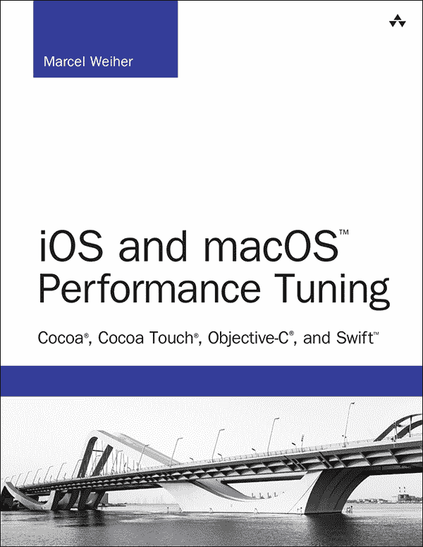


# 关于本电子书

EPUB 是一种开放的行业标准电子书格式。然而，不同阅读设备和应用程序对 EPUB 及其许多支持的支持不相同。可以使用您的设备或应用设置来根据您的喜好自定义显示。您可以自定义的设置通常包括字体、字号、单栏或双栏、横屏或竖屏模式，以及可以点击或触摸放大的图片。有关您的阅读设备或应用的设置和功能的更多信息，请访问设备制造商的网站。

许多书籍包含编程代码或配置示例。为了优化这些元素的显示，请在单栏横屏模式下查看电子书，并将字体大小调整为最小。除了以重流文本格式显示代码和配置外，我们还包含了代码图像，以模拟印刷书籍中的呈现；因此，当重流格式可能会损害代码列表的显示时，您将看到“点击此处查看代码图像”链接。点击链接即可查看高保真代码图像。点击设备或应用上的返回按钮即可回到上一页。


波士顿 • 科伦布 • 印第纳波利斯 • 纽约 • 旧金山 • 阿姆斯特丹 • 开普敦

迪拜 • 伦敦 • 马德里 • 米兰 • 慕尼黑 • 巴黎 • 蒙特利尔 • 多伦多 德里 • 墨西哥城

圣保罗 • 悉尼 • 香港 • 首尔 • 新加坡 • 台北 • 东


### 自动引用计数 (ARC)

随着 10.7 版本弃用了追踪 GC，Apple 引入了`自动引用计数`（ARC）作为 Objective-C 的语言特性。与 Apple 的追踪垃圾回收相比，可能最大的优势是 ARC 代码可以按源文件与其他引用计数代码混合，而追踪收集器必须为整个进程（包括任何插件）启用。

ARC 不仅仅是自动化了现有的对象所有权规则（这些规则大部分关于在实例变量中存储引用）。相反，编译器每当对 Objective-C 对象进行赋值以及从/向函数和方法传递/返回指针时就会插入引用计数操作，这大大增加了引用计数操作次数，但也关闭了潜在的漏洞窗口并使引用计数更加精确。

尽管支持引用计数的运行时函数有所改进，但这些额外引用计数操作的开销将是不可接受的，因此使用了一个特殊的 LLVM 优化阶段来尽可能移除这些操作。虽然这个额外的阶段可以消除大部分新增的引用计数操作，但整体上仍会有相当多的操作留下来，导致与 MRC（手动引用计数）相比出现约 10% 到 100% 的典型减速。

循环仍然不会自动处理，尽管已经了一些诸如弱置零引用（weak zeroing references）等机制来使避免循环变得更容易。弱引用不计入所引用对象的保留计数（计入计数的引用称为`强`引用），此外还会维护一个指向引用指针的反向指针。当对象的强引用计数变为零且对象被释放时，所有置零的弱引用都会被追踪到并将这些指针置零。这避免了指向已释放对象的悬悬引用。

### 进程级资源回收

虽然到目前为止的所有技术在程序运行时均有效，但重要的是，进程所使用的所有临时资源都会在进程终止时由操作系统清理。这种资源回收在本质上不仅是完美的，而且非常快。

## 总结

在这一章中，我们看到了内存层次结构中不同元素巨大的性能差异，这些元素都以统一地址空间的形式呈现给用户程序。为了优化内存访问的性能，有必要最小化总内存使用并优化内存访问模式，以便利用硬件的（非线性）能力。接下来的章节将首先展示如何测量内存消耗并识别访问模式，然后介绍调优的技术。

## 6. 内存：测量与工具

内存有许多不同的维度，没有哪一个是主导的。即使是看似简单的“我的程序占用了多少内存？”也没有一个明显的正确答案。有程序通过 `malloc` 从系统获取的内存，以及进程（包括 `malloc`）从操作系统获取的内存。这两者本质上都是地址空间而非内存，因此还有一个问题是该地址空间中有多少是由真实的内存支持的。

### Xcode 仪表

Xcode 始终开启的轻量级分析也包含了内存消耗的概述。图 6.1 显示了基础可视化界面：显示进程特定和整体系统内存使用情况统计数据的圆形仪表，以及显示进程随时间变化的内存使用情况的时间线。虽然没有深入细节，但它们确实让你对发生的情况有一个基本的了解，包括在出现问题时给出提醒。我个人觉得 CPU 仪表更有用。

### 命令行工具


与 CPU 性能一样，命令行提供了许多性能工具，可以快速提供相当详细的信息，而无需过多的开销或设置工作。简单的 shell 脚本允许你组合多个命令，以便同时捕获多个方面的情况。

## `top`

我们已经在第 2 章的“`top`”部分介绍过 `top` 用于 CPU 测量，它在内存分析中的许多优势也同样适用。它能为你提供系统的持续更新视图，以及特定进程的摘要信息。

我最感兴趣的摘要信息是 `PhysMem` 行。它显示了物理内存实际上系统层面的使用情况，分为 `wired`（锁定）、`active`（活跃）、`inactive`（闲）和 `free`（空闲）。`Wired`内存是被内核使用的内存，无法交换到磁盘；它永久驻留在物理内存中。内核管理的资源（包括进程、线程、文件描述符，甚至是虚拟内存页本身）除了资源本身使用的任何内存外，对于内核维护的账目信息都需要占用一定的锁定内核内存。

`Free` 内存顾名其义，就是当前未使用且可立即使用的内存。除了一小部分保留外，内核通常会尝试减少系统中的空闲内存，因为空闲内存意味着昂贵的资源没有被利用。

`active` 部分也很好：这些是实际分配给进程并处于活跃状态的内存。内核通过管理 `inactive` 内存来尽量减少空闲内存：这些是文件和其他缓存及缓冲器的旧映射，内核保留了它们以防以后再次需要，但如果系统进程需要更多 `active` 内存，就可以释放它们。

另一个需要关注的数字是 `VM` 行中的分页速率，特别是页出（pageouts）。如果括号内的数字非零，说明你的系统当前正在将数据交换到磁盘。如果你有持续的页出活动，通常会感觉到系统明显变慢，并且如果你使用的是机械硬盘而非固态硬盘，还能听到磁盘的活动声。

在按进程分类行中，我发现 `RPRVT` 和 `VPRVT` 行最有用。`RPRVT`（驻留内存）是你的进程实际使用的真实内存量，在大多数真实世界场景中，它最接近于回答之前讨论过的“我的程序使用了多少内存？”这一问题。也就是说，在你的进程开始交换内存之前，`RPRVT` 显然可能变得非常小，因此不再适合追踪你的内存消耗。

`VPRVT` 显示了私有分配给你的进程的地址空间大小，是交换时内存使用的良好类比指标。然而，它似乎没有考虑到新分配的（零填充）地址空间或未读取的内存映射文件。`VSIZE` 同时捕捉了这两者，但也捕获了大量的系统共享地址空间，这意味着它通常只作为一种相对指标有用。

图 6.2 显示了第 1 章中整数求和程序在运行 4 秒后的对象分配版本。它在 268 MB 的虚拟地址空间未使用 254 MB 的真实私有内存。但我们仍有超过 2 GB 的可用内存，因此没有交换的危险（页出次数仍为 0）。图 6.3 显示了同一程序运行 12 秒后的情况；真实内存消耗现在为 734 MB，并且仍然跟踪虚拟内存，虚拟内存已增加到 748 MB。我们仍有空闲内存，两个页出计数器仍为零。总之，我们有一个正在快速消耗可用内存的程序，但它仍在运行的系统范围内。

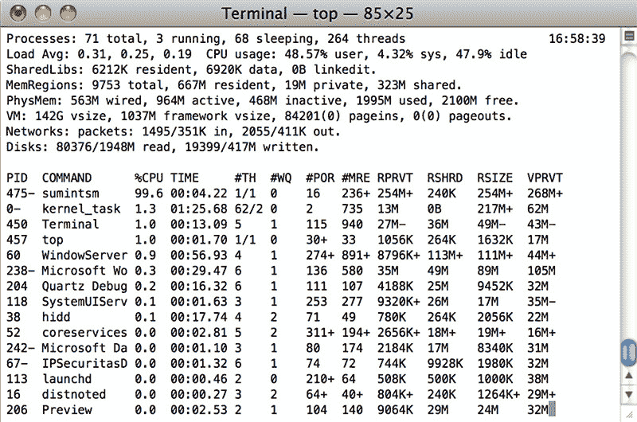

**图 6.2** `top` 内存参数

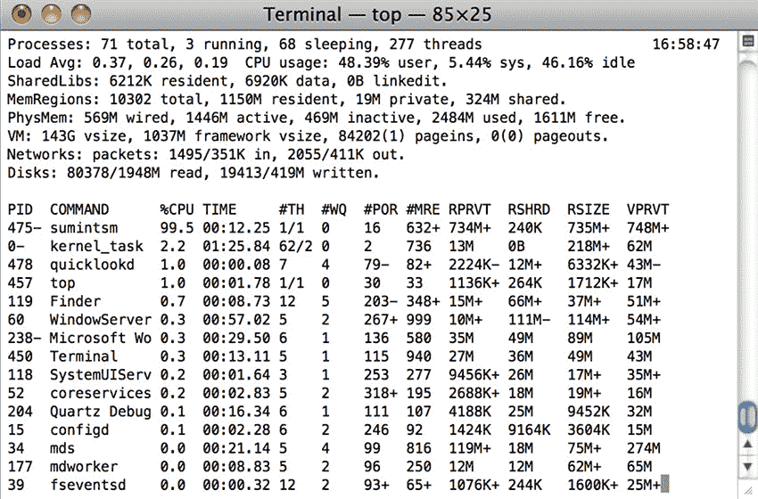

**图 6.3** 再次查看 `top`

## `heap`

正如其名，`heap` 命令会对应用程序的堆进行快照，大致为 `malloc` 及其变分配分配内存。与 `top` 不同，它始终显示地址空间，而从不显示真实内存，以防这两个数字产生偏差。另一方面，它会显示你的程序实际分配的内存，甚至按对象类对这些信息进行细分。它就像是你进程的 X 光机，我发现它对于分析程序行为极其有用。

要运行 `heap` 命令，你需要传递想要检查的进程的名称或进程 ID。它会在标准输出（stdout）上提供两种类型的信息。第一部分是它找到的每个 malloc 区域（zone）的摘要信息。以下是针对 Xcode 运行 `heap` 的摘要信息。对于每个区域，它显示了程序当前分配了多少内存，以及系统为该区域分配了多少内存。低利用率数字通常是碎片化的迹。

点击此处查看代码图像

```bash
marcel@localhost[dyld]heap Xcode

Process 30138: 9 zones

Zone DefaultMallocZone: Overall size: 48343KB; 23809KB (49% of capacity)

Zone GFXMallocZone: Overall size: 36864KB; for 462KB (1% of capacity)

Zone auto_zone: Overall size: 84879KB; 4427KB (1% of capacity)

Zone DefaultableZoneZone:: size: 4 ;KB (0% of capacity)

[...]
```

在下方显示的详细信息中，`heap` 尝试确定每个内存块的类型，除了计数这些块外，还会累加总大小。无法与特定对象关联的内存块被归类为 `non-object`。

点击查看代码

```bash
heap Xcode -sumObject
```

[...]


我总是使用 `-sumObjectFields` 选项，它还会考虑从已识别对象发出的、否则未分配的（`non-object`）指针——例如字典的键和值存储器——并将它们加到该对象类别的总大小中。使用此选项，`heap` 显示 Xcode 字典使用了约 32 MB 内存，字符串使用了 13 MB（`RPRVT` 总计 71 MB）。如果不使用 `-sumObjectFields`，字典使用 4.1 MB，字符串同样使用 13 MB，但有 50 MB 被归类到通用的 `non-object` 类别中：

点击此处查看代码图片

```
marcel@localhost[dyld]heap Xcode
```

-----------------------------------------------------------------------

Zone `auto_zone_0x10dc91000`: 773943 个节点 (103008096 bytes)

COUNT      BYTES      AVG    CLASS_NAME                            TYPE
=====      =====      ===    ==========                            ====
197211   12928032      65.6   __NSCFString                          ObjC
164067   55077344   335.7   non-object
  36720    2350080      64.0   __NSDictionaryM                      ObjC
  36327    2324928      64.0   XCPropertyMacroExpansionValue      ObjC
  28759    1840576      64.0   __NSCFDictionary                      ObjC
  25710    1645440      64.0   __NSArrayM                            ObjC
[...]

对于可变大小的对象，`-showSizes` 选项会将相同类但大小不同的对象显示在单独行中，而通常这些不同的大小会通过总数进行平均处理。

### `leaks` 和 `malloc_debug`

相比 `heap`，命名更为贴切，`leaks` 命令将显示程序中的任何内存泄漏。泄漏被定义为一段在堆上分配（`malloc`ed）但没有指针指向它的内存。尽管它可能会出现误报，但它通常非常准确。以下输出显示了对示例 6.1 中的程序运行 `leaks` 的结果。它声称有 4 处泄漏，总共 128 字节，并给出了每个泄漏的细节。如果启动程序时启用了 `MallocStackLogging`，`leaks` 还会显示每次分配的回溯堆栈。

点击此处查看代码图片

```
Process:         leaks-cycles [3320]
Path:            /Users/marcel/Documents/test-programs/leaks-cycles
Identifier:      leaks-cycles
Code Type:       X86-64 (Native)
Date/Time:       2012-09-07 12:15:08.208 +0200
Process 3320: 1131 nodes malloced for 111 KB
Process 3320: 4 leaks for 128 total bytes.
Leak: 0x7ec520430 size=48 zone: DefaultZone_0x102a00 __NSArrayM
Leak: 0x7ec520460 size=48 zone: DefaultZone_0x102a00 __NSArrayM
Leak: 0x7ec52b4c size=16 zone: DefaultZone_0x102a00
Leak: 0x7ec5240fd50 size=16 zone: DefaultZone_0x102a4400
```

带有泄漏的示例 6.1 程序
点击此处查看代码图片

```objc
#import <Foundation/Foundation.h>

int fn()
{
  NSMutableArray *array1=[NSMutableArray array];
  NSMutableArray *array2=[NSMutableArray array];
  [array1 addObject:array2];
  [array1 addObject:@"constant string"];
  [array2 addObject:array1];
  [array2 addObject:[NSMutableString stringWith:@"mutable"]];
  return 0;
}

int main(int argc, char *argv[] ) {
  @autoreleasepool {
    fn();
  }
  sleep(20);
  return 0;
}
```

## 内部测量

对于内省，未公开的 `mstats()` 函数（声明在 `malloc.h` 中）返回一个包含由 `malloc` 管理的内存信息的结构体。其中，它包含了 `bytes_free`、`bytes_used` 和 `bytes_total` 字段。像往常一样注意，这些数字指的是虚拟内存，而不是真实内存。

如果你需要通过程序了解真实内存的使用情况，可以通过 Mach `vm_statistics_data_t` 结构获取与 `top` 在命令行中提供的基本相同的摘要信息，`host_statistics()` 函数在被请求 `HOST_VM_INFO` 变体时会为你填充该结构。

虽然这些数字可以告诉你在特定时刻有多少空闲、活跃和非活跃内存，但正如之前解释的，这些数字的意义是非常流动的。例如，如果你使用 `host_statistics` 检测到 20 MB 的空闲内存，这并不意味着你真的可以使用这 20 MB。一方面，如果你请求它，系统可能会从非活跃列表中提供更多内存；另一方面，这 20 MB 可能低于其预留阈值，系统可能会开始交换，或在 iOS 上杀死你的进程。


# 1. 这最近被重命名为 `generational analysis`（世代分析），但其工作原理相同。

`Allocations` 工具通过允许你 `mark`（标记）特定状态来支持快照分析（Heapshot Analysis），然后它将计算后续标记状态之间的差异。要查看生成的数据，请将详情面板切换到 `Heapshot` 模式。一旦你有了几个这样的标记状态，就可以查看是否存在显著差异。从理论上讲，应该没有任何差异的；毕竟，你将程序恢复到了它之前的精确状态。

在这种情况下，场景如下：

**1.** 打开一个 PDF 文档。

**2.** 关闭已打开的 PDF 文档。

在开始实际分析之前，我会运行场景一次或两次，以消除任何一次性的初始化操作。这是必要的，因为许多子系统使用懒性初始化，因此，通用的子系统开销将与该子系统的首次使用被归类在一起。在完成预热后，我点击 `Mark Heap`^(2) 按钮，运行场景，然后再次点击 `Mark Heap` 按钮，在此实例中重复了整个过程三次。详情面板中的 Heapshot 视图（如图图 6.7 所示）显示每次运行场景时一致增长 39.2 MB（在 `Heap Growth` 列中）。然而，关于这些内存是在哪里分配的或为什么没有被释放，目前还没有什么可以依据的，因为展开的 Heapshot 2 只显示了一个 36.34 MB 的 `<non-object>` 块，而同一个块出现在其他的堆快照中（未显示）。

## 2. `Mark Generation`

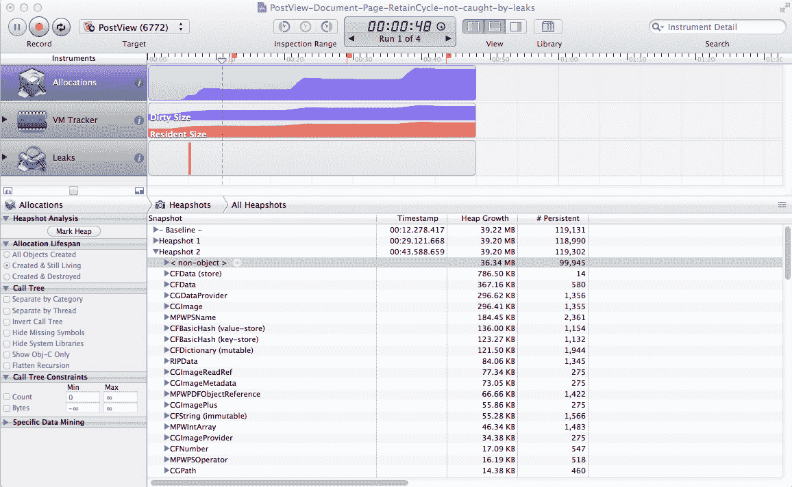

**图 6.7** 初始 Heapshot

信息量太大，无法完全理解，因此为了更好地了解发生了什么，我将 `Inspection Range`（检查范围）限制为场景运行一次，并切换到详情面板中的 `Call Tree`（调用树）视图。调用树向我了每个子树分配了多少内存，包括绝对值和相对值。此外，所有常用的调用树修剪机制都是可用的，这使得寻找（大）分配的源几乎变得轻而易举。在图 6.8 中，我深入钻到了一个占了总泄漏量 96.5% 的调用树节点。然而，坏消息是，这是一个内部 `CoreGraphics` 函数，考虑到 Mac OS X 性能组对泄漏追查的严厉程度，这似乎是一个极不可能的泄漏源。

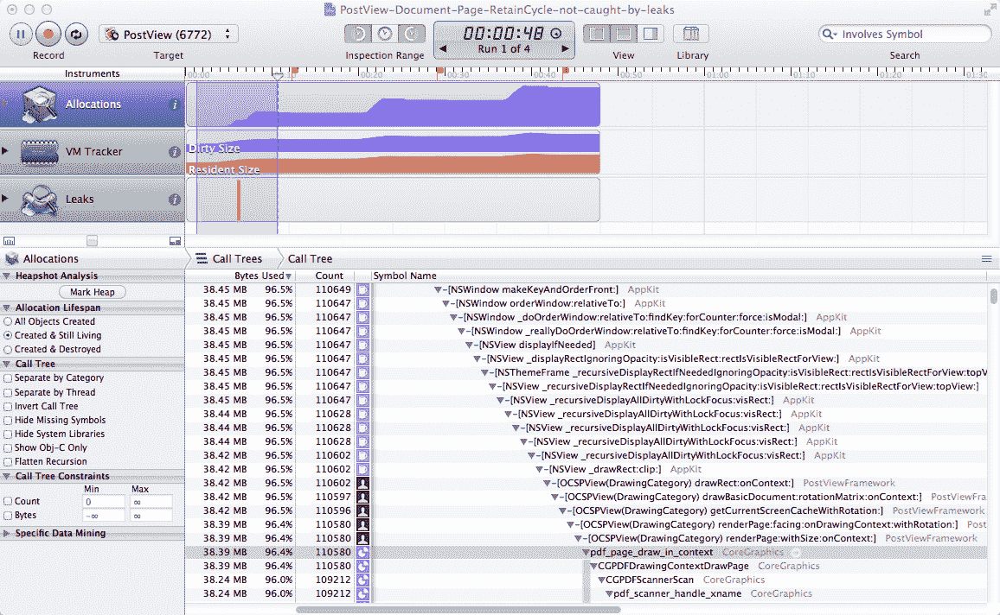

**图 6.8** 调用树

为了确保故障不在 `CoreGraphics` 中（如果是在那里，我会浪费大量时间），我查看了在 Preview 中打开同一个文件时的内存消耗情况，在关闭文件后，内存使用如预期地下降了。所以正如我所料的那样，是我的代码在泄漏。根据目前收集的信息（泄漏的内是在 `CoreGraphics` 内部分配的，而在渲染期间，那里泄漏不太可能），我开始怀疑我的代码要么泄漏了 `CGPDFDocument`，要么泄漏了 `CGPDFPage`。虽然我可以尝试在 `Summary` 或 `Heapshot` 视图中搜索所有对象，但由于不同对象的数量以及它们在同一个视图中以展开折叠三角形显示的事实，很难对两次运行进行并排比较。

一种更简单的方法是让 Instruments 寻找 PDF 对象。因此，我决定重新运行场景，这次将 `Allocations` 工具的 `Recorded Types`（记录类型，参见图 6.9）设置为仅记录类名或类型名中包含 PDF 的对象，并确保取消勾选 `Record all types`。（`configure` 按钮允许你设置新类型的过滤器）。注意时间轴上分配图的变化：

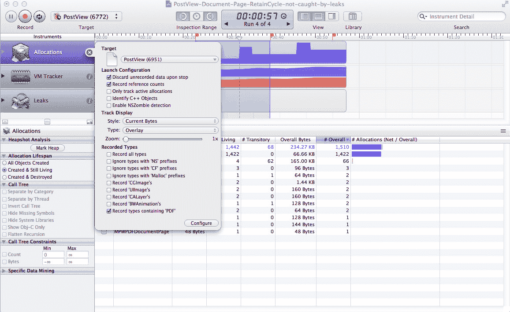

**图 6.9** 仅查找 PDF 对象

图 6.9 反映了这一选择，它已经变得明显更加矩形了，并且显示出了一些下降趋势。

使用该过滤器进行快照分析的结果如图图 6.10 所示。对象数量的急剧减少使得很容易在两个堆快照中实际发现 `CGPDFDocument` 和 `CGPDFPage`，所以我的直觉是对的，我泄漏了其中至少一个。问题的答案也显示了：一个 `OCSPDFDocRep` 实例（我的 `NSDocument` 子类）也出现在跟踪中。如果我泄漏了文档对象，我肯定也泄漏了随其对应的 PDF 资源。由于我在 `Summary` 视图中仅选择了 `OCSPDFDocRep` 进行绘图，时间线图显示出简单的阶梯状，因为每次场景中都分配了一个新的 `OCSPDFDocRep` 且没有释放。图 6.10 已经选中了其中一个违规对象实例（Instruments 会跟踪每一个单独的实例），点击箭头将显示该对象的调用历史。

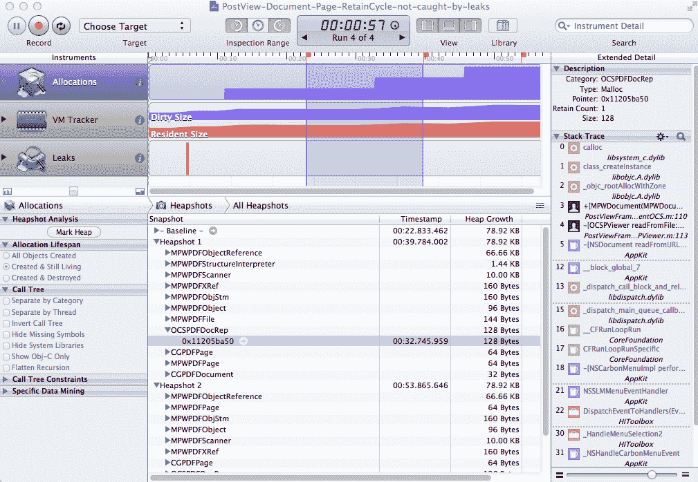

**图 6.10** PDF 对象的快照显示了我们在哪里泄漏

确实，地址为 `0x112ba0` 的 `OCSPDFDocRep` 调用历史在图 6.11 中显示了 7 次 `retain` 和 1 次 `malloc`，但只有 7 次 `release`（`autorelease` 本身不计入）。此时，所有通知都是平衡的，`PostViewFramework` 中的 `retain` 和 `autorelease` 也是平衡的，直到 AppKit 之后。这让 EGOS（嵌入式图形系统）中的 `retain` 看起来很疑。扩展面板中的调用栈显示了发生了什么：`MPWPage` 存储了一个指向文档的反指针并保留了它。由于 `OCSPDFDocRep` 也维护了一个页面列表，我创建了一个引用循环。双击堆跟踪中的特定条目可以直接跳转到源代码，高亮显示故障行。

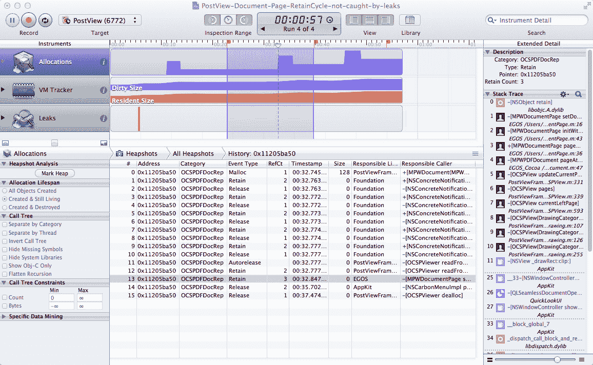

**图 6.11** ...以及我们在哪里泄漏

通过移除反指针（将其变为弱引用或不保留）来打破这种引用循环解决了泄漏，如图图 6.12 所示。跟踪面板图的形状现在清晰地表明，大部分内存在我们关闭窗口后被释放了。快照视图证实了这一初步印象：不再是 41 MB，我们只分配了 500 KB。这仍然很多，但比以前好得多，而且现在至少某些分配完全位于 AppKit 和 CoreText 内部，没有任何客户端代码的引用。

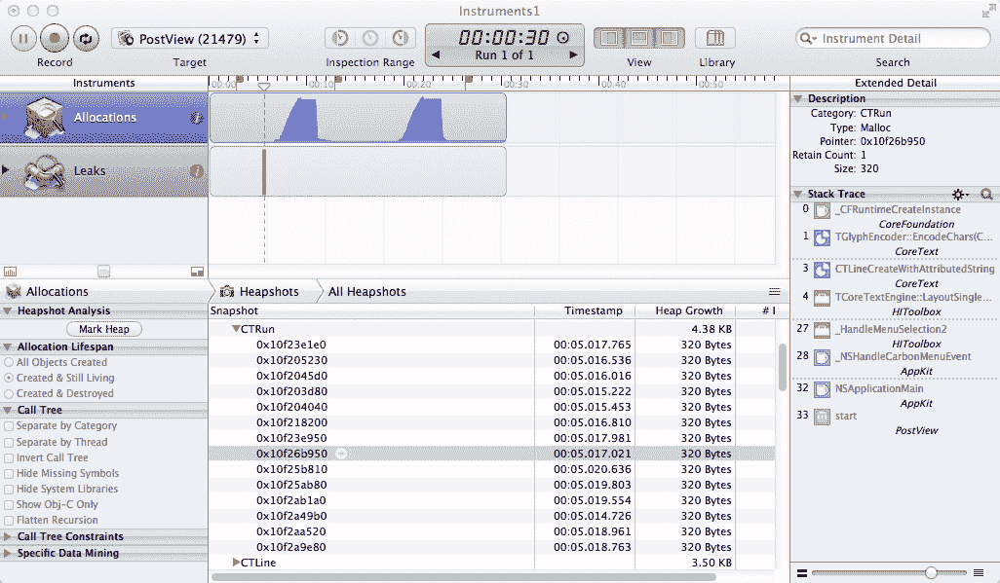

**图 6.12** 修复后

`Allocations` 工具还有我们尚未涵盖的额外功能；例如，可以显示特定大小范围内的分配，或者只查看来自 Objective-C 代码的分配。然而，也有一些局限性。对于我这样的 `heap`粉丝来说，一个大问题是 `Summary` 视图缺乏类似 `-sumObjectFields` 的选项，这意味着大量的关联分配干扰了 `Summary` 视图。

另一个大问题是，至少在 iOS 上，它并没有实际捕获所有分配，尽管 Instruments 具有同时运行多个工具的能力，而且从模板选择器选择 `Allocations` 模板时，默认还会添加 `VM Tracker` 工具。


图 6.13 中的工具提示显示了模拟器中运行 iOS 应用程序时的效果。`Allocations` 仅跟踪了 4.1 MB，但总使用内存超过了 141 MB 驻留（resident），且仍有 60 MB 以上脏内存（dirty），这意味着进程写入过的内存（我们希望尽量减少这类内存）。据我所知，`Allocations` 未包含的内存至少包括 `CoreAnimation`、`Image IO` 和 `CoreGraphics image` 等类型。

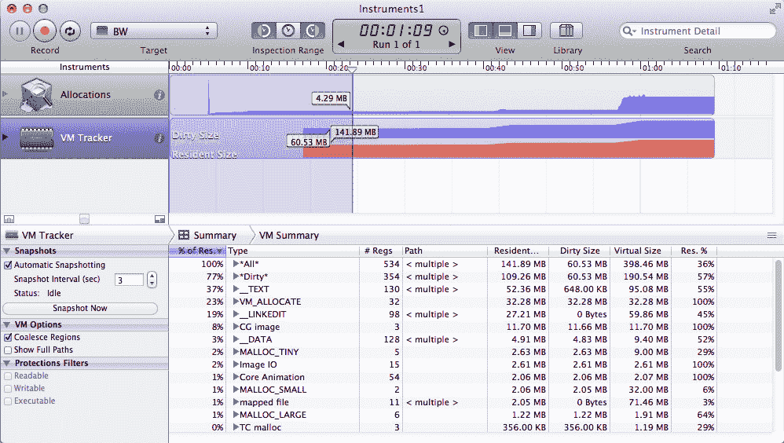

**图 6.13** 运行中的 Allocations VM Tracker 实例

### 计数器/PM 事件

`Counters` 工具定期读取 CPU 的性能监控寄存器。这些是 CPU 内部维护的 300 多种不同统计数据，包括“除法器忙碌周期”和“执行的分支”等。我在本章的内存章节中包含了 `Counters` 工具，因为它包含了关于由 CPU 硬件管理的内存层次结构部分的详尽统计数据，包括缓存、加载/存储缓冲区和内存接口。我不知道还有什么方法可以获取内存和缓存流量的信息。

图 6.14 显示了在运行并选择了几个计数器后的 `Counters` 工具。我反转了调用图，因此它显示的是 `MISALIGN_MEM_REF.STORES` 最高的函数，根据 Intel 文档，这意味着：“投测性缓存行拆分存储地址已发送到 L1D。”

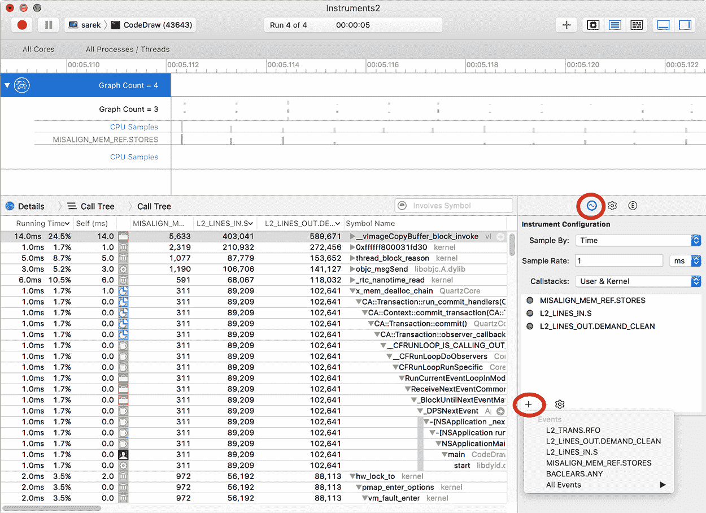

**图 6.14** Counters 工具及配置

如你可能察觉到的，我从未在“愤怒”时不得不使用过性能计数器，或者说我没有注意到自己本该使用它们，因为我通过其他手段获取了解决问题所需的信息。在这一阶段，我希望能遇到一个深层次到需要这种强大工具的性能问题。

关于性能计数器需要注意的一个重要点是，与大多数其他工具不同，它们开箱即用并没有实际作用；相反，你需要在 Record Settings（记录设置）面板中通过点击 `+` 按钮（在图 6.14”部分中跟踪调查记录的大小为 1.3 GB，即使是 `top` 也会花费大约 80% 的 CPU 时间来计算内存统计（在我的系统上，`top -d` 消耗 1.1% 的 CPU，`top -u` 消耗 6.5%）。

因此，建议你使用小型数据集或非常强大的机器进行内存分析。对于 iOS，大多数内存调查可以且应该在模拟器中进行，因为与 CPU 性能不同，内存行为应该非常相似，只是系统拥有更多内存，因此内存警告必须手动触发。

## 7. 内存：陷阱与技术

内存优化的常用技术围绕着使用更紧凑的数据结构，本章将会讨论这个话题。此外，我们还将展示一些陷阱，特别是 Objective-C 代码中常见的陷阱。（你是否猜到其中一些涉及到 Foundation 对象的用法了？）

当然，我们还需要考虑避免泄漏，以及引用计数在 Objective-C 和 Swift 引用类型中所扮演的特殊作用，以及传递值而非引用的替代方案。我们将研究 Objective-C 的缓存技术和 API，以及控制地址空间到真实内存映射的 API。

我们将继续“架构选择对性能的重要性”这一主题，并通过一个小型示例来强调这些架构选择可能带来的差异。最后，我们将查看并发问题和特殊的 iOS 内存环境。

## 引用计数

即使在引入自动引用计数（ARC）之后，每个关于 Objective-C 的讨论中，第一个话题似乎都是 Apple Foundation 的引用计数机制。我必须承认我总觉得这种焦虑有些过度了，因为引用计数既易于处理，在性能特征上又非常可预测。由于经典的引用计数实现是以库代码形式提供的，它也适用于普通的重构技术以减少涉及的代码量。

由于 ARC 的性能限制，我在性能关键型代码中仍会使用非 ARC 引用计数。我处理引用计数的策略包含以下模式：

1. **除 `dealloc` 外，始终使用访问器（accessors）。**
2. **使用自动访问器合成自动生成所有非自动释放（non-autoreleasing）的 get 访问器或非原子属性。**
3. **创建对象时始终使用便利方法。**

使用这些模式，我自己的非 ARC 代码在过去和现在基本上没有任何引用计数操作，除了在 `dealloc` 中机械地发送的 `release` 消息外。在数量上，我在 250 K 代码中出现了 230 次 `[... retain]`，即每 1000 行代码（KLOC）略低于一次 retain。剩余的 retain 大多由于遗留问题或“特殊情况”，例如（过早的优化。由于非自动的 `dealloc` 方法，`release` 的频率是其 10 倍，但仍占总代码的 1%。

通过将手动内存管理代码减少到总代码的 1%，并有效地自动化遵循 Cocoa 规则，这种小模式不仅完全消除了内存错误，还消除了对内存的思考。相反，我看到的绝大多数内存错误出现在未遵循此模式的代码中。当我在方法中间向对象发送 retain 时，我会产生警觉，而且错误通常不远。

1% 的数字足够小，使得代码迁移到 ARC 是轻而易举的，就像垃圾回收一样。然而，这也意味着这种转换的收益微乎其微，与 Apple ARC 迁移指南暗示的 50% 工作量相比。

一个需要注意的潜在陷阱是默认的 `atomic` 修饰符（我们之前提到过），它使得属性访问线程安全。虽然示例 7.1 中全自动生成使得代码看起来整洁，但它实际上有隐藏成本，特别是读取访问。如果你运行它，你会发现每次读取都会产生一个指针大小的内存代价，因为 `atomic` 访问器意味着一个自动释放访问器，这意味着你的对象被添加到当前的自动释放池中。


```
AtomicTest* obj=[[AtomicTest new] autorelease];

obj.myObject=[NSString stringWithUTF8String:"Hello World"];

struct mstats stats=mstats();

long used_before=stats.bytes_used;

for (int i=0; i< count * 1000 * 1000; i++) {
    [obj myObject];
}

stats=mstats();

long used=stats.bytes_used;
printf("n=%d memory used: %ld\n",count,used);

return 0;
}
```

虽然这看起来并不多，但读取访问是非常频繁的，因此这种开销在实际情况下实际上会累积，而且很多代码都期望这些操作本质上是“免费”的。在属性声明中添加 `nonatomic` 关键字可以将内存消耗降低到预期的零，并让受影响的代码运行速度快多达 10 倍。

## 避免泄漏

在引用计数中，本质上有两种方法会产生对象泄漏：要么你的 `retain` 和 `release` 不平衡，要么你形成了循环。在使用所讨论的规则时，你的对象所有权规则会自动处理，但从 `dealloc` 中发送的 `release` 之外。ARC 额外负责在 `dealloc` 中自动生成 `release`。考虑到通用的 `dealloc` 例程相当容易编写，目前还不清楚这种功能为什么要与 ARC 捆在一起。幸运的是，`dealloc` 中的泄漏非常容易通过简单的检查来修复（将 `.h` 和 `.m` 文件并排，比较 `ivar` 声明与 `dealloc` 方法），以至于我从未费过精力去真正使用我在 2001 年创建的通用/自动 `dealloc` 方法，尽管它运行良好且消除了为每个类编写 `dealloc` 的需求。

剩下的就是引用循环，这是引用计数的一个问题，上述技术无法解决它，ARC 也无法解决它（尽管它提供了有所帮助的工具）。引用循环一组对象，尽管它们从外部已无法访问，但仍然保持其他对象存活。幸运的是，程序员通常可以避免循环。常见情况是在本为树形的结构中包含父级链接（例如视图层次结构中的 `superview`），可以通过将父级链接设为非引用的（nonretained）来处理，如图 7.1 所示。只要树的根被保留，只要有引用，子链接就足以保持对象存活——程序员只需要在从树中移除子节点时将父指针设置为 `nil` 即可。

ARC 在这种情况下通过零弱引用（`@property (weak superview)`）提供了帮助。循环的另一个潜在原因是一个由不同部分组成的对象，但这些部分需要整体提供的服务。如果将回引用设为非引用不是选项，打破循环的一种方法是将功能提取到单独的对象中并而引用它，如图 7.2 所示。

最后，堆分配的块（blocks），特别是 Grand Central Dispatch 中使用的块，也是循环的主要候选对象，因为持有块的对象在块 内部被弱引用。隐式作用域捕获（implicit scope capture）使得这种错误很容易。clang analyzer 也可以检测潜在的泄漏，尽管它可能会显示误报，但定期运行它应该是代码卫生习惯的一部分。

### Foundation 对象 vs. 原生类型

我们在第 3 章中已经看到，Foundation 和 CoreFoundation 对象在某些情况下虽然方便，但可能会产生巨大的 CPU 开销，因此存在显著的内存成本也不令人意外。一个表示 `float` 的 `NSNumber` 大小为 32 字节，而 `float` 本身只有 4 字节，因此扩展了 8 倍。类似的情况也适用于其他原生类型包装器。一个例外是代表 64 位运行时表示整数的 `NSNumber` 或 `CFNumber` 对象，正如我们在第 3 章的原生类型部分中探讨的那样。它们被编码在对象指针本身中，因此不占用额外的存储。

提到指针，所有的对象表示在持有该引用的任何结构或对象中都会消耗一个指针大小的内存，所以在 32 位系统上是额外的 4 字节，在 64 位系统上是 8 字节。我们没有在上面的比较中考虑这一点，因此加上指针后，直接 `float` 和 `NSNumber` 之间的差异实际上是 4 字节对比 40 字节，扩展倍数变成了 10 倍。图 7.3 比较了使用 4 个 `real` 值或 4 个（简化的）`NSNumber` 对象的 `Rectangle` 内存布局。每个框宽度为 8 字节，使用原生类型的对象总共使用 24 字节，所有内容都可以放入 64 字节的单个缓存行中，因此可以在单次内存事务中读取。

使用 `NSNumber` 对象不仅将基础对象大小增加到 40 字节，还需要 4 个额外的 `malloced` 内存块，每个内存块都极可能位于不同的缓存行上。

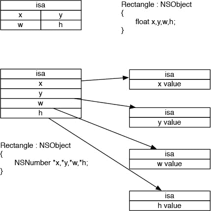
**图 7.3** 内联原生类型与对象指针的内存布局

在第 3 章的“数组和批量处理”部分中，我们看到浮点指针数字的同质数组速度比包含 `NSNumber` 对象的 `NSArray` 快 5 到 1,000 倍。我们现在可以看到，取决于环境（32 位或 64 位）和表示（`float` 或 `double`），它的体积也小 5 到 10 倍。虽然这种尺寸差异对于“数组和批量处理”部分的基准测试并不重要，因为数组相对较小且没有其他活动，但在实际情况下，它几乎肯定会对性能产生额外影响。

，仅从尺寸来看，昂贵的缓存缺失的概率就增加了 10 倍；其次，单独分配 `NSNumber` 对象意味着利用快速顺序访问模式的机会较少。正如你所猜的，字典的情况会更糟糕。让我们考虑一个只有一个条目的单个可变 `NSDictionary`，例如一个值为 −0.2 的 `NSKernAttribute Name`。在我的 64 位系统上的测量结果是，字典本身占用 112 字节，`NSNumber` 额外增加 32 字节。我没有计算 `NSString` 键，因为几乎几乎是共享的，但仍有 144 字节。如果我们有一个带有 `kern` float 值的对象，我们的总大小将是 12 字节的实际空间，由于 `malloc` 分桶机制变为 32 字节。


`NSDictionary` 通常被视为稀疏结构的内存节省设备，但事实证明，要在大其庞大的初始空间开销上达到收支实际上非常困难。图 7.4 展示了这种困难程度：`NSDictionary` 唯一与直接对象表示达到收支的情况，是利用率极低（5% 或以下）且总槽位达到 100 个或更多。如果利用率更高或槽位数量更少，尽管有所有看似“浪费”的槽位，对象表示仍然更加紧凑；而且即使利用率仅为 10%，基于 `NSDictionary` 的表示图的斜率也更陡。

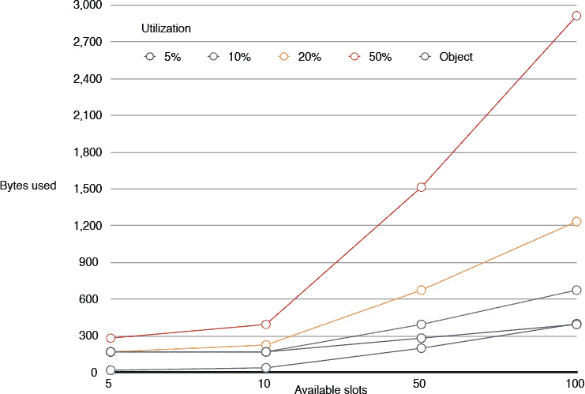

**图 7.4** 稀疏填充字典与对象的内存消耗对比

## 更小的结构

一旦你解决了内存泄漏、避免了对 Foundation 对象的无谓或批量使用，并在没有指针间接的情况下紧凑地存储了数据，为数据寻找更紧凑的内存表示将有助于节省内存并让程序运行更快。这不仅意味着移动的数据更少，你还能节省宝贵的缓存内存，从而减少了等待主内存的停顿机会，甚至更糟——导致二级存储的缺页错误。考虑到当今机器的现实，尺寸/速度权衡实际上不再是权衡；较小的尺寸几乎总是意味着更快的执行。

首要任务不是无谓地浪费空间，但遗憾的是，浪费空间既简单又极其常见。例如示例 7.2 中的日期表示，它取自一个在数百万机器上运行的真实日历应用。对于范围为 0 到 24、0 到 31 或 0 到 60 的值，使用标准的 32 位整数已经是惊人的浪费了，但作者们自动或至少是不经思考地遵循了将 `unsigned int` 替换为 `NSUInteger` 的建议，使情况变得糟糕。目前，这将消耗 6 × 8 = 48 字节的内存，而你可以预计日历应用中存在大量日期。

**示例 7.2 日期表示中的无谓 64 位整数**

点击此处查看代码图片

```c
typedef struct {
   NSUInteger year,month,day;
   NSUInteger hour,minute,second;
} date_time;
```

这可以简单地被示例 7.3 中的位域表示取代，而不会丢失任何所需的精度，仅是受限于未来几百万年内的日期。这种表示的大小为 48 位或 6 字节，缩小了 8 倍。由于编译器极有可能将其填充到至少 8 字节，我们理论上可以在年份上再增加 16 位，使年份范围扩展到 1280 亿年，这应该足够我们撑到下一次软件更新。这一简单的改变让应用程序的内存占用减少了几兆字节，乘以几百万用户，就节省了惊人的数 TB 级内存。

**示例 7.3 更紧凑的日期表示**

点击此处查看代码图片

```c
typedef struct {
   unsigned long year:21,month:5, day:5, hour:5, minute:6, second:6;
} date_time;
```

另一个需要避免的陷阱是无谓子类化。同一个日历应用的主模型对象是事件，但由于某种历史遗留，这个模型对象曾是 `NSView` 的子类。简单地将父类替换为 `NSObject` 又节省了几兆字节。

随着 64 位的过渡，许多数据类型已从 32 位扩展到 64 位；例如 `NSUInteger` 和 `NSInteger`，以及 `CGFloat`。对于临时变量和消息参数，这通常是可以接受的，但验证实例变量到底需要多大的范围和精度可能是有意义的。作为一个反面例子，`CGColor` 定义为具有 `CGFloat` 分量，而这些现在是 64 位的 C `double` 浮点数。考虑到人类色彩视觉最多能区分约 1000 万种颜色（10⁷），这可以用 24 位表示，那么为每个颜色分量拥有 64 位（因此 RGB 总共 192 位，或 $10^{38}$ 种组合）似乎有些过度了。

### 但千禧年问题（Y2K）呢？

你可能还记得 2000 年（Y2K）恐慌，因为许多程序只用 2 位数字表示日期，例如，`1982` 年被表示为字符串 `82`，隐含世纪前缀 `19`。这在 2000 年元旦之后显然会停止工作，这些程序将其解释为 1900 年，并可能收取负 99 年的利息、错误地计算速度等等。

虽然原始开发者假设他们的程序在这个特定的黑科技变得有用之前就会被替换，但涉及的软件生命周期比预想要长得多，导致了一场全球性的、耗资数十亿美元的清理工作，大量的祈祷，以及 2000 年元旦当天的大量加班，幸运的是损害很小。那么，这里的建议是否也有同样的陷阱呢？

我认为答案是“不是”。首先，该建议是在对象内部优化字段大小，即在我们极力使其快速的封装边界之后进行优化。对于消息接口（参数和返回值），使用机器的全宽度（32/64 位整数和浮点数）既是推荐的，基本上也是免费的，因为无论如何通常都会占用整个寄存器。其次，即使是这里提出的略微优化表示仍然有巨大的提升空间。因此，如果我们的软件比预期多运行几十亿年，或者人类进化到敏感度几千亿倍，我们只需要对本地化组件进行微小更新，而所有接口保持不变。

### 压缩

压缩是一种显而易见的节省空间措施，许多节省内存的技术（如上述的位域）可以被视为压缩的特殊形式。

这些类型的压缩有一个特点：它们在压缩状态下可以直接使用。通用压缩算法往往不具有这一特性，因此数据在使用之前需要先解压缩。这意味着未压缩和压缩的表示现在都处于内存中，且至少未压缩版本还是“脏”的（dirty）。因此，看似矛盾的是，未压缩的表示通常比压缩的表示更快，且更节省内存。

### 可清除内存

缓解脏解压数据（或任何可以从更紧凑的表示重新计算的数据）内存压力的一种方法是可清除内存。将内存标记为可清除，告诉操作系统：当存在内存压力时，它可以像处理干净内存一样丢弃这些内存，尽管已知它们是脏的，而不是将其交换到磁盘。

Apple 提供了使用 `mmap()` 系统调用标志的低级接口，以及层级更高、更方便的 `NSPurgeableData` 类，它为可清除数据封装了与 `NSMutableData` 兼容的接口，并实现了 `NSDiscardableContent` 协议。

必须使用协议的 `beginContentAccess` 和 `endContentAccess` 消息分别锁定和解锁实际内容；数据在锁定状态下才能访问，在解锁状态下才可以被清除。


`discardContentIfPossible` 消息将清除数据，除非数据当前处于锁定状态；在存在内存压力时，系统也可以执行此操作。一旦数据被清除，`beginContentAccess` 将返回“NO”，如果在没有成功通过 `beginContentAccess` 锁的情况下使用 `bytes` 或 `mutableBytes` 等访问方法，将抛出异常。重要的是不要保留指向数据的指针，因为如果数据已被清除，通过这些指针访问数据会导致进程被杀死。

关于可清理内存（purgeable memory），需要注意的一点是工具是如何统计它的。例如，在 `top` 中：当锁定时，它出现在 `RSHRD` 列（而不是 `RPRVT`），而当未锁定时，它实际上根本不会出现！其理由可能是系统可以任何时间回收该内存，但这略有误导性，因为可清理内存在未锁定时仍然会产生内存压力。根据我的经验，取决于全局状况，系统可以并且倾向于分页其他内存，而不是释放可清理内存段。

## 内存与并发

即使对于单核 CPU，CPU 和内存速度之间存在巨大差异，因此管理内存带宽和延迟成为编写高性能多核软件的主要关注点之一，这并不意外。

如果你想让多个核心保持忙碌，它们需要在大多数时间内从其私有缓存中工作。`感知缓存（Cache aware）`程序会专门考虑已知的缓存大小，例如将工作分成 16K 或其他大小的块。正如名称所示，它们通常根据特定的缓存大小和特征参数化，因此它们要么取决于硬件，要么至少需要在运行时进行参数化。

`缓存无关（Cache-oblivious）`算法使用递归划分策略，通常在树或树形结构上运行，大部分细节工作在叶节点附近完成。实验性且已作的 Fortress 数字计算语言（旨在作为 FORTRAN 的安全继任者，因此得名）背后的团队在网上有很多关于此主题的优秀演示^(1)。

1. [`web.archive.org/web/http://research.sun.com/projects/plrg/Publications/`](https://web.archive.org/web/http://research.sun.com/projects/plrg/Publications/)

另一种`缓存污染（cache pollution）`情况发生在线程流式通过内存时，迫使其他线程的数据挤出缓存。多媒体指令集（如 `SSE`）中的特殊指令允许直接从主内存读取数据而不通过缓存。由于主内存的流式性能远高于随机访问速度，这对于实际的流式算法已经足够了。Apple 的 `vDSP` 和 `vImage` 已经利用了这些指令，因此它们是一个很好的选择。

当两个线程尝试访问同一块数据时，会发生竞争（Contention）。由于 CPU 中的数据是以通常为 64 字节的缓存行组织的，当两个线程访问实际上位于不同位置的数据，但这两个位置位于同一条缓存行时，就会发生`虚假共享（false sharing）`。在这种情况下，CPU 必须不断在两个核心之间移动数据，从而极降低降低吞吐量。如果你发现线程之间存在虚假共享，在引起共享的数据块之间添加足够的填充（padding）将它们置于不同的缓存行，可以极大提高性能。

如果多个线程通过相互传递数据来处理同一份数据，那么使用`线程亲和性（thread affinity）` API 将它们固定在同一个核心是有意义的。相反，两个并发运行并处理不同数据集的线程应该被调度在不同的核心上，以避免它们争夺 CPU 特有的 L1 缓存。

## 架构考虑

我们已经在第 4 章中 SAX 和 DOM 解析器之间的差异中看到了架构风格的影响。流导向的 SAX 解析器使用几乎恒定的内存，^(2)，DOM 解析器使用的内存与文件总大小成正比。然而，正如我们将会看到的，架构风格的影响可能比这更为显著。

2. 更准确地说：与树的高度线性相关。

示例 7.4 应该打印出一个包含单个成员（另一个 `NSArray`）的 `NSArray` 描述。这个最终描述可能是类似于“`(( ))`”的内容，占用空间级为几个字节，但由于两个数组相互嵌套，程序崩溃了。在我的系统上，它在耗尽总内存之前实际上耗尽了栈空间，但最终也会耗尽内存。

**示例 7.4 使用两个 `NSMutableArrays` 和 `description` 导致的崩溃**

* * *

```
import Foundation

var a=NSMutableArray()

var b=NSMutableArray()

a.addObject(b)

b.addObject(a)

print(a.description)
```

* * *

你可能会奇怪这个结果与软件架构有什么关系。这不只是 `NSArray` 或 `description` 中的 Bug 吗？并不是的。示例 7.5 仅仅是嵌套了数组，而没有相互递归。现在，我们得到的不是崩溃，而是图 7.5 所示的临时对象的 *n*^(2) 内存消耗曲线。描述字符串的实际大小呈线性增长，并显示出来供比较。

**示例 7.5 测量嵌套 `NSArray` 的 `description` 内存消耗**

点击此处查看代码图片

* * *

```
import Foundation

let numArrays=Int(Process.arguments[1])!

let before=mstats();

var base:NSMutableArray=["Hello World"]

for i in 1...numArrays {

    base=[base]
}

let b=base.description

let after=mstats();

print("memory used: \( after.bytes_used - before.bytes_used)")
```

* * *

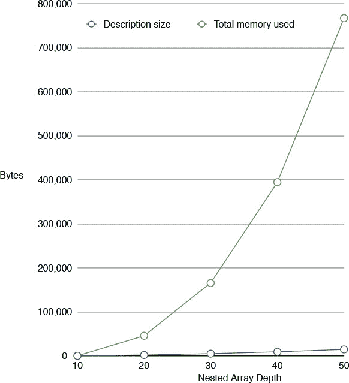

**图 7.5** 嵌套 `NSArray` 的 `description` 的二次方内存消耗

该图只显示到嵌套层为 50 的内存使用，因为在那之后，*n*^(2) 分配曲线变得足够大，导致描述字符串的大小实际上固定在 x 轴上。对于 750 个嵌套 `NSArray`，内存消耗增长到 500 MB，CPU 时间增加到 78 毫秒。增加到 1500 个嵌套 `NSArray`，内存和 CPU 使用量分别四倍增长到 2 GB 和 306 毫秒。

（如果你真的想自己尝试这个，请准备好等很久，并且至少重启机器以清理交换空间。你还可能实际上耗尽交换空间并导致内核崩溃，因此我不建议这样做。保存你的工作，提前备份你的系统！）

这种内存增长的原因不是 `description` 方法的实现缺陷，而是*调用与返回（call-and-return）*架构风格的一个基本特征。在这种风格下，你*调用*一个函数或方法，它*返回*一个结果。^(3) 由于这是整个交互，返回的结果必须是完整的；没有真正的部分结果的概念。

3. 在 Objective-C 中，我们通常倾向于使用*发送消息（send a message）*这一术语。


当我们需要将这些中间结果组合成最终结果时，意味着我们需要首先完全构建所有部分结果，然后分配足够的内存来存放组合后的结果，最后将部分结果拷贝到最终结果。在每个嵌套层级重复此操作，你将得到总复杂度 `O(m × n)`，其中 `m` 是嵌套深度，`n` 是总大小。在本文给出的（诚然略显病态的）示例中，嵌套深度等于总大小（`m = n`），这导致了我们测得的 `n²` 结果。

幸运的是，有一种使用流式方法（streaming approach）的简单解决方案，类似于我们在解析 XML 时看到的 `SAX`，但更简单，因为我们是在生成内容而不是解析内容。我们不再构建完整的部分结果，而是将部分结果累加到一个在开始时分配一次的共享缓冲区中，并将该缓冲区传递给我们的方法，而不是从方法返回结果。示例 7.6 中的 `describeOn:` 方法为 `NSArray` 实现了这种基于累加器的流式设计。代码其余部分将其与当前的描述协议集成，并暴露了一个 `fastDescription` 方法，封装了设置累加器的过程。

### 示例 7.6 使用 `describeOn:` 流式处理描述

点击此处查看代码图像

```objc
#import <Foundation/Foundation.h>

@implementation NSArray(describeOn)

-(void)describeOn:(NSMutableString*)description

{

  [description appendString:@"( "];

  NSString *separator=@"";

  for (id obj in self ) {
    @autorelease {
      [obj appendString:separator];
      [obj describeOn:description];
      separator=@", ";
    }
  }

  [description appendString:@")"];
}

@end

@implementation NSObject(describeOn)

-(void)describeOn:(NSMutableString*)description

{

  [description appendString:[self description]];
}

-(NSString*)fastDescription {

  NSMutableString *s=[NSMutableString string];
  [self describeOn:s];
  return s;
}

@end
```

将示例 7.5 更改为使用 `fastDescription` 代替 `description`，会产生图 7.6 所示的截然不同的结果。不仅总内存图保持相对平坦且非常接近描述的最终大小，而且注意 x 轴从嵌套深度 5,000 开始，这是图 7.5 中给出的值的 100 倍。在 5,000 个对象处消耗的总内存约为 20 KB。`n²` 算法处理 1,500 个项目需要 2 GB 内存，而我们仅需 60K 内存即可获取十倍数量项目的描述，因此在该这一点，累加算法的内存效率是 35,000 倍。

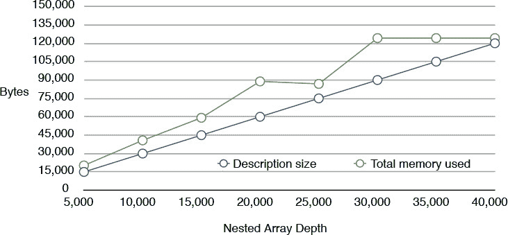

**图 7.6** 嵌套 `NSArray` 使用 `describeOn:` 的线性内存消耗

虽然这显然是一个极端示例，但一般原理仍然成立：带有部分结果的大型数据集很难用*调用-返回*（call-return）架构风格处理，即使是带有嵌套的中等规模数据集，也会受到需要重新计算完整部分结果以及该风格中嵌套结构固有的 `m × n` 空间/时间复杂度的影响。Objective-C 受这种风格的影响比其他语言更大，因为存在创建对象的开销，以及从方法中返回新创建的对象时所需的 `autorelease` 处理。仅向已存在的对象中添加数据要廉廉得多。

因此，在设计处理 API 时，尽量让它从根本上具备流式处理能力，例如通过传递某种可以增量接收结果的累加器。这类对象的例子随处可见——例如用于与显示交互的 CoreGraphics `CGContextRef` 对象，或者著名的 Unix 文件描述符 `fd` 或用于 I/O 的 `stdio` `FILE` 对象。事实上，Unix 可能是流式设计的典范，它具有*管道与过滤器*（pipes-and-filters）架构风格，大多数 Unix 过滤器可以在任意长度的数据上工作而不会有任何性能下降。

如示例 7.6 所示，添加一个封装流式机制的调用-返回便利方法通常很容易，而将调用-返回 API 转换为流式在不重写的情况下往往是困难甚至可能的。

一旦我们有了累加器，一个显而易见的扩展是让累加器比简单的 `NSMutableString` 更智能。我们将在下一章更仔细地查看这类类，它们还将处理示例 7.4 中的无限递归问题。

### 临时分配与对象缓存

正如我们在这里以及第 3 章的“对象创建与缓存”部分中看到的，临时对象对 Objective-C 程序来说是一个严峻挑战。临时对象的堆积本身是非常昂贵的，即使我们已经注意避免构建 `n²` 算法，仍会导致大量的堆增长。

可以通过嵌套的 `autorelease` 池或新的 `@autoreleasepool` 编译器指令来控制堆增长。示例 7.6 中的 `describeOn:` 方法通过嵌套 `autorelease` 池演示了这种方法，定期清理不再需要的临时对象。

即使我们通过定期清理避免了过度堆增长，临时对象仍然存在性能问题，因为它们的创建和销毁成本很高。这是由于 NeXT/Apple Objective-C 和 Swift 要求对象在堆上分配而不是像其他变量一样在栈上。从性能角度来看，这种限制是遗憾的，因为栈分配几乎是免费的：栈指针的一次增加就“分配”了给定函数的栈变量。

当然，由于我们讨论的是一种真正的 C 超集，某些事情不被允许并不意味着你*不能*这样做，只是意味着你可能不应该这样做。示例 7.7 展示了如何在栈上分配 Objective-C 对象，如果你真的想这样做。

1. 获取类以及该类的实例大小^4。Foundation 对象通常会虚报大小，因此不适合此方法。

2. 使用 `alloca()` 和 `bzero()` 在栈上分配并清零内存。

3. 设置类。

4. 在块作用域内使用且不再使用。


至少起码，你需要创建一个子类，在任何尝试 `retain` 目标对象时抛出异常，确保它不会在没有 `retain` 的情况下被存放在任何地方，显然要确保你没有从方法/函数中返回它，并且根本不要想在 ARC 中使用这种方法。

我们在第 3 章的“可变性与缓存”部分中引入的对象缓存，一次性解决了短生命周期对象的堆增长以及分配/销毁成本问题。我们不需要每次都分配一个全新的临时对象并希望它能准时被销毁，也不需要在栈上分配一个对象并希望它不会逃逸导致程序崩溃，我们只需付出几次函数调用的代价来复用已经分配好的对象。

### NSCache 和 libcache

Apple 在雪豹（Snow Leopard）中引入了一种相当不同的缓存类型，即 Cocoa 的 `NSCache` 类以及构建在其上的底层 `libcache` 库。`NSCache` 是一个类似于 `NSMutableDictionary` 的键值存储，不同之处在于如果系统检测到内存压力，字典中的内容可能会被剔出。`NSCache` 允许你激进地使用尽可能大量的内存进行缓存，同时最大限度地减少因使用这些内存导致系统性能下降的机会——例如引起不必要的内存压力，或在最坏的情况下将缓存与缓慢的次级存储之间进行分页。

请注意，这里的 `evicted` 仅意味着对象从缓存中移除（发送了 `release`），并不意味着对象被销毁。这是根据正常的内存管理规则发生的，因此只有当 `NSCache` 持有最后一个引用时，对象才会被销毁——本质上，如果没有其他人在使用它。

在有少数微小限制的情况下，你可以像使用 `NSMutableDictionary` 一样使用 `NSCache`。由于对象可能会消失，你需要在完成完操作之前对获取到的对象进行 `retain`，最好是将其存入一个带有适当访问器的实例变量中。相反，仅仅因为一个对象被从 `NSCache` 中移除并不意味着它会被释放，因为它可能在其他地方被留存。

由于剔除是异步发生的，这包括了你请求之后但在你自己存储它之前的时间，因此对象在传输过程中使用了原子读取访问器中常见的 `retain` + `autorelease` 组合来保护。与 `NSMutableDictionary` 不同，`NSCache` 是线程安全的并且不会拷贝其键。

尽管你可以简单地将 `NSCache` 作为替换品，但如果你需要，它也允许你进行更多控制。如果你为对象定义了成本函数，可以指定缓存中对象的最大成本（例如使用的字节数）。如果你的成本函数是“1”，你就可以限制缓存中对象的数量。

`NSCache` 还可以通过 `NSDiscardable Content` 协议（由我们之前讨论的 `NSPurgeableData` 实现）与其内容对象进行交互，这本质上是一个独立的引用计数协议，这对于让 `NSCache` 与与 10.6 版本一同引入的追踪收集器（tracing collector）协作可能是必要的。

### 内存映射文件

尽管内存映射文件涉及到将文件读取到内存中，但内存映射文件也可以被视为可清理内存（purgeable memory）的一种特例（忽略内存映射文件比可清理内存早多年的事实）。与可清理内存一样，映射文件的内存可以由系统随时进行回收，但与可清理内存不同，这对用户来说是完全透明的。由于我们为系统提供了内存的数据源（底层文件），系统可以在我们每次访问它时，自动从该数据源恢复内存内容。由于它可以随时执行此操作，在实际上我们访问内存之前或期间，它甚至不需要实际从文件中读取任何数据。

通过对 `NSData` 方法 `dataWithContentsOfURL:options:error:` 使用标志（（ `NSDataReadingMappedIfSafe` 或 `NSDataReadingMappedAlways`），我们可以完全改变这些方法的行为，尽管最终结果在语义上（很大程度上）是无法区分的。

如果没有映射标志（参见示例 7.8），这些函数会分配内存然后使用系统调用从磁盘读取数据，在数据读取后返回。由于我们已向分配的内存写入数据，该内存现在被标记为脏（dirty）。

#### 示例 7.8 读取文件

点击查看代码图片

```
NSData *data;

data=[NSData dataWithContentsOfFile:@"documentation.pdf"
                   options:0
                   error:nil];
```

使用示例 7.9 所示的映射标志，调用期间发生的所有只是创建了地址空间，并将该地址空间标记为由相关文件支持。差异在图 7.7 中所示。在调用期间没有分配实际的物理内存，也没有执行 I/O；操作纯粹是针对虚拟地址空间的。只有在当以及当那些映射地址被引用时，才会执行实际的 I/O。如果只访问文件的部分内容，则只读取这些部分（尽管系统可能会选择特异性地读取比请求更多的内容）。此外，由于进程没有写入这些页面，它们保持为洁净（clean）。即使在系统执行 I/O 用文件中的数据填充它们后，它们仍然保持洁净，因为内存中的数据与支持该内存的文件之间没有区别。

#### 示例 7.9 映射文件

点击查看代码图片

```
NSData *mapped;

mapped=[NSData dataWithContentsOfFile:@"documentation.pdf"
                   options:NSDataReadingMappedAlways
                   error:nil];
```

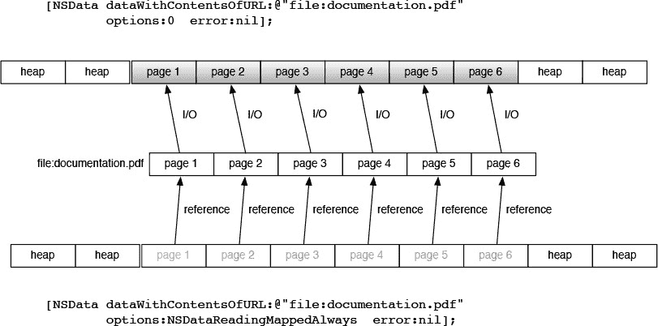

**图 7.7** 读取文件与映射文件

洁净页和脏页之间的差异在我们遇到内存压力且系统想要释放某些内存时变得明显。对于实际映射到内存中的文件部分，系统可以简单地撤销映射，将特定的地址空间指向原始文件。对于使用 Unix I/O 读取的文件，系统无法做到这一点，因此如果它想重用这些内存，必须先将其内容存储到交换文件中。对于超过物理内存的大文件，这可能会导致数据从磁盘读取、交换到交换文件并从交换文件读回的情况，且可能发生多次。在 iOS 上，显然不会发生交换，因此脏页无法由操作系统回收。这留下了两种选择：要么进程必须响应内存警告以回收内存，要么操作系统必须杀死进程。

因此，通过内存映射，最初使用的内存可能更少。在需要时，可以快速高效地回收内存，而且在许多情况下，I/O 和处理是可以交替进行的，而不是必须在开始处理之前先完成所有的 I/O。因此，文件访问本质上应该始终使用内存映射文件。


使用内存映射文件有一个主要的注意事项：由于 I/O 是懒性执行的，在未预料到 I/O 的代码中可能会出现 I/O 问题。简单来说，这可能只是在原本预期只需内存访问成本的操作中出现了 I/O 延迟，但这种情况在内存交换（swapping）时也会发生，所以我们的情况并没有变糟。然而，最坏的情况下，如果物理卷被移除，这种延迟可能会达到无限大——例如，如果到挂载卷的网络连接中断，或者外接硬盘被拔出。如果发生这种情况，失败将导致内存访问出现段错误（segmentation violation）。虽然理论上可以处理这种 Unix 信号，但在实践中，它会导致程序崩溃。因此，当指定 `NSData ReadingMappedIfSafe` 标志时，系统只有在文件所在的卷被认为不会发生突然消失行为（例如，启动卷）时，才会映射该文件。

缓解此问题的一种方法是预读映射的数据：例如，运行在独立线程中的所谓“页面遍历器”（`page walker`）只需触碰映射文件的每一页，就会将其读取到内存中。示例 7.10 显示了一个非常简单的页面遍历器。它假设页面大小为 4,096 字节，并从 `NSData` 参数中的每一页恰好读取 1 字节。更复杂的版本可以控制节奏，使其仅略领先于主计算线程，例如在顺序处理一个大型内存映射文件时。

### 示例 7.10 页面遍历器

点击此处查看代码图像

***

### madvise（建议）

虽然页面遍历不会影响程序的语义，但它通过本质上让映射文件某部分的 I/O 发生在实际需要该数据的处理逻辑到达之前，从而提升了性能。实现这种效果的另一种方法是使用 `madvise` 系统调用，它允许你就对特定地址空间的未来计划向系统提供提示（“建议”）。

你可以给出的提示之一是 `MADV_WILLNEED`。这应该产生对任何尚不在内存中的数据进行分页的效果——类似于页面遍历器，但更简单。当你完成某部分内存后，也可以使用 `MADV_DONTNEED` 告诉系统，这将使得那些页面在其他页面之前就有可能被换出。如果你只是顺序访问内容，使用 `MADV_SEQUENTIAL`，系统将有效地为你执行预读（read-ahead）和后置释放（free-behind）。

回到本章“架构考虑”部分的讨论，通用的内存映射特别是 `MADV_SEQUENTIAL` 允许你做的是：以易于的“调用-返回”风格进行编程，同时享受流式（`streaming`）风格的性能优势，并且具有额外的灵活性，可以在需要时跳出该风格而无需大费周章。

`MADV_FREE` 类似于 `MADV_DONTNEED`，区别在于你表示你实际上并不关乎所涉及内存的内容，这意味着系统可以丢弃它。（带有 `MADV_DONTNEED` 的脏内存仍需交换到磁盘）。Snow Leopard 中的 `malloc` 更新对已释放的堆内存应用了 `MADV_FREE`，以避免将不再包含有用数据的内存交换到磁盘。

当使用得当时，不同的 `madvise` 选项会对你的内存占用和性能产生巨大影响。需要注意的两个注意事项：首先，通过 `madvise` 给出的所有建议仅是建议性的；内核没有义务遵循这些建议（在 Leopard 系统之前，大多数选项实际上都被被忽略了）。其次，建议倾向于全局性，因此在处理共享映射时，可能会干扰其他进程对内存的使用。

### iOS 考虑因素

正如我们多次指出的，iOS 上缺乏交换文件（swapfile）产生了显著差异：性能不是逐渐下降，而是会直接撞上一堵堵墙。然而，没有改变的是内存子系统的流体本质，这些因素共同构成了一个具有挑战性的环境。

一方面，如果你向系统请求内存时过于激进或太快，或者在被要求时放弃得太慢，你的进程将被杀死。另一方面，系统对内存仍有足够的用途，以至于检查内存状态并仅使用可用资源往往无法让你的 App 正常运行。例如，内存警告（memory warnings）是在主线程上递送的。这意味着如果你的 App 在内存警告等待期间主线程正在忙碌（无论是否在分配内存），你的 App 可能被标记为无响应并被杀死。另一方面，仅仅将分配移动到后台线程也不是解决办法：我见过某些 App 因为后台线程在高兴地分配大块内存，而前景线程正尝试处理内存警告时被杀死。

我发现的一个解决方案是让后台线程向主线程发送一个“什么都不做”的消息（使用 `performSelector:onThread:` 并将 `Done` 标志置为 `YES`）。如果主线程上正在处理内存警告，这将阻塞后台线程并允许内存释放。提到内存警告，当你收到内存警告时，放下手头所有事情。无法交换意味着保持内存整洁（例如通过映射）在 iOS 上变得更加重要。

### 优化 ARC

当我们在 iOS 3.0 上工作时，突然在示例 7.11 所示的 `NSOutlineView` 中遇到了崩溃。这至少是令人惊讶的，因为在那个地方没有可以崩溃的地方。我们预期的汇编代码（某种程度上说）应该像示例 7.12 那样只操作寄存器。事实上，我很满意于只需 `xor %eax,%eax`，但设置框架并没有太大帮助，而且这是一个调试版本。

#### 示例 7.11 返回的方法

点击此处查看代码图像

***

```
- (BOOL)outlineView:(NSOutlineView *)outlineView isGroupItem:(id)item
{
    return NO;
}
```

***

#### 示例 7.12 非 ARC 生成的方法的汇编

点击此处查看代码图像

***

```
-[WLTaskDataSource outlineView:isGroupItem:]:
0100e958a    pushq  %rbp
0100e958b    movq   %rsp, %rbp
0100e958e    xorl   %eax, %eax
0100e9590    popq   %rbp
0100e9591    retq
```

***

#### 示例 7.13 ARC 生成的方法的汇编

点击此处查看代码图像

***

```
-[SomeOutlineViewDelegeate outlineView:isGroupItem:]:
01001bfdb0    pushq  %rbp
01001bfdb1    movq   %rsp, %rbp
```

***

然而，我们实际得到的是示例 7.13 中的代码。所有参数都通过调用 `objc_storeStrong()` 间接保留，然后通过再次调用 `objc_storeStrong()` 释放，但这次是清空局部变量。


```assembly
01001bfdb4   subq     $0x30, %rsp
01001bfdb8   leaq     -0x18(%rbp), %rax
01001bfdbc   movq     %rdi, -0x8(%rbp)
01001bfdc0   movq     %rsi, -0x10(%rbp)
01001bfdc4   movq     $0x0, -0x18(%rbp)
01001bfdcc   movq     %rax, %rdi
01001bfdcf   movq     %rdx, %rsi
01001bfdd2   movq     %rcx, -0x30(%rbp)
01001bfdd6   callq    0x10027dbaa    ## _objc_storeStrong
01001bfddb   leaq     -0x20(%rbp), %rdi
01001bfddf   movq     $0x0, -0x20(%rbp)
01001bfde7   movq     -0x30(%rbp), %rsi
01001bfdeb   callq    0x10027dbaa    ##    objc_storeStrong
01001bfdf0   leaq     -0x20(%rbp), %rdi
01001bfdf4   movabsq $0x0, %rsi
01001bfdfe   movl     $0x1, -0x24(%rbp)
01001bfe05   callq    0x10027dbaa    ##    objc_storeStrong
01001bfe0a   movabsq $0x0, %rsi
01001bfe14   leaq     -0x18(%rbp), %rax
01001bfe18   movq     %rax, %rdi
01001bfe1b   callq    0x10027dbaa    ##    objc_storeStrong
01001bfe20   movb     $0x0, %r8b
01001bfe23   movsbl   %r8b, %eax
01001bfe27   addq     $0x30, %rsp
01001bfe2b   popq     %rbp
01001bfe2c   retq
```

* * *

虽然我们最终找到了并删除了导致崩溃的程序，但测量结果显示 ARC 代码的速度比非 ARC 代码慢了约 26 倍。优化代码与未优化代码代码之间的差异已经超过了一个数量级。

我们为什么在运行未优化的代码？Xcode 自带的默认构建设置（如图 7.8 所示）规定在调试构建中关闭优化，这意味着几乎所有的开发构建。


**图 7.8** 新项目的默认构建配置

我们之所以没有注意到这 26 倍的变慢，是因为该方法位于代码中 97% 的非性能关键部分，而这一经历确实有力地证明了性能关键代码与非关键代码之间存在非常强烈的分工。

虽然在这种情况下，优化器救了我们（只是留下了调试构建可能慢到无法使用的问题），但情况并非总是如此。进一步的检查显示，许多即使是非常简单的方法，即使在开启优化的情况下，也会产生许多不直观的 `objc_storeStrong()` 调用，这压倒了方法中执行的有用工作。处理此问题有两种方法：要么将性能关键代码移动到不使用 ARC 编译的文件中，要么在必要的地方添加 `unsafe_retained` 属性，直到额外的保留（retain）操作消失。示例 7.14 即使在关闭优化的情况下也会编译为不包含任何多余保留的代码。

**示例 7.14 不在保留对象的情况下返回的方法**

点击此处此处查看代码

* * *

```objectivec
-(BOOL)outlineView:(unsafe_retained NSOutlineView*)item {
    return NO;
}
```

* * *

我个人倾向于将性能敏感代码保持在 ARC 之外，依靠 ARC/非 ARC 的互操作性。例如，第 3 章中“对象创建与缓存”节中的对象缓存无法在启用 ARC 的情况下表达；对于声明“我知道我在做什么”，这让我感到有些不舒服，因为与编译器的交互很多时候是令人意料的。

## 总结

本章介绍了许多技术，既可以减少应用程序的内存占用，又能确保你有效地使用这些内存。像 Objective-C 一如既往，你尽可能利用带有原始数据类型的粗粒度对象，我们已经看到这种结构与现代 CPU 的缓存行（cache-line）特性是如何良好交互。基本数据结构的调优也很重要，尽管它并不是 Objective-C 特有的，不像引用计数或循环打破技术。这些缓存机制中的某些具有指向虚拟内存子系统的私有接口，允许它们根据环境调整缓存行为，而其他 API 则允许程序优化对非缓存资源的使用。

iOS 内存技术和流式架构风格都是我们将在下一章通过示例深入涵盖的重要主题。

## 8. 流 (FilterStreams)

我们之前提到过流式方法，例如在查看内存映射的影响，或将基于 DOM 的解析器与基于 SAX 的解析器进行比较。在前章节中，我们展示了如何通过将返回 `NSString` 的 `description` 方法改为流式的 `describeOn:` 方法（后者会更新作为参数传入的 `NSMutableString`）来大幅降低内存消耗。

然而，将参数设为 `NSMutableString` 似乎与我们关于拥有语义丰富对象的建议相矛盾，而且也没有解决无限递归导致崩溃的问题。因此，我们能做得更好也不令人意外。事实上，我们将简要引入整个 `FilterStreams` 层次结构，它结合了 Unix 管道与过滤器（pipes-and-filters）架构风格的特点与多态等面向对象的概念，顺便解决了无限递归的问题。

### Unix 管道与过滤器

Unix 管道和过滤器架构可能是最为人知的流式架构。它至少有两个理想的属性：过滤器组件是可交换的，数据可以增量地处理（读取部分输入并写入部分输出直到处理完成，只要语义允许）。它还是并发的，每个过滤器在自己的进程中处理数据，并且是高度优化且统一的（一切都是字节流）。流水线的图形化表示见图 8.1：`Filter 1` 的输出连接到 `Filter 2` 的输入。此外，整个管道只有一个输入和一个输出，这意味着组合后的管道可以作为另一个过滤器使用。

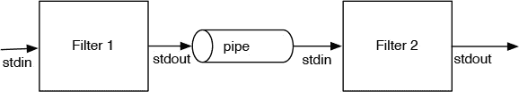

**图 8.1 通过管道连接的两个 Unix 过滤器**

然而，Unix 过滤器操作的数据是字符，输入时需要解析为有效单元，并在流水线的每一步从内部表示重新。此外，通信是通过重量级的进程间通信进行的。第 10 章中的示例 10.1 是简单的 Unix 过滤器，它将读取的每行首字母大写。它看起来比需要的复杂一些，因为它规避了缓冲和提取行的库函数，说明了从字节流中解析有效结构的问题——这是 Unix 风格过滤器的基本问题。[示例 8.1 利用缓冲和处理行的内置库，使得代码简单得多，且速度比示例 10.1 快约 250 倍。

**示例 8.1 使用行式 I/O 的大写过滤器**

点击此处查看代码


集成字节流或文本行以外的数据对象类型，需要设计一种字节序列化格式，以及用于在这些对象与字节流之间进行解析和序列化的库。传递对象指针似乎更简单，特别是对于复杂的、层次分明的或大型的数据结构。是如此。此外，虽然过滤器可以通过组合来重用，但不支持对现有过滤器进行特化处理以实现略有不同的功能。

## 面对象过滤器

跳出 Unix 实现的细节，我们可以发现管道和过滤器架构风格的根本特征是其接口的统一性，以及将结果转发给目标而不是返回给调用者。我们可以使用对象作为过滤器，并将对象作为过滤器之间交换的数据，来实现相同或非常相似的效果。`FilterStreams` 将这两个元素（管道和过滤器）简化为单个元素——`FilterStream` 对象。图 8.2 展示了 `FilterStream` 的结构，它包含一个 `writeObject:` 方法和一个 `target` 实例变量，结果会被累积其中，或者它指向另一个 `FilterStream`。

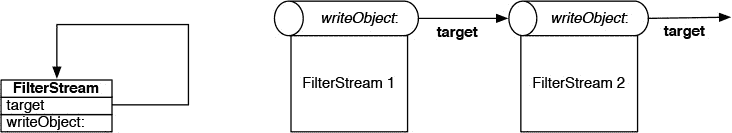

**图 8.2** FilterStreams

示例 8.2 显示了“空” `FilterStream` 的 Objective-C 代码，它只是将输入原封地传递给它的 `target` 过滤器，类似于 Unix 的 `cat` 命令。（示例省略了模版代码，如访问器、`dealloc` 和初始化方法。）

**示例 8.2 Null Filterstream**

点击此处查看代码图像

* * *

```objc
@protocol Streaming

-(void)writeObject:anObject;

@end

@interface MPWFilterStream : NSObject<Streaming>

{
  id <Streaming> target;
}

@end

@implementation MPWFilterStream

-(void)writeObject:anObject
{
  [target writeObject:anObject];
}

@end
```

* * *

空过滤器当然没意思，但它通过覆盖 `writeObject:` 方法并进行实际处理，为那些执行实际功能的过滤器奠定了基础。

## DescriptionStream

将 `description` 重构为 `FilterStream` 会得到一个 `DescriptionStream`，它接受任意对象作为其 `writeObject:` 方法的参数，并将这些对象的描述写入其目标。该规范的最简单实现是直接发送 `description` 消息，如示例 8.3 所示，但这没什么用，因为它并没有实际上流式输出结果。

**示例 8.3 简单但低效的 DescriptionStream**

点击此处查看代码图像

* * *

```objc
@interface MPWDescriptionStream : MPWFilterStream

@end

@implementation MPWDescriptionStream

-(void)writeObject:anObject
{
  [target writeObject:[anObject description]];
}

@end
```

* * *

为了真正获得我们想要的流式行为，我们至少需要区分数组和其他对象，拆分数组并增量地写入它们，如示例 8.4 所示。`writeObject:` 方法检查参数是否为 `NSArray`，如果是，它会用圆括号括起来并用逗号分隔来描述单个元素。数组单个元素的描述通过将它们写入流本身来递归处理。

**示例 8.4 带有用例分析的 DescriptionStream**

点击此处查看代码图像

* * *

```objc
-(void)writeObject:anObject
{
  if ( [anObject isKindOfClass:[NSArray class]] ) {
      BOOL first=YES;
      [target writeObject:@"( "];
      for ( id content in anObject ) {
        if ( !first) {
          [target writeObject:@", "];
        } else {
          first=NO;
        }
        [self writeObject:content];
      }
      [target writeObject:@") "];
  } else {
    [target writeObject:[anObject description]];
  }
}
```

* * *

像示例 8.4 那样让过滤器自自包含是符合 Unix 传统的，但用例分析是一种代码气味（code smell），渴望一种更面向对象的解决方案。示例 8.5 没有再检查相关类，而是使用*双重分发*（double dispatch）将问题抛回给对象，同时使用消息名 `describeOn:` 编码流的类型。此外，流使其变得可用。

**示例 8.5 带有双重分发的 DescriptionStream**

点击此处查看代码图像

* * *

```objc
@implementation MPWFilterStream

-(void)writeObject:anObject
{
  [target writeObject:anObject];
}

@end

@implementation MPWDescriptionStream

-(void)writeObject:anObject
{
  [target writeObject:[anObject description]];
}

@end
```


每个对象都通过代表流接口的 `writeObject:` 消息写入流中。然后，流会通过 `writeOnStream:` 消息请求对象写入自身，而对象则通过向流发送一个编码其类信息的消息来响应（参见图 8.3）。虽然这看起来有很多消息，但请记住，与分配临时内存以及解包/打包中间结果相比，消息的开销相对廉的。

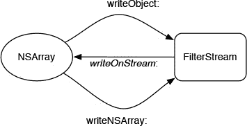

**图 8.3** FilterStream 与写入它的 `NSArray` 交互

现在 `NSMutableString` 隐藏在 `DescriptionStream` 的 `target` 之后，因此我们实际上可以将其替换为直接输出到 `stdout`、`stderr` 或文件的对象，而不是在输出之前在内存中累积整个描述。这使得描述的内存消耗实际上变为常数，即 `O(1)`，从原始描述方法的 `O(n^(2))` 以及改进后 `describeOn:` 的 `O(n)` 降了下来。

2. [`github.com/mpw/MPWFoundation`](http://github.com/mpw/MPWFoundation)

### 消除 `description` 中的无限递归

通过与对象图交互以生成描述的流对象，我们现在有了一个可以保存足够的状态来捕捉数据结构中的无限递归——例如示例 7.4 中相互递归的 `NSArray` 对象。

当我们遇到一个正在描述的对象时，我们不想再次描述它。因此，为了避免这种情况，我们需要跟踪当前正在描述的对象，并在再次遇到它时退出。示例 8.7 中的 `MPWDescriptionStream` 拥有一个 `NSMapTable` 来跟踪正在描述中的对象，并接管了之前作为 `describeOn:` 直接参数的 `NSMutableString`。在示例 8.8 中定义的 `writeObject` 方法实现了上述策略：首先将对象放入表中，如果它不在表中则描述它，最后再次将其移除。如果对象在步骤 2 中已在表中，我们只写入一个伪描述。

**示例 8.7 Description Stream 定义**

点击此此处查看代码图片

* * *

```
#import "MPWFilterStream.h"

@interface MPWDescriptionStream : MPWFilterStream

{

  NSMapTable *alreadySeen;
}

@property (nonatomic,retain) NSMapTable *alreadySeen;

-(void)writeObject:anObject;

-(void)writeArray:(NSArray *)anArray;

-(void)describeObject:anObject;

@end
```

* * *

**示例 8.8 Description Stream 实现**

点击此此处查看代码图片

* * *

```
@implementation MPWDescriptionStream

#define OPAQUEPTR   NSPointerFunctionsOpaquePersonality

-(instancetype)init
{
  id table=[NSMapTable mapTableWithKeyOptions:OPAQUEPTR
                                       valueOptions:OPAQUEPTR];
  self=[super init];
  [self setAlreadySeen:table];
  return self;
}

-(void)writeObject:anObject
{
  if ( [alreadySeen objectForKey:anObject] ) {
    [self appendDescriptionFormat:@"<already saw: %p>",anObject];
  } else {
    [alreadySeen setObject:anObject forKey:anObject];
    [super writeObject:anObject];
    [alreadySeen removeObjectForKey:anObject];
  }
}

// ... 其续如前

@end
```

* * *

上述移除已描述对象的程序避免了无限递归。更通地说，如果你不想在输出中重复对象，只需将已描述的对象保留在表中即可。此时，你实际上构建了一个对象图序列化器，以及一个潜在强引用循环的检测器！

加入示例 8.9 中的胶接代码，运行上一章的示例 7.4 将不再崩溃，而是输出类似 `a1: ( ( <already saw: 0x7fa0fb40a880> ) )` 的内容。该示例显然是不完整的；例如，它至少需要一个 `writeDictionary` 方法，而且理想所有对象都实现 `describeOn:` 而不是 `description`，以便它们也能获得这种保护。

**示例 8.9 Description Stream 定义**

点击此此处查看代码图片

* * *

```
@implementation NSObject

-(void)describeOn:(MPWDescriptionStream *)aStream
{
  [aStream describeObject:self];
}

-(NSString*)fastDescription
{
  MPWDescriptionStream *s=[MPWDescriptionStream stream];
  [s writeObject:self];
  return s;
}

@end

@implementation NSArray(describeOn)

-(void)describeOn:(MPWDescriptionStream *)aStream
{
  [aStream writeArray:self];
}

@end
```

### 流的层次结构

移除已描述对象的程序不再产生无限递归。更通地说，如果你不想在输出中重复对象，只需将已描述的对象保留在表中。此时，你实际上构建了一个对象图序列化器，以及一个潜在强引用循环的检测器！

加入示例 8.9 中的胶接代码，运行上一章的示例 7.4 将不再崩溃，而是输出类似 `a1: ( ( <already saw: 0x7fa0fb40a880> ) )` 的内容。该示例显然是不完整的；例如，它至少需要一个 `writeDictionary` 方法，而且理想所有对象都实现 `describeOn:` 而不是 `description`，以便它们也能获得这种保护。

## 总结

在本章中，我们查看了将上一章的流方法扩展为整个实现*管道与过滤器*风格的组件库。通过这个库，流被集成到了底层，使得以既内存高效又易于异步的方式实现计算变得简单。

Swift

在 WWDC 2014 上引起轰动并推出，它被称为“没有 C 的 Objective-C”。这是一个有趣的口号，考虑到 Objective-C 是通过添加大部分 Smalltalk 创建的（9.1）。


根据我在高中学习的代数代规则，从方程的两边同时减去 C（方程 9.2）并不会 Swift；事实上，Swift 看起来与 C# 或 C++ 的关系比与 Smalltalk 或 Objective-C 要密切得多。

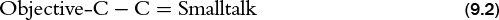

抛开细小的营销问题不谈，Swift 取得了巨大的成功，许多文章、书籍和会议专门探讨这一主题。

## Swift 性能：声称

从一开始，Apple 就在大力推广 Swift 的性能，甚至体现在它的名字里：Swift。在平台现状报告（Platforms State of the Union）中，新语言的性能是一个关注焦点，例如图 9.1 所示的性能对比。

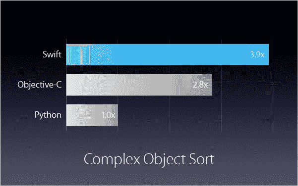

**图 9.1** WWDC 2014 报告幻灯片，将 Swift 与 Python 进行对比

这是一个令人印象的展示，Swift 的速度是……的 3.9 倍……到底是什么？Python。你可能会想 Python 在这个对比中做了什么，考虑到它是一种解释型脚本语言，完全不是为性能密集型工作设计的，而且与 OS X 和 iOS 开发实际上没有关系。

事实证明，当你只对比 Objective-C 和 Swift 两列时，2.6 对 3.9 仅仅是 1.4 倍的差异；而当你画出*那样*并将颜色设为一致时（如图 9.2 所示），这并不是一张特别令人深刻的幻灯片。

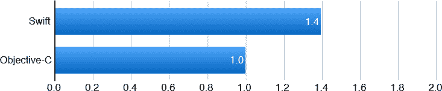

**图 9.2** 排除 Python

将 Python 引入对比只是让 Swift 的数字看起来更令人深刻；3.9 听起来比 1.4 好得多。即使在开发者中，也很少有人会花精力去获取更相关的性的 Objective-C vs. Swift 数值，尤其是在主旨演讲中幻灯片飞速掠过时。

另一个可能让你感到困惑的事情是这些数字到底有多*糟糕*。毕竟，Python 是一种解释型脚本语言，我见过的绝多数对比中，它的速度甚至比 Ruby 慢 2 倍左右。

在引入两年后，Apple 主站的 Swift 语言部分（参见图 9.3

**图 9.3** [`apple.com/swift`](http://apple.com/swift) 上的性能声称

Python 仍然被用作对比这一事实并没有让人产生信心，“高达”这种措辞也是如此。虽然比以前好，但这些数字仍然很奇怪，而且相当糟糕。作为一种编译型语言，只比 Python 快 8 倍左右就令人失望了，而 Objective-C 代码只比 Python 代码快 2.5 倍左右这简直令人不安。

尽管仔细观察后并不特别有服力，但 Apple 对 Swift 的营销非常有效。Swift 非常、嗯，*快速*的这一想法现在已成为 Apple 开发者社区公认的事实。

## 语言特性

虽然 Apple 没有给我们提供任何关于 Swift 性能的坚实证据，但它给了我们获得惊人 Swift 性能的理由。

* Swift 的设计比 Objective-C 静态得多，这意味着在编译时有更多信息可供编译器在优化中使用。
* 具体来说，动态分发（dynamic dispatch）被大幅减少，大多数“原生”Swift 方法都是被静态分发的。

Objective-C 的动态分发是编译器感知的绝对障碍，这一直是编译器和运行时团队的心头之刺。即时编译（JIT）编译器可以在运行时解决这个问题，但有许多理由不应该依赖 JIT 技术来实现性能。^(1)

1。 参见 *Jitterdämmerung* ([`blog.metaobject.com/2015/10/jitterdammerung.html`](http://blog.metaobject.com/2015/10/jitterdammerung.html))。

* 更多地使用结构体使用值语义（参见第 5 章中的“栈分配”部分），本应让我们摆脱堆分配和引用计数的开销，尤其是 ARC（参见第 7 章中的“引用计数”部分），而且在 Swift 中处理引用确实非常昂贵，比 Objective-C 贵得多。
* 原始类型和对象的集成得更紧密，因此 Foundation 的 `NSArray` 只能包含对象引用，而 Swift 的 `Array` 可以包含原始类型、结构体或对象引用。原始类型数字在在对象上下文中使用时，很容易进行装箱和拆箱（通常是自动的）。
* 泛型允许应用特化，例如，数组的泛型 `sort` 方法可以通过整数比较函数进行特化，从而产生一个优化的整数排序函数，而无需通过函数指针或消息传递进行间接调用。

这一切都是好东西，无疑为编译器的优化提供了机会。拥有更统一的语法而不是两个拼凑在一起并用胶带粘在一起的系统也是受欢迎的。

然而，所有这些机制只是*可能*带来更好的性能；无法保证它们*真的*可以，而且这些机制在 Objective-C 中也可用。例如，Objective-C 对 `NSPoint`、`CGPoint`、`NSRect`、`NSRange` 等所有原始类型大量使用了值语义。

让它们的使用更方便本身并不是坏事，但实际上并没有产生太大作用，因为 Apple 建议并期望大多数建模使用类：

“在所有其他情况下，定义一个类，并创建该类的实例进行管理和引用传递。实践中，这意味着大多数数据结构应该是类，而不是结构体。”

Apple Inc., 2014. Swift 编程语言（Swift 3）。iBooks.

这种使用类的建议是明智的，因为我们知道这种微优化对 97% 或更多的代码并不重要。然而，这与 Apple 对 Swift 的性能建议直接冲突，后者建议除非有极力的理由，否则应极力使用结构体。

问题在于，这两个建议都是正确的，这种内在的冲突违背了过去 40 年左右收集的关于性能调的智慧：先进行领域建模，然后再进行针对性的优化。在 Swift 中，你需要在应用程序的建模阶段就做出这种性能选择。

Objective-C 也有且仍然存在这个问题，但正如前面的章节所示，存在一些机制允许开发者应用针对性的优化以获得更好的性能，例如 IMP 缓存、对象缓存或使用基础的 C 数据类型（如 `char*` 代替 `String`）。这些机制经常让你在能够享用建模蛋糕的同时，又能享用性能点心，但在 Swift 中，这些机制要么被削弱要么被完全取消。

我将这种方法称为*面向编译器的开发*（COD），因为因为它似乎更关注于让编译器方便，而不是让开发者方便。


这与我们在第 1 章的“混合模式的威力”节中讨论过的由 Objective-C 所代表的混合模型非常不同：编译器大部分情况下不干预，语言提供了简单且易懂的抽象。发现热点并使用提供的许多工具对其进行修复，是开发者的工作。

## 基准测试

这是一个简短的章节。

虽然 Apple 提供了幻灯片和标题性的对比数据，但它并没有提供这些数据所依据的基准测试，甚至没有提供详细结果。对于提供这些基准测试源代码的请求遭到了沉默。

简而言之，Apple 没有针对 Swift 的性能提供任何可用的实证数据。

## 评估 Swift 性能

由于 Apple 对 Swift 的实际性能特征并不透明，我们必须自己去观察，因为在至少了解这些特征在实践中如何的情况下进行调优是没有意义的。在接下来，我将对 Swift 性能的现状进行概述和分析，并观察所推崇的、以编译器为核心的优化模型。

### 基本性能特征

我们已经在第 1 章中看到了一些基本的 Swift 性能特征，例如示例 1.5 和 1.6 中的整数求和代码。

使用原始数据类型和基础控制流进行计算时的性能与基础 Objective-C 并不太相似，大约有 50% 的性能损耗，当涉及对象时，损耗会增加到大约 300%。为了找到这种损耗的原因，我编译了示例 1.5（整数求和）中的原始版本，然后使用 `otool -Vt` 检查了生成的机器码。结果如示例 9.1 所示。

**示例 9.1 Swift 求和的汇编代码**

点击此处查看代码图像

* * *

```
0000000100000d5f cmpq     $0x3b9aca00, -0x8(%rbp) ## imm = 0x3B9ACA00
0000000100000d67 jg      0x100000db0
0000000100000d69 movq     -0x8(%rbp), %rax
0000000100000d6d addq     __Tv10swiftbench1aSi(%rip), %rax
0000000100000d74 seto     %cl
0000000100000d77 movq     %rax, -0x18(%rbp)
0000000100000d7b movb     %cl, -0x19(%rbp)
0000000100000d7e jo       0x100000eda
0000000100000d84 movq     -0x18(%rbp), %rax
0000000100000d88 movq     %rax, __Tv10swiftbench1aSi(%rip)
0000000100000d8f movq     -0x8(%rbp), %rcx
0000000100000d93 incq     %rcx
0000000100000d96 seto     %dl
0000000100000d99 movq     %rcx, -0x28(%rbp)
0000000100000d9d movb     %dl, -0x29(%rbp)
0000000100000da0 jo       0x100000edc
0000000100000da6 movq     -0x28(%rbp), %rax
0000000100000daa movq     %rax, -0x8(%rbp)
0000000100000dae jmp     0x100000d5f
```

* * *

作为参考，相应的 Objective-C 示例的汇编输出在示例 9.2 所示。我必须承认，我本以为除了溢出检查之外，代码比实际结果要相似得多。

**示例 9.2 Objective-C 的汇编代码**

点击此处查看代码图像

* * *

```
0000000100000f16 cmpl     $0x3b9aca00, -0x8(%rbp) ## imm = 0x3B9ACA00
0000000100000f1d jg      0x10000f45
0000000100000f23 movslq -0x8(%rbp), %rax
0000000100000f27 addq     _a(%rip), %rax
0000000100000f2e movq     %rax, _a(%rip)
0000000100000f35 movl     -0x8(%rbp), %eax
0000000100000f38 addl     $0x1, %eax
0000000100000f3d movl     %eax, -0x8(%rbp)
0000000100000f40 jmp     0x10000f16
```

* * *


## 9.5 使用 `MPWRealArray` 的 Objective-C 驱动程序

点击此处查看代码图像

```objc
#import <MPWFoundation/MPWRealArray.h>

int main(int argc, char *argv[])

{

  MPWRealArray *array=[MPWRealArray start:1 end:10000 step:1.0];
  float sum=0;
  for (int i=0,max=atoi(argv[1]); i<=max; i++) {
    sum+=[array sum];
  }
  NSLog(@"sum: %g",sum);
}
```

`reduce:` 方法接收一个带有两个参数并返回单个值的块；而 `sum` 方法使用一个仅相加两个参数的块。结果如表 9.2 所示。

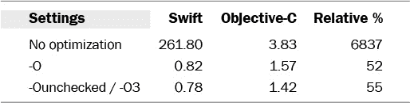

### 表 9.2 通过 reduce 和 blocks 进行数组求和

如往常，未优化的 Swift 性能极其恶劣，比未优化的 Objective-C 慢 68 倍，比优化的 Swift 慢 322 倍。在优化情况下，Swift 表现良好；示例代码比比我们在这里使用的 Objective-C 代码快约 2 倍。

原因相当清楚：Objective-C 代码必须对每一对元素调用一次参数块，而这种函数调用的开销远大于实际 `+` 运算符的代价。

在优化情况下，Swift 会进行泛型特化，将 `reduce` 函数与 `+` 运算符结合，创建一个直接相加元素而没有任何额外函数调用的单一函数。

然而，示例 9.4 中基于块的代码并不是 `MPWRealArray` 中的实际代码，因为显而易见它会很慢；我只是为了这一章添加了它，以检查性能如何。

这段代码运行缓慢的原因在于在 Objective-C 中，`+` 运算符不是一类对象，这意味着除其他外，你不能将其直接作为参数传递给函数或方法。

在 Objective-C 中解决此问题的方法是使用预处理器。示例 9.6 将 `REDUCE` 定义为宏，或者更准确地说是 `REDUCE_METHOD`，它根据特定运算符的归约创建一个方法。

### 示例 9.6 作为 C 宏的 Reduce

点击此处查看代码图像

```objc
#define REDUCE_METHOD( name, operator )\n-(float)name\n{\nn    float *my_reals=[self reals],result=my_reals[0];\n    for ( long i=1,max=[self count];i<max;i++) {\nn        result=result operator my_reals[i];\n    }\n    return result;\n}\nnREDUCE_METHOD( product, * )\nREDUCE_METHOD( differences, - )\nREDUCE_METHOD( sum, + )
```

Swift 没有预处理器，因此实现这种泛型操作的方法是像我们之前那样使用高阶函数。这种方法有许多优点，但你无法控制生成的代码，无法无法优化器如何对其进行转换。使用示例 9.6 中的宏，生成的代码是非常直而易见的（参见示例 9.7）。

### 示例 9.7 为 `sum` 展开的 Reduce 宏

点击此处查看代码图像

```objc
-(float)sum
{
    float *my_reals = [self reals], result = my_reals[0];
    for (long i = 1, max = [self count]; i < max; i++) {
        result = result + my_reals[i];
    }
    return result;
}
```

结果如表 9.3 所示，Swift 的数字只是简单的复制，因为没有等效项。我尝试过手动展开 `reduce()` 函数，但对结果没有影响。

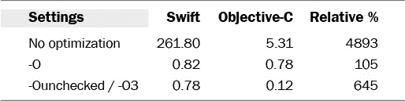

### 表 9.3 通过宏进行数组求和

在没有任何优化的情况下，基于宏的代码实际上比基于块的代码小一点，但仍比未优化的 Swift 快约 50 倍。在基础优化下，Swift 和 Objective-C 不分上下秋；在激进优化下，基于宏的代码现在比同等优化级别的 Swift 快 6 倍以上，比未优化的 Swift 快 2,000 倍。

然而，这仍然并不理想。对于针对各种数值类型（包括 `float` 数字）的优化的批量操作，Apple 提供了 Accelerate 框架，其 `vDSP_sve()` 函数用于对浮点指针数组进行求和。示例 9.8 展示了如何为 `Array[Float]` 扩展向量化求和方法。

### 示例 9.8 使用 Swift 数组的向量化求和

点击此处查看代码图像

```swift
import Accelerate

extension Collection where Iterator.Element == Float {
  func vecsum()->Float {
    var sum:Float=0
    vDSP_sve(self as! [Float], 1, &sum, UInt(self.count))
    return sum
  }
}
```

这是我找到实现所需效果的最简单方法。奇怪的是，无法直接扩展 `Array[Float]`；扩展必须在 `Collection` 上带有 `Float` 类型约束，然后在方法内部 `self` 必须强制转换为 `[Float]`。如果该转换失败，程序将崩溃。

示例 9.9 中的 Objective-C 代码示例 9.9 中的 Objective-C 代码是 `MPWRealArray` 类的一部分，看起来更简单。它传递了 `floatStart` 实例变量（指向浮点值数组）以及 `count` 实例变量（持有元素数量）。

### 示例 9.9 使用 MPWRealArray 的向量化求和

点击此处查看代码图像

```objc
@import Accelerate;

-(float)vecsum
{
    float theSum=0;
    vDSP_sve( floatStart, 1, &theSum, count );
    return theSum;
}
```

### 示例 9.10 从 Objective-C 脚本执行向量化求和

点击此处查看代码图像

```sttalk
#!/usr/local/bin/stsh

#-float>sum:<int>iterations

array := MPWRealArray start:1.0 end:1000000 step:1.0.

sum:=0.

1 to:iterations do:[ sum := sum + array vecsum ].

sum


```


简而言之，Swift 代码引入了大量的抽象和间接层——至于这些性能分析结果看起来完全没有反映出示例 9.3 中的代码，就像一辆被减速了 1000 倍的汽车看起来更像是一张沙发而不是汽车。

我们试图运行的代码被编译器插入的账目工作完全淹没了，无论从可见代码还是执行时间来看。单单一次 `swift_bridgeObjectRetain` 耗费的时间就是我们基于 `MPWRealArray` 的代码整个运行时间的数倍，而且有很多处这样的操作。而且，当我们处理的纯粹是原始类型数组（可能还有一个闭包）时，起初为什么要在这个程序的内部循环中保留和释放对象呢？

在这种基础性能水平下，“Swift 是为速度而设计的”这一说法有点让人难以信服：所使用的抽象造成了巨大的性能开销，并且需要一个始终 100% 完美的优化器才能消除它们。我真的指的是 100%。正如我们在向量化代码中所看到的，当未优化的代码变慢了 2000 倍时，如果优化器的效率“只有”99.9% 而不是 100% 完美，意味着我们仍然会变慢 2 倍！

对于字典，我尝试了一个我认为对 Swift 来说是大胜的案例：一个从 `String` 映射到 `Int` 的字典，两者都是 Swift 值类型（尽管 `String` 的内容由隐藏的引用类型支持），后者是机器原始类型；与从 `NSString` 对象映射到 `NSNumber` 对象的 `NSDictionary` 相比，后者都是缓慢的引用类型。

Swift 代码在示例 9.11 中给出。它根据一组固定的键和对应的顺序值创建字典。然后它从原始键列表中选择一个特定键，获取 1000 万次其值并对这些值进行求和。

**示例 9.11 在 Swift 中测试字典访问**

点击此处查看代码图像

***

```swift
func getBench( n:Int, dict:[String:Int], key:String ) -> Int {
  var sum = 0
  for _ in 0..<n {
    if let value = dict[key] {
      sum += value
    }
  }
  return sum
}

let which = Int(CommandLine.arguments[1])!
let keys = ["ABC", "DU", "ASDASD", "24323423423", "DUasdfasdf",
            "HZSasdfasdfdasdfasdf", "ASDasdfasdfdasdfasdfd",
            "ASDASasdfD", "asdff24323423423",
            "1111111111111111111222222222222222222", "1"]
let s = keys[which]
var dict = [String:Int]()
var i:Int

for i in 0..<keys.count {
  dict[keys[i]]=i
}
let sum = getBench( n:10_000_000, dict: dict, key:s )
print("sum: \(sum)")
```

***

要使用的键的索引通过命令行传递。如果没有提供，程序将因为对参数使用了强制解包（force-unwrapping）而崩溃。像往常一样，结果被打印出来，这样优化器就没有理由消除所有代码。尽管在理论上它可以判断出循环是不必要的，但目前基准测试仍然有效。

在示例 9.12 中的 Objective-C 版本是 Swift 代码的直译。

**示例 9.12 在 Objective-C 中测试字典访问**

点击此处查看代码图像

***

```objectivec
#import <Foundation/Foundation.h>

long getBench( int iterations, NSDictionary *dict , NSString *key ) {
  long sum = 0;
  for (int i=0;i<iterations;i++) {
    id value=dict[key];
    if ( value ) {
      sum += [value intValue];
    }
  }
  return sum;
}

int main( int argc, char *argv[] ) {
  int which=atoi(argv[1]);
  NSArray * keys=@[ @"ABC" ,   @"DU",  @"ASDASD",
                   @"24323423423"  ,@"DUasdfasdf",
                   @"HZSasdfasdfdasdfasdf",
                   @"ASDasdfasdfdasdfasdfd" , @"ASDASasdfD",
                   @"asdff24323423423",
                   @"1111111111111111111222222222222222222", "1"];
  NSString *s=keys[which];
  NSMutableDictionary * dict=[NSMutableDictionary dictionary];

  for (int i=0;i<keys.count;i++) {
    dict[keys[i]]=(id)i;
  }
  long sum = getBench( 10000000, dict, s );
  printf("sum: %ld\n", sum);
  return 0;
}
```

### 较复杂的示例

要使用的键的索引通过命令行传递。如果没有提供，程序将因为对参数使用了强制解包而崩溃。像往常一样，结果被打印出来，这样优化器就没有理由消除所有代码。尽管在理论上它可以判断出循环是不必要的，但目前基准测试仍然有效。

示例 9.12 中的 Objective-C 版本是 Swift 代码的直译。

#### nginx HTTP 解析器

其中一个这样的项目是前 Apple 员工 Helge Hess 对流行的 nginx 服务器进行的移植。尽管性能并不是该移植的主要目的，但我对 Swift 的性能与原始版本的对比如何感到好奇。

#### Freddy JSON 解析器

另一个真实世界的例子是 Big Nerd Ranch 出用纯 Swift 编写的 *Freddy* JSON 解析器。与市面上大多数 Swift JSON 解析器不同，它不是对 `NSJSONSerialization` 的封装，给出的理由是性能：在 `NSJSONSerialization` 返回给 Swift 的 `AnyType` 上进行切换似乎会产生 25 倍的性能开销。


再次，`NSJSONSerialization` 虽然是 Apple 提供的最快的序列化机制之一（参见第 12 章中的“序列化摘要”部分），但它比第 4 章中的 `MAX` 等方法慢了几倍，后者避免了“通用中间表示”的陷阱（参见第 3 章中“陷阱：通用（中间）表示”部分）。

## 图像处理

在过去的几年里，David Owens II 一直在尝试让 Swift 中的图像处理代码达到合理的性能。4。其基本思想是定义一个包含 `red`、`green`、`blue` 和 `alpha` 分量的 `Pixel` 结构体，并对一张 960×540 像素的图像进行一些像素处理。

4. [`github.com/owensd/swift-perf`](https://github.com/owensd/swift-perf)

对于 C 语言，执行时间从未优化的构建的每次操作 30 毫秒到设置 `-Ofast` 后的 2.3 毫秒不等。对于 Swift 来说，情况更为复杂。保持 `Pixel` 抽象并将这些像素组织在 `Array` 集合中，执行时间从未优化构建的 2,400 毫秒到优化（`-O`）构建的 18 毫秒不等。要获得更好的性能需要：(1) 放弃 `Pixel` 结构，转而直接将像素建模为无符号整数；(2) 放弃 `Array` 抽象，转而使用 `withUnsafeMutablePointer` 构造使用 `UnsafeMutablePointer`；(3) 使用 `-Ounchecked` 关闭所有编译器检查；最后 (4) 添加向量指令（SIMD）。

在落实了这些措施后，Swift 实现了 3.04 毫秒的时间，仅比 C 慢 30%，这是一个相当可观的结果。（由于某种原因，显式使用 SIMD 指令反而让这段 C 代码变慢了，所以也许代码自动向量化得很好，或者 C 侧还有进一步改进空间。）请注意，这一切都是必不可少的；例如，仅使用 `UnsafeMutablePointer` 而不使用 `withUnsafeMutablePointer` 就会慢 2 倍。在 Swift 代码中保留 `struct Pixel` 抽象，对于 18 毫秒左右的时间始终会有至少 6 倍的损失。

这里的讽刺之处在于，Swift 本应该允许我们编写更多更面向领域、更少针对机器的代码，并让编译器穿透这些抽象，但实际上情况恰恰相反。在 Swift 中，不仅必须放弃 `Array` 抽象而使用基本上 C 指 指针，甚至 C 处理得相当好的 `Pixel` 抽象也必须放弃，转而将像素建模为整数。

当然，始终可以将繁重的工作交给 Objective-C 代码并从 Swift 对其进行桥接。

## 观察

最后，基准测试游戏(5) 显示 Swift 程序的基准测试始终比等效 C 程序慢 5 到 30 倍。为了确保这些结果不是异常值，我通过对比 Swift 和 Java 进行了交叉检查。在这里，Swift 通常比 Java 慢 5 倍，范围在 20% 到 8 倍之间。

5. [`benchmarksgame.alioth.debian.org/u64q/swift.html`](http://benchmarksgame.alioth.debian.org/u64q/swift.html)

尽管这些结果中的任何一个都容易被视为异常值而忽略，但这种模式实在太一致了，以至于无法解释：使用“合理”的代码慢 3 到 10 倍。需要英雄式的手动优化和一点运气，才能将差距缩小到慢 3 倍到几乎平齐之间，具体取决于相关代码的类型。随着 Swift 的演进如此迅速，在本书出版时，所有这些具体的耗时可能都过时了，但再次，整体模式似乎很难打破。

相反，当我看到 Swift 在性能上击败 C/Objective-C 的声称时，这些声称通常没有数据支持，要么完全没有理由，要么用“嗯，它应该是的，因为，呃，原因”来辩解。在少数有数据的情况下，数据充其可疑，最坏的情况下完全虚假：非健壮的基准测试被优化掉、对原始整数的操作与对象的操作进行比较，或者未优化但易于优化的 C 代码与高度优化的 Swift 代码进行比较。

我看到的唯一一个合理的案例是，Swift 的编译时间确实比 C 慢，这在某些情况下确实是令人惊讶的。

## 编译时间

Swift 极度依赖编译器，比 Objective-C 多得多，并且类似于 C++，在编译时间上比 C 或 Objective-C 慢大约 2 倍。这反映在之前查看的 表 9.6 的整数求和中。

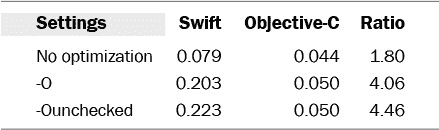

**表 9.6 整数求和 Swift 和 C 编译时间**

正如性能的其他方面一样，C 和 Objective-C 编译器并不是编译速度的基准。基于头文件的包含模块化对任何 C 基语言都是一个巨大的挑战，尽管预编译头文件或模块有很大帮助。像 Go 这样的语言专门设计用于避免这类问题可以编译得更快，而 Smalltalk 这样的开发系统编译方法是瞬时的。

正如 Swift 性能的许多方面一样，因此其性能水平无法达到更不用超过 C 和 Objective-C 设定的低标准。一旦你开始引入更复杂的语言特性，如泛型、类型推断，性能就会受到进一步影响。

## 类型推断

类型推断是一个减少杂质和开发者开销的棒特性；它允许我们编写类似 `let a = ["hello"]` 的代码，并让编译器推导出 `a` 是字符串数组。然而，像大多数好事一样，它是有代价的。首先，它可能会产生意想不到的结果，特别是因为在 Swift 中双方都可能是未定义的（左侧完全未定义，右侧多态）。在这些情况下，推导出最合适的类型在本质和计算上都是困难的。

在大学期间，我们通过一种名为 Miranda 的函数式语言接触了类型推断。只要它能推导出类型，它是非常的。但当它失败时，错误信息既长又完全晦涩。


性能也是一个问题，因为类型推断本质上是昂贵的，许多看起来看似无害的情况可能会导致指数级的运行时间。例如，示例 9.13 中的简单声明在 Swift 2.x 中对于 `n` 而言是指数级的，当 `n` = 20 时，时间达到了半小时。

**示例 9.13 指数级集合字面量**

点击此处查看代码图像

```
let a = [  "level1": [  [ 1 ],  [ 2 ],  ... , [ n ]]
```

这本身并不是 Bug，但它表明了类型推断算法固有的复杂性。例如，Scala` 的创始人 Martin Odersky 解释说，`Scala` 名臭昭知的缓慢编译时间很大程度上归因于类型推断。

这不是一个新问题。我记得读过关于使用编译时类型推断来改进 `Self` 这种动态原型语言性能的早期尝试。运行时间非常糟糕，小型表达式就需要几分钟，因此 `Self` 团队不得不转向另一种方法。他们不再在编译时确定类型，而是在运行时记录类型，实际上他们已经在他们的*多态内联缓存*（polymorphic inline caches）中这样做了。通过使用运行时收集的类型信息，他们优化了代码，这种技术直接通向今天先进的 JIT，例如 `Java` 的 HotSpot。

幸运的是，通常可以对特定的极端糟糕情况进行特例处理，这个特定问题在 Swift 3 中被“修复”了：该特定构造的编译时间现在对于 `n` 是“仅有”二次方的，因此你需要 `n` = 200 才能达到半分钟的编译时间。

截至本文编写，另一个尚未修复的问题如 示例 9.14 所示。这将在大约 3 秒后因编译器错误终止，提示表达式复杂到无法求解。

**示例 9.14 表达式复杂到无法在合理时间内求解**

点击此处查看代码图像

```
let a = String(1) + String(2) + String(3) + String(4)
```

事实上，这个问题似乎更通用，并不依赖于类型推断必须为变量推断类型，也不依赖于 `String` 的参与。在 示例 9.15 中，所有类型似乎都显式写出了，但在大约 5 秒后得到了相同的编译器错误。

**示例 9.15 表达式仍然复杂到无法在合理时间内求解**

点击此处查看代码图像

```
let a:[Int] = [1] + [2] + [3] + [4] + [5] + [6]
```

将组件数量减少到 5 个可以让表达式在 2.7 秒内编译。将其减少到 4 个会将编译时间缩短到 0.26 秒。

### 泛型特化 (Generics Specialization)

在本章的“观察”部分中，我们看到 Swift 能够真正超越 C 语言易实现性能的特性之一是泛型特化（源自 C++ 模板实例化）。参数化程序不是通过消息或函数指针在运行时调度到特化程序，而是在编译时进行特化的，生成一个不包含外部调用或消息发送的全新函数。示例 9.16 说明了这个问题。

**示例 9.16 特化数组排序**

点击此处查看代码图像

```
let a           = [54, 32, 1, 2, 4, 5]
let b:[Float]  = [54, 32, 1, 2, 4, 5, 23]
let c:[Double] = [74, 32 ,1 ,2 ,4, 5, 23]
let d:[String] = ["Hello", "World"]
let e           = [[ "hello": 1 ], [ "world": 2]]
print(a.sorted())
print(b.sorted())
print(c.sorted())
print(d.sorted())
print(e.sorted( by: { ( a,b ) -> Bool in  return true }))
```

我们首先创建了五种不同内容的数组：整数、浮点数、双精度浮、字符串和字典。然后对这些每个数组进行排序。在启用优化的情况下，这会导致 Swift 编译器为每种特定的数组类型生成一个特化的泛型 `sort()` 函数特定版本。尽管 Apple 没有明说，但我推测类似的内容（尽管无疑更复杂）就是他们在 WWDC 2014 上宣传的“复杂对象排序”基准测试。

对编译时间的影响可以在 图 9.5 中看到，x 轴显示了执行的特化次数。（我注释掉了 `print(x.sorted())` 行以获得正确的特化数量。）

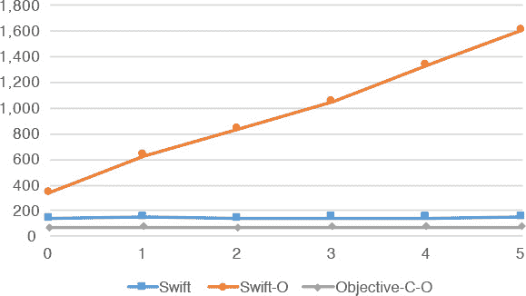

**图 9.5** 特化泛型排序程序的编译时间（单位：毫秒）

虽然 Objective-C（无论是否优化）和未优化的 Swift 无论定义和使用多少种不同类型的数组，编译时间都是恒定的的，但优化的 Swift 编译时间与必须生成的不同 `Array sort()` 方法数量呈线性关系，在我的机器上，每次特化的代价约为 250 毫秒。作为参考，Objective-C 的 `NSArray` 代码在 示例 9.17 中所示。

**示例 9.17 NSArray 排序**

点击此处查看代码图像

```
@import Foundation;

int main()
{
  NSArray* a=@[ @(54) , @(32) ,@(1) ,@(2) ,@(4) , @(5) ];
  NSArray* b=@[ @(54) , @(32) ,@(1) ,@(2) ,@(4) , @(5) , @(23) ];
  NSArray* c=@[ @(74) , @(32) ,@(1) ,@(2) ,@(4) , @(5) , @(23) ];
  NSArray* d=@[ @"Hello", @"World" ];
  NSArray* e=@[ @{"hello": @(1)}, @{"world": @(2)} ];
  NSLog(@"a: %@",a sortedArrayUsingSelector:selector(compare)]);
  NSLog(@"b: %@",b sortedArrayUsingSelector:selector(compare)]);
  NSLog(@"c: %@",c sortedArrayUsingSelector:selector(compare)]);
  NSLog(@"d: %@",d sortedArrayUsingSelector:selector(compare)]);
  NSLog(@"e: %@",e sortedArrayUsingSelector:selector(compare)]);
}
```

### 全模块优化 (Whole-Module Optimization)

当你仔细考虑时，上一节讨论的泛型特化机制是一项巨大的成就。
它跨越编译单元，从之前编译过的文件中提取定义，然后在当前编译单元中实例化该定义，应用参数并编译结果。

在 C/Objective-C/C++ 世界中，这仅仅是不可能的。访问另一个文件中定义的唯一方法是使用 `include` 将这些定义的源代码物理地包含到当前编译的单元中。被包含的文件可以包含宏定义、内联函数定义或 C++ 模板。

*全模块优化*将这一概念更进一步，完全消除了独立编译的概念。相反，所有的程序文件都会一起编译，所有的定义和使用对编译器都是可见的。

当然，这意味着编译时间（特别是对一个或几个源文件进行微小更改后的重新编译时间）现在取决于项目的总大小，而不是单个文件的大小。考虑到编译时间本身并不算理想，这对于较大的项目，在未来可能会导致现实问题。

另一方面，在整个模块重新编译时，同时考虑整个程序实际上可以加快编译时间。其原因之一是特化：如果多个文件包含特定的特化版本（例如，排序整数数组），那么全模块编译只需要创建一次特化版本，而不是为每个文件创建一次。


你可以使用编译器选项 `-Xfrontend -debug-time-function-bodies` 来检查编译时间过慢的问题。这会输出编译器编译每个函数（或方法）所需的时间。我尝试将所有 示例 9.16 的内容放入一个函数中，并在顶层只保留对该函数的调用。编译器声称该函数（文件中唯一的函数）仅花费了 17.6 ms 完成编译，尽管整个编译过程花费了 1.8 秒，其余时间（大部分时间）根本没有被计入。

这种差异的原因似乎是每个函数的耗统计是在 Swift 中间语言 (SIL) 优化通道之前运行的。可能这些优化是针对整个编译单元运行的，而不归类于特定的函数。我看到大部分时间消耗在 `-emit-silgen` 和 `-emit-sib` 阶段之间。

总而言之，我觉得 Swift 的编译时间通常是不可预测的，因为编译器不仅变幻无常，而且它可能掉入几乎任意深度的陷阱，在许多看起来无害的构造背后隐藏着二次方或指数级的开销。通常，泛型特化可能会一直非常昂贵，类型推断也是如此，特别是使用字面量时。可选类型（Optionals）似乎也很昂贵，因为类型检查路径在每个可选值处都会分裂成两个。

虽然某些特定问题几乎肯定会被解决，但编译时间问题并不是一个年轻语言实现的偶然，而是其所做设计决策的必然结果。

### 优化器导向型编程

Swift 目前运行较慢的一个原因几乎可以确定它是一个年轻语言的早期实现。情况已经有所改善，并且可能会进一步改进。然而，改进速度似乎已经放缓，我们距离达到与 Objective-C 平起仍然非常遥远，更不用说超越了。

另一个原因，在我看来是主要原因，是 Swift 的模型是我所说的`优化器导向型编程`（optimizer-oriented programming）。这种风格的基础构造与任何机器模型都非常遥远，几乎完全依赖优化器来确定这些抽象与高效机器实现之间的关系。重要的是，如果没有优化的话，生成的代码实际上是不可用的（记住汽车与沙发的区别）。

我们已经在 第 7 章 的“优化 ARC”部分中在讨论 Objective-C ARC 的性能时看到了这种方法的示例。这种以优化器为中心的性能方法的结果最多是好誉参半的：是的，优化器在大多数时候可以消除大部分性能损耗，但初始损耗是如此巨大且不可预测，以至于即使是很小的剩余也会产生显著的性能影响。

尽管结果不尽相同，Swift 仍然在加深这种方法。ARC 不再是可选的，并且引入了许多抽象，正如我们所看到的，这些抽象可能会导致三个数量级甚至更多的性能损耗！

不过这只是冰山一角。实际上，即使在使用 `-Onone` 时，也会运行优化通道。例如，正如 Chris Lattner 和 Joe Groff 在 LLVM Meetup 2015 上解释的那样，Swift 编译器会将所有局部变量分配在堆上（见图 9.6](#ch09.html_ch09fig06）。

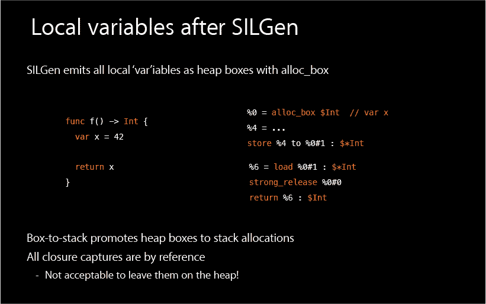

**图 9.6** 堆上的局部变量

额外的优化通道会将未被闭包捕获变量特定变量提升到栈上（随后的优化通道可以将它们提升到寄存器）。

这对于解决具有非局部生命周期的局部变量问题无疑是一个非常巧妙的方法。我们没有将栈分配作为基础机制，然后在当栈变量的生命周期要求不满足时去处理可能错误代码（崩溃）（或必须为具有非局部生命周期的局部变量引入不同的机制），而是将所有变量都视为具有更昂贵的非局部（堆）生命周期，然后尝试通过将它们放在栈上来优化某些变量，因为我们可以证明它们的生命周期更受限。

这种对优化器以生成具有合理（即不是荒谬得离谱）质量代码的依赖程度是我以前从未见过的新事物，因为它将编译器优化的角色从“有则更好”转变为“必不可少”。

然而，优化器重要性的这种剧变并没有导致对优化器或其结果控制水平发生类似的变化：我们所能说的就是我们希望进行优化并寄予良好如愿。我们没有办法强制执行某些优化，也没有办法检查它们是否已经执行。

### 足够聪明的编译器

从本质上说，Swift 团队声称正在构建`足够聪明的编译器`（sufficiently smart compiler, SSC），这种编译器能够完美地看透任意层的抽象，以便为这些抽象找到最优实现。Swift 的营销团队当然声称他们已经成功了。

SSC 的问题在于它是一个传说，一个在计算机科学界中流传了数十年的神话，尽管这个名字是在 2003 年或 2004 年左右在 C2 wiki 上提出的。不存在这样的编译器，人们长期以来一直尝试（并声称成功了！）。

尽管优化器可能很聪明，但它们远没有达到 SSC 所希望或需要的智能程度，而且优化技术的进展也相当缓慢。当`摩尔定律`让我们每 18 个月硬件性能翻一倍时，`普布斯廷定律`（Proebsting’s Law）指出优化技术每 18 *年*让性能翻一倍。最近的研究表明，如果非要说的话，普布斯廷是倾向于乐观的；实际进展要慢得多。Swift 实际上成功打破了普布斯廷定律。优化器相对于未优化代码所实现的 1000 倍相对性能差异，根据普布斯廷定律等同于 180 年的进展。

遗憾的是，Swift 在错误的方向上取得了这种进展，如图 9.7](#ch09.html_ch09fig07) 所示。它没有推向优化性能，反而进一步恶化了未优化性能。

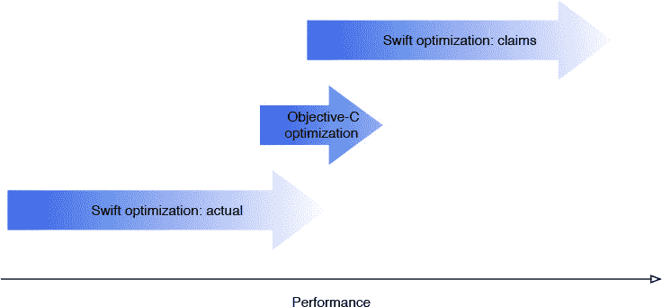

**图 9.7** 优化的范围

这并非偶然或孤立案例；事实上，维也纳大学的 Anton Ertl 在 2015 年的一项研究^(6) 显示，编译器目前利用 C 标准中的未定义行为进行优化的趋势实际上损害了性能，而不是帮助它。为了让目前高效的代码符合这些编译器对正确性的新观点而进行的修改，其性能回退大于额外优化带来的收益。

6. A.M. Ertl. “What every compiler writer should know about programmers or ‘Optimization’ based on undefined behaviour hurts performance,” *Proceedings Kollo Programmiersprachen* (2015), Technical University of Wien.

Swift 的设计和实现在这个方向上比目前的 C 编译器更进了一，因此结果相似，但更加极端。是的，许多特性有助于优化器产生更大的相对优化，但它们并不一定能帮助程序员编写出更快的程序。在许多情况下，它们的副作用远大于收益。如果你查看这些示例，你会发现让 Swift 获得良好的良好方法是手动移除抽象层，有时比等效 C 程序中移除的更多。


此外，研究显示，大多数现代 C 编译器并没有实现 Jon Bentley 在 33 年前的一个优化示例中描述的那套直观的、保持语义的源码级优化。直白地说，没有任何优化型编译器会将冒泡排序改为合并排序或快速排序。事实上，它可能不应该这样做，但为了变得足够“智能”，它必须能够在该层级上操作，即便不进行那次特定的变换。

因此，编译器在很大程度上远未达到“足够智能”；它们留下了许多直观的优化未处理。穿透深层抽象以达到最优机器表示是可行且确实有效的，但到目前为止，这只被证明在非常特定且有限的情况下是有效的。

更糟糕的是，SSC（自优化编译器）最大的问题并不是它们不起作用——真正的问题实际上出现在这种编译器*确实*按照预期工作时，因为性能会变得比现在得多更难以预测和受控：你写下代码，然后寄希望优化器能搞定它。

当优化器无法解决时，你就陷入了困境。当优化器昨天还能解决，今天却无法解决时，情况就尤为糟糕，例如，因为你对代码库进行了一个你认为微不足道但编译器认为意义重大的改动，或者因为编译器或库发生了变化。由于没有诊断信息，祝你好运自己去搞清楚吧！

## 优化型编译器的终结

追求 SSC 的基础性能模型类型，在计算机普遍较慢、我们只想让它们运行快一点（或快得多——但这种情况很少发生，见 Proebsting 定则）时是非常有用的。

今天，计算机通常运行非常快，因此大多数程序的大部分并不是性能关键的。事实上，起初针对性能关键代码的帕累托法则（20% 的代码占据了 80% 的性能，反之亦然）在 1974 年 Knuth 对微小效率发表著名言论时就已变为 97:3 法则，而现在这种倾斜更加极端了。

大多数程序（尤其是交互式程序）中的绝大多数代码不仅不是热点，它们甚至是“冰冷的”。因此，它们的性能在很大程度上是无关的。（除非你涉及到千倍或更多的因素：即使是使用频率为 1% 的代码，如果它运行慢 1000 倍，也会变成一个重要因素！）

我认为 Cocoa 社区提供了充足的证据证明这一点。只需看看我们对第 7 章中“优化 ARC”章节里 ARC 代码的惊讶：未优化的调试构建中的代码比发布版本慢了一个数量级以上，但我们并没有注意到。我非常确定，用于 iOS 或 Mac 开发的大多数 Swift 代码也是如此。是的，它们是在调试模式下编译的（无优化），是的，它们确实比发布模式（已优化）慢一个数量级或更多，但不，没有人注意到。这也解释了 Swift 以快速闻名，而这种声誉与我能找到的几乎每一个经验数据都相矛盾。

结果，人们可能会认为*性能*正变得越来越无关紧，但事实证明这是一个错误的结论。性能实际上变得*更*重要了，而不是不重要。随着计算机变得越来越快，用户使用它们处理更多的数据，而且往往是剧增。随着数据的增加，我们程序的内层循环正变得显著*更*相关性能，而不是不相关，即使程序的其他部分变得越来越无关紧。

与此同时，对性能的需求在增加。最初，计算机任务被提交到数据中心，可能需要一天或两天才能运行。随着交互式终端的出现，秒级响应时间变成了常态，后来这些预期提高到“立即”，即小于 100 毫秒。如今，我们计算的大部分必须以动画速度运行，即每秒 60 帧或每帧 16.66 毫秒，且不允许卡顿。因此，预测性和最坏情况性能至关重要。

在 2015 年的演讲“优化型编译器的终结”中^(7) `qmail` 作者和安全研究员 Daniel Bernstein 认为，这些发展意味着尽管性能仍然如既往一样重要，但优化型编译器正变得越来越无关紧，因为它们能贡献的用途非常少。

7. Daniel Bernstein. “优化型编译器的终结，”软件理论与实践欧洲联合会议（2015），伦敦皇后玛丽大学。

正如图 9.8 所示，优化型编译器正受到两端的挤压。一方面，我们程序中越来越大的部分不需要优化；另一方面，程序中那些如此重要的性能关键部分通常也很小，以至于优化型编译器并不够用，因此这些代码需要手动优化。

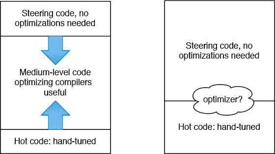

**图 9.8** 优化趋势

我们在本章的“集合”部分亲眼看到了了这种效果：最佳解决方案是使用其中一个手动优化的 `vDSP` 例程，即使即使从脚本语言中调用它，它的速度也比 Swift 的 Heldenoptimizer 在最佳状态下快得多。

Erlang 创始人 Joe Armstrong 更进了一步，说我们的内层循环正在转向硬件，而且这种趋势也有充足的证据：iPhone 具有针对 JPEG 图像、x264 编码电影和最常用音频格式的专用硬件解码器，更不用说用于图形加速的 GPU 了。

没有任何优化编译器能帮助你整合这些硬件资源及其权衡（我们在第 17 章的“美丽的天气应用”部分查看硬件/软件权衡），或者将大量数据从操作系统移动到这些硬件资源，或者重新排列代码让你的动画不卡顿。

糟糕糟糕，优化编译器让性能变得不可预测，而 Swift 特别具有糟糕的最坏情况性能，这在如今比最好情况或平均性能要重要得多。

## 实际建议

在实践中，对于性能密集型代码，你唯一的可靠选择是用 C/Objective-C 编写代码并从 Swift 调用它。我们在之前的章节中已经看到过如何在 Objective-C 中编写快速代码，所以我不再重复这些信息。关于 Swift 和 Objective-C 接口的信息可以在 Swift 编程语言书^(8) 和 Apple 的开发者文档中找到。

8. 目前位于名为“与 Cocoa 和 Objective-C 使用 Swift”的章节中，《Swift 编程语言 (Swift 3)》(Apple Inc. iBooks, 2014)。

IBM 的 *Kitura* Swift Web 框架使用了这种方法，HTTP 解析器本身取自 *node.js* 并用 C 编写，高层例程用 Swift 编写，性能结果非常好。混合比例约为 15% 的 C 代码和 85% 的 Swift 代码。最后，大部分 Cocoa 也使用了该方法，在本章中我们看到调用 `vDSP` 函数时效果良好。

尽管 Kitura 和 `vDSP` 使用纯 C（因为底层库提供的就是这些），但与你的性能敏感代码交互的最直接的方法是将其放在 Objective-C 类中，并使用消息传递从 Swift 与其交互。


通过这种方式，你可以遵循 Apple 的 Swift 建模建议并充分利用你的 Swift 代码类。另一方面，你可以忽略 Apple 矛盾的 Swift 性能建议，尽可能让一切变成结构体（structs）和静态分发，因为如果你需要性能，Swift 将无法满足你的需求。

## 替代方案

我必须承认，我对 Apple 的 Swift 发布感到非常困惑，尤其是从性能的角度来看。正如你在这里看到的，`Objective-C` 基本上已经具备了产生优秀高性能代码的所有机制，并能够利用如今性能的混合特性。

因此，我原本期望一种语言能够借鉴这些能力并在此基础上进行改进。一些可以简化 `Objective-C` 代码优化机制的简单更改包括：

1. **针对 `IMP` 缓存的编译器辅助。** 这不是自动化，而是一种简单的方法，告诉编译器你希望进行 `IMP` 缓存，通过将接收者视为常量来实现。编译器可以创建获取并缓存 `IMP` 的代码，如果有用，还可以将该代码作为强度消除优化（strength-reduction optimization）提升到循环之外。

缓存可以扩展到整个用于实例变量的协议，这样编译器为该协议分配 `IMP` 指针，并在对象实例变量更改时自动更新它们。

这种方法的扩展将是“始终静态”的分发和/或内联，其重要区别在于这些功能需要由调用处控制，而不是定义处，尽管定义处可能需要指示*允许*静态分发和内联。

2. **重新启用 `Objective-C` 对象的栈分配。** 这是 Stepstone 编译器的一个功能，虽然将栈分配与引用计数语义结合具有挑战性，但看起来似乎是完全可行的。

3. **与栈分配密切相关的是同质紧凑集合的对象的批量分配。**

上述提到的机制中没有什么是是以前没有做过的，但拥有稍微更好的编译器支持会有帮助。

另一种方法是使用提供系统级编程方法的现有语言来替代 `Objective-C` 中的 `C` 部分，例如 `D` 或 `Rust`。也许可以是 `Objective-D` 或 `Objective-Rust`？在其他语言中添加 `Objective` 部分一直是计划的一部分。

事实上，Apple 承认 `Swift` 的内存模型在性能和可预测性方面存在缺陷，并特别地向 `Rust` 寻求过灵感：

- **内存所有权模型：** 在 `Swift` 中添加一种（可选的）受 `Cyclone/Rust` 启发的内存所有权模型是系统程序员以及希望获得可预测且确定性性能的人（例如在实时音频处理代码中）非常渴望的。

“回顾 `Swift 3` 并展望 `Swift 4`，” `Swift` Evolution 邮件列表^(9)

9. C. Lattner. 2016. “回顾 `Swift 3` 并展望 `Swift 4`.” 7 月 29 日。访问于 [`lists.swift.org/pipermail/swift-evolution/Week-of-Mon-20160725/025676.html`](https://lists.swift.org/pipermail/swift-evolution/Week-of-Mon-20160725/025676.html)。

一个更具野心的方法是认真对待“没有 C 的 Objective-C”这一想法：与其在 `C` 中添加 `Smalltalk` 风格的消息传递，不如使用 `Smalltalk` 作为基础语言，并添加 `Smalltalk` 可用的可选类型系统之一（`Strongtalk`、`Typed Smalltalk`、`SmallType` 等）。

`Cocoa` 对标记指针（tagged pointers）以及对象系统的其他优化有足够的支持，例如一个极快的 `objc_msgSend()` 实现，使得纯对象对于我们程序的引导部分（即 99% 以上对性能不特别敏感的部分）是完全可行的。

示例 9.18 显示了如何通过简单省略类型注解来实现类似脚本的风格。

### 示例 9.18 Objective-Smalltalk 中的动态类型对象相加

```
| a |
a := 3 + 4.
```

在这种情况下，变量 `a` 是一个对象，其声明类比 `Objective-C` 中的 `id a`，而 `+` “运算符”是一个通过 `objc_msgSend()` 分发的二进制消息发送。由于数字字面量是在对象上下文中使用的且足够小到可以容纳，它们被直接生成为标记对象指针，每个仅占用一个周期（参见 示例 3.2）。

示例 9.19 显示了如何添加可选类型。它等同于 `Objective-C` 代码 `NSNumber *a`。

### 示例 9.19 Objective-Smalltalk 中的静态类型对象相加

```
| <Number> a |
a := 3 + 4.
```

就像在 `Objective-C` 中一样，相加生成的实际代码可能与 `id` 对象的情况相同，静态声明仅用于机器检查的文档。

或者，编译器可以为两个标记数字的相加发射特殊情况指令，类似于 示例 3.2 中的代码，如果涉及的对象不是标记整数，则回退到消息传递。这一微小的变化使得在几乎所有用例中使用数字对象变得可行，并且通过真实对象，你可以构建一个真实的数字塔，使得小整数优雅地溢出到多字表示法，而永远不会丢失精度。

示例 9.20 尽管有微小的语法变化，但它改变了生成的代码。这次类型是 `C` 原生类型，因此生成的代码与 `Objective-C` 原生类型是相同的。

### 示例 9.20 Objective-Smalltalk 中的原生类型相加

```
| <int> b |
b := 3 + 4.
```

这将保持整个 Mac OS 软件栈中使用的熟悉的 `Objective-C` 语法，而没有像在 `Objective-C` 那样整合两种语法的烦恼，也不会有 `Swift` 在关键字上遇到过并持续面临的集成困难。令人有些惊讶的是（如果你读过本章的其余部分，也不意外），即使是针对纯部分的字节码解释器的，性能也优于未优化的 `Swift`。

字节码通常比机器码更紧凑，只要你不尝试进行 JIT 编译，内存压力就会小。性能敏感的部分可以可选地编译为机器码，并根据正确的类型注解直接编译为类 `C` 的机器码。

这种方法的巨大优势将是瞬时的编译时间，因为代码可以一次一个方法地编译而互不干扰，而且从 `Smalltalk` 到字节码的编译步骤非常简单且快速。（`Swift` 能够在 Playground 中使用证明了现代机器的力量；很难想象还有什么语言不适合这项。）

我偶尔提到的 *Objective-Smalltalk*^(10) 项目恰恰考虑了这些优化，但它目前专门侧重于扩展表达能力，而不是优化方面。

10. [`objective.st`](http://objective.st)

总结

Aaron Hillegass 的开创性著作 *Cocoa Programming for Mac OS X* 的早期版本中包含一个关于 Cocoa-Java 桥接的章节。它由一句话组成，基本上是：“不要使用它。”正如你可能猜到的，那正是我本想关于 `Swift` 性能撰写的那个章节。由于 Apple 关于 `Swift` 性能营销活动的成功，这句话不会像 Aaron 的那个章节句子那样引起会心的会笑，但我希望我已经说明了为什么我认为它是同样合理的。


Swift 的编译速度极慢，执行速度也慢，而且对于现代性能而言，最糟糕的是，它是非常不可预测且难以控制的。不要用它编写性能密集型代码。事实上，它可以慢到令人难以信，即使是将其用于看似非关键的代码，也可能突然产生明显的性能影响。

相反，请使用本文讨论的技术用 Objective-C 编写你的性能敏感型代码，并在 Swift 中调用这些代码。这是 Apple 的做法，也是 IBM 的做法。

如果你别无选择，我能给出的建议也不多；你在这很大程度上受限于编译器，特别是优化器。除此，你可能需要执行 Apple 推荐的所有过早优化，例如在处处使用 `structs` 代替 `classes`（但要注意大型结构体！），尽可能实现静态分发，如果可以，将任何繁重工作交给 Objective-C。

# 10. I/O：原理

当 Apple 推出 PowerMac G4 时，它被誉为世界上第一台桌面级超级计算机。Ken Bachter 曾戏趣道：“超级计算机是一种将计算密集型问题转换为 I/O 密集型问题的设备。”从某种意义上说，现在所有的计算机都是超级计算机，如今的 iPhone 性能远超 PowerMac G4，而且计算性能也远超 I/O 性能。此外，我们在内存访问中看到的访问时间（延迟）与传输速度（带宽）之间的差异，在 I/O 设备上更为明显。内存的延迟与吞吐量之间的差异约为 1:100，而 I/O 设备的比例是 1:100,000 甚至更高。

## 硬件

不同类型 I/O 硬件的底层性能特性是非常显著的，并且不像隐藏在统一 API 后的不同访问机制那样，它们是不能可以被抽象掉的。存储通常由旋转磁带驱动器或固态闪存提供，而连接则由不同类型的网络提供，从高速交换以太网到数据包交换无线电。

### 磁盘驱动器

尽管`固态硬盘` (`SSD`) 变得越来越流行，但旋转介质在为计算机系统提供持久存储方面仍然起着重要作用。磁盘的示意图见图 10.1：一个圆形的磁盘被划分为同心圆，称为`tracks`（轨道），而轨道又被划分为`sectors`（扇区）。

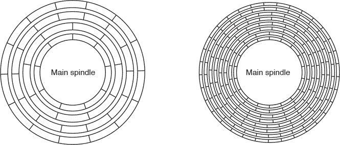

**图 10.1** 带有轨道和扇区的磁盘示意图，原始（左）和密度翻倍后（右）

磁盘头位于特定轨道上，以便读取或写入该轨道上的数据。传输速度是磁盘旋转速度和记录信息密度的简单函数，因此，为了加快磁盘的传输速度，你要么需要它旋转得更快，要么增加记录密度以便在每次旋转期间写入或读取更多信息。

第一代微型硬盘旋转速度为每分钟 3,600 转 (rpm)，固定大小的扇区提供 5 MBit/s (625 KByte/s) 的传输速度。今天的磁盘驱动器旋转速度并没有快多少，笔记本和桌面驱动器的速度在 4,200 到最高 7,200 rpm 之间，而服务器级驱动器在功耗噪音不太问题的情况下高达 15,000 rpm。表 10.1 将旋转速度与读取轨道所需的时间相关联。

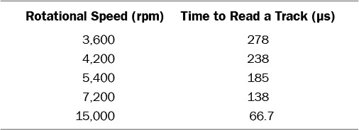

**表 10.1 旋转速度**

控制传输速度的另一个因素是密度，随着发现越来越多更聪明的磁介质位编码的方法，密度已显著提高：通过伺服电机对准精确轨道以使轨道靠得更近、在介质中垂直记录位、获取更灵敏的磁头、在磁头正前方加热磁盘等。然而，由于磁盘是二维盘片，但读写操作是线性的轨道，密度的增加总是会导致传输速度的线性增长，但会导致存储容量的平方级增长。

因此，由于简单的数学原理，硬盘传输速度的增长总是落后于存储容量的增长。考虑到数据量随可用存储容量而增加这一看似不可避免的事实，这意味着磁盘虽然名义上稍微快了一点，但相对于我们要求它们执行的工作，实际上实际上变得越来越慢，相对于它们所连接的计算机也变得越来越慢。

Apple II 的 ProDrive 传输速度为 5 MBit/s，这实际上比 Apple 6502 处理器在 1-MHz 时钟频率和每条指令多个时钟周期下处理的速度还要`快`。它可以在大约 10 秒内传输其 5-MB 的容量（不计寻道）。今天的硬盘传输速度约为 100 MByte/s，因此每个字节约为 10 ns。在这些 10 ns 内，如果不是被内存阻塞，我们的笔记本 CPU 可以执行 30 多条指令。一个 1-terabyte 容量的典型消费级硬盘的内容需要 10,000 秒（或几乎 3 小时）才能传输。

如果这还不够糟糕，访问时间虽然随时间推移也变快了，但其变快的速度比传输速度更慢。访问速度取决于快速移动并停止质量（寻道磁盘头）的能力以及旋转延迟。这两者在很大程度上都是物理问题；这些物理规律没有改变，未来可能也不会改变。此外，快速移动质量与噪音有关，因此对静音驱动器的需求实际上导致了寻道性能的下降。

传输速度与寻道性能之间不断扩大的差距导致了“磁盘即磁带”的说法。

### 固态硬盘

由于 消除了许多物理限制，特别是初始访问时间（`seek`）得到了极大改善，SSD 消除了旋转磁盘的许多物理限制，但正如我们在上一章看到的，它们与主内存相比仍然缓慢。也存在物理限制，例如容量的增加（如多层单元）其代价不仅是可靠性降低，还有更慢的读写速度。

通常写入是一个问题，因为在写入任何信息之前，必须对整个闪存区域进行批量擦除（这需要时间）。批量处理比硬盘上更为重要，因为许多小写写入不仅慢，而且会提前耗尽单元。

所以虽然 SSD 代表了改进，并且是提高应用性能或服务器端数据库（尤其是读多型）最简单的方法，但它们并不是万能药。事实上，一项针对手机浏览器性能的研究^(1) 发现，性能并不受限于处理器速度甚至缓慢的蜂窝网络，而是受限于 `SQLite` 和慢闪存速度的结合！

1. H. Kim, N. Agrawal, and C. Ungureanu. “Revisiting Storage for Smartphones,” *10th USENIX Conference on File and Storage Technologies* (2012).

#### 网络

物理学在网络 I/O 中也起着很大作用，主要表现为光速，它决定了往返的最小时间。这种速度在短期内不会发生变化，而且我们已经接近这些极限，因此无法预期太大的变化。此外，`TCP` 等网络协议需要多次往返来建立连接。


尽管我们能够增加带宽（以太网为例已从 10 MBit/s 增加到 10 GBit/s），但延迟将保持不变。此外，我们现在还要处理移动网络，其带宽大大降低，且延迟也很高，有时甚至达到毫秒级。

### 操作系统

操作系统在分配程序想要使用的资源方面始终起着至关的作用。然而，在 CPU 和内存的情况下，操作系统仅负责分配某些资源，然后让程序继续运行自己的业务。而对于 I/O，每次访问都要通过操作系统进行调介。因此，虽然基础硬件能力固然是基础的，但操作系统扮演的角色要大得多。

操作系统的功能之一是为各种硬件提供统一的接口。例如，对于应用程序来说，“磁盘”是一个真实的旋转磁性盘、多个堆叠在一起的盘片、此类设备的 RAID 阵列，还是固态闪存——性能特性之外，这并不重要。除了提供统一接口外，操作系统还尝试提高 I/O ，主要是通过缓存（caching）、缓冲（buffering）和批量（batching）I/O 请求。最后，它将统一接口扩展到了使用 TCP/IP 协议的进程间通信中。

### 抽象：字节流

Unix 操作系统和 Mac OS X 基于的抽象是**字节流**（`stream of bytes`）。这种抽象通常不是程序所需要的（程序可能需要处理数据库记录、文本行或像素行等），也不是硬件提供的（硬件提供的通常是磁盘扇区或网络包）。访问这些字节流的基本方法是 `read()` 和 `write()` 系统调用，它们使用称为`文件描述符`（file descriptors）的整数来标识特定的字节流。磁盘或设备的文件描述符通过 `open()` 系统调用获取，进程间通信使用 `pipe()` 系统调用，网络通信则使用 `socket()`、`accept()`、`connect()` 调用的组合。

操作系统的服务和抽象是有成本的；例如用户空间/内核态的转换。示例 10.1 就是一个很好的例子。

**10.1 大写：一个使用内核 API 进行字节 I/O 的简单 Unix 过滤器**

```c
#include <stdio.h>
#include <ctype.h>
int main(int argc, char *argv[]) {
  int first=1;
  int eof=0;
  do {
    char buffer;
    if ( read(0,&buffer,1)==1) {
      if ( first ) {
        buffer=toupper(buffer);
        first=0;
      }
      write(1,&buffer,1);
      if ( buffer=='\n' ) {
        first=1;
      }
    } else {
      eof=1;
    }
  } while (!eof);
  return 0;
}
```

这段代码的功能与示例 8.1 中的代码相同，但它使用 `read()` 和 `write()` 系统调用逐个读取和写入每个字节。对于一个 145-MB 的文件，耗时 2 分 25 秒，比示例 8.1（0.69 秒）慢约 200 倍，其中 1 分 56 秒（或 80% 的时间）花费在内核中；而示例 8.1 仅花费 0.068 秒（占其更短时间的 10%）在内核中，仅是示例 10.1 内核时间的 1/1000 不到。

接下来的样本证实了时间是消耗在 `read()` 和 `write()` 系统调用上的。虽然每次 `read` 或 `write` 调用约 500 ns 的成本已经导致了我们刚刚看到的巨大差异，但这仅仅是调用内核的开销。正如我们在本的“硬件”部分看到的，实际的 I/O 事务耗时可能达到毫秒级，或者长几千倍。在这种速率下，处理一个 145-MB 的文件将需要几天。

```8958 start (in libdyld.dylib)
  4827 main (in upcase-single-char)
  + 4827 read (in libsystem_kernel.dylib)
  3919 main (in upcase-single-char)
  + 3919 write (in libsystem_kernel.dylib)
  185 main (in upcase-single-char)
  10 main (in upcase-single-char)
  + 9 toupper (in upcase-single-char)
```

我们之前已经见过高事务成本的解决方案了：**批量处理**（`batching`），或者在这种情况下是**缓冲**（`buffering`）。我们不再为每个单独字节产生这些事务成本，而是从内核获取一整个缓冲区大小的字节，然后在不打扰内核的情况下进行处理。然后，我们将处理过的字节汇集到输出缓冲区中，并将整批写入内核。

虽然这种处理使得代码比示例 10.1 更复杂，但 Unix `stdio` 库为我们处理了大部分复杂性，特别是针对行的处理。然而，固定长度记录（`fread()`）必须自行处理缓冲区大小与逻辑大小不匹配的所有问题。

### 文件 I/O

Unix 中的文件也只是字节流，增加了元数据，如名称（更准确地说是零或多个名称）、所有者、访问权限以及访问日期。文件系统管理这些抽象文件的分级结构映射到设备上具体的扇区，而内核则负责在磁盘（通过设备驱动程序）与统一缓冲区缓存（UBC）以及用户程序或内核其他部分之间移动数据。与基本 API 一样，缓冲在提高抽象高效性方面起着至关重要的作用。图 10.2 粗略显示了文件系统如何将分级命名空间映射到数据流，并将命名空间的目录和数据本身映射到存储介质上的块。

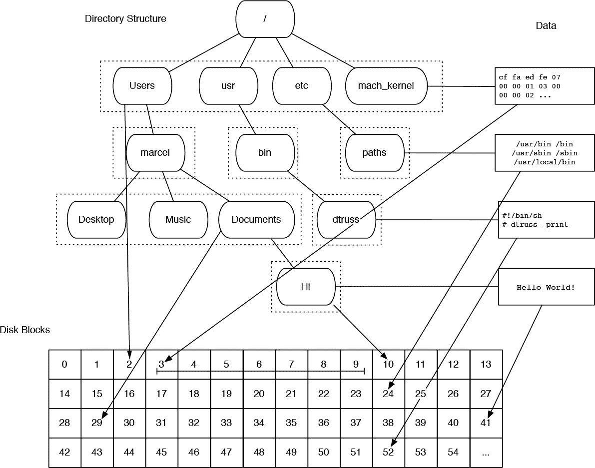

**图 10.2 将 Mac OS X 目录结构和文件数据映射到磁盘块**

获取 `/mach_kernel` 文件意味着读取 `/` 目录，在该目录中找到 `mach_kernel` 条目，然后在那里查找该文件的数据块。访问层级结构更深的文件（如 `/Users/marcel/Documents/Hi`）意味着再次从 `/` 目录开始，在该目录中找到 `Users` 条，找到 `Users` 目录的数据块，读取这些数据块，找到 `marcel` 条目，依此类推。


操作系统（OS）显然必须尽可能在内存中缓存这些信息，否则每次对特定“文件”抽象的访问都需要多次离散的磁盘访问，每次访问都涉及一次昂贵的寻道，因为所访问的数据属于不同的文件，并没有在磁盘上连续布局。幸运的是，情况确实如此，事实上甚至还有一个专门的 `namei cache`（名称缓存），它本质上复制了分级字典结构，并直接从完整路径映射到数据块。这些缓存在通用情况下运行良好，但与所有缓存一样，它们只影响最优和平均情况下的行为，而始终可能遇到最坏的情况。它们在实际的 I/O 操作上还涉及额外的处理，因为数据会先拷贝到缓冲区中，然后提供给发出请求的客户端。

传统上，Unix 操作系统预留了一个特殊的内存区域作为 `buffer cache`（缓冲区缓存），用于缓冲最近的磁盘 I/O，因此客户端的 `read()` 请求会导致数据被读取到这些缓冲区，然后复制到客户端的地址空间；而 `write()` 请求则会将数据写入缓冲区缓存，并在稍后刷新到磁盘。独立的 `page cache`（页缓存）则用于进程使用的虚拟内存，它有一条通往磁盘的独立路径以启用交换（通常是到磁盘的特殊区域）。

尽管虚拟内存与用于文件 I/O 的（固定）缓冲区之间的分离最初看起来是合理的，但它存在许多缺点。首先，缓冲区缓存的大小通常是固定的，因此随着主内存变大，你经常会有大量未使用的 RAM，而这些本可以用于磁盘缓冲。其次，随着引入 `mmap()` 系统调用（可以在不使用 `read()` 的情况下将文件直接映射到进程的地址空间），之前清晰的区分变得模糊了。而且，将数据从缓冲区缓存移动到虚拟内存不仅会产生额外的拷贝，还可能导致相同的数据存在于多个缓存中，导致更多的空间浪费和额外的拷贝操作。

所有 Unix 发行版采用的解决方案是 UBC（统一缓冲区缓存），如图 10.3 所示，图中展示了 UBC 之前的状态。

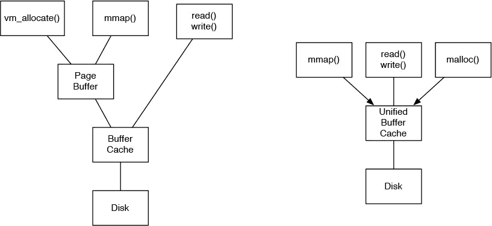

**图 10.3** 非统一（左）和统一（右）缓冲区缓存

通过 UBC，虚拟内存操作与文件 I/O 之间的区别被消除了。所有缓冲文件 I/O（无论是通过 `mmap()` 还是通过 `read()` 和 `write()`）都通过虚拟内存子系统进行：首先，内核创建一个文件系统对象（通常是磁盘文件）到一组虚拟内存页的映射。在 `mmap()` 情况下，这组页被直接映射到相关进程的地址空间，并在访问这些页时启动实际的 I/O 操作；而在 `read()` 情况下，内核会立即启动 I/O 并在数据到达后将其拷贝到调用进程的地址空间。

UBC 的优势在于它可以并且确实在使用所有可用 RAM 为文件 I/O 缓冲，并消除了内存映射文件中的重复拷贝。这些好处通常是透明的，但缓存的统一性有时可能确实会导致问题。由于 UBC 并不真正区分文件 I/O 和应用程序分页，密集的文件活动可能会导致系统开始交换，尽管有足够的 RAM 将所有程序保留在内存中——例如，在 Spotlight 中就出现过这个问题。

幸运的是，这对于系统服务来说通常是一个问题，并且可以通过无缓存/无缓冲 I/O 以及/或通过我们在第 7 章“`madvise`”节中看到的 `madvise()` 系统调用显式控制分配策略来缓解。

除了缓存之前的读取以防未来再次读取相同数据外，磁盘系统还会预测性读取其认为未来会被请求的数据，即预读（read-ahead）。

UBC 不仅缓存读取，还缓冲写入。当程序使用 `write()` 系统调用向文件写入数据时，数据并没有真正写入磁盘，而是被拷贝到 UBC。`sync()` 系统调用全局地将挂起的更改写入磁盘。它由 `launchd` 守护进程每 30 秒执行一次（早期操作系统版本使用独立的 `update` 守护进程执行相同任务）。延迟写入将应用程序与较慢的 I/O 设备解耦，并允许系统以更大的批次组合 I/O，从而在此过程中优化 I/O，例如合并写入到单个闪存块，或对请求进行排序以最大限度地减少磁盘寻道。

再次，这种缓冲行为对通用系统性能至关重要。使用同步写入的早期 Unix 版本的写入吞吐量仅为写入缓冲系统的 3% 到 5%，当手动强制写入变为同步时，也可以观察到类似的减速。延迟写入的主要代价是，尽管应用程序已写入数据，磁盘上的数据可能是不一致的，如果在应用程序写入数据到故障发生之间发生断电或系统崩溃，可能会丢失。此外，还存在内存拷贝操作。

### 网络协议栈

OS X 和 iOS 上的网络协议栈处理 TCP/IP，即传输控制协议/网络协议。基础 IP 像大多数网络硬件一样是面向包的，但广泛使用的 TCP 提供了整个 Unix 内核其他部分使用的“字节流”抽象。今天互联网上使用的绝多数高层协议（如 HTTP 和 FTP）都是构建在 TCP 的流抽象之上的，而面向数据包的、不可靠的用户数据报协议（UDP）则被更广泛地用广播和媒体应用的基础。

一个可靠的、面向流的传输协议的朴素实现，其性能将受限于网络延迟，因为数据包的接收必须得到确认。幸运的是，TCP 是一个非常复杂的协议，并配有同样复杂的实现。大量的缓冲、滑动接收窗口、流量控制、乱序重传等，帮助 TCP 在许多情况下无需应用程序过多帮助即可实现接近可用带宽的吞吐量。

然而，建立 TCP 连接*确实*受限于网络延迟，并且实际上需要多次往返，因此应尽量减少连接数量，而是重用现有连接。例如， FTP 在整个会话中使用单个控制连接，但每个新传输都需要新的数据连接，这使其不适合传输大量小文件。HTTP 也存在从根本上无连接的缺陷，尽管规范的后续版本允许重用多个传输。

## 总结

在本章中，我们看到 I/O 性能随时间遵循非常特定的模式：容量的增长超过了带宽，带宽的增长超过了延迟（即使会有迁移到 SSD 等带来的飞跃）。

在实践中，这意味着通过尽可能大的请求可以获得最佳性能；读取或写入单个字节的代价实际上与读取或写入几千字节的相当。除非绝对必要，否则我避免写入文件的一部分，而是从 Amoeba 操作系统^(3) 获取页，并将文件视为不可变的，只读取和写入整个文件，并尽可能避免小文件。如果我想读取大文件的一部分，我会使用内存映射，以便逻辑上只处理整个文件，将部分访问交给操作系统。如果我需要增量生成一个大文件，我只进行追加，并在文件写入完成后才允许读取。


- 3. [`fsd-amoeba.sourceforge.net/amoeba.html`](http://fsd-amoeba.sourceforge.net/amoeba.html) [`en.wikipedia.org/wiki/Amoeba_(operating_system)`](https://en.wikipedia.org/wiki/Amoeba_(operating_system))

我们将在第 12 章中详细研究这类技术以及部分文件读取和更新产生的问题，特别是在数据库的背景下。

## 11. I/O：测量与工具

测量 I/O 比测量内存消耗还要困难得多。大多数时候，有趣的事件是那些“什么都没有发生”的时刻；系统只是在等待某些外部事件，例如硬盘头移动到某个位置。此外，整个操作系统的设计初衷就是为了让 I/O 测量变得不可重复——呃，我的意思是为了*优化* I/O，这其中使用了许多全局共享状态，如缓存和磁盘布局。更糟糕的是，虽然控制这些变量的方法，但它们通常也会导致测量结果没有代表性，因为这些优化对于正常运行是绝对必要的。

为了说明这一点，我们将使用示例 11.1 中的简短程序，该程序仅将文件读取到 `NSData` 中并计算文件中字节的校验和。

**示例 11.1 数据映射测试程序：读取文件并计算异或校验和**

点击此处查看代码图像

* * *

```objc
#import <Foundation/Foundation.h>

int main(int argc, char *argv[] ) {
  NSURL *url=[NSURL fileURLWithPath:@(argv[1])];
  NSData *d=[NSData dataWithContentsOfURL:url options:0 error:nil];
  char result=0;
  const char *bytes=[d bytes];
  const char *end=bytes+[d length];
  for (const char *cur=bytes; cur < end; cur++ ) {
  result ^= *cur;
  }
  printf("result: \%x\n",result);
}
```

* * *

示例 11.1 对文件内容进行计算并打印结果，以确保数据确实被读取，且 `printf` 确保编译器无法将该计算作为死代码直接优化掉。

### 负空间：`top` 和 `time`

我们的朋友们 `time` 和 `top` 在检测 I/O 正在发生并阻塞我们的进程非常有用，尽管它们主要是通过使用“负空间”的概念：如果我们注意到某些无法通过其他方式解释的时间，或者 CPU 利用率明显低于 100%，那么就有理由怀疑可能是 I/O 的罪魁祸首。例如，运行命令 `time ./datamapping test_file` 得到所示结果：

点击此处查看代码图像

```text
time ./datamapping   testfile_3gb
real    0m10.669s
user    0m0.305s
sys      0m1.613s
```

注意 `real`（实际时间）与 `user`（用户时间）之间的巨大差异，用户时间仅为 0.3 秒，但实际运行时间超过了 10 秒。`sys`（内核时间）只增加了 1.6 秒的内核 CPU 时间，总计 CPU 使用时间不足 2 秒。另外的 8 秒消失了，这意味着 CPU 利用率仅为约 20%，空闲时间占 80%。这可能是其他进程抢占了此进程，但由于调度通常是公平的，这必须是由于几个进程，或者一个运行优先级显著高于其他进程进程（例如实时进程）。另一个原因可能是进程决定通过使用 `sleep()` 系统调用或类似的调用来取消调度，以等待指定的这段时间。

最可能的解释（特别是在我们的案例中）是，该进程是 I/O 密集型的，这意味着它正在同步等待外部设备执行某些 I/O——在这种情况下，是输送数据。

假设您有足够的内存将文件保留在 RAM 中，对程序进行第二次计时运行将得到如下所示的截然不同的结果：它快得多，且 `user` 和 `sys` 时间之和几乎完全等于测量的 `real` 时间。

点击此处查看代码图像

```text
time ./datamapping   testfile_3gb
real    0m1.937s
user    0m0.305s
sys      0m1.613s
```

这就是我们在上一节讨论过的缓冲区缓存的结果。整个文件已缓存到内存中，操作系统不再需要从磁盘进行 I/O，而是将数据从缓冲区拷贝到程序，这使得重复的 I/O 测试变得困难。

`purge` 命令会清空整个缓冲区缓存，并将系统恢复到冷启动（断电）后大致相同的状态。执行 `purge` 之后，操作系统将被强制再次从磁盘读取。`purge` 命令的影响是全局的，还会导致更改被写入磁盘，因此预计系统性能在一段时间内会出现显著下降。此外，等待系统稳定并调入其基础需求。

你可以看到一个 I/O 密集型进程的症状，在图 11.1 中，`top` 显示了这种状态。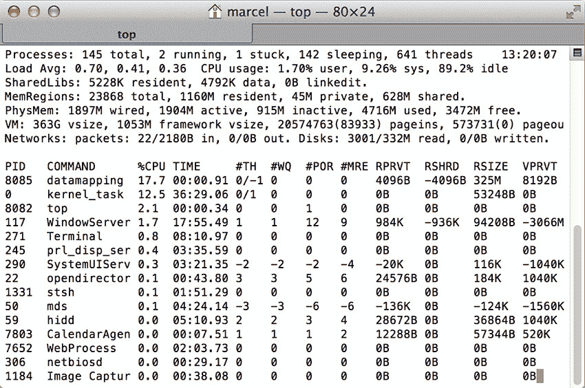

**图 11.1 显示 I/O 密集型任务**

### 总结信息：`iostat` 和 `netstat`

通过 `time` 和 `top`，我们可以间接地检测 I/O 活动，而 `iostat` 提供了 I/O 的直接测量值。以下是运行 `datamapping` 时的输出：

```text
iostat 1
  disk  KB/t  tps  MB/s  us  sy  id
  0     11.33   6    0.07   0   0  99
  0     11.33   6    0.07   0   0  99
  0     20.40   3    0.20   0   0  99
  0     20.40   3    0.20   0   0  99
  0     217.56  25   1.94   0   0  75
  0     217.56  25   1.94   0   0  75
  0     426.35  19   3.96   0   0  80
  0     426.35  19   3.96   0   0  80
  0     454.21  21   4.26   0   0  79
  0     454.21  21   4.26   0   0  79
```

虽然 `iostat` 的刻画方式非常粗犷——它只提供通往特定设备的 I/O 汇总信息——但我经常发现，它不仅可以验证我认为应该发生的事情是否真的发生了，而且如果我能保持系统其他部分的安静，它也足以观察特定进程的状况。

`netstat` 命令在命令行中给出时间间隔时，其功能与 `iostat` 非常相似，它会在指定的间隔内按字节和数据包打印聚合网络活动，尽管它也可以提供更详细的信息。


不需说，Instruments 提供了工具来帮助我们测量 I/O 性能。例如，我们可以使用可靠的 *Time Profiler*（时间分析器），如图 11.2

**图 11.2** Unix I/O 的时间分析图

注意的是，图中显示的 CPU 利用率仅在结束时接近 100%；在图表的前部分，它保持在远低于 100%。这是我们之前讨论的*负空间*的另一个例子：利用率低于 100% 表示程序正在等待某些内容——在这种情况下，是使用 Unix I/O 从磁盘读取数据，尽管以约 400 MB/s 的速度从 SSD 读取，但在大部分时间内仍然让 CPU 处于等待状态。当 I/O 完成且所有内容都读入内存后，利用率会飙升到 100% 左右。

然而，如果我们仔细观察，还会发现一些问题。首先，时间不匹配：图表显示了 7 秒的使用时间，但树形视图只计算了 4.7 秒。其次，树形视图声称仅 44% 的时间用于读取文件，但我们都知道并能看到它接近四分之三。这种差异的原因是 Time Profiler 工具默认只计算 CPU 时间；它不计算等待 I/O 的时间。为了也计算等待 I/O 的时间，我们需要勾检查器中的 *Record Waiting Times*（记录等待时间）复选框。

勾选 *Record Waiting Times* 复选框后，我们得到了一个如图 11.3 所示的结果。

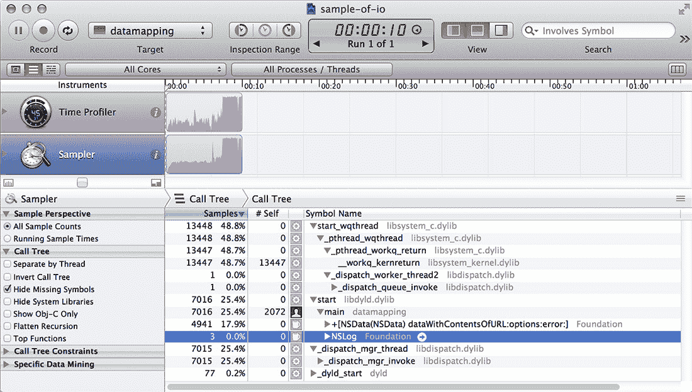

**图 11.3** Unix I/O 采样工具的时间分析，所有状态

然而，记录所有时间也令人困惑：我们的 `main` 函数（我们知道它是唯一在真正工作的函数）现在显示仅占了略多 25% 的时间，而几乎 50% 被 `start_wqthread` 及其子线程占用，这些线程在 `_workq_kernreturn` 处触底，另有 25% 在 `_dispatch_mgr_thread` 中。我们看到的是三个处于空闲状态的辅助线程，但 Instruments 无法区分等待我们感兴趣的内容（如 `read()` 的结果）导致的空闲与由于挂起而导致的空闲，因此在进程运行期间存在的所有线程将以相同的权重显示，我们的总采样计数将是*线程* × *总量* − *时间*。

幸运的是，我们有数据挖掘工具可以帮助我们，如图 11.4 所示。

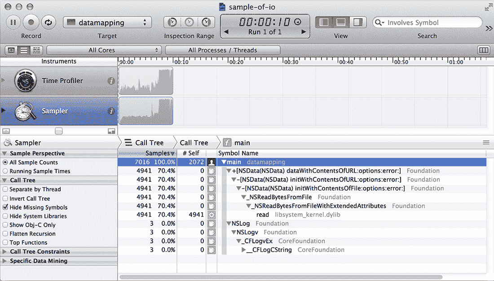

**图 11.4** Unix I/O 采样器，所有状态和聚焦状态

我们需要关注我们的 `main` 函数，此后我们就得到了想要的内容。尽管我们不再在树形视图中获得以毫秒为单位的运行运行时间，但我们仍然获得了样本，并且采样速率为每毫秒 1 次。我们得到的 7,000 多个样本对应于实际花费的时间，而 `read()` 现在显示占了总时间的 70%。

请注意，分析图不再引导我们找到程序最重要的部分；我们必须具备这些知识并利用它来实际获取我们所需的信息。

尽管还有其他更针对 I/O 的工具可用，但我并没有怎么用过它们。基本的命令行工具给了我更好的概览，Sample 工具让我更好地了解 I/O 如何融入程序的其余部分，而下一节中讨论的 `fs_usage` 提供了我想要的所有细节。图 11.5 显示了 Reads/Writes 工具。尽管它确实跟踪了读取和写入的字节，但它仅对这些信息进行绘图，仅允许粗略的定性评估。调用图只显示调用次数，用处较小。

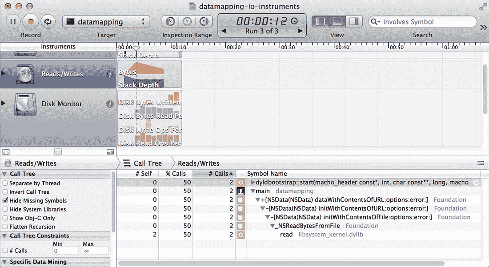

**图 11.5** Reads/Writes 工具

### 详细追踪：`fs_usage`

`fs_usage` 工具提供了详尽的信息，记录了几乎所有的 I/O 活动。但要注意，它可能是一个“数据洪流”，特别是当输出未受限制时。在我的系统上，仅仅 6 秒的 `fs_usage` 就产生了 1,255 行输出，尽管系统表面上是空闲的！

可以通过 `-f` 标志将数据限制为特定类型的输出，通过在命令行上添加进程名或进程标识符限制为特定进程。下面的输出显示了使用 `fs_usage` 监控 `datamapping` 进程：

点击此处查看代码图像

```
sudo fs_usage -f filesys datamapping
```

15:20:29  open              .               0.000025   datamapping

15:20:29  fstat64                           0.000005   datamapping

15:20:29  fcntl                            0.000007   datamapping

15:20:29  stat64          ook/test-programs 0.000015   datamapping

15:20:29  PAGE_IN_FILE                      0.000025   datamapping

15:20:29  open               testfile_gb 0.000019   datamapping

15:20:29  fstat64                           0.000004   datamapping

15:20:34  read                             0.184634 W   datamapping

15:20:36  read                             0.025971 W   datamapping

15:20:36  close                            0.000010   datamapping

15:20:36  write                            0.000012   datamapping

牢记此，我们可以解释输出所示的追踪。（注意：后文为文本）

输出的每行都表示单次 I/O 事件。第一列是时间戳，第二列指示操作类型——例如 `lstat64`、`open`、`read`、`close`。中间部分在存在此类信息时包含附加信息——例如文件名。之后是操作花费的时间，以秒为单位。小数点后的位数选择是为了使数字显示微秒（0.00025 秒）。如果进程必须被*调度出*，则时间后面会跟着字母 `W`，否则为空。调度出意味着进程不再运行。例如，由于数据不在缓存中，必须执行实际 I/O，进程被置睡眠直到 I/O 完成。最后，最后一列是进程名，在 particular 情况下总是 `datamapping`。


当我用较少的可用内存（不足以一次性将整个文件加载到内存中）运行相同的测试时，我在 `read()` 调用和 `close()` 调用之间看到了许多类型为 `PAGE_IN_ANON` 的额外记录，这意味着正在换入并非用户定义文件支持的数据，而是仅由 `swapfile` 支持的匿名内存。这意味着数据从数据文件读取，交换到交换文件，然后从交换文件分页调回内存，这听起来有些有些疯狂，但在使用 Unix I/O 时确实会发生。

## 内存交换与 I/O 性能

### 使用 `fs_usage` 监控进程

观察到的页入（page-in）对应的页出（page-out）事件在查看特定进程时不会显示，因为分页到磁盘是由内核任务处理的。它会在全局跟踪中显示。

指定进程进行监控的一个限制是，`fs_usage` 期望该进程已经存在，如果进程不存在，它将带有错误消息并退出。没有类似于 `sample` 命令的 `-wait` 标志可以等待此类进程出现。如果这是一个问题，替代方案是保持 `fs_usage` 本身不受限制（全局），并使用 `grep` 过滤输出：`sudo fs_usage -e | grep datamapping`。输出所示：

点击此处查看代码图像

```
14:32:42  open                .                0.000012  datamapping
14:32:42  fstat64                               0.000003  datamapping
14:32:42  fcntl                               0.000005  datamapping
14:32:42  close                             0.000005  datamapping
14:32:42  stat64          ../test-programs 0.000009  datamapping
14:32:42  PAGE_IN_FILE                          0.000004  datamapping
14:32:42  PAGE_IN_FILE                          0.000012  datamapping
14:32:42  PAGE_IN_FILE                          0.000003  datamapping
14:32:42  PAGE_IN_FILE                          0.000003  datamapping
14:32:42  open          ../testfile_3gb   0.000016  datamapping
14:32:42  fstat64                               0.000003  datamapping
14:32:42      RdData[A]                           0.000868 W datamapping
14:32:42      RdData[A]                           0.000826 W datamapping
14:32:42      RdData[A]                           0.000366 W datamapping
14:32:42      RdData[A]                           0.000722 W datamapping
14:32:42      RdData[A]                           0.000791 W datamapping
14:32:42      RdData[A]                           0.000954 W datamapping
14:32:42      RdData[A]                           0.000470 W datamapping
...
```

这种过滤方法生成了多得输出：我们看到了许多底层的 `RdData[A]` 事件。多*得多*：我获取了大约 13K 行输出。将输出重定向到文件很有帮助！我目前的理解是，底层事件是内核事件流的一部分，因此当直接按进程过滤时它们不会显示。

`fs_usage` 命令非常多功能。例如，我确认了以前由 `update` 守护进程完成的工作（每 30 秒调用一次 `sync()`）现在由 `launchd` 执行，如下所示。从 OS X 10.8 版本开始，`sync(2)` 的手册页仍然引用了 `update(8)`。

## 使用 NSData 推送字节

### 内存映射与陷阱

`NSData` 方法 `dataWithContentsOfURL:options:` 是读取字节最基础的方法。点击此处查看代码图像

```
> sudo fs_usage -e | grep datamapping
14:32:42  open                .                0.000012  datamapping
14:32:42  fstat64                               0.000003  datamapping
14:32:42  fcntl                               0.000005  datamapping
14:32:42  close                             0.000005  datamapping
14:32:42  stat64          ../test-programs 0.000009  datamapping
14:32:42  PAGE_IN_FILE                          0.000004  datamapping
14:32:42  PAGE_IN_FILE                          0.000012  datamapping
14:32:42  PAGE_IN_FILE                          0.000003  datamapping
14:32:42  PAGE_IN_FILE                          0.000003  datamapping
14:32:42  open          ../testfile_3gb   0.000016  datamapping
14:32:42  fstat64                               0.000003  datamapping
14:32:42      RdData[A]                           0.000868 W datamapping
14:32:42      RdData[A]                           0.000826 W datamapping
14:32:42      RdData[A]                           0.000366 W datamapping
14:32:42      RdData[A]                           0.000722 W datamapping
14:32:42      RdData[A]                           0.000791 W datamapping
14:32:42      RdData[A]                           0.000954 W datamapping
14:32:42      RdData[A]                           0.000470 W datamapping
```

使用 Instruments 可以很快阐明为什么在缓存情况下内存映射比 `read () 更快——前者只是重新映射虚拟页，而后者实际上是在使用内核版本的 `bcopy ()` 复制数据，而一次 300 MB 的 `bcopy ()` 大约需要 160 毫秒。未缓存的读取并不比已缓存的读取快。


`iosnoop` 工具提供了一个答案：在 `read()` 情况中，数据是以 512-KB 为块进行读取的，而在内存映射时，分块大小仅为 128 KB。乍一看，这似乎是可以理解的；页错误异常处理程序（page-fault handler）没有关于未来访问模式的信息，而我们告诉了 `NSData` 我们想要读取整个文件，因此对于这种情况，较大的预读（read-ahead）似乎是合理的。然而，无论是使用显著更小块的自定义 Unix 代码，还是通过 `madvise()` 配合 `MADV_SEQUENTIAL` 或 `MADV_WILLNEED` 通知虚拟内存子系统，都没有显著改变这种行为。因此，在此时，这似乎是一个真正的内核（性能）漏洞，或者可能是一个配置错误——映射文件的预读大小被设置为 `read()` 系统调用大小的 1/4，导致了性能下降。

### 内存映射异常

之前的测量和结果是在不同大小和不同访问模式下进行大量实验的结果。当文件大小超过 2 GB 时，我们看到映射文件的执行时间呈现出非线性增长——例如，扫描一个驻留在内存中的 3 GB 文件耗时 4 秒，这比我们在 300-MB 文件情况下预期 10 倍增长的 2.5 倍。

尽管进行了许多实验，但解释（或者更好的是修复方法）尚未出现，直到我几乎偶然地尝试改变访问内存的步长（stride），以引起对映射文件的实际 I/O 操作。通常步长是 4,096（一个虚拟内存页的大小），这确保每个映射的页面都被实际访问并调入内存。通过将步长改为 8,192 每隔一个页面调入一次，导致运行时间缩短，这是预期之中的，但缩短相当大。仔细检查显示了图 12.2 所示的数据：即使将步长从 4,096 字节更改到 4,097 字节，性能也提高了约 2.5 倍。这无法通过调入数据的减少来解释，因为读取的页面数量仅下降了 0.02%。

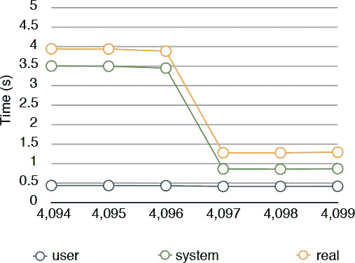

**图 12.2** 不同步长的顺序映射 I/O 性能，无标志

我对这种行为的唯一解释是：试图在内存映射文件中检测顺序访问模式的内核逻辑存在一个漏洞，一旦文件大小大于 32 位符号整数能容纳的范围，它就会消耗额外的 CPU 时间。如果你的访问模式即使略微非顺序，该漏洞也不会显。解决问题的另一种方法是对目标内存使用 `madvise()` 系统调用配合 `MADV_SEQUENTIAL` 标志。应用此标志的结果如图 12.3 所示。

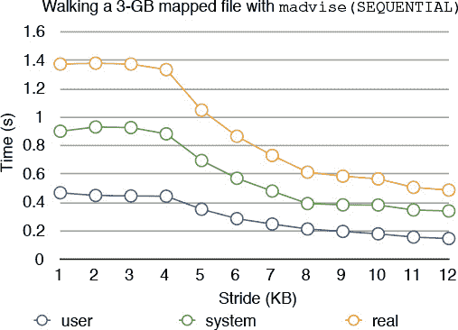

**图 12.3** 不同步长的顺序映射 I/O 性能，`madvise(SEQ)`

然而，当你应用 `MADV_SEQUENTIAL` 标志时，必须绝对确保访问是 100% 完美的顺序，否则性能损失可能会导致性能下降高达 10 倍，特别是当执行实际 I/O 时。图 12.4 比较了不同步长下的实际 I/O 时间。

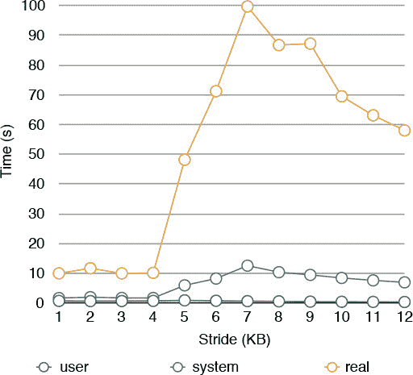

**图 12.4** 不同步长的非顺序映射 I/O 性能，`madvise (SEQ)`

我在 Mac OS X 10.6 到 10.9 版本上确认了这种行为，但在 10.11 中不再如此，因此我仍然建议大多数应用程序使用内存映射 I/O。然而，我也建议你留意这种行为。

支持映射的两个最大因素是：它显著减少了内存压力，并且它几乎全自动地实现了数据的懒加载，这意味着在加载数据时应用程序不会无响应。这一点实际上存在于图 12.1 中，可能稍微隐藏了。对于 `read()` 时间，图 12.1 中显示的时间实际上是 `NSData` 的 `dataWithContentsOfURL:options:error:` 方法的持续时间，调用线程在此期间阻塞。使用映射，`dataWithContentsOfURL:options:error:` 所花费的时间是第一个条形图中所示；之后，应用程序可以执行其他任务，例如与用户交互。

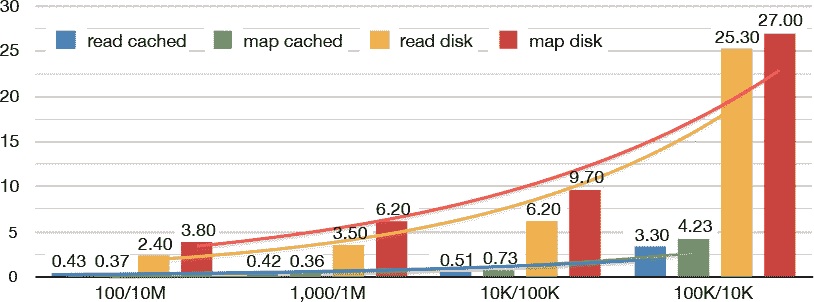

**图 12.5** 不同粒度读取 1 GB 数据所需的时间

### 分块有多大？

当我们准备发布 Leopard 系统时，我被分配了包括查看程序启动性能在的任务。对于启动，我们区分了热启动（warm launch，所需数据大部分已存在于缓冲区中）和不常见的冷启动（cold launch，需要从磁盘读取所有代码、资源和数据，冷启动通常只在系统启动后发生）。

在当时一台的高端 PowerMac G5 上，配备快速的 35-MB/s 硬盘和充足的 RAM，Pages... [根据指令省略了文本]...


对于我们之前使用的 300 MB 示例文件，这种方法证明是所有方法中最快的：当文件位于缓存时，仅需 65 ms 即可读取整个文件；当需要从磁盘读取时则需要 880 ms。对于缓存情况，这种方法实际上比内存映射（memory mapping）更快，而内存映射又比指示 `NSData` 使用 `read()` 更快，这似乎与我之前的观点相矛盾——即使用 Unix 系统调用与 `NSData` 没有区别。

解释并消除这一表面矛盾的微小但关重要的区别在于分配内存的时间。无论使用 `NSData` 还是 `malloc()`，分配并填充一个 300 MB 缓冲器的代价实际上超过了 `bcopy()` 将内存拷贝到这些缓冲区中的成本。另一方面，*没有*产生太大影响的是 `read()` 系统调用中实际使用的缓冲区大小，除非你将其减小到系统调用开销开始变得显著的程度：操作系统会识别顺序的 `read()` 访问模式，并开始通过单次 I/O 操作将大簇（在我的系统上每块 512K）读取到内存中，而无论 `read()` 调用中请求的实际大小。进程未请求的部分直接进入缓冲区缓存。我也没有发现使用带缓冲的 *stdio* 库调用时存在显著差异，因此在你的应用程序中可以使用任何更实用的方法即可。

那么，为什么不一直使用流式 Unix I/O 呢？首先，如果你实际上需要将整个文件内容保留在内存中，它毫无用。在这种情况下，你的数据将在内存中存在两次——一次在缓冲区缓存中，一次在脏应用程序内存中（如果内存紧张，这些内存会被交换出），而不是在映射内存失效时简单地取消映射。或者，你可以实现自己的缓冲方案，通过程序化地将全数据的子集移入和移出内存。然而，这意味着对于可以放入内存的数据和不能放入内存的数据需要有不同的代码路径，并且在没有操作系统提供关于总内存压力和逐出偏好的反馈（或反馈很少）的情况下，手动管理数据移动。最后，你将无法足够快地利用缓冲内存；保持映射状态的数据只需一次普通的内存访问即可获得，而当你管理自己的缓冲区时，至少需要发出一次 `read()` 系统调用并将数据拷贝到你的地址空间。

更好的用例是你正在将外部数据解析为不同的内部格式，但即使那样也存在问题。除非你拥有固定大小的数据元素并在读取时考虑了这些元素，否则会有感兴趣的元素跨越缓冲区边界，如图 12.7 所示。

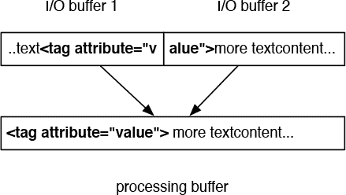

**图 12.7** 当感兴趣的元素跨越缓冲区时的缓冲区缝合

处理这种情况通常需要*缓冲区缝合**buffer stitching*）。首先，在解析时记住不完整元素的起始位置，然后在解析 *buffer 1* 时识别出某个元素是不完整的。然后，你需要将 *buffer 1* 中包含该不完整元素的剩余部分拷贝到一个新的缓冲区中，最后将新读取的内容（*buffer 2*）追加到该残部之后并重新开始解析。在每个缓冲区边界处重复此操作。这种逻辑不仅很复杂，还需要额外的拷贝，这也会影响性能。然而，如果数据确实只使用一次，那么这些额外的逻辑就是值得的，甚至可能值得禁用缓存。当然，你可能没有选择余地，例如当你正在解析由另一个程序增量产生或来自网络的数据时。

# 网络 I/O

几年前，一家报纸联系了我，他们的 iOS 阅读器性能出现了一些问题。他们读到过我的 XML 解析器，由于他们的阅读器基于 RSS 和 HTML，他们认为我可能帮到他们。对该应用的第一眼确认了它慢到无法用。启动或刷新后，它会卡在那里几分钟，最后才显示一些信息。

当然，XML 与此无关，但我最终还是帮了他们。他们的应用是为离线阅读设计的，因此在更新期间，它会加载整个 feed，从分类主列表开始，每个分类的 RSS feed，最后是每篇文章的缩略图、文章文本和图片。使用的算法是对 feed 进行深度优先遍历，如下所示：

**1.** 使用 `NSXMLParser` 的 `-initWithContentsOfURL:` 获取并解析整体 feed 目录。

**2.** 对于遇到的每个 feed：

a. 使用 `NSXMLParser` 的 `-initWithContentsOfURL:` 获取并解析该特定 feed 的 RSS。

b. 在你解析时，针对 RSS feed 中的每条新闻故事：

– 同步获取显示在每个 feed 条目旁边的缩略图，这次使用 `NSData` 的 `-initWithContentsOfURL:`。

– 以同样的方式同步获取故事的 HTML 内容。

– 以同样的方式同步获取故事 HTML 内容中的所有图像。

如果你眯起眼睛，可以识别出这是不恰当应用调用-返回（call-return）架构风格问题的一种变体，尽管这次的症状不是爆炸性的内存消耗。通过将使用 `-initWithContentsOfURL:` 的网络访问视为任何其他同步消息发送，从而在继续执行之前等待结果，我们将性能限制在了网络的*延迟*（latency），而不是其潜在的顺序*吞吐量*（throughput），至少对于我们请求的小中文件是如此。

使用同步请求/响应时，吞吐量受响应时间限制，例如，在网络往返时间为 45 ms 请求大小为 1,400 字节的情况下，我们可以实现的最大传输速度为 1,400 字节/ms，即约 31 KB/s，无论带宽如何。TCP 之能够在这些网络特性下获得更高的传输速度，尽管它向客户端提供了同步 API，但它实际上是异步工作的，允许多个请求同时并发执行。

### 重叠传输

允许多个请求同时并发正是我们需要的策略，只不过这次是在 HTTP 请求级别。幸运的是，`NSURL` 加载系统使得可以使用 `NSURLSession` 和 `NSURLSessionTask` 类异步加载 HTTP 请求。图 12.8 显示了并发请求对下载性能的影响，其影响是巨大的：在四个并发请求之前，吞吐量几乎线性增长，时间从 41.6 s 降至 11.4 s。在四个并发请求之后，曲线开始平缓，在大约六个请求之后，该连接的吞吐量没有进一步提高。

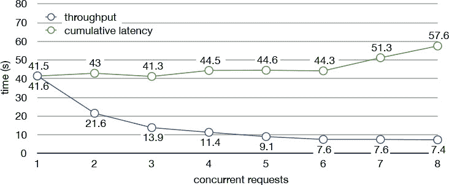

**图 12.8** 在不同并发级别下通过 WAN 完成 100 个 HTTP 请求的时间

事实上，我们看到在六个并发请求之后，累计延迟*开始缓慢增加，而在此之前保持稳定。累计延迟是所有单个请求时间的总和，这意味着单个请求开始变得更长，即使总时间仍在略微下降。这表明客户端和服务器之间的网络已达到容量并现在发生了拥塞，单个请求现在正在竞争带宽。

图 12.9 证明了在饱和通道上堆叠更多并发传输对增加吞吐量毫无帮助；在最好的情况下，它只会延长单个请求的时间。当 10% 的请求已完成时，应用程序的响应性往往比所有请求都完成 10% 时要更好。

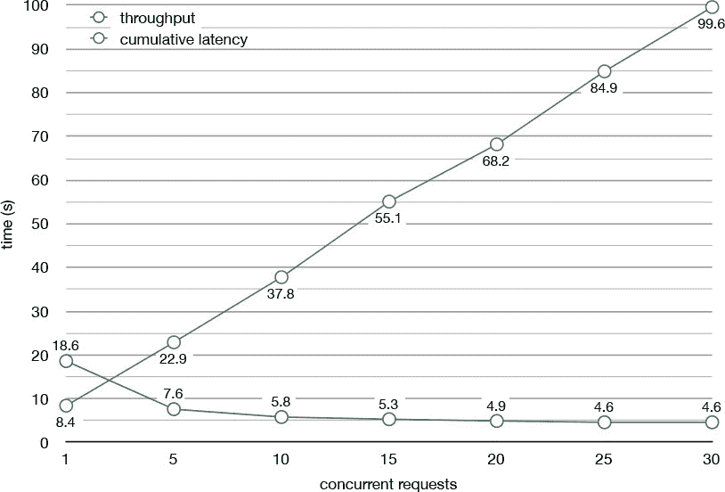


**图 12.9** 在不同并发级别下本地完成 10,000 次 HTTP 请求所需的时间

此外，用大量并发传输轰击服务器会占用服务器上的每个请求资源，可能导致服务器资源饥饿、请求丢失，甚至导致服务器资源耗尽和崩溃。在慢网络上，你可能还会遇到连接超时。

### 限制请求（Throttling Requests）

事实上，你并不希望进行无限制的异步网络操作，因为你*真的*不想让通道过载。

TCP 本身通过监控丢包为单条通道提供自动拥塞控制，但 HTTP 并没有这种机制；你必须自己管理由多个并发 HTTP 请求引起的拥塞。`HTTP/1.1` 规范确实要求每个客户端的并发持久连接数限制为两个，但这与并发请求数并没有直接相关，而且这只是对客户端施加的要求，而不是协议强制执行的。

实现这一目标的主要方法是限制并发请求数。你不需要把这个数字设置得完全完美；TCP 的拥塞控制会确保数据送达，只有当大幅超过通道容量时，性能影响才会变得显著。`HTTP/2` 通过单个持久且多路复用的连接管理传输，可能从底层 TCP 协议中获益更多。

尽管这方面没有记录，但我的测试以及服务器团队的投诉都表明，已废弃的 `NSURLConnection` 类并不限制连接数。事实上，仅仅创建一个 `NSURLConnection` 实例就会开始传输。为了回避这个局限性，我不得不创建一小部分基础设施，对传入的下载请求进行队列，并一次只启动几个。

幸运的是，iOS 7 和 Mac OS X 10.9 引入的 `NSURLSession` 加系统使得许多基础设施变得不再必要。例如，控制特定下载的 `NSURLSessionTask` 实例启动时是挂起状态；你必须显式地调用 `-resume` 才能开始下载。此外，配置 `NSURL Session` 及其所有 `NSURLSessionTask` 的 `NSURLSessionConfiguration` 类带有 `HTTPMaximumConnectionsPerHost` 属性，它至少允许限制指向特定主机的连接数，至少避免了并发连接过载特定主机。

`HTTPMaximumConnectionsPerHost` 的默认值根据当前环境而异。例如，它在我的 MacBook Pro 上是 `6`，在我的 iPhone 上是 `4`，但在 iPhone 上它似乎不会随活动网络类型而变化。这些值对于平均请求是非常很好的通用默认值，与图 12.8 中的数据非常匹配，但你可能需要自己进行调整——例如将大下载限制在较小的数量——因为这些下载本身就能饱和网络。`HTTPShouldUsePipelining` 标志默认关闭；如果你的服务器支持管道（pipelining），开启此标志可以显著提高吞吐量。

### 数据处理（Data Handling）

除了不利用网络带宽，`initWithContentsOfURL:` 方法的另一个问题是数据处理和内存消耗。每个文件在处理开始之前都会完全加载到内存中，如果数据量很大就会就会问题。

处理这个问题有两种基本方法。第一种是在数据到达时立即增量地处理数据。如果每个文件的输入数据量很大、可以增量处理并且在处理后会大幅减少，这种方法效果很好。这意味着处理逻辑必须能够处理小分块的数据，可能需要处理缓冲区拼接（见上文）和部分结果，并且能够将这些部分结果报告给 UI。

对于这个特定的 Feed 处理应用程序，我们选择了第二种方法，即将文件下载到磁盘而不是内存，然后将这些磁盘文件映射到内存中。这给了我们内存映射的优势和处理完整文件的简单性。这是可行的，因为单个 Feed 文件相对较小；我们只是数量很多。

通过下载到磁盘，我们也或多少地自动拥有了自己的 URL 缓存。与系统范围的 URL 缓存不同，我们可以控制缓存中对象的生命周期，因此还可以将其用于离线阅读和快速启动，从缓存启动应用程序，并在可用时从服务器增量更新数据。

新闻应用程序的最后一个问题是，所有这些网络活动都是同步的，因此很慢，而且是在主线程执行的，因此会阻塞应用程序直到完成。尽管 `NSURLConnection`（以及 `NSURLSession`）系统在 `NSRunLoop` 上异步运行，理论上可以从主线程管理而不阻塞网络操作，但仍然有足够的其他工作（检查缓存、将数据写入磁盘、从磁盘加载下载的数据并处理、发起传输等），因此使用一个具有独立 `NSRunLoop` 的单独线程来管理所有 I/O 是有益的，只有在数据处理完成且 UI 准备好更新时才向主线程报告。

最终的 Feed 更新算法如下：

1. 从缓存或网络获取总的 Feed 目录。
2. 对于目录中的每个 Feed：
   a. 获取 RSS Feed，从缓存或网络获取。
   b. 从 Feed 中解析缩略图、文章内容和图像 URL。
   c. 提交所有缩略图 URL 获取。
   d. 提交所有文章内容 (HTML) URL 获取。
   e. 提交所有文章图像 URL 获取。

注意，前两层获取实际上是同步的。这不仅让代码保持紧凑且易于遵循，更重要的是它最小化了直到第一个新闻 Feed 显示的时间。因此，在第一个 Feed 可用之前，我们最小化延迟；只有在第一个 Feed 下载（可以显示给用户）之后，我们才开始提交多个请求并针对整体带宽而非单个延迟进行优化。我们还按照可能需要的顺序提交请求。

有了这些更改，应用程序从无法忍受的缓慢变得响应非常迅速，在空启动或刷新后，Feed 和故事几乎立即弹出。

在回环接口上运行的实验中，这里使用的 Cocoa 网络栈能够每秒管理 1000 次小请求，并为大请求提供超过 300 MB/s 的传输速度，这两者都远超典型的客户端需求或广域网络能力。所以，尽管存在更高性能的网络 I/O 模型，但基础 Cocoa 网络栈对于客户端网络需求来说完全足够。

### 异步 I/O（Asynchronous I/O）

事实上，我想简要离题谈由于所谓的性能改进而进行的过度工程，特别是异步 I/O 原语以及构建在其上的技术的使用。

大多数 Unix 系统调用都有异步变体，它们不会在 I/O 完成之前阻塞其调用线程，而是使用不同的机制来信号完成。从理论上讲，这是一个好主意，因为将较多的潜在 I/O 操作调度在一起，给了操作系统更多机会来优化实际的 I/O。


在实践中，异步 POSIX 函数实际上并没有那么好用：例如，“同步”文件写入默认就是异步的，它们先进入内存，稍后才由操作系统刷新；而“同步”文件读取则使用了大量的预读（read-ahead）来达到类似的效果。事实上，参考 BitTorrent 实现库 `libtorrent` 的创建者在一篇博客文章^(1)中记录了，他对异步 API 的实验如何导致他采用与前一节相似的策略，即使用单个 I/O 服务线程，尽管这次是针对磁盘 I/O 的。

1.** [`blog.libtorrent.org/2012/10/asynchronous-disk-io/`](http://blog.libtorrent.org/2012/10/asynchronous-disk-io/)

这是基础事件驱动网络架构的一种变体，高性能 Web 服务器也采纳了这种架构，以应对 Dan Kegel 在 1999 年提出的 C10K 问题^(2)。该问题假设当时的硬件已经能够处理 10,000 个并发 Web 客户端，但软件栈的限制阻止了高并发 Web 服务器的运行。

2.** [`www.kegel.com/c10k.html`](http://www.kegel.com/c10k.html)

在提供的选项中，每个连接使用一个线程并配合普通阻塞（同步）I/O 被认为是有问题的，因为某些操作系统“处理几百个线程就会遇到困难”。显然，当你处理的是典型的六个或最多十几个网络连接而不是几万个时，这并不是问题。对于通过公共互联网与服务器通信的典型网络客户端，从性能角度来看，同步 I/O 绰绰有余；没有必要为了性能而使用异步 API。

这一建议也适用于 Apple 的 Grand Central Dispatch（`dispatch_io`）以及构建在其上的高层库（例如会想到 `NSStream`）。如果你发现这些 API 让你的代码比简单的 `read()` 或 `write()` 循环更易编写，那么尽管去用吧。只是不要期望获得任何可衡量的性能提升，除非你是在主线程上执行这些 I/O。这并不意味着例如 GCD 并不是这些概念的良好实现，只是 GCD 类架构所解决的影响直到你达到比典型客户端高出几个数量级的并发水平时才会出现，而且正如我们在下一节将看到的，这些影响完全会被其他影响所掩盖。

### HTTP 服务

像许多具有 NeXT 背景的 Mac 开发者一样，我怀念旧的 Objective-C WebObjects 框架。能够在前后端之间共享代码是一项非常有吸引力的功能，以至于开发者已经开始在服务器上使用 JavaScript，例如以 node.js 的形式。Objective-C 是一个很好的组合，既为可扩展 Web 服务提供了高性能，又为快速开发提供了良好的表达能力。从原则上说，它应该让初创公司避免最初使用 Ruby on Rails 实现服务，然后在服务在负载下开始失效时不得不将其迁移到 Java 或 Go。

遗憾的是，我从未有机会去认真考虑这个问题，直到我必须将一个一个小型的 HTTP 服务器嵌入到 Cocoa 桌面程序中，以便在点对点环境中发布 Atom 馈送和日历信息。我最初尝试了 Cocoa HTTP，但我发现修改它来提供动态内容异常地困难，因此我很快切换到了 GNU libmicrohttpd。从服务器的上下文来看，这展示了网络代码在真正高负载时的状态，而我们知道这在大多数客户端代码中并没有真正发生。

即使我用一个不太熟练的 Objective-C 类封装了 libmicrohttpd，将不同的 HTTP 动词映射到消息，我发现性能非常出色。图 12.10 显示了小请求的处理性能，将其与 Cocoa 嵌入式库（如基于 GCD 的 CocoaHTTPServer 和作为 Cocoa 的 Web 托管服务基础的 OCFWebServer）进行了对比，同时也与 Sinatra Ruby 微框架（高性能非阻塞 JavaScript 服务节点 node.js 的冠军）进行了对比。静态服务器 Apache 和 nginx 仅供参考；它们在提供文件，而其他服务器都是从内存提供服务。

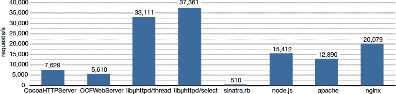

**图 12.10** Web 服务器请求处理性能

所有结果都是使用 `wrk` 压力测试工具通过环回接口收集的，使用的命令如 `wrk -r 10000 -c 100 http:// localhost:8081/`。使用环回接口是为了测试服务器代码而非网络硬件，其明显的缺点是负载生成器和服务器运行在同一主机上。这实际上导致了问题，因为发现 apache bench (ab) 和 httperf 都不够快，跟不上被测试的快速服务器，但 `wrk` 解决了那个特定问题。

图 12.10 令人惊讶的是，即使经过了封装，libmicrohttpd 管理的吞吐量也是其他基于 Cocoa 服务器的 4 到 6 倍，尽管它使用了过旧的技术，如带有线程池的 `select()` 轮询，甚至为每个连接创建一个线程。其原因是，正如我在上面讨论异步 I/O 时写道，线程调度或工作队列的差异虽然存在，但显然不如其他因素重要。通过 Instruments 查看 CocoaHTTPServer（#ch12.html_ch12fig11）和 libmicrohttpd（#ch12.html_ch12fig12）的反转调用树可以发现这一点。

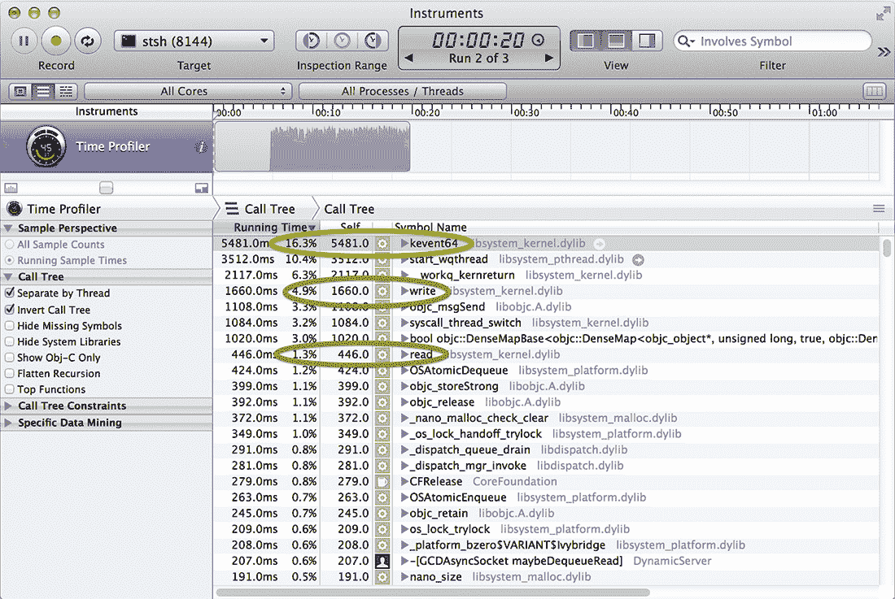

**图 12.11** CocoaHTTPServer 的调用树

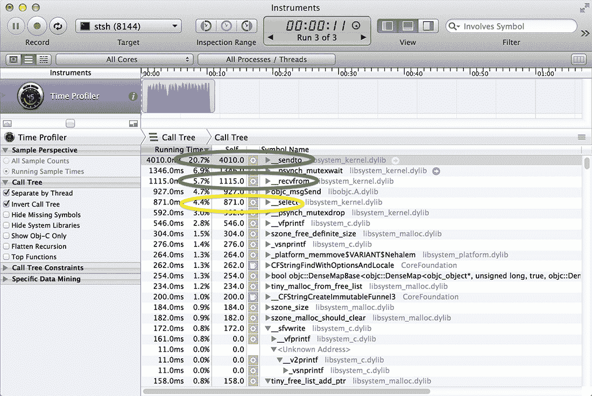

**图 12.12** libmicrohttpd 的调用树

在两个轨迹中，执行有用 I/O 的函数都用绿色标记出。这些函数在 libmicrohttpd 轨迹（#ch12.html_ch12fig12）中是顶层函数，但在 CocoaHTTPServer（#ch12.html_ch12fig11）中处于很靠后的位置，后者被开销主导，用黄色标记（位于顶部）。例如，消息开销比有用工作高出几倍，内存分配也是如此。

当然，Sinatra 的性能糟糕得近乎滑稽，仅为嵌入式 Cocoa 服务器的 10%，不到 libmicrohttpd 的 2%。node.js 基于 libev，对于简单的静态数据提供任务实际上相当高效，但在这种双核系统上只利用了一个核心。libmicrohttpd 架构允许它利用多个核心，并处理线程阻塞，例如由于虚拟内存故障导致需要从磁盘换入某些内存。


为了完整起见，图 12.13 显示了这些 Web 服务器的吞吐量，再次使用了环回接口。由于吞吐量主要取决于内核代码和系统调用接口，不同服务器之间的差异要小得多。所有这些服务器都能饱和 1 Gbit/s 网络接口，除了 `OCFWebServer`^(3) 之外，所有服务器也能饱和 10-Gbit/s 链路.^(4)

3. `OCFWebServer` 默认使用 `NSString` 作为响应数据，导致吞吐量下降到 426 MB/s。测试改用 `NSData` 对象进行。

4. Sinatra 需要较大的请求大小才能不受低请求吞吐量的限制。例如，一个 1-MB 的请求会将 Sinatra 的吞吐量限制在 500-MB/s。

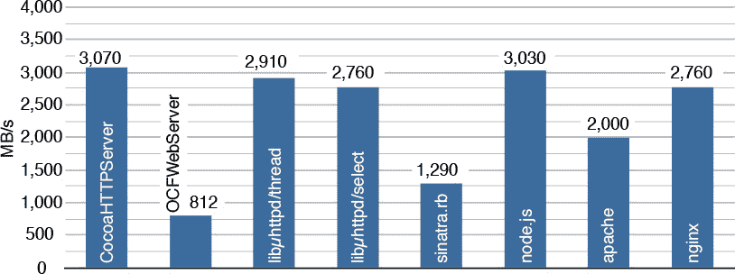

**图 12.13** 大文件的 Web 服务器吞吐量

值得注意的一点是，在吞吐量方面，`libmicrohttpd` 使用阻塞 I/O 的每线程一个模型实际上比使用非阻塞 I/O 和 `select()` 复用几个线程的模型快一点，这可能是因为消除了使用 `select()` 来确定哪些连接已就绪的开销。

尽管我不预计 Objective-C 在短期内会席卷 Web 服务世界，但只要有良好的库，知道它能够胜任工作是好的。在服务器环境中提升性能还揭示了，我们在前面章节中讨论的基础优化准则对性能的影响远大于执行异步和非阻塞 I/O 的复杂技术。

我还测试了一些 Swift HTTP 服务器框架。其中表现最令人信服的是 Dynamo，^(5)，每秒达到可人的 8,000 到 9,000 次请求。这比 Sinatra、CocoaHTTPServer 或 OCFWebServer 快，但比大重量的 node、apache 和 nginx 慢，并且比封装过的 `libmicrohttp` 慢 3 到 4 倍。Swifter^(6) 比 Dynamo 慢约 10 倍且容易崩溃。我无法编译 Taylor、Perfect、Kitura 或 vapor，因为它们都依赖于中间的 Swift 3.0 开发版本而非官方 Beta 版。

5. [`github.com/johnno1962/Dynamo`](https://github.com/johnno1962/Dynamo)

6. [`github.com/httpswift/swifter`](https://github.com/httpswift/swifter)

## 序列化

尽管 `NSData` 和原始 Unix I/O 适用于内存与设备之间的字节移动，但 Objective-C 通常希望加载和保存文档或其他内存中表示为 Objective-C 对象的结构化数据。原则上，实现这一点有两种方法：你可以简单地转储和加载内部内存表示，也可以将内部表示序列化为外部格式。你可以自己序列化数据，也可以使用 Cocoa 内置的机制之一：属性列表序列化或对象归档.^(7)

7. Apple 错误地将“序列化”一词仅用于不保留对象标识和关系的序列化类型。我们将使用更广泛的定义，即归档是序列化的一种特例，而不是它的替代方案。

为了比较这些方法，我们将查看保存和加载示例 12.2 所示的简单 `SampleObject` 类对象。

**示例 12.2 用于归档比较的对象**

点击此处查看代码图像

```objectivec
@interface SampleObject : NSObject

{
  int retainCount;
  int a;
  float b;
  NSString *name;
  NSArray *children;
}

```

由于这是一本关于性能的书，我们将观察大约 100 万个对象在驻留时占用约 60 MB 内存。`SampleObject` 实例按照图 12.14 所示的示意树排列。

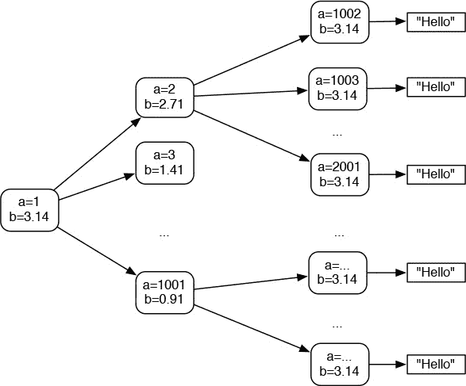

**图 12.14** 用于测试的 SampleObject 实例树

该树深度为三，顶层对象指向 1,000 个二级对象，这些对象每个指向 1,000 个叶子对象。每个对象都有原始类型 `float` 和 `int` 的实例变量；内部节点还有一个包含其子元素的 `NSArray`，而叶子节点有一个 `NSString`。

## 内存转储

从概念上最简单且可能快的状态保存技术是执行内存转储。`write()` own`NSData`
`copy()`

### 简单格式

我们可以做的事情之一是创建我们自己的格式，遵循新的 (MS) 和 iWork 格式的步骤。

```xml
<S a="100" b="100">
  <S a="0" b="0">hello world</S>
  <S a="0" b="1">hello world</S>
  <S a="0" b="2">hello world</S>
  <S a="0" b="3">hello world</S>
</S>
```


}];

}

序列化代码使用 `MPWXmlGeneratorStream` 的基于块的方法 `writeElementName:attributeBlock:contentBlock:` 来实际生成 XML 表达式。`writeCStrAttribute:intValue:` 和 `writeCStrAttribute:doubleValue:` 方法使得可以在不需要对键或值进行对象转换的情况下写入原始类型属性，而元素内容的块（block）负责管理递归结构，同样不需要转换为中间对象形式。整个方法与使用 `printf()` 调用来生成 XML 非常相似，但通过生成器流流确保了正确的 XML 语法。

示例 12.5 所示的解析代码使用了一个块（block）来处理 `S` 元素。`a` 和 `b` 属性通过 `objectForUniqueKey:` 从属性中获取，并假设子节点已经解码。

### 示例 12.5 原始 XML 解析

点击此处查看代码图像

```objc
+(instancetype)parseFromXML:(NSData*)xmlData
{
  MPWMAXParser *parser= [MPWMAXParser parser];
  [parser setHandler:self forElements:[NSArray arrayWithObject:@"S"]
              inNamespace:nil prefix:@"" map:nil];
  [parser handleElement:@"S"
              withBlock:^(id elements,id attrs, id parser) {
      id children;
      if ( [elements count] == 1 ) {
        children=[elements lastObject];
      } else {
        children=[elements allObjects];
      }
      return [[self alloc]
                  initWithA:[[attrs objectForUniqueKey:@"a"] intValue]
                               b:[[attrs objectForUniqueKey:@"b"] floatValue]
                               c:children];
      }];
  }
  return [parser parsedData:xmlData];
}
```

在我的 MacBook Pro 上，保存和加载 100 万 `SampleObject` 实例对象图都略小于一秒：生成 XML 表达式耗时 0.4 秒，解析耗时 0.7 秒。这在磁盘上占用 50 MB，大约是 Squeak 内存转储的两倍，耗时也相近，但其文件格式是人类可读的，并且可以其他程序和工具访问。

我们的 XML 序列化例程的性能写入速度略高于 100 MB/s，读取速度略低，因此接近现代硬盘的顺序写入性能，大约是相当快的 SSD 的四分之一。我们能做得更好吗？由于我们需要转换为 ASCII 且 XML 较为冗长，二进制格式可能会更有优势。

#### 属性列表 (Property Lists)

OS X 和 iOS 都有属性列表，它们已经存在很久。属性列表由 `NSArray`、`NSDictionary`、`NSString`、`NSData`、`NSDate`、`NSNumber` 和 `Boolean` 组成。`NSPropertyListSerialization` 类提供了这些对象与属性列表数据之间转换的方法。例如，`NSPropertyListSerialization dataWithObject:format:options:error:`可以将对象图序列化为 XML 或二进制格式的属性列表编码数据。相反，`NSPropertyListSerialization propertyListWithData:format:options:error:` 可以从数据重建对象图。

属性列表的二进制格式比 XML 格式紧凑得多，解析速度也更快。XML 格式具有可读性，便于调试和手动编辑，但从性能和存储效率考虑，通常选择二进制格式。


```objectivec
@implementation NSString(asPlist)

-(NSDictionary*)asPlist { return self; }

@end

@implementation NSArray(asPlist)

-(NSDictionary*)asPlist {
   NSMutableArray *plist=[NSMutableArray array];
   for (id a in self ) {
     [plist addObject:[a asPlist]];
   }
   return plist;
}

@end
```

* *

### 示例 12.7 示例 XML 属性列表（不）

点击此处查看代码图像

* * *

```xml
<plist version="1.0">
<dict>
        <key>a</key>
        <integer>100</integer>
        <key>b</key>
        <real>100.12000274658203</real>
        <key>c</key>
        <array>
...
                            <dict>
                                <key>a</key>
                                <integer>0</integer>
                                <key>b</key>
                                <real>0.0</real>
                                <key>c</key>
                                <string>hello world</string>
                            </dict>
...
```
```

* * *

因此，我们应该能够找到更好的序列化方法，该方法的 API 不需要要求我们提供完整的中间表示，特别是不需要一个主要由 `NSDictionary` 实例组成的表示。事实上，Apple 的《属性列表编程指南》（*Property List Programming Guide*建议我们，如果“你需要一种方法来存储大型复杂的对象图……请使用*归档*（archiving）”。

#### 归档 (Archiving)

属性列表受限于特殊属性列表类的树结构，而归档可以序列化任意的对象图以及这些图中的数据。`NSCoding` 协议在我们在第 7 章 中看到的那种方式上也是增增的：你可以一次归档一个对象和一个属性。虽然任何类都可以实现 `NSCoding` 协议，但 Apple 只有两个：使用继承自 NeXTStep 的二进制类型流的旧版 `NSArchiver`，以及自 Mac OS X 10.2 引入以来 Apple 推荐用于 Cocoa 的 `NSKeyedArchiver`（这也是 iOS 上唯一 Apple 提供的归档器）。

示例 12.8 展示了我们示例对象的归档和反归档的方法。它使用了简单的宏，这些宏展开为注释中所示的代码，但避免了重复变量名和键名。如你所见，代码比上面简单一些，而且方法是增量地产生结果的。

### 示例 12.8 对象的归档与反归档

点击此处查看代码图像

* * *

```objectivec
-(void)encodeWithCoder:(NSCoder*)aCoder
{
   encodeVar( aCoder, a );      // [aCoder writeInt:a forKey:@"a"];
   encodeVar( aCoder, b );
   encodeVar( aCoder, c );
}

- (id)initWithCoder:(NSCoder *)aCoder {
   if (self = [super init]) {
     decodeVar( aCoder, a ); // a=[aCoder decodeIntForKey:@"a"];
     decodeVar( aCoder, b );
     decodeVar( aCoder, c );
   }
   return self;
}
```

* * *

实际的归档要么通过 `archivedDataWith RootObject:` 方法返回 `NSData` 在内存中创建，要么直接在磁盘/文件上使用 `archiveRootObject:toFile:`，每个方法都将我们的 `SampleObject` 树的根作为主要参数。然而，运行结果令人失望：保存花费 9.1 秒，加载花费 2.6 秒，因此序列化速度比属性列表慢（慢了 2 倍），读取也没有更快。内存使用情况糟糕得多：一个磁盘上占用 77 MB 的归档文件产生了 819 MB 的开销。

为什么键归档（keyed archiving）性能如此糟糕？一个潜在的理论是归档做了序列化没有做的事情：它维护了对象关系，因此在维护这些关系上必须做更多工作。然而，Apple 的“旧式”归档器也做了这些工作且快得多：归档需要 2.12 秒，反归档需要 0.81 秒。此外，正如我们将在下一章看到的，二进制列表格式实际上具有唯一化（uniquing）的功能。因此，维护关系并不是问题。

Apple 改进键归档的主要建议是忽略仅包含数据的键，但即使从我们的对象图中移除除结构部分以外的所有数据（即没有整数、双精度浮或字符串），序列化和反序列化的速度也仅提高到 6.0 秒和 2.06 秒。一点调查显示，键归档性能差的原因是尽管 API 很好，但它并没有流式输出结果。相反，它在后台构建了一个属性列表，正如示例 2.9 所示，这个属性列表包含了多级间接，甚至比上一节创建的直接属性列表还要。

### 示例 2.9 键归档属性列表（不完整，已转换为 XML）点击此处查看图像

* * *

```xml
<dict>
        <key>archiver</key>
        <string>KeyedArchiver</string>
        <key>objects</key>
        <array>
            <string>null</string>
            <dict>
                <key>0</key>
                <integer>0</integer>
                <key>1</key>
                <real>0.12000274658203</real>
                <key>2</key>
                <string>hello world</string>
            </dict>
            <dict>
                <key>CF$UID</key>
                <integer>2</integer>
            </dict>
            <key>class</key>
            <dict>
                <key>CF$UID</key>
                <integer>7</integer>
            </dict>
            </dict>
        </dict>
        <key>NS.objects</key>
        <array>
            <dict>
                <key>CF$UID</key>
                <integer>3</integer>
            </dict>
        </dict>
</dict>
```


在处理大型数据集时，尤其是大量对象时，Apple 目前还没有一种完善的序列化机制，而 Apple 最推荐用于大型数据集的机制实际上在耗时间和内存消耗上都是最差的。这种差异在反序列化时比序列化时没那么糟糕，理由是文件的读取频率远高于写入频率。但由于有了自动保存和版本控制功能，情况可能不再如此了。

需要注意的是，Apple 自身在其 Apple 生产力应用 Pages、Numbers 和 Keynote（以前称为 `iWork`）中并没有使用任何这些标准机制。之前的版本通过 `libxml2` 使用 XML 格式，但从 iWork ‘13 版本开始，该格式已切换为通过私有框架实现的 Google 协议缓冲区（Google Protocol Buffers）。

## CoreData

为了在大数据集上实现高性能，Apple 推荐使用 `CoreData`，它被是一个“高度优化”的解决方案，具有“任何竞争方案中最好的内存扩展性”。根据文档描述，“你可能会花费大量时间仔细构建一个针对特定问题领域优化的自定义解决方案，却无法获得比 CoreData 免费提供的性能更好的性能优势。”

考虑到这些乐观的言辞，让我们把 `CoreData` 应用到示例任务中：创建并保存包含约 100 万个 `SampleObject` 实例树，并找到优化获取它们进行内存处理的方法。为了实现这一点，我们需要让 `SampleObject` 成为 `NSManagedObject` 的子类，这样它就可以自动合成 `CoreData` 属性所需的特殊 setter 和 getter（参见 示例 12.10）。为了稍微简化起，我们省略了根对象，从原来的第二层即 1,000 个对象开始，每个对象拥有 1,000 个子对象。

**示例 12.10 作为 CoreData 类的 SampleObjects**

点击此处查看代码图像

* * *

```
@interface SampleObject : NSManagedObject

@property (nonatomic,assign) NSInteger a;

@property (nonatomic,assign) float b;

@property (nonatomic,assign) NSString *c;

@property (nonatomic,strong) NSSet *children;

@property (nonatomic,assign) SampleObject *parent;

@end

@implementation SampleObject

@dynamic a,b,c,children,parent;

@end
```

* * *

此外，我们需要创建一个 `NSManagedObjectModel`，既可以通过大约 60 行代码来实现，也可以使用 Xcode 数据模型器。一旦获取了模型，再获取一个 `NSManagedObjectContext` 并编写另外 30 行代码，就可以创建一些对象并将它们保存到 SQLite 存储中了。幸运的是，iOS 10 和 OS X 10.12 使用 `NSPersistentContainer` 类简化了这一点。

### 批量创建和更新

按照我们之前的方法创建 100 万个对象并保存它们的结果相当令人失望：整个过程耗时 34.4 秒，大约是我们之前最慢机制 `NSKeyedArchiver` 所需时间的 3 倍。尽管略超过 1 GB，它还成功地比 `NSKeyedArchiver` 略微增加了内存开销，尽管实际的磁盘存储非常小，只有 44 MB。同样惊讶的是，仅仅在内存中创建对象就花费了 12 秒，其余时间花在了保存上。作为参考，创建由普通对象而非 `NSManagedObject` 子类组成的 `SampleObject` 图形仅需 350 毫秒，即时间的 1/30，正如我们在第 1 章中所回忆的，分配对象是我们处理的较慢的操作之一。

使用 XML 存储而不是 SQLite 需要一个半多的时间并消耗超过 4.5 GB 的内存来产生 399 MB 的磁盘结果，二进制存储也大不差，因此原子存储并不是解决方案。即使是内存存储也花费了 20 秒，所以 I/O 并不是问题所在。图 12.17 显示了耗时，图 12.18 显示了内存消耗和磁盘大小。

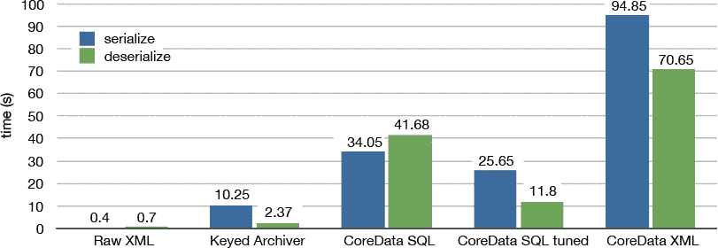

**图 12.17** 读写 100 万个对象的时间，包括数据库


**图 12.18** 使用 CoreData 时 100 万个对象的磁盘和内存空间

Apple 的 CoreData 文档强烈建议拆分此类操作并进行批量处理，如果你的数据模型支持这一点，那就太棒了。我们的模型足以支持运行不同批量大小的测试，从 10 个元素（意味着 100,000 个批次）到 1 个批次一百万个对象。我们假设批次是完全独立的，这允许我们 `reset` `NSManagedObjectContext`，从而完全从内存中清除对象。

结果在图 12.19 中，通过批量大小绘制了性能和内存图表。对于性能而言，在正中间有一个甜点，即批量大小为 1,000 个对象。较小的批量大小开始产生小规模写入的高 I/O 额外销（通过 `time` 命令的显著增加可以看出其 `real` 耗），而较大的批量大小则会导致更高的 CPU 负载。显然，某些数据结构或算法的扩展性略差于线性。另一方面，内存是严格线性的，每个保存的批量占用 1 KB 内存，下限为 14.7 MB。如果你不能不在批次之间 `reset` `NSManagedObjectContext`，100 万个对象的内存消耗将达到 600 MB。


**图 12.19** CoreData 写入的时间空间权衡（按批量大小）

证明使用 1,000 的批量大小对 SQLite 存储是最佳的，第一次迭代保存了 0.1 秒。到第 50 次迭代时，保存一个批次的时间已经增加到 1 秒，这种线性趋势持续下去，每 50 个批次每个批次时间增加 1 秒。我们在 10 分钟后在第 250 个批次（每个 1000 个）中断了程序，此时每次的时间已增加到 5 秒。外推 O(n²)(ch12.html_ch12fn2)) 曲线显示，使用 XML 存储将花费大约 2 小时 48 分钟。

修改对象图在时间和空间上具有几乎相同的性能特征，这意味着 CoreData 不适用于任何需要批量创建或修改大型数据集的任务。

### Fetch 取与故障技术

我对获取结果的首次实验留下了深刻印象，获取用于后续遍历的 1,000 个顶级对象花费不到半秒，甚至获取所有 100 万个对象也不到一秒。当然，我掉入了我们在 CPU 章节中过的经典基准测试陷阱：没有使用计算结果。就像编译器消除未使用结果的计算一样，CoreData 并不一定会拉取所获取对象的数据，特别是通过关系访问的对象（例如我们对象图中的父子关系）。因此，为了测试实际性能，我添加了[示例 12.11 中所示的 `sumB` 方法，正如其名所示，它汇总树中所有对象的 `b` 属性值。


## 示例 12.11 使用 SampleObject 对象图进行计算

点击此处查看代码图像

* * *

```objective
-(double)sumB
{
    double result=0;
    for (int i=0;i<10;i++ ) {
        result+=[self b];
    }
    for ( SampleObject *s in [self children] ) {
        result+=[s sumB];
    }
    return result;
}
```

* * *

第一次遍历对象图时，CoreData 会加载它所需的所有值（fault in），这花费了几乎 42 秒。第二次遍历几乎是瞬时完成的，仅用 0.3 秒。此操作及其他获取变体的结果所示图 12.20。


**图 12.20** CoreData 获取与预取变体的时间耗对比

问题在于，每次访问关系时，都会触发一个独立的故障（fault），导致另一次单独到数据库的往返。这种幼稚的故障机制也是使用 CoreData 的前身 `Enterprise Object Framework` 时的主要问题之一。例如，我被派往 BBC 替换的一个系统通过在 Objective-C 代码中独立遍历树的每一层来获取体育赛事树（例如，`FIFA World Cup` → `Quarter Final`）。这导致了对数据库的数百次往返，基本上是树中的每个对象就会触发一次。显式地获取树的层级将这些往返减少到了三次，时间也从 40 多秒缩短到不足 1 秒。

当然，“到数据库的往返”在企业级应用中的含义与在 CoreData 中完全不同：在企业级环境中，你必须序列化查询，然后将其通过网络发送到数据库服务器。尽管数据库服务器是一台拥有大量内存、高功率 CPU 和高速磁盘的强大机器，但往返延迟会销毁你的性能，紧随其后的是你通过网络发送的数据量。在这种环境中，将业务逻辑放在数据库服务器上并非常仔细地选择发送或接收的数据，对于最小化网络延迟和吞吐量至关重要。

然而，在 CoreData 中，“数据库服务器”和客户端通常是同一台计算机（直到最近这才是唯一支持的配置）。此外，我在关系型数据库中编码对象图的经验是，只有当数据库位于内存中（在操作系统的缓冲区缓存或数据库的缓冲区中）时，才能获得可接受的性能。

即使数据库文件在缓冲区缓存中，关系仍然是测试中主要的性能消耗，但我很难说服 CoreData 我真的想获取这些关系的目标。我的第一次尝试是使用 `NSManagedObjectContext` 中名其实际 `setRelationshipKeyPathsForPrefetching:` 方法，要求它获取 `children` 关系。这在总时间上并没有产生明显差异（尽管它将部分总时间转移到了初始获取），`setReturnsObjectsAsFaults:NO` 也是如此。我终于发现，我必须指定关系末尾的属性，否则这些属性将不会被读取，即 `children`、`children.a` 和 `children.b`。通过这些键进行预取，我们终于得到了标记为*prefetch relationships*（预取关系）的结果。

然而，尽管我现在表面上正在预取计算结果所需的所有数据，但在第一次图遍历期间我仍然遇到了显著延迟，这表明有更多的故障发生。解决关系故障的另一个建议是使用单独的 `NSFetchRequest` 手动获取关系，谓词形式为 `@"parent IN %@", fetchedArray`，其中 `fetchedArray` 是初始获取的结果。这种*manual prefetch*（手动预取）改善了情况，让初始获取在 3.2 秒内完成，而不是 11.3 秒，但并没有改变 19.5 秒的第一次遍历时间。

我终于意识到，CoreData 试图获取的是叶子对象并不存在的子节点。遗憾的是，我试图聪明地使用 `@"children.children"` 预取键进行预取并没有受到 CoreData 之神的青睐，导致了以下错误信息：

点击此处查看代码图像

```
CoreData: error: (1) I/O error for database at db.db.
    SQLite error code:1, 'too many SQL variables'
Core Data: error: -executeRequest: encountered exception = I/O error
    for database at db.db.
SQLite error code:1, 'too many SQL variables' with userInfo = {
    NSFilePath = "db.db";
    NSSQLiteErrorDomain = 1;
}
```

相反，我发现处理这种情况唯一的方法是调整计算逻辑和对象模型，包含一个叶子对象的显式标记，该标记不是通过计算子节点数量得出的。通过图 12.20 所示的这种修改后的计算，我终于成功得到了标记为*prefetch relationships*的结果。当然，现在该标记与 `children` 关系的同步产生了额外的开销。

#### 优化策略
所有这些时间都是在对查询键具有索引的数据库上测量的；如果没有这些索引，相同的查询通常会慢几个百分点。

一个引入胜的优化建议是在 `NSFetchSpecification` 中设置 `NSDictionaryResultType` `resultType`。这不再返回 `NSManagedObject` 实例，而是只返回包含获取指定属性的 `NSDictionary` 实例。结果所示图 12.20，并标记为*fetch raw dict*（获取原始字典），它们非常惊人：获取仅用 0.8 秒！这里实际上发生了几件事。首先，事实证明 CoreData 的性能并不限于 SQLite；字典获取显示，从 SQLite 获取数据到 Cocoa 可以极快。CoreData 将这些获取的结果转换为对象（特别是管理关系时）才是性能消耗所在的地方。其次，原始字典获取是有限的；它们不处理任何关系。例如，我们的对象树是不可用的，只有一个平面的字典数组。第三，我们无法修改和保存原始字典。最后，字典与“普通”对象相比的相对性能仍然如我们预期，如插图 *2nd fetch*（第二次获取）所示。图 12.20 中的最后一组结果 *XML (not coredata)*（XML，非 CoreData）显示了通过我们在上一节中看到的 XML 反序列化机制“获取”我们对象图的时间，其中初始获取代表反序列化对象图的时间，第一次和第二次访问都是使用纯 Objective-C 消息发送来检索属性的标准对象图遍历。通过消息发送访问实例变量仍然比使用字典访问快十倍，这就是为什么尽管原始字典具有更快的初始获取，XML 的总时间仍比原始字典获取快一点的原因。


`2 次访问` 时间凸显了 CoreData 性能的另一个有时被忽视的方面：一旦数据被获取，从 `NSManagedObject` 子类或字典中检索数据的开销。与普通对象相比，前者的开销大约是后者的 6 倍，后者是 10 倍。我们已经看到过写入属性的开销，它比这两者要高出几个数量级。虽然 CoreData 为 `NSManagedObject` 实例使用了特殊的字典和高度优化的类字典访问方法，但与属性交互的代价仍然比与普通对象交互大数倍。

## 子集（Subsetting）

CoreData 的优势在于能够处理大型数据集的子集，因为当连接到像 `SQLite` 这样的增量存储器时，它能够查询子集、修改这些子集并存储它们，而无需处理未触碰的其余数据。虽然每个元素的代价（`cost`）很高（比之前看到的简单暴力法高出一或多个数量级），但如果我们能将元素的数量（`number`）降下来，仍然可以获得良好或至少合理的整体性能（`number` * `cost`）。

通过索引读取和写入单个对象或一个较小的子集在 CoreData 中会很快，而在我们之前看到的序列化机制中，即使我们只需要一个对象，也必须加载整个对象图；即使只修改了单个对象，也必须保存整个对象图。

这种处理子集的能力被另一个事实所抵消：子集化也是一项硬性要求：你**必须**对数据进行子集化处理，并且绝对确定你**始终**能够找到足够小的子集，否则性能将会在你面前崩溃。正如我们所见，CoreData 根本无法充分处理那些大型数据集，因此你需要确保你的工作集（working set）始终足够小。

例如，将查询调整为仅获取 1,000 个对象而不是全部 100 万个，可以将抓取时间缩短到 10 ms，这对于许多应用程序来说足够了，但这要求不获取关系，并在我们正在获取的键上拥有索引。如果没有索引，`SQLite` 必须进行表扫描，对于该数据集，时间增加到大约 1.5 s，这至少会产生明显的延迟。在内存中修改这 1,000 个对象耗时 31 ms，保存它们耗时 144 ms，这处于交互性能的边缘。作为参考，我们的 1,000 个对象是 46 MB 总文件大小的 1/1,000，即 46 KB，带给我们读取速率 4.4 MB/s 和写入速率 250 KB/s，分别约为底层 SSD 硬件能力的 1% 或 0.25%。

要让一个读/改/写循环真正达到交互式性能水平，在 Mac 上需要将对象减少到 100 个左右：读取需要 3 ms，修改需要 4 ms，保存结果大约需要 40 ms。同样，这要求在属性上拥有索引，并且不获取关系。如果我们开始获取显著百分比的关系（无论是通过故障加载（faulting）还是预取），性能将再次大幅下降。

## 分析（Analysis）

Apple 提供了许多其他优化 CoreData 的建议：调整数据模型以使用外部存储来处理大型二进制数据块（这始终是一个好主意；另请参见本章的“分离存储器”部分），对你的数据模型进行反规范化以避免跨关系抓取，在数据导入任务中实验批处理大小，在抓取规范中将数值谓词放在前面（因为它们的求值速度更快），等等。

然而，所有这些建议更多地是在表明如何克服弱点，而不是在展示强项。如果 CoreData 具有如此出色的性能，为什么我非要花费这么多精力去调优，让我的抓取规范恰好合适，既太大也不太小？如果我们真的有一个客户端/服务器模型，这些建议将会有意义得多。

## SQLite

对于 `SQLite`，与其说 CoreData 本身，调整抓取规范（fetch specifications）的大小，总是一个好主意。`SQLite` 在 OS X 和 iOS 上都广泛使用，与 CoreData 相比，`fmdb` 是流行的。`SQLite` 的 C API 略显繁琐，10 与 CoreData 类似，`fmdb` 不自动处理关系，因此我们需要使用 `NSMapTable` 映射数据库 ID 到对象来手动解析。这增加了额外的 700 ms，使得 10 构建完全对象图的总时间达到 4.3 s。

由于 API 使用键值访问 `[rs intForColumn:@"a"]`, `[rs doubleForColumn:@"b"]`，而低级 `SQLite` API 使用列索引，我怀疑这是否是一个问题。通过 Instruments 快速检查显示结果正如预期，且从字符串键到列索引的转换占据了几乎 50% 的时间。添加一个小补丁几乎消除了该开销，将抓取时间缩短到 2.1 s（包括关系解析）。

所以对于对象图的基础序列化和反序列化，直接访问 `SQLite` 与本章早些介绍的大多数序列化机制具有竞争力。此外，SQL 允许批量修改磁盘上的数据，而无需先获取对象、在内存中修改并在最后再次写回。例如，数据库中的所有 `SampleObject` 行可以使用以下 SQL 语句将 `b` 属性设置为 42：`UPDATE SampleObject set b=42`。该语句在我的机器上执行时间约为 1.5 s，通常比序列化对象的读/改/写循环快。

更重要的是，插入 100 万对象的循环被封装在事务 `[db beginTransaction]` 和 `[db endTransaction]` 中。如果没有显式事务，`SQLite` 会将每个语句封装在单独的事务中。对于插入 100 万个对象，总写入时间增加了惊人的 11 分 43 秒，比显式事务慢了大约 100 倍！因此，对于任何批量更新请使用显式事务，除非该批量更新可以通过单个语句表示。

从数据库取回 100 万个对象也是令人愉快的，从 `FMResultSet` 创建对象大约花费了 3.6 s。正如上述，关系必须通过映射数据库 ID 到对象的 `NSMapTable` 手动解析。这增加了额外的 700 ms，使得完全构建对象图的总时间达到 4.3 s。GRDB 是一个类似的 Swift 封装 ([`github.com/groue/GRDB.swift`](https://github.com/groue/GRDB.swift))。

`10  整体性能远优于 CoreData，例如，在 `fmdb` 中插入 100 万个对象花费了 6.7 s，而不是 26 s 到 36 s，除了对象树本身的大小外只有大约 16 MB 的常量内存开销。一个有帮助的选项是启用预语句；没有它们，运行时增加了 3 到 4 s。在 `fmdb` 中，这只是一个标记；库随后会根据发送的字符串来管理预语句。


与 CoreData 且与基础序列化机制不同，SQLite 的直接访问也可以高效地获取和更新对象图的子集。将我们上面执行的批量 UPDATE 限制为 1,000 个对象并使用 `WHERE` 子句可以将更新时间缩短至 90 毫秒，获取 1,000 个对象可以在 13 毫秒内完成（所有时间均带有索引；如果没有索引，数据库文件位于缓冲区缓存中增加约 260 毫秒的表扫描时间）。

这是在使用*预写日志*（`WAL`）的情况下实现的，通过 SQLite 中的命令 `PRAGMA journal_mode=wal` 启用。WAL 通过顺序化磁盘访问极大地提高了更新性能，并且从 iOS 7 和 Mac OS X 10.9 开始在 CoreData 中默认启用。它不是在数据库文件中原地更新数据（为每次更改寻找正确的位置），而是将更新顺序追加到日志中。读取时首先在日志中查找数据，之后才主数据库文件中。

## 关系型和其他数据库

SQLite 和 CoreData 的这些相当平平的结果与人们认为关系型数据库是 I/O 优化和性能巅峰的普遍认知背道而驰，但这种认知在历史、理论或实践上从未真正经得起考验。

在我个人经验中，关系型数据库的运行通常比甚至相当简单的非关系存储和查询策略慢一个数量级。例如，当我调查 Mail.app 的性能时，我震惊惊讶地发现，查询一个包含约 2 万条消息的邮箱箱元数据，SQLite 需要超过一秒的时间，而使用 `grep` 命令行工具对该邮箱箱的 `mbox` 格式版本（本质上是单个文件中所有消息的拼接）进行简单的暴力线性搜索仅需几十毫秒。因此，最原始的暴力破解算法比复杂的 SQL 数据库要快几个数量级！

Jamie Zawinski 讲述了一个关于 Netscape 邮箱摘要文件的类似故事：Netscape 2.0 和 3.0 版本使用自定义的二进制格式，空间开销仅为 2%，并且在 Pentium/266 级机器上不到一秒即可打开包含 1.5 万条消息的邮箱箱（这与 2.5-GHz PowerMac G5 上的 Mail.app 处理的数据量和性能相当）。而用“正规”数据库进行重写导致空间开销增加了一个以上的数量级达到 30%，性能也下降了一个数量级。(11)

11. [`www.jwz.org/doc/mailsum.html`](http://www.jwz.org/doc/mailsum.html)

当然，原因之一是关系型数据库是通用工具，其设计之初从未将性能作为首要目标。相反，它们的设计目的是允许多个客户端访问规范化的企业级数据集，并允许即席查询。在 20 世纪 70 年代到 80 年代经过多年的工程工作，关系型数据库管理系统才在性能上至少追上了竞争对手。许多应对当时硬件环境的实现策略（例如磁盘 B-Trees、用于隐藏磁盘延迟的多线程处理以及显式缓冲区管理）与当今硬件并不完全匹配，移除这些策略可以使数据库性能提升一个数量级或更多。(12)

12. S. Harizopoulos, D.J. Abadi, S. Madden, and M. Stonebraker. “OLTP through the looking glass, and what we found there,” *Proceedings of the 2008 ACM SIGMOD International Conference on Management of Data.* (2008) ACM, pp. 981–92.

事实上，图灵奖得主、通用数据库大师 Michael Stonebraker（Ingres, Postgres）发表了一系列论文，首先宣布了关系型数据库在特殊领域“一刀通用”的终结，(13)，随后宣布了“时代的终结”，甚至对传统数据库在其核心应用在线事务处理（OLTP）中的使用表示。(14)

13. M. Stonebraker. “Technical perspective—one size fits all: An idea whose time has come and gone,” *ACM Communications* (2008).

14. M. Stonebraker, S. Madden, D.J. Abadi, S. Harizopoulos, N. Hachem, and P. Helland. “The end of an architectural era (it’s time for a complete rewrite),” *VLDB Proceedings* (2007), pp. 1150–60.

## 事件发布

（关系型）数据库的一种有趣的替代方案是被称为*事件发布者*（Event Poster）的架构模式，(15)在这种模式下，你不是修改持久化存储，而是存储应用到数据内存表示的增量。回到我们每次按键保存《白鲸号》的例子，想象只需写入按键列表，而不是 (a) 存储整个文件或 (b) 尝试在编辑时原地修改文件。

15. [`martinfowler.com/bliki/EventPoster.html`](http://martinfowler.com/bliki/EventPoster.html)

显而易见，这种方法在保存数据时可以非常高效：我们不像在写入整个文件时每次保存都要写入 `O(n)` 个项，而是只需写入 `O(1)`。更新磁盘上的数据结构（如 B-Tree）每次更新需要 `O(log n)`，但这可能低估了相对成本，因为这些操作倾向于执行昂贵的寻道和可能的移动，而事件通常可以高效地顺序追加到文件中。对于 `n` 次操作，完全保存的复杂度为 `O(n^(2))`，原地更新为 `O(n log n)`，而事件发布为 `O(n)`。

在模式模式的纯形式下，事件日志是唯一的存储，内存状态在加载时通过重放整个事件日志来重建。这是一种出乎意料简单有效的策略，正如我在为那个问题的馈流处理应用程序实现替代方案(16)时发现的那样。一旦我们写好了馈流摄取逻辑，我们就注意到持久化只需要删除那些进入的馈流文件即可（我们出于审计目的已经想这样做）。拥有一个优化的摄取处理器意味着我们可以简化系统的其他部分：性能带来简洁，简洁又带来性能，我见证过无数次良性循环。

16. M. Weiher and C. Dowie. “Inprocess rest at the BBC,” *REST: Advanced research topics and practical applications* (2014).

### 混合形式

纯事件发布模式的问题在于它要求所有数据都能放入内存，并且事件日志可能会变得非常大，无限增长，无论当前活动数据的大小如何（想象重写十遍《白鲸号》：日志的大小的大小几乎没有变化）。因此，事件发布模式通常不以纯形式应用，而是与其他存储形式结合。

其中一种混合形式是当前存储点：在特定检查点写入系统状态，例如使用快速内存导出。读取时，首先尝试读取检查文件，如果检查文件读取错误，则回退重放日志。这是我们在馈流处理系统中使用的策略，此外还会修剪日志以消除不再相关的条目，例如因为它们被后后的条目覆盖了（如果你想保留日志用于审计，这需要谨慎进行）。


`LevelDB` 键值存储使用了另一种混合形式，它是 Google `BigTable` 数据存储的开源重写版本。它的基础存储由 `Sorted String Tables`（排序字符串表）组成，这些是带有索引的只读字符串列表。可写性通过 `Log Structured Merge Tree`（日志结构合并树）提供：所有更改都追加到日志中，日志保留在内存和磁盘中。读取首先从内存中存储的最新更改进行，然后从磁盘上的排序只读表中进行，例如通过将这些表映射到内存中。这意味着写入总是很快的，读取也总是很快，代价是偶尔需要从日志中重写排序表，而这些操作可以通过大批处理以及顺序读/写来完成。

LevelDB 仍然为数据提供经典的增删改查（CRUD）接口，但应用程序本身往往表现出事件海报（Event Poster）、RSS 馈送、聊天或社交网络应用，甚至电子邮箱的特征。此类系统确实可以很好地利用其数据的（基于时间的）结构：最后一天收到的邮件访问频率通常比上周收到的邮件高，而上周收到的邮件又比上个月的频繁，以此类推。另一方面，许多人（包括我在内）从未真正删除过邮件。像 `SQLite` 这样的关系型数据库对待表中的所有元素，因此随着时间的推移，所有消息的性能都会下降，尽管实际的工作集仍然保持不变。

如果我要为电子邮件编写一个存储后端，我会以类似于 LevelDB 的方式来构建它：将最近的邮件保留在内存以及快速访问且在内存中快速修改的本地存储中。每隔一段时间，我会将旧的邮件写入只读块中（可能是按月划分），并附带详尽的摘要、索引、线程和其他元数据信息，以便大多数操作只需要查看摘要。这样，无论邮箱箱有多大，访问工作集的速度都保持不变，较旧的存储仅在搜索时访问，然后以最佳的顺序访问速度进行大批处理。然而，我不会真的使用 LevelDB，因为其只支持字符串且没有索引的限制对我来说太严格了。

### 分离存储 (Segregated Stores)

我刚才描述的邮件存储实际上是分离存储（segregated store）的一个例子。分离存储的想法是将具有不同大小、访问需求和生命周期的数据片段分开存放——例如，将旧消息与新消息分开。

这种想法在其他多媒体应用中的一个例子是 Apple 的 Keynote 演示程序。在 '13 年之前的文件格式中，所有的对象布局信息都包含在一个名为 `index.apxl` 的单个 XML 文件中，要么在一个目录封装器中，要么在一个 zip 文件中。媒体数据（如图像或电影）与索引文件分开，因此即使是高达 100 页、总大小超过 1 GB 的演示文，其 `index.apxl` 文件的大小也小于 2 MB。

此外，`index.apxl` 文件的内容每次编辑都会发生有效变化，而媒体文件一旦导入就是不可变的；只有在导入了新版本的媒体文件时它们才会改变。

目录封装器（Directory wrappers）非常适合这种情况，因为它们允许你将大型且不经常的数据与频繁更改的小型数据分开存储。保存时，确保你保留了对磁盘上原始数据的引用，可能通过其 `NSFileWrapper`。如果你使用 `atomic` 版本的文件封装器保存方法，Cocoa 只写入已更改的位，甚至会对磁盘上未更改的位执行硬链接。

iWork 文件格式的 zip 版本略微削弱了这种设置的优势，因为不同的组件最终进入了同一个 zip 文件中。然而，正如我们之前看到的，仅仅从一个文件拷贝位到新文件通常仍然比重新序列化数据要快得多。

在 iWork 文件格式的当前版本中，Apple 为保持数据分离增加了另一个维度：每个页面都是 zip 文件中的一个独立条目。对于保存到磁盘，这可能没有太大区别；相反，它可能是为了让 iCloud 同步而保持更改隔离的功能。

### 总结 (Summary)

在本章中，我们首先查看了基本的磁盘和网络 I/O，然后查看了更高级的序列化策略，包括内置序列化器、数据库和 `CoreData`，以及 XML 和事件海报模式等替代策略。

遗憾，我们还看到了许多陷阱，其中许多涉及我们以前遇到过的问题，例如过度使用字典和冗长的中间表示形式。简而言之，Cocoa 和 Objective-C 并没有真正好的数据持久化选项，只有一堆边缘上有用的选项。

## 13. I/O: 示例 (Examples)

在上一章查看了一些 I/O 和序列化 API 的性能特性后，我们现在将查看一些让 I/O 更快的实际示例。显著地变快。

我们从一个简单的游戏词汇表开始，逐步通过 Apple 的二进制属性列表格式，在许多实际用途中，我们显著加快了它的速度。最后，我们加入了一些快速的逗号分隔值（CSV）解析，并为公共交通数据设计了一种紧凑的文件格式，其性能比 `CoreData` 高出几个数量级。

### iPhone 游戏词汇表

这个特定的任务是由 Miles 在 Apple 的 cocoa-dev 邮件列表的一条消息发起的。Miles 想加载大约 2 MB 的文本作为 iPhone 游戏的词汇字典，单词之间用换行符分隔。

该类的接口在 `Example 13.1` 中给出，并说明了 `StringTable`的基本功能：使用文件初始化并判断字符串是否包含在表中。

他的第一次尝试花费了 0.5 秒读取文件，另一个在 iPhone 3G 或 3GS 设备上使用 `[fileContents componentsSeparatedByString:@"\n"]` 花费了 13 秒将文件拆分为行。不言而喻，他认为这个时间有点长了，我也倾向于同意他的观点。

关注这个线程实际上是值得的，因为常见的嫌疑人都登场了：二进制属性列表、特殊的树数据结构，甚至是 `SQLite`。二进制属性列表实际上有些帮助，将时间从 13.5 秒缩短到 5 到 8 秒之间，但这仍然太慢了。

`Example 13.2` 显示了该接口的原始实现，使用 Foundation 对象和方法花费了 13 秒（`words` 属性的声明和实现未显示）。

```
#import <Foundation/Foundation.h>

@interface StringTable : NSObject

-(instancetype)initWithContentsOfFile:(NSString*)filename;

-(BOOL)containsString:(NSString*)str;

@end

-(instancetype)initWithContentsOfFile:(NSString*)filename
{
  self=[super init];
  NSString *wordList=[NSString stringWithContentsOfFile:filename];
  [self setWords:[wordList componentsSeparatedByString:@"\n"]];
  return self;
}

-(BOOL)containsString:(NSString*)searchStr
{
  return [[self words] indexOfObject:searchString] != NSNotFound;
}
```


除了消耗大量时间外，这种方法还会消耗大量的堆内存，因为首先会分配 `NSString` 并填充来自磁盘的内容，然后为每个单独的单词字符串分配内存。所有这些内存都是“脏”内存，意味着在 iOS 上如果不杀死进程，它们是无法回收的。

我所建议的方法^(2) 是使用 `-[NSDatadataWithContentsOfMappedFile:]` 将文件映射到内存中，然后*不*将单词转换为独立的对象，而是通过在一个单独的整数数组中保留单词偏移量来完成分词（tokenize），坚持“尽可能对数据进行标注而非进行转换”的策略。

2. [`www.mail-archive.com/cocoa-dev@lists.apple.com/msg33602.html`](http://www.mail-archive.com/cocoa-dev@lists.apple.com/msg33602.html)

我们可以保持示例 13.1 中的外部接口不变，仅更改实现以使用这种更优化的表示方法。示例 13.3 中所示的分词操作非常直观：遍历字节，当我们发现换行符时，将当前偏移量添加到偏移量表中。偏移量表是 `MPWIntArray` 的实例，它的工作方式类似于 `NSArray`，只是仅用于 `int` 值而不是对象。该实现使用了直接的实例变量访问。

### 示例 13.3 初始化更快的 StringTable

点击此处查看代码图片

* * *

```objectivec
@implementation StringTable {
    NSData      *words;
    MPWIntArray *offsets;
}

-(void)tokenizeWords
{
  const char *bytes =[words bytes];
  const char *cur =bytes;
  const char *end=bytes + [words length];
  [offsets addInteger:0];
  while ( cur < end ) {
    if ( *cur++ == '\n' ) {
      [offsets addInteger:(int)(cur-bytes)];
    }
  }
  [offsets addInteger:end-bytes];
}

-(instancetype)initWithContentsOfFile:(NSString*)filename
{
  if ( (self=[super init] ) ) {
    offsets=[[MPWIntArray alloc] init];
    words=[[NSData alloc] initWithContentsOfMappedFile:filename];
    [self tokenizeWords];
  }
  return self;
}
```

* * *

示例 13.4 中所示的搜索方法同样直观：对于每个偏移量，比较该偏移处的字节与搜索字符串的字节。示例 13.4 中的大部分代码只是为了板代码，用于将各种参数转换为可供中央搜索算法使用的格式，而该算法本身变得稍微复杂了一些，是因为我们正在搜索的字符串表没有以 `NULL` 结尾的字符串；边界仅由下一个偏移量定义。

### 示例 13.4 在 StringTable 中搜索

点击此处查看代码图片

* * *

```objectivec
-(BOOL)containsString:(NSString*)needleStr
{
  const char *bytes =[words bytes];
  const char *searchStr=[str UTF8String];
  long maxLen=[str length];
  int *offsetsp=[offsets integers];
  int max=[self count];
  for (int i=0;i<max;i++) {
    int len=offsetsp[i+1] - offsetsp[i]-1;
    if (len==maxLen && !strncasecmp(bytes+offsetsp[i],searchStr,len)) {
      return YES;
    }
  }
  return NO;
}
```

* * *

当我将此实现添加到线程中一位参与者友好提供的测试程序时，加载文件的时间（此实现中的加载 + 分词）降到了 0.084 秒，比原始实现的 13.5 秒快了 160 倍，且并且仍然比基于二进制属性列表的解决方案快了 80 倍以上。需要注意的是，这种简单的方法没有处理所有 Unicode 的复杂性，但并不是要求的要求。

从那时起，硬件和软件发生了巨大变化，Apple 也努力改进 `-componentsSeparatedBy Strings:` 的实现。然而，如图 13.1 所示，基本差异仍然存在。


**图 13.1 iPhone 的不同方法**

#### 玩转属性列表

以防你认为当我写下这条信息*不是*“使用 C 语言”时我是在开玩笑，我们现在将看看如何通过从 C 转换为 Objective-C 来提高速度。


因此在我们修改属性列表（property list）的读取语义之前，必须首先在 Objective-C 中创建自己的读取器，并使其具备在子类中覆盖功能的能力。二进制属性列表格式没有官方规范，但 Apple 的实现已开源发布，其中不仅包含代码，还有一段详尽的注释详细地描述了该格式，足以允许另一种实现。

[3]。例如，参见 [`github.com/opensource-apple/CF/blob/master/CFBinaryPList.c`](https://github.com/opensource-apple/CF/blob/master/CFBinaryPList.c)。

[图 13.2] 是从 `CFBinaryPlist.c` 注释提取出的二进制属性列表文件结构的粗示意图。


**图 13.2** 二进制属性列表格式的示意表示

主要分为两个部分：包含实际对象变长编码的 `object table`（对象表）以及带有指向对象表索引的 `offset table`（偏移量表）。所有对象的引用都通过偏移量表进行。在这两个核心部分的周围是头部（header）和尾部（trailer），包含如根对象索引、偏移量表的位置以及各种偏移量的大小等信息。

[图 13.2] 还显示了一些最相关的对象编码。对象类型被编码在第一个字节的高四位（top nibble）中，而第二个四位则编码一个子类型或 0 到 15 的长度。长度 15 是一个标志，表示实际长度将被编码为初始字节之后的一个整数字。

解析二进制属性列表的算法是基础的递归下降法。

1. 从根索引开始。
2. 读取索引 `n` 处的对象。
3. 如果对象已经解析过，则返回它。
4. 如果对象尚未解析，则对其进行解析：
    a. 通过偏移量表获取编码对象的偏移量。
    b. 解码偏移处的对象。
    c. 对于任何索引为 `m` 的嵌入对象，读取该索引处的对象。
    d. 返回解析后的对象。

编码该算法核心的 `parseObjectAtIndex:` 方法在[示例 13.5]中所示。它读取第一个字节的高四位，然后根据该四位中编码的对象类型进行切换，将不同对象类型的解码分发到各个方法。代码通常不直接解析对象，而是通过 `objectAtIndex:` 方法（同样在[示例 13.5]中）间接进行，该方法为已读取的对象实现了一个缓存。

### 示例 13.5 从二进制属性列表解析对象

点击此处查看代码图像

```objc
-parseObjectAtIndex:(long)anIndex
{
  long offset=offsets[anIndex];
  int topNibble=(bytes[offset] & 0xf0) >> 4;
  id result=nil;
  switch ( topNibble) {
    case 0x1:
      result = [self readIntegerNumberAtIndex:anIndex];
      break;
    case 0x2:
      result = [self readRealNumberAtIndex:anIndex];
      break;
    case 0x5:
      result = [self readASCIIStringAtIndex:anIndex];
      break;
    case 0x6:
      result = [self readUTF16StringAtIndex:anIndex];
      break;
    case 0xa:
      result = [self readArrayAtIndex:anIndex];
      break;
    case 0xd:
      result = [self readDictAtIndex:anIndex];
      break;
    default:
      [NSException raise:@"unsupported"
              format:@"unsupported data in bplist: %x",topNibble];
      break;
  }
  return result;
}

-objectAtIndex:(NSUInteger)anIndex
{
  id result=objects[anIndex];
  if ( !result ){
    result=[self parseObjectAtIndex:anIndex];
    objects[anIndex]=[result retain];
  }
  return result;
}
```

解析简单整数的代码在[示例 13.6]中所示。`readIntegerOfSizeAt` 函数中的基础解析代码只是将文件中指示的字节数（定义为大端字节序）移动到一个 `long` 整数中，无论目标架构的字节序如何。它被实现为一个内联函数，而不是 `readIntegerNumberAtIndex:` 方法内部，因为 bplist 格式实际上有许多处读取整数的地方（例如偏移量表），所有在基本主题上都有细微不同。

### 示例 13.6 从二进制属性列表解析整数

点击此处查看代码图像

```objc
static inline long readIntegerOfSizeAt( const unsigned char *bytes,
                                     long offset, int numBytes
)
{
  long result=0;
  for (int i=0;i<numBytes;i++) {
    result=(result<<8) |  bytes[offset+i];
  }
  return result;
}

-(NSNumber*)readIntegerNumberAtIndex:(long)anIndex
{
  long offset=offsets[anIndex];
  int bottomNibble=bytes[offset] & 0x0f;
  return @(readIntegerOfSizeAt(bytes, offset+1, 1<<bottomNibble));
}
```

整数解析也足够频繁（偏移量表），以至于将代码从方法转为内联函数产生了显著影响。幸运的是，这种转换是纯机械的。其他原始类型如浮点数、双精度浮或布尔值的编码方式类似。

带有嵌入对象的解析显示在[示例 13.7]中，它处理数组。`lengthForNibbleAtOffset()` 内联函数处理长度，可能编码在低四位或扩展整数中。

### 示例 13.7 从二进制属性列表解析数组

点击此处查看代码图像

```objc
static inline int lengthForNibbleAtOffset( int length,
                                     unsigned char *bytes, long *offsetPtr )
{
  long offset = *offsetPtr;
  if ( length == 0xf ) {
    int nextHeader = bytes[offset++];
    int byteLen = 1<<(nextHeader);
    length = readIntegerOfSizeAt( bytes, offset, byteLen );
    offset += byteLen;
  }
  *offsetPtr = offset;
  return length;
}

-(long)parseArrayAtIndex:(long)anIndex
             usingBlock:(ArrayBlock)block
{
  long offset=offsets[anIndex];
  int topNibble=(bytes[offset] & 0xf0) >> 4;
  int length=bytes[offset] & 0x0f;
  offset++;
  if ( topNibble == 0xa ){
    [self pushCurrentObject];
    length = lengthForNibbleAtOffset( length, bytes, &offset );
    for (long i=0;i<length;i++) {
      long nextIndex = [self readIntegerOfSize:offsetRefSize atOffset:offset];
      currentObject=nextIndex;
      block( self, nextIndex, i);
      offset+=offsetRefSize;
    }
    [self popObjectNo];
  } else {
    [NSException raise:@"unsupported"
            format:@"bplist expected array (0xa), got %x",
            topNibble];
  }
  return length;
}

-(NSArray*)readArrayAtIndex:(long)anIndex
{
  NSMutableArray *array=[NSMutableArray array];
  [self parseArrayAtIndex:anIndex
             usingBlock:^(MPWBinaryPlist *plist,
                         long offset, long anIndex) {
    [array addObject:[plist objectAtIndex:offset]];
  }];
  return array;
}
```


最后，`-readArrayAtIndex:` 方法构建了一个结果 `NSArray`，并通过调用 `parseArrayAtIndex:usingBlock:` 方法来填充它。该方法使用一个 block 来解析传递给 block 的索引处的对象，并将解析后的对象添加到数组（它实际上使用的是 `objectAtIndex:` 而不是 `parseObject AtIndex:`，这样它就不需要对对象进行两次解析）。

解析字典也类似，不同之处在于我们有两个并行的索引列表，并且是将键值对添加到 `NSMutableDictionary` 中，而不是仅仅将对象添加到 `NSMutableArray` 中。解析器的其余大部分部分遵循相同的模式，在其他方面也相当直观。

## 懒性读取 (Lazy Reading)

对于一个真正面向对象的二进制属性列表解析器，添加懒性加载变成了一个非常简单的事情。我们创建一个子类并重写 `readArrayAtIndex:` 方法，以创建一个 `MPWLazyBListArray` 而不是 `NSArray`，如示例 13.8 所示。我们不再创建单个对象，而是存储对象的索引（使用 `MPWIntArray`），然后使用这些索引来创建 `MPWLazyBListArray`。

### 示例 13.8 创建懒性数组

点击此处查看代码图片

* * *

```objc
-(NSArray*)readArrayAtIndex:(long)anIndex
{
  MPWIntArray *offsets=[MPWIntArray array];
  [self parseArrayAtIndex:anIndex
               usingBlock:^(MPWBinaryPlist *plist,
                                         long arrayIndex,
                                         long anIndex) {
      [arrayOffsets addInteger:arrayIndex];
  }];
  return [[MPWLazyBListArray arrayWithPlist:self offsets:offsets];
}
```

* * *

`MPWLazyBListArray` 类的定义和实现如示例 13.9 所示。它是一个 `NSArray` 子类，保留了相关二进制属性列表的引用，并知道该属性列表中已编码对象的偏移量。

### 示例 13.9 懒性 NSArray 定义

点击此处查看代码图片

* * *

```objc
@interface MPWLazyBListArray : NSArray
{
    NSUInteger count;
    MPWBinaryPlist     *plist;
    MPWIntArray         *offsets;
    id  *objs;
}
@end
```

* * *

示例 13.10 展示了 `objectAtIndex:` 的懒性实现。当通过 `objectAtIndex:` 请求一个对象时，它首先尝试从其对象中检索它，如果那里不存在，则对其进行解析。

### 示例 13.10 懒性 NSArray 实现

点击此处查看代码图片

* * *

```objc
-initWithPlist:newPlist offsets:(MPWIntArray*)newOffsets
{
  self=[super init];
  if (self ) {
    count=[newOffsets count];
    objs=calloc( count , sizeof *objs);
    offsets=[newOffsets retain];
    plist=[newPlist retain];
  }
  return self;
}
-objectAtIndex:(NSUInteger)anIndex
{
  id obj=nil;
  if ( anIndex < count) {
    obj=objs[anIndex];
    if ( obj == nil) {
      obj = [plist objectAtIndex:[offsets integerAtIndex:anIndex]];
      objs[anIndex]=[obj retain];
    }
  } else {
    [NSException raise:@"outofbounds"
    format:@"index %tu out of bounds",anIndex];
  }
  return obj;
}
```

* * *

虽然 Swift 内置的 `lazy` 集合似乎可能消除对自定义代码的需求，但事实并非如此：Swift 的标准库并没有实现真正的懒性行为（即在计算结果后将其缓存）。相反，它每次访问时都会重新计算，除非整个集合被一次性转换为非懒性集合，而这正是我们试图避免的。

将此示例应用于我们的单词表示例中，效果非常显著：从属性列表初始化单词的时间从 756 ms 降到 26 ms，提升了 29 倍，使得这种变体的初始化速度比我们之前使用的词表还要快。图 13.3 显示了所有时间。


**图 13.3** 包含懒性属性列表的 iPhone 游戏字典加载对比

不过，我们必须对懒性变体稍微小心一点，因为如果我们进行线性搜索（例如），所有的懒性都会消失，因为整个列表会被检索，导致在非预料的时间点花费了 700+ 毫秒。为了避免这种情况，我们需要将搜索从简单的 `indexOfObject:` 线性搜索切换到使用 `indexOfObject:inSortedRange:options: usingComparator:` 的二分搜索，并使用 `NSBinarySearchingFirstEqual` 选项。

二分搜索每次搜索期间只会加载 log *n* 个项目，因此对于提到的 26K 词表，每次搜索大约会解码 15 个项目。

## 避免中间表示

现在我们已经有了自己的属性列表读取器，来自第 12 章 的另一个问题浮现在脑海：属性列表读取很慢且消耗内存，部分是因为我们必须创建字典和数组的完整内存中间表示。

有了我们自己的读取器，我们能避免这种中间表示并直接从二进制属性列表初始化对象图吗？答案当然是：“可以！”

从我们自己的属性列表反序列化 `SampleObject` 的代码如示例 13.11 所示。

### 示例 13.11 无中间表示的反序列化

点击此处查看代码图片

* * *

```objc
-(instancetype)initWithPlist:(MPWBinaryPlist*)plist
{
  self=[super init];
  if (self) {
    a=[plist readForKey:@"a"];
    b=[plist readForKey:@"b"];
    name=[plist readObject:@"name"];
    NSMutableArray *array=[NSMutableArray array];
    [plist parseArrayAt:@"children"
               usingBlock:^(MPWBinaryPlist *)plist) {
      id obj=[[self class] alloc] initWithPlist:plist];
      [array addObject:obj];
    }];
    children=[array retain];
  }
  return self;
}
```

* * *

我们能像反序列化那样，对序列化二进制属性列表吗？当然，第 8 章中引入的流式架构恰恰适用。将二进制属性列表序列化器实现为某种 `FilterStream` 可以增量地生成（大部分）二进制属性列表。

我不在这里展示实现，因为它太长了而且相当直观，主要处理两个问题：创建编码对象和记录这些对象的偏移量。对于复合对象，它还需要记录子对象的索引。

示例 13.12 展示了如何使用这样的二进制属性列表写入器来编码 `SampleObject` 实例。Block 的使用可以少一些，因为对象通过 `writeOnPropertyList:` 消息进行递归编码，数组只需向所有元素发送 `writeOnPropertyList:`。

### 示例 13.12 直接写入到 plist

点击此处查看代码图片

* * *

```objc
-(void)writeOnPropertyList:(id)aWriter
{
  [aWriter writeDictionaryLikeObject:self
               withContentBlock:^(id writer,id anObject){
      [writer writeInt:a forKey:@"a"];
      [writer writeFloat:b forKey:@"b"];
      [writer writeObject:name forKey:@"name"];
  }];
}
```


```objc
[writer writeObject:children forKey:@"children"];

}];

}
```

***

图 13.4 显示了不创建临时表示对性能的影响：序列化和反序列化时间都提升了 5 倍。换句话说，原始二进制属性列表 80% 的时间都耗在了生成通用中间表示上！


**图 13.4** 使用自定义 plist 读器/写入器读写 100 万个对象的时间

最后一组柱状图显示了使用带有中间表示的自定义属性列表序列化器和反序列化器对性能的影响：性能影响微乎其微，自定义版本比内置的 (Core)Foundation 版本仅快了几个百分点。这清楚表明主要影响是架构上的。

正如你可能猜的那样，避免临时表示对内存消耗的影响更为显著：图 13.5 显示，与生成中间表示后再对其进行序列化相比，峰值内存占用减少了 50 到 70 倍。之所以显示有 4 MB 的峰值内存占用，是因为尽管我们可以实时序列化对象，但我们必须在内存中跟踪偏移量，只有在最后才将其刷入。


**图 13.5** 使用自定义 plist 读器/写入器的大小

当我开始对二进制属性列表编码进行探索时，我不知道它会向何方发展，坦率地说，我并没有抱期望。毕竟这种格式已经使用了多年，是 Apple 的得力工具，因此在此期间经过了深度优化。我必须承认，我对最终结果非常满意。这个示例不仅展示了我之前在工作中讨论的原理和技术，具有可以立即应用的实际效果。通过懒性加载，属性列表现在可以用于非常大的数据集，可能极地简化某类需要大量数据的应用程序。使用直接读/写消除了 80% 的时间和 99% 以上的内存开销。

这些结果之所以如此巨大，并不是通过查看 Instruments 并移除热点获得的，而是通过观察架构上的问题获得的，例如不可重写的 API 以及需要完整构造参数的调用/返回语义。

尽管如此，还可以做得更好：通过优化对象偏移量的处理进一步提高写入性能，甚至通过为原始类型添加内联对象来完全消除它们。相同的 API 还可以扩展到涵盖 XML 和 JSON 属性列表。

此外，你可能已经注意到 API 现在与键值归档（keyed archiving）非常接近。再加上二进制属性列表实际上可以处理至少无环对象图的特性，你会发现键值归档唯一缺少的是一种为字典编码对象类的方法，例如，在对象表之后的某个部分，该格式留有空间来存放它。或者，似乎如果额外的嵌套字典不在内存中具体化，键值归档的性能开销可能会显著降低。

### 逗号分隔值

我和学生考虑的用于编码启动数据的另一种方案是 CSV，但我们一直没得及处理它，因为我们已经在懒性属性列表上取得了良好的结果。很久以后，我才正式面对 CSV 文件，其形式为一个客户提供的、包含 16,000 条记录的 25 MB 数据库导出文件，用于格式化为打印版电话录。(4)。由于 Mac OS X 内置了高质量的 PDF 生成功能，现在可以使用 Cocoa 程序执行此类数据库发布任务，而无需通过像 Adobe InDesign 或 Quark XPress 等大型且缓慢的第三方应用。

4。 记录很大：133 个字段，每条记录平均 1.3 KB。

然而，正常的编译-链接-调试循环的交互性不足，无法处理图形化微调，因此我想从我编写的实时编程环境中访问这些数据。在实时编程环境中，显示会在每次按键后更新，因此程序的求值时间必须远少于 100 毫秒以保持交互体验。然而，我使用的基于 `NSScanner` 的代码^(5) 解析文件需要 4.8 秒。在两次按键之间等待 4.8 秒会让体验变得明显不实时，所以这并不是一个选项。

5。 [`www.cocoawithlove.com/2009/11/writing-parser-using-nsscanner-csv.html`](http://www.cocoawithlove.com/2009/11/writing-parser-using-nsscanner-csv.html)

回看章节开头的游戏字典示例，我们看到，如果使用基础的 C 字符串处理将文件拆分为行会非常快，一旦有了行索引，我们就可以以任何顺序访问单独行，而不需要按顺序处理所有行。有了这和基础性能方程 `items` * `cost`，我们得到了解决方案：只读取显示可见目录部分（一页或可能两页）所需的 `items`，而不是全部 16,000 条。

```objc
- (NSString*)lineAtIndex:(int)anIndex {
    int *offsets = [self lineOffsets];
    int offset = offsets[anIndex];
    int nextOffset = offsets[anIndex+1];
    int len = nextOffset - offset - [self eolLength];
    return [self subdataWithStart:bytes+offset length:len];
}

- (NSDictionary*)dictionaryAtIndex:(int)anIndex {
    return [NSDictionary dictionaryWithObjects:[[self lineAtIndex:anIndex]
                                 componentsSeparatedString:fieldDelimiter]
                                           forKeys:[self headerKeys]];
}
```


对于当前的问题，感兴趣的数据提供在 `stops.txt` 和 `stop_times.txt` 文件中，提取内容所示示例 13.14。正如你想象的那样（可以在表 13.1 中验证），目前最大的数据集是描述所有各个站点时间的数据；它大小为 118 MB，包含超过 300 万条记录。

**示例 13.14 站点和站点时间数据**

点击此处查看代码图像

* * *

```
stop_id,stop_code,stop_name,stop_desc,stop_lat,stop_lon,...
9003101,,U Hansaplatz (Berlin),,52.5181110,13.3421650,...
9003102,,S Bellevue (Berlin),,52.5197640,13.3469160,...
9003103,,S Tiergarten (Berlin),,52.5144000,13.3364690,...
9003104,,U Turmstr. (Berlin),,52.5258370,13.3424010,...
...
trip_id,arrival_time,departure_time,stop_id,stop_sequence,...
1,18:16:00,18:16:00,9096310,...
1,18:18:00,18:18:00,9096364,...
1,18:19:00,18:19:00,9096311,...
1,18:21:00,18:21:00,9096365,...
```

* * *

在线开发者杂志 `objc.io`^(7) 的第 4 期为 iOS 提供了解决方案，即在设备上使用 CoreData，并使用一个导入模块从 GTFS CSV 文件离线预填充 SQLite 数据库。示例 iOS 程序显示了纯位置搜索和位置+时间搜索的时间（单位为 ms）：3.63, 3.26, 3.25, 3.27（位置），388, 417, 653, 679（位置+时间）。对于交互性能，每次仅位置搜索花费 3 到 4 毫秒是可以接受的，但位置+时间搜索需要约 1/2 秒并不理想；我们希望尽可能获得即时反馈（100 ms 或更短）。

7. [`www.objc.io/issue-4`](http://www.objc.io/issue-4)

此外，离线导入器在 MacBook Pro 上需要超过 22 分钟才能将 GTFS `stops.txt` 和 `stop_times.txt` 文件转换为 SQLite 数据库。数据库大小超过 120 MB，这取决于数据是否包含在 App 中，这会导致 App 或数据下载变得有些笨重。让我们看看能否做得更好。

### 站点 (Stops)

站点文件仅包含 13,000 条记录，因此我们可以相当容易地在启动时将 CSV 读取到内存中的 `StopList` 中，它包含一个 `BusStop` 数组。每个 `BusStop` 实例都从文件中读取了纬度和经度，以及名称和 ID。读取 CSV 的速度足够快，我们可以直接保留该文件而无需转换为其他格式，特别是考虑到我们稍后将引入一些对 CSV 读取的增强功能。

我们使用 `CoreLocation` 通过 `CLLocation` 的 `distanceFromLocation:` 获取精确的距离比较，尽管该方法非常准确，但每次搜索需要 13.3 ms，速度相当慢，而且是内存密集型的，因为它需要为每次搜索的每个站点实例化 `CLLocation`。我们可以使用复杂的 2D 数据结构（如 k-d 树）来优化查找，但在纬度（或经度，这并不重要）上使用一个简单的排序索引，并通过二分查找剪枝结果，就能足够减少结果集，使搜索时间下降到设备上的约 45 *μ*，之后进一步优化可能没有意义。

该索引是一个简单的结构体数组，包含一个浮点数和一个指向 `BusStop` 数组的整数：`typedef struct { float latitude; int anIndex; } LatIndex;`。在从 `BusStop` 实例初始化后，我们使用基于块的 `qsort_b()` 函数对其排序。我们必须使用自定义的二分查找，因为标准库中的二分查找需要精确匹配，而处理经纬度时，我们希望找到最近的条目。

#### 站点时间查找 (Stop Time Lookup)

站点时间的处理更具挑战性，仅仅因为它们多得多，大约三百万条。即使使用相当快的 CSV 解析器，我们也无法在启动时读取这个 118 MB 的数据文件。我们还无法实时搜索 CSV 文件，因为记录不是按站点时间排序的，而是按其他方式排序的。此外，离线导入器在 MacBook Pro 上需要超过 22 分钟才能将 GTFS `stops.txt` 和 `stop_times.txt` 文件转换为 SQLite 数据库。数据库大小超过 120 MB，这取决于数据是否包含在 App 中，这会导致 App 或数据下载变得有些笨重。让我们看看能否做得更好。

*(注：原文中存在大量重复的段落，已根据要求在不重复输出原文的情况下进行翻译)*


## 示例 13.17 高效地先按时间后按停止 ID 排序

点击此处查看代码

* * *

```c
-(void)sort

{
    StopTime *sorted=calloc( count+20, sizeof(StopTime));
    Buckets bucketSizes,bucketOffsets;
    bzero( &bucketSizes, sizeof bucketSizes );
    bzero( &bucketOffsets, sizeof bucketOffsets );
    //--- 桶大小
    for (int i=0;i<count;i++) {
        StopTime current=times->times[i];
        if ( current.hour < 31 || current.minute < 60 ) {
            bucketSizes.bytime[current.hour][current.minute]++;
        }
    }
    //--- 将计数累计到偏移量
    int currentOffset=0;
    for (int h=0;h<30;h++) {
        for (int m=0;m<60;m++) {
            bucketOffsets.bytime[h][m]=currentOffset;
            currentOffset+=bucketSizes.bytime[h][m];
        }
    }
    memcpy( &times->bucketOffsets, &bucketOffsets,
            sizeof times->bucketOffsets );
    //--- 按时间桶排序
    for (int i=0;i<count;i++) {
        StopTime t=times->times[i];
        sorted[bucketOffsets.bytime[t.hour][t.minute]]=current;
        bucketOffsets.bytime[t.hour][t.minute]++;
    }
    //--- 按停止索引对桶内的停止点进行常规排序
    for (int h=0;h<29;h++) {
        for (int m=0;m<60;m++) {
            int offset=bucketOffsets.bytime[h][m];
            int numElements=bucketOffsets.bytime[h][m+1]-offset;
            mergesort_b(sorted+offset, numElements, sizeof(StopTime),
                        ^int(const void *va , const void *vb ) {
                StopTime *a=va;
                StopTime *b=vb;
                return a->stopIndex - b->stopIndex;
            });
        }
    }
    memcpy(times->times, sorted, count * sizeof(StopTime) );
}
```

* * *

这花费了多久？总共 280 ms，包括将 `AllTimes` 结构体写入磁盘的 `fwrite()` 操作，以及已排序的 `StopTimes` 和作为索引的 `Buckets`。CoreData 的解决方案花费了超过 22 分钟，其中 19 分钟消耗在 `-[NSManagedObjectContext save]` 中，因此二进制文件格式不仅读取快了 8,000 倍，写入速度也快了 4,000 倍。

### 更快的 CSV 解析

在 CoreData 解决方案剩余 3 分钟中（未用于 `-[NSManaged ObjectContext save]` 的），有 2 分钟 15 秒被 CoreData setter 实现占用，剩余的 45 秒分布在初始化 `NSDate` 实例（18 s）、使用 `componentsSeparatedByString:` 分割字段（同样是 18 s）以及各种杂的对象管理（9 s）。我们在示例 13.13 中的简单 CSV 解析器也需要大约 15 s，因此在减去 CoreData 的开销以及由于使用小时和分钟作为索引而不需要的 `NSDate` 创建后，CSV 解析的时间实际上是非常相当的。

然而，在处理 21 分钟的 CoreData 开销时，15 秒或 18 秒并不起目，但与 280 ms 相比，它们变得非常显眼，占据了总处理时间的 98% 以上，并将我们解决方案的整体速度优势从 4,000 倍缩小到仅 88 倍。我们显然需要更快的 CSV 解析器！

与本章中某些需要跳出框架的优化任务不同，这是一个简单直当的优化任务：识别缓慢之处，优化或移除它，重复此过程。

#### 对象分配

我们知道对象分配是昂贵的，因此为 `componentsSeparatedByString:` 的每个字段值创建一个新的 `NSString` 绝对会列在首位。用示例 13.18 中的代码替换 `componentsSeparatedByString:`，该代码使用 C 字符串处理来解析字段，并通过 `MPWObjectCache` 重用 `MPWSubData` 对象，这带来了 3 到 4 倍的加速，是目前此处任何单一措施中影响最大的。（代码还删除了临时的 `NSArray` 实例，而是将解析后的字段读取到分配在栈上的一个 `id` 数组中，进一步提高了 47% 的速度。）

示例 13.18 中的代码还处理了互联网工程任务组 (IETF) Request for Comments 4180 (8) 要求的部分引号，这是 IETF 的 CSV 标准。

8. Shafranovich, Y. 2005. Common Format and MIME Type for Comma-Separated Values (CSV) Files. Request for Comments 4180, Network Working Group. [`tools.ietf.org/html/rfc4180`](http://tools.ietf.org/html/rfc4180).

## 示例 13.18 获取行中感兴趣字段的数据

点击此处查看代码

* * *

```objc
-(long)dataAtIndex:(int)anIndex
             into:(id*)elements
             mapper:(int*)mapper
{
    MPWSubData *lineData=[self lineAtIndex:anIndex+1];
    const char *start=[lineData bytes];
    const char *cur=start;
    int delimLength=[self fieldLength];
    const char *end=[lineData length];
    int elemNo=0;
    int mappedElemNo=0;
    while ( cur < end && mappedElemNo < maxElements ) {
        BOOL quoted=NO;
        const char *next=cur;
        if (*next == '"') {
            quoted=YES;
            next++;
            while ( *next != '"' && next < end ) {
                next++;
            }
        }
        while ( *next != fieldDelimiter[0] && next < end ) {
            next++;
        }
        if ( !next ) {
            next=end;
        }
        if ( next && (elemNo == mapper[mappedElemNo]) ) {
            int len=next-cur;
            if ( quoted ) {
                cur++;
                len--;
            }
            elements[mappedElemNo++]=[self subdataWithStart:cur length:len];
        }
        cur=next+delimLength;
        elemNo++;
    }
    return mappedElemNo;
}
```

* * *

推 vs 拉

为每一行分配一个新的 `NSDictionary` 对象后将其丢弃也是浪费的，因此我们将 API 更改为向解析器传递块来解析每一行，而不是返回一个 `NSDictionary`：`-(void)do:(void)(NSDictionary* theDict, int anIndex)) block`。块反过来接收解析后的字典以及行号。通过这种 API 更改，我们可以重用字典并只需填充新值。这有帮助，但并不多，因为清理 `NSDictionary` 中的条目是非常昂贵的，即使使用 iOS 6 和 Mac OS X 10.8 引入的共享键字典也是如此。

然而，第 4 章 XML 解析器同样使用的 `NSDictionary` 子类可以高效地支持具有不同值的静态键集。例如，你可以先创建哈希，之后通过索引访问值，因此我们不需要反复处理相同的键。它还具有不基于哈希的快速 C 字符串查找。这两个措施共同带来了约 30%。

#### 感兴趣的键

另一个产生 30% 效果的是允许客户端指定感兴趣的键。这里的洞察是许多客户端只查看键的子集，但解析器对所有键执行解析工作，无论它们是否会被使用。

解决此问题的通用方案是延迟计算，在请求值时触发解析。管理延迟计算的开销很容易超过节省带来的收益，对于我们这里使用的相对简单的操作。此外，在缺乏内置延迟计算支持的 Swift 或 Objective-C 等语言中，复杂性也会显著增加。


因此，我们没有采用惰性求，而是让客户端指定它们感兴趣的键，然后解析器将只解析这些键的字段值。示例 13.18 中的代码已经通过 `mapper` 参数整合了对感兴趣键的支持，该参数将文件中的字段索引映射到结果集中的字段索引。在确定了字段边界后，只有当 `mapper array` 中存在条目时，才会创建一个新的 `MPWSubData`。

### 并行化

到为止的优化已经让我们达到了示例 13.19 中的客户端代码：它首先设置感兴趣的键（仅包含 `departure_time` 和 `stop_id`），将 `departure_time` 解析为小时和分钟（假设每个部分占 2 位），并使用我们之前在解析 `stops.txt` 文件时设置的查找表将 `stop_id` 转换为站点索引。

### 示例 13.19 CSV 到紧凑二进制结构

点击此处查看代码图片

```
[timeTable setKeysOfInterest:@[ @"departure_time", @"stop_id"]];

[timeTable do:^( MPWSmallStringTable *d, int i ){

  StopTime time;

  NSString *arrival=[d objectForCString:"departure_time"];
  if ( [arrival length]==8 ) {
    const char *buffer=[(NSData*)arrival bytes];
    time.hour=twoDigitsAt(buffer);
    time.minute=twoDigitsAt(buffer+3);
    NSNumber *stopID=@([[d objectForCString:"stop_id"] intValue]);
    time.stopIndex=[[stopToNumber objectForKey:stopID] intValue];
    localTimes[i]=time;
  }
}];
```

加上对 `StopTime` 数组的排序和写入，这段代码运行了 2.1 秒，比我们开始优化 CSV 解析器时快了 7 倍以上。现在大约比 CoreData 代码快了 600 倍，而且在易于优化的目标方面已经基本完成——我可能本应该那时就收工了。官方的理由是，快速读取 CSV 通常是有用的，特别是因为 CSV 文件往往在数据量巨大时使用。但我承认，在那个时刻我只是想达到 1,000 倍。

因此，我开始对这段代码进行多线程实验。从理论上说这是可行的，因为我们在章节开头保留了从字符串表初始索引的步骤，这意味着我们并不限于按顺序处理传入的行。我们可以从表格中间拆分，让两个线程处理每个部分，从而最大限度地减少线程创建的开销。这就是 `do:` 方法的块参数被传递行索引的原因：该块可能会以非顺序的行被调用。

然而，我立即在对象缓存上遇到了问题。虽然对象的其他部分在此时是不可变的，因此是线程安全的，但对象缓存对于每一行都会被多次修改。在缓存周围加锁或 `@synchronized` 区域完全不起作用：多线程代码不仅比单线程版本慢很多倍，而且锁本身并没有解决问题。

完全放弃对象缓存确实解决了问题，但多线程代码又一次比带有对象缓存的单线程代码慢得多。然后我尝试为每个线程设置一个对象缓存，通过某种方式通过线程 ID 索引到对象缓存集合。这可能是行的，但复杂性不断增加，加上额外的开销，我充其量接近持平，至少在我那台双核机器上是如此。

只有在放弃之后我终于意识到解决方案非常简单：每个线程一个对象，所以为新线程创建新对象！更具体地说，使用示例 13.20 所示的 `cloneForThreading` 方法创建整个 CSV 读取器对象的副本。

### 示例 13.20 为多线程读取克隆 CSV 读取器

点击此处查看代码图片

```
-(instancetype)cloneForThreading
{
  MPWDelimitedTable *clone=[[[self class] alloc] initWithData:data
                                     delimiter:fieldDelimiter];
  [clone setLineOffsets:[self lineOffsets]];
  [clone setHeaderKeys:[self headerKeys]];
  [clone setKeysOfInterest:[self keysOfInterest]];
  return [clone autorelease];
}
```

有了克隆副本，我们现在可以启动单独线程线程处理结果，使用类似于示例 13.21 所示的 `parallelCollect:` 方法。

### 示例 13.21 并行 CSV 读取

点击此处查看代码图片

```
-(NSArray*)parallelCollect:(id(^)(id theDict))block
{
  int numParts=4;
  int partLen=[self count]/numParts + 1;
  NSMutableArray *partialResults=[NSMutableArray array];
  for (int i=0;i<[self count];i+=partLen) {
    int thisPartLen=MIN( part Len, [self count]-i);
    MPWDelimitedTable *threadClone=[self cloneForThreading];
    NSRange thisRange = NSMakeRange(i, thisPartLen);
    NSArray *partialResult=[[threadClone future] inRange:thisRange
                                                              collect:block ];
    [partialResults addObject:partialResult];
  }
  NSMutableArray *results=[NSMutableArray array];
  for (NSArray *temp in partialResults) {
    [results addObjectsFromArray:temp];   // blocks on the future
  }
  return results;    // final array has no more futures
}
```

`collect:` 和对应的 `parallelCollect:` 方法与 `do:` 和 `parallelDo:` 类似，区别在于对于每一行，它们返回一个收集在 `NSArray` 中的结果。我使用 `parallelCollect:` 示例是因为 `parallelDo:` 有一些额外的细节，会分散对代码核心特征的注意力。

首先，我们决定并行处理多少部分。在这种情况下，该数字被硬编码为 4；在实际代码中，它应该取决于每个块的大小（足够大到让并行化的开销值得）并可能取决于可用核心数。对于每个部分，我们使用示例 13.20 所示的 `cloneForThreading` 方法创建一个克隆。最后，我们使用 `future` 高阶消息（[第 3 章](#ch03.html_ch03）中讨论）来启动线程。那里所述，`future` 返回结果的代理，一旦使用结果就会阻塞等待异步消息的结果，但将其放入数组中不会触发该过程。

在启动所有线程后，我们将结果按顺序合并到一个数组中。此时，调用线程如有必要将阻塞以等待结果的计算。

对于客户端来说，他们需要做的是将消息名称 `collect:` 替换为 `parcollect:`，或者在我们的案例中将 `do:` 替换为 `pardo:`。接口完全相同。我们站点时间解析的结果又提高了 61% 的速度，将时间从不到 2.1 秒缩短到略低于 1.3 秒。更重要的是，与基于 CoreData 的耗时 22 分钟的导入器相比，加速倍现在略大于 1,000 倍。


这个更快的 CSV 解析器也能很好地处理本章“逗号分隔值”节中的 25 MB 数据库：每行的处理时间从 98 *μ*s 降到了 20 *μ*s，而在使用“感兴趣的键”功能仅选择 133 个字段中的 1 个时，时间缩短到了 2 *μ*s。这意味着整个文件可以在 34 到 340 毫秒之间完成解析，取决于我们对多少字段感兴趣。因此在这种情况下，我们成功地从两端解决了*项目**成本*方程，任何一种变体都足以让我们达到交互式性能，而结合使用效果更好。

## 总结

本章从一个加速单词列表的相当微小的示例开始，但随后我们加快了速度，并将该示例扩展为了懒性且灵活的属性列表解析器，最后以一个针对逗号分隔文件的超快速解析器以及用于公共交通数据的内存映射二进制数据表示作为结束。

与我们在早期章节中看到的非常相似，我们发现原始数据可以通过 C 数据类型来比 Foundation 对象表示得高效得多。另一方面，消息传递提供了 C 结构体和函数调用难以实现的活性。这种灵活性使得面向对象的属性列表解析器能够与客户端协作，直接创建目标对象，避免了昂贵的临时表示，并使架构更面向流式处理。在内存和 CPU 时间方面，解析和生成的改进大约在 4 倍左右。

拥有面向对象的解析器还使得创建一个能够懒性地创建数组的解析器子类成为可能。懒加载实际上并没有提高速度，但它使得使用几乎任意大小的数据集属性成为可能，而无需一次性加载整个属性列表。

最后，公共交通的示例证明了我们在第 12 章中的主张：如果你想快速，可以映射到内存的二进制表示是首选工具。有多快？在查询和生成数据方面，比相应的基于 CoreData 的程序快一千倍，而磁盘占用空间小了约 10 倍。

尽管这些示例显然并不适用于所有地方，且某些可能过度设计，但它们无疑是让你的 I/O 达到良好良好的起点。

## 14. 图形与用户界面：原理

现在我们已经查看了几个底层子系统（CPU、内存和 I/O 子系统）的性能，是时候将这些部分结合起来构建高性能的用户界面了。这意味着既要快速绘制这些用户界面，还要将一切整合在一起，以便应用程序对用户请求做出快速响应。

## 响应性

当我们谈论高性能用户界面时，通常指的是一个*响应式*的界面，意味着它能对用户操作做出快速响应。多快？通常来说是越快越好，但实际上存在特定的感知阈值，划定了用户感知上的质变。这些限制显示在表 14.1 中。


**表 14.1 响应时间限制**

可能相关的时刻是针对用户请求反馈的 100 ms，以及用于流畅动画的 60 Hz/16(2/3) ms。两者对于创建“直接在屏幕上操作对象”的错觉都很重要，而不是向计算机发送命令然后让它稍后在屏幕上做些什么。25 Hz（通常也被引用为 30 Hz）这个数字是用于模拟电影放映的，但它依赖于模拟介质自动提供的运动模糊等积分效应来实现流畅性。对于数字屏幕上的动画，60 Hz 应该是目标。

60 Hz 这个数字也是一个相当艰巨的目标：与我们之前看到的的一些其他时间相比，16.67 ms 并不是充裕的时间。在固定数量的对象上进行基本的 CPU 密集型操作是可以的，但考虑到你可能还有其他事情要做，而且你的图形子系统也需要一些时间，即使是 7 ms 的磁盘寻道可能意味着你已经超支了预算。

那么 60 Hz 是极限吗？实际上，考虑到目前的硬件和软件限制，这个问题的答案是定的，尽管表 14.1 中的最后一项除。然而，尽管动画在那一点是流畅的，但实际上仍然有改进空间。例如，如果你正在绘图或写入，且你的笔或触写笔以 5 cm/s（约 2 英寸/秒）的速度移动，那么在屏幕以 60 Hz 刷新所需的 16.7 ms 内，它将移动近 1 毫米。对于“墨水”落在笔后面来说，这是一个非常明显的距离，会导致一种“滞后”的感觉。在屏幕上拖动对象也是如此。如果你快速移动指针设备（手指、鼠标、. . .），系统实际上无法跟上这种精度。

幸运的是，像鼠标光标这样的东西足够小，以至于在以如此快的速度移动时，你无法精确地定位它，因此滞后并不并不明显；但如果拖一个较大的对象，你就会发现它没有精确跟踪。利用人类感知的局限性，或者简单地欺骗观察者，是在无法及时提供实际答案或其他结果时，保持响应性表象的常用技术。

### 软件与 API

在 Mac OS X 和 iOS 上，用户交互在很大程度上由高层框架调节：iOS 的 `UIKit` 和 Mac OS X 的 `AppKit`。这些框架从不同的输入设备读取用户输入，将其转换为传递给客户端代码的事件，并组织用户界面的绘制。图形 API 的高层概述见图 14.1。


**图 14.1 图形 API 框图**

高层框架提供了大量的现成小部件，如按钮、复选框、表格和文本编辑器。除了少数例外，这些小部件都足够自包含且速度足够能够在前面讨论的阈值内响应，因此性能通常不是问题。

这些小部件是基于用户扩展的视图层次构建的，OS X 上使用 `NSView` 类，iOS 上使用 `UIView`。视图通常描述屏幕上的一个矩形区域，它渲染该区域（通常使用 `drawRect:` 方法），并由它处理处理输入事件。这些高层框架主要通过通用图形 API `CoreGraphics`（即 Quartz）进行绘制。

另一个主要的图形 API 是 `OpenGL`，它主要用于 3D 图形应用程序（如游戏），由于其对加速图形硬件的特权访问，也被其他 API 使用。此外，还有用于图像或视频处理的 API，如 `CoreImage` 和 `CoreVideo`，以及使用 `AVFoundation` 或 `QuickTime X` 的媒体播放。新的添加包括用于 2D 游戏的 `SpriteKit` 和作为高层留存 3D 图形 API 的 `SceneKit`。

这种*留存模式*与*即时模式*图形之间的区别是图形 API 自诞生之初的一个定义性特征，当时显示列表被图形子系统留存，并用于直接驱动矢量阴极极射线管 (CRT)。在即时模式 API 中，客户端发送绘制指令，这些指令被执行并留下某种效果，无论是在显示器还是在纸上。在留存模式 API 中，API 创建某种类型的对象，然后由 API 维护，并且在稍后可以被移动。


图 14.2 通过三个几何形状的示例说明了差异。在顶部的保留模式（retained-mode）API 中，客户端首先创建三个形状，然后这些形状由 API 在某种数据结构或数据库中维护。要更改矩形的位置，客户端必须记住该矩形并告诉 API 移动该对象。然后由 API 刷新场景。而在底部的即时模式（immediate-mode）API 中，场景只需绘制两次：一次使用旧坐标的矩形，一次使用新坐标。


**图 14.2** 保留模式（顶部）与即时模式（底部）

主要的图形 API `Quartz` 和 `OpenGL` 都是即时模式 API；你发出绘制命令，这些命令会被执行。`OpenGL` 区分了它自己的立即模式和保留模式，但从广义上说它们都属于即时模式。相反，`SceneKit` 和 `SpriteKit` 是保留模式 API；你创建节点并将其添加到某种场景中，然后由 API 管理。

保留模式图形 API 初看起来更简单，特别是当图形对象层次结构与应用程序的需求匹配时。在许多情况下，可以为 API 之上实现一个薄封装来实现一个简单的图形编辑器。然而，大多数真实的应用程序都有自己的、特定领域的数据模型，其图形原型根据领域模型描述通过算法生成。在这种情况下，你要么需要复杂的算法来为保留模型创建差异（diffs），要么在每个更新周期中都丢弃保留模型，从而创建了一个开销巨大的即时模式 API。

`UIKit/AppKit` 是混合体：视图本身是保留的，但它们通过即时模式的 `-drawRect:` 方法进行自绘。这允许你定义一次视图，然后系统会在视图移动、缩放或修改时负责维护图像整体显示的一致性，并在必要时要求你的代码重绘视图的某些部分——但你仍然保留了使用特定领域术语进行建模的灵活性。图 14.2 中的三个几何形状可以是单独的视图（保留模式），也可以由单个 `drawRect:` 方法绘制（即时模式）。

`Core Animation` 也跨越了这一界限，但方式不同，稍后将进行讨论。

### Quartz 与 PostScript 图像模型

与我们目前的许多计算环境一样，`Quartz` 可以追溯到 Xerox 帕洛奥托研究中心（PARC）的 `Bravo` 系统，该系统后来变成了打印机和字字的 PostScript 页面描述语言，并通过 NeXT 基于客户端/服务器的 `DisplayPostScript` 窗口绘制系统以及 Adobe 的 `PDF`（不具编程性的 PostScript）变成了 Mac OS X 的 `Quartz`。

`PDF` 和 `Quartz` 基于的 PostScript 页面描述语言的独特特性之一是它具有精确定义的图像模型。目标被定义为位图图像，源是三种不同的原型类型：

1. 位图图像
2. 路径（填充或描边）
3. 文字

这三种原型可以通过任意的仿射变换进行转换，被任意路径裁剪，并用颜色填充（在模型的后期版本中，可以是渐变或其他类型的非恒定着色）。图像模型的原始公式定义了光栅化的“画家算法”（Painter’s Algorithm），这意味着最后一个写入特定像素的原型决定了颜色，替换掉原有的任何内容。`Quartz` 和当前版本的 `PDF` 使用了更新的公式，包含了“alpha 混合”（alpha-blending），这意味着之前的值可以贡献于新值。抗锯齿取决于这种混合操作，因为原型对像素的部分覆盖是通过将渲染原型的颜色与该像素已有的背景颜色进行混合来模拟的。

重要的是，每个像素的最终值是由模型精确定义的，而不是取决于实现过程的随机变数，而 Apple 在应用这种质量视角方面一直保持高度一致。

在图像模型中，上述所有原型都变为一种：填充路径。文字字符通过编码映射到字形（glyphs），然后通过字体程序转换为路径。描边路径（“轮廓”）被转换（“描边”）为两个轮廓，并填充中间的区域；连接点（join）和端点点（end-cap）元素也作为几何形状添加到路径中进行填充。曲线在足够高的分辨率下转换为直线段（“展直”），然后进行光栅化。

即使是位图图像也被定义为矩形网格，可以像其他矩形一样进行缩放和旋转。例如，绘制一个宽 256 像素、高 1 像素、值范围从 0 到 255 的位图图像，其结果与绘制 256 个灰值从 0 到 1 的矩形完全相同；在渐变成为内置属性之前，位图图像方法实际上是渐变推荐的仿真方法：将你想要绘制的形状设为裁剪路径，然后绘制一张代表渐变的图像，并将其缩放以填充该形状。

图 14.3 使用 `Times Roman` 字体渲染的小写字母“a”的示例说明了这些不同的表示方式。


**图 14.3** 带有控制点的“a”、展直后的“a”以及位图上的“a”

注意在转换的每一步中数据量都会增加，有时会显著增加。字母本身可以用一个字节表示，即 ASCII 字符 `97`。字形也是一个特定于字体的数字或名称。然而，轮廓由 3 段直线路径段和 34 段曲线路径段组成，总共 210 个浮点坐标，而将曲线展直为直线段很容易根据分辨率导致坐标数量翻倍（484 个坐标）。最后，在 24 点大小和视 分辨率下对该字形进行光栅化会产生约 2 KB 单色位图数据和 8 KB 带 alpha 的彩色位图数据。如果你使用超采样来进行抗锯齿，位图数据量会进一步增加。

虽然实际实现不必以此方式进行映射（而且事实上通常也不这样做），否则文字和位图图像运行将太慢了。定义的图像模型意味着结果必须与准确但开销巨大的公式完全无法区分。

### OpenGL

Mac OS X 中的第二个基础图形 API 是 3D `OpenGL` API（iOS 上的 `OpenGL ES`）。`OpenGL` 是一种与语言无关且跨平台的 3D 图形 API，最初由 Silicon Graphics 开发，后来演变为一个开放标准。它之所以超越了现有的开放标准 PHIGS，很大程度上是因为它像 Postscript 和 Quartz 一样，是一个即时模式图形库，被认为比保留模式的 PHIGS 更容易编程。

图形模型和支持的原型与 `Quartz` 非常不同。`OpenGL` 具有顶点数组，可以被多边形网格、折线或点云访问。它不直接支持图像，而是将其作为应用到表面的纹理。它完全不支持文字，因此必须使用库将文字转换为多边形或位图。

虽然绘制是即时模式，但 `OpenGL` 支持将纹理或顶点数组等资源上传到图形硬件中并可以被多次引用。在 OpenGL 术语中，这被称为保留模式，以区分于增量指定所有数据的独立模式。


`OpenGL` 的一个问题在于它提供的是过程化的/调用-返回的 API，这与现代图形硬件的实际接口并不匹配，因为后者更趋向于批处理。这种不匹配意味着，对于 API 来说看起来“自然”的代码效率非常低，而高效的代码则极不自然且难以正确实现。

### Metal

`Metal` API 是 Apple 对 `OpenGL` API 与实际硬件接口之间不匹配问题的解决方案。与 Khronos 组织推出的类似 `Vulcan` API 类似，Metal 是一种低级 API，它并不试图隐藏底层的硬件接口。

应用程序不再对应某些特定状态更改或绘制命令的 API 调用，而是管理命令缓冲区（command buffers），然后将其发送到 GPU。

### 图形硬件与加速

尽管计算机图形学中的某些术语（如“显示列表”Display List）让人回想起我们仍使用真正的矢量显示器的时代（那时电子束被移动到 CRT 射线管上的特定点以描出精确的线条），但今天几乎所有的显示器都是栅格显示器。栅格显示器定义了一个图像元素（像素）的矩形网格，就像输入端的栅格图像一样。

随着现代固态显示器（如 `sLCDs`、`OLEDs` 或等离子屏）的出现，实际像素网格也由硬件预定义：帧缓冲区中代表的每个像素在硬件中都有实际的独立图像元素。

这样做的结果是，至少当我们考虑到视网膜（retina）显示器时，我们提供的像素数量有一个相当稳定的范围。iPhone 屏幕将有 70 万到 200 万个像素，iPad 约为 300 万像素，而 iPad Pro 或笔记本电脑可达 500 万像素。因此，无论你的应用程序有多复杂，在每次刷新时完全改变整个屏幕需要修改的最大像素数量就是如此。在 Big O 符号法中，复杂度为 $O(k)$。

尽管像素数量是一个常数，在算法复杂度上可以忽略不计，但这个常数实际上很大，因此在实践中绝不容小觑。在许多情况下，生成图形是现代非服务器计算机中计算量最大的任务。

随着时间的推移，这导致了图形操作硬件支持的不同配置，其中最常见的配置如图 14.4 所示。最简单的配置 (1) 是没有额外的硬件支持；仅由 CPU 绘制到主内存，而主内存也被用作缓冲区来刷新屏幕。


**图 14.4** 图形硬件配置

这种 CPU 绘制模型的优点是它最简单、最通用。它在从 Xerox Alto 到 Apple II 再到原始 Macintosh 和 NeXT 机器上取得了巨大成功。它也是 `Quartz` 使用的模型，即通常 `Quartz` 使用 CPU 绘制到主内存中。

图形协处理器（图形处理单元，`GPUs`）可以协助图形流水线的各个部分，从几何计算到在内存中推送像素。与 CPU 共享同一主内存的独立 `GPU` (2) 在 20 世纪 80 年代和 90 年代的家用电脑中很流行，但似乎已经被废弃。

今天，大多数图形硬件分为两类：具有独立高速视频显存的离散 `GPU`（通常位于独立的显卡上 (3)），或者*集成显卡*，即 `GPU` 与 CPU 画在同一块芯片上，通过公共总线接口访问相同的 RAM (4)。

注意，这种发展在某种程度上是循环的：专用硬件辅助通用硬件，但专用硬件又变得更加通用，现代 `GPU` 显卡通过 `OpenCL` 用于通用计算；例如，英特尔“Larrabee”显卡架构由大量相当通用的 `x86` 核心组成。最后，集成显卡架构看起来非常像原始的仅限 CPU 配置，可以被看作前者的变体。

尽管这些变体在架构上看起来非常相似，但它们的性能却大不相同。例如，我在一台带有视网膜显示器和（集成）`Intel HD Graphics 4000` 的 13 英寸 MacBook Pro 上测试了绘制 2D 三角形，得到了图 14.5 中那个设计并不算好的图片。


**图 14.5** 三角形基准结果

首先我尝试使用 `OpenGL` 来实现这一点，因此利用了图形硬件；参见示例 14.1。

**示例 14.1 使用 OpenGL 进行三角形绘制基准测试**

点击此处查看代码图片

***

```
-(void)drawRect:(NSRect)dirtyRect
{
    int iterations=10000;
    glClearColor(1.0, 0.5, 0.5, 0.5);
    glEnable (GL_BLEND);
    glBlendFunc (GL_SRC_ALPHA, GL_ONE_MINUS_SRC_ALPHA);
    glPushMatrix();
    glScalef(0.4, 0.4, 1.0);
    for (int i=0;i<iterations;i++) {
        float a = (float)i / (float)iterations;
        glColor4f(1.0, 0.85, 0.35 + a,0.4);
        glBegin(GL_POLYGON);
        {
            a*=2;
            glVertex3f(0.0 + a, 0.6);
            glVertex3f(-0.2 + a, -0.3);
            glVertex3f(0.2 + a, -0.3);
            glVertex3f(0.0 + a, 0.0);
        }
        glEnd();
    }
    glPopMatrix();
    glFinish();
}
```

这个 OpenGL 示例比通过 Quartz 执行相同操作要快 10 倍以上，这是我在一台配备独立显卡的 2007 年 Mac Pro 上看到的。


# 从 Quartz Extreme 到 Core Animation

利用现代 GPU 的性能潜力用于整个系统的图形渲染，而不仅仅是基于 OpenGL 的游戏，一直是 Mac OS X 和 iOS 图形 API 演变的驱动力。这从最初的基于 CPU 的纯 Quartz 渲染，逐渐引入了加速组件，如 `Quartz Extreme`、`Quartz GL` 以及最近的 `Core Animation`。

利用 GPU 进行 Quartz 绘图的最明显的方法是将 Quartz 原语映射到 GPU 命令。这种方法的问题在于，图形硬件实现的是与 `OpenGL` 兼容的原，而这些 `OpenGL` 原语与 Quartz 原语并不匹配。`OpenGL` 没有填充路径（filled paths）；它只有三角形或四边形多边形网格，没有曲线。描边路径（stroked paths）变成了折线（polylines）。虽然映射这些原语是可能的（例如通过三角剖分将填充路径转换为多边形），但这种转换的开销很大。此外，`OpenGL` 的渲染模型定义松散，这意味着硬件在以高效方式解释命令方面有很大的余地。这种松散性与 Quartz 严格定义的成像模型以及 Apple 对图形保真度的要求相冲突。

然而，有一种原语是可以轻松转换的：光栅图像（raster images）。而且存在一个（隐藏的）完全处理光栅图像的子系统：窗口管理器（Window Manager`），它在不同进程拥有的窗口之间复用单个物理屏幕，以便每个进程都可以在自己的窗口中绘图，而不必担心其他进程正在做什么。

通过 `Window Manager`，Mac OS X 上的每个图形 API（无论是立即式的（immediate）还是保留式的（retained））实际上实际上都变成了保留式 API，以窗口位图作为保留状态，并具有保留式模式 API 的所有优点：窗口可以移动，内容可见的后果可以完全在 `Window Manager` 内部处理。与许多早期的窗口系统不同，也与 `AppKit` 或 `UIKit` 中的视图层级（view hierarchy）不同，不需要涉及客户端代码来重绘任何暴露区域，因此窗口操作始终是平滑的，即使进程处于无响应状态。

`Quartz Extreme` 随 Mac OS X 10.2 引入，它利用这种架构为系统增加了至少某种程度的硬件加速。系统中的每个窗口都被转换为一个 `OpenGL` 矩形，而窗口内容（由 Quartz 或其他图形 API 提供）则转换为映射到该矩形上的 `OpenGL` 纹理。每个窗口的内容使用被认为合适的 API 进行绘图，然后使用 `OpenGL` 和图形硬件将位图窗口内容进行合成（composed）。

这种变化不仅利用了显卡的硬件支持来获得更好的性能，对于许多操作来说，它还几乎完全消除了 CPU 的负载：为了移动窗口，`Window Server` 只需要更改矩形的坐标；为了将窗口置于顶层或后底层，它只需要调整矩形的 z 值。

`Core Animation` 将这种基础架构从 `WindowServer` 引入到客户端程序。它不是在共享的备份存储中绘图，而是每个 `CALayer` 维护自己的光栅图像，这些图像随后由一个单独进程（iOS 上的*渲染服务器* render server）在硬件支持下合成在一起。本质上，每个 `CALayer` 都像 `Quartz Extreme` 下的窗口，层的位置、透明度或旋转等更改可以再次通过调整其映射的 `OpenGL` 原语的几何形状来处理，将实际的位图合成交给图形硬件。

图 14.6 展示了从第一个非硬件加速的窗口服务器通过 `Quartz Extreme` 到 `Core Animation` 的演变。正如你所看到的，硬件加速的增加对应于这种图形架构中光栅备份缓冲的增加。在图形资产的极端情况下，除了解码这些资产外，没有任何软件渲染；整个流水线的其余部分都是硬件加速的。代价是内存、这些资产依赖分辨率的特性，以及图像资产的解码时间（这些时间也可能是巨大的）。


**图 14.6** Window Server（顶部），带有 Quartz Extreme 扩展的 Window Server（中间），Core Animation（底部）

正如独立的 `WindowServer` 进程使窗口操作变得平滑一样，这种架构使得动画无论客户端如何都能运行得非常平滑。一旦设置了所有层，动画就会独立于调用程序运行，在单独的进程中并在并在硬件支持下运行。

这是一种非常不直观的性能优化方法，因为它的基础是最昂贵的原语：光栅图像。当这些图像合成为最终结果时，光栅图像需要大量的内存和海量的内存带宽。在其他条件相同的情况下，`Core Animation` 架构会使事情明显变慢，但其他条件并不相同，因为这些操作可以轻松受益于图形硬件。

此外，我们还获得了简单性和相应的可预测性，使得将操作交给单独的进程成为可能，该进程只需向图形硬件发送短小的指令流。

大幅减少 CPU 合成不同层所需的工作，从而为这些合成的动画留出了空间。动画由单独的进程调度并在高能力的 GPU 硬件上执行，这一事实意味着系统可以比客户端程序参与时时保证更高程度的平度和性能。

性能保证反过来允许动画成为用户体验的核心部分。除了让用户体验变得更加“结实”和真实之外，动画在提高感知响应能力方面也极其有用。

如果系统立即启动动画，它对用户来说将是灵敏的，即使它实际上还没有最终答案。动画所需的时间可以用于得出那个最终答案，只要我们可以为动画目标找到一个足够好的代理。

## 总结

在本节中，我们简要检查了应用程序响应的心理物理学基础，查看了图形编程的主要特征和权衡，然后追踪了 Mac OS X 及后续 iOS 图形硬件和 API 的演变。

这种演变为我们留了一系列不同的图形编程方法和权衡，我们将在接后的章节中详细探讨。

## 15. 图形与 UI：测量与工具

与其他性能领域一样，在不知道哪里变慢的情况下，优化图形通常是没有意义的，最重要的是，不知道你所做的操作是帮助还是损害了性能。

测量图形性能和响应在许多方面比其他形式的性能测量更困难。通常，操作发生在不透明系统库内部、你无法访问的单独进程中，甚至是可能或不可检查的独立硬件中。


正如我们在第 14 章中所看到的，平均值在图形计时方面的用处微乎其微：将一秒动画的所有帧均在 16.6 ms 内完成交付，与让 50 帧在 1 ms 内交付而剩余的 10 帧每帧花费 90 ms 完全不是一回事。尽管后种方案平均速度稍快，但它看起来会有令人无法接受的卡顿，而稍微慢一点的第一种方案则完全流畅。

幸运的是，还有缓解因素：系统和工具对你正在尝试做什么要清楚得多，因此它们可以对你是否有效地实现了这一目标提供更佳的洞察。例如，如果你用相同的值重绘一个像素（overdrawing），这种有效的无操作操作（no-op）可以被标记。

本章将介绍其中一些专用仪器以及它们旨在报告的图形流水线特定方面，并展示如何将这些工具与我们之前看到的通用工具和技术结合使用。

### 使用 Instruments 进行 CPU 剖析

在上一章中，我们简要检查了使用 Quartz 进行 CPU 绘制与使用 OpenGL 进行硬件绘制之间的性能差异。图 15.1 显示了 Quartz 示例的 Instruments 时间剖析。


**图 15.1** GLBench CPU 剖析，Quartz

剖析排名前 11 项包含用户代码，但正如你所见，那里的总时间仅占 3.3%。最后一个用户代码项是一个定义在 `-[GLBenchView drawOn:inRect:]` 方法内部的块，并由 `-[MPWAbstractContext ingsave:]` 调用。总运行时间剩余的 96.7%都在 Quartz 函数 `CGContextDrawPath()` 中。虽然其中约 50% 的时间花在了 `CGSColorMaskSover ARGB8888()` 或者更准确地说，其显然启用了 SSE 的工作函数 `CGSColorMaskSoverARGB8888_sse()` 中，这可能很有趣，但对你并没有太大帮助。

你花费大量时间绘制路径可能是一个有用信息，但它并不能真正告诉你为什么。是你的路径太复杂了，你正在进行冗余绘制，还是你试图做的事情对于系统处理来说太太复杂了？后者不应该是这种情况，因为即使是 Quartz，理论上也能以动画帧率填充屏幕上的每个像素。

当使用硬件加速时，问题更加糟糕，因为现在 CPU 实际上大部分处于空闲状态并等待 GPU。图 15.2 显示了针对相同时间剖析的基准程序，但这次使用了 CPU 绘制的 OpenGL 代码路径。


**图 15.2** GLBench CPU 剖析，OpenGL

Quartz 示例使用了总计 2176 ms 的 CPU 时间，而这次 CPU 使用时间仅为 6 ms，且实际绘制的地方仅占了该 CPU 时间的 16%。

当你使用硬件辅助时，CPU 剖析无法告诉你应用程序的瓶颈在哪里。

### Quartz Debug

对于 Mac OS X，一个用于调试图形性能问题的专用工具是名副其实的 `Quartz Debug`。图 15.3 显示了它的主选项窗口和帧率计。Quartz Debug 允许开启 Mac OS X 图形栈中的全局调试参数，因此它不仅影响你的程序，还会影响所有运行的程序（包括 Quartz Debug 自己），因此最好退出或至少隐藏除测试程序以外的所有应用程序。


**图 15.3** Quartz Debug 选项和帧率计

我个人认为最有用的选项是“Flash identical screen updates”（闪烁相同的屏幕更新），位于选项窗口中间。启用此选项后，Quartz 会对更新相同内容的屏幕区域闪烁红色矩形，这意味着绘制是完全冗余的，应该被消除。真的没有理由绘制相同的内容。

接下来是“Flash screen updates”（闪烁屏幕更新）设置，它与之前的选项类似，但是在所有更新上闪烁黄色矩形，而不只是冗余更新。此选项允许你识别出虽然不同但可能不需要刷新那么频繁的绘制。启用此选项可能会产生很多杂乱。

`Autoflush drawing`（自动刷新绘制）选项禁用了通常发生的合并，因此每次绘制操作都会单独刷新到屏幕上（并可能使用上述两个选项进行闪烁）。这产生了更多的杂乱，但更细粒度的矩形可能会让你更清楚确底更改/绘制了什么。

最后，需要注意的是，当 Quartz Debug 运行时，你的应用程序将不会按常运行；所有额外的矩形绘制都会产生巨大的开销，并且通常还有一个额外的小延迟，以便你能够看到正在闪烁的矩形。尝试在开启闪烁选项的情况下拖动窗口！你不仅会大量的闪烁，拖动也会变得非常缓慢。禁用延迟可以让性能更接近正常，但代价是闪烁变得更难以识别。

### Core Animation Instrument

 iOS 拥有稍微更复杂的测量工具，可能是因为图形架构更加复杂，硬件总体上仍然弱得多，而且要求更严格。简而言之，你真的需要那些工具！

主要的工具可能是作为 Instruments 一部分的 Core Animation 仪器，而不是像 Quartz Debug 那样的独立工具。图 15.4 显示了我们在开发 Wunderlist 3 时看到的动画性能问题。


**图 15.4** Core Animation 和 CPU 仪器协同工作

该跟踪针对 iPhone 5S；动画性能的下降在 4S 上要明显得多。通过关注动画性能下降的区域并切换到 CPU 仪器，我们能够弄清发生了什么——我们的一个例程正在执行一项计算，反复调用 `valueForKeyPath:` 来计算某些计数。正如你可能从第 3 章中记得的，使用键值访问比直接访问或发送消息要慢几个数量级。

简单的解决方案是通过从 `valueForKeyPath:` 切换到使用循环和普通消息发送，让执行计数的例程更快。如果这不可行，处理此问题的其他选项将是将该计算推到以后，在后台线程而不是主线程执行它，或者增量地计算它。

#### 如果 CPU 不是问题

在上一个例子中，我们很幸运问题实际上确实是 CPU，可以使用我们在第 2 章中熟悉的剖析工具来识别。但如果情况不是这样呢？iOS 的 Core Animation 仪器有一组与我们刚刚看到的 Quartz Debug 工具类似的选项，只不过这些选项更详尽，并针对特殊的 iPhone/iPad 环境定制。


如第 14 章所示，iOS 在图形表示上采用了最庞肿且可能效率最低的表示方式：全位图图图像。虽然可以通过通用地利用 GPU 来弥补这一缺陷，但这意味着由于移动的数据量巨大，数据访问中看似微小的低效问题会被极大地放大。图 15.5 所示的 Core Animation 全局选项关注这些具有潜在巨大影响的微小低效问题，并在屏幕上以视觉方式显示结果，类似于 Quartz Debug 的颜色选项。


**图 15.5** Core Animation 的全局选项

具体而言，支持以下选项：

▪ **颜色混合层（Color Blended Layers）**——将源与目标进行 Alpha 混合意味着我们需要同时从目标和源读取数据。不进行混合可以消除一次读取。此标记将混合层显示为红色，未混合层显示为绿色。

▪ **命中绿色和未命中红色（Color Hits Green and Misses Red）**——这指的是系统用于支持 `shouldRasterize` 标志的缓存。通常，Core Animation 在更新时拷贝/混合整个层树。层上的 `shouldRasterize` 标志告诉 Core Animation 而是缓存该标记层子图的栅格化表示。

然而，它*并没有*保留所有设置了该标记的层的栅格化位图，而是有一个全局缓存，其中在有限的时间内保留有限数量的位图。

▪ **颜色拷贝图像（Color Copied Images）**——此标记显示特定图像是否能被 GPU 直接使用，还是必须先由 CPU 拷贝/转换（后者会显示为相应颜色）。

▪ **颜色未对齐图像（Color Misaligned Image）**——这是另一个用于微调内存访问模式的标记。当图像在字边界上对齐时，所有的内存访问至少一次处理一个完整的字。当图像未对齐时，为了产生每个输出字，需要读取多个源字，GPU 必须对源位进行移位和掩码处理。

取决于 GPU 的智能程度，额外的内存访问要么发生在每个目标字上，要么只发生在图像边缘。无论如何，避免未对齐图像都是更好的，此设置将向你显示未对齐的图像。

**刷新更新区域（Flash Updated Regions）**——此标记的作用与同名的 Quartz Debug 功能相同：当屏幕上的区域发生变化时，该区域会以明显的颜色闪烁。我还没有在 iOS 上找到类似于 Quartz Debug “闪烁相同区域”的功能，该功能对于发现冗余绘制非常有用。

**颜色 OpenGL 快速路径蓝色（Color OpenGL Fast Path Blue）**——这显示了跳过主合成器而是直接使用 OpenGL 渲染的屏幕区域。

**颜色离屏渲染黄色（Color Offscreen Rendered Yellow）**——此标记显示先在离屏渲染然后才拷贝到屏幕的区域。额外的拷贝显然是一个潜在的性能问题。

请注意，与 Quartz Debug 一样，这些选项会全局影响受影响设备上的渲染，而不仅仅是影响使用 Instruments 运行的应用程序。

为了说明其中一些选项，让我们来看 iPad 上 PostScript/PDF 视器的缩略图视图。图 15.6 显示了正常情况下的缩略图视图，未启用任何染色。滚动性能有些卡顿，因此我使用了这里的一些选项来找出问题所在。


**图 15.6** 无任何染色的视图

图 15.7 显示了选择了 `Color Blended Layers` 选项的缩略图视图。在 Instruments 中每一个缩略图都被涂成了红色（在书中显示为深灰色），这意味着使用了混合。由于我们并不希望背景透出来，因此不应混合。


**图 15.7** 显示已混合缩略图的“颜色混合层”选项

第一个想法是 `UIImageView` 未设置为不透明，并且有一个阴影，阴影通常需要混合。然而，将视图设置为不透明并移除阴影并没有产生区别；所有缩略图由于使用了混合仍然显示为红色。

最后事实证明问题在于缩略图图像本身包含一个 Alpha 通道。这个 Alpha 通道是不需要的，因为所有像素都有完全/不透明的覆盖，但这不是 GPU 或 API 可以判断的，因此它必须运行混合操作，结果只是始终完全覆盖目标像素。

缩略图是使用 Core Graphics 位图上下文从 PDF 文件创建的，因此修复方法是将 `kCGImageAlphaNoneSkipLast` 作为 `CGBitmapContextCreate()` 的参数，而不是 `kCGImageAlphaPremultiplied Last`。指定 `kCGImageAlphaNone`（对于不想 Alpha 层显而易见的选择）不起作用；该函数在运行时返回错误。

图 15.8 显示了修复结果：现在 Instruments 中一切都是绿色的（在书中显示为浅灰色），表示没有混合，并且绘制了阴影。遗憾的是，性能提升非常微小，但有时这就是你能得到的所有，考虑到努力也相当微小，这仍然是一次值得的优化。


**图 15.8** 缩略图不再混合的“颜色混合层”选项

最后，我查看了未对齐的图像（参见图 15.9），这显示了几个未对齐的缩略图。由于无法控制图像宽度，没有简单的方法来对齐当前未对齐的图像，所以这可能需要保持未优化。


**图 15.9** Core Animation，颜色未对齐

如果证明未对齐访问是一个严重的性能问题，可以修改生成缩略图的过程，将图像宽度向上取整到最近的“对齐安全”值，然后在较大的缩略图中居中绘制。然而，这将需要使图像边缘透明，从而产生混合代价（见上文）。另一种选项是牺牲视觉效果，以略不同的尺寸绘制 thumbnail。

### 我们在测量什么？

我们试图决定使用静态图像资源还是代码绘制。一个考虑因素（但不是唯一的）是不同技术的相对性能。示例任务是绘制图 15.10 所示的渐变。


**图 15.10** 要绘制的渐变

示例 15.1 使用 CoreGraphics 或从 PNG 或 JPEG 文件加载预渲染渐变图像来绘制此渐变，并测量这些方法所需的时间。

**示例 15.1 尝试计时图像加载与图像创建**

点击此处查看代码图像

* * *


```
NSLog(@"Drawing %f, PNG %f, JPG %f", drawnTime, PNGTime, JPGTime);
}
```

测量得的时间为：绘图 11.1 ms，PNG 3.89 ms，JPG 0.51 ms，所以这显然是一个预渲染所有内容并存储为 JPG 的绝佳案例，对吧？我们也可以从浅层上解释这些数字：正如我们在第 14 章中所看到的，`Core Animation` 是基于位图的，因此绘图是一个额外的步骤，而图像则是或或少直接加载并存储为层的底层存储（backing storage）。

别急下结论！

事实证明，这些时间是在模拟器上测量得的（数字低得可疑）。另外，JPG 为什么比 PNG 快了 8 倍呢？这听起来都有点奇怪。

首先，我启动了我信赖的 `Instruments` 来大致了解发生了什么，发现在 `-timeImageDrawingAndLoading` 方法中并没有进行图像解码。相反，我在稍后实际绘制这些视图期间看到了一些 PNG 解码。我没有看到任何 JPEG 解码；它太快了。这证实了我们对 iOS 上图像加载和解码的认知：它是极其懒惰的，只有在绝对必要时（例如在绘图时）才会加载/解码图像。

有些书籍声称，通过给 `UIImageView` 的 `image` 属性或 `CALayer` 的 `image` 属性赋值也会强制解码，但我实际上在实践中并没有看到过这种情况。

在实际设备（iPhone 5s）上运行代码得到了以下数字：绘图 3.26 ms，PNG 67.2 ms，JPG 49.1 ms。这一次，角色反过来了，绘图比 PNG 解码快了 20 倍以上，比 JPG 解码快了 15 倍。然而，结果同样令人困惑——因为 iOS 在此处实际上并没有解码图像（通过另一个 `Instrument` 的运行结果证实了这一点），它到底在做什么呢？

如果你使用 `Instruments` 仔细观察，发现这种情况下 JPG 和 PNG 的“解码”时间是各自解码器的一次性初始化成本。因此，“加载”第二份图像要快很多倍：绘图 3.50 ms，PNG 2.54 ms，JPG 1.91 ms。但当然，这些仍然不是实际解码图像的时间；图像时间只是从磁盘读取图像的某些元数据，并为未来的解码做准备。

为了在在视图中绘制图像之外强制进行解码（在视图中这很难分离），我们需要在一个位图上下文中“绘制”图像，通过这种方式，我们得到了以下时间：绘图 3.41 ms，PNG 7.19 ms，JPG 8.39 ms。这是我们最接近真实时间的结果，尽管它仍然并不完全准确，因为我们必须将解码和绘图结合。Apple 声称这本质上与纯解码是一样的，但我们无法 100% 确定。

另一个异常是，尽管我们现在可以在 CPU 采样中清晰地识别出 PNG 解码时间，但没有 JPEG 解码的痕迹。带有“记录等待线程”（Record Waiting Threads）选项的 `CPU Profile Instrument` 显示，JPEG 解码处于 `mach_msg_trap()` 中，也就是说，正在等待另一个也没有显示任何 CPU 活动的进程。答案显然是 iPhone 拥有硬件 JPEG 解码器，其使用不会显示为 CPU 活动。

这种硬件解码器对于大图像非常快，但对于小图像，其开销大到以至于用于 PNG 的相当较慢的 `zlib/flate` 解压缩器在整体上更快，而专门的软件 JPEG 库如 `TurboJPEG` 可以再快几倍。

## 总结

我希望这一章展示了测量图形性能可以多么复杂。除了涉及的子系统数量复杂性外，单个操作的延迟实际上很重要。我们不能简单地对许多操作取平均值并得到有意义的结果。

然而，也存在希望——例如，Mark 1 肉眼是一个非常好的检测机制，特别是当与良好的电子秒表（带有大机械按钮的，而不是 iPhone）配合时。我们在 Apple 实际上将手动测量作为性能评估的关键部分，并成功诊断了低精确到十分之一秒的问题。

在下一章中，我们将看看当发现问题时该怎么办。

## 16. 图形与 UI：陷阱与技术

快速图形编程实际上本身就是一个整个行业，拥有许多书籍涵盖的技术以及网络上流传的更多门道，因此我们不可能详尽地涵盖它，甚至无法对其公正。例如，我们将对 `OpenGL` 最多只是进行粗粗一瞥。我们能做的是观察适用于使用常规图形栈的游戏端用户应用程序的技巧。

### 陷阱

对于响应性，最大的陷阱之一是在主线程上执行长耗时或不可预测的操作。这包括所有的 I/O，因为正如我们在前面的节中看到的，即使是最小的 I/O 操作也可能花费很长时间。另一方面，仅仅将操作放在后台而实际上没有让 I/O 具有响应性会更糟糕，这也是我见过很多的情况：没有旋转的光标，且所有 UI 看起来都是可操作的，但什么都没有发生。在这种情况下，在主线程上是有优的，因为它至少触发了系统忙碌光标，给用户一个指示正在发生什么。

对于图形，最大且显而易见的错误之一也是交付图形最普遍的技术之一：将你所有的资产都预渲染并以位图的形式交付。这种技术最可能的极端例子是使用某些 Adobe 发布工具为 iPad 制作杂志时，将每一页都预渲染为位图，横屏一份，竖屏一份。由于 I/O 是现代计算体验中最慢的部分，无论是通过（蜂窝）还是从磁盘读取，即使是固态，这并不是一种出色的用户体验。而且当视膜屏出现时，一切看起来变得更加模糊，而不是更好。

随着高分辨率视膜屏的出现，任何数字生成的艺术可能应该以矢量艺术的形式提供，如果它是直接作为代码生成的。位图大得多且不可扩展，因此必须为每个分辨率提供，但“像素完美”艺术的想法并没有消失。

不再如此。

iPhone 6 Plus 拥有 1920×1080 面，但渲染实际上是以分辨率的 3 倍进行的，即 2208×1242 像素。这两个分辨率不匹配，因此像素被缩小到显示分辨率的 1.15 倍。通过下采样像素（在设置了正确的设备变换时会自动发生）还是作为一个对整个帧缓冲区进行下采样的独立步骤，并不重要（很大）。无论哪，都不再有“像素完美”的预渲染设计了。而且，这并不重要——在 400dpi 的屏幕分辨率下，没有人关心，甚至无法识别单个像素，用户喜欢 6 Plus 的屏幕。

如果你必须使用位图艺术，有不同的优化技术可以大幅减小文件大小和加载时间，甚至超过 Xcode 生成的“优化”PNG 文件。我们将在第 17 章中详细讨论这些。

在基础绘图方面，最大的问题往往是过度重绘（多次绘制相同的像素）和重绘屏幕未改变的部分。幸运的是，第 15 章中提到的工具将帮助你诊断和解决这些问题，所以请使用工具！

获得良好的图形性能通常意味着从屏幕和需要显示的像素开始并向后推导，而不是从模型的更改开始并将这些推送到屏幕上。


## 引言

一方面，这意味着在绘图时要尊重 `AppKit` 和 `UIKit` 提供的“脏矩形”（dirty rectangle(s）；另一方面，它意味着在通知 UI 层更改时设置这些矩形。本章的通信过多会减慢安装速度部分包含一个较大的示例，展示了我们在某个特定项目中，为了利用这些效应而必须克服的障碍，以及绘图性能如何因此从无法接受的缓慢提升到几乎无法计量的快速。

大型复杂路径在 `Quartz` 中曾是一个巨大的问题，这是因为为了抗锯齿能够正常工作，需要计算自交，而所使用的几何算法在复杂度上与段数呈二次方关系（需要检查每个段与其他所有段的交点）。底层算法已经有了很大改进，因此这不再是一个大问题，但路径长度仍然是一个需要考虑的因素，最佳实践是中等长度路径。

不要重复绘制形状，而要使用 Quartz 的模式设施。渐变也是如此：使用内置的功能。`CGLayer` 设施在绘图性能方面已经不再有多大帮助了；强大的 `CGImage` 重写了基础图像绘制并达到了极致速度，而图像绘制自 NeXTStep 时代以来一直存在问题。然而，生成 PDF 时，`CGLayer` 仍然具有优势，因为它会为重复元素保留矢量信息。因此，如果你计划打印或输出 PDF 并包含重复元素，那么 `CGLayer` 是一个很好的选择。

考虑到第 15 章中看到的 `OpenGL` 的潜在性能优势，以及现代游戏以高帧率渲染极其复杂场景的显见性能，使用 `OpenGL` 加速绘图似乎是一个理所易常的决定。从概念上说这是正确的，但实际上实现这种加速被证明绝非理所易常。`Apple` 曾多次尝试在操作系统层面上将 `OpenGL` 加速整合进 `Quartz`，据我所知，这些尝试都已取消了。额外的事务开销往往消耗掉图形绘图中那些可以加速的部分所带来的任何收益。一个特别的问题是 `Quartz` API 具有非常直接的调用/返回性质，它与 `OpenGL` API 映射得尚可，但与实际硬件接口的映射并不理想（参见第 14 章中 Metal 部分的讨论）。

另一个是图形原语不同：`Quartz` 使用填充和描边的贝塞尔曲线路径，这些路径必须经过昂贵的细分化（tesselated）才能转换为图形硬件使用并通过 API 提供的着色三角形。如果形状被重复使用，这种转换成本会更容易分摊到多次使用中，但 API 并没有提供这种支持。

## 通信过多会减慢安装速度

一项产生意外结果的调查是研究新 Mac OS X 版本中安装程序神秘缓慢的问题。该安装程序正在安装数千个小文件，之前运行符合预期。在新版本中，安装程序变慢了数倍，几乎了一个数量级。I/O 速率远低于磁盘子系统的支持能力，CPU 使用率可以忽略不计，因此似乎没有实际瓶颈可以解释性能的下降。

### 显示节流

在大量的思考和工具使用后，发现罪魁祸首是安装程序提供的状态更新。它显示正在安装的每一个文件的名称，为了确保用户有机会看到每一个文件名，它在显示每个名称后都会将绘图刷新到屏幕。这种及时告知用户进度的热忱触了 Mac OS X 图形子系统内部的节流机制，该机制将图形更新限制为大致的屏幕刷新率（如今被随机设置为 60 Hz）。尝试频繁地刷新屏幕只会阻塞你的程序，如示例 16.1 所示。

#### 示例 16.1 以 60 Hz 运行

点击此处代码图像

***

```swift
import Cocoa

class AppController: NSObject, NSApplicationDelegate {

  var mainWindow: NSWindow?

  func applicationDidFinishLaunching(n: NSNotification) {
    let window = NSWindow(contentRect: NSMakeRect(0, 0, 320, 200),
                          styleMask: NSTitledWindowMask,
                          backing: NSBackingStoreType.Buffered,
                          defer: false)
    window.orderFrontRegardless()
    self.mainWindow = window
    NSApp.activateIgnoringOtherApps(true)
    dispatch_async(dispatch_get_main_queue()) {
      for i in 1...60 {
        self.drawSomething(i)
      }
      NSApp.terminate(true)
    }
  }

  func drawSomething( i:Int ) {
    let window=self.mainWindow!
    window.contentView?.lockFocus()
    NSColor.redColor().set()
    NSBezierPath.fillRect( NSMakeRect( 10,10,200,120 ))
    let labels=String(i)
    NSColor.blackColor().set()
    labels.drawAtPoint( CGPoint(20,20), withAttributes:nil)
    window.contentView?.unlockFocus()
  }
}

NSApplication.sharedApplication()
let controller = AppController()
NSApp.delegate = controller
NSApp.run()
```

***

在我的 8 核 Mac Pro 上运行这个带有 60 次显示循环的程序恰好耗时 10.0 秒，与 MacBook Pro 是一致的，CPU 空闲率为 90%。注意，Quartz 足够聪明，可以判断出是否发生了任何绘图操作，因此在紧凑循环中仅仅调用 `flushWindow()` 会几乎立即返回，因为它在那种情况下不会尝试刷新。你需要实际绘制一些东西，尽管这些内容不需要与之前不同。


我认为可行的第三种技术是巧妙利用 `performSelector:afterDelay:` 并取消之前的请求，事实上，我见过这种技术被使用过很多。遗憾的是，它实际上并不起作用，至少当负载足够高以导致间隔时间短于延迟时间时。在这种情况下，我们只是不断取消发送更新消息，直到更新停止发来为止。

## 今天的安装程序与进度报告

考虑到这个特定问题如此严重，你可能认为它很罕见、显而易见，并且已经不再发生了。你错了——在 2016 年 1 月，有报告称 node.js 包管理器 `npm` 在开启进度条时，速度会减慢 50% 到 200%，而微软的自动更新程序在更新期间仍会占用约 150% 的 CPU（在双核机器上通过 `top` 测量得出），并在更新期间显示其进度条。

在 OS X 10.9 和 iOS 7 中，Apple 通过 `NSProgress` 类和 `NSProgressReporting` 协议引入了对长运行任务进度报告的显式支持。基本思想是让对象报告单个活动的进度，然后汇总这些单独报告以获取整体进度。由于我在 20 世纪 90 年代后期实现过非常类似的系统，可以说这做得非常好。

遗憾的是，Apple 在实际报告进度方面完全搞砸了，或者也许它只是推卸了责任。实际上，向 UI 实际*报告*进度的推荐技术是观察顶层 `NSProgress` 对象的 `percentCompleted` 属性。这并没有解决我们看到的任何问题，而且增加了一个问题，即 KVO 通知将在更改进度状态的同一个后台线程上进行派送。

事实上，Apple 还在告诫我们：“不要在紧循环中更新 `completedUnitCount`”，所以他们意识到了这个问题，并意识到他们并没有真正解决它。

## 让 iPhone 负载过载

几年前，我被请求帮助开发一个报纸 App，该 App 管理着类似 RSS 馈送中的多个项目，并使用无处不在的 `UITableView` 进行显示。每个项目都有 UI 来指示其可能处于的各种状态：尚未下载、部分元数据已完成、已接收缩略图、有音频或无音频等。此外，在下载音频数据时，它还会显示增量进度，因为这些文件的下载可能需要很长时间。

只要我们处理的是包含最多 10 个项目的单条馈送，这一切运行得良好；但一旦我们进入生产环境，处理 10 个或更多每个包含 30 个或更多项目的馈送，App 就开始出现严重问题。我们尝试了一些明显的优化，例如，将缩略图生成等长运行操作移动到后台线程，并避免执行不必要的工作（例如为每个项目的每个状态更改同步整个默认数据库），但均无济于事。

症状是 UI 会冻结，有时会持续很长时间，然后 App 才能再次可用。这在 App 首次启动时为为，因为它必须对所有馈送中的所有项目进行初始获取/更新。随后的启动往往问题没那么大，因为数据已经缓存了，但必须面对一个糟糕的初始用户体验。

性能分析（Profiling）显示，时间消耗在 UIKit 绘图代码中（文本绘制、表格布局）。Apple 提倡的 Cell 复用机制正在使用且运行符合预期，Cell 的创建并没有产生特殊的开销。那里没什么可做的，对吧？

错了！问题证明出在 `Example 16.2` 的代码上。

### 示例 16.2 模型到视图通知代码

点击此处查看代码图片

```objc
-(void)notifyChanged
{
   [[NSNotificationCenter defaultCenter]
                postNotificationName: @"UserStatusChanged"
                object:nil];
}
```

尽管这段代码看起来没问题，并且与许多发布的 `NSNotificationCenter` 示例代码匹配，但它实际上存在两个问题。首先是缺乏上一节讨论的更新节流（update-throttling），其次是它太不具体了：它只是说某些发生了变化，而没有说明发生了什么变化。缺少了这个重要的上下文信息，接收通知的 UI 元素（在本例中为表格视图）别无选择只能更新其所有的 UI。这不仅在（可见）元素数量上呈平方级增长，而且还更新了那些不可见甚至可能不在当前列表中的项目的显示！

克服这个问题的简单方法当然是在通知中包含当前对象，幸运的是 `NSNotification` 设计上就能处理这种情况。`Example 16.3` 显示了这一改进。

### 示例 16.3 带有上下文的模型到视图通知代码

点击此处查看代码图片

```objc
-(void)notifyChanged
{
   [[NSNotificationCenter defaultCenter]
                postNotificationName: @"UserStatusChanged"
                object:self];
}
```

接收端代码随后能够从通知中检索问题对象，确定它是否相关（是否包含在当前表格中），然后只更新那特定一行。`Example 16.4` 中的代码将这种依赖上下文的刷新与上一节中的批量刷新结合在了一起。它假设表格视图正在管理一个“项目”列表。例如，客户端通过 `NSNotification` 调用 `-refreshItemsFromBackground:`，然后它确定该项目的索引并随之仅使用该索引。

### 示例 16.4 表格视图项目批量刷新代码

点击此处查看代码图片

```objc
@property (retain) NSMutableSet *indexesToRefresh;
-(void)refreshAccumulatedItems
{
   NSSet *items=nil;
   @synchronized(self) {
     itemIndexes=[indexesToRefresh];
     [self setIndexesToRefresh:nil];
   }
   [tableview reloadRowsAtIndexPaths:[itemIndexes allObjects]
                    withRowAnimation:UITableViewRowNone];
}

-(void)triggerRefresh
{
   [self performSelector:@selector(refreshAccumulatedItems)
             withObject:nil afterDelay:0.2];
}

-(void)refreshItemFromBackground:item
{
   NSIndexPath* index=[self indexPath:item];
   if ( index ) {
     @synchronized(self) {
       if ( !indexesToRefresh ) {
         [self setIndexesToRefresh:[NSMutableSet setWithObject:index]];
         [self performSelectorOnMainThread:@selector(triggerRefresh)
              withObject:nil waitUntilDone:NO];
       } else {
         [indexesToRefresh addObject:index];
       }
     }
   }
}
```


例如，打开一个 PDF 文件并渲染第一页（或双页）需要一些时间。然而，将文件的缩略图从缩略图大小动画到全屏，意味着在系统忙于准备 PDF 时用户处于占用状态。由于动画可以由 GPU 处理，这意味着 CPU 资源不会被底层任务夺走。

## 图像缩放与裁剪

在 20 世纪 90 年代，我为不同的输出设备创建了各种 NeXT 软件，从 NeXT 彩色打印机的高质量替代驱动程序到价值数万美元的高端彩色激光复印机。其中一个程序是 `eXTRASLIDE`（参见图 16.1），它用于驱动宝罗德 CI-5000S 数字调色板胶记录器。


**图 16.1** eXTRASLIDE 应用

从工程角度来看，这些程序的主要部分是真正的底层驱动程序，它们频繁使用 `SCSI` 端口，将 Display PostScript 渲染的高分辨率位图通过自定义且通常文档记录极少的协议传输到设备。

这一切往往对性能至关重要。例如，宝罗德记录器具有 4000 行的分辨率，生成的图像为 48 MB，并且交付这些图像具有实时性要求。对于只有 1 GB 内存的手机这似乎并不多，但我们最高端的设备是一台 Canon `object.station 41`，配备约 32 MB DRAM 和 100 MHz 的 486 处理器。虽然频率差异表明该 CPU 与现代 CPU 之间有 10 到 20 倍的差距，但基准测试显示出 100 倍。简而言之，这台机器比现在的普通手机还要慢得多。我们认为它是“快得飞起”。

对于 `eXTRASLIDE`，我们遇到了额外的问题；它需要一个简单的前端程序来对源素材进行定位、缩放和裁剪（如图 16.1 所示）。这不是大事，只是我们拥有的硬件需要大量时间重绘源素材，这意味着无法实时重绘。相反，标准做法是画一个矩形轮廓来辅助定位，然后在轮廓定位好后重绘整个图像。

这是 `NSImage` 实际上非常有帮助的时刻。它会自动为你拥有的任何源素材创建并缓存屏幕分辨率的预览，然后进行渲染。这通常会导致问题，因为人们忘记了他们处理的是一个包装器，而不是名称所暗示的图像（`NSBitmapImageRep` 才是实际位图图像的类），但在这种情况下，这正是需要的。`eXTRASLIDE` 中使用的预览图像始终小到可以实现交互式性能，无论原始图像有多大，特别是正如你从截图中看到的，我们选择让实际预览做得很小。

最后一个问题是，`NSImage` 只有在分辨率与屏幕完全匹配时才会认为屏幕缓存是有效的，否则它将从原始表示重新创建缓存。遗憾的是，这恰恰是缩放过程中发生的情况；在每一步中分辨率都不再匹配，并触发完全重绘。这是“正确”的行为，因为对已经重采样的缩略图再次重采样会导致严重的质量问题，但当然，这意味着无法进行实时缩放。

技巧（在图 16.2 中示意性所示）是仅使用原始 `NSImage` 的缓存表示创建一个新的 `NSImage` 实例。在这种情况下，`NSImage` 只能缩放低分辨率位图，因此实时缩放是可行的。缩放缩略图的低质量没有问题，因为在图像移动时，人眼无法察觉出太多细节。一旦实时缩放完成（释放按钮），我们就切换回原始的 `NSImage`，它随后会重新缓存一个新的屏幕位图。


**图 16.2** 在 `eXTRASLIDE` 中的实时图像缩放

我学到的教训是，对于交互式程序，你是被允许“作弊”的，只要不被发现。在这个例子中，只要我们正在进行缩放，就可以缩放低分辨率位图。虽然没有直接缩放源素材那么好，但只要图像处于运动中，这种差异并不明显，而且这显然比移动矩形要真实得多，所以客户绝对喜欢这个功能。

## 缩略图绘制

在开发获奖殊荣的 Livescribe Desktop 软件时，图像（特别是缩略图绘制）问题再次出现，而在不被发现的情况下反复作弊被证明是正确的答案。Livescribe 智能笔使用红外摄像头在你在纸上用非周期性点图案书写时精确捕捉其位置。桌面应用程序显示并组织了这些捕捉到的书写和/或绘画页面。

对于每个笔记本，概览模式应该显示捕捉到的矢量笔画叠加在使用的纸张背景上的缩略图，由于明显的原因，这些背景并没有被笔捕捉。两个问题是，这些背景是高分辨率的 `PNG` 图像，渲染非常慢，而且包含笔画的文件格式在读取时有相当大的初始化开销。

## 绝对不应该这样绘制缩略图

绘制缩略图的第一种方法（如图 16.3 所示）完全按照“缩略图”字面意思执行。缩略图是从较大的图形或文档生成的小图像。我们的 Windows 客户端非常字面地为保存的每个页面创建了缩略图。


**图 16.3** 如何错误地绘制缩略图

我们的 Mac 团队认为他们会同样这样做，只是做得更好，因为 OS X 支持高质量 PDF，而且 Apple 刚刚引入了 `CGImageSource CreateThumbnail()` 函数专门从磁盘加载缩略图。能出什么错呢？

结果，采用的方法处处出错：因为 PDF 是分辨率无关的格式，每个 PDF“缩略图”都包含完整分辨率的 `PNG`，将其转换为 PDF 需要解压缩 `PNG`。这些 PDF 缩略图渲染也非常慢，因为它们包含了远超所需的细节。过程固有的缓慢通过为每个 PDF 生成一个新线程来缓解。

仅仅尝试一次这种方法就需要重启机器，因为 200 个线程占用了 CPU，内存消耗导致了频繁的交换。

## 如何不真正绘制缩略图

虽然将 PDF 写入磁盘然后渲染它们显然是一个经典的*坏主意*，但我们仍然坚持缩略图是一个特定的图像，尽管我们现在愿意接受在低分辨率下位图图像可能足够的观点。Apple 的 *ImageKit*（也是新的）特别是 `IKImageBrowser View` 似乎提供了答案：一个快速（OpenGL 加速！）、现成的图像视图。完美，对吧？

API 足够简单，我们只需要提供一个可以返回几乎任何格式单独图像的数据源。

遗憾的是，结果仍然远不理想，如图 16.4 中的截图所示：一旦所有缩略图都生成，一切都非常快，但初始加载相当慢，而且由于单个缩略图逐个渲染，视觉上非常突兀。更糟糕的是，在打开文件开销导致的延迟期间，我们无法绘制任何内容。

这让我们在 Amazon 客户评论中没有获得好评：


如果你有数百页的笔记，那么软件每次加载时都需要重新加载缩略图，这就很奇怪了。如果你等待足够的时间，只要软件处于打开状态，缩略图就会留在内存中。但这样等太久了！如果你关闭程序并重新打开桌面软件，你猜怎么着？你又得重新开始等待缩略图再次出现。我不知道 Windows 版本上是否也是如此，但在 Mac 上确实是这样。

这个问题从根本上仍然和之前一样：我们并没有真正拥有 `IKImageBrowserView` 想要显示的缩略图图像。相反，我们拥有一个从单独来源获取的、大型、共享且渲染缓慢的背景图像和矢量数据，我们必须将两者结合以提供 `IKImageBrowserView` 想要的内容，而这从根本上是一个非常缓慢的过程。

## 如何绘制非缩略图

幸运的是，正是那个给我们带来问题的结构，事实证明也包含了解决方案的种子。我们不再将每一页缩略图作为一个原子单元和实际图像交付，而是可以使用传统的 Quartz/AppKit 绘图，在我们的 `ThumbView` 类的 `-drawRect:` 方法中将所有部分绘制到屏幕上。

就像在 eXTRASLIDE 缩放一样，`NSImage` 对于缓存一个优化过的、屏幕分辨率的背景 PNG 很有帮助。我们只需要每个笔记本执行一次操作，就可以为每个缩略图绘制那个单一背景 `NSImage`。这使得背景的绘制实际上是瞬时的。

然而，我们仍然面临问题，即从文件格式中提取笔画数据需要一些时间。在这里，解决方案再次是捷径：我们不再等待所有笔画数据可用，而是在渲染背景后立即绘制所有缩略图，这样就有*某些东西*可以绘制和查看，即使它不是最终的图像。

结果如图图 16.5 所示。首先绘制所有背景，同时检索笔画数据。在下一步中，所有的笔画数据几乎同时出现。


**图 16.5** 分解的缩略图绘制

屏幕上的效果非常惊人：缩略图似乎立即出现，并且始终是活跃的、可触摸的对象。这是因为缩略图是立即出现然后发生微变化，而不是一个接一个完整地出现。这是我们发布的解决方案，它为用户提供了“即时”响应，在此时，你感觉自己是在直接操作屏幕上的项目，而不是在发出命令让计算机做出响应。

这种技术类似于启动图像（或启动文件），Apple 要求 iOS App 必须具有这些图像，以便看起来快速且响应迅速，“因为它们瞬间出现并迅速被你 App 的第一个屏幕替换。”

实现这一点的关键洞察是停止将缩略图视为一个不可分割的单元，而是利用我们缩略图的结构（背景 + 笔画）来取得优势：首先，将缓慢的背景绘制提取出来，使其只执行一次，而不是每页执行一次；然后意识到我们可以在等待笔画解码时显示这些背景。流程的差异如图图 16.6 所示。


**图 16.6** 原子化 vs. 分解的缩略图绘制流程

我们实际上需要的并不是更快的图形程序或 OpenGL。事实上，内部使用 OpenGL 的方法（`IKImageBrowserView`）对于我们的目的来说，比我们使用的那个表面上慢得多的方法（仅使用传统的 Quartz 和 AppKit 绘图）要慢得多。通常情况下，结构上的优势远大于 API 的成本。

## iPhone 上的线条绘制

本章“这只是幻觉”部分讨论的 Livescribe 软件的另一个方面是一个名为*纸张回放*（Paper Replay）的功能：笔可以记录音频以及笔画轨迹，当播放此类音频会话时，笔画会随声音同步动画。更具体地说，录制中当前播放时刻尚未编写的所谓*未来墨水*（future ink）被染成灰色并在播放头通过时变为绿色。这种效果是，你可以看到手写文字（或图形）几乎按照它们最初被写下的方式出现。

在 Mac 客户端上，这从未是一个问题。我们有简单的 Quartz 代码来绘制笔画，并在 `PageView` 的 `drawRect:` 方法中调用它。对于纸张回放，我们只需添加了 `time-from` 和 `time-to` 参数（所有单个笔画都标记了时间），并绘制了两次笔画：一次是在将笔画颜色设置为灰色并将 `time-to` 设置为录制中的当前时间之后，另一次是在将笔画颜色设置为绿色并将 `time-from` 设置为录制中的当前时间之后。

当我们将此代码移植到 iPhone 时，我们确保使用 CoreAnimation，这是推荐的高速 API，毕竟我们终是在做动画。更具体地说，我们使用了 `CATiledLayer`，因为我们必须支持缩放，而 `CATiledLayer` 甚至支持内部多线程，所以运行速度应该更快。但事实并非如此：对于复杂的图形，Instruments 显示在 CPU 占用 100% 的情况下，每秒仅能达到 3 到 4 帧。由于我们通过动画推动重绘，重绘命令也会堆积，导致 App 完全无响应。纸张回放功能实际上无法使用，特别是对于复杂的页面。

我们错过了什么呢？并不是我们不在乎性能；事实上，我们的主要技术选择主要是由性能考虑驱动的。我们甚至研究了由于笔画长度导致的线条绘制性能，并得出了近乎最优的笔画分割，但这只产生了 10% 到 20% 的差异；对我们的问题的影响可以忽略不计。我们开始考虑 OpenGL，但这个问题一直困扰着我，因为看起来问题不应该这么难。

当然，问题实际上并没有那么难，我们只是被闪亮的技术蒙蔽了，而不是真正去思考问题。图 16.7 显示了纸张回放会话的两个帧，带有乐器课程的笔记——具体是进入长音的不同方式。从第一个快照到第二个快照实际上需要重绘的区域由矩形所示。


**图 16.7** 纸张回放动画的两个帧，带有变化的矩形

笔是一个由手移动的物理物体；它在给定时间内移动距离是有限的。在平滑动画的一帧时间（1/60 秒）内，它几乎移动不了。因此，在帧之间，屏幕上只有一小部分区域可能发生变化，只有这个小区域才真正需要重绘。

我们对 CoreAnimation 的关注阻止了我们看到这一点，因为 CoreAnimation 只允许一次替换整个图层位图。而 AppKit 和 UIKit 的视图机制都允许使用 `drawRect:` 方法绘制任意的小矩形子区域（或矩形区域的并集），并使用 `setNeedsDisplayInRect:` 使视图的矩形部分失效。在 iOS 上，这些矩形是绘制在*图层位图*中的。


当我们意识到答案不是 `CoreAnimation` 而是 `UIKit` 时，调整代码就变成了一项轻松的任务。我们添加了一个 `PageView`，将绘图代码移动到那里，添加了一些工具函数用于从时间码集中获取变化的矩形，然后只对特定帧的矩形区域进行刷新。效果是惊人的：之前我们通过榨满 `CPU` 勉强达到每秒 3 到 4 帧，而现在我们可以毫不费力地稳定在每秒 60 帧，且 CPU 使用率极少超过 2% 到 3% 的范围，这在很大程度上取决于页面的整体复杂度。更好的是，UI 动画现在是通过从 UI 端拉取实现的，而不是从音频端推送，因此不再被永久性被淹没或不同步的风险。

## 总结

在这一章中，我们查看了图形性能和整体响应能力。虽然底层的绘图性能更容易衡量，也是开发者讨论得频繁的话题，但我发现架构模式和特定领域的优化通常具有大得的影响。事实上，表面上更快的低层技术由于其对高层优化的架构限制，其影响往往大于低层优化的收益。一个特别重要的点是模型到视图的通信，在我们的网络连接设备设备中，这变得更加重要了，因为模型可以在没有用户输入的情况下快速变化。我们将在下一章中探讨该问题的更全面的解决方案。

## 17. 图形与 UI：示例

本章将通过两个整体调优大型应用程序的具体示例：一个高度以图像为中心的天气应用和 `Wunderlist 3` 任务管理器。

### 美美的天气应用

几年前，一家加来自柏林的年轻初创公司找到了我，他们到那时主要开发益智类应用并在该方面取得了巨大成功。他们的目标是构建地球上最美的天气应用，而当他们几乎完成美化工作时（参见图 17.1），他们发现在如何实际发布方面遇到了一些障碍。


**图 17.1** 美美的天气应用

该应用包含的图像过多，导致经常因内存溢出错误而崩溃。此外，还存在性能问题。我已经在前面的章节中讨论过一些积累的教训，但最引人注目的之一仍然是内存警告与线程之间相当糟糕的交互：如果你在`main thread` 上运行内存消耗器，你的进程将被阻止接收和处理内存警告，并很可能会被杀死，即使在原则上你可以对它们做些什么。相反，如果你的内存消耗器在`background thread` 上运行，它很可能会在 `main thread` 尝试处理内存警告时继续消耗内存，同样导致进程被杀死。

解决方案是让 `background thread` 定期通过向 `main thread` 发送消息并等待结果来“报到”，特别是在进行大分配之前。这样做的结果是让 `main thread` 有机会响应任何内存警告，并在正在进行此类处理时挂起 `background thread`。

#### 更新

然而，本章描述的主要任务是为应用程序更新所做的工作。此时，`iOS` 设备的屏幕尺寸和分辨率已经增加了许多倍，新旧设备的混合意味着最强和最弱的设备之间存在着巨大的能力鸿沟。当然，设计团队想要更多的动画、更真实的图形以及增加的视差效果。

在我参与时，启动应用可能需要几分钟，单单一个高分辨率版本的图像资产就占据了 491 MB，而且这些资产还不完整。为每个设备添加优化后的资产和缺失的图形将轻松地将应用推到 1 GB 以上，但目标是保持在 `Apple` 为空中购买和更新实施的 100-MB 限制之内。

因此，手头的任务是将资产尺寸缩小五倍以上，在不增加资产倍数的情况下支持所有当前的 `iOS` 设备，并同时大幅缩短加载时间。我必须承认，这在当时看起来似乎是不可能的。

#### PNG 的乐趣

应用程序原始版本使用 `PNG` 图像，尽管这些图像具有某种照片写实的性质。我当时对这个选择有些怀疑，但由于临近发布，做任何事情都太晚了，而且团队在图像方面显然知道自己在做什么。

此外，尽管图像*看起来*准照片写实，但它们实际上是合成的，而 `PNG` 通常认为比 `JPEG` 更适合合成图像。这些 `PNG` 经过了高度优化，使用有损压缩到 8 位/256 色色板图像，甚至将色板进一步缩小到 8 位以下，牺牲色彩分辨率换取空间分辨率。

从原则上讲，牺牲色彩分辨率是一个主意，因为人类视觉对亮度变化的像素远高于对色彩变化的像素，但这种努力可能由于所使用的方法而产生了偏差：图像在交互式工具中以原始尺寸的几倍进行检查，并调整参数直到达到仍然“看起来还可以”的最小尺寸。这种方法的问题在于，由于图像是放大显示的，空间上的缺陷比色彩缺陷更显眼。解决方案将是同样“放大”色彩分辨率，但我不知道实现这一点的方法。

原型应用尝试避免为每个设备准备多个版本资产的方法也存在问题——它保存了针对特定设备优化的版本（本质上，它将其下采样到相应的分辨率）。为了不影响现有的渲染代码，这种下采样和保存是在正常的加载代码之前完成的（参见图 17.2），导致了糟糕的启动体验：应用程序会带着加载屏幕和旋转图标静坐几分钟，无法交互，并且设备会发热。


**图 17.2** 原始加载流和采样结束

此外，`iOS 的 PNG` 写入代码不具备外部工具的优化机制，因此保存的图像是 32 位 rgba，尽管分辨率降低但比原始图像大得多。

#### 脑风暴

对我来说，显然必须重新考虑原样使用 `PNG` 格式。我的初步想法围绕着金字塔编码方案，可能是类似于这种方案，或者直接使用如 `JPEG2000` true 的小波编码。金字塔编码方案的优势在于，它通过提取越来越低分辨率的图像版本并存储这些版本之间的差异来压缩图像。这意味着解压缩过程会自动提取低分辨率版本，因此一个图像文件即可提供多种分辨率。

遗憾的是，`iOS` 和 `Mac OS X` 对 `JPEG2000` 的支持非常缓慢，因此 `JPEG2000` 本身并不是一个选项。大量的证据表明，这种性能的缺乏并不是由于尝试，而是该格式和技术的固有缺陷。因此，这种方法看起来非常棘手，尽管我们的需求允许更简单的实现（即层数较少），并可能使用其他压缩机制来编码基础图像。


我们也考虑了 PNG 中使用的 `flate` 压缩方法的其他替代方案。`Flate` 压缩是一种非常出色的通用无损压缩器，但我们的需求并不是通用的，而是非常具体的。例如，我们只压缩图像，而且我们对压缩速度的关注远小于解压速度（`flate` 在设计上是相当对称的）。我们考虑的另一种替代方案是 `LZ4`，它的解压速度至少是 `flate` 的 10 倍，而压缩率仅略有逊色。

此外，甚至有更奇特的选项，例如 Apple 移动图形芯片直接支持的预压缩 PVRTC 纹理格式。这种数据格式不需要 CPU 解码；它可以直接馈给 GPU，以获得最佳性能。另一方面，它的压缩率和质量充其量只能算平庸。我还实验过使用实际的 MPEG 电影，它们也有硬件解码器，但在 iOS 上同时只能运行一个这样的解码器，而且很难与场景与其他对象进行合成。

### 针对 JPEG 的数据点

最终，有很多方案可供选择，完全不清楚什么才是正确的选择。我们需要数据，所以我开始进行实验，从常见的 JPEG 和 PNG 图像格式开始。

不出所料的是，JPEG 格式的文件在尺寸上胜出，491 MB 的资产在非常保守的 0.7 质量设置下压缩到 87 MB，且质量没有肉眼可见的损失。稍意外的是，尽管 Apple 推荐将 Xcode “优化” PNG 作为默认格式，但 JPEG 压缩文件的解码速度要快得多，至少在我运行测试的 Mac 上是如此。

我们越深入研究 JPEG 解码，好消息就接踵而至——使用 `TurboJPEG` 库将速度又提升了 20% 到 200%。更重要的是，在第 16 章 的“如何绝对不要绘制缩略图”部分被证明对我们的需求完全无用的 `CGImageSourceCreateThumbnailAtIndex()`，实际上实现了我们希望从 JPEG 2000 中快速提取低分辨率图像的功能！

## 测量的小插曲

当然，我犯了一个没有在在设备上运行这些测试的致命错误，当我们真的在设备上运行测试时，出现了一个巨大的打击：性能要糟糕得多，特别是相对于 PNG，事实证明 PNG 最终是更快的！这种性能差异对我来说并不合逻辑，因为 CPU 彼此足够相似，即使其中一个较慢，两种解码器之间的相对性能差异也不应该像我们测量的那么大。情况变得复杂起来，当我编译了独立 JPEG 组的 `libjpeg` 软件（JPEG 的官方参考实现）版本时，竟然得到了比 Apple 库更好的结果。

答案在于 Apple 实际上在 iPhone 系统级芯片 (`SOC`) 上确实有 JPEG 解码器硬件。这个硬件解码器实际上可能比软件慢，但消耗的电少得多，所以即使它更慢，Apple 也倾向于使用它。与硬件通信还涉及一些固定的开销，它位于 `Mach IPC` 接口之后。

幸运的是，事实证明这些开销是固定的，而且我测量的是相当小的图像。图 17.3 到  17.5 显示了一组更具代表性的测量结果，使用了不同尺寸和不同下采样设置的图像。


**图 17.3** 使用下采样加载小尺寸图像的时间 (ms)


**图 17.4** 使用下采样加载中等尺寸图像的时间 (ms)


**图 17.5** 使用下采样加载大尺寸图像的时间 (ms)

对于较大的图像，固定的开销被分摊到更多被解码的数据上，Apple JPEG 轻松击败其他替代方案，`TurboJPEG` 紧随其后位第二，而 PNG 则慢得无法接受。此外，PNG 在下采样时实际上会变得明显慢得多，而 JPEG 解码器确实能够通过只进行部分解码来获得大幅的加速。

最终，虽然小图像的相对性能下降非常显著，但绝对减速并没有那么严重，因为图像很小。仅仅一张中等尺寸的 JPEG 的“代价”就相当于近百张小图像的成本，如果有超大图像，那就完全没有竞争了。此外，硬件减速是特定于模型的，我所测试的设备是最慢的之一。

所以实际情况比我们第一次设备测试所暗示的要好得多，如果其他都失败了，我们可以退回到 `libjpeg` 代码或让 `Turbo*JPEG` 运行。因此，看起来我们并不需要之前想出的那些坦率有点可怕的“火箭科学”想法；JPEG 将给我们我们所需的一切。

## JPNG 和 JPJP

最后一个障碍是：我们的许多资产被组合在一起形成最终场景，因此使用了大量的透明度，但 `JPEG` 不支持透明度。再次，我们很幸运之前有人遇到过这个问题并解决了这一个特定问题：Nick Lockwood 发明了 `JPNG` 文件格式，它将 `JPEG` 和 `PNG` 合并为一个文件，其中 `JPEG` 提供颜色信息，`PNG` 提供 alpha 掩码。

起初，使用 `PNG` 作为 alpha 通道似乎有点自矛盾。是的，`PNG` 支持 alpha，但我们并不是在编码一个带 alpha 的图像，我们是在编码一个*看起来像*alpha 通道的简单图像。另一方面，alpha 通道通常比图像更有块状，因此 `flate` 压缩应该效果得很好。尽管如此，真的没有好的理由让 alpha 通道成为 `PNG`，对我们来说这是一个严重的限制，因为这意味着四分之一的数据最终仍然需要下采样。

相反，我们决定更新 `JPNG` 格式，使其也使用（灰度）`JPEG` 图像作为 alpha 通道。此外，我们修改了库的 API 以允许指定图像分辨率/尺寸，并修改实现使用 `CGSourceCreateThumbnailAtIndex()` 以实现低分辨率图像的提取 1](#ch17.html_ch17fn01))

1。代码位于 `https://github.com/mpw/JPNG/`。

## 美好的发布

最终，我们完成了开始时设定的看似不可能的任务。应用程序保持在 100 MB 的限制内，支持所有新设备，设计师对他们能够添加的所有新图形和动画感到满意。用户呢？他们*非常喜欢*它，该应用在美国和德国 App Store 均获得了 4.5 星以上的评分，并经常有报告说该应用是早晨的提神剂。

我们 JPEG 子集机制的最后一个益处是，在非常老旧且缓慢的设备上，我们可以快速地加载一张显著降低分辨率的图像（四分之一甚至八分之一分辨率），让用户在加载高分辨率素材时能看到类似于最终场景的内容。


我们还有很多可以做的。我们从未集成软件 `JPEG` 解码器，因此所有的解码都必须通过硬件解码器。这从 CPU 分析结果中显而易见，它们显示 CPU 利用率远低于 100%。即使硬件通常更快，但添加两个软件解码器似乎至少可以让解码吞吐量翻倍，特别是如果我们能对图像进行排序，让较大的图像优先由硬件解码，而较小的图像优先由软件解码的话。我们还可以添加一些 `PVRTC` 格式的图像，它们与该压缩格式配合良好，或许还可以解码几个 `MPEG` 电影中的动画序列。其核心思想是尽可能利用所有可用的硬件资源，只要它们不会产生冲突。

但那是以后的事。

## Wunderlist 3

在 2013 年底，我受邀帮助 `6Wunderkinder` 团队发布 Wunderlist 3，特别是我们共同称为（且至今仍不带讽刺地称为）`Objective-C` 客户端：Mac 和 `iOS` 的架构。我对这个团队和产品留下了深刻印象，并因此加入了他们。

一年半后，微软对我们在此期间构建的团队和产品也印象深刻，以至于他们收购了这家公司，这意味着你忠诚的 Apple 记录员现在受雇于雷德蒙德的“邪恶帝国”了。而且我很喜欢这种！

## Wunderlist 2

Wunderlist 2 版本在很多方面都是一个很棒的产品，用户通常很喜欢，但性能和稳定性并不是它的强项。在我第一次下载并启动它后，它几乎立即崩溃，并连续崩溃了几次才最终于稳定。

`Mac` 和 `iOS` 客户端使用 `CoreData` 作为它们的数据模型，并用于连接 UI 组件。正如我们在第 12 章中所示，`CoreData` 对于小量数据和对性能要求不高的简单用例是可以的。对于中等和大型数据集，实现高性能充其其量是具有挑战性的，团队发现他们必须创建越复杂、越脆弱的变通方案（workarounds），以防止 `CoreData` 因 I/O 操作而阻塞主线程。

## 整体架构

Wunderlist 3 `Objective-C` 客户端的整体架构如图图 17.6 所示。这种架构并没有什么特别的。它有一个内存模型，该模型在启动时从持久化（磁盘）存储中初始化。内存模型与 UI（双向）以及与后端（也是双向的）保持同步。我们还保持磁盘存储与内存模型同步，但不需要从反方向同步，因为磁盘存储是该应用程序私有的。


**图 17.6** Wunderlist 整体架构

然而，正是这种简单性使得卓越性能成为可能：不同子系统之间的界限被清晰地划分，责任分配也显而易见。例如，模型对象或内存存储都对存储或网络 I/O 一无所知，因此不可能产生意料之外的交互。最多，它们只知道如何将自己转换为字典，外部代码可以将这些字典序列化为某种持久数据格式。

表达同一种架构的另一种方法（这次是用代码表示）见示例 17.1。`|=` 和 `=|=` 运算符（类似于图 17.6 中的实线箭头）表示*数据流约束*，它们的作用非常类似于电子表格公式，可以被视为永久赋值，所以它们和普通赋值一样，只是系统维护了这种关系。

**示例 17.1 用数据流约束表示的 Wunderlist 客户端架构**

点击此处查看代码图像

* * *

```
memory-model := persistence.
persistence  |= memory-model.
ui           =|= memory-model.
backend      =|= memory-model.
```
* * *

### URI 与进程内 REST

内存模型和持久化存储的底层架构模型是*进程内 REST*（In-Process REST），这是 REST 架构风格在应用程序内部使用的适配。所有实体都通过标识符对象引用，这些对象充当 URI 的角色；在 Wunderlist 中，这些是 `WLObjectReference` 类的实例，编码了*实体类型*、*容器 ID*和*对象 ID*。容器 ID 是包含对象的 ID，例如，任务所属列表的列表 ID。并不是所有对象都有显式的容器；例如，列表或登录用户直接位于根节点下。示例 17.2 展示了几个用字符串 URI 表示的 `WLObjectReference` 示例。

**示例 17.2 内部 URI**

* * *

```
task://container/2/id/3
list://id/2/
task://container/2/
task://id/3
```
* * *

URI 是结构化的。例如，示例 17.2 中的第一个 URI 指向 ID 为 2 的列表中对象 ID 为 3 的任务。第二个 URI 是 ID 为 2 的列表对象。第三个 URI 是 ID 为 2 的列表中所有任务的数组。最后一个 URI 只是 ID 为 3 的任务，没有提供列表 ID。在我们目前的实现中，这需要搜索所有列表。

存储组织为一系列类似于服务器的对象，它们并不使用 HTTP 协议，而是使用示例 17.3 所示的普通 Objective-C 消息。你可以看到，这些消息大致对应 `GET`、`PUT` 和 `DELETE` 动词，唯一的区别在于我们通常处理对象数组，而不是单个对象。

**示例 17.3 存储协议**

点击此处查看代码图像

* * *

```
@protocol WLStorage <NSObject>
- (NSArray*)objectsForReference:(WLObjectReference*)ref;
- (void)removeObjectsForReference:(WLObjectReference*)ref;
- (void)setObjects:(NSArray*)new forReference:(WLObjectReference*)ref;
@end
```
* * *

相同的协议被内存存储、磁盘存储以及代表后端的对象使用，因此存储在很大程度上是可以的。对于测试，我们可以用第二个内存存储替换磁盘存储或后端，从而显著提高速度。协议如此简单意味着它是可以组合的。例如，我们有过滤器可以在存储层级中添加计算实体，并以相同的方式访问，或者有针对特定实体优化的多个持久化存储。

我们可以独立于引用的对象对 `WLObjectReference` 进行计算。例如，我们可以确定磁盘路径和后端 URL。正如我们在示例 17.2 中所示，我们也可以通过去掉 URI 的最后部分来确定对象所在的组。

#### 最终一致性异步数据存储

考虑到之前使用 CoreData 的经验，保持数据存储简单快速是初始设计中的优先事项之一。我认为我们成功了：我们的 CTO 喜欢在会议上告诉人们我们将数据存储在磁盘上独立的 JSON 文件中。这种方法效果非常好——正如你可能记得的，JSON 格式使用 Foundation 方法编码和解码是最快的格式之一，它也是我们与后端通信的传输格式，因此保持这些格式一致对调试非常有益。


这种简单的机制已被证明是惊人地快速。我们的其他客户端使用数据库或复杂的序列化格式，但 Objective-C 客户端始终是最快的，尤其是在处理我们的压力测试账户时，这些账户拥有的列表和任务远超正常用户——不，甚至超过任何疯狂的用户所拥有的数量。尽管尽管这种格式显然存在很多问题，例如，我们写入了太多的小文件。然而，每当我认为发现了一个值得最终切换到更复杂（换句话说是没那么无脑）方案的问题时，结果发现那只是一个简单的 Bug，可以通过轻松修复来解决。

数据存储的简单性得益于我们的后端由松散的微服务联邦组成，这些微服务在理想情况下可以在不同实体之间提供最终一致性。这意味着我们的一致性要求并不比标准存储高，因此通过向 `NSData` 方法 `writeToFile:atomically:` 传递 `YES` 来保持单个文件的一致性就足够了。

所有到磁盘的写入对于主线程来说都是异步的；然而，它们在一个负责磁盘的单个后台线程循环中同步执行的。主线程仅通过队列将它想要保存的对象的 URI 发送到后台写入线程。当后台写入线程处理到队列中的特定 URI 时，它从内存存储中获取当前的条目并将其序列化到磁盘。

由于磁盘写入器始终保存最新版本，因此可以通过简单丢弃队列中重复的写入请求 URI 来合并多个写入请求。这有助于最大限度地减少磁盘子系统的负载。

## RESTOperation 队列

在上一节中，我提到发送到文件写入器的写入请求是通过队列发送的。这个队列是一个 `WLRESTOperationQueue`，我们在整个系统中使用它的实例来连接异步操作的实体。通俗地说，它们是让 Wunderlist 在保持响应的同时，能够与网络交互并管理持久化的“秘密配诀”。

如名所示，`WLRESTOperationQueue` 由一个 REST 操作的队列组成，每个操作都由一个 `WLObjectReference` 结合一个 REST 动词（GET、PUT、DELETE）组成，告诉目标它应该对该引用做什么。该操作的含义取决于特定的目标。对于磁盘存储，接收到 `PUT` 意味着由 URI 指定的对象应该保存到磁盘；对于 Web 界面，它意味着向后端发送一个 HTTP `PUT` 请求。

每个队列都可以从任何线程添加，并维护自己的工作线程来处理条目。它可以选择性将结果交付到指定的、与服务线程不同的目标线程；例如，主线程。与 GCD 相比，每个队列拥有一个工作线程极大地减少了线程数量及其相应的资源消耗。

`WLRESTOperationQueue` 对象通过自动拒绝重复条目来支持合并。正确做到这一点关键取决于队列中的条目仅为引用。我们花费了很长的时间才弄清楚这一点，目前形式的 `WLRESTOperationQueue` 在开发大约一年后才出现。

我们所尝试的所有带有实际对象指针的变体都导致了不理想的结果（这里以写入磁盘的示例应用为例）。

-   将可变对象写入队列并在写入后对其进行变异，会导致对象在保存过程中可能被修改。这是一个坏主意，解决方案将涉及大量的数量的锁定，而且可能仍然允许冲突的变异。
-   在队列中放置副本可能意味着每进行一次修改，同一个对象就会写入一次。这会导致在高负载情况下性能急剧下降，而那恰恰是你需要性能保持良好的时候。
-   剔除最近添加的项（就像我们处理 URI 的方式）意味着只有第一次更新会被写入；后续更新在对象再次被修改之前都会丢失。
-   剔除最早添加的项很容易导致这样的情况：一个不断被修改的对象从未被写入磁盘。

通过我们的 URI 队列，高负载情况仅意味着更多的更改被聚集在一起，磁盘子系统保持其最高可能的吞吐量。到目前为止，我们很少遇到磁盘写入跟不上的情况，而且它们都是由于容易修复的微小 Bug 导致的

## 平滑且响应的 UI

对于 UI（图 17.7），我们实际上使用了一种经典的 MVC 方法，这表示为 Wunderlist 架构中的 `ui =|= model` 行。在经典 MVC 中，UI 在准备就绪且需要数据时从模型拉取数据，而 Apple 对 MVC 的实现则是由控制器从模型将数据推送到 UI。


**图 17.7** Wunderlist 主要 UI 元素

让 UI 在其准备就绪时负责更新自己一直是 MVC 的一个基本原则，这一原则在目前的 ViewController 编程实践中很大程度上被忽视了，但在协调动画与在动画运行时添加更多数据的异步操作时，它变得更加至关重要。尝试在推送模型中协调这些工作变得几乎是不可能的，并导致了诸如 FRP 和 React 等复杂的解决方案，但老派 MVC 始终有答案：只需通知 UI（而不推送数据）并让它决定何时更新自己。

在我们的情况下，UI 元素是用它们本应该代表的对象的 URI 进行参数化的。它们可以通过发送带有该 URI 的 `objectsForReference:` 消息，从内存存储中获取这些对象的最新版本。

同一个 URI 也用于更新通知。我们使用基本的 Cocoa `NSNotificationCenter` 方法并用相关的 URI 对其进行参数化。UI 元素随后可以比较 URI 与它所负责的 URI，以确定它是否需要更新自己。

正如我们之前看到的，URI 之间可以是相互相关的，例如如果 URI 为 `task://container/2/id/3` 的任务被修改，显示列表 `task://container/2` 的视图也可以更新自己。

我们使用 `WLRESTOperationQueue` 对象将 UI 线程与可以在任何线程发生的模型更改解耦。当模型更改特定对象时，它将对象的 URI 发送到一个队列，该队列设置为将“模型已更改”的 `NSNotifications` 交付到 UI 线程上的默认 `NSNotificationCenter`。

这些队列的合并行为巧妙地解决了保持单个更改更新延迟尽可能低的问题，同时避免了在发生大量连续更改时让 UI 过载。

对于 UI，我们实际上还添加了另一个功能：自动合并。在正常操作中，我们希望每个元素都独立且立即地更新。然而，随着负载的增加，这变得越来越不合理。当你的设备接收到数百个新列表任务时，让每个任务都动画到到位不仅没用，而且会变得非常非常烦人和困惑。

自动合并的工作方式是通过监控队列深度。当队列变满时，合并级别会增加，从进入队列的 URI 末尾移除更多的元素。当合并设置为默认值时，类似 `task://container/2/id/3` 的 URI 会原样进入队列，合并将只会影响该特定任务的更改。


[content]
如果自动合并（auto-coalescing）将合并级别提升到 1，URI 的末尾将移除一个元素，只留下容器：`task://container/2`。这有两个效果：一方面，UI 现在将刷新整个列表，而不仅仅是某个特定的任务。另一方面，合并现在也会合并该列表中所有项目的所有更新，因此我们不再是对列表中的项目进行多次更新，而是对整个列表进行一次更新。

最后，如果更新速度仍然超过 UI 的处理能力，合并级别 2 会切掉 URI 末尾的所有内容，只留下一个通用的“UI 需要更新”标记，并按照 UI 自身刷新的速率将所有 UI 更新请求合并为一个。

有了这种机制，我们再也不需要担心 UI 无法跟上变化，或在密集更新期间变得无响应。除非我们引入了 Bug。

。

## 简述 Wunderlist

这里介绍的架构元素显然不是 Wunderlist 3 性能故事的全部。我们还有强大的后端团队为我们提供了快速的 HTTP 和 WebSocket 接口，而且团队根据需要进行了底层且详细的性能调查和调优。然而，这些架构元素确保了这些调查往往是稀少且简单的，调优也是微小且简单的，而不是一直在与性能作斗争。

我并不是意味着这是实现性能的唯一方法，或者说使用我们避开的任何技术都不可能获得良好的性能。我确实认为，应用这些技术和底层原理，使得在现有工具条件下，实现惊人的性能是可能的，而且轻而易举；而卓越的性能是应用获得 500 万月活跃用户、在应用商店获得好评并经常获得 4.5 到 5 星评分的关键因素。

## 总结

在本章中，我们查看了两个“将一切整合在一起”以制作优秀、高性能应用的示例。Beautiful Weather 应用是一个更极端的案例，它在非常特定的性能维度（加载和显示大型图像集）上推向了边界，并实现了看起来完全不可能的事情，而且还绰绰有余。这需要对硬件和软件能力进行仔细分析、对需求进行调整、跳出框架思考……定义了一种新的自定义图像文件格式，该格式另一种自定义图像格式的版本。

Wunderlist 是一个更典型的现代移动应用示例，结合了数据存储、实时网络访问和流畅的 UI 更新。它结合了之前章节中学到的教训——例如，主要在内存中运行并放弃数据库引擎（无论是否是关系型的），以使用更简单更快速的存储机制。它将[第 16 章中用于节流 UI 更新的更新机制泛化，成为现在协调和简化应用所有部分的架构元素：网络层、数据存储、内存模型和 UI。

这两个示例都展示了今天的口袋超级计算机可以做到的一切，而且最终没有一个需要为了实现非凡的性能而将硬件推向极限。

## 索引

### 数字

- **32 位、内存成本以及，144**
- **64 位、内存成本以及，144**

### A

- **抽象，字节流的，208–210**
- **加速。*参见* 硬件加速**
- **访问 (access)**
  - 减少内存访问时间，102–105
  - 测试内存访问模式，101–102
- **访问器宏（Accessor macros），49–50**
- **访问器方法（Accessor methods)**
  - 生成/测试字典支持的访问器，65–66
  - 懒性访问器，55–56
  - 对象和，48–52
  - 在引用计数策略中，138
- **地址空间 (Address space)**
  - 堆分配以及，107
  - 管理，110
  - 与内存分离，105
- **分配 (Allocations)**
  - 分析对象分配中的瓶颈，87
  - 捕获显存分配，133, 135
  - 对象分配成本，87–90
  - 动态分配内存，106–108
  - 更快的 CSV 解析，288–289
  - 堆分配。*参见* 堆分配
  - 分配器，113
  - 栈分配。*参见* 栈分配, 151–153
  - 查看已分配内存，121–122
- **分配分析 (Allocations instrument)**
  - 特性与注意事项，132–133
  - 快照分析，127–130
  - 应用于 PDF 对象，130–132
- **Alpha 混合，在 Core 工具中，314**
- **阿姆尔定律（Amdahl’s Law），73–74**
- **动画（Animation）。*另* Core Animation**
  - 隐藏延迟，332–333
  - 响应性，295–296
- **应用程序（APIs (application programming interfaces))**
  - Metal API，301
  - OpenGL，300–301
  - 概述，296–298
  - Quartz，299–300
  - XML 解析，85–87
- **AppKit**
  - 脏矩形，326
  - 留存与立即模式图形的混合，298
  - 用于 Mac OS X，296
- **应用程序编程接口。*参见* APIs (application programming interfaces)**
- **ARC (自动引用计数)**
  - Swift 与 Objective-C 比较，176
  - 在 `dealloc` 中生成释放，139
  - 资源管理，116
  - 对象和，49–51
  - 优化，157–160
  - 在引用计数策略中，137–139
  - 弱引用置零，140
- **架构 (Architecture)**
  - 对内存使用的影响，147–151
  - 系统架构，99–100
  - Wunderlist 3，351–352
- **归档/解归档（Archiving/unarchiving)**
  - I/O 方法，249–252
  - /从属性列表，280
- **算术运算，42–43**
- **Armstrong, Joe，200**
- **`Array` (Swift)**
  - 与 `NSArray` 比较，176
  - 排序，190
- **数组。*另* `NSArray`**
  - CPU 陷阱与技巧，59–61
  - 泛型特化，193
  - 懒读取，276–277
  - 内存成本，141
  - 从二进制属性列表解析，275–276
  - 使用 Swift 求数组和。*参见* Summing arrays, with Swift


# 汇编代码，使用 Instruments 查看，31

## 异步 I/O
数据存储和，353–354 概述，237–238

## `atomic` 属性修饰符，线程安全与，138–139

## `auto` 作用域，栈分配，113

## Autoflush ，Quartz Debug，312

## 自动引用计数。参见 ARC (Automatic Reference Counting)

### B
### Bachter, Ken, 205

### 后台线程，iOS 内存管理，157

### 带宽
以太网，208
处理网络数据，236–237
内存管理，146

### 批量处理
避免过度的 UI 刷新，329
创建批量结果，332
创建/更新对象，254–256
I/O 性能，208, 210

### 美好的天气应用。参见 天气应用

### 基准测试，Objective-C 与 Swift 的对比，177, 190

### Big Nerd Ranch, 189

### 二进制属性列表读取器
避免中间表示，279–281
懒性读取，276–278
概述，271–276

### Bison，解析器构造工具包，79

### 位图，326

### 瓶颈，对象分配中的，87

### 缓冲区缓存
分析 I/O 测量中的负空间，216–217
Unix，211–213

### 缓冲区拼接，232

### 缓冲，I/O 性能，208, 210

### 批量处理，CPU 技术，59–61

### Unix 中的 `Byte Stream` 子树，170

### 字节流
抽象化，208–210

### 字节
使用 `NSData` 读取到内存，225–226
使用 Unix 函数读取到内存，230–232
使用原始类型表示数据，42
XML 解析和，81

### C
### C10K 问题，238

### 缓存/缓存策略
注意事项，56–58
比较缓存、RAM 和磁盘访问，104–105
评估对象缓存，90–93
IMP 缓存，66–68
I/O 性能，208
懒求值，55–56
内存管理，146
可变性与，53–55
对象缓存减少分配成本，87–90
对象，52–53
L1, L2 缓存的，102
对象的缓存，151–153
CPU 性能趋势，11
Unix，211–213

### 缓存，146

### 回调，对内存的影响，151
缓存，（156)

### `calloc`，堆分配中的，110

### 内存点（301）

### 字典，处理内存，58
### 数据表示，42

### `CFNumber`，56

### `CFString`，95

### `CALayer`，327

### 泛型化，193
使用原始类型表示数据，42
XML 解析和，81

### 文件的形式，264

### Clang 静态分析器，内存泄漏中的，141

### Cocoa
数据库发布，282
编译器的消亡，199
内存所有权，138
从 SQLite 移动数据，259
网络请求容量，237
`NSCache`，153
`NSData`，47
`NSDictionary`，61–64
`NSFileWrapper`，266
`NSKeyedArchiver`，249
`NSNotificationCenter`，356
`NSOperations`，237
`NSString`](ch04.html_page_95)
`NSThread`，73–74
`stat()`,222
`NSString`,138
`objects`,52–53
`performance`, 201


在管道与过滤器架构中，161

## 拥塞、TCP 自动控制，234–235

## 内容管理系统 (CMS)

在 Objective-C 中，79

标签杂乱解析（tag-soup parsing），85

## 资源竞争、内存管理与，146

## Core Animation

保留模式与立即模式图形的混合体，298

概述，306–307

何时使用，340

Window Server 的工作原理，307

## Core Animation 仪器

与 CPU 仪器结合，313

选项，314–315

概述，312–314

## CoreData

批量创建/更新对象，254–256

数据分析，261

获取（fetch）与缺省（fault）技术，256–260

对象交互，260

概述，253–254

与 SQLite 比较，261–262

子集，260–261

## CoreFoundation

`CFDictionary`,42

`CFNumber`,56

`CFString`,46

将 Foundation 对象与基本类型比较，141–142

陷阱，71–72

## CoreGraphics，296, 318

## CoreImage，296

## CoreVideo，296

## 操作成本，成本与结果的平衡，12–14

## 计数器仪器（Counters instrument），134–135

## Cox, Brad，10

## CPU 仪器

与 Core Animation 仪器结合，313

概述，22–23

## CPU 测量与工具

使用 Instruments 进行基础分析，27–29

命令行工具，18

使用 Focus 功能进行数据挖掘，32–34

使用修剪（pruning）功能进行数据挖掘，34–35

`dtrace` 工具，38

Instruments 工具，22–23

内部测量，35–36

优化，38–39

概述，17–18

在 Xcode 中进行性能分析（profiling），25–27

`sample` 命令，20–22

设置并收集数据，23–24

总结，39–40

内部测试，37

`time` 命令，19

`top` 命令，18–19

查看源码和汇编代码，29–31

Xcode 仪表，22

## CPU 陷阱与技术

数组与批量处理，59–61

缓存，56–58

CoreFoundation 陷阱，71–72

数据处理方法与高层协调，71

字典，61–64

示例 XML 解析

正传（forwarding），69

通用表示陷阱，58–59

IMP 缓存，66–68

使用缓存的懒性求，55–56

消息传递（messaging），64–66

多核与，72–73

可变性与缓存，53–55

对象访问器方法，48–52

对象创建与缓存，52–53

对象，48

优化，75–77

概述，41

基本类型，42–45

数据表示，41–42

字符串类型，45–48

线程，73–74

统一性与优化，71

工作队列，74–75

## CPU 原理

性能问题的方法，1–2

计算复杂度，14–16

操作成本，12–14

混合语言的威力，10–11

总结，16

在 Objective-C 中累加整数，2–5

在其他语言中累加整数，7–10

在 Swift 中累加整数，7–10

趋势，11–12

## CPUs

负空间，15–16

与 CPU 比较，100–101

I/O 测量，14–15

共享内存，50–51

测量 I/O，18–19

更快的解析，288–293

概述，282–283

读者用于，282–283

### Data

分析，261

CoreData 用于大型数据集，253–254

使用 Instruments 收集，23–24

处理网络数据，236–237

数据处理方法与高层协调，71

分离的存储，265–266

### Data mining

使用 Instruments Focus 功能进行数据挖掘，32–34

使用 Instruments 修剪功能进行数据挖掘，34–35

### Data types

对象，48

基本类型，42–45

数据表示，41–42

字符串类型，45–48

### Databases

作为...替代方案，264

关系型及其他，263

SQLite，261–262


# `datamapping` 程序，总结 I/O 活动，217–218

## `dealloc`
- 访问器和，138, 163
- 生成释放，139
- 重写，55

### Debugging
- `malloc_debug` 命令，124–125
- Quartz Debug。查看 Quartz Debug

### `DescriptionStream`
- 带有案例分析，164–165
- 带有双重派发，165–166
- 消除来自无限递归，168–170
- 简单示例，164
- 带有三重派发，166–167

## Details 视图，Instruments 工具，27–28

### Dictionaries
- 缓存陷阱，57–58
- 在 Swift 和 Objective-C 中比较字典访问，186–187
- CPU 陷阱，61–64
- 生成并测试字典支持的访问器，65–66
- iPhone 游戏字典，267–271
- 将发送的消息映射到字典键，70
- 内存成本，141–142
- 属性列表（property lists），246–249
- 表示结构化数据，42

### Dirty pages
- iOS 内存管理，157
- 内存映射和，154–155
- 组织地址空间，106
- 可清理内存和，145

## Dirty rectangles, UIKit，326

## Discovery, 使用 `top`，18–19

## Disk drives。查看 Hard disks

## Display throttle
- 概述，327–329
- 使用方法，329

## DOM (文档对象模型)
- 对内存使用的架构架构影响，147
- DOM 解析器的优缺点，94
- XML 解析和，85–86

## Doubles, 泛型特化，193

## `dtrace` 工具，CPU 性能测量，38

## Dynamic 类型，优化 Objective-C 代码，203

## 动态分配内存
- 堆分配，110–113
- 概述，106–108
- 栈分配，108–110

## EGOS (嵌入图形系统)，132

## Encapsulation
- 通过公共对象，52
- 消息传递和，64
- 使用原始类型表示数据，43

## Ertl，197

## Ethernet,带宽，208

## Event pattern
- 混合形式，264–265
- 概述，264

## 提取式与非提取式 XML 解析器，82

## XIDE 应用，333–334

## False sharing, CPUs，146

## Fast memory,内存分区，101

## Fault techniques, I/O 优化，256–260

## Feedback，295–296

## Fetch techniques, I/O 优化，256–260

## File descriptors,访问字节流，208

## Files
- 文件系统 I/O，210–213
- 内存映射，153–156

## Filesystems，210–213

## FilterStreams
- `DescriptionStream`，164–168
- 从 `DescriptionStream` 消除无限递归，168–170
- 面对象过滤器，163–164
- 概述，161
- 流层级结构，170–171 总结，171
- Unix 管道和过滤器架构，161–162

## Flash
- Core Animation instrument 选项，315
- Quartz Debug 和，311

## Flate 压缩，345

## flex,解析器构建工具包，79

## Floating point numbers
- 泛型特化，193
- 应用于求和宏，183
- 内存成本，141
- 使用原始类型表示数据，42
- 有优化/无优化的求和，184–185
- 使用 Swift 求数组和，179–180
- 向量化求和，183–184

## `fmdb` 包装器，与 SQLite 使用，261

## Focus options，数据挖掘，32–34

## Formats,创建格式，244–246

## Foundation
- 与原始类型比较，141–142
- `NSArray`，59–61
- `NSDictionary`，42
- 和，43

## GC (垃圾回收)
- 管理资源，114–115

## Free memory,内存追踪，221–224

## `getrusage()`，内部测量，36

## GCD (Grand Central Dispatch)
- 追踪内存，238

## Generics
- 与 Objective-C 比较，176
- Swift 中的泛型特化，193–194

## GPUs (图形处理器)
- 图形硬件，302
- 杠，305

## Gradients
- CoreGraphics，318
- Quartz 模式，326

## Grand Central Dispatch (GCD)

## Graphics and UI examples
- 总结，350–357
- Weather 应用，343–350
- Wunderlist 3，350–357


总结，318–323

## 图形与 UI 陷阱及技巧

显示节流，327–329

隐藏速度问题，332–333

图像缩放与裁剪，333–335

安装程序与进度报告，329–330

iPhone 过载，330–332

线条绘制，338–340

概述，325

陷阱，325–326

因通信过多导致安装程序变慢，327

总结，341

技巧，326–327

缩略图绘制，333–338

## 图形与 UI 原则

硬件与加速，301–305

Metal API，301

OpenGL，300–301

概述，295

Quartz 和 PostScript 映像模型，299–300

Quartz Extreme Core Animation，305–307

响应性，295–296

软件与 APIs，296–298

总结，308

## H

**硬盘。*另见* SSDs (固态硬盘)**

比较缓存、RAM、SSD 和磁盘访问时间，104–105

I/O 原则，205–207

**硬件**

磁盘驱动器，205–207

I/O，205

SSDs (固态硬盘)，207

`sysctl` 列出硬件信息，100

**硬件加速**

CPU 性能分析与，310

图形硬件与，301–305

**堆内存**

使用自动释放池控制增长，151

动态内存，110–113

垃圾回收与，114

内存泄漏与，141

避免标记指针，5

**`heap` 命令，121–124**

**Heapshot 分析，127–129**

**ess, Helge，188**

**Hoard 分配器，在堆内存中，110**

**`host_statistics()`，用于内存测量，125–126**

**HTML 扫描器，XML 解析器示例，80–83**

**HTTP** I/O 性能与网络栈，213–214

网络请求的叠，233–234

HTTP 服务器处理请求，238–242

REST 操作，354–355

网络请求节流，234–236

进程内 RESTIs，352–353

**混合语言**

力量，10–11

作为 Swift，6

## I

**I/O 示例**

避免属性列表的中间表示，279–281

二进制属性列表，271–276

CSV（逗号分隔值），282–283

更快的 CSV 解析，288–293

iPhone 字典，267–271

懒性读取，276–278

概述，267

公共传输调度，283–287

总结，293

**通常 I/O**

I/O 延迟的并发，75

`madvise` 系统提升性能，156–157

内存映射与，155–156

图形与 UI 的陷阱，325

**I/O 测量与工具**

分析负空间，216–217

使用 `fs_usage` 进行详细追踪，221–224

Instruments 工具，218–221 概述，215

总结，224

查看总结信息，217–218

**I/O 陷阱与技巧**

对象的归档/反归档，249–252

异步 I/O，237–238

CoreData 类，253–254

批量创建/更新对象，254–256

数据分析，261

Event 模式，264–265

故障与抓取技巧，256–260

处理网络数据，236–237

HTTP 服务器，238–242

启动性能，228–230

内存转储，244

内存映射，226–228

网络 I/O 与，232–233

对象交互，260

网络请求的叠，233–234

概述，225

属性列表，246–249

使用 `NSData` 将字节读入内存，225–226

使用 Unix 函数将字节读入内存，230–232

关系型和其他数据库，263

分段存储，265–266

序列化，242–243

SQLite，261–262

数据子集，260–261

总结，266

网络请求节流，234–236

XML 格式与，244–246

**I/O 原则**

字节流抽象，208–210

磁盘驱动器，205–207

文件系统 I/O，210–213

硬件，205

网络，208

网络栈，213–214

操作系统，208

概述，205

SSDs (固态硬盘)，207

总结，214

**ILP (指令级并行性)，11**

**图像**

脑暴格式选项，345–346

缩放与裁剪，333–335

Swift 处理示例，189–190


# 时模式图形，297–298

## IMP（实现方法指针）缓存
- 编译器的协助，201–202
- 概览，66–68
- 优化 XML 解析器，93

## 进程内 REST，URIs 和，352–353

## 安装程序
- 进度报告和，329–330
- 通信过多导致的减速，327

## 指令级并行性 (ILP)，11

## Instruments，Core Animation，312–314

## Instruments，CPU 测量
- 使用进行基本分析，27–29
- 使用 Focus 功能进行数据挖掘，32–34
- 使用修剪功能进行数据挖掘，34–35
- 概览，22–23
- 性能分析选项，25–27
- 选择选项，24
- 设置和收集数据，23–24
- 查看源代码和汇编代码，29–31

## Instruments，I/O 测量
- 将内存映射与 `read()` 进行比较，226
- 测量性能，218–221

## Instruments，内存测量
- Allocations 仪器，127–133
- Leaks 仪器，126–127
- 概览，126
- VM Tracker 仪器，133–135

## 整数
- 通型特化，193
- 内存成本，143–144
- 从二进制属性列表解析，274
- 使用原始类型表示数据，42

## 集成显卡，302

## Intel Core i7-2677M CPU，99–100

## 内部测量
- `dtrace` 工具，38
- 内存测量，125–126
- 概览，35–36
- 测试，37

## 反转调用树设置，分析对象分配中的瓶颈，87

## iOS
- 分配跟踪/捕获，133
- 对象的归档/反归档，249
- 基于 NeXTStep，58
- 缓存陷阱和，56
- 优化编译器的消亡和，199
- 设备内存，99
- 垃圾回收，116
- 支持的图形，345–346
- 图像加载与解码，322
- 测量工具，312, 314
- 内存管理，157
- 网络栈，213
- `NSPContainer` 类，254
- 作为 Objective-C 客户端，350
- OpenGL 和，300–305
- 解析器，86
- 性能分析选项，25
- 长时间运行的任务，330
- 属性列表，246
- 内存的缺乏，126, 155
- 共享数据，289
- UIKit 使用，51, 295
- 更新，343–344
- 加载，235
- 虚拟内存，105–106
- 字典，262
- `read()` 比较，226
- 性能测量，218–221
- 网络栈，213

## iPhone
- 成本，13–14
- 帧，37–39
- 隐藏问题，332–333
- 绘图，330–340
- 冻结，326
- 内存的缺乏，126, 155

## Java
- 整数，8–9
- [JSON 格式](https://wiki.example.org/json_format)

## JPEG
- 格式，345–346
- 数据，347
- 格式，349–350
- 启动，350
- 预渲染的渐变，318, 322
- 测量测量性能，347–349
- PNG 与，344–345
- PNG 格式，349–350

## JSON 格式，353–354

## 键值存储
- 表示数据，41–42
- 在字符串中使用，61–64
- 感兴趣的键，290

## 延迟
- 并发用于，75–76
- 累积，234
- 隐藏问题，332–333
- I/O 延迟，155
- 管理内存，146
- 网络，208
- 吞吐量和，205


# LISP，数字和数量层级，43–44

# Lockwood, Nick, 349

## M

## Mac OS X
- AppKit, 296, 340
- 对象的归档/解档, 249
- 基于 NeXTStep, 58
- 操作成本, 13–14
- 优化编译器的终结以及，199 设备内存, 99
- 垃圾回收, 116
- 支持的图形文件, 345–346
- 内存管理考量, 157
- 网络栈, 213
- `NSPersistantContainer` 类, 254
- 作为 Objective-C 客户端, 350–351
- OpenGL 以及，300, 305 解析器, 86
- 耗运行任务的进度报告, 330
- 属性列表, 246
- 对缺乏可用内存的响应, 126, 155
- 共享键字典, 289
- 与 SQLite 配合, 261
- URL 加载系统, 235
- 虚拟内存, 105
- WAL (写前日志), 262

## Mach 内存，布局, 108

## 宏
- 访问器宏, 49–50
- 懒加载访问器, 55–56

## `madvise` 系统
- 处理内存映射中的异常, 226—227
- 在内存管理中, 156–157

## 邮件存储, 265–266

## 主内存，与 CPU 内存的速度对比, 100–101

## `malloc` 函数
- 在堆分配中, 110, 112–113
- 程序内存泄漏以及, 124–125
- 使用 heap 命令查看已分配的内存, 121–122
- 查看由...管理的内存信息, 125

## `malloc_debug` 命令, 124–125

## `MallocStackLogging`启用, 124

## 手动引用计数 (MRC), 114

## 映射
- 将内存映射与 `read()` 对比, 226
- 将文件映射到内存, 268
- 内存映射异常, 226–228
- 内存映射文件, 153–156
## `MAX (用于 XML 的 API)` 实现, 96–97
- 优化 XML 解析, 95–96

## `MC68000 汇编器/7 MHz`, 9

## `MC68000 CPU` 性能趋势, 11

## 测量
- CPU. 查看 CPU 测量工具.
- Graphics. 查看 图形 测量工具.
- I/O. 查看 I/O 与内存测量.
- Memory. 查看 内存测量工具.

## 内存
- 缓存, 56
- I/O 原理, 208

## 内存转储, 244

## 内存测量与工具
- Allocations instrument, 127–133
- 命令行工具, 120
- Counters instrument, 134–135
- `heap` 命令, 121–124
- instruments, 126
- 内部测量, 125–126
- `leaks` 和 `malloc_debug` 命令, 124–125
- Leaks instrument, 126–127
- 概述, 119
- 总结, 136
- `top` 命令, 120–122
- VM Tracker instrument, 133–135
- Xcode gauges, 119–120

## 内存陷阱与技术
- 架构对内存的影响, 147–151
- 避免泄漏, 139–141
- 将 Foundation 对象与基本类型对比, 141–142
- 压缩, 145
- 并发, 146–147
- 通过节约使用更小的结构节省内存, 142–144
- 示例. 查看 FilterStreams
- iOS 特有的考量, 157
- `madvise` 系统, 156–157
- 内存映射文件, 153–156
- `NSCache` 和 `libcache` 库, 153
- 优化 ARC, 157–160
- 概述, 137
- 可释放内存, 145
- 引用计数, 137–139
- 总结, 160

## 内存警告
- 使用 `sysctl`, 99
- 自动引用计数, 116
- 虚拟内存, 105
- 与 CPU 内存的速度对比, 100–101
- 垃圾回收, 114
- 在堆分配中, 110, 112–113
- 程序内存泄漏以及, 124–125
- 使用 heap 命令查看已分配的内存, 121–122
- 查看由...管理的内存信息, 125
- Allocations instrument, 127–133
- 命令行工具, 120
- Counters instrument, 134–135
- `heap` 命令, 121–124
- instruments, 126
- 内部测量, 125–126
- `leaks` 和 `malloc_debug` 命令, 124–125
- Leaks instrument, 126–127
- 概述, 119
- 总结, 136
- `top` 命令, 120–122
- VM Tracker instrument, 133–135
- Xcode gauges, 119–120

## Messages
- CPU 陷阱与技术, 64–66
- 转发, 69
- IMP 缓存, 66–68
- 映射回调到, 83–85
- 发送消息到字典键, 70
- 发送消息到文件内容, 70
- 发送消息到 shell 命令, 69–70
- 统一性与优化, 71


# 摩尔定律，1, 197

# `MPWIntArray`, 268

# `MPWSubData`, 87–90

# MRC (手动引用计数), 114

# `mstats()` 函数，125

# 多核（多线程）
- 概述，72–73
- 线程，73–74
- 工作队列，74–75

# 对象的可变性，53–55

# MVC (模型、视图、控制器)，355–357

## N

# 负空间，测量 I/O 性能，216–218

# `netstat`, I/O 活动摘要，217–218

# 网络 I/O
- 异步 I/O，237–238
- 数据处理，236–237
- HTTP 服务器，238–242
- 网络请求的叠传输，233–234
- 概述，232–233
- 网络请求限流，234–236

# 网络栈，I/O 原理，213–214

# 网络，I/O 原理，208

# NeXTStep 系统
- 通用表示，58
- 图像绘制与，327
- 属性列表，246–247, 249
- 资源管理，113–114

# `nginx` HTTP 解析器，Swift 示例，188

# `nmap()`,将字节读入内存，230–232

# 通知，`NSNotificationCenter`,331

# `NSArray`
- 添加内容，43
- 批量处理，59–61
- `collect` 和 `parallel collect` 方法，292
- 与 Swift Array 比较，176
- 构建与填充，276
- 与其他对象类型区别，164–166
- 与 FilterStream 交互，167
- Foundation 对象模型，58, 114
- Foundation 开销超过了 I/O 开销，271
- 泛型特化，193–194
- 懒性读取，277–278
- 内存成本，141, 147–150
- 相互递归对象，168
- 对象分配，288
- 属性列表，246–249
- 解决二次方程问题，15–16
- 排序，190, 193–194
- 树结构，243

# `NSCache`,153

# `NSCoding` 协议，249–252

# `NSData`
- 归档/反归档对象，250
- 数据存储，354
- 处理序列化数据，47
- 内存成本，291
- 内存转储，244
- 内存映射，226–228
- 内存映射示例，154–156
- 属性列表，246–249
- 将字节读入内存，225–226, 242
- 将文件读入内存，215
- 被 MPWSubData ，88–90
- Unix 将字节读入内存，230–231

# `NSDate`
- CSV 解析，288
- 属性列表，246

# `NSDictionary`
- 添加内容，43
- 缓存陷阱，57
- 与 Objective-C 比较，186–188
- CSV 解析，289
- 带双分发的描述流，166
- 解析器性能评估，91
- 获取规格，259
- Foundation 对象模型，58, 114
- 查找性能，46
- 内存成本，141–142
- 概述，61–64
- 属性列表，246–249
- 表示结构化数据，42

# `NSImage`,334–335

# `NSInteger`,42

# `NSKeyedArchiver`,249, 249

# `NSManagedObject`,253–255, 258

# `NSNotificationCenter`,331, 356

# `NSNumber`
- 分配，21–22
- 算术运算，43–45
- 批量处理，59–61
- 与 Objective-C 比较，186–188
- CSV 解析，289
- 字符串查找成本，95
- CPU 成本，57
- 将 `NSArray` 转换为，15
- 数据，32
- 反序列化（原文未提供，但根据上下文推断）
- Foundation 对象模型，58, 114
- Foundation 开销超过了 I/O 开销，271
- 内存成本，141–142
- 对象分配，87–90, 268–270, 288
- 概述，61–64
- 属性列表，246–249
- 表示结构化数据，42
- 整数和，15–16

# `NSSet`
- 缓存陷阱，57

# `NSOperations`,74

# `NSPistentContainer`,254

# `NSString`
- 与 Objective-C 比较，186–188
- 字符串查找成本，95
- CPU 成本，57
- 将 `NSArray` 转换为，15


网络请求的节流，235–236

## `NSView`

基于的图形小组件，296

不必要的子类化的陷阱，144

### `NSXMLParser` 类

获取和解析 feed 目录，233

解析速度，90–92, 95–96

iOS 中的 XML 解析，86

## O

#### 面向对象的语言

Objective-C 的局限性，10

对象分配器，113

数据的表示，41–42

#### Objective-C

访问器，48–52

算术特性，9

自动引用计数。*参见* ARC (Automatic Reference Counting)

Objective-C 和 Swift 性能的基准测试，190

缓存与，53

调用-返回架构，151

客户端，350–351, 353

CMS（内容管理系统），79

生产力与表达能力的结合，2

与 Swift 对比编译时间，191–193

与 Swift 对比字典访问，186–188

解析技术，86, 92

与 Swift 对比汇编代码，178–179

与对象的线程，73–74

与其他语言对比，7–10

与 Swift 对比，6, 61, 174–176, 181–183

CPU 性能与，1

创建属性列表读取器，271–276

字典，61–64

获取技术，257–260

转发，69–70

垃圾回收，116

通用表示，58–59

堆分配，110

IMP 缓存，66–68

缺乏延迟求值支持，290

加载/保存结构化数据为对象，242

回调映射到消息，83–85

在成熟方面的优化，75–77

利用运行时的 MAX (Messaging for XML)，95

消息协议，352–353

消息，64–66

方法，71–72

Filter，163

对象分配，113

对象开销，43

用于数据的对象，48

优化代码，201–204

混合语言的威力，10–11

公共访问与，52

从 C 转换，271

`reduce` 方法，180

与 Swift 的关系，173

表示结构化数据，41–42

栈分配，113, 152

字符串，45–48

整数加整数，2, 20

临时分配和对象缓存，151–153

Web 服务与，238–242

全模块优化与，194

Objective-Smalltalk 项目，204

### Objects

访问器，48–52

归档/解归档，249–252

在引用计数中避免泄漏，139–141

Foundation 对象与原始类型对比，141–142

在各种语言中对比整数加，9

Swift 与 Objective-C 对比，176

创建/分配的成本，87–90

批量创建/更新，254–256

创建与缓存，52–53

评估缓存，90–93

过滤器，163–164

CoreData 交互，260

可变性与，53–55

所有权，114–115

公共访问，52

数据的表示，48

数字，栈分配，113, 152

临时分配和对象缓存，151–153

OpenGL 加速，327

OLED 图形，310

OLED 图形硬件，302

OLED 图形 API，296–297

概述，300–301

三角形绘制，303–304

使用方法，307

与 Foundation 对比，72

处理通用表示，58

Foundation 类，114

所有权，114

### 操作系统

字节抽象，208–210

I/O，208

### 优化

ARC 的优化，157–160

与成本平衡，38–39

优化编译器的消亡，199–201

I/O 的优化，215, 256–260

优化的 XML 解析器性能，91

优化 Objective-C 代码的建议，201–204

统一性与，71


# OSs（操作系统）
字节流抽象，208–210
I/O 原理，208 iOS。见 iOS
OS X。见 Mac OS X

# Owens II, David, 189

## P
### 页面缓存（Page cache），Unix，211–212
### 页表遍历器（Page walker），156
### 页面（Pages），地址空间的组织方式，105–106
## 并行化（Parallelization）
更快的 CSV 解析，290–293
ILP（指令级并行），11
多核以及，72–73
## 解析器（Parsers）
对内存使用的架构架构影响，147
二进制属性列表（binary property list），273–275
构建工具包，79
更快的 CSV 解析，288–293
Freddy JSON 解析器，189
`nginx` HTTP 解析器，188
非优化的 XML 解析器的性能，88–89
DOM 解析器的优缺点，94
SAX 解析器的优缺点，94–95
简单的 XML 解析器，80–83
`NSXMLParser` 类速度，90–92
调优 XML 解析器，93–94
iOS 中的 XML 解析，86
## PDF
基于 PostScript，299
来自其缩略图，318
## 性能计数器（Performance Counters）。见 计数器
## 性能，Swift
基本特性，177–179
主张，173–175
支持的理由，175–177
## `PhysMem` 选项，top，120
## 流线化（Pipelining），CPU 性能趋势，1
## 管道与过滤器架构（Pipes and filters architecture），Unix，151, 161–163
## 陷阱与技巧（Pitfalls and techniques）
CPU。见 CPU 陷阱、技巧与图形。见 图形与 UI 陷阱与技巧
I/O。见 I/O 陷阱与内存。见 内存陷阱与技巧
## Plasma 屏幕，301
## plist。见 属性列表 (Property lists)
## PNG 格式
头脑风暴选项，345–346
JPNG 以及，349–350
加载预渲染渐变，318, 322–323
在 Weather App 中测量性能，347–349
在 Weather App 中，344–345
## 指针（Pointers），内存成本，141
## 多态（Polymorphism）
结合管道与过滤器风格，161
流（Streams）以及，170
对象表示，43
## POSIX
异步 I/O 函数，237–238
线程以及，73–74
## PostScript
Quartz 并基于 PostScript，299–300
在其中计数，9
## 预处理器（Preprocessor），与 Objective-C 比较，182
## 原始类型（Primitive types）
与 Foundation 对象比较，141–142
与 Swift 比较，176
将 Quartz 映射到 GPU 命令，305
优化 Objective-C 代码，203
Quartz，299–300
数据表示，42–45
在 Objective-C 中计数，2–4
在各种语言中计数，9
## 进程级资源回收（Process-level resource reclamation），117
## 普登定律（Proston’s Law），197
 ## 配置分析（Profiles）
CPU 分析分析，310–311
用于 Instruments，25–27
## 进度报告，安装程序，329–330
## 属性（Properties），生成访问器以及，49–50
## 属性列表（Property lists）
避免中间表示，279–281
二进制读取器，271–276
I/O 示例，271 懒性读取，276–278
OS X 和 iOS 支持，246–249
## 修剪功能（Pruning feature），用于数据挖掘，34–35
## 对象的公共访问，52
## 公共传输调度，283–287
## `purge` 命令，清空缓冲区，216
## 可清除内存（Purgeable memory）
与内存映射比较，153–154
内存节省技术，145–146
## Python，与 Swift 比较，173–174
## 二次算法（Quadratic algorithms），复杂度，15
## Quartz 加速，327
与 OpenGL 比较，300
调试，311
图形 API，96–97
模型，299
大型路径问题，326
三角形绘制，304
Window Server 工作原理，307


# `reduce` 方法，数组求和以及 180–182

## 引用计数
- 自动。*参见* ARC (自动引用计数)
- 避免内存泄漏, 139–141
- Swift 与 Objective-C 的比较, 176
- 手动, 114–115
- 优化, 157–160
- 策略, 137–139
- 追踪垃圾回收, 115–116

## 引用循环, 114

## 引用语义，堆分配以及, 110

## 刷新率，避免过度的, 329

## 关系型数据库
- 作为 Event Poster 的替代方案, 264–265
- 对象图的内存需求, 258
- SQLite, 263

## 数据表示
- 通用表示的陷阱, 58–59
- 对象, 48
- 概述, 41–42
- 原始类型, 42–45
- 字符串类型, 45–48

## 驻留内存，`top` 命令, 121

## 分辨率，图像格式选项, 345–346

## 资源管理
- 自动引用计数, 116
- 垃圾回收, 114, 115–116
- 对象所有权, 114–115
- 概述, 113
- 进程级资源回收, 117

## 响应性
- 图形和 UI 原则, 295–296
- 图形和 UI 的陷阱, 325
- Wunderlist 3 应用, 355–357

## REST
- 进程内, 352–353
- 运行队列, 354–355

## 留存模式图形, 297–298

## 旋转速度，硬盘, 206–207

## `RPRVT` 选项，top 命令, 121

## RSS 订阅，处理网络数据, 236–237

## Ruby
- 算术特征, 9
- 与 Swift 的比较, 6
- 封装, 64
- 作为解释型语言, 7–8

## `sample` 命令，分析 CPU 性能, 20–22

## 采样器，I/O 性能, 220–221

## SAX (Simple API for XML)
- 对内存使用的影响, 147
- 非优化解析器的性能, 88–89
- 优化解析器的性能, 91
- SAX 解析器的优缺点, 94–95
- 针对大型文档的 XML 解析, 85–87

## 标量类型
- 同质集合的优势, 59–60
- 使用原始类型的数据表示, 42

## 缩放图像, 333–335

## 旋转硬盘中的扇区, 205–206

## 分段存储, 265–266

## 序列化
- 对象的归档/反归档, 249–252
- 内存转储, 244
- 概述, 242–243
- 属性列表, 246–249
- SQLite, 262
- 总结, 252–253
- XML 格式以及, 244–246

## Shell 命令，映射发送的消息到, 69–70

## Simple API for XML。*参见* SAX (Simple API for XML)

## Smalltalk
- 算术特征, 9
- 与 Objective-C 的比较, 8, 10, 173
- 与 Swift 的比较, 6, 202–204
- 编译时间, 191
- 封装, 64
- 作为解释型语言, 7–8
- 数字和数量级体系, 43–44
- 早期 Mac 和 Lisa 计算机的性能问题, 1–2
- Squeak Smalltalk, 229
- 整数求和, 8–9
- 向量化求和, 184

## 软件、图形和 UI 原则, 296–298

## 固态硬盘。*参见* SSDs (固态硬盘)

## 源代码，使用 Instruments 查看, 29–30

## SQLite, 261–262

## Squeak Smalltalk
- 解释器, 8
- 内存转储, 244–246
- 智能, 229

## SSC (固态硬盘)
- 与 RAM 的比较, 104–105
- 热启动与冷启动的比较, 229
- I/O 性能, 218
- I/O 原则, 207
- 测量 I/O, 218
- 速度, 102

## 栈分配
- 与堆分配的比较, 151–152
- Swift 与 Objective-C 的比较, 176
- 动态内存, 108
- 资源管理, 113


# 子集, CoreData, 260–261

# 足够智能编译器 (SSC), 197–199

# I/O 活动的摘要信息, 217–218

# 使用 Swift 累加数组
- 浮点数, 179–180
- 应用于求和的宏, 183
- 应用于求和的 `reduce` 方法, 180–182
- 向量化求和, 183–184
- 优化与未优化的情况下, 184–185

# 超计算机, 205

# 交换文件, 157

# Swift
- 算术特性, 9
- 数组类型, 61
- 基础性能特性, 177–179
- 基准测试, 177, 190
- 缓存与, 53
- 与其他语言对比, 190
- 编译时间, 191, 195
- 优化编译器的死亡, 199–201
- 字典, 63–64
- Freddy JSON 解析器示例, 189
- 通用表示表示的陷阱, 58–59
- 泛型特化, 193–194
- 图像处理示例, 189–190
- `lazy` 集合, 278
- 应用于求和的宏, 183
- `nginx` HTTP 解析器示例, 188
- 对象内存分配器, 113
- 面向优化器的编程, 195–197
- 优化 Objective-C 代码与, 201–204
- 概述, 173
- 性能主, 173–175
- 使用的实际建议, 201
- 语言特性背后的原因, 175–177
- 应用于求和的 `reduce` 方法, 180–182
- SSC (足够智能编译器), 197–199
- 总结, 204
- 累加浮点数数组, 179–180
- 优化与未优化的情况下累加数组, 184–185
- 累加整数, 6–9
- 类型推断, 191–193
- 向量化求和, 183–184
- 整个模块优化, 194–195
- `sysctl` 内存信息, 99–100
- 架构, 99–100
- 系统调用, 208

# Tag-soup
- CMS 导入与 85
- HTML 解析器中的, 79–80

# Tagged objects, 9

# Tagged pointers
- 避免堆分配, 5
- 累加整数, 44

# Tags, HTML, 81

# TCP
- 拥塞控制, 234–235
- I/O 性能与网络栈, 213

# TCP/IP, 213–214

# Thrashing, 缓存, 56

# Threads
- 线程安全的 `atomic` 属性修饰, 138–139
- 并发, 146–147
- iOS 内存管理, 157
- 多核 (多线程）, 73–74

# Throttling
- 显示节流, 327–329
- 网络请求, 234–236

# Throughput
- 延迟与, 205
- Web 服务器处理大文件, 241

# Thumbnails
- 如何不绘制, 335–337
- 如何绘制, 337–338
- 概述, 335

# `time` 命令
- 分析 I/O 测量中的负空间, 216–217
- 查看运行中的进程, 19

# Time limit, Instruments Record Options, 27

# Time Profiler
- 分析对象分配中的瓶颈, 87
- Instruments 工具, 24–25
- 测量 I/O 性能, 218–221
- 记录等待时间, 219

# `top` 命令
- 分析 I/O 测量中的负空间, 216–217
- CPU 测量, 18–19
- 内存测量, 120–122
- 可丢弃的, 145–146

# Traces/tracing, 221–224

# Tracks, 205–206

# Type, Swift, 191–193

# Unified 缓存 (UBC), Unix, 212–213

# 统一垃圾回收理论 (Bacon, Cheng, and Rajan), 114

# Uniformity, 优化与, 71

# Unit tests, 性能, 37

# UIKit
- 脏区域, 326
- 针对 iOS, 295–296
- 重用可变对象, 53–54
- 何时使用, 340

# Unix
- 异步 I/O 类型, 237–238

# `Byte_Stream` 子树, 170

# 缓存/缓存, 211–213

# 将发送的消息映射到 shell 命令, 69–70

# 管道和过滤器架构, 151, 161–163

# 将字节读到内存, 230–232

# 字节流, 208–210, 213–214

# I/O 的时间剖析, 219

# 更新, 天气应用, 343–344


## V

### 值语义，110

#### vDSP
- 缓存污染和，146
- 优化编译器的死亡以及，200–201
- 图像处理，75
- 改进 `sum()` 的实现，180, 183–184
- Objective-C 方法和，71 用于求和，59–60

#### vImage, 146

#### 虚拟内存，105–106

#### VM Tracker 工具
- 捕获图形内存分配，133, 135
- 内存测量，133–135

#### `VPRVT` ，`top` 命令，121

## W

### WAL（预写日志），262

#### Weather 应用
- 图像格式选项的脑风暴，345–346
- JPNG 和 JPJP 格式，349–350
- 启动，350
- 测量性能问题，347–349
- 概述，343
- 更新，343–344
- 使用 JPEG 数据点，347
- 使用 PNG 图像，344–345

#### Web 服务器，请求处理，238–242

#### 全模块优化，194–195

#### 小部件，图形，296

#### 窗口限制，Instruments 记录选项，27

#### 窗口管理器，与图形 API 协作，305–307

#### 锁定内存，120

#### 工作队列，74–75

#### 工作集，速度，102

#### 预写日志 (WAL)，262

#### Wunderlist 2，351

## Wunderlist 3
- 架构，351–352
- 一致性异步数据存储，353–354
- 概述，350–351
- REST 操作队列，354–355
- UI 的流畅度和响应能力，355–357
- 总结，357
- URIs 和进程内 REST，352–353
- Wunderlist 2 和，351

## X

### Xcode
- 性能分析选项，22, 25–119–120
- 从此中启动 Instruments，23

#### XML
- 创建简单格式，244–246
- 编码，245
- Infoet，85–86

#### XML 解析
- 用于的 API，85–87
- 对象分配的代价，87–90
- 评估对象缓存，90–93
- HTML 扫描器，80–83
- 实现 MAX，96–97
- 将回调映射到消息，83–85
- 优化，94–96
- 概述，79–80
- 原始 XML 解析，245–246
- 总结，97–98
- 调整，93–94

## Y

### Y2K（2000 年）恐慌，144

## Z

### Zawinski, Jamie,263

#### 零填充的地址空间，121


